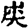
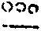

# 吹万禅师语录



> **藏经**：嘉兴大藏经（新文丰版）（嘉兴藏）　**册次** 第 29 册（J29）　**编号** JB239　**部类** 诸宗部　**卷次** 20 卷　**篇幅** 152,481 字

> **作者（译者）**：嗣法孙灯来重编、嗣法孙灯来等编、嗣法孙灯来等重编

> **卷／品**：4 卷 · 11 品



---



## 目录



  - [序](#序)

  - [序](#序-1)

  - [序](#序-2)

  - [卷十五序](#卷十五序)

  - [自序](#自序)

  - [序](#序-3)

  - [楞严梦释序](#楞严梦释序)

  - [太极图说序](#太极图说序)

  - [原易说序](#原易说序)

  - [心经序](#心经序)

  - [廛隐草序](#廛隐草序)

- [吹万禅师语录卷十七](#吹万禅师语录卷十七)

- [吹万禅师语录卷十八](#吹万禅师语录卷十八)

- [吹万禅师语录卷十九](#吹万禅师语录卷十九)

- [吹万禅师语录卷二十](#吹万禅师语录卷二十)



---



### 序



禅宗至今日，滥觞极矣。得一橛之见者，辄诩诩自矜，冒名祖位，抹煞宗旨，埋没古人，以欺当世，予致慨者久之。聚云吹万禅师，中兴大慧，力究五宗，发於言为灌顶醍醐，著於书为渡迷宝筏。昧者犹谓宗贵一家言，而不观乎吾儒明一经者，孰若博通五经之谓大儒耶？昔有称楚石为妙喜后一人，如聚云之作略，超群绝伦，即起楚石而问之，似亦愿避三舍，诚明兴以来，禅宗仅见之一人尔。惟是韬光晦迹，居於巫峡锦江之隈，不因人热，以务衒鬻，故圆寂数年，而语录犹未全刻。更有别录数十种，计近百卷，皆发明三代之奥，以旁抉诸子百家。即吾儒皓首穷经，尚不能闯其廊庑，岂今之粑脱禅所敢望而伍者哉？予与同盟，醉心此道，仰止高山，因谋诸剞劂，以行於世。噫！予未得为聚云徒也，予私淑诸人也。天下人未必皆以耳视，能具择法眼者，谅不以予言为谬矣。



崇祯壬午菊月，水部尚书郎前榷荆使者江右熊汝学灯照稽首敬识。



------



### 序



呜呼！聚云老人逝耶？未逝耶？余与诸方见而知之、闻而知之，家风丕震，作略斩新，只者些子出入儿孙面门、穿透祖佛鼻孔，一场懡㦬。老人分中且置，余辈今日意作麼生？先德云：「不道无禅，只是无师。」又云：「不道无师，只是无禅。」如此批判，亦属隔靴搔痒，刻舟求剑，无有是处。乃老人以慈悲心修真实行，不惜络索，尽情拈出，无论言句、无论棒喝、无论椎拂，玄要主宾、照用权实，应针利物，一时迸现，而又开豁五宗，毫发无渗，波澜独绝。此不独临济、大慧千年一炬，即起从上佛祖而问之，亦子舆氏所谓圣人复起，不易吾言者也。老人悯念末法杂毒日深，蕴藉骊珠，不轻解额，而精光焕发，如景星庆云，所以鼓吹休明，翊赞隆盛者，应候而出，极奇特，极平常。宝月一轮，近在铁壁禅师毛孔中，引而伸之，触类而长，莫道无师、莫道无禅，如是为师、如是为禅，信天下无二文殊也。而世之眯目禅和，一橛未明，妄生颠倒，麤疏浮薄，自等市沽，即谓黄面阿翁，不妨浪子破家，有日阎罗抵对，未免丧身失命。老人恁麼婆心太切，杀活纵夺，拯溺救焚，得未曾有，非为分外。愿自今以往，与麼不与麼、委悉不委悉，举似诸方，诸方具眼，自当遏旋流弊，荐取真源宗旨，不知祖家种草，疑杀天下人，庶与我聚云老人相见。语录凡若干卷，未刻种种，余与同志激扬，次第锓布，先为忉怛志所皈云。



崇祯壬午小春既望，鹿园学人黔南沈奕玮稽首识於平山舟次。



重刻吹万禅师全录疏



论禅宗於今日亦难矣。矧予里弹丸地乎，诸刹衲子无异凡夫，询以出家本旨，喑然也。此风既堕，大厦非一木可支，后生辈无大福德，才有所见，便作乞儿相，以一饱为足，不堪种草；纵有十分饶舌，故作婆心，总是葫芦样子。独吹万禅师具丈夫概，目视云汉，手扪星辰，非随群逐队者流。予皈依久矣，一日庄诵语录，真若狮子吼声，令人惊怖，久之犹甲拆之沾润露也。予叹之曰：「吹万禅师真不朽人也，说玄说要，一一从胸臆中流出，有如禹之治水、孔之闻韶、羿之射玉、良之御、孙子之用兵、左丘明太史之文章，无可思议。信哉！吹万禅师真不朽人也。」予於斯道虽未梦见，颇觉技痒，安得舍尘网，拂衣策杖，归向桃花源哉？禅师之传录匪只一种，尚有未行世者，我等望法门金汤，倜傥从新，以禅师一灯布百千万亿灯也。



崇祯癸未端阳日发，弟子高仰之沐手和南疏。



吹万禅师语录目录



------



### 序



疏  

卷一上堂



卷二上堂



卷三普说  

小参



卷四示众  

茶说



卷五法语  

入堂  

入室  

勘辨  

问答



卷六颂古



卷七颂古



卷八偈



卷九偈



卷十佛事  

像赞  

书问



卷十一诗



卷十二诗



卷十三词  

歌



卷十四赋  

记  

引



------



### 卷十五序



文



卷十六传  

篇



卷十七说



卷十八说



卷十九缘起



卷二十杂著



(附)行状、塔铭



吹万禅师语录卷之一



嗣法孙灯来重编



上堂



万历戊午上元日，霜轮上座、檀越、四众等请师开法於湖广衡州府潇湘湖东禅院。至座前连喝三喝，云：「还会麼？也须高著眼。」升座。拈香，云：「此瓣香，浑沦世界，筦籥生成，吹之则书洛图河，扇之则云龙风虎。𦶟向炉中，奉祝皇帝万岁、太子千秋，辅弼伊周，贺金牛於锦幔；出入姜传，懽玉马於彤墀。此瓣香，如膏如泽，如旸如春，干运四时，凭临造化。𦶟向炉中，奉为潇湖郡主宰官檀越，嘉禾穗茂，四境三祝於华封；荐句神开，五蕴独超於色相。此瓣香，轰天碎地，倒岳倾湫，灼破顶门眼睛，熏开眉毛骨髓。𦶟向炉中，供养大慧下现住四川叙州府朱提山上月下明和尚，用酬法乳。伏愿旃林哮吼，尘尘刹刹踊金毛；石室挥扬，郁郁葱葱飞玉片。」拈毕，据座上首白椎，乃云：「劈面迎风掌，当胸辊肚拳。具眼衲僧向者里用得，犹是三五一轮，在在光辉；火树银花，时时灿烂。若也半明半暗，恐未梦见在。呵呵！不是法门无面目，只怕蜈蚣太多足。咦！还有承当者麼？」上首再白椎，师下座。



上堂。举：「憨山自赞：『出世六十年，当军三千日，住山二十秋，毕竟没巴鼻。为僧不解禅，涉俗何拘忌？是何等业缘？作者般虫豸？最可喜底，一片痴心，把佛祖门庭当自己家事，烦恼无边、苦海无际，历尽风波，随行逐队，荆棘林里横身、干戈场中作戏，到於今不肯回头，阎老子岂不生气？想待弥勒下生，那时方才理会。呵呵！春山夜雨子规啼，声声叫人且归去。』」师云：「者汉虽然如是，犹未悬岩撒手在。一片真空无去来，岂容内府生计较？出世当军住山，达多镜里一照，说甚悟禅涉俗业缘？有甚佛祖门庭家道？苦海即阆苑之银深，烦恼是菩提之佳兆，荆棘林本来无碍，干戈伤任他跳跃，回头不回头，在我脑后空▆▆，甚麼阎老子生气？取调弥勒下生理会，自欠一重憔懊，只须随分纳些些，免使傍人错道。呵呵！我者一笑，你看那夜雨，子规自不啼，上林归去春光早。」



上堂。「一不做，二不休，杀人须究亲下手，捉贼要识真领头。平息了，万事丢，一颗明珠衣下收，燄山叠嶂从兹破，爱海波涛信不流。」卓拄杖一下。



上堂。问：「仰钻瞻忽，意旨如何？」师述偈云：「硬似绵团软似铁，六月炎天一点雪，露柱灯笼笑点头，哑人得梦向谁说？」



上堂。举：「寒山子歌云：『东家一老婆，富来三五年，昔日贫於我，今笑我无钱。渠笑我在后，我笑渠在前，相笑倘不止，东边复西边。』」师云：「大众！若是於此中领会不来，嚼碎五千餘卷犹是他家茶饭，反惹得眼饱肚中饥，只侥推到腊月三十日螃蟹下锅，未免脚忙手乱。」



上堂。「二月阳春仲，山花任自开。丈中风埽地，天上月临台。露柱黄昏笑，灯笼晓夜哀。若问他家信，庚方看月歪。」



解制，上堂。「西来正法眼，光照五须弥，风吹花草动，雷鸣天下知。昨夜金牛吼、木马嘶，惊起银河碧浪涌，震动蓬莱三岛驰，被老僧扭著鼻头，拽过人间天上，掷下寂灭光明海中，气也出不得。大众知麼？若知，即便两手捞出；若不知，闭却汝眼、塞却汝耳、箝却汝口，向万里无寸草处去，随分娑婆诃，只等秋风吹入户，寒雁送声来。」



崇祯辛未腊八日，布金檀越田侍御令子别驾素庵居士同四众等，请师结制於忠州聚云禅院。拈香毕，竖拂子，云：「从上古人只为者个东留，瞒顸了许多英雄豪杰、赚陷了许多高人达士、抛撒了许多油盐酱醋。今日老僧不徇人情，向汝诸人道破，只要汝等於日用二六时中，行住坐卧处、穿衣吃饭处、运水搬柴处承当。若承当得来，英雄豪杰也瞒顸他不得、高人达士也赚陷他不得、油盐酱醋也抛撒他不得。且问大众：如何是者个东西？参。」



上堂。拈拄杖，云：「向东也是者个，向西也是者个，向南也是者个，向北也是者个。若离者个，上无三界诸天之乐、下无五趣三途之苦，四圣六凡全仗著他撑门拄户，迄到德山长老将来胡打乱敲，却被临济侍者夺来当胸一拄，只得便归方丈去。今日落在老僧手里，竖亦不著、横亦不著，不竖不横又作麼生？」卓一卓。



元旦，上堂。「去年腊月三十是岁之终，炭里乌龟走；今年正月元旦是岁之始，雪上鹭鸶飞。终处不为灭，始处不为生，作麼生是不生不灭底道理？」良久，云：「金芽柳灿莫轻瞒，自在东风暖复寒，著眼看时还不是，依稀萝影月阑干。」



上堂。「今朝正月十五，僧堂集众打鼓。若问西来大意，花笑鸟啼风舞。大众须知，一番景过一番新。试看春水起赤稍之鱼，地雷震禹门之浪。好趁者个时节，大家向前腾跃，始信天上天下唯吾独尊。」



上堂。问：「未开口已前，请道一句。」师云：「玉兔怀胎来树下，金乌抱子上天衢。」问：「如何是一纤微尘开华藏？」师云：「夜雨滴簷前，铿铿论实事。」乃云：「说理说事，可中更无两头；论是论非，个里岂存二见？要理即理、要事即事，十方世界露全身；是则随是、非则随非，一纤微尘开华藏。到者里，凡圣无容安立，那其间佛法不用商量，秋江处处好风流，妙在长空明月上。」卓拄杖一下。



上堂。「欲参自己生前事，急急回头点旧山。雪压翠微形不老，烟笼薄暮体非顽。怪来若讶云中石，觉后难分水上斑。花笑鸟啼随任运，何妨踏破祖师关。」



上堂。「三目山与滑石滩论义，一个𡁏𡁏𡁏，一个㗊㗊㗊，震动三界天主、四部地神，担起三藏十二部一切修多罗，为渠作个注解，解亦不出。被老僧拂子一喝，忽忙道个：『硬如绵絮软如钉，静似杨花动似岑，十个指头两只手，看来不是等闲人。』」



上堂。「聚云有三种法，名曰三关。若也透得，方许亲见。聚云第一种要脚掌掉后，若一向在前，直饶走到弥勒下生，也没休歇底日子。第二种要鼻孔朝天，若一向朝地，只唤作寻香逐臭。第三种要脑后具眼，若一向照前，则阿爷阿娘衣食冻馁、枯瘦如柴，为儿底毫无顾盼。听吾偈：黄昏钟响日头红，晓来依旧月当中。讨火童子吹波浪，征西戎马面朝东。」



上堂。「唤作如如，早是错也。唤作文字，不亦乖乎？虽然号作阳春令，却借东风暖上林。红白满园关不住，牧童狂指是花村。」



上堂。「华严会上五十三员善知识，在汝等诸人十二时中放光动地，只为太近，所以不自觉知。」良久，云：「日中一供饭，晨朝一餐粥，大众集斋堂，老僧持钵出。」问：「和尚未登座时，五十三员善知识又在何处？」师竖起拂子，云：「会麼？」进云：「此后如何？」师云：「无风树叶动，必定有鸦栖。」



田素庵居士荐母，请上堂。「去年此日四月八，今年此日四月八，处处九龙香水飞，山山五色天花撒，只有聚云更不同，摩耶受法於悉达。今日净信檀越追荐亡母利幽一句又作麼生？」以拄杖向空拨，云：「拄杖挑开无缝塔，多宝全身作圣胎。」



上堂。问：「中兴大慧事如何？」师云：「劈破不为两，扑碎始成团。」进云：「光前显后底一句分付阿谁？」师云：「虚空皮打皱，海水骨头坚。」乃云：「新秋烟迷柳，夏餘风入松，梨花蛱蝶飞，田蛙唱晓钟。」



上堂。以拂子於空中畫一○相，云：「秪者个释迦得之唤作涅槃妙心、老氏得之唤作清净无为、孔子得之唤作虚灵不昧，且道今日落在老僧处唤作甚麼？」良久，云：「言言擒风捉月，句句击水敲空。」



上堂。问：「释迦如来初出母胎即云：『天上天下，唯吾独尊。』云门是甚麼人，要一棒打杀？」师云：「后生可畏。」僧礼拜，乃云：「若在者里会得，达磨不必西来，玄奘何劳东去？天下老和尚亦不消拈锤竖拂、行棒行喝，冬去春来，穿衣吃饭，好不快活。」



上堂。「四节日升堂，百丈老人龟鉴；半月半月说，优波尊者准绳。为甚麼石门聪十五日已前用锥、十五日已后用钩？老僧今日坐在三五光中，管教龟鉴、准绳一齐放下，前后钩锥俱用不著，只听个幽鸟语喃喃，辞云入乱峰，我行荒草里，汝正入山村。」



上堂。「大道只在目前，要且目前难睹。欲识大道真体，不离声色言语。如何是声色？黄莺啼柳树，白鹭立沙滩。如何是言语？佛印遭墨刑，面面都是字。」



浴佛，上堂。「今日释迦诞辰，诸人皆以殿前太子用香汤浇灌，大作一场漏逗。老僧单鼓两片皮，打些葛藤，拨开众生界中诸佛知见，不为分外。为甚麼如此？朝三暮四，朝四暮三，又令猴怒，又令猴欢。伏惟尚飨。」



盂兰日，上堂。「秋风清，秋水绿，烟锁幽林霜露拂，雪阵芦花万里绵，金雕沙渚千丘粟，於斯得见境中人，体素素兮文郁郁。大众知麼？欢喜日喜於此，盂兰盆营於此，僧伽耶供於此，百万亿座世界花，阿谁不在花光里？一回举著一回新，刹那脱却皆由尔。作麼生是皆由尔？参。」



接得汉月禅师书，上堂。「无事讨事，非故作故，过得江来，宾鸿迷路，解下素白，吴风扇鼓。如何是吴风扇鼓？」维那举柬云：「此是玄墓山汉月禅师来底书子。」高声读云：「大慧禅师说尽人间禅病，四百年内望之如渴人求井，不料一枝埋没向三峡锦江之上。」师喝。又读云：「前得来书语录，已见作略过人，第末得从容谈三月於水流石上，为恨不浅。」师又喝。复读云：「兹闻已返峡中，略伸四问，万乞答我，更欲禅师起已坠之禅於今日，令后辈重见天日於座下，断不令某遗恨耳。至祷！至祷！」师复喝，乃云：「大众会麼？此正是我有时一喝不作一喝用，只者三喝即当展具三拜，礼达汉月禅师。第一喝礼不为禅师放光射於巴子国，只为禅师有大悲心，扼腕大慧老人门庭冷落；第二喝礼不为禅师书通人事，奖誉过情，只为禅师识得忠州三目山聚云寺有一眼大慧泉从新迸出；第三喝礼不为禅师千里同风、德音远顾，只为禅师启我将径山普觉塔子百咂碎倒，题年月唱一首，劈破韵底曲子，洗开天下衲僧耳中正眼，免使膏肓竖子假以心性椰榆、本命元辰。大众！山野为甚麼和泥合水作者般去就？忆昔幼年曾在芸局窗边偶得大慧老人语录，读之心醉，谁知破家散业后拶入朝阳和尚洞里，咂著一粒老鼠药，灼然恶发，咬穿鼻孔，辊在水牯牛队中，作个他家儿孙，血脉自是不昧。」复喝一喝，云：「不因一事，不长一智。玄墓山前古镜悬，聚云堂上珠帘碎，交罗错杂满三千，百亿人天脚点地，从此一回音信通，犯▆挥斤无不是。」以拂子击禅床三下。



写师真，请上堂。举：「玉泉皓自赞云：『粥清后坐，床窄先卧，耳聋爱高声，眼昏宜字大。』者般说话虽是本分家风，向上一著犹未在。今日缁素辈以老僧三百六十骨节、八万四千毛窍交付丹青，一笔畫成，却请老僧自赞：出世三十年，头戴一只角，逢人看不见，空向我摸索。於今漏逗者封皮，海底榴花红似雪，只须著眼脑后观，青山万里一条铁。且道：是向上一著？是本分家风？」良久，云：「八百餘家成巧手，大家依样畫葫芦。」



铸佛，上堂。以拂子於空中畫○相，云：「者一尊，三昧乐正，受意生身。」以拂子点一点，云：「者一尊，觉法自性，性意生身。」以拂子畫十字，云：「者一尊，种类遍现，无行作意生身。三佛形容总不真，眼中瞳子面前人，若能信得家中宝，啼鸟山花一样春。」掷下拂子。



高侍御建盂兰会，请上堂。竖拂子云：「新秋烟雾锁溪头，皎皎蟾光十二楼，坐到五更天未晓，黄昏钟鼓入林幽。咦！不许夜行刚把火，只须当道与人看。」



元旦，上堂。「年年岁岁正月一，岁岁年年一月正，花开花谢还依树，尘生尘灭总由心。绿水动时飞浪雪，寒风逼杀结霜冰，可笑几番如此过，不知谁是住山人？大众！有识得住山人者麼？」僧出，师下座。



阅藏圆满上堂。座元问：「和尚大开炉鞴，应接方来，设使遮天盖地来时如何？」师云：「劄。」进云：「沉踪隐迹来时如何？」师云：「舌头飞铁马，脚指涌丝纶。」进云：「总不恁麼来时如何？」师云：「一任七颠八倒。」进云：「恁麼则虾蟆蚯蚓也解得禅。」师云：「著著著。」元掩耳入众。乃云：「昔日达磨不来东土、二祖不入少林，所见所闻秪有黄面老子修多罗教，殊不知此教如标月指，若复见月，了知所标毕竟非月。后来鲁祖长老凡见僧来便面壁，恰到有些气息，所以万松道：『灵山如畫月，曹溪如指月。争似鲁祖在水晶宫里、广寒殿上披襟相见？』」以拂子畫○相，云：「还见月轮麼？」



尹参府受戒，请上堂。维那白椎，师云：「若论第一义，维那一椎打得谛当。但不知第一义已前还通得消息也未？」首座出，才礼拜，师云：「如何是第一义已前消息？」座便喝，师云：「未在，更道。」座掷下坐具，云：「疋马单鎗要与和尚相见。」师云：「海底泥牛脚插天。」座云：「某甲进前三步。」师云：「退后三步作麼生？」座复喝，师连喝三喝，座作礼。西堂出，师云：「如何是第一义已前消息？」堂云：「某甲不问，请和尚不答。」师云：「你正不问，我正不答。」进云：「还请直捷道一句。」师云：「葡萄架上结冬瓜。」堂云：「道破虚空无个事，恐惊牛斗卧江寒。」师云：「老僧不是恁麼人。」堂归众。乃云：「僧问赵州：『万法归一。』且道与第一义底一是同？是别？州云：『我在青州作领布衫重七斤。』且道与第一义已前消息是同？是别？若道同，朗州山、澧州水，四海五湖王化里；若道别，豆子山打瓦鼓，阳乎山下白雨。也不同、也不别，滕王高阁临江渚，佩玉鸣銮罢歌舞。今日尹参府皈依佛法，也只为者第一义；受持五戒，也只为者第一义；因戒生定、因定发慧、因慧参得自性念佛底主人公，也只为者第一义。且道如何是第一义？咦！」



上堂。「冬至日，一线天，地雷复，柳含烟，遍地红轮，真个是叶上霜珠圆更圆。佛身充满於法界，普现一切群生前，鹫峰峰下重相见，鼻孔原来总一般。急吐却，野狐涎，骅骝马，珊瑚鞭，一骑红尘妃子笑，等闲不许外人看。为甚麼不许外人看？路逢剑客须呈剑，不是诗人莫献诗。」问：「如何是佛？」师云：「拄杖撑著月。」「如何是祖？」师云：「横肩两样看。」「如何是超佛越祖？」师云：「提起三十棒。」僧一喝，师拍掌三下。



病中，上堂。「维摩病在毘耶城，老僧病在聚云寺，两个无孔铁锤，一前一后相似。今日若有人问话，但只摇手。如云：『不会。』向道：『老僧感冒伤风，失了声气。』」



举隐首座秉拂上堂。「佛无面目，说是说非。祖是白拈，靴里弄指。达磨西来，不立文字。直指人心，见性成佛。到有一千七百则葛藤，黄面瞿昙，三藏十二部，一切修多罗。又道四十九年未曾说出一字。老僧三十年撞入他家队里，惹了一身腥臭。如今只得寻个替代，各自抽身。大众有未了公案，待第一座共汝等商量。」



解制，上堂。「座下三五百人，各具择法眼，各有冲天志，恁麼则老僧有望；座下三五百人，各具择法眼，各有冲天志，恁麼则老僧无望。结也，大千世界一禅床；解也，随缘赴感靡不周。靡不周，一禅床；一禅床，靡不周。结也结不得，解也解不得，九十日来无个事，依然皮下要有血。」



元旦上堂。举：「长沙岑游山归，首座问：『游山事作麼生？』岑云：『始从芳草去，又逐落花回。』座云：『大似春意。』岑云：『也胜秋露滴芙蓉。』若有人问聚云：『游山事作麼生？』但道：『倒骑铁马飞金雨，呀咤狮子吼云腾。』若问：『长沙和尚语中带有春意，因甚和尚全无？』但道：『去年正月也有今日，前年正月也有今日，明年正月也有今日，后年正月也有今日，昼夜十二时，九十六成经，三百六十日，二十四成纶，和气暖风调宇宙，大地何方不是春？』」



上堂。问：「圜悟和尚未审有何过被慧祖骂饮烊铜、吞热铁？」师云：「此是他寻常茶饭。」进云：「还许学人管待也无？」师云：「美食不中饱人吃。」问：「饮光见拈花，破颜微笑，世尊与他证明。世尊睹星悟道，是谁证明？」师云：「铁蒺藜四方八面。」进云：「与麼则无证明也。」师云：「烂冬瓜七纵八横。」进云：「若是，岂无先佛耶？」师云：「话头也不知。」进云：「和尚一向归理路去也。」师云：「舌头不出口。」问：「叫即应，问即答，者个活鱍鱍底东西，未审瞌睡压著时又在甚麼处？」师云：「鬼渗卵。」进云：「一口气不来，又向甚麼处去？」师云：「毕竟向甚麼处去？」问：「如何是聚云境？」师云：「苍松连翠柏。」「如何是境中人？」师云：「明历历底双跏趺。」进云：「人境不立时如何？」师云：「站过一边。」乃云：「参禅人悟后须透宗旨，既透宗旨方明大法，既明大法始可锻炼得学人偷心。所以临济老人道：『我有时先照后用，有时先用后照，有时照用同时，有时照用不同时。先照后用有人在，先用后照有法在。照用同时，驱耕夫之牛，夺饥人之食，敲骨打髓，痛下针锥。照用不同时，有问有答，立宾立主，和泥合水，应机接物。』如何今人悟后便休，不透宗旨，不明大法？如此之辈，若悟得头，秪是个有足无眼人；若悟得尾，秪是个有眼无足人。怎能做得眼中垂手、足下放光底大丈夫？故临济老人又云：『大凡演唱宗乘，一语中须具三玄门，一玄门须具三要，有权有实，有照有用。汝等诸人作麼生会？』后来僧问道吾真禅师云：『如何是第一玄？』真云：『世尊光射阿难肩。』『如何是第二玄？』真云：『孤输众象攒。』『如何是第三玄？』真云：『泣向枯桑泪涟涟。』『如何是第一要？』真云：『最好精粗照。』『如何是第二要？』真云：『闪电乾坤光晃耀。』『如何是第三要？』真云：『路夹苍松老。』若向临济长篇古文上认著错，若向道吾落韵诗上认著错。有个觉范老人云：『一句具三玄门，一玄门有三要路，细看即是陷虎机，忽轰一声涂毒鼓，偷心死尽眼麻迷，石女梦中毛卓竖。若向者里认著错，大众若会临宗旨，先须会得者三错。』」



> 嗣法孙灯映重梓



吹万禅师语录卷之一终



吹万禅师语录卷之二



嗣法孙灯来重编



上堂



崇祯丁丑二月望日，尹参府遂江居士请师於巴台禅院结制。



山门。「十方薄伽梵，一路涅槃门。既是一路涅槃门，也不须门外打之遶。」



佛殿。「金佛不度炉，木佛不度火，泥佛不度水，如何即得？」立定，云：「佛陀耶。」展具，云：「达磨耶。」合十，云：「僧伽耶。」礼拜起，复云：「𫆏。」



方丈。「古人唤作方丈地，老僧唤作方丈室。将来烹佛炼祖，道是衲僧巴鼻。」喝一喝。



上堂。拈香毕，维那白槌，师随喝一喝，云：「玄要料拣、宾主照用，一并漏逗了也。若也不会，听取一偈：野寺孤明夜月斜，高台飞阁远人家，绿水金辉浮桂影，青山玉晓堕霜华。」问：「心佛与众生，是三无差别，如何是心？」师云：「门前几竿竹。」进云：「如何是佛？」师云：「岭上数株松。」进云：「还有众生也无？」师云：「心佛与众生，是三无差别。」僧礼拜，师下座。



上堂。「出众者三十棒，不出众者三十棒，出众不出众者三十棒。」一僧出问话，不契。乃云：「直下三玄已露，就中三要齐施，落花流水空去，殿前古柏当机。」



上堂。「春已暮，落花纷纷下红雨，南北行人归不归？千林万林鸣杜宇。我无家兮何所归？十方世界奚相依？老僧有个真消息，昨夜三更月到池。古人恁麼道，未免逐境随流。老僧则不然，春已暮，从来三月多春雨，东西南北不须归，滴血徒劳伤杜宇。老僧无家却有归，归来到处任相依。会得此中真消息，一轮明月在瑶池。」



上堂。「世尊见文殊在门外，召云：『文殊何不进门来？』殊云：『我不见一法在门外，何故教我进门？』曹洞宗旨尽从者里去。又见二人舁猪，世尊问云：『者个是甚麼人？』云：『佛具一切智，猪子也不识。』世尊云：『也须问过。』临济宗旨须是恁麼来。此不是一橛一见底硬节担板禅，此不是伸手竖拳底当门抵户禅，此是我黄面老子最上一乘禅，直至西天四七、东土二三，代代相传不昧。若在者里出得头、转得身，如枯木开花、泥人拍掌，便是唧嘹舌头三千里，六月梅花雪里开，也不为分外。」问：「如何是百尺竿头事？」师云：「木马双头三只角。」进云：「如何是更进一步事？」师云：「乌龟尾上火轮车。」进云：「还有向上事也无？」师下座。



解制，上堂。「古人四月结制，老僧四月解制，不为仓廪无粮，只为逢暑当避，长连床上济济多士，香积厨边烟烽火炽，个个想著岩畔，共结清凉大会。作麼生是清净一句？夜明帘外转身难，荆棘林中下脚易。」



崇祯戊寅七月朔日，师受请住夔州府万县宝峰山云来禅院结制。



上堂。拈香毕，喝一喝，云：「会麼？会得不可唤作喝。」卓拄杖，云：「会麼？会得不可唤作拄杖。」竖拂子，云：「会麼？会得不可唤作拂子。毕竟如何？」座元出云：「云来风晓月，九岭树吟龙。」师云：「疏林横古路，垒石傍丘山。」进云：「恁麼则大地无寸土，某甲独为尊。」师云：「你在甚处得者消息来？」元便喝，师云：「再喝一喝看。」元作礼，师云：「也是披露见文。」



营盆，上堂。「飒飒凄风绕树寒，夜深林里霭云烟。钱飞粉蝶千家纸，露湿绮罗万泪衫。独有长空辉月面，斗牛银汉玉阑干。」



上堂。「问在答处，答在问处，瞒顸一生。不以问求，不以答得，儱侗三世。不问而问，不答而答，正恁麼问，正恁麼答，壮士劳劳失却珠，怒息摩挲犹在额。」



入队，上堂。「昨日在忠城里，野马飞扬，黄尘扑面，看来尽是薄伽梵八万四千随好光明。今日在宝峰山，僧仪济济，钟鼓喧鸣，又恰是摩诃般若中倒翻觔斗底影子。所以道：尽大地是沙门一只眼，一切众生是摩诃般若光。既然如是，出队由▆入队时，古今一念不参差，个中若了无来去，秋月寒蝉到处吹。」



解制，上堂。「父母未生以前，却是甚麼消息？空中石头拱手，树上乌龟作揖，蟭螟尾长三丈，须弥顶阔八尺，都卢细磨为浆，令乌有先生擎来，不勾拄杖子一口吃。」



崇祯戊寅冬朔日，师受请住夔州府万县兴龙禅寺。



三门。「昨日云来，今日兴龙。其来无迹，其兴无纵。出院入院，非有非空。既无踪迹，亦非空有。者条门限又作麼生？」良久，云：「慈心既满蛇头伏，得到龙宫自有珠。」



佛殿。「巍巍堂堂，磊磊落落，不是塑泥刻木，便是泻铜铸铁。既是者个门庭，也要斩新作略。作麼生是斩新底作略？不向佛礼，不向法礼，不向僧礼，常礼如是。」



方丈。「方围一丈，纵横十尺。八万四千金毛，尽是衲僧巴鼻。玄要煌煌，照用历历。驱耕夫之牛，夺饥人之食。管取撒手归来，自有通天消息。」喝一喝。



上堂。拈香云：「此瓣香不与旃檀同类，不共沉速同科，生於般若光中，长在常寂国内。𦶟向炉中，上祝当今皇帝万岁万万岁，乾刚坤柔，文经武纬，在在谈孝义之化，安磐石以乐春台；处处兴道德之风，诵康衢而歌击壤。」又拈香云：「此瓣香与天地合其德，日月合其明，先兮弗违，后兮奉时。𦶟向炉中，奉为郡邑宰官、缙绅檀越，福缘善庆，歌南风於舜田；祯集祥迎，颂棠树於周道。」又拈香云：「此瓣香烟笼三界，气褁真如，烁破瞿昙面门，透开达磨鼻孔。𦶟向炉中，供养朱提山上月下明老和尚，用酬法乳，狮子嚬呻，象王回顾，呀咤吼动，青黄赤白现全身；转折周旋，南北东西呈海印。」乃竖拂子云：「此是释迦如来末后拈底金钵罗花。」以拂子畫○相云：「此是达磨西来二祖神光得髓一句。」喝一喝云：「此是临济大师宗门正眼，今日人天众前当阳举出。还见麼？打破秦时镜，现出海潮音，梵播恒沙界，香满功德林。更有末上一句不妨拈出：周溪鱼跃三生石，巴峡猿啼十二峰。」



上堂。「木枥山与汝相见了也，窄小子与汝相见了也，兴龙寺与汝相见了也。是则是，只是不肯承当。若也承当得来，三门头合掌，佛殿后经行，东廊作揖，西廊拱手，何处不与相见？见即见，要且不见老僧。老僧即是阇黎，阇黎即是老僧。老僧与阇黎，迷却天下人，亦能悟却天下人。无须锁子两头摇，珊瑚枝枝撑著月。」僧问：「和尚道：『兴龙寺与学人相见。』未审龙在甚麼处？」师云：「若问其中意，便扣胡张三。」进云：「金翅鸟王在此。」师便喝，僧拟进语，师连喝云：「一问一答，却成漏逗，不自揣摩，徒劳心垢。」



解制，上堂。「一三如三，二三如六，三三如九。天以九得清，地以九得宁，人以九得灵，王侯以九镇宝位而天下平。且道在衲僧分上又作麼生？结制解制，用作九旬。开炉闭炉，摄生护生。惟有向上无拘忌，四时常在定盘星。」



上堂。举：「简李王邀法眼玩牡丹花，命眼赋诗，眼曰：『拥毳对芳丛，由来趣不同。发从今日白，花是去年红。艳冶随朝露，馨香逐晚风。何必待零落，然后始知空？』颂罢，李王即悟。」师云：「老僧亦拈数句：偶从芬艳里，即境睹明花。盛色虽堪赏，衰容似可嗟。禁攀枝上叶，应惜树头芽。若也无遭踏，频君醉月华。」



上堂。举：「五祖演和尚因默然良久之机，人多错会，遂拈语示之曰：『前面珍珠玛瑙，后面玛瑙珍珠，左边观音势至，右边文殊普贤。中安一树旛子，被风吹著，道个葫芦葫芦。』」师云：「聚云见伊破碎太甚，不免矢上加尖，一一颂出。颂曰：前面珍珠玛瑙，却是篱穿壁倒，提起鲜血长流，搭上眉间恰好。后面玛瑙珍珠，一个嘴骨卢都，堂上遍身红烂，儿郎不得称呼。左边观音势至，不必彰名显字，铁牛一梦三更，石女方才盖被。右边文殊普贤，老马不愿披鞍，滴尽沙场血汗，通身透骨清寒。中安一树旛子，却也是我是你，两头透地拄天，入风摇撼不起。被风吹著，声音寥廓，鼻孔舌出，阿谁摸索？道个葫芦，大心凡人，衲被蒙头，雷霆辘轳。」



上堂。举丙丁童子因缘，师云：「丙丁童子去讨火，为甚麼前一转不会，后一转却大彻去？频呼小玉原无事，秪要檀郎认得声。」



上堂。「兴龙要勘学人，有得一橛禅者，须知眼全足全、头正尾正，亲切句、转身句、异类句、末后句，透得宗旨，始有超佛越祖之谈。且道唤甚麼作眼全足全、头正尾正？作麼生是亲切、转身、异类、末后？宗旨又如何透？如何是超佛越祖之谈？汝等於此一二透得，许汝亲见兴龙。」



副寺荐亡师，请上堂。「子规啼彻暮春时，清明已过衫𫄨绤，不须潜缩针和线，堂堂必表而出之。老僧客岁结制兴龙，今年归来聚云，连连绵绵病痛，不知害著何人？唯有杨岐知端的，道是金刚并栗棘，今日拈来度亡僧，个个当阳赤骨历。」



上堂。「马大师道：『不是心，不是佛，不是物。』好似一粒老鼠药，致令得末代儿孙或咬著、或闻著、或熏著，害得憨不憨、痴不痴，胡说乱道。今日老僧不辞分明道出：也是心，也是佛，也是物。看他又作麼生捞摸去？」



上堂。「僧问赵州：『万法归一』，依旧从头起。『一归何处？』及尽去也。州云：『我在青州作领布衫重七斤』，疾风暴雨不惊寡妇之门。老僧恁麼批判，设有个旁不甘的，出来掀倒禅床，喝散大众，却许他具一只眼。」



上堂。举：「长沙岑令僧问惠安：『和尚见南泉后如何？』安默然。又问：『未见南泉时如何？』安云：『不可更别有也。』僧回，举似长沙，沙云：『百尺竿头坐底人，虽然得入未为真，百尺竿头须进步，十方世界露全身。』僧问：『秪如百尺竿头如何进步？』沙云：『朗州山，澧州水。』僧云：『不会。』沙云：『四海五湖王化里。』」师云：「维摩默然，文殊会不二法门；云岩默然，洞山收取和尚真子。为甚麼惠安默然？究竟只是个不可更别有也。所以，长沙倾心道出，总要透开学人活路，一任七通八达。且道：如何是活路？磨盘秋结子，碓嘴夜开花。」



上堂。举：「僧问长沙：『秪如百尺竿头如何进步？』沙云：『朗州山，澧州水。』僧云：『不会。』沙云：『四海五湖王化里。』」师云：「若有问宝峰：『百尺竿头如何进步？』但向他道：『此去忠南二百里。』如云：『不会。』但道：『水路一半，陆路一半。』」乃复颂云：「立己立人事已周，霜华烟雨正绸缪，鹭鹚只恐渔人棹，飞入蒹葭不漫游。长沙老，匪常流，风火芦湾带月浮，一拍自然千里外，雪阵银沙四海秋。」



上堂。「僧问赵州：『万法归一，一归何处？』州云：『我在青州作领布衫，重七斤。』僧问长沙：『百尺竿头如何进步？』沙云：『朗州山，澧州水。』二老皆是南泉嫡子，出语接人，果然难兄难弟。若到聚云门下，正好朝打三千，暮打八百。」



上堂。举：「中峰示众云：『浙东山，浙西水，拄杖头边，草鞋跟底，大事未明，如丧考妣。衲僧直下莫思量，思量便隔三千里。会麼？昔僧问赵州：「万法归一，一归何处？」生死无常，银山铁壁尽在此问处。「我在青州作领布衫，重七斤。」神出鬼没，瞎棒盲枷尽在此答处。会得问处，则银山铁壁面面通穿，生死无常尘尘透脱；会得答处，则神出鬼没，当体无痕，瞎棒盲枷全机杀活；若也不会，便见问在答处，答在问处，问答交驰，无你入处。既无入处，且只向入不得处猛加精神，抖擞眉毛，立定脚跟，参来参去，参到能所两忘，不觉踢倒灯笼，掀翻露柱，目前万象自森罗，现在活计全丰裕。正眼看来，业识茫茫，无本可据。』」师云：「昨日夜叉心，今朝菩萨面，菩萨与夜叉，不隔一条线。」



净信请就梅苑，上堂。「严风阵起，冽气横飞，九河结万里之冰，五岳斗六花之雪。繁柯脱落叶，敲碎玉於枯条；积蔓萧疏枝，点缀珠於乾蒂。冻鳞歇江村之渔父，净山绝野唱之樵人。无何，孤质更温，清肌独热，厥挺秀於林中，便弄姿於卉里，红白半吐，轻软将芬，可令高尚隐君、栖衡杰士徬徨於蟾辉影内，剪发缁衣粧个衲子家风，道一句梅稍月不为分外。颂云：彻骨霜寒冰雪飞，孤根犹自逞光辉，不因七日重来急，怎得清香点翠微？」



上堂。举：「僧问多福禅师：『如何是多福一丛竹？』对曰：『一茎两茎斜。』僧云：『不会。』对曰：『三茎四茎直。』僧礼拜。」师云：「若有人问：『如何是聚云一丛竹？』但曰：『元初种两茎，於今百有餘。』倘云：『不会。』但曰：『中间笔立直，四维曲湾湾。』彼若不礼拜，也是铁打心肝。颂曰：外直中虚，任合时宜。凉风飘动，随东随西。假饶雪压稍枝上，一颗红轮复旧时。」



上堂。举：「宗道者移居投子，以袈裟褁草鞋出院。僧问：『如何是道者家风？』答云：『袈裟褁草鞋。』又问：『是何意旨？』答云：『赤脚下铜城。』」师云：「袈裟褁草鞋，非是强安排，身边无侍者，不曾分付来。赤脚下铜城，一步一回新，泥里踏著刺，不是等闲人。」



上堂。举：「僧问洞山：『时时勤拂拭，莫使惹尘埃，为甚麼不得衣钵？』山云：『直饶本来无一物，亦未合得衣钵。且道是甚麼人合得？者里下得一转语。』时有僧下九十六转，不契，后云：『直饶将来，他亦不受。』洞山深肯之。雪窦拈云：『他亦不受是眼，将来必应是瞎。』天童拈云：『直须将来，若不将来，怎知不受？直须不受，若不不受，怎免将来？将来底必应是眼，不受底真个是瞎。还会麼？穷尽体无依，通身合大道。』」师云：「天童恁麼批判，亦未离得窠臼。山僧则不然，穷尽体无依，通身是衣钵。」



上堂。举：「无为泰竖拂子云：『会了唤作禅，不会果然难。难难，目前隔个须弥山；易易，信口道来无不是。』竖拂子云：『达磨来也。』」师云：「会了唤作禅，原来饭是米做；不会果然难，可惜当面错过。难难，见之不取，目前隔个须弥山，思之千里。易易，舌头不出口，信口道来无不是。汝还听得麼？颂曰：雪中出一枝，为报晓春司，月照花英现，云横村路迷。粉墙终是隔，香魄有谁知？何似根株下，飘飘堕玉时。」



上堂。举：「西堂、百丈、南泉侍马祖玩月次，堂曰：『正好看经。』丈曰：『大好供养。』南泉拂袖便行。祖曰：『经归藏，禅归海，唯有普愿独超物外。』」师云：「藏头白不白，海头黑不黑，争似牧牛人，做个白拈贼？」



上堂。举：「法昌遇云：『春山青，春水绿，一觉南柯梦初足，携笻纵步出松门，是处红英香馥郁。因思昔日灵云老，三十年来无处讨，如今竞爱摘杨花，红香满地无人埽。』」师云：「法昌恁麼说话，大似春意。聚云则不然，秋风凄，秋雨细，山前山后无不是，下塌携笻窗外看，竹径松亭皆可意。因思簷前那一滴，铿声曾助衲僧力，眼底应须具有人，烟波浪里恒端的。」



上堂。举乾峰上堂因缘，师云：「乾峰掉棒打虚空，管教血污三界；云门挥剑划江心，一任尘飞四海。只饶轰天震地，争奈鱼鸟不知？还有看破此阵势也无？太平元是将军定，不许将军见太平。」



上堂。「临济老汉当日在黄檗棒下讨得一百二十斤矿子，却向大愚肋下镕成三锭兼金担，在临济堂前敲敲打打，造成几件笼络天下衲僧的器具，后被大慧老人夺得将来，撒在诸人眼孔里，眉毛一眨，血流满地，个个知得本命元辰落处，却始得鸴鸠扶摇九万里，大鹏抢住榆枋上，跳梁狸猩出网罟，垂天牦牛能执鼠，譬如天地之无不持载、无不覆帱，譬如四时之错行、如日月之代明，万物并育而不相害，道并行而不相悖，小德川流，大德敦化，此天地之所以为大也。啐！为甚麼迸出孔老子祭文出来？听与分明颂出：口似虚空吞一粒豆，腹如蛛丝作万户侯，涅槃堂里问前程，剑树锋头打觔斗，不是神通不是玄，指掌元来一只手。」



上堂。举：「仰山钦徵高峰曰：『汝正睡著时，无梦无想，谁是汝底主人公？』湛然禅师颂云：『四大无我心如风，个中谁是主人公？廓然扑落元无物，始觉从前错用功。』天童禅师颂云：『白汗出身念无起，个中无二主人公，廓然扑落非他物，十方世界现全容。』」师云：「湛然落于断见，天童落于常见，老僧不免颂出，一任诸方检点。一梦浑忘六处灰，谁是主人无二来？乾坤了尽鼾无尽，脚底珊瑚带月开。」



上堂。「从上古人有五种禅，老僧者里秪用二种，顿明自性，与佛同俦。然有无始染习，须假渐修对治，令顺性起用。如人吃饭，不一口便饱，此是一。见性不留佛，悟道不存师，目睹瞿昙犹如黄叶，一大藏教是老僧坐具，祖师玄旨是破草鞋，宁可赤脚不穿最好，此是一。所以白居易侍郎问惟宽和尚曰：『禅师何以说法？』宽曰：『无上菩提者，备於身为律，说於口为法，行於心为禅，应用者三，其致一也。譬如江淮河汉，任处立名，名虽不一，水性无二。律即是法，法不离禅，云何於中妄起分别？』易曰：『既无分别，何以修心？』宽曰：『心本无损伤，云何要修理？无论垢与净，一切无念起。』易曰：『垢既不可念，净无念可乎？』宽曰：『如人眼睛上，一物不可住，金屑虽珍宝，在眼亦为病。』易曰：『无修无著，又何异凡夫？』宽曰：『凡夫无明，二乘执著，除此二病，是曰真修。』真修者，亦非勤亦非忘，勤则近执著，忘则落无明，是为心要。果能得到者个田地，始见处处尽成冷灰，渐修对治底亦是冷灰，穿破草鞋底亦是冷灰，非勤非忘底亦是冷灰，要在冷灰里爆出一粒豆，才唤作衲僧鼻孔。且道如何是冷灰中爆底豆？下池飞雁落，惊起一天秋。」



上堂。「一翳在眼，乱坠空华；一物在心，横生烦恼。论凡论圣，尽作碍眼之尘；说佛说生，总是蒙心之被。然眼本自净，何曾有翳观华？却不知翳即是眼。心本自清，未尝触物生恼，殊莫识物即是心。若能即物即心，眼翳遍圆通之路。如或即翳即眼，心物开普照之门。凡夫身出圣人心，圣人体即凡夫用，了无别矣。诸佛相出众生范，众生幻现诸佛真，复何异哉？故法眼禅师颂云：『华严六相义，同中还有异。异若异於同，全非诸佛意。诸佛意总别，何曾有同异？男子身中入定时，女子身中不留意。不留意，绝名字，万象明明无理事。』」



> 嗣法孙灯映重梓



吹万禅师语录卷之三



嗣法孙灯来重编



普说



普说。「参禅一法，贵要真参实悟，切不可将杂毒蕴在胸中。何谓杂毒𫆏？无明、烦恼、五阴、六入、十二处、十八界，此是欲界有情杂毒。喜、乐、舍、无心定、无想定，此是色界有情杂毒。空处定、识处定、无所有处定、非非想处定、灭尽定，此是无色界有情杂毒。见惑八十八使、思惑八十一品，此是声闻罗汉杂毒。三增进法、十信、十住、十行、十回向、四加行，此是权小菩萨杂毒。欢喜地乃至远行、不动、法云，能以一身变现一切色身，得身自在；能以一心现一切处说法，得心自在，此是十地菩萨杂毒。如来逆流如是，菩萨顺行而至觉际，入交过金刚喻定，便能应现无碍，此是等妙二觉杂毒。以圆方觉，觉无不圆；以觉规圆，圆无不觉。无一时不圆、无一处不觉，此是圆觉菩萨杂毒。一为无量、无量为一，小中现大、大中现小，一毛端现宝王刹，坐微尘里转大法轮，此是三世诸佛杂毒。拈椎、竖拂、行棒、行喝，瞬目扬眉、辊毬舞笏，拈古、颂古、评古、别古，此是诸大祖师杂毒。大众！我问汝等，昔在母胎中，六根未开、知觉未动，此是未生已前，看此中还具许多般也无？及至㘞地一声，睁眼即见，见无分别；张耳即闻，闻无分别；鼻里有气，嗅无分别；口衔血块，味无分别；手捏拳头，触无分别；见母不识母、见父不识父，意无分别。此是初生一著，看此中还有许多般也无？长至三五七岁、十三四岁，三细并显、六粗齐成，如蚕作茧自缠其身、如蛾赴灯自烧其体，反以不常为常、不乐为乐、非我为我、非净为净，竟成四倒执为我见。复有厌苦欣乐者趣为涅槃，担著四正勤、五根、五力、七菩提、八圣道、十八不共法、三十七助道品，又背真常为无常、真乐为不乐、真我为无我、真净为不净，凑成八倒执为法见。所以佛言：『一切众生具有如来智慧德相，秖因妄想执著而不见得。』及达磨航海而来，不立文字，直指人心，见性成佛，乃至『净智妙圆、体自空寂』八个字，如一灯然百千灯，明明无尽。何谓体自空寂𫆏？向未生已前六根未开、知觉未动处荐取。何谓净智妙圆𫆏？向初生时见闻觉知全无分别处荐取。今日新戒入山，惹得老僧挑出许多葛藤，却也当得入山，拄杖子再与一个方儿，两耳担柴、两眼挑水、脚板吃饭、眉毛踢起，有人问：『你作甚麼？』漫说道：『冷灰里曾爆豆子。』」



普说。「大慧禅师说尽人间禅病，此是三峰和尚语。然禅本无病，因学人错立知见，妄自推排，古人目之为病。如打地和尚凡见僧来问话便打地，后有人私窃其杖，令僧向前问话，地惟张口。何尝有病？百丈禅师谓众曰：『汝等与我开义田，我为汝等说佛法。』及至开田毕，大众向前求说佛法，百丈展手。何尝有病？高亭隔江见德山，山招手，高亭直趋而过，何尝有病？秖者三则公案虽出寻常，却也深险。若谓张口展手是佛法，遍大地人俱在张口展手，为甚麼不是？若谓张口展手不是佛法，如何令诸方学人悟去？者里参来参去，将谓张口处是佛性、展手处是妙心，才有个认性认心底念头，便落识神，一切禅病生矣。长沙和尚曰：『学道之人不识真，秪为从前认识神，无量劫来生死本，痴人唤作本来人。』便是者个说话」。



普说。师据座，首座代参头请问法要，师云：「江游船子钓，树唱柳堤莺，春融三日雨，晚照一溪云。此是法要？不是法要？」座云：「白云骑鹤鸟啣风。」师云：「从来达岸者，不必问津梁。」座归众，乃云：「坐参一法，先以打断葛藤、顿断血筋为最义。日用二六时中，若有纤毫不如意事关於耳目，则身心不得洁净、工夫不得亲切，又与未坐参者一般。倘能提起话头，如银山铁壁，处处木马游春、在在石人观戏，似将一个硬石头垒在胸中，行也如是、坐也如是、动也如是、静也如是、美也如是、恶也如是，他日洗面摸著鼻孔、行路踢著指头、吃饭触著钵盂、伸手穿著袈裟，硬石头嚗地一下，七花八裂，也怪老僧不得。」



普说。「路行跨水复逢羊，独自凄凄暗渡江。日下可怜双象马，二株嫩桂久昌昌。此是西天二十七祖谶达磨入东土底语。前三句事已见过，后一句应见於今，只是不可错会。即如达磨五传至六祖，祖虽接得四十餘人，只有怀让、青原两派流行，唤作二株嫩桂久昌昌，得麼？怀让得马祖，马祖得百丈、天王，百丈下有临济、沩仰，天王下有云门、法眼；青原得石头，石头下有洞山，洞山得曹山、云居，唤作二株嫩桂久昌昌，得麼？逮至宋元时，止有临济、洞山两宗，临济下有圜悟，圜悟得大慧、绍隆；洞山下有丹霞，丹霞得长芦、天童。绍隆至於龙池，大慧至於朝阳，长芦、天童至於湛然、博山，唤作二株嫩桂久昌昌，得麼？诸大老应谶而出，各有机用，如我大慧说：『一切宗门病痛，尽在普说中；锻炼学人偷心，尽在入室勘语中；法性宽、波澜阔，尽在上堂、秉拂、小参中。至於名公书札、居士法语，皆是就机接物、应病与药，千变万化，无所不至。』当时得法者不独出世禅师，且有名公居士七人、比丘尼二人，故存语录三十卷入藏。你看他是甚麼作略？老僧於此门庭操履二十载，开堂六次，总为撑他门户，比因前后两堂首座、书记、监院、维那、期主、居士特启老僧升於此座，愿生生世世同续此脉，以报佛恩，以报师恩。且道此中有甚麼奇特？」良久，云：「昆仑奴，虬髯客，神出鬼没人莫测，有时化作浪淘沙，转身又是西江月。疑杀天下老禅和，笑倒闹市古弥勒，毘卢顶上出头来，海底红轮一天雪。」



普说。「世尊在灵山会上拈花示众，唯有迦叶破颜微笑，及至多子塔前传衣付偈，岂谓后代儿孙全体大用不载於是？但今之得有一橛、见有一隅，却也行棒行喝、拈椎竖拂、答话下语，名曰见地，殊不知早已瑕玷古人了也。若谓行棒行喝、拈椎竖拂、答话下语皆是宗旨，何故独立五派？既是五派齐行，何故单尊临济？盖临济宗旨悟在棒下、用在玄要，所以法源长远。然此玄要岂是临济独刱？自古佛佛祖祖，个个皆具一句三玄、一玄三要，肯自得耳。不但佛法宗旨具此玄要，即世谛语言、百工技艺皆亦有之，所谓百姓日用而不知，故君子之道鲜矣。有谓临济宗旨但以直捷痛快一著，不用多事，若多事则为旁枝。如是说者，当而不当、然而未然，旁亦临济之旁枝、直亦临济之直捷，旁枝直捷，取乎？弃乎？同乎？别乎？宁用一半临济乎？全用临济乎？譬如一个馒首，已是磨麦为面、和水合成，只取馒首，宁去麦义？取其麦义，舍其水面？殊不知一取馒首，三义具足，棒下知机，玄要历然，不以智知、不以识识。故祖师直用一个参字，即是诸药引子，者里不容不会，必曰立此宗者何谓？如以一用馒首之喻，个个尽知，过去尊宿奚止千百餘员，独不肯析其微细、究其底蕴，故临济之宗超迈耳。今唯以直捷之处树之，则类为诸宿，何有临济？故我大慧老人中兴临济之宗，不唯破碎此宗，抑乃重加注脚，特为学人不会故耳。如水银扑地，何曾破碎？如源泉放海，何曾注脚？若谓破碎，临济自破；若谓注脚，临济自注：非我大慧破注也。试看临济棒下得悟之后，乃云：『山僧今日见处与佛祖不别，若第一句中荐得，堪与佛祖为师；若第二句中荐得，堪与人天为师；若第三句中荐得，自救不了。』僧便问：『如何是第一句？』济曰：『三要印开朱点窄，未容拟议主宾分。』曰：『如何是第二句？』济曰：『妙解岂容无著问，沤和争负截流机？』曰：『如何是第三句？』济曰：『但看棚头弄傀儡，抽牵全藉里头人。』复曰：『大凡演唱宗乘，一语中须具三玄门，一玄门须具三要，有权有实、有照有用，汝等诸人作麼生会？』此第一番破碎？又云：『有时一喝如金刚王宝剑、有时一喝如踞地狮子、有时一喝如探竿影草、有时一喝不作一喝用。』此是临济大师第二番破碎。小参，曰：『有时夺人不夺境，有时夺境不夺人，有时人境两俱夺，有时人境俱不夺。』克符问：『如何是夺人不夺境？』师曰：『煦日发生铺地锦，婴儿垂发白如丝。』符曰：『如何是夺境不夺人？』师曰：『王令已行天下遍，将军塞外绝烟尘。』符曰：『如何是人境两俱夺？』师曰：『并汾绝信，独处一方。』符曰：『如何是人境俱不夺？』师曰：『王登宝殿，野老讴歌。』符於言下大悟。此第一番注脚。又示众云：『我有时先照后用，有时先用后照，有时照用同时，有时照用不同时。先照后用有人在，先用后照有法在。照用同时，驱耕夫之牛，夺饥人之食，敲骨取髓，痛下针锥。照用不同时，有问有答，立主立宾，和泥合水，应机接物。若是过量人，向未举时撩起便行，犹较些子。』此第二番注脚。又宾看主，主看宾，主看主，宾看宾，四机亦不离玄要权实之转变。若单用直捷痛快一著，不行玄要宗旨。譬如天下第一等秀才，文虽光芒万丈，只是不肯做官，以谓此是功名，於我无益。殊不知做官理事，全是文章出入门户，何曾离得？若直体究玄要句法，依样描模，不会本命元辰下落。譬如宋儒，只能做得《四书》注子，不能说得本文章句。若是会得，本也本得，注也注得，玄也玄得，要也要得，直捷也直捷得，多事也多事得，正也正得，旁也旁得，他元不是死煞底物件。老僧不妨於临济破碎中更加破碎，注脚外更加注脚。如何是第一句？权衡一把秤。如何是第二句？一句梅花诗。如何是第三句？十字街前走马灯。如何是金刚王宝剑？为斩不平。如何是踞地狮子？坐断舌根。如何是探竿影草？你也须是个人。如何是一喝不作一喝用？昼夜十二时。如何是夺人不夺境？只见拄杖子，不见老僧。如何是夺境不夺人？老僧放下拄杖子。如何是人境两俱夺？夜半老僧不行棒。如何是人境俱不夺？老僧惯打人。如何是先照后用？我也为你著忙。如何是先用后照？你也直须自著忙始得。如何是照用同时？一击雷声天下响。如何是照用不同时？落花有意随流水，流水无心送落花。如何是宾看主？飞鸟投镜子。如何是主看宾？江洲宿白鹭。如何是主看主？琉璃碗盛夜明珠。如何是宾看宾？明月芦花一片白。大众！若有个旁不肯底出来云：『老和尚寐语作麼？』我也只得低头归方丈。」



小参



小参。「做工夫犹如丧却生身父母，行也思、坐也思；又如负却许多钱债，行也愁、坐也愁；又如一人与万人战，不容眨眼；又如堕入千尺井中，单单只求出井。所以道：『一念万年去、寒灰枯木去、一条白练去。』此正为学人下个做工夫底注脚。昔有观桃花而悟者、有闻击竹而悟者、有触翻溺器而悟者，总是念念逼拶，忽然到滑石头上嚗地断、碎地折，便尔七通八达去也。时节到来，妙理自彰。」



小参。「僧问赵州：『狗子还有佛性也无？』州云：『无。』者无字如恶龙出洞，疾风暴雨、轰雷掣电，无论山石丛林一水拖尽，到者里始会得万法归一，一归何处？本来面目现现成成，若是纯任狂慧，一向与无明撕结，他时恶龙有分。既然如是，何不早在聚云寺里变个恶龙，从自己四大色身中发起疾风暴雨、轰雷掣电，将无始以来习气窝、无明窟、人我山、烦恼矿，现前理障、事障、佛见、法见一齐拖尽，成一个空空洞洞底物事，好吃老僧一顿拄杖子。」



小参。「祖师门庭，魔来杀魔、佛来杀佛，若起佛见、法见，文殊堕入铁围山。何以故？只为诸人昧却平常心地，著於奇特妄想，才听说个三身、四智、五眼、六通、菩提、涅槃、真如、佛性，一个个聚头商量，胡思乱度，以为上上奇特事，正如世人差爱异言异服一般。若是说个饥来吃饭、困来打睡、冷来穿衣、热来挥扇，便尔错过去也。试看古人问：『如何是西来大意？』『庭前柏树子。』何尝奇特？『如何是本身卢舍那？』『与我过净瓶来。』何尝奇特？『如何是善知识？』『灯笼露柱、猫儿狗子。』何尝奇特？奇特且置，直今唤甚麼作平常心地？」良久，云：「每日起来七件事，柴、米、油、盐、酱、醋、茶。」



小参。举：「云门云：『乾坤之内、宇宙之间，中有一宝秘在形山，将灯笼来佛殿里，把三门向灯笼上。』老僧者里则不然，涅槃之乡、常寂之国，中有些子密在粪钵，将昆仑来大地里，把八海向昆仑上。恁麼道，与云门是一？是二？」



小参。「学人做工夫、参话头，先从者一副臭皮袋上痛劄一过，你看发、毛、爪、齿、皮、肤、筋、骨是地性，涕、唾、精、津、血、液、涎、沫是水性，暖气是火性，动转是风性，四大分张，只今做工夫、参话头的又在何处安身立命？若在者里，参穷之极，忽然见得如世小儿藏蒙相似。」即云：「在者里。」师复作猫一声。



小参。师云：「看箭。」以拂子东指，云：「者一箭射透十方世界一切众生性灵，只令山头翻巨浪，海底热烽烟，枮木口喃喃，髑髅泪潸潸。」以拂子西指，云：「者一箭射断十方世界一切众生命根，只令撒手堕悬岩，吐舌如匾担，打碎频伽瓶，扯断红丝线。」以拂子上指，云：「者一箭射开十方世界一切众生慧眼，只令顶门光亚竖，蓦直走金蛇，百千手臂百千执，万亿毫端万亿花。此是《涅槃经》上三点，老僧用作三箭，却也当箭即𠁼、当𠁼即箭，不曾是释迦眉毛在下、衲僧鼻孔掉转。」僧问：「射断命根后如何？」师云：「斩钉截铁。」进云：「如何是鼻孔掉转？」师云：「斑竹筒。」



住金陵观音庵，小参。「从上古人单要明心见性，所以世尊上座，文殊白椎，世尊便下座。逮至达磨安心、二祖忏罪、怀让打牛、行棒、行喝、竖拂、畫相，皆未尝违背。又天竺波罗提对异见王语，其略曰：『王若见性，必在作用。其作用者，当有其八：在腹曰胎，生下名人；在眼曰见；在耳曰闻；在鼻辨香；在舌谈论；在手执捉；在足运奔。遍现俱该法界，收来在一微尘。知者唤作佛性，不知唤作精魂。』末代学者不识饭是米做、衣是绵成，混於宗师门下，学得几句转语、记得几则公案，未得谓得、未证谓证，出了山门，狂走四方，向无智人前胡打乱喝，或遇哺啜𩟺糁一顿，伸脚高卧，鼾鸣达旦，鸣呯是道。果若是易得耶？果若是行履耶？果若是证悟耶？昔神光未见达磨，头痛半日，先变骨为五峰，雪腰断臂，方许可字。马祖得心於怀让，后执劳一十五年，末后开堂，犹令侍者问得三十年不少盐酱之语，始为法子。长庆坐破七个蒲团，赵州八十行脚。似者等勤苦艰辛，较今之参禅者，则从上老宿与之提草鞋亦无用处。所以五祖衣钵不付神秀上座，而付有发碓头。我固不当如是饶舌，恐渐渐支离，习染成风，却又辜负现前出手眼之人。」



小参。「末法时代去圣远矣，所出法门苗裔多务驰逐，荡丧己灵，纵有参禅慕道者，亦各任性担板，堕入狂慧执著之见，每见棒喝堂中有顺朱填墨者矣、棒喝室里有敲关击节者耶？临济云：『大凡演唱宗乘，一语中须具三玄门、一玄门须具三要，有权、有实，有照、有用，汝等诸人作麼生会？』复以四喝、四宾主、四料拣重重显示，况复曹洞之三渗漏、五君臣、五王子，彼虽出自青原，最初同一心宗，既会得临济宗旨，必会得沩仰、云门、法眼三宗，三宗既会则曹洞之宗当会矣。天目、中峰有五家之评，谓沩仰严谨、曹洞细密、临济痛快、云门高古、法眼简明，然五者果可缺一乎？用痛快以绝狐窠，使学人游於细密而严谨，居处自然高古、发药自然简明，何不可之有哉？今也不然，且言饮酒食肉无非宗旨、持戒习定俱成系缚，长发彩衣、高歌谈笑，谓为出格标榜，吾是以痛哭也、流涕也、长太息者也。诸仁者！宁可不作佛、不作祖，断不可不具三无漏学，以趋百尺之竿头、以究五宗之玄旨也。」



小参。「大凡学人请益，问处真实，方见答处的当。若问答相违，则聋瞽不相入矣。不见云门大师出语高古，不堕常流，后至曹洞门庭，循规蹈矩，细细讨论，正见他法海神龙能大能小、能升能隐，才显出老作家手段。到乾峰，峰示众云：『法身有三种病、二种光，须是一一透得，更须知有向上一窍。』门出众云：『秪如庵内人为甚不知庵外事？』峰呵呵大笑。门云：『犹是某甲疑处。』峰云：『你是甚麼心行？』门云：『也要和尚相委。』峰云：『直须恁麼始得稳坐地。』门云：『喏！喏！』到曹山，山示众云：『诸方尽把格则，何不与他道却，令他不疑去？』门出众云：『密密处为甚麼不知有？』山云：『秪为密密，所以不知有。』门云：『此人如何亲近？』山云：『莫向密密处亲近。』门云：『不向密密处亲近时如何？』山云：『始解亲近。』门云：『喏！喏！』到疏山，山上堂云：『病僧咸通年前会得法身边事，咸通年后会得法身向上事。』门出众云：『如何是法身边事？』山云：『枯桩。』门云：『如何是法身向上事？』山云：『非枯桩。』门云：『还许学人说道理也无？』山云：『许。』门云：『和尚道枯桩，岂不是法身边事？』山云：『是。』门云：『道非枯桩，岂不是法身向上事？』山云：『是。』门云：『秪如法身，还该一切也无？』山云：『法身周遍，岂得不该？』门指净瓶云：『秪如净瓶，还该法身也无？』山云：『阇黎莫向净瓶边觅。』门礼拜。直者三段因缘一一透得，可为万世法程，见地行履无不具足。若有个旁不肯底道：『和尚吃了常住饭，为甚打别人葛藤？』但向道：『病多谙药性，得效敢传方。』」



小参。「不道无禅，只是无师，师胜资强，古有明鉴。昔者，大慧祖师初参奉圣，初问云：『承和尚有言：「金莲从地涌，宝盖自天垂。」为是神通妙用？为是法尔如然？』初云：『金莲从地涌，宝盖自天垂。』慧云：『鸾凤不栖荆棘树，燕雏犹恋旧时巢。』初云：『多年不见，你有许多说话。』慧云：『只如适才僧问：「昔日世尊、今日和尚」又作麼生？』初喝一喝，慧云：『者一喝未有主在。』初取拄杖稍迟，慧云：『掣电之机，徒劳伫思。』拂袖归众。据他者些作略，已是惯排阵势、临阵不怯底手段。后参湛堂准，准云：『你今日为甚麼鼻孔无半边？』慧云：『宝峰门下。』准云：『杜撰禅和。』一日，侍准入乡村，准指王十官人问曰：『此官人贵姓？』慧云：『姓梁。』准以手抹额曰：『怎奈姓梁底少个襆头？』慧云：『襆头虽无，鼻孔彷佛。』准云：『杜撰禅和。』乃归僧堂看经，准问云：『看甚麼经？』慧云：『《金刚经》。』准云：『是法平等，无有高下。为甚麼云居山高、宝峰山低？』慧云：『是法平等，无有高下。』准云：『你到做得座主。』使下秪者三劄，从前临阵惯敌底鎗刀器械都不见了。又参圜悟，悟令下东山水上行底语，连下四十九转不契。一日，圜悟在天宁上堂，举：『僧问云门：「如何是诸佛出身处？」门云：「东山水上行。」若是天宁则不然，设有僧问：「如何是诸佛出身处？」但向他道：「薰风自南来，殿阁生微凉。」』慧於座下始有悟入，自谓畅快平生。悟见而谓曰：『也不意你到者个田地，可惜死了不曾活得，不疑言句是为大病。不见道：「悬岩撒手，自肯承当；绝后再苏，欺君不得。」』又令参有句无句底公案。苦参不入，问悟曰：『和尚昔曾请益师翁来，师翁有语不妨拈出。』悟曰：『老僧曾问先师：「有句无句，如藤倚树时如何？」先师云：「描也描不成，畫也畫不就。」又问：「树倒藤枯，句归何处？」先师云：「相随来也。」』慧於此方得彻悟，遂举淆讹公案，答无滞碍。大众！你看此老若不遇湛堂、圜悟两员真宗匠，早已堕入野狐队里，要且是他虚心受鍊、实领钳锤，才得如是透脱。所以，语有真语、有实语，有相似语、有合头语，量有现量、有比量，见有了了见、有相貌见，果能透得者些关节，始可唤作真正师、真正禅，莫只学个名字禅和子，口口吐出野狐涎，将来有甚麼用？所以古人道：『参须实参，悟须实悟，阎罗大王不怕多语。』」



小参。举长沙岑命僧问惠安因缘，师云：「长沙老汉未守本分，且要管人屋上霜；惠安长老退己让人，却也受屈不少。古人道：心如工技儿，意如和技者，五识观技众，看来大好一场曲调：一个运筹帷幄、一个折冲千里、一个死守聊城，惹得箭头带纸。倘不是五丁力士自西来，一向危乎高哉，则屙金铁牛作麼生到得浣花溪里去？」



小参。举万法归一因缘，师云：「者不唧溜汉，动辙说万称一，较百数千，且要见丁子有尾。若不是赵老在大日山中推出一个无孔锤来，依旧教人郎当不少。」



小参。举：「临济云：『有一无位真人在汝等面门出入，未证据者看看。』」师云：「聚云者里又不然，三世诸佛、历代祖师、一切天人阿修罗等俱在无位真人面门出入，已证据者不消看得、未证据者不消看得。恁麼道有过无过？」



弥陀会圆满，请小参。「佛界世界皆在一心，十善十恶不离方寸。迷云覆之，净地乃成渣滓；日轮照之，浊土尽是琉璃。又安知日可冷、迷可悟，复乎无住之本也？老僧恁麼道，不过效云仙之扇耳，切不可认却红罗、昧却面目。」复颂曰：「『从是西方』，宇宙洪荒，日月盈昃，辰宿列张；『十万亿佛土』，回互不回互，回而更相涉，不尔依位住；『有佛世界』，随缘自在，手把猪头，口诵净戒；『名曰极乐』，绵絮为脚，先吃冷淘，后吃馎饦；『其土有佛』，在彼空谷，生刍一束，其人如玉；『号阿弥陀』，上宫秦娥，春草碧色，秋水绿波；『今现在说法』，付了言无法，各各须自悟，悟了无无法。」



小参。举灵云睹桃花因缘，师云：「打破鬼门关，日轮正当午，一箭中红心，大地无寸土。玄沙闻得，不免倒退三千里；灵云见得，依旧畅快平生。何故？酒逢知己杯杯乐，话不逢时句句愁。」



小参。举乾峰举一不得举二因缘，师云：「乾峰老汉虽解山头鼓浪、海底扬灰，怎奈跛脚云门原是惯吞秦时𨍏轹钻底人，出来道个南山起云、北山下雨，管教乾峰只得趁风倒雨坛，一场败阙。」



> 嗣法孙灯慧重梓



吹万禅师语录卷之三终



吹万禅师语录卷之四



嗣法孙灯来重编



示众



示众。「当日释迦初出母胎，即云：『天上天下，唯吾独尊。』只者句子，你看他是持戒习讲学来底、是打坐修定参公案学来底？正是未生前带来底习气。虽后离王宫、住雪山、转法轮，又是开眼作梦。何故？秪因四生六道一向在被单窝里，生去死来、贵去贱来、贫去富来、苦去乐来，头出头没，无有了期。他也堪忍不过，设了如许方便，插入被单里，摇醒几个众生罢休。不然，苦苦耽著能仁担子作甚麼？后来许多没筋骨底，不知如许方便原是止啼黄叶，教人借路还家套子。有入毘尼庵去者，穿著一领铁布衫，颈项也不肯掉；有入讲经堂去者，噇酒糟、饱饾饤、塞伤肚子，纵有扁鹊良医也救他不得；有入壁观婆罗门脚迹边去者，无论乾屎橛、麻三斤、烂冬瓜、破沙盆，挑上一担，处处指东畫西、胡喝乱喝，道：『我是佛祖儿孙。』仔细检点将来，也只是些依样畫葫底写匠，那曾摸著释迦如来最初一句底样子？可怜生。千百年后秪遇个老云门，欲将一棒打杀，此正见报恩原是知恩人。咦！镢头在手非多事，运用还因路不平。」



示众。「盗跖直解杀人放火，抄州掠县。究其本事，无过一强下客，偷裘出狱，假鸡窃关，夺去物事。主人犹自不知，此是下客最奇妙处。今之禅者，若得盗跖一法，袛可施设门庭。若得下客一法，闭门造车，出门合辙。全提家风，切勿草草。」



示众。「近来参禅者未得真参实悟，所以不能一念知非、当下解脱，都是昏沉散乱搅作一团，皆由生死二字不切，纵入稠林广众随类而参，到底学成五花禅、高帽子禅、当门抵户禅，却与积锡锭者买卖一般，及至生死到来，业识茫茫，无本可据。何为五花𫆏？若见古人好偈颂、好机缘、好语句，秪管记些，食生物而不化，被人问著，驴头不斗马嘴，乱统几句。何为高帽子𫆏？或得一橛、或见一隅，便尔高谈阔论，眼底空人，身子不过三尺，强要出人头地。若论实际理地，全没交涉。何为当门抵户𫆏？学得一棒一喝，打得个圆相，直候语到岐路上，疑信不分、迷悟不觉时，将来一抵抵住，也得个撑持家道底法子。好则好，只是阎罗大王不要你者些造作、善恶两部不上你者些语句、牛头夜叉不惧你者些棍棒。但愿大众参个无依倚底禅，透出者些络索，通身不犯，直到腊月三十日自在逍遥、去来无碍，好不快活、好不稳当。」



示众。「万顷波中一片石，立定脚跟赤骨历，纵横无碍百千般，都缘应化非真实。大凡善知识语默动静，他在尘波欲浪里转大法轮，脚跟下自有落处。学人不晓，遇喜认作喜、遇悲认作悲、遇嗔认作嗔、遇爱认作爱，譬如一水，天人罗鬼各见有异，问取性空真处，何曾得个水火琉璃鎗刀来？古人道：登山登绝顶，望众山而自远矣。然大小丘垤，却走他眼光不过。若一向在山下计较卜度，则是跛者欲与渔者斗，事且未行而口过，怨声已招矣。慎之，慎之。」



示众。「一翳在眼，乱坠空花；一物在心，横森烦恼。论凡论圣，尽作碍眼之尘；说佛说生，总是蒙心之被。然眼本自净，何曾有翳观华？却不知翳即是眼。心本自清，未尝触物生恼，殊莫识物即是心。若能即物即心，眼翳遍圆通之路；如或即翳即眼，心物开普照之门。凡夫身出圣人心，圣人体即凡夫用，了无别矣。诸佛相出众生范，众生幻现诸佛真，复何异哉？打破者个关头，庶几略较些子。」



示众。「昨夜临济老和尚与我讨个偈子，贵图销却多生口业，只得信口报云：『六十痛棒，打得不少，不是大愚，又怎麼了？』彼亦报我云：『好个儿孙，只是多嘴，不是敲空，便是击水。』忽听得方丈门关捩子一响，大家走散。啐！原来是些寐语。」



示众。「参禅人先要具一双择法眼、竖一双那咤手、炼一个皮可漏身子，攧扑不坏，向虚空里翻得筋斗花，破毘卢遮那八字冠，始会本有之佛不向外求。会得本有之佛，便会得行深般若波罗蜜多时；会得行深般若，便会得应无所住心；会得无所住心，便会得以大圆觉为我伽蓝；会得圆觉伽蓝，便会得大佛顶；会得大佛顶，便会得自觉圣智心；会得自觉圣智，便会得开示悟入佛知见；会得佛知见，便会得起法性如是；会得起法性如是，便将那来为先锋、去为殿后底百咂碎，捞得个达磨老古锥吞下肚里，看他后代儿孙败阙。如何是他儿孙败阙𫆏？岩头云：『大统纲宗中事须识句，若不识句，难得个话会。』劫火烧海底，风鼓山相击，此是六祖涅槃句。如车不行，打牛还是？打车还是？此是怀让传心句。自从胡乱后，三十年不少盐酱，此是马祖穿衲僧鼻孔句。智不到处切忌道著，道著即头角生，此是南泉异类句。朗州山、澧州水，四海五湖王化里，此是长沙百尺竿头更进一步句。以思无思之妙，返思灵燄之无穷，思尽还元，性相常住，理事不二，真如如佛，此是沩山谨严句。仰山卧，僧问：『身还说法也无？』仰云：『我说不得，别有人说得。』僧曰：『说底人在何处？』仰推枕子出，此是仰山剑刃上底句。三要印开朱点窄，未容拟议主宾分，此是临济第一句。妙解岂容无著问，沤和争负截流机，此是临济第二句。但看棚头弄傀儡，抽牵全借里头人，此是临济第三句。雪峰与我同条生，不与我同条死，此是岩头末后句。以与麼时等破一切是非，此是岩头正句。吃饭时作麼生？背时作麼生？放下镢头时作麼生？不得色不共，此是洞山五位句。森罗并万象，地狱及天堂，物物皆真见，头头用不伤，此是鼎州颂云门函盖乾坤句。堆山积岳来，一一尽尘埃，更拟论玄妙，冰消瓦解摧，此是鼎州颂云门截断众流句。辩口利舌问，高低总无亏，还如应病药，诊候在临时，此是鼎州颂云门随波逐浪句。僧问法眼：『如何是曹源一滴水？』眼云：『是曹源一滴水。』此是法眼简明句。白云覆青山，青山顶不露，此是太阳平常无生句。宝殿无人不侍立，不栽梧桐免凤来，此是太阳妙玄无私句。手指空时天地转，回途石马出纱笼，此是太阳体明无尽句。终无回顾意，岂肯落平常，此是太阳狮子嚬呻句。周旋还返全归父，繁兴大用体无亏，此是太阳狮子返掷句。迥绝往来机，古今无异路，此是太阳狮子踞地句。逢著者些句子，恰如看见一坡茅草相似，不消一星火顺风吹去，霎时灰烬，始信当初秪道茅长短，烧了方知地不平。纵有甚麼乾屎橛、麻三斤、烂冬瓜、破沙盆、新妇骑驴阿家牵、三脚驴子弄蹄行，也只是闹市街中抛石著首者便知痛，更有甚麼金刚圈、栗棘蓬教人吞、教人跳？大似些弄猢狲的闲家具、遣神煞的铁榼𣜂。大慧老人云：『是知古人垂慈必有法，无法不垂慈。若於此事承当委悉后，大法不明，金刚圈作麼生跳？栗棘蓬作麼生吞？』古人云：『心地随时说，菩提亦秪宁，事理俱无碍，当生即不生。』会得此语，不须要明大法，大法自明矣。大众！汝等勿谓者些闲言长语是老僧打传口令学来底，须知烂泥里有刺，莫一向抱个不哭底孩儿恁麼撕挨去，后园里有事在。且诸老句子句句则则，看是活人刀、杀人剑，是醍醐、是毒药，也须缓缓向冷地里透一透，且莫性燥，便把火烧山去也。又看那闹市街抛底是甚麼石头？金刚圈作麼生打？栗棘蓬作麼生把？若打不得、把不得，且莫笑大慧老人怜儿不觉丑底语。不见岩头和尚，他参个薄恶底禅，扶起德山、骂倒雪峰，逢场作戏，如入无人之境，却也小心道：『大统纲宗中事须识句，若不识句，难得个话会。』」召众云：「还有识句者麼？向下文长，付在来日。」



示众。「烂羊头，关内侯；貂不足，狗尾续。此讥世谛滥受官爵之语。今之禅宗有等旋蒸热卖者，但要学得一棒、叫得一喝，语句下打得个之绕，便尔付拂子、写源流，也不管宗旨明与不明、头尾正与不正，可怜生。且不从上亦有将就做底祖师耶？亦有半斗丝之和尚耶？古人道：『见与师齐，减师半德；见过於师，方堪传受。』此语将来何用？前百丈错答一转语，堕野狐五百生。比丘道：『眼不明，虚消信施，偿为后园木耳。』黑脸老子不徇人情，未得谓得、未证谓证，於己何益？但愿诸仁者勿贪眼前名闻，结下未来酸苦，▆效无法嗣之睦州、不出头之清素，管教佛祖命脉光大无涯，切不可烂羊续狗，取笑诸方，累人累己。」



示众。「古人道：『末后一句始到牵关，把断要津不通凡圣。』秪者一句子若也会得，是甚麼弄猢狲底家具、遣鬼神底茶饭，出门遇弥勒、入门遇释迦。如或未然，三生六十劫、十万八千年，也只是梦中说梦。」



示众。「五蕴山头有一片放光石，从眼门放光，照见山河大地；从耳门放光，采听一切音响；从鼻门放光，能闻一切香臭；从齿门放光，谈说一切语言。只是被无明、执著二种笼络，虽在光天化日之下，犹处黑暗，不自觉知。若有个智慧底人，善将此石镌作一尊古佛，不但观音、势至、文殊、普贤齐来唱和，即过去庄严、现在仁贤、未来星宿，三世诸佛同声赞扬。汝等若於行时无无明、无执著，便镌一尊行佛；於住时无无明、无执著，便镌一尊住佛；於坐时无无明、无执著，便镌一尊坐佛；於卧时无无明、无执著，便镌一尊卧佛。若是无明未破、执著未除，依旧是个四大幻身、缘起识性，则与六道四生为侣、黄土为块，那时不可谓老僧佛法无灵验也。」



示众。「从来不惯颠狂，一向那安清净。眼睛眨碎石头，鼻孔触瞎板凳。脚头脚底笑颜开，踢起眉毛急急如律令。会得那句是宾，那句是主，方许亲见聚云。」



示众。举：「临济云：『有一无位真人在汝等面门出入，未证据者看看。』聚云不然，三世诸佛、历代祖师、一切天人阿修罗等，俱在无位真人面门出入，未证据者不消看得。恁麼道有过无过？」僧问：「如何是诸佛法身？」师云：「自从晨朝吃了粥，直至於今肚又饥。」



示众。「世尊无说，良马追风；维摩默然，文殊赞叹；空生晏坐，帝释散花；普眼念澄，愿王现相。乃若个个如是，老僧不必扬声，大众何劳侧耳？总为人有利钝、见有迟速，只得当面热瞒，抛沙撒土，道是甚麼心行？」



示众。「宗门语句有活句、死句。活句上荐得，便可搅河为酪、握土成金；死句上荐得，一任坐杀佛祖、瞎却慧眼。又有活句门庭得死句、死句门庭得活句者，临济云：『我有时一喝如金刚王宝剑、有时一喝如踞地狮子、有时一喝如探竿影草、有时一喝不作一喝用。』洛浦会得一喝，一日辞临济，济以拄杖畫一畫云：『过得者里便去。』浦一喝便出，及至喝到夹山法堂里，落在夹山虀瓮中淹杀。此是活句门庭得死句底样子。打地和尚见人问话便打地，夺去杖子，但张口而已。后有僧问门人曰：『先师打地意旨如何？』门人於灶下抽片柴入锅内。此是死句门庭得活句底样子。所以历代祖师往往改换旗鎗、别传号令，总是锻炼学人偷心，令渠通行活路，方可会得百尺竿头更进向上事。昔南泉致书於茱萸曰：『理随事变，宽阔非外；事得理融，寂寥非内。』僧问茱萸曰：『如何是宽阔非外？』茱曰：『问一答百也无妨。』进云：『如何是寂寥非内？』茱云：『睹对声色不是好手。』僧又问长沙，沙瞪目示之；进后语，沙闭目示之。僧又问赵州，州以口作吃饭势；进后语，州作拭口势。僧后举似南泉，泉云：『此三人不谬为吾弟子。』如南泉语，正是百尺竿头事；如弟子语，正是百尺竿头向上事。老僧恁麼批判，也是将错就错。划空既无刀斧迹，击水何看棍棒痕？」



示众。「门庭施设固不可无，入理深谈必须确细。老僧昔在金陵观音庵拈提一上，岂是惯弄舌鎗笔剑而成好辩哉？予不得已也。只为彼时泛泛之流，不悟本地风光，无论眼足之全与不全、头尾之正与不正，妄竖赤帜，邪见益炽。恰似些布贩子禅，纵然讨得几分利息，不知他在十字街头夸了许多斤两、抢了许多行市，方才卖得出门。我故不忍，聊为拯救。不见古人道：『会得自己，不会目前，此人有眼无足；会得目前，不悟自己，此人有足无眼。』又道：『有头无尾时如何？吐出黄金作甚麼用？有尾无头时如何？犹有依倚在。』是必眼足两全、头尾俱正，始可向高高山顶立、深深海底行也。直饶如是，但可与人天为师。若云放下铁枷一著，敢保未在。予所谓个个认为窠臼者，要在会得，则举足下足无非道场；未得，则行棒行喝还类戏论。如曰：『一棒打杀与狗子吃，致令天下太平。』又曰：『拈椎竖拂泥洗泥，瞬目扬眉笼中鸡。』且不狗子果吃乎？椎拂果泥乎？眉目果笼中鸡乎？赵州云：『我有时将一茎草作丈六金身用，有时将丈六金身作一茎草用。』建立在我，扫荡亦在我，须是具得者般手眼，始可说得者般语话，岂肯逆风扬沙，自取扑面，见人执热而不以濯哉？释迦、达磨自不我欺也。大众思之。昨见破山以龟木过誉老僧，盖一眼之龟值浮木孔，此喻值佛甚难，今既浮而孔矣，何幸如之？遂有颂：三百餘会四十九，独有法华谈其后，片雪红炉嘱付间，山水从来只依旧。谁是法？碎玉疏林金风飒；谁是华？破云漏影蟾光匝。何如海岸古灵龟？直入浮槎实潇洒。到者里，银汉飞碧波，火燄垂青霭，果然夏虫难语冰，果然井蛙难语海。」



示众。举：「僧问赵州：『万法归一，一归何处？』州云：『我在青州作领布衫，重七斤。』」师云：「若问聚云：『万法归一，一归何处？』老僧只向他道：『常忆江南三月里，鹧鸪啼处百花香。』」



示众。举：「圆通秀云：『达磨九年冷坐，刚被神光看破，於今玉石不分，秪得麻缠纸裹。者一个、那一个、又一个，若是明眼人，不须重说破。』大慧云：『面壁九年话堕，可惜当时放过，於今默照之徒，鬼窟长年打坐。者一个、那一个、又一个，虽然苦口叮咛，却似树头风过。』」师云：「二老恁麼语话，未免笑杀旁观。聚云则不然，碧眼老人格破东来第一上座，自是本色天真，多少痴人慢过。者一个、那一个、又一个，强作罗缎经纪，却把尺头认错。」



示众。「学问诚弟子之业，讲解实师长之任。若学而不问，犹见食而未餐；若讲而不解，犹施方而无药。然餐者所以得味，味知而甘苦从心；药者所以治病，病瘳而违顺自觉。儒云：『人莫不饮食也，鲜能知味也。』释云：『我以一念相应草，向镬汤炉炭里医苦恼众生。』正此之谓。要知食与药，非徒在语言文字也，即日用中一言一行、一理一事，莫不具圣贤模范、佛祖阶梯。第人人忽於寻常，尽皆当面错过。且如学者以恭敬谦让、规矩勤劳为先，是必恭敬以尊长、谦让以怀友、规矩以循礼、勤劳以任事。若然者，则自暴自弃之端无繇而发。曾子以亲在而叱咤之声未尝及之於犬马，其恭敬之谓乎？至於教导之师，亦必以端庄严慎、慈爱善诱为先。盖端庄严慎，众无慢侮之人；慈爱善诱，僧存仰慕之心。丛林政此二端，则学问有条、讲解有序，弟子入精进之门、师长廓慈诲之德，上下相依、尊卑相守，模范在斯、阶梯亦在斯矣，又何患凡夫之不易圣贤也欤哉？亦何患众生之不证佛祖也欤哉？请细思之。」



示众。「古云：『大道只在目前，要且目前难睹。欲识大道真体，不离身色言语。』余谓此语如西域牛乳，可作醍醐，可作毒药。何以故？若具有金刚骨底汉子恁麼会去，出世住山，隐迹垂手，便能不起灭定而现诸威仪，不舍道法而现凡夫相，即痴、即乱、即犯，而具足三无漏学，巍巍堂堂，磊磊落落，行履有方，居止有鉴，真人天之眼目，佛祖之再来。若乃身跏趺而两足不住，合双眸而眺眊不歇，说与师齐，心包睚眦，口诵慈悲，腹藏戈戟，或以志公鸽子、布袋米汁、玉泉皮裤、狮子彩服，道是吾宗之一范，则四老成坑陷后来之祖师也。若以临济喝、德山棒、天龙指、石巩箭而为门户之免帖，则四老成巫祝傩神之案子也。於彼本命元辰，何曾得个落处？所以道则人人本具，德则人人不全。全德犹可，全才亦难。德有餘者世可佳，才有餘者世不佳。才德两兼，大道存矣。」



示众。「明德亲民，止於至善，为仲尼者，不得此则不名仲尼。自觉觉他，觉行圆满，为如来者，不得此则不名如来。此两端，从微至著，不无因果，从因至果，又岂无微著也耶？古云：『知道易，力行难。』然而难与易一法也，知与行亦一法也。今之学者，以难为易、以易为难，知面不行、行而不知，是则学仲尼者，不惟不及而且不明，学如来者，不惟不见而且不信矣。其奈知与行、难与易何？夫何以谓之知与行、难与易也？思虑扰吾心，情欲牵吾性，知也；不尽情欲以养其性，绝思虑以澄其心，是所谓终日行而不知也。对境即生心，遇事则想举，行也；不就境以忘心，触事而掉举，是所谓终日知而不行也。物来则分别，理过则留碍，易也；不即物以明道、随理而无碍，是所谓以易为难也。能所花其志，情识琢其体，难也；不消能所以清志、泯情识以安体，是所谓以难为易也。呜呼！人生百年，恍若刹那，忍将一段虚明而丧於情与物、境与事之间，真可谓当面错过矣。悲夫！」



茶话



元夕，茶话。「娑婆此夕号元夕，火树银花皆不实。」畫○相，云：「争如者个不曾迁？恒照春林三山竹。」僧问：「如何是诸佛大圆镜？」师云：「打不成，铸不就。」问：「昔生公说法，顽石点头。如今说法人多，因甚顽石不点？」师云：「秪为过东往西，观南眩北。」进云：「如何得点头去？」师云：「陕西枣子，四川萝卜。」



茶话。「求生本自无生，谓灭何曾暂灭？眼见不如耳见，口说争似鼻说？若也会得，梵语阿弥陀，此云无量寿；如或未然，欢娱嫌夜短，寂寞恨更长。」



茶话。「小尽二十九，大尽三十日，尽情都说破，恐汝信不及。」僧出，师云：「汝号甚麼？」答云：「觉圆。」师云：「汝号觉圆，必定圆觉。圆觉觉圆，镜花水月。」以箸指香，云：「唤者个作不圆，得麼？若是不圆，为甚麼𦶟一株时，室罗筏城四十里内一时得闻？」以箸指烛，云：「唤者个作不觉，得麼？若是不觉，为甚麼暗中物事借渠方才照见？是知世、出世法无一事不圆、无一时不觉，到者里犹是半提。」僧问：「如何是全提？」师云：「夹路桃花风雨后，马蹄何处避残红？」



茶话。「有一员大善知识，三头六臂，常在一切凡圣境界中转大法轮。洞山遇著与他结冤，神鼎遇著与他恰好。聚云与他批判一上。贪嗔痴，太无知，赖我今朝识得伊。行便打，坐便捶，分付心王仔细推。无量劫来不解脱，问你三人知不知？此是洞山结冤处。贪嗔痴，实无知，十二时中任纵伊。行即往，坐便随，分付心王拟何为？无量劫来原解脱，何须更问知不知？此是神鼎恰好处。且道聚云如何批判？一个如牧牛人执鞭，一个如骑牛人吹笛。执鞭底，到来函谷愁中月，归去蟠溪梦里山。吹笛底，颠狂柳絮随风舞，轻薄桃花逐水流。只如放鞭掷笛又作麼生？衲被蒙头万事休，此时山僧都不会。」



茶话。「古人道：『识得一，万事毕。』我则道：识得无明，万事毕。盖无明者，教家谓之觉明种子，所以缘行、缘识、缘爱、缘取、缘生、缘死而成十二因缘，钩锁三世众生，如明镜一向开张，千丑百怪无不影现。若能打破此镜，佛上不立，何况因缘？大众！还识得此镜麼？」一僧云：「不会。」师云：「会取不会底。」进云：「如何得打破去？」师良久，云：「破也！破也！只得钟子落地，盏子一天星。」



茶话。「有问有答寻常事，无闻无见谩商量，头头尽是西来意，何事从中较短长？是即是，只恐逆风扑面难掉头，不但拂著别人，亦且昧却自己。到者里，直须脱下垢腻汗衫，向没巴鼻处打个筋斗，没捞摸处扭转舌头，恰似一个死人一般，等他漫漫活将起来，有时放道清净光，即是清净法身佛；有时放道无分别光，即是圆满报身佛；有时放道无差别光，即是三类化身佛。及到三身坐断，独露本源，便是十地满心、等妙二觉，来汝队中讨块闲地劄脚也没分。快事，快事！」



茶话。举：「仰山问中邑：『如何是佛性义？』中邑云：『我与你说个譬喻。如室有六窗，内安一猕猴，外有人唤曰：「猩猩！」猕猴即应。若六窗，俱唤俱应。』山云：『只如猕猴睡著时如何？』中邑即下禅床把住，云：『猩猩！我与你相见。』据者段公案，仰山如是问，中邑如是答，老僧今日做个旁不肯底为渠说破。试问：猕猴正睡著时又作麼生？」良久，云：「银碗覆在雪山上，四圣六凡一帕包。」



茶话。「古人道：『普周沙界浑成饭，鼻孔累垂信饱餐。』聚云者里则不然，普周沙界浑成法，鼻孔昂藏任抑扬。何以故？只为三世诸佛、诸大祖师俱在铁牛鼻孔里安身立命，却不可作鼻孔会。」问：「铁牛鼻孔即今在甚麼处？」师云：「烛花有琼楼，香烟生玉殿。」进云：「不会。」师云：「你只管看。」



除夕茶话。师指壁间历拈示众云：「有个无情物事却能说法，不免颂出。颂曰：宗源一片白，妙在白中黑。七十二侯总包含，二十四气经掌握。吉凶祸福早先知，进退存亡观自得。虽然面壁没人情，却也不碍人朝阅。春去春来那得知？全凭无口为君说。老僧何故借渠言？大用都来同一著。」一僧出，於空中畫一圆相云：「是者个麼？」师曰：「春牛头上规车子，三百六十一周天。」



茶话。「昨日十三是过去，明日十五是未来，今日十四是现在。过去不可得，未来不可得，现在不可得。既不可得，只今大众云集僧堂，对烛光、对香烟，吃茶说话，周旋宛转，是过去耶？未来耶？现在耶？」一僧出云：「请和尚道。」师云：「你看是甚麼东西？」僧云：「团不拢，扑不碎。」师云：「唤作甚麼？」僧举烛云：「是者个。」师云：「离却者个𫆏？」僧云：「一句不较多。」师云：「张三门外叫，李四门内听。一个舌头长三尺，一个脚掌长二寸，又作麼生？」僧云：「莫是平地起风波麼？」师喝一喝，僧云：「请和尚再喝。」师以茶钟覆却，归方丈。



茶话。举：「三圣到德山会下参踢天泰首座，座云：『行脚高士须得本道公验。作麼生是本道公验？』圣云：『道甚麼？』座再问，圣打一坐具，云：『者漆桶，从来触忤多少贤良？』」师云：「老僧看者首座大似将蚯蚓作钩饵，向大洋海中把钓，忽遇个呵气成雷、噀波成雨底出来，只得抛纶罢钓去也。若是老僧则不然，若云：『道甚麼？』只向他道：『者一张作阇黎遮身符，再把一张为你批判作本道抵案。』若打一坐具，当劈脊连打趁出，云：『不用你者无印信底白纸。』为甚麼却如是？秖因临济会下多有参个击石火、闪电光，举了便会了底消息，便尔到处拿捏诸方，恐吓人家男女。若是打头收下一个，令后来底不敢造次。」



> 四世法孙普陀性统重梓(四之二十)



吹万禅师语录卷之四终



吹万禅师语录卷之五



嗣法孙灯来重编



法语



示慧岳禅人。「大道绝同，任向西东，石火莫及，电光罔通，此临济老人语。若论此事，人人本具、个个不无，为甚麼有凡有圣、有智有愚、有得有不得？似不可谓之同。若能凡圣情尽、智愚见销，得失关破、任运无碍，又不可谓之异。到斯境界，同则不同、异则不异，自西自东、自南自北，何不可者？岂可以石火及之、电光通之耶？多见今之参禅人，但以击石火、闪电光，举了便会以为落处，引人业识茫茫无有了期。慧岳禅人始侍憨公、继参博老，复以榆里之怀参见聚云，请示行脚，信手书之，第一不得道老僧住在者里。」



示博野禅人索字。「汝欲学字，始而一点一畫、一剔一挑，全用心意识；继而手忘笔、笔忘纸，星驰电卷，势如塞上之将军；鱼跃鸢飞，妙若空中之噫气，何曾与心意识商量来？不可谓学字参禅却有两端说话。」



示香灯侍者。「汝请心要，不离香灯。何故？是香即心，是心即香，熏成无漏，心迹亦忘。是心挑灯，是灯挑心，心灯亦如大地黄金。既云心迹亦忘，为甚麼又道大地黄金？」良久，云：「脱落语言文字外，须知别有好商量。」



示本源大德。「地、水、火、风，顽然无知，聚而为身，总是一块血肉，因知而有运动。然知因心起，是则心为身根，四大尽属枝叶矣。方其病时，看是地病耶？风病耶？水病耶？火病耶？若是地病，地性坚实，如何得病？若是风病，风性隐藏，如何得病？若是水病，水性清凉，如何得病？若是火病，火性空腾，如何得病？若是知病，知本虚妄，如何得病？若是心病，心无形相，如何得病？直须恁麼一觑觑破，则地、水、火、风本来无病，知觉运动本来无病，无相心根本来无病。诸病既无，地、水、火、风亦无；地、水、火、风既无，知觉运动亦无；知觉运动既无，无相心根亦无；无相心根既无，无无亦无；无既无矣，直者觑破诸般病源、根境、知觉底一些子亦无。会得者一些子了，更有个出脱底方儿，云门扇子𨁝跳上三十三天，触著帝释鼻孔；东海鲤鱼打一棒，雨似盆倾。兹因本源大德有采薪之忧，走启请益，老僧施方却之，只得将自己服过灵验底万应丸聊与一枚，用精进水送下，霎时平复，急来聚云，酬我药价。」



示刘居士。「参禅须要实实领取一个话头。僧问赵州：『狗子还有佛性也无？』州云：『无。』茶来、饭来、行来、坐来、烦恼境界来，只将者个无字与之炼磨来、炼磨去，炼磨到不得已处，虚空忽然粉碎，大地自尔平沉，方知道三世诸佛也只是无，诸大祖师也只是无，天下老和尚也只是无，僧也只是无，俗也只是无，你也只是无，我也只是无，春游芳草地，夏赏绿荷池，秋饮黄花酒，冬吟白雪诗，无中却有闲四序，昼夜频呼十二时。」



付嘱隐首座。「慧祖一脉，承接最难，其机微，其用普，其言显，其法阔。烈燄辉扬，觑著焦头烂额；吹毛剑利，触之断命消魂。眼里抽筋，说甚相如夺壁？脑后出楔，犹愈下客偷裘。老僧幼时读他语录，就被穿却鼻孔，谁知接他末代法嗣，只得勉效螳螂，为求辅弼。幸有营山慧机隐然，别号铁壁者，自参聚云，力究多载，后值老僧结制，皆分座首众焉。至於见地行履，玄要深奥，老僧勘验有在，特付拂子一枝，以永续后裔云。」



示学人。「古人谓修行人，要以生死二字挂在鼻尖头上。余曰：不然。生者迹也，而生生者未尝始；死者亦迹也，而死死者未尝终。我何畏之哉？但今人日用中，於意必固我之情未化、人我众生寿命之相不销，每触境随流，背觉合尘者有焉，所以工夫不得力，应事不圆融也。吾愿诸学人，值一念方萌之际，即以是审此是悭贪、是毁犯、是嗔恚、是懈怠、是散乱、是愚痴、是邪见、是烦恼，审之又审，则知数种乃性中病也。既有病，当速治以药。药何在？在能审者。倘病在悭贪，则治在布施也；病在毁犯，则治在持戒也；病在嗔恚，则治在忍辱也；病在懈怠，则治在精进也；病在散乱，则治在禅定也；病在愚痴，则治在智慧也；病在邪见，则治在正思也；病在烦恼，则治在正觉也。故知病从我生，亦从我灭，又安知通身是病，通身是药与？若能如是著力做将去，儒即谓之慎独，谓之诚意，谓之求心；道即谓之采药，谓之情来，谓之玄关。一而三，三而一也。更有百尺竿头一步，只等耳能见时，方才鼻说。何也？日暮乡关何处是？烟波江上使人愁。」



示学人。「世尊谢转轮而苦行，雪山持锡钵而周流舍卫，是穷乎？是通乎？仲尼饭蔬饮水，曲肱而乐，遭阨於陈而弦歌不息，是穷乎？是通乎？庄子以波臣而不受赐，颜回学夫子之道而不仕，夷齐饿首阳而自殒，曾参颓冠露肘、三日不火而歌商颂之诗，许由弃瓢，子陵把钓，楚狂辞治而负釜他邦。此数子者，亦是穷乎？是通乎？即上古尊宿，有以百缀千补之钵囊鞋袋为重，而以冬温夏凉之短褐布缀为轻而弃之者；有言住持非我志，不如放意於千岩万壑之间，日饱刍粟以遂餘生者；有二十年掩关而不出山者；有常携一笻，穿草履，被人呵之而不变者；有编叶为衣，坐於石上如佛图澄之状者；有自烧其庵而遁迹深入者，此皆违乎世而通乎道也。何晚辈出家之流，滥冒阇黎之德，徒假练若之尊，又不探其古人行脚，亦不究其自己性命，如醉客之迷珠，若达多之认影，甘心碌碌，三三两两，掉手踵足於世路之中，流而不返，失其真妙觉明，阐扬一生虚妄，蓦然三寸气销，只一寒灰冷土。呜呼！是者不惟有愧於三教之大老，而亦无面目于地下也。余勉诸学人，勿贪一毛之小得，而牵动亿劫难挽之识神；勿隐一念之留爱，而栽三世不解之革囊。只须铁轮旋顶而不退，不可中道困穷而改节，默默无为，愿超界外，方名出世丈夫。纵於世一无所得，而无心自有独得耳，又安得不称为从佛化生之子耶？至祝！至祝！」



示方善人。「净名大士以诸有所作，举足下足为道场。余曰：可。然犹未可也。夫三百户之嵩陟，必发足於根，设不自卑，岂插翼而搏羊角者也？三月聚粮之程适，必繇於莽苍，设不自迩，亦岂蓬蓬然而之南之北者例也？固知绕绳床者，歌梵呗也；竖茎草者，趺伽婆也。个非神领意会，孰能洒脱竿头一步也欤？此声教一法，得有益於族姓者，为在阶梯也如斯。方善人之所举，独无所作与足下者乎？弟若为道场认，则穷子见父而弗识也；若非道场认，则古佛过去而弗知也。不然，且假爱日以热袅旃檀，藉严霜而飞扬甘露，倘火口得吐青莲，金光概垂白象，其於侵藤滴蜜之患，亦赫赫顿除矣。锡庆何以尽诸言哉？故同室居士辈，以是而不可不之赠，亦以是而不可不之劝也。」



示周居士。「或曰：居士者，有志於维摩，无果於释迦；有行於毘耶，无感於舍卫。得不边其为我而殄其兼爱乎？咄！若故不可以语道也。维摩者，净名也。而名也者，实之宾也；净也者，寂之体也。果其志於维摩，是则住持圆觉之体用也，何不可之与有？第古今之异，犹猿狙之异乎周公也。举动无冬，涉川畏四邻者，恐自甘於柴栅缠缴中，尚毘耶且霄壤之隔，而况舍卫又能以无翼飞者乎？此必得铸人之师至，则五石之瓠可用而浮於江湖矣，何舍卫之不能感者耶？余谓居士：『其得铸人之师否？』居士曰：『得矣。』既得之，余以是而印夫维摩，亦以是而印夫释迦，使或人杜口自去。」



示东旭禅人。「古有男子呼羊作马，无能子哂以为狂，男子曰：『昔之刱言者，若以轻清为地、重浊为天，公必不敢更易，奈何我之天倪任运放旷而若是？』审斯言也，余亦间尝为南北之论曰：『世迁界移，徒定经纬於蛙角；名虚相幻，难镌策籍於海沤。况复一心之法，庸讵以南北之见而封之乎？第核其南北之说也，不病其宗而病其言；绎其言也，不病其言而病执其言者也。盖神秀大师，黄梅之上座也；惠能大师，黄梅之行者也。衣钵南行，特法无亲疏、悟有迟速耳，岂黄梅有若是南、若是北之异地耶？如丁宽学易於田何，学既成而归田，则曰：吾易已东矣。龟山学道於程颢，学既成而归程，则曰：吾道已南矣。抑亦易有东西而道有南北乎？矧能之嗣四十有三、秀之嗣十有九人，共播黄梅之法。然派之促延、法之断续，不在门户而在时缘，安谓其服药不验而罪归夫神农、轩、岐也？妙喜云：「元初只是一个达磨，甚处有许多门庭？」旨哉言欤！有𬣡言者曰：「当其受法时，秀偈莫如能颂。」此谓秀有拂拭之语，而能有本来无物之说。不见卧轮道：「卧能有伎俩，能断百思想，对境心不起，菩提日日长。」六祖道：「惠能无伎俩，不断百思想，对境心数起，菩提作麼长？」天童拈云：「葵花向日，柳絮随风。」故知法有顿渐，机有先后，葵花柳絮讵各偏其定动哉？洛京荷泽曾有问於六祖曰：「先顿而后渐，先渐而后顿，不悟顿渐人，心里常迷闷。」祖答曰：「听法顿中渐，悟法渐中顿，修行顿中渐，证果渐中顿。顿渐是常因，悟中不迷闷。」所谓听法顿中渐，六祖听经时也；悟法渐中顿，六祖受衣时也；修行顿中渐，秀师呈偈时也；证果渐中顿，秀师说法时也。师有示众偈曰：「一切佛法，自心本有，将心外求，舍父逃走。」据验斯言，乃可信顿渐是常因，悟中不迷闷也。』东旭禅人自沮漳入蜀礼莪眉，过南滨，见老僧於聚云禅院，坐间常请益南北之源，老僧据实答其如上之说，始知禅人乃度门诲公大师之后也。诲公曾参苍谷老人，老人则北宗之神驹也，故度门一脉鼎新，皆赖於诲公。而三慧庵又则度门一枝焉，禅人即三慧主人也。虽然，道不远人，必假蹄而得兔；宗不离性，当师蚁以求泉。禅人本北宗法器，复参南印，於西蜀者里会得，逮见其慕秀不必北，而识能不必南也明矣。呼羊作马，指马为羊，无能子自累其怪，听予偈：金不箔金，水不洗水，者里翻身一锥子。问道南北是何宗？却向自家合口取。咄！遍地霜花凤阁边，一轮明月丹墀里。」



入堂



入堂。「参话头一节，乃古人为后学开底方便法门，秪因心、意、识三种杂毒难除，与他一个硬石头磊在胸中，方始除去一切络索。若把著不变，何异无病服药，药反成病？久久倒作个死煞东西。或有工夫稍起者，但见参时有、不参时则无，静时有、动时则无，醒时有、睡著则无，说时有、不说则无，纵少有见处，总在黑山下卜度将来，何曾十分透脱？若是个力量汉，铁起脊梁，放下身命，千咀万嚼，把者硬石头百咂碎，依旧是个现现成成底，便尔开眼眼上有话头、侧耳耳上有话头、缩鼻鼻上有话头、动口口上有话头、伸手手上有话头、举足足上有话头，自从得入黄金殿，四壁光明遍十方。」



入堂。举：「长沙云：『我若一向举扬宗教，法堂前草生一丈。』聚云不然，我若一向不举扬宗教，法堂前草生一丈。举也不得，不举也不得，作麼生得法堂前草不生去？」良久，云：「田中蛙鼓叫，岭上野猿啼。」



入堂。「大凡参究者个，一切皆有悟处：有行持禁戒，向衣钵边得悟者；有看读经文，在语言中得悟者；有入众作务，触物遇缘得悟者。看得破时，处处菩提路，门门古佛家，不劳重进步，海角与天涯。」



入堂。「南泉住庵时，文殊普贤相打，各与二十棒，趁出去。昨夜阿难与迦叶斗打不休，被老僧向前一掴，却入手掌里去也。今日对众举出，唤都管押赴三门外，各打二十拄杖，免得紊乱祖师门庭。」



入堂。「老僧自剃除来，在行脚不曾托钵应供，赚陷人家男女入人天小果去；住丛林不曾蓄一粒米、种一茎菜，结个人缘，打污阎老子记汤水钱簿子。单单只竖两道眉、空著两只手，无论行脚住丛林、罗猎诸方衲子，为伊抽钉拔楔而已。若遇个与佛祖结冤雠的来，即为渠捣通漆桶、打破粪钵，管教膱脂帽、鹘骨衫当下解脱，渠也只得做个圣谛亦不为底便休。」



入堂。僧问赵州「万法归一，一归何处」话。师云：「但不知以何为万？甚麼是一？莫是以万象森罗唤作万法耶？经论语言唤作万法耶？心是一耶？性是一耶？若恁麼会，大似隔靴抓痒，又不知唤甚麼？作何处？若以威音那畔涅槃后有为是，则达磨一宗埽地久矣。赵州云：『我在青州作领布衫，重七斤。』此语甚是奇特，直是错会者多。有谓随处拈来用得亲者；有谓不在语言，直以举处为是者；有谓此是不说心性语，乃是无义味语，教人默会者。若恁麼会，不唯昧却自己鼻孔，亦乃埋没赵州。既不恁麼，如何即得？」师云：「我在青州作领布衫，重七斤。直须恁麼始得。」



入室



问僧：「麻三斤，乾矢橛，此是甚麼人语？」僧云：「癞狗泥猪语。」师便打。



问僧：「唤作竹篦则触，不唤作竹篦则背。首山念唱导，大慧祖依样畫葫。聚云又作麼生？」僧云：「铁菱角笑杀水乌龟。」师便打。



僧入，师以拄杖畫○相，云：「此是一字。」於左边畫○相，云：「此是二字。」於右边畫○相，云：「此是三字。昨日说与谢三郎，今朝说与新阇黎。」僧云：「洗面摸著鼻孔𫆏？」师云：「你鼻孔在甚麼处？」



问僧：「八角磨盘空里走，是甚麼意旨？」僧云：「无手行拳。」师便打。



问僧：「横担拄杖，紧鞘草鞋，是甚麼人行履？」僧进前两步，师作听势。



问僧：「无字作麼生参？」僧弹指，师打云：「莫道无语好。」僧云：「还许学人问话也无？」师打云：「莫道有语好。」僧云：「学人不会。」师复打。



问：「书记会写，不怕笔头桩。」记云：「不打者鼓笛。」师打云：「不打者鼓笛。」记云：「无手人又作麼生？」师打云：「不打者鼓笛。」记云：「草里汉。」师打云：「不打者鼓笛。」



僧入，师云：「我不问你。」僧云：「为何不问？」师便打，僧大叫，师连棒打出。僧入，师云：「适才有个野狐，被老僧打出去了。」僧云：「某是新产狮子儿。」师云：「我知道你。」僧云：「和尚也须骨出。」师云：「汝不是狮子儿。」



勘辨



有僧自曹溪来参，师云：「我有个人往曹溪。」僧云：「是甚麼人？」师云：「吃粥去。」



有行脚僧慕朝海，师云：「海虽阔大，却是川水流去底。」僧云：「未审川水在甚麼处流来？」师唤侍者云：「盘中菜著些醋好。」



侍者为师设饭，床太远，师自撤近前，者云：「君子离台三尺。」师云：「衲僧𫆏？」者无语，师代云：「近也吃，远也吃。」又云：「和尚年尊，将就些好。」



师住金陵观音庵，朝宗来参，师云：「甚处来？」宗云：「天童。」师云：「天童近日何如？」宗云：「大家在者里。」师云：「不要说脱空话。」宗云：「师何不住天童去？」师喝，宗云：「落在甚麼处？」师便打。



刘墨仙居士持圣恩问道录见访，与师坐间论及杨岐、九峰之语，师云：「正恁麼时，杨岐在前？九峰在前？」士良久，问：「和尚又作麼生？」师便喝，士云：「者一喝是前？是后？」师翘一足，士礼拜。



一僧来参，师问：「甚处来？」僧云：「金粟来。」师云：「如何是金粟得力句？」僧云：「白云覆青山，青山不露顶。」师云：「此是意识家语。如何是得力句？」僧云：「虚空粉碎，大地平沉。」师云：「此是义学家语。如何是得力句？」僧无语。师云：「汝不曾从金粟来。」



中秋，师遣侍者送饼二员至僧堂上，畫一眼一足，传话云：「不得刺著眼，不得折却足，作麼生下口？」



晚课次，师问一僧云：「自己是僧，又皈依个甚麼？」僧云：「不妨自皈。」师云：「语不离窠臼，安能出盖缠？」僧云：「从来不出门。」师云：「笨驴推磨。」



勘初机语。「西来大意，直指单传，且道传个甚麼？」



「心、佛与众生是三无差别，为甚麼凡夫不会？」



「水牯牛未降，猢狲子未死，衣钵放在甚麼处？」



勘诸方学人语。「可中有一物，牙如金爪，口似血盆，一昼夜吞却八万四千恒沙诸佛，未审过在甚麼处？」



「座下无席帽，案边无胥吏，阶下无荆条竹根，为甚麼祖师语言唤作公案？」



「形直影端，表里须正。为甚麼佛祖袈裟，东高西低，左披右袒。」



「六根俱有功德，为甚麼祖师多唱鼻孔？」



「父母生汝身，师长训汝法，为甚麼舍父逃走，背师行脚？」



问答



僧问：「薰风自南来，殿阁生微凉。意旨如何？」师吹一口。



僧问：「世尊道：『天上天下，唯吾独尊。』为甚麼云门要打杀？」师云：「路见不平，旁人铲削。」



僧问：「从上佛佛祖祖相传，传个甚麼？」师云：「老鼠不教儿打洞，生来自识仰天窝。」



一僧作礼云：「请和尚上雪山去。」师云：「我才在雪山来。」僧云：「某甲在雪山，不曾得见。」师唤侍者一声。



僧问：「如何是当机一句？」师打云：「速道！速道！」僧拟对，师打出。



僧问：「既是死了不曾埋底，又如何答得话？」师云：「唐以刘瓒为秦王传。」



僧问：「一句当轩八万门，如何是永绝生死句？」师云：「毘卢顶上行。」



僧问：「如何是诸佛法身？」师云：「自从晨朝吃了粥，只至於今肚又饥。」问：「如何是顶天立地底？」师云：「台前石香炉。」



答汉月禅师四问



「正睡著时，与死了烧了。心之与性，牙齿打不著，须向者里希取大用始得。如何是此处底大用？」



答云：「宁向太阳粧罗刹，不来黑暗扮观音。」



「沿流不止，绝却真照。照不到处，如何是吹毛用了急须磨？且道磨个甚麼？」



答云：「折脚铛里淡黄虀。」



「用处既已脱却心性，切莫在离心性处躲根。除此二边，如何相见？」



答云：「才过驴胎，又钻马腹。」



「近世野狐都说心性禅，不知姓张姓李，请禅师代答一转语，贵图天下衲僧脱却腥臭。」



答云：「夺者老贼头拄杖拗折，莫言不道。」



问汉月禅师四问



作相问：用水一碗，贮米七粒，架茅草十字在上，请道是甚麼义？







沩仰九十六种圆相收在六义。问：者个收在那一义？



古人道：八角磨盘空里走。不知是空走磨，磨走空？



老鼠吞大象，虾蟆口咬著。吞不入，拖不出。苍头老儿跳一步，请下一转语。



拟汉月禅师答陈学宪十七问(并颂)



渴鹿问。



答：口里有水。



动步已较三十里，历尽天涯何处水？谁识火燄即寒冰，不肯埋头甘浸死。



摩尼问。



答：问取埋者即得。



拾金原是窖金人，头头触著恰相亲。无奈狭人成巧伪，挥锄不顾立门庭。



一斩问。



答：吹毛底𫆏。



斩个甚麼断甚麼，百万丝条贯宝罗。堪羡富嫌千口少，果然贫恨一身多。



一等问。



答：到口便知。



三寸喉中一也无，谁能於此立亲疏。门对青山权作案，逢人依旧马蹄孤。



黑夜问。



答：只消一缚。



鉼镮钗钏许多时，须信兼金性不移。括囊无咎谁为咎，客邸河山到处栖。



家亲问。



答：直须撤下灵牌。



改头换面出梨园，歌舞场中各一边。曲罢卷帘无别事，咳唾依然父子间。



的的问。



答：你问我？我问你？



驰走沙堤艰息迹，灯里横身灭影难，不信但呼山谷响，问答无分只自看。



堪舆问。



答：三个品字石。



天罡地煞满阑干，万里山河咫尺间。拨尽枢机全不露，一腔星斗逼人寒。



家宅问。



答：贪心不足。



局定方隅身自小，何曾无碍出笼罗？翻身一脚昆仑碎，刹海尘尘不较多。



电光问。



答：只须倒骑驴。



疋马单鎗固纵横，五关犹有不平人。从宽何似塞翁老，来去由他莫认真。



大慧问。



答：尖锋头上坐。



素丝未染谁添色，青出於蓝已废弛。言语不惊杨布犬，者回非是换衣时。



胡来问。



答：手掌原是佛图澄的。



胡汉纷拏缘镜作，佛生对待秪因光，击碎青铜圆相在，鸢飞鱼跃自成行。



未开问。



答：不打不成人，不骂不相识。



善恶难逃业镜台，当头一照信奇哉。九二自然全体见，不将风雨惑人猜。



日升问。



答：伸手便拈著。



脚头脚底事如何？用舍从来犯折磨。岂意桃花风雨后，落红满地响春多。



今修问。



答：会取不修行者便得。



赤子双眉欣戚无，看尽河山眼自疏。不解掉身雄一步，徒然南面快称孤。



高峰问。



答：只因大彻，所以命根不断。



火燄为灯陷扑蛾，净块迷人孰奈何？不然倒倾海底尽，一颗红轮上大罗。



一句问。



答：是那一句？



暴秦强楚乱纷纭，毒杀黎民海不清。博浪一椎惊破胆，汉天从此耀双轮。



吹万禅师语录卷之五(终)



吹万禅师语录卷之六



嗣法孙灯来重编



颂古(著拈)



世尊上座，文殊白椎。



浩劫浑沦足未通，河图中涌立天宗。若非庖氏知消息，八索九丘孰与穷。



冻岭梅花斗雪开，暗将香气逼人怀。浩然一见难藏兴，吟得春风特地来。



文殊起佛见、法见，堕入二重铁围城东。老母不欲见佛，亦於地狱避之。



长安尊贵人难住，功勋犹自出轻车。巫峡猿啼数行泪，衡阳飞雁几封书。何似归来花树下，把酒高歌意自舒。



渔人戴月滩头戏，樵子插花岩畔行。平常心地人不识，一回艰险一回新。



堕！堕！连我也在地狱里。不堕！不堕！恁麼又怎拔得起？一粒鼠粪污锅羹，况复八粒叫谁洗？云门棒下转身来，牧唱樵歌皆繇尔。



岟崛持语。



岟崛摩罗初出家，乞食更遭不著便。持语回旋曲折中，一儿堕失千斤担。



看八地文，打失布袋。



梦里浑身直渡河，猛然觉起通排摈。都卢花碎一篇文，始识湛堂师眼正。



牧庵机缘。



两眼如磨，被水所推，磨烂心子，来说是非。



回石头机缘。



凿石石凿，两火并发。悟个甚麼，硁磕硁磕。



马祖传书道钦。



殷勤致拜麻三斤，通名谁唤破沙盆。长裙新妇拖泥水，三脚驴子弄蹄行。



南遇二老唱和。



夜月高楼霜户开，百花素女广寒来。玉人笑倚阑干上，执手牵衣过御阶。



赵州勘婆子。



妖镜从来不徇情，当阳照破野狐精。而今大地无差路，多少长安感旧人。



云门须弥山。



等闲平地起骨堆，欲脱尘嚣反自埋。赖有霹雳无情手，把得山河击碎来。



竹篦子。



秤锤移在衡稍上，星两锱铢已尽时。忽然拶落跳捋来，脚跟撞著脑门锤。



哑人口里咂黄连，苦透心肝不可言。恶手还他劈面掌，椎胸踢脚哭苍天。



乾屎橛。



长尺八寸，两楞一径，灰里土埋，人人有分。



如何是佛乾屎橛，多少痴人乱摸索。三岁孩儿弄花鼓，到处逢渠活鱍鱍。



德山托钵。



一个拏龙捉虎，一个收精摄怪。无端四眼雪峰，看作横行螃蟹。



末后句。



倒骑红鼻子，踏破面黄头。三更虾蟆叫，月宫海底流。



法身。



麦地牛生草，沙河马捉鱼。红炉冰种火，梅花夜读书。



竿头进步。



脚板戴纱帽，牙齿写行书。虎头独角龟，莲花上老夫。



异类中行。



摆手倚门立，埋头拍掌笑。翘足眼翻天，侧身开口叫。



悬崖撒手。



打破皇桶箍，击碎琉璃盏，绊断旧葛藤，脑后跶个眼。



青州公案(十首)。



昨夜椒花献岁穷，轮来日纪有无中。谁知陌上黄莺在，唱起堤杨一带风。



长至日来一线天，山中寒尽不知年。经行又到层岩上，雪里梅花带笑看。



阿谁化我一文钱，布袋肩头十字颠，指出明州城外路，白云片片数峰寒。



万顷茫茫一叶舟，东西何处是风流。岂如把钓沙滩上，明月卢花色转秋。



夜深村外宿人家，惊起游行路转差。晓唱一声东白后，千红万紫闪龙蛇。



可怜一块中原地，多少迷人作战场。六邦自有同心术，却使苏秦弄舌鎗。



到处长安是我家，堤杨树树有栖霞。木公却浑三春令，故遣鹃声送落花。



宗门老贼惯施为，问著先排一局棋。不解当头雄个包，都来累杀马车儿。



追影捉人休拟意，随标得月岂沉思。言前不解翻筋斗，执相求玄总是痴。



海印楼台月下花，春风和气满烟霞。游人到处寻踪迹，却在东村王老家。



天上天下，唯吾独尊。



梦里茫茫一觉痴，都来昧却上床时。齐人故作金鸡叫，唱起秦关出万骑。



金刚道后异熟空，大圆无垢同时发。



莫讶桑田烟水漪，晖飘昧谷又嵎夷。时人不解丰干子，依旧天西老白眉。



举一不得举二。



南北仙人各一山，狭路相逢似不干。瓢中俯仰无人见，暗里同心臭若兰。



一光东照，弥勒起问，文殊为说。



图佩寰瀛山海齐，长安壁上竟成蹊。季卿且问家何在，一叶飘飘渭水西。



独伦恰肖鲁公痴，弹珮湎然三不知。斯时逐鹿谁优劣，庄伯徒劳挥剑切。君不见，玉斗击碎一腔血。



爆竹。



两头无路不通风，劄尽层层造化工。一声霹破天花撒，问取机关夜火红。



火花(四首)。



柳柴为炭铁为沙，珍重砧锤仔细加，燄火不消薪斗凑，自然银树灿金花。



一声燄燄出泥台，遍地鲜明花树开，莫畏臭烟皆掩鼻，青淤曾伴白莲来。



火树犹如风里电，春台相似镜中花。事与心交情不斗，随时消遣若神槎。



莫道苾刍局净香，何妨延蔓遍流芳？境情无碍谁为事？雪火投机滋味长。



示四字。







木鸡撩倒百花仙，径寸盘中热露涓。鞀鼓龙舟白鹤浪，金鞍骝马珊瑚鞭。







万仞峰头壁立寒，招摇鹤舞玉阑干，无弦夜弄师襄调，六月杨花雪里看。







金毛踞地灿殊沙，火燄青莲水上花。十万亿程飞琥珀，无边芝草斗烟霞。







玉塌棱棱四角悬，红罗帐里月初圆。铁牛咂碎相思梦，鱼在烟波鸟在天。



汾阳十智同真。



八万四千陀罗手，手手各执不相知。怜蚿未必齐百足，神用天然莫可思。君不见，戏棚蝶脸乌纱帽，强作悲欢与合离。曲罢帐中无个事，你是何人我是谁。



远录公九带。



莫道黄金无变易，印觚镮带数千般。有时插在妇人头，有时信行天地间。簠簋队中和八修，端冕腰间鲜赤舄。上方肘后任施为，冶炼依然赤骨历。



德山。



东西过后只道无，一喝重来是丈夫，不审祖师有何恶，把茅盖头许骂渠。可是潭中一卧龙，灭烛开光不用功，剑树爪牙血盆口，知他孤迥上高峰。一条脊骨硬如铁，一根拄杖拗不折，却被岩头捏怪来，末后三年没搭撒。



岩头。



为甚承当号奯公，密启其意未为通，何如廊下拍巴掌，卧在鼇山骂雪峰。盖天盖地自胸襟，打断当年乱脚跟，一封书到谢不尽，又道同条赚杀人。是则是，欠伶俐，刚被婆子丢个儿，默默无言难出气。



睦州。



现成公案三十棒，挑得水来全没帐，盏子落地楪子七，裂去收来有何益？冤遭黄檗苦钳锤，痛杀云门脚一只，看来都是掠虚汉，辛辛辣辣门里转。有人问著是甚麼？只道秦时𨍏轹钻。



云门。



好个儿郎生下地，灵树口边已成记，折脚痛处是宗源，昧却别向雪峰去。漏个消息带铁枷，搊住稍书乱如麻，原来不是门外客，打鼓还须弄琵琶。跛跛挈挈好搂兜，糊饼扇子与馒头，只能荐得第二句，人天为师出口气。



女子出定。



窈窕三人一镜中，黄眉皓发眼睛红。被人扑破还归影，南北东西到处同。



丙丁童子讨火因缘。



截断黄河水逆流，机心无处是归休。从前错认双头马，到老才看独角牛。



五宗。



洞山兼带唱绝奇，触著河山影畫眉。通临济，妙用纵横脑后视。贯法眼，六臂那咤乘轩冕。彻云门，白头老妇捧银盆。透沩山，海底灵龙拍巴掌。不是门庭爱穿凿，巧儿惯向空里索。拈来一举一回新，蝶脸苍头如是说。说说说。



看。



室有六窗，内安一猕猴，外有人唤云猩猩，猕猴即应，如是六窗俱唤俱应。



阿谁叫？弱丧穷儿失父早。阿谁听？塞却真常只破镜。踏遍毘卢海一沤，毛孔谁云参不尽。君不见，古弥勒，老释迦，出入逢迎月满华。



默然良久。



暂时不语非无言，默默岂徒咬著舌？若将恁麼会其宗，笑杀闹市古弥勒。不见石巩示西堂，拽得鼻头痛不彻，出入供佛於息中，无端捏怪云峰悦。两开本妙及无生，洪觉深显嗅闻诀，胡卢吹响树一株，四维上下咸成雪。可是枯木里龙吟？可是花开春外劫？屎窖挑出没思量，莫道此语是予说。



洞山过水见影。



水，清彻虚明无彼此。鱼鳖虾蟹浑屋居，草木飞栖沉影子。不知未过此水时，渠容又向何方止。莫是处阴息其踪，莫是无我不生尔。从兹漏逗没遮拦，金殿重重悬符玺。一指一马会将来，大地溶溶谁是水。



鼯鼠。



只者语声粥饭气，又道同起又同睡，蓦然枕子塌前鸣，何似高峰参悟处？呵呵呵，奈若何！鸟飞还羽路，鳞宿昧鱼窝，直此物兮非他物，休将鼯鼠乱猜摩。



世奇首座机缘。



两响同一耳，往来无罣碍。穿顶破帽子，颠倒一齐戴。



庞蕴居士问马祖曰：「不与万法为侣者是甚麼人(曲高和寡)？」祖云：「待汝一口吸尽西江水，即向汝道(见烟必定是火，见角必定是牛)。」士于言下顿领玄旨(果然赚入他网)。



拈云：老老大大说者个语话，尽大地都是水，口在甚麼处？尽大地都是口，水在甚麼处？



未央宫里同胡越，赤帜竿头验正邪。一降真龙君莫走，者回不是器中霞。



刺史陆亘大夫问南泉：「古人瓶中养一鹅(作甚麼去就)，鹅渐长大(也是肿不益肥)，出瓶不得(从来不在瓶内)。如今不得毁瓶(无云生岭上)、不得损鹅(有月在波心)，和尚作麼生出得(求医罔效)？」泉召大夫(直入虎穴)，陆应诺(才得虎子)，泉曰：「出也(赚杀人)。」



拈云：一切卵生俱在瓶里，大小南泉那能一个个出得尽？纵使出得，也是假道伐虢。



即墨尚用千牛，聊城只书一箭。漏逢刻而有声，珠在盘而自转。牵藤引蔓兮，若槛车之囚人；红炉点雪兮，似神鸟之脱罝。



刺史白居易居士问鸟窠禅师曰：「如何是佛法大义(平地起土堆)？」窠曰：「诸恶莫作(从来未曾杀人放火)，众善奉行(又要为蛇添足)。」易曰：「恁麼话，三岁孩童也道得(太轻口生)。」窠曰：「三岁孩童虽道得(上大人丘乙己)，八十老翁行不得(未若生一日而得觉了之)。」易领教(只得振衣弹冠)。



拈云：者老汉久恋枯枝，不肯悬岩撒手，秪如尸弃佛道：「起诸善法皆是幻，造诸恶业亦是幻，身如聚沫心如风，幻出无根无实性。」你作麼生行履去？喜得官不容针，私通车马。



雪静珠林扣一枝，权拈黄叶赚啼儿。石顽未解和心泣，云傍方将蜀道思。死鹞怀时缘直谏，敝衣留处引忠知。应怜三月鹃声苦，为唤归来莫放迟。



相国裴休居士见高僧真仪(见怪不怪，其怪自坏)，问黄檗曰：「真仪可观(切忌认著)，高僧何在(在者里)？」檗朗声曰：「裴休(真是探囊取物手段)！」公应诺(只得和盘托出)。檗曰：「在甚麼处(对面分明藏不得，大鹏金翅满天飞)？」公当下知音(不因渔父引，怎得见波涛)，如获髻珠(纵然奇特，终是寻常)。



拈云：者黄檗老子也是个不知好恶的汉，才问：「高僧何在？」就落古人窠臼，显姓标名。当时若是李老师在，即把住云：「叫的是高僧耶？应的是高僧耶？」渠也只得耳听如聋，口说如哑。



鹿焉为马，鸟岂是鸾。苛法徙木之制，萧墙起祸之端。不动干戈兮舌战，点醒枯骨兮还丹。梅开纵有清香度，终赖冰霜壮岁寒。



刺史李翱居士问药山曰：「如何是道(醉客迷珠，抱薪求火)？」山以手指上下(切忌装风卖傻，指东话西)，曰：「会麼？(早知灯是火，饭熟已多时)？」曰：「不会(者不唧溜汉，被人当面热瞒)。」山曰：「云在青天水在瓶(总是补中益气汤加减)。」翱欣惬作礼(不入文殊门，便落观音户)。



拈云：俱胝和尚得天龙一指禅，一生受用不尽，那个是竖起指头的公案？秪如药山指上指下，又作麼生会？良久，云：蜻蜓点水，蜗牛弄角。



燕人弱丧问家山，指点南车路可攀。假墓却从襟袖湿，亲舁谁见泪痕斑。叶飘树底添新翠，花放枝头展旧颜。不俟神槎重渡海，张骞那得斗牛还。



秀才张拙居士参石霜(不免骑牛觅牛去也)，霜问：「秀才何姓(钓竿头上知轻重，不是金鳞莫上钩)？」曰：「姓张名拙(不要人夸好颜色，独留清气满乾坤)。」霜曰：「觅巧了不可得，拙自何来(只令苍龙脱骨，金蝉退壳)？」公忽有省(不作忠良，安入太庙)。



拈云：石霜和尚也是惯用点鬼簿的汉，才逢人就问：「何姓？」若是个有志气的男儿，值彼动口时即与一掌，云：「者个便是姓。」只叫伊巧拙难分。



谒见临门操短篲，优游撒网得单梭。纵横不染长丝口，壁引风雷上大罗。



长庆谓太傅王延彬居士曰(清净木然，云何忽生山河大地)：「雪峰竖拂子示僧(各人自扫门前雪，莫管他家屋上霜)，其僧便出去(也是良马见鞭影而行)。若据此僧(大似拨草寻蛇，搜山逐虎)，合唤转痛与一顿(切莫误人人罪)。」公曰：「是甚麼心行(路见不平，旁人铲削)？」庆曰：「洎合放过(恁麼老婆心太切)。」



拈云：当初既知雪峰放过此僧，何不代渠一召云：「某甲。」彼回头即云：「是甚麼？」也得快马加鞭，望前所进；却来论人过失，有甚麼交涉处？



操琴惊马视，鼓瑟动鱼游。项白舞剑，夷吾射钩。若还弹珮三不醒，枉使雄兵夜血流。长庆老，喜绸缪，只恐阿师空去也，素影寒霜未识秋。



洞宾吕岩真人，再参黄龙，求指归处(老鼠钻牛角，便见倒断)。「半升铛内煮乾坤即不问(下里谣歌，那堪正调)，如何是一粒粟中藏世界(要讨自家茶饭，不必拾人饭何)？」吕于言下顿契(始知饭是米作)，遂作偈曰(朝为田舍郎，暮登天子堂)：「弃却瓢囊摵碎琴(念彼观音力，刀寻段段坏)，如今不恋汞中金(一切有为法，如梦幻泡影)。自从一见黄龙后(谁知鼻孔原来在面上)，始觉从前错用心(汤水钱且置，有人与你算草鞋钱在)。」



拈云：者洞宾道者也是一唤便回头的汉，倘不是黄龙刀刀见血，未免报尽还来，散入诸趣。



迦楼如意，娑竭摩尼。啄也轰雷烧赤尾，啐兮破浪鼓苍池。昔日秦刀笔，今朝汉傅师。大节有符增鼎鼐，青史名传天下知。



常侍王敬初居士问僧：「一切众生还有佛性也无(人人顶天立地，个个鼻直眼横)？」曰：「有(举似我看)。」公指壁畫狗子(切莫弄假成真)曰：「者个还有也无(积代簪缨，暂时落薄)？」僧无对(不对最亲切)。公自代曰：「看咬著汝(打草惊蛇)。」



拈云：王常侍虽解白衣说法，怎奈不遇作家，费却许多盐酱。当初若遇李老师在，即与一喝，云：「者个是甚麼东西，许你问有问无？」



佛性犹如工伎儿，幻成花鸟度春枝。流桥住水宾非主，空手提锄我是谁。妙喜翻图明致格，寒山扼腕助伤悲。巴人解转喉中舌，却使残兵慕且思。



丞相王随居士谒首山(无故抱镜狂走)，得言外之旨(是甚麼乾屎橛)，自尔履践(切莫动著，动著三十棒)，深明大法(依旧落在葛藤窠)。临终书偈曰(自写分关遗嘱)：「畫堂灯已灭(犹有火在)，弹指向谁说(哑子做好梦)？去住本寻常(神通并妙用，运水及搬柴)，春风扫残雪(但得雪销去，自然春水来)。」



拈云：人到腊月三十日，只惧债主上门，未免埋头缩脚。者汉鼻孔端正，负债已明，所以临难犹歌阳春白雪。仔细看来，果然词熟腔正。



云门糊饼赵州茶，言外超宗别一家。掉头故落西山魄，撒手权拈东土花。君不见瀛洲神仙十八子，出自桑枢蓬筚里。



都尉李遵勗居士，临终时膈胃躁热(只恐觉观犹在)，有尼道坚谓曰(来说是非者，便是是非人)：「众生见劫尽(茶来吃茶)，大火所烧时(饭来吃饭)，都尉切宜照管主人公(十方虚空，包裹不著，用照作麼)。」公曰：「大师与我煎一服药来(祸福无门，唯人自招)。」坚无语(果然说得行不得)，公曰：「者师姑，药也不会煎得(未曾打破药罐)。」



拈云：者师姑只解扶起，不解推倒，惹得近死之散人急水抛毬、狂风鼓棹。



大梦从来觉，繁柯总是枯。浪静珠还在，金停沙自无。玄机纵不粘丝线，裟角难逃一转轮。



英公夏疏居士问蓝浦：「百骸溃散时(佛法不是鲜鱼，那怕烦却)，那个是长老自家底(不曾熽的是)？」蓝曰：「前月二十离蕲阳(是第二月，非是月影)。」公休去(口里不言，肚中暗许)。



拈云：四大如泡幻，随生灭也是；四大如金刚，不生灭也是。恁麼贪生怕死的汉，就有许多分别，喜得蓝浦和尚漏出一句康衢谣，却也不识不知，顺帝之则。



瓶破雀飞意如何，纵虽随他识未波。君不见桑间女子度九曲，密矣思之妙不多。



文公杨亿居士问云岩谅监寺：「两个大虫相咬时如何(何不以锡杖劝解)？」谅曰：「一合相(却是两个在)。」公过广慧曰：「我秪管看，未审恁麼道还得麼(得便得，只得一半)？」慧曰：「者里即不然(切莫弄巧成拙)。」公曰：「请和尚别一转语(也是个肮脏的汉)。」慧以手作拽鼻势(是则是，太造作生)曰：「者畜生更𨁝跳在(未曾动著一步)。」公于言下脱然无疑(却被拽进了也)。



拈云：大小云岩、广慧，好与三十棒一时趁出。何以故？一个挝沙抵水，一个卖弄精魂，不知杨文公在甚麼处脱然无疑去？良久，云：伐柯，伐柯。



污樽土鼓无繁，玉振金声破格。众人畜之兮中行，国士遇之兮智伯。不识南泉异类行，那能列上仙陀客。



节使李端愿居士问达观曰：「心如何了(本无知觉，用了作麼)？」观曰：「善恶都莫思量(只恐内守幽闲，犹是法华分别影事)。」公曰：「不思量后，心归何所(我不见一法在门外，何故叫我进门)？」观曰：「且请太尉归宅(水流原在海，月落不离天)。」



拈云：心不是有、心不是无，了亦不可、归亦不得，只饶了无所了、归无所归，正好请太尉出宅。



心因境以了，境会心而澄。甘露唐将覆，祥桑殷复兴。脱缠须就缚，透网岂离罾。蓦直言无别，翛然路可登。



太傅高世则居士，初参芙蓉，求指心要(自己宝藏不埋，会抛家失业走甚麼)。蓉令去其所重(去了千层甲，来著七斤衫)，扣己而参(原来阿爷自家父)。



拈云：山不是山、水不是水，此是浪子忘家、穷儿舍父，只至踏破铁草鞋，山还是山、水还是水，于今扣己而参的话，要人自肯在。



醉客迷珠浪荡游，瞋头若魅复还羞。心肠铁石辞无媚，欲得兵符卧内求。



修撰曾会居士引《中庸》、《大学》，参以《楞严》符宗门语句，质明觉(莫把鋀石拟作黄金)。觉曰：「者个尚不与教乘合(死猫儿头终是川广药材)，况《中庸》、《大学》耶(大似毫末塞虚空，一滴投巨壑)？学士要从捷径理会此事(不离当处常湛然，觅即知君不可见)。」乃弹指一下(也是娑竭出水。)曰：「但恁麼荐取(只要金翅善▆)。」公于言下领旨(果然衣下有珠)。



拈云：水中盐味，色里胶青，者里会得，上大人不异如是我闻，信受奉行岂亦外可知礼也？是则是，只恐二十四家书体虽会得，永字八法又不识。



鱼枕未冠终是骨，昆吾虽钏岂离金。途忘归路先师马，弦不求声也得琴。更直捷，莫沉吟，殷勤为出兜罗手，五色全收耀古今。



吹万禅师语录卷之六终



吹万禅师语录卷之七



嗣法孙灯来重编



颂古



侍郎杨杰居士问芙蓉曰：「与师相别几年(莫在离合上作活计)？」蓉曰：「七年(直言无隐)。」公曰：「学道来？参禅来(又在眼中添屑)？」蓉曰：「不打者鼓笛(脱去帘纤，全无滞搭)。」公曰：「恁麼则空游山水，百无所能也(到来函谷愁中月，归去磻溪梦里山)。」蓉曰：「别来未久，善能高鉴(对面相逢谁是来)。」公大笑(始信斯人不合伴)。



拈云：日行千里不出门，犹是布袋里老鸦，只饶扯碎封皮，全身露出也只得一半，那一半待杨、蓉二公商量极处才向渠道。良久，云：劝君更尽一杯酒，西出阳关无故人。



劄碎劫石，打破芥城，始信离微到处亨。人去园犹茂，春来花未更。遍千世界沙门眼，吷吷何劳笑且评。



智海禅师示签判刘经臣居士曰：「古人道：平常心是道(犹有坑坎在)，你十二时中放光动地(莫是运水搬柴麼)，不自觉知(怎奈觉知何)，向外驰求(本无内外)，转疏转远(焉有疏亲)。」



拈云：者老汉惯用古人糠秕摇播今人骨络，好与踏倒。怎奈欲取鱼兔，必须筌蹄？



横心从口总寻常，草色松声兴最长。幸蜀谁知来凤白，隄辽那识更衣黄。邯郸效走终忘步，路径多岐定失羊。可似善财参遍处，南行只在此门墙。



清献公赵抃居士晏坐，忽大雷震惊，即契悟(想是平日有甚麼亏心处)，作偈曰：「默坐公堂虚隐几(者汉丧其偶矣)，心源不动湛如水(正是幽清常扰动元)，一声霹雳顶门开(甚处得消息来)，唤起从前自家底(还丹一粒分明在，流落人间是几年？咦)。」



拈云：世界恁麼廓，众生恁麼多，既是雷震中天，云何独使清献悟去？还会麼？迅雷风烈必变。



香车未辗禁双寒，一线初添水没澜。酒饮青梅匙故落，英雄更把息风抟。



丞相富弼居士参见颙禅师，师即曰：「相公已入来(从来不曾外转)，富弼犹在外(只教渠致仕归家养亲)。」公闻，汗流夹背，即大悟(果然姜通神明，寒邪尽散)。



拈云：是则是，远观山有色，近听水无声。



独言寝语病为由，外甥黄绢累杨修。不是开胸能折箭，却教孔木转江流。君不见老石头无畏说，红炉一点侵人雪。



卫州王大夫参元丰，于言下知归(得恁麼老婆禅)。丰一日谓曰：「子乃今之陆亘也(青天白日无故架▆与人)。」公便掩耳(莫是掩耳偷铃麼)。



拈云：元丰老子只知用腐鼠引鸱鸢，岂料鹓鶵黄鹤？竹实梧桐更雅，金衣溶水恒新。



莫须有将无，同言前兴丧，未为通拜将，终流患绝粮。岂是穷，勿谓失明嗟父子，楚王司马不曾攻。



太史黄山谷居士依晦堂乞指径捷处(鼻孔只在眼下)，堂曰：「秪如仲尼道：二三子以我为隐乎(唤山童过茶来)？吾无隐乎尔(再来接钟去)。太史居常如何理论(用理作麼)？」公拟对(又在鬼窟里作活计)，堂曰：「不是，不是(不是是个甚麼)？」公迷闷不已(服药成病)。一日，侍堂山行次，时岩桂盛放(天理现也)，堂曰：「闻木花香麼(果然穿透鼻孔)？」公曰：「闻(古佛过去远矣)。」堂曰：「吾无隐乎尔(他的咱，却原来就是我的你)。」公释然，即拜之曰：「和尚得恁麼老婆心切(棺材里伸出脚来)？」堂笑曰：「秪要公到家耳(也是将错就错)。」



拈云：据者一回络索，好与晦堂三十棒，为渠只将自己茶饭悭吝不舍，反拾他人唾餘钩钓，复令人明不见明、暗不见暗，不是树神放光动地大转法轮，险些儿一场漏逗。



防风㚠箭，任公子钩。得之兮盈车堕地，失之兮解网空舟。有意桃园隔，无心胥国游。赋茅令猿喜，传家代子忧。梦里分明蝴蝶舞，觉来依旧是庄周。



观文王韶居士延晦堂问道(匍不间问道者)，默有所契(夜间摸著枕子)，因述投机颂曰：「昼曾忘食夜忘眠(以思无益，不如学也)，夺得骊珠欲上天(得便罢，上天作麼)，却向自身都放下(犹耽著在)，四棱塌地恰团圆(且信一半)。」



拈云：明明白草头，明明祖师意，契个甚麼？只者正法眼藏，不是你题落韵作钓话，拈古诗做骂阵的。姑念霜华增月朗，兰秀壮山幽，且放过一著。



竖草插竿处，前瞻后忽时。得来樵子鹿，失去塞翁骊。汉使关山远，家书鸿雁知。临场题目近，信手绝情思。



晦堂问秘书吴恂居士曰：「平生学解，记忆多闻即不问(压沙取油，终无所得)，你父母未生已前，道将一句来(○者个正好道)。」公拟议(正在已生后作活计)，堂以拂子击之(即此用，即此用)，即领深旨(鼻头今日不痛也)。



拈云：见闻觉知无障碍，声香味触常三昧，为甚麼即不问？只恐依旧寻他舌头路，等闲昧却空里步。且问：父母未生已前一句作麼生道？自代云：黑豆。



煮石烧茅未足奇，还丹原不有心知。吾宗始浑呈圆相，杜德机生显坐驰。君不见竖拳辊毬并舞笏，大用现前何拘束。



内翰苏轼居士闻玉泉皓禅师机锋不可触(莫是干将莫邪麼)，公拟抑之(使心用心，反累己身)，即微服求见(好与范▆同党)，泉问：「尊官高姓(钓竿头上知轻重)？」公曰：「姓秤(不是金鳞莫上钩)，乃秤天下长老之秤(祸福无门，唯人自招)。」泉喝曰：「且道者一喝重多少(者回折断秤杆了也)？」公无对(只得含羞忍耻)。



拈云：者学士本分家风不会问，却要平地锹坑，陷杀人性命。那识皓老不徇人情，当头一喝，只教伊权衡放下，轻重难分，但不知定盘星子落在谁手？



八阵藏兵易，五关斩将难。欲展丁香结，宁甘彻骨寒。龙泉气燄兮冲霄之本，犀角燃灯兮引怪之端。



参政苏辙居士得领搐鼻因缘有省(苟为不熟，不如稊稗)，作偈呈曰：「中年闻道觉前非(是的在甚麼处)，邂逅相逢老顺师(也是冤家路窄)。搐鼻经参真面目(还会鼻头痛处也无)，掉头不受别钳锤(莫作无忌惮的小人)。枯藤破衲公何事(贼不打贫家儿)，白酒青盐我是谁(火里莲花)？惭愧东轩残月上(正是八月十五)，一杯甘露滑如饴(到底不及砒霜)。」



拈云：有意栽花，不如无心插柳，谁知他人鼻孔，却挂在自己眉毛上？



从来水住不知海，一向林居未识山。闻歌骸骨化，割肉猬尘剐。自是拾回衣下宝，管教容易透三关。掉头去得吟春雪，撒手归来笑破颜。



寺丞戴道纯居士扣灵源，一日有省(知道饭是米做的)，乃呈偈曰：「杳冥源底全机处(用机作麼)，一片心花露印纹(犹未悬岩撒手在)。知是几生曾供养(一息之间)，时时微笑动香云(也是空华旸燄)。」



拈云：太末虫处处肯缘，只不缘于火聚；工伎儿尘尘遍依，只不依于般若。今戴寺丞缘火聚、依般若矣，但不知骨肉都灰、海沤尽涸也未？



耳恬竹绿声传法，眼碧花红境夺机。须信者中原不昧，老商列子自依依。



悦禅师问张商英居士曰：「秪如岩头言：『末后句是有耶？是无耶(要问居士在家不)？』」公曰：「有(果然错过难逢)。」悦大笑，便归方丈，闭却门(经有经师，论有论师，怎怪得老僧)。公一夜睡不稳(昧却枕子在)，至五更下床，触翻溺器，乃大彻(也是因祸致福)。



拈云：明人不做暗事。何故？杀东邻之牛，荐西邻之祀，好与三十棒。姑念水底金鳞，也赖竿头丝钓。



硠荡拾针，猿猴探月，妙用纵横曾卓越。闭门也，露箭锋之机；不睡也，履渡河之筏。患难临头素位行，壶公自有逍遥阙。



僧以南泉斩猫话问文定胡安国居士(无钱使抬故纸)，公以偈答曰：「手握乾坤杀活机(者里岂容你说死说活)，纵横施设在临时(早已没交涉)。玉堂兔马非龙象(却是一屋死老鼠)，大用堂堂总不知(可惜当面错过)。」



拈云：南泉昔日斩猫，未曾说如许络索，今日个筒放出一只来，东叫西叫，聒乱两家三户耳根，好与一时斩却，只怕喉中无血。



贞吉忧虞岂易知，蓍龟权假问津时。藏文居蔡灵难舍，老妇怀簪旧怎移。鹓𬸦自能轻腐鼠，骅骝谁肯拗杨枝。红罗掩面虽堪采，莫昧仙人逐影驰。



左丞范冲居士谒旻禅师，曰：「某行将老矣(犹未若生一日在)，堕在金紫行中(原来未曾读诗书)，去此事稍远(在者里)。」旻呼内翰(如猫捕鼠)，公应诺(似兔逢鹰)，旻曰：「何远之有(谁知鼻孔原来在面上)？」



拈云：者一堆髑髅虽被旻长老一粒点回，不知他暗运密移的又听甚麼人使唤在？



六十无容别见河，休将腐鼠动情波。果然一唤离十尺，未肯思之奈若何。



圆通问枢密吴居士曰：「曾闻得透关的事麼(只莫贩卖私盐)？」公曰：「八次经过，常存此念(犹有夹带在)，然未甚脱洒在(贼人瞻虚)。」通度扇与之，曰：「请使扇(明人不做暗事)。」公即挥扇(心无谄曲)。通曰：「有甚不脱洒处(正是百姓日用而不知。咦)？」



拈云：关不是有，关不是无，透得也好，不透得也好。为甚的？只等秋风吹入户，寒雁送声来。



个里关头别鬼门，酒泉不顾为亲恩。脱之兮日光鸟映，缚之兮月影鱼吞。栴檀虽假西胡献，却使京城自返魂。



谏议彭汝霖居士手写观音经施圆通(要为人眼中添屑)，通拈起曰：「者个是观音经(此是繁柯)，那个是谏议经(栴檀何在)？」公曰：「此是某亲写(似是而非)。」通曰：「写的是字，那个是经(入室便见)？」公曰：「却了不得也(正好思量)。」



拈云：若谓是经，却只见文字；若不是经，却写得文字。是不是？请道看。自代云：空里流霜不觉飞，汀上白沙看不见。



送梦欲全体，刳肠患已生。璧真还蔺夺，骨朽动韩评。撒手难忘见，泅波恨未诚。只须焚树死，史后自清名。



中丞卢航居士与旻禅师拥炉次，公问：「诸家因缘，不劳拈出(沽酒市随不食)，直截一句，请师指示(云门糊饼)。」旻厉声曰：「看火(正是直捷句)！」公急拨衣，忽大悟(原来火中有水)，谢曰：「灼然佛法无多子(包大裹地在)。」旻喝曰：「放下著(蟭蟟虽脱壳)。」公应诺诺(未免抱寒枝)。



拈云：从缘入者缘觉，从声入者声闻。且道：看火拨衣是缘觉？是声闻？良久，云：水底红轮，天上金乌。



钵梦竹林隐，门开石径通。笑声能破月，热火解谈空。兔老胎怀虽似鹤，攫水鲲鱼万籁中。



司都贶居士问圆通曰：「是法非思量分别之所能解(○是甚麼)，当如何凑泊(不用思量)？」通曰：「全身入火聚(请尊三昧火，阇维金色身)。」



拈云：多言多虑，转不相应；绝言绝虑，无处不通。是法岂思量分别之所能解？还会麼？一个斑鸠九只鸟。



蓂荚草，屈轶枝，首山五老妙难思。分明潜历数，幽隐出龟蓍。鼓琴不理寰中事，象帝从来无所知。



杨岐会禅师来谒北部孙居士，公曰：「某为王事所牵(谁缚汝)，何由出离(处处尘劳，处处解脱)？」岐指曰：「委悉得麼(素位而行)？」公曰：「望师指点(一似莲花不著水)。」岐曰：「此是北部弘愿深广，利济群生(应以宰官身得度者，即现宰官身而为说法)。」



拈云：东都门挂冠、富春山把钓，皆是玩百花、观黄叶的汉。若是打失鼻孔、咬著舌头的出来，一任随流得性，依运即常。



甘露黄连性恶，镬汤炉炭清凉。舒之兮不立一尘，收之兮横遍十方。净名纳侍魔女，佛印烧猪饮觞。萍实渡江虽霸业，也得尼丘判吉祥。



提刑郭祥正居士闻小儿诵上大人丘乙己至可知礼也，忽然有省(知道铛是铁铸)，以书报白云(愁人莫向愁人说)，云以偈答曰：「藏身不用缩头(曳尾灵龟)，敛迹何须收脚(横行螃蟹)？金乌半夜辽天(只在面门里)，玉兔赶他不著(切莫动著，动著三十棒)。」



拈云：人人多被寻常瞒过，殊不知有义趣中非义趣，不风流处却风流，原来功辅牛淳也只是上大人索儿。



自古童谣壮帝畿，林花偏待晓风依。逆耳忠言贵，苦口良药稀。秦人莫得媪传语，陈宝那能特庙归。



枢密徐东湖居士指圆悟顶相曰：「者老汉脚跟犹未点地在(莫在虚空麼)。」悟䫌面曰：「瓮里何曾走却鳖(也是布袋里老鸦)？」公曰：「且喜老汉脚跟点地(者回平等接人)。」悟曰：「莫谤他好(赞亦不可)。」公休去(正合如是)。



拈云：行亦禅，坐亦禅，为甚麼脚跟不点地？亦非行，亦非坐，为甚麼脚跟点地？者东湖老汉莫是随人脚跟转麼？



竹杖为桥入广寒，𫐌车又得子仪看。纵使仱官奏乐清，叶靖何曾别帝京。君不见，明镜当台映胡汉，水月空花文里焕。



郡王赵令衿居士疏，其略曰：「家贫遭劫(贼在甚麼处)，谁知尽底不存(也须罄尽始得)；空屋无人(向甚麼处去也)，几度贼来亦打(为有者个在)。」圆悟见之，嘱令加护(又在痛处著锥)。



拈云：贼在旁边立，无赃不定罪，既是家贫屋空，贼还劫个甚麼？还会麼？鹭鸶不入芦花里，多被渔人把棹惊。



藏身须泯迹，泯迹莫藏身。发冢珠留祸，摄缄盗巨臻。彻骨为怜张得老，解袍容易赠还亲。



侍郎李弥远居士，因过天津桥，马跃有省(原来马背)(上有佛法)。圆悟见而唤曰：「居士！且喜大事了毕(父母归山，黄金入库)。」公厉声曰：「和尚眼花作甚麼(求荣反辱)？」悟便喝(将谓胡须赤)，公亦喝(更有赤胡须)。



拈云：红尘飞的怎如天津桥跃的？王老师多教人向异类中行，今日果然。是则是，为甚麼赃证见前，逢人不认？



踏雪寻梅事已奇，罕闻驴背快成诗。兴来到处歌春曲，毁誉无容上我眉。师若喝，士必随。自古当人曾不让，三拳一掌疾如驰。



成都范县君礼圆悟，请求开示(离乡别祖，讨个音问)。悟令参：不是心(麻)，不是佛(麦)，不是物(豆)。是个甚麼(烂冬瓜)？



拈云：是则握土成金，不是则消冰成水，非三而终一，非一而终三，非一非三是个甚麼？



见中精，空里月，相感相依蛩与蟨。灯上三门何所因，六处明窗猩猩窟。君不见，大刀头，飞破镜，黑语由来思夫咏。



给事冯楫居士，著僧衣履，踞高座，嘱诸官吏，拈拄杖按膝，脱然而化(要看弄鬼眼睛的来)。漕使请曰：「安抚去住，如此自由(本分事业，不假外求)，何不留一颂，以表罕闻(莫教移后人耻笑)？」公张目索笔书曰：「初三十一(谁请你较日数时)，中九下七(莫是拖欠钱粮，勒粮追取)。老人言尽(犹有一句在)，龟哥眼赤(趁好跳此一步)。」



拈云：者一回多鬼人说得，却行不得。冯居士言行俱备，变得个赤眼乌龟去也。



彩眉相好应龙飞，龙得先天天岂违。脱骨更留鳞甲在，咸池有乐听人稀。



尚书莫将居士谒南堂静禅师，咨决心要(向人口中讨冷暖)，堂使其向好处提撕(莫是暗室亏心处麼)。适如厕，俄闻秽气(好处来也)，急以手掩鼻，遂有省(大麤行生)。即呈以偈曰：「从来姿韵爱风流(总是七颠八倒)，几笑时人向外求(家无小使，不成君子)。万别千差无觅处(遍地是黄金)，得来元在鼻尖头(好个触膻之蚁)。」



拈云：从来祖师家婆心最切，才留一线，不绊人脚跟，便穿人鼻孔。但不知莫将居士于即此用、离此用处鞭策也未？



化城虽权止，台山更细观。寻香知所在，触臭喜重欢。蜣螂转弹临极处，射出光芒北斗寒。



龙图王萧居士闻开静板声有省(泥里踏著刺)，问南堂曰：「某有个见处(果是才开眼的)，才被人问，却开口不得(哑人得梦)。未审过在甚处(问取舌根去)？」堂曰：「过在有个见处(知事者烦恼多)。」堂却问：「朝旆几时到任(善用钩钓)？」公曰：「去年八月四日(举措分明)。」堂曰：「自按察几时离衙(试看有口不)？」公曰：「前月二十(不曾坐，不语禅)。」堂曰：「为甚麼道开口不得(为有脚不能说)？」公乃契悟(善哉善哉)。



拈云：人人有个那伽大定，昼夜七通八达，怎奈终日行而不自觉？者汉从耳入得、从口道不得，不是堂老善巧方便，几乎昧珠守贫。



长安涅槃一路，杨柳薄梵十方。违时兮刻鹄类鹜，任运兮叱石成羊。壁上苍龙风雨就，还须点眼出天阊。



侍郎张九成居士谒惟尚，尚举马祖升堂，百丈卷席话诘之(借题于古，用意于今)。叙话未终，公推倒棹子(鼠毒发矣)，尚大呼：「张学禄杀人(莫误入人罪)！」公跃起，问傍僧曰：「汝又作麼生(牵连无辜)？」僧罔措(苦瓜连根苦)，公敺之(甜瓜彻蒂甜)，顾尚曰：「祖祢不了，殃及儿孙(苍天苍天)！」尚大笑(养子不及父，家门一世衰)。



拈云：派流泾渭，卉发薰犹，奈何腑脏相同，窍分通寒？所以惟尚老人，宁怜有力之奴，不爱亡家之子。



一雨从心普，三根在量荣。隐微规里得，幽戾集中成。菌囓悲难忍，蛙鸣苦自轻。好看文喜老，竹篦太粗生。



参政李邴居士谒大慧，慧示众，举赵州庭柏，垂语曰：「庭前柏树子(看风折削汝)，今日重新举(再来不直半文钱)，打破赵州关(四人成灰)，特地寻言语(舌根不化)。敢问大众：既是打破赵州关，为甚麼特地寻言语(水清石见，鱼烂刺出)？」良久，曰：「当初只道茅长短(朝三暮四)，烧了方知地不平(朝四暮三)。」公领悟(也著套入壳中)。



拈云：庭前柏树子一句是古人隐语，不是荐句，何必后人洗了又洗，嚼了又嚼？还会此时荐句麼？自代云：涧底松枝。



黄金印如斗，上方剑似蛇。从来闻外将军令，坛帐威雄任子牙。一句子，妙恒沙。影鞭随折柳，逐电在神䯄。可怜已死南山豹，却把皮毛焕彩华。



宝学刘彦修居士参大慧，慧曰：「僧问赵州：『狗子还有佛性也无(大有佛性)？』赵州道：『无(为有业识在)。』但恁麼看(临行密密缝针线)。」



拈云：有也是佛性，无也是佛性，但不知谁是狗子？



万物宗源化母来，机梭一织海天开。头头尽是规中境，信手从君自剪裁。



径山谓提刑吴伟明居士曰：「不须呈伎俩(多言数穷，不如守中)，直须啐地折(打失鼻孔)、嚗地断(咬著舌头)，方敌得生死(饥来吃饭困来眠)。」



拈云：外道执雀，世尊跨门，且道是伎俩？不是伎俩？若是伎俩，如何敌得生死？若不是伎俩，生死如何敌得？



日月斩新易，乾坤特地难。骨肉都无兮六根任运，叶壳全轻兮八风随抟。临场铁鼓非乡射，一箭当阳海色丹。



门司黄彦节妙德居士，于大慧一喝下，疑情顿脱(莫瞎著居士)，慧以衣付之(也是错接错用)。公一日曰：「妙德到者里，百色无能(莫作贼人窝主)。但记得曾作蜡梅绝句(赃私出也)曰：拟嚼枝头蜡(著甚麼滋味)，惊香却肖兰(失在鼻孔里)。前村深雪里(太远生)，莫作岭梅看(却是者个)。」



拈云：马祖喝，一能聪人、一能聋人。临济喝，一能明人、一能瞎人。但不知慧祖此喝，为甚麼却教居士顿脱疑情去？还会麼？蜡梅香处是知音，认作梅香还不是。



三乘五教何足数，一喝当头出范围。生角闻雷苍燄袅，变文披露蔚光飞。钓残月冷方挥棹，痛极神传始付衣。白凤好看杨吐后，谁聆山雉阐离辉。



秦国夫人计法真，力究狗子还有佛性也无(见人即谩)？无(撮嘴一觉肿)。忽尔洞然无滞(狗口里象牙出也)，作偈呈大慧曰：「逐日看经文(莫障睛好)，如逢旧识人(牛在脚迹里)，莫言频有碍(兵寻印转)，一举一回新(将逐符行)。」



拈云：者狗子还有佛性也无？直一转语，如老鼠药，吃的也是死，闻的也是死，未审交涉在甚麼处？良久，云：白兔绕坟，功归孝子。



不𦶟洒金香，便击涂毒鼓。祖祢门庭弗尚贤，杀活令人甘与苦。君不见化身离垢合秋月，清歌棹入芦花歇。



参政钱端礼居士，临终顾简堂曰：「某坐去好(生来坐不卧)？卧去好(死去卧不坐)？」堂曰：「相公去便了(大低还他肌骨好)，理会甚坐与卧耶(不涂胭粉自风流)？」公笑曰：「法兄当为祖道自爱(知恩人多，报恩人少)。」遂敛目而逝(也是腰包行脚)。



拈云：古人临渴时，固然掘井见泉，未免心田逼迫。者汉风浪临头，犹自把钓垂钩。还会麼？羌笛一声杨柳岸，收取丝纶待月斜。



惯涉长风浪，船头放木鹅。伯阳惟转火，子反解攒歌。叶落花开归去好，来时无口奈渠何。



内翰曾开居士问佛海：「如何是善知识(解牛庖丁)？」海曰：「灯笼露柱，猫儿狗子(西方散圣)。」



拈云：既曰善知识，为甚麼却是灯笼露柱、猫儿狗子？还会麼？牛头伏羲，龙树尊者。



业造畜生无受报，沩山水牯仰山师。从来性外何曾物，信手拈时道是谁。谁是长天连秋水，雪阵芦花千万里。



刺史葛郯居士，谒无庵，求指南(老人星现处)。庵令究即心即佛(也是止啼黄叶)。后至佛海，乃举无庵所示之语(抱镜问卜)。海曰：「即心即佛眉拖地(未免拖泥带水)，非心非佛双眼横(非相犹在)。蝴蝶梦中家万里(蘧蘧然周也)，子规枝上月三更(家乡夕照边)。」



拈云：即心即佛是阿谁？非心非佛是甚麼？恁麼道得，管取是非言断，凡圣路绝。



越常进雉迷来路，指出璇玑妙有家。顿悟梅还核，乖违目瞪华。化人见梦非朝市，隐几何曾御六车。



待制潘良贵居士，以南泉斩猫儿话问佛灯曰(已死猫儿作甚麼用)：「某看此甚久，终未透彻(除去思算始得)，告和尚慈悲(饥儿要乳)。」灯曰：「你只管理会别人家猫儿(因观眼前浪)，不知走却自家狗子(失却手中桡)。」公于言下如醉醒(狗子在也)。



拈云：南泉猫儿，居士狗子，斩的不当死，走的不当活，只今如醉醒来的，是死？是活？



姑射糠秕，尧舜精神。觉之兮圣人炳虎，逐之兮夸父枮身。难言岂为悭饶舌，掌出摩尼一转新。



侍郎李浩居士请益应庵，庵曰：「侍郎死后向甚麼处去(黑风来也)？」公骇然汗下(也须丧身失命)。庵喝出(雪上加霜)，公退。参不旬日竟跻堂奥(不是清寒彻骨，怎得梅花扑鼻)。



拈云：有时三头六臂，有时逢掖章甫，有时三昧隐身，有时出竿把钓，者般去就，总是教人言下知机，当仁觌面。且道参不旬日的得个甚麼，便道竟跻堂奥？良久，云：住！住！住！



鞶带或锡何曾喜，覆公折鼎未为凶。男儿别有英豪志，三鼓昆仑已夺侬。



吹万禅师语录卷之七终



吹万禅师语录卷之八



嗣法孙灯来重编



偈



示监院



情境纷纷路不繁，春亭花鸟木人看。指挥提掇谁为用，镜里无痕一照间。



示副寺



物心无二体非遥，握土成金行最高。日用应缘真我在，四时雪藕伴水桃。



示典座



心如事事亦如如，百味从中妙不粗。但识盐梅堪熟鼎，谁知和气是香厨。



示知客



彬彬文质显僧伽，语默逢迎月下花，觌面既呈宾主意，何妨慧眼别龙蛇？



示杂办



妙用神通岂异殊，只在寻常会也无。把重提轻光灿烂，森罗象里自称孤。



示侍者



函丈方隅世界宽，折旋俯仰导人间，从来衣钵无他借，金色头陀代代传。



方丈从来远末流，执巾须用至人俦，全提皂角消根境，敕点飞龙正尾头。唱和不妨驴粪劣，优游岂碍月轮秋？个中已有仙陀事，别向邯郸意不休。



悼宗旨接续之艰(三首)



法传金屎路来长，何事孳孳杲祖忙。漏出真诠三十卷，那能于此会家常。



卓锡南滨十数秋，和泥合水策同俦。法源如线谁堪续，独对梅花暗点头。



箕裘事业应天机，不比寻常况法微。就父迷珠穷四海，谁知脑后有光辉。



采薪



一步一步登山去，采得薪来身又疲。堂前板响定香到，只坐中天饭熟时。



南来北往徒成幻，运水搬柴恰似真。上林不借东风摆，万紫千红何处寻。



看录



传灯录载传灯颂，总是先人口上禅。读罢了然无个事，秋风秋雨洗阑干。



念佛



佛以慈悲愿，示我醍醐味。不离身外求，直此身中是。痒痛如空花，主人真实住。实处是西方，真处是觉义。一念自承当，何尝有来去。迦陵频伽声，莲花功德聚。黄金楼阁中，弥陀亲指示。默然呼吸间，明明是公据。



师慨四生中得人身者最难，人身中具世间智者更难，世间智中发出世间智亦复为难，出世间智而具上上智者难愈难矣。故拈偈以勉诸学人。



世界恁麼廓，不出四生类，卵生有凤鸾，谁曾披法服？合感称湿者，鲲鼇已极矣，只能负金山，激水而羽去。化以离而应，上则为最乐，中入米麦虫，下而地狱界。唯有胎众生，狮麟骆驼虎，象马牛羊特，貉豹豺狼豕，猫鼠狐犬兔，熊猩猿狙猕，狮子女人国，九夷南八蛮，六戎比五狄，间生华夏中。盲聋及瘖哑，躄跛痀瘘者，歌妓摩登伽，奴婢佣人隶，农贾工技等，取士复能几？士有世间智，将相复少分，忠良为辅弼，千分中一分。于是四种中，寻伺出世人，婆罗门居士，优婆塞有数。又取比丘僧，出世精进者，万分存一毫，而接佛命脉。何乃诸兄弟，不自揣轻重，念念恒放逸，而甘成暴弃？所以袈裟下，线缝事不明，犹倒峰上石，一坠不见底。我劝诸贤圣，精进须勤策，还我本来人，手舞足蹈乐。不被八倒缠，早遂逍遥志，回首运慈悲，提拔诸苦类，号曰天人师，光明续灯燄。



睹楞伽三昧



我观楞伽山，夜叉王所住。出于大海中，神通方可到。大人有神通，兼有我道通。飞入夜叉群，大慧从此出。智能凿金矿，智能开道路。智能变风雷，智能敛云雾。所以百八问，而成百八答。我观经中义，恰如窣堵波。八识为初级，五法叠为二。三性是三层，二我即堆四。自觉圣智心，堪作顶上髻。我以如意手，轻轻拈顶来。抖擞破砖瓦，光耀恒沙佛。说通和泥人，宗通造塔者。外道如蝼蚁，往来缝中过。不然不相容，谁号天人师。欲得无名相，入吾掌中观。解弄岂存人，因指得明月。月月不存法，千江来映色。恁麼而住持，行行只者是。



懒说法



一切现成鸟共花，刚才斋罢又寻茶。法轮自转无容说，莫把言诠认作家。



懒会客



客情队队知音少，觌面呈机是阿谁？三门踏著室中地，不必相逢我自知。



懒坐禅



洗面定把手来浇，穿衣何曾不系腰？日用因缘无个事，坐断绳床只自劳。



升座击鼓



鹫岭山头嘱付来，拈花轮到祖灯开，三十三员犹不识，今日当阳仔细裁。



破论宗



因观《观所缘缘论》，可令学人究竟无有涯际。若云佛法必是如此，得不成水里按葫芦耶？但只作邮驿上观花耳。故书偈破之。



世有鼇山灯，观者极称羡。或见人物动，或见花禽舞。蹈之及举之，仰之及俯之。皆由消息因，蜡发为机捩。所以总关动，通山俱变现。智者入其内，取却山中灯。纵有百端妙，贴然不敢运。间取造灯人，缘是两只手。掌上索前相，何常有踪迹。只个工技儿，采集从此出。心喻如来性，人喻阿赖耶。手如末那识，灯喻观察意。山犹四大身，蜡发诸妄想。人物禽花类，五识亦如是。智火烬成灰，人人各自在。何于幻心中，更析诸幻法。幻幻尚不了，不幻毕竟离。若欲究此宗，须问除灯者。



破疑



堪笑名字禅，忘本恒逐末，不解究自心，每向源流说。若论源流事，非有亦非空，聊提几个看，孰与古人同？第一释迦文，始参郁头蓝，非非想处定，何曾透祖关？后移雪山住，睹星方得悟，序作第七仙，而得上上智。虽承迦叶佛，未得亲面目，相去亿万年，谁为传信拂？惠明赶六祖，面目从此惺，虽在五祖下，却得大庾岭。石头有药山，得悟于马祖，来接青原宗，相将为良辅。丹霞天然子，亦出马祖家，又来石头下，其道不为差。云门参睦州，觌体见踪由，却入雪峰去，不知为何求？兴化见大觉，折倒宾主句，指破黄檗棒，拈香接临济。南院参兴化，不见有机缘，不知何以得，便接临济禅？洞宗投子青，未曾见太阳，全凭浮山远，为渠接宗纲。未详法嗣者，实性云顶类，云幽法海因，楼子公期辈。先净郁山主，仁王与铁索。神照及证悟，本嵩如布衲。投子通禅师，天宁明奇绝。一十有六人，个个皆磊落。各建祖门庭，扶危而匡末。借问诸大老，何尝拘一橛。况复三皇氏，展转而五帝。又转而三王，周公孔子嗣。各隔世与年，未委亲相示，但悟传心法，一中为极致。北齐慧文师，会得中观论，遥礼大龙树，而为初祖印。又得应化人，智𫖮入其蕴，号曰天台禅，迄今成宗镜。嗟嗟释末流，偷心不自歇，随邪而生解，识海不能竭。未闻无师智，及与自然智，教典尚云云，何况立宗趣？宗趣有妙机，最上之提持，见性不留佛，悟道不存师。未有无授受，擅来弘祖令。间或不同师，何必嫉其并？或有同其父，生不同其母，或有同其母，育不同其父，但得血脉真，通为人子类。下流被其惑，智者自不昧。嘱尔参禅人，莫入此群队。



阅华严经



三七思惟何曾说，不离觉树道场开，脚底透得平生事，六欲诸天空往来。行一步，步步踏著娘生裤，放一光，光光射出性花香，万亿周旋刹海森，看来只在眉毛上。老毘卢、小释迦，变现犹如指上丫，坐时顶上佛成冠，起行手里甲拈花。可怜文殊及善财，本智翛然性起哉，千里出门在当下，五十三员背后裁。谁是鹙子不得见，谁是释迦不能闻，屈曲人间梦中梦，瞎眼看成丈六身。咄咄咄，莫道破，傀儡敲唱数千般，主人提线依然坐。



精进



镜清住院时，伽蓝不能见。宏觉天厨供，自谓得至道，及见沩山后，送食无可觅。盐官会下僧，鬼卒来拘捉，乃曰容七日，同去不敢辞。继而七日已，鬼使依然至，寺里索前僧，何尝有踪迹。第观此三人，非功如何得？所以我辈者，当勤莫放逸，亦如老宿仪，是则名僧伽。



破唯识



太虚原无识，造化诸世界，是中能权者，非识而阿谁？天地从识灭，然亦从识有，无识故无生，无生则无形。混沌一真如，复谁而造化？前此已了知，故号曰常住。众生未达本，背觉逐流荡，浩浩六趣中，皆由一识因。识犹诸幻师，幻出诸般象，若能了幻者，四大通成腐。独识非元妙，即尔精明物，内损圆觉性，外染诸尘用。睹物即生知，知己又生虑，虑后复还想，想极变为情。当知目连孝，人各皆具足，法如是供养，平等无疑惑。



铸释迦如来像



我观如来净妙身，非是金银及铜铁。一切万物无所有，只者五金何处来？智者幻成眼耳鼻，手足毛孔皆光洞。击鼓敲钟演梵音，阿谁礼拜阿谁受？此日金容虽自然，曾见红炉经百炼。一心混融一切心，心心莲上各瞻视。个个如来有是心，者回不作凡圣见。



理行二入



理入惟舍妄，凝住在壁观，无自亦无他，凡圣等一然。行入含有四：初行乃报冤，次则名随缘，三即无所求，四名称法者，其义当析说。修道若遇苦，自念是定业，一一惟忍受，慎勿起冤憎，但能如是持，得与理相应。行者若有缘，苦乐须众同，但逢荣誉事，实我过去因，今则缘尽时，依旧复还无，不自喜于心，得失亦何有？处处常贪著，名为有所求。智者悟真理，安心入无为，了然绝四相，万有悉皆空。三界如火宅，我恋亦何媺？有求尽属苦，无干乐尚餘。称法性净理，目之无取舍，无染亦无著，无彼亦无此。如是于身命，及与法财等，尽成檀波罗，三空悉遍满。众生若称化，不可住于相，无相实相存，同归寂灭乐。



宽柔



贤者折情，圣人灭情，恶骂捶打，常曰不轻。观彼树下，尿溺临头，乃如是定，匪计一酬。况复世尊，被魔所加，毒气临面，变青莲花。又复遭人，打之骂之，反生慈悲，为愍愚痴。唯我及众，当如是观，不然可惜，徒累百千。



答客问(附来问)



客曰：「吾闻之：有情之豹也，卧南山而七日，不食，则革有蔚焉；无情之铗也，蕴石匣而多岁，不开，则斗有气焉。何今之乐道参禅者，或拘拘于山林，或汶汶于市廛？我所谓蔚豹气铗之不若也，奚望得为天人之师乎？敢请益以示。」



世有巨深渊，潜龙伏在里，航海人不知，保道者如是。世有大茂林，能蔽独角兽，樵牧不能知，怀德者如是。世有大螺蚌，吸久含寸珠，海人莫知测，葆真者如是。世有荆山石，蓄之藏温琭，行道人不知，养志者如是。世有溶溪鹤，寿千六百年，孕有鸾凤胎，百鸟不能知。世有厉妇人，贵儿在腹中，鬼神暗护卫，庸愚不能了。乐道参禅者，嘿嘿亦如是，他时风雨至，直破天荒去。应与圣人出，还能吐玉符，会取入寰中，连照十五乘。凿开琢成玺，受命千万世，翱翔沧海外，醴泉得自怡。鸣珂帝都上，绝粒履天衢。诸譬尚如此，何况天真性，磅礡出宇宙，运化皆由我。



日用偈(并引)



赵州云：「老僧行脚，除粥饭二时，是杂用心处，此外更无用心处。若不如是，大远在。」聚云则不然，无为妙性，理事从生，体用双行，本无障碍，说甚杂与不杂？所以道：任运即常而知，则合本妙；违时失候而觉，则合妄尘。但不违时不失候，即种种光明，更欠个甚麼？



晨昏早起



一声殿角透圆通，觉起灵明不借中，随众至诚三宝地，此心唯许古人同。



止静坐禅



铁脊胡床万事休，归来内外境无留，圆明一颗心珠现，了了空身不用修。



学人莫坐默痴禅，寂照何曾讳正偏，北斗藏身飞燄袅，不将双眼落林泉。



放参经行



从容一步一莲花，左右逢原是我家，转折周旋无错乱，主人脚底有光华。



一步一步踏实地，薰风过阁转清凉，不识者中天籁响，十指徒将作道场。



念佛应供



心心念佛佛念心，心佛原来是主人，粥饭二时随我现，声前声后自知音。



晚课念诵



日垂西岭是斜阳，韶光过去水鱼伤，独有念诵人长在，到处巍巍显法王。



垂帘吉祥



衲被和衣且当衾，曲拳为枕月为灯，一鼾了尽乾坤外，谁道泥团是色身？



看经



文字千般焕眼光，觉来杂糅不成行，还他黑白烟和纸，依旧瞳人灼故乡。



问答



海翁无事上矶头，把钓波深月一钩，结舌不题风味响，苍岩无耳漫思修。



双开竹二首(并引)



外直中虚，节贯四时，是竹之操履也。故伶伦取之，而子猷爱之，往往颂德称美，不可枚举。然不过以孤根只材者而言也，独未见有双竹一本之异常也。余事佛，尝读《佛土记》曰：「天竺国，盖天竺乃南瞻部洲之中也，转轮圣王应化此土，七宝轮来，掌持四天下，则三世诸佛、历代神异，无不生斯地，而成斯道也。」余观国之名曰天竺，竺字之形曰竹二，是以二竹共其一本之说也。今忠南聚云有是竹矣，生于牛栏之前，出于污渎之上，共策进诸人履其高尚之事也明矣！西域有是字，而震旦有是竹，得无借物传心，东西尽成佛土；以人应竹，南北悉尔同宗？二竹双开，亦显显矣，伶伦、子猷恨其不见何。



曾见双开树，未见双开竹。根本从来节节空，为甚依空分两束。一向东，一向西，翛然气概与天齐，莫是聚云雄两翼，廓荫树下有龙岐。



试问此君有意无，挺然为我立宗图，昔者禅教不相悖，宗说齐彰盛老卢。一自棒喝传机后，谁向舌尖弄之乎，虽然各自任担板，辜负黄头碧眼初。惟我慧祖头戴角，知他圜悟还丹药，点铁成金遍地光，碧梧秋满家家月。四喝四拣解翻腾，三要三玄恒拈著，谁知衰替四百年，聚云室里重敲拍。巫山清播桑林舞，锦水雅旷咸池乐，因思此义谁表然，假尔冲霄为通说。



示蔚西堂



宗源定当绝狐疑，杀活无方上上机，一踏万般随卖弄，三拳些子便腾飞。红丝断后竿头折，眼镜扑时海曙辉，恁麼脱身来稳坐，拈花犹似觉前非。



谁把钧陶幻我来，红尘堆里直幽哉，拨火固从波里得，点金还自铁中开。电光石火增泥水，大用全机▆剪裁，个是象先无位者，错认徒劳损法财。



惺幼学



将谓年尚茂，七十有几人？十九不登位，迫迫且逾城。岂是图安枕，不是乐空心，唯怕生与死，劳逸究谁凭。玉帛谁不爱，名声谁不欣，只恐血肉尽，前途无我亲。所以古尊宿，教人亲是心。是心不骄富，是心可乐贫，是心离患难，是心伏刀林。空钵不得饿，金鎗不得侵，蛇头不敢举，龙口不能吞。说法度生死，洒雨活群情，匡围与陈蔡，何尝无是心。希圣希贤者，壮年可自珍。勿以身为累，勿以利为邻，勿以智为势，勿以愚为轻。始从有心入，终向无心澄。透得无心路，非心非不心。如上叮咛语，学者可遵行，莫待头发白，茫茫苦自嗔。



美首座西堂秉拂问答



胸腕不调多卍字，客岁迁延似蘧篨，幸得激浪还澄净，波底何曾失却珠。此珠映人辉五色，定慧尸罗随概括，不因索我且垂慈，分光又为铁壁法。一段风流固清雅，大用无妨廓空假，座上铿锵杂金牛，座下琳瑯带玉马。西堂於此共成褫，判尽人间之乎者。



吹万禅师语录卷之八(终)



吹万禅师语录卷之九



嗣法孙灯来重编



偈



识楞严传命



或问命者何，出入暖与识，三者次第来，唯识乃始作。识动想缘生，出入息成就，暖气由息弥，此则四大具。所以十二因，钩锁成三世，劫流若恒沙，沙尽劫犹在。何乃诸众生，长迷不自悟？非独吾教然，三家原一尔：在儒曰知命，在道言复命，释故曰传命，亲切莫加此。惟冀诸学人，知命当求复，复己命不传，还我无声臭。菩提圆觉心，涅槃相如是。



盂兰盆偈



佛说欢喜日，钩锥齐放下，所以令营盆，百味从此出。一轮当三五，如隐身三昧，体用咸收摄，是名佛欢喜。妄情不肯伏，恒起内三业，恃气成虚憍，是名目连母。伏情返乎性，性依白净识，蕴使皆不生，是名饭僧众。当知目连孝，人各皆具足，法如是供养，平等无疑惑。



五蕴十二因缘偈



青山顶上一树花，观者只望红英来，谁知花从叶上开，复谁离叶论其干。干虽树身固自然，非根无能得润发，所以五蕴及因缘，本末还他一株树。生兮无明缘行去，灭兮色受想而来，观者只在树边研，莫识青山原自在。



惺学人十八偈



多罗了义法，其旨在言外，一向肖蠹鱼，于法何干涉？若采文句身，即句而演理，理悟归本源，心法无所有。入此佛圆通，光满尘沙趣，如一月中天，川流皆自得。心性是何物，教人拟南北，会得频来机，宴无不是者。草上有琼楼，双眼不能见，披月带星行，怀宝乞他市。以此妙莲花，晓说穷儿喻，肯归就父时，步步常自在。坚湿暖动物，本来无觉知，何故杂识阴，而起诸妄想？妄想一生矣，润业不能了，幸得无位人，幻我真三昧。一入性海中，灼尔红轮现，卓越出苍穹，上下何殊别？浩浩碧流波，轮转何曾已，谁在不已中，搅成三昧水？苦海石蜜甜，火燄寒冰冷，说与触途人，不可谓无作。一自华严藏，脱出香海印，花落闲鸟啼，风清明月坠。有时林禽飞，有时林禽宿，飞宿不同时，问取枝在否？客身离枝久，本来昧却无，白出而青入，莫怪家犬吠。我来开一径，再不得亡羊，岐路令人迷，佛法障人眼。荷叶洒清香，松花食可饱，不入功德林，生相倩谁弃？所以无行作，觉法自性性，出自狮子弦，一弹惊百兽。恁麼而行脚，随波适智用，把柁生灭中，何常有生灭？



有情无情咸一器，谁是纲维有无者？百花春到黄鹂飞，万卉阳回白鱼戏。飞跃不同上下殊，问取青山并绿水，一器空随一器空，一一器中空何别。



六个门头一树花，根蒂无知任分别，互用串成润业生，沦入五趣教谁替。多罗义了肖豹文，播迦空处如虎变，郁郁葱葱难自知，举似人前只者是。



落花流水乱春风，路上行人抱明月，花如明月景一如，多足蜈蚣不并得。火燄说法佛伫思，鼓声传语天帝听，日用寻常不可量，一性之中无物舍。



取舍在境不在心，两足安能离大块，水到成渠明月投，隙开有空清风至。清风明月不曾来，渠水隙空亦不去，见闻觉知本无生，善用头头观自在。



音声不在语言中，形色何曾四大里，百万尘劳随好生，掉臂原来度无极。扁舟夜火秋烟冷，空潭霜树芦花白，浅水归来傍月眠，谁是渔人休歇处。



忘心除境静何曾，识浪迁流非是动，陶轮在手我空行，维摩世界难分别。问取木人石女听，驾起泥牛铁蛇走，活鱍机关孰比伦，珠在盘中随便转。



问余日用用何事，饔飧行住及坐卧，太空本是无事人，鸟啼花笑又流水。



顽石偏能识至人，不是生公不相识，应怜蛙声苦且轻，未明者个苦无量。



冬日寒风秋日霜，雪上乌鸡谁使然，智者不随变态迁，终日变化而无用。



性中有觉海中沤，山河大地从此起，果然得个好儿孙，头头触著金银库。



薄梵仙陀何处寻，只在老僧拄杖下，东打西敲总不知，又是阿谁来听响。



凡夫早已敷华座，圣贤犹自苦婆心，所谓知事烦恼多，不知事者瞒顸过。



示众偈



一心一切心，一法一切法，因法故说心，无法心何有。是心亦非有，是心亦非无，非有非无中，法法从此起。是法亦非真，是法亦非妄，非真非妄中，心心从此住。是心不是心，是法不是法，五阴十二入，十八积聚义。有无俱幻对，真妄同影合，打破有无关，真妄随缘露。妄现密菩提，妄现真如佛，八万四千门，尘尘琉璃地。真现生死根，真现烦恼本，百亿须弥山，事事皆无碍。烦恼炼真如，菩提销生死，以相填道路，敲冰来煮水。钻甚金刚圈，吞甚栗棘蓬，恁麼会得来，一碗闲茶饭。凡圣犹如戏幕人，事事物物直如此，扯断绳索趯倒台，一一从头假透底。



祷雨有应



天不雨珠，为我心珠，天不雨玉，为我心玉。男儿若有净肝肠，可是圣贤诸佛具。时节到来漏一些，十方法界弥真气。化作风雷惺四生，化作甘霖润九地。不然徒为贱丈夫，绝倒人间何所似。



物我偈



一笼竹，一卷山，榕树小，石台宽，不向你道，又说吾悭，分明直是者些儿，南北东西任往还。



坐禅



喜坐禅，来坐禅，两轮灯影照，四壁月初圆。开口成外道，扬眉落二三，要知吾家真消息，日上三竿犹更眠。



阅寒山诗数偈



我爱寒山子，拈语不粘唇，因风吹野火，唤惺众生心。又爱拾得子，言麤而理真，言麤令人怕，理真令人钦。丰干太饶舌，寒山太做作。拾得虽风狂，去后无踪迹。好个吕台州，眼中添三屑。打鼓弄琵琶，还须吹万诀。寒岩三贫士，却也爱风流。在在捏空花，处处泛虚舟。一朝被人破，只得向石游。问取均提儿，金毛岂是牛？厨下洗器者，解泛火中波。不吹离骚韵，便唱紫芝歌。衲衣披破云，木履登爱河。相看只一笑，吾莫如之何。丈中独无事，寒山傍雪飞。谓我闲些个，劳他相似危。出锡烟霞卷，归来泉石辉。不是爱如此，身心已离微。老人怕我笑，我怕老人哭。哭非陵行婆，笑是弥勒佛。一个肚皮大，两眼光如烛。手里把猪头，舌上青莲出。穷子不就父，含饴枉弄孙。个里须知机，可中自有人。何以乐吾趣，笑指松柏新。吩咐善财儿，无劳过百城。红尘飞野马，朽御莫可把。拟欲烹小鲜，谁是陶渔者。不然化人居，虚心不肯下。归之塞上翁，得失无生也。野里有人家，轻烟深树杪。溪凫岸上飞，停停落个小。园翁不厌贫，山叟岂辞老。我去喜相逢，笑杀芝兰草。郭外羊肠路，湾湾曲转斜。薄暮马蹄轻，行人不耐些。绿火山头出，惊心入鬼家。回向月轮孤，满地洒银沙。



示学人



楼子道人逐巷求，谁知弥勒醉高秋，一声唱惺西来意，你若无心我也休。



亡僧感寓



沤生沤灭原在海，设无生灭沤何从？我身浮游天地间，且有大觉在其中。谁信空生大觉里，四海又向空中起。何如觉破此幻身，幻与非幻同生死。谁同生？落花啼鸟啸阳春。谁同死？翠柏苍松湿秋雨。日用寻常是甚麼，昧却依旧从头数。



病中受药偈似羽霄居士



泡幻虽不实，却在泡幻中，随流固不碍，痛痒岂无踪？既是痛即我，痒处孰非侬？古者四事供，药石可为功。牛乳曾润佛，讵敢执其空？所以居士巧，能调四大通。药还非药本，病全非病容，为报知音者，雪火一炉红。



飞流天鼓偈



初夏既念日，我佛长男生。余以受请故，率众临菊隐。菊隐虽曰庵，其崖号和尚。不知自何代，相传及于此。庵中有主人，历然融然者，天亲与无著，皆出陈氏族。久来亲函丈，所以重复延。入院才三朝，经行于溪岸。其日已崦嵫，流光横飞度。政于绝顶间，化而为两轮。光则内虚明，外而旋火焰。众见斯瑞已，各赞为希有。畏爱犹未卒，忽声如天鼓。一椎再不击，于地皆震动。继而揭周易，▆▆离为火，变以六二爻，曰黄离元吉，辞谓担大业，文明于后世，上治及下泽，普利无不到。我观法器根，唯有诚与信。天垂象以示，策进无愈此。天鼓尚说法，心性尚文明。得到中虚已，事事真无碍。我以如是说，领荷天中教。勿谓余饶舌，自有证盟者。



静坐闻鸠声



静坐独无事，谁参五味禅。一声鸠唤语，呱呱是真传。即此物，非他物，鼯鼠曾指逍遥窟。



淫雨



天公不见过，总为肚皮大。谁有分别心，雨旸各其所。既是大慈悲，法堂当剖决。多处不须霪，少处如意落。



山中烟雨有感



入山住得四十日，十日寒兮一日暴。不觉深夜烟雨中，慧光灵灵忘损益。闲来无事读庄周，多羡山人老白头。金阙银宫不足贵，义台路寝却成忧。两臂已知轻天下，况复吾身先之秋。清冷稠木及庐水，卞随务光北人矣。早知珠林别有春，怏怏徒劳速其死。



云山偈



天上云似山，地下山似云。不识云山旨，劳劳虚实分。积气以成块，蒸块复成云。无何而上下，不分而有分。我已见佛性，性地非空形。水火及见识，七大全而真。以此方知幻，知幻知佛身。圆通非有隔，无生无不生。



简古人书字偈



余独偏爱书，又复偏爱字。非是性偏爱，古人亦如是。晦堂无餘金，却有闲书史。担囊两竹笼，妙喜称之至。所以读古书，则与古人居。所以颂古诗，则与古人期。孔氏之家训，学者亦可师。唯有坐禅箴，又不当如此。见山不是山，见水不是水。但得透过来，依旧是山水。幻人写幻字，幻人作幻书。遗与幻人读，读之成幻佛。幻佛既属真，法王大地身。五千四十八，则则是传心。眉毛原来直，鼻孔亦非横。风流自不得，何关万象形。



示蔚西堂四偈



秋风凄，冬风吹，木叶飘飘乱如雨。为是叶来风上飞，为是风从叶边起。有时叶落风歇脚，山色寥寥谁是你。



爱日清，山色寒，野老何曾断火烟。阁底煨炉烹芋粒，铛中煎水入龙团。从他李泌汪若水，到此旋知世界宽。



树叶黄，霜风烧，唯留枫色似春桃。不知根性自然红，不知时令逞其娇。夜来细问玄冥使，遍照光中不动摇。



何似松，何似柏，柳绿桃红，不是久颜色。冰声万木冻，云黄天下雪，涧底溪边骨力强，尝伴芝兰相俊洁，禅和子，听余说。



示行脚僧



薰风香，蒲剑绿，白云烟里梦初足，下榻扶笻问远人，欲之白下桥头否？询道行脚事如何，月影芦湾浪花续。



实行偈



学道不离心，离心不见道，认得真心处，豁然通三要。无非即是戒，无乱即是定，无痴慧日生，何必寻经论？是心亦非一，是心亦非三，心尚不可得，阿谁心外参？参与不参等，心与非心一，端的在其中，毕竟无巴鼻。呵呵逐影人，驰驰徒劳力，谁知草鞋里，是渠真面目？



示明寰禅人刺血写法华经



四大相聚，造色围空，空中幽隐，上彻下通。积热成气，积阴成血，顺则鲜红，逆则洁白。所以禅人，效普贤愿，书血成字，微尘中现。微尘有经，不离一色，多宝全身，恁麼乃得。



示东旭禅人二首



追寻者个义如何，触处逢渠秪恁麼，尊贵尚嫌千口少，贫穷犹恨一身多。镜花灿影非唯识，水月幽清岂末那？沙界有情双眼底，等闲泛动涌金波。



一尺龟毛十寸深，无端月下自成阴，随缘到处皆称拄，方便由人话作心。热铁不离泉里冻，寒冰直在火中寻，能将没手抛天地，户户门前观世音。



观桃花十首



篱边香细暖风来，小树银红花自开，消息已到灵云手，掴动须弥把赋裁。



灵英点就芙蓉色，不犯枝头也大奇，觌面相呈来意好，香风穿过绿杨丝。



因缘乍结胭脂嫩，谨守香唇不敢开，为报单传关捩子，轻身才后落梅来。



娇颜露出非干色，叶上轻红岂是烟，开卸寻常人不讶，都来昧却粉墙边。



动口无言笑满腮，几回香自树边来，一枝折向窗前过，惹得游蜂上讲台。



野情恰好东林玩，夹竹红花带笑开，问取宗门一句子，春前不昧腊梅来。



花神窈窕弄阳春，朵朵含烟树上新，轻薄不随流水去，落残犹傍老山亲。



春到林园暖日迟，门前花萼忽横枝，拈来道破东风意，万紫千红一笑时。



经行未到东山径，满目繁英已照人，老衲不妨花叶堕，翩翩蝴蝶赏芳辰。



花鸟和人一样红，秪缘人在此花中，翻身不怕风流碍，云月溪山到处同。



观雪



冽风阵阵鼓寒霜，玉甲无端落岁狂，多少行人看是雪，不知春水赖渠藏。



轻绵乍落黄云下，山色层层帐白罗，野衲闲时虽似雪，何如亲向雪中过。



观竹



竹叶青，竹叶绿，青青绿绿观不足。风舞动，敲我耳，梵音海潮和烟起。揆其根本节节空，却也随缘知个里。老僧竹，竹老僧，何须更问情无情？一颗圆明只者是，任运潇洒四时新。



观兰



兰花香，兰花清，清清气息香满亭。我过阶前若不识，无端鼻孔又通神。怪来莫讶老湛堂，岩桂曾传太史黄。唤作吾无隐乎尔，撒手回头归故乡。



观杏



杏花红，杏花白，春风粧就好颜色，不因时节喜相逢，岁岁风流何处泄。老僧冷眼直一看，昨日才浓今日淡，还我根底一枝来，明年又斗春风乱。



浪花



傍石随江任意裁，几回风浪代春催，一枝带雪才惊放，满架墙薇斗月开。



示灯世



指穷薪火不相遗，金粟和光雅顺时，遍照此身心是慧，佛华甘露世中饴。



无我为偈



依他门户总成痴，脱尽帘纤我自为，只须头尾都埋缩，一任颠狂似不知。



问我生涯无个事，随缘放旷匪膨脝，作用眼聋鼻又哑，笑杀寒松队队苍。



野老家常只自觉，粥饭饶餐米不残，卧得雪林寒似火，喷鼻梅花香满川。



有舌无口难说话，灯笼露柱各自知，还他一味相应草，流水行云在处奇。



三十年来觅此难，谁人弄得巧成憨，于今变作金刚手，摇动虚空彻骨寒。



拟金粟老人不离山偈



从今一日不离山，指掌昆仑任我攀，玉线抽牵空匣里，鸳鸯飞舞野云间。坐中日月灯前影，眼底人天镜上斑，纵卧浑无兜率梦，鼾声震得老僧闲。



天雨天晴



细雨潇潇山色秋，深林闲杀老陀头。上堂无事频敲唱，半偈天花满四洲。乾壳轻轻旧梦里，彩云闪闪畫图中，试将扇影方樵鹿，到处人天海日红。



闲偈



陶潜冒雨增豪趣，茂叔签文更述奇，知他原是隐君子，招引同侪把韵推。



如用之四偈



当年漏逗几多时，此日门开只自知，问取者般何所有，不拈拄杖便扬眉。



昔时解醉寂寥酒，那识头头自缚缠，不是一觉如纷碎，几乎昧却掣颠仙。



野马红尘事有无，都来著眼不成麤，遍地黄金开佛面，痴人犹碍笑浮图。



拈椎竖拂寻常事，心境繇人会我机，锥下莫能知痛痒，白云依旧满柴扉。



示学人



春来花雨乱飞忙，几度人情殆可伤，幸得枝头无个事，逢人敲打漫商量。



三三两两没来繇，到底还他事未休，我若无情雄一棒，淡烟笼竹便生愁。



昨夜楼前看放花，今宵灯火在谁家？未明者个徒潇洒，昧却黄金觅浪沙。



乍寒乍热



昨日晴如火，今朝雨如冰，火时日气太热煞，冰时雨气太寒生。深山独无事，寒热也著侵，侵时老僧不回避，随他寒热露全真。全真露，却如何？正恁麼时不恁麼，盖色骑声天地外，风行草偃奈渠何。



山童采得木子，味若胡椒，每烹蔬调汤，深足予意，遂成四偈。



人道肥甘济市朝，壤餘何处不成骄，岂如草舍云峰上，木子烹芹味最饶。



当年行脚楚荆来，入坐荷香满袖开，野蔬鼎调谁作味，山椒一粒胜盐梅。



坐卧云霞况逸多，逢原左右采樵歌，一枝摘向行厨里，碧影清光六味和。



万钱一食箸犹难，谁向肥浓把味宽，菊隐山头清素雅，菜羹无恙是身安。



吹万禅师语录卷之九(终)



吹万禅师语录卷之十



嗣法孙灯来重编



佛事



慧祖忌日拈香。「问著牯牛几个，今日亲见相公，说道东山水行，四十九转不通。为甚参成黄杨木，相随来也始跳出，血溅梵天妙如何，八地文开真面目。此是大慧老祖家丑，无奈殃及儿孙，不免彻底吐来，权作供养。且道老祖还来鉴临也无？烟袅玉炉飞白鹤，风舞袈裟动紫衣。」



达磨初祖忌日拈香。「海水白浪滔天，芦林雪花满地，一航才来，一苇即去，不是断臂好儿孙，面壁九年没意思。昔云门和尚见巴陵道得三转语，乃曰：『老僧忌日，不必作斋，道此即是。』今日某甲直描得老和尚少林一队慈悲鼻孔，不是随人脚跟转，不是依样畫葫芦，但能透得关捩子，到处人前称丈夫。」



临济老祖忌日拈香。「瞿昙老贼，撇下些赃私，遗累熊耳山壁观婆罗门九年钝置。后来落在临济手中，化作个白拈贼，说甚麼三玄、三要，四喝、四宾主、四料拣，笼络诸方？岂料慧祖下有个不肖儿孙，搜将出来，却也立宾立主、有权有实。且道如何是权实底一句？」展具云：「大众随老僧作礼。」



朝阳老和尚圆寂拈香。「入洞坐如泥，出洞飞如雪，硬似杨花软似金，平平和气常磊落。于今打破旧沙盆，傀儡线上蟾光烁，到者里，正好哭著，正好笑著。哭著底，双烟飞舞腻咤天；笑著底，马蹄踏遍西江月。」



赞



弥勒



咦，你是甚麼东西，来作者般去就？肖天全无云彩，肖人又无拘系，肖地没些种草，却有一端象气在。甚麼处？双眼轮珠蒲塌上，一钵一袋一袈裟。



达磨初祖



一叶五花，乘风破浪，二龙不识，何须执相。



文殊扫象图



者象非象，七大造相，铁帚一扫，消沤绝响。借问当阳照用谁，马郎妇授沙江上。



船子和尚



别无活计，只是一桡。点头三下，身眼俱消。江心浪里分明急，金钩线上不相饶。蛇头斗著龙尾，孤根发起松条。舍己从人铁酸馅，月沉海底夜霜高。



酒仙遇贤禅师



明珠入母怀，改身又换首。沉渊不湿衣，忒世称希有。每唱白雪与阳春，惯拈红桃并绿柳。费尽多少铁心肠，原来只为一杯酒。噫！酒！



酒酒，前街后巷何曾有。走尽天涯没些儿，谁知饮入自家口。不生净土愿娑婆，醉翁之意不在酒。



书问



复田侍御鍾衡(附来书)



老和尚一旦舍我而去，令人五内俱裂。专此奉请转驾，留此一夏，俾弟子稍得进益，以后行止不敢强也。言之泪流，万望慈悲，以救愚昧。至恳至恳。



托质宰官，倾心出世，诚大丈夫事。第功名富贵，犹若空华，不可在空华中打失自己脚跟。山野每常逼公提撕，恐只作口头语也。既有至愿，不妨再晤。



复田别驾素庵



古德云：未有长行而不住，未有长住而不行。纵挥麈谈心，固是垂手机关，然遗药他方，亦未是懒惰偷闲也。三接追札，更见为法之诚、慕道之切。所可惮者，锦衣未披，铜章未握，讵肯效西堂懒公耶？幸临济之后，有愿过李杨之门者，尧舜与人同耳。居士大有餘裕哉。者一回觌面相呈，全机独露，不可谓山野斩新铁面也。香梅喷鼻，得会无隐之词。



复高侍御枝楼



荒山坦率，谅不为方外咎。第最初参寻，虽借语言入，又不可执泥语言也。五灯会元，明公哲士，得悟者颇多。李太白云：「今人不见古时月，今月曾经照古人。」直须恁麼始得。



复三峰汉月禅师(附来书)



大慧禅师说尽人间禅病，四百年内望之如渴人求井，不料一枝埋没向三峡锦江之上。前得来书、语录，已见作略过人，第未得从容谈三月于水流石上，为恨不浅。兹闻已返峡中，略伸四问，万乞答我，更欲禅师深入大慧禅，起已坠之禅于今日，令后辈重见天日于座下，断不令某遗恨耳。至祷！至祷！



忽尔东南，倏焉西北，恁麼蹉跎，只是斗柄犹在河汉上。遥瞻礼录，果如笾豆问瑚琏，答处不在口，惟望不辞寿者相，继开来学，永作人天眼目也。刘居士深荷钳锤，巴国不无子韶，但未知石头马驹、项下铁枷还肯齐放下也未？所可痛者，夺朱乱苗，维莠维紫，孰肯向香至王太子前一臀坐断舌根，他后无舌人解语，胡张三、黑李四，能浼我哉？谨呈答句，罪过罪过。另举四问，希一展舌，以普其慈。



复刘孝廉墨仙(附来书)



贞之旌心于宗门，不啻耿公之拜井、南八之请兵，十数年来求一参究谛当之人，了不可得，况真得祖家牙爪者哉？不意南游一见圣恩、再见聚云，虽门庭机用各有差殊，而入法精微，波澜阔大，大约共一鼻孔，杨岐、黄龙分振济宗，岂近日假平实、真粗莽之禅可比哉！第末法时代，魔事炽然，以圣恩之温研渊奥，诸方狂禅犹有注解破碎之疑，没量大人安得不合并印证，虚细商求，定厥宗绪，作人天眼目也耶？幸那半月之暇，到玄墓扣击一番，作家相见，自然可观，且为后来模范，于法门不为小补矣。



又



弥天古德，快会长干，正拟为十夕之谈，细聆妙义，不意暑热益炽，越行复忙，匆匆别去，此怀良歉。幸拜接慈光，兼熟法录，已快平生，从此音问时通，叨沐臭味，亦是奇缘也。即日伏惟吾师道履嘉胜，请藏事计已就绪矣。曩传尊翰至玄墓山中，家师发读之后，极为叹羡，水乳兰茝，馨味自投，但恨未得亲接绪言，令座下法属不睹作家相见，终是丛林一段缺事。以贞计之，禅宗废久，人天增悲，今幸得二三尊宿后先出世，后学业有眼目矣。但法门事大，宗旨淆讹，瞎汉狂禅，紊乱不少，终夜熟念，如履冰棱，倘得明眼宗徒会聚一处，细商确证，光复古规，此后饶益自然不小矣。三峰师向慕殊甚，渴欲一见，以年力少衰，未能出山，特嘱贞致意吾师，倘肯那半月之暇，一诣玄墓，自是上上人行履。惟师裁鉴，幸甚。餘不备。



居士醉了不颠，颠了不醒，醒了不问做酒人，作麼生下手造曲糱，只尔再三再四，拔茅茹以其汇。殊不知山野未出聚云时，未到金陵时，及未把笔移书玄墓时，三峰老汉已在脑后一捏，漏逗不少矣，又何必贼过安弓哉？假如邀我过石头城曳尾、杨子江把柁，借问三峰老汉，还肯合本图利也未？不然，单俟代马依北风，飞鸟扬故巢时，请过聚云，聊奉一句吾不如老圃，看居士又作麼生？



复破山禅师(附来书)



抱病山中，只与泥佛土佛撕结，竟不闻格外有人惺我疲困哉。读一贯别传及诸著作，始知我大唐国内有人也，且喜且幸。虽是溪山关隔，时有云月通风，不妨同一鼻孔气，莫令隔不隔而有尔我也。承看顾竺天之病，深感不悉，尚容而谢。



末法时代，境界易迁，一切耳目，皆以郑声锦缕为快，若云出脱一步，则面墙而立尔。山野把钓临江，亦有年矣，能变化吐风雷者，曾有几鳞哉？接来札，始见嗟悼同心，不咸先哲之忧，其奈山野举步实艰，终以未晤为恨也。然彼此一家，不妨门下人往复相袭，是荷。



复灼然上座(附来书)



久违函席，不待召命，惟愿趋承左右。第缘修造九或为羁，不免意亲而迹疏矣。相侍六易春秋，壁龙苦眼恳点之，无疑飞跃也不日。嵩祝之餘，方图立雪。



或鱼出网，雷泽交加，修造岂能碍之？借问点眼后方立雪，立雪后方点眼？者里下得一转语，何难彻天飞去？



复雪影禅人(附来书)



和尚乘轻舟抵白下，转法轮于聚云，大施金𫔇，凡同志者，颂语录，钦睹颜色，羡神驭凛凛，真果位中人耳。济宗一脉，有赖中兴，生灵一大幸也，不胜佩服。别时因贱恙，不曾拜送江头，觑黄花笑面，想片帆西归，神人共护，水到成渠，不补马师之重任，岂亦丧却儿孙耶？惟和尚秉金刚剑，杀活自由。墨仙社兄遨游武林，值陈道尊为参首，并诸缙绅瓣香禀疏，迎汉师于宗镜堂，竖摩醯首罗作略，万指围绕，作家箭锋相拄，墨仙抱赃自首，恨不能速迓和尚，顺流而至三吴，掀翻劫外阳春，不负同一鼻孔。兹因汉师致书，赍语录屈和尚，墨仙焚香遥望，故裁短语修候。伏惟禅那迪吉，不胜瞻伫之至。



拈花微笑，已成祸胎，迄后付偈传衣，白椎竖拂，百般卖弄，都是祸子祸孙，乃至扪空窃响者，颂古评唱，青山绿水，嗟怨不少矣。如今明明在上，赫赫在下，又乌知满地袈裟，尽化为沙场人物，几成得宗风耶？禅人还肯巴国为老妇蓍簪否？倘归故里，不劳泣而寻之，希过聚云，悄地与脚跟下一捏，岂独换旧重新，快可称历代祖师消祸丸子。



与陈太史雪滩(附复书)



草木易时，人境传舍，不觉石头城又在巴国梦中矣，曩荷护持，使梵叶吉祥乎下里，奚独绅庶感庇，即字水桐山亦生色于居士也。政欲借鸿驰报，讵意秦寇发难，往来旗帜正在荆夔间，缁辈出关甚生畏途之苦，而江干境界，别是一番公案。兹值忠南法友碧空者，亦造瑯𪻱，聊具八行，少伸致谢。



渴燄如焚，尘劳不息，坐使清凉，沦于火窟，犹自嘻嘻爱恋不舍。无始孽缘深重如此，良可悲叹。向岁亲炙威音，梦魂钦服，极思返棹故园，奉请法席，同还乡郡，岂意魔气未消，荏苒至此，每用为恨。时承惠问，如晤道颜，兼赐语录，益开蒙荟，自愧钝劣，未能言下承当，如此笨汉，虽佛出世，奈之何哉？秋间定西去，长跪领诲有日矣，愿师珍重自葆。临风倚棹，率略不庄，惟有依依。



复瞿孝廉不荒(附来书)



不侍狮子座近五月矣，未耳棒喝，故鞭策不前，无线脚跟，竟因蓬转，师其何以教之？旋来拟走忠南，望聚云高处，投婆心头陀，开我柴栅。适碧天皈依，切切欲攀飞锡，暂憩吊岩，休夏三九，仰止私悰，欣喜获遂。冀乘云至止，山灵本胜，师来更增无限苍翠矣。蠢鸟野鹿，愿领法音，万惟光降，临颖忐忑。



吊岩胜境，曩曾游之，欲拟八景之作，独未遇泉石主人也。居士既蜡屐邀我，直不是同唱卷阿曲子。云在青天水在瓶，当下要居士会也。叱面一著，幸勿惊怖。



复酆陵熊李三孝廉(附来书)



李太乙　法教日违，尘劳日积，且与小魔角胜，殊多唇齿，恐不堪对和尚言也。灼然谢世，兴废正惟此时。先日以和尚许可，方敢曲成，目今委之荒凉乎？前与熊丰老酌议，似有成绪，专候飞锡俯临，以全胜举。大菩萨念头，原无择地，布金解带，何世无人？惟和尚哀悯而接引之，曷胜颙望！餘而不悉。



熊丰元　老师别传外，想复多心传矣。弟子皈依虽切，领取未能，归来又是一重公案，何日了此业缘，睹清净法门耶？闻今冬有来平都之约，慈航远济，知不置我苦海中矣。引望风便，肃此代候。



熊克升　日聆玄绪，尘襟顿豁，苦无一刻之暇，遂缺修复。兹者十方堂已有成议，此灼然师未了洪愿，而德符兄期为无诤者。挥麈谈心，专赖吾师，合十焚香，早临是候。



地藏道场原为十方设，岂得尟十方主人耶？第蠡管之见，唯是暖其衣、饱其食，外无剥啄、内无追呼，足而已，不知丛林常住是何物也，檀信脂膏以何消也，僧众日用将甚作主宰也？古德云：「未明者个空住世，有人与你算汤水钱，未明者个空行脚，有人与你算草鞋钱。」果无惧乎？今灼然既去，山野曾以是刹为念，奈何宗镜鲜酬唱之客，玄度、凿齿皆望之左右，大事因缘果能赤肩担荷否？锡移匪定，至之日即晤之日也。



上董老师(系在家儒门业师，附复书)



函丈别来十数秋，竟作风尘客，幸衣下摩尼不昧，而刹海在毛端，古今还当念也。老师只作高尚其事人，且亦垂怜方外否？朝阳老和尚，山野续灯师也，去岁暮过枳溪，而春移浯水，今又返锡古戎，则绛帐席前，始得晋夫尺素，而别传鄙作，便投削政也。临颖曷胜翘仰！



忆老禅宗飞锡时，曾道江右人袖里轮珠，不慧默识其意，轮持大准提数年，今斋戒念佛，法讳道文，又数年矣，旦夕神会，初不间于方之内外也。尝闻奇遇历历，佳刻种种，此皆希有之事，慕慕。又闻欲归，为道悬望，偶尔无心老师以书翰至，不觉喜动颜色。第齿当柒秩，双目欠明，乃命震口宣扬，恍若面叙，始知不果归之由也。然翘首跂足，终不容己，未审异日果有缘否？及侧听别传，即是三圣人现身说法，纵游夏安能赞一辞哉？敬服承诲，谨珍藏为传世璧。兹因便筒，假手空书以谢。临楮，无任神往。



复隐然法子



从上古人得和尚法，不违和尚记，如般若多罗之记达磨，五祖之记惠能，皆是此所谓真师真弟子，故千载之下令人渴仰也。前走人来问话，正见尔将成之志，果堪受室中师法否？若其依我之言，铁石不易，则慧祖一脉在尔躬矣。兹当埋头伏爪，潜渊菊隐，纵有檀信宗聚，但只随宜诱之，况复大沩独食七年栗橡，始得为人，南泉牧牛迟重三十年，方施机用，较其今者为何如哉？只恁麼做去，管教后日看破天下野狐精；如其不然，休学老鸦笑猪。



与苍石禅人



野人出入行队，具有三看：一看有口硬脚软者，通身被人打过，犹云舌头尚在，又至煞头地位，依然畏首畏尾去也。二看有脚硬口软者，纵步步踏实，但向万人场中，不能横说竖说、尘说刹说，单用眼角传情、红叶题诗，正如黑夜买卖，令人失足者多。三看有脚硬口硬者，穿著一领铁布衫，横著一根楖栗棍，处处抢行夺市，立在万人头上，仔细检点将来，也只得一半。不见古人道，或擎拳，或竖指，行棒行喝成乖旨，忽然棒下喝将来，与吾远之又远矣。且问是甚麼心行？射雕漫学熊瞿手，不犯窠巢也大奇。



与江陵开子关主



关不自关，主不自主。若以关关主，是击鼓而求唐子也；若以主主关，是家亲之为妖祟也。然而关不自关、主不自主者，则妙翅横身，金毛扑网，尽大地总是个主人，遍虚空无非方丈，可令无手人一拳打破，来与聚云相见，始不负山野临轩，未惜两茎眉也。



复明府尹西有(附来书)



忝同里闬，未展法容，瞻仰之私，真如饥渴。兹来将谓得沾醍醐一滴，而云锡他往，当面错过，怅恨无已。甚矣，不肖之无缘也。(某)根性劣弱，疑虑多端，百年光景，已去其半，而个中消息，茫无影响，以情事计之，亦是悬岩撒手之时矣。若家君直心劲骨，平生一往不顾，似能受道，但向来意不在此，不甚信向。近忽寄字不肖云：过忠必谒万师。后又寄云：得万师归里，是吾辈大幸事。则皈向之意，较不肖弥切。惟是相去千餘里，未能亲承和尚棒喝，将奈之何？匆匆聊通数语，伏惟鉴照。不宣。



浪子关山三十年，竟作风尘客，幸拄杖头边下，下落主中主也。山野出世入世，癖于孤梗，而担荷大事一著，又是旧生习染，稚在芸窗，已被径山语言穿透鼻孔，乌知参见朝阳乃径山下铁牛之裔，是以孳孳行脚觅种子，隐隐炉鞴凿未开，恒其念也。故里中明公，乡城大老，竟未登龙门耳。前承遗翰，彩毫中异香殊味，似有李杨之风，讵意锡外相左，荒庐坦率，况复尊大人先顾平都，为别峰之混，怅然非一端矣。时闻朝阳示寂之音，以一代宗脉，必欲上洞收安舍利，但资斧寂寥，尚迟三月也。临颖翘慕。



复春元古貌符(附来书)



去春得聆慈诲，至今耳有餘音。我师弹指，到处石头尽点。弟子辈又物中之颇有情者，能不俗骨都化耶？归来厌想尘纷，恨不常随侍者，后而功名身家四字，终是打脱不尽。自念诸缘尽后，方寻出头，恐终无出头日也。闲谬以人情作佛事，自比泥中莲花，吾师其肯许否？想慈悲普度，何忍一物失迷，乃忠酆相去不过百里，现在有佛而不获一亲，谅亦非师接引之本愿也。久与李舍亲私议，欲得和尚一住，托令徒孙虔诚奉迓。圣人不择地而施教，莫谓此方众生毕竟无缘。临楮曷胜翘望。



两接华翰，何啻云锦十行，而知我喻我，又不在张杨之下矣。且古之传灯居士，如商英大年者，托国钧而作佛事，藉铁钺以辉昙华，出入吾门，竟成祖道。居士自聚云会晤之后，山野谓诸学人曰：「古公再来人，不有灵岫之嘱，安能气品若是耶？」此当附弩倒屣上平，都不待招之而速矣。无何，四大失调，几卸壳漏，竟作蘧篨之质，前拟廿三四强为溯舟，第恐结制之际，又为山野调摄未便，故不果其行也。尚颙瞻候不既。



复尹方伯惺麓(附来书)



久企道风，无缘言晤。乙亥春，归棹过州，急问聚云，忽石尤相厄，夜泊南岸，江路淹迷，长年为政，遂不克登名宿之坛，扣一两则机缘。然禅师，叙人也，月明老人续灯师也。月老人化去，闻师返朝阳经纪后事，秋风渐爽，非其时耶？倘暂处杖钵，一问故里道业，此中或有堪鞭策者。偶得便羽，道此区区，惠然是望。



承来遥翰，以道义知我。想鹫岭鸡园，必有嘱于明公也。第山野风尘多载，于方外身惫形篨，未得觐清高之座，良可叹恨。倘幻体稍起，无论山阴雪兴，武陵花春，溯舟汶水，得荷纶音不少也。



吹万禅师语录卷之十(终)



------



### 自序



卜子夏曰：「诗者，志之所之也，在心为志，发言为诗，情动于中而形于言，言之不足，故嗟叹之，嗟叹之不足，故咏歌之，咏歌之不足，不知手之舞之，足之蹈之也。」山野逃诸法苑久矣，策杖风尘，栖迟岩薮，果独无言乎？言且出而不觉成句，句成而不觉带有咏焉，或长或短，或歌或叹，吾莫知其所以然。无奈侍者集而梓之，罪过罪过。



吹万野人说



吹万禅师语录卷之十一



嗣法孙灯来重编



诗



毛诗拟作(有序)



云之南，其望匪思，嗟嗟我榆，谁浣牵中衣。云之南，寄声维长，我侬异邦，厥志履清凉。云之南，疏竹荫清，古木瑶琴，现彼物中真。云之南，竺兮有蕸，我慈脱去，苞彼德中花。



右毛诗四章，章四句。此诗乃追母氏而作也。家慈自山野出俗后，厥志法门，六时危坐，心佛相忆者九年。初小病，七日前先计：某日我当西去。是日敛衣踞坐于庭，左右将信将疑，时至，果脱然念佛而逝。亲友闻已，自外以念佛敲鱼入庭，家慈闻佛声再觉，与众同音念诵一饷，告别长往。山野聆之，作是诗以自庆。



闲步口占



野寺分幽径，江心泼浪沙，游人樵子路，撒网是渔家。



病中题



古人曾有戒，勿使此心驰，何幸四大里，逆处是便宜。



过明峰庵



白云为知己，到处共无心，影摇风散玉，飞照月流金。



日影早照



数片黄金落，徘徊绿树中，无端寒鸟过，又舞竹枝风。



步刘墨仙来韵



出世寻知己，可中未易明。假坟偏作吊，白首却成惊。既会长干语，当期祖室盟。任从枭舌乱，孤凤远清声。



示素野侍者传万峰书至



新秋犹酷热，宾雁自谁来。相继百餘里，重迎尺一怀。飘身如叶转，传语若棋裁。只此方渠志，吹毛亦望哉。



示瀚侍者回南浦



执巾还未久，别去欲何之。虽省堂中老，难违座上师。白云他日遇，青眼此时宜。报与及门者，行藏亦可思。



雪中有感



夜雪清凄处，繁兴慧日时。伤嗟第五百，诤斗尚餘期。谁作浮沉鹜，难为祸福骊。不如随分足，敲唱任相宜。



病中即事



抚扼缘何恙，起居唯自方。心根无个事，枝叶有谁伤。作用仍依旧，提持亦照常。任随风浪激，把钓在渔航。



人日与友谈心



具君人日望，湫绿锦江中。野寺松烟扑，新花草色笼。冷炉空点雪，机钝枉开弓。何似春游者，飘然若醉翁。



过小江步武陵汤负丞韵



川落石林响，优游却放舠。为垂轻线钓，不避野风涛。濮水怜居蔡，春山丑荐毛。肆骄惟我辈，到处话清高。



月梅



凤尾林间挺一枝，脱尽尘烟入品奇。惊眼乍逢香满袖，黄昏邀月上东篱。



雪梅



山静黄云堕细飞，丁香才解又添衣。白鸾岂是梳轻羽，为附冰魂仰翠微。



风梅



风舞稍头夜色离，清英搡乱两三枝。可怜玉魄分群后，轻软犹随上下驰。



雨梅



梅稍香满雨珠来，湿染娥眉粉黛开。不是小蛮轻堕泪，却缘性水入灵台。



夜宿林间二首



树挂灯笼辉野砌，阶横草席隔苍苔。老僧一卧垂阴下，几点疏星漏影来。



野寺疏钟晓夜鸣，枕边无梦不成惊。因看树上垂阴绿，叶底层层砌水晶。



午坐松石二首



日午风和新扇来，松关深锁聚云台。解衣独坐清凉上，数阵宫商绿影排。



野寺岭头风扇和，清音偏向树稍多。轻摇浅碧琴先操，重舞深青呗后歌。



春日早望



关城烟雾锁朝霞，冉冉松筠落曼沙。林下经行穿小径，数声啼柳雀催花。



宴如严畔(题巴台四景)



翠碧苍岩侧径通，磷烟如畫座如空。到来谁识山翁趣，竹语松声一笑中。



小溪流水



一线清流透谷开，抽牵烟雾叠层来。小竹摇风敲梵响，疑是笙歌鹫岭回。



岭头晚眺



夕阳带雾锁山西，漏影横拖五色齐。天上仙娥宫不闭，金针绣落锦边丝。



竹径观渔



山畔竹园翡翠啼，侧身穿径早烟低。沙头已渡寰瀛叶，细雨斜风钓上栖。



晚眺虹蜺二首



石磷危坐日西霞，细染轻霏影堕纱。一道虹蜺飞项后，恍如光相照青花。



山色飞红水色黄，葱葱野马乱针秧。举头既识天腰线，故显　高皇诗半章。



瑞色朝光(题云来四景)



白练轻铺晓色开，金风潇飒斗声来。阳烟觌面陈殊相，项后身光拥翠岩。



团峰得月



绝顶平峦一径通，树稍遥探广寒宫。晚来风扫浮云散，影落孤明万象空。



西回射白



石壁悬岩晚照西，凝霞远动日轮低。徘徊话到人间事，林下幽幽几个齐。



伏案啸猊



案山高卧俨如狮，大士云来法雨时，震吼不妨芳草绿，数峰烟柳自然奇。



溪口连江(题兴龙四景)



溪口连江石案横，飞烟如絮点山轻。漏阳影里金波濬，绕动苍松带玉鸣。



峰头古柏



柏子庭前句已奇，移来峰顶更成褫。苍颜蓊郁雄方外，荫覆人天不可思。



夜月苍池



翠柏堤边一径斜，青青烟锁岭头沙。碧虚夜朗金蟾剪，影落池中遍地花。



横畔跏趺



粥罢经行曙色辉，蒲团草坐立身危。徘徊不话寰中事，风送闲云夹鹭飞。



拙度禅人晚献芳梅



崎岖风雨晚徘徊，进步何曾有畏哉。夜静钟声禅客远，殷勤犹献一枝开。



每向嘉平雪映时，茶烟轻染落梅枝。于今南浦东山外，玉片飘香味更奇。



午日三首



年年五月闹端阳，角黍江头歌鼓忙。三闾离骚先日梦，何缘到处为君狂。



蒲水一杯我自裁，禅规曾见古遗来。稠林莫谓家常淡，顺世清贫有裕哉。



病夫逐口肖沩山，有分观他取自闲，白水煎蒲同类饮，何须艾虎到人间？



早步四首



早出林阴野色辉，疏星几点燄如飞。娥眉月上东方白，宛转松间益翠微。



病骨无方换隐忧，松林得月树稍头。更增山色光如畫，落落晴空浅翠浮。



静观野寺山如畫，闲点丹青畫似山。个里总无分别处，月随流水在人间。



雾染溪山晓色新，轻飘流翠亦相亲。呼童小塌松阴下，俭约如秋兴似春。



寄玄密学人



一叶夔门溯水来，慇懃已别尚餘怀。于今莫谶三公署，还有昙花石上栽。



与众学人集溪边



清清薄雾夕阳飞，色染山溪树影微。小石堤边流水送，羽声留我醉忘归。



柳堤竹坞傍溪斜，秋色含阴影堕沙。游戏小童欣浪漫，编葭为艇泛西霞。



深林何处止鹪鹩，兴适溪头梦自消。野况不妨施小道，聚沙雅等法中标。



新秋晓色露兼葭，饭犊横吹月落华。我引沙童流水过，清音恒染旧袈裟。



读花神三妙记



蝌蚪云烟是旧家，或时遮眼沐韶华。纵然玉落盆中别，空鉴无容顷刻花。



读红梅记二首



仙馆花容翠玉粧，何缘摧落野峰藏。只因悟醉群英绿，安郡犹然作话扬。



云屋山中兴有餘，清窗聊读几行书。文章艳丽虽挑眼，眉底忘机却自如。



中秋无月



曾听王公一曲吹，浮云惊破影还垂。高声且试药由笑，百里茫茫问阿谁。



禅僧月



山静银蟾色满秋，霜华缥缈玉光浮，麻衣草坐禅▆里，更听松涛傍竹讴。



农僧月



短笛横牛月色低，疏林野外碧光齐，考槃既识沩山业，薄饭家常可共栖。



渔僧月



薄暮西山日影斜，随沤荡楫宿芦花。秋声夜落江风满，收取丝纶卧月华。



诗僧月



有兴移栖竹径来，秋风荡拂野云开。金流万点蟾光漏，璧落千条兔影回。



秋日宿胡滩兰若



遥闻象鼻弄岩间，我慕登临笑月闲。塌上主人飞锡外，清光犹自映疏山。



夜发小江驲



小江夜半发行舟，野石成滩濬碧流。是处迦陵恒伴我，清音遥落带风讴。



西霞晚望



晚映秋江日影红，飞霞偏落帝城东。清音过峡摇疏杪，又看孤舟泛海翁。



竹枝词



巴渝皓月满江流，一叶舟横烟水秋。此去眉山程多少，嘉阳万里过西楼。



杨柳词



鹧鸪啼处落花飞，行人路土转霏微。青青杨柳堤边过，惹动春风舞袖衣。



途中感赋五首



南北仙人不出山，云深那识个中闲。应知大隐如鸿鹄，肯效醯鸡落瓮间。



解蓝著皂最为良，艺苑何如法苑长。勿谓亡家羞丧犬，罕逢青眼叩医王。



问我生涯秪一瓢，世情随与道情销，曲肱饮水皆三昧，莫讶渊明懒折腰。



月落波中金浪浮，华亭有兴快乘舟。应怜象马何曾识，故向嵩山髓自流。



柱下紫浮嗟角战，漆园傲迈乐鱼濠。于今佩玉鸣銮者，不羡烟霞肆志高。



四景回文



花灿枝啼鸟入林，柳烟随涧舞芳深。沙流弄碧游鱼小，霞丽松亭喜笑吟。



长日夏风舞绿荷，满湖栖鹜荡清波。杨垂绕动飞烟细，香染轻云挂薜萝。



秋江夜白月霜寒，宿雁惊来郴水湍。游艇泛渔歌晚钓，幽林傍菊采霞餐。



飞雪轻飘上苑梅，素光清舞竹窗开。衣寒暖火添炉炭，挥麈停瓯把赋裁。



春日对残雪



玉片梅花落，银沙柳絮飘。禅关情不尽，昨日与今朝。



竹林清坐



万籁含秋色，潇潇送暑时。碧影竹光射，清吟蜩语吹。



过菊隐庵



放鹤迎来客，鸣鸦代晓钟。一般执事者，肯踏俗人踪。



送学人



欲返白岩寺，云山总一如。勿生离念别，社里尚藏书。



赠张隐君居白饮洞四首



为破庄生梦，却来景室居。尘糠随去就，不关野情餘。



其二



芝山非避世，皎皎自心遐。况乃金壶篆，能陶岁月华。



其三



松菊还留主，双珠训已传。冥鸿深入处，其羽尚仪县。



其四



三槐栽宅下，此洞罩松萝。莫怪人难觐，丹岩千丈过。



题蟾影禅人



千江片月满中流，一色霜华遍地秋。白鹭未垂双舍利，芦花飞入带林幽。



春日对桃花



不为东风展笑颜，机含此日露天斑。灵云岂是花惊眼，只喜枝头带月圆。



孟春过景德寺二首



渚州淑气掩江霞，到院仙音唱烛华。我过休园桃未放，春前不作断肠花。



青青竹坞满江飞，雪雨沙汀兴不归。春色买舟船子岸，从来笑倒掣颠稀。



寄玄密禅人



滟滪江头兴未袪，还知钓下有灵鱼。多年不趁风雷变，悔折南山绿竹疏。



春雪偶作



竹舞窗前地籁生，飘飘操乱几层轻。春山不见天花树，一夜殊沙到处明。



观腊梅



春风笑尔斗芳颜，几点枝头玳瑁斑。移来柏子庭前放，漏出清香带月圜。



月下早发花林



江风乱舞沙汀白，空月流霜带露飞。一叶轻摇波浪缓，优游泛得晓烟归。



山居四首



柳堤烟送小山云，散步阶前曙色昕。野老家常闲似水，随风飘起自然文。



夜静亭边月影来，数声风舞竹门开。经行怕动巢松鹤，但借霜华把赋裁。



荷钱出水夏初长，树密松稍荫晚凉。我过林阴身未影，西霞犹傍野风狂。



泉石林间俗客稀，烧铛无火漫寻薇。白云一卧西山晚，更听猿声啸落晖。



白鱼溪夜坐



石声流水动，树响过风栖。蹉跎情不尽，山月一轮低。应怜门外客，何时到虎溪。



灯常之海上



心本常素心，智实无缘智。因有水共山，惹起飘飖志。只莫住岸移，还须却云驶。巫峡满天春，不尽江湖意。蓦地洛伽来，波涛一相似。借问善财儿，南行作何事？



与得心禅人集洛书石四首



数日未出林，非是怕人知。独无个里客，相对奚以为。我惯拔人楔，人欲扣我诗。好竽而鼓瑟，伊有自恩之。



其二



我在临江住，君从汶水来。泊舟求知亡，余岂不快哉。桃花红已白，栗叶堕还开。说是西来意，恐君动疑猜。



其三



我说缁衣中，多是窜游者。不饱饾饤食，便骑欸段马。问渠室中事，犹在廊簷下。白发不知惭，临堕倩谁把。



其四



水是长流水，山本自在山。许多弱丧夫，梦来山水间。问著家乡路，迢迢在玉关。何如洛书石，谈笑有餘闲。



拟步太白子夜吴歌



皓月清风细，寥闻砧杵声。是处皆秋色，相看独此情。司成今在否，却马罢西征。



岁暮过石坪庵访大休法师坐兴



何事与君堪敬节，何境与君共题诗。唯有白雪乱山巅，梅花依旧吐寒枝。莫来林下空脱落，邀得卢仝为君酌。休将此兴诘赵州，含金杨柳机未作。



游潭骞洞次唐人李长吉箜篌引韵



岷肢上池夹天秋，落磊浮霜白雪流。香车辗起羡门愁，洞口霞声弄箜篌。娑竭潜身金翅叫，风伯怒号雄虎啸。清影薜萝映碧光，五色气腾来女皇。飞锡卓峰回鹤处，▆沙坠地普花雨。桃林鸡犬与世违，峭壁猱猿脱空舞。白牛不出庵罗树，支遁爱山乘赤兔。



东门行化衡见访赋似



为士不安贫，拔剑之何地。男儿不肯负英豪，天外出头倩谁事。葭露扑落之杯来，蓼风飒展飞锡至。寂寥控我无插锥，垂帘林下欲何为。乘兴莫逢支遁马，浩歌孰有咸池吹。君不见，道泰时清弓挂树，渔人唱起沙洲鹭。



君子行赋似正则法师



君不见，百昌青黄识岁时，沧田三变那得知。又不见，尘沙墨滴劫未空，蜃楼阿阁徒自穷。七步都来成歌舞，况复山林并江渚。幽芝晓灿且温风，翠柏苍松暂时雨。日旋月往景悠悠，触蛮何事苦蜗牛。芦花鹭鹚不肯去，一日孩儿笑白头。



将进酒别赠马郡侯迁升



苏晋绣佛喜逃禅，却怜米汁祀掣颠。聚云惭愧非慧远，公至攒眉徒清返。只今遗带升大罗，更复留书泽转多。剃发稚随依寇借，染衣无碍为廉歌。伫见秬皂锡三命，重光重轮天子庆。狼烟息处贺金牛，朝罢含杯堪乐圣。锦帆吟，锦缆诗，条风梧月代我吹。



冬日游白帝城



博浪一击为谁雄，汉宫初起黄石公。却延平帝厮王蟒，跃马东城亦鞅掌。葱郁南阳星复辉，昭烈益州月重朗。都来豪杰鹿燄中，唯存山水留人仰。山水何缘唱绝奇，滪浪如花石如狮。猿啼赤甲征风阵，雪乱黄云舞竹枝。君不见，渔艇烟叟泛流霜，晚映寒霙斗草堂。不是破瓶消野马，那能处处菩提下。



集量虚、南宗二禅人庵中



郊地开初地，山叉易木叉。梁高茅露骨，芦久壁生芽。鼎煮大梅蔬，炉烹赵老茶。却来今共语，涕泪可如他。



沙市舟中晚望罗伽室感怀雪照师



一望江陵地，迢遥紫竹深。野芳晖落色，堤敞暮垂阴。黄叶传师路，白云邀我心。悬情无可寄，停舫对风吟。



过炉山访中如居士



数载寻知己，今朝适至人。贾韩虽有兴，支许岂无因？月皓炉山秀，风薰丈室新。得君游不二，谁患客中身。



山居



野外一卷山，无人闲自在。白云任往还，绿草随行队。影落林禽飞，声清涧水汇。我来居此中，游戏成三昧。



春日游陆宣公墓步陈中丞韵



为怀宣墓古，春日渡浯川。树老栖霞翠，藤高傍砌悬。勒碑来吊鹤，埋玉绕清烟。野外谁堪供，攀梅代蔬筵。



答张隐君



检违知己意，一日即如年。溪过还存笑，莲修早破缘。树云分地暮，山月共簷前。有兴离丹穴，谈心复灿然。



野望步唐人韵



薄暮西山近，云烟傍谷依。松苍秋染色，蔕紫夕傅晖。野唱诛薪过，横吹饭犊归。傲情无可寄，好啖首阳薇。



次李鱼鳞题洛伽韵



梵相光含紫竹林，烟波落尽海潮深。硿嵩素影云舖练，殿阁清飘磬转音。幻色频瞻离垢地，尘嚣犹长觉花心。等闲透得圆通窍，抱月泥牛信不沉。



春日太寰居士见访坐中即事



何缘天禄喜逃禅，索我瞿昙顾命篇。梦笔雄才弓挂树，陶轮隐括柳垂鞭。槛前湿喷花飞雨，座上清罗钵吐烟。莫是净名遭象瑞，蹉跎此地解三千。



山中即事



山中薄暮晚西霞，坐卧松岩此是家。流水有声湍嶂石，温风无恙扫尘沙。香罗密室茶烹燄，影过疏林月落华。可笑螳螂空怒臂，等闲难讨白牛车。



春山野望羽霄居士共集



淑景春回气不寒，登登山色尽逃禅。攀高有寄何须傲，乐野无情岂是顽。花径晓斑人影密，石林清颂水声湍。净名既了参军醉，绝顶凌霄仔细看。



平都示灼然法子



烟波摘苇字江来，峰晓平都紫气徘；金线堤飞垂柳动，林花岩灿野桃开。红炉片滴窥长髯，黄叶音传识大梅；不为牛山雄一派，那能重此陟崔嵬？



过浙师岩访雪丘禅人



平都一苇截流行，陟上巉峰屐齿轻。白积枝头桐萼放，青堆岩畔石林横。松萝翠舞风相乱，楼阁声弹鸟共鸣。为觅幽人怀古意，却来此地转无生。



过酆陵访李文学昆玉



平都烟晓映春林，棹发晴波问布金。花梦芸窗鸡唱语，诗题雪壁柳弹音。炉边分芋黄麻远，鼎内拈檀碧眼深。自是鹏程轻万里，扶摇何必说浮沉。



临江破浪一乘槎，为觅鸡窗陟晚霞。白社笑迎萝薜秀，青藜光灼斗牛斜。裁成局赋弥春色，夺得琼枝带月华。昙彦伫看津剑化，非衣曾伴老袈裟。



岁寒观松柏



岁入嘉平冬暮时，徜徉野外动清思。风飘不堕庭前叶，雪扑难凋涧底枝。拽履歌商严素守，烹藜鼓调益栖迟。冲声彻骨谁同冷，缩脚杨岐志可师。



忠南林别驾见访叙别



一卧云霞梦已销，都骑何兴及鹪鹩。祥公入社香烟袅，投子敲关姓字标。薜湿巴山情未尽，衣怀祗树记难凋。仙舟枻鼓春江秀，巷陌仍餘甑斧谣。



忠南马郡侯见访



梦晓萝庵德宿驰，岌公来幸聚云枝，山环冰玉清光洞，水▆鲸鲵素影垂。入阁谈心留荐句，遗书勒记启棠思，那能方外遭青眼，恍若盐车一顾时。



总持禅人旧为衡门友，今亦短发著缁，过忠南见访，赋此以赠



昔曾堕榻同徐孺，那识今朝此地游。彩笔谁争砖上影，昙华岂斗月中秋。舟来汶水追黄石，锡过巴台仰白牛。方外情疏无可寄，薰风常带紫芝讴。



赠徐白麟



芸窗何事下渝州，谢却毛锥法苑游。宝匣不开光未隐，髡头虽剃髯还修。朝阳果遂鹤斑舞，击水仍抟海气浮。此去薜萝松尚在，含风为我代嘤讴。



感赋



北面赊南一记来，踟蹰岐路动悲哀。猪蹄锦帐骄增盛，蜗角金坛梦怎开。钵底茶烟惟我赋，松间石塌有谁裁。相逢但说离尘好，究竟何曾把事灰。



读快书篇，则见才鬼中多，若埋尺玉于大块，其光自是不绝。恨未寻伺歌咏主人公，故蹉跎长夜，而有莫尽之怨。因拈一律以叹。



冢内含珠欲未乾，满腔热血几时寒？彩毫漫逐悲风断，雅韵空随夜月残。光灼绮筵萤借火，食罗香细露为餐。金河自昧双烟鹤，化作啼鹃归去难。



寓夔门感赋



柳条叶落坠如丝，烟送瞿塘傍我期。入室不妨苏子问，拈花犹唱杜公词。庭前却昧迷青眼，月夜偏怜照白眉。剖析域中谁是大，免教泽外野狐思。



麈尾何缘竖北隅，烟如绛帐不成孤。寒声度飕瞿塘树，晚景随波滟滪凫。别去三珠羞翠鸟，拈来一叶指寰图。庵罗禁我推敲句，把得清瓶泻五湖。



东白仙云峡口悬，光连锦水映寒天。招摇青雀知何日，折断黄金是几年。函丈淡飘香近火，讲堂清漏露飞椽。倦来漫读朱熹颂，荐句于今最可传。



雪净珠林一帖经，多年寂寞郁如萤。坐间瑞霭潜蜃气，席上花飞寓帝青。白眼尚流伤木泪，野航偏负笑秦亭。碎琴岂绝江山趣，半曲笙歌玉堕零。



冬日访余隐居



闻说遐心与世违，遥攀白帝意如飞。登山访士寻丹穴，罢席扶笻慕采薇。鹤放偏知来客语，风寒却避覆珠衣。东林有兴堪推衍，肯把图书按月辉。



吹万禅师语录卷之十一终



吹万禅师语录卷之十二



嗣法孙灯来重编



诗



吊岩八景



薄刀峰岭



傲入峰危气不骄，石磷斜侧眼澄摇，乘羊忆昔追由老，驾鹤怀今慕子乔。徙倚舒徐尊足稳，驱驰容易野心嗂，飘然已觉烟霞上，击角何曾探寂寥？



大愿王阁



一阁翛然仰翠微，更增山色满柴扉；清音度远朝钟应，梵相光遥炽日辉。刹海毛端含泛泛，层峰目瞬尽依依；拽竿岂为参牛迹？欲进韶公卷席机。



吊岩老僧



峭壁藤穿古砌闲，千条一卧野云斑。衣侵树影宵中月，目纳峣光梦里山。杖击还曾参白足，砖磨岂是照红颜。忙忙过隙情多少，谁把希夷逗石顽。



岫里天池



雾敛苍山影没澜，清池灼映斗牛寒。双锋既入延津变，六息仍飞噫气抟。莎径晓看人砌碧，金蟆光彻水成丹。翔鸾岂必骖西母，自在仙踪仰露盘。



峭壁风涛



激浪浮天熠扰来，尘埃起处䬑声开。夷歌似阵风传籁，野哭如家树送哀。啸虎陶成南郭穴，飞鸢幻出武侯台。舞雩既泄铿音趣，未许弹冠把赋裁。



白毫早瑞



桑气云清鸟足低，朝霞轻染畫山齐，光腾宝盖珊瑚砌，影落瑶台鹦鹉栖。梦钵追青怀妙德，敲门射白感招提，通明几度飞花雨，认著狂头秪自迷。



暮野宵灯



黄昏山色乱栖鸦，气敛苍秋净晚霞。天壤辰河光玉屑，地文星斗焕金沙。传灯谩说三千瑞，入阁仍拈百万花。长笑鹤鸣无子和，个中好爵赏谁家。



铛烟茶圃



秋清雪阵芦花低，兴陟嚵峰乐品题，入圃拈茶歌短调，烧铛掬水折疏藜。烟笼紫雾卮霞灿，香染朱云日影栖，罔彻关头谁是味？扬眉飞鹞已天西。



晚眺



日过西山色转霞，幽林啅噪夕阳鸦。柳烟紫并光飞线，溪霭红增影堕纱。万壑齐吹风穴晚，千峰一纳海晴斜。逾城莫晓萝庵梦，辜负公华老作家。



赋感(二首)



素陌凄凄草色黄，秋声叶落影垂霜。千层烟水和天碧，一带云山并月苍。竹实餐餘梧当阁，溶溪饮老菊为裳。可怜壖穴谁知已，角足从他臆短长。



山色萧条影夕阳，云深烟锁气苍苍。疏林叶落偏惊悴，野荻森花预恶芳。塌引藤编清夜稳，羹调藜熟素餐香。呼羊作马何须定，却被无能笑我狂。



似张隐君过吊岩



五柳何曾惜懒腰，家传清白喜渔樵。声澄梧木音虽隐，燄袅鱼肠气未消。梵阁心谈尘熠远，祗园月挂素光遥。山栖若得东林老，竹叶勤酟濯饮瓢。



似瞿孝廉来韵(四首)



欲启熊山后，无如此地奇。月明空外境，心定有餘师。扫石薰风舞，烹茶净钵吹。何缘香社里，更得友羲之。



其二



太古如山静，幽人不敢奇。依门怀立雪，断臂证寻师。法演天花散，心传地籁吹。蹉跎三笑里，了义有程之。



其三



为乐天心处，寻山一探奇，白牛堪指路，黄石可为师。野菜和云煮，温风带雾吹，只兹三笑里，击磬欲何之？



其四



地秀峰还秀，人奇境亦奇，修莲怀茂叔，爱骏喜支师。履落情偏畅，铛然息更吹，从来肆志者，物我亦如之。



将进酒似张隐君入山



金山长老待子瞻，窃去烧猪徒酣酣。东林远公识陶令，攒眉莲社思乐圣。于今子韵入山林，欲买花露何处寻。缸盈酒肆不用衲，钱少柱头又无金。风流何必曲糱中，别有乾坤醉里通。阳▆山好借酒欢，李白斗兴把诗工。君不见，此日林下▆色新，苦茗煎得且当醇。



秋兴(四首)



老叶飘孤树，条风不带香。唯闻天外响，说是奏笙簧。



其二



野径栖衰草，清音带晚霜。云岑幽卧里，是处有羲皇。



其三



落叶斗秋风，霜林和湿舞。且坐勿开门，蕉声夜滴雨。



其四



山翠松烟古，云苍月影凄。数声幽谷里，落木响清溪。



秋赋(四首，拟陟彼崔嵬之作)



荡彼苍凄，峭石瑿瑿。双凫匪我俦兮，我策龙且跻。



陟彼高冈，素羽霓裳。冥冥熟昫池潢，随风何所伤。



遵彼溪湾，梧醴飘潺。我独卓彼神山，冰肌聊自闲。



眄彼城漕，如转如陶。浸假易我梁尻，我仆驾若軞。



山夜(六言)



空山镇静如秋，铁木忘机梦游。坐卧疏林月下，小溪活活常流。



秋夜踏月访友



林峦爽朗月华新，兴适徜徉访故人。夜静霜寒扉未掩，蒲龛灯火自相亲。



坐中感赋



伤嗟者事几时休，接得凡夫释我愁。圣智虽优非气宇，大心全体是真流。矶头每折南山翠，函丈多凝白雪浮。可痛目前闻薄落，无人道破海天秋。



病中读黄太史书



久病无廖身已倦，翰书权把却灾魔。何须性蒂摧渠远，且得心花助我多。铁骨任随兵作阵，冰肠谁怕焰翻波。从来幻住原无滞，万顷风涛破浪过。



话别无心师弟



一自朝阳付嘱时，雁行双影渐参差。欢逢滟滪来心切，兴适浯江归路迟。灯灿玉虫花更落，指弹箜引呗还吹。相离莫肖罗衫泪，秋剪梧桐月不移。



观李花即事



四日春浓树上花，满枝如雪堕兼葭。轻风梳蕊开香片，细雨飞烟罩素纱。荒影舒徐林翠敞，斗音迁转雀声赊。竹窗帘外堪行乐，问我西来此是家。



日用有感



世界犹如水上沤，我身沤里却绸缪。随风起止萧条叶，逐浪浮沉不系舟。眼耳何妨能嗅味，河山无碍作朋俦。应思塞海双翁事，马不追寻鸥不求。



午日山雨



年来老大无诗思，坐卧深山寡兴头。才说雨风光景好，恐嗔柴灶火烟收。野云腾跃容如媚，行客漓淋色似愁。欣厌不随人满意，难拈蒲剑把诗修。



访潭隐君宿雨墨斋



薰风已度月华新，桃李园中尚自春。弓挂早知坛帐梦，钩垂更识海山亲。珠生老蚌期传世，柳种环溪喜逸民。锡过几番曾餽玉，罕如雨墨一宵申。



过楠木坡



广西山水川西少，我过石南山更奇。楠木岭头雄岫出，碧霞蓊郁海珊枝。小舆坐上乘风御，野石林边夹道吹。绝顶舒徐穷目处，佳兴犹如顾恺之。



制中即事



几度神州若有为，红尘车马尚参差。珠光未晓惊疑甚，玉液投分决择迟。珂珮鸣时人得意，濮濠欢处我全知。从来隐显须相待，莫把巢由当厮儿。



咏雪



六花片片满柴扉，万里屏铺玉帐围。巽女才吹惊羽落，黄云乍舞惹鳞飞。寻梅路上和诗灿，断臂林间带血辉。深阁不妨烘炭火，长髭清夜有投机。



往岁小除后，堂头亦有煖炉之设，今以无邻，则不能也。聊拈数语，以代君子之酌。



冬日流连岁已周，追随两序欲何求。城中烟火声虽热，谷里芝兰味更幽。窗明映雪烹沙铫，榻暖轻身卧纸裘。深寺从来无历数，六和欢处胜春游。



夜入堂同众饮茗



昨宵受请入禅房，明德彬彬满四方。元日次中寒气尽，两更半后暖风长。传汤听曲容生笑，剪烛谈心语带香。总是超然尘物外，无拘绳鉴共和光。



过花林访秦总戎



春江晓灿满林花，溯水轻舟崦影斜。旗鼓远声星斗映，簪缨渊霭玉金霞。定知节度重恩蜀，信有南康再御家。野衲早逢青眼顾，依依犹启入仙槎。



上平都访古春元



一苇春江破浪来，金堤两岸影徘徊，子韶击节曾真现，妙喜弹声岂昧开？咳唾早成青琐燄，折旋已露赤肩才，法门何幸重光显？信是灵峰有意哉。



送杨师学应试



多年未作枌榆梦，一卧云霞似不知。可是文翁来绛帐，幸垂投于唱新诗。青睛盼处才沾濡，绿柳弹时又转驰。总为龙标催士切，依依唯听紫金泥。



代辉侍者冬日怀蔚师叔移居并劝归



深林何事更栖枝，牵引啼儿傍岵思。暖榻不逢犹子训，寒梅谁共我师题。烟霞寓止虽其背，衣钵宗源可上眉。莫醉东坡泥絮况，吹毛还许杰人持。



代蔚然作冬日移居别业



锡过鸣沙慕采薇，林深寺古我先依，荒田死兔权收色，挂壁灵梭且遁辉。汉上星辰他日望，池中风雨别时机，青华若也堪垂现，彻骨冰寒雅自归。



代作曾太守德政



轻霭如葱影入岷，翘眸久觎洛阳春。晶灯既彻明天烛，绛帐犹瞻夜雪𬮱。陌上歌声怀逐扇，窗前颂语羡书绅。泽餘未尽仁风远，字水屏山满玉璘。



代作张别驾德政二首



梦晓芸窗素影驰，鹤来龟伴不参差。已知黄老三生处，更见韦皋再镇时。巴水鲸澄清政没，屏山棘殒化风劙。紫垣何幸遭青眼，謦我闻声却解颐。



临江此日羡冯君，康叔遗风化泽殷。法外潢池从解剑，政餘纱帐授挥斤。兴歌鱼釜关城悦，谈说鸡林席丈煴。幸有辇来还阻道，黔黎借得喜春昕。



寄怀胡灵谷



楚水吴山亦漫游，敝衣知我羡何求。谈心未及偕三月，分手於今是五秋。话到石城钦管幼，梦回天界忆壶丘。不因过海飞鸿便，首尾云龙莫可酬。



代作贺张别驾寿



玉音天洞舞霓裳，星座轮光影蒂棠。瑞草挺时欢祝颂，庆云烂处献年觞。遥思绛帐都山远，梦忆传诗苎水长。借得一枚兜率味，仙风恒伴小春香。



喜雨



山事谁堪乐岁华，细风如雨泽如花。青林润色铺光燄，绿圃芳娇点翠霞。嫩稼依湍狂线舞，颠云傍竹醉稍斜。呼童布塌阑干上，对听簷声喜更赊。



山中久雨



蓝舆烟霭入深山，菊隐庵头觅破顽。一雨芙蓉十日醉，数声梧叶满林间。策龙已怅泥中句，爱骏犹嫌恶字关。桑曙可劳临井牧，免教黔首髅鱼斑。



过江陵访黄太学



柳堤烟晓泊轻艭，为识韩荆询梓乡。脱颖况餘白马绪，拽竿犹慕紫垣香。才雄一石低曹谢，赋过三都出董杨。何幸楚亭瞻面目，依依梅雨润波长。



雨泊香口



野客行踪不系舟，风帆随雨泊东流。烟敲碧舞沙堤树，水溅青摇苇荻洲。夜火有渔逃我况，短舠无蔽任仙游。曙光若肯挥薰扇，香口辞云傍月浮。



金陵赋感四首



一苇青河破浪花，白桥风雨带西霞。浮沉我媿鸡传凤，境界人看索是蛇。鹫岭空廊箫管乱，水潦多鹤籥鍾差。应思会老中兴日，甘露重开散月华。



月下经行凤阁头，评论遥怅水天秋。简书漫说刘姚辈，灯识悬推马让流。金紫梦回梁未熟，桃红顿去竹为俦。龙湖每道人多羡，谁把玄冠一挂休。



何事都门策杖来，金弢玉牒为谁开。波沦洒血蜂坛盛，玄奘传书象辇徘。大施有场非泯论，小鼾无梦岂同才。秋风起思堪行乐，好向临江复讲台。



赤帜巡方觅旧期，木兰无树久支离。紫垣窜句多翘足，梵阁游心尽解颐。夜引竹光寒免转，午临窗色隙驹驰。当轩不觉挥清飕，可是羲皇高卧时。



报恩塔



碧落巍峨象魏垂，夕阳风舞角铃吹。云层荡泊星河动，瓦级飞流水月移。光灼玉虫吞海气，影标天国映龙墀。我来觌面如分座，多少亡羊著相思。



武帝台城



草字萧萧已绿苔，当年豪气为谁灰？风生麈尾成殊况，镜玻螭头决异裁。一局既瞒孤竹去，三杯徒向许繇来。达观自是轻朝代，何必胶丝听古槐。



采石矶



天开有意成斯境，故向江干弄碧波。断云晚宿还依树，野客遥归兴欲歌。英烈气留矶上燄，雄才声挂石边萝。我来不觉金鱼醉，收取丝纶唱卷阿。



黄鹤楼



翩翩云鹤已仙之，多少风流续品题。崔灏既成鹦鹉句，青莲移作凤凰诗。河山会境人相异，物事传心我自奇。话到旅亭长揖处，难将两眼识彤墀。



巫山



十二峰岚浅翠流，陶将细霭夹轻舟。孤帆晓挂东山日，野岸遥飞北渡鸥。楚客漫留神女梦，唐人拟代卧龙愁。卓哉往事存如许，唯掩长风一怅休。



宿玄密禅社



固陵烟雨一帆飞，薄暮停舟入翠微。音播祇林钟已度，语传监寺我方归。槛前桃李培春树，案上经书掩目扉。精进不妨函丈远，莫将人事点心非。



夔门访陈文学



几年海上执银钩，欲得金鼇却便休，一指频怀俱胝类，三拳谁似大愚流？仙舟空泛月明冷，玉麈独挥霜色幽，咫尺天涯笼燄隔，华亭依旧作渔讴。



喜复渝城



戎马卢龙踏未休，渝城烽火动人愁。辕门旗鼓中原壮，井牧狼烟上将收。巴水重新明月灿，涂山不复秽尘留。太平此日歌　天子，何异当年击壤秋。



游岑公洞



未到岑公洞，先读岑公碑。字字称金液，行行赞石芝。未识岑公知不知，却令贾岛暗攒眉。宁使人将五根推，谁肯犬吠落人嗤。君不见，踏踏歌声何所为？



病中偶作



骈拇连成无用指，附赘悬成无用肉。何以初夏薰风吹，六十日子成何律。莫是同一肉和指，年病月疾从此起。乍寒乍热是如何，或气或痰是甚麼。都来遭此附赘肉，笑杀珠林好大哥。众人莞尔呼为笑，老僧恶发称绝倒。汾阳骂得慈明悟，黄檗打得临济了。不关土地不相识，饭篮落地知音少。君不见，老聚云，无个事，风流只在人间世。



春日策杖巴台，步杜甫赠王郎司直韵(短歌行)



不得抖擞，不若匏瓠一系哉。木叶乾壳，乘之岂谓风而偕。策杖柳堤碧烟舞，过桥涧底白云开，鸣玉庵前浅翠来。影入松关林鸟度，声转江千湍水怒。古道夹柏扇飞红，桃花凋落人不顾，唯有夜月欢相慕。



读蜀中广记



闻说曹公蜀记繁，曾将案上对心看。不透牛皮兮不按黑豆，不损眼睛兮不蠹纸穿。但能睫底辉世界，千古英雄一笑间。



窗隙吟



举目看前窗，前窗绿影竹。转眼看左窗，左窗树影绿。相敲相舞叶摇风，为羽为商听不足。听不足，一轮月下瑶池窟。



宿万家庵有感



抟风不羡榆枋志，啧啧榆枋却有评。谁识山河无关楗，到处幽幽似白云。忆昔素王居陈蔡，芝兰芬芳何所碍。皎乎日月烟雨中，宽兮天地人情外。予经此际亦蹉跎，且无子路说穷态。



汪见盘见访



八埏结峙争突兀，水濬湫盘辉湘月。繇来泊凑境中人，灵灵玉树光且艴。曩古青骢觏长吉，丁丁偕坐春风一。我著麻衣非比伦，高轩何得亲石室。莎径花烟香转折，柳堤叶灿路凸列。话到希夷物我疏，权拈熟芋为君决。击木鱼，鼓噫鹗，他年紫染须淖约。



春雪古诗



春雪如花春江映，落梅带影仙子净。江风阵舞柳稍斜，半是药王半是病。



雪花自飞江自映，梅岭仙子冰壶净。任运优游展信风，昧却目前成药病。



代作曾太守德政



冰影流光夹峰灼，玉溪锦水相错焯。竹窗辉起使星悬，四国熙熙欢锁钥。我曹借庇匪多年，朝野清评已话传。泮宫雕宇增鸾集，津梁客子倍骢鞭。繇来父母勤务施，弹铗鸣兮窥士义。函席曾荷二三呼，愿坐春风益豪肆。



读花神三妙记(乐府)



绿霜涂柳翠，朱露染桃红。月娥素羽寒兔逼，妒杀英才花雨中。君不见，玉箫罗汉扑彤墀，白凤香囊苦离离。又不见，徒死苾刍细腰舞，挑目招心住江渚。可怜如剑复如蛇，螫我灵根戕我家。只须恶慧勤三作，不肖景云长联赋。



题雷善女西化



碧虚彝汉焕，湫盘运地文。十二轮来摧万象，山含管璞树含焄。唯我人多杰，不入鸣珂便丹穴。或作无言或淑贞，昂昂千里英气烈。气烈从来变山灵，金牛玉马及祥麟。浩浩楚江绛云密，郁郁湖洲朱草馨。卓越竺天雷氏女，八纮九地皆传语。



秋日，田侍御见召，赋得君马黄辞之(古乐府)



君马黄，恒引驾。假乘之，难酬价。秋日驰之苦路斜，须惜当年产[穴/渥]洼。况来抖擞不宜驰，追风逐电何用之。宁负竹楼神凤操，未许轻折杨柳枝。



善哉行(乐府)



谁将天地号红炉，百昌因之以荣枯。英豪东却臭皮袋，透得几人是丈夫。蚊蜩壳脱寒枝弃，蜂蝶神化壤坌无。明明云路弗施为，扑火吐丝何太愚。杨雄投阁徒已矣，介子焚身空悲耳。不识西华老神仙，天子呼之犹未起。幸来早觉华胥梦，始知妙湛缘影弄。可怜采石投江鱼，可惜玉京传白凤。举眼比印笼冷烟，那能得入桃源洞。虽曰把酒且当歌，怎奈人生能几何。王子七日杳世路，波斯两次睹恒河。碧眼黄头原卓越，余已追之可长活。指上贻来四句真，大都一字皆隐括。徙倚山头解虎锡，熬煎炉内降龙钵。非为自私入云深，穷则独善兼则达。广成曾示我无摇，四体须发任萧条。中含一物先天地，年年不逐四时凋。四时凋兮余不老，个里蒲团秋月皎。者回踏遍海潮音，隐隐露出珊瑚宝。



君子行(乐府)



荆南之水祖岷峨，宛转波扬垒叠多。黄河之水白长天，哮涛流水不胜玄。从来枉直人间事，过者为之口𬣡𬣡。卜居楚子不须问，碧虚湫盘独是然。瓠巴鼓瑟游鱼戏，伯牙操琴仰马视。樵父不等烂柯回，世态怎知双眼泪。爝火不息访鹪鹩，日出而作意飘飖。唐虞垂衣天下治，偏使我心何忉忉。方今太是气淤塞，较之雄伯尤污黩。投醪江饮不再来，分饭剖餐谁追复。腐鼠痴鸢满市场，石沉槁立羞干禄。岂如冒雨觅黄花，岂如乘兴看修竹。黄花修竹固悠悠，白牯黧奴可解求。了知击角愈增丑，罢读离骚短发游。潮吟岛岳三洲应，涧影星河一月秋。几回白云深处坐，几度百花丛里过。请循其本却归蒙，栩栩蝴蝶些儿个。羊裘莫说把丝纶，采薇休道耽饥饿。豪杰古今长夜中，街头布袋轻笑破。



除夕赠得将进酒似田侍御(乐府)



去年除夕荆南谑，今年除夕临江乐。雪花扑乱梅花飞，清香点就壶中酪。何须曲糱烦仪狄，竹叶寒光明的皪。化母展动三阳开，春风即送人日来。闲中且听八仙歌，长安李白信奇哉。



君马黄(感赋)



陟冈之马玄且黄，白璧月题鸾锵锵。介睨[翹-羽+喬]啮鞭策绝，骭气腾跃苦王良。可怜北冀生马多，肆无天厩怎奈何。盐车有恨徒惆怅，下乘液发忍蹉跎。我欲相忘索真马，皮毛外擢踏天下。千里昂昂大块中，七圣还来参牧者。



行路难



林之壑兮山之石，手之策兮足之履。战兢一步一垂涎，此去天台还几尺。白云虽近御风迟，曳尾徒劳把钓痴。只今固向烟尘里，岂将黄叶赚啼儿。世道草莱秋禁度，转眼嘉平霜雪吐。驱驰若未彻骨寒，梅花孰肯枝头露。行路难，行路难，路难不作燕人慕。



感赋



昆山之玉原无色，幽谷之芝不漏香。嗟哉世态鲜青眼，触目黄金未见光。洛溟那识灵龙卧，苍梧谁知彩凤藏。呵呵云径归来也，门巷是兮人境狂。



代作陈郡侯德政乐府辞(日重光行)



附耳珮玦何其象，点染流苏未作光。民无举目山无色，到处鲸鲵波浪狂。苍苍何幸怜孔迩，重光重轮特地起。葱郁文华绛帐开，歌颂欢声芾棠止。三接三锡频来颁，争守无妨遮闾里。君不见，莅政唯需一杯水。



吹万禅师语录卷之十二(终)



吹万禅师语录卷之十三



嗣法孙灯来重编



词



感赋四首(金衣公子)



建极起龙光，玉马金牛色杳茫。论三旌，孰肯换屠羊。圣功餘事，藐姑秕糠，洗耳溪头水不尝。欲真乡，白茅特室，膝造至人旁。



百辟镇巍峨，相成大盗守者多。陈宝祠，空对萍实果。葵丘华胥，践土南柯，蜗角锱谯恨怎麼？快如何？商山辟谷，留侯岂碍我？



锦帐壁涂椒，蜡火炎炎只自烧。刳李核，竟成一老饕。食费万钱，易牙充调，竖子膏肓谁为晓。衡门好，泌水洋洋，不逐四时凋。



金石苦头陀，憎槛欣笼怎奈何？脱尘嚣，须向尘嚣过。黄花翠竹，苍苔绿波，任运优游唱卷阿。询三摩，松稍蟾影，明月在银河。



初至忠南受侍御田公请(前调)



玉珞及金貂，华胥中醉了英豪。却怎似，云外戏青霄。得月忘标，懒赋离骚，策杖风尘乐饮瓢。感君招，喜随赤壁，带衲与相交。



布施(六波罗蜜　前调)



八识正幽幽，风停海静浪涛休。通明殿，孤光映十洲。森罗万象，色影咸收，檀度原非著相求。欲到头，心珠灿烂，逆水驾慈舟。



持戒



河汉锁空霄，月落寒潭斗柄高。往来的，水面细风飘。雪谢冰销，清流独绕，尸罗尘垢绝纤毫。把斯标，金章玉篆，青华台上遶。



忍辱



斧劈太虚空。萤燄难烧海映红。歌利王，却是古家风。寸刀断幻，四相无踪，个里知音大觉同。臭皮笼，烟波散尽，霹雳满天轰。



精进



一步一莲花，门门古佛信无差。琉璃地，现出老袈裟。法席冤家，从兹脱洒，太平谁道将军大。劫如沙，不离一息，超越过天涯。



禅定



铁脊古头陀，嚼碎寒空遍大罗。玄元始，化作须弥座。云舞风歌，龙潜虎卧，泥洹不假修持多。任蹉跎，玄黄消散，光阴孰碍我。



智慧



慧日独高悬，一寸灵心碧落天。十法界，到此绝尘烟。事理同圆，心法双玄，摩尼五色因缘现。论当然，朝朝行道，夜夜抱佛眠。



社中感怀(渔家做)



气燄圭簪增人丑，貂冠鸟帜徒惊吼，那得许氏与巢叟。繁柯朽，偏向山林修九九。　过眼浮云莫可守，烟霞陇断焉知否？何如淡月清风厚。邀五柳，同来石室赏玄酒。



访渔(前调)



闻说渔家烟水好，朝霞点染江头草，下榻窗前日初小。人迹杳，竹叶敲风惊啼鸟。　呼童纵步沙堤晓，三三两两垂丝钓，野𦨍顺流波浪少。机忘了，一声晚棹明月早。



游大隐岩(前调)



碧落峰头来树杪，古榕石上春光晓，大隐有岩莎径小。人不到，特地蹒跚非悄悄。　简彼当年宋自皎，何缘偕此称八老？于今一看英雄杳。藤萝绕，烟风吹动沙堤草。



岭头早坐(前调)



雾晓江潮疏影漏，晴空碧落烟霞逗，一坐岭头春风奏。花草秀，优游踪迹还依旧。　白堕桐稍香粉厚，点染松竹光华透，山童野鸟环座右。心无谬，浮沉荡漾谁相搆？



行(四威仪　行香子)



散步优游，穿径骑牛。寻逝水，鱼戏庄周。更奥窔处，万籁歌讴。听谷声雅，鸟声趣，竹声幽。



住



木石茅庵，自在幽闲。论膻逐，与我无干。朝参麋鹿，暮侣猱猿。但嚼黄精，啗苦菜，掬清澜。



坐



竹椅蒲团，燕息幽然。追二气，固入泥洹。良久浑化，无地无天。到鸿蒙内，威音外，太虚前。



卧



石塌芦编，和衣共眠。一鼾了，无尽长天。双林树下，月朗星悬。任泥牛吼，木马唱，金虎言。



春日迁巴台即事二首(临江仙)



野老山溪无所住，依稀花影参差。身如木叶御风时。淡红飘涧水，浅绿动沙堤。　古径斜开双柏翠，清窗夜月相宜。数声钟响傍三西。一江烟雾晓，满坐至人师。



寂寂山中无个事，思量把钓矶头。渔歌夜火傍春流。高台明月照，惊起睡鱼游。　野寺竹园栖鸟噪，何妨物我同俦。忘机芳草自幽幽。一声清磬响，花雨落林丘。



似碧勤旧(千秋岁)



云深碧坞，瑞色芬芳布。松影动，溪烟度。梵宫辉翡翠，灵石光蟾素。须此会，白岩禅院知音处。　忆昔金陵路，风浪难回互。谁与我，相排措。赤心齐得丧，皓首同生故。今避乱，嘤嘤犹转迁乔赋。



寿雪照师(菊花新)



策杖挑眉经海岛，背负乾坤壶不老。长空浪荡好，说甚南极光皎。　苍松翠柏谁可比，一元灿灿无终始。窃桃纵有，几难讨圆陀光拄。



勉友(点绛唇)



迢迢十万水和山，举步难趋。休觅傍蹊，好问导人师。　路近规中，直切在东西。莫迟迟，绝虑忘机，顷刻上天梯。



杨柳枝



浩浩黄河曲水淫，几时清？白云杳杳路难寻，何处行？　诸人肯索骊龙珍，易可澄。莫把烟尘点素心，自然临。



临江仙



法法多门真可畏，觉来心物俱非。了然不过窍中推。温温如胎鹤，绵绵若息龟。　有日云开霄汉外，天清月白光辉。九载遨游自此归。踏破乾坤后，响喨一声雷。



天仙子



穆穆文王存敬止，缉熙何尝异禅轨。大哉三圣教律仪，无彼此，同一体，空空如也尽之矣。　奈何人事多分济，不向生前粧个死，一旦无常万事休。提不起，昧天理，种子徒为暗魂尔。



复汪文学(天仙子)



采石江头鱼侣了。笙歌楼上鹤还岛。世路蜉蝣芳草萋，尘嚣绕。知音少。个里颠狂何处讨。　云雁衔空窥天晓。翼倦峰岚旋树早。瞿塘学海识豪人，珠玉饱。金瑛皎。须觅泥洹期不老。



题辉侍者别号云谷(武陵春)



飘然一片青山去，月下影横斜。烟烟吐出紫流霞，绿水夜笼纱。　本自无心何所住？碧落散天花。鸟啼猿啸野人家，云谷里乘槎。



渡江(上西楼)



寒山树瘦松稀，雪更飞。但看岭间樵子，两三依。　轻舟上，渡江渚，兴何违。有日茅芦清况，是予归。



中秋月(浣溪沙)



皎月清灯斗晚霞，疏林云外远人家，煎茗掬水待西斜。　斗柄面南移不去，蹉跎山色玉流沙，瀛洲好趁棹仙槎。



腊月无雪(望江南)



嘉平月，非雪岂成诗。灞桥背上徒空想，少室腰间立不齐，笑杀寻梅的。红炉煖，瑞木花放迟。著氅王恭无陟处，烹茶陶谷匪相宜，两个只踟蹰。



芥纳轩夜坐长短句(二首)



这两日有些儿冷气，柴也没烧，炭也不备，独坐寒窗，是甚麼好意？思不著便且著便，卷帘起，看梅花灿一枝枝，上有寒雀相争抢，攘得落玉成片。纵道甚麼西来意、萨婆若，也只是一时堪羡。细论物我不到，谁相赚？垂帘依旧炉不煖。



一竿一笠一蓑衣，急水浪头把钓丝。钩下锦鳞容易得，芦花深处月明归。两岸芦花一叶舟，凉风深夜月如钩。丝纶千尺慵抛放，归到家山即便休。



歌



法界逍遥歌



法界茫茫洪水赤，四大能装青雀舶，予师独来主柁根，随流倒驾如飞舄。设使飘入老燄魔，铜鼎铁汁尽消磨，莲花洒露成阿耨，咤舌闻香唱摩诃。设使飘入罗刹国，黑烟毒气辉宝色，白毫轮转滞魄苏，个个眉间皆自得。设使飘入飞走行，菊羽金毛队队黄，一扑便出三跳网，数声啼醒涅槃乡。设使飘入阿修罗，嗔恚随我念安那，吸尽海涛霞满地，森森竖起珊瑚柯。设使▆人蜾虫里，如幻幢旛处处起，宝华座上隐身光，柏子庭前甘露水。设使飘入碧云层，吉祥宫殿恰相应，不离菩提扬九会，天人化作世间灯。设使飘入四谛中，跛鳖盲龟悉庇幪，七生淘成七觉分，十使换作十圆通。设使飘入十二缘，踢醒头陀寂灭禅，观察幻为他受用，入俗回真耀大千。设使飘入萨埵林，敛尽法门百个心，一障二愚及生相，郁郁黄花一树金。设使飘入毘卢顶，刹尘香海归予艇，穷源是佛雅成空，达本还真容自肯。成空自肯却如何？妙性从来是甚麼？落花啼鸟任君瞒，白雪阳春在我歌。有时掉转混沌来，法界犹如酪一杯，君不见信手和杯吞入腹，百亿须弥光熇熇。



衣珠歌



摩尼珠，人不识，价直何止千万亿。赤水知巧枉徒劳，原来却在衣中拾。罔象曾入昆仑里，空王殿里方如此。金光闪灼几千般，火龙腾飞数万里。周朝涌出释迦文，掌上天王五色纷。不自腥臊鳞甲女，还由西域古皇君。鹙子三请不肯说，曼殊一照黧云旄。谁知一颗夜明珠，庄严七佛共殷勤。展转贻来号释迦，第一迦叶视为花。轻笑曾把须弥破，透出孤明散月华。集成西天二十八，摘芦东土阐牛车。惠能三击传消息，百丈一扭痛莫测。三拳一掌不清宁，直至吾师安社稷。汶水夜光寒兔舞，火山烧灿赤鸡吐。北面朝阳问我师，一点红炉彻今古。了达唯有者些儿，提起神妙无穷数。不离见闻与觉知，认著依然还是瞽。不离行住及坐卧，认著依前还是过。抖擞十八绝纤毫，白雪阳春齐唱和。铁牛鼻孔解撩天，恰然透出天地先。真原是妄妄本空，尘尘刹刹体皆同。本来无正亦无邪，圆陀陀底照恒沙。者里非生亦非佛，大地尘嚣随电拂。唯心净土匪东西，随流无住物我齐。止非止兮观非观，珊瑚林里精光燄。森罗万象镜中花，菩提涅槃心里寓。两手拨开对治门，一脚踏翻生死岸。臭皮袋里忽喇喇，辊出一轮光灿烂。破衲单瓢染头陀，和光混俗隐波罗。但把明珠怀里弄，太平岂唱凯铙歌。



了道歌



吾年已半百，大道何所得？铁钉𨍏轹钻，每日当麻麦。坐禅禅非坐，说法法非说，寂寂心无善，荡荡心无恶。眼见长河水，自性八功德，耳听林禽声，真如谈妙法。鼻嗅芝兰香，定慧焚檀屑，舌尝苦淡味，醍醐灌心脉。身触冷暖相，现出黄金色，意缘生灭法，毘卢华藏廓。可笑触途人，欣厌强分别，昧却如来藏，认著一点血。复有人法空，纵教染净绝，萎花不雨宝，只能游大熟。何如融万象？镜镜光交彻，一月映千江，千江一月摄。唤我作牛马，释迦与弥勒，蛇蝎豹狼虎，琵琶铙瓶钵。贪嗔痴慢疑，十方净土国，沧海变桑田，自在非生灭。山河及大地，一滴闲唾沫，何须历劫修？不用刹那洁。昼夜十二时，时传传妙诀，行住及坐卧，威仪真消息。大日毘卢尊，在人顶上歇，不肯自摩挲，笑倒者黄叶。



源流唱和歌(嘱蔚西堂)



老瞿昙，第七仙，山河大地非人间。指上青莲传薪火，饮光笑破黑漫漫。黑漫漫，人不识，刹竿倒却庆喜立。商那和修自空来，全体已是金刚骨。夺得祖印度鞠多，身性十七相唱足。相唱足，更有人，出家非为身与心。无我我所真面目，提多迦者一番灵。后往中印访僧伽，记遇六劫弥遮迦。弥遮迦，婆须密，又是劫前承愿力。复得难提来论义，义即不论真端的。伏驮密多年五十，口未曾言足未出。一得难提传法亲，传度胁尊为祖十。富那夜奢合掌前，非往非住亦往然。竟得马鸣来迎礼，锯义木义两成团。师资既已相授受，魔变女子来法斗。复变小虫若蟭螟，性海无边难泊凑。直礼马鸣号迦毘，访得龙树为渠师。座上现身满月轮，迦那提婆怡相应。以钵置水求嗣法，罗㬋罗多投以针。金义井义论出入，僧伽难提以悦服。持镜童子一日机，已能志齐百岁足。继法名为伽耶舍，答无者谁寻真窟。无在舍中是真人，鸠摩罗多十九尊。善恶之报未能决，阇夜多子乞其因。释疑即作大沙门，能度盘头谢苦辛。那提国王第二子，摩那那尊又接矣。信香既透鹤勒那，二十三祖相承启。有用非功无作真，佛事从来恁麼行。师子比丘袭是法，被难罽宾了宿因。幸有法子婆舍斯，开拳还珠已先知。接得王子不如密，璎珞童子又成褫。般若多罗为甚名，先劫两曾演是经。今为二十七祖也，菩提达磨乃传心。传心东土复安心，慧可忏罪一其门。宜名僧璨为三祖，谁缚谁脱振法音。道信得此逢小儿，骨相神奇天人师。问渠何姓曰佛性，赐名弘忍接曹溪。三击已露三更事，衣钵悬线望南去。唤作一物即不中，此是怀让投机处。南岳打牛并打车，道一由此获神驹。踏杀天下符西识，八十三员百丈奇。一喝传来聋三日，见过於师黄檗袭。一掌不让赤须胡，大雄山下明历历。临济老人三顿棒，三拳何曾有两样。付与兴化谩思惟，一炷真香拈炉上。南院慧颙亦何苦，法印无邻真痛楚。喜得风穴沼子来，棒下无师堪继祖。室中无人泪下泣，法华念念何曾息。放下堂前拂袖行，绍得济宗真端的。象王动步绝狐踪，汾阳聆得身命空；幸得同参逼发起，西河师子吼如风。石霜楚圆六士一，不畏地寒勤朝夕；恶语俗言骂二年，解道临济常情出。杨岐方会监院职，身心不闲常请益；狭路相逢事如何？秪者般事便委悉。输敺傩者白云端，一笑由来已解传；问取摩尼还一叱，法演呈偈非等闲。提刑会得小艳诗，只要檀郎认得声；出门见鸡栏上舞，克勤从此识佳音。便尔诸方号巴子，大慧曾得湛堂举；相随来也漆桶穿，八地丈开方尔尔。懒公挂冠入西禅，竹篦三下得真传；不问有言不问无，一喝灼然契木庵。净慈悟明得法令，便修联灯辉祖印；直下一流七八传，时异世变各安静。或入山林或市廛，韬光隐迹道昭然；苦口筏渡一言显，小庵二仰及无念。荆山幸自入西秦，铁牛陕府续慧命；得遇朝阳视作军，一箭当阳血漓淋。可是秦时𨍏轹钻？古戎南迈又传心；真空二字作钓竿，打乱诸方五味禅。吹万野人忍不过，夺来嚼碎又成团；直者四句非四句，丫叉路上随人去。当遇慧祖忌日时，炉前可作供养具。；



末法时歌



才梦白叠分，又道黄金折。击碎琉璃星万点，五百甲子向谁说。黑气毒杀花雨乱，骝马珊瑚惊款段。这回劄断舌根头，一曲渔歌月霄汉。



送别东旭禅人



拾得携手去，街头山子稀。畴解敲风月，能调马不飞。我寄巴江岸，青黄草木曾几看。讨个颠酒踏歌人，谁是妓院风流汉。到来沮漳一线猊，清骚惯弄竹枝词。匪绁岷峨宗这里，曲尽梧桐孰知己。刚才交臂杜宇啼，莫道罗衫湿如泚。



秋日采茶歌



金芽人说谷雨前，我入林园已秋烟。纵贻瓦钵百片真，煎来到底不如新。自古玉碎凤凰叫，兼闻鸢飞雄虎啸。相煦相感亦有时，津剑岂蔽张华耀。莫把清茗空裁赋，设使叶苍如嫩作。一叶去半可为常，雀舌谓离非故树。且将小石品字安，何用高铛三脚具。天花一滚满烟霞，日辉并照映朱砂。唐卢仝，宋东坡，十碗齐斟奈我何。



破执歌



无端捏怪碧眼胡，直指安心一也无，为甚楞伽四卷经，亲传印证佛语心？后代不用元字脚，是佛一空休犯著，知他出入几多般，大都应病而施药。老僧亲得那伽印，毘卢顶上雄八阵，休生伤杜景惊开，出没卷舒谁排摈？有时相，希声吹晓蜃楼亮；有时性，刹尘香海针锋定；有时说，林禽瀑布相交作；有时宗，佛殿魔宫到处通。不是老僧爱儿戏，花鸟木人匪相视，提起依然没些些，昧却狂头徒自蔽。



明月歌



素影流霜窗外开，清光疑是广寒来。年来老大无诗思，慢却婵娟笑短才。君不见，王老师，拂袖行，谁向明中仔细分。又不见，开口问，随口诺，一吞一吐七八个。于今不是不风流，心如银海意如舟。白鹭堤边花柳茂，碧波汀上玉金浮。此时此际君何在，空说蟾宫十二楼。



中秋无月歌



问月何如直问心？赏心还是玩月人，果然月在青天上，演若迷头枉自嗔。是故吾侪中秋月，乱云飞雨难掩著，有时闪灼宝华台，有时玩弄支那国。六处楼头彻冷光，明明射透阇黎脚，脚头举措事如何？今夕三门为甚麼？但把明月怀里现，轮轮何止耀千波？



启居社友歌



杜甫无诗不说话，李白无酒不肯诗。联珠颂古非关事，公暇何妨步退之。小机天花不肯落，大智纳嫔歌舞作。梅花已灿雪花飞，莫执心空及第归。



高尚歌



稚时未果三年学，已闻颜风及宪风。决志超然山水去，那鄙破帽在辽东。玉炉金鼎曾作笑，骝马珊鞭谁肯蹈。于今天外出头来，华亭小艇声还浩。虽曰大隐不须山，狼火惊烟何处闲。君不见，亮座主，裴晋公，翠微深影绿，荡漾远流红。沧溟震吼蛟龙穴，叆叇飞扬花雨峰。



山行歌



悔恨当年不快游，胜水名山未全收，才动踏著须弥顶，始知一芥却风流。古道车马红尘处，触蛮国中恁麼去，善财一步杳恒沙，普贤刹孔无细路。看来通身是山水，游人昼夜何曾已？但使天门开合时，路尽切莫从头起。



春雪歌



碧汉银沙舞寒风，溶溶云霁雪水红。君不见旧城东，烟霞中，一山花木醉穹窿。



补益歌



眼及身意六门头，回风混合一机抽。灰心槁形方一顿，匝地红轮金火流。君不见，彻骨一番寒冽冽，梅花香满枝头雪。



行乐歌



野僧惯游山与水，痴人不识言奇傀。薄暮松亭春复秋，软波芦叶终还始。清夜一声唤子规，几处落花飞不起。君不见，鹫岭廊空紫气霞，熊山雪积白光华。那看若个攒眉客，不将五斗折腰斜。



功名富贵(逸歌四首)



嗟敌国之谋臣兮，狡兔死而狗亡。叹甘泉之吐凤兮，投其阁而可伤。惜椒房之锦帐兮，空落王伦之手。悲臭名之桓温兮，膏火烧而自忙。



酒色财气



纵牛饮之三千兮，南巢放而不回。戏诸侯之不顾兮，犬戎一鼓而擒哉。煮珠玉之汤羹兮，终付一杯之黄土。尝悬胆而卧薪兮，唯有鹧鸪之去来。



行住坐卧



导千家之一钵兮，指白云路而相和。住绿萝之岩畔兮，采芹煨芋以蹉跎。上胡床而高眼兮，天下之舌头坐断。衣不脱而拳枕兮，乘风入性海之波。



风花雪月



用南泉之一吹兮，折倒门前之寒松。赏灵云之桃花兮，才目击而真机自逢。踏碎玄沙之狮子兮，色界之天人不立。弄藏海之明月兮，任其说法而谈宗。



巴江曲



江霜巴浪碧，堤寒枫叶红。雀艇牙樯辉晚日，锦帆皮鼓震严风。舟人干橹急唱催，挽溯流霞斗月回。波底蛟龙光不昧，玉甲金鳞吞慷慨。引引轻丝上天池，九万无劳雄翛态。



平都问仙歌



藐姑神人若冰雪，兀兀腾腾资欢谑。到来是处春色新，岂越摩他与予别。不识方平和长生，火正飞流水正盈。玉鼎九还赤鸟坠，金炉七返白鍊轻。从来憰诡多好事，仙翁将无借此成。君不见，唐吕嵒，梧桐撼碎囊弃却，踏倒弥卢壮大凡。又不见，光昧老，六十甲子曾吐尽，宝华台上月轮好。月轮冶出老宿机，殊沙洒落地上飞。区区险岸长歌舞，莫怪鹃声血如雨。



吹万禅师语录卷之十四



嗣法孙灯来重编



赋



风声赋



恣夏之月，余以抖擞行脚，自忠南来，乃受请于祗园主人焉。策履三日，陟若山之巅巍处，是旧游瞩瑞处也。梵宫如故，铃韵依然，松条增翠，石榻涂钱。且问驱乌沙弥曰：「某卓锡于何地，还如曩昔面萨埵耶？」于是铁脊胡床，敛目希夷，若恍若惚，如醉如痴。俄尔朱明之隅，涛音汐音、激音泼音，欻欻然、虩虩然，浮空而来，是张骞，是宗悫。彼且无载叶之水，孰为泛槎？彼且无系缆之樯，孰为破浪？隔垣闻声，莫知其形。一人之听，洁人之心。随展其扉，爰揭其襟。嘻噫哉，风也。遂觌面当之而歌曰：虎未啸兮，道章何自而御御兮？挥未走兮，舜若奚从而蓬蓬兮？果玄德之薰温兮，解愠可常。抑御寇之骑驭兮，旬五其方。吁嗟，大块之噫气也，尘埃先动，飞鸢其喧，金翅乃举，羊角其搏。卉为窃馥，树为彻颠，唯蹈唯指，莫可回旋。观彼綦游之辨，謞謞其吟，调调其情。蚿蛇之问，大用其精，南北其神。今余之询，若咸怒之者，其谁之生？若肯醉寂寥于天一，暂卷长舌于冥冥。风伯闻之，众窍禁止，更转他山而巨发。



破云赋



春窗树影，缘岸烟笼。余偕二三子于小蓬莱野砌之下，商子出春游赋，辉子论之。余曰：「苾刍清也，奚用春游为？试观春山之气也，彩以浮云，白以浮练，青以浮岚，光以浮燄。燄为之水，渴鹿奔兮；岚为之霞，孤鹜栖兮；练为之铺，虹蜺附兮；惟彩为云，富与贵兮。子胡不傚蔬水之翁以破其蕴，得不为乐中之士耶？」商子曰：「先生其来也，云破久矣。请先生唱之，续貂是从。」予遂莞尔而歌之曰：瞻彼八纮之天仗兮，吾见其野马而煌煌。方且陟陛而之九重之霄兮，霾雺苍苍。复叆叇而之翠微之巅兮，又见其漏影而煦芳。更委蛇穿硖而飘飘飖飖兮，郁郁其旸。此特无心出岫之云也，则不用破矣。若夫醉楚襄于十二巫峰兮，非宋玉之轻才；现东方于粤地之庆兮，实韩愈之幸哉。入棘围而与之敝睛兮，文斯幽乖；降帝席而映飞龙之瑞兮，随乐随哀。之数云者，朝如功德，暮如黑暗，转欣而转戚也。予又观之，香海之上，排万阵而讴歌；灵鹫之阴，洒膏油而泽荷；函谷之关，驾白畚而蹉跎；茅庐之墟，一栖迟而为窝。予但欲破，莫可谁何。所可破者，盖有覆之迷蒙，贯灯影之圆重，遮蟾兔之深厚，罩十地之纱笼。予只以长沙之进步兮，朗州、澧州；南泉之异类兮，把针埋头。便可剪片段而补衲，亦可潜神龙于邃幽。并夫象帝之先者，驶四时而优游。



秋梧赋



毛毨之喉，居诸流火。予泛舴艋，出庵罗园，涉秋水于浯江，望南滨而之菊隐之峰。月挂兰桨，风随巴字，非若山阴之半兴，华亭之空载也。既将泊艇，舍沙岸而缘竹冲之溪，用达其所。苍绿错杂，红紫参差，是昕曦之朝霞也。于是置降龙，卓解虎，与之踌躇，与之四顾，瞻彼梧桐而羡之曰：「淑气光华，质若众人之蓄；凄风憔悴，才同国士之忧。吞三庚而掩伏，落一叶以明秋。忘鹓𬸚之昔署，浑弦莞之将俦。尧夫之皓月恒抱，惠子之坚石竟休。孰视上林，悃欸乃尤。彼何所因而知其然也？当举趾孳尾之际，林木繁荫，花卉芬荣，受钦锡之三接，乐经首之九成。鸟嘤嘤而适友，风飂飂而荡情。将谓久处于春台，更不旋踵于希声。孰肯满而知盈，宠而知惊？安知有伤心易柳之号，轻薄讳桃之名？予又因是以喻诸伪也。遗真逐赝，徒阐蚋睫唐闻；认影迷头，竟作豨蹄殷厚。睹异人而就附，见奇货以争居。海气涌蜃楼，登临曼衍蚍蜉客；鹅笼吐华屋，出入欢游蕉鹿夫。罄费千金于支离，靡归四子于汾水。藐姑恒在，淖约何存？值尔高秋，淡我黄尘，乃扬乃抑，愈举愈新。」复揭其辞而歌曰：秋风兮蜀梧既凋，叶落兮细雨维飘。斗浸银河兮玉树痕消，月映巉岩兮金枝影摇。壮枯树兮肌瘦，写箜篌兮格标。胡不潜伏于坤震之阳，蹑天根而亦孔之昭？



阿堵赋



笑李核之空出兮，并胡椒以何芳。叹锦帐之由句兮，紫丝同而有伤。变骆驼而启白兮，宜见火枷以凄怆。何如叱飞钱而自返兮，披裘可与齐扬。直挥锄而不顾兮，沟壑以之相当。宁分法苑以供桑门兮，岂不炜炜而煌煌。吁嗟此物兮，可关彼我之行藏。



记



山谷亭记



琼华仙者，自叙为国初进士张伯雍也，官居鼇禁玉堂中。值燕王恃道衍和尚之灵，南面帝业，雍遂举家离散矣。后三年，迤逦姑苏，见母为苾刍尼，尔乃剃除近事，自修长生法，忠孝闻天。没后，神为受鍊，氏号曰琼华老仙也。余里陈子，青衿在泮，雅好紫姑箕笔，虔祷数年，感是仙游戏于篆籀之图。然钦爱奚独蚕丛地，即三吴楚越之王侯士夫，莫不与与依依焉。天启四年，陈子归蜀，以生父乃古戎樊氏之族，即中宪吏部一家也，与忠南田侍御先生有年谱之爱，留邀苏庄而迓厥仙。仙降则品题如泻，侍御先生、长公田明经与余三人恒三和之。华仙评诗时，每带《山谷集》中语以似余，众莫之测。次二日，长至见访，遗笔卷首，则曰山谷前身。询其意，谓余前身乃黄山谷也。复以吹苑号之，谓取山谷悟道于木稚花之义，赠其三绝，大露山野之丑矣。坐中有叹其异者，余曰：「非也。若独不见夫天台之二子乎？明州之布袋乎？唐之风穴、宋之东坡乎？天台即文殊、普贤也，明州即弥勒慈氏也，风穴即仰山，东坡即戒师也。出有入无，应来化去，莫不以这个东西为药为病，即缚即脱，总教堪忍中族姓子，识得烦恼性中有无边华藏世界也。一山谷居士于我何轻重哉？第又不容不说焉。何耶？山谷得法于黄龙南之后晦堂心禅师也，济上之宗时亦盛之，至于我朝续如悬线，且径山慧祖则无大显之裔矣。山野幸接慧祖未斩之脉，实欲鼎沸济宗也，又安知山谷之愿不如仰山之愿乎？宋则山谷隐矣，明则吹万显矣，厥隐厥显，何通何塞？厥俗厥真，何增何减？余但愿济宗之长，谓我为山谷可，谓我为吹万亦可，故山谷兰若不可不刱，而吹万亦不可不居，夫何以异为？」



治平寺佛灯常住记



荷衣松食，树草然臂。此顾挺特之标题，终非平常之遗范。是必鹫岭有廊，光像有灯，僧伽耶有食，则招提自获壮丽矣。所以高皇帝驱逐定鼎之后，首刱灵谷寺，继而诸事具备。制云「始足朕心。」亦此之谓也。治平古刹，廊庑虽完，殿灯香积，二䅤粢盛，犹成缺典。既得檀信捐而倡义之，住持勤而相续之，庶几有其体耳。于时见而成功者，广文丘公暨令尹公贤桥梓。桥梓常为本刹金汤，缁众多赖，并记之，为后职事者鉴便，乃知其初刱之难也。田亩数目价值，记次于左。



乎都山灯田记



无厌足王于佛华世界现狱讼执政相，只令善财童子得无碍解脱门，称大善知识。即此难胜地菩萨以无畏力转大法轮，于波咤无间中摄诸有情，总教人体会三天，使法急早回头转脑，致尔诸方士庶不待舍生而快然归礼于当下，是何异佛华五十三员哉？乃兹供金粟者，南滨皈依之族姓子也。各揣其谒觐匪常，孰若以恒心存之？又揆其存心恐欠，孰若以灯明寄之？然虽寄之以物，实则根于心也。捐有分金若干两，充其粢盛、续其明月，无乃愿借斯光以证夫解脱者也。勒石为志，以会诸同类。



牛首山云岩寺灯田记



山有崇有伏，有列有兼。若有崇而无伏，是有主而无弼也；若有列而无兼，是有民而无物也。阅斯牛首山面，冈则崇而窝则伏，峦则列而岫则兼，其主、弼、民、物无不备矣。成化间，有牧子亡牛来人林薮，望大树下薪烟熠熠，迹而探之，则见老僧如法常老子状，青篛绿蓑，乃以草木一易为岁时者。牧子还而告诸家人，家人会诸陵翁里友同登斯山，各愿为布金主，遂刱结其梵刹焉。盖云岩招提自兹始也，而开山者即树下老僧也。老僧讳明喜，号松山，而衣钵贻今九代矣。崇祯二年，有衲子金先，乃明喜第五世孙也。自驱乌沙弥时，晋具尸罗戒德乡思，七处有徵，而妙觉悉融于大顶；八还有见，而圆通更发乎知根。诸维摩王捐其所资，共作二谛之缘起，振铎山邻中净信长者，各法无起，施美厥宝。莲华王座主座者，大休师也。当其时，昙花复拈于指上，满林秋月齐辉；严路重辟于言中，遍地香风并响。为善男，为善女，莫不典解珞燃臂之想。故监寺有会后所餘之朱提也，副寺有会后所餘之白粲也，此亦衲子之至诚而必动云尔。有智者曰：「檀信之脂膏，法门钱粮是已。既不足，则取诸四方；有餘，则置诸常住。且相好若是其古也，宜以阎浮檀箔之焉；夜光若是其欠也，宜倣粢盛田赋之焉。」于是鸠诸善士，再捐以金其功，则三十二相重新，夜光之燄无尽矣。袁司马曰：「人杰还能使地灵。」其明喜金先之谓乎？喜则开斯山也，先则续斯灯也。然则山有崇伏，峙有列兼，正与人而合诸也。当勒其石，以记后来。作记者，先之参学师也，即聚云吹万子也。



治平寺灯田记



或曰：记者，纪其事也。既纪其事，则讳其心而饰其辞，孰若以心记心，即心记事，曷不亦大扬榷乎？昔宋太保乐全张公知滁州时，至僧舍而见其《楞严经》四卷，如获旧物，笔畫宛然，知是先世所书，此见真谛之学有妙矣，亦恶用记哉？余曰：不然，是说但可与葵花向日者道，若遇柳絮随风者来，殆将面墙而吷舌矣。不见周武王启师尚父而发丹书，于是堂奥、楹楝、剑杖、几屏，无不铭其句而刻其语，使处处惊心、在在击目，岂徒设为耶？夫所谓记云者，挈往事以招来也，旌其善以劝不善也，又恶知千古之下不有旦暮之遇哉？故治平粢盛之灯繇是而兴也，伊蒲之助繇是而举也，勒石之记繇是而作也。始刱义者，旧知郡事乌撒司马公也；补其义者，仙陟郡侯李公也；振铎者，正一僧也。并记之，为常寂光之会。



重修飞虹桥记



持地萨埵以自力平其洼突、夷其艰险，厥济并于乘服，后得毘舍老子记，入宝华王座，是亦圆通之圣人也，其功德岂可思议哉？兹者善男子等睹斯桥之艰险又不翅洼突矣，揣自力之衰微又不若萨埵矣，乃乞先郡侯马公缘其引，遍募缙绅士庶、长者居士，各捐化蝶飞蚨物，聚砌成梁，廓而坦之，鸠柱为限，坚而永之。虽未敢纵绁持地之功能，然则平心受记当自有日矣，福德讵无所归耶？是为记。



引



诵药师经引



药师经卷诚救世良方，即饮上池见革囊中物者来，亦莫如是效。何以故？彼能治四蛇而不能销双鼠，彼能理三焦而不能绝二竖。若我瞿昙老子为大医王，能令有情辈可中别有清凉，个里更无热恼，其销双鼠、绝二竖，运诸掌也。故斯经一出，在善信男女不可不敬礼，而亦不可不讽诵也。他日鼓缶而歌，何嗟之有哉？所以禅人某乞引以是劝。



朝峨眉引



经云：「饭百千三世诸佛，不如饭一无心道人。」盖人至无心，则道场现座，可以竖草作金身，达床翻宝藏矣。然则峨眉古岫，不以兰若支提为奇绝，而以芒鞋为俊杰者，抑亦圣其无心也耶？今有僧某，欲礼斯山而接诸道人之足，第过门问讯，艰其颈下璎珞，敢乞诸檀越给以些须，共成六味之献，庶几法华三圣，一一可得而见矣。瑶台幔阁，福德何足以尽诸？



培修石龙寺引



庄严佛土一法，怛闼老子有云：「即非庄严，是名庄严。」若然者，则族姓辈讵能舍标指而得真月者耶？讵能越兰若而识竖草者耶？第三月聚粮之程，非果腹游莽苍者能趣之，必不违脚跟下一步，方千里亦如是也。今之石龙禅刹，大范虽成而完备尚缺，欲培建一楼以壮伟观，似不可不振铎于舍卫诸长者。想檀波罗蜜要以庄严为庄严，弗肯舍标指而越兰若，亦弗肯泯聚粮而蹈千里者也。倘斯方之善士概作无相之施，则此一楼阁复现为慈氏楼阁于茅棘坑坎，又何外乎佛土也？余敢以是劝。



盂兰会引



余自逃禅后，翻诸贝叶，见有盂兰盆经者，释曰：倒悬乃罗汉大目犍连之母，以七遮罪而入那落无间中，其倒悬之苦亦极矣。及白黄面老子，则以七月佛喜日，馔营百味之盆，延集三衣之众，演伽陀而饶益焉。呜呼！彼土古老宿，身侍猊台，而心澄无漏，盖亦四圣中流矣。且彼超越亲恩，尚亦营盆而饭众，岂今之善男子者，不思长庆之举，以代刺目刳身哉？故斯会之所作，深有报于本也。倘诸檀越，视忠城为王舍，观圆顶为宾头，共结虔心，以建斯会，想怛闼阿竭，概自现夫堪忍而垂手，若犍连白也。然非刍狗有已，未之陈论。



帝君宝座引



菩萨之易文星而扶持世教者，特住意石渠来也。况复阇黎尚掬水拈花以侍座，而紫垣隋隋者，独不返菩萨住意耶？幸兹漠田外有斯菩萨，只猊台华盖若颓冠焉。惟诸振羽修鳞之士，相与培补观瞻，便得依依可也。



景德寺灯田引



景德乃忠城古刹，其来建有代矣，前后多颓圮，而院内释子募补修焉。第殿下明灯，岂以云门一转语喻得过耶？是则导诸檀越，其成璎珞之献、欢梧之举也，可如论厥永，必若粢盛之田为最义。



重修茶庵引



昔人设浆而感双璧坑钱，况复散不平、清风生者，是又出设浆竿头矣。乐善乡道傍茶庵，昼则为赵州关、暮则为止旅亭，真俗两谛往往大有厥益焉。先是，华宇善长刱就，今则年久圮损。且布金既鲜，七家非共举之俦；舍宅还兴，四众得同缘之化。惟诸檀越法无相施，胥成厥美，庶支提重新、茗烟鼎沸，其功德不啻双璧坑钱矣。请以三空为望。



补修巴台前殿引



郡外有巴台寺，寒兔临之，古号为巴台夜月。盖忠南八景，此其一也。旧有住持行者，募刱兰若一楹于江面，内列胡床于左右，便往来衲子挂锡焉。但初筑时，乃依巉峙之额，而殿址若硿硿然，恐年来岁久，不无颓圮之患。兹欲培其实，以补其虚。不然，则他日有九仞一篑之叹也。所以行者之徒，追昔建之始谋，运斤效于输子；计远成之古迹，持刃代于庖丁。惟冀檀越长者，概捐朱提白粲，共为无住相之施，以壮胜境，其功德何啻一笠七文也。是募。



箔阎罗金像引



难胜地菩萨应森罗王位，常以三天使谕人，此乞儿顽夫亦知悚然敬畏也。若夫自性难胜、自性森罗，是又不可同日而语矣。平都旧有殿而鼎新者，俨若象魏阿阇之严；旧有像而更造者，欲效玉霄弥罗之座。所以行人斯举，乃齐百善为阎浮檀之箔，以步金色头陀于当世也。若然者，则菩萨在斯、森罗在斯，岂彼檀波罗抗焉而不归乎自性之登哉？难胜争以是为劝。



修观音阁引



昔人树社以枌榆，培里以桑梓，无乃为续世云仍辈得以追夫恩泽，而孝义垂锦于社里中也。故今之井牧间，多建堂榭于村陵之境，似亦稍稍肖古矣。一日，会汤氏居士过聚云，手持楮册谓余曰：「汉田郭外，家族之巷里也。先世祖初刱观音大上阁于水口，以歇土龙势，逮乎岁久颓夷而莫修缺，泄于斯矣。兹欲鸠众族，纵绁先人之志，愿丐一言为我引。」余曰：「精卫苦而海不填者，细不能▆▆大也。使义门协举什伯之器以灌一盂，良亦易矣。第无论嗣业之丁、出闺之子，各捐阿堵物以助厥美，庶几枌榆桑梓复重光于大士之阁，而孝义岂浅浅哉？」即以是为劝。



修庵引



孰谓抖擞者以祗林为缠缴之法也与哉？又孰谓禅那者以缘起为柴栅之道也与哉？盖悉檀有内施外施之门，故萨埵有自利利他之楷，无论聚沙竖草、低头捧足，皆是最上发机，况复开建精蓝，从心毘纽，不为智用德性耶？第以无住心为心，则与者受者归乎三轮之空矣。般若当以是劝诸。



请藏经引



如来经藏计六千七百二十四卷，真苦海舳炉、德林狮乳，乃尔法界安磐、众生击壤，皆赖斯三宝威神之力，况复搂出衣下明珠、打破镜中狂象，直令缁素两谛徬徨乎菩提之树、逍遥乎涅槃之乡耶？故我辈愿诸檀越量力致诚颛请，庶不负黄面瞿昙一片慈悲心也哉！



晏公祠灯田引



夫割土分茅，春礿秋尝，盖为善建善抱者设。然则勋于世而润于民，独不礿而尝之乎？稽古晏公平浪候，秉任河伯之职，调六气以时行；帷幄江公之权，泽四面而无尽。虽祠之郭外，庭燎不每献，苏灯不常举，乃无粲盛之赋故也。矧是境有东岳，协天七圣，等诸庙业，既雄象魏而丽路寝矣，丰簠簋而殷香积矣。讵斯晏公维化以均、维治以一，诸檀越肯以鹤凫臧谷为谕耶？惟冀长者居士勿惑缶钟之惑，概施无相之施，庶几庭有燎而庙有灯，抑亦礿尝之不乏也。餘庆奚足以报诸？



修观音阁引



苏长公撰《大悲阁记》，不知大悲之撰长公乎？长公之撰大悲乎？一句一字皆见八万四千首臂宝目，何多而不烦、简而不略也？今某禅人欲刱斯阁于宝圣刹掖，余愿诸檀越长者法大菩萨施，各舍一臂一目，共成大悲之全身，庶几肖东坡居士之万一乎！不然，则掷孔方、朱提以代之，其功德又不减一笠七文矣！敢以是为劝。



福慧庵灯田引



山野在聚云方丈，每俟坐参后，迤逦岭头松下，半响始归。一日，偶赤首僧瞻礼于石榻边，询之傍人，皆曰：「此僧乃苏子瞻之异人也，乡老皆信慕，善行振铎之功。」语未绝，彼果启山野，为引福慧庵续灯之粢盛矣。因思吾宗有无手人行拳，无舌人解语，彼虽耳根无用，或者必有用者也。诸檀越以无住相施之，福德自有所证。



七支庵引



明施论以力修之僧为受施者，第恐千里马常有，伯乐不常有也。不然，但以三衣有仪，彷佛高上之客；七支无缺，依稀行履之真。若曰布之种之，亦不荒唐矣。斯庵之举，在诸檀越自取焉。余有偈曰：八万四千随形好，不离八万四千尘，门门觌面无遮障，此是金刚无住心。



聚峰庵引



九仞不涌泉，一篑可完岫，此世谛法也，古人犹叹之。况复宝筏慈航，涉人天而达岸者，讵肯因循自辍哉？聚峰庵有佛像，能事佛像者有毘尼僧。第鸟影弱溟，可羡无霪之畫；蟾辉细柳，不遑黑月之天。倘非玉虫金粟，恶能续慧燄于庭燎耶？前此檀越已具粢盛之值矣，但工荒篑仞，恐功德为之亏弃，敢募成就，庶几转叹为赞，而福远庆餘。尔诸檀越宜敏以事然。



接引殿引



布施到彼岸，此固释氏语。若曰：务施而不腐餘财者，圣人也。此又是仲尼氏之语也。第渴鹿、阳燄、操猿、飞蝇，四者如红炉，何物不在里许销铄？就其间颖脱卓越，出头外望者，有几人哉？所以第一波罗蜜，上古圣人不可不设，而又不得不设也。否则面墙而立，七文生象魏，一饭诞瑶池，又成虚语矣。故我太祖高皇帝有明施论之说。南滨之佛刹曰华严庵，云峰大德居焉。亏一篑而未成，掘九仞而不得者，接引殿也。山野过之，丐一言以告诸檀越。倘概为福德中人，当以无住相之物，体无住相之施，如影随形，善庆自有所归。



接引佛像引



佛身充满于法界，普现一切群生前，相亦得，非相亦得；随缘赴感靡不周。而恒处此菩提座，信亦如，非信亦如。第今之巴台接引功德，必须立信立相，又不可恁麼去也。山野有一偈子：执心是佛执心沦，妙相还从心上寻。会得相时都是性，拾金原是窖金人。请以是为檀度。



颂传灯居士因缘引



昔毘纽氏未驾日轮时，早有个囫囫囵囵的东西，大面看不见，小而无边际，忽喇的一声，自那没来由处辊将下来，眴则有三棱，掇则无摸索。少焉，晦昧氏出，合湛氏出，互为变弄，而后有裸虫、毛虫、羽虫、甲虫，而后有成性之斧、攻心之鼓、熏喉之烟、召蹶之机，如幻化神咒，机发像起，千丑百怪无不播种于其间。幸毘卢顶𩕳上有一老古锥，涌现千丈坚湿煖动相，而诸虫竟莫能睹。次复逢贱即贱，现作甘蔗种子，混入裸虫中，造一座七宝窣堵波，竖一茎乌昙钵罗华，快教大家来钻。不觉招引些龙虎风云会上的醒匠，抛却了许多尖顶老苍头、会稽楮先生、即墨侯、黑松使者，扯碎白帽大王封皮，不戴玄端、不履赤舄，齐入毘耶城方丈里一场打哄，冤遭三五十没巴鼻的光邋遢造业，无端平地起土堆，骂的骂、打的打，拽的拽、推的推，扭落双垂瓜，捏断初偃月，堕失新卷叶，挑破葡萄朵，一个个使得粧风卖颠，蓦入光明藏，忍气吞声去也。良久，又被那许人是非的、忌人长短的，哄上五灯图前，猜拳打马，呼卢唤白。岂料囊家钱钞落在吹万野人手中，好与一棒打杀，扛在无阴阳地上一齐埋却。姑念眼内有睛、皮下有血，不免取个和同斗些闲花野草，留与末后贪爱死猫儿头的粲然一笑。咦！



吹万禅师语录卷之十四终



吹万禅师语录卷之十五



嗣法孙灯来重编



------



### 序



### 楞严梦释序



窃闻三界蘧庐，一生旦宅。牵缠缴于古槐之穴，逐幻遗真；竖柴栅于华胥之涂，将清换浊。岂谓迷其珠而非醉，乌知魅其首而自狂？观夫脱粘之猿，则劳息之绊尽矣；旋及奔燄之鹿，何贪妄之懆如之？故我薄伽之宝筏欣开，易搅溟而变酪；乃尔族姓之蓬心太蔽，难握土以成金。象坠兜天，后觉引先觉而俱梦；钟鸣祇树，无言借有言以齐瘳。弗假幻身，焉趋圣域？虽编百门九部之内典，为五千餘卷之梯航，要在八还七处之灵章，绕四大六根之命脉。所以《楞严》末转，鸿福匪翻。既远那烂之藏，更新般剌之愿。显音轮于庆喜，壮华笔于房融。狮乳未乾，拟献玻璃之盏；牛血不溅，合任庖丁之刀。欲全备行之头陀，应探发光之海印。讵依满腹之偃鼠，而肯饱瑶池？宁效驰河之商蚷，而甘汩性水？始徵辩而剖析诸相，继解忘而会归一源。过选择之圆通，且停锋而反视；履持诵之妙用，方纵辔以前驱。地位进修，顷刻超善财弥勒；区宇直破，须更灭外道阴魔。登高之想极详，湛入之境最细。曩叨嘱累，今获招提。建巴国之鸡园，就居龙屋；续嵩山之熊岫，以绍虎溪。黄侯再出于浯江，正受重逢于兰若。乘禅教并行之职，阐宗说同畅之标。字字击响敲空，却听声来寒雁送；行行擒风捉月，遍随影去落花飞。呜呼！了义离词，玄谈杜舌。纸上若留活计，鬼窟仍旧家常。



------



### 太极图说序



道学之所从来也，始自国一禅师传于寿涯禅师，涯传麻衣，衣传陈抟，抟传种放，放传穆修，修传李挺之，之传邵子，穆修又以所传太极图授之濂溪。已而濂溪初叩黄龙南教外别传之旨，南谕之曰：「只消向你自家屋里打点。孔子谓：『朝闻道，夕死可矣。』毕竟以何为道，夕死可耶？颜子不改其乐，所乐者何事？但于此究竟久久，自然有个契合处。」次扣佛印元禅师曰：「毕竟以何为道？」元曰：「满目青山一任看。」濂拟议，元呵呵笑而已，濂脱然有省。又扣东林总禅师太极图之所繇，总曰：「寿涯禅师得国一禅师之心传，其来远矣，非言事物而言至理。当时见图之意，据吾教中依空立世界，以无为万有为祖，以无为因，以有为▆，以真为体，以假为用，故曰：无极之真，妙合而凝。」濂溪谕学者曰：「吾此妙心，实得启迪于南老，发明于佛印。易道义理廓达之说，若不得东林开遮拂拭，断不能表里洞然，该贯宏博矣。」陈后山曰：「余观周、程推己教人之所以反观孔、孟以来，实未尝有此寂然危坐，做工夫，寻乐处，以为斯文之究。信乎周、程体道之源，盖有所别流矣。」余以此而观之，自后世之学，信儒者谓释不如儒之正，崇释者谓儒不如释之尊，是皆未能了达木源，而互相憎爱也。如濂溪《太极图说》，虽得真传，不敢尽泄，其所显者，惟指天地万物之阴阳动静而言，未尝说出天地万物之所以阴阳动静耳。余故特出太极图说，以为向上者知焉。



------



### 原易说序



恣夏之月，羽霄氏过我祗园，干我坐塌，余欣剖之以自止，即马驹风味，拾得关头，亦悉檀而弗吝。遂与蹉跎小嶂，共踏月晖之霞；徙倚疏林，齐探三庚之色。一日，跏趺于清凉之上，羽霄前而白椎曰：「和尚知道安禅师之逃玄耶？抑知慧远大师之访儒耶？」余曰：「若故，何以是为异也？玄之守一也，儒之精一也，亦何以异于释之归一者乎？」羽霄则淡淡然，退且复伸而揭之曰：「精一守一之说，今之人有言之者，若道尧舜于戴晋人之前者也，不亦吷乎！是必以一之所未然而衍其两仪变化之隐括，以一之所已然而参其二五错综之精神，方得谓之儒与玄也。和尚莫示以黄叶代金钱耶？」曰：「善哉，羽霄乎！善哉，羽霄乎！真一之妙，若三月聚粮之程，非果腹游莽苍者造次也。余始谒希孟先生于小峨眉，先生见余有孚，初示之以邵子数，余为性命学而不之受；又示之以灵[匚@金]录，余为精性命学而不暇入。先生曰：『子之志一也，可专易矣。』余闻天隐子有言曰：『吾生子易而死于易。』故此面而侍先生三年，但得其皮肤耳。先生嘱累曰：『子后极于性命，则骨髓自生，若之揭我两仪变化，二五错综者，然尽载易乎？夫易者，变也，若𫊮𧓋之有十二变也，故先王借之以为名。易有三，始自庖羲氏王天下，而河马出图，彼则观天察地而畫八卦，因而重之以六十四卦。至烈山氏出，则以艮卦叙之首，而名之曰连山，此一易也。至轩辕氏，则以坤卦叙之首，而名之曰归藏，此二易也。连山贮于兰台，归藏贮于太卜。至大禹氏治洪水，而神龟负图，禹则衍文而列之洪范九畴，盖三才之道备矣。图书出不一时，而其象自相合符，若书之有图，而图之有书，亦庖羲之有大禹，而大禹之有庖羲也。至文王以周室得名，方其时，已知天地之交而为泰，水火之交而为既济，故畫后天八卦，以乾坤为首，而名之曰周易，此三易也。卦体之辞，乃文王之所系，而六爻之辞，周公之所系也。彖传、象传、六爻之小象、系辞诸传，则孔子赞之焉。然诸老之动变参穷，亦不外乎未然之一为体，已然之一为推也。』矧余讵昧斯一，而肯以黄叶止啼耶？」因著原易说，而效夫螳螂也。螳螂之所当者，世路辙也，余则所当，白牛车也。



------



### 心经序



夫《心经》何为而说也？曰：为心而说也。心譬之山，当其凡圣未分、佛生未有时，一切根源俱在绝顶上，继而转为业果矣、众生矣、世界矣，一个个皆从是山之中路而下来。若云流浪生死，更不回头转脑者，则是心迷矣。有导师者曰：回光返照，复归云无，何旧路茅塞，莫可下足。是又不可无智慧刀也。刀在手，修之一步，直行一步；修之一丈，直行一丈。正恁麼时，不知有六根、六尘、六识也，不知有四谛、十二因缘也，亦不知有信、住、行、向四加行也，唯知蓦直顶上为休耳。是故止於麓者，凡夫乘也；进麓之上而止者，声闻乘也；更进而居於中者，缘觉乘也；复上而处於山之额者，菩萨乘也；又复至顶之平原，望四山而自远者，最上之佛乘也。玄奘法师云：「修习空花万行，晏坐水月道场，降伏镜像天魔，证得梦中佛果。」这里会得，依然只是一个凡圣未分、佛生未有底东西。故曰：揭谛，揭谛，波罗揭谛(云云)。



心经跋



余自著缁，脱槐安国，但见花飞鸟语，牧唱樵歌，莫不是心之注脚。无何，赞呗按豆者，终日行而不自觉知，良可悲夫！海龙行雨，举念则滂霈而澍；老母啮指，儿则心痛而返；童子入定，密室化为水池。是心也，人胡不为之经也？古皇先生曰：「十方薄伽梵，一路涅槃门。」果得斯路矣，无量亿经皆从此经出。



简易集题辞



憨山道人谓：「不读《春秋》，不知涉世；不读《老》、《庄》，不知忘世；不读《楞严》，不知出世。盖世有三：过去、未来、现在也。既有是世，必有是事；有是事，必有是心矣！恶得不用游衍之法乎？」山野昔居少峨峰，一日思履简、履易之道，良久不得旨。夜梦净光童子发乐曰：「简易之说，如子思之素位、庖丁之解牛、轮扁之断轮，三子进乎技矣！以而用之，何心不素哉？」觉而记诸录。今观中如居士《简易集》，始而名，若弗名，则不知其世之所以也，故有名世之萃章。世既见矣！务必悬鉴於腔，物我频炤，故有醒世之语焉！然醒以警为则也，豫若冬涉川，犹若畏四邻，即周行而不殆矣！故又受之以经世之言。夫所谓经者，径也！若大路然，荆棘茅茨，自我修之；贞吉忧虞，自我履之。纵一言、一行、一理、一事，莫不为后世之楷，故又受之以涉世之策也。世一涉矣，即形而镜，即事而心。镜无其镜，桂轮引金璧之波；心无其心，蜃气传烟霞之阁。出世之辞，迥脱无系矣！居士先得憨老之见，先聆童子之云，故猎其古人函盖之句，类而编之，正所谓借他傀儡，敲我机关，实赵州渡世津梁也！善读者，请勿以遮睛按豆蔽其心，始与是集少分相应耳！人间世奚足以尽诸？



无量金声序跋



昔人谓：「至心称念阿弥陀佛一声，如倚一座须弥山，摇撼不动。」余曰：「不然。称念既至心矣，则全体须弥宝座金焰赫奕，何更倚之与有？又谓娑婆世界以音声为佛事者，此一说多令人妄生臆度，乃云佛事止音声耳，於诸禅宗旨趣又何得？殊不知灵荒未形，太音范围於壳外；湫盘始结，希声陶冶於域中。所谓威音、雷音、梵音者，皆繇是希声转变，一月千江也。况复舌底机轮，迦陵频伽共语；唇间清韵，潮汐河汉齐吟。在在光明，处处相好，庸讵知世音即出世之音也欤哉？庸讵知有念即非有之念也欤哉？中如居士自笔华梦晓，觑破尘缘，欲效春山之钓，则羊裘恶足销双鼠？欲追烟波之游，则篛笠焉能避四蛇？且稚闻木鱼声而心醉，是乐天之知无者也；暮栖好音亭而念快，是尧夫之安乐者也。犹较尼父蔬水中，果其乐之否乎？」一日，掀翻多罗了义，简择诸宗匠、诸名公偈，撰为小集，而自为之金声引、参同颂，大都以念佛为捷径脱生死者。才见余，不觉忠城已毘耶，中如即维摩矣，倩余亦饶舌以劂其传。若问壳外太音、域中希声，幸勿辍此弥陀始得。



中如居士，不持钵，不落发，乃与抖擞辈常相轶驾。人诧之曰：「鸡窗唱语，彀中便见豪人；路柳弹声，洲上仍窥学士。居士胡为而偃蹇骄悍，不图禄栗，欣欣然攒眉於香社，此其故何？」居士曰：「是非尔所知。儒之任重者，非三锡命也，仁也；为政者，非灭耳灭趾也，德也。矧这瞿昙老子，等万象为一体，变森罗为净土，醉使之醒，狂使之清，愚使之智，浊使之澄，复令人随声住宝，所遇相识。真如是，则至仁至德矣。夫何为而不趣哉？抑何惮而不速哉？」说是语，人闻之杜舌，余闻之快畅，似不可与歌麦取珠者同论，故赘其辞以跋是书。



------



### 廛隐草序



夫诗何以称也？发圣贤之奥窍、影君子之规模、写骚客之清狂、摹隐逸之雅况，所以皎、灵二沙门打破铁瓮之餘，挑商刻羽；欧、苏两夫子开了关钥之后，赓韵联吟。即寒山写谿岫之影相、舡子赋钓竿之浮沉，要皆不在诗而在游戏三昧也。游戏三昧之妙，得之心而寄之诗也。余尝读法华歌，至「我亦当年好吟咏，将谓冥搜乱禅定；今日亲闻诵此经，何妨笔砚资真性」之句，不觉精神舒展、手足舞蹈，呻之曰：「是先得我心也！得不以山花啼鸟、松声草色而赏吾之般若法身耶？」有忠南任维摩鲁揭云：「座下无事日静坐、有事时应酬，内守一、外处和，步伍彻颠，讴歌赞咏。其隐括容仪，吾莫知其所以然，惟愿授之何若？」余曰：「公自桂林中来，秋月犹存，蒲珠玉、运风雷，虽假托於毘耶城，而嚣壤尘坌已卓越久矣！其风雅赋颂、兴观群怨之工，亦不思而自得焉！余不过以廛隐草之名而为公引鹧鸪号意耳！又何必区区青莲拈之於指上也哉？」



艾语题辞



中如居士住白饮洞，尝语：「古人相敷於怛闼经籍里，盖惜跛鳖盲龟而乔诘卓鸷於愚法之中者，甘劳骚於彘乳之宅也；湎寂担板而秉羽弄九於面墙之下者，不究其无言之旨也。」负薪宵织而家忙，内煮外食而欠后。居士乃以一片婆心作一灸艾，欲堕鹙子之花，使天下之人扬其搉；欲灭波离之光，使天下之人活其圆；欲揭维摩之日，使天下之人周其遍。故一偈、一颂、一论、一说，皆出大医王手，非若巫咸、扁鹊以之为颓靡波流，纵之为膏肓竖子，走而弗顾也。余少读《阴符经》，有曰：「天发杀机，移星易宿；地发杀机，龙蛇起陆；人发杀机，天地反覆。」若蚤得居士之艾於机上一灸，又恶用杀哉？又恶用杀哉？



叙如蓝禅那二草



东旭禅人自楚发足蚕丛地，不拈搥、不竖拂、不拗拄杖子，要做个圆陀陀、光灼灼底汉，问水寻山，看是如来藏妙真如性，不觉不知带得尖顶老仓头来也。刚到聚云，被老僧眉毛一喝，即见出如蓝草、禅那草二本，雅有些气息，但未审挥洒运用时东旭禅人在否？若在，放他三十棒，得不为神通三昧游戏耶？虽然，竹里金鳞千万点，月中玉兔一轮孤。



无量金声题辞



宣圣，谓西方有大圣人，不治而不乱，不言而自行，盖金声早已播於华夏矣。然曰无量者何？梵语阿弥陀，此云无量寿。彼佛最初成道时，发四十八种广大行愿，愿云：「称我名者，定生我国，若不尔者，终不取证菩提。」况复彼国道侣，皆是阿鞞跋致，周流行树，仙音唱於迦陵；朗映德池，佛光同於优钵。昼夜六时，转无量音，宣无量法，放无量光，挕受无量众生，是故号为无量也。古尊宿云：「无禅有净土，万修万人去，但得见弥陀，何愁不开悟。」此以意念往生也。又云：「行住坐卧之间，一句弥陀莫断，须信因深果深，但要不念自念。」此以心念往生也。又云：「若能念念不空，管取念成一片，当念认得念人，弥陀与我同现。」此以性念往生也。如志在无量之国，了是金声之旨，亦有年矣，乃以尊崇贫贱，岁月日时，直以一法印之而成偈，则何地非金，何响非声，正所谓音轮胜会也。倘能以一劝百、以千劝万，无量导师，又当居士称诸。



唐诗响韵联珠题辞



伶伦取蟹谷之竹为籥，音律成而鸾凤皆舞；善知童子唱四十二字，厥义串三贤十圣萨埵位。曹子建游鱼山，聆穴中之音而作梵，则东西两土韵响始相协矣。或谓诗者，歌咏性情也，何拘拘於响韵哉？山野绁而示之曰：「怛闼老子，大圣人也，尚美频伽未出之卵，盖重其音也。夫音借韵以成句，续句以成章，章之长短即言之长短也，是而有风焉、有雅焉、有三颂焉。复又稽之乐经，[糸*息]之五音也；析显刚柔之声，一之六律也。潜通岁时之气，故音变则声变、律变则气变。所以《毛诗》之后有《离骚》、《离骚》之后有十九首、十九首之后变辞为绝、敲乐为律，殆捋龙门积石之源涌於唐海，金波玉浪大地皆响矣。譬之尼俱树荫覆五十由旬，实有数十万石，究其根种则如芥子许。噫！世界一希声也，布而为音、为律、为辞，可令人念兹在兹、咏兹在兹，惺惺成大丈夫相。时而击竹，唱易水之歌；时而饭牛，作南山之韵；时而执爨，题问影之诗；时而蹑屏，调天衢之句。优哉！游哉！诚众甫中之真逍遥也。」中如居士既聆▆谷之音，又听童子之唱，梵呗华音若指诸掌，乃取唐人之语编为上下六册，彷佛古乐，俾尔识韵归响矣。善观者不可泥於韵而求义、当於韵而求响，斯可与言诗，并可与语道。



本行录序跋



从来老和尚打破药罐，捣通桶底，个个家丑外扬。老僧则不然，山河大地，森罗万象，总在自己眉毛上，你向那个说去？当知凡夫心中佛祖说法，是佛祖心中凡夫听；又当知凡夫心中佛祖无法说，佛祖心中凡夫无法听。这里会得，我也只是个铜铃儿也。何以故？言外百千三昧法，因风说与个中人。



吹万和尚为人，一生只在擒风弄影，不知实落在甚麼处？虽注如许经书，说如许闲语，问曰：非我也，灯笼与露柱为之也。当注说时，普贤送纸，文殊传墨，犹与三十棒趁出去在。



文



锡杖寝蜗文



蒙庄谓触蛮有攘地之战，伏尸万里，其说果真乎？果幻乎？吹万子曰：唐虞推让，汤武夺征，亦蜗角之墟也，何区区蒙庄之真幻哉？苏子瞻题蜗之说云：「蜗涎不蒲壳，聊足以自濡，升高不知疲，竟作黏壁枯。」后人又指为知进而不知退者，道也。遯之月，吹万子揭慈氏毘昙法於东窗之下，以消焚暑，因倦则掉臂而睨之，见一蜗晏寂於锡杖环股之上。异哉物也，何缘而至此耶？且彼蟋蟀床下，入之以时也；细鸟袭人，进之於外也。况夫欲路师马、欲水师蝼，彼何人师而有若是之委蛇也？姑以渠之质而揆之，凝泥滑壤，若之体也；浸润绵柔，若之撄也。纵裹腹聚粮，莫知孰为彼之莽苍？而且步阶越限、逾阃穿帏，不顾艰险，拔乎层危之颠。是役也，何异迷七圣而知大隗之山？是寂也，何异▆四时而抱绵上之树？是脱也，又何异过慈云而处金刚之定？若是，则触蛮之战，归之乌有也；唐虞之让，付之三杯也；汤武之征，破之一局也。於是乎涎枯矣、黏壁矣，苏子之说殆不可执矣。



吊灼然辞



天不足兮石可炼，地不蒲兮鳌可断。子之归兮固乘风，对月谈兮谁与同。想余之始姤也，随郴水之无端，起潇湘之宿鴈。运斧斤於湖东，鼓兰楫於书院。子之冰寒蓝深，余岂愧大缘之许可。子之衲缀囊空，余岂愧瞿塘之敷座。畴昔哉，滟滪江头，共歌芙蓉之曲。南宾河下，相钓华鳞之丝。遂却四愁於屏岫，展六震於玉溪。扣我琵琶，唯子之手。启我咳唾，唯子之口。虽更一枝於枳水，於我何功，於子何咎。嗟兮嗟兮，无止我心之伤悲兮；悲兮悲兮，孰比世路之情爱兮。乃余之恸也易何东，痛余之授也道何南。朱恪转素，火镜无炯。禾露泣时天湿泪，花颜堕处水痕斑。赴茶毘之三昧，忘乎蝼蚁，背夫鸱鸢。灼然！汝之陀那，不可以御夫鹿车。彼鹿车兮，鼠毒逢雷，群使作遮。灼然！汝之末那，不可以陟夫台山。彼台山兮，四住虽除，二愚未参。灼然！汝之幽见，不可以趣夫腻咤。彼腻咤兮，八万劫后，复染尘沙。惟我泥洹，子可以登。惟我净德，子可以临。漏残天晓昆仑色，钟鸣鸡唱海潮声。子有不昧之昭昭，先入昊昊之旻旻。



赠修斋会茶文



维摩以举足下足为大道场，净信以庄严声教为大道场。然则声教与举足，世谛所谓形者也。而净信之至，所贵使其形者也。人天交接[糸*息]，不越这一著。吉祥餘庆，又岂外这一著哉？翠屏氏无以鸣夫乐善之美，乃丐余一言而为之辞。



避乱问



暮春日，余出锡聚云，泛字江，访碧空於白岩寺。是时通郡伊蒲，皆为秦晋赵代之贼击破夔关，尽涉岸南以避，而江干苇叶悉空。余得扁舟於石硖，而舟子招之甚速，盖恐隶人之刷取也。使余匆匆然登之，不亦舟子之迫乎？有见余而议之者曰：「释氏之子，得无怖矣，何乃亦笑其百步耶？」余则闻而悦之，此深知我者也。避乱真矣，而以访友为讳，人焉得而廋之哉？虽然，访友不过一交接人事也，避乱窃得为至人君子之事矣。闻而悦之所以。乃时有辉侍者启余曰：「和尚飞锡渡江，得得为碧公而来也。自耽临难苟免之夫，所谓窃得为至人君子之事者，有是哉？惜乎愚昧之不知也。」「立，吾语女。昔瞿昙氏遭乱世，而潜隐养马院，食马麦三月。伯阳氏避七雄之乱，驾青牛於西域。孔子之晋，及河，闻赵简子杀窦、舜二大夫，乃曰：『吾闻之，剖胎杀夭，麒麟不至其郊；覆巢破卵，凤凰不翔其邑。何也？君子讳伤其类也。』故回车而返，此至人避乱之迹也。曾子遇寇至，且曰：『无寓人於我室，毁伤其薪木。』寇去，则曰：『修我墙屋，我将返。』陈文子避崔子之乱，弃马干驷而违之他邦。此君子避乱之迹也。况复万庵禅师被李成兵拘系，适大雪，埋屋倒壁，幸而逃之。浮山远公横罗於蜀，先自以智脱之。此古人处困穷之权也。故曰：『穷则变，变则通，通则化。』然非至人君子，何以当之？今余过矣，冒惠知我者之良誉矣，小子记之。」辉又曰：「坰闻所说，非今有而昔无也，乃执古以御今之有也。然则避乱者多矣，果人人皆得为至人君子之事乎？」曰：「非也。余方外之流也，无官守也，无言责也。左右逢原，心天之江月自普；东西任运，宗镜之物我恒新。若夫众人之趋避也，抱胡茄之塞声，惊沙场之战气，负釜荷甑，嗟怨谵谵耳，尚至人君子云乎哉？噫！余愿得孙叔敖之寝扇，市南宜僚之弄丸，邓隐峰之掷锡，俾绿林之众，卖刀买牛，守剑得布，则方内幸甚，方外亦幸甚矣，又何避？」



代作贺石柱总戎文



尝闻善建者不拔，善抱者不脱，子孙祭祀不辍。观我大总戎之袭裔也，继金坛於建武，续玉帐於东汉。其源以良工不示朴，训为矍铄之豪；大材当晚成，竟作坚壮之本。所以割茅土於十有六朝，而锡马蕃庶，昼日三接者，得不为善建、善抱乎？抑又观我大总戎之雄镇也，两车得夫灵[匚@金]，奇师受夫玄圃。洗荡蔺巢之尘烟，巴水重新月粲；挥灭远塞之臭秽，燕城依旧衢谣。故荆山之璧宜围，朱绂之衣宜绣，子孙之荫宜荣矣，得不为子孙祭祀不辍乎？(某)与令子有雉坛交，愿如芝兰之室，则不异白头如新、领盖如故也。敬聆锡命归师，敢拟日重光之行而晋诸辞。其辞曰：日重光兮玉马灿，月重轮兮金牛焕。夺昆仑兮大树雄，定天山兮帏幄。算胡为而恺歌兮，献庆云之遍彩。敛夜行之锦而归兮，受恩荣于鼎鼐。欢九如之自丽兮，酌以兕觥；享五福之频增兮，绵以庚长。余安得不佩夫青云而与之徬徨？



寿彻庵耆旧九十文



华封人祝尧曰：「愿祝圣人寿。」尧曰：「辞。」庄生云：「寿莫寿于殇子，而彭祖为夭。」中郎先生奠子曰：「子生则为吾儿，今去，异日则为吾兄矣。故朝圂之与大椿，不同年也；斥鹦之与大鹏，不同知也。此易见也，非特见也。」余尝试论于海人曰：「一叶之舟，可御风而泛诸海？」闻者曰：「是。」我则曰：「一叶之舟，能载沧溟而泛之天？」闻者曰：「否。」山人曰：「鹪鹩小鸟，鼓两翼而之苍苍之极？」闻者曰：「是。」我则曰：「鹪鹩小鸟，衲苍苍之极而入人之腹？」闻者曰：「否。」是今之所谓寿者，庸讵妄祝于大德之耆年哉？盖理与迹之不齐也，德与形之匪一也。恶恶可！恶恶可！且观大德之刱据拓提也，而枌榆之园翁溪友，黄口白眉，悉皆蔽蒙之属，蓬心未开，畴却异鹊之慕而鞭策木叉耶？奚法伊蒲之馔而曲跪乘门耶？然一旦而归奉三尊，止猿狙之躁动、回风火之不足，皆赖大德之力也。经云：「有四相即非菩萨，离四相是名菩萨。」值兹悬弧之辰，而不敢以寿寿者，不寿之以迹而寿之以理也，不祝之以形而祝之以德也。尧之辞，彭之夭，袁之兄，与夫山海之互论，得不谓离相之说乎？然则大德之寿也必传矣。余因受请而会诸禅人于菊隐庵，皆称大德。今年有五百四十甲子矣，乃白余成文焉。



代作祭马太公文



尝谓安时处顺而不拘拘者，天之则也；穷薪传火而吹累众甫者，天之倪也。全是二者，听莹乌能逮竟哉？如我太公之神生也，再命、三命，奚独偻且俯避？在厥真，不在土苴也。况复分卫我公，夺琼枝于棘围、颂南山于巴国，泽及鲜规而威持竺梵，使三十二相重新、千七百则更唱，是何翅传带留衣？即傅大士来也。故我太公虽近也、真也，而不拘拘也；护嘱我公天也、火传也，而吹累众甫也。吾侪讵敢三号而往吊？宜效子桑户子而歌矣。聿为之歌曰：天不足兮，劳娲皇以炼石兮；地不满兮，藉鳌𩕳以为足兮。何如采真以遨游兮，上与日月合明兮；传清白于家国兮，美德宿于难兄难弟兮。吁嗟！吾侪之十幻兮，而今犹是苾刍兮。



徵心文



传云：「今人乍见孺子将入于井，皆有怵惕恻隐之心。」论孺子将入于井，见者无不惊彻，世所谓恻隐之心者也。独不知未见孺子时，此心又在甚麼处？若在其视听言动也，则孺子未交，孤根何以自照？若在其行住坐卧也，则忽于寻常，谁是乍见之机？若在其无举无措也，则顽空无作，畴为恻隐之心？所以灵云有桃花之悟，烛吾烛也；洞山有过水之惺，见无见也。此二者较之恻隐何若哉？故知视听言动，恻隐之由者也；行住坐卧，由于恻隐也；无举无措，由与未由之间也。噫！天地一恻隐也，万物一孺子也，其乍见夫何容心耶？



吹万禅师语录卷之十五终



吹万禅师语录卷之十六



传



嗣法孙灯来重编



玉皇山传



忠南漠田之郊余，沧足维摩室而之陌埜，欲巢秦望之长松，以效生公之列石，因指莘之牧而询之曰：「觌面崔嵬，可乘銕马而与之蹉跎者，若甚岫耶？」莘之牧答曰：「彼即垫邑之玉皇山也，上有梵刹，厥顶森焉。吾尝闻天之朝也，嵒有光；其暮也，山有灯。非持敬也莫睹，非戒慎也莫逢。」余闻其说，遂躬身陟蹑，过层林，踏虎迹，攀乎薄刀之巅，但见落磊垒门，荒寮布径，其为牧之说也渐入矣。又见峦面山情，绛萼影悬于紫蒂；𥕞头野境，娇枝闪出乎青藤。脚台四起，穿胁扶揄，推推乎，拓拓乎，不容少怠。余则塞其兑，垂其帘，蓦超峰顶，旋眸八极，何啻登东山而小鲁哉？徐徐息许，礼毕大行愿王，移于箕斗之隅，审其软峰三四叠，上涌天池，又过攒峰千餘叠，望终南一带，截右翼而之楚衡，此土龙之来脉也。是叠之中，苍苍绿绿，点缀而不歇者，野卉条枫，青莱翠石也。右之鬼柳之方，团峦五列，峦下有壑，千笻万树，猱猿啼而不惊，禽鸟喧而不闹者，佛地洁也。又当胃昂之野，其峰若绿毛狮闪闪而下，曲尾仰面而上朝者，若蛙蛄形。山人曰：「此虾蟆拜玉皇也。」旁有翠干琉叶，不满三两尺，罗织成绵，而铺里许。鹪鹩小鸟，时语不绝；獐子麇儿，互为跌跳。是山之德招也。右则回于危室，夹沟泛气，势若江胥吐蜃，河始涌骊。山人曰：「此沟下有黄精，坚茎对叶，服之益寿，乃为仙药首也，故气耳。」遂下石梯百餘步，俄老僧磅礡而出，敝衲千条，傲然雅淡，若麋鹿友。余曰：「若固莫非居山主人耶？」老僧曰：「山中岂有二主人？」余再讯而请曰：「是山何缘而刱也？」老僧曰：「山之灵也有矣，而其所以灵者莫若此；山之高也有矣，而其所以高者亦莫若此。何哉？向也，五色祥光从空而霭，始于中顶而散于四角，纵千万人触之，其光各映其本面而不相矛盾，故山之高有所以也。一灯而来，九灯而往，宛转纵横，易为千万，团列峰顶，以照亭界，焚檀俯祝，旋空而泯，故山应之灵有所以也。犹转有未尽之奇，特待久入而自得焉，我固不敢赘已。盖余今之所巢者，非磅也，先日无径而下，我则缘萝而造之，因名之曰吊嵒也。幸直月之巳、日之朔，徙倚亭中，尚获其瑞。方其瑞之初也，天籁先迎，䬌䬌然之飍飍乎，飕飕然之飂飂乎，扇鸿蒙而出氤氲，㕭㕭嘐嘐，其势也若山崩，其声也若轰轹。及其瑞之次也，云雺跃硖，白练缠阶，翕翕然之忽忽乎，霮霮然之䨴䨴乎。其为气也，若老鱼折波，瘦蛟舞浪。又其瑞之次也，西霞漏日，金焰陶辉，焱焱然之赫赫乎，晶晶然之荧荧乎。赤蛇蜿蜒，五彩相团，其光也若劫火，其灼也若腾龙。继而薄暮将昏，千灯迥出，纵横逆顺，莫知其可。其为色也，烘烘然之炵炵乎，焕焕然之烂烂乎，八方缭绕，因循不已。」「呜呼！是山锁之灵妙也，果駴然耶？矧余剃除而逃诸缁衣，虽曰须弥不周，我则闻而未之见；昆仑、蓬岛，我则见而未之游；峨眉、五台、九华、洛伽，我则游而未之处；南衡、东岱、西华、北恒、中嵩，我则处而未之久。今之登斯山也，若众山之附余而徂矣，如之呼？何其然耶？天地，吾身也；吾身，须弥也。须弥之与天地错综而恍惚者，道也。然而道之形者，宇宙也；情者，日月也；名者，万物也。夫如是，则无山不灵，无地不佛，所以佛佛也，而光亦佛也；光光也，而山亦光也；山山也，而灯亦山也。倘非破銕馒而培皮袋，摩尼与与涅槃依依者，孰能于此饶舌也与哉？亦孰能于此栖迟也与哉？」老僧曰：「若是乎，可为传也否？」余曰：「若欲传，即既传矣，唯以▆慥者当之而已，故不作悬疣自累也。」是为说。



如醉头陀传



三目山有一长老，不参禅，不说法，尝拗一竹杖，携一饮瓢，挂一蒲团，游戏于清凉石上，讴歌自娱。其歌曰：「吾道穷兮贫家儿，吾道幽兮谷里芝。入吾道兮寒如雪，守吾道兮醉如泥。」人问道，即歌曰：「道路之迢遥兮，非扶笻著屐之可登兮。惟持以不徐不疾兮，方可托摩尼于掌上示兮。」朝则游于绿萝嵒边，把茅为盖，寝于下嵒前数十步，以枯木十餘段掩以柴扉，朝暮有鸦猿为伍，其石壁间题曰：「绿萝嵒畔把心灰，月挂松梢树影来。睡起蒲团鸦报晓，柴门只有野猿开。」每岁秋清，好游于疏林之下，尝自谓曰：「霜叶凋残，秋风萧洒，众人视之为惨怛，我则见之为收藏。且也万物芸芸，必归于根，倘不三庚自伏，则妖梅不放、颠柳不开，而春光艳丽，乌能再来也？」有僧于林下询其义，复歌曰：「瞿昙往兮君安游？今过去兮向何求？君兮君兮且悠悠，一声叶落兮为谁秋？」或时拟华亭船子之曲，泛扁舟水上，人间之曰：「和尚何不说法利生，反好余且之技，何也？」随即呵呵曰：「江上有金鳞，素怀禹门之跃，吾故来钓之；如不遇，任其兴尽返耳。」其歌曰：「青篛绿蓑兮，烟波钓叟之不归；明月清风兮，羊裘子陵之自微。夜静水寒兮，华亭船子之舟晚；芦花浅浪兮，如▆头陀之所依。」晚则细雨斜风，人稀鹜落，便停舟于浅水，其徒蓬蓬子扣其法要，乃曰：「吾船中无法，汝但看此岸边微微细雨湿寒松。」少焉雨停，又见淡淡清光笼野色，遂即歌曰：「笼野色之清光兮，可以洁子之灵台；湿寒松之细雨兮，可以濯子之尘埃。台兮灵兮无一物，尘兮埃兮何有哉？」人以为金华之长老，彼则在山而不知有山也；人以为江湖之散人，彼则在水而不知有水也；人以为歌者必以酒，彼则无酒而自歌也。故自号之曰：如醉头陀。



文僧传



六虚之野有此君坞，绿竹万竿，坞中有室，荜门环堵，一僧栖迟于内。问其奚自而此，答曰：「予先素衣时，常游天禄石渠，得燃青藜之炬，恒映白雪之霙，且有十二龙宾。会稽楮先生、陶泌、毛颖诸君子与余为莫逆交，故席上之珠犹有存者，然非歌麦取珠之类也。」见案头一帙云：「明月在天，霜花满地，金乌出海，霞彩盈波。」此天性自然之女，非垒瓦结绳之属，所以机杼成一家之锦，光芒灼万丈之辉。良有以也。其《穷通论》曰：「使余之遇通而适也，则扶摇九万非高也，翼摩苍穹非大也，天地只一指耳。使余之遇穷而适也，则深于山林非幽也，巢于一枝非狭也，芥子纳须弥耳。」以是观之，得非禅门敌外侮之良将耶？问其姓字，曰：「聚云吹万子也。」问所事，曰：「事佛也。」因观其壁上题曰：「石渠昔日喜文场，一亩耕来桂未香。法苑那能知孔孟，倩余林下敌人长。」遂录而传之。



诗僧传



南宾郡北有坛，坛后有峦，峦之畔，奇花异木，时禽好鸟，迁转求友于其间，盖香山居士种荔枝作荔枝图序处也。又下石磴十餘步，旁有小涧，雨久，其声与梵音相杂。又有卷石之山者二，可呼作小小蓬莱。山面有室，额题曰诗室。顷间一僧，秀眉微髯，昂昂藏藏，自竹径中来，与之踟蹰，与之忆顾，谓是唐之贾阆仙耶？阆仙未必有若是之寿者相也。谓是宋之端狮子耶？狮子之衣帽非坏色也。造其前，揖而问之，不答，但袖出一册，题曰《游戏三昧》。彻读之，句句非溟海尾闾也，乃龙门积石也，昆仑也。何以知之？盖诗家法即禅家法也。顿然悟后，再不挨门傍户，所谓拈来无不是，用处莫生疑也。设暗窃古人之句者，如盗狐白之裘；明取古人之义者，似夺和氏之璧，令人知而不能行，见而不敢效也。况诗之法要有四，至工有二。四者，兴、趣、意、理也；二者，炼字、错综也。如册中友人山居诗曰：「彩凤自栖青菉竹，瑞麟惟向紫灵芝。从来隐士居幽处，山色浮光水色奇。」此兴也。春雪诗曰：「春山不见天花树，一夜殊沙到处明。」此趣也。对桃花诗曰：「不为东风展笑颜，机含此日露天班。」此意也。交秋诗曰：「只有一瓢情不更，四时掬水当啣杯。」此理也。又集量虚诗曰：「梁高茅露骨，芦久壁生芽。」此炼字也。过折系嵒诗曰：「白堕枝头桐萼放，青推嵒畔石林横。」此错综也。已而揖别其僧曰：「余翠屏吹万头陀也。举世皆于梦处醒，故醒不醒；吾心能于醒处梦，故梦不梦。则于世有所不容，而假此以适意耳，其志不在乎诗也。幸勿流其言，足见知己。」



讲僧传



龙屋之左，有巉峰而下者，疏松岭也。岭上有石，如龟背八文，聚云主人名之曰洛书石。石上有台双树，厥枕森森焉。台前左右，罗列小石磴，磴外桃柳松柏，围绕数匝。其境若虎丘山，生公说法处也。聚云主人每日当西霞晚落，紫绿万状，常借境拈花于台上，或敷白莲经，或宏佛母陀罗尼，或转佛华解脱门。诸弟子济济于其前，石不迫窄，恢恢然有餘地焉。有僧请问说法之要，主人曰：「经可说不可说，可闻不可闻。可说者，文字句义也；不可说者，性觉未明也。可闻者，音声语言也；不可闻者，妙明未起也。如世尊上座，文殊白椎：『谛观法王法，法王法如是。』世尊便下座。傅大士才按尺，志公曰：『大士讲经竟。』据此二端，是曾有说之者耶？亦曾有闻之者耶？说与闻，皆不可得而知也。不可得而知，是名真说真闻也。」诸弟子聆其说，各各心花顿开，默转自性大法轮，正六祖所谓从劫至劫，手不失经；从昼至夜，无不念时也。盖聚云主人，即吹万子也，特因时而应之耳，非世俗所谓讲僧也。



禅僧传



孤城之郊有山名三目，盖取妙高摩醯首罗天王所居之义。厥顶有榕树，上接觉光，下荫蕃芜。如醉头陀尝踞狮子座临其处，虎狼绝迹，云雾敛氛。有随行参堂者列于前，头陀即拈土为香曰：「此一瓣香，生于空劫之先，𦶟于威音之后，用去则气息都无，收来则烟充法界。今日在人天众前当阳拈出，汝等诸人且道是戒香耶？定香耶？慧香耶？若是戒香，戒者犯之源；若是定香，定者动之机；若是慧香，慧者愚之始。此香当在释迦文佛指上唤作青莲花，在摩诃迦叶衣钵中唤作正法眼藏，在阿难尊者乞食时唤作七佛仪式，及至达磨初祖东传震旦唤作安心，二祖神光唤作忏罪，今日在如醉头陀手中唤作此一瓣香。诸昆仲还会麼？若也会得，碧纱笼燄开金像；如或未然，清梵销声闭竹房。」卓拄杖一下。有僧出曰：「是土非香，是香非土，拈土为香，作何理会？」头陀曰：「即土即香，即香即土，拈土为香，如是理会。」僧曰：「是香且置，如何是土？」头陀拂袖下座。诸大众齐和声曰：「上大人可知礼也。」询其头陀，答曰：「即聚云主人也。」主人每谈宗通，必临此山，故送羽霄氏之诗曰：「净名既了参军醉，绝顶凌霄仔细看。」盖谓此也。因记之以广其传。



西蜀叙州府朱提山朝阳洞月明池和尚传



僰道古戎朝阳老人，本郡范氏子，司马公之后也。幼居林下。一日，有僧过访不遇，因题联于壁曰：「阿弥陀佛，闲也念，忙也念，念得佛也无，念也无，无也无，扭落鼻孔；最上乘禅，朝亦参，暮亦参，参到禅亦寂，参亦寂，寂亦寂，劈开面门。」老人见之，忽然厌世，便祝发就之，彼僧已他往矣。老人遂孤云白下，饥寒暑湿，憔悴万状，单以是联为提撕话头。久之，洛伽山路逢一僧，伟仪殊貌，迥出众表。老人在前行，失脚跌地，念阿弥陀佛。僧在后云：「此是敲门瓦子，何不抛却？」老人遂参礼云：「抛却瓦子后如何？」僧云：「叶落归根，来时无口。」老人遂有省。发睹洛伽毕，复迤逦少林，随行三十餘众。值彼旱蝗枯槁，雨如珠玉，食如须陀。众造无言宗主室，暂欲无言为粥饭，主人乃排坐阶下。无言隔窗视之，谓典座曰：「看釜中有粟粥，均给餘众。殿后坐者，候渠等出，然后以我粥与之。」是时殿后坐者即老人也。老人因是得造室中，与无言论话终日，无言深可之。未几，辞入关中，过秦岭，见一头陀僧，身披红布裤，顶笠挥锄地中。老人曰：「者汉好似一头军。」僧即云：「看箭。」老人作躲箭势。僧乃近前携手，行至幽深处一草庵，留住三月，乃曰：「我名德远，号銕牛，乃径山慧祖之裔，在此待人数十年矣。汝今既来，当为我求人中兴祖道。」老人曰：「以何证据？」銕牛乃示源流曰：「大慧之下西禅，需鼓山永净；慈明苦口，益筏渡慈。一言显小庵密，二仰钦无念有荆山宝。荆山即我授受本师也。」因付老人以偈曰：「就身能打劫，劈筈善夺窝，三玄从此出，三要不为多。探竿影草主宾分，师子迷踪奈我何？」于时十友皆存，如慈明游荆楚之类，花子大贤居其二焉。老人礼谢毕，直入剑门，过龟城，谒峨眉，与得心老宿住持十有餘载。得心脱化，始归梓里，居朱提山朝阳洞，每日危坐，二时淡斋。城中士庶直知为淡斋僧，不知为月明和尚。老人见参者来，举言教，即以言教导之；举习坐，即以观法导之；举调摄，即以摄生导之。唯斯一味死猫头，不遇无思算之人，定不起口耳。是以诸方有枯坐无用之名，习观执著之号，边见不圆之称。呜呼！荆玉在石，尚无决剖之君；隋珠寓庭，犹按惊疑之剑。况大事因缘，非佛与佛恶能究竟哉？山野入室，却又别转旗鎗，抬捺抑扬，数载始彻。问答语言，尽载聚云录中。付有破衲一领，嘱令行脚。山野遂辞，如嘱方外。老人住世六十有六，于崇祯十一年十二月二十四日脱去全身，塔于洞口之傍。



篇



洗耳篇



东白久矣，不知摇光之停映乎？火镜之冷然乎？清阴虽鼓，唯是朝也，若晷午则焚矣。吾且将纳凉于松下耶？偕二三子履其处而自益曰：「路寝春台，孰贵孰尊？石榻松林，岂不绰绰然有餘裕哉？拳而枕之，亦不忝曲肱之素王矣。」有客自周道而来者，善知岐，此不擅亡羊之流者也。穿柏逵柳堤，竟参于余之止所。噫嘻！是必知我为卷娄者也。询其奚自？曰：「自白下。」诘其奚事？曰：「事释氏。」余则起而探之曰：「今天下海宇之内，巴蜀吴会，相去一带之长，何蔽蒙者就事其下？吾见其虚而往实而归者鲜矣。今子之来，亦有异闻乎？」彼则曰：「有。」曰：「何以异之？」客则屏气踧踖，若侃若訚，徐徐然殿而伸之曰：「余鳖灵氏之裔也，生于龟城，长于浣水，稚怀气块之为宇，庭堂之为濡，孰不与与于繁庶之场，依依于准绳之训？又孰不汶汶于落虚之府哉？是则鷇而未啐也，灸而未弹也，志而已。奈之何赤绂虽丽，三珠畏于金丸；黄钺虽骄，一戎讥夫玉局？吾是以髡而陆沉之，泛泛然入于拓斗之稠，隳其志而忘其身矣。又尝间而退省焉，倾河弄鼻，析理之流者也，泥洹于宗伯之家者几谁耶？登瓶走魅，束身之徒者也，索珠于夜阶之下者，不可更再矣。吾闻诸雕纱结草之语，出于星电之林，越毘纽而超大龟，独有若是之党欤？余则雪腰矣，断臂矣，直入三击之坊矣。向也闲异闻者，余则见而采之有异焉。海岸之有天童山也，密云氏居之；湖陂之有玄墓山也，汉月氏居之。汉月出世，自谓得心于高峰，得法于觉范，祖述临济之风，三年后始参源流于密云，是则密云而为之师也。其入室授受、上堂问答，各有语录载焉，独不知作何行、蕴何业，师资矛盾于没齿之地？若谓以怒而转法轮也，函丈非操戈之原；若谓以逆而倒施之也，法座非便佞之所。稽古之范者、模者、楷式者，如马、如黄、如沩、如洞，父父子子、兄兄弟弟，炳炳然金针玉线之抽牵、锦心绣口之回互。易曰：鸣鹤在阴，其子和之；我有好爵，吾与尔靡之。和之至也，岂可以摇唇鼓舌而为法苑之磅礡、吹毛求疵而为宗谱之法程哉？余虽见而采之，几落为善财之怖胜热矣。宁为科头箕踞之狂夫，孰甘坐顽嚚睚眦之社火哉？请一解之，何若？」吹万子曰：「泥南七日，风雷候许，世人谓暴疾于天也，尚安知海泓两峡挟一鱼鬣之所致哉？是知抢擒之力，固不知搏角之鼓；朝暮之蜉，殆不尽春秋之树。余但以可晓者为子言之。日藏之辞，佛记：后五百岁，诤斗牢固。自今观之，乃五五百岁之餘矣，诤斗之中又加诤斗矣。法法尘尘，无不浸其染、扇其习，能于诤斗中转大法轮者，犹缘木而求鱼也。第衰替之时，必要规其三学、正其宗趣，使左右绝脾睨之想。若夫放太甲于桐宫、嗜子肉于中山，虽忠则疑矣。一人唱之，一人和之，且不可；今也群而唱之，群而和之，故不容子之丕得其说也，亦难矣。余窃以子之所疑，为子言之。子见单传之妙，自佛至祖，如以一器水继于一器。然至派立五家，宗立五门，虽机用权设之不同，抬捺抑扬之殊异，然犹朴古雅正，发药不舛，所谓醇古之风者也。而今以德山之棒，阐为临济之宗，似灭临济之喝矣。致子之所疑者，一也。子见古之学人，尝以钵杖随身，临深履薄，亦不减优马之遗风，所谓因戒生定之说也。今也长发科头，左衽斜身，鹰首鹞视，篛笠芒鞋，而谓之学人。致子之所疑者，二也。子见古之得法者，先于一言之下，定当可否，然后鞭策入室，转身直至透彻宗旨，方始承嗣。而今专务源流，苟得为幸，忽于言句，逗漏宗旨，间或寄金求拂，媚人传衣。致子之所疑者，三也。子见前辈别则有仪，会则有体，寒暑温暖，情礼相通。今也出门便谤，去后有言，同类相谗，不相辅佐。致子之所疑者，四也。子见唐、宋以来，担荷大意者，独宝此道而已，所谓恶衣恶食有所不耻也。今则遍用药酒调身，造生产业以为徭役之费，引起无告之流秃而厕之，行尸走肉甘效犬马之劳，铄金流言务好夸伐之卫，其乐圣亦不减苏、张矣。致子之所疑者，五也。子见古之至人如清素之安命、神鼎之孤高、汾阳之待时、陈蒲鞋之守分，不切于切，切于所当切，切之至也。今也则不然，衒色求名不务于实，持瑟操篲于阀阅之家，赂其鸡园，攘其狮座。致子之所疑者，六也。子见古之宗乘标立，晓于一时，不畫疆限，信手拈来，定智具足。今则头尾错乱，眼足相反，一蜗之角万里伏尸于触蛮，一脏之隅二君隔地于肝胆。致子之所疑者，七也。呜呼！缶鍾之惑二已不可矣，今也天下惑，如之何其镇静乎？子之所疑，正子之所悟也；今之所悟，昔之所疑也。子知七事之既疑于子，又安知七事之既悟于子乎？子但浮舟于叶，不胶于杯，于游刃自有餘地矣。若夫执于棒喝之不移，则咳唾掉臂当不道西来意矣。拘拘然杖钵之场，则荆楚之间几不忽略于慈明乎？不究源流之真，则花色之尼易大僧于不知，宁不蔽嵒下之旨耶？治生产业皆与实相不相违背，倘会而颛之，不妨假立宗乘，袭之则不可耳。醉和尚、酒仙贤二者，乃寄酒阳修之流也，但不匡徒领众则已矣，所以载诸祖图。南谷北谷，二宿之尊也，音问识瓢于俯仰，见则如陌路矣，且不亦绝情之态乎？昔者至人垂手，常为不请之友，况若竹影埽阶、月穿潭底，有若无而实若虚也。标立宗乘者，拈头作尾，倒用横施，佛界魔界，圣莫之测，况初机乎？譬之东山之高也，登而后知其鲁；泰山之绝顶也，履而后识天下。设未登之履之，讵敢论其小小哉？所以七事之隐括，有不可知之之处也。我故曰：子之所疑，正子之所悟也；今之所悟，昔之所疑也。宜乎？不宜乎？然又有一说焉。曩子之以天童玄墓为异闻者，余昔曾游于东西两粤之间，已知二老皆法门人杰，虽有小疵小言，咸出从者之口，日居月诸，酿成怨府，悼此辈之在法门，如蚁虱之在身，无益于身者也。二老纵出辞气，了稠林，不过为一时止客之食，何常容心哉？余但不面见则已，若倾盖于邂逅，请各以刺诸枣梨者碎而毁之，风波自息矣。不然，则令造次者效之尤之，又非二老之慈心也。此余诺子一解之说之义也。」客聆其说，方将蹙然，方将怡然，且和南于石榻之膝曰：「许由洗耳，巢父饮牛，尧之言未必若是之秽也，许之耳未必若是之净也，巢之牛口未必若是之洁也。余请是说为洗耳之篇，则不枉入君子之林，徒坐春风矣。」吹万子曰：「谨听命。」



警惑篇



打蝇打蚊，父子相痴于瞎棒；为臣为贼，弟兄岂昧于毒蛇？弃下最以造楼，欣上悬而剥肉。私奔向江边独守，家野俱亡；决意怀口里双收，飞沉两失。唵米自讨其丑，效𥌎人弄其愚。憣饼小图，己见倾财罄产；瓮醪虽美，更成反目伤心。买祸不安于太平，娶妻何拘于王舍？致尔赤身火起，城屋戬烧；遂至大吼躯分，象虎齐散。都来蚩蚩种子，百喻难明；何似寂寂豪人，一句道破？



吹万禅师语录卷之十六终



------



## 吹万禅师语录卷十七



**译者**：嗣法孙灯来重编



说



禅说



禅者，禅代不息之义。即《易》云：「天行健，君子以自强不息。」又曰：禅者，禅也，即尧舜禅也。乃四生六道公共之理，所以谓之官天下。吾佛自金轮王太子逾城出家，初于阿蓝迦蓝处学不用处定，知非便舍。次至郁头蓝弗处学非非想定，习已问曰：「还更有向上事否？」彼曰：「无也。」遂入雪山，夜睹明星彻悟。继而入廛垂手，始转有文字之法轮，所谓教也，佛祖所说之法也。终转离文字之法轮，所谓禅也，佛祖所传之心也。教则有习有学，禅则唯参唯悟也。故世尊拈花，迦叶破颜微笑；达磨西来面壁，神光礼拜而得髓。逮至德山有棒，临济有喝，曹洞有五位君臣，沩仰有九十六种圆相，乃至种种作用、种种公案，此又是禅中点眼活句，不得已而施设也。近来有一种野狐禅，僧仪不具，定力不持，拗一个蒲团，穿一领破衲，入门来八字脚立住，努一双白眼东看西看。若遇堂头和尚，全无告香之礼，捏一句没来由底淡话，问上一问，善知识从实答他，反不管照。或顿一下脚，或竖起拳，或胡喝乱喝一两声，掉臂而去，自道他是彻悟底人，明眼衲子空乏诸方。若是以此为禅，正是业识茫茫，无本可据。古人道：「良贾深藏若虚，君子盛德容貌若愚。」岂可以草草匆匆、卤卤莽莽而谓之超生越死之人耶？第生也是此心，死也是此心，超生越死也是此心；教也是此心，禅也是此心，说教参禅也是此心。但不知如何是此心实实下落处？莫是行住坐卧而谓之此心耶？是心无形也。莫是见闻觉知而谓之此心耶？是心非妄也。莫是一念起处而谓之此心耶？是心有念即乖也。莫是默然无知而谓之此心耶？是心非顽空也。佛眼云：「鸟从空里飞，人向心中住。人死心宛然，鸟没空何预？人生一过鸟，此心实可据。但自了其心，何劳问来去？」有生问见吾子曰：「今人日用中所作所为，无不是道灵灵寂寂底东西显现。忽然气绝时，未审这灵灵寂寂底东西当归何所？」子曰：「你今问我底时候，这灵灵寂寂底东西住在甚麼处？若知今日所住处，则知后日所归处矣。」若未知生，又焉知死哉？倘能会得住处，便可了得；能实了得，便可住得。落霞孤鹜齐飞，秋水长天一色，莫把布袋和尚唤作分身弥勒。禅乎？心乎？夫复何说？



净土说



学人谓念佛易于参禅，参禅难于念佛，殊不知难而易，易而难。老僧试问一问：汝云净土，毕竟何者是净？何者是土？若以西方为土，则东南北方、四维上下不可不为之土耶？若以金银、行树、宝池为净，则如来所说凡所有相皆是虚妄，此又如何说也？若以身心为净土，则身是假合，心是想尘，断不可为之净土矣。汝云念佛，但不知以有念为念耶？以无念为念耶？若以有念为念，则常见之所失也；若以无念为念，则邪见之所惑也。若以现在之心而念，则现在不住；未来之心而念，则未来未至；过去之心而念，则过去已灭。三心既不可得，汝复何心而念佛乎？盖佛者，觉也，一切众生皆有是觉，谓本觉妙明也。秖因不觉，便为无明，今一悟之，则无明转为始觉，即以此始觉念夫妙明之本觉，故曰始觉合本之谓佛，乃所谓之念佛也。果能念至此地，则天堂地狱无非净土，万象森罗都是唯心，弥陀、释迦在汝等诸人面门出入，又何必寻行数墨、辩白论黑、妄想记忆、七颠八倒作甚麼用？此特就教家极处而言也。若据吾宗正令，只消一个参字，早将三世诸佛一口吞尽，然后奴呼菩萨、马驱罗汉，管教山河大地、草木丛林通成一位宗匠，横说、竖说、尘说、刹说、无畏说，说到威音那畔，依旧口门只是三寸，那有个千丈比丘来老僧面前咬齿蹬足？咦！



真师说



夫真师者，非口传心授而为之真师也，亦非聪明广记而为之真师也，要自有生以来，一点真灵不昧，具得一副金刚骨头，不曾依人劝化，突出一个乾净念头，志愿学佛学祖，拔济先人，提挈同类，却把一枚古镜贴在胸中，参照古人经论语录，自然法法精妙，投入我镜，方才行脚，黄檗、仰山、赵州、岩头是也。这个镜子不比寻常，法住无碍，法去不留，如镜镜交光，光光相照，到这里已具得一只择法眼睛，始可遇人，倘遇著真正烹佛炼祖底钳锤，自然捞得著我。我也不是顽铁，一语相投，全身跳入火聚中，踢翻炉鞲，师资一场漏逗，打破镜子耳。自从胡乱后，三十年不少盐酱，钟楼上念赞，床脚下种菜，任尔所为，风穴参南院，云居参洞山，黄龙参慈明，兜率参清素是也。若是上大人丘乙己填红模子学来底，正如梨园中子弟一般，他也帝王诸侯、文臣武相一一做得，看来总直是个模样，何曾梦见帝王诸侯、文臣武相真实受用处，反惹得些习气，到于社火场里，论是论非，业识茫茫，无有了日。可怜生。马祖出世，开个选佛场，收得一百三十九员知识，秖有八十三人机缘载《传灯》，黄檗尚云：「独有归宗犹较些子，其餘俱是唱导之师。」尔等诸人仔细参看。咦！



示谶说



马驹踏杀天下人，供养十方罗汉僧。此一谶果非虚忘之语。《传灯》谓马师下有二宗，沩仰、临济也；青原下有三宗，曹洞、云门、法眼也。《五灯会元》则不然，云门、法眼出之于天王道悟，非天皇道悟也。彼时荆州有二寺，一天王在荆州之西，一天皇在荆州之东，主化者名同而寺不同。天王出于马祖，故有龙潭信之脉，传云、法二宗；而天皇出于青原，绍嗣者乃慧真、文贲，幽闲三世也。若是，则马师下已收四宗矣，所以汉月禅师谓四足踏杀于天下也。此固属执文泥象之谈，然非从钵外安柄耳。余又曰：不独是也，所谓踏杀天下者，岂秖四宗而然耶？若尚留曹洞一宗，安能尽天下之帜乎？然则曹洞一宗，实马师让之为青原之后也。何以见之？如药山初参石头，不契恁麼不恁麼语，至马师则领会扬眉瞬目之语矣。虽嗣石头，而法乳非石头也。次而接云岩、接洞山、接道膺，又次而接同安丕、同安志、梁山观、太阳玄，到此则几绝矣。复得太阳接之以权，乃与浮山远公曰：「吾有顶相一轴、布裰一件、皮履一双，寄公为我求一法嗣，以接洞宗。」彼时玄下非无人也，尚有福岩、罗浮等七人在焉，而独不令启其洞宗，其宗旨之密可知矣。后浮山远得投子青，示以洞上宗旨，默而契之。远公曰：「为吾续洞上之脉，勿滞于此。」故洞宗由是而再兴也。妙哉！远公乃叶县之嗣，临济宗旨，远公生色多矣。所以五祖演谓南堂静曰：「如老僧共远录公，如与百丈、黄檗、南泉、赵州辈把手共行。」以是观之，则洞宗之源与中兴之脉，皆赖马师、临济也，何青原之有哉？是说也出，始见西祖之谶不虚，而东土之应不昧耳。学者不可不知。



答问说



含朴禅人读汉月禅师语录，未契玄要之旨，质疑辞一篇请益老僧，老僧舌头久挂壁上，只得将两道眉毛、葛藤几句为渠注破。大凡古人垂一辞、吐一语，万不得已，恰似虚空中突然吊下一个没奈何底物事，令人指手足不辨。若是有眼衲僧认得著，百嚼碎，管教古人性命当下落在学人手里。昔日临济得三顿棒后便参大愚，就于胁下𡎺三拳，复回黄檗一掌一喝，了明大事。乃尔源泉盈科，滔滔地说了如许金刚圈、栗棘蓬，教人钻、教人吞。虽然，美食不中饱人吃，却也须要尝过。盖三玄者，实玄、体玄、用玄也。皆是一句三顿，则有三玄矣；拳是一句三𡎺，亦有三玄矣。一棒一拳皆有照用先后、同时不同时之机，权实宾主料拣之法，故一辞一语俱是这般作用抑扬诸方。不然，仰山已是古佛一转，何乃发愿而接临济之宗哉？迄至汾阳昭禅师颂出，可称中兴临济真子。颂曰：三玄三要事难分，得意忘言道易亲。一句明明该万象，重阳九日菊花新。老僧亦以无颖之笔畫个葫芦，乱拈一颂，贵图收却葛藤，还我个临济未见黄檗时面目。吾宗玄要埋虽微，拟欲思量道不辉。识得个中机捩子，关门闭户掩柴扉。



象季说



象季世界，不但读书做官底要命好造化好，即修行出世做和尚也要命好造化好。若是命好造化好底，穿套换套，透体丝罗，饮食中吃些好药酒、好人参，卧帐里睡些好缎被、好缎褥，他是好和尚。把将古人公案唱几句山歌，和些油烟搭在白纸上，他是好和尚。或上堂，或小参，开示不来，问答不来，乱抓一句没来由底语句度将过去，只得无眼人速礼三拜，他是好和尚。那有个高山顶上看山下人趯把戏弄鬼眼底？纵有入场底，都是些上大人、丘乙己底后生，见张说好李也说好，张说高李也说高，大家随口打㖞㖞，谁能缁素？谁能分别？总是这个主人公命好造化好也。若是八字不好造化不好底，他也透顶透底踏过毘卢上行去。颂古是颂古，法语是法语，开示如瓶泻，问答若星驰，句调高古，品格孤迈，但直不合时宜，背阴冷坐，纵有遇者、传者、参者、学者，将信将疑，何翅荆山泣玉、乞水波臣哉？如是者，休愿因缘不契、说法时不至，无乃八字造化拽住耳。不见李唐陈子昂文章雅正，初入京未遇，有卖胡琴者，价百万，豪贵传祝无辩者，子昂辇于缗市之，众惊问，曰：「余善此乐，来日可集宣扬里。」众如期饮毕，笑曰：「蜀人子昂有文百轴，碌碌尘土不为人知，此乐贱工耳，岂足留心？」举琴碎之，以文轴遍赠会者，一日名震京师。噫！谁如子昂自鬻自卖？此万不可效也。但直传奏老瞿昙，凡遇末法时代，单令几个造化好底罗汉降生人间，莫管甚麼末后句明与不明、五家宗旨得与不得、透彻不透彻、超脱不超脱，唯以一出水潇洒一生、受用一生，罢休罢休。



病中闲说



四之一日，将自己转为地、水、火、风则易，将地、水、火、风转为自己则难，各各背逆，相违老僧。越五日，有扛老僧入地者，管教筋骨痛不彻；有招老僧赴水者，致令四文如冰；有引老僧入火者，一昼夜通身如焚；有逐老僧入风者，直是动止起居不常。五祖演嘱圆悟曰：「你异日一交热病打来，若作不得主，那时才思我话。」此语看过者多，经过者少。遂揭案头黄太史墨迹问之：「快可心意，这个不曾病。」援笔乃书其说：这个不曾病。古人云：「不见一物可当情。又安知不见一物可当情者耶？」正所谓不病者，老僧看他有分。且道如何是病中作得主底人？漫煎百滚空心服，勤拨高灯晚照时。病魔聆其说，合掌擎拳，化作护法善神而去。



七遮说



教中以犯七遮罪，竟入无间狱。如云弑父、弑母、弑和尚阿阇黎、破转法轮僧，此五者间或有之，固罪之不容己也。至于弑十地圣人，出佛身血，十地已具三种意生身，得身自在、得心自在，便能隐显莫测、应变无方，何得而被人弑之耶？佛已顿出三界，自觉觉他，觉行圆满，何得而有血被出耶？则二者盖亦有说焉。予窃试论之：当自世尊临涅槃时，以一大事因缘付嘱四种人：一者、转法轮凡夫，虽同凡夫行，而不堕凡夫尘；二者、须陀洹、斯陀含，虽同小果之行，而不堕小果之迹；三者、阿那含，虽入三果之流，而见超三界之量；四者、阿罗汉，虽如四种之仪，而不专四果之相。是四种人担荷如来大法，汩于三界性海中，头出头没，利益众生，护持大教，世间肉眼皆不识焉。一阐提遇而害之，即若弑十地圣人也。佛者，觉也。昔人云：「若能静坐一须臾，胜造河沙七宝塔。宝塔终久化为尘，一念不生成正觉。」盖正觉者，即此妙心，内境不出，外境不入，而成正觉者也。今有人口说佛行而心不净，驰骋唾餘而务贩卖，阳开练若之门、阴履旃陀之行，是将自己佛性而变为魔性，自性白乳而化为赤血，自弑自出、自染自污，何逆如之？所谓出佛身血者，此也。诸仁若能任性逍遥，随缘放旷，但尽凡心，莫存圣解，则身外七遮自劝，而分内七遮自融，我为法王，于法自在矣。恶用戒？恶用戒？



立志说



宰肉埽尘，村舍已曾天子佐；履屏指像，寺家先就圣人阶。夏台壮建极之尊，羑里会无方之易。平心出乎平地，射鹿转为射人。都来识得三师，自是挥扬六句。有始有卒，乃实乃权。嗟哉！近代狭徒，尟闻达观。百里行于九十，缁衣改作黄裳。▆炭焚檀，开山断石。沐猴羞长卿之舞，齐女丑两袒之欢。吾是以白眼松林、丹穴城市者矣。



聚云有以赤肩初礼老僧者，及至能奖未驱，至道未遗，又被北山移文矣，故拈数语以劝。



二健儿说



困而学之，夫子欲寡其过而未能也。甚矣蘧伯玉！行年五十而知四十九年之非，我未见力不足者。颜渊曰：「舜何人也？予何人也？天行健，君子以自强不息。」庄周闻而悦之，不亦君子乎！何哉？尔所谓达者，如切如磋，如琢如磨。我欲仁，斯仁至矣。造次必于是，天下国家可均也；颠沛必于是，白刃可蹈也。十步一人，千里不留行，此匹夫之勇敌一人者也。吾尝闻大勇于夫子矣！三年学，不至于谷，不易得也。乃若其情，则可以为普矣。何必曰利，亦有仁义而已矣。故闻伯夷之风者，顽夫廉，懦夫有立志。不义而富且贵，于我如浮云；闻柳下惠之风者，鄙夫宽，薄夫敦，虽袒裼裸裎于我侧，尔焉能浼我哉！知、仁、勇三者，天下之达德也。不曰如之何、如之何者，吾末如之何也已矣。



请讲楞严说



昔黄公劝请正受禅师讲解《楞伽经》，正受曰：「在流通固无辞，然衲者必曰：『子禅者也，何为义学之事乎？』讲者必曰：『子禅者也，何预吾义学之事乎？』人既弗之许，纵区区尽管见，安能取信于后世哉？」公曰：「不然。且禅是佛祖所传之心，教是佛祖所说之法，非禅无以通教，非教无以传心。古之人莫不禅教并行，宗说俱唱，师宁肯自滞于此也？」正受闻之，遂卒楞伽业，撰书阁笔记于雷庵。今受请众学人劝说《楞严经》，盖经可说不可说，可闻不可闻。可说者，文字言句也；不可说者，妙明方淡也；可闻者，音声唱诵也；不可闻者，性觉正希也。是中不可说而说，不可闻而闻者，故名真说真闻也。所以世尊上座文殊白椎：「谛观法王法，法王法如是。」世尊便下座。傅大士才按尺，宝志公曰：「大士讲经竟。」梵天答须菩提曰：「尊者无说，我本无闻，无说无闻，是名真说般若。」诸学人若于这里会得，即字义即了义，即有说即无说，即倒闻即返闻，落霞与孤鹜齐飞，秋水共长天一色，说者闻者何曾动著一步在？



论禅说



佛法不别于世法，绍禅岂异于授禅？若云凡夫、外道、二乘，如来、祖师先辈业已评矣，予更以世出世间兼而评之，俾学人比类而参，不难识其邪正耳。如帝尧、夏禹、周武、商汤，此天子庶人禅也，临济是已；虞舜、汉高、明朝太祖，此庶人天子禅也，曹洞是已；夏启、赵胤、唐明，此天子天子禅也，云门是已；许由、鲁仲连、商山四皓，此庶人庶人禅也，法眼是已；梁武、汉光、唐太宗，此天子不碍庶人、庶人不碍天子禅也，沩仰是已；桀、纣、幽、厉，此独天子禅也，今之专务门庭施设、有头无尾、一隅一橛者是已；荆轲、聂政、高渐离，此独庶人禅也，今之枯坐灰心、不举慈悲方便，而耽著净妙光影者是已。然法无渐次，殊途同归；道无阶级，百虑一致。何更如此推排耶？古人道：「涅槃心易晓，差别智难明。」果能实得心髓，一言可为霈𫕵，何必拘于位也？如或半明半暗，一语竟作野狐，何必慕其名也？山野伤悼至此，故以世谛、圣谛两相参究，有智者便知禅之所以为禅，而不禅之所以为不禅也。请熟思之。



阅海内奇观说



太虚，山水樊笼也，出亦得，不出亦得。山水，万物根本也，美亦善，不美亦善。若曰人则为太虚樊笼，山水根本，或不被女商讶，必落荣趎辨矣。今杨子效宗少文之卧游图而为是书，欲令宴如者不窥牖见天下。虽然，不知山水之游乎人耶？人之游乎山水耶？人游山水，切忌翳著眸子；山水游人，又当在涎腋髋腠上斟酌一二。是故非山水之中有人也，非人之外有山水也。达者观来，尽大地还他一只眼。



勉众说



释迦如来夜睹明星，悟道后便能转大法轮，接引众生，是谁曾与证盟来？纵续迦叶之脉，特心宗耳，其迹相去数百万年，复何刻舟胶柱哉？故以净光童子而易仲尼，抑亦令人真学为主，由学以悟本有而已。故曰：「可以与人终日而不倦者，其唯学乎？」其身体不足观也，勇力不足惮也，先祖不足称也，族众不足道也，然而可以闻四方而昭诸侯者，其唯学乎？今之禅人，烦恼自不能除，禅关自不能透，工夫自不能精进，反欲望先德之名以为遮谤，得非所谓将谓如来惠我三昧，不知身心本不相待平？可发一笑。



富贵说



人知至贵之位莫如帝，而不知所以至贵者非帝也；人知至富之具莫如天下，而不知所以至富者非天下也。如尧之厥中，舜之精一，可谓至矣，尚不能出乎尘垢糠秕之陶铸，所以让由而巢父洗耳，推卷而子州忧幽。是知至贵不在天子也，道也；至富不在天下也，德也。庄子云：「道之真以治身，其绪餘以治国家，其土苴以治天下。」斯言固是矣，然而保道重德者，又不在是也。南阳眼底视轮王于电光，懒残口边记宰相以煨芋。王荆公云：「我得湛堂一句语作宰相。」古尊宿云：「参禅乃大丈夫事，非将相所能为。」此语非好异之说，真入理之谈也。稍有背道德而尚华识者，即桀、纣、幽、厉犹不能竟其身，况乎索盐奉马之众哉？司是道者，要当另具一只眼始得。



吹万禅师语录卷之十七终



------



## 吹万禅师语录卷十八



**译者**：嗣法孙灯来等编



说



勉学说



做诗不参禅，不是好诗；作文不透宗，不是好文。托诗参禅，不唯有好诗，兼有好禅；以文透宗，不唯得真文，兼得真宗。真宗运夫笔端，不须学问而显了学问也；好禅道出口头，不须情境而挺特情境也。「山前一块闲田地，叉手叮咛问祖翁。几度卖来还自买，为怜松竹引清风。」此白云端会悟语也，何尝不是诗？「身名者，乃是大患之本也。愚人无闻，为妄见所侵，惜其所不惜，而不惜其所应惜，不亦哀哉！吾蒙佛之遗法，不复有尔也。」此提婆尊者示外道语也，何尝不是文？「惠崇烟雨芦雁，坐我潇湘洞庭。欲唤扁舟归去，旁人谓是丹青。」此山谷居士诗也，何尝不是禅？「言而足，终日言而尽道；言而不足，终日言而尽物。道物之极，言默不足以载。非言非默，义有所极。」此漆园傲吏文也，何尝不是宗？吾愿诸学人体是四老，则浸种插秧，饥餐困寝，此夏亦不空过。



义说



世谛有三义：圣列恩选，州县合会有同年之录；乡科试举，各省会合有同年之录；会试殿选，天下合会有同年之录。三者，义也。义存则道立，道立则德备，所以为大贤之辅佐、神器之条理，代代法程、历历雅训，清而不淆、光而不昧。况复今之参禅者，同一师范，则同一乳哺之孩；同一结制，则同一入圣之胎，又何啻同年录哉？且彼同年之义气，不唯交处于一生，而殷厚流传于数世，较之同师、同参、同制、同学、同了生死，又当何如？恐一言不合而别之，一事不和而离之，是则出世之大义，反不若入世之情长也。然又有一说焉：主忠信，毋友不如己，此则酌其取舍之法；三人行，必有我师，此则审其从改之理；我之大贤与於人，何所不容，此则徇其宽义之量。处友之道，必兼是三者而行之。间或有援宥援拯之来，自暴自弃之去，予只作刍狗视之，夫复何忌？若如演祖，见衲子有节义而可立者，室中峻拒，不假辞色；察其偏邪谄佞，所为猥屑不可教者，愈加爱重，此又另具一只眼。



讲宝训说



儒云：「弟子入则孝，出则弟，谨而信，泛爱众，而亲仁，行有餘力，则以学文。」可见吾人日用四威仪中，纯是学问根本，即成文亦在有餘中得力也。今之丛林既有学人，若以有学为学，则类愚法小乘矣；若以无学为学，则类断灭顽空矣。要知日用威仪，原是自然学问，须是著著勿使放过始得。以此会其古人心法，则知古人所说，都是我家语耳。宣圣有言：「诵诗读书，与古人居；读书诵诗，与古人期。」故有亦不舍，无亦不拘。是以聚云于未结制之月，每遇四节日，常诲宝训一两，则俾学人知从上尊宿为人为己之德也。近因临邛刘长倩居士问道录，亦以是说劝玄墓云：「接人之法，勿论僧俗，先要熟读一本宝训，然后参学未晚。此救末法紧要之书也，愿常举扬，以激后学。」此语正符山野方便之怀，惟冀诸方慎勿谓余牵藤引蔓乃可。虽然如是，怎奈老僧无舌何。



阅藏说



或谓禅宗不立文字，今日阅藏，何以事此糟粕耶？吹万曰：若是，不可以语道也。昔达磨大师以《楞伽》四卷为传佛心印，二祖受之，每常教席以开学人，使学人性相不昧，心色交融，时称禅教并行，宗说俱唱者也。况复马鸣有《起信》之论，龙树有《智度》之谈，此二老者，西竺禅宗之大老也，孰谓渠事糟粕之说乎？且禅是佛祖所传之心，教是佛祖所说之法，皆不离一心上体用以示将来，岂得已也？故百丈清规有知藏之职，谓以佛之所说所行为教律，而僧有不遵佛之言行乎？又谓祖师之意，欲吾徒遍探诸部与外之百氏，期以折冲外侮，应变无穷，所谓不即不离者是已。汾阳无业禅师参悟之后，犹阅大藏，八年方始垂手；大慧祖师见圆悟老人之后，犹阅《华严》，才得打失布袋。今尔以世尊血脉挑开同类鼻孔，则与闲读《出师表》者又当何若？切勿听边见之徒累人累己也。倘能十藏经中拾得眉睫之宝，便可道得禅教不干一句。且道如何是禅教不干一句？雪压冰魂香满地，睁眼莫作岭梅看。



丛林说



违宗者丧，忘本者失，乱旧章者败。此易知易见之理，何忽之多也？且以丛林之事论之，丛林规范刱自先佛，如云支提、兰若、鹿苑、鸡园、祇林、特山皆是，而曰禅堂者，又自震旦马祖、百丈始也。夫所谓祖与禅者何义？一佛出世，必有一依报世界，一世界中独以本佛彰名，后之得法者皆称为祖，无乃谓祖述之义也？禅者，佛祖相传之心也，是心念念不住，泛若涌泉之波，熠熠纷飞，动如仰荷之露，倘不安禅静虑，总须茫然，故禅堂专为修行结制之设，此不违宗、不忘本之元龟也。夫所谓规范者又何义？丛林之初，先定方丈，次而寝堂、法堂，次而正殿、僧寮。盖僧寮即禅室也，诸方衲子云集之处；正殿即朔望两弦朝贺之处也；法堂即和尚登座说法之处也；寝堂即诸执事朝暮请益之处也；方丈则和尚独居焉。至于执事列十局头，都监、监院、座元、维那、典座、副寺、饭头、知客、直岁、化主之十者，要皆铜头铁额，追杨岐、沩山之遗风；忠心实肠，履睦州、京宾之故辙，此不乱旧章之典刑也。国初已来犹有存者，迄至以四家评唱变易宗风，则法堂没矣。近代幸有寿昌、博山，并今之金粟、圣恩，虽未亲诣其迹，观其语录，亦皆不背宗本。山野切尝叹之，天下一人之治也，世界一家之器也。即释氏之教，佛祖共说之一法也；释氏之禅，佛祖相传之一心也。何行持之不一，向背之有二？然则天有至精，地有至粹者，有已夫；天有至幽，地有至戾者，有已夫。曰：斯言信之矣。观尔川源，以及吴越，只一带耳。其地无不同其境也，其水无不同其周也，其梵宫无不同其广且众也。彼则宗其宗而本其本，不乱旧章；此则违其宗而失其本，错乱旧章。果幽戾之气局定与？抑亦困而不学甘下与？今之欲循旧章以立宗返本者，不必求之天时也，不必求之地利也，独求之和而已。和者何也？内则同其心也，外则同其事也，用则同其利也，守则同其道也。吾闻诸经籍曰：僧有五德，僧有六和。今曰不德不和，是则为秃居士矣，何僧之有？儒云：礼之用，和为贵；先王之道，斯为美。是合一致也。宗本旧章，一和以蔽之，焉用赘。



堂说



古人执事，都要皮下有血汉子，方许承当。至于初机学人，安入僧堂，俱听悦众引领，座元陶铸。今此丛林既有大众，当效古规，不可寻常怠忽，务须努力精进。十二时中，一切智门、行门、功用门，各随炷香一顿，放参止静，出入分明，只待枯木声响、髑髅睛动，那时任尔七华八裂去也。



论众说



百丈开义田，地藏种田博饭，沩仰高低平得恰好，皆以农务为佛事也。兹者豆枯水满秧有节，却是忙底时候。大众除夜分办道，昼则随喜普请，始不负古人勤苦之意。



久病不愈说



鱼头棒上三日痛，华座身中四折腰，看来定业分明在，二十年来媿冤袍。此瞿昙老子、戒贤论师有是身不必脱是苦也。我今何人哉？身与心与古同也，内与外与古类也。一病十二旬，强脱之，是不同矣；苟免之，是不类矣。知其不可奈何而安之若命，是余修俟之道也。然又安知余之击鱼折腰之有类哉？然又安知余之冕袍害生之有同哉？是众与我皆不得而测也，请咸勿疑。



示学人心病说



参禅人若有我执不除，譬如腹藏暗疾，忽遇发时，为害不浅。教乘谓见惑八十八使，思惑八十一品，及作止任灭，证悟了觉，皆不离我相，此特界内界外细中之细之执也。且勿言之，姑以日用二六时中麤相，略为显示。如清晨报钟一鸣，大众下单执事，此古规也。或乃念云：正好睡著，又被催迫甚麼？此我欲睡眠也。起身穿衣，遇寒即念：单布冻我，何可得绵？遇热即念：绵衣累我，何可得葛？此我爱温煖清凉也。板响洗面，又念：同众则浊，各洗则净。此我爱洁净也。煎水未至，则论茶头不矩。此我爱厚己责人也。上殿礼佛，或念：当前不前，而在后逼我；当后不后，而在前障我；幼小不宜左右，而左右扰我。此我爱检点也。佛声或有高低不齐，则耳根返为不净。此我爱分别也。入僧堂粥，又念：是粥乾耶？是粥稀也？是咸菜耶？是淡菜耶？此我爱调和也。经行后二板茶汤，又念：是茶陈也？是茶新也？淡乎？酽乎？此我爱养情也。止静上连床，眼入黑水按葫芦，耳向帘外作应捕，鼻孔遭触忤，舌啮牛齝病，意在四大打野梩，身根放死不得死，放活不得活。此是见有坐禅，不能人法无我矣。开静后，或小食，或中饭，念头又在三德六味上钻研。此又成贪恋美食之我矣。遇普请出坡，消遣兴也，又念：正好自在，却又造作。此我不随顺游戏也。善知识！或行或坐，当宜请益。又念：欲问语，恐不中和尚意；欲答语，恐不超众人见。不超不中，未免耳红面热。此病陷于困井，不能萃而升之也。从上诸病，皆是老僧一一害过底，都原只为有身，只为有我。《论语》云：「毋意、毋必、毋固、毋我。」老子云：「吾有大患，为吾有身。苟如无身，吾有何患？」庄子云：「吾丧我。」瞿昙云：无我相、无人相、众生相、寿者相。此古人治我之法也，我病已害矣。然则知子莫如父，尔辈有麼？有麼？若有，请以古人数句晓语醒之，此又是老僧尝过之药耳。鸡鸣当早起，披衣徐下床，两手捧香花，供养佛法僧。此可消贪睡之我矣。穷释子，口称贫，实是身贫道不贫，穷则寻常披缕褐，道则身藏无价珍。此可消贪衣之我矣。四大无主复如水，遇曲逢直无彼此，净秽两处不生心，壅决何曾有二义。此可消执净之我矣。师诵此经经一字，字字烂嚼醍醐味，醍醐之味珍且美，不在唇，不在齿，只在劳生方寸里。此可当清晨一瓯蜜汤矣。能礼所礼性空寂，感应道交难思议，我此道场如帝珠，诸佛菩萨影现中。入此可无检点之我矣。同行同坐又同卧，水石江山穿透过，无面无唇无舌头，巴歌雪曲随他和。此可消入众分别之我矣。学道不通理，复身还信施，长者八十一，此树不生耳。悟此则消我爱调和矣。清风习习徒尔言，赵州言下太无端，一口和瓯百咂碎，方知此话不周全。体此可无养情之病矣。饮食于人日用长，精粗随分塞饥疮，嚼下三寸成何事，不用将心细较量。此可消舌根之爱矣。处处逢归路，头头是故乡，本来现成事，何必待思量。此得普请游戏之妙矣。当知众生心内佛，为佛心中众生说法，佛心中众生，听众生心内佛说法，又当知众生心内佛无法说，佛心中众生无法听。悟此可得问答无碍矣。复有三个神效方儿，不妨以御不虞。外息诸缘，内心无喘，心如墙壁，可以入道。此单治坐禅方子也。任性逍遥，随缘放旷，但尽凡心，莫存圣解。此单治十二时中执碍也。悬崖撒手，自肯承当，绝后再苏，欺君不得。此单治大事不明也。若能透过此葛藤，自然头头上显、物物上露，入水不溺、入火不焚，奚独消其前病，即见思诸使共我无生矣。绝学无为闲道人，岂虚称也哉！



念佛即参禅说



古人谓课诵乃智浅之学，余谓课诵实最上之学。何也？课诵者，朝暮日课也，犹之日用饮食不可乏也。如参禅以提话头为则，或参父母未生前，或参万法归一，或参念佛底是谁，是必十二时中勤参不歇，方才契悟。课中之早参云：妙湛总持不动尊，首楞严王世希有。此非话头耶？将此深心奉尘刹，是则名为报佛恩。此非话头耶？稽首华严真性海，种种光明遍照尊。此非话头耶？逮至晚参之课中云：临终西方境，分明在目前。何以分明在目前耶？见佛了生死，如佛度一切。是见何佛而了生死耶？八万四千相好光明，以何为佛之相好光明耶？此政禅宗点眼之句也。且始以金刚上师为先皈依，而后皈依佛、法、僧，是何义耶？发愿不求人、天、声闻、缘觉，不求信、住、行、向权小之菩萨，单求最上一乘，得诸佛同体之大悲。余故曰：非智浅之学，乃最上之学也。又看普贤神通，以一身遍礼尘刹诸佛，而尘刹世界之普贤不少；会尘刹诸佛于普贤一身，而普贤一身之诸佛不多。此是甚麼境界？古人只为此事难明，故拈教中极则之语，令人朝暮向三宝前参究耳。彼所谓智浅者学，才高者不学，何其太过欤？是皆昧其日用自觉之现量也。赵州以粥饭二时为杂用心，但不知不杂用心处所作何事？



楞严首戒说



毒天下者莫如色，毁律仪者莫如婬。试观南巢之放，妺喜何追？珍衫之焚，妲己安在？犹可哂者，举火娱褒姒，则檿弧箕服之谣，岂徒然而歌之耶？又观晋之骊姬，碜戮君臣昆弟于五世；越之西施，悬笑谄媚奸邪于只眼。况复汉高仁豪，几落人雉之手，而彼拔山举鼎者，畴不有柰若何之情也乎？美哉！狄仁杰之服曌易周也，陈玄礼之逼贵兴唐也，抑亦屏其邪侈，虽具正因也者。求之高冈之吟，既鸣之诗，千万世之下，胡为而得焉？此特为世谛重诲耳。若夫真谛之中，如楞严之登伽女、宝莲香、比丘尼，此又可为诸有学者戒。且白膝之胫一觅，而信衣之失传无辞，安望煮沙石以成饭，而强图其禅定之妙也与？今之律仪既毁，欲得维摩再来，与之赫日销霜雪者，难矣。故曰毒天下者莫如色，毁律仪者莫如婬也。若曰怒痴皆是梵行，此又是杀佛杀祖说话，余不得而知。



循本说



自耕稼陶渔而有舜，是帝者之不必贵于贵也。矧古王师佐弼之卑，有磻溪渔父焉，莘田耕夫焉，板筑佣汉焉。暨之击牛角，弄刀笔，彼彼皆宠望螭头，雄于三旌之位者。若必入绛纱，讨文句形身，而闭园听鸡语，则不勉列鹤丽谯，徒骥锱坛，而域中奚有此四大哉？孔子曰：「为政以德，譬如北辰，居其所而众星拱之。」孟子曰：「尧舜之道，不以仁政，不能平治天下。」由是观之，欲为毘纽者，不必托椒房而出右胁，然后为毘纽也。即屠儿甲女，亦可得自觉圣智相。盖德有所自来，仁有所自出矣。故余所谓帝者不必贵于贵也，王师佐弼不必绛纱闭园听鸡也。老子云：「数舆无舆，不欲琭琭如玉，落落如石。」噫！余岂肯以凫鹤较短长，鲲鲵论小大，而自惑其缶鍾之惑也夫？



示解初说



解初禅人自峨眉来，过临江，入吾聚云道场，而任鸿渐之调。其质常朴素，若与买毛褥、求纺丝者大不相肖焉。一日，告余曰：「祖佛语言，吾不能剖皮肉而探骨髓。且宫墙数仞，纵目寥寥，何日为我归也？与其默痴林下，不若礼名山胜水以廓吾目，受量器缁衣以束吾身，不亦可乎？」余绎其说而晓之曰：「若之曰纯是山水，名胜具焉；若之心纯是衣钵，身自束焉。但能狂心一歇，歇则菩提，而大事因缘何尝离汝举足动步也欤哉？亦何尝落于祖佛语言也欤哉？只汝这个不自承当耳。儒有云：『驷不及舌。』不免随顺为之。更听一偈：『子规啼处落花愁，旅客途忙恨不休。莫待山穷水尽后，翻然破镜识狂头。』」



劝入无诤三昧说



妄智躁言，鸴鸠与鸣蜩可耻；为盈衒色，埳蛙共河伯当嘲。且执热以无浇，犹及溺而甘载。莫识蓬蓬之胜大，眼睫孳喧；岂知默默之玄精，邯郸效走。镜里徒纷需役，舌边罔绪于讴。朝菌匪长，南面之王孰美；渴麋奚止，中央之帝谁堪。休持垒结羡游心，只须顽鄙贵食母。



安足说



许由曰：「庖人虽不治庖，尸祝不越樽俎而代之矣。」审此一代字，则见尧之所治者，许之所隐者也；许之所摄者，尧之所用者也。故曰：禹、稷、颜回同道。稽彼思大禅师宴息林下，而宝志公垂手市廛。一日，命侍者问思曰：「和尚何不度众生？枯坐此山何益？」思大曰：「三世诸佛，是我一口吞尽，有甚众生可度？」这一转语，不唯杜绝志公舌根，亦可坐断天下人，只令世出世法坦坦如也。所以欲立欲达之词，正吾门自性度、自性学也。诸仁者！但歇缘心，万法俱备，天上天下，都南都北，也不过恁麼个。



示众说



数年行脚，只为访个担土底做得举业，求科第底执得御耳。担土人做得举业是好眼，求科第底执得御是好手。如今担土者只知担土，求科第者只知求科第，纵不能开眼垂手，还筭得一半。况复以担土事狎科第者，以科第名压担土者，全与和尚不相干涉。姑待三门里老皮袋做模打样，竟也不免挂尘抽竿，东京西京，天上天下，与人扶正鼻孔，作一场扯淡去。



为鬼因缘说



若人欲了知，三世一切佛，因观法界性，一切惟心造。赋相各由心，隐显无欺诈，原无造化功，群生自造化。诸佛子等！夫鬼者，识也。散阴合阳，返阳入空，名佛名仙；散阳合阴，返阴入沉，为鬼为地狱。阳者，鬼也；阴者，魄也。只因众生谤破律仪，犯菩萨戒、毁佛涅槃，便起十习之业，转堕无间狱中。魄者，七情也。情属水，故沉。复以业火烧乾情水，则地狱因穷果尽，宜当生上而为鬼趣。所以贪习为因者，则附金玉之物，成吝为精，而为怪鬼；婬习为因者，则精髓乾枯发燥，而为旱魃之鬼；诈习为因者，则瞒人瞒己，而为魅鬼；怨习为因者，则怀恨于心，而为蛊毒鬼；瞋习为因者，则恶念不止，久即神衰，而为衰败疟疠之鬼；慢习为因者，则虚骄恃气，空腹高心，而为饿鬼；诳习为因者，则潜心阴昧，而为魇鬼；见习为因者，则精明不绝，而为恍惚杳冥之魍魉鬼；枉习为因者，则高妄之心不绝，而为天神役使之鬼；讼习为因者，则结党羽以相执，互相造事，穿凿是非，而为传讼鬼。盖此十种鬼形，不离十习。十习之因，由于识性，所谓一切惟心造也。汝等勿谓自足鬼身，畫地自限，不求出劫之因。然菩提圆性，天堂不有，地狱本空，皆由妄想造业，从因至果，于恶业中渐次相续不断。倘能皈依我释迦如来正法眼藏，即今喧说者是。一念彻悟，此即发真归源，十方消殒，复何鬼趣之有哉？诸仁者！要知一念还真处，只在啾啾号叫中。



辽豕说



热纩苦茶，世所谓袄与芹也，敬在野人。设非智者止而尝之，则不罹于烙盐，必落于碟流矣。是故智者识也，识其所以而以也。辽稀之所出，白颡者花之谓也。辽人宝之，且而上之，继而适楚群有之。是则德儒之雀虽贵，鲜不投乎[歹*虀]场；田夫之雉虽荣，但不亲乎御目。豕也者，然则适楚而知之也。我果齐人哉？管仲何智？晏子何清？子皮何塞？叔牙何争？米贼孰重？谷贼何轻？尸鸡孰怨？醯鸡孰亲？东家之丘，犹不足西家之齿；左袒之榻，何以欢右袒之衾？豕乎豕乎，吾何以喻之乎？



从实说



静斋刘学士著《三教平心论》，不以生灭之心论，不以人我之心论，不以是非之心论，唯平其心地而论之也。吾宗若得此学士再来，亦平其心地而定当之，则左袒于马祖者，不私意于马祖；右袒于青原者，亦不私意于青原矣。余尝见先辈后学中，有在马祖之下为敌侮者，树旗鎗而卫于马祖；有在青原之下为敌侮者，亦树旗鎗而卫于青原。噫！可哂也。大慧禅师云：「原初直有一个达磨，何处更有许多门庭？若执而行之，是犹八万四千户虫在达磨皮袋里各分疆界，互相矛盾。」乃云：「肝不如脾，肾不如心，彼痛异我痛，彼思异我思。其在达磨分上，孰为彼？孰为我？又孰为所分疆界哉？」此盖以一脉传来之说也。若欲分宗列派，不可缘其枝叶，务要探其根蒂。西天般若多罗祖师谶云：「震旦虽廓无别路，要假儿孙足下行，金鸡解啣一粒粟，供养十方罗汉僧。」此记震旦有马祖也。六祖谓怀让曰：「西天祖师记尔有马驹踏杀天下，应在汝躬。」此见天下禅宗之迹，皆由马驹之脚而踏之也。若曰百丈下有沩山、临济，天王下有云门、法眼，石头下有曹山、洞山，其传法如此，其门庭如彼，某因某而悟，谁因谁而证，余亦落为达磨之户虫矣。具眼者自看始得。



策进说



施主钱粮，原为精进三无漏学者设。至于看外学、广见闻，乃餘力也。还要参究自己大事，透彻祖师宗旨，始可报佛恩、檀越恩。今后如以文墨公然为事，以妨正悟者，罚。



吹万禅师语录卷之十八终



------



## 吹万禅师语录卷十九



**译者**：嗣法孙灯来等编



缘起



治平寺灯田缘起



冰轮有光而昼不足，火镜有燄而夜不足，唯玉虫金粟者，所以继黑月之不足也。故卓吾氏有所取焉。若夫《华严》偈曰「十方所有世间灯，最初成就菩提者」之句，是又不可同日语矣。何以故？尝观《五灯会元》，首受乾竺之眼藏，法灯绍夫饮光；次轮华夏之心宗，信衣传于慧可。正庄子所谓「指穷于为薪，火传也而不以尽也。」世间灯者，亦复如是。逮后像季规宏，则摩尼与与、涅槃依依者，若麟角矣。在眼藏而莫知所以藏，居心宗而莫知所以宗，犹之穷儿背父、醉客迷珠。倘不以法相为相、油灯为灯，则皈依无进步，亦犹正墙面而立之也者。故梵刹有相，金相有光，虽继冰轮火镜之不足，然亦假玉虫金粟以曜其光耳。兹正一僧之所举，盖亦续治平夜光之所举也。世间灯、出世灯，在诸檀越法无相施始得。



施茶常住缘起



夏之月，炎气扑人，吾曹幸得一念相应草治之，故寥寥自冷淡耳。时方掬泉饮而曲肱于树下，俄维摩罗执册启余曰：「漠田之郊，有桥名木莲者，厥旁茅室，一僧廛居焉。其桥之左之右，乃四方郡邑接连通衢之地，所以樵人陟跋到此，怀犹燄鹿；客子登临来兹，空想谈梅。是皆欠其非衣主人，而为设济世之津梁也。我欲造端以导之者，勿使一人执而偏于独觉，惟忆多人结而普染遍知，售以常住，永设卢仝之馆，俾来者往者得亲其赵州之法味，彼怡怡然脱洛乎道路，吾之幸也。请师代引之。」余曰：「檀波罗蜜不患寡而患不实，倘如居士之志愿，竟成福业，福德自有所归。」审其前说，则已引之矣，又焉用我饶舌为？



说法华经缘起



余观释氏之经，法有三乘，喻以三车，惟最上一乘，久久神栖，恍若乘莽眇之鸟，而出乎六极之外，非累瓦结绳窜句，游心于坚白异同之间者，此《法华经》是已。故瞿昙以火宅喻肢体，药草较品物，蚰蜒比情爱，长者譬天心，总令人人于这里掉臂潜形，使金石丝竹勿聒耳，青黄黼黻勿障睛，兰芷膏火之不煎也。为善男子辈，不可一日不读是经而聆是法；为僧伽耶辈，又不可一日不入此室而趺此座也。所以报恩禅刹，近有肇鹿苑、招提者三两众，欲举是道场而劝诸族姓，俾得聆之者，若以忠信为甲胄、礼义为竿橹，而暴气自化耳。倘不以劳病为怒、相马为喜者，亦善。



重修五显祠缘起



或谓：「斯神者，应化之迹也，有矣夫！」余曰：「有，但不可间间然谓之神也，而其神有所以也。何也？尝闻荆公云：『三代以前，圣贤多生吾儒中；三代以后，圣贤多生吾佛中。』据斯神之应化也，始称妙吉祥，似列于昙无竭之流，继而序转轮。」又曰：「灵耀太子归于苍苍之极，入南天为横天火犀，返吾释则普诸伽蓝。」若然者，之儒、之佛、之人、之天，是德符于三元三丑矣！荆公之言，讵属诬欤？是神也，其宜崇庙貌而妥厥灵也，当亟亟矣！第向昔曾构数椽于西城之隈，乃来忌于燧人氏，竟灰烬之三。今僧复欲募而鼎刱之，异日落成，则神妥灵而虔可告，其所以庇国安民，而惠泽临江并沛，福利屏岫争峻矣！诸檀越勿谓募僧为多事，概启朱提、捐白粲，共成斯美，则七文报德更如影响，是为赘。



造佛座华严经万寿牌缘起



古人建刹，竖草出像，移瓶转琅函，则遶绳床而晏息。若斯志者，放意于千嵒万壑之间，日饱金粟以遂餘生，彼何惓惓乎？此固不可与买毛褥、求纺丝者同日而语也。然今薄伽既徂，招提尚盛，七轴莲经，白云生于虚空；一声渔父，皓月现于空潭。倘不以百尺为竿，孰能窥双鹤清烟于两林之下哉？如斯海上人之举者，刱立已不劳竖草矣。且依依法王、灵灵贝叶，及望朔祝金轮之式，纵有移瓶遶绳床者来，亦犹张咸池之乐于洞庭之野，夫何以快闻？是必从权而导，庶几褊袒周匝，则有黄面之狮座也；频伽共唱，则有善财遍礼之华严也；称赞龙飞，则有初地应化之万寿牌也。于此三者果其愿，则千嵒万壑之风可即色而空也。惟诸檀越概作无相施之助乃可。



净土庵造弥陀法身缘起



或人谓：「垂手大师结座西乾，而挕受诸族姓者，兹则铸像索诃，讵不相错迦老折伏之门耶？」余曰：「不然，子未探夫斯妙者也。」余谓：东西之迹有异，而东西之理无殊。吾以一心观释迦，则折伏之门斯在也；以一心观弥陀，岂摄受之门不我斯在乎？有能游于无何有之乡，以处圹埌之野者，则无佛不心，无心不佛。倘不其然，必造像结社，规规乎阒静之道场，而▆夫出头之举，想此高山净土庵亦复如是。第鼎无种子，安能以水火煮空铛哉？此亦必振铎四方，俾俗有净信善男子等，共捐朱提白粲，以成功德，当来报应，何啻以一笠七文？惟愿与垂手大师瞻瞻于左右为是。



石坎庙重修关圣殿缘起



余闻阇黎氏之栖迟也，孰肯背摩尼而逐外物也欤哉？孰肯昧清眼而执圆影也欤哉？今之净启僧者，谓法愿王行，其履不析骨然臂也；谓法懒公仪，其处不煨芋拭涕也。胡以鹫岭之徒，而庄严汉侯之庙貌，不亦适燕南行乎？彼则曰：「非也。师独不见夫三十二应之妙耶？关圣之蕴德非浅矣，某欲彻称之，是犹道尧舜于戴晋人之前，吷而无益。然斯圣之在天为使者，地为外坛，释为菩萨，一月三舟，则何异于大士也？石坎之所崇者，若豚子之爱其母者，非爱其形也，爱使其形者也。某不以懒惰而废平等慈，正不背摩尼而昭昭清眼矣，师何悭于引？」余曰：「若既不废平等慈，而概然振铎于四方，想能识斯圣者，自有不作住相施者在，又焉用我饶舌赘？」



兴龙寺华严会缘起



海人谓一叶之舟能泛沧溟之波于紫石，闻者曰是；余则谓一叶之舟能载沧溟之波而泛之灵荒，闻者曰否。山人谓鹪鹩小鸟能鼓两翼而之苍苍之极，闻者曰是；余则谓鹪鹩小鸟能含苍苍之极而入营虰之腹，闻者曰否。盖华严之体相，若海之与空，而被华严之所转者，若舟之与鹪鹩也。倘平常践履处，翻得筋斗，换得眼睛，扭得落鼻孔，咬得著舌头，何啻鹪鹩纳苍苍，舟载沧溟？即五十三员知识，百万亿千楼阁，亦吾人方寸中些须耳。如或未然，且听天真禅人导诸檀越演诵一过何如？



吊岩山接引殿缘起



仲尼谓西方有大圣人。然则既圣矣，又何称大哉？如庖羲氏祖三皇而观五帝，演河国以判太极，继而尧、而舜、而文、武、周公，约其一域中四大而为不拔、不脱、不辍者，诘之天地之外，乃曰：圣人存。而弗论其大，特迹之云尔。至若瞿昙氏觉侵藤之二鼠，难瘦却觚棱而轻象魏；揆失阱之四蛇，莫化谢培祚而远黼扆。是转轮王之不为，而落落乎雪岭也。彼且易大千为耨池之莲，徙之东、迁之西，而与人、与兽、与山林，渺莫探其摇荡之根本者，如之何其大也耶？此仲尼所以称之者宜矣。余往岁以抖擞行脚而之垫邑凤凰山，有吊嵒老僧碧天谓余曰：「是山之灵固得一矣，师善为我引否？」余曰：「引必有由然矣。」碧天曰：「峻极之巅居普贤，觉有情也。第阇黎之依依者如女畫，吾想索诃可栏楯、旅泊可重行，而大圣人独不藉相好临斯山以垂手乎？倘不怯冥搜，概为之说，果成厥美，则伽陀有建，白丁和风穴同能；布萨乃成，南泉与药山并智。机用重逢，实拙朽之幸也。」余绎其言，即为之传，灼然法于为之赋。返忠南，启余祗园主人侍御田公为之缘起，碧天为无邻，年来惮而不行。余专务其所义，语之曰：「若宁作昙彦之待时，不可望非衣功德主于三世也。激之以振铎为任，或者王旦舍宅一饭之瑶台，奚止苏轼捐簪七文之幔阁焉？需此则栏楯斯燄、重行斯续，大圣人亦斯耀眉间矣！餘庆何足以尽诸？」



建菊隐庵缘起



夫碧虚湫盘，皆自大冶中陶然，而百昌众甫，孰岂外是哉？第以凡陶圣、人陶天，此又不可同日而语也。山野于这里，稍稍踏著美，纳凉于桑下焉。故藉方袍之梵相，以显翠竹之法身，假员顶之仪规，而用黄花之般若，一瓢一杖，洒脱风尘久矣。但狂心歇处，不可无熊岫牛峰，讵独薄伽陶饮光、尼父陶亚圣，而近代杳绝其断臂旁出之流者耶？所以适忠郡之南，有峭壁高巉，上则茂林虎穴，中则平基三级，而下则洞口号涛之清流，横遶而出，若建支提集，抖擞菊隐乎间，此其处也。且禅人居士，两谛同缘于左右，必欲山野为菊社长，逮非衣功德主人，又在振铎中求之也。倘斯举就绪，则乌昙重辉，白毫复展，七轴谈于石上，边戍咸玉马之调，三声扣于弦中，大地普金泥之质，而况钱生锦幙，笠产彤墀者哉？夫如是，则凡乃圣、人乃天，自圣自陶、自天自铸也。惟诸檀越，喜作无相施，共成无漏法，俾执事导引者，得以是为劝。



建十方堂饭僧请藏缘起



一坞白云，三间茅屋，固是僧伽耶之栖迟矣。设直以草木一易为岁时，而弗展两片皮播扬佛法，懒拈赤帜竿单提宗镜，则不被黄檗断其双足者或寡尔。第敷宝华王座而拘拘以列石为任者，非也；入廛垂手而不以檀度为先者，亦非也。夫何以知其檀度为先耶？过去菩萨有内施、外施、无尽施，皆效三轮体空而不执相，故得波罗蜜。然导之者必法平等慈，否则类大迦叶与须菩提，而有不均之谤矣。是知敷座垂手僧伽耶，事也；虽事也，而实非事为事也。内施、外施、宰官、居士、善男子、善女人，事也；实事事也，而非虚妄事也。山野自香山普陀还蜀，挂锡南宾维摩室，乃遇无无大居士、田侍御贤乔梓，洎通郡缙绅士庶刱建聚云丛林，相留贮锡焉。复兴黄侯正受故事，劝注《楞严梦释》、《圆觉点眼》、《石室禅议》、《一贯别传》、《原易说》、《传灯居士拈颂》数书成，而往来就学者益多。其丛林也，既欠二时之粥饭，尚无六摄之绳床。纵栖霞坐月，松花难饱于法喜；衣荷煮雪，树荫罔庇于帡幪。似不可不振铎四方、庄严三宝，而为诸檀越作无量福田也。尝忆经云：「若人募导至万人，即是现在阿罗诃。」山野讵敢觊觎先德陈迹？秖作一浪子怜客、贪杯识醉已耳。倘诸檀越概发无相施，则七文有验，彤墀映黼扆之座；一饭曾迁，青衣闪玉霄之台。况复云水延集，即晏坐有茅屋也；贝叶盛函，即楼阁有法藏也；禅悦盈餐，即聚落有香积也。波罗蜜当斯已坦荡矣。愿以一邑不足募之一郡，一郡不足募之一都，总不越平等乞、三轮空也。故标题曰万福因缘。



吊嵒山饭僧缘起



息如也，居若静；灭如也，处若阴。斯则迹与影而俱浑矣，庸讵凿机发锐而花其四心也与哉？庸讵鼓善唱美而渎其名实也与哉？吹万野人曰：是不然。于陵仲子瞎眸而取李，可不谓息迹灭影耶？孟轲氏犹以丘蚓而加诸辞，盖不可作贤圣阶梯也。我教有阐提萨埵者，即先觉、觉后之流也；四住独伦者，即欲洁其身之类也。怛闼老子常部分以为劝，故经云：「彼一阐提，非一阐提，世间解脱谁转？」今某禅人迤逦吴越，讯参德宿，竖醯罗之目于腔子，寂寂厥真；执檀度之幢于乘门，济济厥士。且不违行相三昧，以饭僧津筏为诸檀越设，是非独伦洁身之谓也。然诸檀越亟宜掷贯倾囊，共法第一波罗蜜，亦可谓施受得人、播种得地矣。阐提萨埵当以是自取。



巴台接引殿缘起



云里半间茅屋，松下一井清泉，宁不为抖擞栖栖耶？第缁衣者流必具六波罗蜜行，而六波罗蜜中又以檀度开先焉。故经云：「菩萨有内施、外施、无尽施。」倘不有受施辈，复何称三轮体空哉？南宾郡西有巴台古刹，刹右廊有接引如来像，即宣圣答太宰嚭之西方圣人也。彼佛鹅皇手坠，孤光遍法界楼台；狮子音轮，花雨浸有情阶砌。是以乾竺、震旦无不与与醍醐、依依甘露，正巴台刱住之初心若是耳。今也廊颓像亵，莫之获修。幸值德星悬座，兰若逢三十二身；恩泽流空，支提醒千七百则。盖亦佛事中兴，重整衰替之时也。乡以云里、松下为止者，今可作普化振铎矣；乡以廊颓、像亵为忧者，今可望子明舍宅矣。惟冀檀越、宰官、居士肯法无住施，胥成厥美，则缁衣之行有进、宣圣之赞重光，而接引之范益新矣。壁题金马，梦送朱衣，锡福何足以尽诸？尚有究竟到彼岸，为彼佛之愿云。



行脚缘起



怛闼阿竭以檀波罗蜜为世间作宾天之缘，厥邮自饭僧始。然饭僧也者，又非不择例也，是中亦有义焉。故经云：「饭常人，自不如饭持五戒者一人；饭持五戒千人，不如饭一须陀洹；乃至饭百千三世诸佛，不如饭一无心道人。」所以谓之无心道人者，一笑传心，波濬少林之髓；三敲续燄，火遗穷指之薪。斯盖以叔世无古锥，特推之为鼎内盐梅也。况兹禅人某，足发蚕丛，欲航诸海上，笃志慈门，自甘为抱珠乞儿、藏珍衲子，亦讵敢以道人自期耶？无乃游冥之鸿鹄已耳。奈之何当斯际也，曾参之商颂易歌，而阮籍之途哭难泯；碧眼之芦苇虽摘，而宗悫之长风莫将。总欲炊麋尟豆粟，买舟无杖头之钱也，似不可不振铎于大檀越。宰官长者倘肯助朱提白粲，或以聚粮、或令裹腹，俾航海之愿重新，而无心之德倍进，檀波罗蜜不即斯人而畴与之有？



刻录缘起



是道果无言乎？言而莫知所以言也。厥言既出，则有寓有重、有卮有绪，要其宰无越乎环中之枢机耳。山野自律祝染而席珍蚤谢，聿徜徉于刍粟松岩久矣。讵谓无言，无言则滑疑之光不耀；讵谓有言，有言则天钧之兆奚至。故不有而有、不无而无，是而寓重卮绪之辞，若风之翏翏、叶之刁刁而吹矣。有应法勤策者曰：「柱下伯阳居景室而撰玉牒，浮提氏之国君献二神人焉，泻以壶汁，沥以心血，而录诸书，始得火传不息。今聚云以断臂单传之髓，不作自了见刻。傚马鸣之《中论》，析破觉巢绁；步一宿之《证歌》，掀翻灵府。曷翅摄生尽性，即家国天下亦弗外乎是也。吾曹忝入函丈，独无泻壶沥血之想耶？但只孳孳于振铎间，以布枣梨之永，庶几乎薪之不穷于指也。」吹万野人曰：「善。」



重修宝圣寺缘起



泌水衡门，芰衣松茹，此刻意高尚，而以草木一易为岁时也者。设遇执爨洗器，刱竖范容之子，殆将面墙立之而已矣。故我怛闼阿竭，提人有秩、鞭策有浸，若废执洗刱范之用，而存泌衡芰松之寂，则水浅而杯胶，不能飞之以无翼也。若废泌衡芰松之寂，而存执洗刱范之用，则国伦未得，而匍匐失其旧步也。若两者俱存，而废天真之佛，是犹认指为月，讵独忘月，亦忘其指矣。余受陈村请，敷禅那座，过南城宝圣，会诸禅人。晏席间，有执事者喟然而启曰：「天下福地七十二区，而西川有七焉。今之驰骋四方，乃以愁中函谷、梦里磻溪，恒齿颊而不忘者，得非抱镜狂走之流耶？孰肯傚獦獠叶落，而更星海辉润于枌榆之鹫岭哉？且此刹阜高宇低，大观之瞻匪峻；人和地洁，轩昂之貌易巍。况复推毂每临，锡马踵过，顾虽我檀越主人鼎轴于当代，然亦柱础于瞿昙之时也。」余据厥攸论，遂绎其辞，以劝诸宰官、绅士、长者、居士，希规无相施，概捐朱提白粲。庶几祇桓广丽，壁燄双获于禧田；薄梵宏彰，朱绂接宠千王甸。斯则乘门之绪也，渐志也。舒等而极之，即与寂、与用、与天真，绰绰然履简易而捷登矣。吹万子敢生许寱言。



重修清净庵缘起



三间茅屋，一坞白云，已是苾刍安居处。若较古以冢间树下者，又为过矣，何更修造云乎哉？噫！是不然。当迦文在世，有欲见而不得见者，有欲施而不得施者。逮涅槃际，六天呈供，四众设珍，唯能涕泗号嗌而已。况复像季时代，聆其法者，窥其梵相，不假导引而播种福田耶？是说缘。高城山麓清净庵，僧智先谓：「庵有梵相，梁几颓矣，将恐亵；座几弛矣，将恐渎。倘不振铎于四境檀那，抑亦法门退堕之流也。」惟诸喜心者，希效阿难，慕紫磨相，好为助义。



建佛刹缘起



仲尼曰：「务施而不腐餘财者，圣人也。」又曰：「有思其穷则务施。」况复如来第一波罗蜜，而为诸檀越作福德津梁哉？然施固有能施之者，要先择其受施之人，能就信施而转大法轮者，如来也。此果其人乎？今之如来既逝，厥像犹存，像之住又在鼎搆焉，鼎搆之成又在务施之士焉。有檀越李君已布地矣，地之外复有粢盛之畬矣，第梵宫相好，必募不腐餘财者出，庶几成其福德津梁耳。超然禅人丐余以是说。



南城山造佛像缘起



苍苍之极，响空者至；纷纷之落，雨宝者真。故求香必于旃檀，而索海从于性水也。如来藏身，身之最尊者，光现佛刹微尘数世界，摄受调伏，厥中茫博矣。我太祖高皇帝乃称西方有大圣人，不言而化，阴佐王度，盖由仲尼之知也。第金像既隐，维卫涉于三吴；梵影仍辉，释迦传夫东汉。斯立相贻真，俾萨埵有情得觌面皈依，若穷性水而遗大海，拾旃檀而弃餘香，极于香而极于空也已。南城古刹，绝顶峗峨，殿已重新，灯已重光，然于僧愿不满者，毘纽三梵相也。山野阅诸藏经云：「释迦如来先以珍宝冶诸佛容，后获身为三十二相、八十种好。」固是第一非常人，可成第一非常事。敢募大檀越、公侯、宰官、长者，履斯释迦之尘，成斯释迦之像。伫见三命飞扬，宠锡璃头雄拜印；五枝挺秀，袭延凤阁喜垂仪。檀波罗蜜讵待琐琐乎？



阅藏饭僧缘起



李长者云：「若废文殊存普贤，所有行门皆有漏；若废普贤存文殊，所有寂定是二乘；若废佛存普贤、文殊，佛是觉义，无觉者故。」所以佛为大圣人，非以一事、一理、一法、一行中得无碍智而成，乃以一切事、一切理、一切法、一切行中得无碍智而成也。隐禅人幼事芸窗，壮归梵刹，独以性命是究，不以文字语言为聪明计，勤参聚云数载，执任知藏。适聚云有阅藏千日之期，往来衲子挂搭支费甚繁，禅人思之曰：「文殊，智也；普贤，行也。由智行以成觉义，是所谓之佛也。我今何人哉？方将以寂定枯心而为之智行耶？又宁以寻行数墨而为之智行耶？方将以口头三昧而为之智行耶？又宁以威仪束身而为之智行耶？意此皆一隅之覕也。菩萨心者，要以净信檀度为第一波罗蜜，果能劝得无住相之施，则三轮体空，金象随生于果位；七钱念重，厄星消没于王都。即相即真，即财即法，智行之门有进矣。」山野聆其说，殆不敢阻。《华严经》云：「初发心菩萨，功德无齐限。」余只听其自取。



代作续藏水陆缘起



法从心里得，理向事中求。此最简易之语也。故瞿昙氏法以心说，荷雨被翡翠踏翻；理以事彰，竹焰为鹭鸶分破。苏长公所谓睹是法藏者，如众饥人入于太仓，虽未得食，已有饱意。又如病人游于药市，闻众药香，病自衰减。更能取米作无碍饭，恣食取饱，自然不饥。又能取药以疗众病，众病有尽，而药无穷。此助吾人一心之法也。又谓水陆法幢，惟我蜀人颇存古法，观其像设，犹有典型。虔召请于三时，分上下者八位，但能起一念于慈悲之上，自然抚四海于俛仰之间。此指法门一理之事也。无边上人鼎新榆里永兴庵，白马驮来，已就三车矣。唯续藏四十函未备，似属缺典。水陆道场科仪虽载，而两途妙像未设，亦成虚式。今还源者，乃无边上人之嫡子也。运斤效输子之徒，欲补琉璃之夜月；振铎执普化之任，期展白叠之西容。愿诸檀越、宰官、长者、居士，法无住相之施，共成斯举，则简易之道不离这一著，向心法事理上获得无碍福德性，而与法藏道场永证无碍三昧矣。长公之言，岂欺我哉？



聚云修造丛林缘起



象帝之先，即无声无臭之天。故曰：先天而天弗违，后天而奉天时。老氏得之，寓礼发乎周代；宣圣得之，克己以授渊贤。所云简而约，所履坦而易，犹存释氏之为尽也。道之存曰：「西方有古皇先生，善入泥洹，今以返神，吾欲游焉。」此紫气出关之语也。儒之存曰：「西方有大圣人，不治而不乱，不言而自信，不化而自行，荡荡乎民无能名焉。」此答商太宰之语也。我朝太祖申而广之，揆而细之，重其阴扶世教，暗助王纲也。第斯先斯天者，言诠之击空无响，示迹之触途成滞。方其无耶，高坚前后之为谁？执其有也，意必固我何其病？不有而有、不无而无，即言遣言、即迹泯迹，是所谓有物先天地，无形本寂寥，能为万象主，不逐四时凋，此存而尽之之机也。若能不有而有、不无而无，可入达磨西来，面壁危坐，教人参究得悟之妙也。若能即言遣言，白马琅𪻱，自知深密了义，教人得兔忘蹄之真也。若能即迹泯迹，必体梵网律仪，衣瓶钵杖，教人随类解脱之矩也。三者备，始可刱兰若而兴祖道，续宗谱以接方来。然后花笑鸟啼，朝霞映枕流之浪，举措无非天也；鸢飞鱼跃，晚照辉漱石之床，寤寐无非先也。奉与不违，则不在我耳。山野于斯担荷，亦有年矣。每尝夏腊结制，同类相谈，莫不以单提半显为阙限，要以戒律精严、沉鱼落雁为晚进之绳缚，故初制结之以戒。学问乃操修之由，讲解诚训诲之法，故次制结之以学。禅尽超越之谈，参入无思之境，非言非默，义有所极，故三制结之以禅。斯则古佛之遗规、诸祖之法范，通而行之，不亦救世之全提乎？所以太宗文皇帝云：「僧家务要遵依旧制，各务祖风，谨守清规，严洁身心。」正此之谓也。奈之何登巢入窟，非栋宇不可为长；饮水餐松，非饔飧安能习久？是故重修藏楼，以广学人之处也；补修前堂，以为安钵之僧容也；后刱十八高贤房，以为参悟老衲之止也。夫有若是之功德，又不可不为诸大檀越之福田也。高皇帝记灵谷寺云：「今天人师有殿，诸经有阁，禅室有龛，云水有寮，斋有大厦香积之所，周全庄严备具，以足朕心矣。」矧乎释子，讵敢不事斯语耶？惟诸檀越概法无住相之施，不作彼此观之想，他日七文生象魏，一饭诞瑶池，檀波罗蜜奚啻象先之所矣？请以是为意。



吹万禅师语录卷之十九终



------



## 吹万禅师语录卷二十



**译者**：嗣法孙灯来等重编



杂著



除夕日戒语



腊月三十日到来，家家敲门打户，个个脑热头疼。只为春秋两季未曾办得，所以临时脚忙手乱。大众！一番景色一番新，寒梅斗六出之花，暗香浸黄昏之月。真个是玉楼银界，霜华映阁下丹墀；柳絮鹅毛，铿声奏篱边烟树。这里会得，可坐断天下人舌头也。诸仁！可从今向后，不可于面皮上脸红脸白，口角内说是论非。这里不是你贩红白、论是非底时候。何也？黄泉路上无老少，地狱门前茶店稀。试观方丈调蔬鼎，容纳精粗若范围。不要烦恼。咦！



自在语



暴气之贼，存乎结积。结积所致，欲习所使。犯之触之，如太山崩。吐烟出火，析骨分形。九牛莫挽，四马奔腾。败道丧德，皆由此嗔。圣人无违，伤之不怒。犯之不较，触之生怜。所以德厚，为君子贤。咄哉此物，总为有己。若能克己，何尝有尔。尔我俱忘，坦然荡荡。不欣不厌，何忧何喜。任其自在，号曰了事。



示学人法言



老汉十有五年曾闻得两句山野之言，乃曰：人情浓厚道情微，道用人情世岂知？空有人情无道用，人情能有几多时？只如今抖擞于堪忍界中，白眼箕踞于松树之下，遍地人情，何道之有？老汉在这里挽转头来，人情道情一时放却，作一个没巴鼻底懒匠，得失无关于心，是非不出于口，行住坐卧随缘过日，好看那青山绿水、翠竹黄花，欲取之而不禁，任运之而无差。果然是富贵留人，无如贫贱之肆志也。呵呵！



闲笔



苏子瞻与杭妓琴操论禅，子瞻问：「如何是湖中景？」操云：「落霞与孤鹜齐飞，秋水共长天一色。」「如何是景中人？」操云：「裙拖六幅湘江水，髻绾巫山一段云。」「如何是人中意？」操云：「随他杨学士，撇杀包将军。」琴操反问子瞻曰：「若此究竟时如何？」瞻云：「门前冷落车马稀，老大嫁作商人妇。」操被激发，次日即祝发为尼。老僧阅至此，意觉不全。何也？若是当时琴操照前所问，料想子瞻亦如是而答，煞尾劄他一句，子瞻得不为比丘僧乎？不免代答一上。操问子瞻：「如何是湖中景？」瞻云：「朝霞摇动千丝柳，夜月明开万顷波。」「如何是景中人？」「彩毫笔底云烟满，琥珀杯中字韵长。」「如何是人中意？」「不然绝粒升天衢，不然鸣珂游帝都。」瞻反问琴操：「若此究竟时如何？」操云：「相逢尽道休官去，林下何曾见一人。」咦！今之误将口耳之谈，妄为禅宗机用者，只恐人一琴操进来，不能把验明白，他日漏逗，则上眉容易下眉难耳。怎怪得老僧。



警语



孔子曰：「身体发肤，受之父母，不敢毁伤，孝之始也。立身行道，扬名于后世，以显父母，孝之终也。」今吾辈剃其发，落其须，别父母，抛妻子，有若不归之客，则迹已类乎不孝矣。倘不入如来之室，亲法空之座，著忍辱之衣，果将为天下之穷民而无告，全赖此法门以聊生者耶？若是，则何有补于世哉？他日必将为地下之罪人矣。



永嘉集是非解



是非之说，为释其性中法执也。若谓此理是有是无，则著于是，是即性中法执也。若谓此理非有非无，则著于非，非亦性中法执也。故云此非乃是是非之非，不是无是无非之真是也。盖是有即愚法小乘之见解，而是无即大乘始教之见解也。非有非无乃大乘终教之见解，而无是无非乃大乘顿教之见解也。虽以非有非无之双非，破其是有是无之两是，然是虽破矣，而非字尚存，故云不著是便著非也。若再深一层，而以非非有非非无之双非，破其非有非无之两非，然非虽破矣，而非非之宇犹在，既不是非，即便是是，此谓不脱对治门也。故此非非有非非无，即无是无非之真是，然未到一乘圆教之不是而是、不非而非也，故曰未是不非不不非，不是不不是。盖不非不不非，不是不不是者，即不有而有，不空而空也。



庄子外篇补



风谓目曰：「子居眉间睫底，晶晶然未尝出限也，然而垂帘一卷，则山河大地不缩而到之，何哉？」目曰：「子独不闻乎日天子、月天子耶？其出扶桑，其入细柳，冷然焕然，江淮河汉、溟海瀋潦，讵唯摄且耀也，而复各得其一焉。矧彼黄者灿者，升而不危，降而不坠，直令万物尽络乎光中，而彼亦不往此，此亦不往彼，旭旭然天性乃尔。古皇先生命之曰正法眼藏者，取是义也。夫子复何疑？」目谓心曰：「子之昼游顶𩕳而夜伏坤源，六窗之猕仰尔而润泽者也，何一毛一发、一筋一络、一理一事，各跄各知，齐挺齐觉？又且刹那之顷，过我门墙，无拘明晦，而黼黻文句，幻术书方，出不可胜数、入不能备举，若辘轳然旋我之侧，而我犹未知焉。是播迦氏授子之灵而致之者与？是子缘习乎陀那之技而得之者与？」心曰：「播智为识，括识为智者，若之主，我之质也。其体若太虚然，太空冥冥无知也；云腾雨施，雷风相鼓，水火相击，而无不知也。知则无所变，变则无所实。以八万四千门易为一门，则大德敦化也；以一身化为千万亿身，则小德川流也。一不为加损，多不为加益，影而游，响而栖，而莫之获，虚如也。瞿昙氏用七法徵我而且不可得，子又能轻诘我哉？请子规若白而正若青，而返子之宗，俾与之偕同。」



(《庄子．外篇》有「夔怜蚿，蚿怜蛇，蛇怜风，风怜目，目怜心」之车，而问答者唯在风止耳，则不见风又问其目，目又问其心也。予遂生邻女效颦之想，而成鱼目以杂珠，谅庄老必不以文字骄人也。并记之。)



谕众



百丈清规谓：「祖师之意，欲吾徒遍探诸部及外之百氏，斯以折冲外侮，应变无穷，所谓不即不离者。」今夏老僧以残喘之躯，为病所累，只自调挕，未暇结制。堂中考选知儒者、知诗者、知百家诸子者，出为学人道破关节，一则广圣贤之见闻，一则酬祖师之遗训，始不空过此夏。



示立僧洞然



西蜀古戎城，旧属焚国地，即今之叙州郡也。老僧寄色质于桑梓，二十餘岁，始得抽簪方外。后自白下回，卓锡南滨，三次开堂，展演临济正宗。有南浦禅人惺然者，居第四座，每入室暇，询及乡里，乃籍南溪邑中，是亦古戎城之所治也。老僧先有誓言：「今天下之域，路若羊肠，僧如麻粟，知己同流者谁？邂逅相逢者几？」若是承鹫岭之记，戒座入自支那，既载龙辇之俦，审祖当露般若，况复于参有进、于机有投、于里有同源者哉？且禅人志不徇物，心怀忠信，行履披落雁之风，慈悲喷护鹅之味，只大事因缘，俟之颖脱耳。遂异号曰洞然，更讳曰慧明，为我聚云法眷，待他日枯木花发，鼻孔撩天，另有一番说话，且截断葛藤。



示隐首座



达磨云：「外息诸缘，内心无喘，心如墙壁，可以入道。」后人又以淆讹公案、生死关头为银山铁壁，必须透过，始得山头鼓浪、海底扬尘。隐首座已透此关，然犹未忘最初一步，欲请銕壁自号老僧，讵肯作啬夫耶？慨然赠之。



示三巴掌



九百星辰一齐下，老僧如象又如马，政看銕眉恁麼来，江头滟滪实潇洒。三巴掌，实老僧赵州万里外之弟子也。老僧病中九日，无粒不以为劳，彼亦侍我无劳。熟视之，其眉如銕，故以銕眉号之。



示慧申书记



聚云有双竹忽生，考之《花木纪》，则曰天亲竹也。然天亲又是西域菩萨之号，不知为竹之名何义？说云：出之海外，世所罕有。今以号燕居书记，不亦异而扬搉乎？遂有偈：巧夺天青趣，移向聚云生。谁知虚节里，特地有乾坤。



示藏侍者



波澜生于海，岛又出波澜。上有笑秦亭，旷世何安安。此笑秦亭之高雅处也，今以号海藏侍者。



示灯瀚书记



轩辕氏取嶰谷之竹，命伶伦作管籥之乐，乐成而吹之，阳则有六律，阴则有六吕，与鸾凤之音相协。音之所至，群鸟侍侧，厥歌厥舞，乃文乃德，故谓之人籁，而成后世之乐章也。吹万子美之曰：「人籁比竹兮音幽，鸾歌凤舞兮同俦。能使其形兮取怒，识破咸池兮自由。」兴龙结制，怀谷以书记执事，索予别号，因拈嶰竹而为之说云。



示灯澜



子猷偏爱竹，昼夜欲肖之。何可一日无，中虚而满持。此欲人人肖，君子之竹也。今以号冲谷侍者。



示灯图



祖灯图上，益友为朋。何以相聚，唯竹唯松。松以之实，竹以之虚。合友于梅，无事不殊。冠然物表，旷世枢机。此灯图友梅之说也，今以号拙度法孙。



示性润



鍊身如似鹤，粹入双株松。雪后惊传节，仍新上苑风。此双松树之操履也，今以号润曾孙。



示慧得居士



儒云止定安虑，即释氏戒定慧法。行者至于慧，其道必得矣。所以者何？谓虑犹慧也。故曰虑而后能得，因以之名。夫居士之名，庶几六度有毘梨耶之望。



示无宽禅人



轩辕氏筑特室，掩关三月而见广成子。广成子曰：「来，语汝至道。」乃以无视无听、抱神以静为要，始知无之功盖亦大焉，是必特室而后得也。宗无者，故号之以为鞭策可。



示慧纪居士



维慧维纪，君子至止。衣之匡之，宁莫我已。良哉是心，靡不揣尔。任运实驰，释尊非彼。



示慧直居士



佛法在世间，不离世间觉。离世觅菩提，恰如求兔角。在家道者，若能了达君臣父子夫妇长幼朋友之大义，即所谓见闻觉知无障碍，声香味触常三昧矣。予过怀素庵，适居士觏而异之，故书数语，以约诸身体诸名。



示慧识居士



秋仲月，历融两道眷勤敷规矩，座于菊隐禅庵，善人敬而听之，便自皈依其心，抑亦皈依其识也。转识为慧，何妙如之？乃以慧识讳善人名，则三身四智又岂外今日之因哉？



示灯道善人



夫道若大路然，岂难知哉。盖道由心也，是心静而为德，受而为仁，行而为义，用而为智。在家善人，舍此别悟，即非道矣。非其道，亦失其心矣。故卓吾子曰：「汝与我论道，吾与汝论心。」六祖云：「若真修道人，行正即是道。」善人体之，则有得步光明藏之美。



示学人我见未化



心正如来恕，心邪忍自颠。忍心反不忍，意识与回旋。我山因有我，见起难忘见。磊磊胸膈开，此岸复彼岸。愿你修学人，策起眉毛看。



门牒语



诸方来者，若会得五家宗旨的当，方与老僧相见。如或未然，只宜虚心求示，断不可务一橛之机、偏行之门，惯击石火、闪电光，举了便会，草草匆匆，作者般狂子。假如以僧仪相见，不可谓老僧无语好。



阅录有感



睦州老汉荐临济为大树，推云门堕险岩，语语惊人，法法成范，可称真师子吼。何以独无继嗣之衲子，唯接一陈操居士？还会麼？大匠绳墨，不为拙工改换；千钧鉅弩，岂从鼷鼠发机？宁作说吴客，不做焚檀僧，敢请勿疑。



勉学箴



或谓：「修行者但见性可耳，何假于文字语言哉？」余曰：「可矣，犹未也。性可见而不可见，不可见而能见，是真见也。于初学人，讵能一旦至此耶？必循循然善诱之。故古德有言曰：『有为虽伪，弃之则佛道难成；无为虽真，执之则慧性不朗。』达磨既云不立文字，于《楞伽》四卷又若何为？在衲子分上，离文字亦见性，不离文字亦见性。而彼泥相之辈，自不了达于事理之间，则滞而不通，反以文字为拘束也。且孟子尚云：『博学而详说之，将以反说约也。』余欲学人趣大成于斯。」



弟子箴



秬皂之酿，不入土瓶，金罍将之；狮猊之乳，不盛觯斝，玻璃贮之。盖物有所当翕，器有所当受，亦贵贱清浊之不相紊也。矧兹大道，玄玄穆穆、赫赫明明，能天能地、能人能万物者，岂以睢盱亢悍、惰退骄逸之流，而擅吾先天之自觉圣智也与？是必有雝有肃、有谦有庄者。木叉既履，奢摩既止，尔焰既见，异熟既空，便可北而红炉，希冀翘足之想。且问某弟子能若金罍玻璃也否？曰：「蚕则绩而蟹有匡，范则冠而蝉有緌，子皋之政，奚为而不亹亹然以似？」因付之偈：「直伐东山管叔回，六御相迎已至哉。鸱鸮曲罢冰霜冷，何必金藤字字开。」咦，只此见如来。



佛殿(对联)



这里怎的机关？但只数颠禅师衣、佛印元带、石霜笏简，特标为正令权衡，用将去亦不减相如夺璧；他家甚麼活计？犹可推毕吏部瓮、陶渊明巾、刘伶銕锹，真教作闲场今古，会得来何须呀弥勒烹猪？



观音殿



果进圆通，毘纽相身。四八变光垂法印，陀罗手臂百千支。(又)梵贝鸣鹦鹉，慈波泛洛伽。(又)总持一体雄千执，随类分身妙五观。



善法堂



皇极八阊开，金殿霞飞来凤尾；通明三漏响，玉炉香袅匝龙墀。



玉帝殿



螺髻光中含玉陛，帝珠影里灼金襕。



东岳殿



青螺悬冕障，凭水月镜花，何处执洛迦牛耳？赤芾映眉毫，任銕围金锁，就中成薄梵鸡园。(又)陀林树下飞光印，法海波中濬觉花。(又)庵罗传玉简，黈纩灿金莲。



南浦兴龙寺



棒喝门中，直取太虚空，未开口时消息；钳锤座下，那容十法界，尝睁眼处机关。(又)四十九年葛藤，金燄蟾辉驴觑井；千七百则公案，雪花炉火箭开胸。(又)七步已成香海浪，双烟更展日轮辉。



夔府藏经阁



性水转法轮，莫执三巴呈濬字；心花翻贝叶，还拈十里带烟榴。



巴台寺



鸣玉溪头，一派曹源相接濬；巴台月下，双株桂树并交光。(又)屏山月到巴台夜，字水风来祇树新。



僧房



开士门前，道鹤仙花咸笑语；祇园树下，蠢鹅顽石共知音。(又)雪山执策空人迹，溪月无绳泛笛声。(又)种竹味清春埽雪，培兰影秀日生香。(又)竹实餐餘梧当阁，溶溪饮老菊为裳。(又)依松隐室欢声笑，采茹还山乐睡歌。(又)植松敬以浣尘胃，却诏专为踞草堂。(又)白鸥为侣磻溪老，明月随船濮水仙。(又)旋水波中欢鱼腹，桐江锦上喜羊裘。



叙府朝阳洞



海涯神骥标西谶，天岸祥麟应五宗。(又)楼上月来清气满，座间香袅妙花飞。



法堂



福慧双修，临济要玄棒下得；说宗俱唱，径山触背篦中观。(又)全身叶堕霜烟遍，广舌风飘竹径长。



平都地藏寺



他家活计有柴棚，人面迁为兽面；这里关头无缠缴，铁山化作金山。(又)吹毛空剖叠，点雪绍非身。(又)祇树花成盖，嵩山髓作波。



山寺



境静林幽，野鸟数声朝暮；山清寺古，闲云几度春秋。(又)溪声翻贝叶，竹响颂潮音。(又)山涧月来增瑞应，林园风到拂尘烟。(又)云破月来虚里色，石穿水动寂中声。



景德寺



雪下倚天山，法苑阶前堪断臂；风来巴字水，僧衫布里解吹毛。(又)风来楼阁经翻贝；月到林园钵吐花。



佛堂



周旋曲折，举动谋为，善恶由心造矣，若就彼处两手拽回，大地黄金用不尽；长短方圆，随机应事，媸妍任镜炤之，更向此中一脚踏破，弥天白萼坠无穷。



送平都戴文学



绿草门前光太极，青藜壁下耀甘泉。(又)庭植三槐，尚见黄金潜翰籍；地生两蔗，还看碧玉产蓝田。



送王东川



钵社香厨，更见仙华普散；腹潜丹篆，还知色鸟齐吞。(又)笔下嵩嵒看李贺，桥边驷马识相如。(又)秋色桂林香八月，时芳桃浪影三春。



春联



盛世怀周道，清时梦禹公。(又)金像光凝纱艳碧，玉炉香袅席辉青。(又)客到岂空谈，四壁图书聊当饮；年来无别事，一帘花雨欲催新。(又)衣沾红杏雨，袖惹绿杨风。(又)一江巫峡月，两岸子规天。(又)贡禹弹冠朋友信，姜肱大被弟兄和。(又)盛世从来人自乐，丰年犹看雨当时。(又)春江一夜游鱼戏，翠岫三阳野鸟飞。



送文学



引纸万言倾滟滪，撑肠千卷泻瞿塘。(又)御园春色红绫贶，帝座天香白凤飞。(又)彀中已入芙容报，塔上先题杨柳弹。



庆佛诞



悟后六年成梦蝶，觉来七步等空华。



忠南毘卢寺



优昙成世界，假说字水巴江，究竟何曾离这里；赖耶转法身，故现翠屏紫极，到头终不昧当然。



莺来树上砭诗兴，客去岭头慕笑声。(白饮洞)



普眼光中雄甲胄，三洲界里灼金襕。(▆▆殿)



弥勒授时飞雪白，善财启处煖炉红。(善财参弥勒)



华亭岸上机缘熟，船子桡头接应高。(船子度夹山)



一棒能开今古惑，三拳始识死生机。(黄檗打临济)



赵州头上开生死，普愿刀前斩悟迷。(南泉斩猫)



送居士



和光固识薰莸别，尽性还看物我同。



又



一饭蕊宫瞻玉席，双珠绿阁染金泥。



又



三槐宅上期元将，五柳门前冀子乔。



又



栽松却可浣尘胃，植柳偏能习懒腰。



又



花林觌面香侵阁；字水横江影没天。(龙翔寺)



又



三年更听鸣鸡语，一卷还看吐凤飞。



又



袖中出石生钱玉，壁上题诗引桂兰。



又



籴米题诗来羽客，沉金问记起梅仙。



又



三语更飞金砾鷘，一经仍闹玉堂仙。



又



庐清云作友，塌定月为灯。



吹万禅师语录卷之二十终



吹万禅师塔铭



> 赐进士出身钦命整饬兵巡兼理监军道湖广参知政事浯江弟子田华国熏沐拜撰



州郊北有三目山，为郡之项脉。山龙小歇，蜿结虬盘，中创聚云禅林，迺阖郡缙绅士庶所就。其谋始而图成者，则本郡侍御高公，与家大人实主之，(国)亦少与有力焉，盖以居吹万禅师也。禅师讳广真，僰道宜宾人，俗姓李，父祖三世为婆罗门。师生有异徵，详载行录。幼而业儒，长而事佛，得法於月明联池老人。池嗣铁牛远，远嗣荆山宝，宝嗣无念有，有嗣二仰钦，钦嗣小庵密，密嗣一言显，显嗣筏渡慈，慈嗣苦口益，益嗣净慈明，明嗣鼓山永，永嗣西禅需，需嗣大慧杲。历溯源流，师固大慧十四世孙也。大慧下十尊宿，递有机缘语录流传，至铁牛、月明，但述相见之语、付嘱之偈。大师崛起而中兴之，匪第光显径山、鼎新临济，而且扶宗拯弊、身体力行，师盖千古法门之功臣也。何以言之？当师之时，禅风衰晚，师则慨然有从先之志，套板时腔，窃耻而不为。是以涉海入吴、穿闽过粤，一带烟霞物色尽在目中，大都墨浪笔花，竞浮场社，无有可其意者。自湖东开法后，便尔返棹锦江。家君挽留卓锡，树帜云根。年来开堂，众至数千指。师之教人，每以慈悲真实忍辱为训。不稽之言，不出诸口；随俗之事，不行诸身。凡其作则立规者，皆准先正之典型，而不以师心自用。遐哉！其不可及也。呜呼！宗门割裂，斗诤成风。家创一言，人标一解。硬节担板之病，中於膏肓。师体医王之慈，痛为针灸。故有病在一棒一喝以为直捷者，师则救之以宗旨。有病在习见习闻以为沿流者，师则救之以悟明。有病在承虚接响以为解会者，师则救之以参证。至於冒名祖位，卖弄虚声，鄙弃律仪，肆行诳诞，种种疚患，师无不看病用方。谛观普说小参，总皆对症药石。(国)不肖虽不能窥其一斑，挹其餘绪，良由北面於师，未尝不从挥麈竖拂间，识婆心而奉法旨也。师殆不可及者哉！师正录十卷，广录近百卷，已属水部尚书郎月崖熊公捐俸刊刻。月崖讳汝学，豫章人。铁公法子，师之孙也。刊成而师之法雨澍矣。沐其泽者，靡不沾其润。觉片言只字，皆有师之面目存焉，则皆有师之鸿慈寓焉，具眼者那肯错过。若夫端严相好、和气春风，瞻师之容者，咸生懽喜。接师之范者，极其赞叹。则又师之威仪盛德，感召乎人者，为自然尔。呜呼！今之沽源流而付衣钵者滥矣。师独不轻於授受，必勘其行履见地、垂范人天者，而后许之。如铁壁慧机禅师，则本川营山人。三目慧芝禅师，则吾郡刘氏子。铁眉三巴掌慧丽禅师，则北直赵州柏乡人。之三公者，皆师入室弟子也。其餘得师之法，或远引山林、或垂钓湖海者，未可尽悉。此则克振家声、丕承基业，(国)之所目击而心折者，乌容不并述以纪其传哉。师住世五十八年，开堂五处。偶示疾，山神悲号，树木摧折。病中尝歌唱自娱，提持学侣如旧。三月前谓侍者曰：「我临终须大喝而去。」於崇祯十二年己卯七月三十日，索笔书偈云：「朝打三千，暮打八百。要会聚云，眉毛出血。」掷笔危坐不语。至午果大喝两声脱去。茶毘，烟至松羃，结为五彩，遍地荷香袭人。起骨，得黄金锁子三茎，当门二齿变为紫色，五色舍利三百餘颗。平都地藏寺迎十二颗建塔，餘皆塔於本寺三目山之阳。弟子(华国)谨拜首飏言，而为之铭曰：



> 碧眼西来，不立文字，五叶一花，  

> 垂荫奕世。径山大慧，为临济宗，  

> 谥称普觉法海神龙。递传而下，  

> 迄师吹万，中兴祖道，光昭云汉。  

> 大哉师模，罕与为俦，高竖三目，  

> 卑彼陵丘。自号头陀，冠曰如醉，  

> 振铎聚云，提醒聋聩。当师之时，  

> 满地狂禅，譬如猎马，师痛加鞭。  

> 俾蹄啮者，服厥衔辔，载驰载驱，  

> 知进知退。扶衰救弊，师亦孔艰，  

> 良药苦口，为人所难。资学既优，  

> 且广识量，俯视丛林，而踞其上。  

> 屏山落落，浯水悠悠，法云常布，  

> 法雨常流。瞻师浮图，仪型犹在，  

> 允矣宗猷，古今攸赖。



行状



蜀东忠州三目山聚云吹万师翁，讳广真，僰道宜宾人，姓李氏。父祖三世为婆罗门，父无后，祷于三世如来而生。及诞日，偶有优婆塞八人临其舍，一人指语父曰：「此八宝应真出兴于世也。」母遂厌荤膻，从兹食素，三年离乳。每见家庭左右婴▆，便大哭终日，唯曰：「看羊去。」乃止啼。至年十五，在芸局边与同学读书，偶见菊蕊芬芳，借为叹曰：「此花今岁凋零，明春发生如旧。尝闻生死事大，迅速无常，墨花烟藻，讵免生死乎？」竟绝学。陟少峨峰，参浩山老人，问曰：「生死事大，如何了得？」山曰：「鹭鸶卧雪。」参三日，复问曰：「狐狸外躁，木鸡自安时如何？」山曰：「切莫动著。」翁曰：「向上更有事否？」山曰：「俟汝出家来，与汝了却。」维时不会此语，耽著个出家字样，复自思曰：「父母在庭，何由脱得？」仍返里中。偶得大慧祖师录四册，昼夜不释卷，单以生从何处来，死向何处去语，时时提撕。又得《正法眼藏》一录，苦参力究，凡与意路合者便会，意路不合，如虎之踞于当途，无进步处。乃于家设棐几军持，立誓于像曰：「某参究此事，志愿饶益考妣、解脱己身，以及人天。若不了悟，定不出家。」朝暮顶礼四十八愿，礼毕，仍旧提撕前语。后遇一僧见访，问曰：「如何是佛？」翁拟开口，僧曰：「不是，不是。」经数期对话，复云：「不是。」翁被者一劄，把父母眷属、田园家业冷如冰炭。至午，值僧磨刀次，急问：「如何是佛？」僧云：「我今日磨剃刀，且待明日来。」翁于言下有省。后入朱提参月明老和尚，才礼拜起，明问：「如何是古佛心？」翁即拱手云：「请师尊重。」又问：「不用音声与色身，将何唤作本来人？」翁良久，明休去。复闻祖母病笃，乃归说法，以助卓越，未几而逝。服中每以佛法进为五鼎。服阕二年，胞弟二人长成，始谋出家。先一月，有氅衣道者谓里人曰：「此处不久当有至人出世。」翁果于万历四十一年癸丑七月初一日逾城入山，礼月明和尚受具。一日，明谓曰：「汝犹有一句未会。」翁即问：「是那一句？」明曰：「不用音声色身……」默然良久，「与我现出真空来。」翁拂袖而出，自思曰：「此事不可草草，是中必有玄要。」遂辞，之佛子骞山。是山多鬼魅，翁至，寂然无闻。郡人尝曰：「佛子山有道兽焉，见之者尟。」翁树庵于兹，而兽恒伏于庵之右。翁与说三皈之法，乃逃于深林，复不见矣。一日，忽见井路蒙茸交道，意欲剪之。次期届井，而左右皆刈。如此种种异徵，未可繁述。汲水伐薪，自炊自力。苦参三载，经行危坐，胁不至席。限满，复入朱提参觐月明和尚，一见便问曰：「毕竟如何现出？」明引翁手掩其口，豁然大悟，乃曰：「纵然奇特，终是寻常。」明遂出临济正宗付之。逮娱戏佛华三昧，入法界品，毗目仙人执善财手，一须臾间，历过佛刹微尘数世界，参见微尘诸佛，法法不昧，至事事无碍法界，始解圆悟，示张无尽用处。从此五宗，如临济玄要、主宾料拣、曹洞五位、王子三渗漏三堕、仰山圆相、云门高古、法眼简明句、嵒头识句、香嵒独脚、南泉异类、汾阳十智、浮山九带、德山末后等句，迥出微妙，信长风之游于太虚；顿脱无宗，若千日之洞于广漠。时本郡翠屏寺迎翁主藏，随机方便，接得四人：一法师、一头陀、一优婆塞、一优婆夷，唯头陀隐山，三人化去。仍返里中，为母说法，劝发道心。竟策杖风尘，一衲一瓢，孤云白下，涉海入吴，过闽踵粤，旋楚至潇湘。湖东一带烟霞，无非摇尘析理，墨浪笔花，偶或见之，何异神鼎忽慈明，兜率藐清素？有湖东主人霜轮者，乃憨山首座，道声甚著，见翁伟仪越格，磊落尘表，乃曰：「禅风久坠，我两人，大家出只手扶起。」翁但微笑。时当万历四十六年戊午春也。就于是月望日，请翁开法，堂中学人二百有餘，皆诗赋经论之客。忽一日上堂，因僧问颜子喟然一节，翁述以软銕硬绵之偈，霜轮于座下高声曰：「老和尚者话何来？奈我蒲团上乏工夫耳。」学人闻言，遂有异志。翁恐主道有妨，以慈悲喻慰，竟托他故辞之，独携武陵灼然泽公烟棹三峡，过夔门太平寺。寺主玄密预梦池中忽涌白莲大花二茎，香飞檐宇，艳丽可人，逮午而翁至矣。密默默惊异，愿为法属，竟溯水忠南，逅侍御田公无无居士，挽留建刹，延翁居焉。是时海内学者驰于经论，争传贤首，谈及斯事，何异张咸池于洞庭？翁悯学者难入幽微，首著《石室禅议》以晓之，次见士大夫每于三教至理溷而不一、偏而未圆，尟能贯彻一心、洞达无体，诋讪互兴，遂著《一贯别传》、《原易说》、《太极图》，皆发挥三氏、傍抉诸子。古之帝王咸有卫佛之兴，翁叹曰：「国朝之初，宁无修教之说欤？」乃集大明御制，勒为三卷，进以识意，题曰《显佛集》。至于《说乐正论》以规学解之偏、《说九辩》以刺时流之舛、《说内篇》以洞玄微之妙、《说规矩》以正僧仪之失、《说三字经》以修童稚之训、《说古音王传》以敕炼石之乖，复著《文字禅那》五卷、《楞严梦释》二十卷、《言语纪》一卷、《恣夏草》一卷、《心经诠注》一卷、《禅林雅训》一卷、《正观录》二卷、《问答录》四卷、《居士颂》一卷、《本行录》二卷、《维摩诊脉》三卷、《圆觉解》一卷、《楞伽三昧》一卷、《金刚点眼》一卷、《宗门正眼》一卷、《正录》二十卷。诸书既出，荐绅士夫靡不颔之。崇祯初，侍御长公素庵居士挺身卫法，复启升堂入室，正令全提，由是四方学侣辐辏如云，因颜其院曰聚云，挹是义也。翁之诲人，必以彻证彻悟、行解相应者而后可。居常语曰：「诸方来者，的的会得五家宗旨，方许相见。未然，秖宜虚心求示，断不可务一橛之机，偏行之门。石火电光，举了便会，草草忽忽，作者般去。」又复性嗜山水，潇洒绝尘。龙崖之左，叠岭而下，松桧交加，即疏松岭也。岭间之石如龟文，每当松风晚落，蟾辉泻影，翁尝挥麈于中，名曰洛书。傍有小涧，雨久则瀑布作声，罗以卷石三座，因呼为小小蓬莱。恒以古之十二龙宾，面山石而阅焉，乃著《蓬莱》、《雨花》二集。厥后四辈敦启，有白马之游，鼓枻金陵。墨仙闻翁至，特访于客舍，坐闲话及岩头末后之语，谈说不倦。仍具三衣顶礼，乃曰：「蜀中护法，愿为半壁。」当轴首辅钱公、太史雪滩陈公闻之，并欲勉瞿金陵发药。师以三巴佛法初弘，未克溥济，竟辞所请，因著《南游纪》一卷、《船子曲》一卷。是时铄金之徒，多务驰逐，竞浮场社，故有金陵小参。由是返棹锦江，荐绅士庶，请建千日禅期。维时会中得法悟彻者，不啻数十人，皆闻于时。庆忠则翁分席上首第一座也，其餘不可称计。临江参戎尹宠居士，捐金白粲，延翁住巴台。巴台在郡之西，近城一拘卢舍。法席既敞，道俗往来如织，众至五千餘指。夔之万州向文学，讳近蟾，邑之季伦也。闻翁法演巴国，乃披剃著缁，复请住云来。继而徙兴龙，复返聚云。参学之士，如见所亲。盖翁智德高远，感召乎人耳。天启间，有古戎陈子，青衿在泮，雅好紫姑，虔祷数年，感琼华仙人徘徊于篆籀中，匪独岷山玉垒，即三吴楚越之王侯士夫争与之游。陈子归蜀，侍御田公邀于苏庄，遣使迎翁。翁至，琼仙卷首大书曰：「山谷前身。」询之，则曰：「师乃宋太史黄山谷后身也。」赠其三绝，其一曰：「山容此日有山灵，我来访客草青青。前身黄谷今犹在，一座明灯一卷经。」其二曰：「竹深云坞树茵苔，我得登临山色开。一笑过溪亲座处，囊收天地古今怀。」其三曰：「君栖幽地任徐徐，满座深藏万卷书。秘著三车开世路，千秋遗业古今图。」坐中有叹其异者，翁曰：「公等不闻寒、拾、丰干乎？是皆不唧溜底老古锥，将者些子为药为病，即缚即脱，化去应来，总令堪忍中族姓子知烦恼矿内有无边华藏也，我何与哉？」闻者莫不钦服。翁寿五十有八，僧腊三十，相好具足，和气春温，仁慈廓落，草木不伤，乃至遗尸腐骨咸恤悯焉。偶示疾，是月山神夜泣，树木摧折，病中歌唱自娱，提持学倡如旧。三月前，谓侍僧曰：「我临终须大喝而去。」于崇祯十二年己卯秋七月三十日，乃索笔书遗语及辞世偈云：「朝打三千，暮打八百。要会聚云，眉毛出血。」掷笔危坐至午，果大喝两声脱去。阇维，烟至松羃，结为五彩，荷香遍地。起骨，得黄金锁子三茎、五色舍利三百餘颗，当门二齿化为紫色，入土者无数。酆陵地藏院迎十二颗建塔，餘皆塔。



> 西蜀嗣法孙至善沐手和南谨撰

