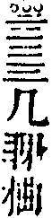
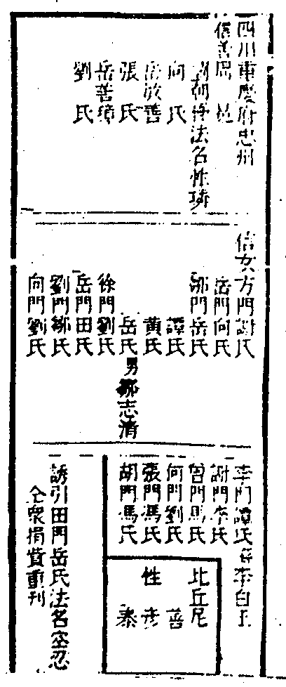
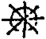
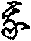

# 庆忠铁壁机禅师语录



> **藏经**：嘉兴大藏经（新文丰版）（嘉兴藏）　**册次** 第 29 册（J29）　**编号** JB241　**部类** 诸宗部　**卷次** 20 卷　**篇幅** 209,031 字

> **卷／品**：0 卷 · 4 品



---



## 目录



  - [铁壁机大师语录序](#铁壁机大师语录序)

  - [序](#序)

  - [附江西丰城月崖熊公佛花纪序](#附江西丰城月崖熊公佛花纪序)

  - [庆忠机和尚年谱序](#庆忠机和尚年谱序)



---



### 铁壁机大师语录序



聚云以嵩山之髓作波，而平山大师得聚云之髓▆也。负纵横之才，迅箭锋之用，门庭孤峻，行履端严，如壁▆万仞，即当代诸老宿当为吐舌，岂纷纷野狐见解所敢张喙於侧耶？继往开来，举聚云中兴大慧之灯传於未艾，临济正宗其在兹而益振矣。余憾不及见聚云，惟瓣香以事平山为师承一脉，天下后世知余具赤肩，不为盲引所惑也。



崇祯壬午秋九日，庐山千丈崖头陀弟子熊汝学稽首和南谨识。



铁壁机禅师语录引



宗门语句，有遮有表，随表随遮，随遮随表。遮何以故？原无言说故；表何以故？私通一线故；表随遮何以故？使人自悟故；遮随表何以故？发人疑情故。祖庭秋晚，波旬议横，语录盛行，未摸宗旨，以为遮则呕尽心脾，以为表则茫无消息，一盲众盲，识法者惧。铁壁禅师生来异相庄严，静里光明莫揜，入聚云之室，盖以有年，接大慧之传，尽得其髓，入廛垂手，说法利生，语录数卷，表表遮遮，遮则密在汝边，表则堂堂共睹，捧读再四，忍俊不禁，特拈络索，以俟同志。古德云：「颜色规模恰似真，人前拈弄越光新，及乎入火重烹炼，到▆终归是假银。」又云：「学道如钻火，逢烟切莫休，直待▆星现，归家始到头。」试以遮表二则为炉，以目为火，以一时别语录与师语录从中煆炼，然后知师在火焰上说法，我等听法，於表处见火，遮处逢烟也。虽然，且道那句是遮？那句是表？



赐进士出身吏部尚书郎前紫薇舍人今菩萨戒弟子古戎秉素道人牟道行弘悟稽首谨识



庆忠铁壁机禅师语录　目录



------



### 序



卷一上堂



卷二上堂



卷三秉拂  

普说  

小参



卷四示众  

茶话



卷五法语



卷六机缘  

问答



卷七鞭策语  

佛事  

像赞  

自赞



卷八诗



卷九颂



卷十偈  

联芳  

歌  

铭



卷十一颂古  

拈  

别  

评  

徵  

代



卷十二颂古  

拈  

别  

评  

徵  

代



卷十三颂古  

拈  

别  

评  

徵  

代



卷十四颂古  

拈  

别  

评  

徵  

代



卷十五杂著



卷十六书问



卷十七书问



卷十八书问



卷十九书问  

请启



卷二十行状  

塔铭  

祭文  

(附)年谱  

外药病随宜二卷  

庆忠集二卷



庆忠铁壁机禅师语录卷之一



嗣法门人幻敏重编



上堂



崇祯己卯十月望日，缙绅四众等请师开法聚云。拈疏云：「云烟蝌蚪，篆籀彩毫，乃随处无碍大法轮，已被高田众檀越转了。若也未见未闻，且听维那宣读。」读毕，以拄杖击法座云：「须弥卢退位，舜若多潜形，拄杖子无端恶发，一任手疾眼亲。」遂升座。拈香云：「此瓣香辉天鉴地，彻古通今，息裹真空，凝成幻有，𦶟向炉中，供养诸佛诸祖、天下大和尚。此瓣香首出众类，萃拔群伦，有情全仗生成，天地以之赞化，𦶟向炉中，奉祝当今皇帝万岁。此瓣香补衮调羹，盐梅鼎沸，在隐在显，为金为汤，𦶟向炉中，奉为满朝文武、阖国公卿、护法宰官、建寺檀越。此瓣香一枝挺秀，三聚粹精，无动无摇，根深蒂固，𦶟向炉中，供养朝阳堂上月明师翁，用酬戒法。此瓣香神出鬼没，气辣烟腥，硬似风云，软如金石，𦶟向炉中，供养传灵山道脉六十二世上吹下万大和尚，用酬法乳。」敛衣就座。维那白椎云：「法筵龙象众，当观第一义。」师云：「方丈已出了，座已登了，香已拈了，还要观甚麼第一义？且向第二头著眼。」竖拂子云：「三世诸佛也不识，汝等还会麼？汝等既未会，山僧唤作甚麼？若无，山僧唤作底，怎知汝等未会？若无，汝等未会，怎知三世诸佛不识？三世诸佛为汝等出世，山僧为三世诸佛出世，更有为山僧出世者麼？速道！速道！」一僧出云：「踏破梅梢月，休云火炼丹。」师云：「撞木钟。」进云：「踏破了也。」师云：「撞木钟。」僧归众，师云：「撞木钟。」乃云：「聚云新木钟，扣击得玲珑，千圣齐掩耳，雪火一𬬻红。若是伶俐衲僧，自具一副快便手脚，才见宗师眼目定动，早已错过了也。所以，下雨地必滑，天晴日光达，喝中宾主，棒下纵夺，敲骨取髓，痛下针锥，玄节要关，拈一放一，谨严高古，细密简明，末后转身，异类亲切，只得葫芦苕帚，四方八面一场打哄。且道：如何是即今为人处？有意掩罏还点雪，无心张弩更开弓。」复举：「黄檗往江西见马大师，大师已迁化，适百丈为大师庐墓，檗向前作礼云：『某甲特来见马大师，不期无缘，望和尚将从前参大师机缘举似一两则。』丈遂举：『一日，再参马祖，祖见丈来，遂取拂子竖起，丈云：「即此用？离此用？」祖挂拂子於旧处，良久云：「你已后开两片皮为人，又作麼生？」丈亦取拂子竖起，祖云：「即此用？离此用？」丈亦挂拂子於旧处，祖震威一喝，丈直得三日耳聋。』黄檗闻举，不觉吐舌。」师云：「今日山僧为先师庐墓，汝等既欲山僧开两片皮，亦举则参先师底机缘与汝等，汝等若不吐舌，也是铁打心肝。」喝一喝。维那再白云：「谛观法王法，法王法如是。」下座。



聚云老人尽九，上堂。「阳九阴六，家给人足。阴六阳九，直须知有。九九已尽，衲僧鼻孔本正。兹乃先师尽九，兼是山僧贱辰。生死从来不相干，且自因斋庆赞。」



上堂。以拄杖打圆相，云：「天上星辰日月。」卓拄杖，云：「地下走飞鱼鳖。」横按拄杖，云：「佛法不用商量。」竖起拄杖，云：「一任衲僧扪摸。珍重！诸人好承当，莫把称锤唤作铁。不唤作铁，且道唤作甚麼？」



高、田二府夫人请上堂。举：「秦国夫人计法真，力究狗子无佛性话，倏尔洞然无滞，作偈呈慧祖云：『逐日看经文，如逢旧识人，莫言频有碍，一举一回新。』所以道：是法平等，无有高下。献珠记八岁龙女，掷刀可千数屠儿，人人鼻直眼横，个个顶天立地，古今无异，凡圣岂殊？只为不究目前，因之种类各别。」竖拂子，云：「还见麼？」喝一喝，云：「还闻麼？见得的，声香味触常三昧；闻得底，明月影临千涧水。」复击禅床，云：「今日不宜错下注脚。」



上堂。「一棒一条痕，久雨复还晴；一掴一掌血，凄风惊落叶。须弥顶上著锥子，海底波斯痛不彻。到此方知世界宽，珊瑚枝枝撑著月。」



上堂。问：「如何是生死不相干之处？」师云：「孤城小市，十字街前。」「如何是鬼神觑不破之机？」师云：「还见座上麼？」「行到水穷山尽处何如？」师云：「看你作麼下脚？」「如何是百尺竿头？」师云：「险。」「进步后如何？」师云：「普。」僧礼拜。师乃云：「鬼神觑不破，还归破灶堕；生死不相干，到底是瞒顸。水穷山已尽，未是大究竟；百尺竿头人，不见百花春。如上闲言长语，若到庆忠门下，一句也用不著。何以故？我王库内无如是刀。」



净信诞期，请上堂。「虚空皮打皱，海底复生花。分明只在面门上，几个逢渠几个差？急著眼，漫咨嗟，伶俜衣下有光霞。光霞透绀目，澄清浑宇宙。今日当阳用得亲，是名极乐无量寿。」以手作接引势，云：「南无三界大师。」



谢事椽书请上堂。举：「文远侍赵州行次，州曰：『这里造得个巡舖。』文远云：『把公验来。』州与一掴，远曰：『公验分明过。』这文远厮儿，只解硬处拖锹。若是庆忠，还他一掴时，但云：『夹带未许，常利不用。』庶得公私两全。恁麼告报，设有人问：『请和尚说佛法，因甚纯举王法？』但向道：『佛法王法原非两案，不是照详便是照验。』右仰众等通知，一应帖票契文，须凭上裁判断。今日谢事椽书设供，诸人不许向前问话。何故？乡下有田宜早种，衙门无事莫频来。」



佛成道日，上堂。「未离兜率，已降王宫；未出母胎，度人已毕。一点明星是瞒顸，庆喜徒劳重添屑。」卓拄杖，云：「逢人不得错举。」复举：「聚云老人上堂云：『出众者三十棒，不出众者三十棒，出众不出众三十棒。』可惜当时座下没有伶俐衲僧，只得道个：『直下三玄已露，何曾三要无施？落花流水空去，殿前古柏当机。』若是山僧在时值恁麼道，但作礼三拜看，又如何折合？」



出队归，上堂。拈拂子作摇鞀鼓势，云：「𨍏轹轹，轹辊辊，不是胭脂不是粉。」以拄杖横肩，云：「上一山。」放下拄杖，云：「下一岭。」横按拄杖，云：「十字街前好合本。有麼？有麼？」僧出，师便喝。僧云：「某甲话也未问，因甚就喝？」师云：「交易头上有火。」进云：「请再道。」师云：「人情送只马，买卖不饶针，日无生活计，任是斗量金。冬冬。」



上堂。僧问：「如何是如来禅？」师云：「问这话作甚麼？」「如何是祖师禅？」师云：「问这话作甚麼？」「如何是超佛越祖禅？」师云：「问这话作甚麼？」「如何是芍药花开菩萨面？」师云：「三门前四个五个。」「如何是棕榈叶散夜叉头？」师云：「殿后边七双八双。」问：「福足慧足时如何？」师云：「指上南山翠，袖里东海深。」问：「今日设供，善女与凌行婆是同是别？」师云：「是同是别？」进云：「恁麼则与拄杖子同门出入也。」师喝一喝，僧礼拜，师云：「可惜许。」便下座。



元旦，上堂。「谚语云：『立过春，渐渐温。』庆忠道：『遇元日，渐渐吉。』渐渐温且置，渐渐吉又作麼生？弓抛剑弃狼烟息，海晏河清乐太平。」僧问：「双竹显聚云之兆，嫩桂光普觉之风。如何是的扬慧祖宗乘一句？」师云：迟日「江山丽。」进云：「四百年来事，今朝令转新。」师云：「春风花草香。」



刘成玉脱白，请上堂。「这个无可名，许他寄名；这个不可白，许他脱白。具得这般手眼，任运歌舞成拍。」良久，云：「岭前松，岭后竹，飞花片片成珂玉，玲珑琬琰出珠林，南岫东溟山海足。待价珍，连城璧，相随来也承谁力？」击禅床，云：「记取，记取。」



上堂。「天上月正圆，人间号月半，烟火壮花飞，锣鼓声相乱。不道定制九旬，何拘三月为限？更有长明不夜光，大家著眼齐观看。」



上堂。问：「如何是离心性法界？」师云：「金风催叶落。」「如何是即理事法界？」师云：「黄花灿晚秋。」僧拍掌，云：「这是甚麼法界？」师云：「要会前句则易，要会后句则难。」僧便喝，师亦喝，僧复喝，师乃云：「生也，生也，行人颦蹙；灭也，灭也，野老讴歌。堂头既云入灭，即今如何庆生？莫是求生本自无生耶？错。莫是未灭何曾暂灭耶？错。若会得这两错，一任说理、说事，可中更无两头；论性、论心，个里全无滞搭。横施逆用，倒弄颠拈，未为分外。」蓦竖拂子，云：「水牯牛来也。」



上堂。「天上十九八七六，地下五四三二一。东家壁上耕田，西家灶里种地。虾蟆脚板辽天，蟭螟眼里闹市。恁麼告报，切勿委悉。若不委悉，问取观音大士。」



中秋说戒，兼与成都居士披剃，上堂。喝一喝，云：「还委悉麼？若也知委，参学事毕；脱或未然，且向唯心处荐取。抛弃家园也是唯心，辞亲割爱也是唯心，断除须发也是唯心，投师学道也是唯心，披五条、七条、二十五条也是唯心，从兹梵行具足，在在光明，时时皎洁。所以道：『吾心似秋月，光明真皎洁，无物堪比伦，教我如何说？』摄律仪戒，诸恶莫作，吾誓不为汝说；摄善法戒，众善奉行，吾誓不为汝说；饶益有情戒，普度一切众生，吾誓不为汝说。除是不说外，一齐付汝等，汝等应受持。」



辞众，上堂。「临行一句分明在，拄杖头边别有天，此是吾家真宗旨，珍重诸人莫妄传。」



师受请，住酆都平都山地藏寺。



三门



「古人到院，动辄引个门字。庆忠到院，全无忌讳，只要脚跟点地，随我进来。」



佛殿



「巍巍堂堂，磊磊落落，礼拜亦得；巍巍堂堂，磊磊落落，不礼拜亦得。今日新地藏到来，礼拜底是？不礼拜底是？」良久，云：「礼则彼此恭敬，不礼各自称尊。」



祖师殿



「拈花会上赤胡须，棒喝堂中没巴鼻。但有干木尽随身，逢著场来还作戏。前三三，后三三，俱向这里来。如一不到，三十拄杖。」



伽蓝



「青莲白社，鬼没神出。至愿未完，这里且住。」卓拄杖，云：「珍重，珍重。」



三教堂



举：「傅大士头顶道冠，身披袈裟，足穿儒履，谒梁武帝。帝问曰：『大士是道耶？』士提起袈裟。『大士是佛耶？』士翘一足。『大士是儒耶？』士以手指道冠。这大士用心不臧，直令佛心天子分疏不下。若是庆忠则不然，唤作道亦得，唤作儒亦得，唤作释亦得。」



方丈



「周围百寸，前后十尺。魔外潜形，佛祖难觑。中间有个独尊，道是衲僧巴鼻。」喝一喝。



上堂。拈疏云：「离形绝相，文彩全彰，字黑纸红，点畫不露，维那试道看。」顾法座云：「十方无壁落，四面亦无门，踏过空王殿，毗卢顶上行。」遂升。拈香祝圣毕，次拈云：「此瓣香精英赫奕，显发有时，不自空来，岂从有得？𦶟向炉中，供养上吹下万先师大和尚，用酬法乳。」就坐。维那白槌。乃云：「无上妙道，迥绝言诠，但有传宣，俱为戏论。山僧即今事不获已，只得向古人边举似昔日地藏云：『众生度尽，方证菩提，地狱未空，誓不成佛。』新地藏则不然，众生未度，已证菩提；地狱本空，誓必成佛。设有个汉出来云：『佛之一字，吾不喜闻。』但向道：『有水皆含月，无山不带云。』」再白椎，师下座。



沈子佩孝廉请上堂。问：「子佩居士名奕玮，且道父母未生前名甚麼？」师云：「山青水绿。」进云：「这个与居士相去多少？」师云：「月白风清。」僧礼拜，师乃云：「秖这是，是甚麼？千言万言言不出，千行万行踏不著。若果踏得著，平山何难举趾？若果言得出，平山何难道破？岂但平山，即诸佛诸祖、古今贤圣亦难踏著、亦难道破。子佩居士自青云得路后，欲追丹霞、嬾庵之步，溯水西上得觏平山，复自峨眉而转觅从派於山野。虽然，佛法无多子，久长难得人。倘日后果能踏著道破，不妨出平山一头去。」



上堂。问：「某向偏位中来，请师向正位中接。」师喝云：「是偏？是正？」进云：「岂无方便？」师便打。问：「如何是大修行人安身处？」师云：「野寺含青霭。」进云：「还有趣向处麼？」师云：「长江泛白波。」乃云：「言发非声。」喝一喝，云：「唤作声得麼？色前不物。」竖拂子，云：「唤作色得麼？言发非声，有照有用；色前不物，为实为权？照用权实，宾主历然，恁麼分明简辨，一任举似诸方。」



上堂。「西来直指大意，顾鉴频频举似。佛印面上两行，如来胸前卍字。举起也，毗卢丧其全身。放下也，普贤失其本事。不举不放又作麼生？说似一物即不中。」



说戒，上堂。「头上是天，脚下是地，棒打石人头，嚗嚗论实事。两头不管，中间不系，释迦、弥勒、观音、势至，行藏虚实自家知，一句了然超百亿。」顾大众，云：「且道是那一句𫆏？」



上堂。「说理说事，缠脚缚手；论教论宗，钵外生涯。归燕何须钩帘？出蝇岂在穴纸？真语者，实语者，若是好秀才，会用之乎也？」



上堂。横按拄杖，云：「惯弄灵蛇之势，赫赫万层；活捉生马之威，昂昂千里。撒漫天网，打称意鱼；放破空矢，落冲霄鹤。点即不到，到即不点。正恁麼时，且问是谁家风月？」僧竞出，师下座，以拄杖一时打散。



上堂。竖拂子，云：「会麼？长者长法身，短者短法身，拾金还是窖金人，夜来混沌颠落地，万象森罗总不经。上大人，可知礼，妙湛总持不动尊，佛祖位中留不住，一脚踏翻明月村。谇！大吉利。」



上堂。「今日月中十五，集众上堂打鼓。甘草不别黄连，牛肝岂异马肚？一生惯住娑婆，不愿超佛越祖。」复喝一喝，云：「观音妙智力，能救世间苦。」



净信祈嗣，请上堂。问：「如何是宾中宾？」师云：「虚空呈宝剑。」「如何是宾中主？」师云：「陆地淹孤舟。」「如何是主中宾？」师云：「山僧有分。」「如何是主中主？」师云：「阇黎无分。」乃云：「若说有法，明明历历；若说无法，澄澄寂寂；若说亦有亦无法，非非是是。毕竟如何？」竖拂子，云：「拂子别行一路去也，应如是长寿、如是富饶、如是果位、如是男女。」放下拂子，云：「收卷餘怀无一事，他年满眼庆三多。」



解制，上堂。「十五日已前有法说，十五日已后无法说。有法说也，海晏河清；无法说也，乾坤失色。海晏河清，乾坤失色，要识一贯，两个五百。正当十五日，当阳迥铁壁，更请问如何？通身手眼具。结制四月期已圆，放开一路何拘系？」复举：「洞山宝镜三昧云：『臣奉於君，子顺於父，不顺非孝，不奉非辅，潜行密用，如愚若▆，但能相续，名主中主。』」师云：「所谓主者，有天下之主、有一国之主、有一家之主、有一司之主，如我宣慰檀越自割土分茅来，其勤王事每立奇勋，兹因后主马万年嗣职，特令寿山、古云二座到山尊崇檀度，为求带砺悠长，是善能相续者也。相续之义毕竟如何？十影不劳鞭策力，万年丰境乐无虞。」



上堂。「匝地红轮辉宇宙，十方无土亦无心。山僧不是轻饶舌，扑碎虚空没点痕。」



上堂。竖拂子，云：「牛头没，马头回，凄风惊落叶，爱日暖林辉。惟有衲僧没四序，随缘普化一声雷。」喝一喝。



师受都宪文苇庵同兄孺白、司李陈蝶庵令子六符，暨阖郡绅衿请，住涪州吟翁寺入院。



佛殿



「觌面巍巍若可为，吟翁寺里正来归，桓因插草今何在？惟有迦文动地辉。」即於是日上堂。拈疏，云：「有文句，名说通；无文句，名宗通。且道：这个是说？是宗？是有？是无？者些且置，欲识向上关头，但看下脚一步。」维那宣疏，师遂升座。拈香，云：「此一瓣香，慈烟永结，悲焰常明，净秽不分其馨，异同岂别其味？今则第三番拈出，𦶟向炉中，普申供养。伏愿一人行健，万国宁界，地敝丰城之境；汗马御调，狼烟息河，江濬觉海之波。造庐命锡自天来，击壤歌谣从野至，老稚存亡获益，农工商贾安饶。慧命传不尽之灯，人天乐无穷之庆。」就座。维那白槌竟。僧问：「宗通、说通且置，如何是向上一路？」师云：「快马跨金鞭。」进云：「坐断报化佛头，凭谁利生接物？」师云：「虚空眉满地。」进云：「始信路遥知马力，日久见人心。」师云：「衣冠束带正当时。」问：「黄时灵山演教，今日吟翁说法，是同？是别？」师云：「月照鉴湖飞琥珀。」进云：「如何是拈花大意？」师云：「风临黔水闪鳞龙。」问：「牙如金爪，口似血盆，吞佛噉祖的来时，和尚作麼生接？」师震威一喝。进云：「良医三十载，毒杀许多人。」师云：「伤著也。」乃云：「法幢才展，未许带水拖泥；利济初行，那堪丝来线去？不见睦州凡遇僧来，便云：『现成公案。』如何是现成公案𫆏？雪到青山云不老，风来绿竹向笙簧，更听同乡一曲，多年不作枌榆梦，六甲神符急如火，翩翩栩栩飞上天，谁是庄周谁是我？啰啰哩，喜相逢，仰高俯就两人龙，法门何幸瞻五柳，相将携手过灵峰。」掷拂子，喝一喝。再白槌，下座。



六符陈文学，法名灯谱，请上堂。问：「儒释门庭角立，如何是兼济路头？」师以拂子向空划一畫，云：「见麼？」进云：「恁麼则桂林藏狮子，法海起狞龙。」师云：「不是过去。」问：「断臂酬雪岭，解带镇金山，当时得个甚麼？」师亦以拂子向空划一畫，云：「见麼？」进云：「有个没量大人，不断不解，还得也未？」师云：「不是过去。」僧礼拜。师又以拂子向空划一畫，云：「吾有一字之关，福全、慧全、寿全，不独文经武纬，兼之虎啸龙旋，既为是父是子，且有兄难弟难，龙神八部生喜，贤圣佛祖成欢，出世能超九万，入世可化三千。是甚麼字恁般奇特？」顾视左右，云：「普。」



上堂。以拄杖作把钓势，云：「短杖蓑衣意气浓，垂钓溪畔有芙蓉，嫩云西岫东拖水，小竹横烟顺接风。洙泗泗州原不异，浮杯杯渡一般同，游鳞宁向直中饵，莫负抛纶海上翁。」道者出，师云：「是僧？是俗？」进云：「庄生不觉为蝴蝶，苏子空拟作比丘。」师云：「云从龙，风从虎，圣人作而万物睹。本乎天者亲上，上律天时；本乎地者亲下，下袭水土。土能生金，金主三六九，九九八十一，一归何处？」卓拄杖，云：「苏𠰷㗭哩娑婆诃。」



上堂。「说玄说要，滴水难消，拈提因缘，顺应时节。昨半偈居士预呈问道一颂，『四十年来未暇游』，只愁脚跟欠稳，『欲参宗印到溪头』，有疑不妨问来，『传心负笈三更蚤』，明眼人瞒不得，『透顶玄机一句抽』，那一句是透顶玄机？请居士出来道看。若是道得出，山僧性命在半偈手里。」居士向前作礼，云：「木落水寒人老发。」师呵呵，下座。



五果山静主请上堂。「佛说五果四向，不在人间天上，而今铁面斩新，更请单刀直上。有麼？有麼？」蝶庵居士出，师便喝，士云：「此一喝有多少重？」师以拄杖作秤势，士拂袖归，师下座。



上堂。良久，云：「唤作清净法身，错过了也。」喝一喝，云：「唤作圆满报身，错过了也。」目顾四方，手指上下，云：「唤作千百亿化身，错过了也。毕竟如何？错、错、错。」



上堂。维那白椎，师云：「今日太说多了。」便下座。



元旦，上堂。「『月白风轻处，尧天舜日新；苍崖悬碧蒂，幽谷隐寒津。虚室生光燄，长空绝幻云；雨滋兰竹茂，石映斗星横。伏虎山头啸，潜龙水内声；乾坤踏破后，大地吼雷音。』此吹万先师住朱提山朝阳洞语也。试问：这乾坤作麼生踏？」顿足一下。「还见麼？这雷音又如何吼？」喝一喝。「还闻麼？若也闻见，分明借婆帔子拜婆年，和气温风遍天下；脱或未尔，惟祝皇图标有道，同瞻佛日照无穷。」



上堂。举：「南泉云：『王老师自小养一头水牯牛，拟向溪东牧，不免犯他国王水草；拟向溪西牧，不免犯他国王水草。不如随分纳些些，总不得见。』恁麼说话，大似掩耳偷铃。山僧却不然，青牛对白牛，江水向中流，若问其间意，起眼看孤舟。且道与王老师相去多少？」



上堂。「柳絮走毛毬，梨花飞蛱蝶。脑后抽獠牙，秤锤浑身血。东海正扬声，南山喜不彻。此语若大行，莫谓是予说。」



闻慈母王孺人谢世，上堂。「去去实不去，途中须善为；来来实不来，路上莫亏为。如我慈母胎教恩深，卜居德厚，唤作亏为得麼？两次割股救夫，长年持斋奉佛，唤作亏为得麼？及至世乱莫容，乘时先退，唤作亏为得麼？」竖拂子，云：「途中路上莫商量，来去惟乘斯愿长，斯愿既乘无来去，无来来去自平常。」



上堂。「乌龟向火，乃劫前未兆之机；碓嘴开花，实教外别传之旨。露迥迥，山明水秀；孤灿灿，日往月来。庭前柏子正呈机，座后桃花已映色。正恁麼时，是谁家曲调？」卓拄杖，云：「止止不须说，我法妙难思。」



上堂：「天上无弥勒，地下无弥勒；日出满山红，芦开两岸白。苇渡碧眼僧，花拈黄面客；撞著石波斯，几个知恩德？」击禅床一下。



启藏，上堂。「以字不成以，八字未是八，金钩解辽天，二人左右挂，佛祖不敢前，三藏居其下。且道是甚麼字这奇特？」以拂子作火，云：「若人识得，参学事毕。」



> (敕建南海普陀山法雨禅寺嗣法孙别庵，  

> 统捐衣赀四十两，重刊，  

> 铁祖语录十卷。



> 嘉兴楞严十经坊（夏维宁、倪尔绳）刻。)



庆忠铁壁机禅师语录卷之一终



庆忠铁壁机禅师语录卷之二



嗣法门人幻敏重编



上堂



师受请住石砫三教寺，入院。



三门。「谓是孔圣之门，不见数仞垣墙；谓是老氏之门，又无虚无妙徼；谓是释迦之门，妙庄严路何有？但进一步，无拘彼此。」



接引殿。「朝往西天，暮还东土，天上人间称无住。是即是，也须大家出只手。」



三清殿。「圆陀咜，光灼灼，无端头上添只角。谓是三清，便有五浊。白发红颜，且喜淖约。」叩齿云：「吾奉太上老君急急如律令敕。」



玉皇殿。举：「帝释同世尊行次，世尊云：『此处好建梵刹。』帝释拈一茎草插地，云：『建梵刹竟。』这释提桓因也解插草为标，修造极易，因甚七贤女觅无阴阳地却又罔措？须知有末后一著。快参，快参。」



藏经殿。举：「黄檗礼佛次，宣宗皇帝问云：『不著佛求，不著法求，不著僧求，礼拜当何所求？』檗云：『不著佛求，不著法求，不著僧求，常礼如是。』还识如是麼？」遂展具三拜。



方丈。「据此室，行此令，妖氛野怪齐追摈。山僧但主於斯，一任阅经看律谈论。」



上堂。拈香，云：「者瓣香恭祝今上皇帝圣躬万岁，万岁，万万岁。伏愿御金轮而建极，坐宝位以临民，庆集一人，咸宁万汇。者瓣香奉为台爵勋贵，伏愿文经武纬，戛玉铿金，义胆忠肠，为霖为雨。者瓣香专为大宣慰司主，伏愿挽天福寿，山无量，海无量，善来贵祚，前三三，后三三。者瓣香名不得，状不得，常在动用中，动用中不识，今日四番拈出，敬为传灵山道脉，六十二世上吹下万先师，用酬法乳。」维那白椎：「法筵龙象众，当观第一义。」师云：「辞却青山顶，缓步过松林，漫将三藏义，转出太平春。古德云：『太平治业无象，野老家风最淳，只管村歌社饮，那知舜德尧仁？』新三教者里则不然，畏天命，畏大人，畏圣人言。何故？天视自我民视，天听自我民听。」再白椎，师下座。



佛成道日，铸释迦像，上堂。「红炉飞玉片，雪火正投机，此日无今昔，咸言成道时。正恁麼时，莫是泥塑木雕成道耶？莫是铜铸铁写成道耶？莫是笔图纸畫成道耶？」喝一喝，云：「龙蛇易辩，衲子难瞒。」



阅藏，上堂。三空问：「布施退妖孽之星，供养获人天之福，此外还有得底分也无？」师云：「快马系孤舟。」曰：「座上不劳频拈出，赵州犹剩下禅床」。师云：「曹溪有路人皆到，梅岭谁能得熟来？」曰：「今日却被不肖儿孙检点。」师便打，乃云：「门墙桃李正芬芳，两岸摇金柳线黄，天上团𪢮人间半，始知圆满是道场。」复举：「西堂智藏、百丈怀海、南泉普愿侍马祖玩月次，祖曰：『正恁麼时如何？』西堂云：『大好看经。』百丈云：『大好供养。』南泉拂袖便行。祖云：『经入藏，禅归海，唯有普愿独超物外。』且道现前众等又作麼生？」



阅藏，上堂。顾视左右云：「是法住法位。」良久，云：「还见麼？汝等经师、论师、律师各各商量，与山僧全没干涉。」



太保秦良玉供法衣，上堂。师捧衣，云：「只者个，灵山会上唤作正法眼藏，山僧手中唤作金襕袈裟，秦太保、忠贞侯唤作保境护生，庆餘福远。何以故？愿弘不了灵山嘱，同归界海作梯航。」



上堂。三目和尚出，师便喝，目云：「者一句不消答得。」师云：「别来已久，几乎错过。」目拂袖归众。眉山首座云：「万寿象王与南宾狮子斗额，和尚见麼？」师云：「白云影里快乘舟。」座云：「适闻击鼓𨁝跳上某甲掌中，遏捺不住，和尚大须仔细。」师云：「善问不如善答。」座以坐具返掷，师云：「作家，作家。」座云：「莫瞒顸好。」师掷下拂子，乃云：「祖师心印状似须弥，论义拟去千里万里，向上之机还同大虫戴角，看来好笑惊人。即如我檀越忠贞侯独步坤维，补天接日，舍识之后向那里安著？峭崖居士祭祖追先，俎豆陈时对何处瞻依？只者些子乃万应灵丹，阿谁无分？左右逢原，满眼满耳，入世烈烈轰轰，出世洒洒脱脱。」蓦竖拂子：「没量大人来也。且道即今还有知恩报恩分也无？」



峭崖马宣慰迎祖忠贞侯真容於观音庵，请上堂。师卓拄杖云：「庚寅闰冬十五，观音庵前打鼓，不独妙应圆通，特地超佛越祖。正恁麼时，且作麼生举唱？」良久，云：「坤维独步，用世行乾，侯锡忠贞，餘复何言？伏惟尊重。」



上堂。「举一不得举二，依旧从头起。当观犹非正观，贞下又启元。三四五六七，去岁今朝今日去。七六五四三，新年年是旧年年。牛头没，马头回。迟日暖，动地辉。世间多少闲四序，此心能有几人知。」喝一喝。



修侍者为巴掌和尚百期，请上堂。「雪似杨花落，谁作无米炊？沙界浑成饭，又见日轮晖。净法界身，本无出没。大悲愿力，示现受生。既为善知识，何辱何荣？有缘则住，缘尽则行。以大圆觉为伽蓝，以世界海作舍宅。人是北人，贼是南贼。熊耳庵中著忙，瑞光洞里藏拙。冤遭儿孙不容，却来洗青卖白。据款结案，又作麼生？十旬三月百二时，反覆元来只者是。」



陈灯本，请上堂。「灯能瞩暗，大觉空界咸在其中；本之则无，十圣三贤那许下脚？肩云荷月，迥脱罗笼；透海穿山，岂涉途径？火不能烧，水不能漂；居常不变，遇险无惊。毕竟承谁恩力？主人公是个铁馒头。」



举首座分席，上堂。「黄面瞿昙拈示，自是桃花贪结子；金色头陀破颜，错教人恨五更风。今日不著便，与伊重打算；节候不相饶，蹉过成疚患。成何等疚患？只为铁老汉口门太宽，除非汝诸人一齐抬举，眉山出来塞却犹较些子。」



上堂。问：「三圣逢人即出，兴化逢人不出，阿那个是？」师云：「觌面相逢不识渠。」进云：「如何是当机一句？」师云：「轻风摇柳线，夜雨冻春寒。」进云：「和尚又作麼生？」师震威一喝。



上堂。「高更高，天在下；厚还厚，地为薄。何物容？虚空窄；何人寿？佛祖灭；何水深？大海竭；何事坚？金刚裂。」



上堂。「灯笼骑佛殿，露柱照三门。僧堂齐合掌，厨库解吹笙。正恁麼时，被山僧脑后一捏，急忙道个誐誐喃哈啰吽。」



马宣慰得后主度僧，请上堂。问：「佛生迦毘国，洪映南宾城，有何记莂？」师云：「桂子月中落，天香云外飘。」进云：「还检点得出麼？」师云：「丁一卓二。」乃云：「一花开，世界起；一子圆，大地收。虚空开口笑，万象齐起舞，法众合掌欢，山僧频频举。还识举底道理麼？音楼玉柱久怀胎，产个男儿果俊哉，不论功勋见尊贵，九重天爵自然来。」



檀越诞期祈嗣，请上堂。问：「太常居士生后姓冉，未生前姓甚麼？」师云：「万古元不老。」进云：「即今皈向大乘，和尚还点化也无？」师云：「一物镇长宁。」进云：「恁麼则与庞居士同门出入去也。」师云：「无须锁子两头摇。」复举：「庞蕴居士父祖游宦，将家赀尽弃湘河，更不瞻前顾后，只道得个『有男也不婚，有女也不嫁，大家团𪢮头，共说无生话。』看者居士虽得一家超脱，也是徐六担板，未契三教为人处。」



佛诞，马宣慰母沈太夫人请上堂。问：「昔城东老母因甚不得见佛？」师云：「高天厚地。」进云：「今南宾夫人何缘得见和尚？」师云：「水绿山青。」进云：「夫人与老母是同？是别？」师卓拄杖。进云：「和尚与如来差别几何？」师亦卓拄杖。僧拂坐具，云：「者个𫆏？」师云：「君方扫雪寻松子，我已开榛得茯苓。」进云：「恁麼恭惟降诞也。」师云：「年年此日，此日年年，昔时者里，东土西天，金盘捧足，九龙吐泉，恁麼恁麼，蠡海驴年，即今及节，应时光耀人天去也。时时佛诞生，刻刻驾象日，子在思亲乡，母居怀男地，啐啄妙同时，子母长相忆，忆则忆於同，同中还有异。子为大孝尊，母则升忉利，浩劫不别离，亘古无来去，来去任相逢，相逢秪者是。且道是何宗旨？举步莲开称悉达，无忧树长号摩耶。」



师受请住云集寺，入院。



三门。「入门便棒，打草惊蛇。入门便喝，无风起浪。即今入云集之门又作麼生？」



佛殿。「秪者是。是甚麼？垒垒落落，黄面跏趺。咄！若唤作佛，则吾岂敢？」



方丈。「三贤魂惊，十圣胆膻。衲僧到此，全没帐算。」喝一喝。



上堂。「南滨钓罢又长溪，戎马无容眨上眉。一曲阳春何处是？就中还有几人知？」喝一喝。



嘱三山上座，上堂。问：「末后一句始到牢关时如何？」师云：「四▆山僧同。」▆曰：「学人不会。」师云：「悟眉号是罗胡子。」乃云：「也大奇，也大奇，末后句，妙难思。汝诸人还见麼？那门外汉不是山僧悄地举，则机缘又怎得进门？听吾偈：全身放下隐山隈，头角才成喜两开，展转由吾相分付，雷轰电掣出潜来。」



檀越建圆通会，请上堂。「吹法螺，击法鼓，大神欢，小鬼舞。应供尊者眉毫长，面然大士眼光普。人天之田久硗确，谓是箜篌是音乐。有漏笊篱，无漏木杓。稽首皈依，净智妙圆。多多拜上，油蜡纸火。」



师诞期，请上堂。「山僧行年五十，看看有些健气，脚板不会谈禅，眉毛无甚妙义，都卢举似无生，无生又居学地，拂子与我齐年，我长拂子一岁。」蓦竖拂子，云：「唤作拂子却是山僧，唤作山僧却是拂子。毕竟唤作甚麼？六百甲子满一半，今日与伊频打算，相将携手过驴年，果老倒骑𨍏轹钻。」



上堂。「贵买朱砂畫月，打牛打车不别，憎槛欣笼奈何，磨砖作镜争得？凫胫天然不长，截鹤续之则疾。」召大众云：「且道阿腻咤峰今日有几人作舞？」



上堂。「天可载，地可覆，山可浪，水可烈，日可冷，月可热，惟有佛法不可说。设或可说，也是扪钟扪籥。」



到白岩寺，上堂。「逼塞虚空古白岩，三冬凝静翠生苔。到来不是闲游戏，只要诸人眼豁开。」



上堂。「无绳自缚，好肉剜疮；畫地为牢，平空说谎。须是恁麼人，始解恁麼事。」



顺治乙未季冬朔日，师受请住梁山太平山庆忠禅寺。入院。



上堂。「方斗唤作太平山，栖贤一名庆忠寺。知他谁是个中人，大家扶起者巴鼻。」



结制，上堂。卓拄杖，云：「黄檗六十棒，者是那一棒？」喝一喝，云：「临济四喝，者是那一喝？还识者喝麼？立宾立主，为实为权。还识者棒麼？有玄有要，能纵能夺。汝等诸人作麼生会？」喝一喝，卓一卓。



上堂。「年来不欲成多事，竖个拳头也劳力，朝粥午饭信口餐，早眠晏起没瞌睡，云水诸方去去来，西来大意谁相忆？噫！」



上堂。「世界恁麼廓，为甚钟声披七条？三三五五，七七八八，鸟岂是鸾？鹿焉为马？白雪阳春为谁歌？无端畫地之乎也。」喝一喝。「东桃西李，柳花杨花。」



上堂。「如何是佛？黄面瞿昙无面目。如何是祖？达磨不从印土来。如何是道？家家门前火把子。如何是恒久心？朝更夕改。如何是生灭心？一念万年。设有个旁不肯底出众道：『铁老汉得与麼颠倒。』但拍掌呵呵大笑。」



上堂。「舌头久挂壁上，看来全没算帐。举起也毘卢形潜，放下也普贤胆丧。瓠子湾曲未仁，冬瓜儱侗不像。一目索诃万国州，无生有曲几人唱。」



陈总戎请上堂。「诸佛大道愈行愈远，西来的旨转说转多，直饶不说不行，看来有甚交涉？所以古今尊宿升堂入室，竖指擎拳，执叉张弓，冷棒热喝，正如国家用兵出於万不得已。或学人喝下挑锋，谩藏伏卒；或知识棒头掠战，宽设陷坑。一纵一擒，能杀能活，切忌前吞后挠，犹贵东和北拒。虽然如是，还知祭风台一著麼？」



文文学请上堂。「西来大意如何说？泼水扫地相公来。座下若有读书人，向道吾无隐乎尔。山僧不读书，亦不熟文句。耳之於声也，手之舞之，足之蹈之。颜渊喟然叹：『当仁不让於师。』阿呵呵！见也麼？」喝一喝。「上大人可知礼也。」



文官长请上堂。击禅床，云：「起去。」拂一拂，云：「伺候著。」良久，云：「隙晷偷光杖兔角，星芒射眼拂龟毛，不是山僧行正令，昆仑叫屈舜若逃。」喝一喝，云：「畫公打口鼓。」喝退堂声，下座。



上堂。「天一半，地一半，苏州有，杭州有。打破蔡州城，踢倒黄旛绰。不笑牛首伏羲，则骂孔明诸葛。恶！恶！四时无春夏，一雨便秋冬。」



上堂。「一棒一条痕，一掴一掌血。𥗋𥗋石人头，下下从实说。求空未必空，逃空何曾脱。信口说来不是尘，信脚踏遍清风月。抽身即转谢家村，到口便吞吴人酪。相逢此日尽君欢，匝地红轮山海赤。○」



郎副戎请上堂。「官斗山，看云起，打鼓山，下白雨。山上有僧云鹤随，境中无事将军喜。狼烟息，村歌舞，冬至寒食一百五。」卓拄杖一下。



上堂。呵呵笑云：「向上一路，千圣不传。」问：「今日邓居士皈依座下，和尚还传麼？」师云：「传。」进云：「因甚又传？」师云：「我不同千圣。」



上堂。「石土地不会说禅，看破普愿瞎驴子脚只三只，播弄杨岐；水牯牛胁下书某甲，沩山话堕；土狗子口内觅象牙，赵州有无。李四唼著舌根，血在张三口里。看来看来，真个真个。何以故？一二三四五。」



顺治戊戌佛诞日，师受请住忠州牛首山云岩禅院。



结夏，上堂。「顺风吹，逆风吹，夏日长，燕子归，几处黄鹂树上催？休错过，趁时宜，万里晴空一鹗飞。」复举：「『世尊才出母胎，便一手指天、一手指地』，张乖太甚；『周行七步』，著忙太甚；『云门要一棒打杀』，不平太甚；山僧举似人天众前，扬恶太甚。即今还有旁不肯者麼？」喝一喝，云：「高山流水深深意，自有知音笑点头。」



上堂。「天之高也，奚足高？地之厚也，奚足厚？海之深也，奚足深？空之大也，奚足大？惟有拄杖子，头头越格。」卓一卓，云：「今日郎、向二施主有斋。」



上堂。「主山高，案山低。左青龙，右白虎。年年三百六，月月二十五。逆数顺数，数到牛首山云岩寺大殿里，恰似佛幻三月前鞔底鹿皮鼓。」一喝居士打口鼓，师呵呵大笑。



上堂。「吾宗迥别，有口难说。设或有说，早不中节。如说如行，转不相应。颠颠倒倒，却也恰好。说如是，行如是，元来元来，如是如是。」喝一喝。



上堂。「隔林听枝鸟，话说真个好。不似广南蛮，语音无起倒。」



福田知玄禅德讣至，上堂。「小春才至朔风吹，正是炉烘雪点时。忽听讣音矜冷泪，又闻只履动西思。愁云有晕遮空月，爱日无光暖面眉。传法度迷谁助我？丧予一叹引伤悲。」



顺治辛丑三月廿日，师受向化侯谭公洎本山耆旧等请，住南城山宝圣寺。入院。



上堂。「释迦如来撒土抛沙，又道四十九年无一字；历代祖师牵藤引蔓，岂止千七百则之多？即今人天座上又作麼生？」良久，云：「喜得山僧无口。」



佛成道，上堂。喝一喝，云：「明星出矣，还有共见共闻者麼？」良久，云：「如天普盖，如地普擎，如日普照，如月普明，如海普纳，如空普容，如人如物，如俗如僧，如如不动，如有如无。」复喝一喝：「曙色未分人尽望，及乎天晓也平常。」



元旦，牟总戎祈嗣，请上堂。师以拂子○元正启祚，○乾父坤母，○坎男离女，○鼻祖耳孙。○○。



袁总戎供大衣，上堂。举袈裟云：「此是宝善居士占底便宜，教老僧向甚麼处著？」



牟总戎供大衣，上堂。「活卓卓，影团团，须弥小，芥子宽，无歇脚，没遮拦。」喝一喝，云：「粉碎虚空为条幅，平沉大地总福田。」



师满花甲，上堂。「甲子三百六，看看今日足。过此更如何？满散修斋粥。前三三，后三三，丰干子，归去来。」作接引势。



上堂。「癸卯年，七月秋。雨旸若，登大有。人欢喜，鬼无愁。一枕清闲忘岁月，三杯浊酒度春秋。」



弥陀会，上堂。「多年不相逢，一见懊憾起。我自何来？汝欲何去？四方八面，净秽谁分？九品莲台，浊清顿己。他的咱，我的你，西天老白眉，东土丰干子。」



上堂。「大雪冬至，一年一度；大寒小寒，转盼新年。东家杓柄长，西家杓柄短，龙鳞开夜晏，波斯嚼寒水。鱼把门，虾打鼓，厨前灶后逢白拈，失却一块大豆腐。六六三十六，五五二十五，唵部𡄦穆力陵印兔那麼麼写。」喝一喝，云：「乱统作麼？」



上堂。「黄莺唱，鹁鸠鸣，绿柳岸，白花汀，白花汀上听鹃声。高山流水啼不尽，无端又降释迦文。指天指地太造作，一回举起一回瞋。且道瞋他作甚麼？不见道：事从生处有，人向静中忙。」



上堂。竖拄杖云：「九退一还一十，八退二还一十，七退三还一十。持载譬地，覆帱譬天，譬如北辰，喻之日，喻之月，喻之空，喻之海。啐！是法非算数譬喻之所能解。」



期圆，上堂。蓦拈拄杖云：「竖一竖，家家门首长安路；横一横，两头无路绝中边；卓一卓，任是佛祖也难摸。所以此事千斤不换，父子不传，遇著智人，长揖相送。今日乃侯府谭公同黄、任二参军入山，若为持斋不饮则不与揖；若为表扬胜会则不与揖；若为参求请益则不与揖；唯是挺身向前，放寸天胆，展战儒舌，掀倒禅床，喝散大众，骂得山僧无容身处，山僧则深深与揖。还见麼？虽具一双贫衲手，未尝低揖等闲人。」



苇庵文居士参师归，无病坐脱。讣至，上堂。「苇庵！苇庵！作者般去就，应吃吾三十棒。何以故？早知灯是火，饭熟已多时。」



普贤庵尼本容、梵行师徒请上堂。「昔时观音院，今日普贤庵，明明祖师意，说甚未生前？若见本容即见观音，若会梵行便会普贤。普贤与观音，不即一纤毫、不离一纤毫，不远一纤毫、不近一纤毫，不同一纤毫、不异一纤毫，脚跟由来点地，鼻孔一向辽天，清净自在，万德庄严。还知落处麼？只为分明极，翻今所得迟。」



上堂。举：「中峰和尚自叙行由云：『我乃识量依通，非悟也。还见学解？悟解麼？说个解，早是学也；说个悟，早是迷也。』」



上堂。「觜吧吧说，是名禁口；脚忙忙行，是名禁足；眼睁睁，是名观心；意扰扰，是名入定。会得此数转语，一任把茆盖头，佛也不作。其或未然，且莫造次。」



童真书状写师真，请上堂。「老汉六十餘一，恰被儿孙煎逼。不是纸墨涂抹，便将胭粉沾滞。须发墨里藏针，脸面荷花向日。一身红黄遍体，满座洪钟扣击。只知眼目人天，不觉乌焉马是。说向季哥孟哥，笑倒张三李四。咦！」



慈运山主写师真，请上堂。「平地骨堆，无风起浪。薄舌穷口，吐尺谈丈。说得虚空起舞，万象森罗。一音演唱，冤遭丹青。不仁以幅绫纸，图上六绿五花，倔倔疆疆。」



福城上座写师真，请上堂。「者个和尚，全没算帐。说法不带唇齿，打人岂止百棒。腹中点滴也无，惯好兴波作浪。古去今来，人间天上。」



康熙丙午二月廿日，爵台谭公、郡侯刘公、镇台任公，暨阖郡缙绅、诸山耆旧等，请师重兴忠州治平禅寺。入院。



佛殿基。「地为基址天为椽，四方八面尽阑千。一畫三爻成四柱，扶起大觉作伽蓝。日月星辰照灯火，江湖淮海涌源泉。佛祖定位，鬼神幽潜。」喝一喝。「唤作百无禁忌，庆忠老汉於此开山。」卓拄杖三下。



腊八，上堂。僧问：「治平初创，法席新开，请和尚答话。」师云：「昔时者日，此土西天。」进云：「法不孤起，仗境方生。如何是现前境？」师云：「三间风雨屋，八面芰荷池。」进云：「如何是当机句？」师云：「问得恰好。」乃云：「昔日世尊悟道三叹奇哉！看来此件大事真个奇特，不可以智知、不可以识识，非有心得、非无心通，上智轻意蹉过、下愚蠢蠢难明，是以大道寂寥，知音者鲜。山僧自丁丑於聚云堂上登曲录木弄鬼眼睛，嗣后过东往西、图南适北，横说、竖说，譬说、喻说，尘说、刹说，随宜说、炽然说，不觉闲言空语狼藉成编，或视为绮语、或视为脱空、或视为谲诞、或视为圆滑，任随两谎独一、拿三道三。而今说道治平院里，喜得舌头不出口。」良久，畫○相，云：「植柳溪头空界月，当年曾照旧园林。」



> (普陀嗣法孙性统重刊)



庆忠铁壁机禅师语录卷之二终



庆忠铁壁机禅师语录卷之三



嗣法门人幻敏重编



秉拂



聚云秉拂。卓拄杖，云：「德山！德山！甚处去来？」喝一喝，云：「临济！临济！即今何在？山僧在聚云门下，唯具一双青白眼、两茎硬脚跟、一个宽大底肚子，若论禅道佛法，大似开眼说梦。诸昆仲！无故强拽山僧在曲录木床上，四下眼睁睁，教向那边开口。咄！咄！咄！不如趁方丈老和尚撑便船，乘兴求些利息，未为不可。」以拂子作垂钓势，云：「滑石滩上紫鳞肥，此日登临展钓丝，不知谁慕千斤饵，吞却浑身掣电雷。不用命者相见。」僧才出，师便喝，僧云：「且莫造次。」师云：「既是金鳞，何难破浪？」问：「有个无眼耳鼻舌人来作麼生接？」师作腾跃势。进云：「是甚麼？」师云：「鱼下碧潭当镜跃，凤来青嶂拂屏飞。」僧进语，师云：「者番不是撒乱网、打鳅鳝𫚫虾底，分明向说尚难委悉，何况盖覆将来？等拂子唱个七花八裂底曲儿，轻舟浪漫去也。」乃云：「天上底、地下底、左山底、右岭底、四方八面底，天上底是甚麼山川草木？地下底是甚麼日月星辰？左山底是甚麼僧堂佛殿？右岭底是甚麼厨库三门？四方八面底是甚麼？以拂子作是



相。所以道：金刚圈，栗棘蓬，要伊吞，要伊透。吞得透得，丧身失命；吞不得透不得，丧身失命；透得吞不得，丧身失命；吞得透不得，丧身失命。总恁麼得，丧身失命；总恁麼不得，丧身失命。到此总教皇恩、佛恩普报，亲恩、师恩齐彰，有情、无情庆快平生，若圣、若凡悉沾悉庇。」复喝一喝，云：「还见麼？瓶枝有色开花灿，野磬无声庆寂寥。」



云来陈都阃请秉拂。「独弩单鎗固称好手，埋兵掉斗犹是奇勋，更要冰凌上走马、雪刃里横身，有惯劫寨偷营、生擒活捉者相见。」一僧出，师云：「今日不与你交锋。」僧作礼，师云：「草贼大败。」问：「远闻上座与某甲邻邦，而今觌面相呈，将何管待？」师云：「吃茶去。」进云：「恁麼则庭前桂吐黄金粟，微雨无风色更新。」师云：「你说得是。」僧拟议，师云：「快便难逢。」又僧出，师云：「看箭。」僧拟问，师连喝，僧归众，师乃云：「今年岁次戊寅，安期七月当朔，堂头出队忠南，山僧特为升座。升座且置，特为个甚麼？大众久立，伏惟珍重。」



兴龙元旦说戒秉拂。蔚西堂出云：「不问溪山云月、松竹梅花，大修行人犹不识永字八法，上座描写得麼？」师云：「将纸来。」堂作呈纸势，师以拂子作书字势，云：「新春把笔，元亨贞吉，察地观天，我备万事。如何是我备万事底道理？所以道：我字有三书：一、楷书我，其戈显露，有芟除一切义；二、行书我，其戈潜伏，有安住不动义；三、草书我，其戈浑忘，有变化莫测义。变化莫测是汝等本有慧，安住不动是汝等本有定，芟除一切是汝等本有戒。若是尸罗清净、定慧圆成，自然止紧虚圆、横清顺浊、撇捺畫直、挑剔点钩，飞者飞、走者走、跳者跳、舞者舞，有时露骨浮筋、柳情王态，不犯钝矛软檐、燕尾蝇头；脱或未能，也须从头一二三，顺墨随朱填模子。」堂云：「还我纸来。」师便喝。僧问：「我今把住如何出得？」师云：「始随芳草去。」进云：「我且放行向甚麼处去？」师云：「又逐落花回。」僧喝，师云：「也是混天毬。」乃云：「文不加点，永有八法，点畫分明，三学无▆。今日遇著混天甲子，喜得山僧有赏有罚。」复以拂子划一畫，云：「一笔题过千张纸。」



聚云老人迁化起骨，四众请升座。问：「老人临终偈有朝打三千，意旨如何？」师云：「天上三十六。」进云：「暮打八百，意旨如何？」师云：「地下三十六。」进云：「三千八百是同是别？」师喝一喝。问：「昨夜铁牯牛将和尚灵骨一口吞尽，今日收个甚麼？」师云：「三十年后许汝自肯。」僧便喝，师云：「既无甘露雨，徒劳震旱雷。」问：「不问云来付嘱，聚云开锋，且道人天众前如何与老人出气？」师云：「泪看洒花雨，愁观笼竹烟。」问：「昨夜木上座道：『和尚向驴胎马腹去也。』是否？」师云：「且喜得个相知。」进云：「且道他鼻孔在甚麼处？」师云：「你话也不会。」乃云：「遍界黄金骨，满空紫气云，日来炉焰炯，雨过泪痕新。苍天，苍天。」复笑，云：「呵，呵！笑底是阿谁？哭底是阿谁？谁哭？谁笑？谁去？谁来？谁生？谁灭？生灭去来，毕竟是谁？有时里地盖天，有时沉踪隐迹，佛祖位中他亦不住，理事门前他又不去。不住不去，作麼举似？」喝一喝。复举：「老人住兴龙时，偶觅问答录四册目过，语山僧云：『异日老僧忌辰，不必别设供具，唯以四册子念念就是。』问答录乃山僧平日与老人斗底闲花野草，不觉三十有八段葛藤。犹记问答毕，山僧入方丈云：『者一问请和尚道。』老人大笑，山僧作礼，老人示偈云：『瞿昙阙下几争雄，鼎鼐驱驰未献功，尔来叩我随心快，笔底云烟一笑中。』兹因老人迁化，烟结五彩荷香，可人起骨，得黄金锁子骨三茎，五色坚固舍利无数，诸檀越生大感仰，必欲山僧升于此座，对众表扬。且道表扬一句又作麼生？」良久云：「墓庐一喝耳聋事，纵绁唯求吐舌人。」



普说



东西两序告香，请普说。师良久，云：「分明记得，想不起来。」便归方丈。



普说。「口开神气散，舌动是非生。虽是常言，不妨会得。者几期唯闻堂中浩浩商量，然庆忠门下固不废商量，但不知汝等商量个甚事？也须要得个商量底法子。若商量不得法，便见上单有工夫、下单又没工夫子，堂内有工夫、堂外又没工夫了，静处有工夫、闹处又没工夫了，那能透得那伽常定底道理？古人省悟无定底话头，有见招手即领悟者，有闻哀歌声领会者，有途中当下发明者，有少年闻一语即省者，有老年犹行脚者，有看经闻表、见花击竹、明心悟道者，虽不可一一举说，你看者些老古锥，何曾见他闭著眼睁睁看、跌却足忙忙行、塞住口吧吧说底榜样来？所以道：『平地下跌倒人，死水里浸杀人，太阳焰中藏不得。』者几般病痛，不绊人足跟，便穿人鼻孔、塞人肚皮，闷闷熏熏十年二十年，若不遇端正炉鞲、明眼钳锤，谁能跳得出？却又成黄杨木禅了。故炉鞲不在大小，销铄不拘久暂，只要得到惯煆炼炉里来，那块顽铁没有刚？岂不见大慧老人最初开炉时，止安五十餘人，竟十三人发悟，即教家弹指之超僧祗、不历识阴尽底说话，岂是捏死蛇头、钉桩摇橹、定年限月不变通底笨法子？而今内外有三百餘人昼夜煆炼，山僧不忍诸昆仲被昏散无记、灵灵寂寂捆著，故开方便，教汝等行住时要踏著地、坐卧时要倚著席、吃饭时要咬著米、穿衣时要挂著身、洗净时要摸著鼻孔、屙屎放尿时要解布裈，又如乱石硠里捉鱼相似，粗心轻躁，未审壖穴在何处，到底捉他不得。若是久惯渔人，旅泊为家，别无餘想，浅深汹涌，几番经过，轻舟浪漫，如取故物，著本就市，庆快平生。其奈大众有解活不解死、解死不解活者，有有眼无足、有足无眼者，有头尾俱正，又不知项下铁枷放下放不下、担起担不起者，又怎步得文殊、普贤大人境界去？又怎会得一句具三玄、一玄具三要底宗旨？从前者些病痛，山僧一一被他著首过来，故云：要行三叉路，先问去来人。山僧是何人，擅敢发药？而今不管小肠肝胆肾、大肠脾胃命，单单尝用个海上方子试试来。如前举马师一踏水潦机缘问汝等，汝等皆云：『会得。』山僧徵云：『如何会？』汝等皆云：『举足处就是，受踏处、礼拜处、知痛痒处、开口处都是。』山僧闻之，不觉吐舌。若是如此，岂不埋没水潦、辜负马师去也？忙忙为汝等折转旗鎗，令不可在举足处会、落脚处会、举与未举中间会。毕竟作麼生会？从新起七，逼拶数日，山僧私觑，知汝等纵有猢狲子，也𨁝跳不得，只得耳烧面热，钻头觅缝，讨个下落。一七既终，虽是药医，有缘在起七数者，止得十一人。有进机外，有四人好参禅，故有居士问：『好参禅底是那四人？』山僧不欲直说，但示以偈云：『科发少年第，龙头属老成，聚云场试里，都是者般人。』因思高亭隔江、惠明路彻、湛堂闻表、大慧失袋、高沙弥不登戒坛、赵州八十行脚，何是炉中不多再见？若是者样根信，加以自性宗通，又得师承妙炼，无师智、自然智一齐恶发，从此祖意教意、世法出世法，如执金针刺腐，何得费力？所以未悟要破家散业，既悟当解作活计，常怀亲道，莫怀亲情。然九旬定制、三月安期，都是不得已底权法，只因初修心人如途中行底孩子，苦於难进步，故转行转问家路多少，引者常说不远，壮孩子前进，其实定要到家始休。参禅以初发心为结，大彻悟为解，中间期限乃诳孩子歇场。假如解制后，不顺人情、不装模样，一切平常独行独步，人生敬信，即佛祖欢喜。若稍有失处，便令不智者乘间窃议，谓参禅人尚如此，何况我辈？是名谤毁大乘天然魔子悟了虽是入头，行得始能解脱。慎之！慎之！」



普说。「超生脱死，一著无多，只要当头截断，不被人瞒、不被己瞒，不被理瞒、不被事瞒，不被凡瞒、不被圣瞒，不被佛瞒、不被众生瞒，不被古往今来无明烦恼、贪瞋痴慢、苦乐冤亲等瞒。若遇古往今来无明烦恼、贪瞋痴慢、苦乐冤亲等也截断，佛也截断、众生也截断，凡也截断、圣也截断，理也截断、事也截断，人也截断、己也截断。古德云：『毫厘系念，三途业因。瞥尔情生，万劫羁锁。』圣名凡号，尽是虚声。殊相劣形，皆为幻色。汝欲求之，得无累乎？及其厌之，又成大患。不见僧问赵州：『一物不将来时如何？』州云：『放下著。』僧云：『一物不将来，放下个甚麼？』州云：『放不下，担取去。』今之参禅人，只是不肯於一物不将来处脱然放下。若肯放下，净洒洒没可把，如天普盖，如地普擎，如月普照，如空普纳，茶里饭里，觉来睡去，己还是己、人还是人，理还是理、事还是事，凡还是凡、圣还是圣，佛还是佛、众生还是众生，古往今来无明烦恼、贪瞋痴慢、苦乐冤亲等，还是古往今来无明烦恼、贪瞋痴慢、苦乐冤亲等，不曾减一分毫、不曾增一分毫，不曾同一分毫、不曾异一分毫。故经云：『是法平等，无有高下。』又云：『一切贤圣，皆以无为法而有差别。』既云平等，又差别个甚麼？既有差别，又如何平等？平等差别，若拣辨得出，除非齐到方丈里来，犹较些子。」一僧问：「如何是当头截断一句？」师归方丈。



普说。「三五年已前城市聚落，三五年已后泉石村居，泉石村居静悄悄，城市聚落闹浩浩，闹浩浩底有时静悄悄，静悄悄底有时闹浩浩，静闹两头总不是参学边事。若是真正参学人，发心真实、立志真实、行脚真实、遇人真实、参究真实、证悟真实，乃至出世为人无不真实。若稍不真实则欲速见，小进锐退速之魔乘间而入，便生伎俩云：『今日也如是行、如是坐，明日也如是行、如是坐，乃至年年月月如是行、如是坐，觉没些交涉、没些巴鼻。』一有是见，岂是法器担荷佛祖命脉者哉？所以六祖有五分之香，原非象藏雀卵、沉檀速麝说话，是欲诸人向自己分中打点，若身、若口、若意，如水之清、玉之洁，秋毫无犯，是名得戒香；二六时中行住坐卧，顺逆不关、毁誉不动，若须弥山，是名得定香；一切现前无不明了，胡来现胡、汉来现汉，既不执碍、又不影留，若明镜当台，是名得慧香；若身、若心不取一法，如太虚空，虽不著诸物，不妨诸物於中往来，是名得解脱香；提起即有、放下即无，如笾豆与瑚琏传书、舜若同罔象斗额、木人花鸟开筵，是名得解脱知见香。须知者五分香纵人人具足，然修证则不无、染污即不得也。汝等诸人未据证者直下办取，已据证者直下办取。」复指供烛云：「如来光明藏，历历宇宙间，我今频指示，不可以言宣。」



小参



小参。「昔日，卢行者才至庾岭，惠明大将军追夺其衣；今朝，隐上座未离聚云，参军尹居士施衣供养。虽是施夺不同，却有一般气状。解施底，檀度时开；解夺底，了了非相。施也，施也，将此深心奉尘刹，是则名为报佛恩。夺也，夺也，假饶撞著释迦文，当头难免者一棒。且道：在山僧手中又作麼生？」遂披搭，云：「善哉！解脱服。」



小参。「有问向前，无问退去。若是鼻孔有气底，一闻此语即当掩耳归众。既尔排立两行，未免效长裙新妇又去草里走一回。古人道：『从门入者不是家珍。自己胸襟流出，始能盖天盖地。』山僧道：无门入者不见家珍，遍一切处是个自己，那里许你遮盖？不见临济老人在黄檗会中是个当菜头底小后生，不是黄檗六十痛棒打破疑关，后来争得说玄说要、立宾立主、权实照用、纵夺料拣，一齐屎沸出来，至今没有了底日子。最可喜底是不作葫芦样子见识，所以血脉流长。今汝等必欲山僧开示，秪用一根拄杖子开口打、闭口打，若承当得来，山僧拄杖子一时分付。」



小参。僧问：「三藏经首皆有是[米-木+八]字，昨闻和尚说《楞严经》中圆明照生，所照字乃要紧关头，未审还符此义麼？」师云：「圆明照三字就从者[米-木+八]字出来底，古德拈颂者颇多，其实皆不如我铁壁山下三鬼十二神见得亲切。何谓三鬼𫆏？一、食火啖光鬼，即威音王也须退后三步；二、来往不易鬼，与六凡四圣为上首；三、奈何不得鬼，山僧收他有分。何谓十二神𫆏？一、神震吼，二、神来先，三、神鼓吹，四、神虚光，五、神含育，六、神往复，七、神伏降，八、神纵夺，九、神实坚，十、神和合，十一、双马，十二、潜若。此三鬼十二神是山僧底侍者，要赏也由山僧、要罚也由山僧，放去收来、役使呼唤悉由山僧，只是不可把作泼水饭、烧纸钱底堪待。」僧问：「如何是食火啖光鬼？」师云：「头大尾巴细。」「如何是来往不易鬼？」师云：「眼饱肚中饥。」「如何是奈何不得鬼？」师云：「浑身一条铁。」「作麼生震吼？」师云：「一曲渔歌才堪听，深深深处自然红。」「何物是来先？」师云：「玉体香唇红粉面，等闲颦笑助心寒。」「从何处鼓吹？」师云：「藏身没踪迹，应物惯施为。」「那个是虚光？」师云：「趋炎赴热人皆厌，事到临头不自由。」「含育个甚麼？」师云：「社稷坛中频歌舞。」「往复底是何意旨？」师云：「以八不成体，金钩挂二人。」「如何得伏降去？」师云：「火砖打著连底冻，素马含悲泪满腮。」「纵夺底是何人？」师云：「只见妖梅放，谁知落叶频。」「实坚后如何？」师云：「黄裳元吉，括囊无咎。」「几时才得和合？」师云：「桂轮高挂兔儿肥。」「双马是何形状？」师云：「彭泽茂时非足贵，汾阳一句始知真。」「潜若归于何所？」师云：「关门闭户掩柴扉，家家有透长安道。」僧当下释然。



袁府朴素陈夫人谢世，请对灵小参。师以拄杖指香云：「者炷香安魂定魄，起死回生，寿命无量，永断生死。」复指烛云：「者枝烛照天照地，彻古通今，光明藏中，离诸昏暗。道人於此荐得，则生即无生，灭原非灭，面命耳提，老僧得申其说。犹记数年前曾问道人：『近来念佛耶？参禅耶？』道人答云：『和尚几时至石宝？』老僧云：『还有奇特事否？』道人云：『明日赶场。』据此二转语，虽属平常，具甚深妙义。逮至生缘已尽，道人以意生身礼别老僧，老僧才与麼来，道人又恁麼去也。道人若实证得此段风光的受用，即百千万亿生不曾生，百千万亿死不曾死，去则即便去实不去，来则即便来实不来，秉质赋形不为有，沉踪隐迹不为无。不见道：『闻性空时妙无比，思修顿入三摩地，无缘慈力应群机，明月影临千涧水。』到得者一月千江时节，便可与文殊之智、普贤之行、观音之悲、势至之愿、佛佛之能仁、祖祖之超越，把手共行，无二无二分，无别无断故。分形应类，天上人间，神通游戏，或现大身，或现小身，或尊贵身，或比丘身，分身无量，普度有情，具无量无边不可说不可说之庄严，得无量无边不可说不可说之受用，成无量无边不可说不可说之佛事，证无量无边不可说不可说之道果。还见麼？再听一偈：『道人朴素，信心坚固，一念万年，金刚无住。』」卓拄杖云：「记取，记取。」



小参。「般若因缘，不离福慧因果、生灭涅槃。因福慧而知因果，即生灭以见涅槃。须知因果生灭、福慧涅槃八字，如磁石吸铁，音声传响，感应不爽毫厘，远近不隔一线，岂容造作拟议者哉？不见昨日堂上僧问因中涅槃，便答他因中涅槃；问果上涅槃，便答他果上涅槃。问处不异，答则是同。意中有句，句中有意。意句分明，镜花月水。又僧问截断众流句，便与他连桥渡蚁；问转身末后，即令乐业荣家。又岂晓平地中坑堑，谈笑里戈矛？据实而论，因中涅槃，诸人有分；果上涅槃，诸人无分。连桥渡蚁则可，乐业荣家未然。即如适才所啖馒首、腐角，一举馒首，岂外水面？一言腐角，不离黕浆。馒首、水面、腐角、黕浆不别，而菽麦之义昭然。故僧问因答因，问果答果，问截流转身末后，则答截流转身末后。逢缘是主，遇物即宗，不妨泥水葛藤，神通游戏，但知是者少，昧是者多耳。若论葛藤，穷劫未尽；若论泥水，尽日难乾。尝闻古人道：『识得兵中意，快活过一世。』因甚刘都卫前三十年杀人放火、劫寨偷营，后三十年念佛持斋、供僧利物。前三十年似有用，后三十年似无用？所以世人只知有用之用，不知无用之大用也。且道那里是大用处？庆忠恁麼开示，三千里外有人不肯在。」



小参。喝一喝，云：「唤作喝得耶？」击案一下，云：「唤作棒得耶？既不唤作喝，又不唤作棒，毕竟唤作甚麼？」良久，云：「流水不腐，中枢不蠹，离却语言文字，须知别有商量。不见僧问赵州云：『一物不将来时如何？』州云：『放下著。』僧云：『一物不将来，放下个甚麼？』州云：『放不下，担取去。』诸人若是通身放下，便见平稳；倘放不下，切忌一知半解，遂尔自肯动辙，擎拳竖指，胡打乱喝，麤言厉语，做样粧模，纵饶学得巧妙尖新，十分春色，山僧道未在。古人亦有道：『或擎拳，或竖指，行棒行喝成乖旨。』忽然棒下喝将来，与吾远之又远矣。何以故？只要诸人办一个真实底心、不自欺底心、一念万年底心、久暂不易底心，穿靴拄棍，寸步从实处踏去，久久纯熟。若不得自由自在，山僧大犯诳语。」



小参。「可笑蹉跎惹事翁，苍茫一叶鼓匆匆，东明有日歌初起，还看山花映水红。」召大众，云：「会麼？云去云来，青山不动；物生物长，大地长宁。不动长宁底是定法，去来生长底是不定法，定与不定、不定与定，总未是衲僧巴鼻。」复举：「僧问古德云：『大千俱坏，未审者个坏不坏？』答云：『坏。』僧云：『恁麼则随他去。』答云：『随他去。』又问一古德云：『大千俱坏，未审者个坏不坏？』答云：『不坏。』僧云：『大千俱坏，因何者个不坏？』答云：『为同大千。』坏与不坏且止，要问者个是甚麼？」喝一喝，云：「三生六十劫。」



小参。举：「大鉴和尚云：『说通及心通，如日处虚空，惟传见性法，出世破邪宗。』且道以何为见性法？」良久，云：「还会麼？白云尽处是青山，行人更在青山外。」



小参。「若向有句启问，一切语言是有漏；若向无句启问，所有寂静是二乘；若向智上启问，贼焉何曾趁得贼？若向性上启问，骑牛却笑觅牛人。山僧不欲汝等问有、问无、问智、问性，除是四种不妨问来。若或未然，啼得血流无用处，不如闭口过残年。」



小参。举：「鸟窠道林禅师见秦望山长松盘屈如盖，遂栖止其上。刺史白居易守杭时往谒，师问曰：『禅师住处甚危险。』窠曰：『太守险犹甚。』易曰：『弟子位镇三江，何险之有？』窠曰：『业火相交，识性不停，得非险乎？』易曰：『如何是佛法大意？』窠曰：『诸恶莫作，众善奉行。』易曰：『三岁孩童也解恁麼道。』窠曰：『三岁孩童虽道得，八十老翁行不得。』易作礼。」师云：「善之一字，古人亦曾言之。孔子曰：『积善之家，必有餘庆。』大舜善与人同，禹好善言。白居士何不向三圣处礼拜？若是在能说能行上著脚，又背六祖不思善、不思恶之旨。还识居士见处麼？觅火和烟得，担泉带月归。」



小参。「『大道只在目前』，香𬬻三只脚。『要且目前难睹』，睹著即祸生。『欲识大道真体』，山前山后、溪西溪东。『不离声色言语』，依稀似是彷佛不真。须知此语，一句有主无宾、一句有宾无主、一句无主无宾。无宾无主那一句？试道看。」



净信荐严，请小参。「至孝不计途程，纯诚岂辞筋力？穿云斗雪前来，要问劬劳端的。昔盘山和尚一日出门，见人舁丧，歌郎振铃云：『红轮决定沉西去，未审魂灵往那方？』幕下孝子哭云：『哀！哀！』便大悟。今日世麟弟兄自施卫到我青山，办所难办，无非欲知亡父去向。还知麼？若也未知，因斋庆赞去也。仰弥高，钻弥坚，瞻在前，忽在后，只可音闻，不许面睹。为甚不许面睹？不见道：『青山白云父，白云青山儿，白云终日倚，青山总不知。』」



小参。「宝盖山层层叠叠，黑潭水曲曲湾湾，风轻云淡，寺古僧闲，听不尽松声鸟语，睹无穷柳岸溪烟。万法本闲而人自闹，闹者任闹，我本晏然。晏然底，狗走抖擞口；任闹底，猴愁氀𣯜头。一向目视云汉，学者望崖；更若土面灰头，山僧失利。谈玄说妙，节外生枝；如何若何，更增疑惑。所以，释迦掩室於摩竭，净名杜口於毘耶，须菩提唱无说以显道，释梵绝听而雨花。到者里，一任冬去春来，那管年穷岁尽？还委悉麼？不是闲人闲不得，闲人不是等闲人。」



为苏茂宇对灵小参。「生也只恁麼，死也只恁麼，生死去来，无本可据。茂宇，茂宇，吾与汝同条生，不与汝同条死。汝昔护我乱离，我今嘱汝灵址。苏𠰷苏𠰷，㗭哩㗭哩，一句当轩八万门，逢人不得频举似。」



小参。「远亦是，近亦是。结制解制，先佛仪式。是日圆满，言别兄弟。缘化省亲，东去西去，南去北去。只因潘闻倒骑归，千古万古空相忆。」



小参。举：「古人云：『一点环中照极微』，大众！看是那一点𫆏？『智无功处却存知』，者知字，存还是？不存还是？『缘思净尽无餘事』，未得十成安稳。『半夜星河斗柄垂』，正好放身舍命。恁麼批判，且道：是激扬先德？是埋没古人？若是激扬，不合恁麼道；若是埋没，争肯恁麼道？」良久，云：「明眼难瞒。」



元霄，小参。「庆灯一事，肇自汉朝，声教初来，明帝敕令天下严灯火，用表佛法常明。然灯有鳌山、有人物、有鸟兽、有花果，千状万态，任运无穷，究其根源，总仗著各各心头一点丙丁耳。金峰长老云：『学道如钻火，逢烟未可休，直待金星现，归家始到头。』神鼎和尚云：『学道如钻火，逢烟即便休，莫待金星现，烧脚又烧头。』山僧也有一颂：『学道不钻火，逢休正好休，蓦直红轮透，无尾亦无头。』且问：各各心头者点丙丁，拨息还是？剔起还是？」



蒲虚左文学荐严慈，请小参。卓拄杖，云：「信为道元功德母，拄杖头边闻法雨，蓦直路上获逢渠，定知当来作佛祖。虚左蒲文学严父瑞吾、慈母刘氏，皈依三宝，遵崇檀度。瑞吾临终以吹万先师为念，觉生死苦乐、去来生灭心尽破，所以虚左亲闻屋角音乐之祥。今母氏逝，亦定期不爽，岂非传云『积善之家必有餘庆』者哉？山僧何故如此告报？秪因自入聚云来，曾沾办道之助，寒则送衣、饥则餽食，服在无碍腹中、著在无边身上，至今喜欢不忘。山僧喜欢，则三世诸佛喜欢、历代祖师喜欢、天下老和尚乃至过未现在人非人等无不喜欢也。即今虚左严父慈母乘愿往生，亦不出此喜欢二字。何以故？喜欢一念周沙界，是则名为极乐邦。」



> (普陀嗣法孙性统重刊)



庆忠铁壁机禅师语录卷之三终



庆忠铁壁机禅师语录卷之四



嗣法门人幻敏重编



示众



示众。「禅虽不滞因果，参禅人要知因识果。若是真为生死底，自然二六时中有个觉照，看出家为何事？将何报？国王水土，师亲深恩，檀信脂膏，行人血汗，超脱祖宗。究竟自己一有此心，决定肚子洁白，体态慈悲，立志行事，真实遇著个知识，就是他下种子田地，倾心破胆，於座下功圆行满，得个好结果去。须知此段田地，种苦得苦，种甜得甜，种瓜得瓜，种豆得豆，如影随形，似声传响。云何有等昧却此因，耻受师承煆炼，吃了丛林底饭，专去册子上搜求，口角边寻讨，不肯向自己脚跟下得个实在落点，即有见处，如药汞银，遇火飞去，日久月深，养了一肚子贡高我慢，全不知长大由恭敬，短促由轻蔑底因果，反在此知识处说彼知识长，彼知识处说此知识短，将自己生死大事置在一边，且不照管，一向就是贩买卖底见识，甚至挑梭是非，紊乱规矩。或知识悯其习气未化，委宛调护，以清众心。彼不自忖度，谓知识也要将就我一著。仔细检点将来，只成就得知识慈悲忍辱，自己种下苦因，有何勾当？今日炉鞲新开，山僧不宜如是血口，幸得此中无者般人，不妨道破，使不堕此类，於大事因缘易了了也。第一不得谓山僧入泥入水，说果说因，作座主见解。」



示众。「铁壁山有毒眼蛇，还见麼？若见，丧身失命。」时有一僧入方丈求道破，师书一蛇字，令僧送与西堂。堂接得便扯碎。僧复举似师，师云：「我原向道伤人。」



示众。「竹篦子话教汝等讲，道理亦讲得，颂亦颂得，下语亦下得，只是与竹篦子了不干涉。山僧亦为颂出，贵图一番举起一番新也。颂云：竹篦子，好商量，随家丰俭绝承当。杀人放火焦光赞，马上抛刀杨六郎。」



观梅，示众。「一枝恒报旧年春，巧笑依稀意可人，泪堕如珠寒雨湿，情翩似珮凛风屯。热肠愿寄香惊袂，冷眼长看影化神，为羡孤根偕我志，冰魂几点带霜陈。」



示众。后堂欲究曹洞宗旨，师云：「诸昆仲！山僧居兴龙时，曾有僧问：『如何是正中偏？』答云：『鹭鹚恒伴老鸦飞。』『如何是偏中正？』『巢莲乌龟觑水月。』『如何是正中来？』『匝地红轮现，十方无寸土。』『如何是兼中至？』『九月桃花红似火，三春桂蕊色如金。』『如何是兼中到？』『日午打三更。』『如何是君？』『恭己无为化，坐致太平春。』『如何是臣？』『一扫狼烟空索索，端的输他塞外才。』『如何是君向臣？』『不为飞熊呈彩兆，直钩早已契宸衷。』『如何是臣奉君？』『赤胆忠肠良辅弼，清名无处不流芳。』『如何是君臣道合？』『宾主迭为咸有庆，如天好生乐唐虞。』『如何是诞生王子？』『金盘才捧足，宝马自飞来。』『如何是朝生王子？』『男儿无志昂藏老，谁不鸣珂游帝乡？』『如何是末生王子？』『龙在渊时全体现，未容眨眼动香车。』『如何是化生王子？』『猛虎步地视耽耽，不犯当头那回互。』『如何是内生王子？』『尊贵自然无缝罅，四方八面不通风。』恁麼说话，大似打钵安柄、畫蛇添足。虽然如是，若要做个过量人，脚头脚底乾暴暴、湿淋淋，一毫艰险也推不得，必以临济当庭迳、曹洞定基本、沩仰金针玉线、云门豁达春风、法眼明星朗月，诚能融通得诸大老用处，自觉头头显、事事明。到者田地更有大法要透，且道大法作麼生透？不妨颂出：『大法从来险，处处带淆讹，碎说曲还直，团来少是多？少是多，绝情思，一鼾天地老，数步水云齐。有时鸡作马，有时犬为驴，一拳一掌一面血，眉毛卓竖眼麻迷。』参！」



圣节，示众。「穿衣吃饭随缘，枕石栖云依旧，长将日月海山，愿祝吾　皇万寿。」



示众。「小尽二十九，大尽三十日，山中无甲子，报道是除夕。不是水尽山穷，却也推车拄壁，急须掉转脚跟依旧龟哥眼赤。咄！」



示众。「我若一向举扬，何以负堕尊贵？水牯墓石怀胎，儿孙随群逐队。」



示众。「庆忠门下，一人通身是眼看不见；一人通身是耳听不著；一人头顶天、脚踏地，形影不得全。且道谁是其人？若指得出，许具超方眼。」



示众。「露柱扬眉笑不彻，灯笼开眼泪潸潸，笑底是弥勒肚子大，泪底是释迦口门宽，更太息那黑而老儿，平白地昼夜受熬煎。正当恁麼时，被庆忠长老蓦鼻扭著，问他何名何姓，急忙道个：不看经、不念佛、不打坐、不参禅，看是甚麼人行履。」



示众。「庆忠朔望前一日考功，汝诸人须通身放下；若放不下，其功未圆。朔望后一日羯磨，汝诸人须尽情发露；若少覆藏，其罪更大。正当朔望日，石辊解吹笛。复请问灵签，筒中有三七，倘唤作上堂入室，洞口桃花也解笑人。」



佛涅槃，示众。「双烟起处虚空殒，轮象转时大地悲，旷劫前来流下泪，至今日炙与风吹。」



示众。「淋淋珠雨落春深，野鸟喃喃弄巧音，慵卧云房芳草绿，等闲打醒日三更。咦！还见庄周蝴蝶麼？」



示众。「佛祖灭情，菩萨罗汉折情，众生任情，庆忠打情。作麼生是打情底道理？众生也打，罗汉菩萨也打，佛祖也打，汝诸人各自检点看。」



端阳，示众。「屈原昔日全没帐，汨水无端成荡漾，惹得人心逐境狂，龙舟鼍鼓竞争障。徜徉何似衲僧意？衲僧眼里有天地，无边绿水刺秧针，无限清风柳线系。荷伞知热盖先张，艾虎无心门里觑，斯时有贯观音钱，一咬一嚼五三四。禅和子，须仔细，过未现在无可据，穷诸玄辩周金刚，到此吞声还饮气。」



解夏，示众。「欲参自己生前事，针劄难逢此日长，悟去方知无我累，迷来不觉为人忙。才闻沙聚亲成塔，转盼头边别有霜，报与两堂云水客，莫将结解谩商量。」



营盆，示众。「日日是好日，因甚此日唤作佛欢喜？时时是好时，因甚此时才可报亲恩？若也会得，和罗饭熟、禅悦充满，过去恩、现在恩、未来恩一齐报尽；脱或未然，几番热恼纵清凉，无限蔽蒙悲风木。」



示众。「二八月天，昼夜一般，忙者忙如箭，闲者闲似山，闲忙都不涉，毕竟是何年？」良久，云：「休用蠡测海，莫以管窥天。」



中秋，示众。「斯夕有个光明环，到处分身到处看，有人问道何处是？影在长江体在天。恁麼道，若说是天上月，管取饮洋铜、吞热铁有分。」



结冬，示众。「拂子打虚空一掴，痛杀给孤悉达；才闻耳直眉横，又道洗青卖白。个中何人具眼？且看三条椽下。」



冬至，示众。「普向堂中祝圣延，虚空开口问堂前。灯笼报道阳来复，依旧从头水底天。」



小除，示众。「文殊洗青，普贤卖白，释迦心坚，弥勒口阔。唯有庆忠，没情勾引，三百五百，齐来过者小年，都卢无法可说，索盐奉马妙机先，个中唯许仙陀客。」



结夏，示众。「今年岁至壬午，米面柴盐最苦。炉内正好乘时，乘时烹佛炼祖。还见庆忠用处麼？」良久，喝一喝。



佛诞，示众。「周行七步谁相识，目顾四方亦依稀，梵宫此日无今昔，堂堂降下天人师。」



示众。「欢喜日，盂兰盆，焚孝纸，荐宗亲，唯有衲僧识见别，拳头巴掌是知恩。」



示众。「三周二五九，南辰和北斗，两路不通风，大家要知有。非是没说，抑且无口。任从横，拖倒拽，山僧一曲啰哩啰及尽去也。」



示众。「阳春小爱，日明花开，满地是黄金。黄金满地人不识，识得真金不是金。休把著，急追寻，平都水，万州迎。分明一道通霄路，多少来人错问津。」



示众。「佛生四月八，众请不说法。来时道无口，一抬又一捺。此四句，一句奉释迦老子，一句酬东明大师，一句与现前法众，一句留山僧自己。还捡点得出也无？○○○○，分得分明太特煞，分明分得特煞人。」



解夏，示众。「收著布袋口，驴马畜生走；放开布袋口，驴马畜生有。三千里外不识渠，七尺单前承谁力？若是具眼衲僧见恁麼道，拍掌呵呵，向异类中行去。」



示众。「年年此日是腊八，传闻竺乾悟悉达，惟有山僧不解禅，只要诸人眼会瞎。诸方要人双眼圆明，因何圣佛者里要人眼瞎？」良久，自代云：「切忌被那一点星子换却。」



示众。「天花满岫白，地火一炉红，云是迎新景，却有送寒风。到者里，新也不得、旧也不得，终也不得、始也不得，春也不得、冬也不得，冷也不得、热也不得。毕竟如何？谇，忘却了也。」



示众。「结冬九十日，毕竟无巴鼻，解却又如何？特地演伽陀。去不去，住不住，猫儿狗子恒独步，亦非解弄舌鎗，却也雄张露布，四方八面没遮拦，回互不回互，回而更相涉，不尔依位住。住后事作麼生？饱炊无米饭，长歌怀采薇。」



示众。「古人道：『才高之者，把三藏以研穷；智浅之流，览五乘而课诵。』擅自分别，面皮厚多少？须知念佛佛念，磨盘空里转；按豆遮睛，一举一回新。赵州不喜闻，庆忠却喜见，先后无孔锤，各各得一半。那一半？车不横推，理无屈断。」



示众。「庆忠门下不许钻龟打瓦，一味本分草料，肚饱学人有与伊吃，肚饥学人无与伊吃；十数年前口边即得，十数年后口边不得。一向钉桩摇橹，又是当面蹉过。」



示众。「中秋无月，我今为说，雨滴簷前，风吹禅客。弦管声消，云山同色，但把一灯，应个时节。○」



示众。「『麦地牛生草，沙河马捉鱼，红炉水种火，梅花夜读书。』此吹万先师法身偈。不肖儿孙则不然，眉毛先生，胡须后生，两个八两，元是一斤。」



示众。「家家秤锤都是铁，东边烧火西边热，切莫去参佛祖禅，致令眼中重添屑。」



示众。「闻说牛山未见牛，几经冬夏几春秋？我来一目无餘事，山自高兮水自流。」



解夏，示众。「法传像末，可笑可嗟，水潦鹤逐队随群，缶钟惑在在处处，达磨被毒而转，思大誓不出山，良有以也。老僧自到太平，寒暑无恙，明月清风，蝉琴蛙鼓，足以壮听观；平地高山，松门竹径，尽堪当行乐。时禽好鸟，花谢果圆，饥餐渴饮，闲坐倦眠，内有学行精勤，外无魔军横扰，於心足矣，此外更何求哉？虽然如是，须知路逢平处险，无劳人向静中忙。」



开炉，示众。「平地掘深坑，硬处好取土，方圆无矩规，烹炼佛与祖。霙花带叶烧，野菜连根煮，来参庆忠禅，休论甘与苦。」



归浯江，示众。「疏椽亮壁我还居，为锡临江话岁除，念老却忘新旧历，身闲无碍去来舆。贴符懒把门庭整，坐叙羞谈佛祖餘，雪里有怀频送炭，红炉大敞待霙渠。」



江陵医官请示众。举：「文殊谓善财云：『是药者采将来。』善财遍观大地，无有不是药者，却来白云：『遍观大地，无有不是药者。』殊云：『是药者采将来。』善财於地上拾一茎草度与文殊，殊接得拈起示众云：『须知此药亦能活人、亦能杀人。』」师云：「若论杀，即桃仁、杏仁、薏苡仁、益智仁也，独活他不来；若论活，纵槟榔、柯子、川鸟、荳蔻，亦狼毒他不去。活也不道、杀也不道。何以故？茵陈、瓜蒌仁、白芨、官桂、四君子皆紫石英，不辞常山滑石，过穿山甲携急信子，茯神、远志齐来，黄柏、门冬，求我枳壳、枳实。山僧岂拘生地、熟地？吝惜马渤、牛溲？未免膏肓便灸、顶门便针。」拍膝云：「还闻麼？」竖拳云：「还见麼？若也闻见分明，须到者里始得；倘未到者里，少加熊胆，还要细辛者破鼓皮，切忌大戟、半夏。」



示众。举：「古德云：『野老负薪归，催妇连宵织，看他家事忙，且道承谁力？问渠渠不知，特地生疑惑，伤嗟今古人，几个知恩德？』山僧却不恁麼，野老负根归，唱道忙生拍，说甚风雨寒？那管雪山白？和泥又合水，团𪢮生与熟，肚内饱齁齁，便是知恩处。试看知恩、疑惑相去多少？知则人人有分，疑则千山万山。」



示众。「虚空开口笑，端的是何因？珍重眉上弓，放下便平稳。还识虚空麼？即如肖宇，独弩单鎗，埋兵掉斗，通身是胆，寸铁无前，破敌冲锋，勤王报主，也只是个虚空。开拓田庐，营家治业，子肖孙贤，弟恭兄友，忠孝传家，义方启训，也只是个虚空。捐资护众，处俗回真，敬信三宝，趋向大乘，也只是个虚空。既总是个虚空，如何是笑底道理？山僧不惜眉毛，分明道出。」良久，云：「谛听，谛听。」



向善人诞期，示众。「万古恒不老，一物镇常宁，识得其中意，日午打三更。不说有生，不说无生，涧底碧潭空界月，兔角龟毛几度春。」



示众。「每见近日禅林中多畜养猪生，借口学行衣单盐茶之助。然僧者净也，明眼人尚如此，况盲昧者乎？应须行化以代之，夫不可播杀业种子於当来也。听吾偈：『檀度时开令造福，学行衣单无不足。宁使口淡及身寒，愿摧刀山与剑树。』」



考工毕，示众。「若向山僧未开口已前荐得，早落三落四了也，那更待法堂前草青青地？临济宗旨有三句四喝、三玄三要、照用宾主、料拣权实，作麼生一喝如金刚王宝剑？直饶就喝一喝，更要答我一喝如踞地师子，难道又喝一喝不成？一喝是探竿影草，看如何缁素？一喝不作一喝用，作麼生铺陈？谁是照？谁是用？作麼生说个同不同？试照用看。有理中玄要、有事里要玄，理事融时玄要何在？一二三且置，如何是一句具三玄、一玄具三要底机用？人境宾主亦复如是，三句四喝自然分明，才能任运临时，或应物现形、或全体作用、或机权喜怒、或现半身、或乘狮子、或乘象王，一一凑泊得来，更要知道落处。如一棒一喝便可正宗，临济恁麼则成死棒死喝，焉有今日？犹记聚云曾问及此，老僧答云：『三拳一掌分玄要，明明未许话疏亲，应怜逐句寻言者，无端错认定盘星。』聚云未肯点首，力究三年始得瞥地。参方道者欲做临济满分儿孙，不得辜负临济好。」喝一喝。



茶话



茶话。「穿衣吃饭，行住坐卧，迎宾待客，运水搬柴，何处无语话分？岂但吃茶时为然？所以道：尘尘刹刹，皆无空阙，折旋俯仰，尽在其中。只是不容商量、不容拟议，拟议商量，错过了也。不见昔有二上座到赵州，州问：『曾到赵州否？』座云：『不曾到。』州云：『吃茶去。』复问一上座：『曾到赵州否？』座云：『曾到。』州云：『吃茶去。』院主问：『不曾到赵州，吃茶去且从；曾到赵州，为甚麼亦叫吃茶去？』州唤院主，主应诺，州云：『吃茶去。』你看他何常奇特？亦何常破绽？若承当得来，方知木人头戴草门，口舌非言。」



茶话。「吃茶饶他开口，问话饶他稽首，分明一曲小阳春，怎奈三三又如九？黄花灿，金芽走，一番啗著一番清，者回淹杀赵州狗。还有解问话者麼？」三巴掌出，师归方丈。



惺监院请茶话。「退己为人，黄头欢喜；退人为己，碧眼含悲。惺禅人原与山僧同参，一旦浑尔我忘执著，以监院是任。时之温饱、役之缓急，内外相信、远近相感，则一切话从此究竟，奚独一茶话而欲山僧说哉？但山僧昔日做工夫亦在监院时得力，因有本行偈子，今日不违所请，欣然赠之。六载住聚云，终日闲无事，行也懒去行，念佛不著意。板响粥饭来，累垂一餐去，正欲做工夫，妄想及瞌睡。四大不坚强，刚被揶揄鬼，发愿施教化，方木投圆器。颇赖无情老，当阳举执事，监院临我身，种种多忧虑。一三七日间，提张又调李，止想做粗夫，苦行作佛事。晨早上单床，一踢浑天地，连谇四五声，大笑不知止。数载被他瞒，相逢只者是，姜油酱醋茶，豆面柴盐米。报与参禅者，离却心意识，若能依此行，毕竟有消息。且道：如何是离心意识底消息？」自代云：「饭甑两头空。」



茶话。松西堂问：「如何是第一玄？」师云：「脚下黄龙走。」「如何是第二玄？」师云：「脑后鲤鱼肥。」「如何是第三玄？」师云：「打中间底。」「如何是第一要？」师云：「未问却好道。」「如何是第二要？」师云：「秦岭鸡声妙。」「如何是第三要？」师云：「放出吞空鹞。」问：「如何是先照后用？」师云：「掣电轰雷。」「如何是先用后照？」师云：「轰雷掣电。」「如何是照用同时？」师云：「放汝三十棒。」「如何是照用不同时？」「师云：且抛丝纶随缓浪，依稀新月又添钩。」问：「如何是一喝如金刚王宝剑？」师云：「利。」「如何是一喝如踞地师子？」师云：「威。」「如何是一喝如探竿影草？」师云：「鉴。」「如何是一喝不作一喝用？」师云：「圆。」问：「宾看主时如何？」师云：「路声风走叶。」「主看宾时如何？」师云：「山色石留云。」「宾看宾时如何？」师云：「断云飞野鹤。」「主看主时如何？」师云：「露柱灯笼舞。」问：「如何是夺人不夺境？」师云：「丫角女子携云去，无端留下绣鸳鸯。」「如何是夺境不夺人？」师云：「一拳拳倒须弥卢，剔起眉毛看恶发。」「如何是人境两俱夺？」师云：「此时山僧都不会。」「如何是人境俱不夺？」师云：「十字街前惯掣颠。」「总不恁麼时如何？」师喝一喝。乃云：「昔日卢仝称七碗，今宵铁壁两三杯。星驰电卷兴答问，习习风清若迅雷。」复喝一喝。



师诞日，茶话。「㘞地一声无从来，鼻头气断无从去，我欲对众话无生，众人谓我悬弧日。汝等作麼道？」一僧云：「某甲道不得。」师云：「许汝吃茶。」



石砫马宣慰令僧寿山永真诣寺箔玉皇阎罗金像，请茶话。「斩钉还削铁，一箭中红心。」蓦竖竹篦，云：「还知落处麼？若也知得，应以将军身得度者，即现将军身而为说法，神出鬼没，减灶添兵，雪刃银戈，旌旄旐旟，得胜鸣声，雄张露布，惊起玉皇上帝、阎罗大王，一齐走到茶瓯里，信口吞入无碍藏中，霎时金光遍体，扬新抑旧，作大佛事，具大庄严，得大受用，成大因果。还知端的处麼？」放下竹篦，云：「永矣荣真福，寿兮山海齐。」



茶话。「台上一炉香，茶斟三个枣，恁麼不恁麼，只要当下了。茶斟三个枣，台上一炉香，鼻孔原在面，何须更举扬？若是咬猪狗底手脚，才闻举著，踢起便行，八字打开，当阳觑破，便解吃饱茶、睡满觉，又来讨甚麼碗？」



除夕，茶话。「年年有个三十夜，穷汉闹炒富汉热，若无债主上门来，便是人间好时节。大众！既解吃茶，何用东说西说？」喝一喝。



茶话。举：「一僧到古德处，德云：『船来？陆来？』僧云：『船来。』问云：『船在那里？』僧云：『船在河下。』其僧去，古德谓近侍曰：『适才者僧是作家。』」师云：「即今若有问山僧：『船来？陆来？』但云：『细雨落江舟。』又问：『船在那里？』但云：『中秋远明月。』恁麼答话，且道与古人差别多少？此夜一轮隐，清光何处无？」



茶话。「睁眼觑著，举箸拈著，张口咬著，满盘托著，是那些辜负汝等？」良久，云：「我归方丈汝归堂，相逢只在秋江上。」



除夕，茶话。「秤锤移到彻稍头，蜣螂辊弹临极处，老鼠钻上牛角尖，森罗万象齐归一。大众！还识一之归处麼？除夕若逢九，大家要知有，撞著脑后腮，牙齿原在口。久立，珍重。」



茶话。竖指，云：「巍巍山岳。」打○，云：「皓皓明月。」良久，云：「寂寂虚空。」喝一喝，云：「恒恒大觉。任是有名有相，怎似无言无说？设若有说，也是将错就错。作麼生是错？茶来吃茶，饭来吃饭。」



茶话。举手云：「三世诸佛觑不见。还见麼？设或见，不可唤作眼。历代祖师闻不著。还闻麼？设或闻，不可唤作耳。既不唤作耳，又不唤作眼，毕竟唤作甚麼？昨日南宾依然城市，今朝三教宛是山林，山林城市不别，宾主之句历然。宾即是主，主还同宾，全主全宾，全宾全主，宾主两忘，作麼生道？久立，谢茶。」



> (普陀嗣法孙性统重刊)



庆忠铁壁机禅师语录卷之四终



庆忠铁壁机禅师语录卷之五



嗣法门人幻敏重编



法语



示焦无妄。「居士夙具善根，曾受优婆塞戒，于三昧律师一日请益：『不是心、不是佛、不是物，是个甚麼？』山野酬以四圆相。但居士恒欲借灵准提大士以朗夜愆，恨未得准提心印，所以於圆相不甚玲珑透脱，复来觅个的实参底话头。山野示以马师一踏水潦机缘，若委悉得来，不唯踏得者数圆相七花八裂，且见色时准提在居士眼里、闻声时准提在居士耳中，乃至谈说举动时准提在居士口边身处，那时一任虚空落地、水里烧天也。」



示太初静主。「若真住山人，不必问禅道佛法，单要炼把镢锄，去到山中，竖茅屋三间、烧火地一块，就是衲僧意气。缨络粥、百衲衣，随家丰俭；朝搬柴、暮运水，任意施为。更有住山偈子，也要消遣得过，虎出林峦，猿啸山巅，朝三暮四，朝四暮三。禅人於此荐得，不独枯木花开，亦且晴峰生色。」



示含拙静主。「乍闻樵子阵，疑是野猿声，回首听观足，白云岭上轻。此山僧住山即事也。时因含拙索语住白云山中，故书以似。若是善能听观便知回首底，镢锄下必能挖著方底圆底，脚板里自是踏住软处硬处，城市山林水天一色。然虽如是，遇著大虫，切莫唤作老虎。」



示袭一维那。「袭一呈纸索字，山僧云：『若晓得些气息，不枉挥洒一番。』袭云：『秪为不晓；若晓，不请和尚书也。』然山僧最喜底是『不晓』二字，三世诸佛从不晓转大法轮、历代祖师从不晓恢弘祖印、山僧从不晓匡徒领众、学人从不晓顿脱生死，兴慈运悲，大作佛事，亦止是个不晓也。且道不晓有何奇特？良久，云：『灶上为鸡深夜绣，暗中一线最难通。』」



示三空禅人。「参禅不宜多事，只在专心一志，一口囓断铁钉，自然通天彻地。三空久服青州布衫，寒温未晓，更去当马师一踏，失错衔著两个馒头，岂料口门尚窄，吞吐不下，趋方丈求个并用底方子。山僧看来，眼空寰宇，气压诸方，喝断众流，噉尽佛祖，固是学人节概意气，然亦要培得势力，拔山举鼎，才能去乘那千里鸟骓。如要服青州布衫，一向去青州上求、布衫上求、七斤上求，又怎得布衫底受用？欲步马师一踏，只要到起脚处讨、落脚处讨、起与未起中间讨，又怎得一踏底落点？试问三空：还空得青州布衫麼？还空得马师一踏麼？还空得禅人自己麼？若空不得，亦不违所愿，说个并用偈子：『马师一踏太无情，青州布衫重七斤，若也解吹无孔笛，何难踢碎破沙盆？』」



示觉如居士。「参话头，下疑情，只要拚个决定心，一日二六时中频频检点，使者心始如是、终亦如是，暂如是、久亦如是，常如是、变亦如是，不令者心稍有少曲，自然无时不觉、无事不如，常觉常如，终有打破镜时节。设或暂得暂失、时存时亡，错认光影，自满自足，硬作主宰，不受煆炼，将觉如镜儿抱著，分分明明不肯洒脱，黑面老子就与你相近，只恐被他觑见，那时莫道参禅没有灵验。慎之！慎之！」



书扇示韩居士。「古德云：『彩云影里仙人现，手把红罗扇遮面，只须著眼看仙人，莫看仙人手中扇。』山僧则不然，摇时风生习习，不摇明明历历，莫犯中间两头，清凉国里游戏。参。」



过明峰庵示彻虚禅人。「去去实不去，途中须善为；来来实不来，路上莫亏为。山僧来过此庵，唤作亏为得麼？去亦过此庵，唤作善为得麼？所以云：供养者不上天堂，谮毁者不入地狱。天堂地狱分明，唯有彻虚不预其数。且道以何为验？一茶一粥一普斋，一迎一送一往来，不是道元功德固，那能去住任徘徊？禅人宜自荐取。」



示平山地藏寺众禅人。「参禅无有别法，只消正信自肯四字。何谓正信自肯𫆏？第一、要信佛祖出世特为此一大事因缘，其餘皆是不得已底方便；第二、要信自己与佛祖无异，必先立个决定脚跟，处常处变、处顺处逆、处真处俗，一切处都掉换我者决定脚跟不得，然后去参那古人底敲门瓦子，或青州布衫、庭前柏树子，或乾屎橛、麻三斤，将者没滋味铁馒头贴在各人八识镜子上，二六时中不拘放参止静、坐卧经行、待客迎宾、起居食息、作务理事、缘化导引，只要把者铁馒头与镜子一齐磨得粉花碎，直至不疑自肯处，才是汝诸人罢参时。须知者与佛祖无异底大事因缘，纵黄而瞿昙出世也向汝诸人吐露不得。何以故？一大藏教不过广汝诸人知见，指天指地拈花付嘱不过示汝诸人歇场，说天堂乐土不过踊跃诸人心目，说地狱苦境不过警惕诸人行为，开六度万行不过增长诸人功德，后来供像建刹不过坚持诸人净信，其实於自己与佛祖无异底大事因缘了无交涉。故梁武帝问达磨大师口：『如朕书经造像，作种种佛事，有何功德？』师曰：『此是人天小果，有漏之因，实无功德。』曰：『如何是真功德？』师曰：『净智妙圆，体自空寂。如是功德，不於世求。』诚如帝之所行所为，较之迷而不返、伐而不植者，千倍万倍。祖师如何谓实无功德？总之，恐武帝足於小果，忘却者件大事因缘耳。所以云：『大道只在目前，要且目前难睹。欲识大道真体，不离声色言语。』但诸人错会者不少，有以身心性命为极则者；有以无极前象帝先为极则者；有以多闻广见，世智辨聪，作道理参解者；有以习观默炤调息，开顶枯坐，向一念不生处，妄自承当者；有以动足举手，胡打乱喝，於拈来无不是处，强作主宰者；又有慕神通变化，久视长生，流入天魔外道者；甚至有见他人言行不符，借口自生退者；有谓学识浅少，自甘下劣而生退者；有做工夫到前后无路处，觉没有著落而生退者；有见工夫做不来，复去看经书、行苦行、念佛持咒，别求一路，以为行好事、植善因者。殊不知者些好事，都要明了者与佛祖无异底大事因缘，方有所归。如不明了，好事善因总属虚幻，总教不得正信行持。无论贵贱老少、善恶男女、僧俗华夷、久修暂习、有学无学，蓦地打破疑团，昨日夜叉心，今朝菩萨面，正初祖所谓一念回机，即同本得者也。者得正信行持底人，不惟自己获无量饶益，即在其中护持、助扬、称赞、礼拜、供养者，亦获无量饶益。何以故？无漏正因故。兹因众禅人结社行道，向山僧求法语，并细说禅中之病。然禅本不患风寒暑湿、食饱伤饥，又何有病？本无一法，又何有语？至若各各所呈头尾眼足、末后转身、异类亲切、玄要宗旨等语，山僧何难为众禅人定当？但恐众等谓山僧实有佛法与人，而今何必打瓦钻龟、寻言逐句？还依各各本参正信行持，到自肯田地，方见古人用处。山僧所说，悉成赘语。」



示持拙静主。「立室处中，迥脱玲珑，持犯不二，巧拙是同。透出静闹网，恰好问吾宗、问墙壁、问瓦砾、问青松。」



示自传静主。「永兴绝顶有奇松，四山八水咸回互，我观半榻室中人，只欠竿头者一步。设有人问：『者一步毕竟如何进？』但向道：『步步登高易，心心放下难。』」



示燕居禅人。「临行一句语，分明道不尽，何必细思量？秪宜三痛棍：者一棍、那一棍、又一棍。拄杖头边若遇著个人，须要亲遭一番毒手，才是衲僧行脚。」



示纯知静主。「佛法岂用商量？商量千里万里，但观行住坐卧，不是声色言语。既观行住坐卧，因甚不是声色言语？参！」



示懒憨禅人。「参禅如行兵相似，皆出於不得已。何也？参禅为敌生死，行兵乃除寇氛。假如行兵之际，兵足食足，加以忠心实肠，自然如塞上将军，不作儿戏观。至於挂印封侯，悉意外事业。禅敌生死亦复如是。今禅人既弃戎装、披法服，亦教作世间决烈男子，复持纸求示法语。山僧本无佛法与人，惟以慈悲忍辱真实六字是望。」



示韩绳祖居士。「薰风拂面，火伞逼人，正好将舌头挂在壁上，与鲁祖披襟相见。适双竹请曰：『绳祖韩居士求示法语。』山僧徐徐谓曰：『果有法语可示耶？』只相与一笑。且看者一笑是笑居士耶？双竹耶？山僧自己耶？若笑自己，山僧有求须应；若笑双竹，双竹亦是方便随宜；若笑居士，居士意出恳倒。既都笑不著，且道笑个甚麼？居士但只恁麼起疑，决定信自生、生死心自破、大事因缘自透彻，笑得千圣结舌、阎罗丧胆，那时祖意教意、世法出世法，不须问人，一一自知。若承当不下，山僧复有一偈：『头足腰兮休拟议，竹下犬儿胆气粗，绳绳祖意应须荐，荐得何劳问子湖？』」



示水石书记。「禅人立志孤冷，不能於水中求火、石上栽花，致令铁壁野人得旷其说。『曾经禹贡清泉骨，今是莓苔几世孙。知君突兀满庭下，乞我雨中云数根。』此古人求怪石诗也，却有禅意。『虎丘头上知猊尾，东海袖里识浒涯。三献卞和曾有约，蓝田偏在善人家。』此山僧勉玄石掾士绵后裔颂也，反成诗词。且道在水石分中又当如何？宁使泥骨烂，莫教水皮坚。前头尽有兴，野火正烧山。设有问怪石、玄石、水石孰优孰劣，但向他书个品字，即饶当下知委，也只作得个烧折脚铛底乌椿子。书记宜急取裁。」



示体修学人。「今人参禅，多是学禅。不知禅不可学，反谓参禅无有灵验。何谓学禅？如见古人奇言妙句，锦心绣口，便去抄写，便去记忆，又何曾梦见古人？才遇善知识与他点破，教他不可饱人饾饤、拭人涕唾，他就去合嘴闭目，废寝忘餐，觅修觅证，期悟期成，又何曾梦见善知识？若是除了他如上二种，必走到那虚豁豁没把著处，堕空落外去也。看来只是不得个赤肩担荷底人。倘有赤肩担荷者，何愁不两手交付？」



示彻空禅人。「参禅了生死，不拘老幼僧俗，只消看个空字，故教乘云：『照见五蕴皆空，度一切苦厄。』秪者空字如何看去？先观山河大地也是空、云腾鸟飞也是空、乌升兔走也是空、古去今来也是空、寒侵暑逼也是空、四大寿殀也是空、林园徒众也是空，乃至眼色、耳声、意缘、鼻臭悉是空底，毕竟无一物倚靠、无一点著落。才有倚靠著落，工夫必不得力，业相现前也，如何得到无住田地？如何敌得生死？所以六祖悟得无住之心，便堪受衣钵。然者无住之心又不是顽冥无物、脱体全空底，是中妙在一彻字。若是透彻得来，朗州山、澧州水，四海五湖王化里。参。」



示微密禅人。「将心求奇特，转见没交涉，若向静里钻，闹中忙不彻。静闹两头空，脑后还抽楔，思量非思量，分别无分别。海底看云飞，高山走鱼鳖，欲知火是水，须教滩头烈。一年万亿年，一月百千月，日日是好日，𨱄斧岂离铁？明知待悟非，徒劳复败阙，此是平山旨，殷勤为汝说。」



示谭参戎。「斩头还觅活，就里打失本，眨眼成乖张，骑马度西岭。郎将能醒狂，狂发生愚鲁，分付眉上弓，莫值箭锋拄。识得其中趣，快活过一世，禅道生死关，谩云只者是。」



示张明吾居士。「参禅参谁字？谁字非公据。参禅参无心，无心隔一层。参禅参念佛，念佛徒捞摝。棒下喝来机，不名上上路。以此酬居士，居士须谨述。若欲到平山，水陆俱可步。」



示云彻禅人。「禅人久住峨眉，偶见山僧木钟玲珑之语，特来相依。近载屡求法要，然法有何要？即如欲往谒名山之人，只是不可得少自足，望山而止。若望山而止，终不能亲临其巅；若得少自足，又何尽天下名胜？听吾偈：『登山登绝顶，脚头步步紧。崎岖谩云难，崄巇益劲挺。休止洪椿坪，还期白足岭。行到舍身崖，放下便平稳。朝睹毫相光，暮瞻明灯影。绝后更苏来，面目时惺惺。』



」



示自传行者。「普贤不在峨眉，观音不在海上，朝亦得，不朝亦得；海上也有观音，峨眉也有普贤，到亦参，不到亦参。正恁麼时，普贤、观音齐声道云：『才登山罢又涉水，山水从来游傀儡。可笑世人无前知，脚跟不明徒后悔。』见如是说，还他劈面一谇，急忙走至行者眉毛上来，也还自照顾好。」



示徐书办。「以黑点白，笔端自得。识吾宗旨，释迦弥勒。以黑涂红，在在玲珑。玲珑之者，号曰大同。虽然，总不若放下笔来，犹较些些。」



示恒持禅人。「有意栽花，不如无心插柳，恒之不持，持之非久，三百六十一周天，牙齿依然还在口。直直竖个心，莫使此心曲，心曲捞摝生，心直无回互。无回互，分明举足与下足，步步步，黄金疑到无疑处。咄！」



示黄义仆居士。「随缘识得主，遇物即为宗，诚能常不昧，妙契而玄同。同则同於异，主宾何讳忌？异则异於同，遍正正相逢。宗临济，人前背后秪者是。曹洞通，屋里承当要共功，到处一轮红似铁，看来正是主人翁。」



示憨拙知客。「字石浪，号浮萍，浮萍不浮，憨拙非拙。石浪行船，满载明月，月明在空，何如守中？中边不管，二谛圆融，呼牛作马，指聪为聋。不谈教相，不说宗风，不言无异，不堕非同。知几个客？加几多功？三千里外，许汝相逢。」



示罗氏夫人。「大道不分南北，佛性岂别男女？人人鼻孔辽天，个个足跟点地。若欲得免劫难、超出生死，最初须以诚信为本，诸恶莫作、众善奉行，自然二六时中、今生后世随心满愿，不失人身、不遭横逆、不受冤苦、不堕下愚，乃至得圆种智、证大解脱门，他方此界导引同类作世间灯，无不从此诚信始也。不见空室道人智通者，龙图范珣女，幼聪慧，长归丞相苏颂之孙悌，未几厌世相，还家求祝发，父难之，遂清修。因看《法界观》有省，乃连作二偈见意，一曰：『浩浩尘中体一如，纵横交互印毘卢，全波是水波非水，全水成波水自殊。』二曰：『物我元无异，森罗镜象同，明明超主伴，了了彻真空。一体含多法，交参帝网中，重重无尽处，动静悉圆通。』后闻死心禅师名，重往谒之，心见知其所得，便问：『常啼菩萨卖却心肝，教谁学般若？』通曰：『你若无心我也休。』又问：『一雨所滋，根苗有异，无阴阳地上生个甚麼？』通曰：『一花五叶。』更问：『十二时中向甚麼处安身立命？』通曰：『惜取眉毛好。』心打曰：『者妇女乱作次第。』通礼拜，心然之。政和间居金陵，常设浴於保宁，揭榜於门曰：『一物也无，洗个甚麼？纤尘若有，起自何来？道取一句子玄，乃可大家入浴。古灵秪解揩背，开士何曾明心？欲证离垢地时，须是通身汗出。尽道水能洗垢，焉知水亦是尘？直饶水垢顿除，到此亦须洗却。』后为尼，名惟久，挂锡姑苏之西竺。示寂时，书偈而化。有《明心录》行世。又，平江资寿尼无著妙总禅师，丞相苏公颂之孙女。年三十许，谢世缘，遍参名宿，正信已具。大慧禅师住径山，总依结夏，闻师升座，举药山参石头马祖语，豁然顿悟。师下座，冯济川随师至方丈，曰：『某理会得适来和尚所举公案矣。』曰：『居士如何？』川曰：『恁麼也不得，苏𠰷娑婆诃；不恁麼也不得，㗭哩娑婆诃；恁麼不恁麼总不得，苏𠰷㗭哩娑婆诃。』师举似总，总曰：『曾见郭象注庄子，识者谓却是庄子注郭象。』师见总语异，因举岩头婆子语问之，总答偈曰：『一叶扁舟泛渺茫，呈桡舞棹别宫商；云山海月俱抛却，赢得庄周蝶梦长。』师休去。川疑总所悟未实，后过无锡，招至舟中，问曰：『婆生七子，六个不遇知音，秪者一个也不消得。』便弃水中。大慧老师言：『道人理会得。如何理会？』总曰：『已上供通，并是诣实。』川大惊。一日，师挂牌次，总入室，师问：『古人不出方丈，为甚去庄上吃油糍？』总曰：『和尚放妙总过，妙总方敢通个消息。』师曰：『我放你过，试道看。』总曰：『妙总亦放和尚过。』师曰：『争奈油糍何？』总喝一喝而出。若鳞甲女立地成佛，月上女无碍辩才，是皆从古具大智慧、具大力量、具大手段，一眼觑破世间诸行无常，如幻、如化，一了、百了，一证、永证，所以才有那担荷的志气出来。古德云：圣贤本是凡夫做，何不依他样子修？兹因罗氏善女法名灯智，生于宦门，于归宦室闹热场中，亟知回首，具大悲愿，皈依三宝，志慕大乘。然佛法非远，只在驱奴使婢处、吃饭穿衣处、见闻觉知处、持经戒杀处，者里不昧灵光，得真实受用，又是今之空室妙总、龙女月上也。勉之。」



示云影禅人。「日出山悬镜，云来地拥绵，住持无冬夏，四季总周旋。还识住持道理麼？古德云：入寺路径开辟，廊庑修整，殿堂香灯不绝，晨昏钟鼓分明，二时粥饭精洁，僧行见人有礼，以此知其为好长老。云影住石峰，不独以好长老自居，更嘉其志之向上，末后一句且待别时。」



示净灯禅人。「光明无尽灯，乌鸡雪上行。相照还相一，老鼠开夜市。灼然并炽然，木马上高竿。明如漆，黑似日，颠倒乾坤没向背。无依无倚许多年，相传只在人间世。」



示宣慰秦夫人。「经云：『若人欲了知，三世一切佛，应观法界性，一切惟心造。』是知心悟则为大贤，为至圣，为佛祖菩萨；心迷则现地狱，现饿鬼，现牛头马面。心欲积福，则福无不增；心欲戒杀，则寿无不永；心存宽厚仁恕，则所求无不称心快意。所谓一切惟心造者，此也。若欲体会大道，大道只在目前，无男女相，无生灭相，无久暂相，无苦乐相，人人具足。只因妄想执著四字遮障，信不及，见不透，踏不到，故於人人各具的大道，动隔千山万水也。若是信得及、见得透、踏得到，在迩在易，复何远与难哉？今夫人既有信根，欲植德本，亦须从自心上参会去。《金刚经》云『应无所住而生其心』者，无住之心，只在眼见耳闻，穿衣吃饭，行住坐卧时体会，恒久不退，自见相应。若住於有是常见，住於无是断见，住中间未是究竟，乃至念佛不住於佛，礼拜不住於礼，持诵不住於持，宽厚仁恕，喜舍方便，一切好事，能行而不住。如世之下种子然，种豆得豆，种瓜得瓜，自尔随心满愿，信之行之，决不虚诳。」



佛成道日示吴夫人。「今本无迷昔无悟，明星眼里空回互。鹫岭遗言岂妄传，智慧德相随时布。若欲当下见如来，问取庭前柏子树。吴大士以圆通力，应夫人身，皈依三宝，久登信位。曾於乙丑岁佛诞日，归吹万先师座下，求取法名慧果，种般若因。尔来值兵燹，移失其语，觅说话於山野。山野答曰：『不失。』大士担荷不及，复持帛来索书。不见七贤女游尸陀林，一女指尸曰：『尸在者里，人甚处去？』一女曰：『作麼作麼？』诸姊谛观，各各契悟。感帝释散花曰：『惟愿圣姊有何所须，我当终身供给。』女曰：『我家四事七珍悉具足，惟要三般物：一要无根树子一株，二要无阴阳地一片，三要叫不响山谷一所。』帝释曰：『一切所须，我实有之。若三般物，我实无有。』女曰：『汝若无此，争解济人？』帝释罔措，遂同往白佛。佛曰：『憍尸迦！我诸弟子大阿罗汉不解此义，惟有诸大菩萨乃解此义。』若会七贤女公案，便会山野不失。会得山野不失，何愁玉皇上帝不散花供养？」



示马宣慰荫袭法名灯印。「生在尊贵家，应是尊贵体。何必论功勋，餘庆自尔尔。根大叶还大，枝干不可摧。於今为大树，皆由预栽培。南岫云寿永，东溟况福长。种在无漏田，山海亦难量。立言立功德，此是长生说。妙应有灵丹，不借他家药。非儒亦非道，非释亦非仙。各各本来真，究竟要人言。六根四大里，到处放光明。无心若大还，久矣号真人。分形及变化，此界并他方。应现种类身，在在作医王。吾宗有消息，宾主照用是。信口说将来，万德庄严具。」



示云树禅人。「疑团打破不用拳，棒喝徒劳惊气志，静闹两处不留情，此是男儿真实具。有关可闭，非吾弟子；无关可闭，非吾弟子；有无不关，非吾弟子。即此以酬主人，即此以报檀越，即此以了自己。参！」



示天谷居士。「相逢一物不将来，放下便能担得起，蓦直路上肯承当，天上人间随尔尔。天谷灯朗居士自金紫中来，欲种般若之因，冀超一乘之路，倘能山海一透，匝地红轮，则天阴雾气齐消矣。珍重。」



示冲谷维那。「从上老古锥，只要人鼻头端正，眼孔分明，脚跟点地，其餘都是些闲家具。当时灵山会上，拈花金色头陀，一笑颟顸多少人，殊不识旁观者哂。后来箕裘绍续底，立机境，显权实，论主宾，示语默，行棒行喝，拈椎竖拂，指东畫西，分宗列派，就机打劫，劈筈夺窝，前露后伏，狮子迷踪，观音门、文殊门、普贤门联芳继述，出於万不得已。正如戏儿作唱，只是热闹个席面，曲罢酒阑，依旧一场懡㦬。到者里，住山不妨无柴，住河不妨无水，种田无妨博饭吃。即如清素藏头，一生他又不本分，露个末后句出来，狐涎人至今臊气犹在。冲谷炳上座原与山僧同参聚云，乱离世中与山僧携瓶挈笠数载，见他勤劳颇恒，书个『清清淡淡吉祥处，懒懒散散无宾主，学得一生闲快活，坐在孤峰笑佛祖』底偈子，住吉祥庵中。嗣后走人致书云：『某甲自到庵中，不敢少负遗训，将一语一默点染诸方，唯有个竹大虫不日牵来与和尚补祝，伏望慈悲，无用惊怖。及至到来，那大虫权收记室中，上座愿居学地，领维那事。』一日，率众礼拜，山僧问云：『作甚麼？』答云：『领话头。』山僧云：『快去，莫引坏人。』答云：『岂无方便耶？』山僧取拄杖，他珍重便行。又入室，山僧问：『如何是维那事？』答云：『大众一齐在者里。』山僧云：『也须问过他，令次第向前。』兹则事毕还山，因书数语以表同契。」



示掌教无学禅人。「相逢只擎拳，已是眼中屑，握别不解行，索我重宣说。有无生灭心，去来二边脚，钵盂元不柄，楖栗岂存节？为僧都有纲，掌教须无学，蓦直过平西，切莫穿藤葛。」



示禅庵禅人。「村里佛法村里说，山前山后频越格，一声觱篥楚天秋，家家门首家家月。开口橛成双，为答门不二，密密不通风，脑后为君决。」



示永湛禅人。「插草灵峰覆白云，一条大路任行人，易无易有频来去，许多错认定盘星。还有知轻识重者麼？踏著秤锤浑是铁，八两龟毛重半斤。」



示佛知禅人。「缗蛮黄鸟，话得恰好，分明听著。门外之遶，长三丈，阔八尺，么二三，四五六，七不成，八不就，波罗揭谛萨婆诃。」



示副戎向居士。「久雨不晴，农夫高亢。祝融山上银浪飞，东海鲤鱼频增障。来徐徐，去荡漾，一曲渔歌少人唱。」



示总戎袁宝善居士。「佛法无可商量，开口便错；未生已前消息，动念即乖。所以神光觅心了不可得，达磨曰：『与汝安心竟。』僧璨觅罪了不可得，神光曰：『与汝忏罪竟。』兹宝善以本地风光施无畏大力，本无心可安、无罪可忏，於急流中便知回首。山僧今日并不与伊说黄道白，待拂子激扬去也。蓦竖拂子，云：『有一过量人，高高峰顶立，起眼看流泉，又听无生曲。船来陆来不遮拦，本地风光本地看，宽行大步谁不爱？妙应圆通观自在。郎将狂，参军醉，石辊吹笙会不会？』」



示庆得禅人。「碧眼西来称直指，晴空白昼只说鬼，单传不立一文字，茫茫无本可为据。巫山直欲开迷闷，锦水还与瘳恼病，龟毛拂子解承当，兔角杖儿传心印。老僧廛居得人憎，觐面不如闻我名，客来何必论宾主？三脚橙子真莽卤。虽无道气在人间，且有山名贯今古，酒肉笑他不识时，瞌睡爱我为知己。骂佛骂祖度时光，莽莽荡荡谁忏悔？兴波作浪满虚空，肚内全无淡墨水。启我慈悲两片皮，鍾子𨁝跳盏子七，千里同风事若何？分明辜负一张纸。」



示杨楚书。「居士野衲林间，自适温饱，餘无所长，每遭乌纱轻肥子索我赃私，是无事中成有事也。近复报我云：『病魔缠缚，不得自由。』反责其意有不诚，缘之未就。如是言说，正似有人被贼所侵，整顿兵卒，同应捕觅形踪。初闻在四维，一心向四维捕捉，久之不获，又疑是木易，遂舍四维，深求木易。人赃不真，驴年亦无获贼分。殊不知，贼在当面，无赃不罪。口是祸门，心为病本，且扳扯个窝户，解缠去缚，将病魔魂飞魄散。后走见老僧，另有话讲，权寄一方，以释远念。反饱伤饥云门饼，散神冷胃赵州茶，智者恒能和五脏，秋毫未许到唇牙。」



示陈黄中居士。「迟日出园林，散诞云边行，我游芳草里，汝正入山村。羽书传消息，打鼓遇知音，须臾转丈室，慇勤顶谒情。坐讯来何事？漫将怀抱倾，相欢语且笑，觌面岂欺瞒？吾法无多子，何必更疑惊？此后逢人问，但云见太平。」



示赵时亨居士。「我宗无语句，不用生拟议，离心意识来，信步踏实地，蓦直到太平，堂堂只者是。」



示奇石禅人。「闻名不见面，凭空索我语，信口说将来，胡为而直指？问禅禅非问，问道道无言，迷悟示二途，语默各一边。呈纸轻素练，研墨壮青烟，启我走龙蛇，辩白还竞黑。禅人字奇古，石奇成何义？或在他山生，或列虎丘位，或支斗牛机，或踞伊蒲宅。勿逐莨菪顽，勿孤荆楚志，须念抱璞心，须知连城贵。点首解何时？冀作朝天具。」



示杲监院。「单传之旨，不说无为、不说有为，本自圆成，无存闲解，是安乐法、是自在位，卷舒不留，去来谁迹？虽佛佛祖祖，千言万语，总属建化之门；痛棒热喝，无非惊蛇出草。建丛林、立规矩，九旬定制、三月安期，无端畫地为牢，觅一个不受人瞒、不会佛法底了不可得。正眼看来，只为那迟钝根性，所以入泥入水，固是一番水过一番沙、一度吃饭一度饱，未免屋上架屋，愈成多事。间有错会者，一闻此语，不堕顽空，便成狂见，咨肆无忌，颠言倒语，拨因果、系魔钩，又为可怜悯耳。三空杲上座遇山僧於学地，自后相随平山、吟翁、白牛、石峰、青山，山僧悯其为众有功，多劳心力，遣令行脚，彼时气冲牛斗。三年后复来，山僧蓦勘一语，喜其旷劫无明顿息。既有志愿，不妨随处插草，结几个众缘亦好事。珍重！珍重！」



示印勤旧。「庵住庆忠不会禅，历霜傲雪骨头坚，曾经得步惟心土，南北东西彻底翻。印曹勤旧，大事因缘，路头已正，兼修净业，所谓始终一念，有禅有净土者也。虽然，十万亿程不劳弹指，丝毫有罣便隔千山。勤旧念之。」



示性道朱参戎。「暑热生挥汗，书写不成文，空空无一字，著著岂由人？珍重顶门眼，泥里火里身，要知吾落处，莫於纸上寻。听吾偈：『善财参处两三三，黑豆生芽也大难，为嘱圆通朱性道，寻吾纸上是瞒顸。』」



示堪舆僧。「有地无地，先观下臂，打开中间，牛眠协吉。逆水龙，入怀案，一起一叠看，动变大欲成。快心见主人，爱者真堪羡，不消珍重指南经，粉碎虚空须著眼。既是澄波僧索字，铁老汉因甚说他家语话？咄！也是平地讨钱，白手图利。呵呵！」



示邯郸报客。「佛法在世间，不离世间觉；离世觅菩提，恰如求兔角。不见昔日净饭王宫於腊月八日忽报世尊成道，是日从弟阿难降生，阿难因名庆喜。看者庆喜二字最奇特、最悠长。及至说法四十九年、谈经三百餘会，末后拈花、迦叶破颜，也只是个庆喜；老子云：『不笑不足以为道。』也只是个庆喜；颜渊喟然一叹，也只是个庆喜；乃至报文报武、通缓通急、图南适北、去东往西，亦只是个庆喜也。山僧今日又岂外庆喜者哉？何也？总为珠林惊报至，庆喜一念最难当。邯郸也许效走，只是不得忘了故步。」



示童真书状行脚。「佛祖至道，固在人弘。建化之门，唯心所愿。智慧德相，人人本具。见之闻之，先后一揆。有承其显者，有承其隐者。承其显者顺而易，承其隐者逆而难。难如溯水之柁，易若随流之舟。曰顺曰逆，曰难曰易，皆道化迭运之大机，不期然而然，讵人力所能为哉？比之江河，有动有静，有往有还，咸归于海；喻之戏众，一生一旦，一末一丑，悉由乎人。局盎者未免好丑曲直之观，而大观者宁如是耶？江津童真禅人，乃天顺时少师文定公讳渊之后也。甲申前，随父海筹公莅夔州府司李之任，次挂冠归隐。老僧锡居石砫司石峰时，一夕梦大江边一舟，舟面板上二人鼾卧未醒。老僧恐撑篙者不力，遂登舟执篙，舟即化龙穿山而过，便觉。明旦，禅人父子至山求见，白曰：『吾儿娠时，吾室梦天鼓，状如日轮，响入阶墀。吾父复梦一僧，伟形殊貌，背蒲至舍，乃生吾父。嘱曰：「将来继家声播显名者，此儿也，须善养教之。」』父子求度，老僧如见故人，欣与披剃，号其父曰别峰禅人，令于上座乔松会下取名从派。越二年，老僧应灵峰之请，时禅人尚在孩孺，同父归堂坐参，峰责其多睡，禅人应之曰：『莫炒，少不得与你老的个同中就是。』一众不觉发笑。老僧召维那，那白以禅人善偈云云，历验机缘，载之刻录。嗣后职居书状一十三载，禅人每欲承事终身，老僧嘱曰：『承事之节小，绍续之任大。老僧几欲礼径山大慧祖塔，奈何时势为艰，法缘羁绊，是以姑待。汝宜遍礼名宿，期集大成，为法求人，毋久滞此。』矧昔时灵山会上佛以正法嘱大迦叶之后，次即付之国王大臣、有力檀越，目今海内明公大老尊宿耆德甚著，既闻大公无我之名，必有大公无我之实，能倡大公无我之言，喜作大公无我之则，未尝不鉴先聚云之丹悃，与善成美，扶危劻弱而分别汝也。」



示性一禅人。「出家有四要：曰参禅，曰念佛，曰持经，曰功行。除此四事，非僧所为也。然在家父子，在国君臣，方外师资，一而已也。故佛设教，承事师长之仪则，训诲弟子之经文。为弟子者，事无恙之师易，事有恙之师难。不难於承事供养，而难於不好承事供养；不难於不好承事供养，而难於依依不离；不难於依依不离，而难於净秽不生其心；不难於净秽不生其心，而难於恒久不变其志。如是，弟子不行功而功行至，不持经而经义彰，不念佛而佛境现，不参禅而悟性超。较之亲师而违教，朝师而暮离，背师而自便，远师而浪游者，不啻万万也。忠州城隍祠僧玄初者，有徒性一，字有恒，系本郡骆氏之子。其师玄初，瘫瘸为崇，则起坐扶负，饮之食之，出入便利，积年如日，而怨嗔不形於颜色。街邻里巷，僧俗称颂，悉无间言，予甚嘉之。为僧固以守戒为基本，而孝又为百行之原。假使一僧倡之，群而和之，推而至於家国天下，孝友为风，协和丕变，岂不人人得所，而成乐土化邦也哉？因书数语，以旌励其志，并勗将来。」



示侍者。「汝辈离亲别爱，得入缁流，狎近老僧，职理函丈，务知缓急，备尝甘苦，惰逸勿生，服饰勿重，因果分明，勤劳在念。哲侍者有圆木为枕之警，海侍者明鼻痛耳聋之机。古圣既尔，今胡不然？不得睡死觉，不得惯杂谈。二处不犯，一任应对进退；二处若犯，棒得你骨出。倘能拗折拄杖，触退老僧，不忝为吾侍者。」



> (普陀嗣法孙性统重刊)



庆忠铁壁机禅师语录卷之五终



庆忠铁壁机禅师语录卷之六



嗣法门人幻敏重编



机缘



问僧：「唤你作德山，得麼？」僧拟议，师喝出。问僧：「唤你作临济，得麼？」僧顿脚，师打出。问僧：「唤你作德山、临济，得麼？」僧拟开口，师打数棒，喝出。



问铁书记：「大地是个红炉，书记向那里安置？」云：「桐柏山与龙屋撕结。」师曰：「嗄！」



问碧勤旧：「马师一踏水潦公案作麼生？」旧顿足。师曰：「念其年高，放过一著。」



问维那：「梵语维那，此云悦众。众中几多悦？几多不悦？」云：「一个也不悦。」师便行。



问润侍者：「古人道：『你有拄杖子，我与你拄杖子；你无拄杖子，我与你夺了拄杖子。』既有拄杖子，又与个甚麼？」云：「有鞋穿木[囗@(肆-聿)]。」师曰：「既无拄杖子，又夺个甚麼？」云：「无帽剃髻角。」师曰：「即今是有是无？」者举坐具，师便打。



问讲主：「闻你讲《楞严经》，悉怛多钵怛啰作麼生？」讲主顿脚。师曰：「恁麼又争得？」主云：「正向此中得。」师曰：「下文繁长，且待来日。」



问北京僧：「你名甚麼？」云：「三巴掌。」师拍手三下，曰：「唤作甚麼？」僧亦拍三下，师打曰：「北人性直。」僧复拍三下，走出，师便休。



师竖拂子问僧云：「还知者个麼？」僧云：「不知。」师曰：「拂子也认不得。」复问一僧，僧云：「是。」师便打。



问居士：「你进来为何？」云：「见师。」师曰：「住在何处？」云：「与师同居。」师曰：「既同居，又来作甚麼？」



师居菊隐，聚云令僧持语勘师。僧才向前作礼，师曰：「如是，如是。」僧拟开口，师曰：「不是，不是。」僧回，举似聚云，云颔之。



问双松：「昔日润侍者，如何是侍者事？」云：「与和尚过杯茶来。」师曰：「今日松西堂，如何是西堂事？」云：「大众不得乱语。」师曰：「著。」



问僧：「你道闻答打虚空话有省，且道省个甚麼？」云：「严风吹雪火。」师曰：「有省底是？无省底是？」云：「巴江万顷波。」师曰：「礼拜著。」僧作礼，师便打。僧云：「恁麼某甲错礼者一拜。」师亦打。



师深夜经行次，一僧撞著，问云：「是甚麼人？」师曰：「作麼生？」僧无语。师曰：「龙头蛇尾。」师复举似一僧，僧云：「毕竟是甚麼人？」师曰：「一得一失。」



一僧入室，师曰：「你行饭辛苦，不必前来。」云：「和尚得恁麼说。」师曰：「你教我作麼说？」僧喝，师便打。



一僧参，师曰：「你向左边立。」僧往左，师曰：「你向右边立。」僧往右，师曰：「你向中间立。」僧往中，师曰：「你到会我意，出去。」僧近前，师曰：「太络索。」云：「和尚络索。」师良久，僧礼拜，师曰：「是谁络索？」



僧参，师便打。僧喝，师复打。僧又喝，师打出。



问僧：「两堂齐喝，道个宾主历然。谁是宾？谁是主？」云：「不知。」师曰：「不妨疑著。」



师一夜同僧入聚云室，话及异类句，云曰：「老僧在金陵时，曾将此句问刘墨仙居士，他答我话，汝见否？」师曰：「见。」云曰：「你心中只是怀疑。」师曰：「直下无疑处。」云徵曰：「你就行看。」师揭帽入袖中，云呵呵大笑。



师问侍者：「如何是你安身立命处？」云：「万顷波中不顾家。」师曰：「恁麼答话，大有人笑在。」云：「和尚又作麼生？」师曰：「顶盖老鼠溺，滴个大圈子。」云：「意旨如何？」师曰：「如虫御木，偶尔成文。」云：「如何是安身立命处？」师便打。



师问同参：「洞宗五位兼带，你如何会？」云：「明明有个道理。」师曰：「恁麼又争得？」僧指棹上砚，问：「者是那一位？」师曰：「我若答话，哑却汝口。」



师问侍者：「屏却咽喉道来。」者拟开口，师摇手。者向师问讯，师曰：「恁麼会又怎得？」云：「和尚又作麼生？」师亦向者问讯，者伫思，师呵呵大笑。



师分座，聚云以三句语问学人，第二座答云：「高高山顶句，低低底一场懡㦬；深深海底句，浅浅底一场懡㦬；截断两头句，维摩前两个金刚一场懡㦬。」师曰：「犹有个是韦驮在。」座疑，举似聚云，云曰：「末后一转未稳。」座请代答，云曰：「何不道个孤迥迥底一场懡㦬？」座出白师，师曰：「老和尚不合误入假银城。」座云：「和尚为我证明。」师曰：「我为和尚证明。」众怀疑问师，师曰：「若有人下语足色，山僧让首座位。」



润侍者入，师曰：「默然良久，汝作麼生？」者打圆相，师抹却曰：「道！道！」者云：「从新勘验。」师曰：「也不得放过。」



一僧禁语策进，自书纸牓於单前云：「某甲偶中风，望大众相救。」众罔测。师令人於牓上涂一笔，僧入作礼，师叱出。



师令僧参：百万剑戟逐猛虎，至壁立崖，要不损皮毛，看他如何脱身？少间，僧来拍门云：「相救！相救！」师曰：「恁麼脱身，除是把名字到解。」



师问僧：「不得有语，不得无语。速道！速道！」云：「学人领。」师曰：「领个甚麼？」僧无语。



一僧参，师便喝，僧云：「三喝四喝后如何？」师便打。复问一僧：「你道打得是？不是？」云：「不会。」师亦打。



师寄峭然上座书作此○佛相。松西堂见云：「少了个眼睛。」师曰：「安在那里？」堂指佛字下，师便打。堂云：「和尚眼睛被某甲夺了。」师涂却佛字。



问僧：「南方大众如何？」云：「或坐或行，忘情绝念。」师曰：「禅人在数内数外？」云：「无内无外。」师曰：「你好似座主。」



师山行次，偶闻钟声，问侍者曰：「声来耳边，耳往声处？」一云：「者里幽雅。」一云：「和尚道破。」师曰：「者里幽雅，和尚道破，端的一椎打得不错。」又问：「路上行底是甚麼？」云：「是马。」师曰：「因甚一白一黑？」云：「和尚莫分别。」师曰：「是汝却分别。」者无语。师曰：「和尚莫分别，侍者却分别，怪杀马驹儿，一白还一黑。」



众与聚云传真次，云曰：「别处都可传，唯有音声传不得。」师在旁曰：「有一人传得。」云曰：「奈他今日不在。」师抚笔作声云：「者枝笔恰好。」



问侍者：「大地恁麼热，向何处躲避？」云：「须弥顶上。」师曰：「太低生。」云：「和尚脚板里。」师曰：「太高生。」



师令二僧参赵州看破婆子公案。二僧下语皆同，师曰：「一得一失。」



众请师赏月，师曰：「月落则明，月出则暗。汝等诸人向甚麼处相见？」众方下语，师归方丈。



师以临济宗旨问月崖，崖答颂云：「霹雳晴空风舞磨，山门走入灯笼中。问予临济之宗旨，今日牙疼未与通。」师曰：「著！著！著！」



月崖呈曹洞宗旨颂云：「潜行密用及相续，曹洞家风玄又玄。舌上有机织出锦，目前无我写成篇。古人落在今人手，今日热似昨日天。要会二师真面目，直须抹却五圈圈。」师曰：「也许抹却，只是不得用手。」



师指栗棘蓬问月崖：「一毬三子是何义？」崖云：「三界大师，四生慈父。」师曰：「何不说法？」云：「说法已久，自是和尚不闻。」师曰：「我若闻，非真说法也。」旁僧云：「居士说法竟。」崖指栗棘蓬，师谓旁僧曰：「你无故架祸於人。」崖呵呵大笑，师颔之。



师问喻如侍者曰：「今首众者有语验人麼？」者云：「说似一物即不中。」师曰：「恁麼则六祖不如你。」者作掌势，师朗声曰：「六祖！」者云：「作麼？」师与号曰「佛喜」。



一日，室中问眉山首座：「汝住那里？」云：「峨眉。」师曰：「为何到此？」云：「因见和尚木钟玲珑之语，特来相依。」师曰：「还闻麼？」云：「只是无知音者。」师曰：「在。」山作礼，师示偈曰：「一闻钟响便归来，信是渠侬有意哉，敲唱不妨随扣击，声声嘹喨震九垓。」



师入堂，三山云：「和尚亦要入堂。」师问讯曰：「与我安个单。」山作掌势，师曰：「通方些好。」



笑亭、松关、乔松侍师次，师曰：「世尊时有文殊唱和。」乔松云：「文殊是七佛之师。」师曰：「文殊师𫆏？」乔以火箸敲榾柮，松关云：「何不道和尚是？」师曰：「和尚师𫆏？」笑亭云：「某甲是。」师曰：「某甲师𫆏？」亭抚掌，师曰：「同坑无异土。」三人一齐作礼。



眉山拈香辞师，师归方丈，眉随后作礼，师曰：「嘴尖先出头。」眉云：「退己让人，万中无一。」师呵呵大笑。



总戎袁联宇宝善居士启师就崇圣寺说法。师升座，僧才出，师曰：「将在谋而不在勇。」便下座。时龙墨在旁云：「者老汉太说多了。」士怀疑，师令参无字。



一讲主见师，师曰：「甚处来？」曰：「竹坪。」师曰：「鼻孔𫆏？」主无语。师曰：「吾誓不与多口阿师说话。」



师入堂立，直日送香板与师，师接得便打。眉山云：「不得紊堂规。」师曰：「老僧罪过。」



三山同宝善向火次，旁僧云：「人亲不若火亲。」善指火云：「者是我父。」山云：「难道非我母？」僧举似师，师曰：「为人子者，休忘根本。」



高梁王中军舍宅为寺，师到院，卓拄杖云：「不得道老僧住在者里。」



两序告香，请聚云普说。师插香，依式请问因缘。云曰：「还知落处也未？」师云：「野火泛铁船。」聚云归方丈，与铁书记曰：「即此一语，慧祖血脉犹在。」



笑亭於茂柏林问，以瓦砾砌座如师子形，请师避暑。师据坐，一僧作礼，请说法要，师震威哮吼。是夕，众中有呈歌赞赋说偈颂至方丈者，师曰：「待明早令侍者与汝等送盆水来。」



高宪副汝止居士问：「曾闻和尚道三鬼十二神，是否？」师曰：「从来无此语。」士云：「赈济坛中还在不在？」师曰：「语尚无，说甚在不在？」士作礼。



白浣初居士呈船子渡夹山词与师，师接得，复索桡，士沉吟，师便打。



尚书张京士将居士雅尚炉火房术，年近期顺未成。一日见师药病随宜，疏云：「佛以一大事因缘令我得度。」师曰：「者汉鼻头正也。」



师入堂，见僧跏趺，曰：「好座塔！」维那云：「应当恭敬。」师向前问讯，一僧立，师曰：「好根木！」那云：「他是佛。」师曰：「唤尔作佛得麼？」僧不对。师曰：「维那失利。」



眉山座元升座，拗折拄杖。师闻之，曰：「眉山无量寿，恩大难酬。」



师见众僧经行，笑曰：「好个走马灯，只是脚头不踏实。」众竞下语，师归方丈。



僧卧次，见师蓦起。师曰：「做贼人心虚。」



一僧参，师曰：「遇人麼？」僧云：「不遇。」师曰：「在甚处蹉过？」云：「不曾见。」师曰：「难怪你不遇。」



师山行次，问众曰：「出入无碍时如何？」众语不恰。师代曰：「大麦黄时两头尖。」



清溪来参，才入方丈，师曰：「将谓尔是个人。」曰：「非神非鬼。」师曰：「犹作者见解。」溪礼拜，师便打，溪於斯服膺。



善、敏二沙弥，年十三岁，众传善沙弥善偈，偈木鱼曰：「身不入罗网，心不挂寸丝，一棒便一喝，机锋不逾时。」偈磨曰：「两块团𪢮石，一条直实心，不被轮回转，自尔转法轮。」偈猫曰：「猫儿身似虎，逐日来捕鼠，虽无成佛心，却有度生肚。」师一日入堂，值善向火次，师指火令偈，善云：「赤光闪灼，紫焰盘旋，既能点雪，又灿金莲。」师打一掌，归方丈，复指灯令敏沙弥偈，敏曰：「光如闪电，虚空可彻，未来作灯，是铜是铁？」三日，和尚徵云：「是铜是铁？」云：「火里波浪起。」师异之，问：「汝名甚麼？」云：「幻敏。」师云：「幻敏已前。」云：「海底青天外。」师曰：「幻敏已后。」云：「佛法永无穷。」师曰：「甚麼处见？」云：「灵峰山下在安期。目云：『期解后如何？』云：『虚空大地。』目云：『落在甚处？』敏顿脚，目云：『有脚顿，无脚顿个甚麼？』云：『和尚也莫太认真。』」师大笑。目复问善，善云：「火里炼真金。」师曰：「大众何不看二沙弥答话？」



师与破山禅师会干石司张宅。茶次，张檀越云：「此时法法头头皆贵。」山云：「唯长老贱。」师曰：「不做长老也贱不著。」山云：「不做长老做甚麼？」师竖掌。山云：「露出马脚来。」师曰：「甚麼马？」山无语。师曰：「将谓是济上儿孙。」



师问慈运：「万峰偈汝『胁下生儿也大奇』，汝毕竟从何处来？」运指胁下，师曰：「名不虚传。」



松关入方丈，师曰：「号汝作龙墨得麼？」关礼谢。三目和尚云：「既是龙墨，因甚在我手里？」关便作掌势，师曰：「者汉才点眼便解抓人。」



众侍师山行次，师指二鹊巢曰：「且道子在那一窠？」三山云：「放过某甲罢。」眉山云：「者边放过，那边放不过？」山云：「请道看。」眉云：「儿孙得力，祖父不知。」师曰：「恁麼又争得？」眉云：「婆心太切。」师曰：「我也未卵。」山作抱势，眉云：「且莫侥幸。」师归方丈。



师以无梦无想主人公在何处机缘，验善、敏二沙弥。善颂曰：「知在甚麼处，梦想不著时。天空与海阔，处处是菩提。」敏曰：「一梦归何处，体相非本然。识得真面目，不用老婆禅。」一日，众责其不习静坐参。善曰：「那伽大定，原非清净。一切不参，自然得证。」敏曰：「奇哉西来意，无本可为据。懒中得智慧，坐禅亦如是。」师字善曰敏，敏曰善。



敏沙弥诵经次，师曰：「眼中常见如是经典，只者便是，为复别有？」敏云：「和尚直须恁麼会。」师曰：「离却纸墨道将来。」敏云：「东边风也不多。」师曰：「者小师。」问善沙弥：「佛头上因甚有人脚？」善云：「恭贺和尚。」师曰：「何谓𫆏？」善云：「毘卢顶上行。」师曰：「谁证据？」善指佛字，师按涂字，善低首。师曰：「者小师。」



师与峭然书佛字上畫人脚，三山举令众颂。敏沙弥云：「者汉巧弄鬼眼睛。」师见曰：「得恁麼大胆，与我唤将来。」敏顿脚哭，师问其故，云：「和尚前难久立。」师云：「何不早道？」



师阅录次，三山入，师指慈明冬日牓僧堂字云：「可见古人垂示，不是掠虚。」山云：「和尚意作麼生？」师曰：「三圆九一，甲形半水。」山便出，令众颂呈师。师见中有一阳先天语，连叉五叉发出。侍者旋来白云：「适才那叉底颂子是三山上座底。」师云：「若是他底，还少了两叉。」



岫上座令僧持书至，师接得掷地。僧回举似岫，岫来作礼。



宝善每礼师以宰官服，师曰：「何不以居士身见我？」善与师索衣，师曰：「付嘱有在。」



师闻三目和尚归寂，封乌木箸子一双，后至骨身前，举起云：「呜呼！快事。尚飨。」



一夕，弗也论及破山与吕相国机缘，师曰：「破山有心无胆，致令佛心宰相承当不下。若是山僧则不然，吕公未至南宾时，早与三十棒，管教是非疑谤一时顿息。何以故？打人不倒下手迟。」



应真欲传师顶相，师曰：「将老僧到何处去？」云：「处处说法。」师曰：「法即不问，如何是处处？」真良久，师抚真背曰：「已后他人夺你执事不得。」



师畫圆相中书忙字，寄白浣初居士。士於相上加十字，携子踏黑月而来。师嘱令久久自然契证。



师问照明行者：「甚处来？」云：「乡村来。」师竖起拳曰：「还有者个麼？」云：「有。」师曰：「因甚道有？」者云：「恰。」问：「和尚者里还有者个麼？」师曰：「无。」云：「因甚道无？」师曰：「恰。」



牛山维监院至涂井，值一喝王居士问云：「何处去？」维云：「白岩省觐和尚去。」士云：「欲寄供养，得麼？」维云：「但将来。」士便喝。维至白岩，举似师，师曰：「亲到始得。」



一僧入堂，师问：「何事？」曰：「念经。」师曰：「将甚麼念？」僧无语。问笑亭，亭作听势。师便休。



师问朴素道人：「参禅念佛。」云：「和尚几时至石宝？」师曰：「还有奇特事不？」云：「明日赶场。」师顾三山宝善云：「瞒我不得。」师呵呵大笑。



师到牛山，云：「山在者里，牛在甚麼处？」自代云：「吽！吽！」



敏、善自三山处归，师曰：「闻汝惯打人。」云：「和尚仔细。」师曰：「汝走路穿甚麼？」云：「草鞋。」师曰：「狞牙生也未？」敏翘足，师曰：「那个𫆏？」云：「问者话作麼？」师曰：「吾助汝远来。」善曰：「童真。」敏曰：「童行。」



师一日问三空云：「诸方号汝为牙爪平常，记得有甚机缘麼？」空云：「古今语录，塞海堆山，狼藉不少，放过某甲一人也罢。」师休去。



师问拄杖禅人：「如何是一棒意旨？」曰：「随侍多年，还恁麼问？」师曰：「我不信你底。」曰：「灯晓亦不信和尚底。」师便休。



马宣慰峭崖居士见师，云：「弟子会得无相观音。」师曰：「在甚麼处？」士竖指，师曰：「却有相了。」又云：「弟子最爱玄理。」师曰：「何不走正路？」士云：「弟子一向不行偏路。」师曰：「适才从那一门来？」士云：「东门。」师曰：「又道不行偏路。」



杨孝廉谒师云：「弟子一向有仙附体，未识臧否如何？特求道破。」师曰：「仙能兆形乎？」仙遂降笔书云：「回山人请问禅师：如何是四智无碍？」师曰：「四智且止，汝唤甚麼作无碍？」仙打圆相，师与抹却，云：「在甚麼处？」仙云：「望禅师指示。」师曰：「汝以何为极功？」仙云：「无功用处。」师曰：「无功用处非是究竟。」仙云：「我乃小乘法。」师曰：「快说！汝是何人？」仙云：「数百年前吕纯阳。」师曰：「黄龙处参得底𫆏？」仙复畫一畫，师与一掌，云：「汝不是纯阳。」仙云：「求指个西方路罢。」师曰：「东西南北岂无路耶？」仙云：「大乘禅师不敢再问，礼拜去也。」师笑谓孝廉曰：「神仙在甚麼处？」



岳州判府谒师，问云：「和尚在此说宗。」师曰：「无宗可说。」进云：「平常作甚麼？」师曰：「饥餐渴饮，闲坐困眠。」进云：「弟子任满归来，又向何处相见？」师曰：「遍界不曾藏。」进云：「拟欲迎和尚至敝处，钳锤那些钝根众生，还许否？」师曰：「早已著棒了也。」判无语。



懒憨上座来参，问：「慧祖门庭作麼生中兴？」师曰：「不是向汝道底。」进云：「和尚上堂，如何不用棒？」师曰：「下下打人。」进云：「打著那个？」师与一掌，憨礼拜，师向背上三拳。



冲谷持《三山录》求证，师曰：「没眼看。」云：「请另具眼。」师厉声云：「将谓在本子上。」次三山至，师云：「然虽如是，大不爱汝那瓣香。」云：「只得恩将雠报。」师休去。



宪副乾所刘公问：「禅师平日以何教人？」师曰：「要人见性。」公问：「性如何得见？」师曰：「请开扇。」公云：「我不爱吹万，令师以三家语溷一，以当宗乘。」师曰：「居士又如何？」公云：「譬如三门下脚，必要分别。」师曰：「室中还分别得否？」公云：「若室中分别不得。」师曰：「先师是从室中说。」又问：「令师迁化时，有甚异迹？」师曰：「烟至松林，结为五彩。」公云：「如何是令师直截一句？」师举起茶鍾，公云：「领教。」



恒持问：「和尚令刘道尊参应无所住，是教他向住字上起疑麼？」师曰：「即今汝住在何处？」答云：「我乃无住。」师曰：「住也。」时月崖在侧，师问云：「恒持答话何如？」崖云：「某甲不听得。」师曰：「最亲切。」



石楼复见师於忠城河下。一夕，月崖指舟顶圆相问云：「马船亦具三十二应。」楼云：「只作得仰山半个儿孙。」师云：「如何是全底？」楼云：「若要全，辜负仰山。」师曰：「其奈圆相何？」楼云：「和尚亦辜负弟子。」师曰：「那里是辜负汝处？」楼云：「三十二应𫆏？」师乃印之。



抚军吴保泰天谷居士别师云：「弟子此行无有张主。」师曰：「主。」云：「一无可用。」师曰：「用。」云：「恐落枯木槁灰去。」师曰：「见山僧。」士行，师唤：「居士。」上回首，师归方丈，士有省。师阅颂古次，心月维那云：「和尚也被他瞒。」师云：「汝又作麼生？」月便喝，师曰：「来者里叫唤。」月曰：「者里不叫，向何处叫？」师云：「汝当时跳岩跳坎，只为父兄难汝出家，而今也去寻个事干，更有谁难汝？」月作礼，师云：「偈云：『退后栖身地步宽，慇懃好去到牛山，客来切忌无优待，翠竹青松一任看。』」



僧问：「不用音声色身，请师道。」师曰：「此话问者甚多。」僧复问三目和尚，目云：「隐师兄尚不答汝在。」时三山在旁，令僧作礼，目云：「渔人得利。」师顾三山，山展两手，师举似眉山，眉云：「何不出网来？」山云：「眉上座在里许。」眉云：「相救。」师便休。



长阳侯胡屏山灯祐居士，因夫人惺世奉佛，勉令见师，师曰：「须寻个自己。」辞师乃叹曰：「恨相遇迟了。」归令合家食素奉戒，达师书曰：「已蒙激发却归来，几番需索口难开，万丈深潭悬夜月，小舟托得一轮回。」师与扯碎云：「好大长阳侯。」



问答



僧问和尚：「聚云秉拂，云来付法，兴龙代座，因甚三处现丑？」师曰：「家富小儿骄。」进云：「还依那处底是？」师曰：「腰缠十万贯，骑鹤上扬州。」



僧问：「世尊睹明星悟道，且道悟个甚麼？」师曰：「错。」「四十九年说个甚麼？」师曰：「错。」「末后拈花拈个甚麼？」师曰：「错。」「迦叶微笑笑个甚麼？」师曰：「错！错！」



僧问：「如何是临济宗旨？」师曰：「心直口快。」「如何是沩仰宗旨？」师曰：「父子分明。」「如何是云门宗旨？」师曰：「格外说话。」「如何是法眼宗旨？」师曰：「点铁成金。」「如何是曹洞宗旨？」师曰：「不入未央宫，争晓长安事？」进云：「五宗外更有意旨也无？」师曰：「疑著。」



聚云问师曰：「僧问仰山：『如何是佛？』山云：『汝是慧超。』其僧因甚悟去？」师口：「瞌睡撞著枕头。」云云：「何不道枕头抬著瞌睡？」师礼拜。



聚云问众：「古人道：『识得兵中意，快活过一世。』那里是他快活处？」众下语不契，令僧问师。师曰：「杀人不眨眼。」



宪副胡公访师，坐次，忽问：「禅师还有梦否？」师曰：「现在梦中。」公曰：「我谓至人无有梦。」师呵呵大笑，公契旨。



僧问：「赵州云：『佛之一字，吾不喜闻。』是何意旨？」师曰：「赵州二字，吾不喜闻。」



古孝廉▆问：「白马西来，经教始立。鼻祖东度，禅宗独传。扫除一切文字，当时对花一笑，未免消息太漏。难道历来者些古德，甲呈一颂，乙说一偈，非是佛头著粪。撇开经教，不向如来口内生。觅取语录，欲从祖师手里活。是一是二？」师答○。



工部熊汝学居士问：「如何是道？」师曰：「西山水上行。」



于县尹问前三三、后三三意旨，师曰：「早有人道破也。」尹云：「某入川时，祈关圣签，有此语。」师曰：「关圣饶舌。」



僧问：「观音、文殊、普贤三门意旨如何？」师指香云：「者是那一门？」



僧问：「如何是闻声悟道，见色明心？」师曰：「好。」



僧问：「不以色相见，以何物相见？」师曰：「打折你驴腰。」



师送亡僧至火场，僧问：「即今亡僧向甚麼处安身立命？」师曰：「神符在此，百无禁忌。」



相府雷氏夫人问：「参禅得长生否？」师曰：「从来不曾死著一个。」



僧问：「结制三旬，今已满，望慈悲开示。」师以箸子横棹榼上。



僧问：「圆通与聚云玄要何如？」师曰：「汝意也未会，且问话。」进云：「觉浪与和尚𫆏？」师曰：「汝话也未会，且进语。」



居士问：「弟子欲出家，适才在关圣处祈一灵签，请和尚看。」师曰：「早为汝判断吉凶了。」士迟疑，师从容谕云：「我此法门若使鬼神能测，又何了汝生死乎？」士作礼。



厨中响住火板，侍者云：「请和尚上堂。」师曰：「挂上堂牌也未？」进云：「是同众吃饭。」师便打。



古秤叟居士访师，见勤旧持金刚子，问师曰：「金刚与木梙孰是？」师曰：「总不是。」孝廉云：「恁麼不消持得。」师举手作轮珠势。



僧问：「如何是无漏业？」师曰：「前不搆村，后不贴店。」



吃茶次，古孝廉问曰：「和尚即达磨，不知那里是神光立雪处？」师曰：「请果子。」孝廉举箸，师曰：「却也点水滴冻。」侍者请师漱口，师曰：「你寻著我口，即为汝漱。」



郭参军问：「欲造一针，广通沙界，大统乾坤，还得麼？」师曰：「不空，不空。」军罔措，师便打。军辞去，师寄书曰：「一锤打处见端的，巧拙还同针劄灰。不空不空成功也，因风寄与郭无为。」



古孝廉问：「世尊道：『四十九年未曾说出一字。』即如一切咒语，是字非字？」师曰：「悉怛多钵怛啰。」



士问：「今之谈祖者有三：或引宗语、或用棒喝、或打手势。引宗者，分明把个铁丸子哄著枵腹汉，恐自己舌酸也未便嚼破。棒喝一法，不免虚张声势、截断众流，无非自讨便宜、独占地步。至於装聋作哑、以手打势，那些笨学人一时被他瞒过，其实同床各梦不相干，於中真义未便了了。某甲今日上堂问禅，不知和尚是明明开示？还是仍用三法？」师曰：「待居士问得禅时向道。」



僧问：「孤峰独宿时如何？」师曰：「野猪马鹿。」



僧问：「如何是祖师西来意？」师曰：「人远话近。」



峭崖问：月未出，饼先献时如何？师曰：吞却三个四个。



僧问：「一切智通无障碍时如何？」师曰：「船子和尚泛华亭。」



僧问：「生死到来时如何？」师曰：「昨日晴，今日雨。」



惺世尼问：「虎以肉为食，因甚不食其子？」师曰：「出家人管甚闲事？」



师同僧行次，话及玄要宗旨，忽闻倒物作声，僧云：「是甚麼？」师曰：「三玄三要。」



僧问：「达磨面壁，意旨如何？」师曰：「他是异乡人。」



般若禅人问：「九重铁鼓如何一箭穿得？」师曰：「鼓𫆏？」若作呈势，师曰：「穿也，穿也。」



僧问：「拨尘见佛时如何？」师曰：「怪事，怪事。」又云：「瞎。」



僧问：「如何是玄旨？」师曰：「葫芦！葫芦！」



僧问：「如何是正法眼？」师曰：「乌龟开夜市。」



> (普陀嗣法孙性统重刊)



庆忠铁壁机禅师语录卷之六终



庆忠铁壁机禅师语录卷之七



嗣法门人幻敏重编



鞭策语



今之学道人，多鲜克有成者，病在好逸恶劳，重服饰，喜美餐，续人我，勤杂论，究共实，总为不明因果，不体智行，不切生死所致。吾恐虚消虚受，不惟无益，而反有损矣。悲夫！



今之丛林，古之丛林；今之大众，古之大众。今之所以不如古者，学行公私之间而已。古则学人而能行，今则行人而不学；古则公人而忘己，今则私己而存人。若欲厨下有沩山、碓房求卢行、磨室见演祖、厕架逢慧祖，必耻而不为也，安望其如古哉？



参禅人无直实久远之功，每每向文字语言上寻讨，纵有见处似之也，遇境逢缘自是不得他力。殊不知，者文字之学是醍醐、是毒药，若於此中求禅，犹舍坚实而取糠秕也。所以古来聪明伶俐而得禅者百中一二，愚鲁恒实而得禅者十常八九，是知有学之不如无学也明矣。



僧有聪明伶俐而亲道学者，贪生怕死而慕长生者。长生、道学，禅之绪餘也，道学无禅必腐，长生无禅必促。夫禅之益於人也如此，胡为而不重哉？



有谓禅教乃出世之法，而世谛中人如何做得去？是禅教不碍人，而人自碍禅教也。又焉知禅如大海、教似百川，凡在宥者，无不受其波而沾其润。



夫为僧不乐习教参禅，是犹欲科中而不事诗书也；重外典不肯究性地，是犹熟稗史而不精举业也。科中不得，依旧还作常人；性地不明，未免有泥犁之患。学者不求妙悟，一向谈心论性、讲道说理，如缝卵之来蝇、腥膻之聚蚁，秪图目前饱满畅快，到底沉湎於车尘马足、秽浊坌壤之间，不能成其大也。



参禅人要无倚靠，才有倚靠，则较是非、计得失之念存於胸中，而正念不能胜之矣。正念既微，工夫如何得力？日久月深，反生疲厌退堕之想，欲打彻此事，不亦难乎？学者欲了明此件大事，无他，秪要将著忙二字置在心目闲，时时逼拶、刻刻追寻，一有是字，则因循慵惰之气散、虚豁荡忘之志消，日就月将，无事不办也。



下手做工夫，须从难克处克去、难断处断去。若起热燥相续心，此系觉识种子烦动，急下蒲团，向清冷闲静处走上几回，提起话头，如大将临敌，魔军自败也。又如世间铄银炉鞲，火候未到，汁水中铜𫓪之气，若云雾奔驰；火候既到，渐见停止而色足矣。将来营用施为，无不快心称意。学者锻炼身心，亦复如是。



参禅若有见处，务积功行以培之。此事如火里精金，愈铄愈光；石中美玉，愈磨愈莹。若得少自足，枉费前功。纵有光莹之质，决不能成美器而济急时。



学者重道德如重金玉，远贪欲如远蝎蛇。蝎蛇之害，止是一身；贪欲之苦，千生百劫。金玉之富，称快暂时；道德之美，贻传永世。



参禅学道，贵戒定慧，甘清苦，乐证修，有担荷。徒清苦无证修，失之僻；徒证修无担荷，失之馁；徒担荷无清苦证修，失之躁。数者备学斯见矣。净戒为禅之基，正定是禅之本，妙慧乃禅之用，三学全，道在兹乎？



菩萨畏顺境，不畏逆境。逆境来时，只消个忍字，成就如许事业；若是顺境，坐在坦途，一无所成。今之学人往往向逆境中打不过者，总是为生死心不切故也，与菩萨尚隔霄壤，即有超佛越祖之谈，谁其信之？



有等谓禅乃大根器人才参得，我辈不如老实念些佛、看些经、持些咒、行些行，倘三年、五年、十年、二十年，恒如是说、如是行，是心亦可参禅矣。只恐因循苟且，如无柁之舟，洪波白浪临头，看尔作麼把捉？



加功损悟，肿不益肥。顿悟渐修，日劫相倍。若肯向者无漏业中下个种子，岂但不失人身，他生异世转得头来，自然处处占些便宜。



参禅要尽偷心，方有相应处。有等名字学者，明知此事是绝顶关头，亦知自己未曾踏到，只是把我慢架子高竖起，不肯屈折於明眼人决择，彼又乌知退者进之阶，虚者实之本，谦者益之源乎？



学者我病有四：如自己行不去，又劝人莫行，此是借人遮己之我也；自己身心不端正，惯求学道人瑕玼，此是障善隐恶之我也；有等才闻明眼知识住世，或便呈一偈，上一书，觌面问几句话，其实自家黑漫漫底，遂到处夸斤卖两，此我在求名也；有等根信尽好，行履尽端，但得一知半解，便去闲静处躲著身，不乐遇人，此我在自足也。呜呼！称赞是白业，谮毁是黑业，成美为大人，成恶为小人，黑白美恶之际，苦乐大小系焉，不蹈此辙，便是好手。



参禅要得个不自欺底肚肠，行得一步方动那一步，见得一著方走那一著。倘一向虚空掷骰子，又是掩耳偷铃。



学者不得一概倣傚知识行径。知识处世，有顺逆之权。若顺而傚之，有进有益；逆而傚之，非堕则魔矣。



参禅若得见到履实，当思报恩。报恩一法，秪宜潜牙伏爪，修翼养鳞，以俟风雷云雾。若六种稍有未就，唯是反诸己，不可求诸人。



师勘弟子甚易，弟子勘师甚难。学者先要具双择法眼。象季时代，多有魔属混於禅教中，破毁正法。假如纵口谈禅，随心说教，若戒行有亏，悉非祖佛真种子矣。



学者以为己之心为人，何事不办。以爱欲之心爱道，何道不成。世之愚人者甚多，财色为最。道之益人者亦盛，见性为良。学者先净其愚，然后可以获益。



做工夫不得畏首畏尾，思前算后。若肯和身放下，剋期定日，可以成功。



学者做工夫，有死了活不得，有活了死不得。死而若活，犹有用处；活而不死，全没交涉矣。



参禅要断命根，命根却有三种。断得前一种，能明心见性。断得后二种，能坐脱立亡。倘见性明心，自可分身扬化。徒立亡坐脱，未免涂路之苦、阴隔之昏。三种俱断，永证道果。



做工夫若有少得，须要检点自己断得底是那几件习气心行，与古德何若。切忌卤莽造次，大口频开，取笑识者。



做工夫若有一知半解，须在众中煆炼，众中能成就行力，增长识见，销磨惰逸。若一向耻居学地，图自便自安，久之徇情纵意，不足观也。



参禅要断习气，断得一分有一分受用，断得十分有十分受用。如不能断习气而求禅，是犹适燕而南行，蒸沙欲作饭，其可得乎？



学者做工夫，须行上正路，莫缓莫急，步步从实处踏去，不歇不休，自有到家时节。若只向口角边、言句上，徒捷徒快，纵然见得境缘到来，十人有九个不能作主，反失信起谤，成魔外种。



参禅要深信有个悟门，然者悟处唯当人自知，有口向人说不得、明眼人前藏不得。有等做工夫，蒲团未热，忽尔被昏沉将妄想里著浑沌一下，醒来便道见某菩萨、某佛、某光，乃至种种境界以为得悟，不知纯是妄识缘影。若悟道必如是，临济棒下得悟、高亭隔江招手得悟、湛堂闻邻人读出师表得悟，又见个甚麼来？久而不返，群邪易入矣。



参禅做工夫中，有喜魔、怒魔、毁犯魔、讪谤魔、增胜魔、卑劣魔、偷安魔、自足魔、好谈说魔，乃至悲泣歌舞、水边林下、山石崖前，自由自得，不乐见人，种种不觉不知，悉是魔著。须是心如太虚空，不令如上魔事插脚，唯明明历历提起本参话头，工夫自得力也。



有等参禅，执於妄想顿歇，清净本然，了无一物，名之曰悟。又引六祖「本来无一物」之语以证之，遂置心在无事甲里，不起疑情、不求进步，如此何异落空外道，无想天人？殊不知清净无物，乃教乘极则，非拈花别传之旨。复引祖师之言相证者，是只知清净无物，而不识本然本来也。



学者不得以教语便当宗乘。须知者一大藏经，只是要人还家路，引六度万行，乃途间资粮。至若到家受用，即三世诸佛，亦难说出。倘以教为宗，是将鋀石作黄金也。



参禅悟门有三种：信悟、解悟、证悟。信解乃途路之乐，证悟则到长安矣。



参禅乃无漏正因，一念发心已胜多闻，一息得定已超漏劫。况复见到说到，用到证到者乎？然虽如是，切不可未得言得、未证言证。譬如贫人，妄号帝王，自取诛戮之惨。



参禅人要个洁净器皿，勿令杂毒入内。若是打头不遇端正师，把邪言邪语蕴在胸中，纵逢真师，执而未化，反生疑不信，佛亦难救矣。



参禅如行远路，无论举步急缓，只是不可间歇。若一向畏途之远，止而不行，何日是到家日子？



学者居稠人广众之中，务令息事，勿令造事。事息则智慧生，烦恼灭；事造则福缘消，无明长。无明长而人我竞持，智慧生而道德弘著。至于参随知识，有缘则住，无缘则去，去而无怨，住而有礼，斯为古今仪范。



垂手为人，或顺或逆，皆为方便；一扬一抑，总属提携。遇之者不以机心测度，一概同观，智种灵苗，方获殊胜。



佛事



达磨初祖忌



「航海而来，只履而去。饶他去白来明，要且没丈夫气。南梁不识，已非作家；北魏活埋，著甚死急。一花五叶，平地风波。传法救迷，无本可据。赚陷神光，雪冷腰间，断却手臂。十月五日设忌斋，三岁孩童信不及。」



临济祖忌



「六十痛棒拂蒿枝，却似顽嚚却似痴，末代儿孙冤苦甚，一回拈起一回悲。三玄三要，照用料拣，宾主权实，三句四喝，此是大师吃棒后平常调摄底药石。兹值小厮儿瞥地之期，用作供具，亦不为分外。呵呵。」



大慧祖忌



拈香，云：「老人此日忌辰，和尚先期出队，者瓣香拈亦得、不拈亦得；和尚先期出队，老人此日忌辰，者瓣香得亦拈、不得亦拈。𦶟向炉中，且莫当面热瞒，还须礼拜则是。」



行者举火



「有缘遇著，无缘错过，莫道出家未曾摸著鼻孔，山僧将八人送你则个。既是如许，大众齐在，因甚只用八人送他？」蓦撺火炬，云：「看。」



聚云老人秉炬



以火炬向上，「此是老人住世。」以火炬四方旋绕，「此是老人垂手。」以火炬向下，「此是老人圆寂。既是住世、垂手、圆寂，一众悉见悉知，又何必者些络索？喜得性命落在不肖儿孙手中，只消以火一齐烧却。且道如何是报恩一句？」良久，云：「苍天！苍天！」



应九



「一三如三，二三如六，三三如九，此老人语。一二如三，二四如六，三六如九，不肖儿孙语。儿孙语，两句玄，一句要。老人语，一句要，两句玄。兹当应九之辰，权作供具。」拈香炉中，喝一喝。



百期



师朗声云：「和尚！」答云：「作麼？作麼？」「者百期向甚麼处去来？」答云：「甚麼处去来？」「恭贺清安万福！」答云：「也不消得。」拈香作礼。



入塔



「两手擘碎虚空，山龙水龙齐至。昨日有人从峨眉来，今朝却向五台去。来亦任来，去亦任去，唯有儿孙最伶俐。来去且置，且道擘碎虚空，何人补得？还请先师证盟。」捧骨身入塔。



礼酆陵聚云老人舍利塔



「山不常青，水不常绿，中有不变黄金骨。显发聚云，光昭是处，铁壁儿郎亲拜扫。不用哀号，不用恸哭，惟含一点不白冤，通身有口难分诉。老人慈悲，伏惟圆鉴。」



开山灼然师扫塔



「一直如弦，一清如水，破衲单瓢，终身行履。遗下者些虫豸，惹得为弟底尽力扶起。作麼生是扶起底道理？好将悲愿度群生，莫向深山枯寂里。」



为开山设忌



「六月望前一日，特为开山设忌，两堂云水齐瞻，知恩报恩如是。作麼生是恩？诛茆竖草凭谁力？毕竟如何报？电卷星驰秪自知。」



聚云老人三周



「一去十入甲子，晴空白昼说鬼。且喜今日重来，撤下灵边牌纸。大众还知麼？庆忠孝满。」



礼聚云老人塔



「去时不觉知何日，今得旋来逾二年，不是儿孙无面目，秪缘水牯解辽天。粗香薄献，不堪供养。咄！」



又



「别去多年，宛同此日，言犹在耳，心岂忘之？如今某甲归来，一任老人指示。」良久，目顾四方云：「为怜青松浑无树，不羡禾分八亩田。」



又



「三脚驴子头戴角，龟哥日午吞皓月。无毛鹞子满空飞，大虫咬著蟭螟脚。」



巴台三目和尚塔



「穿云透雾，涉水登山。北面礼师，忝列同参。埙箎迭奏，和乐且然。鴈行分影，鼻孔一般。愿贤弟不忘聚云委托，放光照於祖室阶前。我两人务全师资道义，且谩说兄难弟难。作礼三拜，露胆倾肝。」



忠南陈五玉追严



拈香，云：「此一瓣香，天上不管，地下不生，西方隐迹，东土无名，高佛法僧之宝盖，断业系苦之钩绳，狼烟岂扰？兵燹何惊？云寿寿无量，追远远超升，悔过过已释，报本本圆成。今日𦶟向炉中，特为陈老先生、吕氏夫人作一往生公据。听吾偈：『惜莪无计仰慈尊，火里莲花遍界金，欲觅椿萱何处是？子规啼罢正三更。』」



为知库举火



「知库宝光，专持金刚。为众不辍，临去吉祥。即今举火，特为表扬。」良久，撺下火炬。「南无大行普贤菩萨。」



天谷居士追严



拈书云：「此瓣香在臣为忠，在子为孝，在兄为友，在弟为恭，在山僧为起死回生、超凡越圣，因甚如此奇特？不见道：闻性空时妙无比，思修顿入不思议，无缘慈力应群生，明月影临千涧水。天谷居士意循其本，先达严慈，不欲寻枝，且超宗属，一瓣心香𦶟向𬬻中，普伸供养。」良久，云：「一瓣心香特地来，青烟缭绕五云台，宗亲有幸齐欢悦，脱化莲胎越圣阶。」



吴道人迁化



「珍重目前句，切忌未生时。草枯鹰眼疾，月满兔儿肥。吴道人，惺惺著。他时后日，莫受人瞒。」撺下火炬。



聚云老人设忌



「二十年前，冤家路窄，彻皮彻骨彻髓。昔时聚云，今朝庆忠，宛同一日。兹值僰蛮子放身舍命之期，虽则粗拈一瓣，检点将来，也是泪出痛肠。」



别峰上座举火



「昔时老僧梦撑逆舟渡汝而来，今日汝定时立刻辞老僧而去，吾不负汝，汝岂负吾？诸仁者还识麼？」撺下火炬。



附月崖为聚云老人设忌语



「流水常存今古脉，高山不断去来云，青青岩桂花香远，岁岁秋风雨露痕。今日是聚云老和尚忌▆，法孙灯绍，万里希遘，拈香礼塔，无物供养，生平善笑，聊以为敬。且道笑个甚麼？」



像赞



达磨初祖(六)



神光之师般若徒，得得支那妙有无。千百年前不唧溜，分明辜负一枝芦。



碧眼跣足络腮胡，甘作摘芦江上客。不是撞著断臂人，几乎弄得没交涉。咄！现怪作麼？



一航才来，一苇即去，来来去去为何事？双龙眼底著瞒，神光臂间失志，阖国人追不更回，千古万古空相忆。



不听般若师言，以致九年枯坐。闭口努睛蒲塌上，何异当年一枝芦。



身首似孤峰，须发如荒草。赢得只芒鞋，便是传家宝。好，好，叶花满地倩谁扫？



水远山遥，他邦异域。道个不识，摘芦过渡。来处犹赊，去时太卒。二齿打落当门，一只草鞋辜负。



应供达磨



亦无远恶，亦无掩善，一苇芦航分两岸。天堂不赏，地府不判，磊磊落落闻庆赞。江江星月可明，处处香花正灿。当阳写破是谁，平山铁壁老汉。



绣达磨



者郎当汉子，浪里踏芦，何如实地平稳。到处现丑张乖，那堪图利合本。千针万劄纵相宜，顶门一下要惺惺。



观音大士(三)



童子合掌处，韦驮捧杵间，更有寿者相，眼中听流泉。且问观音大士又在何处𫆏？



有时海上，有时纸上，妙圆通身，何须执相？咄！若将耳听终难会，眼里闻声始得知。



杨枝净瓶，磐陀石块。头上有簪，腰间有带。珠轮手中，得大自在。



童子拜观音



紫竹林，南海岸，叠膝跏趺月霄汉。珍重童子儿，应如是礼赞。



御制观音



大士观音，四八妙相。或在皇宫，或居海上。梵音潮音说法时，打鼓弄琶齐和唱。



水月观音



水底月，天上月，手携瓶子足踏叶，随流得妙随世粧，我今稽首如是说。



应供弥勒



腹大口方，弯眉跣足。明州笑掣颠，惯唱阳春曲。天人多敬礼，阎老无拘束。三三两两在人间，去者去兮住者住。



十八子戏古佛



者古锥老没正经，惹得诸子戏弄，无端撞著庆忠，一齐收来听用。尔大大小小，还发欢喜心麼？



古佛



头圆腹圆光圆，六根四大尊严。虽然佛无今古，一见喜地欢天。



尊宿



尊宿居正位，极曜面北朝。会取南方无，著眼看得高。



十王朝地藏



十王朝地藏，地藏不知；地藏临十王，十王不晓。十王若晓，即同地藏；地藏若知，即同十王。何以故？不度众生不成佛，端的输他者一筹。



梓潼帝君



菩萨应世，或俗或真。以何为验？七曲文衡。



红黄菊



菊花不独占中央，半是红兮半是黄。知他原是隐君子，喜随秋日在垣墙。



响石



众人之爱无足爱，秤叟之爱爱可珍。不琭不落，非铁非金。璞而不华，实而有声。岂共楚人之泣，宁同赵氏之争。镌作佛亦得，不得亦珑玲。乘时若也点首，何愧予之赞称。



佛花纪



礼忏忏礼罪性空，花纪纪花佛光映。欲识圆通居士身，问取壁上昙华信。



侍御田公像



须达长者给孤身，到处林园作主人，悉檀两世犹怀泽，弘护一宗更永名。青松未能方其操，丹灶或可似其神，无无大士今何在？遗来影像自绳绳。



天宁居士影



天宁应世，宾城渝城。居常不变，处乱何惊。住无所住，金刚为心。寿逾古稀，清素有恒。和南敬赞，允矣净名。



黄善人施茶



三轮隐处真甘露，几番热恼得清凉。未到已来谁无分，木人戴草妙承当。赵州老，曾显扬。一掬须从者里过，半间茆屋憩歇场。尊贵不妨随念吃，樵耕渔牧频倾尝。水府宫前南滨岸，习习风生万类光。



元阳张道影



者汉适才遇在南楼，又来纸上索字，说是元阳恐非，将谓张道不似。鹤胎松质，且行功进步，还须蓦直去。



聚云老人影(三)



聚云里，有个贼，出入行藏难可测，青天白日换人晴，惯碎虚空为巢穴。爱擎风，爱拏月，撞佛撞祖定打杀，多少应捕觅形踪，处处逢他捉不得。(方禅德请)



老冻齈，川藞苴，惯来葛藤里横身，又去泥水中撒刺，不贵石火电光之禅，却取见地行履齐具。目今眼底无一人半人，思古则推尊大慧临济，惹起冤家来聚头，描得影子真个似。(月崖请)



者汉谁描畫？描畫成懊恼，笑骂诸方禅，申明佛祖道。江家田堡郑男村，龙有龙睛，虎有虎爪。(衡山请)



聚云祷雨多应



玄黄苍苍我师非，雨风雷电我师违。我师我师何所似，何所似兮任所宜。



自赞



烧不然，浸不湿，劈不开，抟不聚，击则有声，睹而无色，搅搅人前卒不休，是之谓庆忠铁壁。(泰兴焦道成请)



是真是假，眼小胆大。险崖上惯好推人，即饶赞他，有甚搭撒。(陈文学请)



者汉唤尔作佛，未见许可；唤尔作祖，未肯承当。说短道长，三寸舌剑；移南换北，一生真狂。惺惺中，非惺惺；商量里，绝商量。磊磊落落，昂昂藏藏，不在常州苏州，便在山上水上。脚头脚底没遮拦，畫骨畫髓难畫项。咦！(月崖熊居士请)



光郎当白拈汉，唤作临济儿孙；浑身拖泥带水，唤作大慧儿孙；却又乾暴暴地，唤作释迦儿孙。云门棒下难转，毕竟如何？问取峭崖居士。(峭崖请)



不饮酒，不食肉，不近五辛，不远戒律，纵纵横横，毂毂辘辘。诸方笑他不合时宜，他则为之流涕痛哭。嘘！咦！咄！是何物？元来元来，直不藏曲。(健衣钵请)



顽冥无知，混沌莫测。鼻直眉横，口南耳北。供养者弗升天魂，谮毁者岂落地魄。说向人前不直钱，郎郎当当六三百。(亿书状请)



浑浑噩噩，倜倜傥傥，笑里藏刀，言中有响。险崖上推人，平白地捏谎，但将鼻孔向儿孙，唾骂人天无伎俩。喝一喝。(童真善禅人请)



平地土堆，无风波浪，我元非我，相岂是相？五花六绿付丹青，天上人间频景仰。(桂禅人请)



火里莲花，流中波浪，高高处出头，深深里藏往，觌面当然是谁？庆忠铁壁和尚。(朴素道人请)



眼内有睛，皮下有血，一生惯风流，为人要为彻。而今更欲卖身去，不作贵、不作贱，将来营运施为，到也不辜本利。(茎禅人请)



身犹栗棘，口似血盆，叠膝一坐，如意纵横。袈裟灿烂人天眼，说法从来不带唇。咦！你是何人？(旨禅人请)



一看破，二错过，做样打模，是谁话堕？阿呵呵，见也麼？东方甲乙木，南方丙丁火。(白岩禅人请)



连我亦假，说甚麼真？形毕竟无，何须问影？一看破，二话堕，三脚驴子空里磨。(灵禅人请)



觌面亲承第二义，畫影图形岂居一？落三落四偈赞颂，试问那个是真实？仔细检点将来，连者话也不该说底。(石砫马宣慰请)



一几一榻一跏趺，长缕腰绦气志粗，挥麈欲谈谁荐得？逢人不话赵州无。(明禅人请)



愿力弘深，登山涉水。承事聚云，中兴大慧。乱离里接人，末运中任委。但得禅名在世间，一任信者信，疑者疑，誉者誉，毁者毁。(杲监院请)



一生多生，茶里饭里，承事供养，恭敬顶礼。相将俛仰到驴年，说甚虚空生耳。(真禅人请)



通身涂毒，通身有响，不鼓自鸣。人间天上是甚麼冬冬？还要索我题个赞子。(眉首座请)



龟毛拂子长，袈裟只依旧。跏趺坐尽野狐涎，眉日豁开师子吼。明明底事举示人，暂者暂兮久者久。(惺禅人请)



硬如绵，软似铁，通身胆，没心血，八面玲珑，不雕不琢。(本禅人请)



描不成，畫不就，将无同，莫须有。猴愁搂搜头，狗走抖擞口。(了禅人请)



卞和抱璞，凿石丧淳；苍颉作字，鬼神夜泣；庆忠传影，识我非真。且道孰优孰劣？明眼者试定当看。(朗禅人请)



行则同行，立则同立，觌面者谁？当阳不识。佛祖位中乐自圆，从前不作闲游戏。(行乐图松侍者请)



三百六十骨节，八万四千毛窍，丹青一笔图成，我侬真个好笑。还识笑底道理麼？良久，云：不审，不审。(诚副寺请)



咄哉老铁，弄巧成拙，卖尽风流，虚空打橛。妄谈般若，不拘古例，似者样阿师，当受何等业报？冷时各自冷，热则大家热。(妙德禅人请)



者个褦襶，生来古怪，说话不沾唇牙，论谈未有遮盖，佛祖也似仇雠，并无德能可爱。咄！(童行禅人请)



巧弄白拈，神出鬼没，心行不臧，老而益毒。一向侥幸行险，谁知赃私露出？据款结案，又作麼生？贼！贼！(三山首座请)



描畫不出，赞叹不及，听则无声，睹而有色。引起禅客来参，惹得冤家路窄。还见麼？你无拄杖子，与你夺了拄杖子。(衡首座请)



世尊拈花，作贼人心虚；迦叶微笑，奴见婢殷勤。达磨面壁，瞌睡非小；临济、德山，不唧溜汉。今日汝等将铁壁老僧畫影图形，堪作甚麼边事？速道！速道！(指禅人请)



> (普陀嗣法孙性统重刊)



庆忠铁壁机禅师语录卷之七终



庆忠铁壁机禅师语录卷之八



嗣法门人幻敏重编



诗



破浪禅人求出世心切，自万峰来见聚云，欲觅源流住山，聚云许以三年。后浪将辞去，赠师以诗曰：「邂逅锦江滨，笑谈忘主宾。铁牛山露角，木马石鞭春。吸尽曹源水，揭开岭畔珍。不因师唱和，辜负采花人。」师因赋复之。后三年，自白下归，得万峰付嘱。



一笑楼台虚隐几，冰壶片片湛澄水，兀兀佳音觌面来，眉毛从前又剔起。过誉劳君惠诗字，我寓林圆空事志，无浓无淡无疏亲，都卢不打者鼓吹。况君曾泛旃檀航，此日登临喜辉光，也知狮窟玲珑者，始得倾心吐几行。我师临众活卓卓，动止语默浑圭角，长将个事曾比拟，比拟徒然难描邈。相逢钓话且抛弃，商确牢关休拟议，纵使未犯接响机，迟重一言千金直。不信但看桃李枝，一如珂玉一如脂，节候到时春自在，处处清馨妙绝奇。嗟哉狐魔遍地横，肖叶翳空谁邪正？勿专羡此作戏场，蓦奉深心严祖令。南滨渔叟识重轻，还期钩下引龙翊，香车岂为延点额？愿随汲浪出沧溟。



游白鹿观赋赠成文学



多年方外雅悠哉，何缘芸局喜徘徊。不有青眼称留憩，那堪毒鼓吼如雷。如雷毒鼓处处通，金鳞自不囿池中。洙泗波边雄剑化，曹源钵底寄真衷。扁舟鼓枻游白鹿，西河玉笋斑斑育。从步跏趺属起予，水响清丝风弄竹。莫言调高无寡和，归来且对明灯坐。殷勤香袅唤烹茗，觌面谈心相思播。相思难写梦初分，半是思君半恨君。珍重灵台须委悉，笔尖偏好破浮云。太空无口曾筮告，折胫杖下格物毒。莲花蓦地火里开，木人永唱还乡曲。



感寓(三首)



有鸟名紫燕，轻飘三十分。宜春喜飞来，倚户漫依人。鷾鸸线南去，气伏三冬身。不知谁授受，喃喃语师承。暗嘲高冈凤，胡为尚彩文？明笑冲霄鹤，胡为而不群？为恋旧时巢，故云远愁门。因之人不厌，到处可安生。一窠五六子，逐队乐随翎。蜻蜓噇将半，蛱蝶一无存。肚尽空飞界，呢𠰄好儿孙。



路走狐身独，蓦直逢群鹿，生起怯弱心，因云洞里住。得道遇至人，善能兴转术，展转归虎兕，亦能伏群畜。继而徒大象，金毛为眷属，称尊闻四野，声名普遍著。泥猪癞狗疑，豺狼野干惧，齐来讨记莂，粉身碎骨事。愿效犬马劳，愿希蛤蜊福，狮子背上骑，到处乐一处。清浊凭谁分？但看及门弟，不思水土恩，反纵虚妄意。智臣心岂甘？约战要伊敌。狮子吼声闻，心肝脑髓碎，群兽四下散，一场大笑具。



林满多罗树，松柏独青青。亦能傲霜雪，亦能荫野村。膏留仙鼎助，子向佛炉焚。西来隐身座，东去黄檗门。临济一株远，龙树三昧尊。露滴菩提种，杪扫泡影云。樾大叶还大，桢深根益深。偃盖一天蔚，苓茯千载灵。朝看龙蛇变，暮闻风雨频。窈窕巢月鹤，幽清静夜琴。嫩条株株秀，老干处处贞。勿剪仍勿伐，时煦时作霖。永贻为标致，覆憩往来人。



苦雨(十二首)



牛山云胜热，一旦怯生寒。日恒八九雨，五六月长绵。山花频泪堕，野鸟慢喧传。多时不见日，凭栏叹树烟。



莫厌水云苦，且同云水舞。口说水漫漫，眼观云普普。大笑怜黑月，小参润白牯。夜深不觉眠，滴滴簷前雨。



斋粮自何处，带水拖泥擎。应怜脂膏滥，须知汗血淋。草鞋生菌子，衣里起塺尘。未惜树生耳，皇天雨泪淫。



山寺宽且大，世上好愁人。泥融一月雨，岚气几番云。薪贵蛙产灶，钱少米如珍。仰头望日出，低头烟雾生。人生娑婆苦，不似苦漓淋。



为说山下热，篮舆上此巅，不但交扇阁，且有雨风连。游山无况地，长云没晓天，脚头顿生懒，衣被苦承肩。早晚那得辨，一榻响餘泉。



世乱兼久雨，六月正飞霜。若为泻银汉，一洗戈甲场。寰中歌晃朗，方外喜辉光。睹天如有日，泥水亦何妨。



拍掌笑云开，人人争晒㫰。须臾树生愁，顷刻筛白涨。忙忙走衲子，喘喘肩衣扛。嗟哉汗臭衫，何时得无恙。



出门两脚湿，坐地浑身寒。堂前生茂草，墀畔起波泉。伞盖露菌似，篛笠笊篱然。安得祝融手，火速一时乾。



鸣鸠犹寂寂，鬣马太忙忙。苔生因地润，巢矮兆泉荒。不买黄金贵，惟虑青苗伤。湿寝妨腰疾，违制坐高床。



不明因润生，无漏显妙觉，普雨润诸根，谷罗遮皓月。云阴世界海，水与法流接，若在途路人，终是畏途滑。



老干连云拔，枯枝带露擎。冷灶和烟煮，清膏得火明。鸟鸣水滴滴，鸡栖夜沉沉。斗雨应堂钵，长期翌日晴。



未裁喜雨赋，先说祈晴联。非滞田租薄，恐滋檀那悭。野鹤宽天地，笼鸡啬饮餐。胡为重时若，旱潦灾亦然。



祈晴(十二首)



方外非闲管，真俗雅相连。衣食缘助道，檀波乃福田。无求欢大有，我少豫他全。不参泥水学，宁用曝乾禅。



千云及万语，悟后妄情脱，觉湛室生明，晦久空络索。椎洗古宿泥，杖挑峰顶月，一暴与十寒，止止不须说。



久雨若不晴，农夫必高亢。一则惧循环，一则忧禾稂。才喜白练横，又见虚空障。愿风吹开云，控告青天上。



黑戾实无知，商羊不善舞，旋来松羃烟，恼我众心目。我众算忘机，人世那得尔？日间七件事，夜里万想思，虽不怨苍苍，暗点吞声泪。



六月不见天，五月不挥扇。古来称希有，黄金难买换。我说为云何，三农恐两欠。平地草成林，高山泥骨现。所以祝时晴，水荒亦是旱。



我尝慨世谛，翻手与覆手。宁灌日中瓜，无栽冒雨非。梦里巫山云，愁中采石酒。回想大明天，秖因氛雾久。



瓦鳞欲晒日，竹羽喜摇光。子鸟思母翼，老鹳冀空翔。且归云龙洞，送还雨师乡。祷尔三足乌，早早出扶桑。



水柔遭没溺，火烈免凌欺。暑热催稻早，浸冷滞禾迟。园蔬荒应拣，松枝赘欲垂。云霓如就望，油沛不逾时。



安得久阴霾，未肯暂和曦。料想年丰熟，不歌云汉诗。乍见太阳喜，云遮转觉惊。活却无明草，滋长烂葛藤。



明日又恐雨，安得乐为霖？瓜熟虽自落，也须藉熏蒸。隙驹久未过，衲子实忘情，钵盂几度湿，岭畔一无行。



虮虱生惯便，蚊虻获藏身。若不开慧眼，争知惜寸阴。为僧没锥地，到处是其家。饭吃万户米，羹煮沿门瓜。两脚苦泥滑，一身乐晴霞。滞我难行化，徒教免吁嗟。



喜雨从来事，祈晴是罕音。粪臭妨水大，蚁搬证骤淋。江豚且莫拜，神彖复无心。钟鼓声响朗，一众笑欣欣。



感赋(十八首)



入山不厌深，入林不厌密。深密山和林，是我逍遥日。



我见人心薄，有始多无终。何如松与柏，恒任四时风。



冤常生於亲，憎每起於爱，始信亲爱人，是名大儗昧。



乌鸦重腐鼠，鹓鶵游冥冥。清浊不同途，庸庸却有评。



随缘多快活，任运实无忧。东西南北中，长御大白牛。



毫厘天渊隔，入梦劫石长。红尘车马辈，黑夜谩商量。



临财亲也疏，见得贵还贱。不似犬猫儿，依稀生留恋。



鸾见凤恒喜，蛆逢蝇必横。同类宜同类，泾渭自分明。



莠曾乱佳苗，朱被夺於紫。翻手才作云，覆手又成雨。



青衿五六七，童子一二三。泪眼看离云，腾腾去复还。



名字缁衣者，入室而操戈。昔日侍者平，今朝何更多。



我欲公人志，人实私我心。心志同楚越，利害而云云。



虚空可消亡，大千随他坏。唯有臭肝肠，荡荡称常在。



野鸟弄奇音，山花呈巧色。我来观听问，陶陶云自得。



登山寻虎迹，入水听龙吟。任他真富贵，不让我清贫。



泥多佛还大，浪起船亦高。可笑痴痴子，徒自逞愚豪。



云失失何非？云得得何是？得失与是非，不与老僧似。



无事趺危石，起眼看云舠。垂钩世界海，那怕浪头高。



山居(十二首)



扫除闲枝叶，烧尽烂葛藤。高处高广种，低处低深耕。



人来问我道，但指前头有。快便路难逢，下坡须急走。



布衲五尺长，布鞋三斤重。穿来许多年，不记何人供。



我有快活身，无人同快活。有时观流水，有时看山月。



朱栗和毬拾，黄柑待晚霜。运用识时节，迟早总馨香。



烟淡竹边坐，云闲松下行。悬岩欣撒手，斫柏说无生。



吠犬惊乡客，鸣钟应比邻。徐行时语笑，不觉带闲云。



白滚三鍾淡，孤灯一盏明。为放浮云目，因来漏壁星。



草鞋高且阁，锄镢僭居尊。长行思坐坐，坐久乐行行。



腹里缘思尽，眼中世界清。踏翻葛藤路，许到庆忠门。



诸方只见地，庆忠双行履。远远望平山，到来有乎尔。



二时干声号，昼夜六炷香。从来师祖佛，不是豁空王。



偶言(二首)



鹤立松稍月，鱼行水底天。风光都占尽，不费半文钱。



枯树云充叶，凋梅雪作花。乡关何处是，心定即为家。



六言(十二首)



几岭苍松修竹，数溪危石野泉。分明正好乘兴，怪杀丹青暗传。



眼后眼前云水，脚头脚底草山。春温冬冷秋热，早粥午斋夜眠。



细行不在粗行，明灯岂辞暗室。蒲瓜苦世娑婆，霜柿甜波罗蜜。



一夜炉红普坐，三时饭淡同餐。休夸人间富贵，胜过方外小年。



识尽摩诃衍唱，华空正遍觉知。不是有心息念，秪因无事缘思。



庐清云来道友，塌定月点明灯。时然乐然言笑，安老怀少心经。



世乱杖履不乱，人闲斧镢非闲。伐尽藤蔓根底，住开太平岭巅。



非我单前七尺，不他椽下三条。柔懦必然争橹，英雄决定让桡。



入门须看脚下，问道云摘杨花，蓦直新罗鹞子，低头毛竖眼麻。



风吹雨洒春夏，霜凝雪冻秋冬。明月堂前地白，太阳岭上山红。



著眼直须向上，明头定要超方。一掌三拳是弱，默然良久非强。



溪山乐我自在，途路厌他行忙。历日不知岁月，四时园蔬成行。



喜雨



茱萸堂上觅波涛，点滴全无烈日高，壁杖为龙时普澍，呵呵拍掌动眉毫。



苦雨



野鸟有情舒翼少，山花无语点头多。闲居没事频瞻望，厌看溪云水一河。



咏雪



疏椽亮壁复生光，错落珠珍漏影床，不缩杨岐嗟慢项，炉中榾柮自然长。



访隐



寻幽漫入野人家，草径羊肠兴转赊。一曲薇歌听不尽，夕阳照处有林花。



入山



世乱无容一衲栖，优游信步入深蹊。红尘不到青山上，朝暮惟闻野鸟啼。



住石峰



细雨斜风无一屋，寒苔瘦石有餘湲。数呼明月曾为座，独许青山似我闲。



拳庵(春日古孝廉请师游酆陵县南诸景)



小小拳庵莨菪连，蹉跎顽石不知年。青云邀得春舟便，一到林园别有天。



石云庵



云石森森云室开，石云结就巧磐台。眼中自觉低城市，不负频登有约来。



狮子啸风(太平镇吉祥庵八景)



仰天伏地唤来风，八面玲珑处处通，不独辊毬兼倚带，还将绿尾拂晴空。



野人面壁



黑发白裈一足翘，赤肩赤体岂辞劳。心肠铁石无思算，壁面回光不动摇。



炉香永供



谁把天香一炷焚，云烟缭绕在其心。石炉结就无雕琢，绝念存诚亘古今。



佛卧吉祥



枕石眠云卧远峰，庸庸不醒示慈容。悟来曲肱皆三昧，迷去英雄总梦中。



狻猊戏舞



两个抟毬一个看，曲身引势舞斑斑，难描难畫猊子子，从此令人作话传。



碃口猿啼



阴森碃木少人行，野语高低闹早昏。一听便知晴与雨，闻来那作断肠声。



三星拱案



眠弓之案伴三星，伸手摩挲又若屏。自古地灵人必杰，终须前后隐高明。



绕道旛幢



风舞心摇未动旛，层层叠叠见人寰。鸟啼花笑呈真景，何必西方看楯栏。



石宝挹胜堂



江来潮水岸来山，玉印曹溪接地天。试问就中谁是主，赤心片片已多年。



寄笑和尚



布袋当年学卖肥，倒街卧巷醉吟诗。儿孙只爱肚子美，推祖敲宗韵不齐。



五言律(十二首)



无惯舌头路，尚餘云水缘。长连多树雨，短榻一炉烟。拳枕和衣后，眼开破梦前。山中人事少，日出正堪眠。



镇日林间步，杳无车马踪。龙蛇观水曲，崄巇看山重。瓶泻酬庭柏，云兴指涧松。杜鹃归去好，不识几人从。



欲问牛山景，登临几岫松。树花开六月，炉雪点三冬。暑日光煦煦，闲云影重重。住持何所事，晓暮一声钟。



坐山止坐驰，终日岂忘思。豆甲鸤鸠折，菽苗狡兔危。懒园无菜掐，勤笃有檀施。槽厂弛诸务，争消十二时。



沩山火不吹，一向乐寻枝。宁使婆偷笋，莫教巩射麋。白云非我路，黄叶岂伊师。若是赤肩子，胡为泣径岐。



随缘过夏日，任性领门徒。食淡胸怀爽，心安兴趣殊。无为偏胜懒，有识却输愚。但看群居处，方知道不孤。



放下有何事，依稀未肯离。草荒令地瘦，积广使人痴。听响闻无断，观河见不移。岩悬频徙倚，徒自说凄其。



大步宽行地，晴空白昼宜。粪多茄子异，土壮菜瓜奇。龙女珠呈处，屠儿刀掷时。门门通是路，鸟咏一联诗。



谢却烟霞见，何妨逗石顽。浅红辞近萼，苍翠看前山。闹里神常定，忙中意自闲。经行宜饭后，缓步任登攀。



不将短句评，肝胆向谁倾？鸟咏忘机曲，蝉吹不断笙。隔垣须有耳，对境贵无情。话到掀翻处，难为折脚铛。



虚空襟腹大，万象自同亭。竹长山南翠，松栽涧底青。登高千个岭，结夏两堂僧。惺板敲昏梦，频挑不夜灯。



语笑只频频，蹉跎散诞身，水光生倒树，山日影长人。今古谁为主？去来孰作宾？一观如幻世，界海漫垂纶。



折糸崖



闻说折崖好，登临烟雾轻。野蔬随莨长，曲径傍峦行。树响风传籁，山光日引明。我来称快赏，回首笑颜生。



闲韵寄峭崖



独坐虚窗下，吟松户暂开。微云呈汉剑，细柳拂晴埃。看竹唯心显，窥园妙行恢。鹤鸣怀子和，无语快敲推。



与念武周先生



金城三越月，邂逅喜芝眉。未遂谈心处，先观挥麈时。词源无限润，道誉有餘思。欲拟云山约，因风想扇诗。



复爵台养元谭公



邂逅锦江台，水云实快哉。巴山思半壁，佛国意全培。斗印从新篆，海门依旧开。宾鸿如有约，策杖为君来。



七言律(十二首)



无心整理破沙盆，策杖平山近李村；烂嚼虚空消岁月，勤眠熟觉老乾坤。水云济济芒鞋路，龙象腾腾蹴蹋门；涧有游鳞林有鸟，知他若个是鹓鲲？



买得青山啖苦芹，也无懊恼也无欣，孤灯独坐明窗月，两眼双开野水云。衲破不妨缝杲旭，心空未许塞闲文，是中有路堪行拙，珍重吾侪莫厌纷。



祖规佛制坐长连，叠膝磨臀总亦然，少室九年成钝置，雪山六载是枯禅。猢狲未伏偷霜果，水牯无调触冻牷，云冷晴空风冷鼻，梅稍香信为谁传？



赵州昔日谩云无，可是当门牙齿疏，唤作恶龙来洞窟，又为猛虎下山嵎。师姑意密觑心行，婆子笋偷欺老孤，佩得护身符一道，谁将贴上祖灯图？



诉声野鸟为谁啼？好向枝头示悟迷。接笕引泉归皓月，烧铛煮茗折枯藜。迟他世上何年脱？早我山中数日栖。翠竹黄花皆伴侣，悠悠林下几人齐？



鹬蚌持来是几年，钩竿倦晚且归巅。苔藓化石鳞鱼跃，竹菉摇风鹓鸟还。若练烟轻严岭畔，如龙树老植庵前。山中有兴山中适，山外人忙未可谈。



柴方水便二年春，没底篮儿盛藻苹。肠断愁猿声自远，眼欢喜雀日相亲。鹿呦菜嫩惊慵懒，猪野谷黄醒惰昏。执事一般分两序，接连香火岂无邻。



但得幽栖身自安，松声草色未为单。利名久谢黄昏夜，富贵长饶白滚泉。村鸟提壶呼有酒，林禽脱裤说无寒。山山有路堪行乐，多少行人被脚瞒。



徜徉林下路迢迢，竹径松门信步超。车马弗临空白昼，传灯喜读照清宵。饥仓塞饱三餐满，残梦幻回一枕高。除却现成公案外，了无别法可逍遥。



大雄山下大雄佛，平地高山总不他，一日太空垂宝盖，百祥诸水涌莲河。芒鞋篛笠参学者，铁甲金盔信檀那，倒挂魔王三昧印，尊天普眼是韦驮。



疏林拾叶为啼儿，泥水奚沾路径岐？参饱无求海上果，依山唯囓树头梨。而安随寓闲如背，不殆周行妙若眉。非是柴生烟满灶，恐遮山色拆瓜篱。



丈室伽蓝是泡花，钵囊到处可为家。打开醒眼常看竹，笑破浮生只种瓜。平地惟餘庭柏树，高冈不见葛藤麻。更喜枇杷临晚翠，一声长啸水云遐。



午日同本师居菊隐



喜随函丈入云冈，坐卧闲庐草自芳，未逐舟龙竞野岸，且牵艾虎伏天阊。争归小犊疑途短，𨁝跳苍蛙羡稼长，风递荷香临我袂，忘机无处不端阳。



观农



炎天日午动凉思，报道堤边柳树奇。为觅清飘穿曲径，因观晻稼坐长茈。田餐吃罢愚禅悦，野韵闻来笑鼓吹。赢得餘闲随世况，逢人莫向说题诗。



次孺白文公韵



自从得踏乡关步，长揖相将谢旅亭。下足但能过佛祖，逢人争肯说迷醒。涪山既绕环苏带，萍水犹惭对月经。我到林园无个事，慇勤唯待出蓝青。



次蝶庵陈公韵



为怀摩诘喜重光，短杖随身作戏场，借坐赢他腰带玉，陪行悟我木樨香。拨尘挥剑无留佛，破梦开形复忌庄，但把缘思都放下，大通循本共榆桑。



次何半偈广文韵



持身早已过南斗，动步那堪倚北辰。被锁摩尼犹有价，出群狗子妙无珍。圆明固守真还俗，窠窟掀翻旧亦新。方外多年寻大隐，频频喜见者般人。



东社莲池(六首)



八方为角石为台，觅得灵根作圣胎。奇种无分红白类，真修不别智愚来。谢公心杂还同化，陶令醉多有异裁。此社非偕庐阜社，一花开发众花开。



城东菡萏满池塘，绿芰青荷映晚凉。雨打叶圆珠点活，心空茎直藕丝长。芳姿岂为濂溪爱，绰约非因蝴蝶香。好向高贤君子道，南滨莲社月生光。



团团镜涌碧波云，出水为钱夏日欣。藕孔里丝方圣裔，莲花灼发况经文。清操弗比闲芳翠，洁性原同旧见闻。笔把湖州惭解弄，为君略略写幽芬。



丰神窈窕露清香，周爱何如佛爱长。花为无尘颜漫出，荷知有热盖先张。或从虎涧来三笑，又向龙宫比六郎。本分风流真不染，淤泥浊水共和光。



无风叶动有鱼行，挨落清香送夕阴。激溅碧波翡翠浴，踏翻珠雨鹭鸶侵。一房君子坚真味，七窍比干尽节心。竖草浯江频作钓，锦鳞未许囿池深。



乐邦涌出号芙蕖，别却西天谥水芝。周子爱伊为己友，远公结社作人师。桂棠岸上长相契，桃柳堤边乍可宜。我说俚言无个事，将来砖引候清词。



署内观鱼



众维鱼矣育同然，署内塘方经济圆。去岁观花薰愠解，今年临水喜欢连。石台可比磻溪钓，壖穴非因严子筌。方外何缘逢吏隐，一池秋沼耀清渊。



寿郡侯刘公兼颂德政



一路福星映满城，巴山锦水遂苍生。刑清麦长两岐穗，政简民谣五裤声。野鹤雅随庚耀度，孤云偏向庆辉呈。廉歌父老环遮道，不放儿童竹马迎。



赠夔门程镇台



百战曾经喜太平，关夔锁钥幸来旌。几般韬略营耕牧，数万铠戈卫子氓。地转锦江维大树，天开赤甲启长城。萍踪野外齐沾被，况复盐车一顾荣。



复学正田公韵



幻住城东出郭山，江舟几度去来还。培连为羡濂溪过，植柳应恩陶令闲。白眼无尘松隐树，青晴有幸水成湾。方外多年寻知己，不见人云远世鬟。



答相国吕公次破山禅师韵



山曰：老僧行径惹人疑，不作将三就四时。春风也随桃李转，难兄难弟吐花诗。



公曰：入海穿山自不疑，却因一语未投时。而今始信獦獠子，反笑黄梅壁上诗。



师曰：一说无疑一有疑，请君切莫看今时。西来祖意成何意，洗耳溪头不赋诗。



署内观石池莲(三首)



不住污池住上台，乔迁石座喜芳开。根苗奇异无伦比，本色清香君子哉。



茎种天然别，清高不染姿。叶团光耀镜，花绽紫红芝。广德佛陀座，长才君子诗。得临公署苑，犹更色香奇。



两谛名葩上苑栽，喜随清润占高台，苦心未见城东放，鲜色先从茂叔开。锦水龙鱼挨不著，蜀山花卉入无胎，蒂根果实馨香美，莫是灵峰记莂来？



附月崖别诗(并序)



癸未初夏，舟次云根，今小春矣。荷本师和尚禅宗心印，期绍祖灯，如大慧之视懒庵需，特予愧非其人耳。感今思昔，恍与梦会，归去来兮，赋此志别。



梦向云根山下游，此回真个探山幽，有花如遇优昙放，无水不为甘露流。寺峻炎暾凝雪子，峰孤白鹭跨泥牛，三拳一掌堪言报，法乳恩深似敌雠。



附记



月崖熊公钦命出京时，忽梦僧捧大慧语录相送。继而登山，见趺坐定，僧头上出五色彩云。致敬已，入大殿，礼地藏菩萨。时供灯朗耀，壁间挂有蒲团，觉而异之。因闻扬州有行僧通宿命，公往问日：「某久慕禅宗，未审契合何处？」僧云：「此去西蜀，有人等你。」公入川，至忠州云根驿，一闻聚云吹万大师，特登山礼塔。次到平都地藏寺，遇师，乃蒙印可。从派以灯绍名之，付行脚蒲团一员。故有感今思昔，恍与梦会云。



------



### 附江西丰城月崖熊公佛花纪序



公为工部主事，缘营房诖误，逮及圆扉。於崇祯庚辰二月初二日，董江西布政朱之臣、兵部尚书传宗龙等，就观音堂礼忏悔过。至九月十九日，忽睹壁间花影应现，如昙如莲，玉毫光辉，映满室内。一众咸惊，叹未曾有。光难以绘，花则可摹，因笔为昙花图。井研陈相公一见信悦，携入馆阁，传诸公览已，闻达　圣聪。上颁大赦，敕首辅范公亲诣法司，释官民殊死以下数百入罪，各减等出狱。刘墨仙居士闻赞叹，作昙花歌，有「咎繇高呼呼不闻，各将净愿礼迦文」之句。诸公咸有颂述。月崖颂云：「心花开向无根树，非色非空优钵昙。八识田阴培既厚，六时香雨润殊酣。光窥户外云生谷，影入屏间月映潭。为现真如一弹指，悟来顿转法华参。」



> (普陀嗣法孙性统重刊)



庆忠铁壁机禅师语录卷之八终



庆忠铁壁机禅师语录卷之九



嗣法门人幻敏重编



颂



爆竹(四首)



阿谁劈破阿谁结，麻劄纸成难分说。消息全借祝融手，掴得须弥遍地血。



侠气已随一处灰，聊通线道欲归来。节候到时留不住，烟云堆里震声雷。



竹爆年年称时新，作家施设敞门庭。应思多少游戏客，几个有耳能知音。



麻纸硝黄一样同，几度求声声未踪，不得是声真落处，秪因声在硝黄中。



悟眉、问眉、半峰、柳谿四居士以春雪月灯日夜怀四韵并禅梦集序迎眉山我胤首座，师感其为法之诚，美以二颂。



峰半柳溪问悟眉，三三两两学无为，玄黄八彩犹成象，我胤还须下一椎。



春雪月灯日夜怀，推敲音韵显灵台。相逢欲话浮云梦，一见从教笑脸开。



竹书记问：「末后句是有是无？」师云：「曾问谁来？」曰：「问石屏和尚。」师曰：「如何答汝？」曰：「他说无有。」师曰：「那酒囊肉袋晓得个甚麼？」曰：「和尚又作麼生？」师颂曰：



末后句，问无有，酒囊肉袋臭皮口。旋来举似欲予言，腊月梅花开九九。



几云百颂



一个衲僧没处安，也曾江北又江南，持钵沿门无我厌，厌我疑是渡人船。



记得来时杨柳青，而今又过小阳春。好与东风寄个信，不知他是何乡人。



十字街前识个字，元来点畫甚分明，仰头又见天边鴈，书破晴空没处寻。



一番水过一番沙，十度同渠九度差。蓦直相逢忘问姓，知他消息在谁家。



放下云头说与伊，寒水热铁胜相知。有时闹市街前过，眼听如聋耳若眉。



穿衣吃饭劳身口，冷煖咸酸识几人。一点无私频灿烂，四方何处不升平。



纺绵织布听车机，机声轧轧车声奇。迫迫忙忙穷活计，不知工巧是谁持。



穿著衲衣身自安，斤两犹重青州衫，不独万法云归一，兼之御热又遮寒。



一座茆庐六处窗，门开五叶见华王，十二时中无别事，烹茶扫地𦶟炉香。



十年已前书云几，十年已后住几云。几云云几谁书住，不是熊生是铁僧。(月崖曾书云几二字于石宝壁间，师树庵于此，名几云。)



宝善施我四棱床，窄似虚空宽似几。倦来那得伸脚眠，曲著拳儿当枕子。



几云庵内空空如，悬座明灯照大觉，老僧终日坐几云，几云何似老僧大？



一畫三爻乾屎橛，十方卍字破沙盆。老僧没甚闲家具，唯将个事睦比邻。



生前一首绝妙词，直至于今无人和。任是李白杜少陵，推敲也把仄平错。



古往今来四句偈，虚空大地一联诗。平常无事才吟咏，音声遍彻五须弥。



看时容易做时难，等闲不许乱猜瞒。月似弯弓星打弹，地作琵琶路作弦。



木鱼平生只解喝，鼍鼓生平只解槌。不是灵山曾付嘱，肯将宗旨大施为。



箫笛箜篌闲曲调，琵琶铙钹漫沉吟。一句无声千古韵，高山流水快知音。



世局从来无了期，闲观人事慢嗟吁。暮云催出归林鸟，谁不还家觅宿时。



十个指头八个丫，展转凡来数不差。未了目前端的旨，徒劳入海算殑沙。



呵呵赵老谩云无，树上生姜失却驴，走尽天涯并海角，槌胸拍掌恨当初。



六十痛棒太无情，惹得儿孙苦效颦。几云不辜闲岁月，和光混俗漫同尘。



跂死禅和似粟麻，几个行人得到家？草鞋费尽犹还可，辜负王老破袈裟。



唧唧啾啾无易有，啾啾唧唧短和长。本利不审归何处，逢著经纪问牙行。



鸡鸣犬吠四更餘，残梦初回识故庐。有口谩云无说处，曲身倚枕合双眸。



敲锣击鼓真消息，礼诵焚香假至诚。我若与君倾肝胆，君必谓我非腹心。



远望青山白了头，年来不审为何愁？有时一点晴光漏，浑身湿尽水长流。



地炉有火逐时红，那得霙花到此中。勿谓籓篱生间别，还期千里畅同风。



爱日当空照九霄，四方云雾绝纤毫。千零百缀林间衲，袒裼搔胸快寂寥。



就市老鱼太多生，其中谁是赤稍鳞。丝纶抛尽波无尽，得意归来不计程。



锯义木义甚分明，与师平出有准绳。功成不担徐六板，济川利涉渡浮沉。



人能弘道道弘人，道用人弘道始亲。狗子猫儿称独步，黄头碧眼在途程。



问我生涯别有天，寻踪径过小街前。客来未晓升三级，门外还须宿草庵。



栖迟茆屋远桃园，水自曹溪绕舍前。曾把传灯闲读诵，卢能侵我一经坛。



我屋长与市屋同，市屋同我我还别。市屋开门待月明，我屋门开见明月。



三间茆屋从来住，一带河山亘古闲，好与诸方频举似，说向人前不直钱。



会麼会麼会也麼，兔儿不在旧时窝。滞壳迷封言外荐，低头鹞子过新罗。



悬岩撒手奇男子，干木随身上大人。平生伎俩闲游戏，一回艰险一回新。



骨底骨董乱生涯，倒岳倾湫是作家。烈烈轰轰明大用，晴空白日较些些。



石宝形成象洛书，曹溪北而倚前湖。发光海印辉山玉，水底连天一畫图。



散步观山山不同，寰中没事太阳红。黄花有意开真相，翠竹无心弄景风。



梯悬木榻缘空上，米自何人得得来。江际层楼突兀显，好将寓此作渔台。



东涧种花坡种柳，养民如树政如春。老僧不是轻欣羡，都来唤作古观音。



忽来索我祝年芝，但指庭前柏树子。更喜话说未生时，无量光风同千里。



吞而复吐水烟浮，几笑时人噉未休，肯把筒竿轻一掷，通身遍体出常流。



笑破乾坤物我无，等闲那许论精粗。魔宫虎穴齐超脱，谁个男儿不丈夫。



蒙蒙暮雨散空飞，紫燕频吞又落泥。可叹浮生何大速，出生即是没生时。



小小茆庵架步宽，虚空界地总包含，凝云终日随心净，坐卧经行得自然。



跛脚阿师胆气蛮，欲将一棒打瞿昙，从来说得行不得，结下空头无尽冤。



达磨错折江边芦，打落当门两个齿。掉转面皮走旧乡，刚刚救得半双履。



普化摇铃贪直裰，呵呵布袋乞文钱，鼻孔由来相彷佛，一个颠狂一个憨。



九九园林与冬连，衲衣不耐朔风寒。枯枝然尽风无尽，雪里梅花带笑看。



寒风细雨送霙花，室内炉红一点霞。水冷齐腰还彻骨，令人千载忆作家。



饡饭罚时千古恨，布单卖却一生寒。克宾出院缘法战，跂死疏山被笑瞒。



带水拖泥临济喝，丝来线去雪峰毬，现成公案无人识，山自高兮水自流。



打破镜来事事明，千年桃核旧时仁。老僧只在人间世，不语人间惹利名。



隔垣忽见一枝斜，展转由来叹不差。破浪荻芦如兔角，随风杨柳似河沙。



斗室萧萧接四邻，客来白水当清茗。为僧何必拘山谷，闹市安居也不尘。



淡荡湖光满钓矶，优游到处展纶丝。是中理乱无容问，一曲渔歌乐岁时。



从来师胜贵资强，师胜资强启马黄。两掌三拳全不让，师资千古派流芳。



华鳞弄藻龟巢莲，游戏元来不计年。潜缩有无无不有，一轮明月照孤圆。



明灯一座一炉香，了了随看经几行。但得胸中无罣碍，遮睛按豆有何妨。



生来伎俩百无能，破衲单瓢散淡身，硬著脊梁刚似铁，虚空烂坏骨犹存。



出见阿谁入甚麼？阿谁攒眉甚麼哭？甚麼开口问阿谁？阿谁为汝分直曲？



远望吾庐共市廛，近临始识几云庵。客来无物堪承接，小小卷山代素筵。



拨尽炉灰然尽枝，疏星淡月乐无依。不知身在寂寥里，镇夜长吟白雪诗。



灯笼露柱走扬州，不计途程到便休。三个木童骑竹马，一双花鸟趁毛毬。



说偈惟防放逸魔，题诗又恐乱禅那。年来不调闲声韵，引满豪吟奈若何。



青山欲学老僧闲，我见霜雪老青山。我若闲时有衲补，青山无衲动愁缘。



有人来问山中景，山景谁堪举似人。皓皓明明一轮月，疏疏淡淡几点星。



口皮两片眼一双，谈笑古今多少忙。倦来且将醒眼合，惟留臭口说诸方。



枝头哑哑有鸦啼，好向林边啖野梨。山外或时舒羽翼，莫啣腐鼠过前溪。



泥钟石磬透云霄，口鼓打来和得高。时禽好鸟弥陀佛，西方极乐路非遥。



禽中有鸟系籓笼，子夜啼时醒聩聋。圜悟当时参祖演，一声鸣晓唱宗风。



出门忽见枝头斜，疑是黄鹂上树花。忙赶山童收熟柿，恐惊猿抱引鸱鸦。



孤灯坐我櫺窗下，一炷更香一卷经。惭愧前人和月了，漫将遮眼惺昏沉。



沿门托钵喜桥平，衲重村深脚苦行，淡饭黄虀消白日，皇天不负苦辛人。



为僧蜂子不须监，山中野味许多般，无端留下劫夺种，是谁辛苦是谁甜？



太阳一出冷山温，衲补朝阳胜远亲，珍重禅人休死坐，山前山后也行行。



两堂冷气如何遣，六祖元是卖柴流。普请之时肩一束，学人莫以梆为雠。



雀噪鸦鸣也不妨，吉凶祸福总相忘。中途花草经涂炭，幽谷芝兰永带香。



迎宾待客不多难，陪坐陪行时接谈。若问山中何所有，但指门前竹数竿。



僧行见人须有礼，出言吐语要惊人。彬彬文质期君子，莫学寻常救火丁。



鹁鸠树上谷谷孤，问看诸人听也无。不是因风来唤雨，亦非寓意在麻畬。



饥来便餐渴便饮，闲时打坐倦打眠。生平颇也知惭愧，不将无事住深山。



习懒难将短句裁，庭前柏子对黄梅。倦来才把双眸合，为爱溪山又放开。



媿我无锥不厌贫，眼中只见野水云，钵盂一日三度饱，两脚长鼾卧布衾。



杉梓椿松桧柏树，崖岩峦岳岛峰山。四山出出围屏障，六木森森列楯栏。



子夜钟鸣未较多，紧三慢三闻也麼。忘机野鸟闲来往，太平不唱凯谣歌。



阳春三月一旬初，游子山中乐畫图。几处鹂莺啼不尽，树花开灿满林眸。



蝼蚁忙忙上树枝，一般才去一般回。红尘车马多如族，何日是他歇了时。



游蜂只晓趁时光，逐日采花逐日忙。多少甜兮多少苦，不知仁义胜刚强。



鼓吹蛙虾颇有功，笛箫音响暮朝钟。无限残经乘月了，进步还须唱祖风。



小鸟林边也乐然，无拘无束任循还。天生有我必吾用，何事区区苦岁寒。



蠹鱼何不住深波，纸上却来造作窠。食尽世间多少字，不知义理是如何。



带却草茆便下锄，低高那许论工夫。随丰随俭随时用，免向期中较有无。



春秋两季总相宜，甜苦都卢不问之。塞得饥仓无别事，衲僧何用细思惟。



看地种时不惮劳，麦麰大小别肥硗。磨盘莫厌频频转，演祖当年曾屈腰。



甚麼下地甚麼生，节候到时妙味新。为向司园行者道，黄瓜茄子要殷勤。



无工拭涕芋还培，根干何妨亦味哉。牛粪火红煨已熟，宵中贤相未曾来。



咏松(十二)



云稍露滴许多天，挺特身中抱晚丹。榛底茯苓能寿世，青青傲岁度弥年。



窈窕春风是幼时，冲开碧落上天梯。高坚前后身充满，之气浩然不可思。



终日群居十八公，森森独喜大夫松。高操标起为矜式，门庭丕显有清风。



亭内长邀白眼人，经行坐卧日欣欣。素筵漫食云门饼，公案徐看万老评。



食费唯荣数树花，黄金不换此峰丫。若逢车马红尘客，笑指浮云散日斜。



老干孤高势若龙，新条冉冉更髼松。目前岭上恒增秀，他日门中用不穷。



郑重斧斤勿枉伤，吟风笑露过秋霜。时禽好鸟频来往，萃拔超群看自强。



光收餘屑明幽室，柴取枯毛引润薪。养就十方闲衲子，他年为汝续传灯。



杂树山间四季青，和光元不碍同林。金居锯解一边板，镂茂铭盘日日新。



会友以交友辅仁，虚中君子可为邻。久要不改平生德，同气枝连斗雪霙。



出世须凭入世材，寒风烟雨几经摧。坚贞节操非枯朽，好作乘槎归去来。



用处堂堂不可当，琴鸣鹤放曲还乡。浑身青秀材高大，佛祖人天作栋梁。



咏竹(十二)



龙须凤尾节清高，外直中虚君子曹。一夜霜凌水不住，来朝红日看冲霄。



摇风撼雨叶重重，入世无妨烟淡笼。一笔长虹开战后，已知及第悟心空。



不向庭栽栖鸟圣，高冈只见凤皇台。长安李白今何在，一笑题诗瑞九垓。



笻杖为桥登广莫，竹篦行令策禅人，是凡是圣谁无分？一遍看来一遍清。



赤缘胸中无限字，琅玕阶下许多纹。应怜山外林荆棘，不见此君引凤鸣。



渭川取友名三益，梁地留君叟拂云。松子从伊谈个字，梅花爱尔直无心。



三门有尔归王子，一日无君俗子瞻。犹记儿时欣破衲，清高林下几回看。



节节立身干碧落，行行个字写层云。长冈一目较些子，绿绿青青茂满林。



几回看破湘江梦，一旦修开龙井云。玉笋斑斑乘野兴，青天白日笑欣欣。



晚节渐高未可量，虚中直质绿衣郎。七贤亭里思齐处，何限清风远近飏。



箨乾及地珂鸣玉，笋嫩朝天笔写云。巧手丹青图不就，留来林下伴山僧。



长竿扶过断桥杖，短节揉行芒草鞋。踏遍晴空撑落月，时人未许乱疑猜。



咏梅(十二)



雪里梅梢笑破颜，后年开放胜前年。百花一任争芳野，大抵让他作魁先。



结解丁香香放兰，枝枝干干傲风烟。冰寒彻骨舍先退，爱日轩南不倦看。



忽然得见笑嗄嗄，野杏山桃靡可佳。裕后光前咸仗赖，行人休指是梅花。



日照露眉泪点点，霜凝香口笑嘻嘻。无限热肠齐冷却，谁能不起故园思。



爱尔生平气志高，不惊冷眼看萧条。一番彻骨一番健，冻里新新兴趣陶。



万绿丛中不占强，喜随青蔬在垣墙。芳馨一播传今古，节候到时气味香。



门墙问尔孰芳妍，几点枝头带笑看，我若为师伊弟子，嘉声千古播人寰。



生来佩就琼阶玉，粧点何须美少年。雪骨水肌轻薄少，王侯公子也尊先。



芝兰室里称同气，茗水杯中宜弟兄。福在一人恩一屋，谁家不爱子孙荣。



雪山明放阳春信，少室暗传佛祖机。数点文殊藏不住，一椎白下老牟尼。



烟云堆里善藏身，宿雨栖风无近名。不独果馨初夏月，兼之花发旧年春。



琼英自尔开斗雪，多少幽芬待润苏。翠竹黄花形晚节，林园前后不为孤。



咏柏(十二)



虚空落地伊成佛，一语庭前无妄开，匪但三冬烧不尽，兼为境致接方来。



为报园林柏子哥，十年养重不为过。香焚我室狐涎少，树广他山野火多。



几树梨花栖白鹤，一株秋菊唱黄鹂。问来为指屏冈柏，只恐诸人说是欺。



不将境示其来久，门外从教续品题。干老何妨荆棘傍，根深那怕猛风吹。



矮矮高高前后树，几株秀茂几枯稀。蝼蚁不往因膏洁，蝉蜕曾栖为露奇。



山满唯看荣禄公，不知何代受华封。而今归隐庆忠岳，名遂功成养卧龙。



不在殷人社里居，却来石室礼牟尼。但闻斤斧伤尘路，未见云山老太虚。



枝枝叶叶末为香，曾向炉中供法王。缭绕轻烟开玄要，气分断续显宗纲。



莲姜无日不依托，鹦鹉有时来啖新。培就明珠如琥珀，横身露出亮晶晶。



山禽巢屋未为碍，野草藤穿岂作难？总是根深枝叶大，任他庶类作家园。



气格由来迥绝奇，青青冉冉出群枝。遐龄不为雪霜老，蓊郁长荣散四时。



从来柏树树中伯，三友唯推梅竹松。知己赵州须把臂，孤高强健振宗风。



> (普陀嗣法孙性统重刊)



庆忠铁壁机禅师语录卷之九终



庆忠铁壁机禅师语录卷之十



嗣法门人幻敏重编



偈



锡杖寝蜗偈



聚云有寝堂，方丈在其后。前有法堂殿，厨库三门搆。侍寮及僧寮，掖左仍掖右。况彼寝堂中，仰盖肖天花。虽有轩窗巧，灼然非缝罅。下则板为地，请益数数处。碧眼是证盟，金锡笔立直。倏见蜗牛儿，一鼾环锡巅。回思彼来处，盲龟值木难。纵是如虫御，生我奇特想。蠢蠢似知择，进不忘直养。不以涎濡足，不羡粘壁枯。以智还依智，机忘妙有无。当其未依锡，是锡非复蜗。及其蜗既依，是蜗亦是锡。角上战场灰，绰绰权与实。稽渠过去因，痴顽并贪睡。何愿逢是缘，应脱多生累。诸天闻般若，称赞及供养。法界性由心，地狱白莲香。佛临瞋女化，生出饿鬼饱。老人倚龙湖，霹雳无处讨。感应恒河沙，善止定知吉。世上捞摝子，胡为不如是。



僧立钉关铸佛



如来满月净妙身，非是金银及铜铁，铜铁金银净妙成，还能成口为君说。一个钉子一孔眼，一一眼空一界月，见者闻者随喜者，光明相好齐皎洁。咦！



僧募馒首饭众



施者受者募化者，三家对面无所求。观音大士买糊饼，放下原来是馒头。



笔



中虚外直身六寸，白发乌巾妙有神。彻古通今谁不赖，一回墨浪一回新。



心



分明是有又无形，不似白兮不似青。无所不住无所住，那许区区定姓名。



寄兴龙洞上座



直直承当莫用疑，疑生仍著下风衣。龙兴有兴堪行雨，只在云端一聚时。



寄骆居士



维摩昔为众生病，居士今病为谁人？个里若通些子意，何须更下顶门针？



示印真湛渊二禅人行脚



喝来棒去徒劳力，石火电光亦枉然，说与真渊参学者，前途莫被口头瞒。



建聚云塔毕，匠石索偈



眼中有绝奇，足底没阶级，良工自不功，毕竟承谁力？咦！迥出毘卢天外观，果然是座无巴鼻。



竖十八，横三六，十八三六是何物？也曾儿童惯聚沙，也曾稍长瞻纸轴。於今瓦石有光辉，羡尔工师知面目。



示念佛会



未念弥陀心已恼，才闻开口释迦瞋。何如共进平山步，水鸟溪声演圣名。



示施茶僧



木人头上草初藓，一个金钩挂两边，未到已来齐尔尔，谁能踏破赵州关？



忠南吴夫人专使供上堂引幡示偈



不是风幡不是心，明明识量越卢能。昔日法真相国母，今朝再见出田门。



示夷陵杨善人



脚头脚底，深步浅步。回避不来，书写不出。到处青山引白云，夷陵卖好三梭布。



示陈善人



日日是好日，时时是好时。开眼无空阙，举步不曾移。识得大吉利，便是得便宜。



示朱厨点



厨前灶后有沩山，文喜竹篦要尊严，珍▆百味都不采，到底还他只一盘。



示徐际明



急水滩头快打毬，等闲眨眼人常流。分明只在江波上，夜深乘月下渔钩。



示我空



研得墨来忘了纸，提笔书写不成文。胸中本无元字脚，教我如何举似人。



示现南戒子



如是为戒，随意自在；如是为衣，无欠无餘。非持非犯，问汝阇黎！



示微密禅人於关中卖布幔供众



布幔从来不受缦，施根施识又施尘，关寒彻骨谁回互？脱体无依自可人。



示镜庵



镜中花，眼底萼，萝庵一梦无言说。枕子落地笑呵呵，翻身又是西江月。圆鉴明，还绰约，打破镜来谁缚脱。



示灯觉



空生大觉，为世之灯。灯能显觉，觉则灯明。灯觉极圆，生即无生。无生为戒，定慧自成。超出生死，七纵八横。



俗兄双眉求偈



眼耳鼻舌共一身，同堂异户各存存。有缘不是予朋友，无用双眉却弟兄。



示少峨书记



笔尖图岫图岛，嶂叠岑峦不老。万象中间独露，何妨八而之遶。



示得之禅人



得之无喜失无忧，打破疑关没两头，石女解拈无孔笛，一声吹彻楚天秋。



赠规勤旧(二)



昔日同师今共居，人情恰好又相宜。从来离乱悲尘路，山里藤萝自出奇。



老来矍铄度餘年，渴饮饥餐困即眠。大用堂堂名相绝，不施语句不施拳。



示照明行者



高高山顶一束柴，手攀肩荷任徘徊。灰飞烟灭休云冷，还许开炉待雪来。



示祗园禅人



大事因缘路已正，在在处处明功行。时节到来理自彰，领众匡徒弘祖印。



示若木禅人



化缘才罢又知宾，驴事不临马事临。有口分明无说处，缗蛮黄鸟是梭莺。



示龙墨禅人



漆桶不快浑身鸟，看是龙象嘴卢都。一得水时增意气，兴波作浪也之乎。



示维监院初度



不说无生不有生，四维上下绝疏亲。水源木本齐超脱，只在当人一念真。



示云石维那



白云影里怪石，却也顶天立地。法筵龙象当观，一椎打得端的。



示可中居士



无声无臭立真机，可中石火电光迟。十圣三贤齐掩耳，冬瓜瓠子解吟诗。



寄别峰上座



别却诗书挂却冠，芒鞋篛笠入深山。多年不见通消息，几令吾侪忆懒庵。



复盛山禅人



三月风和浪汲深，赤稍犹自隐沧溟。滔天雷电倾湫岳，眨眼迟来亿万程。



复云岩法侄



吾弟目多无只眼，通身烧却犹行险，云岩报我快承当，珍重十方流派远。



示拄杖禅人



朾朾拐拐在深林，信手斫来伴老僧，不独扶桥归皓月，棒他衲子悟无生。



示知库



昨日今朝，三生六劫。生姜一片，辛辛辣辣。



吊达本静主坐脱



元来达本不曾生，坐脱於今是假名。露湿寒梅愁泪眼，情伤为惜隔年春。



寄西昆谭侯府(公前身系安乐寺碓房行僧)



静夜犹闻杵臼声，声来耳往自闻闻。米熟不事勤筛簸，谁家知我忆卢能。



奠大司寇枝楼高公灵址



委尽形躯献赤心，从来国乱有忠臣。百骸此日还乡土，肝胆当年倾与君。



为郡侯刘公书扇



春月雨风凉，吹来花卉香。问谁之化育，在在颂甘棠。



过云安二偈(有序)



辛丑三月，爵台谭公邀住宝圣。至丙午春，始买棹东下，清坐数日，大快野怀。公曾筑庐於汉桓侯张公之侧，公冗之餘，率缁衣黄冠三两辈，轻舟漫渡，蒲塌草坐，诚所谓江山风月本无常主，闲者便是主人也。一日，觅匾额联对於山野，因得随喜胜地，赠其额曰瑶池别舍，并拈二偈四联联之。一曰：「名遂功成亲天道，山巍水秀畅野怀。」一曰：「蒲团暂憩天涯外，宝鹢频过碧嶂中。」一曰：「踏月步云精舍，依山傍水蓬莱。」一曰：「潺潺响水来白鹤，习习清风引静琴。」不揣俚言，述之为永志。偈曰：



闻说云安境，自古无人题。我来才举笔，万象尽含辉。翼德当年事，赤心我已知。桃园千古树，庙貌自依依。



僧呈偈云：「既道言词相寂灭，丰干何用多饶舌？万里无云仰碧空，举头多却一轮月。」师示以偈：



我宗非寂灭，丰干亦无舌。晴空也吃棒，月落却还别。



示正眼禅人



东明一扇子，是我还是你。蓦直转身来，在在无彼此。



示武隆刘文学



道不离人人自离，不离离处道方依。灼然大道无遮障，只在起居食息时。



示武隆唐善士



念佛持斋，八字打开。舌头坐断，即见如来。



复化一禅人



鹧鸪只向野花啼，一度闻来一度疑。弩发千钧非爱惜，真诚恐丧目前机。



示图南谭居士



无心於世即摆脱，若实无心亦无说。无说说处说无心，此是吾宗真妙诀。



岭表伯伦藤解元致书，有「漫扰香积，未知口累师，眼累师，脚累师」之句，师示以偈：



口累未为累，主宾何忌讳，茶斟三个枣，但请百咂碎。眼累累非眼，平山道路坦，客至有虎溪，攒眉徒清返。脚累累还觉，曼殊访无著，竹篦是真传，几个知摸索。



示叙府杨文学



守空念佛断贪嗔，浑如衣锦夜中行。只谓平生多得意，怎知两眼不分明。



示渝城张文学



无生归一门，莫教话头堕。子啐母啄时，拟心即是错。



寄石楼上座



浯江别去许多年，今得闻於竺意禅。空谷石楼皆任汝，好将正眼续吾传。



重开莲池



月到池成是几年，高低亭榻已倾颠。而今幸有刘侯至，铁砚为锄种白莲。



复郡侯刘公韵(来偈附)



溪头曾拽远公屐，江上今过大士船。岂是主翁能待客，阿罗端不择人天。



盐车野憾谁相识，青眼频看无价船。世出世间一有事，大家把手利人天。



复闽中巨掌郑老先生(请凤超来韵附)



非仙非佛亦非儒，一领敝袍念载餘。偶尔看山来异国，久怀入室借新书。春山雨露归三峡，玉案醍醐足五车。何日清斋得借榻，涪翁今日又同子。



多口维摩为默然，何来宾鴈锦江边？拟将矰缴辽空弋，早已清音过楚天。



复楚中离岸禅师



南方虀瓮忒无知，惯淹鉴湖烧尾鱼。升跃莫辞三峡险，风云雷雨足川西。



辞世别郡侯刘公(附复偈)



相逢不相识，未可说深知。为有护念心，依依二载餘。重来今十别，再会此时期。唯喜治平月，年年映柳溪。



不识真相识，深知似未知。岂师忘解说，顾我俗无餘。笑笑三生约，哈哈再世期。传衣应有嘱，心印在曹溪。



辞世别爵台养元谭公



沧桑世局几曾催，事主勤王正可为。只有一瓢情不更，四时掬水当啣杯。



辞世遗偈



尽力难说出，驴年想不来。信口道个偈，非是强安排。丰干子，观自在，归去来，只当打个瞌睡。呵呵。



联芳



嘱衡山首座



清清淡淡吉祥处，冷冷疏疏无宾主。落得一生闲快活，坐在孤峰笑佛祖。



嘱三山首座



全身放下隐山隈，头角才成喜两开。辗转由吾相分付，雷轰电掣出潜来。



嘱三空监院



口毒眼空不值钱，褴襂破衲惹疑嫌，谁知一颗明珠在，价重人天没大千。



嘱慈祥禅人



千里来问吾，拍掌呵呵笑。的的聚云宗，灼灼玄与要。巴山路迢迢，巴水波浩浩。一回归去来，须解骂吾好。



嘱乔松侍者



衣钵巾瓶不惮劳，一身挺特见清操。岁寒未改平生节，白日青天万亿乔。



嘱觉后堂



问话答不来，汾阳一笨汉。依老僧十年，得见娘生面。十二时中任蹉跎，行住坐卧频显现。不是冤家不是儿，祖业田园均一半。



嘱野云阇黎



棒喝施呈显大机，赤肩荷来无餘事。因缘节候有时彰，裕后光前辉祖室。



嘱般若谱禅人



铁鼓曾将觌面呈，多年寂寂罕知音。而今喜得和光箭，直透当阳不露声。



嘱童真善书状



十三名善偈，於今是几年。珍重晴空日，吾宗赖汝传。



嘱弗也茎监寺



宝圣丛中师子儿，十年院里步全威，而今奋迅几无畏，吼向人天自有时。



嘱竺峰敏侍者(因除夕▆橘灯)



无根树上九灯传，果系橘金枝叶鲜，稍稍藉力油薪火，照开新旧乐人天。



嘱体如静主



隐隐潜潜独爪龙，喜随山峡透圆通。而今安养庆忠钵，雷雨风云不见踪。



嘱天峰上座



一声霹雳彻云间，击碎髑髅心胆寒，大好转身雄一步，拳头巴掌尽掀翻。



嘱惺彻悟维那住东明



法战由来胜克宾，罚钱出院事谁论？徐徐涌起东明日，照惺娑婆彻古今。



嘱慈运监寺住庆忠



山主住持岂俗伦，庆忠庵小也容人。频频阔彻来时路，不枉当年胁下生。



嘱天长禅人专修净业



根苗奇异迥非同，不属西兮不属东，节候到时馨自若，佛生一体有无中。



嘱一指侍者



自幼曾将一指陈，四威仪句雅惊群。他时莫负老僧望，也要从头举似人。



嘱桂轮常侍者



阿难昔日侍瞿昙，迦叶门前倒刹竿，本誓不违肝胆在，三三两两度人寰。



嘱扆恒禅人



相逢举起一杯茶，剖腹剜心说向他。就中识得宾主句，不劳弹指到吾家。



嘱应真知客



处处说法写吾真，问著低头三不应，抚背为汝安执事，迎来送去莫疏亲。



代嘱觉树禅人



祖庭秋晚要人扶，竭力承当是丈夫，济世若能超药上，顶门针灸自然殊。



嘱三一济禅人



三教座前曾触忤，只至而今切齿牙。虚空有尽冤无尽，愿君迥出圣凡家。



嘱玉溪禅人



早晚曾将一喝呈，未明一喝可怜生。若能深透喝中旨，方是出头上上人。



嘱惺世妙德禅人



沩山会里名铁磨，轮到末山不露顶，而今蓦直聚云宗，的的历历妙明惺。



嘱丰城熊自福月崖居士



昔曾不别今复逢，重来锦水问家风。珍重我人熊自福，好随金紫逐犹龙。



附自福过叙州府朱提山朝阳洞碑记



月明大师得法於铁牛，传大慧心印，兀坐朝阳洞二十餘年，待其人而后行。聚云吹万师翁独得其宗者，继往开来，今有我师铁壁矣。水部尚书郎熊汝学，为大师三传法子也。水木之思，勒石垂远。



嘱副戎王灯供一喝居士



亭谢雪消，作麼作麼。咄哉一喝，无我无他。泥里水里，清香自若。他时异日，是好大哥。阿呵呵，嚼碎虚空休说破。谛信斯言，名曰担荷。



歌



念佛歌



高也念，低也念，低声高声雅成片。行也念，住也念，坐卧何曾有断间。鼻端凝住白莲花，而今步步灿金沙。但能不著金沙见，笑倒弥陀老作家。



经行歌



一步缓，一步急，一步无坎亦无壁，夜明帘外转身难，荆棘林中下脚易。难易不干信步游，到处乾坤足下收，蓦地踢翻当路石，脚尖无眼血长流。



白雪歌



一片西，一片东，一片炉中斗火红。太阳不私人间事，孩儿曾笑白头翁。



参禅歌



禅兮禅兮，千圣有口难说兮。参兮参兮，岂容心意识而差排兮。唯宽行大步之根信兮，庶几与我相宜兮。



归隐歌



归隐之何处？优游信步身，宾朋由我已，笔砚更谁云？学道惟离理，删书不近名，夜参无劝锡，良器有多人。大慧灯还照，聚云泽益深，白岩闲且住，翻笑买山僧。



附沈赤肩居士五家宗旨歌为师寿



五家宗旨如五指，散为大悲千手臂。一一指具五岳形，一一岳中生万卉。一一卉萌千百枝，是皆吾指难思议。高人握来一掌中，五指还如一指同。谛观此指指亦无，方是吾宗正脉通。粗禅弃之甘卤莽，口耳泥之成虚诳。二俱可怜孰拯之？即今唯有铁和尚。大慧源流一线传，眼如日月明百川。日月眼，万古悬，歌以寿之告法筵。



铭



行解铭



者个无个，行住坐卧，者奇非奇，见觉闻知。坐卧闻知，必矣其谁？要到长安，最初为难，一步若差，千山万山。下脚不真，徒劳心勤，崎岖崄巇，半缩半伸。玄机有旨，莫若其止，知止无止，气存人死。心欲其死，神欲其活，活活鱍鱍，圆明妙觉。凡夫用心，如来用性，功德黑暗，智主必摈。以尘脱尘，勿得追寻，若必追寻，怎见安宁？将凶就凶，守我一中，一中不守，怎见知有？有为非有，无为非无，非有非无，二处莫图。玄说妙说，何如看破？万事随缘，莫存好恶。入众和平，谁冤谁亲？安老怀幼，上睦下钦。衣食厚薄，莫生贪著，血汗脂膏，如病服药。休说彼长，休论此短，不惜分阴，笑杀陶侃。居处丛林，当遵其则，恶隐善扬，长养功德。坐则怀让，行则怀谦，守分存诚，盘珠现前。说过佛祖，行落凡近，锦心绣口，识者不信。荣辱无关，顺逆无存，苦乐均等，上上根茎。当念宗亲，当念水土，宁使生欢，勿令愁苦。知识难过，我幸亲炙，背后人前，莫兴毁誉。法门孤弱，志厥扶倾；法门兴盛，志厥赞称。赴热趋烟，非禅者心。一入其门，切忌退志，令不志者，乘机谑戏。莫作狮虫，当为狮子，哮吼一声，人天欢喜。同道为朋，同利为党，君子小人，必识所养。我观学者，要知精择，宁逢益友，莫逢损客。心若其规，身若其矩，有志上流，法尔如此。气则用方，智则用圆，当头坐断，岂滞两边？太平宇寰，厥痴厥顽，剑若不挥，白露弥天。不识玄要，终归未妙，大梦觉来，红日正照。昔我由尔，今尔是我，放去收来，破灶自堕。尔是我由，我我亦休，大家团𪢮，随分牧牛。足水足草，长得恰好，十字街头，无价之宝。活中有死，抑亦非取，湛湛滔滔，龙卧潭底。死中若活，大虫戴角，露爪张牙，心落胆破。浑身刀鎗，群魔惊惶，刀鎗是佛，事事吉祥。稽首行解，信如猓然，得一猓然，众猓然得。稽首行解，精进无比，同草上飞，能伏猊兕。稽首行解，必至究竟。在在砫础，劻扶祖印。



心性铭



分明是有，不见不闻。满眼满耳，非色非声。住无所住，名无定名。名住无定，心性何真。小虽遍界，大岂容针。隐然铁壁，不是山僧。



发愿铭(居典龙时，请聚云升座，举扬大慧一脉宗旨，代四众等作)



灵山一枝花，非同世间卉。卉卉含诸种，分明别形类。迦叶笑破颜，阿难倒刹竿。一个待慈氏，一个副贰传。展转至马鸣，涌出日中轮。月轮显龙树，三昧自然尊。多罗有谶验，碧眼来震旦。为羡大根茎，五叶曾艳艳。曹溪一束柴，金刚无住灰。黄梅室里去，碓嘴夜花开。我爱踏杀者，谁取复谁舍？五宗自绳绳，在在皆祖也。萃拔启临济，棒下明个事。玄要料拣齐，宾主照用具。三句一时明，佛祖人天钦。不透他家旨，到底未惊群。径山大慧祖，说法成甘雨。才悟及煆炼，仍同千钧弩。四百年无焰，朝阳喜如线。显发聚云间，鸳鸯金针遍。不欲止一橛，五宗要人彻。猿啸断和肠，鹃呼啼带血。聚云宋山谷，历历事已录。师既乘愿来，我亦乘愿续。我等从此铭，心心大慧灯。衰弱并兴盛，扶倾与赞称。风穴仰山寂，天台韶国师。逆顺世出世，何妨任所之。在家则言孝，在国则言忠。忠孝性存存，祖印永恢弘。君恩师长恩，三世养育恩。但以四弘愿，报达必圆成。见善须解脱，见恶须出离。解脱出离存，是名违本誓。逢强毕竟弱，遇柔毕竟刚。刚柔不相生，是名违本誓。若求千圣知，若依己灵慕。致令鬼神觑，是名违本誓。地能载万物，我愿不如之。地载有高下，我则平等故。海容纳百川，我愿不如之。海纳时消长，我则充满故。虚空无边际，我愿不如之。空性还有量，我则广大故。惟愿不舍慈，特升於宝座。举扬证盟者，勿令有断绝。



考功铭



云水高流，济济多士，割爱辞亲，隳名黜利。坐长连床，理生前事，柴米盐茶，饮食衣具。血汗脂膏，檀施行力，宁作世田，毋为法弃。觌面呈机，虚实可据，赏则加鞭，罚莫生退。赏罚分明，师儿出队，一月一年，一时一日。不令人非，郡使鬼觑，名曰精进，寸阴自惜。



羯磨铭



羯磨忏罪，祖佛同风。攀缘未息，人我争雄。著有著无，执静执空。念虑互排，心识交攻。依言忘本，契理迷宗。不看老病，不恤愚蒙。不省己过，不勤他功。非证言证，欲窦难融。因果暗昧，行说乖从。如是业性，实我瑕蓬。尽情发露，雪点炉红。既不内外，岂有当中。



护蜂铭



蜂何如护，随之去住。铭如何名，戒之勿陵。钦哉勿陵，允矣含生。原彼有情，琴语呻咽。无绳而自律，无纪而自勤，无伦而自序，无礼而自尊。善识时之无待，忙百卉之精英。腿擒之以安众，头顶之以奉君。彼蠮鬲兮人之栋宇，彼尊长兮人之君亲。彼蕊汁兮人之饮且食，彼蝡育兮人之子若孙。损子孙，伦必丧，乏饮食，身必殒。没君亲而生成则殆，无栋宇则居止何存。胡为世之不随心而比类，以己而推人。乘彼暗宅之丰润，潜加白刃以频倾。只知自舌甘美，那忖他身苦辛。宜乎螫拌命之毒尾，弃彼里而之此邻。今也翩翩成群，寝▆▆心。众集亦集，我临亦临。或者代凤麟之佳兆，花▆之祥祯。汝辈宜知，勿伤勿惊。汝辈宜知，为干为城。汝辈宜知，全德成仁。予勉说铭，岂曰护生。愿体一言之恕，致令终身可行。



师以鹦鹉拄杖授月崖，崖请师铭



师曰：「鹦鹉拄杖，来自松关，转之月崖，欲予有言。四维上下，西北东南，拄碎虚空，撑开觉天。遇陆走旱，逢水行船，临强不让，值弱须怜。在在游戏，那论月年？」师说毕，崖作礼。师曰：「要打著祸来，才是报恩。」崖作掌势，师呵呵大笑。崖复云：「拄天拄地，无古无今，杀活纵夺，答报师恩。」



> (普陀嗣法孙性统重刊)



庆忠铁壁机禅师语录卷之十终



庆忠铁壁机禅师语录卷之十一



嗣法门人幻敏重编



颂古(拈、别评、徵代)



举：「世尊敕阿难：『食时将至，汝入城持钵，当依过去七佛仪式。』难遂问：『如何是七佛仪式？』佛召阿难，难应诺。佛曰：『持钵去。』」



拈云：一般平常话，只是难近情。



颂：立我蒸民，莫匪尔极。不识不知，顺帝之则。



举：「世尊因文殊起佛见、法见，被世尊威神摄向二铁围山。」



颂：佛见法见，磨盘空里转二重，铁围平地起孤堆。穿衣吃饭非他事，运水搬柴我自为。喝一喝。



举：「世尊於涅槃会上，以手摩胸，告众云：『汝等善观吾紫磨金色之身，瞻仰取足，勿令后悔。若谓吾灭度，非吾弟子；若谓吾不灭度，亦非吾弟子。』时百万亿众，悉皆契悟。」



颂：未生之前如来死，已死之后如来生，生死死生随灭度，不灭如来正法轮。



举：「世尊告迦叶曰：『吾将金缕僧伽黎衣传付於汝，转授补处，至慈氏佛出世，勿令朽坏。』迦叶头面礼足曰：『善哉！善哉！我当依敕，恭顺佛故。』」



颂：弥勒慈，迦叶痴，浪传金缕续牟尼。头陀山里频频坐，古佛街头笑嘻嘻。勘破了，莫狐疑，尔是何人我是谁？



举：「世尊至拘尸那城，告诸大众：『吾今欲入涅槃。』即往熙连河侧娑罗双树下，右胁累足，泊然宴寂。复从棺起，为母说法，特示双足化婆耆，并说无常偈云云。尔时，金棺从座而举，高七多罗树，往返空中，化火三昧，须臾灰生，得舍利八斛四斗。」



评云：者台戏也是难得唱的，只恐明眼觑破，笑骂有分。



举：「迦叶初祖一日踏泥次，有一沙弥见，乃问：『尊者何得自为？』祖云：『我若不为，谁为我为？』」



颂：释迦重担安谁肩，迦叶承当也大难。不独泥中藏有刺，兼之住持事愈繁。



举：「四祖优波鞠多访一老比丘尼，才入门乃触撒钵盂，尼云：『佛在日，六群比丘甚是麤行，数来我舍尚不如此，尊者绍祖位人得与麼麤行？』」



代云：比丘尼会得好。



举：「九祖伏驮密多年已五十，口未尝言、足未尝履，才见佛陀难提便行七步，问：『父母非我亲，谁是最亲者？诸佛非我道，谁是最道者？』难提答云：『汝言与心亲，父母非可比；汝行与道合，诸佛心即是。外求有相佛，与汝不相似；欲识汝本心，非合亦非离。』伏驮密多作礼其父，遂令出家受嘱。」



颂：无父无母，非佛非祖。上不沾天，下不沾土。口未尝言，足未尝履。五十年后起无明，迸裂虚空教谁补。



举：「十二祖马鸣大士问十三祖迦毘摩罗云：『尽汝神力，变化若何？』罗云：『我化巨海，极为小事。』鸣云：『汝化性海得否？』罗云：『何谓性海？我未常知。』鸣即为说性海云：『山河大地，皆依建立；三昧六通，由兹发现。』摩罗间发信心，三千徒众俱求剃度。付法已，即入龙奋迅三昧，挺身空中，如日轮相，然后示灭。」



颂：明明红日在娑婆，举头不见是如何？南北东西无落处，秪为山阴雾气多。



举：「十四祖龙树尊者付迦罗提婆法讫，现月轮隐身三昧广大神变，复就本座凝然禅寂。」



颂：无端涌出太阴图，黑夜换人眼里珠。三昧谩夸甜瓠子，不知元是苦葫芦。



举：「二十四祖师子尊者，因罽宾国王秉剑於前，问师云云。」



拈云：冤有头，债有主。



颂：虚空头血白淋淋，斩断清风骨与筋。直至於今活不得，故将永远续传灯。



举：「二十七祖般若多罗，名缨络童子，因东印度国王请斋次，王问：『诸人尽转经，唯师为甚不转？』云云。」



颂：纸烟不露句偏长，如是之经对国王，尊者开言何直实，赵州犹剩下禅床。



举：「二十八祖菩提达磨初至，梁武帝问：『如何是圣谛第一义？』祖云：『廓然无圣。』帝云：『对朕者谁？』祖云：『不识。』云云。」



评云：将谓有多少奇特。又拈渡江云：有货不愁贫。



颂：万里长江一叶舟，梁王殿上没来由。神光手臂为谁断，还有冤家在后头。



举：「神光二祖参承达磨，立雪断臂，乞师安心。磨曰：『将心来与汝安。』祖曰：『觅心了不可得。』磨曰：『与汝安心竟。』」



颂：雪里神光遇太阳，声声泣泪断和肠。忘躯为法何年事，接得真乘继祖堂。



举：「三祖僧璨问神光二祖曰：『弟子身缠风恙，请为忏罪。』祖曰：『将罪来，与汝忏。』璨云：『觅罪了不可得。』祖曰：『与汝忏罪竟。』」



颂：罪性由来四下非，觅之不得始知归。直饶佛法僧宝力，究竟何曾忏得灰。



举：「六祖因风飏刹旛，有二僧对论，一云：『旛动。』一云：『风动。』祖云：『不是风动，不是旛动，仁者心动。』」



拈云：商量浩浩底有甚交涉？



颂：三个儿童骑竹马，前前后后实潇洒。归来兴尽没思量，呆者呆兮哈者哈。



举：「六祖荷泽神会，年十三，自玉泉来。祖曰：『知识远来艰辛，还将得本来否？若有本，则合识主，试说看。』会云：『以无住为本，见即是主。』祖曰：『者沙弥争合取次语？』会曰：『和。』祖一日集众曰：『吾至八月，欲离世间。』众闻，悉皆涕泣，惟神会神情不动。祖曰：『神会小师，却得善不善等，毁誉不动，哀乐不生。餘者不得。』」



师举了，云：「一沙弥耳，而动祖师之激扬若是，何今之发白齿黄者，因循岁月，取次知解语尚不知答，况得善不善等，毁誉不动、哀乐不生者哉？古人曾有戒：『若人生百岁，不会诸佛机；未若生一日，而得决了之。』『莫待老来方学道，孤坟尽是少年人。』读此而不猛省，纵诸佛出世，其奈之何？」



举：「六祖一日谓门人曰：『吾却归新州，汝等速治舟楫。』门人云：『师从此去，早晚却回？』祖曰：叶落归根，『来时无口。』」



颂：来时无口去无鼻，毕竟咽喉在何处？归根落叶是其时，好与能师出口气。



举：「南岳让禅师闻马祖阐化江西，让问众曰：『道一为众说法否？』众曰：『已为众说法。』让曰：『总未见人持个消息来。』众无对。遂遣一僧去，云：『待伊上堂时，但问：「作麼生？」伊道底言说记将来。』僧去，一如师旨，回谓让曰：『马师云：「自从胡乱后，三十年不少盐酱。」』让然之。」



颂：盐酱咸来三十年，古今衲子尽瞒顸。庆忠无法与人说，稀粥薄饭任饱餐。



举：「马祖因僧参次，乃畫一圆相云：『入也打，不入也打。』僧才入，祖便打。僧云：『和尚打某甲不得。』祖靠拄杖休去。」



拈云：一倡百和，大鉴之后，马大师固难辞其责。且道：打与靠拄杖休去，是同？是别？



举：「僧问马祖：『离四句，绝百非，请师直指西来意。』云云。」



颂：问话打和，招韩归汉。东廊铺单，西廊吃饭。马师父子，是白拈汉。



举：「百丈、南泉、西堂侍马祖玩月次，祖问：『正当与麼时如何？』堂云：『正好看经。』丈云：『大好供养。』泉拂袖便去。祖云：『经归藏，禅归海，惟有普愿独超物外。』」



颂：马师父子不唧溜，三五一轮谩商量。有句何如非有句，令人千古绝承当。



举：「马祖一日不安，院主问：『近日尊候如何？』祖云：『日面佛，月面佛。』」



颂：马师尊候本平常，日月面时转见殃。调摄不须频忌口，全身放下自安康。



举：「僧问马祖：『为甚麼说即心即佛？』祖曰：『为止小儿啼。』曰：『啼止时如何？』祖曰：『非心非佛。』曰：『除此二种人来，如何指示？』祖曰：『向伊道不是物。』肯堂充颂即心即佛云：『美似杨妃离玉合，娇如西子下琼楼。日日与君花下醉，更嫌何处不风流？』牧庵忠颂非心非佛云：『二月风光景气浮，少年公子御街游。银床踞坐倾杯酒，三个儿童打马毬。』」



师颂向伊道不是物云：金鸭香销帏锦绣，于归女子正好逑。花烛洞房衾枕夜，半含容笑半含羞。



举：「马祖上堂，众才集，百丈乃出，卷却拜席。祖便下座，归方丈。」



颂：升堂马祖，卷席百丈。多事作麼，正好吃棒。



举：「百丈大智禅师为马大师庐墓，黄檗向前作礼云云。」



拈云：是贼识贼？是精识精？



颂：阖辟从方便，卷舒任自然。圣贤天地密，岂尽者机关。



举：「马祖震威一喝，百丈三日耳聋。黄檗闻举，不觉吐舌。」



拈云：寸铁勇无前。



颂：扬声止响，掩耳偷铃。只知尽法，那管无民。耳聋也猿啸和肠断，舌吐兮鹃啼带血鸣。



举：「黄檗运禅师游天台，逢一僧，与之言笑，如旧相识。熟视之，目光射人，乃偕行。属涧水暴涨，捐笠植杖而止。其僧率檗同渡，檗曰：『兄要渡，自渡。』彼即云云。」



评云：黄檗大似托钵不得，诈道不饥。又云：白日见鬼。



举：「黄檗在盐官殿上礼佛次，时唐宣宗为沙弥，问云云。」



拈云：古今尽谓黄檗理直气壮，不让当仁，殊不知宣帝乃作家君王，天然有在。还见麼？良久，云：要见黄檗则易，要见宣帝则难。



举：「黄檗在百丈开田归，丈问：『运阇黎开田不易。』檗云：『随众作务。』丈云：『有烦道用。』檗云：『争敢辞劳？』丈云：『开得多少田地？』檗将锄头𡎺地三下，丈便喝，檗掩耳而去。」



拈云：百丈、黄檗各具一只眼。



举：「临济玄禅师初在黄檗会中，行业纯一，睦州命问堂头：『如何是佛法的的大意？』三度问，三度被打。」



颂：俗说小儿经，不打不成人，一日三遍打，筋骨自调匀。



举：「临济栽松次，黄檗曰：『深山里栽许多松作甚麼？』济曰：『一与山门作境致，二与后人作标榜。』道了，将镢头𡎺地三下。檗曰：『虽然如是，子已吃吾三十棒了也。』济又𡎺地三下，嘘一嘘。檗曰：『吾宗到汝，大兴於此。』」



拈云：灵山授记也不似今日。



颂：桂栽自是英华起，九九还能喜香波。目下有枝荣辅弼，玄云台上鴈行多。



举：「临济示众：『有一无位真人，常向汝等诸人面门出入，未证据者看看。』僧出问：『如何是无位真人？』济下绳床搊住云：『道！道！』僧无语，济拓开云：『无位真人是甚麼乾屎橛？』」



颂：天王恶发，哩哩啰啰，知恩者少，负恩者多。魙魙魙，休休休，手把琵琶半遮面，不令人见转风流。



举：「临济到京行化，至一门首曰：『家常添钵。』有婆子曰：『太无厌生。』济曰：『饭也未曾得，何言太无厌生？』婆便闭却门。」



拈云：且道婆子具眼不具眼？



举：「麻谷到参，敷坐具，问：『十二面观音，阿那面正临？』济下绳床，一手收坐具，一手搊麻谷云：『十二面观音向甚麼处去也？』谷转身拟坐绳床，济拈拄杖打，谷接却，相捉入方丈。」



拈云：麻谷、临济手脚欠稳在。



举：「临济示众曰：『有一人论劫在途中，不离家舍。有一人论劫离家舍，不在途中。且道那一人合受人天供养？』」



拈云：滴水也难消。



举：「僧问临济：『如何是三眼国土？』济曰：『我共汝入净妙国土中，著清净衣，说法身佛；入无差别国土中，著无差别衣，说报身佛；入解脱国土中，著光明衣，说化身佛。』」



拈云：不是者个道理。



举：「临济闻德山示众云：『道！道！道得也三十棒，道不得也三十棒。』济令侍者(即洛浦也)去：『见他如是道，便问：「道得为甚也三十棒？」待伊打你，便接拄杖推一推。』者去一如指教，德山被一推倒，便归方丈闭却门。者回举似济，济云：『从来疑著者汉。虽然如是，你还见德山麼？』者拟议，济便打。」



颂：德山高挂出沽帘，临济往人探价钱，归丈闭门元不卖，亏他侍者著荆鞭。



举：「临济至河北住院，见普化、克符二上座，乃谓曰：『我欲於此建立黄檗宗旨，汝可成褫我。』二人珍重下去云云。」



拈云：临济老汉有杀人刀，无活人剑。若是庆忠当日在，值问：「和尚说甚麼？」但向他恁麼道。值问：「令普化作甚麼？」但云：「你还问他好。」庶得青出於蓝，水寒於水，过黄檗一头去。



颂：老贼从来不顺情，引儿入柜却关门。若然识得抽身路，便是传家无价珍。



举：「临济示众云：『大凡演唱宗乘，一句中须具三玄门，一玄门须具三要，有权有实，有照有用，汝诸人作麼生会？』」



拈云：布缦天网，悬照胆镜，直令鸡偷狗窃，水怪山精，无容逃其形影，用其巧术，所以济上宗旨，派远流长。



颂：权实照用并玄要，不动旌旗张令号。决胜千里兮八阵藏锋，运筹帷幄兮添兵减灶。探囊手段自雄奇，杀活纵擒谁敢道。



举：「临济云：『有时一喝如金刚王宝剑，有时一喝如踞地狮子，有时一喝如探竿影草，有时一喝不作一喝用。』」



拈云：识法者惧。



颂：旱地雷，晴空电，轰轰烈烈看动变。动变频，风伯逅，频逅逅时雨师斗。青天现体野云收，匝地红轮还依旧。



举：「临济有时夺人不夺境，有时夺境不夺人，有时人境两俱夺，有时人境俱不夺。」



拈云：夺也，柳丝桃红；不夺也，山寒水冷。且道夺的是？不夺的是？



颂：独粒馒头四分分，五人共饱始均平。劝君更尽一杯酒，西出阳关无故人。



举：「临济宾看主，主看宾，主看主，宾看宾。」



拈云：相识满天下，知心能几人？只是不可把作交茶换酒，你去我来底管待。



颂：一喝分宾主，照用一时行。千手大悲呈背面，六臂那咤努眼睛。鼓涂毒，香返魂，从来白拈客，共住不知名。



举：「临济示众云：『如诸方学人来山僧此闲，作三种根器断云云。』」



拈云：撒土抛沙，破碎不少。



举：「临济将示灭，谓众曰：『吾灭后，不得灭却吾正法眼藏。』三圣出曰：『争敢灭却和尚正法眼藏？』济曰：『已后有人问你，向他道甚麼？』圣便喝。济曰：『谁知吾正法眼藏，向者瞎驴边灭却。』」



颂：瞎驴灭却正法眼，临济临行一句险。臭口说人没忌讳，当著通身都是胆。



举：「临济凡见僧入门便喝。」



颂：临济门庭太孤峻，当阳悬口照妖镜。任是鍾馗并魍魉，直下难逃穷性命。



举：「兴化禅师在三圣为首座，常云：『我在南方行脚一遭，拄杖头不曾拨著一个会佛法底人。』圣云：『具甚麼眼便恁麼道？』化便喝，圣云：『须是你始得。』」



拈云：奴见婢殷勤。



颂：南方特走一回，原来脚未点地。拄杖头边大口，只恐易开难闭。



举：「兴化到大觉为院主，觉云：『我闻你道：「向南方行脚一遭，拄杖头不曾拨著一个会佛法底人。」云云。』」



拈云：两硬相触，必有一伤。



颂：喝打谁云用大机？看来仍是一团疑，从前只为分明极，以致於今所得迟。



举：「兴化云：『我于三圣师兄处学得个宾主句，总被师兄折倒了也，愿与某甲个安乐法门。』觉云：『者瞎汉来者里纳败阙，脱下衲衣痛与一顿。』」



颂：衲衣脱下痛加鞭，始信兄难弟亦难，安乐法门从此露，主宾之句是瞒顸。



举：「兴化于言下荐得临济先师在黄檗处吃棒道理。」



拈云：也是因祸至福。



颂：棒头六十也还差，一拂蒿枝碎似麻，岂意多年黑漆桶，而今荐作烂冬瓜。



举：「兴化一日升堂云：『今日不用如何若何，便请单刀直入，兴化与你证据。』时有旻德长老出，礼拜起，便喝云云。」



拈云：兴化权柄在手，正令须行，旻德直饶会得，一喝不作一喝用，犹是宾主句在。还有与兴化、旻德证据者麼？



举：「兴化开堂日，拈香云云。」



拈云：且道兴化者瓣香报法乳耶？酬世恩耶？若谓世恩，理当与三圣大觉拈；若谓法乳，临济与兴化说个甚麼来？



举：「后唐庄宗幸河北，回魏府行宫，诏兴化问曰：『朕取中原，获得一宝，未曾有人酬价。』化曰：『请陛下宝看。』帝以两手舒襆头角，化曰：『君王之宝，谁敢酬价？』」



别云：美则美矣，兴化语多虚少实。当时见帝以手舒襆头角，只消云：「价即不无，还请陛下珍重。」尤见作家。



举：「三圣示众云：『我逢人即出，出即不为人。』便下座。兴化闻，乃云：『我即不然，逢人即不出，出即便为人。』」



评云：有米筛，没米筛；没米筛，有米筛。



举：「兴化因僧问：『四方八面来时如何？』化云：『打中间底。』僧便礼拜。化云：『大众！兴化昨日赴个村斋，半路遇卒风暴雨，却去古庙里避得过。』」



拈云：住庙底不是好长老。



举：「兴化在临济为侍者，因济问新到：『甚麼处来？』僧云：『銮城。』济云：『有事相借问，得麼？』僧云：『新戒不会。』济云：『打破大唐国，觅个不会底也无？参堂去。』云云。」



拈云：新戒作家，其餘未在。



举：「兴化谓克宾维那曰：『汝不久为唱导之师。』宾曰：『不入者保社。』化曰：『会了不入？不会不入？』曰：『总不与麼。』化便打，曰：『克宾维那法战不胜，罚钱五贯，设饡饭一堂。』次日，化自白椎曰：『克宾维那法战不胜，不得吃饭。即便出院。』」



颂：兴化罚钱缘法战，克宾出院不与麼。法门正令虽堪饬，父子嘻嘻争奈何。



举：「兴化示众曰：『我闻长廊下也喝，后架里也喝。诸子！汝莫盲喝乱喝，直饶喝得兴化向虚空里，却扑下来一点气也无，待我苏息起来，向汝道未在。何故？我未曾向紫罗帐里撒珍珠与汝诸人去在，胡喝乱喝作麼？』海印信颂云：『紫罗帐里撒珍珠，密意师承会也无，摸象众盲徒乱说，高台古镜见庄珠。』」



拈云：若唤紫罗帐里撒珍珠，是密意师承；直饶撒山八万四千颗，也是向诸子眼里添屑。



举：「兴化验人，有四碗、四唾、四瞎。」



拈云：瞒得那一个来？



举：「南院颙禅师因僧问：『赤肉团上壁立千仞，岂不是和尚与麼道？』颙曰：『是。』僧便掀倒禅床。颙曰：『你看者瞎汉乱做。』僧拟议，颙便打。」



拈云：颙老汉曾参谁来？便开大口、逞大用，亟宜瓣香拈出，不然后代儿孙说是没有师承。



举：「守廓侍者到华严，值严上堂曰：『大众！今日若是临济、德山、高亭、大愚、鸟窠、船子儿孙，不用如何若何，便请单刀直入华严，与汝证据。』廓出，礼拜起便喝，严亦喝，廓又喝，严亦喝，廓礼拜起曰：『大众！你看者老汉一场败阙。』又喝一喝，拍手归众。」



拈云：华严死守聊城，守廓望锋逃走，俱未尽美尽善。



举：「守廓到鹿门见楚和尚，与僧话次，门问楚云云。」



拈云：不因渔父引，争得见波涛？



举：「风穴沼禅师初见南院，问：『入门须辨主，端的请师分。』院以左手拍膝一下云云。」



颂：吴越令行遇大风，仰山尘刹深心透。龙骧虎骤合相知，看来总教不唧溜。



举：「僧问风穴：『语默涉离微，如何通不犯？』穴日：『常忆江南三月里，鹧鸪啼处百花香。』」



颂：虚空圆石走盘珠，歇落那容会也无。话到江南三月里，鹧鸪之句太模糊。



举：「风穴参南院，院问：『近离甚处？』曰：『南方。』曰：『南方一棒一喝如何商量？』穴曰：『作奇特商量。』曰：『我者里不然。』穴曰：『未审此间一棒一喝如何商量？』院曰：『棒下无生忍，临机不见师。』」



颂：棒喝元来岂值钱，商量奇特隔千山，无生不见临机处，犹属阇黎者那边。



举：「僧问风穴：『如何是佛？』穴曰：『杖林山下竹筋鞭。』」



颂：问佛答筋鞭，东西路隔天。如何只者是，马后与驴前。



举：「汝州首山省念禅师拈竹篦示众曰：『唤作竹篦则触，不唤作竹篦则背。不触不背，汝诸人唤作甚麼？』云云。」



颂：拈起竹篦未可量，随家丰俭绝承当。杀人放火焦光赞，马上抛刀杨六郎。



举：「僧问首山：『如何是祖师西来意？』山曰：『风吹日炙。』」



颂：祖意西来夜不收，风吹日炙没来由。分明只在面门上，问答徒然一句休。



举：「首山示众曰：『宾无二宾，主无二主。』」



拈云：宾主有无且置，一又在甚麼处？



举：「僧问首山：『如何是学人亲切处？』山曰：『五九尽日又逢春。』曰：『毕竟如何？』山曰：『冬至寒食一百五。』」



徵云：转见不亲切。



举：「僧问首山：『如何是菩提路？』山曰：『襄阳五里。』曰：『向上事如何？』山曰：『往来不易。』」



别云：何不道蓦直去？



举：「汾州太子院善昭禅师，僧问：『如何是祖师西来意？』昭曰：『青绢扇子足风凉。』」



颂：云门扇，汾昭扇，两下将来一处看。伞遮不似云遮普，扇风何如自风遍。



举：「汾阳示众曰：『识得拄杖子，行脚事毕。』三角云：『识得拄杖子，入地狱如箭射。』」



别云：识得拄杖子，下下打著。



举：「汾阳示众云：『夫说法者，须具十智同真云云。』」



拈云：我者里一智也无，同个甚麼？



颂：十指分明是五双，拳头巴掌不成行。倦来恰好鼾鼾睡，万事无经一梦长。



举：「汾阳验人四句。」



接初机句。



代云：大好山。



辨衲僧句。



代云：一点无私频灿烂，四方何处不升平？



行正令句。



代云：打。



定乾坤句。



代云：太平元是将军定，不许将军见太平。



举：「汾阳三种师子句。」



拈云：是则是，於大不失、於小不遗又作麼生？



举：「石霜明禅师因内翰杨大年问：『如何是为人一句？』明曰：『切。』年曰：『与麼则长裙新妇拖泥走。』明曰：『谁得似学士？』年曰：『作家，作家。』明曰：『放你三十棒。』年拍膝曰：『者里是甚麼所在？』明拍手曰：『也不得放过。』年大笑。」



颂：壮士临场作戏时，屈伸手臂实难思。刚柔互换随强弱，看取当阳拍笑归。



举：「慈明或时方丈安一盆水，劄一口剑，下面著一緉草鞋，膝上横按拄杖，入门则指，拟议便打。」



拈云：苦哉！佛陀耶。



举：「慈明冬日膀僧堂作此字



，其下注曰：『若人识得，不离四威仪中。』首座见曰：『和尚今日放参。』明闻而笑。」



拈云：家有是父，必有是子。复有僧问：「慈明作此字意旨？」师曰：「三圆九一，甲形半水。」



颂：河马负图有伏羲，洛龟呈瑞称神禹。吉凶祸福早先闻，藏往知来类如此。翡翠踏翻荷叶泉，鹭鹚穿破竹林烟。等闲识得萝庵梦，任运相将展笑颜。



举：「僧问石霜：『闹中取静时如何？』霜曰：『头枕布袋。』」



颂：本鸡刍狗恒啼吠，子夜天明互参差，有耳不闻空籁响，任他门外闹如麻。



举：「僧问慈明：『如何是不动尊？』曰：『提不起。』」



别云：日往月来。



举：「石霜问僧：『近离甚处？』曰：『金銮。』曰：『夏在甚处？』曰：『金銮。』曰：『去夏在甚处？』曰：『金銮。』曰：『前夏在甚处？』曰：『金銮。』曰：『先前夏在甚处？』曰：『何不领话？』曰：『我也不能勘你，教库下奴子勘你，且点一盏茶与你湿嘴。』」



评云：恰似金陵子，不会相打，动辙云：「放我回去叫人来。」



举：「袁州杨岐方会禅师，僧问：『如何是佛？』岐曰：『三脚驴子弄蹄行。』曰：『莫只便是？』岐曰：『湖南长老。』」



颂：弄蹄驴子走程途，懊恨杨岐不丈夫。老僧缓步匪乘马，遇佛遇祖但云无。



举：「杨岐问僧：『栗棘蓬你作麼生吞？金刚圈你作麼生跳？』」



颂：寻常茶饭，日用行履。一跳一吞，金刚栗棘。你作麼生，问得恰是。



举：「杨岐入院，升座毕，下座，九峰勤把住云云。」



颂：将谓同参元不是，杨岐九峰太伶俐，牵犁曳耙没了休，千古万古空相忆。



举：「舒州白云守端禅师初参杨岐，岐问：『上座落发师谁？』曰：『茶陵郁和尚。』岐曰：『闻渠有悟道颂，试举看。』云云。」



拈云：合取狗口。



举：「白云示众曰：『此事如万仞岩头相似，总知道放著手便扑，到底只是舍命不得。法华今日不动一毫头，教诸人到底去也。』掷下拄杖。」



徵云：元来不曾行险，用放作麼？



举：「五祖演禅师初参浮山远，远一日语演曰：『吾老矣，恐虚度子光阴，可往依白云。此老虽后生，吾未识面，但见颂临济三顿棒话，有过人处，必能了子大事。』云云。」



拈云：无钱使，寻故纸。



举：「演祖云：『老僧游方十餘年，参数十人善知识，将谓了当，及到浮山会下，更开口不得。末后又到白云，因咬破一个铁酸馅，直是百味具足。且道馅子一句作麼生道？花发鸡冠媚早秋，何人能染紫丝头？有时风动频相倚，似向阶前斗不休。』」



颂：酸馅硬如铁，咬著满口血。演祖见白云，悟得禅一橛。



举：「演祖在白云会下作磨头，一日云下来曰：『磨头，你还知一件事麼？』祖曰：『不知。』云云。」



颂：放下来时作麼生，不见时来放下人。若见有人来放下，知君犹坐在家门。



举：「僧问演祖：『一大藏教是个切脚，未审切个甚麼字？』祖曰：『钵啰娘。』」



颂：三藏经书闲言语，五灯公案空话头。与君恰好切成字，眼里飘沙争得休。



举：「演祖示众曰：『释迦弥勒犹是他奴，且道他是阿谁？』」



代云：是老僧底法姪。



颂：那由他，那由他，屈指凡来数不差。阿谁是我真法属，老僧之外岂堪夸。



举：「演祖问僧：『倩女离魂，那个是真底？』」(有云：王宙欲娶倩娘为妻，倩父母不许，倩遂卧病在家。王宙将欲远行，月下见倩来，同舟而去。三年后，遂生一子。倩还归，父母才到门，家中有一倩娘出来相见，两人遂合成一身。)



拈云：恰似两个。



颂：不是冤家不聚头，聚头投处始方休。是一是二何须问，从来重庆号渝州。



举：「演祖垂语曰：『路逢达道人，不将语默对。且道将甚麼对？』」



拈云：好个问头。



举：「演祖问僧：『离却四大五蕴，那个是清净法身？』」



代云：露。



> (嗣法门人灯映重刊)



庆忠铁壁机禅师语录卷之十一终



庆忠铁壁机禅师语录卷之十二



嗣法门人幻敏重编



颂古(拈、别、评、徵、代)



举：「昭觉勤禅师住东京天宁，凡垂问学者，拟议则一拳。」



颂：杜撰阿师斗子禅，往来恒过小街前。等闲不与称相识，问著还他只一拳。



举：「圜悟勤因演祖与提刑论小艳诗：『频呼小玉元无事，只要檀郎认得声。』提刑应诺，祖令参。悟忽有省，袖香入室，通所得，呈偈曰：『金鸭香销锦绣围，笙歌丛里醉扶归。少年一段风流事，只许佳人独自知。』」



拈云：看破了也。



举：「圜悟上堂：『第一句荐得，祖师乞命；第二句荐得，人天胆落；第三句荐得，虎口横身。不是循途守辙，亦非革辙移途。透得则六臂三头，未透则人间天上。且三句外一句作麼生道？生涯秪在丝纶上，明月扁舟泛五湖。』」



拈云：不是玄沙老虎，便是船子和尚。



举：「圜悟示众：『一言截断，千圣消声；一剑当头，横尸万里。所以道：有时句到意不到，有时意到句不到。句能铲意，意能铲句，句意交驰，衲僧巴鼻。若能恁麼转去，青天也须吃棒。且道凭个甚麼？可怜无限弄潮人，毕竟还落潮中死。』」



拈云：向上些道来。



举：「径山大慧杲禅师因圜悟问：『达磨西来，将何传授？』杲曰：『不可总作野狐见解。』悟又云：『据虎头，收虎尾，第一句下明宗旨。如何是第一句？』杲曰：『此是第二句。』」



颂：宗传花笑正其时，昭觉门中第一枝。留下名言三十卷，当空杲日照无私。



举：「径山留古云门庵，学者云集。久之入闽，结茆於长乐洋屿室中。举竹篦子问学者：『唤作竹篦则触，不唤作竹篦则背。不得有语，不得无语。』」



颂：径山竹篦活如蛇，千古贻来勘作家，劈脊蓦头惟任我，拄胸拗节总由他。传灯颂上惊身口，嗣祖图中螫齿牙，学者望岩休进退，腥风毒雾满岗了。



举：「径山见僧便云：『诸佛菩萨，畜生驴马，庭前柏树子，麻三斤，乾屎橛，你是一枚无状贼汉。』僧云：『久知和尚有此机要。』山云：『我也无端入荒草，是你屎臭气也不知。』僧拂袖而去。山云：『苦哉！佛陀耶！』」



拈云：撒缦天网，打称意鱼，放破空矢，落冲霄鹤，点即不到，到即不点。



举：「西禅懒庵需禅师，本郡林氏子，幼举进士有声。年二十五，因读《遗教经》，忽曰：『几为儒冠误。』欲去家，母难之，以亲迎在期，庵绝之曰：『夭桃红杏，一时分付春风；翠竹黄花，此去永为道伴。』」



颂：及第才登便挂冠，归来林下敞西禅。夭桃红杏齐抛却，鼎沸人天需懒庵。



举：「懒庵上堂：『句中意，意中句，须弥耸于巨川；句铲意，意铲句，烈士发乎狂矢。任待牙如剑树、口似血盆，徒逞词锋，虚张意气。所以，净名杜口，早涉繁词；摩竭掩室，已扬家丑。自餘瓦棺老汉、岩头大师向羌峰顶上拏风鼓浪，玩弄神变，脚跟下好与三十。且道：过在甚麼处？』良久，云：『机关不是韩光作，莫把胸襟当等闲。』」



评云：者个不比做诗文，论八股，敲平仄，用锦绣之句作麼？



举：「懒庵上堂：『懒翁懒中懒，最懒懒说禅。亦不重自己，亦不重先贤。又谁管你地，又谁管你天。物外翛然无个事，日上三竿犹更眠。』」



拈云：懒时真个懒，闲时毕竟闲。



举：「鼓山永禅师，闽县吴氏子。弱冠为僧，未几谒懒庵于云门。一日入室，庵曰：『不问有言，不问无言，世尊良久，不得向世尊良久处会。』随后便喝，倏然契悟，作礼曰：『不因今日问，争丧目前机？』庵许之。永因僧问：『须弥顶上翻身倒卓时如何？』永曰：『未曾见毛头星现。』曰：『恁麼则倾湫倒岳去也。』永曰：『莫乱做。』僧便喝，永曰：『雷声浩大，雨点全无。』永上堂，拈拄杖曰：『临济小厮儿未曾当头道著，今日全身放憨，也要诸人知有。』掷下拄杖。」



颂：有言无言都不问，一喝倏然丧大机。浩大雷声无雨点，杖拈临济小厮儿。



举：「杭州净慈晦翁悟明禅师上堂，举：『夹山会下一僧到高亭，才礼拜，亭便打，僧云：「特来礼拜。」亭亦打，又拜，亭又打，趁出。僧回，举似夹山，山云：「会麼？」云：「不会。」山云：「赖汝不会，汝若会，即夹山口哑去。」』应庵拈云：『高亭一期忍俊不禁，争奈拄杖放行太速。者僧当时若是个汉，莫道高亭、夹山，便是达磨大师出来也斩为三段。何故？家肥生孝子，国伯有谋臣。』明云：『高亭、夹山，门庭施设各得其宜，但中间一人较些子。应庵与麼道，也是巩县茶瓶。』明常纂修《联灯会要》，传于丛林。」



颂：心地悟明号晦翁，全提正令逞宗风。门庭施设较些子，巩县茶瓶更不同。



举：「苦口良益禅师参净慈，慈问曰：『近离甚处？』益曰：『瑞光。』慈曰：『正与麼时，光在甚麼处？』益便喝。慈曰：『且止，汝道西湖水深多少？』益拟议，慈便打趁出。久之契悟，献投机颂曰：『临机一句，不露丝头。吹毛才展，大地全收。』慈曰：『从上心印，汝今得之。宜处深谷，俟时行化。』云云。」



颂：麤言厉语待方来，混俗和光无忌哉，剔起眉毫看饶益，良由苦口见诙谐。



举：「筏渡普慈禅师初参径山端、高峰妙，各有契处。后北还游燕如，五台礼文殊，感大士放光，居台二年。入太原参益和尚，尚问曰：『行脚高士发足甚处？』慈曰：『五台。』尚曰：『文殊与汝说甚麼？』慈曰：『脚下草鞋唱成一百文。』尚曰：『脚跟为甚麼不落地？』慈曰：『且喜老汉见得亲切。』尚曰：『老僧罪过。』慈喝一喝而出。自此常造室中。久之，益嘱曰：『法缘当在本处，他后设大法药，宜号筏渡。』云云。」



颂：中流彼此二边岸，来去何曾有尽头？一筏桴浮时普渡，慈风飘起泛芦鸥。



举：「一言道显禅师，鴈门人，生而岐嶷，颖悟英特。年十二，自愿出家，父母难之，显曰：『儿志决矣，未可强留。』遂落发於郡之西山，听《圆觉》至知幻即离章，顿然默契，恍若旧识。乃辞师，师曰：『汝志宗门，正其时也。』游汾州，谒筏渡，渡一见器之，命入侍寮。一日，渡举竹篦问曰：『毕竟唤作甚麼？』显方进语，渡蓦头便打，忽然大悟，便礼拜曰：『和尚且止。古人道佛法无多子，非虚语也。』渡曰：『汝今方知吾意耶？』显曰：『和尚大恩，碎身难报。』渡嘱曰：『汝年且幼，时至理彰。』师执劳座下一十七载云云。」



颂：显道何须假一言，一言显出道中偏。默然良久犹成谩，牧唱樵歌乐自圆。



举：「小庵行密禅师初以白衣礼一言，师凡见便礼拜。言一日谓曰：『道人礼拜且止，佛法在甚处？』庵方举首，忽闻板声鸣，言曰：『只者是。』庵从此入，遂求度。言曰：『汝诚精进，宜名行密。』力参座下三年，言偶举南泉三不是等问，语未绝，庵曰：『毕竟如何？』言笑曰：『已多了也。』庵言下得大安乐。言曰云云。」



颂：一庵霹雳深藏舌，芥子须弥独露身。密密绵绵明行足，四时百物妙行生。



举：「二仰圆钦禅师，禾之秀水人，遍参诸方，毫无所契。入西京，谒小庵於旅舍，庵问：『浙中有个伶俐人，汝还见麼？』仰曰：『圆钦钝汉。』庵曰：『我要个钝汉作监收，汝还知麼？』仰罔措，庵曰：『数千里来，可惜错过。』仰▆孟参，一日，见鼠从架上过，扑翻油瓮，忽尔顿契，走见庵，曰：『某已捉得了也。』庵搊住，曰：『道！道！』仰曰：『一粒鼠粪污却锅羹。』庵曰：『瞎汉！』云云。」



颂：棒喝交驰成钝滞，相名不立始圆明。仰头抹却天边月，钦转如来正法轮。



举：「无念智有禅师，蜀之汉州人。发足南方，游四明，登天目。后参二仰，仰问曰：『行脚甚处？』念曰：『南方。』仰曰：『彼中佛法如何？』念曰：『山川无异。』仰曰：『我手何似佛手？』念良久，仰曰：『莫道无异。』后看兴化打维那机缘，始浩然大彻。作偈曰：『兴化打维那，平地遭殃祸。昨夜南山云，飞向北山朵。』仰见为之助，喜曰：『不孤到此。』云云。」



颂：智不到处切忌道，灼然道著头角生。虚空扑落翻筋斗，念有念无彻底倾。



举：「荆山怀宝禅师，渚宫人。游寿州，谒无念。念曰：『躐县游州，毕竟为著何事？』山曰：『一生大事，求师拔度。』念曰：『汝是荆州人麼？』山曰：『是。』念曰：『阇黎即今在甚麼处？』山拟对，念曰：『若便恁麼，犹较些子。佛法不是商量，参堂去！』山自此潜心座下。念一日唤曰：『阇黎！』山应诺。念曰：『在甚麼处？』山於言下领旨。」



颂：髻珠多宝卞和璞，轮到荆山莹琭琭。价重连城不等闭，敝衣怀里殊光昱。



举：「秦岭铁牛德远禅师一日身披红布裤，顶笠挥锄地中，朝阳见曰：『者汉好似一头军。』远云：『看箭。』阳作躲箭势，远近前携手至庵曰：『我乃大慧儿孙，在此待人数十年矣。汝今既来，当为我求人中兴祖道。』留住三月，付偈曰：『就身能打劫，劈筈善夺窝，三玄从此出，三要不为多。探竿影草主宾分，狮子迷踪奈我何？』」



颂：秦岭铁牛扮作军，朝阳一箭可怜生。承前启后霞光灿，大地山河带血腥。



举：「西蜀朝阳月明联池禅师棘道，古戎范氏子，即范郡司马之后也。幼居林下，有僧过访不遇，因题联于壁曰：『阿弥陀佛，闲也念，忙也念，念得佛也无，念也无，无也无，扭落鼻孔；最上乘禅，朝亦参，暮亦参，参到禅亦寂，参亦寂，寂亦寂，劈开面门。』明见之，忽然厌世，便祝发就之，彼僧已他往矣。明遂孤云白下，饥寒暑湿，憔悴万状，单以是联为提撕话头。久之，洛伽山逢一僧，伟仪殊貌，迥出众表。明在前行，失脚跌地，念阿弥陀佛。僧云：『此是敲门瓦子，执著作麼？』明问：『抛却瓦子后如何？』僧云：『叶落归根，来时无口。』明有省。睹洛伽，转少林，入关中，过秦岭，遇铁牛得法。后谒峨眉，与得心老宿住坪十餘载。得心脱化，始归梓里，居朱提山朝阳洞。明因聚云披剃，后复来参，明曰：『汝犹有一句未会在。』曰：『是那一句？』明曰：『不用音声，不用色身，不用默然良久，与我现出真空来。』云拂袖便出。明每日危坐，二时淡斋。明常云：『若遇僧来，便与他一尊古佛；倘渠不识，请回供养。』闻说开堂，便呵呵大笑。」



拈云：不妨奇特。



颂：兀坐朝阳势若泥，开堂闻说笑嘻嘻。一尊古佛迎回供，二字真空作钓丝。



举：「忠州聚云吹万广真禅师，万历戊午於湖广潇湘湖东禅院结制。上堂：『劈面迎风掌，当胸辊肚拳。具眼衲僧向者里用得，犹是三五一轮在在光辉，火树银花时时灿烂。若也半明半暗，未梦见在。呵呵！不是法门无面目，只怕蜈蚣太多足。咦！』」



颂：赤肩担荷异诸方，智海洪深悲愿长。承接朝阳启加线，中兴大慧振宗纲。



举：「聚云㘞



示众。」



颂：群阴色色尽皆通，乌走海底兔翔空，𫊮𧓋抱著𨍏轹辊，笑倒苍头无量翁。



游春骝马奔珠林，珮响栏阶倚玉人。踞地金毛弄明月，宿空鹞子梦魂轻。



喃喃鹇鸟诉声多，冰壶火树走龟哥。别却千支逢图马，老妪怀儿唱卷阿。



举：「僧问聚云：『那边事与者边事作麼生？』云蓦口打。」



颂：开口打，闭口打，话得分明连架打。李白元是白衣身，却在凤皇池上耍。



举：「僧问聚云：『叫即应，问即答，未审瞌睡压著时又在甚麼处？』云曰：『鬼渗卵。』」



颂：叫应问答已非人，依山傍水散空身。梦中又梦知何处，一觉浑囵绝见闻。



举：「僧问聚云：『如何是父母未生前面目？』云曰：『黑漆桶。』」



颂：捣穿漆桶未生前，面目分明没正偏。色是虎斑真烜赫，从教照出美人颜。



举：「僧问聚云：『大地无门，如何进步？』云曰：『从者里入。』」



颂：上天无路地无门，篛笠芒鞋访学僧，蓦直须从者里入，依然不是自家珍。



举：「僧问聚云：『圜悟和尚有何过，大慧骂饮烊铜吞热铁？』云曰：『此是他寻常茶饭。』曰：『还许学人管待也无？』云曰：『美食不中饱人吃。』」



颂：忤逆闻雷孝最长，烊铜热铁养寻常。儿孙话到承欢处，鼓腹含哺乐未央。



举：「平江虎丘隆禅师参圜悟勤，曾掌藏教。有问悟曰：『隆藏主柔易若此，何能为哉？』悟曰：『瞌睡虎耳。』后归乡邑，出世住开圣。建炎乱，乃结庐铜峰之下。郡守李公光延居彰教，徙虎丘，众盛，道大显著。」



颂：䖚䖘瞌睡未曾眠，潜伏爪牙藏教前，柔易有时雄一步，人天胆膻虎丘山。



举：「明州天童应庵华禅师住归宗日，大慧在梅阳，有僧传庵垂示语句，慧见之极口称叹，后以偈寄曰：『坐断金轮第一峰，千妖百怪尽潜踪。年来又得真消息，报道杨岐正脉通。』其赞助如此。」



拈云：古人之心公而明，即大慧、应庵可见矣。



举：「应庵上堂：『十五日已前，水涨船高；十五日已后，泥多佛大。正当十五日，东海鲤鱼打一棒，雨似盆倾，直得三千大千世界一切众生悉皆欢喜，谓言：「打者一棒，不妨应时应节。」报恩不觉通身踊跃，遂作诗一首，举似大众：蜻蜓许是好蜻蜓，飞来飞去不曾停。被我捉来摘却两边翼，恰似一枚大铁钉。』」



颂：眼前景致口头语，便是师家绝妙词。摘翼铁钉何所似，元来是首蜻蜓诗。



举：「应庵上堂云：『参禅人切忌错用心，悟明见性是错用心，成佛作祖是错用心，行住坐卧是错用心，吃粥吃饭是错用心，屙屎送尿是错用心，一动一静、一往一来是错用心，更有一处是错用心，归宗不敢与诸人说破。何故？一字人公门，九牛车不出。』」



评云：直饶恁麼道，但可与佛祖人天为师，自己未梦见在。



举：「应庵示众曰：『尽力道不得底句，不在天台，定在南岳。』」



颂：自从一去无音耗，几回肠断几秋春。黄花早晚为谁种，可怜鹃鸟叫深林。



举：「应庵示众曰：『如世良马，见鞭影而行。』时佛照光和尚出众云：『见鞭影者非良马。』庵休去。」



颂良马见鞭影。行见鞭影非良马，刚才吃孟婆汤，两个却一时哑。



举：「应庵因虎丘忌日，拈香曰：『平生没兴，撞著者无意智老和尚，做尽伎俩，凑泊不得。从此卸却干戈，随分著衣吃饭，二十年来坐曲录床，悬羊头、卖狗肉，知他有甚凭据？虽然，一年一度烧香日，千古令人恨转。』」



拈云：呕吐从前臭恶来。



举：「雪岩钦禅师上堂：『电光莫追，石火犹迟，搆弗及处，心不可识，智不可知。试举看。』兴化和尚示众云：『今日不用如何若何，便请单刀直入，兴化为你证据。』时旻德长老出礼拜，起便喝，化亦喝；旻又喝，化亦喝；旻礼拜，化云：『若是别人，三十棒一棒也较不得。何故？为你会一喝不作一喝用。』汝等诸人能於兴化、旻德未相见已前著得一只眼，则临济四喝、四宾主、四照用、四种料拣，不待举而明矣。山僧不怕诸方检责，试为诸人明辨看。兴化道：『不用如何若何，便请单刀直入，兴化为你证据。』碧油幢下，令不虚行。『旻德礼拜』，不顾危亡。『起便喝』，金刚宝剑。『化亦喝』，踞地师子。『旻又喝，化亦喝』，两阵对围，曾无胜败。『旻德礼拜』，深掘陷坑。兴化道：『若是别人，三十棒一棒也较不得』，张弓架箭。『何故？为他旻德会一喝，不作一喝用』，收下了也。是汝诸人于此还见兴化旻德麼？若也不见，听取山僧颂出：『用时照用不同时，权实双行作者知，有得虽然亦有失，还他龙虎自交驰。』」



拈云：千古令人不作家。



举：「高峰妙禅师举：『忠国师因西天大耳三藏到京，云：「得他心通。」肃宗帝命国师试验，三藏才见忠，乃礼拜立於右。忠问：「汝得他心通耶？」藏曰：「不敢。」忠云：「汝道老僧即今在甚麼处？」藏曰：「和尚是一国之师，何得去西川看竞渡船？」忠良久，再问：「汝道老僧即今在甚麼处？」藏曰：「和尚是一国之师，何得向天津桥上看弄猢狲？」忠第三问，藏良久，罔知去处。忠叱云：「者野狐精！他心通在甚麼处？」三藏无对。』峰云：『大小国师平生伎俩总被者胡僧勘破。虽然，赖遇圣君证盟。』」



评云：胡僧勘破，圣君证盟且从。要问：第三度毕竟在甚麼处？



举：「高峰因雪岩问：『日间浩浩，还作得主麼？』峰云：『作得主。』曰：『睡梦中作得主麼？』峰曰：『作得主。』曰：『正睡著时，无梦无想，无见无闻，主在甚麼处？』峰无语。」



颂：无梦无想主何处，个中消息无尔为，翻身那管布单破，普大匝地一声雷。



举：「高峰因雪岩嘱曰：『从今已去，也不要你学佛学法、也不要你穷古穷今，但只饥来吃饭、睡来打眠，才眠觉来即抖擞精神，看我者一觉主人公毕竟在甚麼处安身立命？』丙寅冬，遂奋志入临安龙须，自誓曰：『拼一生做痴呆汉，决要者一著子明白。』越五载，因同宿友推枕堕地作声，廓然大悟。」



颂：一得无心是我家，再杯茶后再杯茶。小鼾不觉天地老，水有清流树有花。



举：「高峰解制上堂：『布袋头开，𫗪驴𫗪马。要骑便骑，要下便下。若到江西湖南，撞著焦尾大虫。切莫道在西峰度夏。』」



拈云：好话通六耳。



举：「高峰举：『南泉住庵日，一僧到，泉乃云：「某甲上山作务，请斋时作饭自吃了，却送一分来。」云云。』」



拈云：南泉虽则步步踏实，未免随人起倒，者僧纵解饱食高眠，决定不知饭是米做。



颂：散业破家说向谁，住庵普愿失便宜。秪因灵利人难见，食息起居似不知。



举：「高峰举甘贽行者开接待，凡有问行者接待不易者，云：『譬如𫗪驴𫗪马。』云云。」



评云：行者劳而无功。



举：「高峰举：『雪窦和尚示众云：「客从远方来，遗我径寸璧，中有四个字，字字无人识。」佛鉴师翁拈云：「客从远方来，遗我径寸璧，中有四个字，不必重拈出。」』峰云：『二大老一人说易，一人说难，未免有偏枯。高峰则不然，客从远方来，遗我径▆璧，中有四个字，字字无平仄。』」



拈云：三老汉，乌焉成马。庆忠总不然。无客亦无来，何曾有寸璧？空空没一字，赞叹所不及。



举：「高峰辞世偈云：『来不入死关，去不出死关，铁蛇钻入海，撞倒须弥山。』」



评云：如是去就，有一人呵呵大笑。且道笑个甚麼？用钻撞作麼？



举：「中峰本禅师举：『僧问夹山：「承和尚有言：二十年住此山，未曾举著宗门中事。是否？」山曰：「是。」僧便掀倒禅床，山休去。明日，普请挖一坑，召僧至，曰：「老僧二十年只说无义语，便请上座打杀老僧，埋向坑中。上座不然，自著打杀，埋此坑中始得。」其僧束装潜去。』峰云：『者僧始则搀旗夺鼓，终则诈败佯输。夹山虽有添兵减灶之谋，争奈脚跟下泥深三尺。』」



颂：可怜一块中原地，多少于中作战场。识得同坑无异土，端然衣锦自还乡。



举：「千岩长禅师闻鼠碎猫饭碗，大悟，趋见中峰。峰云：『狗子佛性话，赵州何故云无？』岩曰：『鼠食猫饭。』峰云：『未也。』岩曰：『筑破方甓。』峰微笑，嘱岩曰：『汝宜善自护持云云。』」



拈云：方甓饭碗，是一是二？若不拣辨，未免猫鼠同眠。



颂：碗甓元来不直钱，已知破碎没中边。而今又见淆讹起，谛当分明重究参。



举：「圣恩万峰蔚禅师上堂云：『大丈夫汉向威音王已前、空劫那畔担负得行，何处有许多周山也？』乃举：『临济在黄檗吃棒参大愚，后来开堂，显大机、发大用及四喝、四宾主照用等事，并见临济老人立地处，便见汾阳、白云、慈明、杨岐立地处，便见自己及大地众生立地处。』乃云：『参学高士至死不明此事，病在何为？堪嗟学人不了，妄自执法为病，以病攻病，致使佛性愈求愈远、转急转迟云云。』蓦拈拄杖示众云：『会麼？善财到此无行路，只在渠侬弹指间。』」



拈云：惯弄灵蛇之势，赫赫万层；活捉生马之威，昂昂千里。



颂：威风八面岂寻常，惯战将军喜就粮。一阵重围齐破却，从教虎骤与龙骧。



举：「东明虚白旵禅师，一日宝藏持问曰：『心不是佛，智不是道，汝云何会？』明向前问讯，叉手而立。藏呵曰：『汝在此许多时，还作者个见解？』明乃发愤，忘寝食。至第二夜，蓦彻源底。遂呈偈曰：『一拳打破太虚空，百亿须弥不露踪。借问个中谁是主，扶桑涌出一轮红。』藏笑曰：『虽然如是，也须善自护持。时节若至，其理自彰。』」



颂：有头无尾是狐禅，彻底掀翻也不然。若见济宗真面目，玄中之要要中玄。



举：「笑崖宝禅师上堂，拈拄杖云：『有麼？有麼？』时有一僧出礼拜，崖劈脊便打，云：『多口作麼？』僧云：『某甲一言也未，何为多口？』崖复打，云：『再犯不容。』」



拈云：下坡不走，快便难逢。



举：「荆溪幻有传禅师曾参疾，庵令看父母未生前话，久之无所契，克勤精进，历二七餘。一夕经行方坐，昏沉无奈，忽闻琉璃灯花𤇹爆声，豁然有省，始知虚空粉碎，大地平沉，乃至一人发真归元，十方虚空悉皆消殒等云云。后语悟玄白居士，话及此，忽寺长老送茶至，有曰：『截断葛藤，久侍笑崖。』乃得法。」



拈云：若在灯花𤇹爆处，瞥脱犹较些子，久侍笑崖得个甚麼？



颂：𤇹爆灯花海水乾，无端平地起波澜。若非长老来截断，浸煞荆溪幻正传。



举：「金粟密云悟禅师因三峰藏来参，请上堂示临济宗旨来源。云举：『再参马祖，到黄檗吐舌，丈云：「子莫承嗣马师去。」檗云：「不然。若嗣马师，已后丧我儿孙。」故临济三度问佛法的的大意，檗只棒三顿。后出世惟以棒喝接人，不得如何若何，只贵单刀直入。』时汉月出众礼拜，起便喝，云云：『好一喝。』月又喝，云云：『汝更喝一喝看。』月礼拜归众。次日上堂，汉月出问答毕，云便下座。月掣杖便行，云归方丈。月以杖呈云：『此是打尽天下人底拄杖，还却和尚。』云接得便打，云：『先打汝一个起。』月作礼而出。」



拈云：老僧当日在金陵，不是聚云以宗旨留我，定然往彼掩却老臭口、拗折极麤棒，管教通身遍身去。



颂：宗传棒喝不如无，父子相将依样葫，潦倒傍观犹未肯，磨牙切齿恨当初。



举：「维摩居士示病毘耶离城，自念：『寝疾於床，世尊大慈，宁不垂愍？』佛知其意，告文殊师利言：『汝行诣维摩诘问疾。』文殊白言云云。」



颂：久坐毘耶气不伸，故言寝疾动慈尊，我知大士无他事，火里曾栽莲数根。



举：「舍利弗因入城，遥见月上女出城，舍利弗心口思惟：『此姊见佛，不知得忍不得忍，我当问之。』才近，便问：『甚麼处去？』女云：『如舍利弗与麼去。』弗云：『我才入城，尔当出城，何言如舍利弗与麼去？』云云。」



颂：出入城边遥见时，女人之性顺而随。涅槃依住与麼去，舍利嫌疑也不知。



举：「舍利弗问天女：『汝何不转却女身？』女云：『我从十二年来，求女人相了不可得，当何所转？』即时天女以神通力，变舍利弗令如天女，乃自化身如舍利弗，而问：『云何不转却女身？』舍利弗云：『我今不知何转而变为女身。』」



颂：衲僧孔窍已分明，舍利变为天女身。若得不违诸佛制，无阴阳地葬同坑。



举：「舍利弗问须菩提：『梦中说六波罗蜜，与觉时，是同是别？』须菩提言：『此义幽深，吾不能说。此会中有弥勒大士，汝往彼问。』」



拈云：如是问答，待到弥勒下生也未梦见在。



举：「障蔽魔王领诸眷属，一千年随金刚脐菩萨觅起处不得。忽因一日得见，乃问云：『汝当依何住？我一千年觅汝起处不得。』菩萨云：『我不依有住而住，不依无住而住，如是而住。』」



拈云：不依有住而住，不依无住而住，如是而住，总是对魔而说，未是金刚脐住处。



举：「文殊一日令善财采药，云：『是药者，采将来。』善财遍观大地，无有不是药，却来白云：『无不是药者。』文殊云：『是药者，采将来。』善财乃拈一茎草度与文殊，殊拈起示众云：『此药亦能杀人，亦能活人。』」



颂：在在病根在在药，信口说来明杀活。采拈俱属死猫头，大地无人用得著。



举：「宾头卢尊者因阿育王问：『承闻尊者亲见佛来，是不？』尊者以手策起眉毛，良久，云：『会麼？』王云：『不会。』者云：『阿耨达池龙王曾请佛斋，吾是时亦预其数。』」



颂：眉毛策起答阿王，踞地全威牙爪长，叵耐阿王云不会，迷踪狮子更难当。



> (嗣法门人灯映重刊)



庆忠铁壁机禅师语录卷之十二终



庆忠铁壁机禅师语录卷之十三



嗣法门人幻敏重编



颂古(拈，别评，徵代)



举：「天亲菩萨从弥勒内宫下，无著菩萨问：『经云：「人间四百年，彼天为一昼夜，弥勒一时中成就五百亿天子，证无生法忍。未审说甚麼法？」』天亲云：『说者个法，秪是梵音清雅，令人乐闻。』」



颂：者事无端举似君，谁分若个是知音？客来作揖及拱手，许多唤做送迎情。



举：「须菩提说法，帝释雨花，须菩提乃问：『此花从天得耶？地得耶？人得耶？』帝释皆云：『不也。』须菩提云：『从何得耶？』帝释举手，须菩提云：『如是，如是。』」



拈云：须菩提只解顺水推船，不解逆风把柁，若见帝释举手，但云：「不是，不是。」庶俾帝释疑情顿生，瞥地一番去。



举：「尊者须菩提岩中宴坐，诸天雨花赞叹尊者云云。」



颂：反饱伤饥云门饼，散神冷胃赵州茶。智者恒能和五脏，秋毫未许到唇牙。



举：「殃崛摩罗未出家时，事外道，受教为憍尸迦，欲登王位，用千人拇指为花冠，所有九百九十，唯欠一指，欲弑母取指云云。」



拈云：恶因缘是好因缘。



举：「那咤太子析骨还父，析肉还母，然后现本身，运大神力，为父母说法。」



拈云：你看那块不是精底？



举：「城东老母与佛同生，不欲见佛，每见佛来，即便回避。虽然如此，回顾东西，总皆是佛。遂以手掩面，於十指掌中，亦总是佛。」



拈云：莫眼花。



举：「双林善慧大士因梁武帝请讲经，士升座，以尺抚案一下，便下座，帝愕然。志公乃问：『陛下会麼？』帝云：『不会。』志云：『大士讲经竟。』」



拈云：天子面前那得戏言？大士未曾说出一字，莫谩他武帝好。



举：「傅大士见梁武帝，不起。群臣曰：『大士见上，为甚不起？』士曰：『法地一动，一切不安。』」



拈云：应当如是。



举：「傅大士一日披衲、顶冠、靸履，朝见武帝。帝问：『是释耶？』士以手指冠。帝云：『是道耶？』士以手指履。帝云：『是儒耶？』士以手指衲。」



别云：者大士用心不臧，直令佛心天子分疏不下。若是山僧则不然，唤作道亦得，唤作儒亦得，唤作释亦得。



举：「傅大士颂云：『夜夜抱佛眠，朝朝还共起。起坐镇相随，如形影相似。欲知佛去处，秪者语声是。』」



评云：大士将谓尔是个人。



举：「傅大士颂：『空手把锄头，步行骑水牛。人从桥上过，桥流水不流。』」



颂：踏碎毘卢顶，喝断熙连波。三门走入灯笼里，颠来倒去娑婆诃。



举：「傅大士云：『须弥芥子父，芥子须弥爷，山水坦然平，敲水来煮茶。』」



颂：将谓此庵含法界，谁知法界此庵中。出头天外无餘事，乘兴频过水月宫。



举：「傅大士云：『有物先天地，无形本寂寥，能为万象主，不逐四时凋。』」



颂：有有有，得得得，无无无，默默默。



举：「布袋和尚常在通衢，或问：『在此何为？』袋云：『等个人来。』曰：『来也。』袋云：『汝不是者个人。』解布袋，百物俱撒下，曰：『看。』」



颂：财多频累己，家富小儿娇。一生牛马走，睡起不觉劳。



举：「布袋和尚云：『他的咱，原来是我的你。』」



拈云：他咱我你，是一是二？



颂：静观野寺山如畫，闲点丹青畫似山。个里了知分别处，月随流水在人间。



举：「跋陀尊者因生法师论众微聚曰色，众微无自性曰空。者云：『只明因中色空，未明得果上色空。』生问：『如何是果上色空？』者云：『一微空故众微空，众微空故一微空，一微空中无众微，众微空中无一微。』」



拈云：说因果色空，乃座主见解。



举：「天台智者大师在南岳诵《法华经》，至〈药王品〉曰『是真精进，是名真法供养如来。』於是悟法华三昧，获旋陀罗尼，见灵山一会，俨然未散。」



拈云：无智人前不得说梦。



举：「金陵志公和尚令人传语南岳思大云：『何不下山教化众生？一向目视云汉作麼？』思云：『三世诸佛被我一口吞尽，何处更有众生可度？』」



拈云：如是见解，只宜住山。



举：「经题火。」



拈云：以字不成以，八字未是八，金钩解辽天，二人左右挂，佛祖不敢前，三藏居其下。且道是甚麼字者奇特？以拂子作火，云：「若人识得，参学事毕。」



举：「《楞严经》佛告阿难：『吾不见时，何不见吾不见之处？若见不见，自然非彼不见之相。若不见吾不见之地，自然非物，云何非汝？』」



拈云：乌龟巢莲，华鳞弄藻。



颂：隐隐烟村闻犬吠，欲寻寻不见人家。忽於桥断溪流处，流出碧桃三五花。



举：「《法华经》一光东照，弥勒起问，文殊为说。」



颂：象帝前来那得知，故将河马漏天机。家还既获南车指，弱丧燕人笑且归。



举：「大通智胜佛，十劫坐道场，佛法不现前，不得成佛道。」



拈云：为他大通智胜。



举：「《金刚经》一切诸佛及诸佛阿耨多罗三藐三菩提法，皆从此经出。」



拈云：唤甚麼作此经？



举：「过去心不可得，现在心不可得，未来心不可得。」



拈云：得！得！得！



举：「《华严经》世尊因普眼欲见普贤，不能得见，至破尘出经云云。」



总颂：百城烟水大方经，八十一卷无言说。不动脚跟向南询，不劳弹指开楼阁。弥勒慈，善财恶，普贤文殊曾淖约。释迦只因有普眼，三七日中难描邈。诠注何须去破尘，拈来都是鼠子药。



举：「《般若心经》是大神咒，是大明咒，是无上咒，是无等等咒，能除一切苦。无准范颂云：『黯淡滩，黯淡滩，十度船来九度翻。唯有三山陈上舍，担一柄伞岸上行。奈我何！』」



拈云：三山小徒自有方便。



举：「楼子和尚因从街市过，经酒楼下，偶整袜带少住，闻楼上人唱曲云：『你既无心我便休。』忽然大悟，从此号楼子。」



拈云：你既无心我便休，犹是酒楼人卖娇话。然瓜园李下之际，楼子须前进一步，未可便住在此。



颂：者场大梦觉情楼，海誓山盟当下丢。漫说离怀闻石女，木人无舌话偏悠。



举：「杜顺和尚法身颂：『淮州牛吃禾，益州马腹胀。天下觅医人，炙猪左膊上。』」



颂：驴头不对马嘴，却是他家宗旨。李四唼著舌根，血在张三口里。



不是颠，不是倒。一似讥，一似嘲。从来时医好笑人，草头木根一大包。



举：「西天有一外道，索马鸣祖师论义，集国王、大臣并及四众俱会论场。马鸣云：『汝义以何为宗？』外道云：『凡有言说，我皆能破。』马鸣乃指国王云：『当今国土康宁，大王长寿，请汝破之。』外道屈伏。」



拈出外道语云：「若是国土大王，岂独康宁长寿已哉？」看马鸣又如何折合？



举：「昔有老宿，一夏并不为师僧说话，有僧自叹云云。」



拈云：老宿！老宿！稠人众中须信粥饭二时莫动念好。



举：「昔有二庵主，旬日后相见，上庵主曰：『许多时在甚麼处？』下庵主曰：『在庵里造个无缝塔。』上庵主曰：『某甲也要造一个，就兄借样子得麼？』下庵主曰：『何不早道，恰被借去了。』」



拈云：须是一时埋却始得。不然，说造说借，又成缝了。



举：「昔有古德，一日不赴堂，侍者请赴堂。德曰：『我今日在庄上吃油糍饱。』者曰：『和尚不曾出入。』德曰：『汝去问庄主。』者方出门，忽见庄主归谢和尚到庄吃油糍。」



拈云：若作奇特商量，莫说油糍滴水，也消他庄主的不得。



举：「古德因僧问：『年穷岁尽时如何？』曰：『东村王老夜烧钱。』」



别云：何不道三个儿童弄花鼓。



举：「古德因僧问：『生死以何为舟航？』曰：『年尽不烧钱。』」



别云：何不道甑篦子？



举：「古德问僧：『何不看经？』曰：『不识字。』德曰：『何不问人？』僧展手曰：『是甚麼字？』德无对。」



拈云：祸福无门，惟人自招。



颂：非卿却也又非乡，非是即兮非是郎。一卵逢人云不识，何须更道好文章。



举：「宋太宗皇帝因梦神人劝发菩提心，次日问廷臣：『菩提心作麼生发？』群臣无对。」



代云：发也，发也。望陛下善自保任。



举：「太宗问僧：『近离甚处？』曰：『卧云庵。』帝曰：『卧云深处不朝天，因甚到此？』僧无对。」



代云：万岁，万岁，万万岁！



举：「钱塘使为镇将，凡见僧便问，若相契即留宿。一日，因二僧至，遂问：『近离甚处？』曰：『江西马大师处。』使曰：『马大师有甚麼方便？』曰：『道即心即佛。』便被揖出。又有二僧到，亦同前问。僧曰：『非心非佛。』亦被揖出。」



拈云：将谓镇使忘却。



举：「昔有一婆，供养一庵主，经二十餘年，尝令二八女子送饭给侍云云。」



拈云：者无智庵主，若值女子如是问时，何不大叫三声，使那臭老婆闻之，看他面皮放在何处？



颂：近来诗思清如水，老去风情淡似云。叩我耽佳无别句，殷勤辜负卓文君。



举：「南泉与鲁祖、杉山、归宗四人离马祖处，各谋住庵。於中路相别次，师插下拄杖曰：『道得也被者个碍，道不得也被者个碍。』归宗拽拄杖打师一下曰：『只是者个王老师，说甚麼碍与不碍？』鲁祖曰：『只此一句，大播天下。』宗曰：『还有不播者麼？』祖曰：『有。』宗曰：『作麼生是不播者？』祖作掌势。」



拈云：才出厩来，便尔相踢，夸甚好马？



举：「南泉上堂云：『道个如如，早变了也。今时师僧须向异类中行。』归宗曰：『虽行畜生行，不得畜生报。』泉曰：『孟八郎汉又恁麼去也。』」



拈云：正好一棒打折你驴腰。



举：「南泉因东西两堂争猫，泉遇之，示众云云。」



拈云：古今皆以是则公案为奇特，商量浩浩底，殊不知总教唤瓮作钟。



举：「盐官因僧问：『如何是本身卢舍那？』师曰：『与我过净瓶来。』僧将净瓶至，师曰：『却安旧处著。』僧安了复问，师曰：『古佛过去久矣。』」



师出僧语云：「我适曾供养，今复还亲觐。」



举：「麻谷宝彻禅师持锡到章敬，遶禅床三匝，振锡一下，卓然而立。敬云：『如是！如是！』谷又到南泉处，亦遶禅床三匝，振锡一下，卓然而立。泉云：『不是！不是！』谷云：『章敬道是，和尚为甚麼道不是？』师云：『章敬是，是汝不是。此是风力所转，终成败坏。』」



颂：一般春色有枯荣，几树黄兮几树生。黄梅不落青梅落，懊恨风声卒未停。



举：「智常禅师住庐山归宗寺，大愚一日辞师，师问：『甚处去？』愚云：『诸方学五味禅去云云。』」



拈云：当日归宗只消道：「我者里一味也无。」勉致后人检点。



举：「岩头全奯禅师一日参德山，方跨门便问：『是凡是圣？』山便喝，岩礼拜。有人举似洞山，山曰：『不是奯公，大难承当。』师曰：『洞山老汉不识好恶，错下名言。我当时一手抬，一手搦。』」



颂：安定乾坤易，斩新日月难。洞山时毁誉，直道亦何偏。



举：「华亭船子和尚，自印心於药山后，常乏一小舟，随缘度日。一日泊船岸边，有官人问：『如何是和尚日用事？』亭竖起桡曰：『会麼？』人曰：『不会。』亭曰：『棹拨清波，金鳞罕遇。』」



拈云：为怜三岁子，不惜两茎眉。



颂：云淡风轻近午天，傍花随柳过前川。时人不识予心乐，将谓偷闲学少年。



举：「南泉、归宗、麻谷三人同去见忠国师，至中途，南泉就地畫一圆相云：『道得则去。』归宗坐在圆相里，麻谷作女人拜。泉云：『恁麼则不去也。』」



拈云：是则是，三人同行一路，要且未见国师。



举：「僧问雪峰临济四喝意旨，峰云：『我当初行脚时便过河北，已值大师迁化，不得见他，所以至今不知，可往见他直下子孙。』僧见南院，院云：『那里来？』僧具陈前意，院乃展具遥礼雪峰云：『天下古佛也。』」



拈云：者僧只知赞叹生欢喜，不审南院、雪峰是何心行？



举：「石巩凡见僧张弓架箭示之，一日三平至，巩云：『看箭。』平乃拨开胸云云。」



颂：当阳弓箭接来机，杀活胸开上上儿。半个圣人齐拗折，那咤从此失全威。



举：「乌臼和尚问僧：『近离甚处？』曰：『定州。』乌曰：『定州道法何似者里？』曰：『不别。』乌曰：『若不别，更转彼中去。』便打云云。」



拈云：君子一言，快马一鞭，丝来线去，有甚交涉？



举：「浮杯和尚因凌行婆来礼拜，杯与坐吃茶，婆乃问：『尽力道不得底句，分付阿谁？』杯曰：『浮杯无剩语。』婆曰：『未到浮杯，不妨疑著。』杯曰：『别有长处，不妨拈出。』婆敛手哭云云。」



拈云：当日浮杯值是问，一味无语，岂不令行婆疑著？即南泉、赵州亦无大人气象。何也？禅而至於老婆舌，可痛可悲。



举：「韩文公访大颠禅师，问：『春秋多少？』颠提起数珠云：『会麼？』公曰：『不会。』颠曰：『昼夜一百八。』公不晓，遂回。次日再来，至门前见首座，举前话问：意旨如何？座叩齿三下。及见颠，理前问，颠亦叩齿三下。公曰：『原来佛法无两般。』颠曰：『是何道理？』公曰：『适来问首座亦如是。』颠乃召首座：『是汝如此对否？』座曰：『是。』颠便打趁出院。」



拈云：如上因缘，虽是打蛮子、愶好人底作略，看来若不趁出首座，又争救得文公？



颂：人之患在好为师，继往开来达者机。可恨儿郎无见识，预先偷我两联诗。



举：「处州法海立禅师因朝廷有旨革本寺为神霄宫，师升座谓众曰：『都缘未彻，所以说是说非；盖为不真，便乃分彼分此。我身尚且不有，身外乌足道哉？正眼看来，一场笑具。今则圣君垂旨，更僧寺作神霄，佛头上添个冠儿，算来有何不可？山僧今日不免横担拄杖、高挂钵囊，向无缝塔中安身立命，於无根树下啸月吟风。一任乘云仙客驾鹤高入，来此咒水书符、叩齿作法，他年成道，白日上升，堪报不报之恩，以助无为之化。秪恐不是玉，是玉也大奇。然虽如是，且道山僧转身一句作麼生道？还委悉麼？』掷下拂子，竟尔趋寂。郡守具奏其事，圣旨改其寺曰真身。」



拈云：此老得大自在三昧。



颂：旧事仙人白兔公，掉头归去又乘风。柴门流水依然在，一路寒山万木中。



举：「赵州谂禅师到一庵主处，问：『有麼？有麼？』主竖起拳头。州云：『水浅不是泊舟处。』便行。又到一庵主处，问：『有麼？有麼？』主亦竖起拳头。州曰：『能纵能夺，能杀能活。』便作礼。」



颂：赵州元是白拈人，一样拳头两样评，勦绝痴顽宜当下，免教污却竹条根。



举：「赵州示众：『此是的的没量大人，出者里不得。老僧到沩山，见僧问：「如何是祖师西来意？」山云：「与我过床子来。」若是宗师，须以本分事接人始得。』时有僧问：『如何是祖师西来意？』州曰：『庭前柏树子。』曰：『和尚莫将境示人。』州曰：『我不将境示人。』曰：『如何是祖师西来意？』州曰：『庭前柏树子。』」



拈云：空拳出阵，就粮行兵，才是老将军手段。



颂：莫扫堂前地，且放笼内鸡。分明是说话，又道我题诗。



举：「僧问赵州：『万法归一，一归何处？』州云：『我在青州作领布衫，重七斤。』」



颂：棹罢归来舟不系，江村月落兴转赊。岸上一声鸡唱晓，依稀满眼是芦花。



举：「皓布裈法身向上事颂云云。」



颂：不畜半文钱，不欠些儿债。赤手与空拳，街前作买卖。未见三槐宅下栽，自然清白传代代。



举：「惟政禅师骑牛挂钵入城。」



拈云：见怪不怪，其怪自坏。



颂：惠崇烟雨芦鴈，坐我潇湘洞庭。欲唤扁舟归去，傍人谓是丹青。



举：「洞山偈云：『五台山上云蒸饭，佛殿阶前狗尿天，旛竿头上煎𫗰子，三个猢狲夜簸钱。』」



颂：颠倒颠，新妇骑驴家姑牵。半夜日红正当午，嫦娥恒伴灶王眠。忘理事，绝言诠，三脚虾蟆飞上天。



举：「法眼禅师问光孝觉曰：『近离甚处？』曰：『赵州。』眼曰：『承闻赵州有柏树子话，是否？』曰：『无。』眼曰：『往来皆谓赵州有此语，上座何得道无？』曰：『先师实无此语，和尚莫谤先师好。』」



颂：赵州庭前柏，由来天下传。今说无此语，毕竟是浪言。



举：「赵州问新到僧：『曾到此间否？』曰：『曾到。』州曰：『吃茶去。』又问一僧：『曾到此问否？』曰：『不曾到。』州曰：『吃茶去。』后院主问曰：『不曾到吃茶去且从，为甚麼曾到也教吃茶去？』州召院主，主应诺。州曰：『吃茶去。』」



颂：话说三遍稳，篾缠三道紧。赵州属北地，性直而言耿。



举：「赵州因僧问：『狗子还有佛性也无？』州曰：『无。』曰：『上至诸佛，下及蝼蚁，皆有佛性，狗子为甚却无？』州曰：『为伊有业识在。』又僧问：『狗子还有佛性也无？』州曰：『有。』曰：『既有，为甚入者皮袋里？』州曰：『知而故犯。』」



拈云：无须锁子两头摇。



举：「僧游五台，问一婆子曰：『台山路向甚处去？』婆曰：『蓦直去。』僧行，婆曰：『好个师僧，又恁麼去也。』后有僧举似赵州，州曰：『待我去勘过。』明日，州去亦如前问，婆子亦如前答。州归院谓众曰：『台山婆子被老僧勘破了也。』」



拈云：前面也如是问答，后面也如是问答，那里是赵州勘破婆子处？



举：「青原山行思禅师初参六祖，问：『当何所务即不落阶级？』祖曰：『汝作甚麼来？』原曰：『圣谛亦不为。』祖曰：『落何阶级？』原曰：『圣谛尚不为，何阶级之有？』祖深器之。」



拈云：深器即不无，那边事作麼生？



举：「洞山辞云岩，临行问：『百年后忽有人问：「还邈得师真否？」如何祗对？』岩良久曰：『秪者是。』师沉吟，岩曰：『价阇黎承当个事，大须审细。』」



拈云：何不效普化打个筋斗。



颂：欲得园中果，先须妙识枝。曲描难可觑，直指不存痴。宁惜秋霜老，莫教根蒂摧。一声黄叶落，但恐动狐思。



举：「洞山因过水睹影，大悟前旨，有偈曰：『切忌从他觅，迢迢与我疏。我今独自往，处处得逢渠。渠今正是我，我今不是渠。应须恁麼会，方得契如如。』」



拈云：后设五位功勋，皆由此偈得旨来。



举：「洞山广道者初游方，问云盖智和尚：『兴化打维那意旨如何？』智下禅床展两手吐舌示之，广打一坐具，智云：『此是风力所转。』又持此语问石霜琳，琳云：『你意作麼生？』广亦打一坐具，琳云：『好一坐具，秪是你不知落处。』又问真净，净云：『你意作麼生？』广亦打一坐具，净云：『他打你也打。』广於此大悟。」



拈云：早知灯是火，饭熟已多时。



颂：梁园日暮乱飞鸦，极目萧条三两家。庭榆不知人去尽，春来还发旧时花。



举：「罗山问石霜：『起灭不停时如何？』霜云：『只须寒灰枯木去，一念万年去，函盖相应去，纯清绝点去。』山不契，往问岩头，头喝云：『是谁起灭？』山於此有省。」



拈云：良药口苦，逆耳言忠。



颂：渔人乍入满园时，怎似予林三两枝。节候到来依旧发，岂同一见不相知。



举：「洞山因僧问：『亡僧迁化向甚麼处去？』山曰：『火后一茎茆。』」



拈云：何不道神符在此，百无禁忌？



举：「洞山谓曹山曰：『吾在云岩先师处，亲印宝镜三昧，事最的要，今以授汝。汝善护持，勿令断绝，遇真法器，方可传授。』云云。」



颂：知有却无，知无却有。缝罅不通，何处寻口？君不见，铁牛戴鞍匝地飞，木马拖犁踏天走。



举：「洞山宝镜三昧云云。」



颂：非铜非铁亦非金，规矩方圆铸不成。胡汉难逃妍丑别，一回扑碎一回莹。



举：「曹山四禁云：『莫行心处路，不挂本来衣，何须正恁麼，切忌未生时。』」



颂：天不覆，地不载。灭佛祖，空世界。狸奴白牯，乌龟螃蟹。



举：「曹山云：『凡见圣解，是金锁玄路，直须回互。夫取正命食者，须具三种堕：一者披毛戴角，二者不断声色，三者不受食。』」



颂：类堕随堕尊贵堕，曹山本寂舌头破。出言吐语不沾唇，说与诸方休错过。



复举：「正命食。」



颂：从前一饱忘百饥，直至于今不得饿。美食元不中饱人，夸甚云门胡饼大。



复举：「尊贵堕。」



颂：悉达当时为太子，王宫不住住雪山。若非星睹知端的，那得能仁大孝全。



举：「《道德经》云：『吾不知其谁之子，象帝之先。』」



拈云：看伯阳李老子说话，大似推车到壁，难得转身。此无他，只是不肯於不知处希取大用，所以后来函关一往，终成骑牛觅牛见识。



颂：从来共住不知名，任运相将秪麼行，自古上贤犹不识，造次凡流岂可明？



举：「博山上堂，僧问：『一口气不来，向甚麼处去？』山云：『香烟堆里。』其僧不会，山云：『黄金殿上，更觅长安。』」



拈云：当面错过。



颂：钓罢归来不系船，江村月落正堪眠。纵然一夜风吹去，只在芦花浅水边。



举：「僧问尊宿：『如何是自身已？』宿曰：『丙丁童子去讨火。』僧领旨。后遇一尊宿举似，宿不肯。僧仍理前问，宿曰：『丙丁童子去讨火。』僧于此大悟。」



拈云：可见差之毫厘，失之千里。者僧不是彼尊宿铁面斩新，那能当下灰飞烟灭？



颂：碔砆碧玉，鋀石黄金。莠苗朱紫，明眼难瞒。真金自有真金价，终不和沙卖与人。



举：「打地和尚乃马祖嗣，凡问佛法惟打地。」



拈云：假小心，最大胆。



颂：青山青隐隐，渌水渌沉沉。四壁无描畫，村内小乾坤。



举：「打地门人每执爨，厨下人问：『你师凡问佛法便打地，是何意旨？』门人於灶内抽火柴入锅中。」



拈云：见过於师，方堪传受。



颂：与其锅中添水，宁可灶下抽柴。莫怪时人不识，师承禀受得来。



举：「古德云：『若人识得心，大地无寸土。』」



拈云：看者个心，亦能迷人、亦能悟人。山僧居学地时，曾以问三沙弥，一良久云：「我乃无心。」一以手指胸云：「在者里。」一云：「通身都是。」且问三沙弥：「那个是识得心者？速道，速道。」



颂：古寺巴台月下，玉溪小市城边。客来正好相语，又怕编成对联。



举：「颜渊喟然叹曰：『仰之弥高，钻之弥坚；瞻之在前，忽焉在后。』」



拈云：者颜氏才在陋巷中得见个古窖，便欲举示於人，争奈有心无胆，恰如哑子作通事。



颂：横看成岭顺成峰，远近观山山不同，不得庐山真面目，秪缘身在此山中。



举：「沩山灵祐禅师一日侍立百丈，丈问：『谁？』曰：『灵祐。』丈曰：『汝拨炉中有火否？』祐拨曰：『无。』丈躬起，深得少火。举云云。」



颂：柴火分明路不岐，沩山百丈也徒为，温言煖语休相嘱，一点丙丁烁太虚。



> (侍者性远捐赀重刊)



庆忠铁壁机禅师语录卷之十三终



庆忠铁壁机禅师语录卷之十四



嗣法门人幻敏重编



颂古(拈、别、评、徵、代)



举：「沩山示众云：『老僧百年后，向山下作一头水牯牛，左胁书五字云：「沩山僧某甲。」此时若唤作沩山僧，又是水牯牛；唤作水牯牛，又是沩山僧。且道唤作甚麼即得？』仰山出，礼拜而去。」



拈云：沩山水牯牛且置，仰山礼拜而去，是哭伊？是笑伊？



颂：水牯牛，沩山僧，胁书五字得人憎，从来一报还一报，始信口开是祸门。



举：「沩山因摘茶次，谓仰山云：『终日摘茶，只闻子声，不见子形。』仰撼茶树一下，沩云：『子只得其用，不得其体。』仰云：『未审和尚如何？』沩良久，仰云：『和尚只得其体，不得其用。』沩云：『放子二十棒。』」



颂：沩山仰山，手口欠稳。父为子隐，子为父隐。二十棒头，各自猛省。



举：「沩山泥壁次，李军容来，具公裳，直至师背后，端简而立。山回首见，便侧泥盘作接势，军容便转笏作进泥势，山抛下泥盘，与军容归方丈。」



拈云：沩山侧盘泥壁，以身先之；军容公裳端简，拜下礼也。只不获承虚接响、播弄泥团。且道归方丈后又作麼生？



举：「沩山与仰山路行次，见前村烟雾，沩曰：『是甚麼？』仰便畫此



。」



拈云：者小释迦才被沩山问著，便手脚不稳，且无些子逊让气息。何故如此评论？不见道：路见不平，傍人铲削。



颂：远望寒山石径斜，白云深处有人家。停车坐看枫林晚，霜叶红於二月花。



举：「仰山寂禅师卧次，僧问：『法身还解说法也无？』山云：『我说不得，别有人说得。』僧云：『说底人在甚处？』山乃推枕子出。」



拈云：是僧问梦，仰山答梦，要且无说法人在。



颂：绿萝岩畔把心灰，月挂松稍树影来。睡起蒲团鸦报晓，柴门只有野猿开。



举：「仰山常梦弥勒内院居第二座，有一尊者白椎云：『今日当第二座说法。』师乃起，白椎云：『摩诃衍法，离四句，绝百非。谛听！谛听！』」



颂：欲逃长夜梦，昼里梦愈多。谁是开双眼，同来玩薜萝。



举：「仰山九十六种圆相(共一百零一相，除去重出五相，九十六种正)。」



总颂：一个圆时个个圆，胡饼馒头总一般。一种多种商量也，有甚南阳与仰山。



举：「仰山临终付法偈云：『一二二三子，平目复仰视，两口无一舌，此是吾宗旨。』」



颂：作家宗师，示人剋的。剖腹剜心，临行一句。咄。



举：「德山宣鉴禅师，小参示众云：『今夜不答话，有问话者三十棒。』时有僧礼拜，山便打，僧云：『某甲话也未问，为甚打某甲？』山云：『你是甚处人？』僧云：『新罗人。』山云：『未跨船舷，好与三十棒。』」



颂：德山勇而无礼，者僧皮下少血。若作奇特商量，三人证龟成鳖。



举：「德山到沩山，挟拂子直上法堂，从西过东，从东过西，顾视方丈。偶沩山坐次，殊不顾盼，山乃云：『无！无！』便出至门首，却云：『也不得草草。』重具威仪，再入相见。才跨门，便提起坐具云：『和尚！』沩山拟取拂子，山便喝，拂袖而出。沩山至晚问首座：『今日新到在甚麼？』座云：『当时背却法堂，著草鞋去也。』沩山云：『还识此人麼？』座云：『不识。』沩山云：『此个阿师已后向孤峰顶上盘结草庵，呵佛骂祖去在。』」



颂：心不负人，面无惭色。一个白拈，一个老贼。无端露出赃私，许他结草，骂得呵呵。



举：「德山垂示云：『我先祖见处即不然，者里无佛无祖，达磨是老古锥，释迦是乾屎橛，文殊、普贤是担屎汉，等觉、妙觉是破执凡夫，菩提、涅槃是系驴橛，十二分教是神鬼簿、是拭疮疣纸，四果、三贤、初心、十地是守古冢鬼，自救不了。』」



拈云：阿那个是你先祖得恁麼小知小见？



举：「德山上堂：『大众及尽去也，直得三世诸佛口挂壁上，犹有一人呵呵大笑。若识此人，参学事毕。』」



拈云：山鬼之伎俩有尽，我之不见不闻无穷。



举：「德山凡见僧入门便棒。」



拈云：争不足，让有餘。



颂：一条楖栗活如龙，隐显跃潜雷雨风。堪笑时师根眼钝，漫随清水觅形踪。



举：「德山因守廓侍者问：『从上诸圣向甚麼处去？』山曰：『作麼作麼？』曰：『敕点飞龙马，跛鳖出头来。』山休去。明日山浴出，廓过茶与山，山抚廓背曰：『昨日公案作麼生？』曰：『者老汉今日方始瞥地。』山又休去。」



颂：出头固非龙马，缩脚岂别乌龟。笑他德山父子，虚空抛粪毬儿。



举：「毘婆尸佛、尸弃佛、毘舍浮佛、拘留孙佛、拘那含牟尼佛、迦叶佛、释迦牟尼佛。」



拈云：古佛、今佛、过去佛、现在佛、未来佛、恒沙佛、无数佛，元来是人作底。良久，云：「忙忙迫迫多少世，几个足跟踏得齐？」



颂：佛有佛无佛古今，佛来佛去佛无心。无得无心云是佛，赵州犹自不喜闻。



举：「世尊才出母胎，一手指天，一手指地。」



拈云：理直自然气壮，心真必定言麤，须是老云门始得。何以故？若无举鼎拔山力，千里乌骓不易骑。



颂：指地指天乾打哄，周行七步乱生涯。直饶没个旁人觑，弄尽虚头岂作家。



举：「世尊在灵山会上拈花示众，是时众皆默然，唯迦叶尊者破颜微笑。」



拈云：是则是，瞒我庆忠不得。



颂：不为东风展笑颜，机含此日露天斑。灵云岂是花惊眼，只喜枝头带月圜。



百万人天不唧溜，迦叶眉眼未为奇。者场祸事无休息，都卢归咎释迦师。



举：「世尊一日至多子塔前，命摩诃迦叶分座令坐，以僧伽黎围之，遂告云：『吾有正法眼藏密付於汝，汝当护持，传付将来，无令断绝。』」



徵云：明人不做暗事。



颂：教外别传，传个甚麼。甚麼传已，名曰密付。



举：「世尊升座，文殊白椎，世尊便下座。」



颂：打睡闭门已不堪，拟升曲录好羞惭，一椎怪杀文殊白，依旧回头鼻孔酸。



举：「世尊敕文殊、罔明令女子出定公案。」



颂：文殊、罔明、释迦，三人眼里生花。女子何曾在定，一堂闹乱如麻。



举：「世尊在尼拘律树下坐次，因二商人问世尊：『还见车过不？』世尊云：『不见。』商人云：『还闻不？』世尊云：『不闻。』商人云：『莫禅定不？』世尊云：『不禅定。』商人云：『莫睡眠不？』世尊云：『不睡眠。』商人乃叹言：『善哉！善哉！世尊觉而不见。』遂献白叠两端。」



颂：无求到处人情好，不饮从他酒价高。莫谓如来营小利，两端白叠是龟毛。



举：「世尊因波斯匿王问：『胜义谛中有世俗谛否？若言无，智不应二；若言有，智不应一。一二之义，其义云何？』佛言：『大王！汝於过去龙光佛法中曾问此义。我今无说，汝今无闻。无说、无闻，是名一义、二义？』」



拈云：问处孤高答处奇。



颂：可羡冷谦协律，教人凿壁穿瓦。天子呼来勘问，分明向道潇洒。不是破瓶花八裂，那知处处音声者。



举：「世尊因见文殊在门外立，乃唤云：『文殊！文殊！何不入门来？』文殊云：『我不见一法在门外，何以教我入门？』」



评云：世尊里应外合，文殊法见未忘，正好痛打一顿。



举：「世尊因乾达婆王献乐，其时山河大地尽作琴声，迦叶起作舞。王问：『迦叶岂不是阿罗汉？诸漏已尽，何更有餘习？』佛云：『实无餘习，莫谤法也。』王又抚琴三遍，迦叶亦三度作舞。王云：『迦叶作舞岂不是？』佛云：『实不曾作舞。』王云：『世尊何得妄语？』佛云：『不是妄语。汝抚琴，山河大地木石尽作琴声，岂不是？』王云：『是。』佛云：『迦叶亦复如是，所以实不曾作舞。』王乃信受。」



颂：蝉音不断夕阳晖，流水高山岂易知。一句无私千古韵，从来此曲和人稀。



举：「世尊因外道问：『昨日说何法？』世尊云：『定法。』外道云：『今日说何法？』世尊云：『不定法。』外道云：『昨日说定法，今日何说不定法？』世尊云：『昨日定，今日不定。』」



评云：惑乱多少人。



举：「世尊因普眼菩萨欲见普贤不能得见，乃至三度入定，遍观三千大千世界，觅普贤不能得见，而来白佛。佛云：『汝但於静三昧中起一念，便见普贤。』普眼於是才起一念，便见普贤向空中乘六牙白象。」



别云：汝但於四威仪中闭著眼睛，管取普贤时时头撞。



举：「世尊因自恣日，文殊三处过夏，迦叶欲白椎摈出云。拈椎，乃见百千万亿文殊，迦叶尽其神力，椎不能举。世尊遂问迦叶：『汝拟摈那个文殊？』迦叶无对。」



评云：一主千军不乱。且道迦叶无对，是赏伊？是罚伊？



举：「世尊将诸圣众，往第六天，说《大集经》。敕他方此土，人间天上，一切狞恶鬼神，悉皆集会，受佛付嘱，拥护正法。设有不赴者，四天门王，飞热铁轮，追之令集。既集会已，无有不顺佛敕者，各发弘誓，拥护正法。唯有一魔王，谓世尊云：『瞿昙！我待一切众生成佛，尽众生界空，无有众生名字，我乃发菩提心。』」



徵云：贼是小人，智过君子。然虽如是，春秋责备贤者。何以故？魔来成佛易，佛住遣魔难。



颂：菩提心发界生空，魔说巧於佛说同。是佛是魔齐追摈，铁轮飞热浑身红。



举：「世尊良久，维摩默然。」



拈云：古今错会者，如麻似粟。



颂：山中何所有，岭上多白云。只可自怡悦，不堪持赠君。



举：「世尊因外道问：『不问有言，不问无言。』世尊良久，外道赞叹云云。」



颂：言有言无都不问，岩巅万丈逼瞿昙。迷云鞭影何须道，千载须知有阿难。



举：「世尊於灵山会上，五百比丘，得四禅定，具五神通，朱得法忍，以宿命智通，各各自见过去弑父弑母，及诸重罪，至文殊持剑逼佛云云。」



颂：从来子孝父心宽，乐业荣家总亦然。宅下不栽槐几树，那能清白永相传。



举：「世尊因地布发掩泥，献花於然灯佛。灯见布发处，遂约退众，乃指地曰：『此处宜建梵刹。』时有贤于长者▆标插云：『建梵刹竟。』诸天散花，赞云：『庶子有大智矣。』」



拈云：修造不易。



举：「世尊因七贤女游尸陀林，一女指尸谓诸姊曰：『尸在者里，人向甚麼处去？』云云。」



评云：圣姊善说法，要世尊当面瞒人。



举：「世尊因耆婆善别音响，至一冢间见五髑髅，乃敲一髑髅问云：『此生何处？』曰：『生人道。』又敲一云：『此生何处？』曰：『生天道。』又别敲一云：『此生何处？』耆婆罔知生处。」



拈云：何不问取敲者？



举：「世尊因黑爪梵志运神力，以左右手擎合欢梧花两株供佛，佛召梵志放下云云。」



拈云：家无小使，不成君子。



举：「世尊因调达谤佛，生身入地狱，遂令阿难传问：『你在狱中安否？』达云：『虽在地狱，如三禅天乐。』佛又令问：『还出狱否？』达云：『我待世尊来便出。』阿难云：『佛是三界大师，岂有入地狱分？』达云：『佛既无入地狱分，我岂有出地狱分？』」



评云：心安茆屋稳，性定菜根香。



举：「世尊未离兜率，已降王宫；未出母胎，度人已毕。」



拈云：此谁说的？诸人还信得及麼？



举：「世尊临入涅槃，文殊大士请再转法轮。世尊咄云：『文殊！吾四十九年住世，未曾说一字。汝请再转法轮，是吾曾转法轮耶？』」



颂：临老心孤不值钱，辞乾推滑惹疑嫌。谁知公道在人耳，枉住世间七七年。



举：「世尊坐次，见二人舁猪过，乃问：『是甚麼？』人云：『佛具一切智，猪子也不识。』世尊云：『也须问过。』」



拈云：探竿在手，影草随身。



颂：非故作故，无事讨事。渡得江来，宾鸿迷去。者回始信老瞿昙，千古流传成笑具。



举：「德山一日饭迟，托钵下堂，时雪峰作饭，头见便云：『者老汉！钟未鸣，鼓未响，托钵向甚麼处去？』山便归方丈。峰举似岩头，头曰：『大小德山未会末后句云云。』」



颂：不会末后句，托钵归丈去。岩头抚巴掌，德山遭授记。三年后如何？喉中绝了气。



举：「德山因临济侍次，山曰：『今日困。』济曰：『者老汉寐语作麼？』山拟拈棒，济便掀倒禅床。」



颂：蚊虫嘴利，蜂虿尾毒。蓦直撞头，各自一路。咄咄。



举：「雪峰义存禅师一日示众曰：『南山有一条鳖鼻蛇，汝等诸人切须好看。』时长庆出云：『今日堂中大有人丧身失命。』云门以拄杖撺向师前作怕势。后僧举似玄沙，沙云：『须是棱兄始得。然虽如是，我即不然。』僧云：『和尚作麼生？』沙云：『用南山作麼？』」



颂：南山之蛇，多少遭毒。一棒打杀，千足万足。何以故？免教当阳横古路。



举：「雪峰一日因有两僧来，峰遂以手托庵门，放身出云：『是甚麼？』僧亦云：『是甚麼？』峰低头归庵。后僧辞去云云。」



拈云：同参相为，彻骨彻髓，乃千古龟鉴。须信岩头道：「雪峰与我同条生，不与我同条死。」是真语者？实语者？



举：「雪峰一日升座，众集定，峰辊出木毬，玄沙遂捉来安旧处。」



拈云：雪峰出怪，玄沙捉怪，要且无升座集众分。



举：「雪峰因三圣问：『透网金鳞，未审以何为食？』峰曰：『待汝出纲来向汝道。』圣曰：『一千五百人善知识，话头也不识。』峰曰：『老僧住持事繁。』」



颂：狭道相逢未足奇，渠方乘马我乘驴。到来一笑忘宾主，去路茫茫总不知。



举：「云门偃禅师示众云：『诸和尚子！莫妄想天是天、地是地、山是山、水是水、僧是僧、俗是俗。』良久，云：『与我拈按山来。』时有僧问：『学人见山是山、水是水时如何？』门云：『三门为甚骑佛殿从者里过？』」



拈云：云门恁麼道，正是妄想。



举：「云门示众云：『你若不相当，且觅个入头处。微尘诸佛在你舌头上，三藏圣教在你脚跟底，不如悟去好。还有人悟得麼？出来对众道看。』」



颂：舌头诸佛一微尘，圣教脚跟有几人。本自无迷何用悟，云门语话可怜生。



举：「僧问云门：『树凋叶落时如何？』门云：『体露金风。』」



别：云何不道黄花形晚色，寒鴈送声来。



举：「僧问云门：『如何是学人自己？』门曰：『游山玩水。』曰：『如何是和尚自己？』门曰：『赖遇维那不在。』」



颂：游山玩水，维那不在。记得自己，忘却布袋。



举：「僧问云门：『弑父弑母，佛前忏悔。弑佛弑祖，甚处忏悔？』门曰：『露。』」



颂：云门露字不沾牙，吐出温清体态嘉。佛祖弑时无忏处，满盈恶贯坐龙华。



举：「僧问云门：『如何是正法眼？』门曰：『普。』」



别云：乌龟开夜市。



举：「僧问云门：『如何是啐啄之机？』门日：『响。』」



颂：响字酬来机，莫教话头堕。子啐母啄时，拟心即是错。



举：「云门曰：『三家村里卖卜，东卜西卜，忽然卜著也不定。』僧便问：『忽然卜著时如何？』门曰：『伏鹰。』」



颂：卜著浑如攫兔鹰，草枯眼疾熊忙生。忽然得见丧身命，噉啄抟飞距爪狞。



举：「云门上堂，因闻钟声，乃曰：『世界与麼阔，为甚向钟声披七条？』僧无语。门曰：『七里滩头多蛤子。』」



颂：少年公子真气骨，不誓惊人语出奇。称名岂谓浮云贱，特地知他是男儿。



举：「云门初参睦州，州才见来便闭却门，门乃扣门，州曰：『谁？』门曰：『某甲。』州曰：『作甚麼？』门曰：『己事未明，乞师指示。』州开门一见便闭却门，如是连三日扣门，至第三日州开门，门拶入，州便擒住曰：『道！道！』门拟议，州便推出曰：『秦时𨍏轹钻。』遂掩门，损门一足，从此悟入。州指见雪峰云云。」



颂：狮子窟边没异迹，就中穿凿枉徒然，摇风修竹依稀似，不是无言即有言。



举：「云门到江州，陈操尚书请斋，才见便问：『儒书中即不问，三乘十二分教自有座主，作麼生是衲僧行脚事？』门曰：『曾问几人来？』曰：『即今问上座。』门曰：『即今且置，作麼生是教意？』曰：『黄卷赤轴。』门曰：『者个是文字语言，作麼生是教意？』曰：『口欲谈而辞丧，心欲缘而虑忘。』门曰：『口欲谈而辞丧为对有言，心欲缘而虑忘为对妄想，作麼生是教意？』书无语。门曰：『见说尚书看《法华经》，是否？』曰：『是。』门曰：『经中道一切治生产业皆与实相不相违背，且道非非想天有几人退位？』书无语。门曰：『尚书且莫草草，三经五论，师僧抛却，特入丛林，十年二十年尚不奈何，尚书又争得会？』书礼拜曰：『某甲罪过。』」



▆云：尚书不会当仁，却也有始有卒。云门其言不让，犹欠起死回生。若到庆忠门下，二俱未了。



举：「云门上堂，拈起拄杖曰：『凡夫实谓之有，二乘析谓之无，缘觉谓之幻有，菩萨当体即空。衲僧家见拄杖，便唤作拄杖。行但行，坐但坐，不得动著。』」



拈云：分得分明太特煞，分明分得特煞人。



举：「云门上堂：『光不透脱，有两般病：一切处不明，面前有物是一；又透得一切法空，隐隐地似有个物相似，亦是光不透脱。又法身亦有两般病：得到法身，为法执不忘，己见犹存，坐在法身边是一；直饶透得法身去，放过即不可，子细检点将来，有甚麼气息亦是病。』」



颂：无明烦恼远年瘵，巴掌拳头近日疴。棒喝通身成药病，曾经看好几人麼。



举：「云门示众曰：『读经千卷纸上语。』」



拈云：云门者话，大似不奈冬瓜何，捉住藤子扯。



颂：大明大白大光天，窗上却来著力钻。门门有路堪游戏，穴纸待他也大难。



举：「僧问云门：『达磨面壁，意旨如何？』门曰：『念七。』又僧问南泉，泉曰：『天寒无被盖。』」



别云：何不道他是异乡人？



举：「僧问云门：『如何是佛？』门曰：『乾屎橛。』」



颂：郁郁𡋯𡋯无人识，踏著始知不抖擞，分明掷下也大奇，者回闪杀赵州狗。



举：「僧问洞山聪：『如何是佛？』山曰：『麻三斤。』」



颂：如何是佛麻三斤，几笑时人不解行。途路蹉跎犹自可，许多错认定盘星。



举：「僧问云门：『如何是超佛越祖之谈？』门曰：『胡饼。』」



颂：飞罗面，香油和，虚空小，▆▆▆。▆▆了，便不饥，只发渴。超甚佛，越甚祖。喝一喝。



举：「僧问云门：『如何是透法身句？』门曰：『北斗里藏身。』」



别云：何不道藏身北斗里。



举：「僧问巴陵：『如何是提婆宗？』陵云：『银碗里盛雪。』『如何是吹毛剑？』陵云：『珊瑚枝枝撑著月。』问：『祖意教意，是同是别？』陵云：『鸡寒上树，鸭寒下水。』云门闻此语云：『他日老僧忌辰，只举此三语供养老僧足矣。』」



拈云：死不尽底见解。



举：「僧问云门：『如何是法身？』门曰：『六不收。』圜悟云：『一不立。』」



别云：何不道一六不？



颂：一六不是何物？赵州笋，香严竹。一饱齁鼾忘所之，觉来红日三竿出。



举：「玄沙师备禅师因小参次，闻燕子声，乃云：『深谈实相，善说法要。』便下座。寻有僧请益，云：『某甲不会。』沙云：『去！无人信汝。』」



颂：深谈实相不知归，春月泥融燕子飞。王谢堂前人未信，呢喃林下叫依依。



举：「玄沙初到莆田县，百戏迎之。次日问小塘长老：『昨日许多喧闹，向甚麼处去？』小塘提起袈裟角。沙曰：『料掉没交涉。』」



颂：料掉没交涉，提起袈裟角。莆田百戏迎，大家都是错。错错错，鬼面神头，五花六绿，到者里用不著。



举：「玄沙示众云：『诸方尽道接物利生，忽遇三种病人来，且作麼生接？患盲者，拈椎竖拂他又不见；患聋者，语言三昧他又不闻；患哑者，教伊说又说不得。且作麼生接？若接不得，佛法无灵验。』当时地藏出云：『某甲有眼耳，和尚作麼生接？』沙云：『惭愧。』便归方丈。」



颂：惭愧便归方丈去，盲聋瘖哑示生前。有眼有耳有舌者，目前休听口头禅。



举：「玄沙见三人新到，鸣打普请鼓三下，却归方丈。新到具威仪了，亦去打普请鼓三下，却入僧堂。久住来白沙云：『新到轻欺和尚。』沙曰：『打鼓集众勘过。』大众集，新到不赴，沙令侍者云：『唤新到出堂。』却於侍者背上拍云云。」



颂：响板打起静夜行，应怜群梦未醒醒，钟报三声鸣洗净，尚有齁鼾瞌睡人。



举：「玄沙因雪峰召曰：『备头陀何不遍参去？』沙曰：『达磨不来东土，二祖不往西天。』峰然之。」



颂：参方不用苦游行，剖腹剜心以告君。拂袖开胸伶俐子，磨裙擦裤笨禅人。



举：「玄沙示众云：『世尊道：吾有正法眼藏付嘱摩诃大迦叶，犹如畫月；曹溪竖拂，犹如指月。』时鼓山出众云：『月𫆏？』沙云：『者个阿师就我觅月。』山不肯，却归众云：『道我就他觅月。』」



颂：月到疏窗点点金，清光恒映照禅心。禅心不为爱明月，为爱禅心照月明。



举：「地藏问僧：『甚麼处来？』曰：『南州来。』藏曰：『彼中近日佛法如何？』僧云：『商量浩浩。』地藏曰：『争如我者里种田博饭吃？』僧云：『争奈三界何？』藏曰：『唤甚麼作三界？』」



颂：种田博饭倦来眠，浩浩商量大地间。若与他咱争个赛，我侬赢得一生闲。



举：「法眼益禅师问修山主：『毫厘有差，天地悬隔，兄作麼生会？』主云：『毫厘有差，天地悬隔。』眼曰：『与麼又争得？』云云。」



拈云：莠苗朱紫不同，鋀石黄金终别。修山主毕竟得个甚麼便拜？



举：「法眼有时指橙子曰：『识得橙子，周匝有餘。』」



颂：识得橙子，无头无尾。黄狗不似，白狗非比。



举：「法眼问子方上座：『作麼生是万象之中独露身？』方遂举拂子，眼曰：『恁麼会又争得？』云云。」



颂：红尘堆里同尘住，有个拳头无处竖，茆簷缝可戳虚空，虚空不是我雠屋。



举：「法眼因僧问：『如何是佛？』眼曰：『汝是慧超。』」



颂：问佛答慧超，蓦直路非遥。昔日张骞老，乘槎渡鹊桥。



举：「法眼因僧问：『如何是曹源一滴水？』眼曰：『是曹源一滴水。』」



颂：借婆帔子拜婆年，相逢喜起断金兰。布得春风满天下，都卢不费些子钱。



举：「僧问法眼：『承教有言，从无住本立一切法。如何是无住本？』眼曰：『形兴未质，名起未名。』」



别云：果老倒骑𨍏轹钻。



举：「僧问法眼：『六处不知音时如何？』眼曰：『汝家眷属一群子。』」



颂：绍续箕裘不碍多，燕山阶下五登科。逢人谩说吾家丑，老子偷鸡儿偷鹅。



举：「僧问法眼：『二六时中，如何行履即得与道相应？』眼曰：『取舍之心成巧伪。』」



颂：打破镜时处处明，何须断臂觅安心。平常酬答无沾滞，信口说来不动唇。



举：「法眼问宝资长老：『古人道：「山河无隔碍，光明处处透。」作麼生是处处透底光明？』资曰：『东畔打锣声。』」



颂：声声响喨透云霄，穿碎髑髅放白毫，试问谁家褦襶子，铁航泛海浪头高。







庆忠铁壁机禅师语录卷之十四终



庆忠铁壁机禅师语录卷之十五



嗣法门人幻敏重编



说



知有说



余曾阅大藏经际，亭午，志神稍稍似倦，恍恍惚惚，浑浑噩噩，蓦撞入龟哥眼里，见一大城。其城以善知众艺名之，纵广四八由旬，曲水流觞，八处交潺，仙鸟郁林，四时演唱，其音嘹喨，出七等觉支，八圣道支，十八不共法，三十七助道品，五根五力，种种微妙。城中人民，皆守素抱朴，盱盱痴痴，依稀葛天氏、无怀氏之风。象马珍宝，行树沼池，接影连辉，交易平等，无欺无诈。余徐徐东行，至闹市街头，十字中有树子一株，抚树盘桓，看吕洞宾打回回，打得跳进跳出。忽惊动赵州狗子，啀啀喍喍，突奔向前。余拟攀树，树即随手攀处射一光，光中照见种种希有胜事。照见庄严劫、仁贤劫、星宿劫，诸怛闼阿竭、萨埵、独果有情，发心成道、度生授记等事。照见迦文老子，祗劫修行苦行，降王宫，离兜率，出母胎，住雪山，睹明星，成正觉等事。复见坐道场，作师子吼，降天魔，伏外道，说权实空假，六处彼岸，四谛十二缘，恶趣生，欲界生，自利生，后有生，内空外空，乃至无性自性空，四无量，四涅槃，乃至无边波罗蜜门，无量解脱三昧门等事。又见说六道四生，具有如来智慧德相等事，又见诸大弟子围绕咨询神通等事，又见拈花示寂、流声教、续慧灯、无尽藏等事，如是过未现在历历分明，庆未曾有。须臾间，空中弹指作声，有蟭螟虫逐响而来，鼻孔吟哦如雷吼，十方世界有情无情、若凡若圣悉皆得闻。其吟哦声曰：「大大圆，洛阳桥上百花鲜；丫叉圆，石头城里绝人烟。」其音断续交互未罢，忽蟭螟眉上现纸牓一张，唤无手人将蟭螟拿著，乃聚云本师游戏楞伽三昧，拈示众人底偈子。尔时，同参大众一齐会集，熟读一过，中有同志请益，余曰：「者老和尚虽然收放纵横，不犯锋铓，以慈悲故，虚空未免痕迹。揣上座乘悲愿来助扬宗教，可为我等作不请之友，傍敲正打，抬捺抑扬，开示未悟，不枉藏海中同遇一番，愿不吝所请。」余良久，耳里出言高声曰：「问我者是甚麼人𫆏？」众无应，遂拈毛锥子乱著一顿○(著云：本色底道人)。咄！(光邋遢)好个无缝罅底物事(是甚麼乾屎橛)，却被那妄穿凿底老古锥弄得粉花碎(大处大圆，小处小圆)。[○@│](买草鞋，走梁朝，问碧眼僧始得)，免不得后代儿孙从那末末枝枝上哩。会将起来(也须要尝过)，又被老僧向前一啐(▆▆涂乳苦)。你者没眼禅和子(不道无眼，只为不善观)，何不在老僧脚跟下打个筋斗(和尚远归，恐劳神用)？夜叉现作黄金像(玉沙虽异，瞖目是同)，说个如如早是多(说底何▆多)。乃说偈曰(祸胎从新起了)：「我观楞伽山(一拳拳倒黄鹤楼，一脚踢翻鹦鹉洲)，夜叉王所住(应以面然身，得度者即现面然身，面为说法)。出於大海中(只在一毛孔里)，神通方可到(切莫弄巧成拙)。大人有神通(莫是搬柴运水麼)，兼有我道通(唤甚麼作道)。飞入夜叉群，大慧从此出(刀山剑树上转大法轮)。智能凿金矿，智能开道路(且信一半)，智能变风雷，智能敛云雾(用者恶烧慧作麼)。所以百八问，而成百八答(丝来线去)。我观经中义，恰如窣堵波(似则却似，是则未是)。八识为初级(且莫造次)，五法叠为二(自入塔来，香灯不昧)。三性是三层(槛外低秦岭)，二我即堆四(窗中小渭川)。自觉圣智心，堪作顶上髻(欲穷千里目，更上一层楼)。我以如意手，轻轻拈顶来(切忌动著)。抖擞破砖瓦，光耀恒沙佛(只因当头错，到底费心勤)。说通和泥人(大费手脚生)，宗通造塔者(只要起脚稳)。外道如蝼蚁，往来缝中过(官不容针，私通车马)。不然不相容，谁号天人师(岂是分外)。欲得无名相，入吾掌上观(我手何似佛手)。解弄岂存人(有尊是者金)，因指得明月(黄叶止啼)。月月不存法(但向十五看)，千江来映色(觅去了不可得，来自何来)。恁麼而住持，行行只者是(瞒顸多少入)。咦！(和盘托出)。不解穿凿底是众生(守罚百姓)，解穿凿底是诸弗(知而故已)。是以诸佛心中众生，不解穿凿众生心中诸佛(有上什不护乎下)；众生心中诸佛，解穿凿诸佛心中众生(贼是小人，智过君子)。法为众生凿(你无我不得)，凿为诸佛法(我无你不成)。诸佛众生法法凿(送为宾主)，众生诸佛凿凿法(换工插禾)。无凿无法无众生(受恩深处宜先退)，非凿非法非诸佛(得意浓时正好休)。扑碎明镜解翻腾(吃饭动口，礼佛合手)，释迦攒眉弥勒哭(祸福无门，为人自招)。」才方著了，闻謦咳声惊动。啐！原来是把著翻经底签子在打瞌睡。



定规说(时师住平都地藏寺)



住持安众有三要：一、老成人有大志；二、实行人不藏疵；三、持诵人能酬唱。餘皆无益，不堪种草也。山僧非辞住持，无以行志，但有报乳之愿未圆。时因春元，貌符古公、井仙李公、开明冉檀越致书奉币，前后三请，只得往应其诚。今既到来，所谓不直则道不见也。且直之义，又何说哉？住丛林，必先原其始；立规矩，则当虑其终；定职事，务须酌其才器。如是，则可经大传远，万世不惑也。其次，东西两序，必依古鉴，立十局头：都监、监寺、副寺、首座、维那、典座、知宾、化主、直岁、都管。是皆同其心，一其志，以道合，非以情合者，始任之。其餘器使，随才量能受职，陟罚臧否，自有定衡。住持有三簿册，其总计一岁所获钱粮簿，宜贮方丈。支收二簿，都监、监寺、副寺三局经掌，都监、监寺、副寺、监买、丈侍、典座、知宾、化主、直岁，每月朔望，仍同至护法韦驮前羯磨布萨，以表至公无私，安服内外。所以道：知因果，明罪福，乃操履之实。此又住持大节，不宜疏怠宽缓，迷误后学者也。道法兴废系住持，丛林兴废系十局。嗟乎！其中延揽方来，导引檀越，激扬后昆，非得万物同体之慈悲者，孰能恒久而不变乎？予愿凡来同我住者，以恭敬谦让，慈悲忍辱，真实勤劳为先，自然戒行清雅，定慧圆明，竿头进步有基，无暴弃外侮之患矣。丛林有田庄，则不免於差徭，或自纳，或庄人纳，须预先料理。若只待公役上门，法苑已觉不雅，此外设横逆无妄之来，必有护法檀越，又奚待我缁衣辈语利语力乎？丛林牛马鸡猪，定不可畜，酒[夕/軍]货殖，定不可倡，设有之，非所宜也。倘有土木之举，惟看机缘若何，用智用力，亦不难成就。至於路径开阔，前后栽培，殿堂圮阙，器用增损，田庄修砌，瓜果清洁，园蔬时新，香火精严，僧行仪细，鼓钟分明，为首领者，又当不时检点，提奖诱掖，则事事无废弛观也。你辈既处三灾流行，群魔(炽盛之世)，无论内学外行，唯以苦参力修，以至彻悟为主，或可保境护国，得免其万一耳。一钵之外，无餘食想，一衣之外，无餘衣想，倘若田庄所出，不足一年之费，则有老瞿昙著衣持钵，开檀度一法，真俗两利，饶益讵同小小耶？诸方若有为本分事来者，知宾确实通主事，先叙宾主优待，亦如管接施主、檀越、香客之礼。既毕，引见方丈，然后参堂安置。若是不为此事来，都管安置十方单，亦要与他结个喜缘，不得藐视，从容喻说两餐一宿起单，使渠亦谅其参禅处不能兼留他辈也。乃至各人亲属俗客来，亦当以佛法因果劝喻，引他进门。如无益丛林，不可私留久住，肯令贪他一粒米，失却半年粮乎？慎之。时当像末，多执有为。或有檀越慕禅堂清众，诣刹讽经、礼忏、赈济、斋僧者，亦不必固辞，失我至尊随机接引之道。但如禅规行持，利益自大。持诵堂领首书达佛启白疏一通、护法诸天众神圣总疏一通、圆满疏一通，禅众竭诚足矣，何假文疏多为？如有别请，首领轮流迁老成者去，切不得强求。若苞苴肮脏，又类流俗也。其嚫资均作二分，一分入常住，一分管各各衣单。若有假此习学，应赴摈出，亦不得互相遮容共住。外有畏年为众勤劳不能应请者，头首谅议衣单，出之常住众中。住寮房有定规，如执事多年老弱不能同众者，许勤旧寮；老病者，住延寿堂；察其必不可起者，迁涅槃堂。是三处必安有恒心道念底行者相看。都监、监寺则有院房，副寺则有库房，知宾则有客房，典座则有厨房，直岁、化主、都管则有普同寮，首座、书记、侍者则有退居寮，乃至教授、阇黎即居教授堂，其餘学人、行人俱共长连床，俾方丈首领丈侍，以便昼夜巡寮查单，警其破犯偷安之通弊也。今既安居你诸执事，山僧仍筑庐於先师设利塔傍，你辈按时请益甚便，但不上堂辙扬家丑耳。每见丛林有得眷属力者、有得诸方力者，诸方眷属只以等心视之，既欲成就你辈向上关捩，必先截断你辈挂心之钩，已后毋滥收眷属，其老病寒温责之首领，自有调治一法也。今将现前所有眷属及未来果有补於丛林、益於慧命欲求度者，总取名於护法尊天菩萨前一齐煆炼逼拶，与贤与子悉听之天，只要觅个有贤德、明道眼、为四方钦服底作将来丛林主，设无，许知事者白之当代宰官、绅士、檀越、诸山议举聘请，庶几光复古规，世世得好住持，无分裂房头之丑，而此名胜丛席不致冷落矣。灼然兄之创始，德符侄之守成，其清节勤劳已垂不朽，况复有记事铭规以寿诸石云云。



共命鸟说



伤哉赤子本分事，几番劳他苦辛酸。奇哉乐土信未坚，合掌瞻礼还示出。呵呵！只为昧观音手眼，故尔迷生前共命。只知生死真妄之乘除，不了变化莫测之自己。我今稽首称扬，各各圆满六八。



避兵说



炎暑之夕，余徐徐步北岭之巅，倏见趋者蹶者怆惶四出，若蚁窦之移居、蜂房之分族。询之傍，傍曰：「兵之当避也，师何安堵如故乎？」余曰：「兵亦人也，奚用懔憟为？」傍曰：「有官兵焉，土兵焉，寇兵焉。官、士、寇之不一，而残害均也。倘不趋之避之，则身家、性命、生死、荣辱系焉。」余曰：「剖胎杀夭，麒麟不游；覆巢破卵，凤皇不至。子之言固也，非豫矣。五色兵，人目者也，孰不瞩其锋？五声兵，人耳者也，孰不聆其刃？是非名利兵，人身心性命者也，孰不触且蹈？苟能於身心、性命、生死、荣辱之际，知豫其源、彻其本，自有一段降伏魔军之大雄，制诸外道之大力，普摄一切之慈悲。纵置身於身家、性命、生死、荣辱之中，不为身家、性命、生死、荣辱之所笼罩，设处时势之无可奈何而安之若数，其深稳道力必不因之动摇也。今也目击皆兵也，谁是卖刀、买牛、守剑、得布者？是知其为灾殄也，留难也，劫运也，其如众生之杀业殊胜何？」故笔之为自他之戒。



六处箴



眼为招旌，一目万得。粘湛成形，精光映色。睚眦匪宜，非礼宜格。参前倚衡，顺乎天则。耳本来聪，循声故聋。壁外闻钏，破犯是同。惠迪则吉，背违则凶。熏修三昧，复我圆通。橐兮籥兮，出呼入吸。须臾岂离，可离非鼻。妙我有无，勿逐勿失。凡圣同归，至诚无息。谈说别味，道是舌根。一条血肉，谁是其真。宁使醭白，宁使草青。不妄不诞，自性存存。四大围空，名之曰身。一名裸虫，一名囊神。可超法界，可入迷津。无劳无摇，表正端形。意发於机，毋令自欺。精进尔室，慈悲尔衣。任运我使，失候人持。恒妙观察，鬼神莫知。



气志箴



尔莫随流，随流则浊；尔莫有求，有求则拙。勿以富贵骄人，勿以贫贱失节。立千圣之上风，并己灵之不悦。恒应物而不迁，才是尔之标格。



胜热吟



炎天何处去？藏殿后却好，独坐有餘凉，忘机越蓬岛。飒飒松风清，喃喃黄鹂咏，三声五声巧，新腔曲堪听。侍也没一个，巾瓶齐远却，既不交扇挥，且邀冰壶坐。两手携风穴，双足履雪峰，才离清凉国，又过水晶宫。来问断臂法，但唱寻梅歌，启我觅眉山，我云是首座。



虚空吟



虚兮虚兮无方，空兮空兮善藏。不见过兮腹大，离心识兮延长。天地倚兮覆载，江海依兮汪洋。日月丽兮朗照，古今运兮传芳。山峥嵘兮弗碍，水激抟兮何妨。万象容兮屋宅，禽鸟度兮家乡。云雷屯兮靡变，火泽暌兮难殃。愚人逃兮岂得，智士求兮未尝。神若尔兮解脱，身若尔兮道彰。心若尔兮及第，意若尔兮佛邦。啣血喷兮自染，把火烧兮徒伤。诸凡灭兮不坏，妙圆体兮齐光。与吾等兮可取，吾为君兮孔扬。



谕蛲蛔语



聚哨堂前处，杂嘈室内时，三界如火宅，尔恋亦何为？胃肠原食素，腥膻不似伊，但能随分吃，同归上上机。



廛居野语



法末还法末，饮气又吞声，抱璞累双足，投光按剑频。杯影看蛇势，鸡声作凤传，丰千舌头大，明州布袋憨。入廛居露地，摄念卧街前，行乞娑婆世，开口向人难。此事不为多，切忌途中觅，但了却目前，堂堂只者是。饥来便吃饭，困来便打眠，任他不本分，都是自欺瞒。有问佛与法，我则不敢应，鼠粪只两粒，秽却一锅羹。离尘尘不离，茅屋且廛居，前言及后语，一部好鼓吹。东家小儿啼，西舍语声麤，唧唧啾啾唧，不识我是谁？俗傍我以修，我向俗而住，同地一同天，各自立门户。闲者闲不彻，忙则太忙生，前街与后巷，可惜好光阴。张三也识我，李四我也识，相识不相逢，念个波罗蜜。肉亦不解吃，酒亦不解尝，诸方笑我憨，我则解承当。除晕也是痴，断酒也是痴，古今痴多少？佛祖亦如之。好要杀个生，恐伤骨与肉，那块不是精？何须论戒律？男子是阿父，女人是阿母，会则彻本源，不尔辱宗祖。若人称怒我，我则笑嘻嘻，我若称怒人，大家成毁誉。生来名随缘，次名无所求，击碎悭贪鬼，何处是根由？婬房问弥勒，酒肆访观音，见则即便见，不见愁杀人。大妄大偷心，偷尽众生界，佛祖也销磨，恬然不知愧。噉鸽吞针者，看来生捏怪，伸个空拳儿，捶他也不爱。我有一住处，无主亦无宾，不但信施大，兼之未安名。等著那一个？行行行且止，人前休说梦，打失当门齿。



为聚云庆诞语



前月忌辰将甚去？今朝生日自何来？火烧不死金刚眼，赚杀诸方尽活埋。咦！我若不是儿孙，直教骂得骨出。阿呵呵！一声笑倒须弥山，将差就错且作礼。



修西圣庵引



昔佛在世时，一日帝释随佛山行次，佛指一片地云：「此处好建梵刹。」帝释拾一茎草插於地，云：「建梵刹竟。」於斯荐得，以大圆觉为伽蓝，虚空世界为精舍，星辰日月为灯火，草木丛林、山花鸟语为信供檀波，风云雷雨、春夏秋冬为化主外护，入乎其中、出乎其外，为诸往来无相古佛一尊，跏趺金刚座上。如是香火一堂，修造不易。脱或未尔，还须振铎四方，广开檀度，听诸净信自取。



募缘引



观今所受知前世，若问后世看今生，个里了无差别处，拾金还是窖金人。唯诸净信自取。



建塔引



聚云宝塔欲巍峨，福寿为基智慧顶。九如十有七级中，玲珑八面称如意。石人开口问有缘，声声叫道出只手。



盏饭引



闹市街头，村居聚落，有许多达磨眼睛、释迦鼻孔，只要当人发大慈悲心，陆续去各家门首收取得来，到衲僧齿边百咂碎和合，凑成一饱忘百饥底佛事。为报檀那，切莫错过了者饭一盏。



题畫



迎仙客



道院迎仙客，此语如何说？试问老黄龙，刀刀还见血。



隐相如



书堂隐相如，毕竟何所图？吾无隐乎尔，也者与之乎。



栖凤竹



亭栽栖凤竹，去住无拘束。嘎嘎庆来仪，廓尔冲霄曲。



化龙鱼



池养化龙鱼，不作池中躯。雷霆烧赤尾，飞跃实难思。



抱琴访友(二)



但得琴中趣，何劳弦上声。松竹梅三者，得得是知音。



高山流水是相知，摵碎琴来得便宜。伯牙有意求知己，纸上那能觅鍾期。



钟声客船



船寺有形，钟声无相，且问丹青者音声作麼生描畫？若描畫得出，庆忠野人何难为汝书个赞子？



遥指杏花村



犀牛扇子已不在，杏花村中何▆有？足下好与三痛鞭，那堪蓦直扬家丑？咦！那里是他扬家丑处？以手向前指云：好美酒！



虎溪三笑



虎溪山水本无情，问你三人如何笑。且道笑底是甚麼，非儒非释非道参。



踏雪寻梅



前村有一枝，玳瑁几点奇。浩然难藏兴，雪里任徐徐。



李白斗酒诗百篇



通身是酒，满口是诗，诗酒俱忘，复是何物？采石矶头曾游戏，知他端的是男儿。



笑看儿童折柳枝



儿童慢折柳，本色原抖擞。见者眼未开，特地不知丑。



观山有色，听水无声



水本无水，山非是山，观听徒劳自瞒顸。正好归来一觉睡，识后方知没大千。



畫梅



因甚梅花月月开，笔尖纸上巧安排。馨香不审归何处，惹得游蜂特地来。



畫竹



虚衷隐隐，外节分明。纸间壁上，那辨秋春。



畫兰



一二三丛草，东倒复西斜。不借风雨露，笔上看生涯。



观梅雀



难描难畫梅稍鸟，有景有情鸟树梅。纵是僧繇施妙手，徒将伎俩对君裁。



铁壁岩



一层岩上一层岩，峭拔孤峗绝倚隈。跛脚阿师休斫额，等闲不许乱疑猜。



相子岩



一声笛韵南关雪，传说曾临相子仙。叵耐文公多不荐，分身犹自住岩前。



珠盒



和盘托出甚分明，正令全提忘主宾，无数殊光齐显现，只要当人一口吞。



与冉书生书扇



仰之弥高，足下看云饶；钻之弥坚，袖里有青天。瞻前忽后，两轮横宇宙。咦！习习飒飒觌面来，清凉地上还依旧。此是喟然叹的光景。



师一日坐吹万老人舍利塔傍，僧请题是塔八景，师云：「青牛俯首白鹿鸣，师子嚬呻象王顾，巍巍独镇五鱼峰，山静水环烟朝暮。汝试道八景在甚麼处？」



荆城之南五十里许，有飞来铁船，内有塔，塔中贮宋刻大华严尊经一部，唯八册，其功甚精，惟霖先生珍奉已久。月崖熊公得于苏氏公子，请师题赞。



百城烟水到铁船，不动脚跟步铁塔。信手取出铁塔经，八十一卷无言说。弥勒慈，善财恶，普贤文殊曾绰约。唯有释迦不等闲，三七日中没捉摸。去住不管船塔经，看来都是鼠子药。



海蠡编题辞



月崖欲再刊袁会元海蠡编，觅说话於予。予初看之，分明道学先生；次看之，宛若伶俐座主；复看之，似个好长老。或曰：比之长老则不足，比之座主道学则有餘。予不得而知也，一并付之居士。



题鍾王字帖



撇捺畫直挑剔钩，如行如立又如草。一点当头永不昧，任随门外打之遶。



师偶见俗士以毒树果博盐，乃易而火之。士请偈，师云：「苦果不仁，浑身含毒。游鳞有识，无妄灾临。以苦觅咸，鲜能知味。将咸得苦，缘木求鱼。是皆不达三世业因，欲求生以害仁者。」因为之偈：「易我白金，消他黑业。付之茶毘，故为是说。」



马乾图，法名灯焕，号超群



先兮无相，后矣其形。河马负之，焕乎攸分。六九餘一，七七闰生。黑白不衍，先后靡经。辞玄却妙，许汝超群。



举业开示



酆陵李井仙迎师住平山，舟中问：「举业如何做？」师云：「除是不读书。」井仙服膺师语。次年发解后，熊古众文学谒师云：「弟子辈於禅学深信而有待，愿不吝慈悲，且开示举业。」师云：「我乃出家者流，未尝学问，但就禅而略说。如欲参禅，先具段超越一切底大心，然后万缘放下，从力参佛祖话头而入，倏尔省悟时，自然头头上显，物物上明，应机接物，任运无穷。习举业亦然，是必具段担当持世底大志，然后收摄放心，从烂熟圣贤正文而入，看孰为理，孰为事，孰为枯淡，孰为浓润，孰为镜花水月，或长或短，或上下相达，预悬鉴在腔子中，才去把诸家注解据证，是非得失自不爽毫发矣。久久纯熟，得文字三昧，无师智，自然智，通身遍体，左右逢原，触境遇物，都是篇最好文章，妙传贤圣之神，如耳提面命。若先读注解而忽正文，纵有说话，悉成依稀，彷佛抹粉涂胭。又如尝听奴隶群小之言，而正大光明之体必失，薄弱迂腐之弊难除也。至于平奇高古，妙用临时，局调清新，一湖风月。倘执定程式，是文章用我，非我用文章也。喻之以人为题目，身是总破，必精神血脉，首尾前后包括，无有阙限；头面是起承，要三亭五岳，相好可观；颈是入题，贵流通畅快，不贵滞塞痈疣；腹是正讲，须是宽厚有容，元气满足；手足乃后股结句，执捉运奔，自是超迈。以人论文，文无不得；以文论人，人无不全。常山之蛇，晴空之曙，水中盐味，色里胶青，引伸触类，如是而已。然虽如是，第一不得忘却了笔尖头上一著。何也？古人曾有戒：『莫将闲学解，埋没祖师心。』山僧恁麼忉怛，也是将错就错。」



文学结盟请垂语



师云：万物备於我，胡为不大同。我所既存存，分形而别类。欲作一志观，莫若尊乎盟。若以松柏盟，松柏无知觉。若以龟鹤盟，龟鹤太营惑。若以山海盟，山海有摧竭。若以日月盟，日月有圆缺。若以虚空盟，虚空限量别。不比管鲍金，不学桃园结。不类花柳思，不同芝兰说。何依稀插血，何彷佛载书。如是为本誓，乾坤任有无。未盟不相识，既盟归于好。埙箎还既翁，和乐齐偕老。有足游正路，有手芸己田。茆塞而芸人，是名违本誓。非礼眼勿视，耳舌身亦然。少壮及其老，克伐怨欲行。是名违本誓，心同鸡犬放。夜气亡兽禽，见生复忍死。闻声更食肉，酒困人爵要。五伦三畏缺，是名违本誓。行住与坐卧，食息与起居。动心举念时，仰愧及俯怍。如是不可说，同归于有恒。未步圣贤地，且游诚信阶。若问向上关，另有具眼者。



补修宝珠寺引



宝珠者何？谓天无宝不覆，地无宝不载，人无宝不灵。人能觉照是佛宝，人能正信是法宝，人能清净是僧宝。是三宝者，具足於人，奈何有眼不见、有耳不闻，终身由之而不知，甘蒙蔽於尘劳烦恼中，且不识隋侯、卞和之本旨，尚瑾、瑜、珂、珮之足云乎？若欲顽石生莹、敝衣发焰，须从者里步去。好善是一宝，助扬是一宝，成就是一宝，是宝能消愆，是宝能灭罪，是宝免劫难，是宝脱生死，乃至增福益寿，求男觅女，无不如意。所以云：入海采宝，先求如意。今宝珠寺殿阁颓零，住持欲化十方，补修如意诸净，信发欢喜，成就胜事，俾寺宝如意，各各家宝，无不如意也。



建南浙二师塔缘起



夫塔之为言何谓也？或曰：为突兀风景收藏骨身而设也。是不然。如迦文如来为太子时，射穿铁鼓，帝释则收箭建塔；迨逾城入雪山，以宝刀断绀发，天宫则收发建塔；迺至双林舍利，一分奉诸天、一分与龙众、一分散诸王，各各欢欣，分布建塔。经云：「若人散乱心，人於塔庙中，一称南无佛，皆已成佛道。」是中有不可思议教化、不可思议饶益、不可思议功德、不可思议究竟，岂区区突兀风景收藏骨身而已哉？况复多宝塔受用不尽、无缝塔佛眼难窥、育王塔法界众普瞻、疏山塔莲花香腊月者乎？立雪禅人特请塔样於予，欲为南、浙二萨埵光前裕后。予思惟良久，没启口处，但餘一偈子，聊书以应其诚：「也曾儿童惯聚沙，也曾稍长瞻纸轴，铎声振处石人欢，寿者寿兮福者福。」



谭府牟夫人谢世赞



瑶台月净，极乐莲清。倏焉临世，瑞应磐城。良哉女则，允矣淑贞。宜配君子，厥德维馨。三宝礼敬，一念存诚。寄归有以，循本返真。和南谨赞，坤道仪型。



> (嗣法门人幻敏重刊)



庆忠铁壁机禅师语录卷之十五终



庆忠铁壁机禅师语录卷之十六



嗣法门人幻敏重编



书问



答学正杨季木居士



参禅学道，如取科中相似。要知人人是有分底，不作难易想。若是深蓄厚养，决不依门傍户，自具个特见出来。所以临场题目，风雨毫端，信手写出，点显浅五色文章，自然惊讶明眼，拾芥取名。故曰：商量极处见题目，途路穷边入试场。拈起毫端风雨快，者回不作探花郎。最可喜底，是探花郎犹不肯作。似者般大丈夫，始可与言志。取科中在个志字，则参禅学道在个信字可知。信是道元功德母，长养一切诸善法。信得及者段大事因缘底人，便是根器不凡底人。根器不凡底人，自尔寻个实落处下脚。昔日水潦和尚於采藤处问马祖：「如何是祖师西来意？」祖云：「近前向汝道。」水潦才向前，马祖拦胸一踏踏倒。水潦不觉大悟，起来拍手，呵呵大笑。祖曰：「你见个甚麼道理便笑？」水潦曰：「百千法门，无量妙义，今日於一毛头上识取根源去。」后复示众云「自从一吃马师踏，直至於今笑不休」者，便是最初一步实落，则千步万步皆实落样子也。然后以世实落脚跟，去践三圣人途径，如游自家屋里一般，则步步踏实，无有不到处也。须知实落路头，只在食息起居处，饥餐渴饮处，闲坐困眠处。若是岸柳溪烟，层峦叠嶂，又与道远矣。士大夫必欲究明此大事，只莫愁功名身家四字，打不脱者一愁字，便是障道魔军。从古迄今，入此门者最多，获饶益者不少。如苏东坡、黄山谷、白乐天、张无尽诸明公，五十有奇，《传灯》所载，与近代余集生、刘墨仙，已见手眼，皆是中流鼓棹，火里安身，自然成个游戏三昧。看来有甚难处？只是他们识见高、智量大，各各知道是自己应了底一段公案，不作奇特玄妙观。不然，朝闻之道，不改之乐，尽性立命之旨，又是白纸黑字，时文墨卷故事了。祖师家虽以事理苦乐、身心性命为门外之谈，士大夫学道，何妨就门外常行过熟路，引他进来？第一又怕有意路语句便好乐，没意路语句便不好乐。不知不好乐处，便是绝心意识处；绝心意识处，便是可疑处。於此可疑处，疑来疑去，疑到进不得、退不得田地，蓦直从虚空里伸出脚来，自见落点。若只向那进退不得处便住了足，有何勾当？山野不曾深究孔、老白文并诸家注解，只就自己杜撰说来比喻。如颜子屡空，即是离心意识学问；子贡货殖，即是心意识学问。观孔子发言之意，是欲子贡如颜子，而又止道回也其庶乎者，可见屡空处犹未是究竟，况者个心意识如水牯牛、猢狲子，动止不常，从来是难得降伏底。试将炷香去蒲团上打坐一会，不是昏沉，便是散乱，平生所为好丑善恶，何曾离得一件事来？若向喧闹处离，喧闹惹人狂；若向静洁处离，静洁惹人困。自山野拙见论，只用看破二字，便是离心意识真法子。教家且道：「知幻即离，不作方便；离幻即觉，亦无渐次。」云何有等不知止动归止，止更弥动，一向去深山穷谷贪著闲静处隳体黜聪，息念默炤，如石压草，竟成一种枯稿知见？有等错认随缘放旷、任性逍遥语，只管将古人奇言妙句广记多闻，逢人便开大口道我会禅道佛法，竟成一种狂荡知见？夫人不得大彻大悟者，为有二种知见作祟，满腔填塞，反不如鄙夫可告语耳。岂不见孔子恐人驰逐窜句，游心学问，一日示门人曰：「吾有知乎哉？无知也。有鄙夫问於我，空空如也。我叩其两端而竭焉。」竟不言所问者何事、所答者何理，但只道个两端，可见鄙夫问处、孔子叩处，彻始彻终全体大用尽在于是，而复加一竭字，正见孔子连两端二字不留於胸中，依然是无知面目。德山云：「若毫端许言之，本末皆为自欺。诚能到得不自欺处，於禅庶几乎近矣。」此中妙在空空二字，但人多错会，及至问著，不说是顽空之空，便道是真空之空，据实看来，果然反不如鄙夫可告。承来谕云：聆玄诲，胜似读书十年，不能不恨相见之晚。和尚高深不可测，发其精蕴，使有途辙可循，端有望于山野，想慈悯之肠自不我吝。复见从公署中入山来，并不叙及别故，唯孳孳欲了明本分大事，在念者段浑厚直实丰神，想是曾受灵山付嘱未忘，非同借法门以资谈柄者，不觉和泥合水说到者里。此时鹗荐已升，鹏抟复举，姑拈则古人公案以似。唐时有个庞蕴居士，父祖游宦，竟舍弃家赀往参马祖，得悟之后，呈偈云：「十方同聚会，个个学无为，此是选佛场，心空及第归。」俟门下及第归来，另有一番说话。



上聚云老人



九月廿二日，乃我聚云本师降灵之辰，不肖儿孙在此菊隐山中作麼庆祝？若将松与柏，松柏太青青；若将龟与鹤，龟鹤太营营；若将天边月，天月有圆缺。以佛法分上，只宜用拄杖穿著鼻孔，且将本图利未为分外；若仁义道中，不无作礼三拜同参。大众！且道作礼三拜底是？穿著鼻孔底是？还有拣辨得出者麼？如无，某甲自定当去也。良久，云：「抱璞不劳频堕泪，来朝更献楚玉看。」



与玉屏无著上座



含拙至，话及上座正眼有碍，不能无疑。岂在山本正，出山故邪耶？抑杂毒入心，家亲作祟耶？急须择个眼始得。大慧老人偈云：「顶门竖亚摩醯眼，肘后斜悬夺命符。瞎却眼，卸却符，赵州东壁挂葫芦。」於此荐得，两目璀璨，一切眼不能颟顸，正也只恁麼、邪也只恁麼、开也只恁麼、合也只恁麼。如其不然，只饶将大地山河事事物物纤毫觑破，秪唤作光透脱，不见物、事不见，见不见者始具半眼。须知有向上眼，切忌作直捷孤硬会。若是一筋斗打过者里，我才缓缓道：项下犹有事在。且道：项下是甚麼事？不用棒、不用喝、不用音声、不用色身，请下一转语，不妨与上座相见。



复向文学



昔崔赵公问於道钦禅师云：「如弟子亦可出家参禅否？」师答云：「参禅乃大丈夫事，非将相所能为。」公被禅师者一劄，深夜不安，忽省悟。然所谓大丈夫者有二：如全忠全孝能成人者，乃世间大丈夫；明心见性超生死者，乃出世大丈夫。真谛、俗谛，在居士两志之矣。大抵见性非难，难於尽心。若尽其心，便知其性，必使心如何得尽去？所以用个话头作敲门瓦子。若此中无活动，机关反被他碍塞，觉无一毫著落、无一毫巴鼻，此处正是九仞一篑之功，急要精严炉鞲、明眼钳锤时时就正，切忌生止息心、恋静洁心，有从前习气影子现时亦莫照管。若强遏捺，如拂尘相似，多动烦恼；只须掉转头来，向行住坐卧处疑愤来、疑愤去，到疑愤之极，忽㘞底一声敲开门了，方知室中无限受用原是自家所有，非学习得底、非知解得底。那时婬房酒肆、柳巷花街，一任七花八裂去。



复铁书记(附来韵)



一枝东去已横出，棒喝纷纷扬少室。黄檗临济太冤生，三拳一掌谁与述。源流不止自来长，径虎无状同相弼。岂料一枝埋三峡，方见四百年一茁。径山苍翠凌海隅，聚云此际开天日。天开天日弄晴光，龙吟龙屋响琴瑟。敲拍而今异诸方，粗莽不能同其律。针去线来入化工，文经武纬看梨橘。佯粧鼓舞大慧禅，却缘捏怪颠风月。分明遗与臊狐裘，惹得一头替代虱。大小聚云心不臧，年老成精佛非佛。渠家父子祸冤流，滔滔百代何人诘。



从上古人当秉拂之任，才悟道德，诚可商确古今，发挥蕴奥，勘炼学者，赞助堂头。山僧道亏德欠，滥叨上板，即有拈问，不过作诸昆仲逐昏散鞭影耳，难堪笔录，且烦赞称。书记是何心行？咦！



辞高檀越，请升座



时接华札，知鹫岭之岫尚灵，记莂之英更茂，佛法金汤多在第宅明府也。且黄花灿无隐之旨，青山显朝闻之妙，如是则在在华座，时时播扬已耳。况复垂念先师，情文已格，其不以生灭不生灭，视先师运斤有质矣。前者受诸绅士请，勉效轨仪，但山僧虽叨法印，犹未开炉护众，拈香报乳，宝座似不宜数数频登也。



复高汝止诸绅士请开法启(附来疏)



自古丛林无兴不废，弘道佛子何废不兴？吹万大师开人天正眼，特起大慧已坠之禅；关玄要根宗，立究临济无穷之旨。二十年来，已蒙振铎於前；兹逢今日，幸复光昭在后。惟我法席，狮子全威，宜号万人之敌；大人作略，自有八面之锋。存取舍於棒下，非同瞎用；分宾主於喝中，岂曰耳聋？开辟有手，宁是寻常窠曰？变化多机，又何执著筌蹄？凡我同侪，宜体引导之婆心；从此攀跻，不愧担当之男子。伏冀普济慈航，使迷途知有归岸；宏施法雨，庶枯杨得以生梯。僧衲景附，绅缙感仰。



指花笑破，虽浑生佛萨埵；觉路云长，全仗　王臣国士。诚超性命心之妙旨，乃贯儒释道之元常。千载良因，亿劫美果。恭惟众檀越，楚波恒濬，鼓兰楫於中流；鹫岭无忘，灿金莲於聚火。青云与慈云并布，津剑同慧剑齐挥。修梵未别有家，栽槐无拘精舍。人中俊杰，士里文雄。山野白眼生乎龆年，入桂林而无碍；青晴募夫当路，期柯梦以知惊。笈笠寻师，榆枌却问。赤帜高悬，龙屋添荷。亲承骊珠不汩，浯江得夺；颔下针芥有自，唱和从心。养翼修鳞，叨溟借渤。不去之只履始去，家丑敢扬；无存之深心正存，轨仪权应。伏冀时当春小，渐渐来六出之霙；月届应鍾，人人庆扣鸣之响。瓶鹅仍诘，呼诺更闻。石金苗莠难齐，柱础干城永赖。



答羽霄刘居士问易



居士论禅，以《周易》并参，而问及甲庚参伍之说，其志在图书河洛，期无大过明矣。然甲庚参伍乃公卿士庶边事，尚不与易合，又焉能与禅合耶？故山僧尝谓人曰：参得禅底始论得易，论得易底必参不得禅。何也？禅之一字，无一法不囊括，亦无一法不殒亡，到极则处，教乘且涉途径，世典云乎哉？幸山僧肥遯已久，则不妨入俗回真，用九用六，故作相知与居士颂出：「一三五九二四六，两地参天气理数，逆顺顺逆逆生成，生得生生成自足。」若向者颂子里摩荡得二仪五太已前消息来，方能通变得古今贤圣神化点要处，自然承乘比应，说甚蓍短龟长？始知▆者是周孔诸儒之易、[○@卍]者是文王之易、㊇者是伏羲之易、○者是自然之易、[○@│]者是衲僧之易。要会周孔诸儒、羲文自然之易则易，要会衲僧之易则难。倘会得衲僧之易，自可倒驾无首龙、不咥虎，钻龟策马，从化母中运出游戏三昧，统系上下，序杂两间，定天地之位，通山泽之气，临、观、井、贲、随、比、萃、升、恒、履、中孚、大有之墟，无论乾父坤母，离女坎男，家人、同人、大畜、小畜，震水兑金，既、未、否、泰、剥、复、损、益、小过、睽、蹇、晋、节、归妹，吉凶消长，悔吝忧虞，明幽终始，简易知能，一一咸、师、鼎、巽，於大衍蓍策彖传中，直令屯、蒙、需、讼者，夬、革、无妄、渐、涣、明夷，又何须气盈朔虚，五岁再闰，参伍综错，三变成爻，八八六十四卦，卦卦合明，三百八十四爻，爻爻有序。虽然如是，但恐刚姤著颐、蛊、噬嗑，便柔解了大壮、豫、谦，昧却老少德体，把中爻儿当面错过。山僧只得道个元亨贞利，吉趋凶避，辞变象占，无咎无誉，收舖去也。呵呵！



又



来书谓易乃四大圣人所作，非庸俗可企，乃至万望垂青，再示玄旨。知居士智眼尽碧，理水恒清，夫复何说？但山僧於圆相中复涂一笔者，正欲居士离推测以见易，离易见四圣，离四圣见居士，离居士见衲僧，从衲僧鼻孔里倒翻筋斗出来，察地观天，合明合德，错综变化，为卦为爻，非谓居士物於爻象不化之说也。所云太虚空，岂容有此色象？天向一中分造化，人从心上起经纶。寂然不动时，无有吉凶消长；感而遂通际，便发喜怒哀乐。天道流行，雷霆风雨，亦复如是。然一有天一、得一、归一之一，心有凡心、圣心、包太虚之心，若分而不明、从而不透，又岂知天即人，於穆亦喜怒哀乐；人即天，呼吸亦雷霆风雨之妙旨？又岂会建扫由我，号令人天，打破虚空，了当超脱底一句子耶？又云：自领教后，只於未畫已前著脚，必不向爻象作活计。然易之为道也屡迁，若有著脚处，即非易也；若有爻象可向背，亦非易也。易之进步即为禅，未畫已前，正禅之竿头也，非禅之进步也。不见长沙岑令僧问慧安师云：「和尚见南泉后如何？」安默然。又问：「未见南泉时如何？」安云：「不可更别有也。」僧回举似沙，沙示偈云：「百尺竿头坐底人，虽然得入未为真，百尺竿头须进步，十方世界露全身。」僧云：「秪如百尺竿头如何进步？」沙云：「朗州山，澧州水。」其僧不会，沙云：「四海五湖王化里。」前来所谓尚不与易合，又焉能与禅合者，此也。居士须于是段公案急著精采，参得禅时，脚跟下自有一部全易在。



又(附来书)



前者聚云老人在时，曾教(振)参竹篦子话。昨化老人归，忽闻荷香在室，因有二颂录呈：昔为赵甲子，今称钱乙郎，离却触背见，方许见亲娘。忽闻荷香入我室，和尚为我传消息，息之五内自清凉，散在诸方人不识。



师答云：牛过窗櫺头脚易，唯有尾子最难去，笔上春生雅未难，难於不识者一句。勉旃！勉旃！



寄峭然上座



松实自华银山来，叙及为上座了饭僧愿力，山野闻之欣喜，人天之因尚不尔违，则无漏胜因可知矣。矧从会晤后屡接手札，兼作大佛事，益见上座护法之诚、为道之切，正谚语所谓舍财定要大丈夫，学道还须英灵子者也。但学道有七种难：看破世情难、得决定信难、具端正眼难、遇真知识难、中途不退难、必至究竟难、兴慈运悲难。不为七难拘挛钩锁，则一切无难耳。若是被他拘挛钩锁，即是妄想执著未化，故世尊在雪山才睹明星得悟，便叹云：「奇哉！一切众生具有如来智慧德相，秪因妄想执著而不见得。」直者妄想执著四字，是凡是圣、是生是佛，皆被他绊著不得，活卓卓地，有执著在有作有为者、有执著在离名离相者、有执著在六度万行者、有执著在圆明了知者，所以古人不得已要人参个话头。且道是何等话头？如僧问赵州：「狗子还有佛性也无？」州云：「无。」有何执著？



又问：「狗子还有佛性也无？」州云：「有。」有何执著？又问：「万法归一，一归何处？」州云：「我在青州作领布衫，重七斤。」有何执著？又问：「如何是西来大意？」州云：「庭前柏树子。」「和尚莫将境示人。」「我不将境示人。」「如何是西来大意？」「庭前柏树子。」有何执著？无执著，则无妄想。无妄想执著，必有迸天迸地消息出来。那时端正眼自其，世情自看破，决定信自生，真知识自识，必至究竟而不退转，兴慈运悲，无可不可。始信得从文字悟入者，便向文字里转大法轮。离文字悟入者，便向离文字处转大法轮。从百工技艺悟入者，便就百工技艺里转大法轮。故曰：「悟了还是旧时人，不改旧时行履处。」若以文字观，则三藏语言、千百则公案，无非文字。不以文字观，则真谛俗谛，樵歌牧唱，皆顺祖机。故曰：「有为虽伪，弃之则佛道难成。无为虽真，执之则慧性不朗。」不见世尊舍皇宫，割恩爱，入山悟道，敷教显宗，世出世法，悉知悉见。及至将入涅槃，文殊请世尊再转法轮。世尊咄云：「吾住世四十九年，不曾有一字与人。汝请吾再转法轮，是谓吾已转法轮耶？」如上所说，乃狮象蹴踏，非虫豸可知。大人境界，非凡流可觑。而今必欲了明生死大事，还须从无字上，有字上，青州布衫上，庭前柏树子上挨拶。此名凡圣同宗句，一名阎罗丧胆句，一名生死不到句，一名千圣不识句。虽然是者几句，又怕轻易过了。昔年有个马郡侯莅政时，常往聚云。及至向他谈说者样语句，归而私谓人曰：「禅宗最易，问来但乱答一句就是。」其后见参不来，始叹曰：「如万法归一，颇知青州布衫果然难会。」才见宗门长过他辈处。如他辈经论诗书，百家诸子，丘索坟典，那一部不知。所不知者，唯是者超生死不相干一著耳。生死既超不过，则平生所作所为，罪业冤对，又岂能免得过。罪业冤对既免不得，则随业受报，六道四生，头出头没。既未知生，又焉知死哉。不知生之来处是生大，不知死之去处是死大。故说生死事大。只为平日聪明势焰，事业文章，临末稍头，都用不著。不然，世间是那一件不称他意。一个个英灵汉子，定要走到法门中来，才得安乐处。然善知识，亦不是从天降下、从地涌出底。盖古今如长夜，唯善知识先醒觉得，兴慈运悲，摇醒几个梦中人。故云「十方所有世间灯，最初成就菩提者」，共知识之谓乎。若是显奇现异，又是邪魔外道，剑术幻师之操履也。但世人多慕神通显异，不悟本地风光。试以神通显异，略说一事，其餘不可枚举。西域调达，乃世尊堂弟，投佛出家。一日启佛神通，佛云：「但空五蕴，神通自具。」阿难不知，私授其法，不久习成，反谓佛不慈悲，不似阿难，就与道破。遂恃其神变，无端害佛，并及父王，以致堕落。此千古慕神异之龟鉴也。似者般人，祖庭门下将来提草鞋亦无用处。若是血性男子，宗门间气，如黄檗要打断神僧足胫，云门欲一棒打杀世尊与狗子吃，文喜打倒文殊於厨下，自具一双正眼，不为他所惑乱。参禅人不悟，手舞足蹈神功，搬柴运水妙用，一有务奇好异之念存於胸中，便生许多妄计检点，不能於四威仪中任运即常。你看十三祖迦毘摩罗访十四祖龙树於山窟中，龙树预知其来，即出迎接，才见便云：「深山孤寂，龙蟒所居。大德至尊，何枉神足？」摩罗曰：「吾非至尊，来访贤者。」龙树曰：「此师得决定性明道眼否？是大圣继真乘否？」摩罗曰：「汝虽心语，我已意知。但办出家，何虑吾之不圣？」树开示诲，即投出家，得证道果。此固师胜资强之因，终非针钵投机之妙。六祖云：「若真修道人，不见他人过。若见他人非，自非却是左。他非我不非，我非自有过。但自却非心，打除烦恼破。憎爱不关心，长伸两脚卧。」参禅人见到者个田地，行到者个田地，用到者个田地，证到者个田地，是非迷悟尚不相关，岂有执著妄想聊岂有名相即离耶？岂有古今自他生佛隔绝於其间耶？梁太守杨衒之问初祖达磨大师曰：「西天五印，师承为祖，其道如何？」师曰：「明佛心宗，行解相应，名之曰祖。」又问：「此外如何？」师曰：「须明他心，知其今古，不厌有无，於法无取，不贤不愚，无迷无悟，若能是解，故称为祖。」又曰：「弟子归心三宝亦有年矣，而智慧昏蒙，尚迷真理，适听师言，罔知攸措，颖师慈悲，开示宗旨。」师知恳到，即说偈曰：「亦不睹恶而生嫌，亦不观善而勤措，亦不舍智而近愚，亦不抛迷而就悟。达大道兮过量，通佛心兮出度，不与凡圣同▆，超然名之曰祖。」衒之闻偈，悲喜交并，曰：「愿师久住世间，化导群有。」参禅人果能踏破祖师关头，一任春游芳草地，夏赏绿荷池，秋饮黄花酒，冬吟白雪诗。我为法王，於法自在。若无放刀成佛手段，则从前闲花野草、泥水葛藤，依然置在无阴阳地上。正是：偷心未歇徒指陈，忙忙血口谁归去？来年更有新条在，恼乱春风卒未休。瓮里何曾走却鳖来？如是琐琐者，原非山野本怀，秪缘上座未出家时，就遇著我聚云老人，老人是要人向大道上直步长安底。山野若不将崎岖崄巇路径一一道破，只恐中途被七种之难柴栅缠缴，又枉上座者一番勇为气概了。出家儿关系固大，在上座出家关系尤大。何也？上座家声丕显，子贵孙贤，治则言孝，乱则言忠，弹压一方，清宁党族，一时弃青衿、著缁服，幽明宗亲、邻里乡党，未尝不拭目属望，看是那一步超过他们？世间子受皇恩，宗族乡党尚且荣显生色，况出世间法乎？如世尊辞亲割爱，孤处雪岭，似废伦矣！倘无睹星一著，将何以超升九族、灭度有情？父王母后咸生忉利，而称能仁大孝、调御丈夫、天人师、世出世之独尊乎？出家儿实为生死，固不求名，然名者实之宾，有诸内必形诸外，如孔子删诗书、定礼乐、赞周易、作春秋，岂是有执著妄想而求名者？不见道：吾何执？执御乎？执射乎？虚活不定，正是他无成名处。而末云吾执御者，不过就党人以谢党人耳！复何尝有名可成哉？无名可成处，便是无执著妄想处，便是具如来智慧德相处，便是生佛凡圣不立处。参禅人二六时中，行住坐卧、应事接物，到得者无名可成处，只欠啐地折、爆地断底一下子也，所以名为千圣不识句、阎罗丧胆句、生死不到句、凡圣同宗句。者四句直从一句上证得，则无字有字、青州布衫、庭前柏树子一时证得，魔界佛界、顺境逆境一时处得，权柄在手，正令自行，有何七种之难碍塞柴栅而不超越佛祖哉？上座须如山野所说，以坚其志。



答许隐士



来书有倏领答峭然手札，一阅不觉心地豁然，其於西来大意，若揭肺腑而示之，何幸得遇斯旨。又云：此段大事，岂凡流能解？果凡圣同宗，而千圣难识者欤？乃至不才，亦自谓血性男子，宗门间气，师可携带以同面世尊之说。山僧谓居士之言，似非昔时之志，可以语禅矣。居士昔时留神玄理，以生灭心修持，故山僧不欲启口。若以玄理论，羡慕者固多，错误者亦多，修而未成者更多，即山僧亦曾被他牵绊过来。及至看破他家修持究竟处，不过将妄念存想固形，或止深山，或游海岛，或谒上帝，报尽还堕轮回。既是妄念存想，纵饶炼得形神俱妙，透石穿金，白日飞升，寿千万岁，总是瓮里精灵，那有个出头日子？幸得山僧知非前进，犹虑惑误后人，因有仙道方术之问，备载正邪。至若未发之中、橐籥之妙、金木合并之机、声臭俱无之旨，人藏天、天藏人，固不离阴阳消息、理气象数主宰流行以立极，自然见精忘神，久生超生。若必据可指陈关捩以行持，易堕空落外，不堪种草。居士必将从前者些知解尽情抛却，向空空洞洞没捞摸▆把捉处抱个疑团，久久於禅自有契悟处。但禅如大海，涵天浸地，随人器量，各见充满。居士既谓心地豁然，云何复有此段大事？岂凡流能解？果凡圣同宗、千圣难识之疑，只此一疑便不豁然也。居士还从者疑处参看，如何是凡圣所同之宗？千圣因甚难识？难识底是个甚麼？透得者关头，自知本命元辰落处，才教是血性男子、宗门间气，不劳弹指面见世尊，又何必山僧携带？



复止止居士呈答友人止谤辩惑论(来论附)



余一日燕坐，有友人往顾，论及禅学，友人曰：「禅有高下乎？」余答曰：「以教论则有，若禅宗则无矣。」友人曰：「每见云行人谈及云禅师与天禅师有高下之说，何耶？」余愕然问曰：「其论何谓也？」友人曰：「有言吹万师深得临济宗旨，大机大用，千万中无一人能企及者；有言不若天师孤硬直捷者。纷纷不一，弟实疑之。闻兄久於禅学，想悉知之矣，故乃就而问为。」余曰：「我儒家者流，未入释氏之奥，至於门墙，略窥一二，吾试为兄言之。夫道，一而已矣，焉有高下哉？若论其迹，似有高下，而其实决无高下。何则？盖为学人之根有利钝，进有浅深，而导引之权有顿有渐，从顿而入者甚难，不得已乃有渐导之法。古德云：『你有拄杖子，我与你拄杖子；你无拄杖子，我与你夺了拄杖子。』」友人曰：「拄杖之喻，愿为解说。」余曰：「下根之士汩没深厚，心无所主，不能悟入，为师者将一直捷法截断学人意路，方有入头处，即是与他一根拄杖子。上根之士自知悟字亦是对治门，为师者恐执此为实，故尽行与他遣了，俾於一切无碍处深契正宗，即是夺了他底拄杖子。云师夺人拄杖子，不与人拄杖子；天师不夺人拄杖子，与人拄杖子。」友人曰：「二师本无高下，已闻命矣。然众以二师互论高下，又在甚麼处见？」余曰：「二师实禅门宗匠，岂可优劣哉？人有不知云师者，盖有一说焉。云师不但究彻禅宗，又能博通今古，三教皆融，出言雄峻，曲雅调新，死处状若龙飞，活处杳无踪迹。明眼者闻之，犹觉耳聋，俗眼自是不识。」友人曰：「人之多知天师者，又何耶？」余曰：「亦有一说焉。天师知其众中根器厌博，就机接引，权拈黄叶，便去止啼，一用斯旨，易合初机。以此观之，稍若不同，实是二师婆心发现。庸见辈乃以知不知处自生向背，所以有高下之议。殊不知此件大事，必须深造其室，方知二师之善诱，岂浅见薄识者所能知哉？故经云：『惟佛与佛，乃能究尽』，儒云：『惟圣人然后可以践形者』，此也。」友人曰：「二师有得失乎？」余曰：「若论得失，得则俱得，失则俱失。」友人抚掌笑曰：「我知之矣，即吾儒所谓中人以上可以语上也，中人以下不可语上也。而释氏之空寂，即吾夫子所谓吾有知乎哉？无知也。噫！」



阅居士来论，名曰止谤辩惑。然谤者，从上佛祖圣贤所未免，何用止为？惑乃人之智眼正昏，纵辩亦奚益？矧夫真谛俗谛之迹虽殊，而出世入世之心无异，所以无调达不能成释迦之能仁，无傲象不能显虞舜之大孝，惟等冤於亲，视魔即佛，於禅庶几耳。论中谓二老人本无高下，以人心之知不知，故生向背。其论固确的，而其所以向背乎人心者，又不能无说焉。如天老人单以棒头发药，学者似乎易窥影响；云老人惟以言句关机，学者难以洞彻幽微。幽微难洞故生疑，影响易窥故生羡，溷闷一棒复生疑，了达言句又生羡，疑羡互起，向背横生，是已不识二老人出世之本怀，又岂知波澜亦因时之波澜，直捷亦因时之直捷也哉？如世尊说四十九年葛藤，末始拈花示其宗趣；达磨秉教外别传之妙旨，复持《楞伽经》四卷以印人心。诚如一橛一隅之见，既不透三藏微言，未彻单传命脉，无惑乎不识言句中痛快，棒头上宽广，随人高下二老人矣。或曰：云老人出世，虽实为大慧作略，宜急见於今以救时弊，其脉微，其化尚未普；天老人出世，惟以孤硬平实接人，其来显，其缘又大，因之彼此不无非驳。其非驳之说，正如国家之用兵，出不得已，且是晚代之造次，岂二老人有人我於中？设使稍有人我，将何垂范天下后世哉？所以人自高下，二老人原无高下；人自得失，二老人原非得失。幸居士以平等心识得二老人，不然，满地袈裟尽作沙场人物，几成得宗风耶？至若以无知况空寂则可，以空寂为释氏之究竟则不可，愿居士珍重。友人另具一只眼，何以故？欲穷千里目，更上一层楼。



复月崖熊自福居士(附来书)



汝学自分根器浅薄，於向上宗曾未梦见，讶棒横棒直之儱侗，未肯折服於单传，厌平常见解之犹人，无取适从於半髻。顷因溯峡而上，望平都有大乘气象，拉友登山，得遇吾师，乃知聚云师翁一灯正照於西蜀，虽不及见聚云，而捧阅语录诸书，字字金𫔇，已抉尽从前眼中之翳。若我老师道高德重，继往开来，天下之景仰方敫，禅门之丕振攸赖，接大慧不易接之脉，阐聚云未大阐之宗，岂与单传半髻撷顽哉！盟友孝廉沈奕玮，心悦诚服，不谋而同，北面皈依，愿附炉中之煆炼，西来直指，求明个里之精微，续祖慧命可期，报师深恩罔极。先此附候，容事竣躬请拄杖，以慰生平，伏乞慈鉴。



承当者事，先须办一双不受人瞒底眼孔、百折不回底脚跟、真真实实底肚肠，意、必、固、我放在第七、第八，得、失、毁、誉还他落二、落三，才教作赤肩汉子也。来书序说：正如迦陵之处壳、斑笋之在林，俨有超群出类之韵，概始终恁麼去，何幸如之？至若棒横棒直，见解平常，儱侗犹人之论，正眼观来，总是他家活计。惟愿长云包荒，浑厚其志，自各有一条出身大路。不然，类牵牛下河，未免脚头先湿耳。信手率复，无罄笔端，统俟嘉峨回首，拄杖子忍居士不过在。



答忠南陈善人



居士以青春之年，而行谊即闻於郡宰，悦乎比邻中举善劝贤之选，根器诚足问也。矧复於本分大事，念念不忘，必欲究明者乎？羡羡。来书云：古德要人离心意识参，既不用心思意念识想，疑情又向何处起？殊不知者里就是疑情，若必离了心意识，岂不同於瓦砾土木？看来者心意识也不恶，何心区区离他？只要於参字上委悉得去，始信家无小使，不成君子自觉有许多便宜。



> (嗣法门人幻敏重刊)



庆忠铁壁机禅师语录卷之十六终



庆忠铁壁机禅师语录卷之十七



嗣法门人幻敏重编



书问



复武隆沈医官



阅门下来问，乃医书所载养生之说，非禅亦非玄矣。即就玄而论，玄之一字，众妙之门；玄之一字，众祸之门。何也？如云玄关一窍少人知，那里是少知处？此窍若有定位，则落后天；若无定位，则属杳冥；认非有非无，则堕中道。除是领会得，岂不为众妙之门耶？如以取坎填离，阴颠阳倒，黍米出胎，飞神谒帝，报尽还落轮回，甚至彼家烧炼，破宅殒身，岂不是众祸之门耶？况以玄较禅，禅如世谛中乡科甲牓，玄如吏员杂职，玄乃生灭种子，禅是无漏正因。门下所云任督阴阳丹田，存想性命二门，尾闾泥丸，气海升降等语，乃邪见辈於幻身中妄指的名相，四大色身坏时，都归无有，执而行持，如何敌得生死，见得妙心？《楞严经》云：「晦昧为空，空晦暗中；结暗为色，色杂妄想。」想相为身聚缘，内摇趣外，奔逸昏扰。扰相以为心性，一迷为心，决定惑为色身之内，不知色身外洎山河虚空大地，咸是妙明真心中物。譬如澄清百千大海，弃之惟认一浮沤体，目为全潮，穷尽瀛渤。汝等即是迷中倍人，如来说为可怜悯者。世云医道通仙道，我谓佛道无不通矣。正如门下治病一般，用王道则人参、白术偏多，用霸道则大黄、巴荳偏多，须知有时不得不霸，虽霸亦王；有时不得不王，虽王亦霸。积功累行亦复如是。至若禅，则万应灵丹可以起死回生、安魂定魄，非王非霸乃急救之良方矣。门下必欲此生消灾雪罪、超生脱死，当下与佛祖并立，宜先用一服消毒散，将从前杂毒泻尽，澄摄身心，澄摄之久乃缓缓提撕，云：如何是我本有的妙心？行住坐卧、茶里饭里如是提持，若以操存舍亡是妙心，此心无定；若以手舞足蹈是妙心，此心靡常；若以一念不生、虚空无物是妙心，此心空寂。毕竟如何是妙心？二六时中那拘久暂逼拶、提持不辍，便觉身心轻安、妄念不起、水火自济，即根本净戒得养生之益也。由戒生定，一息万有，万有一息胜阴阳颠倒也；因定发慧，则治世语言、资生业等悉顺正法，自超玄入妙也。从此三学圆明、十年运转，打破疑关，妙心自见，那时拈土成药、呵气皆灵，休▆国手，谩说神仙，卢医、扁鹊所不及也。山僧何故如此饶舌？良久，云：病多谙药性，得效敢传方。



复秤叟居士



熊、沈二居士掉臂而去，秤叟犹自贼过安弓。虽然，於响石边已著箭矣，最喜的是当头一棒作狮子吼。要问棒未击时，是声落在何处？吼还是？不吼还是者？其间下得一转语，便是火里嚬呻，从地踊跃。果知痛痒，奚用下毒手为？



与止止居士



自平山别后，往来人辄问门下定动，则知道念弥坚，工夫日益。且公署中每以佛理禅道莅事，俾一县子民宫墙桃李津津向化，草偃风行，正所谓不赏不怒，民劝民威，省却多少力也。令郎书中叙及门下渝城往返，冯夷为崇，不胜劳骚。王荆公言：「我得湛堂一转语做宰相。」曰：「是甚麼？」门下若实得是甚麼底受用，则劳骚得失尽付之无何有也。愿立定脚跟为法门望。



复武隆谭明经



山野把钓枳江，为求破浪，忽得双鲤频临，身心快可，不审钩头之意，还识取也未？



复古孝廉请上堂(附请启)



发弟子古心率合堂弟子等合十启。伏以盲人觅日，扣盘以求，毕世未睹光天；跛汉贪程，策杖而往，平途尚忧恶堑。不遇明师，谁将点破？每逢开士，不惮扶持。黄面老子拈花，蚤逗机缘；碧眼胡僧摘芦，全通消息。一宗相续，万法无差。恭惟和尚是僧之表，於法为王。放不下众生担子，与物常关；割不开诸佛念头，逢人思度。既为吹万老人伶俐儿郎，横也好、竖也好，信手所拈；欲撑大慧祖师圆通门户，推不能、避不能，举念皆切。随呼随应，唤出瓶里之鹅；畴重畴轻，喝断手中之秤。有人救得猫儿，急把草鞋顶出；岂反不如狗子，且将蒲团坐穿。(心)等其骨多浊，而胎亦▆。优婆塞俗缘即是枷绳，苦海未能跳脱去；比丘众理障亦成桎梏，悬崖那得筋斗来？多钝根，少利根，父母不以蠢儿废教；迷师渡，悟自渡，佛祖岂是凡人难修？数年望聚云而堕泪，谓我等何独无缘？一旦入地藏而瞻容，知圣人原无弃物。曾结制期，点点石头依法座；再望钳冶，镕镕雪汁满洪炉。十方仝饮半瓯茶，丈六尽藏一茎草。伏愿慈悲不吝，方便常施。饥汉向冷厨，忍息是火之灯；穷儿守空囊，且拈止啼之叶。柏树庭前实离离，大意不过如此；木樨花上香喷喷，老宿瞒得谁人？盖凡性最易迁移，譬之丝随染成，可青可白；而师教绝无沾滞，政如花以镜现，非色非空。指定禅心，免作随风之柳；透开本性，乃为出水之莲。恭候棒临，敬瞻拂竖。谨启。



堂上说话，不贵周遮；室里呈机，浑身杀活。圆通无尽之灯，少室双林之髓。居士此番更进一步，山僧又岂被盖囊藏？不揣粗野，暂全肯诺。



复沈子佩居士(附来书)



拜违函丈，如子去母，寤寐歌言，宛若吾师庄守我上，鼓鍾将之，忘其苦叶之涉川也。弟子根性鲁昧，初知此事，非不好乐，但如鸿渐著书石上，效人口动，验之身世之间，便尔把握不住。比自瞻仰师范，以暨皈依，觉日用寻常，随波逐浪中，道味转亲，世缘转淡，即心与境，我见未化。然时自克厉，藏舟于壑，大力者负之而趋。丈夫当如此，世出世无二法也。昨承法诲，如睡斯醒，如饥斯饱，敢忘鞭策保任，以期不孤吾师记嘱之恩？但毕竟疑情如何尽？命根如何断？秪如踏著道破后转身一句，又如何荐取？弟子到者里，恰似有堕睡夫之枕，夺饥人之食者，通身汗下。吾师悯其真诚，何以委悉开示，痛下一顿针锥耶？翘切翘切。小舟一泊忠南，礼师翁塔，即於廿八暮抵夔门。人事淹留，明晨东下，北征时迫，未审归来即得趋侍左右，一当棒喝否？中心依依，愿言不尽。惟吾师慈照井仙兄行，耑沐以俟栽教不宣。弟子灯胤和南上和尚侍者。



吾宗有大权，唯大智人用之；吾宗有大实，唯大志人体之；吾宗有大机，唯大至人证之。机权实之不一，而智志至之在我，我果智志至大，实无有大大者。大大既无，则大小非大小之说不得说也，又说甚麼地水火风、根身器界，乃至梦觉上下、苦乐虚实、鸿渐鼓鍾，把握不把握耶？此中妙在一我，只不可作我会，除是会得来，纵处道味世缘我见人相中，未尝见有道味世缘我见人相之相者，其间藏天下於天下且犹不可，奚复待克厉藏舟於壑哉？从来明人不做暗事，居士今后宁作白拈汉子，母为夜行丈夫。何也？假如世界未成、丘壑未就、舟楫未具，即有大力向那里施设？负个甚麼？趋至何所？所以道：不许夜行刚把火，直须当道与人看。居士还见麼？若也见得，山僧最喜底是保任二字，如是保任疑情自尽，如是保任命根自断，踏著道破也如是，转身荐取亦如是耳。古人云：「你有拄杖子，我与你拄杖子；你无拄杖子，我与你夺了拄杖子。」既无拄杖子，又夺个甚麼？既有拄杖子，又何必与之？山僧权为居士以空拶空、以有追有，妄说个注脚，如天人六道、罗汉声闻、缘觉菩萨、诸佛众生、有情无情、虚空大地、真如佛性，是有拄杖子者也，若遇山僧，即与他拄杖子；如尽却天人六道、罗汉声闻、缘觉菩萨、诸佛众生、有情无情、虚空大地、真如佛性，是无拄杖子者也，若遇山僧，即夺了他拄杖子。山僧恁麼委悉、恁麼开示、恁麼针锥，堕了睡处枕，还要打得鼾；夺却饥时食，致令常充满。通身白汗下，依然乾暴暴。居士须当下瞥脱，又何拘拘於棒喝讨冷煖也？来书谓井仙兄行，耑沐以俟裁教，但井仙已出井矣。今如愿付双鲤持来，乘著且同朝天去。



答谭明经



闻声悟道，见色明心。观音菩萨将钱买胡饼放下，云：「原来是馒头。」若委悉得者，则公案方知。大海里渴杀多少人？大仓中饥杀多少人？奚必区区求空逃空耶？门下所云：枳江之鱼，岂能吞海底之月？未审钩头之意向何处识取？山野把个直实钩竿，为求负命，原非限定枳江大海，只要肯围围洋洋，攸然而来，自尔在在钩线，满口香饵，何愁不一钓便上？



来书谓：大地本一法王身，胡饼依旧是馒首。山野不作者般见解。然虽如是，门下性命已在山野手中，又愁个甚麼？秪愁洪波浩渺，白浪滔天，难得直实委悉耳。不见船子问夹山云：「垂丝千尺，意在深潭；离钩三寸，子何不道？」山拟开口，被船子一桡打落水中。山才上船，子又曰：「道！道！」山拟开口，子又打，山豁然大悟，乃点头三下。子曰：「竿头丝线从君弄，不犯清波意自殊。」山遂问：「抛纶掷钓，师意如何？」子曰：「丝悬绿水，浮定有无之意。」山曰：「语带玄而无路，舌头谈而不谈。」子曰：「钓尽江波，金鳞始遇。」山乃掩耳。子曰：「如是！如是！」付嘱已，山乃辞行，频频回顾。子复唤云：「阇黎！」山乃回首，子竖起桡曰：「汝将谓别有？」乃覆船入水而逝。门下向那离钩三寸处进步，自有豁然大悟底路头出来，会得点头三下底意旨，必知覆船入水而逝底消息。还知直实公案麼？口说无凭，做出始见。



与懒憨上座



两承惠顾，见上座气宇对诸执事人深幸，但秪尽寒温而别，未叙及法门大节。有汾阳武居士匆匆至山野前，云：「昨日今朝事不同。」山野徵云：「是何故？」答云：「者几期被他家儿孙颠倒，我要与和尚算帐。」山野以热茶劈面泼，云：「算个甚麼？」士便儱侗礼拜。山野云：「大远在。」见士不会，山野但拍案呵笑而已。虽然，观居士身口叨呾，似有喜狂不禁之状，山野从容喻问，乃云：「弟子问憨师宗旨，教我直捷便了。」云：「他不耐烦说。」「今和尚莫颟顸，我但如此就罢。」然直捷一著固不可无，山野闻就罢二字，岂得袖手不援耶？即以直捷言之，如世尊才生，便一手指天、一手指地，道：天上天下，唯吾独尊。秪宜直捷便了，何故又离王宫至雪山，六年苦行，睹星悟道，乃至四十九载络索，末后始拈花付嘱？龙树乃续祖脉中之盐梅，秪宜直捷便了，何故又造《大智度》等论，分性别相？达磨初祖号直指单传，秪宜直捷便了，何故又将《楞伽经》四卷付神光，云：「即是如来心地要门，令诸众生开示悟入。」临济棒下得悟，秪宜直捷便了，何故又说三玄三要、照用权实、料拣宾主、三句四喝等语？洞山过水，睹影得悟，秪宜直捷便了，何故又立君臣五位，偏正兼带诸说？沩山、仰山秪宜直捷便了，何故又示诸般圆相？香严在百丈会中，问一答十，问十答百，秖宜直捷便了，何故又在击竹处明心？大慧参学时，已具诸方遏捺不住底手段，秪宜直捷便了，何故又在佛果处打脱？乃至明教嵩、中峰本秪宜直捷便了，何故语录数十卷之多？并前后诸祖圣贤亦秪宜直捷便了，何故手眼常异，种种各别？直捷便了，《传灯》间或有之，然但备禅师之数，非我释迦大医王、大慈父之忠臣孝子也。譬之世谛称忠臣，必有拨乱反治、致君泽民之事业；称孝子，必有晨昏定省、竭力养志之肫忱。岂以名实未称一能一德，而擅标青史旌扬者哉？佛祖公案亦复如是。上座既已受天童老人法印还蜀，山野敢谓直捷便了说话，在天童即得，天童以下不得。何也？二十年前教网帘纤，宜用直捷以救；二十年后直捷滥觞，必须宗旨以救。前后固无二道，又不得不因时救焚极溺也。大地有情沦丧苦恼不止一途，而佛祖圣贤极拔救济非是一法，如救人於水，岂辞得手足淹湿？救人於火，岂辞得脑额热烦？傥云我但居清凉、处乾地，只可称自了汉子，岂号得垂手大士耶？自了，佛祖所不取，又安能直捷便了乎？应病与药，因地下种，推类可知，以直捷便了便是的当，觉前来诸佛诸祖宗旨论说悉成多事，缘古较今，似今人比前代伶俐十分，有是理哉？若沿袭流弊不止，致令儿童樵子、俚夫俗妇纵口说禅，胡打乱喝，指东畫西，麤言詈语，穷嘴薄舌，佛祖命脉果如是耶？直捷如海上方子，宗旨比医家难经，海方非不或中，定不能悬断生死，作世明医。又如父母为子训家，粥饭秪可寻常日用，至款待上宾，岂废得五味调和、诸般肴馔蔬品耶？武居士自谓憨师接人捷快，三问一喝便了，以山野所说烦琐难救，即今居士狂病大倡，看直捷便了，又如何救得也？从上古人未尝不千里同风，书通问答，但有圈点交者、有酬白纸者、有掷之水火者、有扯碎坐却者、有云不解弄笔头文句者、有对来人痛骂打摈者、有望风礼拜伸谢者、有坦然不答者、有接得潜去者，愿上座莫蹈者些陈迹，不妨法道游戏，据实答我，作后学眼目，犹之梨园台上生旦末丑强作悲欢离合，其实事同一家，那分彼此？幸勿怀我人而见弃。



复冉明经



界地忙忙，多类燕人浪子。孰是不忘来时之路，而兴还家乐业之想者？接来书，深快野怀。但还家之法，只要导引得人，资粮克裕，路头正大，践履平实，缓急合宜，㘞地处进前一步，荒芜间横按慧刀。至若三华五气、生死猜惭、果因前后等说，悉是途中遣兴语耳。咦！还见麼？日暮乡关何处是？烟波江上使人愁。晴乾须速走，莫待雨漓淋。门下脚跟又当如何耶？



复吏部秉素牟居士(讳道行，附来书)



吹万大师，(道行)里人也。化被他方，教满诸众，而里中人独未亲其作略，受其𬬻鞲，愧恨何限。幸遇和尚智过於师，垂手为人，捧读语录，欣喜无尽。(道行)但得见和尚，即如见大师矣。和尚千五百人善知识，人天爱戴，随处安乐。但近日寇氛四炽，结众群处，不无劳费。傥肯一瓢一钵，千峰万峰，自有一个半个提瓶挈笠，其为适更适也。月明和尚塔在朱提，去郡城不二三十里。和尚若肯南询，则敝郡当首为卓锡之地矣。小引二首，略尽私淑大师归依和尚之意，临楮曷胜顶礼。



山僧住平山时，曾有一说，愿将自己节节支解，百碎千零，托向人天众前，秪是无人作对，无人赏命。岂料古戎城里出个白拈贼，埋伏向金紫行中，说遮说表，论武论文，赃私既在，理法难容。纵有老聚云乡曲之情，除毒手那许再犯？有日通身火聚，遍界红轮，拽那白拈到红轮火聚上，三回九转镕成一块寒水，才忿得我侬者口冤气。



复涪陵文檀越



渝城黎既白过我，道及檀越乃蜀中人杰，海内方家，纸墨飞光，悟点畫三昧。山衲几欲曳杖倒屣，向檀越笔尖头上少通消息，俾识取根源，书空写水，亦邂逅幸事也。不期平都解席，竟作栖霞守拙想。无何，诸方学侣东扯西曳，止衲东明，又兴结夏之举。阅来翰谆谆，大抵欲纵绁祗桓给孤遗事，山衲何敢固辞？但恐俛仰螳臂，不无任大之艰。其或缘在三生，端拟虚星之月。



复图南谭县尹



自平都得藉金汤，别后铭之在念。常思居士丰神淳厚，实政实心，膏泽于民，仁风万里，非独子民得庇，亦且法苑沾光，真所谓即世法以见佛法者也。山野道亏佛印，德愧南泉，虽两承借座瓶鹅之谈，恒以未得尽个中为恨。忽於舟次公郎枉顾，不弃法门薄淡，觅取从派，固是播菩提胜种於令子，抑实以大事因缘望居士也。复接来书，依稀如面，傥肯於政事之餘一提撕自己大事，则乌纱头上、束带腰间，自有观音大士在也。圆通妙应，岂虚语哉？



复谭文学



来书有静室焚香一坐，思敲门瓦子，欲从实地上一脚登开，四大又无住足，从虚无里一拳打破，虚空亦难粉碎，似堕黑夜商量语也。又云：不方不圆，非圣非凡，闹处自静，忙中有闲，生灭俱无，思议徒然，若是打开，何佛何仙？似落知解相似语也。须知此事不患不聪明，唯患太聪明。门下欲了明者事，是必从实信、实志、实行上看破一回，放下一回，亲见一回，那时脚跟点地，粉碎虚空，才有说话分。



复月崖居士为师祝寿(附来偈)



只因㘞地一声来，现出语言棒喝丑，千古招人骂不休，如今笑破儿孙口。阿呵呵！忽然手中笔𨁝跳上兜率陀天，触著大肚和尚鼻孔，露地白牛作歌舞，庆云满空。



相别未久，善能商量，乃至数数觅我赃私，不审居士是何心行也？如云：拳筑掌掴、大喝痛棒，才是亲切。我谓居士说话太小心了些子，且不无拳筑掌掴、大喝痛棒时，又不亲切耶？古德云：「心地随时说，菩提亦只宁，事理俱无碍，当生即不生。」说有生也，瞒居士不得；说无生也，瞒居士不得。所以者何？瞒居士不得。



复明经文华叔居士(附来偈)



(修)根器下劣，信向宗门，虽亦有年，然作辍因循，疑关莫破。昨蒙师承指示，似觉猛省，亦知婆心不弃愚昧，安所得金刚锤助一击之力也？书偈以呈，偈曰：亦知尘网谁为脱？所幸童心绝点埃，本地风光无尽取，白云明月有时开。泥牛含笑徒歌舞，寝燕空随自去来，况复因缘仅咫尺，何妨踏破古苍苔？十数年来梦里过，看来佛法正无多，青黄满目惟吾取，海底踏翻浑不波。一奉吾师面目来，从前云雾尽情开，岂知本在青天上，何处可容些子埃？毕生奔扰为谁忙？忙至疲劳何所长？却道光阴忙似箭，不忙徒自增悲伤。



山僧素性不爱说诗，复不爱说偈，昨因众居士以诗偈见我，故委宛酬他，不过将错就错、以楔出楔已耳，是果有元字脚留於胸臆哉？若常常以钓话骂阵，你来我去，则人世目我为诗偈僧，非本色僧也。来谕谓多年信向宗门，予最喜的是信向二字，既是实实信向，决不宜向诗偈边信向、语默边信向、句意边信向。何以故？脱却语默诗偈外，须知别有好商量。说个商量二字，山僧亦是万不获已，若要婆心指示，也是金刚锤一击；愚昧猛省，也是金刚锤一击；作辍因循，也是金刚锤一击；疑关未破，也是金刚锤一击；恨器下劣，也是金刚锤一击。门下还信向得及、荷担得及麼？倘若未然，且看下来注脚，亦知尘网谁为脱？是那个缚汝？所幸童心绝点埃，清水不藏龙，本地风光无尽取。一句道破。白云明月有时开，云散月落后又作麼生？泥牛含笑徒歌舞，休说大话；寝燕空随自去来，且信一半。况复因缘仅咫尺，又恐当面错过，何妨踏破古苍苔？石头路滑。十数年来梦里过，即今醒也未？看来佛法正无多，有韵实穷天下字，无人读尽世间书，青黄满目惟吾取。切莫眼花。海底踏翻浑不波，未是安身立命处，一奉吾师面目来。是谁家曲子？从前云雾尽情开，家无小使，不成君子，岂知本在青天上？是甚麼？何处可容些子埃？明白转身还堕位，毕生奔扰为谁忙？将谓将谓，忙至疲劳何所长？元来元来，却道光阴忙似箭。有个不忙的在。不忙徒自增悲伤，也须疑著。匆匆野语，并录一笑。



与陈蝶庵居士(讳周政)



士大夫欲成就此段大事，看来最先要个信字，信能成一切种智、信能证菩提道果、信能为圣为贤、信能超佛越祖、信能度一切苦厄，乃至忠孝节义、尽性至命、超度宗亲、极拔群迷，世出世间经大传远，无不从此一信而建立。是知大信大悟、小信小悟，不信则不悟也。须知者不信之人，纵佛祖圣贤在世亦无如他何，所谓七能三不能是已。古来士大夫从信入道者不少，今略举其一二，如给事冯楫济川居士，自壮岁遍参，后依佛眼，一日同眼经行法堂，偶童子趋庭吟曰：「万象之中独露身。」眼拊公背曰：「好𫆏。」公於是契入。绍兴丁巳除给事，会大慧禅师就明庆开堂。慧下座，公挽之曰：「和尚每言於士大夫前曰：『此生决不作者虫豸。』今日因甚却纳败阙？」慧曰：「尽大地是个杲上座，你向甚处见他？」公拟对，慧便掌。公曰：「是我招得。」越月，特丐祠，坐夏径山，榜其室曰不动轩。一日，慧升座，举药山参石头马祖得悟因缘。慧拈罢，公随至方丈曰：「适来和尚所举的因缘，某理会得了。」慧曰：「你如何会？」公曰：「恁麼也不得，苏𠰷娑婆诃。不恁麼也不得，㗭哩娑婆诃。恁麼不恁麼总不得，苏𠰷㗭哩娑婆诃。」慧印之以偈曰：「梵语唐言，打成一块。咄哉俗人，得此三昧。」公后知邛州，所至宴晦无倦。尝自咏曰：「公事之餘喜坐禅，少曾将胁到床眠。虽然现出宰官相，长老之名四海传。」至三十二年秋，乞休致，预报亲知，期以十月三十报终。至日，令后厅置高座，见客如平时。至辰巳间，降阶望阙肃拜，请漕使摄邛事。著僧衣履，据高座，嘱诸官吏道俗，各宜向道扶持教门，建立法幢。遂拈拄杖按膝，泊然而化。漕使请曰：「安抚去住如此自由，何不留一颂以表罕闻？」公张目索笔书曰：「初三十一，中九下七。老人言尽，龟哥眼赤。」竟尔长往。公以建炎后名刹教藏多残毁，施印凡一百二十八藏，有语录、颂古行世。此第一个从信入道，为世出世间经大传远之洒脱汉子也。侍郎李弥远普现居士参圜悟，一日朝回至天津桥，马跃忽有省，通身汗流，直造天宁，适悟出门，遥见便唤曰：「居士！且喜大事了毕。」公厉声曰：「和尚眼花作麼？」悟便喝，公亦喝，於是机锋迅捷，凡与悟问答，当机不让。及迁吏部，方在壮岁，遽乞祠禄，归闽连江，筑庵自娱。一日示微恙，索汤沐浴毕，遂趺坐作偈曰：「谩说从来牧护，今日分明呈露，虚空拶倒须弥，说甚向上一路。」掷笔而逝。此第二个从信入道，为世出世间经大传远之洒脱汉子也。枢蜜徐府，字师川，每侍其父龙图谒法昌及灵源，语论终日，公闻之藐如也。及法昌归寂，在笑谈间，公异之，始笃信。复丁父忧，念无以报罔极，请灵源归孝址说法，源登座问答已，乃曰：「诸仁者！秪如龙图读万卷书，如水传器，涓滴不遗，且道寻常著在甚麼处？而今舍识之后，者著万卷书底又却向甚麼处著？」公闻洒然有得，遂曰：「吾无憾矣。」源下座，问曰：「学士适来见甚麼便恁麼道？」公曰：「若有所见，则钝置和尚去也。」源曰：「恁麼则老僧不如。」公曰：「和尚是何心行？」源大笑。靖康初，为尚书外郎，与朝士同志者挂钵於天宁之择木堂，力参圜悟，悟亦喜其见地超迈。一日，至书记寮，指悟顶相曰：「者老汉脚跟犹未点地在。」悟颗面曰：「瓮里何曾走却鳖？」公曰：「且喜老汉脚跟点地。」悟曰：「莫谤他好。」公休去。此第三个从信入道，为世出世间经大传远之洒脱汉子也。古今士大夫中，从信入道，如上因缘甚多，但不可一一枚举耳。时因令郎六符来书，有舟中捧诵法语，似知非知，有路无路，茫无定见，不敢下手，不敢不下手，笑也不得，哭也不得，日夜不安，何时得和尚一棒打杀，到也自在。想吾师佛祉日增，不识家君得日亲棒喝否？惟愿慈悲垂教之语。山僧阅罢，喜动眉睫。何也？火宅中一条路忙教著出去，爱河里七根绳强拽将进来，乃世谛家人父子之常。今六符奉亲以道，持身以信，正与大孝释迦报恩之说契合，若矢在弦上，讵可不发乎？况居士秉胎仙老人九皋之灵，受王太孺人趋庭之训，幼以名士得闻，是一番洒脱也。继而举於乡、中於国，两榜争先，魁声永播，德政仁风，口碑载道，是二番洒脱也。复有作述妙随宜之用，诗文传信口之章，是三番洒脱也。既於世法无不洒脱，於出世法又当何如哉？要知者些洒脱，俱属有漏，俱是生灭，终归於尽。若欲做个大洒脱人，从劫至劫，亘古亘今，须是於性命关头上疑得透、转得身、吐得气为妙。直如者性命关头，毕竟作麼生疑？此疑关在迩在易，非远且难也。即如居士云：见山僧之后，数日寝食不安，如有所失。看失的是甚麼？从此敬信礼拜供养。看礼供的是谁？展转导引，幸不得绅衿士庶尽行向上一路，致令合宅宝眷、家人父子、从仆婢女一齐断杀，持斋礼诵行善，果是求令闻耶？资谈柄耶？全乡曲耶？三者不然，是甚麼心行？者段风光，纵佛眼也觑他不著，只交付可喜可幸已耳。而今从诚信中复添个恒字，山僧曾拟者恒字之形以示人曰：一日二六时中，须竖个决定心，勿令此心少曲。暂如是，久亦如是；常如是，变亦如是；顺如是，逆亦如是。者不曲底心，就是直养、是生直、是蓦直去之直；者恒字，就是行健、是自强、是恒久不已之恒。书至此，笔端愈觉难禁。然葛藤繁兴，且放过一著，唯居士信之、体之、行之、证之，刹那今古，切莫负此根器。



复谭侯府士心



竹树丛森，苔藓映色，几作白眼林下人。然而朝抵暮还，去来往返，不知等著是谁耶？屡承护念，并荷金汤，邀我把钓临江，破浪鲲鳞，还肯出头世外，匝地普天也未？不然，山野此行，徒歌月明满载也。



复无著居士



闻则可死，不闻不可死，是果必於闻耶？可闻是文章，不可闻是性道，是果不必於闻耶？所以云：男儿自有冲天志，不向如来行处行。不见僧问赵州：「如何是道？」州云：「墙外底。」僧云：「我不问者个道。」州云：「你问那个道？」僧云：「大道。」州云：「大道透长安。」看者则机缘何等捷近？何等快便？居士既信向得及，切莫忽忽悠悠，急须进步，蓦直到家，拍掌大笑，那时方知溪山虽异，云月是同。山僧不过导引之人耳，复有何法为居士轻重哉？



复石砫宣慰檀越请住白牛山(附请启)



(萱)垂老深屵，悬慕江天之鹤；播生末俗，甘偕涧树之猿。爰夫未出瓮中，不揣欲攀座上。小春曾十候，难争硕望；车尘大簇光，期临愿纳。野人石供，所虑涪山丹井，士大夫投辖言留；相传菊隐深溪，老占锥遗踪尚在。恃兹为贽，或仗能来；肃此代躬，更祈永住。



朝走三千，暮行八百，徘徊脚底，是名禁足。才谈实相，又道虚空，舌端反覆，是名禁口。彼处无卜候分，此间无言留分，山僧亦无能来永住分，三者既空，是名永住、是名能来、是名言留、是名十候、是名结制、是名参学、是名供养、是名福果。还识麼？逢人则出，出则不为人；逢人则不出，出则便为人。且问者番是出是不出？点即不到，到即不点。



复夔门岳以虚文学



承惠佳韵，不但阳春曰雪，乃联珠颂古矣。至於向上一事，唯在另具眼孔。一切语言文字，又是第二义说话。诚如来韵所云：一拳打碎者虚空。虚空无相，向何处下手？有何过患，要打碎他？古人垂一语，是必有真实受用处。贵了了见，不贵相似说话。若果具打碎虚空手段，大号以虚。既打碎了，又作麼生？以请看者虚空，打得打不得？者里要看足跟瞥脱，要具择法眼，要真实底修证。不然，一贯之唯，不改之乐，难言之气，从心之旨，竟成虚语耳。居士倘觑破梦幻空花，来就吾宗坚实法门，幸也。率复不尽。



复见廷任居士



高年精进，世所希有，欣喜何极？但法门大事，成编成轶，在稍缓也。阅来语，较之前来，尽有活机，求之实证，眼孔绝无，其中多相似说话。居士秪宜大死一番，亲见彻底，方知此事不在舌头上，倘一语惊人，自有不辜负者。



复月崖居士(附来书)



甲申春日，巫夔灾陷，舟次夔门，仅以身免，荡芥子小艇，直抵水洋溪畔。暮泊曹溪，因无问津者，未得登山谒本师和尚，怅也何如？聊拈鄙语志达，幸勿以弟子为念也。瞿塘夜浪拍天汉，鸡犬魂惊人奔窜，独驾小舟破浪风，悠然自适登彼岸。曹溪一宿觉依稀，不见六祖未为奇，永嘉到后见六祖，我见了后到曹溪。劫劫地走真堪哂，师承恩大频呼醒，多少众生哭爱缘，可怜尚不哭自性。任他明来暗来哉？四方八面来不来？明日石砫观音阁，且吃一顿大饱斋。



涪陵一往无非梦幻空花，而上下东西岂是脚跟能事？其如拄杖子不本分何？自别居士，固见岁月迁移，坐卧经行宛若聚耳聚目，虽往来传诵不一，而江关之近况悉知。山僧於新正望前二日解制吟翁，应石砫谭期主之请，舟至焦崖，得值贵役。阅来书，知为山僧远计最确，而护念实敫。匡庐名胜素所欲往，但居士王事在躬，不若稍待，俟石浪转棹，那时山僧直下林间之志庶得万全矣。来供谆勤，无乃太过？古宿云：「是真精进，是名真法供养。」何理事不昧至此？修多罗教，如来原为家里人说，倘若留神，只贵𨱄斧子锋利，不被葛藤绊倒，何幸如之？且喜道心弥切，实庆余怀，从此甚深坚固不动三种三昧应须获证。复得来偈，益见罣碍全无。当大任者，顺逆两途都不介意。既能如是，宁复琐琐？至若山僧以残喘之年，木叶乾壳任之而已。所忧者，寇贼蜂起，克乐温、毁李渡、忠酆梁垫，南援西扫不遑宁处，逃亡颠沛有不可言者。纵是众生定业，伤残何其甚耳？山僧虽叨静地，讵能已於念乎？居士闻之，宁无恻然耶？牛山定期安众忽经旬日，门下相从者觉多孟浪，不能数数传音，旆转何道？幸为慰我。



(嗣法门人幻敏重刊)



庆忠铁壁机禅师语录卷之十七终



庆忠铁壁机禅师语录卷之十八



嗣法门人幻敏重编



书问



复蝶庵居士(附来书)



法音垂示，遂近二千言，此接引佛中不多见者。念(周)自垂髫时，即喜玩《楞严》，后因读《成唯识论》不契，又见讲僧演说肤浅，如守晦愚庵之徒，心窃鄙之，遂慵懒不学。偶得万松评唱一帙，悦而珍之。然亦不过取其机锋棒喝之趣，借为文字禅，究竟一野干而已。释褐以来，初则刑名钱谷，潦倒无休。既则战守驰驱，应接不暇，佛国真隔如瓜哇矣。直至一官塞上，笃病将终。一心回向，作绝命词，皆归依净土语。时有门人王嗣绪者，乃父以参禅坐化。手抄公案数百则，一一寻味，始知不属谈柄，不属戏论。更遇守道朱昆海先生，大畅宗风。时时以话头相问答，而念益坚。然终以不亲觌活佛为憾。今秋天使贼盗充斥，出仕无门。得遇吾师，一倾盖而不觉心死，信有宿因也。徒以只身旅邸，儿女远离四五，妾婢渐就饥寒，未免持钵沿门为糊口计。不然，蚤髡此数茎，日侍莲座耳。即此可悟有生之苦，不待他日见阎罗老子时也。来教信之一字不劳嘱付，独恒之一字实是缺陷，未委吾师何法以麾不恒之魔？如大慧谓冯给事云：「梵语唐言，打成一块。」今如何令恒不恒亦打成一块？如李侍郎谓虚空拶倒须弥，今如何令不恒病根亦同须弥拶倒？如徐龙图读万卷书，舍识之后，无处安著，今如何令不恒冤业亦同万卷消灭？凡此皆(周)所参求不透，反堕疑城，茫茫无栖泊者。奈何！奈何！如使随班声喏，依样畫芦，以无柁之舟泛拍天风浪，恐信亦无用，安能使彼三宰官得我而四耶？幸再垂慈，一针刺血，莫负来吟翁寺一番也。



闲坐方丈，无可语者。才欲著本图利，布个缦天网子，岂料冤家路窄，就遇疾风暴雨齐来。呵呵！不入惊人浪，争得称意鱼？未免拌命当他一回，倘获从心，不枉者番行脚。阅来谕，叙始末真恳，且见本色，惜乎未遭辣手。若是遭他辣手，正所谓自到城中，著衣吃饭，抱子弄孙，色色仍旧。既亡拘滞之情，亦不作奇特之想，苦乐两忘，真俗俱泯。野干师子，总名孽畜；刑名战守，亦是时宜。到此直令阎罗老子无容膝处，又岂有佛国之隔、净土之归乎？悬崖撒手，自肯承当；绝后再苏，欺君不得。诚哉是言！今则未尔，不无从头话会。一大藏教，如标月指，了知所标，毕竟非月。后来讲者演者，不知佛祖所说经论录，乃猿啸之肠、鹃声之血，遂尔胭说粉说、譬说喻说、得肤得髓、论浅论深，在人不在法也。若是知泥里有刺，不妨踏著也痛。如云：「知见立知，　即无明本；　知见无见，　斯即涅槃。」一僧不识义，乃破句读之曰：「知见立　知，即无明本；　知见无　见，斯即涅槃。」从此得悟，因号安楞严。是可鄙得耶？一法主问古德云：「清净本然，云何忽生山河大地？」古德厉声曰：「清净本然，云何忽生山河大地？」法主悟去，是可鄙得耶？佛告富楼那：「如我按指，海印发光；汝暂举心，尘劳先起。」可恨渠辈鼻孔没气，被世尊当面热瞒。若是有气息的，却问云：「如我按指，海印发光。世尊举心，尘劳先起。」看他黄面瞿昙如何祗对？又云：「识阴若尽，则汝现前诸根互用。从互用中，如是乃超十信、十住、十行、十回向、十地，乃至等妙二觉，圆满菩提，归无所得。」可见世尊屡屡将指头放在诸人口里，只是不知咬。若晓得咬，自鄙他不得。故曰：在人不在法也。有一论主来见古德，古德云：「闻汝善讲论，是否？」答曰：「不敢。」古德指一块石问云：「论中说：『三界唯心，万法唯识。』者块石在心内？在心外？」论主无语。可知者，论主平日只是寻行数墨学，比量非量，而不识现量境界。若识现量，自然随缘作主，遇物明宗，拈来便用，用处不疑，岂被他问著？所以云：从现量入者，气力麤，可入佛境界，又能入魔境界；从比量入者，气力细，只入得佛境界，不能入魔境界。如上论主，是不知现量而可鄙者也。僧问：「如何是佛？」「乾矢橛。」「如何是佛？」「麻三斤。」「如何是正法眼？」「破沙盆。」「如何是诸佛出身处？」「东山水上行。」「如何是超佛越祖之谈？」「糊饼。」问僧：「南方一棒作麼生商量？」僧曰：「作奇特商量。」答曰：「不然。」僧问：「和尚者里一棒作麼生商量？」答曰：「棒下无生忍，临机不见师。」问：「古人因甚入门便喝？」答曰：「打草惊蛇。」又云：「有时一喝如金刚王宝剑、有时一喝如踞地师子、有时一喝如探竿影草、有时一喝不作一喝用。」者些机缘如鸡之卵、石之宝、玉之无瑕、金之不变。古今人参此悟入者甚多，得受用者不少，缝罅不通、水泄不漏、心识不到、拟议不来，见到者里、证到者里、用到者里、踏到者里，阎家老子觑他无分，先后业障如汤消水、如大火聚逢著便燎，如涂毒鼓闻者便死，有何生死不了？有何言句不透？有何诸圣可慕？有何己灵可重？故机如门之枢，贵在圆；锋如剑之刃，贵在利。枢圆则活鱍鱍地，刃利则血筋不留，是果有旨趣可取乎？文字可惜乎？万松评之唱之，是犹钵外安柄、蛇腹添足，只知背脊朝天，不觉脑门著地，引蔓牵藤、寻香逐臭，惑乱后人无有了日，是真谈柄、真戏论，书之写之、珍之重之，总付之蜣螂弹子而已，纵有金玉，入眼成翳。岂不闻好事不如无乎？大慧云：「在家参禅胜出家儿数倍。」山僧信大慧所说是真语者、实语者，何以故？在家人是非名利经过、婬房酒肆见过、顺逆好歹行过，一知回头便一断永断，屠儿放刀成佛、婬女立证道果是也。倘若看不破底出家儿，偷心未除，如石压草，其实不如他在家勇猛决烈。山僧不敢以髡头缁服望居士，但愿居士如崔赵公，一夜就了明此事，不忘观音妙应，火里灿朵芙蕖，欣跃人天眼目，世世模范饶益，岂同小小耶？至若恒与不恒，如人饮水，冷煖自知，又不是神，又不是鬼，能飞腾变化，用法术麾他，不过因时之语耳。如云：承言者丧，滞句者亡，离却言句外，别有好商量。既离言离句，梵语唐言且无处著用，打成二字作麼？一拳拳倒黄鹤楼，一脚踢翻鹦鹉洲，有意气时增意气，不风流处也风流。是知只贵意气风流，不在踢翻拳倒处住足，拶倒须弥乃途路之乐。若无后语，又争算得李侍郎到了家？堂前露柱久怀胎，产个孩儿颇俊哉，未解语言先作赋，一操便取状元来。试观未解语言之赋，万卷诗书果无处安著耶？果同徐龙图消灭耶？者里但恐居士不疑，若肯疑到极处，莫道居士没奈何，即山僧亦没奈何，诸佛诸祖亦没奈何。参禅人不得到那没奈何田地，只是要有栖泊处，依个样子挨些把捉，随他音声脚跟动转，既不能生无住之心、由己之乐，又安能泛拍天风浪随流得妙乎？居士於此倘拍掌大笑，又胜如上三宰官一头去也，岂止与他同例已哉？然虽如是，复有大慧云：「往往利根上智得之不费力，遂生容易心，便不修行，多被目前境界夺将去，作主宰不得，日久月深，迷而不返，道力不能胜业力，魔得其便，定为魔所摄持，临命终时亦不得力。理则顿悟，乘悟并销，事非顿除，因次第尽，行住坐卧切不可忘了。其餘古人种种差别言句，皆不可以为实，然亦不可以为虚，久久纯熟，自然默默契自本心，不必别求殊胜奇特也。」又古德云：「作有义事是惺悟心，作无义事是狂乱心。狂乱由情念，临终被业牵；惺悟不由情，临终能转业。」故山僧前说恒信二字，坚居士志行，固锦上花、火里油，然亦落草之谈，非山僧本意，其实欲居士於性命关头疑得透、转得身、吐得气，打破疑城，大洒大脱，亘古亘今，逍遥自在耳。如今也不管他心死心活、宿世今生，是恒是信、有用无用，但有一喻，教如树之枝、宗如树之根，根之与枝都与山僧不相干涉，只要人识得大地之土，一得其土，森罗万象，任运无穷。时有侍者在傍云：「请问和尚：如何是土？」山僧云：「脚下底𫆏？」者不会，山僧竖起笔云：「看。」如是不惜眉毛之语一并录上，岂但顶门一针，要且通身血溅。居士倘有当仁不让手段，来到吟翁寺一句，问得山僧进退无门，才是莫负的样子。



复冏卿曹公



佛仙两途，乃大丈夫能事，而禅之一字，非笔端可拟者。山野每常忆及是人，憾不多得，唯拙守山林，蹉跎泉石已耳。只今运逢阳九，正至人君子保合利贞之时，忽闻老先生潜隐三教，知命乐天，不胜忻忭。穷通得丧，自是无关，奚待啧啧者哉？熊居士值山野於平都、东明两处，屡索赃私，未免深入虎穴，当他毒口，不弃法门，得续方外之缘。昨接翰札，始知曾占一体，雅爱弘深。兹幸驾临咫尺，则见大亲有自，三生之愿可期也。暂复。



复御史廖公维义



得读庄语，锦心灵骨，跃然芝眉，知圆通应身不泯也。山野自脱古槐蕉鹿，每慕白眼青睛。其奈时势为艰，法久成弊，珠目无论、金石难齐，致令岌洋之韵隐闻，子舆之辩复起，鼎足雌黄，是可得而已耶。早逢高鉴，彼我何更饶舌哉。随宜一说，以山中无事，不过随时遣暇之谈，难堪笔录。且愧泥水多端，葛藤繁露，成编成帙，只可作学侣好事之观，何幸得邀法言弁首，虽出望外，光裕弥多。肃此致达，未尽覶缕。



寄悟眉居士



三世诸佛在眉毛上转大法轮，山河大地在眉毛上流通生长，未审居士之眉还悟也未？近况若何？须过石峰一晤。



复寿崖居士(秦府西宾)



小除已过，佳节将临，温风解程门之冻，岸柳摇袍绿之金，门墙桃李芬芳，有自来矣。山野伫看鸡窗传语，凤翥齐鸣，出北图南，飘飖抟风之翮，居士得无易东道南之庆乎？至若诛茆掘土，乃方外学侣边别业，无烦数数留念，听机缘斟酌行事。



又



继往开来，乃仁智边事。居士既得英才之乐，而成己成物，志有所舒矣。惟是知命乐天，理乱付之不问。至若狼烟兵燹，自有临机定动之权。倘惊疑大过，又失之怯耳。愿以此自裁。



复月沙陶文学



时接来翰，知非池中物也。且各正屡常叙及，第恐抟风激水，尚忙翮翼，无暇烟霞泉石之想。若果觑破古槐蕉鹿，则贤圣极顶，性命关头，尽堪游戏。到者里，只消请看石上藤萝月，已映洲前芦荻花。明中暗，沙里金，掷刀花坠，运水搬柴，得非取次语乎？



复马非群



日前接来书，深喜志量远大。但法旨归趣，难尽笔端。世之入悦圣道，出悦纷华者尚多，未敢动辙启口。门下果有至愿，不妨频频而来。



复恒持禅人



古人欲明者个，餐风宿雨，重趼百舍，不以为劳，山野亦备尝之。贤座此番行脚，得大金汤，犹为快事也。千里飞札，不忘山野，山野亦未尝不矜念贤座历来未有之苦辛。世态既尔，为之奈何？万望二六时中，惟己事为重，则抵京在是，面山野亦在是耳。



寄方伯旷公昭



宗门者段大事，即尽性立命以前消息，非外是别作生涯也。门下既是笃信，惟於行住坐卧、食息起居，居常处、变处，刻刻提撕、时时在念，久之纯熟，自有相应时节。若拟议商量、说理说事，又非山野教人本怀矣。自平都别后，结夏东明，值月崖熊居士与山野有般若众，大快方外之雅，秪以贵任之远，羽书未易，自视缺然。近得来音，始知大镇江西，子民多赖。兹因熊居士荣还，聊修短札，敬达永怀。倘肯於公冗中无忘个事，自不以山野为念，夜夜同眠、朝朝共起，起坐相随、语默居止，何尝日远日疏乎？



复秉素牟居士(附来书)



壬午夏，奉书之后，遂无闻问。常自思惟，恐弟子分身一札，和尚以为狂妄不肯，置之门外。然和尚古佛出世，谁敢狂妄？鄙言分身法，即无刹不现耳。虽然，狂妄者不敢狂妄，不肯者不妨不肯。从上宗乘，不惟师不肯其弟子，且弟子不肯其师，如我不重先师道德之类是也。至旁参别证，师友之间彼此不肯，犹多非倔▆也。宗门无究竟法，若肯相肯，即是究竟。闻老住锡相近，老肯和尚否？和尚肯老否？若相肯者，如前所说；若不相肯，是老与和尚各得一边。至若弟子与二老，亦只半肯半不肯。何也？若全肯，即是辜负弟子也。和尚若欲弟子於二老全肯，则必二老不避兵戈，携手同行，直上鸡足，取道遵义。弟子於遵义道旁蓦然一见，即问二老：「如此时势，上山作麼？」二老云：「我上鸡足，不离於座。」那时全肯二老，未为晚也。



千里同风，不须面见，将谓居士是个人，犹有遵义道旁蓦然之待耶？分身一札，言之甚详，说也说了，注也注了，思惟也思惟了，何必山僧络索？但无闻问之后，未审还闻问不？若也闻问，自不恐狂妄，不肯门外门内分古分今也。然狂妄二字亦应奇特。何也？三世诸佛从狂妄转大法轮，诸大菩萨从狂妄分身扬化，历代祖师、天下老和尚从狂妄超出生死，普利群迷。知狂妄者必不狂妄，但恐不狂妄耳。倘肯狂妄，何幸如之？至若从上宗乘，父子、兄弟、师友，全肯、半肯，究竟、非究竟，重、不重之论，正为粑脱野狐辈作一龟鉴，俾伎俩不止於黔驴，名实无成於金拂，是必脚头脚底末后牢关，如说如行，言行相顾，所以天下后世知而不敢效，见而不能行，才教做妙协，兼带玉线金针，看他是何等作略？若一向彷佛说话，得无戏论乎？与山僧亦曾相识，亦曾不识。若半肯者，与居士同见；若谓全肯，辜负山僧。居士不妨疑著。其餘边半肯，全兵戈鸡足，取道山座，行同离晚，正眼观来，悉是居士边事，与山僧全没干涉。何以故？金沙虽别，翳目是同。两目白青者，自是瞒他不过。



复吏部侍宁黄公(讳近朱)



阒寂山林，蹉跎泉石，忽枉高轩，清居简出，愧汗良多。复承来谕：非儒、非道、非释，中间自有机窍说话，乃黑夜商量，非本色究竟语也。何以？向上一路，千圣不传。当日灵山会上，世尊拈花、迦叶破颜，亦属止啼黄叶，岂有实法系缚人哉？又云：溪山各趣，米饭是同。石峰斋室，山僧曾书一联：无佛可为，方许餐斋吃粥；有心待悟，且须扫地行堂。居士还见麼？不然，请来看看好。



复文太史安之(附来书)



前寓万州，从熊自翁处得读和尚竖拂绪言，知宗风未坠。自翁秉无畏之智，修坚苦之行，入卫半载，精进日闻。虽根器夙成，而导引有属。和尚弘慈，仰窥一斑矣。法筵载徒，可胜浩叹，弥切怀思。(安之)学道逾年，津涯杳若。值兹　先皇蒙祸，国步式微，许国有身，未卜其所。行当匝部洲为行脚，断绝文字，以毕餘生。不谂此后机缘，终当向和尚尽此肝鬲耳。便风上候，不悉。



月崖居士自万州西上，值山野于忠南，道及左右，识量迥别，根信过人，山野闻之，喜动眉睫。何期寇氛为崇，靡克晤怀。近聆乔转甸都，京民多福，津梁柱础固急切於今时，而尽性至命宁缓待於异日耶？知熊居上与左右有断金之雅，而山野又得续方外之缘，不揣未同，聊申其说。忠南素庵田檀越曾作两世悉檀，欲蹈懒公挂冠之尘，见山野於石峰寓刹，山野以偈勗曰：「吾宗弘护大施檀，戎马忙忙喜到山，珍重临行无别句，勤王二字是真传。」彼随答云：「鞅掌劳劳媿伐檀，於今幸得礼沩山，勤王二字承师旨，始信西来无别传。」左右於此下个疑情，若说勤王是直指之旨，何用碧眼西来？若说不是直指之旨，因甚又有真传无别之句？久久提撕，蓦尔摸著面门，方晓一个鼻头两孔出气，任性逢原，无可不可，先皇亦未蒙祸。左右！向那里许身？文字与左右何雠，欲毕生断绝行脚？说至此，山野肝鬲尽向左右也。者段机缘正好坚究力参，无劳瞻前顾后。



复天谷居士(附来书)



得侍吾师，庆快平生。但世缘相迫，暂作六月之息。居士一呼，弟子回首相会时，看说个甚麼？



倏焉相逢，忽尔云别，总唤作梦中语话也。如是为是，居士自肯承当，只不合向瞿按台处透漏消息，待居士来时，蓦口痛打一顿。



复止敬泰公翼明



公皈师座下，别号圆通。一日，见化主以上、中、下三则为引导缘起，公登疏云：「圆通居士非上非次，菜也述而米乡党是。」师答云：「杀人不眨眼，将军手段；鬼神觑不破，和尚家风。」山僧才安个钩头饵子，便被圆通觑著。好根茎！好根茎！王荆公有言：「我得湛堂一转语做宰相。」曰：「是甚麼？」居士但看非上非次是甚麼？於此知道下落，称镇台，锡伯爵，始教作威远将军也。正好乘时，切莫错过。山僧也有一偈：铁壁和尚，全没算帐，身在山中，口悬市上。



辞相国吕公(讳大器，附来书)



公在平西，阅师录有省。过南宾，以书迎师，略曰：时无禅气，(大器)略有禅心。咫尺崇光，瞻挹心切。便拟单骑榻前，一泻夙心。山深道棘，惧滋地方之驿骚也。不弃愚忱，惠然一贲，可胜悬企。晤巴掌上人，携之偕行为祷。



高峰顶上结茆庵，不学无为不学参，拄杖欲将同国柱，青山留我且痴憨。后展转数书，有云：心与心相印，见不见当无拘也。但钝根人不能望气承当，须和尚拈花面授，庶几省却俗子草鞋钱耳。师亦辞。又书云：屡迓禅锡，竟尔定入云林，知高尚之趣，非苟可以世法相物色也。因行辔在即，拜领师范，当以异期，翘首高山，有如觌面，麤香一瓣，永世无忘。师阅毕，呵呵大笑。



与涪陵孔昭文明府



抟风激水，出北图南，乃世谛能事；尽性立命，超佛越祖，又出世本旨。居士取鱼乎？熊掌乎？文章事业，实同孔云；恩爱田园，还类肘柳。既觉前非，胡不今是？看破二字，庸讵山野啧啧耶？涪陵一晤，果属奇缘；翰札频来，俨如觌面。溪山固可助笑貌，形身有隔未谈心，即举古德机缘，又恐错会多矣。昔沩山问仰山：「忽有人问：『一切众生业识茫茫，无本可据。』子作麼生验？」仰云：「若有僧来，即召云：『某甲。』僧回首，乃云：『是甚麼？』待伊拟议，向道：『非唯业识茫茫，亦乃无本可据。』」后尊宿颂云：「一唤回头识我否？依稀萝月又成钩，千金之子才落薄，漠漠穷途有许愁。」还见麼？



复三山上座



上座自东明奉书时，山僧云：「门外汉！待他来痛打一顿。」和南时，山僧云：「门外汉！为仁由己。」问禅时，山僧云：「门外汉！怪事！怪事！」呈偈颂时，山僧云：「门外汉！络索作麼？」启安期定规时，山僧云：「门外汉！莫闲管。」远奔时，山僧云：「门外汉！又恁麼去。」也是那些辜负上座巴掌。那笨汉既卸担子，好好担著，左顾右盼，传言递语，讨甚麼碗？



复峭崖居士



昔日维摩诘示病，文殊往问云：「居士病从何来？」维摩答云：「一切众生有病，故我亦病；众生病除，我病亦除。」来书既云抱病，书中圆相是病耶？非病耶？圆相之点是众生耶？自己耶？复见来颂云：明镜高悬未照时，冬瓜吃尽树丫枝，黄葛树上生桃李，倒跨泥牛水面飞。俾山僧忧喜交集，喜底是居士夙具灵根，眼孔犹较些子；忧底是入悦圣道、出悦纷华，脚跟尚踏不著。所以云：若有欲知佛境界，当净其意如虚空，远离妄想及诸取，令心所向皆无碍。从上明公大老、文臣武将入此门者，不是恃聪明、资谈柄、图名誉，依样畫葫冬瓜印子，参须实参、证须实证，密密绵绵、或顺或逆，忙里闲里打成一片，得斯受用，如护明珠，不轻播弄，丧却家珍，然后随时保养圣胎，施同体之悲，悯念一切，消融贪爱种子，不续恶业因缘，熟处要生、生处要熟，遇境逢缘，把得定、作得主，虽居世间，不舍道法，照耀今古，眼目人天，到者田地，生死去来得大自在，分形应类悉由乎我，作个林间翛散士、世外空闲人，好不脱洒。咦！



与平西李将军占春



林间散衲，得叨大将军留念，前接飞翰，已知气骨不凡，有非常运，出非常人，立非常功，定非常业，正谚语所谓识得兵中意，快活过一世者。须知者非常快活底，奇特更奇特，胜妙最胜妙，盖色骑声，高天厚地，雄张露布，迥脱物表，虚空不能包裹，语默该他不得，棒不著，喝不散，亘古亘今，好风光也。此风光人人有分，个个圆成，只要於忙里闲里、顺逆静闹、无思念无梦想中，讨个分晓，得个落处，直令阎家老子魂飞魄散，宿业冤对瓦解水消，如金翅掌海，直取龙吞香、象渡河，截流而过，草莽里捧出天子，不知有己，万军中夺得高标，无容思议，放刀成佛，赤肩担荷，无逾於此。昔有僧问赵州和尚：「一物不将来时如何？」州云：「放下著。」僧云：「一物不将来，还放下个甚麼？」州云：「放不下，担取去。」其僧大悟。者担子岂但者僧，即出世佛祖、在世圣贤、六道四生、含灵蠢动、有情无情，亦担取著。虽远近轻垂不同，而负荷任委则一。於长生界中荷担者，灵官王将军是；於尊贵界中荷担者，圣帝关将军是；於无量寿界中荷担者，护法韦将军是。三将军皆於非常快活风光中得大无碍、得大自在、得大安隐，故能各乘本愿，游戏神通。应以将军身得度者，即现将军身而为说法，岂虚语哉？兹缘掌教无学叙及大将军耿耿忠赤，接日挽天，尊崇三宝，慈爱生灵，必欲野语言慰山僧，只得权化麟阁上铜铃儿，哆哆呵呵，随声应和。何以？言外百千三昧法，因风说与个中人。



复胡屏山居士



闲观世事，好不怕人，渴才掘井，能有几个觅得水来？山僧住聚云，知有居士会晤，后见决烈气概，不无惊喜。者汉是那一生於我法中讨底便宜？在疆场数十载，到还记得，便恁麼去知个下落、得个究竟，又是记后昙华之张木也。第觉路遥远，习胜道微，只恐恒久二字咒鍊得不灵，轻轻境缘就随他去了。大丈夫逆顺两途原不算著，止一素位绰绰有餘，况真得学道受用、步步踏实者哉？居士云：三十年来作马牛，谩夸宰相与公侯。公侯宰相，世所欲者，而云谩夸，必有个快乐过於他处。还知麼？若也不知，也须著忙。兹以耳顺之年，后面还有几个耳顺？犹曰某男修庭、某男修楼、某妻妾安置未妥，大限到来，看者夥人物去阎罗王前说得个情不？替受得苦不？人之处世，心为主、智为子、身为役、识为奴，倘智不入微、心不作主，甘被奴役播弄瞒谎而主不觉，一旦冤家路窄、业相现前，子不就父，奴役四散独受凄楚，天上人间、驴胎马腹，随业受报无有了期。人生若不称色力康健，寻条出头路、安乐门，苦苦恋著者些冤亲，世世牵缠有甚好处？居士罕近山僧，然已从派痛痒相关，信笔一纸权作六月黄连，或用得著也未可知。



复渝城吴太守中蕃



林间野衲，世上散人，虽无益於江千，实垂钩於界海。白眼松羃，每不见弃。青睛玉敝，渝城犹自抛砖；石宝珠光，夜晓未免惊疑。抱璞投诚，频年堕泪。瑶函忽接，奖誉过情。豆爆冷炉，肝胆欲吐来翰；嘉肴美馔，山野添醋和盐。俾宾主历然，三生有幸耳。所云：色线缝天，巧谢括针之石女；夜绣乌鸡，难通暗中一线。纶竿钩海，机求负命之潭鳞；频年点额，何如破浪出溟？自愧冥顽，无当指点，何处不称尊？借君拍板，聊作戏以逢场；不谓调高，惟嫌和寡。剔我眉毫，试观心於对境；酒肆婬房，拾得憨布袋，一生受用不尽。不能无议，便可商量，迅雷不及掩耳。巴锦既已萧条，此际凭何色起？儒云：「致中和，天地位，万物育。」宣圣当春秋之世，讵中和之未致耶？林泉原无祸乱，于今作麼升平？经云：「一人发真归元，虚空世界悉皆销殒。」释迦已成道果，而空界犹存，讵真元之未归耶？是知在心不在境，在人不在世。居士若不以迹见而以心见，不以心见而以山野之见见，自觉萧条祸乱、起色升平悉成剩语。倘肯捧底一椎，不在昼日三接，当仁不让，棒下无生，莫愁两手不硬，金汤岂敢？饥惄惟敫，聊酬一偈。



复白太守浣初



居士於我法门久登信位，无乃香山再来耶？若果尔，鸟窠处参底不应忘却。来书谓：寻梅岭上、问柏庭前，禅是何物而可穷诘乎？是中无下口处、无凑泊处，聋聩利钝在人不在禅也。居士说禅，心识差排领略太甚，有禅可参、有心待悟，所得之迟只为分明极也。尽大地觅一如愚若讷了不可得，一向打瓦钻龟、骑牛觅牛，岐路中又泣岐路，何日是了？朝堂林下一般，出世入世不别。决烈汉既已觑破，四两乌纱、一条▆带，肯甘令情绳见网笼罩缠缚哉？令郎谓居士善笑，只是不知求解说於山野，难道山野又知解说与？倘居士能解说于令郎知也，独▆令山野知解说于居士乎？



复李解元鹿樵



来谕每读无入不自得之语，恍恍如失。至吾家门庭澹泊，不能扭绳捻索，作昧心事，和尚谓我是非说话。山野看门下到也是个货，恰似将家宝尽形就市，与人赌赛，定价一场，只是收拾不得。盗跖犹可，下客愁人，慢藏之诲，宁不戒然哉！门下既为尼山铁臂，山野不独作雪岭铜头。古德云：若教孔孟超生死，难表瞿昙是丈夫。我道此言犹失，殊不知当仁不让，朝闻夕死，不动之心，难言之气，是何等利害！何等直实！今人到不得者田地，所以较是论非，分三家，别两户，说玄说妙，者个那个作戏论语也。知门下不欲直作抱枝蝉，所云富贵贫贱，夷狄患难，弥留数载，相战相持，迨今家园坏了，金银尽了，奴仆散了，讵非蟭蟟之壳脱耶？独此一物，鎗刀不入，水火不著，饥寒不到，如逢故人，如得贤子，相伴相持于十载颠连之中，讵非所抱之寒枝耶？聚云放过若翁则可，山野放过门下未然。曩者门下谓者个由来处处安，山野道芒鞋拄杖数十年，竟不知者个为何物。今日被门下道破，可喜可幸！特走眉山前来，万望一通消息。倘不吝远诲，即倒屣图晤。门下亦知山野直欲向万丈崖巅猛力追劄，令人无躲闪处。当信有转身之步，撒手之句，无言之旨，何必又说山野惊骇门下、顿挫门下，令门下走门觅路，踏破芒鞋也。南山之竹，斫尽重截；任公之钩，深惭𬨎细。其或夜静水寒，轻舟浪漫，又恁麼去也。



复陈监纪嵩恺



道路何宽乎？世路何窄乎？人心何大乎？心之所以不能包太虚、量沙界，天上人间自在逍遥者，忙也。有忠心焉，有孝心焉，有人心焉，有道心焉。诚能全忠全孝，世间心尽矣；诚能尽性至命，出世心尽矣。若夫贪名慕宠，嗜色淫声，汶汶碌碌於浮云蜗角之人心，奚足论哉？倘能觑破空花，留心坚实，则出头天外，阿谁是我？亘古恒存，常住不坏，乘悲了愿，游戏神通，有何不可？



复杨抚院守知



人生七十古来稀，稀更稀者，亘古恒不老也。世间有子万事足，足常足者，子孝父心宽也。不老者何？寿之以仁也。子孝者何？事之以道也。所以释迦出井从仁，父王母后咸生乐天，内亲外戚悉证道果，又不区区在晨昏定省、箕裘燕翼间较得失也，故称之为大孝能仁。可见圣人不自族，举大地物我而族之，其为族不亦大族乎？圣人不自嗣，以性本而与天下共嗣之，其为嗣不亦大嗣乎？忽接来翰，并阅诗章，始知父乐无生，子怀宗镜，正类吾宗儿孙得力，祖父不知说话。如是父子，百劫千生，天上人间，承欢游戏，讵同世间情爱，大限一至，幽明异路，苦乐莫知者耶？《因果经》云：「子孙成佛成仙，皆由父祖阴功积善所至。」令郎既有出世大志，愿公高著慧眼，绰绰有餘。不然，纵能素位动忍，於浮生世局中何日是了？林间野语，幸宥未同。



复胡兵部际亨



林栖，不复过高轩久矣，矧李村之僻地乎？屡传明公护念敫敫，故尔焚香扫石，讵意溪边笑冷，宁不令松间白眼人倍增一番怅望耶？从上尊荣诸大老，如杨、李、苏、黄者，不胜枚举，或兴出鹅之问，或启借座之谈，或诘之以青松白字，或示之以云天水瓶，言言针芥，句句箭锋，载在《传灯》，流通不朽，岂徒然哉？得荷云函，依稀如面，其用世赤心已见之彩笔多矣。昔迦文如来以大法托之王臣国士，常为诸一切作不请之友，今明公以朋友知交四字邀约山野，山野何人而当明公邀约哉？第人之生也直，直之为言真也、实也，存心真实，行事真实，以之处世则素位在我，以之出世则即物明宗，无往而非真实者。教国教民，山野岂敢为霖为雨？明公念之，在家父子，在国君臣，方外师资，一而已矣。缘聚云先师悯念末法波旬肆横，佛道祖庭危如累卵，不惜蹁趼遍访明宿，纵值二三任性担板，未肯悦服。再遇朝阳，乃大慧未斩之脉，由是倾诚座下，一片血心中兴祖道。奈何法大机微，酬唱无邻，不免夜光之疑、和璞之泣，杜渐防微、因时救弊之热肠，隐隐逗露于著述中，记近百卷。离乱以来，委托失人，烬毁者过半。山野不忍先师数十年导人向上、阴翊　皇图之苦心渐归淹没，怒臂支持，勉为补刊，一则为界地开拓慧田，一则俾山野少酬法乳。倘斯举就绪，芒鞋拄杖，六步宽行，过雷门，挝布鼓，以大圆觉作证鉴，正重轮明月为朋台，一山川草木会文友，用矢口二字合相知，撑十虚六极定交谊，与明公入乎其中、出乎其外，在在游戏、时时播扬，庶几《大学》之明亲融通于俗真二谛，《周易》之艮止能得乎至善三生，而区区岌洋山水、兰臭断金之把臂莫逆，又在斯话之下矣。



> (嗣法门人幻敏重刊)



庆忠铁壁机禅师语录卷之十八终



庆忠铁壁机禅师语录卷之十九



嗣法门人幻敏重编



书问



复楚东安王(附来书)



久慕禅面，几欲图晤，未得其缘，时时注切。今奈世乱国危，苦心一片交於宗社，究竟本性不知为何物，请我和尚指引迷途，从来佛力广无边也。适慈祥禅者诚心参谒，此僧颇像释子，若领会法言，则可以语上也。便中草候，不尽愿言。



古来根茎大者，气概亦大；气概大者，智量亦大；智量大者，斡旋亦大；干旋大者，究竟亦大；究竟既大，则普天率土悉宥于大中，无往而非大矣。故我释迦文佛敝屣金轮大宝，登雪山，伏天魔，制外道，位即大雄。岂独自雄已矣，尽一世而大雄之；岂独一世雄矣，尽千万世而大雄之。有何安危、苦乐、得失之足云乎？远承玉翰，适恰野怀，语及本来，大哉斯问！所谓先己后物，先急后缓，即吾宗君臣奉向、诞生末生，向内绍则王种也。至若国步多艰，世际式微，凡在水土，孰不奉重？奈何古今有定衡，否泰有理数，剥复有时势，莫为而为、莫致而致，天也，非人也。诚能知命乐天，宗社唯吾存，万物唯吾备，天上天下唯吾独尊，如是而已。王其念之！



复谭侯府养元



萍踪野衲，得荷垂青，觌面归来，深为庆羡。那畔又那畔，直至于今，睹应现弘模，知未尝忘却也。狗子佛性话，古来名公大老从此悟入者多，只是于无字上不要商量，忙里闲里、行住坐卧亦不得放过，久之纯熟，自有好消息出来，方见山野之言不欺耳。远烦差官重承信贶，总回向于山海田中，成不朽胜事，未敢云谢。



复瑞光海法孙



来书既曰不言，老僧言个甚麼？何如随时行化，广结喜缘，为人事办，己事亦办，到者田地，三世诸佛无奈何尔。不言最亲切，只怕不忌口。



复岫云煦法孙



七参名宿毫无所得，草堂座下得个甚麼？於斯担荷、於斯保任、於斯究竟，将来报佛祖深恩、师长厚德，高超父母、解脱己身、广行化度，莫不於斯矣。珍重。



复梦符祖法孙



据来书「本地风光到处同，依稀面目难相识」二语，禅者非万邑人，未到云来已与老僧相见了也。好好将息，拭目望之。



复破凡明法孙



赤肩汉子，无用如何若何；血性男儿，谩言一得永得。隔江招手，固是留连；直趋而过，犹为钝置。如是之人，顿令佛祖无容膝处，有甚鼻孔而使毒气出入耶？今也草堂既已卖俏，涪明亦会买乖，将来著本图利，未为分外。何以故？有货不愁贫。



复草堂眉上座



从来针芥投、水乳合，总属昔缘，非偶然也。上座既以苦志为人之久，宁无赤肩以应者乎？但得人之难，先圣所叹，倘能恒久不变，逆顺不关，含悲了愿，界海垂纶，斯人讵可与名是实非、传正行邪者同日语哉？邻阳佛子岩中既多佛子，想是斯地有缘，上座宜高举钳锤，具煆炼英俊手眼，纵有根信可嘉，毋擅委托，俾深蓄厚养，俟时行化，庶不轻易法门也。



复佛幻一法孙



一年万亿年，一月百千月。唯有学道心，不见有间歇。吾孙前来辅弼功深，老成厚重，曾以大器期之。兹当秉拂之任，自是与前面不同。其深造作略，只须与时俱见矣。



复五峰端法孙



阅贤孙来书，至百无所能，不觉大快。何以？无所能三字，是出家学道本领。果能证此，何幸如之！无所能而受嘱，无所能而担荷，无所能而体风规，无所能而居山自度，乃至副师命，报慈恩，出世为人，总只是个无所能也。勉之！



复若木养法孙



佛亦不为，始名佛子；无道可学，方称道人；铃铎绝响，故曰化主。吾孙於法门勤苦多年，如上三关经过久矣。来书既云承师命住山，因何又有入关、出关之语？听吾偈：性养若木倚寒岩，切忌三春无暖气；不遭婆子来烧庵，才是男儿真实具。



复五云三山上座



既为佛子，当报佛恩。所谓报恩者，不在法道盛行之世，而在法道衰危之时。若於兹而能不随邪见、入魔钩，是真担荷如来、真报恩者也。上座领众有年，一旦有所委托，固当少息肩之时，犹宜提持晚进，精研磨琢，毋令离师太早，俾深入渊微，宗旨阔彻，庶无类於一橛一隅。他时异日出世为人，有超迈作略，天下后世知我聚云炉鞲钳锤迥别矣。



复同宗罗抱玄、抱化二孝廉讳(心醇、心淡)



山野稚时，矢心食素，未期年，母兄皆以书嗣念之。先慈叹曰：「若怀颖异，吾门厚望，应在尔躬。」是时朝暮惟思，身世浮沉，终归散灭，奚有常住不坏，以适吾志？迺迤逦四方，登大蓬，遇元白道翁。值翁辟谷于山之石扃，遂戴发徘徊俟之，与元白约为终南之游。久之，而元白已先之矣。由是束装，过竹如垫，竟抵忠郡，逅吹万先师。睹师丰神磊落，知有道气，遂尔倾诚座下，北面事焉。数年，方承祖印，勉为螳[蜌-土+月]，三十餘年，总为法乳之深恩未报耳。曩接瑶翰，则见里中风化，多逗漏于颖楮间。乃若大蓬名胜，切仰止之缘，锦江当事者，多方牵滞，而于桑梓中，未叙方外之雅也。单传一宗，妙在捷径。从上名公硕辅，获饶益者不少，得便宜者更多。匪独芳蔚一时，兼尔光垂万世；不唯扶扬世教，且能灼映传灯。诚于此春秋鼎盛之时，向动用中、食息处，看不睹不闻者果何物。大丈夫拾芥取名，固是家常事，至於究竟根源，亦家常应了底最上事也。人生世间，图为优誉，令情蔓牵绕、识网罗笼，不能乘莽眇之鸟翔六极，复何为哉？古来学道之士，衡量亿代、洞豁穹壤者，莫不先明宗镜，藉其餘辉，以陶夫日用寻常者也。然日用寻常，岂外是哉？肇法师曰：「上则为君，下则为臣，父子亲其居，尊卑异其位，国分其界，人部其家。」所谓尘劳中人为如来种，如来种由尘劳而出，则清净妙慧、无量解脱门、无尽功德藏，亦由是而出也。是知上乘之法，不在世与出世、僧之与俗、智之与愚，在乎言下一念相应而已。一念相应，则尘沙诸佛所说法门，一时现前，不待修持、不假造作，风行空而舟御水，莫知其然而然也。以此广大之胸怀，去游三圣行履处，自是法法不昧。记得宋朝有个大儒，姓周讳惇颐，号濂溪，初参黄龙南禅师，问曰：「如何是道？」南曰：「须向自家屋里打点。孔子谓：『朝闻道，夕死可矣。』毕竟以何为道，夕死可耶？颜子不改其乐，所乐者何事？汝若於此参究，久久自有契合处。」又参佛印元禅师，问曰：「毕竟以何为道？」元曰：「满目青山亦任看。」周拟议，元呵呵大笑，濂方彻悟。复叩东林总[糸*息]，乃荡其餘滞，阔其幽微，申其大易。濂溪开学之后，谕学者曰：「吾此妙心，实得启迪于南老，发明于佛印易道义理廓达之说。若不得东林开摭拂拭，断不能表里洞然，该贯宏博矣。」前所谓一念相应者，其濂溪之谓欤？大都此事贵真得受用，非图吟咏情性，墨浪笔花，正是要当人了性了命之说话也。诸公与蜀东相去不远千里，其奈关山修阻，未遑晋谒。还乡之曲，姑赋之云天水瓶也耶？不然，山野只得咏一首渔歌调儿，轻舟浪漫。去年逾耳顺，语多不伦，笔墨草率，幸宥不庄。外奉拙刻贰部，乃三十年来方外之丑，虽属临机应世粗野之谈，无乃浪子怜客之意？倘肯注存，展转流通，抑亦大德位禄名寿栽培之一助云尔。梓间之园翁里友，未便具牍，统希叱名致声。



复瑞光海法孙



自到宝圣，草木数易。每遇僧来，辄问贤孙动定。今得来书，依稀又见也。大约学道之门，节要有四：见地行履，恒久真实是已。贤孙既素以老成厚重得名，宁复琐琐？唯是随缘行化，保养圣胎，是所瞩望於贤孙者。还乡曲子，妙在自肯承当。老僧若有一言半字，非所以待贤孙也。石楼上座别去二十餘年，不见传个消息来。倘果西上，代吾访之。所呈语句，比前来不同。先圣云：「生而知之者善用，学而知之者善守。」老僧固不以生学二边定贤孙，然亦须善用善守可矣。特嘱。



复都中刘孝廉(讳道开，附来书)



不肖(开)震禅师之名者，三十年於兹矣。从前无缘礼足，向后奔走他方。虽多遇禅宿，而语句不契，遂专修念佛三昧。昨者牟定老亲翁来都，以吹万老人语录见示。恭读之餘，忽见朝阳和尚遇异僧诃念佛为敲门瓦子一则语，胸次豁然。旋披阅老人上堂句，则则皆如家常话。自读诸方语录以来，未尝有此消息也。(开)六十有四人矣，将无末后机缘乃在铁师棒下耶？敬五体投地，望西遥谢。来年准拟还乡，先次南滨，当与吾师搪突一上耳。牟亲翁旋先守一问：「推倒铁壁时如何？速道！速道！」即日天气渐寒，伏惟和尚为法为人强饭自爱。临泚不任翘勤企越之至。重阳后三日(开)载顿首。



野衲林间，日饱刍粟。倦眠闲坐，无益于时。忽至瑶函，过情奖誉。而知我识我，又不在裴公坡老之下矣。荷荷。聚云先师，昔曾瞻风拨草，遍访明宿。无何祖庭秋晚，场社竞浮。宗旨淆讹，硬节担板，未甚悦服。最后得遘朝阳老人，欣欣然有扶危劻弱之行。志不随流，唯期好古。明知目前现世之怀疑，独不疑于铁牛大慧。不顾当来末后之不信，实笃信于启后承前。一片苦心，竟三十餘年於诸著述见之也。居恒有言，纵举世障，只在起居食息时。



示武隆唐善士



念佛持斋，八字打开。舌头坐断，即见如来。



复化一禅人



鹧鸪只向野花啼，一度闻来一度疑。弩发千钧非爱惜，真诚恐丧目前机。



示图南谭居士



无心於世即摆脱，若实无心亦无说。无说说处说无心，此是吾宗真妙诀。



岭表伯伦藤解元致书，有漫扰香积，未知口累师，眼累师，脚累师之句，师示以偈。



口累未为累，主宾何忌讳，茶斟三个枣，但请百咂碎。眼累累非眼，平山道路坦，客至有虎溪，攒眉徒清返。脚累累还觉，曼殊访无著，竹篦是真传，几个知摸索。



示叙府杨文学



守空念佛断贪嗔，浑如衣锦夜中行。只谓平生多得意，怎知两眼不分明。



示渝城张文学



无生归一门，莫教话头堕。子啐母啄时，拟心即是错。



寄石楼上座



横遍十方，尽法界中未有如芥子许不被包络，皆从无作妙力陶然铸焉，故称菩萨之圆遍无方也。山野叨居林下，拙守泉烟，只以偷闲度日以终餘年，忽聆翰札遥临，不无一番举唱。黄面瞿昙迁神之日，先以大法嘱之王臣有力大士，所以万世之下往往名人硕士护助教门、弘宣圣化，皆自金口所记而来，非偶然也。要知大丈夫汉纵居声色之中，不为声色所动，虽处富贵之地，不被富贵所淫，自然究竟解脱，无相牵累。佛言：「於一切境无依无住、无有分别，明见法界广大安立，了诸世间及一切法平等无二。」故远行地菩萨以自所行智慧力故，出过一切二乘之上，虽得佛境界藏而示住魔境界，虽超魔道而现行魔法，虽示同外道行而常行一切佛法，虽示随顺一切世间而常行一切出世间法，此乃居尘劳中而得现一切色身三昧之轨则也。遥闻大居士自临梁地，政简刑清，遐迩称颂，口碑载道，俾苍赤之民再逢有脚之春，非圆通之应而现宰官身者孰能有此？须知此事最简最要，在大丈夫分上犹为快便，宁容少许拟议思量耶？姑拈两则古人入道机缘以似。赵宋朝有个名儒，贵省福州人，与公同姓，道号懒庵，年方弱冠及进士第，因至邻人宅中看《遗教经》，俄叹曰：「几被儒冠所误。」遂辞母，母难之曰：「汝犹未配也，欲去绝吾嗣乎？」庵曰：「夭桃红杏，一时分付春风；翠竹黄花，此去永为道伴。」竟礼大慧禅师，为一代之禅宗焉。此是世间人能出世间第一个西禅懒庵也。庞蕴居士，字道元，襄阳人。闻马祖行化江西，遂往谒之，於是顿悟。后尽将家赀弃之湘水间，终身卖笊篱以度日，更不谈及世谛事，但乐道而已。及至将终，门人请留一言，庞公应之曰：「但愿空诸所有，慎勿实诸所无。」此是世间人能出世间第二个庞公道元也。是二者在大居士分上绰绰有餘，山野固不敢以西禅懒庵期居士，然庞蕴公案思之何如？昔聚云先师恒以此二段机缘请诸当世名儒，欲以是而为出世修行之典型也。先师起於神庙之世，宗社初兴，遂尔拨草瞻风，遍游海内，多是摇尘析理、弄鼻倾词之客，尟有符其意者。幸大慧之裔未坠，月明老人居西蜀洞之朝阳，由是倾诚座下，北西事焉。暨戊午开法后，𬬻锤六处，其精神血脉，悲愿累累，多逗露於著述间。山野不忍先师继绝之艰，勉为剞劂，流通宇内，一则少酬法乳，一则开拓慧因，是以草率，敢冒未同。倘大居士不忘先圣遗嘱，携之贵地，展转导引，重为剞刊，广布流传，以一灯而朗百千万亿灯，则三世佛祖、一切神祗与聚云先师於大寂定中欣跃无量，其子贵孙荣处又不在颖楮间琐琐也。荒函敬复，不尽惓惓。



复养元谭侯府



世之最尊贵者，福足慧足。人之最超越者，见性明心。明心见性，须假参求。慧足福足，全凭修积。试观人有富贵贫贱，智愚贤不肖之分。岂佛祖圣贤，有意厚薄於人，特顾其参求修积何如耶。即佛祖圣贤，亦岂外参求修积所致哉。承重兴柏木沱梵刹之谕，山野昔曾游之，真胜地也。窃见藏典所载，古今　帝王将相，功成名遂之餘，多注意於梵阙琳宫。或舍宅，或竖草，坚一时之信心，垂多生之眼目。所谓忙里闲称泥水，即出世以绵世。真大卓识，大明理，大觉照之所为也。高堂广厦，现世华屋也。绀殿层台，世世华屋也。果登信位，正是其时。不妨留念，如创世业。然势必仗威灵、藉人力。捐巨海之餘波、太仓之剩粒，庶厥功易易，僧唯守成可耳。



复金仙寿法孙



从来道法公而不私，普而无碍，曰私曰碍，匪道法过也。若非夙具金刚骨、端正眼，乘悲愿来拯溺救焚者，未免随群逐队，社火场中，图一时热闹打哄去也。老僧三十年孳孳汲汲，虚空可坏，脚跟犹点，总为雪憾二字。禅者以叫骂相期，老僧幸矣，侧耳听之。



复新宁县尹沈克斋居士(附来启)



恭惟师翁大和尚，两间浩气，七佛应生。续慧命於悬丝，刃游道妙；汇五宗而一贯，响答玄言。由儒而释，举良知格物统归不二门中；自诚而明，把西土东天尽可一坑埋却。信吾道自有真也，舍法席将安归欤？(廷劢)半世竖儒，一生学佛。坐蒲团上历有年，不知老之将至；手大慧编无虚日，徒叹瞻之在前。私计欲窥无上妙法，应须就见直下儿孙。昨岁偶过磐山，特伸晋谒。蒙本师三山和尚深椎痛劄，顿明没意智些些；曲引傍通，见得本来人楚楚。者个有何奇特？从前枉费寻思。正恐一橛机关，未是彻底下落。幸而本师不惮屐齿之劳，快哉弟子获遂桶底之脱。五家宗旨，一串穿来；三顿蒿枝，当时还却。其为庆事，曷可名言？虽此地亦有贤缁，於顷间曾蒙授拂，然而悟不由渠，心难自昧。是以不敢混足显奕之流传，宁可赤肩孤危之真脉？中怀曷己，义在於斯。本应礼足莲前，具白如是如是；无奈系身匏未，另俟船来陆来。临启可胜瞻切之至。



三十年轻舟浪漫，撒网垂纶，无非欲求称意，而今钩竿倦晚，鼾憩治平，佛法道妙，不留胸中，一橛五宗，已曾忘却，开来几度看山，懒去勤眠熟觉，种瓜培蔬，吃饭穿衣，铁老汉之情形近状大都若此，外是更何长哉？忽阅来翰，奖誉怀惭，学佛竖儒，行言质直，投机印可，拈举辨勘，在吾徒三山，手快舌轻，而居士克斋，肩赤胆大，两硬同时，冤冤头撞，深入骨髓，至云不敢混足显奕之流传，宁可赤肩孤危之真脉？然逆水之柁，人苦其难，顺流之舟，多乐其易，居士不承其易，而荷其难，且曰悟不由渠，心难自昧，是诚信不欺，直心道场，入道之有张本也。与老僧之心志一般，与先聚云之心志亦一般，实我辈中人，夫复何说？如是如是，居士自肯承当，船来陆来，拄杖子未必放过。呵呵。



复楚中夏文学(讳仁淑)



遥承华翰，深契野怀，金汤本色，见之楮素间矣。子韶之在宋，洞彻格物、物格一贯之旨，不道淹蹇慧祖多年，而且名藉公益重，当时法道盛於一时，自是模范垂於万世，时时子韶，在在无垢，不亦宜乎。窃以佛祖道脉在人，有得其用者、有不得其用者，得其用者公而同，不得其用者私而别，是知私别同异在人，而不在佛祖道脉也。山野把钓临江，垂钩界海，三十餘祀，勉承聚云先师扶危劻弱之悲心，於继述之道未能少呈万一，即有拙刻数卷，不过一时临机应世之俚言，但不见笑大方足也，安望其流布海内，垂范千古哉。兹当钩竿倦晚之时，何其得遇知我识我，不在前来诸名公之下，虽未觌面，已觉神驰，自是祖室从新，灯图借照，正未可量耶。肃此敬复，临颖翘切，无罄遐思。



附记



请师住涪陵吟翁寺书



文可后



读老师语录，真如佛祖复见身说法，即水石禽鱼皆可以感格，况众生其心性耳目乎？又况得游其门，经炉锤点化乎？后虽顽钝，未尝不披卷欣动，随觉神依几席，窃以不得追陪杖履为憾尔。复读师自传，迺识出家始末，根蒂既固，参学更苦，磨琢见地，才得证悟，第未免道高召忌，即潜龙亦有亢悔之时。虽然，珠在泽而辉自媚，玉在匮而价愈高，东西南北随锡所向，譬如老鹤孤云，殆无大不可飞止耳。幸宥未同，用布愚悃。后长於科甲之门，累世清白，寒素如布衣。复秉性淡约，幼专举业，每中副车，仅博　今上一边，明铎成都。不逾年，丁先君子忧，今且十载，年过半百，无意索长安米。近买城南一区，溪清竹茂，景邃地幽，后将娱老其中，尚欲鼎创殿台，力有未擅。旧僧焚献，贫面无为，久拟延一法座为开山主，而缘似有待也。法锡居忠南，便欲躬迎，但恐蹄涔之水未必住蛟虬，枳棘之枝岂易来鸾凤，则又逡巡不敢骤进。转揣之，百人之场自无绝粮，千人之场尚无废功，举鼎以众手，聚裘以众白，从来矣。日闻工部熊老先生现宰官作大▆▆▆▆▆▆▆▆▆▆▆，如此当必有闻风感动者。公过涪，▆适入村，▆失迎候，罄布曲衷，想还▆朝姑有待，结三生缘尚有日耳。兹具草牍，著庵僧觉如师徒探问台旨。涪居江以南，从无兵警，人情醇厚，亦多好善，后颇谙音律，可以陪唱和。三者备，庶几当老师一盼乎。心随衣带以俱往，钵底龙音尚复嘘。癸未中夏朔日可后再叩。



迎师住吟翁▆启



文可后



后薄宦未成，逃禅有约。蓉溪卜屋，自号吟翁发僧；莲社登坛，久推铁壁和尚。诵其诗，读其书，复知其人，三生缘真不浅矣；能立言，又立功，最上立德，千秋业其在兹乎。敬拣小春节候，取阳生之日悠且长；预订十五令辰，乘既望之月圆而满。今日我为主，师为宾，长安未问，且作林下散人；他时我作宾，师是主，挂冠归来，愿侍座前弟子。神交既久，面炙弥敫。特驾小舟，破风浪而下；敬依宝锡，挟日月以飞。龙象经行，鹄鸥拱俟。



结制上堂启



文可后



伏以霜威动地，如何刍草尚含青；雪意横窗，才见梅花初映白。广长舌试听溪声，清净身来看山色。高山可仰，上座宜升。恭惟大和尚莲座下，如来应身，活佛出世。传灯的派，发迹处开建聚云山中；卓锡新标，拈花来选胜芙蓉溪上。进堂以后，勿论显者、隐者、老者、少者，尽愿皈依；挥麈之间，任是语焉、嘿焉、喝焉、棒焉，无非教化。后等敬拣癸未仲冬之朔，奉为祗园结制之期。腹据三车，手伸一指。大叩大应，小叩小应，何殊大吕黄鍾；迷可使悟，悟不复迷，全仗金针铁杵。伏愿我师度人度世，成始成终。慧锋斩入万魔军，日祝圣朝长有道；精舍偕百千佛子，同归觉海永无波。吟翁寺护法弟子文可后谨启。



请上堂启



陈周政



伏以节届黄鍾，消息漏梅花之易；风敲翠竹，虚空翻贝叶之经。杖履登坛，人天合掌。恭惟铁壁大和尚，七佛应身，群生司命。世出世，光摄琉▆；人非人，香熏薝卜。地似赤乌来白马，法兼拍板与钳锤。迦罗越之饥渴方深，和波陀之机锋宜发。敬涓月望，祈降莲台。三日耳聋，凭师吼喝；一群贼获，起我赃私。定有磨拳擦掌之夫，来应搅海翻江之运。下投五体，仰候双趺。弟子陈周政沐手膜拜，谨启。



吟翁幕疏



陈周玫



侧想营魄既离之后，此物何依？因知父母未生以前，其人定有。文章事业，我侬尚等孔云；柴米金钱，若辈实同肘柳。伏惟铁壁大师，位即威音，鼓鸣涂毒。一手指天，一手指地，掌中之麟凤纵横；或时讲道，或时讲儒，舌底之龙鱼变化。笑挥拂子，尘飞广孝之毛；吼震天关，胆落雷公之屑。奇表虽如满月，慈心不比死灰。故毕田上帝同陪，遂涪郡吟翁至止。吟翁寺者，吾社友孺白文先生之所筑也。古号蓉溪，今为鹿苑。修篁万个，戛钟罄之清音；流水一泓，蒸云霞之异气。故先生之言曰：「地真佛界兼仙界，水不磻溪即虎溪。」又曰：「初地才开，游者指以为竺国；大颠复出，主人敢自谓昌黎？」又曰：「高堂大厦，百年更替，几家达者，舍宅为寺？岂无谓哉？语燕啼莺，一枕唤回残梦，古人秉烛夜游，良有以也。」夫以先生之孝友端亮，▆博渊玄，笔下无尘，岂徒贾岛？诗中有畫，宛是王维。既舍宅以饭僧，更担簦而迎法。破鲸涛而一往，邀锡杖之高飞。当仲冬之朔也，杲旭金镕，少长鳞集。大师登座拈香，上祝　当今，长谓玉烛下临，群丑立放屠刀。迦陵之唱甫宣，天女之花四散。不独悭贪骄吝之鬼欲念烟销，即金刚文字之禅热肠水冷。岂非盛世千载之一遇欤？但大师衣钵之托未逢，故千木之场暂戏。一则旁求迦叶，一则默化波句。吾人幸叨冠裳珂玉之班，可少黄軦青宁之虑。法当留其住世，永作导师。独观香积萧条，未免主人拮据。万二千五百侍厥腹，果然油盐米酱醋茶难滋心惄。尔为此疏，以广檀波。随意布施，无拘多寡。有漏还同无漏，一去即是一来。莫姗我作乞儿言，正是踏他娘生鼻。与其赠之盗贼水火，何如来了大事因缘？古人骨髓头颅且能舍却，在我分厘升斗何必藏诸？此系微言，非干戏论。四方卍字，愿众生各各作阑干；一畫三爻，向大师细细求矢橛。谨疏。



请上堂启



马万年



伏以至道忘言，犹洪钟之待扣；妙心设喻，切瀚海之生潮。自旷劫以希闻，从无始而初遘。恭惟大和尚座下，大振禅模，中兴佛国，在镬汤炉炭，出手眼钳锤；值兵寇烽烟，稳坐石峰寺里。控弦十万夫，咸钦折箭之锋；扫魔军障雾，逍遥青山顶上。挂剑二三子，皆溅梵天之血。倚欤三教，荷在一肩；信矣单传，高其独步。弟子叨承世土，祖祢伤心，怆三▆之易改；轸念劫灰，民艰击目，屈群策而勉撑。方外游虽有志未逮，个中事岂无路相亲？敬扫公堂，弘开法席，毕率将士，同礼象▆。比丘身、将军身，是同是别？过去因、现在因，或降或升。仰青莲花以折疑，藉白毫光而破暗。人非人等，快解脱於皈依；世出世间，钦作略之度越。伏愿如来应供，古佛证盟，冤亲路两脚踢开，生死关一声喝破。挽回天意，再谟朝天之因；恢拓　皇图，重寻觉皇之胜。封疆奠镇，兆姓蒙庥。临启无任皈依之至。谨启。



请上堂启



张朝祖



伏以昙钵瑞应三千，灼灼于今初绽；摩尼光昭八极，炯炯自古不磨。欣遘佛无二身，快聆法惟一义。敬敷师座，洁布蚁悰。恭惟大和尚莲座下，两足之尊，三教之表。振大慧洪纲，斩新日月；承聚云密印，特地乾坤。功济尘寰，鉴穷沙界。传灯于劫火正烈之日，三十七品有樽俎之师；说法于麼魔方逞之秋，九十六种无藩篱之固。水澄月朗，浑身久识布毛轻；玉润珠圆，满口尽称梅子熟。一日万回，山水烟云随布置；三年百棒，老少贵贱总皈依。朝祖，人则卑卑，品斯下下。愁火烧心曲，未悟大事因缘；烦霜压▆根，莫通个里消息。乞食衣珠，盲昧不如狗子；提灯借火，救解难及猫儿。伏愿普施钳锤，广开棒喝。金刚杵震散理欲，光明拳打破痴愚。火宅晨凉，永荫法云真际；重昏夜晓，长曜慧日康衢。弟子张朝祖顿首谨启。



请法名上堂启



袁桂



伏以风日惠和，正散花满座之会；江流浩荡，斯折芦到岸之期。既炙圆光，愿皈正法。恭惟和尚，人天山斗，佛祖金汤。直绍威音，果得禅宗真印；中兴大慧，何止教外别传。乃者世渐凌夷，贪瞋所造。蜀犹涂炭，业识相缠。若生死之事能明，何兵荒之运不转。惟吾师悲悯，庶天意挽回。如桂虽知谋国爱民，周旋碌碌，终未离名利之场。亦能守正闲邪，趋避皇皇，原无关定慧之性。幸而三生奇遇，敢伸一念之诚。闻名即应，似婴儿投慈母之怀。及门而登，如亡子得还家之路。恨回头不早，喜弹指非遥。　伏愿花雨流泉，开云见日。钳锤不事，金针迎血脉之间。鼓笛无闻，玉麈示形声之表。使桂于乾坤递变之后，得认父母未生以前，大汗通身，灵光寸点。宗门高远，不限自己儿孙；尘界弥漫，已遍法王雨露。弟子袁桂，曷胜呼吁懽忭。谨启。



渝城太守启



吴中蕃



恭惟老和尚莲座，名签选佛，派衍传灯。发迹聚云，羡卢衣之夜授；基开铁壁，识慧统之中兴。鸣扣大吕黄鍾，固是五车隔拥；朗卓清风明月，须知万法玲珑。叹世路干戈，奚止魔军之八万？赖道人拄杖，孤存种智之三千。▆志切披云，缘悭解带。挹曹溪之水，何必入谷闻香？仰鹫岭之峰，时令依风投体。岂期出世，先尔惠音？色线缝天，巧谢括针之石女；纶竿钩海，机求负命之潭鳞。自愧冥顽，无当指点。借君拍板，聊作戏以逢场；剔我眉毫，试观心于对境。不能无议，便可商量。巴锦既已萧条，此际凭何已起？林泉原无祸乱，于今作麼升平？倘肯棒底一椎，不在昼日；三接金汤，岂敢饥惄？惟殷谨启。



为师庆诞请上堂启



袁　桂



伏以生天生地者何生，早见无量寿佛；觉己觉人为长觉，尚超耆婆耶天。此日诵九如，曷似听佛说真如；世人称三祝，莫若请师言普祝。恭遇本师和尚，应东土之恒星，逢中年之诞日。矩步作人天眼目，机权竖海宇津梁。万法全空，五宗一贯。有教无类，任大乘小乘无处容；盘珠歇脚，接引随方，除满字半字当前见。锥末处囊。憩自江漘，虽虫鱼亦化三毒；曝衣石宝，感儿童解持八关。弟子学步门庭，思窥堂奥。喉下当机半句，窃获骊龙颔珠；脑后著眼一番，未见泥牛啣月。叨收炉鞲，敢惮钳锤。趁兹上寿之辰，乞示无生之旨。痛棒热喝，不减香蜜沁脾；击磬鸣钟，却如冷水浇背。拈人正命，直指端自西来；住世永年，寿星高拱南极。仰攀垂导，俯就开迷。弟子合十谨启。



师住梁邑，诞期，请上堂启



王之光



伏以星座轮文，光映鸟昙世界；紫芝香袅，瑞参祗树瑶台。欣逢妙应真如，快领元常宝印。六凡悉备，四圣齐彰。恭惟老和尚莲座下，道迈千秋，德隆亿世。棒头落处，德山临济潜踪；麈尾拈时，神鼎韶阳退舍。启上古未有之宗旨，利钝齐获磨砻；展末运难施之悲肠，愚智俱蒙策励。机分大小，教没偏圆之光。愆障何深，根茎且劣。劳劳野马，华胥之幻恒惊。碌碌狂猿，蕉鹿之场自怖。职司戎侣，身系凡流。柏子树高，未悟庭前妙义；梅英香细，问窥岭畔玄言。幸大师岳降之辰，静夜长庚光烂烂。值小阳复生之候，毘天化日气融融。慧炬恒舒，石女溪边吹晓月；法源频澍，波斯夜半嚼寒水。伏愿席卷堂前，拂袖开胸收电影；弓援座上，磨牙切齿骤云驰。一喝神机，碧眼黄头曾卓越；三拳戟刃，弥卢舜若悉登超。海岳增辉，火传永炽。弟子王之光百拜谨启。



渝城太守书



吴中蕃



忆廿年前，从宜典郡，相国座上，请聚云老人法录，时固发未燥也。朅来走九夷，楫衡庐，云天謦咳，柳栗震威。虽未必撞倒铁牛，擘心为▆，然亦曾寻蛇茂草，抰骨为宫。其如一入芥城，冤冤蓼集，骨肉膏斧，井香灰泥。即今桎梏一官，拘牵万里，畜霄禽于笼竹，絷野狙于冠裳，神不善也。几欲薙此数茎，逍遥鹏表，而母老▆单，未能割绝，是以徙倚於此。再奉指点，汗浃通身，五更钟未云多也。何日拂衣，自铁壁山头，膜拜礼足，一沾法乳乎？灯下挥言，不审篇幅，临毫切切。



营山绅士请住大蓬山书



罗心澹



恭惟禅师，明慧性生，表仪天锡。一朝得悟，接鹫岭之传；九载功深，迈遍融之座。法雨大沛於人天，慈云遥覆於桑梓。弟子生也无缘，不获亲炙，翘企有愿，仅得传闻。自癸未秋，本邑蝶庵先生宦游，路经涪城，得见金容，深领玄诲，曾将长公子拜送座前，命名灯普陈。先生归道其详，心悦诚服，一时绅士称庆，幸本里之出人。於是究出处，惟先君知之甚悉，言：「令尊老叔受业於家祖之门，禅师亦曾深通儒道，但原具佛性，凡尘未染，厥后不知去向。」及闻蝶庵之言，始知禅师得道矣。维时同乡绅士料参谒有期，岂知时势变迁，绝音者竟十餘年。厥后有本县夏典史被执释回时，对家君云：「在石宝碁曾谒法座，得蒙优恤。兼询及家君。」当时家君即命弟子访便人寄字通问，亦曾修候，未卜到否？此在壬辰之冬也。近闻禅驾迁居金城，似有归意。适逢贵门人紫芝等，始得拜问端的，便中具草奉闻。今本县堂尊赵公慈悲性成，矢心佛事，发愿重兴。大蓬家叔、家兄曾将禅师功行道之县主，赵公深慕，柰地属嫌疑，不得耑人候迎为恨。以弟子寄寓渠县，路属通衢，可以乘便音问。倘还乡志的，即侍从众多，大蓬尽堪安顿得县尊为大檀越。弟子不才，亦能呼朋引类，共襄盛事。虽供奉之充裕自不及於他乡，而一茶一饭未必枵腹於故里。况今清朝官府向善者众，久坐之后，闻风趋供者正未可量也。书到日，果故乡有怀，祈降一法音，约定归期。弟子先达之赵公，遍谕同乡，凡事安置清楚，庶禅驾至止，真如归矣。便鸿草具数行，且颖楮亦甚不庄，统惟鉴宥。临池切切，不知所云。同宗弟子心澹再九顿。



涪陵乡绅启



文可茹



伏以习旧成蹊，时流但推金栗佛；斩新特地，俗士谁知铁道人？未法久湮，真如难遘。恭惟大和尚，泗水同源，雪山正派。生来名阀，髫年已震鸡坛；籍兆营山，家世原称凤穴。罗锦江於笔底，奚难看遍长安花？吞玉垒於胸中，自是堪为捧日手。乃浮云世态，叩智钥於函关；复慧日澄光，现法身於鹫岭。从首楞严上拨开双眼，无端砾石尽禅丹；向太极图中剖破三玄，始信蒙耳是药草。方广华严皆大意，信手频拈；易简书畫有宗乘，随心领悟。飞锡经涪地，阿兄曾荷大颠恩；敲床住虎溪，阖郡皆蒙法水润。何意曹源一滴，乱风飘去几回？尚逢慧炬千枝，烈焰重然未烬。芙蓉溪上，至今犹觉雨生香；松柏林间，此日但闻莺唤佛。扫开魔业。海边鳄空吐餘涎；护定真传，衡岳云自然晓散。花飞舌底，原从心地摘将来，烟落毫端，岂拾唾壶持作供。一条脊梁硬似铁，法▆不了之担，极力承肩；半茎拄杖色如金，人间未见之书，无言默著。棒打锅头佛，肉边卢老应寒心；喝破瓮中人，楼上吕翁当敛衽。峨眉欲笑，滟滪谁顽。茹疏懒无能，痴愚莫砭。萍飘宦海，空惭屋里佛成尘；迹浪穷途，自惴客中身是业。▆向东林社，难禁靖节眉攒，质非北溟鱼，自愧惠连心乱。叩金容於梦际，恍若魂惊；接玉屑於书中，不觉手舞。禅丹二字，忽从天际邮传；得合四言，疑是地中涌出。未同妄作语，赧赧徒怀；不惴参知音，拳拳在念。盈盈衣带，天花坠锡已闻声；寂寂▆▆，苇叶无航未识面。景仰弥切，亲炙何时。法弟子文可茹。稽首谨启。



南城山记



文可茹



忠南曹溪下十里许，有南城山，与石宝对，苍岩耸峙，怪石崚层，峰头藏古刹。夜半，钟声出林麓间，叩之，乃夙所慕禅丹铁壁禅师挂锡说法处。跃然问梁丽于津头，涉江冲炎暑，攀萝薜，履虎豹，陟巅诣寺。铁师出十笏外，携入坐饮蜜云龙毕，夕阳登眺，古树樾荫，襟江若带，绀宇复阁，廊庑过遭，巍然盛矣。数十年兵燹，村市无餘炉，似孤存此寺，以待铁师法席。铁师为吹万大师首座，深得大师秘旨，树赤帜为后学彀率，信从者麻粟，远近善汇，不间寒暑，馔伊蒲持嚫，稽首席前者相续。徒从数百餘，多文学名家，除分化外，入室有十许，容止庄肃，笑语闲静。盛夏弗解洗𫗴粥，布衲心律，更烙于毘尼，或随意阅经，或闭户自若，无怠容，无餘想。其间少年子，清姿映玉，黄口始髡，时出口成偈颂，慧不下杨梅，日对探内典，燃▆▆麦以博群书，谈道问答如卫玠俦，剪烛夜话不倦。瑕窃窥之，垂帘趺坐，迥出寻常，▆▆少年辈，令人远家园想。早起坐空寮，▆玩吹万大师著作诸集，透禅体处，恍然六门十八界万千毛孔，皆大师现身说法，信佛身不灭，何息不生，至奇博洽，觉酉山、石渠、曹仓、柳箧之藏，尽在大师一芥子内，发无尽光明。窃笑禅门魔竖，谬轻诋之，何异操杓吸海水，妄拟海之不足大耶？门庭卫法者，遂作不平想，圭角露唇吻间，欲与辩宗派及道法邪正、律行威仪。余笑曰：「何背大师带累铁师耶？」或自：「救法自应如是，奚背累为？」曰：「诸师不见大师洗耳篇乎？又不见大师从实说有卫马祖青原者之鎗旗可哂乎？铁师为蚕丛禅门第一宗匠，虽摩竭毘耶自然干将触腐此辈，诋吹万大师，能诋太虚乎？昔田巴毁五帝、罪三王，鲁连一说而终身遂杜其口，现前后世岂遂乏鲁连耶？纵欲以北里，非咸池师旷谁允？以郑璞讥结绿波师自在源流之说，三尺童子靡不绝倒。吾儒五百年一闻，知秦炕之后，谁氏流而有仲舒？历唐宋诸君子崛出，几续几断，即我朝薛胡自沙、肝江新建暨止斋十六人，又谁氏流而挺然建道幢？则不辩可知。递衍有据，继起谁欺？海内自有知者，何坚瑕之足攻击欤？况铁师以名▆伟貌，弱冠辞霍等碧琳▆子、水味子，玉鲭如蔬，参寻四十餘年，非金刚定力不能出语。既远陈唾走，毫不堕壁篱，久得羼提波罗蜜，岂一座须弥八风吹动耶？太虚之野早周沙界，视乌有先生吞青丘云梦犹狭也，尚微尘著乎？诸师欲作斗战胜▆，秪为诸方波旬开口业衅，得毋墙高而隙耶？即对垒者，亦般若场大雄帅，效村媪叫骂乎？奚信？予曾闻其书，料必沙门童行托辞出於偶激，若具大禅佛手眼，必不敌同舟人杀青究楮，买识者掩口。诸师勿以眠云僻守雌黑面摈之。」诸师然葑菲而笑曰：「喏。」并记之。



> (嗣法门人幻敏重刊)



庆忠铁壁机禅师语录卷之十九终



庆忠铁壁机禅师语录卷之二十



嗣法门人幻敏重编



行状



> 庆忠铁壁慧机禅师，蜀北之顺庆府营山人，姓罗。家世以一经传多科甲。师生而貌伟，气骨不凡。八岁，父见背，即随母持斋。是夕，见黄龙长数十丈，凌霄腾於师顶。师指谓兄，兄曰：「龙也。」有精唐举术者，见师相而异之，视师指掌中，有龙凤莲华、麟鱼鸟兽纹，称许不置口，谓是带果行因，乐土宛然在握。师方就童塾，业铅椠，日记数百行，渐能工羔鴈具，脍炙人口。里中名俊咸称之曰：「此罗氏龙文也。」阀阅家觅蹇修，致师玉润。值元白道者隐邑之大蓬山，师往来叩问，雅意玄学。道者石扃岩户，辟谷半载，师慕之。母兄为师纳币冰史家，筮吉合卺。师辞，恐妨制业，缓之。兄逆窥师意，阻之曰：「汝清姿映玉，摛藻过人，淡墨红绫，木天一凤，兄且为汝拭目以俟。北堂寥寂，机杼情慇，奈何作出尘想，从黄冠游耶？」师曰：「人各有志，从所愿耳。金丝笼可移白鹇性乎？毛檄之捧，螽斯之衍，唯兄赖焉。」欲稽首辞慈膝，恐复阻，遂于天启壬戌年二月十九日潜遁，图入山计。行次大竹县，筑室松间，掩关危坐，无昼夜。日食米二抄，沸汤淡饮，五味俱断。倏忽三载，心形益畅，昏夜垂帘，扃函无漏。眼光见处，或星辰盈於碧落，或皜日耀於晴空，物事分明若昼，金光灿於面门。升降久之，时隐时见，或闻奇言妙句，或如击物作声。疑情顿起，欲叩元白以释其惑。及出关，而元白已终南去矣。檀供主人勉留二载，适有西竺僧至，谓师曰：「此地岂宜久居耶？」遂扮道装行脚，过垫邑一场市，有僧语之曰：「世路羊肠，抱关吏多禁，戴发游者必持过所。」师即祝发，赤头跣足，一衲一瓢。抵忠南，遇吹万老人，询何往，师白以终南寻道者。万笑曰：「子真昧於寻师者。」师见万师丰仪迥异，神光陆离，道骨俨然，有如来范。入丈室，瞻礼唯谨，愿终侍函丈，白以关中眼景。万师徐徐曰：「汝志道善矣，但玄理之极，犹逊佛一筹，且旁蹊易堕，坎𡒄岐路，未免亡羊。老僧幼亦酷嗜此道，谓瞿昙无此玄妙，及深尝之，乃知昔见之谬矣。子欲我说，俟休夏后乎？据汝关中见，皆工夫逼出，著则成魔。」师佩此语，唯经行危坐。夏满，欲乞指南，妒者恐师暗承衣钵，方丈候檐者每隔之。忽万师出丈室，师跪乞老人说，万师大笑，师辞之，沿途泪涔涔下。至忠城西崖中憩坐，窃疑道缘浅薄，遇至人而不得一授，赴波神以需来生，可乎？一老僧委曲劝谕，念乃寝，意欲从屠沽闹肆乞饶济乏，化恶为良。然此念虽坚，而慕道之心终不自慰。坐中有学道人湛持者，见师苦泣状，劝以渡江听讲《圆觉》、《楞严》。每行乞毕，即倾耳不倦，然文义虽觉晓畅，自心仍旧混蒙，坚辞欲参万师。座主尚留偕游江南参学，师曰：「此行欲明大道志，非法师慈德之於我渥矣，敢不心啣？」复有居士并禅德迎师入山，逾一载再归万师。未几而朝阳师翁至酆陵，师随万师溯舟往见，随众参礼，夜听师翁机锋转变，引拂示僧，恍如梦事，因请示於师翁，翁命参「只者是」三字，师云：「只者是，还参甚麼？」翁云：「放汝三十棒。」自此常向师翁叩问。受具足戒，乃二竖作魔，困惫殊甚，万师慰之曰：「此夙业也，西天戒贤论师之因，非殷鉴乎？精进自修，说法教人，是疗病药。每夜定香，为内外大众讲，即其医也。」师承语行持，遵依久久，翻多迷闷，从前志趣骎若稍怠，欲辞万师南游，万曰：「予欲有径山之往，子何不稍待？」忽一夜至单前唤师，仅携二行者，丙夜发舟，檀主觉走尺楮数四攀留，复开法聚云，命师入侍寮。一日问：「不许夜行，投明须到，你如何会？」师欲开口，万师厉声云：「者是甚麼所在？汝还如是见解。」罚跪香。师自然香，泣跪万师前，香毕礼拜，万师云：「速道，速道。」师弹指一下，万师云：「快参。」师拳拳如有所失，随万师为白下游，请藏师稿项蓬窗，竟日默坐，入秣陵城，亦弗与他事。及造藏毕，闻诸方道声籍甚，欲暂辞，万师适浙，不敢直吐，婉呈数语，有「此行若得雄三𡎺，一掌还须报觉王」之句，万师云：「诸方接人固直捷孤硬，但恐一去便不遇老僧宗旨，负汝数年相随辛苦矣。且老僧病，嗜餐之蔬，非汝不能悦口，共我回烟棹，有时令汝豁然，未必相赚。」师於是日勤侍奉。及归，签师监院，师数辞，万师强之。师自疑：「岂此生与禅无缘乎？」遂尽力院中事。经七日，随众念诵毕，登禅床一踢，忽觉浑身骨节都碎，大笑不止，遂拈偈呈万师。万师云：「汝且出去。」是夜，设普茶示大众，以临济四喝出三爆竹放，召众云：「会麼？」师便喝。万师云：「不是。」师又喝。万师云：「是何等音声？」师复喝。万师归方丈，命师入问玄要宗旨，口呈一颂，万师不印许，复力究三年。忽一日大彻，无论玄要五宗、祖意教意，有庖丁解牛之势，入室密启。万师笑曰：「汝会老僧意麼？」师曰：「和尚大慈大悲，为人彻底。」万师遂举古今淆讹公案问师，师随答之，万师一一点首。师出拈香，复入室作礼云：「和尚恩大难酬。」万师云：「汝向后接得几人，便是报佛祖、临济、大慧之恩，善自护持。」自后结制，师居第一座。一日，特升座普告大众云：「大众有未了公案，待第一座共汝等商量。」遂下座归方丈，师随入作礼云：「(某)尟能薄德，敢商此事耶？」万师云：「老僧悉知，汝勿辞。」乃命秉拂，几处结制，皆相随首众。崇祯己卯，万师示寂，师念法乳，不忍忘愿，庐墓三年，投迹山林，潜确以老。凡所住处，皆名庆忠，取针芥之投在重庆府忠州，不忘万师水源之义。至是，师望日隆，学侣臻萃，荐绅士庶，远迩钦之，以得睹师颜为快。师自八岁持斋，十九行脚，二十五祝发，三十三大悟。万师寂，师三十六岁矣。其间阅历辛苦，不可殚述。每逢人劝参，一味接引。有僧问曰：「和尚学道之初，因相者激发，有今日事。可见佛无凡相，术不虚言。去岁竹生两岐，瑞应皆异。稽览前言，此天亲竹也。得非西域天亲，应身制外道，扶正法来乎？」师叱之云：「我幼龄之喜，原属浪识。自今看来，那个无龙凤莲华，乐邦受用？只为二六时中，不能变化飞腾，自由自得，被淤泥苦境陷却了。自古奇相奇徵固亦有之。汝辈何区区作如是特见耶？」诸方闻者，企仰师范，来往聚云如织。酆陵善士冉开明，信向志坚，▆趋聚云延师。师辞，开明长跪泣曰：「(某)夙愿未酬，顶踵非惜。罄赀鬻产，修地藏院，供僧众接，方来乞师演法。」师许之。逮至酆陵，开明趋侍。不一时，违师从者千五百人。开明粟弗计斛，不劳僧运。募力肩荷，金钱任用。布帛盐茶之属，更不他求。逾两年，避乱徙东明，转牛南忠。万人合助，力请师结冬夏制。师之兄(某)，数十年莫知师所之。闻师寄东明，冒险寻访。入山相见，喜若瘖之鸣，痿之行也。曰：「姜被既分，望风▆涕。岂意此日，果作了事丈夫乎？出世一流人，非轩冕比也。方之阿兄，尘劳火宅，奚止十万程。」顿首称庆，依依数旬。江西熊公，讳汝学，原任北京工部主政，督荆南税，奉差入蜀。见师诸刻，遂访师载贽，亲以金银币帛，拜门下为弟子，行必随后，坐必侍侧，食箸不先举，早暮礼敬，每拜必师升座端俨乃稽首。值时事倥偬，延师住畫舫，候安寝，侍饮馔，戒群役，盥洁精严。涪陵绅士，欲见师不得。癸未岁，乡绅有孺白居士文可后者，首其事专启。维时有师同邑进士陈蝶庵、周政者，客於涪，涪绅以蝶庵同邑故，托为敦请，师喏之。涪人募夫拽舟，至涪吟翁寺，一时道俗并集，村郊如市，士大夫子衿，暨商贾胥曹，办伊蒲供，日费数十金，计期轮次，持茶献果，觅远方味以赠者道相续，老幼听法者盈阶塞户，奚啻环桥。每升座，蝶庵、孺白，即偕诸绅士，著冠服稽首，师正襟危坐，众肃然无媟容。师出指示语，罔不服膺，研墨录之，以藏於笥。贡士文可修，领师旨，持斋受戒，参於蔺市之万松窝。越明年，神京告变，张寇入蜀，群盗蜂起，师遂别迁。丁亥戊子，挂锡石砫土司，督府秦良玉，朝夕问餽，继粟辄以百石计，布缕以百疋计，绮纨制衲为师衣，惧师弗受，为师辟险峻，名青山顶，结屋聚粮，以备乱兵。一时从者三百人，籴价斗米三两，流民馑於道者，皆赴师食，师给供同众，戒众勿瞋。尝以古人刺血济饥，粒米同餐之言训众。四方流离，借师活无数，历数年未尝一日废爨，无一兵至师居。朱藩部督师渝夔，发兵入石砫，戒诸兵勿擅履师界，山中寄寓者，牛马千餘，悉无恙。海内操戈带甲之士，闻师名，见师录，必焚香遥礼，合掌称赞，度僧给侍，献供摅忱。本省巡抚吴公，讳保泰，素性抗，惟於师前执弟子礼甚恪。每日诣师席稽首，常入室叩问，反复决疑。或问答契心处，便礼拜称谢。不数月，得解悟，益戴师慈德，语诸将士、侍班巡捕员役、左右胥书曰：「尔等莫谓本院尊大，最尊大者，和尚耳。本院见铁大师之后，方知吾孔圣朝闻夕死之道。从今以后，矢志食素，将身许国。尔等各宜熏修，遵崇三宝。值兹大劫，自当警觉。」该属俱为泣下。师见方士外道，多以旁门小径，引人入盲。士大夫溺於说者，遂嗜炉火鼎汞泥水，彼家之说为终身僻，其於自家性命二字，尽被漂焚。师深悯之，特著《药病随宜》一书，《神丹》一颂，委曲周详。复拈《楞严经》，以明九转之旨，欲使人知性命关头，尽载本来面目，非外道识神意度处弄精魂也。至於儒门经生，不谙此理，岂惟驳二氏为不足习，即汉唐宋大儒，并先　朝薛夫子，以及旰江、新建、白沙、餘干、龙溪、止斋道学之谈，皆称为迂腐汉。师尝叹曰：「儒流乃世间一种大智慧、大根器、大菩萨所借以护世道者，往往二氏之学不达，犹谓其未习也。孔孟一宗，家传户诵，童习讲究，乃五经之微，四书之奥，皆日用不知。饶他博学极曹仓，经济若卧龙，忠孝若田毛张许，盛德类司马长啸，终难免不著不察四字。所以聚云大师宗旨，棒喝之餘，特著《一贯别传》、《原易说》、《太极图》，以明三教同源、道学相传之由，以救俗儒之偏，以广二氏之妙。」师於万师得心传秘髓，乃翻刻万师诸书，流行於世。然流弊之失，岂唯儒流？即痴衲辈，禀师承为门户，以经论为干戈，非唯不识祖意，亦且不识教意，明明毘尼、森森佛律，几为时辈灭尽。适高阳刍豢为旷达，破戒毁制为圆通，颠倒是非，丧厥本性。师尝恐学人见浅，误踵此惑，而集大藏明文为庆忠部上下卷，以提撕警策。居恒谕门人曰：「学道须学先辈，宁学先辈百千唱和，毋学先辈一二异行。如志公、罗什诸方，辄以借口，不揣其本而齐其末，得毋畫虎不成之羞乎？况灯灯相传，五家宗派何无一效之者？慎之哉！」故师道既正，嫉妒转多，或讥源流之误认，或诋宗乘之无传，肆喙罔忌，冤纸灾梨。师笑曰：「此恶魔比丘误说耳！广漠之野，群吠不到，知一众有忍辱波罗蜜在，愿汝辈将忍辱二字亦并脱却，方是大解脱人。区区八风，秪足以动村夫市汉，於老僧何与焉？」众皆佩服。师见理既真，守道益固，足以鼓士大夫信悦。所以总戎袁公讳桂，笃信师传，入师会下，别号宝善。静参年餘，未悉师旨，转契心於首座三山，来自愿为师法孙。三山，垫邑文学也。初参师，教以悟，朝闻夕死，高坚前后，遂得领悟。宝善居士师之，得辩才无碍智，愈重师道，不靳捐赀、食衣卧具以供师，凡有命，无敢稍违。师欲重建聚云祖院，宝善首倡，赀十倍於众，故宝善之言一出，而慕善乐从，欣然趋事者，不数日而助缘恐后，所谓诚能动物，信哉！即向化侯谭公养元居十讳诣者，雅重师，延师居宝圣院，每送供银米，必以百计，礼数优渥，衣鞋四事，年无少怠，慇勤书问，致敬谦恭。吾年友海筹江公讳献图者，江津人，原任夔州司理，挂冠於师之门，启名灯见，侍参八载，恒谓门人曰：「融通三教，洞彻宗源者，舍师而谁？」涪苇庵文可茹，秉宪滇南，在崇祯年间，悲愤谢事，闭门参学，细究内典，偶於《易经》首出庶物，风云燥湿，稍稍有省，遂若曾氏之秋阳，孟氏之东山、泰山，一时现在，自信三教合辙，不稍别也，思得一契合师，商证斯事，而滇僧无可语者。及览近日诸方语录，非古来腐唾，即魔说狐涎，每叹时之无禅也。庚寅岁，次男文璇入滇省视，余问以近日蜀乡尚有尊宿否？有秉拂登坛，为众所尊崇者否？璇子具言铁和尚住吟翁寺法席之盛，启笥出吕东川相国讳大器者三次书牍，并师力辞语句，吕公谆切企慕，中心悦服之忱，溢楮颖间，茹若神往。当此四海鼎沸时，犹能以霏霏雨舌，取信当道，化导群黎乎？及归黔，偶于野刹僧房案头，览师药病禅丹，九转中相得有合之说，知师先得我心矣。十年思晤弗得。壬寅六月，放舟东下，维石宝岸访宝善，始知师憩南城山寺。岸对未远，俗客多见阻。苇庵曰：「向道人矢念久矣，岂惮暑厌疲，遂倦于往耶？」觅舟渡江诣寺，入方丈礼谒。见师体态温清，春风和气，晓夜间啜菽饮茗，未尝不以斯事悉指。或立谈，或散步，或游行山外，眺览长江，或乘风古树，据坐危石。叩以素所疑语，一一指出。发明大易，细抉楞严，虽寻常戏论，皆隐相助发。尝曰：「三教至义，非不能言，惜无知音者。微居士，我亦不发覆也。」亲炙几浃五旬，恋不欲舍，以生缘未尽，俗网牵归，怃然自恨。建化门中，得师法分席者，石楼昱、眉山甫、衡山炳、三山来、三空杲、汾阳启、乔松亿，俱称名宿。其餘未离师座，苦参密究者(某　某　某)大法器也，温润可敬爱。最少年如(某某)奇资异慧，一时修鳞养翮，以待风搏广大慧吹万之灯。夫餘囿予质者，师亦不忍弃，教之念佛，持诵苦行，以种信根。不疾呼，不厉色，上足咸亲之，弗忍离。善士行嚫，师付侍者，弗自司橐。施资悉以公众，无私储亵服，不雾谷轻裘，浣葛皂绵，淡食自若。厨无另爨，蔬粝弗拣。苇庵茹僧寮兀坐，闲采师实行之熟于耳者，纪而序之，愧不文也，徐俟后之增润者。师之五十餘年履历，自有门人另编年谱。其语录诸集，备之剞劂氏，不赘。



岁次壬寅八月初八日吉旦



乡进士出身中宪大夫分巡云南安普道兼摄临元珥海道事按察司副使涪陵法弟子苇庵居士文可茹合手拜撰



庆忠铁老和尚塔铭



文林郎知新宁县事檇李嗣法孙沈廷劢法名性宗稽首拜撰



盖闻挹巨浸之波者，无以测其浅深；仰苍穹之峻者，不能窥其远近。是以妙门关键，辟者实难；觉苑渊深，游者未易。况乎智周十地，行圆四等，法雨旦聚，则浸灌被乎群萌；慧日扬辉，则光明耀乎末后。道超百亿，化起大千，至矣哉！其慈悲摄诱之方，神通影现之力，殆莫可得而名言者哉！我庆忠师翁铁和尚者，讳慧机，大慧十五世孙，蜀北营山罗氏子也。生於名阀，世膺三组之荣；人尽贵游，代传一经之盛。翁少而徇齐，长有殊相。十行一目，工羔雁於髫龄；七满八平，现龙鳞於掌上。人咸拟之木天一凤，翁固拒夫玉润乘鸾。夭桃浓李付春风，类西禅鼎之妙年辞偶；木石草衣耽岩穴，同释迦文之十九逾城。感苦器之易凋，怅危途之难久。掩关一室，诸苦备尝；默坐垂帘，神光每见。迨抵忠南，始遇吹万祖师，瓢笠相从，机缘有在。当夫锡移白下，蓬窗稿项，坚同四誓之依；比及钵返黄陵，痛劄深锥，会尽三顿之棒。用能理穷象表，思洞希微。一踢禅床，顿使百千粉碎；三声爆竹，放出四喝机权。於时乘命秉拂，遂首僧寮。识者佥谓开死眼以日月之胸，灵古血以珊瑚之舌矣！及聚云迁化之后，正师翁继席之年，以如是人坐如是座，以如是座坐如是人。始聚云而云来、而兴龙、而平都、而吟翁，狮子之座高等於灯王；继三教而集云、而太平、而牛首、而宝圣，龙象之英蹴踏於丈室。全提正令，并挈五宗。卷生死关於三要三玄，勘尽法门英俊；总人境法於四料四拣，斩新特地乾坤。十坐道场，按莫邪於肘后；千僧遶锡，震涂毒於当轩。挹其孤标，聆其微旨，莫不濯之止水，销以慧刀。故能被物如霞，偃风犹草。公侯望尘而修敬，宰官立雪以皈依。组钵生花，冠诸方而称盛；宝坊焕彩，振双径以再兴。翁正录外，著有《药病随宜》、《庆忠》等集，皆卫道之书，寓箴时之意。虽慈受垂童行之训，长芦示龟鉴之文，莫以加兹，永可法矣。至於牙签编柳，玉管题蒲，妙文字之化工，并墨池之三昧，偶尔游戏，曲尽精微，则又人所共宝也。翁生於万历癸卯十月念二日，以康熙戊申九月念一日晨起沐浴，至午趺坐，训励法众，言讫遂逝。先二日书遗偈，凡请益问答，笑谈自如。嗟夫！寒云凝而旦萎，松声凄而暮哀。生从者里来，杨柳春临悬绿线；死只恁麼去，梧桐秋尽落金风。远迩赞扬，四众悲慕。茶毘日，双睛不坏，留眼目以照人天；五色流珠，表贞固以垂亿祀。灵骨重如圭壁，须发瑞现流璃。凡在睹闻，共叹希有。昔者双树涅槃，下舍利於金棺之火；六种震动，示奋迅於殑伽之河。自古罕俦，於今媲美。翁得法龙象一十八人，居士二人，三山本师其第四也。其餘孙裔等英灵辈出，莫可殚纪。越二月，本师以书请铭，谓：(劢)叨忝法系，遂以相属。顾惟不敏，惧弗克辞。则亦籍贞玟之微文，少抒倾慕；述生平之懿范，承志禅规云尔。



铭曰：



> 禅荒秋晚，道替多岐。有智者出，是大导师。  

> 导师为谁？大慧之裔，朝阳之孙，吹万之嗣。  

> 十坐道场，无法可说。目演妙音，眉歌白雪。  

> 不影金锤，觌体呈露。震激盲聋，人天得路。  

> 有纵有擒，立宾立主。峡水可飞，峨山起舞。  

> 敲钟谢响，下载弥清。云移虚白，天返故清。  

> 风吹不入，雨普咸滋。神足林立，白象青狮。  

> 径山明月，继者艰微，兹焉大振，无能晦之。



附祭文



维康熙七年，岁次戊申，十月朔丙寅，越二十有九日甲午，文林郎知新宁县事沈廷劢，谨致奠於师翁老和尚之觉灵曰：从古真人大士，类能超然於生死之际，或诗偈谈笑，或坐脱立亡，垂之传灯，昭示奕祀。盖不独起信於后昆，亦以见其平生所得力者，如是不爽也。去圣时远，佛法渐陵，明道者多，行道者少。当机则人人鼻孔辽天，行证则在在我人未化。求其大休大歇末后光明，如古德之撒手去来者，盖戛戛乎其难之。恭惟我师翁铁老和尚，以间世英姿，绍明绝学。语其悟也，则五宗毕贯，法法玲珑；语其证也，则万行庄严，煌煌轨式。用能润法雨於两川，震法雷於九有，莫不秀愚咸皈，远迩推慕，亦其道有以自致之也。(廷劢)自筮仕入蜀，诵其录言，聆其操履，赳敬有年。昨冬投机於本师昙华和尚，始克通问於法席。荷蒙垂示肫切，方谓忠新相去匪遥，庶几抠谒莲阶，印心有日。乃於今岁季秋二十一日，虔诚遣使上五家宗旨之歌，为师翁祝庆。而不意斋肃发函之日，即师翁振衣据座示寂之日也。呜乎！哲人已萎，古音遂遐，不可慨欤！役旋得遗偈，并述茶毘时睛齿不坏、舍利无数诸希有事。使非禅心卓越、戒律精严，行到证到，安能入大三昧？种种三昧，一时成就不可思议，有如是之奇特者耶？虽然，切忌作奇特会。试观临行一句，只当打个瞌睡。斯言也，更莫作寻常会。且如不奇特、不寻常者一句，有向老人常寂光中相见麼？吁！八岁持斋兮十九行脚，竹瑞天亲兮掌纹龙蠖，舍利流珠兮齿睛不烁。神足既已英英兮，矧昭兹来者之足法？行见斯道之大光兮，而径山明月之可作。呜呼！尚飨。



> (嗣法孙性湛重刊)



庆忠铁壁机禅师语录卷之二十终



------



### 庆忠机和尚年谱序



世尊未离兜率，已降王宫，则诞生何年？未出母胎，度人已毕，则行道何岁？末后曰：「吾四十九年未曾说一字。」则娑罗灭度何所缵述哉？虽然，若无阿难之结集，不惟三藏十二部无传，周昭之纪，九龙之浴，十九逾城，六年证果，始从鹿野苑，终至熙连河，亦竟等之镜花水月。由是知万峰童真禅师之谱庆忠老人，诚有说矣。忠托迹西蜀，以阀阅贵胤，继释氏真传。当明季启、祯间，正宗隐伏，法脉危微，应时而出，是诞生之不偶也。悬肘后符，施格外机，回狂澜于既倒，丽佛日于中天，十坐道场，广利群品，是行道之周遍也。末后卓锡隆昌，首丘聚云，其曰：「惟有治平月，年年映柳溪。」殆即双径明月堂之陨星乎？又曰：「观自在，归去来。」殆即双树涅槃会之告众乎？概举生平，言有章，行有条，怒骂嬉笑，咸皆佛事。故亲炙契旨者，每多英杰之士；荷法分化者，不乏起宗之贤。自此观之，忠之继往开来，其功伟；扶危极溺，其道大；固本培根，竖德立名，其事全。然非童师久侍巾瓶，深悉首尾，按年编次，其出处巨细，不几等之镜花水月也哉？予虽不及见知于忠，幸私淑诸人，敢昭告于丛林曰：童师之编年，其郎阿难之结集也哉！



康熙甲寅孟春上浣，西江弟子李道济拜撰



治平铁壁机禅师年谱



前住潭州万峰嗣法门人至善编



神宗皇帝万历三十一年癸卯师蜀北之营山县人，姓罗氏，家世以一经传多科甲，于是年十月二十日寅时降生。生而面貌奇伟，左手有莲花鳞、鱼龙凤纹，明直深邃，举邑称异。



三十二年甲辰三十三年乙巳师三岁。按谓云侍者曰：「我生三岁，慈母携我渡渠县河，我指水影谓母曰：『是从何来？』母曰：『儿，此汝水影也。』我曰：『我从何来？』母莫之答。归谓父曰：『是儿发言古怪，恐尘世难留。』」



三十四年丙午三十五年丁未三十六年戊申三十七年己酉三十八年庚戌师八岁。父卒，随母持斋。是夕，天气清朗，景风四达，见黄龙长数十丈，自东北来，腾于师顶。师指谓兄，兄曰：「龙也。」是年，入乡校塾，业铅堑，日记万言，文义不假师训，自然通晓。里中名俊咸称之曰：「此罗氏龙文也。」



三十九年辛亥四十年壬子四十一年癸丑师十一岁。在乡社攻书时，与族兄无著谋出世间事，著曰：「汝年且幼，未可及此，他日遍历名山，寻访至人未晚。」师弗怿者久之。



四十二年甲寅四十三年乙卯师十三岁，与兄无著时游里之太蓬山灵鹫寺，壮丽森严，僧仪整肃，内有一僧，形仪挺异，语论锋发，乃语兄曰：「此吾之志也，兄何不成我出世之志，而乃置我粪壤间耶？」



四十四年丙辰师十四岁。潜往太蓬，遍觅高人。至蓬之透明洞，见葛陂乘羊处、汉刘景读书处，恍如旧识，竟无归家志，乃为同学勉归。师忽忽不乐，亦不工文翰，母兄异之。



四十五年丁巳师十五岁，有元白道人修道大蓬，师时与往来。按文苇庵著师行录：时有元白道者隐邑之大蓬山，师往来叩问，雅意玄学。道者石局嵒户辟谷半载，师慕之。母兄为师亲迎，师辞之。兄曰：「汝清姿映玉，摛藻过人，淡墨红绫，木天一凤，奈何作出尘想，从黄冠游耶？」师曰：「人各有志，从所愿耳。」



四十六年戊午师十六岁，春，与兄无著复往大蓬，访元白道人。白辟谷于万山深处，嵒嵒陡绝，严寒水谷，师徒步往叩，元尽心诱诲，师曰：「可了大事否？」元曰：「大事吾未能亲达其道，子有志，可访济下儿孙；苟或有缘，必能申汝之志。予明年将往终南，欲作面壁公案，未知机缘何如？子志诚坚，必能再会，他日切勿谓吾为黄冠也。」



四十七年己未师十七岁。一日，闭户危坐，寻自思惟：「我欲远征而乏良侣，迩处又无高人。」低回久之，不觉两泪垂下。兄偶入问故，师以实告。兄白之母，知师不乐尘网，深以为忧。



四十八年庚申师十八岁。是年三月，夜坐寝室，定中忽见赤日入怀，恍然惊觉。自此夙慧日发，异于常时，出世之心，愈加谆切。其奈母之作难，心去而身不能往。师一日谓松书记曰：「我十八岁时，虽未闻道，胸中隐隐知有出世大事，如人在宝藏库边，只是取不出。后来见聚云老人，回观少时，如远客还故乡。」



光宗皇帝泰昌元年辛酉师十九岁，忽一梵僧至庭，与语，多所发药。师异之，其言洞晓精微，兼达未来事。复谓师曰：「佛日将沉，汝何迷恋世网？昔释迦文十九逾城，汝今正是其时。」师闻言，如冷水浇背，自尔决志出家。



熹宗皇帝天启改元壬戌师二十岁。是年二月十九潜遁，图入山计。行次大竹县，偶逢善士姚君，留师筑室松间，掩关危坐无昼夜，日食米二握，沸汤淡饮，五味俱断。关中三载，心形益畅，目中屡瞩，异相种种，疑情顿起，欲扣元、白以释其惑。出关访之，而白去终南矣。



二年癸亥三年甲子四年乙丑师二十三岁，受业于魏安之小院。未几东下，舟次平都地藏院，谒灼然禅师。然与语，大奇之，乃谓师曰：「观子形仪俊伟，气宇如王，定是法门柱石。方今临济正宗，惟聚云老人独步震旦，子盍往见之，母后时也。且子如叶公之龙，点则飞去，复何难哉？」师持命顺舟抵忠南，参聚云和尚。尚曰：「奚往？」师白以终南寻道者事。云笑曰：「子真昧于寻师者。」师见云丰仪迥异，愿居弟子之列。云曰：「若向来事，道固善矣，犹落傍蹊。子欲我说，夏后可也。」夏满，乃求开示。妒者恐师暗承衣钵，每至阻之。忽云出丈室，师跪求法要，云大笑而去。乃自惟曰：「遇至人而不得一授，果无缘至此乎？」遂欲捐躯赴水，以俟将来。



五年丙寅师二十四岁，有僧湛持与师结为密友，常拉渡江听讲《楞严》、《圆觉》，师自语曰：「经云：『但有言说，俱非实义。』法师所讲者何谓哉？直须放下册子可也。」师一日谓衡首座曰：「我昔听休法师讲楞严文义，虽觉晓畅，自揣于己分上了无交涉，后来打翻漆桶，始知我说法即诸佛说法，非是强为，法如是故。」乃拈拄杖曰：「者个是甚麼？」座曰：「老汉败阙不少。」师便打，座礼拜，师曰：「我为你讲一部《楞严》了也。」



六年丁卯师二十五岁。夏四月，闻朝阳老人来酆陵，师侍云溯舟往见，随众参礼，老人谓云曰：「汝辞老僧，原说三载即回，为甚拖泥带水在外二十年？即今要打。」云进曰：「老和尚会有授记，恐有朝宰，请汝听尔铺张可也。」老人曰：「既然如是，且放过一著。」云侍立，师居序职。后老人复谓众曰：「汝等个个青春年少，都到我法门，毕竟为著何事？」一众肃然。老人见师侍班尾，唤云：「某人前。」师向前礼拜，老人曰：「一貌堂堂，曾看个话头麼？」师进曰：「求老和尚慈悲开示。」老人曰：「何不参个只者是？」师进曰：「只者是，还要参个甚麼？」老人曰：「放汝三十棒。」师自此常造室中请益，老人多方属意，时谓云和尚曰：「营山少年将来振兴径山之道者，非此子而谁？汝宜留意焉。」



思宗烈皇帝崇祯元年戊辰师二十六岁。秉具于朝阳老人，由是三学精练，甘粗粝，倍辛勤，冬夏一衲，祈寒溽暑，不以为劳，炎日虽蚊蚋为之吮血，不以为苦，而工夫倍常，远迩钦奉，如事所亲。乡大夫士庶等，见师清苦，争献衣物，师随得随与，所处如故，而德性愈恬，识者知其必为法门令器。有郡吏蒲虚左，素称豪滑，见师履行水操，竟辞执役，皈心座下，领师训诫。自尔食素，行业纯一，未逾一纪，而净业成。临终预知时至，有天乐异香之瑞，蜀人至今称之。



二年己巳师二十七岁，聚云老人有径山之往，四众遮留，乃买舟携二行者洎师潜往。御史田公鍾衡闻之，遣使至瞿塘迎归。是年，命师入侍寮，由是得以寅夕咨决。师一日谓松书记曰：「老僧昔在己巳，老和尚命入侍寮，我以为侍寮丛杂，难做工夫，岂知老人有种种作用，不在东边敲你，便在西边劄你。而今据位称师，无边作用都在度水擎茶边讨底，始知知识却难搆附，莫作等闲。汝等异时为人，要识得老僧好。」



三年庚午师二十八岁，在侍寮，彩跃铓露，动静尊严，一众畏焉，而谦德弥厚，众皆悦之。郡之绅士见师动止，辄以手加额曰：「僧而至此，可谓人中麟凤。」其在学地，缁白归重如此。故蝶庵陈太史恒言：「慈心不比满月，慧燄宁同死灰。」盖指师也。



四年辛未师二十九岁，无心大师自江浙回，请聚云老人重开法本寺，升师第二座。师慧辩日新，与老人酬唱，互相排击古今关键，侍司日录成轴，离为四卷，今之问答录是也。忠南有菊隐庵，幽清绝胜，峭壁晶莹，去城五十里。师喜其山川佳丽，人迹罕到，可为养道之所，乃白于云，求为栖息。师住持日久，檀信云臻，学侣麇至，上书于老人。老人以书复之曰：「从上古人得和尚法，不违和尚记，如般若多罗之记、达磨五祖之嘱，大鉴所谓真师真弟子，千载之下令人渴仰也。前走人来问话，正见尔将成之志，果堪受室中师法否？若其依我之言，铁石不易，则大慧一脉在尔躬矣。兹当潜牙伏爪，埋头菊隐，纵有四来云集，檀信皈心，只随宜诱之。况复大沩栗橡七年始得为人，南泉三十年方施机用，较其今者何如哉？只恁麼去，管教后日看破天下埜狐精；如其不然，休学老鸦笑猪。」



五年壬申师三十岁，乃以己事未透，再参聚云于浯江。每到室中咨决，日常三四回，云不之印，乃谓师曰：「我者里禅如一团大火聚，你若近之，连皮骨一齐烧烂，须到此处大死几回，和根倒断一下始得。汝若稍稍依违，白云万里。老僧昔参朝老人，几个不是死了三四年后，遭他脑后一劄，方始瞥地。故知真正师家决不欺人。汝正英畏，亟宜努力向前，起大勇猛，发大精进，瓜熟自然蒂落，无用踌蹰，思之思之。」师拜受命，乃以九夏为限，由是精勇倍常，无分昼夜，或坐之久，佛前跪参，至蚊蚋吮血，寒暑为之侵肤，了无挂碍，似个有气死人。



六年癸酉师三十一岁，聚云有金陵之行，师执侍舟中，或在稍前，或居柁后，缄默不语，只以体究为事。入石头城，亦不与他事，久之无所悟入，欲暂辞，往参天童，呈偈有「此行若得雄三𡎺，一掌还须报觉王」句。老人曰：「天童接人直截孤硬，但汝一去，恐未搆老僧宗旨，负汝数年辛苦矣。不如共我回蜀，教汝不费纤毫，自然脱去。」师奉命不敢违，及归，签师总院事，乃自惟曰：「我为己躬下事未明，受尽多少曲折，今又签以院事，转添一番劳骚，何时与此事相应？」欲去苦辞，业已受职，只得全身放下，且理常住事务。经七日，忽于是年腊月八日同众念诵，念诵毕，遂归监院寮，方登禅塌，忽然一踢，不觉浑身骨碎，大笑不止，随拈偈进呈，云曰：「汝且出去。」是夜设普茶，以临济四喝出三爆竹，召众云：「会麼？」师便喝，云曰：「不是。」师又喝，曰：「是何等音声？」师复喝，云遂归方丈，召师入，问玄要宗旨，随拈偈进呈，云不之印。



七年甲戌师三十二岁，在监院寮，日理院事，随处体究，若存若亡，乃自惟曰：「我既有所得，为甚于玄要宗旨如横石相似？无怪老汉之不许我也。拚一生做个痴呆汉，若不透顶透底，断不敢向人前拈弄。」如是历观古人淆讹语句，如执剑挥空，到与不到、明与不明只管看。至于用力之久，觉得明与不明似乎两端，而胸中隐隐无有沮滞，临到用时又不应手。此无他，总因向上眼未开、祖关未透，于胸次未能洒脱，百计千方莫可如何，到此只是一味壁立万仞。



八年乙亥师三十三岁，计穷力尽，竟无起手处。一日静坐，忽然大彻纲理，从上来事，无论临济玄要、洞山五位、云门三句、五宗淆讹，一时通透。有庖丁解牛之势，入室密启，云大笑曰：「汝会老僧意麼？」师曰：「和尚大慈大悲，为人彻底。」云遂举古今淆讹因缘问师，师随问随答，云一一点首。师出，复拈香入室顶礼云：「和尚恩大难酬，为人彻底。」云曰：「汝向后接得几人，便是报临济、大慧之恩，善自护持。」自后开堂，请师居第一座。云一日升堂，普告大众云：「大众有未了公案，待第一座共汝等商量。」遂下座归方丈，师随入作礼云：「某甲何人，敢商此事？」云曰：「老僧悉知，汝勿辞。」乃命分座秉拂焉。



九年丙子师三十四岁，辞归菊隐，访径山杲祖古云门故事，火种刀耕。聚云遗书勉之，谓：「佛日久沉，大法垂秋，岂可作自了汉？」有辜舆朢、高侍御、田别驾二公亦有书勉，师不得已而应命，仍归首座寮。一日，云告香普说，行百丈令师代参头，云曰：「为审磨盘秋结子，碓嘴夜开花，还知落处也无？」师进曰：「大似埜火泛铁船。」又一日，云问：「识得军中意，快活过一世。如何是军中意？」众无对，师进曰：「杀人不眨眼。」云归丈，谓铁书记曰：「只此二语，径山血脉犹在，吾何忧哉？」



十年丁丑师三十五岁，居聚云首座寮，秉拂升座，卓拄杖云：「德山德山，甚处去也？」喝一喝云：「临济临济，即今何在？山僧在方丈老人处，唯具一双青白眼、两茎硬脚跟、一个宽大底肚子，若论禅道佛法，大似开眼说梦。诸昆仲无故强拽山僧上曲录床头，四下眼睁睁，教向那边开口？咄咄咄，不如趁老和尚舟船，乘兴求求利息，未为不可。」以拂子作垂钓势云：「滑石滩上紫鳞肥，此日登临展钓丝，不知谁慕千觔饵，吞却浑身掣电雷。不用命者相见。」僧才出，师便喝，僧云：「且莫造次。」师又喝，僧进语，师云：「既是金鳞，何难破浪？」进云：「有个无眼耳鼻舌人来，和尚作麼生接？」师作腾跃势，进云：「是甚麼？」师曰：「鱼下碧潭当镜跃，凤来青嶂拂屏飞。」僧进语，师曰：「者番不是打鳅鳝𫚫虾底，分明向说尚难委悉，何况盖覆将来，等拂子唱个七花八裂底曲子，轻舟浪漫去也。」乃曰：「天上底、地下底、左山底、右岭底，天上底是甚麼山川草木？地下底是甚麼日月星辰？左山底是甚麼僧堂佛殿？右岭底是甚麼厨库三门？四方八面底是甚麼？以拂子作是



相云云。」由是一众改观，聚云有隐首座，啧啧人口。



十一年戊寅师三十六岁，居兴隆首座寮，秉拂。蔚西堂出问：「不问山溪雪月松竹梅花，大宗师还识得永字八法麼？」师曰：「将纸来。」堂作呈纸势，师以拂子作书字势，云：「新春把笔，元亨贞吉，察地观天，我备万事。如何是我备万事底道理？所以道：我字有三书：一、楷书我，其戈显露，有芟除一切义；二、行书我，其戈潜伏，有安住不动义；三、草书



，其戈浑忘，有变化莫测义。变化莫测，是汝等本有慧；安住不动，是汝等本有定；芟除一切，是汝等本有戒。若是尸罗清净、定慧圆成，自然正紧虚圆、横清顺浊、撇捺畫直、挑剔点钩，飞者飞、走者走、跳者跳、舞者舞，有时露骨浮筋、柳情玉态，不犯钝毛软担、燕尾蝇头；脱或未然，也须从头一二三顺墨随朱。」堂云：「还我纸来。」师便喝，乃云：「文不加点，永有八法；点畫分明，三学无罅。今日遇著混天甲子，喜得山僧有赏有罚。」复以拂子畫一畫，云：「一笔题过千张纸，作气志箴、行解铭、发愿铭、羯磨铭、考功铭，是年至善生。」



十二年己卯师三十七岁。夏五月，有僧传天童悟和尚与三峰首座辨柝三录七书，据评说等种种驳书，师阅罢，慨然者久之。七月三十，聚云老人示灭。十月，本郡缙绅四众等请师就本寺开堂，祝　圣罢，维那白槌毕，师云：「方丈已出了，座已登了，香已拈了，还要观甚麼第一义？且向第二头著眼。」竖拂子云：「三世诸佛也不识，汝等还会麼？汝等既未会，山僧唤作甚麼？若无山僧唤底，争知汝等未会？若无汝等未会，争知三世诸佛不识？三世诸佛为汝等出世，山僧为三世诸佛出世，更有为山僧出世者麼？速道，速道。」一僧出众云：「踏破梅稍月，休云火炼丹。」师云：「撞木钟。」进曰：「踏破了也。」师云：「撞木钟。」僧归位，师云：「撞木钟。」又僧出，师云：「问话且止，须听吾偈：聚云新木钟，扣击得玲珑，千圣齐掩耳，雪火一炉红。若是伶俐衲僧，自具一副快便手脚，才见宗师，眼目定动，早已错过了也。所以，下雨地必滑，天晴日光达，喝中主宾，棒下纵夺，敲骨取髓，痛下针锥，玄节要关，拈一放一，谨严高古，网密简明，末后转身，异类亲切，只得葫芦苕帚，四方八面一场打哄。且道：如何是山僧即今为人处？有意掩炉还点雪，无心张弩更开弓。」老人迁寂，师愿庐墓三年，或山间林下保养圣胎，俟时行化，遂作《知有说》示诸学人。



十三年庚辰师三十八岁，乃于先聚云塔傍结庐，以侍告香请益之徒，寅夕咨决无虚日。答杨广文、刘羽霄、谭止止等问道书，示泰兴焦无妄居士法语，答后堂虚谷问曹洞君臣偏正功勋等说，又答松西堂问三鬼十二神语，尽载《庆忠广录》，堂于言下大悟。后出世枳江，未逾年而寂。号双松，讳性润，久亲聚云老人。师初开法，升西堂，续灯未收。



十四年辛巳师三十九岁，酆陵有巨商冉开明，建地藏院于平都山之下，庄严妙丽甲于蜀东，请师住持，师庐聚云塔，志决三载，辞之，明乃迎先聚云舍利，预建浮图于院之后，以终师志，遂无所辞，往应其请。平都为蜀国名地，衲子趍风接踵而至，名衲之化演一方者，皆讳迹敛光，隐于稠人，以瞻提诲，故其槌拂之下，类多英杰，众至千五百人，一时公卿求法问道，未易以一二数，如熊水部自福、刘宪副虔所、沈省元子佩，其最著者，惟熊水部自福言下开解。师入院后，规绳不肃而自整，法令不约而自严。进院上堂，横按拄杖云：「惯弄灵蛇之势，赫赫万层；活捉生马之威，昂昂千里。撒缦天网，打称意鱼，放破空矢，落翀霄鹤，点即不到，到不即点，正恁麼时，且问是谁家风月？」卓一卓曰：「一个星子三只角，家家秤锤五个眼。」僧竞出问话，师下座，以拄杖一时打散。又上堂云：「是法住法位，世间相常住，佛说是经已，果报不思议。长者长法身，拾金还是窖金人，夜来混沌颠落地，万象森罗总不惊。上大人，可知礼，玅湛总持不动尊，佛祖位中留不住，一脚踏翻明月村。明月村，常如是，是个甚麼？今日地藏寺里有斋。」作《护蜂铭》、《六处箴》。



十五年壬午师四十岁。井幵相国陈公奉　旨归里，其夫人雷氏皈心问道。石砫宣慰秦总戎良玉为其孙马万年祈祝，遣僧寿山古云赍银五百两饭僧，并求法语。时师道旺，一时魔难阴作，诸恶比丘伪以名山匾题贿成都昌承奉启蜀王赐额，乘机破法。是日，不知何来有邯郸报客二十餘，甲胄整严，露刃执弓，犯众而言曰：「有人于此会中破法坏教者，我曹以死任之。」魔众乃退。事未息，而师蚤已应涪绅之请矣。后当事闻，欲究首魁，预题蜀籓有不察贿人之咎。师闻，多方慰谕，乃寝。远迩钦服，谓师具大慈忍，视怨如亲，自非肉身大士，安能有此？其接蜀王令旨，升座曰：「埜草何缘圣泽临？今朝来到九重恩。但能相识主中主，方外何缘不奉君？乃举洞山宝镜三昧云云。」先是，有僧自渝郡来，字心白者，洞晓邵氏梅花数，与僧石浪同典客。浪令卜法运休咎，曰：「从今以去，不出二年半，又当别请。」至是果然。眉山甫久掩关峨眉，忽楼、喜二座持平山录至，甫阅至木钟玲珑处，顿然颖脱，乃并舟东下礼师。师曰：「汝是峨山僧，普贤与汝说甚麼？」山曰：「恰遇和尚考功。」师曰：「恁麼那？」山曰：「有功考、无功考甚麼？」师便打。是年，付石楼昱，嘱令返成都。李春元请举业，开示。



十六年癸未师四十一岁，司理陈蝶庵、涪绅文孺白洎缁白等，专启币请主涪陵芙蓉溪吟翁寺。入院上堂，祝圣罢，　乃曰：「觌面巍巍若可为，吟翁寺里正来归，桓因插草今何在？惟有迦文动地辉。」又蝶庵居士请上堂，师以拄杖作把钓势，云：「短杖蓑衣意气浓，垂钓溪畔有芙蓉，嫩云西岫东拖水，小竹横烟顺接风。洙泗泗洲元不异，浮杯杯渡一般同，游鳞宁向直中饵，莫负抛纶海上翁。今日蝶庵居士承悲仰愿，现宰官身，特启山僧升于此座，座下若有磨拳擦掌之人，山僧未免翻江搅海一上。」问话毕，师曰：「云从龙，风从虎，圣人作而万物睹。本乎天者亲上，上天之载；本乎地者亲下，下袭水土。土能生金，金主三六九，九九八十一，一归何处？苏噜㗭哩娑婆诃。」孺白文公先是于师三请不赴，乃以蝶庵之言致师，故文末后请师诗曰：「迎师到此云何事，我有清溪并草亭。不独此山能作祖，兼之群梦得呼醒。看来寿者元无相，老去生公懒说经。但设一蒲长打坐，乔松修竹共青青。」师次韵酬之曰：「自从得踏乡关步，长揖相将谢旅亭。下足但能过佛祖，逢人争肯说迷醒。涪山既绕环苏带，萍水犹惭对月经。我到林园无个事，殷勤惟待出蓝青。」是秋，应东明请，答牟铨部、樊中丞问道书，与三山来书。居东明升祖道场，暇日坐大树下，观祖浮图，谓首座曰：「东明乃虎丘隆祖之后，谁得浮山继续焉？」唏吁者久之，乃命知事办供，扫塔东明。成化时，　上有诏万寿戒坛宗师，师有辞朝诗，盛传语录二册，法嗣三百餘人，至今绝响，故师有浮山之叹。



世祖章皇帝顺治元年甲申师四十二岁。先是，工部熊月崖榷关荆州时，与惠籓国主厚善，议以荆城护国禅寺迎师。疏已就，适值献贼入寇，太保公秦良玉迎入石砫，过太平寨，里人茂宇苏君请居吉祥庵。未几，太保专官迎居石峰寺，留衡山炳住吉祥。炳有至行，徵异屡屡，事载《松轩录》中。土人敬之，事以师礼，道俗咸沾其化，至今遗风餘烈，芳声尚在人口也。



二年乙酉师四十三岁，住石峰。吏部黄公近朱、大中丞吴公天谷、监察御史寥公维义、御史瞿公不荒、观察田公素庵、郡司马江公海筹同问道焉。是年，著《药病随宜》等书，盖因士大夫不务正知正见，而好傍门异学，故有此举。大司马张公肖吉、中丞吴公天谷、直指寥公维义、观察田公素庵各有弁章，谓师博综三教，湛彻一心云云。石砫君长固属土官，川东郡县为贼所据者大半，秦氏军威大振，寇不敢犯，故诸当事悉寓南滨，而师道誉日隆，以未获睹师颜者为歉。秦氏事师过于所亲，每岁供资四事丰美，旧日诸檀倚师活者无算，虽石米数十金，座下不离数千指，兵戈载道，每岁制期无间，当所乏时，觉有神助，似非人力可拟。



三年丙戌师四十四岁，闻慈母王孺人谢世，师自捐衣孟，设位辨供，起作佛事等。次日，上堂云：「去去实不去，途中须善为；来来实不来，路上莫亏为。如我慈母胎教恩深，卜居德厚，唤作亏为得麼？两次割股救夫，长年持斋奉佛，唤作亏为得麼？及至世乱莫容，乘时先退，唤作亏为得麼？所以道：净法界身本无出没，大悲愿力示现受生，生即不生，灭元非灭，既无生灭，来去又何有哉？」蓦竖拂子云：「途中路上莫商量，来去惟乘斯愿长，斯愿既乘无来去，无来来去自平常。」伯兄双眉居士来，示以偈曰：「眼耳鼻舌共一身，同门异户各存存，有缘不是予朋友，无用双眉却弟兄。」示俗嫂曰：「不离见闻与觉知，认著从前亦依稀，会得其中端的旨，嫂嫂元是大哥妻。」上堂：「乌龟向火，劫前未兆之机；碓嘴开花，教外别传之旨。一脚踏穿透底，终须不受瞒顸；两手捞拨不开，到头钻龟打瓦。露迥迥，山明水秀；孤灿灿，日往月来。庭前柏子正呈机，座后桃花已映色，正恁麼时，是谁家曲调？」卓拄杖曰：「止止不须说，我法玅难思。」



四年丁亥师四十五岁，宝峰三巴掌和尚自清泉来，弟兄相与甚懽。一日，师谓峰：「默然良久，消息人多错会。」峰曰：「有错、不错。」师曰：「如何是错？」峰曰：「黑山藏鬼窟。」「如何是不错？」峰曰：「乌龟炭里走。」师曰：「不谬为三巴掌。」忠贞侯秦供法衣，请上堂。师捧衣在手云：「者个灵山会上唤作正法眼藏，山僧手中唤作金襕袈裟，太保秦侯唤作甚麼？愿弘不了灵山嘱，同归界海作梯航。」时蜀抚吴公保泰入山问道，师示以本色钳锤，于言下开解，退谓寮属曰：「本院见铁老人后，始知孔圣朝闻夕死之道，颜子不改其乐，自今已往，矢心食素，将身许国，以酬　太祖三百年来养士之恩。」寮属俱为泣下。十月，秦府中军桂森卑礼厚币，请开石峰龙藏，升座：「以字不成以，八字未是八，金钩解辽天，二人左右挂，佛祖不敢前，三藏居其下。且道是甚麼字？」以拂子作[米-木+八]是相。十二月，兵道田公素庵重来访师，乱后相聚，剪烛谭深，不觉达旦。素庵乃侍御公三子，三世布金最交厚者。



五年戊子师四十六岁。上元二日，夔郡司马江公、酆陵文学徐公相继送子受业，一即至善，一即幻敏。先是，师梦游大江，江际一舟，二人鼾寝于内，俄风起水涌，师疾登舟执篙，须臾，舟即化龙越山而去。觉而异之。比午，江、徐前后俱至，恍与梦符。是夏，太保公薨，未捐馆前，迎师府第，咨以末后大事，师种种开慰，示教利喜，不移时，以手理目，弹指而卒。八月，桂森檀越请于大方禅院设无遮大会，建水陆道场，师为盟主。九月，举眉首座秉拂，退石峰院。十月，迁青山之圣佛结冬，一时禅侣四集，众至五百，皆死心卫道之士。三山来后至笑亭，维那预梦师示以黄绢一端，绢开五大字「以此成正觉」。次日来至，一众异之。是冬，院外万竹垣中产紫芝数十茎，容光夺目，以为瑞应。文学马黄星病中入冥，冥府钦尊，称师阎浮大知识，黄因是得还。事载《松轩日录》。题张元阳道者小像、水月观音相、梓童帝君相、十王朝地藏相。



六年己丑师四十七岁，禁足青山，以三载为限。相国吕东川居士致书求一面教，师辞以偈曰：「高高峰顶结茆庵，不学无为不学参，拄杖欲将同国柱，青山留我且痴憨。」使三往返，终不就，吕愈增倾渴，四方识者高其人。按东川末后书云：「时无禅气大器，略有禅心，咫尺崇光，瞻浥心切，便拟单骑塌前，一泻夙心，山深道棘，惧滋地方之驿骚也。不弃愚忱，惠然一贲，可胜悬企，晤巴掌上人，携之偕行为祷。」后展转数书，有云：「心与心相印，见不见当无拘也，但钝根人不能朢气承当，须和尚拈花面授，庶几省却二三俗子艸鞋钱耳。」师亦辞。又书云：「屡迓禅锡，竟尔定入云林，知高尚之趣，非苟可以世法相物色也。因行辔在即，拜领师范，当以异期，翘首高山，有如觌面，麤香一瓣，永世无忘云云。」是年答吴抚军书，有「倏焉相逢，忽尔云别，总唤作梦中语也。如是为是，居士自肯承当，只不合向瞿直指处走漏消息，待居士来痛打一顿。」按：吴来书略曰：「得侍吾师，庆快平生，但世缘相迫，暂作六月之行。居士一呼弟子，回首相会时又说个甚麼？」又答文太史安之曰：「月崖居士自万州西上，值山埜于忠南，道及左右，识量迥别，根信过人。近聆乔转甸都，津梁柱础固急切于今时，而尽性至命宁缓待于异日耶？知熊居士与左右有断金之雅云云。」按：文来书「前寓万州，从熊自翁处得读和尚竖拂绪言，知宗风未坠。自翁秉无畏之智，修坚苦之行，入卫半载，精进日闻，虽根器夙成，而导引有属。和尚弘慈，仰窥一班矣！法筵载徙，可胜浩叹，弥切怀思。安之学道逾年，津涯杳若，值兹　先皇蒙祸，国步式微，许国有身，未卜其所，行当匝部洲界为行脚，断绝文字，以毕餘生。不谂此后机缘，终当向和尚尽此肝鬲耳！」



七年庚寅师四十八岁。春，答平西李将军立阳书。复马宣慰嵩山，略曰：「昔维摩示病，文殊往问：『居士病从何来？』答曰：『一切众生有病，故我亦病；众生病除，我病亦除。』来书既云抱病，书中圆相是病耶？非病耶？圆相之点是众生耶？自己耶？复见来颂：『明镜高悬未兆时，冬瓜吃尽树丫枝，黄葛树上生桃李，倒跨泥牛水面飞。』俾山僧忧喜交集，喜底是居士夙具灵根眼孔，忧底是圣道纷华，脚跟尚踏不著。古云：『若有欲知佛境界，当净其意如虚空，远离妄想及诸取，令心所向皆无碍。』从上名公大老入此门者，不是恃聪明、资谭柄，依样畫葫冬瓜印子，参须实参、证须实证，密密绵绵，忙里闲里打成一片，得斯受用，如护明珠，不轻播弄，丧却家珍，然后随时保养圣胎，施同体之悲，悯念一切，消融贪爱种子，不续恶业因缘，熟处要生、生处要熟，遇境逢缘，把得定、作得主，虽居世间，不舍道法，照耀古今，眼目人天、生死去来了不干涉，得大自在、得大安乐，分形应类悉由乎我，作个林间翛散士、世外空闲人，好不脱洒。咦！」复三山来书：「上座自东明奉书时，山僧云：『门外汉！待他来痛打一顿。』和南时，山僧云：『门外汉！为仁由己。』问禅时，山僧云：『门外汉！怪事！怪事！』呈偈颂时，山僧云：『门外汉！络索作麼？』启安期定规时，山僧云：『门外汉！莫闲管。』远奔时，山僧云：『门外汉！又恁麼去也。是那些辜负上座？』云云。」是年，作鞭策语以警励来学，曰：「今之学道人多，鲜克有成，病在好逸恶劳、重服饰、续人我、勤杂论。究其实，总为不明因果、不体智行、不切生死所致。吾恐虚消虚受，不惟无益，而反有损矣。悲夫！」又曰：「今之丛林，古之丛林；今之大众，古之大众。今之所以不如古者，学行公私之间而已。古之学人而能行，今之行人而不学；古之公人而忘己，今之私己而存人。若欲厨下有沩山、碓房寻大鉴、磨室见东山、架房访佛日，必耻而不为也，安朢其如古哉？」又曰：「夫为僧不乐决志参禅，是犹欲科甲而不事诗书也；重外典不肯究性地，是犹熟稗史而不精举业也。科甲不得，依旧还作[牖-片]人；性地不明，未免有泥犁之虑。学者不求玅悟，一向谭心论性、讲道说理，如缝卵之来蝇、腥膻之聚蚁，秪图目前之饱满畅快，不顾将来车轮马足之酸楚，是终不能成其大也。」又曰：「下手做工夫，须从难克处克去、难断处断去。若起热闹相续心，此系觉识种子烦动，急下蒲团向清冷闲静处走上，几回提起话头，如大将临敌，魔军自败也。又如世间烁银炉鞴，火候未到，汁水中铜铅之气若云雾奔驰；火候既到，渐见停止而色足矣，将来运用施为无不快心称意。学者煆炼身心亦复如是。」又曰：「学者重道德如重金玉、远贪欲如远蛇蝎，蛇蝎之害止是一身、贪欲之苦千生百劫、金玉之荣称快一时、道德之美贻传永世。」又曰：「参禅要得个不自欺底肚肠，行得一步方说那一步、见得一著方动那一著，倘一向虚空掷骰子，又是当面错过。」夏四月，送眉首座住万寿山，作归隐歌、白雪歌，题田侍御公小像、天宁居士道影、熊月崖居士佛花、纪聚云老人影。赞三章。自赞六章。



八年辛卯师四十九岁，石砫宣慰马嵩山率阖司缁白四众等，专疏请师就三教禅寺开堂。至三清殿，「圆陀陀、光灼灼，无端头上添只角，谓是三清便有五浊，白发红颜且喜淖约。」叩齿云：「吾奉太上老君急急如律令敕。」升座，「辞却青山顶，缓步过松林，谩将三藏义，转出太平春。古云：『太平治业无象，埜老家风至淳，只管村歌社饮，那知舜德尧仁？』三教者里不然，畏天命、畏大人、畏圣言，是太平春；远庖厨，定于一，得情哀矜而勿喜，是太平春；正衣冠，尊瞻视，俨然人朢威可畏，是太平春；下亦足，上亦足，地利人和齐寿禄，是太平春；琴瑟和，埙箎唱，高堂彩舞恒志养，是太平春。山僧与麼说话，设有向前云：『还丹一粒，点铁成金，因甚长三丈、阔八尺，如许络索？』但向道：『天视自我民视，凡事从宽，福来自厚。』」击禅床三下。付衡山炳维那法语：「从上古锥，只要人鼻头端正、眼孔分明，其餘都是些闲家具。当时灵山会上拈花，金色头陀一笑，瞒顸多少人，殊不知傍观者哂。后来箕裘绍续底，立机境、显权实，论主宾、行棒喝，拈槌竖拂，指东话西，分宗列派，就机打劫，狮子迷踪，联芳继述，出于万不得已。正如梨园子弟，只是热闹个席面，曲罢酒阑，依旧一场懡㦬。到此，住山不妨无柴、住河不妨无水，博饭家常。即如清素藏头，一生又不本分，露个末后句出来，狐涎人至今臭气犹在。衡山炳上座与山僧同在聚云老人处，老人遗下唾餘，亦曾经理。至遭乱离，与山僧携瓶挈笠数载，见他勤劳颇恒，书个『清清淡淡吉祥处，懒懒散散无宾主，学得一生闲快活，坐在孤峰笑佛祖』底偈子，令住吉祥庵。」嗣后走人上书云：「某甲自到庵中，不敢少负遗训，将一语一默点染诸方，惟有个竹大虫不日牵来与和尚补祝，伏朢慈悲，无用惊怖。及至到来，那大虫权收。」记室上座愿居学地，领维那事。一日，率众瞻礼，山僧云：「作甚麼？」曰：「领话头。」山僧云：「快去，莫引坏人。」曰：「岂无方便？」山僧拈拄杖，他珍重便行。次日，入室次，山僧曰：「如何是维那事？」曰：「大众一齐在者里。」山僧云：「也须问过。」兹则事毕还山，因书数语以勗。举眉上座立僧，上堂。「黄面瞿昙拈示，自是桃花贪结子；金色头陀破颜，错教人恨五更风。一人传虚，百人传实，直至而今，郎当不少。今日不著便，与伊重打算，节候不相饶，错过成疚患。成何等疚患？只为铁老汉口门太宽，除非汝等诸人一齐抬举眉山出来塞却，犹较些子。」是年，破山禅师以难来归，师命执事具礼迎之，馆于西室。凡贼所略衣物，师皆补足，款数甚优，以存法门厚谊。临济祖师讳日拈香、径山杲祖讳日拈香，俱有法语。冬，结制灵峰。



九年壬辰师五十岁，住灵峰山云集寺，付三山来，上堂。僧问：「三教曾道口门宽，云集说个甚麼？」师曰：「今日上堂。」曰：「塞却时如何？」师曰：「应合答汝。」曰：「末后一句始到牢关。」师曰：「四维与山僧同姓。」曰：「学人不会。」师曰：「悟眉号是罗胡子。」乃曰：「也大奇，也大奇，末后句，玅难思，汝诸人还见麼？那门外汉不是山僧悄地举则机缘，又怎得进门？听吾偈：『全身放下隐山隈，头角才成喜两开，展转犹吾相分付，雷轰电掣出潜来。』」是年三日，芝和尚来归，与师同室，语论古今，追惟往事，弟兄甚懽。时眉山甫、庆云炳、汾阳启、高峰亿、牛首映俱在座下。四月，建杂华会。五月，石砫马宣慰嵩山居士遣使来迎。七月，解夏。八月，退灵峰。九月，至南滨，士庶瞻礼接武于道庭无虚日。十月，再住三教，一时烽烟告紧，遂退居中台寺。腊月，四众等请说三坛大戒，四方禅侣裹粮而至。答武隆沈医官、许处士问道书，与止止居士，略曰：「自平山别后，往来人辙问门下定动，则知道念弥坚，工夫日密。且公署中每以佛理禅道莅事，俾一邑子民宫墙桃李津津向化，艸偃风行，正所谓不赏不怒，民劝民威，省却多少力也。令嗣书中叙门下渝城往复，冯夷为祟，不胜劳骚。王介甫言：『我得湛堂一语做宰相。』曰：『是甚麼？』门下若得是甚麼底受用，则劳骚得失尽付之无何有也。愿立定脚跟，为法门朢。」自题影赞十八章，作性心铭、蠡海编、鍾王二帖。师满五旬，总戎袁公致启厚币请上堂，乃曰：「山僧行年五十，看看有些健气，脚板不会谭禅，眉毛无甚玅义，都卢举似无生，无生又居学地，拂子与我齐年，我长拂子一岁。」蓦竖拂子，云：「唤作拂子，却是山僧；唤作山僧，却是拂子。毕竟唤作甚麼？六百甲子满一半，今日与伊重打算，相将携手过驴年，果老倒骑𨍏轹钻。」



十年癸巳师五十一岁，因念南滨日久，诸故旧悉遭乱离，存没者几，思返故居，且欲归省聚云祖塔。于是取道灵峰，过楠木岭，门人为师预于忠之岸南建庆忠院，为逸老之所。而总戎袁公联宇闻师入境，三致书欲得一见，师由是率众渡江，馆于玉山之竹庵精舍。袁公一见倾投，于四月八日率门下将士等皈依座下，请师说法于崇圣院。从者知市，乃于玉山之麓为师建几云庵。寅夕问道，四众争献伊蒲，惟恐居后。六月，大将军张公虎山南下，闻师名，扣未来休咎，师答以偈曰：「船来陆来，举足下足，要知四川，定在西蜀。」八月，西扫聚云老人塔，故长阳侯胡公瑞吾迎师府第，与夫人蒋氏、阖府镇将同日皈依，求法问道，各于言下领旨。答大司马张公肖吉、少司马毛公恭则、学宪杨公尔叙问道书，又答太守吴公中蕃书。吴来书云：「忆廿年前，从宜兴周相国座上读聚云老人广集，时固发未燥也。朅来走九夷，揖衡庐，云天謦咳，楖栗震威，虽未必撞倒铁牛，擘心为脯，然亦会寻蛇茂艸，抉骨为宫。其如一入芥城，冤冤蓼集，骨肉膏斧，井香灰泥，即今桎梏一官，拘牵万里，畜霄禽于笼竹，絷埜狙于冠裳，神不善也。几欲薙此数茎，逍遥鹏表，而母老裔单，未能割绝，是以徙倚于此。再奉指点，汗浃通身，五更钟未云多也，何日拂衣向铁壁山头膜拜礼足，一沾法乳乎？」偈答云嵒古姪禅师，复盛山禅人。



十一年甲午师五十二岁，念聚云老人广录数经兵火，残失过半，自为经理，命工重刊，因嘱袁总戎宝善居士请三山来首座主崇圣席，两序学行一并归之，唯携给侍二十餘人渡江之庆忠院。皖国刘公、左路总戎张公遣官饭僧，并送三替僧性远、性山、性海以代给侍。四月，付汾阳，启偈云：「问话答不来，汾阳一笨汉，依老僧十年，得见娘生面。不是冤家不是儿，祖业田园分一半。」送乔书记住清泉，答毛侍郎、陈监纪、楚籓、东安王等问道书，题万老人影赞：「者汉谁描畫？描畫成懊恼，笑骂诸方禅，申明佛祖道。江家田堡郑南村，龙有龙睛，虎有虎爪。」九月，三目芝和尚讣至，遣僧预封乌箸一双于灵室前。十月，师亲诣上供举哀，献箸云：「呜呼！快事。上飨。」嗣法古姪禅师请于白嵒升座，曰：「逼塞虚空古白嵒，三冬凝静又多柴，到来不是闲游戏，只要诸人眼豁开。」又上堂，「无绳自缚，好肉剜疮，畫地为牢，平空说谎。须是恁麼人，始解恁麼事。」下座。作偈酬白太守浣初，示长阳侯胡屏山法语，并夫人蒋氏自题影赞八章。作偈寄别峰上座：「撇却诗书挂却冠，芒鞋箬笠入深山，多年不见通消息，几令吾侪忆懒庵。」是冬，止白嵒。



十二年乙未师五十三岁，付乔松亿书记、埜云映监寺，答解元李井仙、中书舍人杨楚书问道书。示巫山扆恒禅人法语，又作《归隐歌》、《虚空谣》，准古德嘉言善行惕厉后昆者为上下卷，题曰《庆忠集》。集成，命通晓文义上首知事，为后学初机讲论一过，务遵正业，恪守先训，毋随晚世流波。居恒谕学者必以彻证彻悟为则，不喜人脱空妄语、未证言证，穿凿古人描写公案。八月，与陈兵道书。送惺彻悟维那住东明，有「徐徐涌起东明日，照惺娑婆彻古今」之句。又答程民部、曹门卿、旷方伯、谭邑侯等问道书。师一日室中据座，侍僧炳如不透向上关捩，屡请开示，师曰：「如你是善打底人，有三人与你艺同把住门，你如何出得？」炳伫思，适埜云映自外归，师举前话，云召侍僧，僧应诺，师诘之，云曰：「出也。」师深肯之。又一日，入侍寮，问：「善书状莫在此间瞌睡耶？」善作卧势，师曰：「果然有些子。」善便喝，师曰：「汝惺耶？」善珍重，便出。又一日，竖拂子问众曰：「者个唤作拂子，入地狱如箭射，你道唤作甚麼？」众无对。适善持书至，师问：「你唤作甚麼？」善曰：「请和尚放下拂子。」师曰：「我放下，汝试道看。」善曰：「看破了也。」师便打，善礼拜。又一日，问：「古曲无音韵，如何和得齐？」乃喝一喝，云：「者是第几和？」善曰：「是第二和。」师曰：「如何是第一？」善曰：「某若抵对和尚，又是第二也。」师亦打，善礼拜。十月，渡浯江，过玉山，总戎袁宝善居士洎四众等遮留。冬，登牛首，道经涂井，副戎王用庭求法问道，未几领旨，更号一喝，法讳灯供，乃印以偈曰：「亭谢雪消，作麼作麼？咄哉一喝，无我无他。泥里水里，清香自若。他时异日，是好大哥。阿呵呵，嚼碎虚空休说破。谛信斯言，名曰担荷。」



十三年丙申师五十四岁，总戎陈贵荣、副戎郎初开、都寺三空杲率四众等请师住梁邑之方斗山栖贤寺，升座云：「方斗唤作太平山，栖贤亦名庆忠寺，知他谁是个中人？大家扶起者巴鼻。」一时龙象猬集，众至六千餘指，而殿堂湫隘至无所容，结茆拥就，四方供资接武而至。四月，仁寿侯谭养玄、大中丞杨守知、少司马胡际亨、监纪陈嵩恺等致币遣使，持书问道。冬夏结制，朝暮参请，自戊子青山而后，法席之盛未有若斯者。一日上堂，耳庵上座才出，师便喝，进曰：「剑峡急流，慈舟且让。」师曰：「可笑不惭惶。」庵归众，师卓拄杖云：「黄檗六十棒者是那一棒？」喝一喝云：「临济四喝者是那一喝？还识者喝麼？立宾立主，为实为权。还识者棒麼？有玄有要，能纵能夺。昔日临济于河北建立黄檗宗旨，今日庆忠于斯建立临济宗旨，汝等作麼生会？」喝一喝，卓一卓。文德宇县令请上堂，击禅床一下云：「起去。」拂一拂云：「伺候著。」良久云：「隙晷偷光杖兔角，星芒射眼拂龟毛，不是山僧行正令，昆仑叫屈舜若逃。」喝一喝云：「畫供打口鼓。」喝退堂声，下座。又上堂云：「天一半，地一半，苏州有，常州有，打破蔡州城，踢倒黄旛绰，不笑牛首伏羲，则骂孔明诸葛。恶！恶！四时无春夏，一雨便成冬。」



十四年丁酉师五十五岁。元旦上堂，「官斗山，看云起，打鼓山，下白雨。山上有僧云鹤随，境中无事将军喜。狼烟息，村歌舞，大有年，饶菽米。冬至寒食一百五，处处林鸟叫提壶。子规相勉，请续后字。」示堪与僧澄波：「有地无地，先观下臂，打开中间，牛眠叶吉。逆水龙，入怀案，一起一伏看，动变大欲成。快心见主人，爱者真堪羡，不消珍重指南经，粉碎虚空须著眼。设有向前云：『既是澄波僧，求本地风光法语，老汉如何说刑家语话？』咄！我也是凭地讨钱，白手求利。呵呵！」四月，长杨侯夫人蒋氏披缁薙发，率诸比丘尼受大戒，讳曰灯鉴，别号玅德。先是，鉴闭关桐柏山三月，于关中有悟呈解，师以本色钳锤策之，深入堂奥，乃以偈印之，遂来秉具。八月，少司马胡公际亨尽节，先以诗二章别师，师以偈酬之。示杲监寺法语：「从上来事，不说无为，不说有为，本自圆成，无存闲解。是安乐法，是自在位，卷舒不留，去来谁迹？虽佛祖千言万语，总属建化之门；痛棒热喝，无非惊蛇出艸。建丛林，立规矩，九旬定制，三月安期，无端畫地为牢，觅一个不受人瞒、不会佛法底了不可得。正眼看来，只为那些迟钝根性，所以入泥入水，未免屋上架屋，愈成多事。问有错会者，一闻此语，不堕顽空，便成狂见，恣肆无忌，颠言倒语，拨无因果，种种不法，又为可怜悯耳。三空杲上座遇山僧于学地，自后相随平山、吟翁、白牛、石峰、青山，山僧悯其为众有功，多劳心力，遣令行脚，彼时气冲牛斗。三年后复来，山僧蓦勘一语，喜其旷劫无明顿息，既有志愿，不妨随处插艸，不蓄茎菜粒米，接几个众亦好。听吾偈：『口毒眼空不直钱，㲯毵破衲惹人嫌，谁知一颗明珠在，价重人天没大千。』」示巫山奇石禅人、秦中朱参戎性道、益州赵时亨偈。复中书舍人杨楚书问道书。题初祖影赞六章。咏古风、山居各十二章。松、竹、梅、柏各十二章。爆竹颂四章。几云杂颂七十二章。胜热吟。念佛歌。参禅歌。经行歌。



十五年戊戌师五十六岁。春，罢太平席，道经福城，衡山炳率门人四辈弟子遮留彼地，善信设斋献供者络绎。未几，牛首云嵒监寺、四维埜云兄弟，率副戎王用庭、善士傅净美及一方道俗，请师结夏山中。入寺，上堂：「顺风吹，逆风吹，夏日长，燕子归，几处黄鹂树上催。休错过，称宜时，万里长空一鹗飞。」喝一喝，云：「高山流水深深意，几个知音笑点头。」上堂，「天之高也，奚足高？地之厚也，奚足厚？海之深也，奚足深？空之大也，奚足大？惟有拄杖子头头越格。」卓一卓，曰：「今日郎、向二施主有斋。」上堂，「今岁结众一夏，大似三人证龟成鳖，且道是何三人？莫是总戎袁宝善麼？莫是副戎王一喝麼？莫是善士傅性一麼？莫是月维二知事麼？如明镜当台，瞒诸人一点不得。还见麼？主山高，案山低，左青龙，右白虎，年年三百六，月月二十五，逆数顺数，数到牛首山云嵒寺大殿里，恰似佛幻三月前鞔底鹿皮鼓。」师久虚首座位，不几，眉山甫诣山头省觐。翌日，请迁座元寮，一众骇畏。盖甫平昔性直如弦，参徒咨以法中大事，如雷如霆，难以凑泊，一闻首众，无不股栗。诸方尊宿闻庆忠门下有眉首座，咸畏仰之。是夏，雨集之久，竟忘炎热态，师遂作苦雨古诗十章，又作祈晴十章，复楚籓东安王文相国等问道书。九月，渡江之庆忠。十月，返玉山，过崇圣，旧护法等留休。冬十二月，大军南下，舳舻啣尾，千艘相贯，相国文有庵、中贵潘以之、楚宗侯朱玉浪、向化侯谭养元诸护法同集于江上。养元、有庵一见倾投，恨相见之晚，盘桓数日乃去。



十六年己亥师五十七岁。川东一带烽烟告紧，舟师上下水陆骚动，地方风鹤。五云三山堂头遣经干执事迎师过高梁，乃乘兴而往，从者数百人，皆露眠埜宿，经数日乃达梁地。三山来具仪率众远迎，师资相见，喜悲交集，一时禅衲辐辏，虽值荒乱，犹五千指，乃分为东西堂。总戎姚圣瑞、邑令曾舜聘闻而致谒，供米数百斛。三月，三山来率执事侍师往金城，会诸当事护法，一时文武士庶睹师丰仪，不啻如一佛出世，争设伊蒲，留供两月。时破山禅师亦在彼城，见师至，乃谓众曰：「大风吹来，铁老人非遇乱，若辈何得一见？」相与甚懽。五月，返五云。夏日，与诸禅衲商今酌古，并不提及乱世，乃著颂古三百餘篇。七月，中军王含辉以高峰衙署舍宅为寺，请师居之。八月，进院，座下参徒以师年将耳顺，欲为卜一逸老之所，乃于七斗峰之下选一旧绅故址，拟创而新之。师曰：「学道人鸟食鱼居，流行坎止，吾尝笑诸方置一院子，如蚖蛇之恋窟穴，吾岂若是哉？尔辈己事未办，何暇与别人计算耶？」终寝其事。十一月，众请演毘尼法，以梁地僧徒多不遵先训，事多[牖-片]鄙，灭裂戒网，师起而振之，俾学者知有所向。以偈答念五周文学，偈付尼玅德禅人，嘱令加护。



十七年庚子师五十八岁，众多虑食或不继，于山下开荒畦数百顷，众皆鼓勇争先，不两月而告成。值春旱，中有善为桔槔者，依山傍涧，以竹代之，则清波轮注，诸处俱旱，唯此地无恙。四月，答海州别驾郎于型、酆陵李鹿樵等问道书。暑月无事，为诸禅衲夜参，每每提持聚云老人《一贯别传》及《太极》等书，以河洛渊源，虽前四圣发之，而透脱一步，非教外圣人，何足以申之？盖聚云老人深得此印，处处发挥，绝人远甚。师每闲暇，与学者从容议论，其言简，其事核，曲尽其玅，皆发前人之所未发。如古云：终岁参学，不若一日听师谭论为得。师其以之。六月，玅德禅人率一方善士请师，师辞之。七月，川东云安向化侯遣官迎师，师辞以疾。又遣人至，师益辞。至三番，托梁令曾劝驾，又牒谕总戎姚圣瑞，师不得已而往。十月，退院，上堂。问话毕，乃曰：「吾宗迥别，有口难说。设或可说，蚤不中节。如说如行，转不相应。颠颠倒倒，却也恰好。说如是，行如是，元来元来，如是如是。」喝一喝，下座。一方文武善信，携子挈幼，远送数十里，如失父母，涕泗而还。道经忠南界，四众争迎，求法问道者接踵。经月餘，始达忠郡，诸当事请说法于护法院。次日，扫聚云老人塔，遂顺帆而至曹溪，宝善袁公已专舟至矣。玉山崇圣，乃师旧化地，四众先为候理。师入院，则当岁暮，宝善以昔师所赐磨衲为供。是日，天峰南上座自磐城归，亦以师所赐黄绦为供。二物齐至，众以为奇。



十八年辛丑师五十九岁。春，向化侯谭公遣官具舟迎师至磐城，公向谒师于玉印江干，一见倾倒，自是深怀时相注切，且念全蜀自献贼后靡有孑遗，刀头剑下亡者居多，意欲起水陆荐悼，师曰：「吾教以弘法惟最，弘法则利生，利生莫如举名行德衲，开阅龙藏，岁计设无遮燄口以拔幽孤，庶冥阳均利也。」公曰：「善。」遂于锦江之南卜居宝胜禅寺，以为弘扬地，预捐俸金修理。三月廿三入院，四方云衲候者俱寄食于他院，以俟师之来，远迩供资趍者如市，旧日诸山耆德争迎供事，师一一躬往，尽懽而还。十月朔，乃开龙藏，启建千日禅期，谭侯率诸镇将专疏厚币请师升座，祝　圣罢，乃曰：「迦文如来未能郑重口角，四十九年抛沙散土不止；历代祖师未能郑重口角，牵藤引蔓公案不止；千七百之多天下大和尚未能郑重口角，施伎俩、使机关，恰似把火烧空、猕猿弄月。且道今日人天座上又作麼生？」良久，云：「喜得山僧无口，具眼者不妨看看。」成佛道日，升座，喝一喝，云：「明星出矣，还有共见共闻者麼？昔时者日传闻我祖释迦如来雪山得悟，毕竟悟个甚麼？如天普盖、如地普擎、如日普照、如月普明、如海普纳、如空普容、如人如物、如俗如僧、如如不动、如有如无。」喝一喝：「曙色未分人尽朢，及乎天晓也平常。」



康熙元年壬寅师六十岁。总戎牟定之祈嗣，请上堂，以拂子：「○元正启祚，○乾父坤母，○坎男离女，○鼻祖耳孙。○○。」牟是年果生一男。二月朢日，师据正宗堂，呼至善至，正襟而告之曰：「法道垂秋，师法大坏，如来正法眼藏喜有觑得透者，二年前吾欲记汝，因汝年少，汝今老大，亟宜勇锐向前，念大法之颠危，老聚云中兴之艰，老僧守成之苦，尔宜悉心听吾偈：『十三名善偈，于今是几年？珍重晴空日，吾宗赖汝传。』」善再拜曰：「善德薄行浅，恐辜厚恩，敢当此任？」师慰之曰：「汝胸襟弘太，心地辉煌，吾知久矣，但耐心行去，勿辞。」善谨拜命。又告竺峰敏曰：「汝与童真同参、同学、同入道，志同、慧同，彼已出头，又当别往，尔宜踏步向前，荷担大法，绍祖承宗，料理家业，毋生退惰，有负初心。听吾偈：『无根树上九灯传，果系橘金枝叶鲜，稍稍借力油薪火，照开新旧乐人天。』」敏亦拜命。四月，答重夔镇陈总戎、吴方伯、慕义侯、柳司理等书。七月，牟总戎定之得子，供法衣，请上堂。「活卓卓，影团团，须弥小，芥子宽，无歇脚，没遮栏。道是先佛仪式，诸祖金襕，畦畴历历，水口漫漫，迦叶遵之以待慈氏，达磨持来而作正传，盘珠、牟灯、圆献为最后之供，庆忠铁老汉纳受，表示人天。」喝一喝，卓一卓，「粉碎虚空为条幅，平沉大地总衣田。」天长禅人请题西方三圣，童书状请题禅海罗汉。「罗汉十八轴，有九尊，器局小巧，骨格惊人，一个个神光满面，三两两逐队成群，依栖些山林海树，娱戏那鸟兽龙云。试问：物我不到处，汝等又作麼生？」



二年癸卯师六十一岁。涪陵文苇庵居士罢云南泉司，解缓归田。士在滇海，见僧持师《药病随宜》，有五位相得而各有合处，恍然默契，特访师于南城山寺。相聚两月，居客寮，危坐终日，其定力资持，虽久熏老衲有弗若者。常自言：「予稍减数年，亦可为弘法比丘矣。」暇日，与师纂修行录，时来室中请益。未几，辞师归涪，独坐一小楼，视家人父子如宾客。经两月，无病端坐，跏趺而逝，事载《松轩日录》。四月，门人有以聚云祖院数经兵燹，遭祝融之变，来山白其事。师乃自捐衣盂，又躬往玉山诸处，告旧所皈弟子，不日而施者盈笥，乃付司事鼎新焉。师晚年喜于染翰，大书、小书，或行、或艸，无不精玅。暇日，有请书单幅、卷册、绫绢者，随心所向，蛙步千行，不为少逊，淋漓飞舞，不可思议，真得笔墨三昧，学者获片语只字，守如良壁。是年，嘱九峰谱、普门显、庆忠向、东明法、天元慧等宝胜藏帙，数遭兵火残蚀，宝藏大阁悉为煨烬，箱函殆尽，乃命工启而新之，复其旧观。八月初十，为径山杲祖设忌，题聚云真和尚像及自道影。



三年甲辰师六十二岁，法眷性善化一，从闰州之椒山海云持洞宗弘鉴和尚之子天则禅师上候诗：「虚空何处朢峨眉，积雪消融是几时，才短未申巫峡赋，经年尝读辋川诗。掌中天地人难到，世外身心客远思，佛法宁教千里共，倒骑白象上须弥。」四月，书法语送童真书状往江南，曰：「佛祖至道，固在人弘，建化之门，惟心所愿，智慧德相，何人无之？有承其显者，承其隐者，承其显者顺而易，承其隐者逆而难，难如逆水之柁，易若顺流之舟，曰顺曰逆，曰难曰易，皆道化迭运之大机，不期然而然，讵人力之所能为哉？比之江河，有动有静，有往有还，咸归于海；喻之戏众，一生一旦，一末一丑，悉由乎人。局盎者，未免有好丑曲直之别，而大观者，宁如是耶？江汉童真禅人，乃天顺时相国文定公江讳渊之后也。甲申后，父守夔州，禅人侍焉。久之，父海筹公挂冠归隐，予锡止石峰寺。一夕，梦大江一舟，舟面二人鼾寝于内，予恐舟师不力，遂自登舟执篙，须臾，舟即化龙越山而过，便觉。明日，禅人父子来谒，父谓予曰：『是儿娠时，吾家梦天鼓，状如日轮，响入丹墀。吾先子复梦一僧，伟形殊貌，携蒲至舍，翌旦乃生。吾先子易篑时，乃嘱曰：「将来继家声、播显名者，此儿也，须善养教之。」』父子求度，予如见故人，欣与披剃，号其父曰别峰。越三年，予应灵峰之请，时禅人尚在童稚，同父归堂坐参，父责其多睡，禅人应之曰：『莫炒，少不得与你老的个同中就是。』一众不觉发笑。予召维那，那白以『禅人善偈』云云。」历验机缘，载之刻录。嗣后职居书状一十三载，禅人每欲奉事终身，予嘱曰：「奉事之节小，弘扬之任大。予几礼径山杲祖塔，奈何时势为艰，法缘羁绊，是以姑待。汝宜遍谒诸方，期集大成，为法为人。毋久滞此。」十月向化侯率诸当事等请建无遮大会，荐拔全蜀阵亡兵将，一时会聚缁白准数千计。是年，答少司农封翁刘青田居士书。



四年乙巳师六十三岁。春，书寄浙东俗兄海防副使罗公。报宁弥陀世尊圣诞，上堂，「多年不相逢，一见懊憾起。我自何来？汝欲何去？四方八面，净秽谁分？九品莲台，浊清顿己。乐邦里迟钝了无限男儿，往生话惹得人朝参暮礼。阿呵呵，他的咱却原来是我的你。西天老白眉，东土丰干子。」答川南副使熊梦鹤、浯江郡守杜永宁书：



五年丙午师六十四岁。春，向化侯谭公养元、总戎任公履素、郡牧刘公肇孔、阖郡文武缙绅士庶等，请师重建治平古刹，预作茆舍数十。师至，禅者四集，诛茆斩艸，皆卫道之士。预建重阁七楹，次大雄天王、左右两翼、诸阁陪楼、腹屋云寮，凡丛林之所缺者备焉。治平昔在唐为白居易所建，曰龙昌上院，至有明洪永间改赐今额。三月，扫聚云老人塔，拈香曰：「别去多年，宛同此日，言犹在耳，心岂忘之？如今某甲归来，一任吾师指示。」良久，目顾四方曰：「为怜松竹浑无树，不羡禾分八亩田。」又扫三目芝和尚塔，「穿云透雾，涉水登山，北面事师，忝列同参，埙箎迭奏，和乐且然，雁行分影，鼻孔一般，愿贤弟不忘先师莂记，放光照于祖室阶前，我两人务全师资道义，且谩说兄难弟难。作礼三拜，露胆倾肝。」法语示有恒禅者。



六年丁未师六十五岁。是年放舟夔门，访太守熊拙溪、重夔程总戎，返棹磐江昙华，视嗣法三山来、慈祥远等诸法席。冬，众请升座。「昔日释迦如来辞王宫，住雪山，苦行六年，于腊月八日明星出时，豁然大悟，叹曰：『奇哉！一切众生皆有如来智慧德相，盖因妄想执著，不能证得。』看来此事真个奇特，可笑可惊，上智轻易蹉过，下愚蠢蠢难明，是以大道寥寥，知音者少。老僧自丁丑干聚云堂上，登曲录木，弄鬼眼睛，嗣后图南适北，过东往西，横说竖说，譬说喻说，尘说刹说，随宜说，炽然说，不觉闲言长语，狼藉成编，或视为绮语，或视为脱空，或视为谲诞，或视为圆滑，任随两谎独一，拿三道三，而今说到治平院里，喜得舌头不出口，眉毛在眼上，权拈数语，唤作粗香一瓣，上酬佛祖　帝王、宰官檀越、法乳先师。然虽如是，者件奇特大事，依然无些实载落点。」良久，畫圆相云：「植柳溪头空界月，当年曾照旧园林。」复新宁令沈公克斋书，略曰：「三十年轻舟浪漫，撒网垂纶，无非欲求称意，而今钓竿倦晚，憩息治平，佛法道玅，不留胸中，一橛五宗，已曾忘却，闲来玩水观山，懒去勤眼熟觉，种瓜培蔬，吃饭穿衣，铁老汉之情形近状大都若此，外是更何长哉？忽阅来翰，奖誉怀惭，学佛竖儒，行言质直，投机印可，拈举辩勘，在吾徒三山手快舌轻，而居士克斋肩赤胆大，两硬同时，冤冤头撞，深入骨髓。至云：不敢混足显异之流传，宁可赤肩孤危之真脉？然逆水之柁，人苦其难；顺流之舟，多乐其易。居士不承其易而荷其难，且曰：悟不由渠，心难自昧。是诚信不欺，直心道场，入道之有张本也。与老僧之心志一般，是我辈中人，夫复何说？如是如是，居士自肯承当；船来陆来，拄杖子未肯放过。呵呵！」沈居士制五家宗旨歌为师寿。「五家宗旨如五指，散为大悲千手臂，一一指具五岳形，一一岳中生万卉，一一卉萌百千枝，是皆吾指难思议。高人握来一掌中，五指还如一指同，谛观此指指亦无，方是吾宗正脉通。粗禅弃之甘卤莽，口耳泥之成虚诳，二俱可怜孰拯之？即今惟有铁和尚。大慧源流一线传，眼如日月明百川。日月眼，万古传，歌以寿之告法筵。」　题西圣庵疏引。咏东社莲池六章。以偈祭大司寇枝楼高公。复孝感夏人淑秀才书。



七年戊申师六十六岁。春二月，命眉山甫、高峰亿持信衣手书入楚寄童真善，略曰：「老僧之有上座也，如鱼之有水、鸟之有翼，别去数年，时动及门之感，助我起予，不无几番太息悲愿之不能留人如此，奈何！奈何！三次书来，及阅刻录，足徵卓识大有功于法门，老僧甚喜。至云：法道衰微、人心凋弊，岂但今时为然？往古亦尔。不然者，诸佛何以出世？祖师何以西来？其所以迭出往来者，总为法道人心故也。今有维法道、正人心者出如佛祖，佛祖自荷首肯，又何必怯其艰而虑其难耶？聚云老师翁体佛祖维法道、正人心，把逆风之柁于末运，其弘慈岂止一生多生而云究竟哉？我辈既亲承法道，欲速似不可耳。间有款段根信，钝置种子，俟其自裁自植，以听时节因缘。按牛头吃水艸，非老僧事也。自上座去后，印师翁广录三百部，又有治平建树之举，老僧虽拾得些劳骚，幸劳骚老僧不得也。衡上座归，始知定动，缓缓行化，真实为人，自有上上根器以应其诚。眉上座、乔上座久欲下往以行其志，特舟相看，老僧年力少衰，不能数数领众代劳者，专属朢于上座，特寄法衣壹袭，唯验存之。」八月中，师偶示微恙，多坐少睡，或谭六度而尚精进，或竖指掌，平时绝不与人谭议机语。自是与诸侍僧随其所快，似谐似谑，人莫测其端倪。至九月十一，除远方旺化者勿问，凡在近诸刹悉命来集，乃告众曰：「老僧有三事，须待三山来。」众请问，师不语。再问，师曰：「言之何益？」至廿一日，复问众曰：「三上座来否？」众曰：「三师已南下矣。」乃唏吁久之，随命取笔书偈，辞向化侯谭公，并寄饮瓢一偈曰：「沧桑世局几曾催？问主勤王事可为。秪有一瓢情不更，四时掬水当啣杯。」又偈辞郡守刘公曰：「相逢不相识，未可说深知。为有护念心，依依二载餘。重来今卜别，再会此时期。唯喜治平月，年年映柳溪。」末后乃书辞世偈曰：「尽力难说出，驴年想不来。信口道个偈，非是强安排。丰干子，观自在，归去来，吽吽！只当打个瞌睡。」乃曰：「目前诸事俱以分示明白，汝等毋违程式，谨守遗规，即是报德。」又嘱曰：「吾去后，小师不得披麻效彷俗例，百丈老人固有此范。然正眼观来，善知识举止自应与人不同，来去是其常情，如昼之与夜，往复无间，不足为奇。我观世间性本解脱，及解脱者涅槃生死犹如空华，凡夫不了，故受萦缠。汝等当勤精进，慎勿放逸。」安坐而逝。少顷，三山来至，顶礼唤曰：「老和尚！灯来至矣。」师犹点首数次，大众悲哀，随即驰讣郡守刘公。公先一夜梦师来辞曰：「告檀越行脚去。」公觉而理前梦，谓家内曰：「得毋治平老和尚去世耶？当为作举火偈。」言未罢，而师讣音至矣。守乃嘉叹，躬理后事，建塔安众。凡师平昔未了之案，皆守为之，四众竞以香薪阇维。火浴后，须发瑞现琉璃，眼珠、齿牙诸根不坏，黄金锁子数茎、五色舍利无数，黄者犹多。遗命高峰、治平两处建塔，又嘱分一分于老聚云塔傍，以终昔年庐墓之愿；一分金色舍利，留供寝堂。师主法三十二年，坐夏四十有七。十坐道场，名播中外。语录二十卷，佛道无价，《药病随宜》、《庆忠》等集，总计三十餘卷。度门弟子佛喜、灯莲而下一百七十餘人。嗣法门人石楼灯昱、眉山灯甫、庆云灯炳、天宁灯来、太平灯杲、高峰灯亿、汾阳灯启、牛首灯映、九峰灯谱、治平幻敏、慈祥灯远、普门灯显、庆忠灯向、天元灯慧、东明灯法、听月灯寿、天宁灯九、大川灯济、晖白灯桂、四维灯智、万松尼、玅德灯鉴。嗣法宰官水部熊公月崖、中丞吴公天谷、臬宪文公苇庵、故长阳侯胡公屏山、副戎王公用庭。问道而未记莂者，方伯古公貌符、省元李公鹿樵、铨部牟公秉素、观察田公素庵、相国吕公东川、学宪杨公尔叙、铨部郎中黄公近朱、御史寥公维义、御史瞿公不荒、中丞杨公守知、少司马胡公际亨、侍郎毛公恭则、内阁文公有庵、大司马张公肖吉、司理陈公蝶庵、解元沈公奕伟、中书舍人杨公楚书、少司农封翁刘公道开、方伯旷公昭宪、向化侯谭公养元、宪副刘公虔所、广文文公孺白、太守熊公梦鹤、广文杨公李木、太守白公浣初、总戎秦公止敬、郡守刘公肇孔、石砫宣慰马公嵩山、太守吴公中蕃明、楚籓朱公盛浪师。凡演化之地，屡有异徵，四方供资，动以千百计，似非人力所能。至于纲维祖道，荷担大法，提挈正宗，自先昭觉、楚山之后，以及本　朝，未有盛于师者。平昔简重端古，性则澄远，门弟子有终身不见喜怒之色。而其威德严重，瞻者敬畏，一举一动，皆准先圣典型。虽燕居独处，如对大宾。凡走使致力之辈，皆御之以礼，不苟言论，嬉戏偕谑罕见于口。小子善生也晚，学陋识浅，不能述师之懿德芳踪于万一。盖自驱乌时，得侍慈颜于席闲坐右，聆其咳唾，视其指挥，凡出处语默，实可以帱覆天人，范模晚进者，故谱而次之，以励将来，非以虚文饬词，重师之累也。若夫全机大用，千变万化，种种法门，全录自备，无容赘述。



治平铁壁机禅师年谱(终)

