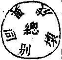
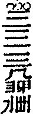
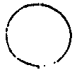
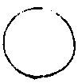
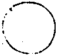

# 三山来禅师语录



> **藏经**：嘉兴大藏经（新文丰版）（嘉兴藏）　**册次** 第 29 册（J29）　**编号** JB244　**部类** 诸宗部　**卷次** 16 卷　**篇幅** 121,814 字

> **卷／品**：0 卷 · 1 品



---



## 目录



  - [袁宝善居士颂古序](#袁宝善居士颂古序)



---



三山禅师语录叙



於戏！宗风之盛，未有如今日者也。钦惟世祖章皇帝崇信桑门，屈己徵访，而江汉之东，缁流如织，靡不走名山、敦实行。无论有种苾刍，略筌蹄、探要领；即负舂职爨之钝汉，咸知侧耳倾心，欲於言下了明大义。至今匡庐、衡、霍之间士大夫、高蹈林泉者，往往持珠茹素，倣东林而证西旨。信乎！宗风之盛未有如今日者也。虽然，五叶相传，流波渐远。虚衷汲引者，未免弘甄拔以导群迷；猎志声华者，辄冀越庭阶而窥堂奥。极盛而衰，日趋於下，至欲以郑五歇后作菩提哑谜；啬夫利口诠无遮上乘。逞辩言为机锋、剿陈说为把柄，谬相承袭，妄自夸张，而谓直指单传不烦渐臻而躐致也，可胜慨哉！是以海内之士，留心斯道者，日引领夫作家宗匠，奋大力以挽颓风；乃若出世入世、因人度人，震吼狮音，俾群狐辟易，则端有望於今之三山禅师矣！



师乃大慧十六世之嫡嗣。於聚云吹万大师为孙，庆忠铁壁大师为子。其源流、行实具载诸名流论列中，余无容复赘，余惟幸聚云之派得师而益昌；大慧之传得师而不谬也。余与师游者有年，而卒莫能窥其涯际。今试读其《语录》，觉指点棒喝之下，顿使黠者泣、慧者𫘤，惘然丧其怀。来者如羁旅之人，偶闻乡语而戚戚，即不能遽返故国，亦庶几时切思归之隐焉！



师之弘宣法化，大唱宗猷，不执公案而终不悖公案；不废言诠而究不堕言诠者，其本诸积渐而然耶？其无所拟议而然耶？余於师真莫能窥其涯际也。间尝以臆度之，盖师早年役志於儒，六经之旨无所不穷、百氏之书无所不读，旁搜博采、研精殚思，而后洞见本源，所谓历尽群山而始识太岳之高，涉尽群川而后知东洋之大。故其言之，条分缕晰而不离其宗，横见侧出而悉轨於正，以视今之扣槃揣籥而为优孟衣冠以欺世惑众者，其相去为何如耶？师之《语录》且充栋，旧虽刻而未全，兹请略为编次，以付诸梓而公於世。余惟愿读《语录》者，勿於印板上寻行数墨，以语言文字求吾师，当思吾师，一棒一喝不放空；横说竖说不放松，是必有本来真面目而不在区区语言文字间也。十方同志傥能信及余言，庶吾师历年来所以现清净身、吐广长舌者，一片婆心得以昭揭於天下。今日宗风之日，即於滥得聚云之冢孙为之砥柱狂澜，可以克昌厥后而勿替也。特书之，以附於简端。



时大清康熙戊申上元日，南浦养元居士谭诣题於云安之静修斋。



三山来禅师语录　目录



卷一上堂



卷二上堂



卷三小参  

茶话



卷四示众  

法语



卷五机缘  

勘辩  

问答



卷六佛事  

题赞  

南浙二师塔铭



卷七五宗颂



卷八宗统颂



卷九颂古(著拈)



卷十颂古(著拈)



卷十一颂古(著拈)



卷十二颂古(著拈)



卷十三书问  

行实



卷十四杂偈  

石龙吟  

念佛歌



卷十五杂述



卷十六住浙江嘉兴府天宁禅院语录



卷十七(嗣刻)诗  

歌行



卷十八松岭闲评



卷十九祝延增补  

法华歌拈颂



卷二十文  

引  

碑



卷二十一表



卷二十二表



卷二十三正灯集拈颂上



卷二十四正灯集拈颂中



卷二十五正灯集拈颂下



卷二十六五家宗旨纂要上



卷二十七五家宗旨纂要中



卷二十八五家宗旨纂要下



目录(毕)



上堂



顺治甲午上九日，总戎袁宝善居士请师於忠州崇圣禅院结制上堂。拈香云：「这瓣香，乾坤笃鍾、海岳生成，𦶟向罏中，奉祝当今皇帝圣躬万岁，伏愿开天辟地，大一统而乘六龙；迈古超今，靖八荒而宁万国。这瓣香，秀叶群英、芳同众甫，𦶟向罏中，奉为满朝文武、各郡宰官，伏愿声应气求，喜见拔茅而连茹；云龙风虎，欣瞻随类以从王。这瓣香，培於梓里、种自桑田，𦶟向罏中，奉为期主袁公、远迩檀度，伏愿相助相扶，凿井耕田娱岁月；兴仁兴让，含哺鼓腹乐升平。这瓣香，小似须弥、大如芥子，劈非为两，捏不成团，昔在熊耳庵中轻轻举著，熏破巴掌和尚鼻孔；今朝信手拈来，供养本师上铁下壁和尚，用酬法乳，伏愿喝下雷霆，震醒群生之幻梦；棒头雨露，洒开大地之觉华。」拈毕，据座。维那白槌云：「法筵龙象众，当观第一义。」师云：「第一义，没屎屁！棒打石人头，𥗋𥗋论实事。青山顶上草芃芃；翠竹篱边风习习，那管李四张三，不问赵甲钱乙。耳朵原是两片皮，一个鼻头两孔气。山僧恁麼告报，若有伶俐衲僧出来道：『曾老师，莫屎沸！』一棒打折你驴脊。」僧问：「炉鞴新开、钳锤初举，何处是聚云心印？」师云：「山前山后、溪西溪东。」进云：「因甚落在和尚手里？」师嘘一声。进云：「即今普对人天，如何施设？」师便喝，僧礼拜。师云：「问来问去带水拖泥，竖指竖拳添钉著楔。如或懡㦬而散，未免辜负今时，且听木上座道个开场偈子。」卓一卓云：「啰啰哩　哩哩啰　苏噜㗭哩娑婆诃！」维那再白槌云：「谛观法王法，法王法如是！」师下座。



上堂。僧才出，师便打，僧拟议，师打云：「汝从甚处去来？」僧云：「三日不相见，莫作等闲看。」师复打。僧出，师打云：「还见前僧麼？」僧便喝，师便打，僧又喝，师又打。问：「人天聚会、凡圣交参，拄杖头边有何意旨？」师亦打。进云：「和尚也不消得。」师连打。僧礼拜，师打云：「山僧棒头颇毒，打杀一窠一窟，一任放去收来，个里了无回互。无回互，鹁鸠树上鸣，唱出无生曲，谷谷孤！」



上元上堂。「天上月正圆；人间号月半，山僧没来由，且自闲打算。单见拆、拆见单，坤六断、乾三连。大来小往、上地下天，卜得正月卦，乾坤颠倒颠。顶𩕳触地，脚板朝天，非龙、非鬼、非僊。」



上堂。「冬至寒、春至暖，生漆盘、琉璃盏。戴雪乌鸡深夜翔，吞煤玉兔天明卵，多多拜上李四娘，看！赵大哥转也未转？」



上堂。喝一喝云：「雷以动之。」嘘一声云：「风以散之。」卓拄杖云：「雨以润之。」畫○相云：「日以暄之。此是衲僧机关，因甚注以羲经玅义？秪缘华野邓居士具赞化才猷，於兹饭众祈嗣，越例与诸人露个消息。还见麼？先天弗违、后天奉若，彩凤五色毛，祥麟一只角。」



上堂。「松直棘曲、凫短鹤长，眉先须后、舌柔齿刚。点头三下，自肯承当。承当个甚麼？绩麻满筐。」



上堂。问：「不问不答，作麼分解？」师便打。问：「十方同聚会，个个学无为。既是无为，用学作麼？」师亦打。问：「树倒藤枯，句归何处？」师打云：「一二三四五，五四三二一，屈指五个三，刚刚十五日。不用如何若何、何必不必，只许老胡知，不许老胡会。」



祈嗣，请上堂。「天地人物根宗浑沦橐籥；乾坤六子奥窍摩荡生成。这里荐得，一切众生俱为鼻祖，十方诸佛犹是耳孙。不则，也须疑著。」良久云：「吞日精、啖月华，降星斗、走龙蛇。」卓一卓云：「分明记取。」



朴素道人持经请开示，上堂。蓦拈香云：「此是药，能杀能活。」𦶟向罏中云：「此是师，绝圣绝凡。」指香烟云：「此是琉璃光，无背无面。」合掌云：「此是如来本愿，不增不减。朴素道人转如是经、究如是旨，恁麼功德还有证盟也无？十二大愿随心足，恒沙餘庆自然来。」



上堂。「三山不会佛法，逢著虚空一掴，拄杖眉长丈三，拂子眼横尺八。四四三三，七七八八。」



宝善诞期，上堂。拈拄杖云：「无量寿来也！将军身、宰官身、居士身，身身应现；过去世、现在世、未来世，世世圆成。作麼生说个圆成底道理？阳数九、阴数六，惟有这个数不足，金龟嚼碎铁昆仑，夜半日轮当午出。○具眼者看看！」问：「如何是世尊初生句？」师云：「翡翠踏翻荷叶雨。」「如何是居士悬弧句？」师云：「鹭鸶穿破竹林烟。」「且道居士、世尊是同是别？」师云：「玉印山磊磊落落；曹溪水曲曲湾湾。」进云：「恁麼则皇宫现瑞、石宝呈祥？」师云：「桃花红、李花白，冬瓜瓠子撞泥钟，六月炎天下热雪，昔日今朝事若何？踏著秤锤硬似铁。」



上堂。「此事如闹市里飏石头，著首者便知。山僧今日飏下石头了也，还有著首者麼？」



上堂。「河水汤汤、河流荡荡，风敲翠竹、日照堤杨。触境观不足，明明无回互。」卓拄杖云：「莫将黄叶当金钱，猫儿原解捉老鼠。」



上堂。般若居士出，师震威一喝，士掩耳归众。师云：「骑龙头、把虎尾，飞天铁马三条须；走地金乌一只膇。会麼，会麼？」复举：「庞公云：『难难！十石油麻树上摊』，不是苦心人不知。庞婆云：『易易！百草头边祖师意』，甚处得这消息来？灵照女云：『也不难、也不易！饥来吃饭、困来睡』，寐语作麼？直今张将军阖宅熏修，远来供众。道与昔人相去多少？」连喝三喝。



解制日，庆忠老人送法衣信拂至，上堂。「眉满虚空眼满地，辽天鼻孔难回避，舌头嚼碎大雄峰，踞地金毛成队队。知麼？庆忠老人，心行狼毒。」耳庵和尚出，师便打。



师诞期上堂。「四十年来颠倒颠，穿衣吃饭别无言，现成公案人不识，更道父母未生前。」宝善问：「无生一句鬼神不知，因甚被诸人觑破？」师云：「灯笼头触地。」进云：「觑后如何？」师云：「露柱尾朝天。」善礼拜。师云：「九八六十七，虾蟆钻象鼻；六九七十三，乌龟上树颠，惟有向上难委悉。一二三四五，六七八九十，生数成数不相十，衲僧切忌知端的。」卓一卓云：「习！」



顺治乙未，师受请住夔州府梁山县兴龙禅院，结制上堂。拈香毕，维那白槌，师掷下拄杖云：「莫言不道。」便下座。



杨副戎请上堂。「相逢一笑，乃是作家，列阵排兵，未为好手。与兴龙作麼相见？」僧问：「单刀直入时如何？」师云：「险！」僧便喝，师亦喝，僧又喝，师云：「苦哉佛驮耶！」僧作礼，师云：「草贼大败。」问：「和尚惯向异类中行，成得甚麼边事？」师云：「今日不与交锋。」进云：「剖腹剜心即不无，如何得完本体去？」师云：「汝班师回朝。」僧归位。师云：「知彼知此，百战百胜，九天九渊，计出非常。有时减灶添兵、有时减兵添灶，但能逢强即弱，自是遇柔则刚。塞北江南，一任横嘶铁马；边关险隘，何妨倒竖金矛？正恁麼时，作麼生是折转旗鎗一句？」呵呵大笑，下座。



上堂。喝一喝云：「若道是，早已不是；若道不是，即此便是。衲僧不用巧思量，大用明明无回避。」复喝一喝！



上堂。「牛种田、马吃榖，雪峰辊毬、道吾舞笏；鸡上树、鸭下水，长沙大虫、杨岐驴子。石巩熟处最难忘，张弓架箭射当阳，真诚不作小儿戏，八十翁翁入试场。」以拂子作挥毫势。



上堂。师作吟哦声，僧出，师低首，僧云：「苍天苍天！」师云：「不是知音不与弹。」



上堂。「高更高，青山顶上火流潮；低更低，绿水波中发迅雷。惊起灯笼掩耳听，惹得露柱合眼窥，就中自有真消息，问取诸人知不知？」拍膝一下。



上堂。问：「如何是法身？」师倒卓拄杖。「如何是报身？」师竖起拄杖。「如何是化身？」师云：「拄杖子无端恶发，触著释迦老子鼻孔，忍禁不过，倒骑虚空颠走，走入山僧方丈里，依然平怗怗地。何故？百年三万六千日，面目本来是娘生。」



上堂。「正因老比丘住在猫儿石，昨宵传信来，今向东山去。恁麼去也戴角披毛，恁麼住也藏踪敛迹。总不恁麼时如何？道道！」



上堂。「山是山、水是水，别有甚事？驴头马嘴；水非水、山非山，恁麼荐得，北斗南看。」良久，抚掌三下。



上堂。拈拄杖云：「玄要主宾绝异同，纵横杀活不通风。」击禅床云：「关捩敲翻无个事，青天白日听雷轰。」震威一喝！



上堂。「祖师心印，状似铁牛之机，去即印住，住即印破。不去不住，合作麼生？」僧出，礼拜了退。师云：「本自无疮，勿伤之也。」



祈福净信请上堂。「『南无佛驮耶！』不向佛求；『南无达磨耶！』不向法求；『南无僧伽耶！』不向僧求。直此三转语，已为诸净信修因植福了也。」座元出，连喝三喝，师吐舌，元礼拜，师下座。



腊八说戒上堂。「落落疏疏午夜星，无端照彻释迦文，虽然直在面门上，争奈眼中又著钉。众中若有为伊拔得底，则启不关口、动不关意、触不关身，何犯何持又复何戒？设或未然，须向自家屋里仔细检点。」遂说戒。



上堂。「上大人、丘乙己，圆是规、方是矩。看将来，无彼此，麦里面兮谷里米。止止！佳作人也可知礼？」



上堂。「三世诸佛不知有；狸奴白牯却知有。三世诸佛为甚不知有？不见道：『他是三世诸佛』；狸奴白牯为甚却知有？不见道：『他是狸奴白牯』。恁麼会，又争得？」僧出，师云：「道道！」僧云：「某甲亦道亦不道。」师云：「因甚亦道亦不道？」僧云：「和尚莫忘了话头。」师云：「诺。」



元旦上堂。「昨日雨、今日晴，一般西来意，睹境自分明。虽然如是，第恐境触心生、心因境转，心境相缘，因缘而碍。汝等须悟，境亦如幻、心亦如幻、幻亦如幻。如幻亦幻，诸法何存？所以道：『心生种种法生；心灭种种法灭。』生灭俱泯、心法双忘，作麼生道？但听康衢歌击壤，不闻杞国更忧天。」



解制上堂。「屈指凡来九十期，尘埃满面额沾泥，怜儿不觉侬家丑，自惜区区手拨眉。山僧今日知过必改，诸人分中又作麼生？」



顺治丁酉，姚圣瑞总戎率将士等同布金檀越，请师住梁山县五云禅院。



土地祠。「鸟道羊肠一径通，高高山顶露仪容，相逢觌面不相识。」问讯云：「元来元来！」



三门。「辟谓之乾、阖谓之坤，地天门户。内不放出、外不放入，佛祖机关。且道向上一步𫆏！」



佛殿。顾视云：「但恁麼不是不是，毕竟如何？」乃展具作礼。



方丈。「覆天载地，容纳虚空，四方八面，处处玲珑。一条无情棒，操纵活如龙。」卓一卓！



结制上堂。拈香云：「君恩也临我；亲恩也生我；檀信恩也护持我，总此一瓣，同伸报答。」次拈云：「得人一马，还人一牛，人平不语，水平不流。自遭庆忠本师毒害，不由满口含冤，今从那没奈何处三番拈出，用酬法乳。」上首白槌，师云：「古人升座说法都要开陈舖面，山僧说法升座不免舖面开陈。」竖拄杖云：「还有识货者麼？」僧出，师云：「交钱是买主。」僧拟问，师云：「合价是闲人。」又僧出，师云：「住住！宗中辩的，句里呈机，具眼阿师才闻举著便掉臂而去，不然，也是巩县茶瓶。」



布金施主请上堂。「前属利、后属元，仲冬节气，十分严寒，为怜苦海人难渡，乘时驾个般若船。」以拄杖作撑舟势云：「渡来渡来！」僧出云：「放下著。」师云：「顺水推船则易。」进云：「如何是末后句？」师云：「逆风把柁则难。」僧礼拜，师云：「一半水、一半山，别行一路，自古皆然。昔日世尊与众行次，以手指地云：『此处宜建一梵刹。』帝释拈一茎草插於地云：『建梵刹已竟。』即今陶太宇叔侄舍宅为寺，不须汝等重新修建，且道山僧还有指地分也无？向后师作弟随，也须记著。」



上堂。「祖师西来意，满眼满耳是，拟议思量，扶篱摸壁。不然不然！如是如是！」



上堂。「山僧夜睡一梦，正欲举似诸人，第恐无人原得。」僧出，师云：「今日上弦。」僧云：「恭贺和尚上堂。」师云：「汝不解原！」一僧畫



此相，师畫



此相。僧云：「谢师答话。」师云：「汝不解原！」僧拂袖归众，师靠拄杖作鼾声。



上堂。「一是一、二是二，三五一十五，九九八十一，剖腹剜心说向人，又道呓语匪端的。谁端的？一丈凡来有十尺。」



冬至上堂。畫一畫云：「七日来也，复其见天地之心乎？天何心？百昌荣；地何心？万物生。唯有衲僧无思算，地逢雷处是令辰。饮玄酒、茹太羹，倒翻月窟，独露天根。正恁麼时如何庆祝？一线初添增锦绣，圣明何处不当阳？」



上堂。「东村梅、西村柳，节候从中要知有，泥牛木马满天飞，草木丛林狮子吼。眉分八字鼻辽天，牙齿原来只在口。」



佛成道上堂。「圆陀陀，非歉非餘；光灼灼，无遮无障。世尊昔日睹星悟道，叹曰：『一切众生具有如来智慧德相，皆因妄想执著而不证得。』山僧看这迦文古锥无端寐语，觉得有些不平。见亦不著，睹个甚麼？原不曾迷，悟个甚麼？本自平常，叹个甚麼？奇哉！以何为智慧德相？以何为执著妄想？以何为众生如来？虽然如是，还知老瞿昙落处麼？○！」



上堂。「朔风微雨冻山寒，林木萧萧眼倦看，为报梅花惊岁早，枝头几点露天斑。」竖拄杖云：「春色向山僧手中来也。先天事、后天事，浑沦个里难分析，明明拈出任君看，面目本来只这是。」僧礼拜，师云：「错下注脚。」



元旦上堂。「大哉乾元，万物资始，一团和气，谁堪比拟？东君意若何？呵呵笑不止。有甚奇特消息𫆏？三阳运转乾坤泰，六合春同草木新。」



解制上堂。「衲僧全没勾当，九旬恰好算帐，眉毛厮结，东倒西歪，叠膝跏趺，装模打样。囫囵囵眼生顶门，口吧吧舌挂壁上，而今解却枷绳，一任随缘放旷。虽然如是，也不得离俺这里。」问：「作麼生是随缘放旷？」师云：「春游芳草地。」进云：「此后如何？」师云：「夏当缘荷池。」进云：「恁麼则往而不返也？」师良久，进云：「始信个中无解结，户外庭前总道场。」师云：「喏喏！」问：「开口成双橛，如何是声前一句？」师云：「不向汝道。」进云：「秪道龟毛红似漆，谁知兔角黑如银？」师云：「汝从那里记得来？」问：「三月期制今已解，对众一句作麼生？」师云：「山前有土那非地？」进云：「大法意旨如何？」师云：「岭外无云别是天。」



结制上堂。「极目霙花片片飞，红炉有火正投机，因时及节归何处？一点销镕知是谁？」顾视左右。



上堂。弹指一下云：「佛法秪是寻常，若作奇特商量，错过了也。」僧出，师下座。



师诞期上堂。「小阳月，念四期，山僧母难，无可话题。但举则古人机缘，拈颂几句供养大众，贵图报我双亲。昔人谓：『世尊未离兜率已降王宫；未出母胎度人已毕。』恁麼道，还是麼？听取一颂：『玉质冰姿岭上梅，孤根暖蒂望春回，谁知含笑三冬里，不待东风花自开？』大众！也须委悉此事始得。何以故？盈天地之间者皆物也，飞潜蠕动姑置不论，但就本乎地者而言之，你看那千岩万壑、木树草花，为夭为乔，总受钧陶。於造化，一般生意，覆载为功；迄乎元运既往，通复将来。金风吼震於长天，白帝乘权於西极，严威正凛，肃杀方张。正恁麼时，长林极目以萧条，木叶随风而飘堕。抚时者，未免睹物而有造物不仁之讥。」师随拈拂子点



数点云：「独这个侣松友竹，斗雪披霜，点缀北陆风光，漏泄东皇消息，不惜寒侵彻骨，先传春信到枝。顿使道上行人、闲中个士，欣瞻颜色，快睹芳姿，惊且叹曰：『天心见矣，向之所谓造物不仁者非至论也！』我释迦如来乘慈悲愿力，具相好庄严，示现群生、梯航苦海，来此娑婆界中一番游戏。皇宫降诞、雪岭修行，睹明星、证道果，超度宗亲、提携庶类，降伏外道、摧折天魔。大孝能仁，於今为烈。真所谓亭亭老斡，迥焉秀出群英；郁郁清香，卓尔芳腾众甫。乃有不识好恶底，犹欲一棒打杀；忒放痴憨底，更道吾不喜闻。呜乎！家肥生孝子，国伯有谋臣，但具公心，咸应赞叹！伊固何心而忍毒至此？此无他，知恩报恩故尔！山僧恁麼告报，道是扢扬先德？道是埋没古人？具眼底拣辨看。如上闲言剩语都与佛法不相干涉，岂不虚消信食，枉度时光？毕竟如何折合？」良久云：「情因比类情无限，话到投机话更长。」以拂子击禅床一下。



上堂。「之乎也者，难措一辞，良久默然，和盘托出。委悉麼？家有犊牛儿，价值十二两。」



上堂。「天是天、地是地，东家垣墙、西家篱壁，有个机关，杳无消息。既道有个机关，因甚杳无消息？昨宵野马来，被逐云飞去。」



上堂。举：「汾阳验人有三种狮子句，后浮山远举示众云：『狮子句有三种：一、超宗异目；二、齐眉共躅；三、影响音闻。若超宗异目，见过於师，方堪传受；若齐眉共躅，智与师齐，减师半德；若影响音闻，野干倚势，异类何分？』五云今日权借他人探竿，向狮子窟中轻轻拨动，莫有觌面相呈者麼？」座元出，喝一喝，师云：「影响音闻。」元复喝，师云：「齐眉共躅。」元又喝，师云：「超宗异目。」元云：「两堂云水又作麼生？」师合掌云：「我不敢轻於汝等。」元顾视左右，师下座。



佛成道上堂。「一二三四五，金木水火土，佛立山上起云，白兔亭前下雨。南邻北舍击鼓敲锣，西市东街敲锣击鼓。跳底跳、舞底舞，一齐报道：『腊月八夜半，明星释迦得。』睹睹底事作麼生？」展手，下座。



上堂。「甚麼物，与麼来？不从人借、匪自天排。孤迥迥全无依仗，赤条条绝没尘埃。休拟议、莫疑猜，夜来拄杖子将东村张三当胸一拄，累及西村李四痛忍难挨。五云院里有斋。」



上堂。「有句无句，隔山出气；树倒藤枯，黄瓜落地。中后二语不曾参，会得底出来道看！」



上堂。「一不成单二不双，六门紧闭没收藏，有时闹市街头过，三岁孩儿唤作娘。头短小、尾粗长，既无背面，又绝肝肠。若人识得，打他无妨、骂他无妨。」



入队上堂。「山僧昨过万松山，见惺世道人〈庵梨偈〉云：『万松庵里一株梨，滋味平常甘且奇，四方八面无遮障，独立乾坤不用枝。』五云且与批判一上：『万松庵里一株梨』，如何是树倒藤枯一句？『滋味平常甘且奇』，吞却不如吐却；『四方八面无遮障』，风吹不入、雨打不著；『独立乾坤不用枝』，却也遮天盖地。即今和盘托出，且道如何下口？」



解制上堂。「一上一、二上二，三下五除二，五起五还一。从头算将来，看看九十日，解开布袋头，横行顺行、东去西去，还记得麼？咦！」



上堂



顺治庚子下元日，梁山县令舜聘曾居士并四众等，请师於五云本院结制上堂。「十月临，小阳春，朔风入，寒气生。闲来游戏，遇著个人，无背无面、无疏无亲。莫不是舜聘居士过我五云？莫不是南昌故郡共蒂曾僧？恁麼则与诸人相见了也；其或未然，不得放过。」



上堂。「释迦文驱牛入市，弥勒佛策马归山，一个土面灰头、一个青眉白眼，都到五云门下，听拄杖子分断。」卓一卓云：「谁家别馆池塘里，一队鸳鸯畫不成。」



上堂。僧问：「如何是不睹不闻句？」师良久云：「好大哥！会也麼？不用摩挲。」



千夫首座写师真请赞上堂。问：「觌面分明时如何？」师云：「有水皆含月，无山不带云。」进云：「有无不著又作麼生？」师云：「金轮翔八极，铁锯舞三台。」僧礼拜，师云：「山僧这个面目日日对著诸人，争奈夫上座一眼觑破，描畫将来，却请山僧题赞。十年不可瞒，一笔图将出，皮肉骨髓浑全，直得横身交付。拄杖头边放光明，从此一灯百千灯，南北东西任尔分布照烛。咄！」



上堂。问：「法鼓声传，大众齐集，和尚拈示个甚麼？」师云：「疏林处处飞黄叶，绝涧时时响碧泉。」进云：「昆仑咬破蟭螟唇，牛头夜叉痛不彻，是何意旨？」师云：「细雨湿衣看不见，闲花落地听无声。」僧礼拜，师云：「小出大遇。」



腊八上堂。「天在上，上更有天，说甚明星半夜；地在下，下更有地，说甚雪山六年；人在中，中更有人，说甚释迦证果？检点将来，也是一人传虚、万人传实。恁麼不得，不恁麼不得，恁麼不恁麼总不得。毕竟如何？咦！」



上堂。「好承当，不承当，白拈贼，孟八郎。朱秦尤许、何吕施张，风流体段阿谁识？赢得梅花喷鼻香。」



上堂。嘘一声云：「五云今日早是不堪也，莫有放过底麼？」靠拄杖，下座。



无相比丘荐亲请上堂。问：「既是无相，谁为父母？」师竖起拂子。进云：「即今如何荐悼？」师以拂子左右拂云：「不居净土、不处秽邦，无生国里，去住寻常。相逢不相识，觌面露堂堂。」掷下云：「应当礼拜。」



修斋净信请上堂。竖拄杖云：「释迦老子为汝等证盟来也。」卓一卓云：「生即度生、死即度死，生死度尽，罪福皆空。且道凭个甚麼？」畫○相云：「请看石上藤萝月，已映洲前芦荻花。」



解制，嘱佛幻上座，上堂。「世尊拈花，迦叶受渠瞒过；达磨面壁，神光被伊赚来。山僧一无所为，不觉将佛上座养成个白拈贼，而今露出赃私，未免据款结案。听吾偈：『数卷呈来一字无，舌头如剑眼如珠，葛藤判尽无餘事，好驾轻舠泛五湖。』」



康熙乙巳六月十一日，向化侯府养元谭公请师住夔州府云阳县磐石山昙华禅院。



三门。以拄杖敲门限云：「还见麼？诸人到此，直须得个入处；设或不然，都随山僧脚根点地进来。」



佛殿。「搏大地为宝座，统虚空作法身，恁麼也得；以法身还虚空，将宝座归大地，不恁麼也得。恁麼不恁麼，概与一臀坐断。大众！虽是家无二主，这三礼著在甚麼处？」



方丈。卓拄杖云：「据此室、行此令，魔外潜形，佛祖乞命。纵有伶俐衲僧，还须吃此一顿。」



法座。拈请启云：「若道有文，字字著伊不得；若道无文，行行自尔分明。即今宾主混融、人天交接，如何举唱？」维那读毕，师云：「诺诺！拄杖子无端筑著磕著。」击座一下，遂升。



上堂。拈香云：「此瓣香，光超日月、瑞霭河山，端祝当今皇帝圣躬万岁万万岁，伏愿乃圣乃神，帝德皇风称有道；卜年卜世，金枝玉叶衍无疆。此瓣香，用同舟楫、味过盐梅，奉为满朝文武、阖国公卿、当路宰官、现前绅士，伏愿无二乃心，武纬文经襄圣化；咸有一德，民安物阜赞鸿猷。此瓣香，多生种植、累世栽培，奉为布金檀越、向化侯府，暨公子公孙、阖营镇将，伏愿名位增荣，千秋壮业图麟影；箕裘克绍，百代英华起凤毛。此瓣香，无形无相、难状难名，昔在青山顶上圣佛堂前埋下根株，十数年来烟辛气辣，不觉熏动侯门，因此向磐石山头、昙华寺里重新举著，供养现住宝圣禅院本师上铁下壁庆忠大和尚，用酬法乳。」维那白槌，僧问：「帝释插草，世尊微笑。爵台建刹，和尚何如？」师云：「山僧笑伊有分。」进云：「和尚、世尊即不问，且道爵台、帝释是一是二？」师云：「仰面看南斗，翻身倚北辰。」进云：「恁麼则截琼枝寸寸是玉，析旃檀片片皆香。」师云：「恁麼那！恁麼那！」僧出，师约住云：「莫莽卤、休错过，夏云奇似峰，夏日蒸於火，逼得舜若多神呵呵拍掌，报道：『无边香水海，百万亿须弥，等华藏於微尘，拥微尘为华藏。重重变现，现出种种楼台、种种殿阁、种种轩櫺宝网、种种水石园池、种种奇花异草、种种明窗净几，辉煌掩映，馥郁馨香，庄成一个昙华梵刹。』汝等诸人还知来历处麼？原来是向化侯府与令子总戎公舍宅为寺，迎请山僧住持，开凿人天眼目，阐扬佛祖徽猷。此种功德以何证据？」卓拄杖云：「木上座点头了也，为云寿如山、福如海，子孙如林，簪缨霭霭。然此犹是福祐边事，如何是佛法说话？」以拄杖一畫云：「还见麼？若也见得，便见作大因缘、作大供养、作大布施、作大道场、作大佛事，都从这一畫引蔓牵枝。所以道：『识得一，万事毕。』即今拄杖子口喃喃，乃向顶𩕳头端为伊出气。虽然如是，切忌妄通消息。」喝一喝。



附请启



伏以教衍鸣钟，仰止高峰登鹫岭；慈鸿卓锡，飞来石垒布金沙。望德范以腾懽、凛仪型而起敬，一茎初搆、万祀垂新。恭惟三山大和尚，慧颖天成、慈悲性笃。自文坛竖帜，胸藏玉振金声；向法苑持衡，手接铜头铁额。阐扬宗旨，皎然日月之中天；嗣续源流，展矣乾坤之奕世。竖津梁而沉沦悉起，德沛三车；广炉鞴而跃冶潜消，修齐六度。红莲馥郁於大夏，玉露涵濡於新秋。人天效灵、圣凡在宥。(诣)才同拆袜、智类挈瓶。虔涤丹心，景仰丛林山斗；倾承碧眼，皈依猊座准绳。念兹磐石建勋庸，二十年来幸苞桑之永固；植此昙华开锦绣，三千界内期祗树以长辉。特布愚忱，敬修鄙愫。伏愿宗风大展、法雨频施。梵铎时锵，阃外貔貅资化育；宝幢日丽，堂中龙象肃威仪。二谛咸瞻、三生攸赖。(诣)无任踊跃之至，谨启。



康熙乙巳十月十五日，向化侯府率诸镇将请师於昙华本院。



结制上堂。顾法座云：「坐断毘卢顶，不拜释迦文，犹未是衲僧巴鼻。毕竟如何？」震威一喝。升座，拈香云：「圣王御极、宇宙升平，达士通人共庆云龙风虎，山夫野叟难逃践土食毛。山僧虽属方衣，臣子之分凛然难越，将此一瓣奉祝当今皇帝圣躬万岁。」次拈云：「日月无私、封疆有界，无私底到处照临，有界底随方安住。山僧今在磐石山中作个偷安的懒汉，非仗庇宥，那讨清闲？将此一瓣用酬护法。」次拈云：「一人倡、众人和，好善攸同；前者行、后者效，倾诚不二。今则养元侯府合营檀越，於此百二期中兴斋办供，将此一瓣用酬盛心。」次拈云：「以心传心犹成剩语，以德报德总属狂谈。叵耐山僧不识好恶，一向在曲录床头触忤本师庆忠大和尚，不知过犯何从？今则五番拈出，将此一瓣用酬法乳。」维那白槌，师云：「抛沙撒土，济得甚麼边事？」僧出，师云：「朔风寒彻骨，雪火正投机。」



上堂。僧出，师云：「鹞子过新罗。」僧归众，师云：「放开一线道，不容挨拶；把定绳索头，一任纵横。到这里，拟议思量堕坑落堑，且道古佛与露柱相交是第几机？」



上堂。问：「正恁麼时，和尚如何指示？」师云：「汝饱斋也未？」僧作舞，师云：「冬至日，一阳生，因斋庆赞，及节叮咛。叮咛个甚麼？汝自会得好。」



上堂。「今朝恰是腊月一，雨打风飘赤骨历，岭上梅花笑破颜，就中几个知端的？」举：「五祖演〈歌〉云：『豆子山，打瓦鼓；阳平山，下白雨。白雨下，接龙女，织得绢，二丈五。一半属罗江、一半属玄武。』维时泰首座豁然大悟。乃云：『直须唱到这里。』山僧亦赓一韵：『磐石山，打瓦鼓；铁凤山，下白雨。白雨下，接龙女，织得绢，二丈五。一半属云安、一半属南浦。』座下若无截断山僧调底，还与全全唱出。南浦江头木马嘶，云安市上金牛舞，潇潇洒洒度时光，戳破虚空倩谁补？众中莫有补得底麼？山僧与你洗脚有分。」



向化侯府至，上堂。问：「『天命之谓性』，如何是性？」师云：「这一问从甚处来？」进云：「『率性之谓道』，如何是道？」师云：「只须向脚跟下荐取。」进云：「『修道之谓教』，如何是教？」师云：「莫将黄叶当作金钱。」进云：「不睹不闻处，请师道一句？」师云：「不道不道！」进云：「因甚不道？」师云：「道即不辞，恐落睹闻边去。」进云：「莫见莫显又作麼生？」师竖拂子云：「还见这个麼？」进云：「这个且置，侯府大檀来也，和尚如何接待？」师喝一喝。进云：「上上提持即不无，还期曲垂方便。」师云：「若论方便，已是方便了也，更待山僧举段机缘。昔日明良将军与六祖同参，六祖得法之后三更夜遯，明赶至大庾岭。祖见明来，以衣钵置石上，潜身树间。明至，取衣钵不动，白云：『行者！某非为衣钵而来，乃为佛法而来。』祖云：『衣以表信，岂可力争耶？既为佛法而来，不思善、不思恶。正恁麼时，那个是明上座本来面目？』明於言下豁然大悟。今日爵台若为衣钵而来，爵台本分具足；若为佛法而来，不须山僧重举。毕竟如何以酬来意？」畫○相云：「荆山有玉君须剖，莫负殷勤抱璞人。」一僧出云：「恁麼道是甚麼心行？」师云：「路逢剑客须呈剑，不是诗人不献诗。」进云：「何似深藏一片舌，莫教辜负两茎眉？」师云：「低声低声！」问：「在昔功甫入山，白云道个枕上颂子；即今侯府入山，和尚道个岭头大意。一前一后是别是同？」师云：「啰啰哩！哩哩啰！」问：「三圣因甚逢人即出，出则不为人？」师云：「只为婆心重，翻同陌路人。」进云：「兴化因甚逢人即不出，出则便为人？」师云：「谁知铁石心，倾作和肠泪？」进云：「今日底事，和尚是出是不出？」师云：「不妨疑著！」进云：「道是为人不为人？」师云：「谩得过阿谁？」问：「长者布金、谭公舍宅，条例如何？」师云：「朝三暮四、朝四暮三。」进云：「不二门著脚即不问，如何是向上路恰好抽身？」师云：「阇黎礼拜了退。」问：「但有言说，都无实义，哆哆和和作甚麼？」师云：「官不容针，私通车马。」进云：「恁麼则输药山一筹也。」师云：「苍天苍天！」问：「古人为甚张弓架箭？」师云：「一朝权到手，看取令来行。」僧拂袖归众，师云：「金鳞烧尾龙门去，收取丝纶别下钩。」



上堂。问：「如何是亲切句？」师云：「师姑本是女人作。」「如何是转身句？」师云：「才过忠州，又上涪州。」「如何是异类句？」师云：「牛头没，马头回，三脚驴子走如飞。」「如何是末后句？」师云：「𫆏𫆏𫆏！学诗乎？学礼乎？无以言、无以立。尼父恁麼来、伯鱼恁麼去，父子不传真秘密。十五日以前记得分明，十五日以后分明难记。正当十五日如何？今日冯镇台有斋。」



元旦上堂。「夜来枕子边悟出个消息，恰好举似诸人。」乃云：「正月初一日，毕竟是新年。若也信得，便知刻积为时、时积为日、日积为月、月积为年。年年二月是清明，明明百草头，头头祖师意，意旨如何？啐！原来是昨夜理不尽底麻头，今日从新接起。」遂以手作绩麻势云：「莫言瑞雪轻飘下，纵是天寒也著工。伏惟珍重！」



上元上堂。竖拂子云：「眼里著不得沙。」击禅床云：「耳里著不得水。」喝一喝云：「及尽去也，向此承当得来，一任山河大地、草木丛林、刹刹尘尘，有色可见底都不唤作沙；一任高低语言、山鸣谷应、猿啸鸟啼，有声可闻底都不唤作水。所以道：『即此见闻非见闻，无餘声色可呈君，个中若了全无事，体用何妨分不分？』今日上元佳节，处处灯光色映，在在锣鼓声喧。傀儡场头，张郎李汉短调长歌，扰扰纷纷、闹闹炒炒，几人不被换却眼珠、填满耳窍？争似盘石山中，所见者万叠青山，所间者一溪流水？纷华之色不入於目，喧哗之声不入於耳。若是得此受用，於那如如本体何曾动著分毫？是以清净法身返观观心、返闻闻性，无垢无净、不减不增。何以故？本无污染故。何以故？一性圆明故。到了恁麼田地，更须明得向上一窍。饥时吃饭、困时打眠，寒则添衣、热则退袄，随缘放旷、任运逍遥，然又不可话作两段。未有得证法身，不明向上事者；未有明得向上，不能得证法身者。故知法身、向上原无两样。夜来游过八万四千门，醒起依旧天晃亮。佛即心、心即佛，非心非佛亦非物。咄咄咄！盘沱市上豆价、米价又作麼生？」



上堂。「山僧拄杖头边有一句子佛法。」卓一卓云：「此处无金十两。」



上堂。「三不三、四不四，不在天、不在地，南来北往、东去西去，呼之无名、觅之无迹。大众！你看是个甚麼？」



解制上堂。举：「云门云：『乾坤之内、宇宙之间，中有一宝，秘在形山。拈灯笼向佛殿里；将三门来灯笼上。』昙华不然。五官之内、四大之间，中有一宝，自在天然。将众生来眉毛上；把诸佛置脚跟底。」僧出，师云：「风吹柳絮条条绿，雨绽桃花点点红。」



康熙丙午十月念四日，护法宰官袁宝善居士率信善江应爵、谈试、传鸣玉众姓等，请师结制於忠州高峰山开禧禅院。



三门。「信步行来，八字打开，踏著机关，作麼生道？」



佛殿。「乾屎橛，麻三斤。云门欲打杀，赵州不喜闻，高峰大半顺人情。」展具作礼。



方丈。「金刚圈、栗棘蓬，抛向一边；返魂香、涂毒鼓，无安置处。但看没量大人，就中神出鬼没。」靠拄杖，据坐。



上堂。至座前喝一喝云：「到这里瞒得过阿谁？」复喝一喝，遂升。拈香毕，上首白槌，师云：「向上一路，千圣不传；向上一路，千圣不然。不传不然，何须山僧更为饶舌？秖因高峰梵刹乃山僧破荒辟草而成，今则笑监院不忘辛苦，同诸檀信请山僧开建禅期表扬功德，所以道：『事无一向，是法住法位，世间相常住。』世间相且置，如何是法位边事？下文繁长，别听分解。」



塑释迦并师真成，上堂。「这瞿昙老汉原是山僧装模打样底影子，以何为验？」遂召云：「世尊！」代应云：「诺！唤作高峰亦得。」复召云：「高峰！」自应云：「诺！唤作世尊亦得。今日一并托出，合作麼生？有意气时添意气，不风流处也风流。」



上堂。「山僧刚才升座，舌头牙齿相磕，拟道如何若何？又怕千错万错。」拍膝一下。



上堂。「实际理地不受一尘，今时门头不舍一法。今时门头即置，昔僧问鹿门：『如何是实际理地？』门云：『南赡部洲、北郁单越。』僧云：『恁麼则事同一家。』门云：『隔须弥在。』若有人问高峰：『如何是实际理地？』但向道：『高峰顶上开禧寺。』若云：『恁麼则天地悬殊？』但向道：『当面蹉过。』『与鹿门是同是别？』『若道别，两岸芦花两岸雪；若道同，一溪杨柳一溪风；也不同、也不别，梅花枝上三更月，三更月色影蒙蒙。』不辨西、不辨东，到此则光境俱亡，复是何物？」良久云：「龙蛇易辨，衲子难瞒。」



上堂。「朔风严，黄云盖，六花片片满空界，不到一番彻骨寒，那识随缘观自在？还知自在处麼？佛法不是鲜鱼。」



上堂。「今朝腊月一，寒气将人逼，雪落满林花，霜凝遍地玉。两堂云水僧，个个赤骨历，亲切转身异类行，更有末后那一句？」笑监院出，师云：「速道速道！」笑云：「季冬严寒，切忌口快。」师云：「恁麼会，又争得？」



腊八说戒上堂。「今日如来成道之期，夜睹明星眼波波地；三叹奇哉口漉漉地，惹得后代儿孙因时及节引蔓牵藤，向佛驮耶、达磨耶、僧伽耶，一皈依、二皈依、三皈依，永离恶道、不堕三涂。平怗怗地，又说甚麼沙弥戒、比丘戒、菩萨大戒？把那五条、七条、九条、二十五条无相福田衣左披右搭，束身束心战栗栗地。且道洒脱脱地一句又作麼生？袈裟底下无餘事，会得分明总不妨。」



上堂。「一度闻雷一度惊，象牙渐渐俱成纹，不因声自耳门入，那得花从口角生？」喝一喝。



上堂。僧出，师云：「俊哉俊哉！」僧便喝，师云：「放过一著。」僧归位，师乃云：「万法无法，因心而生；一心无心，缘法而显。心即法、法即心，木马嘶风花雨落；心非心、法非法，泥牛吸浪海云浮。正恁麼时，诸天快乐、地府逍遥，毕竟承谁恩力？秖为信善傅鸣玉，办一片心植福修因，超度宗亲提携孤田，请山僧说法证盟。心即不无，如何是法？上是天、下是地，四方八面无回避，一段灵光就里生，是则名为真实具。有漏笊篱不可量，无漏木杓难思议。难思议！一二三四五。」



上堂。「行便行、坐便坐，笑便笑、说便说，西来大意却如何？才涉思惟，当面蹉过。过在甚麼处？」



解制上堂。举：「庞居士〈偈〉，著云：『十方同聚会』，蚁从膻处集；『个个学无为』，欲闲不得闲；『此是选佛场』，赚杀许多痴男女；『心空及第归』，不是堕坑，便是落堑。高峰龙象成群、水云骤集，同锅共箸、抵塌连床，唤作聚会得麼？上单打坐、下单经行，茶来吃茶、饭来吃饭，唤作无为得麼？但不知选佛场头，心空及第有几人哉？若也直下承当，自是桃花贪结子；其或懡㦬而散，错教人恨五更风。」拈拄杖，卓一卓。



康熙戊申九月念四日，治平禅院迁化庆忠老和尚。上堂。喝一喝云：「此是先师三十年来把钓持竿一句。」喝一喝云：「此是先师六十六后收纶转棹一句。且承先启后一句又作麼生？」良久云：「浯水曲如带，翠山列似屏，时时聚云雨，在在双径云。法云密布、法雨漓淋，呿呬呿呬！丘乙己，上大人，莲社永开佐治平。」复喝一喝。



向化侯府启建报恩胜会，请上堂。师拈香在手云：「见麼？此是谭公爵台仰酬覆载一片精诚。」又拈云：「见麼？此是谭公爵台追荐宗亲一段孝思。」复拈云：「见麼？此是谭公爵台利济幽魂一张公案。至於雪罪消愆、迎祥植福，总向香烟堆里结就功勋，大众直须具眼。」问：「人天交感、凡圣同参，向上关头即不问，超度往生却如何？」师云：「阿耨随心开菡萏。」进云：「福利侯门又作麼生？」师云：「名门餘庆荫儿孙。」进云：「恁麼则喜听南山歌十有，懽闻天保咏九如。」师云：「应合恁麼道！」僧礼拜，师云：「若论第一义，大悲千手拈他不起，辩舌悬河宣他不出，今日人天众前却又如何举唱？」竖拄杖云：「山僧拈出了也，无论若存若亡，有眼底应当共见。」卓柱杖云：「山僧宣出了也，无论若存若亡，有耳底应当共闻。若也见得亲切，山河大地尽现法身；若也闻得分明，草木丛林普扬玅义。何恩不酬、何亲不度、何冤不解、何福不增？更有甚麼地狱天堂、西天东土？所以道：『是法非思量拟议之所能及。』还知麼？但看柳上黄金锁，好对峰尖碧玉壶。」喝一喝。



小参



小参。「先德有言：『赤肉团上，壁立千仞。』山僧则道：赤肉团上，一尘不著。既是一尘不著，更有何禅可参？咦！莫道无事好。」



小参。「凡做工夫，如挽舟上滩，一把紧一把不由他，放手不得；又如久客还乡，一步赶一步不由他，歇足不得。惟歇不得足、放不得手，自有个到家底日子、渡险底机关。虽然如是，渡得险来，静浪平江又恐真常流注；到得家后，清闲自在更怕久居长安，所以有亲切、转身、异类、末后。一境有一境之受用，一处有一处之参差，直待历尽艰难，方能随缘任运。活鱍鱍不动分毫；寂灵灵无些遮障。去来不著，生灭何存？十方诸佛从鼻孔里裂破面门，六道众生向脚跟下倒翻筋斗，因甚恁麼奇特？八十翁翁辊绣毬，水牯天然即是牛；三岁孩儿弄花鼓，大虫原来是老虎。长三丈、阔八尺，僧金咤、波罗蜜。𫆏𫆏𫆏！山僧拄杖无端，今宵爱打瞌睡。」



小参。「若论本分一著，穿衣吃饭、待客迎宾无处不是现成公案，汝等能於现成处直下承当，千足万足；必待扬眉瞬目、鼓舌摇唇，蹉过了也。山僧因斋庆赞，直得随处葛藤。日前验一僧：『礼拜底是谁？』答云：『眼拙。』秪这拙之一字具甚深玅义。三世诸佛从拙处放大光明；历代祖师从拙处扭转鼻孔；天下知识从拙处兴慈运悲；山僧从拙处和泥合水；现前宰官居士从拙处看破世情。看得破！自是富贵功名牢笼他不得；看得破！自是田园庐舍赚惑他不得；看得破！自是恩爱妻孥羁縻他不得；看得破！自是是非烦恼扰乱他不得。到这一切不得处，穿衣吃饭任运腾腾，待客迎宾腾腾任运，不费纤毫气力，不假半点意思，自性天真，浑然一个本来面目。真俗无二、巧拙不分，现成公案，孰过於此？就中还有一句，未出方丈分明记得；适才吃了禅悦居士一顿饱斋，忘却了也。大众！各自归堂，勿劳久立。」



小参。举：「米胡令僧问仰山：『今时人还假悟否？』山云：『悟即不无，争奈落第二头何？』」师拈云：「是则是，春风不到，碧岫生光；玉镜才圆，寒潭弄影。所以灵云见花、洞山过水，直饶心地开通，终是命根未断。冥冥漠漠，何须威音那畔承当？落落疏疏，不向今时门中拈弄。若也会得，乌鸡啼夜月，玉马呖霜天。其或未然，参要真参、悟要实悟，打破疑团，无拘无束。撞木钟、击石鼓，半夜入梨园，谁闻复谁睹？泥龙露柱可怜生，现出心肝脾脏腑。」击禅床云：「甜瓜彻蒂甜；苦瓠连根苦。」



小参。「考功一法，如明镜当台，胡来现胡、汉来现汉，妍媸好丑，洞鉴须眉。若是真正参学人，单单提起本参话头，秖管疑愤将去，功夫自有相应日子。如一向郊外打野榸，胡思乱想，未问以前，预计那一句可以祗对；既问以后，妄臆那一语似蒙印许；正当问时，手忙脚乱、目瞆耳聋。纵然斗凑几句闲花野草，都是抓沙抵水，济得甚麼边事？不知早被宗师看破，如何躲避阎家老子？不见古人道：『休去、歇去、一念万年去、寒灰枯木去、古庙香炉去、一条白练去！』恁麼时节，乃得本体乾净，内外一如，举起自知落处。故汝等诸人，直须放下尘缘俗境，拌著身心性命，将无始以来习气，俱向社火场中尽情销铄、极力磨砻。磨来磨去忽尔嚗地一声，把那八识镜子磨得粉花碎，不惟习气销镕亦且灵光灿烂，任是佛来祖来也瞒顸你不得；更要千锤百鍊，鍊成一块纯钢，打出一柄杀人刀、活人剑，随时运用、到处施为，好不受用自在。还委悉麼？」以两手摩胸。



小参。「长三短五、七纵八横，头正尾正、眼全足全。会得分文不值，不会疑则别参。苍天！山僧生在万历四十二年。」



小参。举：「临济示众云：『有一无位真人，常向汝等面门出入，未证据者看看！』」师著云：「怜儿不觉丑。时有僧出云：『如何是无位真人？』撞破髑髅。济下禅床擒住。未是好手。僧拟议。万水千山。济托开云：『无位真人是甚麼乾屎橛？』著甚死急？」复云：「这僧虽然当面蹉过，犹解挨拶将来；临济恁麼道，未免龙头蛇尾。如何即得？未证据者看看！」



小参。「要明这件大事，必须打贴身心洁净，若脚跟下有丝毫沾滞，百劫千生也没个玅悟日子。何故？秖为诸人屡劫以来被妄想情缘沉迷，羁锁在生死海中，头出头没无有了期。所以个个宗师出来，百计千方垂手拯济，你道他图个甚麼？诸昆仲！当念知识难遇、法会难逢，坐长连床、住清凉殿，水来湿手、饭来张口，不肯尽情放下著实参寻，莫道辜负流光，何以酬檀信脂膏、行人血汗？是即是！参禅须是信得及，然信有浅深；参禅须是见得到，然见有真似。深信则百折不回，真见则纤毫无碍。纤毫无碍而内外圆明，百折不回而始终一致。踢翻断常窠窟，打破生死关头。上无佛道可成，下无众生可度。洒洒脱脱、优优游游，才叫做了事凡夫、出头汉子；设或未然！吃饭吃茶切忌连舌头吞却。」



小参。「考功说话，扬声大骂；说话考功，唤雨呼风。不说不考，无烦无恼；又考又说，有纵有夺。一错二错、三错四错，东街王老，卖好膏药。」



小参。举：「乾峰上堂云：『举一不得举二。』」师喝！「『放过一著，落在第二。』」师喝！「云门出众云：『昨日有人从天台来，却往径山去。』」师喝！「峰云：『明日不得普请。』」师喝！乃云：「两个老古锥，扬声止响、掩耳偷铃有甚交涉？来上座据款结案道：是甚麼？」复喝一喝！



小参。「有言有说，无缝插楔；无说无言，万里青天。一期粥饭，随时到口；终朝佛事，任尔周旋。参！灶上乌鸡深夜绣，暗中一线最难穿。」



慈舟禅人缘化被害绿林，师对灵小参。云：「曾记云集院里验汝：『六六三十六如何会？』汝答云：『五五二十五。』又问：『死了烧了作麼相见？』汝掌云：『恰好相见！』鼻孔略有些子气息，今向甚处去也？昔有一老宿住山，施主送信供二十两，贼窥之，以刀加宿颈索云：『汝宝𫆏？』宿云：『僧家之宝，非君所需。』贼云：『把将来！』宿大喝一声，遂被害。看这老宿虽是一刀两段，且喜法不容情；汝今为众忘躯，三生庆快。是则是，只是不许计较。何故？生死罪福等空花，顺逆往来皆方便。」喝一喝！



小参。「昨日十三，铁牛衔月卧深滩；明日十五，木马岩前穿云舞。即今甚麼时节？昆仑脚底脑门裂，衲僧鼻孔本天然，何用凭空强摸索？长不长、短不短，十字街前打破碗，七花八裂可怜生，收来依旧团团转。见也麼？见也麼？猫儿狗子下油锅，脱尽皮毛熬尽骨，虚空拍掌笑呵呵！」



羯磨小参。举：「儒云：『过则勿惮改。』拳打心下事。『过而不改，是谓过矣！』再犯不容。圣贤恁麼道，无非教人从不睹不闻中戒慎恐惧，十目十手处诚意正心。惟自慊，毋自欺，穿靴拄棍一步步踏实行来。若在衲僧分中，则道：菩提生於烦恼，妄想即是真如。杀人刀收来放去，白拈贼换日偷天。颠是倒非、诃佛骂祖，婬房弥勒、酒肆观音。果具这般手段，一任横行直撞；不然，也须问过。」



小参。连喝四喝云：「这张不了公案古今混淆，山僧今日重新打算，汝等还分疏得麼？」复喝一喝。



除夕小参。「小尽二十九，两臂一双手；大尽三十日，下床脚踏地。年穷岁尽事如何？灯笼露柱抱头泣。诸昆仲！诚然痛念生死，须是爱惜寸阴，勿谓今日不办而有来日，今年不办而有来年。直此姑待因循，从劫至生不知虚费过多少日子。秖如山僧与诸昆仲同住兴龙，倏尔春、倏尔夏、倏尔秋冬，眨眼转盻又是一载，且与做个见丁著役底算帐。就此一载之中，果有实落功夫麼？得毋造诸业缘麼？若是真参实学、苦志劳心，不逐境缘、不贪利养，从大火聚中安身，一毛头上识取，这一载总不虚过。不则，业由妄生、妄由心生，著我著人、执空执有，量不足以容众、学不足以辅才，此等瑕疵实成疚患。乘兹除夕听吾道个解结偈子，贵图解脱冤家。」弹指一下云：「业除妄除心亦除，除到无可除处，一任数间茅屋，纵步经行，七尺长连，伸脚打睡，晨朝起来依旧焚香扫地、运水搬柴，一上神通，岂同小小？山僧恁麼告报，设有个旁不甘底出来把住云：『如来禅许和尚会得；祖师禅犹未梦见在。』但向道：如来禅、祖师禅，一口吐尽野狐涎，昼夜郎当三百六，『明朝初一是新年。』」击禅床一下。



上元小参。「火树银花处处开，街头闹市自徘徊，山中不作闲游戏，那识元宵今夜来？」蓦竖拂子云：「此乃衲僧家不息底明灯一盏，时时朗耀、在在辉煌。三世佛祖、六道众生、鸟兽禽鱼、河山草木，大以成大、小以成小，短者自短、长者自长，莫不向这点光中分形别相。虽然，还知有不别底道理麼？三五一轮正月半，金吾不禁夜深行。」



小参。「云行雨施，品物流形，太和元气，草木皆春。今朝又是二月一了，看那东风到处，勾者萌、甲者拆，万物欣欣尽向荣，面目本来不借借。不借借，为君决，生前鼻孔何曾别？非青非黄、非赤非白，名之不能、状之不得，无物可伦、无形可埒，㘞地一声恁麼来，踏破东西与南北。不问天宽，何嫌地窄？十方世界露全身，到处释迦与弥勒。」举拄杖云：「见麼？」掷下云：「翻身踢倒五须弥，大地虚空如泼墨。」



小参。「古人道：『金刚圈要伊透，栗棘蓬要伊吞。』大似苦人以难。山僧不然：『一粒栗随伊吞，太虚空随伊透。』岂不任人以易？会得古人难底，方会得山僧易底；会得山僧易底，便会得古人难底。难易且置，如何是出格句子？冬瓜夏放花。」



小参。「『荷叶团团团似镜，菱角尖尖尖似锥，风吹柳絮毛毬走，雨打梨花蛱蝶飞。』古人恁麼道，未得十分亲切。『荷叶团团团似镜，菱角尖尖尖似锥，风吹柳絮毛毬走，雨打梨花蛱蝶飞。』山僧恁麼道，乃得亲切十分。且道古人、山僧有分别也无？」喝一喝云：「泼油救火浑闲事，雪上加霜愁杀人。」



李松亭性真居士请小参。「惟此一事实，餘二则非真。如何是此一事？」良久云：「山僧不解畫蛇添足。松亭居士远涉关山，皈予座下，从派取名。若道有名，有也是错；若道无名，无也是错。将错就错道个偈子：『佛性真如处处圆，有无不著本天然，回光直悟娘生面，萝月松风总一般。』」



小参。左顾云：「东边底不用思量。」右顾云：「西边底何须摸索？不如齐向中间，待山僧为汝决破。」畫○相云：「会麼？好似金城砦一进门，长街头第二间，谢象虚卖底大膏药。毕竟如何？苗自地生，雨从天落。」



小参。「山僧昨闻佛首座举赵州勘婆公案验众云：『秪如前僧如是问，婆子如是答；赵州亦如是问，婆子亦如是答。那里是赵州勘破婆子处？』峰维那云：『秪因前僧如是问，婆子如是答；赵州亦如是问，婆子亦如是答，这里是赵州勘破婆子处。』这两个不识好恶汉，惑乱人家男女，各与三十拄杖。虽然，官不容针，私通车马，且道有过无过？」良久云：「弄潮须是吴江客，别语还他汉地人。」



小参。「泰山岩岩，高不可攀，陟其巅者，直下倒翻筋斗；沧海悠悠，深不可测，游其渊者，卓尔透出云霄。须是恁麼人，始解恁麼事。」僧出，师云：「如何是千圣不传句？」僧点首，师下座。



小参。「东四西五、南七北九，中央之帝，无数安排。普告大众，直须知有。知有后作麼生？」



小参。举竹篦云：「只这个是汝等诸人各各本命元辰，见得分晓底出来道看！」一僧出，师云：「络索作麼？」



除夕小参。「年年三百六十日，日日迁移；日日三四十二时，时时密运。因甚残腊唤作岁尽？咄！过去底不可得。因甚明朝唤作新年？咄！未来底不可得。因甚今宵唤作除夕？咄！现在底不可得。既是皆不可得，则密运迁移底又在甚麼处见？八两半斤只这是，莫教错认定盘星。」



小参。「参禅一著，本为了生脱死，非徒冒禅者之名、学禅者之语、装禅者之模样，把来当得顿底。何谓了生脱死𫆏？古人云：『不知生之来处是生之事大；不知死之去处是死之事大；不知生死之去来处是生死事大。』汝等将谓姓张姓李是生之来处耶？将谓往南往北是死之去处耶？将谓一生一死是生死之去来处耶？恁麼会，三生六十劫。古人又云：『生本不生，故生而不来；死本不死，故死而不去；本自不生不死，故亦无来无去。』汝等将谓㘞地一声而来唤作生耶？将谓断却一口气而去唤作死耶？将谓有生有死唤作生来死去耶？恁麼会，三生六十劫？山僧且为汝等下个注脚。」蓦竖拂子云：「这个生也，毕竟生从何来？」掷下拂子，云：「这个死也，毕竟死从何去？」以拂子拂一拂云：「这个亦生亦死也，毕竟生何来而死何去？」座元出，连喝三喝，师云：「好喝！」元礼拜，师复竖拂子云：「还见麼？若於这个见得分明，方知生者自生，这个原不生；死者自死，这个原不死；去来者自去来，这个原不去不来。生死去来且置，毕竟如何是这个𫆏？参！」



小参。「参禅无别事，先要向自己脚跟下讨个落点，更将古人言句淆讹公案逐一参寻，於古木岩前差路上条条经过，才晓得闭户造车、出门合辙底道理。昙华结制以来五十餘期，汝等有在『树倒藤枯话』打失脚根者；有在『狗子佛性话』咬破舌头者；有在『唯识唯心话』磕著额颅者，山僧且与痛处加锥，各打三十拄杖。道！是赏伊罚伊？」



小参。「占断第一头，已落第二头，欲免第二头，须举第一头。且道第一头毕竟如何举？」众下语毕，师云：「山僧今日失利。」



小参。「参禅做工夫如人吃饭，未可一口便饱，须是二六时中日用饮食漫漫咀嚼，不管赵州茶、金牛饭、云门胡饼、洞山冬瓜，苦涩酸甜一一尝过，久之销磨净尽，连屎带尿撒向他方世界，不留一点馊饭残羹气息。然后将家常造作底百味珍馐，要吞便吞、要吐便吐，不惟自己饱足，且能济彼饥虚。唼著底满口清香，嗅著底通身白汗，醍醐甘露不是过也。众中有得此受用底麼？莫道山僧口滑。」



小参。「山僧从来无些子佛法与诸人说，汝等诸人不得谓有些子佛法可求说於山僧，若谓有佛可说是名谤佛，若谓有法可说是名谤法。所以文殊起佛见、法见，被世尊威神摄入二铁围山间。今日山僧与汝等同出铁围山间去也！欲得不遭无间业，莫谤如来正法轮。」



茶话



茶话。「春残花落暗悲伤，杜宇声声空断肠，血染枝头啼不尽，行人毕竟为谁忙？兹乃农事正殷之际，法宇秦善士远来办供，可谓忙里偷闲，山僧唱个因时曲子，贵求满座知音：『归故乡！归故乡！天涯漠漠水茫茫，可怜无数途中客，迷却家山实可伤。实可伤！实可伤！谁人不入利名场？蝇头蜗角成虚战，梦幻劳劳到北邙。到北邙！到北邙！离歌一曲泪千行，本来面目空归去，鸟自啼春花自香。花自香！花自香！几能鼻孔解承当？等闲识得东君面。』还有续得后韵者麼？」



茶话。「一心不生，万法无疚，法尽心空，话个甚麼？」众作礼，师下座。



茶话。「小除二十四，一众所共悉，更拟问如何？格外有消息。」举：「圆通秀云：『达磨九年冷坐，刚被神光看破，於今玉石不分，秖得麻缠纸裹。这一个、那一个、又一个，若是明眼人，不须重说破。』大慧杲云：『老胡九年话堕，可惜当时放过，於今嘿照之徒，鬼窟长年打坐。这一个、那一个、又一个，虽然苦口叮咛，恰似树头风过。』我聚云师翁云：『碧眼老人格破，东来第一上座，自是本色天真，多少痴人慢过。这一个、那一个、又一个，强作罗缎经纪，都把尺头认错。』五云则不然：『臊胡熊峰久坐，潇潇洒洒得过，但是铁骨脊梁，那怕挨饥受饿？这一个、那一个、又一个，大家任运纵横，何必更寻下落？』具眼底缁素看！」



茶话。「山僧有一味波罗蜜普施大众，能令服者止渴疗饥，若是服久灵验，且能常饱不饥、常清不渴。有下得口底麼？咄！」



除夕茶话。维那白云：「今年今夜尽，明岁明朝来，正恁麼时，请和尚开示法要。」师云：「今年今夜尽，明岁明朝来。但恁麼会，更要开示个甚麼？」那云：「岂无因时及节一句？」师云：「因时及节，虚空脑裂，黑漆昆仑，浑身似雪。九夏不寒、三冬不热，天地玄黄、日月盈昃。四序迁流不改移，五行迭更无休歇，腊月三十来，毕竟如何说？」那喝一喝，师云：「山中无爆竹，声响自何来？」那云：「明晨元旦，和尚出堂宜早。」师唤侍者，者应：「诺！」师云：「尔须记得好。」



师诞期，独存禅人供茶，请茶话。师云：「云门要打杀世尊。独存乃供养山野。打杀底与供养底是同是别？这里合下一语。」存礼拜，师云：「谢茶。」



茶话。「乾为马、坤为牛，子属鼠、申属猴，露柱灯笼闲斗额，呵呵大笑泪长流。昨日香罏山与半截硚论义，同声同气，十分绸缪，被这夥不识好恶底来我五云请求戒法，当头一踏，各自懡㦬而休。大众见麼？欲超彼岸高高立，须乘般若深深行。」



茶话。「山僧住五云，疏疏复落落，檀信入山来，毕竟何所作？」举杯云：「见麼？如是作、如是受、如是因缘，大吉无咎。」放下云：「舌头原在口。」



大笑禅人母难请茶话。笑出，师云：「如何是汝报亲一句？」笑作礼，师云：「恁麼不须山僧饶舌。」笑云：「还请和尚垂慈！」师云：「腊八日，巧相因，世尊成道、阇黎诞生。成道底直悟得有生面目，诞生底便具有悟道风光。正恁麼时，阇黎在世尊眼门，世尊在阇黎脚底，唤作生亦得，唤作悟亦得，唤作有悟有生亦得，唤作无生无悟亦得。虽然如是，莫教辜负良宵夜，觑著明星大孝全。珍重珍重！」



除夕，维那请开示茶话。师云：「山僧与大众岁岁年年、日日夜夜，坐则同坐、行则同行、饮则同饮、食则同食，问来答去，日用周旋，何尝不是开示？必待今夜茶间说话，然后为开示耶？直得不违所请，葛藤一上。大凡参禅人直须一个『信』字，做工夫直须一个『忙』字。信得自己成佛作祖有分，则禅不容不参；识得自己了生脱死为难，则工不容不紧。工夫吃紧底，方名真正参禅；真正参禅底，工夫自是吃紧。所以然者，无非为这腊月三十日一著子，恐其大事不明，未免手忙脚乱，必是平日销尽伎俩、煆尽顽躯，更无分毫罣欠，临末梢头乃能自在逍遥。倘於这著子见得分晓，便知入口是茶、开口是话，何语非话？何物非茶？何茶何话不为开示？除此之外，别有开示分也无？爆竹一声催腊去，梅花几点送春来。」



茶话。维那白云：「文德宇居士特上高峰办供，请和尚方便垂慈，不负脚跟消息。」师云：「法无定缘，因缘而遇，有条攀条、无条攀例。如何是条例边事？昔日，黄山谷居士参叩晦堂，乞指捷径处。堂云：『秖如仲尼道：「二三子以我为隐乎？吾无隐乎尔者。」太史居恒如何理论？』谷拟对，堂云：『不是不是！』谷迷闷不已。一日，侍堂山行次，时岩桂盛开，堂云：『闻木樨花香否？』谷云：『闻！』堂云：『吾无隐乎尔！』谷乃释然。今日德宇文居士不辞跋涉，登山涉水而来，办希有供请求开示，山僧但将如上因缘潦草颂出：『习习香风树底生，无端岩畔暗惊人，等闲透得无隐旨，处处林花处处闻。』还闻麼？若也闻得，高峰顶上且许居士踏到。」



茶话。「只这一句，西天四七、东土二三，都来没起口处，山僧为汝等道破，逢人不得错举。」



示众



示众。「口不解说，蜈蚣无脚；耳不解闻，木马悬铃；眼不解见，瞎驴磨面。这个直寻常，秦时𨍏轹钻。○看！雨打梨花、风吹柳线



。」



示众。「诸兄弟要会便会，若不会，我也没奈你何！」



示众。「象马有角、牛羊无角，乌龟三尺毛、昆仑一丈脚。倒驾铁船山顶游，横骑木马潭中过，黑头生个白头儿，无手抱著有手卧。参！」



示众。「有一人有头无尾，有一人有尾无头，有一人头尾俱全，有一人头尾俱不全。拣辨得出，各下一转语。不然，山僧代为注破：『有头无尾，就市老渔归不得；有尾无头，卧云野叟出门难；头尾俱全，入市穿云往来自在；头尾不全，身上毛不出、脑后角不生。』若是蓦直相逢，切须仔细。」



示众。「夜来拄杖子，无端恶发喷地，跳出玄关、顿开金锁，一头撞破虚空血流满地，忙道个饱齁齁，吃了不疗饥。仍驾一只无底铁船，泛入洪波浪里闲观把戏。见一夥忧凫悲鹤，说短道长；无数瓠子冬瓜，辩曲理直。伊乃放身辊在里许，直得瓦解冰消，懡㦬而散。正恁麼时，心灰气尽、意绝情忘，翻转身来，已是木鸡啼夜、刍狗吠明，泥人拍板、石女横箫。大众见麼？八十翁翁辊绣毬，真诚不作小儿戏。」



示众。「鸡寒上树、鸭寒下水，粥稀后坐、床窄先卧。蟭螟眼里开夜市，蜗牛角上打秋千。道！是甚麼语话？」



示众。「兴龙无事，一味穿衣吃饭，却教汝等向长连床上合著眼、卢著嘴、趺著膝，一个个擦裤磨裙有甚交涉？咦！」



示众。「末法时代，巧伪日生，丛林规矩，略而不讲。上下无礼、进退无节，起居食息，纵逸乖违。视绳趍尺步者，为拘谨之夫；以荡检逾闲者，为旷达之士。二三作党，侈口讥弹；五六成群，牵襟嘻笑。传言送语而畫蛇添足，背非面是而射影含沙。挟爱憎之私，枉毁誉之实，使东西疑忌、内外参商，玄黄战、水火争，有由来矣！其或不自检束，动静乖方、容止失序，骄心傲气、乱性渝真，鄙物轻人、丧淳薄德。不分老幼、不识尊卑、不恤愚蒙、不看病苦。甚至裸身跣足，师作弟随，放饮高歌，此倡彼和，迷而不悟，习以成风。呜乎！法门凋敝，僧行秽污亦至此乎！古人云：『非先王之法服不敢服，非先王之法言不敢言，非先王之法行不敢行。』世间士尚尔兢兢自持，而况出世间者哉？岂知佛祖相传，为此一段大事因缘，为所难为、忍所难忍。慎小以及大，谨始而虑终。名利不关其胸，得丧不撄其志。逆来顺受，烦恼海彻底无波；就下平高，人我山微尘不起。奉持净戒似皓玉之无瘕，严护心珠如牟尼之在掌。事无巨细而凛以小心，道绝显微而担以大力。不问镬汤炉炭，但期弘法利生。六度万行齐修，四恩三有普报。讵曰小家子规规尺幅之中？夫亦过量人历历修行之诣有如是耳。悲夫！祖庭秋晚，佛道凌夷。娱情适意之场，好行处人人著脚，且谓得个便宜；拌死忘生之地，难做底个个寒心，何曾积些功行？求其慈悲真实、忍辱谦和，坎而不盈、卑以自牧，不恼乱夫大众、不愧怍於龙天，以谨节制度为师承、以迁善改过为良友。积以累岁负舂执爨，辛勤十年，念年用之；一朝把钓持竿，拨著一个半个，守先待后，绍祖承宗，若而人者，殆若龟毛兔角而杳不可得矣！大约无智之徒，甘心暴弃，作意佯狂，忽略细微，颠倒轨范，愈趋愈下，日背日驰。《语》云：『焰焰不灭、炎炎若何；涓涓不塞，终为江河；绵绵不绝，或成网罗；毫末不札，将寻斧柯。』彼盖有见於远久甚大之害，无有纪极而为之言欤！山僧心伤已久，目击良多，几番泣路悲丝，非谓辩白竞黑，诚恐后进之流随波逐浪，直得不惜口业点似诸人。凡我及门，宁为众浊之清，毋作乱苗之莠。虚空可坏，规矩勿坏；山岳可颓，规矩勿颓；沧海可变，规矩勿变。将见丛林整饬、龙象峥嵘，寝炽寝昌、可传可法，模范岂同小小哉？略示轨仪，次列於左。」



示众。「山僧昨夜梦中说法，云：『万境皆幻、万象俱空；一切心生，心生一切。空幻既灭，心亦何存？生灭无依，无依空幻。』此山僧呓语也，勿用记取。」



示众。「兴龙山间，数期积雪，河山草木，片玉打成，一朝旭日东升，茅簷堕泪。睁起眼来，山犹是山、水犹是水，为天为乔，分眉列目。正恁麼时，如何是道人行履？莫言一色浑无事，更有风流向后看。」



示众。「一二三四五，今不今、古不古；六七八九十，乾者乾、湿者湿。赵钱孙李没奈何，周吴郑王无巴鼻。天地人、日月星，秋冬春夏、水火木金。逢人且说三分话，未可全抛一片心。」



示众。「父母未生，聪明不有，形骸既具，耳目皆灵。叵耐逐色随声无有了日？可怜生！把本来面孔变成鬼脑神头，眼波波地、耳聒聒地，那得个收视返听、如聋似瞽底人？说到这里，觉得山僧有些不平。如今且教你秖管向闹市场中稠人所在走过一回，看你脚跟下有些气力不？若是站地得稳，不东倒西歪；又要扭著你鼻头，问你每日间耳朵边、眼睛边，闻底、见底是个甚麼？因思香严、灵云大没勾当，他也从击竹观花处出过一身白汗来，似这般伎俩，落在山僧手中，各打三十拄杖一下也较不得。为甚如此？不见道：『从门入者，不是家珍。』又且放宽一著，打开观音、文殊二门，姑容你们出入。古人云：『声不是声、色不是色。』的的底道看！又云：『情封则物、理契则神。』也须放活鱍些好。恁麼看来，未审聪明作麼生用？听得这样说话，设有个汉出来道：『某甲不在声色里作活计。』我直得无言可答，紧闭著方丈去也。还有末后一句想要与你点出，争奈山僧耳瞎。」



示众。「兴龙验人有三句：第一、要迸开顶门；第二、要扭转鼻孔；第三、要脱体逍遥。须是不动唇皮分明道答，还有同生同死底麼？」



示众。「参禅人若要此事稳当，除非三年、五年、十年、二十年，方有点胸自许分，如徒向他人喉下取气，则口头诀、耳边风有何益哉？学者切须自审。」



示众。「五云千言万语，止向汝等道得途路边事，至於到家一句必待自证自修，不然，终被别人瞒过。可叹可叹！」



示众。「佛法不是鲜鱼，那怕烂却？恁麼道，也是泪出痛肠。山僧每日口吧吧地，就汝等高低资质深浅工夫随方就便搭梯设阶，指引一条向上路，等汝各自到家便休。似这般痴心不了，总为冤债未酬，故造如许口业。无奈汝等视为泛常，把对症语言听作打传口令，獐头鹿耳，大家闹哄一场又懡㦬而休，何曾经心著意来？殊不知生死事大，无常迅速？正恁麼时，譬如病者将欲垂危，急求一救，觅得个明医国手，莫管人参、贝母、甘草、黄连，但要起死回生，临滩一剂解毒汤、清凉散入口便服；保和丸、益寿丹到手便吞。吞下肚中，冷冰冰、热烘烘，或补或泻、或汗或消，自然搜肠剔胃、袪害除根。若是讳疾忌医宁死不服，久久病入膏肓，纵遇扁鹊、卢医，直得抚膺长叹！独不念因病与药、诊候用方，渠家费了多少辛苦，难道是图你利市药资，肥家快口底？难道是怕你丧身失命，没个替代底？难道是救你一人图好名闻，等他舖面行时底？总之，切肤之痛、同患之忧，即我大觉医王救度一切众生之悲愿也，抑更有说焉？病之伤於行住坐卧者，昏沉、妄想也；病之结於五蕴、六根者，色、声、香、味也；病之匿於心腕脏腑者，无明、烦恼也。以至种种人我、种种是非、种种逐境随缘，诸般不正之病，病之粗者也。若夫圣解不除、凡情不尽、三际未断、诸漏未消，多端微细之病不能枚举者，要在当人自调、自摄、自重躯命可尔！甘苦自知、痛痒自觉，起沉疴而养圣胎，证金刚而得不坏，予於诸人有厚望焉！昔人有言曰：『淮州牛吃禾、益州马腹胀，天下觅医人，炙猪左膊上。』山僧曰：不是好手。亦有一偈：『张病便医张、李病便医李，风寒暑湿要分明，莫将头痛眼花认作痰疟胀痞。』五云有味死猫头，加上引子，服也在你、不服也在你。珍重！」



示众。「山僧十数年前以见见；十数年后以不见见，而今觅个见与不见了不可得。汝等诸人作麼生检点？若检点得出，入地狱如箭射。」



示众。「头顶天、脚踏地，行住坐卧，任其自然。忽遇天翻地覆时，如何安身立命？」



示众。「从来钟板之设，所以一丛林之耳目，定日用之准绳。准绳定，故日用清；耳目一，故丛林法。昭昭乎炳若日星，凛凛乎肃於律令，弗可犯而误也。乃贤智者，率而循之不厌其繁，遵而守之不眤为细，日熟一日、时精一时，是以节度无乖、铿锵有韵。性情之和平以寓，志气之中正聿彰。非曰畏规矩也，实乃敬丛林也；非曰防耻辱也，实乃齐日用也。细行不亏，大德以著。安知今日严护规矩之人，不即异日表扬法化之人乎？无何泛泛之徒非怠则玩、非纵则拘。拘之者愈慎而愈差，玩之者弥亵而弥错。差错则不能不举，举白则不能不罚，罚行则不能不跪香行礼，跪香行礼则不能不普告大众。普告大众，匪但以掩耳目也，正所以立准绳也；匪但以立准绳也，正所以动忏悔也；匪但以动忏悔也，正所以谨戒将来，使不敢一犯而再犯、一误而更误也。而孰知有不然者，闻举著则烦恼生，烦恼生则怀怨於悦众；经行罚则无明起，无明起则隐恨於座元；告大众则人我滋，人我滋则比是非、较长短。於内外、是非、长短、人我无明交战，於胸中求其做工夫、明大事、参话头、了生死盖亦难之难矣！谅亦非有意为此也。始则失於偶尔之疏，继则扰夫清净之念，甚则成其暴弃之因。此无他，省察之未密耳，刻励之未专耳，参求之未笃耳！夫率性而便者，非其智者也；任情而往者，非其贤者也；惰慢而恣肆者，非所以禔躬也；傲忽而狂逞者，非所以育德也。慎小乃可图大，谨始方能虑终。卑而愈光、谦则受益。世谛之矢志成人者亦且戒慎恐惧，而况佛祖道场修行关捩，自甘颠倒轨范、轶越威仪，取笑旁观，轻亵自己，恶乎可哉？今日钟板从旦至暮错乱参差，直日何人？作麼结案？窃恐规矩寝削日益废弛，体制迭迁不可救药，向后首领执事务要加意整理，犯则必举，举则必罚，罚则必如例严明。设有蹈前所说疚患者亦付莫问，渠自误渠，非尔等误渠也。咨尔法众各自反而求之，小心慎毖，未必无裨於正事。其敬听斯言，毋忽！」



示众。举：「芭蕉清和尚拈拄杖示众云：『你有拄杖子，我与你拄杖子。』」师喝一喝！「『你无拄杖子，我与你夺了拄杖子。』」师喝一喝！乃云：「芭蕉道得分明，五云用得恰当。若无芭蕉道底，五云无由发端；若无五云用底，芭蕉无从结案。芭蕉道的且置，如何是五云用处？随拈偈云：『虚空击碎一张口，带累眉毛拖地走，何似曲肱深夜眠？管他知有不知有？』」复喝一喝。



师诞期，示众。「尽大地都被生死二字谩却，汝等又被山僧今日谩却，何故𫆏？将谓是山僧母难。」



示众。「活了死不得，情识边走，杀人无数；死了活不得，澄潭里浸，杀人无数；活中死得来，尽情放下，灰飞烟灭；死中活得来，握土成金，拈来便用。若是英灵男子、出格丈夫，便与一齐抹过。不然，且莫匆匆草草。」



法语



示中知禅人。「行脚衲子须是步步踏实，始不虚费草鞋，如徒信脚信耳，闻道东方有个宗师便往东走、西方有个宗师便往西行。及至明眼人前，或一言半句了无入处，反道佛法无灵、机缘不契。将些有用精神尽向崎岖路中销铄脚跟，到底无点地日子。岂知此事不从外觅、不向他求？若能当下知归，狂心顿歇。天平云：『当其发足南方时，早知道错了也。』试看天平所云错，错在甚麼处？这里会得，蓬门茅舍鸟语花香；林下水边风清月冷，随时自在，到处优游，终日劳他脚头有甚交涉？」



示隐居禅人行脚。「宇宙忒无情，怪出山与水，奇哉世外人，踏翻在脚底。青山青叠叠、绿水绿潺潺，非山亦非水，拨眉仔细看。看来无不是，几个知端的？鼻孔下头垂，无人解出气。杖头悬明月、钵底盛清风，直须恁麼去，风光处处同。」



示无言西堂。「言西堂参随将近念载，山僧於五云制中授以入山杖子，令续掌师一枝言。掩关白龙，厥志可尚。乙巳，山僧受磐山之请，命言再来，兹又二载，轮职监院事。山僧念之，不能无说。彼诸佛诸祖、大地众生以及有情无情，总被巴掌先师以无文印子印破面门，各各放光动地。而今这个印子既佩尔身，毋得轻自提持，东触西撞、竖掷横抛，恐其零星破碎，有甚用处？直当善自保护，待其法法头头不离这印腔子。又将这印腔子一槌击碎，无丝毫线影障人眼睛，那时任尔竖掷横抛、东撞西触，不论此土他方、人间天上、来今往古、诸佛诸祖、大地众生、有情无情，都与一印印定。虽曰无文，而暗中文彩朗耀辉煌，岂不有光祖烈？当此法门衰替、众志移转之时，尔能硬竖脚跟，不辞劳苦担荷执事，可谓夙愿不忘；向后还宜大展眉端，把有为诸法一眼觑破，不加半点意思。或林下水边逍遥任运、或街头市境引接随机，一一方便行来，在在真实做去。不问因缘而因缘自至，不求受用而受用自长。到这里，主张撑持，听之龙天护法，当必有不负自己、不负山僧者。山僧苦心别志多不忍言，为书数语以贻厥训，尔其勗之。」



示大衍后堂。「末法时代，参学之流类多务华少实。衍子自随山僧，充侍寮、入记室、职后堂，曾印以偈，盖十二年於兹矣！至是自当园头执事，山僧喜之。因思古来宗匠作家无一不从行门而出。或有大事未明，借此磨炼身心，潜修密证者；或有大事既明，於间藏缩头脚，积德培功者。当其矢志作务时，但知不爱筋力、不惜皮毛，不敢於稠人广众中偷安习懒，坐消檀度信施、空食行人血汗，一味真心诚意忍苦任劳，而孰知行满功圆时节一到，受大福报享大因缘，护法龙天不肯辜负，感应之理自然而然。尔今於磐石山中行此妙行，岂不是从根本著实处做人？此段苦心阿谁忍昧？惟是镢头落处下下莫空，任是佛来祖来一锄两段。若是无明种子、烦恼根株、是非人我藤蔓，还他尽情铲削，勿留些子夹杂荒塞净田。纵有甚麼释迦鼻孔、达磨眼睛，总与瓦砾石头一并抛却，打扫一块洁白白地，将正性真种因时播种、好好栽培，直待灵苗滋长、果熟馨香，和盘托出供养人天，大有饶益，岂不快哉？古人云：『若人识得心，大地无寸土。』镢锄柄子既在尔手，正恁麼时向甚麼处著？这里合下一语，山僧与你大作证盟未为分外。」



示惺书记。「参禅学道先以志气为主。志气坚定，一切逆境尘缘扰乱腔子不得；志气向上，一切旁蹊曲径移易脚跟不得。盖由别具信根、另著眼孔，信得超佛越祖定有机关，看得脱死了生非同儿戏。寻访知识，细密参求，虽弃体忘身，执劳运力，总为因缘大事，更不转脑回头。惺若禅人初於五云受具，随堂参请，向上志气立定已坚，抱病数年益深磨炼。山僧如磐，职侍者事，历经二载，纯一真诚。兹又签入记室，纵运墨握管之间，不异执巾奉帚之日。参请克励，尽有苦心，山僧鉴而怜之，不吝葛藤一上。大抵此事非远，只在日用寻常处，只在作为动转处，只在应事接物处。初则借境以炼心，继则心忘而境寂，久久纯熟，不用遣境而境亦无妨，不用摄心而心亦无碍。卧轮云：『卧轮有伎俩，能断百思想，对境心不起，菩提日日长。』六祖云：『惠能无伎俩，不断百思想，对境心数起，菩提作麼长。』诚如卧轮所证，可谓得力修行；诚如六祖所言，才算踏翻关捩。然又必由修行得力，而后能关捩踏翻，到得伎俩浑无田地，把生死二字抛向大洋海中，佛祖虚声扫置粪草堆里。洒洒脱脱、优优游游，做个了事丈夫、出头汉子。听其因缘时节，随遇安身自度度人，乃各人本分中事，自有不辜负从前志气者。禅人勉之。」



示垣侍者。「佛法无多子，久长难得人。若非踏定脚跟、立就志向，有顺逆不移之节、有死生不易之操，鲜不见物而迁、随流而合。紫垣侍者参随山僧十有餘载，清操洁志凛於冰霜，白意直衷皎如星月，且沉潜厚重、伏爪藏牙、谨悫谦和、让人退己，至於执侍山僧尽心尽力，真诚质实始终不渝。每与敝衲蒲团日寻侣伴，自尔心眼开豁，不嫌破被蒙头，非比黑山鬼窟作活计者。山僧一日对人天众前报道：『高峰顶上有一只瞌睡虎。』垣出班一喝，令人胆颤心惊。因思国师三唤三应犹谓辜负，而今高峰一语一喝又且如何？想是当人多年方丈窃得如许赃私，一朝考较将来，不觉信口供出，可谓作贼心虚。山僧姑且放过一著，仍令如前践履、照旧操持，有时睁目扬眉，声声震吼，展开没量胆略，露出噬人爪牙。长沙大虫莫与争锋，虎丘睡虎无能拒敌，是则长久得人之明验也。顺逆不移、死生不易，吾於子有厚望焉！嘱嘱！」



示笑监院。「从来打不破底关头，莫过『生死』二字；最长远底受用，无如『功行』一途。生死昧则关头不开，功行亏则受用不大。欲破关头者，须是拌著身命不顾危亡，舞剑轮刀，向烦恼国中、无明城里、人我是非堑上直撞横冲，战退魔军、剿除贼子，使四海荡平、八荒清泰，更有甚麼险隘玄关阻人来往？来往无碍则生死平常，生死平常则大事明了。夫所谓大事明了者，即生而不生、死而不死。不生不死即无去无来，无去无来即随来随去。无些子粘带、无丝毫牵缠，任运纵横，随时潇洒。至於功行一途又是培植福德边事，古人一日不作、一日不食，大有样子。雪峰典座、大慧净头，福报人缘千古称盛，如斯之类未可枚举。杨岐监院三十载、中峰侍关二十年，这又是铜筋铁骨长远不变底。大笑禅人颇有资格，十餘年来参随山僧皆有执事。乙巳，山僧受昙华请，以高峰院事付禅人管理。毋论巨细，一切经心，兼有土木之功。禅人不惮身先，行行就绪，功竣，请山僧转锡开炉。山僧一日上堂，垂下一钓云：『今朝腊月一，寒气将人逼，雪落满林花，霜凝遍地玉。两堂云水僧，个个赤骨历。亲切、转身、异类行，更有末后那一句？』笑出，山僧云：『速道速道！』笑云：『季冬严寒，切忌口快。』山僧云：『恁麼又争得？』笑点首。即此可见，笑於功行途中亦具破关手段，从兹操履受用何穷？乃若烦恼无明、是非人我，只合於轮刀舞剑时一齐斩断。先哲有言：『学道如钻火，逢烟且莫休，直待金星现，归家始到头。』到头一句，俟禅人归家稳坐自有话说。」



示霜镜禅人。「春之风可以感人，夏之雨可以悦人，秋之月可以凉人，冬之火可以煖人。入乎四时之中，出乎四时之外者，方且无我、无物而无人。夫如是！乃可以游廛市而处山林。」



示颖初禅人。「修行无别，为了生死，生死本无，何处修行？虽然如是，若不艰苦磨炼，岂知饭是米作、衣是绵成？直饶知得饭是米作、衣是绵成，更有转身一路在。如何是转身一路？啐！忘却了也。」



示这是王居士。「昔有僧问：『念佛底是谁？』山僧云：『念佛底是谁？』又有僧问：『念佛底是谁？』山僧云：『念佛底不是谁？』检点将来，大似一口两舌。会麼？朝三暮四、朝四暮三，亦令猴怒、亦令猴懽。参此话者，但恁麼会取。」



示瑞侍者。「造物何心，於大地而独厚丘林？葱葱蔚蔚，草木缤纷，奇而且幻，雾霭云腾。处其间者，徜徉自在而不逐风尘，一炉香、一幅字、一卷经相与晤对，有时出泉石而与人共话乎无生。」



示鲁书记。「老臊胡，熊耳山前作个甚麼？至今无人分疏得下。五云山中忽尔有人著眼，道渠是个瞌睡汉。有甚交涉？莫言知恩少，负恩解报恩。」



示玉侍者。「出家修行为著何事？自度度人，曰志曰气。自度为先、度人为次，然必度人，乃自度事。自度云何？毋自暴弃，矢志参寻，惟孜惟亟。或询师长、或諮同类，触此通彼，鬼神莫觑。击碎泥团，平沉大地，面目本来，只这便是！勿效时流，随群逐队，入傀儡场，以作儿戏。潜牙伏爪，俟因缘至，挺特为人，龙天懽喜。此时此日，但依山之隈、水之际，伴烟霞而栖止。」



示松埜禅人。「天之高也未为高，地之厚也未为厚，万物芸芸未为棼，惟有此心难如旧。睹形不见眼如眉，闻声不知耳若手。夫如是！用以返乎浑浑冥冥而无暂无久。」



示空世沙弥礼观音文。「和南稽首，观音大士，闻声救苦，无量慈悲。我今弟子，法名空世，幼小出家，相依知识。恐我宿世，罪业深重；恐我寿命，不能长久。於法无闻、於道难悟，茫茫此生，光阴短促。我今志诚，皈礼大士，愿赐慈悲，哀怜救济。父母生我，不能寿我；师长教我，不能寿我。君王临我，不能寿我；檀信护我，不能寿我。惟大士恩，深於父母；惟大士恩，逾於师长。惟大士恩，重於君王；惟大士恩，隆於檀信。令我长寿，得闻於道，报父母恩；令我长寿，得闻於道，报师长恩；令我长寿，得闻於道，报君王恩；令我长寿，得闻於道，报檀信恩。我此哀声，入大士耳，以闻闻声，闻声救我；我此哀心，入大士心，以不闻闻，不闻救我。我若日用，三业未净，仗大士力，蠲除一切；我若累劫，造诸重罪，仗大士力，愿悉消灭。大哉观音！真我慈父，灵感圆通，俾我得度。既度我矣！普度世间，赞者礼者，俱获延年。我今拜礼，观音圣号，如月当天，无水不照。」



示性觉严居士礼接引。「心是佛心、行是佛行，凭尔心行，作佛有餘。尔名性觉，性觉亦非，尔觉若忘，尔性复矣！稽首慈尊，尊鉴不远，接引往生，岂弃於尔？尔生无惭、尔死无愧，无愧无惭，复谁生死？既无生死，尔直任之，任尔真实，以觐导师。」



示性初悟本吴道人。「四大本空、五蕴非有，惟尔性初，不著色相。何名为性？性本空故。何名为初？无空性故。无终无始，名为复初；原始要终，名为见性。此心常洁、此性常贞，贞洁之质，永离死生。生死亦忘，可以久长，久长不著，水流花香。了相非相、悟空不空，脱此幻体，证彼金容。」



示性健何乾行居士。「作善餘庆、为善降祥，惠迪则吉，锡福悠长。圣贤之语无不实者，况复矢志修行、留心学道，除烦恼、绝是非，有不可以配天获吉者哉？乾行居士自经离乱，历涉风波，可谓艰苦倍常。一日归我无言弟子，兢兢寡过，远害为虑，来请山僧垂示。山僧示以偈曰：『谨始虑终、勤终若始，恁麼恁麼，获福无比。』至於悟明本分一著，须是踏翻关捩去，又不在此格则中说话。」



机缘



师同耳庵和尚游观音寺。至殿门，庵云：「没得观音。」师云：「这不是？」庵云：「总不见得。」师与一掌，庵作躲势，师云：「观音观音！」



范惟一问：「除却烦恼即是清净时如何？」师云：「除！」曰：「一切俱除，除个甚麼？」师震威一喝，一伫思，师便打。



众随师游水月庵，师以拄杖畫[十○]云：「不得踏著、不得越过、不得四面之遶，作麼生过？」一僧迳过，师云：「打失一只脚。」



裴文学问：「未生我时谁是我？」师云：「张三李四。」曰：「既生我后我是谁？」师云：「李四张三。」士沉吟，师蓦面两掌。



一僧入室，师云：「汝道！问汝那一句？」僧拟开口，师叱出。脚才跨门，师召云：「来，向汝道！」僧拟转身，师复叱出。



师入堂，见一猫走过，师问众：「当日南泉斩猫，道！是真否？」后堂云：「他原不作假。」师复问首座：「设若赵州遇南泉举似时，答个『我在青州造领布衫重七斤。』此猫还救得不？」座云：「设若僧问赵州『一归何处』时，赵州脱草鞋顶出，和尚以为何如？」师云：「不是这个道理。」



元旦游山，监院作礼云：「新年出队，万象生辉，伏请和尚垂慈，得共山灵懽笑。」师云：「正月一，无个事，缓步行来何拘系？烹茶傍岭折疏藜，袭坐临崖趺小石。拍掌唱个太平春也，贤贤亲亲、乐乐利利。」院云：「即今眼底一句又作麼生？」师云：「山头惟见长松绿，道上仍看旧草黄。」



师久不说法，维那白云：「明日望旦，请和尚上堂。」师云：「我即今为汝升座。」侍者云：「谛观法王法，法王法如是！」师云：「各司其事好。」



一僧自江南来参，师云：「汝甚时到此？」僧云：「昨日夜分。」师云：「不许夜行，你因甚知而故犯？」僧便喝，师云：「落在甚处？」僧召侍者云：「上座！」师云：「参堂去。」



师入堂，众作礼，师云：「作礼且置，山僧有一字书向汝等认看。」维那度香板与师，师於地书一「佛」字，那以脚抹去，师向那问讯；那亦於地书一「佛」字，师以脚抹去，那向师问讯。师云：「维那今日触忤堂头，大众一齐举罚。」那云：「和尚不得夺某甲执事。」师云：「山僧罪过。」那作礼，师呵呵大笑。



总戎袁宝善居士，从派庆忠老人，随师参叩，力究多载，一朝点胸，更名性炜，师与别号香莲，有颂古刊行於世。



新宁县尹沈赤肩居士参师，师痛加锥劄，士低首良久，师云：「曾见夹山参船子机缘麼？」士云：「见！」师云：「试举看！」士举至「夹山辞行，频频回顾」处，师蓦竖掌云：「将谓别有耶？」士当下释然。后见猫捕鸡，鸡飞入草中，师取砖一片置地云：「是甚麼？」士作鸡鸣声，师云：「这话犹未圆在。」士将砖一脚踢去，师乃印可。



元旦游山，维那举盒云：「里许是云门公案，更有曹洞宗旨，请师拣辨，以便下口。」师蓦拈一片云：「临济儿孙不许说他家语话。」那云：「也须尝过。」师唤侍者与大众普传。



师以三句语验众，众下语不恰，师自代云：「如何是迸开顶门句？瞎！如何是扭转鼻孔句？常！如何是脱体逍遥句？苦！」书状别云：「不不不！」师云：「错说为当。」



僧问：「如何是末后句？」师云：「呦呦鹿鸣，食野之苹。」僧云：「恁麼得到牢关也无？」师云：「汝作麼生会？」旁僧云：「也要记著。」师云：「也要记著。」



师一日令侍者将墨砚一块、清水一鍾置法堂上。三日后，师入堂问：「日前公案还有圆得底麼？」众下语不恰，师以砚覆鍾口，作女人拜，归方丈。



师山行次，指水田问一沙弥云：「有水无水？」曰：「有水。」指旱田问一沙弥云：「有水无水？」曰：「无水。」复指片地问云：「这个𫆏？」沙弥相视而笑，师云：「本色沙弥。」



众僧唱韵次，师竖掌云：「这字作麼生唱？」一僧抚桌，师云：「归那个母？」曰：「请和尚指示！」师云：「待汝切得字时即向汝道。」



一僧过九峰，师云：「九峰山前有一关，道得即去。」僧便行，师召云：「禅和！」僧回首，师云：「犹未过关在。」



朴素道人见师，师问：「鲁祖因甚见僧来便面壁？」素便喝，师云：「一口气不来又作麼生？」素云：「藕断丝不断。」师云：「参！」



师出方丈，偶召一僧，僧拟议，师喝退；复召一僧，僧近前，师呵呵大笑。



嘱玉维那机语。师云：「耳庵师兄受衣钵於巴掌先师，开堂四刹，不轻授受，一朝示疾，嘱令门人等参随山僧，并以衣钵转托交代。庵逝后，亮维那、华侍者、定学人、圣化主同参山僧於五云。不数年，定住高梁，华亦脱去，圣以原执事充入高峰。及山僧受请盘山，亮复随焉！十载未离，行履见地勘验有素，应以转托山僧之衣钵，代耳庵付嘱於亮。夫耳庵兄，山僧之手足也；亮维那，耳庵之弟子也。山僧於庵则兄视之，於亮则侄视之，法门分谊，凛然千古。今以耳庵之弟子仍接耳庵之衣钵，匪独不忘耳兄也，亦且不负掌师也。亮维那其永续庵嗣而昌厥后。听吾偈：『养成头角自耳庵，牙爪深藏又十年，珍重熊山狮子子，长流法乳续灯传。』」



李居士问：「天地未有，何物为先？」师竖起拂子，士云：「只这个，更别有？」师放下拂子，士礼拜，师云：「且莫诈明头。」



勘辨



一僧来参，师云：「如何是脚跟下事？」僧顿足，师打云：「十万八千程。」又一僧至，师云：「近前来。」僧近前，师便打，僧便喝，师又打，僧云：「某甲亲见和尚！」师复打，僧礼拜，师云：「吃茶去。」



师问佛幻：「文殊见个甚麼便白槌？」幻云：「本是无孔笛，何用楚歌吹？」师休去。至晚又问：「汝早间祇对话，意作麼生？」幻云：「和尚问他作麼？」师又休去。



一僧过师前，师召云：「还记得话头麼？」僧抚掌，师云：「作麼作麼？」僧云：「还和尚话头。」师便打。



师举：「百万剑戟逐猛虎，至壁立崖不损皮毛如何脱身？」问僧：「作麼会？」僧云：「正要问这话。」师云：「昨日晴、今日雨。」



师问一僧：「汝还疑麼？」僧云：「焉能不疑？」师云：「明日十六那？」僧云：「十六。」师云：「有甚疑处？」



师验众：「这一句作麼生道？」众竞下语，师展两手。



二僧来参，师问一僧云：「是甚麼？」僧竖一指，师云：「不是！」僧云：「是甚麼？」师竖一指。一僧云：「这僧不是，难道和尚又是？」师云：「是不是！」



师问僧：「抛儿婆子因甚道这个也不消得？」僧低首，师蓦面一掌，僧云：「也不消得。」师云：「不与麼却与麼。」



一僧下禅床，师擒住云：「话头𫆏？」僧茫然。旁僧敲引磬，师云：「落在甚处？」僧迟疑，师云：「寒山睡重、拾得起迟。」



师问一僧：「如何是十五日以前事？」僧云：「老鼠钻牛角。」「如何是十五日以后事？」僧云：「三脚驴子弄蹄行。」「正当十五日如何？」僧便喝，师云：「何不道取一句？」僧云：「木鱼三尺口。」师云：「恁麼那？」



师问僧：「麻三斤意旨如何？」僧云：「说破不值钱。」师云：「如何是佛？」僧云：「石香罏。」师云：「脱体道一句看！」僧云：「这殿二百年。」师云：「三日后问汝。」



师问僧：「如何是亲切句？」僧云：「月半是十五。」「如何是转身句？」僧顿足。「如何是异类句？」僧云：「两猫一犬。」「如何是末后句？」僧顾视左右，师连打四棒。



师问僧：「父母在堂，如何奉养？」僧便喝，师云：「得恁麼忤逆那？」僧作礼云：「今日罪过。」师不顾。



一僧吃饭次，师见云：「汝一顿吃多少？」僧云：「三碗四碗。」师云：「还将得口来麼？」僧问讯，师召侍者云：「教厨下再著些米。」



一僧参师，师云：「我已知汝来处。」僧展两手，师便打，僧云：「和尚放行太速。」师云：「原来原来！」



师问僧：「前夜消息𫆏？」僧竖一指，师云：「放下著。」僧放下，师云：「又在甚麼处？」僧拍左肘，师云：「一边汉。」



师一日垂语云：「密密处没商量，悄悄地无回互，鼻孔有气者相见。」二僧齐入，师云：「那一个先道？」一僧喝，师云：「再喝一喝看。」僧又喝，师云：「野干鸣。」又问一僧：「汝又作麼生？」僧亦喝，师云：「他喝汝亦喝？」僧云：「也要和尚委悉。」师云：「一队野狐！」



一僧入，师放下竹篦云：「道！」僧云：「既放下，道个甚麼？」师云：「我放下，汝试道看！」僧云：「满口道不出。」师云：「放汝三十棒。」



师问侍者：「如何是你日用事？」者云：「堂前一罏香。」师云：「不顾和尚了？」者云：「尊重些好。」师云：「是！」



师问僧：「不用音声与色声，将何唤作本来人？」僧云：「适才见两人出山。」师云：「莫乱统！」僧云：「也不得辜负某甲。」师打云：「也不得辜负山僧。」



师验水维那云：「古镜未磨时如何？」那云：「古镜。」师云：「磨后如何？」那云：「非古镜。」师云：「著！」



一僧行脚归，师云：「这汉又来也。」僧便喝，师云：「咦！」僧作礼，师便打。



一僧归，礼师，师云：「这几年来见个甚麼？」僧云：「某甲今日行路劳倦，祗对不得。」师云：「饶你劳倦也要道取一句。」僧礼拜，师打云：「几乎放过。」



众随师纳凉次，夜月正明，一僧云：「好月。」师云：「毕竟月在甚麼处？」有畫圆相者、有振身立者、有问讯作礼者、有答话先后不一者，师云：「总未见月在。」一僧问云：「毕竟月在甚麼处？」师云：「毕竟月在天上。」众作礼，师云：「当面热瞒。」



师问僧：「长三丈、阔八尺，都来有甚交涉巴鼻处，道将一句来？」僧云：「不道不道！」师云：「因甚不道？」僧以手掩香罏，师打云：「又道不道？」



师问僧：「三日不答话，无人道汝是哑汉，速道速道！」僧便喝，师便打。僧云：「苍天苍天！」师打云：「苍天苍天！」



一僧进方丈，才展具，师便喝，僧云：「特来请益和尚！」师蓦面一掌，僧云：「痛快痛快！」师复打，僧拟进语，师以手引僧耳，推出方丈。



师验众云：「开口即错，不妨据实答来；举步即非，但要依序行到。正恁麼时如何打当？」一僧礼拜了退，师云：「将错就错。」一僧近前，师云：「问过了也。」僧礼拜，师云：「将错就错。」又一僧出，师云：「合作麼生？」僧礼拜，师云：「将错就错！」



师问世沙弥：「这一指如何会？」世呵呵大笑，师云：「明日再来。」



师召莲沙弥云：「进前些来，便於打你。」莲退后三步；师复召云：「退后些去，莫等打你。」莲进前三步。师云：「汝因甚脚跟不稳？」莲云：「和尚问头太悻。」师顾旁僧云：「你看这沙弥恁麼道？」



师问一行者云：「汝近日作个甚麼？」僧云：「农务。」师云：「甚麼唤作农务？」僧作掘地势，师云：「汝不合欺诳山僧。」



师问一沙弥云：「适才少段机缘，汝何不凑上？」弥作讶声，师云：「蹉过了也。」弥云：「几乎蹉过。」师云：「争奈山僧不会何？」



师问僧：「默然良久，汝作麼生会？」僧云：「某甲只作默然良久会。」师云：「恁麼又争得？」僧嘘一声，师云：「这个阿师因甚没得鼻孔？」



问答



僧问：「如何是清净法身？」师云：「泥猪癞狗。」



僧问：「路逢达道人，不将语嘿对，未审将甚麼对？」师云：「今日见两人舁野猪。」



一僧问：「念佛底是谁？」师云：「念佛底是谁？」又僧问：「念佛底是谁？」师云：「念佛底不是谁？」二僧礼拜，师云：「一得一失。」



僧问：「如何是不睹不闻句？」师良久，僧云：「无言无说又作麼生？」师云：「重下注脚。」



僧问：「人人尽道见性成佛。成佛即不问，这『见』字还著得麼？」师作呕吐声。



僧问：「古人道：『不疑言句，是学人大病。』未识可疑底是甚麼句？」师云：「哩哩！」



僧问：「如何是三世诸佛？」师云：「马牛羊。」



僧问：「拟心不得时如何？」师云：「放下著。」



僧问：「六道众生还具佛性也无？」师云：「嗄！」



僧问：「如何是为人一句？」师便打，僧云：「恁麼则辜负某甲也。」师云：「山僧今日失利。」



僧问：「某甲没奈何时如何？」师云：「怪事怪事！」



僧问：「如何是事事无碍？」师云：「上单下单、吃茶吃水。」



僧问：「如何是超生死不相干句？」师云：「山菌子。」



僧问：「尽力道不得底句，却请和尚答！」师云：「汝独苦我以难。」



僧问：「如何是知有事？」师云：「日出东方。」



僧问：「如何是宝藏库？」师云：「空空！」



僧问：「尊者策眉，意旨如何？」师云：「太长生。」



僧问：「如何是未开口时消息？」师云：「道道！」僧云：「开口后如何？」师云：「不道不道！」



僧问：「如何是生前面目？」师云：「描不成、畫不就。」



僧问：「古人斩猫意旨如何？」师云：「苦哉！佛驮耶！」



僧问：「抱璞求鉴时如何？」师云：「汝是甚麼人？」僧拟议，师云：「顽石头。」



僧问：「古人道：『不是心、不是佛、不是物。』是个甚麼？」师云：「七东八西。」



僧问：「悄悄地因甚又无回互？」师云：「低声些。」



僧问：「吃茶去，意作麼生？」师云：「人情分上。」僧云：「赵州因甚惯用此机？」师云：「没奈人情何！」



僧问：「庆忠道：『达磨是异乡人。』是否？」师云：「是！」僧云：「以何为验？」师云：「碧眼络腮胡。」



僧问：「觌面不逢时如何？」师云：「汝从甚处去来？」僧云：「未离当处。」师云：「又道觌面不逢。」



僧问：「如何是聚云三关？」师云：「险！」



僧问：「如何是佛？」师云：「木雕泥塑。」僧云：「莫这个便是麼？」师云：「放汝三十棒。」



僧问：「如何是西来意？」师云：「满眼满耳。」



僧问：「达磨面壁，意旨如何？」师云：「分明记得，想不起来。」僧云：「和尚莫瞒人好。」师云：「汝莫瞒人好。」



僧问：「如何是独透声色句？」师云：「一二三四五。」



僧问：「学人有个见处，请师鉴。」师云：「不鉴。」僧云：「因甚不鉴？」师云：「怕底是汝有个见处。」



僧问：「漆桶穿时如何？」师云：「乌龟三只脚。」



师同众坐次，偶嘘一声，一僧云：「和尚有不平底事麼？」师云：「是。」僧云：「如何是不平底事？」师趋向前云：「汝打杀我。」僧作怕势，师云：「又争怪得山僧？」



僧问：「如何是六不收？」师云：「叱！」



僧问：「心法双忘时如何？」师云：「油盐酱醋。」



僧问：「美食不中饱人吃。止如终日不吃，此人还饱麼？」师云：「他原不饥。」僧云：「不饥底人在甚麼处？」师云：「十万八千程。」



僧问：「如何是二六时中事？」师云：「穿衣吃饭。」



僧问：「大事既明，因甚如丧考妣？」师云：「这问也大难！」



僧问：「不挂唇皮一句作麼生道？」师云：「好大哥！」



僧问：「径山大悟一十八遍、小悟不知其数，未审悟个甚麼？」师云：「驴粪子！」



僧问：「搬柴运水、吃饭穿衣，是甚麼人行履？」师云：「寻常人行履。」僧云：「此人还成佛否？」师云：「土上加泥。」



僧问：「惟此一事实，是那一事？」师云：「与我过扇子来。」



僧问：「打破镜时作麼相见？」师云：「背抵背。」



僧作礼云：「请和尚向异类中行。」师下禅床跳一步。



僧问：「如何是转身句？」师唤侍者，者应：「喏！」师云：「是你招惹底。」



僧问：「心、佛与众生是三无差别，因甚有凡有圣？」师云：「吃桃吃李。」



僧问：「三眼乌龟因甚跳不出圈子去？」师云：「谁在圈子里？」僧云：「而今跳出了也。」师云：「还我三眼乌龟来。」僧礼拜，师云：「带水拖泥汉。」



僧问：「古人击竹观花有甚交涉，便云明心悟道？」师云：「若要图个交涉，未免辜负古人。」僧云：「某甲罪过。」师抚掌。



僧问：「深深句即不问，请和尚道句浅浅底。」师云：「我却要道句深深底。」僧云：「请和尚道句深深底。」师云：「我却要道句浅浅底。」僧云：「道道！」师云：「不道不道！」



僧问：「四十九年未曾道著一字，三藏十二部从甚处来？」师云：「向道莫行山下路，果闻猿叫断肠声。」



僧问：「顶门具眼时如何？」师云：「瞎！」



僧问：「年穷岁尽时如何？」师云：「家有家主。」



僧问：「长三丈、阔八尺，僧金咤、波罗蜜，此是甚麼语话？」师云：「赤洪崖打白洪崖。」



僧问：「古人因甚见僧入门便棒？」师云：「不打不成相识。」



僧问：「雨堂首座一齐下喝，那个是宾？那个是主？」师云：「夜来老鼠哓啾啾，拖犁拽耙过床头。」



僧问：「李四唼著舌头，因甚血在张三口里？」师云：「冬冬！」



僧问：「如何是一味相应草？」师云：「触著也是死。」



僧问：「三世诸佛同一鼻孔，这鼻孔还寻香逐臭也未？」师云：「昨日有僧从胡南来，也不曾道著。」



僧问：「擎叉辊毬，是同是别？」师云：「菩萨蛮！」



僧问：「根尘俱泯时如何？」师云：「宝塔子！」



僧问：「如何是杨岐驴子？」师云：「头大尾巴细。」



僧问：「只履西归，意旨如何？」师云：「来得好，不如去得好。」



僧问：「菩提道心作麼相契？」师云：「问得恰。」



僧问：「如何是那伽大定？」师云：「山悠悠、水悠悠。」



僧问：「诃佛骂祖是甚麼人？」师云：「阐提汉！」



僧问：「如何是历代相承事？」师云：「说破不值钱。」



僧问：「那边事作麼生？」师云：「黑！」



僧问：「如何是密意师承？」师云：「紫罗帐里撒珍珠。」



僧问：「最上乘事还许话会也无？」师云：「许！」僧遶禅床一匝，师云：「玉帛云乎哉？」僧云：「诺诺！」师云：「钟鼓云乎哉？」



僧问：「从上古锥，以何相传？」师云：「破草鞋！」



僧问：「如何是多字学？」师畫



是相。



僧问：「如何是游戏三昧？」师拍掌高歌。



僧问：「绩麻满筐是何意旨？」师云：「问取胡张三。」



僧问：「如何是五云境？」师云：「门前绿竹、岭后青松。」



僧问：「智不到处时如何？」师云：「寐语作麼？」



僧问：「生死以何为舟航？」师云：「没底篮。」



僧问：「如何是学人用心处？」师云：「饥者甘食。」「如何是学人著力处？」师云：「急水滩头紧缆船。」「如何是学人放身处？」师云：「千丈崖前翻筋斗。」



僧问：「离却言语请师道！」师云：「胡锭铰是几时人？」



僧问：「两眼看两眼是甚麼人？」师云：「作家作家！」



僧问：「万象之中独露身，意作麼生？」师云：「只这是！」



僧问：「如何是云门扇子？」师云：「清风满握。」僧云：「𨁝跳了也，和尚大须仔细。」师云：「我与他有甚冤雠？」



僧叉手向前云：「鉴！」师作女人拜，僧转身立，师云：「汝且将去著。」



僧问：「历代祖师是何面目？」师云：「鼻直眉横。」



僧问：「这场大梦谁先觉，且道觉后如何？」师起舞。



僧问：「如何是大圆镜？」师云：「一切在里许。」僧云：「恁麼则说道理也。」师云：「山尖。」



僧问：「三际俱断时如何？」师云：「十字街前辊绣毬。」



僧问：「天龙竖指，意旨如何？」师云：「剖腹剜心。」



僧问：「如何是禅？」师云：「不向道。」



僧问：「如何是日用安身处？」师云：「这边那边。」僧云：「离却二边，请师道！」师云：「莫靠山僧好。」



僧问：「树倒藤枯，句归何处？」师云：「不礼拜，更待何时？」



僧问：「止止不须说，是说不是说？」师云：「世尊世尊！」



僧问：「如何是现成公案？」师云：「不借借。」



僧问：「触著磕著时如何？」师云：「一场痛快。」



僧问：「如何是末后句？」师云：「山僧今日困。」僧云：「学人不会！」师云：「好风。」



僧问：「如何是主中主？」师震威一喝，僧礼拜，师便打。



僧问：「如何是杀人刀？」师蓦头一棒；「如何是活人剑？」师云：「汝须会得好。」「如何是涂毒鼓？」师云：「闻者皆丧。」「如何是探竿影草？」师云：「神出鬼没。」



僧问：「如何是了生脱死底一句？」师云：「赤脚踏昆仑。」



佛事



塑土地成，垂语



「苍苍古树、岩岩石屋，就里安身，无拘无束。还记得王老师庄上吃油糍事麼？」卓一卓云：「山僧为汝点开正眼，且自各照脚根，向后不得口快。」



庆忠庵安佛



「巍巍堂堂、磊磊落落，礼拜亦得；巍巍堂堂、磊磊落落，不礼亦得。不礼各自称尊，礼则彼此恭敬，此庆忠老人语。巍巍堂堂、磊磊落落，供养不可；巍巍堂堂、磊磊落落，不供不可。不供彼此恭敬，供则各自称尊。恁麼告报，与老人是同是别？这里见得，许出山僧一头去。」



为冉门谭善人化龛



以拂子上指云：「来直恁麼来。」下指云：「去直恁麼去。」打○相云：「来去直恁麼。」放下云：「有住还无住？既是无住，亡灵在甚麼处？有星皆拱北，无水不朝东。」



为清园头举火



「青山顶上，镢头镢底，问汝生涯，黄瓜茄子不会。从今归去来，燎却面门，曹溪水里。咄！」



恒石比丘荐师智灯，请垂语



「西风落尽白云低，万里青山不见眉，惟有智灯长自在，堂前竹影任参差。」竖拄杖云：「还见这汉麼？以不生而生，顶门吐出三春雾；以不死而死，脚指嘘回万籁风。且听山僧为汝道个指南偈子：『天地玄黄、宇宙洪荒，日月盈昃、辰宿列张，寒来暑往、秋收冬藏。啐！下文繁长。』」



为聚云师翁设忌



拈香在手，嘘一声，𦶟向炉中，连喝三喝！遂礼拜。



瑞光洞礼巴掌和尚真



「蜀之东、楚之南，吾师真面目，绿水与青山。青山绿水依然在，洞口白云去复还。」遶真一匝。



对耳庵和尚真



「毒肠汉！因甚作这般去就？众中还有出来道得底麼？」时门人等秉耳师遗训，将法衣、杖拂呈师，求代接人。师云：「此是巴掌先师付嘱耳师兄底法服，不料钝滞多时，今他未了冤债转累山僧。如何打当？高山流水深深意，自有知音笑点头。」



收耳庵和尚灵骨



举拄杖云：「此是老汉脚跟踏翻星斗。」卓一卓云：「此是老汉顶盖摩碎泥沙。且道鼻孔落在甚麼处？南边地、北边田、东家驴、西家马。」



载德、寒谷同事庆忠老人，一司库、一典厨，清勤端直，有功法门。两人开创梁之香罏山，先后脱去。行时各谓徒众曰：「吾化后，当饼吾骸以充鱼腹，违则不安。」丁酉春，其徒请师住香罏山，师怀感旧谊，命如法送葬，以满两人之愿云。



为载德、寒谷启骨



「来时借此房囊，去后丢这络索，不遇无情毒手，那能本誓圆成？咦！翻转面皮，犹有一著。」送至江边，举：「僧问云门：『如何是诸佛出身处？』门云：『东山水上行。』僧问幻有：『如何是诸佛出身处？』有云：『西河火里坐。』看来乾爆爆地湿淋淋，湿淋淋地乾爆爆，这两个汉虽是山间河间、火里水里，不妨成个游戏三昧。且道出身一句𫆏？」抛下骨饼云：「度利益　娑诃！」



紫芝禅人少而颖异，参师於兴龙、五云。一日问：「秪如会得这个，如何便了生死？」师呵呵大笑。又一日师上堂，芝问：「开口成双橛，如何是声前一句？」师云：「不向汝道。」芝云：「止道龟毛红似漆，谁知兔角黑如银？」师云：「汝从那里记得来？」芝礼拜，嗣后命居第四座。地方风鹤，芝辞师北行，偶尔抱病，临终以书达师云：「前翠影归，曾具启上函丈，想和尚绀目垂青，已识弟子受苦之由。今病笃不起矣！每怀师恩未报，泪雨如倾。值今大限临头，不获拜辞莲座；弥天抱恨，万望和尚垂慈。向无言无说处放开两片，不睹不闻中下番毒手，俾弟子得急速回头再承教铎，那时觌面亲承、横身担荷，方满弟子之夙愿；仰答和尚之婆心。泪启心酸，瞻依曷既？」



为紫芝禅人对灵



「紫芝紫芝，来此何迟？去此何急？虽然来去平常，奈尔临行一句？」喝一喝云：「这个是无言无说。」弹指一下云：「这个是不睹不闻。汝还承当得麼？」拈拄杖，卓一卓。



为南、浙祝发二师扫塔(二师共塔)



「来则同行、去则同住，二师幻迹何凭？行亦不来、住亦不去，二师真仪犹在。这些即置，且道来上座向无缝塔前如何报称？」良久云：「昔日相依处，今朝稽首时。」



为耳庵和尚扫塔



「青山青、绿水绿，中有不变黄金骨，不埋荒草掩泥沙。此是吾兄真面目，大众见麼？咦！」



送佛幻上座灵骨入江



「能杀能活、能纵能夺，玅用在於师家；可死可生、可出可没，变化关乎学者。即今佛上座全身落在山僧手中，且作麼生安置？」投骨饼於江云：「好将悲愿度群生，莫滞澄潭死水里。」



送永谷耆旧入塔



卓一卓云：「生也生也！来处不可思议。」卓一卓云：「死也死也！去处不可思议。」卓一卓云：「归塔也！归塔也！安身立命处不可思议。因甚不可思议？」良久云：「千圣亦不识。」



为袁府朴素陈夫人对灵



喝一喝云：「还闻麼？若闻，道人犹有耳在。」竖拄杖云：「还见麼？若见，道人犹有目在。耳目见闻，此正是生死岸边事。曾记道人参究时有省，叹曰：『《经》云：「无所从来，亦无所去。」原来只是这个道理。』看此数语，道人早已打破生死关头。而今善果已周、报缘既尽，如何是转身后事？莫厌娑婆为苦海，还来作个渡人船。」



为秀莪上座起龛



「尔既住此，尔又去此，去住自由，何分彼此？既是不分，大众送尔则个。」



为秀莪举火



「千根松，万个岭，住此中者常惺惺，而今去后却如何？念尔孝思，古今共永，那见孝思𫆏？尔师耳和尚开创此山不久圆寂。世道离乱、塔舍荒凉，尔乃只影孤形依守庐墓。今则法众云从，尔又脱去，岂不是尔可念处？虽然，识得今朝抽身处，依然昔日住持人。」以火把打圆相，遂烧。



为玄行者举火



「才脱尘劳，便归寂灭，喜落昙华寺中，为汝末后永诀。此回归去勿再来，逍遥永证无生灭。」喝一喝！



为顽石比丘举火



「描不成、畫不就，本来面目仍依旧，数十年来住江头，高峰顶上今斗凑。顽石比丘还知落处麼？烈火燄中休眨眼，寒灰冷地莫藏身。」



为晓行者举火



「春山青、春草绿，晓天天晓寻归路，正恁麼时归去来，归去来兮何拘束？何拘束？」撺下火炬，喝一喝。



为庆忠老和尚起龛



「兔生角、猴无口，检点将来，煞甚知有。知有底人向甚麼处去？山前檀越家作一头水牯牛去。古人恁麼道，可谓屈尊就卑、拖泥带水，且道我庆忠老人毕竟向甚麼处去？」以手引龛，遂行。



举火



「本无来、本无去，去来不二；不属事、不属理，理事兼该。因甚如此告报？秖缘老人昨夜向梦里告别郡侯刘公，比午刘公先作〈举火偈〉。看来刘公作偈时，正是老人圆寂时，可见理事潜通，便成此去来因缘一段。这些且置，今日火把子落在不肖儿郎手里合作麼生？」撺下，喝一喝云：「苏𠰷㗭哩　娑婆诃！」



收灵骨



「尽大地是个法身，何从拣辨？」拈起灵骨云：「恁麼也得」「遍虚空无些遮障，那著覆藏？」封却瓶云：「不恁麼也得。」顾左右云：「还见麼？」以手托瓶，便归。



首九拈香



「一加八、六连三，灯笼露柱惊走，猫儿狗子胆寒；进九退一、上一除九，灯笼露柱胆寒，猫儿狗子惊走。正恁麼时，去即印住、住即印破，一任往过来续，脚跟下何曾动著分毫？兹乃先师首九之期，若作过去未来打算未免错过，即今现在一句合作麼生？」展具作礼。



迎灵骨至高峰安座



拈香云：「昔从此过、今从此来，分身应念，悲愿不灰。赖有吾师遗命在高峰顶上。泥牛飞五岳，木马践三台。」焚香作礼。



沈赤肩居士为母请对灵小参



师以拂子畫一畫云：「这条蓦直路头，多少行人踏他不著。岂如沈母陈夫人，当其示现受生，来从这里来，脚跟下未曾增著些子；而今厌凡顺世，去从这里去，脚跟下未曾减著些子。至於懿德受褒，膺夫荣子贵之诰；柔嘉利往，致安隐极乐之祥，可谓得大受用、得大自在矣！正眼看来，犹是空花泡影边事，还知本命元辰落处麼？」以拂子畫○相云：「急急回头点旧山，莫忘从前这一句。」喝一喝。



佛事演说



「窃以达磨西来，直指单传大意；善财南去，专明向上玄关。渺渺程途十万里，不惮其劳；茫茫烟水百由城，无辞其远，总为抽钉拔楔，故尔带水拖泥。今日剔起眉毛、放开眼界，遍观大地、闲看众生。畴无聪明，声色中被他瞒昧；都有知觉，根尘上却自昏懵。若能启发信心，便见本来面目。非红非白而处处聚头，即幻即真而时时撞额。举足下足之地，无非普贤道场；左之右之之间，尽是毘卢境界。漫道我是我兮佛是佛，讵知圣无圣也凡无凡？奈彼执妄迷真之徒，未达明心见性之旨？生死海，头出头没更无了期；傀儡棚，搬去搬来全没下落。兼以无明固结，况复恩爱牵缠？用尽机关，战胜在蝇头蜗角；弄成伎俩，攻取於虫臂鼠肝。或为利禄而营求，或因功名而贪恋，或恣一时之口腹害物伤生，或结千生之业冤损人利己。爱欲水深似江河，人我山高於丘岳。般般造罪、种种积愆，未可言宣，难於枚举。呜乎！是岂知万化皆空、万缘皆幻，到头算去大梦一场。无端效弄影之猕猴，每日若挽车之牛马。针锥不转，呼唤难回，非仗三宝之慈悲，谁为众生之依怙？爰开方便，乃作皈依。布最胜之因缘报德酬恩，从一日二日而至十数日；建无遮之法会济孤拔苦，自此方他方以及无边方。因洗涤夫身心，为蠲除夫垢秽。此种功德还有证盟也无？」畫○相云：「凡情上达大圆镜。诸仁者！将谓焚檀供石、酌水献花为凡情耶？错。将谓圣智佛光、神聪天眼为圆镜耶？错。会得这两错，便见天人一致、生佛同原，罪福皆空、圣凡不隔。众生心内诸佛现现成成；诸佛心中众生洒洒脱脱。本无诸佛亦无众生，只为此心不安，便道有罪可忏。昔日二祖神光求初祖与之安心，祖云：『将心来与汝安。』光云：『觅心了不可得！』祖云：『与汝安心竟。』三祖僧灿求二祖与之忏罪，祖云：『将罪来与汝忏。』灿云：『觅罪了不可得！』祖云：『与汝忏罪竟。』此处看破，何心何罪？何佛何生？但属有为都成剩事。虽然如是，於彼即得，今则不然。不见道：『实际理地不受一尘，佛事门头不舍一法。』不舍一法而法法圆通，不受一尘而尘尘遍入。拈一茎草作丈六金身，将丈六金身作一茎草。建立也在我；扫荡也在我。恁麼告报，毕竟建立底是？扫荡底是？末后一句，更听敷宣。」



题赞



赞接引



我欲生金莲，礼师黄金相，师住莲华国，脚踏莲华上。垂手度众生，白毫光荡漾，胡以报师恩，蓦头三十棒。为甚麼如此？南无阿弥陀佛。



又



和南稽首，瞻礼慈颜，明珠掌上，白毫指间。两脚踏地，筋力何艰？奈有慈衷长不了。咦！伸手容易缩手难。



赞西方三圣



独独慈尊、双双大士，即一即三、非三非一。漫云住在西方，觌面分明这是。且道是个甚麼？礼拜底、供养底、称赞底𫆏！



赞弥勒



挺胸大肚，无丑可丑，不顾皮毛，赤脚赤手。痴心一片到驴年，喜地欢天笑破了口。咦！



又



颠三倒四，卖俏赢乖，一条布袋，放去收来。明州市上忒痴呆，惟有三山不怪你。虽袒裼裸裎於我侧，尔焉能免我哉？



又



天上无弥勒、地下无弥勒，觌面看将来，分明是这贼。据款结案合作麼生？三十柱杖也不较刻。



赞观音



惟音可观、可观惟音，不从眼见、不从耳闻。非闻非见、非色非声，毕竟如何？观音观音！



又



一幅畫图，那堪著眼？石上水间，好不危险。自在轮珠，忒煞大胆，南海岸畔不回头。嘻！正眼看来，也是徐六担板。



又



描不成、畫不就，怪哉丹青，无端漏逗。笔笔图来笔笔真，生铁面皮何太厚？且道灵感一句还写得出麼？石为墨兮海为池，紫竹为筒也不能勾。



题普贤扫象图



花入牙间，鼻孔辽天，浑身洁白，一尘不粘。因甚放伊不过？咦！一柄铁帚也是无端。



赞渡江达磨



这汉何为，来此江上？脚踏芦枝，全没勾当。满腔心事却如何？检点将来，也瞒不过我三山和尚。



又



鬼头鬼脑，不兜人爱，扬子江边，无人装载。摘个芦枝脚底浮，可谓受用而自在。还有看破底麼？见怪不怪，其怪自坏。



又



我要抬你上天，你却飘然在水；我要捺你下渊，你又芦枝衬起。我岂没奈你何？念你远来，姑放过你。改却痴心舒却眉，再莫轮眼𥅄睛打脸打嘴。



又



脸青面黑，色勃如也，水上波间，足躩如也。缄口结舌，似不能言。者老胡呵，好大哥！不曰如之何如之何，吾末如之何？



赞面壁达磨



铁起脊梁、都卢著嘴，不畏暑寒、不避风雨。生又不生、死又不死，如痴如醉更如泥，三三年来几饿杀你。复高声唤云：「老汉老汉！」



又



一座熊山，非师之雠；九个年头，非师之债。非雠似雠，石也坐穿；非债似债，光阴都卖。可怜一片老婆心，千古万古无人替代。啐！错过底不少。



又



头又不回、颈又不转，不怕石落崖崩，一味粗心大胆。刚刚坐到九年，算来不增不减。这般伎俩瞒阿谁？没勾没当讨甚麼碗？



赞石上达磨



一卷经、一只履，叠膝跏趺，怪相无比。不在熊山不在江，仔细看来依旧是。你你你！生旦丑净末，一棚搬到底。



又



手里一卷经、腰下两茎带，趺坐磐石间，无人能比赛。不学疏狂不学痴，异样风流惹人障碍。障碍他作麼？骨底骨董，牛疽马癞。



赞梓潼



文章虽贵，非此君而不荣；血食虽重，非此君而不灵。司厥文衡，锡尔子孙，君兮君兮，允矣至德弘仁。



赞南、浙二师真



是相非相、非相是相，是非两忘，如在其上。阿呵呵！见也麼？南、浙二师好大哥。



赞耳庵和尚



舌上藏锋、鼻中带戟，杀人有恩、救人没义。毁且不能、赞之何及？顶门具眼三丈长，脑后见腮横八尺，向道诸人著眼看，大露堂堂只这是！



自赞



千首座请



十年不可瞒，一笔图将出，皮肉骨髓浑全，直得横身交付，拄杖头边放光明。从此一灯百千灯，南北东西，随尔分布照烛。咄！



峰上座请



眼大口大心大，手长舌长眉长，虚空不似面目，铁石难比肝肠。峰上座，解承当，道：「我不是驴、不是马、不是羊！」



言西堂请



右𦶟炉香、左持拄杖，中有没量人，是相却非相。松间石上意如何？一物不为，三山和尚。



玉维那请



这汉何人？呼之无名；这汉匪的，觅之无迹。偶尔轴上相逢，又道觌面不识。为甚麼不识？啐！



南行者请



白拈巧弄，老不守闲，匡持祖道，心血未乾。任从发白鬓头斑，精悍之色在眉间，是之谓五云三山。



觉学人请



幼而读书，不识一字；长而能文，不解一义。而今百无所能，到处逢场作戏。还见麼？干木随身任纵横，敲空击水何拘系？



脉学人请



形兴未质，三山何质？名起未名，三山何名？名质不有只须知有。一蒲一衲一卷山，尘上清风狮子吼。



笑监院请



五云老汉，全没人情，遇佛便噉，遇祖便吞。从来面目得人憎，仔细看来，也直是个鼻直眉横。



戒阇黎请



顶门具眼、脑后见腮，救时而出，正法而来。生今反古之徒，总归型范；硬节担板之汉，咸受剪裁。老大阇黎卷漫开，何如松之下、竹之间、石之上，随余拄杖而徘徊？



雪上座请



饥餐渴饮、闲坐困眠，全无伎俩，忘其自然。有人问著作何言？但向道：「不念佛、不打坐、不参禅。」还信得及麼？苍天苍天！



瑞上座请



三山老贼，鬼神莫测，掣电奔雷，擒风捉月。踏诸佛之顶𩕳不以为狂，断众生之命根不以为刻。全身露而非青非黄，当体脱而无黑无白。得得！心不负人，面无惭色。



影化主请



依松傍石，体势崔嵬，坐水临流，心意潆洄。声祖道一场痛快，伤末法几度悲哀？拳头巴掌响如雷。还识这汉麼？脑后见腮，莫与往来。



正监院请



穿衣吃饭、诃佛骂祖，喝似雷奔、棒如骤焉。谓可睹兮！平生不弄虚头；谓可闻兮！从来不打口鼓。觌面相逢作麼生？诸人须识主中主。



蕴沙弥请



横身是刀、遍体成剑，活人无穷、杀人无厌。当路锹坑、临机设堑。一分心悻一分慈，这个是五云老汉。



瑞云陈居士请



奇哉这汉，古今罕见，出语如鎗、发言如箭。十圣魂惊、三贤胆颤。一任狂者讥、躁者恼、旁观具眼者懽喜而赞叹。



存禅人请



我本不假，尔胡觅真？明明这是，渺渺难寻。一炉香、一杯水，依稀彷佛与尔相对相亲。咄！



松禅人请



三山老汉，全没帐算，论佛法些子无闻，施钳锤平空扯淡。诸佛鼻孔东掷西抛，祖师眼睛穿作一串。十字街头惯掣颠，一条白棒旋风转。



垣监院请



松直棘曲，鹄白乌玄。无色兮非黑白之可较，无形兮岂曲直之能宣？有纵有夺、离正离偏，常将恶水泼人天，丹心一片阿谁识？问取昙华监院，吾子紫垣。



惺书记请



这个冻侬，奇怪无比，不会祖机、不明佛旨。有时呼马为牛，有时鞭羊作豕。愧作大慧之远孙，惭为庆忠之真子。惺书记，应知委，子曰参乎！曾子曰唯！



南、浙二师塔铭(并序)



南师，南京六合王氏子，祝发於栖霞寺，号融凡。浙师，浙江山阴陈氏子，祝发於大善寺，号定空。二师於云水道上契谊相投，誓为毕生友，遍历名胜。天启癸亥入蜀，欲礼峨眉，过垫之吊岩山，偶憨菩萨顶上徐探一窟陡径石龛，二师仅可容膝。终日危坐，忠、垫僧俗归者如市，因创寺，额曰「断雪禅林」。本县铨部匡山李公同诸绅士为之护法。开堂接待，四方云集约几千人，数年间，二师之名震於遐迩。概举生平，不私饭、不衣丝、不积一钱一帛。不奉权贵而图利养、不务炫耀而博名高，一味慈悲，真实供众如奉慈尊，其大略也。甲申后，予从吊岩落发二师会下，兵扰各适东西，予后参本师铁和尚，二师如忠路。南师於辛卯入灭忠之天寿山，浙师负灵骨而迁徙数处。及丙申，予寓石宝，浙师渡江而来，予执弟子礼款留数日。浙师因受请入金刚山，一到便指其顶曰：「此地可为予两人塔。」果数日而微疾，遂终。今上首立雪与孙众等，为二师造合葬浮屠，来梁属予为铭。夫立雪弟子也，予亦弟子也。弟子而不敢扬师之美者，礼也。但就二师之实略为纪述，俾后之礼师塔者，知师为如是云云尔。



铭曰：



> 稽首二师，古今模范，云水相逢，  

> 肝肠不换。住则同住、行则同行，  

> 道谊缔结，誓以毕生。合力丛林，  

> 弘开接待，真实慈悲，四来攸赖。  

> 不图利养、不务声名，如风偃草，  

> 二谛咸钦。报缘既尽，虽有先后，  

> 誓共窣堵，如生如旧。嗟哉末法，  

> 暮雨朝云，交情莫问，谁同死生？  

> 我曾北面，皈礼二师，二师往矣！  

> 动我悲思。悠悠我心，托与斯铭，  

> 斯铭不朽，二师长存。



> 四川向化侯养元谭公讳诣捐俸刻



五宗颂



临济小参云：「我有时夺人不夺境；我有时夺境不夺人；我有时人境两俱夺；我有时人境俱不夺。」　拈：「要见纵夺机关麼？君子之中庸也，君子而时中。」



「如何是夺人不夺境？」　答：「王孙一去芳草绿。」



颂：「夺人不夺境，胭脂和红粉，大地与山河，在在呈图影。」



「如何是夺境不夺人？」　答：「洛阳春罢洞宾来。」



颂：「夺境不夺人，把手夜深行，相逢不相识，觌面没疏亲。」



「如何是人境两俱夺？」　答：「渔翁夜宿三更晚。」



颂：「人境两俱夺，虚空那摸索，无形金弹子，落尽翀霄鹤。」



「如何是人境俱不夺？」　答：「牧童遥指杏花村。」



颂：「人境俱不夺，脱洒洒脱脱，脚板踏峨眉，舌头谈五岳。」



总颂：「纵夺临机用不差，电光影里活如蛇，睁眉拟觑从中事，十万程途路转赊。」



僧问临济：「如何是真佛、真法、真道？」济云：「佛者，心清净是；法者，心光明是；道者，处处无碍净光是！三即一，皆空而无实，如有真正道人，念念心不间断。达磨大师从西土来，只是觅个不受人惑底人，后遇二祖一言便了，始知从前虚用工夫。山僧今日见处与佛祖无别。若第一句荐得，堪与佛祖为师；第二句荐得，堪与人天为师；第三句荐得，自救不了。」　别：「第一句荐得半夜撞倒漆昆仑；第二句荐得，藕丝孔里翻筋斗；第三句荐得，三岁孩儿跛挈行。」



「如何是第一句？」　答：「远。」



颂：「第一句，闭门打瞌睡，未曾开眼时，游戏成三昧。」



「如何是第二句？」　答：「近。」



颂：「第二句，婴儿刚有气，㘞地一声来，眼耳鼻舌具。」



「如何是第三句？」　答：「差。」



颂：「第三句，取火待钻燧，燎却面门毛，到底成何济？」



总颂：「一句二句三句，始终觌面难遇，直饶荐得分明，白日青天著魅。」



临济云：「大凡演唱宗乘，一句语须具三玄门；一玄门须具三要。有权有实、有照有用。汝等诸人作麼生会？」　拈：「那个是三玄三要句？飞弹打黄龙，眉毛遭鼠咬。」



「如何是第一玄？」　答：「金刚半头肩。」



颂：「第一玄，乌龟飞上天，单剩一只脚，踏著威音前。」



「如何是第二玄？」　答：「空手把金鞭。」



颂：「第二玄，骑马上高竿，喷地翻筋斗，吊下一文钱。」



「如何是第三玄？」　答：「虚空打秋千。」



颂：「第三玄，囫囵没中边，东洋飘大海，架个无底船。」



「如何是第一要？」　答：「头顶乌纱帽。」



颂：「第一要，寥廓空浩浩，路断烟水寒，行人那得到。」



「如何是第二要？」　答：「午夜金鸡叫。」



颂：「第二要，妍媸一齐照，纵横玅用分，秦镜当台耀。」



「如何是第三要？」　答：「城市街头闹。」



颂：「第三要，漫把朱弦操，流水与高山，弹出无生调。」



总颂：「三玄三要事如何？拟涉思惟蹉过多，揭谛揭谛僧揭谛娑婆娑婆娑婆诃！」



临济一日问僧：「我有时一喝如金刚王宝剑；有时一喝如踞地狮子；有时一喝如探竿影草；有时一喝不作一喝用。汝作麼生会？」僧拟议，济便喝。　拈：「当时这僧便与一喝，管教临济拟议不来。」



「如何是金刚宝剑？」　答：「触者皆丧。」



颂：「金刚宝剑，无容思算，直下挥时，虚空血溅。」



「如何是踞地狮子？」　答：「力重如山。」



颂：「踞地狮子，触著便起，突出爪牙，那容得你？」



「如何是探竿影草？」　答：「神出鬼没。」



颂：「探竿影草，知丑知好，张家哥哥、李氏嫂嫂。」



「如何是一喝不作一喝用？」　答：「思量不及。」



颂：「不作喝用，颠拈倒弄，拟问如何？全然无缝。」



总颂：「四喝还如一喝同，雷轰电掣跨神龙，亏他临济口门阔，触著机关处处通。」



临济示众云：「参学人切须仔细，如宾主相见，便有言论往来。或应物现形、或全体作用、或把机权喜怒、或现半身、或乘狮子、或驾象王。有宾看主、主看宾、主看主、宾看宾者。山僧所举皆是辨魔拣异，知其邪正。」拈：「宾主相看，就师资两人而言；宾中宾等，就师资各人而言。秖如宾主不立又作麼生？」



「如何是宾中宾？」　答：「客路作游人。」



颂：「宾中宾，眉目得人憎，拍手长安去，寸步实难行。」



「如何是宾中主？」　答：「反鞭策钝驽。」



颂：「宾中主，寒山颠作舞，不辨来端由，笑伊目如瞽。」



「如何是主中宾？」　答：「暗室没明灯。」



颂：「主中宾，甘作外游人，东西路不辨，南北岂能分？」



「如何是主中主？」　答：「当轩涂毒鼓。」



颂：「主中主，红日正当午，宝剑高提时，触杀佛与祖。」



总颂：「宾主相逢事不同，一番雨过一番风，轻风细雨频频度，李自白兮桃自红。」



临济示众云：「我有时先照后用；有时先用后照；有时照用同时；有时照用不同时。先照后用有人在；先用后照有法在；照用同时，驱耕夫之牛，夺饥人之食，敲骨取髓，痛下针锥；照用不同时，有问有答、立主立宾，合水和泥，应机接物。若是过量人，向未举以前撩起便行犹较些子。」　拈云：「也不消得。」



「如何是先照后用？」　答：「点灯吃饭。」



颂：「先照后用，老龙出洞，电卷雷奔，鱼虾脑痛。」



「如何是先用后照？」　答：「凿壁偷光。」



颂：「先用后照，敲翻破灶，灵从何来？速道速道！」



「如何是照用同时？」　答：「无南无北。」



颂：「照用同时，痛下针锥，魂惊胆丧，血染须弥。」



「如何是照用不同时？」　答：「或东或西。」



「照用不同，伐鼓考钟，箕星好雨，毕星好风。」



总颂：「照用施行有后先，不同同处事难诠，饶君举足奔千里，影未窥时已著鞭。」



洞山接人，有正偏五位、君臣五位、功勋五位、王子五位、四宾主、内外绍等事，以明向上一路。　拈：「见麼？有无不涉常回互，无端嚼碎又成团。」



「如何是正中偏？」　答：「夜半星河斗柄悬。」



颂：「正中偏，沉沉古殿锁苍烟，漏声欲尽更初罢，澹澹蟾光映碧天。」



「如何是偏中正？」　答：「天晓不见行人径。」



颂：「偏中正，满天星斗云攒镜，随他万象自森罗，无影光中含混沌。」



「如何是正中来？」　答：「红尘堆里百花开。」



颂：「正中来，木人踏破古苍苔，纵横不碍平原阔，朵朵莲花信步开。」



「如何是兼中至？」　答：「柳绿桃红增佳致。」



颂：「兼中至，妙用无方诠理事，戛玉敲金韵冷然，希音透彻云天际。」



「如何是兼中到？」　答：「两头截断通玄玅。」



颂：「兼中到，及尽有无还大道，撒手回途不露踪，归家拍掌呵呵笑。」



总颂：「五位正偏绝玅奇，旁通回互露先机，当头不犯寰中禁，内外和融总不知。」



「如何是君？」　答：「凤阁龙楼俨至尊。」



颂：「独镇寰区凛圣颜，九重端拱化无偏，至尊自是亡伦匹，落落深阶露日鲜。」



「如何是臣？」　答：「文经武纬玅裁成。」



颂：「公卿白屋异常流，豪气三千射斗牛，不为功名矜释褐，了知才干驾千秋。」



「如何是臣向君？」　答：「一片葵心捧圣明。」



颂：「沥胆披肝事莫穷，梦魂常自誓孤忠，勋华岂独夸鸿烈？为羡倾诚对九重。」



「如何是君视臣？」　答：「出猎曾经渭水滨。」



颂：「相卜何因到传岩？龙车御处野云开，盐梅为借调羹手，不负从前梦一回。」



「如何是君臣道合？」　答：「风云聚会处，千古庆明良。」



颂：「盛德鸿猷壮帝畿，泰交此日庆都俞，欲知一德咸孚处，玅用无方绝显微。」



总颂：「雾锁岩廊瑞色开，堂帘喜起共徘徊，千秋大业归无住，漫把勋名仔细裁。」



「如何是向？」　答：「凝眸长不瞬，争肯抱头眠？」



颂：「著眼凝睛未是亲，中怀缱绻自殷勤，回头不谓云烟杳，肯负依依一片心。」



「如何是奉？」　答：「赤心常捧日，云水自依山。」



颂：「掩著柴扉闭著关，抛笻可是畏峰巉？山翁此日何思算？漫煮黄薤但酌泉。」



「如何是功？」　答：「不须闲气力，撒手到凌烟。」



颂：「平生辛苦有谁知？吃尽寒酸未足奇，及至承当无个事，得来依旧笑当时。」



「如何是共功？」　答：「生杀同条出，春秋总不知。」



颂：「天高地厚势难穷，就里谁分造化工？自是钧陶盈大冶，行生总在不言中。」



「如何是功功？」　答：「帝力云何有？讴歌忘太平。」



颂：「底定河山数十秋，弓抛剑挂自优游，皇风帝德知何处？社饮村歌乐未休。」



总颂：「五位功勋知不知，有功恰到无功时，一条布袋都囊却，笑倒长街老古锥。」



「如何是诞生王子？」　答：「前星光宇宙，贵胤自天然。」



颂：「生来尊贵号储君，位正中宫没比伦，玉叶金枝非别种，转身犹自出王庭。」



「如何是朝生王子？」　答：「才猷堪赞化，酬勋不住功。」



颂：「潜心养志在深山，学迈才超不等闲，大用一朝来帝眷，承颜岂独侍朝班？」



「如何是末生王子？」　答：「清白非为苦，坚贞节不移。」



颂：「落落孤贞清且贫，肯将毫末惹埃尘，登科不懈平生志，始信云衢展步轻。」



「如何是化生王子？」　答：「威扬宣正令，中外化亲传。」



颂：「不动巍巍仰圣明，传持阃外赖将军，太平底定无多事，玅印高悬不露文。」



「如何是内生王子？」　答：「入宫无异体，对面不相逢。」



颂：「无作无为浑似痴，功勋不犯醉如泥，而今已出青霄外，紫禁重闱那得知？」



总颂：「同生同死绝疏亲，名貌何分是几人？踏破来时多少路，都卢共到法王城。」



「如何是主中宾？」　答：「我无你不成。」



颂：「主中宾，长江玉浪生，不因风皱面，如何得成纹？」



「如何是宾中主？」　答：「你无我不得。」



颂：「宾中主，是子还归母，为问呱呱儿，来自甚麼处？」



「如何是宾中宾？」　答：「月色冷风声。」



颂：「宾中宾，浑身都是尘，乌能明大用，怪杀野狐精。」



「如何是主中主？」　答：「浑沦不须补。」



颂：「主中主，不闻亦不睹，儿孙向后看，谁是尔宗祖？」



总颂：「宾中主也主中宾，宾宾主主不相伦，会得主宾混融处，不萌枝上辨秋春。」



「如何是内绍？」　答：「深宫无敌体，玅用解承当。」



颂：「天然尊贵异常流，宝位传持事未休，不是人王无别种，那能物物与头头？」



「如何是外绍？」　答：「风尘无异路，晓夜据征鞍。」



颂：「刹刹尘尘事不差，拂开烟雾与晴霞，见得分明无异路，何妨尽摘洛阳花？」



洞山谓曹山曰：「吾在云岩先师处，亲印宝镜三昧事穷的要，今以授汝。汝善护持，母令断绝，遇真法器，方可传授。直须秘密，不可影露，恐属流布，丧灭吾宗。末法时代，人多乾慧，若要辨验向上人之真伪，有三种渗漏当机，切须具眼。」　拈：「出此三种又作麼生？」



「第一、见渗漏。」　拈：「放下著。」



颂：「山重重复水重重，万水千山一目中，若道水山常在目，行人依旧路蒙蒙。



「第二、情渗漏。」　拈：「活泼些好。」



颂：「担板从来见一边，何如到处眼双圆？满腔系恋还须吐，一落思量便不堪。」



「第三、语渗漏。」　拈：「道底甚麼？」



颂：「有言须是悟无言，开口成双落二三，况复游扬迷玅义，堪悲堪笑口头禅。」



曹山云：「凡见圣解是金锁玄路，直须回互去。夫取正命食者，须具三种堕：一者、披毛戴角。二者、不断声色。三者、不受食。」稠布衲问：「披毛戴角是甚麼堕？」山云：「是类堕。」「不断声色是甚麼堕？」山云：「是随堕。」「不受食是甚麼堕？」山云：「是尊贵堕。」　拈：「秖如不堕三种，看来正好吃棒。」



「如何是类堕？」　答：「虽行畜生行，不得畜生报。」



颂：「披毛戴角，潇洒得过，一入荒丘，寻他不著。」



「如何是随堕？」　答：「见色非干色，闻声不是声。」



颂：「见色闻声，终不是尘，莺啼绿树，别有知音。」



「如何是尊贵堕？」　答：「不装珍御服，来著破篮衫。」



颂：「礼绝百僚，非是尊高，无人侍立，常自逍遥。」



南阳忠国师作圆相九十六种，以授侍者耽源。源承识记，传於仰山，山既得，遂焚之。源一日问仰曰：「向所传圆相，宜深秘之。」山云：「焚却了也。」源曰：「在子即得，来者何如？」仰乃重录呈似，一无差失。　拈：「失也失也！」



颂：「国师父子太无因，识记传来直到今，畫得圈圈九十六，青天白日换人睛。」



仰山亲於耽源处受九十六种圆相，后於沩山处因○此相顿悟。有语云：「诸佛密印，岂容言乎？」又云：「我於耽源处得体，沩山处得用，谓之父子投机，故有圆相辩的於人。或畫[○@牛]此相、或畫[○@佛]此相、或畫[○@人]此相、或畫[○@卍]此相、或畫



此相。或点破、或划破、或掷却、或抹却，皆是截断众流也。」　拈：「如许络索，是甚麼弄猢狲家具？虽然如是，也要大家知委。」



颂：「觌面相呈事最奇，随宜纵夺在临机，一轮明月辉霄汉，照破河山影畫眉。」



仰山因五冠了悟禅师相与立，玄问玄答，故畫



此相、



此相、[○@ㄙ]此相、[○@(俬-禾)]此相、[○@土]此相，都在临机应用。若是灵利底，对面分付拟之，则不见也。　拈：「不见更玅。」



颂：「一人拈起一人圆，两两相将各一边，识得两边符合处，收来依旧自团𪢮。」



一日，梵僧来参，仰山於地畫○此相，僧近前添作



此相，复以脚抹却，山展两手，僧拂袖便出。　拈：「仰山钩头著饵，梵僧一钓便上。《易》曰：『鸣鹤在阴，其子和之，我有好爵，吾与尔靡之。』其仰山、梵僧之谓与？」



颂：「好幅畫图，不属纸墨，仰山梵僧，多生枝节。展手兮无言无言；拂袖也难说难说。贼贼！据款结案，放伊不得。」



仰山设九十六种圆相，开为百二十，合为九十六，共一十九门，设施圆收在於六门：一、圆相○。二、义海[○/○]。三、昧机[○/○]。四、多字学[○/○]。五、意语



。六、默论[○@(女/拜)][○@乂]。　拈：「种种圆相，虽是多门设施，不过师资辨验，临机拈出，毋论是生是佛、情与无情，那能越得圈子去？莫道九十六个，即百千万亿刹刹尘尘种种变现，无过一个包罗。得其意者，但识其序，勿执其本，庶几用而无碍可也。咄！莫𡱰沸！」



颂：「秖个从中辨假真，一门辟起许多门，门门施设诚何事？贵在临机玅用亲。」



云门示众云：「函盖乾坤，目机铢两，不涉万缘，作麼生承当？」众无语，自代云：「一镞破三关。」后德山圆明密禅师遂离其语为三句：函盖乾坤句、截断众流句、随波逐浪句。(密嗣云门)



函盖乾坤句。　拈：「总在里许。」



颂：「函盖乾坤事莫穷，头头物物露真风，顶门亚竖摩醯眼，万象森罗一镜中。」



截断众流句。　拈：「不通一滴。」



颂：「截断众流意若何？算来一字已成多，推排解会徒劳力，肯把要津放得过。」



随波逐浪句。　拈：「一叶扁舟。」



颂：「随波逐浪过前川，绿笠青蓑把钓闲，一曲渔歌江际晚，高低棹破水中天。」



云门宗八要



一、玄。　拈：「灯笼骑露柱。」



颂：「几度乘风泛小舠，彩云影里漫撑篙，举网撒破虚空面，又向山头钓巨鳌。」



二、从。　拈：「柳絮随风。」



颂：「桃红李白斗芳妍，一夜东风色更鲜，滑蝶狂蜂何处去？惯寻香气到花前。」



三、真要。　拈：「六月日头到处热。」



颂：「脚底茫茫路转赊，东西南北尽天涯，风尘踏遍无闲思，毕竟回头始是家。」



四、夺。　拈：「不遇无情霹雳手，扫荡烟尘将属谁？」



颂：「拓土开疆也大难，几回血汗染征衫，可怜三尺鱼肠剑，漫假雄才手靖边。」



五、或。　拈：「我到这里却不会。」



颂：「习习香风过树头，去来何处觅踪由？行人无数空惆怅，几度寻思恨未休。」



六、过。　拈：「一分心悻一分慈。」



颂：「狼毒心肠何太孤？提刀仗剑忍於屠，命根断处难思算，几个男儿是丈夫？」



七、丧。　拈：「贪观眼前浪，失却手中桡。」



颂：「弱丧穷儿实可哀，家珍抛却自何来？可怜别去娘生面，落落长途唤不回。」



八、出。　拈：「天上人间自在飞。」



颂。「鸟道羊肠路太多，脚头脚底任蹉跎，随他曲折芒鞋滑，步步如龙畴奈何！」



云门三种病(动止因三种，偏枯著二边)



一、未到走作。　拈：「你恁麼驴年去。」



颂：「东去西来无了日，南奔北走到何年？红尘扰扰忘归路，梦断家山实可怜。」



二、已到住著。　拈：「密移一步，未为分外。」



颂：「长安虽乐实难居，到处优游任卷舒，若教闭门高枕卧，养成痼疾倩谁除？」



三、透脱无依。　拈：「恁麼不恁麼始得。」



颂：「不入尘牢不受缠，抛枷打锁许多年，谁知作个长流客？荡荡无依去不还。」



云门二种光不透脱。(疑情犹未尽，回首到家迟。)



「一切处不明，面前有一物，是一。」　拈：「瞎！」



颂：「白云朵朵翳双睛，一线青天也是尘，拨尽黄金知何日？不愁寂寞不愁贫。」



「透得一切法空，隐隐地似有个物相似，亦是光不透脱。」　拈：「放下著。」



颂：「梦破方知一物无，法尘尽处亦何孤？谁知暗里相逢处？依旧从前障眼珠。」



云门一字关



僧问云门：「如何是云门剑？」门云：「祖。」(如此之类，凡有所问，但以一字酬之。)　拈：「云门恁麼道，谓是齿不关风、谓是舌头太短，有人透得此关，许他亲见云门。」



颂：「一字关、一字关，何不成双独成单？单单一字诚难测。一字诚难测也，难难难！目前隔个须弥山。」



抽顾



云门见僧来，每以目顾之，即曰鉴、或曰咦，而录者曰：「顾、鉴、咦！」后德山密删去「顾」字，但曰鉴、咦，丛林目之为「抽顾。」　拈：「非父不生其子。」



颂：「云门鉴咦，德山抽顾，方便机关，父作子述。扰扰丛林卒不休，而今犹在欣相慕。」



法眼依地藏决策，一日呈见，解说道理。藏曰：「佛法不恁麼？」眼云：「某甲辞穷理尽也。」藏曰：「若论佛法。(云云。)」眼於言下大悟，后因行脚，话「不知最亲切」始悟彻。作〈偈〉曰：「三界唯心、万法唯识，唯识唯心，眼声耳色。不到耳声，眼触何色？耳声难成，眼色何立？色心不二，彼此无差，有人会得，腾焕吾家。」乃立华严六相义。　拈：「不是一番寒彻骨，争得梅花喷鼻香？」







此乃华严六相义，举一齐收，於一一法中有此六义，《经》中盖为初地菩萨说也。拈：「六相即不无，还出得○这个麼？」



颂：「桃李枝头色色新，红如胭抹白如银，虽然笑破东风面，都是园林一样春。」



法眼六相义颂



华严六相义，同中还有异，异若异於同，全非诸佛意。诸佛意总别，何曾有同异？男子身中入定时，女子身中不留意。不留意，绝名字，万象明明无理事。　拈：「恁麼道未免裂破舌头。」



颂：「六相由来义不同，不同同处玅相通，同中有异同无异，两岸蓉花映水红。」



法眼宗四机



箭锋相拄。　拈：「不是好手。」



颂：「两阵交锋莫可当，弯弓架矢岂寻常？箭头的的相逢处，脱却征衣笑一场。」



泯绝有无。　拈：「犹有这个在。」



颂：「大用临机不可窥，卷舒出没玅相随，更无面目教人见，谁向虚空强畫眉？」



就身拈出。　拈：「直恐弄巧成拙。」



颂：「自从关破祖师关，掣电轰雷任往还，不识当机拈弄处，低头已隔万重山。」



随流得妙。　拈：「未敢相许。」



颂：「祖意明明百草头，相逢到处逞风流，随家待客随丰俭，把箸拈匙一笑休。」



宗统颂



南岳第一世



南岳怀让禅师，金州杜氏子，年十五出家，谒嵩山安公，指参六祖。祖问：「甚处来？」师云：「嵩山来。」祖云：「甚麼物与麼来？」师无对，退参八载复来答云：「说似一物即不中。」祖云：「还假修证也无？」师云：「修证即不无，染污即不得。」祖云：「只此不污染，乃诸佛之所护念。汝既如是，吾亦如是！」得法后，侍祖一十五载，复居南岳。



颂：「甚麼物与麼来？退参八载绝疑猜，说似一物即不中，平生心事总成灰。闲游戏，漫徘徊，君不见，挂瓢洗耳烟霞客，懒卧白云梦一堆。」



南岳第二世



江西马祖道一禅师，汉州什邡人，姓马氏，幼岁出家。开元中，习定衡岳，遇让和尚。问云：「大德坐禅图甚麼？」师云：「图作佛。」让将砖一片於彼庵前石上磨，师云：「磨作甚麼？」让云：「磨作镜。」师云：「磨砖岂得成镜耶？」让云：「磨砖既不成镜，坐禅岂得成佛？」师问：「如何即是？」让云：「如牛驾车，车若不行，打车即是？打牛即是？」师无对。让云：「汝学坐禅，为学作佛。若学坐禅，禅非坐卧；若学作佛，佛非定相，於无住法不应取舍。汝学作佛即是杀佛，若执坐相非达其理。」师闻开示，如饮醍醐，乃受心印，开法南康龚公山。僧问：「和尚为甚麼说即心即佛？」师云：「为止小儿啼。」僧云：「啼止时如何？」师云：「非心非佛。」僧云：「除此二种人来，如何指示？」师云：「向伊道不是物。」其化盛行江西。



颂：「磨砖作镜镜难成，坐禅作佛亦无因，打牛打车分明处，婆心展转说向人。不是心、不是佛，除此二种人来时，向伊更道不是物。咄！江西马祖肝肠毒。」



南岳第三世



洪州百丈怀海禅师，福州长乐人，王氏子。丱岁出家，三学该练，及参马祖为侍者。偶侍祖行次，见野鸭飞过，祖云：「是甚麼？」师云：「野鸭子！」祖云：「甚处去也？」师云：「飞过去也。」祖扭师鼻，师负痛失声，祖云：「又道飞过去也？」师有省。一日再参，祖震威一喝，师三日耳聋。后黄檗闻举，不觉吐舌。



颂：「手头毒、口门宽，马师大用忒无端；鼻头痛、耳门穿，舌头吐处受瞒盰。受瞒盰！一派渊流雪屈难。」



南岳第四世



洪州黄檗希运禅师，闽中人，幼岁出家。至京洛行乞，吟添钵声。一妪出扉问曰：「太无厌生！」师云：「汝犹未施，责我无厌何耶？」妪笑而掩扉，师异之。后往南昌见马祖，祖已示寂。时百丈为祖庐墓，师见丈，丈举耳聋话，师吐舌。丈云：「汝嗣马祖去。」师云：「某来参马祖，不料无缘，因和尚斯举，得见马祖大机大用，若嗣马祖，恐以后丧我儿孙。」及开法上堂，众才集，师召云：「大众！」众回首，师云：「月似弯弓，少雨多风。」



颂：「施我饭，太无厌，一笑掩扉空觌面，因此发足过岭南，悟彻大机开两片。两片皮开迥不同，看他新月似弯弓，弯弯新月如弓样，召大众云见麼？少雨多风。」



南岳第五世



镇州临济义玄禅师，曹州南华人，姓邢氏。落发进具，志慕禅宗。初参黄檗，三度问佛法的的大意三度被打；及到大愚处悟彻，於大愚胁下筑三拳；复转黄檗打黄檗一掌。后临滹沱河侧开堂，建立黄檗宗旨，号临济宗。



颂：「六十痛棒打不休，老婆心切惹冤雠，还拳奉掌承谁力？万古留来作话头。」



南岳第六世



魏府兴化存奖禅师，初在临济为侍者，因讯洛浦来参机缘，两遭济打；及到三圣处为首座，圣问师，师便喝，圣云：「须是你始得。」复到大觉处为院主，觉问师，师便喝，觉便打，师又喝，觉又打。次日，觉又问师，师亦喝，觉亦打，师再喝，觉再打。至脱下衲衣痛与一顿处，直下荐得临济在黄檗吃棒底道理。迨后开堂，拈香云：「这瓣香本为三圣师兄，三圣於我太孤；本为大觉师兄，大觉於我太赊，不如供养临济先师。」



颂：「一个赊、一个孤，临济先师受也无？不如不供亦无事，说向人前岂丈夫？」



南岳第七世



汝州南院慧颙禅师，得法於兴化奖。开堂后，有僧来参云：「败也！」师引杖向其前，僧无语，师便打数棒。



颂：「引杖向前，夺来恰好，何故无语？被伊打倒。可怜这汉吃藤条，败也之言，曷慎於蚤？」



南岳第八世



汝州风穴延沼禅师，餘杭刘氏子，参南院，於棒下无生忍话大彻玄旨，开化风穴。僧问：「如何是佛？」师云：「杖林山下竹筋鞭。」



颂：「从来得意要忘言，得意忘言仔细看，问到如何云是佛？杖林山下竹筋鞭。」



南岳第九世



汝州首山省念禅师，莱州狄氏子，参风穴，得承子印。一日，拈竹篦示众云：「唤作竹篦则触，不唤作竹篦则背。不触不背，汝诸人唤作甚麼？」



颂：「触背关头锁口问，衲僧到此莫思量，浑身放下都忘也，拍掌呵呵笑一场。」



南岳第十世



汾州太子院善昭禅师，太原俞氏子。幼有大智，一切文字不由师训自然通晓。剃发游方，遍参诸宿七十一人，最后见首山，问百丈卷席意旨，言下大悟。拜而起云：「万古碧潭空界月，再三捞摝始应知。」



颂：「野鹤孤云度远山，风霜踏尽脚头寒，碧潭月影空惆怅，亏杀从前下手难。」



南岳第十一世



潭州石霜楚圆慈明禅师，全州清湘李氏子。少为书生，年念二得度，母贤，遣之游方。闻汾阳道望，冒险往来，依住二载，未许入室。一夕诉曰：「自至法席，不蒙指示，岁月飘忽，己事不明，失出家之利。」阳熟视骂詈，举杖逐之，师拟伸救，阳以手掩其口，师大悟。叹曰：「始知临济道出常情。」



颂：「霜眠露宿到汾阳，诟骂无端没下场，不是杖头开正眼，那知祖道出寻常？」



南岳第十二世



袁州杨岐方会禅师，宜春冷氏子，久依慈明，未有省发。每咨请，明云：「库司事繁，且去！」他日又问，明云：「监寺异时儿孙满天下在，何用忙为？」明适出，师侦之小径，既见，搊住云：「老汉今日须与我说，不说打你去。」明云：「监寺知是般事便休。」语未卒，师大悟，即拜於泥途，开法杨岐。僧问：「少林面壁意旨如何？」师云：「西天人不会唐言。」



颂：「面壁胡僧瞌睡多，道他不会唐言麼？含冤满口无雪处，赖有杨岐好大哥。好大哥！狭路相逢事若何？不因磕破泥涂脑，那得人前唱哩啰？」



南岳第十三世



舒州白云守端禅师，衡阳葛氏子，依茶陵郁披剃。往参杨岐，岐问：「受业师为谁？」师云：「茶陵郁和尚！」岐云：「闻伊过桥遭仆有偈，能记否？」师举云：「我有明珠一颗，久被尘劳关锁，今朝尘尽光生，照破山河万朵。」岐笑而趋起，师愕然。通夕不寐，黎明諮询之，岐云：「汝见昨日打敺傩者麼？」师云：「见！」岐云：「汝一筹不及渠。」师愈骇然云：「何谓也？」岐云：「渠爱人笑，汝怕人笑。」师大悟。



颂：「爱人笑、怕人笑，双头一脸镜中照，照得分明仔细看，平空射落翀霄鹞。」



南岳第十四世



蕲州五祖法演禅师，绵州邓氏子，年三十五始祝发，遍参名宿。因浮山指见白云，问南泉摩尼珠话，云叱之，师领悟，献投机偈。后开堂，僧问：「如何是佛？」师云：「口是祸门。」



颂：「若远若近、若亲若疏，黄瓜茄子、刀豆葫芦，口是祸门会也无？」



南岳第十五世



成都昭觉克勤佛果禅师，彭州骆氏子，儿时日记千言，见佛书如获旧物。出家首谒玉泉皓，次依金銮信、大沩哲、黄龙心、东林度，佥指为法器，而晦堂称：「他日临济一派属子矣！」最后见五祖，尽其机用，祖皆不诺，师忿然而去。到金山，染寒困极，试以平日见处无得力者，乃转依五祖，令入侍寮。问举「提刑小艳诗」话，祖云：「他秖认得声。」师云：「他既认得声，为甚麼却不是？」祖云：「如何是祖师西来意？庭前柏树子𫆏！」师忽有省。出门见鸡飞上阑干，鼓翅而鸣，复自谓云：「此岂不是声？」遂袖香入室，通其所得，祖云：「佛祖大事，非小根劣器所能造诣，吾助汝喜。」由此所至，推为上首。



颂：「一度经霜一度寒，咸酸吃尽许谁谩？一声唤醒艰难梦，彻骨伤心泪不乾。」



南岳第十六世



临安径山大慧宗杲普觉禅师，宣城奚氏子，年十六出家、十七落发、十九游方。初参曹洞诸宿，继谒湛堂，后参圜悟，闻「薰风自南来，殿角生微凉」语省豁。悟每举「有句无句」话问之，师拟开口，悟便云：「不是！」一日，师问悟云：「闻和尚曾问五祖师翁来，不知道个甚麼？」悟笑而不答，师云：「当时想是对众问，今日说亦何妨？」悟云：「我问：『有句无句，如藤倚树，意旨如何？』祖云：『描也描不成、畫也畫不就。』又问：『树倒藤枯时如何？』祖云：『相随来也。』」师当下释然，悟云：「始知我不汝欺也。」遂著临济正宗记付之。



颂：「薰风自南来，殿角生微凉，虽省豁，未相当，相随来也笑一场。无端寐语传流处，累及儿孙作祸殃。」



南岳第十七世



福州西禅鼎需懒庵禅师，郡之林氏子。幼举进士，偶看《遗教经》，叹曰：「几为儒冠所误！」欲去家，母以亲迎难之，师绝之以〈偈〉云：「夭桃红杏，一时分付春风；翠竹黄花，此去永为道伴。」竟依保寿禅师遍参名宿。后依大慧，慧问：「内不放出、外不放入，正恁麼时如何？」师拟开口，慧拈竹篦连打三下，师於此大悟，厉声云：「和尚已多了也。」慧又打，师礼拜，慧印以偈。一日上堂云：「懒翁懒中懒，最懒懒说禅，亦不重自己，亦不重先贤。又谁管你地？又谁管你天？物外翛然无个事，日上三竿犹更眠。」



颂：「内不出、外不入，泥牛木马抱头泣，竹篦连连不放休，失却骊珠当下拾。懒庵懒、懒庵懒，地不管兮天不管，最懒说禅却说禅，打破钵盂又讨碗。」



南岳第十八世



福州鼓山木庵安永禅师，闽县吴氏子，弱冠为僧，谒懒庵於云门。懒问：「『不问有言、不问无言。』世尊良久。不得向世尊良久处会。」随后便喝，师倏然契悟，作礼云：「不因今日问，争丧目前机？」懒许之。上堂，拈拄杖云：「临济小厮儿未曾当头道著，今日全身放憨也要诸人知有。」掷拄杖，下座。



颂：「有言无言、良久处，问得分明答得差，全身放下较些子，拨尽黄金眼里沙。」



南岳第十九世



杭州净慈晦翁悟明禅师，上堂，举：「夹山会下一僧到高亭，才礼拜，亭便打，僧云：『特来礼拜。』亭亦打，又拜，亭又打，趁出。僧回，举似夹山，山云：『会麼？』僧云：『不会！』山云：『赖汝不会，汝若会，即夹山口哑去。』应庵拈云：『高亭一期忍俊不禁，争奈拄杖放行太速？这僧当时若是个汉，莫道高亭、夹山，便是达磨大师出来也斩为三段。何故？家肥生孝子，国伯有谋臣。』」师云：「高亭、夹山，门庭施设各得其宜，但中间一人略较些子。应庵与麼道，也是巩县茶瓶。」师纂修《联灯会要》。



颂：「一曲无弦局调新，轻轻拨动不相伦，弄潮须是吴江客，别语还他汉地人。」



南岳第二十世



太原苦口良益禅师，参净慈，慈问：「近离甚处？」师云：「瑞光。」慈云：「正与麼时，光在甚处？」师便喝，慈云：「且止，汝道西湖水深多少？」师拟议，慈便打趁出。久之契悟，作〈偈〉曰：「临机一句，不露丝头，吹毛才展，大地全收。」慈云：「从上心印，汝今得之，宜处深谷，俟时行化。」



颂：「不露丝头意若何？吹毛展处任摩挲，得来心印无差互，犹是西湖水里波。」



南岳第二十一世



汾州筏渡普慈禅师，初参径山端、高峰玅各有契处。后北还过燕，游五台礼文殊，感大士放光，居台二年，入太原参益和尚。益云：「发足甚处？」师云：「五台。」益云：「文殊与汝说甚麼？」师云：「脚下草鞋唱成一百文。」益云：「脚跟为甚麼不落地？」师云：「且喜老汉见得亲切。」益云：「老僧罪过。」师喝一喝而出，自此常造室中。久之，益嘱云：「汝缘当在本处，他后设大法药，宜号筏渡。」师礼谢，归汾州。



颂：「唱出草鞋价甚高，脚跟底下不相饶，针针刺骨针针痛，一喝从兹恨未消。」



南岳第二十二世



洛京相国一言道显禅师，鹰门人，生而岐嶷，颖悟英特。年十二，自愿出家，父母难之，师云：「儿志决矣！未可强留。」遂落发於郡之西山。听讲《圆觉》至〈知幻即离章〉顿然默契，恍若旧识，乃辞师游汾州，谒筏渡。渡一见器之，命入侍寮。一日，渡举竹篦问云：「毕竟唤作甚麼？」师方进语，渡蓦头便打，忽然大悟，礼拜云：「和尚且止，古人道：『佛法无多子。』非虚语也。」渡云：「汝今方知吾意耶？」师云：「和尚大恩，碎身难报。」渡嘱云：「汝年且幼，时至理彰。」师执劳座下一十七载。



颂：「十七年前事可怜，当头白棒恨弥天，虽然佛法无多子，争奈捐躯报也难？」



南岳第二十三世



西京小庵行密禅师，初以白衣礼相国显和尚，凡见便礼拜。显一日谓云：「道人礼拜且止，佛法在甚处？」师方举首，忽闻板声鸣，显云：「只这是！」师从此有入。遂求度，显云：「汝诚精进，宜名行密。」力参三年，显举马祖三不是，语未绝，师云：「毕竟如何？」显笑云：「已多了也。」师於言下得大安乐。显云：「佛法下衰，正宜潜隐，毋拘城隍，得安身处最为佳耳！」



颂：「板声震处髑髅开，座下三年梦未回，不因马师三不是，何缘笑里悟将来？」



南岳第二十四世



二仰圆钦禅师，禾之秀水人，遍参诸方，毫无所契。入西京，谒小庵密於旅舍。密问：「浙中有个伶俐人，汝还见麼？」师云：「圆钦钝汉！」密云：「我要个钝汉作监收，汝还知麼？」师罔措。密云：「数千里来，可惜错过！」师相依扣参。一日见鼠从架上过，扑翻油瓮，忽尔顿契，走见密云：「某已捉得了也。」密搊住云：「道道！」师云：「一粒鼠粪污却锅羹。」密云：「瞎汉！参堂去。」



颂：「钝汉监收费苦辛，扑翻油瓮惹埃尘，污羹鼠粪休嫌少，一粒从来腻杀人。」



南岳第二十五世



寿州无念智有禅师，蜀之汉州人，发足南方，游四明，登天目，后参二仰钦，钦云：「行脚甚处？」师云：「南方。」钦云：「彼中佛法如何？」师云：「山川无异。」钦云：「我手何似佛手？」师良久，钦云：「莫道无异好。」后看兴化打维那机缘，始浩然大彻，作偈云：「兴化打维那，平地遭殃祸，昨夜南山云，飞向北山朵。」钦见为之助喜云：「不辜到此。」嘉靖初，迤逦寿州十有二年。



颂：踏遍山川也大难，忽然悟彻太无端。南山云向北山朵，赢得风光不费钱。



南岳第二十六世



荆山怀宝禅师，渚宫人。游寿州，谒无念有。有云：「躐县游州，毕竟为著何事？」师云：「生死大事，求师拔度。」有云：「汝是荆州人麼？」师云：「是！」有云：「阇黎即今在甚麼处？」师拟对，有云：「若便恁麼，犹较些子，佛法不是商量，参堂去！」师潜心座下。一日，有唤云：「阇黎！」师应：「诺！」有云：「在甚麼处？」师於言下领旨，乃云：「和尚大慈，真天人师也。」有灭后，师於嘉靖七年，以法付铁牛，隐终南山。



颂：「不落商量犹较迟，频将片语下针锥，一呼一诺无他事，正是阇黎领悟时。」



南岳第二十七世



秦岭铁牛德远禅师，得心印於荆山，庵居秦岭，常披一红布裤。一日，顶笠挥锄地中，月明联池过之，池见云：「这汉好似一头军。」师云：「看箭。」池作躲箭势，师近前，携手至庵，留住三月，谓云：「我乃大慧之裔，在此待人数十年矣！汝今既来，当为我求人，光扬祖道。」付〈偈〉云：「就身能打劫，劈筈善夺窝，三玄从此出，三要不为多。探竿影草主宾分，狮子迷踪奈我何？」



颂：「顶笠挥锄掘地时，身披红裤树军旗，千钧弩发功成也，接得朝阳振祖机。」



南岳第二十八世



叙州朝阳月明联池禅师，本郡范司马之后，幼居林下，有僧过访不遇，题联於壁。师见，厌世祝发，杖笠南游。过洛伽，道逢一僧伟仪殊相，师前行失脚，念佛一声，僧云：「此敲门瓦子何不抛却？」师云：「抛却后如何？」僧云：「叶落归根，来时无口。」师有省。后於秦岭受印铁牛，返叙州，居朱提山朝阳洞。聚云来参，师问云：「如何是古佛心？」云拱手云：「请和尚尊重！」师问：「不用音声与色身，将何唤作本来人？」云默然，师休去。



颂：「如何古佛心？拱手请尊重，不用色与声，本来全无缝。是一个、是两个，道得分明也话堕。」



南岳第二十九世



忠州聚云吹万广真禅师，叙州宜宾人，姓李氏，父祖三世为婆罗门。师生日，有八僧临舍，一僧记曰：「此子乃八宝罗汉应真也。」母即厌腥食素，三年离乳。十五，偶在窗下观菊，语同学云：「此花今岁凋谢，明春复生，人生一去不来，读书宁免生死？」竟往登少峨参浩翁。久之返里，得大慧《录》，朝暮体究。遇一僧见访，问：「如何是佛？」师拟对，僧云：「不是！」师复进语，僧云：「不是！」被此一劄，尘念如灰。届午，值僧磨剃刀，师急问：「如何是佛？」僧云：「我今日磨剃刀，不能为汝说，且待别时来。」师以白衣参朝阳多载，於万历癸丑乃落发受具。一日，阳谓师云：「汝有一句未会在！」师问：「那一句？」阳云：「不用音声色身。」默然良久：「与我现出真空来。」师拂袖便出，自思：「此事不可草草，此中必有玄要。」辞往别山苦参三年，经行危坐，胁不至席。限满，复见朝阳，问云：「毕竟如何现出？」阳引师手掩其口，豁然大悟，嘱后涉海入吴、穿闽过粤，於潇湘湖东开法，解制还蜀，阐化聚云。出世三十年，五坐道场，《语录》二十卷、《广录》五十卷，先是法孙水部熊月崖居士锓梓。崇祯己卯七月晦日，索笔书〈偈〉云：「朝打三千、暮打八百，要见聚云，眉毛出血。」危坐至午，大喝两声而逝。阇维，烟至松羃结为五彩，荷香袭人，起骨得黄金锁子三茎，门齿化为紫色，五色舍利三百餘颗。平都地藏院迎十二颗建塔，餘皆塔於本寺三目山之阳。



颂：「大冶精金色异常，千锤百鍊迸星光，团成一柄金刚剑，照耀人天迥不藏。」



南岳第三十世



忠州治平庆忠铁壁慧机禅师，营山罗氏子，家世业儒，满门科第。师生而貌伟，器骨不凡。八岁，父见背，即随母持斋，稍长，厌俗。有元白道者辟谷邑之大鹏山，师往来叩问玄理，决志出家，兄母留之。於天启壬戌二月，潜遁大竹，筑室掩关，每日食米二握，五味俱断者三年，室中屡瞩异相，师怀疑，出关欲追元白，而终南路阻，师乃薙发云游参见聚云。云问：「奚往？」师具实以白，云笑云：「子真昧於寻师者。」师依住满夏。一日，云出方丈，师跪泣於前求云开示，云笑而不答。师谓：「遇至人而无缘得授，不如捐躯赴水以待来生。」有谕以从讲肆游，师听毕，复来相依。后云入金陵，师随之，闻天童道望，欲暂辞而往。云云：「去亦且从，但恐错过老僧宗旨。」师复侍云归蜀，云命总院事。一朝念诵毕，登塌一踢，浑身骨碎，大笑不止，拈偈呈云，云不之印。又力究三年，忽尔大彻，入室密以启云，云云：「汝今日才会老僧意那？」师云：「和尚大慈，为人彻底。」云灭后，师为庐墓，四众坚请开法平都地藏院，十坐道场，《语录》二十卷。僧问：「如何是正法眼藏？」师云：「乌龟开夜市。」



颂：「乌龟开市，买卖当行，轻重美恶，贵贱短长。明明正法眼，谁许乱商量？漫商量！赵甲哥哥钱乙郎。」



聚云三目慧芝禅师，忠州刘氏子，自幼出家，博通教典。久参聚云，得法后六坐道场，《语录》八卷刊行於世。灭度，嗣法者两处建塔。有讲主来参，问：「离名绝相以何为师？」师云：「蟭螟眼里推石辊。」主云：「学人不会。」师云：「螃蟹腔中好泛船。」



颂：「蟭螟眼里推石辊，螃蟹腔中好泛船，绝相离名人不识，从来师法古今传。」



铁眉三巴掌慧丽禅师，北直赵州柏乡人。中岁出家，专修苦行，入蜀礼峨眉，过忠参见聚云，云一见便曰：「我家人来了！」师深达玄理，每於三伏裸身晒日，遍体如冰，人怪而问之，师云：「晒晒日头，使莫生虫。」时机和尚为云首座，谓师云：「你何不走上正路来？」师始参「万法归一」有省；继从聚云三巴掌悟彻，自号「三巴掌和尚」。受云嘱，开堂四次，说法如流。惜师目不识丁，语多遗逸，仅刊存录一卷。上堂云：「日月照临不到，天地覆载不著，脚头底下问长安，直捷便是逍遥路。南山高、北山低，日出东来又转西，昨夜霜风露消息，吹落林花三五枝。」示寂，塔於湖广施州卫三渡屯熊耳山。



颂：「浑沦个里没高低，三三两两话不齐，刚到转身行一路，忽闻高树老猿啼。」



> 四川向化侯养元谭公讳诣捐俸刊



自叙



余己丑参学圣佛时，偕二三知友闲拈古人机缘，著颂百则，进呈庆忠本师，本师叱曰：「用络索作麼？」余唯唯而退。越明年庚寅，住楚之九峰，休夏无事，因西脉学人等请益，复拈颂百则，共前二百则，止存其稿，十数年来，将为蠹鱼窟宅，未肯辄以示人。大都颂古一途，从上古锥沿为蹊径，其行世流传者皆出宗匠名家，一字一句堪为后进辈抽钉拔楔。余何人，斯敢妄附先踪，擅为遗臭？奈诸及门殷勤三请，不获已乃出稿以菑枣梨。噫！过矣！来上座学浅才疏、鲜所闻见、一知半解，臆凿古人之高深，是犹以管窥天而蠡测海也，博大观之鄙笑；买明眼之讥弹有由然矣！知我罪我，余何辞焉？恁麼告报，设有个旁不肯底出来道：「这老汉是甚麼心行？」三十棒且教谁吃？



时康熙丁未初夏，磐山道人三山灯来题於昙华方丈。



世尊初生  

世尊升座  

达磨不识  

马祖一喝  

五祖秤锤  

药山刀响  

道吾作拜  

三圣金鳞  

米胡肯仰  

百丈上堂  

马祖西江  

赵州却活  

黄檗噇酒  

法眼指帘  

石巩张弓  

曹山不如  

无为竖拂  

玄沙亲传  

天龙一指  

岩头起灭  

赵州四门  

青原米价  

善道拈杖  

南泉卖身  

柏岩车马  

归宗禅学  

九峰龟毛  

仰山雪狮  

法眼承嗣  

梁山无相  

风穴青莲  

麻谷闭门  

云门须弥  

雪峰拈杖  

首山新妇  

盐官犀牛  

云门灯笼  

慈明作字  

世尊良久  

仰山插锹  

五祖著论  

黄连声前  

赵州勘婆  

药山石上  

文殊玻璃  

曹山死猫  

白云深深  

马师日面  

投子凡圣  

九峰头尾



目毕



颂古(著拈)



举：「世尊初生，(祸胎出也。)一手指天、一手指地，周行七步，目顾四方云：『天上天下，唯吾独尊。』(面皮厚多少？)云门偃云：『我当时若见，一棒打杀与狗子吃，贵图天下太平。』(是甚麼心行？)」



拈云：「千古含冤，一朝雪恨，都是事出无端，未免遭人检点。若检点得出，许你有知恩分。」



贵出天然迥异常，堂堂气宇俨如王，谁知更落英雄手？扫尽烟尘定八荒。



举：「世尊升座，(作麼作麼？)文殊白槌云：『谛观法王法，法王法如是！』(尊鉴不错。)世尊便下座。(好不惭惶！)」



拈云：「世尊无风起浪，文殊白日枯睛，至今依例攀条底，总未识机关在。」



曲录床头梦未开，一声槌响唤将回，风流无限都抛却，尽把情思当下灰。



举：「梁武帝问达磨：『如何是圣谛第一义？』(向上些问来。)磨云：『廓然无圣。』(劈腹剜心。)帝云：『对朕者谁？』(蹉过了也！)磨云：『不识！』(尽力道不出。)帝不契，(苍天苍天！)遂渡江到少林面壁九年。(一场特地。)」



拈云：「铁獦狚无容下口，顽石头未免怀疑。话不投机，别图方便且置，大小祖师一经顿挫，莫道冷坐九年，直至而今，无转身吐气分。」



邀得春风入畫楼，银床更罢闷悠悠，晓来依旧东窗下，满目青山总是愁。



举：「百丈一日再参马祖，马祖一喝，(泼油救火，)百丈三日耳聋。(雪上加霜。)黄檗闻举，不觉吐舌。(耳里著不得水。)」



拈云：「三俱不了，且作麼生？」喝一喝。



历历长征强据鞍，朔风吹动骨毛寒，穷途落寞情多少？几度行人泪不乾。



举：「僧问五祖戒：『如何是佛？』(问阿谁？)祖云：『踏著秤锤硬似铁。』(下脚时一场懡㦬！)」



拈云：「多虚不如少实。」



寻芳有意入林幽，赚得香魂遶树头，莫教惊残蝴蝶梦，从前仍是一庄周。



举：「药山与云岩游。(切忌随他去。)山腰间刀响，(还闻麼？)岩云：『甚麼作声？』(也须问过。)山抽刀劈口一斫。(险！)」



拈云：「云岩耳根不清，殊觉探头太过；药山据令而行，要且不是好手。何故？我王库内无如是刀。」



草色萋萋烟色横，山鸣谷应话无生，谁知杖履追随处？惊起狂猿梦不成。



举：「僧问道吾：『如何是和尚深深处？』(淹杀阇黎。)吾下禅床，作女人拜云(老婆禅！)：『谢子远来，无可祗待。』(馊饭祭闲神。)」



拈云：「九重密处，禁殿苔侵，丹陛升时，纶音下降。欲叩深宫意旨，须听暗里传宣。还有识得此消息底麼？」



海底泥龙何处寻？云封古洞影沉沉，滔天白浪腾空出，几负殷勤一片心。



举：「三圣问雪峰：『透网金鳞，未审以何为食？』(埋兵掉斗。)峰云：『待汝出网来，即向汝道。』(拨草瞻风。)圣云：『一千五百人善知识，话头也不识。』(引得狼来屋里屙。)峰云：『老僧住持事繁。』(火到头来忙拨撒。)」



拈云：「事穷则变、理极无私。胆大如斗，输他三圣冒敌冲锋；心空若谷，赖有雪峰让人退己。冰棱上走马，剑刃里横身，幸尔毫发无伤，且喜精神倍跃。这里见得，竹连烟雾和云乱；溪接松涛夹玉鸣。如或未然，切莫枉屈先德。」



罢业忘功奉重难，减伊声价忒无端，高山流水期相识，洗耳挂瓢独自闲。南山石、北山田，君乘马兮我乘船，烟波弱柳开新绿，两样风流一样看。



举：「米胡令僧问仰山(合同文券，何须勘验？)：『今时人还假悟否？』(你若无心我也休。)山云：『悟即不无，(太平本是将军定。)争奈落第二头何？』(不许将军见太平。)僧回，举似米胡，胡深肯之。(将错就错。)」



拈云：「悟之一字，众妙之门；悟之一字，众祸之门。且道入此门底是？出此门底是？第一头如何荐取？」



悟到犹居第二头，儿时做出老知羞，宝花不上轮王顶，叶落金梧天下秋。



举：「百丈有时上堂，众才集，(蚁从膻处聚。)云：『吃茶去！』便下座。(口乾舌渴。)有时上堂，众才集，(蝇向臭边飞。)云：『珍重！』便下座。(尽力收拾。)有时上堂，众才集，(随群逐队。)云：『歇！』便下座。(今日劳倦。)众罔措。(甚处去来？)」



拈云：「百丈弄尽伎俩，都是些驴粪气，若有人出来掀倒禅床，管教抽身无路。利害在甚麼处？」



悲欢离合太无端，傀儡场头兴未阑，曲罢酒残人不荐，空餘仙子下瑶坛。



举：「庞居士问马祖：『不与万法为侣者是甚麼人？』(太尊贵生！)祖云：『待汝一口吸尽西江水即向汝道。』(太饶舌生！)」



拈云：「庞公向万仞峰头置一问，千岩俱堕；马祖从大洋海里措一辞，万派齐吞。既识脱体无依，更要和根打断。为甚如此？白雪飘时山色老，清霜落处树枝寒。」



几度横身冷似冰，谁知有兴尚堪乘？而今坐在春风里，冻岭梅花绽未曾。



举：「赵州问投子：『大死底人却活时如何？』(酒逢知己饮，)子云：『不许夜行，投明须到。』(诗向会人吟。)」



拈云。「死之与活，霄壤也；夜之与明，吴越也，而不知天地一气、南北同区。两老异口同音，悬空话出，词简而尽、理约而该，只是谩我三山不得。」



鼙鼓声声擂不休，几人欢笑几人愁？何时冷却征衣汗？一枕高歌到白头。



举：「黄檗示众云：(净眼里撒沙，)『汝等诸人(为怜三岁子。)尽是噇酒糟汉！(不惜两茎眉。)我当时若与麼行脚，(贫儿思旧债。)何处更有今日？(将谓有多少奇特？)还知大唐国里无禅师麼？』(具甚麼眼便恁麼道？)时有僧出云：『只如诸方匡徒领众又作麼生？』(打鼓弄琵琶。)檗云：『不道无禅，(是甚死猫头？)秪是无师。』(珍重，黄檗老汉！)」



拈云：「黄檗眼空天下，冷口热肠，虽是引正后昆，不怕诸方检点。还免得自己分上麼？身为浪子偏怜客，惯爱贪杯识醉人。」



绿柳红桃次第开，风流豪侠正徘徊，谁知一片邙山土？赚得英雄尽活埋。



举：「法眼以手指帘，(牵藤引蔓。)时有二僧同去卷帘，(认影迷头。)眼云：『一得一失。』(惑乱不少。)」



拈云：「二僧总不伶俐，若向未指以前荐得，只合拂袖而行，岂至落他圈缋？法眼纵有杀人刀、活人剑，终是明眼难瞒。」



卖卜何心买卜难，畫眉楼上倚阑干，多年不尽相思恨，把笔重新带泪看。



举：「石巩张弓架箭以待学者。(今日如何举似人？)三平诣之，(赤身挨白刃。)巩云：『看箭！』(不是好手。)平乃披襟当之。(丧身失命。)巩云：『三十年来张弓架箭，只射得半个汉。』(且莫压良为贱。)」



拈云：「声应气求即不无，正眼看来，未免弄巧成拙。」



闲来没事理瑶琴，啸月吟风一片心，漫拨冰弦呈巧手，高山流水贵知音。



举：「僧问曹山：『佛未出世时如何？』(佛。)山云：『曹山不如。』(大卑生！)僧云：『出后如何？』(非佛。)山云：『不如曹山。』(太尊生！)」



拈云：「威音那畔恰好逍遥，现世门中止堪游戏。坐著则仰望不及；走杀则犹落后尘，岂真贵贱分途？但要后先合辙。曹山道个如与不如，也直是较长比短。」



静夜佳人睡锦帏，起来含笑拂罗衣，何如打破香销梦，免使檀郎说是非？



举：「无为泰竖拂子云：(金屑虽贵，落眼成翳。)『会得唤作禅，(明明百草头；明明祖师意。)不会果然难。(一片白云横谷口，许多归鸟尽迷巢。)难难！(银山铁壁。)目前隔个须弥山；(面壁而立。)易易！(屙屎放尿。)信口道来无不是。』(那块不是精底？)」



别云：「不会唤作禅，会了果然难，须弥山开眼，即是信口道。全没来由放下著。一齐破！要问诸人：如何是一齐破？」



梦里关山行路难，醒来依旧据征鞍，为问长安多少客，几人踢倒玉阑干？



举：「僧问玄沙：『如何是和尚亲传底事？』(低声些！)沙云：『我是谢家儿。』(面赤不如语直。)」



拈云：「问到至情，倾心吐胆固是，还知面皮厚处麼？家丑不可外扬。」



问到亲传事不干，分明话出太无端，从教讳名不讳姓，一派渊流下口难。



举：「一僧过天龙，(图个甚麼？)龙竖一指示之，(不因樵子径。)僧大悟。(争到葛洪家？)后示寂云：『吾得天龙一指头禅，(过后思君子。)一生受用不尽。』(三十年不少盐酱。)」



拈云：「一指头禅有甚交涉？赚杀阿僧终身活埋。而今竖指者多矣！得此受用者几人哉？千载而下，令人浩叹。」



暗里伤人不用刀，十分痛处是谁遭？玄猿堕下和肠泪，亘古流来恨未消。



举：「僧问岩头：『起灭不停时如何？』(家鬼作祟。)头咄云：(合取狗口。)『是谁起灭？』(识得不为冤。)」



拈云：「岩头有定乱机谋，且无太平赞畫，这僧被这一咄，不知脑后重了多少？」



三尺神锋未惯经，离离草色满荒庭，劝君莫向沙场过，直恐闻风带血腥。



举：「僧问赵州：『如何是赵州？』(曾到此间麼？)州云：『东门、南门、西门、北门。』(莫言不道。)」



拈云：「本分为人，还他赵州始得。虽然，蹉过者不少。」



行脚多年归去来，几番辛苦对城隈，四面门开无锁钥，谁能踏破古苍苔？



举：「僧问青原：『如何是佛法大意？』(占南问北。)原云：『庐陵米作麼价？』(指东划西。)」



拈云：「青原一期方便且从。虽然，有利无利不离行市，高抬时价作麼？」



为驾轻舟泛五湖，云山海月不曾殊，归来一段风流况，但把冰心对玉壶。



举：「善道遭沙汰时，(退身有分。)常以拄杖示众云：(不劳拈出。)『过去诸佛也恁麼；(一二三。)未来诸佛也恁麼；(四五六。)现在诸佛也恁麼。』(七八九。)」



拈云：「恁麼也得；不恁麼也得，汝等诸人切忌拄杖子换却眼睛。」



千尺长松耐岁寒，亭亭老干任君看，等闲识得其中意，漫把枯桐对月弹。



举：「南泉示众云：『王老师要卖身，(穷思变。)阿谁要买？』(不是冤家不聚头。)一僧云：『某甲买。』(也须照货还钱。)泉云：『他不作贵价、(千金不换。)不作贱价，(一文不值。)汝作麼生买？』(上下些！)僧无对。(钝滞杀人。)赵州代云：(抢行夺市。)『明年来，(饶卖不赊。)与和尚缝个布衫。』(切忌粗针大线。)」



拈云：「南泉、赵州失利了也，好与一齐打杀，免得鬻短炫长。」



特特卖身卖不成，何言水怪与山精？当行幸遇承家子，不借权衡识重轻。



举：「僧问柏岩：『如何是道？』(脚下底。)岩云：『徒劳车马迹。』(何不早道？)」



拈云。「寻踪访迹，程途转赊；涉水登山，白云万里。直须离却行市、珍重脚头，庶几少分相应。不然，青天白日，走杀多少人？」



脚底茫茫去复来，长安路上几徘徊？何人识得风尘苦？好把狂情当下灰。



举：「僧辞归宗云：『某甲往诸方学五味禅。』(这山望著那山高。)宗云：『我这里有一味禅，为甚不学？』(饭箩边饿杀多少人？)僧云：『如何是一味禅？』(钝鸟逆风飞。)宗便打。(有甚奇特处？)」



拈云：「这僧贪多嚼不烂，归宗拈叶止儿啼。别有知甘识苦底麼？莫将闲学解，埋没祖师心。」



策杖何须度远山？芒鞋脱处任幽闲，满瓶薄醋随君吃，滋味从来总一般。



举：「僧问九峰：『如何是西来意？』(忘却了也。)峰云：『一寸龟毛重九斤。』(不信，道！)」



拈云：「权然后知轻重，度然后知长短，九峰恁麼道，曾经权度也无？美则美矣！西来意未梦见在。」



马首斜阳影渐低，无端幽鸟乱峰啼，行人莫作寻常调，多少声声韵不齐。



举：「仰山指雪狮子云：『还有过得此色者麼？』(认著即不可。)众无对。(代云：『和尚莫眼花。』)云门云：『当时便与推倒。』(秋去枝头瘦。)雪窦云：『只解推倒，不解扶起。』(春来树底花。)」



拈云：「三老各见一边，何曾道得越格一句？更残夜尽青鸦乱，好把风流对晓粧。」



寒蛩噪砌三更梦，野鹤啼枝半夜天，鸡唱一声人睡起，愁看晓月落前川。



举：「子昭首座问法眼：『长老开堂，承嗣何人？』(撩蜂剔蝎。)眼云：『地藏！』(冤有头。)昭云：『太辜负长庆先师。』(党理不党亲。)眼云：『某甲不会长庆一转语。』(是何言与？)昭云：『何不问？』(自坑自陷。)眼云：『万象之中独露身，意作麼生？』(生涩钥匙投旧锁。)昭竖起拂子，(似即似。)眼云：『此是长庆处学得底，(是即未是。)首座分上又作麼生？』(更与一捏。)昭无语。(早知今日，悔莫当初。)眼云：『秪如万象之中独露身，是拨万象，不拨万象？』(扑牛不用索。)昭云：『不拨。』(顶门上去了三魂。)眼云：『两个？』(车不横推。)参随左右皆云：『拨万象。』(脚板底钻了七魄。)眼云：『万象之中独露身𫆏！』(理无曲断。)」



拈云：「临场话堕、当面热瞒，惹起许多闹乱，如何得打断去？似讷始平分别路，如愚方塞是非门。」



闻说长安路不平，挥锄几度气如烹，到来无数衷情乱，愁听鸧鹒深夜鸣。



举：「明安问梁山：『如何是无相道场？』(睁眼觑不著。)山指观音云：『这个是吴处士畫底。』(白日换人睛。)安拟议，(犹隔一重关。)山急索云：『这个是有相底，那个是无相底？』(放过即不可。)安於言下有省，(穿过髑髅。)礼拜了归位。(也不消得。)山云：『何不道取一句？』(还我话头来！)安云：『道即不辞，恐上纸墨。』(点污了也。)山呵呵云：『此语上石去。』后果上碑。(莫是遭他授记来。)」



拈云：「一槌两槌，便当再三再四叮咛，机关在甚麼处？枯龟妙入孙膑手，一灼爻分十字文。」



几枝西向几枝东，浓淡由来致莫穷，迟日园林藏不住，无言桃李笑春风。



举：「风穴示众云：『昔日世尊以青莲华目顾迦叶，正恁麼时，且道说个甚麼？』(不劳重举。)首山便下去。(失却一只眼。)」



拈云：「风穴虽是怜儿涂乳苦，其实眉毛去了大半；首山纵然伶俐，犹觉不堪种草。何故？从门入者，不是家珍。」



抱得瑶琴月下弹，曲终人醉玉楼寒，朱弦拨动深深意，几个知音肯受谩？



举：「良遂座主见麻谷，(今日且罢讲。)谷闭门不接，(老婆心切。)遂次日再往，(不得封侯志不休。)谷复闭门，(再斯可矣！)遂乃叩门。(金龙失水。)谷问：『阿谁？』(妙翅急提。)遂拟应名，(如是如是！)忽然有省，(不是不是！)乃云：『和尚莫谩良遂，(向你道甚麼？)良遂不来见和尚，(失脚了也。)几被经论赚过一生。』(又被麻谷赚过！)谷乃印可。(土上加泥。)」



拈云：「大小良遂便恁麼去也。若是麻谷轻轻放过，那能痛快平生？」



狼毒心肠何太孤？杀人见血事难扶，偶拈一味相应草，起死回生更别无。



举：「僧问云门：『不起一念，还有过也无？』(且信一半。)门云：『须弥山。』(平地起孤堆。)」



拈云：「这僧将谓把火烧山一燎便尽；云门拈个没量底拦路顿著，令伊出入无门。这里稍作商量，未免满腔荆棘。」



云门突出须弥山，耸崒嵯峨任跻攀，筋斗倒翻君莫惜，更乘紫气度玄关。



举：「雪峰拈拄杖示众云：『这个秖为中下根人。』(放下著。)时有僧出云：『忽遇上上人来时如何？』(自有方便。)峰拈拄杖便去。(今日失利。)」



拈云：「雪峰一放一收反成多事，若是遇著作家，夺来拗作两段，又看如何转身？」



一枝开绽傍银墙，半惜芳英半送香，分付东风收拾去，免教游子乐春忙。



举：「僧问首山：『如何是佛？』(抱镜问卜。)山云：『新妇骑驴阿家牵。』(一场笑具。)」



拈云：「喉中讨气、弦上觅音，到底无伊入处。会得本地风光，一任随时潇洒。要见首山答处麼？」



二八佳人美少年，随风蝴蝶势翩翩，夜来扑碎红罗梦，始笑从前颠倒颠。



举：「盐官一日唤侍者：『与我过犀牛扇子来！』(用他作麼？)者云：『扇子破也。』(真语者！)官云：『扇子既破，还我犀牛儿来。』(只恐触忤和尚。)者无对。(切忌动著。)资福畫圆相，於中书一牛字。(破也破也！)」



拈云：「盐官追索过情，侍者若解当面奉掌，岂不团𪢮拈出？更待资福补缀，终是头角不全。此外有别呈伎俩麼？还我犀牛儿来。」



玩水观山兴欲骄，断桥风雨恨无聊，谁知野色犹堪赏？一听丹青任意描。



举：「云门云：『乾坤之内、宇宙之间，(大好著眼。)中有一宝，秘在形山。(是甚麼？)拈灯笼向佛殿里，(苏噜苏噜！)将三门来灯笼上。』(㗭唎㗭唎！)」



拈云：「云门若无后语，几乎话堕。虽然！未免拂迹成痕。」



古岸船稀野渡空，韶阳一叶惯乘风，数声歌起沧江上，唤出云雷吼玉龙。



举：「慈明冬日牓僧堂，作此字



，(节候严寒，何劳神用？)其下注云：(蛇腹添足。)『若人识得，不离四威仪中。』(犹有这个在！)首座见云：『和尚今日放参。』(觑破了也！)明闻而笑之。(一场懡㦬！)」



拈云：「理无蹴至、功不浪施，金绳里外牢拴；玉液当头迸出。一阳丁来复，梅开雪岭生香；七日见天心，水涸冰河解冻。到这里，泥牛懽笑、石女讴歌，须是恁麼人始解恁麼事。试看慈明作字，虽然体势未完，要且意随笔到。首座一言道破，谓复具眼不具眼？三千剑客今何在？独许庄周见太平。」



剥尽群阴返自然，后天天复先天天，风花雪月平生趣，兴罢归来抱枕眠。个中事，对谁传？援毫淡淡点云烟，承家有子应须荐，笑语相将学卖颠。



举：「外道问世尊：『不问有言、不问无言。』(止止，不须说。)世尊良久。(谢答话！)外道赞叹云：『世尊大慈大悲，(莫谤伊好。)开我迷云，(不因柳毅传乡信。)令我得入。』(何缘得到洞庭湖？)」



拈云：「外道被世尊一杓恶水脱尽皮肤，单留三寸舌头颂恩赞德。虽然如是！也是白日著鬼。」



野老家常尽日闲，柴门虽设不曾关，白云几度来相访，笑倚青山任往还。



举：「沩山问仰山：『甚处来？』(老老大大，来处也不识！)仰云：『田中来。』(如实通供。)山云：『田中多少人？』(较甚多寡？)仰插锹叉手而立，(暗里抽横作。)山云：『南山大有人刈茅。』(费手脚生。)仰拈锹子便行。(明中坐舌头。)」



拈云：「功勋边事，坐则成偏；向上关头，踏著便转。机前接引，格外承当，除是沩仰父▆▆有唤不回头底，立地死人，如麻似粟。」



贻谟燕翼事非常，一度经来一度忙，雨散云收生晚翠，遥瞻秋色映南冈。



举：「五祖演举：『一秀才著《无鬼论》，(只恐杜撰得来。)一日鬼现身云：「你道无我𫆏？」(咦！)秀才无语。』(啐！)」



拈云：「见怪不怪，其怪自坏。叵耐这秀才有心无胆，若能当面便唾，教伊逃窜无门。」



十载芸窗意气豪，舌头如剑笔如刀，谁知话到伤心处，鬼魅无端白昼号？



举：「僧问黄连：『如何是声前一句？』(劄！)连云：『声前无句，(又恁麼口喃喃。)声后问将来。』(不礼拜，更待何时？)」



拈云：「入理深谈，委曲不少，前后际断，声句都捐，又作麼生？咄！」



朔风凛凛不停吹，正是东君熟睡时，偶来惊破枝头梦，梅花开笑杏花迟。



举：「台山路上有一婆子，(冤家路窄。)凡有僧问：『台山路向甚麼处去？』(看脚下！)婆云：『蓦直去！』(喏喏！)僧才行，(蹉过了也！)婆云：『好个阿师，又恁麼去也。』(口是两片皮。)僧举似赵州，(好话通六耳。)州云：『待我与勘过。』(老不歇心。)州亦如前问，(将谓别有。)婆亦如前答。(再来不值钱。)州回，上堂云：『我为汝勘破婆子了也。』(明眼难瞒。)」



拈云：「此段公案，卜度者尽道婆子止得一橛之机，不知如大冶精金终无变色。毕竟赵州勘破在甚麼处？」良久云：「将谓无人。」



摇唇鼓舌傍层峦，多少行人被热瞒，潦倒赵州旁不肯，一回勘破太无端。台山路，去者难，白云覆处数峰寒，茅芦草径依然在，踏破莓苔露未乾。



举：「药山一日在石上坐。(动著即不可。)石头见，问云：『在这里作甚麼？』(随分纳些些！)山云：『一物不为。』(今日劳倦。)头云：『恁麼则闲坐也。』(水浸麻绳，一股股紧。)山云：『闲坐即为也。』(火烧竹筒，一节节热。)头云：『汝道不为，不为个甚麼？』(且听分解。)山云：『千圣亦不识。』(举此话也大难。)」



拈云：「石头针针刺骨；药山句句倾心，不是本分衲僧，未免临机话堕。」



傍石临岩寄此身，蒲团换得一生贫，有人问到从中意，衲被蒙头不记春。



举：「无著到五台，(草鞋钱𫆏？)吃茶次，(汤水钱𫆏？)文殊拈起玻璃盏，(放下著。)问：『南方还有这个麼？』(不道不道！)著云：『无！』(文殊失利。)殊云：『寻常将甚麼吃茶？』(无著失利。)著无语。」



代云：「手中底𫆏？」



误入桃源一洞天，枝头红绽斗芳妍，花开莫教随流水，荡漾临波那直钱？



举：「僧问曹山：『世间甚麼物最贵？』(○这个。)山云：『死猫儿头最贵。』(好恶也不识。)僧云：『为甚死猫儿头最贵？』(不妨疑著！)山云：『无人著价。』(道破不值钱。)」



拈云：「是即是，且将甚麼唤作死猫头？莫道著价无人，即天眼龙睛也觑他不著。」



曾把奇珍处处寻，一朝拈出血淋淋，四七二三沽不尽，从教钝滞到而今。



举：「僧问白云藏：『如何是和尚深深处？』(为伊不荐。)藏云：『矮子渡深溪。』(出头道一句来！)」



拈云：「白云当时不措一辞犹较些子，恁麼道来，深深处总未见得。」



古洞寒泉晓夜流，千寻潭影没荒丘，行人莫向溪头渡，脚底茫茫有许愁。



举：「马大师不安，(有不病底在。)院主问：『和尚近日尊候如何？』(师资分上。)大师云：『日面佛、月面佛。』(何不忌口？)」



拈云：「马师一言之下，针劄不入、水泄不通。且作麼生卜度？本自无疮，勿伤之也。」



日暮斜阳影翠微，草花木树自依稀，闲来懒话山中事，但启柴门啸落晖。



举：「僧问投子：『凡圣相去几何？』(咄！)子下禅床立。(一时顿断。)」



拈云：「投子装模作样，手脚不稳，若待这僧问时，痛与一顿，免得向凡圣相去处躲根。还识伊做处麼？天随明月净，水共白云闲。」



柴床竹榻结相知，懒下蒲团不记时，客到无心闲共语，一番特地动深思。



举：「僧问九峰：『如何是头？』(草枯鹰眼疾。)峰云：『开眼不觉晓。』(切忌随他去。)僧云：『如何是尾？』(雪尽马蹄轻。)峰云：『不坐万年床。』(迢迢与我疏。)僧云：『有头无尾时如何？』(渔翁就市忘家冷。)峰云：『终是不贵。』(奴儿婢子徒劳力。)僧云：『有尾无头时如何？』(野老关门独自眠。)峰云：『虽饱无力。』(露柱灯笼话寂寥。)僧云：『直得头尾俱称时如何？』(



)峰云：『儿孙得力，(借君拄杖登山水。)祖父不知。』(衲被蒙头万事休。)」



拈云：「灵枝劫外，覆却今时；现世门头，终归实际。老渔串锦，扁舟一叶泛渺茫；牧子横牛，铁笛数声吹岩畔。若终始路绝、先后途穷，合作麼生？夜深不向芦湾宿，迥出中间与两头。」



云从龙、风从虎，阴阳变动兴雷雨，指南一道智犹疏，瑞草无根德亦腐。过量人，没区宇，午夜常悬帝网珠，当轩惯打细腰鼓。



临济吹毛  

德山托钵  

洞山非佛  

龙牙行拳  

云门杓柄  

法眼曹源  

东印请祖  

仰山法身  

洛浦伏膺  

临济真人  

洞山尊贵  

赵州庭柏  

德山及尽  

赵州放下  

沩山牸牛  

幽栖敲钟  

洞山孔窍  

雪峰覆盆  

投子弹指  

云门糊饼  

疏山大黄  

三圣逢人  

长庆展手  

法眼毫厘  

赵州曾到  

南泉斩猫  

资福圆相  

德山寐语  

洞山麻斤  

仰山携杖  

护国洗面  

首山此经  

大随劫火  

赵州玄杀  

石霜夺笏  

长庆卷帘  

芭蕉法身  

历村煎茶  

圆通囊宝  

赵州大道  

仰山验僧  

长沙竿头  

南泉牧牛  

投子归庵  

鲁祖面壁  

雪峰住庵  

洛浦大悟  

云门钵饭  

翠岩不点  

石头恁麼



目毕



颂古(著拈)



举：「僧问临济：『如何是吹毛剑？』(利！)济云：『祸事祸事！』(险！)僧礼拜，(谢和尚慈悲。)济便打。(血溅梵天。)」



拈云：「这僧不顾危亡，甘自当锋触锷，临济惯弄神锋。杀人手段伊即不无，活人机关未敢相许。」



吹毛利剑，射斗光铓，触著磕著，事出非常。礼拜也，好承当，轻轻放过有何妨？直谓能挝涂毒鼓，几曾𦶟得返魂香？



举：「雪峰在德山作饭头，(侍官千日。)一日饭迟，(失在一朝。)德山托钵至法堂。(饿斯炒。)峰云：『这老汉，钟未响、鼓未鸣，(节候也不识！)托钵向甚麼处去？』(上堂斋去！)山便归方丈。(明知好酒，故意放输。)峰举似岩头，(路见不平。)头云：『大小德山未会末后句在。』(旁人铲削。)山闻，(春雷贯耳。)令侍者唤岩头，问云：『汝不肯老僧那？』(好作商量。)头密启其意，(一字入公门。)山乃休去。(九牛拔不出。)至明日升堂，(将谓将谓！)果与寻常不同。(元来元来！)头抚掌笑云：(一家有事百家忧。)『且喜老汉会得末后句，(证父攘羊。)他后天下人不奈伊何！』(有多少奇特？)」



拈云：「用无义手打不防家，雪峰可称孝子；以屋里人说家常话，岩头真是逆儿。德山平地锹坑，两度将人赚过，具眼底试拣辨看！」



末后句，妙难量，春风一度百花香。归丈兮，非南非北；升堂也，何短何长？薜萝岩畔筛新月，影落银花半夜霜。



举：「洞山垂语云：(撒出赃私。)『体得佛向上人，(年尊不敢动著。)方有说话分。』(说得也不亲切。)僧云：『如何是佛向上人？』(本来无一物。)山云：『非佛！』(垢腻汗衫皂角洗。)法眼云：『方便呼为佛。』(将高就低，未为分外。)」



拈云：「贵贱异位、出入同途，转位回机、眉横眼上。随途得妙，耳挂腰间，物外清闲，寰中游戏，大似分疆列界，一队无孔铁锤。还见洞山法眼麼？掉唇弄舌有甚交涉处？」



眠云卧月几春秋？懒入风尘作浪游，梦破不因泉石动，乘流依旧泛轻舟。



举：「僧问龙牙：『十二时中如何用力？』(拈匙、把筯、吃饭、穿衣。)牙云：『如无手人行拳。』(见麼？)石门聪云：『龙牙只道得一半。』(那一半𫆏？)乃云：『如无舌人解唱歌。』(闻麼？)天童慧云：『石门也只道得一半，(这一半𫆏？)直须通身如舌手始得。』(会麼？)」



拈云：「龙牙半斤、石门八两，天童亦未全在，直须舌手如通身始得。」



几番岐路泣亡羊，堪叹时人话短长，放下归来无个事，烹茶扫地𦶟罏香。



举：「云门问直岁：『今日作甚来？』(随分。)岁云：『刈茅来。』(且对说。)门云：『刈得几个祖师？』(和尚善忘？)岁云：『三百个。』(错算不为谩。)门云：『朝打三千、暮打八百，(天地玄黄。)东家杓柄长、西家杓柄短(宇宙洪荒。)作麼生？』(唵哑吽！)岁无语。(惭惶杀人。)门拈拄杖便打。(气急杀人。)径山杲云：『直岁无语，有三百个祖师证盟；(又得径山老汉！)云门令虽行，(有甚著处？)要且棒头无眼。』(知人之哲，自古为难。)」



拈云：「径山手抬手捺，不惟冤屈直岁，亦且冤屈三百个祖师。云门令既行，自是棒头有眼。」



棒头无眼翳双睛，三百祖师空证盟，莫教再从山下过，恐闻猿叫断肠声。



举：「僧问法眼：『如何是曹源一滴水？』(小官多念律。)眼云：『是曹源一滴水。』(老将不谈兵。)」



拈云：「法眼恁麼答话，可谓简而文、温而理，其实倾出曹源，又是惠而不费。还有直下承当底麼？」



一目长空不夜天，疏星几点映前川，霜寒懒拾溪头钓，不脱蓑衣抱月眠。



举：「东印土国王请二十七祖般若多罗斋。(大好供养。)王问云：『何不看经？』(汤水钱算多少？)祖云：『贫道入息不居阴界，(明历历底一场懡㦬！)出息不涉众缘，(孤迥迥底一场懡㦬！)常转如是经，百千亿万卷。』(恁麼那？)」



拈云：「如是经、如是转，正眼看来，总不若一无心道人。何故？直饶道得分明，未免遭人检点。」



扫却金沙任运行，不将些子障青睛，自从识破啼儿梦，万壑声消秋水平。



举：「僧问仰山涌：『如何是法身宝？』(本来无一物。)涌云：『百舌未休枝上语，凤凰争肯共同栖？』(放下便平稳。)」



拈云：「坐著堕在法身，蹉过迷却家宝，如何得相应去？」良久云：「我到这里却不会。」



清净本然事莫分，何须著意太殷勤？一朝弄得丹霞斧，带雾连云一扫焚。



举：「洛浦参夹山，不礼拜，当面而立。(行脚劳倦。)山云：『鸡栖凤巢，非吾同类。出去！』(一手推、一手拽。)浦云：『自远趋风，乞师一接。』(如狸拜鹰。)山云：『目前无阇黎，(相逢不相识。)此间无老僧。』(相识不相逢。)浦便喝。(只这个，更别有？)山云：『住住！且莫草草匆匆。云月是同、溪山各异，(从头一二三。)截断天下人舌头即不无，(洛浦阵势。)争教无舌人解语？』(夹山家风。)浦无语，(一场败阙。)山便打，(他日骨疼，怨伊不得。)浦从此伏膺。(拳打心下事。)」



拈云：「洛浦不遇夹山，几乎一生蹉过，还知夹山钳锤处麼？绝后再苏，欺君不得。」



龙门千尺为谁开？吸浪长鲸任去来，烧尾莫教徒点额，雷轰电掣正徘徊。



举：「临济示众云：『有一无位真人，(鬼面神头。)尝向汝等面门出入，(东涌西没。)初心未证据者看看！』(高著眼！)时有僧问：『如何是无位真人？』(本来非皂白。)济下禅床擒住，(何处辨青黄？)僧拟议，(原教看看。)济托开云：(险处推人。)『无位真人是甚麼乾屎橛？』(识破不值钱。)」



拈云：「有杀有活、有纵有夺，临济可谓痛快为人，不料返成钝滞。如何得不辜负去？未证据者看看！」



王孙芳草目萋萋，细绿成茵衬马蹄，一望平原谁是主？随风杨柳絮沾泥。



举：「洞山到北岩，(图个甚麼？)岩云：『甚处来？』(问取脚跟好。)山云：『湖南来。』(今日举似和尚！)岩云：『观察使姓甚麼？』(忘却了也。)山云：『不得姓。』(无人唤著。)岩云：『名甚麼？』(宁可截舌。)山云：『不得名。』(共住不相知。)岩云：『还理事也无？』(无为而治，)山云：『自有廊幕在。』(股肱良哉！)岩云：『还出入否？』(莫动著。)山云：『不出入。』(元首明哉！)岩云：『岂不出入？』(频烦则乱。)山拂袖出去。(别日再商量。)岩来日侵早入堂，召洞山云：(老婆心切。)『昨日问上座话，不称老僧意，一夜不安，(未了公案。)今请上座别下一转语，(更听分解。)若惬老僧意，(不可别道。)便开粥相伴过夏。』(秪恐劳烦主人。)山云：『却请和尚问。』(有本者如是！)岩云：『不出入事如何？』(丁一卓二。)山云：『太尊贵生！』(分在则礼然。)岩乃开粥同过夏。(得盘桓处且盘桓。)」



拈云：「峰前怪石，绿苔不侵；劫外灵枝，春风难到。龙楼凤阁，夜深灯落银缸；甘雨盐梅，日用羹调玉鼎。辅相惟资佐弼，垂拱不动尊严。毕竟如何是尊贵一句？声色泯时群嚣戢，紫微深处众星攒。」



君自君兮臣自臣，九重深密孰相亲？叮咛问到其中事，漫把从前仔细陈。



举：「僧问赵州：『如何是祖师西来意？』(分明记得。)州云：『庭前柏树子。』(只这是！)僧云：『和尚莫将境示人！』(唤作境得麼？)州云：『我不将境示人。』(且信一半。)僧云：『如何是祖师西来意？』(疑则别参。)州云：『庭前柏树子。』(适才道底。)」



拈云：「明明百草头、明明祖师意，虽然如是！切忌几个柏子换却眼珠。」



偶来无事启柴扉，处处山花点翠微，但得从中开两眼，莫教丧却目前机。



举：「德山示众云：『及尽去也，(还有这个在。)直得三世诸佛口挂壁上，(略较些子！)犹有一人(几乎忘却。)呵呵大笑。(是何意旨？)若识此人，(瞎！)参学事毕。』(未敢相许。)」



拈云：「好好！」复徵云：「且道那一个好？分辨得出，与德山把手并行；如或未然，不得放过。」



寒潭寂、烟水秋，行人落寞、野老风流。彻骨寒梅香喷鼻，笑杀东风卒未休。



举：「严阳尊者问赵州：『一物不将来时如何？』(莫道无事好。)州云：『放下著。』(痛处加锥。)严云：『一物不将来，(既如彼。)放下个甚麼？』(又如此。)州云：『放不下，担取去。』(是伊讨得底。)」



拈云：「前箭犹轻后箭深。」



茅舍蓬门守志孤，半生辛苦纤尘无，轻衫莫教烟霞染，脱体风流霭畫图。



举：「刘铁磨到沩山，(不是闲相识。)山云：『老牸牛来也！』(探竿在手。)磨云：『来日台山大会斋，和尚还去麼？』(影草随身。)山放身卧，(靴里弄指头。)磨便出去。(怪伊不得。)」



拈云：「两牛斗额，胜负未分，道是沩山绊倒铁磨脚跟，其实铁磨穿著沩山鼻孔，竟作麼生开散？」



收放卷舒意已谐，好将心绪对同侪，更阑夜静无闲思，各自抽身各卖乖。



举：「幽栖一日敲钟上堂。(有条攀条。)大众才集，(今日普请。)栖云：『甚麼人打钟？』(设网捕鱼。)僧云：『维那！』(是非只为多开口。)栖云：『近前来。』(张弓待兔。)僧近前，(烦恼皆因强出头。)栖便打，(冤及平人。)却归方丈。(又恁麼去也！)」



拈云：「呼牛唤马、恕鳖伤龟，杀活并行，机关莫测。这僧祸出非常，且教阿谁代解？」



云冈野径日初斜，风急春残看落花，陌上行人悲路晚，远村犹自隔烟霞。



举：「僧问洞山：『如何是衲僧孔窍？』(我有一机。)山云：『十八女儿不系裙。』(瞬目视伊。)」



拈云：「恁麼道，不怕瞎却天下人眼？」



煆尽顽躯万象空，玲珑透体绝形容，堂堂大露从君看，不语含情一笑中。



举：「雪峰在洞山做典座。淘米次，(贤者多劳。)山问：『淘沙去米、淘米去沙？』(有一无二。)峰云：『沙米一齐去。』(忒是抛撒常住。)山云：『大众吃个甚麼？』(秖管下口。)峰覆却盆。(来日不得普请。)山云：『得即得，须见别人。』(明眼难瞒。)后果见德山。(灵山授记，不似今日。)」



拈云：「及尽今时，孤危险堕，欲得转身吐气，还须分火照邻。雪峰得处既见德山，然则洞山处又如何打当？荒丘迹绝苔空绿，踏破芒鞋别有天。」



凛凛寒霜木叶疏，颦眉野老暗嗟嘘，金梭织转三春絮，芳草萋萋不用锄。



举：「僧问投子：『三身中那身说法？』(木上座口喃喃。)子乃弹指。(如是我闻！)」



拈云：「投子弹指，道是那身说法？谛听！谛听！」



劈破虚空口若眉，一声弹指玅难思，无弦音韵随敲唱，几个知音许共期？



举：「僧问云门：『如何是超佛越祖之谈？』(若将耳听终难会。)门云：『糊饼。』(眼底闻声始得知。)」



拈云：「深谈实相，带齿沾牙；玅解玄微，和油合面。云门恁麼道，且教如何领略𫆏？分明香在梅花上，寻到梅花香又无。」



鼓角樵楼午夜催，金鸡啼断禁城开，纶音播处王言重，待露衔香遍九垓。



举：「疏山冬至夜，有僧问：『如何是冬来意？』(一阳初动处。)山云：『京中出大黄。』(大小往来都如此道。)」



拈云：「真语者、实语者，若向这里下得口、嚼得碎，管教臭恶肝肠一齐泻尽。还有肯服此药者麼？」



冬日阳回一线长，夜深相对月当央，有人问到山中事，野菜藜羹满颊香。



举：「三圣云：『我逢人即出，(久仰尊慈。)出则不为人。』(官不容针。)兴化云：『我逢人即不出，(甚麼心行？)出则便为人。』(私通车马。)」



拈云：「偏处不逢、玄中有路，两老汉狼毒不少，且道为人在甚麼处？」



逢场作戏几时休？换面改头任自由，离合悲欢今古事，一番唱出一番愁。



举：「僧问长庆：『如何得不疑去？』(参！)庆展两手。(直为分明极。)」



拈云：「山青水绿、李白桃红，恁麼荐得，千足万足；其或未然，且向长庆肘下翻个筋斗。」



个事明明说向君，打开八字太区分，等闲识得娘生面，万语千言总不闻。



举：「法眼问修山主：『毫厘有差，天地悬隔。汝作麼生会？』(金将火试。)修云：『毫厘有差，天地悬隔。』(蟭蟟虽脱壳，未免抱寒枝。)眼云：『恁麼会又争得？』(曹溪波浪如相似，无限平人被陆沉。)修云：『某甲只恁麼，和尚又如何？』(欲穷千里目，更上一层楼。)眼云：『毫厘有差，天地悬隔。』(不因重举。)修便礼拜。(几乎蹉过。)」



拈云：「去缚解粘、敲枷打锁，从寻常识量外起死回生，须是法眼始得。还有别通一路者麼？毫厘无差，天地悬隔。」



同途异路别山溪，谷口云深下脚迷，历尽崎岖风月冷，邻鸡一任五更啼。



举：「赵州见僧来，便问：『曾到此间麼？』(花径不曾缘客扫。)僧云：『不曾到。』(踏破了也。)州云：『吃茶去！』(月照平湖阔。)又问僧：『曾到此间麼？』(蓬门今始为君开。)僧云：『曾到。』(赵州路滑。)州云：『吃茶去！』(云垂华岳低。)」



拈云：「接待往来，随家丰俭，虽系赵老本色，其实醍醐毒药一齐并举。若要些子沾唇，未免丧身失命。」



土壁茅簷乱砌阶，客来不用巧安排，相逢但教吃茶去，无限情思且放怀。



举：「南泉一日东西两堂争猫，(事从根起。)泉提起猫云：『道得即不斩。』(放下著。)众无对，(斩即任斩、道即不道。)泉斩猫为两段。(殃及无辜。)后举似赵州，(失之东隅、收之西隅。)州脱草鞋顶出，(一场漏逗。)泉云：『子在，恰救得此猫。』(何人证盟？)」



拈云：「东西两堂，难兄难弟；南泉赵州，是父是子。虽是一期方便，未免闹乱家庭，各与三十拄杖。何故？不合因小失大。」



沙场漠漠战初停，雨暗云愁草木腥，不有英雄三尺剑，烽烟能得几时宁？



举：「僧问资福：『如何是古人歌？』(不妨洗耳，)福畫○相。(舌头不出口。)」



徵云：「谁是知音者？」



淡淡晴山晚谷低，野桥烟树语黄鹂，玲珑啭出无生调，问到人间几个齐？



举：「临济侍德山次，(师资分上。)山云：『今日困。』(犹自说兵机。)济云：『这老汉寐语作麼？』(分明听得。)山便打，(恃公凌人。)济掀倒禅床。(倒戈返刺。)」



拈云：「无事讨事、以礼答礼，直在其中矣！若论父慈子孝，两老犹歉一著在。」



庭闱无事漫商量，语话投机齿颊香，情义疏时恩义重，一时千载永流芳。



举：「僧问洞山：『如何是佛？』(鼻孔下头垂。)山云：『麻三斤。』(货卖当时。)」



拈云：「识取钩头意，莫认定盘星，还有知重识轻底麼？麻麻！」



拟问长安路转赊，芒鞋踏碎洛阳花，云山历历无遮障，古径苍苔映日斜。



举：「仰山携一杖子，(登山涉水，少伊不得。)有僧问：『甚处得？』(你且疑著。)山拈向背后，(收拾不暇。)僧无对。」



代云：「和尚莫谩人。」



西天小释迦，携杖不著便，问来向后拈，不识头和面。拍盲禅，见不见，拄地撑天如闪电。



举：「僧问护国：『心法双忘时如何？』(枯木倚寒严。)国云：『不洗面！』(漆桶！)僧云：『月落寒潭时如何？』(夜半绝行人。)国云：『不洗面！』(漆桶！)僧云：『光境俱忘时如何？』(明月芦花看不见。)国云：『不洗面！』(漆桶！)」



拈云。「护国答处直为，这僧病中膏肓，且作死马医。还会漆桶话麼？易分雪里粉，难辨墨中煤。」



心不存兮法不留，梧桐叶落海天秋，三关一镞凭君透，古镜研磨莫放休。



举：「僧问首山：『一切诸佛俱从此经出，(且道此经又从何出？)如何是此经？』([米-木+八])山云：『低声低声！』(只怕齿不关风。)僧云：『如何受持？』(你秖管看！)山云：『不染污。』(何劳立功课？)」



拈云：「圆陀陀，无棱缝；光皎皎，没纤尘，能现金臂紫摩，莫作白纸黑字。毕竟如何受持𫆏？树底不妨飞黄叶，溪边何碍漱清流？」



本自无生无不生，浑沦橐籥卒难明，任从十号周尘刹，莫把纤云点太清。



举：「僧问大随：『劫火洞然，大千俱坏，未审这个坏不坏？』(试定当看！)随云：『坏。』(真语者！)僧云：『恁麼则随他去也？』(汝还信麼？)随云：『随他去。』(不异语者！)僧问龙济：『劫火洞然，大千俱坏，未审这个坏不坏？』(不妨疑著！)济云：『不坏。』(实语者！)僧云：『因甚不坏？』(再问即错。)济云：『为同大千。』(不诳语者！)」



拈云：「一个顺水推船，一个逆风把舵，莫道分门别户，其实异口同音。还知坏不坏底道理麼？径开叶落秋常满，山静云深水口流。」



这个坏，云山海月依然在；这不坏，虚空烂却无边界。随他去也水绿山青，同大千兮地擎天盖。穿顶破帽两头空，从教颠倒一齐戴。



举：「僧问赵州：『如何是玄中玄？』(木马上高竿。)州云：『汝玄来多少时也？』(看病用方，真是国手。)僧云：『玄之久矣！』(三十年来脚踏地。)州云：『若不遇老僧，几乎玄杀。』(放下来时犹较些子！)」



拈云：「这僧撞头磕额，知进不知退；赵州狼牙虎爪，解推不解扶。若能就下平高，且与因邪打正。」



妒雨春深落夜长，繁花唯逐乱风狂，晓来滑蝶东墙过，何事寻香苦太忙？



举：「裴相国一日访石霜，(挂冠一朝，也是快事。)霜因取笏问云：(和尚莫闲贱！)『在官人手中为笏，(你知我知。)在老僧手中唤作甚麼？』(无二无别。)裴无对，(一时忘却！)乃为留下，永镇山门。(君子不夺人之所好。)」



拈云：「石霜伤廉、裴公伤惠，二俱失利。裴公且置，那里是石霜失利处？不妨再举。」



狭路相逢事异哉！面皮熟处口难开，虽然不语情无限，到底输他一笏来。



举：「长庆一日堂前卷帘，(两手十个指。)忽然大悟，(白日见鬼。)作颂呈雪峰云：(开眼说梦。)『也大差！也大差！(知过必改。)卷起帘来见天下，(眼花作麼？)有人问我甚何宗？(屁也不值。)拈起拂子蓦口打。』(且莫造次。)峰可之。(谁人不爱子孙贤？)」



拈云：「酒不醉君子，长庆当时何不一笑而休？因甚呈赃听断？我也知你忍禁不得。」



平生辛苦太无端，吃尽穷酸彻骨寒，不是卷帘开正眼，几乎辜负七蒲团。



举：「僧问芭蕉：『如何是透法身句？』(高著眼！)蕉云：『一不得问，(阴山背后。)二不得休。』(十字街前。)僧云：『学人不会。』(不会最亲切。)蕉云：『第三度来与你相见。』(十万八千程。)」



拈云：「不犯尊严，是非莫到，曲垂方便，消息旁通。芭蕉已是说如来禅，何故阿僧到底懵懂？步步登高易，心心放下难。」



岚光烟雾接云楼，一径中分草色幽，何处流莺啼不住？春残犹自话枝头。



举：「历村煎茶次，(今日渴。)僧问：『如何是祖师西来意？』(便请攒柴把火。)村举起茶匙，(抛沙撒土。)僧云：『莫这个便当麼？』(但恁麼会。)村掷向火中。(当得、当不得。)」



拈云：「历村因地起倒，竭力为人，若向举起掷下处一眼觑破，庶不辜负婆心。不然，空纳一场败阙。」



忘机无事卧烟霞，折脚铛中漫煮茶，祖意明明收放处，几乎认作两头蛇。



举：「僧问圆通秀：『知师久蕴囊中宝，(死猫头、铁獦狚！)今日筵前略借看！』(秪凭眼里无珠。)秀云：『君子爱财，取之有道。』(人人有分。)」



拈云：「这僧贪观分外，圆通爱惜家珍，不是赵璧燕金，非同玄珠碧玉。直饶和盘托出，且道作麼著眼？」



无相无名独自珍，非形非色那堪陈？囊中纵有千般物，此物如何举似人？



举：「僧问赵州：『如何是道？』(拦街逐块。)州云：『城外底。』(月圆当户。)僧云：『不问这个道。』(蹉过也不知！)州云：『问甚麼道？』(不妨再说。)僧云：『大道！』(访迹寻踪。)州云：『大道透长安。』(日出连山。)」



拈云：「曲不如直、表不如遮，讵知直中藏曲、表里有遮？反疑节外生枝，以至当前蹉过。欲会长安大道麼？」复高声云：「看脚下。」



数十年来江上游，乘船几度去寻舟，踏翻沧海金波濬，更泛星槎带月浮。



举：「沩山问仰山：『忽有人问：「一切众生，但有业识，茫茫(贪观眼前浪。)无本可据，(失却手中桡。)子作麼生验？」』(试金石不劳拈出。)仰云：『若有人来，(也在众生数里。)即召云：「某甲。」』(频呼小玉原无事。)僧回首，(啐！)乃云：『是甚麼？』(只要檀郎认得声。)待伊拟议，(鹞子过新罗。)向道：『非唯业识茫茫，亦乃无本可据。』(勘破了也！)沩云：『善哉！』(日放此话大行。)」



拈云：「仰山腰悬明镜，胡汉难逃。若是遇著衲僧，蓦面一掌，亦且业识茫茫，无本可据。」



游人一去水茫茫，流荡湖山蝶梦长，鸡唱五更眉未展，回头不见旧家乡。



举：「僧问长沙：『百尺竿头(险！)如何进步？』(秖管放脚。)沙云：『朗州山、(高处低处。)澧州水。』(深底浅底。)僧云：『不会。』(教你秖管放脚。)沙云：『四海五湖王化里。』(重说偈言。)」



拈云：「竿头坐著，渔父栖巢，纵步横行，十方潇洒。正恁麼时，那里是衲僧巴鼻？普天星月临河汉，大地风光映斗牛。」



踏遍风霜满路寒，脚头脚底受谁谩？可怜三十年前眼，近把河山一并看。



举：「南泉云：『王老师自小养一头水牯牛，(今日如何举似人？)拟向溪东牧，不免食他国王水草；(左不得。)拟向溪西牧，不免食他国王水草(右不得！)。如今不免随分纳些些，(将错就错。)总不见得。』(无可不可。)」



拈云：「南泉太生颠倒，若论牧向东西也非分外，即云随分纳些些，亦是国王水草。毕竟如何始得？但恁麼会取。」



自小养来水牯牛，几番辛苦几番愁？而今鼻孔无穿索，天地为栏夜不收。



举：「投子因雪峰侍立次，(切莫当闲。)指庵前一片石云：(也不消得！)『三世诸佛总在里许。』(张三李四𫆏？)峰云：『须知有不在里许者。』(还是甚麼人？)子乃归庵中坐。(退假免参。)」



拈云：「若逢同道须拈出，不遇知音且覆藏。投子即置，且道雪峰还知音麼？须是恁麼人，始解恁麼事。」



参差薄雾锁烟岑，路接高低一径深，出没山翁何处去？徒教辜负水云心。



举：「鲁祖见僧来，便面壁。(别峰相见。)南泉闻云：『我平常向他道：(好作商量。)「空劫以前承当，(无伊担荷处。)佛未出世时会取，(无伊下手处！)尚不得一个半个。(下坡不走，快便难逢。)」他恁麼，驴年去。』(著甚死急？)」



拈云：「做得刻的，道得分明，两个老汉不知甚麼心行？」



频来扼断上头关，惯学偷闲秖自闲，兀坐蒲团君莫笑，恐留声色落人间。



举：「雪峰住庵时，有二僧来参，(有隙地觅一块。)峰见，以手托庵门，放身出云：『是甚麼？』(拦路锹坑。)僧亦云：『是甚麼？』(就机打劫。)峰低头归庵。(三步虽活、五步须死。)」



拈云：「看破了也！且道这三处在那一处看破？」



独坐茅庐拥翠微，客来特地启柴扉，相逢话出深深意，回首无情对落晖。



举：「洛浦在夹山做典座，(礼下於人，必有所求。)三年吃百顿棒，(不是一番寒彻骨。)后来大悟(争得梅花喷鼻香？)云：『斩新日月、(水向石边流处冷。)特地乾坤。』(风从花里过香来。)」



拈云：「洛浦恁麼，正好再吃一顿。莫有放过底麼？珊瑚枕上两行泪，半是思君半恨君。」



竭力忘劳念更亲，凄凄风雨度三春，不因槌破虚空鼓，那得声声震远邻。



举「僧问云门：『如何是尘尘三昧？』(瞎汉问甚麼？)门云：『钵里饭、桶里水。』(只这是，更别有？)」



拈云：「睁眼觑著、举手摸著，何曾被盖囊藏？云门方便点与阿僧，莫教向饭箩边饿死；於海水里渴杀，这里荐得略较些子。其或未然，未免当面蹉过。」



历尽风尘两鬓斑，凝眸看得几何般？青山绿水年年在，一任游人自往还。



举：「僧问翠岩：『还丹一粒，(鼠子药。)点铁成金；(不是好手。)至理一言，(莫寐语！)转凡成圣。(有甚交涉？)学人上来，请师一点！』(丧身失命。)岩云：『不点。』(口不关风。)僧云：『为甚不点？』(犹待第二椎。)岩云：『恐汝落凡圣。』(说破不灵。)」



徵云：「翠岩恁麼道，还是点？是不点？定当得出，有话当面说。」



斗白竞黄几度空，成阴绿叶自玲珑，幽情愁对秋枫老，染著清霜满树红。



举：「药山问石头：『承闻南方有直指人心，见性成佛之旨。(入耳无根，深不可拔。)是麼？』(错会不少。)头云：『恁麼也不得，(切莫住。)不恁麼也不得，(急走过。)恁麼不恁麼总不得。』(只在此山中。)」



别云：「恁麼也得，不恁麼也得，恁麼不恁麼总得。因甚石头尽力道不出？逢人且说三分话，未可全抛一片心。」



嚼碎通红铁一团，和盆托出任君看，相逢说个何年事？庆喜门前倒插竿。



颂古(拈著)



举：「云门问乾峰：『请师答话。』(五更侵早起。)峰云：『到老僧也未？』(已有夜行人。)门云：『恁麼则某甲在迟也！』(自首者免罪。)峰云：『恁麼那，恁麼那？』(有理不在高声。)门云：『将谓侯白，更有侯黑。』(知彼知此。)」



拈云：「云门斧凿太深，乾峰太深斧凿，刻划不入、雕琢无痕。错错！且道云门错？乾峰错？」



狭路相逢雅快哉，龙吟虎啸共徘徊。倾湫倒岳兮风驰骤雨，谷应山鸣兮电卷奔雷。渔歌一曲知何处？两岸芦花傍水开。



举：「药山久不升座，(吾无隐乎尔！)院主白云：『大众久思和尚示诲，(穷斯煎。)请和尚为众说法。』(饿斯炒。)山令打钟，(多事作麼？)众方集，(大家团𪢮头。)山升座。(不劳拈出！)良久，(还见麼？)下座归方丈。(救得一半。)院主随后问云：『和尚适来许为众说法，云何不垂一言？』(汝从甚处去来？)山云：『经有经师、(长三丈。)论有论师，(阔八尺。)又争怪得老僧？』(别是一家风。)」



拈云：「药山被院主拽出，院主被药山热瞒，即今有不受瞒者麼？要见药山也大难。」



久卧深山逸志微，野心应与世情违，偶因踏破红尘径，一笑翩翩独自归。



举：「云岩到沩山，(道旷无涯，逢人不尽。)山云：『闻长老在药山处弄狮子是否？』(一人传虚，万人传实。)岩云：『是！』(面赤不如语直。)山云：『长弄麼？还有置时？』(提起放下，恐不著便。)岩云：『要弄即弄、要置即置。』(一场笑具。)」



拈云：「可知礼也！虽然如是，未是好手。」



一家有事百家忙，莲社风高夏日长；昨夜菡萏花正发，香浮水国露新粧。



举：「僧问投子：『月未圆时如何？』(银钩沉碧海。)子云：『吞却三个四个。』(黑漫漫地一场懡㦬。)僧云：『圆后如何？』(玉镜照沧江。)子云：『吐却七个八个。』(光灼灼地一场懡㦬。)」



拈云：「吞也吞也，不妨哽杀；吐也吐也，不妨噀杀。还委悉麼？风前黄叶时时落，雨后青山处处明。」



夜静闲登百尺楼，碧云天际玉光浮，当窗劈破虚空口，吞吐从中没两头。



举：「风穴到黄龙，(伯牙遇子期。)龙云：『石角穿云路，垂藤意若何？』(言中有响。)穴云：『红霞笼玉像，拥嶂照川原。』(句里呈机。)龙云：『恁麼则相随来也。』(被和尚看破。)穴云：『和尚低声。』(谁是知音者？)」



拈云：「山林廛市殊途，烟霞云水一致，无往不复，暗而日章。黄龙举作探竿，风穴同声相应，机妙终始，理绝参差。阳春白雪之辞，不是二老，何人举唱？」



金乌玉兔隐苍穹，木马泥牛趁晓风，携手同行山下路，声声鹤唳自横空。



举：「法眼问觉上座：『船来？陆来？』(人将语探。)觉云：『船来。』(真语者！)眼云：『船在甚麼处？』(验过始得。)觉云：『船在河里。』(实语者！)觉退后，眼却问旁僧云(收得安南，又忧塞北。)：『你道适来这僧具眼不具眼？』(何曾一路行脚？)」



拈云：「这僧若不具眼，争解恁麼道？若是具眼，争肯恁麼道？这僧且置，法眼因甚波及旁僧？咦！错过底不少。」



一句临机话短长，篱边风动菊花香，东村沽得张三酒，醉倒西村李四郎。



举：「僧问梁山：『如何是祖师西来意？』(熊耳山下、少室峰前。)山云：『莫乱道。』(不语戒，教谁持？)」



拈云：「恁麼道来，梁山也是知而故犯。」



直为西来惹是非，掉唇弄舌动相违，叮咛莫向风前道，吹入丛林唤不归。



举：「僧问青林：『学人径往时如何？』(且莫草草匆匆。)林云：『死蛇当大路，劝子莫当头。』(切忌踏著。)僧云：『当头时如何？』(毒虫脑上揩痒。)林云：『丧子命根。』(猛虎口里失身。)僧云：『不当头时如何？』(不妨下脚。)林云：『亦无回避处。』(处处却逢渠。)僧云：『正恁麼时如何？』(恶因缘是好因缘。)林云：『失却了也。』(始悔从前错用心。)僧云：『未审向甚麼处去也？』(南北东西。)林云：『草深无觅处。』(只在此山中。)僧云：『和尚也须隄防始得。』(反害夫子。)林抚掌云：『一等是个毒气。』(大好隄防。)」



拈云：「青林有擒有纵；这僧能死能生，大都回避不来、隄防不及。有不受这般毒气者麼？踏破顶𩕳无觅处，脚尖何处不风流？」



古路横担三尺蛇，吞云吸露更餐霞，草深莫道难寻觅，丧却浑身在毒牙。



举：「僧问云门：『如何是佛？』(铜铸铁写底𫆏？)门云：『乾屎橛。』(咬著即不可。)」



拈云：「云门太煞臭口，不怕薰破诸人鼻孔，也须爱惜自己眉毛。」



土面灰头榼𣜂堆，等闲觑著口难开，巍巍丈六分明处，一听韶阳举似来。



举：「应庵问密庵：『如何是正法眼藏？』(瞎！)密云：『破沙盆。』(○)」



拈云：「托出了也。」



团团直个破沙盆，万碎千零一口吞，只为无人能著价，七花八裂付儿孙。



举：「龙牙问翠微：『如何是祖师西来意？』(短短长长。)微云：『与我过禅板来。』(分明向道！)牙过禅板与翠微，(师命谨遵。)微接得便打。(十分狼毒。)牙云：『打即任打，(痛痒不知。)要且无祖师意。』(你试道看！)又问临济：『如何是祖师西来意？』(长长短短。)济云：『与我过蒲团来。』(向道分明。)牙过蒲团与临济，(谨遵师命。)济接得便打，(狼毒十分。)牙云：『打即任打，(不知痛痒。)要且无祖师意。』(你再道看！)牙后住院，(私债未偿，官事临头。)有僧问：『和尚当年问翠微、临济祖师意，(不堪重举。)二尊宿明也未？』(一任钻龟打瓦。)牙云：『明即明矣，(甚处见得？)要且无祖师意。』(到底僵倔。)」



拈云。「二老不约而同，婆心相为；龙牙车不改辙，铁骨承当。羞杀禅板蒲团，谁是西来祖意？但看柳上黄金锁，好对峰尖碧玉壶。」



一日风高一夜霜，三秋令转三冬凉，红炉火尽寒无尽，犹向尊前话短长。



举：「赵州问南泉：『知有底人向甚麼处去？』(脚下可怜生！)泉云：『山前檀越家作一头水牯牛去。』(也非分外。)州云：『谢师答话！』(恁麼会又争得？)泉云：『昨夜三更月到窗。』(相逢话不尽，春色满前冈。)」



拈云：「顺水推船，随流则易；逆风把柁，挽舟实难。欲期左右逢源，须是不拨自转。莫有知轻识重底麼？可向南泉、赵州话会处讨个方便。」



戴角披毛异类行，优游岭上白云轻，回途不见青山老，一觉长鼾到月明。



举：「僧问南阳忠国师：『如何是本身卢舍那？』([○@│])国师云：『与我过净瓶来。』(莫动著。)僧将净瓶到，(十分伶俐。)国师云：『却安旧处著。』(再听支遣。)僧安旧处。(伶俐十分。)复问：『如何是本身卢舍那？』(适才作甚麼来？)国师云：『古佛过去久矣！』(三生六十劫。)」



拈云：「烹茶扫地、运水搬柴，人人相好端严；处处放光动地，直为迷头认影，因之蹉过目前。若能直下承当，更被阿谁谩得？」



黄昏露冷月华低，小雀声声向晓啼，日暮风停犹不住，夕阳依旧影沉西。



举：「盘山道：『向上一路，千圣不传。』(低声低声！)慈明道：『向上一路，千圣不然。』(老汉有也未？)径山道：『向上一路，热碗鸣声。』(这里不闻。)」



别云：「三老各见一边，三山则不恁麼。向上一路，千圣也传；向上一路，千圣皆然；向上一路，热碗不鸣。错？莫道破。」



路出重关绝玅玄，几人踏过岭头巅？相逢莫问三叉路，雨露风晴共一天。



举：「临济将示寂，嘱三圣：(祖祢不了，殃及儿孙。)『吾迁化后，不得灭却吾正法眼藏。』(猿啸和肠断。)圣云：『争敢灭却和尚正法眼藏？』(鹃啼带血鸣。)济云：『忽有人问，汝作麼生对？』(对即易对，何不问来？)圣便喝，(真狮子儿善狮子吼！)济云：『谁知吾正法眼藏向这瞎驴边灭却？』(智过於师，方堪传授。)」



拈云：「临济为法求人，心若不足；三圣当仁不让，力实有餘。一室传心，千古祸事。」



为灭前身续后身，却因一语把衷陈，饶君珠泪青丝落，也是阐提不孝人。



举：「僧问白马儒：『如何是法身向上事？』(上大人，丘乙己。)儒云：『井底虾蟆吞却月。』(依旧可怜生。)」



拈云：「井枯月落又作麼生？会得即不难，不会也相许。」



踏破毘卢顶上关，青山山外又青山，铁牛吼处红尘断，石女含悲展笑颜。



举：「僧问马大师：『离四句、(千峰势到岳边止。)绝百非，(万派声归海上消。)请师直指西来意？』(问甚麼？)大师云：『我今日劳倦，不能为汝说，问取智藏去。』(赚杀人。)僧问藏(蹉过了也！)，藏云：『何不问和尚？』(适从那边来。)僧云：『和尚教来问。』(多虚不如少实。)藏云：『我今日头痛，不能为汝说，问取海兄去。』(赚杀人。)僧问海(蹉过了也！)，海云：『我到这里却不会。』(赚杀人。)僧举似大师，(蹉过了也！)大师云：『藏头白、(金乌光照处。)海头黑。』(玉兔影沉时。)」



拈云：「马师父子展转赚人，咄哉阿僧三度蹉过。且道离四句、绝百非，西来意在甚麼处？」良久云：「千圣亦不识。」



愁绪无端强自支，满园春色乱披离，风吹南北山头草，雨后青青映两眉。



举：「岩头到德山，(远涉不易。)跨门便问：『是凡是圣？』(且莫造次。)山便喝！(金刚出匣。)头礼拜。(壮士低头。)洞山闻云：『若不是奯公，大难承当。』(是贼识贼。)头云：『洞山老汉不识好恶，(被伊看破。)我当时一手抬、(未当好心。)一手捺。』(报恩有分。)」



拈云：「岩头软处取土，硬处拖锹，也直是个龙头蛇尾汉，却被洞山觑破机关，又来洗青卖白。虽然如是，未免拂迹成痕。」



跃马弯弓志量高，冲锋冒敌逞英豪，一声鼙鼓归来也，又向人前理战袍。



举：「世尊与众行次，以手指地云：(拦路锹坑。)『此处宜建一梵刹。』(有良工，觅一个。)帝释将一茎草插於地云：『建梵刹已竟。』(一上神通岂同小小？)世尊微笑。(不可慢匠轻师。)」



拈云：「经之营之，不日成之。世尊赏必加功，帝释弄巧成拙。一时创造，千古观瞻。」



虚空那著一微尘？巧手开基绀殿新，常住千年依旧在，而今谁是住持人？



举：「僧问法眼：『如何是佛？』(骑牛觅牛。)眼云：『汝是慧超。』(就窝打兔。)」



拈云：「将钱买糊饼，放下是馒头，具眼底道看！」



傀儡场头带笑看，一般面目影团团，为君决破槐安梦，莫待云楼酒碗乾。



举：「文殊问无著：『近离甚处？』(日远途遥。)著云：『南方。』(如实通供，)殊云：『南方佛法如何住持？』(将错就错。)著云：『末法比丘少奉戒律。』(家丑莫外扬。)殊云：『多少众？』(那些？)著云：『或三百、或五百。』(是多是少？)著问：『此间佛法如何住持？』(今日机缘，也须记著。)殊云：『凡圣同居、龙蛇混杂。』(回互不回互。)著云：『多少众？』(这些？)殊云：『前三三、后三三。』(不少不多。)」



拈云：「无著打失眼孔，文殊丧却舌头，信口道个前三后三，孟八郎数也不识。」



三三话出太无端，错算从来不是谩，回首残碑石上望，白云影里竹千竿。



举：「僧问赵州：『狗子还有佛性也无？』(问取狗子。)州云：『有。』(对一说。)僧云：『既有，为甚麼却撞入这个皮袋？』(狗子狗子！)州云：『为他知而故犯。』(律有明条。)又僧问：『狗子还有佛性也无？』(异口同音。)州云：『无。』(倒一说。)僧云：『一切众生皆有佛性，(恁麼那？)为甚狗子却无？』(狗子狗子！)州云：『为伊有业识在。』(据款结案。)」



拈云：「有也千眼觑不著；无也双手拽将回，这里看得分明，莫道赵州一口两舌。」



佛性有无没重轻，无星秤上两头平，权衡落在赵州手，多少痴人算不清。



举：「云门垂语云：『古佛与露柱相交是第几机？』(从头数至尾。)自代云：『南山起云，北山下雨。』(张三身李四。)」



拈云：「云门恁麼道，也是开眼说梦。」



一曲临场绝玅辞，调高能得几人知？唱酬想是应难觅，啸月吟风自解颐。



举：「僧问护国：『鹤立枯松时如何？』(太低生！)国云：『地下底一场懡㦬。』(坦杀人。)僧云：『滴冰滴冻时如何？』(太煖生！)国云：『日出后一场懡㦬。』(热杀人。)僧云：『会昌沙汰时，护法善神向甚麼处去也？』(太近生！)国云：『三门头两个一场懡㦬。』(逼杀人。)」



拈云：「拈过了也，又作麼生？傀儡棚中猢狲子。」



著意探奇莫过头，青山苍翠雨中收，推车抵壁虽宜进，策辔临岩正好休。君不见！惯走龙蛇佣书客，一朝投笔庆封侯。



举：「僧问柏岩：『如何是禅？』(衲僧鼻孔、祖师眼睛。)岩云：『古冢不为家。』(向甚麼处安身立命？)」



拈云：「虚空翻筋斗，露柱打秋千，三千里外，逢人不得错举。」



相逢便问禅，铁橛不须把，脱洒跨神龙，风流骑骏马。髑髅到处乾，肠胃一齐泻，扰扰丛林中，谁为达道者？



举：「僧问赵州：『学人乍入丛林，乞师指示？』(讨甚碗？)州云：『吃粥也未？』(太琐屑生！)僧云：『吃了也。』(本色衲子、)州云：『洗钵盂去。』(本分宗师。)僧於言下有省。(元来元来！)」



拈云：「恁麼恁麼，移花兼蝶至；不恁麼不恁麼，买石得云饶。设使这僧唤不回头，那见赵州为人方便？」



风雨萧萧四壁居，先生箧里自藏书，传经岂为功名贵？续得心源乐有餘。



举：「德山上堂云：『有问即过，(口是祸门。)不问又乖。』(莫向鬼窟里作活计。)僧出礼拜，(略较些子。)山便打。(今日令严。)僧云：『某话也未问，为甚和尚便打？』(平地孤堆。)山云：『待汝开口，堪作何用？』(已迟八刻。)」



拈云：「举即不堪、动则成疚。德山弥天过犯；这僧过犯弥天，检点将来，合与一窖埋却。何故？你若无心我也休。」



为因岐路动悲哀，多少亡羊唤不回，踏断穷途空洒泪，低头且自把心灰。



举：「僧问乾峰：『十方薄伽梵、(见之无相、呼之无名。)一路涅槃门，(辟则不开、阖而不闭。)未审路头在甚麼处？』(看脚下！)峰以拄杖畫一畫云：『在这里。』(不劳拈出。)僧举问云门，(疑则别参。)门云：『扇子𨁝跳上三十三天，筑著帝释鼻孔；东海鲤鱼打一棒，雨似盆倾。会麼会麼？』(止徒口快。)」



拈云：「芍药花开菩萨面，棕榈叶散夜叉头，看破二老风流，不妨恁麼会取。」



路出层山晚树阴，蹉跎展转费登临，岗烟乍断云犹淡，隔岸溪深响暮砧。



举：「僧问归宗：『如何是观音玅智力？』(我说你便听。)宗敲鼎盖三下云：『闻麼？』(神通妙用，法尔如然！)僧云：『闻！』(真语者！)宗云：『我何不闻？』(实语者！)」



拈云：「虚空没口，哑者先言；渊嘿无声，聋者善听。恁麼荐得，何劳敲翻鼎盖、塞破耳门？如或未然，也须别图方便。」



野寺频敲夜半钟，觉来月色尚朦胧，因风唤醒家山梦，一枕相思恨莫穷。



举：「僧问疏山：『如何是佛？』(此语问者甚多。)山云：『何不问疏山老汉？』(便请师答。)」



拈云：「恁麼那？」良久云：「也是替名通事。」



濯足临波浴上池，风飘浣谷细如丝，平壶织就鸳鸯谱，不动机梭锦更奇。



举：「僧问雪峰：『古人有言。』(残羹馊饭。)峰便卧。(因风倒枕。)良久起云：『问甚麼？』(半夜巡栏。)僧再问，(面皮厚多少？)峰云：『虚生浪死汉。』(苦口良药。)」



拈云：「雪峰起倒不常，这僧耳目聋聩，看来有甚交涉？泼油救火浑闲事，雪上加霜愁杀人。」



几度临江拟问津，烟霞满面尽蒙尘，云开未豁朦胧眼，空作悠悠行路人。



举：「沩山问仰山：『终日与子商量，成得甚麼边事？』(闹浩浩底，长三短五。)仰向空中畫一畫，(更见不堪。)沩云：『若不是吾，终被汝惑。』(谩过也不知。)」



拈云：「仰山向空一畫，正是商量边事，且道沩山还被惑也无？万丈疑坑，想是横身难出。」



商量终日智犹疏，划断长空总一如，巧手难逃青白眼，消闲徒自卖居诸。



举：「僧问岩头：『古帆不挂时如何？』(苦哉，佛驮耶！)头云：『后园驴吃草。』(活泼泼地。)」



拈云：「寒岩枯木，令犯重阳；死水澄潭，老龙不住。这里直须倒翻筋斗，任运逍遥。还见麼？林花著雨胭脂落，水荇牵风翠带长。」



露滴疏桐叶落秋，荒丘月夜使人愁，纵横不碍平原阔，赢得风光劫外游。



举：「黄山参夹山，(门内有君子，门外君子至。)夹云：『甚处来？』(和尚不是仙陀。)黄云：『闽中来。』(一款便招。)夹云：『还识老僧麼？』(夹山夹山！)黄云：『和尚还识学人麼？』(黄山黄山！)夹云：『不然，(折倒旗鎗。)且还老僧草鞋钱了，(也须知贵识贱。)然后老僧还汝庐陵米价。』(不得将高就低。)黄云：『恁麼则不识和尚，(输却自己。)未审庐陵米作麼生价？』(赢得他人。)夹云：『真狮子儿，善狮子吼。』(好恶也不识。)」



拈云：「眼自争先得，筹因打劫赢。」



一句临机也大奇，龙吟虎啸正相期，垂钩须是抛纶手，敌胜还他狮子儿。真洽浃，匪离岐，失便宜处得便宜，草鞋钱换庐陵米，买卖当行让与谁？



举：「盐官问一座主：『蕴何经论？』(追赃捉贼。)主云：『《华严经》。』(把髻投衙。)官云：『《华严经》有几种法界？』(老婆舌头。)主云：『略说有四。』(座主座主！)『广说则重重无尽。』(座主座主！)官竖起拂子云：(弄鬼作麼？)『这个在第几种法界中收？』([○@│])主无对。(适才忘却。)」



拈云：「座主在盐官彀中，高亦得、低亦得；盐官在座主口里，吞不能、吐不能。放下著，看教阿谁放下？」



理事全该不二门，重重法界玅难论，放开捏聚无寻处，击碎虚空总没痕。



举：「明州和尚将布袋并破席一领，(闲家具。)於通衢往来，(面皮厚多少？)布袋内(是甚麼？)盛钵盂、木履、鱼饭菜肉、瓦石土木，诸般总有。(却少那一件。)或於稠人处(眼睛多少？)打开布袋内物(骨底骨董！)，撒下云：『看看！』(还见麼？)又一一将起，问人云：(不劳拈出。)『这个唤作甚麼？』(太叮咛生！)」



拈云：「明州老汉但知背脊朝天，不觉脑门著地。虽然如是，见他婆心处麼？」



人前抛出许多般，一句分明启口难，觌面相逢皆陌路，常啼犹自卖心肝。



举：「僧问夹山：『拨尘见佛时如何？』(莫教飘入眼。)山云：『直须挥剑，(放过即不可。)若不挥剑，渔父栖巢。』(太苦生！)僧问石霜：『拨尘见佛时如何？』(更须问过。)霜云：『渠无国土，(眉毛上、眼睛边。)何处逢渠？』(这不是。)僧后举似夹山，(传言送语汉。)山乃上堂，举了云：(也要大家知。)『门庭施设，不如老僧，(巧手手中分巧手。)入理深谈，犹较石霜百步。』(红心心里中红心。)」



拈云：「高高山顶立，深深海底行，面目不同，鼻孔一样，还见夹山举处麼？若不同床卧，争知被底穿？」



年来豪侠故乡游，无数春光眼底收，回首白云行欲尽，方知更上一层楼。



举：「岩头渡江，(白日不闲过。)见一婆子，(人来也。)头舞桡而渡，(弄怪作麼？)婆云：『呈桡舞棹且置，(看来也不消得。)且道婆手中孩儿(放下著。)从甚处来？』(清官易断。)头便打，(不瞒易算。)婆云：『婆生七子，六个不遇知音，(往者不可谏。)连这一个也不消得。』(来者犹可追。)遂抛儿江中。(不奈船何，打破戽斗。)」



拈云：「婆子辜负岩头则易，岩头辜负婆子实难。虽然，令在必行，未解抽身一路。」



江干把钓事如何？惊起鸳鸯弄碧波，一曲渔歌听不尽，仙槎别驾渡银河。



举：「洞山问龙山：『和尚见个甚麼便住此山？』(从苗辨地。)龙云：『我见两个泥牛斗入海，直至而今无消息。』(因语识人。)」



拈云：「龙山见处有甚巴鼻，敢自胆大偷闲？然消息虽无，一点谩伊不得。而今有识得消息底麼？擅自住山，未敢相许。」



木人夜半入深山，踏破莓苔去不还，寂寂无音浑不识，溪头流水响潺湲。



举：「翠微一日上堂，经行次，(止恐平地吃交。)投子进前接礼，(图个甚麼？)问：『西来密意，(不睹不闻、满眼满耳。)师如何示人？』(今日口不空。)微驻步，顾视之，(暗度陈仓。)子云：『乞师指示！』(布袋老鸦。)微云：『更要第二杓恶水那？』(顶门一劄。)子忽省契。(击碎髑髅。)」



拈云：「空中书字，文彩已彰；暗里抛梭，机丝不挂。翠微不妨好手，投子且作麼生省契？夹路桃花风雨后，马蹄何处避残红？」



百草头端无限春，形形色色尽敷陈，等闲识得东君意，道破虚空不动唇。



举：「仰山问中邑：『如何是佛性义？』(物物头头。)邑云：『沙弥！我与你说个譬喻：(便请直捷道。)「如室有六窗，(开即是、闭即是？)中安一猕猴，(甚麼面孔？)外有人唤：猩猩！(莫动著。)猕猴即应，(相随来也。)如是六窗俱唤，六窗俱应。」』(随缘赴感靡不周。)仰云：『直如猕猴睡著时又作麼生？』(今日不答话。)邑下禅床擒住(这回放过，觌面千山。)云：『猩猩，(和尚秪管唤。)我与你相见。』(睡著了也。)」



拈云：「一浅一深，一易一险，行之而不著焉，习矣而不察焉！终身由之而不知其道者，众也。」



佛性圆明内外周，六窗应处匪轻酬，临机一句亲相见，钓罢归来月一钩。



举：「僧问同安：『如何是天人师？』(光眼的独汉。)安云：『头上角不全、(触天触地。)身上毛不出。』(生也。)」



别云：「三山则不恁麼，若有人问：『如何是天人师？』但向道：『头角峥嵘看不见；皮毛脱落放毫光。』道！与同安相去多少？」



蒙尘混迹有谁知？懒御珍衫恰自持，贴体垢衣嫌不脱，看看踏破未生时。



举：「云盖问石霜：『万户俱开即不问，(金乌飞银汉。)万户俱闭时如何？』(玉兔隐沧浪。)霜云：『堂中事作麼生？』(拨转关捩。)盖无对。(且待他时。)经半年，乃云：(作甚麼来？)『无人接得渠。』(有甚闲气力？)霜云：『道即太煞道，秖道得八成。』(师是明眼。)盖云：『和尚又作麼生？』(十成一句𫆏？)霜云：『无人识得渠。』(略较些子。)」



拈云：「无人接也，肌肤莫近；无人识也，面目难窥。云盖在长安酒家横身卧著，石霜从珍珠帘外脱体逍遥。将军跃马成功，圣主无为致化。还委悉麼？有心不若无心好，进步何如退步高？」



寥落荒堂一塌居，翛然自得俗尘除，隔身漫道风情薄，何似相逢面更疏？



举：「僧问仰山：『和尚还识字麼？』(下不论上。)山云：『随分。』(谦尊而光。)僧左旋一匝云：(东溪花逐西溪水。)『此是甚麼字？』(如虫御木。)山於地上书个十字。(买帽相头。)僧右旋一匝云：(南山风送北山云。)『此是甚麼字？』(妙印当空。)山改十字作卍字，(裁靴比脚。)僧畫此○相，以手托起，如修罗擎日月势云：(拈出了也。)『此是甚麼字？』(七不成、八不就。)山畫圆相，围却[○@卍]字，(出无路、入无门。)僧作楼至势，山云：『如是如是！』(伯牙遇子期，不是闲相识。)」



拈云：「乌焉自别，刁刀不同，这僧点畫分明，仰山体势完备，正眼看来，且不识这个字在。」



河洛交呈，鸟虫迭变。剖羲畫之奇踪，划苍颉之异撰。月印川以无痕，珠入盘而自转。看！具眼阿师荐不荐？



举：「国师三唤侍者，(休休休！)侍者三应。(喏喏喏！)国师云：『将谓吾辜负汝，(且恁麼道？)谁知汝辜负吾？』(且恁麼道。)」



拈云：「三唤三应，那里是辜负不辜负处？检点得出，不致埋没古人。」



唤得声声应得来，痴心一片绝疑猜，多情岂道无情恼？为是情多口易开。



举：「临济一日问洛浦：(无事考鬼。)『一人行棒、(打草惊蛇。)一人行喝，(无风起浪。)那个亲？』(那个不亲？)浦云：『总不亲。』(犹少机关在。)济云：『作麼生得亲？』(和尚请尊重。)浦便喝，(知而故犯。)济便打。(犯而不知。)」



拈云：「不亲不亲，临济、洛浦不怕遭人检点。」



棒喝交驰总不亲，无端甘作弄潮人，亏他父子伤心重，见血刀刀忒认真。



举：「僧问广教：『是甚麼物？(头象天、脚象地。)学人不会。』(我将谓你是个人。)教云：『生在冀州。』(本地货也不识。)」



拈云：「觅会觅能，终沉情识；说理说事，总入邪途。剿除知见、不犯唇皮作麼生道？几竿竹舞摇清籁，数点梅开吐异香。」



劈腹剜心语带玄，分明道破没中边，填沟塞壑非他物，水在清池月在天。



举：「僧问二祖：『学人只见和尚是僧，(莫眼花！)如何是佛是法？』(汝少会在。)祖云：『是佛是法(不可别道。)汝知之乎？』(痴人面前休说梦。)」



拈云：「这僧当面蹉过，二祖直捷指陈。知之为知之，不知为不知，是知也。」



本自无名那定名？呼牛唤马尽虚声，就中会得浑沦处，李白桃红一样春。



举：「僧问天童启：『如何是应用无亏眼？』(四方八面。)启云：『恰似瞎一般。』(普！)」



拈云：「○，觑著即不可。」



白泪如倾眼不开，金沙拨尽绝尘埃，顶门光透三千丈，南北东西任去来。



举：「僧问兴化：『皂白未分，(奈汝不辨。)乞师方便！』(不向道！)化随声便打。(急急如律令！)」



拈云：「方便也，且作麼分𫆏？岭外枫丛红似火，山前涧水碧如流。」



万里云阴拟卜晴，盆倾风雨可怜生，征衫湿尽空含泪，野水桥头草自横。



疏山寿塔  

径山殿里  

石梯本分  

洞山负柴  

金峰阶下  

临济历然  

懒安牧牛  

椑树亲近  

洞山拈桥  

南泉迁化  

睦州何事  

云门东山  

大士挥案  

维摩嘿然  

大慧桃符  

大光是祖  

洛浦归乡  

夹山青嶂  

保福麤心  

马祖靠杖  

云居僧堂  

赵州有佛  

青峰花落  

赵州布衫  

佛眼请益  

乾峰举一  

净众莲花  

荷玉礼拜  

曹山对宾  

仰山插筋  

大阳家风  

韶山栋梁  

上蓝本事  

青原曹溪  

广德浮囊  

洞山解夏  

龙牙隐身  

黄檗召众  

首山寒食  

巴陵祖意  

禾山打鼓  

药山异类  

法眼声色  

资寿藏教  

云门法身  

芭蕉拄杖  

国师验藏  

青原真金  

保寿拈杖  

黄龙不易



目毕



颂古(著拈)



举：「僧与疏山造寿塔毕，来白山，(这张公案如何了当？)山云：『汝将多少钱与匠人？』(例不可越。)僧云：『一切在和尚。』(师在则礼然。)山云：『谓将三文钱与匠人？(近日常住淡薄。)谓将两文钱与匠人？(佛事人情，一时周备。)谓将一文钱与匠人？(秖恐伤惠。)若道得，与吾亲造塔。』(事付当家儿。)僧无语。(代云：和尚莫辜负人。)后举似大岭，(更听分断。)岭云：『还有人道得麼？』(也须问过。)僧云：『未有人道得。』(除你口哑。)岭云：『汝回举似疏山，(借口传言。)道大岭闻举有语云：(切忌错下注脚。)「若将三文钱与匠人，和尚今生决不得塔；(大慈大悲，利人损己。)若将两文钱与匠人，和尚与匠人共出一只手；(长短不二，上下一般。)若将一文钱与匠人，累他匠人眉须脱落。」』(得便宜处失便宜。)僧回举似疏山，(就正有道。)山具威仪望大岭拜叹云：(是何心行？)『将谓无人，(疏山眼小。)大岭古佛放光射至此间。(有多少奇特？)虽然如是，也是腊月莲花。』(遇贵必贱。)大岭后闻此语云：(莫怪遭人检点。)『我当时恁麼道，(是非直为多开口。)也是龟毛长三尺。』(烦恼皆因强出头。)」



拈云：「疏山家常不断，累及他人，过莫大焉；大岭自不守闲，了人旧债，是谓过矣！这僧传言送语，致令此话大行。且道一二三文毕竟作麼卜度？万古碧潭空界月，再三捞摝始应知。」



塞月银空映白沙，朔风凛凛动悲笳，边城铁骑劳如织，频带胡霜拂剑花。



举：「僧问径山：『这个是殿里底，(南无佛驮耶！)那个是佛？』(适才道底𫆏？)山云：『这个是殿里底。』(家无二主。)」



拈云：「这僧不知那个是佛，总不知这个是殿里底；径山道这个是殿里底，更不道那个是佛。还有方便处麼？因风吹火无劳力，就计行兵任自由。」



巍巍堂堂，结跏趺坐，相好端严，横身担荷。朱题碧瓦兮，掩映紫磨；宝网雕阑兮，围绕莲座。休说破，莫错过，仔细看来只这个。



举：「石梯问侍者：『甚麼处去？』(养子缘切。)者云：『上堂斋去。』(不负尊慈。)梯云：『我岂不知汝上堂斋去？』(但要和尚委悉。)者云：『除此之外，别道甚麼？』(切忌节外生枝。)梯云：『我秖问汝本分事。』(已是为蛇添足。)者云：『若问本分事，某甲实是上堂斋去！』(别道即不可。)梯云：『不谬为吾侍者！』(执事相羁，未尝学问。)」



拈云：「去则随去，斋亦任斋，频问频对，早不本分。不知者多谓石梯多事、侍者支吾。还是麼？棒打石人头，𥗋𥗋论实事。」



恒居何事用针锥？话到投机无异词，春暖风和花似锦，金莺啼出自然诗。



举：「洞山聪尝自负柴上山，(老不歇心。)路逢一僧，(撞著磕著。)问：『山上有柴，(你曾见得？)何故更将上去？』(费手脚生！)聪便放下柴於地，云：『会麼？』(放下便罢，用会作麼？)僧云：『不会。』(当时何不掀却？)聪云：『我要烧。』(恁麼还将上去？)」



拈云：「洞山不遇阿僧解檐，到底负重难丢。虽是话出家常，已被明眼看破。何故𫆏？山上有柴，莫更将上去好。」



负得来时放下看，相逢几个识艰难？拟烧榾柮煨铛火，莫讶山翁语话谩。



举：「僧问金峰：『四海澄清时如何？』(漫道无事好。)峰云：『犹是阶下汉。』(室中事作麼生？)」



拈云：「若不恁麼，争得恁麼？直须恁麼，始解不恁麼。合作麼生？且教脑后著眼。」



汗马边疆数十春，曾经六国扫烟尘，太平漫说将军大，坐著功勋总未亲。



举：「临济两堂首座一齐下喝，(鹁鸠鸣、狗子叫。)僧问济：『还有宾主也无？』(这里恰好会取。)济云：『宾主历然。』(咄！)」



拈云：「两堂首座异口同音，致令这僧分疏不下；临济道个宾主历然，已是错为注解。毕竟那个是宾、那个是主？咦！」



一声喝起震如雷，万户千门当下开，话到主宾历历处，青山绿水共徘徊。



举：「懒庵参百丈，问：『学人欲求识佛，(眼里著不得沙。)何者即是？』(劈口便掌！)丈云：『大似骑牛觅牛。』(怪伊不得。)安云：『识后如何？』(且喜且幸。)丈云：『如人骑牛到家。』(一场懡㦬！)安云：『向后如何保任？』(动著即不可。)丈云：『如牧牛人执鞭相似。』(不是苦心人不知。)」



拈云：「分明向道无餘事，识苦知甘能几人？」



铁笛横吹野外呼，寻踪访迹在中途，归来无事溪烟晚，但看清光月满壶。



举：「椑树问洞山：『为甚麼来？』(人将语探。)山云：『亲近来。』(特地参谒和尚。)树云：『若是亲近，用动两片皮作麼？』(弟子斋宿，而后敢言。)山无对。(为亲近来！)」



拈云：「直饶不动两片皮，亦未是亲近处。椑树恁麼道，已是丧却舌头，且道如何即得？」



霜鬓堂前几度秋？晨昏定省正含愁，青山岂为云开眼？一任终朝去不留。



举：「神山与洞山过独木桥。(今日有人丧身失命。)山先过了，(止图脚快。)拈起桥云：『过来！』(把断要津，推人落水。)神云：『价阇黎！』(砖来瓦去。)山乃放下木桥。(知过必改。)」



拈云：「洞山谑而有情，神山直而无礼，不怕旁观者笑，兄兄弟弟也忒无端。」



独木桥头浅水隈，行人无数去还来，谁知乘兴风流处？涧藻溪烟喜共陪。



举：「陆亘大夫因南泉迁化来吊慰。(师资分上。)院主问：『大夫何不哭先师？』(直须骂得骨出。)亘云：『院主道得，亘即哭。』(苍天苍天！)主无对。(不哭便罢。)」



拈云：「陆亘哭，院主不哭，与其易也，宁戚。谁道临丧不哀？」



法乳恩深何地寻？夕阳落尽影沉沉，自惭双泪无流处，一片空存铁石心。



举：「僧问睦州：『祖师西来当为何事？』(不妨疑著。)州云：『你道为何事？』(也要大家知。)僧无语，(瞎！)州便打。(为何事？)」



拈云：「睦州具祖师心、行祖师令即置，且道祖师西来毕竟为何？」复拈拄杖卓一卓。



一苇横江花自开，胡僧特地为谁来？徘徊未解其中事，且共推敲把赋裁。



举：「僧问云门：『如何是诸佛出身处？』(顶𩕳触地。)门云：『东山水上行。』(三八二十五。)僧问幻有：『如何是诸佛出身处？』(脚板朝天。)有云：『西河火里坐。』(九九六十三。)」



别云：「两老指东指西，入水入火犹未剿绝，若是三山劈脊便打，却也有个活路。」



东山水上行，一扫晴空五色云；西河火里坐，盏子落地楪子破。劈脊一棒两条痕，泪雨涟涟笑杀人。休拟议、莫沉吟，诸佛出身处，依旧可怜生！



举：「梁武帝请傅大士讲经，(口长舌短。)大士挥案一声便下座，(下文繁长，收归上科。)帝愕然。(意作麼生？)志公云：『陛下会麼？』(更听分解！)帝云：『不会。』(齐闻楚语。)志云：『大士讲经竟。』(错下注脚。)」



拈云：「阐微抉秘，持颠扶危，大士志公，两俱败阙。当时武帝若会，岂不败阙更多？这里见得分明，也是饭饱弄箸。」



挥尺花台语意违，炉烟空自绕龙衣，佛心天子犹难荐，更待旁观理是非。



举：「文殊问维摩：『仁者当说，何等是菩萨入不二法门？』(这问也不消得。)维摩嘿然！(大巧若拙。)殊云：『善哉善哉！(冰寒於水。)是为菩萨入不二法门。』(难逃明鉴。)」



拈云：「理极忘情谓，如何得喻齐？要见不二法门，须识维摩无口。」



默默玄机懒话图，风流尽处意含胡，平生伎俩浑无用，始羡毘耶一病夫。



举：「大慧上堂：『今朝又是五月五，(节侯不相饶。)大鬼拍掌小鬼舞，(逞尽神通。)蓦然撞著桃符神，(冤家路窄。)两手椎胸叫冤苦。』(乐极生悲。)艾人云：『休叫苦！』(泥佛劝土佛。)遂拈拄杖一卓：(方便第一。)『止有一处堪回互，(太漏逗。)回互不回互，(放去收来。)回而更相涉。』(事从无事起。)掷下云：(兴尽则止。)『不尔依位住。(方丈门前，灰围三道。)参！』(教坏人家男女。)」



拈云：「正恁麼时，何不以拄杖一齐打散，免得渠等闹乱家庭？委悉麼？事无曲直随时定，理若分疏转见差。」



天中火镜拂尘开，照破群氛绝点埃，识得悲欢情欲尽，主宾一笑任徘徊。



举：「僧问大光：『达磨还是祖否？』(试卜度看！)光云：『不是祖。』(压良为贱。)僧云：『既不是祖，又来作甚麼？』(不妨疑著。)光云：『为汝不荐。』(忒煞婆心。)僧云：『荐后如何？』(作麼生会？)光云：『方知不是祖。』(明眼难瞒。)」



拈云：「达磨遭人检点，也是无事讨事，及乎做尽伎俩，依然无位安排。大光一语品评，至今那能吐气？」



铁面蒙尘心甚难，许多委曲受讥弹，救迷传法成何事？一任儿孙白眼看。



举：「僧问洛浦：『学人拟归乡时如何？』(回头即是。)浦云：『家破人亡，子归何处？』(未可安身。)僧云：『恁麼则不去也。』(一唤便转。)浦云：『庭前残雪日轮消，(功高犹不住。)室内红尘遣谁扫？』(业罢实难居。)」



拈云：「不得放过。过在甚麼处？」



历遍天涯念故乡，谁知家破与人亡？云山梦断归心歇，燃得孤灯照夜长。



举：「僧问夹山：『如何是夹山境？』(切忌当面蹉过。)山云：『猿抱子归青嶂外；(睁眼觑不著。)鸟衔花落碧岩前。』(举目尽皆窥。)」



拈云：「夹山境话，拟者甚多，总之道出寻常，却是渠家受用。还见麼？一般景物无人识，两处风流直自看。」



卜得层山结草庐，依依猿鸟与同居，碧岩青嶂千寻出，来往何妨任自如？



举：「保福因僧侍立次，(莫放过！)福云：『你得与麼麤心？』(被和尚细细检点。)僧云：『甚处是某麤心处？』(自屎不觉臭。)福拈一块土度与云：『抛向门外著。』(有意亲相试。)僧抛了，(又道不麤心？)却来云：『甚处是某麤心处？』(再犯不容。)福云：『我见你筑著磕著，(争奈目前何？)所以道你麤心。』(理无曲断。)」



拈云：「瞎却眼、撞破头，吃饭吃茶、见山见水，未免宗师看破。这般疚患如何得愈？切忌筑著磕著。」



红楼暗自侈新妆，寂寞孤灯恨夜长，得对多情愁应了，莫抛珠泪湿霓裳。



举：「马祖见僧来，便畫圆相(平地锹坑。)云：『入也打、不入也打。』(太觉无端。)僧便入，(踏破了也！)祖便打。(已展不缩。)僧云：『和尚打某甲不得。』(痛痒不知。)祖靠拄杖便休。(悔悔悔！)」



拈云：「杀活机权在马祖手里，且道能进能退、知柔知刚，如何是他游戏处？」



把定重关路不通，芒鞋踏碎落花红，穷途莫怪风情薄，懒意相看念更浓。



举：「僧问云居：『孤峰独宿时如何？』(险！)居云：『九间僧堂里不卧，(随众些好。)谁教你孤峰独宿？』(回头不较迟。)」



拈云：「水澄寒潦寂，月满道人愁，合作麼生打当？」



落落孤峰独自眠，霜寒露冷月当天，谁知更有逍遥地？一枕长鼾衲被穿。



举：「僧辞赵州，(狂心不歇。)州问：『甚处去？』(脚底茫茫。)僧云：『拟向南方学佛法去。』(济个甚事？)州竖起拂子云：(这个学得麼？)『有佛处不得住；(藏身处没踪迹。)无佛处急走过，(没踪迹处莫藏身。)三千里外，逢人不得错举。』(珍重珍重！)」



拈云：「著则为胶、厌而成寂，脚跟下大有事在。须是踢倒须弥、掀翻鬼窟，拨尽眼中金屑，挑起黑夜孤灯，方能出入纵横，无可不可。到这里还许商量也未？罔象无心黄帝重，卞和有智楚王嫌。」



灵芝瑞霭莫宜矜，鸟道玄途不可凭，浓澹应随云水断，暮山烟锁碧崚嶒。



举：「僧问青峰：『大事已明，(将谓将谓！)为甚麼如丧考妣？』(元来元来！)峰云：『不得春风花不开，(刚到欢娱处。)及至花开又吹落。』(又著一场愁。)」



拈云：「不是苦心人不知。」



高堂灯落思如麻，风树栖栖鸣暮鸦，遥望白云情未尽，含悲愁对满园花。



举：「僧问赵州：『万法归一，(坐著即不可。)一归何处？』(大睁著眼，)州云：『我在青州造领布衫，重七斤。』(莫言不道！)」



拈云：「赵州被这僧一问，信口道个青州布衫，虽是一种平怀，大似掂斤播两。这里见得，岭头怪石穿云出；其或未然，溪畔迷烟夹岸横。」



万叠层山小径通，到头满地落花红，不知何处吹横笛？唱起堤杨一带风。



举：「佛眼常请益五祖，(镜不自照。)凡有所问(口吧吧地。)，祖即云：『我不如你，(已有船中月。)你自会得好。』(更添帆上风。)或云：『我不会，(是甚麼心行？)我不如你。』(还伊佛眼来。)眼愈疑，(放下便平稳。)遂咨决於元礼首座。(莫向他人舌头讨。)礼以手引眼耳，(有劳神用。)绕围数匝，(未出圈子。)行且语云：(秖管说。)『你自会得好！』(秖管听。)眼云：『有冀开发，乃尔相戏耶？』(休蹉过！)礼云：『你他后悟去，方知此日曲折耳！』(太叮咛生！)」



拈云：「杀人要见血。」



秖为骑牛更觅牛，逢人叩问转生愁，若知曲折成多事，山自青兮水自流。



举：「乾峰示众云：(说向人间不值钱。)『举一不得举二，(直今举也，是一是二？)放过一著，落在第二。』(今朝失利。)云门出众云：(嘴尖先出头。)『昨日有人从天台来，(竹密不妨流水过。)却往径山去。』(山高岂碍白云飞？)峰云：『明日不得普请。』(一齐领过。)便下座。(得意浓时正好休。)」



拈云：「乾峰、云门说谁家语话？没弦琴操中秋月；无孔笙吹上巳风，知音底辨取。」



扼断玄关最上头，出身犹自隔林丘，何人踏破烟霞路？笑语相将乐未休。



举：「僧问净众：『莲花未出水时如何？』(大好著眼。)众云：『菡萏满池流。』(开也开也！)僧云：『出水后如何？』(觑伊不著。)众云：『叶落不知秋。』(实也实也！)」



拈云：「藏头露面，劫外风光；露面藏头，今时消息。会得净众说话，且莫判作两头。」



青萍未破花先发，绿沼才穿叶正凋，一段风光人不识，池边翡翠话无寥。



举：「僧问荷玉：『如何是西来的的意？』(无二无别。)玉云：『不礼拜，更待何时？』(气急杀人。)」



拈云：「西来的意，妄生一解，万水千山；别措一词，千山万水。问处刻的、答处分明，切忌侧耳低头，直须当下领会。」



一句全提已是多，熊峰山下莫蹉跎，神光当日无思算，断臂曾经礼达磨。



举：「僧问曹山：『五位对宾时如何？』(请师答话！)山云：『汝今问那个位？』(唤作对得麼？)僧云：『某甲从偏位中来，(白发寻知己。)请师正位中接。』(黑头无故人。)山云：『不接！』(能救世间苦。)僧云：『为甚麼不接？』(何曾辜负你？)山云：『恐落偏位中去。』(话得分明也是闲。)」



拈云：「接则兔倚雪巢，不接则鸦栖烟树。且道如何对宾𫆏？曹山答底甚麼？」



年来守拙卧深山，不耐清霜懒露颜，客到无心相对语，红尘恐著鬓头斑。



举：「仰山示众云：『一言说尽山河。』(合取狗口。)僧问：『如何是一言？』(何须重举？)山以火箸插向炉中，却收旧处。(尽也尽也！)」



拈云：「也不消得。」



说尽山河休更求，炉边插箸炉边收，而今翻笑西来老，少室峰前让几筹？



举：「僧问大阳：『如何是和尚家风？』(客来须待。)阳云：『满瓶倾不出，(太俭生！)大地没饥人。』(太奢生！)」



拈云：「打破瓶来本无一物，直饶大地尽饥，且教何处下口？」



问到家风竟若何？常将白眼看婆婆，衷情一段难倾出，那有知心话得麼？



举：「僧到韶山，礼拜了，叉手而立，(别有长处麼？)山云：『大材藏拙户。』(可惜许！)僧又过一边，(抱头狂走。)山云：『丧却栋梁材。』(失利了也。)」



拈云：「这僧胡不礼拜了退，却又左之右之？韶山两度捺渠，要且不识好恶。」



伎俩频呈俊不禁，一擒一纵纵还擒，长材丧却徒惆怅，枉费工师一片心。



举：「僧问上蓝：『如何是上蓝本事？』(日用而不知。)蓝云：『不从千圣借，(承谁恩力？)岂向万机求？』(少个甚麼？)」



拈云：「对客数家贫。」



本事圆成一物无，堆山积岳未曾沽，平生侠气凌霄汉，那个男儿不丈夫？



举：「石头问青原和尚：『自离曹溪，甚时到此间？』(忘却了也。)原云：『我却不知汝甚时离曹溪。』(与和尚一路。)头云：『某甲不从曹溪来。』(各人打扫门前雪。)原云：『我已知汝来处。』(莫管他人屋上霜。)头云：『和尚幸是大人，且莫造次。』(温言软语，仁义道中。)」



拈云：「石头问事得事，青原就机夺机，莫道知和而和，可称父父子子。」



一别曹溪不记年，乘鸾跨鹤两翛然，庭除叙乐情无限，共坐松阴待月圆。



举：「僧问广德：『波浪之中如何得玅？』(移舟谙水势。)德云：『桡棹不施兼脱底，(咦！)往来终不借浮囊。』(妙妙！)」



拈云：「不居尊贵，频入惊涛，深历艰难，优游自在。且道是甚麼人事？」



逐浪随波到处游，不呈桡棹渡沧洲，满艇风月都收尽，倒驾银河万里流。



举：「洞山解夏上堂，云：(放开布袋口。)『诸兄弟东去西去，(看脚下！)直须向万里无寸草处去。』(太洁白生！)石霜云：『出门便是草。』(荒田不拣。)明安云：『直饶不出门，亦是草漫漫。』(净地迷人。)」



拈云：「静沉死水，动落今时，俱未十成稳当，欲不话作两橛，切忌坐著一头，明眼衲僧，各请方便。」



细草疑烟带露浓，轻柔满地拂东风，经霜莫谓成衰落，暗里何知造化工？



举：「僧问龙牙：『二鼠侵藤时如何？』(愁杀人。)牙云：『须有隐身处始得。』(珍重珍重！)僧云：『如何是隐身处？』(不在内、不在外、不在中间。)牙云：『还见侬家麼？』(莫显乎微。)」



拈云：「朝闻夕死，此外别无消息；原始要终，就里大有机关。莫教缩脚藏头，不妨丁名卓字，还有识幻知归者麼？须有隐身处始得。」



玉兔金乌急似梭，石人驾浪入云窝，山前岭外无消息，惟有青松挂碧萝。



举：「黄檗上堂。(欺诳平人。)大众方集，(落伊圈缋。)复召云：『大众！』(呼牛唤马。)众回首，(逐响随声，)檗云：『月似弯弓，少雨多风。』(一任卜度。)」



拈云：「黄檗唤东家人说西家话，太弄舌剑唇鎗，一时大众如何抵敌？向道莫由沙场过，果闻鼙鼓好愁人。」



风信高悬赤帜幖，竿头五两任飘飘，东西南北烽烟乱，铁马横嘶度小桥。



举：「僧问首山：『如何是学人亲切处？』(岂有他哉？)山云：『五九尽日又逢春。』(舌头不出口。)僧云：『毕竟如何？』(从来无异路。)山云：『冬去寒食一百五。』(牙齿三十六。)」



拈云：「算得清，数不的，欲知亲切一句，不如当下忘言。」



暑往寒来春复秋，夕阳西下水东流，分明道破无餘事，直待当人自点头。



举：「僧问巴陵：『祖意教意是同是别？』(疑杀人！)陵云：『鸡寒上树、(羊便乾处卧。)鸭寒下水。』(驴便湿处尿。)」



拈云：「瓶盘钗钏、酥酪醍醐，融而为金，搅成一味，须是过量人始得。且道巴陵答处意作麼生？清浊分时泾渭辨，高低尽处乾坤同。」



屈指当胸总是拳，无端左右列成边，攀花折柳寻常事，到处风流信自然。



举：「僧问禾山：『即心即佛即不问，(问亦得。)如何是非心非佛？』(不问亦得。)山云：『解打鼓。』(还闻麼？)」



拈云：「闻禾山鼓而不呕吐者，也是铁石肝肠。」



闲云淡淡系山腰，细雨蒙蒙洒石硚，荒径不知人迹冷，一声愁绪听鸣鸮。



举：「云岩问药山：『如何是异类中行？』(牛头没、马头回。)山云：『吾今日困倦，且待别时来。』(倒身斜卧。)岩云：『某甲特为此事来。』(何不向异类中行？)山云：『且去！』(喏喏！)岩便出。(抽身有分。)」



拈云：「南头买瓠、北头卖瓜，东廊作揖、西廊拱手。若不戴角披毛，争解回途护辙？还见药山麼？慵簪鸦髻修花貌，暗整鸾粧对月娥。」



博得名花园内栽，天香国色那堪陪？红颜应是和风绽，无事临轩击鼓催。



举：「僧问法眼：『声色两字如何透得？』(切忌随他去。)眼云：『大众！若会这僧问处，(声不是声、色不是色。)透声色也不难。』(未敢相许。)」



拈云：「透得过，满眼满耳；透不过，不睹不闻。这僧问处且置，毕竟声色两字作麼生透？」



击竹观花也大奇，透关消息有谁知？目前无法无非法，不逗聪明处处宜。



举：「僧问资寿：『一大藏教，(葛藤窝！)还有奇特事也无？』(一任钻龟打瓦。)寿云：『恐汝不信。』(和尚道就是。)僧云：『如何是奇特事？』(要会有甚难？)寿云：『白底是纸、黑底是字。』(恁麼那，恁麼那！)」



别云：「白底不是纸，黑底不是字，若信得及，奇特事也直寻常。」



大藏从来事不差，云烟落纸走龙蛇，分明直个成奇特，莫教重添眼里花。



举：「僧问云门：『如何是清净法身？』(拖泥带水。)门云：『花药栏。』(错问不错答。)僧云：『便恁麼去时如何？』(且莫造次。)门云：『金毛狮子。』(错答莫错问。)」



拈云：「出自现成，深以曲折，有权有实，非易非难。自是玅应随机，莫道云门口快。」



花药栏，眼中千尺喷流泉；金毛狮子，脚底清烟平地起。韶阳老，较些些！醉时惯唱哩哩啰，醒来还是啰啰哩！



举：「芭蕉示众云：(正经道一句。)『你有拄杖子，(认著即不可。)我与你拄杖子；(土上加泥。)你无拄杖子，(抛却即不可。)我与你夺了拄杖子。』(空中掘啇。)」



拈云：「将金博金、以水洗水，芭蕉别有接物利生手段，且将甚麼唤作拄杖子？若见有无分明，与夺也不消得。」



予夺随宜用最亲，多情疑是薄情人，君家醉卧红尘里，也著扶持费苦心。



举：「大耳三藏得他心通，(有多少奇特？)朝见肃宗帝，(且莫炫长。)帝命国师验之。(恐妨纳败。)藏见国师，礼拜了，侧立於右。(贱避贵。)国师云：『汝得他心通是否？』(国师不得他心通。)藏云：『不敢。』(且信一半。)国师云：『汝道老僧即今在甚麼处？』(莫动著！)藏云：『和尚是一国之师，何得在西川看竞渡船？』(许汝左眼明。)国师再问：『汝道老僧即今在甚麼处？』(只这是！)藏云：『和尚是一国之师，何得在天津桥上看弄猢狲？』(许汝右眼得。)国师第三度问：『汝道老僧即今在甚麼处？』(咦！)藏罔知去处，(相见了也。)国师叱云：『这野狐精，(国师得他心通？)他心通在甚麼处？』(不敢不敢！)」



拈云：「三藏不具自心通，所以第三度不见国师，然则国师还自知也未？若也自知，犹较三藏百步；若也不知，又争怪得伊？」



觌面相看总一如，愈亲愈近愈成疏，饶君通得他心事，何似心除事亦除？



举：「神会到青原处，(无事莫空行。)原问：『甚处来？』(和尚合知。)会云：『曹溪。』(来源不昧。)原云：『曹溪意旨如何？』(探竿在手。)会振身立，(觌面呈机。)原云：『犹带瓦砾在。』(早是不堪。)会云：『和尚此间莫有真金与人麼？』(也不消得。)原云：『设有，与汝向甚处著？』(久荷尊慈，今朝乃见。)」



拈云：「直为慈悲之故，有落草之谈。」



振身立，曹溪意旨徒把执，瓦砾真金一样看，当机劈夺何太急？何太急？雨散云收风习习。



举：「保寿上堂，拈拄杖云：(人天众前，重新打算。)『得自天台绝比伦，(孤迥迥！)从来无叶又无根，(赤条条！)有时扶过断桥水，(承渠恩力。)几度伴归明月村。(少伊不得。)虽然如是，(还见这个麼？)也不得放过。』(仔细从头一二三。)击禅床一下，(百杂碎。)便下座。(劄！)」



拈云：「保寿老汉口吧吧地，把一条拄杖十分分疏，不怕旁观检点。若是有人夺来，烧灰飏却，且又如何折合？」



楖栗拈来仔细看，从头话出齿牙酸，天然种草无伦匹，卓破虚空尽胆寒。



举：「黄龙和尚因化主归，升座云：(法不孤起，仗境而生。)『有五种不易：(且听分解。)一、施者不易。(头目髓脑又作麼生？)二、化者不易。(一粒须弥甚麼心行？)三、变生为熟者不易。(三德六味供佛及僧。)四、端坐食者不易。(正恁麼时动著不可。)且道第五不易是甚麼人？(看看问到临头处，面目依然可怜生！)』良久云：『𫆏！』(直饶浑身露出，终是有口难言。)便下座。(今日机缘一场败阙。)时翠岩真为首座，(座中既有江南客。)藏主问：『第五不易是谁？』(重向人前唱鹧鸪。)真云：『脑后见腮，莫与往来。』(不因兹举，几乎错过。)」



拈云：「施者易，化者易，变生为熟、端坐受食者俱易，直是第五果然不易。毕竟是甚麼人？莫道黄龙描畫不出，翠岩指点不真，即天眼龙睛也觑他不著。若也觑著，日费斗金非分外；其或未然，时餐滴水也难消。」



易不易兮难不难，许多愁戚许多欢，饥餐渴饮无餘事，一任诸人仔细看。



书问



与袁宝善居士



曩日云根之游，秖有船头一张公案少分相应，居士见处即不无，至今脚跟果点地麼？再不回头转脑麼？此处若的，千处万处更无不的；千处万处既无不的，则知从上古人纵夺杀活、方便权宜总无不的。僧问赵州：「狗子还有佛性也无？」州云：「有。」只这有字，你看他的不的？又僧问赵州：「狗子还有佛性也无？」州云：「无。」只这无字，你看他的不的？虽是前差后别、换面改头，都不曾道著个别样。既不曾道个别样，毕竟道个甚麼？咦！切忌错举。



寄惟一范道人



石宝得书，有冤冤相报之语，不觉山僧性命落在道人手中，因甚久恋五陵，至今觅报不得？我心怀矣！为之若何？倘不违本愿，可翻然而来，如一向目视云汉，终成弃物。楚郊公案了当，何时能无著念？



寄祗园禅人



古人向孤峰顶上诃佛骂祖，末后一条毒棒忒煞无情，禅人踞地甚峻，当必别开手眼为后来榜样。高梁咫尺，脚底芒鞋不可与路为雠，倘肯乘暇一行，亦是见识好处。



复杨文波居士



十二日得手书，如许说话似有觌面不逢之感。其实山野未到太平时，早已与居士相为款洽，奚俟咳唾吐珠玉、挥翰走云烟，而后目三山为高冈凤、狮子王耶？又奚俟借刮翳於金篦、假长跪以屈节，而后见文波为锄骄气惯跼跽耶？大都本地风光不容自昧。儒之言曰：「个个人心有仲尼。」殊不知个个当身即仲尼耳！看来饥餐渴饮、闲坐困眠、食息起居、逍遥任运，居士可谓得大自在得大受用矣！而犹以错过山野为惴惴不安者，其於向慕之念固然，倘或反而求之，则知自己眉毛不在他人面上、目底、意中，何必区区山野为乎？本自无罪，而亦无所谓忏罪者；本自无过，而亦无所谓悔过者。来翰悉矣！暂复数语以当再晤，虚衷可嘉，老当益壮，惟居士勗之。



与惺世道人



夏去秋来，景物迭变，惟是青山绿水流峙如常。这里会得，则知目前无不是、万化悉皆空，空者原不变、而是者亦非常，过量人又当领略于是说之外也。道人近日功力若何？若有功可用则力尚未充；若无力可加则功将欲到。去此二途，的的道看！山野每念道人究法之苦、为道之诚，特命侍者来勘恁麼不恁麼，切不得谓道人参得是、山僧问得错也。



复眉山和尚



接翰教，知云岩法席极力提持，俱从本领作事，可见因时救弊之婆心。大都近日禅流多虚少实，习体貌、尚浮华、攻文辞、学机辩，拾得些残羹馊饭，便尔自大自高遏捺不住，动言：「知识可作、佛祖可超，领众匡徒不过易易。」急欲逢人卖弄、到处夸扬，曾知学道出家为著何事？独不思了生脱死岂是儿戏做得底？接物利生岂是妄诞行得底？谛观古人入一丛林、出一保社，不惜筋力、不惮疲劳，忍苦耽饥、积功累行，忘身弃体、百折千磨，向烦恼场中销镕习气，从菩萨道上培植心田，一朝果熟馨香、入廛垂手，兢兢重任、翼翼小心，惟恐屈辱门庭、盲瞎晚进。至於扶危拯溺、兴慈运悲、调护维持、周详委曲，苦中之苦有不忍言者，岂浅薄之徒所得侥幸而勉强者哉？故聪明可尚也，而参悟为难；学问可嘉也，而修行为最；知识之名位可据也，而因缘福德为艰。若非一一经尝，那能知甘识苦？弟年来与吾兄东西异地，不获抵掌而谈，所可憾者，末季之世满地狂禅习成轻薄，用贿赂而买纸付嘱，傍门户而倚势纵横，精舍祗园变为屠居酒肆，方袍圆顶不啻贩客征夫，人人图方便出身、个个从便宜著脚，伤心触目，良可痛也！弟虽独树孤标，於一傅众咻之地规矩绳墨，未尝不刻刻矜持，叵耐多众及门，偷安习懒沿为惯病？遥聆法范，大有同心，曷胜欣慕？闻牛首解制，即欲言旋，耑遣执事候复，并陈薄物数种，惟勿以世礼相看，何如？



与墙禹九



居士驾旋，前言在耳，讵忘之耶？五云实还乡路，再过一宿，勿令白鹤之梦不得圆成，是祷！



寄何乾行



我此法门，如居士依皈者固多，如居士信向者不少，但确志不移，各各脚跟未可一例而论。此后直须同类相携，做个善与人同榜样，则生生眷属之言为不虚也。看破中更加看破，便是功夫得力处，尘劳事事易以迷人，不要著眼他人好。



复田平沙



重九得华札，最喜冠盖气不上笔端，但恐好爵嘉猷，未免依依魂梦。索我拙录寄览，莫道山僧寐语，便当得居士茶饭。呵呵！



复王一喝



阅居士书，觉舌如鎗、心如镜，若打破镜子、折转鎗头，又向我侬道个甚麼？此处下得一语，种种佳供不消山僧书个谢字，且道谢底是、不谢底是？



复董文学



阅华翰，极为叹赏！但山僧本自无名，法望从何而起？不用耳还闻得麼？本自无言，《语录》从何而来？不用口还读得麼？猬丛尘劳，过量人不妨踊身跳出，至於贵贱、登筵等语，又居士自为区别耳！矧夫嘉肴美馔罗列满盘，倘肯下手一任饱餐，如第空空垂涎，未免饥在饭箩边、渴居海水里。缘分自有，相晤匪遥。若木止作得传言送语人，五云堂也须一回亲到。



附来书



猬丛中闻师法望，尘劳人读师《语录》，如贱隶侍贵介，登筵徒极饱饫之思耳！欲图瞻礼，未审缘分奚若？若木兄可代白也。草草敬候，不胜依皈。



与王含辉



莺传好语，柳带轻烟，风来桃萼生香，月过松阴成色。种种佛法般般现成，倘果再到石龙，岂止说人生行乐？



寄千夫上座



闻上座病疟犹未甚平，想执事奔劳，深可念也。普贤之行固所当先，然身安道隆曾有其说，上座其为道自爱！



寄一指、镜轮两侄



生死大事人人有之，生死幻迹人人不免。令师幻而生、幻而死、幻而为法门游戏，生死之迹似可不问，独是生平行谊，守朴敦诚，倾心庆忠老人之前，协力聚云一派之后，无蹶志、无诡心、无峻刻凌竞之气，纯诚北面，直实断金。忠厚可怀也，以比挟聪明之资而轻慢成习者，实霄壤矣；谦光可挹也，以比恃一得之见而傲忽自足者，相倍蓰矣！二十餘年苦心此道，养若木鸡，不肯轻露头角，拙伯常敬畏之。方期振显门庭，一旦脱去之速，深为悲痛。每念拙伯偷安异域，不能奉帚执巾周旋老人座下，幸有令师克勤厥职，恃以无忧。而今往矣！所望贤侄等，於令师之芳规懿轨，体而行之，庶可称孝於师而慈於祖也。哀衷莫罄，握笔心酸，聊此慰勉不尽。



寄无言上座



许多时不见动定，忽闻明日入关，特命瑞芝来看，并寄拄杖一根，他时异日戳破天下衲僧鼻孔在。珍重！珍重！



与涂惺惺空梦



人生如梦，梦亦梦。居士既已空矣，古人自呼自喏，不惜反覆叮咛，若把惺惺二字一时放过，岂不辜负主人公耶？寤时寐时大须仔细。



与陈像如



前聆妙论，觉溪水江流俱发清响，文人异致，大段不可方物，但不知近日情怀如何支遣？倘习气犹在，止宜向脚跟下打当，免得山僧更从痛处著锥可也。



寄惺若禅人



闻抱恙不及亲视，此心歉然。大都修行人只是安心调摄，俟其平复，看得身为苦本，一切尽情放下，把此日念头后日长保，如是便是学人得力处，所谓病中好作佛事者此也。禅人记之！



寄还素禅人



关山远隔，气谊遥通，每与上座时时觌面。客岁，佳果之供自何而来？若也记得，年虽一新，人还自旧，否则大家团𪢮头，一番咂著最好。



复袁宝善



书来欲山僧亲切道一句，师资分上岂在句里觅亲切耶？承供过年布衫，不可辜负来意。正月初一是新年，莫言不道，居士以为何如？



与曾舜聘



五云荒厨凉薄之极，知居士为大事因缘而来，未必在世礼浓澹作念。悠悠我心托之箑上，数语尊号不待再更，但道与山僧同宗可耳！如何是同宗一句？○参！



寄正因比丘



佛幻死，山僧痛之，为其年太少也；贤徒生，山僧怜之，为其年已老也。少底可痛、老底可怜，痛则痛其太速；怜则怜其当忙。你若不忙，我已代为忙矣！生死非儿戏，如人上山各自努力。



复冉西赓



阅来书，语意真切。居士以耆年向道，当必有惟日不足之思，非比托之空言以资谈柄，毕竟二六时间如何用力？云岩洞中寒热收放之语还记得麼？于斯参求，久久自有入处，所谓归而求之有餘师也。高峰修造各不相妨，果肯决志而来，那患不收作一老弟子？莫直在口头上说话。



与谭养元爵台



磐城别后，两度春更。回思军务忙冗时，我公每一接谈，犹自留心大道、著意真宗，斯则根性之不凡固足尚矣！乃若深识名议、卓见谆辞，无不本於中怀之笃挚，其诚切向往之念殆不可忘也。山野请得而申其说。大抵人生天地，未有无事而虚生者，生而有事，亦不过入世间事与出世间事两者而已。夫抟乱返治、应运乘时、立业建功、光前裕后，此世间事也。次而为一家谋，次而为一身谋，又次而为一时一日谋。无大无小、无贵无贱、无贫无富、无少无老，无不随才随分，尽一生之精力以图维，此做世间事者之所为也。至於断恩爱、去利名、绝是非、除烦恼、修行学道、见性明心、了死脱生、成佛作祖，此出世间事也。故有好布施而证檀波罗者；有专持戒而证尸波罗者；有习禅定而证禅波罗者；有行忍辱而证羼提波罗者；有修智慧而证般若波罗者；有勤精进而证毘黎耶波罗者。六度为基，庄严万德，无凡无圣、不减不增，此做出世间事者之所为也。然亦有出世而行入世事者。表树门庭、匡扶祖道、辟邪辅正、接物利生，向生死海中倒驾慈航，就娑婆界内弘宣佛化，入尘不染、对境忘机，得丧不撄其胸，顺逆不扰其志者是也。抑又有入世而行出世事者。方便存心、慈和接众、见善则乐、闻过则改，周人之急、济人之乏、救人之难、悯人之孤，战退痴爱魔军，销镕嗔恚种子，不矜名位而弃道德、不縻世网而废参求，处处建立道场、时时兴行佛事者是也。我公於入世事既力行之矣，於入世而行出世事复兼备之矣！其於出世事、出世而行入世事，公得毋身任之乎？此亦不必其脱去尘缘、远离俗累为也。但就尘缘俗累中放些冷澹、著点清凉，看得事事匪真、法法皆幻，止此本来面目历劫常存，不可听其尘情汩没，这便是转身向道底根本。第一怕半信半疑、且前且却。譬如欲步长安者，未涉程途，先存退怯，空怀慕道之心，终无到家时节。此无他，总於各人本分大事不肯承当故耳！欲得承当个事，非是向外驰求，须信心、佛、众生原无差别。即心即佛、即生即佛，非佛非心、非心非生。心、佛、众生浑然一个，见得的、认得真，这里正好下手。广额云：「我乃千佛中一数。」掷刀成佛有甚难者？昔有僧问一老宿曰：「如何是佛？」宿云：「我要说，恐汝不信。」僧云：「和尚诚言，何敢不信？」宿云：「汝便是佛！」僧有省。今则唤公是佛，公其信耶、否耶？又崔赵公问道钦禅师曰：「弟子欲学道参禅，得麼？」钦曰：「参禅学道乃大丈夫事，非将相之所能为。」崔公被此一劄，寝食不安，极力参寻，遂有悟入。今则待公为大丈夫，公其任耶、否耶？果如钦师所命，则参禅甚难；果如老宿所云，则成佛甚易。山野曰：「难莫难於放下，而参禅非难；易莫易於成佛，而放下不易。」若能难其所易，当下立证法身；若能易其所难，瞥尔扫开藤葛。久久生处渐熟、熟处渐生，抹过难易关头、踏出向上一路，自然凡业净尽、诸障销磨，才叫做不负己灵、不让先圣、不由尘径、不入常流。为俗为真辊成一片、出世入世更无两般，特特立地顶天、的的扬今耀古，《传灯》谱上少渠不得、佛祖位中减伊不能，岂不快哉！岂不快哉！山野这般说话，万语千言总只为公根性非常、向往诚切，如前所云，断不可忘。有如斯者，不知我公近日於「无」字话头亦曾咬得碎、打得破麼？如或咬他不碎、打他不破，亦曾於二六时中提得起、放得下麼？如或提他不起，只须一个「参」字；如或放他不下，只须一个「进」字。参到参无可参，不消提而自起；进到进无容进，不消放而自下，又何愁咬他不碎、打他不破耶？所可患者，秖恐公事繁难，并这话头抛却，未免日俟一日、年待一年，念念因循、时时销铄，将向来觌面嘉言付与居诸俱往，则非公之所以自爱，亦非山野之所以望公也，公其母忘夙愿而勉加精进可乎？累牍繁章，似属蛇足，再三筹度，不能无言。地远心长，聊兹代晤，当勿谓三山氏无端寐语也。嗣后因缘，姑以期之异日。



与黄皋思



磐城晤时，昙华之菊茎不满尺，今则金英放矣！别之久，不觉慕之深也。季夏溯舟，居士太忙；今冬佛事，山野不暇。人生阅世，大半在忙促中，第不知忙里闲有几人得耶？若能打破此关，不妨通个消息。



与袁宝善



江干春色入矣！惟是寻芳浯水，莫把万紫千红逐目放过，令东君笑居士不具眼也。



复无言上座



佛首座脱去，自知心伤。大都学道修行，只须趁此精力强健，莫被有为诸法所转，住世一日干一日事，不可虚度。种种信供，领悉。



上复庆忠老人



弟子前月，念一日病痰较之寻常颇重，服药渐就安平，烦执事远来，不觉心伤背汗。自忖吾师未报之恩与弟子未了之事，虽是虚生无益，更觉浪死为难，讵曰为道爱身，尚期以身殉道而不肯以道殉人？弟子今年四十有四矣！白雪临头、清霜染鬓，几欲觅一蒲地以自了，而多众萦缠，去不忍恝，无奈担当个事。得人实难，如侥幸以误后昆、苟且而辱先德，中心自矢誓不敢为。万一年力稍待，则此衷亦与俱待，又看何时得个就头冤家，仰副吾师之望也。病起拜复，不尽瞻依。



与般若和尚



近闻贤弟作大布施，诚为希有，但不知踏断芒鞋腰、咬著米里虫有几人耳？著本图利即不无，惟愿玉印江头，年年还他一顿。



与林觐伯



曲径时蹊，奔趋者众。做官清有守、为僧介而贫，都是世间好事，若能不改故步，则所期於脚根稳当者。前寄赠蒲团，莫教十分疏冷，至於话头一句，姑待面时再劄。



行实



乙未小年，两堂首领率众，请师叙说行实。师升座云：「山僧乃本川垫江曾氏子，自幼业儒、少列黉序、长食馔堂，数次棘围，落孙山外。儿时好嬉戏，居恒喜读佛书及先德《语录》，遇著无意味话辄欣好不已。乐与缁衣往来，或遘云水高流，款接不忍舍去。一日，伏案鸡窗，有僧传得聚云师翁《古音王传》至，捧读再三，若醉若醒；继得本师《铁老人录》、《巴掌师录》，焚香礼诵，心花顿开；他如诸家之语入目颇多，而声气不浃。常自矢曰：『吾异日当必为聚云儿孙，此志弗可忘也。』自著有《闲谈》、《淡语》、《日息语》三书，大约皆觑破世情、铎醒幻梦之句。几思顿脱尘网，奈父兄以功名责望甚殷，不能自遂。二十六岁，先慈逝，越三年，家君亦古。大事甫终，便欲离俗。不两月，寇氛四起，逃之半载，室氏病亡，以两儿托之长兄，遂从吊岩山南、浙二师祝发。避兵江南，寓忠州东明寺，闻老人卓锡石峰，奉书上候，得老人复，字中有『似忍贤座不过』之语，读之叹曰：『这老汉恁麼老婆心切！』遂入山参礼。相依半月被南师强之入黔，值伯兄宦，旋接之入楚。伯兄奉使宪副，将偕入滇，兵阻乃得返蜀。伯兄每谓山僧曰：『修行虽善，但出处大事未可草草，有志者不宜然。』山僧笑而不答。且谓：『兵戈载道，举足有性命之忧，直宜弟兄聚首，躲此劫运。』山僧从之。及戊子，同伯兄转南滨，时老人住青山顶。冬月念二夜，堂中笑亭维那梦一人奇形异状，持黄缎一端来供老人，老人受之，即命亭援笔大书『以此成正觉』五字。亭晨兴述梦以白老人，老人答曰：『当必有继佛真乘者来作吾家种草，汝且听之！』比午，山僧果至。老人一见乃曰：『莫不是曾不波耶？』山僧曰：『和尚莫眼花！』老人发笑。时眉山上座居首位，三日后即安山僧入堂领个没得话头终朝咀嚼。老人不许看一文字，眉上座亦不提及一语，幸掌师同住青山，得以功夫不时请益。山僧又因弱质不能随众，数次辞行。一日老人普告大众曰：『我辛苦二十餘年，今才得个檐担人来，不能容此，我师徒持钵别行就是。』山僧闻此泪雨如流，跪白老人曰：『某甲断不敢辜负和尚！』老人曰：『汝但莫辜负自己。』从此安心座下。虽鹑衣百结不知其寒、藜藿三餐不求其饱，一味塞耳埋头艰忍万状，苦参两月了无入处。初则历历明明目不交睫，继则昏沉渐起话头亦忘，久则话头现成竟没巴鼻，后则胸臆慌慌，坐不能坐、行不能行、睡不能睡、饮不能饮、食不能食，昏闷几於欲死。以其状泣白掌师，掌师低首不应，良久徵曰：『汝果到此耶？不久自有消息。快参快参！』山僧拌死一回计，自戊子冬月念六日入堂到己丑念六夜。适亭上座阅录次，山僧隔案伸首，见严阳尊者问赵州：『一物不将来时如何？』州云：『放下著！』不觉肢节俱解，浑身轻快，乃抚案一下大笑不止。亭曰：『见个甚麼？』山僧蓦与一掌，亭尽力一推，山僧当趋方丈见老人。老人曰：『作麼作麼？』山僧抚掌三下，老人曰：『落在甚处？』山僧作舞而出，老人不肯。后二日，随老人、掌师山行次，见浮云东西飞度，山僧问曰：『浮云落在何处？』老人向空一指曰：『看！』掌师蓦面一掌，山僧作礼，由是脚根乃得点地。又二日，亭上座举『无梦无想主人公』机缘问山僧，山僧答已，复令著颂，乃曰：『你答也答得，著也著得，拈颂也拈颂得，只是会不得。』山僧曰：『善能高鉴！』亭上座始述前梦以告山僧，并叙发悟之原，两人巧於相值，山僧曰：『寐语作麼？』亭呵呵大笑。又二日，眉上座问曰：『你前此若何？』山僧曰：『大似老鼠钻牛角。』『你即今若何？』山僧曰：『大似蚊子上铁牛。』眉上座教看古人淆讹公案，山僧拈颂百则进呈老人，老人曰：『用络索作麼？』山僧礼拜而退。己丑，掌师应凤卫侯之请，山僧许作书记。及到都会，掌师将衣钵付耳庵上座，先期脱去，留偈遗嘱山僧。彼地僧俗请山僧上堂。拈香毕，乃云：『来上座自遭毒手，几回白汗，今日直得当阳举出。』蓦竖拂子云：『直下来也。大众会麼？』放下拂子云：『又作麼生？』良久，震威一喝。山僧通嗣法书上老人，老人复曰：『巴掌那笨汉既卸担於汝，汝好好担著。』有西脉禅人请住楚之九峰山白云静室，近载出山省觐老人於灵峰。一期入室，老人问及末后句，山僧拟对，老人曰：『不是不是！』迟两期，又拟进语，老人曰：『不是不是！』老人引则机缘示山僧，山僧忘寝食者三昼夜，一宵开静后忽然颖脱，次早进谒老人，老人竟不与语，周旋竟期亦不与语。至夜，老人上单，山僧作礼辞出，脚才跨门，老人遽问曰：『末后句作麼生？』山僧祗对。翼日，老人挝鼓上堂曰：『也大奇！也大奇！末后句，妙难思。汝等诸人知麼？那门外汉不是老僧悄地引则机缘，又争得进门？听吾偈：「全身放下隐山隈，头角才成喜两开，展转由吾相分付，雷轰电掣出潜来。」』即令山僧秉拂依住一载。山僧因及门颇多，率众北渡，荷姚镇台留居兴龙，开荒弥岁并不谈及禅道佛法。老人移锡石宝，山僧出江躬礼，不料袁宝善居士恭请开法崇圣，老人仍将衣钵、杖拂交代山僧。又有领众代劳，无忘悲愿之嘱。汝等参随已久，须是一番努力！为山僧解担解交。多得几个替代，岂非快事？以上络索，述之惭惶，实不可欺。」书记存录。



杂偈



法身偈



石辊推车过洞庭，一风吹上九霄云，炎天六月飞红雪，冻得猛火热似冰。



向上偈



饥来吃饭困来眠，山路乘马水路船，眼睛一双耳两片，鼻头朝下发朝天。



示吴居士灯笼偈



光明遍照十方国，拟欲覆藏藏不得，一点从中仔细看，灯笼有口难分说。



示宝善居士



一切见处一切悟，一切悟处一切无，识得无悟无一切，香炉似漆嘴都卢。



示一斋大德



钵底满盛无米饭，杖头抽出不萌枝，袈裟底下无多事，会取山僧未遇时。



示幻修禅人



万里无云仰碧空，疏星澹月影玲珑，回头好看东方白，处处青山满面红。



示独存禅人



跋涉关山几度来，芒鞋到处野云开，脚跟可是无思算，踏破从前梦一回。



示笑梅禅人



老干苍苍挺秀奇，雪霜林里逗香肌，一朝笑破无生面，绿竹青松与共期。



示武居士



本不去兮本不来，何须特地更疑猜？千山万水依然在，鸟自啼春花自开。



示谭居士



山河大地法王身，处处相逢处处真，不识其中端的旨，穿衣吃饭枉劳心。



示碧波禅人



炭拥红炉霜气薄，词沾白纸别情长，碧波江上乘槎事，留待他年作话扬。



示默识禅人



坐对星河影渐微，楼头更鼓落槌稀，分明只在声声里，敲破玄关第一机。



示颖如禅人



春风一度百花香，处处啼鹃叫断肠，血染枝头犹未住，行人依旧为谁忙？



示萝庵禅人



薜萝崖畔月初圆，庵里主人惯学颠，长啸一声天未晓，泥牛惊起不成眠。



示彻微禅人



西来大意没些儿，任运随缘上上机，刚道从中寻落处，无端又惹许多疑。



示镜空禅人



打破镜来一物无，何须特地也之乎？娘生面目依然在，不落思惟是丈夫。



示松影禅人



千尺松头月影高，浓阴树底野猿号，一声唤醒幽人梦，疑是风吹泛野涛。



示野水禅人



一叶扁舟把钓过，餐风宿露鬓头皤，金鳞不见贪香饵，野水茫茫奈若何！



示隐居禅人



熊耳庵头乍见时，丹心一片有谁知？芒鞋莫畏云山杳，踏断山云可自期。



示惟一道人



玄宫结搆岭头西，万绿垂阴树色低，满目烟霞看不尽，平分天地水云齐。



示悟玄道人



玄关悟彻没他宗，只在灵源不借中，一点真丹无面貌，非青非白亦非红。



雪后晤炳如禅人



几曾共住不知名，此日依稀遇故人，觌面相看无个事，霙花落尽树头轻。



示悟初沙弥



迷亦非兮悟亦非，本来面目莫相违，焚香扫地无餘事，便是当人上上机。



示林月禅人



无文无字适相当，直指西来梦一场，坐断两头都不立，一轮明月满林霜。



示群石禅人



群石磷磷独出头，横如狮卧侧如牛，虚空破后长相峙，留作人间夜不收。



示云壑禅人



千谿万壑野云深，斗大茅庐何处寻？拨草几回看不见，一朝觌面动豪吟。



示秀峰大德



云门糊饼赵州茶，渴饮饥餐许作家，若有丝毫放不下，著衣持钵乱如麻。



示云窝静主



尖头屋缚许多年，壁落泥穿瓮里天，只为林深光未透，不将面目到人前。



示游山道人



木鱼敲破为谁呼？大梦场头唤醒无，叫得口门开不得，疏星几点映前湖。



示瑞雪禅人



三间茅屋野人家，坐对西峰日影斜，莫把流光空卖却，庵前直惯数归鸦。



示云丘道士



药壶高挂乐林丘，枕石眠云空白头，毕竟长生无落处，灵丹一粒许谁收？



示补衲老僧



乱云堆里雪风寒，人怕年高衣怕单，眼老昏花愁补衲，就中一线最难穿。



雪中过伏虎庵随行行者请偈



破雾穿云霜路长，浑身犹带雪花香，偶来踏碎山头玉，脚底芒鞋乐未央。



到伏虎庵再示



琼苑瑶林白玉阶，层崚虎踞路崔嵬，庵前立雪人何在？满地寒枝尽放梅。



赠一喝居士



二月桃花春水流，纷纷红雨下溪头，不因睁破灵云眼，那得相逢一笑休？



拈偈寿禅悦居士



榴开四月映朱明，景物亨嘉色色新，纵有碧桃堪献果，何如禅悦证无生？



赠磐石主人



云入峰头水入川，悠悠环带喜相联，凭君极目登台望，万里星河共一天。



冬至日拈偈



青阳刚被线牵回，冻岭梅花笑欲开，自是枝头藏不住，一团生意漫疑猜。



寓云嵒洞偶拈



云崖洞中闲没事，烹茶扫地𦶟罏香，有人问我西来意，拍掌呵呵笑一场。不是笑，嵒前时听鸣禽调；不用掌，树底风经弄声响。告与知音知不知？弄尽虚头闲伎俩。三不三、四不四，荐取声前那一句，哑人开口聋人听，平空捏谎难取次。二十年，觅此难，今朝拈出与人看，看得分明莫受瞒，星在秤兮不在盘。



寄汾阳和尚



我住尖山山上岭，热时热兮冷时冷，或披破衲或麻衣，却把烦恼一并屏。问我住山事若何？随寒随暑逐时过，寒时不道寒时苦，暑时不被暑时磨。看来寒暑与谁同？青山不见采樵翁，茫茫无数人何去？利名场上喜相逢。多为浮生利与名，谁从林下著青晴？翻思古昔居山者，数十年来只单丁。我昔与君曾有约，久把尖头屋自缚，尖头屋就君不来，想是君家嫌寂寞。寂寞崖峦心已灰，闲花野草共徘徊，忽然话到思君处，柴门依旧为君开。



高峰闲咏



拨草寻幽入翠峰，峰头草色自茸茸，茸茸草色遮山径，往来行人罕相问。只有我住白云窝，日看浮云逐眼过，浮云笑我栖荆棘，我笑浮云茫太极。飞来飞去太茫茫，茫茫一去无消息，何如我住山不同，有时呼雨又呼风？呼得风来吹我襟，呼得雨来沐我容，既我容颜无尘色，对水自看看自悦。为问流水意如何？流水溪头长吐舌，舌底溪头响潺潺，问我因甚老容颜？我道容颜依山老，朝入林皋暮复还，林皋出入无朝暮，光阴直在林皋度，夜深就枕一觉眠，生涯明日还如故。黄昏蚤起问生涯，镢头斧子忒惯家，相将携入乱峰去，长林丰草闹如麻。



学人募衣偈



山前种得一蕉芭，从来有叶又无桠，笑杀东京王长老，与渠共一破袈裟。卖身犹忆古南泉，贵贱无人肯著钱，忽遇赵州长赊歉，缝个布衫待明年。赵老无端好拈弄，青州衫子七斤重，个里短长仔细裁，切莫将钟唤作瓮。谁道缝衣缝不成？一朝拾得麻三斤，浑身织就烟霞锦，补衲何须剪五云？



寄宝圣诸弟侄



我自离高峰，携笻到石宝，芒鞋俏不禁，溪山共潦倒。好雨若相迎，好风若相送，奈此风雨何？日夕交相哄。浇我烟霞色，吹我褴襂衣，烟霞褴襂子，飘飘欲何之？固我目云汉，云汉不我留，非我轻曳裾，而向彼王侯。其如尊贵人，相催人如织，延我入磐沱，揖我磐山陟。磐山山又高，磐水水又深，高深磐山水，谁结为知音？为彼知音者，穴泪频倾下，当我欲行时，有手畴共把？乃劳弟若侄，送行在竹林，相对一片席；相将一片心。即欲为之言，欲言言不得，拟作临岐辞，推敲无平仄。我今入磐矣！弟侄相违矣！相违忆相逢，相逢何日矣？江之南宝圣兮，江之北昙华兮！盈盈一带水，夹岸猿声啼。啼不住！寄语江头将尺素，江上重重叠叠山，遮不断，萦怀路。



寄草堂和尚



君居山以北，我居山以东，总此山一个，东北自相通。何时逾山巅？拽君到山下，过我五云中，与君共相把。把手不谈地，把手不谈天，不谈天与地，相视但冷然。不则我越山，与君共一笑，冷笑却如何？谁人能意料？我今既不往、望君亦不来，但遣春风去，好向扇头开。



畫兰



惟尔幽兰清且香，庸庸众卉莫与齐，芳野人珍之味益，长喜尔倚乎石床。



畫牡丹(有石山芝草)



君家诚可爱，富贵在山中，况与芝兰友，清香迥不同。何不同笔底？明明有化工。



冉西庚持扇请偈



偏自知寒知热，是谁能放能收？把柄非关掌握，清风不自扇头。



畫轴



玄经有相，问奇有心，有相有心，不是知音。高山流水断桥横，楼阁有门，莫教长坐草亭。



示性常念佛修行偈



以何为修？以何为行？行住坐卧，弥陀一声。无念念佛，不修而修，修行念佛，莫作两头。



鱼池



池中有水，水中有鱼，推窗寓目，忘读佛书。不知为野人之居。



观鹊移巢感赋



鹊之巢兮东徙於南，胡为乎营营而自甘？



释免感偈



人说尔乖，我嫌尔狡，遇犬逢鹰，落他牙爪。幸得昙华不舍慈，姑且放尔归荒草。莫用巧，忘了百日饥，但知一日饱。



鸡鸣感偈六首



愁中静夜听鸡啼，长短高低唤不齐，可惜而今多醉汉，蒙头一觉睡如泥。



愁思纷纷到五更，千条万绪苦伤情，儿啼况是啼难禁，又听寒鸡深夜鸣。



痴儿几度坐长连，选佛场头望眼穿，鸡唱一声天欲晓，梦魂依旧被谁牵？



百八金钟听也麼？钟声响处鸡声多，声声入耳惊人梦，唤不回头怎奈何！



不是狼兮不是豺，鸡鸣清夜可扪怀，从今面目都抛却，甘把平生受活埋。



一度思量一度忧，不成眠处许多愁，可怜泪雨频频落，落到鸡鸣尚未休。



晚眺拈偈



西山日暮已斜阳，牧唱樵歌返故乡，多少风尘尘内客，不知回首为谁忙？



示看经偈



寻行数墨类如麻，看得分明是作家，不识真经无一字，双睛依旧被云遮。



示念佛偈



念念弥陀千万声，东西两土一齐平，若能一念归无念，九品莲花信步生。



示打坐偈



竖起如山铁脊梁，六门紧闭尽收藏，就中一点灵光透，枯木花开朵朵香。



示参禅偈



独角泥牛昼夜眠，无头无尾鼻难穿，翻身一踏虚空破，笑杀从前颠倒颠。



示止静偈



野马狂猿荡不休，牢拴铁柱苦追求，等闲顿得金绳断，脱出藩篱始彻头。



示放参



放下来时一物无，霜珠叶上月轮孤，蒙头衲被齐掀却，依旧清光映满湖。



示经行偈



去去来来往复还，铁鞋踏到几时穿？脚跟底下无他事，一段风流信自然。



石龙吟



我住高梁间，凡来已三载，有时观青山，有时看云叆，云山景色何曾改？



有野鹿、有鸣禽，有石磴、有松阴，呼朋唤友助豪吟，想是少知音。



出而作、入而息，低可步兮高可陟，优游极，拄杖芒鞋，往来如织。



不说法、不谈禅，口挂壁上，鼻孔辽天，万万千千，莫吓小儿把空拳。



不念佛、不打坐，饥来吃饭困来卧，只这个，何须更要立功课？



地僻林深，一沟流水没弦琴，凤眼龙睛，无手人操，自古自今。



散步踏烟霞，树影参差，脚头脚底，蹴碎满林花。漫咨嗟！古径条条映日斜。



我有小园，或前或后、或左或右，周围庵中，时菜瓜豆，将就将就，淡淡肝肠随透。



倦来煮芹，气味芬芬，三盏两盏，侍者频供殷勤，纵有膏梁不愿闻。



春耕夏耘、秋收冬藏，现成公案莫思量。若思量，眼前错过，何处可承当？



寻常度日随时住，无他欣慕闲举步，踏破苍苔，不过那木梯小路。



道傍篱畔，苦瓜旦旦，细吐新花，看蜂忙来且去采其华。



古树如龙，撑天绿叶影重重，无春无夏、无秋无冬，枝头常带白云封。



倾出心肝，当头一句漫偷安，锄桑莫锄兰，岂为苦衣单？惜尔饱餐，须知日用事艰难。



闲携短杖看，禾满目，意如何？临风嫩稼泛清波，莫蹉跎，人生能得几回过？



读书诵诗，正是消闲时，问吾徒，毕竟紧谁师？有餘师而亦何尝师？



或诂辞、或训字，之乎也者，甚麼意义？谇！原来就是西来意。



上大人、丘乙己，未知生，焉知死？忘却了也，依旧从头起。



我方丈假为函丈，我法堂权作书堂，彬彬楚楚，依稀桃李门墙、方袍圆顶文章。



佛不喜闻，祖不肯作，叹这些络索，从甚麼处著？文字何堪空咀嚼？



放下也，仍是旧家风，伐鼓考钟，蜡烛满堂红，兴无穷，及第悟心空。



心空及第良可贺，看来没甚些儿个，行住坐卧，一曲无生几人和？



▆石眠云春复秋，名和利，不上我心头，思悠悠，砥砫中流谁与俦？



辨地从苗，几人立得雪齐腰？且逍遥，渔竿上挂著饮瓢。



伐竹南山，乘兴下长湾，架扁舟，朝去暮还，得意归来展笑颜。



一碗清泉、一炷罏烟，受用家常乐，自然致翩翩，不记月和年。



了便了，从来个事人知少。抬头看，天欲晓，澹澹蟾蜍光皎皎。



土砌茅枅，往来月过阶前，呼童扫去婵娟，惹得玉花帚上旋。



绝点纯清，银空万里漏虚明，才著眼，刺瞎双睛，看来依旧可怜生。



月落金鸡，黑漫漫没个端倪，瞻南看北，头东眼西绝悟迷，如痴如醉如泥。



晨兴起，事如何？盥手焚香，折腰礼弥陀。笑呵呵！大家娑婆诃！



罢罢罢！风流无限和衷泻。句句儿，无高下，随他八月秋风吹，吹入丛林，一任嘻笑、一任怒骂。



闲僧念佛歌



一溪水、一带山，茸茸草色、幕幕松烟，到这里，万虑都捐。念一声，弥陀佛，神恬气恬，说甚麼尘情扰攘、世事熬煎？让阿僧一个闲。



一株树、一亩田，弯弯野径、短短柴栅，住下了朽屋三间。念一声，弥陀佛，魂安梦安，说甚麼是非恼乱、名利攀援？让阿僧一个闲。



一磐石、一茅庵，清清涧底、落落峰尖，全不像风雨尘寰。念一声，弥陀佛，志坚愿坚，说甚麼黧奴跳网、猢狲簸钱？让阿僧一个闲。



一尊佛、一座帘，低低木榻、小小金龛，更没个俗客往还。念一声，弥陀佛，因圆果圆，说甚麼规矩束缚、文貌拘牵？让阿僧一个闲。



一钵粥、一罏烟，朝朝柏子、日日清泉，常把作二时焚献。念一声，弥陀佛，这边那边，说甚麼生死未了、佛法当参？让阿僧一个闲。



一趺坐、一枕眠，层层破衲、旧旧蒲团，并无那百样千般。念一声弥陀佛，心宽意宽，说甚麼烦恼不断、妄想萦缠？让阿僧一个闲。



一晨供、一晚餐，疏疏菜圃、澹澹瓜园，那管他宰割烹鲜。念一声，弥陀佛，口甘舌甘，说甚麼膏梁堪羡、好爵垂涎？让阿僧一个闲。



一篇话、一句禅，言言说理、字字谈玄，总不似家常茶饭。念一声，弥陀佛，当前现前，说甚麼未来思算、过后变迁？让阿僧一个闲。



一布袋、一文钱，单单弄怪、特特装憨，莫再教街头掣颠。念一声，弥陀佛，随缘就缘，说甚麼神通玅用、方便机关？让阿僧一个闲。



一宝筏、一慈船，悠悠度日、忽忽忘年，相对著鸟语花颜。念一声，弥陀佛，功全行全，说甚麼攀龙学士、跨鹤神僊？让阿僧一个闲。



偈曰：



> 念佛闲僧念不闲，不闲念佛自闲闲，  

> 闲中佛念闲无念，无念僧闲念亦闲。



> 四川向化侯谭公讳诣捐俸刻



杂述



拈三身说



三身，谓法、报、化身也。法身毘卢遮那，此云遍一切处；报身卢舍那，此云净满；化身释迦牟尼，此云能仁寂默。在众生身中，即寂、照、用也。寂即法身、照即报身、用即化身。《金光明最胜经》云：「一切如来有三种身，具足摄受阿耨菩提。」化身者，如来在昔修行地中，为诸众生修种种法，得自在力，随众生意、随众生果现种种身，是名化身。应身者，谓诸如来为诸菩萨说於真谛，令其解了生死涅槃是一味故、为除身见众生怖畏懽喜故、为无边佛法而作本故、如实相应智本愿力故，具三十二相、八十种好、顶背圆光，是名应身。法身者，为除烦恼等障、为具诸善法故，惟有如如法、如如智，是名法身。前二种身是名假有，第三种身是真实有，为前二身而作根本。何以故？离法如如、离无分别智，一切诸法无有别法。复次，诸佛利益自、他，自利益者是法如如，利益他者是如如智。又《璎珞经》云：「五分法身，以识性别。戒香摄身、定香摄意、慧香摄乱、解脱摄倒见、度知摄无明。是五分香，璎珞其身。」



拈云：「诸经解说甚是分明，祖师门下，觉大远在。」良久云：「唤作法身得麼？」振身云：「唤作应身得麼？」顾视左右云：「唤作化身得麼？五分真香即不无，要问诸人鼻孔在甚麼处？」



颂云：「话到本来一物无，无生面目何曾殊？秖因这个婆心重，别相安名总一如。」



拈四智说



大圆镜智，如大圆镜现众色相。



平等性智，观一切法悉皆平等。



玅观察智，善观诸法无得而转。



成所作智，成本愿力所应作事。



转八识则能成四智也。



拈云：「智亦不可得，识又作麼生？」



《秘藏诠注》云：「佛转八识而成四智。八为大圆镜智、七为平等性智、六为玅观察智、五为成所作智。识惟分别，智能决断。」



拈云：「糊饼馒头，是一是二？」



《大乘庄严论》云：「转八识成四智，束四智具三身。」



师以拂子击禅床一下云：「此是识！」复击一下云：「此是智！」又击一下云：「此是身！汝等诸人作麼分解？」复击一下。



古德云：「眼等五识为成所作智；意为玅观察智，化身摄；末那为平等性智，报身摄；阿赖耶为大圆镜智，法身摄。」



拈云：「且道报、化、法身又以何为摄？」



智通禅师问六祖三身四智旨要，祖曰：「清净法身，汝之性也；圆满报身，汝之智也；千百亿化身，汝之行也。若离本性说三身，即名有身无智；若悟三身无有自性，即名四智菩提。听吾〈偈〉：『自性具三身，发明成四智，不离见闻缘，超然登佛地。吾今为汝说，谛信永无疑，莫学驰求者，终日说菩提。』」通曰：「四智之义可得闻乎？」祖曰：「既会三身便明四智，若离三身别谈四智，此名有智无身也，即此有智还成无智。复说〈偈〉曰：『大圆镜智性清净，平等性智心无病，玅观察智见非功，成所作智同圆镜。五八六七果因转，但转其名无实性，若於转处不留情，繁兴永处那伽定。』」



拈云：「将谓是个祖师。」







前五识转成所作智。第六意识转玅观察智。



前五识，谓眼、耳、鼻、舌、身，此乃四大和合而成，皆各司其用之体。本来无过，止因外有色、声、香、味、触之尘，内之根与外之尘相偶而识生焉！罪业所由起也。不转则为识；转则成所作之功，而各效其用矣！第六意识乃意根，而意为六根中之头目。意识一动，则眼贪色、耳贪声、鼻贪香、舌贪味、身贪细滑，起遍计之情。转则玅於观察，见色非干色、闻声不是声，香臭不分、甘苦不别，粗细一体，而成自然之智矣！《起信论》云：「三界虚伪，惟心所作，离此则无六尘境界也。」《毘婆沙论》问曰：「心、意、识有何差别？」答曰：「无有差别，即心是意，意即是识。」祖师云：「遍现俱该法界，收摄在一微尘，识者谓之佛性，不会唤作精魂。」虽然如是，蹉过者多，错会者不少。



拈云：「用会作麼？虽然如是，蹉过即不可，具眼底辨看。」







第七末那识转平等性智。



《楞伽》云：「末那者，此云染污。」盖由六识既动，意根著处即成污染。七识亦名传送识，前粘六识、后连八识。七识无定体亦无定用，因意识分别好丑，七识即从而分别之，故以此分好分丑，传送於第八识，八识则受而含藏，故云七、八二识不相离。倘意识转为玅观察，则七识亦不分彼分此而转为平等性矣！染污之名何自而得哉？是以体清而用亦不浊也。



拈云：「本非污染，那求清净？原无分别，说甚平等？虽然如是，若不拨转关捩，吾恐生死海中头出头没无了期也，欲不污染得乎？」







第八阿赖耶识转大圆镜智。



第八多异熟性，故名含藏识。谓前世中以善、不善业为因，招感今生异熟心是果。异熟者，异世熟染之性不期然而自合也。阿赖耶者，即是真心不守自性，随染、净缘不合而合，能含藏一切真、俗境界，如明镜不与影像合而含影像，亦名如来藏识。伽陀云：「诸法於藏识，识於法亦尔，更互为因相，亦互为果相。」若於含藏处破诸恶见、舍我执等，但如大圆明镜，物来则照、物去不留，影像都无，能入如来真空玅藏，与诸佛同证同得，有何不清净者哉？故曰：「大圆镜智性清净。」



拈云：「○这个是大圆镜，阿那个是含藏识？○这个是含藏识，阿那个是大圆镜？含藏识且置，秖如打破镜时又向甚麼处会取？」







第九阿那识亦名纯净识。



合论云：「寄说阿那识，此云执持。」为第九纯净识。如五、六、七、八等识常依九识以依止。凡愚不了，妄执为我，如水暴流不离水体，诸波浪等以水为依，故六、七、八识常以净识为依。何谓九为净识？为二乘人久住在生死业种六、七、八识，有怖畏故，恐彼难信，方便於生死种外别立净识，使令悲智渐渐得生，达识成智。则赖耶成圆镜之体，持功德之门；末那为平等之源，一自他之性；第六起观察之玅，转正法之轮；五识兴所作之功，垂应化之迹。斯则一心匪动，识、智自分，不转其体但转其名、不分其理而分其事。但伏六识不取尘境，故名识灭。是故离心之境文理俱虚，即识之尘诠量有据。狂心不歇，歇即菩提，垢净心明，本来是佛。



拈云：「是济世航，登者得渡；是起死药，服者得苏。须知纯净就真体而言，若染污即不得矣！实志修行者勗诸。」



评云：「如上三身、四智，并转识成智之说，历据经论，可谓详明，似乎落於教网而不知。学者意识纷飞茫茫无定，若能返观自照，不为尘境所摇，是亦修行证修者得力处也。这里见得看破，原来无一物；其或未然，自家人害自家人。」



募建高峰禅院引



忠南东北四十里许，有高峰山，境僻林幽，较众山为独出。有长松、有修竹、有甘泉、有磊石草坪，可以趺膝而寓目。山野采而居之，非选胜也，若曰将以习静而安吾弟子也。癸卯，至止斯土，爰为修创事而力不赡；募之诸檀而费亦不充，兹则广而求之，盖以补缘化之不及也。夫建刹，佛业也；募引，普事也；布施，功德也。十方檀信倘从功德起见，则山野之广而求之非过也。何也？将以习静而安吾弟子也。费若充而刹以成，即谓之选胜也，亦何辞？



盂兰会引



作善以其地、以其人、以其时，三者合而善以兴，弗可强也。石宝善地、居者善人、盂兰善会，三者合矣！是故有主之者而善以兴；有辅之者而善以兴；有一唱而众和者而善以兴。善既兴矣，畴无本源之思，而祖宗因之荐拔；孰为功德之据，而营盆仗作津梁。僧欢喜也、佛欢喜也、三世宗亲累生父母无不欢喜矣！前有赐福之曹，兹则以善而袭福；后有解厄之帝，兹则以善而厄解。当斯时何罪不赦？而尚有不济拔之先灵也哉？予故曰：「作善可谓因其时矣，而其地之善、人之善又不待予为之引也。」若僧但将是说以去。



心一禅人募建庵引



「一块瓜田、半间茅屋，学道人处之泰然，似亦可以无求於世。」山野曰：「不然！无求者，僧之志；必求者，僧之时；当求者，僧之理。方今烽烟初罢，满目荒冈，谋所以处之则必图所以备之。备之云何？有茶瓯、有香鼎、有粥桶、菜钵、石榻、柴床。正其方面，前后百尺；审其位次，周围十丈。短墙砖砌不可减也；竹壁茅簷不可缺也；客来或置一座，草凳几椅不可少也。矧夫堂堂慈尊、森森贝叶，虽莲花小国也须备极庄严，况玕珀琅函尤当净敷几案。」「诸如此者，以一云水瓢衲而能自为办乎？」山野曰：「势必不可无求也。」「若夫锄畬芟草不烦其力，扫地焚香不劳其功，而凑腋成裘、合木襄厦，系阿谁事？」山野曰：「无往而不求者，化主也；无求而不应者，施主也；两相需而互相成者，此事此道也。谓之时也、理也亦无不可。」



募安众引



芒鞋破衲，溪山云月平分；踞象蟠龙，草木丛林生色。铜头铁额尽在山中，糊饼馒头从教咂碎。普告十方檀度，大家称水和泥，不拘粟帛金钱，共发慈悲喜舍。有缘同度，无福不增。



重修福田寺疏



山水为域中之两大，吾蜀山水尤甲宇宙之奇观，探奇者惟缁流为最，非好奇也，盖泉石之缘於彼似有巧遘耳！巴、渝而下，巫、夔而上，官溪间有福田寺，其来旧矣！洪荒既辟之后，此地犹然草昧；迨宋，而云雷甫动矣；阅元，而鼎震继起矣；迄明，而焕然改观。前之两朝远不可考，明之文帝时，垦斯土而创垂者，厥僧继纯也；佐若功而丕承者，厥徒净琳也。一传再传，及今十有二传，后先济美而递为住持者代不乏人也。上下二百餘年，靡不号为西国祗园，称盛浯江一带。奈何阳九之运梵土皆灰，兹刹也，台砌宛然而楼阁煨炉矣；阶除俨若而砖影苔没矣。石梯竹径彷佛依稀，而藤蔓茅茨虬结龙盘於委蛇古道矣！虽溪声山色尚尔可亲，然鸟迹兽蹄不堪一视。呜乎！兴废之际有犹然乎！方今大清定鼎，兵戈寝息，野无风鹤之惊，年岁丰盈；室免悬磬之苦，国运隆矣！兰舍不宜更新乎？其僧性坚者，慨然以重修之事谋之诸檀，诸檀曰：「善！」以〈导引之疏〉求之山野，山野曰：「许！」或者曰：「天地蘧庐也，古今传舍也，区区一刹胡以再建为？」山野曰：「不然！其不可久荒而不治者，福田也；其不可终颓而不理者，福田寺也；其不可辜负而不应者，福田僧之一片苦心也。十方檀信顾名思义，当必有鼓掌而劝成者。朱提白粲各捐其赀，碧瓦雕梁共增其丽，异日功德告圆、庄严悉备，予将溯曹溪，泛一叶、登坳曲、策瘦笻芒鞋，到处一览其胜，而后知山野今日之言果非赘也。」辄援笔而弁於册首。



修万松山天台寺引



松石禅人初参山野於崇圣，继而执侍兴龙后先数载，於一指头禅少有见处。别后五年，山野出江，寓云岩洞，松石来礼，询之则有住持事，而且以土木之务相告，乞山野为之一言。因思「帝释随世尊山行次，世尊以手指地云：『此处宜建一梵刹。』帝释拈一茎草插於地云：『建梵刹已竟。』世尊微笑。」此可谓一时建竖、千载奇功，世尊也自辜负帝释不得。今日山野无指地之事，而禅人有插草之谋，欲得不赠一言，未免辜负禅人去也。但拈一偈：「万松山里天台寺，垦土开基绀殿新，拈草一茎谁作主？今时犹是昔时人。」虽然如是，毕竟施财助力，十方檀那得无留念？禅人其以是引告之！



补修观音殿引



观音大士，以无边愿力济度众生；为众生者，则应以无量庄严供养大士，乃愿力有餘而供养不足，非知恩报恩之道也。长安寺之观音殿，历年深久，梁桷倾颓，几乎有莫支之势，大士之金容则如故也。像不可毁而殿不能存，殿不能存而像亦不免於毁。呜乎！创之难而毁之易，岂众生之所以云供养乎？问之住持，住持无力；问之檀越，檀越能无念耶？有一方之香火，则必有一方之护持；有一方之护持，则必有一时之垂创。今则补修也，永而守之，是所以云垂创也。整殿宇以安大士，供养之道亦几得矣！大士之愿力不更弘乎？将以此为一方劝。



重修古刹引



丛林兴废自古有之，乃若劫火之后废之，独苦兴之最难，倘非头陀有广大之悲心、檀信有护持之愿力，未易言也。僧某以募修古刹求说於山野，山野曰：「刹既古矣！荒台败砌不问可知，丰草茂林不亦难乎？」僧曰：「无难也！缘有方便之门，则募之云便；畴无好善之念，则助者良多。得是说而募之，其以襄厥美也，一举手耳！」山野曰：「似此则无难也，予为是说也亦甚易。」



高峰禅院垂诫文



古来丛林之设，所以供慈尊、安僧众、养病老、接四来之处也。然有丛林则必有丛林之规矩，有丛林之规矩则必有建立规矩之人，有建立规矩之人则必有遵守规矩之法众，有遵守规矩之法众而后规矩克行，规矩克行而后丛林光大，丛林光大而后檀信皈依，檀信皈依而后香火永久，香火永久而后法门兴盛，法门兴盛而后建立规矩之人之心始安，建立规矩之人之心安而后遵守规矩之众之功始大，然则规矩之关系丛林岂小哉？山僧不德，募诸檀信开创此山，阅岁餘而功粗备。其在造创之日也，山僧亦行众耳，山僧之内外两堂亦行众之众耳！丛林未就，规矩安行？今则丛林就矣！山僧方欲整理规矩、安众林泉，而复受向化爵台之请，辞之不得而去，岂遂忘情此山哉？此山不可忘，则丛林不可忘也；丛林不可忘，则丛林之规矩并不可忘也。然有规矩而在丛林者，丛林之法众守之；亦有规矩在丛林而为十方檀信所护念者，十方檀信当因护念而共遵之。遵之之功所以成守之之德也。遵与守既有功德，丛林之法众、十方之檀信何惮而不乐行乎？是以人无论众寡、事无拘小大，具列数款以贻将来。今日信而行之，异日守而不变，光扬法苑、垂范人天，福利宁可量与？咨尔法众，其恪遵勿忽！



------



### 袁宝善居士颂古序



古来咬不尽底葛藤，翻去覆来浑如嚼蜡，那堪个个带齿粘唇？叵耐宗匠作家忍禁不过，张抬李捺、正打旁敲。历有颂古诸篇递为流播，轮到袁宝善，大家技痒，用棘枝向粪屎堆中一番挑剔，忙冗之暇搜古宿机缘，著颂成帙，呈似山僧。亦浅亦深、亦直亦婉、亦不在婉直深浅之列，虽未尽媲美前休，亦尽堪标榜后进，近代居士中，得毋有笑此饶舌者？父闻子健，恨不杀身。因令自叙入道行由，并传之梓，从兹遗臭诸方、外扬家丑，是谁之过与？是谁之过与？



偶拈



举目看前冈，前冈曙色晓，老树三五枝，在在闻啼鸟。



雪后



云薄山犹见，雪消路更新，庵前樵子径，不见有人行。



晚眺



夕阳何处是？斜照九峰山，无事看归鸟，霞天带影还。



山居



山低天也阔，风细花微香，不是居山者，游人那得尝？



雪中



玉甲凭空落，银花匝地飞，青山一夜老，茅屋数间厞。



邸寓怀戒欺兄



闻君策辔来，侧耳道傍听，但遇往来人，问君尚远近？



静观洞



空谷音传石壁，茅簷响落珠帘，闲听溪声鸟语，静观山色罏烟。



唐嵒志



怪石原郊乱点，荒烟老树平浮，远水遶经野岸，斜阳横照山楼。



观音渡



宿鸟深藏高树，游鱼夜弄清波，几点钟鸣烟寺，一钩月挂薜萝。



城头别舍



方寸乾坤宇宙，茅庐城市山林，谁是闲中个事？焚香扫地煮芩。



送彭荩卿之渝州



何自来书檄？弓旌向蜀东，抡才徵石虎，应运起飞熊。甘雨随车后，卿云入道中，莫言溪笑冷，千里尚风同。



春日阅《宗明诛病语》感赋十首



五云闲没事，兀坐乐林丘，懒芟堂前草，慵收露地牛。幽兰欣自赏，鸣鹤喜相投，为唱扶宗曲，同声莫放休。



其二



何名诛病语？何病语能诛？针灸惟卢扁，膏肓尽野狐。昏懵良可惜，颠沛实难扶，纵有回生手，枉教树挂壶。



其三



慈衷因济世，同患不胜哀，一杏随心长，三香信手裁。药良宜易服，口苦应难开，君独何为者？想乘悲愿来。



其四



末法云何救？随流实可嗟！伛偻胡自尔，俛仰为谁耶？暮夜黄金贵，清宵白酒赊，承欢类若此，那更问僧伽？



其五



丛林多痼疾，触目俱沉疴，曲糱滋颠鬼，肥甘养病魔。矜渠能合俗，笑我不同他，古哲畴如此，今人奈若何！



其六



近日宗门事，君伤我更伤，师多脉益乱，法贱人皆狂。杖拂为奇货，源流属滥觞，旁观痛未已，犹自卖馨香。



其七



举世人皆醉，惟君为独醒，青眸窥肺腑，毒手代参苓。拔去眼中楔，抽来脑后钉，根株何日剪？仁术实堪铭。



其八



泉石无生气，君家气独豪，刚肠直似箭，辩舌利如刀。剉药宜於症，求疵吹及毛，何忧二竖子，再得弄渠曹？



其九



君有赤心肠，危言匡祖道，宁为白凤鸣，不学乌鸦噪。振翮任讥弹，翀霄忘恼懊，悠悠一片心，为复向谁告？



其十



祖道何其薄？老胡望益孤，鲜为高尚侣，类作俗流夫。朱紫畴分也？莠苗曷辩乎？不知青白眼，世亦有还无？



月夜观涨



忽听曹溪水，汹声杂耳过，怒涛吞石吼，惊浪逐流梭。岸阔冈腰短，江平月面多，夜来闲寓目，不是旧山河。



游双峰



几度寻幽处，双峰次第开，探奇随上下，遣兴任徘徊。薄雾笼苍壁，微阴映绿苔，红尘应隔远，独坐把心灰。



偕野云师弟如云安



云安旅揖处，抵塌共绸缪，虽有宾朋思，岂无城市羞？炎风方怯暑，细雨乍惊秋，短棹不须买，同舟喜上游。



次韵复方仲鲁



岂谓相逢坐落晖，曾经洙泗共联帏，篮舆数数堪乘兴，莲社频频喜斗机。有带不妨还借座，无亭可是更留衣，当年往事今犹在，莫道溪头一笑归。



季秋别耳庵和尚



西风落尽客归忙，野菊篱边散晚香，间绿秋枫红似阵，啣书北雁字成行。买山计拙非图隐，誓井情深岂学狂？何日蛮烟清远道？共携干木再逢场。



赠髻庵居士住猫山



入世犹同出世间，乾坤僻处学痴顽，庐依小涧村烟冷，榻倚长松鹤梦闲。煮菜烹茶支白石，耕云种月啖青山，风尘脱尽无餘事，不放清霜点鬓鬟。



黄登云过梁感赋用赠



踢破浮生一傀棚，不辞九上与三登，功名谢去岭头雪，富贵看来水上冰。梦入林皋身正稳，时逢沙汰气如蒸，黄君过我五云路，向道曾僧仍姓曾。



赠杨连城



别去渝安二十秋，期君不见忆同游，风尘遍阅怀山水，泉石随呼应马牛。踏破乡关都是梦，掀翻井里更无忧，相逢莫道巴江晚，漫点轻波泛白鸥。



冬日怀金碧玉



故人一去已南征，几度相思梦不成，剑珮声随铁骑远，烟霞色傍玉溪横。轻风乱舞淋霜竹，细雨频滋斗雪英，无数诗肠谁共语？能教鸣鹤可忘情。



游石宝归寄林觐伯



玉印江头往复还，归来新月渐盈弯，频瞻北斗通宵坐，独倚南山尽日闲。满案残经烟水色，横身破衲野云班，知君遥念情如许，莫讶林丘乐隐顽。



竹庵值周望公索新诗题赠



万竹围楼俗径分，偶来寓目自成文，编篱植桂兼培菊，砌坞栽花更种芸。草色不妨闲里玩，禽声何碍静中闻？庵头大意应如此，吟作新诗写赠君。



康熙八年冬月朔六日，师受请住浙江嘉兴府天宁禅院。



三门。「这个门头，举足便是，欲得脚根点地，老僧到处都向这里来。」



佛殿。「有佛处不得住，无佛处急走过。古人恁麼道，只成得个洒脱底汉子。看这一堂师师弟弟，终朝都卢著嘴，也须代出口气始得。」喝一喝！



护法殿。「你无我不得，我无你不成，检点将来，除非铁打心肝，庶几略较些子。」



祖师殿。「左也是你、右也是你，一个破沙盆，从新又扶起。咦！」



方丈。「这所在，任是佛来祖来，无你劄脚处、无你抽身处，若是个中人，不妨同出入。」横按拄杖，据座。



上堂。拈请启云：「嘉禾诸绅士一段护法之诚溢於楮墨，诸人如未闻见，且听维那宣扬。」复拈云：「两幅云笺、一张公案，此又是本山耆德请启，也要大家知那！」读毕，师指法座云：「这宝华王座尽大地承他不起，今日天宁院里於一毫端凭空涌出，且道有甚奇特事？」遂升。拈香云：「当今之世，主圣臣贤、民安物阜，不须饶舌粉饰太平，惟拈一瓣，端祝吾皇万寿。」次拈云：「这瓣香，奉为当路宰官、缙绅檀越，用酬护法之恩。」次拈云：「这瓣香，奉为本山耆硕、远近宗师，用报助扬之德。」次拈云：「这瓣香，拈也不得、不拈也不得，何以故？只为来上座与勤巴子虽是生不同时，要且乡情犹在。忆昔昭觉门庭，得我径山慧祖显大光扬，而今展转相酬未为分外。」次拈云：「湾湾巴水、落落岷山，自西自东、自南自北，都是我庆忠先师法化盛行之所。灯来今向檇李鸳湖略将些子气息，熏开诸人正眼。道！有报恩分也无？」静闻禅师白槌云：「法筵龙象众，当观第一义。」问：「人天景聚、四众云臻，大好一期宾主？」师便打。进云：「清风白月即不问，主中之主事如何？」师又打。进云：「也直得主看主，窃恐不是主中主？」师云：「老僧今日失利！」进云：「喝散大众、推倒禅床，与老汉互换去也。」师云：「你得恁麼那？」僧礼拜。问：「昔日东坡借座，留带镇山，今朝护法倾诚，和尚有何法要？」师云：「当年此日，此日当年。」进云：「恁麼则法席弘开，山门有赖？」师云：「也不消道得！」问：「祖印高提即不问，天宁片席，法眼开山、洞宗振统，如何是法眼一句？」师云：「阇黎恁麼问，老僧恁麼答。」进云：「洞上宗风，更请别开手眼。」师云：「夜半正明、天晓不露，汝作麼生会？」进云：「三玄戈甲震乾坤。」师连打三棒，进云：「大众辨取始得。」便礼拜，师云：「这拜恰好！」徐敬可居士问：「滟滪大如象，瞿塘不可上，如何得旁通一线去？」师云：「居士将欲礼峨眉。」进云：「滟滪大如马，瞿塘不可下，如何得平高就下去？」师云：「老僧六月到此间。」进云：「恁麼则两岸猿声啼不住，轻舟已过万重山？」师云：「快便难逢。」进云：「且道武侯峡内兵书毕竟有何奇特？」师以拄杖拨云：「看！」进云：「看取令行时。」师打云：「灵利汉！」士礼拜。师举：「临济大师云：『大凡演唱宗乘，须一句语具三玄门；一玄门具三要。有权有实、有照有用。』老僧撑他户口门头，却又如何举唱？」良久，喝一喝云：「若向这里荐得，则知临济大师面目现在；则知昭觉勤翁面目现在；则知径山慧祖面目现在；则知庆忠先师面目现在。既知从上诸老面目现在，不用金针玉线，便可穿却诸佛诸祖鼻孔；便可穿却天下衲僧鼻孔；便可穿却现前四众人等鼻孔；便可将天上天下、此土他方、尘尘刹刹、不可说不可说、山河大地、草木丛林、飞潜蠕动、情与无情诸般鼻孔一齐穿却。毕竟如何？」以拄杖指露柱云：「这是甚麼人？」便下座。



附嘉兴诸缙绅请启



伏以妙喜宗风五百载，云深双径；当阳竹篦十六传，气压诸方。淬鼓山七星之宝剑，迢迢普觉分灯；挂赵州东壁之葫芦，滴滴西禅法乳。赫尔朝阳启耀，遐哉秋月凝辉。流法化於锦江巫峡之间，树崇标於剑阁铜梁之上。咸闻万籁交吹、泥牛作舞；共仰孤峰壁立、铁汉低眉。西乾东鲁，真诠并契於如兰；北秀南能，密识早悬於二桂。恭惟三山大和尚，西川华胄，渝郡英灵。趋法社以明心，弃儒冠而入道。小释迦腾空降诞，念法华乘愿再来。刹竿倒处，遂披金缕之衣；踏碓翻时，独佩罗文之印。并驾五侯，不羡二龙争供；全提四句，何殊九会谈玄？兼之料拣森严，莫测针锥妙密。道绝阶梯，揭蚕丛而并峙；法无常住，乘鹢首以东来。兹者，天宁禅寺法席久虚，名蓝森蔚，堪为飞锡之区；鸳水汪洋，雅称泊船之地。冀法雨之遥沾，三根普润；聿慈云之贲降，四众归心。(溶)等莲侣无缘，葵倾有素。敬三薰而布悃，询百尔以佥同。伏祈老和尚！乘宝阁之弘开，稍纡象驾；忆灵山之授记，大振狮音。将令蠡湖勺水，遥映青衣赤甲之奇；从教檇李香林，齐明翠竹黄花之旨。允属千秋之胜事，毋虚万里之良缘。临启曷胜，翘切之至！法末曹溶、张天植、王庭、吴铸、杨雍建、俞之琰、庄日思、陈祚昌、何其仁、朱茂时、钱江、庄𬭸、徐世淯、朱一是、张三省、李丹衷、朱介、许宗浑、朱升、沈大詹、曾王孙、盛民誉、卜陈彝、陈之遵、姚原沩、项玉笋、怀应聘、沈廷劢、顾鹏、濮芬仝顿首拜。



答诸缙绅启



伏以檀树森森，玉露浓沾於檇李；祗园济济，金砖密布於嘉禾。道场厂自名区，十五国尤称独步；法筵襄从大老，二千年更较前筹。波泓洙泗之渊源，记受灵峰之付嘱。俗真并仰，儒释兼崇。恭惟各位护法，鸳湖龙凤、鹿苑金汤。身现宰官，葵忱共效酬天子；愿乘居士，藿悃同倾对觉王。人人悬肘后灵符，个个具顶门正眼。本来面孔，不教障入浮云；直下脚跟，顿令踏翻幻梦。透无隐之旨，黄太史此日重逢；探捷近之原，白侍郎今朝再遘。诸方衲子竞过李、杨之门，当代宗师仗启马、黄之席。山僧灯(来)裔承鹫岭、派续曹溪。伐竹巴山，一向提刀弄斧；抛纶字水，几曾舞棹呈桡。惭为普觉之远孙，万里而来铁石肝肠正热；愧作天涯之游子，十旬而去冰霜气骨非寒。况邀青盼於悉檀，三世奇缘真不偶矣；矧奉丹涂於上刹，千秋盛业讵徒然哉？顾郁郁林深，虽曰鹪巢可借；而辚辚车重，敢云螳臂能撑？伏冀鉴此微私，姑听拽回鹢尾；纳兹愚款，且随拨转芦头。池边别自栽莲，莫因某苾草难扶，遂忘却护持弘誓；泥里从新布发，惟愿公檀施不蕲，越发起广大慈衷。播善因而为正因，将佛事而作家事。争看苏公解带借座，镇乎天宁；咸夸韩子留衣创亭，高於佛阁。俾宗风永扇，歌功颂德，自是人有口碑；而雅望遥瞻，佩志铭怀，畴谓予无心版。敬陈谢状、肃达辞悰，临启无任，感切之至。



附嘉兴天宁诸耆德请启



恭惟三山老和尚，传佛心宗、知儒法要。一条竹篦子，直由妙喜亲承；从上破砂盆，端的西川扶起。当大道衰微之日，作吾人皈仰之师。瞎驴边灭却，犹存灰里蛇痕；棒头上打翻，飞出火中鹞子。因缘会而杖履南来，时节至而鼓钟东应。荒荒庄忌，拜祖师於百草头边；岳岳裴休，叙宾主於官人手内。蒲团禅板，会看衲子云奔；露柱灯笼，共与金刚作舞。诗题黄鹤，百千诸佛同奉指挥；人在水晶，东西两头并含光照。孙承祖业，勤巴子确有乡情；子就父归，杨翰林不为分外。二千年之丛席此日维新，三十世之宗猷一时丕振矣！(严)等无任欢喜，踊跃之至。　天宁衣末、清严、成易、智湘、达经、如康、清修、慧颖、智闲、真白、通涵、圆庆、真护、道臻、明义、胜渡、净御、净璐、智沂、海昱、昌裔、真演、道凝、明纪、如珪仝顿首。



答诸耆德启



恭惟众位禅师、名山硕德、胜地耆英。秀水河干，将幻泡一齐击破；嘉禾畔上，把空花几度敲翻。根同鹫岭之灵苗，并蒂联枝，既葱葱而蔚蔚；种共陀林之宝树，分香列秀，复楚楚而彬彬。父子祖孙一时称盛，伯仲昆弟千载流芳。举动悉范乎准绳，应求咸通於声气。盟心撑大厦，岂云一木难支？协力缀轻裘，自是千狐易凑。门庭焕采，远迩观光。(某)居在岷山，来由锦水。而楚而吴而越，八千里冲白浪於江心；历夏历秋历冬，百四期分餘凉於殿角。栖迟莲社，晨钟暮鼓，早夜懽闻；寄寓精蓝，胜友高朋，往来笑聚。得窃芝兰之臭，曾经盻以青睛；匪同邂遘之交，何敢酬将白眼？只为手头干木拟向西川拽回，故尔脚底芒鞋欲从南湖别去。伏冀许以言旋，毋为挽驾。我餘客馆，异日公能卓锡，定当倒屣以迎；君有旅亭，今朝某且担瓢，但愿长揖相送。经年促膝，恐未能焉！计日分襟，筹之预矣！辞衷莫罄，别悃聊将，临楮可胜感谢。



茶话



「老僧性多懒僻，自从辊入这水牯牛队中，十七年来拖泥带水，只想向秀水江头一番洗濯，谁知水中著水、泥上添泥，何时洗濯得净？秖如今夜且教如何说话以应其请？」乃以手指烛云：「只这个辉煌满室、晃耀一堂，照见诸人各各顶𩕳朝天、脚跟踏地、眉横鼻直、形正影端，更无些子覆藏得著。若把这点灵光荐得分晓，岂不佛法现成？这些且置，今日升座事繁，且待老僧向藤床布帐里一觉齁鼾，明朝起来另与诸公通个消息。久坐，谢茶。」



为钱府诰封高太宜人对灵小参



「幻化场头著些幻人𨁝跳，几能踢醒幻梦，入如幻三昧耶？钱府高太宜人，幻而有生，即今觅有生底了不可得；幻而住世，即今觅住世底了不可得；幻而入灭，即今觅入灭底了不可得。既是皆不可得，则知生亦幻、住亦幻、灭亦幻。所以道：『知幻即离不作方便；离幻即觉亦无渐次。』还委悉麼？」师复高声唤云：「高宜人！惺惺著，能知如幻幻亦幻，不劳弹指证菩提。」以拂子击禅床一下。



为严𨍏轹居士对灵



「恁麼来、恁麼去，恁麼恁麼！如是如是！」喝一喝云：「是之谓𨍏轹居士。」



文水禅人请赞弥勒



肩负布袋、脚穿草履，鼓腹袒胸、张牙露齿。逢人但乞一文钱，铁石肝肠臭如屎。已而已而，可止则止，不知尔笑何人？其实有人笑尔。



赞庆忠老和尚



吾师庆忠，没个神通，横身是口，唤雨呼风。拈白棒开人天之正眼，用舌头辟末世之邪宗。有照有用，天青月皎；为纵为夺，电掣雷轰。随觌体而相见，实对面以难逢。吾师大段良如此，儿孙供养则不同。何不同？喝一喝！



芮居士请题寿松



西母之桃兮，九千年而一熟；东海之竹兮，变沧桑而一筹。彼尚有历数之可纪，此则非岁月之能求。清音籁发、翠色光浮，是以仰栽培於造化，而植干於林丘。



又



友梅友竹，如虬如龙，珠垂带露，操响吟风。历春秋而不老，计年岁於何穷？松！松！人称尔为十八公，吾以比夫耆耇之山翁。



赞布袋和尚



你见人笑，人见你笑，人笑你如痴如醉如狂，你笑人有权有实有要。且道要底甚麼？乃伸手唤云：「乞我一文钱。」



登千佛阁二绝



千佛楼头万象空，凭高一望兴何穷？眼中不觉低城市，但看苍烟化作龙。



其二



翠阁亭亭秀水隈，千尊座列宝花台，簷高放得斜阳入，不待庄严笑欲开。



题畫菊



丛菊谁将墨染成？笔花绽处细烟轻，莫嫌纸上无颜色，不逐风狂带露倾。



示明齐字锄云



世路从来踏不齐，锄开云雾没高低，一条蓦直长安道，看得分明是旧蹊。



题韵石比丘寿松图



大椿八百、蟠桃三千，何如此物，永矣忘年？盘根於地、吸露於天，苍苍秀色、郁郁奇颜，用以写韵石，无生之面而作有生看。



示齐东白



银河夜半斗星悬，玉弹轻抛漾碧天，清磬一声人睡起，齐看东白映眉端。



闻钟二绝



钟声静夜入楼头，阵阵频敲撞客愁，欲唱无生曲一调，不知那个是同俦？



其二



长空新月挂银弧，几点疏钟晚气孤，客夜不堪愁睡稳，经霜可是自鸣无。



为朱葵石先生题梦葵化石图(有序)



葵石先生应梦而生、因梦而号，绘图纪事既已详明，何容复赘？夫先生贵胄也、先生贵人也。先生之功在朝廷、之泽在百姓、之名在乡国、之德之福在厥躬而贻子孙。先生之事也先生为之。山野今岁自西川来，六月寓禾之天宁，未遽谒先生，先生顾焉！一接貌言，有古君子风味，厥后往来数四。一日出斯卷示之且索鄙言，山野愧不能作而亦不敢辞。原夫葵之梦，文恪公之梦也；文恪公之梦也，葵也、非葵也、先生也。石之梦，先生之梦也；先生之梦也，石也、非石也、先生也。葵乎、梦乎、幻乎、真乎、先生乎？石乎、梦乎、幻乎、真乎、先生乎？吾无以知之，以葵知之，不第以葵知之则即以先生知之；吾无以知之，以石知之，不第以石知之则即以先生知之。知之云何？葵也、先生也，其心之洁而赤也，有如此也。知之云何？石也、先生也，其性之介而贞也，有如此也。请为之赞。曰：



何为葵兮何为石？石之白兮葵之赤，赤心一片喜朝阳，白石磷磷若干尺。是梦非梦梦何来？葵花先自梦中开，此心不变身可变，依稀又作补天才。一石江头为砫础，坚贞之节向谁语？风涛浪里出头来，惟有葵心直自许。君不见！弥勒门，至今存，一回梦到见慈尊，无生面目依然在，大地山河一口吞。



机缘



有僧来参，礼拜起，问：「不动干戈，如何得胜？」师云：「今日冷如昨日。」僧云：「不是这个道理。」师云：「毕竟如何？」僧无语，师便打。



组绶沈居士同师茶次。问：「如何是未生前面目？」师举起圆果；「如何是已生后面目？」师举起圆果；「如何是生与未生时面目？」师举起圆果。士发笑，师云：「且莫诈明头。」



曹秋岳、沈赤肩同师坐次。话及布袋和尚机缘，师向岳索云：「乞我一文钱！」岳云：「这一文急忙，拈不出在！」赤肩云：「请向弟子乞看！」师云：「你做穷官底人，向你乞个甚麼？」



师问徐敬可居士：「秖如道不动干戈又作麼生？」士云：「上粮事繁。」师云：「甚处得这消息来？」士云：「将谓和尚错过。」师顾秋岳云：「今日徐居士为我证盟。」岳呵呵大笑，师云：「傍观者哂！」



题陈如愚行乐图(手执梅花)



谓非如愚，意致清孤；谓是如愚，手胡为乎？磐石一个、梅花一株，翘足而坐、倚树而扶。伟哉面貌、美矣髭须，一见而知，为陈君行乐之图。



题可权禅人小像



苍苍树古、绿绿苔鲜，花间石上，绰尔少年。手握如意、案列简篇，可与学、可与立、可与权。



佛乘禅人请赞观音(浑身衣文细书观音经一卷)



瞻礼玅相，玅相难形，编经作服，满服皆经。非红非白、非紫非青，庄严极其精致，畫工通乎神灵。虚空为座轴为屏，令人懽喜赞叹，而宛涉乎沧溟。



偶咏二首



古木森森枝乱斜，夕阳落尽噪栖鸦，风霜夜宿知何处？想是丛林别有家。



其二



云澹天低晚树清，寒鸦几个对人鸣，愁衷无奈连宵坐，又听蛩声度五更。



夜坐二首



好把青灯向晚挑，更深无火竖寒毛，呼童添得炉中炭，尽著冬霜尽夜鏖。



其二



传灯读罢又吟诗，正是更敲四鼓时，一觉和衣鼾睡稳，床头明月为谁移？



庆忠先师遗命，分舍利於高峰，嘱予建塔。己酉岁暮，予寓天宁怀感四偈



高峰别去已经年，及到南湖又一天，刚整丝纶才下钓，慈恩依旧暗中牵。



事死曾闻如事生，当初悔不奉师行，云山未断肠先断，隔断云山梦亦惊。



岂为离师学卖乖？千觔檐子属吾侪，吾师面目今犹在，肯把吾师受活埋。



慈命而今不可辜，何妨到处建浮屠？风涛万里巴江上，一介能将有也无？



与朱葵石居士



吾宗无别旨，但从直捷根源处一眼觑破，自是头头上显、物物上明。如僧问赵州：「如何是祖师西来意？」州云：「庭前柏树子。」便是这个道理也。老居士昨云：「别处妥当，一件只是一件。」这里会得，一处妥处处妥，岂不是从直捷根源处著眼？又云：「看得本来面目分明，原无贵无贱、无贫无富、无喜无怒、无死无生。」只此数语，可谓见到说到矣！但要时时保任、念念操存，直做到大休大歇底田地，得大自在、得大受用，施为运转，出没卷舒任性而流无可不可，连这保任操存四字一并忘却，更有甚麼参差错谬，关碍生死大事，而不一了百当者哉？竹篦子也是这个；柏树子也是这个；世尊拈花拈底也是这个；天龙竖指竖底也是这个；老僧连日所说说底也是这个；居士近日所见见底也是这个。毕竟如何是这个𫆏？○



题赞



书铁门限册首



书字之法，著不得半点意思，须是笔与手忘、手与心忘、心与书忘，如行云、如流水、如神龙出洞、如渴骥奔泉，电卷星驰不知不觉，纯是一团精神运转流动，直到笔意俱不到处，庶几略较些子。铁门限，古来名笔摹写者多，规矩俨然，风味自别，临池者若於出格入格之外别作商量，才得不为笔墨所苦。虽然如是！智永禅师面目现在。珍重诸人，大好著眼。



赞达磨



咄哉这汉，著甚来由？熊耳山下，长坐不休。指人心见性成佛，赚神光断臂而求，肝肠太热、面貌可羞，仔细看来，也是西天东土一大魔头。



题连城耆宿小影



旷野之间、蒲团之上，磐石可趺、老梅可傍。手握春箑，有收无放，澹澹仪容、疏疏意况，可谓纯任乎天真而悠然自畅。



题俞右吉居士行乐图



不衫不履，独坐匡床，有书不展、有扇不飏。宽胸大肚，自在清凉。似闲似逸似疏狂，面貌堂堂，令人望须眉而想见其肝肠。



题金天木居士金刚忍字跋



《金刚》以无相为宗旨，读《金刚》者，则应以破相为了义，以言相不独四相相也。宗旨亦相也，了义亦相也，全卷《金刚》皆相也，但著一字亦皆相也。破云乎哉？无云乎哉？破与无又安得而非相也哉？山野到此，直得无起口处。天木金居士受持此经，於经文中单拈一忍字，则即於自心中独证一忍字；就经文中畅演一忍字，则即欲人心中共证一忍字。是忍也，良亦自度度人之宝筏也。山野曰：「天木居士可谓受持而有得矣！傥从忍字而进求之，不又有得焉者乎？傥从忍字进求而并忘之，不更有得焉者乎？迄乎得无所得，而宗旨了义其庶几矣！然亦不可谓非自度度人之婆心也，即谓之无相也亦可也。」山野是以懽喜赞叹而乐为之跋。



杨艾田居士题刻藏经疏。曰：「客问：『刻大藏经与焚青龙钞是同是别？』」余曰：「焚不过、刻不尽，请质之俍亭禅师。」



俍亭禅师曰：「艾田问余，余曰：『刻即尽刻、烧即尽烧，请更质之明眼。』」



静闻师复请师题，师曰：「恁麼也得；不恁麼也得；恁麼不恁麼总得，明眼底辨取。」

