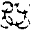

# 达变权禅师语录



> **藏经**：嘉兴大藏经（新文丰版）（嘉兴藏）　**册次** 第 29 册（J29）　**编号** JB248　**部类** 诸宗部　**卷次** 5 卷　**篇幅** 42,077 字

> **作者（译者）**：侍者海澂记录

> **卷／品**：5 卷 · 0 品



---



## 目录



- [达变权禅师语录卷第一](#达变权禅师语录卷第一)

- [达变权禅师语录卷第二](#达变权禅师语录卷第二)

- [达变权禅师语录卷第三](#达变权禅师语录卷第三)

- [达变权禅师语录卷第四](#达变权禅师语录卷第四)

- [达变权禅师语录卷第五](#达变权禅师语录卷第五)



---



灵峰达变禅师语录叙



大道虽曰现成，然非苦心精研者莫克证入；至理繇来平坦，然非铁骨负荷者未易传持。是以少室安心，必待立雪断臂之子；而黄梅大众，惟腰石负舂者入室禀受，为六传冢嫡。后世以轻慢心妄窥籓篱，几何不抉灭门户，使吾宗扫地哉？先德知其然，验以牢固重关、示以崄崖千仞、投以大火聚、摄以銕壁银山，受此任者不啻千二百斤担子。又如挂铠出门与万人敌，凡以平坦成现之道，不如是不足以尽其阃奥而穷其首尾。当吾世而得一勤苦进道、慎重法命之人，是真丛林之僧宝、法社之金城也。吾于灵峰达变禅师深有感焉。师少侍先天童，椎拂即称英衲，后乃得法于山翁老人，老人常称学众中参究精锐无逾师者。于师承边温研积稔，昕夕摩厉，或拈颂机缘，一言未契，至忘寝食，必求得当而后已。同学扣击，寸长不遗，参徒请益，虽祁寒溽暑不倦也。盍其严毅服物，类秀铁面；脱落形骸，类广无心；草衣菲食，清苦鍊行，类象骨头陀；典司众务，罔懈参承，类石霜监寺。故即其升堂、提唱，悉皆崭截提持，雄深峭拔，垂手为人处不失作家体裁。佛祖血脉，及尽玄微；衲子爪牙，通身透露。洵杰出英灵，纯钢铸就者耶！是以老人当师入室，而有门人益亲之喜；及师顺世，而尽然伤怀，谓天丧予。今复收拾遗录，为师点出末后光明，岂惟师一生苦心赖以不坠？殆亦悯斯道之荒落，示后流之标榜。老人鼓舞来学之意，极深厚矣。嗟乎！报缘影事，修短一期，虽法鼓晨裂，流星夜陨，而衲僧门下，一言半句，胸襟流出，匝地普天。是录既行世，必有环中契旨，言外知归者，师其不亡矣夫！



同门法弟鹿城冰庵张立廉拜题



------



## 达变权禅师语录卷第一



**译者**：侍者海澂记录



住明州慈谿县五磊山灵峰禅寺语录



佛殿。「释迦是长兄，弥勒是同学，互换主宾，递相酬醋。今朝正令既当行。」展坐具，云：「请看当阳者一著。」



伽蓝。「伽蓝真宰，护世、出世；辅弼丛林，辨魔、拣异。相与建法幢，莫负灵山记。」



祖堂。「拈华一脉，直至如今，如水入水、似金博金。祖祖相承无别事，三玄戈甲振丛林。」



据室。「据此室，行此令，秉吹毛剑，握大圆镜，斩钉截銕不容情，从教魔佛圣凡来乞命。为甚如此？祇贵印印无差，机机圆证。」



四众请就本寺开堂。拈疏。「言言见谛，句句超宗，珠回玉转，行布圆融。文彩未彰前荐得，密移一步看飞龙。」提法衣。「多子塔前亲付授，黄梅室内为传持，自从卢老收归后，须信人人总有之。彩霞簇，锦缝奇，一肩荷负更繇谁？千古万古作标格，犹待当来弥勒披。」



法座。「此座从来高广，佛祖次第出兴，个个扬尘播土，搅得海沸波腾，今日千差坐断，从教八面风清。」



拈香。「此一瓣香，诸佛不知，鬼神莫测，非阴阳之所生，岂锋刀之能剋？热向炉中，端为供养正觉世间主、有情世间主、器世间主，伏愿玅德尊寰宇，高明朗太虚，金轮统御四天下，兵气销为日月光，但见皇风成一片，不知何处有封疆？」次拈云：「此一瓣香，根盘空劫，叶覆穹苍，亘今亘古，为瑞为祥，奉为文经武纬，贵胤功勋，伏愿灵机弘圣道，真智利群生，旁分帝化为传持，玅印手持三界静。」复拈云：「此一瓣香，廿年参请，辛勤晓夜，孜孜切切，初於天童得名，后於灵峰得地，累次亲遭毒手，几翻绝后再稣，直得骨露皮穿，不敢囊藏被盖，端为供养即此堂上山翁大和尚，用酬法乳之恩。」遂敛衣敷坐。维那白椎，云：「法筵龙象众，当观第一义。」师云：「蓦然一击如雷吼，惊得虚空开笑口，万象森罗齐点首，明明历历太分剖。还有知音者麼？不妨共相证明。」僧问：「归根得旨即不问，斩新条令事如何？」师云：「万人遐仰处，红日正当空。」进云：「恁麼则龙得水时添意气，虎逢山色长威狞。」师云：「玅舞应须夸遍拍，三台须是大家催。」僧便喝，师云：「且放过一著。」僧复喝两喝，师云：「三喝、四喝后又作麼生？」僧遂归众。问：「昔日宝寿开堂，三圣推出一僧，寿便打，意旨如何？」师云：「正令当行。」进云：「既然如是，因甚三圣又道：『瞎却镇州一城人眼去在？』」师云：「疑杀天下人。」进云：「今日新灵峰升座，也不用棒、也不瞎却人眼，毕竟将何为人？」师云：「一句迥开三要印，烁迦眼出透金尘。」进云：「人平不语，水平不流。」师云：「赖得阇黎领话。」僧便喝，师便打，乃云：「十方同聚会，明明古佛家风；遍界绝遮拦，处处祖师巴鼻。楼阁云中僧世界，栴檀海岸老丛林，金风起而枯木龙吟，霜叶凋而寒嵒华散。林间鸟语共唱无生，岭上猿声深谭般若，落落风清三佛地，溶溶月朗四明州。直得人人顶门上辉大宝光，各各脚跟下纵横十字，果是超方作者，豁开正眼圆明，便乃透过百匝千重，不妨任意横三竖四。如是，则念念灵山出世，步步兜率下生，分别现曼殊之心，运用动普贤之行，头头引归宝所，味味尽是醍醐，然后以金刚剑剪除异见稠林，断贯索穿尽衲僧鼻孔，梯航三有，津济四生，堪报不报之恩，共助无为之化。正当恁麼时，流通正脉、扶竖纲宗一句又作麼生道？宝藏拨开於此日，千灯五叶转光新。」复举：「兴化和尚云：『三圣道：「逢人即不出，出则便为人。」兴化则不然，逢人即出，出则不为人。』雪嵒钦云：『二大老所谓一条拄杖两人舁，被天宁拗作两橛了也。』以拄杖倚左边，云：『且听各自平分。』」师云：「钦祖幸然拗折，今日不肖儿孙未免更将鸾胶为伊续起，逢人即出、逢人不出，两彩一赛，如箭中的。金凤衔华下彩楼，眼里瞳人吹觱栗，三台须是大家催，无限清风生八极。」白椎，云：「谛观法王法，法王法如是。」卓拄杖一下，下座。



勉参。「灵峰寺里开炉，炭墼家常尽有，更赖现前兄弟，竭力同心出手。轻轻拨动火柴头，烈燄亘天射牛斗，冷灰豆爆忽雷轰，丛林尽作师子吼。断送生蛇化活龙，差排古佛离窠臼，无宾主句火炉头，笑他赵老扬家丑。后来雪嵒钦又云：『不冷不热炉鞴，半真半假金鋀，铸作缾盘钗钏，却成品字柴头。』且道：与赵州无宾主话相去多少？若向者里缁素得出，二大老性命在诸仁手里；若缁素不出，诸仁性命却在山僧手里。」卓拄杖，云：「还委悉麼？莫向白云深处坐，好看千嶂起风雷。」



开炉，上堂。「烹佛烹祖大炉鞴，量等虚空包法界；煆凡煆圣恶钳锤，千手大悲亦皱眉。钝銕顽铜销烁尽，精金美玉转新奇，烈燄不容蚊蚋泊，何妨就里走神龟？把住则乾坤陡黑，放行则电卷风驰，顶门煆出金刚眼，炟赫光明彻四维。所以道：般若如大火聚、般若如清凉池，炽然大用，寂尔无为，洞然明白，何假思惟？纵横自在，得大总持。山僧如斯告报，祇贵直下知归，直饶与麼会得，更须知有向上全提。且道：如何是全提底意旨？」竖起拂子，云：「无边虚空包不住，直透威音那畔前。」复举：「死心和尚挟起火示僧，云：『唤作火则烧杀你，不唤作火则冻杀你。』今日试问诸仁：向者里作麼生回避？如回避不得，不妨与诸仁通个消息。」遂颂云：「烧杀冻杀，卒难回避，拟议才生，脑门著地。劝人除却是非难，点銕化成金即易，一踏鸿门两扇开，七通八达恣游戏，谩说明州布袋憨，腾腾任运了无寄。」



旨、超二上座募藏经入山，上堂，兼谢檀越斋。「量等大千经卷，谁知在一微尘？无量国中，难闻名字；河沙劫内，罕遇传持。幸有明眼衲僧，等闲剖出大藏、小藏、无尽藏；兼之大心居士，任运助转食轮、法轮、如意轮。不劳白马西来，关山远涉，祇以慈航东渡，稳载而归。安置毘卢楼阁之内，展开明窗净几之前。目睹而心心契合，指掌而念念圆明。一句入神，功超旷劫。在昔常啼东请、善财南询，至於剥皮刺血为纸墨、为求半偈舍全身，是皆为法轻生，知恩报德。然则顺佛理而报佛恩，无先弘法；阐佛日而开佛眼，祇贵明心。直得头头显露，处处全彰，所以诸佛体之号三菩提、菩萨修之称六度行、海慧变之为水、龙女献之为珠、天女散之为无著华、善友求之为如意宝、缘觉悟之为十二缘起、声闻证之为四谛人空，且道：在衲僧分上又作麼生？岳高顿落千峰势，海阔全消万派声。」复举：「僧问东山演祖云：『一代时教是个切脚，且道：切那个字？』祖云：『钵啰娘。』『学人祗问一字，如何却畣许多？』祖云：『七字八字。』」师云：「大小演祖与麼畣话，毕竟正文未曾道著。敢问现前兄弟，且道：如何是正文？」良久，云：「孔门弟子无人识，碧眼胡僧笑点头。」复颂云：「一代时教是个切脚，毕竟正文无人道著。当的帝都丁，必彬斑豹剥。圆通无碍底，七纵八横；局守一隅底，无绳自缚。义随文而文随义，历历明明；珠走盘而盘走珠，洒洒落落。」卓拄杖，云：「分明举似作家，切忌胡穿乱凿，就中演出玅伽陀，定慧圆明无住著。」



至节，小参。「滴水滴冻，止泺困鱼难转动；成块成团，水晶宫里玉龙蟠。十分紧俏风头硬，一片冰湖彻骨寒；无影树头霜色白，不萌枝上雪华攒。翻忆少林冷坐，分明特地无端；赚得神光断臂，觅心无处心安。於斯荐得，一了百当；於斯不荐，千难万难。亟须勇猛精进，朝夕废寝忘餐，拶到水穷山尽处，虚空粉碎髑髅乾，大似阳回大地，春满林峦，和风浩荡乾坤阔，佛日高县法界宽。」复举：「僧问洞山：『寒暑到来如何回避？』山云：『何不向无寒暑处回避？』僧云：『如何是无寒暑处？』山云：『寒时寒杀阇黎，热时热杀阇黎。』」师云：「洞山古佛虽则善赴来机，犹欠悟在。何故？不应话作两橛。若人检点得出，许你具一只眼。其或未然，不免颂出：寒时寒杀、热时热杀，灵利衲僧，如何超拔？脚跟线断得自繇，鼻端泥尽君休刮。黄阁帘垂家信通，紫罗帐合珍珠撒。阴阳寒暑不相干，千古万古阿剌剌。」



上堂。「日南长至，宫中添一线；及时应节，律管动飞灰。阴消阳长，暖气潜回，岸容待腊将舒柳，山意冲寒欲放梅。慈明揭榜僧堂，雕镌诸子；洞山掇退果桌，钝置英才。倚天长剑眉间挂，兔角龟毛眼里栽，是处全提大用，头头竖抹横该。一闻千悟底，如龙得水；根尘未脱底，似鸭闻雷。须透彻，莫依偎，偷心死尽眼睛活，銕壁银山尽豁开。且道：开后如何？十方刹海平如掌，爱日当阳处处辉。」



成道，上堂。「弃却王宫，直往雪山，六载翛然冷坐，万缘迥绝跻攀，容鹊巢於顶上，挂蛛网於眉弯，忽睹明星出现，廓然打破牢关，从兹辊出艸窠里，一个闲人天地间。且道：释迦老子即今在甚麼处？」卓拄杖，云：「来也，来也。在山僧拄杖头上高声唱言：『於一切法成最正觉，智入三世悉皆平等，吾身充满一切世间，吾音普顺十方国土。譬如虚空具含万象，於诸境界无所分别，又如虚空普遍一切，於诸国土平等随入，身恒遍坐一切道场，菩萨众中威光赫奕。』诸仁若向者里谛信得及，灵山一会俨然未散；你若稍或眼目定动，释迦老子又入琉璃古殿去也。山僧忍俊不禁，祇得重说偈言：真宗绝朕，大道无名，本来无坏，安得有成？万里云收午夜，一天星斗圆明。虽然拾得鼻孔，不知打失眼睛。凛凛真风吹遍界，丛林千古播佳声。」卓拄杖，下座。



除夜，小参。「岁复岁兮日复日，看看今夜又除夕，等闲白了少年头，一岁光阴又虚掷。己躬下事如未明，浪死虚生无利益，要於身后免沈沦，好向死前先畫策，莫教一息不来时，追悔从前空自责，直须打破死生关，一念万年无变革。然而至道无难，惟嫌拣择，心心不住，超宗越格，便能使得十二时，三际不分何间隔？逆顺纵横得自繇，捏聚依前又开辟。所以道：年来年去，去来不动乾坤；岁旧岁新，新旧一般时节。如是，则尘尘尔、刹刹尔、念念尔，正恁麼时，不涉新旧去来一句作麼生道？能为万象主，不逐四时凋。记得古人有颂云：『坐守空山岁又穷，夜堂相聚话西东，少林一曲无今古，自是诸方调不同。』新灵峰今晚不免效颦，贵要大家具眼。岁岁今宵曷有穷？循环如日转西东，旧新寒暑虽更改，底事明明绝异同。」



元旦，上堂。拈香。「一炉𦶟处，是处皆然，弥亘六合，香彻大千。九重腾瑞气，万国蔼祥烟，祇奉一人天地贵，从教诸道自分权。」敛衣敷坐，云：「三阳开泰，春归玉苑，洪钧气转，冻解银塘。七政顺序，四海安详，雨旸时若，物阜民康。兵器销为农器，征帆转作慈航，放牛於桃林之坞，归马於华山之阳。和风宛若慈风溥，舜日端如佛日长，直得人人悟毘卢性海，各各明本地风光。正与麼时，元正启祚，应时纳祐一句作麼生道？祇园今古饶春色，朵朵浑开薝卜香。」



罢炉，上堂，兼谢两序及知尼藏公斋。「东风渐暖，万木将新，崖前春水滑，云外鸟声频，水面冰浮似玉，枝头梅白如银。一一发明玅有，头头显露天真，觌面分明无向背，尘尘尽是本来人。有时把断要津，九十日中冰枯雪老；有时放开一线，华香日丽美景良辰。全放即收也，泥牛斗入海；全收即放也，一马生三寅。祇要诸仁净嬴嬴光吞万象，赤洒洒气绝诸尘，彻头彻尾，不昧元神，殷勤为解丁香结，放出枝头自在春。况复明眼知音，同心相照，手交肘臂，互作主宾，洗清佛日，助转法轮？更有垂手入廛，随方善应，打开宝藏，运出家珍，将折箸搅长河为酥酪，百味具足调匀，直得个个饱齁齁地，法喜禅说相亲，团𪢮共说无生话，一会灵峰万古新。正当今日，因斋庆赞即且置，祇如该罗万有一句作麼生道？」卓拄杖，云：「一气不言含有象，万灵何处谢无私？」



灯节，小参。「最胜良宵，上元佳节，银烛高烧，宝檀细𦶟，灯月交辉，处处不别。最分明，太皎洁，佛祖家风尽情漏渫，明眼衲僧如何分雪？果然盖色骑声，便解抽钉拔楔，从教万绪千端，自是七穿八穴。若也逐色随声，未免眼中著屑。问诸仁：瞥不瞥？若也瞥，万两黄金合消；若不瞥，吃水也须防噎。莫因循，当猛烈，声色堆中须打彻，为要诸仁气分同，山僧不是多饶舌。」复举：「东坡居士问蒋山佛慧泉禅师：『如何是智海之灯？』泉遽畣偈曰：『指出明明是甚麼？举头鹞子穿云过。从来者碗最希奇，解问灯人能几个？』东坡虽则欣然有会，蒋山未晚伤慈太杀。若是山僧，『如何是智海之灯？』」蓦召云：「大众！」众举首，乃云：「耿耿孤光常独耀，不劳挑剔照人寰。」



上堂。「山僧昨晚刚睡著时，梦见药师琉璃光如来与须弥灯光如来在十字街头同看鼇山灯火，药师如来应时及节而说偈言：『一灯能续百千灯，心印光通法令行，千圣不传吹不灭，联辉烈燄转分明。』於是，须弥灯光如来随声唱和：『慧灯不灭魔难入，智镜常明梦不侵，堪叹浮生瞌睡汉，从教万劫恣昏沈。』彼时，权长老从旁亦说偈言：『大矣哉！甚奇特！一灯照彻尘沙国，光辉八万四千土，土土皆作黄金色，四生六道一光中，祇为情生而智隔，直下分明须劋绝，莫待当来问弥勒。』大众！昨夜梦说禅，今朝禅说梦，自纳一场败阙，不合惊群动众。且道：权上座甚处败阙？明眼人前不得说梦。」卓拄杖，下座。



百丈忌，拈香。「堂堂师表，间气英雄，机先路活，顶门眼空。劋绝野狐知见，剖开佛祖心胸，倒行摩竭令，全露少林宗。儿孙遍界，克振家风，绳绳步武，王应金舂。恩大难酬何以报？旃檀一瓣𦶟炉中。」



皆然化士归山，上堂。「佛事门头不舍一法，东风一扇群华发；实际理地不受一尘，蟾穿潭底水无痕。无象无私春入律，不留不碍月行空；万象光吞无内外，微尘佛刹尽圆通。所以道：碧落青霄，道人活计；逆行顺化，衲子家风。行无缘慈，作不请友，才伸驴脚，便展佛手，见三下三，三三如九。杖头挑日月，须弥挂北斗，惊起东山水上行，吓得磨盘空里走，等闲一吸沧溟竭，差珍异宝般般有，满船载得月明归。无限清风生户牖，考钟伐鼓雁堂前，四海高流同聚首，果然一饱忘百饥，知音不用重分剖。正与麼时，大功不宰即且置，全提正令一句作麼生道？」卓拄杖，云：「域中日月纵横挂，一亘晴空万古春。」



涅槃，上堂。问：「本来不生，因甚世尊降生蓝毘尼园？」师云：「秦楼歌夜月。」进云：「本来不灭，因甚麼入灭双林树下？」师云：「魏殿舞春风。」进云：「祇如达磨大师葬於熊耳山前，因甚又只履西归？」师云：「也要你知者个消息。」进云：「某甲则不然，来去无留碍，卷舒任自繇。」师云：「且信你一半。」乃云：「老瞿昙没意智，才出胞胎，四顾称尊，因甚又往雪山，夜睹明星，方才瞥地？自说诸法寂灭相不可以言宣，因甚四十九年播土扬尘，三百餘会口劳舌沸？自说诸行无常是生灭法，因甚又道：於然灯佛所得值八百四千万亿那由他诸佛，悉皆供养承事，与夫无量劫中舍头目髓脑、国城妻子、象马七珍，修诸苦行，种种布施？自说於然灯佛所实无有法可得，因甚拈华示众，付属饮光，流通正法眼藏，与诸菩萨授阿耨多罗三藐三菩提记？自说常在灵鹫山及餘诸住处，因甚向拘尸那畔双林树下摩胸告众：『今日则有，明日则无。』椁示双趺，愈加一场钝置，传播将来，岁岁今朝，谓是涅槃时至。恰值化主殷勤办供，严备香华、灯烛、茶果、珍馐美味，不肖远孙因风吹火烧牛头旃檀，五分法身之香熏你鼻孔，使你无处回避。上来与麼哆哆和和，且道：是赞扬？是骂詈？」卓拄杖，云：「诸仁若向者里荐得，於其中间来去真无碍，卷舒信自繇，玅用纵横，得大善利。祇如为众竭力报佛深恩底人，毕竟功归何所？」卓拄杖，云：「玲珑八面活泼泼，千古万古振纲宗。」



大悲生日，升座。「今朝二月十九日，大悲菩萨降生辰，本来玅体无生灭，缘何示现大士身？为悯娑婆诸苦趣，所以分身遍刹尘。绀目澄清香水碧，月眉皎洁海门新。杨柳风清除热恼，净缾露冷洒灾迍。五浊波中施宝筏，红尘路上指迷津。尘中能作主，化外自来宾，三十二应游诸国土，千百亿化度脱沈沦，圆满净如空界月，照空今古绝疏亲。大众！分身应现即不问，且道：如何是真月？」良久，云：「休於天上觅，莫向水中寻。」卓拄杖，下座。



化士归山，上堂。「无上两足尊，佛种从缘起，六度四无量，任运不停止。为满足菩提，视身如敝屣，佛佛既皆然，祖祖亦如此。宝寿作街坊，为众如为己，忽闻无面目，便悟单传旨。南辰信手攀，北斗回身倚，光阴几百年，清风犹未已。阿谁头上没青天？彼既丈夫我亦尔，廓然当下心眼开，旷劫顿超一弹指，无边刹海掌中观。大地撮来粟粒米，供养十方罗汉僧，饥虚永绝咸欢喜。正法眼藏广流通，遍界优昙开火里。呵呵呵！委不委？一程不涉便归家，拟议白云千万里。」复举：「古人道：『智不到处切忌道著，道著则头角生。』前辈与麼说话，大似病鸟栖芦，太杀无转智。灵峰则不然，智不到处正好道著，雨洒嵒华，风生殿阁，诊候临时，应病与药，看孔著楔，解黏去缚，天马挨开大施门，震动乾坤星斗落。」卓拄杖，下座。



清明，上堂。僊石问：「禁烟令节，存亡感恸，斯辰猊座高登，未审如何指示？」师拈拄杖，云：「天上有星皆拱北，人间无水不朝东。」进云：「一句迥开，万灵有赖。」师云：「且道：甚麼人境界？」进云：「一把柳丝收不得，和烟搭在玉栏干。」师云：「休夸泽色黄金嫩，切忌西风匝地吹。」僧礼拜，乃云：「迅速韶光如电掣，看看又是清明节，万紫千红开畫图，不用安排与罗列。灵云一见两眉横，引得渔郎恣饶舌，鹧鸪啼处百华香，直截为人人不瞥。慎终追远世相传，拜埽先茔忙不迭，高低无限土馒头，薶没智愚与豪杰，纸钱灰满千家冢，哭到衰阳声哽咽。辘轳上下，浪死虚生，换面改头，百丑千拙。爱河渺渺几时枯？业海茫茫何日竭？要於当下免轮回[○@│]，须向此中亲打彻。叮咛我辈出家儿，办道身心须猛烈，放开胸次冷如冰，竖起脊梁硬似銕，不容豪发有淆讹，是佛是魔俱劋绝。果然大用现前，自是头头合辙，一毫不露处，何妨岳积山堆？万法全彰时，却又影沈光灭，卷舒出没自繇，应现千差万别，能挑海底金灯，善出眼中玉屑，钳锤十圣三贤，敕点飞龙跛鳖，传持无尽莫穷年，将此深心奉尘刹。然虽如是，犹属化门。不落诸缘一句作麼生道？」卓拄杖，云：「十方刹海无伦匹，千古万古独巍巍。」



上堂。僧问：「法座当轩容进步，德山托钵事如何？」师云：「残羹馊饭，不劳拈出。」进云：「雪峰道：『钟未鸣，鼓未响，托钵向甚麼处去？』山便归方丈。意旨如何？」师云：「风动水生纹。」进云：「峰举似岩头，头曰：『大小德山未会末后句。』甚处是他未会末后句？」师曰：「杀人刀，活人剑。」进云：「德山道：『汝不肯老僧那？』头便密启其意。如何是密启其意？」师云：「烂泥有刺。」进云：「德山来日上堂，头云：『且喜老汉会末后句。虽然，也只得三年活。』既会末后句，因甚只得三年？」师云：「如虫御木。」进云：「和尚与麼畣话，与古人还有优劣也无？」师云：「优则总优，劣则总劣。」进云：「水向石边流出冷，风从华里过来香。」师云：「且莫诈明头。」僧喝，师便打，僧礼拜，云：「无云生岭上，有月落波心。」师云：「犹是乱统。」乃云：「劫前运步，孰是知音？格外横身，谁当辨的？二听绝闻其响，五眼莫睹其形，直饶威音那畔承当，未免打作两橛，纵使却来者边行履，也应难许十全。有佛处，不得住，抹过恒河沙国土，春风孰道在华支？鸾凤不栖荆棘树。无佛处，急走过，锁梦关空成险堕，莫守寒嵒异艸青，休恋白云深处坐。有无不住绝商量，玅用纵横迥异常，热碗昼鸣翻古调，銕牛夜吼换新腔，蟭螟眼里放夜市。」卓拄杖，云：「须信吾宗别有长。」复举：「僧问洛浦：『供养百千诸佛，不如供养一个无心道人。未审百千诸佛有何过？无心道人有何德？』浦曰：『一片白云横谷口，几多归鸟尽迷巢？』后有尊宿云：『要识个中意，牛头尾上安。』山僧则不然，要会个中意，一老一不老。於斯明得，今日鉴明禅德领众居士挥金办供，施者不作施想、受者不作受想，彼此一念纯真，当体三轮空宗，功超五果四向，福等虚空无尽。於斯未明，大众二时应供，不得咬破一粒米。久参先德，何用忉忉？晚学初机，更为颂出：百千诸佛、无心道人，元无彼此，却有疏亲。夜蟾自是有圜缺，古镜从来不受尘。」卓拄杖，云：「者段家风谁会得？腾腾任运劫前春。」



晚参。举：「石霜禅师道：『初机未觏大事，先须识取头，其尾自至。』疏山参，问：『如何是头？』霜曰：『直须知有。』『如何是尾？』霜曰：『尽却今时。』『有头无尾时如何？』霜曰：『吐得黄金堪作甚麼？』『有尾无头时如何？』霜曰：『犹有依倚在。』『直得头尾相称时如何？』霜曰：『渠不作个解会，亦未许渠在。』后僧问九峰：『如何是头？』峰曰：『开眼不觉晓。』『如何是尾？』峰曰：『不坐万年床。』『有头无尾时如何？』峰曰：『终是不贵。』『有尾无头时如何？』峰曰：『虽饱无力。』『直得头尾相称时如何？』峰曰：『儿孙得力，室内不知。』」师云：「二大老与麼提持，虽是祭鬼神茶饭，鬼神也无猒足，山僧不免更著一分。『如何是头？』万年天子不封侯。『如何是尾？』四海五湖王化里。『有头无尾时如何？』潜龙勿用。『有尾无头时如何？』好所佛堂，而佛不圣。『如何是头尾相称底句？』夜明帘外排班立，空王殿上绝知音。且道：与古人相去多少？具眼者辨取。」



------



## 达变权禅师语录卷第二



**译者**：侍者海澂记录



住明州慈谿县五磊山灵峰禅寺语录



佛诞，请上堂。僧问：「本来不生，因甚降生於皇宫？」师云：「病眼见空华。」进云：「天上天下，唯我独尊。如何是独尊之旨？」师云：「倚天长剑逼人寒。」进云：「今日和尚现大人相，与世尊是同？是别？」师云：「直教他倒退三千里。」进云：「恁麼则昔日瞿昙，今朝和尚。」师云：「罕逢穿耳客，多见刻舟人。」问：「世尊初生，一手指天，一手指地，意旨如何？」师卓拄杖一下。进云：「祇如云门一棒打杀，又作麼生？」师云：「谁人知此意？令我忆南泉。」进云：「云在岭头闲不彻，水流涧下太忙生。」师云：「不是者个道理。」乃云：「大人境界，行海无穷。三僧祇劫，悲愿重重。未离兜率，已降皇宫。才生下地，浩气吞虹。指天上下，目顾西东。唯我独尊，三界大雄。四十九年，漫天布网。三百餘会，打凤罗龙。末后拈华，别展家风，单传教外，直指纲宗。人间天上，微尘刹海，西天此土，万古尊崇。如春在华，不施其功，自然开发，万紫千红。如及时雨，谁不歇仰？普润焦枯，悉皆生长。如大云起，弥覆穹苍，顿除热恼，遍界清凉。如大日轮，任运自在，照彻十方，豪无偏爱。所以道：刹尘心念可数知，大海中水可饮尽，虚空可量风可系，无能尽说佛功德。今逢降诞之辰，复有大心居士虔备香斋供佛及僧，更请不肖远孙曲录高升，举扬正法，报畣能仁。举扬即置，且道：世尊还来受供养也无？若来，世尊即今在甚麼处？若不来，又供养个甚麼？诸人向者里缁素得出，与大心居士立地成佛，永无退转。若缁素不出，普请同到大殿拈香上供，更为诸人说破。」



师到广润省觐，众请小参。问：「象驾远临，师资道重，同风千里无劳问，的的相承事若何？」师云：「象蹋恒河彻底过，大千百杂碎如尘。」进云：「古德道：『向上一路，千圣不传。』又有道：『向上一路，千圣不然。』祇如不传、不然，还有相承分也无？」师云：「刹竿头上仰莲心。」进云：「若不入水，争见长人？」师云：「涌金春色晚，吹落碧桃华。」进云：「如是则好将一滴曹谿水，散作波涛起济宗。」师云：「一片何人得？流经十万家。」乃云：「不来相而来，南岳天台知几回？不见相而见，千里同风常觌面。所以道：不出户，身遍十方；未入门，常在屋里。则何假觉城东际始见文殊，楼阁门开方参弥勒？故灵峰不异此处，此处即是灵峰。不肖虽与本师大和尚相别两月，殊不知夜暗昼明，时时省觐；折旋𫖯仰，步步追随，远溯威音已前，直至尽未来际，於其中间豪无间隔，有时拈尾作头、有时拈头作尾，君臣道合，宾主交参，一月印千江、千江同一月，况有十方英杰、四海高贤，手眼精明，同心相照，命不才凉德为众举扬？大似布鼓雷门，耀萤烈日，固知尘培巨岳难增鹫岭之高，然而露滴天池已接曹源正脉，不免更借堂头老人威光，向无言处演言、无法处说法，直得须弥岌峇、海沸波腾，白鹤峰走下平田浅水，玉几案跳上大梵天宫，惊起空中天鼓，出大音声，唱如是言：『若人欲识佛境界，当净其意如虚空，远离妄想及诸取，令心所向皆无碍。』合掌峰闻得，欢喜踊跃，赞言：『善哉！快说法要。』独有拄杖子直头不点，侧头觑道：『与麼提持，座主见解，未是衲僧极则处。』敢问诸仁：如何是衲僧极则处？」卓一下，云：「人居大国方知贵，水到潇湘一样清。记得佛眼禅师省觐东山云：『暂下莲峰轻屈指，光阴倏尔又三年，虽然不隔丝豪许，争似亲躬到座前？』龙门老人虽则胸襟流出，盖天盖地，理事圜融，拣点将来，向上关捩子犹未道著在。诸仁！若拣点得出，许伊顶门具眼、肘后有符；拣点不出，祇知事逐眼前过，不觉老从头上来。」



上堂。僧问：「世尊拈华，迦叶微笑，未审笑甚麼？」师云：「笑你漆桶不快。」进云：「古人一言之下，心地开通，因甚昨日上堂，今日又上堂？」师云：「重重相为，犹且不荐。」进云：「人人眼盍乾坤，个个鼻孔辽天，因甚不知其义？」师云：「怪山僧不得。」进云：「某甲礼拜去也。」师便打，乃云：「过去诸如来……」卓拄杖，云：「斯门已成就。现在诸菩萨……」卓拄杖，云：「今各人圜明。未来修学人……」卓拄杖，云：「当依如是法。所以道：佛佛授手，祖祖相传，能收能放，最玅最玄，有权有实，无党无偏。有时遇贱则贵，倾国莫能换；有时遇贵则贱，不值半文钱；有时向阿修罗宫打坐；有时向兜率内院安眠；有时遍界分身，尘尘独露；有时佛眼觑不见，密密绵绵。隐显纵横无间隔，从来千圣不同廛。完生禅者，为众竭力，念念纯真，炊无米饭，饱不饥人，成不可思议解脱，作无量殊胜奇特。虽然，福等须弥未是衲僧极则。若得桶底子脱、五色线断，一明一切明、一悟一切悟，一证永证、一得永得，顶门上如如不动、脚跟下了了常知，究竟将来犹是途路中事。且道：如何是到家一句？」良久，云：「还乡尽是儿孙事，祖父从来不出门。」



晚参。竖起拂子，云：「拾得大士来也，在拂子头上以梵音声宣说偈言：『佛哀三界子，总是亲男女，恐沈黑暗阬，示仪垂化度。尽登无上道，俱证菩提路，教尔痴众生，慧心勤觉悟。』不期掌教世尊闻得，即时踊出拄杖，头上亦演阿字伽陀，曰：『参禅学道莫轻狂，巽顺含容般若光，一念直教清似玉，万缘必使冷如霜。豁开耀日金刚眼，竖起撑天銕脊梁，拶得心华开发后，大千无处不馨香。』龙华教主闻得，挺身出众，扼腕立地，道：『瞿昙！瞿昙！出语成不逊，面皮厚三寸，好将八棱棒，一日打三顿。』於是世尊懡㦬而退。敢问见前兄弟：作麼生与黄面老人出气？」良久，卓拄杖，云：「当台一鉴明如日，万古晴空绝是非。」



结夏，小参。「九夏安居结制，遵行如来旧例，我等释子沙门，日用固宜审细，性天杲日当阳，切忌浮云遮蔽。古来守护蜡人，验尽衲僧私弊，要得大用见前，直下有无不系。欲报佛祖深恩，必也等心死誓，果然行解相应，自然与道默契，丝豪见惑淆讹，未免眼中有翳。大丈夫，须猛利，无明顿断非容易，单刀直入莫因循，彻底掀翻休拟议，万年一念绝支离，一念万年无变异，拶得心空及第时，一超直入如来地，遍界分身得自繇，出生入死恣游戏。然虽与麼，犹落今时，更须知有，天地不能盍载、日月不能照临、阴阳不能陶铸、寒暑不能变迁，名不得、状不得，不禁足护生、不安居结夏底毕竟如何话会？」竖拂子，云：「还委悉麼？填沟塞壑无人会，云自高飞水自流。」复举：「世尊在摩竭陀国说法，是时将白夏，乃谓阿难曰：『诸大弟子、人天四众，我尝说法不生敬仰。我今入因沙旧室中夏坐九旬，忽有人来问法，尔代我说：「一切法不生，一切法不灭。」』言讫，掩室而坐。」师云：「世尊虽则老婆心切、本分作家，殊不知特地一场翻成分外。何故？大似衒玉求售，预搔待痒。且道：淆讹在甚麼处？具眼者辨取。若辨不出，不免为蛇畫足去也。『一切法不生』，夜来明月上高峥，会得秋光净如练，五湖烟景有谁争？『一切法不灭』，金色头陀曾漏渫，水流涧下太忙生，云在岭头闲不彻。」



结夏，上堂。「勾芒退位，炎帝当权，四海高人罢摇金锡，二千年外风规元无间隔，三世如来法式不异丝豪。山僧今日与十方法界情与无情、学等无学、并见前兄弟踞菩萨乘，修寂灭行○，以大圜觉为我伽蓝，选佛场宏开，解脱门广启。诸仁向者里豁然悟入，则人人常光见前，各各壁立千仞，融通万有而混成，坐断要津而一致，不促一念、不涉三祇，直下无一丝豪头，遍界全彰奇特事。如是，则禁尽一切众生之足而无住相、断尽一切众生之命而无杀相。虽则长养圣胎，要且功勋不涉；虽则功勋不涉，何妨长养圣胎？所以道：理随事变，该万有而一片虚凝；事逐理融，等千差而咸归实际。全理全事、全放全收、全主全宾、全体全用即且置，无功用行一句作麼生道？」良久，云：「不起纤豪修学心，无相光中尝自在。」卓拄杖，下座。



天中节，上堂。「律转蕤宾日正长，刚才结夏又端阳，荷开水面撑天碧，梅熟枝头遍界香。金线细垂谿畔柳，玉梢高出上林篁，头头显露遮那体，拟议才生错较量。林下道人，不随世变，虽逢佳节，祇麼平尝。不用桃符咒水，何须烧酒雄黄？百怪千妖俱殄灭，土虺赤口悉薶藏。愿见黄河清彻底，普天匝地尽安祥，从来佛日无私化，炟赫圜明照万方。大众！此是诸佛如来圜觉境界，敢问如何是诸佛出身处？[○@卍]於斯明得，诸佛法身入我性，我性同共如来合；於此不明，光阴倏忽催人老，嫩绿骎骎已过墙。」卓拄杖，下座。



晚参。问：「乾坤之内，宇宙之间，中有一宝，秘在形山。今日龙象交参，请师当阳揭露。」师云：「辉天鉴地无人会。」进云：「恁麼则手执夜明符，几个知天晓？」师云：「自缘根力浅，莫怨太阳偏。」进云：「万古碧潭空界月，再三捞摝始应知。」师云：「却也费力不少。」乃举：「雪峰玅湛禅师云：『一切法无差，云门胡饼赵州茶，黄鹤楼中吹玉笛，江城五月落梅华，惭媿太原孚上座，五更闻鼓角，天晓弄琵琶。』古人与麼拈提，可谓不落宫商调，谁人和一场？伯牙何所措？此曲旧来长。是则固是，向上一窍毕竟不曾道著。山僧不惜眉毛，不免华擘一上。一切法无差，还须老作家，南山呼鳖鼻，平地摝鱼虾。暗里抽横骨，风前露爪牙，空中拏闪电，石上长油麻。不萌艸解藏香象，无底篮能著活蛇，白格树头鱼扇子，峰峦才露海云遮。诸仁言下知归，便明向上一窍，具眼者试道看。」众无语，摘下拂子，云：「须知云外千峰上，别有灵松带露寒。」



上堂。问：「设斋冯居士，庆生六月二，请师特举扬，世出世间事。敢问：如何是出世间事？」师云：「玉离荆岫寒光动，剑出丰城紫气浮。」进云：「如何是世出世间事？」师云：「天共白云晓，水和明月流。」进云：「恁麼则法施大众均沾，居士恩归有地。」师云：「恩归且置，如何是你本分事？」进云：「在者里。」师云：「认著依前还隔海。」僧礼拜，师便打。问：「多子塔前亲授记，黄梅队里独赢来，今日披登华王座，个中密意请深裁。」师云：「锡挂灵峰新日月，衣被庾岭旧云烟。」进云：「昔日阿难问迦叶：『世尊传金襕外，复传何物？』还是不知而问？为复知而故问？」师云：「不快漆桶。」进云：「迦叶召阿难，阿难应诺，斯时宾主历然，为甚人人道阿难不会？」师云：「却较些子。」进云：「迦叶道：『倒却门前刹竿著。』为是单明第一义？为复别有生涯？」师云：「焦砖打著连底冻。」进云：「恁麼则千圣共传无底钵，联芳不尽永馨香。」师云：「也不消得。」进云：「今日冯居士奉金襕供养和尚，和尚说何法祝寿？」师云：「祇将一滴曹源水，普润三千及大千。」进云：「恁麼迦叶犹在。」师云：「且教他过一边著。」问：「森罗及万象，昼夜演无生。祇如居士未生已前，且道：是何消息？」师云：「未问已前荐取。」进云：「才生时㘞地一声，是甚麼人境界？」师打，云：「还会麼？」进云：「当阳直截蒙师指，即今庆诞意如何？」师云：「月笼丹桂远，星拱北辰高。」进云：「祇将日月为天眼，指出须弥作寿山。」师云：「似则也似，是则未是。」僧礼拜，乃云：「无上福田衣，善哉解脱服，佛祖为传持，作人天眼目，龙披一缕时，鸟王便畏缩。鸡足山中勤守护，让之有餘；大庾岭头提不起，争之不足。如今披向华王座，孤光迥迥彩云簇。兹有大居士，生长居华屋，笃志慕佛乘，不享人天禄，种种玅庄严，办供来山谷，请我转法轮，高登曲录木。不辊雪峰毬，不唱云门曲，



直截为指南，六六三十六。以此灭诸殃，以此集众福，众罪如霜露，日出难藏蓄。百福似川流，到海能漩澓，寿量等虚空，非延而非促。黄河清兮出圣人，丹山穴定生𬸚鹫，为瑞为祥遍九垓，不假栴檀香馥郁。古来大有好风规，维摩前身是金粟，尽未来际无猒倦，便是如来真眷属。然虽与麼，未尽今时。及尽也，直得三世诸佛口挂壁上，犹有一人呵呵大笑。灵峰向者里拟著个眼，也要诸仁瞥地。还委悉麼？」卓拄杖，云：「那边不坐空王殿，荡荡无依鸟道玄。」



晚参。「光阴倏忽催人老，打办身心须及蚤，不觉安居两月过，浮生幻景难常保。莫教耳聩眼昏华，风火散时空懊恼，人人本具打不彻，祇为心田长蔓艸。不识衣中无价珍，波咤向外徒寻讨，饶君能说不能行，到头难免阎王考。若是男儿大丈夫，銕围山岳齐冲倒，虚空粉碎地平沈，翻转南辰作北斗。十方世界见全身，毛孔尽作师子吼，最胜无忧安隐幢，天龙寂听波旬走。报诸仁，须自剖，洁白不存岂容垢？禅说珍馐尚不餐，谁能更饮无明酒？二乘精进莫同俦，外道聪明难共偶，惯使金乌夜半明，毛群羽族失所守。脱却窦八破布衫，竖起寒山秃埽帚，掣电光中验正偏，大圜镜里分妍丑。颠倒阴阳掌握间，驱驰佛亦不知有，百千三昧恣游戏，方好宗门出只手。然虽与麼，究竟将来犹是寻常功干，直得进一步超越不可说不可说无量无边浮幢王刹、退一步坐断威音那畔更那畔，犹未是他住脚处。祇如不进不退时如何？」良久，云：「侬家不管兴亡事，一任和云占洞庭。」



解夏，小参。「九十光阴一刹那，己躬下事果如何？未能直截明斯旨，重叠关山路转多。须究彻，莫蹉跎，香象漂流为见河，一念不生全体见，横身三界绝笼罗。所以道：『知幻即离，不作方便』，圜裹十虚，本来成见。『离幻即觉，亦无渐次』，脚头脚底，横三竖四。祇为情生智隔，想变体殊，於日用中而不自觉，累他先德回首尘劳，向无方便中曲垂方便，划地为牢，加功用行，如将谷响千斤换得空华万片。殊不知？真实体上结解他不得、修证他不得，离名、离相，无住、无依，渠能生育天地、天地生育他不得，渠能长养万物、万物长养他不得，渠能建立一切、一切建立他不得，渠能破坏一切、一切破坏他不得，取不得、舍不得，不可得中只麼得。祇如不落进修一句作麼生道？任运常如痴兀人，他家自有通人爱。」复举：「世尊因自恣日，文殊三处度夏，迦叶欲白椎摈出，才拈椎，乃见百千万亿文殊，迦叶尽其神力，椎不能举，世尊遂问：『尔拟摈那个文殊？』迦叶无语。」师云：「试问见前兄弟：三个老古锥，其中还有优劣也无？若道有优劣，未具参学眼在；若道无优劣，参学眼在甚麼处？具眼者试定当看，定当不出，更打葛藤去也。『文殊三处过夏』，石灰布袋。『迦叶白椎欲摈出』，为他闲事长无明。『尔拟摈那个文殊』，老老大大，随人起倒。『迦叶无语』，气急杀人。不免更为颂出：脱体风流，千般卖俏，据令而行，不容朕兆。就中谁得？谁失？个里有玄有要。秋空月上万峰头，疏柳隄边刚落照。」卓拄杖，下座。



解夏，上堂，兼谢两序及尝如知浴斋。「朱明已去，大火西流，鲲腾北海，雁转南州。是处蝉声喿晚，连山木叶惊秋，乾坤一合地糊饼，日月两轮天气毬。至理洞明，会千差於物表；玄机独脱，融万象於毫头。尘尘不碍，法法全周，一夏已来，东语西话。荐得眉毛在否？便明关字相酬。透得底，丹霄独步；未透底，正好潜修。况有文殊、普贤同声相应，释迦、弥勒同气相求，垂手今时，劻勷祖道，挥戈佛日，光赞宗猷。更有赤心片片，真诚相为，入泥入水，自在优游，大似风行艸偃，浑如月载虚舟，遍界分身无量亿，百千师子一毛收。正恁麼时，九夏赏劳一句作麼生道？」卓拄杖，云：「豁开户牖无拘束，任运纵横得自繇。」



晚参。举：「大慈寰中禅师示众云：『说得一丈，不如行取一尺；说得一尺，不如行取一寸。』洞山曰：『我不恁麼道。』曰：『和尚作麼生？』山曰：『说取行不得底，行取说不得底。』云居云：『行时无说路，说时无行路，不说不行时，合行甚麼路？』洛浦云：『行说俱到，即本分事无；行说俱不到，即本分事在。』」师云：「此四则语，一则有宾无主、一则有主无宾、一则宾主俱无、一则全具宾主。若人缁素得出，许伊具透关眼；缁素不出，山僧更资一路去也。行说俱到，即本分事在；行说俱不到，即本分事无。诸仁者！还会麼？易商量，难辨别，山僧与麼告报，也是锢鏴上著生銕。参。」



晚参。举：「石屋禅师道：『月出海门东，金波浩渺渺，圜又圜不亏，明又明得好。寄语白兔翁，说与姮娥道，收彩不宜迟，潜光须及蚤。莫待黑云四面来，一天光彩都无了，世间惟有道人心，历劫至今常皎皎。』」师云：「知白守黑，居安虑危；密用潜行，薶光铲彩，还他石屋老人。美则甚美，大似独善其身、二乘见解。殊不知？心月孤圜，光明烜赫，风吹不入、雨洒不湿，日照不明、云遮不黑，也无失、也无得。既无得失，试问诸仁：毕竟如何受用？」卓拄杖，云：「成住坏空渠不坏，湛湛圜明无变革。」



中秋，上堂。问：「飒飒金风刚彻体，明明玉兔正怀胎，时节因缘即不问，当阳一句请师开。」师卓拄杖，云：「休於天上觅，莫向水中寻。」进云：「恁麼则光吞万象，气绝诸尘去也。」师云：「且道：是阿谁境界？」进云：「秋水共长天一色。」师云：「切莫诈明头。」乃云：「看看又是中秋节，人人庆赏咸欢说，玉露漙漙湿桂华，天风吹落黄金屑。晴空万里绝纤云，弥满一轮无空缺，一人举眉一轮明，十世古今都照彻。堪笑朱砂强畫成，谁知弄巧翻成拙？再三捞摝始应知，争似本来尝皎洁？马师玩，能定当，正好修行，正好供养，经入藏兮禅归海，独超物外真过量。寒山比，有深旨，澄湛寒潭光彻底，照见三千及大千，光吞万象无表里。小释迦，才卖弄，倒转枪旗倩尔用，泛泛端如五两轻，堆堆何啻千钧重？蹋翻沧海月沈空，大虫一啸清风送。灵山话，费周折，哆哆和和，列列挈挈，曼殊卖哑妆聋，释老摇唇鼓舌，搅得三千刹海浑，毕竟天无第二月。报诸仁，须劋绝，直饶一一透将来，也是循途而守辙。何也？畫饼不充饥，吃盐难救渴。毕竟如何？」掷下拂子，云：「百尺竿头得自繇，生机一路从来别。」



小参。「秋风凉，秋夜长，未归客，思故乡，旷劫流转三界，祇缘未彻宗纲。缁素莫分，镂冰作王；菽麦不辨，认奴作郎。赖有十方佛祖利生悲愿，不忘出没死生，如游园观，横身苦海，倒驾慈航，无奈劳生不醒，沈迷梦境颠狂。果是英灵汉子，岂肯自昧心王？不用思量卜度，祇贵直下承当。譬如广额屠儿放下屠刀，便言：『我是千佛中一数。』又如七岁龙女宝珠献上，疾往无垢世界坐大道场。为他一信永信，再无疑惑；一得永得，更不回皇。是则固是，直饶谛信无疑，犹是顺水推船。祇如迥出众流一句作麼生道？」掷下拄杖，云：「纵横逆顺无依倚，便是威音古愿王。」



重阳，上堂。「中秋才去，重阳便来，桂香已谢，丛蘜将开，佛果宜於心地种，觉华须向性田栽。既尔应时及节，何妨竖抹横该？正按旁敲，抚怜赤子；曲谭直指，提奖婴孩。一生取办无餘事，独有当年个善财，更有许多老宿，门庭冷若死灰。沩山拾橡栗为食，随家丰俭；大梅以荷叶为衣，善自剪裁。九年嵩岳何严冷？多载西峰甘活薶，不管红尘世外，从教白醭口堆。虽然不语，其声如雷，至於执爨负舂，不作不食，陆沈下版，腰石黄梅，个个铜头銕额，壁立万仞。崔嵬观今鉴古，堪笑堪哀，不惟拨无因果，更兼世谛阴媒。既落今时虎皮羊质，难免他日象耳鱼腮，惟冀本色衲僧四楞著地，真操实履共乐嵒隈，行解相应齐著力，大家挽取古风回。正当恁麼时，独脱无依一句又作麼生道？千差坐断无回互，天上人间不可陪。」



晚参。举：「应庵和尚道：『参学人切忌错用心，悟明见性是错用心，成佛作祖是错用心，看经讲教是错用心，行住坐卧、语言三昧是错用心，穿衣吃饭、屙屎送尿是错用心，一动一静、一往一来是错用心。更有一处错用心，归宗不敢与诸仁说破。何故？一字入公门，九牛抴不出。』」师云：「山僧则不然，更有一处错用心，要与诸仁说破。何故？文不在兹。毕竟如何？」良久，云：「鹅王择乳，素非鸭类。」



晚参。举：「夹山道：『眼不挂户，意不停玄，直得灵艸不生，犹是五天之位。珠光月魄不是出头时，此间无老僧，五路头无阇黎。』」师云：「诸仁者！既无老僧、又无阇黎，且道：夹山老子立地在甚处？於斯荐得，不惟捉败夹山，三世诸佛无出头分；於斯不明，莫谓夹山山势险，前头更有玅高峰。」



上堂。「金刚正体，圜裹十虚，古今同一际；般若智光，弥满六合，万化悉皆如。无去无来，大圜镜中彰玅相；非生非灭，沤华景里见全身。与麼会得，表里一如，本自尊严，天然成见。况淑德犹闲四教，母仪不媿三迁？早年持素，性洁秋霜；晚入空门，戒珠川媚。虽然，雪巢夜冷，凤阁香沈，须知明月半窗，蔼然和气。正恁麼时，孝子千日荐母尊严，毕竟向甚麼处安身立命？」竖拂子，云：「还委悉麼？一毫端上全身见，一一毫头浑不差，刹刹尘尘无别法，未曾抬步已归家。」复举：「那咤太子析肉还母、析骨还父，然后见本身，运大神力为父母说法。大众！骨肉既还父母了，唤甚麼作本身？於此不明，粉骨碎身未足酬；於此明得，一句了然超百亿。更为颂出：析骨还父，析肉还母，见出本身，超佛越祖，二听莫闻，五眼难睹。击金钟，敲瓦鼓，赵州关，云门普。洞彻当阳向上机，山河大地咸作舞，亦如千日放光明，十方照彻无今古。」卓拄杖，下座。



晚参。「大冶洪炉，陶铸精麤，流出万有，不假功夫。烹佛烹祖，能文能武，通上彻下，腾今燿古。规模镕尽，本无修证，万事临时，自然号令。识者罔措，面面相睹，独脱英灵，迥超迷悟。报君知，休莽卤，大道坦平，人心险阻，自生胡越，钉桩摇𫇛。所以，甜瓜彻蒂甜，苦瓠连根苦，果然一箭中红心，管教大地无寸土。有时劫火洞然，光烁烁地，不妨滴水滴冻，寒威威地；有时万丈寒冰中迸出亘天烈燄，不妨亘天烈燄里能结万丈寒冰。有如是奇特、有如是灵通，且道：是谁作主？」竖拂子，云：「还委悉麼？毘岚猛风吹不灭，联辉烈燄转光新。」



初祖忌，拈香。「遥观赤县神州，来接大乘根器，梁皇殿上全提，不契当阳直示。一语既不投机，合国人追弗至，九年默坐少林，滞货不离行市。若非断臂神光，几乎一场钝置，相传岁岁今朝，谓是西来祖忌，严设香华供养，聊表儿孙诚意。一瓣旃檀一盏茶，碎身难报意何赊？自从只履西归后，遍界时开五叶华。」



------



## 达变权禅师语录卷第三



**译者**：侍者海澂记录



住明州慈谿县五磊山灵峰禅寺语录



开炉，皆、尝二知浴请上堂。问：「九旬禁足，觅镜里之华；三月安居，捞水中之月。去此二途，不假功勋一句作麼生道？」师云：「铜头銕额如龙虎，天上人间得自繇。」进云：「恁麼则化外有天藏日月，就中无地著针锥。」师云：「还假功勋也无？」进云：「此夜一轮满，清光何处无？」师云：「引不著。」僧喝，师便打。问：「尽大地是个解脱道场，今日开炉结制，把住天下英灵，和尚是何心行？」师打，云：「也要你向者里荐取。」进云：「与麼则四威仪中皆是道，何须特意觅真宗？」师云：「只恐不是玉，是玉也大奇。」僧礼拜，师复打，乃云：「世界阔一丈，火炉阔一丈，火燄转法轮，十方悉通畅。此界与他方，廓彻无遮障，诸佛立地听，演出一大藏。缤纷天雨华，香飘梵天上，艸木与丛林，顺方咸低向。万象及森罗，昼夜同宣唱，刹说炽然说，玅义广无量。单明向上机，阿谁不仰望？更有如来禅，芦华雪月满平川，夜半正明晓不露，好谙父母未生前祖师意，千波竞起文殊智，一亘晴空遍吉床，法法头头无不是。入廛垂手，自他俱利，逆顺门高信脚登，不论山林与城市。乃至寒山烧火、拾得埽地，冷处著把、凉汤点沸，入水见长人，不负灵山记，洗涤如来净边垢，始契个中真实义。至於堂里坐禅，迥绝诸缘，打成一片无人会，推倒须弥浸玉蟾。堂外禅坐，精勤功课，运水搬柴，推砻抴磨，菩萨万行玅庄严，户底门头俱勘破。俱勘破，无别个，抹过三祇大劫修，翻笑如来成话堕。觑不破，莫放过，竖起銕脊梁，归堂且打坐。」



请上堂。问：「斋家祈福无穷，禅门渊深海阔，两重公案，请师分开。」师云：「知恩者少，负恩者多。」进云：「恁麼则法轮常转，佛日增辉去也。」师云：「且道：承谁恩力？」进云：「路逢剑客须呈剑，不是诗人莫献诗。」师云：「学语之流，一札千行。」乃云：「百千法门，同归方寸，道无南北，根有利钝。子韶月下闻蛙，当处豁然彻困，不用古锥饶舌，何必棒头三顿？河沙玅德，总在心源，万机顿赴，流出真言。庞公参马祖，西江一口吞，家私尽把沈湘水，自谓知恩解报恩。潜倪二居士，渠今又不然，家私亲运出，斋僧供圣贤。佛本圣中圣，弘愿广无边，法名大宝聚，僧乃无漏田，欲成无上道，先修般若缘。」卓拄杖，云：「以此报亲，一生成大孝；以此报国，万里静风烟。要明劫外，须契言前，顿令凡胎俗骨，便成大觉金僊。禅禅，曹洞以之，则正偏兼带；临济用之，则三要三玄。虽则本无缝罅，何妨七穴八穿？有时火燄里藏身，去来无迹；有时剑刃上走马，往返周旋。大海波心，红轮涌出；玅峰孤顶，白浪滔天。或时一毫端上，见出华藏世界；或时一毛孔里，收摄三千大千。未能一一透彻，都缘己见枯偏，须努力，痛加鞭。泥牛抴断龟毛索，兔角栏中任意眠则且置，祇如供佛斋僧，毕竟功归何所？」卓拄杖，云：「净智玅严功德聚，当人本体自周圜。」



雪子化士回，请上堂。问：「向上一路，佛祖窥觑无门。祇如集众升堂，又且如何话会？」师云：「野色更无山隔断，天光直与水相通。」进云：「还有佛法示人也无？」师云：「脚跟下与你一顿。」僧礼拜，云：「今日人天有赖，普众沾恩。」师云：「大有临河歇死人。」乃云：「目前无法，万里不挂片云；意在目前，四顾清风满座。不是目前法，威音那畔净赢赢，通上孤危；非耳目之所到，空劫已前赤洒洒，彻下险绝。实际理地，一了一切了；今事门头，一真一切真。随处作主，荆棘林中下脚；遇缘即宗，红尘堆里横身。转娑婆为极乐，变瓦砾作佳珍。二时吃饭，不曾咬破一粒米；终朝无说，时时常转法轮。无影对头，高县日月；没弦琴韵，曲奏阳春。大地山河，扬眉瞬目；对林水鸟，鼓舌摇唇。句句超佛越祖，言言觌面指陈。直得诸天欢喜，外魔胆丧，云行雨施，起凤腾鳞，乾闼婆王低回奏乐，阿修罗众息恶停瞋，头头显示空王令，艸偃风行，孰不遵会？须是一生取办，更莫教万劫因循。祇如为众竭力底人，毕竟如何受用？」竖拂子，云：「出群须是英灵子，将此深心奉刹尘。」



晚参。举：「僊宗守玼禅师因僧问：『十二时中常在底人，还消得人天供养也无？』玼曰：『消不得。』曰：『因甚消不得？』玼曰：『为尔常在。』曰：『祇如常不在底人，还消得也无？』玼曰：『驴年。』」师云：「诸仁者！常在底也消不得，常不在底也消不得，毕竟如何即得？」卓拄杖，云：「者里玉石不分，吃水也须防噎。」又卓拄杖，云：「者里缁素分明，万两黄金也合消。何也？透过金刚圈，嚼碎銕酸馅，一饱忘百饥，始信不相赚。」



至节，小参。「千谿水冷，万壑林凋，潭冰彻底，寒非一宵。正令潜施，地中雷复，化机密运，阳长阴消。物理有变革，时节不相饶，直得冰河燄起，石笋抽条，銕蛇横古路，彩凤舞丹霄，旷大劫来弹指顷，洞然元不异今朝。诸仁者！难除理障，易遣情尘，大地茫茫愁杀人，眼里无筋一世贫。生死牢关打不破，快须勇猛著精神，拶到水穷山尽处，心华开发少林春。记得僧问疏山仁禅师：『如何是冬来意？』仁云：『京师出大黄。』石屋颂云：『有问冬来意，京师出大黄，地炉深夜火，茶熟透缾香。』密老和尚云：『有问冬来意，京师出大黄，若人吞下肚，屙净一条肠。』」师云：「一人理上偏枯，一人事上不足。山僧又不然，有问冬来意，京师出大黄，若人玄会得，三界大医王。且道：与古人相去多少？具眼者试定当看。」



上堂。「孟冬薄寒，仲冬严寒，朔风如箭，射透重关。少室山前，冰枯雪老；曹谿路上，月白风高。野外横身霜凛凛，危然孤坐冷飕飕。一阳来复，君子道长；群阴剥尽，小人道消。翻忆大乘气象，求师立雪齐腰，堪嗟末法，去圣时遥，系驹伏鼠，外寂中摇，人心浇薄，古道寂寥，安得铜头銕额直透此宗？大似桶箍一爆，连底俱空，内空、外空、内外空，一通、一切通，打瓦鼓、应黄钟，风从虎兮云从龙，直饶与麼，犹在途中。祇如不涉阴阳寒暑，端坐家堂一句又且如何话会？」举拂子，复掷下，云：「动静不曾离本际，德云常在玅高峰。」



勉参。举：「大珠和尚道：『太虚不生灵智，真心不缘善恶。嗜欲深者机浅，是非交争者未通，触境生心者少定，寂寞忘机者慧沈，傲物高心者我壮，执空执有者皆愚，寻文取证者益滞，苦行求佛者俱迷，离心求佛者外道，执心是佛者为魔。』」师云：「古人与麼提持，於如来禅唱教门中足可观光，祖师禅未梦见在。试问见前兄弟，且道：祖师禅有甚长处？



选佛若无如是眼，宗风那得到如今？」



了知、信玄二禅人请上堂。「真宗离相，迥绝智愚；大道无形，原非顿渐。不减不增，无餘无欠，信彻灵玄，岂容瑕玷？圜明了知，不因心念，虽则不坏假名，究竟本无欣猒。尝露见前灵锋宝剑，神威凛凛，寒铓燄燄，冷光偪塞太虚空，天上人间渠独占。拟议才生，堕阬落堑，自是劳生日用差，休言般若无灵验。有灵验，绝支离……」卓拄杖，云：「个中消息子，能有几人知？大地撮来粟粒米，有时粒米作须弥，长河搅得成酥酪，杓柄灵通玅且奇。益无益，为无为，得力须忘饱，休粮更不饥。所以道：得之於心，伊兰转作旃檀对；失之於旨，甘露园中长蒺藜。况复年来衰落甚，道人多与道相违，应须痛念生平事，著意披襟好护持，旷大劫收弹指顷，灵山原不隔毫牦。正当今日，因斋庆赞且置，当头坐断，千眼顿开，透脱一路，又且如何举唱？」展拂子，云：「纵横玅展无私化，恰恰行从鸟道归。」



弘远禅人荐师，请上堂。问：「昔日渐源觅先师灵骨，石霜道：『白浪滔天。』今日某甲觅先师灵骨，未审和尚道个甚麼？」师云：「你向甚处著力？」僧便喝，师云：「者一喝未有主在。」进云：「渐源道：『正好著力。』某甲今日不用著力，灵骨分明。且道：与古人还有优劣也无？」师云：「牛头向南，马头向北。」进云：「祇如即今送入普同，四众瞻依，清风匝地，又作麼生？」师云：「你若会得，烦恼海中为雨露，无明山上起云雷。」进云：「与麼则水归大海波涛静，云到苍梧气象闲。」师云：「未必心头似口头。」僧礼拜，云：「谢和尚畣话。」师便打，乃云：「水银堕地，一圜一切圜；古镜当台，一照一切照。当处出生，明月印千江；随处灭尽，片云收碧落。峭巍巍，活卓卓，刹刹尘尘无住著，非心非佛绝罗笼，是圣是凡难捉摸，阴阳没处推迁，生死何能系缚？所以历劫不昧，亘古常存，无意道人之意，无门解脱之门，更有全提向上……」展拂子，云：「为君直指明言：夷平岳海，变化鹏鲲，万象之中身独露，廓周沙界最为尊。诸仁者！且道：戒微充公圜逝八九年来，毕竟向何处安身立命？」以拂子打○相，云：「圜湛一轮无空缺，孤光千古照乾坤。」



晚参。展拂子，云：「大道只在目前，谩言千圣不传，既善骑声盍色，何妨说玅谭玄？要且目前难睹，会得超佛越祖，矢上不用加鑯，堆上何须著土？欲识大道真体，洁白宁烦水洗？时中寸丝不挂，自然透顶透底，不离声色言语，直截当阳善举，纵饶举得分明，山僧未敢相许。何也？」卓拄杖，云：「者里不会，万别千差。」又卓一下，云：「者里会得，事同一家。屋后老梅开冷眼，风前銕树放新华，天共白云来宝盍，水和明月到天涯。更若不会，归堂吃茶。」



灵瑞禅人请上堂，兼谢众檀斋。问：「四众云臻请登座，当阳坐断古毘卢，七纵八横即不问，还有向上事也无？」师云：「万派皆归海，千山必仰宗。」进云：「剑轮锋上跑马，烈燄光中打毬，且道：因甚麼有如是奇特？」师云：「未是讶人机。」进云：「不许夜行刚把火，直须当道与人看。」师云：「且莫诈明头。」问：「西来大意即不问，家风端的事如何？」师打，云：「还会麼？」进云：「眼空四海乾坤廓，一天佳气出平常。」师云：「犹有金屑在。」进云：「尽大地是个解脱门，因甚把手抴他不入？」师云：「怪山僧不得。」进云：「人人鼻孔向下，为甚麼说个西来底道理？」师云：「为你漆桶不快。」问：「闺阁中即不问，向上宗乘事若何？」师云：「刹竿头上仰莲心。」进云：「恁麼则临机杀活吹毛利，棒下无生不让人。」师云：「如何是吹毛利？」僧便喝，师打，云：「菜刀子。」沙弥尼问：「不问有言、不问无言，和尚作麼生道？」师便打。进云：「除了者一棒，和尚还有麼？」师云：「礼拜著。」尼礼拜，师云：「坐断有无不问你，当机一句若为生？」尼无语，师复打，乃云：「横河众居士，办供到灵峰，菩提心一发，般若智无穷。击动虚空鼓，撞起月楼钟，请我转法轮，单提格外宗。金刚圈，栗棘蓬，吾道一贯破砂盆，无底钵公案两重，万户千门悉皆透过，四方八面无不包容。行布不碍圜融，有星皆拱北；圜融不碍行布，无水不朝东。果尔心华绽发，自然业影皆空，诸祥如雾集，众福似云从。曹谿洞帘卷，少林风起丛，禅河谩说无船渡，銕壁从来有路通，拨转乾坤归至化，顶门迸出一轮红。正与麼时，推功归本即不问，自他俱利一句作麼生道？灵瑞优昙华正发，大千香彻遍穹窿。」



梁湖玄、印、清三静主请上堂。「大智洞然，元无向背，何妨南北东西？灵机廓尔，岂有阶梯？不碍卷舒收放，一切处作奇特事，遍法界见随类身，大开无尽藏，广辟解脱门，启清净庄严，发难思愿海。何如玉种蓝田？不异华铺锦上，直得光前绝后，任运腾腾，金鸡解衔粒粟，供养罗汉圣僧，既已法轮常转，自然大用见前。洞山五位、济北三玄，天龙伸瘦指，庵主竖空拳，梁湖兰若敲金镫，五磊峰前驾銕船，陕府銕牛流出血，嘉州大象吃金鞭，透过单传直指，说甚大觉金僊？」展拂子，云：「还委悉麼？高县佛日𪸩寰寓，大阐宗风不尽年。」



请上堂。「大道体宽，无易无难。从无住本，流出万端天际。日上月下，槛前山深水寒。雪覆万年松径，云遮一带晴峦。百千楼阁空中见，十石油麻对上摊，一口西江都吸尽，卷归东海作波澜。芥子纳须弥，一有多种；须弥纳芥子，二无两般。分明垂示处，仔细好生观。昔日裴公见石霜，夺去象简；当时丹霞参马祖，弃却儒冠。利人即是自利，选佛胜如选官。然而常寂光中，休寻宝所；含元殿里，莫问长安。智暗祇因情识重，眼明多是髑髅乾。」卓拄杖，云：「更有一则见成公案，今朝四众云臻，请我当阳批判。供佛斋僧底，别甑炊香；开单展钵者，光明灿烂。毕竟车不横推，自是理无曲断。诸仁若也会得，一生大事成办，受用还他过量人，荷担须是英灵汉。不可毁，不可赞，福等虚空无畔岸，百亿恒河沙有穷，此功此德难推算。」蓦召大众，展拂子，云：「旃檀叶落古风清，无影树头华烂熳，三身四智体中圜，八解六通都一贯。」掷拂子，下座。



成道，上堂。「大威德世尊，弘誓深如海，为悯苦娑婆，劳生如傀儡。线断苦无穷，不觉亦不悔，故建精进幢，尝披忍辱铠。勇猛三大劫，利生心不改，示见舍皇宫，雪山曾六载。苦行受风霜，麻麦充饥𫗪，忽睹明星正眼开，豁然露出本光彩。悲体犹若戒雷震，慈意玅如大云叆，无能尽说佛功德，须信大功元不宰。流传岁岁今朝，谓是佛成道日，忝为不肖儿孙，大家忆念往昔。更有行念本瑜，倾出燕金赵壁，严设香华灯烛、酥酪醍醐之食，供养十方贤圣、调御天人师佛，虽然礼貌麤疏，毕竟臭味相入。大众！彼既丈夫我亦尔，毋得自轻而退屈，如水合水、空合空，本与如来同一质，将此深心奉刹尘，尽未来际莫休息。诸仁者！正与麼时，尽尘沙界处处供养世尊，且作麼生说个普同应供底意旨？还委悉麼？」良久，云：「请各严肃威仪，恭诣大殿，普同拈香。」



旦以化士回，请上堂。「道远乎哉？髑事而真，雪里梅华春信息，池中月色夜精神。圣远乎哉？体之则神，心法双忘犹隔妄，色空不二尚餘尘。室内许谁参化女？眼中休去觅瞳人。卷舒立方外乾坤，尘中能作主；纵横挂域中日月，化外自来宾。云布慈门，履真而不碍俗；波腾行海，涉有而不乖真。銕作脊梁骨，金铸坚实心，为众如为己，因深果亦深。香水搅将成法味，山河转变作黄金。」展拂子，云：「更有一著，超宗越格，千圣莫窥，万灵罔测。正眼圜明，威光烜赫，广长舌覆大千界，圜音响彻尘沙国。所以道：默时说，说时默，大施门开无壅塞，三贤十圣类难齐，𠠢利衲僧会不得。正与麼时，归根得旨即不问，该罗万有、玅应群机一句作麼生道？」卓拄杖，云：「钳锤佛祖定纲宗，拯拔劳生超轨则。」



除夜，小参。「恰值年穷岁尽时，大家活计猛提撕，未能俊鹘翻身疾，难免灵龟脱壳迟。迷去头头成室碍，悟来息息绝支离，机圜见彻无倚依，三界横身愈出奇。」复举：「北禅贤云：『年穷岁尽，无可与诸人分岁。老僧烹一头露地白牛，炊黍米饭，煮野菜羹，烧榾柮火，大家吃了，唱村田乐。何故？免见倚他门户傍他墙，刚被时人唤作郎。』」师云：「山僧抱愚守拙，虽与见前兄弟聚首空山，不烹露地牛、不唱村田乐，銕钉饭一任饱餐，木札羹凭君细嚼，随家丰俭，无适无莫。虽然，一味平常，免得安排造作。」



元旦，上堂，拈香。「此香一炷，价值大千，亘今亘古，不变不迁。举处法轮常转，𦶟时佛日高县，万国咸归至化里，万邦齐贺太平年。」敛衣敷坐，云：「元正启祚，豁开门户，身里出门，全机显露。一著阔一著，一步高一步，万物咸新，是处皆春。华开碓策，律转洪钧，充满乾坤大地，普遍刹海微尘。应时纳祐，种种成就，青山解走，瀑布不溜。宝掌千岁尚孩提，彭祖八百未出幼，庆无不宜，应节合时，千差万别，一句全提。即日恭惟头首大众起居多福所乐在，忘缘了道能知足，珍重众高流，共唱清平曲。清平且置，三阳开泰一句作麼生道？」卓拄杖，云：「昨夜春回空劫外，觉华香绽不萌支。」



灯节，晚参。举：「天童杰禅师云：『今朝上元节，是处挂灯毬，一灯然百千灯，灯灯相续，重重无尽，如宝丝网，三世诸佛向光影里出现、历代祖师向光影里说法度人、四圣六凡向光影里头出头没、山河大地向光影里成立。诸仁若信得及去，觅其光影来处了不可得，便乃坐断报化佛头。』」师云：「密庵老祖善说法要，大似久经行阵、惯战作家，箭箭不空、刀刀有力。然则从长简点将来，利即不无，害亦不少。何也？引得后代儿孙递相钝置，个个向光影里著到。毕竟如何得当？」良久，云：「人人尽欲出常流，折合还归炭里坐。」



罢炉，上堂，兼谢两序。问：「十方同聚会，个个学无为，此是选佛场，心空及第归。和尚今日解制，有多少人心空及第？」师云：「纵目所观。」进云：「恁麼则无漏国中留不住，出头天外任人看。」师云：「结解同时句又作麼生道？」僧呈坐具，师打，云：「乱统作麼？」僧喝，师连棒打出，乃云：「春光已半月，春雪满林壑，百艸不萌芽，蛰虫梦未觉。谩言大地白漫漫，红日一舒光烁烁，独有庭前露柱，年年祇麼平常，也不諠哗，亦不寂寞，人人道彼饱丛林，孰知渠也难名邈？更有灯笼体透玲珑，心空眼活，左右匡维时协赞，胜如普化摇铃铎，渠侬长得无事安间。诸仁！莫若一时放却，已透关者自然七纵八横，未透关者难免无绳自缚。噫歔嘻！能展拓，五浊海底辗屎猪，拗折祥麟一只角。报君知，委不委？眉毛罅里清风起，直饶大千刹海都游遍……」掷下拄杖，云：「究竟将来不如者里。」



百丈忌，拈香。「迅雷吼碎虚空骨，三日耳聋善举扬。佛祖典刑为第一，天人师表世无双，华中优钵人中杰，法中骨髓僧中王。兴礼乐，定宗纲，不作不贪，大智惟昌。刹海尽皆蒙化育，支那谁不被恩光？莫谓真归无处觅，分明觌面不曾藏，碎身粉骨难酬报，竭尽微诚一炷香。」



涅槃，上堂。举：「世尊临入涅槃，以手摩胸，普告人天大众曰：『尔等谛观吾紫磨金色之身，瞻仰取足，莫令后悔。若言吾灭度，非吾弟子；若言吾不灭度，亦非吾弟子。』时百万亿众悉皆契悟。」师云：「山僧今日与麼举，诸仁与麼听，还得契悟也无？果然契悟，便与释迦老子把手共行，同一受用。其或未然，莫道不疑好。不免更为颂出：黄面瞿昙，自倒自起，四十九年，巧说道理。临行犹自卖弄口策，摩胸示寂归何处？觌露堂堂人不委。人若委，尽善美，桃华岁岁笑春风，鹧鸪啼在深华里。试问见前兄弟：还委悉麼？如不委，且到大殿拈香上供。」



大悲生日，升座。僧问：「大悲千手眼，三十二应身，称名齐赴感，无物不沾均。敢问是神通玅用？为复法尔如然？」师云：「坐断两头，当阳不住。」进云：「将钱买糊饼，放下手来却是馒头，此意如何？」师云：「任伊造作千般，到底无过是面。」进云：「今日慈云普覆，法雨均施，圜通大士在甚麼处？」师便打，僧礼拜，云：「棒头有眼明如日，要识真金火里看。」师云：「且信你一半。」乃云：「净法界身，言端语真，风清月白，万古长春。本无出没，不存窠堀，遍界全彰，通身绵密。大悲愿力，不休不息，时时示人，时人不识。示见受生，激浊扬清，高低普应，玅用纵横。泥捏金刚水里走，笔描菩萨火中行。是则固是，若约衲僧门下，天地县殊。何也？不见道？闻声悟道，见色明心。观世音菩萨将钱买糊饼，放下手来却是馒头。能杀、能活，能锥、能钩，有权、有实，有放、有收，以楔出楔，看篓打篓，一趯趯翻四大海，一拳拳倒毒蜃楼，微雨洒华千点泪，澹烟笼竹一堆愁，八角磨盘空里转，玲珑殿阁语风瓯。千差万别，悉了元繇且置，祇如大悲菩萨千手眼，且道：那个是正眼？」掷下拂子，云：「通身照尽无遗影，千眼都来一只收。」



上堂。「今朝又是清明节，寒食禁烟思古哲，鸟啼绿树语含愁，人哭荒郊泪成血，生生死死没了期，



祇为此关打不彻。打得彻，空诸结，智竭情枯无恼热，万年一念绝思惟，一念万年无空缺。无空缺，瞥不瞥，直饶玄会得，眼中犹著屑。不著屑，真奇绝，尘尘刹刹炽然说，万紫千红烂熳开，华底灵禽更饶舌。且道：说个甚麼？」以拂子击香几，云：「任从沧海变，终不为君通。」



结夏，上堂。「圜觉伽蓝，宽若十虚无际；大光明藏，皎如千日齐辉。微尘佛刹，如来总此安居；海会云来，菩萨悉同休夏。延一念作僧祇、促僧祇为一念，无有丝毫增相、无有丝毫减相，无有丝毫异相、无有丝毫同相，一道平等，浩然大均。诸仁直下知归，一生参学事毕。傥若情存取舍，尚昧见闻，劳他古圣垂慈，向无方便中曲垂方便，九旬禁足，三月护生。念念攀缘，刮龟毛於銕牛背上；心心永寂，截兔角於石女腰边。莫作奇特商量，亦非玄玅解会。」以拂子划，云：「若向者里挨得一缝开、拶得一线入，则无边刹海不隔毫端、十世古今不离当念。刹那了却，弹指圜成，便知恒沙如来据虎头，山僧随例收虎尾，十方刹海诸菩萨，大家踊跃生欢喜。祇如不落阶差修证一句，又且如何话会？」横按拄杖，云：「任运常如痴兀人，他家自有通人爱。」



------



## 达变权禅师语录卷第四



**译者**：侍者海澂记录



颂古



赵州示众云：「兄弟！若从南方来者，即与下载；若从北方来者，即与装载。所以道：近上人问道即失道，近下人问道即得道。兄弟！正人说邪法，邪法亦随正；邪人说正法，正法亦随邪。诸方难见易识，我者里易见难识。」



老禅将，韬略长。瓜分南北，细品雌黄。下载与装载，利钝展锋芒。三世诸佛不识，讵容取次承当？蟾彰千涧高低月，春转寰中远近香。



东坡居士参东林总禅师，总与论无情话有省，遂献投机偈云：「谿声便是广长舌，山色无非清净身，夜来八万四千偈，他日如何举似人？」后圆智证悟法师参护国此庵元禅师，法师举东坡宿东林偈，且曰：「也不易到此田地。」庵曰：「尚未见路径，何言到耶？」曰：「祇如他道：『谿声便是广长舌，山色岂非清净身？』若不到此田地，如何有者个消息？」庵曰：「是门外汉耳。」曰：「和尚不吝，可为说破。」庵曰：「却从者里猛著精彩觑捕看。若觑捕得他破，则亦知本命元辰落著处。」师通夕不寐，及晓钟鸣，去其秘蓄，以前偈别曰：「东坡居士太饶舌，声色关中欲透身，谿若是声山是色，无山无水好愁人。」



劫外今时无彼此，从来换步不移身。咄哉彼此何偏颇？一向潇湘一向秦。争似两头坐断，何妨拨转乾坤？华山分破无多子，独拔无门解脱门。



古隄和尚寻常见僧来，每云：「去！汝无佛性。」僧无对。或有对者，莫契其旨。一日，仰山到参，师云：「汝无佛性。」山叉手，近前应诺。师笑曰：「子甚处得此三昧？」仰曰：「我从沩山得。」复问：「和尚从谁得？」师曰：「我从章敬得。」



几个师僧无佛性？玅药难救膏肓病。叉手近前能识宗，自然上恭而下敬。彼此三昧有师承，主宾互换全正令。一对鸳鸯戏水湄，啾啾篱雀难同泳。



日子和尚因亚谿来参，师作起势，谿曰：「者老山鬼犹见某甲在。」师曰：「罪过！罪过！适来失祇对。」谿欲进语，师叱之，谿曰：「大阵当前，不妨难御。」师曰：「是！是！」谿曰：「不是！不是！」赵州云：「可怜两个汉，不会转身句。」



寒山语拾得：「笑有参差没孔窍，无腔韵出高低调，转身不会可怜生，明明一句三玄要。」



香严上堂：「若论此事，如人上树，口衔对枝，脚不蹋枝，手不攀枝，对下忽有人问：『如何是祖师西来意？』不对他，又违他所问；若对他，又丧身失命。当恁麼时，作麼生即得？」时有虎头招上座出众云：「对上即不问，未上对时，请和尚道。」师乃呵呵大笑。



未举已前先荐得，从教节外又生枝，咬人师子全生杀，忍俊韩卢没了期。未上对，也大奇，呵呵一笑少人知。



长生皎然禅师常访一庵主款话，庵主曰：「近有一僧问某甲西来意，遂举拂子示之，不知还得也无？」师曰：「争敢道得与不得？」师却问：「有人问庵主：『此事有人保任，如虎头带角；有人嫌弃，则不直半文钱。此事为什麼毁誉不同？』请试拣出看。」曰：「适来出自偶然，争拣得出？」师曰：「若恁麼，此后不得为人。」



胡来胡现，是贼识贼。舌头无骨利如锋，烂泥有刺人难测。人难测，落霞与孤鹜齐飞，秋水共长天一色。



龙峻和尚因僧问：「如何是不知善恶底人？」师曰：「千圣近不得。」曰：「此人还知有向上事也无？」师曰：「不知。」曰：「为什麼不知？」师曰：「不识善恶，说什麼向上事？」曰：「如何？」师曰：「不见道：犴俗。」



不识善恶，洒洒落落。向上亦不知，千圣难凑泊。毫牦系念不平常，未免畫地为牢，无绳而自缚。



睡龙和尚因僧问：「如何是触目菩提？」师以杖趁之，僧乃走，师曰：「住！住！向后莫错举似人。」



畣在问处，更不周遮。重重相为，举向作家。落花有意随流水，流水无心恋落花。



地藏和尚问僧：「什麼处来？」曰：「秦州来。」师曰：「将得什麼物来？」曰：「不将得物来。」师曰：「汝为什麼对众谩语？」其僧无对。



来问若成风，应机非善巧。三搭不回头，笑破衲僧口。饥逢王膳不能食，百城烟水何时了？



僧问云居膺禅师：「羚羊挂角时如何？」师曰：「六六三十六。」复曰：「会麼？」曰：「不会。」师曰：「不见道：无踪迹。」



羚羊挂角，迥绝罗笼，通身无影像，遍界绝行踪。虽无牙爪甚威狞，猎犬难寻谁敢触？刚触著，转辘辘，六六依然三十六。



鼓山智岳禅师因僧问：「虚空还解作用也无？」师拈起拄杖，云：「个师僧好打。」



针芥相投，运斤成风。奔流度刃，不见痕踪。龙袖拂开山岳震，虚空迸出电光红。



大颠初参石头，头问：「那个是汝心？」师曰：「见言语者是。」头便喝出。经旬日，师却问：「前者既不是，除此外，何者是心？」头曰：「除却扬眉瞬目将心来。」师曰：「无心可将来。」头曰：「原来有心，何言无心？无心尽同谤。」师於言下大悟。



言语相呈浑不是，扬眉瞬目亦须蠲，水尽山穷难进步，蓦然一指路通天。路通天，绝正偏，虚空背上驾銕船。



香严上堂，僧问：「不求诸圣，不重己灵时如何？」严曰：「万机休罢，千圣不携。」疏山禅师在众，作欧声曰：「是何言欤？」严闻便下座，曰：「适对此僧，必有不是，致招师叔如是。未审过在甚麼处？」师曰：「万机休罢，犹有物在。千圣不携，亦从人得。如何无过？」严曰：「却请师叔道。」师曰：「若教某甲道，须还师资礼始得。」严乃礼拜，蹑前问师曰：「何不道肯诺不得全？」严曰：「肯又肯个甚麼？诺又诺於阿谁？」师曰：「肯即肯他千圣，诺即诺於己灵。」严曰：「师叔恁麼道，向去倒屙三十年在。」师后问镜清：「肯诺不得全，子作麼生会？」清曰：「全归肯诺。」师曰：「不得全又作麼生？」清曰：「个中无肯路。」师曰：「始惬病僧意。」



己灵诸圣海中沤，休罢不携腊月扇。拳踢相应机副机，胡来汉现箭中箭。龙象蹴踏，跛驴难见。肯诺不得全，清风生八面。快须著眼看僊人，莫看僊人手中扇。



洞山因僧问：「三身之中，阿那身不堕众数？」山曰：「吾尝於此切。」后有问曹山：「先师道：『吾尝於此切。』意作麼生？」曹山云：「要头即斫将去。」又问雪峰，雪峰以拄杖趁云：「我亦曾到洞山来。」



吾尝此切，不堕众数。夜半正明，天晓不露。要头斫去隐寒芒，满口含霜何用诉？打趁曾到洞山来，电光影里分缁素。阿呵呵，悟不悟？三个老古锥，同行不同步。



曹山因僧问：「常在生死海中沈没者是什麼人？」师曰：「第二月。」曰：「还求出离也无？」师曰：「也求出离，只是无路。」曰：「出离，什麼人接得伊？」师曰：「担銕枷者。」



生死海，第二月，迷真认影何时歇？不用别处求出离，当下翻身自超越。顿超越，得自繇，更嫌何处不风流？



曹山因僧问：「鲁祖面壁，意旨如何？」山掩耳。



动弦别曲，叶落知秋。若非作者，孰辨端繇？有意气时添意气，不风流处转风流。



雪峰因僧问：「古人道：『觌面相呈。』时如何？」师曰：「是。」曰：「如何是觌面相呈？」师曰：「苍天！苍天！」



觌面相呈，是也无端。含元殿里，谁觅长安？可怜不遇知音者，空把瑶琴对面弹。



僧问乾峰：「十方婆伽梵，一路涅槃门，未审路头在甚麼处？」峰以拄杖划云：「在者里。」云门拈起扇子云：「扇子𨁝跳上三十三天，筑著帝释鼻孔，东海鲤鱼打一棒，雨似盆倾。会麼？」



乾峰拄杖云门扇，掣电光中看转变，堂堂对面眼麻眯，涅槃有路无人荐。有人荐，鲤鱼𨁝跳雨盆倾，流出桃华千万片。



僧问报慈藏屿禅师：「情生智隔，想变体殊。祇如情未生时如何？」师云：「隔。」云：「情未生时隔个甚麼？」师曰：「者个梢郎子未遇人在。」



情未生时直言隔，悠悠寒角发孤城，一种是声无限意，有堪听有不堪听。



兴化因后唐庄宗幸河北，回魏府行宫，诏师问曰：「朕取中原，获得一宝，未曾有人酬价。」师曰：「请陛下宝看。」帝以两手舒襆头脚，师曰：「君王之宝，谁敢酬价？」玄觉徵云：「且道：兴化肯庄宗？不肯庄宗？若肯庄宗，兴化眼在甚麼处？若不肯庄宗，过在甚麼处？」



两手擎来问法王，中原一宝不囊藏。知音自是能明鉴，直得光辉满大唐。



僧问云门：「如何是清净法身？」门云：「华药栏。」曰：「便恁麼去时如何？」门云：「金毛师子。」



清净法身华药栏，一句全提绝潦倒。便与麼，休草草，金毛师子旋风埽。三千里外见淆讹，几个衲僧有眼脑？



僧问曹山：「如何是师子？」山曰：「众兽近不得。」「如何是师子儿？」山曰：「能吞父母者。」曰：「既是众兽近不得，因甚却被儿吞？」山曰：「子若哮吼，祖父母俱丧。」曰：「只如祖父母还尽也无？」山曰：「亦尽。」曰：「尽后如何？」山曰：「全身归父。」曰：「前来为甚麼道祖父亦尽？」山曰：「不见道：王子能成一国之事，枯木上更撒些子华。」



众兽近不得，因甚被儿吞？为伊能哮吼，纤毫影不存。全身既归父，大用体全真。苔生玉殿巍然贵，枯木华开遍界春。



智门钦禅师因僧问：「两镜相对，为什麼中间无相？」师曰：「自己亦须隐。」曰：「镜破台亡时如何？」师竖起拳。



两镜相对元无相，百亿须弥不见踪，镜破台亡全体现，銕船高驾太虚空。



广德周禅师因僧问：「承教有言：『阿逸多不断烦恼、不修禅定，佛记此人成佛无疑。』此理如何？」师曰：「盐又尽，炭又无。」曰：「盐尽炭无时如何？」师曰：「愁人莫向愁人说，说向愁人愁杀人。」



不求真，不断妄，了无欣猒真过量。荡尽家私彻骨穷，风流潇洒襟怀旷。相逢果有知音知，面面好风来席上。



黄龙机禅师因僧问：「不问祖佛边事，如何是平常之事？」师曰：「我住山得十五年也。」



来问平常事，山居十五年，镇日闲闲地，常时坦坦然。鸟啼修竹里，华笑碧崖前，尽情俱吐露，莫作俗流传。



玄泉第二世和尚因僧问：「辞穷理尽时如何？」师曰：「不入理，岂同尽？」



万里无云天吃棒，须知别有好家风。灵文海藏诠不及，今昔贯穿绝始终。一片风光描不就，至尊至贵许谁同？



龙穴山和尚因僧问：「大善知识为甚麼却与土地烧钱？」师云：「彼上人者难为酬对。」



土地烧钱，冷处著把。问有来繇，畣无虚假。彼难酬对，曲高和寡。言中有响，潇潇洒洒。潇洒绝，碧眼胡僧难辨别。



韶国师有时谓众曰：「大凡言句，应须绝渗漏始得。」时有僧问：「如何是绝渗漏底句？」师曰：「汝口似鼻孔。」



口如鼻孔眼如眉，石女能吟白雪诗。昨夜虚空开口笑，木人生得石竿儿。



韶国师因僧问：「𫇛棹俱停，如何得到彼岸？」师曰：「庆汝平生。」



彼岸何曾离当处？若谙停棹便通玄。衲僧荐得风前旨，直截分明玅莫传。



报慈文遂禅师问僧：「从什麼处来？」曰：「抚州曹山来。」师曰：「几程到此？」曰：「七程。」师曰：「行却许多山林谿涧，何者是汝自己？」曰：「总是。」师曰：「众生颠倒，认物为己。」曰：「如何是学人自己？」师曰：「总是。」



大地山河俱是宝，不识之人入荒艸，依稀彷佛眼未开，拈却鼻孔无处讨。杀人剑，活人刀，起死回生手段高。



云居清锡禅师因僧问：「古人有言：『释迦与我同参。』未审参何人？」师曰：「唯有同参方得知。」曰：「未审此人如何亲近？」师曰：「恁麼则不解参也。」



与佛同参谁辨的？元无彼此绝疏亲。琉璃古殿浸明月，端拱何曾有二人？拟亲近，隔关津，错过威音劫外春。



永明寿禅师因僧问：「如何是永明玅旨？」师曰：「更添香著。」曰：「谢师指示。」师曰：「且喜没交涉。」仍有偈曰：「欲识永明旨，门前一湖水，日照光明生，风吹波浪起。」



欲识祖师玄玅旨，添香拨火谁能委？一湖吞尽大千界，万象光含无表里，迷头认影不相当，对面白云千万里。



南泉山下有一庵主，人谓曰：「近日南泉和尚出世，何不去礼见？」主曰：「非但南泉出世，直饶千佛出兴，我亦不去。」师闻，乃令赵州去勘。州去便设拜，主不顾。州从东过西，又从西过东，主亦不顾。州曰：「艸贼大败。」遂拽下帘子，便归举似，师曰：「我从来疑著者汉。」次日，与沙弥携茶一缾、盏三只到庵，掷向地上，乃曰：「昨日底！昨日底！」主曰：「昨日底是甚麼？」师於沙弥背上拍一下，曰：「赚我来！赚我来！」拂袖便回。



好个担板汉，横身一条銕，智勇李将军，两度拗不折。出师重决龙蛇阵，当锋连下顶门楔，马陵道下死庞涓，千古英雄常泪血。



百丈惟政禅师。有老宿见日影透窗，问师：「为复窗就日？日就窗？」师曰：「长老房中有客，归去好。」



问来隐密，畣不囊藏，运筹帷幄，捉贼擒王。蓦唤一声归去好，和云带露湿秋光。



郦村自满禅师上堂：「古今不异，法尔如然，更复何也？虽然如此，者个事大有人罔措在。」僧问：「不落古今，请师直道。」师曰：「情知尔罔措。」僧欲进语，师曰：「将谓老僧落伊古今。」曰：「如何即是？」师曰：「鱼腾碧汉，阶级难飞。」曰：「如何免得此过？」师曰：「若是龙形，谁论高下？」僧礼拜，师曰：「苦哉！屈哉！谁人似我？」



迥绝威音与目前，古今不落本天然，拟求直道翻成曲，蚤隔程途万八千。欲免过，转堪怜，天上人间谁似我？驱雷掣电鼓风烟。



南源道明禅师上堂：「快马一鞭，至人一言。有事何不出头来？无事各自珍重！」僧问：「一言作麼生？」师乃吐舌云：「待我有广长舌相，即向汝道。」



一言吐出最亲切，舌相圆音彻大千，不是僊陀难凑泊，抬眸鹞子过西天。



西堂智藏禅师普请次，曰：「因果历然，争奈何？争奈何？」时有僧出，以手托地，师曰：「作甚麼？」曰：「相救！相救！」师曰：「大众！者个师僧犹较些子。」僧拂袖便走，师曰：「狮子身中虫，自食狮子肉。」



无风浪起，有事有理；随机应变，摇头摆尾。电影才收，脑后星流。一抬一搦善锥钩，收虎尾兮踞虎头。



华林善觉禅师，因观察使裴休相访。问曰：「还有侍者否？」师曰：「有一两个，祇是不可见客。」裴曰：「在甚麼处？」师乃唤：「大空！小空！」时二虎自庵后而出，裴睹之惊悸，师语二虎曰：「有客且去。」二虎哮吼而去。裴问曰：「师作何行业感得如斯？」师乃良久，曰：「会麼？」曰：「不会。」师曰：「山僧常念观音。」



本色住山人，无心自合道。天人龙虎悉皈依，水到渠成非作造。问何行业感如斯？山僧常念观音号。



古寺和尚，丹霞来参经宿，明旦粥熟，行者祇盛一钵与师，又盛一碗自吃，殊不顾。丹霞亦自盛粥吃，者曰：「五更侵蚤起，更有夜行人。」霞问师：「何不教训行者，得恁麼无礼？」师曰：「净地上不可更点污人家男女。」霞曰：「几不问过者老汉。」



家富小儿娇，强兵无弱将。泥牛吼月浪千寻，石笋抽条长万丈。



黑涧和尚因僧问：「如何是密室？」师曰：「截耳卧街。」「如何是密室中人？」师乃换手搥胸。



密室虚通绝正偏，毫无造作始天然。风前不荐室中主，更要将军赠玉鞭。能善委，直如弦，买得风流不用钱。



盐官安国师，有法空禅师到，请问经中诸义，师一一畣了，却曰：「自禅师来，贫道总未作得主人。」曰：「便请和尚作主人。」师曰：「今日夜也，且归本位安置，明日却来。」法空下去。至明旦，师令沙弥屈法空禅师。法空至，师顾沙弥曰：「咄！者沙弥不了事，教屈法空禅师，屈得个守堂家人。」法空无语。



酬醋慇懃全道义，和光应物探来宾，洪钧律转华千对，客情犹自不知春。旁敲正打，丧却全身，一声黄鸟青山外，占断风光作主人。



乳源和尚，仰山作沙弥时念经声高，师咄曰：「者沙弥念经恰似哭。」曰：「慧寂祇恁麼，未审和尚如何？」师乃顾视，仰曰：「若恁麼，与哭何异？」师乃休。



箭锋拄，剑刃交。移星转斗，换象抽爻。回首暮云归未合，抬眸新月上林梢。



黄檗在南泉，普请择菜次，泉问：「甚处去？」曰：「择菜去。」曰：「将甚麼择？」师提起刀，泉曰：「祇解作宾，不解作主。」师以刀点三下，泉曰：「大家择菜去。」泉一日曰：「老僧有牧牛歌，请长老和。」师曰：「某甲自有师在。」师辞南泉，泉门送，提师笠曰：「长老身材没量大，笠子太小生。」师曰：「虽然如此，大千世界总在里许。」泉曰：「王老师𫆏？」师戴笠便行。



宾主历然活泼泼，吹毛用处乾坤黑，无腔雪曲扣知音，玅展家风人莫测。纵夺同时善抑扬，大千总在个中藏，龙蛇阵上多机变，海内横行越大方。



黄檗示众云：「汝等诸人尽是噇酒糟汉，恁麼行脚，何处有今日？还知大唐国里无禅师麼？」时有僧出云：「只如诸方匡徒领众又作麼生？」师云：「不道无禅，祇是无师。」



超师作，启后昆。噇酒糟汉，蚁聚蝇奔。定龙蛇兮眼何正，彰大用兮师不存。阵云横海上，拔剑搅龙门。下视佛祖为儿孙，荡荡巍巍显独尊。



长庆大安禅师初造百丈，礼而问曰：「学人欲求识佛，何者即是？」丈曰：「大似骑牛觅牛。」师曰：「识得后如何？」丈曰：「如人骑牛到家。」师曰：「未审始终如何保任？」丈曰：「如牧牛人执杖视之，不令犯人苗稼。」师自兹领旨，更不驰求。



为人直截没周遮，举足分明便到家，果尔时中能管带，何妨高驾白牛车？不动步，越流沙，枯木龙吟消息尽，风前銕树自开华。



临济大师住镇州临济，一晚小参曰：「有时夺人不夺境，有时夺境不夺人，有时人境两俱夺，有时人境俱不夺。」克符问：「如何是夺人不夺境？」师曰：「煦日发生铺地锦，婴儿垂发白如丝。」符曰：「如何是夺境不夺人？」师曰：「王令已行天下遍，将军塞外绝烟尘。」符曰：「如何是人境俱夺？」师曰：「并汾绝信，独处一方。」符曰：「如何是人境俱不夺？」师曰：「王登宝殿，野老讴歌。」符於言下领旨。



暖风浩浩烘天地，是处江山锦绣新，皱碧蹙红无限意，醉眠公子不知春。



等闲一吸沧溟竭，无限波澜彻底乾，击碎珊瑚枝上月，不留光影与人看。



正令全提无缝罅，圣凡谁敢犯当头？有情有理俱三段，一剑霜寒万国愁。



天普盍兮地普擎，运行日月镇常明，一人端拱无私化，万国歌谣享太平。



临济曰：「大凡演唱宗乘，一句中须具三玄门，一玄门须具三要，有权有实，有照有用。汝等诸人作麼生会？」下座。



一句全提玄要旨，纲宗通摄了无遗。吹毛用处天魔丧，毒鼓轰时佛祖驰。彩畫虚空无向背，玲珑八面有风规。高提祖印谁能委？独许超方作者知。



僧问：「如何是真佛、真法、真道？乞师开示。」师曰：「佛者，心清净是；法者，心光明是；道者，处处无碍净光是。三即一，皆是空名而无实有。如真正道人，念念不间断。自达磨大师从西土来，祇是觅个不受惑底人。后遇二祖，一言便了，始知从前虚用工夫。山僧今日见处，与祖佛不别。若第一句中荐得，堪与佛祖为师；若第二句中荐得，堪与人天为师；若第三句中荐得，自救不了。」僧便问：「如何是第一句？」师曰：「三要印开朱点窄，未容拟议主宾分。」曰：「如何是第二句？」师曰：「玅解岂容无著问？沤和争负截流机？」曰：「如何是第三句？」师曰：「但看棚头弄傀儡，抽牵全藉里头人。」



至鉴本来无一物，才分朕兆有三才。玄炉大冶烹群象，捏聚依前又放开。



师谓僧曰：「有时一喝如金刚王宝剑，有时一喝如踞地师子，有时一喝如探竿影艸，有时一喝不作一喝用。汝作麼生会？」僧拟议，师便喝。



迅雷一击电光驰，地轴天关悉转移，颠倒阴阳归掌握，黄头碧眼莫能窥。



师一日示众云：「参学人大须仔细，如宾主相见，便有言说往来，或应物现形、或全体作用、或把机权喜怒，或现半身、或乘师子、或乘象王。如有真正学人便喝，先拈出一个胶盆子，善知识不辨是境，便上他境上做模做样，学人又喝，前人不肯放，此是膏肓之病，不堪医治，唤作宾看主。或是善知识不拈出物，随学人问处即夺，学人被夺，扺死不放，此是主看宾。或有学人应一个清净境界，出善知识前，善知识辨得是境，把得抛向阬里，学人言：『大好善知识。』知识即云：『咄哉！不识好恶。』学人便礼拜，此唤作主看主。或有学人披枷带锁，出善知识前，善知识更与安一重枷锁，学人欢喜，彼此不辨，唤作宾看宾。大德！山僧所举，皆是辨魔拣异，知其邪正。」



两锋开合展枪旗，互换全机作者知，一点不来云万里，丝毫才失路千岐。吉凶爻象须抽换，生死关头贵转移，横按莫邪全正令，寰中端坐镇雄基。



示众：「我有时先照后用、有时先用后照、有时照用同时、有时照用不同时。先照后用有人在，先用后照有法在。照用同时，驱耕夫之牛，夺饥人之食，敲骨取髓，痛下针锥。照用不同时，有问有畣，立主立宾，合水和泥，应机接物。若是过量人，向未举已前撩起便行，犹较些子。」



古镜当台绝去留，胡来汉现足机筹，指南一出狼烟尽，霹雳才收电火流。把住众流俱截断，放行携手御阶游，回途得玅无多子，一月光含八百州。



上堂次，两堂首座相见，同时下喝。僧问师：「还有宾主也无？」师曰：「宾主历然。」师召众曰：「要会临济宾主句，问取堂中二首座。」



两堂同喝，针锋相对。宾主历然，是何三昧？二水中分白鹭洲，三山半落青天外，一语归宗万国朝，虚空合掌森罗拜。



------



## 达变权禅师语录卷第五



**译者**：侍者海澂记录



垂问



「人人有个影子，寸步不离即不问，目瞳无影时如何？」



「冤有头，债有主，为甚麼桑树上著箭，谷树上汁出？」



「种麻得麻，种豆得豆，因甚有善因而招恶果？」



「犀因玩月文生角，象被雷惊华入牙即且置，文彩未彰己前，道将一句来。」



「如如向上，没可安排，为甚麼建法幢，立宗旨？」



「是法平等，无有高下，赵州为甚麼三等接人？」



「箭锋相拄即不问，袖里藏锋一句作麼生道？」



「风不来，对不动，为甚麼绝顶无根艸，无风自动摇？」



「倾湫倒岳即不问，不涉泥水道将一句来。」



「连朝下雨，天人见水是琉璃、鱼龙见水是窟宅、凡夫见水是水、饿鬼见水是火，衲僧家见作麼生？」



「汝若进一步，即迷其理；若退一步，又失其事；若也寂然地，又是死汉。作麼生免得此过？」



「应病与药即不问，去却药忌道将一句来。」



「若也广寻文义，犹如镜里求形；更乃息念观空，喻似日中逃影。不涉二途，作麼生道？」



「汾阳道：『识得拄杖子，一生参学事毕。』泐潭云：『识得拄杖子，入地狱如箭射。』一等是拄杖子，为甚麼有得、有失？」



「前三三、后三三即不问，光前绝后一句作麼生道？」



「不可毁，不可赞，体若虚空无畔岸即不问，通褒贬一句作麼生道？」



「点鱼上竹竿，一日一千里即不问，不涉程途一句作麼生道？」



「少林一脉，祖祖相传，因甚道大唐国里无禅师？」



「有佛处不得住，无佛处急走过，毕竟向那里安身立命？」



「佛身充满於法界，为甚麼佛法不到北俱卢州？」



「大坐当轩即不问，如何是不露锋骨底句？」



「向上一路，千圣不传。达磨西来，所为何事？」



「高高峰顶立，不解从空放下；深深海底行，不能步步登高。祇如二边不住、中道不居底，毕竟如何话会？」



「始从鹿野苑，终至跋提河，於是二中间，未尝说一字。大藏、小藏，甚处得来？」



「道无心合人，人无心合道，为甚麼无心犹隔一重关？」



「一人有庆，兆民咸赖，为甚麼庭前生瑞艸，好事不如无？」



「古人云：『施主一粒米，大如须弥山。』若还不了道，披毛带角，还祇如头上角不全，身上毛不出，且道：是何果报？」



「石长无根对，山含不动云。因甚又道青山与白云，从来不相到？」



「有水皆涵月，无山不带云，夜月舒光，为甚麼碧潭无景？」



问畣机缘



问僧：「甚处来？」云：「国清来。」师云：「既是国清，为甚麼狼烟遍界，匝地刀鎗？」僧拟议，师云：「上座正闹在。」



问：「孟冬薄寒，寒作何色？」师云：「且归煖室商量。」



问：「佛与众生等无差别，为甚众生受佛戒，即入诸佛位？」师云：「从前汗马无人识，祇要重论盍代功？」「杂碎袈裟，佛佛授手，威音那畔，阿谁传持？」师云：「锡挂玅高新日月，衣披亘古旧云烟。」「那伽常在定，无有不定时，为甚因戒生定？」师云：「为怜三岁子，不惜两茎眉。」「三白羯磨是戒耶？和尚、阿阇黎乃至袈裟等是戒耶？既都不是，毕竟以何为戒？」师云：「是事如是持。」



僧参，师问：「打破虚空底人向甚麼处藏身？」云：「一毫头上定乾坤。」师云：「一毫吞却山河大地则易，山河大地吞却一毫则难，你作麼生会？」僧无语，师云：「大好一毫头上定乾坤。」



问僧：「情存圣量，犹落法尘；己见未忘，还同渗漏。了事衲僧如何受用？」僧云：「出头天外看，谁是我般人？」师云：「念言语汉，未在，更道。」僧无语，师便打。又僧云：「随处得安闲。」师云：「乱统作麼？」僧无语，师打云：「虾蟆禅。」又一僧云：「莫把是非来辨我。」师云：「者是长连床上学得底，毕竟如何受用？」僧无语，师直打出。



问莹侍者：「日月傍照三天下、正照四天下即不问，日月威光照不到处，道将一句来。」云：「夜半正明，天晓不露。」师云：「不是，不是，更道看。」者无语，师云：「气急杀人。」



问僧：「甚处来？」云：「绍兴来。」师云：「父母未生前从甚处来？」云：「遍界不曾藏。」师云：「者是古人底，如何是你自己底？」僧无语，师便打。



问：「如何是佛？」师云：「礼三拜向你道。」「如何是法？」师云：「流通今古。」「如何是僧？」师云：「眼横鼻直。」僧礼拜，师却问：「如何是佛？」僧无语，师指露柱云：「你且向者里参去。」



问澂侍者：「从来水火不同器，因甚水里火发？」澂云：「别是一家风。」莹侍者云：「大用现前。」一僧云：「山上有鲤鱼，海底有蓬尘。」师云：「者是国一禅师底，与你没交涉。」僧无语，师喝出。



问莹侍者：「蛰户不开，龙无龙句，知你会不得。祇如枯木里龙吟，且道：是何章句？」者云：「悉唎悉唎，苏噜苏噜。」师云：「依稀相似，彷佛不同。」



问：「百尺竿头即不问，县崖撒手事如何？」师云：「分身万象中。」



问僧：「不是心、不是佛、不是物，是个甚麼？」僧云：「某甲不明。」师云：「不明处明取。」云：「如何是不明处？」师云：「黑似漆，明如日。」云：「毕竟如何是不明处？」师云：「山门头合掌，佛殿里烧香。」



问：「德云从来不下玅高峰，善财去参，因甚却在别峰相见？」师云：「大人境界普贤知。」



问僧：「甚处来？」云：「湖州来。」师云：「湖州有个端师子，即今在甚麼处？」云：「湘之南，潭之北。」师云：「者是耽源底，与端师子有甚交涉？」僧无语，师云：「弄虚头汉。」



问僧：「生路上死人无数，熟路上不著活汉，你作麼生会？」云：「某甲到者里，弓折箭尽，求和尚指示。」师便打。



僧问：「枯木嵒前错路多，如何得不错路？」师云：「看脚下。」随问僧：「枯木嵒前是何意旨？」僧无语，师云：「寝也未寝，见说甚枯木嵒前？」



僧临行，问：「两脚梢空时如何？」师云：「走杀阇黎。」「紧帩艸鞋时如何？」师云：「绊杀有分。」僧云：「朝生便是凤凰儿。」师云：「老鹳未许你在。」



僧参，师问：「从甚处发足？」云：「南岳。」师云：「你道思大师鼻孔长多少？」云：「与和尚一般。」师云：「你道我鼻孔长多少？」僧拟议，师便打。



僧参，师问：「一向在那里住？」云：「福建鼓山。」师云：「曾见晏国师否？」云：「不曾见。」师云：「你不曾在鼓山住。」



僧问：「正睡著，无寝、无想、无见、无闻，主人公拄甚麼处？」师云：「我且问你：日间浩浩地，主人公在甚麼处？」僧拍桌一下，师云：「此是风力所转，终归败坏。」云：「瓮中不走鳖。」师云：「瓮中不走鳖，火里却生烟。」



偈



送禅人行脚



春光入幕时相识，转盼秋声又将息，艸鞋紧峭别峰头，去去丛林须辨的。未有常住而不行，抹过须弥一坦平；未有长行而不住，堂堂坐断千差路。行即住，住即行，竿头百尺路纵横；住即行，行即住，廓周沙界何来去？从前大道没遮拦，究竟不曾离一步。



和石头回禅师艸庵歌



艸庵轩豁堪栖止，虎护阶前清飙起，风月等闲恣吐吞，重重围绕好山水。住山活计问如何？日用头头无不是。古路平，世界陡，无心合道道方偶，一言曾脱野狐身，鞭艸血流顽石吼。剑树牙，血盆口，驱耕籍尽饥夫有，栗棘蓬咬百杂碎，喝下须弥山倒走。虚空焕若金光聚，耀古腾今人不喻，大千函盍在其中？七曜依之而顺度。谩嗟法灭天人忧，祇为吾侪识浪游，宝藏自家浑不顾，痴狂偏爱镜中头。无住著，任喧幽，事事全彰法法收。三万猊台方丈著，百千狮子一毛头。天然古朴家风玅，岂羡浮华碧玉瓯？石头唱，我和酬，同风未敢必师俦，吾爱吾庐雅自玉，栖真弹指足千秋。



灵峰山歌



古灵峰，无内外，劫火光中常自在，巍然迥出最孤高，八面玲珑非向背。难描邈，超意况，未谙入处徒渴仰，云里旃檀香已久，风前銕对华初放。桂轮辉，珠露落，白银世界何寥廓？夜明帘外任横身，鸟道玄途频下脚。峰峦秀，谿壑宽，水出高原受用便，列派分宗能普润，澄潭不许老龙眠。过量人，弘此道，銕壁银山都靠倒，更将大地作红炉，祖佛圣凡齐铸造。不繇他，全在己，法法收归掌握里，未来出格好风光，总在如今一念始。绝覆藏，难隐讳，充塞乾坤无不是，毫牦差处隔天渊，何曾踏著者些子？须透彻，始知音，个事休於纸上寻，从来玅语非干舌，本有天机海样深。迷即失，悟即得，掣电光中分白黑，迅雷粉碎太虚空，玉人梦破生平惑。圜通少，偏见多，遂成雪曲与巴歌，师弦一奏群音绝，休问如何与若何。



拄杖歌



扶倾伴月一拄杖，赤体条条宁较样？风埃不著自神奇，傲雪欺霜有骨壮。最圜明，何假漆？杰出丛林作标格，纵夺事事浑无碍，为人不费丝毫力。任横拈，凭倒卓，耗动三有齐震愕，疾如金翅攫狞龙，辽空劈海何须摸？显全提，彰大用，觌面提持非戏弄，鞭起銕牛离死水，解针枯骨知吟痛。无背面，没心情，岂属阴阳造化生？敲磕虚空饶有响，横挝涂毒鼓无声。携佛祖，撑乾坤，独拔无门解脱门，长於上古而不老，后天地极而长存。



示禅人



至道难明要究明，悟来方始出常情，狮弦乍奏群音绝，金翅才飞众鸟惊。剔起两眉须自荐，聊通一线要君醒，男儿好具超方眼，莫似时流造次行。



除夕



道人胸次冷如冰，话到年穷似未曾，懒补衲衣云片片，从他垢面发鬙鬙。通红不息地炉火，独燿无私古殿灯，明日斩新条令句，敲空作响韵鼟鼟。



和灵澄禅师山居诗



因僧问我西来意，我话山居不计年，乐道人宜穷彻骨，畏寒我且发披肩。斫将石罅龙须竹，笕到厨中象眼泉，清冷家风谁会得？一钩新月挂帘前。



因僧问我西来意，我话山居不计年，贝叶谩遮缁素眼，袈裟难搭利名肩。尽惊慈化神移树，若慕真风虎送泉，自笑生平无伎俩，锄云几度薜萝前。



赋得参差竹影上东窗



月上东廓夜未央，纸窗筠影拂寒光，初疑水墨良工玅，渐听萧疏风韵长。快我案前清眼目，奇君格外露行藏，终宵坐对何灵活？密室机先代举扬。



和越五陈居士韵



迥出灵嵒结石棚，昔人於此悟无生，谭禅月殿龙投座，散步云梯虎伴行。华雨室空难点缀，机圜见彻任纵横，谩言衣钵无分付，千古高标启后英。



寿本师天童和尚五秩



岩桂香飘古道场，法王初度先重阳，望隆海内家风阔，德被寰中化日长。户外天人争踊跃，座前衲子竞铿锵，虚空寿量凭何祝？喜听雷音遍十方。



送友住剡谿



几回清夜话松窗，别思悠悠竟莫降，片月那堪留去景？好山自是动眉双。一毛吹起明宗旨，寸艸拈来建法幢，他日傥能期我社，不辞迢递剪寒江。



拟梅送友住大梅寺



瘦景离奇异众芳，南枝再发更殊常，冷涵玉爱华初绽，露滴酥怀味奈尝。将领红英归上苑，不兼粉蜨逐霓裳，生机岂藉东风力？占断春光转少阳。



大梅



簸箕击碎虚空藏，放出浑身白玉毫，唱拍独联云外调，亲疏一劄笑中刀。鼯闻密室玄机寂，虎建方坟道韵高，莫谓师归无处觅，大梅山月浸松涛。



龙山



高步不从云水入，青山未住已先来，三间容纳虚空小，六户通明昼夜开。宾主谩分帘外月，是非徒折镜中梅，茅庵烧却名难掩，振古洪音响似雷。



亮公



虚空讲得尚淆讹，再唤回头不较多，蓦地打翻关捩子，全身跳出葛藤窠。才离幽谷迁乔木，便卖松风入翠萝，千古西山名彻远，声光赫赫满娑婆。



船子



无地无锥彻骨穷，空船赤手展家风，中流两岸频迻棹，苦海千波任转蓬。透网金鳞才滞水，瀑腮电火急飞红，入泥入水华亭老，师表江南独让雄。



次宋学士灵峰留题韵呈本师和尚



幽栖高托入云天，四海禅流走万千，钓入沧波忘际岸，身藏北斗绝中边。孤芳嫩桂开僊苑，独秀灵苗长石田，最喜祖庭重展拓，千斤法担有人肩。



腊月三鼓出坡口占



鸡鸣出远披，信步转山阿，鹤发霜华染，鹑衣风箭过。曲涧水生骨，长空月渡河，半生行脚事，古镜不须磨。



山居



幽鸟林间奏管弦，香风涧水尽谭禅，客来动问山中趣，笑指乔松有鹤眠。



折脚铛煨璎珞粥，空心铫煮澹黄齑，现成受用无多子，赢得疏慵倚杖藜。



荷上露珠



轻盈本自瑶阶下，玅转风前不露踪，千手大悲难捉摸，翻身又入水晶宫。



破艸鞋



万壑千峰曾踏断，通身骨露更忘疲，而今投老嵒隈下，卧月眠云是所宜。



腊月送亡僧值雨



蒙蒙四野冻云垂，火送亡僧冒雨回，莫谓去人消息断，短墙新放一枝梅。



朔风欲剪素毛新，吹落梅华不染尘，古径潇潇松底雨，一般清冷泣同人。



辞世偈



五十二年如一寝，就里全机无别共，真人无位无生灭，梅梢月上清风动。临行句子少人知，八面玲珑无罅缝，咄哉四海众高流，莫弄虚头休打哄。若是无依过量人，出生入死能珍重，有权有实，有照有用，八角车轮空里转，焦砖打著连底冻。



佛事



挂过堂版。「风骨严冷，体性刚坚，规模法席，号令人天，有准有则，无倚无偏。动则轰轰烈烈，静时密密绵绵，玉应金舂香积内，云奔水赴雁堂前。正当恁麼时如何？」击一下，云：「轻轻击著如雷垢，好听希声彻大千。」



六和火。「光燄燄，净赢赢。和上人！还会麼？直教火里现全身，充塞乾坤绝包裹。」



澄源火。「数载丛林木作，一旦桶箍爆却，蓦然彻底无依，直下洒洒落落。火光燎著面门时，无位真人光烁烁。」



慧目火。「大悲千眼非多，临济一只非独，果汝慧目圜明，照破生死起伏。其或未然，直下为汝点开，彻证本来面目。」



净虚化主火。「者个师僧，逆行顺化，行平等慈，毫无虚诈。临行一段光明，洞彻天上天下。咦！脚跟不动到家乡，常寂光中天不夜。」



体用火。「体即用，用即体，任用纵横自家底，放去收来珠走盘，坦然无碍超生死。还委悉麼？触处洞然无间隔，燿古腾今活泼泼。」



空如火。「空如来藏，碎祖师关。超宗越格，一刹那间。」



云崖火。「孤云自在，出没崖巅，放开弥布，遍覆三千。火云敛处髑髅乾，情与无情等焕然。」



明通火。「生死牢关如打彻，祖师玄旨便明通，临行一句重相为，火入火兮空合空。」



体圜火。「无欠无餘绝正偏，当人本体自周圜，死生洞彻浑无碍，劫外今时没变迁。才拟议，隔天渊，更入红炉重锻过，精金火后转光鲜。」



周遍火。「廓彻无依悉周遍，无边刹海不隔线，十方世界现全身，坐断古今无背面。荐不荐，掣电神机光燄燄。」



苍石火。「当阳直指莫疑猜，火把头边正眼开，生死涅槃俱觑破，石人抚掌舞三台。」



果生火。「有情因地果还生，须悟当生生不生，直下分明亲见彻，菩提玅果本圜成。」



涵宇禅人火。「佛转法轮火燄里，雷轰电掣谭玄旨，有时燄里结寒冰，有时千华开碓觜。禅人若悟目前机，与佛同生同住止，烈燄光中归去来，腾腾脚底清风起。」



三一上座火。「一即三，三即一，放开捏聚最绵密，平生胸次若冰霜，处众谦光还朴质，世缘六十又三年，撒手便行能事毕。且道：如何是末后一句？优昙华向火中开，透骨馨香是今日。」



晓峰禅人火。「白昼雷轰电闪烁，銕牛掣断黄金索，蓦然跃出海门东，八臂那咤难捉摸。晓禅人，能阔绰，烈燄光中信脚行，清风无限生头角。」(预知时至，吉祥面逝。)



道山火。「出保社，入丛林，亲师择友，一片苦心，未明三八九，不免自沈吟。今日皮肤俱脱落，通身刚骨尽黄金，更有转身一句子，直截当阳为君指，胜𦶟门中掉臂行，毘卢顶上清风起。」



冬日，为照如火。「一道神光有照有用，以此辅弼丛林，以此赤心为众。会得，生死一如；不会，开眼作梦。与君觌面提持，大似一阳解冻。」撺火苣，云：「可中瞥地解翻身，烈燄炉中飞彩凤。」



净修禅人起龛。「惟尔净修，积功累德，发广大心，为众竭力，冲暑冒寒，精勤不息。今朝攃手便行，指尔超生佛国，脚下无私路路通，十方俱遍绝行踪，腾身高步毘卢顶，蹋倒须弥与别峰。」



尊严比丘尼火。「生也全机见，死也全机见，生死不相干，独露本来面。本非男女相，何妨能转变？石女天明戴帽归，撞破虚空七八片，无端惊起富罗山，逡巡走入空王殿。莫他求，须自荐，更有末后句，为伊通一线，烈燄光中绽白莲，大千刹海都开遍。」



戒微充公起龛。「叫不应山，无阴阳地，不露头角，全彰意气，时节到来，爪牙俱利。」以杖击龛，云：「杖头击著便翻身，师子奋迅恣游戏。」　锻骨。「生缘八闽，往来两浙，德望既充，众咸喜说，出入丛林，人呼俊杰。眉底能舒白玉毫，眼中不著黄金屑，四十餘年一梦中，泥牛走入金毛穴，今朝彻底为掀翻，窠臼不存好时节。末后句，为君诀，斩新更入洪炉锻，洪炉燄里寒冰结，劫火光中得自繇，一片清凉除恼热。」(浅葬数年，今煆过入普同塔。)



众灵骨起龛。「四海众高流，大家在者里，示寂有先后，归源无此彼。銕牛不卧巟陂，真龙岂藏死水？密迻一步透重关，西方入定东方起。」　锻骨。「死骷髅，活龙象，逐队成群，东抛西放，多年雨打风吹，几度云封雪葬，未能法合古规，岂得通身快畅？今朝独露风前，指尔单明向上。还会麼？瞥转一机，急著眼看。一齐煆送人红炉，透出白毫光灿烂，玅手僧繇畫不成，充塞虚空无际岸。」　普同入塔。「白银世界金色身，情与无情共一真，法源平等何高下？总是灵山一会人。忘彼我，绝疏亲，个个全身无向背，人人眼出透金尘，今日同归无缝塔，正体堂堂没却身。诸仁者！既是正体堂堂，为甚麼没却身？不见道？天晓不露，夜半正明。」



断尘米头，起龛。「无荣无辱过生平，寝入南柯眼未明。」遂喝一喝，云：「霹雳一声昏梦破，坦然高步涅槃城。」　举火。「断除尘垢，尚落偏枯，要得圜玅，绝后再苏。华开碓觜，笑杀老卢，眼中无屑，肘后有符。火里翻身能𨁝跳，皮肤脱落绝名模。」



众灵骨，入普同。「十方薄伽梵，三界独称尊。诸仁如荐得，一路涅槃门。涅槃门，绝遮互。八字打开，两手分付。无景对下合同船，大家齐上无生路。」



悟尘起龛。以杖击龛，云：「悟尘！若悟此三昧，生死牢关百杂碎，化城不住绝拘留，便归宝所无罣碍。祇如脚下无私一句又作麼生道？步步绝行踪，通身无向背。」　举火。「生老病死苦，为人那个无？会得安闲法，还他大丈夫。悟禅人！还会麼？拈起死柴头，且向无烟火，烈燄光中掉臂行，赤洒洒兮净赢赢，无死无生无涅槃，偪塞虚空绝包裹。」



一明火。「一明不明，眼里无筋。自遮自障，丧却生平。为尔金针一拨，通身都是眼睛。送入红炉锻过，无明业识冰清。当下豁然亲悟入，巍巍高踞涅盘城。」

