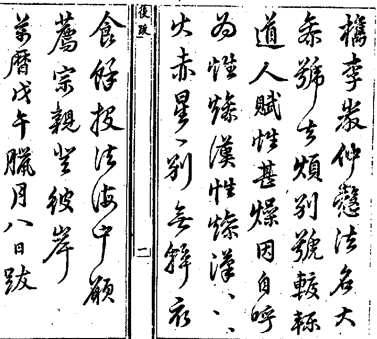

# 千岩和尚语录



> **藏经**：嘉兴大藏经（新文丰版）（嘉兴藏）　**册次** 第 32 册（J32）　**编号** JB273　**部类** 诸宗部　**卷次** 1 卷　**篇幅** 60,546 字

> **卷／品**：0 卷 · 1 品



---



## 目录



  - [千岩禅师语录序](#千岩禅师语录序)



---



### 千岩禅师语录序



往予家居时，尝谒千岩禅师於乌伤伏龙山。当是时，遐迩学子望风奔凑，曾未几何，化荒墟为楼观，易寥空为金碧，钟鼓之声，上彻霄汉。呜呼！何其能也？盖禅师之不能为能、不用为用，芳兰生於深谷，而馨香远闻；苍璧韫于玄璞，而光辉外发。禅师处於遐壤，而人竞从之。有道之士，其果有异於庸常者欤？且禅师在时，其弟子嗣诏，尝录其语，锲梓以传。予尝获观之，其敷宣大法，如云雷迭兴，而九龙喷雨也；如大医王制药，随证而愈疾也；如摩醯三眼，光明洞照，而无不至也。由是知禅师之道，不实不虚，不有不无，不中不边，在普应之门，盖亦铿然有声者也。以能以用窥禅师者，抑亦末矣。禅师既入寂，兵燹方张，所谓语录者，皆为煨烬，经今十有餘年矣。一庵邻上人，自幼侍禅师，与闻其道，乃以旧本重刻，不远一千餘里，来徵予序。予谓禅师之道见於言，读其言，自可知其道，又何以序文为？然稽之古德，其语存于今者，多名缙绅为题辞，不若是，固不足以表正宗之所寄。第予也非人，恶足为禅师之重轻？以禅师与余交也，因不辞而为之书。虽然，禅师之道，不落有无、中边、虚实者，固不可以语言文字求也。欲求禅师之道，其亦得鱼兔而忘蹄筌者乎？禅师行业，予尝为撰塔上之铭，兹不书。上人方阅三藏诸经，连年不自休，今又孜孜而为是图，亦可谓不悖其师者也。



洪武九年秋八月二十五日，翰林学士承旨嘉议大夫知制诰兼修国史兼太子赞善大夫金华宋濂谨序。



千岩和尚语录　目录



上堂  

小参  

普说  

法语  

颂古  

偈颂  

赞跋  

佛事  

附录



千岩和尚语录



参学比丘　嗣诏　录



𨍏轹道人　大参　重校



上堂：「转山河国土归自己则易，转自己归山河国土则难。拈了也，父母未生前道将一句来。」



双林玉溪和尚至，上堂：「天上无弥勒，地下无弥勒，千门万户开，轮槌只一击。」下座。



上堂：「还识老僧麼？心地自闲闲，万般空扰扰。门前流水忙，屋上青山老。若是个中人，道！道！」



上堂，举烧庵婆话，颂曰：「供他死汉亦徒劳，发我无明把火烧。若是久经行阵者，不妨一箭落双雕。」



上堂：「教中道：『一切贤圣皆以无为法而有差别。』世尊有两个舌头，无明只有一个舌头，一切贤圣皆以无为法而无差别。」



上堂：「洪波浩渺，白浪滔天，老僧没头浸，命若悬丝。汝诸人莫有相救者麼？若有救得，大家相聚吃茎虀；救不得，汝往西秦，我之东鲁。」



上堂：「大火聚焰，焰光里许不容蚊蚋藏。一烧烧尽三千界，巍巍独坐法中王。大众！不是心，不是佛，不是物，是甚麼？」



上堂：「帝网之珠，光光相罗；啐啄之机，声声相和。闭门造车，出门合辙。为甚马大师一喝，百丈却耳聋三日？淆讹在甚麼处？」



上堂：「赵州道个无字，云门道普。汝诸人悟不悟？莫颟顸，休莽卤。」以拄杖卓一下，下座。



上堂：「拈起须弥槌，打破虚空鼓，惊得鳖鼻蛇，咬杀白水牯，从教血溅梵天红，夜半日轮正当午。」靠拄杖，云：「是法住法位，世间相常住。」下座。



结夏，上堂：「诸方今日结夏，千岩今日结舌。」良久，云：「是同？是别？」以手掴口，云：「又成多说。」下座。



示众：「今朝初一，上殿已毕。喝啰怛那，西方日出。」



示众：「即心即佛，汝得吾皮；非心非佛，汝得吾肉；不是心、不是佛、不是物，汝得吾骨。得髓𫆏？三段不(同，收归上计)。」



上堂：「今朝三月五，山鸟自啼花自吐，泥(团土块鲜翻身，为甚诸)人都不会？」良久，云：「雪峰辊毬，禾山打鼓。」



示众：「今朝又是六月十三日了也，看看解夏又在目前，未审诸人水牯牛还牧得熟也未？蜡人如冰雪相似也未？若也未▆，各自照管，莫怪老僧不说。」



示众：「我无佛法也无禅，暮雨初晴四月天。要会西来祖师意，一池蛙鼓正阗阗。」



示众，举：「僧问仰山云：『法身还解说法也无？』山云：『我说不得，别有一人说得。』僧云：『说底人在甚处？』山推出枕子。沩山闻，云：『寂子用剑刃上事。』」师云：「沩山满面埃尘，仰山通身泥水。有问无明：『法身还解说法也无？』劈脊便打。『说底人在甚处？』去去西天路，迢迢十万程。」



示众：「昨日两军出阵，两刃交锋，未见输嬴，难分胜负。老僧只管看，忍俊不禁，未免借邓隐峰底锡杖子出来摇一摇，秪要诸人息战。息战后如何？熏风自南来，殿阁生微凉。」



上堂，师指香炉云：「大众！香炉与诸人说法了也。」便下座。



示众：「云门大师道：『扇子𨁝跳上三十三天，筑著帝释鼻孔；东海鲤鱼打一棒，雨似盆倾。』云门秪解瞻前，不能顾后。」遂以扇子击禅床，云：「扇子𨁝跳入一十八重地狱，筑著阎罗王鼻孔。阎罗王恶发道：『你吃了现成粥饭，日夜鼓两片皮，妄谈般若，合吃我手中铁棒。』被山僧一喝，却入扇子里去也。诸人还见麼？若见，拈取扇子来；不见，炎炎暑天用个甚麼？」



上堂：「月头初一，月尾三十，释迦老子拈弄不出，是个甚麼？六月山深日正长，道人行处不寻常，团团围绕青松树，殿阁无风也自凉。」



上堂：「闻声悟道，见色明心。观音菩萨将钱买胡饼，放下手却是馒头。大小云门只在声色里头出头没。无明则不然。」拈拄杖卓一下，喝一喝，下座。



示众，举：「龙牙云：『天下名山到因脚，辛苦年深与袜著，如今老大不能行，手里把个破木杓。』五祖演和尚云：『脚也不能著草鞋，手也不能把木杓，端坐受供养，施主常安乐。』」师云：「尽大地是一只破艸鞋，尽大地是个破木杓，要把便把，要著便著，佛祖何曾摸得著？」



示众：「说了也。且道说个甚麼？」便下座。



示众，举：「睦州问一秀才云：『先辈蕴何事业？』秀才云：『会二十四家书。』州以拄杖点云：『会麼？』才云：『不会。』州云：『永字八法也不识，说甚麼会二十四家书？』」师云：「智过於师，方堪传授。睦州手忙脚乱，俗气不除；秀才只解顺朱，休论八法。诸人还知这一点落处麼？不可以智知，不可以识识，万论千经从此出。」



示众：「大众！现成公案。昨日初一，今朝初二。」



上堂：「大众！又是九月半也，生死事大，无常迅速，讨甚闲工夫说长脚话？看看，阎罗老子请老僧斋也，诸人各自照管钵盂匙箸好。」喝一喝，下座。



上堂：「大众！佛之一字吾不喜闻，况说出许多闲言长语，教坏人家男女，好与三十棒。何故？蚊虫遭扇打，只为口伤人。久立。」



示众，举：「僧问赵州：『大地无尘，扫个甚麼？』州云：『扫外来底。』若是无明，只向他道：『扫里头底。』大众！赵州底是？无明底是？」



示众，举：「雪窦云：『三分光阴二早过，灵台一点不揩磨，贪生逐日区区去，唤不回头争奈何？』」师云：「三分光阴即不问，且道灵台一点是揩磨耶？不揩磨耶？」众无语，师云：「归堂吃茶。」



示众，举：「罽宾国王斩师子尊者头，王臂自落。雪窦云：『作家君王，天然有在。』黄龙新云：『黄龙要问雪窦：「既是作家君王，因甚臂落？」』大慧云：『孟八郎汉又恁麼去。』」师云：「一人无却臂，一人无了头，二俱夸好手，何处不风流？」



示众：「今朝正是三月三，释迦老子露尊颜，树上桃花开烂熳，阶前红雨点班斑。」下座。



示众，良久，云：「大众！会麼？会则事同一家，不会则万别千差。临济和尚道：『我在黄蘗处吃六十痛棒，如蒿枝拂相似。如今思量一顿吃，不知谁为下手？』时有僧出云：『某甲下手。』临济度杖与之，僧拟接，济便打。看它的的显示这些子，无你诸人近傍处，岂常情之所能测？老僧寻常痛骂骂你、痛棒打你，你不作无明会，便作佛法会，又何曾梦见我先祖门风？所以古人云：『临济之道将坠于地。痛哉！痛哉！』正与麼时，合作麼生？超群须是英灵汉，敌胜还他师子儿。」



示众，举德山托钵因缘，拈云：「末后句子，德山、岩头、雪峰总跳不出。」乃喝一喝，云：「大丈夫当为真王，何以假为？」



示众：「当台明镜，鉴在何人？露刃吹毛，逢它敌者。从上的的相承以来，无有不同者，心肝五脏也仝、眉毛鼻孔也仝、眼睛舌头也同、三百六十骨节也同、八万四千毫窍也同，一处同、处处同，只有些子不同。诸人还检点得出麼？阿呵呵，纵饶沧海变，终不与君通。」



示众：「大众还知老僧落处麼？如钓鱼放生。」



端午，上堂：「夏日吃麦粥，头顶茅草屋，东司雨淋淋，无处可下足。中有老头陀，岂可称尊宿？可怜诸禅和，刚要相攒簇。虽然无受用，且喜相和睦，健者共成褫，病者奉水菽。今朝端午节，无酒又无肉，擎出一杯茶，满泛菖蒲玉。且道成得甚麼事？人情若好，吃水也甜。」



示众：「老僧如胡孙种树，种了便拔，看大众生根也未？」众无语，师代云：「根生也。」



示众，举鲁祖面壁，南泉背上抚一掌公案，师云：「南泉何必称两字名？当时更与两掌，非惟坐断鲁祖舌头，且教后代儿孙免得做摸打样。」



示众，举：「临济如蒿枝拂相似公案，雪窦云：『临济放处大危，收来太速。』松源拈拄杖云：『临济据令而行，不知孤负黄檗；雪窦尽力担荷，也只见得一边。且道荐福节文在甚麼处？』掷下拄杖。」师云：「二尊宿，一人聋双耳朵，一人瞎只眼睛，不惟孤负临济，亦乃丧我儿孙。无明今日路见不平，且要与渠雪屈。」良久，云：「不得动著，动著打折你驴腰。」



持法衣，上堂：「陈年布裰破毸毸，新制金襕天上来，褁得虚空无少賸，山河朵朵笑颜开。」



示众，举：「五祖演和尚云：『四五百硕麦，二三千硕稻，好个休粮方，耆婆不得妙。』」师云：「管取有钱常住，不无演祖。若是将无作有、拔贫作富，须还无明始得。米不蓄一粒，菜不栽一茎，任渠来往者，吃得饱彭亨。」



示众：「老僧今日口哑，不能与诸人说得。」



示众，举：「盘山云：『心月孤圆，光吞万象。光非照境，境亦非存。光境俱亡，复是何物？』洞山云：『光境未亡，复是何物？』」师云：「光境不亡，复是何物？」



示众：「大众！柱杖不在，且作别时来。」



双林友云和尚至，上堂云：「路逢道伴交肩过，一生参学事毕。且道以何为验？」拈柱杖卓一下，云：「空手把锄头。」



上堂，以拂子打圆相，云：「从上以来，只传者一个冬瓜印子，印破汝等诸人面门，印空、印水、印泥，一一无差，高低普印。麻三斤、乾屎橛，新妇骑驴阿家牵，虾蟆𨁝跳上天，蚯蚓蓦过东海，印到弥勒下生也无个了日。毕竟如何？」喝一喝，下座。



义乌县尹周刚善至，上堂，拈柱杖云：「大众见麼？韩文公来也。」卓一卓，云：「先以定动，后以智拔。」便下座。



龟峰道源和尚至，上堂：「作家相见，不在形言，击鼓升堂，聊陈供养，供养我龟峰和尚降尊就卑。昔应庵叙谢大慧末句云：『虚空可量风可系，无能尽说佛功德。』即今下座，同大众拜请和尚尊慈开示。」



示众，举：「世尊谓迦叶曰：『吾有正法眼藏，分付与汝。』颂曰：世尊拈华，迦叶微笑。卖与买人，不要不要。」



示众，举：「梵志诗云：『梵志身死去，魂魄见阎老，读尽百王书，不免被捶拷。』风穴云：『一称南无佛，皆已成佛道。』」师云：「只是现成话，风穴用恰好。」



示众，云：「佛祖巴鼻，衲僧巴鼻，讨甚巴鼻？咄！一一向胸襟中流出，将来盖天盖地。」



示众，举：「仰山道：『悟即不无，争奈落在第二头？』米胡深肯之。」师云：「如镜鉴像，像不来时，镜将何鉴？如冰融水，水归源后，冰复何融？只如仰山、米胡二老宿与麼道，还有为人处也无？若把半斤称八两，依然错认定盘星。」喝一喝。



示众，举仰山四藤条公案，颂云：「集云峰下四藤条，虎骤龙奔海岳摇，选佛若无如是眼，如何留得到今朝？」



示众：「大众！无明这里只使无明，且无佛法。与你一棒，大煞慈悲；与你一喝，十分直截。你若作棒喝商量，便千里万里也。久立。」



示众，举：「法华举和尚云：『释迦不出世，达磨不西来，佛法遍天下，谈玄口不开。』无明则不然，释迦太饶舌，达磨太孤绝，诸方明眼人，敢保犹未彻？」



示众，举：「傅大士云：『夜夜抱佛眠，朝朝还共起，起坐镇相随，语默同居止，分毫不相离，如形影相似，欲识佛去处，只这语声是。』玄沙云：『大小傅大士只认得个昭昭灵灵。』洞山聪云：『且道衲僧家日里还曾睡也无？』保宁勇颂云：『要眠时即眠，要起时即起，水洗面皮光，啜茶湿却觜，大海红尘生，平地波涛起，呵呵阿呵呵，哩哩哩啰哩。』」师云：「三尊宿大似徐六担板，傅大士又俗气未除，若论向上宗乘，总欠悟在。且道无明具甚麼眼目？不见道：直须挥剑，若不挥剑，渔父栖巢。」



示众，师云：「有事出来问，无事便歇去。」无人出，师便下座。



示众，举：「伏牛在禅师为马祖驰书上忠国师，国师问马祖：『师如何示徒？』云：『即心是佛。』国云：『是甚麼语话？』又问：『更有甚言句？』云：『非心非佛。或云不是心，不是佛，不是物。』国云：『犹较些子。』伏牛却问：『未审和尚此间如何示徒？』国云：『三点如流水，曲似刈禾镰。』」师云：「伏牛当时见国师恁麼道，只向道：『是甚麼语话？』不惟坐断国师舌头，且与马大师出得一口气。」



示众，拈拄杖云：「古佛过去久矣，汝诸人更要第二杓恶水那？」卓拄杖，下座。



示众，举：「保宁勇和尚云：『一是一，二是二，三是三，四是四，数目甚分明，上下依资次。依资次，有何事？』」以拄杖划一划，云：「大众！一时乱却六十甲子了也。无明则不然，一是二，二是三，三是四，不作方便，亦无渐次。且作麼生是威音王以前底事？」拈拄杖卓一卓，云：「又是从头起。」



示众云：「真空绝朕，犹有真空；大道无名，犹名大道。所以灵龟曳尾，拂迹迹生，释迦、弥勒尚滞半途，文殊、普贤皆须吃棒。汝诸人与麼参请，无明与麼提唱，还有过也无？」良久，云：「尽力跳不出。」



示众，云：「不道无，只是少，所以达磨面壁於少林，释迦掩室於摩竭也。虽然如是，要见德山、临济则未可在。何故？棒打石人头，嚗嚗论实事。」



示众：「黄叶任随流水去，白云从便入山来，寥寥岩畔三间屋，两片柴门竟日开。」



示众，云：「贵籴庐陵米，大做铁酸馅，普请诸禅流，堂中自吞啗。阿呵呵！聊表殷勤，莫嫌冷淡。」



示众：「狂心不息，虽天上亦不称意，便成佛亦是虚头。狂心一息，便是佛也不要做，更说甚麼天堂地狱？汝诸人还息麼？」



示众，举：「石门聪和尚云：『十五日已前诸佛生，十五日已后诸佛灭。十五日已前，你不得离我这里，我有钩钩你；十五日已后，你不得住我这里，我有锥锥你。且道：正当十五日，用钩即是？用锥即是？』遂有颂云：『正当十五日，钩锥一时息，更拟问如何？回头日又出。』大慧和尚云：『恢张三玄三要，扶竖临济正宗，须是恁麼人始得。』虽然如是，云门则不然，十五日已前，诸佛本不曾生；十五日已后，诸佛本不曾灭。十五日已前，你若离我这里，我也不用钩钩你，一任横担拄杖、紧峭草鞋；十五日已后，你若住我这里，我也不用锥锥你，一任拗折拄杖、高挂钵囊。且道：正当十五日合作麼生？」乃云：「十五日前后，钩锥徒尔为，今朝是十五，正好用钩锥。且作麼生用？路逢死蛇莫打杀，无底篮子盛将归。」师云：「二大老把手上高山，争奈傍观者哂？且道：无明有甚长处？十五日已前诸佛生，以不生生为生；十五日已后诸佛灭，以不灭灭为灭；十五日已前，你若住我这里，我却用锥锥你，直须尸横万里、血溅梵天；十五日已后，你若离我这里，我却用钩钩你，直须眉毛厮结、鼻孔相拄。所以道：十五日前后，钩锥常在手；正当十五日，大家要知有。一任面南看北斗，艸木丛林师子吼。」



示众，云：「今朝腊月二十五，云门一曲曾无谱，争似无明调转高，等闲唱出千山舞。大地为琴，虚空为鼓，拍拍相随，声声相助。汝诸人，须听取，白雪阳春何足数？个中端的孰知音？寥寥永夜松风度。」



示众，云：「是法非思量分别之所能解。释迦老子云：『我於三七日，思惟如是事。』唤作不思量，得麼？达磨大师云：『汝得吾髓。』唤作不分别，得麼？咦！相逢尽道休官去，林下何曾见一人？」



示众，举：「琅琊觉云：『有句无句，如藤倚树，树倒藤枯，好一堆烂柴。』大慧云：『作贼人心虚。虽然如是，恩大难酬。』」师云：「一人作佛法商量，一人作世谛流布，检点将来，总欠悟在。无明见处，也要诸人共知。有句无句，如藤倚树，树倒藤枯响。」



示众，举：「五祖演举云门云：『古佛与露柱相交是第几机？』自云：『南山起云，北山下雨。』演云：『大小云门元来小胆。四面则不然，古佛与露柱相交是第四机。』」师云：「无明敢道大小四面更是小胆。不然，何故道面皮厚三寸，出语成不逊，好将临济棒，一日打三顿。」有问：「古佛与露柱相交是第几机？」「第一机，我为法王，於法自在。」



示众，举：「道吾禅师云：『高不在绝顶，富不在福严，乐不在天堂，苦不在地狱。相识满天下，知心能几人？』大慧拈云：『径山则不然，高在绝顶，富在福严，乐在天堂，苦在地狱。谁知席帽下，元是昔愁人？』」师云：「绝顶高高未是高，天堂地狱亦徒劳，若论生死轮回事，今日明朝与昨宵。」



示众：「簷头雨滴滴，屋头山寂寂，西来祖师意，大地人谁识？正当与麼时，不费纤毫力，分付与东风，随处生颜色。」



示众，举：「香严端禅师云：『语是谤，默是诳，语默向上有事在。老僧口门窄，不能为汝说。』松源岳云：『香严与麼道，是说不说？』良久，云：『吃茶去。』」师云：「香严是谤，松源是诳，语默向上有甚麼事？无明口如巨海，彻底波澜。」



上堂：「插茅建梵刹，犹是时人功干。十方无壁落，四面亦无门。这里(道得)倜傥分明，许你盖天盖地。不然，归堂参取露柱。」击拂子，下座。



示众，举：「文殊、普贤起佛见、法见，世尊威神贬向二铁围山。」师拈云：「大众！不起佛见、法见，还免得贬向铁围山麼？世尊也是怜儿不觉丑。」



冬至，上堂：「六阴已极一阳生，佛道还同世道亨。唯有祖师门下客，依前日午打三更。」



示众：「庄子能齐物，千岩无物齐。饥来吃麦粥，衣垢洗清溪。」



初祖忌，示众：「九年面壁，坐断天下人舌头；只履西归，丧却自家穷性命。吾本来兹土，又丧不尽也；传法救迷情，又坐不断也。既坐不断、丧不尽，毕竟作麼生？一花开五叶，结果自然成。」



示众：「江月照，松风吹，面面青山展笑眉。经有经师，论有论师，莫怪老僧无法说，劳汝诸人立片时。」



示众云：「一切世界中，有以音声为佛事，有以光明为佛事，有以饮食为佛事，有以庄严为佛事，是人行邪道，不能见如来。如来者，无所从来，亦无所去。诸仁者！且道如来即今在甚麼处？」



示众：「蓬头垢面个头陀，天下禅和不奈何，便是佛来须吃棒，如今年老却成魔。」喝一喝。



示众：「大众！一喝分宾主，照用一时行，要会个中意，日午打三更。诸禅德！临济大师四棱塌地了也。」乃喝一喝。「且道那个是宾？那个是主？那个是照？那个是用？」又喝。「只这是宾，只这是主，只这是照，只这是用。」又喝。「且不是宾，且不是主，且不是照，且不是用，是个甚麼？」又喝，云：「进前求解会，特地斩精灵。」



示众：「龙门水急，一句截流；茅屋风高，千山起浪。三世诸佛望风结舌，六代祖师斫额有分，天下老和尚仰羡仰羡。是汝诸人既到这里，作麼生与无明相见？」蓦拈拄杖，云：「与麼与麼，人境俱夺；不与麼不与麼，照用同时。」卓一下，云：「龙生金凤子，冲破碧琉璃。」喝一喝。



杭州天龙禅寺新建僧堂，请上堂：「圣人在上，天下太平，我为法王，於法自在。众中莫有金毛师子麼？试出来哮吼看。」僧问：「从上诸圣所传何事？」师云：「本来无一物，赫赫动乾坤。」进云：「昔日世尊周游诸国，今日和尚独踞峰头，还有为人处也无？」师云：「有。」进云：「如何是和尚为人处？」师云：「老鼠吃猫饭。」进云：「学人不会。」师云：「碗子朴落地，打破常住塼。」进云：「天龙新建僧堂，施主入山设斋，请和尚就彼开堂，和尚还去麼？」师云：「你试定当看。」进云：「与麼则和尚性命落在学人手里。」师云：「海东果子树头心。」僧礼拜，师云：「又道老僧性命在你手里。」竖拂子，召大众，云：「本来无一物，赫赫动乾坤，拟议不来时，迢迢十万里。无明这里只有一口剑，剑下有分身之意，亦有出身之路。你若向活鱍鱍处著到，我便教你性命不存；你若在净裸裸处坐地，我便教你云生脚下。直须人境俱夺、杀活同时，自然海晏河清、日上月下。何故宏开选佛场，心空便作状元郎，传来只个无文印，桂子香中举手忙。」乃喝，云：「文生也！汝诸人是拖白？是末名？是头名？」良久，云：「龙生金凤子，冲破碧琉璃。」



复云：「兹承天龙禅寺无用贵首座偕生首座入山设斋俵衬。持大道平长老香请曰：『今春蒙松江蔡妈妈李氏净心施财建新僧堂完备，请和尚向彼中开堂说法，与净心相见。』」师曰：「诺。」於是挝鼓升堂，集众而告之曰：「无明以十方世界作一个僧堂，行与诸人同行、坐与诸人仝坐，乃至语默动静、折旋俯仰，未尝与诸人有丝毫问隔，所以雪峰云：『僧堂前与汝相见了也。』汝若顶门具眼，便见无明与净心在僧堂前相见；汝若更道在天龙僧堂前相见、在伏龙僧堂前相见，我也知你是个瞎汉，不惜眉毛。」复示一颂：「处世界，无所著，圆阤阤，光烁烁，大中大，窄中窄。李氏净心虽女流，宛有丈夫之作略，针锋上拄须弥卢，微尘中现宝王刹。天龙道，用不尽，添得伏龙背地哂，赤肉团上壁立千仞。阿呵呵，哩哩啰，东家作牛，西家作马，衲僧鼻孔一时穿，眼光烁破四天下。」复召大众云：「是甚麼？」



示众，举：「白云端和尚云：『古人留下一言半句未透时，铁壁相似。一日觑透，方知自己便作铁壁。』如今作麼生铁壁铁壁？」师喝一喝，云：「用铁壁作麼？」



示众，举：「舍利弗问须菩提：『梦中说六波罗蜜与觉时同别？』须菩提云：『此义幽深，吾不能说。此会有弥勒大士，汝往彼问。』」师别须菩提云：「寐语作麼？」



因高丽自悟禅人请祖衣上堂，捧衣云：「大众！零零落落有些些，觌面相呈见也麼？不是春山云片片，分明秋雨后蕉芭，个是高峰老师翁，天目山头一生受用不尽底。虎跑宝舟贵首座以我在杭州居山，嘱与奉持已三十年矣，今日伏龙山中二三百兄弟莫有担荷得底麼？有则师子一滴乳，无则且听悟禅人请归高丽金刚山供养，令合国人知，待弥勒下生不妨两手分付。所以道：『衣以表信。可力争耶？』阿难问迦叶云：『师兄！世尊传金襕外，别传何物？』迦叶召阿难，阿难应诺，迦叶云：『倒却门前刹竿著。』我道迦叶要做阿难师兄未得在。何也？待他道：『世尊传金襕外，别传何物？』但召一声，待他开口，劈脊便打，不惟扶竖得祖上门风，亦且与天下衲子作个榜样。」



示众，举：「调达谤佛，生身陷地狱，佛令阿难传旨：『汝在狱中安否？』达云：『我虽在狱中，如受四禅天乐。』又令阿难问：『汝还求出否？』达云：『我待世尊来便出。』阿难云：『世尊是三界大师，岂有入地狱分？』达云：『我岂有出地狱分？』」师云：「临危不悚，真大丈夫。」



示众，举：「盘山云：『似地擎山，不知山之孤峻；如石含玉，不知玉之无瑕。若能如是，是真出家。』大慧云：『若能如是，捏目生花。』」师云：「若能如是，不名出家。」



示众，举：「僧问赵州：『承闻和尚亲见南泉，是否？』州云：『镇州出大萝卜头。』又僧问：『万法归一，一归何处？』云：『我在青州做一领布衫，重七斤。』舜老夫云：『镇州萝卜大，青州布衫重，要会个中意，鸡向五更啼。』」师云：「久响云居，元来只随人脚跟转。若是无明，但云：『镇州萝卜大，青州布衫重，要会个中意，虚空剜窟宠。』」



示众，举：「盘山云：『向上一路，千圣不传。』慈明云：『向上一路，千圣不然。』大慧云：『向上一路，热碗鸣声。』」师云：「向上一路，在你脚底。」



曹居士请升座。「婺州信士曹仁卿，同合宅贵眷就寺设斋俵嚫，请老僧升座说法。老僧曰诺。会麼？尽大地是个老僧，尽大地是个法座，更教老僧升甚麼座？说甚麼法？记得五六年前行桥时，已曾到宅叨斋受嚫，今日山中三四百众吃斋受嚫，人人欢欢喜喜。只者欢欢喜喜，增仁卿多少福田？长仁卿多少寿量？适来长老已为仁卿向法座上举扬，老僧只吃斋受嚫便了，不用为蛇畫足，自然水到渠成。岂不见五祖演和尚云：『端坐受供养，施主常安乐。』赵州云：『老僧在者里坐地，更说什麼佛法？』无明有条攀条，无条攀例？忽有个汉出来道：『和尚！你坐地分赃，他日作个什麼填还施主去？』只向道：『不作牛兮定作驴。』因甚如此？大丈夫异类中行，不是差事。」



示众：「汝诸人只是不肯信自己是佛，所以向外驰求，无个放身命处。如今听我说法时中，礼佛、看经、坐禅、持戒、作福，便是向外驰求也，何况贪名逐利、淫声爱色，而不唤作向外驰求耶？要得不向外驰求，便请回光一照，和自己也无。自己既无，便无我、无你、无佛、无众生、无禅、无戒、无罪、无福、无名利、无声色、无生、无死，空劳劳地无一物为障为碍，然后随缘应用，任运过时，天上人间无不自在。临济云：『汝但歇得念念驰求心，便与释迦老子不别。』不是诳汝，汝须信得及始是。祖师西来，也只做得个指路底人。汝诸人只是行路底，若要火急到家，不劳动步；若也茫茫这般走，转走转远。何故赚却路头？不见道：十方薄伽梵，一路涅槃门。且道路头在什麼处？」以柱杖划一划，云：「在这里多少直截？」



因蒋居士施钵盂上堂，僧问：「大庾岭头一个钵盂，明上座为甚提不起？」师云：「用力太多。」进云：「今日蒋居士施钵盂五百付，为甚人人提将去？」师云：「不费纤毫力。」进云：「用力底是？不用力底是？」师云：「分身两处看。」僧拟再进语，师云：「问话且止，况此事不在语言文字上。何谓也？尽十方世界是个钵盂，三世诸佛在里许转大法轮，历代祖师、天下老和尚乃至一切有情无情总在里许头出头没。汝等禅和家还跳得出麼？若跳得出，须弥南畔把手同行；若跳不出，长连床上吃粥吃饭。兹承常州直心居士同令弟月堂居士，委宏都寺送钵盂五百副、斋米五十石及嚫资种种供养，登山俵散，众请升於此座举唱(宗乘以荅居士大心。且居士大心作如何荅？宗乘又如何举唱？若举麻三斤、乾屎橛、锯解、秤锤之类，虽是本分家风，於诸人分)上了无交涉，免举一两则古话，也要诸人咬嚼。僧问杨岐：『天得一清，地得一宁，衲僧得一，堪作什麼？』岐云：『钵盂口向天。』有问无明，只向道：『披毛戴角。』又僧问洞山：『时时勤拂拭，勿使惹尘埃，为甚不得衣钵？』山云：『直饶道本来无一物，也不合得他衣钵。』雪窦云：『他既不受是眼，将来底必应是瞎。』还见祖师衣钵麼？若於此入门，便乃两手分付，非唯大庾岭头一人提不起，设使合国人来，且缓缓将去。」师云：「洞山太尊贵生，雪窦太悭吝生。无明这里则不然，将来底是眼，不受底是瞎。禅和家个个腕头有力，不怕提不起，不怕将不去，何处更觅祖师？即今两手分付大众。无明与麼批判，且道与古人相去多少？还有证明者麼？若证明得，居士功不浪施；若证明不得，无明不惜眉毛，复成一颂。」以拂子打圆相云：「大众见麼？大地浑仑黑漆钵，吞吐虚空口门阔，白饭山堆叠叠来，死人吃了都教活。毕竟此功归阿谁？常州在家蒋菩萨，老僧也只得一分，大家有眼何曾瞎？分付囊藏又展开，千古万古阿剌剌。」



示众，举祖师云：「父母非我亲，谁是最亲者？诸佛非我道，谁是最道者？云盖本云：『父母非我亲，无有不亲者；诸佛非我道，无有不道者。』祖师得第一句，云盖得第二句，有人添得一句，许伊鼎分三足。无明则不然，父母非我亲，我亦非亲者；诸佛非我道，道亦非我者。祖师也不得第一句，云盖也不得第二句。无明碎身如微尘，何止头破作七分？」



上堂，僧问：「如何是第一句？」师云：「有口如哑。」进云：「如何是第二句？」师云：「有眼如盲。」进云：「如何是第三句？」师云：「棒折也未放你在。」师乃掷下拂子，云：「此是老僧第二句。如何是第一句？」便下座。



示众，举：「僧问投子：『不断烦恼而入涅槃时如何？』子作色云：『这个师僧如发业杀人。』」师别云：「夜夜一觉眠，朝朝三顿饱。」



上堂，僧问：「如何是祖师西来意？」师云：「野马入牛阑。」进云：「达磨未来时如何？」师云：「在西天。」进云：「来后如何？」师云：「在东土。」问：「如何是佛？」师云：「今日好雨。」进云：「如何是道？」师云：「此去义乌不远。」师乃云：「一尘起，大地收。」卓拄杖：「释迦老子在汝诸人脚底，达磨大师穿过诸人鼻孔。还知麼？若知，虾蟆口里道将一句来；若不知，老僧今日失利。」



谢首座，上堂。举：「五祖演和尚云：『槌碎蟠桃核，得见其仁；捋断骊龙须，得遇其宝。』虽然如是，未是好手。争如我伏龙山中天章首座，也不槌碎蟠桃核，头头应用皆仁；也不捋断骊龙须，处处全彰其宝。呼释迦、弥勒为灶下之奴，拈丈六金身作一茎之艸，吹毛一拂，血溅梵天，珊瑚树林，红日杲杲。虽然如是，也只得一半。」下座。



示众。僧问：「如何是宾中宾？」师云：「当胸叉手问他人。」进云：「如何是宾中主？」师云：「堂上坐来日正午。」进云：「如何是主中宾？」师云：「有时欢喜有时嗔。」进云：「如何是主中主？」师云：「横按莫邪无佛祖。」师乃云：「无明不会禅，问著口便哑。嗔者从他嗔，骂者从他骂。好事不出门，恶事传天下。咄！」



东阳陈君采至，示众，举：「白云端因郭功父到，云：『夜来作得个山偈，说向大众，请举似诸方，非唯谢功父大儒，且要天下有鼻孔衲僧脱却贴肉汗衫。』乃云：『上大人，丘乙己，化三千，七十士，尒小生，八九子，佳作仁，可知礼也。』」师云：「白云固是作家炉鞴，功父亦是煆了精金，检点将来，也好与三十棒。何故？一个不合将常住物作私己人情，一个攻乎异端，斯害也已。要脱他天下衲僧贴肉汗衫，倒添了百二十斤黄金锁甲，如何有个洒洒落落时节？无明茅庵之下，君采大儒访及，我也不统夜思量作个山偈，我也不击鼓叙谢广演条章，只有一味杜田禅，自然两眼对两眼。如何是杜田禅？」喝一喝，云：「朕闻上古，其风朴略。」



一日，新到三人来参，师云：「三人同行，必有一智，智不到处，道将一句来。」僧无语，师云：「智不在言，第二个如何？」又无语，师云：「第三个漆桶道看。」又无语，师云：「却是老僧罪过，且坐吃茶。」



示众。僧问：「如何是大安乐底人？」师云：「剑树刀山中坐，镬汤炉炭里安身。」进云：「行何方便到此田地？」师云：「一物亦不为。」进云：「古人一曲如何唱？」师云：「五音六律和不得。」进云：「伏龙一曲又何如？」师云：「万像森罗齐拍手。」进云：「一种没弦琴，唯师弹得妙。」乃作舞而去。师乃云：「世尊拈花，眼里撒沙；迦叶微笑，全身落艸；达磨面壁，皇天苦屈；二祖安心，老鼠居金；德山行棒，莽莽荡荡；临济下喝，吃盐止渴；沩山水牯，泥里洗土；仰山插锹，性命难逃；俱胝竖指，是何道理？雪峰辊毬，老不知羞；石巩张弓，诳謼盲聋；赵州勘婆，大有淆讹；玄沙未彻，话作两橛。这一队不唧溜、老冻脓，生前卤莽、死后瞒顸，罪犯弥天、髑髅遍野，无明忍俊不禁，与渠一坑埋却。」拈拄杖卓一下，云：「直得十方世界风凛凛地，法堂前何止草深一丈？汝诸人且道：向甚麼处出气？」良久，云：「拟心凑泊，二铁围山，放之自然，七穿八穴。」卓一下。



因宁府施法被，上堂：「春云乍卷，春雨初晴，花红柳绿，水碧山青，紫燕黄鹂，深谈实相，丛林草木，尽作琴声，突出释迦鼻孔，豁开达磨眼睛。只如今日齐郡夫人张氏德真所施一片法被，上有一卷心经；唤作一卷心经，又是一片法被；唤作一片法被，又是一卷心经。金燄燄，锦层层，结角罗纹，重重宝印，纵横十字，朵朵珠璎，庄严既妙，德相弥增，一一从夫人心中流出，一一於诸佛分上圆明。老僧受了，诸人无分；诸人受了，老僧无分。不如打归常住，千年万岁耀真灯。耀真灯，复何凭？有时挂向华王座，也胜诸方黑漆屏。」



上堂：「青天白日，起一片乌云，轰一个霹雳，下一阵大雨，平地水高三尺五尺。有者道：『龙王变化。』有者道：『阴阳气合。』有者道：『人物业感。』有者道：『法尔如然。』有者道：『总不与麼。』是皆测度如来境界，如取萤火烧须弥山。毕竟如何？烹佛炼祖大钳锤，要与杨岐作头底。」喝一喝，下座。



上堂，僧问：「如何是夺人不夺境？」师云：「日照山河影动摇。」进云：「如何是夺境不夺人？」师云：「背水阵圆增勇健。」进云：「如何是人境俱夺？」师云：「任是锋刀常坦坦，假饶毒药也闲闲。」进云：「如何是人境俱不夺？」师云：「野老不知尧舜力，冬冬打鼓祭江神。」僧礼拜，师乃云：「有麝自然香，何用当风立？」



上堂，僧问：「如何是露地白牛？」师云：「草里卧。」进云：「甚麼人骑得？」师云：「无髭须胡子。」进云：「三身中那一身说法？」师云：「卖油婆子水梳头。」进云：「德山棒、临济喝，意旨如何？」师云：「恶人先做大。」进云：「如何是和尚家风？」师云：「无力竖拳头。」乃拈拄杖，云：「举不顾，即差互。」卓一下。「拟思量，何劫悟？」下座。



上堂，举：「僧问首山：『一毫未发时如何？』山云：『路逢穿耳客。』『发后如何？』山云：『不用更迟疑。』」师云：「无明则不然。有问：『一毫未发时如何？』云：『不逢穿耳客。』『发后如何？』云：『多遇刻舟人。』」



因僧来参，乃问：「甚处人？」僧云：「浙西。」师云：「此间无饭吃，来作什麼？」僧云：「来求和尚佛法。」师唤僧近前，僧近前，师打一拳，云：「会麼？」僧云：「不会。」师云：「呆子！拳头也不识。」因众看经次，师举起经云：「这是甚麼经？」众无对。师代云：「序品第一。」良久，云：「会麼？向下文长。」



上堂，僧问：「达磨面壁，意旨如何？」师云：「有口开不得。」进云：「人天交接，不得相见。如何是相见底事？」师云：「烟熏黑漆桶。」进云：「浩浩尘中，如何辨主？」师举拳示之。进云：「辨后如何？」问云：「你主在甚处？」僧礼拜，师乃云：「秋风凉，秋夜长，未归客，思故乡。大众！如何是你故乡？曷幸然，家里坐，不用苦思量。」



上堂：「九月九，家家尽饮茱萸酒。堪笑山居道者家，两枚豆粽塞却口。大寒酸，无可有，八角磨盘空里走。却有些儿胜俗人，日日面南看北斗。」



上堂，举：「杨岐云：『天得一以清，地得一以宁，君王得一以治天下。衲僧得一堪作甚麼？』良久，云：『钵盂口向天。』」师云：「大小杨岐，熟处难忘。衲僧得一且作麼生？」以拄杖卓一下，喝一喝，下座。



示众：「不是心，不是佛，不是物，是何物？」拈拄杖，云：「昆仑扶起瞎波斯，一槌击碎黄金骨。」卓一下。



上堂：「鼓声才动，大众云臻，法座高登，主宾互换，个个顶天立地，人人鼻孔辽天，不问如何若何，自然现成受用。不见道：『百味珍羞，无过一饱。』」下座。



师因俗官见猫儿，问云：「猫儿吃肉否？」师云：「不吃肉，只吃老鼠。」官云：「善知识如何容得他？」师云：「教官人莫来不得。」



上堂，僧问：「释迦、弥勒犹是他奴，未审他是阿谁？」师云：「粪扫堆头生苕帚。」进云：「学人不会。」师云：「问取净头。」进云：「大悲千手眼，那个是正眼？」师云：「点。」进云：「如何是最初一句？」师云：「如是我闻。」进云：「此是第二句。」师云：「信受奉行。」僧礼拜，师乃云：「诸佛、诸祖只是你诸人自己，若信得及，无明纵有百千大棒也打不著、有百千舌头也赞叹不及。何故？不见道：第一句中荐得，堪与佛祖为师；如或未然，十二时中也须回光返照看。不是心、不是佛、不是物，是甚麼？狗子还有佛性也无？无是甚麼？如何是佛？麻三斤是甚麼？」



上堂，僧问：「如何是南宗？北宗？」师云：「东瓜直儱侗，瓠子曲弯弯。」进云：「学人不会。」师云：「吃了东瓜吃瓠子。」进云：「如何是第一句？」师云：「老僧道不得。」进云：「和尚为甚道不得？」师云：「道得是第二句。」僧礼拜，师乃云：「是法住法位，世间相常住，山是山、水是水、僧是僧、俗是俗，尽乾坤大地无丝毫过患。德山、临济门下又且不然。毕竟如何？刚然爱结死冤家，擉瞎顶门三只眼。」



上堂：「老僧有口道不得。」乃合掌云：「汝等皆当作佛。」便下座。



示众：「眨上眉毛蹉过伊，大开两眼复名谁？满天满地无人识，百草头边活祖师。」



示众：「吾本来兹土，传法救迷情。著甚死急？直饶二祖得髓，儿孙遍天下，还免得只履西归也无？所以无明也不把你诸人为事，诸人也不把无明为事，思量总是空筛气，何不留将暖肚皮？」



示众，拈拂子云：「老僧有一句子说与诸人看。」掷拂子，便下座。



示众，举：「益州通禅师问夹山云：『目前无法，意在目前。不是目前法，非耳目之所到，岂不是和尚语？』山云：『是。』通乃掀到禅床，叉手而立，夹山打一棒。」师云：「山打一棒，是目前法？不是目前法？掀到禅床，是会夹山意？不会夹山意？诸禅德！道！道！道得许你入阿字法门。」



示众，举岩头渡婆子抛儿子公案，师云：「这婆子自底性命要且舍不得，岩头不合激发他杀了一个儿子。据令而行，各与七十棒。诸禅德！若谓不公，却请断看。」



示众：「今朝十五，槌钟打鼓，咄哉老僧，泥里洗土。」



上堂：「主人翁，错。惺惺著，错。他时后日不受人谩，错。且道瑞岩错？千岩错？错！错！」



客至，上堂：「披衣登法座，道者是高僧，将谓多奇特，元来百不能。西风吹细雨，落叶满空庭，有客来相访，青山自送迎。」



浴佛，上堂：「摩耶今日产婴孩，刚道天宫降下来。不是鸡窠生凤卵，分明象子出驴胎。无明果向空中结，三毒华从火里开。堪叹祸根深不拔，丛林一岁一番灾。」



御香至，上堂：「御香来自九重天，一缕烟云遍大千。林下野人何以报？祝延圣寿万斯年。」



檀越楼清翁一得，建山门，塑金刚，开光明。示众，以笔点一点，云：「这一个莫道不曾相识好。」又点一点，云：「这一个却即是楼一得。外护山门，内承佛记，金刚正体，洞彻十虚，大用现前，威而不猛，有为界中不坏无为之相，无为界上不宰有为之功，尔能借我神通，我亦助君精彩。所以道：『眼眼相觑，面面相对，灼然不在笔尖头，自有光明动天地。』」



檀越楼文翁，造殿又塑佛。开光明，示众云：「德山拆却殿，丹霞烧却佛，楼文翁造殿又塑佛。且道拆殿烧佛底是？起殿塑佛底是？」以笔点云：「这里见得，灵山一会俨然未散；若也不见，是真精进，是名真法供养如来。若要分明，更下注脚，作福者作福，造罪者造罪，张公吃酒李公醉，总不干无明一星子事。」乃呵呵大笑。



日本祖能首座请衣，上堂。举：「石门聪和尚云：『西天二十八祖尽得传衣付法，唐土六祖之后得道者多，只传其法，不传其衣。』无明则不然，衣以表法，故谓之法衣；人能宏道，故谓之法身；无处不遍、无处不明，故谓之法眼。高峰老祖法衣一顶，今春对众请与高丽国金刚山供养去也。幻住先师法衣一顶，我得来三十年矣，如今大拙首座又要请归供养。虽然如是，从上诸祖各各有三十棒分，无明亦有三十棒分。众中莫有下得这般毒手者麼？有，则出来下手看；如无，他时后日不得向背地里苦叫屈。」击拂子，下座。



小参



杭州天龙禅寺庆赞佛阁僧堂小参，拈拂子云：「大众！我有一问在你诸人处，你诸人莫有将我问来问我者麼？」僧问：「如何是和尚问处？」师云：「问处也不知。」进云：「古人道：『问在答处，答在问处。』此意如何？」师云：「三十棒付在来日。」进云：「天龙长老为净心鉴义入山设斋俵嚫，未审有何福报？」师云：「三尺一丈六。」僧礼拜，师云：「因我得礼你。」师乃竖拂子云：「森罗及万像，一法之所印，是大神咒、是大明咒、是无上咒、是无等等咒，三世诸佛说也说不到、历代祖师传也传不来，唯是上上根器、顶𩕳上豁开正眼、脚跟下一觑觑透，尽十方世界无有一人不是自己、无有一物不在自己光明里，如千日并照，罄无侧影。若是寻光美影，展转没交涉，直饶万里不挂片云，青天也须吃棒。教中道：『若以色见我、以音声求我，是人行邪道，不能见如来。』」复竖拂子云：「大众！见麼？要且不是色。」喝一喝云：「闻麼？要且不是声。既不是声、又不是色，既不是见、又不是闻，唤甚麼作邪道？又唤甚麼作如来？泥团土块眼睛开，如如狗子何曾佛性无？虽然道个如如，早是变了也。且道变作甚麼？」以拂子划一划云：「上划不长，下划不短。」



杭州无用贵长老与无明云：「松江净心比丘尼为天龙起盖佛阁僧堂、明楼法堂、东净西庵种种缘事，今夏毕工，另备物料到山设斋俵嚫，请和尚升座，举扬正法眼藏、涅槃玅心，追严幻居士蔡公及孟宾学录同登宝所，兼报四恩三有，普令法界之内、血气之属知有我宗门中超生越死一段奇特大事。所谓奇特大事者，不是你小智小德、凡愚小可之事。何故？见底大便知底大，知底大便说底大，说底大便做底大，做底大便成底大，成底大无有不大者，人中则为大人、贤中则为大贤、圣中则为大圣，如天普盖、如地普擎、如虚空普包，虚空普包万物而无能包之心，此事能包虚空亦无能包之相，所以道：『空生大觉中，如海一沤发。』只要你诸人直下信得及、觑得透，便与释迦老子不别，元来自己分上有这一段奇特大事，可以超生越死、可以超凡越圣、可以超佛越祖。临济云：『你一念清净光，是你屋里法身佛。』岩头云：『一一从自己胸襟中流出，盖天盖地去。』幻住和尚云：『父母未生前，那个是本来面目？』你若见得本来面目，自然生本不生、死本不死，常于日用中转不可测底机轮，自然活辘辘地，虽在声色中不为声色所惑，虽处万法中不为万法所移，虽居三界中洞明三界二十五有、善恶果报、苦乐业缘，而无纤毫执著、亦无纤毫所碍，不弹指便入毘卢大庄严楼阁之中，现不可说重重楼阁，一一楼阁中现不可说重重境界，一一境界中现不可说重重庄严，须弥卢为之床座，香水海为之屎坑，一一屎坑中蛆虫皆现大人之相，一一床座中有大善知识，叱文殊为奴，以普贤为婢，行棒行喝，接上上大机，至於种种说法、种种利生，无一尘不是道场、无一法不是佛事，交光相罗，如帝珠网，互相摄入，互相显现，一一出生，重重无尽。有般瞎汉便道：『此是表显之说，和尚莫错。』又有般道：『金屑虽贵，落眼成翳。』痴人不可与你说梦。你这里信得及，皆吾心之常分，初不假於他术。苟有纤毫信之不及，及之不尽，便为渗漏，便成滞碍，如何能拈一茎草作丈六金身，插一茎草而建梵刹，向一茎草上现琼楼玉殿耶？白云端和尚云：『若端的得一回汗出，便向一茎草上现出琼楼玉殿；若未端的得一回汗出，纵有琼楼玉殿，却被一茎草盖却。』作麼生得一回汗出去？自有一双穷相手，不曾容易舞三台。后来大慧和尚拈云：『一茎草上现琼楼玉殿，决定可信；琼楼玉殿被一茎草盖却，莫被他热瞒。』径山与麼道，与已得一回汗出者说；若未得一回汗出，不得疑著。夫谓善知识者，是大因缘，解粘去缚，盖是寻常，夺食驱耕，还它敏手。白云张千钧之弩，岂为鼷鼠发机？大慧垂四海之钩，只要狞龙上钓。且道无明者里作麼生？既有一双穷相手，不妨容易舞三台。久立，珍重。」



东阳法界寺，小参：「世尊乞食，入於王城；千岩下山，游於此地。众中莫有共相证据者麼？」(问答不录)拈拄杖，云：「大众见麼？」喝一喝，云：「大众闻麼？闻声悟道，见色明心。汝诸人总见、总闻，作麼生是你明底心、悟底道？若识得无明拄杖子，便识得自己主人翁；既识得自己主人翁，又唤甚麼作明底心、悟底道？」良久，顾视左右，云：「但以假名字，引导一切人。兹者，承万里山召予一众午斋，令升此座，举唱宗乘，开发未悟。汝诸人各各有一对眼睛乌律律地、有一双耳朵虚灵灵地，肚饥便要吃饭、内逼便要屙屎。岂不是你诸人底吃饭、屙屎？佛眼里放光，照见山河大地；耳里放光，照见一切音声。」复拈拄杖，云：「岂不是色是佛色？」喝一喝，云：「岂不是声是佛声？这里明得、悟得，吃法界山主午斋不曾咬破一粒米。如或未然，听取一颂：『双塔崔嵬耸碧空，东阳独此梵王宫；义乌有个无明老，拄杖携来见主翁。』作麼生是宾主互换底句子？」卓拄杖一下，下座。



檀越楼子贤荐母请对灵小参，拈瓶中花云：「大众见麼？会麼？世尊拈起一枝花，迦叶便乃微微而笑；老僧拈起一枝花，众中莫有微笑者麼？」(问答不录)复云：「举一不得举二，放过一著，落在第二。世尊拈花，迦叶微笑，已是第二头、第三首。老僧与麼提唱、大众与麼俨临，且道明得甚麼事？不见道：『吾有正法眼藏、涅槃玅心分付于汝，汝当流布，无令断绝。』只如今日故檀越老安人李氏娘子五七之辰，他令嗣子贤、子润、子瑞及诸孙、阖宅贵眷设斋供养佛僧，请无明升于此座，举扬正法眼藏、涅槃妙心。老安人涅槃与诸佛涅槃同耶？不同耶？若言同，诸佛是黄金丈六之身、老安人是父母所生之身，法身、色身本无二相。正与麼时，作麼生道得谛当？一句道得，不惟老安人便登佛位，亦令现前一种若见、若闻，同成正觉；如或未然，无明又打葛藤瞒你诸人去也。」复拈花云：「妙性圆明，离诸名相，本来无有；世界众生，因妄有生、因生有灭。生灭名妄、灭妄名真。无明手中一枝花真耶？妄耶？生耶？灭耶？有耶？无耶？众生耶？世界耶？名相耶？妙性耶？释迦老子即今在者一枝花上，於一花中现百千万叶，於一一叶中现百千万世界，于一一世界中现百千万佛身，於一一佛身中现百千万种光明，於一一光明中现百千万种相好，令百千万种众生有眼者见、有耳者闻、有身者知、有心者觉，所谓见闻知觉无障碍，声香味触常三昧。一切众生既如是，十方诸佛亦如是，生底檀越亦如是，死底檀越亦如是，无明老汉亦如是，现前大众亦如是。如是之法，如是如是，不是强为，法如是故。所以云门大师云：『闻声悟道，见色明心。观音菩萨将钱买胡饼，放下手却是馒头。』你若识得云门底胡饼，便是今日吃底馒头，麦里有面，米里有饭，不出门见天下，不动步游十方，不弹指开弥勒重重楼阁之门，不开口常转如是经，百千万亿卷正法眼藏，两手分付涅槃妙心，更非别人。只如僧问马祖：『如何是佛？』祖云：『即心是佛。』其僧言下大悟，便信自心是佛。六根门中尘尘是佛之光明，万法境上种种是佛之妙用，生本不生，死本不死。所以老僧道：『檀越老安人，即今已成佛，荫庇诸儿孙，倍增无量福。』毕竟以何为据？」复拈花云：「一花一国一如来，无影枝头叶叶开，遍界光明遮不得，黄金地上玉楼台。」下座。



普说



除夜普说，召大众云：「还会得腊月三十日事麼？会得腊月三十日事，便透得个赵州无字；透得赵州个无字，便会得老僧意；会得老僧意，便知未开口时与你普说了也。更拟事持语言，形於纸墨，明眼人前一场笑具，信知此事不在文字语言上。一大藏教，圆说偏说，显说密说；天下老和尚，横说竖说，向上向下说；诸子百家，千说万说；日上月下，夜暗昼明；山高水深，风动云起；若闻若见，万法枞然；尘说刹说，虚空说国土说，炽然说无间歇，何曾无语言文字来？因甚二祖三拜，达摩谓之得髓，师资会遇，冥然吻合？以至六祖不会，德山棒，临济喝，鲁祖面壁，传也传不得，说也说不得，故云教外别传之旨。何不直下与麼会去，与麼休歇去，与麼省力去，却外求许多拉圾筑在肚皮里，增长无明，滋培业识，牵入生死海里浮沉，未有了日。所以道：普者不说，说者不普。僧问赵州：『狗子还有佛性也无？』州云：『无。』只这一个无字，不是有无之无，不是无无之无，不是亦有亦无之无，不是非有非无之无。如今人根器薄劣，随语生解，多执己见，见有执有，见无执无，道有著有，道无著无，道亦有亦无著亦有亦无，道非有非无著非有非无。西天九十六种外道，有无二见为其根本，此方亦然。先圣慈悲之故，破你执，拔你见，截你四路葛藤，只要你亲证亲悟，透顶透底，做个洒洒落落无事人，除非不动，动如狮王哮吼一声，壁立万仞。老僧早年参数员尊宿，多教提无字话，有者道：『问在答处，答在问处。』狗子！无佛性，有业识；无业识，有佛性。既有有无，又有问答，要见赵州，远之远矣。又有道：『如一口剑相似，拟议则伤锋犯手，不拟议则丧身失命。』复引五祖演和尚颂证云：『赵州露刃剑，寒霜光燄燄。更拟问如何，分身作两段？』大慧和尚云：『参学人向露刃剑上著得只眼，便是千了百当。』五祖、大慧则是，你则未是。又有道：『如一座须弥山相似，须弥山生佛未具已前一著子也，紧紧靠著，不得放舍。』复引雪岩和尚云：『单单提一个无字，如靠一座须弥山』为证。一座山又有个人靠，如何唤作生佛未具已前一著子也？又有教人闭眉合眼，做死模样，将个无字顶在额上，或放鼻尖上，或顿面前，或向赤肉团上上度，或向心意里妄想搏量，认得些子光影，便为极则。密室传授，递相印证，入邪见稠林，作魔家眷属。又有喻如铁扫帚，扫尽昏散，朗如虚空，此是应病与药，病去药存，药返为病。如上所明，各各自谓宗门中爪牙，检点将来，不出四句所摄，断人命根，要且未在。末上见中峰老和尚，於别不花平章府中请益无字话，归灵隐，不出僧堂者三年，十二时中只在个无字著到。一日，在望亭闻鹊声，忽得个欢喜处，因陈所见，和尚略不肯，遂发愤归受业。夜卧间，闻老鼠翻饭碗堕地，喜不自胜。达旦，亟往见老和尚，和尚见来，便云：『赵州因甚道个无字？』云：『老鼠吃猫饭。』云：『未在，更道。』云：『和碗也打破。』老和尚乃笑，不复诘。后拜辞，嘱云：『汝宜隐遁严谷，不可随世流布，时节若至，其理自彰。』二十年来，缚茅株守，似个死汉，自救不了，敢言为人？山中百餘人兄弟，远从千里万里，抛却师长父母，来此相聚，诚不易得。年穷岁尽，火冷灰寒，废寝忘飧，不为别事。已透关者，不在叮咛；未透关者，切须子细。出息不保入息，今朝不保来朝，言锋若差，乡关万里。死生事大，各自努力。珍重。」



僧问：「世尊拈花，迦叶微笑；达磨面壁，二祖安心。祖祖传来者一句，师今端的付何人？」师云：「未到你在。」进云：「师子窟中师子、旃檀林里旃檀，为甚未到学人？」师云：「一丝头上三千界。」进云：「不是心、不是佛、不是物，是个甚麼？」师云：「你道是个甚麼？」进云：「未审向上还有事也无？」师云：「有。」进云：「如何是向上事？」师云：「不是心、不是佛、不是物。」僧礼拜，师乃举起拂子，云：「一句中具三玄、一玄中具三要，所以道：『第一句中荐得，堪与佛祖为师。』只这一句子流出百千万亿句，句中具不可说不可说妙义，觅一丝毫妙义了不可得；百千万亿句收入这一句，句中显不可说不可说形相，觅一丝毫形相亦不可得。壁如虚空具含众像，於诸境界无所分别；又如虚空入诸国土，於诸国土而无所入。」复举拂子召大众，云：「见麼？不是心、不是佛、不是物，是个甚麼？」喝一喝，云：「大众！闻麼？不是心、不是佛、不是物，是个甚麼？只此见闻非见闻，无餘声色可呈君。是中若了俱无事，体用何妨分不分？若分，色见声求，是行邪道；若不分，颟顸佛性，儱侗真如。到这里，须是出格过量底人始得。还委悉麼？直透万里关，不住青霄内。」(谢辞不录)



复云：「山中草创所在，若要讲诸方丛林礼数，也讲未得。今夏虽有三四百兄弟，也有数间屋子，长老、首座有工夫请自去讲。老僧只是圣寿寺一个园头，二十年庵居，一味杜田头佛法，把鉏头时、铲草择菜时、烧火时、扫地时、吃粥吃饭时、阿屎送尿时，未尝不与诸人眉毛厮结，性命相负，的的举扬，又要打大鼓、升法座、做模打样作甚麼？适来禅客与麼问，老僧与麼答，如此问答，如此激扬，汝诸人这一句子还分晓也未？若分晓，父母未生前面目亦分晓；父母未生前面目分晓，四大分散后底事亦分晓；四大分散后事分晓，即今日用事亦分晓；即今日用事分晓，一动一静，一语一默，一起一倒，一生一死，生也与麼，死也与麼。生死中有佛，则不迷生死；生死中无佛，则无生死。与麼则无有不分晓底时节。所以道：『十方世界是个老僧，尽十方世界是个法座，尽十方世界是个院子，尽十方世界是你诸人自己，尽十方世界只是这一句子。』这一句子明得，无有不明底句子；这一句子透得，无有不透底道理。前故云：『须出格过量底人始得。』大众！要识出格过量人麼？」举起拂子云：「释迦老子来也，天上天下，唯吾独尊。作麼生说个未出母胎、度人已毕底道理？不是心、不是佛、不是物，是个甚麼？末上谓迦叶云：『吾有正法眼藏、涅般妙心分付於汝，汝当流布，无令断绝。』不是心、不是佛、不是物，是个甚麼？自是一犬吠虚，千猱啀实。阿难便问迦叶云：『世尊传金襕外，别传何物？』好样不相学。迦叶召阿难，阿难应诺。自是一条箸。迦叶云：『倒却门前刹竿著。』费力不少。至于西天四七，东土二三，递相出兴，千变万化，只宗这一句子，只扶竖这一句子，只显示这一句子而已。岂不见南狱让和尚得这一句子於六祖大师，便云：『说似一物则不中，修证则不无，染污则不可。』祖云：『只此不染污，是诸佛之护念。汝既如是，吾亦如是。』」师云：「好个东瓜印子，搭著搭不著，未免递相钝置。马大师得这一句子於南岳，便云：『自从胡乱后，三十年不少盐酱。』破驴脊上足苍蝇。因僧问：『离四句，绝百非，请师直指西来意。』祖云：『我今日劳倦，不能与汝说，问取智藏去。』僧问藏，藏云：『我今日头疼，不能与汝说，问取海兄去。』僧问海，海云：『我到这里却不会。』僧回举似祖，祖云：『藏头白，海头黑。』」师云：「离四句，绝百非，马驹踏杀天下人，元来答者话不得。非父不生其子，一个头疼，一个不会。藏头白，海头黑，也是贼过后张弓。百丈和尚得这一句子於马祖，因再参侍立次，祖以目视绳床角拂子，丈云：『即此用？离此用？』祖云：『你后开两片皮，将何为人？』丈取拂子竖起，祖云：『即此用？离此用？』丈挂拂子於旧处，祖震威一喝，丈大悟，直得三日耳聋。」师云：「大众！百丈是喝前悟？喝后悟？悟前聋？悟后聋？定当得出，即此用，离此用；定当不出，莫看绳床角头，且看老僧手里底，得与麼摇摇曳曳，无风荷叶动，决定有鱼行。黄蘗运和尚得这一句子於百丈，一日示众云：『汝等诸人尽是噇酒糟汉，与麼行脚何处有？今日还知大唐国里无禅师麼？』有僧出云：『只如诸方匡徒领众又且如何？』蘗云：『不道无禅，只是无师。』」师云：「黄蘗只知大唐国里无禅师，不知我如今大元国里个个是禅师？是讲师？律师？有般汉便道：『与匡徒领众者何异？』只向道：『不道无师，只是无禅。』临济大师得这一句子於黄蘗，示众云：『我於先师处吃六十棒，如蒿枝拂相似，如今再思一顿吃，不知谁为下手？』有僧出云：『某甲下手。』济度棒与之，僧拟接，济便打。」师云：「好笑你自心中急，他人未肯忙。若是个汉，当时便与掀倒禅床，拦胸一踏，拄杖子只得两手分付。不见道：『老鼠养儿沿屋栋，龙生龙兮凤生凤。』兴化奖和尚得这一句子於临济，於大觉棒头悟得先师在黄蘗处吃棒底意旨，乃示众云：『今日不用如何若何，便请单刀直入，兴化为汝证据。』时有旻德长老拜起便喝，化亦喝，德又喝，化又喝，德礼拜归众，化云：『若是别人，三十棒一棒也较不得。何故？为他旻德会一喝不作一喝用。』」师云：「阵云动地而来，雪刃挨身而入，铁旗铁鼓未为好手，全杀全活方见作家，较他登九龙御辇而被烹、失千里乌骓而自刎者盖相万万，剑戟尽为农器用，马牛归放华山阳。何以见得？王登宝殿，野老讴歌。南院颙和尚得这一句子於兴化，因僧问：『赤肉团上壁立千仞，岂不是和尚语？』院云：『是。』僧便掀倒禅床。院云：『看这瞎汉乱做。』僧拟议，院便打。」师云：「手里棒折那。如师子，捉象亦全其力，捉兔亦全其力。又僧问：『从上诸圣向甚处去？』院云：『不上天堂便入地狱。』僧云：『和尚𫆏？』院云：『还知宝应老汉落处麼？』僧拟议，院以拂子打云：『令合是汝行。』又打一拂子。后来雪窦道：『令既自行，且拂子不知来处。』雪窦道个瞎，且又雪上加霜。大慧云：『权衡临济，三玄三要，还他南院始得。雪窦为甚道拂子不知来处？妙喜道个瞎，且要两得相见。』」师云：「雪窦扶弱，大慧扶强。无明也只道个瞎，且要瞎一切人眼。何谓不上天堂便入地狱？风穴沼和尚得这一句子於南院，上堂有云：『若立一尘，家国兴盛，野老嚬蹙；不立一尘，家国丧亡，野老安贴。於此明得，阇黎无分，全是老僧；於此不明，老僧即是阇黎。阇黎与老僧亦能悟却天下人，亦能迷却天下人。要识阇黎麼？』左边拍云：『这里是。要识老僧麼？』右边拍云：『这里是。』」师云：「无明则不然。若立一尘，君君臣臣，父父子子；不立一尘，此间无老僧，目前无阇黎，雨顺风调，河清海晏。於此明得，古佛与露柱交参，占波共新罗斗额；於此不明，眼里著得百亿须弥山，耳里著得百亿香水海。首山念和尚得这一句於风穴，拈竹篦云：『汝诸人唤作竹篦则触，不唤作竹篦则背，且道唤作甚麼？』时叶县省和尚在座下，便近前制得，拗作两橛，掷下云：『是甚麼？』山云：『瞎。』县便礼拜。」师云：「一挨一拶，一纵一夺，宗门中谓之爪牙，亦谓之巴鼻，岂盲龟跛驴之事？二尊宿，一人高高山顶立不露顶，一人深深海底行不湿脚，拗竹篦作两橛且置，首山道个瞎，意作麼生？只许老胡知，不许老胡会。汾阳昭和尚得这一句子於首山，示众云：『识得拄杖子，行脚事毕。』」师乃竖起拂子云：「识得无明拂子，更买草鞋行脚三十年。慈明和尚得这一句子於汾阳，向方丈内安一盆水，上置一口剑，下置草鞋，膝上横按拄杖，有人入门便指，拟议便打，应庵云：『我当时若见，便去左耳边低声下一转语，待他贪观天上，却与一指拟议，把剑便斩。』」师云：「转见淆讹，不妨疑著。应庵老人耳边下一转语，知他说个甚麼？我当时若见，把剑便斩。因甚如此？鹬蚌相持，俱落渔人之手。杨岐会和尚得这一句子於慈明，僧问：『如何是佛？』岐云：『三脚驴子美蹄行。』」师云：「住院屋壁疏，满床堆雪珠，踢出金圈栗棘，吓倒百丈野狐。三脚驴，三脚驴，差异畜生天下无。白云端和尚得这一句子於杨岐，因僧问：『一喝分宾主，照用一时行，去此二途，请师别道。』云便喝，僧云：『从来疑著和尚。』云便打，僧云：『作家宗师。』云云：『也不消得。』僧礼拜。」师云：「众中一喝多有商量，喝牛便行，喝马便住，喝人恶发，喝佛慈悲。这僧道：『从来疑著和尚。』是肯语？是不肯语？白云便打，是赏伊？是罚伊？选佛若无如是眼，假饶千载亦奚为？五祖演和尚得这一句子於白云，结夏示众云：『无可管顾诸人，今日作一家䜩。』遂抬手云：『啰啰招，啰啰摇，啰啰送，莫怪空疏，伏惟珍重。』」师云：「一个铁酸馅，百味具足，知他祭了多少闲神野鬼，直饶一咬百杂碎，到这里急须吐却。佛果勤和尚得这一句子於五祖，因僧问：『一大藏教阿那个是头？』果云：『如是我闻。』僧云：『此是阿难底，如何是和尚底？』果云：『我使得甚快。』」师云：「只欠作云何梵在。虎丘隆祖得这一句子於佛果，果室中问祖云：『见见之时，见非是见，见犹离见，见不能及。』举拳示之云：『见麼？』祖云：『见。』果云：『头上安头。』祖於是悟入，便礼拜，果云：『见个甚麼？』祖云：『竹密不妨流水过。』」师云：「象王回旋，师子返掷，不用纤毫气力，不留些子痕迹。是则是，父子投机，啐啄同时，只恐学语之流不作平实会，便作活脱会。毕竟如何？识取钩头意，莫认定盘星。」又示众云：「凡有展托，尽落今时；不展不托，堕坑落堑。直饶风吹不入、水洒不著，检点将来，自救不了。不见道：『寒潭目影，静夜钟声，随扣击以无亏，触波澜而不散，犹是生死岸头事。』」拈拄杖云：「划一划，划断生法师多年葛藤，点头石不觉抚掌大笑。且道笑个甚麼？脑后见腮，莫与往来。」师亦呵呵笑云：「笑须三十年，三三九十年。且道笑个甚麼？笑你脑后见腮。应庵和尚得这一句子於隆祖，据室云：『现成公案，坐断淆讹。错下注脚，槌折你腰。撩起便行，必死之疾。要须英俊，别有生涯。忽遇冲云俊鹘来时如何？漫天网子百千重。』」师云：「驱耕夺食手段，罗龙打凤门庭。漫天网子百千重，这老儿已是通身泥水。冲云俊鹘走向甚处去也？不消一拶，去死十分。密庵和尚得这一句子於应庵，应庵室中问云：『如何是正法眼？』密云：『破沙盆。』」师云：「僧问云门：『如何是正法眼？』门云：『普。』击床左边云：『过这边著。』僧问风穴：『如何是正法眼？』穴云：『瞎。』击床右边云：『过这边著。』复打一圆相云：『破沙盆，吞乾坤，七华八裂，浑浑沦沦。飏在拉圾堆头，千金难买；擎在诸佛掌内，不直分文。打钟打鼓普请看，盛羹盛饭养儿孙。』好大哥！破庵和尚得这一句子於密庵，上堂有云：『不是心，不是佛，不是物，忍俊不禁，为诸人作个撇脱。』拄杖卓一下云：『流水暗消溪畔石，劝人除却是非难。』」师云：「云浮世间，无根得活；火烧海底，有种皆萌。不与凡圣同缠，东土来作甚麼？不与万法为侣，西江吸尽何为？既无彼此之分，宁有古今之异？尘尘尔，刹刹尔，枞枞然，灵灵然，若作佛法商量，未免披毛戴角；若作世谛流布，依旧前三后三。所以道：『流水暗消溪畔石，劝人除却是非难。难！难！蟭螟摇撼万重山。』无准和尚得这一句子於破庵，有时上堂云：『名不得，状不得，取不得，舍不得，只麼得。且道得个甚麼？三人证龟成鳖。』」师云：「二从一有，一亦莫守。既是名不得、状不得，为甚证龟成鳖？咄！杀人刀，活人剑。雪岩和尚得这一句子於无准，寻常只把这一句卖。美外集中有送人偈云：『现成句子轻拈出，不落平平仄仄中。只恐累君行李重，预先题在石屏风。』」师云：「我当时若在座下，但云：『集云峰下，四条藤巴落，平平仄仄，仄仄平平。况是槌钟击鼓，鹊噪鸦鸣，森罗万象，水绿山青，未开口，未动念，文彩全彰，五音迭奏，直得触目无滞，达得名身句子一切法空。山河大地是身，身亦不可得，唤作三昧，性海俱备，犹是无风匝匝之波，更须知有向上一窍。』又寄竹篦与高峰老祖，偈云：『上大今已无人，雪岩可知礼也。一条黑漆竹篦，分付原妙侍者。』」师云：「分付莫错麼？错则不名仰山，不错则天目山在万山之顶。高峰老祖得这一句子於仰山，尝云：『不识岩头密启处，刚言悟得仰山禅。』」师云：「大妄语成，入无间狱。密启处既不识，仰山禅如何悟？又有真赞示幻住和尚云：『我相不思议，佛眼莫能视。独许不肖儿，得我半边鼻。』」师云：「垂钩四海，只钓狞龙。智过於师，方堪传授。且道传授个甚麼？打失半边鼻，换得一只眼。幻住和尚得这一句子於高峰老祖。示众，举：『大梅问马祖：「如何是佛？」祖云：「即心是佛。」』常公闻是语，当下如十日并照，情云识雾，应念廓清，直往大梅山，一任非心非佛。」师云：「无明在众时，有般兄弟聚头喧喧妄议云：『中峰和尚只说得心性禅、义理禅、拖泥带水老婆禅，与他打在大梅、大珠、永明、明教、慈受队里去。』唯古林和尚序一花五叶之书，则云：『辟义学之见封，发正宗之玄閟，其言富，其理妙，非离文字言说、舍名相筌蹄、断葛藤露布、碎圣凡窠臼者，未易窥其彷佛。』虚谷和尚则云：『中峰禅师彻法源底，廓同太虚，百千无量玅义皆从性海中滔滔流出，自然超宗越格，破胎息妄传，正合圆悟祖师意。辟义解流谓从《信心铭》起，亦古人未论至此。』」师云：「三段不同，收归上科。又於《信心铭》中举到得失是非一时放却处，辟云：『咄！说有可放，也合吃棒；说无可放，也合吃棒。何故？则为伊脱得失是非未得在。』」师云：「三祖大师非老幻住，与麼发明，几乎一生受屈。」蓦拈拄杖，云：「这个唤作拄杖子，便不是一句子；若唤作一句子，便不是拄杖子。才有所是，便有所非；才有所得，便有所失。得失是非既免不得，这一句子如何免得？」以拄杖划一划，云：「三世诸佛、历代祖师、天下老和尚，总贬向无生国里去也。即今莫有傍不甘底出来，把老僧拖下禅床，烂椎一顿，与这一队老汉出一口气，不妨做渠直下儿孙。如有，与无明相见；如无，无明倒行此令去也。」乃喝一喝，拈拄杖，下座，一时趁散大众。



法语



示瑛禅人



参禅人做工夫无别事，只要知个本命元辰下落处，知得自己，辨得他人，山河大地，世出世间，一一尽知下落，瞒你一星子不得，唤作智眼洞明，心行处灭，然后回身转步，建大法幢，现出三头六臂，七纵八横，拈一茎草作丈六金身，拈丈六金身作一茎草用，杀得人，活得人，金刚王宝剑寒凛凛地，唤作临济下儿孙，不为分外。若但名字出家，名字行脚，不信好人说，不知祖师巴鼻，不到诸佛田地，不做真实工夫，一法不明，目前万法悉不明了，光阴迅速，空然白首，眼光落地时，将甚麼子敌他生死？瑛上人！可畏可畏，快须打并从前业识，歇去许多打之遶，著些精彩，提个万法归一，一归何处话，忽然一踏踏著，一觑觑破，元来青州布衫，便是川藞苴底屎布裙。



示月禅人



人人尽有这个月，几回圆兮几回缺。明时暗相在其中，暗时明相何曾灭。看他蟾桂影婆娑，直透碧潭光皎洁。正好供养与修行，不出如今底时节。濠州满月上人，信有我宗见性成佛之旨，春间到茅庵请益，参个话头，决要今生悟得自己分上灼然有这一段了生达死底大事因缘。老僧向他道：「我底说话恰如一个指头子相似，为你要见天上月，所以指个水中月影子，示汝头上自有个真月也。」释迦老子也与麼道：「我说修多罗教，如标月指。当观月轮，莫观吾指。」你如今若只爱我言语，便是看我底指头，要且不知月在甚麼处。你要识真月麼？只你问我话底是，只你举话头底是，只你未举话头时来问我底是。但与麼回光返照去，忽然与所参话头无二无别，方信通身是一轮清净宝月，圆满无缺，昼夜放八万四千圆满净光，照天照地。盘山云：「心月孤圆，光吞万象。光非照境，境亦非存。光境双忘，复是何物？」洞山云：「光境未忘，复是何物？」老僧云：「光境不忘，复是何物？」你且道三个老汉那个堪为汝师？须具眼始得。



示赈上人



海东赈上人，为清拙和尚侍者。自谓不能尽其师之道，焚舟西登海岸，首礼请径山诸大老。复探水於伏龙山顶，两呈偈语，且有自远趋风之辞。予不之答，又乞一言，而为洞彻向上的的相承底一段大事。不得已而谓之曰：「汝还知大唐国里无禅师麼？汝师为天下之师，何谓无师？汝师传我佛我祖不传之道，何谓无道？决欲尽师之道，求之於人，不若求之於己。直下休去歇去，一念万年，千万里无寸草处去，古庙里香炉去。到大歇大休田地，返观从前学得底，记得底，说得底，做得底，总是聪明知解，人我业识，生死根本。到这里，身心廓如太虚，觅佛祖禅道了不可得。觅人我业识，是非生死，若知解纤毫形相，皆不可得。然后为一切人师也。在我，我为法王，於法自在。不见道：智过於师，方堪传授。只如汝师说底，与无明同耶，不同耶？若(道同，又要问无明作麼？若道不同，佛法岂有两般？直须如个戴角蛇，插翅虎，破镜鸟，啗母，不是差事。)」



示嵩上人



赤梢鲤鱼横海而来，动便波涛汹涌，雷电喧轰，风云四起，笼罩不肯住，呼唤不回头，所谓漫天铁网透过不难，一窍穿通玲珑八面，及乎撞著一枚臭虀罋子、牛脚迹水，因甚向里面淹杀，丧却一条穷性命？喝。当时若下得这一喝，死得天下人、活得天下人，不惟与临济出得一口气，从上老冻脓一任吞吐。日本嵩上人，清拙老人入室之子，今冬山中道聚标此纸云：「大唐音响未能通，虽听法雷如耳聋。」末后云：「须弥为笔写虚空。」果能耳聋不通音响，则不缪为清拙之子，又何待无明操须弥笔写出许多不材不净，恣意啗咂而堕於埜狐群队，无个出头时节？所以先圣云：「如今有一等不识好恶秃奴，向教乘中取意度商量，成於义句，如将屎块子自口含了，却吐与人。」又云：「我被先师一喝，直得三日耳聋。」虽然，我也无量罪过，汝也无量罪过。



示济禅人



参禅人须参活句，莫参死句。何谓活句？只如僧问赵州：「狗子还有佛性也无？」州云：「无。」又问：「一切众生皆有佛性，因甚狗子无佛性？」州云：「他有业识在。」这便是活句。这僧向活句上问，赵州又向活句上答。你如今要这一则公案分晓，只就(每日每夜)业识纷飞处看。业识与麼纷飞，如何是无业识田地？佛性现成，如何得见佛性与佛祖一般？如人学射，久久方中，所谓得之於心，应之於手。却不可滞在有上，滞在有上便同众生；又不可滞在无上，教中谓之相违；又不可滞在非有非无上，教中谓之戏论。总不落阶级，不涉廉纤，著著有出身之路，始到得活句边，犹未取得老赵州性命在。且道老赵州性命作麼生取？不见五祖演和尚云：「赵州露刃剑，寒霜光焰焰，更拟问如何，分身作两段。」你且道是死句？是活句？参。



示润禅人



去年与予同栖严穴，卓卓然以此事为务，不与群儿伍，决欲了这一场公案。问他：「今日工夫如何？」不答。又问他：「父母未生前，甚麼处与老僧同住来？」或竖拳，或一笑，或不语，掉臂便行。一日，老僧同石门和尚在火炉头闲坐，见他来问讯，便问他：「不去僧堂里做工夫，来这里做甚麼？」借石门痒和子连打数下，他微微而笑，无些子怒色。彼时贵无用在嘉禾，一日请假去相访，一别十餘个月日，每每寄果物来，老僧深喜之。不是喜他远寄物来，然喜怒人之常情，只如父母未生以前，身已尚无，喜怒从甚处安著？你若道即今底便是未生前底，未生前底便是死了烧了底，正是颟顸佛性，儱侗真如，直须剑刃上翻身，钵盂中走马始得。不见古人道：「悬崖撒手，自肯承当；绝后再苏，欺君不得。」这一著子不是小可事，是无大得大一件大事，所谓生死事大，无常迅速，今日不了，万劫餘殃。上人决要了此事时归来，一日与汝三百下痒和子，休怪。



示悟侍者



先圣云：「悟是第二头。」又有云：「须妙悟始得。」又有云：「悟后须遇人始得。」参禅参便了，又要遇人作甚麼？殊不知涅槃心易晓，差别智难明。只如每日肚里须吃饭方饱，你吃饭还疗得我饥麼？眼里观色，山不可唤作水；耳里闻声，声生声灭，於耳有干涉无？若云有干涉，则堕戏论；若云无干涉，则堕相违。直须离四句、绝百非，入得一切、透得一切，犹是教乘边事，未是衲僧本分事。莫声是佛声、色是佛色，是麼？莫未上船时已吃三十棒，是麼？若恁麼商量，要见无明，且居门外。总不与麼，毕竟如何？有眼如盲，有口如哑。日本悟侍者谓乡音不辨，特此乞形纸墨以疏其意，不审侍者是悟了问、悟前问、不前不后问？老僧答汝了也，并却咽喉唇吻，致将一问来。



示懋禅人



诸佛出世，祖师西来，不过与人做个证明底而已。且证明个甚麼？懋禅人今夏道聚山中，秋归受业方回，乃出纸觅长语，警策做工夫，要透脱生死。此事你须自下手脚，直做到直截不疑之地，方能透得生死，方见诸佛诸祖心髓，方知老僧屋里底事。所谓啐地折，嚗地断，绝后再苏，顶门眼活，一口金刚宝剑，亘古亘今，擒纵在我，不由别人，真大自在、大解脱、大丈夫也。若不与麼，随群逐队，今日三，明日四，未曾得个念头暂时停息，如一锅沸汤相似，自也下手脚不得，教别人如何下得手脚？煎得乾，无滴水，却是个好底时节。恐你又不肯信，却又去别处寻水来搀，转见郎当，正是半前不后底温汤，将来何用？如今决欲了此事，紧咬齿关，硬著脊骨，把赵州狗子无佛性话一提提将去，生死心绝，语言道断，㘞地一声，不待老僧与汝证明，汝自知之。



示寿禅人



德寿禅人久於山中相聚，昼则作一切务，夜则消息不眠，盖图出生死大苦海，到佛祖安乐田地也。果欲到佛祖田地，须悟万法归一、一归何处话，与父母未生前话，狗子无佛性话，不是心、不是佛、不是物话，无丝毫疑滞，无些子差错，尽平生力量一味挨将去，挨到露布极、伎俩尽、命根断，便是到佛祖田地也。虽然，更须知有临济三顿痛棒底道理。且道无明门下又作麼生？咄！且待别时来。



示成禅人



德成禅人四年在山中结缘，去年化僧堂席，今年又化僧堂帐，众僧坐卧食息於其中，无有一人不仰仰羡羡。你结缘种德则不无，只如万法归一，一归何处话？且道与你途中生生受受，登檀施门，有逆有顺，即今归到山中，与众人眉毛厮结，鼻孔相拄，至於著衣吃饭，屙屎送尿，或语或默，或忙或闲，同耶？不同耶？若道同，赵州为甚道我在青州做一领布衫重七斤？若道不同，众人尽见你化席化帐。虽然，你更化一领漫天帐、一领无缝席与老僧，方答汝话。有者便道：「和尚满口道了，满幅写了。又道未答话在。」咄！不见道：「成家容易破家难。」南泉云：「我十八上便解作活计。」赵州云：「我十八上便解破家散宅。」神仙妙诀，父子不传。



示显侍者



汝欲游方礼祖师，徒劳走得脚生胝。要须坐断毘卢顶，一任小慈妨大慈。慈显上人，丛林英俊之流，乃乞语参方礼祖，扣问父母未生前一段奇特大事，所以云：「要须坐断毘卢顶。」至如文殊、普贤、释迦、弥勒、临济、德山，是甚破草鞋？要用便用，要置便置。我为法王，於法自在。虽然，你须是到这般田地，有这般作略，是这般种草，具这般眼目，得这般机用方可，这般底却不可学。如今人拨无因果，步步行有，口口谈空，造地狱业，腊月三十日到来，一场败阙，却怪无明不得。何故？佛法无多子，久长难得人。勉之！



示朱德珪居士



万法归一，一归何处？这八个字子，是天目高峰老祖自证自悟之后，又将这八个字子教四海学者，各各令其自证自悟。当自证自悟处，却不可作自证自悟之见，又不可滞在无证无悟处。如今多有人不肯信他，只为不曾做这般真实工夫，所以不能到他田地。虽曰参学，往往於万法上得些入头处，於一法上又打失了；於一法上得些入头处，於万法上又打失了，所以不能如我祖师到证悟处。所谓毫厘有差，天地悬隔。松江信士朱德珪，虽居尘俗之中，而知有出尘拔俗一著子。日用十二时中，参个万法归一，一归何处话，自证自悟则未可相许。然根本既正，枝叶自不生，更须著精彩，彻底信自心是一法。心生则种种法生，心灭则种种法灭，生灭既灭，则寂灭之相现前，寂灭相现前之时，亦不起现前之见。正与麼时，一法万法瞒你不得，岂不是尘俗中自证自悟底大丈夫也？



示张德亨



为了自己一件公案，山僧权作书吏，搭个检目，穿个长词，未要呈厅上底，先请通父押过。通父，你还押得麼？且作如何举笔？且作如何下手？且道是真是伪？是可得是不可得？你莫道不曾见个元告人，又无甚麼词语，又无甚麼来历，如何教我押过？情知通父到这里唤作无斗头公案，所以押不得。无明呈一个有斗头公案，昔日裴休丞相捧一尊佛於黄蘗面前云：「请师安名。」蘗召裴休，休应诺，蘗云：「为汝安名竟。」休言下大悟。通父要悟得此公案，但向裴休悟处子细参究，忽然裴休撞在面前，莫道只押过，便是判断也判断得。且道合得多少罪犯？



示圭讲主



怀州牛吃禾，益州马腹胀，天下觅医人，炙猪左膊上。此个颂流落丛林，往往作佛法商量，蹉过杜顺和尚。无明也有个颂，且於佛法全无交涉，云：「天子手中曰圭，诸侯手中曰笏，宗师手中唤作甚麼？唤作冈中玉，虽得一场荣，刖却一双足；不唤作冈中玉，铁作面皮金作骨，眉毛落尽不留茎，鼻孔依前高突兀。」华严教寺玉冈讲主与无明虽未识面，已尝於赠宋雪山偈中得其蕴矣，知其是个中人。若不是个中人，如何肯信无明，远远寄香及此纸，乞疏教外别传之旨。然而教外无禅，禅外无教，非离言教而别有所传，谓迥异言教，传不可传之至玅耳。至於至玅处，说也说不得，如何传授得？须当人亲证亲悟始得。清凉云：「说悟则不可示人，说理则非证不了。且证悟之理，亦是对未悟者权立个方便，不作方便，亦无渐次，方到得事事无碍。法界如盛宗，三大四法界，总一经大纲，如纲目自张，故能行布圆融。醍醐毒药，个是玉冈寻常布施人底，不可担水河头卖也。」且道吾临济三玄、三要、四料拣、一喝入五教之旨，与三大四法界、一部大经之旨，同耶？异耶？异若异於同，全非诸佛意，男子身中入定时，女子身中不留意。不留意，法法明明无理事。信哉！



示周禅人



古来行脚高士，动经千里万里，涉艰履险，不惧危亡得失，遇真正宗匠才放包。至于出一丛林、入一保社，必欲洞明己躬，下一著子，彻头彻底无丝毫过患、无丝毫走作，然后一一决择明白，要且不在明白处坐地拈出来，得人憎、得人怕，见他眼目定动底便与一拶，倘不识痛痒，复示一言半句，两眼对两眼底不可放过，十年二十年相处如一日相似，知其不是个中人，路上买饭吃，徒而之他，永不要见面。何以故？结朋须胜己，似我不如无。白云端和尚云：「悟了须遇人始得，若不遇人，如个无尾胡孙美出来，人便笑。」如今诸方觅个参禅底，万中无一，莫说悟底，更要遇人在，轻轻道著他，你未在，便乃面青面赤，嗔心愤愤；赞他好个禅和，便无著欢喜处。且道你好在甚处？这般底打杀了千千万万个，为宗门中除害，却有甚罪过？你须看前辈样子，具验人眼目，蕴成佛作祖底气概，奋这般作略，便从这里做将去，一一从胸襟流出来，盖天盖地，明取古人语去，即心即佛、非心非佛且置不问，不是心、不是佛、不是物是甚麼？咄！更是个甚麼？



示泾禅人



泾浊渭清，水性是一，如何有清有浊？不见祖师道：「人根有利钝，道无南北祖。」元泾禅人道聚山中参狗子无佛性话，观其行住坐卧、语默动静，著著在话头上，著到真本分衲子也。一日，忽请曰：「拜求和尚居山法语。」予恶发骂云：「你便不本分也。尽十方世界是个山，尽十方世界是个无字，何不在无字上讨个分晓？若在无字上讨得分晓，千七百则公案、三乘十二分教是注解无字底闲言语，诸佛诸祖是受无字光影底汉。你通身遍身是一个无字，行也是他，坐也是他，至於语默动止、去来生死，觅他了不可得。于不可得处，岂不是无字全体？僧问临济：『忽遇出格人来，师如何接？』济云：『我便全体作用。』玄沙云：『十方世界是摩诃般若光，光未发时尚无佛无众生名，山河大地、洪纤长短、一切形相何处有耶？』上人会麼？会也，跳无字不出；不会也，跳无字不出。」你若道：「和尚还跳得出麼？」老僧也跳不出。我若跳得，更不打许多葛藤。虽然，你且向这葛藤跳看。



示雕佛匠



海盐郑仁甫为山中大殿，火燄完备，众目耸观，以为有优填匠氏之作；众口赞美，以为世之群工不可及其精巧矣。仁甫欣然持此卷求予语，以旌其能，以信诸方之任用者。予曰：「汝艺精到，不患人之不汝用也。予语拙，安能益汝巧耶？」虽然，汝只能雕得丈六色身底火燄，不能雕得虚空身底火燄。何故？教中道：「佛身充满於法界」，汝之火燄几何大？又云：「佛真法身犹若虚空」，汝之火燄亦在其中。还能雕得这个佛身麼？若能雕得这个佛身，便能雕得这个火燄；若能雕得这个火燄，便能大中现小、小中现大，於一毫端现宝王刹，坐微尘里转大法轮，三尺旃檀像即是丈六身，丈六身即是无量身。祖师云：「火燄与三世诸佛说法，三世诸佛立地听说法。」听法我不问汝。汝且道：三世诸佛即今在甚麼处？你试下手看。下得手，便恁麼雕将去、做将去，无有不圆成底时节。毕竟如何？拈来三寸铁，遍界是黄金。



示春讲主



慧春讲主！你既说道不理会得，知不理会得底是谁？道不理会得底又是谁？只这便是生死两重牢关。你即今向理会不得处理会得去，生死大事一时了毕；若更理会不得，但於一切时一切处，将狗子无佛性话参取去。且作如何参？狗子还有佛性也无？一切众生皆有佛性，赵州因甚道无？你若捉得赵州败，从上诸佛诸祖、天下老和尚，总被你一时捉败。赵州是唐时人，过去已许多年，他底面孔是长是短，你还识他麼？端的要捉败他，如捉贼相似，须知他在甚麼处安歇，然后下手脚，赃贼分明，不勘自败。若不见他面孔，返被他搅，妙不得静，办这一场公案，如何结断？任你讲得一大藏教，如何出得赵州一个无字？一法无，万法皆无，和这无字亦无。正与麼时，上至无量劫，下至未来际，总不出这个时节，自然活鱍鱍地、虚灵灵地，便是清净法身佛，不待静而自安，不待动而常用，便是千百亿化身佛，事上建立也得，理上铲除也得。我为法王，於法自在。说一切法，於法无碍，名为讲师；立一切法，於法无碍，名为律师；空一切法，於法无碍，名为禅师。虽然，更须知有法身上毘卢师始得。咄！咄！咄！没处去。这个说话，莫道你理会不得，便是无明也理会不得。何故？你是赵州人，我是淛间人。



示禄禅人



你既要了这一件大事，把从前知见解会束作一团，抛向他方世界，如腊月扇子相似，永不得拈著，永不得顾著，一切放下，便如死人一般、木石一般，只於行住坐卧、语默动静、上床下地、吃粥吃饭、屙屎送尿时，单单提个话头与之厮挨，挨到极处，不见有佛祖玄妙，不见有世界纵横，不见有话头可提，不见有提话头者。经云：「见见之时，见非是见，见犹离见，见不能及。」正与麼时，也只是工夫纯一处，更须保养圣胎，自然会回机转位，如大死人却活，於顶门上迸出一只眼，方到得无明门下，见得无明面孔是长是短、是阔是狭，然后上无星秤子等将来，是几斤、是几两，镕瓶盘钗钏为一块金亦得，将一块金为瓶盘钗钏亦得，入水入泥、入染入净、入佛入魔亦得。然亦未可顺汝意在，须入无明室，朝打三千，暮打八百，打得皮穿骨烂，痛不可忍，现出三头六臂，倒要吞却无明，那时无明性命在汝手里，要杀要活、要收要放总得，所谓智过於师，方堪传授。此非细事，不可忽。



示首仁大师



秘密一宗，显诸佛不传之旨，阐上上大乘之教，故能入凡入圣，入一切国土而无所入，於诸境界亦无所碍。辟如虚空，觅虚空之量了不可得。知虚空空群相有，犹有灵知，只成知解宗徒，谓了了常知，欲言之不可及，便为要妙。殊不知，知之一字，众祸之门。直饶离文字相，离心缘相，语默不到，动静两忘，照用双遣，人境俱夺，犹是法身边事。云门云：「法身有三种病，二种光。光不透脱，其病转多。」杜顺云：「法身流转五道，名曰众生。」便是这个道理。你若打理窟不破，事上便不明。事上既不明，诸法皆有滞。诸法既有滞，持咒观想，皆是虚妄生死根本。唤作法身佛得麼？唤作无等等咒得麼？唤作大慈悲、大忿怒、大解脱、大自在得麼？且道如今作麼生？你但无事於心，无心於事，自然虚而灵，寂而妙。若有毫发许本末言之者，皆为自欺。随缘著衣吃饭，任运快乐无忧，不与凡圣同缠，超然名之曰祖。如上说底，即非密也。密在汝边，已是说了。无明门下，须吃棒始得。何故？大事为你不得，小事自家支当。



示达儿嘛失唎大师



达儿嘛失唎乞予语警策，予曰：「时热，写便手污，说便口乾，不要问著，问著打折你驴腰。」你便道：「拈棒用力多，信手写一张，愈见法施之普。」云门普、赵州无、德山棒、临济喝，与你寻常想底佛、持底咒，同耶？不同耶？同则禅分五宗、教分五教，不同则总是释迦老子儿孙，何有彼此之异？到这里具眼始得；若不具眼，师家学者皆为瞎汉。无明常云：说底显个不说底秘密，作用处表个无作用处，思议境示个不思议境。不是秘密，只是显密不二，显中显、密中密，何如将个五香、五药、五身、五智、五佛而能匹配？只如经中所谓酒肉精血、便利不净之物，作法食噉种种受用，只是要你转自己底智身佛，降伏诸魔与夫邪神恶鬼，灭尽许多贪嗔痴业识，住於禅定，不坏假名而谈实相，不坏世间法而成出世间法耳。若是祖师门下，何曾梦见？你决要作吾家种草，佛来祖来，尽与斩为三段。自餘是甚麼破草鞋？是甚麼臭皮袜？莫见与麼说，便拨无因果，行杀盗婬妄，唤作事事无碍，而生遭宪网、死陷泥犁，头出头没，无有了日。先圣云：「本无迷悟人，只要今日了。」了得赵州无字，无有不了底。只这一个无字，是断生死命根底刀子，通身是刃，触著者皆死。若善操持，天下无敌。且道柄把在甚麼人手里？拟议不来时，千里万里去也。勉勉！



示李丹霞道安



昔日丹霞骑却圣僧项，祖师见之曰：「我子天然。」霞礼拜曰：「谢师安名。」李道安，汝俗汉，号丹霞，为祖师为汝安名耶？祖师即今在甚处？个事不是说了便休，说到行到，犹是半提。若是全提，须亲见祖师始得。



示杞侍者持钵



你做老僧侍者，须当效古之作母，堕今时网子里，开酒面店，俵汤果钱，沽名网利，昧却出家本志，造生死业，作邪魔魍魉见解，而自甘虚丧者也。然效古尚恐法执未忘，我见犹存，堕在法身边，不能明大法，具大眼目，兴大悲智，廓大机用，开大炉鞴，运大钳锤，锻圣镕凡，烹佛炼祖，而为德山、临济的子亲孙，况堕今时者耶？岂不见阿难侍佛二十年，筑一肚皮残羹馊饭，打个喷嚏，闻者谓为青莲花香，见者谓为日月朗耀。及乎结集之时，被大众摈在门外，若不入静三昧，四棱塌地一回，如何放得电光，唱如是我闻，为佛真子耶？洛浦为临济侍者，自谓天下无敌，及乎撞著夹山虀瓮，没头浸杀，从前英特之气其何在耶？老僧亦曾做灵隐侍者来，逞聪明，说道理，争人我，讲是非，冷地看来，生死岸头一点子也用不著。居山三十年，且道成得个甚麼事？今夏三四百人相聚，噇了施主饭，住了施主屋，不曾见一个驴叫狗叫，与佛祖出一口气。秋来虽然东去西去，来年老僧若活在此，又来作臭肉上青蝇。奈何！奈何！汝既为吾侍者，代吾之劳，效阿难持钵去，若堕夹山虀瓮里，悟得临济一喝，也是闲家具。不见古者云：「大事为你不得，小事自家支当。」



示和藏主



道佛一字，漱口三年。记著一字，生死根本。藏主两字，也大难承当。释迦老子方做得个藏主，达磨大师要且只识得个主，藏里底未会用在。自餘之辈，不言可知。只如昔有僧问藏主字，藏主良久。你且道是识字良久，不识字良久？若识字良久，五千四十八卷皆为剩语。若不识字良久，如何唤作藏主耶？到这里具眼始得。



示茂藏主



以字不成，八字不是。一大藏，不净纸。此间无我，目前无你。大地无尘，西来无意。因甚五祖道钵啰娘，赵州道庭前柏树子，无明道又是从头起。呵呵阿呵呵，啰啰哩啰哩。



示德都寺



祖师西来，观我震旦有大乘根器，直指此心便是佛。其时三宗竞演，俱涉心思口议，问及圣谛，乃云：「不识。」有个断臂阿师，又谓之了了常知，欲言之不可得。一犬吠虚，千猱啀实，突出马驹，踏杀天下人。三脚跛驴，吞栗棘蓬，透金刚圈，为天下法。明德都寺，汝决欲做他种草，须吞得栗棘蓬，透得金刚圈始得。且道二六时中，四威仪内，拟吞栗棘蓬，又被牙齿碍；拟透金刚圈，又被一茎草绊脚。果然吞得透得，一茎草拈作丈六金身，现出琼楼玉殿，牙齿缝里放出八万四千种光明，照见大地众生，一时成佛，岂不是奇特大丈夫也。



示然藏主



德然上人！你参我老石屋和尚指示道：「但於十二时中放下全身，坐断主人公，不起第二念。」可谓是的的从祖佛相传，不可传、不可授、不可说底意旨矣。只如你全身放得下麼？一个臭皮袋子，饥时要粥饭吃，不吃则肚饥过不得，如何全身放下？一法如是，万法亦然；自己如是，众人亦然；佛祖圣贤如是，凡夫亦然；一切众生亦然。正放下时，身在甚麼处？放不下时，你在甚麼处？放得下不曾放下，放不下何用放下？人境俱空，凡圣俱泯，又何处现释迦老子与石屋和尚？又向何处参父母未生前面目？又向何处求无明法语？又向何处入弥勒楼阁？会得赤肉团上有一个无位真人，能分许多位次。眼须观色，不为色所迷；耳须听声，不为声所惑。世间色见声求，是行邪道。若行见闻觉知，是则见闻觉知，非求法也。求底是心，见闻觉知是？心佛是？不是心、不是佛、不是物，一拳打碎虚空骨，森罗万象眼睛开，鼻孔何妨高突兀？然藏主！你如今既为头首，以字不成、八字不是，适来对众喝我一喝，三十年后有人勘你在。



示楼子贤



吾祖师西来，别无妙诀，单单只指出你自己一片现成田地，是成佛之本，出生无限妙法。所以道：百千法门，同归方寸；河沙妙德，总在心源。直下会得，已涉支离，更拟如何若何，转求转远。子贤！汝为吾清翁长子，修身正心、齐家治世之法，活辘辘地，十二时中未曾欠少，只这无欠少处，便是吾佛祖传不得底妙心。这些子要在你知得下落，作得主，识得破，把得定，不被许多声色不实底境界夺将去。能夺诸境界，佛云：「若能转物，即同如来。」便是这个道理。我语说不尽，且截断葛藤。



示马道常



二十餘年住伏龙，一茅庵对两三峰，近来老病唯贪睡，觉起东方日已红。东阳马道常，我家里事，你不可搀行夺市。昔老庞参石头，悟得日用事无别。后参马大师，悟得不与万法为侣，将百万家私沉於水里，情愿卖笊篱於市而给口体，共子女说无巴鼻话。眼空天下诸大老，骂尽许多蚊虻蠓蚃，虽天龙香象亦皆敛衽。尝云：「吾非贤圣，了事凡夫。」真俗流中是个成佛作祖底汉，恐你学他不得。若学得，岂不伟欤？



颂古



世尊才生下，一手指天，一手指地，云：「天上天下，唯吾独尊。」云门云：「我当时若见，一棒打杀与狗子吃，贵图天下太平。」颂曰：



结得冤雠报得恩，高提铁棒打云门。二千二百餘年后，不谓如今有子孙。



世尊未离兜率，已降王宫；未出母胎，度人已毕。



日出天欢喜，云生地起愁。如何人不老，得似水长流。



世尊拈花，迦叶微笑。



命根欲断气未断，正是临行撒手时。家活不须分付得，棺材头哭有亲儿。



维摩诘问文殊师利：「何等是菩萨入不二法门？」文殊师利曰：「如我意者，於一切法，无言无说，无示无识，离诸问答，是为入不二法门。」於是文殊师利问维摩诘：「我等各自说已，仁者当说何等入不二法门？」



铁笛横吹宇宙清，虾蟆蚯蚓解翻身。相知不在千杯酒，一盏清茶也醉人。



女子出定话。



邪法灵验，正法难扶。潦倒瞿昙，好不丈夫。



达磨见武帝。



出门便遇打头风，不许滩边泊短蓬。何似海天空阔处，一丝牵动碧潭龙。



马祖三十年不曾少盐酱。



老牛舐犊，马驹踏人。寰中天子，塞外将军。



马祖日面佛，月面佛。



明来暗去太无端，炼得通红铁一团。百亿须弥头上转，炎天飞作雪花寒。



南泉参百丈涅槃和尚，丈问：「从上诸圣还有不为人说底法麼？」泉云：「有。」丈云：「作麼生是不为人说底法？」泉云：「不是心，不是佛，不是物。」丈云：「说了也。」泉云：「某甲只与麼，和尚作麼生？」丈云：「我又不是善知识，争知有说不说？」泉云：「某甲不会。」丈云：「我太煞为汝说也。」



一个拽来还拽去，一人牵去又牵来。深山一段无根树，直至如今锯不开。



陆亘大夫与南泉语话次，夫云：「肇法师道：『天地同根，万物一体。』也甚奇怪。」南泉指庭前花召大夫云：「时人见此一株花，如梦相似。」



巢知风，穴知雨，磁石吸针潮涨醋。汝等诸人莫莽卤，虎之缺兮马之馽，东西如何密相付。



药山一日斋时自打鼓，高沙弥捧钵作舞入堂，山抛下鼓椎云：「是第几和？」弥云：「是第二和。」山云：「如何是第一和？」弥就桶内舀一杓饭便去。



卖美小孩儿伎俩，竿头却解倒翻身。堂中坐地应无分，只是逢场作戏人。



百丈。僧问：「如何是奇特事？」丈云：「独坐大雄峰。」僧礼拜，丈便打。



巍巍独坐大雄峰，个是无牙老大虫，佛到也须遭一口，普天匝地起腥风。



德山到，沩山挟复子於法堂上，从东过西，从西过东，顾视云：「无！无！」便出至门首，却云：「也不得草草。」重具威仪，再入相见，才跨方丈，便提起坐具云：「和尚！」沩山拟取拂子，德山便喝，拂袖而出。沩山至晚问首座：「今日新到在不？」首座云：「当时背却法堂，著草鞋出去了也。」沩山云：「此子已后向孤峰顶上盘结草庵，呵佛骂祖去在。」



冲开巨浪百千重，透网金鳞气势雄，江上渔翁空眼热，不知拄杖化为龙。



临济问黄檗佛法吃六十棒，至大愚处筑拳。



雷轰电掣雨倾盆，风卷波涛透海门。脱壳乌龟头戴角，只将一滴润乾坤。



临济侍德山坐次，山云：「今日困。」济云：「寐语作麼？」山拟拈棒，济便掀倒禅床。



西方舶主眼睛赤，南海波斯鼻孔麤，拼得满船无价宝，博他一颗夜明珠。



定上座问临济：「如何是佛法大意？」济下绳床擒住，与一掌便托开。定伫立，旁僧云：「定上座何不礼拜？」定方礼，忽然大悟。



灵龟曳尾迹纷纷，搅得沧江彻底浑。若不蓝田射石虎，几乎误杀李将军。



东寺问仰山镇海明珠。



广南镇海珠，分文也不直。撞著瞎波斯，更问作何色。当下一槌百杂碎，沩仰之宗未坠地。



香严上树。



虚空无壁落，四面亦无门。日月照不到，别是一乾坤。



赵州青州布衫重七斤。



岭云片片如飞絮，拈作青衫出当家。后代只贪斤两重，洞山贴秤又称麻。



赵州。僧问：「黑豆未生芽时如何？」州云：「好合酱。」



黑豆好合酱，半斤还八两。可怜破沙盆，唤作正法眼。



赵州。僧问：「承闻和尚亲见南泉，是不？」州云：「镇州出大萝卜头。」



天上无双月，人间只一僧。镇州萝卜大，何处不闻名。



赵州。僧问：「至道无难，唯嫌拣择。」州云：「天上天下，唯我独尊。」僧云：「此犹是拣择。」州云：「田库奴！甚麼处是拣择？」僧无语。



人顽似铁，官法如炉，禾熟登场不纳租。米里有虫，麦里有麸，田库奴至道无难。会也麼？



赵州。僧问：「如何是赵州？」州云：「东门、南门、西门、北门。」



东西南北是门头，问赵州兮答赵州。三四百条花柳巷，二三千处管弦楼。



宪宗迎佛，舍利现五色光，百辟皆贺，唯韩愈端立。帝问：「百僚皆贺，卿为甚不贺？」师代云：「臣已贺了。」愈云：「臣曾看佛书来，佛光非青黄赤白等相，此是龙神荷助之光。」帝云：「如何是佛光？」愈无对。师代云：「陛下问处便是。」



此光不是佛光，群臣莫我敬王。陛下问处便是，管取龙颜大喜。休拟议，拟议白云万里。



洞山。僧问：「如何是佛？」山云：「麻三斤。」



秤头有纽，秤尾无星。一个锤推上推下，两片皮说重说轻。若是牙郎主人，岂定道麻三斤。



木平问洛浦：「一沤未发时如何？」浦云：「移舟谙水脉，举棹别波澜。」平不契，复问蟠龙，龙云：「移舟不别水，举棹即迷源。」平大悟。云峰悦云：「木平於洛浦言下悟去，犹较些子，可惜向蟠龙死水中淹杀。」



如何活水不藏龙，情愿淹他死水中。提起当年虀瓮看，不堪惆怅动悲风。



投子指庵前一片石，谓雪峰云：「三世诸佛总在里许。」峰云：「还有不在里许者麼？」子云：「不快漆桶。」



不快漆桶，团𪢮无缝。一担两头，中间最重。堪笑翁翁只卖油，勘破须还老赵州。



岩头铜沙锣里满盛油。



晖天露刃七星流，拟欲抬眸斩却头，平地死人无数数，铜沙锣里满盛油。



子胡看狗。



见有人来便咬杀，带牌恶犬甚狰狞。是渠佛性都无了，情愿轮回堕畜生。



三圣问雪峰：「透网金鳞，未审何以为食？」峰云：「待汝出网来向汝道。」圣云：「一千五百人善知识，话头也不识。」峰云：「老僧住持事繁。」



透网金鳞冲浪来，龙门万仞碧崔嵬。不遭点额还烧尾，闪电光中吼怒雷。



云门示众云：「闻声悟道，见色明心。观世音菩萨将钱买胡饼，放下手元来却是馒头。」



云门气宇如王，偏要剜肉作疮。观音菩萨买胡饼，也是雪上加霜。



云门示众云：「乾坤之内，宇宙之间，中有一宝，秘在形山。拈灯笼来佛殿里，将山门向灯笼上。」



无明有一宝，青黄赤白皂。深山开铺席，闹市沿门叫。卖与世间人，可怜都不要。黑漆皮灯笼，撞著呵呵笑。



云门。僧问：「如何是清净法身？」门云：「花药栏。」僧云：「便与麼去时如何？」门云：「金毛师子。」



花药栏，净法身，金毛师子玉麒麟。舌头无骨饶阳老，那个师僧眼有筋。



云门。僧问：「如何是一代时教？」门云：「对一说。」



对一说，八十翁翁嚼生铁。咬却舌，流出血，万象光中寒凛冽。明眼禅和总不知，刚把乌龟唤作鳖。



云门。僧问：「不是目前机，亦非目前事时如何？」门云：「倒一说。」



百亿山河皆帝阙，古今日月一双眸。不知那个无思算，独据毘卢顶上头。



云门。僧问：「如何是法身？」门云：「六不收。」



六不收，一拳拳倒黄鹤楼，题诗崔颢今何在，万古长江空自流。



翠岩参禅师夏末示众云：「一夏已来为兄弟说话，看翠岩眉毛在麼？」保福云：「作贼人心虚。」长庆云：「生也。」云门云：「关。」



翠岩打失两茎眉，屋里人家便得知。痛处一锥犹自可，那堪更下顶门槌。



香林远禅师。僧问：「如何是祖师西来意？」远云：「坐久成劳。」



动便遭人检点，坐久却又成劳。古今公议，凡圣难逃。大地山河一片雪，日炙风吹竟不消。



陈操尚书看资福，福见来，便畫一圆相。操云：「弟子恁麼来，早是不著便，更畫圆相？」资福便掩却门。



吾家密事俗人知，月蚀卢仝便有诗。只为慎初兼护末，不知失却两茎眉。



多福。僧问：「如何是多福一丛竹？」福云：「一茎两茎斜。」僧云：「学人不会。」福云：「三茎四茎曲。」



僧问多福一丛竹，我道千岩一树松。巨灵抬手无多子，分破华山千万重。



佛灯珣勘金陵俞道婆



识得娘娘便问爷，亲生终是眼头乖。人家男女河沙数，更有谁来慰老怀。



五祖演垂语云：「释迦、弥勒犹是他奴，且道他是阿谁？」



后园萝卜种，灶下火柴头。屎窖蛆虫子，呵呵笑不休。



北禅烹露地白牛分岁。



且喜今年田稻熟，村歌社舞乐鸡豚。斜阳影里人皆醉，扶得翁归是阿孙。



和梁山和尚十牛颂。



寻牛　暂时不在急须寻，莫待渠侬入草深。满目青山无别迹，只消回首一沉吟。



见迹　也知隔远苦无多，只管贪程作甚麼。蹄踏蹄兮觜连觜，明明此物更非他。



见牛　临风忽叫[牛*(鶯-(烈-列)+(乏-之))]和声，抬起头来双眼青。业债知他填未足，归耕陇亩望秋成。



得牛　如今处处得逢渠，带水拖泥不用除。总是国王田地上，何妨村草步头居。



牧牛　百草头边百亿身，如何得不犯纤尘？鼻绳拽转从头看，谁是牛兮谁是人？



骑牛到家　露地横眠已到家，不骑泥像学丹霞。尾巴摇动三千界，还作宗门中爪牙。



忘牛存人　无牛得看只看山，一个翁翁闲更闲。喜有白云相伴住，溪边茅屋两三间。



人牛俱亡　皮毛筋骨荡然空，好手毋劳游刃通。正眼瞎驴边灭却，更将何物显真宗。



返本还源　现成公案孰施功，耳不盲兮眼不聋。一一音声诸色相，分明黑白间青红。



入廛垂手　杀人便解活人来，鬣颔何妨又咤腮。甘作畜生行异类，重重关锁尽冲开。



偈颂



答顽石和尚



一绝师弦四海秋，千岩万壑冷飕飕。如今不用龙筋续，突出虚空有石头。



棒头活美铁牛机，临济闻风也皱眉，未𦶟持来香一瓣，鼻端无窍已先知。



佛法从教烂便休，多年纸被自蒙头。生涯只有数株芋，熟在山中亦懒收。



赠宪司张大使



眼光烁破人肝胆，挂起崚嶒铁面皮。万事一公都了办，惊天动地丈夫儿。



送成首座



未骂一声先喝我，当时宾主历然分。如今相送出门去，彼此浑无半点恩。



寄绝照昶长老



见说明州鲞菜咸，夜船多趁海潮还。何时满载千岩月，万壑清风恣一餐。



示傅维那



祖道昭昭在目前，丝毫已隔路三千。自家桶底一翻脱，肯信西来别有传。



示常上人



将谓平常心是道，谁知犹隔万重关。看他破宅能容易，何似成家作活难。



送岩维那



峰顶雪晴春尚寒，芳庵老朽懒相看，禅和若是英灵底，何必溪头望刹竿？



示荣上人



要明父母未生前，放下身心仔细参。我也别无奇特处，二三十载住茅庵。



示胜禅人



时把吹毛利剑挥，工夫无一暂停时。杀教生死魔军尽，报道侬家战胜归。



送全上人



全然不识自观音，访我伏龙山更深。四月初头三月尽，黄莺啼过绿杨阴。



示亮维那



无明佛法无多子，一味砒霜药杀人，待汝棺材瞠得眼，却教剑刃上翻身。



送印上人



我祖西来传一印，风行水上日行空。要知文彩全彰处，问取诸方老冻脓。



送谨侍者游方



侍者果然参得禅，头陀不用竖空拳，诸方门户透不过，铁壁银山在面前。



授知客



授受莫言无窖子，七花八裂破沙盆。祖翁不解收将去，未免餘殃累子孙。



答本空和尚



懊悔当初入此门，至今无物献家尊。伯劳破镜浑相似，翻笑飞蝗多子孙。



雷声未歇电光随，雪片飞空几个知。凛凛吹毛全杀活，太平寰宇斩顽痴。



昶首座



瞎驴种草自狰狞，头角才生话已行，甘露堂前轰一喝，青天岌岌大江横。



示昙侍者



几回礼拜又和南，个事惟凭庆喜谙。二十年来身畔立，何曾辜负老瞿昙。



示琛上人



大道本来平坦坦，祖师密意自深深。只将两个指头子，法眼亲承地藏琛。



勤禅人



佛祖尽从勤苦得，未曾一法懒中来，我今只麼闲闲地，终日谈玄口不开。



示珍净人



休将瓦砾当家珍，大宝元来在汝身。七百高僧无处觅，黄梅一钵重千钧。



送满禅人



满肚学来无用处，心空及第较些些。今朝一宿龙峰顶，明日台山大会斋。



送淙侍者



侍者亲从净社来，老拳不妄与人开。汝吾甚处相孤负，且向诸方问一回。



昌上人



峰顶高寒雪未开，上人忍冻为何来？齐腰不用庭前立，待得天晴暖自回。



示手知客



平高就下老无明，乌豆换他人眼睛。唤汝将茶来吃了，十分蒙懂却惺惺。



示裕禅人



昔年曾吃石溪拳，今日重添岩上禅，两处成龙一滴水，从教平地浪滔天。



新禅人



门前古路滑如苔，汝是何人敢入来？重赏更须三百棒，青山自解笑颜开。



祖禅人



西来祖意没星儿，正是虚空落地时。我也不能重示汝，各家留取两茎眉。



登禅人



佛祖阶梯信步登，千岩堂奥未曾升，骨头换却来相见，方信此间无老僧。



送人礼补陀



观音和你甚冤家，涉水登山去讨他。三十二身岩上现，头陀切莫眼睛花。



辞石溪请



出世宗师万万千，只餘迦叶守枯禅。老僧若也随流去，孤负山居三十年。



茆庵长是病羸垂，说与阎家老子知，两碗粥延三寸气，看来也是不多时。



示绍禅人



绍续须还是个人，嘉禾只有老云门。当时双脚拶得折，不到如今无子孙。



示方知客



顺风把柁未为难，逆水行舟险似山。橹棹不施人到岸，山横秋水月弯弯。



送宣禅人



适来一见便和南，百十餘城已遍参，谢子远来无可待，低头且自入茆庵。



送信禅人还里



十万里来传一信，一千七百个封皮。到家的的无文字，问你展开知不知。



示坚上人



汝来到此五千里，我住峰头三十年，不隔丝毫相见了，方知教外别无禅。



示达禅人



达得名身与句身，更须超越本来人。赵州一领布衫子，因甚秤来重七斤？



示倡上人



祖师个个是优倡，竿木随身美一场，玅舞只知夸好手，旁观应恨曲声长。



圆上人



圆杀阇黎得几时？痛加一拶早伤慈，悬崖壁立三千丈，𨁝跳还他师子儿。



示远上人



清远亲从高丽来，又言曾上帝师台。我今显示汝密意，终日谈玄口不开。



答泉首座



须菩提在岩中坐，也被天花惑乱心。深水取鱼皆信命，不曾将酒祭江神。



日本羲上人



万里鲸波一策游，万峰顶上泊孤舟。夜深来下苍龙窟，不夺骊珠死不休。



示珪禅人



白圭之玷尚堪磨，瞥尔情生垢转多，活佛现前须打杀，方能亲见老头陀。



送兴上人



才兴一念便多端，无位真人赤肉团，更拟诸方探深浅，那知脚下黑漫漫。



示常禅人



即心即佛错承当，非佛非心乱度量，荷叶为衣松叶食，阿谁不是大梅常？



送琇侍者



谢尔远来求法语，火锹三下当人情。明朝冷处重知痛，却骂千岩手太轻。



示兴上人



兴我宗与灭吾宗，隔壁如何口款同？未入门来三十棒，灼然再犯不相容。



与裁缝匠



四面好山花簇簇，一条溪水绿层层。大夫出手加针线，做领青衫与老僧。



示薛道仁



尘劳中事万千般，搅得身心火一团。己眼不开看不透，灼然处处被他瞒。



示顾玅成



火宅尘劳何日了，本来面目要分明。昔知自己非他物，一切时中总现成。



谢谷居士斋



细抹将来百味周，饱他牛马一千头，岂无业力酬居士？香稻云垂万顷秋。



示券禅人



佛祖传来真契券，不曾差错一丝头，现成▆到闲田地，分付儿孙仔细收。



送死关藏主礼补陀



大藏是何闲故纸？潮音是甚碗鸣声？死关透过透不过，莫道曾来见老僧。



送净慈新藏主



无端触我无明发，击碎如来藏里珠，抛向六桥烟柳外，从教光彩落江湖。



示秀讲主



秀也黄梅第一僧，岂无佛法继传灯？只知身是菩提树，不觉衣盂付老能。



解夏留众



山田叠叠稻高低，山北山南水满溪。此去不愁无饭吃，大家相聚莫东西。



送本首座之杭州



此去钱塘三百里，脚头不动到其中。只将一只人天眼，照破湖山千万重。



示国清清侍者



文殊贬向铁围山，不用门前指一弹。试问国清清侍者，丰干何似老千岩。



示闻上人



三十五年空过了，如何父母未生前。即今若不知端的，这话更参三十年。



示桃溪周自律



佛戒持身为自律，更须参我祖师禅。桃溪溪上花开也，翻笑灵云三十年。



示守明道士



九十七个徒自夸，槌杀佛来方作家。天上蟾蜍啣月走，其餘是甚臭虾蟆。



答仲石和尚



古人个个屙漉漉，今日天宁却较些。象步截流连底过，却怜龟尾拂泥沙。



千岩说话少机关，碁遇仙人更是难，一著不能全杀活，几乎输了烂柯仙。



送日本透侍者



明得己躬生死事，祖师公案透何难？拈来一只蓬蒿箭，射入千山与万山。



示珍上人参方



从门入不是家珍，须要丈头开眼睛。江西湖南与麼去，雨餘叠叠乱山青。



示巽上人



巽为风也震为雷，乾转坤旋万象开。未兆形名前一著，问渠端的是何来。



寄万峰蔚首坐



郁郁黄花满目秋，白云端坐碧峰头，无宾主自轻拈出，一喝千江水逆流。



送登州智首坐



一喝两喝三四喝，喝得虚空双耳聋。百兽闻之皆脑裂，瞎驴从此振家风。



寄高丽云宰相



将相兼明文武才，赤心片片奉君来，更须知有通天窍，顶𩕳摩醯正眼开。



方诚翁生日



日暖风和二月春，鸟啼花笑庆生辰。吾侬示汝长生法，无相身中有相身。



示高丽尼玅华



佛性本无男女相，世间礼法有尊卑，单提一口吹毛剑，拶透吾宗向上机。



僧问万法归一话，乃说偈示云：



万法归一一何归，活捉清风细剥皮。更把虚空敲出髓，森罗万象血淋漓。



送玉泉昱维那



八十斤刀手里轮，一声槌下进三军。沙场血战缘何事，直要生擒老布裈。



寄左吉平章



本是灵山会上人，如今权现宰官身。好将金[目/拆]调羹手，拨转如来正法轮。



示徐了庵居士



问渠佛作如何念，拜起呈予纸一张。胸次不留元字脚，看来犹是错商量。



示任真牧



禾边紧把绳头拽，草里重携拄杖行。放去收来纯熟了，荒田犁把任纵横。



寄杨质庵



质庵狗子咬杀虎，山埜牛儿瞎似驴，摆尾摇头无两样，世间龙象未如渠。



示杨居士及妻黄氏德彻



祖师公案参教彻，见色闻声不用盲，夫妇唱随能事毕，团𪢮正好话无生。



庆云满长老



六十痛棒蒿枝拂，一喝须教三日聋，戴角擎头行异类，即今谁肯灭吾宗？



示永嘉闻禅人



昨夜茅庵亲一宿，今朝速返意如何？头陀大有过人慢，不起禅床问永嘉。



示华藏藏主



信脚踏翻华藏海，不妨看月到双溪。山形杖子秋来瘦，又欲穿云过浙西。



示育王殿主



八万四千真舍利，等闲撮向指尖头。亡郎只手长加额，一片光明夜不收。



龙藏主



龙藏团团转未休，况兼甘露滴深秋。一丝牵动滔天海，不怕鲸鼇不上钩。



送何铸钟



天下有名何铸钟，远来相访老岩翁。吾家火冷冰生也，且趁诸方炉鞴红。



示慧禅人



我也出身徒弟院，不修智慧逞聪明。如今知得都无用，终日茅庵乐太平。



示应维那



应用门头都打透，发挥向上祖师机。看渠无甚闲家具，绝后光前只一槌。



东隐



一自金乌出海中，三更早是一轮红。何须更学西山亮，直到如今不见踪。



雨耕



滴滴之声未肯休，云垂大埜水盈畴，从教笠重蓑衣湿，我且扶犁痛打牛。



无庵



谁曾架此三间屋？又是何人借住来？只把虚空为壁落，从教门户泼天开。



诺庵



自唤一声还自应，知伊未是到家时。如今门户天然别，未到家时也许伊。



古松



劫初无地著灵根，直下谁知有茯苓。子落丛林成大树，万年不改四时青。



大彻



虚空宽廓犹嫌小，透底何妨透顶头，吾祖口门端的窄，过窗之后更无牛。



云海



一片飞来点太清，弥漫万顷覆沧溟。瞥然又是从龙去，深夜澄澄浸月明。



古田



空劫已前无界至，凭谁契券力番耕？抛来一粒无情种，香稻如今遍界生。



退庵



如何推不向前行，住个茅堂自畅情。好个省缘安乐法，门前一任绿苔生。



送楼国润



江南春色浓於酒，江北春风醉花柳。深山角落拈石头，春雨碧苔三寸厚。金乌飞，玉兔走，龙蛇惊起春雷吼。牛不行，引其前；马不进，鞭其后。岂有人而不知有？七尺堂堂美丈夫，慎勿蓬然成白首。



澄灵和尚山居偈，宝藏主求和



因僧问我西来意，我话山居三十年，火里芋香留客共，担头柴重情人肩。困眠峰顶难磨石，渴饮松根不老泉，真正举扬无别事，草深一丈法堂前。



和韵题布衲和尚墨迹后



休论南岳与天台，师子亲从窟里来，大冶精金无变色，深山巨木有全材。骨堆法海肉犹暖，语落禅丛眼自开，翻忆阇维相送日，石头路上滑於苔。



次月江和尚韵送何山首座



金轮王子万人朝，正令喧轰动泬寥，黄蘗谩夸三顿棒，集云休说四藤条。曾分猛虎口中肉，惯夺毒龙头上标，此去西江俱吸尽，归来涨起浙江潮。



绝照昶庵主



昔日曾居老观岩，如今又住伏龙山，等闲识得庵中主，正好提持向上关。一百十城能事毕，二千餘载古风还，铁枷荷负休嫌重，你若忙时我便闲。



谢宣州亨上人惠木瓜



世上久无真木瓜，宣州毒种又抽芽。树头结就团团果，叶底开来灼灼花。味恶顿苏诸佛病，香清常满道人家。千岩嚼月和云咽，直得冰霜透齿牙。



法弟修山主



寂庵十二三年别，今日何如旧时节。须鬓俱成班白翁，江山休语东西浙。半间茅屋冷如冰，一片梅花心似铁。柴床坐久竟忘眠，夜深月照千山雪。



送心知客



上人鹅湖作知客，职满江湖遍行脚。一条拄杖黑粼皴，双眼射人光闪烁。殷勤踏上伏龙山，恰好头陀相撞著。不须更话坐禅铭，何必更求无病药。一杯茶罢笑呵呵，咽了是谁曾吐却。



送何山维那



维那职在何山做？当时事还记得麼？堂前铁镜甚分明，袖里金槌曾打破。说甚云峰桶箍？管甚西来达磨？释迦弥勒是他奴，文殊普贤无处坐。相逢丧尽目前机，溪上好山青朵朵。



送升维那



道人来自凌霄顶，生铁秤锤浮古井。拈来便好提纲宗，神机落落皆相应。笑我茅庵孤迥迥，怪我通身浑是病。破裰不换七斤衫，贱卖麻皮饶贴秤。饥来只煮芋头噇，争似诸方好胡饼。千年桃树花一开，万里神驹须一骋。踏杀天下人，不用偿他命。吸尽西江水，且无涓滴剩。莫教撞著恶冤家，却道狗子有佛性。



送先上人还里



祖师个个埋荒草，末后句子不肯道。岳聋又用黑头法，惑乱儿孙遍寻讨。遍寻讨，添烦恼，执之失度太无端，放之自然岂不好。秋风凉，秋月皎，分明唱出还乡调。若谓生缘在括苍，依然蹉过无明老。



示理侍者



伏虎岩前虎生儿，堕地便有食牛气。或随豹变变於时，或效人班班在里。磨牙鼓荡峰头云，攫瓜逆溅龙门水。更当戴角复插翅，吞却金毛师子子。



示瑞禅人



衲僧家，休拟议，等闲吸尽西江水，江北江南任意游，肯落他家罗网里？通身是，遍身是，眉毛尖上清风起，冰雪堆中吐一花，谁道优昙不为瑞？



示蒋道晟



荆溪居士蒋月堂，超出昔年之老庞。老庞只欲夸清誉，家财都把沉湘江。有男不婚女不嫁，漉漓换米塞饥疮。争如居士大乘行，不坏世相谈真常。堂上事兄如事父，堂下诸子列成行。打开自己无尽藏，扶起末世光明幢。斋僧供佛济贫病，并修寺宇及桥梁。又造一万菩萨像，手持万朵金莲香。弥陀山寺新建阁，遣人擎送入清凉。又造钵盂五百副，远饷餘饭来东方。无明随例得一分，五百罗汉龙象骧。普令闻见生懽喜，凡曰远近皆称扬。世法佛法成一片，不出居士毛孔光。愿以此光施一切，光光交照日月长。四海清平万民乐，永延圣人寿无疆。



送杲禅人参无见和尚



大唐国里无禅师，赵州狗子无佛性。一千七百烂葛藤，总是钵盂重著柄。衲僧唯贵眼目正，一句全提佛祖令。试看华王举似时，杲杲日轮悬古镜。



山中偶作



青山堆里结茅庐，随分生涯自有餘。松带雨栽根易活，草无人铲蔓难图。清泉白石柴床座，紫芋黄精瓦钵盂。道者家风只如此，不消更做别工夫。



过得一日是一日，谁管明年与后年。恍惚大千俱坏后，分明父母未生前。青山叠叠茅庵外，黄叶飘飘松径边。有客过门休问话，老僧不会祖师禅。



地炉黄独终无味，屋角青松未有花。红叶不题流水去，春山多少好人家。



多年布衲烟熏破，纵有工夫懒去缝，昨夜将来胡乱著，通身依旧暖烘烘。



粥罢行来坐看山，谁人得似老僧闲。农家去办黄昏饭，隐隐青山出树间。



石上打眠还打坐，松间行去又行来。白云影里山无数，杜宇声中花正开。



溪流一带凝清碧，四面青山拥翠蓝。若问头陀谁是伴，前三三又后三三。



梅杏累累满树头，从人摘去不为偷，青松庵住青山里，溪水门前日夜流。



冬瓜棚外种葫芦，茄子更栽千百株。九丈舌头三百口，且同一夏住茅庐。



麦垄风清梅雨住，种瓜栽茄人无数。闻鼓声归吃饭来，锄头倒挂门前树。



万般世事一场空，开眼明明在梦中。堪笑岭云闲不得，几回飞去为从龙。



玉从石里凿将开，金自沙中淘得来。便转众生成佛去，当台明镜已尘埃。



臭秽身中清净身，谁云无我亦无人？古今天地长如此，诸佛众生不隔尘。



四五月里竹叶落，万木青青梅子黄。冷地看他生死事，如何空过好时光。



四威仪(四首)



山中行，一条拄杖任纵横。划断门前泥水路，千峰顶上浪花生。



山中住，松竹森森崖石露。眼界清虚即便休，拟欲更寻何处去。



山中坐。说甚西来胡达磨。古今天地一禅床。驴年得会蒲团破。



山中卧，抖擞起来无什麼。何更梦游兜率天，眼合眼开谁是我。



警世



百年只是暂时间，莫把光阴当等闲。努力修行成佛易，今生蹉过出头难。无常忽到教谁替，有债元来用自还。若要不经阎老案，直须参透祖师关。



佛祖兴慈为阿谁，恰如父母爱婴儿，频频呼唤情何切，每每抛离夜不归。四面火来终丧命，一条路直在忘机，分明示汝安心法，使得人间十二时。



金乌东上月沉西，生死人间事不齐，口里吐将三寸气，山头添得一堆泥。尘缘扰扰谁先觉，业识茫茫路转迷，要脱轮回无别法，祖师公案好提撕。



眨眼光阴不暂留，莫因名利苦驰求。终成白骨堆青草，难把黄金换黑头。死后空怀千古恨，生前谁肯一时休。圣贤都是凡夫做，何不依他样子修。



知足歌



知足庵中无不足，说甚东西与南北。自家珍重用无穷，除外其餘都不欲。自从知足便归来，今日与君歌一曲。行知足，象王步步莲花蹙。住知足，一茎草上黄金屋。坐知足，笑他兀兀如枯木。卧知足，兜率陀天清梦熟。衣知足，青州布衫七觔足。食知足，一钵擎来香积国。财知足，大地撮来一粒粟。朝知足兮暮知足，万象森罗花簇簇。春鸟啼幽谷，夏风凉拂拂。秋月明兮秋气肃，冬拥炉兮烧榾柮。有时东壁挂葫芦，不用镇州讨萝卜。错将耳朵看桃花，眼里分明闻击竹。者般知足几人知，无忧无喜亦无辱。人间生死梦一回，世事输赢棋一局。假饶弄到帝王前，也是一场乾躄踣。我笑世人不知足，头白蒿蒿心尚毒。一朝卧病叫爷娘，眼光落地如吹烛。前程惟有业随身，阎罗老子难计嘱。也不要你金，也不要你玉，也不要你文章与官禄，也不顾你僧，也不顾你俗，也不要你田园并眷属，袛问平生知足不知足。不知足，业镜高悬难隐伏。寒时请向镬汤游，困则教归炉炭宿。粪里长年养臭身，案头又挂新鲜肉。者个唤作鬼，唤作畜，唤作狱。若知足，决然不受他拘束。玉殿珠楼任意生，香风微动莲池浴。者个唤作天，唤作仙，唤作佛。却将知足化群生，令他个个来相逐。忽然有个田八叔，高声唤我骂瞎秃。本来无一物，那更有罪福。讨甚闲工夫，口里水漉漉。何不骑头水牯牛，溪东放，溪西牧，踏常住地，吃常住谷。芳草连天不举头，欸乃一声山水绿。饶你与麼道，也出不得者知足。



快活歌



快活快活真快活，住庵道人活鱍鱍。虽然茅屋只三间，日月常闲天地阔。青嶂后，碧岩前，不在山林不市廛。截断红尘无半点，何须更讨四禅天。或栽竹，或栽松，乘时消遣自家工。不是山僧爱潇洒，为怜松竹引清风。渴有泉，饥有饭，今日明朝如此惯。但只随缘过便休，一个皮囊何足患。蔬为肉，茶为酒，白云来往为知友。大家吃得饱膨脝，直得虚空开笑口。一炉香，一卷经，常将此意奉君亲。惭愧出家无一事，知恩方是报恩人。出家人，真个好，天上人间何处讨。自从知足与知休，不知何物名烦恼。有时笑，有时歌，细语麤声谁管他。发越胸中无限意，佛祖由来没奈何。要眠眠，要坐坐，竹几蒲团破几个。休言我不是公卿，多少公卿不如我。要行行，要住住，七尺乌藤手中拄。水边林下恣遨游，两脚何曾移一步。不图利，不求名，只将富贵等浮云。看他尘世纷纷者，当甚农家脚后跟。不贪生，不畏死，生死明明只者是。前程抛却任纵横，摆手便行且无罪。不问道，不参禅，十二时中自坦然。不但日日是好日，亦乃年年是好年。六通谩说阿罗汉，快活休夸自在仙。我快活，能剔脱，大丈夫儿消一拨。有人如我快活者，同到庵中叫快活。快活快活真快活，莫学时人受摩捋。



> (浙江嘉兴府楞严寺般若堂本年　赀刻，计字二万一千二百四十个，　该银一十二两七钱四分四厘。康熙八年七月日)



赞跋



出山相



饥寒难忍道难求，又去人间卖口头。不得面皮黄似蜡，如何遮得这场羞。



入未为难出始难，当初何似莫居山？如今是什麼时节？又要将头入闹篮。



赞观音



岩上抱膝坐，且道看甚麼？重重世界淡云中，寒月一轮俱烁破。



佛法水中月，清波无透路。证得圆通时，与汝一转语。有照有用，亦慈亦智。通身遍身，不是不是。



三教



这三个无孔銕锤，定盘星上等将来，固有些子轻重，总撇在大洋海里，更无一个沉浮。休休！从教六耳共同谋，不是冤家不聚头。



维摩



欺凌诸圣辱先贤，酬对何人敢近前。不是一番遭病打，口头安得会无言。



达磨



你也不识，我也不识。谩自孤坐九年，肚里参天荆棘。赚他立雪齐腰，毕竟安心未得。儿孙各有好生涯，春风满地花狼藉。



行十万里，坐八九年。不与诸尘作对，不与千圣同缠。拦空搭个无文印，是汝禅流作麼传。



问著便道不识，看你有甚奇特。若无断臂神光，空自九年面壁。雪里花开大地春，叶叶枝枝到今日。



五祖



抛下栽松钝镢头，师还许我再来不？看看大树成林去，荫覆儿孙卒未休。



六祖



有偈言无物，三更却付衣。暗中些子事，天下有人知。



船子



意在目前，目前无法。一句合头语，万劫系驴橛。住不住而非身，谈不谈而非舌。师资会遇兮以冤报冤，性命相负兮以楔出楔。江波钓尽兮两岸芦花，船子踏翻兮一天明月。



布袋



靠著布袋微微笑，半似痴憨半似颠。看你这般无去就，当来成佛待驴年。



寒山



一句子，写不出。拖下纸，把住笔。我今助汝腕头力，动著晴天风雨疾。



觌面相逢笑未休，现成句子笔尖头，书来字字磨今古，只恐芭蕉不耐秋。



拾得



一个帚，拈在手，大地尘，日日有。转扫转多转不休，放下自然清宇宙。



十方世界海中沙，诸佛众生眼里花，一个竹筒些子大，如何盛得许多查？



总轴罗汉



这一队汉，向溪山竹树间，各各恣逞神通，自谓得其三昧。若到无明门下，乳口小儿吃棒未得。不见道：神通妙用不如你，说法须还老比丘。



朝阳



东补西补，针锋不露。一线才通，日轮当午。



对月



千说万说，是第二月。老眼昏花，不如且歇。



绝学和尚



据曲绿床，提长柄拂。用铁牛机，碎千圣骨。亦名丛林瞎秃，亦名绝学古佛。



高峰和尚中峰和尚并自三像



师翁死死关，而活却天下人；先师活活句，而死却天下人。所以天下人仰之如日月，听之如雷霆。无明小厮儿，死关不死，活句不活，其敢侍坐盘陀石上，惑乱天下人耶？咄！也怪天下人贬剥不得。



中峰和尚



道大德备，喧天震地。大小大国师，未会末后句。师王出窟，得大自在。金翅不飞，波腾四海。夫是之谓临济第十九世。



中峰和尚与师共帧



无孔銕锤，上牢漆桶，一檐檐来，头轻尾重，只要有人能卖美，谁云两个多无用？



雅都寺请赞师相



杨岐十八年，我亦十八年，汝亦十八年，那个在后，那个在前？新妇骑驴阿家牵，伏龙山色青於天。



清都寺请赞



赞也赞不得，骂也骂不得，临济下儿孙，那有这个贼！



苏州开都寺请赞



彻翁山中相见，恰似岩翁觜脸。眉毛鼻孔一般，銕眼铜睛难辨。若非宿世冤家，定是多生法眷。有些不同，你西我东。苏州呆子，婺州蛮侬。松根拄杖活如龙，卓破杨岐栗棘蓬。



德一侍者请赞



禅不参，道不悟。竖大慢幢，说大妄语。无明三毒当慈悲，大用现前无佛祖。



德然藏主请赞



德兮无德，然兮不然。僧来便棒，佛来便拳。慈悲没些子，毒害有万千。道非道，禅非禅。我住松庵汝松隐，要悟更参三十年。



德猷庵主请赞



恣逞无明三毒，结尽生死冤雠，且非后人榜样，岂为上古微猷？銕绳牵挽不回头，鼻孔辽天老瞎牛。



金刚吉院使请赞



金刚大士身，永永无有坏，证得虚空法，示等虚空界。



德胄首座请赞



生大我慢，说大脱空。杀人不用剑，血溅梵天红。佛祖到来须乞命，茅庵别自展家风。



德赡侍者请赞



这个汉，无背面，明眼人，看不见。一丝头上定淆讹，凛凛金刚王宝剑。



滋茂藏主请赞



佛来也一棒，祖来也一棒。这个老秃奴，真个是无状，如何做得人榜样？



如宝藏主请赞



咬牙嚗嚗，胡打乱打。猛虎当轩，谁是敌者？德山临济俱擒下。



道明藏主请赞



为人为彻，棒棒见血。烹佛炼祖，斩钉截銕。年来潦倒大郎当，老婆禅对俗人说。石上种油麻，一花开五叶。



德久侍者请赞



这汉别无奇特，只是口快心直。三十年一个茅庵，四十年一文不蓄。撞著恶冤家，啐啄同时失。金刚与泥人揩背，一擦骨出。



德观庵主请赞



六十拄杖蒿枝拂，万象森罗痛彻骨，泥团土块笑眉眉，一对眼睛乌律律。不是心，不是佛，不是物，是何物？



志敬维那请赞



眼又瞎，耳又聋。佛法不会，世法不通。肚肠窄狭，毫发不容。个般唤作尊宿，灭却临济正宗。



德智知客请赞



这个真难描摸，有时善，有时恶，善时佛也不如，恶处虎头戴角。虽然七纵八横，未免千差万错，銕床坐断伏龙峰，棒打石人鸣嚗嚗。



德谦知客请赞



眉毛卓朔，鼻孔咤沙。无手行拳，能打难防之贼；有钩不纽，谁称贴秤之麻。阿呵呵，会也麼？从来贫彻骨，不比有钱家。



德让禅人请赞



一味杜田，全无轨则，捩转面皮，爷也不识，銕棒胡挥打驴脊。



淳侍者请赞



山蛮杜拗，别无花巧。有来问禅，不棒便拳。如何称得善知识？分明是个露面贼。



慈寿庵主请赞



你如要学安心法，一个胡孙须打杀。总持无物可当情，体若虚空何豁达。且道阿谁作证？茅庵六月雪花飞，千古松根盘石鿎。



真空庵主请赞



拄杖不拈拈拂子，一头白发坐柴床。若论佛祖门中事，昨夜三更月到窗。



宁府张氏德真请赞



此间无我，目前无你。当轩者谁？拄杖拂子。



禅人请赞



不依本分居山，也要做摸打样。绳床角靠却拄杖，拂子头龟毛数丈。说大脱空，起大妄想。佛来祖来，或拳或掌。教人只管长无明，如何不是无明长。



不是心，不是佛，不是物，是什麼？咄！字经三写，乌焉成马。



德然藏主请赞天龙无用和尚像



我住伏龙，你住天龙。彼此老大，鬓发髼髼。当轩踞坐，半哑半聋。鼻孔全然不是，眉毛些子相同。更有一般谩不得，乡谈难改婺州侬。



题华严经



有底唤作阎罗王面前免銕棒底赦书、有底唤作博粥饭底闲言语、有底唤作拭不净底故纸、有底唤作三大四法界。虽然如是，未出常情。你比丘还知麼？父母所生口说底只是小本华严，若是大本华严，从上佛祖也说不得。他既说不得，你又如何书得？你既书不得，我又如何题得？既题不得、书不得、说不得，不可只与麼干休，尽底掀翻香水海，没头浸杀老瞿昙。且道向什麼处放渠吐气？咄！



跋银书华严经



宜兴蒋道昌银书华严大经报父母恩，普令有情无情同时成佛。你信得及麼？若信得及，真个成佛有餘。所以道：一念普观无量劫，无去无来亦无住，如是了知三世事，超诸方便成十力。与麼则不劳引纸运笔，文彩全彰，莫不与毘卢为父、法身为母，释迦、弥勒、文殊、普贤诸法王子、善恶知识，皆是我家儿孙奴婢边事，呼来唤去也由我、拳来踢去也由我，初不假於它术。至於一字一句、一尘一毛、一动一静、一语一默，皆从法界中流将出来。看经须具看经眼，书经须具书经手，手眼相资，全体全用。你若道多书得两行、多看得一卷，有多功德，功德虽有非真。何也？净智妙圆，体自空寂，如是功德，不以世求。怀州牛吃禾，益州马腹胀，天下觅医人，炙猪左膊上。杜顺法师将心肝五脏倾在你怀里了也。且作如何会？若作经会则谤禅，若作禅会则谤经，若作一团则儱侗。毕竟作麼生？龙生金凤子，冲破碧琉璃。虽然，也须亲证亲悟始得。



跋般若关



释迦老子荡相之旨，与吾达磨不立文字之宗，无二无别。虽然，一人向虚空剜窟笼，一人向海底簸红尘，冷地看来，二俱不了。既是二俱不了，未免殃及儿孙。昔凤城雪月大师大隐者，以玄奘所译般若大本六百卷中，撮难信解品通为一关，字才三纸，乃括尽一百单三卷之文，关一字则字字俱通，关一句则句句皆彻，如钩锁连环不断，又如源泉混混无穷，所谓般若关三昧海者，斯之谓欤？予也旧所未闻，兹获亲睹，且命别转一机，为将来学者与此经作屈曲带，莫▆屈曲了也。且道是谁屈曲？须具透关眼，方为过量人。



跋法华经



是法非思量分别之所能解，若有知解能所之心，则是生身佛为门外三车及愚妄众生说此经也。报化非真佛，亦非说法者。宋普诚，你得刘恒所书是经，请予著语，是知解能所心请耶？非知解能所心请耶？是无明现生身佛、法身佛说法耶？非生身佛、法身佛说法耶？这里具眼，方曰持经。如其不然，且自算沙数宝，蓦忽数出自家宝，始信予言不汝欺也。



跋楞严经



婺州信女盛道广，命工刊楞严经板，复印经散施。所愿故男徐道仪、故女福八道姑，不历僧衹而获法身，请予著一语为证。予曰：汝知麼？释迦老子只参得些子老婆禅，要且出三界二十五有未得在。阿难溺摩登之室，披毛戴角，拖泥带水，大丈夫汉，盖是寻常。文殊走上走下，传言送语，只做得个通事人，这公案一向未得勦绝。汝是他家种草，与他铲却，岂不知恩报恩？今乃抄其元款，穿长词入旧卷，开板晓谕诸人，转见外扬家丑。无明要断不平之事，一时唤来，一道行遣，各各与三十大棒，教他叫个快活快活。何也？脱三界狱，天日开明。



跋血书梵网经



佛观世界犹如网孔，有世界便有众生，有众生便有佛，有佛便有戒，有戒便有破犯。智慧上人！你还知身是世界麼？心是众生佛麼？戒是持破处麼？若无身，是谁持犯？血从何来？经是谁书？佛是谁做？不见道：一花一国一释迦。无明则不然，一佛一字一滴血。



示能上人书经



释迦老子若不会说这几句儿闲言语，粥饭也无吃处。能上人，你也只要博些粥饭吃，又将他底闲言语誊在纸上。予乃信雪峰之言不谬。



跋铁山和尚示行长老语



铁山和尚一条硬脊，骨拗不折，亲承仰山慧朗老人之记，为高丽一国之师。登其门，升其堂，无虑亿万计；入其室，嗣其家，唯无意行长老一人。或谓舐犊情深，全身落草，曲钓钓鱼鳖，直钓钓鲲鲸。予则曰：国师无此语，莫谤国师好。不然，且听诸方尊宿断看。



跋铁山和尚示亨上人语



丈夫汉，戒不持，禅不参，上刀山，入火镬，盖是家常茶饭。铁山和尚一国之师，乃谓阎罗王要打算他饭钱，虽则养子之缘，其奈老婆太甚。亨上人，你且道铁山和尚说底是？无明说底是？毫厘有差，天地悬隔。



跋泽山和尚示海禅人语



汝若向语言文字上见泽山和尚，带累无明入拔舌地狱。直饶句句道得完全，犹隔海在。何故？蚍蜉撼树，金翅吞龙。



跋觉庵和尚示机藏主语



觉庵老人主承天时，有华严讲主挟上命，将易为讲肆。觉庵曰：汝能说禅，吾从汝易；吾不能说教，汝易吾从。於是挝鼓升堂，以一喝入五教，显示吾宗千圣顶𩕳一著子。讲主泣下再拜，乞忏罪而退。信知大法不明，则邪正不辨；炉鞴不热，则顽矿不镕。今观所示机藏主法语，置百亿须弥卢於室中、掷三千大千世界於方外，此老人之游刃耳。券侍者！汝不闻乎？蹉过噬脐空叹。



跋北涧和尚题梁太子钓台



佛法之妙，禅道之要，非语言三昧，不足以垂世立教。大慧再传，而北涧老人出，浚其源，疏其派，令四方学者，沛然而归，如水赴海，所谓波澜阔，法性宽，户门大者是也。虽当时诸大老，亦皆望洋向若而叹。故我圆照老人云：弃儒服，著佛衣，恣儒舌，说佛非。顾令诸方堂堂，据尊宿之位，睹兹遗墨，以之而默，可乎？不可乎？



跋痴绝和尚答启霞书



老痴绝銕面具，凛如冰霜，道德昭著於世，如日星不可掩，不知启霞何如人？乃云：「六年相处，一旦分违，不胜於邑，大似年老心孤，未免随邪逐恶，胡乱搭个冬瓜印子。」当时是个汉，寄三十棒来，打不可也，道：但退却灵隐寺便了。竺初首座！你既要学他样子，作麼生为渠雪屈？



跋无门和尚语



无门和尚末后句子分付与无庵保相，可谓同条生、同条死也。有者便道：无门死时，无庵尚未死，如何说得作同条耶？咄！非汝境界。



跋瑞上人所藏雪岩和尚真迹



尽大地是个无字，明眼衲僧跳不出。惠朗老人为机藏主书此三篇，太煞老婆，通身泥水。瑞上人，汝於甚处得来？



跋佛鉴和尚示顺上人语



语如銕钉，眼如铜铃，鼻如鹰觜，牙如剑树，此佛鉴老人之为人，无你诸人近傍处。今观如维那得所示顺上人法偈，与昔年面目无异，竦然伏读而敬畏。尔其傅为家训，毋忽。



跋雪岩和尚示然书记语



惠朗老人道：黄面汉老仲尼，目即在上座脚底。澄维那，你且道在谁脚底？可山脚底？诸人脚底？道在可山脚底，可山已死；道在诸人脚底，诸人不知；道在你脚底，你又不曾亲见惠朗。待汝亲见惠朗来，无明却与一转语。



跋月庭和尚语



忠廿八提唱得与麼高，手段得与麼辣，禅和子为甚只传他颂做得好？咄！莫将耳朵当眼睛，须把眼睛为耳朵。



跋中峰和尚示久藏主语



曹溪一滴水，渴杀淹杀多少人？且道曾活得几个来？老幻住，喻道如涌泉，说道理则不无，倒岳倾湫则未在。不见僧问赵州：「古涧寒泉时如何？」云：「苦。」「饮者如何？」云：「死。」均禅人，你道赵州道个死，是杀人耶？活人耶？参。



跋中峰示兴讲主语



明月之珠非宝也，语言文字非宝也。宝者，宝其人耳。老幻住，道德烂若日星，一语落丛林，人皆以为宝。敬观垂示云南兴云谷之语，不过一期方便。佛法兴，道业成，未是未生前事；灭佛法，坏道业，未生前面目将亲见之。虽然，二者皆不可不宝也。



跋龟峰和尚语



佛鉴老人流大仰之毒，毒死衲僧无数，活於句中，妙於格外，唯道元和尚一人。眼里有珠底，试将他崇宁、龟峰二会语咬嚼看。蓦忽嚼著，自然不疑天下老和尚底舌头。



跋晦机虚谷幻住墨迹



佛鉴尝云：「汝等后生那里知得？我入众时，晦机和尚已倾寮舍矣。后住净慈、径山，大宏祖道。予住仰山三十年，只做得个修造直岁。今请主之，汝当依附，堪为法式。」佛智亦云：「你禅和子还知麼？大慧说禅之后，当今为幻住一人，吾辈有所不及。」石门文藏主出云：「三尊宿墨迹，敬题昔日亲闻语于后。」如曰不然，诸方必有批判。



题赵学士赞幻住和尚真



韩侍郎之於大颠、裴相国之於黄蘗、赵学士之於幻住，咸谓师资会遇，名相若、道相若，作宗门中爪牙，为古今人标格。殊不知正是一盲引众盲，灭却吾千圣不传底顶𩕳一著。



题杞侍者求君采陈先生写师普说



君采老先生，你措大而入于异端，好与三十棒，一棒也不较。良杞上人，你起无根之谤而外扬家丑，好与三十棒，一棒也不较。若更道此棒和尚先吃，某甲后吃，正是当断不断。虽如是，且喜有个推托处。老僧年迈，无钱赎铜，明眼人见此，也只一笑而释。



跋石溪松云阁三教总目



见到、说到、行到，犹是到到，未是不到到；虽是不到到，未是不到到到。何也？世尊四十九年噇了现成闲饭，簸这两片皮，说是说非，说长说短，说出许多闲言长语，满世界狼狼藉藉，末后知非，无惜惭惶处。乃云：「始从鹿野苑，终至跋提河，我於二中间，未尝谈一字。」败也，败也。老子亦云：「道可道，非常道；名可名，非常名。」名亦言也，既非常名，言之何用？死也，死也。孔子亦云：「乱之所由生，言语以为阶。」乃欲无言，谓天何言？露也，露也。你看他这三个汉，如向一片净洁地上撒屎。撒尿了，有底将灰土盖却，有底将粪箕、苕帚扫却，有底将水洗却，你任如何，只是臭气还在，引得许多蝇蚋、蚊虻、蝼蚁、蚤虱之类竞来咂啗，各成窠窟，头出头没，脱离无由。秦坑之，永平火之，三武灭之，愈炽愈盛；云门杀之，德山骂之，临济喝之，而弥高弥大，树绕藤缠，至今无个合杀。石溪本空禅师奋巨灵擘大华之手，用芥子纳须弥之机，建一阁，扁曰松云，绘佛祖、三教、圣贤、诸师形像於其上，及取其书，悉藏其中，无彼此之分，绝人我等见，真显圆融广大法门耳。或谓：「辨魔拣异，宗门眼目；秤斤定两，向上钳锤。」岂可雷同？事须甄别。师曰：「会麼？」瓶盘钗钏一金，毒药醍醐一味。其人不觉手舞足蹈而歌曰：「松云万朵兮，溪山盘盘；松风一曲兮，溪月团团。」冰崖笋出，炎天雪寒，眼睛只在眉毛上，分付渠侬仔细看。



题楼国祯观生堂诗卷



起膏肓必死之疾者，非心眼精明则不可。楼国祯其心眼精明者欤？不然，何扁其所居室为观生耶？生生之义，且道与长生无生之旨，同耶？不同耶？观则同，不观则不同，幸毋忽。



佛事



婺州通济桥成，请行桥



「大众会麼？风清月明，地平天成，廉访司相公洎文武官员已为诸人说法了也，西峰、双林及诸尊宿已为诸人说法了也，只将万万岁石桥上祝吾皇万万岁，恁麼则统十方世界是一座通济桥，不独通济婺州一城人，通济天下人去也。巍巍功业，千古不磨，汝诸人，人人常光现前，个个壁立千仞，释迦不前、弥勒不后，行不行、到不到，要且不干别人事，老僧到来也只因斋庆赞。何故？当空架起苍龙脊，不怕双溪水流急，踏上高高高处看，东西有路通南北。南北既通，东西有路，作麼生是诸人最初一步？喝！看脚下。」行至桥那边，复云：「婺州桥是赵州桥，今日大家行一遭，不独度驴并度马，人人平步上青霄。」



为楼清翁入圹



「天公岂可没人情，雨雪堆中拣得晴，修福自然招福报，生前死后显光明。大众！还见面前一片田地麼？这是我清翁老人亲手做得来底，生也受用不尽，死也受用不尽，传之子子孙孙亦复受用不尽。现前诸人若能见样学样，各请归家做取这一片田地好。不然，山僧更为铺花锦上。世有英杰，积善种德，一句合头，千车共辙。即日恭惟故我檀越清翁老朝奉智者国师，种族义乌县里老成，八十四年生，生本不生，行而能说、说而行；八十四年死，死亦不死，子又生孙孙又子。三年之丧，孝也；今日之葬，礼也。天之清、翁之清矣，邻上清释梵之宫；地之厚、德之厚焉，廓心地真常之境。泥𡋯头突出鼻孔，髑髅中豁开眼睛，观色即空成大智，不住生死；观空即色成大悲，不住涅槃。既不住涅槃，又不住生死，即今清翁老人全身奉重一句作麼生道？」以土撒，云：「灵棺可掩名难掩，路上行人口似碑。只此告违，伏惟珍重。」



为楼文翁入圹



「生死世之常，消长天之道，人为万物灵，一老一不老。恭惟故檀越文翁提举楼公尊灵，富寿双全、名行兼至，八十五年前未有父母所生皮袋子，八十五年后父母所生皮袋子终归土里，八十五年中有见闻知觉、有喜怒哀乐，别尊卑、分善恶，事上种种有条、理上头头无错，为井邑之老成、成儿孙之家活，圣世现长者之身、人中奋大夫之作，皆从皮袋子主人公做将出来。如今主人公抛了皮袋子，盛在棺材里，且道与父母未生前面目同耶？不同耶？一即三、三即一，千变万化从中出，金乌夜夜彻天飞，朝朝涌起团团日。世尊云：『身相属四大，心性归六尘，四大体各离，谁为和合者？』老檀越！这个犹是生死岸头事，超生脱死一句又且如何？」拈土，云：「大地都卢土一撮，一撮土中天地阔，天地只是一灵棺，一对眼睛活鱍鱍。回头撞著自家底，明月清风安可比？耀古腾今只这是。老人年尊，伏惟安置。」



祭楼清翁文



呜呼！生死哀乐，虽古之大圣人亦不能免。或谓：「佛以寂灭为乐，尚有哀耶？」曰：「从众以尽养生送死之道。」今日临吾檀越之丧也，吾何为而不哀？尚飨！



祭楼文翁文



呜呼！翁之生也，寿八十五，以德为先，福以夙植，儿孙满前，樾荫荫予二十八年。翁之死也，予何赖焉？十月既望，合门孝眷，声哽咽，泪涟涟，奉灵棺葬于东塘之原。予也追思旧面，曷以相哀告虔？瓯擎茗雪，炉熏柏烟，效蔬食菜羹之祭，陈于尊灵之前。灵兮如在，眉目俨然。身重浊兮必归于地，心轻清兮必归於天。有生死兮无生死，无变迁兮有变迁。来兮影摇，竹里团团之月；逝兮波澄，梅溪浩浩之泉。呜呼哀哉！伏惟尚飨。



祭楼玉汝文



生而知者心，死而知者心。形有死生，而心无死生，故云知也。先生履顾草庐，握手论文，至情深义笃处，必剖破籓篱，深入佛祖阃奥，视贫富如昨梦，一死生为虚幻。尝闻病革之际，语其僧孙德亨曰：「山上和尚知我病麼？」予乃益知先生谓予知心，予亦谓先生心心相知，未尝斯须问断也。先生生，予亦生；先生老，予亦老；先生病，予亦病；先生死，予亦死。还知有不死者麼？先生之道，传之子孙；先生之文，垂之金石。既曰相知，多言何益？尚飨！



尺牍



答无用贵长老



可上人至，承以出世天龙惠书及信物，并入院小参佛事，足见不忘四十年道旧之义。茅庵对众披读，无不欣庆，所谓一佛出世，千佛共赞也。然住院初无大小，要在主人何如耳。无用既为一方主人，便与前来独居时不同。何以故？古之参禅办道之士，或独居、或处众，单单以生死两个字为急务，如救头然。打破漆桶之后，日夕磨砺，身心一如，荡然无纤毫过患，久久不可掩，其光明自然败露，不得已被人掇在这座子上坐地。以其得处稳密、用处谛当，一动一静、一语一默，皆可与人作个样子，故有住持之说。夫住持者，住於不可住之地、持其不可持之法，利济一切，传之无穷，岂小根劣器之所能？真世(出世)间大力量、大丈夫、大善知识，所以有眼者见、有耳者闻，犹国之有君、家之有父，君圣而臣贤、父慈而子孝，众人以一人为之主、一人以众人为之宾，宾主历然，风行草偃，不言而治，盖本於斯。况顶𩕳具大眼目，辨龙蛇、别虎兕，启大炉鞴、运大钳锤，镕凡圣、烹佛祖，向千个万个中点一个出来，作灵山正传、为少林种草，如灯照灯、如水与水，故有法嗣之说。岂有今之纷纷者，以势利相倾、人我相胜、诈伪相欺、狠戾相夺，甚至词讼相加、毒害相杀，往往白衣面前摇尾乞怜、銕面活阎罗王手中乞命，如斯之辈似粟如麻，作地狱业名地狱查，唤作住持得麼？唤作法嗣得麼？苦哉！屈哉！百丈、临济一宗扫地尽矣，清凉、天台、南山、慈恩之道其如何哉？正此之际，释迦老子便出头来也救不得了也无用，你又如何救得？只如天龙请你作长老，不过要你美几块木头、粧几个泥块而已。若要大统宗纲、重光祖日，古人自有样子。无明自救不了，且不曾住人院子、又不曾作一日主人，三十年只是茅庐客居、二十年伏龙山中只是一个园头道者耳，岂堪为无用之师？若准来书所云，得不遭人怪笑，彼此老大相见未期。草草奉复，万万为众竭力。珍重。



答景濂宋公书



前日承一宿山中，谈话半更，今日有书来报云云。无明读一过，不觉失笑。笑个什麼？笑景濂坐井观天。又如贫儿拾得锡，说与人要作银子卖，只是自不识货，教别人不识货则不可。何以故？景濂每尝在尘劳声色境界中，辊得烂骨地熟了，思量计较文字语言美，聪明业识多了。乍闻吾辈说，一个放下，可以做寂静工夫，透脱生死。得此事入手，暂时起一念厌离之心，退步静坐，回头乃见无思量、无语言处，便错认作法身，喻如玲珑八面窗，喻如须弥山，言说不得。这个只是暂时岐路，如何便骂得佛、赞得祖、赞得无明耶？赞骂憎爱心不除，但增长我见。我见未忘，目前只见别人过失，不知自家过失，要成办透脱生死大事难矣。景濂果欲办这件事，只向无思量、无言语处，便好仔细推穷，不用说向人。蓦忽命根断，偷心绝，绝后更苏，欺君不得，却来求印可亦不迟。



士林中来者，无不盛谈左右乃间气所生，文章学问绝出，为淛东群儒之冠，且尤深於内典，欣羡无已。承叙自幼读佛书，领其要旨，出入有无、空假、中中，至於中且不有，有无何在？三复斯言，此今之士夫执有执无，离边离中，分彼此儒释之异，如左右儒释一贯者能有几人？人言为不虚矣。张无尽云：「余因学佛，然后知儒。」古德云：「居无为界中，而不断灭有为之法；居有为界中，而不分别无为之相。」暗合道妙，不易不易。审如是，则有为底便是无为底，左右已百了千当，何处更有身心之虑未祛，事物之来未息？又何处更有真实工夫可做，而后出离有为，了生死大事耶？左右与山野交二十年，会或剧谈，别或寄语，未有如此书之至诚也。人天之际唯诚，朋友之道亦诚而已。只如左右未动念、未操觚拂纸、未陈一言，及写在纸上了，是有为？是无为？是生？是死？是生死法？是出生死法？这些子直是淆讹。故孔子谓子路曰：「未知生，焉知死？」孔子底说话，莫道子路不知落处，尽大地人都不知落处。岂不见黄山谷访死心和尚，死心云：「闻公会禅，诸方皆印可，是否？」山谷云：「不敢。」死心云：「我有一问问公，公试答看。彼此烧作一堆灰时，在甚处相见？」山谷茫然。后参晦堂，示吾无隐乎尔一言，闻桂花香，打破漆桶，鼻孔撩天。大丈夫欲成办个事，自有个般时节。山谷虽是一块精金，须入死心、晦堂作家炉鞴，恶辣钳锤始得。这一队汉若到无明门下，更须一一勘过。何也？不是美潮人，休入洪波里。山野如是杜撰，左右以为如何？左右以至诚而来，山野不可不至诚而答。笔倦，且截断葛藤。



千岩语录(终)



附录



佛慧圆明广照无边普利大禅师塔铭



少林氏之道，十一传至慧照大师，而别为一宗，设三玄门，演畅宗乘，权实兼行，照用双至，四方从者，雷动海涌。逮乎宋季，其道寖微，惠朗钦公起而任之，竖大法幢，屹然为东南之标准。广济妙公亲承法印，据师子岩，建立死关，鲜有升其门者。唯智觉本公深造阃奥，以大辩才，通博无碍，慈泽普滋，逼一切处。其入室弟子以十数计，若今佛慧圆明广照无边普利大禅师，则其一人也。师讳元长，字无明，一号千岩，越之萧山县许贤乡人。族姓董氏，世以书诗为业。父讳九鼎，母何氏，晚而生师，欲弃之，嫂谢氏鞠以为子。七岁，即就外传诸书经，目辄成诵，出入蹈矩循矱，有若成人。其父喜曰：「是子当以文行亢吾宗乎？」师之诸父昙芳，学佛於富阳法门院，欲乞师为嗣，谢氏不从。未几，师遘疾甚革，谢氏祷于观音大士曰：「佛幸我慈，俾此儿不死。令服洒扫，役终身。」祷已，师污下而愈，遂使从芳游。时师年始十七，益求良师友，摩切九流百氏之言，已而曰：「此非出世法也。」复从授经师学《法华经》，至〈药王品〉既，问曰：「药王既然二臂，曷为复现本身耶？」授经师异之。年十九，薙发受具戒，走武林，习律於灵芝寺。律师问曰：「八法往来，片无乖角，何谓也？」师曰：「胡不问第九法乎？」律师曰：「问律而答以禅，真大乘法器也。」会行丞相府饭僧，师随众入。本公亦在座，遥见师，即呼谓曰：「汝日用何如？」师曰：「唯念佛耳。」公曰：「佛今何在？」师方拟议，公厉声叱之。师遂胡跪作礼，求示法要。公以狗子无佛性之语授之。继往缚茆灵隐山中。雪庭傅公召师掌内记，师下笔成章，五采交粲，见者叹服。俄弃归法门，随顺世缘，殆将十载。一旦，忽喟然曰：「生平气志充塞乾坤，乃今作罋里醯鸡耶？」复造灵隐，跏趺危坐，胁不沾席者三年。因往望亭，闻鹊声有省。亟见本公，具陈悟因。公复斥之，师愤然来归。夜将寂，忽鼠翻食，猫之器堕地有声。恍然开悟，觉身跃起数丈，如蝉蜕污浊之中，浮游玄间，上天下地，一时清朗。被衣待旦，复往质於公。公问曰：「赵州何故云无？」师曰：「鼠食猫饭。」公曰：「未也。」师曰：「饭器破矣。」公曰：「破后云何？」曰：「筑碎方甓。」公乃微笑，祝师曰：「汝宜善自护持，栖遯岩穴。时节若至，其理自彰。」师既受付嘱，乃隐天龙之东庵，耽悦禅味，不与外缘。有一蛇日来，环绕坐下。师为说三归五戒，蛇矫首低昂，作拜势而去。师自是声光日显。笑隐䜣公方主中竺法席，力荐起之。江浙行省丞相脱欢公时领宣政院事，亦遣使迫师出世。师皆不听。居亡何，诸名山争相劝请。师度不为时所容，与弟子希升杖锡逾涛江而东。至乌伤之伏龙山，见山形如青莲华，乃卓锡岩际，誓曰：「山若有水，吾将止焉。」俄山泉溢出，作白乳色。师遂依大树以居，实泰定丁卯冬十月也。初，伏龙山有禅寺号圣寿，其废已久。当师入山时，乡民咸梦有异僧来，遂相率登巉岩、披蒙茸以访焉。见师晏坐不动，各持食饮之物献之。邑大姓楼君如浚、楼君一得，各为伐木构精庐以安师。寻因旧号建大伽蓝，重楼杰阁，端门广术，辉映林谷。内而齐、鲁、燕、赵、秦、陇、闽、蜀，外而日本、三韩、人番、罗甸、交趾、琉球，莫不奔走膜拜，咨决心学。留者恒数百人，至有求道之切，断臂师前以见志者。师各随其根性而为说法，譬如一雨所施，小大根茎悉获沾润。王公大臣向师之道，如仰日月，名倾朝廷，三遣重臣降名香以宠嘉之。江淮雄藩若宣让王，则下令加护其教；若镇南王，则亲书寺额，赐僧伽黎衣及普应妙智弘辩禅师之号。帝师亦再降旨，俾势家无有所侵凌，仍更号曰佛慧圆鉴大元普济大禅师。资政院又为启于东朝，命朝臣制今号并金襕法衣以赐焉。至正丁酉夏六月十四日，师示微疾，索浴更衣，会众书偈云：「平生饶舌，今日败阙，一句轰天，正法眼灭。」遂投笔而逝，春秋七十四，夏五十六。是日午时，其弟子德亨、德馨等用陶器函盖，奉全身瘗于青松庵，悲恸哀恋，声撼岩壑。太师中书右丞相脱脱公建大寿元忠国寺，为皇太子祝厘之地，欲奏起师为住持，适有自江南来者，言师示寂，乃止。师疏眉秀目，丰颐美髯，才思英发，超越丑夷，顷刻千偈，包含无边妙义，得其片言，皆珍袭宝护。惟谨语录若于卷，和智觉拟寒山诗若于首，皆刻梓行于丛林。世之论者谓师践履真实，谈辩迅利，或无愧於智觉云。濂初往伏龙山见师，师吐言如奔雷，时濂方尚气，颇欲屈之，相与诘难数千言，不契而退。越二年，又往见焉，师问曰：「闻君阅尽一大藏教，有诸？」濂曰：「然。」曰：「君耳阅乎？抑目观也？」曰：「亦目观尔。」曰：「使目之能观者，君谓谁耶？」濂扬眉向之，於是相视一笑。自时厥后，知师之道超出有无，实非凡情之可窥测，因缔为方外之交，垂三十年。其激扬义谛，往来尺牍之在箧笥者，墨尚湿也。虽缠於世相，不能有所证入，而相知最深，铭非濂为而孰宜？为之铭曰：



「天目岩岩，中设死关。岂无来者，望门而还。言言智觉，仗剑深入。师子长号，百兽咸蛰。伊谁嗣之，惟千岩师。彼硕者鼠，爰契我机。一锡行云，遯藏空谷。明珠自护，不受人触。世虽不闻，灵蛇先知。矫首听法，为说三归。我将辞名，文彩或露。足踏飞涛，一夕东度。龙峰郁环，如青莲华。我栖其间，指树为家。兆之所形，孰曰无象。有来兟兟，且馌且饷。化彼草莽，为梵王宫。金银琉璃，绚烂太空。四方风动，无不稽首。师我檀度，愿垂摄受。群聋正酣，昼夜沉冥。法音方震，万耳皆惊。璨璨珠玑，喷落人世。神鬼莫窥，天龙交卫。有宠自天，锡予便蕃。金衣宝熏，耀於祗园。外护之严，罔敢千令。慧照之宗，於斯为盛。乘化而逝，人天慕哀。妙相如如，初无去来。既无去来，何有增减。太史勒铭，以昭玄范。」



金华宋濂撰。



题千岩和尚语录后



生擒猛虎，活捉狞龙。惯施妙用，游戏神通。若向此录上领会，千岩万壑蹉过伏龙峰。



至正丙戌开炉日，净慈处林敬跋。



言乃载道之器，道本无言，因言显道，虽欲忘言，其可乎？千岩和尚以身为舌，尘说、刹说、炽然说，吾未见其有言也。此话大行，何待三十年设？



至正七祀丁亥季春，前住天童佛海老人，时年八十。



予少游禅林间，闻千岩禅师居婺之伏龙山，其道大行，四众归之。当元之盛时，庵居知识，在天目则中峰本公，华顶则无见睹公，屹然法幢，东西角立。伏龙虽晚出，而与天目、华顶并高矣。今读师之语录，简古超迈，无非开示学者。读之尽卷，如入居药之肆，睹其诸异药品，皆可已人之疾；如游香积世界，闻其众妙香气，皆可止人之饥。是录行世，人得而诵之，则沉疴虚腹，孰有不脱然而起，充然而足者乎？因其徒德邻之请，故书之如此。



洪武七年佛涅槃日，天界住山宗泐谨题。





