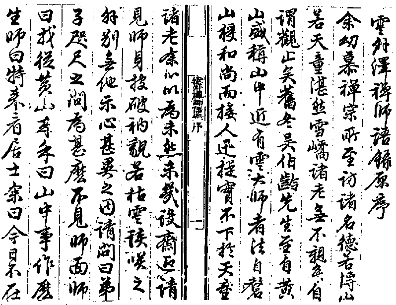
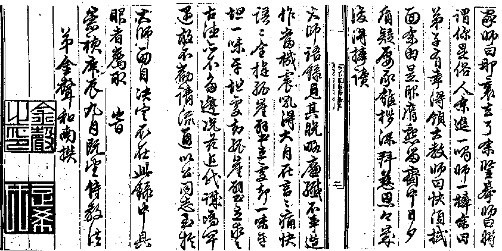

# 神鼎云外泽禅师语录



> **藏经**：嘉兴大藏经（新文丰版）（嘉兴藏）　**册次** 第 33 册（J33）　**编号** JB280　**部类** 诸宗部　**卷次** 15 卷　**篇幅** 152,548 字

> **作者（译者）**：参学门人宏怤编、侍者深极编、侍者深知编、门人刘醇骥编、书记宏道编、侍者深如编、侍者深皜编

> **卷／品**：15 卷 · 4 品



---



## 目录



  - [神鼎云外泽禅师语录序](#神鼎云外泽禅师语录序)

  - [云外泽禅师语录原序](#云外泽禅师语录原序)

  - [神鼎云外泽禅师语录序](#神鼎云外泽禅师语录序-1)

- [云外禅师语录卷第一](#云外禅师语录卷第一)

- [云外禅师语录卷第二](#云外禅师语录卷第二)

- [云外禅师语录卷第三](#云外禅师语录卷第三)

- [云外禅师语录卷第四](#云外禅师语录卷第四)

- [云外禅师语录卷第五](#云外禅师语录卷第五)

- [云外禅师语录卷第六](#云外禅师语录卷第六)

- [云外禅师语录卷第七](#云外禅师语录卷第七)

- [云外禅师语录卷第八](#云外禅师语录卷第八)

- [云外禅师语录卷第九](#云外禅师语录卷第九)

- [云外禅师语录卷第十](#云外禅师语录卷第十)

- [云外禅师语录卷第十一](#云外禅师语录卷第十一)

- [云外禅师语录卷第十二](#云外禅师语录卷第十二)

- [云外禅师语录卷第十三](#云外禅师语录卷第十三)

  - [砥行社序](#砥行社序)

- [云外禅师语录卷第十四](#云外禅师语录卷第十四)

- [云外禅师语录卷第十五](#云外禅师语录卷第十五)



---



### 神鼎云外泽禅师语录序



余己卯、庚辰间，闻云大师名籍甚，及读金正希先生语录序，推崇不遗餘力，心尤慕之。浚师往匡庐，抵蕲州，南届长沙，距吴会三千里，竟不得一见。越十年，师入灭。又十六年，惺寐禅师以其语录全帙示余，展读弥日，乃知人天佩服，非偶然也。师少而英俊，久参耆宿，深有发明。入阳山，见授和尚，机锋迅疾，应对如流。阳山云：「汝进语都筐，但桶底未全脱在。」乃发愤再参，忽风动帘幙，扑蔌作声，从前玄妙宝重处一齐脱落。阳山每加勘验，知其证悟非虚，始以衣拂付之。住匡庐五乳峰，采茶作璎珞粥，终年枯坐。一日，读高峰自述悟因，遂自计曰：「彼见演祖赞时，已悟到虚空粉碎，大地平况，如何为雪岩末后一拶，却透不过？」复力参二载，偶因失足堕涧，山禽惊起，飞鸣一声，不觉彻应透现。自是大用灵通，纵横自在，主宾玄要，左右逢源，三主祖席，衲子云从，应机接物，雷厉风行，杀活临时，光明直截，使人近傍不得，凑泊无繇。昔临济吹毛石火，东山扑倒便休，师真不愧祖风矣。嗟乎！世间贤达皆有悟地，但末后一关未能打破，终是悟中之迷，虽高峰为古佛再来，其前段犹不免此，况餘人耶？师之悟力全在重关更进，如与群仙同上云霄，独能撞开天阙，宜其自利利人，无不具足，所传语录，顽艳服膺也。正希先生曰：「大师面目定不在语录中，具眼者荐取。」余曰：「大师面目何尝不在语录中？但非具眼者不能荐取耳。」阳山不妄记莂，生平煆炼惟师一人，师得法十八年，门徒参请尝千数，而终身无所付嘱。惺寂禅师为同参兄弟，不远三千里往来佐师，灭度后，结集前后语录已刻、未刻如干卷行於世，正法流通，惺公力也。诵斯录者，其无忘厥功。



时康熙十一年孟春谷旦　云间王光承槃谈撰



------



### 云外泽禅师语录原序











------



### 神鼎云外泽禅师语录序



汾阳有三种师子句：一曰超宗异目，二曰齐眉共躅，三曰影响音闻。三种之中，无论影响音闻为野干倚势、异类无分，即使齐眉共躅见与师齐，早已灭师半德矣。唯夫超宗异目见过于师，方堪传授。然自曹溪散席以来，历唐宋元明，屈指几人堪称此种？回翔今古，庶几黄檗、大仰、德山、临济、洞山、岩头、云门、玄沙，以至汾阳昭、石霜圆、五祖演、大慧杲、应庵华，暨近代先师悟老人数十辈而已。先师龙吟沧海、虎啸深山，一时风云驰骤，非但首下天台席多香象狻猊，即出自天童刀尺散而之四方者，类皆超师有作，如磬山再世，云外泽公其一也。公始开发天童，继参阳山，得受记莂，遂深隐匡庐之巅。时中现行流识，治以悟力，一切并消，却疑高峰有悟后之迷，念不去心。一日，偶采野蔬堕深涧，忽山禽飞起，大叫一声，不觉泮然冰释。从此全机透脱、大用现前，尽十方世界、大地山河、草芥人畜，都卢是个清净光明，遮那妙体，窅忘彼此，泯绝是非。故其引接方来，提携未悟，从无住本，洞示当人，不论初机宿学，才跨门来，教渠一蹋到底，直践至泰至安之域、大休大歇之场。然拟莽卤承当，便与深锥痛拶，而诸方来者，非慧偏识短，则半青半黄，愍其杂毒入心，过由师故，复於告香普说时，举当世邪知谬说之师，条陈其妄，指斥其非，反覆万有餘言，而娓娓不休焉。於乎！默照邪禅，误人尚浅，大慧禅师尤且肆口讥诃，矧穿凿邪解之害人，至戕慧命，忍视其祸延不起，而救正之乎？公既契悟恢宏，抑复三学该鍊，昔玄沙说法，往往与修多罗吻合，所以雪峰称备头陀为再来人。今公说法提纲，固已破除佛祖，华擘玄铨矣。至若因事对机，则又一一从如来性起妙德中拈出，虽不攒花簇锦，要亦丽日光天。宁曰：公仅丛林銕舌远，殆几希禅判官之永明寿乎？故予谓磬山门下，超宗异目，独公一人，夫岂阿其所好哉？惜夫法门衰替，人之云亡，九原如可作，微公吾谁与归？



康熙八年岁次己酉月维小春弘觉忞老人撰



云外禅师语录目录



卷之一菩提上堂



卷之二老祖上堂



卷之三神鼎上堂



卷之四普说(二)



卷之五小参



卷之六小参



卷之七机缘



卷之八机缘  

法语(附)



卷之九拈颂



卷之十书问



卷之十一偈  

净土咏(附)



卷之十二诗



卷之十三杂著



卷之十四散话



卷之十五散话



附传  

遗嘱



------



## 云外禅师语录卷第一



**译者**：参学门人宏怤编



住蕲州菩提禅寺语录



顺治己丑七月，师在广济接引庵受请，拈张高众护法疏。「见麼？遍界不曾藏，今朝重指注，便解承当，还较些子。如或未然，且付维那宣读。」



入院，至山门，师卓拄杖云：「入门一步，智者知归；掉臂便行，人天罔措。且道毕竟如何？」喝一喝。



佛殿。「权挂垢衣云是佛，却披珍御复名谁？当阳注破无多子，三拜浑同古佛仪。高著眼，莫狐疑，四山驱绿拥禅扉。分明月在梅华上，看到梅华早已迟。」展坐具三拜。



祖师。「两两三三起祸殃，铁钉炊饭要人尝。和赃捉败菩提寺，觌面无私一炷香。」



伽蓝。「兵荒接踵几经年，赖尔灵光寺岿然。今日我来重著楔，尘尘刹刹一光拳。」



开山医祖像。「东也撞著个汉，西也撞著个汉。谁知下载清风，儿孙却得一半。且道那一半作麼生？暂时放在暗窗前，明日与君重计算。」



据室。「小小方丈，无劳伎俩。是佛是魔，双收双放。堂堂坐断地天先，笑看华鲸来入网。」



拈护法疏。「达磨鼻孔，夫子眼睛，俱在者里和盘托出。还有委悉得者麼？如无，不免烦他维那宣读一过。」



举法衣云：「从上老古锥遗下者具皮毛，后代儿孙透到临末稍头，个个少者一杓恶水，不得今朝解脱不下。看！看！山僧入者虫豸去也。」搭衣云：「不入惊人浪，难逢称意鱼。」



指法座，云：「大众会麼？者个宝华王座，常在诸人顶𩕳上安著，不宽不狭、无欠无餘。汝等诸人要推推不开、要上上不得，何不直下与麼去？如或未能，山僧为你拈却。」便升。拈香祝圣讫，复拈香，云：「生平扶弱不扶强，不涉恩雠独主张，雪老冰枯红燄发，一炉香散海云忙，奉为磬山第二代松际先师授和尚，𦶟向炉中，从教炙地熏天去也。」敛衣就座，维那白椎，云：「法筵龙象众，当观第一义。」喝一喝，云：「直饶向未举椎前荐取将去，早已落二落三了也。且第一义毕竟如何？莫有道得者麼？」僧问：「昔日灵鹫，今日菩提，未审是同？是别？」师云：「一不成，二不是。」进云：「恁麼则灵山一会不异今朝。」师云：「卜不习吉。」进云：「谢和尚指示。」师便打。问：「马祖三十年不少盐酱，未审和尚今日事作麼生？」师打，云：「当炉不避火。」进云：「恁麼则大抵还他肌骨好，不风流处也风流。」师云：「那里学者虚头来？」进云：「和尚恁麼那？」师打，云：「前言不应后语。」乃掉拂子，云：「堂堂无一物，个个是菩提，拟欲求玄旨，依然涉路岐。所以教中道：『一切众生即菩提相，不可以菩提而得菩提。』又云：『十方诸佛不得菩提，六道众生不失菩提。』如是，则尽十方界都在诸人菩提里，尽十方世界是诸人一个本身，十方诸佛出现於世，转法轮、度群有、入涅槃，一切众生流转生死，受无量身、经无量劫，总不出诸人本身三昧，何不直下与麼去？岂不省力？还有信得及者麼？直饶你向者里信得及去，山僧更要问你：尽十方世界既是诸人一个全身，为什麼居者不知行者事，人间不听上天钟？到遮里，须知有透脱一路始得。如或不然，纵使问一答十、问十答百，总在灯影中行相似。若要亲证自己菩提本身，何异认驴鞍桥作阿爷下颔者哉？秪如山僧今日承众护法之请，一行人众同到菩提，鼓响钟鸣、人来客往，吃茶叙话、循礼循仪，开示升堂、当机问答，且道是亲证耶？非亲证耶？若向者里瞥地去，便可上与十方诸佛同一慈力、下与六道众生同一悲仰。还会麼？众生即是菩提相，杪秋风日殊清亮，卜方世界是全身，人人脚底重千觔，句下若能亲荐得，山层层又水层层。」复举：「保寿开堂，三圣推出一僧，寿便打，圣云：『你恁麼为人，不惟瞎却者僧眼，瞎却镇州一城人眼去在。』寿掷下拄杖，归方丈。者一则话，丛林往往拈提，尽道三圣、保寿共出只手扶竖临济门风，恁麼商量，何殊矮子看戏？殊不知二大老弄巧成拙，败阙愈多。山僧今日拄杖开封，还有共出只手扶竖磬山门风者麼？如无，山僧不免为众竭力去也。」卓拄杖，喝一喝，下座。



安职事，上堂。「四祖缝衣后，灵踪护有神，道场千古旧，法席几番新？愧我非时出，诸贤共挽临，今朝安职事，位位信天真。且道作麼生是天真底消息𫆏？」良久，云：「释迦坐禅，弥勒煮饭，观音种菜，普贤搬柴，只有憍陈如尊者冷冰冰地长年打坐，山僧看见便去骂他：『今日安众职事了也，你为什麼不去随众作务？』他道：『和尚曾作个什麼来？』山僧被他一拶，直得无言可对、无理可伸，一场懡㦬而回，只得告诉大众：知有恁麼事。且道知底事又作麼生？」击拂子，云：「诸佛菩萨耐烦，耐烦。珍重，珍重。」



结制，上堂。掉拂子，云：「不借无生国，何须向上机？即今一句堂堂光灿烂，瓦解冰消万劫疑，不住见闻之内，全超鉴觉之渊。若是天外出头底衲子，向未举已前撒手便行，岂不成大丈夫哉？如或未然，有疑请问。」僧问：「当今宗旨建立之初，请问和尚：如何是夺人不夺境？」师云：「巢知风，穴知雨。」「如何是夺境不夺人？」师云：「惊衣虽脱了，𫛱鴩尚矜夸。」「如何是人境两俱夺？」师云：「花须连夜发，莫待晓风吹。」「如何是人境俱不夺？」师云：「海阔从鱼跃，天空任鸟飞。」进云：「四句已蒙师指示，直截根源事若何？」师便打。乃云：「霜林叶落，体露千山，本来面目无藏处，三世如来口嘴乾。便恁麼去，犹涉途程；总不如何，堕坑落堑。山僧今日为汝诸人放一线道，直教个个如狮子儿壁立千仞去也。」卓拄杖，喝一喝。



上堂。「教中道：『自心取自心，非幻成幻法，不取无非幻。非幻尚不生，幻法云何立？如幻三昧王，弹指超无学。此阿毘达磨，十方薄伽梵，一路涅槃门。』」拈拄杖，云：「恁麼会去，弹指超无学。」横置拄杖，云：「恁麼会去，停四长智，养病丧躯。」复卓拄杖，喝一喝，云：「这段葛藤贬向什麼处去也？」良久，云：「神龙一举透无边，纤鳞犹在泥中跃。」下座。



上堂。「月月有个初一，诸人那个不识？虽然亘古亘今，未免有虚有实。还有知虚识实者麼？」问答竟，乃云：「三世诸佛证不到，历代祖师说不及，作善便生乐方，作恶还沉苦地。娑婆世界斗量来，秪得三千一百斛，凭中卖与阿修罗，十贯铜钱犹不足。告汝大众，此事不可使外人知。外人知道，将谓山僧既称一方善知识，为什麼将大斗量常住东西私下出卖？」良久，云：「山僧有个道理回复他，且道是什麼道理？」喝一喝，下座。



上堂。僧问：「把住乾坤失色，放行瓦砾生光，即今正令全提，谁是当其锋者？」师云：「高著眼。」进云：「恁麼则直下知归去也。」师云：「对面三千里。」进云：「向上事还许学人露个消息也无？」师云：「你试道看。」进云：「野色更无山隔断。」师云：「鸟栖林麓易，人出是非难。」僧礼拜。问：「万机休罢时如何？」师云：「莫辜负你者一问。」进云：「恁麼则直下担荷去也。」师云：「你又辜负我作麼？」僧拟开口，师便打。进云：「某甲到遮里，箭尽弓折了也，乞和尚慈悲，示个安乐法门。」师打，云：「者纳败阙汉，不打更待何时？」乃竖拂子，云：「大众见麼？所以道：欲明向上事，须是向上人。若[毯-炎+畏][毯-炎+畏]毸毸地则不得也，直下便见，更无回互，才涉思惟，剑去久矣，何况蹋步向前，问禅问道，穿凿商量，挑著屎担傍家走，唤作参禅学道，闯入邪魔队里，被瞎眼阿师将丈二钉、八尺楔钉却眼睛，彼此欢喜，唤作逼拶工夫，付衣付拂，奸心诡计，正眼看来如粪坑蛆虫相似。汝等诸人大开了眼，看看是个什麼道理？直下更无第二人，天堂、地狱、饿鬼、畜生、菩提、涅槃尽是汝诸人日用经历底，步步过无量无边世界，皆是诸人分上事，秪为不见有一毫异法，故有如是大用。若约衲僧门下犹是小用，且道：如何是大用𫆏？意气不从天地得，英雄岂逐四时推？」喝一喝，下座。



冬至，上堂。「阳极则阴生，阴极则阳至，阴阳不到时，万化由兹起。所以道：一句通同，十方快畅。起也，海晏河清；住也，乾坤失色。且如不去不来、不起不住时又作麼生行履𫆏？诸人还委悉麼？」良久，云：「如或未然，更为注破：一九与二九，相逢不出手，还较些子；三九二十七，冻得虚空成铁壁；四九三十六，畫蛇切忌重添足；五九四十五，阳气发时无硬所，诸人莫谓冷全消，更有春寒四十五；直待九九八十一，恭喜诸人大事毕，回头更拟问如何，獦蚤蚊虫劈嘴掷。」喝一喝。



腊月初一上堂。卓拄杖云：「戒由心生，心依戒起，了得自心，无事不毕。长安甚闹，我国晏然，高氏沙弥，舌头拖地。但得心安处处安，触目无非波罗密，要了生死根源，记取腊月初一。」



上堂。僧问：「德山入门便棒，临济入门便喝，未审还有为人处也无？」师云：「急走，急走。」僧云：「走后如何？」师打，云：「病鸟不离窠内死。」僧喝，师又打，乃云：「德山入门便棒、临济入门便喝，总是盐汤止渴，无风匝匝之波，撩起便行还较些子。若是困鱼止泺、病鸟栖芦，翻成祸事。菩提门下总不与麼，人情若好，吃水也肥。汝等诸人还知浑身坐在水里麼？」拈拄杖下座，打散，云：「选佛若无如是眼，宗风那得到于今？」



授比丘戒，上堂。横按拄杖，云：「佛殿出家天地前，山门钟鼓皆稽首，草木丛林尊证师，羯磨教授南北斗。今朝特地为举扬，坚持此戒甚希有，万机休罢急须行，眼底有华不唧溜。人人本具悉周圆，一亘晴空无量寿，情与无情度尽时，净戒於焉始成就。」卓拄杖，喝一喝。



腊八，上堂。拈香竟，乃云：「今朝乃是释迦世尊成道之辰，汝等还见世尊面孔麼？」拈拄杖，卓一下，呈起，云：「释迦世尊来也。他道：『奇哉！一切众生具有如来智慧德相，但以妄想执著而不能证得。』不证得且置，作麼生是如来智慧德相𫆏？大众！释迦世尊被山僧一拶，直得无言可对、无理可伸，山僧不觉呵呵大笑。汝等还知有遮个事也无？若知，不俟更举；若也不知，山僧为汝重加注脚。」乃卓拄杖数下，云：「如是知、如是见、如是信解，不生法相，且宿草庵，宝所在近。」喝一喝，下座。一



岁旦，上堂。僧问：「豁开户牖，万里不挂片云；杲日腾空，四顾松风满座。新年头佛法则不问，如何是梅华一点的消息？」师云：「三日后看取。」进云：「当初迦叶曾注破，一笑阳春遍九垓。」师打，云：「遮场祸事天来大。」僧礼拜，师乃云：「『有物先天地，无形本寂寥，能为万象主，不逐四时雕。』傅大士恁麼说话，美则美矣，未尽善也。山僧亦有一颂举似诸人：爆竹一声催腊去，梅华几点送春回，禅和拍掌呵呵笑，大地含生脱阴胎。大众！看看释迦老子骑佛殿、越山门来拜年也。」下座。



解制，上堂。「一期结却布袋口，露地白牛变作狗，拆却牛栏在此时，当阳突出看哮吼。还有哮吼底麼？」僧问：「世出世间是个大𬬻𫖔，和尚今日制作麼生解？」师云：「火尽不添柴。」进云：「毕竟向什麼处安身立命？」师云：「无入不自得。」进云：「恁麼则佛祖位中留不住，烟霞依旧遶青山。」师云：「八华絿子上，不用绣红旗。」进云：「且喜露柱灯笼证盟去也。」师便打，乃云：「即此见闻非见开，无餘声色可呈君，个中若了无难事，体用何妨分不分？即今打鼓升堂，四众云集，方丈老汉口吧吧地说长道短，且道是声色、不是声色？是见闻、不是见闻？即今万象𪭢然、音声历历，又如何得销缴去？到者里，若未透脱纲宗底，二六时中触境逢缘，不是随声逐色，定然爱静恶喧，有见闻作一边、无见闻作一边，心境纷纭、识情扰扰，如何得了生死去？若能即此见闻之中而见闻所不能到，居尘劳之地而尘劳所不能侵，亘古亘今，了无声色，堂堂坐断见闻，念念全超向背，解制、结制是什麼热碗鸣声？虽然如是，自救则得，若要开凿人天眼日，提持向上宗乘，更须飏却全身向那边更那边翻个筋斗，再来菩提手中吃棒。且道既到恁麼田地，为什麼还要吃棒𫆏？平芜尽处是青山，行人更在青山外。」卓拄杖，喝一喝，下座。



上堂。「觌面分明，犹为客作；回光歇念，籓内羝羊。一色千差，动静无住；言思不及处，别有一壶天。作麼生是言思不及底道理？还有具烁迦罗眼者麼？」竖拂子，云：「山僧今日可谓正直舍方便，但说无上道，如转轮圣王解开髻中明珠等施诸人。若能向者里大开了眼，顿入大安乐法门，岂不快畅平生？虽然如是，能有几人得到与麼田地？盖缘山僧遮里无丝毫异路与人行、无半句语言与人坐，诸方学得的、解得的，尽是明窗下安排、印板上露布，泥牛木马、石女金钟，觌面全提、悬崖撒手，死言死语筑满肚皮。乍到山僧遮里，不知是何说话？茫无措手，真可怜生。所以道：触目堂堂，头头具足。向遮里悟得个无相无名、本来无事，正是个大屎坑，多少人向遮里出头？不得横著肚肠、舒机发用，明朝后日蹋翻来路，方知惭愧杀人。直饶道：了了灵知，知亦不立；根尘迥脱，照体自如。虽云成等正觉、向上行履，若约衲僧门下，犹是贴肉汗衫，也须脱得乾净，再来山僧手里请棒吃。」喝一喝。



结制，上堂。僧问：「即今正在已结、未结之际，初机罔知适从，求和尚指示个入路。」师云：「莫作梦。」进云：「点石化为金玉易，劝人除却是非难。」师云：「伐冰之家不畜牛羊。」进云：「谢和尚荅话。」师便打。问：「万法从心生，诸缘唯性晓，本无迷悟人，秪要今时了。今时了后如何？」师云：「依稀似佛，卤莽为僧。」进云：「正当与麼时，还是已结制？未结制？」师云：「若是凤凰儿，终不践生草。」进云：「谢师指示。」师打，云：「一条红线手中牵。」乃呈拄杖，云：「大众见麼？十方三世一切刹土中，若圣、若凡，一齐在山僧拄杖头上成等正觉、转大法轮，各各遍入微尘国土，一一国土中各各见有云外比丘统领佛刹微尘数菩萨摩诃萨众，於紫云峰顶演说如是甚深般若波罗密，穷未来际无有间断，身、语、意业无有疲厌。若能如是见得，各各具足、各各圆满、各各解脱、各各成现，不资一法、不欠一毫，长期、短期，结制、解制，是甚麼热碗鸣声？如或未然，也须真参实悟一番始得。不见古人道：『毫厘系念，三途业因；瞥尔情生，万劫羁锁。』直饶纤念不起，犹为死水生虫；无端依户傍门，未免堕坑落堑。直须捏死猢狲，髑髅前更无魍魉；拈来便用，临机处杀活纵横，大家自在逍遥。」掷下拄杖，云：「一任抛来掷去。」喝一喝。



上堂。「眼若不睡，诸梦自除；心若不异，万法一如。终日在世间，尘尘无一事，何须说离说即、说玅说玄？虽然如是，既到恁麼田地，直须努力向前，不可优游小径。所以道：日可冷，月可热，火星烧著梵王衣，却是新罗人打銕。语不到处，问荅纵横；思不及时，千酬万应。更有一言全举似，归堂止静对跏趺。」



上堂。僧问：「古人道：『离心意识参，绝圣凡路学。』只如心意识作麼生离？」师云：「一座才起，大地全收。」进云：「毕竟如何保任？」师云：「十二处亡闲影响，三千界放净光明。」进云：「通身无罣碍，处处绝行踪。」师云：「德山元是老婆儿。」进云：「某甲总不会。」师打，云：「你且吃棒著。」乃举：「昔日法眼禅师道：『眼中无色识，识中无色眼，眼识二俱无，云何令见色？』师云：与麼话堕阿师，何异稚儿弄影？明头合处，暗里全彰；象王行时，狐踪绝迹。十字街头，跛鳖盲龟千金不换；一枚镇海明珠，一文钱卖却七八十颗，不为分外。遮里若作佛法商量，更须买草鞋行脚始得；不作佛法商量，带累山僧也是个瞎汉。山僧六十年前有个超诸方便句子，今日布施诸人，且道是什麼句子𫆏？」击拂子，云：「达磨大师无当门齿。」下座。



上堂。师举：「《金刚经》『尔时世尊至实无众生得灭度者。』」乃竖拂子，云：「世尊一条生銕脊梁壁立千仞，才被须菩提轻轻磕著，便向草里辊将去。虽然如是，可谓入水见长人也。当时若只向『应如是住、如是降伏其心』处便休，今时承虚接响汉向什麼处摸索？若是山僧则不然，见他道：『唯然，世尊！愿乐欲闻。』便云：『穿却了也。』」复竖拂子，顾大众，云：「还见世尊麼？」良久，喝，云：「若向遮里了彻将去，一大藏教当下圆成；如或未然，且行罗汉慈，解结缚故；行如来慈，度众生故。」喝一喝。



上堂。「实际理地，不受一尘。灵光独耀，无古无今。佛事门头，不缺一法。直撞横冲，七通八达。两行滞货一齐收，千林万壑冷湫湫。落日红霞千嶂锦，西风黄叶一声鸠。」卓拄杖，喝一喝。



结制，上堂。横按拄杖，云：「汝等闻有个云外长老出世，各各顶笠腰包，来到遮里参禅学道，拟会西来大意。错了也。殊不知山僧从无量劫来常在你顶门打坐，寸步不离，你要见则得，欲觅则不得。你拟向玄妙处觅山僧，山僧不在玄妙处；你向平常处觅山僧，山僧不在平常处；你向了不可得处觅山僧，山僧不在了不可得处；你向一切处见山僧，山僧不在一切处。你若见得山僧，与山僧孝顺，山僧与你永出尘劳，高超十地，举心动念皆成海印发光，语默坐行尽是超佛越祖。你若不见山僧面、忤逆山僧时，山僧使你欲暂举心，尘劳先起，昏沉散乱，卜度思惟，向外驰求，自缠自缚。且道：山僧既在你顶门打坐，历劫不离，为什麼升沉各别？还有透得此意者麼？」良久，云：「山僧即是你，你即是山僧。虽然如是，诸方唱导门中即得。若向菩提门下，更须将自己与山僧一齐抛向东洋大海，转身向那边，更那边打个筋斗，却来菩提手里请棒吃。且道：既是一齐抛了，又将什麼吃棒？还会麼？」拈拄杖，卓一下，喝一喝，云：「不容拟议斩全身，始得名为主中主。」



上堂。「此事无你解会处、无你参寻处、无你思惟处，你要悟即得、要会即不得。若是个真实悟得的人，如乡里两人说家常话相似，了了明明、成成现现，问东答东、问西荅西，不承言、不滞句，傍人观之，或惊或愕、或想或疑，将谓有许多玄妙机锋道理，殊不知在他分中有什麼禅道机锋可说？虽然如是，直饶与麼会处，犹隔山僧三十里在。」卓拄杖，云：「描也描不成，畫也畫不就，直下相逢来，一槌俱打透。」复拈拄杖，卓一下，云：「将在军，君命有所不受。」



解制，上堂。「肘后悬符底且过一边，气吞佛祖底犹居门外，直得海底生尘、山头鼓浪，犹是无风匝匝之波。若论向上提持，直饶百千诸佛展无尽神通、历代祖师弄无尽伎俩，向此个门中如雪填井相似。还会麼？」击拂子，云：「不是与人难共住，大都缁素要分明。」



上堂。举：「《华严经》云：『随顺无明起诸有，若不随顺诸有断。』诸有既尽，十方凡圣只可填沟塞壑。到遮里上无攀仰、下绝己躬，犹是无风匝匝之波。还有跳得出者麼？」良久，云：「跳则且置，只如既是上无攀仰、下绝己躬，又唤什麼作无风匝匝之波𫆏？」击香几，云：「披蓑侧立千峰外，引水浇蔬五老前。」



上堂。僧问：「银墙銕壁时，如何是迷中悟？」师云：「你问遮个系驴橛作麼？」进云：「瓦解冰消后，如何是悟中迷？」师云：「剑去久矣，你方刻舟。」问：「学人生死不明，乞师一接。」师云：「莫妄想。」进云：「不会。」师云：「却较些子。」僧礼拜，师便打，乃云：「聪明不了生死，乾慧难脱苦轮。若不真参实悟，打脱业识根由，总无自由分。汝等无论久参初学，皆须单刀直入，扫荡搀抢，方见太平基业。若只向心窝里想、本子上寻，以当参学，正如南行北辙，愈行愈远，生死到来方知不实。近时有一等禅和子，不信真参实究，不是向见闻知觉上认住，便是向无为无事内困著，甚至惯习机锋，胡谈乱作，种种邪谬。病僧久病无力，又舌头生疮，不能一一详举，所以真实告报诸人道：见闻知觉决定不是，行住坐卧决定不是，坐禅入定决定不是，寒向火、热乘凉，看孔著楔、舍短从长，菩提寺里一百五十个禅和子、一百四十九个没有鼻孔。众中忽有个汉走出来道：『请问和尚：那一个毕竟是甚麼人？』病僧到遮里怎得不打？还有知落处者麼？」乃击香几，云：「好大哥！归堂去。」



冬至，上堂。「一毫端现宝王刹，破院子等地天宽，寒向火，热乘凉，门前山色郁苍苍，搬砖弄木权相为，更无佛法可商量。诸仁者！莫仓皇，不了流为声色梦，了则全身入帝乡。」竖拂子，云：「且道是声色耶？是帝乡耶？满盘托出无人委，七宝空餘万丈光。」复举：「五祖演冬至小参，举傅大士偈云：『有物先天地，无形本寂寥，能为万象主，不逐四时雕。』祖云：『傅大士恁麼说话，可谓精金美玉，今古光辉。』山僧举到遮里，忍俊不禁，与诸人颂出。颂云：有中有，无中无，细中细，麤中麤。」师云：「诸大众！要见傅大士则易，要见演祖则难。何以故？话在菩提。举到者里，也不妨与个注脚：袖头打领，腋下剜襟，贫人齐夺却，富者与三斤。」



　前住  

神鼎云外和尚语录第一卷。  

康熙乙巳夏月，神鼎塔院识。)



------



## 云外禅师语录卷第二



**译者**：侍者深极编



住黄梅老祖寺



上堂。师至法座前，拈拄杖指云：「大众还见麼？须弥灯王如来遣八万四千菩萨摩诃萨各各坐大宝莲华座，一一座高广六十由旬，来入法堂助扬大化，随山僧手顿尔现前。诸人还见麼？若不见，莫怪山僧撒屎著汝诸人头上去也。」拽拄杖便上。拈香祝圣讫，次拈香云：「三十年来弄马骑，谁知却被瞎驴记？二回拈出大家看，一番饮水一番噎。今日对人天众前敬为磬山第二代先师授和尚当阳𦶟却，普请同观。」白椎竟，师掉拂子云：「如弦直钓老渔翁，飒飒清风步步同，今又悬竿峰顶上，人人俱在水晶宫。水晶宫里不是久居，冲浪锦鳞出来相见。」问：「祖庭秋晚，邪法横行，即今阖山大众敦请和尚升座，未审有何方便唤醒一切人不蹈邪径？」师云：「左眼半斤，右眼八两。」进云：「千峰顶上闻狮吼，我祖灯光今又辉。」师云：「山高雾重。」问：「古人道：『具足凡夫法，凡夫不知。』意旨如何？」师云：「胡张三。」进云：「『具足圣人法，圣人不会。』又作麼生？」师云：「黑李四。」进云：「圣人若会，为什麼即同凡夫？」师云：「猩猩著草鞋。」进云：「凡夫若知，为什麼即是圣人？」师云：「瓦解冰消。」进云：「秪如今日老祖寺里升堂，大众耸听，还是凡夫？还是圣人？」师云：「观国之光，利用宾於王。」进云：「恁麼则圣凡两路俱抛却，一亘晴光万古春。」师打，云：「堕坑落堑。」乃云：「宗风久寂，秪为自信不真；祖令当行，要使十方畅快。外道邪宗丧胆，权乘菩萨无光。若是具眼英贤，向未举已前撩起便行，老祖也须退身三步，让他出一头地始得。既无其人，不免累及山僧，随例颠倒去也。昔日释迦老子四十九年三百餘会，顿渐偏圆、大小权实，一雨所滋，称其种性，各得增长，乃至法华会上虽云极畅本怀，正眼看来，譬如指毒食以示人，未有亲下口者。厥后灵山会上拈起一枝华，目顾大众时，百万人天悉皆罔措，惟有迦叶尊者破颜微笑，世尊遂云：『吾有正法眼藏、涅槃妙心、实相无相、教外别传、秘密法门，付嘱摩诃迦叶。』一杓恶水盖覆将来，可谓亲吞此毒，死后还魂。於是，西天四七、唐土二三，餘波横流，其毒愈炽。黄梅五传而至临济，毒弥深、法弥广。宝掌大士自中印而来兹土，历州四百、历岁千餘，尚不免毒发於少林、祸延於此土。后有天王道悟禅师等𫗦其糟而啜其醨，当是之时，贪生怕死之流望岩而退，迄今数百年来毒气全消，草木畅达，居民适意。山僧今日偶为一阵业风吹到此间，且道是放毒气耶？说佛法耶？若是佛法，山僧一些也不曾学他，更有甚麼可说？只是收得一条鳖鼻蛇，毒气连天，逢佛咬杀佛、逢魔咬杀魔，乃至饿鬼、罗汉、六道、四生，但有到来，便与当头咬杀。今日向人天众前抛出来也。」掷下拄杖，云：「还有亲遭此毒者麼？」击香几一下，云：「险。」复举：「三圣道：『我逢人即出，出则不为人。』兴化道：『我逢人即不出，出则便为人。』遮两个汉，如手执兵符，各霸一方。若到老祖门下，总与三十拄杖趁出。何以故？新开舖席，赏罚分明。」卓拄杖，下座。



上堂。僧问：「法雷已震，甘露已洒，今日升座，还有不说似人的法也无？」师云：「看取令行时。」进云：「恁麼则龙得水时增意气，虎逢山色长威狞。」师云：「忍屎抵饥肠。」僧喝，师便打。问：「如何是有句无句，如藤倚树？」师云：「依稀越国，彷佛杨州。」进云：「树倒藤枯，句归何处？」师云：「正好吃棒。」僧喝，师便打。乃云：「夜卧不知谁唤起？闻声不假耳根尘。一条拄杖，生铁铸成，活鱍鱍地，谁敢拘束得伊？你但内不徇私、外不求玅，头头尽是知音，法法皆予伴侣。若向高玄处觅见，没溺杀人，抱桩摇橹，快活何期？山僧不是大德，大德不是山僧，山僧只於此处而得解脱。」喝一喝。



上堂。僧问：「古人道：『象王行处绝狐踪。』破额山乃医祖道场，为什麼竟容狐鼠？」师云：「不见道：野狐跳入金毛窟？」进云：「冷看是？救取是？」师云：「祸不入慎家之门。」进云：「恁麼则太阳升处野燐消。」师云：「争奈疏田不贮水何？」僧礼拜。问：「方今伪说混真，魔法炽盛，法王登座，未审何法救援？」师云：「未问已前百杂碎。」进云：「与麼则狮子一滴乳迸散十斛驴乳也。」师云：「看取者一问。」进云：「只如紫云峰顶，人天交接，凡圣混融，未审有几人能契和尚意旨？」师云：「未曾饱吃庐陵米，徒将长袖惹风烟。」进云：「袖里金锤光灿烂，倚天长剑逼人寒。」师打，云：「者一棒少你不得。」僧礼拜。师乃云：「一法能生无量法，无量入一亦无餘，超情离见绝遮拦，生育圣凡无向背。名不得、状不得，不可得中只麼得，佛祖於兹结舌，魔外窥伺无门。若是个具眼英灵，望见山僧恁麼道，便能当头坐断，千圣齐立下风；正眼洞明，照彻圣凡根本。天地如斯而覆载，日月如是而运行，佛祖如是而转法轮，众生如是而流转生死，山僧如是而作戏逢场，拈提向上钳锤，搂碎野狐窠窟。直饶亲证如是，只能入佛不能入魔，更须重入红炉，烹煆十成具足，死后方可入净入秽，入弥勒楼阁，入三眼国土，处处游履，惟见空名。此犹是方便利生边事，若要直截根源，何假遮些唠嚷？若[毯-炎+畏][毯-炎+畏]𣯧𣯧，如觑地寻针子底一般，今日会禅，明日会道，不是内依蕴界，便是外逐狐涎，日久月深，趋名奔利，打入野狐种类，相引相牵，均投苦海，本学善因，反招恶果去也。山僧今日偶然路见不平，说起遮般络索，可谓不惜眉毛，欲得此话重圆，且听重为剖判。」拈拄杖卓一下云：「拄杖子朝到西天，暮归东土，三世诸佛只得傍观有分。恁麼说话，据地擎天，汝等诸人开眼也著，闭眼也著，拟求解会，错过多时，要不拟心，堕坑落堑，浑仑吞却，正落邪禅；直饶透脱分明，未免触途狂见。且道毕竟如何？」卓拄杖云：「烂研巴豆三千颗，泻尽诸方五味禅。」下座。



上堂。僧问：「今日乃是汪居士见道不惑之年，敦请和尚升座，未审因斋庆赞一句作麼生道？」师云：「万国醉心尝大鼎，相逢携手上高台。」进云：「恁麼则一亘晴空无量寿，风云相聚古峰头。」师云：「大似一联诗。」进云：「且喜佛殿山门共相畅快去也。」师便打。问：「教中道：『无法可说，是名说法。』即今四众临筵，和尚如何施设？」师云：「山僧打退鼓。」进云：「灵山一会，今日俨然。」师云：「你即今在什麼处？」进云：「居士知恩有地，慧日长明去也。」师打，云：「脱却遮重关，再来请棒吃。」问：「寿域既开于今日，当阳直指事如何？」师卓拄杖三下。进云：「恁麼则金莲从地涌，宝盖自天垂也。」师云：「虚头禅客。」进云：「蹋断紫云峰顶上，及第心空在此时。」师打，云：「且信一半。」乃云：「昔日天奇和尚道：『尽大地名不是别人名，尽大地相不是别人相，尽大地机不是别人机，尽大地体不是别人体，尽大地用不是别人用。若向遮里会得，十方诸国土无刹不现身。』」乃呵呵大笑，云：「大小天奇祖翁元来小胆。若是山僧则不然，今朝六月廿二日，便是如来真秘密，秪为凡夫逐始终，古人所以无虚弃。无虚弃，有何事？把手相牵入法门，文殊引导普贤迎。山僧说法作何语？日月周行无去住。收亦可，放亦可，凤凰不带黄金锁，紫云蹋碎岂徒哉？夺取锦标归去来。」击拂子，下座。



重阳，上堂。僧问：「寒菊未开，重阳已至，四众云臻，举扬何法？」师云：「青霄无异路。」进云：「有心落在今时，无心落在旷劫，如何得脱却两重关，逍遥无碍去？」师云：「山僧被你遮一问，直得禅床震动。」进云：「恁麼则异类中行得自由去也。」师打，云：「汤寒水热。」僧礼拜。师乃云：「山僧久矣不升堂，万象森罗努力忙，今为诸人聊举似，满天风雨到重阳。」乃举：「南岳思大禅师久不说法，志公使人传语云：『何不下山教化众生？目视云霄作什麼？』思云：『三世诸佛被我一口吞尽，何处更有众生可度？』」师喝一喝，召大众，云：「不是山僧为你喝住，你们都是思大禅师黑漆肚里货了。老祖遮里则不然，总不见有三世诸佛可吞，亦不见有众生可度。打动法鼓，四五百众一齐围绕将来，直得开山千岁宝掌和尚𨁝跳上紫云峰顶，横摇直摆，五百阿罗汉看见，一齐钻入藕丝窍里藏身去了，撞著释迦如来，便与他摩顶授记云：『善哉，善哉！宝掌比丘！汝乃能於东震旦国作如斯广大佛事，希有，希有！』山僧拄杖子听见恁麼道，冷地里笑嘻嘻地说：『宝掌老官也是悔气，今日被者一杓恶水劈头浇了，要洗得清，直待驴年。』」喝一喝，召大众云：「又不是山僧为你们喝住，你们几乎堕在金色世界中七颠八倒去也，过得者两重关，更须知有一重极难过底关在。」复喝一喝云：「如今乾坤荡荡，海不扬波，物阜民安，调风顺雨，高歌鼓腹，其乐无为，直饶宝盖擎天，争如我板鸣吃饭？」喝一喝，下座。



谢监院知客，上堂。「紫云峰顶，迥绝人间；鸟道悬崖，谁能伫足？西来大意，著著全该；蹋步进前，反成落后。诸贤密达此意，方可其建法幢。监院荷众竭力，识果知因；行直言端，典型可则。五旬设斋供众，山僧聊为拈提。且道拈提个什麼？」横按拄杖，云：「你有拄杖子，我与你拄杖子；你无拄杖子，夺却你拄杖子。恁麼会得，则无量寿超三际外，尘尘全露本来身；如或未然，且向葛藤里荐取。」喝一喝。复举：「云居舜禅师有偈云：『云居不会禅，洗脚上床眠；东瓜直儱侗，瓠子曲弯弯。』大小云居，元来小胆。若是山僧则不然，老祖不会禅，捏圆又搓圆；引得云居者，不住白云巅。」召大众，云：「知客云巅不住，监院功成不居。且道他二人向何处安身立命𫆏？」卓拄杖，云：「祖月凌空圆圣智，何山松柏不青青？」下座。



结制，上堂。「诸佛出世，祖师西来，了无别事，秪为直指汝等诸人直下本来是佛。虽然如是，毫厘有差，天地悬隔，不是其中人，难了其中事。即今三通法鼓，四五百众一齐围绕座前，那一个不是其中人？作麼生是其中事𫆏？」竖拂子，云：「唤作什麼？若道是拂子、不是拂子，大似郑州出曹门。若是个点头知尾底衲僧，望见老祖恁麼道，撒手悟去，恰似个参天鹞子一般，谁敢畫地为牢、拘系得伊？若是个念言语汉，将古人残羹馊饭蕴在八识田中，到处逞唇弄嘴，问向上向下，遮个则不问，那个又如何，遇著些瞎眼邪师蓦头印可，互相狐媚，永劫无有了生死之期也。奉劝诸兄弟：须知此事大不容易，麤餐易饱，细嚼难饥，用心用到无心用，脑后依然欠一槌。」喝一喝。



弥陀诞日，上堂。「教中道：『佛身充满於法界，普现一切群生前，随缘赴感靡不周，而恒处此菩提座。』菩提座且置，作麼生说个随缘赴感靡不周底道理𫆏？即今目前，春和、夏热，秋肃、冬寒，应时及节，遍界遍空，了无作为，岂假思议？万化由兹而建立，圣凡因此以升沉，岂不是随缘赴感靡不周底消息？秪为汝等头头错过，强作主张，不信自己威光，却随业识流转。所以，祖佛出来为汝诸人说破此事，建立三乘五教、戒定慧门、地狱天堂、四生六道，尽是疗狂子之药方，岂有实法与人增其系缚者哉？是以，真身常住，正法难思，杀活纵横，冷冷照用，扫除情垢，锻炼真金，定慧圆明，戒乘兼急，全凭自己威光，不向别处流转。」竖拂子，云：「虽然如是，且如诸人即今立地听山僧恁麼举扬时，菩提座在什麼处？」击拂子，云：「依稀似曲才堪听，又被风吹别调中。」下座。



佛成道日，大雪，上堂。拈香竟，乃云：「世尊昔年於正觉山前夜睹明星，豁然大悟，遂云：『一切众生具有如来智慧德相，但以妄想执著而不能证得。』」竖起拂子，目顾大众，云：「如今还有亲证得者麼？」放下拂子，云：「证与不证，都卢总在者里，夫是之谓智慧德相。」良久，云：「既然俱是智慧德相，为什麼有迷有悟？且道淆讹在什麼处？如或未知，山僧为汝下个注脚。」乃掉拂子，云：「风浩浩，雪飘飘，无相状，孰堪描？玉殿琼楼齐拽倒，不劳金镞落双雕。」便领众上殿。



岁旦，上堂。白椎竟，师便喝，云：「春夏秋冬无处住，人人刚道有新年，还有不涉新旧者麼？试出来道看。」僧问：「元正启祚，万物咸新，杲日当空，吾师如何祝赞？」师云：「阳气发时无硬地。」进云：「恁麼则春回大地，遍界难藏去也。」师云：「挟泰山以超北海。」僧拟进语，师便打。进云：「千峰势到岳边止，万派声归海上消。」师云：「下坡不走，快便难逢。」乃云：「昨日碌忙忙，尽道过年节，今日庆新年，个个皆欣悦。不知自己光，刚道有年月，初学厌纷嚣，便欲离分别。抛却金刚禅，满眼添金屑，捏转鼻头看，尘尘俱剖泄。松风岭外飘，煦日镕残雪，好个岁朝天，都卢为你说。」喝一喝，下座。



结夏，上堂。举：「大慧云：『径山无寸土庄田，今夏随宜结众缘，慵论道，懒参禅，拄杖挑来个个圆，不用息心除妄想，大家吃饭了安眠。安眠则不无，忽地梦见有人索饭钱又作麼生？』乃竖拂子，云：『依稀似曲才堪听，又被风吹别调中。』径山大师与麼道，美则美矣，只是忒俭。山僧今日也有数语与诸大众谙个时节：老祖无米又无盐，禅和来到总随缘，头头妙，处处禅，搬柴挈米担磨肩，进既无门退无路，顶𩕳一窍常通天。禅！禅！不用思惟计较，非干文字语言，按牛吃艸底一任按牛吃艸，噇饭打眠的一任噇饭打眠，堂内堂外打成一片，东西南北捏匾搓圆。还有一桩事，不得不为诸人说破：山上地湿，脚冷便须穿鞋。」



上堂。「古人道：『恩重山丘，五鼎三牲未足酬；亲得离尘垢，子道方成就。』成就则且置，作麼生说个离尘垢底道理𫆏？莫是广营福田以求出世麼？莫是一性圆明、了无生灭麼？莫是形有老少、佛性常住麼？若恁麼，当知皆是佛之影子、人天福报。见解依通则不无，若要亲见佛之一字，犹隔一重山在。所以，赵州云：『佛之一字，吾不喜闻。』赵州老汉恁麼道，只见锥头利，不见凿头方。若是老祖遮里则不然，佛之一字，回避无门。诸大众！作麼生是佛之一字𫆏？手中拂子不可不是佛之一字。今日请主石居士与令堂杨氏岂不是佛之一字？汝等攒攒簇簇、若圣若凡，无不是佛之一字。既然都是佛之一字，又将什麼作拂子？又将什麼作若圣若凡等一切物来？」竖起拂子，云：「还会麼？簸土扬尘无处寻，想伊只在秋江上。」



解制，上堂。竖拄杖，云：「还见麼？」卓拄杖，云：「还闻麼？若将耳听终难会，眼处闻声方始知。恁麼会去，如隔靴使拳头搔痒相似，有甚麼快活处？所以道：『参须真参，悟须实悟，阎罗大王不怕多语。』恁麼说话，如棒打石人头，嚗嚗论实事，不可作禅道机锋会了去。你若参到心穷力竭处，蓦然撞著个大阐提汉，劈头与你一棒，直得魂飞天外、魄散九霄，然后再与你一棒。若能向者里现出三头六臂，大中现小、小中现大，举一明三、证龟作鳖，不惟他人不识得你面目，你自己亦不知面目何似，是为真实解制之时，岂不畅快平生？你若未得如是，须是斩新提起无义味话，昼三、夜三，行、住、坐、卧，吃饭、穿衣，搬柴、运米，一切时、一切处，无不是参情结秀的时节。遮一念子，如烈燄亘天，点著则化，蓦地桶底打穿，方知决不相赚。」喝一喝，下座。



上堂。举：「法眼云：『三界惟心，万法唯识；唯识唯心，眼声耳色。』法眼禅师恁麼道，大似抱桥柱洗澡相似。若是山僧则不然，三界惟心，万法唯识，拄杖头边、艸鞋跟底倒用横拈，赵、钱、孙、李老祖寺里敲钟，打破玉皇脚趾，阎君鲜血迸流，跛鳖盲龟贺喜，搅乱四大部洲神王，个个怒目切齿，王家大姐暗嗟呼，一喝十方清彻底。」拈拄杖卓一下，云：「清彻底，摆尾摇头知几几？」下座。



上堂。「山僧横说竖说，只要你们认取生身父母，不要把他鼻孔扭捏。好大众！还识麼？你们各各从千乡万水来到者里，把生身父母撤在棘荆林里，参甚驴禅、马禅？愈参愈远，何不撒手归家，荐取生身父母？」目顾大众良久，云：「既无其人，山僧索性施大慈悲，为你指个归家路去也。你父母姓张，姓张的却在江南；你父母姓李，姓李的却在江北。江南、江北虽有许多州县、许多处所，总在山僧鼻孔里随气出入，直饶向遮里撒手回乡认取将去，犹是螟蛉之子，未识生身爷娘在。更或迟疑，莫怪山僧倒骑圣僧游戏十方刹海去也。」卓拄杖，云：「观音、弥勒。」下座。



结制，上堂。僧举狗子无佛性话，问：「赵州为甚麼道无？」师云：「地肥茄子大。」进云：「毕竟如何？」师云：「家富小儿娇。」僧礼拜。师云：「诸人还会麼？地肥茄子大，家富小儿娇，赵州只有一个牙，物物虽然都咬著，皮毛背上好藞苴，狗子见人偏解吠，山僧饮水不饮茶。」拈拄杖卓一下，云：「一劈太华分两路，断桥流水映朝霞。」下座。



上堂。举：「白云端为郭功辅作个山颂子，云：『上大人，丘乙己，化三千，七十士。尒小生，八九于，佳作仁，可知礼也。』郭公言下大悟。山僧今日亦为王居士作得个山颂子，此颂不唯为居士点开正眼，且能为天下衲僧脱却炙脂帽子、卸却鹘臭布衫去在。一二三四五六七，恭喜诸人事事毕，老君颠倒著衣裳，天师口念波罗密，老祖寺里逞风流，石巩禅师踢气毬，推倒门前下马石，黄梅城里闹啾啾，低头拾得水晶珠，拈起却是太湖石。尒小生，八九子，以我为隐乎？吾无隐乎尔。不须说。止！止！止！孔门弟子不能知，达磨老官打失两个当门齿。」召大众，云：「你道山僧恁麼说话，可似个三家村里教学先生也无？」拈拄杖，卓一下，云：「劝君更进一杯酒，西出阳关无故人。」下座。



岁朝，上堂。「岁除春已暖，吾道大亨通，要坐即便坐，要行即便行。堪笑香严老汉无端瞌睡惺惺，道个『去年贫未是贫，今年贫始是贫，去年贫无卓锥之地，今年贫连锥也无。』将谓得太安乐，殊不知正是乞儿见小利。更有个真净文和尚把不住，便道：『去年富未是富，今年富始是富，去年富惟有一领墨黪布褊衫，今年富添了一条百衲山水袈裟。岁朝抖搜呈禅众，实谓风流出当家。』真净老人可谓头正尾正，检点将来也须吃老祖三十棒。且道过在什麼处？不见道：有功者赏。老祖不辞诸方检责，也向骊龙窟内争珠去也。也不富，也不贫，南北东西本现成，打面还他州土麦，唱歌须是帝乡人。忽有个孟八即汉走出来道：『老祖与麼道也未见奇特，为什麼盲枷瞎棒打他古人？』山僧净洗双手，奉他一碗好茶。且道是赏伊？是罚伊？」喝一喝。



上堂。举：「教中云：『施主一粒米，大似须弥山，若还不了道，披毛戴角还。』汝等诸人担囊负盔、拨艸瞻风，向孤峰顶上鏊三打七、朝参暮究，还了道也未？」有僧出礼拜，将申问，师云：「披毛戴角作麼？更或抟量，一粒米也难消在。不见南泉道：『王老师自小养一头水牯牛，拟向溪东去牧，未免吃他国王水艸；拟向溪西去牧，亦未免吃他国王水艸。不如随分纳些些，总不见得。』」拈拄杖，召大众，云：「还见遮些些意旨麼？切忌向死水坐却。山僧遮里只养一条拄杖子，溪东也在遮里、溪西也在遮里，放行则合水和泥、横身为物，收起则孤标独立、魔外潜踪。且道与南泉相去多少？」掷下拄杖，云：「孤根自有擎天势，不比寻常楖栗条。」喝一喝。



解制，上堂。僧问：「尽大地是个解脱门，今日制向何处解？」师云：「刺脑入胶盆作麼？」进云：「虽然如是，作麼生得人天普利、大众沾恩去？」师云：「转见不堪。」进云：「台盘踢倒人星散，直汉从来不受欺。」师打，云：「且信一半。」僧礼拜。师云：「酷暑六月中，火云烧碧空，九旬天不雨，禾稻成蒿蓬，满世尽皆忙迫甚，禅和犹困散昏中，昙印设斋因解制，惺惺寂寂却朦胧。且道：既惺惺寂寂，为什麼却朦胧？若向遮里透得，便见适才遮僧问：『尽大地是个解脱门，今日制向何处解？』山僧向他道：『刺脑入胶盆。』诸人作麼生会？近时有一般汉道：『尽大地是解脱门，何必解制、结制？』恁麼见解，正是刺脑入胶盆了也。诸人莫见山僧与麼道，便谓法尔如然，必须有解、有结，更引古人『修证即不无、污染即不得』二语为证，何殊避溺而投火耶？若是有气息汉，向遮里脱却鹘臭布衫，遇茶吃茶、遇饭吃饭，如初生孩子相似，更无一些缝罅与人摸索。若能如是，放开肚皮、撒手撒脚履践将去，虽不能柱石宗门，亦得名为知惭愧汉，犹胜寡廉鲜耻、强作主宰、自欺欺人而称善知识者多多矣。不见遮僧道：『台盘踢倒人星散，直汉从来不受欺。』山僧轻轻地向他道个『且信一半』，可谓驱耕夺食、痛下针锥，到者里须是个人始得。还有跳得出遮个屎坑者麼？好与三十拄杖。」下座。



荐祖，请上堂。问荅竟，师云：「秪如适才那僧问：『中和师即今在何处安身立命？』山僧荅他个：『剑去久矣，尔方刻舟。』向者里见得，便见中和本来真体永无移易处。遮僧亦如是问，山僧荅他个：『只许佳人独自知。』若向遮里透得，便见中和大德昔日本不曾生、今朝本不曾灭。既见他安身立命处，便见诸人安身立命处；既见诸人安身立命处，便见十方诸佛诸祖、若圣若凡安身立命处。是以，祖师道：『真体本来真，因真说有体，了得真实法，无真亦无伪。』既无真伪，业不能羁，要用便用，本末无殊，故能在天同天、在地同地，在僧同僧、在俗同俗，在棒喝同棒喝、在生死同生死，不见有芥子许差别之相、无有刹那许不是得菩提时，无有丝毫许可作见闻觉知、生灭去来种种解会。虽然如是，同生同死，遮里放过则不可。」喝一喝，复竖拂子，云：「还见麼？山僧今日以本来正眼当念无生力，亲见中和上人同本山先亡后化一切觉灵一时在山僧拂子头上顿脱梦轮、高超觉地去也。且道：正当与麼时，作麼生是唯心无外底受用句？」以拂子击香几，云：「一击牢关成粉碎，大千何处不风流？」下座。



散众，上堂。「法门衰替力难扶，苟谄邪禅遍界沽，况值岁凶兵旅作，一庵深隐是良图。便与麼会去，此人得事而不得理，还有举一明三的衲僧麼？」良久，云：「如或未然，莫怪山僧打葛藤去也。教中道：『诸佛威仪进止无非佛事，凡有施为皆是不舍道法而现凡夫事。』恁麼道也，则费盐酱不少。只如山僧曩岁因随喜祖庭，承诸勤旧集众遮留，遂为三载之寓，又何曾有分毫住相可得？今因世乱年荒，散众而去，又何曾有分毫去相可得？如是，则去来不以相、动静不以心，在远而常近、居方不涉方，故能大中现小、小中现大，虎穴魔宫优游笑傲，建立扫荡用在临时，卷舒立方外乾坤、纵横挂域中日月，尽是当人全机展拓处。山僧今日临行，解开布袋头一齐撒向诸人怀抱了也，还有亲见山僧面孔者麼？」竖拂子，云：「从来往返绝踪由，行人莫问东西路。」喝一喝。



神鼎云外和尚语录第二卷。  

康熙乙巳夏月，神鼎塔院识。)



------



## 云外禅师语录卷第三



**译者**：侍者深知编



住潭州神鼎山资圣禅寺



师於顺治九年九月入院。佛殿，拈香云：「古人道：『因我得礼你，自倒还自起。』此说一行，释迦老子赤骨律地，遍界无藏身之处。今日山僧特与大展九拜而盖覆之。」



方丈。据室，云：「此是昔年开山𬤇祖断衲子命根处所，当时及门衲子各各气宇如王，数百年来秽莠繁多，遗风扫地。今日不肖远姪孙到来，不假麟胶，续诸祖风流遗唱，直教个个如狮子儿哮吼一声，壁立千仞去也。」卓拄杖，喝一喝。



上堂。师指法座，云：「大众！这片田地分付来多时了也，为什麼十个有五双到遮里不敢进步？」乃登座，云：「虎头虎尾一时收。」拈香，云：「此香奉为今上皇帝圣寿无疆。」次拈香，云：「此一瓣香敬为阖郡檀护、文武官员同证宗乘、共圆种智。」又拈香，云：「此一瓣香，诸人还知落处麼？昔日磬山天隐老人常以此穿天下衲僧鼻孔，先师继席，磬山亦行此令，直得尽大地人没奈伊何。今日山僧向潭州界内、神鼎山头第三回拈出，若也见得，一一分付，无欠无餘；如或未然，先师也该吃我三十棒。」遂烧。维那白椎，云：「法筵龙象众，当观第一义。」师云：「第一义谛，山僧未至潭州时已为诸人华劈了也，如今向第二门头更与挨拶看，还有共相出手者麼？」僧问：「远离老祖峰头，来居神鼎破院，不涉程途一句乞师道取。」师云：「八月离蕲州，九月到神鼎。」进云：「有水皆含月，无山不带云。」师云：「山僧不眼花。」进云：「谢和尚指示。」师云：「倒屙有分。」进云：「且喜神鼎佛日光辉，灼破四天下去也。」师云：「臭气熏人。」进云：「当阳一句无私语，天上人间已共知。」师云：「不唧溜汉。」僧礼拜，云：「三拜不虚。」师云：「更须出一头地始得。」问：「三圣道：『我逢人即出，出即不为人。』意旨如何？」师云：「酱里著盐。」进云：「兴化道：『我逢人即不出，出即便为人。』又作麼生？」师云：「水中乳味。」进云：「秪如和尚远离紫云峰顶，来住神鼎道场，是出耶？是不出耶？」师云：「尽大地是个泽上座，你向甚麼处见？」进云：「遍界且无寻觅处，人间天上独称尊。」便礼拜。师云：「山僧不爱奉承。」乃云：「万仞嵯峨不肯住，随风缥缈入廛来。既到如斯，宁容辨白？只得按下云头，拈起甑箪，直令孤峰猿鹤疑满肚皮，破院荒村打开布袋，从头拈起大家看，谁是当行相买卖？呵呵呵，会也麼？眼看秋色已如水，等闲不奈襆头何。」喝一喝。复举：「临济大师於黄檗处痛领六十棒，后於大愚言下翻身，直得尽大地风飒飒地，若圣若凡无不仰其光彩，四生六道无不受其陶镕，亘古亘今、穷未来际无不仰其覆荫。这个且置，且道临济大师得何三昧便有如是威光、如是力量？若也透得，即今现前一众无不各各具如是威光、如是力量，刹那错过临济大师入般涅槃七百餘年了也。」乃竖拂子，云：「如今却在山僧拂子头上口喃喃的道：『我有时夺人不夺境，有时夺境不夺人，有时人境两俱夺，有时人境俱不夺。』」喝一喝，云：「直饶与麼见得，三十棒一棒也较不得。更或迟疑，莫怪山僧压良为贱去也。」竖拂子，云：「还见麼？昔日世尊於灵山会上拈起一枝华，便有迦叶破颜微笑，谓之教外别传。山僧今日神鼎上堂，拈起一枝拂子，大众一齐举首，且道是教外别传？不是教外别传？」乃掷拂子，云：「水归沧海波涛静，云到苍梧气象闲。」



上堂。掉拂子，云：「贵买屎尿如金玉，贱卖明珠当石头，赢得一身闲不彻，不风流处也风流。」问荅竟，乃云：「今日乃是魏居士设斋供众，请问神鼎生、老、病、死之大事因缘，可谓夙佩灵根者矣。不见《法华经》云：『诸佛如来惟以一大事因缘故出现於世，欲令众生开示悟入佛之知见。』故佛知见且置，汝等诸人拨艸瞻风、千辛万苦，无非亦为此生、老、病、死大事因缘。只如唤作大事因缘，还有生、老、病、死也无？唤作生、老、病、死，又将什麼作大事因缘𫆏？」竖拂子，云：「要识生、老、病、死麼？大事因缘是；要识大事因缘麼？生、老、病、死是。恁麼会得，始是半提，自救不了。」良久，云：「要识生、老、病、死麼？大事因缘不是；要识大事因缘麼？生、老、病、死不是。向这里打破漆桶去，主人公也须吃棒始得；如或未然，憍陈如尊者倒骑銕马上须弥卢，一头撞著金刚力士。」乃吐舌，云：「惭愧杀人。」



上堂。问：「有一人见性而不解植福，有一人植福而不得见性，此二人那个堪受人天供养？」师云：「脱壳乌龟飞上天。」进云：「齿牙餘馨犹在。」师云：「守株待兔焉能识？」僧礼拜，师便打。乃举：「十四祖龙树尊者至南印度行化，彼国惟信福业，曰：『人有福业，世间第一。徒言佛性，谁能见之？』祖曰：『汝欲见佛性，先须除我慢。』彼云：『佛性大小？』祖曰：『非大非小，非广非狭，无福无报，不死不生。』彼闻理胜，悉皆信受。祖复於座现自在身如满月轮，一众惟闻法音，不见祖相。彼众中有长者名迦那难提，谓众曰：『无相三昧，形如满月。佛性之义，廓尔虚明。』言讫，轮相即隐。祖复现身於座，而说偈曰：『身现圆月形，以表诸法体。说法无其形，用辨诸声色。』」师云：「祖师化度南印土人，虽则曲顺机宜，也则费力不少。争似潘居士冒暑登山，斋僧散嚫，请山僧举扬正法，打鼓升堂，说法听法，人人现自在身如满月轮，何曾有些毫声色形相得来？」乃举拂子云：「还见麼？打面还他州土麦，唱歌须是帝乡人。」击拂子，下座。



慧山上座请师住沩山，请上堂。白椎竟，师云：「第一义谛，慧上座未出沩山时，已为诸人注破了也。还有向第二义门挨拶者麼？」慧上座出众对师，无言而立，师云：「仔细著，莫教话堕。」慧退身三步，又无言而立，师云：「话堕了也。」便打，慧一喝，师又打。僧问：「神鼎破院初开，沩山请主已至，驴事未了，马事到来，未审此处彼处的的事作麼生？」师云：「拄杖子一齐穿却。」进云：「秖如天地未分前，拄杖子在何处？」师云：「你是晃孚。」进云：「与麼则施设纵横皆寂用，一个闲人天地间。」师云：「神鼎山下烟生，明朝决定有雨。」僧掩耳归位，师打云：「错。」乃云：「今日乃是慧山上座得得为祖庭择人，冒暑躬来神鼎，请山僧开法沩山，光扬祖道。山僧庶事不才，何能继兹芳躅？况兼神鼎破院开荒，一时难以撒手。虽然，既不可辜他请主来意，神鼎口愿又不当违，且作麼生得恰好去？」拈拄杖云：「东方入定西方起，西方入定东方起，庄严遍界悉无餘，此是如来刹自在。所以山僧有时将神鼎唤作沩山也得，有时将沩山唤作神鼎也得，有时将南作北，有时唤地作天，有时立主立宾，有时和泥合水，有时将一大藏教悬向杖头说权说实、有时假千七百则证鳖成龟、有时向太末虫肚里横身、有时向毘卢顶上撒屎。所以道：『一毛现神变，一切佛同说，经於无量劫，不得其边际。』此犹是诸方明眼人参证卜度得的。只如总不恁麼来时如何？摩咤鸩鸟九头毒，护世那咤八臂长。」喝一喝。复举：「前日请主送礼时，有言：『沩山水牯牛公案特请和尚斩新拈出。』山僧尔时病中向他道个主山前、案山后，今朝不免圆却此话。昔日，沩山老祖示众云：『老僧百年后，向山下檀越家变作一条水牯牛，左胁上书五字：沩山僧某甲。正当恁麼时，唤作水牯牛又是沩山僧、唤作沩山僧又是水牯牛。且道：毕竟唤作什麼即得？』古人多有与他酬唱语，山僧病躯不能悉举。据山僧看来，沩山老祖可谓头正尾正，争奈末后劳而无功？山僧今日不待百年后，便生身变作一条水牯牛，向大沩山里将四生六道、一切邪定聚未定聚种子尽与耕翻，令他个个生长菩提树，盖覆天中天去也。」乃竖拂子，云：「还见麼？一毛头上翻身转，百亿毛头总不知。」击拂子，下座。



结冬，上堂。师云：「神鼎今朝结制，漫天大雪纷飞，不是严寒彻骨，那知滴水滴珠？更有艾家翁婆子，专诚慕道远求师，四百里来请法设斋，供佛供驴。且问诸人：供佛供僧是人知有功德，为什麼却供驴去？还有委悉者麼？」问：「十方同聚会，个个学无为，只如无为作麼生学？」师云：「刺脑入胶盆。」进云：「此是选佛场，心空及第归。如何是心空及第？」师云：「髑髅粉碎重吃棒。」僧又进语，师以拄杖挃退，云：「看取前话。」乃云：「未结制前，一任诸人吃茶救渴、忍屎抵饥；既结制后，水长船高、泥多佛大。正当今日，却在已结未结之际，时亨道泰，雨顺风调，鼓腹讴歌，万民乐业。若道山僧上堂开示佛法，山僧留取两片皮吃饭；若道山僧了无一句开示于人，正是虚生浪死汉子。且道毕竟如何？三文大光钱，买得个糍粑，高广八万由旬，硬如銕、黑似煤，汝等诸人要推推不开、要吞吞不下，神鼎略施方便，便见瓦解冰消。」卓拄杖，喝一喝，云：「不向云雷超巨浪，终落沟潭网底鱼。」



上堂。僧问：「昔有人问赵州：『初生孩子还具六识也无？』州云：『急水滩头打毬子。』意旨如何？」师云：「脚下泥深三尺互。」进云：「恁麼则有水皆含月，无山不带云。」师云：「蹉过古人事。」进云：「又问投子，子云：『念念不停留。』又作麼生？」师云：「山花满髻栽，奴是村中俏。」进云：「知恩有地去也。」师打云：「吐却著。」问：「昔日德山托钵下法堂，雪峰云：『钟未鸣，鼓未响，托钵向什麼处去？』德山低头便归方丈。此意如何？」师云：「任公把钓。」进云：「雪峰举似岩头，头云：『大小德山未会末后句在。』作麼生是末后句？」师云：「痒处一搔。」进云：「德山闻，唤岩头云：『你不肯老僧那？』头密启其意。作麼生是密启处？」师云：「疑杀天下人。」进云：「次日德山上堂，果与寻常不同，岩头抚掌大笑云：『且喜堂头老汉会得末后句，天下人不奈伊何。虽然如是，只得三年活。』这两个汉在什麼处著倒？」师云：「去国一身轻似叶，高名千古重如山。」进云：「果然牙爪如锋利，今古闻之丧胆魂。」师云：「也知你搆不著在。」乃举：「《涅槃经》高贵德王菩萨问世尊云：『犯四重罪及五逆等，当断善根佛性否？』佛言：『善根有二：一者常，二者非常。佛性非常非无常，故言不断。一者善，二者非善。佛性非善非不善，故言不断。蕴之与界，凡夫见二。智者了达，其性不二。不二之性，即是佛性。』」师云：「世尊虽则一时曲垂方便，向佛殿里掘个东司，脱赚多少人向者里头出头没，不得自由。直饶出得头来，将不二之见斩为三段，然后向者里致个问头来，待山僧荅一转了，东行西行。」喝一喝。



上堂。问：「出家如初，成佛有餘。成佛即不问，最初一句作麼生？」师云：「一叶落知天下秋。」进云：「恁麼则木人能抚掌，石女解烹茶。」师云：「转见不堪。」乃云：「嘉鱼张居士功名意淡，出世情深，而能於素无丛林处发大乘心，精研正旨，决定不为邪师所惑，得得远诣神鼎峰头，求山僧剃度，入三宝数，可谓真正佛子，不昧灵根者矣。然世间之法，立身正己为先；出世之门，最初一念为始。最初一念，迥脱根尘，句后声前，犹亏一半。若知此旨，则千差万别，一印顿圆。以此印印一切，世、出世间无不周遍，谓之无尽藏陀罗尼门，亦名金刚王宝剑，亦谓之自性虚空华光三昧，亦名诸佛本源，亦名道种智，亦名常住法身不生不灭等。虽然如是，未脱教乘，网底游鱼，龙门难度。所以有时向东胜神洲道一句，西牛贺洲个个知；三十三天道一句，四天下人个个知。恁麼也不得，不恁麼也不得，不是有言，不是无言，若能赤手全提，管取逍遥自在。」喝一喝。



腊八，上堂。师云：「释迦世尊此日睹明星打失鼻孔，今朝神鼎峰头漫天大雪刺破诸人眼睛，还有豁然大悟成等正觉者麼？」良久，云：「山僧恁麼道，早是带水拖泥，争奈诸人依然光不透脱，不免向虚空中悬一幅畫与诸人谙个时节，乃是释迦老子旧套头。者老子从无量劫来为度众生，向虚空中分疆立限不知其几矣，才出头来便手忙脚乱，向人举似了也，争奈无人领荷？於是只得按下云头，道个『一切众生具有如来智慧德相，但以妄想执著而不能证得。』可谓经疏分明、头正尾正。谁料后代儿孙依然错过，更向人道：『天上天下，唯我独尊。』不是极则处，所以遭云门检点。若是极则，何须更待睹明星方悟耶？恁麼狐禅也敢称为善知识。不见晦堂颂云：『瞿昙打失眼睛时，雪里梅花只一枝，而今到处生荆棘，却笑春风脑后吹。』可与狐禅辈作点眼药也。神鼎路见不平，向骊龙窟内争珠，也与一颂：深山古木长栖鸦，只翅如云荫万家，玉殿琼楼齐啄断，三家村里弄琵琶。」下座。



岁朝大雪，上堂。问：「元正启祚，万物咸新，拄杖子还有新旧也无？」师云：「滴水滴冻。」进云：「今古迥超圆智体，何山松柏不青青？」师云：「多少人与麼错会？」进云：「谢和尚慈悲。」师便打。乃举：「昔日僧问洞山初和尚云：『闻师引出潭中意，直透青霄事若何？』山云：『甲己之年丙作首。』僧云：『今日事如何？』山云：『大好雪。』诸人还知落处也无？若知此旨，洞山功不浪施，脚跟亦得受用；如或未然，山僧更为曲垂方便道：大好雪从甚麼处得来？若道从天降下，唤什麼作天？若道从地涌出，又唤什麼作地？若向这里瞥地去，亦可与释迦老子把手共行。」目顾大众，云：「还有荐得者麼？」良久，云：「既无其人，山僧索性为诸人入第三方便品中挨拶看。」乃竖拂子，云：「还见麼？诸佛未出世，早已将遮柄拂子换却一切人头脑，及乎佛出世、祖西来，也只用遮一柄拂子而已，乃至五宗既立、万派千殊，无非也只用遮柄拂子。如今遮一柄拂子，日炙风吹、停灰积尘，多年无人用得他著，纵有拈弄拂子者，总不知为何等？有唤作拂子者、有唤作麈尾者、有唤作付法者、有唤作觌面全提者、有唤作无生法者，虽云拈弄拂子，不知却被拂子拈弄。盖为不曾见得分明，所以摸他鼻孔不著，若见得彻，则摸著他鼻孔了也。鼻孔在手，便见得三世诸佛、历代祖师、若圣若凡，无不是拂子内的影像，一一毛端各放无量光明，一一光明内各各有无量无边佛刹微尘，佛法僧宝、四生六道、情与无情无不具足。忽然影像内突出一个大阐提汉，将遮一柄拂子一掣掣断，撒向东洋大海，那时佛也没有了、祖师也没有了、菩萨也没有了、一切四生六道都没有了，你们遮些瞌睡禅和儿又向什麼处过活？」乃呵呵大笑云：「云外老官，你遮一个穷长老，过遮样穷年，有什麼奇特，乃能於此娑婆世界作如此广大佛事、说如此难信之法，甚为希有。释迦如来度未尽底众生，今日被你一网打尽，快活，快活。」乃震声一喝，下座。



解制，上堂。横按拄杖，云：「诸方解制正月半，神鼎何如早一旬？破院难支盐米尽，禅和犹把散昏论，巨海不堪蚯蚓渡，乘时收网地天新。还有荐得此意者麼？不见昔日翠岩令参禅师解夏示众云：『一夏来为众兄弟东语西话，看翠岩眉毛在麼？』古人虽则一期方便，直是光前绝后，后人往往向眉毛上著倒，大不唧溜。神鼎一冬亦为众兄弟东语西话，且道还有一句子到诸人分上也无？好大众！诸方参得的、学得的，皆是印板上打来、模子中脱出。神鼎遮里虽则向你道：开口也打、不开口也打。且道：是有指示？无指示？今日恁麼道，明日又不恁麼了；你不恁麼时，我又却恁麼。若能向遮里脱尽规矩格量，道将一句来，神鼎呵呵大笑有分。」乃遍视大众，云：「还会麼？」复大笑，云：「呵呵呵！是什麼？迷悟不相干，长伸两脚卧，栽田博饭较些些，死捏蛇头成话堕，赤条条地混尘劳，裙子褊衫都扯破。报诸人，休放过，现钱买卖著精神，出门不认前来货。虽然如是，路上忽然有条毒蛇钻入裤裆时又作麼生？依稀似曲才堪听，又被风吹别调中。」



上堂。师拈拂子云：「神鼎新安监院，恰值正月元霄，两序同心赞助，堂堂五眼齐超。作麼生说个五眼齐超的道理𫆏？不见昔日赵州会下有二僧相推不肯作第一座，知事白州，州云：『总教伊作第二座。』知事云：『第一座教什麼人作？』州云：『装香著。』事云：『装香了也。』州云：『戒香、定香、慧香、解脱香。』应庵华祖拈云：『赵州下这一槌，不妨惊群动众，检点将来也是泥里洗土块。若是荐福门下，第一座也有人、第二座也有人、第三座也有人，虽然，不免从头注破：第一座銕眼铜睛觑不破，第二座阳春白雪无人和，第三座真实身心同达磨。且道：与赵州是同？是别？若也如此会得，许汝具一只眼；若也不会，也许汝具一只眼。』忽有个衲僧出来道：『总不与麼时如何？』但对他道：『切莫向鬼窟里作活计。』」师云：「遮两个老汉，一人拈头作尾、一人拈尾作头，还有检点得出者麼？如或未然，总该吃神鼎手中棒。何故？重赏之下必有勇夫。」喝一喝。



上堂。「智光广大精进力，游戏人间知几秋？千水波清千水月，谁知月在碧峰头？会麼？今日乃是山僧母难之辰，劳诸缁素道友得得远来祝寿，请山僧上堂说法。山僧初意未肯相许，继思母恩难报，不妨乘时亦作一堂供养。」乃拈拄杖卓一下，云：「有情无情，到与不到，普同供养。此犹是总供养相，今当更为作别供养。别供养者，先将三十三天作个香炉，两轮日月作个香合，四大海水作盏，琉璃须弥山作一灯柱，四大部洲作四盘上妙饮食，差拄杖子持此供养，遍供十方三世一切刹尘诸佛、法、僧，各各遍满，各各普入。如是一尘、一刹、一切尘、一切刹，重重互入，如帝网珠，下至阿鼻地狱，上至阿迦尼咤天，若圣若凡，无不饱齁齁地，不觉不知己之所入。於是人天互相推寻，互相告语：『我等今者何故饱齁齁地，无欲无依，三界人天平等空寂？将无娑婆世界成住坏劫已尽，空劫而住耶？』尔时，空中有天告言：『善男子！莫作此念。此世界南阎浮提有座神鼎山，山上有个云外长老，今日乃是他示生之辰，精穷赫赤，无物办供，特借此一世界物料以作供具，你我皆在所借之中，且待须臾，便当自己。』天人闻此，乃呵呵大笑曰：『㘞！』於是遂乃一时依旧如故，三十三天依旧三十三天，日月依旧日月，如是一切悉皆依旧了。神鼎比丘乃安详而起，谓大众曰：『法性如是，非有作也。那年八月初三日，诸人会得好，神鼎不如你；明年八月初三日，神鼎会得好，诸人不如神鼎；正当今年今月今日，诸人也在里许，神鼎亦在里许，乃至三界上下，若圣若凡，无不俱在里许。』复高声云：『还有不在里许者麼？』」良久，云：「咄！西河弄狮子。」



上堂。拈拄杖云：「不二门开作者知，清风浩浩续人稀，今朝屈友知天命，山拙聊开顶上眉。还有知落处者麼？」问答竟，师云：「屈居士深信佛乘，克心积善，今乃五旬初度，远诣神鼎山头设斋俵嚫，请山僧举扬正法，可见吉人施为皆顺法性，尽成性起功德之门，不落断常生灭之见。迷人我执，情见不空，凡有施为皆背法性，斯名有为生灭也。是以大士以修显性，以性显修。若无性，修亦不成；无修，性亦不显。譬如初一日，月明虽渐满，而常带或半或圆一切月，以一切月常在故，一月即一切月故。若能如是信入，则因该果海，果彻因源，法尔无二，非由心外而有少法可建立也。是以昔日维摩居士示疾毗耶离城，与三十二大菩萨、百万人天共说不二法门，乃至现大神通，断取妙喜世界来於此土，取香积国饭悉饱众会，纳须弥於芥子，掷大千於方外。你看他一个俗人作一场大佛事，天然奇特，皆自心不思议之力，非有他术也。今日屈居士现尘劳身，游神方外，达幻财之匪坚，了世缘之若梦，助我建丛林、装圣像、斋僧供佛、请法升堂，种种佛事亦皆自心不思之力，非有他术也。若能如是见得，方知古人的今人用，今人的古人为，古人无背面，今古几人知？於食等者，於法亦等，一刹那间遍满十方微尘国土，一一尘中各各见有无量屈居士、无量神鼎老汉、无量大众围绕，各各见无量无边法门，乃至一尘一切尘亦如是，穷未来际，无间无歇。且问大众：屈居士一生作福不知其几，为什麼到神鼎手中便成如是奇特不思议功德？」拈拄杖卓一下，云：「直须过量英灵汉，方显无边大法门。」下座。



结制，上堂。白椎竟，师云：「山僧未出方丈时，第一义禅已轻泄，披了伽黎到此间，举似分明无可说。便恁麼去，将谓神鼎无折合，还有向第二义挨拶者麼？」问荅竟，师云：「诸大德！汝等最初发一念来见神鼎，那时佛眼也觑你不见。如今既到神鼎，随群逐队还记得那时消息也无？若道那时发的即是如今用的，此人儱侗瞒顸，未具参学眼在；若道那时发的不是如今用的，此人亦未具参学眼在。若向者里透脱纲宗，说那时发的即是如今用的，许他具一只眼；若道那时发的不是如今用的，亦许他具一只眼，正好将拄杖子一齐穿却，挑去十字街头卖与王四老官，然后方知山僧与诸大众若圣若凡、往古来今打成一片，不见一法去来相、不见一法动静相，步步超玄，心心寂灭。」拈拄杖卓一下，云：「三世诸佛也如是，历代祖师也如是，山僧也如是，现前若僧、若俗无不如是。」乃唤云：「泽上座。」复应云：「诺。惺惺著，莫教话堕。」乃吐舌，云：「若不得这一转语，洎合为你们错下注脚。」复举：「僧问风穴和尚：『古曲无音调，如何和得齐？』穴云：『木鸡啼子夜，刍狗吠天明。』后来大慧禅师云：『这个黄面浙子恁麼答话，做他临济儿孙未得在。若是径山则不然，待他问：「古曲无音调，如何和得齐？」便向他道：「木鸡啼子夜，刍狗吠天明。」』后来磬山师翁云：『大慧禅师恁麼拈提，也做他临济儿孙未得在。或有人问磬山：「古曲无音调，如何和得齐？」但向他道：「子夜木鸡啼，刍狗天明吠。」』」师云：「这三个老汉将谓各各是个白拈好贼，谁不知手脚俱露？若是撞著神鼎忤逆儿孙，将三个老汉缚作一束，埋向十字街头，更於冢上作一个大茅司，供养往来云水。还有知神鼎落处者麼？」乃掷拄杖，喝一喝，下座。



神鼎云外和尚语录第三卷。  

康熙乙巳夏月，神鼎塔院识。)



------



## 云外禅师语录卷第四



**译者**：参学门人宏怤编



普说。僧问：「古人道：『诸佛不出世，祖师未西来，佛法遍天下，谈玄口不开。』既是佛法遍天下，为甚麼谈玄口不开？」师云：「咭嘹舌头三千里。」进云：「诸佛已出世，祖师既西来，支分派列，五叶联辉，浩浩谈玄，宗旨建立，为甚麼翻成途辙？」师云：「铜沙锣里满盛油，忍俊韩卢空逐块。」进云：「即今四众虔诚，人天普集，未审有何开示，令一切人不堕途辙？」师云：「直下无回互，宛转万重关。」进云：「近来狐宗放肆，正眼寂寥，五家宗旨久矣无闻，还许学人一一举问麼？」师云：「临渊羡鱼，不如退而结网。」进云：「如何是临济宗旨？」师云：「电光影里辨龙蛇。」「如何是云门宗旨？」师云：「异乡逢父母。」「如何是曹洞宗旨？」师云：「舀水不扬波。」「如何是沩仰宗旨？」师云：「哑子夜弹琴。」「如何是法眼宗旨？」师云：「倒骑千里马。」「如何是最初一句？」师云：「疑杀天下人。」「如何是即今的事？」师云：「眼似鼻孔。」「如何是末后的事？」师云：「笑杀旁观。」进云：「谢师荅话。」师打，云：「可知礼也。」问：「承和尚有言：『开口也打，不开口也打。』为复悬岩撒手？为复觌面全提？」师云：「云散月当空，雨过山更缘。」进云：「恁麼则处处绿杨堪系马，家家门首透长安。」师云：「为复悬岩撒手？为复觌面全提？」进云：「两途俱不涉，一剑倚天寒。」师云：「抱桩摇橹懒禅和。」乃掉拂子，云：「诸佛未出世，祖师未西来，佛法遍天下，门径长青苔。及乎佛既出世，祖既西来，弃明珠而抱鱼目者纷纷皆然，固根器之差殊，亦指南之不妙。五家宗旨之立，皆为斯流，扶偏救弊，拣正辨邪，譬如国家兵器，不得已而用之。只如适才禅客恁麼问，山僧恁麼荅，诸人还会麼？会则事同一家，有什麼五宗六宗之别？如或不然，不免累及山僧，更加疏钞去也。」乃竖拂子云：「还会麼？海印威神，不动而光涵万象；吹毛在握，横抽而见网全初。语默纵横，任缘施设，了无痕迹，岂可追寻？悟此则梦绝断常，昧之而难超有漏，情尘卜度，丧道目前，直下知归，犹存见迹。到遮里须是个人始得，莫漫踌躇，毫厘有差，天地悬隔。山僧今日为众升堂，了无别事，盖为迩来魔强法弱，裨贩纷纭，参学者既无慕道正因，檀越辈又无择法正眼，邪师说法如恒河沙，各各自谓成无上菩提，诳惑善良，坑残慧命，欺胡瞒汉，玷辱祖庭，相引相牵，均投苦海。於是众居士同众禅德告香启白云：『弟子辈瞻风拨草，犹怀大法之虞，和尚担荷宗乘，宁无恻隐存念？敢祈不吝慈悲，大施普说，将妖狐鬼病炙穴穷根，以救正信初萌之士，则法门幸甚！众生幸甚！』山僧应之曰：『狐鼠邪妄，何足挂齿？仅可迷惑虎鬼无知之流，而不能惑诸善根有志之士，邪正虽殊，因缘则一。诸公素称有志高明，何独至於此类而责之？』诸公又云：『今日之请，普为天下浩浩谈禅，种种病根，敢求指示，非为此方之流而动千钧之弩也。』山僧曰：『诺。』遂以今朝升座，普告四众曰：昨承诸人请山僧细说今时禅病，仔细思量，要觅一些禅气了不可得，更有什麼病可说得来？不见大慧禅师云：『禅有甚麼病？禅又不害头疼、又不患肚痛、又不患耳聋、又不患眼瞎，即心即佛有甚麼病？狗子有佛性也无？无。有甚麼病？唤作竹篦则触、不唤作竹篦则背。有甚麼病？如何是佛？麻三斤。有甚麼病？如何是佛？乾屎橛。有甚麼病？你不透了，著意要透，便千里万里了也。拟心思惟他、拟心凑泊他，向击石火、闪电光处会他、向举起处承当他，遮个方始是病，世医拱手，然究竟不关禅事。』只如大慧恁麼说、山僧恁麼举，且道是病不是病？病则且置，毕竟将甚麼作禅？即心即佛是禅耶？狗子有佛性也无？无。是禅耶？麻三斤、乾屎橛。是禅耶？唤作竹篦则触、不唤作竹篦则背。是禅耶？如或未然，四禅八定是禅耶？向髑髅边认个识神影子是禅耶？若向遮些上作活计，正是痴狂外边走，有甚麼交涉？既然如是，且道毕竟将甚麼作禅𫆏？」喝一喝，云：「这些葛藤桩子、野狐涎吐，山僧今日为你勦绝了也，还有放身舍命、知恩报恩者麼？」良久，云：「你们光不透脱，皆因一向贪图小利、客作营生，是以名之曰病；因病制方，名之曰禅。尽大地是病、尽大地是禅，禅即是病、病即是禅，病既非病、禅亦非禅，禅病两忘、三句净尽，然后正好向无禅无病处建立一切法也在我、扫荡一切法也在我，而我非建立扫荡之所能凑泊者，故曰：『我为法王，於法自在。』虽然如是，能有几人？不免向无实法中说个药方去也。昔日达磨大师制个药方与二祖可，大师云：『外息诸缘，内心无喘，心如墙壁，乃可入道。』可谓应病之药，争奈诸人不肯服何？所以山僧寻常向诸兄弟道：『开口也打，不开口也打。速道！速道！』才涉思惟，劈头打出。若能向这里撒开肚皮，横身天外，纵横杀活，一切临时，举一机则千机顿赴，说一句则万句咸彰，一成一切成，一坏一切坏，坏中有成，成中有坏，宾主互用，玄要相成，不动纤毫，法尔成现，入魔入佛，自在自由。於此透得，方有衲僧气息。若只是悟得一个乾萝卜头禅，不曾过得荆棘林者，他只是守定一个觌面堂堂，无是不是，森罗万象不碍眼光，烦恼菩提当体无二底死见识，撞著古人杀活全提处，不是囫囵吞吐，便是道理研穷，胡拈乱颂，自是非他。此是山僧昔年害过底病，零零碎碎，不知悟了多少。后到阳山堂中，因先师举銕牛过窗话，垂问山僧，种种下语皆被把断。后因风扑门帘处，打落从前知解窠臼，透到个通身洒落、无念无依处，不胜快活，举似先师，被先师印破面门，几成担板。若不是种得般若根深，拖了个闹热招牌，打入今时八斗米糟里，埋没一生去也。幸而先师以门庭冷落，深虑种杂必危，除山僧外，更无别付。山僧亦见今时朝王暮郑，觅拂觅名，只尚虚浮，全无实践，入则法眷，出则冤雠，信义不知，惭耻不识。因叹曰：与其逐队随流作贪名之衲子，不若草衣木食作西山之逸人。於是抗迹匡山，绝缘省虑。一日，因看高峰上堂自述悟由一段因缘，遂自计曰：『彼睹赞时，已悟到虚空粉碎，大地平沉，物我俱忘，如镜照镜时节，岂不是与我在阳山堂内悟底一般？因甚被雪岩末后一拶便透不得？』如是两年间，常在肚里，不得了彻。一日，因携篮过涧中采苦菜，失脚跌倒，一山禽飞起，大叫一声，坦然休歇，如云开日朗，法法现成，无忆无欣，遂颂枕子落地因缘云：『钟残漏尽一声鸡，脱尽从前悟里迷，大用纵横施巨阙，堂堂洗土不成泥。』自后遍阅《传灯》诸录，无不透彻，乃知从前所得悟门亦正，但可惜坐在本来本分知见中，不遇大手眼师承煆炼，以至枉吃了七八年辛苦耳。诸大德！人身难得，正法难闻，此事如八十翁翁入场屋，真诚不是小儿嬉，不可这边那边负却一知半解，到处觅相似语言，蕴在八识田中，撞著些瞎眼宗师，互相狐媚，蓦头印可，赚你百劫千生，不是小事。不见庞居士初见石头和尚，便问：『不与万法为侣者是甚麼人？』石头以手掩其口，士有省，即说偈曰：『日用事无别，惟吾自偶谐，头头非取舍，处处没张乖。朱紫谁为号？立山绝点埃，神通并妙用，运水及搬柴。』这个岂不是与山僧在阳山堂里悟得个头头上明、物物上了底一般？今时知识靠遮一著，如须弥山作出世张本者是。你看他虽是个俗人，却不向这里坐住。又将此语去问马祖云：『不与万法为侣者是甚麼人？』马祖向万仞悬岩著力与他一推，云：『待汝一口吸尽西江水，即向汝道。』士豁然大悟，复作偈曰：『十方同聚会，个个学无为。此是选佛场，心空及第归。』这个岂不是与山僧在匡山采苦菜吃跌时节相似？当知古人无有不透过遮重关而能为人者。又不见百丈大师初侍马祖，行次，见一群野鸭子飞过，祖云：『是什麼？』丈云：『野鸭子。』良久，祖又云：『什麼处去也？』丈云：『飞过去也。』祖捏丈鼻头，丈负痛失声，祖云：『又道飞过去也。』丈於此有省。既归侍者寮，哀哀大哭，同寮问曰：『汝忆父母耶？』曰：『无。』『被骂耶？』曰：『无。』寮曰：『为甚麼却哭？』丈曰：『昨被和尚捏得鼻头痛。』寮曰：『有甚因缘不契？』丈曰：『你去问取和尚。』寮问马祖，祖云：『他却会，你自问他去。』寮问丈，丈大笑，寮曰：『适才哭，如今为什麼又笑？』丈云：『适才哭，如今笑。』寮罔然。次日，马祖上堂，丈出，卷却拜席，祖下座，归方丈，丈随入，祖云：『我适才要举一两则因缘，你为甚麼便卷却席？』丈云：『昨日被和尚扭得鼻头痛。』祖云：『你昨日向甚麼处留心？』丈云：『鼻头今日又不痛也。』祖云：『子深明昨日事。』此岂不与高峰睹赞时悟得底相似？近时有一等知识说：『百丈悟了，便能哭、能笑、能卷席。』岂不是赃诬古人？不见汾阳问首山念和尚云：『百丈卷席意旨如何？』山云：『龙袖拂开全体现。』又云：『师意云何？』师云：『象王行处绝狐踪。』遮个岂不是与马祖、百丈把手共行底？真不忝为他家儿孙也。又不见百丈再参马祖次，祖以目视禅床角拂子，丈云：『即此用？离此用？』祖云：『子日后开两片皮，将何为人？』丈取拂子竖起，祖云：『即此用？离此用？』丈挂拂子於旧处，祖震威一喝，丈直得三日耳聋。」师乃竖拂云：「还见麼？百丈大师在山僧拂子头上吟吟而笑，却被黄檗和尚走出来将舌头一伸，直得冰消瓦解。汝等诸人切忌动著，动著打折汝腰。既错会遮个，定又错会赵州见二庵主，州云：『有麼？有麼？』一庵主竖起拳，州云：『水浅不是泊船处。』遂去。又问一庵主云：『有麼？有麼？』主亦竖起拳，州云：『能杀能活，能纵能夺。』便礼拜。昨有数禅客呈此因缘颂，山僧笑曰：『据你见解，总是一个舌头在赵州口里。』与山僧初在阳山底颂相似。山僧昔颂此因缘呈先师云：『庵主手中刀，赵州口里剑，彼此不相伤，水清石自现。』先师便与印可。如今思之，克由叵耐。」众禅因请拈颂，遂拈云：「二庵主用处一同，为什麼赵州肯一不肯一？恁麼会错了也。你若能向遮里一劈两开，不惟二庵主性命落在你手里，只遮赵州老汉亦无出身之路。还会麼？时人只见金鳞跃，不见蓼花对岸红。」复颂云：「打鳖敲龟验死生，牢关犹滞竞头奔，都卢一口俱吞尽，不脱蓑衣啸月行。既错会遮个，定又错会香严示众云：『如人上树，口啣树枝，手不攀枝，脚不蹋枝，树下有人问西来大意，不对则违他所问，若对则丧身失命。』香严老子可谓点火开门照贼归了也。时有虎头上座便出云：『树上则不问，树下请和尚道。』」师云：「看锢鏴著生銕。香严呵呵大笑。」师云：「还较些子。既错会遮个，定又错会黄山谷初见晦堂，堂云：『二三子以我为隐乎？吾无隐乎尔。作麼生会？』谷拟对，晦堂云：『不是，不是。』山谷疑闷不已。一日，偕游涧边，木樨盛开，香气扑鼻，堂云：『会麼？』谷云：『不会。』堂云：『吾无隐乎尔。』谷有省。后又见死心，心云：『新长老死、学士死，烧作两堆灰，向甚麼处相见？』谷拟对，心托开云：『晦堂处参得底，到遮里用不著在。』谷后常谓人曰：『生平被天下老和尚瞒过多少，惟有死心道人不肯，此真实相为也。』诸人且道：作麼生是真实相为处？到遮里切须仔细。山僧若纵遮两片皮，举古举今，说到弥勒下生也无休歇，究竟看来总是作死马医。诸人也须带些子筋骨捉败古人，始有出身之分；更若向山僧言下求觅解会，又隔天涯去也。若是中下根机，也须向古人无义味话上著倒，东觑西觑、实究真参一番，蓦然捉得古人舌头，庶不辜出家行脚之志。今夏堂中数十人多是新发道意者，久参上士不满三分之一，其中也有善用心者、也有不善用心者，皆由发心差别、依师差别、参究差别、证悟差别，因此差别，病亦差别。今既不惜口业，索性将今时药病差别处，略说数端，以为证据。近时有一种善知识，每开示学人道：『此事本来成现，不假修持，活泼无依，天真灵妙，非离真而立处，立处即真。』以不知为古人应病之药，了无实法，故遂随语生解，不许人作工夫，教人直下领悟，如揠苗助长。至令学人向举起处承当，凡有所问，便喝便掌，瞬目扬眉，或云觌面荐取，或云举似分明，或云久知和尚有此机要，或云学人无侍者。应对和尚，凡有施为，不离遮一路，将此合头语，唤作本分草料，觌面提持。是则也是，争奈见网缠绵，於无实法中翻成实法。又有一等知识，教人向一念不生处趋向，凡有指示，即云『无相无名，了不可得等，唤作寂而常照。』又引『了了灵知，不因心念』等为证，至令学人坐在黑山鬼窟里，闭目藏睛，作死模样，其害尤甚。又有一等善知识，以不立知见，不生解会为道，凡有所问，问佛即云佛，问僧即云僧，学人或云不会，即云汝有一肚皮禅在。将古人活用处作死语会，下合头语，如云『天晴日头出，雨下地上湿，师姑定是女人，肚饥便去吃饭，眉毛横眼上，鼻孔大头垂』等语。或师家更为抑捺，即便连叫数声，或云疑则别参，或云亲言出亲口，谓之不被移换，作主到头，一朝秤锤落地，方知羞见本命元辰。此等坐在平实坑中，若肯知非，或犹可救；强作主宰，终堕邪流。又有一种知识，教人向见闻知觉处领略，凡有所问，即云：『叫一声，应一声，步步蹋著，处处不离，更求什麼？』或云：『问话者谁？』学者或云：『不会。』则云：『不会底又是谁？行是谁行？坐是谁坐？穿衣吃饭，更无别物。』致令学人认著个业识痴团，以为主人公，於是竖指擎拳，进前退后，不肯知非，执吝自是。此等与前竖指虽同，而谬解有异，皆成邪外。又有一种知识，专怕认识神之祸，遂尽破除根身而认器界，将古德机缘胡批胡判。如雪岩问高峰：『谁与你拖个死尸来？』声未绝则打出，正从上宗师爪牙。他妄判云：『此问甚好，奈师在阿谁处下手？不在打处下手？所以误有百年三万六千朝反覆，元来是遮汉处著脚，致涉许多廉纤师家出口，大宜慎取云云。』可见他一味胡论。夫雪岩之一见便问，声未绝便打出者，正是挑贼破贼，杀活全提处。如他所说，得非所谓不嫌自己麻绳短，反怨他家井底深哉？又见其判洞山、曹山云：『前有良久处，一点心性廉纤，曹山与他一刀斩断。乃设四禁云：「莫行心处路」，言切莫看念佛底人著衣吃饭，口动动、眼眨眨底人。「不挂本来衣」，切莫向本来面目上寻出个人来，「何须正恁麼」，正恁麼是一念不生，惺惺寂寂所在，若向遮里躲跟，便落解脱深坑，弯脚坐佛堆里。「切忌未生时」，言汝未生前是驴胎马腹中物，切须忌他。此四恶物若参著他，谓之损法财、灭功德，莫不由兹心意识也，千奇万怪都是他变出，甚为可畏。曹山一禁禁断，便应列洞山之上。』看他遮等说话，真是西天九十六种之类，而乃敢以仰山再来自称，不知一世聪明甚麼处去了？大众！要会曹山莫行心处路麼？即山僧所谓开口也打；要识不挂本来衣麼？即山僧所谓不开口也打。若是个外不住圣凡、内不住根本底人，则头头独耀、著著全彰，穿衣吃饭、语默经行，那一处不是超佛越祖之正路，而必欲扫除之耶？何须正恁麼，切忌未生时者，以未生时乃净法边垢，正恁麼时乃染法边垢，互遮互拣，如楔出楔。然染净之垢与本来之衣，乃圣凡幻妄之法，故须扫除，而说法听法本来无依之人不可扫除者，故云但除其病而不除其法。然古人亦有谓本来面目亦须斩为三段，及僧问夹山：『拨尘见佛时如何？』山云：『直须挥剑。若不挥剑，渔父栖巢』等语。盖凡情易尽、法爱难忘，可见可证之本来面目可斩，而无证无依之本来人不可斩；见佛之见可挥，而见佛之人不可挥也。所以临济道：『你若达得万法无生、心如幻化，更无一尘一法处处清净是佛。』然佛与魔是染净二境，约山僧见处，无佛无众生、无古无今，得者便得，不历时节，无修无证、无得无失，一切时中更无别法。设有一法过此者，我说如梦如化。山僧所说皆是道流，即今目前孤明历历地听者，此人处处无滞，通贯十方三界，自在入一切境，差别不能回换，一刹那间透入法界，逢佛说佛、逢祖说祖、逢罗汉说罗汉、逢饿鬼说饿鬼，向一切处游履，教化众生，未曾离一念，随处清净，光透十方，万法一如云云。你看他又何曾教人拨去穿衣吃饭、语言动用等来？又见其於竹篦子话上生出大法小法，谓之枯木生花，又云『临济之棒乃绝人之打，必须裂断棒上命根，方得自在』等，疑误殊甚。又教人人制一片竹篦，要实实落落放在目前，於事物上参之，不得向心窝里看本性玅心，不得参本来面目主人公话，将《楞严》『一切事究竟坚固』，除去一切二字合共邪解，种种谬说难以枚举。又见渠子叙其於折竹声中大悟之后，将汾阳三玄要颂结关力参之，凡两月餘，偶得智证一书，深与己意符合，遂发愿力提其语，振起临济宗旨於既没之后，遂拈云：『一句中只具一玄一要，权实照用与汝分了也。且道临济为甚麼说三？遮里明得，方不辜负先宗；若道是一，又是瞎汉。』复颂曰：『言意浮沉结髑髅，发尖迸出海门秋，从权到实照功尽，处处吹毛用不留。』又云『三玄参到日头没，见夜犹为恶野狐』等语，又何曾梦见汾阳诸老之三玄三要意旨来？你看汾阳示众云：『先圣道：「一句语须具三玄门，一玄门须具三要路。」阿那个是三玄三要底句？快会取好。』时有僧问：『如何是学人著力句？』荅云：『嘉州打大象。』『如何是学人转身句？』荅云：『陕府灌銕牛。』『如何是学人亲切句？』荅云：『西河弄狮子。』又云：『若人会此三句，已辨三玄，更有三要语在，切须荐取，不是等闲。与大众颂出。颂曰：第一玄，照用一时全，七星光灿烂，万里绝尘烟。第二玄，钩锥利便尖，拟议穿腮过，裂面倚双肩。第三玄，玅用具方圆，随机明理事，万法体中全。第一要，根境具忘绝朕兆，山崩海竭洒飘尘，荡尽寒灰始得妙。第二要，钩锥察辨呈巧妙，纵去夺来掣电机，透匣七星光晃耀。第三要，不用垂钩并下钓，临机一曲楚歌声，闻者尽教来反照。』又颂云：『三玄三要事难分，得意忘言道易亲，一句明明该万象，重阳九月菊华新。』你看汾阳恁麼颂，何曾有一句合他邪解？今杜撰知识已死，邪说犹行，子孙正盛，中其毒者甚多，况山僧所寓地僻山荒，诸方语录得见殊少。前日偶在堂中，适睹案上语录数篇，首尾不全，见其学问辨博，笔气纵横，足以笼盖当世，驾驭英灵，大非承虚接响之流、只可惑愚而不能惑智者可比，故其害人甚多。兹特聊举一二，以为诸人。诸人要识三玄三要底意旨麼？山僧不惜眉毛，为你颂出：第一玄，浑仑一块砖，十方俱照彻，物物个中全。第二玄，切忌犯廉纤，随时抛粥饭，不借舌头尖。第三玄，了了绝中边，吹火长伸嘴，柴生满灶烟。第一要，不许诸人道，万里绝灰尘，一棒当头捣。第二要，掣电长空哨，娑竭便腾霄，虾蟆田里闹。第三要，毘岚风浩浩，未透祖师关，何人不吹倒？大众！若能如是会得，方知一句中具三玄门，一玄门具三要路，有权有实、有照有用，不假造作，法尔天真，岂必待一玄参起，然后以玄消玄、以要消要，至末后一要为至宝哉？此等邪说，磬山、天童二老人昔日闲之而未详，山僧今日论之而未悉，若能向未详未悉处透彻将去，则玄要宾主左右逢源，法如是故，非强论也。不见古人道：『即此见闻非见闻，无餘声色可呈君，个中若了无难事，体用何妨分不分？』如是则见闻知觉与声色无殊，声色与见闻不二，是以合之则双美，离之则两伤，即忠国师之身心一如，身外无餘，全体不生灭耳。认心认境，厥病惟均，直饶心境俱忘，犹是光不透脱。若便向遮里一守守住，施机发用，根本未空，只可入佛，不可入魔，如高峰睹赞、百丈扭鼻、庞居士悟旨於石头等时节相似，教中所谓『十地菩萨见性如隔罗谷』者是也。如今要得迷悟一如、药病俱息，须是出得一身白汗，将无始至今所有八识病源一刀净尽，然后方知阴、入、界三皆成妙药，通身是病、通身是医，亦能杀人、亦能活人，临时加减、对症修方，邪病正药、正病邪药，善病恶药、恶病善药，凡病圣药、圣病凡药，魔病佛药、佛病魔药，药既无实、病亦无依，只得无实无依处，多少人向遮里失钱造罪？山僧今日偶然随人颠倒，引起遮般络索，已是不能折合，直得开山千岁宝掌和尚跳出来道：『和尚！和尚！打折当门齿了也。』山僧大展坐具，礼伊三拜，且道：是赏伊？是罚伊？」良久，云：「赏罚且置，汝等住在他道场里，还识他千岁宝掌和尚也无？若也不识，即今识取；识取得了，更须知他令尊、令堂姓个甚麼始得？还会麼？若向遮里会得，一句中具三玄门、一玄门具三要路，有权有实、有照有用，宾主料拣，宗旨五家无不贯彻；如或不能，不免更累山僧深入泥水，为伊指破去也。」乃掉拂子，云：「要识千岁宝掌和尚麼？只是汝诸人即今历历地听法者是。此人无纤毫可得，而能成就一切世、出世间事业。若能如是明见宝掌面目，唤作山僧也得、唤作大众也得。何以故？山僧乃大众之山僧、大众乃山僧之大众，离了山僧外无有大众可得、离了大众外无有山僧可得，山僧与大众亦能成却一切人、亦能坏却一切人，一成一切成、一坏一切坏，然后知山僧亦不是山僧、大众亦不是大众，总是一个千岁宝掌和尚头头独露、著著全彰。得到恁麼田地，则山僧便是大众、大众便是山僧，山僧、大众识取分明，更须知拄杖子落处始得。」拈拄杖卓一下，云：「在山僧分上是山僧拄杖子、在大众分上是大众拄杖子，离了山僧、大众外别无拄杖子可得。然山僧拄杖，大众无分；大众拄杖，山僧亦无分。既然各住各位，依旧拄杖全同，同中有异、异中有同，此是金锁玄关之难，到遮里切须仔细。山僧有时将大众拄杖子抛向东洋大海、搅雨翻风，有时将大众拄杖子靠在壁角落头、打猪打狗，总在山僧分上，不关大众事；大众有时将山僧拄杖子搬柴挈米、吃饭吃茶，有时将山僧拄杖子寂静散昏、撒屎撒尿，总是大众分上，不关山僧事。山僧放行、大众把住，山僧把住、大众放行，收放虽异而常同、作用虽同而常异。」拈拄杖连卓数下，云：「山僧也、大众也、收放也、异同也，都卢只在遮里，一一明玅、一一天真，夫是之谓千岁宝掌和尚。」乃呵呵大笑，云：「鸳鸯绣出从君看，不把金针度与人。」掷拂子，下座。



普说。师云：「大众！二六时中退步，看看是个甚麼道理？还有纤毫与你栖泊也无？莫只昏头搭脑，吃狐涎鼠粪以当参学，一朝福尽，变猪变狗，酬他信施有分，劝你不如休歇好。今时正法衰微，到处有一般邪魔妖鬼假粧知识相状，逞奇捏怪，迷惑人道：『我是真实悟道的人。』如何悟？如何修？如何奇特？瞎秃奴！你悟得的禅道在什麼处？试拈出来呈似老僧看，毫末参差，打你脚折。当初发心出家，岂不是个好念头？无端撞入遮般魔魅网里，横著肚肠，欺人欺己，世世生生流浪无穷，只为多了遮些情想。所以道：『毫厘系念，三途业因；瞥尔情生，万劫羁锁。』你但二六时中放教空荡荡地，对五欲八风如不见不闻相似，有什麼生死魔魅得你？我看你们个个江西、湖南、浙江、苏杨到处走尽，被他丈二钉、八尺楔钉著脚手，不是抛向万丈深坑鬼窟里动弹不得，便是向浊波秽浪中漩流不休。山僧与麼道，也只要你们放下布袋作个洒落无事僧去，你才起心求觅时，便被邪魔收摄，世世生生同受恶报。你等遮般痴孩子闻有个云外长老出世，成群作队，向本子上记了些狐言鬼语，个个乱伸几问，巴不得问倒了云外老汉，便拍手道：『云外和尚死了机也。』以为得意。殊不知山僧全体作用，谁管你死鸡死鸭？直教个个头破脑裂、鲜血淋漓，瞥尔回头识得山僧的，方知神鼎老汉为人直截，无人情、无机巧，棒棒见血、步步超情，自然不肯闹忙忙、东奔西走，见那一般瞎汉水漉漉地撩起便行，岂不快活？如今还有恁麼人麼？何不走出来酬唱看？如或未然，也只缩头缩脑向神鼎老汉背后努嘴，说什麼大话？众兄弟！切莫听人说禅说道、狐假虎威，妄称临济、曹洞正宗，大须屙尽泻尽，如洗臭糟缾，无一些子气息始得。你但外不住凡圣声色、内不住根本知解，无能无所、无古无今，一道灵光应用无间，有甚麼禅道与你栖泊？汝拟向什麼处学来？殊不知你自己是个无边际、无方所、活鱍鱍地，入圣入凡而圣凡不能拘、应色应空而空色不能滞，能为一切圣凡有无、得失是非等作其宗祖，遮个是尔真善知识、真大导师。黄面老子四十九年横说竖说，无非要你们各各识取祖宗面目，你更不肯归家稳坐、舍父逃走，只顾贪图义句知解、广念文词，弄口头骗吓人道：『我是某处付法禅师、善知识，我通宗通教，会作诗作文。』被人问著，不是盲枷瞎棒，便是东曳西缠，将合头语抵对，或广引教典，增长稠林。理解稍通，急忙付拂子手卷，笼罩好人，随例颠倒。他时牛头阿旁将銕索穿你鼻孔系著，爱河桥下铁蛇铁蛆钻你肚肠有分。莫言不道。神鼎者里也不图你攒集，不希人赞叹。虽则昔时被阳山授老贼将衣拂涂污一上，只是个赤条条地精穷赫赤汉，亦不是什麼善知识，也没有什麼佛法，无知无解，饥来化饭吃，冷则募衣穿。莫道临济儿孙，即使活临济大师到来，也则只可与山僧作个洗脚奴子。黄面老儿是个担粪汉、捉死蛇的手，三乘十二分教尽是钓虾蟆的香饵，六度万行是虾蟆衣，三贤十地是亡家的客作汉，西天四七、东土二三尽是悬羊头、卖狗肉屠子。佛是山僧小儿曹，唤来便用，教去便去，有什麼事？有般瞎秃奴全无手眼，但务虚名，奸谋诡计，各各抄记了一个鬼簿，将佛鬼、祖师鬼列之於前，外道鬼、吃涕唾鬼、脓血粪秽鬼名字各各刻了一本，谓之续传灯，向人道：『我是上传灯的善知识，临济正传、曹洞正传。』一种无志下流，摇尾乞怜，偷诗套颂，觅拂觅名，谄谀王臣，华衣美食，败坏法门，玷辱先德。如此之辈，莫道消他信施供养，点水寸丝，尽须变牛变马，酬他施主有分。华报既完，果在地狱。如此妄称传灯，反不如一个三家村里汉。所以山僧道：『屠儿劫贼虽则造罪，犹有忏悔分。』邪魔外道撞入法门，坑残良善，法身慧命虚妄印证、虚妄承当，代代互坑，愈沉愈堕，其罪过於屠儿劫贼百千万亿倍，不可为喻。你等今日遇著神鼎，将你眼中钉顶门楔尽与拔却，割断缰锁，打开脚撩手扭，荡荡无碍，任意纵横，四生六道笼罩你不得，只是一个亘古亘今、无边表、无体段底如来，更莫求觅、莫造作、莫捏怪、莫粧禅师面孔、莫颠言倒语迷乱初机，任运腾腾，更无什麼生死可虑、菩提可求，翛然无事，亦不存无事之见。大众！还信得及麼？若也信得及，便请与麼去，不逐名言句义、道理机锋、好恶是非、有无凡圣诸两头念缘将去，自然无事，佛即是你、你即是佛，山河大地即是你、你即是山河大地，到者里，十方诸佛也须让你出一头地始得。好大众！大丈夫儿！今日方知自己有与麼大受用、与麼大家业，还快活麼？离此之外，更有一些禅道奇特、神通定慧等，皆是邪魔所作，急须将热屎劈面泼。诸大众！心若不异，万法一如；毫厘有异，便即心与境异、我与物异，浩浩地流将去。汝若心无有异，如日出虚空，万象毕现，不缘而照，无滞无为，应如是做工夫，如救头然始得。出家儿！父母不供甘旨，六亲固以弃离，施主供汝衣食，王臣宽汝税粮，师长成就汝，伴侣夹辅汝，更不死却攀缘妄想，践实履真，更待何时？山僧今日大似下水拖人，不顾性命。你若肯信取，便与麼撒手撒脚，履践将去；若不肯，拖了个死尸别处去，莫来歪死缠。我不求你壮观体面，不图你闹热门庭，亦懒差人东化西募，养你遮般瞎秃奴。神鼎遮里且无窠窟与人坐，无岐路与人行，无三界与人出，无菩提与人求，无祖师与你做，无拂子手卷付人。何以故？以你诸人个个是诸佛顶上行，若有一毫法开示诸人，有凡可舍、有圣可成，则为轻贱汝，则为狐魅汝，山僧岂肯用与麼心行？好大众！莫费心力，无汝凑泊处，无汝用心处，只要二六时中一斩一切断，一切诸佛现前无一毫心喜，一切恶境现前无一念心怖，空空灵灵，外无凡圣知解，内无根本可依，到遮里须是个人始得。拟议迟疑，白云万里。好大众！你若信佛，被佛鬼瞒；信祖师，被祖师鬼瞒；信菩萨，被菩萨鬼瞒；信文殊、普贤、观音、势至、释迦、弥勒，尽是一夥说真方、卖假药的贼。你若身生十善疮，与你天堂膏药贴；你若身生十恶疮，与你三途膏药贴；你若身生六度万行疮，与你三十二相、八十种好膏药贴；你若不生一切疮，则无可贴。本是一个光光净净身子，无端吃了些狐涎鼠粪，便装出个怪脸丑形，摇尾巴、摆骨臀、养长毛、拽长棒，说奇说怪、见鬼见神，到处迷乱人家男女，向六根门头光影坐却，终日商量奇玅尖新，业识茫茫，心常附物，念念只思妖媚於人。或有熟记千百联诗句，逢人问著便酬；又有一等烂记了些泥牛木马、石女石龟、眉毛鼻孔，大家在此擎拳竖指、拂袖摇身等一套相似语，熟背将来，混得过便为省发。如此参禅，所谓汝眼本正，因师故邪。苦哉！苦哉！劫佛衣食轮转无穷，瞎秃狗、鸟鼠僧、婬女子，自害害人，罪业无量。山僧苦口相劝，泪出痛肠，诸方行脚也须自带眼目始得。辨佛辨魔、知邪知正，莫被狐群狗党无罪枷著，向墨汁里浸杀，不肯前进，自惑惑他，作地狱业。只为诸人不守本分，不信自己本身殊胜，如太虚空杳无边际，千佛出世增汝一毫不得、不出世减汝一毫不得，无端生头生角，为境所转，遮边经冬、那边过夏，倚他户、傍他墙，虚图名誉，记语传言，不自立志。所以不惜口业，痛棒打你，骂遮野狐种，且不敢望你替佛祖出气，且要你脱却笼头、卸却枷锁，作个本分好人去。还自肯麼？肯则未脱根尘，不肯永沉生死。珍重！珍重！」



神鼎云外和尚语录第四卷。  

康熙乙巳夏月，神鼎塔院识。)



------



## 云外禅师语录卷第五



**译者**：侍者深极编



小参。掉拂子，云：「古人道：『道不虚行，遇缘则应；理无二致，去住因时。』昔四祖补衲此山，后人因成丛社，去去实不去。今日山僧承众护法之请，曳杖到来，来来实不来。」拈拄杖，卓一下，云：「久参上士，便合乘时；困泺止鱼，徒劳激浪。」



结制，小参。按拄杖，云：「未结制前，一任诸人横冲直撞，东去西来；既结制后，把断要津，不通消息。而今正在已结、未结之间，汝等诸人并十方凡圣、草木丛林命如悬丝，俱在山僧手里，还有出得者麼？」僧问：「祖令初行，续四祖千年遗唱，即今座下谁是知音？」师云：「无眼、耳、鼻、舌、身、意者。」进云：「恁麼则一音演畅，众德攸闻去也。」师云：「闻底事作麼生？」进云：「今古迥超圆智体，满筵目击更无私。」师云：「闲言语。」进云：「和尚把关大煞。」师云：「三十棒且待别时。」问：「向上关捩，千圣不传，一涉言诠，便落遮畔。如何是那畔底消息？」师云：「你在遮畔多少时也？」进云：「今朝觌面无私。」师云：「犹隔一重山。」僧便喝，师打，云：「还要强作主宰在。」乃云：「觌面全提，向上向下，遮畔那畔，无相无名。恁麼见解，是诸方普请会底，菩提门下许伊担屎有分。且道菩提有什麼长处便恁麼道？盖为诸人未达其源，一向在阴界中学得一堆一担，蕴在八识田中，将古人竭力为人处，不是浑囵吞枣，便邪知谬解、妄用妄谈，迷惑无知，害岂有极？山僧遮里并无些子佛法玄妙，为汝诸人亦不会攒华簇锦、四六文章、语句尖新、逞奇弄巧。汝等若要学遮些，却请诸方去。山僧者里只是论实不论虚，今当结制之始，与你们约法三章：第一、不得按牛吃草；第二、不得竿木逢场；第三、不得稳坐平地，透脱三重关，直得胸次中空裸裸地，然后向遮里看个话头，开口也打、不开口也打，不得向意根下卜度、不得向举起处承当、不得坐在无事甲里、不得乍寒乍热，忽朝桶底打穿，管取呵呵大笑。且道笑个什麼？」喝一喝。



小参。「今朝六月初十日，禅人设斋请小参。雨声彻骨分明说，何必山僧强指南？且道：说底是世法？是佛法？有等麤心汉子便谓：即世法便是佛法。又如何是你即底世法𫆏？世法不明，佛法太远在。还会麼？不是僧繇手，徒说会丹青。」喝一喝。复举：「长沙岑大虫云：『我若一向举扬宗教，法堂前艸深一丈，倩人看院始得。』如斯举唱，未当宗乘。若是山僧则不然，尽大地无寸土时，更须吃我三十棒。何以故？声鲸吞海水，尽露出珊瑚枝。」击香几，下座。



师诞日生疖子小参。师云：「今日乃是山僧母难之辰，多承众护法得得远来为祝生日，且道山僧果是今日生耶？不是今日生耶？若道山僧是今日生，即山河大地、情与无情无不是今日生。还知麼？如或未然，更为说个样子、指个路径去也。山僧近日遍身生疖，痛得不奈何，汝等诸人还知有遮个消息也无？盖山僧痛即是汝等诸人痛，汝等诸人痛即是十方诸佛痛，十方诸佛痛即是一切若圣若凡、山河大地、明暗色空底痛，明暗色空等痛即是现前香炉灯烛痛。若向遮里透脱得去，便可向生死海中谩神吓鬼，指圣为凡、变凡作圣，南山起云、北山下雨。若然不会，即山僧痛不是诸人痛，诸人痛不是山河大地痛，山河大地痛不是香炉灯烛痛，东西南北各住各位，虽然与我同条生，毕竟不与我同条死。」乃顾大众云：「还会麼？如或不然，更示一颂：山河大地同生日，情与无情一体融，几度醉归明月夜，笙歌引出畫堂中。」喝一喝。



小参。「水牯牛作麼生？」众无语，师云：「开口也打，不开口也打。」良久，喝一喝，云：「姹女已归霄汉去，呆即犹向火边栖。」



小参。「结制二十日了也，观音菩萨作麼生？」良久，云：「直饶你道得观音，我更问你文殊、普贤在。」众无语，师云：「观音见你不会，骑个驴子走向诸人鼻孔里去也，你们还在遮里等个什麼？」良久，蓦竖竹篦召大众，众举首，师震声一喝，击卓一下，众礼拜而出。溟鉴趋入，师云：「山僧布个漫天网子，他们都落在里许，秪有你一人漏网，如今又撞入来。」鉴礼拜，师举前话，鉴拟对，师便打，云：「如今是什麼时节？你出头来。」鉴无对，师以竹篦竖起，云：「斜阳欲落未落处，尽是离人今古愁。」鉴礼拜。



小参。卓拄杖，云：「风揭门帘，月临户牖，衲被蒙头打坐，蒲团香板分明。寂寂忘缘，不与诸尘作对；冷冷照用，岂沉空默邪途？三玄收不得，四句岂能该？迥出威音那畔，全彰今事门头。且金不博金、水不洗水一句作麼生道？」良久，云：「袖里金锤光灿烂，吹毛宝剑逼人寒。」



小参。僧问：「如何是觌面全提？」师便打，僧礼拜，云：「谢师指示。」师又打，云：「者一棒又作麼生？」良久，云：「二时粥饭，斋堂里与你们同餐；五日一参，又何须僧堂内相见？斋堂同餐且不问你，作麼生是僧堂相见底事？」众无对。师复举雪峰鳖鼻蛇因缘竟，乃云：「你看他屋里人说屋里话，各各有出身之路，诸人还知落处麼？如今菩提堂里也有一条。」乃掷下拄杖，云：「看，看。」良久，云：「尽是丧身失命汉。」喝一喝，便入方丈。



小参。「结制五十日了也，汝等身在堂中，却不知堂中事，山僧为汝点破。」拈拄杖，指观音、地藏圣像，云：「观音失却宝冠，地藏戴个帽子，唯有毘卢世尊，长年秪是如此。通身赤洒无依，也要擎拳竖指，今朝举似诸人各自且依资次。依资次，有何事？寒炉灰烬五更钟，无位真人忧且喜。」卓拄杖一下，云：「三十年来气盖天，今日无端说道理。」良久，云：「吽！吽！吽！」



小参。「适才闻鼓声，将谓四来戒子习礼，侍者慌忙来报，乃是请山僧小参。即今日尚没有，参个甚麼？还会麼？久参上士便合乘时，新戒初机重听分付。」卓拄杖，云：「东方来者东方坐，西方来者西方坐，南北上下忒分明，大似虚空安耳朵。恁麼说话，是你诸人卜度得底。忽然三变净土时，把东方底移在西方、南方底移向北方、移诸天人置於他土，其中众生不觉不知，汝等诸人向那里栖泊去？」乃卓拄杖，云：「切忌停囚长智。」喝一喝。



小参。「祖师道：『境缘无好丑，好丑起於心，心若不强各，妄情从何起？妄情既不起，真心任遍知。』大小祖师说得好道理。」卓拄杖，大笑，云：「汝等诸人见山僧才与麼举时，正好拈个屎块劈口𡎺，还较些子，更要蹋步向前问：向上向下函盖乾坤又如何？玄要料拣又如何？热大不紧。且道山僧恁麼道，意在于何？」卓拄杖，云：「杀人须是杀人刀，活人须是活人剑。」



小参。「一尘飞而瞖天，一芥堕而覆地，善财童子行一步，过不可说不可说佛刹微尘数世界，如是经无数劫，犹不能出普贤菩萨一毛孔。汝等诸人在堂中朝参、暮参，未审还能出得他毛孔也无？如或不能，山僧为汝出却。」掷拄杖，云：「看！看！走尽天涯无脚迹，鼻头一拨到长安。」喝一喝。



小参。「今朝腊月二十五，云门一曲重新鼓。」卓拄杖，云：「蓦然突出拄杖头，甜者甜兮苦者苦，总是一条拄杖，为什麼有甜有苦？」问荅竟，乃云：「明明绝覆藏，历历无回互，回互不回互，三分一尺布。咦！莫太贵麼？」拈拄杖，指云：「东单西单，了不相瞒。」



除夕，小参。僧问：「残冬已去，新岁将来，其中事作麼生？」师云：「照顾鼻孔。」进云：「还许学人趋向也无？」师云：「拟向则乖。」进云：「恁麼则腊尽不须传爆竹，春回触处是梅华。」师打，云：「验在目前。」问：「眼前境界则不问，如何是过节底事？」师云：「君子无所不用其极。」僧喝，师云：「乱喝作麼？」僧拟议，师便打。问：「腊月三十日到来，人人碌碌忙忙，和尚有何方便唤醒一切人？」师打，云：「切忌眼中著翳。」进云：「恁麼则人人端坐看杨州去也。」师云：「翳眼犹存。」进云：「如何是本来正眼？」师云：「瞎。」进云：「多谢指示。」师云：「忍屎抵饥肠。」乃云：「一日又一日，一年逗到今宵毕，菩提乍住事殊艰，赖尔诸人齐赞助，不打诸方烂葛藤，本来自有佳音续。天同关，地同轴，万象深谭子岂不？浩浩清风亘古今，个中谁敢当头触？黧奴白牯暗嗟吁，玉兔金乌徒奔逐。报诸人，休碌碌，岁月迁流一任闲，直汉从来不受曲。虽然如是，冬去春来了无交涉则且置，作麼生是诸人鼻孔𫆏？」良久，云：「总道不得，大家吃茶去也。」



小参。「看话头落在今时，不看话头落在无记，毕竟如何得个脱洒去？」卓拄杖，云：「齐之以礼。」良久，云：「所以古人道：『休得一分心，学得一分佛法。』《楞严经》云：『狂心不歇，歇即菩提。』恁麼说话，犹是粘牙带齿。若是山僧则不然，无心可歇，无菩提可求，触著便转，辘辘地有什麼过？」卓拄杖，云：「拄杖子变为龙，𨁝跳上三十三天，兴云布雨去也。」喝一喝。



小参。举：「僧问睦州：『如何是展演之言？』州云：『量材补职。』『如何是不展演之言？』州云：『伏惟尚飨。』后来大慧杲禅师拈云：『睦州古佛恁麼荅话，美则美矣，也只得八成。若是径山则不然，或有人问：「如何是展演之言？」便向他道：「问一答百有何妨？」「如何是不展演之言？」喝一喝，云：「莫𡱰沸。」』」师云：「二尊宿恁麼答话，大似吃李子，只向赤边咬。若是菩提则不然，有人问：『如何是展演之言？』便向他道：『今日正月初十。』『如何是不展演之言？』便云：『孟八即汉，又与麼去也。』且道与古人是同？是别？」喝一喝。良久，云：「言思路绝，滞在见闻，一句融通，千差洞彻。犹如市僚弄丸，彼此无坠，圆𠁼三点，竖彻横通。」乃连卓拄杖云：「一也，三也，圆𠁼三点也，市僚弄丸也。还有会弄者麼？试出来弄看。」良久，拈拄杖云：「如无，山僧自弄一出去也。」以拄杖作舞，归方丈。



解制，小参。卓拄杖子：「山僧一冬以来与诸人东语西话，究竟全无些子佛法道理，为汝诸人只是把个金刚圈、栗棘蓬拈似汝等。且道：作麼生是金刚圈、栗棘蓬𫆏？只遮开口也打、不开口也打，跳不过时便是金刚圈、栗棘蓬了也。还有吞吐得者麼？」良久，云：「非但者个是金刚圈、栗棘蓬，钟鸣鼓响、风雨阴晴，大众忙忙、檀那资护，人来客往、犬吠鸡鸣，无不是金刚圈、栗棘蓬底注脚。还会麼？不见云门道：『尽大地是你诸人一个自己，把钵盂噇饭吃饭是你自己。』好言语，切忌错会。」卓拄杖一下，云：「山僧今日可谓嫂溺援之以手，若是个汉，何须恁麼？」喝一喝。



五祖禅堂，小参。拈拄杖，云：「欲识佛性义，当观时节因缘。时节若至，其理自彰。作麼生说个自彰底道理𫆏？」卓拄杖，云：「还会麼？若向遮里荐取得去，方知人人与祖师同一鼻孔出气，当体无私，长安任闹，我国晏然。虽然如是，未当宗乘。且作麼生是宗乘中事𫆏？不见昔日五祖大师以衣钵付授六祖已，送至九江，提起橹，云：『我今渡汝。』只遮一句，也有权、也有实，也有照、也有用。六祖闻之，恰如火到头上相似，急急抖拍，道：『迷时师度，悟时自度。』你看他如鹅王择乳，素非鸭类。山僧今日为扫祖塔至山，众勤旧请开示以结般若胜缘，山僧实是无法可说，只得将祖师现成公案注解一番。且道：与五祖送卢行者时节因缘相去多少？」卓拄杖，云：「将此身心奉尘刹，是则名为报佛恩。」喝一喝。



小参。举：「《法华经》云：『诸佛两足尊，知法常无性，佛种从缘起，是故说一乘。』」卓拄杖，云：「遮个是山僧拄杖子，且道是一乘？是二乘？」复卓拄杖，云：「一雨所滋，草木丛林，称其种性，各得增长。」



小参。「山僧别无所长，只会吃饭、屙屎，你诸人也会吃饭、屙屎。你若要骗山僧，你却作失本生意；你若怕失本，便请与山僧打成一片，那时唤作山僧又是你、唤作你又是山僧。你若要作佛，山僧送你一把苕帚、两个粪箕；你若要作牛，山僧送你一面镜、一盆水；你若总不恁麼，山僧向门背里冷地好笑；你若恁麼恁麼，山僧坐断你脊梁。虽然如是，还见山僧面孔麼？」卓拄杖，喝一喝。



小参。「戒坛半月半月羯磨，也只为防心离过。光阴可惜，时不待人，步步操存、心心检察。行时，行时参取；坐时，坐时参取。乃至穿衣、吃饭、搬柴、运水，无不是你们参底时节。且道参取个什麼？参取那参取不得底。参取不得底如何参取𫆏？方知参取即无参取、吃饭即无吃饭、摘茶即无摘茶、行即无行、坐即无坐、作务即无作务，汝等即此身心日用便是个大解脱场，无亦不可得、有亦不可得，也不是圣、也不是凡，不须更问如何，各请归堂稳坐。」



小参。「山僧绝口不谈佛法，为什麼终日口吧吧地？」众下语不契，师自代云：「口甜心苦。」复云：「风休林自直，云净月偏明，西来真奥义，满耳不容听。且道何故如此？胡僧入汉关。」



小参。「结制来四十餘日了也，山僧今日为你们拈却，再不可放在堂里。既不放在堂里，且道放在什麼处？还会麼？」众无语，师击竹篦一下。良久，云：「眼若不睡，诸梦自除；心若不异，万法一如。大小祖师可谓不辞泥水，点破诸人命脉了也。更道个归根得旨，便可洗脚上船，无端随照失宗，依旧穿靴打睡。」众礼拜。



小参。「光阴迅速，岁序迁流，大事未明，如丧考妣。汝等还知有光阴常住、岁序不迁者麼？」卓拄杖，云：「快些悟去，事同一家，才涉思惟，流转不息。」复卓拄杖，顾大众，云：「会麼？杖头日月绝迁流，六道人天一鉴收，亘古亘今无别物，有何玄玅可贪求？」喝一喝。



解制，小参。「山僧近来因邪流混杂，羞与为伍，故普说已后了不升堂，拟於解制后便将远引他行，不意本山大众恳留再三，复以结冬诺之。然在道人分上，有甚麼结制、解制之殊，了生脱死之说？今日如是，千百万亿劫亦如是，如是之法乃千佛万佛其由之道也。未得如是，也须劄定脚跟，真穷实究一番，二六时中灵灵卓卓、峭峭巍巍，五欲八风无罅可入，自然外无名相可分、内无心性可守。到恁麼时，忽然向心量不及处打破漆桶时，正好来山僧手里请棒吃。若秪弄个业识痴团，或认得觌面堂堂无是不是底见解，自肯自是，一场热病到来，不是谤参禅无验，便是恨健时因循不曾做得工夫，那时佛也救你不得。莫言不道。山僧虽不上堂，然何曾不许你们入室参请？诸人因地若真，又何须待山僧鼓两片皮而后为说法哉？森罗万象，夏去秋来，池透新荷，蝉吟古柏，那一处不是为诸人发向上机、说微玅法？诸人试向遮里体当，看遮些络索著在何处？为从内出？为从外入？为非内外？如是体当，当体现前，不即不离，尘尘尔、刹刹尔，十方凡圣卷舒同在於刹那，一念色心罗列遍周於法界，何须觉城东际始见文殊、楼阁门开方参慈氏？便能大中现小、小中现大，撮土成金、变金作土，如斯解制，功不浪施。诸人还得恁麼也未？如或未然，莫把身心闲处用，光阴似箭急相催。」卓拄杖一下。



小参。「古人道：『无明实性即佛性，幻化空身即法身，法身觉了无一物，本源自性天真佛。处处真，处处真，尘尘俱是本来人。』」卓拄杖，云：「永嘉大师来也。他道：禅和子从麻城来，却带得有庐山信息，说道：天晴日定出，雨下水长流，倾湫倒岳难抵敌，浑身没有一毛乾。且道：既没有一毛乾，向什麼处晒㫰𫆏？」拈拄杖，卓一下，云：「常因送客处，记得别家时。」



冬至，大雪，小参。「昨日一枯山，今朝千里白，无人粧作成，天然现奇特。造化了无功，心意难推测，报汝众禅和，不用更疑惑。」卓拄杖，下座。



小参。「山僧昨晚在方丈里思量：『汝等众禅和子不是坐在黑山鬼窟里，便是心意猜求，如何得了彻去？』正思惟问，忽见舜若多神来白山僧道：『小圣有个方便，能为和尚出力。』山僧道：『你有什麼伎俩？试播弄看。』他便飒飒地鼓一阵大风，把紫云山吹得粉碎，众禅和子无依无倚，叫苦连天，山僧不胜怜笑，不觉替他念南无大慈大悲救苦救难观世音菩萨。观音听见，喝山僧道：『咄！云外老官，你偏好管闲事。这些大众，我从大通智胜如来时便教化他发阿耨多罗三藐三菩提心，如今都忘却了，教我也没奈何。』山僧正要与他理论，忽然鼓响钟鸣，蓦地醒来，乃是南柯一梦。呵呵大笑，云：『昨夜那里做梦，今朝遮里说梦，汝等都来听梦，为复做底是梦？为复说底是梦？为复听底是梦？』」掷下拄杖，云：「山僧一齐为你斫断了也，今后再不可打瞌睡。」众礼拜。



除夕，小参。「古人道：『一年将尽夜，万里未归人，直饶便归得，归得亦无家。』古人恁麼道，也是压良为贱。若是老祖遮里则不然，爆竹一声残腊尽，十方三世顿归家，太平不借功勋定，日日晴窗映晚霞。」喝一喝。



解制，小参。僧问：「一期结制已满，千圣齐立下风，拨转关头，请师指示。」师云：「大整钓竿横海上，抛钩未必爱鱼吞。」进云：「未到尽惊山崄峻，曾来方识路高低。」师云：「只知开口笑，不觉舌头长。」进云：「蹋破草鞋无觅处，得来全不费工夫。」师便打。居士问：「承和尚有言：『开口也打，不开口也打。』秪如未涉言诠，不堕鬼窟底来，和尚作麼生打？」师云：「秀才不出门，能知天下事。」进云：「恁麼则筑著磕著，回避无门去也。」师云：「虾跳不出斗。」士拟对，师便打。问：「九旬禁足今宵满，乞师一句振玄音。」师云：「吃饭休借他人口。」进云：「前途忽有人问：『和尚如何为人？』向他道个什麼？」师云：「从来往返绝踪由，行人莫问东西路。」进云：「和尚三寸甚密。」师云：「斜阳欲落未落处，尽是离人今古愁。」进云：「今日得闻所未闻去也。」师打，云：「胡饼觅汁。」乃云：「法门衰替不堪论，种种浇风取次生，忍苦护持希志士，谁知空抱怅然情？山僧卑志，本欲深栖崖窦，践履此道，以期不负出家之志而已。后因墙壁不牢，为诸法叔并同参兄弟移书劝勉，有云：『当今法道危如累卵，不忍见闻，魔党纵横，正因日鲜，盈村溢巷，付拂付衣，父子公孙，争名夺利，同门推刃，得意扬扬，不复知有世间因果惭愧之事。狂澜既倒，遍界波流，正宜有志者恻隐存心、捐身报法之时也，而尚忍烟云久卧耶？』山僧由是不揣顽庸，任缘轻出，时艰福薄，性直才疏，碌碌忙忙，损多益少，因思古人护持衰法正不如斯。首山称法席之冠，而留众不满二十；汾阳至以酒肉散却闲神野鬼，而大器方成者六人；真如初住智海，众不满三十餘，犹有老衲数辈践履此道；晚居大沩，不下九百餘僧，无五七人会他说话，是知得人正不在门庭热闹也。栴檀林里，岂容异臭之香？秋晚法门，率多浮嚣之客。自今解制之后，各各闲游，免相负累，安众宜少不宜多，相从宜选不宜滥，真操实履，同报法恩，因地非真，不劳其住。恁麼说话，若作呵骂诸方、驱遣妄庸，会却此人浪死虚生。既不其然，且道毕竟事作麼生？」掉拂子，云：「活人逼死，死人逼活，透脱无依，犹遭贬剥。漫天布网，意在鶤鹏；万里悬丝，宁忘赪尾？若是鳑魮鳅鳝，任他网底浮沉；鼓鬣扬鬐，终看擎头带角。收放一道，卷舒同时，洗尽驽凡，吹回蛊滥，尽是当人全机大用处。」顾大众，云：「还委悉麼？换骨洗肠重整顿，通身有眼更须参。」击拂子，下座。



入新方丈小参。师云：「凡密禅人久知幻妄，一念回机，千差洞畅，捐家业以助禅堂，施住屋而作方丈。山僧今日到来，法法全超无上，蹋著者管教平步丹霄，不会者唤作人天福藏，雨赴云臻，风清日亮，是魔是佛总销镕，万里青天三十棒。还有擎头戴角者麼？」喝一喝。复举：「僧问百丈大师：『如何是奇特事？』丈云：『独坐大雄峰。』僧礼拜，丈便打。」师乃召大众云：「百丈大师虽则善赴机宜，语惊时听，检点将来，还有奇特事也无？如今若有人问老祖：『如何是奇特事？』即向他道：『凡密师徒施住屋作方丈。阖山大众代请小参。』或有个孟八汉子走出来道：『遮个是平常底事。有什麼奇特处好教你知？』平常底事须知落处，落处不明，面前有物，直须出却始得。出却得了，然后信手拈来，斩钉截銕，纵横展拓，自在自由，岂不是无奇特中真奇特事？还委悉麼？云到碧崖千仞翠，月临青嶂万溪春。」击拂子一下。



小参。举：「《楞严经》云：『沤灭空本无，况复诸三有？』又云：『一人发真归元，十方虚空悉皆消殒。』自古自今，天下善知识出世如稻、麻、竹、苇，若不发真归元，作麼生称得善知识？既发真归元，为什麼三有依然、虚空犹在？还有道得未麼？」众无语，师云：「总道不得，山僧为与下个注脚去也。」卓拄杖，云：「移花兼蝶至，买石得云饶。」



小参。举：「洞山聪道者在云居作灯头时，有僧问：『泗洲僧伽为甚麼杨州出现？』聪答云：『君子爱财，取之有道。』众皆笑之。传至庐山莲华峰祥庵主处，主合掌云：『不意云门儿孙犹在。』夜敷坐具，望云居拜之，聪由是知名。」师云：「且如『君子爱财，取之有道』遮两句话，作麼生偏不道是临济、曹洞、沩仰、法眼儿孙，而恰认得是云门儿孙？且道淆讹在什麼处？」众下语不契，师代云：「可笑清贫涎太守，渭川千亩在胸中。」



小参。举：「《楞严经》云：『知见立知，即无明本；知见无见，斯则涅槃无漏真净。云何是中更容他物？』」竖起竹篦，云：「释迦老子统领十佛刹微尘数菩萨摩诃萨向山僧竹篦头人轮相三昧、山僧竹篦子向诸人面门入方广三昧，作麼生说个知见、无见的道理𫆏？」掷下竹篦，云：「路远夜长休把火，大家吹灭暗中行。」喝一喝。



小参。「若论此事，从来不假人力；不假人力，自然啐啄同时。直饶如是，犹是功勋未尽。山僧今日为汝说破去也。」乃顾视大众，云：「作家不啐啄，处处是家乡。好大众！归堂去。」



小参。「堂中事作麼生？」众无对。师云：「连日作务辛苦，还识辛苦中消息也无？不见百丈大师示众云：『汝等为我开田，我为汝说大义。』众开田竟，请师为说大义，丈行数步，展两手示之。大众！且道百丈恁麼说话，是说大义？是不说大义？若道是说大义，恰如解骊龙颔下之珠；若道不是说大义，急须蹋步进前，切莫埋没自己。还会麼？如或未然，更听一偈：山头乍住事多端，挈树搬柴不等闲，蓦地相逢王大姐，眉毛眨上过前川。」乃呵呵大笑，云：「几乎错下注脚。」



小参。师云：「蹋步向前，早已失却，若不商量，未免虚度，作麼生得安贴去？」众无语，师乃云：「父母未生，鼻直眉横，参求转远，当体虚玄。子曰：『禹，吾无间然矣。』」



小参。「大众直下休去好，此时不休，更待何时？释迦老予未出世时，人人只差半寸；出世已后，弃明珠而抱鱼目者纷纷皆然，实为苦屈。若能单刀直入，不犯波澜，坐享太平，安邦定国，岂不是一桩奇特事？」众无语，师云：「夜静水寒鱼不饵，满船空载月明归。」



大雪，小参。举：「昔日会祖初住杨岐，破屋败椽，不蔽风雨。值严冬，雨雪盈床，衲子愿充修造，会祖却之曰：『汝等出家学道，做手脚未稳，早已四五十岁了也，讵有工夫事丰屋耶？』次日，上堂云：『杨岐乍住屋壁疏，满床尽撒雪珍珠，缩却项，暗嗟吁，翻忆古人树下居。』祖师如此为人，虽则壁立千仞，其奈太俭何？还有知落处者麼？」喝一喝，良久，云：「山僧今来初住神鼎，破屋颓墙，雨雪盈室，家风不减会祖。虽则二时薄粥，饥冷切肤，而意兴萧萧，快活仍旧。恐诸人向伸头缩项处著到，不免拨开一路，令个个得大受用去也。」乃拈拄杖，云：「会麼？细如粉末，大似立山，大中现小，小中现大，不小不大，丹青难畫。数日寒风凛洌，今朝大雪漫天，不假思惟，应时及节，岂非天地未分以前消息？」卓拄杖，云：「雪霰盈床围火坐，门前万树舞风烟。」



除夕，小参。拈拄杖，云：「今岁今宵尽，明年明日来，猢狲权挂壁，拄杖拂天开。堪笑多情忙长老，徒然碌碌巧安排，争如神鼎家风古？意兴萧萧乐莫数。一餐薄粥送穷年，红炉燄里忙诸祖，禅和拍掌笑呵呵，大地黄金贱如土。报诸人，休莽卤，现成买卖著精神，须弥击碎盐官鼓。」卓拄杖，喝一喝。



小参。举：「六祖大师至法性寺，闻二僧论风动、旛动，祖曰：『非风动、非旛动，仁者心动』话。诸人作麼生会？」镜公云：「祖师也须吃棒。」师云：「为什麼𫆏？」镜一喝，师云：「错。」乃云：「才离虎穴，又入龙潭，多少人向者里失钱遭罪？」竖如意，云：「且道是手动？是如意动？是心动？」放下，云：「自是不归归便得，五湖烟景有谁争？」



小参。师云：「十方无壁落，四面亦无门，为什麼又有东西南北？」众下语不契，请师代。师云：「何不道『俱被和尚看破』？」



小参。师云：「风动心摇树，云生性起尘，要明今日事，昧却本来人。本来人且置，作麼生是今日事？有般汉见山僧与麼问，便云：『今日十四，明日十五。』或云：『今日天晴，普请两次。』或云：『特蒙和尚举话。』恁麼对答，见处则不无，要明今日事太远在。且作麼生是今日事？」众下语不契，师云：「猫儿尾上带研椎。」



小参。师云：「礼三拜已，依位而立，真个作家；板鸣吃饭，柳响出坡，作家真个。若作佛法商量，衔銕负鞍有分；若作平常无事会，辜负山僧不少。作麼生得个恰好去？」众无语，师乃云：「驾与青龙不解骑。」



小参。师云：「古人道：『一句合头语，万劫系驴橛。』作麼生是不合头的句？」晃孚云：「游人一去无消息，留得云山到老看。」师云：「正是合头句。」孚无语，师云：「秤锤落井。」



小参。「山僧初住一个破院，汝等远来参随，不辞劳苦，正所谓相逢不下马，各自趁前程。何谓如此？心外无法，法外无心，各各庄严，各各成就，终不是他处流转。不见昔日黄檗在百丈开田，丈曰：『运阇黎开田不易。』蘗云：『随众作务。』丈云：『有烦道用。』蘗云：『争敢辞劳？』丈云：『开得多少田？』蘗将锄头筑地三下，丈便喝，蘗掩耳而出。你看他等闲相见，各各如象王独步，还有知落处者麼？」良久，云：「既无其人，山僧为汝下个注脚：荷叶团团团似镜，菱角尖尖尖似锥，莫怪相逢不下马，前程各趁勿迟迟。」



神鼎云外和尚语录第五卷。  

康熙乙巳夏月，神鼎塔院识。)



------



## 云外禅师语录卷第六



**译者**：侍者深极编



小参。举：「南泉一日不赴堂，侍者请之，泉云：『老僧今日在庄上吃油糍饱。』侍者云：『和尚不曾出入。』泉云：『汝去问取庄主。』侍者才出门，见庄主来言：『谢和尚到庄上吃油糍。』汝等诸人作麼生会遮公案𫆏？」众无对。师云：「汝等既然不会，山僧为汝判断去也。南泉既称一方大善知识，不合偏众到庄上吃东西，好与二十棒；庄主不合将常住物背地做人情，也与二十棒。虽然，自首者免罪，叵耐油嘴瞒人，这二十棒一棒也较不得。山僧断事虽公，病躯偏众有分，也该吃十九棒，留一棒与你们大众同契。何故？君子爱财，取之有道。」



小参。「古人道：『击石火，闪电光，搆得搆不得，未免丧身失命。』还有透得者麼？」众下语不契，师代云：「水泄不通，冲霄有路。」



小参。「达磨未至，道遍神洲，及至到来，为甚懡㦬而去？」众下语不契，师掷下拄杖，云：「路远夜长休把火，大家吹灭暗中行。」



小参。「天晴日出，雨下地湿，这个是诸人卜度得的。只如长沙吃饭浙江饱，又作麼生商量？这里道得始是半提，还有道得全提句子者麼？」僧云：「只许佳人独自知。」师云：「迷头认影作麼？」良久，众无语，师云：「总道不得，山僧散步去也。」击香几一下。



四月尽日，小参。师垂问云：「今日城里历本月大，乡下历本月小，且道依那个历本即是？若道此是世间日子，此人未具眼在。」冰崖云：「神鼎别是一家风。」师云：「月带重轮。」晃孚云：「若是久经行阵者，不妨一箭落双雕。」师云：「只知銕脊撑天，不觉脑门著地。」又僧云：「直得无开口处。」师云：「蹉过路头也不知。」乃云：「你们与麼答话，多是向父母未生前处捞摸，山僧开口便为诸人道破了也，及至打乱六十花甲子时，便茫无措手处，直须将父母未生前斩为三段，父母既生后抛向万仞深坑，神鼎有个转身句子布施诸人。」蓦卓拄杖，云：「风来群木响，雨过万山青。」



小参。举：「云峰悦初参大愚芝，芝上堂云：『大家相聚吃茎虀，若唤作一茎虀，入地狱如箭射。』便下座。悦诣方丈求示，芝云：『我忍饥不暇，那有工夫为汝说禅？你且去化米。』悦化米归，又求示，芝云：『我忍冻不暇，那有工夫为汝说禅？且化炭去。』悦化归，复求示，芝云：『今堂司乏人，烦汝充维那。』悦气闷而退，坐后寮，见桶子落地扑破，遂大悟，顿见芝用处，即诣方丈，芝见便合掌云：『恭喜维那，大事了毕。』应庵祖云：『好语要且无来处，有人辨得出，与他一两金。』」师呵呵笑云：「三个虚头老汉，好各与二十棒。何故？不合将常住物入衣线下用。」



结制，小参。举：「云门道：『法身有三种病、二种光，若人透得，始解归家稳坐。』后来佛眼禅师又云：『龙门这里只有二种病：一者骑牛觅牛，二者骑牛了不肯下。』古人虽则种种曲垂方便，争奈后人依然错会？神鼎今日更为汝诸人点出二种大病源：有一种人见山便唤作山、见水便唤作水、色空明暗便唤作色空明暗，此是一种大病；有一种人见山不唤作山、见水不唤作水、色空明暗不唤作色空明暗，此亦是一种大病。二病交攻，轮转生死。诸人若欲透脱生死病源，直须向东西十万、南北八千处具啐啄同时机用来，然后向神鼎手中请棒吃。」喝一喝。



病起，小参。「山僧一病二十餘日，不惟世间医生奈何不得，扁鹊、华陀亦奈何不得，十方诸佛竭尽神通亦奈何不得。何故？以山僧此病无棱、无罅，无可奈何故。若能如是见得，是为真实善病陀罗尼门。」蓦竖如意，云：「还会麼？如意子眼盖乾坤、胸藏北斗，饥时与一切人同饥、饱时与一切人同饱、病时与一切人同病、安时与一切人同安，究竟出山僧手里不得。还会麼？」良久，云：「长安夜夜家家月，几处笙歌几处愁？」



八月尽日小参。召大众云：「汝等大开了眼，看看面前是个什麼道理？莫只管打瞌睡，瞌睡时眼在什麼处？还见物也无？若道不见，与死人无别。还有向这里道得一句子者麼？」侍者云：「不离当处常湛然，觅即知伊不可见。」师云：「未在。」者云：「乞和尚代一语。」师云：「何不道明时不见暗时明？」众礼拜。



病起，小参。「山僧卧疾在床，早已和盘托出，无端要我披衣指示，指个什麼？」竖如意，云：「还会麼？晚学初机，会得是药、不会是病；久参禅客，不会是药、会得是病。且道：山僧今日恁麼病，还落会与不会也无？有人向这里透得，与你如意子。归堂。」一僧进云：「衲被蒙头万事休，此时学人都不会。」师云：「恁麼会即不无，达磨一宗扫土而尽，山僧索性施大慈悲为你说破。」竖如意，云：「拈起须弥别处舂，腰缠十万杨州客。」喝一喝。



冬至，小参。僧问：「时临亚岁即不问，节届书云事若何？」师云：「到江吴地尽，隔岸越山多。」进云：「只如古人道：『山中无历日，寒尽不知年。』又作麼生？」师云：「切忌向死灰里作活计。」进云：「有水皆含月，无山不带云。」师云：「犹隔一重关。」乃云：「群阴剥尽，一阳来复，天网恢恢，现而不露，燄发冰河，花抽枯木，无非向声色未彰已前指出诸人本来面目，透得者平步丹霄，迟疑者自招汩没。拈了也，咄咄咄，现前买卖著精神，出门不认前头物，还有见彻渊源者麼？」良久，云：「参退吃茶。」



小参。举：「普眼菩萨欲见普贤不可得见，乃至三度入定，遍观三千大千世界，觅普贤菩萨不可得见，而来白佛，佛云：『汝但于静三昧中起一念便见普贤。』于是普眼才起一念，便见普贤菩萨向空中乘六牙白象。」师云：「世尊何用繁词？若是神鼎见他来白，便向他道：『穿却了也。』普眼若向这里瞥地，也不作个循行数基汉。」众礼拜。



小参。举开口也打，不开口也打话，云：「还有透得者麼？试出来道看。」僧出，云：「花须连夜发，莫待晓风吹。」师云：「你那里学这虚头来？」又，僧云：「今日特蒙和尚入室。」师云：「乱统。」乃云：「先生无口训童蒙，开口闭口丘乙己。忽有个汉走出来道：『先生！先生！上大人为什麼不念？』」竖起如意，云：「相见又无事，不来还忆君。」众礼拜。



小参。举：「东印土国王请般若多罗尊者斋，诸尊者皆转经，惟般若尊者静坐，王问：『尊者何故独不转经？』者云：『贫道入息不居阴界、出息不随众缘，常转如是经百千万亿卷。』大沩智和尚拈云：『要识尊者看经处麼？行时脚跟不著地，坐时心识似风飘。』复颂云：『秋高月色和云白，淡泊禅心滋味长，历历分明今古意，何须特地更商量？』」师云：「大沩恁麼拈也拈得好、颂也颂得高，若据神鼎看来，五步虽活，七步须死。还有见彻者麼？山僧亲奉一钟茶与他湿口。」



除夕，小参。「十方无壁落，四面亦无门，为什麼有新年旧岁？」觉还云：「年年此日，岁岁今朝。」师云：「老鼠含銕。」晃孚云：「疑杀天下人。」师云：「客路如天远。」镜公云：「一坑埋却。」师云：「埋个什麼？」进云：「不用别求。」师云：「虾跳不出斗。」乃掉拂子，云：「神鼎焰中荐得，换却头颅；诸方队里商量，穿将鼻孔。冰锁曹溪寒水，雪埋少室峰头，到这里须知有转身一路始得。山僧初住一个破院，百无一有，虽则勉强支持，二时薄粥与你同餐，从来不许诸人粘牙带齿，不知此意者往往错怪山僧道：『看看，腊月三十日到来了也，拶到结角罗纹去处，米已尽、炭又无，看遮老汉如何支遣？』殊不知，半月春来依旧冷，诸人徒自错商量，快须努力全提去，莫恋空怀枉退藏。」喝一喝。



打七，小参。「安禅结制，已是畫地为牢；五热焚身，痴汉难为伫足。长期百日，短制七辰，短中有长，长中有短。延千劫为一念，诸人分上了不曾增；促千劫於刹那，诸人分上了不曾减。无增无减，海口难宣，把住放行，都卢只在山僧手里。还会麼？」离微云：「野老不知尧舜力，冬冬打鼓祭江神。」师云：「道则只恁道，却作麼生会？」进云：「一翳在眼，空华乱坠。」师云：「转见不堪。」又，僧云：「天空任鸟飞。」师云：「作麼生是天空的消息？」进云：「步步无踪迹。」师云：「依旧跳不出。」乃拈如意，云：「万煆炉中銕蒺藜，洗肠换骨更深锥，不是山僧炉鞴烈，为怜大海限涔蹄。」喝一喝。



开荒田，小参。「举一不得举二，放过一著，落在第二。」竖如意，云：「如意分明不覆藏，迟疑特地成妖惑。神鼎山中，荒田盈陌，大小方圆，七四八凸，普请诸人，大家开辟，耕时耕，核时核，栽时栽，获时获，大家吃得饱膨脝，鼓腹高歌待弥勒。」



小参。举：「昔日沩山和尚见仰山自外归，问云：『那里来？』仰云：『田中来。』沩山云：『田中多少人？』仰插锹叉手而立，沩山云：『南山大有人刈茅。』仰拔锹肩之便出。你看他父子等闲一挨一拶，耀古辉今，透得者，镢头边立地成佛有分；如或未然，更听一颂：仰山插锹叉手立，驴不是兮马不成，一句南山重著楔，清风千古震乾坤。」击如意一下。



小参。举：「僧问云门：『弑父弑母佛前忏悔，弑佛弑祖时向什麼处忏悔？』云门云：『露。』」师云：「云门著一转语，直得惊天动地。神鼎今日更为两彩一赛，只是不得错会。」以如意打圆相，云：「东岭下，左边的。」



小参。举：「三祖《信心铭》云：『欲取一乘，勿恶六尘；六尘不恶，还同正觉。智者无为，愚人自缚，法无异法，妄自爱著，将心用心，岂非大错？』」师云：「大小祖师说得好道理，只如汝等诸人明明有双眼，又何曾见色？明明有双耳，又何曾闻声？於此荐得，江西人吃饭，浙江人肚胀，关他湖广人什麼事？虽然如是，滴水寸丝毕竟瞒东震旦国人不得。」喝一喝。



小参。僧问：「庞居士问马祖：『不与万法为侣者是什麼人？』祖云：『待汝一口吸尽西江水即向汝道。』请问和尚：如何是不与万法为侣底人？」师云：「家无小使，不成君子。」进云：「一口吸尽西江水又作麼生？」师云：「不痴不聋，不作大家翁。」进云：「居士豁然大悟，云：『十方同聚会，个个学无为，此是选佛场，心空及第归。』作麼生是选佛场？」师云：「门倾壁倒。」进云：「如何是及第归？」师云：「科头赤脚。」僧礼拜。师云：「此四转语，有一转天高地厚，有一转曲为今时，有一转烹佛烹祖。若有人辨得，许伊四威仪中得个入处。」



小参。「我看你们终日做工夫，究竟只在三句里作活计。作麼生是三句？有句、无句、不有不无句，死句、活句、不死不活句，乃至一切法皆有如此三句，都是你的儿孙，你无端自作缠绕，殊不知日间挑谷时、种田时、掘地时、煮茶时、吃饭时，那时佛也觅你不见。还会麼？不用思量便荐取去，岂不省力？所以山僧向你道：『开口也打，不开口也打。』到这里间不容发，自是你搆不及，又作了个话头参将去，也大可怜。如今还有撒手者麼？了则东西南北，不了者莫怪山僧。」众礼拜。



小参。举：「经偈云：『如心佛亦尔，如佛众生然，心佛及众生，是三无差别。』无差别且置，毕竟唤什麼作心作佛？又唤什麼作众生𫆏？」众无对。师云：「教中又道：『心佛无内外，亦不住中间，毕竟无方所，意言假安立。心佛既假立，众生亦复然。』且问诸人：心、佛、众生既不可得，一切事业乃至若古若今、世出世间、一切圣凡境界岂是有耶？世出世间、四生六道、情与无情皆不可得，佛又出世，祖又西来，为个什麼？还有下得一转语者麼？」离微云：「为怜三岁子，不惜两茎眉。」师云：「道则道，犹隔山僧十日在。」晃孚云：「富嫌千日少，贫患一身多。」师云：「犹是那边事。」孚云：「毕竟如何？」师举如意云：「腰缠十万贯，骑鹤下杨州。」喝一喝。



小参。举：「赵州示众云：『不得闲过，念佛、念法、念僧。』时有僧便出问云：『如何是学人自己念？』州云：『念者是谁？』僧云：『无伴。』州叱云：『这驴！』你看他两个汉蓦劄相逢，拳来脚去，毫无缝罅，著著灵彰。后来大慧禅师拈云：『这僧虽然无伴，成群作队，搅乱杀人。赵州大好一头驴，只是不会吃艸。』」师竖如意云：「是真精进，是名真法供养如来。虽然如是，知恩者少，负恩者多。」



小参。「汝等好生看取，莫被人瞒却者个时节。若是西来大意，山僧近日脾泻病发，没气力为汝说得。」离微云：「狼藉不少。」师云：「也许你识些臭气。」复云：「还有麼？」众无语，师云：「礼拜了退。」



小参。「汝等从朝至夕也须检点：那里是虚度处？那里是不虚度处？汝才作意时，早已虚度时光了也；不作意时，一一灵妙、一一天真，锄地的锄地、收禾的收禾，乃至煮茶饭、办柴米时，不可问人：是禅？是道？是会？不会？若向者里见得彻去，佛眼也觑你不见。无端会禅、会道，被人拶著便见忘前失后虚度时光，只为有个会处横在胸中，见我竖起拄杖时便作觌面提持会、见我放下拄杖时便作扫踪除迹会，乃至一切处无不是遮个会，种种抟量难以悉举，大似田夫灶妇将三五升米捣顿糍粑吃了，自谓饱足，反笑他富贵人食前方丈百味珍馐为分外者耳。所以，乾峰道：『法身有三种病、二种光，若人一一透过，始解归家稳坐。』云门出众云：『庵内人为什麼不知庵外事？』乾峰呵呵大笑。你看他两个相见，何曾有丝毫缝罅与人？如今长年竟月只是求解会，如何出得蕴界生死？大众仔细看，莫虚度时光好。」



小参。举：「《华严》偈云：『若人欲识真空体，身内真如还遍外，情与无情共一体，处处皆同真法界。』」拈拂子云：「这是山僧拂子，真法界在什麼处？」师普云：「万古长空，一朝风月。」师云：「钓龙得鳖。」又僧云：「分明月在梅华上，看到梅华早已迟。」师云：「何得干戈相待？」乃掷下拂子云：「剑为不平离宝匣，药因救病出金瓶。」



小参。垂语云：「汝等日里东去西去搬柴刈谷时，还出得这片田地也无？」一僧云：「举目相看无向背，道人行处任施为。」师云：「正在窠臼里。」进云：「和尚又作麼生？」师云：「不礼三拜，更待何时？」僧无语。师举：「睦州唤僧，僧回首，州云：『担板汉。』人多向不容思议处错会他睦州，有什麼交涉？殊不知睦州老人如红炉上著一点雪相似，还见麼？」众伫思，师云：「开口早知千万里，低头思虑万重关。吃茶去。」



小参。「古人道：『参学须具参学眼。若不具参学眼，总被曲录床上老汉舌头瞒将去，不是小事。』只如诸人俱到神鼎，岂不是为参学？作麼生是你们的参学眼？道得请充第一座，少分相应者充维那。」六出云：「风吹碧落白云尽，月上青山玉一团。」师云：「且喜认得驴鞍桥作阿爷下颔。」素融云：「海阔从鱼跃，天空任鸟飞。」师云：「射虎不真，徒劳没羽。」师普云：「猿抱子归青嶂里，鸟衔花落碧崖前。」师云：「馊饭泥茶炉。」普云：「和尚又作麼生？」师云：「何不道赵州古佛？」良久，云：「还知神鼎舌头落处麼？若也觑得透，不但可充神鼎第一座，自己脚跟下亦得受用。」众不散，师复云：「山僧忍俊不禁，索性为汝颂出：赵州古佛，七拗八突，方中有方，曲中有曲。」乃拈拄杖欲出，众礼拜而退。



小参。「山僧近日得一番大病，饮食无味，身体黄瘦，你们合寺大众尽替山僧著忙，山僧亦替大众著忙，著忙到著忙不得处，莫道世医拱手，即使大医王到来也则计较不得。是故，嗳呀嗳呀底千疼万痛里而众苦不能到。如斯见得，虽然病而无病，到这里始是半提，更须知有全提时节，然后始可向四生三有内点病为药、说药为病，唤维摩扫榻、差普贤铺床、用文殊煎药、倒用横拈，皆为大病源三昧。只如山僧这番病，还是大病三昧也无？若道是三昧、不是三昧，敢保诸人三家村里老婆禅也未梦见在。」



小参。「山僧虽则久病不曾落堂，然无时不为诸人说法。诸人若善用心，又何必向病僧言句中觅？直须向圣凡用力不及处参取，如人饮水，冷煖自知，不是自欺的事。不见睦州道：『汝等诸人未得个入处，须得个入头处；既得个入头处，不得辜负老僧。』时有僧出云：『学人不敢辜负和尚。』州云：『早已辜负了也。』僧无语。州云：『明明向道尚自不会，何况盖覆将来？』宗师眼目须是如此。如今人闻恁麼话，尽向言句中会去，几时梦见古人意旨？所以山僧寻常向诸人道：『开口也打，不开口也打。』须是大死一番，脱却业识来，始知山僧真实为人处。如今做工夫如脱衣服相似，脱去了一层走将进来，山僧便认得你，乃至层层脱尽到赤条条地，那时正好来吃三十大棒。若吃得这三十大棒，天下人不奈伊何，各自归堂，恭喜贺喜。」



小参。举：「僧问马祖云：『离四句，绝百非，请师直指西来意。』祖云：『吾今日劳倦，不能为汝说，问取智藏去。』藏云：『何不问和尚？』僧云：『和尚教来问。』藏云：『吾今日头痛，不能为你说，问取海兄去。』僧问，海云：『我到这里却不会。』僧回，举似马祖，祖云：『藏头白，海头黑。』遮则因缘，诸人作麼生？」众无语，师云：「既无其人，山僧为汝分明判断去也。遮僧若不遇百丈，走得脚酸有分；西堂顺水拖船，惯得其便；马祖头白头黑，据地擎天；神鼎罪过无边，入地狱如箭射。」喝一喝。



入室。溟鉴进，师云：「一即一切，一切即一。」竖起竹篦，云：「北俱卢州人，为什麼到遮里讨火种？」进云：「今日亲承和尚入室。」师云：「三张白纸、一锭黄金又作麼生？」鉴拟进语，师打出。中牧进，师云：「坐的是山僧，拜的是中牧，昼明夜暗，水冷灯炎，那个是你主中主？」进云：「今日特蒙和尚微勘。」师云：「刻舟禅者。」进云：「和尚又作麼生？」师便喝，牧礼拜，师云：「不消一捺。」玄音进，师云：「玄音历历昭人耳，且道大梵天王今晚唱何曲调？」进云：「都被和尚一口道尽。」师打，云：「争奈者个何？」音礼拜，师又打，乃举玄沙三种病人并请益云门因缘，云：「这僧因而有省，汝诸人作麼生？」众无语，师云：「恁麼则盲、聋、喑、哑四病俱全了也，山僧为你著力则个。」乃竖起竹篦，云：「不因渔父引，怎得见波涛？」击香几一下，众礼拜。



入室。举韩文公参大颠摈首座话，云：「你看他具个甚麼眼脑便与麼？若道是无过，首座为什麼便吃棒出院？若道是有过，他过在甚麼处？」镜公云：「打草惊蛇。」师云：「虾蟆窟里出头来。」总印云：「驱耕夺食。」师云：「说道理则不无，还梦见大颠老立地处麼？」印拟议，师便打。玄音云：「若不出院，怎见首座威光？」师云：「磨推东南，碓捣西北。」溟鉴云：「吹毛宝剑用不留。」师云：「依稀越国，彷佛杨州。」众礼拜。师问侍僧：「你适才道的是什麼话？」僧拟对，师便打。又问一僧：「你道我打他作什麼？」僧云：「他不该说道理。」师云：「你作麼生说？」僧云：「某甲则不然。」师便打，云：「同坑无异土。」次日，溟鉴呈颂云：「杀人刀，活人剑，双放双收机如电，下载清风付与谁？傍人往往知机变。机变绝，水底虾蟆吞却月。」师览毕，云：「你且将去，缓缓底与你打葛藤。」鉴礼拜而出，师蓦唤：「溟鉴！」鉴回身，师便喝，鉴无语，师云：「溟鉴！」鉴应诺，师云：「真刀现前，却用不得。」鉴礼拜。



入室。溟鉴进，师云：「三世诸佛，明暗色空，皆是摩诃般若光，光未发时是个什麼？」鉴云：「断不辜负和尚这一问。」师云：「笠子未曾除在。」鉴礼拜，师以竹篦击桌一下。瞎庵进，师云：「从无住本立一切法，既无所住，依何而立？」庵云：「遍界不曾藏。」师云：「那里学得这虚头来？」庵云：「和尚恐某甲不实那？」师打，云：「打破漆桶来与你相见。」庵礼拜。总印进，师云：「赵州为什麼道无？」印云：「向和尚道了也。」师打，云：「如今为什麼道不得？」印云：「心不负人，面无惭色。」师打，云：「未在，更道。」印喝，师又打，云：「道！道！」印无语，师又打，乃云：「者个狗子无佛性话拈来问著诸人，或下语、或下喝，拂袖扬眉，做尽恶态，还梦见赵州也未？若未亲见赵州，当知了无交涉。何以故？山僧未曾向诸人吃酒糟时，泼汝诸人一杓醋在。还有知甜、酸、苦、辣者麼？」以手作泼势，云：「看醋。」又云：「著。」便归寝室。



入室。一僧进，师云：「狗子无佛性话，你作麼生？」进云：「和尚与麼问，某甲与麼荅。」语未竟，师便打，僧礼拜，师又打。又问师普，普云：「一家有事百家忙。」师云：「道什麼？」普拟应，师便打。以睦进，师云：「开口不开口，山僧为汝拈却了也。速道！速道！」进云：「言中易举，意外难提。」师云：「何处学遮虚头来？」进云：「和尚也不得压良为贱。」师打出。又僧进，师云：「狗子无佛性话，你作麼生？」进云：「未问已前百杂碎。」师云：「即今是有问？是无问？」僧云：「礼拜和尚去也。」师打出。又僧进，师云：「才涉思惟，便成剩法。你道太上老君与孔夫子即今在什麼处？」进云：「掬水月在手，弄花香满衣。」师云：「一句合头语，万劫系驴橛。」进云：「毕竟作麼生？」师以竹篦触退，云：「可贵，可贱。」后有数僧入，皆举无佛性话问之，不契。侍者末后入室，师云：「许多人入室，道得著者少，道不著者多。你道如何？」晃孚云：「一状领过。」师云：「领过后如何？」进云：「箭去久矣。」师便打。又问天则云：「狗子无佛性话，汝作麼生会？」进云：「昨日向和尚道了也。」师打，云：「为什麼今日忘却？」则礼拜，师亦打。众同入，师云：「狗子无佛性这一则话，诸人那个不知？那个不会？或拈、或颂，不知其几，还有亲见赵州者麼？如或未然，且莫草草。昔大慧禅师一生常举此话令人看，谓是断生死稠林之利斧、截圣凡二见之刚刀，透得这一个无字，则千差万别佛祖机缘无不贯彻。如今人往往视为泛常，或呈颂、或下语，以为会得可可地，为什麼被人向隐显中捞一句子，便见忘前失后，胡乱抟量？当知皆是参证未真，不曾亲见赵州手脚故耳。山僧既说到这里，忍俊不禁，索性将今时错会的禅病略为点出。有者道：『个这无字多少分明，更有什麼参得？』一向坐在无事甲里。又有人道：『悟人分中，道有也得，道无也得，只是要有出身之路。』又有一等人谓：『拈来无不是，信口勿思量。道有道无，有什麼过？但是一切无著，处处都是这一著子。』又有见五祖演禅师颂云：『赵州露刃剑。』便下语云：『直下荐取。』又云：『用处分明答处亲。』又有一等好高头的禅和子，向人道：『这个是赵州的活机活用，如击石火，似闪电光，不容拟议，那可言句中求？』便下语云：『高著眼。』或云：『觑著则瞎。』或云：『莫谤赵州好。』或便喝便打，竖指擎拳，做尽丑态。或有道：『穿衣吃饭，处处现成；说有说无，我俱不理。』种种狂解，各谓高明，错判名言，玷辱宗旨，皆是业识抟量，妖狐外道，所谓一盲引众盲，相牵从陷坠。若能舍短从长，深心体究，决定不打入这般种类，独作通天生涯，向千人万人挨拶不入处挨拶，佛祖出头不得处出身。」乃拈如意击香几云：「向这里打破髑髅，四维上下、凡圣有无与你一模脱出。虽然如是，我不敢轻於汝等，汝等皆当作佛。」众礼拜。



打七毕，入室审验竟，拈拄杖，云：「大众无端同打七，山僧手捏珊瑚鞭，鞭起竿头试脚步，搥胸只得哭苍天。急撒手，莫廉纤，悟与不悟总在山僧手里、拄杖头边，堂内、堂外都卢束作一块，搬柴运米何妨倒用横拈？」喝一喝，云：「不许搀行夺市，近来王令稍严。」



浴佛。拈杓召大众，云：「释迦老子二千三百四十年前向一切圣凡顶𩕳上下这一锥，真是无回互处。后来有个跛脚阿师知他痛痒，与他酬唱，可谓交光相罗，如宝丝绸。后人不善来机，多作扫踪拂迹会却。苦哉！屈哉！山僧今日顺水拖船，向冷灰炉中焚起一炷香，赤条条地浇他一杓水。且道：是酬唱耶？是拂迹耶？」良久，云：「言前句后路千差，大施还他老作家，苦切提持无可会，夜深依旧宿芦华。」



挂钟板。「四祖规绳久沉烟莽，百丈钟板杳未见闻，今朝竭力提持，要接起祖师命脉。且道祖师命脉如何接𫆏？」遂击板，云：「一击玲珑宇宙空，万古徽猷是今日。」



挂钟板。师握椎，云：「五百年前神鼎寺，龙门三汲浪滔天，今朝信手重拈掇，万里春光奏目前。」击板三下，云：「重抖擞，大周旋，撒水银珠颗颗圆，万煆炉中如荐得，等闲敲磕振三千。」



> (　弟子深日　深实　深白　道亨　道昌  

> 隆合同捐赀，刻  

> 神鼎云外和尚语录第六卷。  

> 康熙乙巳夏月，神鼎塔院识。)



------



## 云外禅师语录卷第七



**译者**：门人刘醇骥编



机缘



师云：「诸方尽有次第规矩，我这里全没相干。」僧云：「和尚这里如何？」师云：「王斋公送米二石。」



师问僧：「何处来？」曰：「某处。」师云：「我问你一件事，得麼？」僧云：「请和尚问。」师云：「打野榸汉。」僧云：「某甲请问和尚，得麼？」师云：「一箭过西天。」



师问僧：「你前日的话头还参否？」僧云：「参。」师便打，僧急救云：「不参。」师亦打，僧礼拜，师又打云：「参与不参，礼拜和南，一齐打却，切忌瞒顸。」



师问：「一口吸尽西江水，你作麼生会？」僧云：「一口吸尽西江水，有甚可会？」师云：「把一钱子来。」僧无对，师喝出。



师入厨，众礼拜，师问一僧：「你话头在麼？」僧云：「抛却多时了。」师云：「你将什麼吃饭？」僧无对，师便打。一僧竖起拳，师云：「灶门前火也不看看。」僧回顾，师便打。



师问僧：「祖意教意，是同是别？」僧云：「一状领过。」师云：「四祖却在者菩提寺里补衲𫆏？」僧无对，师便打。



师见新到四僧来拜，便云：「这一队人真可恶。」僧罔然，师云：「打野梩汉出去。」僧齐出，师云：「苦哉！苦哉！」



师问僧：「那里来？」僧云：「湖广。」师云：「对山僧何得妄语？」僧云：「没有。」师云：「这里不著客作汉。」



师问僧：「何处过冬？」僧云：「某甲从来无住处。」师云：「鸡栖凤巢，非其同类。」僧喝，师打云：「又道无住处。」



师问僧：「你一路来，为什麼偷我草鞋著？」僧云：「和尚何得赃诬学人？」师呵呵笑云：「你道什麼？说明白些。」僧云：「和尚何得赃诬学人？」师云：「死虾蟆！自领三十棒出去。」



师问僧：「何来？」僧云：「和尚莫多事。」师呵呵笑云：「庐山来的僧。」僧云：「错会不少。」师云：「三十棒自领出去。」



师问僧：「作甚麼？」僧喝，师呵呵大笑。僧无对，师便打。



师问僧：「近日工夫如何？」僧云：「一切平常。」师唤行者：「将水来与者僧洗面著。」僧无语，师打云：「好个一切平常。」僧拟开口，师喝出。



僧举：「一尊宿因僧问：『一切众生皆顺孝道，因甚土枭食母？』荅云：『冤家路窄。』山翁和尚别云：『直须挥剑，若不挥剑，渔父栖巢。』今请和尚再别一语。」遂举前问，师云：「古今榜样。」



僧问：「世尊今日成正觉，如何是正觉？」师云：「科头打坐。」进云：「济上门庭又作麼生？」师云：「扑。」进云：「堂奥中事又如何？」师云：「两个。」



僧问：「如何是佛法的的大意？」师云：「一衲翩翩天际来。」进云：「动而无动时如何？」师云：「肩拖二斗。」



僧问：「古人道：『但参活句，莫参死句。』请问和尚：如何是活句？」师云：「山僧从来不说谎。」「如何是死句？」师云：「明朝不用拖柴。」进云：「死活不到时如何？」师云：「浑家送上渡头船。」后侍者进方丈，师举似之，者遂问：「如何是活句？」师云：「此去黄州不远。」者拟议，师云：「又成死句也。」



师山行次，行者在前引路，师垂问云：「和尚山行，为什麼要弟子引路？」众下语不契，师代云：「不借借。」



师礼佛次，僧问：「不著佛求，不著法求，不著僧求，和尚朝朝礼佛作个甚麼？」师云：「为释迦老子掩彩。」



居士为师描真求赞，师云：「好好地为什麼为山僧起模畫样？」惺弟云：「不因渔父引，争得见波涛？」师云：「道则道，只得八成。」进云：「和尚又作麼生？」师云：「鱼龙不知水为命，折箸不妨聊一搅。」



师问僧：「昨日晴，今日雨，是什麼意旨？」僧无对。师代云：「一文钱买两个烧饼。」



僧问：「水泄不通处还有过也无？」师云：「死虾蟆。」进云：「如何是这里活句？」师云：「以。」



师举杖，云：「然灯佛到这里为什麼道不得？」僧无对。师云：「砖钱不可买瓦。」



僧云：「某甲特来亲近。」师云：「吃棒得也未？」僧云：「如何是法身？」师云：「旧年有一个。」



僧问：「日用事无别时如何？」师云：「且过这边著。」云：「一见便见时如何？」师云：「山前也有。」



僧问：「如何报得父母恩？」师云：「双手扶犁水过膝。」云：「不会。」师云：「不会倩人拖。」



问：「如何是那伽大定？」师云：「拳来脚去。」僧伫思，师喝出。



问：「和尚在磬山得个什麼？」师云：「山僧爱嗔不爱喜。」进云：「如今以何为人？」师云：「捏棒呼狗。」进云：「恁麼则圆满菩提无所得也。」师云：「百艸头上荐取老僧。」



僧问：「如何是平常无生句？」师云：「横拖直拽。」进云：「为什麼如此？」师云：「教你求生不得，求死不得。」进云：「忽地死中得活时如何？」师云：「此去麻城五百里。」



问：「如何是毘卢师、法身主？」师云：「一钱为本，万贯为利。」



居士问：「弟子俗务多，不能一心参究，乞和尚指示个径路修行处。」师急指壁，叫云：「壁倒也。」士仓忙回首起立，师云：「且喜凶星过度。」士再问，师低头视地。



问：「不动根源时如何？」师云：「手不如脚。」进云：「如何是本来身？」师云：「须弥山高十六万由旬。」进云：「意旨如何？」师云：「水内一半，水外一半。」



问：「古人道：『从门入者，不是家珍。』作麼生是家珍？」师云：「你问谁？」僧云：「即今问和尚。」师云：「从门入者，不是家珍。」



问：「丹霞烧木佛，为什麼院主堕落须眉？」师云：「贼是小人，智过君子。」僧云：「谢师指示。」师云：「须眉堕落。」



问：「即事即理一句，求和尚道。」师云：「常住尚少柴头。」



僧云：「古人道：『触目菩提，打破琉璃。』道在何处？」师云：「太岁临头。」



僧问：「如何是佛？」师云：「胡说。」僧云：「佛乃三界至尊，何得言胡说？」师云：「是你恁麼问那？」僧云：「是。」师云：「堕地狱底。」僧罔然求忏，师召僧，僧应诺，师云：「出也。」



一日，与数居士山行，一士举：「东坡道：『溪声便是广长舌，山色无非清净身。』」师云：「东坡好与三十棒。」士云：「和尚意作麼生？」师云：「不贪香饵味，方是碧潭龙。」一僧云：「某甲有耳不闻。」师云：「闭目食蜗牛。」一僧云：「若是陶渊明，攒眉便归去。」师云：「密掩暗房无两目，那知日月甚光明？」僧云：「山色水声又作何消缴？」师云：「安南犹乱，塞北那平？」僧礼拜，师云：「了也，了也。」



问：「古人道：『一人所在也到，半人所在也到。』作麼生是半人？」师云：「贩私盐汉，不打自招。」



僧举：「报恩和尚打僧云：『斫断汝手，将什麼持物？』打僧脚云：『斫断汝脚，将什麼走路？』又打云：『道！道！』」师云：「报恩和尚真个与麼道那？」僧云：「真个。」师云：「汝驴年梦见。」僧因求指示，师云：「我今不斫断汝手，汝将什麼持物？不斫断汝脚，汝将什麼走路？」僧云：「㘞。」便礼拜。师拈棒云：「道！道！」僧拟开口，师便打；僧拟议，师连打喝出，僧便走。师唤僧来，僧回身，师云：「更要一顿麼？」



问：「世尊不说说，迦叶不闻闻。」师遂喝云：「你是一个无状贼汉。」僧无语，师打出。



僧举：「太阳明安问僧：『何处来？』僧云：『洪山来。』明云：『先师在麼？』僧云：『在。』明云：『在即不无，请渠出来，我要相见。』僧云：『𫆏？』明云：『此犹是侍者。』僧无对。山翁和尚代云：『明朝更献楚王看。』」师云：「道则忒煞道，只得八成。」僧云：「和尚又作麼生？」师云：「不可降尊就卑。」僧礼拜，师大笑云：「又是侍者去也。」



僧求开示，师云：「我不如你。」僧云：「和尚知即得。」师云：「担枷过状。」便打。



师问僧：「倩女离魂，那个是真底？」僧云：「乱走作麼？」师云：「你为什麼蹋破草鞋？」僧拟议，师喝出。



师问僧：「来此作什麼？」僧云：「亲觐和尚。」师云：「一场败阙。」僧云：「和尚莫错举。」师云：「虾蟆窟里活计。」



僧礼拜，师云：「莫是旧时会过的麼？」僧云：「没有。」师云：「没有便罢。」僧拜已，侍立，师云：「作麼？作麼？」僧云：「求开示。」师云：「龙蛇混杂，凡圣交参。」僧无语，师云：「参。」



僧问：「独居空山，忽若鬼怪精魅一齐围绕时如何？」师云：「善哉！善哉！」僧云：「意旨如何？」师云：「青黄赤白黑。」



僧相访，问：「如何是和尚家风？」师云：「家里精穷，客来便打。」云：「请和尚打看。」师云：「不杀死汉。」僧喝，师云：「眨得眼来天已晓。」良久，茶次，话及四照用因缘，僧有语，师不肯，僧遂问：「如何是照？」师云：「还见我麼？」进云：「如何是用？」师以茶蓦面泼。进云：「如何是先照后用？」师云：「你试道看。」僧拟开口，师便掌。「如何是先用后照？」师便掌，云：「汝作麼生会？」「如何是照用同时？」师云：「元来不会。」便打。「如何是照用不同时？」师云：「不答你这般瞎汉。」僧礼拜，师蹋之。



问：「如何是西来大意？」师云：「披襟当雄风，回头肌骨冷。」进云：「如何是禅？」师云：「龙游蛇窟。」「如何是道？」师云：「尺线吊金钟。」僧礼拜，师便打。



问：「和尚法嗣何人？」师云：「将在军，君命有所不受。」借无语。师云：「会麼？」云：「不会。」师云：「从前汗马无人识，只要重论盖代功。」云：「恁麼则磬山嫡孙，阳山法嗣也。」师云：「冥冥一去，杳杳何知？」僧无语。次日，又问：「和尚既不肯阳山，为什麼却为他嗣？」师云：「冤有头，债有主。」进云：「如何是冤？」师云：「炎天銕匠。」进云：「如何是债？」师云：「了不相干。」



问：「迦叶亲闻闻何事？」师云：「今日大晴。」进云：「意旨如何？」师云：「三千四百。」进云：「即今了无一物。」师云：「弥勒天宫在你眉毛上。」云：「还著得也无？」师云：「更参八十年。」



僧问：「如何是不说而说？师」云：「有甚礼物？快把将来。」进云：「如何是说而无说？」师云：「饭后一壶茶。」「如何是归源一句？」师云：「你这枚头足有七八斤重。」「如何是慈悲方便？」师云：「念佛、念法、念僧。」僧礼拜，师便打。



僧问：「如何是具三玄三要的句？」师云：「臭猪头。」「如何是佛法的的大意？」师云：「三更捉得大乌龟。」云：「如何举唱？」师云：「你且走开，待我过去。」



问：「妄想难除时如何？」师云：「摸取眉毛。」进云：「途中受用时如何？」师云：「脚头脚底。」进云：「世谛流布时如何？」师云：「打扫伽蓝。」僧拟议，师震声喝出。



僧访，吃茶次，举洞山访龙山因缘，师云：「我则不然。」僧云：「如何是宾中主？」师云：「舌竖上腭。」「如何是主中主？」师云：「骑将皮袋来。」「宾主相见几何？」师云：「瞎眼撞著黑波期。」云：「还对谈否？」师云：「打三。」进云：「宾主已蒙师指示，大事因缘事若何？」师云：「山僧无明发也。」进云：「为什麼？」师云：「饭到口边不解吃。」



问：「病入膏肓，师能救否？」师云：「破皮厚三寸。」进云：「不会。」师掌云：「急急如律令。」茶次，又云：「某到处行脚，未逢一人。」师云：「碗。」进云：「恁麼则迥然不住青霄也。」师云：「鞠子未脱在。」进云：「如何是法身体？」师云：「累卯为山。」「如何是法身用？」师云：「关羽斩颜良。」「如何是己躬下事？」师云：「春到寒食一百五。」



问：「大千俱坏，此个坏否？」师云：「日落三更穿市过。」云：「转身一句作麼生道？」师云：「倒骑驴子下杨州。」



僧问：「如何是真实相？」师云：「南康府里张皮匠。」



问：「四句百非外，求和尚开示。」师云：「夜梦不祥，书门大吉。」



居士问：「如何是三教一理？」师云：「五母鸡，二母彘。」士云：「不会。」师云：「无失其时。」士拟议，师云：「失却时也。」士有省。



问：「如何是西来大意？」师云：「南康松网巾。」士无语。侍僧进云：「还有向上事也无？」师云：「有。」进云：「如何是向上事？」师云：「南康松网巾。」



问：「如何是和尚自受用三昧？」师云：「四尺六寸。」进云：「不会。」师云：「吃茶去。」



问：「弑父弑母，佛前忏悔。和尚杀佛杀祖，却向何处忏悔？」师云：「一枚头。」



问：「如何是一门超出妙庄严路？」师云：「破家县令。」进云：「意旨不会。」师云：「山僧俗姓汪。」



问：「如何是真实道人？」师云：「闹市布缠头。」进云：「此意如何？」师云：「莫使俗人知。」僧礼拜，师便喝。



问：「如何是沙门体？」师云：「不露顶。」「如何是沙门行？」师云：「不上高楼。」进云：「还有为人处否？」师云：「一头驴。」进云：「头上安头。」师云：「一日驰三百。」



问：「有句无句，如藤倚树时如何？」师云：「无绳自缚汉。」进云：「树倒藤枯时如何？」师云：「失却拄杖子。」云：「沩山呵呵大笑，意旨如何？」师云：「千里万里。」僧云：「谢和尚荅话。」师便打。



师见僧看经，问云：「看什麼经？」僧竖拳，师云：「为什麼将经抛在粪坑里？」僧云：「和尚莫谤法。」师云：「是你谤法。」



问：「如何是戒定慧？」师云：「你倒乖似他。」因求开示，师云：「你又不乖了。」



问：「和尚既不许人说禅说道，未审以何为人？」师云：「借你拳头打你嘴。」云：「更借一问时如何？」师云：「劄。」



师问僧：「千变万化的人从什麼处来？」僧无对。师代云：「九江城里来。」



师举南泉卖身话云：「举也举了，还有人问古人意旨麼？」一僧出作礼，师云：「诸方火葬，这里活埋。」



僧求开示，师良久，云：「会麼？」云：「不会。」师云：「过。」次日，又求开示，师云：「念佛好。」僧拟进语，师云：「错。」



问：「六贼难防时如何？」师云：「一问无他。」进云：「争奈不了何？」师云：「适才道了也。」



问：「如何是夺人不夺境？」师便掌，云：「谢子意殷勤，一掌聊相赠。」「如何是夺境不夺人？」师云：「不知痛痒客，徒自漫沉吟。」「如何是人境两俱夺？」师云：「一坑俱埋却，掩面哭苍天。」「如何是人境俱不夺？」师云：「鼻孔累垂信饱餐。」僧礼拜，师便打。



问：「黑荳未生芽时如何？」师云：「白云万里。」云：「观身无相，观法亦然时如何？」师云：「平地浪滔天。」云：「与麼则撒手归家去也。」师云：「峰顶月轮高。」



问：「如何是佛？」师云：「八十翁翁著绣鞋。」「如何是无情说法？」师云：「还见露柱走入施生台麼？」



问：「作何善行，报得四恩三有去？」师云：「折却牛栏。」进云：「意旨如何？」师云：「忘恩负德汉。」



问：「一念未生时如何？」师云：「他乡遇故知。」进云：「一念既生后如何？」师云：「信口道将来。」「如何是金刚体？」师云：「𡎺著磕著。」「如何是金刚用？」师云：「打著南边动北边。」「毕竟如何是向上一路？」师云：「此去南康四十里。」



僧参，礼拜起便喝，师亦喝，僧又喝，师打云：「千了百当。」



师问僧：「那里来？」云：「湖广。」师云：「湖广米价如何？」云：「不知。」师云：「这个是驴前马后底。」云：「和尚又作麼？」师云：「非公境界，且坐吃茶。」



师食次，僧问：「心随万境转，转处实能幽。意旨如何？」师云：「波斯鼻孔。汪老师竟过西天。」云：「如何是随流认得性？」师云：「栗米巴子。南无如来。」



问：「如何是过荆棘林的句？」师云：「今日不须种火。」



问：「当机一句，乞师道取。」师云：「诺。」僧再问，师云：「瞌睡作麼？」



问：「万里无云，更有何外？」师云：「黑狗临刑莫怨天。」云：「恁麼则丹霄独步去也。」师云：「一跌百杂碎。」云：「撩起便行时如何？」师云：「走杀你。」云：「如何是和尚家风？」师云：「米多盐少。」云：「恁麼将何款客？」师云：「崎岖鸟道，劳汝远来。」僧礼拜，师便打。



问：「得舟便渡时如何？」师咄云：「这钝汉！」僧礼拜云：「多谢婆心，铭肌刻骨。」师云：「快须飏向粪堆头，方可来吃山僧棒。」僧便喝，师云：「好喝！」僧又喝，师云：「作家！作家！」僧拂袖而出，师呵呵大笑云：「直饶与麼，也只得一半。」茶次，僧举洞山泰首座吃茶因缘问：「洞山意作麼生？」师云：「谁敢问著汪老师？」僧拟对，师喝云：「你为甚瞒他洞山？速道！速道！」僧开口，师便掌。



问：「二边不立，中道不居时如何？」师云：「近来钱贱米贵。」进云：「也知和尚不分外。」师云：「滴水难消。」云：「家丑外扬，师还许否？」师云：「一问深知。」云：「一问且置。」师云：「前言何在？」



问：「依经解义，三世佛冤；离经一字，即同魔说。作麼生得恰好去？」师云：「早时有粥，中时有饭。」



师举如意问僧云：「这个切忌动著，作麼生是你鼻孔？」云：「某甲只管看。」师云：「跂死禅和，如麻似粟。」云：「和尚不得拗直作曲。」师竖如意云：「这个唤什麼？」僧拟对，师便打。



僧赴斋回，作礼，师云：「你吃了几个馒头？」僧云：「两个。」师云：「你为什麼鼻孔无窍？」僧无对。师云：「脱空妄语汉。」僧请师代语，师云：「何不道：和尚牵犁，弟子拽耙？」



师问僧：「那里来？」云：「山下。」师云：「挑的是什麼？」云：「米。」师云：「多少？」云：「四斗。」师云：「真个那？」云：「是。」师便打，云：「某甲过在什麼处？」师云：「前村赵大娘嫁与张石匠为妻，却被石翁仲夺将去，你为什麼不救他？」云：「是什麼说话，冤屈打人？」师复打，云：「你但吃棒，得我话行。」



问：「无明、佛性，未审是同是别？」师云：「别。」「如何是佛性？」师云：「请坐吃茶。」「如何是无明？」师云：「好好地叫你吃茶，又闹作麼？出去！」



僧举因缘请问，师便喝，僧无语，师云：「你问什麼？」进云：「昔日南泉道」声未绝，师便打，僧拟议，师云：「有这般钝驴汉，不打更待何时？」又连打数棒，喝出。



师问僧：「何处来？」云：「黄州。」师云：「太狼藉生！」僧无对。师云：「天地玄黄。」僧拟拜，师云：「罪过在我，吃棒在你。」便打。



师问僧：「非心非佛，你作麼生会？」僧拟对，师云：「不是！不是！出去！」僧无语，师云：「咬人屎橛，不是好狗。」问第二位：「你作麼生会？」僧便喝，师云：「我问你非心非佛，又乱统作麼？」云：「和尚唤作喝麼？」师打云：「野狐精！出去！」



问：「如何得透脱生死？」师云：「穿过髑髅。」僧云：「不会。」师云：「父母之年。」云：「毕竟意旨如何？」师云：「一喜一惧。」僧礼拜，师云：「礼拜一任礼拜，切莫认奴作即。」



问：「一念未生前，请和尚道一句。」师云：「不道。」进云：「为甚麼不道？」师云：「前言不应后语。」



问：「如何是异类中行句？」师云：「猪窠生狗马。」进云：「与麼则撩起便行去也。」师云：「项羽过江东。」



居士参，师云：「你习何经？」云：「《易经》。」师拈茶果云：「这个作麼易？」士无语，师云：「先天一畫也不识。」云：「不会。」师云：「豫顺以动，天地如之。」士拟再问，师云：「鸣豫凶。」士无语，师大笑。



僧举忠国师道：「身心一如，身外无餘」话请问。师云：「是甚麼害热病底，敢对山僧与麼道？」云：「和尚尊意如何？」师云：「你为什麼瞒却国师？」僧良久，又问。师云：「国师先前在你鼻孔里卖疮药，见你瞒他，变作东海龙王，向十字街头兴云布雨去也。你为什麼向茅厕中等雹子，拟作夜明珠？」



问：「祖意、教意，是同？是别？」师云：「王四张三。」进云：「不会。」师云：「銕作顶门。」僧礼拜，师蹋之。



师示病僧云：「你等不必做模做样，但只是三十年不病，山僧付你拂子。」僧云：「恁麼则某甲今生决定不得拂子。」师云：「与你一文钱买药吃。」一僧云：「某甲正觅病起处不得。」师云：「发寒发热几时休？」



问：「佛未出世时如何？」师云：「信受奉行。」「出世后如何？」师云：「波罗揭谛。」僧礼拜，师喝。



问：「如何是句到意不到？」师云：「信口道将来。」「如何是意到句不到？」师云：「切莫自涂污。」「如何是意句俱到？」师云：「尘尘混入，刹刹圆融。」「如何是意句俱不到？」师云：「南斗七，北斗八。」僧礼拜，师打。



问：「如何是世尊不说说？」师云：「数声清磬是非外。」「如何是迦叶不闻闻？」师云：「弥陀接引到西方。」



问：「不落时机，请师速道。」师云：「速。」云：「如何是和尚为人句？」师云：「南康出砚池。」云：「意旨如何？」师云：「九江出草纸。」



问：「破尽家私的人来时如何？」师云：「山后有几人斫柴？」僧无对。师云：「骗我不得。」



问：「如何是和尚家风？」师云：「万顷鄱湖奔脚下，一峰孤特立云间。」进云：「还有为人句也无？」师云：「未到只言山险峻，曾来才识路高低。」



僧举南泉荅僧问牛头未见四祖话，师云：「直饶与麼，也好与三十棒。何故𫆏？为伊只解头戴璎珞，不肯反披袈裟。」侍者问：「如何是头戴璎珞？」师云：「一二三四。」「如何是反披袈裟？」师云：「草鞋木履。」



僧举：「雪峰作饭头，洞山云：『汝作麼不失时节？』峰云：『瞻星望月。』山云：『忽遇黑云叆叇时又作麼生？』峰无语。请师代。」师云：「将谓更有与麼时节。」



师问僧：「还见壁麼？」云：「见。」师云：「两个。」僧无语。师代云：「七手八脚。」



问：「大事未明，如丧考妣，意旨如何？」师云：「言端语端。」进云：「大事已明，为什麼亦如丧考妣？」师云：「目前无异怪，不用贴鍾馗。」僧礼拜，云：「某甲一向错过多少？」师喝云：「又自不少。」



问：「如何是佛法的的大意？」师云：「放屁作麼？」



僧看古德偈云：「迷悟都来第二头。」便问：「如何是第一头？」师云：「蕲州艾叶。」



僧呈颂古，师云：「你自负有省悟处那？」云：「某甲不吃残羹馊饭。」师云：「你看我眉毛上有几座须弥山？」云：「三座。」师云：「此去南京为什麼一千餘里？」云：「了无交涉。」师打云：「妄语作麼？」



问：「如何是佛法的的大意？」师云：「生铁铸成。」僧礼拜，师云：「可知礼也。」



师问僧：「近离何处？」僧云：「江西。」师云：「山高月冷，水碧天青，那个是上座本来面目？」僧云：「某甲才到。」师云：「刻舟禅者，请坐吃茶。」



问：「德山见僧入门便打，临济见僧入门便喝，未审还有为人处也无？」师云：「何不举全这一句？」僧云：「如何是全？」师便打。



僧参，师便问：「未行脚时在什麼处？」僧云：「也知和尚婆心太切。」师云：「只与麼，也只得一半。」云：「莫唠叨。」师便打。



僧拍掌。师云：「错怪人作麼？」僧无对，师云：「了。」



问：「拨尘见佛时如何？」师拙云：「这作业坯。」僧云：「异类中行时如何？」师云：「是牛是马？」僧拟再问，师打云：「你好好的一个肚皮，搬许多粪放在里许作麼？」僧喝，师拈棒云：「这般的狗汉，不打更待何时？」僧无对，师连棒打出。问：「生死到来时如何？」师云：「何不了却？」进云：「如何了？」师云：「退后，退后。」



众托钵回，师云：「你等托钵辛苦。」竖起如意，云：「把这个赏你。」复纳入袖中，云：「切忌於斯作窠窟。」众无对，乞师代，师云：「好心不得好报。」



师指狗子问僧云：「狗子见人为什麼却吠？」僧无对。一僧便蹑前问，师云：「杜撰禅和到者里俱纳败阙。」



神鼎云外和尚语录第七卷。  

康熙乙巳夏月，神鼎塔院识。)



------



## 云外禅师语录卷第八



**译者**：侍者深极编



机缘(二)



师问镜公云：「一言绝断千江口，万仞峰头始得玄。千江口且置，如何是万仞峰头？」进云：「验在目前。」师云：「如何是目前事？」进云：「动容扬古路，不堕悄然机。」师云：「犹较香严三十里。」



师问僧：「本来成现，不用安排。作麼生是不安排底句？」僧云：「某甲不道。」师云：「为甚麼？」云：「道则不免安排。」师唤行者：「快将这僧丢在粪窖里去。」僧罔然，师打出。



师问僧：「不与万法为侣底人是何面目？」僧云：「顶天立地。」师云：「昨日恁麼举，早有人悟去，今日却问著个土墼子。」僧拟议，师喝出。



二僧参，师云：「你二人是山僧乡里一般。」云：「不是。」师云：「那个是麼？」云：「也不是。」师云：「两个木楖槌出去。」僧齐出，师云：「一个死，一个活。」侍者问：「那个死？那个活？」师云：「这二人是你蕲州人，汝该识得他。」者云：「不识。」师打云：「不知死活汉出去。」



问僧：「你有多少年纪？」云：「请和尚道。」师云：「三十六岁半是麼？」云：「不是。」师云：「死水生虫。」



问僧：「那里来？」云：「湖广。」师云：「与何人同来？」云：「若有同来，则辜负和尚。」师云：「山僧罪过。」云：「知即得。」师打云：「小娘禅客出去。」



僧问：「如何是学人自己？」师云：「拆东篱，补西壁。」云：「意旨如何？」师云：「目无全牛，方可游刃。」



问：「在圣不增，在凡不减时如何？」师云：「儿童误喜朱颜在，一笑那知是醉红？」僧礼拜，师喝云：「错会作麼？」



问：「直下休去时如何？」师云：「人平不语，水平不流。」云：「一丝不挂时如何？」师云：「洗面去。」僧伫思，师打出。



问：「言生理丧，不如无言时如何？」师云：「密掩暗房无两目，那知日月甚光明？」云：「彼自无疮，勿伤之也。」师云：「醋里生虫不怕酸。」云：「谢师指示。」师云：「贪观白浪，失却手桡。」云：「与麼则物物头头全体现。」师云：「彼自无疮，勿伤之也。」云：「如何得不伤去？」师云：「老步龙钟休执杖。」僧礼谢，云：「入水见长人。」师云：「见甚麼道理？」云：「因师得悟生前面，直过无边大銕围。」师云：「张天师著鬼。」进云：「即今觌面无踪影。」师云：「莫向这里躲根。」云：「横身不怕浸泥水，识者方知大作家。」师云：「更须道始得。」僧作礼，绕师一匝而出。师云：「好与三十棒。」



师食次，僧问：「如何是三昧？」师云：「总在碗里。」云：「打破碗时如何？」师云：「张公吃酒李公醉。」



问：「麻三斤，意旨如何？」师云：「秤头八两，秤尾半斤。」云：「不会。」师云：「秤锤落地。」



问：「如何是心识不到处？」师云：「问这屎坑作麼？」云：「北斗藏身时如何？」师云：「巢知风，穴知雨。」



问：「如何得了生死？」师云：「现钟不打，刚要炼铜。」云：「便与麼去时如何？」师云：「折脚虾蟆井底游。」「如何是本分草料？」师云：「黑云接日，明朝定是有雨。」



问：「撒手悬崖时如何？」师云：「正好吃棒。」云：「专为流通去也。」师云：「山门向南开。」



问：「文殊乃七佛之师，为什麼作释迦弟子？」师云：「钟楼走马，佛殿里骑驴。」



问：「水泄不通时如何？」师云：「无风荷叶动，决定有鱼行。」僧再问，师打出。



问：「心识绝处如何修行？」师云：「你是神鼎堂里僧。」



问：「百千国土人语音不同，一齐问来，和尚如何应荅？」师云：「举扬有分。」云：「还别有麼？」师云：「关。」



问：「世尊拈华，迦叶微笑，还端的也无？」师云：「拈却鼻孔道将来。」云：「道什麼？」师云：「举不顾，即差亘。」



问：「如何是学人自己？」师云：「一行二座。」云：「学人了无入路，求和尚慈悲。」师云：「一二三四。」僧拟议，师推出。



问：「堂奥中事如何？」师云：「板响过堂。」云：「如何是堂中主？」师云：「再三渎则不告。」



问：「牛头未见四祖时如何？」师云：「白毫光里坐。」「见后如何？」师云：「芥子纳须弥。」「即今事如何？」师云：「躲根汉。」



问：「心境双空时如何？」师云：「什麼人向你说底？」僧无语，师打云：「掠虚汉！」傍僧便问：「请问和尚：心境双空，什麼人说底？」师云：「三家村里臭奴才。」云：「莫是和尚见处麼？」师云：「此去长沙九十里。」



问：「某甲单刀直入，请和尚觌面提持。」师云：「了没相干。」云：「为什麼如此？」师云：「头大脚尖。」



问：「如何是佛佛道同底句？」师云：「人来客往。」云：「才生便咬时如何？」师云：「六国相印任苏秦。」



问：「古人道：『但得本，莫愁末。』末则不问，如何是本？」师云：「钩长线短。」云：「恁麼则圣凡二途俱不涉也。」师云：「客星犯帝座。」僧无语，师喝出。



问：「语嘿涉离微，如何俱不犯？」师云：「山妻死来二十四五年了也。」僧拟议，师喝出。



先和尚忌辰设供，僧问：「供养先和尚，和尚还来吃否？」师云：「黄金无假。」云：「与麼则无刹不现身也。」师云：「阿魏无真。」



师乘肩舆次，僧问：「和尚道：『从来不借他人力。』今朝为什麼要人抬？」师云：「不借借。」云：「既是不借借，因甚却与麼？」师云：「各自奔前程，相逢不下马。」



香灯问：「大事未明，乞师拔济。」师云：「殿里香灯休种火。」灯礼拜，师便打。



送亡僧归，僧问：「古人道：『一队死人送一个活汉。』明明是一队活人，为什麼唤作死人？」师云：「虾跳不出斗。」云：「明明一个亡僧，为什麼唤作活汉？」师云：「五眼不能观。」



师问讲师：「三藐三菩提皆从此经出，如何是此经？」僧拟对，师云：「佛殿里且置，三门外道将一句来。」僧无语，师云：「脱空妄语汉。」



磊落举殃崛摩罗救产难话，并大慧请益湛堂方便因缘，师云：「要识世尊麼？处处绿杨堪系马。要识湛堂麼？家家门路到长安。」落云：「恁麼则平等普融去也。」师云：「不是苦心人不知。」落云：「意不在言，来机亦赴。」师云：「汝会也。」落礼拜，师一笑。



磊落举会某禅师论纸衣道者见曹山因缘，师云：「那僧且置，如今你且道道看。」磊落无语。师云：「相逢尽道休官去，林下何曾见一人？」进云：「不借借意旨如何？请和尚道。」师云：「苦痛冤家。」落云：「不会。」师云：「生老病死。」落云：「路远夜长休把火，大家吹灭暗中行。」师云：「又与麼去也。」



僧礼观音文，师云：「还识观世音菩萨麼？」云：「不识。」师云：「既不识，礼他何为？」云：「如何是观世音菩萨？」师云：「寻声救苦。」云：「和尚为什麼向第二头道？」师云：「也知你未到这境界。」



问：「如何是宗门中事？」师云：「香炉。」云：「莫只这便是否？」师云：「这便是什麼？」云：「香炉。」师云：「果然摸索不著。」



僧举庭前柏树子话，问：「此意如何？」师云：「官差不自由。」僧拟议，师云：「也知你吞吐不下。」



师唤僧名，僧应诺，师云：「打水鱼头痛。」僧无对。众下语不契，师云：「汝屈我，我屈汝。」



师问僧：「那里来？」云：「江西。」师云：「到这里多少路？」云：「五百餘里。」师云：「谁信你？」



师问僧：「你是甚麼东西变底，得与麼毛毵毵地？」云：「狮子儿。」师云：「你为什麼生身变作畜生？」云：「向异类中行又何妨？」师云：「这畜生五岁尚使不得。」



师问：「你是昨日新到麼？」云：「是。」师云：「放下钵盂，拈起碗筯，你作麼生会？」云：「不会。」师云：「掩耳偷铃汉出去。」僧便出。师云：「苦哉！屈哉！」



僧问：「秘魔擎杈，意旨如何？」师云：「悬羊头，卖狗肉。」云：「霍山便撺入怀里，魔拊山背三下，又作麼生？」师云：「普州人捉贼。」云：「三千里外赚我来便回又如何？」师云：「虎头虎尾一时收。」僧礼拜，师打云：「且道是为你说？答你话？若人於此辨得，许他於伊字法门有个入处。」



围炉次，极侍者举临济示众「六十棒如蒿枝拂，更思一顿」话。师云：「我且问你，当初递棒与你，你如何？」极拂袖便行。师唤云：「蒿枝拂道理又作麼生？」极云：「识取钩头意，莫认定盘星。」师云：「子彻也。」极礼拜，师打云：「一钓便上。」



问：「入门便喝，意旨如何？」师云：「丧身失命也不知。」云：「乞师方便。」师云：「针锋头上五须弥。」



问：「万法归一，一归何处？」师唤行者：「快将茶来与客吃。」僧无语。师云：「你适才作麼说？」僧再举，师便打。



僧礼拜，师云：「山僧不在这里，莫拜，莫拜。」僧云：「和尚在什麼处？」师云：「相随来也。」



一僧荅十二问呈师，师云：「未在。」僧云：「和尚未看，如何便道未在？」师云：「山僧重重看破了也。」僧无语而退。师笑云：「活埋多少禅和？」



问：「学人单刀直入，请和尚直指根源。」师云：「你如何会得？」僧拟议，师云：「一捏便死。」



问：「如何是平常心？」师云：「仔细仔细，莫被神鼎山撑破鼻孔。」云：「和尚莫瞒人好。」师打云：「前言何在？」



问：「生死卒临时如何？」师云：「在什麼处？」僧拟议，师打云：「这不是生死卒临。」



问：「作麼生得了生死？」师云：「莫费力。」云：「如何得不费力？」师云：「忒难生。」



问：「古人道：『一句中具三玄三要。』作麼生是一句？」师云：「适才向汝道了也。」云：「道什麼？」师云：「瞌睡汉。」



问：「某甲初入丛林，乞和尚指示。」师云：「那个师僧过这边来。」僧动足，师云：「错。」



问：「如何是吹毛剑？」师云：「昨日有人与麼问，打出去了。」



问：「如何是主中主？」师云：「脚瘦艸鞋宽。」僧伫思，师喝出。



问：「撒手悬崖时如何？」师云：「两脚梢空。」



僧求开示，师云：「你来几时了？」云：「一月了。」师云：「分明记取，举似作家。」云：「不涉圣凡一句作麼生道？」师云：「山僧不在里许。」



问：「古人道：『离心意识参。』秪如离心意识毕竟如何参？」师云：「切莫错怪山僧。」



问：「瓦解冰消后，求师更指迷。」师云：「这个问头甚好，山僧荅得更奇。」僧拟议，师云：「甚麼人教你的？老实供招免打。」僧云：「此是宝华和尚语。」师拓开云：「我与宝华无量罪过，且喜不干汝事。」



问：「如何是闹中静？」师云：「脚蹋草鞋。」僧拟议，师喝出。



师垂问十二则，前后数年，下语者多不契众，乞师自答。



问：「佛与众生同一真性，为什麼根器不等？」



荅云：「谁敢与麼道？」



问：「四大分散，五阴皆空，真如净性在什麼处？」



答云：「正搔著山僧痒处。」



问：「悟彻法身底人，还见有色身无色身？」



荅云：「明眼人落井。」



问：「十方世界只在目前，为什麼有远有近？」



荅云：「不坐白云峰。」



问：「海内盲龟为什麼上船不上岸？」



荅云：「六耳不同谋。」



问：「撒手悬崖，为什麼命根不断？」



荅云：「赫赫师尹，民具尔瞻。」



问：「明眼衲僧为什麼自救不了？」



荅云：「有年无德。」



问：「没量大人，为什麼粒米拖不起？」



荅云：「赤脚上船。」



问：「千差洞彻底人，为什麼向芥子里悬梁？」



荅云：「脚大木履小。」



问：「不曾参禅底人，为什向毘卢国里卖菜？」



荅云：「父母不听，不得出家。」



问：「王家大姐为什麼胡须满面？」



荅云：「今夜不须种火。」



问：「名相由心生，为什麼反为心碍？」



答：「雪覆千山不露顶。」



法语



同住示语



荒基初住，凡百不周；时更多艰，愈难措手。苦辛各要备尝，劳逸必须平等。汝既来瞻风拨艸，砥志参随；我岂吝曲徇机宜，旁通一线？髑髅前暗行赏罚，电光里明验主宾。外差瓦砾荆榛，为汝深谈实相；内倩水薪烹爨，发尔玅用宏机。不劳土上更加堆，但信师姑元是女。果能眼亲手捷，不妨常住作人情；如其见觉未融，切忌自欺虚日用。▆庵草舍，施设无他；香板镢头，互为宾主。打点一腔之冰銕，将古风硕行平地追回；步绳历祖之芳踪，有至德良猷如天俨在。扫除自己枝叶，不打诸方葛藤。是在尔曹，毋坠厥志。



示镜公怤徒



怤子，旧字野薮，参侍於予者洎二年，乃遍谒诸方，始叩大雄，次参广润，复持竿木往返诸方。见今时付嘱纷繁，率多酸庸鄙陋之士，因浩然叹曰：「吾师如玉人治璞，碔砆废尽，方乃研磨。今林林总总，果何为者耶？吾负吾师多矣。」遂挈钵溯千八百里之遥而归，侍山僧於高崖峻岭之上，志亦有足嘉者。一日，持轴白其意而求法语，因信笔示之曰：「子所云者，皆其最初不具决定大志，而但以会禅会道为参悟耳。古不云乎？参须真参，悟须实悟。参既不真，悟岂有实？实也者，直透佛祖牢关，不借纤毫知见解会是也。故盘山云：『似地擎山，不知山之孤峻；如石含玉，不知玉之无瑕。』虽然如是，犹是方便途程。且道毕竟如何是真实处？但请将从前参悟得底一齐放下，放下亦放下，放至无可放处，然后拈紫云山置汝眉毛罅里、将洞庭湖倾入你钵囊中，三千里外逢人更须识取山僧面孔，始可作吾家真种艸也。勉之，勉之！毋辜予望。」



示晃孚极侍者



学道无他，要在顿空我见。我见若尽，昏雾不生，自然虚融恬适，任运无依，向一切处游履，不见一法可取，亦不见一法可舍，脱然独照，照体孤立，心境一如，直下照亦不立，如大死人永绝餘想，然后苏醒将来，拈土成金，变金作土，世出世间，古今凡圣，明暗是非，千差万别，都卢打成一片，方可谓之了事汉子耳。极徒若要生死自由，请於此著精彩。至於开凿人天正眼，更须将此一片抛向东洋大海，转向那边更那边来，与汝三十棒有分，莫言不道。



示禅人



汝欲学佛，先须识心。心佛无异，始可修行。心苟不真，修行无益。故经云：「心真无罪福，心妄堕轮回。」良以心虽平等，凡圣无差，圆明了知，不假心念，皆由不守自性，瞥尔生心，遂使内外俄分，空有斯二，徇念迁流，枉沦诸趣。虽沦诸有，而衣线下一段光明坦然自在。若能向诸佛诸祖直截指示处，放身舍命，脱体承当，不涉因缘，不居内外，堂堂显现，法法无差，促百千劫于一念，收十方界于刹那，尘尘尔，刹刹尔，更说个什麼识心达本、即心即佛耶？到这里，僧也如是，俗也如是，凡也如是，圣也如是，平等大道，浩然普均，始不愧为丈夫汉也。若是半疑半信，忽怠忽勤，寒一上，热一上，几番偏作主宰，强解分明，未久终没奈何者，皆由立志未真，工夫不一，把作匹似间事看过，弄到眼光落地时，猢狲子走出髑髅外了也。要收摄，收摄不得了也。那时不是恨健时因循，便是谤参禅无验，纵有活佛现前，亦相救不得了也。今时大有具种性之士，能始末觑破幻缘在诚般若中者固少，即有，不过知见解会自畫，而於佛祖方便力全然轻忽，坐在业识边际，纵然解会到盛水不漏，总不出教乘指宗极则耳。禅人欲得正智现前，直须脱尽知见解会来，与你三十痛棒。咄！



古德先贤负大根器，孜孜切切扣己真参，万水千山不以为劳者，其志大且决也。志大则不肯因循流浪、逐队随群，一切世间名利食睡、可喜可恋之事视如敝屣，曾不足以少移其心；志决则不破生死魔军，动经三二十年，死志撕挨，纵使骨化形销，而无一念别求之妄，心心奋发，无间无疲，决不取次受人印证，宁可终世参，不得翻身再来，决定不为野狐精魅笼罩，却做自欺欺人底劫贼也。所以香林四十年打成一片，长庆坐破七个蒲团，一朝忽蹋到底，如获故物，更无纤毫知解证悟之迹，方可作吾家真种草也。



祖师西来，并无些子岐曲，道个直指人心，见性成佛，后人犹谓早已曲了。秪这些子，便是一大藏教诠注不及处。若是有血性汉子，向这里单刀直入，坐享太平，自然无欲无依，超诸三昧。所以道：不起纤毫修学心，无相光中常自在。如斯履践将去，更无丝毫走作，五欲八风撼摇不动，生也与麼，死也与麼，是为学道真实得力处也。若这一念子未得透脱，二六时中，如灯焰焰，似水涓涓，我所炽然，如何消缴得下？有志丈夫，宁可饥死冻死，决定不肯食人涕唾，受人处分。未彻证时，胸怀梗梗地，如吞棘栗蓬相似，择个咬猪狗手脚。宗师放下复子，三二十年真参实究，不到佛祖田地，死也不休，野狐涎吐，岂能凑泊乎？



示刘千里居士



此道自世尊拈花、迦叶微笑以来，一人传虚，百人传实，尔后西天四七、唐土二三，乃至五宗派立，愈出愈奇，并无些子玄玅与人为知为解，只是人人脚跟下步步不离的受用一著子而已。曰心、曰佛、曰祖、曰禅，或为菩萨、或为众生、或现比丘、或现居士，善其应则无量无边，究其根则名言绝分。所以古人道：「饶你辨似悬河，解齐龙树，了没相干。」直须痛下毒手，铲尽从上佛祖机关、玄玅窠臼，放教胸次空劳劳地，如初生孩子唤作本地风光，已是曲垂方便，更说什麼古今公案、得失淆讹者哉？千里刘居士夙植灵根，世缘味淡，死心参究，亢志宗乘，每相见必孜孜以此道为扣切，但未到顿然大歇之地，不免为玄玅理解所碍，而神通光明不得现前，余故为援古德之语以示之。居士曰：「弟子於此事实有了然明白处，为什麼当机又道不得？」余蓦召千里，士应诺，余便喝，士无语，余云：「外面打锣声作什麼？」士云：「拖柞子。」余云：「又说道不得。噫！此是醍醐，亦是毒药，若向这里倜傥分明，正好痛棒，更存见解，转见不堪。去此二途，汝作麼生？速道！速道！」士无对。次日，呈颂数十则，因书此段葛藤于后以勉之。



又



山僧徂春北渡，向滔天浪底下三百六十个钓，全无赤梢锦鳞，赖有一二小鲤[(魚-(烈-列)+大)*旁][(魚-(烈-列)+大)*比]，不虚竿底浮沉耳。惟贤契气骨不凡，孜孜此事，虽不能如摩天俊鹘，遇物便断命根，然亦有一番相见一番新之操守，足慰野怀。今可不须勤学佛法，学颂学拈，弄来弄去，有甚了时？不如痛自割舍，愈退步愈光鲜。须知此事大不容易，麤餐易饱，细嚼难饥。往往士大夫以聪明利智领略，才入门来，便掉得个动转施为无不是这个底见解，及本来无事无灭无生等现成说话，向意根下作主宰，任运世缘，依前流浪。莫道风火煎迫时，即今些微境界便打不过者，皆由证悟不深，功夫不尽，把作当有当无一件事，所谓因地不真，果招纡曲耳。试看古人何等悟彻？何等操持？而尚有隔生便昧却者，岂其见道之未真？多由践履之纷杂故也。不见百丈和尚道：「三十二相属色，十二分教属声。只如今截断一切有无声色流过，心如虚空相似，合与麼学，如救头然始得。临命终时，寻旧路行，尚恐未彻；到与麼时，新调初学，无有得期。」汝看古人为道，何等绵密？虽然水泄不通，却乃通霄有路。所以信口言，信脚走，不犯锋铓，全机杀活，岂是册子里钻研得的？不见赵州和尚到茱萸法堂，从东过西，从西过东，萸云：「作什麼？」州云：「探水。」萸云：「遮里一滴也无，探个什麼？」州以拄杖靠壁而出。你看他等闲露一机一境，千古万古人扑不破。贤契试向这里下一语，与古人相见得，许你作吾宗种草有分；如或未然，莫道饭来容易吃，当知不借夜行船。山僧眉毛在麼？咄！



又



前东痛下钳锤，犹是扶偏救弊，脱汝解行分岐之懒廦，而负堕病根尚未详点出在。今春火炉头种种逼拶，依然随语生解，浑吐浑吞，总不出山僧指示初学以想当参、以解当悟之通病耳。及至供招悟由，全无一语搔著山僧痒处，山僧嘿而置之，惟劝汝精严戒行，渐淘业根，麤想若澄，细惑方现，那时汝自著忙，方知生死事大，不是口头取证、意下承当者所能了脱。若是上根利器，一刀两断，更不思前算后也者之乎？直下如入百万军中取大将头，不见一人相似，岂似汝辈顾名务胜、保惜体面，如尺蠖虫取一放一者所能企及哉？今时法门大坏，皆由师承不真，以业识茫茫为大机大用、酸寒鄙吝，作事事无碍、处处现成，蓦劄当阳，七花八裂，勉强支吾，具眼每为悲涕，邪类互相赞扬，玷辱法门，滥触宗教，此大慧所以有宁可将身入地狱，不将佛法做人情之叹也。愿千里勉之。沩山云：「今时人虽从缘得入，顿悟自心，犹有无始劫习未能顿除，须教渠净除现业流识即是修，不可别有法教渠修行趋向。」懒庵谓：沩山古佛乃能道此语。千里欲作法门真正种草，请於此著精彩也。



示千里受戒四偈



世尊明诲四清净，违现因兮刳正性。言行相应佛祖钦，繁兴永处那伽定。



世梦名根看破了，不辞为汝痛加锥，虚空扑落无闲地，▆后仍须与一椎。



一椎击破无生国，到处逢人蓦面欺，杀活纵横无忌讳，电光影里讨便宜。



蹴蹋奔腾天马驹，唐言梵语吸无餘。如今好觅生蛇弄，千里何人更识渠。



又



山僧用处从来辣，毒药醍醐同泼撒，多少贪生怕死人，未到门庭先吓杀。千里当年运未通，耽糟啜粕意忡忡，几番热屎当头泼，纳款输诚拜下风。痛劄深锥难卒死，梦里惊回撞采耳，重重受我恶钳锤，脱尽衣裳识羞耻。而今也解弄些些，拈得麻绳当毒蛇，三十六人提不起，无端枯木变成华。同生同死疾如电，眨上眉毛还不见，却许宏通小厮儿，见得山僧半边面。聊将此偈定纲宗，久久操持始契同，觌面能分泥水路，重来领棒展家风。



示张长人宏法居士



出世间法无有边际，世间法亦无有边际。若待打点世缘妥当而后学道，则刺脑入胶盆，永无妥当之期了也。若能了知世法起落处，即是出世间法，但有假名而无实义，事来即应，事去则休，一心不动，万法风行，无厌无忻，无取无舍，身心器界，当体虚玄，亦无知虚玄之者。得到与麼田地，正好脱尽衣裳，痛领三顿。何以故？平芜尽处是青山，行人更在青山外。



博学聪明，心机伶俐，可以会道，而不可以了道。何也？盖会道者，领解在心，自矜自是，故于行解多致参差，纵云理事一体，终是触向多迷。了道者，如太阳升天，万象顿现，更不假思惟忘念，拈来便用，更不迟疑。长人欲得现前，便请猛著精彩，眨上眉毛，剑去久矣。



古人言句直切痛快，无一毫岐路与人行，无一点窠窟与人坐。今时佛法衰微，每以奇言玅句问荅语言以为禅道，一句来一句去，如斗百草一般，谓之不被移换作主，到头驴年也不得休歇。如今欲得驰求心歇、生死魔空，须是将无始至今所有藏识魔根一刀两断，十方三际廓尔无踪，然后扯住伊，便问：恁麼中不恁麼，不恁麼中却恁麼时如何？咄！觌对即不堪。



余北渡以来，为法相从，矢心参究者三人，其一即长人也。长人学博才渊，年甫壮而誉驰乡国，志拯斯民。但时际龃龉，长人既不肯少贬以售其身而扬闻於势利之途，又不屑与凡庸辈碌碌於生死轮回之域，决欲行解相应，以期至乎佛祖所不能至之地，视耽化城知解以自足者为可怜，可谓火中莲华者矣。辛亚元旦，致拜家庙罢，即束装，踄叠𪩘，历兼程，而侍余拥炉酌茗於老祖之室者月有餘矣。余以金刚圈、棘栗蓬劈头拈似之，长人尽其神通，奈何不得。适其郎君来迓，暂假归庐，因出纸乞言，以为警策，书此三段以示之。



无逸字说



圣贤之以身表世者，举皆收摄精神，拳拳端谨之士，而世之豪然旷、漫然逸以自高者，终有所不及，岂拳拳执守者皆得道之楷模耶？曰：非然也。何则？道旷无涯，非超方玄鉴者，则靡不巍然而喟其卓矣！况拳拳执守者乎？古人以上智不资言句而悟，恐中下机之惮夫艰而自畫也，故告之精勤无逸，以诱之使至。而新州道上樵夫，则一闻《金刚》，遂尽道玅，是可以类之肖，而望举世之目不识丁者以同至其至耶？乃世之狂愚妄诞之夫，不遵圣人之权，诱以入道，乃以其麤浮气习，傲然自是，漫然自逸，欲举其狂豪蛙见以为高，浮论一唱，世翕然和之，是以空言无实之学日胜，而世道衰矣！余友张长人郎君，讳佳逸，字无逸，乞说於余。余观其端厚温良，渊潜俊雅，足以振家声而翼至道，其名近矣！其字则然者，岂非惩世之漫然自逸、语行分岐者，而欲收敛精神，以将大有为於世、出世间者乎？子勉之！余将俟子於圣贤之域也。



示张一生居士



教外别传，并无些子委曲，若能直下信入，不动一毫气力，便可佛祖同行。学人不知此旨，著意寻求，将谓离却现前妙用外，更有许多奇特，殊不知反被者个要寻求的一障障住，永无歇期，只管在意根下卜度思惟，打入八斗米糟里耽味不休，见古人垂手处，便以所知境界勉强配合，以为得旨，教中所谓以生灭心测度如来圆觉境界，如将萤火烧须弥山者是也。然此事不可以有心得，不可以无心求，不可以语言造，不可以寂嘿通。贤契若能於此四段葛藤一刀两断，亦不存两断之迹，则二六时中卓卓巍巍，孤标独立，入世出世无不合宜，遮边那边应用不倦，入林不动草，入水不动波，虽则尘劳，居然净土，六门湛寂，万国安和，五欲八风无处著脚，只遮便是脚跟下做工夫得力之受用也。曰佛、曰祖、曰圣、曰贤，无不由此道者，故曰无不从此法界流，无不还归此法界。且道如何是法界？咄！草鞋无耳。参！



又



吾闻海中大鸟来东国，钟鼓飨之愁不食，丈夫生世各有志，畴能俛首就鞿勒？一生气骨天下奇，正志不受洪钧羁，拂袖翩翩参佛祖，甘贫慕道如餐饴。四年侍我求方便，直下为伊通一线，沉吟几许始知归，解道长江急如箭。而今此解须休却，瘥病不假驴驼药，好个腾空五色鳞，何如身绊黄金索？黄金索断声价高，娑婆量宝偿君劳，赤手全提真秘密，尘缘佛法烂如糟。咄！



　怡则　真龙　智舟　二如　楚贤



　寂音　众师助刻  

　神鼎云外和尚语录第八卷。  

康熙乙巳夏月塔院识。



------



## 云外禅师语录卷第九



**译者**：侍者深极编



颂古(并拈)



三玄三要



第一玄，婆婆丑拙不堪言。生下孩儿千万亿，了无一子见亲颜。



第二玄，毘卢顶上掣风颠。金刚截断如泥碎，朕兆依稀落有缘。



第三玄，万里长空月皎然。鼓棹高歌渔父乐，江村月落正堪眠。



第一要，满口无言君自道。击碎摩尼雨宝珠，放出无毛生铁鹞。



第二要，信手拈来光晃耀。南海波斯拟借看，当头一杓屎和尿。



第三要，活捉生擒无作造。横三竖四绝遮拦，魔佛都来厝一窖。



四料拣



夺人不夺境，天地一糊饼。问道与参玄，挑雪来填井。



夺境不夺人，谁来问老僧。放伊三顿棒，急急奔前程。



人境两俱夺，死了不得活。剑刃解翻身，当阳轰一喝。



人境俱不夺，四海乐欣欣。鼓腹含哺客，谁知尧舜恩。



四宾主



宾中宾，头戴华阳折角巾。撞著河阳新妇子，相逢抚掌笑欣欣。



宾中主，石火光中急荐取。拶折骊龙颔下珠，依然不会还飞举。



主中宾，坐断乾坤色色新。虽然不犯重阳令，一盏萸汤也醉人。



主中主，大坐当轩无可与。佛祖都来一窟埋，管甚十方并三世。



四喝



一喝如同金刚剑，英雄杀尽几人知。乾坤一统还真主，解绶归田事事宜。



一喝浑如狮踞地，野干万兽俱回避。不劳牙爪显全威，也落当阳第二义。



一喝探竿影艸时，个中无地可容锥，鱼龙由此分身堕，谁识鹏搏九万为？



一喝不作一喝用，十方三世绝闲种。直饶言下得些些，辜负平生真骨董。



狗子无佛性



五陵公子楼前过，香雾蒙身意气多。寄语玉人亲著眼，抬眸不奈管弦何。



黄龙三关



等闲垂手处，火尽不添柴。燄星眉上著，抖搜不须呆。我脚何似驴，信步任千差。拗折黄龙角，何人不到家。人人有生缘，个个被渠穿。今朝全举似，江南万斛船。



烟尘净尽信旗通，羽檄遥飞气概雄。不是将军多贾勇，太平寰宇绝朦胧。



婆子烧庵



拈云：「贫居闹市无人问，富在深山有远亲。还有不受遮般恶水者麼？」卓拄杖，云：「山僧罪过。」



冲开碧落松千尺，截断红尘水一溪。松韵水声交互处，大通智胜竟何为。



黄檗大唐国里无禅师



拈云：「明修栈道、暗度陈仓则不无，汝等诸人切忌指鹿为马，山僧今日不惜眉毛下个注脚去也。」乃击拂子，云：「大冶精金，应无变色。咄！」



天上有星皆拱北，人间无水不朝东。满盘倾出如相委，何用阇黎饭后钟。



大唐国里无禅师，举似分明更莫疑。昨夜严风憾林木，今朝普请拾枯枝。



沩山水牯牛



拈云：「要识沩山僧麼？」以左手拍禅床，云：「遮里是。要识水牯牛麼？」以右手拍禅床，云：「遮里是。」复以两手拍一下，云：「六月十三，热不相瞒。」



水牯沩山只遮头，及时收放任优悠，鼻绳曳断无踪影，多少行人失路头。



韩文公参大颠，至摈首座。



拈云：「杀人须见血，为人须为彻则不无，大颠老汉检点将来，合吃山僧手中棒。且道何故𫆏？杀人须见血，为人须为彻。」



零星吃得嗟来食，一拨全倾万念灰，不是大颠能举令，依然门迳长青苔。



丹霞烧木佛



拈云：「人人尽道院主落却须眉，殊不知丹霞打失鼻孔。」喝一喝，云：「遮里动著一茎毛，虽是善因而招恶果，到处逢人蓦面欺，失便宜是得便宜，千重百匝毛端现，不许时流取次知。」



东寺心不是佛，智不是道。



长安一片月，万户捣衣声。秋风吹不尽，总是玉关情。今日平高下，良人罢远征。



芭蕉拄杖子



拈云：「一分银子买一双草鞋，了无奇特，只是不许人穿。何以故？法如是故。」喝一喝。



张三眉毛眼上横，李四鼻孔大头下。相逢携手笑呵呵，大风吹起令人怕。



李渤问归宗芥子纳须弥话



万卷书向何处著，芥子须弥顿销烁。八臂那咤扑帝钟，街头笑倒黄番绰。



盘山三界无法话



细草殷勤迎步绿，野华辛苦送清香。天然受用输山叟，那许时人造次当。



高峰无梦无想主人公话至枕子落地因缘



霜严雪冷客情孤，阵阵西风洗道途。天晓下床鞋底脱，东方日出古今无。



一椎击碎摩尼藏，相逢何处不逍遥？枕头有甚闲巴鼻，翻笑从前立处高。



麻三斤



日出天欢喜，云生地起愁。晨星分曙色，八月定中秋。



南泉斩猫



提起当时血溅天，两堂猫子命难全。貍奴跳出乾坤黑，一带晴峰锁翠烟。



南泉卖身话



拈云：「王老师一个身子尚不奈何，佛法何曾梦见？不是赵州舍件衣服与他遮羞，至今赚却许多人，向赤骨律地处作活计。」喝一喝。



一具浑身将出卖，不容贵贱价分明。贪程蹉路诸禅者，种种相酬洎没身。



吃粥了洗钵盂话



拈拄杖，云：「三春日暖蝶蜂忙，黄莺啼在深深树，还有亲见赵州鼻孔者麼？」喝一喝。



横三竖四绝箩笼，日落西方又起东。若向平常无事会，新罗国里再相逢。



瑞岩主人公



拈云：「只遮瑞岩老汉早已自瞒了也。虽然如是，善自知时。还会麼？」喝一喝。



一生常唤主人公，熨斗煎茶铫不同。无限清风悬宇宙，知音独许钓鱼翁。



世尊未离兜率已降王宫话



拈拄杖，喝一喝，云：「向者里撩起便行，非为释迦老子藏身无地，便好向虚空中现大神变，搅乱百千世界去也。十字街头臭鱼虾，一个铜钱买他百二十斤，不为分外。何以故？法如是故。」喝一喝。



东头卖贵西头贱，私渡官津夸快便。天网恢恢不可逃，两行墨字刊於面。



夹山与定山无佛有佛因缘



生死与诸佛，都来一串穿。顶门开正眼，明月到窗前。



南泉问黄檗定慧等学明见佛性话。



拈云：「只见雷霆施号令，岂知星斗焕文章。」



得人一牛，还人一马。善放善牧，能骑能下。草鞋浆水一齐还，赚杀东村王大妈。



赵州勘破台山婆子



拈云：「遮婆子秪知开眼尿床，不知被人换却鼻孔。赵州虽则汗马功高，争奈泥深三尺？还有亲见赵州者麼？太平本是将军定，不许将军见太平。咄！」



蓦指台山路岂差，赵州勘破始无瑕。从今休问东西路，是处园林是处华。



南北东西路渺漫，一身旅况许谁谙。归来细述途中事，多少游人觅路难。



伶俐汉直下知归，鬼门关从头打过。不动干戈建太平，阳春白雪谁堪和。



陆亘大夫问南泉：肇法师也甚奇怪话。



拈云：「飞龙在天，利见大人。」



天地同根，万物一体。见之不取，思之千里。幸遇南泉老古锥，直指庭花休拟议。休拟议，拈得眉毛失却鼻。指出庭前花似梦，何人肯向个中休。不因此日亲提令，万紫千红逐水流。



德山托钵



拈云：「德山父子恰似醉汉骂街，谁敢正眼觑著他？虽然如是，未免醒眼，傍观者哂。且道：谁是醒眼底人𫆏？」乃卓拄杖，云：「丈夫气宇冲牛斗，一蹋鸿门两扇开。」



龙骧虎骤，海阔山高。巨灵睨之莫措，夸父奔以徒劳。争似茅庐闲处士，三分指掌笑萧曹。



傅大士空手把锄头话



拈云：「武帝求仙不得仙，王乔端坐却生天。」



暑夜一天星，明朝定然热。大小傅大士，秪道得一橛。



兴化四方八面来时因缘



拈云：「者则因缘，丛林中多见商量道：『兴化若无后语，洎合打破蔡州。』殊不知兴化只因后语，一生受屈不少。何也？古庙不须便捞摝，水泥深处有嘉鱼。」



雨风势若挟天来，潦倒村翁古庙隈。买得朱砂畫符卖，朗吟飞过凤凰台。



六祖风旛话



拈云：「才离虎穴，又入龙潭，诸人还会麼？」拈拄杖云：「是风动？是棒动？是心动？自是不归归便得，五湖风月有谁争？」



大块噫气，万窍奴号。须弥顶上，海阔天高。



师子尊者罽宾国王斩首话



拈云：「白乳涌天，王臂堕地，腥气现存，不是不是。」



罽宾师子亲相见，往往多遭蓦面瞒。马上相逢无纸笔，凭君传语报平安。



傅大士夜夜抱佛眠话



拈云：「有般瞎汉错会古人意，便谓能言能听的是佛。恁麼说话，何异认驴鞍桥作阿爷下颔？山僧今日不惜眉毛下一句语，要与诸人大家觌面同观。」良久，云：「觅什麼碗？」



只者语声是，抬眸隔万千。十方全是胆，不用老婆禅。



睦州现成公案，至打云掠虚汉因缘。



拈云：「韩子卢逐狡兔，逾河者三，腾山者五，兔死于前，犬毙于后。樵子见之，收拾归来，烹与合家受用。还有知味者麼？」卓拄杖，喝一喝。



公案现成，放过三十。潦倒贫儿，便拟端的。掀翻海岳逞全威，折角螭龙无处觅。无处觅，一二三四五六七。



临济无位真人因缘



解语非干舌，无山不带云。一声牛背笛，飞鸟又归林。



临济将入灭示众，与三圣问荅因缘。



拈云：「临济大师当时用的向什麼处去也？虽然如是，行到水穷处，坐看云起时，还有知恩报恩者麼？咄！」



应嫌屐齿印苍苔，十扣柴门九不开。春色满园关不住，一枝红杏出墙来。



见见之时，见非是见，见犹离见，见不能及。



拈云：「世尊可谓棒打石人头，嚗嚗论实事。虽然如是，错会者多，亲到者少。何以故？急水滩头鸟作窠。」



一上一上又一上，一上上到山头上。烟霭平芜脚底齐，万里青天三十棒。



九峰勘首座因缘



拈云：「九峰大似送人上树，拔却梯子。若是个汉，必然别有生涯。」乃竖起竹篦，云：「首座来也。是死？是活？」



九峰举问先师意，首座焚香坐脱时，死活各分成戏具，得便宜处失便宜。



大事未明，如丧考妣；大事已明，亦如丧考妣。



拈云：如今禅和家到处行脚，还曾蹋著这一片田地也无？如或未然，退后了打。



大事未明与已明，春来杨柳自青青。劝君更进一杯酒，西出阳关无故人。



僧问大随：劫火洞然，大千俱坏。并举似投子话。



拈云：「者僧脑后吃椎不知痛苦，一个葫芦东贩西贩，若非二老全身远害，至今吃蛤蜊酱者不少。」



男长为兄，女长为姐，大冶红炉，可知礼也。



赵州吃茶去



拈云：「赵州大好一鍾茶，只堪供养大众。若是佛法，却未会在。何以故？太岁当头，罗计照命，庚己戌辛，不死也病。」



鬼脸神头万万千，一杯淡茗苦甘全。英雄杀尽无人会，珍重秋风八月天。



万仞危峰走马，傍观暗自消魂。鹘臭布衫脱却，萧萧夜雨青灯。



僧问岩头：「古帆未挂时如何？」曰：「后园驴吃草。」



拈云：「切忌动著，速道将来。」



后园驴吃草，不用重加料。拽辔便骑来，穿靴不戴帽。



「古帆挂后如何？」云：「小鱼吞大鱼。」



拈云：「头戴须弥，脚穿草履，还有卸却天灵盖者麼？」喝一喝。



卸却天灵盖，小鱼吞大鱼。得钱沽酒饮，何处不吾庐。



婆子请赵州转经



菱角尖尖尖似锥，荷叶团团团似镜。弹指圆成八万门，直下一槌俱打正。咄！



銕牛过窗櫺话



踞地擎天秖者头，无端枉自费功猷，牢关掣断鼾眠去，南北东西任意游。



世尊初生



拈云：「世尊虽然恁麼道，诸人不得恁麼会。何以故？王言如丝，云门秖见锥头利，争奈错过如来何？咄！」



谁家灶里火无烟，偏你生来便作颠。满肚无明全发尽，儿孙不尚老婆禅。



腊八睹明星悟道



拈云：「上大人，丘乙己。」



六年苦行受饥寒，静久还思入闹蓝。忽睹明星称悟道，诸人切莫被他瞒。



世尊升座，文殊白椎。



拈云：「这两个汉，前不至村、后不至店，若人会得，与他一緉草鞋。」



瞿昙据令地天宽，多口文殊不惮烦，椎下纵然分皂白，大千何处著羞惭？



世尊拈花



拈云：「山僧当时若在座下，便与喝散大众、掀翻法座。何以故？免教后代人知，将谓两个付法说些正法眼藏、涅槃玅心、实相无相、秘密法门。且道山僧恁麼道，意在於何？衣锦尚䌹。」



拈华微笑了无长，莫把龟毛借斗量。击碎骊珠连夜走，天明依旧是刀鎗。



闼婆奏乐，迦叶作舞。



拈云：「是真精进，是名真法供养如来。」



名华倾国两相欢，长得君王带笑看。解释春风无限恨，沉香亭北倚阑干。



女子出定



拈云：「精阳不剪霜前竹，水墨徒夸海上龙，好各与三十拄杖。何以故？道路各别，养家一般。」



黄河彻底浑，休将折箸搅。贪看斗鸡人，天明不觉晓。



文殊三处过夏



拈拄杖，云：「贪看白浪，失却手桡，则不无迦叶。未审世尊、文殊还出得而今圈圚也无？」卓一下，云：「自出洞来无敌手，得饶人处且饶人。」



神头鬼脸罪难逃，銕铸肝肠魔胆高，冷地看他呈败阙，头陀何事守渔樵？



那咤太子析骨还父因缘



拈云：「我要问那咤太子：『骨肉未还父母时是个什麼身？』若向这里见得彻去，唤取庐山与钵盂共睡。」



骨还父兮肉还母，土地金刚打个赌。锦衣公子惯怜春，争似僧堂三下鼓。



僧问鼓山：「如何是宗门事？」山云：「合取狗口。」



拈云：「鼓山虽有杀人刀，且无活人剑，被这僧一问，便向莲华国里藏身。若向这里剖析分明，虽是善因而招恶果。」



合取狗口，翻身便走。踢倒须弥，放开北斗。不曾容易舞三台，自有一双穷相手。



倩女离魂



二女合为一媳妇，多少行人失路头。十字街头吹玉笛，淡云斜日正清秋。



普化振铎



市地冰霜布网罗，鲸吞海尽笑呵呵。电光石火分缁素，临济全机奈汝何。



船子接夹山



拈云：「船子可谓将成九仞之山，不进一篑之土。若是当时见他道：『语带玄而无路，舌头谈而不谈。』更与一桡。这里著得只眼，方能深入虎穴，颠倒主宾。如或未然，纵然悟去，也只是个秃尾蛟龙，焉能喷雾？如今莫有为夹山作主者麼？出来与拄杖子相见。」



一桡夺却饥儿食，放出憨穷皮肚来。船子蹋翻天地暗，水光云影映崔嵬。



道吾、云岩大悲千手眼话



拈云：「直饶道得通身是手眼，也秪得八成。如今现前大众莫有道得十成句子者麼？」卓拄杖，喝一喝，云：「切忌钻龟打瓦。」



刹刹尘尘全体露，奴儿婢子自殷勤。十方吞吐无边表，夜半摸来已涉勋。寄与参玄诸上士，色空明暗句分明。



甘贽设粥，南泉打破锅。



披毛戴角呵呵笑，天下风流如此少。觌面分明句里呈，镬锅打破谁知道。



陆亘大夫问南泉天地同根话



炼就还丹拟献君，洞门未出已消魂。抬眸顿觉乾坤别，莫道无神却有神。



张拙秀才问长沙千佛因缘



拈云：「问一得三，闻诗闻礼，又闻君子之远其子也。」喝一喝，云：「将谓山僧实有与麼说话。」



诸佛闲名已切蹉，更求端的煞淆讹，寒山忘却来时路，拾得相携返薜萝。



沩山三撼门扇话



马面牛头一串穿，嘈嘈杂杂枉钻研。星移斗转天将晓，一曲长歌盖管弦。



丹霞与庞居士举宗眼话



拳来脚去著精神，究竟和同却不亲。月落云收天宇阔，夜深愁杀帐中人。



赵州到云居茱萸老老大大住处话。



破尽家私始出头，痴憨到处觅冤雠，等闲拶著能翻掷，千古徒劳记刻舟。



赵州在南泉井楼打水因缘



赵州起倒意殊深，烧尾分明度禹门。蹋上胡梯三四五，舌头无骨峻崚嶒。



赵州投子答初生孩子六识因缘



初生孩子六无痕，急水滩头打毬子。可怜多少弄潮人，毕竟还落潮中死。



青州布衫



一归何处七斤衫？蓦面拈来尽免寒，引得沩山穷长老，披毛戴角恣痴憨。



秘魔擎杈



禹门三级浪滔天，信手拈来绝意言。据虎头兮收虎尾，游鱼无限落前渊。



临济三顿棒



好个真后生，无端被人骗。打得驴腰疼，恶发罗刹面。推倒慈氏楼，折却空王殿。稽首临济大导师，得与麼恶形怪脸。



如何是佛殿里底



如何是佛殿里底？雨过山青更莫疑。堪笑钻龟打瓦客，那知祸在著羊皮。



柏树子



拈出庭前柏树子，活埋今古说禅流，劝君打破精灵窟，凛凛风行四百州。



一株庭柏古来今，多少行人蹉路程？生銕铸成无孔笛，等闲吹过凤凰城。



赵州四佛



金佛不度炉，鼻孔下头麤。木佛不度火，直下休疑我。泥佛不度水，切忌犯唇嘴。真佛屋里坐，开口成两个。收起野狐禅，门前山朵朵。



赵州引得土堑子话



赵州布个漫天网，跛鳖盲龟不奈何，言下忽开千圣眼，毛端杀活辨淆讹。



赵州云：「佛之一字，吾不喜闻。」



佛之一字，吾不喜闻。伸手缩手，旋乾转坤。门前巨沼连天碧，屋后山岚点翠痕。



南泉水牯牛，三更月到窗话。



卸却笼头脱角驮，摇头摆尾绝安排。柳梢残月天初晓，朵朵蔷薇带露开。



临济赤肉团上无位真人话



无位真人赤肉团，搓圆捏扁刹那间，横尸遍野无踪影，毒气如今尚未捐。



临济勘院主典座话



一箭双雕随手落，梯山航海谒明君。苍茫不辨寰中敕，依旧全身草莽行。



临济升座，僧出，师便喝，僧喝，师打。



红旗闪灼电光中，举目头头烟霭重，活计冰销缁素辨，须弥倒卓半空中。



临济两堂首座齐喝



两堂首座同时喝，宾主历然休再举。不动干戈建太平，韩卢徒向枯桩龉。



南泉平常心话



大地平沉解转身，天长地久自由人。可怜逐气寻香者，迷悟平常总不亲。



药山参石头马祖，契悟因缘。



脱尽廉纤方自肯，东西南北坦然平。铁牛蚊子俱销烁，剩有烟霞绕翠屏。



黄檗倒地，维那扶起话。



拳来脚去不相饶，火葬活埋意更超。堪笑持竿量水客，徒然今日又明朝。



临济栽松话



二十藤条赏有功，布帆无恙挂秋风。冰消瓦解光明发，要显儿孙意气雄。



庞居士不婚不嫁偈



家计沉江贫迫甚，却来世上弄奸欺。团𪢮共说无生话，赚得光钱买笊篱。



庞居士问马祖：不与万法为侣。



一口吸尽西江水，溪桥蹋断便翻身，椎门打户扬家丑，谁识驴唇海样深？



凌行婆见浮杯并南泉赵州酬唱机缘



鸩毛落水鱼皆死，匝地冰霜布网罗。瞬目扬眉三万里，等闲谁奈襆头何。



百丈野狐话



拈云：「且问大众：这则因缘，古今拈提者甚多，如今作麼生会？」良久，云：「大火岂容蝇蚋泊？」



不落不昧，好看圈缋，得路便行，髑髅粉碎。不昧不落，全机展拓，倒卧芦华，市中摇铎。虽然举似分明，五眼不能摸索。



南泉不是心不是佛话



阿翁推车，媳妇唱曲。古木寒鸦啼，銕蛇当大路。惊杀世间人万千，山自青兮水自绿。



马祖日面佛，月面佛。



百病一齐发，毛绳束太虚。微风吹户牖，星月绕簷除。



即心即佛，非心非佛。



前途猛虎逼，后面狞龙追。毛端天地阔，云散月光辉。



南岳参六祖，祖问：「甚麼物与麼来？」



修证不无染不得，层层香雾拥楼台，更云护念皆如是，万臂千头佛祖胎。



庐陵米价



百两由来七斤半，思量特地忒乖张。云收雨霁江山丽，款乃一声春昼长。



马祖三十年不少盐酱



雨前初见花间蕊，雨后全无叶底花。蜂蝶纷纷过墙去，却疑春色在邻家。



大风吹折门前树，园里长个大冬瓜，八十四人抬不起，狮儿一见尾咤髿，王老猫儿才斩却，赵州又唤吃杯茶。



南岳打车打牛话



作镜磨砖事有由，一鞭打碎旧车牛，黧奴白牯齐开眼，蹴蹋奔腾遍九州。



衣裳剥尽更加刀，死马奔腾气更豪。跼蹐牛车诚妄见，全身正眼亦儿曹。



国师三唤侍者



三呼三应不相孤，却许南阳起壮图。义绝恩忘无半点，赵州东壁挂葫芦。



三呼三应意分明，洎赚檀即认得声，负汝负吾重点缀，僧繇到此笔难伸。



道明追六祖大庾岭有省



拈云：「道明上座买銕得金，一场富贵。虽然如是，若要同师黄梅，更须呕出心肝始得。」



不思善也不思恶，驴不是兮马不成。快须擉瞎娘生目，始可来分照世灯。



六祖书偈传衣钵



拈云：「祖师恁麼说话，佛法何曾梦见？为甚得他衣钵？本来一物无，骗他钵盂走。佛法何曾梦见些？到处逢人开臭口。」



二十七祖不转经



拈云：「昨有僧问：『如何是入息不居蕴界？』山僧道：『阿呵呵！莫做梦。』『如何是出息不涉众缘？』亦云：『阿呵呵！莫做梦。』今日举似大众，还会麼？」更听一颂：「入息不居蕴，出息不涉缘。请君莫做梦，唱个哩啰𪡏。」



僧问演祖：「如何是临济宗？」云：「五逆闻雷。」



五逆闻雷，藞藞苴苴。同门出入，宿世冤家。



应庵问：「如何是正法眼藏？」密庵曰：「破沙盆。」



生平惯吃浑囵饭，百尺竿头信步行。手捏黄金成铁笛，一声飞絮满江城。



南泉三世诸佛不知有，狸奴白牯却知有。



东村赵五登高第，西舍刘三赤体穷，两个相逢茆厕里，一齐拍掌展家风。家风展处谁知有？金鼓无声顽石吼，丧尽全机只麼行，金毛狮子不如狗。



南泉赵州玩月话



拈云：「两父子恰似一对锯匠，送去扯来不差毫发，及至一划开，多少人向遮里失钱造罪？」



团团孤月映千山，几许行人说易难。却得南泉提正令，乾坤打碎掌中看。



殃屈摩罗救产难话



从来贤圣不曾杀，当下闻之落葛搭。天地毛端展复收，春风一阵华容赭。



僧问南院啐啄同时并见风穴话



拈云：「这僧也只是个脱白沙弥，被风穴拈个黑荳子换却眼睛犹自不知，纵然见得南院用处，也只是无尾蛟龙，焉能布雨？众中莫有为此僧作主者麼？摸取眼睛看。」



啐啄同时已不堪，棒头有眼不相瞒，石火电光千万里，回头又堕石牢关。



问龙牙：「大不能盖。」牙云：「道者合如是。」



黄金无假，阿魏无真。饥逢王膳不能食，病遇医王岂便惺。休莽卤，著精神。大地撮来如米粒，雪峰老子更通津。



僧辞归宗，学五味禅话。



兰陵美酒郁金香，玉碗盛来琥珀光。但使主人能醉客，不知何处是他乡。



盘山光境俱忘并，洞山光境未忘话。



光境俱忘与未忘，粪箕苕帚玩春光。落花满地无人扫，燕子衔飞遶畫梁。



玄沙见虎话



拈云：「弄巧成拙。」



大地绝毫厘，平达青云路。透出四重关，端的只是虎。



僧举雪峰十方世界沙门眼，赵州锹子话。



十方是眼屙何处？赵州寄个锹子去，团𪢮不露始周圆，依旧茫茫无本据。



僧问长沙本来人还成佛话



拈云：「好个岑大虫，说得好道理。山僧则不然，割茅刈草还须大唐天子始得。何故𫆏？但见皇风成一片，不知何处是封疆？」



昨夜三更失却牛，天明起来失却火。



拈云：「大小南泉向遮僧手里纳败。」乃吐舌云：「恶。」



三两黄金七两铜，一齐分付与东风。赤条条地尘中卧，手握明珠弹野鸿。



南泉、归宗、麻谷同去礼忠国师。



拈云：「三个汉拳踢相应，就中一个犹甚，却被忠国师不费些毫，轻轻捉败。且道忠国师尚未见面，为甚麼却被捉败？这里见得，许汝於之字法门有个入处。」



明舒暗夺弄精魂，未到南阳日已昏。招手回家情更切，满园春色属何人。



衔取一茎草话



拈云：「云在岭头闲不澈，水流涧底忒忙生。」



同中有异，异中有同，合水和泥浩荡风。衔取一茎追逐去，十方元是旧仪容。



天上无弥勒，天下无弥勒。



拈云：「几个老汉只解见兔放鹰，不能穴中擒虎。当时若是山僧见他道：『天上无弥勒，天下无弥勒。』便云：『南泉老人来也。』待他眼目定动，便与连棒打出，直饶南泉老人也须倒退三千里。」



天上天下无弥勒，禅床震动现观音，净如鼓腹含𫗦客，拄杖纵横不浪鸣。



吃油糍话



不动口而吃油糍，不出门而到庄上。堪笑南泉王老师，一生卖弄穷伎俩。



僧问盐官：如何是本身卢舍那话。



拈云：「丛林往往商量道：『与老僧过净瓶来。何等分明？这僧蒙懂不会，所以道：古佛过去久矣。』恁麼说话，何殊水母借虾为眼？有问山僧：『如何是本身卢舍那？』只向他道：『这里不著客作汉。』若向这里会去，如插翅虎子相似，快活快活。然虽如是，不入惊人浪，难逢称意鱼。」以拂子击香几。



杨岐棘栗蓬话



杨岐棘栗与金圈，日用家常苦又甜。吞吐不须舌牙力，张公吃酒李公颠。



杨岐三脚驴



三脚驴子弄蹄行，凛凛霜风荐毛骨。踢蹋奔腾遍九州，一嘶惊落辽天鹘。



鸟窠布毛



鸟窠拈起布毛吹，万国春光溢草庐。多少寻枝摘叶诸，西秦东鲁枉崎岖。



国师无缝塔



拈云：「国师父子俱向代宗手里纳一场败阙，无缝塔子至今犹在。还见麼？」



东西无量由旬阔，南北恒沙刹土长，十世如来埋一冢，悠然昼夜放毫光。



南泉被鬼神觑破话



拈云：「这老汉赖有这一著在，天下人不奈伊何。虽然如是，还见南泉麼？」击拂子，云：「黄河清而圣人出。」



黄河清后圣人出，不到斯时不得知。撒手长安行大道，莫於中路讨便宜。



金牛作舞，并长庆大光语。



金牛作舞大生乖，长庆相随上五台。纵使大光能举令，谁知已著眼中埃。丈夫自有通天志，好恶都来一窖埋。



药山一切不为话



任运相将只麼行，金刚脑后炯双睛，横吹銕笛乾坤外，聋者能闻跛者伸。



药山特牛生儿话



东海垂竿情意远，白鱼一跃上王舟。眉毛踢起无踪影，多少渔人觅路头。



三圣令僧问长沙南泉迁化话



拈云：「长沙一条銕脊梁，如须弥山相似，水内一半、水外一半，莫道三圣与这僧拱手归降，即今汝等在此立地听山僧举扬，也则如百鸟到须弥，不觉皆同其色。还会麼？切忌磕头撞额。」



(　比丘怡谷一两　巍然一两　心岸一两  

　法华庵一两　明心一两五钱　纯野一  

　两　黄斋公父子七钱　李斋公三钱  

　包成之三钱　邵应台二钱，同捐赀，刻  

神鼎云外和尚语录第九卷。  

康熙乙巳夏月，神鼎塔院识。)



------



## 云外禅师语录卷第十



**译者**：书记宏道编



书问



寄云居颛大师



曩闻法驾南来，不胜忻慰，竟以病缘未获亲炙慈光，至今抱歉无已。展读尊录，真行解圆融，末世法柱也。羡企！羡企！不肖以薄福下愚，入山随例，秪知樵锄糊口，禅道不解丝毫，兀兀痴痴，随分度日，何足为高明齿录哉？江西一水，澄湛无痕，正望吾师鼓起波涛，令人人知水底有龙藏也。兹因五乳之便，聊附短函，少伸通候之敬。走晤之缘，未知当在何日也？



复天童忞叔和尚



正渴慈音，忽飞诲墨，开函捧读，如拜师前。庄诵语录，真如迦楼罗王横身宇宙，向海底直取龙吞，岂取次之流所能彷佛哉？不肖椎鲁无似，躲懒峰头，疥狗泥猪，不识好恶，藜羹蔬饭，一饱便休，不知有佛有祖，况更有所谓旷劫今时之捏目，而心意之可灰泯耶？然秋令春行，亦见婆念之深切且拳拳。不肖操行丛林，敢不仰体尊怀，顺流东下，日亲𬬻鞲哉？但以近有阅藏之愿未了，欲了故尔迟迟，且亦以如实亲近，罔敢或违。故天童寺里上堂，汉王峰子耸听，借独庵中打坐，太白峰下起身，拄杖与镢头交参，禅板与茅鑟撞额，虽云各住各位，终朝面面全同，正不敢以奔走座前之为亲近也。然事无一向，理应奔徇，化仪稍毕，前因挈瓢笠、峭草鞋，竟趋浙矣。至於先师壬午息机既及二载，后事谅已俱竣，冒难奔驰，且无半文之措，稍缓亦自无妨，惟冀顺时保摄，大扇古风，法雨弥天，龙象遍地，行将拭目以望矣。笺启既无，笔墨复恶，篝灯呵冻，苟简维多，统冀恕原，曷胜瞻溯？



又



辛卯夏仲，敬领法录手扎之教，遥知尊意实存远见，但彼时普说已行，既展不收，一任邪流强辨之来，不肖亦何辞於八面酬敌也？因笑谓禅者曰：「道山普融，紫云辨析，正折摄二门，化道相关耳。」近以紫云山峻，搬运殊艰，去秋应请潭之神鼎，病屋颓垣，时荒世乱，世人皆弃，唯我自甘，乃知万龃千龉中，似是隐居之地，一镢锄云，萧然高卧，纷纷裨贩，不见不闻，虽未知向后如何，然在穷鬼，既今受用如此，故且以报也。老祖近刻就正，餘弗备。



复宝华朝宗和尚



天童一别，倏隔十年，和尚龙骧霄汉，不肖屈伏淤泥，学道无功，生逢末法。昔年草草，已钝置於磬山；近益灰心，惟甘填於丘壑。去冬获读和尚《自白》、《指迷》诸刻，足见为法深衷，第愚意以为单刻《指迷》而《自白》便在其中，亦可大有功於法门矣。初意圆现之来，拟即修书奉候，而复逡巡中止者，盖自揣其门庭灰冷，恐有无因至前之诮。近因禅者相传，言和尚暂闻不肖数语一颂，便有阳山乃有此儿之叹，欲索全稿观之云云。因念生居此际，有前辈大尊宿知己如是，真不减应庵之逢大慧也，敢不尽呈丑拙以凭贬剥哉？乃蒙不吝批详，且谓先师尚在正知见中，而过奖不肖为大有古人之作者。夫古今皆儿孙边事，不肖何让当仁？但其一副冰銕心肠，惴惴焉惟恐堕落今时之辙，思不惜身命以为法门出力者，其素所自信耳。今承诲谕殷殷，敢不愈加惕励，以报法叔和尚至公知己之盛德哉？残冬未获躬谒，聊复空函，少伸问安之敬，来春决志出山，亲炙之缘或当有在也。餘不既。



上报恩琇叔和尚



即时金风体露，万象苏凉，恭惟报恩堂头法叔大和尚尊候起居多福泽。自己卯秋末拜违慈范，厥后见时流苟陋，愤激入山，以为因循遂队作贪名之衲子，不若草衣木食作务行之庸僧。故於乙酉春末，木陈和尚书来，始知先师圆逝已久。不肖是时方困苦丁零，断粮累日，虽闻此讣，莫可如何。且思一息尚存，先师灵骨犹在，正不必热忙碌碌，较形迹于一时，谅和尚必能俯鉴其中而宥之也。匡山一住八年，渐为禅者所诱，遂至冗烦，而孤峰静室不可住矣。旧春为诸檀越邀至蕲州，住一破院，兵火之餘，其难犹甚。然行止因时，不肖已定议於中，决不草草图安而忘法道。微躯病质，傥不赍志而遽亡；砥砺精勤，犹恐盖棺而始定。以此可望证知礼足之期，太平是望。《芜语》四册，呈教瓣香，扫塔来僧，自能白之。餘怀缕缕，笔何能悉？



又



灵湍归，获领尊翰法录之赐，感谢已多。重蒙鼎惠远颁，益深愧汗，讵敢鸣谢而自贻疏外哉？惺弟远来，具知和尚大振颓纲，不传之旨既已有人，而优养大雄以作宗党之大荫，真足为法门庆也。不肖倔强一生，硁硁信节，出逢乱世，苦累维多，虑深操危，惟知尽己。旧冬应缘於菩提，今岁退埋於老祖，峰高路僻，颇遂安居，扫塔祖庭，弥增悲感。五祖竟成裨贩，旧岁嚷於土兵，四祖房舍仅存，又为狐党所玷。不肖不忍以乡愿之见，曲为藏纳，书声其罪，而复普说以救之，专人驰献座下，以求削正，可行可止，惟命是依。旧刻所呈，倘有过误，不妨严为检点，细细批详，盖待家中子姪，理亦宜之。鸿便再示详音，毋𨦽玉是祷。



又



前岁祗领尊谕，仡有顺流东下之怀，而老祖素缁，遮留不放，且时方有土木之后，未果。去岁蕲黄大旱，颗粒无收，始得脱老祖峻岭之艰，而又为禅者推挽，著神鼎破垣之狱。驴事未了，马事到来，恶业所招，自作自受，又复奚尤？唯当捍劳忍苦，行己力之应行，而忘乎寡效之助，以少报祖宗之万一耳。向承唤不肖同删定先师语录，因取而编次之，仅得上下二卷以行。观其本分受用则有餘，而手眼为人则未足，宜乎其阳山之冷如死灰也。不肖以硁硁信义，砺志自强，十载苦心，尽翻窠臼，办香聊定宗旨，不借祖父餘光。此语苟非法叔和尚之前，小姪此生亦无说处，此其所以日夜驰神而欲亲晤教者也。方今唱导之师殆不乏人，而皆各据一知一见为局量，如印印泥，遽相传授，林林总总，实繁有徒，不惟不肖耻之，谅和尚固耻之久矣。故往往不惜口业，痛斥邪禅，所至辄不免於妄庸之口，亦理势之必然，无足怪者。瑞应之缘方周四甲，不肖唯当佛前作礼，祝愿和尚如老赵州，永与法门整持轨范耳。不腆祝仪，敬书别副。老祖近刻呈教，餘怀惺弟自白也。



上南涧问叔和尚



不面慈颜者十季，而瞻觐光仪未尝少间。近闻和尚动止万福，人天协赞，喜何可言？泽自庚辰春假归新安，拟寻静室，又以密迩俗家，往来者众，复入匡庐，秪期永作一枚山樵，毕此餘生履践斯道，以期不负出家之志而已，不谓於今复有如斯祸及也。既徇世缘，敢忘所自哉？瓣香扫塔，聊表寸衷，而先师灵龛俨然常在，正不敢以形迹之喧寂为先师之孝违，谅和尚必有以原其中而宥之也。《芜语》四册呈削，餘不悉。



与友人



峭冷孤寒，闻足音良喜，况久别故人，突然涌至，拥炉酌茗，抵掌论心，其快幸当何如哉？足下聪明好学，但可惜向见解文字著倒，埋没却几十年好光景耳。不见南泉道：「黄梅五百人，个个尽会佛法，唯有卢行者不会佛法，只会其道，所以得他衣钵。」试问足下，佛法与道相去几何？而得失迥异有如此者。今时学道人，无论若禅若教，只要口里会说，笔下会写，聪明伶俐，举了便会，将去向无智人前装模作样，纵然说得盛水不漏，唬骗得官民皈信，名闻轰天，争奈源头不清，尽成幻业，有损无益耳。足下虽是他家种草，却不甘向遮里埋身，此山僧之所以一见而深敬之也。惟愿足下弃舍见闻，单单向那要会不能会、要了不能了处挨拶，兀兀如愚，世人尽不识足下，足下亦不要识世人。虽然到此，切莫便休，更加挨拶，逼到个计穷力尽，大地春回，不论悟彻而自了。然正不妨向一毛头上翻过身来，向一切毛头上东涌西没、南涌北没，放大光明遍照恒沙国土，其中众生不觉不知同成正觉者，便是这个消息也。公其勉旃，母孤我望。



复达道者



昨承专使远致手教，以陈茶见惠，知仁兄之爱弟者至矣，不知何日得复与吾兄同看匡山顶上云也。承论寄某之语似太直，理则诚然。然直口直肠，固其性近，且跛驽之骨，若不痛与鞭笞，则永无可救之日，怪恼非所顾也。近有窃议弟者，谓喜则拍手笑呵呵，怒则骂人无处躲。弟闻而续之曰：「明明不是我瞒人，却是诸人要瞒我。」闻者皆为绝倒。吾兄试听之笑否？



复骨严大师



己丑冬，惺弟远来，知贤弟诞膺子印于报恩法叔处，深喜事同一家，阳山得以有赖，未遑修候，歉也何如？先师寂世以来，劣兄曾未躬来料理者，盖亦知空行之无益，且知此山之无吉地，而冀择其良於所寓之道场焉！然后奉迎灵骨以閟，亦化仪之一端耳！无奈世乱年荒，缘微福薄，悠悠此中，谁堪告语？项上銕枷，不知何时可脱？惟当与贤弟辈日夜优游，慎思所难，而必期不负出家之志，则艰难龃龉中又足以自验其志力者，在师承云乎哉！北松兄不敢致书，以空函屡寄为歉，盖磬山、阳山亦不暇书，贤弟其以此意谨致意足矣！餘怀近况，惺弟自能详述，不尽。



复冰心大师



前岁灵湍返接手教并先师灵像，感谢维多，天涯兄弟开缄宛见颜色矣！至若谆谆劝止弹斥妄庸之嘱，犹感贤弟相为之怀，劣兄岂不知末法时识痛痒者绝少，而同流合污亦足以腾名誉而闹门庭哉？盖深鉴草草承当之害、纷纷付受之欺，銕面琤琤，不辞怨恨，宁使此生遭谤吠于妄庸，而必使天下后世之具眼英贤共餘斯警，破体面之篱籓、裂欺罔之妄习，则愚虽身填沟壑、蹈汤赴火而无负於法门矣！贤弟其能谅之乎？餘怀缕缕，笔何能悉？



寄不退大师



神交已久，消息未通。昨承法兄遣尊侍至山，备悉近况，诚高出今时杰作。且闻出语相知，深搔著小弟痒处。弟因笑曰：「退老近时传闻之语不若如斯，意者近来更有新得超师之见耶？不然，何其能知神鼎之深如此也？」昔仰山谓：「东寺师叔若在，慧寂不至寂寥。」今海内宗师如麻似粟，尽皆各向一知一见开门，小弟每怀绝无知己之叹。不意复有法兄见透此关，即小弟为不寂寥矣。快幸！快幸！但以初住破院，房舍全稀，不敢遽迎法驾。倘吾兄念知己之殊艰，脱略于礼数之外，而曳杖光顾，俾晚学得沾法润，莫大之愿也。时寒，伏惟为道为众生珍爱是望。便中草草，不尽欲言。



寄毛进士含侯



高轩过我峰头，直令紫云生色。惜叙阔分岐，促於一日，未罄鄙怀耳。山僧，山林野人也，于世称讥毁誉，漠然无所动於其心，独於坏法邪魔坑人慧命者，恶之如粪。盖护法之诚，不期然而然也。夫为臣合忠，为子合孝，为僧合护正摧邪，同一道也。孔子不恶不仁，而深恶乡愿；大士不恶屠儿魁脍，而恶外道相似之善者，皆圣贤大公至正之道也。夫道本於诚明，诚至则与天地通，明极则与正体合，此儒释入道之正途也。今乃妄认转动知觉为本性，空见断灭为真心，以怪以邪而盗名欺世，使彼善根浮小之流一味苟认，而自足自是，强习言锋，亦将谓天下知识皆如是，而不复信有至诚明悟之道。不惟大公至正之道荡然，而真参实悟之途亦不复知之矣，况复望其能诚明掺守而播扬大教耶？此山僧之所以痛斥邪流，不容混滥，以佛法作人情也。昨见令亲道及居士，深知山僧存心在道，公正不苟，非高明正大之士，安能一白其衷之如此耶？愿居士不忘佛嘱，居乡治国，悉以大公至正之道开导於人，俾不绝如线之道脉不断，则胜於恒沙七宝布施也。



复蕲州守包居士



禅者归，获读来谕，深喜护法中之有知己也，欣羡欣羡。第所云「念起即觉，随觉随消」者，乃教乘方便耳，非实际本地工夫也。觉与未觉既打作两橛，而欲工夫纯熟到彻底无疑之地，不亦难乎？不见古人道：才与麼便不与麼，是句亦铲、非句亦铲，自然转辘辘地、自然目前露裸裸地、饱齁齁地。却物为上、逐物为下，瞥起情尘早落地上，而况卜度思惟乎？直饶念觉两忘，犹是金锁玄关之难。今时负大名望善知识，十有五双向者里坐住，舒机发用，困踬中途，又争怪得居士乎？末后又云：「觉无可得，何况未觉？」请山僧下一转语。山僧不须移易丝毫，便道：「快些洗脚上船，切莫贪程蹉路。」居士能于语下打破漆桶，便当庆快平生，相见已竟；如或觉明未化，不妨拨冗来山，剧谈数日，洗尽见缠，然后向尘劳海里、仕宦途中，尘尘独露，调伏众生，俾未闻者闻、未信者信，其快乐当何如也？



复韩奕伯居士(湘阴县令)



春初接手教，知老仁台虽日坐政事旁午中，而此衷固熙怡闲适，不烦心虑也，即此便是孔颜乐处。不意老仁台早以见及于此，山僧更拟俟尊冗闲暇时与之深谈密究，以发挥人人本地风光、天地未判景象。不意太尊翁居士遽尔归真，百姓如丧考妣，蕞尔小邑将不足以税大驾，意者明公天所独厚，不欲以黼黻朝著之材而陆沉于边鄙小邑耶？山僧忝在相知，理宜恭吊，第自去发以来未行此理，特命堂中禅者四人持短偈香烛为吊，焚告尊翁之灵。盖吾侪方外之人，数句淡话虽不能如世人情往会悲、文来引泣，而开廓性天之表亦有悠致也。每念仁台弘护祖庭之德，宿书山颂一首九章以表鸣谢之意，因并致之旧刻二册呈览，快晤之缘有无难必，临书无任神驰。



复朱子昭居士



承谕：遭逢奇数，行止支离，上乘玅义，于乎前世因缘者固然，还知亘古亘今秪是一个朱子昭，更无别人麼？至若老生腐儒辈，不闻禅之一字者，谁家瓮里无明月？野鹤家鹅志自殊耳。又谓：人身难得云云。山僧敢道：自把㼾砖空里掷，必端打著自家头。阎罗老子只是当人善善恶恶之心，若能向已起未起之际猛地一跳，跳出青天白日之下，岂不庆快平生？又云：天大饼从何方咬起？不知居士即今在饼内耶？饼外耶？若在饼外，则横吞直吐何难？若在内，则浑身已为盖覆矣，何更问咬起处乎？若是个大力量汉，向遮里一划两开，现出三头六臂，莫道阎罗老子，即真佛现前亦须趁出门外，然后方知山僧即汝、汝即十方，纵横玅用，自在自由。更若迟疑，也须退步觑破自己脚跟始得，莫言不道。



复徐翥鶤居士



当兹炊桂煮玉之年，而鼎贶特颁寒谷，非有宿因，斯缘替矣。展读扇头佳句及翰教所云，足见居士才高信确，但于此事未下手耳。犹龙子曰：「上士闻道，勤而行之；中士闻道，若存若亡；下士闻道，大笑之，不笑不足以为道。」使道而人人可信，则其为道也浅矣。惟除一乘道种、宿佩信根，决不肯以无价之宝而埋於阴入之坑，与四生六道同其流浪也。短偈次韵，鞭影聊挥，以居士知信此宗，不敢以门外汉相待耳。



复深慧酆友芝居士



别后想履道如常，见手书果如所料也。喜慰！喜慰！然学道之要，唯专与恒。专则归凭情一，而定力易成；恒则正念坚凝，而烦惑不挠。所以古人道：「百千法门，同归方寸；恒沙玅德，总在心源。」一切戒定慧门，皆具足于一心。心若不通，与法为碍。意轮走作，见性何时？古今不出於刹那，罪业皆由於妄念。来书所述，皆意下丹青，本无所有。但二六时中，抖搜精神，看这生死罪业，从何处起？能作此观底，又是阿谁？正恁麼时，要会不得会，要歇歇不甘，肚里烦闷、七上八下时，正是好消息。蓦然於思虑不及处，打破漆桶，受用不尽也。



复吴师半居士



便手教知居士虽客隐汉滨，已栖心於禅悦，狐禅浅见不能惑，富贵利欲不能移，居然在世出世也。世间英伟不少，以不知真我常乐之在是。骨清者，取性诗酒而自傲；气浊者，溺情利欲以迷神，而不知其自昧者也。孰有如居士之正信卓然，混尘劳而不滓者乎？第未详今来履践道况何似？能于千酬万应时，脚跟下洞然迥照，心不奔逸否？能於寤时、寐时、坐禅时、缘境时，一如无隔否？还览一切宗教浅深药病，尽识得透，不落情解否？学道若不如是等体验工夫，鲜有不堕於想当参、解当悟，而生死关头终不得力者，愿居士勉之。承索法名，因道号之义而曰宏心，复为无住之说以赠之。至於开示法语，不敢遽详者，以未知践履之悉，恐药病误投，反憎禅病。俟公顾我荒林，当与思谈岐曲，是所望也。餘不尽。



寄器外禅人



印宣来，大承供养，谢谢。但既是佛法中人，即其报之也，亦宜以佛法相勉砺，始不孤禅人为道之诚耳。禅人既见作家二十年来。念念以本分事密自鞭策，非实有过人骨力者不能，未审今来履践道况何若？大抵今时做工夫人有二种病，不在义理思惟上走作，便在自性无事上因循。其得入后亦有二种病：一者、以本分为窠臼而草草承当，谓之觌面全提，不涉理路；二者、穿凿配当古人公案，引得一切人弄业识，自是非他，更不求餘。禅人若能如此二语，如过蛊毒之乡，水也不沾他一滴，致心一处念念提撕打脱，业识根元豁尔现前，如十字街头撞著亲爷相似，更不疑惑，是则不离五障身，成就大丈夫第一希有事，顾不伟欤？神鼎当遥寄三十大棒，为禅人作罢参斋供也。勉之！勉之！



复张迪公居士



募僧返，接翰教诗扇及般若颂之寄，随喜读之，深喜般若门中又得一员法将矣，快慰何言！第细玩之，似乎正眼未大圆明，即缓刻亦自无伤。居士既自信为参禅有省，而仍有拖死尸无自由之见，生死有无既打作两橛，不知当时省悟者何耶？意者聪明学识边事，妄为流俗师僧辈瞎相印许所误也。居士既以山僧为善友，修书录颂求证，虽未面晤，以法为亲，山僧更不留情直言砥砺者，亦以居士至诚不忍相负也。况无闻为山僧五世祖，观其接笑岩机缘，不忝从上作略，而此颂与昔年见梦说录皆如珠著泥，不及冶父川之金刚百颂，是亦可疑也，况高和又其次者耶？居士而欲通教乘，当访一高明硕德讲师，潜心至意与之参详彻法源底，然后著述接人未晚。若痛念生死事大、业识缠绵，不是一知半解能了，须是择一无窠臼与人坐、无岐路与人行底本分宗师，弃生拼死与之撕挨，五色线断，触目皆如，到这里方可煆炼。若论向上宗乘，犹在三千里外，不知居士作何栖泊也？若只好奇胜、博虚名，亦何必就证於无情之神鼎而后刻为哉？愿居士勉之。弗备。



寄刘伯前居士



丐士归自贵县，备述大檀护居士以青年名士，懒於做官而留心至道，能令我跃然喜也。天地至远而起於情，宇宙至大而纳於性，性情之在物，常然宛然，探之不得、决之不绝，天地有穷、性灵不竭，五趣迭改、情累不释，能具烁迦罗眼、转情识为真际者几何人哉？愿居士勉之。然既有志於向上宗乘，第一不可急求解会，会得愈玅，去道愈遥；第二不可因循含缓，含缓则易堕於无事甲中而难入。但时时抖搜精神，看我这日用千酬万应的是个什麼？忽然睡著，向何处著落？眼眨眨地、心闷闷地，会不去时，正是好消息到遮里，欲罢不能、欲进不得，更加逼拶，忽然打破漆桶，方知不出户庭而身遍十方世界也。勉之。



寄居士



闻居士为病所困，今小愈，未审於病中稍获相应否？请试观病从业起、业从心起，心源无起，病业何然？如是则受病者了不可得、能病者亦不可得，病与不病既不可得、知与不知亦复强名，如斯著眼，则尽十方界都在居士一病收摄无餘，又何有古今、凡圣、是非、得失、生死等得来？但请如此操守，便是一帖清凉散也。勉之！勉之！丈夫汉唯此一著是吃紧，餘俱无益耳。



复刘千里居士



获读手教，言言谛实，意气超然，非不昧般若正因者，畴能尔耶？盖时际虚浮，根微志劣，若僧若俗，名为向道，其实走名，不过剽窃宗乘相似之吐餘，以滋学识、衒愚迷而已矣。孰有如居士之真切，以性命大事为务者乎？真火中莲花也。山僧诚羡之重之，第恐贪途程而蹉却脚跟耳。惟愿居士扫清搕𢶍，单单向那欲思思不得处著倒，念兹在兹，便是一部紧要语录，更不必山僧语录及诸宗手眼方便也。夫语录之设，无非一时看孔著楔之谈，发扬个眼而已。个眼未圆，处处皆银山銕壁，更求方便，万里白云。如或觉明未化，识浪难澄，二六时中只须单提一口金刚王宝剑，逢有杀有、逢无杀无，自他凡圣、是非得失到来便杀，杀到个踪迹不存、见闻俱泯，方可与山僧木上座相见，方好道自己便是一口宝剑也。虽然，到此切莫便休，正好翻过身来，向葛藤堆里坐断报化佛头，鬼窟魔宫敲枷打锁，未为分外。何以故？不是英灵多杰骨，丈夫标致合如斯。



又



翰教领悉，具知信力稍充，但可惜向见解中著倒，埋没却如许光阴耳。既云唯凭一口宝剑，又岂有提起似有、放下似无等铅刀解会耶？贫衲於此为发一笑，这一笑须二十年。又云生灭心和入不生灭及烦恼无根蔕等一段说话，复惟一笑，亦须二十年。至云只待桶箍落地、扇子跳天等语，亦与笑二十年。三笑共六十年，为复笑居士之被聪明瞒过而强说道理耶？为复笑大乘经义耶？为或笑山僧自己耶？抑将作机锋解会而浑仑吞却耶？抑或都无交涉？为复别有道理？居士於此试定当看。若能直下放舍身命，则东西合掌、南北波翻，山僧即汝、汝即山僧，十方三世即汝、汝即十方三世，恁麼始得半提，犹是明前不明后底汉子，况不其然。纵使将佛祖言教玄解得盛水不漏、安禅入定，经百千年种种安排，徒增困踬，要与此事相应，何异南辕北辙哉？居士勿嫌瞑眩，奋迅力行，庶不负山僧法门之望耳。



又



一别五阅月矣，岁序如流，生死事大，志士之所必为而愚人之所必哂者也。请试回观四十年来文革学问、道理功名、荣枯得失，转盻成空，但有妄报之假名，了无实用之可得，何不猛与一笔勾下，寻取未到刘家投胎前一段真实人体乎？若果有此志，不须外求解会，只二六时中将个死字顿在眉睫间，如在大火聚中求出相似，管取真疑顿发，别是一番乾坤。若不如此苦心切志，不免识情潜动而不知卜度思惟，如猜谜一般，纵然猜得著，与居士本分上了无交涉，况十猜九不中者耶？愿居士弃舍所能，单刀直入，挨踪描迹，微思搜寻，搜寻到失脚蹋倒时，正好来吃山僧手中棒耳。何以故？白云尽处是青山，行人更在青山外。咄！



又



佛法贵在行持，不取一期口辨，此古语也。今贤契能力行之，慰幸莫甚矣。大丈夫既有志於宗乘，不是随群逐队，直须拶入灵源；不是己身是务，必须普导群机。以众生慧命为己任，不亦重乎？尽未劫而不厌，不亦远乎？若只将如来言教回为己解，自矜自足者，非真菩萨也。



又



师子捉象全力，捉兔亦用全力，一勺冰清，一海水亦清，此皆戒人忽细而趋大，重理而轻事也。廓落若能全身拶入，则道力日深，世念自淡，久久不著排遣，自能行人所不能行、忍人所不能忍，诚中著外，不期人信而人自信之，正不在慕高而显奇也。若见世人可厌，我能我高处，皆是大病，见有清净性可依止亦病，见无性无物亦病，但镕治表里心尽即得。



又



禅者远迎，正值青黄不接之际，数米而炊，岂有为法而出之人，既展便收，已进复退之理乎？虽贵方之信慕者殷，而道场之堪寓者少，千里如力求所至，自不惮跋踄之劳，如其软煖自足，虽吐沫日濡无益也。接书及所答神鼎十二问，知吾徒通身是病而不知，故令侍者录神鼎十二语以见寄，幸细心参详，不可草草会去也。若果真脱尽贴肉汗衫底人，他自知时，明与不明是两头语，千里所答正是依他作解，障自悟门。可见措大家空读万卷书，问著自己家里事，便东捞西摸，认影迷头，何时是了？不见古人道：「若欲担荷此事，直须高高山顶立，深深海底行，若闺合中物舍不得，即为渗漏。」山僧不惜口业，更为下个注脚。闺合中物，则是千里半生精神，自矜自负底文章，博学身世功名，及学道以来，说迷说悟，说性说心，论玄论玅，论宾论主等，一切理障事障皆是也。高高山顶立，深深海底行者，即是一个刘千里，更无丝毫能所解会者是也。年纪到这时节，平生所学所为、所得所悟，那里是真实受用，而更论说闲话过日乎？千里勉之，愿千里荡尽能所我慢之见，拶到法法平等之时，有何了悟之可重？有何迷昧之可轻？有何奇特之可异？有何世态之可离？自然起无缘慈，运平等悲，狂缘化导，无我无能，曲顺机宜，寂鉴不二，方不负数载参随之苦心也。若夫见赞而喜，闻谤而嫌，则非大光照物也明矣。千里既有法子之称，若不苦口痛责，则山僧亦有过矣。知之。



寄张长人居士



丈夫气宇吞空，何可因循悠忽，与扰扰群生同受生死轮回之苦。愿居士奋起新鲜志气，向难行难入处砥砺，将起未起时著眼，何有一弹指顷，非是上上善因，无一芥子许地，非是舍身命处。以此砥行，何行不真，以此利生，何生不度。如或未能直入此门，则只与麼精勤去垢，亦非分外。何以故，譬如虚空，虽欲外之，不可得也。



又



得手书，能於兵中病中正念朗耀，甚慰我衷。不必更问如何若何，但须只向欲起未起之际，一刀两断，便觉庆快平生。翻过身来，东涌西没，南涌北没，拈一茎草作丈六金身用，将丈六金身作一茎草用，不为分外。如或根思迟钝，且向旧时本参话上著倒，切勿思惟卜度之为嘱耳。



又



大丈夫汉决定不畏难而就易，决定不随人脚跟，而况肯随缘流浪乎？然当其未到卒地断、爆地折时，不遇咬猪狗手脚、弗惜恶辣面皮，煆炼到洒落自在、无疑无碍之地，则日久因循，乍冷乍热，几番自作主宰，未久终没奈何，直饶到洒落田地，尚未梦见师家门头户底在。不见张无尽初见东林，总几被平实坑子活埋不得，兜率悦一番激砺，焉能直透牢关？后至真净文处，大用一提，依然茫无著落，须知此事大不容易也。长人居士非所谓丈夫汉子者耶？乃甘心因循，随情恍惚，倘遇一枚瞎眼汉，将条断贯绳穿，向无事甲里死水浸杀定也。道友中有血性者如长人，真不易得，山僧知而不言，仅以世谛往来，得不有辜於长人之知我哉？欲与长人言者无穷，但纸尽耳。山刻数种寄览，幸细心体阅，此中大有相为处也。



又



山僧自离蕲广，驻锡神鼎，虽破屋淋漓，𫗴粥不继，曾不足以少动予忧。惟是人根浮薄，道眼昏迷，忧之在心，苦不可言。纵有走上走下禅和，不肯向省力处做工夫，却强作主宰，唼狐涎作活计，被山僧全体作用大棒打这臭死奴，骂遮屎面孔，远近惊疑，夺之愈峻，执之愈深，可奈何哉！总若如此，如何参得神鼎禅？每念蕲广数年淘汰，惟千里与长人颇为全身放下做工夫，而千里方如贫人忽得宝珠，矜异自足，而不知其分外也。今来见其道念更切，而所答神鼎十二问通身是病，路远难於面详，故不惜痛下钳锤以复之。长人试取一看，恐一剂能脱二人沉疴，未可知也。然长人质朴近道，偷心已死却十有八九，只欠当阳一掷尔。今时学道人除却心思口说，便茫无著落，殊不知此无著落处正是当人稳坐家庭时节。既坐家庭，则一切作为皆是心不可思、口不可说的大解脱门处，更有若凡若圣、若悟若迷、世出世等一切法耶？虽然，即遮无思议，亦须指向他方世界，然后随顺世缘，号令凡圣，皆是我心之常分耳。到遮里，方与开口也打、不开口也打话相应，不若今时杜撰禅师随语生解、痛下名言者所能凑泊也。长人勉之。



复张一生居士



读来札，知居士於病冗中不昧正念，喜慰！喜慰！但所云「凡百绸错都非本领而生厌苦」者，此固学道人初心通病，第未审居士以何为本领耳？学道若不经恶逆境缘烹炼，终是照觉不出，虽云毫无进步，不妨举觉分明。若有能觉、所觉之异，则有觉痛、痛觉之殊；若能虚照无缘，则病业与身俱如云影矣。病与不病既不可得，而知搜讨无落处者谁乎？何不并那怕落空底亦空，即此空亦不可得？如是，则十方世界廓落目前，药罐炉边超凡入圣。虽然如是，后日相见，若守此作解，一棒打折汝腰，莫言不道。



又



禅者冒暑远迎，足见贤契辈信心真切，但神鼎一时不能撒手，且其地僻山深，似非老祖菩提之可及，不大不小，可暂可长。今来狐鼠望风归，正俟年熟世平，料理就绪，移风易俗，未可知也。但所虑者，一生虽於此道有望见处，而理不胜情，苟未向天真未判已前迎刃而解，并解亦忘，鲜有不为情识所推移者，惟愿一生勉之。玄沙云：「今时人不悟个中道理相，自涉尘涉事，头头羁绊。纵悟，则尘境纷纭，名相不实，一生虽数年聚首，而实未到卒地折、爆地断，不免坐在无为无事蕴界中。腊月三十到来，恐卒著手脚不便，天地如幻，百年如梦，更有什麼心情闲处用？」古人所谓：此身不向今生度，更向何生度此身？好言语，只恐一生错会耳。如今一弹指悟去，万劫千生只如是，如是二字不得动著，动著打折汝驴腰。一生还会麼？遮里会去，五年指示，了无实义。虽无实义，法法全该，非是强为，法如是故。如或未能全提得去，仍须看山僧所示开口也打、不开口也打话，二六时中紧著精神，不得丝毫走作，稍有依通解会现前，急忙扫向他方世界。如是厮挨将去，自然六窗虚静，万虑安闲，事事头头省无限力，省无限力处便是得力时也。相晤之期，未知何日？不辞缕缕。



寄金正希太史(府壬午二月)



前冬久扰香积，别后又承施问，而不一致书称谢者，以居士之不必谢，而亦无飞鸿之便也。客冬始得入匡庐晤大中兄，知居士於天童老人处盘桓十许日，不审迩来碍膺之物得脱落无滞否？若果到此，切莫便休，但尽妄情，别无生死可得。何谓妄情？日用应酬有个主宰执著者是。能所才生，则是非、凡圣、爱憎、取舍种种心识，如钩锁连环，相续不断，是为生死。若能了知自心本非有无，则能所不立，终日应缘，全无滞碍，何处有生死得来？纵有餘习未净，只须退步返观，当下冰消瓦解，不知居士有当於心否？如或觉明未化，见浪仍驰，须看古人无义味话，念念在中，心心无间，逼到计穷力尽，大地回春，送向声色堆中自由自在，方可吃山僧棒也。书不尽言，统惟悬照。



寄汪本和居士



不肖发心学道，实赖居士与圣慈师激劝之。自尔以来，横身放入，立定脚跟，赞毁是非，付之分外，唯有生死关头一著未明，如箭入心，苦痛难忍，是以舍俗出家，参寻知识，千难万苦，了无疲厌，兀兀痴痴，如醉如愚者，五六年於兹矣。后於天童堂中撞倒髑髅，将为奇特，后见磬山老人，恰如哑子吃苦瓜相似。未几，老人示寂，复至天童，以病缘被道友邀至阳山，结甲坐禅，偶因风揭门帘，扑声打落从前宝惜之物，自此干戈永息，六国安和，不知有佛有祖，但有到来，便教提瓶挈水，免致惑乱人天。近闻居士国事多艰，郁郁不乐，此正学道人第一等履践处，切勿草草放过也。学道若不经恶莲境缘煆炼，终是照觉不出，平日讲谈超脱玄玅境风，卒至受用全无者，过在於何？盖由未经本色钳锤，只是开豁知见，增长道理，竞胜争高，执持能所而已。居士尊荣富贵，福慧双行，到这年纪，尚不看破幻缘，亲切了手，更待何时？不肖近日山中了无一事，唯二三同志萦怀，至於居士，犹感劝引之功，日夜望之，不啻如饥渴也。居士能卸却宰官行径，轻舟软舆过我於茆庵石室之中，当或有少分相为者矣。如何？如何？



与严羽仪中宪



久违光仪，有怀未吐，若之何其觌面而望望然？且道是相见耶？非相见耶？有以不通世礼为弟贵者，弟惟喏；其怪而詈之者，亦惟喏；或谓为真相见者，亦云喏。虽然，山僧恁麼举似，还出得遮个喏也无？近与禅者拥炉，无日不谭及硕德，令人有想见眉宇之兴，使之以候台趾，何时乘风一至耶？迟之！迟之！



与广济众居士



山僧之过贵县，秪望为法求人，今既见之，则前念已酬，不必更打口鼓矣。古人谓：「道念若同情念，成佛多时。」又云：「死尽偷心，方堪凑泊。」盖偷心即情念也，只须以此语作真参而细自体察，看我今畏生死轮回之心与畏兵火患难之心孰胜？悭吝心与净施心孰强？有益费与无益费孰多？法道心与利名心孰急？为人心与为己心孰真？如此审察，自攻自治，他时相见或有得力处，但治得一分妄情，即是度得个众生；治得一切熟习妄情尽，即是度尽众生成正觉也。故云：「只愁不成佛，不愁佛不解语。」如今切不可多看文书，只须对事对境细细体察，痛自割舍，才有自便自怠之习萌动，即与斩绝，斩绝之后不得思量，思量即嶂却矣，更嘱千里为要。若再贪图知解，即杂毒愈深，症候愈重，良医拱手矣。古德教人只云：佛法贵在行持，不取一期口辨，说得万丈不如行得一寸也。勉之哉！毋孤望。



与砥行社众居士



山僧正月抵石门，渴欲与诸公一晤，剧谈功过之离微，乃以扫塔来兹，遂逢老祖之留遏。浮云踪迹，诚不可拘，尘对之期，杳知何日？聊申鄙意，用砺璠玙。夫善恶之思，皆由实际，因缘既具，业报斯形。形则无形，实际於焉显露；作则无作，善恶所以纵横。若能净鉴心源，将起未起，一刀两断，生死俄沉。所以古人道：「入息不居阴界，出息不随众缘，胜转华严经百千万亿卷也。」若夫有名无实，意骤多端，业力推移，罔能知觉，有至贵之宝而甘埋於阴入之坑，与蜂蚁牛羊同受轮回之苦，岂不惜哉？诸公勉之，毋为梦幻所移换也。社中诸贤时会时稀，倘不辞烟水之劳，则紫云峰顶与广济诸乡一咫尺耳。草草不既。



寄胡孟培居士



老人家近况何似？工夫比前得力否？所示法语体验相应否？於此相应，是谓得头，更须得尾。得尾者何？专念阿弥陀佛，不杂一毫知见解会是也。老年事唯此一著是吃紧，当努力精专一念，餘皆委之於勿致虑耳。



复李少参五鹿



山僧自去夏耳，沐德风於刘子千里之口，真海天奇瑞，应迹人间，为浊世人心作大旋转者，有怀愿见久矣。第以青山白云之人，其踪迹不宜至王公贵人之门墙，纵浪大化中，食息于于足矣。不虞台下之爱念殷殷，遥颁鼎赐，每晤刘生，谆谆问及，以欲面为念。有正信宰官如此，山僧宁容默默自己乎？僧本东南之鄙人也，业儒未就，几以一疾而虚其有生，神识茫茫，无以自治，因求佛氏之说以治之。治之既久，深感佛思，乃随缘而俾人各以其治治之。治之者何？自信其心广大自在，照用无方而已矣。此心非世间思惟计度之心，乃圣凡同具同证之无上正觉心也。凡夫以分别取相，用作无明，故虽日用而不知；佛祖以灵鉴昭然，智用自在，故尘尘合道。《华严经》云：「随顺无明起诸有，若不随顺诸有断。」诸有断处，大用现前，即世法而成佛法；妄情动处，幻境纷纭，即佛法而成世法。所以老庞云：「日用事无别，唯吾自偶谐，头头非取舍，处处勿张乖。朱紫谁为号？丘山绝点埃，神通并玅用，运水及搬柴。」是知学道入头处无他奇特，唯了吾自偶谐而法法非他耳。例如台下之日用，发政施仁，事事恰当处，无二无别。更有一语，直下荐取，据地擎天，南云北雨，晤教有缘，书何能悉？



(　音李　智燄　秀然　玉林　预修  

　慈和　如月　行碧　性登　如幻  

　众师捐财，助刻  

　神鼎云外和尚语录第十卷。  

康熙乙巳夏月塔院识。)



------



## 云外禅师语录卷第十一



**译者**：侍者深知编



偈



阅法华经作偈七首赠　法师



眉光普现尘沙界，今古全彰顷刻时。权挂垢衣来作佛，却披珍御复名谁。



三车出宅群儿喜，一色机忘我独知。法法从来皆实相，何劳更举轹中泥。



道场一坐经十劫，聊为时人示病因，抖尽许多闲骨董，依然觌面隔途程。



授记将来作佛陀，声闻努力脱沉疴，鼻头捏转呵呵笑，燕语莺啼不较多。



一乘宝所惟云近，才涉名模便隔多，信脚蹋翻清冷窟，等闲不奈宝珍何。



伶俜除粪几多年，宝藏无求忽现前，若解全家俱撇撒，拈来土块胜人天。



十方世界身中现，情与无情嘹乱歌。宝塔净空连涌地，众生无奈自疑何。



阅楞严经成偈十首赠某法师



七处穷心慈大切，阿难何事更烦功。饶他头动见无动，未免朦胧在梦中。



不生灭性管窥天，镜里寻头岂偶然？蓦地唤回颠倒梦，由来成佛我为先。



八种俱还尔是谁，倾肠倒腹为伊推。只因心见绵缠甚，依旧浑身堕水泥。



不历僧祇获法身，梦中有语未惺惺。刹竿倒却重加楔，三世如来一口吞。



宝光互涉莫生疑，眉横目上许谁知？雪消春到天然煖，把手牵他不肯归。



三十二身风过树，十四无畏月行空。野老不知尧舜力，村歌社舞闹儿童。



依三明诲断三因，大地山河尽陆沉，条令斩新重布出，凭空玅手绘麒麟。



多般戏论俱消灭，六根五阴本来空。阿难从此抛身命，日落西方又起东。



昏沉妄想百千多，五十聊宣阴境魔。魔佛任他虚起灭，山高不碍白云过。



法从缘起本无生，迷悟由来但强名。梦里古今高突岏，醒时依旧坦然平。



住山十警策偈



生死事大，切莫因循。寸阴虚度，业海浮沉。



正依报定，不必劳思。暂时失念，缘差悔迟。



意将散动，即当摄还。尘劳海阔，一吸即乾。



古德住山，食才接气，四事虚消，宁不深媿？



既身且食，乃圃乃樵。为尔发机，三乘以超。



不作不食，古有明训。尔我诸人，敢不自奋。



本觉灵明，人人圆具。智鉴暂昏，便落缘虑。



空华万像，瞪目成狂。识情不动，般若斯彰。



妄觉妄知，害道之要。刹那失时，即非灵玅。



名相无体，唯念是依。射虎中石，心未生疑。



阅朝宗和尚指迷录有感



寥寥衰法不堪论，俗恶猥邪满世生。三刻指迷功不朽，岂同蝗蠈竞儿孙。



示禅人四宾主话



禅人远至自江西，入门便乃呈全提。绿水青山仍旧是，惺者自惺迷者迷。迷不著，悟不著，快鹞不打篱边雀。浮云散尽碧天凉，楚水吴山道路长。



宾主历然休再举，黄莺啼在深深树。临济没经几许年，水底分明别有天。今朝索我重饶舌，大鹏飞入蜗牛睫。纵然句下便翻身，也是将龟唤作鳖。



侍者归乡省亲，乞法语



当年演祖老婆心，参得禅称侍者勤。今古虽然同一道，山僧不弄遮驴唇。时当孟夏初炎日，万木森森耸翠阴。野水护田酿嫩绿，碧云拖练过高岑。天真消息无人会，书送汝归意便惇。省亲侍祖佳题目，切忌於兹便躲跟。勘破娘生真面目，速来剑刃再翻身。再翻身，休说梦，王婆元是张朝奉。门门境界纵知归，依然未达吾家用。眼里瞳人尺八吹，涌遍涌兮等遍涌。



惺寂师弟四旬初度以歌赠之



三千里外来相访，一句轰开銕面门，拈起毛端成剑戟，重加针拶汗如淋。如淋汗下通身快，丧尽多年间买卖，渺视承虚海蠡禅，出头天外来还债。债负聊还老佛陀，幻逢初度且高歌，断碑风雨文章碎，古寺门庭贯薜萝。此语拈来人共睹，当念谁能罢歌舞？千劫分明句里呈，眉毛眨上无寻处。



又送返姑苏



五年聚首难忘念，一偈分携不忍言。此日为公重叮嘱，三吴好处莫廉纤。主宾忘尽始相知，同生同死也大奇。多少游人觅交谊，谁知汝我了无机。



▆▆灵木▆出院，复来求住，以偈示之



三顿不能知死活，更干何处脱根尘？他年冷地重知痛，却恨阿师手太轻。



为筏巨济沙弥剃发示语



老年千里来相访，为慕吾宗岐径深，无见顶𩕳全体露，也须这里脱根尘。(付衣钵偈)



三衣一钵，付汝行持。说禅说律，笑破唇皮。



示匪一禅人



匪一出纸求法语，我倦令参自己去。更问如何与若何，当头一棒无藏处。果能直下便忘情，南山起云北山雨。若还不了此根源，将谓吾犹隐乎尔。咄！



示霞石法偈



世外烟霞到者稀，此怀谁许悟人知。山自是山水自水，莫须移易一毫厘。



倒驾慈航泼面来，千门万户尽撞开，笑他枯坐忘朝暮，湛湛澄澄似劫灰。



示昙印法语



十方诸佛同一舌，纵横玅用炽然说，言满虚空无点尘，指归惟在个时节。譬如月入众波中，其光无异亦无同，北俱卢洲烧火向，大洋海底煖烘烘。无二无断智清净，凡愚不了徒增闷，赤手全提杀活机，有法与人真戏论。问禅问道，虚空安柄？自法自知，再吃三顿。



示禅人



开口打，不开口打，是非迷悟一齐舍，直饶如此彻根源，三十藤条犹不假。不假借，意如何？信手挥毫不较多，魔佛任他闲起灭，山高岂碍白云过？



烟云说法山河听，万象森罗遵号令，到了依然一事无，钵盂何用重安柄？七九元来六十三，互换家风仔细看，蓦然蹋断来时路，大千一掷了无难。了无难，任收放，作块成团难近旁，屋里满堆万朵山，脚头顿起千层浪。四句铲，百非离，张公吃酒李公迷，无孔銕锤当头掷，是圣是凡谁得知？



祖师未渡流沙河，风行水上皱青波，九年面壁成何事？松阴落落笼山寺。大王路上少人行，玄途鸟道空峥嵘，蜗牛徒云三千界，修罗谩比须弥深。朅来南北江西东，五叶花残扫地红，嗟哉荆棘多撩乱，纵横狐鼠栖蒿蓬。南泉秖道一茎草，非短非长非暗早，人人触著通身凉，千古万古谁知好？雪公雪公胡为乎？端居岩壑延朝晡，养成牙爪闻狮吼，增其山水一葫芦。咄！



有句向汝道，晴空飞雪雹；无句向人言，孤船浪里颠。不如直下俱休歇，大开两眼高山眠。祖师心印銕牛机，红炉焰上雪花飞；擎叉舞笏拖泥水，不遇知音徒尔为。竹里风，松间月，为君扫尽空华屑；赵州亲见老南泉，便是如今个时节。太平歌，新丰调，家家门外长安道；只凭一钵度春秋，銕壁银山俱靠倒。更问如何末后言？当头一棒休嫌少。



索法语，甚麼人？蟭蟟吞海鹤，銕树舞三春，拄杖头边草鞋底，一声雷震清风起。世出世间无别长，都来总是自家当，良马不须鞭影动，丈夫岂肯为人忙？



背触俱非道一句，春风触著珊瑚树，笑他死捏蛇头人，队队因循逐玄路。玄路东西处所多，将心求悟转成讹，长伸两脚高山卧，冷看乌兔徒奔波。太平不若今时好，是佛是魔俱靠倒，珍重前途访问人，不知衔取一茎草。



癸未之年春仲月，连床夜雨说无说，今朝曳杖走天童，浪煖龙门拟超越。惭予疏懒卧空山，满口无言饯公曰，烟云黯淡柳依依，远近山颜瘦如骨。个中消息少人知，尽情举似为公别，太白峰头撒手时，千古万古一条銕。



我有一句子，大地载不起。饶君拂袖行，早已沾泥水。今朝送汝意难书，年老心孤路又岐。未出门时分付了，更加注脚成胶𥻿。



门前丘陇灵山会，屋后鸦巢古道场。知识百千同日死，刚刚唯我舌生疮。



乘机执纸竞求禅，信手挥毫浪泼天，四句明明无一语，依然髭长口唇边。



风鼓松涛浪泼天，明明示汝祖师禅，舌头不动谈无歇，善恶都来一串穿。



融禅未见山僧日，三十藤条似饱吃，如今为甚反不明？多由作念贪言义。



垂问将酬连棒打，历然宾主登时分，挥毫落纸重书偈，疑杀世间多少人。



发起大机休爱悟，小圣何能及大凡。三世十方毛孔里，何为不信自庸酸。



大藏由来一之字，洞山此说非言语。阇黎拈出令人看，十方刹海毛端举。



示张长人



君不见，虎生三日气吞牛，丈夫岂与凡民俦。漫天世网笼不住，视其所以观其由。法法从来无定性，佛祖垂机救时病。长安路在脚头边，顶眼圆明识邪正。古今得道每纷纷，居士真诚力自能。与其嚼蜡功名也，孰若曹溪继法轮。



示张玄居



往来一载餘，终始无二致，刚毅具肝肠，不忍别余去。问我入道门，直指是何人？小鱼吞大海，万里绝烟尘。拄杖头边，艸鞋跟底，霹震一声，清风顿起。世出世间，即此便是，万象历然，吾无隐尔。



示程上观



念念心心勤检察，莫将思虑杂真知。情关未破心多碍，理解才生觉以移。卤莽谈禅徒自昧，颟顸问道枉愚痴。死生大事休轻忽，最好光阴是此时。



寄谢李少参五鹿



未曾觌面乃深知，想见胸同浩瀚奇，政颂已倾天下耳，禅心每其野僧期。公承愿力光台阁，我合蹉跎老涧谿，肯忆灵山旧时会，焚香相俟莫相辞。



疑公原是通玄士，为导群蒙复现身。但信一灵元不昧，为民为国总非尘。



作意忘怀皆有住，本光明照智无穷。同风千里长相见，任运仁慈到处通。



示毛进士含侯



电光影里露全机，水急游鱼不可栖，蓦地唤回颠倒梦，淡云扶月过前溪。山僧无语君休辨，放下家亲便得知，脑后拈来当面掷，眉毛眨上涉离微。参！



示饶孝廉厥修



莫言学道须离世，应信真身满大虚。举步便超千圣外，头头相遇莫相违。



示居士刘龙友



大地为供，太虚作盘。一口吞尽，剩却青山。万象森罗齐骇倒，文殊忘却两三三。大则满十方，小则看不见。手握须弥椎，击碎虚空面。莫谓云居已有年，顶上眉毛常现前。拈来试问刘龙友，举头鹞子过西天。咄！



示居士



人人固有通天窍，不若都卢放下休，捏杀猢狲重吃棒，花开枯木有来由。



拶透当阳个一著，独露乾坤空索索，不须土上更加堆，万里重云只一突。



唯心净土谁不有，七七原来四十九。报宁寺里与君逢，形像卓朔头蓬松。临岐句子轻拈出，灵光灼灼来熏风。是不是，非不非，风流全在一声鸡。自是出群狮子子，休逐春风趁马蹄。



达磨不来东土，二祖不往西天，世界搓圆捏扁，石童舞袖翩翩。淡荡春风舒柳目，蚯蚓虾蟆相对哭，明明遍界绝遮拦，何必园林芳艸绿？吴君吴君会也无？祖师门下无玄途，直下裂开真面目，大千沙界海中凫。十方诸佛同一舌，纵横杀活炽然说，言满虚空无点尘，指归唯在个时节。譬如月入众波中，其光无异亦无同，北俱卢洲烧火向，大洋海底煖烘烘。无二无断智清净，凡人不了徒增闷，佛祖犹为强著名，有法与人真戏论。



见便见，知不知，绿水青山彻骨提，触目本来无尽藏，何须更举轹中泥？轹中泥，最深玅，六凡四圣俱不要，佛法都来弹指间，应身千万谁为造？时时示人人不知，吾今方便为伊道。参！



猛虎不食陈年肉，俊鹰岂打篱边兔。丈夫撒手出乾坤，是是非非俱不顾。



天覆地载，成团作块。打破机关，尘尘自在。拈起也万类无踪，放下也山河爽快。快快快，何处清风动天籁。甲乙丙丁，卯酉子午。高丽击钟，扶桑打鼓。手提拍板唱鹧鸪，北俱卢洲人作舞。身坐龙楼弄月华，空玉国内买朱砂。古佛放光生意淡，却来尘里拾鱼虾。参！



本琰道者索我言，一字也无那可说？指东向道是西方，无端弄巧翻成拙。拈起葫芦换却头，陕府明明灌銕牛，各各圆成无欠剩，何须更觅水中沤？是佛是魔俱挂壁，石上苍苔翠欲流。



五千四十八，百亿四天下，只须拄杖头，一拨俱销化。硬似銕，软如绵，多处减，少处添，坐断东西南北，管甚天上人间？打扫现行搕𢶍，万里秋色娟娟。咦！你是何人？



森林霜杀乱苍红，病叶飘飘净远空。湖渚缩流零碎寓，垄田脱稿高低同。良朋访我挑灯坐，一唤当阳天地中。放去收来无系绊，四时佳趣自无穷。



大道堂堂不假持，群生不觉谓为离，蓦然打破闲家具，一笑风前是甚时？



拟将不出以为稀，独善其如法愈微。赖有[(瓜-、)/田]溪长柄杓，不妨闲洗是和非。



脱尽型模与矩规，横吹銕笛自葳蕤，十方在掌闲收放，惊起扶篱摸壁儿。



本来光遍恒沙国，稍费精神会不得。幽鸟喃喃骂落花，秋英乱点莓苔色。



净土百咏(并序)



禅宗净土，当体无殊，认影迷头，是非梦竞，但请班师振旅，自然国泰民安。若乃宝玩门岐机辨，徒增识浪，纭纭自彼，法庸何伤？每见今时业禅蔑净，执净谤禅，竞派分波，迷源饮水，操戈同室，足慨良深。余猥形穷谷，白醭口堆，友人无端举此为问，不觉搔著痒处，忍俊不禁，遂尔倾谈达旦。次早出纸索题，因成偈语若干首以归之，然幸毋索我於名言句义之中也。



一念弥陀万念清，山河大地尽翻身。良医不用驴驮药，拈得泥团也活人。



十方净土一毛端，刹刹尘尘海岳寒。万德尊容何处是，满天晴月响幽湍。



寻常拈出弥阤佛，靠倒东西与南北，莫问高低信步行，狮儿岂守金毛窟？



万象森罗全佛体，回光返照赘疣哉。群生枉自痴迷甚，不信身盈功德财。



即今归去便归去，何须更待佛来迎。太平虽是将军定，不许将军见太平。



十方佛刹迥难量，独有弥阤愿力长。万劫修持真妙士，凡夫一念足承当。



无量寿超三际外，极乐尘包法界天。珍重慈恩来接引，莫将知解自留连。



索头拨动慈尊现，方信含生本自真，不借一毫光灿烂，枯禅到此却沉吟。



发起大机能念佛，镬汤无地寄寒冰。劝伊直下翻身去，同室何争宗教名。



净土元从自己生，称名竟不犯途程。凡愚不了如来旨，觅巧寻奇堕蕴城。



歇却驰求佛现前，时时法韵镇常宣，娑婆安养印明灭，秖在如今指顾边。



念佛元非向外寻，如来亲口为君陈。是心是佛是心作，彻底无疑几个曾。



未回净土尚娑婆，汩没尘寰更几何。嚼蜡世缘虽未尽，故乡知路已无多。



秪由自体本来空，四圣六凡不借功，六八愿严微妙国，我成佛也亦相同。



上下中根俱摄入，纵横自在羡能仁。饶君彻悟超三际，争似弥阤一句亲。



水清月现非他得，地煖华开岂别求？经像如如秪这是，等闲蹉却障何休？



念佛功深障自除，故乡曾不外吾居。凡情圣解俱抛却，稳坐莲华任卷舒。



佛国无边树里彰，都缘慈父行无疆。丈夫彼此皆如是，便请(深心)试一场。



道无道有俱谵语，是净是禅总强各。五色命根谁断得，不如依旧度流年。



楼阁重重尽日开，阿谁端坐宝华台。家乡咫尺无行路，金臂遥伸接引来。



纷纷六贼卒难除，趁得东兮又失西。六字金刚全杀活，太平寰宇斩顽痴。



莫贪知解枉劳神，活佛明明在汝身，内外中间无处所，弥阤一语震乾坤。



帝网重重笼宝树，毫光掩映碧琉璃。故乡家业今犹在，客作贫儿怎不知。



从来法法总无踪，徇语依通是哑聋，瞥尔回机行易路，虾蟆蚯蚓笑相逢。



舌覆三千证不虚，紫金相好现无餘。玄微及尽方知谓，蠡管何能推测欤。



长空鴈过水无痕，法尔如然不借因。无物却彰凡圣妙，尘尘全露本来身。



业习全凭一想摧，十方元不隔纤埃。宝严殿阁唯心现，弹指生西绝去来。



六字弥阤勤勇念，眉毛撕结未曾问，快刀利斧檗难开，转过头来忘却面。



直截根源一句佛，未忘心识自迟疑。虽然向道离心识，又被无心梦里迷。



寒林春暖暗抽新，念佛功深佛影临。直下不游差别路，浑身大坐法王城。



功勋不尽不周圆，净土何常世外缘。达想木空名解脱，全彰福慧利人天。



寂寞山居一事无，梅窗恰好月来初。莫将染净纷心目，个是人间极乐图。



明暗全捐正眼开，一枝华上一如来。凡夫到此皆成圣，拍手相逢笑一回。



净土一机谁了得，目连鹙子也茫然。为怜火宅耽玄子，沉溺枯禅不计年。



门门何处不圆通，一念归根万法融。横截四生三有地，尽尘沙界鼓熏风。



参禅念佛尽由伊，一一天真总合宜，言句了无交涉事，休将学解播唇皮。



心境由来秖强名，莫将知见论无生。无生净处西方路，好手凭空畫彩麟。



一句弥陀才念了，虚空扑落已多时。我也不须增注脚，大家留取两茎眉。



净土无尘莫妄猜，妄猜俱是强驰求。何人死得偷心尽，就我西方径路游。



万缘歇去天真佛，禅教从来不二门。无量刹尘光内现，精研一念自知恩。



本来无悟亦无迷，即此迷时是悟时。记得前年秋雨夜，大风吹折路旁碑。



见道洞明诸古宿，禅宗净土等弘持。斩头觅活贪奇者，焉悟西方格外机。



尽道唯心成净土，我谈净土不容心。有无心土俱抛却，处处莲华国里人。



汝身元是妙摩尼，弹指生西有甚奇？纵使遍游华藏海，都来不出一毫厘。



秖这一声真佛号，十方三世寓其中。脚跟拶折西方路，石女怀胎脸晕红。



五浊爱河称利物，自他焉保不随流。大须谛审休轻率，顺逆升沉可自由。



西方咫尺有何难，秖在凡夫一念看，久久修持全体露，如鱼饮水孰能瞒。



百岁光阴眨眼过，不回心也更如何？饶君富贵兼才德，难免无常煞鬼磨。



本来面目古弥阤，觌体全彰莫认差。更拟将心求妙悟，何殊拨水去寻波。



水动金渠华正开，端然合掌见如来。铿锵天乐频伽舞，惹得虚空笑满腮。



八溟四渤皆归水，一句超然截众流。杀尽英雄人不见，何须更觅水中沤。



胎狱寄身经几许，归途勇往敢悠悠。莫云取舍情犹在，狮穴从来不产彪。



持名方便妙难思，凡圣升沉顷刻时。踏得故乡田地稳，十方全现一莲枝。



众生与佛无差别，拟议丝毫落正偏，掉臂便行全不顾，也须吃我大麤拳。



念佛生西人易会，无依无住念为难，难易两头俱拽断，脚跟依旧不相干。



情识现为业力绳，漫谈净土只唯心，葛藤桩子全根拔，方见春回万卉新。



一句弥阤方举念，莲花出水已多时，明明说与君知否？拟议才生失却眉。



良朋索我西方偈，黄叶拈来聊赠之。细嚼自知滋味别，龟毛透出妙莲池。



真照不须明日月，玅严虽具借功成，翘勤想念非他事，涉入门门眼更清。



莲根本向浊泥生，即此凡心是圣心。遍入十方兴佛行，由来不出一微尘。



银台金殿影交加，处处晴光映宝华。家业现成归便得，才生疑虑隔天涯。



妄情尽处事多端，十字街头春正阑。生死涅槃俱扯断，何方更著圣和凡。



无念无依出宝莲，阎浮习性自融迁。这回永谢空华梦，不负披诚数十年。



滚滚松风幕幕烟，共谈净土乐无边。诸佛证成真实语，何处西方不现前。



一句弥阤全体现，更嫌何处不风流？当机不荐自埋没，枝上生枝卒未休。



不借一毫勤念佛，凡夫须此越迷津。娑婆界内人多少，几个男儿眼有睛。



浊世众生信可悲，说道人多行道稀。旷劫未明端的旨，瞒顸乱统罔愚痴。



我心灵玅现前事，佛祖由来有甚传？鞭起銕牛耕大地，厌谈净土实堪怜。



扬眉瞬目早周遮，认得根尘岂是耶？金鋀现前全不辨，光阴虚度亦堪嗟。



历历明明一句佛，圣凡何处更容身。承当直下犹纡曲，那有闲言取次闻。



信手拈来绝谓言，纵横任运自无痕，烹茶供养金刚子，饱得山门努力喧。



念而无念超岐路，境念俱无大脱空。天乐谈经真际事，了非对待色声同。



尘尘中念弥陀佛，个是亭亭火里莲。明暗色空俱坐断，纤尘不动利人天。



旷大劫来真父子，往生何处有生名。但知自己弥阤父，莫问弥阤作麼生。



转凡成圣了非难，秖句弥陀仔细看，看到圣凡情净处，尘尘佛国绝遮拦。



此身才灭彼身成，个里如何有死生？但握一枝无孔笛，随方吹出太平音。



五浊不居安养外，西方秪在佛声中，可怜日用不知者，刚把黄金博朽铜。



珠投浊水自然清，清水莲敷四色荣。清浊水珠俱撇了，都来无物不圆成。



浩浩佛声正念时，十方诸佛展双眉。是凡是圣俱成佛，何事渠渠仍伫思。



净心念佛毫无剩，堪笑时流枉是非，昧却本头咬枯骨，蜗牛角竖自高旗。



勿因极乐一枝莲，宝藏家珍尽弃捐。破宅虽非凡小事，成家犹自隔于天。



一句全消凡圣功，火端焉泊太虚虫。门开大施无违拒，把手相牵不肯从。



众生元是病中佛，佛是众生病里医。医去病除无事事，堂堂面目好男儿。



三际只须一弹指，乐邦岂是禁人行。拟于斯处存窠窟，泥水依然满路程。



伐鼓椎钟念佛时，虚空伸手拾须弥。权衡不动知多少，八两三钱欠一厘。



非关成佛如麟角，秪为贪求似狗毛，瞥尔全身俱坐断，笑看水长听船高。



说个唯心与自性，空拳聊引小儿欢。东西南北同修短，才犯丝毫早自瞒。



弥陀佛号净心持，个是群生大导师。句下若能生死绝，大千搏取若泥丸。



但执平常云是道，拨求净土亦愚哉。更将古德机缘语，玄妙商量误后来。



遍界遍空全六字，世尊聊尔露家风。但看绣出鸳鸯巧，谁见金针暗度中。



彼方极乐此娑婆，仔细参穷不较多，魔佛现前俱不滞，许君亲见老弥阤。



倚天长剑一声佛，截断圣凡生死机。古路一条平坦坦，又谁去也又谁归。



莫谓西方途路远，此中端有古弥阤，等闲坐断千峰月，任运全超二见河。



求生净土虽非实，存念无生更背真。纵使心空而及第，未忘犹似月重轮。



一句弥阤一粒珠，声声自捡莫他图，尘沙念尽谁成佛？大地群生自宝蕖。



取舍未忘华翳目，两忘依旧眼生华。不如且作顺朱者，管取年年吃嫩茄。



归元捷径路无差，信步行来有甚遮。只为回头并转脑，莲池反见坠空华。



无端病眼见空华，切忌从人觅到家，拨动金针膜翳净，汲泉来煮雨前茶。



针锋尖上五须弥，八万由旬较恰齐，若谓互融无小大，开眼堂堂陷水泥。



偶尔劝君恒念佛，山僧不是为人提，艸鞋边有通霄路，拄杖横肩不用疑。



　慧乘　传量　碧元　如闻　云岩



　宜默　成真　觉尘　真耆  

　众师捐财，助刻  

　神鼎云外和尚语录第十一卷。  

康熙乙巳夏月塔院识。



------



## 云外禅师语录卷第十二



**译者**：侍者深极编



五言古



登老祖双峰巅，复同诸禅者游水口瀑布泉，奇胜不减匡庐，诗以志之



双峰赤骨立，苍气欲摩天。夜汗成川泽，灌溉万山田。潜寻间道出，餘石苦相煎。水怒攻其腋，格关成嚣喧。石顽而水冽，鼓跃竟奔前。纵横洒银鍊，瀑布九天悬。佳景真在兹，谁谓庐山泉。大观随所乐，局士羡残编。



神鼎开山



山水在处佳，心空趣乃与。动静发幽光，麤人不知处。我来神鼎山，万象纷然著。举世逐虚名，奇怪争狂倨。篇章堆故言，腐语如陈絮。吾於万物和，所得皆神御。隐显了无干，古今潜一虑。



可居且便居，何必求丰裕？一壑数峰云，尽可供朝暮。朝暮亦何为？不藏亦不露。月明天宇清，鹤唳松涛护。无心可悟迷，有甚众生度？触处洞真源，不借闲言句。大开太古堂，岂在多人聚？动静系非轻，救弊惟此务。世及出世间，如枝之与树。烟云荡空碧，眉宇舒晴素。



晚霁庵前弄月



乱云恃风雨，吞我万山青。暮天聊展笑，云遁山还醒。月来星与俱，飞光到我庭。披衣坐其下，竹冷光鳞鳞。万里溶溶夜，萧然一个僧。



七月望夕，步月过山，至石鼓峰，趺坐神倦，不觉假寐，觉而归庵，东方白矣，因记之



浩月浸千山，竹响和清溜。乘兴偶游行，不觉过山岫。趺石听幽松，刁刁群籁骤。片月立予前，孤影随我后。倦来伸脚眠，不管虫和兽。梦返觉身寒，重露凝襟袖。归庵正解衣，东方曦也又。



快活歌示禅者



穷禅和，煞快活，一室空空胸豁豁，客来秪见庵中穷，谁知活计如天阔？或登高，或入草，般般应用般般好，驴蹄佛手一齐来，銕额铜头俱靠倒。苦菜羹，大麦粥，食饱逍遥手扪腹，拖条拄杖恣闲游，信口临风歌一曲。不思前，不计后，憨著肚皮随分受，无量劫来秖目前，痴人枉把双眉皱。不求佛，不希祖，日用行持无处所，搬柴运水露家风，作者应知绝回互。不谈禅，不论道，两片临时胡乱扫，昔日扶笻上翠峰，今朝醉卧荒烟岛。笑呵呵，好大哥，姑姑元是老婆婆，一般快活人人有，此时不荐将如何？



山居五言律



破庵借便住，不用买山钱，远近峦烟接，高低松韵联。湖光镕野外，篆霭起篱边，即此是真乐，餘吾何慕焉？路尽山穷处，由来一线通，烟霞生足下，天地走尘中。权小犹难近，神仙岂足同？为人重指注，庭竹舞春风。抛却参玄事，茅庵养病身，明明虽有我，历历竟无人。庭竹从他老，园蔬灌每勤，谁能知此意？独有涧流声。旷月无人迹，良由艸迳深，不能随俗辙，常得坐高岑。野陌青黄错，云山苍翠侵，许多西祖义，狼藉满山林。镢山兼种地，即此是家风，御冷柴根火，避炎涧底松。淡泊心逾净，逍遥佛颇同，所嗟今古梦，英俊枉埋中。我心本净玅，何用五家禅？且喜辞多事，今来乐少缘。千山嗟突兀，一室镇安眠，拟欲登临者，抬眸路八千。当阳明指示，庵外事无餘，荆棘途穷尽，纵横旷自如。山高人迹断，月冷鴈声初，却笑承风者，茫茫问太虚。秋老辞林瘦，冬初趱夜长，远山方吐白，孤榻渐来光。杖影窥灯萧，泉声到耳忘，尘尘俱剖露，何处著思量？



寄伊庵师



旧隐经年别，匡山无恙不。予犹思翠壁，尔勿厌山丘。杞虑怜衰法，松吟说隐愁。何时峰顶上，同看白苹秋。



七言律



匡山别同参诸友



天童社里旧同参，匡顶重逢鬓已班，虚己可知珍法义，忘怀时共饱烟岚。无羁念念超三际，有住尘尘落两般，偶忆春风瓢杖约，嘱君水牯莫驱拦。



参玄莫认本来翁，个是权名诱幼童。手捏虚空成粉碎，目前风物自玲珑。谈禅论理珠沉水，会旨忘心鸟出笼。但请不随明暗昧，何劳著力物西东。



寄徒灵木



去年有客曾知汝，说是安居村落间。禅道有灵能作偈，心情无暇似幽闲。机锋纺作勾缘线，棒喝流成应世好。聊寄苦言祈汝悟，开函一读涕须潜。



四言杂咏



至宝居怀，五眼莫睹。渴饮饥餐，生杀佛祖。



菩提本具，乃发乃熏，渐修顿悟，天下太平。



亘古亘今，应用无物。忻厌居怀，千山突兀。



法性无生，随缘起灭。生死涅槃，红炉点雪。



意影才消，秤椎落井。信手捏空，馒头糊饼。



有无由心，心空境尽。倒用横拈，无欠无剩。



五蕴本空，四大非有。一唤回头，翻过筋斗。



法身灵玅，自在逍遥，任缘成佛，不用叨叨。



存我说法，生灭炽然。无心对境，步步登玄。



本无有物，何假何真？厌尘取静，徒困心神。



触处洞然，可贱可贵。只许人参，不许人会。



大道堂堂，有无不隔。线断齐休，咄哉老贼。



汝心遍周，妄情自小。我我所空，尘尘皆好。



镜中见像，像寂形空。放开皮肚，体露金风。



舍迷求悟，如土易金。金土俱捐，稳坐家庭。



性本真灵，杳无边际。取舍思惟，觅甚屎屁。



道由心悟，行导凡愚。回头筑著，撒手下驴。



心境佛魔，了无著处。捏起毛端，雷轰雨注。



执一非餘，个是蠢汉。达本无差，一光灿烂。



波波求道，说玅穷玄，弃金担土，直待驴年。



将心除妄，止火助薪。真空顿悟，头头普门。



本无阶级，登陟徒劳。咬人屎橛，人我山高。



汝欲识佛，当念即真。拟心解会，倚户傍门。



欲求大道，莫恋途程。当空便掷，岂话疏亲？



潭清月皎，隐隐劳神。掀翻海岳，华雨缤纷。



等闲放下，括地包天。低头忆念，敢保驴年。



既达此宗，了无差互，行解相应，出必由户。



佛生同体，功不浪施，炽然应用，法法无为。



睹镜生狂，狂消何有。一体廓然，既安且久。



灵源常净，对境心空。随机刮判，智用靡穷。



赤手挥拳，虚空叫痛。流出胸襟，唤醒群梦。



洗尽疑尘，廓然归本。利剑斫空，谁论益损。



心为法主，无处无方，晴天掣电，群鴈分行。



达人大观，混融真假，等目生死，绰有餘暇。



钟敲月冷，铎弄风高。旷然无迹，理事徒劳。



身心空寂，五阴滔滔。拈来放去，无作无劳。



连根斩断，更莫踟蹰。丝毫系念，骑驴觅驴。



三毒元空，光明洞照，本自现成，休谈玄玅。



身心若有，梦想应实，触处洞然，何离何即？



事事任缘，闲行闲坐。水上葫芦，拨著便过。



机轮无滞，许汝同参，用时渗漏，将欲谁瞒？



山禽奏韵，新茗斟尝，十方齐现，常寂玅光。



客到空林，清谈作供，懒下蒲团，不迎不送。



一蒲闲坐，脱体全提，轻风淡度，烟篆横微。



扪空寻向，劝歇翻疑，忽然磕著，笑破唇皮。



山来枕上，雨到窗前。天然富贵，可以忘年。



三间草屋，好友能来，对床便睡，无语如雷。



客驭风来，啜茶度夏。开口说禅，当头便骂。



提壶劝客，布谷催耕。半春佳景，分付谁人。



新秧衬鹭，嫩柳笼莺，光阴如此，不歇何云？



山额云垂，如人拟睡，一雨便醒，此时须记。



花信酿寒，身劳乃觉。拟觅衣添，群飙忽作。



倚栏看山，山亦看我。似汝恒心，宁有几个。



十方在掌，三界无家。逢人便出，空里栽花。



杨花若雪，飞舞山庭。阳关唱罢，之子东征。



游戏人间，胸同渤澥。虾蚌鱼龙，谩夸能解。



吴梦初回，楚山万点。触处皆渠，何舒何敛。



湛然常用，用本无功，为天地父，作有无宗。



山抱鍾声，圆音落落。不犯根尘，冲霄野鹤。



名根焰冷，触处熙怡。寄言流水，莫告人知。



青敷大地，柳破春眉。差云送客，倩雨留知。



毛端收展，大千随寄。堪笑酸寒，买山而住。



虚空库藏，既富且久，蚁见枯蝇，忻为己有。



月下登高，长舒一啸。今古全彰，天然非召。



五里松声，一天晴月。或坐或行，受用不竭。



山禽唤友，嫩柳吹花。春光告别，闭户烹茶。



心如太虚，虚而却不。玅应世间，智同天穆。



少老自移，真居不改。得路便行，尘尘绝待。



廓尔无求，寤寐恒一。南北东西，无固无必。



意言究尽，活泼无依。淡云初敛，新月如眉。



明暗色空，与意俱丧。信手拈来，十方通畅。



大千手挈，身现毛端。心空见息，夏热冬寒。



生死涅槃，鹘仑无缝。万炼千烹，始知奉重。



电光石火，意地那容。一齐抛下，暖日和风。



逢缘不借，岂立玄功。毛端刹集，烟雨蒙蒙。



瓦砾泥团，临时抛出。玄玅商量，咬人屎橛。



言前句后，体妙失宗。千波无迹，如日升空。



饥来吃饭，渴来饮水。更问如何，开眼见鬼。



一道灵光，无在不在。索价撩天，阿谁肯卖。



朕兆未彰，用不餘体。一月印江，万轮俱启。



十方是汝，何用他求？拈来土块，沩山水牛。



佛祖所谈，开遮擒纵，是汝家常，莫受人哄。



一切智智，无别无同，有法可示，呼蚓作龙。



神鼎懒僧，拈来便掷。是语是禅，任人安置。



杂咏五言



独步万峰顶，闲听虎唤儿，夕阳林下没，回杖月同归。



在家疑是客，旅舍却为亲。湛然而玅用，无我亦无人。



四生皆客住，终回不二家。毛端天地阔，云散月光华。



世梦随时变，风云倏忽过，乔松堪傲雪，禅客意如何。



草深蛇性悦，空阔鸟难栖。欲得门庭闹，无如窠臼宜。



东风吹万绿，众卉竞舒姿。法尔长如是，谁知竟不移。



春深多意气，壮我曲桥溪。谷瀑连声涌，回流溅客衣。



离欲真出家，心忘登佛地。三千放净光，只为无情识。



大千无量物，一室敛无餘。举似维摩诘，煌煌发令姿。



茅庵啖翠空，霞外群峰立。一笑万缘消，菩提只遮是。



鸟归斜照里，鸠语绿阴中。山气熏天碧，般般绝异同。



连日雷驱雨，青浮欲涨天。一声何处鹤，幽谷更堪怜。



达观音妙协，俗眼自云泥。意梦全消处，清飙恰到时。



群山努力青，厌俗图其形。每见山僧面，飞来满我庭。



斜雨知吾意，留客即便晴。一山清趣事，今夜与君评。



满装一谷云，换得半天雨。不第解田忧，园蔬赖以注。



众鸟随云散，残山挂夕阳。一声天际鴈，万绿尽消忙。



烟翠鍾声出，晴云冒碧空。兴来舒一啸，响落数村松。



几欲登山去，其如足力绵。好风知我意，吹梦到层颠。



结茅丛社侧，客至懒供需。酌茗清谈外，安论我与渠。



床飞新落叶，风掩读残书。居然三际外，声色意无餘。



老山披露坐，细雨伴泉流。狼藉西来意，何人解展收。



神鼎峰头事，千松已吐花。不辞为举似，抬手落谁家。



古佛身无尽，亡形化万般。空花兼翳净，神鼎不瞒顸。



皜月浇诗壁，轻风赠远香。对床无语坐，千劫坦然降。



君骑春色来，伴我尝新茗。未竟三日谈，别去良耿耿。



道友如君少，清谈不厌过。营营人世梦，奈此白云何。



开轩此静坐，好鸟频相过。天籁忽然生，抛书竟乃卧。



雨涤山愈健，云收月更新。十方秋趣味，一笔畫分明。



杂咏六言



有无是你儿孙，处处脚蹋实地。痴人不肯逍遥，更去咬他屎屁。



诸佛由来是汝，因何抵死不信？浑身佛魔同居，荐得也打三顿。



了无忻厌居怀，正是屎坑解脱。斫树不断根株，时至根苗复活。



我是虚空令尊，要他菩提作麼？但无一念希求，日用应缘不错。



霜叶飞如蝴蝶，篱边老菊精神。多少时人错会，强来说境说心。



山抱钟声渡水，风推松籁来窗。一种净缘谁会，黄莺小语商量。



十二时歌



半夜子，消息不通无彼此。却嫌蚤虱姿贪饕，摸来依旧空劳指。



鸡鸣丑，欲起仍眠如中酒。下单失口念弥陀，大地山河颠倒走。



平旦寅，管甚真心与妄心。世界撮来如米大，劝君莫唼老婆唇。



日出卯，山妻秪用一钱讨。给侍周旋不露颜，呼来却是陈禾稿。



食时辰，佛法尘劳一东薪。清磬数声天地外，何须更觅采樵人。



禺中巳，明暗不干谁敢比。提将土块作真金，到头又似张三李。



日南午，堂堂大道无回互，沙界尘毛体量同，莫来拦我毬门路。



日昳未，休把光阴等闲费。他方此土一身中，道俗纵横互为寄。



晡时申，万壑松风唱主宾，咽喉坐断通车马，不知谁是住庵人？



日入酉，那事茫茫丢却手。远峰吐月到窗前，万水千山呈拙丑。



黄昏戌。一日安排俱了毕。开单脱袜拥禅衣，谁能更论波罗密。



人定亥，伸脚长眠观自在。梦里饱吞王膳珍，醒来打破三瓶菜。



牧牛歌十首



寻牛



鼻端无窍自优悠，瞥起跟寻逐两头。伊本无依无去住，今时及尽始真休。



见迹



愈著寻求愈觉难，谿头停武试详观，团团蹄迹分明在，不必贪程过远山。



见牛



登高一望草茸茸，业畜元来在此中。蹑足向前穿却鼻，牵来步步怨春风。



得牛



捉获耕驱南亩上，拖犁拽耙几时休？青青两岸虽无犯，犹赖山童紧系留。



牧养



念念惺惺秪遮头，循栏潇洒渐和柔，养成毛色浑无杂，露地安眠不用收。



骑归



归来明月印前溪，短笛临风信口吹。识得者麼消息事，当初孤负我和渠。



存人



打失全牛一事无，柴床端坐觜卢都。青山绿水仍依旧，面目堂堂好丈夫。



俱忘



人牛蓦地两全空，好手徒夸游刃功，不到水穷山尽日，谩云无异亦无同。



还源



拶到还源本自闲，枉将功用著其间。闻声见色无餘地，渴饮饥餐倦打眠。



入廛



尊贵功勋俱不住，横身撒手入廛来。畜生队里翻筋斗，处处牢关尽撞开。



山居杂咏



蹋遍诸方古寺苔，放憨皮肚任人猜，而今老大浑无似，支枕松根看月来。



老松时奏千般韵，小涧长分百斛泉，随处看云和衲睡，梦回拈棒打青天。



相随一杖无餘物，破屋无门不用关，秖有清闲无处著，石头坐遍待云还。



隔树数声樵子韵，高歌我咏寒山诗，虚空喝彩森罗舞，不许时人取次知。



深山夏日足阴凉，小榻鼾眠午梦长。睡起经行松树下，数声啼鸟涧中央。



浓云密雾夺群山，恍若孤舟泛海澜。四面八方无畔岸，不知身在畫图间。



茅林隘路石为关，来往多遭蓦面瞒，不动脚跟能到此，大千搏取若泥丸。



精穷彻骨懒头陀，佛法全然不会他，对客自来无一语，空劳跋涉到烟罗。



几年生受贫中乐，半世逍遥拙处多。一等便宜谁不具，衒名弄巧自瞒何。



佛法全忘懒唱提，搬柴煮饭恰临时，相逢多是镌舟者，狼藉春风总不知。



定起月临窗白满，吟成风堕叶黄多。太平不计功勋事，更有何人入佛魔。



出矿精金是处真，瓶盘钗钏总同身。一声鹤唳天初晓，不是心兮不是尘。



青山溢目即如来，切忌于斯立圣胎，日暮拾柴烧火向，不须重拨地炉灰。



人生随分即无忧，尘世茫茫孰肯休。一句了然超百亿，青山岌峇大江流。



饭罢闲行事了然，全无些子故相牵。岭头倚杖观山色，淡杀人间虚妄缘。



毕世精神声利驰，百年光景刹那时。堂堂古路无人蹋，孤负春风著意吹。



扫石焚香趺坐久，山禽见惯每来依，一光映现无伊我，使得人间十二时。



莫谓山居无一事，栽瓜种菜忒忙生。月沉沧海人难委，犹较鸡鸣半日程。



草径幸无俗子步，隔山时有采樵歌。一尘不动真安乐，纤类才生早自磨。



古风愧我不能追，岂把身心蹈近时。净行庄严非分外，珊瑚撑月不吾欺。



森森万绿赴茅庵，几片白云相佳闲，清夜数声谿外鴈，为谁飞过碧萝湾？



人定月斜钟断后，梦回霜冷鴈鸣初。飘外拽杖穿林走，拾得枯枝供地炉。



人来无口问他禅，敲火烹茶得自便。翻忆古人机欠密，天书三召惹人嫌。



四山骈绿映柴扉，看到黯黯思转微。春鸟也怜游子苦，声声叫道不如归。



夹庵涧溜高低响，绕迳藓苔厚薄青。茶事告成春又去，有谁心外见真形。



懒举主宾玄要话，门前山路乱纵横。堂堂一句超群象，南北东西不借功。



大千经卷一尘包，打破何须动一毛？坏衲褁山来枕玩，空拳捏月就房韬。



万山卸翠到禅扉，一个山僧倚杖藜。不离六尘元自净，天然畫出数行诗。



缚个茅庵云里住，刀耕火种度时光，传灯说法俱无暇，洗脚双趺月到床。



山中春夏雨偏多，米尽柴生不奈何。滴烂虚空犹自可，几乎饿死老禅和。



物情法尔不能齐，得失是非休用提。梅华卸白群英发，商确春风到𫛞啼。



啼罢流莺到竹鸡，牡丹开遍恰晴时。天供野菜漫山谷，嫩作鲜肴老作虀。



灯光明灭不成亮，坐久昏眠未稳时。老鼠成群齐著力，天明满地是糠秕。



密霭翠封山下路，踦𨄅历尽到庵前。道人活计长如是，健则锄云倦则眠。



山居糊口一张锄，佛法从他烂且枯。栽了王瓜便种豆，谁能死水按葫芦。



学海奇波空自涌，心田异艸可曾删？茅庵斗大堪容膝，虚豁全包四面山。



一幅生成古畫图，春为著色更然都。门前旧路俱荒却，差胜牛头花鸟无。



羊肠世路竞奔趋，坦直林泉到者稀。稳坐蒲团窗月上，此时那许俗人知。



水响山明诸佛体，春来秋去祖师心。明明吐露无遮互，何事诸人不肯贫。



澹荡闲怀冰銕肠，去无固必住无方，清茶啜罢焚香坐，幽鸟一声天宇长。



自入山来七八春，烟堆衣帽几身尘。不将世梦虚声誉，唤我一生清净贫。



禅人访我入深山，陟险梯高途路难。莫道山居无款待，白云秋色任君餐。



委身丘壑高然卧，半世生涯月一轮。寄与参玄诸上士，恩无半点始知恩。



同门相访喜盈盈，一夜清谈到老晨，宾主既忘贫彻骨，且须住住莫云云。



百年一觉梦中忙，消我山中几炷香。自是尘劳光影促，致令闲静日偏长。



客来无送亦无迎，抵掌清谈趣自深，拥火吃茶端坐久，地炉鼾睡到天明。



法门替极不堪评，种种浇风取次生。上下偷安唯苟得，风波如此岂应行。



世乱始知多欲苦，年荒方信菜根香。从来贫富唯虚习，堪叹人生空自忙。



直堪行道世非宜，来伴青山度岁时。分付雨风休作恶，明朝我欲探龙谿。



雨过山光沐眼明，满潭碧水跃然盈。春来好处无多子，新霁园林鸟一声。



细雨洗青山愈好，岩花幽艸各知春，山僧不是收诗料，分付诸人款款吟。



同居七八个禅人，努力耕锄不济贫，春种苦荞双斗足，收来仍旧又三升。



久居峭谷面如之，故友相逢问是谁？向道昔人元不在，惊呼会得转身时。



看云倚杖峰头坐，听月携蒲艸际眠，一个闲身天地外，随缘生受亦萧然。



青山目极几千重，独坐孤峰谁与同？秖许流泉知此意，一声声透碧云中。



扶疏新竹舞蹁跹，拟住幽禽意未便。夏日初长山色健，盛涂苍绿赛青天。



生平不学雕虫客，日弄之乎者也词。口不关风胡乱语，非禅非偈亦非诗。



山居病懒观书少，独有轻风知启吾。带雨搅林铿碎玉，携云出嶂展全图。



穿云碧涧长分水，骈列青峦不买山。回视旧交尘扰里，牵名役利几时还。



情生妄自分高下，无我何劳论是非？沙界即今庵里物，眉毛孤负许多时。



一夜春回冬未觉，犹施冷气扑人衣。暗香梅蕊传消息，幻得东风到绿齐。



流莺嫌雨骂东风，门外群英牛绿红，雨歇携笻看瀑布，归来明月在高松。



北轩高卧有餘适，招得群峰到枕看。叵耐春风怀妒忌，挟来轻雨洒轻寒。



挈蒲行倦便闲眠，舀水烹茶处处便。春事摧残已如许，隔山犹唱鹧鸪天。



四山青映独凭栏，小倦焚香偃卧看。好鸟静观枝上久，恐予鼾睡送高谈。



自补衲衣松树下，幽禽来伴语泠泠，伫针屡听忘时久，竟日方成个补钉。



芳菲寂寞已难堪，雾雨何须更剥残。欲敛暑衣犹怯冷，快人惟有竹成竿。



大借湖山供玩具，满天风月未全贫。谢君千里来相访，不惜家风尽供申。



(　刘千里居士　程上观居士　周启明  

　居士　张一生居士　王遽公居士  

　张长人居士　玄珠居士　陈元之  

　黄文乡　李长吉　潘用平　蔡如龙  

　众居士捐赀，助刻  

　神鼎云外和尚语录第十二卷。  

康熙乙巳夏月塔院识。)



------



## 云外禅师语录卷第十三



**译者**：侍者深知编



杂著



端本论



古今知识，所遇不同，因缘亦异，故其形诸作用者，不得不殊，而其弘法利生之心，则未有不同焉者也。欲行古道於当今之世者，勿法古人之迹，当法古人之心。法其心而略其迹，则凡所施为举措，不至骇常人之听视、动天下之议疑，而固已光明硕大，照映今昔矣。夫古人岂有三头六臂，迥异於今之人哉？亦陶铸养育人才之有其方而已。夫所谓陶铸养育之方者，何也？标其果以发其因，耻之劣以发其进，悦之法以开其心，约之律以刳其习。时其缓急，顺其机宜，润其偏枯，炙其症候，言以难之，用以验之，临之患以观其守，试之事以通其权，察其行以知其德，徵其应以审其才。然后委之任之，推之扬之。德优眼正者，登之上座，以舒其长；才力稍逊者，以为之辅，延之岁月，以尽其能。是故志士名贤，能毕其才力以底功，而不患其难就也。中下之人，虽欲怠志於一时，而顾别辱才，其后安得不勉而自新乎？至若邪恨败种，自知远避，尚何有搅群乱众之党，潜伏於其间哉？奸氛既净，贤智登庸，而曰古道之不行，吾不信也。方今丛林初学之贤，唯孜孜以讲谈章句，习学诗文，朝夕咿唔，穷年呫哔，如业公车者相似。夫诗文之学，非博学强记，殚精敝神，则不能工也。不工则不足以示人，工则徒丧光阴於无补之学。外以无益於人，内以无益於己，故虽穷年参学，皓首无归者，滔滔皆然。是唯非特於生死无益，又从而滋甚之，可不为大哀欤！何也？夫人材之利钝虽不同，而其畏苦慕道之心，孰不均之？特以成於一而丧於分耳。故夫一艺之足以鸣世者，必专其力而不为他技所摇，恐纷途之足以害其艺也，而况於道乎？夫道之所资者，戒定慧也。今悉屏之，而疲志后神於章句诗文之学以滋能，所交豪贵，衒学识，钓利名而已矣。而望法道之兴，生死之明，难矣！夫古昔圣贤，以间世之资，尚朝夕皇皇以专致於道，而犹有不逮者。今乃移其精神，夺其岁月，以朝夕从事於无补之学，宜其生无益於法门，死无滋於性命也。故古之时，沙门所学者，定与慧之谓也。根基大小，所修之万行虽殊，而至於持戒精进之二行，则未有不同然者也。故其优者，居可以辅弼宗乘，出足以典刑后学，虽执劳服役之沙弥，亦皆可为一方之化主也。是故坟庵、草舍、村落、市廛，往往皆有龙象隐伏其中，故邪种不得以肆其奸而惑无识也。夫岂不知非身无所束之理，而专事於威仪进止而已乎？固以为律者，定慧之根基，而自利利他之大本也。内则以之涤妄情，外则以之摄群类，僧既朝夕从事於此而明者众，则大小宗乘、佛祖担负方可据而任也。夫僧既专学佛祖之道，其德行又常见推於缁素矣，然后因其才而托之以住持分化之事，此古人之所以举无败事而有光於法门也。若夫所任既非其宜，所学既非其当，处之不以公，行之不以力，应之不以诚，是非倒置，上下偷安，而徒恃立规条、悬法式以为治，吾未见其能事也。然则如之何其可哉？曰：勉之於己，责之於躬，虑之远，为之渐。不患人之不可教，而患人之不能学；不患人之不能学，而患己心之不诚；不患己心之不诚，而患立志之不坚。坚其志，一其神，以致力於道，道达而心通，然后推其全副精神以应世，何世不可涉以利生？何生不圆度哉？故曰：欲行吾道於当今之世，略其迹而法其心焉可也。



无住字说



吾乡吴居士自号无住，以书抵神鼎乞法讳，因各之曰宏心，仍其号无住，而复为之推广其说曰：「无住之体大而无外，无住之用纤悉不遗，荡一切相而万法皆成，立一切行而心境必尽，实无可证而证大法身，了无所为而用周沙界，本来无住而无所不住也。惟其无住，故江河竞注而不流，野马飘鼓而不动，天地坏而不挠其神，五眼视而莫得其朕；无不住，故常显常耀，銕围莫能匿其辉，亘古亘今，三灾而不能昧其行也。嗟夫！世之人迷背其无住之心也久矣。既迷无住而有情，复由有情而有住，虚生虚灭，浪古浪今，向此无住本际之上念念迁流，深埋业海，于是住其名以相高，住其利以相取，住其贪痴邪习以相欺、相陵、相侮、相忌也。而孰知无住之体未尝间隔丝毫焉，如日月常临而盲者不见，可不谓大哀欤？若能向一微未判之前，彻见无住真心广大之体，遍满圆融，生佛平等，十方佛祖常在我身中成佛利生而我不觉，我亦常在诸佛身内坐起去来而佛无遗，法尔如然，不从修证而得者也。」居士其有见於此而立以为号者乎？予为是说，盖亦顺风扬帆於萨婆若海，而实无一字之住也，因书之以归无住。



------



### 砥行社序



予观古圣先贤之宅心也，欲以己道广传於人，而人之器具各异，不能顿受，於是导之以权，而实亦因之以至也。权者，依本起行之谓也；实者，万行会本之谓也。万行会本，修则无修，操行与人同，而造诣与人异。故夫佛、孔之教，虽世出世间之不同，而其万类所沾，功鉅而惠普者，唯善之积是务。然而感召之捷，或有时而爽其期者，岂操持之未臻其极，而止沸之未抽夫薪耶？抑或天之未定也？吾意几微之间，意之善恶，酿为恩怨，铸为兵锋者，虽贤智不能以自必。世之英灵，知不可必之难恃也，故修其具以待之。识苦乐之缘因，知转变之在己，於是惕其因循，砺其志行，为祸福未然之防。虽忧喜生死之变，相仍於前，而不能挠之者，其所恃者可必也。今夫聪明睿敏之才，天之所命以圣贤其人者也。然恃其才以轻用，而忽於砥善之方，则反不若庸拙一念回机之为愈。是以古德先贤知其才之不足恃也，故戒以闲其邪佚，施以舍其执情，精进以策其懈怠，恚以忍而动以定之，鉴之以智灯，演之以普利，而后片念之善始沛然充溢於三际而靡穷，劫火洞然不能燎，乾坤覆倒而无坏也。孰谓片念之善名有为哉？盖其矢心也，以为善之积不厚，则其於敌生死也为无力，故兢兢孜孜而寸阴不舍也。广济诸君子器重而质醇，其得於天者良矣。一闻予言，而知以操持问道、自利利人、挽回浊运为业业，可谓勇於为善者矣。予因为出先大师所辑《自知录》及了凡居士《立命》诸篇以授之。居士辈欲寿诸梓，集诸友为一社，以广其化，而命主盟於予。予唯诸公此举，盖将欲挈法界众生尽极果而庄严之，不可以不随喜也，遂名其社曰砥行，而序之简端者如此。



借独庵铭



借得破庵，既高且独，兀坐於中，无远不嘱。湖山拥足，云日宾前，供余啸傲，可以忘年。万象讴歌，虚空起舞，拟议思惟，八千国土。谭禅说法，棒喝交驰，无风鼓浪，焉洞全机？焚却三乘，生埋佛祖，透得此庵，超今越古。



座右铭



告汝云外，自检毋疲。时时日日，心心自知。恶毋或长，中毋或欺。毋言我是，毋谓人非。勿藏私曲，勿现形仪。名誉华锁，汝莫婴之。利养毛绳，汝莫沾之。自知己善，损德之弥。片言不慎，渐成祸追。莫轻小善，莫纵高词。顺适其身，矜怠斯萌。安逸其体，贪欲斯启。事无求易，行莫厌魔。魔难伊何，益我者多。坚予志愿，砺我蹉跎。挪莫求伸，德毋望报。无辨无希，消妄之要。苦难良药，横逆资粮。瞻之感之，我德於将。知足檀护，给侍任缘。宅心处碍，何地不天。不天随处，本无来去。法法全周，无思无虑。无虑无思，莫滞孤危。勤求方便，不倦普慈。普慈无缘，门门应现。任运施为，空中掣电。掣电空中，无异无同。凡因圣习，转变非从。非从外来，吾家具有。无修之修，十八二九。二九十八，尘含海刹。一句弥陀，虚空戮瞎。戮瞎虚空，行愿无穷。十方智者，皆入此宗。



赞阿弥陀佛像赞(二首)



寂光净土，凡圣同归，启斯秘要，诸佛皆如。唯我世尊，慈荫无量，弘愿摄生，为依为仗。故我念佛，佛亦念我，曰佛曰予，神珠一颗。一颗神珠，应用不亏，空华起灭，行业湛如。普愿含生，永黜邪毒，证入此宗，凄其欲哭。欲哭如何？负恩媿多，拜手稽首，谓赞则那。



莲华承足，垂手放光，慈悲面孔，銕石心肠，高悬榜样，切忌忖量。咦！红粉易成端正女，无钱难作好儿郎。



观音大士出山像赞(三首)



稽首观音大士，宴坐水月道场。刹刹尘尘自在，毛端遍应十方。发辉普门之玅境，显示如幻之金刚。珊瑚枝上月皎皎，清风满界白莲香。



四八身兮，十四无畏。日里挑灯，好一觉睡。稽首大悲观世音，得恁麼拖泥带水。



但肯返闻常自在，何方不证普门身。一念清凉休热恼，随缘应现等微尘。或男或女或小大，譬如春入群英界。若谓即此是观音，何殊一卉稽春在。愿将此法施初机，笔端工拙莫生疑。闻所闻缘皆寂灭，黄鹤楼前鹦鹉矶。



文殊大士出山像赞



无言而言，无相而相。恁麼赞扬，全体是谤。虽非言议所能窥，亦逐群机而示状。双眸炯炯电光辉，绀发披披云掩映。道出常情，智超无上。奋狮子之全威，拯含生於流浪。直得草木瓦砾，咸放光明。疥狗泥猪，人天榜样。夫是谓之七佛之师，文殊和尚。



普贤大士出山像赞



大千经卷一尘里，点畫未彰文彩露，圆融行布一时收，狮子嚬呻象王顾。体周沙界，智眼犹迷；毛亘十方，善财难度。固知大人境界秪可自知，宜其合水和泥而蓬头垢面者也。



题过海罗汉卷赞



一夥阿师，千奇百怪，蹋鬼骑龙，乘狮跨豸。为赴娑竭龙宫斋，一路做些闲买卖。搅浪翻波意不休，骇得海神争跪拜。虽然伎俩你多般，收展无如吾自在。



题布袋和尚像赞



肚皮大，儱侗布袋无罅缝。兜率天宫不肯居，却来人世间打哄。看你恁麼垒堆，定有万来斤重。如今不用论量，呵呵一笑自奉。



初祖像赞



稽首大师，聿来东土，力荷宗乘，控涂毒鼓。如日之升，如月之明，如旱之泽，如岁之春。智周万物，辨截群疑，初示梁王，廓然不识。相时而行，九年面壁，若讷若愚，以俟法器。既授可公，爰返西竺，仰念祖风，酸鼻欲哭。欲哭者何？抱媿实多，誓当奋砺，作法檀那。



黄檗无念大师像赞



昔也闻师名，今也赞师像。名像两俱收，著眼看模样。趺石坐幽林，刁刁天籁放。衲僧队里，结尽深冤。纱帽场中，横冲直撞。阿呵呵，真无状。驴头马面得人憎，外道天魔魂胆丧。



云栖师太像赞



太师翁，无面目。烁大千，一句佛。了无迷，不称悟。声声截断圣凡流，枯木生华自有由。万行庄严真净土，时人徒觅水中沤。东土不居西不住，倒骑驴子下杨州。



天童悟和尚像赞(二首)



咄咄这老贼，丛林殃祸头，即之温如煦日，触之怒似冤雠。搬砖弄瓦，平欺佛祖；麤棒热喝，恶比狰牛。知之者，谓为白拈贼子；不知者，唤作玅法宗猷。总拈却，一齐休，几度思量几度恨，珊瑚枕上泪双流。



我忆当初错行脚，误认笊篱为木杓，天童堂上老樵夫，佛法何曾知有无？搬砖弄瓦险心行，也是钵盂重安柄，而今两脚已梢空，被人唤作死老翁。看你一生俱未是，焉敢便言出生死？丑脸人人图一张，塞壑填沟岁月长，而今举起何妨也？殷勤聊为珠禅者。(涛珠请)



磬山天隐师翁像赞



动若行云，止如谷神。不唱今时曲调，凭空彩畫麒麟。棒喝不动而声振十方，病骨遮身而泣鬼惊神。坐断全吴行正令，磬山叠叠翠千寻。



苏州报国院茂林和尚像赞



大坐当轩，无依无舍，赴感任缘，分文不且。传南山之正宗，救末世之狂野，真报佛之深恩，利生之正辙者也。



阳山先师授和尚像赞(二首)



有院不会居，有名不会播，甘作老魔王，嫌佛不肯做。灭坏临济正法眼，半吐半吞；勉扶磬山破沙盆，时强时懦。天隐三年继席，恶行多端；吴江两坐道场，胡为乱作。不重你付拂付衣、驴唇马舌，秪重你死把牢关，经我六十三攻而军威不措，是以卷而厝之匡庐绝顶、彭蠡湖滨，待伊业债满盈，然后放你出来，吓杀野干狐魅则个。



面带慈悲，心怀毒害。拍盲弄假成真，爱做现钱买卖。云端高卧三十年，结尽衲僧冤业债。老实头处，了无半字相瞒；大脱空时，却恁泼狼泼赖。直得闲神野鬼，鸟散云飞，灰冷门庭，自由自在。莫怪狂儿灭却宗，他家自有通人爱。



自题像赞



生平爱瞋不爱喜，信口胡谈无根底，捏人痛处强加锥，命根已断重敲起。僧中冤也法中魔，夺富增贫不较多，溟鉴阇黎描得否？轻云嫩绿正春和。



者师僧，情性傲，不谈禅，不论道，草鞋索断便施为，三寸舌头胡乱扫。佛祖呼来做小儿，夺人证悟抛坑窖，柳丝垂钓得虾蟆，万锻炉中一茎草。笑呵呵，好不好，长人描归仔细看，脱尽千生贴肉袄。



者般无状沙门，拍盲心麤胆大，欢喜时胜似观音，怒发也逢人便唾。传临济，破尽临济纲宗；嗣磬山，偏诮磬山语懦。芦柴拈起便成刀，杀活纵横如铲莝。



这汉全无所长，学得一味顽拙，倒持一柄笊篱，漉尽风花雪月。世法固是不通，佛法全然胡说，过桥便要折桥，乌龟强证成鳖。恁麼称为禅师，难免负鞍衔銕。仰山是我同参，解道两口无舌，若能直下描将，佛祖是何屎橛？



这汉禅道不知，秖是口慈心毒。毒气每每现前，吓得神号鬼哭。恁麼胡作乱为，定然生落地狱。咄哉漆桶上牢，唤作人天眼目。际徒不顾危亡，强欲描伊暴露。这般无状村僧，供之不如莫莫。



应世不肯耐烦，住山不会作务，禅道了无半星，逼人真参实悟。从来面目俨然，何用图形畫轴？山嵯峨以排空，风萧萧而舞木，坐断紫云峰，倒骑无孔犊。若将佛祖强安排，我侬不入他群队，何如却受俗儿供？要使儒门开眼目。(千里请)



我像不可描，可描非我像。毁之既不能，赞之作何状。云收雨散月临轩，万籁刁刁天外放。傍人借问此为谁，魔佛同收泽和尚。



这瞎驴，无面目。爱遨游，厌拘束。有时带水拖泥，有时高眠破屋。为人儱侗肚肠，全无半点私曲。一言撞发大无明，天下何人敢轻触。



衲衣不敢负云山，施设随缘尽日闲，指点瑕玼还夺璧，瞎驴面目不容攀。



几处住持无补，逢人便露全机。铜头銕额也潜威，只为全无非是。而今两脚梢空去，海坛马子似驴大。(两序勤旧临涅槃时请)



募疏



住匡山汉王峰募米疏



峰头冷坐，徒经春夏秋冬；撒手入廛，蹋断东西南北。若乃一向壁立千仞，从教东掷西抛，棒打不回头，斧刀斫不入，虽则月冷风高，终是沉空味寂。於是有同住比丘某甲，从孤峰绝顶翻过身来，混入尘劳，成就一切众生行愿，圆满一切有缘善信诸波罗蜜门。此心既发，胜应非遥，当必有具眼英贤，直下为君担荷。裂悭绳而捐廪粟，助峰头凡圣饱参；发大心以弼宗乘，开一切人天正路。若多若少，同归圆觉伽蓝；是俗是僧，共转食轮三昧。果因靡尽，福慧无边。是为引。



住匡山静室募米疏



束三篾条，眠云枕石，自知茆屋生涯；操一栲栳，带水拖泥，举似庐山面目。泽上座舌底冰崖，撞著的皮穿骨露；众禅人贫如水洗，到遮里瓦解冰消。既乘缘共住，不妨脚下旁通；肯觌体承当，何惜杖头餘羡？三秋米熟，看诸方谬解尤多；一钵当门，费檀越分疏不少。愧我难消，为君举箸。



接引庵留休夏募缘疏



道不虚行，任缘便寓。云无限碍，奚分楚水吴山？月有照临，岂择南江北海？正独步遨游无滞，忽乘风又扺村庵。曳布袋遶市觅钱，直示西来大意；遮瓢笠相留度夏，恰逢此地群贤。山川顿焕春姿，人境如承夙记。要使法食轮同转，必须真俗谛齐修。苦渐厨库萧条，难讳书词干乞。此兄无多助寡助，皆有神通；薄技如梓工木工，俱能奏凯。钵里饭，寺间需，教渠触事现成；心中眼，格外禅，自有龙天证据。



众禅丛米同居乞疏



山僧了无佛法，诸人刚要栖迟，既遭时岁艰难，且请同炊合米。每僧月备三斗，纳於常住同居，不惟省事省缘，要使大家知有。檀那於焉出手，不妨风月平分，坐断南北东西，快睹珠回玉转。莫云麤餐易饱，应知细嚼难饥，分付老大东风，齐向此中著力。



择隐募疏



余观古德高僧，韫道畜德，业业以重其有者，非苟善己而已，固将出以公乎人也。然或呈暮而遇焉，或久久而遇焉，或没世而遇焉，决不肯少贬其道以逞其身。故有含声灭影，遁深翳僻，不愿蜚声於势利之途者，不徇缘以轻道也。然潜身以存道也，非其处而处焉，则身危而道亦丧。故士不得已而隐，则择所就，不苟居也。足之所历，目之所阅，虽劳远弗惮，必审其可而后安。岂非身之所系者重，而所以自虑者周欤？余自出山以来，碌碌奔驰，累人自累。既不可以大道轻可於人，以图热闹；又不忍割然独善，以逸其身，而忘法道。是以或出或处，不免有众之累。有众之累，则上而片瓦根椽，乃至吃一茎虀与一条裈，无不皆从檀护信心中流出矣。虽欲无告，得乎？呜呼！余既以直道行世，宜其穷於无所逞，而又不确然自绝於世，而复有所干於人，斯其意何意哉？有能通吾意於无尽者，是旦暮遇之也。



老祖募缘疏



老祖寺俯瞰群山，堂殿饱烟岚之气；紫云山横敷绝汉，巑岏栖翠霭之巢。宝掌大士开山，道吾禅师继起，在昔争夸狮子窟，於今犹号栴檀林，为黄梅法苑之宗，实海内精蓝之冠。叹法席久无音吼，致初学未免因循，山僧偶尔逢场，只得蒲团放下。曩岁戕风一过，至今丛社荒芜，兹欲追还古德家风，势须布告十方檀越。堆金积帛，任多於沧海灌输，也携向黄泉不得；散财发粟，若费作五家狼藉，比舍来法社何如？满堂聚云水之宾，独拍无浪鸣之响，恢张正法藏，吞跳金刚圈。笑看海岳掀翻，穿过髑髅遍野，一任象龙蹴蹋，拴回鼻孔撩天。机先坐致太平，舌上不妨崄峻，据关验假鸡侠客，门前坦路全无；随缘通车马往来，且贵大家知有。不辞饶舌，举似诸贤。



募结制资粮疏



神鼎山初开破院，十方衲水赴云臻；潮音堂一吼粥鱼，千指僧舒眉合掌。百日期剋规修证，二时饭却要真参。正事不辞劳，打供办斋，何处非龙象作用？十方同聚会，驱耕夺食，任教是佛祖难窥。既俱凭檀度处缘成，何妨就钵盂边打发？因真果实，拈来大地尽黄金；施受无依，笑彼诸天那摸索？此时香灯盐米，须教渠触事现成；他日福慧庄严，法尔自归恩有地。



神鼎修造募疏



名振禅宗，神鼎古称法窟；灯传济北，𬤇公独号龙门。在昔儿孙遍刹尘，数百年来沦劫运。匡扶大法，全观乎时节因缘；整顿颓纲，要追还祖师命脉。以身徇道，故无拘於去留；为法求贤，岂有间於荒乱？正独步遨游蕲北，忽乘缘又抵湘南。要看下载清风，式借高檀胜力。广厦非一本之支，鸠工岂易？库厨无十石之储，举事尤难。指仓廪以助宏功，世岂无灵山嘱累？插茎茆而彰宝刹，人皆有弥勒楼台。衣中至宝，分付有主檀那；世上名山，元是大家香火。遇十万贯缠腰之侠，将禅宫梵苑平地移来；妥千百亿化身之灵，有宝网璇题从空而下。衍檀越将来福社，作湖湘此去美谈。勇施无疑，冥酬不爽。



为禅人题募衣单



数载参穷，枉会西来大意；三冬凛冽，难禁彻骨单寒。娘生裤不必他求，青布衫却须檀越。有能披风抹月，便可剪水裁云。四大苟安，三椽无虑。脊梁竖起，精研向上宗乘；撒手悬岩，矢报檀那厚德。



化麦引



山前麦熟也未？庐陵米作麼生？一笑点头，大家知有。水牯队里，头头体露金风；福德田中，粒粒遍周沙界。



化灯油引



琉璃光戢耀多时，谁为续燄？众禅和枯肠久涩，不遇油翁，爰有衲僧，别呈方便。佛僧同此一点，福智岂匪双行？不夜堂中，月明星灿；即空腔里，玉转珠回。不须受记燃灯，但看檀那手眼。



明暗两忘，正是参玄岐路；圣凡一点，由来大道无私。日午打三更，僧堂中几人坐卧；面南看北斗，方丈里个汉掀眉。照彻老瞿昙，黄金面孔；灼开枯定子，黑钬肝肠。拶破琉璃瓶，方信道光明遍耀；揭开功德藏，须此时檀越神通。油贵添灯，夜夜施两轮日月；性天揭晓，人人放万丈毫光。非我强谈，法如是故。



化荳引



原头荳子正熟，诸方作麼商量？山僧懒打葛藤，便请当仁不让。且道是化豆耶？非化豆耶？当阳举似，目极千峰。



募茶疏



赵老逢人唤吃，空费热肠；神鼎白水徒烹，更无剩味。家风各展，不妨明暗全机；功不浪施，真个古今共辙。洗尽胸中垒块，那知涓滴没相干？拶开镜里乌甜，谁道酽茶非古佛？成就不须他处觅，高明信手即圆成。普告同缘，共成胜行。



募修浴堂疏



胞胎不入，枉眠解脱深坑；段食相滋，未免形山垢漏。尘自外来，垢由内发，众生旷劫缠绵，既不洗尘，亦不洗水，佛子於焉证入？是以祖标知浴之序，教明浴僧之功，既识果因，须分皂自，但肯成褫出手，灼然顿越餘修。跋陀悬已证之圆通，山僧标指踪之方便，通身澡雪，全副精神，尽涤旧污垢染，别开更始福基。架头巾，床下履，教渠触处现成；心中眼，格外禅，自有龙天证据。



拈香



浴佛



拈杓，云：「权挂垢衣来作佛，千江水月顿分身，末梢一杓谁能免？到底如今属子孙。」



「我佛何曾有隐现，人天岁岁自相浇。可怜地裂天崩恨，万古春风吹不消。」



黄梅医祖塔，拈香，云：「大众！还见禅师麼？自是诸人当面讳却，致令祖师瞒你诸人。今日不肖远孙到来，岂可雪上加霜？虽然如是，有条攀条，无条攀例。」炷香云：「一回饮水一回噎，一瓣沉香一碗茶。」



满祖塔，拈香云：「我祖真身等太虚，身前身后岂其餘？句中活眼超今古，觌面无私见起居。满目蓬蒿机自感，盈空祖意密难书。纲宗已坠凭谁举？九拜龛前襟泪洳。」



演祖塔，拈香，云：「后裔何因识祖翁？每披法录见尊容，机前杀活烹龙象，一及其门心际空。」召大众，云：「只如今日山僧与一行人众同到东山，且道是及门耶？未及门耶？若向这里撒手悬岩，方知祖师面目现在；如或未能，更听一偈：悟迷两路俱拈却，今日回家认祖翁，横来竖去呵呵笑，一任傍人说异同。」



扫开山𬤇祖塔，拈香，云：「这老汉窃得首山一道夜明符，坐断神鼎峰头，直得千妖遁迹，数百年来法幢顿折、裨贩摧残。今日某甲到来，赤手空拳揭示祖师面目，令未闻者闻、未信者信。且道作麼生揭示𫆏？头枕东岳，背负须弥，吐吞日月，捏碎四时，直得释迦拱手、弥勒皈依，四生九有魄散魂飞。」召大众，云：「这汉子得与麼自由自在，还有向他手里出头得者麼？」良久，云：「山僧与麼道，也是西河弄狮子。」



阳山先和尚周年忌辰设供拈香



「老汉生平不会禅，逢人便说大光钱，谩夸符子隐身密，今日分明露正偏。满耳秋声新飒飒，孤峰月色净娟娟，玄沙忒煞多饶舌，万里神光顶后圆。」



次年忌日。「吾师示寂已重周，说法于今竟未休，触目法身全体现，何劳著意相名求？万缘歇去超今古，种现空来绝喜忧，习气婆心犹未尽，诸人好听莫悠悠。」撤供，复云：「巴陵三句酬师德，我无半语谢阳山，供罢收来还自吃，十方诸佛骨毛寒。」



三周忌日，拈香。「癸未七月十有一，老汉全提真秘密，翻身蹋破九天云，撒手横行异类群。展像聊将蔬水设，浑然不落古今节，洞山半肯嗣云岩，我亦与之为等侪。」



忌日，拈香，云：「这个老汉没些涯岸，平生惯使拍盲，不顾诸方谤赞，失口说了一句禅，煎茶漱口三日半，惹得时流谤不休，翻身笑倒苍崖畔，独有不肖破家儿，扬渠败阙教人看。且道作麼生看？」炷香，云：「九拜焚香荐茗蔬，去来生死徒相谩。」



忌日，拈香，云：「者个老和尚儱侗无比，况黑豆换人眼晴，蒺藜恼人怀脏，昔年被汝活埋，而今骑你脊项，一步转高一步，一浪更宽一浪，火里莲华遍界开，呵呵拍手三台上。」



挂阳山和尚真，拈香，云：「生平气盖天，被伊强钝置，打失夜明珠，拈起旧甑箄。今日见真仪，果然畫得是，只有一处差些儿，十方佛眼莫能觑，如今悬向紫云峰，任他平地风涛起。」



黄山受业和尚讣音至，设供，拈香，云：「恭惟我师少入云栖之室，精研一念，从而明达正宗，因果分明，履真践实。七十年栖迟岩谷，开梵刹接纳贤良。不肖泽虽承薙草，未侍巾瓶。正拟斩断葛藤，躬驰省觐，何期化机遽寂，法树俄倾，风恬浪静，月落珠沉，缥缈云山无处觅，三千界放净光明。」



祭磬山第二代先师授和尚文



维皇清顺治己丑岁次孟秋之月越朔十有三日，嗣法弟子行泽，谨以香烛花果之仪，申供於磬山堂上传临济正宗三十一世圆寂先师授大和尚之塔前而言曰：不肖自丁丑之春，获闻和尚介特孤风於天童堂中，遂偕不易一兄远来参扣。乍聆举唱，若洪钟之发徽音；痒切爬搔，胜他乡之逢故友。銕牛公案，呈驴技其六十三番；死把牢关，羡老将之久谙行阵。虽雷轰电掣，师徒每似乎冤家；而月皎水澄，声气密符於劫外。謇吾赋志於折铛兮，甘咀冰而玩世；师每激其奔腾兮，勉驽骀之及骥。念屡承於喷雾兮，了自知其焉昧？匪入山而密炼兮，几混今时之辙迹；惜下刃之欠燥紧兮，亦少丛林之故也。痴流刻意以啼钱兮，师直强捻其唇鼻；来蛙见之群嚣兮，谓贪瞋之未刈。委人间而蜕去兮，凤翩翩其高逝；偃乔干於法林兮，嗟一方之眼寂。愧不肖之无才兮，誓懔懔期无坠；虑众喙之烁金兮，聊陈衷而荐芷。呜呼！师之存也，泽既不能以古道者而事师於昔；今其逝也，泽又安敢以瞎吠者而忘师於终？盖其福薄德微之若此，是以欲顿起厥宗而无从，唯感恩於一案，潜励志於无穷。



佛事



斋堂上梁法语



「神鼎新建斋堂，接引十方龙象。无问已来未来，一味普同供养。知味者，管教平步丹霄；不知者，唤作人天福藏。水赴云臻，山高月亮，二时六味常丰，好个西来榜样。法中梁，功靡量，巍巍高据堂中央，永兴人天作榜样。」



为石航楫禅人举火



「咄哉石航，胶世如漆，京国奔驰，名枷利桎。到头城破家亡，方信空华不实，死里逃生到汉峰，誓志依栖受枯寂。虽然一病竟身亡，棒头击处终无失，不昧峰头者段因，再来吞吐棘蓬栗。」以火炬打圆相，云：「且道者个还受生死也无？」遂撺下火炬，云：「旷劫无明一火焚，青山依旧云中立。」



为中牧修侍者举火



持炬，云：「参随七八年，始终无过误，屡受老钳锤，拶透娘生目。当机解转身，觌面无回互，只望操持报佛恩，谁知一病归幽谷？不昧精诚荷法心，分灯照世待回步。」喝一喝，撺下火炬，云：「万里神光顶后圆，皮囊且向火中浴。」



入塔。提骸骨，云：「昔年见得些些子，浑身犹向机前死，今朝拶入塔中天，今古分明只如此。」放入灵骨，云：「急撒手，莫廉纤，善友丛中听我言，十八界空齐合掌，常光任运遍三千。」卓拄杖，喝一喝。



为介竑达禅人起龛举火



师唤介竑，云：「三千里外来皈依，一片忠心为常住，只▆大泉法社隆，工程才举君先去。去无去相来无来，生死不用重疑猜，一条荡荡西方路，莫把尘缘空自埋。」卓拄杖，云：「起。」



下火云：「误落黄门身，一梦四十年。今朝才醒觉，眉毛常现前。翻身抛漏质，直造涅槃天。涅槃天，休恋著。」撺下火苣云：「灵枢旋法界，玄鉴扩三千。」



(　仁印师　普林师　浮木师　法添师  

　音翼师　音颙师  

　众师捐赀，助刻  

　神鼎云外和尚语录第十三卷。  

康熙乙巳夏月塔院识。)



------



## 云外禅师语录卷第十四



**译者**：侍者深如编



妄刻续灯诸录说



僧问：「人王之嗣，以长以嫡为正传，而庶出无不臣之。法王之嗣，见过於师，方堪传授者也。慨自禅灯世谱之行，而诸方所刻将十餘处，各各自誉为正传，果孰是而孰非乎？」师曰：「蚁垤培山而山不加大，精卫填海而海不闻枯，适所以彰其暗短耳。所以大慧云：『这些子药头，不问云门下、临济下、曹洞下、法眼沩仰下，大法若不明，各宗其宗、各师其师，各父其父、各子各子，只管理会宗乘，热大不紧。』夫古人创丛林、立规矩，其志岂为欲己名之高，挂传灯以为荣乎？为串习机锋语句，求后昆之宗尚乎？谋寺院、闹门庭、祈子孙，如闾巷庸俗之所为乎？盖不忍众生徇妄迷本，我见炽然，各私其私，结习缠缚，流荡生死，故直引众生，令见无私正大真实之性。今乃昧其性，而区区窃法门之名以济其私，不知何所图而为此也？」僧曰：「私刻固未必行，近有交结权贵，上表章乞圣敕而刊定者，是可行乎？否耶？」曰：「至道之在人心，自有公是公非，不可以机巧矫伪者在。如《佛祖统纪》、《续高僧传》，岂非圣敕颁行，而非之者何限？世史是非，天子尚不能操其柄，况道脉乎？昔杨大年内翰奉敕修纂《传灯》，犹且遍访天下坟庵草舍、村落市廛，一语片言皆所搜择，其手眼高明，收斥去取，天下无有议其失，千古无敢指其瑕者。盖其法眼圆明，大公无我之心，千古圣贤之心也。今也正眼未明，私情扰乱，情好嘱托，贿赂私行，本拟钓誉名，媚庸俗，混宗派，遂私情，刻甫完而高人明眼呵斥随之矣。则公是公非之在人心者，不可欺也。幽显神灵与夫天下后世，又可以虚名情识而欺之乎？夫五宗鼎盛於唐，波腾於宋，宋祚之末，四宗绝传，各有定数，不可强也。四宗诸祖领众匡徒，岂无一二似今时知识之辈，而宁绝不以轻授非其种草之徒？盖识法者惧，决不肯以狐尾续貂，博一时之虚名，误后人於无尽也。今乃广列非其种草於其后，岂四宗诸祖之所屑为哉？况五宗本同一派，一传则血脉皆传，四宗诸祖任一定之缘，而不强以其道授之非其种类之嗣，其硕德高风亘古今而不绝者，曷常绝乎？《中峰广录》曾荅四宗绝传之问也，曰：『圣人之道，虽隐显同时，亦由定分耳。其时代延促，人物盛衰，化权隆替，一毫不能加损於其间。昔吾祖未离西乾，已受般若多罗预识，此其可验矣。当青原、南岳未著之时，五家已有定分矣。五家方盛之顷，修短之数安得无定分哉？特彼此昧略而不自知耳。』或谓临济道出常情，为人痛切，机圆语活，其煆炼人物速如反掌，以故家声久远不坠，自餘反是，宜乎其不永於世也。此说不为诬谤先哲，臆断是非，亦乃昧天理之甚者。然近代据师位者，不思等心垂化，令法久住，往往急於求嗣，效闾巷庸俗之所为，以势利相倾，名位相诱，物欲相胜，情妄相欺，似此虽数千百传，绳绳不坠，何益於理哉？岂惟无益，实害之至也。故月堂有日中灌瓜之喻，石室有钻腋插羽之识，具在典章，不知何所图而弗之顾也。如古之云门，得法於陈尊宿，而宿使其终嗣雪峰，丛林逮今尊之。又如慈受谒佛鉴蒋山，室中有奇遇，欲易其所嗣，鉴终却之，丛林犹归美焉。但恐我之道不能广被於人，使异其所嗣，何憾焉？譬如分东家之灯而照西室，但取其破幽烛暗为美，又安庸竟彼昧吾灯之自来也耶？」曰：「然则正传旁出之说无有乎？」曰：「非无有也。但非当世我见未净之人，各各自谋自刻、自誉自嫡，而得正传之名，亦非先后付嘱，门庭闹热之为正传也。自有至公无我之具眼英贤，后起而判定之，观其证悟机缘，视其作用力量，因材而笃，岂容加纤毫意见於其间哉？正传机用，直截光明，不乘言、不滞句，自由自在，杀活全提，雷厉风行，抽钉拔楔，为人之际，不犯锋铓，纵入水泥，磅礡无碍，此其所以为正出也。若夫旁出诸师，明心见性，直入灵源，但其作用，多慈顺理开示，垂手接人，左通右达，著著截流，引导众生，令见佛性，比全提机用略有差殊，是以判为旁出耳。」曰：「然则正传只贵直截全提，不涉理路耶？」曰：「非然也。若以不涉理路为正传，则《传灯》所载如鸟窠破灶、俱胝打地等，岂是有理路耶？为什麼亦为旁出？若以说心说性有道理为旁出，则龙树、马鸣弘经造论，《六祖坛经》、《黄蘗心要》等皆旁出矣。当知正传既不在孤硬一机一境上，亦不在无道理可行处，但观其拖泥带水处，活泼泼地不滞一隅，了无剩法，这边那边透彻无遗，一句当阳全该理事，说理说事棱缝全消，如大福人执石成宝，如鸡犀枕八面通同。今人正眼不明，师资如斗百草，头尾不知收放，杀活不透牢关，浑仑吞吐不无相似语言，细掬详看，旁出犹差万里，皆由因地不真，只欲会禅会说、觅拂觅名，元无决定高远真志，撞著瞎眼宗师，只图一时闹热，不顾遗害无穷。见学者稍具天资，如笼生鸟一般，生怕走了别人家去，不待其坚凝正念、豆爆冷灰，只要他会得个能转动底，许为得省发平常无事，见印为末后功，急忙付拂付卷，称赏赞扬，互相欺瞒，互相谄谀，记持诵习，传院开堂。人我愈深，机械愈盛，以祖宗招牌为济奸藏丑之具，所谓师子身中虫，自食师子肉者，虽佛祖再生，亦末如之何也已矣。法门大变，日殆日甚，虽定分之使然，亦含生之业感，推此未常不涕下。」问者於是作礼而退。



散话(上)



围炉次，众问：「天见水为琉璃，人见为水，鬼见为火话，此意如何？」答曰：「好个入头，为甚不会？」众请开示，曰：「法无定法，随机应现，各各不同，了之则物物成解脱之门，昧之则尘尘号生死之始，不可执一以障真修。水本一物耳，人见为之水，天见为之琉璃，饿鬼见为猛火，鱼龙视为窟宅，是果可以有定乎哉？果可以无定乎哉？若果水也，则天不应见为琉璃，鬼不应见为火矣。盖见水者，定以水为真见，指天鬼之见为妄见，琉璃、猛火、刀兵者亦然，互相是非，无有定止矣。若能谛观离罪福缘，毕竟何物不见？释迦老子曾为注破云：『无有定法名阿耨多罗三藐三菩提，亦无有定法如来可说。』是知水亦非水，琉璃亦非琉璃，都卢唤作阿耨多罗三藐三菩提，坐断四生路头，塞却是非喉吻了也。而今吾人日用开眼合眼，所见明暗色空、人我善恶等，正与见水见琉璃无异，第不知各各境界受用如何耳。若能直下掀翻，有甚空华翳日？」



友人有新婴住持之任者，告行而问以弘法立规之要。曰：「弘法莫妙於忘我，化人必始於诚身。何以言之？百丈已前，无住持事，道人相寻於空闲寂寞之滨，麤食疗形，败衣覆体。当此之时，寥如无法之可弘，泊如无生之可度，规绳不设，名利不沾，同游熙皞之天，共乐无为之化。然而法以之而尊，生以之而利，故无弘也，乃其灼有以弘也。至若近世，掺行不轨，而规条以生，名利竞驰，而住持斯立，规逾多而叛逾众，法逾弘而弊逾滋。其故何哉？盖举措烦而律己之效薄耳。是以先德知其本之在己也，故勤律行以砥身，循中和以照物。是以不行法而法行，不化人而人化，悦具道而不敢违其言，非冀功而勉善，非畏苦而戢心，盖渐染於至德，薰蒸於闻见，而不自知其然也。故夫规约之设，所以锄过，而非以缚贤。故化被五天，名传沙界者，岂有作而然哉？真诚无己之效之所化也。故曰：『圣人无己，靡所不己。其斯之谓欤？』子勉栴，吾将拭目以观德化也。」



有理学居士号赤城者，以三教自负，来访，与之坐而话焉。士遽问曰：「久闻和尚证最上乘，融通三教肯綮之旨，可得闻乎？」曰：「山僧者里一教且不可得，何有於三？但就智量所见之大小不同，所以无异成异耳。」士曰：「然。」良久，茶次，士举《论语》首章曰：「一部论语开章便说个时习二字，若有一时不习，即不得成熟矣。」曰：「时习二字不得草草看过，当知居士与山河大地俱出不得这个时字，刹那流入心想情识，便是虚度时光，岂时时习学之谓哉？」士曰：「三教释氏理胜於孔老，而终不若孔子之实用，吾所愿则学孔子也。」曰：「居士所言大有矛盾。夫释氏理既胜於二氏，天下岂有无理之用、无用之理哉？又云愿学孔子，是践迹而行，善人且不能及，而况能入孔子之室哉？夫孔子之日用事事恰当，皆其生平精神无渗漏处得来，若有心要去学他，便是鹦鹉学人语相似。盖他是无思无虑，随缘应现，不期然而自恰好，岂是你勉强学得的？」士曰：「然则三教之理同若是乎？」曰：「我暂如此说，你便向这里作解。若全收，则非但孔老之教，乃至诸子百家无不同承此理恩力，若剖析真伪，大有迳庭，乌得混而一之哉？」居士四：「大师既言不同，必须一一明示，弟子辈方能折服。不然，其何以辞过高娇胜之议也？」曰：「固也，吾将语汝以古德之明辨也。天古人之辨三教，其不同者固多，今略举其十，以塞子之疑凝耳。一、始与无始异。谓我释立生灭因缘，无定初始。儒道二教有太初、太始为物之先。物自造化，因缘为万法之本，兴灭由人。其不同者一也。二、气非气异。我教以心为法本，万行凭缘。老子以气变为神，无为自化，自化则无修无习，弃智绝圣。为教凭缘，则必假修成，万行会本，修则无修。此其不同者二也。三、有三世无三世异。我教以禀质色心，灵爽相续，随缘起灭，三世迁流。儒老以聚气为生，散气为死，死则归夫天地，不续不存。既止一身，宁知三世？此不同者三也。四、习与非习异。释教以善恶由业，愚智习生，故多劫熏修，灵智玄妙。二氏以善恶由分，愚智自天，禀纯和则至圣至神，禀浑浊则为愚为暗。纵言慎习，止在一身，岂说积功，能资他世？此不同者四也。五、禀缘禀气异。我教以万象森罗，并由缘起。二家以富贵吉凶，气命所由。禀气者岂可更易，禀缘故广劝增修。此不同者五也。六、内非内异。我教以天地万物，内识变生。二家以人物蝡动，皆由天地。所变在我，则可变染令净；所变由天，则任彼高低。此不同者六也。七、缘非缘异。我教以四相迁流，浮虚变灭，皆由缘力，非谓自然。二氏以日化月移，趣新更故，力负自尔，非由我心。此不同者七也。八、天非天异。释教以果报因缘，宗源斯二：一者苦集，二者灭道。灭道者，不住不染，离断离常，高出空有之巅，迥脱生死之外。苦集者，因心回转，逐业高低，往来六趣之中，留连三有之内。是以厌乎苦者断乎集，忻乎灭者修乎道。孔老以吉凶祸福，派流为二。二者天地也。地之所为可得▆绝，故谋未兆而散脆微。天之所为不可逃，故受而喜之，忘而复之。是以安乎天者弃乎人，绝乎圣者从乎道。此其不同者八也。九、染非染异。老子以仁毁於道，绝仁而道自停，不在於为也。欲害於性，去欲而性自得，不在於修也。利累於生，屏利而生自成，不在於益也。礼出於乱，弃礼而乱自除，不在於作也。理由於道，有道而理自至，不在於圣也。得在於时，时来而位自成，不在於事也。是以不求而自得，不为而自成。为之必败，求之必失。此老氏之教也。我宗以善为福道之本，修善而受福人天。不善为恶道之根，积不善而沉沦三苦。慈为无害之路，欲为生死之源，绝欲而生死必除，修慈而寿命必永。是以为善者必得，不为善者必失；离欲者必升，不离欲者必坠。此释氏之教与二子之教不同者九也。十、归别归异。我教以生死苦也，从妄想生。贪爱垢也，因无明起。因无明故，可剪可除。从妄想生，可塞可拔。以其性假体妄，故息妄而证涅槃，弃假而归智觉。於是控御一乘，浮航六度，出生死苦海，入火宅樊笼。岿尔圆明，混境智而双寂；湛然常乐，与虚空而并存。此释教之所归也。老氏以生死命也，悉是道之所为。贤愚性也，悉是天之所为。天与不可逃，道为不可悍。知天道不可逃悍者，则能安处生死而守全性情。情性全而天不坏，死生处而道不亏。道不亏则悦恶之虑消，天不坏则喜怒之心灭。於是出嚣尘之域，埋道德之乡。理孤邵於寰中，神独凝於方外。澹然玄寂而累害不能干，泊尔无为而邪气不能袭。可以长生，可以尽年。此老氏之所归也。所归既异，发轸复殊。相去渺然，岂堪同论。此其不同者十也。然孔氏之教主乎世内，释氏之教专主出世而旁通世内，则所见有浅深之不同，施设之各异，而其以利物安民之为务则一也。胡可得而轻议之哉。子勉栴，毋混慢。」於是居士呒然曰：「吾乃今而知北海之不可以望洋尽也。微吾师之遇，几以河海之见傲然一生也。谢之矣。」



客有问曰：「古来大老如中峰等，尚云参究缺於悟明，今时插脚丛林率称悟道，而互相谤毁、同室操戈，致令末流愈炽、外教腾讥，果孰是而孰非乎？」应之曰：「此非我之所能答，亦非子之所能知也。汝但专精体究，一朝桶底脱落时，是非自现，不著问人也。」客曰：「乞师略陈梗概，俾知信向之方耳。」曰：「山僧这里总不见有古今迷悟，况有是非可指陈哉？若向这里撒手便行，方知山僧唠呾已甚。」客再四请示，因谕之曰：「夫中峰诸老之不悟，如金不博金、水不洗水，不似尔等之盲无智眼为不悟不知也。子不见仰山道：『悟则不无，争奈落第二头何？』今人之病正在以悟为窠臼，而未到无悟无证之实地耳。至若是非谤誉全未可凭。何则？以偏见分明作决定解之人，各以同其局量所搆者为是，顺意则喜誉、艴怀则恚讥，各由习种使然，念念变异而不自知其非也。以不自知，故闻赞则为喜风所飘、闻毁则为恚地所碍，由斯取执，故曰：无明生灭炽然，人我角立。智者了知意下丹青本无所有，故主宰不兴、尘尘自在，怜彼痴迷枉自缠缚耳。经云『念彼观音力，还著於本人』者，正此意也。盖观音力则无受自在之力，而彼念念自生系著，岂非还著於本人哉？究而论之，既无可取可舍之相，又岂有不可是、不可非等可论哉？若於此放身舍命，则知古今凡圣等事尽是汝屋里闲家具耳。」



居士问师言：「法无定法是则菩提，然则圣人游戏神通，六度万行岂不枉为？盖以众生即非众生故也。」答曰：「只为一切法各各无定相，故可神通变化，地可为水、水可为地，水火刀毒亦复如之。且如凡夫界中现见酥蜡铜锡，得火即消为水、水得寒为冰、石汁作金、金败为铜或复为石，是坚软无定相也。有情亦尔，善可为恶、恶可为善，故菩萨知万法无定相，用神通力而改变化度之，是实非虚，不同外道邪通衒惑，不可一切拨为小乘，自招过咎。盖大士神通由离五欲、得禅定、有慈悲，不住定相而为众生现诸希有，令心净故、多得度故，所变诸物随念现前，於六尘中任意自在，於好能离、於丑能乐，又能离诸好丑想行舍心等，故菩萨得是神通游诸佛国，非有为也。」



世出世间，无非一大炉鞴，上至诸佛，下至地狱，各各平等受用，无是无非，无得无失。愚者不了，於中妄自囚执，取之舍之，枉成限量，隔碍不通。殊不觉平等性中，无如是事，但能念念不昧，随高就下，入世出世，无不合宜。未得如是，便碍滞不通，碍滞不通处，即炉鞴也。若能返照，借苦乐缘，千煆万炼，自然无法不通，无理不透。故住山有住山之煆炼，涉世有涉世之煆炼，乃至若正若邪，若定若乱，名色所该，无不皆炉鞴也。既然如是，想念徒劳，固必既无，喜忧自寂，逢声遇色，谷响云过，则尘尘无非佛国，步步尽证遮那，苦乐炉锤，梦中佛事耳。



友人习讲者，阅《华严大疏》，而不明文即是字，字即是文义，因告之曰：「疏不云乎：『名诠诸法自性，句诠诸法差别。文即是字，为名、句之所依，不能诠自性及差别故。』又文能显义，而体非显。字者无改义，又是功能，功能即体，故言文即是字，字即是文。或字为初首，即多刹那声集成一字，集多字为所依次，方成名诠诸法体。多名已后，方成句身诠法差别也。如今不必多，只要识取最初一字从何处得来，何等省力。」



阅《瑜伽论》第八十一云：「诸契经体，略有二种：一、文；二、义。文是所依，义是能依，此二总名一切所知境界，即依於六文，显於十义。六文者，名、句、字、语、行相、机请；十义者，地、相、作意、依处、过患、胜劣、所对、能治、略、广也。此明教义相成，若不诠义，教文何用？故通取所诠为经体云。」以余观之，凡可表义理者，皆为教体，如礼拜是敬义，骂詈是瞋义等，乃至世出世间若善若恶，诸佛皆即以之为佛事，如《净名经》广明者，是名入一切诸佛法门。若入此门，便知佛土本是就应之义，好恶在彼，於我何殊？所贵唯应生之寄耳。既语默动静皆说，则见闻觉知尽听，苟能得法契神，何必要依言说？况华严性海，云台、宝网同演玅音，毛孔、光明皆能说法，华香、云树即法界之玅门，刹土、众生本十身之正体，所以云：「刹说众生说，三世一切说。」到这里，唤什麼作禅？又唤什麼作教？合之且为增语，岐之为二者，宁可哉？



净业者宿，问：「弟子会参云栖，受念佛三昧，近阅《华严合论》，谓文殊是本心择法妙慧，普贤是诸佛无作行愿，毘卢世尊是自体天真之佛，人人本具，不必更求生净土，此意如何？」答曰：「子但诵其文，而不究其实耳。且就子身以明之。如子之畏生死苦，而出家学道，岂非汝不动智佛而能之乎？知万法之唯心，而不住於心相，乘念佛之方便，以自炼自融，岂非汝之文殊择法妙慧乎？不离本智，而念念度诸流识，入萨婆若，岂非汝之普贤无作行愿乎？若行若慧，皆不离本性天真，非毘卢佛乎？日日增进，渐渐证明，如鱼饮水，冷煖自知者，非五十五位乎？究竟融通，津梁无尽，非佛后普贤乎？岂息心灭念，如木如呆，而后为无作，执空取静，而后为无相，起心动妄，而后为拣择哉？且弥陀愿力摄受，世尊劝诚叮咛，正自性力加持，随根器而三辈往生，是所谓佛种从缘起耳，又何疑焉？盖众生本有佛性，是正因，以其无力，不守自性，故随缘，缘净则净，缘染则染，如镜之本光，随磨莹之缘而净现，随垢染之缘而光昏，莹非外来，昏非内发，皆随缘现，不可不知也。」



有僧在旁进曰：「宗门上士，顿悟直超，佛祖不立，何净土之可生乎？」余曰：「佛祖二字，乃对治众生之名句。众生取相外求，是以古人直下毒手，呵其妄见，破其著情，岂可作呵骂佛祖会，死在句下而渐入邪径也？此等说话，如大火聚，不容藏身。汝若能直下翻身，顿脱窠臼，四楞蹋地，迥绝依倚，逆用顺行，皆为佛事。终日作而无作，终日生而无生，念念与弥阤同现，而无能所之痕，尘尘任运利生，而无生相可得，是为真实念佛，何妨亲近如来，游戏神通，净佛国土？若果宿根纯熟，净尽无餘，万死千生，了无侵蚀，爱风恶境，无怖无忻，火狱冰河，优游受用，则处处道场，尘尘佛国，何须更劝往生？如或烦恼根深，习情流注，虽信自心佛性，争奈现行依然，麤重之爱见犹存，微细之业流易染，不弃一生之操履，恐贻隔阴之深忧，是在诸公之自揣何如耳。」



孚公问：「祖师云：『忘机即佛道隆，分别则魔军盛。』若全无分别，与断见何殊？」曰：「以分别取相，不得实相，知有限量也。若不取相，无所分别，则得实法。得实法故，能知一切众生心心数法，无有罣碍，故名正徧知也。雪峰云：『世界阔一丈，火炉阔一丈。』正明无戏论故，离取相故，顺逆纵横，无非真实。若著因缘，则正法亦成邪见。不著因缘，即说无常，了知即苦，苦即无我，无我即空，乃至一切法义，悉入诸法空，诸法空即实相也。如音声语言，分别本末，观其实相，知音声语言，念念生灭。音声已灭，而众生忆念取相，念此已灭之音，作念谓骂谓赞，而生悦恶心。若知音声生灭如响，又如鼓声，无有作者。无作者故，则无住处，毕竟空故，但诳凡耳。是名入音声陀罗尼，乃至诸陀罗尼三昧门等，皆如是也。」



往，迤𨓦行脚时，犹及见有孤峻直谅之友，曰：「遗闻上座者，其为人峭直清高，俯视今时于千古，而独上混於众，漠如也。常遁迹於丛社，居不过月，辄远徙，以故人莫能踪迹之。」余客游酉湖，得之於凤林烟柳间，邂逅一见，神韵超然，迓以同游，则欣然就舟，呼茶酌公，公亦无拒，饮啖之外，毫无一语，余益奇之。抵暮，邀归草庐，即曰：「诺。」问：「有行李乎？」曰：「无之。」曰：「有所蓄书藉乎？」曰：「何处不有，要蓄作麼？」曰：「杖笠衣钵𫆏？」曰：「昔有之，今施却矣。」因笑曰：「观子所问，皆粉嚣之士，非吾友也。」遂欲登岸，余惭谢而止。同居月餘，无日不谭，无谭不快，生平领益，当屈指首公。一日，偕游山径间，见暮霞灿烂，倒影射波，长光煜煜，因抚掌大笑曰：「也大奇，也大奇，不可以不游。余行矣。」遂去，杳不知其所终。



余诛茆於匡山，之明季而四方大乱，米价踊倍，囊笈萧然，同居者皆托缘以去。未几，有僧无生者来，愿为余司樵圃，余奇之。时木陈和尚住黄岩，余过访，留三宿而后返，则所谓无生者，已倾庵倒箧，负之而趋矣。因题一诗於壁云：「屡朝无米噉山蔬，务行痴人起恶图。空却庵中诸所有，刚刚赢得一身孤。」友人过而见之，因大笑。俄而传至圆通，有牧子上座客居於此，闻之叹曰：「噫！山高夜冷，何堪际此？」乃解一衲寄余，附之以偈曰：「夏日炎炎送衲头，料应笑倒老风流。道人非不知时节，庐阜山深别有秋。」余受而和之曰：「一偈媒交会未面，解衣远寄病同流。相知不必重相见，千里常同月下秋。」是年冬，牧公竟寂於黄岩。至次年夏，晒书次，得其遗笔於笥中，因书此以志高谊。



达磨西来，直指人心，见性成佛，并无些子湾曲，只贵直下承当，若肯承当，无有不成之事。故承当大者，心量愈大，识见愈精；承当小者，见量亦小。皆由心现，不可不知。譬如做知县者，承领一县之事，则有一县之局量，善恶利弊，自然察知；领知府时，则有一府之心量，如是乃至地位愈高，而心量愈大，乃至承当国王、金轮圣主、梵王、诸天、声闻、缘觉、菩萨、佛祖，无非各各自肯承当而已矣。故博地凡夫，心量大者，便肯承当佛祖，担负其心，以为尽虚空，遍法界，并无一法实有。一切众生，皆我心内之众生，我应度尽，若有微虫众生不得度者，则是我心中一事之未了；十方诸佛，皆我心内之佛，我应承事供养，劝请转法轮，利群有；乃至情与无情，若凡若圣，皆我心内之事，有丝毫不得其所者，是我之怠慢因循耳。故云：「道远乎哉？触事而真；圣远乎哉？体之即神。」未之思耳，夫何远之有？是故一切大小事业，必先认得题目分明，然后行文自易。所以古今佛祖，圣帝明王，乃至百工技艺，才有一念承当，皆自能善用其心，占其地步，取其截径，讨其精微也。若不肯直下承当，则三心二志，或作或辍，莫道性命大事，出世圣因，则些小技艺，亦终於无成而已矣。



俗官问：「死者，人之所必不免，而释氏以了生死为言；性者，人之所不可见，而释氏以见性为旨。乃至因果报应轮回之说，实有是理乎？抑将借此以警愚民也？」答曰：「是皆含生日用本然之理，实语非虚，居士自不察耳。夫死元於生，生元於情，情元於性，性本无生，焉得有死？而谓死者人之所必不免，岂至论乎？盖性者，本也；情者，发於性而牵於习者也，末也。末不离本，而本彻乎末，如波不离水，水本彻波，水不净由波不宁，性不见由情不息，妄情息而性自见，不可以有无推测也。嗟夫！群生之所以沉沦生死，而莫知其所以然者，情为其封，而性莫之悟也。性莫之悟，故触向皆迷；情为其封，而念念成业。业愈深而情愈重，性愈迷而执愈深，不思父母所生一块顽肉，未认作我时，是何境象？即今去来动止，步步不离，是个什麼？肉块烂却，性命何居？这段因缘，岂宜不究？而刺头糟粕，咬嚼古人死语，以当学问。碌碌利名，与蠢蠢群生同受六道轮回之苦，有志之士，甘如是乎？且子今方壮时，幼已过而老未来，是今念念已成三世矣，而谓之无过去未来之身世，可乎？又子今心心不住，念念流转，轮回之因也；四生六道，轮回之果也。既迷法性，认物为我，而谓之无轮回，得乎？轮回之境，由情习善恶之所感，冥然与其髅相应，不期成而自成，此本然之理也，而谓之无报应，可乎？又将来之苦乐，由今之所以修，今之穷通，由已往之所习，可不辩而明矣，谓之无因果，可乎？」居士曰：「旨哉，久积之疑冰释矣。」



僧问：「教中云：『生死因十使而有。』乞和尚慈悲曲示，以断疑根。」答曰：「经言十使者：一、身见，二、边见，三、邪见，四、戒取，五、见取，六、贪，七、瞋，八、痴，九、慢，十、疑。凡夫迷理，妄执相续，不出生死，皆由此十。如世公吏，随逐罪人，名之为使。」曰：「此十使者，如何得去？」师曰：「内既无应，外不能为。由众生执有我见，故外为六尘所劫。我见若空，六尘何害？昧正理而执断常，谓之边见。若能了知三世因果、五阴相续，念念新生，故非断；念念迁变，故非常。离此二见，故名中道。三、邪见，谓谤无因果，断正法因，罪浮十恶。四、戒取，有二：一者、以持戒修定为真道；二者、不悟正理，妄立是非。五、见取者，以执世间有漏善为道，即名戒取；若执为胜，名见取。如持戒执为清净，名戒取结；谓所执为真实，餘皆妄言，名见取结。此见坚执，非圣慧力不能舍离，能使众生速入生死，极有力故，名五利使。六、贪使，谓爱自身、他身、妻子、田宅等，或爱善法，乃至爱佛菩提等。依圆顿宗，皆名为使。七瞋使，谓恼憾嫉妒不悦等。瞋能离慈，重於贪欲，如经广明。八痴使，谓痴暗之心，邪心分别，无正慧明，故曰无明。能观无性，方得渐除。九慢使有八：一慢，谓执我见，称实胜彼等。二大慢，处处自谓为大等。三慢慢，谓於上境称己胜彼，过最重故。四不如慢，谓实不如人，而谓差不多等。五傲慢，不敬长上等。六我慢，於色心无我法中，执我自高，此最难除。观理圣贤，我见分断。七增上慢，於出世法中，起心生慢，未得谓得等。八邪慢，谓无德恶人，自高凌物等。十疑使有二：一疑事，如见树疑为人，及一切法不明而疑等。大乘谓为暗妄心，招变易生死，故名为使。小乘不知，故不名使。二疑理，为疑自善根、疑师疑法等，障决定心学道故。此之十使，上下皆有，断有难易。见惑难识而易断，贪等四使，易识难除。若能观学无我，初见理时，即名初果。若总观诸法皆假无性，不见我人，一念之中，断八十八使，即名见道。若钝根观四谛，次第渐断八十八使。若就一人以论，迷心唯是五见及疑。愚者难识，唯知厌贪、瞋、痴、慢，而於我心及执戒等不知是病，故名利使。智者直观身、心生灭，分见无我，烦恼薄时，即知观智是断德，心中六使自无，谓知色、心生灭非人，则无我心，边见自断。以观见理，识圣道故，正信无疑，邪见自断。观慧是道，戒、定但是疏缘，戒取、见取自断。是故六使难识易断。以难识故，无始来迷；以易断故，悟理则尽。不同贪等易识难断。以易识故，人多不执；以难断故，那含亦有。以贪等别缘事起，唯妨修观，非亲迷理。故诸小圣虽有贪、瞋，解理无疑。是故智人唯修观慧，除迷入道，以无妄取故。若不学解，恒迷正道；虽修善法，不除邪执，反起谤诤。故经云：『在家由取五尘，故相斗诤；出家由取诸见，相斗诤也。』是以宗门上士直究心源。心源既达，则法法同归，即此身、心是自由人。三身、四智、五眼、六通，一印顿圆。拈一机，即千机顿赴；举一句，即万句齐彰。何有五盖、十使之可断哉？」



俗士问：「我於禅宗实深信慕，但不信今时知识有真悟道者。」答曰：「此正居士之所以为深信也。」士网测。曰：「夫古今知识出世，皆非欲人之信彼也，以彼实无可信故。若有可信，是自欺诳，亦欺诳众生。岂有佛祖圣贤而作如是心行乎？」士曰：「恁麼则弟子之惑滋甚。若不欲人相信，出世何益？种种劝化，令人起信，无乃为佞耶？」曰：「非佞也。善权巧便，令人生善，而实无善可生；令人灭恶，而实无恶可灭。以善恶性本自空，无所有故。以无所有而得证，众生方起希有心。若实有决定佛可成，决定祖可作，决定善知识可信，决定烦恼可断、众生可度者，当知皆是妄语，非真善知识也。真知识者，只是各人自己。自己是佛祖之母，能成一切，能坏一切，一成一切成，一坏一切坏，一刹那间透入十方国土，随处说法，方便利生，皆影像，无实事。为甚麼如此？只为自信自己，更不信有纤毫古今、凡圣、迷悟、是非等，故有此大力也。居士果能如是自信，则天下知识到与不到尽皆委悉，又何有法门之可信、古今之差别乎？」士曰：「弟子焉能如是？但因世俗愚夫见僧有过，而并高明盛德开示亦并不生信心，故发斯问。」曰：「大林中固多不材之木，大海中殊多不善之鱼，况佛法衰微之际，焉无邪顽寄我以偷安耶？夫贤父兄尚不能必贤其子弟，况群居索处，綦布星分，而能一一得明师友谆谆诲责之乎？纵有师友而种性偏邪，亦付以末如之何而已矣。若因此辈而退失善心，则亦善根微小，薄福无智之人耳。」



------



## 云外禅师语录卷第十五



**译者**：侍者深皜编



散话(下)



大道无方，灵玅不测，非分别之所能解。唯其造道之士识量自殊，随量而止，则互有浅深，於无尽海中妄生有尽之见，自执自是，矜慢苟安，致令圣贤眼不耐见，极力呵斥，从井救人。其知者以为大法纲宗不容混滥，不知者反谓诤论是非之未忘。吁！可惜哉！余猥迹穷山，学疏才浅，自救尚亏，乌能为物？但念斯时祖庭秋晚，丛社凋残，司法柄者务於门庭而忽於陶育，参玄理者急於机解而昧於躬行，致令末流愈炽，狂妄纷然，言超佛祖之先，行出凡庸之下，此予之所以岌岌然常抱法道无穷之忧，而慨开堂树法者之不足以恃为安也。今既相逢狭路，未免曲尽婆心，带水拖泥，广辨邪正，使初发菩提之士有所趋则焉尔。知我罪我，我何辞哉？



《圆觉经》云：「一切众生，性本清净，平等平等，无有三乘顿渐、外道天魔等别。由逢知识，依彼所作，因地发行，尔时修习，便有顿渐。若遇如来无上乘禅，根无大小，皆成佛果。」是知我眼本正，因师故邪，可不详慎而忽忽哉！故予以为出家学道，不求真正明眼师承，期了旷劫难了之生死大事者，反不如三家村里一个老实农夫，事亲敬长之为愈也。何则？割爱辞思，披缁削发，君王不拜，父母不供，屈膝投师，服劳奉养，所为何来？方今恶俗秃民，师之所以求徒，徒之所以求师者，不过衣食房舍、田园资业而已矣。於是贪狠凶徒，冻馁贱莩，皆得以插足法门，苟图安逸。种性既恶，发心又邪，此昏昧而求出家，彼昏昧而希服役，因果不知，理义不识，贪瞋日长，资业日深，所言所行，与俗无二，头白齿黄，不知戒定慧之为何物，经律论之为何言，代代互坑，愈卑愈下，相牵相引，同没污泥，上累父母檀那，下辜自己净性，是岂非万倍之不及，俗人之无此罪哉？我今不惜口业，普告后来，好心出家，须择师范。小小技艺，尚假师成，况出世大道，不遇明师而能得者，无有是处。盖师有多种，僧相是同，习行各异，不可不知也。如古音和尚所谓：「有持诵师，依文课读；有文业师，耽情翰藻；有苦行师，枉疲身形；有瑜伽师，诵持印咒；有住持师，专事家缘；有担板师，只见一边；有应缘师，为人忘己；有外道师，修养丹术；有外术师，应验吉凶；有贪利师，饕餮积畜；有胜负师，空腹高心；有清客师，图书诗畫；有福缘师，利养广多；有攀缘师，交结贵显；有邪佞师，面是背非；有正直师，言行清白；有善巧师，医相地理；有有相师，装点模样；有无相师，善达无为；有讲法师，惟明教相；有解义师，专谈义理；有枯禅师，长年打坐；有悟解师，见道未彻；有门庭师，惟图热闹。」如是诸师，各住一方，皆有名闻。学者起因发脚，不可不审，当察其道德，体其心行，访其功业。若合理者，方可皈依，不可以世礼所碍，将就投礼，无益师也。古云：「打头不遇作家，到老翻成骨董。」打头若遇明师开示正路，不遭邪师所惑，步步得其正功，进修日久，自然无法不通，无理不透，今生便须顿了，何须更历僧祗？其为师者，又须各知弟子种性，根行正邪、志念虚实，随根善诱，令入正道。是故师当思其所以为师之道，徒当思其所以为徒之道。故为师者，当思忖自己解行何如？法力何若？果能度彼出世否？果能彻底无疑否？果能为人师范，受人礼拜供养否？为徒者，亦当思忖，我弃了君王、父母、妻子、眷属，不管顾供养，而反屈膝礼拜於人，所求何事？岂可为些小名闻利养，身衣口食，而甘作个不忠不孝、不仁不义之人哉？既不其然，则我之所以服劳奉养於师者，为求出世大道，开我旷劫之迷云，示我超乘之正路，决择生死之大事，绍隆佛种之宏规，千苦万难，了无疲厌，痛劄深锥，铭恩刻骨，一言半句，粉体莫酬，奉养服劳，唯恐缓怠，稍或不然，皆恶业因缘，怨家合会耳，何出家之有哉？



既知择师，先须立决定志。志不决定，则易因循，纵有修行，只增虚妄。试看今时若僧若俗，其始发心也，莫不各言为生死大事，而竟因循苟且，随习波流，而卒归污下者，何哉？皆其无决定志之立尔。奉告诸人，来此同居，不必更学诸方机辨问答，虚滑自瞒，唯以立决定今生必要彻证佛祖地位之志，而后可以学道。道也者，心也。凡厥有心，皆可成佛。吾何为独不然？如是愤愤，不甘与犬马痴顽同受生死轮回之苦，而必欲与佛祖同其力量，同其双严，是为立志。立志者，卓然屹然而不可移之谓也。稍有畏难求易之私，则虽有志而不至於立矣。立非可起可歇者所能到也。



立志既真，当思生死事大，欺凡压圣，笼古罩今，不是说得些无古今、无生死的道理所能了脱，不是念得一句佛熟、持得些经咒、作得些顽福所能了脱。应思无量劫来，如梦如醉，前波后浪，流转无穷，逗到今生，得为佛子，如囚出狱、似鸟脱笼，再莫因循，贪图安遥，依旧轮回去也。然欲断其流，但息其源；欲绝生死，先悟正因，方成佛种。若不信有顿悟的事，纵有禅定智慧，尽是生灭边事，譬如畫饼，不可充饥。今既不避嫌疑，岂可半遮半现？索性将近时乐病一一点明，不辞忒生络索，只贵不坠宗风。



近时阿师有谓：「见闻知觉木，天然活物，不受牢笼。」致令学人认个转动的为佛性。於是擎拳竖指，拂袖扬眉，进前退后，如傀儡一般。此等谓之识神影子，古人斥之为弄无尾巴猢狲。一番恶病到来，管取噬脐无及。



有谓本分事上，无形无相，绝理绝言，言语道断，心行处灭，执一非餘，向阴界鬼窟中作活计，日久月深，成邪外种。



有一向举古举今，徵人下语，致令学人串习口头三昧，熟记机缘，穿凿商量，稍有如萤火般见解，便与印破面门，纵有理会不去处，不是浑仑吞枣，便百计千方思想出个道理来，珍重宝惜。既已自瞎，又去瞎人，此等谓之一盲引众盲，相牵入火坑。



有不肯参禅，耽味止观，专修禅定，趋静恶喧，坐在无魂必死之乡，无慧自捄，终成邪外。



有谓明教方可修行，如夜行须炬，一向刺头经本里，口喃喃地念言记语，以为参学，浸润多年，学文学诗，攀缘名闻，交结贵豪，人我日深，体面愈重，此等谓之自暴自弃，抛却黄金抱碌砖。



有正念轻微，我见炽盛，自负公正，竞气争能，甄别是非，甘沦业海，纵然正直，信施难消，拽耙牵犁，许伊有分。



有起止不恒，乍疑乍信，忽怠忽勤，更不知羞道：「我已作到不提自提，不举自举时节了也。只是不得大悟。」此正所谓小见狐疑，转急转迟。既无真疑决定之功，焉有一念纯真之用？火急见人，方有可救。



有自无正眼，为人死煞，教人看话头，长年竟月，将心用心，拒散除昏，愈治愈乱，唐丧光阴，终沉死水。又有以自己所得，瞥脱一著子，决定不许人看话头，教直下承当，致令学人因循放逸，认贼为子者。是二等俱属固执。夫古人孜孜切切，惟为生死一大事因缘，故其於参师访友之际，胸中的有一种愤愤不平、牢不可拔之真疑，所至冲口便问，言下便领，或触事融通，或逢缘顿悟，皆其因真果正之验也。后来知识见学者心不诚至，随语生解，不发真疑，不得实悟，故不得已以无义味话与之咬嚼，使其偷心不期死而自死，妄情不期净而自净，日久月深，冷灰豆爆，廓地通天，自然无法不通，无理不透。故云：一句通，千句万句一齐通。岂有已透未透之次第？是皆情识意想之参，非真参也。且道如何是真参？待你脱却业识来，即向汝道。



有教人看话头，不必太急切，悠悠看去，自有悟时。不知心力既弱，现行波腾，焉有六国安和、太平无事之境？须是死尽偷心，乾却现行，那时更说甚麼话头不话头，急切不急切之梦语？



有坐久轻安，忽忘身世，便谓本来无事，自矜自是，反诮精勤为无益者，斯皆为理所缚，不解变通，轻蔑律仪，拨无因果。



有见《华严论》所明一切佛菩萨名号，皆为表法而无实有等语，遂起豁达空见。殊不知世出世间皆是假名，但表法而无实有，果生故非无，因灭故非有，故云唯一坚密身，一切尘中现也。如论明孔子、颜回等，皆是表法而无实有，可知善无实相，人天以表善，而实无人天；恶亦无实，三途以表恶，而实无三途。推而至於一切名相所该，无不皆表法而无实有也，何独至於空而执之？



有专怕落空之祸，遂执实实有佛可成，实实有道可得。斯亦智眼尚盲，自背天真，枉成限量。



有偏守局见，惟惧多闻，好为人师，不肯虚心习学，文义不通，见人笔舌非其所及，反生谤毁，谓他是文字师，我不曾读书，不通学问，只悟得本分事。祖师西来，不立文字，直指人心，见性成佛，那有许多语句云云。《宗镜》有两人同看一纸契书之喻，谓识字者，见文契四至分明，不著契书，便能管业；不识字者，但见一纸文字，取舍徒为。今更示之曰：「达磨西来，不立文字，已是吐舌吐肝，拖泥带水了也，更道个直指人心，见性成佛，好与三十棒。还有知得者个消息者麼？如无，三十年后不得道山僧教坏人家男女。」若向者里荐得，则知三藏十二部各住各位，有什麼文字可立？万象森罗，炽然常说，有什麼文字可除？是故当知，妄见自殊，元无文字；元无文字，则文理常通，岂盲徒摸象之言所能惑哉？



有谭禅谭道，说佛说心，但言触目无非佛法，头头尽是道场，观其所行，不如流俗，全无实悟，只学虚头，口口谭空，步步著有，自不责业力所牵，便说饮酒食肉不碍菩提，行盗行婬无妨般若，生遭王法，死堕阿鼻。有以不立知见解会为道，说本来无一毫事，但饭来便吃，屎急便屙，经不须看，佛不须礼，谓之荡荡无碍，任意纵横，无不天真，尽是妙用。见佛祖说明心见性，穷玄极妙之理，便云此是建立法门，本分事上还著得者些闲言语麼？一向坐在无事甲里，一朝风火相煎，四大分离时，者个主宰作不得了也。



有教人一切放下，不必参究，念起即歇，歇之既久，意识昏疲，念绝即亡，精神化为土木金石，斯皆热药成病，堕落偏邪。



有见古人道：「忘机即佛道，分别即魔军。」遂乃闭目藏睛，做死模样，全无分别。此如斩头求活，忒煞愚痴，不速见人，将沉魍魉。



有见古人道「不思善，不思恶，任运应缘」等语，遂住意忘缘，谓之善恶两亡。了事汉子，触事逢缘，认为无心应用，如将药汞以为真金，不入红炉，焉知错误？



有谓只要自己用工，不必参问，盲参瞎做，若不沉迷痴慢，即甘弃下愚。



有专看四家呯唱及天奇直注等书，埋神见网，而为得旨。或抄记方言，专斗语句，唯资唇吻，但顾出身，反沦识海。



有谓宗门不通意路，开口即差，似击石火、如闪电光，不容拟议，那许参寻？信口胡谈，以为得旨者，此等日用中，常为见碍，反堕阴城。不知言本无言，须知差别，一句有滞，千途不通，岂有明与不明之异耶？



有谓古人言句，无非断人意根，全无意旨，不肯参究。夫古人垂手之际，片语不虚，一处通去，千处万处光辉，与他从上圣贤，如镜对镜，岂有颟顸卜度之病乎？当知以毒攻毒，方便最良，自拶自搜，水清月现，绝后再苏，方知此旨。



有参一时禅，又去看看本子；看看本子，又去坐一时香。此等信根不固，夹杂心多，主宰徒兴，终难成片。



有参到不奈何处，进不得退不得处，正是好消息，却自心慌，生出许多忧虑，恐怕落空，自谓根行浅薄，遂去勤求佛加，忏罪除愆，反成散缓。



有见古人谓「八处出现」，及「即今好个时节」等语，便认个识神以为妙用，谓之转识成智，又谓之识得不为贼，一向流布将去，谓之活祖机，瞎用盲拈，行棒行喝，说禅说道，自害害人。有志之士，宁可饥死冻死，几十世参而不悟，决定不食这般狐涎鬼沫也。



有见古人谓平常心是道，便谓天是天，地是地，山是山，水是水，僧是僧，俗是俗，穿衣吃饭，任运平怀，无不是者个。更妄引古人吃粥了，洗钵盂等为证，柏树子、麻三斤等，谓之即事明心，附物显理，邪知谬解，下喝下拳，做尽恶态，痴狂乱吠。



有参禅只求速会，如猜谜一般，三三两两，浩浩商量，学拈学颂，互相瞎印。譬如卖柴汉子，将条扁担向十字街头告人：皇帝宫中今日商量甚麼事？徒自猜疑，终无是处。



有深思细想，将古人机缘穿凿配合，以为深得宗旨，自高自是，反谤他人。宋人得燕石以为至宝，贾胡一见，呵笑宁堪。



有私相传受，立咒立愿，以表不妄传人者。此等邪流，他时后日，截舌泥耕，未是苦在。



有狐毒深入，躲跟一世，而不肯知非者。或纵有知非，而怕受钳锥，矜惜体面，甘心沦溺者。贪目前之逸乐，失万劫之良缘。志士明人，决不堕此。



有谓昏沉乃生死根本，专遣昏沉，高声唱喊，番身打滚，跳脚擎拳，谓之炼魔起参。不知昏沉根本由於散乱，散乱由於妄情，妄情由於不觉，纵然终世不眠，又中何用？



有见教中道「即色即空，作而无作」等语，乃一向劳形佛事。五色命根未断，色空皆是梦语，纵有营为，只增妄果。



有以束身为律，动止安详，终日唯见他非，轻慢一切戒罪邪见。虽似修行，步步起罪。经中判入五利使中，良有以也。



有年高腊长，空腹高心，好议他非，矜惜体面，如三家村土地，威福不远，眼光落地，深悔徒为。



有掉得一知半解，便去深山穷谷，住个茅庵，窃比古人长养圣胎，日久月深，高慢愈增，无明愈重，成魔伴侣。



有妄起色身之见，而迷本法身，谓之空无作用，专事有为，以为实行，认影为真，影像灭时，方知不实。



有见教中谓「一切法毕竟空」等语，遂谓一切皆空，修行何益？是为断灭恶见，永劫痴迷。



有悟得本法身，隐隐地有个见处为碍，而不肯涉事，是为理障所缚。



有为理须顿悟，事须渐除，一向专兴造作。若果真悟，则一一事皆如理，融通三际，明彻本源，岂更见有个事又有个理之谬解？



有谓人法本来自尔，境智本和同，无生无灭，无去无来，遂一向任情恣习。见缘尚在，生死宁空，死水生蛊，停囚长智，皆其病也。



有谓万法唯心，依正无碍，乃耽恋色身及所有依报，而念念轮转，不生厌离者。或有深厌生死，而不了本无自缚，遂乃一向精求解脱，不依真照，枉随轮回，勤怠虽殊，流转则一。



有斤斤因果，毫不敢违，爱佛厌魔，动辄得碍。虽名正信，争奈本体云迷，不肯知非，终成幻业。



有见经中所赞持经功德，不知是佛方便开权引实之旨，执一不舍，如小儿执砂为米，夺之则啼，长大回观，方知痴谬。



有专习教乘，不信顿悟直超之事，执事迷理，执理迷事，既不自信，焉信他人。诸佛菩萨所说，无非直指明心，心苟不明，与理为敌，喃喃竟日，终世仍迷。



有专慕禅宗，轻斥教义。夫禅乃教之体，教乃禅之用，体用虽殊，不思议一也。岂禅外更有教可轻，教外更有禅可重乎？



有钻味言句，胜解现前，生快足想：「我王库内无如是刀，好肉无疮，勿伤之也。」



有提个话头，经年不悟，便谓全无滋味，惧信施难消，不如老实念佛看经，希求福利，高推上圣，自鄙下凡，枉涉岐途，自暴自弃。



有见「不须庄严，本来清净。若起心精进，是妄非精进，若能心不妄，精进无有涯」等语，一向守净居闲，坐在法尘窠臼里，弃舍修行，才有所重，便成窠臼，执药成病，依旧如迷。



有见经中赞叹般若无相行，不能消归自己，专为人说，劝人持诵，以希功德。佛言：「汝等以缘心听法，此法亦缘，非得法性。」



有见宗师举扬格外玄谭，起奇特想、思惟心，拟求玄解。咄，错了也。不见古人道：「汝自反照，密在汝边。」岂容汝外更生玄妙。



有起愤求心、精进心，勤思切究，纵然想得悟得，与汝了不相似。若要直截根源，只须於向来迷处下手，最第一也。



有见说「烦恼即菩提，无明即佛性」等语，作任真无事会，五蕴本空会。功夫未尽，心魔未绝，任之断之，皆成过患。



有深信正宗，而自无智眼，不能甄别正邪，乍疑乍信者。或明解依稀，而不信自心圆具，成外取空者。斯皆信解偏枯，不遇明师，终成大病。



有谓众生与佛无殊，遂生增上慢见，见佛不拜，逢僧不礼，轻毁三宝，交结贵豪，甘投魔冒，教中所谓「饮醍醐而成毒」者是也。



有专尚圆顿，尊重禅宗，遂指一切方便权巧之门为无益者。不知实因权立，权为实施。实既非实，权亦非权。尘毛刹土，处处菩提。法语妄言，悉是真实。何重何轻，皆是迷情妄生取舍耳。



如上所宣，皆是打头不遇作家，到底秖成骨董，欲升反坠，求脱偏缠，是以不忍冷观袖手，遂致缘古证今，入水拖泥，广斥邪路，直示归程。若问程而不行，与未问者何异？山僧今日偶然不惜眉毛，引起这般络索，可谓开眼作梦，撒屎撒尿，不识好恶。若向衲僧面前，不过一场笑具耳。何以故？为众竭力，祸出私门也。



居士问：「经中谓不住相布施，功德最多。五度如盲，般若为导，色见声求，是行邪道。和尚何故令人布施修福，念佛修行，而不直引入萨婆若海哉？」答曰：「布施修福等，何曾有分毫声色到汝分上？汝自眼见空华耳。」居士不谕旨，再四请问。师曰：「般若能守护一切善法故，得入萨婆若。萨婆若者，即般若异名。五波罗密福德入般若中，即得清净，清净故得佛道，佛道即萨婆若也。《智度论》云：『一切法虽毕竟空，众生颠倒深著，若不以方便力，则不可得度。』方便者，所谓六波罗密，相好光明，神通变化，能以一指动十方国土，梵音说法一切种智，大慈大悲等，具足无量诸法，然后能教化众生，众生必能信受。得如是力，假令妄语，人犹当信，何况实语？故经云：『虽知诸法实相，能人涅槃，但为众生故，行檀等诸波罗密。』如经广说，乃至不可以异事度众生。又毕竟空中，诸波罗密无差别。若无般若，亦不能知是毕竟空得波罗密名。以入般若故无差别，如众流入海故。世人不可但为说诸法实相，闻则迷闷，生於疑悔。故以第一义为心，用世俗语言为说，分别有诸波罗密，教化众生。众生实无有，法亦本空，不生不死，不退不起。色声诸法亦然。又诸波罗等一切善法和合，能破烦恼、得菩提，而般若於中功力最大。以一切法自性无故，不取相故，不取故不舍。以不忆念取相故，即是三解脱门。三解脱门，即是诸法实相。是知水未入海则不咸，境不归心则不等。但坏假名而显实，岂容弃有以投空。空有见亡，尘尘佛国，正好向色声香味触法诸刹土中，成等正觉，转大法轮，度一切众生，入无餘涅槃，皆人人分内事耳，何色见声求之有哉。」



次日，又问：「昨承师示，犹未了了，更乞不吝慈悲，微细剖悉。」曰：「山僧昨日了无所说，居士亦无所听，无听无说，是名般若，更何疑焉？」曰：「此语更增迷闷，尚乞布施慈悲。」曰：「山僧实无有法为居士说，居士不必忆念，无忆念则无著，无著则无生，无生则无三界善恶、身心处所可得，更有什麼不了？」曰：「我今方知一切皆空，即是般若。」曰：「般若正破者等邪见，以你们内著我、外著空，不依般若慧故，破空得般若。今言汝知一切空，何异开眼作梦？近时有等邪见众生，见经中道一切空无性，便一向死嗑呾地打坐，更不肯修行作诸功德以为一切即空，复何修行？此等谓之焦芽败种，不可抹治。又有谓我不著空无性，而能行诸善行，是为正道。此等望上心不息，亦是邪见，以其不求佛道，则不能行一切善法故。若思念分别，谓一切法不取相，则毕竟空，毕竟空不可取，以此开示於人，亦为大病。若谓我是凡夫，生死未尽，云何便能得般若？但随佛语，自不分别，而定心为人说不取一切相是佛法等，亦是大病。若了诸法毕竟空，而亦不住空见，亦无不住之解，如是而行，则无过失。以无所得故，不贪贵佛，不轻餘人，於诸众生，其心平等，於一切法不生心，亦无不生之见，是名行般若波罗密。餘五波罗密皆随从，故云般若为导师，五度如同伴。在果则为转轮圣王，右手轮宝等。如布施时，先筹量分别，断一切著，然后行施，是则般若在前导。如轮宝在四兵前导，轮住，餘宝亦住。降伏四天下已，常在王宫虚空中住。如般若破诸魔军烦恼已，入萨婆若中住，无所分别。何以故？因缘一切法性，本无能作所作故。子但一切无求，识心寂灭，无一动念处，即是正觉。以正觉智，行诸世间，任运利生，无有刹那顷不是得菩提时，无有芥子许非是舍身命处，复何疑哉？」



有律主闻师说戒，提唱有戒相如虚空及空空互相保，是名戒清净等语，愤然来见曰：「和尚上堂，便合提宗。若弘戒，须依古制才是。若只纯提空义，恐不是佛旨，有误后来，不可轻易。」答曰：「山僧自来不识什麼空义，也不识如何是古制，你试道道看。」僧拟对，乃咳嗽云：「者个是古是今？」僧云：「和尚也不可轻易。」曰：「山僧近日伤风咳嗽也不得。」僧无语。曰：「你也不可轻易，有误后来。」僧又无语。良久，又问：「和尚何时得戒？」云：「佛未出世时，山僧也曾为汝摩顶授记了也。你如今为什麼根本戒也不持？」僧云：「此等说话，五部律中出自何部？望乞引佛语为证。」曰：「汝岂不见《佛说决定毘尼经》中有偈云：『一切戏论从心起，不应分别法非法，如是见法不思议，彼人处世常安乐。凡夫迷惑随心转，多劫轮回诸有中，若知法性皆无性，是名真实不思议。若有比丘念诸佛，非善思惟非正念，於佛妄生分别想，而此分别无真实。若有思惟於空法，如是凡夫住邪道，但以文字说於空，文字与空何可得？若有思惟寂静法，是心非有本无生，心行觉观皆戏论，无念名为见诸法。一切诸法无思念，有思有念尽皆空，若人爱乐观察空，於此无念勿生念。法同草木无知觉，若离於心不可得，众生自性无所有，一切诸法亦如是。』又云：『了知法性无所有，假名安立示世间。』又云：『诸法自性无所有，当於何处言得证？所说得证为无得，如是了知乃名得。众生得果为殊胜，我说众生本不生，尚无众生而可得，云何当有得果者？过去无数百千佛，无有能度众生者，若此众生真实有，毕竟无能得涅槃。一切诸法能寂灭，未曾有法可生者，若能如是见诸法，彼人已出於三界。』此等正旨，无教不宣，今特举律宗，以释大德之疑。其他经论所诠，浩如渊海，一一皆指归此处，幸细心体会，方知从前所执，甚是麤浮。戒定尚未窥藩，权实焉能甄别？佛言聊引，惟贵知时。」律师於是稽首受之而退。



余单丁行脚时，友人遗闻师为予言：「其乡有陈老僧，其为人卓有至德，足不涉城市者五十餘年。有上首正上座，执弟子礼甚恭谨。师寿届古稀，而亲炙者鳞至，屋仅数椽，甚隘陋，侧有数楹，为裨贩之流所居。适此僧以不戒受讼，求售於正上座，上座告其俗弟子林某，林喜甚，问其价几何，以二十金对，林即如数与之。其人感激，将谋徙居林氏，拟重搆庵以迓焉。正公以其事白之师，师知其价之厚也，甚悦，已而叹息者再。正公讶焉，请问，老师叹曰：『吾念因彼之急而买其居，彼讼已过，则将何以为栖乎？纵彼谋栖得所，而数十载之旧居顿鬻於人，宁无恋恋之情乎？我务守本分，至老而遽易其所守，宁不有愧於中？是以叹耳。』正公愕然曰：『和尚勿虑，弟子当留其仍旧也。』遂返身取券璧还。师又喟然曰：『吾想其价用去矣，若之何？』正公曰：『某甲并价不取可也。』老师於是筦尔笑曰：『善哉，善哉！诚得我心也。』吁！今之柄法树刹者，为师为徒，尚不免有巧取之谲，况其下此者乎？闻正公师弟之风，得不媿於中哉？」



刘千里居士因阅湛然和尚《禅宗或问》，末载有达观大师招殃传，质之於余。余见其内有陶居士论老人不行权变，高据师位，一切宰官无论信与不信，一向端坐受拜，致招酷祸云云。湛师谓老人乘大愿力担荷法门，理应如是，但议其剃发。师退道返俗，老人诱劝还僧，遂礼老人为师而祝发焉。又谓其亲近大千和尚而不嗣其法，是皆其师承背乱，故天特速严其罚，以示警于人云云。呜呼！是何足以知老人哉？夫老人生平之所以自行化他者，唯此一著是吃紧，餘俱闲话耳。子不观其诲人，惟谆谆以「假借四大以为身」之半偈，又其自治稍有误犯，必痛自苦责。曾闻其一日因误犯过午之餐，便呼人责以巨板三十，人或轻之，老人则夺板而责，其人鲜血溢流，乃曰：「下下倣此乃可。」是皆痛治情根，炼空相应，使刀割香涂，了无苦乐之实行也。非大有过人骨力者，其孰能与於斯？而乃以情识测度，能不发老人之揶揄哉？且人生祸患，固有定数，苦乐顺逆，道在其中。唯至人能善用之，为证道之门，饮之如甘露之味，苦逆现前，全体受用，真金百炼，愈见光辉，遂令因缘果报，虚设无权，平日所谭玄妙法道，於此凑泊不来，真伪判然，乌容掩饰？而谓之天严其罚，可乎？且老人之参大千和尚，录中曾不见有付嘱老人之说，老人之不敢承虚接向，苟嗣大千者，正见其尊重师承不敢轻易处，而谓之背师承，可乎？至於剃发之师，律中位在四种阇黎之一，又有师戒在沙弥不得受具戒弟子礼拜之说，况其不道，至於返俗十餘年，而尚谓之师哉？是皆俗流浅见之论，非湛师之所宜有也。或曰：「斯说也，后人集之，未知孰详？」因笔之以示同志。



与中牧阅东坡诗次，牧云：「某甲曾闻苏公乃净戒禅师转世，观其一生学问聪明，妙思雄辨，真足为文人吐气。但不知於向上关捩，可曾蹋著也无？」答云：「若蹋不著，争解恁麼？若蹋得著，争肯恁麼？」牧云：「如今文人才士、名公鉅儒，多从三宝中来固尔，未审如今知识既了生死，还如此麼？」云：「你将谓一了生死，便永谢世缘，不来三界游戏神通，阐扬佛事耶？若尔，与二乘小果何异？当知世界无尽，众生无尽，菩萨行愿亦无尽，尽未来际证无量圣身，亦不是栖泊处在，何得以管见测天乎？若使无菩萨常游生死海，济渡摄化，则众生焉有出苦之期？故知众生本有佛性，是正因，若不逢善缘启发，则永缚使缠。故大士辈或现僧，或现俗，或现国王，或现宰官，或现愚迷，或现颖悟，皆是游戏神通，行菩萨道，使一切众生同得同证而后已。」牧曰：「然则毕竟如何？」曰：「亦无什麼，毕竟只是东舞来，西舞去，把六道所有一切众生舞得成佛了便罢。」牧曰：「众生界无限量，如何有舞得了的时节？」云：「汝既知众生无限量，菩萨行亦无限量，你与麼问的亦无限量，我恁麼荅的亦无限量，无限量亦无限量，既无限量，还有众生可得麼？」牧曰：「无可得。」云：「众生既不可得，菩萨亦不可得，说的听的亦不可得，不可得亦不可得，有甚麼度不了的？」牧礼拜。



因二堂课诵众多不齐，召众至方丈而告之曰：「尔等当知，这两堂课诵，乃是古人极则提持，为人发机处。不见此旨者，遂指为应合常住，接引初机，视为浮泛不切之务。吁，可惜哉！夫法法天真，随见成异，通之则尘尘皆正修之路，迷之则在在皆尘劳之门。迷悟由心，非关事理。经云：『厌离有为功行，是为菩萨魔业。』又云：『不可离有为说无为，无得非居得外』等语，是皆指踪方便。若约山僧看来，即这二堂功课，便是超佛越祖之谈了也。若有丝毫能所心在，凡圣情量未忘，动便著有无之境，静则醉昏沉之乡，总无自山分。於是见有禅可是、有教可非，有有为可轻、有无为可贵，取之舍之，枉成限量而不自知耳。你但内不住心、外不住境，则句句全句法界，声声尽证法身。鱼鸣磬向，启发真诠。拜跪称扬，普现三昧。在世出世，收摄无餘。互摄互融，功归法界。何有一毫头不是西来大意，无有刹那顷不是得菩提时。而乃视为泛常，虚应故事，威仪虽具，意骤多端，全无诚敬之心，反增懒慢之罪。虚消信施，唐丧光阴。麤义尚乃不知，玄旨焉能透彻。开口便谈过分，操履不及庸流。业识茫茫，不知自愧。反将涕吐，误饲后人。妄论他非，只占己长，终无是处。汝等既来相依，须是绝诸渗漏，务实修行。若见有一毫头事，则被事碍。见有一毫头理，则被理碍。皆非本分修行，实为自欺自昧。呜呼，狮子捉兔如捉象，皆用不欺之全力。尊者一弹指而能降五百业龙，只因持一突吉罗与四波罗夷等耳。故如来按指，海印发光。汝暂举心，尘劳先起。皆由见惑，致隔天渊。汝等可自证知，休将大海纳牛迹，等闲虚度好时光。」众礼拜而退。



(　觉明师　霞石　匪一　云居　震初  

　应元　无碍　师普　不息　弘润  

　东溟　玉奇　小隐　悟空　白岩  

　净明　念申　孤松　本初　弘诲  

　众师捐赀，助刻  

　神鼎云外和尚语录第十五卷  

康熙乙巳夏月塔院识。)



神鼎云外泽禅师传



滹沱之统，三十传至天隐修，修之首嗣曰松际授。授为人少缘饰，眼目精明，逃於名闻利养，深隐阳山之巅，得一人曰云外。迹其悟因与其践履，信哉宗通说通而行解相应者矣。按师讳行泽，云外其字也，新安之嫠源人，俗汪姓。父仲观，母王氏，梦麟舞於庭，维万历丁未秋八月初度，因名应麟。六岁入塾，塾师授以《千字文》，指首句四字问曰：「天是何物？到何处止？」塾师曰：「汝且读书，奚问为？」遂应声曰：「不识得，读他作麼？」其父闻而异之，以为宿世理学者流，非功名富贵中人也。年十一丧母，十九丧父，家道顿衰，苦志读书，致疾呕血，自度必死，祷佛祈救。夜梦神人曰：「若能归心三宝，力扶正法，病当自愈。」醒即发心，已而病果愈。二十七岁投黄山云谷院无易师度脱，次年纳戒於姑苏之茂林律师，随至天童见悟和尚，问：「如何用心得个入处？」悟曰：「无心可用，是汝入处。」师拟进语，悟便打，自是群疑塞胸，刻期证悟。彻夜经行，不觉倚柱失睡，忽闻开门声有省，师便机锋峻拔，悟首肯之。既上阳山参松际授禅师，居久之，授继席磬山，师侍侧，授举牛过窗櫺话问师，师多方进语，皆不契，用是发愤再参。偶因风揭帘旌，扑落作声，忽然悟入，遂诣授质之。授一见便曰：「汝今日生意好也。」师拂袖出。次日，授连举数则公案验师，无不透彻。如问德山托钵话，曰：「你道德山为甚低头归方丈？」师曰：「老骥追风。」授曰：「岩头为甚又道他不会末后句？」师曰：「证父攘羊。」授曰：「如何是密启其意？」师曰：「赚杀多少人？」授曰：「三年后迁化又作麼生？」师曰：「看和尚失却鼻孔。」授曰：「好与三十棒。」师便礼拜。授曰：「子将来大有超师之见也者。」一日辞行，授以衣拂付师。师既受属，直入匡庐，栖止七贤峰下。是时囊盔萧然，唯五乳常住，月供五升米。师采薇作璎珞粥，处之宴如也。披阅高峰悟由，复自疑曰：「彼睹演祖真赞时，已悟到虚空粉碎，大地平沉，为甚被雪岩末后一拶便去不得？」由是力参二载。一日山行，失足堕涧，忽山禽惊起，大叫一声，遂尔彻法源底。迺作颂曰：「钟残漏尽一声鸡，脱尽从前悟里迷。大用纵横施巨阙，堂堂洗土不成泥。」从此透脱重关，言言见谛，句句超宗。因有僧问：「如何真实相？」师曰：「南康府里张皮匠。」时宝华忍和尚杰出丛林，不可一世，闻师此语，抚几叹曰：「阳山乃有此儿耶？」一住匡庐经八载，后出世蕲之大泉山，次迁菩提寺。一以祖道自任，力挈纲宗以救时獘，再迁紫云山老祖寺。师因四众之请，复大施普说，辟诸魔外，反覆万有餘言，专人赉书东下就正。天童忞和尚、报恩琇和尚俱为之击节叹赏，师之道价从此弥高矣。末后住神鼎道场，室中常举狗子无佛性话验人，罕有契其机者，故终其世未尝印可一人。及示脾疾，辄索笔书遗。属后三日，复书偈辞众曰：「是非海内展全机，多少时师尽皱眉。此日一言无可付，江南江北大家知。」书毕，又作封龛偈曰：「神鼎龛，无人封。自作偈，自封之。三十年前平贴贴地，三十年后也大奇。」掷笔端坐而尽。寿四十有八，腊二十有三。塔全身於神鼎资圣寺右陇。初，师开发天童，继参阳山，得悟记莂。后彻法匡庐，宝华忍和尚既深加赞美，随有说师者曰：「阳山声名韬晦，公盍为建法幢计乎？」师曰：「我嗣法阳山，宁以菀枯异志？且丈夫贵辟今古，岂假祖父餘光哉？」力谢之。既而出世蕲州，同门惺寂廓师敦弟昆之谊，不惮吴楚而遥佐师三主祖席。入灭后，参徒镜公念正法衰替、人之云亡，为梓语录若干卷行世，於此益验师之服人者素矣。



康熙十一年岁次壬子春正月吴疁后学本璁淑镡拜撰

