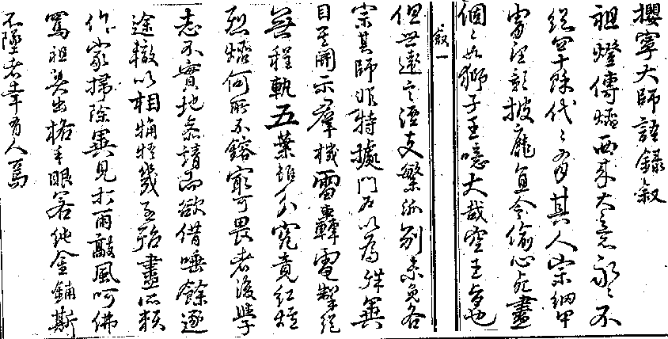
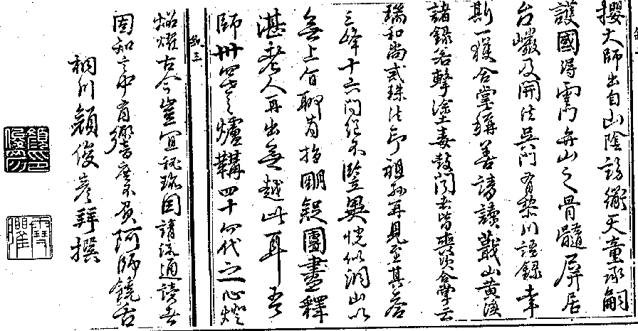
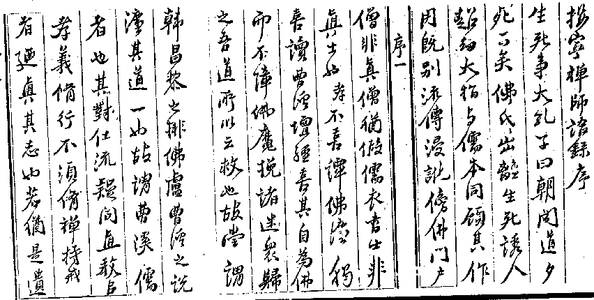
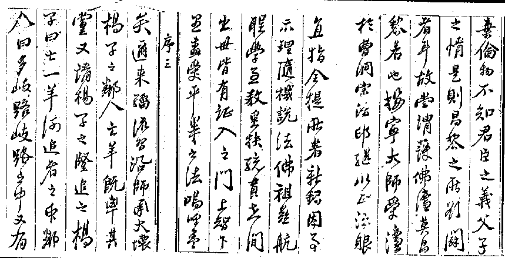
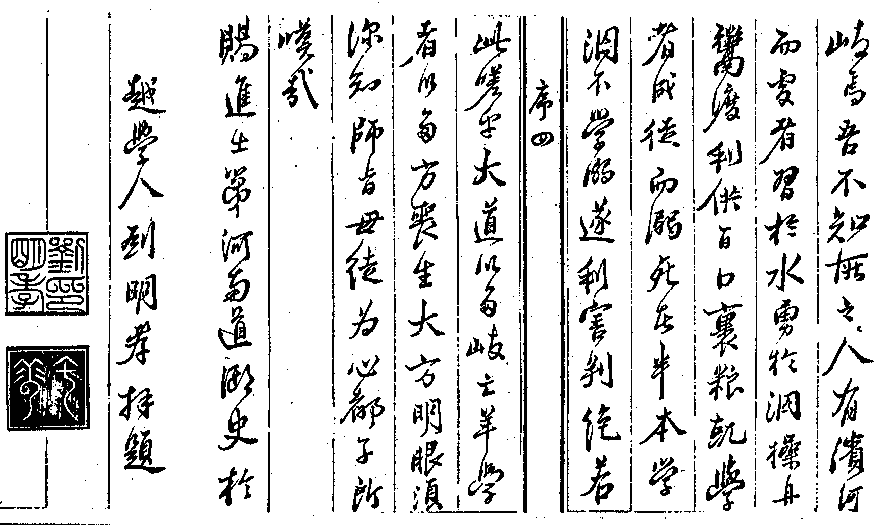

# 撄宁静禅师语录



> **藏经**：嘉兴大藏经（新文丰版）（嘉兴藏）　**册次** 第 33 册（J33）　**编号** JB286　**部类** 诸宗部　**卷次** 6 卷　**篇幅** 97,656 字

> **作者（译者）**：门人德亮　编

> **卷／品**：1 卷 · 2 品



---



## 目录



  - [喻指和尚荅三峰曹洞十六问序](#喻指和尚荅三峰曹洞十六问序)

  - [撄宁禅师语录序](#撄宁禅师语录序)

- [撄宁静禅师住蕺山戒珠寺结制语录卷第一](#撄宁静禅师住蕺山戒珠寺结制语录卷第一)



---



撄宁大师语录叙























------



### 喻指和尚荅三峰曹洞十六问序



明道贵契乎真虚，履践宜切乎真实，故法言有三，设问有四。法言者，始寔而终虚，道之至也；始虚而终实，行之至也；非寔而非虚，化之至也。是以至人其心若镜、其心若水，包括六虚，体备群表，言而世为天下法、行而世为天下则，虽终日言而未尝言也、终日行而未尝行也，至人无已而无所不已也。发问者，苦临岐而预扣，辨真伪以明宗，搜玄奥於未始，畏浊乱而迷流，睹万里之神光，急欲知其所止，闻一言而冰泮灼然，水乳相投，饥不择食，饱即便休，行不论程，到家事息学者，全是问始忘言，技空乃尽，舍此别立门墙，翻新竖异，朱紫之乱，害莫甚焉。斯道也，非深彻乎元始，终垂白而未明，智者超然，愚者自昧。适扣喻指和尚参请之餘，师以荅三峰、扣云门、博山、曹洞十六问示之。其问也，海内寐然无闻几十年矣。喻指续荅万言，豁人之所未豁。余读之，悲喜交集，不意垂老得闻极则事。和尚以士荐嗜斯道，合为弁言。余退而辞曰：「三峰问实中之虚，和尚答虚中之寔，如麟经载笔，尚不能赞一辞，况格外音响乎？」师云：「此三峰一字诛心，不可云权中之实，惟公委之。」余阅之者再，退而启曰：「闻命矣。」今聊指三峰一言，以明其发问之始。五宗原叙并结中，以曹洞到浮山而率宾归王，法眼虽入教而难逃至化，唯此一事实，餘二则非真。临济儿孙既专大任，敢负前宗？每读至此，余更愕然。岂投子之荷洞上，何其不昧任耶？岂法眼之引教乘，而绝不明其宗耶？灭他宗为臣妾，任济上独荐王耶？当此二桂交阴，急欲伐其左，以右自竖耶？噫！是何心哉？春秋之世，三尺童子耻言五伯，况证无我之道，一何其陋耶？返而思之，恐非法门盛典，斯哲人之病已。夫寥寥诸方，绝不与之对偶，独得喻指是答，诚揭千古隐疑，绝万世异议，学者断断焉。能荷其任者，竟篇靡不汗服。茫然负我者，一字不是为与。三峰以洞山未睹影而传宝镜，总入室而伏绳床，好个𨱄斧子不当断削。古人至此，诚自负而负人，以无我之中叠起人我，恐非真我也。率宾而欲一当其住，不忘过歇。余泛旁赞云：「宾则始终宾，主则始终主。」因其好之也一，故顿起空王之玄吼，破影响之鸣条，大匠运斤不无其举，使郢人之垩漫谷、绳翼者随风扑落，庶不再哓哓白日挑灯，汲汲而自失照矣。幸天之未丧斯文也，丕欤！法道干城犹当劲敌一面。



檇李参学门人姚上士拜撰于穆溪之天与堂



兰亭学人刘肇兹书



叙



夫法运有隆替，王化有春秋，非独今日为然也。当宋兴以来，海内宗匠，亭亭云涌，杰出前人，祖印虽为一新，未免雕文丧德。时有径山杲师，振起先猷，一扫诸方，尽除餘蔓，不仅他宗可斥，即其本师玄义亦不容露布，况能并躅於东邻乎？然而每输诚于天童觉老人者，抑天何耶？当阴万时，祖道凌夷，虽二三主者砥柱其间，惯使没意智一著，其于玄位旨趣，不欲提撕，诚恐流入曲学，碍正知见，五家宗眼，晦不复明。如三峰藏老，力持玄要，转叩君臣[刀/(妍-女)]，逆排太白为橛头禅，如师子儿反搏父肉，其能遗象王而不顾乎？然而偏折节於云门澄老人者，抑又何耶？嗟夫！藏老去世未遥，浚生晚学尚能见闻其志行。至於杲师，每夜参时，呵摘诸方，音首座不禁含忍，起而数之，杲师为之礼谢。浚于衡阳得旨，返杖淛中，谛交天童，仰契长芦，杲师之意，盖可知矣。前乎此者，虽赴一参之请，快一时之舌，晚年自省，未必无失言之悔也。余忝主弁山以来，每慨近时学者，不识自宗，唯务儱侗，宾主君臣之旨几于扫地。时养疴麻溪，亟欲提撕，适吾姪撄宁禅师读荅三峰启云门师翁十六问以质余，细阅一过，且喜丁斯秋晚，详悉斯道也而有斯人也，吾宗不致寂寥矣。第三峰设难，喻指覆辞，两造之竟，不过提掇纲宗，庶几开俾来学，原非偏逞臆见而然，把卷者别开心眼，庶有发明。且其首以云岩先传宝镜，而复以过水得悟为洞山之漏逗，再援大慧片言以欺压之。夫不知洞山辞云岩时非无悟也，於过水时更有玅证也。犹夫大慧于圆悟处非无悟也，于阅经时更有妙证也。不得谓大慧于产难因缘尚未明了，天宁遽尔妄授耶？又不可谓大慧只会得勤老机缘，尚未彻准师用处耶？他如南匾额获三昧於狱中、洪迁客入无生于海外，皆在得法以后之再证，未可枚举，岂止洞山为然哉？今人中道自畫，一知半解，得少为之。撞著颟顸长老，一印印定，便有一种权魔入其心腹。自谓证悟无遗者，滔滔若与败种，又安敢以偃鼠之腹妄测江河耶？果能悟洞山之所悟，则知两家鼓舞酬唱如红炉片雪，阅者自宜审诸。



席林玄素体道人书于麻溪之明庆寺



------



### 撄宁禅师语录序



佛氏出离生死，诱人超劫，大指与儒本同。顾其作用既别，流传浸讹，傍佛门户，僧非真僧，犹假儒衣书，士非真士也。孝不喜谭佛法，独喜读曹溪《坛经》，喜其自为佛而不障佛魔，挽诸迷众，归之吾道，所以云救也。故尝谓韩昌黎之排佛、卢曹溪之说法，其道一也。故谓曹溪儒者也，其对仕流疑问，直教以孝义修行，迺真其志也。若犹是遗弃伦物，是则昌黎之所辟者耳，故尝谓护佛法莫昌黎若也。撄宁大师受法於曹洞宗源印，继以正法眼，直指全提，所有法录，并答三峰曹洞十六问，契理契机，佛祖慈航，圣学至教，悉抉统贯。世间、出世，皆有证入之门；上智、下愚，尽受平等之法。呜呼尽矣！迩来缁流习沿，师承大坏。杨子之邻人亡羊，既率其党，又请杨子之竖追之。杨子曰：「亡一羊，何追者之众？」邻人曰：「岐路之中，又有岐焉。」人有滨河而处者，习於水，勇於泅，操舟鬻渡，利供百口。裹粮就学者成徒，而溺死者半。本学泅，不学溺，利害判绝若此。嗟乎！大道以多岐亡羊，学者以多方丧生。大方明眼，须深知师旨，毋徒为心都子所叹哉！



赐进士第河南道御史於越学人刘明孝拜题



夫百尺之枝，忽施纤蔓；大圆之鉴，瞥滓邻尘。苟不辞而辟之，俾葛藤斩尽，浮翳全融，深恐兆妄滋惑，复增一则未了公案，亦后死者之责也。然非慧同鹙子，语若悬河，智过於师，正不许轻下注脚。何以故？南华云：「彼亦一是非，此亦一是非。与其誉尧而非桀焉，不如两忘而化於道。」虽然，卫道则乌容不辩？辩道之言，不厌其多，非贵于多，贵於彻也。言彻，则多言消归少言，少言消归无言矣。三峰藏老无事寻事，向吾　湛祖启问十六，自卖破绽。祖答姑置，以俟来看，不答之答，业已雷震虚空。日炎碧汉，初不藉后代儿孙补缀狐裘，淬磨欧冶。峰迺詹詹间间，遂谓诸方无可激扬，传诸后五百年。没眼禅和，揣籥摸象，以为真有不易答者，岂不笑杀井蛙，误杀醯鸡耶？吾姪撄宁和尚忍俊不住，析疑剖惑，直穷到底，无复剩义。重开湛祖之口，可使吐舌覆面；重提藏老之耳，堪令三日耳聋。或疑抨驳先哲，支离义谛，非扫除文字与无诤三昧之旨。不知置之不答，将启答於无穷。有此一答，可扫后来欲答之端倪，并扫前辈垂问之影迹。喻指固忠臣祖祢，非操戈藏老也。不特喻指未尝有答，即谓三峰未尝有问也可。



弁山睦堂净莹题



撄宁静禅师语录目录



第一卷蕺山戒珠寺上堂(十篇)  

小参(三篇)  

吴江喻指庵上堂(五篇)  

茶话(四篇)



第二卷黎川罗汉寺上堂(十三篇)



第三卷眠牛山结制小参(七篇)  

示众(十六篇)



第四卷拈古(三十四则)  

颂古(五十五首)  

机缘(十七则)



第五卷法语(二十二篇)  

佛事(八则)  

赞(十二首)  

和中峰国师乐隐词(十六首)  

偈(十二首)  

碑记(一则)



第六卷续荅三峰曹洞十六问(并著颂)



目录(终)



------



## 撄宁静禅师住蕺山戒珠寺结制语录卷第一



**译者**：门人德亮　编



书记德峨　录



顺治庚寅岁，师於苏州府吴江县罗汉寺，受绍兴府山会护法缙绅罗梦章、郑望裕、邢淇瞻、李泰若、徐岱渊、唐敏一、吴期生、吴崆峒、陶岸生、鲁季栗、童在公、刘嵢嵝、刘永侯、刘静甫、刘伯绳诸大居士，同文学裘、孙、刘诸檀越，并法侣妙德、圣意等，请拄戒珠寺。九月二十五日入院。法语。



山门。「巍然突露，顿绝遮拦。古今卓立，迥别寻常。龙象蹴踏作麼商量？」喝一喝，云：「入得此门须奉重，不劳门外觅餘光。」



王右军像。师指像云：「洒漓丽於枯藤，夺崖透石；鼓云雷於掌上，骤雨旋风。犹未是此翁妙用，且道：斯意如何？昔年舍宅为僧寺，万古辉煌作栋梁。」



韦驮殿。「我主正，汝摧邪，两两行来步不移，今日相看担荷此，从教祖道彻玄微。」



大殿。「三千七百年已前，此老不与麼；三千七百年以后，此老却与麼。与麼不与麼，放过一著，且看新长老作何去就？」展坐具，云：「源远流长。」遂作礼。



伽蓝殿。「昔受灵山付嘱，从来毫不放人，邪正分於当下，那肯绰约疏亲？」插香，云：「今日煆凡炼圣，仗君保护弘深。」



祖师室。「西天四七，总是婆婆和和；东土二三，两口何无一舌？怎奈祖祢不了，到处被伊殃及。」插香，云：「触断两头机，三更涌红日。」



方丈。「正法眼藏，一锤击碎。涅槃妙心，是甚壒𡒁？」按住杖，云：「拶透石人骨髓，剔出金刚眼睛。任汝三头六臂，到来无地容身。」



是日，应林阇黎设供，众请上堂。



师至座前，宪副罗梦章捧疏，师接得，拈起，云：「此是罗居士同诸檀护不忘灵山付嘱，要与当人彻头彻尾。既然文彩已彰，何必重添眉目？」顾左右，云：「事因叮嘱起。」度疏，维那宣毕，师指座，云：「人人可踏，个个堪承，更欲山僧扭捏作麼？不是符到奉行，看取一场热乱。」升座，拈香，云：「此一瓣香，根盘大地，法遍尘沙，芬芳那畔已前，结秀不萌枝上，蓦地拈来，供养始祖释迦文佛，普愿无尽含识闻兹契悟，永断疑根。此一瓣香，天然尊贵，不假功勋，奉祝九五之至尊，伏愿德以时化，国以时宁。此一瓣香，经天纬地，左右司衡，奉为　本省府镇道台、府邑各衙文武尊官，愿祈共辅皇纲，庇恩万姓。此一瓣香，宿承愿力，拥护法坛，奉为本山　护法大宰官罗、王、郑、邢、吴、陶、鲁、刘等大居士，共彻劫外风光，永作皇畿柱石。此一瓣香，弁峰砍额，蕺岭扬眉，供养本山中开法运龙华瑞白师翁，惟祈灯灯无尽，道利人天。」复从怀中拈出香，云：「此一瓣香，不住正偏，宁居玄要？昔日紫霞纳败，今朝蕺岭款陈，第二番拈出，供养传菩提达磨正宗第四十三世天台先师啸云老和尚，用酬法乳之恩。」维那白椎，云：「法筵龙象众，当观第一义。」师竖拂，云：「越古超今分外奇，个中消息绝思惟。当台宝镜无私蔽，果自男儿不自欺。山僧出吴门，登越地，船来陆来，敲冰踏冻，霜花含夜月，彻骨且风流，越地吴山，随方任运。所以道：是法住法位，世间相常住。与麼担荷，何必开眼受瞒？诸公闻如是举唱，便作平常是道麼？且喜没交涉。应知打面还他州土麦，唱歌须是帝乡人。殆今参玄之士不务本实，惟以装载禅道佛法为事，一见师家平实为人，便生大我慢。若稍立参机，如蝇聚唾。较量将来，有甚底止？岂不闻：石头大师云：『执事元是迷，契理亦非悟。门门一切境，回互不回互。回而更相涉，不尔依位住。』诸昆仲！此是我洞上法幢所由立也，五位正偏、三种渗漏不出此也。上士闻之，识病识药；中下闻之，笑而不顾，通身入水，不知鼻酸。须知死中应发活、活中应令死，然后通身遍身罗笼不肯住，呼唤不回头。参学分中少许话会，勿则门外支离，沿途荆棘。山僧事不获已，盖缘先师殃累当时，今日不顾拖泥带水，向人天众前热乱一番，贵在全身领荷，知重识轻。于中还有共扶玄化者麼？」顾左右，良久，击拂，云：「高山流水齐争调，嬴得白云出岫忙。」问：「明暗双机，学人不易。如何是渠今正是我？」师云：「蛊毒之乡水莫尝。」「如何是我今不是渠？」师云：「死猫头子几人换？」进云：「秪如洞山睹影与高峰堕枕相去几何？」师便棒云：「驴唇马嘴汉，莫谤他好。」进云：「秪如和尚高升此座，法利人天，祖父孙源，一门超出。秦望山还解点首否？」师云：「急急如律令。」又僧问：「云门鼓笛，弁岳巴歌，请师别出腔调。」师摇拂云：「若遇知音，不劳赏鉴。」进云：「露柱子𨁝跳，击碎宝华王座。和尚还许学人再参否？」师云：「东壁挂葫芦。」僧作礼起，遶身一匝而出，师喝云：「好个猢狲圈。」参头结椎，云：「谛观法王法，法王法如是。」



当晚小参。「有一语，全规矩，拟思量，带伴侣。新长老口如匾担，不解谈玄说妙，亦无规矩可全，亦无伴侣可带。」又云：「『一生参学事无成，慇勤抱得旃檀树。』此二句，今人错会其意，更兼觉范老汉错下注脚。总之，字经三写，乌焉成马。何似芦花深处客，夜深不坐钓渔矶？诸公以入院之初，更要蕺山立新条令，绝断龙门宿客，看来也是醉后添杯。喜得堂中班簇簇地，尽是饱参耆宿，念我法门，同相赞化，幸然之甚。适才出方丈时，摸索得一句新鲜佛法，欲将来供养大众，恰遇竹帘一坠，半句都没了。」搔首顾左右，云：「还是如何？不然，问取露柱子去。」傍有一僧才出，师推住，云：「堂中有人在。」僧拟对，师一掌，便归方丈。



结制日，傅文宇、胡清之、陈德生居士等设供，请上堂。



师举拂，云：「造入苍龙窟宅，为探玄珠；截归香象行踪，贵除金锁。须明掣电之机，始可深经炉鞲。若依说黄道白处转得身时，依然布袋里老鸦。有力之士将大千国土横拈倒竖，劈空掷得粉碎，法我情忘，了无纤毫过患，方越安隐幢、践无忧界。知与麼事，何必九旬禁足，活受罗笼？勿则倾心将四大交付龙天，把从前伎俩去尽，奋大意气，彻底掀翻，不负参学一生，不空师友策励，等闲线断，一切齐休。又沩山道：『有句无句，如藤倚树。树倒藤枯，句归何处？』盖千古为衲僧彻骨底句。后大慧於此脱却贴肉汗衫，若非圆悟举，几错一生。看他先德不尽不住，今人岂忍因循放过？蕺山不惜唇皮，更为一颂，请按下云头，定其铢两。『有句无句』，石虎当途踞。『如藤倚树』，嚼碎金刚杵。『树倒藤枯』，肘后铁轮孤。『句归何处』，鞭起昆仑柱。」连卓柱杖，云：「相随来也好，不堪立地是甚尿溺气？」参头问：「昔年弁岳开炉，今日天台续燄。还是人杰？还是地灵？」师云：「我不识彼。」进云：「子承父业家常事，祖令孙行意若何？」师云：「须知万代金轮子。」进礼云：「一曲无丝韵，万籁和声齐。」师云：「未堪奉重。」吉先邢居士问：「百丈师翁於此开堂，有云：『秦望山头云霭霭，鉴湖波底月团团。』今请和尚斩新条令。」师云：「照顾脑门。」进云：「不惟紫霞峰顶笑傲烟霞，直令蕺岭堂中辉增佛日。」师云：「好事不如无。」进云：「如何是父子功齐一句？」师云：「古殿苔封后，调羹知有人。」士作礼云：「莫道相逢不出手，寒烟绣壁又添新。」师直视云：「高不成，低不就。」



上堂。



「若论个事，适才被上首一槌击碎了也，致使山河鼓掌，大地闻声，何假山僧口漉漉地以为极则？事正与麼地，请休去好。若停囚长智，转见不堪。总之，旋岚倒岳，不出功勋；定国安邦，犹存道合。应知有异类中事，始离渗漏。」拈拂畫[○@牛]相，复作[○@(仁-二)]相，云：「葺葺芳草外，展足奋西河。」复振威一喝，下座。



上堂。



「杲日迥当阳，森罗俱透彻，法法目前机，直下难存迹。诸上座！道无谄曲，唯一真实，外不放出、内不放入，冷地看来，是甚屎撅？有个关头为伊点出，若领会得，参学事毕。且道：是那一关？昨日三更时，无孔铁锤被蟭螟虫蛀得七穿八穴，无孔铁锤奋怒撞入睹史天宫，冲破了弥勒内院，失却布袋子。且道：在甚麼处？还觅得也未？」竖拂，云：「总在这里。」复拍案，云：「我尝於此切，空生问弥勒，弥勒哭苍天，布袋笑不歇。有甚奇？有甚奇？九九秪是八十一。分付诸人，不烦久立。」僧问：「白云才出岫，弹指凤凤归。如何是卧龙风景？」师云：「山头鼓白浪。」进云：「山门与佛殿未立时，和尚那里度生？」师云：「北斗里横身。」「如何是戒珠的的意？」师云：「千年石吃万年松。」「如何是方丈的的意？」师云：「入室不登堂，登堂不入室。」进云：「与麼则跃出一轮满，山河悉坦平。」师云：「也是平地吃跌。」



马豁如、陈无碍二居士率众设供，请上堂。



「乘风千里，全凭电影攀鞍；足下通玄，须识目前无法。飘空玉露，横施枯木生花；宝阁珠帘，直透冰壶水月。尘尘尔，刹刹尔，展狮子之全威；隐隐时，密密时，挟异类之独步。了知达道人，不贵通玄路，较之从门入者，不是家珍。奈何土圹人稀，相逢者少？山僧倒握肘后灵符，安忍坐沉英杰？昔我弁山师翁以一喝分五位，发明洞上真宗，蕺山继兹祖室，少为续貂，以一拂列五位。」即拈拂击案，云：「正与麼时，蓦然一击，此正中偏也；一击之后，正眼难窥，此偏中正也；正当一击，迥出无句中有句，超越玄路，此正中来也。拂击齐呈，功全祖父，此兼中至也；拂击俱消，生佛不有，此兼中到也。诸昆仲！全提祖令则且置，还知越格超方事麼？」复一拂，云：「无毛铁鹞抟空去，燄里灵苗结子多。」应林阇黎问：「五位君臣即不问，如何是宾中主？」师云：「簷前雨滴声飘室。」「如何是主中宾？」师云：「正令全提建化门。」「如何是宾中宾？」师云：「六街人簇簇，遥指玉门孤。」「如何是主中主？」师云：「垂衣含妙旨，密步踢双明。」进云：「宾主已蒙师指示，向上还有事也无？」师云：「天空海际低。」进云：「过在甚麼处？」师云：「到即不点。」进云：「大似红炉飞片雪。」师云：「点即不到。」便踊身下座。



信解禅人同鲁居士设供，请上堂。



「马蹄残迹，锁归雪夜芦花；畫角声孤，吹出清霜玉露。老船子抛钩撒网，末遇神龙；任公子七牛作犗，不逢虾蟹。须得与麼人，堪承与麼事。昔云岩和尚示洞山老祖云：『价阇黎承当个事，大须审细。』山因过水睹影，彻见云岩骨髓，顿翻旧日所蕴，以后建立家声，高提密印，剪异见邪途，破野狐窟宅。千古之下，相承者希。如宝镜三昧云：『重离六爻，偏正回互。』莫是爻分体用，卦配君臣麼？若如是，牛头伏羲早为划断，又何待祖师西来、洞山举唱？若不如是，争奈亲承宝镜，公验宛然？不见道：『错然则吉，不可犯忤。』当明中有暗，非宾中主；当暗中有明，非主中宾。明暗不相乖非妙协，亦如前后步非通途，亦不是啐啄之机，亦不是劫前之旨。蕺山一齐按下，洞山面目何处立地？诸仁当向此处分疏得下，始越古人门阃，纵夺自如。勿，则剑去久矣，方乃刻舟。」卓柱杖，云：「咸阳宫阙图神鼎，一定河山有沛公郎。」下座。



直指和尚同吉先邢居士请上堂。



师升座，直指和尚白椎毕。师云：「灵木豁鸿蒙，霜花越样红。夜深渔火烧焦桐，冰棱结起响叮咚，吹破巫山十二峰，跃出猩猩耳又聋。猩猩无语过桥东，撞著前村王老翁，老翁扪虱颇从容，扶过断桥流水中，忽相应，一交跌杀岑大虫。正欲相救，忽有木上座无端恶发，不容下手，轰轰撞碎了太虚空，直饶女娲氏炼石补天作用，秪得袖手傍观。冷地走出布袋和尚，高声喝住，云：『止！止！我有个布袋子为虚空塞却。』向前一掷，岂期袋角头裂出个独角水牯牛，口似血盆、牙如剑戟，将大千国土灵苗异种嚼得净尽无餘。此时佛祖相聚，攒眉蹙额，无计可施。山僧正在丈室齁齁熟睡，却值同枝法兄直指和尚过访，邀逼蕺山普救，这著公案秪得(持条)断贯索，拈起绝魂符出来判断一回。」乃顾左一喝，云：「天不缺东南。」顾右一喝，云：「地不陷西北。」复正身一喝，云：「杲日丽天，依然海晏河清，任汝鬼面神头，总被吾兄一槌击碎，正好解交，更添个恶辣。吉先公独步梅山，首尾俱绝，闲闲自适，闷时打三盏，何处得愁来？囊褁不住，把个曹山颠酒倾出，普同供养。诸仁者！且道：尝是？不尝是？尝则被他丧身失命，不尝则辜负来机，还决断得麼？如或未然，蕺山不免官路当人情去也。尝者是，灵衣不挂语无路，打鼓调弦和未齐，太平曲奏官街卧；不尝是，严陵薄视王侯志，前村沽得一天醉，高卧漫夸金紫赐。秪如竭尽今时，何处与主宾相见？」卓拄杖，云：「双枝杰出万峰冷，夜半行人过雪山。」吉先居士问：「闭门自适，独步超方，针芥相投，未审承谁恩力？」师云：「问取露柱。」进云：「恁麼则两袖云烟翻翠岭，一联奎璧焕狮楼。」师云：「少加赞叹。」尔铭问：「万象之中独露身，唯人自肯乃方亲。未审蕺山堂中几人点首？」师云：「从无此滞货。」进云：「恁麼则衲子翻身，狮儿回踽去也。」师云：「木毬子不放你在。」进云：「秪如台岭往还事又作麼生？」师云：「桃源飞古岫，白雪压神鹅。」士作礼，云：「祖孙弘法，父子同风。」师云：「同曲不同调。」



上堂。



「连朝风雨不歇，知寺眉毛厮结。天龙不善调停，钵盂连声叫屈。直得禾山不能打鼓、雪峰无力抛毬，唯有蕺山越格，烟封户绝游优，也不要诸人在长连床睁眉努目、也不要你向寒灰里吐焰添筹，唯要你和心呕却。若道有，放下倒挂三千劫；若道无，提起立地三千劫。不见：香严老汉示众云：『如人上树，口含一枝，手不攀枝、足不踏枝。有人问汝西来大意，答他则丧身失命，不答则辜负来机，诸公作麼抵对？』如或未善回机，且看蕺山把断香严唇吻，为他点缀一上。」倚拄杖，云：「透网金鳞绝众流，鱼龙虾蟹不同俦。香严未举应先丧，贼智徒教困玉楼。」即撺下拄杖，和身扑地，云：「救取个，救取个。」维那在傍一喝，师起身连掌，云：「大好不唧溜。」遂趋归方丈。



长至日，两序请小参。



「恰然好个寂静，大众续却正命，露柱子忽地产下个白发婴儿，俏波波舞向堂中拱听，致令庭前古柏顿吐未发之机，永夜寒灰喷出管中密定。唯我衲僧家总不随时令，一任小人道消、君子道长，撮将来掷向火炉头烧却，不为急性。」顾左右，云：「于中有不逐时令者麼？」时有僧从傍一喝，师云：「好一喝，未有主在。」僧问：「皮肤脱落尽，唯有诸真实。正当斯时，请师选佛。」师云：「我这里不选佛。」进云：「恁麼辜负学人。」师云：「金屑虽贵，落眼成翳。」进云：「如是则人天海会沾恩去，花雨缤纷缭乱垂。」师指帘外，云：「好大雪。」师复云：「若道不著时令，也是徐六担板汉。蕺山有个渔父词，不妨应个时节。」乃舞拂，云：「拍手呵呵，两岸芦花并雪过，老渔翁侧立披蓑，要钓个锦鳞归去，那管你一线添多？低声问你意如何？只教你坐断了古今一色，再不可做逐块韩卢。好大哥！好大哥！你是何人？便与麼向伊道：『我本是越州城里刘庆老赚来此，倒挂袈裟，善相扶跨洪波，撑得一只无底船儿相送汝，直教你掀翻海岳趁蟭螟，吸尽了四海五湖。』」便下座。



师诞日，两序率众请上堂。



师竖拂，云：「古今天地，古今日月，先天不生，后天不灭，玄中又玄，众妙难测，拟欲相呈，口门甚窄。所谓宝阁垂帘，那许密移一步？琼枝深锁，宁容借色明功？若是有力大人，不避龙巢虎穴。今日蕺山本生父母忒不著便，脱下个痴骨董，彼时未擅决断，以后闯入轮王之室，冒雨冲风，遍参个事，拶得性发，把钵盂跌做破沙盆、袈裟扯似憨布袋，被业风一阵吹向十字街头，忽地来开个杂货舖子，箧中没半文，要夸敌国富。惯卖死猫头，有时拈头作尾、有时唤尾作头，有时首尾俱换、有时首尾俱不换，丛中或遇个傍不甘的，一声喝住，道：『这厮如是摊街卖弄，大好屋里贩扬州。』即时扭下法座，熟捶一顿，非为分外。饶伊恁麼来，总是随人脚跟，便令那叱太子析骨还父、析肉还母，然后本身现大神通而为父母说法。要且费尽周遮，明眼人前更增一笑。不若蕺山拈出一种没弦琴，令迦叶不能起舞、乾闼婆王失音，可教聋者能听、哑者能声，把本生父母提起也得、推倒也得，报无可报、酬无可酬。」复以拂向空连划，云：「裂碎乾三连，续起坤六断，填却离中虚，隔断坎中满，裂破娘生面皮，切忌鸣声热碗。」遂下座。



腊八，解制，上堂。



「踞虎头，收虎尾，第一句下明斯旨。重楼缉宇，锁不住午夜寒风。剑刃冰棱，谁敢立一尘法界？老苍梧不栖丹凤，明月窟宁舞青鸾。忆我始祖当时平地绊倒，秪宜自讨其便，反至遍蔓葛藤，牵连今日。幸尔蕺山海众不坐他家床榻，口吞佛祖，气宇如王。放一线道，则草鞋似虎、拄杖如龙；收一线道，则水云密布、万法潜踪。一任他抟风九万里，犹沾羽翼；去以六月息，尚塞程涂。不妨撒手便行，那管船去？陆去？是则固是，诸公或过望海、渡钱塘、登保叔窣堵，攒攒簇簇排闼不入时，忽闹市里迸出个跛足阿师，把住道：『明头来，暗头来，汝等又将何处分？』或有个汉云：『莫乱道。谁云清早起？更有早行人。一捺便走，这里犹不许汝在。』若撞著蕺山更不与麼，待他问时，但一掌云：『不许夜行，投明须到。』设遇普化觌面来，要且退身有分。即如放行解制一句作麼指陈？」卓拄杖，云：「掣断玄关金锁去，毘卢宝印劈空开。」



癸巳年四月八日，吴江黄溪镇众信特建喻指庵，迎师掩关。进庵日，请上堂。



师升座，拈香祝圣毕。瑞云问：「昔日世尊出世，普为群生；今日和尚掩关，指喻后学。一个云兴吐雾、一个把住要津，除此二途，请师举示。」师打，云：「脑后见腮，莫与住来。」进一喝，云：「泥牛一度云中舞，石女携笙海底吹。」师云：「空劫已前如何拍调？」进云：「触破千层浪，冲开潭底天。」师云：「未经返踯，在天与问。」竖指，云：「这个是喻，如何是指？」师云：「漫向脚跟下寻讨。」士复竖指，云：「这个是指，如何是喻？」师云：「碧眼胡僧目射人。」士复竖指，云：「这个不是喻、不是指，如何是喻指大意？」师云：「舌头无骨。」进云：「和风洒幽石，甘雨滴疏林。」师云：「好句不成曲。」问：「今日世尊现瑞，喻指呈祥。洞上玄宗，请师的示。」师云：「审细将来。」进云：「官不容针，私通车马。如何是正中偏？」师云：「铁女透波心。」进云：「但有言说，都无实义。如何是偏中正？」师云：「眉毛碎古镜。」进云：「一人有庆，兆民乐业。如何是正中来？」师云：「露柱早怀胎。」进云：「王登宝殿，野老讴歌。如何是兼中至？」师云：「夜深挑蜀锦，不犯始为奇。」士良久，进云：「如何是兼中到？」师云：「亚目总难窥。」进云：「还乡尽是儿孙事，祖父从来不出门。如何是不出门的祖父？」师展两手。进云：「祖父既不出门，儿孙如何亲近？」师云：「奉重方知。」师乃云：「慧日高悬，豁千生之尘梦；玄珠突露，彻万丈之洪波。古今不易，道出平常。祖父田园，阿谁无分？所谓心同虚空界，示等虚空法，证得虚空时，无是无非法。此著上祖释迦降迹，皇宫示现，奇奇特特，变怪捏神。末后拈花，更添狼籍，又撞出金色头陀，一笑风前，倾身酬价，祖灯远继，法遍河沙，无量法门，消归言外。幸诸公信得真切，故乃翻三千年公案，舍难舍之缘。袛园给孤，古今同调；竹园精舍，点首功齐。须知拈一茎草能为建立，即可证大解脱力、大三昧力、不退转力、无修证力。山僧十载垂钩，沿门撒网，蓦遇几个瞻风拨草汉，劈胸一撞，秪得将错就错，放下丝纶，直教尘封户外，别立生涯去也。」以拂打圆相，云：「憨憨懒唱闲庭曲，把断玄关绝主宾。还有识得主中主麼？请著眼看。」即下座，掩关。



师自封关法语。



「把住要津，不通凡圣，令行摩竭，千圣绝闻。垂帘室内不知，秪要外缘奉重。」度封帖，云：「高峰千古案，立地话重新。」遂封。



丙申佛诞日，喻指众信迎师出关，请上堂。



师升座。学人问：「当年把断关津，象王隐迹；今朝顿启金锁，狮子嚬呻。把断放行即且置，正当恁麼时，一句请师举唱。」师云：「入室不通耗，觌面堕茎眉。」进云：「野老讴歌，渔翁掷钓，为复威音那畔之神通？为复今事门头之妙用？」师云：「不犯清波时，汝试道看。」进云：「今日觑破和尚。」师便棒。进云：「一句迥超千圣外，万灵何处谢无私？」师又打。进一喝，师连打，云：「犹是阶下汉。」士连喝，归位，师云：「大似败将拖矛。」僧问：「豁开户牖，宝月流辉；逼塞虚空，众星拱北。作麼生普荫群生句？」师云：「有水皆含月，无山不带云。」进云：「尘尘刹刹，玉转珠回。个里无私，如何著眼？」师云：「君臣道合犹成昧，宾主相逢尚失宗。」进云：「一句绝遮拦，千机齐烜赫。」师云：「看取脚下。」学人问：「三年掩室，摩竭令行。适承和尚举示玄关，请通个关中消息。」师云：「到来无你下口处。」进云：「恁麼则但见花开落，不知春去来。」师云：「不属阴阳造化生，作麼生道？」士便喝，师云：「羞也不识。」进云：「秪如不合伴的人来，关中主如何相见？」师云：「放汝三十棒。」进云：「和尚也须照顾眉毛。」师云：「未识触讳在。」师乃云：「独照双泯，过尾窗櫺犹堕格；入廛垂手，玄关直透尚迷津。不若随分纳些些，免至畫蛇添足。是以，入毘耶之室，白醭口生；行摩竭之风，谈玄无舌。惟以坐看阴阳消长，闲听花放鸟鸣，任性不羁，陆沉自适。然素志如斯，但事无一向，千日期圆，聊伸款案，特借山河大地为演无量妙义。还见无情说法麼？」竖拂，云：「新篁解箨，节奏桑林之舞；梅拖嫩绿，浑忘鼎鼐之勋。草木挥玄，水云共唱，得游刃有餘地，顿消斧凿之痕。以此报檀度之恩，无恩不报；酬佛祖之德，无德不酬。庆快千生，法流万古。虽与麼道，然未透者亦不得等闲放过，错却胜因。岂不闻：裴休丞相云：『鬼神沉幽愁之苦，鸟兽怀狘犹之悲。修罗方嗔，天人正乐，可以整心虑、证菩提，唯人道能为耳。人道不为，吾末如之何也？』已矣！诸菩萨个个顶天立地，猛烈丈夫何得被八风五欲活埋万劫千生？改头换面时何有今日？果肯将智慧剑一刀斩断生死魔军、五阴怨贼，坐致太平，宁不深幸哉？秪如应节酬恩作麼生道？」卓拄杖，云：「碧玉盘中烹石笋，骊珠腹内产云芝，烂煮虚空千日醉，佛祖无门觑得渠。」下座。



黎川庵主印源参常等设供，请上堂。



师升座。僧问：「一花现瑞，多子承恩。一句周隆，十方庆赞。未审和尚如何通信？」师云：「持书不到家。」进云：「学人顶戴有分。」师云：「脚跟下放汝三十棒。」僧以手呈具，云：「大众看看！龙门无宿客，香海纵金鳌。」师打，云：「犹遭点额痕。」进云：「明眼宗师，天然有在。」师云：「切忌诈明头。」师乃云：「以斯道觉斯民，断碑横古路，白月现，黑月隐，昆仑草里眠，南阎浮提打鼓，西瞿耶尼闻声，东弗于逮扣机，北越单那击节，非非想天逆击一棒，金刚际下扑地翻身，其中百亿须弥、百亿日月、百亿世界纳向一毫孔中，十方诸佛演大法义，挑豁愚肓。诸仁者！秪如一毫孔又纳向甚麼处？咄！切忌道著，直饶密步移来，脚跟下红线未断在。南泉大师云：『三世诸佛不知有，狸奴白牯却知有。』此事直须解向异类中行，始可绍隆玄化，勿则尽是流俗闺合中物，开口便成过患，非惟不能与人点病，自土也消他不得，彼此何益哉？于中有知南泉行履处麼？」振纲居士扑地一旋而去，师喝，云：「这畜生犹是乱跳。」卓拄杖，云：「盘空铁磨旋头角，芳草丛丛吼石栏。大众！不烦久立，珍重。」



师至石湖，金僊老和尚请上堂。



师升座，拈香，云：「此一瓣香，有伦有序，唯德唯尊，奉为金僊堂上法叔老和尚，惟冀法韵振三千，祖风垂万亿。」敛衣就座。师拈拂，云：「万顷湖光，远驾长空之玉练；千枝翠色，横推数点之青螺。高大门庭，水云异色，格高调古，绵密家风。静上座自远趋风，怀香叩室，顷承玄化，千载一时，不意我老法叔宠渥太隆，恶辣犹甚，勿顾外扬家丑，命升此座。若今狮子林中，何敢扬眉播舌？但蒙方命，聊塞一时。」复举拂，召众云：「此是我金僊老人一生受用不尽底句子，特借静上座手中拈出，为诸公赏鉴。由来锦上添花，谅诸公久已得侍法要，岂敢再下注脚？但老人平日验人，道个『把定咽喉唇吻，除却千态万状，不得有语、不得无语，道将一句来。』此正验今时之法弊、救万世之弘规，若能向这里摆脱得来，觌面亲见老人赤心片片。今不肖续有一偈，并为傍敲：把住咽喉唇吻，万仞悬崖卓立，果是狮子之儿，当下便能返踯。若在某分中，拈有三句为供养老人。」顾左右云：「且道：是那三句？第一句，五道不通耗，何处立三玄？第二句，眉锋挂利刃，裂破率陀天。第三句，手持火把子，潦倒夜明前。听其缁素得出，犹是门庭边事，须知尊贵一路事别。且道：如何是尊贵的的旨？若要深登堂奥，共相参请金僊老和尚去。」即下座。



吴江文学量如吴居士，为荐亡嗣文学不浮，请师对灵小参。



「枕断邯郸，破吾生之有寄；花飘棘苑，沉来去以无涯。拟将气吐虹霓，谁为水云路隔？」师抚几云：「不浮公！汝髫年学冠，德预耆英，堪羡孝悌恭身，颇奈文福未并，寿倾四六之中，转盻流光三祀，空辜堂上椿萱，忍割友恭爱弟，杳隔幽沉，痛情可愍。世既如斯，但能知死生不借，何妨出没自如？到此说圣也不是、说凡也不是，生也不是、死也不是，此是公一贯之道、吾一谛之理。不闻：先圣云：『诸行无常，是生灭法。』庄周梦蝶，渠不是我；蝶梦庄周，我不是渠。为公拈出一线，顿教全体如如。」复击案，云：「寂灭场中超性海，毘卢界内迥无私。」



戒珠结制茶话。



僧问：「十方同聚会，个个学无为。请问和尚：今夕数千指围绕，如何得普令成佛去？」师云：「家家有路透长安。」进云：「如何得独步龙门去？」师举茶瓯，云：「浅斟满酌，不许湿口。」僧贮立，师以杖擉退。师乃云：「虚空含万象，大海任鱼龙。会得目前法，何须探别宗？诸公既负笈远参，十方云集，脚跟下事固是不缺分毫，若不亲履践一回，如人说食，终不能饱。英俊者肯将个事自己颟顸，良马见鞭影而行，若待人鞭策得来，决是个无血性的汉。但参玄之士亦必须经一番锤炼，方脱得野狐气味，勿然尽为门头户底事学两句口头滑禅、弄几节峭利机锋，於自己分上大好没意思，非唯虚丧光阴、空辜檀信，在袈裟之下作地狱因，更为可愍。山僧不是说老婆禅，但今时末运，目不奈看，恶习遍炽。蕺山既据此位，平日痛心之谈尽情告报，祈把所参所学的都抛向他方世界之外，雄纠纠立起新鲜意气，提句无味语卓立面前，直下如银山铁壁相似，通身排闼不入，无一丝毫走作，扑盲坐断，自然和底脱落，信不我欺。若做模打样来参五味禅，万劫千生亦无了日。各当照顾。住！住！归堂时切莫撞翻板棰炉柱。珍重！」



师於天台送护国先和尚入塔，回山，示众。



师竖拂，云：「国师塔样，耽原未善图描。造塔疏山，反惹罗山活葬。拣点来俱不作家。何似我先师啸老人，任将活计付儿孙，那管湘南并潭北？顺时而化，不假安排。有偈无偈，是甚尿气？虽则杰出诸方，更添个蕺山不肖子，未解奉重，将阿爷活埋向千岩万壑之中，令教水云绝听。众兄弟！又道：『不顺非孝，不奉非辅。』山僧既作洞下儿孙，何乃不知忌讳？众中可知过患麼？」乃耸身，云：「秋江清浅时，白露和烟岛。良哉观世音，全身入荒草。」复顿足，云：「猫。」



元章居士为师庆诞，请茶话。



「混然至理非言说，彻底须知绝意求。若识赵州滋味辣，何须影里觅生繇？」举如意，云：「此是万法之源，千灵之母。若人透得一机，任汝横吞竖嚼。但要解吞应解吐，若吞得吐不得，未免被菱角如针刺却口、毛栗如弹塞却喉。果能裂出神龙之首，则佛祖不能安汝名、天魔不能窥汝迹。勿则浪沉往返，杳丧光阴。昔欧阳文忘公官洛中，一日游嵩山，却去仆吏，放意而往。至山寺，修竹满轩，霜清乌啼。文忠休於殿陛，旁有老僧阅经自若，与语不甚顾答。公异之，问曰：『道人住山久如？』对曰：『甚久也。』又问：『诵何经？』对曰：『《法华》。』公曰：『古之高僧，临生死之际，类皆谈笑脱去，何道致之耶？』对曰：『定慧力耳。』又问：『今乃寂寥无有，何哉？』老僧笑曰：『古之人念念在定慧，临终安得乱？今之人念念在散乱，临终安得定？』文忠大喜，不知膝之屈地。」师云：「你看学道者，不是徒然泛泛，未能决其志，终日在人我山中打迸、是非场里横身，他时如何抵敌？盖疑信相半，因而随情逐物，临穷方悔，噬脐何及？特此告报。须知出母胎，从少至老，尽未来际，未曾离却这个光明。果能一脚踏穿桶底，何处有死生之所流转？但不是说了便休，今且乘风快便，莫令失却时日。蕺山恁地热乱，还识好恶否？」击如意，云：「不离当处常湛然，觅即知君不可见。」



解制，知浴设茶请示众。



「露柱当天豁双眼，未为奇特；蟭螟怒发吞大象，理亦宜然。果是伶俐衲僧，便可一捺便倒。若随人缁素得来，总是倚草附木汉。过在红线未断，拨著好似浪里抛毬，徒费草鞋钱，堪作何用？上智之士一闻释然，中下之流疑而愈滞。蕺山与麼道，自好惭惶煞人。」复举：「昔有一官人入寺至禅堂，寺主随行，官人问曰：『诸位在此作麼生？』对曰：『欲图作佛。』官人笑云：『金屑虽贵，落眼成翳。』主无语。」师乃云：「好笑寺主恁不唧溜，被俗汉一问，直得口如扁担。若遇蕺山，但向他道：『在此换居士眼睛。』非唯令俗汉屏却咽喉，亦见此中凛然难犯。诸仁者应知：有佛处不得住，无佛处急走过。转得快，便不负蕺山和身一拶；如或未然，明年更有新条在，恼乱春风卒未休。」



修万佛忏圆期，上堂。



师升座。学人问：「古镜未磨时，光临万象。磨后为甚麼不鉴？」师云：「我却不识你。」进云：「恁麼则是处是弥勒，无门无善财。」师云：「犹借玉阶行。」进云：「如是则学人别道去也。」以手点空三下，便作礼，师云：「料掉没交涉。」师乃云：「香花云，宝幢云，乾闼婆王美乐音，出生无尽诸功德，裂破三贤十地门。云从龙，风从虎，磁石吸针潮长醋，情与无情共一真，万象森罗镜里布。如是知，如是住，不见一法为伴侣，智者能知罪性空，坦然不怖于生死。大众！且道：唤甚麼作罪性？唤甚麼作涅槃？若向两途冰泮得来，则了即业障本来空。如循罪福之阶，未超向上一著。所云『未了应须偿宿债』，莫谓与麼，便乃看作一切如幻之解，总不落莽荡之殃，必将沉拨无因果，力能脱体一回，千佛万佛、列圣诸贤悉是空拳诳小儿，所谓但以假名字引导于众生。如或分疏不下，再为汝等下个注脚。不见：南泉大师因陆亘大夫问云：『弟子家中有片石，或曾坐、或曾卧，欲镌作佛，得麼？』泉云：『得。』『莫不得麼？』泉云：『不得。』」师云：「据南泉老汉虽有先行之势，且无绝后之关，直被个俗子将一片石全身压倒，直至如今无展舒处。若喻指门下即不然，待他问：『作佛，得麼？』但云：『言不该典，非君子之所谈。』『莫不得麼？』一喝，云：『门临千尺井，过者必攒眉。』于斯捡点得下，一期佛事以周；如或未然，跋涉不少。」卓拄杖，云：「会麼？虽然春色没高下，无奈花枝有短长。」即下座。



师至弁山祝　元洁老和尚寿，众请上堂。



师云：「日丽中天，揭破虚空流活眼；风生八表，拨开万象始明宗。事存函盖合回途，全祖父功勋；理应箭锋柱展手，合君臣大用。具斯三昧，始得运斤成风，绝无触犯，固知曹洞门庭承当不易，作用光大，浑似纯金，砂汞银铅一时销尽。不肖远叩祖山，恭遇法叔降迹之期，为祝华封，渴瞻嘉瑞，不意恩宠太过，特命两序诸兄邀登此座。若论禅道佛法，未入门来早已填沟塞壑了也，况兼祖庭之上狮王腾踏、龙象纵横，又何敢布鼓雷门，自遭话堕？若论庆赞一事，欲以大千界而为寿，吾叔早已坐断十方；欲以须弥卢而为寿，早已碎如微尘；欲以四大海而为寿，早已一口吸尽；欲以玄玅义而为寿，又不许立一元字脚。在第一义谛不容展舒，于伦序分中安可简略？是以还有个商量处，官不容针，𫏐通车马。」乃竖拂，云：「我知虚空不可量，寿命不可量；世界不可量，寿命不可量；众生不可量，寿命不可量；佛法不可量，寿命不可量。还有个最亲切、最要紧，不可量中一事，诸公能知消息麼？如或未知，今日勿敢越俎，作速参取老人去。何故𫆏？待得叔孙成礼乐，始知不共汝同盘。」书记问：「阃外将军多汗马，就祖还家事若何？」师云：「不宰功勋。」进云：「人居大国方为贵，水到源头始见清。」师云：「明眼自知。」进云：「如何是庆诞一句？」师云：「人天仰企，四海云奔。」进云：「香稻啄餘鹦鹉粒，碧梧栖老凤凰枝。」师云：「犹未是公著脚处。」进云：「在和尚分中又作麼生？」师云：「不借借。」记作礼归位，师下座。



嘉禾李又恂居士，为亡室盛氏，请师对灵。



「菱花镜破，俄沉合浦神珠；闺合香消，顿失鸾凰良配。柳生於肘，不知造物暗中移；蝶梦为周，未识我渠犹问影。智者观斯，聚散等浮云，去来如传舍；愚人自昧，情关固结，汩没爱河。将此大光明藏翻为腐草萤星，岂不痛哉？」蓦竖拳，高声召云：「盛氏善人！汝会麼？握则成拳，开则成掌，一事两名，一身两用。又如一人左手拈香，心知必生善果；右手持戟，回看定起杀机。亦一心两业，明暗两分。到这里打个返观，未拈香执戟时，善、恶二境何处生？已拈香执戟后，善、恶二缘何处受？既无作者，亦无受者，此即是如来秘密藏金刚心，不妨以萤星腐草复作大光明藏，始知本来成现，凡情圣见所作俱息。」以如意畫此[○@(仁-二)]相，云：「当途截断荆棘林，铁壁银山俱踢倒。」下座。



云门显圣寺结制，示众。



知藏问：「一派曹溪水，万古遶云门。且道：曹溪与耶溪是同？是别？」师云：「细柳营中非正令，神尧何必论功高？」进云：「滴水作江河，还是师的用处麼？」师云：「若知帝力，不见尧天。」藏礼拜，云：「恁麼则云门峰顶滔天浪，海底扬尘见作家。」师云：「久知阇黎有此机要。」迺云：「奇特甚奇特，露柱生两翼，飞过须弥峰，穿却诸人鼻。夜半迥红轮，天明布黑月，正眼不能窥，万机俱泯绝。天上无弥勒，地下无弥勒，仔细拈来看，是甚乾屎橛？咄！咄！咄！若向口角觅雌黄，错过三生六十劫。是以，参学之士最初行脚要决择法眼，贵有师承，一入炉鞲，从顶至足，去皮、去毛，敲骨、敲髓，扑得一点气息也无，转过身来向无人处深蓄厚养，为人拈一机一境，脚尖头也踢出个佛来。近今诸方为人，亦拈出一机一境，相对学人如纸裹麻缠相似，遇个透网金鳞又无捉摸处，大似叶公畫龙，一见真龙，退身无地。嗟乎！盖为不经真师煆炼，自救且不暇，何能彻底为人？故喻指目不奈看，收纶罢钓，数十年来释口不谈个事。唯我云门法叔同心同眼，奖古励今，真人不世。今继住祖山，命为傍分正化，屈曲随宜。众兄弟！若识些子定动，则不辜一期方便。秪如古人道：『天上无弥勒，地下无弥勒。未审谁与安名？』为甚洞山遇此一问，直得火炉震动？尔等还知答处否？现前有问著，喻指便与蓦口一掴，云：『分明记取。』」复拈拄杖，云：「看！看！勿则葛坡久已化龙去，徒使踪寻费长房。不烦久立，珍重。」



师诞日，两序请升座。



参头问：「仁主好生，贞臣执法，贤圣继世，法律无私。昔日世尊初生，即今与和尚还有同异否？」师云：「夏寒冬热。」进云：「后遇云门一棒又如何？」师云：「总是贼过后张弓。」参作礼，云：「恁麼则宝树风鸣无量寿，金绳霞映妙高峰。」师云：「不烦伸赞。」僧问：「云门风月，万古如新。当斯诞日，如何应现？」师云：「炉峰向后，耶水居东。」进云：「诞日已蒙亲指示，半千衲子贵何从？」师竖拂，云：「穿过那边看。」进云：「亲得全提后，皆成狮子儿。」师云：「恐汝不是同流。」僧作礼，云：「恁麼则宝镜堂中提正令，双悬日月照乾坤。」师云：「脑后识取。」迺云：「冰河发燄，相看犹是涉廉纤；石笋抽条，拈出早知成话堕。轮扁得手，要在忘功；承蜩意钩，贵乎不犯。当暗中有明，佛殿却跨山门；当明中有暗，山门骑佛殿。得此机用，在天而天、在人而人，一毫头上现宝王刹、一微尘内转大法轮，如是君亲恩、师长恩、众生恩，一时报毕。故居学地，须知先圣垂慈，一机、一境、一语、一脉，必要裂破汝面门、乾尽汝识浪。如黄龙禅师每以三句验人：一云：『我手何似佛手？』二云：『我脚何似驴脚？』三云：『人人有个生缘。』上座！生缘在甚麼处？生平罕有契其机者，目之黄龙三关，古今拈颂者更多，错解者不少。今日承此恩力，特将此三句颂出，为诸人应个时节。『我手何似佛手？』图穷忽现匕首，祖龙一见魂惊，易水光冲牛斗。『我脚何似驴脚？』虎兕忽遭出柙，黔驴吞却大虫，潘阆几乎笑煞。『人人有个生缘。』寒窗铁砚磨穿，直待名登金榜，露柱却好同年。若人拣点得出，三千七百齐捐。捐后又如何？」展两手，云：「㘞。」即下座。



为秀水凝兰盛居士对灵。



「持櫆未达荣枯眼，旅馆空遗在日思。露宿草庵门外冷，霜天夜月隐归期。凝兰盛公生平风流慷慨之怀，末后得撒手便行之快。秖空不是玉，是玉也大奇。在含灵不减分毫，在诸佛难增点畫。如是知、如是住，贵在回机。天上耶？人间耶？不妨独步。业欤？福欤？圣欤？凡欤？」卓拄杖，一喝，云：「分明记取。」



解制，升座。



僧问：「冲开碧浪即不问，放出神鼇事若何？」师云：「脚下波生。」进云：「觅火和烟得，为甚玅高峰七日不相见？」师云：「到即不点。」僧作礼，云：「今日亲见和尚。」师云：「要你知休。」迺云：「揭起虚空盖一层，收来放去任纵横。草鞋似虎威狞甚，拄杖如龙活泼生。踏倒玄关须转步，蓦行鸟道贵抽身。诸方若遇谈玄者，切莫遭他鬼眼睛。众兄弟！一期既毕，银山铁壁撞得破否？猛虎金铃汝解得否？骊龙玄珠汝摘得否？若得相应，不妨东去西去，尽大地总是汝毘卢真境。稍涉廉纤，正好按下云头，向冷湫湫地去，思个思不得的、觅个觅不得的。思不得的作麼思？铁网抛空，神龙透海。觅不得的作麼觅？夜半筛锣，贼身忽露。恁麼举扬，还解交得麼？」遂击拂，云：「能知减灶添兵处，终不和身困马陵。」下座。



撄宁禅师住黎川罗汉禅寺语录卷之二



门人德因　编



侍者德玹记录



师受苏州府吴江县黎里镇缙绅、工部金，同太史张、刑部韦、鸿胪朱，文学毛、秦、沈、周、吴，众檀信并法侣剖初、元超等请入院。



师指山门，云：「玄珠斲象，拈来掣古挥今；亚目豁机，到此越终超始。龙象交参，秪如入门一句作麼生道？」震声一喝，云：「九万里鹏才展翼，百千年鹤便翱翔。」



弥勒殿。



「笑破机微，顿绝背向。今日相逢，原无异样。是则固是，担荷虽繇此老，卷舒还在渠侬。」



韦驮殿。



举香，云：「护法护人全凭这著，这著圆通无处不豁，直教魔外不能窥，果是狮儿堪蹴踏。」



大殿基。



「碧落青霄，未是道人活计。墙壁瓦砾，岂宜吐舌弄唇？毕竟如何折合？」顾左右，云：「大家扶起空王殿，百亿须弥侧耳听。」



毘卢佛殿。



「坐断毘卢，方堪话会；踏翻玄奥，始解抽机。到此为甚重添注脚？」展具，云：「因我得礼汝，自倒还自起。」即拜。



伽蓝殿。



拈香，云：「一纸不曾饶，全凭验作手。亲受灵山嘱，提持豁诸有。触音法法尽包罗，万古丛林好善护。」



祖师殿。



举香，云：「烧穿鼻孔，摵断茎眉，殃及儿孙，一番话堕。灯灯无尽响孤峰，海底飞尘漫别弄。」



方丈。



「握肘后灵符，剪狐狼狂见。挽已坠之风，击寒炉发焰。正令当行，未归早验。」遂据座，云：「道合君臣犹未贵，深登堂奥始容参。」



是日，众请上堂。



师指法座，云：「触破人天正眼，击开无孔铁锤，迥露当央，万机点首。」卓拄杖，云：「且看山僧话堕去也。」遂升座，拈香祝圣毕，次拈香云：「此一瓣香，恶恶辣辣，孤峭难亲，啐啄不呼玄要，针芥顿绝暗明，捉败紫霞峰顶，顿然触发毒声，秪得今日对众拈出，𦶟向炉中，供养传菩提达磨正宗第四十三世天台山护国堂上啸云大和尚，用酬法乳之恩。」敛衣就座。参头白槌，云：「法筵龙象众，当观第一义。」师云：「玉人梦破一声鸡，越起昆仑舞袖归，倒溯曹源流足下，不萌枝上吼如雷。」竖拂，召众，云：「见麼？眼看终未是。」击拂，云：「闻麼？耳听岂能知？然在动用中，动用收不得；然非声色里，声色常迥特。直须坐断两头，不存玄解，始堪证据。是以古镜台前贵乎展足，白云岩下妙在抽机，不远、不近，总在当人体露堂堂，勿须向外寻诗。要知大得一以清，地得一以宁，王侯得一以天下贞，百姓得一以安生。山僧得此，便乃喝石走风云，号令无佛处，展足通玄，随行无碍。敢问诸人：还相委悉麼？」以手拍案，云：「霜花夜吐镜湖彻，杲日高悬古殿鸣。」僧问：「若见若闻即不问，钟鼓交参，人天毕集，还是罗汉重辉？还是洞山复睹？」师云：「无须锁子两头摇。」进云：「剡水兴云，姑苏普润，不知法尔如然？不知因缘时至？」师云：「随处作主，遇缘即宗。」进云：「恁麼则金毛抖擞孤峰外，漏尽嚬呻不二门。」师云：「退后看取。」僧作礼，云：「纵横妙转无私化，恰恰行从鸟道归。」师云：「没孔笛中好善吹。」僧归众。僧问：「未离於越，已降姑苏。姑苏於越即不问，如何是罗汉境？」师云：「白云断处家山深。」进云：「如何是罗汉体？」师云：「古道红尘绝伴侣。」进云：「如何是罗汉用？」师云：「摩醯亚目惊回首。」进云：「体用已蒙师指示，即今古殿重辉，森罗庆赞，人天普赖一句，请师直示。」师云：「凡有血气，莫不尊亲。」僧作礼，云：「南岳峰高擎正眼，镜湖波底奋泥牛。」师云：「透过绝商量。」参头结槌，云：「谛观法王法，法王法如是。」师下座。(谢辞不录)



本镇薛耀云居士同庵主如鉴等设供，请上堂。师竖拂，云：「旨不堕玄黄，意别迥象外，坐断有无关，事事超无碍。达磨大师来此土，直指人人本有风光，教外别传不立文字，奈何尽大地欲觅一个不受惑人了不可得。惜乎以正作邪、以邪为正，金鋀不辨，大似认贼为子，错过要关。」举：「世尊昔日因外道问：『不问有言，不问无言。』世尊良久，外道赞叹云：『世尊大慈，开我迷云，令我得入。』乃作礼而去。阿难白佛：『外道得何道理便乃赞叹？』世尊云：『如世良马，见鞭影而行。』」师乃云：「这个外道虽明『不惑』二字，但恐错认定盘星。世尊指处，也是泥里洗土块。」竖拂，云：「唤作鞭得麼？秪恐不是玉，是玉也大奇。果是个大力量汉，握起金刚王宝剑，勦绝窠臼，不立崖岸，生佛尽除，具个般手眼，则千圣不能罗笼、万魔不能潜觑，乃至验正削邪，洞然作则，诚谓罢业忘功。故云：『护生须是杀，杀尽始安居。』大众！秪如安居处还作麼相见？山僧更为下个注脚：孤峰云底休落堑，回途未是本来面。石马嘶归不应山，拶出金乌飞夜半。」卓拄杖，云：「吽。」便下座。



腊八日，华山周居士率众信请上堂。师云：「朔风恶发吹彻骨，漏泄诸人识不识？三九廿七意何如？门前哑子吹哔呖。恰恰是，依稀云树月巢冷；恰恰非，白云岩下转多岐。相逢尽力吐不出，露柱当先豁一机。急荐取，莫羁縻，当阳突出人天眼，正令横施夺化微。」竖拂，召众，云：「此是释迦老子计穷力尽，捏目生花，夜睹明星，道个奇哉。不意拈花时撞出迦叶老头陀破颜微笑，看他父子一门承虚接响。山僧今日既据此位别行条令，总不坐他家床榻。」蓦掷拂，云：「咄！不得道著、不得动著，向此中通得一线，始可安邦定国，撒手翻机。然华山居士为乞拈提个事，但山僧口门窄狭，不能为众添一元字脚。惜今法久弊生，雷同上下，诚信者更难，弄影者遍地，是以古德勉於后世，先为道破，云：『堪惜今时学道流，千千万万认门头，却似入京朝帝阙，祗到潼关即便休。』冷地较量，大可悲痛。总之，我眼本正，因师故邪。今日拈拨处贵乎志勤眼察，头头切莫放过。」复举：「云岩晟禅师因僧参，岩问：『甚处来？』僧云：『石上语话来。』岩云：『石还点头也未？』僧无语，岩自代云：『未语话时点首也。』」师乃云：「罗汉这里即不然，若代此僧下语，便云：『点即不堪。』非惟为此僧扫除异解，云岩亦乃首尾俱应。众兄弟！此是为古人出格提持处，还能拣点得出麼？」良久，云：「苔封古殿忘王化，白发童儿舞袖归。」僧问：「世尊未离兜率，已降王宫，还是他法身边事？报身边事？」师云：「两头俱不涉。」进云：「未出母胎，度人已毕，为甚又睹明星得悟？」师云：「雪上更加霜。」僧作礼，云：「恁麼则万古碧潭空界月，再三捞摝始应知。」师云：「太劳生。」即下座。



开戒日，平望皎然庵主并众信请上堂。师云：「石虎吼孤峰，泥牛吞皓月，踏破劫前机，红炉飞片雪。」竖拂，云：「此是佛祖说不尽处、众生意不到处，山僧今日和盘托出，普请大家受用。」喝一喝，云：「此即主、即宾，全体、全用，无作、无止，非犯、非持，不即、不离，无偏、无正，不在戒、定、慧里安生，岂宜功勋位中明旨？随处施威，头头显露，现前大众还受用得来麼？如或未然，且看衣钵下事。不烦久立。珍重！」僧问：「第一义即不问，弘开大戒和盘托出，毕竟明甚麼边事？」师云：「前三三，后三三。」进云：「信手横拈无孔笛，请师吹出太平歌。」师云：「你眼里还闻麼？」进云：「灼然韵出青霄外，石女阶前侧耳听。」师云：「我不会。」禅僧归众，师下座。



黎镇、薛耀云、陆晨仲、徐继桥居士等设供，请上堂。师卓拄杖，云：「山僧无力苦支撑，为要诸人蓦直行，带水拖泥浑不顾，畫蛇添足可怜生。拟不是，滞即沉，拈来独露堂堂事，那个男儿不自真？既汝自真，何故不会？汝等还信得及麼？若信得及，任他八风五欲、黑浪滔天，毫忽不能鼓动，能向个中得大自在，始名上士。故曰：『信为道源功德母，长养一切诸善根。』既已如是，更逼山僧个甚麼？」即倚杖，云：「把手劝君行不得，惟人自肯那方亲。」僧问：「拖泥带水即不问，诸佛未出世，达磨不西来。」举坐具，云：「先有这个消息。还有未了一著，请师拈出。」师云：「汝脚跟点地也未？」进云：「此是已了事，还有末后句也无？」师云：「今日不能为汝说。」进云：「向上宗乘莫便是否？」师云：「不遇知音不与谈。」进云：「香烟触破太虚空，惊得狸奴跌碎额。」师云：「三十棒自领去。」下座。



四月八日，大鉴宋居士请上堂(是日师兼辞众)。师拈拂，云：「无缝罅里吐出机轮，没孔笛中吹开正眼。释迦老子大好不谙机宜，才出母胎便乃截长补短。云门大师固具通天作略，也是贼过后张弓。若是罗汉门下，别有一番判断。当时若撞世尊初生时，道个『天上天下，惟我独尊』，山僧在傍急为掩耳，但云：『好事不如无。』非惟世尊倒卷旗鎗，亦令大地众生亡锋结舌，岂不直截？兹因大鉴居士一见山僧信知个事，即离家叩道，今同石屏庵主再四恳乞山僧应个时节，仔细较量也是一得一失。」乃召大鉴，云：「汝若识得时节因缘，则知无星秤子横拈竖舞，将刹尘国土捏聚一团，击不碎、跌不破处受用得来，始名有血气汉，不必与山僧结聚一上。」师蓦拈拄杖，召众，云：「拄杖子近日不受逆顺，意欲向深岩活埋，孤迥迥地，以至情与无情悉为拱束。不见道：『法无定所，用岂有方？未有常行而不住，未有常住而不行。』何故𫆏？」顾视左右，云：「座中不遇同途客，君入潇湘我往秦。」僧问：「昔日世尊未出母胎，度人已毕，为甚又末后拈花，累及儿孙？」师云：「世尊无此事，莫谤世尊好。」进云：「土旷人稀，莫不是相逢者少麼？」师云：「亲言出亲口。」进云：「有一人扯破袈裟，打碎钵盂，还有罪过也无？」师云：「拟向何处下手？」僧云：「秪恐触忤和尚。」师喝云：「照顾顶门著。」僧云：「薰风觌面吹入骨，拽起泥牛鼻孔穿。」师云：「此去逢人，不得错举。」下座。



师过洞庭三峰庵，雪鸿关主、监院心月率众信请上堂。师云：「缥渺峰头斗额，莫厘山顶传声，惹得太湖瞠眼，滔滔浪底扬尘。有时拈大千於足下，不知宽阔；有时纳须弥於眉睫，那有重轻？逢场作戏，干木随身。」蓦竖拂，召众，云：「会麼？於中会得，饶伊曹山四借、云门三句、临济一喝，这些腐烂葛藤一串穿来，抛向太湖浪里。如若不能定夺，且向父母未生已前威音那畔更那畔处聿转面皮讨个分晓，则冷觑山僧总作笑具。还委悉麼？玉殿不传丹凤诏，铁鞭空击五更寒。」雪鸿关主问：「请问和尚：如何是云门三句？」师云：「六机不著便，莫向语中看。」进云：「如何是函盖乾坤句？」师云：「藕丝牵断昆仑足，石女擎归不夜天。」进云：「如何是截断众流句？」师云：「海云吹破扶桑外，惊落机先大好山。」进云：「如何是随波逐浪句？」师云：「落霞与孤鹜齐飞，秋水共长天一色。」进云：「秋风凛凛，树凋叶落，脱体一句事如何？」师云：「八角磨盘空里转。」进云：「撞倒银山铁壁，正恁麼时，如何相见？」师喝云：「渔父莫栖巢。」进云：「恁麼则云门面目俨然，关中礼拜去也。」师云：「打破关来向汝道。」



师诞日，黎里德胜善士设供，率众请上堂(己丑季冬三日)。师竖拂，云：「冰雪削寒威，大地俱沉迹。梅萼未曾舒，灵枝笑不歇。等闲是事示时人，颇奈时人浑不识。未生前，应蚤彻，悟得个中本无别，泥牛夜半趁红轮，露柱灯笼眼赫赫。山僧未离母胎亦如是，既离母胎亦如是，今日为四众说法亦如是，乃至尽未来际不可说不可说亦如是，以及过去无量劫不可说不可说亦如是。既以如是，何故诸人重增枝蔓？秪为沉生灭，乃被境缘转。山僧不惜茎眉，与现前大众唱个菩萨蛮去也。且道：未生前是甚麼意？」以拂畫[中-口+○]相，云：「若也会得，石女横吹没孔笛，木人鼓掌在庭前。已生前是甚麼意？」以拂畫[十十○]相，云：「个中会得，毫头涌出无尽藏，穷子归途不识贫。即今大地众生，情与无情，尽向[十○]里得大自在，浑然踹碎虚空骨，跛鳖盲龟著耳听。汝等还看个甚麼？」乃呈拄杖，云：「我见灯明佛，本光瑞如此。」史瑞云居士问云：「正不坐正，明星当午现；偏不坐偏，夜半日轮红。不属偏正底人来，和尚如何接待？」师云：「泥龙奋发千峰外，劈破昆仑云梦低。」士一喝，师便打。士礼拜，云：「季冬严寒，和尚尊重。」师云：「汝眉毛今日堕地也。」姚振纲居士问云：「请问和尚：如何是灵云见桃花的意？」师云：「莫被他触却眼。」进云：「如何是沩山护持的意？」师云：「泥牛擎折角。」进云：「玄沙未彻意旨又作麼生？」师云：「平白更添冤。」进云：「若恁麼，沩山安邦定国，玄沙破宅亡家。去此二途，请师直指。」师云：「凤啣丹诏传来远，莫向长安国里居。」士云：「学人礼拜去也。」师云：「看取问头。」下座。



黄溪姚振纲、史云山居士同众信设供，请上堂。师云：「钟鼓交参，人天毕集，新年头佛法作麼商量？」竖拂，云：「会麼？三界惟心，万法惟识，刹竿头上风车子，三个猢狲夜簸钱。至道无难，惟嫌拣择，夜半石人无影象，纵横谁辨往来源？但莫憎爱，洞然明白，井底虾蟆吞却月，三更不惜夜明帘。今日山僧为诸仁者斩断绳头，汝等会得，则世、出世间如大鹏金翅鸟，劈海吞龙，毫无隔碍，乃至山河大地、僧俗男女、贫富贵贱，总在汝等自心发现。盖因尔等循业昧己，障蔽本有光明，故尔先圣曲垂方便，普摄群机，流出一花五叶，分宗设教，建立纲旨，以至洞山五位、临济三玄、法眼六义、云门顾鉴、沩仰圆相，拈来一槌击得碎，非惟庆快平生，亦且不负一队老古锥为人彻困。若甘自暴自弃，秪恐有鬼神兮减君福、有时节兮促君寿，也须打算果是千里龙驹，便乃奋身霄汉之外，坐断报化门头，则能事事无碍。且如不假修证一句作麼指陈？」摇拂，云：「万物静观皆自得，四时佳兴与人同。」西堂问：「新年头佛法，百草头边俱漏泄。提持旧公案，老梅枝上露真机。不涉新旧一句，请师别道。」师云：「两个黄鹂鸣翠柳，一行白鹭上青天。」进云：「当阳吹出无生曲，大地咸归掌握中。向个里得通消息麼？」师曰：「石虎吼春风。」堂复挺身进前，问云：「寰中不令无为化，四海熙雍乐太平。如何是君？」师云：「玉帘深贮机轮外，万象浑忘化育深。」进云：「五凤楼前三舞蹈，金钟静听晓鸡鸣。如何是臣？」师云：「和同万籁音无令，奉重咸知劫外声。」进云：「九重殿内颁天诏，俯下群机展玉容。如何是君视臣？」师云：「苔封玉质延三五，宝篆高临下碧墀。」进云：「严持妙挟尊方敕，仰辅东王号令严。如何是臣奉君？」师云：「头头不逆通玄手，满击金鞭漏永长。」进云：「皇风永扇清平界，野老讴歌力不知。如何是君臣道合？」师云：「沉沉深锁含元殿，无影枝头烂熳春。」进云：「五位君臣蒙师指，金针玉线事如何？」师云：「木人倒舞秋千急，九曲珠垂午夜天。」堂礼拜，云：「五叶丛中开法韵，不萌枝上涌真宗。」师云：「无文印子抛空裂，祖脉源头顶上看。」堂归位。僧问：「钟鼓交参，人天毕集，新年佛法是如何？」师云：「一湖野水绿，两岸矗山青。」僧一喝，师云：「喝后如何？」进云：「肩挑日月，眼盖乾坤。」师云：「汝脚跟下事作麼生？」僧举坐具，云：「释迦老子来也。」师云：「退身三步，脑后看是甚麼？」僧便作礼，师打云：「顶门具眼始许汝答话。」下座。



平望金、姚、王诸善士设供，请上堂。师云：「日色融和景倍妍，春光烂熳鸟翩翩，枝头报道君休去，颇奈时人耳不便。道不难，秪要当人自肯担，若把万缘俱放下，浮生尘梦一齐翻。道不易，莫把光阴当儿戏，此生一著不知源，万劫千生更难遇。」举如意，云：「汝等现前，若僧、若俗，若男、若女，若大、若小，皆具此一著，眼能见、耳能闻、鼻能嗅香、足能运奔，但汝等一口气不来时，则又业识茫茫，无本可据，总是汝被业因蔽己，爱欲缚身，业鬼借宅，昧却伊本地风光。不见：云门大师云：『乾坤之内、宇宙之间，中有一宝秘在形山，然不住动用声色里，毕竟在何处显现？』」击如意，云：「欲识上大人，须明丘乙己，若悟佳作仁，便乃可知礼。山僧今日借泥团瓦砾大作佛事去也，具眼者试出看。」按拄杖，云：「禹门浪暖贵擎头，冲霄切莫遭点额。」僧问：「夜半空中击毒鼓，吓得须弥颠倒舞。天王恶发趁昆仑，喝出扶桑一轮古。正与麼时，和尚如何举唱？」师云：「不合向汝道。」进云：「一音清汛生潮舌，万籁倾闻正眼开。如何是正眼？」师云：「石女天明斜戴帽。」进云：「恁麼则无舌堪能语，谈玄不假音。」师云：「满座未闻声。」僧作礼，云：「谢师答话。」适二居士出礼拜，依位立，师云：「好个消息，秪恐不识。」卓拄杖，下座。



黄溪守防府王虎山居士并史云山居士同嗣君调、君灿荐亡，请上堂。师云：「金刚透匣，那咤失威。截断玄微，不容毫发。总连城之壁，难以定其底价；似照乘之珠，奚能并其光华？是以藏身处没踪迹，龟毛拂子击龙鼍；没踪迹处莫藏身，兔角杖头挑日月。诸仁者！向个里会得，吾宗无语句亦无一法与人；如或不能荐取，秪得向第二门头泼杓恶水去也。」击拂，云：「闻麼？此方真教体，清净在音闻。一历诸人耳根，永为道种，无价宝珠，迥然突露。但他日在不萌枝上芬芳吐秀时，不得作个般去就。何故𫆏？若将耳听终难会，眼里闻声方始知。盖因防府王虎山居士为荐室人张氏、史云山居士以及嗣公为荐亡弟芳山史君，假此威神欲超无漏。」乃召众，云：「若作有荐，又是畫蛇添足；若谓不受荐，即今如何结案？毕竟作麼即得？要汝一举两得，剖出当下分明。」以拂畫



相，云：「咦！无漏国中不住足，一毫端上展全机。」僧问云：「藏身处没踪迹，没踪迹处莫藏身。且道：今日受荐佛子向甚麼处安身立命？」师云：「无毛鹞子过新罗。」进云：「突出虚空眼，灵光射碧溪。还假接引否？」师云：「此犹是阶下汉，试别转一路看。」僧即进前云：「恁麼则扑尽三千及大千。」师云：「费力不少。」僧归位。振纲居士问云：「适才和尚道无价宝珠，请为指出看。」师竖拂云：「不值半文钱，拈来触鼻孔。」进云：「恁麼则学人放光动地去也。」师云：「你向何处放光？」士作礼云：「只有天在上，更无山与齐。」师打云：「犹是假鸡鸣。」即下座。



薛德胜善人同嗣耀云设供，请上堂。师云：「直心真实，菩提道场，现成个事，不假思量。要会便会，不须搜索；若还不会，自己多错。是以，目前万法、明暗色空，乃至山河大地、风动云起、春生夏长、时节迁移，总向汝诸人六根门头觌体敷扬。但汝自迷本心，倒生错乱。自悟本心，何事不辨？所以，智人断心、愚人断境。若能悟心，万象一体；若也断境，狂妄竞生。只要汝自肯息心，故乃三界大师不吝慈悲，头头说法。若以比丘身得度者，即现比丘身而为说法；若以宰官身得度者，即现宰官身而为说法；若以婆罗门、妇女身得度者，即皆现之而为说法。汝等今日也恁麼、明日也恁麼，恐他日诸缘报谢则措手不及，自甘撞入昏醉之乡。果能将无始业缘一剑截断，信知山僧时时上堂、刻刻说法，何更有僧、俗二门，法、非法也？」竖拂，云：「触开无尽藏，拈出大家看。」时维那出，问云：「请问和尚：一人发真归源，十方世界悉皆消殒。和尚向何处度生？」师打，云：「向这里度生。」进云：「如此则度生已毕。」师连打，云：「汝还知落在甚处？」那礼拜起，呈具。师云：「乱做作麼？」师复云：「今盖因德胜善人深究此道，为求透生死一著，特同嗣耀云乞报荐先亲。」乃召云：「汝若向一念不生已前认得面目，只汝多生父母顿超劫外，世、出世间孝道普为圆成。不烦久立。」下座。



德普善人设供荐亲，请上堂。师云：「句超象外，韵别宫商，高山流水尚乃罕遇知音，拨动狮弦，群机安不塞耳？是以智者超方，愚人错乱。从上先德阐扬个事，离语言、绝意识，要汝等外息诸缘。外息诸缘则内心无喘，心如墙壁方可入道。」即拈起拂，云：「会麼？会则途中受用；不会则眼底生尘，急宜照顾。惊看时光如箭急，虚生浪死一场悲。尔等过患不在别人误汝，秪为汝刻刻在六根门头播弄业识，口说魔话、心行魔事，秪知检点他人好恶长短，不识自己本命元辰，将来眼光一散，向铁围山里扯拽不开，噬脐何及？且道：这里还堪救麼？」乃振威一喝，云：「众兄弟！这一喝不具杀、不具活，亦非主、亦非宾，解交得来则事事皆圆，冰河吐焰，哄然产出灵苗，终不抱赃叫屈，诚云从佛口生、从法化生，即能变生作熟、点铁成金。岂不庆幸？以至今辰德普善人报本一著，总教不隔毫厘，坐断尘刹去也。还证得麼？」卓拄杖，云：「杖头有眼明如日，要识真金火里看。」便下座。



黄家溪史云山居士同嗣君调、君灿荐亲，请上堂。师云：「父母所生眼，悉见三千界，锋前验取，顿超调御，生佛不立，坐断十方。」拈拄杖，云：「大众！莫被他塞却眼根，须是别行条令。灵槎不遇乘风便，焉得渔翁撞玉关？拄杖子今日具莫大威神，将刹尘国土诸佛一时逼勒出广长舌相，演不思议法，令恒河沙众生咸知本有，证不思议境。云山居士同嗣公君调、君灿为报先严，不意中拾得一个信种供养山僧并现前大众，山僧亦不敢囊藏，点出古佛心，直教个个具足，得大自在。然汝敬村史君并外父韦公等，尽向山僧拄杖子头上放光动地，拍手呵呵，露柱共为证明，山河大地悉沾利乐。秪如酬恩普度一句作麼生道？咦！水晶帘里垂甘露，明月堂前灿帝珠。」孤阇黎问：「黄叶无风自落，冻云不雨常阴，时节饶他迁变，一真迥突诸缘。如何是一真迥突底句？」师云：「触破毫头。」进云：「今辰文铉居士请和尚说法荐亲，未审还来受荐麼？」师云：「一著机先，不容合伴。」孤作礼云：「石虎啣风吼，泥牛带月鸣。」师云：「阇黎别道看。」进云：「一堂风冷淡，千古意分明。珍重。」归位，师笑曰：「好个无尾大虫。」僧问：「昔日普贤大愿，请佛住世广修供养。目今史居士请和尚说法，是同？是别？」师云：「另有同别，更道将来。」进云：「即今普贤在何处示现？」师便棒。僧一喝，师又打，云：「再一喝看。」僧作礼云：「远在天边，近在目前。」师云：「闲言语。」僧问：「来如石火，去如电光。不去不来，意旨如何？」师震声一喝。进云：「棒头指出无生界，一轮红日恁东西。」师云：「汝知落处麼？」进云：「万古碧潭云影尽，今朝重振旧家风。」师云：「只恐不是同流。」僧归位，师下座。



徽州陈圣先居士酬恩修忏，请上堂。



师竖拂，云：「个事须遇过量人始得，奋狮子全威，惊群哮吼，若神锋出匣，立斩妖邪，圣凡路绝，知见情亡，似法药离瓶，救膏肓於当下，驱耕夺食，变生作熟，将大地群生、蜎飞蝡动，从顶至足针拶一上，觌面回光，咸知本有。复向蟭螟眼里建大法幢，与千佛万佛握手交参，出广长舌，演大法义，穷劫至劫，终莫能尽。忽有个汉道：『这长老恁般话会，即今山是山、水是水，僧是僧、俗是俗，同途异辙，争奈目前何？』山僧衹得低头合掌，云：『我不敢轻於汝等，汝等皆当作佛。』即今圣先陈君久怀道味，但於尘缘汩没，特入喻指，归依山僧之门，法名德省，复大作佛事，恳逼山僧说几句无生话，欲酬天地覆载，父母劬劳，莫大深恩，并忏诸业。若欲酬报，须顾名思义。『省』之一字，从上圣贤无不从此中透出。若欲忏罪，且道：罪性毕竟在甚麼处？」举：「三祖灿大师以处士身来谒二祖，言：『弟子身缠风恙，乞师忏罪。』祖云：『将罪来，与汝忏。』灿师良久，进云：『觅罪了不可得。』祖云：『与汝忏罪竟，宜依佛、法、僧住。』后即印可。」师云：「此是千古忏罪的样子，汝能彻其源，即古、即今，同一三昧、同一受用，何等现成？不会，听取一偈：翻身踏碎须弥卢，侧手直掬香水海，蓦然坐断一毫头，刹刹尘尘事无碍。」下座。



秀水文学蛟门李居士，为室人于氏德璇，请对灵小参。



「三生石上，扣角精魂未招。鹙子临机，月上女身孰转？一灵皮袋，髑髅未识眼初明；皮袋一灵，功尽还归于祖父。于氏德璇淑人，幼长深闺，能执妇道，以班曹作师傅、以梁孟振家声，又知世数无常，预归三宝，至期顺时化去，若出笼银鹤直冲霄汉，绝不羁縻，可谓女中之人杰也。大众！彼既能如是，又何必山僧重为指点？」以如意一击，云：「精金若不重经矿，真伪谁能识得渠？」



撄宁静禅师语录卷之三



眠牛山舜庵结制



侍者德琦记录



小参(时崇祯甲申冬)



「聚不成团，捏不成碎，布鼓当轩，击者善会。明历历掌上灵机，活泼泼狮儿作队，于中早下一针锥，悬崖返掷超群类。急加鞭，莫后退。」以拄杖畫[○@、]相，云：「会麼？投明那许夜深行，勿犯功勋始尊贵。」即下座。



小参。



「台前石垒斑生面，庭下花残叶满篱，阵阵霜风侵入骨，衲僧冷煖应须知。众兄弟！壁立万仞时、悬崖撒手时、撞破虚空时，是个甚麼消息？」振威一喝，云：「错不错，休摸索，猛虎颔下解金铃，推落须弥颠倒缚，盲龟跛鳖作同参，笑杀峰前老弥勒。诚与麼地，方能转天关、回地轴，挑剔愚蒙，变生作熟，不辜现前种种恩，一时尽与报毕。到这里，犹未许汝是家珍。如何是出格汉？」复喝，云：「丈夫气宇如王，断不从兹住足。」僧问云：「投明那许夜深行，弗犯功勋始尊贵。请问吾师：如何是不犯功勋的的意？」师云：「枯木龙吟休著耳。」进云：「纤尘脱落全身现，万里山河绝倚依。」师云：「正好未梦见在。」僧以坐具作○相呈，云：「这个即得麼？」师云：「切忌投入。」僧作礼，云：「恁麼则千峰齐瞠目，万派尽朝宗。」师云：「淹杀阇黎。」下座。



小参。



师云：「也大奇！也大奇！石女痛流泪，滴下涌成溪，没头俱浸杀，佛祖堕双眉。直逼得文殊狮子、普贤白象争斗一上，撞破虚空半角，打倒帝释座，八宝床击碎了也，扑下地来，顿令乾坤失色、日月无光。露柱子忍俊不禁，点首聊通一线，涌出大光明藏。众兄弟！还有证据者麼？如无，山僧不合自成钝置。」以拄杖架肩，云：「楖栗横担不顾人，直入千峰万峰去。」便下座。



弥陀诞日，弘彻禅人请小参。



师云：「没弦琴操出宫商别韵，无孔笛吹来格外玄机。崖前石吼，古木花飞，千岁老儿起舞，万年童子相随。」竖拂，云：「见麼？弥陀在蟭螟眼里转大法轮，诸佛在一毫头上共相庆赞。既云无量寿，为甚又加庆赞二字？」即鼓掌，云：「锦上不妨重著彩，受恩深处报恩深。兹为弘彻禅人昔者弃舍尘缘，今日倾心究道，未出门时山僧蚤已道破，秪向汝说个因真、果真。汝今奋发在般若堂中，信知一毫头事，自谓总不相欺。既以如是，正好向万人足底行密藏厚蓄，操至秋深果熟，将后千圣不奈你何。何故𫆏？了得个中无我我，始堪接取上头机。」僧问：「了得个中无我我即不问，请师接取上头机。」师便打。进云：「向上一著，千圣不传。和尚即今如何为人？」师连打，云：「我向你道甚麼来？」僧作礼起，拂具，云：「龙袖拂开全体现，象王行处绝狐踪。」一喝，归位。师云：「也是野犴鸣。」下座。



性乐姚居士六秩，请小参。



师云：「木钟击碎尘沙梦，惊起泥牛侧耳听，赖有盲龟掣金锁，堂堂卸却往来行，拶出圣凡情尽撇，始契无生无不生。山僧自不著便，被性乐居士恳致多方，为母难日乞与现前大众结甚深法缘，因斋庆赞，今日也是客听主裁。」乃拈拄杖，云：「看看，此乃是煆圣炼凡、烹佛烹祖的对手。姚居士！汝能荐得棒头一著，了知正法眼无古亦无今，故一切法、一切方便但以假名字引导於众生。若也不会，急向未出母胎时识得面目，则此甚深法宝顷然而得。如是庆赞，岂有限量哉？毕竟应时一句作麼生道？」拍案，云：「庚庚喜雨露，甲甲要晴明。」僧问：「南山点首，东海扬眉，和尚还许甚麼人证入？」师云：「敕点飞龙马，跛鳖出头来。」进云：「诸圣到来无卓地，惟有阿逸笑酣酣，未审笑个甚麼？」师云：「笑你扯来拽去。」进云：「还假接引否？」师云：「犹嫌少那。」进云：「如是则风梳翠竹和烟去，露滴乔松带月归。」师云：「也须知剡溪水逆流始得。」僧归众，师下座。



解制，小参。



师云：「剑锋匝处胆生寒，形影参差即不堪，我不是渠渠是我，梅开雪夜吐真源。往时向深深海底行，把断诸人咽喉，不容出气。今日向高高峰顶立，斩缆开船，放汝脚下一线，任尔卷舒。然虽如是，于中须识有交参句子。如何是交参句？钟中无鼓响，鼓中无钟声，钟鼓不交参，句句无前后。还识麼？鸡犀枕子斗鸡鸣，啐啄同时急下睛，把住放行浑不借，掣开金锁绝途程。」摇拂，云：「哑！哑！哑！吽！吽！吽！若有过关者，试出相见看。」僧问云：「把住放行即不问，掀翻窠臼事如何？」师云：「无底篮子须好提。」进云：「千岁老儿起舞，万年童子相随。是甚麼人境界？」师云：「倒骑驴子笑苍天。」僧作礼，云：「恁麼则竿木随身，逢场作戏去也。」师云：「钩头丝线从君弄，不犯清波意自殊。」又僧问云：「遥望乡关忆故人，陇头先寄一枝春。即今解制一句，请师指出。」师云：「故乡田地休耕种。」进云：「一拳敲出山河眼，未审于中作麼看？」师云：「妄语汉！山河眼在甚麼处？」僧作礼，云：「不敢辜负和尚。」师云：「也是大虫看水磨。」僧归众，师下座。



小参(时崇祯癸未冬，请师在普门作座元)。



师云：「夜半泥牛吼太虚，轻翻皓月照寒溪，奋然舞足窥无罅，试问禅流知不知？急著眼，莫停思，大道不从心外觅，当机失却悔时迟。诸昆仲！进堂三七，那事如何？不解转身，过在甚处？此无他，盖缘生处不得熟，熟处不得生。嗟嗟唐丧光阴，何故甘为自昧。若自个汉，才闻提处，便乃单刀直入，奋身不顾，向万仞崖前拼命一拶，直逼至水尽山穷，蓦然跌断绳头，冷地一看，堪笑三藏十二部是甚麼拭疮疣故纸？乃至天下老和尚谈心说性是甚麼梦话？阿呵呵！正好饥来吃饭，困来打眠，洒洒落落，做一个无为无事散人，亦不负汝一番初志。饶伊如是，正好吃痛棒有分。何故？不见道：长安虽好，不是久居。毕竟作麼生处分？」卓拄杖，云：「太平本是将军定，不许将军坐太平。」下座。



示众



师过黄溪，程信甫居士荐亲，请示众。



师云：「击碎须弥山，吸尽四海水，饶伊恁麼来，犹在程途里。是以，通天作略，尚涉机微；金锁玄路，反褫肮脏。要知此道非心意识所关，顿绝理事阶级，触则丧、拟则犯，出格人始明出格事。」竖拂，召信甫居士，云：「此乃格外拈提处，尔若会得，非惟报本一著，至汝本命元辰尽在里许，得大受用，顿超尘劫。」复振威一喝，云：「通天豁地绝幽沉，亘古亘今无变易，当阳迥出照无私，万里睛空轰霹雳。」卓拄杖，下座。



护国古风和尚至南岩访师，率众请示众。



师卓拄杖，云：「这条拄杖，泼天伎俩，吐雾兴云，翻波作浪。或时占尽了大千沙界，不容生佛安名，捏聚虚空眨眼；或时收摄在蟭螟眼里，还嫌土圹人稀，拍手大惊小嚷。今日不料被古风法兄越山过岭一把扭住，逼勒山僧要与大众决断一上。然向上一著，昨日古风和尚高升曲录木床，判断已竟，复要南岩露扬家丑，转见不堪。既是同气连枝，鼻孔决无两样，但宾主历然一句，汝诸仁者作麼定夺？」乃一喝，云：「金凤不栖无影树，乌鸡低唱五更前。」僧问：「二圣同登古殿，山河鼓掌虚空。正与麼时，吾师如何举唱？」师打，云：「千圣绝知音。」进云：「怎奈目前何？」师云：「你眼在那里？」进云：「和尚许学人旁通一线麼？」师云：「还要讨甚麼乾屎撅？」僧点首，云：「谢和尚慈悲。」便作礼。师云：「也是死水虾蟆。」下座。



古山浮佛庵为密行禅人封关，请示众(时庵中启华严期)。



师云：「放出吞天铁鹞，吓得须弥𨁝跳，又逢拄杖无端，打破毘卢玄奥。露柱两眼睁睁，直入孤峰喊叫，冷视罕遇其人，别转一番腔调。今朝拈出些须，也要惊蛇打草。到这里，直饶撞著嚼铁咬钉的汉子，正好无你下手处、无你瞠眼处、无你栖泊处。果是顶门具眼者，始能透此一关，则知今日一会底消息；知得一会底消息，则知佛佛授手、祖祖相传底消息；知得祖祖相传底消息，则知灵山一会俨然未散底消息；知得俨然未散底消息，则知华严会里演大法音、敷大法义，全在拂子头上展舒，非古今、绝去来，以至千丈卢舍那身，向诸人毫窍里放出大光明藏。若也迷却本分生涯，正好有眼如盲、有耳如聋，当机错过，甚为怜愍。所以道：踏翻玄奥，举处知归，正令全提，难瞒作者。兹因古山密行禅人久历诸方，几经法战，其奈不得扳辔入手，返掷悬崖，是以笃志掩关，虔请山僧举扬个事，一则为人天结般若缘及己躬大事。汝要透此一关，但不得有工用、不得无工用，不得有心求、不得无心求，到此自有转身消息。」师蓦竖拂，高召云：「急著鞭兮紧著弓，横跨铁马绝罗笼，翻身射透牛皮鼓，咫尺丹书下九重。到这里传甚麼消息即得？」以拂击案，云：「劄。」僧问：「卢舍那身即不问，玄关一事请师宣。」师云：「须向意外知消息。」进云：「莫谓无心云是道，无心犹隔一重关。道即不问，如何是关？」师云：「逼塞虚空。」进云：「如何是关中主？」师云：「觌面不容参。」进云：「秪如逼塞虚空，十方坐断，还许学人相见麼？」师振声一喝，云：「不许夜行，投明须到。」僧作礼，归众。僧问：「释迦掩室於磨竭，净名杜口於毘耶，请问吾师意旨如何？」师云：「聋人鼓掌和全音。」进云：「今日密行禅师掩关古山事作麼生？」师云：「也要大家知。」进云：「一等是个时节，未审如何化导？」师云：「横端曲木。」僧作礼，云：「恁麼则佛佛道同同致道，心心真契契真宗去也。」师曰：「弄泥团汉未梦见在。」下座。



师过晋溪，内行、实行、复礼诸上座请示众。



师云：「山郁郁，水潺潺，好个维摩不二关，两岸桃花开正眼，樵歌牧唱，指归南山。侬出天台入剡水，不意中拣得个破木杓收来，欲向深山与他过活，无端撞著诸公，苦逼要拈出与现前赏鉴。虽然不敢隐埋，但恐拈出时诸公又讨一场热乱。」即拈起拄杖，云：「看则瞎却你眼，动则丧却你胆，恁般不近人情，拣点要他何用？然玄沙三种病人，此个惯为痛下针锥，拶得尽大地无一芥子许放过，诸公还可出来较量他麼？」适有一僧才出，师便蓦头一棒，云：「虎来也。」僧遑然失顾，师云：「拟谓出角虎，原来是毛虫。」复按拄杖，云：「横按青藜烹佛祖，当台宝镜岂容私？」下座。



结制，施敬泉居士请示众。



师云：「结中结，万仞峰头独足立，兀然拶碎死生关，拈来不费纤毫力。英杰者，向这里不假研磨，超越古今，岂肯寻枝摘叶？若然不荐，山僧此处有三关，汝等一一须透过，方无过患。觌面来时切莫觑，转身不来莫犹豫，嚼破疑团切莫住。到这里，更要勇猛直前，人法勦尽，正好向红炉中深经煆炼。不见道：大冶精金无杂色，狮王行处绝餘迹。」下座。



示众。



师云：「入火无烟，大炽燄里灵苗产秀；和泥不染，没阴阳地昙蕊芬芳。无舌人始解谈玄，具眼者休成懵懂。」竖拂，云：「会麼？时时向冰棱上行、剑刃上走，正当恁麼时，扑地一声，乃佛、乃祖瞒汝不得。山僧这里秪许汝半提，全提未梦见在。何故？岂不闻：曹山和尚云：『莫行心处路，不挂本来衣，何须正恁麼？切忌未生时。』饶伊翻倒曹山，何处与伊相见？」良久，云：「苔生古殿冷，露滴禁门寒。」拈拄杖一时打散。



示众。



师云：「迥出一轮光皎皎，梦断幽关天未晓，深沉突出意前机，若是蒙𢘙便支遶。大众！紫罗帐里撒真珠，具眼者试出道看。」二僧竞出，师云：「看这两个，一得一失。」二僧齐下喝，师云：「也是抱赃叫屈汉。」一僧云：「和尚莫要压良为贱。」师拈棒直打出法堂。复据座，云：「两彩一赛，无在不在。若是知音，莫居门外。落花流出竞鱼虾，拣点不来休捏怪。」卓拄杖，下座。



解制，示众。



师云：「把关容易放关难，打破关头事转长。枯木崖前多错路，透明公验始教还。寻常以扭转鼻孔为结、以踏翻窠臼为解，此中解结颇与诸方不同，结时诸佛不能窥、解时含灵普共识，直饶透得两重关，犹未知山僧行履处。如何是山僧的行履？有时塞却诸人眼睛、有时在汝诸人足底，不动步而遍现尘刹、不举目而普示十方，峭巍巍辉天鉴地、孤迥迥绝断遮拦，佛见、法见尽捐，到此始名瞥地告报。现前大众俱化龙也未？如无，木上座道破去也。咦！三级浪高鱼化龙，痴人漫戽夜塘水。」下座。



示众(师偶过禅堂，见诸禅人在堂，私论某处教人做工夫，立等悟道；又某处不廉纤，进一层，又一层；又某处次第纷纷，言之不一。师即自鸣鼓升座。)



师云：「道贵真参实悟，决志岂有两路？莫效近日痴禅广贸诸般杂货。山僧这里也无一橛两橛、也不分门别户，秪要汝脚跟下清楚，亦不贵你多知、亦不贵你口利、亦不贵你久参、亦不贵你叠悟。寻常向汝道：『离心意识参。』既离却心意识，则通身机智死尽，不容毫发当於其前，如大火聚、如金刚剑，触之则丧汝命根、拟之则落七落八，直得绝后再苏是。然欺君不得，如洞山过水、如香严击竹、如长庆卷帘、如高峰堕枕，则一得永得，决无退失。所以古人道：『悟即甚难，迷即不易。』岂同近日禅如开杂货舖一般？禅在几日即悟、公案几日即透，进一层又一层、走一步又一步，到这一步唤作甚麼样境界？更到甚麼样地位方称悟道？弄得些闲神野鬼打发不开，恶气流习牢不可拔。山僧从来一味杜田头，亦不知其法之大小、见之多橛，并不知某宗高、某宗低，然从上参学人单择法眼为急务。或见某大老与人解得粘、去得缚，直截痛快，便放下亲炙；或某处慈悲为众时不放过，出一言千古作则，特往奔投；或某处不容躲闪，搜尽闺合中物，直趋侍参。如是上下以道德为本，唤作本色道人、唤作抱道衲子，尚三二十年不改旧家风，深栖岩窦，终老不求人知。设有一二禅者往参，即指他处，犹且头角深藏，如龙山烧庵避影。安同近日缁流，秪要一入门，便求悟道、便求印证、便要做人，弄得尖知巧识，语路好看，三五成行斗百草相似，为弘扬法化、为当家种草。呸！恐初祖航海而来，岂肯要汝如此见识、如此心行、如此履践、如此授受法道，安不坠地？近来专务口角，力较胜负，闻有一人出世即冷笑鄙视，闻有一言半句即遏捺排斥，要如雪峰闻赵州答个古涧寒泉句，是此不答话者，定唤作露出丑状，自不唧溜也。真正一代不如一代，字经三写，乌焉成马。众兄弟！山僧今日不顾造口业，所谓良药苦口利於病，但愿亲历自心放得下、自心信得及，直到超佛越祖地位，还须一人处也到、无人处休到，看其诸家作用，不敢自忽，诚谓内不欺己、外不欺人。岂比今之道眼未明，擅议论那一宗直截、那一宗廉纤？如盲人摸象，不辨其端倪。然学▆无如，犹愍其见识陋窄，尚可置而勿论，宁有出人头地？唱道之师口如喷焰，秪管抬捺说得出，便是将正法眼藏如厕涂垩墁，捏上许多鬼怪，平地坑陷杀人，邪风转炽，千古难为拔救。人我山愈高，亲疏愈盛，吾不知五宗之源是谁家儿孙也。古圣先贤若具如是知见，正好无传，今日扫地而尽。然古德说法，随机非立意，要自成一家，惟重在度人为本，分拣别邪正。故洞山上堂云：『正中偏，偏中正，正中来，兼中至，兼中到。』即下座。看他作用，弘通妙协，敲唱双行，明暗不立，玄路驱除。故曰：『剪诸见之稠林，绝异端之穿凿。』若毫忽法执不尽，总之曰食不消，终是不贵。绝三种渗漏，立三种异堕，堂堂为千古宗匠，诸方咸推尊之曰曹洞宗，承他宗旨者是。然超出常流，不堕诸见，小知浅识者，管教望崖而退，安能瞎指其堂奥中事乎？如临济上堂，云：『一语须具三玄门，一玄门须具三要，有权有实，有照有用。』又云：『一喝分宾主，照用一时行。』其家作用，如青天轰霹雳，不容拟议，单刀直入，赏也一棒、罚也一棒，若是狮子儿，难瞒其毫忽，光明正大，法振今日。然不以死煞法分划玄要，判断如爻辞也。堪笑近今之学人，效其一掌一喝，弄作戏具相似。然尽大地人，亦会掌、亦会喝，俱唤作直截禅，得麼？苦哉！惯习毒风为本分事，如是忍心行之，甘入无间深坑，胡不恐惧？且如诸方宗匠，剪辟邪涂，令人不入岐路，各立宗旨。然五宗之内，安有小法大法、旁正之分欤？如沩仰圆相、云门顾鉴、法眼六义，种种作用，门庭施设，盖乎师承有据，岂以见之大小、用之浅深为优劣也？其直指全提，如当台宝镜，胡来胡现、汉来汉现，不致参学人瞎撞盲猜，别真伪、识轻重，安有参学者在洞下而不知济上、在济下而不知洞上也？总唤他做门外汉。若识法者，安不惧焉？又愿尔等切莫去参五味禅，只求多知多解、博览广识，总唤杂毒入心。若一口气不来，阿呀呀！真个苦也。向日功夫竟不知做在何处，涅槃堂里禅未梦见在。若不走入驴胎，便撞马腹。谨记，谨记！正谓衲衣之下失却人身，再不能复。然末法做功夫中禅病最多，迩来聪敏者恐有毫忽知见，便就困住为是，山僧今日一一剖出，使上士不蹈其坑堑。近有一等魔徒言：『参禅一著就是滞货，何必要去做死功夫？』问他：『如何是道？』他便一掌一喝，打得撒溜、喝得响亮，便谓之硬帮、谓之了当。屈！屈！将许多好人便认定一掌一喝上卜度。死！死！教他直下便是，拟议即不是也。若恁般唤作直截禅，不如十市街头屠户。他一刀直进，不容拟议，安有是哉？苍天！苍天！可谓痛哭流涕者，此学人最初之痴禅病也。又一等发忿参话头，或经三七、或经半载，决意要悟，忽然逼得身心暂寂，如入清凉地一般，他便起身拍手云：『我悟也。』即去学机锋、弄转语，逢人便斗，如疯狗相似，一朝境界打不过去，连前气息俱无，此唤作轻安禅病。又一等或苦志数年，疑情不散，拶得前后难进，死不放手，忽然话头脱落，净裸裸地，他就欣然谓大彻也。又云：『识得一，万事毕。唯此一事实，餘二则非真。』更不别进，自谓大休大歇处，便求印证，也会颂古、也会著语，逢人瞎教人，到此处便是久久弄得习气发现，依旧是个俗汉，此唤做认识神的禅病。又一等在蒲团下十数年，也无话头、也无疑情，孤迥迥一尘不染，或枯坐一七、二七，不须放参，或又能坐脱亦不关其世缘一毫，如有气死人一般，学人见之啧啧称奇。噫！岂不闻九峰侍者为甚不肯首座？香烟起处，座即脱去。九峰抚其背云：『坐脱立亡即不无，怎奈未梦见先师意在？』又如曹山升座，因纸衣道者参，山云：『汝是纸衣道者否？』者曰：『是。』山曰：『如何是你纸衣下事？』者曰：『一裘才挂体，万法悉皆如。』山又问云：『如何是你纸衣下用？』者立化去。山云：『汝秪解恁麼去，不解与麼来。』者复开目问云：『一灵真性不假胞胎事如何？』山云：『未是妙者。』者曰：『如何是妙？』山云：『不借借。』者复珍重化去。你看！此乃古人为渠拔楔抽钉的手眼，前也化、后也化，为甚有是、不是处？诸上座试定夺看。如不透过，切须仔细。故云：『枯木崖前错路多，行人到此转淆讹。』此唤做死水里禅、枯木禅，最难治也。何况近日魔鬼教人禅不须参、道不须悟，直下便是乎？真曰：『魔虫见之，打死他十万八千，无一点罪过。』尔等若能将前数种恶病不犯打，屏得洁洁白白，或胸次有一知半解亦去净尽，亦不要你禅定多知多能，惟求你一真究竟，亦不许求速悟、亦不许你枯坐、亦不许钻研、亦不许久堕，但要你决新鲜意气，不踏邪风，参一句无意味语，雄纠纠单刀直入，佛也杀、魔也杀，得失也杀、有无也杀、禅道也杀，直拶至尽，大地做一把利刃，无一法敢当于其前，再奋勇左挨右拶，蓦然磕著，㘞地一声，扑得虚空粉碎、大地平沉，将一切佛见、法见勦得尽净无餘，方曰从缘荐得，永无退失，真谓死中发活。久久出头来，哮吼一声，百兽悉皆脑裂、狐狼尽以消魂，亦无小大之法、亦无两橛之禅，亦不知有梯子禅上一步又一步、亦不知有笋箨禅剥一层又一层，不得已被龙天推出，匡扶法化度诸有情，此为佛子真报佛恩。山僧本无甚长处，但以本分草料接人，毫忽不自欺，亦不别起一番尖新见识，簧鼓后学。前来诸病，山僧自曾历过，大似神农皇尝百草相似，味味俱尝。恐后无知，一口嚼著，不识好歹，丧却汝万劫千生慧性，无有起日，今日不得不为君说破，各自努力。如不甘者，一任检点去。」卓拄杖，云：「锯解称锤休摸索，裂碎空王殿一角。海底泥牛绝却踪，露柱当天豁双目。狮子儿，步应速，悬崖返掷真英卓，驱尽狐狼野犴风，大道敢教多杂毒。」振威一喝，下座。



茶次，示众



师住南岩安列职茶次，示众(系宣律师道场)。



师云：「怪山古石，卓宣老之遗风；乳穴龙泉，滴狮王之正脉。化道虽不择方，也要地灵人杰，是以宝寿生姜至今尚辣，沩山旧案此日犹香。作事总在个人，小大岂宜自忽？山僧本意秪要效懒赞之遗风，煨黄独过时，无端撞著一队生铁铸的汉，左捺右掇，逼来此地，虽则古圣道场，目之悉皆心恻，然非人不委。众兄弟！尔等个个如狮子王相似，力扶已坠之风，山僧安敢自逸？若有一二退屈，则先以道破，莫谓有负众等。」蓦拈茶钟，高召云：「吸著赵州滋味透，自然终始不差移。」僧问：「有一人一肩担荷，不费纤毫气力；有一人陆沉远视，拶得白汗淋淋。和尚还拣点得出麼？」师劈头一棒，云：「南岩门下总用不著。」进云：「如何是奉重和尚的人？」师云：「秪要他不违背。」僧作礼，云：「参叩诸方，到此始知曹洞作略。」师笑云：「汝草鞋钱尚无落处在。」



四月八日护国秉拂茶话(时丙戌年，师为羯磨)。



「紫霞峰顶，枯木忽作龙吟；宝珠池畔，鱼虾悉皆吐眼。万木森严，巉岩肃听。诸昆仲！变地精金，应无杂色。侍狮子座，气合超群。既尔法▆▆▆，何用更添枝蔓？静上座无奈被堂头老汉逼出一番漏逼，也是怜儿不觉丑，秪得应个时节。」拈拄杖，召众，云：「在这里不触不背，奉重得来，则知释迦老子降生意至，我父子一门敲唱双行意。即今新戒者，若踏得这个源头，则戒光非口所宣、非因所证，始许汝圆满具足，通身受用。」即展两手，云：「不是同流添一笑，知音堪与唱巴歌。」僧问：「卧云深处不朝天，吾师独据那一位？」师云：「汝敢较量麼？」进云：「儿孙得力，为甚室内不知？」师云：「始堪奉重。」进云：「恁麼则个中双锁金针去，宝印重重锦缝开。」师云：「宁可截舌，莫犯国讳。」



道源上座设茶，请示众。



师呈拄杖，云：「打鼓弄琵琶，相逢一会家。座中非作手，切莫眼生花。嚼碎云门饼，新烹赵老茶，若也知音休塞耳，不须眼里撒泥沙。奈吾同参友人逼屈山僧播弄丑拙，然住山以来别无条令，秪有一剑能杀、能活，尽大地人欲拈拈不得、要觑觑不及，贵乎就中打出锋铓不犯，始堪共室同堂。岂不闻：明招和尚云：『狮子教儿迷子法，进前跳踯忽翻身。罗纹结角交加处，鹘眼龙睛失却真。』大众！会麼？」掷杖，云：「长啸一声霄汉裂，指归铁锯舞三台。」



大隐掩关茶次，示众。



师云：「山僧无福住丛林，秪可灰头过一生，更要山僧话个事，了无一法与君论。诸仁者！目前山是山、水是水，僧是僧、俗是俗，万法宛然，不须远觅。但於中有一事与诸人不同，若拣点得出，则法法圆通；如或不然，山僧秪得划断脚跟，不与诸人共行一路去也。何故如是？」携拄杖起身，云：「鸳鸯绣出从君看，不把金针度与人。」



除夕茶次，示众(时师主罗汉)。



僧礼拜起，云：「弟子初入此门，乞和尚慈悲，广示方便。」师云：「适来茶钟为汝道了，汝还闻麼？」僧礼拜，复请，师乃云：「万象森罗，一切妙门，总要过腊月三十日。」擎如意，云：「秪有这个，不须过关。众兄弟！且道：这个何故便有如许自在、如许作略？总不必别处寻讨，秪要汝自肯息心、自肯放下，如透网金鳞，行也便能兴云吐雾、住也便能倒岳倾湫，任运腾腾，随缘无碍。」复举如意，召众，云：「秪如森罗万象悉要过关，为甚这个不在里许？众中有透得者，不妨出来定夺。」看顾左右，无一人出位，师云：「到也好个消息，秪是无人证得，山僧索性下个注脚：夜深古镜垂帘听，玉殿深鸣拍掌归。参！」



元旦，幸闻上座母难日，设茶请示众。



师拈拄杖，云：「根蒂从来本现成，何须节外强安名？若然悟得生生旨，踏破东山水上行。如何是生生旨？我今正是渠，渠今不是我，两个五百文，一贯便错数。山僧与麼道，汝等还缁素得出麼？若能缁素得出，即明先天地无始、后天地无终，一任春来夏去，时节迁流，总与这个没交涉，乃至幸上座未生、已生、当生总是个消息。虽然，且道：承谁恩力？」乃合掌，云：「唯此一事实，餘二则非真。」僧问：「父母未生谁是我？已生之后我是谁？」师云：「觌面不相欺。」进云：「时节顿至，其理自彰。如何是自彰的意？」师云：「春风过上林。」进云：「如何是别传底意？」师云：「切莫撞碎帝释鼻孔。」僧作礼云：「谢师答话。」师云：「请茶。」便起身归方丈。



因事茶次，示众。



师云：「大道不徇私，正法岂容蔽？既秉佛祖规绳，刀戟林中无避。是以达道人历大乱而不渎、履至危而不岌，不操而自正、不为而自化，逍遥於物外、徬徨於无为，终不蹈群邪之鼓舞，作正事也。尔等投身轮王之属，以法自究，正大光明，亲履法地，使其天魔拱手、外道皈心，尊崇无比，岂甘同乡庙之飨鬼争炉夺献，以负人我机阱中？总之，自处坳堂，量同杯水，胸次填荆棘之场，更添著破絮中行，转相矛盾，何能透生死幽径欤？万祈真心实行，步步莫犯人苗稼，始曰六和。」遂以拄杖於地上划一[○@牛][○@(○/(○*○))]相，云：「高著眼看。剑为不平离宝匣，药因救病出金瓶。」



茶次，示众。



师举如意，云：「不是云门扇子，亦非清平木杓，越出诸老门风，当机莫受罗络。他有时向千峰万峰之上，拨动流泉响石，滴穿了古佛面孔；或时入红尘闹市之下，撒手把秤提蓝，收摄尽大藏葛藤。不料蓦地里被山僧一把捏住，和身放倒，拈来与大众作个知音，秪是触他不得、背他不得。若还透得两关，方可与他同一受用。诸昆仲！有麼？有麼？」顾左右，良久，弹如意，云：「分明月在梅稍上，看到梅花蚤已迟。」僧问：「德山托钵与和尚举如意底意，是同？是别？」师云：「尺乙五六凡工。」进云：「德山为甚被雪峰一语低头归方丈？」师云：「秪恐泥里有刺。」进云：「添得岩头傍不甘，毕竟末后句有也无？」师随声便打，云：「你识他甚麼眉目？」僧作礼，起身拍掌，云：「勘破了也。」师以拄杖触住，云：「你勘破他甚麼意旨？」僧云：「贼是小人，智过君子。」师喝，云：「如何是他末后句底意？」僧云：「死屈，死屈，一条拄杖两头赤。」师拈棒直打出，云：「未梦见在。」师复归座，云：「大众！且道：此僧曾会末后句也无？尔等若拣点得出，许汝具半只眼。虽然，还当送者僧一陌纸钱去。」即携拄杖，高唱云：「歌管楼台声细细，秋千院落意沉沉。」竟，归方丈。



> (苏州府吴江县第二十三都，西黄溪镇。  

> 皈依弟子杨滔，法名德化，同室王氏德润。  

> 弟子史文铉，法名行璞。  

> 弟子沈信，法名德定。共发心教刻  

> 罗汉禅寺撄宁大和尚语录一卷，专为流通法  

> 宝。深祈慧性朗达，深契宗乘。再祈根  

> 芳麟瑞、永沐慈光，同圆种智者。



> 姑苏钱固葆书，朱时荣绣梓。)



撄宁静禅师语录卷之四



书记寂惺　编



侍者超级　录



拈古颂古



西域东土三十四祖机缘(并序)



古今尊宿，五宗机语，拈提熟烂久矣。近代学人，填耳塞目，固不虚其请益。然某忆行脚时，每讯同学，溯菩提初祖而上，往往有不知其名者。况於机语，虽联灯广载，未免阙闻於所见。且今师家拈颂之外，或各系宗脉以贯授受，至六祖已上未有所闻。某是以不敢私其臆见，肆其提掇，特述诸祖参请得法处，为之露布。虽鱼目不敢混於骊珠，递识宗祖大纲，俾吾侪学佛者，颇得荣其心志也已。



始祖释迦牟尼佛



举：「世尊雪山六载，至二月七夕入正三昧，八日明星出时，廓然大悟，成等正觉。乃叹云：『奇哉！一切众生皆具如来智慧德相，但以妄想执著，不能证得。』」



师拈云：「老瞿昙一场热闹，大似九夏严霜，困顿穷山，眨眼眉毛，乱坠寥廓真风，万机绝唱。后来眼底无人，屈将大地众生命根团起捏倒，千古之下谁敢越他门阃？住！住！若是驱雷掣电手，争肯全身受活埋？」



颂曰：



仰弥高，钻弥坚，捏目生花更可怜，四十九年叨呾尽，刹竿头上打秋千。撩风一拨，井底窥天。谁家屋内无星火？钻木搜烟甚不便。



一祖摩诃迦叶尊者



师初投佛出家，佛言：「善来比丘，须发自除。」佛於众中称叹第一。世尊一日在灵山会上拈花示众，是时百万人天悉皆罔措，唯师破颜微笑。世尊云：「吾有正法眼藏、涅槃妙心、实相无相微妙法门，不立文字，教外别传，付嘱於汝，母令断绝。」



师拈云：「世尊卓卓巍巍，不合摊奢卖富；尊者崚崚嶒嶒，何故和身便倒？把百万人天口耳俱塞，暗里风雷，大似一腔好鼓笛。奈何一字入公门，九牛拔不出。」



颂曰：



扑碎珊瑚月一团，鱼龙活困万波寒。不惊电火晚来急，犹听风雷掌上看。弄穷伎俩，父子颟顸。把将活计从空撒，博得芦花钓几竿。



二祖阿难尊者



师问迦叶尊者云：「师兄！世尊传金缕袈裟之外，别传个甚麼？」尊者答曰：「倒却门前刹竿著。」师即领旨，者以法眼付之。



师拈云：「可笑尊者，同门出入，不应官路当人情。累渠全身入荒草，雨炙风吹，难伸其怨。个师辩若悬河，如水传器，因甚脚跟尚不点地？呵呵！贪多嚼不碎，匾担两头脱。」



颂曰：



同行勿同步，同处勿同室。屋里贩扬州，哑子斗蟋蟀。咥咥咥，浑身似口也难言，遍体排牙说不出。



三祖商那和修尊者



师同五百罗汉从空而降，因阿难尊者受雪山仙人请转法轮，即变殑伽河悉为金地，说诸大法，复念先所度脱弟子应当来集。须臾师至，阿难知师法器而告之曰：「如来以正法眼付迦叶，迦叶入定而付於我，我今将灭复付於汝，汝受我教。」



师拈云：「尊者自经败阙，秪宜倒卷旗鎗，更要夸张声势，撩空将飞天罗汉扑下地来，跌得肋断骨折，苦屈煞人。个师忒甚郎当样，被他粘住眉毛，直至如今开眼不得。」



颂曰：



水落石出，鸟鸣花开。蓬壶仙子，失却瑶台。杖头点铁神丹手，蓦地相逢一土坏。



四祖优波鞠多尊者



师十七时，投商那和修尊者出家，以为给侍。者问师曰：「汝年几耶？」师云：「我年十七。」者曰：「汝身十七？性十七耶？」师云：「师发已白，谓发白耶？心白耶？」者曰：「我但发白，非心白耳。」师云：「我身十七，非性十七。」者知是法器，阅三载，遂为剃度秉具，以法眼付之。



师拈云：「尊者老老大大，口不关风；黄头小儿扭扭捏捏，牙如剑戟。虽则狮子窟中无异兽，拣点将来也是赤土涂牛奶。」



颂曰：



无力倚杖藜，举止甚仓卒。总有僊陀婆，净瓶唤木突。不谙索盐索马，那知是蛇是蝎？暮雨洗开百结花，儿郎一夜头俱白。



五祖提多迦尊者



师投优波鞠多尊者求出家，者问曰：「汝身出家？心出家？」师曰：「我来出家，非为身心。」者曰：「不为身心，复谁出家？」师答云：「夫出家者，无我我故；无我我故，即心不生灭；心不生灭，即是常道。诸佛亦常，心无形相，其体亦然。」者曰：「汝当大悟，心自通达。宜依佛法僧，绍隆圣种。」



师拈云：「个师口阔四方，有根有蒂，未免通身堕在淤泥。尊者继祖有在，何故杓卜听虚声？且缓缓，说得道理，好来皈佛法僧。」



颂曰：



相将匣内吼青蛇，才出门时眼便花。东壁葫芦开大口，西乾杖履印泥沙。入肩无路，去有生涯。堂堂彻底恁骄奢，渔灯透向苍龙窟，怒叱蜻蜓打夜叉。



六祖弥遮迦尊者



师昔为大仙，闻提多迦尊者至，率众瞻礼。启者曰：「昔与师同生梵天，我遇阿私陀仙，授我仙法。师逢十力弟子，修习禅那。自此报分殊途，已经六劫。」者曰：「支离累劫，诚哉不虚。今可舍邪归正，以入佛乘。」师云：「昔阿私陀仙人，授我记云：『汝却后六劫，当遇同学，获无漏果。』今也相遇，非夙缘耶？师慈悲令我解脱。」者即度脱出家，命诸圣授具。其餘仙众始生我慢者，示大神通，於是俱发菩提心，一时出家。者知时至，即以付之。



师拈云：「一向三三五五，今朝五五三三。幸然打破精魂皮袋，未免还有些炉灶气。可不道符到奉行？」



颂曰：



洞里壶天越样幽，几番风雨促更筹。瞥然倚杖化龙去，吞尽须弥百亿洲。



七祖婆须蜜尊者



师未度时，在城阛阓间，手持酒器，遇弥遮迦尊者，逆而问曰：「师何方来？欲往何所？」者曰：「从自心来，欲往无处。」师曰：「识我手中物否？」者曰：「此是触器而负净者。」师曰：「师识我否？」者曰：「我即不识，识即非我。」复谓之曰：「汝试自称名氏，我当后示本因。」师说偈曰：「我从无量劫，至於生此国，本姓颇罗陀，名字婆须蜜。」者曰：「我师提多迦说：『世尊昔游北印度，语阿难言：「此国吾灭后三百年，当有圣人，姓颇罗堕，名婆须蜜，出为禅祖，当第七世。」』斯如来记汝应出家。」师置器出家，者后付以正法眼藏。



师拈云：「尊者虽则为法求人，不合逆来顺受。阿师自负醉里春风，何故胡饼里讨汁？虽然，事无一向。」



颂曰：



万家烟火万家愁，醉里春光得几酬。满地落花香散后，回途已见万峰浮。



八祖佛陀难提尊者



师启婆须密尊者，乃自称名：「我名佛陀难提，今与师论义。」祖曰：「仁者论即不义，义即不论。若拟论义，终非义论。」师知义胜，心即钦服，即投出家，后付法眼。



师拈云：「个师特地拨草瞻风，几遭点额。尊者死蛇活弄，热眼模糊，把条贯索，横穿却个师鼻孔。咦！一回扶起一回跌，烂截虚空解不开。」



颂曰：



未展旗鎗，望风便倒。宛转阿师，吃场懊恼。堂堂肘后灵符，不合沿途寻讨。直今烟雾弥天，屎橛唤作轮宝。



九祖伏驮密多尊者



佛陀难提尊者行化至师国，见舍上有白光上腾，谓其徒曰：「此家有圣人，口无言说，真大乘器；不行四衢，知触秽耳。」长者出致礼问：「何所须？」者曰：「我求侍者。」长者曰：「我有一子名伏驮密多，年已五十，口未曾言，足未曾履。」者曰：「如汝所说，真吾弟子。」伏驮闻之，遽起礼拜，而说偈曰：「父母非我亲，谁是最亲者？诸佛非我道，谁是最道者？」者以偈答曰：「汝言与心亲，父母非我比。汝行与道合，诸佛心即是。外求有相佛，与汝不相似。欲识汝本心，非合亦非离。」师闻偈已，便行七步。者曰：「此子昔曾值佛，慈愿广大，虑父母爱情难舍，故不言不履耳。」长者遂舍，令出家，者寻授具戒付法。



师拈云：「尊者攒攒簇簇，高大门庭，不合撩风便拨，致使他父子一门声响俱绝。个师脚跟尚未点地，便欲横遍十方，固是母啐子啄，到底未经脱壳。」



颂曰：



夕阳无语困霜风，坐逼寒岩信未通。一遇郢人寻未已，隔篱黄叶自忽忽。晚峰泼面，古涧敲空。半枝梅老前溪月，不借图山海岱功。



十祖胁尊者



师处胎六十载而生，长者送令尊者处出家者，与师受具，羯磨之际，祥光烛座，感舍利三七粒，自此精进忘疲，未尝睡眠，胁不至席，遂号胁尊者。未几，尊者以法眼付之。



师拈云：「个师奇奇怪怪，久处母腹变作白发婴儿，才出头来，点点缀缀，转盻天明不觉晓。尊者虽善截长补短，未免万里崖州，固知家无滞货不富。」



颂曰：



枯木生芽，不知雷震。揭出衣珠，童颜雪鬓。皮骨棱层，五天奋迅。万古真风，千机一瞬。



十一祖富那夜奢尊者



胁尊者至华氏国，憩一树下，右手指地而告众曰：「此地变金色，当有圣人入会。」言讫即变金色。时师合掌前立，者问曰：「汝从何来？」师曰：「我心非往。」者曰：「汝何处住？」师曰：「我心非止。」者曰：「汝不定耶？」师曰：「诸佛亦然。」者曰：「汝非诸佛。」师曰：「诸佛亦非。」师后受者法眼。



师拈云：「尊者老大忒郎当样，不合随地指东话西，个师来处自也不知，更为强生节目，总说得十成，要且无祖师意。」



颂曰：



放之则弥六合，我心非石；卷之则退藏於密，我心非席。陆地行舟，晴天霹雳。南海波斯人楚乡，到今犹恨长途客。



十二祖马鸣大士尊者



富那夜奢尊者至波罗国，师趋其会。者谓众曰：「汝等识此来者否？即佛记圣人马鸣，当绍吾法化。」於是师致礼问曰：「我欲识佛，何者即是？」者曰：「汝欲识佛，不识者是。」师曰：「佛既不识，焉知是乎？」者曰：「既不识佛，焉知不是？」师曰：「此是锯义者。」曰：「彼是木义者。」问：「锯义者何？」师曰：「与师平出。」师却问：「木义者何？」者曰：「汝被我解。」师豁然省悟。



师拈云：「好一块陈年烂枯桩，不因尊者快便，直至如今还锯解不开。虽然，也是藕断丝难断。」



颂曰：



万里风云不隔程，绿杨烟锁快流莺。禁园夜落残红尽，尚有春痕没两楹。



十三祖迦毗摩罗尊者



师初为外道时，潜至马鸣尊者座下，变一蟭螟。尊者以手取之，示众，曰：「斯乃魔之所变，盗听吾法耳。」放之令去，不能变动。者曰：「汝但皈依三宝，即得神通。」师遂复本形，作礼忏悔。者问曰：「汝名谁耶？眷属多少？」师曰：「我名迦毘摩罗，有三千眷属。」者曰：「尽汝神力，变化若何？」师曰：「我化巨海，极为小事。」者曰：「汝化性海得否？」师曰：「何为性海？吾未尝知。」者即说性海曰：「山河大地，皆依建立。三昧六通，由兹发现。」师闻言悟入。



师拈云：「这个外道虽是奇特，当时欠了一筹，若把尊者置在蟭螟眼里做了一队，非唯尊者通身无路，亦不令刺脑入胶盆，尊者固擒得一员上将，到底做了外道父母。」



颂曰：



草莽生涯，颇甚古怪。不宾自王，那分疆界？卧榻应无齁睡人，始知正化颁鳞魪。向时巨海横身，今始虚空窄隘。



十四祖龙树尊者



师昔为树王，荫覆五百大龙，常为龙众说法，故名龙树。迦毘摩罗尊者至彼，师出迎曰：「深山孤寂，龙蟒所居，大德至尊，何枉神足？」者曰：「吾非至尊，来访贤者。」师默念云：「此师得决定性明道眼否？是大圣继真乘否？」者曰：「汝虽心语，我以意知。但办出家，何虑吾之不圣？」师闻已悔谢，者即与度脱。



师拈云：「语是谤，默是诳，阿师更要冷地攀弓，反被尊者一箭射透皮骨，不敢声张。总然脱得鳞甲，较量将来，犹有头角在。」



颂曰：



沉沉岩穴琐参寥，交错枝柯闷野樵。寒月不教灵木因，碧梧谁许宿蟭蟟？来机不赴，转眼生苗。千峰势到岳边止，万派声归海上消。



十五祖迦那提婆尊者



时龙树尊者为众说法，复於座上现自在身，如满月轮相。一切众惟闻法音，不睹尊者相。师在座中谓众曰：「识此相否？」众曰：「目所未睹，安能辨识？」师曰：「此是尊者现佛性体相，以示我等。何以知之？盖以无相三昧，形如满月。佛性之义，廓然虚明。」言讫，轮相即隐。者复居本座，而说偈言：「身现圆月相，以表诸佛体。说法无其形，用辨非声色。」师与一众闻偈，顿悟无生。



师拈云：「云从龙，风从虎，圣人作而万物睹。尊者虽则善说法，要不合把个猢狲圈来换人眉目，却被个多口阿师喝破，至令收拾不叠。咦！无限清光关不住，累他星火自来忙。」



颂曰：



其大无外，其小无内。虾蟹鱼龙，成群作队。三千七百跛鳖擎头，九十六个夜叉捣碓。忽经一阵暴雨旋风，吹破王老师袈裟七零八碎。



十六祖罗睺罗多尊者



师居家时，园树生耳如菌，唯长者与师取而食之，取已随长，尽而复生，餘皆不得见。迦那提婆尊者，知其宿因，遂至其家。长者乃问其故，者曰：「汝家曾昔供养一比丘，然此比丘道眼未明，虚沾信施，故报为木菌。往汝与子精勤供养，得以享之。」又问：「长者年多少？」曰：「七十有九。」者乃说偈曰：「入道不通理，复身还信施。汝年八十一，此树不生耳。」长者闻偈已，弥加叹服曰：「弟子衰老，不能事师，愿舍次子，随师出家。」者曰：「昔如来记此子当第二百年为大教主，今子相遇，盖符宿因。」即与剃度，后付法眼。



师拈云：「蛊毒之乡，水也莫尝一滴。奈何！奈何！这比丘善吞不善吐，命根落在俗人手里，不因尊者和根一拔，到今犹是个枯树桩子。呵呵！手执夜明符，几个知天晓？」



颂曰：



绿苔深绣苍梧老，枝干扶苏结子多。涧水潺湲深不寐，争如静夜萨菩诃？



十七祖僧伽难提尊者



师系室罗筏城宝庄严王子也。生而能言，尝赞佛事。七岁即厌世乐，欲出家，父王不许，遂终日不食，乃许其在家出家，积十九载，未尝退倦。每自念言：「自居王宫，胡为出家？」一夕，天光下烛，见一路坦平，不觉徐行，约十里许，至大岩前，有五窟焉，乃禅寂於中。罗睺罗多尊者行化至彼，见师安坐入定，者与众伺之，经三七日，师方从定起。者问曰：「汝身定耶？心定耶？」师曰：「身心俱定。」者曰：「身心俱定，何有出入？」师曰：「虽有出入，不失定相。如金在井，金体常寂。」者曰：「若金在井、若金出井，金无动静，何物出入？」师曰：「言金动静，何物出入？言金出入，金非动静。」者曰：「若金在井，出者何金？若金出井，在者何物？」师曰：「金若出井，在者非金。金若在井，出者非物。」者曰：「此义不然。」师曰：「彼义非著。」者曰：「此义当堕。」师曰：「彼义不成。」者曰：「彼义不成，我义成矣。」师曰：「我义虽成，法非我故。」者曰：「我义已成，我无我故。」师曰：「我无我故，复成何义？」者曰：「我无我故，故成汝义。」师曰：「仁者师谁得是无我？」者曰：「我师迦那提婆证是无我。」师以偈赞曰：「稽首提婆师，而出於仁者。仁者无我故，我欲师仁者。」者以偈答曰：「我已无我故，汝须见我我。汝若师我故，知我非我我。」师心意豁然，即求度脱。



师拈云：「尊者虽则为辨源头，到底无翻江搅海手眼，转向百尺寒潭中，将一条陈年烂索拽来扯去。若待其出定时，何不道：『汝恰会在鬼窟里作活计。』劈头一按，免费许多盐酱。这师固是返踯得来，到底堕在白云岩下，无人救得。」



颂曰：



一贮深潭冷劫初，白云岩下误逢渠。回途石马嘶声晚，岭外寒梅共雪舒。无我我故，我无我餘。真风渡峡和山碎，留得千竿永夜梳。



十八祖伽耶舍多尊者



师姓郁头蓝，父天盖，母方圣。尝梦大神持鉴，因而有娠，凡七日而诞。肌体莹如琉璃，未尝沐浴，自然香洁。幼好闲静，语非常童。持圆鉴出，遇难提尊者，者问：「汝几岁耶？」曰：「百岁。」者曰：「汝年尚幼，何言百岁？」师曰：「我不会理，正百岁耳。」者曰：「汝善机耳。」师曰：「佛言：『若人生百岁，不善诸佛机，不如生一日，而得决了之。』」者曰：「汝手中者，当何所表？」师曰：「诸佛大圆鉴，内外无瑕翳。两人同得见，心眼皆相似。」师父母闻兹语，即令出家者携至本处，受具戒讫，即名伽耶舍多。他时闻风铃声，者问曰：「铃鸣耶？风鸣耶？」师曰：「非风铃鸣，我心鸣耳。」者曰：「心复谁乎？」师曰：「俱寂静故。」者曰：「善哉！善哉！继吾道者，非子而谁？」



师拈云：「这个儿郎不知将谁家胡饼盗来塞人耳目，尊者不解见贼拿赃，反被诬人之罪。若待他拈出时，试问道：『古镜不磨时如何？』且看作何去就。」



颂曰：



眉棱层层，舌锋锷锷。鬼脸神头，好场络索。古镜未磨兮冷气侵人，铎声低唱兮固非有作。莫将他物自夸张，还了渠侬请高阁。



十九祖鸠摩罗多尊者



师诞於大月氏国，婆罗门子也。昔为自在天人，见菩萨璎珞，忽起爱心，堕往忉利。闻憍尸迦说般若法，故升梵天。以根利故，善说法要，诸天尊为导。师继祖时至，即降生月氏。遇伽耶舍多尊者至，即问：「是何徒众？」者曰：「是佛弟子。」师闻佛号，心神竦然，即待闭户。者良久扣其门，师曰：「此舍无人。」者曰：「答无者谁？」师闻语，知是异人，遽开门延接。者曰：「昔世尊记曰：『吾灭后一千年，有大士出现於月氏，绍隆玄化。』今汝值吾，应斯嘉运。」



师拈云：「尊者狭路相逢，阿师没处躲避，堪笑颈上璎珞未除，又被他一个东瓜印子印住。当时若问云：『答无者谁？』何不道：『我却不识。』庶免引贼入户。」



颂曰：



闭门著贼，开门受屈。璎珞香云，变做瓦砾。赤眼撞见火柴头，露柱汪汪泪成血。咄！入室无人，祁毛禹狄。



二十祖阇夜多尊者



鸠摩罗多尊者至中天国。师谒者问曰：「我家父母素信三宝，而常萦疾瘵，凡所营作皆不如意。而我邻家，久为旃陀罗行，而身常勇健，所作和合。彼何幸而我何辜？」者曰：「何足疑乎？且善恶之报，有三时焉。凡人但见仁夭暴寿，逆吉义凶，便谓之因果虚罪福，殊不知影响相随，毫厘不爽，纵经百千万劫亦不磨灭。」师闻诲示，顿释所疑。者曰：「汝虽已信三业，而未明业从惑生，惑因识有，识依不觉，不觉依心。心本清净，无生灭、无造作，无报应、无胜负，寂寂然、灵灵然。汝若入此法门，可与诸佛同矣。一切善、恶，有为、无为，皆如梦幻。」师承言领旨，即发宿慧，恳求出家者为剃度，即以法眼付之。



师拈云：「尊者与他说到三生六十劫，犹是梦里说梦。何不向他道：『如从地倒，还从地起。』非惟令阿师当处脱却臭布衫，免至渠纸褁麻缠。」



颂曰：



旅馆萧萧绝四邻，受恩深处便为亲。从前知己却成怨，何是当年彻骨贫？自烹自饮，自主自宾。冰壶月夜水如银，若把虚空都嚼碎，一回相见一回真。



二十一祖婆修盘头尊者



师初学道时，常一食不卧，六时礼佛，清净无欲，为众所归。尊者至罗阅城，阐扬顿教，将欲度师，先问彼众曰：「此遍行头陀，能修梵行，可得佛道乎？」众曰：「我师精进，何故不可？」者曰：「汝师与道远矣，设苦行历於尘劫，皆虚妄之本也。」众曰：「尊者蕴何德行，而讥我师？」者曰：「我不求道，亦不颠倒；我不礼佛，亦不轻慢；我不长坐，亦不懈怠；我不一食，亦不杂食；我不知足，亦不贪欲。心无所希，名之曰道。」时师闻已，发无漏智，欢喜赞叹，后即绍隆玄化。



师拈云：「尊者善为筹畫，将个师一队小经纪并吞得没半点残羹剩汁，至今乾爆爆地。虽然，大唐国里不知为甚还有许多寻香讨臭鬼？」



颂曰：



贫恨一身多，富嫌千口少。门户甚寥然，霜风吹月皎。芦花夹岸赚人行，漏鼓催残天未晓。



二十二祖摩拏罗尊者



师系那提国常自在王次子也。婆修盘头尊者行化至彼国，王问尊者曰：「罗阅城土风与此何异？」者曰：「彼曾三佛出世，今王国有二师化导。」王曰：「二师者谁？」者曰：「佛记第二五百年有二神力大士出家继圣，一即王之次子摩拏罗，吾虽德薄，亦当其一。」初，那提国有恶象为害，师生而象息，是三十年矣，人尚不知其所以息。王同者语，忽使者报有象巨万逼城，王忧之，者曰：「拏罗出，患解矣。」王试命师出，师遂出城南，向象抚腹大喝，城为震动，群象颠什，顷皆驰散。至是，人始知三十年之安，以师力也。王大敬信，命师依尊者出家，即受具，付法眼。



师拈云：「个师好一喝，拟作踞地狮子，大好未梦见在。不见道：千钧之弩不为鼷鼠而发。当时若能喝得虚空粉碎，且看那提国人尽向何处安身立命？」



颂曰：



拟将踞地破机先，闪烁之中别一天。内绍固无勋力至，封疆早已堕司权。帝幢散彩，宝月初圆。玉钩才挂箭离弦，得有藕丝牵大象，谩褫祖襧陷蹄筌。



二十三祖鹤勒那尊者



师月支国人，父千胜，母金光，以求子祷於七佛金幢，梦须弥顶有神童持金环云：「我来。」及诞而天雨花，国王以其有神，徵乳於宫中，宫嫔育之，即分身各为其子，有千许。王曰：「我无储嗣，将育尔为太子，今者千身，孰为正子哉？」言已，一子放光，忽皆不见，而见於其父母家，王莫能如何。七岁，睹民间淫祠，恶其宰杀，入庙叱之，庙貌遂隳，乡党称为圣子。至年二十三出家，栖一林间，九白诵大般若，感鹤众相随。摩拏罗尊者行化至西印土，彼国王问道感悟，传位太子，出七日而证四果。者念师付法时至，欲至月支国，其王曰：「师应迹十方，动念当至，宁劳往耶？」者曰：「然。」於是焚香遥语师曰：「汝教导鹤众，道果将证，宜自知之。」师为彼国王宝印说修多罗偈，忽睹异香成穗，王曰：「是何祥也？」曰：「西印度摩拏罗尊者将至，此信香也。」王与师俱向作礼，者亦以手东向三点於地答之。者即辞王，与其具通众凌虚趣师国。师与宝印王迎者至宫供养。异日，问者曰：「我有何缘而感鹤众相随？」者曰：「汝第四劫中尝为比丘，当赴会龙宫，汝诸弟子咸欲随从。汝观五百众中，无有一人堪任妙供。时诸弟子曰：『师尝说法，於食等者於法亦等。今既不然，何圣之有？』汝即令赴会，坐是滥食，报为羽族。师弟夙缘，故今相随。」师告曰：「以何方便令彼解脱？」者曰：「吾有无上法宝，汝当听受，化未来际。」乃说偈曰：「心随万境转，转处实能幽。随流认得性，无喜亦无忧。」鹤众闻偈，飞鸣而去。



师拈云：「阿师才离襁褓，便解眼光烁破四天下，直得泥神、灶神塞却咽喉，无地藏窜。何令毛羽尚未脱尽？至使尊者说撩天价，把住绳头。呵呵！堪笑贪他一粒米，等闲自损半年粮，不意三千年后遭人拣点。」



颂曰：



洞庭秋月，山市晴岚。平沙落雁，远浦归帆。万里天边飞一鹤，别峰无地立玄谈。



二十四祖师子比丘尊者



师昔事婆罗门，后其师死，乃皈依鹤勒那尊者。初问曰：「我欲求道，当用何心？」者曰：「汝若求道，无所用心。」师曰：「既无用心，争作佛事？」者曰：「汝若有用，即非功德。汝若无作，即是佛事。经云：『我所作功德，而无我所故。』」师闻是语，即顿入佛慧。时者忽指东北问云：「是何气象？」师曰：「我见气如白虹，贯乎天地，复有黑气五道，横亘其中。」者曰：「其兆云何？」师曰：「莫可知矣。」者曰：「我灭后五十年，北天竺国当有难起，婴在汝身。吾将灭已，今以法眼付嘱於汝，善自护持。」师受法已，复乞示，未晓将罹何难，者密示之。后师行化至罽宾国，付法嗣已，独留本国，以偿宿业。国中有外道二人，学诸幻法，欲共谋乱，诡为释子，潜入王宫。其王弥罗啒遂毁释教，秉剑至师前曰：「师得蕴空否？」师曰：「已得蕴空。」王曰：「离生死否？」师曰：「已离生死。」王曰：「既离生死，可施我头。」师曰：「身非我有，何吝於头？」王即挥刃断师首，白乳涌高数尺。王之右臂，旋亦堕地，七日而终。



师拈云：「个师无所用心，被尊者一椎击碎髑髅。心识死尽后，恰又遇个作者君王劈头一拶。阿师虽善其体，未善其用。若待王问：『既离生死，可施我头得否？』何不道：『尽大地是个铁撅，大檀越拟向何处下手？』任教国主具三头六臂，秪好倒退三千里，也免一场懡㦬。嗟吁！千古之下犹是夜光按剑。」



颂曰：



一道神光印考槃，倚天长剑逼人寒。锋铓未展机如电，语脉才施案已残。堂堂千古师僧眼，嬴得分身两处看。



二十五祖婆舍斯多尊者



师子尊者行化至罽宾国，名闻遐迩。值长者送师至者前，问曰：「此子名斯多，当生便拳左手，年二十矣，终未能舒，愿尊者示其宿因。」者睹之，即以手接曰：「可还我珠。」师遽开手奉珠，众皆惊异。者曰：「吾前报为僧，有童子名婆舍。吾尝赴西海斋，受嚫珠付之。今还吾珠，理固然矣。」长者遂令师出家者会诸圣，与授具，即谓之曰：「吾师密有悬记，罹难非久，如来正法眼藏今当付汝，汝应保护，普润来际。」



师拈云：「尊者自负神光灿烂，岂料个师未出母胎，早握玄珠？既知自己旧物，何故被人夺却？返弄到头白齿豁，犹是空拳诳小儿。看看！即今遍界唱导之师，总未脱他门户在。」



颂曰：



海潮声里依稀，沙界堆头流注。既非颔下神珠，何故两手分付？拨波求水事应难，寥寥万古真奇遇。全身担负得来，应知利害去处。咄！如虎之缺，如马之馵。



二十六祖不如密多尊者



师系南印国王第二子也。婆舍斯多尊者化至师国，师之长兄国王德胜欲屈尊者，曰：「师子尊者已罹王难，何缘付法？」者即以所付僧伽黎示王德胜。胜命焚之，衣出五色光，薪尽如故，胜乃追悔致礼。初，胜欲抑尊者，师往谏，因囚之。至是立出师，师遂求出家。者问曰：「汝欲出家，当为何事？」师曰：「我若出家，当为佛事。」者曰：「王子智慧天然，必诸圣降迹。」即度出家，侍尊者六载，受具羯磨之际，大地震动。后以法眼付师，师复问：「衣可传乎？」者曰：「此衣为难，故假以证明。汝身无难，化被十方，何假传衣？」



师拈云：「此师方才囹圄里躲闪得过，又要向项上戴千二百觔铁枷拖拖拽拽。若非尊者直截痛快袈裟角，至今还被他盖覆。」



颂曰：



寞寞珠帘锁绣帷，上林香浸雨花时。焦桐声里语声切，流水高山韵蹙眉。蜂须掠掠，蝶翅追追，未央宫阙日初移，当台指顾神功手，揭尽群机无卓锥。



二十七祖般若多罗尊者



师幼失父母，不知名氏，或自言璎珞，人遂名璎珞童子。丐行闾里，有问：「汝行何急？」师曰：「汝行何缓？」问：「何姓？」师即曰：「与汝同姓。」人莫测之。其国王与不如蜜多尊者同车而出，师稽首於前者曰：「汝忆往事否？」师曰：「我念往劫中与师同居，师演摩诃般若，我演甚深修多罗，今日之事盖契昔因者。」顾王曰：「此大势至菩萨也。」继后出二人，一人化南印度，一人缘在震旦九年却返此方，即以昔因故名为般若多罗，即以法眼付之。



师拈云：「原来秪是旧时人，不改旧时行履处。这个师僧宛有大人之作。何故？随人舌根转动。闾巷离披，若问何姓，即云：『与爹妈同姓。』免累傍人寻枝摘叶，误却三生六十劫。」



颂曰：



鸾舆玉珮扶仙子，瓦罐筐篮挟道来。突出龙睛穿俊鹞，乱云堆里漫狐猜。



二十八祖菩提达磨尊者(系东震旦始祖)



师系南印度国王第三子也。因般若多罗尊者化至师国，时王至重供养，又施无价宝珠者，欲试其所得，乃以所施珠问三王子曰：「此珠圆明，有能及否？」二王子皆曰：「此珠七宝中尊，固无逾也。」唯师曰：「此是世宝，未足为上；於诸宝中，法宝为上。此是世光，未足为上；於诸光中，智光为上。此是世明，未足为上；於诸明中，心明为上。此珠光明不能自炤，要假智光明辨於此。既明辨此，即知是珠；既知是珠，即明其宝。若明其宝，宝不自宝；若辨其珠，珠不自珠。珠不自珠者，要假智珠而辨世珠；宝不自宝者，要假智宝以明法宝。然则师有其道，其宝即现；众生有道，心宝亦然者。」叹其辩慧者，知是法器，以时未至，默而混之。及父王厌世，众甚号恸，师独於柩前入定，经七日而出，遂依者出家，者以法眼付之。后师在本国化度已久，嘱弟子般若蜜多罗住天竺国传法，而躬至震旦，乃辞祖塔，别学侣，且谓王曰：「勤修白业，吾去一九即回。」师泛重溟，三周寒暑，达於东土南海，实梁普通七年庚子岁九月二十一日也。



师拈云：「个师敲风打雨、击浪擎山，虽是眼光烁破四天下，何事突向黑山下见神见鬼，转得头来奔入东震旦撞墙撞壁，以鹫岭心灯撤向无臂人前蔓衍千古，把些狮子野狐断根绝命？试问：大唐国里宗匠还有不入渠门户者麼？有，有。若肯如是，焉得如是？」



颂曰：



西乾脱却𪨗跟，东震暗穿匙钥。断桥古路无人，足底一苇绰约。阿阿口齿不关，密密唇鎗舌锷。拟将毒气薰天，何尔反遭跌错？冷落真风雪夜梅，半枝斜影填丘壑。



二十九祖慧可大师



师，武牢人也。母一夕有异光炤室，遂怀妊而生，名之曰光。幼博极载籍，壮依宝静禅师出家，语师曰：「汝相吉祥而神。」令南参菩提达磨尊者。者常端坐面壁，莫闻诲励。师自惟曰：「昔人求道，敲骨取髓、刺血济饥、布发掩泥、投崖饲虎。古圣若此，我又何人？」值大雪，师夜侍立。迟明，积雪过膝，立愈恭。者顾而悯之，问曰：「汝久立雪中，当求何事？」光悲泪曰：「惟愿和尚慈悲，开甘露门，广度群品。」者曰：「诸佛无上妙道，旷劫精勤，难行能行，非忍而忍。岂以小德、小智，轻心、慢心，欲冀真乘，徒劳勤苦？」光闻者诲励，潜取利刀，自断左臂，置於者前。者知是法器，乃曰：「诸佛最初求道，为法忘形。汝今断臂吾前，求亦可在。」者遂与易名曰慧可。师乃曰：「诸佛法印，可得闻乎？」者曰：「诸佛法印，匪从人得。」师曰：「我心未宁，乞师与安。」者曰：「将心来，与汝安。」师良久曰：「觅心了不可得。」者曰：「我与汝安心竟。」师大悟玄旨。者乃告师曰：「昔如来以正法眼付迦叶大士，展转嘱累，而至於我。我今付汝，汝当护持。并授袈裟，以为法信，各有所表，宜可知矣。」师曰：「请师指陈。」者曰：「内传法印，以契证心；外付袈裟，以定宗旨。后代浇薄，疑虑竞生，云吾西天之人，言汝此方之子，凭何得法？以何证之？汝今受之衣法，却后难生，但出此衣，并吾法偈，用以表明其他无碍。」



师拈云：「寒岩活葬，束筏度时，笑傲烟云，可谓神超物表。何故？被头脑惑乱，便向洪波浩渺里探跃龙门，反落渔人之手，总透得网来，早已𦢊腮点额，累无限鼋鼍鳖蚌，日夜奔忙，海山鼎沸，直令水底扬尘、山头鼓浪，虽是舍己从人，法灯有在，据不肖儿孙判断，则功之首、罪之魁也。且道：过在甚麼处？试甄别看。」



颂曰：



得休休处且休休，何事闲中讨个愁？石罅几穿峰顶月，斧痕难与郢人酬。绳绳祖印涔蹄迹，皎皎灵源剑刻舟。还望禹门无宿客，恐教鱼鳖暗擎头。



三十祖僧灿大师



师，不知其何许人也。初以处士谒慧可尊者，不言名氏，聿来设礼，而问者曰：「弟子身缠风恙，请和尚忏罪。」者曰：「将罪来，与汝忏。」师良久曰：「觅罪不可得。」者曰：「与汝忏罪竟，宜依佛法僧住。」师曰：「今见和尚，已知是僧。未审何名佛、法？」者曰：「是心是佛，是心是法，法佛无二，僧宝亦然。」师曰：「今日始知罪性不在内，不在外、不在中间，如其心然，佛、法无二也。」者深器之，即为师剃度，云：「是吾僧宝也，宜名僧灿。」后以法眼付之。



师拈云：「千里龙驹固非驽钝，岂料一撅锈钉磨作倚天长剑？呵呵！虽则祖印高提，到底是个没地头汉。」



颂曰：



无言自说，有口难分。草庵露宿，动骨伤筋。片帆去急空天际，回首家山一梦云。鸳鸯枕上相思泪，半是思君半恨君。



三十一祖道信大师



师蕲阳人，姓司马氏。初谒僧灿尊者出家，年始十四，作礼问曰：「愿和尚慈悲，乞与解脱法门。」者曰：「谁缚汝？」师云：「无人缚。」者曰：「何更求解脱乎？」师於言下大悟，服劳九载。后於吉州秉戒，侍奉尤谨。者屡试以玄微，知其缘熟，以法眼付之。



师拈云：「个师童稚之年，未审何处觅得一条龟毛索子，反把尊者鼻孔横穿，到来搜拣脚跟。噫！好个解脱法门，不知赚却多少金狮香象弄泥团，无有了日。」



颂曰：



金勒马嘶芳草地，玉楼人醉杏花天。纷纷粉蝶过墙去，寂寂黄莺系柳烟。耕云浸绿，啸月高眠。几惜春风奏管弦，一自故园消息尽，湘南潭北语煎煎。



三十二祖弘忍大师



师黄梅入也。先为破头山中栽松道者，尝请於道信尊者曰：「法道可得闻乎？」者曰：「汝已老，脱有闻，其能广化邪？傥若再来，吾尚可迟汝。」乃去，行水边，见一女子浣衣，揖曰：「寄宿得否？」女曰：「我有父兄，可往求之。」曰：「诺，我即敢行。」女首肯之，遂回策而去。女，周氏季子也，归彻孕，父母大恶，逐之。女无所归，日佣纺里中，夕止於众馆之下。已而诞师，以为不祥，因抛浊港中。明日见之，溯流而上，气体鲜明，大惊，遂举之成童，随母乞食，里人呼之为无姓儿。因道信尊者往黄梅，路逢师，骨相奇秀，异乎常童。者问曰：「子何姓？」师曰：「姓即有，不是常姓。」者曰：「是何姓？」师曰：「是佛性。」者曰：「汝无姓耶？」师曰：「性空故无。」者默识其法器，即俾侍者至其母所，乞舍出家。母以宿缘故，殊无难色，遂舍为弟子，以至付法传衣。



师拈云：「这翁当日镢头边不解，和根砍却，至使嘴脸俱换，入市穿街，姓无、姓有，被个没面目汉勒向孤峰顶上，听松风鹤唳，看花落鸟啼，独踞胡床，呵佛骂祖。呵呵！不为甚奇货？若较今时觅他几个，诚难如是。出胎、入胎，死生游戏，始谓之度生、谓之印心。莫等闲小觑，不是说几句奇特佛法，便为祖印亲传。咦！相识满天下，知心有几人？」



颂曰：



层峦矗矗拥虬松，高阁惊闻午夜钟。曲涧水流千派玉，清关风落半枝笻。三生石上挥今古，一念机回绝异同。嬴得岭南消息至，斑斑点点尽迷踪。



三十三祖慧能大师



师新州新兴人，姓卢氏。初以至孝事母，家贫，鬻薪为资。因闻客商诵经，至「应无所住而生其心」有感悟，询客，乃知弘忍尊者传佛心印，遂备资辞母，以处士往黄梅参尊者。者问曰：「汝自何来？」师云：「岭南。」者曰：「欲须何事？」师云：「唯求作佛。」者曰：「岭南人无佛性，若为得佛？」师云：「人即有南北，佛性岂然？」者知异人，乃诃曰：「著槽厂去。」师礼足而退，便入碓坊，服劳於杵臼之间，昼夜不息。经八月，者知付授时至，命各随意述一偈，以验所得。时神秀上座於廊壁书一偈，师闻之曰：「美则美矣，了则未了。」师被同学所诃，是夜，师密书一偈和之。者见之曰：「此是谁作？亦未见性。」众闻，遂不为之顾。逮夜，者潜至师所，问曰：「米白也未？」师云：「白也，未有筛。」者於碓以杖三击之，师三鼓入室，者续其源脉，以法眼付之曰：「且当远隐，俟时而化。所谓授法之人，命如悬丝。」后以印宗讲主处辨风幡话，一众瞻礼。印宗会诸名德剃发，就智光律师授满分戒，开东山法门，宛如宿契。衣止不传，法周沙界，得法甚众，唯青原、南岳居首焉。



师拈云：「曹源一滴，声震五天，不料老獦獠一担荆棘刺却大千，龙象眉目彻天炤地，都把屎撅唤作旃檀，以至一人传虚、万人传实。当时黄梅尊者犹不是出格师匠，若云：『菩提本无树。』何不道：『根生也。』且把这师根株截却，免令递代儿孙枝枝叶叶开眼说梦。」



颂曰：



石碓头边失却嘴，天明岭上失却衣。糠筛米筛千万孔，无物无树何依稀？一任指月并话月，听渠狐威并虎威。沙印马蹄争汗苦，太平何处困重围？



正偏五位颂



正中偏，铁马声嘶饮碧川，古涧沉沉寒炤影，孤峰顶上月初圆。



偏中正，手握铜符持号令，天颜咫尺不违颜，执玉万邦钦帝命。



正中来，石笋惊抽腊月雷，刺破虚空半只眼，须弥俛首语声哀。



兼中至，挟扣机梭穿锦翅，无丝巧样自裁成，密密绵绵舒玉臂。



兼中到，佛祖无门窥素皂，木人夜半罢穿靴，石女天明不戴帽。



四料拣



夺人不夺境，眨眼隔山河，万里风云逸，一身离恨多。长途频落魄，乡国慨吟哦，弹铗归无路，封九事以讹。



夺境不夺人，触目未全真，灵峰埋雪树，曲水冷沙堙。一钓寒江寂，披蓑香饵频，长空天际渺，弄艇不迷津。



人境两俱夺，青天遭棒喝，电影失追风，机前堕毫沫。鹙子目迷沉，毘耶口囊括，八臂绝神威，虚空求解脱。



人境俱不夺，披襟自超越，稚竹解新衣，老梅施劲骨。野老醉当途，流莺声未歇，兀坐几忘机，舒拳笑薇蕨。



女子出定



云鬓斜梳冷玉蟾，苔封寂寂浸低檐，不萌枝上花潜发，铁笛声中韵不拈。莎阴刺绿石梦生嫌，一著回机坠绣帘，弹指固然超格外，脚跟早已受沾黏。



德山托钵



蓦地空中搭架，傍观忒恁矫诈。增添智绝孙吴，灭虢假途始霸。平白坑陷来机，暗里书符鬼怕。阿呀呀！钵盂腹内饱齁齁，胀杀东街王叫化。



百丈再参



胆略雄夸轻问鼎，黄阁深沉斯未肯，固知内绍本非功，堕帻嗟吁梦方醒。



洞山睹影



白云岩下已舒眉，脑后犹然欠一槌，举足截流形影碎，到今无地插针锥。



婆子烧庵



赚我来，赚我来，枯木崖前被火灾，骨髓皮毛烧令尽，免教脑后起轰雷。恁麼去，恁麼去，铁铸秤锤遭解锯，牸牛脚下草漫漫，反要勒人讨住处。莫叨呾，莫叨呾，文殊堂里万菩萨，有智主人两不关，一任流金飞旱魃。



南泉斩猫



警跸鸾舆蔽六韬，当头无路拥旌旄。始先云梦抽机疾，何至腥红沁宝刀？青虹掩掩，露草嘈嘈。万顷波光斗月篙，拣点夜归长啸客，残钟隐击碎神鼇。



疏山造塔



一文两文并三文，土地家堂共灶君，活葬罗山半只眼，始终绝却转难闻。门庭萧索老迈多懂，底事难明迹愈纷，推得阿爷门里坐，把将祖业任耕耘。



黄龙三关



我手何似佛手？倒叠子午卯酉，开眼若待指南，丰蔀日中见斗。



我脚何似驴脚？博沙浪里跳跃，惊碎玉碾宸苔，遍界无处摸索。



人人有个生缘，一月上弦下弦，赤白黄道黑道，东西南北青天。



藏身处，没踪迹。没踪迹，莫藏身。



(仲琏汪居士参，师偶拈及，随颂以荅之。)



兔角杖穿潭底月，龟毛绳缚树头风，若非哑子能圆梦，死水几乎困活龙。



经题[米-木+八]字



碓嘴暗张牙，托出撩天价，堪笑老瞿昙，不借真不借。



问荅机缘



师参两尊宿机缘。



师初参天童密老和尚时，问云：「学人日疑个事，直得虚空逼塞，未审如何下手？」童打云：「且道：老僧在甚麼处？」师云：「学人日用中为甚不明自己？」童云：「汝说甚麼？」师高声进云：「为甚学人不明自己？」童连打云：「还识日用事无别麼？」师将再问，被童扑面一掌，师於兹有省，作礼起，一喝便出，童携杖直打出方丈，骂声不绝。适知客曹源师进方丈云：「你这禅师为甚触犯老和尚？」师即与一推，云：「被公带累。」



师一日参次，童云：「你这小郎是那里人？」师云：「宜兴人。」侍者玄玄师云：「他山阴人，当面诳语。」童竖拳云：「且道：这个是那里人？」师云：「与某甲同乡。」童不顾，师便出。



师辞天童出山，适童举偈示傍僧云：「堪惜今时学道流，千千万万认门头。恰似入京朝帝阙，秪到潼关即便休。」师作礼起身云：「老和尚为甚过桐棺也便休？」傍僧云：「一是潼关，一是桐棺。」师云：「恰是公错。」童叱云：「你这两个传言送语汉，总该出院。」将拈棒，师云：「老和尚大似开门放贼。」便趋出。



师欲上崆峒参瑞老人，道过东山，适尔密老和尚下岭看田水，与师邂逅中途，山云：「你这僧为甚犯我苗稼？」师云：「还某甲祖券来。」山云：「你到会说禅。」师云：「和尚临风受敌。」山呵呵大笑，云：「这片蒲团好做遮箭牌。」师即放下，云：「请和尚箭。」山拦胸一𡎺，师便作礼。山云：「汝且上山吃了饭再走。」随令侍僧引入寺，嘱客寮云：「和尚命留这僧度夏去。」



师随后具威仪入方丈，人事毕，问云：「从上宗乘即不问，如何是和尚觌面相呈句？」山云：「今日山僧背痛。」师云：「不涉程途的人来，又如何接引？」山云：「还要敲两敲。」师云：「和尚绵密家风，如何得金针暗度？」山云：「我不做裁缝。」师云：「刀尺现在。」山云：「你且到东眺西眺看看。」师作礼，云：「入门便知。」山云：「不信道。」



山一日问师云：「你在天童几年？作些甚麼？」师顿足云：「不敢辜负他。」山云：「你这个橛头到底不脱气味，须在这里多吃几年饭才好出口。」师云：「某甲过在甚麼处？」山云：「出语犹带功勋，未脱渗漏。」师云：「昔日云门老和尚因僧问：『如何是异类中事？』」山云：「轻打我，轻打我。」「某甲拣点，秪是用处不换机。」山云：「我道你未在。」师直得汗流挟背，伫立更餘，山唤侍者剔琉璃灯，者失手扑灭，山骂云：「火𫆏？」侍者遽荅云：「有，在这里。」师蓦然大悟其旨，乃云：「云门古佛，国庆真师。」山随后又出问云：「适举异类中事，你试转一语看。」师云：「夜半贼筛锣。」山云：「何不道：天晓贼筛锣。」师珍重礼谢。



师随侍山上雪窦次，游千丈崖，山踞石指云：「几人能知得这个消息？」傍僧云：「和尚一个。」师云：「和尚决不如是。」山云：「若不如是，焉得如是？」



师因僧参，问云：「上座那里发足？」僧云：「黄檗。」师云：「黄檗和尚安否？」僧云：「黄檗久没人主持方丈。」师云：「上座不从黄檗来。」僧云：「和尚原来是拈佛法。」师云：「我向你道甚麼？」僧无语。



僧参，问：「和尚几时离天台？」师云：「我不曾去。」僧云：「和尚受法天台，何得相弄？」师云：「我不曾住。」僧云：「和尚忒煞慈悲。」师合掌云：「山僧罪过。」



师天台回，道过棠溪，孝廉吴佩芝居士迎师至宅，斋毕作礼。问云：「弟子平时阅《楞严》有云：『一人发真归元，十方世界悉皆消殒。』且道：此时何处安立？」师云：「无须锁子两头摇。」士云：「弟子愈加增疑。」师云：「渠无国土，何处逢渠？」士欣然作礼而退。



师於罗汉寺开戒，适有一僧碎钵进方丈求忏悔，师云：「你没了钵盂，将甚麼吃饭？」僧悚栗无语，师笑云：「平时口在那里去了？」僧云：「弟子三衣一钵，为求大戒。」师云：「要且不是大戒。」僧作礼，师以杖擉出。



师住蕺山，开期，越中缙绅谒师方丈，茶次，师云：「今日一会，何异灵山？」吏部邢淇澹居士云：「愚老护持三代法席，亦一奇遇。」师云：「老居士担子忒重了。」士摇首云：「一些著力不得。」师云：「难得居士到得这个地位。」士云：「列位先生！你看宗师家用处如走盘珠。难得！难得！」师云：「老居士点缀不少。」



师在丈室，应林、体圆、天柱三人侍立次，师横按拄杖云：「你等不得有语、不得无语，转得一机，方许出去。」应林便趋出方丈，师指云：「你看此子大似漏网之鱼。」圆云：「和尚开门放贼。」师云：「子又作麼生？」圆云：「到即不点。」柱云：「和尚巡人犯夜。」师又问天柱云：「秪如露柱怀胎，毕竟是男？是女？」柱从傍捏师膝一下而去。



两序具威仪，进方丈，恳师升堂说行脚。师闻之，即翘左足。维那云：「不是，请和尚说这个。」师又翘右足。一众久侍不去，师拍案云：「驴脚、马脚尚不会，要说甚麼行脚？」便以杖一时赶散。



师至振纲居士斋中茶次，举高峰末后四句问云：「和尚此四句，不知是一义？两义？」瑞云居士云：「这里说甚麼一义？两义？」师云：「二俱有过，一个白日挑灯，一个黑夜穿皂。」纲云：「和尚意又如何？」师云：「古庙纸钱灰。」



师至南浔大慈庵，太尹百陶金居士参。问云：「弟子桑榆暮景，一生被子曰误了大事，启大和尚慈悲指教。」师云：「老居士！一身如幻，生死亦如幻，毕竟那个是幻中不幻者？」士云：「弟子亦知一切如梦如幻，但生死只是生死。」师云：「居士秪识其理，未得其体，看作两橛，故受用不著。」士云：「弟子愚钝，秪是念佛求往生，到是指望。」师云：「山僧用处，居士尚不领会，况弥陀说法乎？总饶生彼，亦须自悟。」士惊问云：「一生未闻此语，原来往生还要自悟。」师笑云：「不见教中道：『将以如来惠我三昧。』要知身心本不相代，西方岂外於是？」士再三点首云：「不差，不差。今翻到要立定脚跟参取去罢。」师举：「庞居士问马祖云：『不与万法为侣者是甚麼人？』祖云：『待汝一口吸尽西江水即向汝道。』居士试道看。」士云：「且领教，但有入处，必当叩印。」遂辞谢而去。



师因侍者度扇，师问云：「还是风从扇出？还是扇逐风生？」侍者拟议，师打云：「汝终日不知用个甚麼？」



撄宁静禅师语录卷之五



侍者德顶记录



示甬东如幻衡山主



古之住山者，个事了办，表里无疑，故束一芭茆，独坐穷峰，目视云汉，作天地一闲人。虽承其事，亦出乎万不得已，恐慧命孤绝，非因名世也。既荷之后，恐不胜任，尚直入千峰之上，深埋头角，笃志力行。如勿应世则已，一朝应世，响震十方，师范天下，传诸不朽。本乎见真行实，故山可使移，声名不可使没，唯一真而矣。近代浮浅不堪，纲纪大坏，以禅道为裨贩短径，学者于道未经染指，便乃鼻孔高至梵天。盖最初既伪于心，向后复伪于人，沿习恶见，如胶投漆，日往月诸，恬不知怪。上则高名，中则循利，下则靡所不及，一朝失志，变异叠出。本乎见虚行伪，至是无不被伪所败，宜矣。智者非惟不忍见此，亦且不忍言此。子既有志法门，当磨励身心，到其所不到、行其所不行，莫向门庭上讨取冷热，唯于行解处脱略。今时梅子熟时，酸尽诸人齿颊；镢头𡎺处，断却衲子命根。不负前贤，岂惭当世？如是则住山一事了办无餘，更复何言？



示映石峨禅人



操道之士，一味平怀，二六时中，若太虚空，无一毫发粘缚，亦不装装点点，无事生事，亦不掘地讨天，空里担枷，但一念万年去、乾爆爆地去，自然头头进步，不费纤毫气力。若强生枝节，胸次壅塞，非唯现前打叠不开，腊月三十日到来，必至脚忙手乱，万劫无出头分，切宜慎之。



示文学在甫大姪(讳肇兹)



此事参至结角罗纹处，不宜坐守枯桩，如万丈悬崖撒手相似，危亡不顾，拼其心力，直下划断，智识俱尽，自然心体寥廓，岂容拟议中而能得耶？秪如香严上树一著，足不踏枝、手不攀枝，开口则丧汝身命，向转身不得时定睛一看，毕竟如何解交？直待大死一回，拶得露柱攒眉、虚空叫屈，和底一脱，便是到家消息，亲见香严立地处也。努力参取，莫负莫负。



示沈正参居士净土关键



吾佛运广慈智，度诸万类，虽化门不等，唯净土一阶独为普遍，摄受三根。末世众生行解未全，言过其实，参一机一句，未得四棱蹋地，邈视先贤，指净土为鄙隘。噫！去古既远，人心更薄。学道之士痼疾恶风，师者半、学者半，见地遑遑，拣点身心，到不如三家村里俗汉，岂法之过欤？贵在平日操之深深、用之勤勤，则禅宗与净土无二、无别，何必分途列辙为是非耶？吾土莲宗从匡庐远公之后，相继其化，线线几绝，幸云栖老人从冷灰一爆，向恶狠狠风波海里摝尽鱼龙。末法众生不知先贤往迹，如傅大士感七佛随行，永明寿流梵声帝阙，明教嵩顶戴持诵，昼夜不彻。彼大尊宿尚尔若斯，况近代人物不能较其万一，敢睥睨净域，肆口不羁，宁知禅即净土、净土即禅乎？此举世所共知者，余安敢复赘一言？但时有不等耳。如云末世众生心不懈怠，坚忍力行，即现世菩萨。幸今正参居士笃志力办，自利利人，弘愿深铭，劫石犹可移而志不可夺，将十方国土众生推入八宝池中，无一蠛蠓可遗者，此正参大愿也。诸大宗匠翰墨赞述出广长舌，余不敢为之续貂，唯稍叙前案以相赞助。今询正参云：「若中忽突一人把住道：『我不入这宝社。』正参又将何处分喻？」指代云：「虾跳不出斗。」一并书之卷末。呵呵！



悟心说示仲言赵居士



大道只在目前，要且目前难睹，欲识大道真体，不离声色言语。故云门大师云：「乾坤之内，宇宙之间，中有一宝，秘在形山。」云门如握利刃，向群生千万劫中昏梦颠倒，直下一刀两段。无奈众生迷沉既久，把个妄知妄识活活认定，甘将一颗明珠埋向粪扫堆头，急令渠收拾归家，拈来炤天彻地，奈何本有之性闻而不顾耶？又於心外觅佛，何异饭箩里坐饿杀人？不见祖师道：「森罗及万象，一法之所印。」心外无法，满目青山，但能彻底掀翻，决定饭是米做。较余悟心之说，总属剩语矣。



明因果说示兖州不空禅人



作有义事，是惺悟心；作无义事，是散乱心。惺悟不繇情，临终能转业；散乱总繇情，临终被业牵。是以因若影、果若形，形随影转，影逐形生，善因、恶因，毫厘不爽。有智者观福业如幻、罪性如幻、法法如幻，学者肯於洪波浩渺处探得源头，则始知三界惟心、万法唯识，不随邪业、不昧正因，因明果彻，因真果实，亦不拨无因果，莽荡招殃。故诸贤圣於真智中兴无缘慈、破众生惑，不舍一法，成就四无量心、六波罗蜜，转不退转。若千源万派，总摄令归于性海，不取一法、不舍一法，取舍情忘，登大觉位，总不出汝最初一念之真，而受果报亦如是也。切今小智之流，以报缘为幻，纵心邪念，平地堕生死险道，长劫无出期分，皆不信因真果实，坐招罪愆。应知法法不即、不离，如是住、如是信解，返照其本，则百福庄严，人间天上遍微尘国土而作佛事，亦不离当人全体玅用，得以无我我故行诸佛智，则果因转处即不属情量，弹指能入普贤三昧，於始终绝其过患矣。宜力行之。



寄示剖初临终语(法名德任，侍师有年。诸弟子辈，惟士事师最谨。士因病笃，特至辞师而去。师因愍其终始不忽，随寄示之。)



法道离离，而吾徒愈老愈坚。惜今已经不起之疾，幸晚年得闻斯法，不为虚度矣。但今放身命时，须观此身从头至足皆不属我，而我此性亦不属生死流转、不随情爱所拘、不属修证、不属古今，全体自在，一切如幻。回头直下一觑，返看是个甚麼，无有一法敢当于前。赤洒洒，活泼泼，十方坐断，一念无为，即此是涅槃心、如来藏，更莫别寻头脑。十法界中总属识情变现，离却心意识，则全体金刚三昧王，远离怖畏，谓之安隐幢。保任保任，切须著眼。



示唯让张居士(法名德悟)



大觉世尊，昔舍轮王宝位，十八出家，三十成道，说种种法门，欲令大地群生咸知本有，入佛知见，以了生脱死为第一法。然吾众生，罪根深重，贪爱缠结，不能当下消释障蔽，自心闻而惊骇，因设三乘权学阶级十波罗蜜门，先以戒施为基、以慈忍为户、以智慧为主令、以精进为引导，广大其心，普度其行，任其险难，终不退步，直至成佛而后已，此之谓大乘菩萨发心也。第一先要信知即心自佛，本来具足，勿假他求，若肯参从，定为实证。故六祖云：「清净法身佛，汝之性也；圆满报身佛，汝之智也；千百亿化身佛，汝之行也。一身具三宝，一体具三身，总在汝自性中流出；天堂地狱，九有四生，总不出汝自心变现。」《方广经》云：「应观法界性，一切惟心造。」又云：「三界唯心，万法唯识。」袛如四大分张，一口气不来时，毕竟此心归向何处？若不知这著源头，则三涂异类，改头换面，业识忙忙，无本可据，岂不寒心？故教公参句：「万法归一，一归何处？」不可须臾离此话头，迎宾待客、穿衣吃饭，一切处、一切时，紧紧靠住，看这一毕竟归于何所，直得念念尔、心心尔，无一丝走作。忽然用力不及时，一朝话头扑落，原来秪是自家底，勿待他处寻讨。然后将一切法看来，悉是黄叶止儿啼。信知不在色见上寻求、音声上卜度，离人我相、离是非相，谓之离四句、绝百非。日用中显露自性金刚三昧，水流花开、鸦鸣鹊噪，尽是深谈般若，祖意、教意，悉在其中，无有一法异同，方始悟先天本不生、后天本不灭，亘古亘今，法性迥露，超生死关，渡苦海岸。因居士垂暮之年，信笃皈投，不免叨呾如此。然遵而行之，管取坐证，但办肯心，必不相赚。勉旃。



示文学大持金居士(讳之铭)



吾人欲透万劫生死关键，贵於屏却所习知见，从空放下，直得无一点胶柱，向言前领略，始解枯木生花，更须透过差别知见，方谓之了事人。故大慧杲和尚平常教人参竹篦子，唤他则触、不唤他则背，不得有语、不得无语，道将一句来。若拟议思量，即被他当头按住，觌面千山。应知此事如人立在万仞悬崖相似，拼得身心一掷，蓦然翻转面皮，信知眉毛只在眼上。持翁信得亲切，远来参请，特为示此最要一著，从兹但向吞吐不得处、生佛未名时倒换眉目，直待石人汗流，则开眼不被人瞒，洞见古人心髓矣。时日不易，祈自勗励焉。



寄示大鉴玹书记



子晚年慕进宗乘，一闻便力行参究，不为无根茎耳。但参处支离，病沉解路，是以久而不见其彻，满地葛藤绊住，回头转脑处不知利害，更欲待时而悟，岂不谬之犹甚？如近代宗师家，虽愈出愈奇，大有古人作略，而学人反经掣肘，病在参究不真、师家易肯也。又以用处周遮，难於决断。余昔参方时，每每闻师家示人大疑大悟、不疑不悟之语激励后学，虽悟必由此，但亦宜著便，若不随问便按倒，未免累人大小疑处错脚。如平日学人一罅去不得时，便是生死根本，直下与他椎碎，令其就窠打脱。若再不能领略，秪教他去不得所，看是甚麼，此便是银山铁壁处、水尽山穷处、和身放倒处、转关拨捩处，时刻挨排，偷心死尽，直下便休，岂有终身役役而不见其成功乎？今以示子，但向一切去不得处著些精彩，直与一踏到底，立地罢参，岂不快畅？若弄做婆子禅，何日有出头分？勉之。



示亮上座



子今既任斯法，固宜笃志力行，应处穷岩深谷，顿绝尘缘，不宜踏习轻狂裨贩之辈，一言一行必循古法，切忌贬叱大方、轻视后学，亦莫好奇新句子，夸诞一时，贵於平日操之之深密，向后行之之真实也。如龙山一偈、蚬子一机，遵仰万世，岂在盈卷充笥为法式乎？且古人纲要当细究之，虽系建立一时，盖为千古法弊，若用之正大，则上下俱受益深矣。唯道德可以服人，山林之士日用听其自然，一味平澹襟怀，直操古人不到之地，庶不负佛祖之重任也已。深嘱。



示敏一居士居家修省十法



(师念近代尘中之士，皈向三宝者甚广，恐其偏信，近於理，忽於事，因示简易切要，以便其学，以谨其行。虽为一人说，而与众兼之之意，盖有深沐焉。)



一、观身如幻泡



观此四大，和合而成，百年修短，倏忽异世。当一切处，割截贪爱，应念此身，为众苦之本。智者视之，惊叹业聚，终不随其妄缘，作诸罪垢。又念不假是身，圣因难就，要当急切究竟，生死迁流，把目前恩爱尽情抛却。总以住世如旅馆驿亭，若梦、若影，则道念必有趋进时也。故云息心是道场，破情是智域。若受其倒惑，则万劫迷沉，递无出期矣。噫！可不慎欤？



二、勤行须正见



得闻是法，虽宜旦暮勤求，但不可希乐人天小果，厌喧欣寂。故经云：「不为自求，愿与大地群生齐成正觉。」此系菩萨发心也。或云：「我本业力凡夫，已尚沉没，不得解脱，何能度人耶？」每至怀疑未下，吾故宜晓之。若人有万里之程，必起於初步；将成万仞之山，必始於一篑。凡夫发心，初因若广其愿力，久必培蓄深厚，而证斯法，是有不可思议者。且凡圣虽殊途，而其性不异，要在其人力行何如耳。儒云：「有为者亦若是。」从兹以往，直至成佛。众生若尽，吾愿乃尽。听其顺逆，愈久愈坚，进修吾道，决无退转。正行正见，勤而行之，永无舛谬。



三、皈依三宝力



三宝弘名，吾人於六趣中最难遇者，一闻其法，能消八万劫生死罪垢、能越长夜苦海、能趋无上菩提，总经尘劫，赞莫能穷。盖吾佛以难行能行、难忍能忍，天上人间历诸苦趣，为求大法故、为度众生故，乃至舍全身而求半偈，并於舍国城、妻子、象马、珍宝，至身为床座，作驱役使，忘形、忘世，力求佛道，而乃得成大觉世尊，十号具足，为天人师，作群生主。吾人业海汪洋，沉埋既久，是以正法难值，佛宝难逢，若芥子投针、莲生火内，今得皈依，宁不生庆幸欤？法宝者，从如来金口敕宣教乘，列三藏法，非此不能超生死、别邪正，若杲日丽天破诸昏暗、若甘雨降注普润群根，得逢一言半句，可证本有圆明，是以受持参究，利益无涯。大藏灵文，慧命所寄，闻之者宁不惕励奉重欤？僧宝者，十力弟子因僧得以续佛慧灯、因僧得以弘扬正法、因僧得以普利人天。是以沙门悟其本源，与佛无殊，作世福田，破诸魔外，人间得以参求，引导迷津，住不退地，遇之者焉可得而轻忽欤？乃至人间天上、四生九有，莫不仗是三宝恩力以济其厄难，故笃信皈投，探其法味，受益始深。如一体三宝佛者，汝能觉悟自性，则佛宝不离汝身；汝能深透疑网，则法宝不离汝智；汝能会归万法，则僧宝不离汝行。日用头头，本自具足，不假外求，此即自心之三宝也。扩而言之，不出乎此。惜世之愚昧者，障蔽尘劳，骄慢横肆，视三宝如蠛蠓，闻而不之敬信。一生报尽，万劫何从？因表而出之，以为深世趋进之阶。得依斯法者，安可忽诸？



四、具戒不杀



经云：「五戒不持，人天路绝。」曰：不杀、不盗、不邪淫、不妄语、不饮酒食肉。此五者，即与五常名出而异同，贤人君子早已受之之矣。目为佛戒难持，岂非朝三而暮四乎？若欲希人天报缘，非五戒十善则人天无路，况欲求妙道而勿谨持？且天地之道，德莫大乎好生，过莫大乎纵杀。唐相国裴休云：「凡血气之属必有知，有知必同体。虽业报不等，其性本同。」我等幸居人天之中，而贪餐口腹，恣意妄杀，下箸千命，或赏时日、或庆家祐、或抱疾献祷，种种嗜好，此皆自不觉其大患。居家最要一门，无如戒杀。行一切善，莫越放生，祈福祈寿，莫外乎此。兼於慎言节行，礼乐卫身，生生无夭折之悲，世世无颠覆之难。既秉戒法，当尽形受持，勿生异念，至死不移。总孝子顺孙，或逢疾难，亦莫惑巫师星卜、医家邪说，毁其戒品。且吾人寿命有定限，安可烹杀肉命而救延之？若是，则茹荤之辈，寿必齐老彭；斋戒之流，夭必共殇子矣。智士决不然其说。仁慈君子，乃至蜎飞蠕动尚且护惜，况鳞甲羽毛乎？以下四戒法，一宜如实行之。欲登圣果，先息业因。审能如是，何虑道之不证也？祈五浊生民普宜觉察，幸甚。



五、持诵不怠



平居持诵，必精必专，晨昏当有规则。如阅经时，深其味，不必定其卷数。日朝起时，焚香整衣，顶礼十方常住三宝，深祈冥薰加被室中，莫令聚谈宾客混入经筵，徐徐朗诵，不急不缓。诵毕，复发弘誓愿，回向九有四生，均沾法乐。如念佛时，不可同於村童灶妇随口游念，必须一心观行。经云：「执持我名，若至七日，一心不乱，即得往生。生彼国已，见佛闻法，悟无生忍。」持诵功行岂浅浅哉？必宜禅净兼修，心净即佛土净，心外无别法。正当念时，看我此念毕竟是谁？若今是我，何有昏迷？若今非我，何人主宰？毕须将此一句念念追究，佛之与念打成一片，行住坐卧无暂时舍，忽朝㘞地一声，悟取本来是佛，了知西方秪在目前、弥陀不离当处，方谓之真持实究。但功到必圆，办取一番久久不退之志，自然心华发现。参持一理，宜相互融，毋忽诸。



六、禅观力参



禅那二字，西竺梵语，此土即云思惟，以正念思惟，究竟其法。祖师云：「以思无思之妙，返思灵焰之无穷，思尽还源，即如如佛，谓之最上乘禅、谓之心地法门。」达磨大师来此土，传是心印，直指人心，立地成佛。昔大梅和尚初参马祖云：「如何是佛？」祖云：「即心是佛。」大梅言下领旨，一住大梅三十载，草衣木食，形影不出，学人慕之，往参其道，后开法嗣马祖，此即一句顿悟的样子。如庞蕴居士参马祖，悟后有男不婚、有女不嫁，一门其证，此居士中赤螵也。个事若大鹏金翅鸟王劈海，直取龙吞手段，方名好手。是以一言之下，便当休去歇去。今之发心入道者，最初无决定志、无广大心，若后将何如也？不得已开第二门，教汝参一句话头，东咬西嚼，久久目明。又惜今之士，苦其道之高远，一生安可了决？乃至望崖退者，何啻万千？信知此事，须大根器人方可提携。如教中云：「禅定譬於水之澄湛，始可鉴炤万物。」一受风波鼓扇，本体尚迷，况能鉴物乎？吾人无始妄想，恶因结聚，如风鼓涛，欲其返悟自性，如负石登山，故必假禅观参一句子无义味语，日久功深，心志用竭，行到水尽山穷，则方能触发其源。故儒云：「用力之久，一旦豁然贯通。」斯言尽之矣。欲成佛道，除此别无可进者，当无惑焉。



七，植福资道



祖师云：「实际理地不受一尘，今事门头不舍一法。」欲求大道，必假福行为基址，百福庄严，福足慧足，故佛号之曰两足尊。学道之士舍难舍之缘，屏其世乐，始有进趣。《般若经》云：「如我昔为歌利王割截身体，我於尔时无我相、无人相、无众生相、无寿者相。」方其时也，内不见可爱之身心、外不见可欣之利欲，全身放倒，唯道是从，此事法也。又于斯中表金刚旨，忘我、忘人，全体不立，斯理法也。为法忘形，视身尚尔，身外乌足道哉？乃至种种惠施，济诸苦难，满彼所愿，操之蒂固根深，方得悟无生忍。若根器卑劣者，遇之未能信，信之未能行，行之未能到，故曰水之积也不厚，则其负大舟也无力。斯言备矣。从古圣贤必从檀度为始，先令汝去其悭贪所重者，则根尘器界无往而不解脱矣。道之所行，宜广其福。



八，割爱如雠



《涅槃经》云：「无明郎主，恩爱魔王，从生至生，遭其戕害。」故吾人爱网缠结，昧却本真，一受其毒，沉沦不已。是以修省，欲离火宅，惟此爱根，甚难割截，乃至头白齿豁，死门在即，尚尔念念不休，作马牛之自甘、为奴隶之所愿。总大智人，十有九昧，况无慧者？经云：「有爱则生，爱尽则灭。」如夫妻子女，人伦之大纲，为之世纪，何以谓怨仇，恐喻之不亦甚乎？曰：非也。以人伦道中，则君君臣臣、父子夫妇。以修道者，固当别论。如忠孝之士殉身救父、卫国匡君立名万世，人道备矣。若出世之学，辞亲割爱，舍己从人，以度诸有，法道全矣。是以出世之学，故能弘通大乘，超脱尘锁，不同世议。要之，趣进妙道，未见情爱封固而得有证者。念吾生从朝至暮、从少至老、从生至死、从贵至贱、从贫至富，役使身心，无暂时舍。至睡熟时，梦中尚遭其颠倒，过在谁欤？眼见日丧而日不知、日迷而日不觉，深入骨髓，总经尘劫，牢不可拔，谓之肉刺、谓之软绳。我佛目不奈看，因於世谛，示现王宫，舍身救度。若是标式，尚尔执迷，是观爱之为害甚大，乃至入四生异类，改头换面，逐影随形，患难不舍，迷倒无已。故云：「割爱如雠，必於正念。」返观生死，临头最亲，不可少代，则恩爱必冰释矣。噫！可不畏欤？



九、时日不怠



人世光阴，如白驹过隙，死生犹有旦暮也。一失其所受，则万劫沦丧，读之可不寒心？是以莫把光阴等闲虚弃。少壮者，时日不再，更不可忽；老衰者，桑榆暮景，转眼难留，尤为急切。总之，有一息在，当究一息，除死方休。般若参功，他世决不负矣。惜乎举世之流，终身役役而不见其成功尔。然疲敝而不知所为，使与接为搆，日与心斗，恶缘遍炽，白首徒归，总不出於声色货利而作业因，往而不返，埋沉黑暗，宁不痛哉？适有上根智士，留心性命之道十有九错，或堕空著有、或寻文局相、或入邪异见，误用其心神，未蒙其益，反遭其毒。盖不得遇真正师匠，提掇要门，拣别邪正，往往陷害，其过非细。若用功夫，不必论时日之迟速以为利钝。古之上士，或十年五载而后悟者、或有不假年月敏捷如矢者、或一生剋苦而无成者，盖其根基不同，利钝非一，果能决志力行，远近必到。先德云：「佛法无多子，久长难得人。」每当自念有识神以来，身所受身，积骨如山，所饮母乳，如四海水，异类循环，靡不历尽。幸今得闻斯法，可脱生死，安不努力勤修，甘於放过？今之所忽，后之所迷，恐终不能遇於此日也。无论少壮衰朽，固当勉力行之，般若种子从此发芽，祈绳绳不懈，道可图焉。



十、道宜专一



道若专一，则操进必正而无杂乱，是能贯通真际。如《法华》云：「惟此一事实，餘二则非真，终不以小乘，引导於众生。」佛说种种法，为明一切心，若悟一切心，焉用一切法？禅家令参一句子，秪要打脱鼻孔、彻其底蕴，应知此著为我抽生死根、拔无明楔，一朝拨转，烦恼即菩提、众生即诸佛，唯在离心意识参、绝凡圣路学，无理会、无方便，唯存笃志疑究，不被餘见所惑，荡尽倚依，忽地翻身，不一、不二，名不得、状不得，故云：「千峰势倒岳边止，万派声归海上消。」然百姓日用斯道不自知者，如鱼之在水而不知水、人之在性而不知性。鱼若知水，则为神龙，一滴便可兴云吐雾、灌注大千；人若知性，则为至圣，便可度生死、超天地。允执厥中，要明喜怒哀乐之未发即一也、天命之谓性即一也，凡有血气莫不尊亲，故曰：配天即一也、道可道非常道即一也、无我无人即一也。总之，圣教单明道体，除此尽为魔说。然吾斯论悉是言句上支离，毕竟如何是一？居士能敏於一，把将山河大地纳向微尘中，佛祖无下口处，道一亦是空拳诳小儿，则山僧退身有分。如是始不负今日一会俨若灵山，话柄葛藤一并按下。幸甚，幸甚。



示重南金居士(讳液)



古德云：「大道秪在目前，要且目前难睹，欲识大道真体，不离声色言语。」此处悟彻者甚多，错会者不少。如石火电光，迅马疾风，作速攀鞍，入手尚且迟了八刻，若欲琢方削圆，则何时得有进趣？是以令公参一句无意味语，如庭前柏树子，为甚唤作祖师西来意？提起时，如足履悬崖，放身命相似，直下无依倚顾盻，向未举已前一脚踏穿，心智路绝，蓦地打彻，始知全身总在里许，饭箩边终不饿煞，开眼处岂教堕堑？若此道个西来意，早已钝置了也，何处更讨千七百则陈年葛藤东扯西拽？但向居士道：「若有佛法，商量亦错；若无佛法，商量亦错。」毕竟如何即是？咄！错！错！错！切忌河边睹影。



偶阅《宝王论》兼示禅徒



易曰：「天行健，君子以自强不息。」至哉言乎！学道之士，若不坚忍身心，磨励形质，而欲坐证斯道者，吾未之见也。且古之圣贤降世，虽曰本具天聪，及其操进时，靡不披历险阻，劳其筋骨，饿其体肤，名利不干怀，声色不为动，志若泰山之不可移，念同金石之不可易，愈久愈坚，是以功成。一旦得弘百世之教纲、成千古之模范，非同近之骄怠纵情者，便欲所期，不亦谬乎？且往往小慧之流，足不越户，意跨江湖，情量未超，拟吞佛祖，因而十学九虚，白首无成，适有所似，如枪榆之决起，拟将怒飞九万里者，何有於事？盖其昔因不正大，而后之进取不过如是耳。然吾人所居学地，每事必先居於碍，若不居碍，则生死险道何由出离？故如来於障难中得菩提道，若岁寒见松柏之独持，以其能履霜雪，故不为之披靡摧灭。勉若辈力行之，庶几报佛祖深恩於万一也。勉旃！



佛事



为蕺山天柱维那封关



「蕺山带水拖泥，露柱子证明有口，不道弁峰裂出布袋角，山门头佛法一觑便休。既是全身担荷，何必别翻腔调？不见道：保任此事，终不虚也。」遂封。



庚寅仲冬七日，奉护国先和尚位入先觉堂



师捧牌座云：「毒鼓高挝数十秋，啀喍辣手剔生繇，横封台岭惊寒拾，夜半金乌六不收。恭惟先师啸老和尚，握弁岳祖符，主天台法社，唱导四刹，传法七人，向时拈头作尾，将个骨董倾入九龙佛窟，不肖今日平空捺倒，推阿爷向密室内纳甲藏锋。」即安座云：「祖父券书，一并按下。」



护国老和尚忌日拈香



「凄凄风雨连朝琐，柳吐烟丝穿太古，万山愁断碧空浮，碎破溪声未遑补。」指真云：「这老汉平生辣手，惯拈兔角打蛟龙，午夜归来，却把龟毛鞭石虎。今日末后拈提，莫便秪这是否？错！错！」插香，云：「把将底事更重拈，冤有头兮债有主。」



清辨大师计至，设供



「鸿雁斜飞，嘹乱一声惊落叶。秋江清浅，数湾野水贮流云。交参无路透清波，砟额长年不出户。冀我法叔立身孤迳，常嗤法印之续貂，末后森严，不顾狮弦於绝响。临行雪曲，和者成希。祖父全收，许谁突眼？」召众，云：「要知大师末后句，问取庭前露柱子。」



离愚大师讣至，设供



「岭外寒梅，不到春城先坠萼；扁舟渔火，未抛香饵已收纶。袖手持书不到家，展足断碑横古路。恭惟法叔印佩华林，源承石伞，扫魔外之餘踪，指人天之露宿，正宜敲唱双行，何尔全身归父？还乡曲调，句可惊人。功位不施，密移一步。大众！秪如古殿苔封，万机绝唱时，何处与大师相见？」举香，云：「朵朵琼花开铁树，回途不借夜明帘。」



扫大地山受业师翁古岑和尚塔



「束芭茆，孤峰顶上不见海内一人；煮砂铛，大地岩阿要与高峰同调。天华未肯承当，博山安能下钓？昔日如是雄风凛然难犯，今被不肖儿孙团起捏倒，拶得没处藏身。虽然，也要承先仪表。」乃展具，云：「千枝翠色函钟秀，万派溪光供远峰。」



为武林遍周耆宿封龛



「蒙蒙烟雨，琐铁壁以无声；寂寂垂扬，穿金针而暗度。虚空突露，万象横身，蓦面相呈，有口不道。遍周老宿，乐与不轻之拍和，兼依普化於当途。今日关头，一齐按下。」遂封云：「路绝云封敲石韵，密移一步任纵横。」



为桂轮禅人下火



秉火炬，云：「撩空泼面来，撒手悬崖去。脱却壳漏子，千圣无觅处。」掷炬，云：「斲断桂轮影，如是、不如是，触背俱非，如大火聚。」



赞偈杂著



始祖释迦文佛赞



受印燃灯，全身活卖。降迹皇宫，平空捏怪。指四维盘曲根株，睹明星漆桶不快。稽首无上萨婆诃，试问虚空坏不坏？笑伊尘刹分身事不休，大都欠了百万人天命根债。



水月观音大士像赞



水月慈容，千波透彻。现自在身，断生死惑。於一念顷，成胜十力。洛伽山是定非定，大千界无出不出。百亿须弥百亿海，百亿法身无间隔。如是之谓大身、小身，遍身、化身，闻声证此无碍光，普为人天作饶益。



题十八罗汉渡海图(瑞云居士请)



破寂灭法，固未是担板阿师；具三昧力，还疑汝捉风捕影。性若月轮，而透千波万波之独炤；用同宝镜，於现有作无作之功勋。受人天供，为苦海津。鬼脸神头乾打哄，一槌脑后始相应。



震旦初祖菩提达磨



默然一渡海山愁，冷冷风云事未酬。百万人天俱失足，大千龙象赘疮疣。擎头带角，不尽不休。五叶一花成痼疾，这般面目惹人羞。



云门湛老和尚



无说而说，口同铁橛；宗通教通，颓纲斧钺。满世界知古佛之再来，暨贤愚谓真人之复出，到处便成道场，从之云屯雾集。整曹洞千百餘载门庭，起少室四三渊源宝筏。呵佛骂祖，决尽衲子偷心；打雨敲风，脱却人天巴鼻。咦！看来秪是个村侬，仰望其风甚不及。



护国啸老和尚



凛凛真风，严霜六月。密密钳锤，红炉片雪。四坐梵刹，雷轰电掣。触著丧机，闻著脑裂。玄要驱除，明暗顿绝。三十年中声价孤，全身不露谁明的？谁明的？室内承褫六七人，都来秪识半边鼻。



自题梦宅图



貌若枯岩，心同顽石，努嘴突睛，秪好向壁。作事起倒最多，参玄没路可入，道个曹洞儿孙，早以虚空钉橛。呵呵！不若推向穷山穷水，束芭茆活埋个样行藏，免得逢人说黄说白，捏乌藤挑起沿途荆棘。



梵光阇黎像



万行严身，戒光全体。一念无私，松风知己。半架枯禅你是谁，梵音唱彻绝事理。



含章禅士行乐



翠竹删删，迥真常之妙理；青山郁郁，发海印於毫端。兀坐蒲团，印文已布。僧伽半搭，戒体知圆。分明眉目，不堕其间。咦！苔斑点点万年石，古涧潺潺流水闲。



大鉴玹书记行乐



弃儒冠，易僧服，大错不错。参有句，参无句，沿门卖卜。高峰惺睡句子，蚊子咬铁牛；曹山四禁关头，玉兔生麟角。眉毛不同，鼻孔彷佛。玹书记！鉴炤不共功，银笼飞老鹤。雪月芦花，谩跨双足。



镇府樊圆证居士行乐(法名德密)



秉正不私，心平口直，武伟雄声，韬略有则。观富贵若浮沤，叩禅关如舍宅。唯此为真，终不受惑。咦！本来个事甚分明，密谛应知在格物。



瑞云史居士行乐



这个烈汉，颇甚奇特，不逐危险，惯吞栗棘。登弁山室里，掘地讨天；展临济句中，平空遭屈。是僧耶？现居士身。是俗耶？袈裟半截。解补庞公破笊篱，捞得西江第几月？虽然不坐他床榻，其奈一虚成百实。喻指雪上加霜，瑞云眼中著屑。咄！



和中峰国师乐隐辞(十六首)



松竹烟笼，密显心宗。通玄路，达者堪逢。两头截断，不堕顽空。看有金针，有玉线，有神锋。



蹑履穷峰，众窍喁风。盖芭茅、乐在其中。冷消世味，幻视尘踪。喜云如幕，石如虎，柏如龙。



潇洒无羁，木石同栖。寓闲情，花鸟忘机。青山排闼，萝月穿扉。却绝支离，绝己是，绝他非。



抱瓮翻齑，粝饭相宜。蓬垢面，表里无疑。推云觅径，呼谷传嬉。看鱼能游，兔能走，鸟能飞。



峭壁层奢，樵斧丁哗。待寒暄，撩补袈裟。瀑充机𫐄，日拥轮车。我不知毁，不知赞，不知夸。



藤刺交加，缘雨新芽。响春雷，苔藓生花。洞云山岫，岩月还家。唯自为宾，自作主，自烹茶。



种粟供餐，稊稗应删。植灵苗，绿水长关。生涯镢底，遁世林间。我寸时功，刻时用，得时闲。



觑破非艰，实践犹难。负舂翁，道振尘寰。儿孙遍地，折节冲关。时有云门，有临济，有曹山。



翠袭山楼，花藻帘钩。观麋鹿，逐队藏幽。蜗文篆壁，石乳倾瓯。喜竹搜风，香溢户，露垂秋。



透篾联笆，问圃栽花。听翻空，鹤和声斜。山屏裂锦，水镜增华。闲采春芹，采春蕨，采春茶。



悟后方休，识蕴齐勾。髻中珠，奚假他求。一真不立，万法非俦。我得和光，得混俗，得优游。



匣吼青蛇，宝印重加。碎珊瑚，挂月奚奢。机随根性，用本无涯。或目沧溟，目霄汉，目云霞。



顿绝商量，体用浑忘。示玄关，独踞胡床。烹凡炼圣，倒腹倾肠。值有天风，有松月，有炉香。



道出平常，懒散非狂。枕松根，午梦偏长。怡情丘壑，隐迹山房。得树生阴，风生腋，石生凉。



彻底研穷，此理皆同。贵拈提，本分家风。乌玄鹄白，柳翠花红。看绿荷蕖，赤芍药，碧芙蓉。



岩室苍翁。给侍山童。绝尘缘，志逸身慵。形超物外，意可虚中。邻一溪云，一溪石，一溪松。



太尹金百陶老居士致书问云：「非特睡时难醒，即惺时亦尔。」师以偈荅之



开眼非惺，合眼非睡。万里神光，本无偶配。金锁玄关，一捏粉碎。才涉思惟，便堕圈缋。不假功勋理事圆，方知有作非尊贵。



寄赠佛川和尚憨石法兄



祖印高提碎杌梼，七牛作犗钓金鳌，漫天网子从空撒，知有新丰声价高。



赠祝霞幕和尚克归法兄六秩(埜山退隐於兹)



排峰石老云闲弄，谁忆春秋甲子肥？倚杖快情松涧雨，隐深不羡钓渔矶。



示禅人



这边那边总不居，魔宫佛殿俱扑碎。应忆吾人行说难，深履其源莫向背。色里胶青水里盐，向上一关超暗昧。



赠湛虚大师(嗣夹山伴和尚)



弁峰室底流芳远，资福堂前结秀多。宝印抟空君佩久，无丝机杼掷双梭。



赠灵岩记室檗庵大师



磨衲半肩消珮玉，顶门有眼不惭师，直冲玄要炉锤尽，千古黄龙道在斯。



示副院齐之弟



石笋忽抽条，露柱被雷震，证得玄中玄，当机能奋迅。本是同根生，刹竿为谁瞬？辣倒宝寿姜，祖风源有胤。



示香济禅人书《法华经》



巍巍大乘旨，用处不存迹。虽说有三乘，总是化城驿。空拳诳小儿，上根能返踯。若一涉言诠，龙门遭点额。总之智慧门，难解复难入。药王焚身时，身见且不立。佛法不现前，大通碎囊革，剥皮以为纸，唯此一事实。刺血以为墨，曹源倾一滴。不悟大乘法，弃珠寻瓦砾。诸佛体中权，今古不曾隔。我勉济上人，临书莫著畫。一朝彻髻珠，毫端起霹雳。



示亚目侍者



盐官索扇问犀牛，今古同声接上流，返踯贵知绵密用，履深唯在芥针投。身心惕励承先训，志念纯真操不浮，珍重儿曹须努力，直教奋勇绍箕裘。



示赵杰庵居士(法名德伟)



丈夫有志必先为，莫待临行失却期，果是狮儿真种草，何须觌面下针锥？



题磨



无缝罅中呈露布，里许暗合两头机，轻轻拨转通回互，密地行来步不移。



题闻普上人血书《法华经》



大哉空王旨，能辟生死路，绝我疑网城，破我愚痴库。甘雨润焦枯，雷音解禁锢，诚如火中莲，难植复难遇。得有普上人，身心浑不顾，刺血顿忘疲，唯知依药树。为求无上道，究竟坚固住，点滴惊鬼神，舒卷悲日暮。透此无量光，心珠常独露，笔底若通玄，大千俱受度。



建喻指庵碑记



像法南来，佛道始继，先於教乘，开辟兹土。而继吾学佛之徒，若知其玄旨者，则稍有进趣焉。萧梁之世，达磨来是震旦，传佛心宗，以致五灯分化，悟者如稻麻竹苇，潜修密证，遍满界内，正法之盛，於是渊源不绝。其间抱道之士，或居梵刹、或住山林、或聚落、或庵宇，或顺行逆化，应被十方，摩肩接踵，力救吾人沉没苦海。盖其悲愿弘深，俾见闻者得以超生死之域，深受其益者，无尽尽焉。然庵居隐所，虽不能悉处有道之士，而三宝弘名，亦日贯於眉目矣。余解院东归，道抵黄溪，适遇昔於罗汉寺之参请者振纲姚君，即天与也。斯翁酷嗜宗乘，里中莫己知者，与余深接，因询所止，曰：「师将归天台耶？将设化四方耶？但兵燹之后，住山人亦多患难，不若随地安居，作芭茆计，未审若是可否？」余欣然允从，复云：「但宜择地而居可也。」士日：「诺。」嗣后云山史翁，皆前皈依者，并瑞云史君，亦洞下一庞蕴之属，相从表里，集同十友，择定其所，去黄溪里许，地名南港，居邻纯朴，众议佥同，靡不欣辅。乃平基刱庵，不日而功告成，约费千金有餘，兼施田亩，永作斋厨之供，俾后继者不乏所须。间有月上人迎毘卢香像供奉於中，俨若符契，其事亦非偶然者。余即於癸巳四月佛诞日居之，额曰喻指。深幸诸君道业倍增，佛事益广，余就中隐关三载，作杜门计息以自励。而邑中士大夫与余游者，吴、金、沈、史诸君子，询参个事，亹亹不竭，莫不以斯为最胜举也。噫！若是观之，岂非法界唯心者乎？昔诸公一念之善，愿等金刚，久久无能摧灭者，其因其果亦若是矣。虽刱业大小有殊，而笃信本来一辙，愿现在诸贤暨后来檀度永作金汤，深护圣教，母使流俗来仪混同庸处，务行广大佛事，以为多生福泽线，远於千百世之下终不磨灭。诚如是，即灵山一会俨然未散也。是为记。



> 助刻姓氏(弟子张德悟　金之铭　比丘尼惺巳  

> 黄溪弟子智化　德愍　德纶　德继　德胤　德皎  

> 智利　德任　德越　王氏　蒋氏　马氏  

> 惟祈早证无漏因，同圆种智者。)



撄宁静禅师语录卷之六



学人(金之铭大持姚上士与)父仝较



侍者　(超级　德卓)　记录



续荅三峰藏和尚启云门湛老人曹洞十六问并著颂



叙缘起(附三峰颂语)



岁在丙子暮春，某次参天童悟老人，时依山中结夏，值同参友蜀之瞿公笈中捡得《三峰藏和尚法录》，内有启我云门澄祖翁曹洞十六问，展读无何，殊觉可异，询诸同学，绝无定见。久之，抚膺叹曰：「吾固知三峰怀先后隐疑，扣末代宗阃，欲睹去圣遗风，事非骤然而举，虽言中不无有响，而直下亦难剖其所发，是以默於衷心，拟私其荅，若惊巨海之无涯，犹苦渝言于逆指，退而思之，未敢措于一辞。」后去天童，历游云门、东山、双径、石梁，经几寒暑，遍扣诸方，惟护国蕴和尚僻处穷岩，闻其大得洞上奥旨，因而走参所未尽者，一朝入室，水乳相投，顿绝向往之疑，敢不深心仰止？于是并偕皋亭具宗谟兄其续其法，时壬午仲春也。行脚归来，继先十有八载，每欲揭明是问，然恐僭越当代，至犯吾宗尊执，以某强作前茅，故隐隐胸次。迨今四方导师前后出世法录，遇必珍读，未有齿其玄论，得释所向。近因退止松陵，杜门卧疾，偶二三子参请之暇，论及是事，欲请垂一言，以决疑似。予闻之，顿然而起曰：「此诚素志也。」较云门、博山交光互彩，垂荅已周，固不当更堕骈拇之诮。因读三峰，复自叙其扣问始末，并著颂内侮慢不经，祗得随彼发纵，贯矢射隐。首捡峰叙云：「启云门澄和尚。」门荅云：「姑置以俟来看。」启博山来，公亦曰：「姑俟面面陈耳。」峰乃谓：「顾盻诸方，无可激扬此事者，想亦不易荅耳。」由是慨然自为著颂(云云)，兼是叙也。三峰一何黯忽聋聩？平生错过雷音电舌之机，深昧云驶月运之际，举步迷踪，顾盼何预？如云门之「姑置以俟来看」，峰速当向南顶谢，而犹未领其旨，复驰求於博山，山亦云：「姑俟面面陈耳。」二老诚谓玅唱非千舌，峰坚持以为不易答者，斯则辜负良多。岂不闻：马祖因僧问：「离四句，绝百非，请师直指西来意。」祖曰：「今日无心情，汝去问智藏。」藏以手摩头云：「今日头疼，汝去问海兄。」海云：「我到这里却不会。」僧乃举似马祖，祖云：「藏头白，海头黑。」如上一案全提正令，今古盛称，于二尊宿所示相去几何？峰亦可置马祖一门於不易荅否？在三峰分中料不甘矣！故法之所在，隐显全该，横坐断於朕兆未形之始；行之所至，生灭掠尽，直消融於逆顺真俗之微。得入是室者，必光大其心，严正其旨，甚欲向东涂西抹处讨个分晓，未免迷绘失真，亡羊泣岐，转行转远、愈指愈昏，果是绝流香象，几肯作忍俊韩卢？的明第一义天，决不待纵横文彩。峰今绝不虚己自炤，以谓无有激扬此事，詹詹角立参商，乃至倒叠危机、高竖我见，且句中逞不逊之勇，贬削纷然，妄以信陵窃符私奔、魏曹篡汉等语立陷洞山，先传后悟，将吾宗祖世承法系忍心涂污、讥刺横流，於无巴鼻处捏个巴鼻，而欲为人眼目、为人导师，宁不为愧？恐千百世之下头正尾正者，未必有然其说耳，故列彼著颂，布告大方，明辩以决其非，不作儱侗异议，庶明三峰心迹於九原也矣！



三峰和尚问云：「云嵒传宝镜三昧三种渗漏与洞山者，还是过水睹影前事？是睹影后事？若是睹影后事，为何不见重参？若是睹影前事，为甚未悟而先传堂奥？」



峰著云：「目前未必机铢两，睡中先付定盘星。」



又云：「子细，不得一向。」



颂曰：



崚崚石室暂相逢，良久淆讹嘱付重。眼误自开当细见，世间几个是真龙？



师著云：「琉璃古殿炤明月，忍俊韩卢空上阶。」



又云：「大觉非同睡里光。」



颂曰：



绵密家风岂易逢？始终绝越句非重。不知尾后吞蹄角，那得神针点活龙？



师荅云：「三峰首陈斯问，虽影射后先疑似之有间，於始末悟脱了义之未详。是以桂史传讹，几嫌受命；杯蛇误影，暗毒旋生。立慨当途之士，嫌昔於几希矣！且云嵒示宝镜三昧三种渗漏与洞山者，乃烹炼佛祖之法药，为剪除异见之神锋。洞山苟不因其道，焉能脱悟后之餘知？云嵒若不辩其苗，奚以别克家之真子？所谓是法非思量分别之所能解，唯佛与佛乃能究尽。岂同庸流浅识，妄指太虚而欲齐管见，不亦霄壤乎？故未窥豹变，难测雷机；不跨禹门，终遭点额。是道也，挑剔升堂，悟迹扫尽，知有餘波。非初机药石，岂驿卒铜符？固知曹洞家风成褫不易，未有举足不更上层楼，而能目穷千里也。若法果可传习，事必类于讲肆。噫！将谁欺？欺人乎？欺己乎？古今知识睹参玄之客，脚才跨户，望影便知。故风穴识仰山之再来、浮山知大阳之有继，安有亲承槌拂，肇起宗风之祖，妄驳其先传后悟之法式乎？较洞山始谒南泉，值马祖讳，晨修斋次，泉垂问众曰：『来日设马师斋，未审马师还来否？』众皆无对。山乃出对云：『待有伴即来。』泉闻已，赞曰：『此子虽后生，甚堪雕琢。』山曰：『和尚莫压良为贱。』泉於时心先识之之矣，所谓虎生三日，便有食牛之气。次参沩山，机缘未契。辞行，启沩山云：『还有与师同时慕道者否？』沩云：『此去石室相连，有云嵒道人，若能拨草瞻风，必为子之所重。』遂至云嵒，于无情说法处了达其本。至辞云嵒，犹沉悟迹，故临行尚有末后之重拈，审细承当之再矿。值因过水，始释前疑，乃述所偈，以明始末俱尽。若大慧去天宁，於虎丘而冰泮，往迹也。后乃展其玄化，法震海宇，指真说法，直举当阳语示曹山，尊承世系，非以先传宝镜，后悟心宗，而可昧其昔之所得，不令其后之示续也。若云更令重参，不识所须何事；若云先传后悟，不知始悟何宗。以此正大机语，谓之先传后悟者，大慧不应于天宁先受圆悟所付，分座验人，后复至虎丘打脱旧蕴矣。不见其录中云：『阅《华严》至「菩萨登第七地，证无生法忍」，洞晓向日请益湛堂殃崛持钵救产因缘，蓦地打失布袋。当斯时也，碍膺之物扑然而散。』与洞山涉疑过水，顿脱悟后之影，异曲同调，亦可谓之先传后悟。得麼？此若以洞山之悟与大慧不同，大慧供招现在。若大慧与洞山悟迹不别，何尔独具此疑？是以失探其源，沿流不止一言，欲决脱尽，乃师洞山於先。既得其本矣，岂不识睡中之主乎？峰今何更著为？目前未必机铢两，睡中先付定盘星。将欲指勺水而评沧海，一何狭劣之甚？今以识睡中主为极则，殊不知彻底后更有事在。看其颂首句，以『崚崚石室暂相逢』，当头便存讥讪，因沩山指洞山，石室往参，一见云嵒，即时契悟，遂辞去(云云)。今以谓石室暂相逢，则永嘉谒曹溪、夹山扣船子，岂不暂之更𫏐耶？秪恐相逢不相识，迢然举处贵知休。又云：『良久淆讹嘱付重。』峰绝不究洞山因云嵒所荅秪这是，山便呈出个等现的见处于良久之地，嵒复验其不尽功勋，故更与一截。山时尚未敢和身放倒，向后直穷至古人到不到地，偶於过水脱尽，重开不堕区宇，立证无心之良久，还更淆讹个甚麼不传之旨？又重嘱付个甚麼？不见佛果颂曰：『水中影子因身有，若实无身影亦无。百尺竿头才进步，一毫端上现毘卢。』前以指洞山孤滞于良久之无心，后指出顿现无心之良久，明其先知有因而不知有，后不知有因而知有，凡情圣见共相回互。岂如峰之颂茫茫忽忽，认影迷头？嗟哉！休将闲学解，埋没祖师心。」又谓：「眼误自开当细见。洞山前之所证、后之所尽，何处误却正眼而云当细见耶？」结云：「世间几个是真龙？若至人一彻其始，如乾元之体，不住其功而能用九，故曰用九见群龙无首，所作与时偕行，莫测其际，名不得、状不得，又拟向何处见龙德耶？既统承佛祖大任，必能超天地、化万物，兴云吐雾，击碎虚空，反疑乎是真龙、非真龙，而不为之一辩决耶？且发言害理以外其义，故云诐辞知其所蔽、邪辞知其所离，将欲百世莫之能违，而合行其说者，不亦谬之更谬耶？试看先德内不欺己、外不欺人，丝毫未尽必力为之，非同末世之言过其行，以圣自居，诋毁前哲，甚欲突如来如，必至其行次。且予诚知大言不辩，恐更起于疑人之疑，以不释其所疑也，是以并大慧一节首而出之。」



峰问：「若是堂奥果可先传，又说甚麼自悟？」



峰著云：「若不水中见，几乎苦一生。」



颂曰：



不因度水绝来苏，定落然香受祖图。师法既传成纸墨，奋龙行雨在骊珠。



师著云：「休看楚璧作碔砆。」



又云：「宝镜不从言路得，劈开心眼是真师。」



颂曰：



眼里闻声困早苏，谩思索马按韩图。相承一滴非言说，浊智终难辩髻珠。



师荅云：「此问首荅，悉以备之，事必准明其迹，不宜再为声指。惜三峰未始本其所出，力欲卷空卷地，迷障人眼，故其颂云：『不因度水绝来苏，定落然香受祖图』之句。始随踪于大慧行脚中，述其所参洞下尊宿，有『臂香授受，不妄付人』之语，而为实据。然大慧初年行脚，见地浮沉，虽稍有解会，於己分中毫没交涉，应不敢妄自承当，时犹周遮途路之悲，未能穷理尽性，宜其不胜任也。历观洞宗，从始相承祖印，《传灯》备载，未有见其如是之授受、未有闻其如是之法式。三峰总不辩大慧最初之见，反至承虚接响，潜兴斗巧，不复循理，荡激风波於言下，欲丧至人之实，吾自知其力不堪矣。於人使可易以诈，在天使难架以伪，将不危且惑乎？未睹门庭施设之权变，宁知堂奥镕尽之规模？且时之与人，兴衰不一，各宗主化，未得绳绳芳躅以继其道，湮没时往往遇之，鼎盛时得有几几？或斯道寂寥，师家得一敏捷者，未必不奖励以进，用意琢磨，所谓以天下与人易，为天下得人难。且炉鞴之下多钝铁，良医之门足病人，但未见先有所付，而后令彼自悟也。大慧己之不顿脱者，是谁之过欤？今何得执一时之偶议，废盖代之家声，相为攻击，至暴肆求疵，以欺掩先圣之实证乎？如洞山嘱示曹山宝镜三昧云：『末法时代，人多乾慧，恐属流布，丧灭吾宗。』指原始要终之大节，还可陷云嵒先传堂奥得麼？既不可陷，三峰一生之眼见耳闻，没向何处去也？欲将寸泽之鲵，而鄙鲲於大举，多见其不知量矣。洞山之悟于初，非三昧耶？后脱於见，非宝镜耶？古云：『但得本，何愁末？』洞山之先悟，岂非本耶？后示曹山，岂非末耶？三峰自谓济上杰人，何至反生迷暗？请天下后世明达者，公验其邪说之非、欺灭之状，可行乎？不可行乎？为臧耶？为否耶？夫历代宗匠，彻悟不假于人，绍隆自当承旨，展化必以师资为血脉，贯其所统，昭示来机，岂有内继皇嗣，外膺大宝，反泥乎父作子述之丕承，而臣下不为之折节，国法不为之遵行耶？若今之玄要，必待临济再出，面嘱其旨，而后敢行，不亦迂阔之甚？况云嵒父也，洞山子也，叶奕亲承其道，反欲枉加疑似，吾恐斯问大有失于所学，固不宜向此处为跌宕、为层峦、为左右舌、为螳螂臂，虽蜃楼海市见日便消，簧鼓虚声罪将奚释？大言著为，若不水中见，几乎苦一生。试问：三峰此处是见耶？脱耶？入耶？出耶？依住耶？灭尽耶？向这里不觅个洞山消息，真乃苦却千生万劫，斯谓罗纹结角交加处，鹘眼龙睛失却真。」又云：「师法既传成纸墨，奋龙行雨在骊珠。古德云：『祖师心印状似銕牛之机，去即印住，住即印破。』正与麼时，岂三峰死被知见之所印住，而不一为之破乎？如五家门庭各具大机大用，相继其道者，岂皆习纸墨之传乎？岂洞山未明本分而行云嵒之道，假此骊珠乎？恐近代异流搜奇变怪，掩户传宗，以己方人者，或有此耳。殊不知，法乃人之用，珠乃龙之用。岂有昧己之正受三昧，而反死抱前人之筌蹄乎？但恐人非真人，龙非真龙也。将欲布鼓雷门，诚恐自先碎首，彼此既为佛祖儿孙，当为任重，不应轻佻至是。所言公，斯非公言也；所言私，悟非私法也。吾是以不可得而知其所发矣。堂奥中事，切莫掠虚，若悟其源，自当神会。」



峰问：「若是法属闲家具，而可以先传、可以后传者，又何必重於师承法乳？」



峰著云：「幸存一滴活婴孩。」



颂曰：



分符贵在合符同，苟不凭符何适从？只恐窃符私奔者，定然三尺不相容。



师著云：「代王禅位不须凭。」



颂曰：



真王不与假王同，蹑足封齐何所从？待得汉文西向后，公私言路岂能容？



师荅云：「按此一问，峰拟欲暧昧其源，传乱天下，使后世疑之，快其私意，遽然自得，独尊一家之统。悲哉！三峰何苦亟亟蓄心乃尔？不知心要目为何物耶？顾从上先德师资法印如火传薪，盖知洞山参请彻旨，所继慧命非荒唐遥指、影射虚承，料不同晋代刘渊妄依汉统。据何所见，直讥洞山以法属为闲家具，而不重于师承法乳耶？倒引魏信陵窃符私奔，力将误入人罪以相欺蔽耶？且洞山之刱始也，德配灵峰，功超少室，作用严正，宛似纯金，万世之下谁不尊之、仰之、戴之、佩之？今欲叠乱其师承之分、所贯之道，三峰何所见而敢暗行贬剥至是耶？犯何条款，颂为三尺不相容耶？无根害理，过难屈指。攷《景德传灯录》：『洞山悟无情说法，遂述偈云：「也大奇，也大奇，无情说法不思议。若将耳听终难会，眼里闻声方始知。」』余读至此，遽云：『则早存一滴活婴孩矣。』山后辞云嵒，嵒曰：『什麼处去？』山曰：『虽离和尚，未卜所止。』曰：『莫湖南去？』山曰：『无。』曰：『莫归乡去？』山曰：『无。』曰：『早晚却来？』山曰：『待和尚有住处即来。』曰：『自此一去，难得相见。』山曰：『难得不相见。』山又问曰：『和尚百年后忽有人问：「还邈得师真不？」如何秪对？』嵒曰：『但向伊道：「秪这个是。」』山良久，嵒云：『承当个事，大须审细。』山犹涉疑，后因过水睹影，大悟前旨，因有偈(云云)。又《五灯》、《指月》等录载：『云嵒良久，曰：「秪这是。」山沉吟。』又有载山作礼者，纷纷不一，较《传灯》载山良久处，正呈所见之谓言下投机处也。如按别录，则问荅全不一气。据洞山之良久，乃其始悟时大题大目，未可轻易。惜乎今古尊宿等闲看过，毫不著重审订其实，任听截长续短，以恣邪说。且如云嵒因山一问，便尔当场分付，山虽欲力任，但不能直下无垠，是以嵒之再举，至山之再矿，消法执之微芒，断末后之根蒂。今作云嵒良久，虽於示处可用，然在知有相参，绝无意味，故以《传灯》为实据，断不可拟定云嵒之良久而非洞山也。况嵒又未见山一语，何以便言『承当个事，大须审细』？山前又沉吟，后又涉疑，若果如是，则昔日所得处面目何在？故山之良久不当改作沉吟，每思后人所载鸟焉之误，其过不浅浅也。且《景德传灯》系大宋道原禅师编次，赐入龙藏，师系法眼下二世孙，当真宗时，道钦四海明贤与之核实，蓦修笔定，颁赐流行，敢以洞宗之始祖机缘而不为之一详细乎？但年世积远，学者寡识，不能推详本真，翻然异论，事不师古，擅为批削，余是以遵上古而明之，山岳可使之移、江海可使之竭，唯斯正眼断不可更也。今三峰总不较前人旧案，错疑后有波澜，妄议云嵒良久，淆讹嘱付，重以法属为闲家具之非。试问：洞山辞云嵒时，非比香严之去沩山，而先未有所悟者，但犹沉悟影，纤疑隐隐，直穷至不坐最初句、不堕末后句，体尽无依，香飘果熟，然后出世拈香，岂非光明正大赫奕之师承法乳乎？盖昔亦有不重师承法乳之恩者，如开圣觉初参长芦无所得，次依五祖演发明，后见长芦法席鼎盛，遂往嗣之。拈香时，不原所得，忽胸前如捣，发痈成疽，竟以疾卒。此非欺灭师承万代之龟鉴乎？如是法印，还敢作闲家具耶？不耶？但近代师承与古大异，昔之参请者，若於一言半句中稍有得力处，未敢自忽，人天众前必为酬报。今之相承法乳者，或背、或向，或与、或取，或好高自大，埋没所参，或未经嘱付，妄为继统，彼此捏虚，终身杜撰，惟观门庭热闹，生灭为心，倒换新奇，朝秦暮楚，不知师承法乳可如是之重耶？轻耶？吾固曰：『三峰当痛惜子今时，不应错疑于先哲也。』末代恶风甚炽，习沿大坏，恬不知怪，寄深主盟斯道者，若单丝系于九鼎，更混乱於无可系之日，宁不一为寒心毛竖乎？恳力为荷之慎之，毋欺毋忽。」



峰问：「若人人可以传得，为甚绳床脚下听去，便道倒屙无及？」



峰著云：「魏禅应知愧舜韶。」



颂曰：



春秋一字但诛心，诡御从他傲得禽。握法不严成自负，室中千古贵惟钦。



师著云：「佛祖典型赖有此耳，勿则野狐涎直流。今日审如是言，震惧震惧。」



颂曰：



神锋凛烈斩机心，未许谈禅剧七禽。杂毒信知难入耳，双双嫩桂固宜钦。



师荅云：「诚哉是言！切於学人，偷心未死之大害。急於道者，明真辩伪之大防。若非真正种草，久之悉作假鸡声韵矣！无实证者，触处铁山当面，敢不自为觉察乎？寥寥末季颓纲，历历谁为声援？正所谓绳床脚下听去，招感祸殃不浅，况云可以先传、可以后悟耶？如古斲轮之小技者，父尚不得而传诸子，况大道乎？果得之於心，必应之於手，则我王库内无如是刀，峰何至积疑不已而更蒙瞍？岂能善之为视乎？善之为作乎？徒使言高而目远、迹广而心雄，既乱空华之障，复倾众响之沉。无奈洞山眼里闻声不须耳授，峰必禁锢其说，何异柳生于肘而盲然不知物化？诚如峰论，当令云嵒向常寂光中再将起之、嘱之，或能销镕其倒见乎？惜哉！不识洞山之始，应昧其终，故死执定，睹影前之未悟、睹影后之方知，灭其神化之忘功、诳侮孤轮之独照。欲盈所志，须将洞山过水前之实证实据者欺没得尽，庶几得行其诈，勿则皎然事迹恐愈掩而愈明，徒将魑魅之踪妄搏狮王之步，将欲戕古以自胜，岂其然乎？试问：唯钦之道、掣电之机，未审可使深相传习而为悟耶？五家之宗，立法之始，未能入其室者，可令统行于万世耶？若谓递代纲宗，师师可据，何至洞山直证云嵒之道、亲荷云嵒之法？骨尚未冷，反不容於统承大旨，深毁其先传堂奥耶？绳床下听耶？并著以魏曹篡汉，不及舜之受禅，污篡逆之讹言、乱传灯之疑始。峰之所谓，正乃一字诛心，自状其过，速当痛为切戒，毋至欺陷百端。颂中又以王良诡御获禽而比托，大似醉夫说梦，乱指西东，将没洞山为嬖奚之俦欤？阅此不觉可怪可疑、可悲可笑。夫尊古敬贤，其德乃大，峰反聋昧於见闻，顽嚚於心口，弃德崇伪，昧公泄私，千古之下，未见有登祖席者，横肆舌剑唇鎗，作此恶声，全无忌惮，法门竖异，害莫大焉。请观济上之青天霹雳，旱地波涛，洞下之触背俱非，如大火聚，一扣其法，似忤逆闻，雷若由基，神箭灭尽。学人偷心搜尽野狐窟宅，宝镜高悬，藏窜无地，敢云握法不严成自负耶？岂有斯道同世俗之幻术，沿习於秘授耶？欲假钩绳而钓古，待胶漆而固今，於其正也，反为削之。斯峰未返天倪之上，故倾积毁之风，徒以自高而身殉者，不亦莽荡乎？每思杨墨之见，虽谓偏执，然亦不言可传之实法，岂先圣以心印心之道，反相搏击，使混常流耶？峰既於济上久专大任，不当存心生灭之场，啍啍欺世，罪将何辞？故曰：『欲得不招无间业，莫谤如来正法轮。』仰祈明眼作家，畏慎惕励，直示后学，庶使法道绵绵，弘扬万亿，以垂不朽。幸甚！」



峰问：「五位君臣既是阐扬不少，为甚又说个五位王子？毕竟是两义耶？是一义耶？若是一义，石霜、九峰料不多事；若道两义，请判意旨如何。」



峰著云：「寒泉品后煮茶香。」



颂曰：



既分贵贱辨疏亲，密阐玄宗不厌频。面面好山披洞府，脱然蜕去邈仙真。



师著云：「升坛推毂原非细，大赏难论盖主功。」



颂曰：



傍分正化绝疏亲，借位明功挟路频。不赏元勋知奉重，砉然玅指响天真。



师荅云：「提纲挈领，固非言象所明；透网离巢，拈弄何妨活泼？必欲傍搜注脚，恐教玷辱先宗。缁素若不分明，必至囫囵吞咽。一义两义，不别根株；王子正偏，大有同异。寄语参玄上士，应知格外玄机。正中偏，宸宫开晓唱；偏中正，鸣珮仰尧天；正中来，石女下粧台；兼中至，剖符知定鼎；兼中到，臣主岂能明？透此一位，以彻主中之主，以别诞生之父，虽曲尽其法，无以少加。但皇王根本，勋位之不同；主主依正，摄尽之难别。故石霜虑彷佛於金枝，九峰惧尊崇於久御，直使功勋不借，隐显大开。如吾宗要诀云：『古镜台前，子转身而就父；儿孙得力，贵乎室内不知。夜明帘外，臣退位以朝君。不令而行，玅在借功明位。』王子五位者，诞生、内生，本出之无殊；在朝末，化生之有异。如位尊九五，宇宙一人，贵无伦匹。天王之下降一级者，有内绍、有外绍，本不同其位，故各司其化。内绍者，位立储君，根本同出，虽天然尊贵，但钦承帝父，秪奉一人，谓之主中主。外视臣僚，巍然独立，随处称尊，即根本智也。虽分两位，实是一君，根本不清，岂知转位必活？遭其错乱，那明悟后再参，以得大机、以显大用，故曰内绍。诞生之设，有是来矣。外绍者，公侯伯子男，以功勋而至，虽不同内绍，亦秪奉一人，各秉其权，辅赞化育，谓之万行等庄严，亦不犯功勋，必须一念回机，始得全身奉重。如阃外威权，惟听将军令，不闻天子诏，在外各严其职，在内共戴其君。若矜不赏之勋，肆跋扈之乱，一经悖逆，非惟自失本真，亦且不能他受用也，谓之理事俱背。如华严六义，有成相、坏相、别相、同相、总相、异相。异中原有同、同中原有异，所云『是法住法位，世间相常住』，脱断、常，边、邪二见，绝能所去住之关，故不可以有心知、不可以无心会。拣明六相，和合作舍，各不触犯，极则处正眼难窥，垂手时大千任运，君臣宾主内外互融，海阔渊深古今无间，岂可参差上下，混配其宗？了知出没洪波上，须假弄潮人。如著云：『寒泉品后煮茶香，谛当甚谛当。』若知一味，百味具足。似乳中酪、酪中酥、酥中醍醐，若离乳体，则无以成。虽等则有别，於体本仝，无奈斗搆辈，每累瓦结绳，游心窜句，绝不知全鼎大脔之味，终身役役，曾未染指。计为自得者，诚谓得人之得，而不自得其得者也。或於法要中，假令浑成相似，缁素又不甄别，大似盲人摸象，诚如峰云『脱然蜕去邈仙真』矣。抱铅炉作丹鼎，甚是可怜生。欲得不乖大旨，登其绝顶，请再究始终之大、向奉之深，於修证原有阶梯，在运斤绝无朕迹，方曰里头人，不担屋里事。学者知此，则思过半矣。其外者，折冲万里，裂土分茅，但久驻封疆，则不忘於帝力，犹妨野老之欢。故曰修证即不无，染污即不得，弘法之源，盖本於兹。恐不尽其所问，更布葛藤一上，稍明大略，欲透法身向上关捩，无越此耳。还委悉麼？云中木马嘶声切，焰里灵苗结子多。参玄之士切莫草次放过，不负良工苦心。勉之，勉之。」



峰问五位君臣：「曹山言：『正位即空界，本来无物；偏位即色界，有万象形。正中偏者，背理就事；偏中正者，舍事入理。兼带者，冥应万缘，不堕诸有，非染、非净，非正、非偏，故曰虚玄大道，无著真宗。』从上先德，推此一位，最玅最玄。」问：「空界、色界，说理、说事，既是曹山语，为甚大慧道：『说理说事，教有明文，教外单传直指之道。』果如是否？若果如是，讨甚好曹山耶？且道：曹山意旨如何？」



峰著拍案一下云：「是偏耶？正耶？是空界耶？色界耶？是理耶？是事耶？会得者，冥应万缘，不堕诸有，非染、非净，非正、非偏，惟此一位。不会者，一任分君臣、辨五位，错认兼中到为兼带，可惜许也。」



颂曰：



东来西去共浮沉，辊出囫囵格外音。若向末稍乌炭认，又成单板费沉吟。



师著云：「当堂不正坐，那赴两头机？」



颂曰：



横穿向背绝浮沉，啐啄之机异鷇音。尊贵位中知不住，岂珍枯木有龙吟？



师荅云：「先德激扬个事，展化多方，或建立、或扫荡，或随立随扫、随与随夺，总要当人脱却贴肉汗衫，非教人守株待兔，隐显言中为标的也。故曰：『法无定止，去病为良。解拨金针，瞳神立转。』乃至明耶？暗耶？色耶？空耶？拈来悉作倚天长剑，直使石女血流毛卓，竖虚空骨，碎眼迷光。若必泥其言路，则背水之阵必败、曳柴之势宜亡，要在杀活临机，用非死执。是以曹山之建立，出无中之有；大慧之扫荡，去有中之无。透过者，关锁齐开；迷沉者，町畦自划。又何必凝滞师家言路，探指顾踪繇者哉？且五宗法要，瞿昙老汉早已露布于三千年之前，幸有后代儿孙作略宏远，杰出前人，能超佛祖之见，故具佛祖之用。如涅槃𠁼字，三法不共；婴儿之行，五相钩连。满字、半字，同、别、总、异。虽炽然应万，而无有穷。於五叶一花，岂分根派？绵密也、箭锋也、顾鉴也、六义也、暗机也，高挝毒鼓，截断来去，羁縻纵夺自如，推倒死生墙壁。幸有三峰力专斯道，探出秦宫之炤胆，究明刮瞖之金𫔇，直冲雪月芦花外，自可披衣向后看。如颂云：『东来西去共浮沉，果能化坚碍之疑。』绝迁转之患，则云来云去，出没无心，十方刹海一毫头现，岂逐浮沉定见，耽取舍於其间哉？次云：『辊出囫囵格外音』，斯谓一句合头语，万劫系驴橛，将欲搜玄抉秘，徒增影响之知，反落尘毛之劣。秪如道：『聚不成团，捏不成碎。』拟向何处辊出囫囵耶？结中云：『若向末稍乌炭认，又成单板费沉吟。』透得至微之奥，於大功不住、逢御饭不餐，破微笑之风、肆拏云之手，拨著如狮子音吼遍吼、如法乐音等遍吼，何至反费沉吟耶？所云：『若将耳听终难会，眼里闻声方始知。』试看洞山颂云：『兼中到，不落有无谁敢和？人人尽欲出常流，折合终归炭里坐。』峰将此颂错拟其意，言总能透得五位，亦不过在黑漆漆地履践，认定洞山之末稍竟堕死水，全不为贵。呵呵！不亦浅见浮沉，将比量而作现量较？洞山首句云：『不落有无』，谓格高调古，和者诚难，学人不识玄旨，相将竞出常流，但不知一有所异，便成渗漏，何得云到？是以密移一步，竭玅化以无方；垂手交参，齐古今於一念。直透二边，生佛不名之要道；通结回互，兼到终始之提纲。所谓混然无内外，和融上下平，故名臣主相忘於古殿，岂云认定乌炭费推敲耶？如洞山问龙山云：『和尚见个甚麼道理，便住此山？』龙云：『我见两个泥牛斗入海，直至如今无消息。』看看！请开顶门之正眼，始堪空里弄空华；速透悟后之觉场，稍许梦中来说梦。则不误指脱影为见影，绝处为坐认。非以三玄而不同五位，死定在棒头上，方绝人气也。非以教有明文，而曹山说理说事，不同祖意也。但愿空诸所有，慎勿实诸所无，如是不妨有理、有事，有主、有宾，有玄、有要，有正、有偏，立证无身有事之大用，不贵勋劳所至之藩封，顿伏千妖百怪，掠尽十地三贤，消多知多解之壅塞禅，点无作无功之正命食，得弘其化，岂不伟欤？递后之操进者，毋使不明纲宗，左右失顾，识些子利害，再令冰河发焰、钟鼓重新，是知此问不弱。」



峰问：「既单取五位为从上所推，则今之悟者全在里许安身立命，为甚出语多是正中偏、偏中正？」



峰著云：「直须恁麼会始得。」



颂曰：



从来双足走西东，起坐分明不住功。脱履上床沉睡后，一轮圆月挂高穹。



师著云：「星河垂玉漏，北斗面南看。」



颂曰：



夜半金乌出海东，坐深鳌背懒施功。横穿古道抽身疾，不借冰轮炤碧穹。



师荅云：「伟哉！斯第一义，不规而圆，不矩而方，一中绳墨，则伤之、触之、忌之、讳之，无病不发矣。故忘言则得意，忘法则情枯，拔尽瑞草灵苗於劫外，倒拈龟毛兔角於今时。故先圣立旨云：『雪覆万年松顶，夜半正明；云遮一带峰峦，天晓不露。』是以垂手处，正中有偏，暗不住暗；偏中有正，明不住明。卸却通身甲胄，立见太平；勿令久住长安，风光八面。巴歌绝唱，雷惊枯木之花；玉线横穿，拽断泥牛之鼻。挟路频频，机通回互，无位次中明位次，有双关处绝双关。该而全其万化，不羡大千之富；返而一以难收，奚输彻底之贫？一朝扑碎玉屏风，方信晶帘终不贵。若投子因僧问：『大死的人却活时如何？』荅云：『不许夜行，投明须到。』此即直下裂断两头，双控俱虚的句，稍具眉目，则知雪树梅花开午夜，月巢老鹤早腾空，亦且那边不坐万年床矣。古今师匠承嗣其宗者，若庖丁之解牛，非斲轮之糟粕，与诸佛祖同一自在、同一玅用，言满天下无口过、行满天下无怨恶，若但知其所用而不知其所不用，大似王子宝刀指空说梦，非兼带而终沉莽卤、识触犯而始彻精微，若不悟銕鹞凌空，奚以测鹏飞万里？如颂：『脱屣上床沉睡后，一轮圆月挂高穹。』据斯所证，犹存毫沫之知、尚涉瑕生之累，向这里一刀挥得断，返闻涓滴非声、冰壶无影，是名大解脱门、大总持门。如云：『起坐分明不住功。』果尔从缘不借，则知一念遍尘刹，不劳双足走西东矣。还见玅协弘通的的意麼？直待石人毛卓竖，始知明暗一齐蠲。」



峰问：「大慧言：『四大解散时，心识已昏，如何回互？既回互不得，定闯入驴胎马腹去也。』且道：此时作何谛当？」



峰著云：「瓮中不走折脚鳖。」



颂曰：



地闭天凝冻转加，梅因寒彻迸些花。若於白处看消息，大是寻春截树丫。



师著云：「不借借中方始贵，脱然来去未为奇。」



又云：「回互的旨，果如是乎？休将驴鞍桥认阿爷下颔。」



颂曰：



湛守灵知病转加，香烟脱去眼生花。直须踏破澄潭底，不唤珊瑚作树丫。



师荅云：「吸乾沧海，玄珠岂坠苍龙窟？冲开霄汉，桂轮不贮古寒潭。万邦静而王化忘，四海晏而狼烟息。拔无根草，断筋骨於有住之乡；弄死猫头，碎髑髅于识尽之际。秉大公不世之法，绝窥窬紊乱之私。若不辩其轻重之关，必混乱於玉石之误。故师家出语，揭古示今，大须审细。虽抑扬不一，但为佛祖权衡、人天标格，不可阳施阴夺、显己灭人。谓之道者家风、谓之禅宗命令，较大慧指『心识已昏，如何回互』一问，虽偶拈示，於昔时实有沉埋於大意。且济宗如大慧之福慧圆满、行解具足者，诚不多得。弘扬斯道，海内倾心，九重顾问，非唯本宗之门庭死拈活弄，而四宗之关键无不披靡。安有将回互大纲，作生死岸头事，以勘学人乎？如是，则坐脱立亡之应可贵、沉空守寂之必宜珍，於大法何有哉？设为是问，盖权宜所发，针拶初机之辈，或有是事，勿则大相悬隔矣。虽曹洞亦有回互中直截者、或临济亦有直截中回互者，然于旨趣大不可溷。一失顾其建立之本，必至困守灵知，随波落炤，可不细参乎？且回者，彻过威音那畔之根源；互者，摄尽今事门头之玅用。先后不居、依正互摄，始起于石头参同契云：『门门一切境，回互不回互，回而更相涉，不尔依位住。』痛拶偏枯，举之密密、示之拳拳。次传而有云嵒宝镜，再传而有洞山五位，相继得有曹山三堕，阐扬大化，建立门庭。当曹山时，顿绝纸衣依倚之功勋，后有九峰未肯首座全身之脱化，剪除根尘器界之依光，截却有证有修之巴鼻，不贵坐脱立亡，秪为见处堕偏枯，任尔舍利通身，勿若临机能转步。审如是法，岂可以荆棘园同列栴檀之座，宸极殿相看草莽之涂？蛊毒反作醍醐、草贼目为真主，通宗通涂既不辨，挟带挟路岂能知？若以去来不昏为回互之极，则纸衣应彻底多时，又何待曹山向末后施不借借之钳锤，始得断依依之根本？到此地具得半只眼，诚谓吾宗下刃更利，发药甚毒，绝盖代之功，非廉纤之病。到来懒去攀云树，回首谁夸凤阁风？透尽红尘堆里生涯，方知大炽焰中吐舌。故曰：纵饶枯木生花去，返炤荒郊不值钱。岂云梅因寒彻迸些花，而于功位上强作主乎？既不识迹混尘埃，而敢明其挟带乎？古德云：『黑白未分前已过，又岂肯向白处看消息，而待寻春截树丫乎？』首句以地闭天凝冻转加，不过学人进修阶级，总使寒威彻骨，不能攀虬龙而驱虎豹，穿嵒壑而入烟波，秪可望隔篱之觢，何尝睹露地之牛？将欲透金针而穿劫外以窥其奥者，吾未之见也。又著以瓮中不走折脚鳖，可惜三峰一生行脚，全身困在瓮中，若不打破瓮时，直挨至弥勒下生，还无起日。绝不闻：『莫守寒嵒异草青，坐断白云终不玅。』故将大慧一语看为实法，诚如所见，当作回护字用，不当作回互旨看矣。若易乾坤之互卦，无互中而有互，舍一而进，叠以成之，绝内绝外，神化莫测，餘互亦然。是之言互者，用如转环。古人立法味此，若毫忽之差，则不应律吕矣。针拶不入，水洒不湿，犹是打瓦钻龟汉。若不向露柱扬声处讨个分晓，正好坐参三十年，或失脚迸断红线，方知石头路滑，宜深心密证，不宜坐守枯桩。吾固云：『大慧斯问，倒弄颠拈，或未可测。』递后之俊杰欲追求斯道者，得向大海里翻个转身，则不指涔蹄勺水为巨浪，久久或堪仝入此保社。」



峰问：「景欣言：『见解人多，行解人万中无一个。』若识不尽，敢道轮回去在？且道：识尽底人，毕竟是见解？是行解？即今日应万事，在那里安身立命？」



峰著云：「脚底知前路。」



颂曰：



髑髅乾尽生青草，不借流萤一线光。敲到第三双眼直，不知入地上天堂。



师著云：「断碑横古路，霜月豁虚怀。」



颂曰：



敲风打雨浑闲事，转觉难同绝顶光。迸出海门秋后影，尚餘残炤落虚堂。



师荅云：「交光互彩，彼彼同明，识尽无依，见行俱彻。景欣斯语，病学人之理事未圆，过在行说不到，非万中无一二也。所云见到者，握土成金，触处圆满，理无碍也；超诸见量，离诸有作，事无碍也；不取一法，不舍一法，理事无碍也；体用浑忘，理事不立，事事无碍也。若犹存见谛，是名食不消，如黑夜见物，开口则堕理障，所作则堕事障，安得行解相应乎？现前既是黑漫漫地识情流注，何必待眼光落地之轮回乎？若不得其真，似叶公迷笔下之龙；能忘情於见，如李广穿乌菟之石。果得真见，则见且不立，况一切作用而不圆满乎？自能坐致太平，高蹈毘卢，我为法王，於法自在。复欲问其识尽底人，毕竟是见解乎？行解乎？日应万事，在那里安身立命乎？呵呵！目前山是山、水是水，人谓之婴儿，吾亦与之为婴儿；人谓之町畦，吾亦与之为町畦。吾亦不知有见解、有行解，亦不知识尽、识不尽，在天而天、在人而人。故曰：『四海之滨，莫非王土；率土之宾，莫非王臣。』既尽髑髅之识，必豁正眼於顶门，能诛不戴之臣，荒服悉归於阙下。山河眉目里，又何须问取脚跟？万法一微尘，决不假萤光半线峰。没却景欣活路，自遭眯眼重围，故著个脚底知前路，余不妨为汝添个注脚。」乃云：「终是黑漫漫。其颂中道：『髑髅乾尽生青草。』余一喝云：『犹有气息在。』次云：『不借流萤一线光。』余云：『秪恐全身在里许。』又云：『敲到第三双眼直。』余云：『亦非至宝。』结云：『不知入地上天堂。』余云：『终是乱走。』据此一颂，本无大过，何至逐句破消？非搆言路之风涛，为剪执迷之所向，不得不为一按剑也。如前二句，以洞宗髑髅无识眼初明，今颂为乾尽生青草，宛若腐萤一线之光，终不能全彰见行，勿须宝也。唯言所重全在知玄而复知要，一一敲去，敲到第三句，则双眼始直，发尖上迸将出来，天堂、地狱独步超方，以他宗之浅劣难同，吾法之优深可贵，宛如博奕、浑似斗鸡，既不忘见执之波，奚以消权实之用？总於出生入死，如花开、花落，遇顺处逆，似流水浮沤，斯虽履实地而不辜，但犹倚功勋於力驭，况欲向法镜内数白论黄？每夸惊人之业，恐遭明眼之讥，急令钻得透、敲得直，要且未具见解之圆满、行解之相应，殊不知煖不在火、凉不在风、明不在日、暗不在魄。会得，毘卢不堕凡夫；不会，普贤失其境界。是故萤火可热须弥、滴水可浸巨岳，不起于座而遍尘刹、不假一法而彻蠛蠓，大千捏聚，万类全该，岂可列瓶盘之有异、目钗钏以无同？既不没升沉之见，必当和万窍之音峰，果不存秦楚之别，则刮尽景欣，热肠一片，究空无住住，裂破不闻闻。末法所赖，在斯一举，读者事当审诸。」



峰问：「子归就父，又道：『推爷向里头。』且道：推者是阿谁？既是推爷向里，谁是同时不识之祖？」



峰著云：「秤锤落井又泥深。」



颂曰：



翻转青铜镜背看，朱砂斑厚圹泥乾。光生不用揩磨旧，汉制从来体自圆。



师著云：「丫角昆仑齐伏道，谩教帝释放天关。」



又云：「禹迹功虽异，难明大舜神。」



颂曰：



无事无身未易看，始终机尽见情乾。梦回石女来新炤，不借菱花点缺圆。



师荅云：「法灯朗照，方知见底浮沉；正令当行，须假重瞳再鉴。封帘掩密室之风，绝侣脱交参之路。是以灵苗瑞草，野父愁耘；玉锁金匙，智人不顾。非因木蛇夜吼，宁知脑后神光？未逢达者之仪，怎得瞎驴灭却？说明说暗，固是空拳诳小儿；论要论玄，应识假途灭虢计。若得全超不借，则能推祖父於里头，一朝掩鼓息旗，事可罢登於廊庙。推者，乃转位也，灭根本心也。根本心灭，则超过现量，不问帝乡之远近，谁惊暮夜之非常？是以古德云：『宾主睦时全是妄，君臣合处正中邪。』禁殿无人，谁拂清风于白畫？碧梧去凤，任教明月落重台。法执尽而见地圆，根本脱而理事彻，直窥髻里玄珠，可别轮王至宝。如《金光明经》云：『如来言三种身：依诸伏道，起事心尽；依法断道，依根本心尽；依最胜道，根本心尽。起事心灭故，得现化身；依根本心灭故，得显应身；根本心灭故，得至法身。』既云教外别传，何使提挈纲宗？假令别有规模，未免斩头觅活。若果如是，未梦见在；若不如是，未梦见在。急须荡尽圣凡情见，方能不滞尊贵阶梯。如峰著为『秤锤落井又泥深』，斯谓药石除而反堕膏肓之疾，钩饵脱而复遭罗网之悲，滞十成之死句、困相似之疑城，见处既带瓦砾，发言难印宗乘。欲识同时不识之祖父，举步乱云迷四野，携笻无路透孤峰。如颂云：『翻转青铜镜背看。』不闻古德云：『向道莫去，归来背父。』又何许镜背看也？次云：『朱砂斑厚圹泥乾』，好个摩空句子，不当落在点划场中。所云：『易分雪里粉，难辨墨中煤。』当悟绵绵化母之机，寂寂真风一段。峰既将穿密室，何陷顾贮之泥涂，更没文彩于琢削，岂能绝众响而豁天真之提唱乎？宜知语带玄而无路，舌头谈而不谈。又云：『光生不用揩磨旧』，秪如古镜未磨时，是个甚麼消息？末云：『汉制从来体自圆』，不见寒山道：『无物堪比伦。』峰又用制作麼？无有譬喻能喻此法，总制得圆，早已缺陷了也。将欲古之又古、深之又深，竭力摸写，逼真得尽，不知弄巧成拙，拣点将来，料掉没交涉。住！住！既道向亦不是、背亦不是，毕竟如何即是？」一喝，云：「铁牛撞倒帝释宫，百亿须弥汗如雨。」



峰问：「曹山立三种堕，注者言：『师凡言堕，谓混不得、类不齐。』又明安不受食，是尊贵堕。须知那边了，却来这边行履，不虚此位，即堕尊贵矣。且道：曹山三堕意，毕竟是那一种？」



峰著云：「从来不借双关路，钩锁中间直下抛。」



颂曰：



这边那边都不得，合水和泥总不知。牛断鼻绳湖草绿，牧童浓睡月低垂。



师著云：「落日海潮夜，秋光脑后看。」



颂曰：



天水勿违明旧德，群龙无首殚餘知。挟类混然成错吉，门庭三五不须垂。



师荅云：「闲花野草，横铺古锦化春工；山色溪光，密布真风超象外。全身入荒草，徐行足迹混尘埃。胁右书半行，独许狸奴知个事，分明头角宛转巴歌。故曹山有三堕之神枢，大珠剖绝向之正受。其法也，如鼎系足，不烦轻重于其间；似月穿波，忘所合流于彻底。明安复为布置，一以折三、以三冥一，亦不另拟随类堕之等，则尊贵堕之差殊。故云：『此三堕须明转位。』是以先圣立法，竭尽无餘，抟沙全琢玉之功，函盖有藏锋之势。且曹山始云：『直须回互。』末云：『将为堕。』且不是同也。若使回而不涉，必贮金城，久止亢阳，终遭旱魃。一踏到底者，透石穿云；三搭不回底，迷踪失步。敲出凤皇骨髓，苍梧空月露之形；倒拔狮子之筋，鸾胶绝丝桐之响。等闲啸月高岑上，要使清风刮地来。堕之之意大矣哉！兴无缘慈于大觉之场，作不请友於含生之类，故教中有诸佛退位度生之义。佛非有位也，但居尊贵一路，则无度生分。若不令回机，众生无出头分。故曰：『转位就功，解珍著敝垢之衣；转功就位，治水归神禹之化。』本非物格，东方入定西方出；亦非格物，南方人定北方起。男子身中入定时，女子身中不留意。故佛不住佛之尊贵，长鲸一吸海水尽；菩萨不住菩萨之功勋，森森露出珊瑚枝。向果海中倒驾慈航，一音演唱，令其随类得解，返观生佛平等，了知无佛可成、无生可度、无行可修，烦恼涅槃究竟永尽。如云：『大通智胜佛，十劫坐道场，佛法不现前，不得成佛道。』果若有佛可成、有法可现，岂得镕尽规模于大冶，消除法见于当途者哉？是以一彻不受食之义，真俗融通，了然无一剩法矣。如云：『这边那边都不得，合水和泥总不知。』斯堪识异类之权，超言象之表。控神骏于四海，尾绝纤尘；驾金车於白社，步潜芳草。出豁古人大意，直分随堕玄津，言深法玅，理到事圆。如末云：『牛断鼻绳湖草绿，牧童浓睡月低垂。』是意本出宏智四借颂中发源。然宏智虽云：『识尽甘辛百草头，鼻无绳索自优游。』但其结个『不知有去成知有，始信南泉唤作牛。』以借借不借，借出曹山堕旨，始终一贯。今云『牧童浓睡月低垂』，人法隐隐尚存，不过露地安眠。牛虽纯逸未忘拘，牧固贴然犹有待，此正是功行边事，岂能证入不知有去成知有耶？於此不尽，安能回途得玅，而堪合水和泥耶？故云恐未彻其底。所云：『脱尽唯珍之至见，能通万类之齐声。』戴角披毛，随类自在，方得尘尘混入，刹刹圆融，作人天依住，为大地指南，如明州布袋、普化木铎，真俗不违，始终超越。奈何今之学者，虽得一线之麤知，未彻双轮于足下，将使捣巢穴而碎须弥，去御楼而行草野，以决枪榆之势，思同海运之兴，宁有是事哉？诚谓门里出身易，身里出门难，冷地回头一觑，总似锦狱安身，犹带几重枷锁，而欲自他俱利，诚为从井救人，岂不自相欺陷乎？是以羽毛不备，难透九霄，药病未除，所行窒碍，直须空洞无物，表里精微，培风摩背，不为天阏，有攫雾拏云之势，翻江搅海之能，然后可活腌透网金鳞，重煆悟后骨髓。於是无位可居，潇洒任溪山之异；无法可示，错然制大用之机。不宝空王之殿，谁珍有治之风？故寂音颂尊贵之旨云：『生在帝王家，那复有尊贵？自应著珍御，顾见何惊异？』阐扬既尽，灵鉴休违，神化无穷，如指诸掌，目其入草求人，老胡再起，何以加焉？得明三世诸佛不知有，狸奴白牯却知有，至此则金不重矿矣。」



峰问：「曹洞回互当头，临济临机不让师。法眼家问：『如何是曹源一滴水？』荅：『是曹源一滴水。』且三家落处在甚麼所在？」



峰著云：「东西四不得击，击鼓当中。」



颂曰：



双控俱虚直下针，主宾推让正全擒。劈头一撞云消散，个个归宗不用寻。



师著云：「断岸翻身心法尽，笑看走马落帆风。」



颂曰：



负胜轻遭脑后针，明修暗度魄先擒。功成筹畫归三杰，帝业天然不费寻。



师荅云：「法律者，国之柄；纲宗者，道之枢。国无律而礼义衰，道不宗而异见起，是以过则匡之，失则革之，长则去之，短则续之，诛偷心于言下，绝知见於胸中，救百世之弊，豁后进之盲。奈何法既久而岐更多，道力微而奸愈出，悲王叠起，目不奈看，狂子交驰，顽嚚塞路，空悬慧命，所继诚难。学者陷牛迹之知，主者失纲维之大，互相讹乱，影射失真。嗟嘘哉！是以仲尼不观於禘祭，季札独乐於韶音，慨古之法不可追，痛今之世何所视？三峰斯举，深愍颠危隐微之间，将使回狂澜於既倒，昭著其所不易耳。惜今时据匡床、拈麈尾者，一味印泥印水，说玅说玄，绝不忌触讳之妨，又奚知冲关之要？学人言语，似鹦鹉传声。随地生苗，若青萝夤缘。渺茫祖父家风，失顾全身负堕，当此祖庭秋晚之际，邪法横生之时，赖有重拈於末季，欲令破长夜之悲，睹前圣之范，稍为鼓舞。庶几昏昧者一朝休歇，顿息狂心，应知立法非易、承当非易、行道非易、判断非易，不令忽於正法。既得升堂，必宜入室。夫五家门庭者，通关要道，曲为今时拨开见执机轮，拔断死生恶刺，师师大用，耀古辉今，打雨敲风，佛魔无地，后世无敢少加於毫忽者，因而尊之、宝之，一时推重，五宗之源肇於兹矣。所要者，贵于当人识病、识药，知重、知轻，兼识药中之忌，勿则颟顸佛性，儱侗真如，穷劫悟无有日。叹今浅识之辈，误揣其踪，或拟临济之法，直截痛快，一见生擒；拟曹洞之法，廉纤转折，枯木死灰。或美曹洞之绵密准绳，呵临济之橛头卤莽，并不审其玄要主宾，正偏回互，蓬塞胸次，乱统麻缠。其他宗者，湮没无闻，秪堪口挂壁上，安敢伪指虚张？亦知其无所从而讥诞矣。予试问云：如砒药鸩毒，示之于人，人必知为害己者，授以良医，反致於起死回生；若示之参苓术附，人固知为益己者，授以庸医，反速于戕生致死。其性也，本无向背，顾其用之之何如耳？若主持是法者，道眼明白，参玄扣慕者，笃信无疑，一跨其门，偷心立死，久之得以续其法而弘其化，岂关宗有差别，法有浅深耶？亦在其人之担荷何如耳。若半青半黄者，道眼糢糊，兼於学佛者，掠虚打哄，聚头嘈杂，妄判古今，谬改金根，误读盎碗，非法有优劣也，亦在其人之臧否何如耳。一在师资缘契、二贵作用光大，如握宝珠，随方应现。明眼者，识珠之体；盲聋者，昧珠之用。若然，听其当头回互也得、临机不让也得、随声破迹也得，乃至晴空挥霹雳，持书不到家，月落潭无影，拄杖子𨁝跳，得遇烈烈英人，彻底从头透过。有时恁麼也得，虎啸龙吟，富嫌千口少；有时不恁麼也得，草枯水冷，贫恨一身多；有时恁麼不恁麼总不得，鞭断虚空筋骨，扑碎金刚脑门。一棒一条痕，一掌一握血，贬释迦于铁围山内，不令口边水漉漉地，推达磨向粪扫堆头，休教黑豆换人眼睛，一花既散于十方，五叶必光於尘刹，莫分优劣，唯贵行深，知法道不易，方堪保任此事，迈古超今，令法久住，始不作佛法中罪人，虚丧其实也。如云：『东西四不得击，击鼓当中。』峰何事一光分左右，同室列西东？宛如中外相持，大似途分界限，四既不得，中亦不得矣。如昔普化云：『明头来，明头打；暗头来，暗头打；虚空来，连架打。』峰至此将欲击向何所？四方得麼？中央得麼？果能冲开巨浪，便可握手相参，勿则困死方隅，埋没千生脚底，敢向何处存轨则耶？如云：『双控既抛象外，金针是可横穿。』这边那边更不容其住足矣。次云：『主宾推让正全擒。』吾宗谓君臣合处正中邪，岂非直下之正全擒耶？济宗谓未容拟议主宾分，到这里，主宾亦且无暇推让矣。得透千重锁甲，能握肘后灵符，必不滞山泽之幽闲，迷江海之浩荡，显旧家风，布新作略，展处肃肃秋风多带杀，卷时昏昏古渡绝人还，纵横唯心之旨，发而无不中节矣。还识三家落处麼？」震威一喝，云：「青天驱鬼魅，夜半碎桃符。」



峰问：「洞山问龙山老人：『如何是主中主？』荅云：『常年不出户。』又别载云：『如何是宾中主？』荅云：『常年不出户。』且道：是讹误耶？是各有道理耶？」



峰著云：「升堂难入室，坐室不升堂。」



颂曰：



醉深独贵和衣睡，未饱应怜放箸人。拂子挂来何足问？君臣溷失有家珍。



师著云：「玉钩双控冷，庭际阒无声。」



颂曰：



冷冷白露苍苔湿，寂寂重帏远御人。万里秋声消漏永，未央高卧冷衣珍。



师荅云：「多处不得增，少处不得减，有主何妨频话会？少处减些子，多处增些子，归来门外草青青。口生白醭，火焰里冻倒苍鹰；户长青苔，月明下喘死玉兔。击水无声，应知意不在言；敲空有响，谁识来机立赴？是法固无定所，玅应要在当机。所谓说法不随时，总是非时说。如鸟飞空而折翼，似箭射的而断弦。聊通半线，要使破惑除疑；稍展锋铓，必使闻风丧胆。故师资酬唱，识触犯不昧双睛；宾主才分，落思惟便成钝置。更欲深登祖奥，非比截流之机，而有回澜之别。横径才登，丧亡立地；轮车能转，一任指南；主客未清，必当负堕。是知龙山此语，总不辩其讹误，亦显知其传之之谬也。较明安立吾宗四宾主云：『以正中偏，乃垂慈接物，即主中宾第一句夺人也；以偏中正，有炤有用，即宾中主第二句夺境也；正中来，乃奇特受用，即主中主第三句人境俱夺也；兼中至，乃非有非无，即宾中宾第四句人境俱不夺也；兼中到，出格自在，离四句，绝百非，玅尽本无之玅也。』故丹霞序云：『黑白未分，难为彼此；玄黄之后，方位自他。』了知先圣立法，目击道存。果龙山实有是荅？假令别有道理，吾必自知其冠履倒置。所谓毫忽之差，则不应律吕矣。斯必传刊之谬，非龙山有此荅耳。如洞山首问：『如何是主中主？』龙云：『常年不出户。』即直下举向上机，彻头示末后句，不睹尧眉八彩，那知舜目重瞳？次问：『如何是主中宾？』荅云：『青天覆白云。』应知垂帘任补衮之能，静鞭听燮理之佐，控万邦而执帛，驾六御以追风。问：『宾主相去几何？』荅云：『长江水上波。』为他拈却，依稀惊散，落霞与孤鹜齐飞；直令揭开，当面独许，秋水共长天一色。问：『宾主相见，有何言说？』荅云：『清风拂白月。』回看东君无听运之劳，黄鹤有盘空之势，得闲题取一篇，不必复循崔灏。甄别龙山荅句，光华似镇海明珠，彻见鱼龙窟宅，是以洞山不知膝之屈地矣。隆望既重于当时，正眼必超於终始，此固明易可分，勿烦其赘启。后之大匠力能排闼，直入其室，雪曲阳春，不妨高和，珠回玉转，任运从心。峰之所云：『升堂难入室，坐室不升堂。』是为意句俱到，非惟彻己之深，可豁后来之鉴。其颂以拂子挂来，何足问此？直引百丈，若不再参，终未识主中之主。古德所谓：『客情步步随人转，有大威光不能现。』甚得敷演之玅。末云：『君臣溷失有家珍。』峰将彻主中之主，然个中略经点缀，则反失其真，悉是刺脑入胶盆，未到独步超方之绝顶，几欲观方于眉睫者，恐无是事矣。故曰：『观方不至彼，至彼不观方。』既云至矣、到矣，君臣道合矣、臣主相忘矣，则儿孙戴不赏之功，祖父殚密室之令。此外更欲搜索个家珍出来，何异卵生毛、马生角？徒将九转灵丹博作砂汞中物，力思追踪觉范，瞥兴大用，炫耀今时，反成钝置。是以颂意不宜逞奇，一逞奇特，非惟灭真丧智，亦且空劳无益。如觉范聪敏过人，拟将洞山宗趣改腔越调，以兼中至易、偏中至绝，不揣云岩立旨，依根分布。从石头发源，阐扬正偏回互纲领，所谓明中有暗，暗中有明。故宝镜三昧有如离六爻之喻，因其卦体内暗外明、内柔外刚，错综奇耦，文彩昭著。起则初爻、二爻为一叠，依体立用；次则三爻、四爻为二叠，体用齐彰；再则五爻、六爻为三叠，体用俱隐。若𠁼字三法纵别，不成天然而玅，是之叠而为三。又云变者，以初阳二阴一位为正中偏，以二阴三阳二位为偏中正，以三阳四阳三位为正中来，以四阳五阴四位为兼中至，以五阴六阳五位为兼中到。外卦阴居阳位、阳居阴位，兼带忽来，敲唱双举，若婴儿五相，此变尽成五，纵横不离本位。寂音竟於互卦分爻，用巽、兑、大过、中孚、重离配成五位，内外错安，正偏倒置。斯出一时臆见，不谙吾宗血脉，递相沿习，自谓千古定案，不可增改其毫忽在。觉范名称尊宿，尚乃失辩于宗阃，况后代传载者乎？是以续录于斯，昭其宗旨正讹不易之论。」



(复附近者，有以二株嫩桂，合翠交阴，上符马祖，实由龙山，以洞山请益龙山宾主话，为五湖入海，同一湿性云云。盖石头、马祖渊脉，虽本乎大鉴一源，然洞山继云嵒之道，必当确定宗派。如以龙山符马祖而摄归洞山，则置药山、石头于何地？既云五湖入海，同一湿性，何不合流至曹溪，而溯归少室？斯谓五派同源，法门公议。今欲独分注于马祖下，则竞流也，非合流也。请观相向，以孰为是？且洞山乃述行脚请益诸方始末，若此为符，则从上诸家尊宿，谁不历之、参之？要使其盘根错节，贯之、续之，则一往而无抵止矣。脉脉相承，久而尚为抹杀，况参请者乎？如《雪峰录》有云：「吾从先德山、石头，以承传此秘密法门」一段，岂不昭著祖系？今世力欲钳结其口，掩昧其实，将石头下云门、法眼二宗，硬欲插入马祖派内，合临济、沩仰，以印马驹四足，崇其伪碑，争驰未息。况更突一洞山参请之机缘，笔为上符马祖，列于庭下，毋乃太高己门户，而越分他宗？将起撤邻灯，而归光一室，得无门墙桃李乎？因并录此，以俟明鉴。)



峰问：「临济秘密只贵宾主，曹洞亦有宾主。且道：同别在甚麼处？」



峰著云：「莫践履，混飞腾。」



颂曰：



主主应须体用分，杖头末句父归根。相参了得方珍重，利处应知钝已存。



师著云：「倒拈无镞箭，射落一双雕。」



颂曰：



玄偏不附正何分？踢倒重关始绝根。赢得太平乐业后，薰天灼地了无存。



师荅云：「孙子减灶添兵，灭狂雄之胆；孔明减兵添灶，避敌国之锋。凤蛰龙骧，奋发天然仪表；秉符执节，维持阃外威名。电火破潜形异怪，雷声震窜迹妖狐，交参未许扬眉，入户岂容凑泊？故大用不假安排，要使尘中辨主；打叠重关一路，须知化外来宾。或互同声吼、或调别宫商，赤身挨白刃，那堪顾险思危？合眼跳黄河，须是铜肝銕胆。主宾虽杀活不同，明暗合全提无三，故不执正偏之宾主外于四，料拣难於互用也。如临济宾主，师家学人交锋处固与洞宗稍别，但临济两堂首座同时下喝，济云：『宾主历然。』又云：『一喝分宾主，炤用一时行。』此与洞宗宾中主、主中宾，扣击当阳不移寸步，虽前辈罕言及此，盖知斯旨未有不同声相应者。又洞山因示僧云：『客中辩主尚未分，如何辩得主中主？』僧便问：『如何是主中主？』山云：『阇黎自道取。』僧云：『某甲道即是客中主。如何是主中主？』山良久，云：『恁麼道即易，相续也大难。』斯即洞山推出直下主宾，打破劫前古镜，死水里鞭起陕府铁牛，藕丝孔拽出嘉州大象，半提开万丈冷门庭，双控蓦全收一句子。故济宗通二偏兼带，曹洞合纵夺主宾。门庭施设，各有条分，关锁齐开，谁拘出入？如洞宗之宾中宾，此双明不类，非有、非无，人、境俱不夺，即第四句兼中至之大意，本非济上同一互用。峰必以履践、飞腾列为两途，恐无此法。履践，宗师家本也；飞腾，宗师家用也。虽进止不同，其履践本一，证是道者，谁能出不由户？如操愈密，其道愈光，不因黑漆漆地履践，焉得祖道光扬？将欲舍卑而崇高，难脱行远必自迩。峰专执景欣一语而泯灭洞上者，岂不发千古一笑？且进阶之渐者，始云见迹入草，制奔烈狂牛，次曰忘炤别峰，脱象王回顾，药病尽去，迷悟冰消。然又不可不履践，故曰：『见道方修道，不见复何修？』又云：『理虽顿悟，事以渐除。』若一知而不保任，久久失初，恐醍醐翻成毒药。又如车二轮、如鸟二翼，若单飞腾而弃履践，谓之有用无体；单履践而失飞腾，谓之有身无智。故体用浑然，本无二理。今弃根本而附枝叶，吾不知法之与人为何？见解之与行解为何？是知断不可判为两途矣。较主中主者，即正中来，此根本同出。今颂以主主应须体用分，则宛同宾中主非主中主矣。就于济宗之主，两合参之，亦未见有体用之可分，宜将句中应须两字易作难同，或可颂之。如石门著云：『万里绝同侣，斯竭尽三际。』可谓济上之直截者。若于洞宗所荅，犹未尽善，况云主主可分体用耶？如云杖头末句、父归根之句，斯尽美矣，但不可死列定在棒上之命根，分为角见，而细之又细、外之又外，扭捏相参，则在处吹毛，断不唤作钝根阿师也。慨今道愈凌迟，真伪杂乱，踞斯位者，不思一视同仁，每议临济以棒喝为本分、曹洞以语句为本分。又云：『语句你家的，棒喝我家的，不可互相混用(云云)。』试问：当时祖券，未审从何派定？一有棒喝相关，便谓之私窃者，则净因一喝，不当分五教矣。秪如济宗言句，可使克栋，则不当窃洞上矣。天地之道，体大用大，如月印千江，必注意执为定法，何得响应十方耶？非惟临机掣肘，亦且乱统难支。又以朝入东门，便谓东家之子；暮入西宅，便谓西家之儿。互相攻击，失辨根苗，共陷于不智之域，磨唇砺齿，何所事焉？深有三峰述其大端，拈以问吾宗之同异，余因兹不避击撞，敢为布其要略也如此。」



峰问曹山四禁：「莫行心处路，不挂本来衣，何须正恁麼，切忌未生时。且道：禁之外又作麼生？」



峰著云：「切忌从他觅。」



颂曰：



谁人影子不随身？吹灭青灯始见真。昨日看山携个杖，几回行过石麒麟。



师著云：「我今不是渠。」



颂曰：



扑碎珊瑚倒却身，楼头见月总非真。根株不向当途截，走马徒教索翠麟。



师荅云：「滔滔湖海，寂寂祖庭，说道广似牛毛，见道罕如兔角。未堪话会，何地施权？不得已，先圣向尘劳内打开布袋，入水和泥，令行处严防密护，露布困已伏之兵戈；相逢时斗转星移，弹铗惊归途之客思。谩云：『撒手归来无一事，到头末后有千差。』故曹山禁已赏之勋阶，拔过窗之牛尾，果得深经大冶，去寒灰枯木之沉疴，脱湛寂澄清之冷焰。疾破渠原是我，翻身直下一刀；推开我不是渠，回首凤冲霄汉。除却本来照，瞿昙不受印於然灯；掀翻脑后关，善财可罢升於楼阁。此曹山深经洞山之炉鞴，故能显祖父之门风。不料去圣时遥，人心不古，尊慢立生，倒见竞出，紊乱其父子，妄言曹山为徵洞山睹影处所发，又陷其能救师认影之病。故有说云：『曹山立三堕以明尊贵，设四禁以辟邪途，捐不赏之功，绝未然之祸。渠无国土，何处逢渠？本是无疮，勿伤之也。后世不曰洞曹而曰曹洞，其在此乎(云云)？』读此使人心骇神惊，一乱其师承之分、二灭其继法之始。千古之下，未有子加父上，臣令君前。设有是闻，必为悖逆之贼，世、出世法岂容若是倒行耶？虽云智过于师，方堪传授，苟不如是，何堪绍隆玄化？然於名分，亦可谓之子父乎？今称曰曹洞者，曹山仰尊六祖，脉自曹溪而分布，凡所住处，尊曹溪以表之，为洞山统承六祖之道，是石头、青原而溯其上，重于尊祖敬宗之大节。近代毫不辩其实迹，枉藉声名盖覆洞山之上，不亦忍心害理乎？况洞山过水睹影处，惟曰大悟前旨，盖脱前无情说法之悟处不忘，今日一见即脱之矣，岂有睹影而复堕影耶？复至杂声塞耳，以洞山情之所结，因见不忘，情见相私，语沉窠臼，片瑕千累，众病一源，而力为推之陷之。噫！非彼之过也。所谓我眼本正，因师故邪。信哉言乎！且洞山偈云：『渠今正是我』，此述前得根本智之迷中悟。『我今不是渠』，此正脱根本智之悟中迷。故曰：『不居正位，那守大功？』峰全不蹈浩浩之通衢，反没昏昏于四野，心源已昧，圆鉴难明，恶其示人以难穷劣，反图以胜，将使埋兵掉斗，倾固欲乱，以危根本，向不清于所举机用，敢夸诞于今时，捏洞山犯四禁之知，谤曹山严救师之病，一刀斩断，不堕廉纤。甚矣乎！峰何尔迷忽至此？又妄以高峰睹五祖真赞，打破拖死尸之疑，而合拈云：『大似洞山过水睹影，几乎廉纤出五位，幸于枕子落地处了却，不失为济上杰人耳(云云)。』今判睹影为未悟，五位为廉纤，将欲负萤光而超日月，困折先圣之道，不亦罔人欤？又谬解『渠今正是我，我今不是渠』句，以影子之渠为我之本来人，而我者个穿衣吃饭底，都是罗家佛之说，以洞山大彻句为随身影子，同于外道之我，故呓言直翻五位廉纤之影子，突出大法之吹毛，捏塑千般，变幻叠出，岂不罔之又罔欤？毋怪峰之临末稍头荅个身后事云：『床头老鼠偷残药，壁上孤灯炤旧衣』之句。噫！苦屈杀人，诚谓情之所结，因见不忘，相传底蕴，所见如斯，宛有来去之可依、心境之可别，欲称寂音再来，恐名实未相当耳。况曹山四禁，秪发挥得洞山前一句，恐人在法身边认取，故云：『枯木崖前错路多，行人到此转淆讹。体尽最初与末后，不教两眼自糢糊。』速宜拨转机轴，尚要去任运之所倚，脱玄玅之法尘，打抹精神，从头细捡，一一必须从自己胸中流出，稍有借路，便为束缚。是知鸾舆不共闲车辗，鼎沸乾坤瞬息平。岂如峰不揣古人用处之隐显，弘法之精严，自逞尖新，令人不可参取本来面目。若一参之，即是罗家底佛、堕洞山之影、曹山禁内事也，因而著为切忌从他觅。验此则洞山前之知有，峰尚未能闻矣，况于洞山后之不知有，而峰可得闻乎？所见宜其言之，所存固其宜之，因而妄判洞山未裂棒上之命根，乃颂个『谁人影子不随身』，拟将洞山从太虚空按入水底，秪恐徒施巧力，自招汩没，果能变尽白云，双轮独运，则峰倒舌之罪，余当代领，但恐其力未充耳。次云：『吹灭青灯始见真』，可惜许不知费却多少盐酱。如有灯时见明，吹灭时必当见暗，该而言之，未超乎明暗圈缋，急不迥脱，则吹灭时亦且未是真矣。如石头《参同契》云：『当明中有暗，勿以暗相遇；当暗中有明，勿以明相视。』明暗各相对，比如前后步。较此又何待吹灭时见、不吹灭时即不见耶？岂不自成钝置？欲假眼光定动之麤知，塞却没缝罅中之伏道，千雕万琢，计凑程途，昔贤非今时之操，道在人而岂在法乎？故曰：『仁者见之谓之仁，智者见之谓之智。』如峰倒见，固其分耳。末二句云：『昨日看山携个杖，几回行过石麒麟。』虽则显个人境互融的手眼，殊不知几落临场之困矣。危乎！古镜台前闲影草，才一顾立丧深坑。快哉！大火聚中带雪花，拈得来不妨赏鉴。所谓：『未经大海休夸水，除却须弥不是山。』当待三峰再於向上打个关节，直使从空放下，不令步步登高，一朝迸出头角，眼烁烁，气雄雄，搣断古佛眉锋，撞倒昆仑柱脚，心行如破暗之珠，机智似准平之水，更不将生灭为心中毒、眼中尘，然后整整肃肃，坦坦夷夷，出一言半句，徵古别今，为法道干城，作人天依止，掠尽魑魅交驰，标分真赝杂沓，虚己应世，自他俱利，方曰法门盛举，勿则何补于事？非余重言亹亹，横冲直撞，如狂醉之夫，祈彼存心朗朗，扫除积弊，似中天之日，阴霾立霁，复睹徽猷，不至幽沉法运，令葫芦提于千古之下。」



峰问：「三种渗漏中语，渗漏有机昧、终始，明安等语，究竟未在。且道：如何是机始？」



峰著云：「笑杀当今一橛禅。」「如何是机终？」著云：「未梦见在。」



颂曰：



前牵后扯浦州麻，只道奔腾总是他。不会牢关最后事，得来水影是虾蟆。



「如何是机始？」



师著云：「木人夜半穿靴去。」



又云：「犯则祸生。」



「如何是机终？」



师著云：「石女天明戴帽归。」



又云：「一齐按下。」



颂曰：



始终机昧见如麻，疑帚疑箕摸杀他。未跨银河穿月窟，到来声韵总虾蟆。



师荅云：「推不向前，坤应合作三连；抑不落后，乾可剖分六断。打破瓮，跛鳖飞腾；溃却围，降旗立竖。这边、那边总不居，魔宫、佛殿都裂碎。『如何是机始句？』『阶前冷冷霜花，折角泥牛穿古道。』谩为斫额。『如何是机终句？』『窗外迟迟月影，万年童子扣松扉。』休得躲跟。谈笑压风雷之势，偕行搏虎豹之雄。欲探吾宗要道，势如钩锁连环，正偏合响，首尾全提。未经绝顶，罔指轮王髻里珠；不入九重，谩度储君身佩剑。捡点得来，眉毛已堕；收拾得去，乳食未消。打面还他州上麦，唱歌须是帝乡人。故云：『婆婆和和，有句无句，终不得物，语未正故。』卷舒莫测，井底虾蟆吞却月；纵横无犯，三更不借夜明帘。明得极则处，方可怡情物外，笑傲烟霞。略知古人鼻孔大小，拈几节家常茶饭，穿一串陈烂葛藤，倒展旗鎗，明修暗度，不妨快畅，勿则尽成谤法之过。如昔宏觉和尚荅僧问：『如何是沙门所重底事？』觉云：『心识不到处。』此诚纯金不矿，杂毒全消。如语者、实语者，真师、真道、真法，而寂音尚以宏觉荅处谓落十成死语，固非洞宗所宜荅者。试看古人作略，好手手中呈好手，愈出愈奇、愈精愈密，总使震若雷霆而不为怒、严如霜雪而不为残、伏尸万里而不为刑、雍肃上下而不为睦。学者别得轻重，碎身尘劫，未足以报钦知。正法不私，道统万古。若徒知有己而不知有人，立言不根其本，至狂放如旋风败叶，竞流似河决崖崩，自谓悟深法富，高出前人，历劫争衡，日接眉目而不自屈者，得非魔外之俦欤？如峰著颂，机终机始等语，既失前贤之案，复倾矫世之风，全不思问在荅处、荅在问处，两既失炤，始末谁圆？拟欲烈雄才於祖道，假董笔以流芳，势有拔山，力无捉兔。是以法之难且险者，高则困于智、中则困于名、下则困於利，抵掌播一隅之见，纷然弃已操之功，终日提撕，徒增黑业。且三峰一生主张大法，每在吞鲸之志，惟嫌一橛之麤，深心细密，力整颓纲。斯举既失炤于前，所用诚难达于后，未审时之所行何道？所践何事？徒使圆而几向方矣。如云：『前牵后扯浦州麻，只道奔腾总是他。』试看龙门跃尾，若左旋右转，必遭点额而还；提唱宗乘，如东穿西凿，则被藕丝绊倒。峰何以自迷当局，失辨来机？不知牵扯个甚麼？奔腾个甚麼？大似罔两以影问影。又云：『不会牢关最后句，得来水影是虾蟆。』庆幸三峰彻最初句也、会末后关也，当使破玄黄而不悖、撄万法而不挠。既知其所知，则知其所不知矣，反不脱身外之影，复追求影外之身，转至全身受陷，没向千尺寒潭之底，沉醉清矶落照之中。不识家家有路，那知处处长安？将欲鼓波涛而淤塞洞山之破影，走文势而束缚高阁之清风，使天下后世尽尊其一家之统，以谓前无古人、后无作者，无奈目空霄汉者终不随其波而扬其尘，递相乱清音于别操也。夫究其法，最要一路，先除我我，次空见见，我见不除，总智如鹙子亦将负堕，所云直心是道场，无虚假故。三峰自问而自不知者，因其悬情高下，反为笼住鹰扬，历观过去来今，举古未闻有此。不见：泐潭颂语渗漏云：『木人岭上轻开口，石女溪边暗点头。』斯谓鼓掌於风轮际下，扬声在绝顶峰头，横穿万象，直锁尘毛，撒手悬崖脱两头之玉锁，没遮拦处突大冶之金丸，非久历其道者莫能晓之，顿绝语中渗漏之患，不昧终始者也。复云：『堪笑当年李太白，夜来还宿钓渔舟。』斯云烟波渺忽，徒追渔父之踪；玉阙深沉，谁识进退之要？不潜牛斗之光，难释御楼之顾，芦花雪月钓寒江，几处浑然迷大泽，是明其犹昧始终者也。先德颂式，光芒绝胜，何似三峰不思豁其所指，反被一阵黑风迷云塞雾，视金阙为乾闼婆城，听九韶类风马牛韵？会牢关、不会牢关，全不问取脚跟；见水影、脱水影，千虚难逃一实。既无照胆之光，谁解拨尘之见？葛藤窠里牵扯不休，青草池边喧声未息。在峰如果会得牢关最后事，则古今天地、古今日月、先圣后圣，其揆一也。于中自当磊磊落落，直下绝其独尊之蔽，何妨唤佛祖作癞狗泥猪？撞倒天关、翻回地轴，悉作雷音震吼，风声、雨声，草影、虫影，拨万象、不拨万象，把将神剑一挥，细知古人脱巴鼻处、绝廉纤处，光前绝后。如旃檀树寸寸皆香，彻底风流；似珊瑚株枝枝撑月，脚尖头踢出佛来。诚不虚诳，方可为物作则，用拔诸苦。如执定所向，自是他非，到底终在黑山鬼窟中，自沉自屈，落始落终，茫茫一去，不知其际，将欲何为哉？是以道贵乎知止，一至其无可止之地，顿越始终。如易之艮卦，以其终万物而始万物，故曰：『艮其背，不获其身』，越始也；『行其庭，不见其人』，超终也。复顿绝取舍两头之餘波。又云：『兼山艮，君子以思不出其位』，若兼带旨也。悟此则无法不彰、无关不破。是故提纲立法之主，扫除空有，不贵多知，见尽理圆，平怀不异，无心应世，竭智愚于入流，忘所行超物表，演一音於随类知归，道可公诸天下，机用岂别前人？秪知步步向前，不解心心退后，直犯不起之疾，难於药石之攻，所见如斯而已。本不循中行大道，故陷乎曳尾幽踪，未辨偏正倒邪，奚知祸生肘腋？毋怪凌行婆昔日指浮杯之病耳。盖因心私则物碍，法空则见圆，是以读其书则知其人。或三峰一时岐路，何至承其道者甚欲深父之蛊，广载流行，至使罪通上古，隐然而不为念者，其心果安乎？且言者乃君子之枢机、是非之定案，统天之道，代天之行，传诸信史，臧否立见。如春秋经世之典，不议则已，一议立破奸邪之胆，顿绝暗昧之顽。是以可笔则笔、可削则削，总于圣人再起而莫敢与之抗衡者，唯其公而矣。况峰进于道者，反以私昧正，堂堂祖令、赫赫典型，法道雷震於天下，谁能为汝蔽之乎？洞山所谓浊智流转，则语渗漏。今斯颂逐处窠臼，全身胜负，要使言言见谛、句句朝宗，至耶？否耶？吾亦勿知之矣。急须举步出灵峰，漫向寒嵒空斫额，毕竟如何得不昧始终句？」乃畫



二相。云：「木鸡啼夜半，玉女敛神锋。透得玄中旨，方明自性宗。」



总结云：「重言者，心不敏；好辩者，神不全。固欲撄彼逆鳞，必蹈不测之险。奋身而不顾者，余有所思也。于中由辩之不早辩者，非一朝一夕之故，其所由来者渐矣。三峰斯言之渐，不得无辩。如其立问著洞山，以『目前未必机铢两，睡中先付定盘星』，斯谓之拈古可乎？以『春秋一字便诛心，诡御犹来傲得禽』，斯谓之颂古可乎？以『只恐窃符私奔者，定然三尺不相容』，斯谓之代古可乎？以『始终颂为不会牢关最后句，得来水影是虾蟆』，斯谓之徵古可乎？或云：『何以将此答颂逐句破消，恐非法式？』余曰：『此随三峰颠倒，以缁为素者也。』读其问之之异、颂之之非，是法式耶？非法式耶？乃谑注耳丧心，将千百年来祖祢镂刻穷奇，星分斗布，宛如精卫填海，更不知愈没而愈深、愈镂而愈固，机设万端，事无一就，若存心光大，决不自相矛盾矣。请思临济之始、曹洞之先，昭穆之序，是少室耶？非少室耶？根源既不列于空桑，祖脉岂可别於中外？三峰亦一代伟人也，济宗得之而稍振，真俗融通，薰灼当世，声名为之罗尽。假令龙山、懒残再生於今日，恐未有其人蹑𪨗担簦，寻流而扣慕者矣。生今之世，远古之道，深慨游学之士唯随影响于热闹场中，本无心汲汲於生死，驱令向冷灰中一觑，则反走且不暇，欲使入龙巢、探虎穴而击扣者，断断无是事焉。惜乎末法之衰浅如此。近之得道真流，既高升祖席，大阐宗风，应存厚道，完固天元，不当翦伐一空，宜敬以直内，义以方外，而德始不孤。绵亘流远，稍分左右之袒，偏向方隅，不循大体，一经盘根错节，斤斤然将有造物而夺其魄者，可不惧？故尝闻大慧声占诸方，道布海外，然其作用亦少植元气，此美玉之微瑕，未几传而顿绝。不意一木讷瞌睡之虎，独当济上之门风，流通正法眼，虎丘其人也欤！慨今之世，罕闻是说，此亦深为厚德之至言，非泛泛而不经者。念某学行未充，宜其身后而后之，不宜声先而先之，冒此不可逭之罪状，无位而越言、无声而荅响，宛似负山之蚊，本不知量。但彼立意诋毁太甚，欲削其迹而广其言，将使疾行，大张旗鼓，兼之寥寥数十载，莫敢谁何？细验其案，难乎其以是为非、以虚为实，设疑玩世，变幻虚声，传讹既久，恐因其私而挟树之，因其鸣而随和之，更不塞其浊流，将有泛滥而不可制于后者，故不忌犯彼之锋铓，直使断其笼络。且尘劳之士，有蹈白刃而不惊，履危机而坦易，如昔之蔺相如也。卫主入秦，视身如芥，当此虎视天下之强雄，毫不为畏勒，三击缶而顾书册，归全璧而立破阴谋，使其不愚弄於赵者，亦不至愚弄於天下矣。况担荷佛祖大任，苟患得失之心，虑冷热之势，素餐尸位，屈蠖偷安，可使之然乎？余虽法门所不齿者，然耿耿餘心，秪知仰体祖宗之法，推戴从上之源，悍劳忍苦，未尝少间，恨不令三峰再世而为面质也。奈何穷途日暮，世衰道微，悠悠苍天，诚何心哉？食人之禄，忠人之事，沉沉祖道，继何人哉？思之不可得，当质诸鸿蒙至人，恳施无诤三昧之光，立消隐伏，弘通正脉，深何幸焉？更荷海内宗匠，勿较某之狂悖，不至因人废言，使和融向往，明鉴后来，毋教畫地而趋，以伤吾行，化其有用之用、全其无用之用，如天普盖、似地普擎，不亦大乎？再睹双双玉桂，久荫群生，两两宗风，远注法味，了知真师真道，可续而不可授、可得而不可见，若白泽图、秦宫镜，不至绳绳慧命，灭没波旬，豁其聋瞽，应知一回拈出一回新，莫作是非来解会。读者必强目为坚白之鸣，不能闻声于象外，密契乎天倪，一任心之所役，目之所眊，万窍之怒嚎，调调之刁刁，作声没响，鼓扇后先，余悉付参寥子，置於混沌之地。果欲有言耶？以俟乎圣人再起，著然存而不论。果欲无言耶？以返乎无声之域，泮然议而不辩。权衡在手，轻重自知，眼透顶门，不迷终始。」



台山智静述于炤胆堂



撄宁静禅师语录卷(终)

