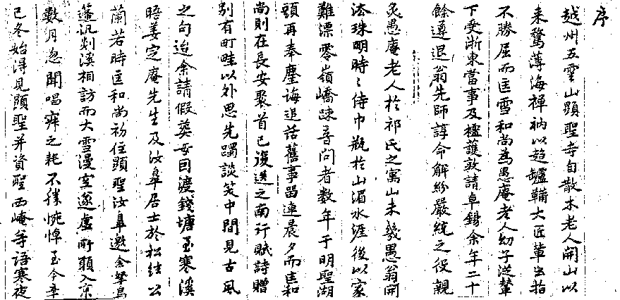
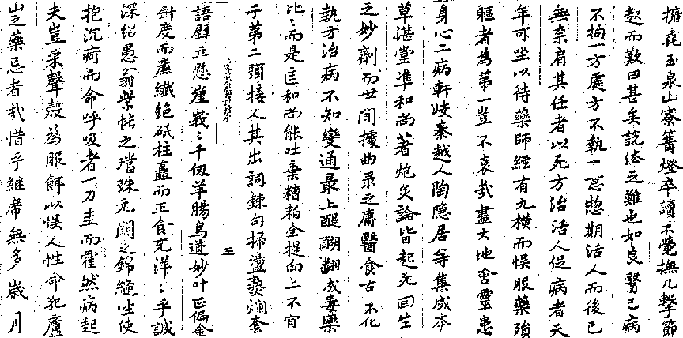
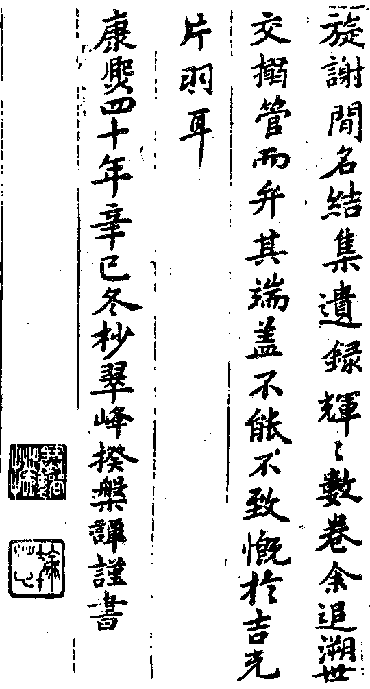

# 屾峰宪禅师语录



> **藏经**：嘉兴大藏经（新文丰版）（嘉兴藏）　**册次** 第 34 册（J34）　**编号** JB298　**部类** 诸宗部　**卷次** 10 卷　**篇幅** 56,477 字

> **作者（译者）**：门人(智质　智原)同编、嗣法门人(智质　智原)同编

> **卷／品**：8 卷 · 3 品



---



## 目录



- [屾峰宪禅师语录卷一](#屾峰宪禅师语录卷一)

- [屾峰宪禅师语录卷二](#屾峰宪禅师语录卷二)

- [屾峰宪禅师语录卷五](#屾峰宪禅师语录卷五)

- [屾峰宪禅师语录卷六](#屾峰宪禅师语录卷六)

- [屾峰宪禅师语录卷七](#屾峰宪禅师语录卷七)

- [屾峰宪禅师语录卷八](#屾峰宪禅师语录卷八)

- [屾峰宪禅师语录卷九](#屾峰宪禅师语录卷九)

- [屾峰宪禅师语录卷十](#屾峰宪禅师语录卷十)

  - [横山净土诗序](#横山净土诗序)

  - [东山丈室铭序](#东山丈室铭序)

  - [耿道符先生诗序](#耿道符先生诗序)



---















------



## 屾峰宪禅师语录卷一



**译者**：门人(智质　智原)同编



住檇李古资圣寺语录



康熙壬子岁八月望日入院。



山门。「开楼阁门，门门涉入；踏向上路，路路通霄。秪如不恁麼来时如何？」卓拄杖，云：「丹霄腾彩凤，銕锯舞三台。」



佛殿。「你道我眉毛没八字，我道你鼻孔失半边，今朝觌面相呈，毕竟如何回互？」良久，云：「刀斧斫不开。」



伽蓝。「英雄佛子，不二丈夫。赤心片片，亘今亘古。雨过苔阶日卓午。」



祖师。「冷坐堆堆，嵩庭雪赤，抑逼将来，道个不识。固听尔言，焉到今日？背手弯弓，当面著贼。咄！」



先老和尚像前。拈起香，云：「从上一队老古锥，人人以此为验，却又争得？今日不肖儿孙亦以此为验，独较些子。」遂烧，云：「须知远烟浪，别有好商量。」



据室。「狮子窟原无异兽，旃檀林不生杂木。从来此处，迥绝攀跻。摩希首罗，竖亚一目。好大哥，知时节。与麼来，驴腰折。且道新长老据何宗旨？泥牛海底趁红尘，纸鹞炉中嚼生铁。」



上堂。拈护法疏云：「楮墨未形已前，金刚眼睛却被者个点出了也。且道是何章句？若未委悉，更烦剖露看。」



檀越疏。「晦堂木樨，南泉牡丹，相逢格外，我岂再三？」



同门疏。「千里同风，更须觌面。父父兄兄，金针玉线。」



本山疏。「离四句，绝百非，秪者是上上机。鹦鹉洲一脚踢翻，黄鹤楼众手扶起。」



师到法座，手指云：「唤作曲录木床，一任诸人瞻观；唤作须弥灯王，谁敢正眼觑著？到山僧分上又作麼生？踏著故乡田地，步步不在别处。」便升。拈香，云：「此一瓣香，尊贵全超空劫，奇特极尽，今时𦶟向炉中，端为祝延今上皇帝圣寿万年，恭愿一人有庆，佛日无疆，万国攸宁，祖风远振。此一瓣香，论君臣则黄阁帘垂，言父子则紫罗帐合，普同供养散木师翁以上诸佛诸祖大和尚，伏愿在筵弘护，阖郡名贤，受佛祖以印心，现宰官而说法。此一瓣香，清凉池里泽成，大火聚中迸出，将谓盖天盖地，彻古彻今，末后西子湖头却被个没人情老汉掀髯一笑，只得瓦解冰消，和身靠倒，至今不知是冤是恩，人天众前拈出供养，即此堂上开山第一代传曹洞正宗二十八世愚庵先老和尚，用酬法乳之恩。」天华和尚白椎竟，师云：「钩章棘句，别日商量，敌胜惊群，便请相见。」僧问：「向上宗乘，未敢特地商量，斩新条令，一众愿观施设。」师云：「亲切莫过此问。」进云：「三圣道：『逢人则不出，出则便为人』时如何？」师云：「多处添些子。」进云：「兴化道：『逢人则出，出则不为人』时如何？」师云：「少处减些子。」进云：「今日和尚开堂又作麼生？」师云：「上座试卜度看。」僧拟议，师便喝。问：「鸣钟伐鼓，咸知祝圣开堂；竖拂拈椎，毕竟明什麼边事？」师云：「落七落八。」进云：「恁麼则一句迥超诸佛祖，吹毛密展露全机。」师云：「却被阇梨钝置。」迺云：「丹挂飘香，筑破瞿昙鼻孔；秋蟾吐耀，打翻达磨眼睛。握灵蛇，魔外潜踪；悬宝镜，森罗遁质。到者里，任是棒如雨点底德山、喝是雷奔底临济，秪可傍观，不敢正视。须知我太阳门下不立主宾、别通尊贵，转身就父、因明兼到，同时退位朝君、权借正偏回互，起木人妙舞、听石女高歌，头头不露真机、法法全彰大用，此犹是我新丰门下旧时茶饭。今日新资圣，更要捩转关头、掀翻陈案。」卓拄杖一下，云：「拽新罗国与占波国斗额。」复卓一下，云：「移南岳山入天台山，肚里灯笼露拄，拊掌呵呵大笑。正当恁麼时，不居尊贵一句作麼生道？」良久，云：「渠不可作太阳脚下儿孙不得。」天华和尚结椎，下座。(谢词不录)



中秋，小参。「曹谿指月，腕头力气用尽；灵山话月，口边白醭转多。带累西天东土，人人醉后添杯；西子湖清歌妙舞，阖闾冢品竹弹丝。只有南湖风景，从来面目天然；任伊淡抹浓粧，不宜随人脚转。资圣恁麼道，众中当佛法商量，须眉堕落；作世谛流布，平地吃交。而今更要一手抬、一手搦去也。」以拂子打圆相，云：「夜明帘外许汝转身，资圣堂前不容立地。何故？恐汝诸人他后道向者里见来。」擿下拂子，下座。



小参。僧问：「众香国里藏身，资圣堂前露布，未审君臣道合一句作麼生道？」师云：「万年松盖祝融峰。」进云：「问答不无宾主句，请师格外显全提。」师竖拂子，云：「此犹是半提。」进云：「深领一问。」师云：「苍天，苍天。」迺云：「西风一夜逼人寒，赤骨条条秪恁般，圣不收、凡不管，打鼓普请大家看。」喝一喝，下座。



上堂。僧问：「拈椎竖拂，屈为今时，向上宗乘，请师直示。」师云：「阇黎置问不易。」进云：「洞山五位不敢重论，浮山九带更烦垂答。」师云：「兔子有角，水牯无角。」进云：「如何是正法眼藏带？」师云：「露天石臼子。」「如何是佛法藏带？」师云：「黄河水自出昆仑。」「如何是理贯带？」师云：「开口见胆。」「如何是事贯带？」师云：「南山云，北山雨。」「如何是理事纵横带？」师云：「十字街头憨布袋。」「如何是屈曲垂带？」师云：「嫡血验亲。」「如何是妙协兼带？」师云：「倒卓吹毛不露锋。」「如何是金针双锁带？」师云：「锦上鸳鸯绣不成。」「如何是平怀常实带？」师便打。进云：「九带已蒙师指示，当阳一句少知音。」师云：「亲口出亲言。」举：「湛祖问众曰：『还有问话者麼？若有，出来，秪要打草惊蛇。』一僧才出，祖云：『真是一场业地。』卓拄杖，下座。愚庵先师云：『者老汉图得一时俊快，不顾后日风波，者片地从古至今何曾清净得来？偶然一时打草，却被者僧靠倒。』」师云：「看者两个老汉如龙得水，难为把住；似虎靠山，未解放行。今日不肖儿孙要圆者个公案，还有问话者麼？不图打草惊蛇，直要抛砖引玉。」一僧才出，师打，云：「要你出来成得甚麼事？」便下座。



晚参。举南泉斩猫话毕，师云：「马头浇水则易，马尾接水则难。赵州可谓克家之子，其如检点将来，终非善法。山僧也畜得一个猫儿，拈向诸人，如何下手？」蓦顾左右，喝一喝，便下座。



开炉，上堂。僧问：「资圣堂中挝毒鼓，爽谿林下竖狮幢，且道新丰一曲如何举唱？」师云：「大众侧耳。」进云：「如何是君？」师云：「炜炜煌煌。」「如何是臣？」师云：「雍雍肃肃。」「如何是君视臣？」师云：「屈屈垂垂。」「如何是臣向君？」师云：「绵绵密密。」「如何是君臣道合？」师云：「合时无道。」僧礼拜，师嘘嘘。问：「放行则天回地转，把住则海晏河清，即今把住是？放行是？」师云：「是什麼？」进云：「三圣道：『逢人则不出，出则便为人』时如何？」师云：「问取三圣。」进云：「兴化道：『逢人则出，出则不为人』又作麼生？」师云：「问取兴化。」进云：「和尚即今是为人耶？不为人耶？」师打云：「你道是为人耶？不为人耶？」进云：「拈起一枝无孔笛，临风颠倒两头吹。」师云：「不柰船何，打破戽斗。」赵湛遇居士问：「十五日已前事作麼生？」师云：「何不早恁麼问？」进云：「十五日已后事又作麼生？」师云：「临崖看浒眼。」进云：「即今事又作麼生？」师云：「不妨疑著。」进云：「金风体露，殿角生凉。」师云：「冬行春令。」师卓拄杖，云：「即今荐得是第二句、第三句，诸人自领出去。要知第一句麼？山僧未开口前却被露柱勘破了也。还有人勘破露柱麼？」喝一喝，云：「畫蛇添足。虽然如是，尽法无民。拈却炙脂帽、脱去鹘臭布衫，有甚麼过？山僧恁麼道，落在半途，未是到家极则事。要知极则事麼？问取堂中第一座。」举：「湛祖上堂云：『以大圆觉为我伽蓝，身心安居平等性智。既平等已，直以十方微尘刹土总是一个道场，过去无量劫不曾结、未来无量劫不曾解，生死也在里许、涅槃也在里许，乃至是非得失、邪正圣凡、解脱不解脱、轮回不轮回总在里许，於中还有你用心处？有你计校处？』」师云：「者老汉声腾海宇、价重人天，伎俩秪得如是，带累儿孙不成计校。汝等诸人还计校得麼？更为颂出：老汉顶门不踏窍，解哭如何不解笑？解哭不解笑，塞却双耳瓮里叫。」



早参。「今朝十月朔，佛法开口错，只担七事忧，还虑三餐薄。水旱既频仍，飞蝗复凶虐，自惭一力无，不吐元字脚。法堂任草深，佛祖填沟壑，停挝法昌鼓，且用清平杓。千七百葛藤，言言尽糟魄，有甚向上机？人天眼开凿。生死到头来，灵龟生脱壳。资圣少丛林，惯触忤先学，一任举诸方，任诸方卜度。」蓦竖拂子，云：「秪有者些子，天地同寥廓。」便下座。



普请择菜，小参。拈起拂子，云：「秪者一茎，不是后园驴吃，岂从谿涧流来？未肯亲自栽培，到底鲜能知味。拈起也，根株不断，信手斩除；放下也，枝叶廉纤，和身抖擞。半青半黄，扬下搕[搕-去+(天/非)]堆，那怕烂却；不湿不乾，打叠虀瓮里，正好淹杀。不到乾爆爆地，未许水漉漉地。果能食时，不啮一茎，方可岁月消磨百瓮。资圣恁麼，与他古人至道无难，唯嫌拣择，毕竟如何折合？」良久，云：「唤出祖师来，也少他一茎不得。」擿拂子，下座。



除夕，晚参。拈拄杖，云：「天下丛林逗到今夜，谓之腊月三十，不管迷悟、圣凡、是非、善恶、主宾、内外，总教一齐放参。有个不解放参底，猛地出来道：『和尚欺人太煞，某甲从无量劫来不解放倒，用参作麼？』山僧便问：『是阿那个？有甚伎俩？试吐露看。』便扬声，曰：『拄地撑天秪者头，打开活路尽风流，条条赤体无回互，倒卓毘卢顶上游。』山僧拨眼一看，原来不是别个木上座。」卓一下，云：「善哉木上座，巧能得佛智，珍重见闻者，分明秖者是。」卓一卓，下座。



元旦，上堂。僧问：「第一义谛，某甲不敢造次，新年头佛法还许商量也无？」师云：「山僧刮目相待。」进云：「昨夜灯笼与露柱交参，属第几机？」师打，云：「莫嫌造次。」进云：「且喜今朝是元日。」师云：「何劳注脚？」问：「凡圣性无别，君臣体是殊。如何是君？」师云：「无人得亲近。」「如何是臣？」师云：「奉重在今时。」「如何是君视臣？」师云：「万方忘化德，一体感群功。」「如何是臣向君？」师云：「不辩雍熙气，安知造化心？」「如何是君臣道合？」师良久。进云：「恁麼则天下太平，万物蒙恩去也。」师亦良久，乃云：「也大奇，也大奇，新年佛法不思议。人云只有天在上，我道更无山与齐。无山可齐即且从，敢问大众：还识得天麼？不是浩浩其天，亦非鸢飞戾天。」蓦起身，云：「仰今皇帝德，处处乐尧年。」喝一喝，下座。



小参。「今朝二月一日，雨洗石头骨出。落梅片片沾泥，嫩柳丝丝吐碧。光阴暗地催人，脉脉齿疏头白。自肯撒手悬崖，放下腰包雨笠。露柱夜半怀胎，灯笼日出上壁。新罗蓦地翻身，拽取占波斗额。若作奇特商量，地狱如射箭入。」喝一喝，下座。



诞日，上堂。僧问：「人人有个生缘，且道不涉生缘底来如何相接？」师云：「从来疑者汉。」僧便礼拜，师云：「瓦解冰消。」问：「和尚春秋，一众咸知，堂中圣僧知年多少？」师竖拂子，云：「与者个不别。」进云：「虚空年多少？」师云：「两个。」进云：「恁麼则和尚寿量不异虚空。」师云：「依样葫芦畫不成。」进云：「只得瞻礼去也。」师云：「大随道的。」迺云：「父母非我亲，谁是最亲者？诸佛非我道，谁是最道者？那咤析骨拆肉，不借他力；达磨分髓分皮，密在汝边。未生面目，描畫难成；才落今时，见闻莫及。得之於心，伊兰作旃檀之树；失之於旨，甘露乃蒺藜之园。但领目前，莫求心外，圣情不立，凡见全消。不见永嘉道：『不离当处常湛然，觅即知君不可见。取不得，舍不得，不可得中秪麼得。』且道不可得中如何是得底道理？」卓拄杖，云：「释尊得之，四月八日称尊三界；普尊得之，二月十九克证圆通；慈氏得之，补处当来；鹙子得之，速超餘漏；人天得之，增长十善；三途得之，永断轮回；尽大地情无情得之，齐臻佛性，同住真常；现前诸人得之，各各自知，心遍十方，量周法界，主微尘里转大法轮，於一毛端现宝王刹。且道山僧今日又作麼生？」卓一下，云：「五月五日年年度，者回懒著娘生裤，虚空背上架秋千，烈燄堆中看竞渡。」复卓一卓，下座。



说戒，上堂。僧问：「拈出火里眉毛，未敢轻问。和尚今日说戒，请问如何是戒？」师云：「搭衣持钵。」进云：「如何是定？」师云：「鬼窟里作活计。」进云：「如何是慧？」师云：「山僧从来懵董。」进云：「戒、定、慧与火里眉毛相去多少？」师云：「上座拈得出麼？」进云：「四众瞻仰有分。」师云：「谩山僧即得。」进云：「若无举鼎拔山力，千里乌锥不易骑。」师云：「阿谁分上事？」僧一喝，师便打。问：「千圣不传之的旨，请师傍通一线。」师云：「我若向汝道，则辜负千圣。」进云：「恁麼则密不通风去也。」师云：「早成露布。」僧礼拜，师乃喝一喝，云：「过去诸如来，斯门已成就；现在诸菩萨，今各入圆明；未来修学人，当依如是法。於斯会得，水流花开，著著显当人受用；云兴雨霁，头头露本地风光。撮茎草，现丈六金身；拈粒米，藏大千世界。直须横该竖抹，那容播两掂觔？因斋庆赞，偶尔成文；竿头随身，逢场作戏。诸人还委悉麼？其或不然，今日诸沙弥求进具戒，巨上座请山僧升座，少间登坛说戒之后，各各须要持钵过堂。」喝一喝，下座。



小参。僧问：「若能转物，即同如来。如何是转底道理？」师拈拄杖，云：「不可唤作拄杖。」进云：「秪如世尊睹明星悟道，还转也无？」师云：「不可不唤作拄杖。」进云：「恁麼则随和尚转耶？」师云：「瞎却天下人眼。」僧一喝，师便打。举殃崛尊者产难因缘毕，师云：「长者家产难，幸得殃崛传言，一时分娩。昨夜露柱怀胎，产下个南山鳖鼻，毕竟承谁恩力？有人道得得力句，许汝洒洒地作个了事衲僧；其或不然，饥时遇膳，渴时遇浆，不妨处处疑著。」



寒食，小参。「此事不是说不得底，说不得是无句；不是说得底，说得是有句。不落有无现前，诸人试道看。」良久，云：「有无总道不得，却被有无碍是死句；有无总道得，不被有无碍，落在半途。道有之时，纤尘不立；道无之时，万法齐彰。不落有无，情解俱遣，才是活句。且道：作麼生是透活句？」拂一拂，云：「东风匝地逢寒食，雨洗桃花万户春。」



五月，分卫，小参。「来朝五月五，家家门前悬艾虎，茅山道士卖灵符，打破葫芦叫冤苦。张真人与王元帅特地商量道：『近日诸方乞食，塞巷填街，秪是觑不见资圣长老。』大众！你道他两个俗汉不顾自家活计便恁麼问，意在於何？会得底，依例出队；不会底，只消觅得胡须赤，不须更觅赤须胡。」擿拂子，下座。



晚参。拈竹篦子畫一畫，云：「江西来也在者里，河南来也在者里，四川、八闽来也在者里，山东、山西来也在者里。秪如有一人总不恁麼来，且道安放何处？」放下竹篦，云：「烟霞生背面，星月绕檐楹。」



结夏，小参。举：「洞山老祖示众云：『秋初夏末，兄弟或东去、西去，直须向万里无寸草处去。』良久，云：『秪如万里无寸草处作麼生去？』有僧举似石霜，霜云：『何不道出门便是草？』」师云：「诸兄弟！如今脚跟下遍地荆棘，拟向万里无寸草处去，大难，大难！纵使踏破几緉草鞋，究竟不离者里，不如本分好。诸兄弟！要识洞山麼？」拍禅床左边一下。「要识石霜麼？」拍禅床右边一下。「秪如更有个道『不出门亦是草漫漫地』，又作麼生会？若向者里透得，许汝开粥锅度夏；其或不然，根尘流注髑髅穿，昼夜惺惺要防贼。」喝一喝，下座。



示众。举：「法昌示众云：『夜半乌鸡谁捉去？石女无端遭指注，空王令下急搜求，惟心便作军中主。云门长驱沩山队伍，列五位枪旗，布三玄戈弩，药山持刀，青原荷斧，石巩弯弓，禾山打鼓，阵排雪岭长蛇，丘屯黄蘗飞虎，木马带毛烹，泥牛和角煮，赏三军，犒师旅，打葛藤，分露布，截海扬尘，横山𢿥土，击玄关，除檄路，多少平人受辛苦，无边刹海竞纷纷，三界圣凡无觅处。无觅处，还知否？昨夜云收天宇宽，依然带月啼高树。』」师云：「者个乌鸡原是家中故物，任渠霜天月夜高唱低鸣，无端被法昌老子一趁，直得罗笼不住、呼唤不回，带累一队老古锥扰动乾坤，寻觅不得。」蓦竖拂子，云：「原来却在者里。」遂擿下，云：「月高不肯啼深树，霄汉曾经抱卵归。」



除夕，晚参。「年穷岁尽，更无奇特事与诸人商量。拄杖子应声近前，曰：『有奇特事启和尚。昨见陈年壁上桃符扭痛傩神鼻孔，傩神奋力跳上石敢当顶门大叫苦屈，桃符曰：「甚麼时节许你搀行夺市？」傩神大笑，道：「一向受你谩昧，腊月三十日到来也须让我一筹。」桃符秪得唯唯而退，仍旧耸身上壁，拄杖子依然立地。』诸兄弟！都是参玄人，到此莫卤莽，逗到大尽夜，看看无处躲。」卓拄杖，下座。



元日，上堂。「今朝丙辰元旦日，此事从来无固必，床头夜半日轮红，天晓原来地下湿。丛林阖众尽知时，伐鼓鸣钟颂北极，黄金瓦砾尽增辉，敢保头头诸事吉。两廊厨库谒僧堂，佛殿山门相对揖，重教日用任腾腾，摩诃般若波罗密。倘众中有个出来道：『堂中圣僧为甚麼不在里许？』山僧便向他道：『来日更须下一光供养。』」下座。



上堂。「诸禅德识得一道平当，便是无限奇特。穿衣吃饭，腾耀古今；放尿屙矢，多少谛当。所谓似地擎山，不知山之孤峻；如石含玉，不知玉之无瑕。山僧恁麼道，已为诸人入泥入水。珍重！诸禅本自无文，慎勿雕镌刓劂。」喝一喝，便下座。



晚参。拈拄杖，云：「诸兄弟！甚时节直须撒町去畦，何用循途守辙？肚皮宽如布袋，佛祖难容；脚板阔似金刚，虚空嫌碍。器度如是，才知千七百则原来虾跳不出斗，三十三人何曾瓮里走失鳖？你更如何若何，眼里重新著屑。」卓拄杖一下，云：「背手弯弓，当面著贼。」



冬至，上堂。僧问：「一阳才动，大地春生。请问和尚：如何是阳春一曲？」师云：「耀古腾今。」进云：「僧问古德：『日长多少？』云：『长一线。』一线且置，敢问今日佛法长多少？」师云：「谁敢论量？」进云：「天上有星皆拱北，人间无水不朝东。」师云：「杓卜听虚声。」乃云：「葭管飞灰一气新，山河岂是眼中尘？衲僧鼻孔重添楔，漏泄东君一段春。冬至月头，卖被买牛；冬至月尾，卖牛买被。今年冬至，喜得不在月头、不在月尾，更不在月中，说甚牛被卖与不卖？衲僧家既不受囊藏，阿谁盖覆得你？不犯苗稼，阿谁拘管得你？到诸方则得，若到资圣门下，更须一一按过始得。」卓拄杖，云：「自从得合桑林舞，游刃恢恢恁地闲。」



上堂。「也大奇，也大奇，无情说法不思议。」以拂子指前曰：「此是亮鬲。」指后曰：「此是屏风。」左右指云：「此是露柱。更要说甚麼法？」便下座。



解制圆戒剃度上堂。僧问：「昔日世尊睹明星悟道，即今和尚见个甚麼？」师云：「说似诸人即不中。」进云：「世尊以此为验，和尚以何为验？」师云：「验你祖先。」进云：「毕竟还有优劣也无？」师云：「一任阇黎颠倒。」进云：「和尚得恁麼瞥地？」师云：「莫谤他好。」乃云：「资圣结则大千世界同时结，资圣解则大千世界同时解，须知时节在山僧手里。」拈拄杖云：「三乘四果，脱三界证寂灭在者个时节；四生六趣，越生死出轮回在者个时节；行童沙弥，剃度入大僧在者个时节；释迦老子，睹明星悟道在者个时节；乃至三世诸佛、历代祖师，降生入灭、证道转法轮都在者个时节。识得者个时节，便识得三世诸佛、历代祖师降生入灭、证道转法轮底时节。诸人还识得者个时节麼？」卓拄杖云：「下坡不走，快便难逢。」便下座。



晚参。举：「云庵和尚示众云：『洞山门下，八凹九凸，交交加加，屈屈曲曲，崎崎岖岖，嵲嵲屼屼，水云掩映，烟岚重叠，观者、游者，十人、九人，举步便迷却路头也。其中莫有不迷者麼？』乃喝云：『且道洞山路头在甚麼处？』」师云：「从来蓦直走大路，无人能到，何况如是凹凸屈曲、崎岖嵲屼，要人不迷却路头？洞山可谓南行北辙，大似鬼门上贴卦。末后又道：『洞山路头在什麼处？』早是自家迷却了也。若较资圣太远在。者里山门八字打开，南通杭绍、北通苏、西接吴兴一带大路，不管船来、陆来，跨入山门便好开单展钵。但只要问你：路头从何处来？未跨船舷，脚跟下好与三十棒。何故？我曾向人家屋檐下过，不敢轻汝方来。大众！久立，珍重。」



小参。拈拄杖云：「若据一大藏教，是个转句；若据祖师门下，是个险句。须知转路中有险路，险路中有转路。」僧出问：「如何是险路中转路？」师横按拄杖。进云：「如何是转路中险路？」师竖起拄杖。僧拟议，师便打，退归方丈。



小参。「倒一说，眉毛不用重撕结；对一说，鼻孔依然失一橛。无言童子唱哩啰，始终不落非关舌。无头无尾，非心非佛，一等指鹿为马，三人证龟成鳖，杜宇无劳漫啼血。」



早参。师弹指云：「禅客相逢只弹指，此是能有几人知？要问诸人：如何是此心？」僧出礼拜云：「相识满天下，知心能几人？」师云：「何得把髻投衙？」僧云：「谩某甲不得。」师弹指云：「相去多少？」僧举坐具云：「不离者个。」师云：「惭惶不少。」乃云：「达磨不解安，二祖不解觅，煮豆燃豆萁，豆在釜中泣，笑杀当年马簸箕，说非不了又说即，累人千古不甘休，胡饼重重要讨汁。住！住！且道颜渊、闵子骞、子贡、子游、子夏者一队不农不圃汉，终日浩浩地商量个甚麼？」擿拂子云：「锢鏴。」



上堂。卓拄杖云：「不谩诸上座。」良久，云：「都是自谩诸上座。此话有两种负堕：负堕处麤，二乘见之如隔罗縠；负堕处细，佛祖犹隔一关在。诸人检别得出，山僧在你脚跟下；检别不出，莫怪山僧麤糙。」以拄杖卓两卓，下座。



开炉，上堂。「时节若至，其理自彰。山门佛殿，厨库僧堂，暮鼓晨钟，粥梆饭板，已为诸人彻困，更要山僧好肉剜疮作麼？虽然，不随渔父引，争得见波涛？」卓拄杖一下，云：「总在里许。若更如何若何，紧峭草鞋重起。」



上堂。「教中道：『诸佛之所护念。』且道护念个什麼？」顾视，云：「劝君更尽一杯酒，西出阳关无故人。」便下座。



腊八日，上堂。僧问：「雪覆万年松径，云遮一带峰峦，为复是人耶？境耶？」师云：「青天影倒卓。」进云：「恁麼则木鸡啼子夜，刍狗吠天明。」师云：「白日泛黄河。」进云：「拈出一枝无孔笛，等闲吹出万年声。」师云：「是何音律？」僧拟议，师打，云：「不是知音。」问：「今朝腊月初八，个个暗中摸索，正觉山前亲切句，未曾拈出请师宣。」师云：「罕逢穿耳客，多遇刻舟人。」进云：「某甲话在。」师云：「幽州犹是可，最苦是新罗。」进云：「即得礼拜了退。」师云：「山僧今日失利。」乃云：「明星当午现，夜半正詴讹，笑破瞿昙面，无风匝地波。」拈起拄杖，云：「者个是明星，阿谁不睹？」顾左右，云：「更不可矢上加尖。」卓一下，云：「只得诳惑大众一上。不见道：十世古今，始终不离於当念；无边刹境，自他不隔於毫端。情与无情同体，世出世间平等，灵山会上不异今朝，香积国中还齐昔日。世尊面目，去今壬子二千六百餘年，证道转轮、降生入灭，觅一丝毫头许起处住相了不可得，那容西乾四七、东震二三、天下老和尚，鼓弄舌头、扭捏鼻孔，以至末学后昆打瓦钻龟、说青道白？虽然，事无一向，资圣今日劈开大路，脚下无私，与现前大众同登解脱觉场去也。且道：无私一句端的如何？」卓拄杖，云：「天高群象肃，海阔百川朝。」下座。



除夕，小参。「岁穷年尽，一片祖翁田地洎合荒却半边，欲得犁锄连夜出，不免诸人怪笑。资圣冬行春令，秪得放置一边，且说家尝澹话。山僧自入院已来，频仍潦旱，带累一院淡薄，自惭薄福，何暇东语西语？逗到大尽夜，且喜无事，举则旧葛藤，权了岁除人事。昔日，香岩道：『去年贫，未是贫；今年贫，始是贫。去年贫，犹有卓锥之地；今年贫，连锥也无。』香岩老子恁麼道，只见锥头利，不见凿头方。资圣当时若见，更要问他觅锥在。山僧与麼道，倘有傍不肯底出来道：『和尚只见锥头利，不见凿头方。』资圣座下有者衲子，山僧今夜不掇退果桌；如无，掇退果桌去也。」掀翻法座，归方丈。



元旦，上堂。僧问：「时节若至，其理自彰。且如新年头有何祥瑞？」师云：「玉历悠长。」进云：「十世古今不离当念，为什麼更有新旧？」师云：「善知时节，予不再三。」进云：「忽遇能为万象主，不逐四时凋底，又作麼生相接？」师云：「无党无偏。」进云：「恁麼则抛却陈年间骨董，一回举起一回新。」师云：「审如是，敢保头头活泼。」问：「元正启祚，万物咸新，未审和尚作麼生道？」师云：「山河日月，呈瑞呈祥。」进云：「恁麼则红日迸虚空，青山常独露。」师云：「未是衲僧巴鼻。」进云：「自是曹溪分一滴，至今流出爽溪长。」师云：「须知新丰一路是别。」进云：「礼拜去也。」师云：「不更商量。」乃云：「今朝癸丑正月，新丰一路是别，那管鸡舌牛头，信手拈来便𦶟？垂裳玉历悠长，翊卫金瓯无缺，衲僧巴鼻日新，光灿云门一橛。风前柳眼迸开，雪后寒梅漏泄，象王鼻孔威严，狮子爪牙猛烈，山河日月呈祥，万象森罗欣悦。但能转物无私，敢保头头活泼，胸次无党无偏，口里横说竖说，佛法不更商量，个个善知时节。」卓拄杖，云：「予今不再三。」下座。



上堂。「教中道：『有智若闻，则能信解；无智疑悔，则为永失。』好笑黄面老子话作两橛。资圣要问你：有智若闻，作麼生信解？无智疑悔，作麼生永失？诸人会麼？一条拄杖两人舁。」



六赞化士丐武塘归，领众请上堂。僧问：「掬沙献佛，果感轮王；施米供僧，得何利益？」师云：「今日且要拔本。」便打。进云：「果然功不浪施。」师云：「且道得何利益？」进云：「施者、受者还得受用也无？」师云：「龙得水时添意气，虎逢山势长威狞。」进云：「野老讴歌忘帝力，相逢同乐太平年。」师云：「再三捞摝始应知。」问：「当阳一句，作者难谩，觌面相呈，请师一接。」师云：「大座当轩孰敢窥？」进云：「若有一法，毘卢堕在凡夫；万法若无，普贤失其境界。如何得行解相应去？」师云：「话头何在？」进云：「二俱坐断，和尚如何举扬？」师云：「打点不是好手。」进云：「吸乾鸳渚水，独坐验龙蛇。」师云：「作家，作家。」僧便喝，师便打。进云：「只得礼拜了退。」师打，云：「不妨疑著。」乃云：「动静一原，往复无际，弹指功圆，不离当处。行时无说路，说时无行路，行取说不得，说取行不得，此行解相应也。秖贵眼正，不问行履，解摄行也。难行能行，难忍能忍，行该解也。果能如是，搅长河为酥酪，变大地作黄金，驱耕之牛，夺饥之食，不为分外。若只解参无事禅，向寒灰冷燄里蹲坐，则寸丝滴水，消受良难。今日武塘诸檀送赞禅还山，赞禅发如是心，行如是行；诸檀满如是愿，获如是益。施者受者，果因不昧，功讵浪施？山僧直下无开口处，秪可举段葛藤，权为影草。昔日五祖演和尚云：『四五百石麦，二三千石稻，好个休粮方，耆婆不得妙。』千岩长和尚云：『米不蓄一粒，菜不栽一茎，任渠往来者，吃得饱膨脝。』看他两尊宿，一人从天降下，不道贫穷；一人从地涌出，不居富贵。检点将来，不无事理偏枯。资圣则不然，困来便打眠，饥来有饭吃，地厚天宽总不知，摩诃般若波罗密。」下座。



弁山且拙和尚讣闻至，上堂。「赤日忽翻雷雨阵，江南持到弁山信，石头斧子话空圆，颠倒人天齐失令。」举起拂子，云：「诸人还见麼？此是我弁山堂头且拙法兄大和尚为禅关钤键、作法海梯航之标榜，今则失半面而恨转九回、示全身而道同千古，逆流西注，砥百丈之狂澜；散木南支，荫两山之苍翠。阿閦国里再见良难，善法堂中更闻不易。且道即今觌面一句毕竟如何？六月寒冰生烈燄，白描彩凤入丹霄。」擿拂子，下座。



退院，上堂。拈拄杖，云：「祖风衰晚，法运凌夷，肩荷宗乘，丝悬九鼎。山僧既忝为洞山脚下儿孙，理应力挽颓纲，振兴祖席。叵耐德凉力薄，用寡知稀，慧命不敢自轻，世道忍看交丧，秪堪被忍辱铠，坐法空座，说没意语，展无作用，已经四载矣。诸人还知麼？随身竿木，作戏逢场，吹毛不挂於眉间；要津把断，凡圣不通，灵符独悬於肘后。白云覆青山，主宾不用安排；清风拂白月，君臣随处建立。我为法王，於法自在。」卓拄杖，云：「有时恁麼，有时不恁麼，今日总不恁麼。且道：退辞祖席，直入千峰一句作麼生道？三汲浪高鱼化龙，痴人犹戽夜塘水。」下座，拽杖便行。



------



## 屾峰宪禅师语录卷二



**译者**：门人(智质　智原)同编



住前溪古齐昌寺语录



康熙丙辰岁腊月八日入院。



山门。「不从人天来，却向者里入，直踏毘庐顶𩕳，堪与佛祖为师。」蓦卓杖，云：「密移一步看飞龙。」便入。



佛殿。「古镜未磨时，与汝相见了也。即今礼即是？不礼即是？」遂展大具，云：「三十年后，敢保有人道个不必。」



伽蓝。「汝坐我立，不为汝说法。秪要锅里不少米、灶里不少柴，昔日灵山亲付嘱，今朝何必更安排？」



祖师。「捏不成，塑不就，东土与西天，面南看北斗。断淆讹，绝渗漏，三十三人眼𭽯眵，不值寒山破苕帚。咦！」



据室。「正不居正、偏不坐偏，要展向上机宜、单提正令，直饶临济、德山到来，犹是困鱼止泺、钝鸟栖芦。」蓦顾左右，云：「有麼？有麼？」良久，卓拄杖一丁：「行到水穷处，坐看云起时。」



护法疏。「未形文彩，金刚眼睛在山僧脚下；才落言诠，山僧鼻孔在诸公手里。还会麼？会则铺华锦上，不会则矢上加尖。」



本山疏。「历历无回互，明明绝覆藏。春回大地暖，佛日镇齐昌。」



法座。「未有善法堂，先有此须弥灯王宝座，用借山僧四大作麼？」喝一喝，云：「眼前有景道不得，崔颢题诗在上头。」便升。



祝圣毕，「此一瓣香，从前未曾暴露，者回不敢盖藏，供养匡庐开先堂上山鸣老和尚，用报钳锤陶铸之恩。此一瓣香，若耶溪上传来，西子湖头收得，在鸳湖冷暖自知，到前溪贵贱无价，供养曹洞正宗二十八世梵受堂上愚庵先老和尚，用酬法乳之恩。」白椎毕，问：「踏入千峰最上层，横拈楖栗验来宾，掀翻海岳求知己，拨动乾坤见太平。乾坤拨动即不问，如何是新入门一句？」师云：「大地春回无硬土。」进云：「萧梁古刹，门径荒芜，三世诸佛手足无措，十八罗汉和身靠倒，和尚到来作麼生施设？」师云：「破砂盆要大家扶。」进云：「恁麼则山灵赞助，瓦砾增辉去也。」师云：「且容赞叹。」问：「吸尽鸳湖波万顷，踏翻双径几层云，承师证道真消息，拈出当阳好示人。证即不问，如何是道？」师云：「莫向枯桩旧处寻。」进云：「秪如无修无证，道从何立？」师云：「阇黎却会得。」进云：「明日世尊，今朝和尚，还有同别也无？」师云：「却较山僧一日长。」迺云：「坐断溪山罢问津，寒岩花发劫初春，繁兴大用原无事，不动那伽定里身？此是选佛场，心空及第归。净裸裸、赤洒洒，仰攀绝路、趋向无门，理绝玄微、事无背向。到者里，三玄戈甲不用全施、五位旗枪无劳更列，秪可坐法空为座、著弊垢为衣，知尊贵而不居、明功勋而不宰，直下和泥合水、不断声色去，始有相应分。现前缁素还委悉麼？其或不然，向下分明荐取。」以拂子畫○相，云：「此是齐梁古刹、唐宋名蓝，为兹邑祝厘万寿道场，是一境保绥、千秋胜地，既隆替不尽乎两朝，其休徵有关乎百代。所以，有时散歌舞於溪头，鸟啼花笑；有时论风幡於庑下，水秀山明；有时埋铜驼於茂草寒烟；有时翻瓦砾为琼楼玉殿。山僧今日仰承众力升此法座，且道毕竟举扬个甚麼事？吹法螺、击法鼓，作大佛事，拈茎草作丈六金身、撮毛端现三千楼阁，人籁、天籁齐鸣，佛法、世法并唱，直得三世诸佛动地放光、十八高人手舞足蹈，齐声赞善：『希有！希有！』秪有南山石幢子与莫于峰横竖点头，未全宜诺，山僧只得呵呵大笑。大众！正恁麼时，且道斩新条令一句作麼生道？几曲溪回歌舞地，万重山绕法王家。」结椎，下座。



当晚小参。问：「梅吐白，柳含青，前溪水，后山云，历历明明事现成，因甚某甲到者里不会？」师云：「打破镜来与汝相见。」进云：「千年故物依然在。」师云：「何不别通一路？」进云：「虚空背上打秋千。」师云：「针锋眼里卓须弥。」进云：「某甲只得礼拜了退。」师不顾，乃云：「我本秀州人，不住秀州地，觅得溪山深处居，入门先我囊如洗。杖钵萧条值岁寒，村村木落秋风里，山中佛法况无多，石头大小谁相委？填街塞巷尽时流，逢人那肯频频举？禅床嬾下气力无，客来相对浑无语，带累诸禅苦不休，个个和泥而合水。开门七事件件无，家私拈起无些子，挈得随身折脚铛，碗子无心篮没底。粗茶澹饭仅充肠，土木才兴乏柴米，瓮牖绳枢带雪霜，颓垣败壁兼风雨。乍住杨岐屋壁疏，满床风雪寒如许，翻忆古人树下居，我较杨岐几倍耳。珍重同流共此心，古人为道恒如此，个事人人非等闲，破砂盆要重扶起。大众！扶起固妙，那解放下更稳？忽然有个伶俐汉出来道：『长老惯用一手抬、一手搦。』山僧便向他道：『你作佛法会又争得？』」击拂子，下座。



晚参。「者边那边，全放全收，事无一向，叶落知秋。从上佛祖千七百则陈烂葛藤，都道是相楼打楼，实是好笑。昔日山僧问个师僧：『德山托钵，意旨如何？』僧云：『相楼打楼。』问南泉斩猫公案，云：『相楼打楼。』山僧乃呵呵大笑，其僧不肯。山僧便问：『即今问你是相楼打楼麼？』云：『不是，不是。』山僧又呵呵大笑，其僧又不肯。要问大众：还肯麼？」众无对。擿拂子，云：「明年更有新条在，恼乱春风卒未休。」



早参。「山僧昨夜夜梦不祥，打个喷嚏，一时内逼，拟往东司，书破不利，便骤步拶入。恶！原来架上有人在。」便下座。



除夕，小参。举：「北禅岁夜晚参，曰：『年穷岁尽，无可与诸人分岁，老僧烹一头露地白牛，炊黍米饭、煮野菜羹、烧榾柮火，大家吃了，唱村田乐。何故？免见倚他门户傍他墙，刚被时人唤作郎。』」师云：「山僧今夜不敢效颦古人，纵使畜得一头，秪好东触、西触，随缘顺运。叵耐年来水草不足，骨露皮穿，假饶烹向大众，讨甚滋味？不如依旧放出溪山，足见大众恩力。」良久，顾视，云：「今夜纵不捩转鼻孔，也不得犯人苗稼。」便下座。



元旦，上堂。「去年有元日，今年有元日，扶起古云门，日日是好日。既是日日是好日，何用扶起？不见道：破砂盆要扶起，雪狮子要扶起，拄杖子要扶起。若是破砂盆有天童在，雪狮子有雪窦在，拄杖子还要山僧扶起始得。」遂卓一下，云：「善哉拄杖子，平生得渠力，他日倚南山，今朝颂北极。」便下座。



早参。「凉雨打更头，风鸣殿角秋，枯蝉嘶岸树，新涨激滩舟。此四句也无敲唱、也无主宾、也无照用、也无偏正，且道与古人立敲唱主宾、照用偏正是同是别？要透有敲唱主宾、照用偏正则易；要透无敲唱主宾、照用偏正则难。何故？雪里撒盐还易辨，煤中著墨卒难分。」



因雪上堂，击如意云：「看看，大雪飘飖，朔风如吼，冯栏不辨梅和柳，彤云片片遮牛斗，三九过了又五九，数更筹坐到鸡鸣丑，橘汤一盏无中有，最堪嗟，荒台古佛扬家丑。好禅流，休乱走，从今莫向寒岩守，乌盆化白盆，黑狗变白狗，抛出雪峰烂木毬，捉得寒山破苕帚。祖师来，休开口，通身是舌难分剖，懒吃赵州茶，漫饮曹山酒，分付小儿童，看明朝人来否？」击如意下座。



屾峰宪禅师语录三



嗣法门人(智质　智原)同编



康熙辛酉正月十七日，众护法公请住东山妙觉院。



山门。「甚深法门，具无量义。户牖洞开，风恬日霁。东山顶上逆流长，涌起扶桑照天地。」卓拄杖便入。



伽篮。「佛法赖汝屏翰，萍实觅甜。祖意叩我端的，胡饼讨汁。因甚如此？活计不同。」



祖师。「我怪你眼突，你笑我齿疏，虽然鼻孔略相似，端的淆讹，如何得不淆讹去？」遂烧香，云：「明破不堪。」



佛殿。「佛真法身，犹若虚空。」弹指，云：「敲空有响，击木无声，秪好听取一半。」展大具，云：「全放全收。」



先愚庵老和尚像前拈香。「秪者是，峭巍巍，记得昔年西子湖头、白云堆里，高峰塔出没虚空，只是终年不露顶。即今东山妙觉堂上拈香择火、咳唾掉臂，要与者老汉不隔，毕竟住何三昧？」以坐具打圆相，云：「红灯毬打白灯毬。」



据室。「山中佛法，石头大小，夺得郑州梨，放手却是青州枣。腊月斗龙舟，元宵夜乞巧，不是冬行春令，秪要拈弄却好。」卓拄杖，云：「南海之帝为儵，北海之帝为忽，中央之帝为混沌。混沌无七窍，而儵忽试凿之，日凿一窍，七日而混沌死。山僧今日倒握无孔銕锤，▆却尽大地人咽喉，要使个个混沌复初，顶门眼活。尔等诸人还甘麼？」良久，复卓杖，云：「雪消泉涌穴，雷动蛰龙惊。」



上堂。「横肩楖栗，万壑千峰，飞腾隐现，雾起云从。」卓拄杖，云：「向者里信脚踏入一片稳密田地，原是诸人本有清净觉场，祖翁亲授手，兄弟合同条，舒卷自由，古今一致，可谓鹫岭风规，旧观稍复矣。虽然，中心树子早属山僧掌握了也，松风竹韵几度赢来，山色溪声和身靠倒。好笑东坡个俗汉，无端道个广长舌、清净身，检点将来犹在半涂。山僧到者里，不管地久天长、日上月下，秪愿一人有庆、千圣同风，个个饱齁齁地齐唱没字哩啰，敢保机关别露、生面重开。」复卓杖，云：「佛阤达麼元和，西乾东震同涂，骊龙颔下何物？赵州东壁葫芦。」擿拄杖，云：「当阳辨取。」复举：「昔日陈操尚书问洞山老祖：『五十二位菩萨为甚麼不见妙觉？』祖曰：『尚书亲见妙觉。』」师云：「洞山老祖与麼答话，幸是尚书任他风浪稳坐钓船，不然洎合打破蔡州。若是山僧不然，今日倘有人问：『五十二位菩萨为甚麼不见妙觉？』只向他道：『在诸人脚跟下，秪是不得动著。』何故？不许夜行，投明须到。」便下座。(拈香谢辞，不录。)



本山三立和尚塔前拈香。「同生七子，各自谋生。道吾舞笏，普化摇铃。兄自藏身北斗，我偏剑刃横行。」遂拈香云：「雨餘春草碧，风落晚花颦。」



当晚，小参。「波咤自笑浙西人，业风吹入江南地，虽无道法播诸方，双眼何尝留出气？诸禅鼻孔漫撩天，脚跟须认闲田地，到来乡语既殊涂，唤钟作瓮要仔细。假饶涂中蓦地有人唤你，作麼生答？切忌回头转脑好。此犹是诸人日用边事，为甚麼寻常问著麻三斤、乾矢橛、东山水上行、我在青州作领布衫重七觔，秪是鼻直口呆去不得？」良久，云：「今晚不合与麼问，直饶与麼去，认著依然还不是。」便归方丈。



本州檀护请升座。僧问：云「山迤逦，溪水悠长，自远趋风，请师一接。」师云：「东山路滑，子从何入？」进云：「挝鼓升堂，共闻法要，忽遇伶俐衲僧到来，和尚如何接待？」师便打。进云：「任从曲径松风冷，不间溪流梅雨香。」师云：「休念言句。」问：「春风满座，霁日当轩，诸檀设供则不问，如何是东山境？」师云：「万仞峰前独木桥。」进云：「如何是境中人？」师云：「千株松下一条笻。」进云：「石伞撑空，普荫大地。」师云：「大家有分。」迺云：「四山空翠布花雨，万缘千红相共举，碓嘴花开映日鲜，黄鹂飞上树头语。」击拂子，云：「急荐取。汝等大众，眼目定动，莫言不道。今辰仰承本州诸檀护请山僧升座，举扬先法兄三立和尚未了公案，然此妙觉一席地，风规尚在、模范犹存，善自知时，我岂再三？若论未了公案，溯流从上，自洞山老祖及我散木师翁、愚庵先师，递相钝置，一椿陈烂葛藤亟欲举似大众，叵柰水陆兼程，顿生劳倦，一时忘却了也。若向空劫前起模畫样，埋没先宗，落在今时，赚误后学，只得向无缝罅处补缀一上。」以拂子击右案，云：「此是正位。」击左案，云：「此是偏位。正不坐正，泥牛水面吼；偏不居偏，木马燄中嘶。方名尊贵，一路是别。」顾左右，云：「会麼？我见灯明佛，本光瑞如此。」便下座。



小参。「雨打桃花春欲去，抛梭石女留春住，去住本无情，花开花落木人惊。南山石虎蓦地跳入蟭螟眼里，打个喷嚏，惊起四大天王统领八万四千部落，将南阎浮提移过北郁单越、东弗于逮运过西瞿耶尼，纵横互换，不住本位，迺至倒置三际、互转十虚，一处打鼓、多处普请、多处撞钟、一处过堂，更餘神力将万象森罗、有情无情、涅槃生死、烦恼菩提一串穿却，撮向山僧拄杖头上扬声大叫，求去住相本无所有，何况尔等茄子、瓠子讨甚巴鼻？」良久，云：「切忌向虚空里钉橛。」卓拄杖，下座。



早参。「一样居山见不同，僧繇神笔畫难工，奇怪石头形似虎，火烧松树势如龙。若要风云际合，直须山僧点眼始得。」卓拄杖，云：「到点临时非好手，从教佛祖丧全机。」喝一喝，下座。



上堂。「妙觉门下，毫不假借。种田博饭，经冬度夏。地厚天高，日迁月谢。埜径花飞，层岩瀑泻。水涨船高，泥多佛大。日用圆明，光吞昼夜。呵呵！大唐天子襆头傍观，争敢酬价？」喝一喝，下座。



普请，小参。「者个大义，千古难圆，临危不变，悄然悄然，腰下茅镰鸣剥剥，祖师翻出镢头边。古人镢田时，镢出祖师来；刈茅时，刈出祖师来；及随众作务，筑著磕著，无非显露自家本地风光。何故？尔等诸人秪是不会，莫是镢田时被田碍却麼？刈茅时被茅谩却麼？随众作务时，难道一一被他谩碍却麼？直教放到冷湫湫地，一总没交涉。山僧忍俊不禁，秪得为诸人拈却炙脂鹘臭，莫言不道。」击拂子，云：「东山有个妙诀，灼要无舌人说，裂破山河大地，不如放倒一橛。」擿拂子，下座。



上堂。「长松夜吼月当前，野烧连山燄亘天，惊起深林瞌睡虎。」喝一喝，「翻身踏断祖师关。」



上山采茶，小参。「赵州秪解吃，沩山秪解摘，好笑两个老古锥，吃了吐不下、摘了拈不出，都是不唧溜汉。若到东山门下，正好随群逐队一齐趁上山去，摘到驴年未肯放你在。何故？不见道：河里失钱河里摝。诸上座！古人分上如是，汝等分上又作麼生？」一僧出云：「直捷根源佛所印，摘叶寻枝我不能。」师唤侍者点酽茶与者僧吃。一僧云：「皮肤脱落尽，唯有诸贞实。」师云：「作座主奴未许你在。」僧云：「和尚又作麼生？」师云：「今不下手，更待何时？」便掌，戴笠就行。



上堂。「法不孤起，仗境方生。」蓦竖拂子，云：「者个唤作境，得麼？」击禅床，云：「者个唤作法，得麼？」放下拂子，云：「颟顸则一任颟顸，拟议则千里万里。得与麼，山僧即是诸人，诸人不是山僧；不与麼，诸人即是山僧，山僧不是诸人。」良久，云：「归堂吃茶去。」便下座。



上堂。「行脚衲僧不是无个住处，直是歇脚不得。当下歇得脚来，妙觉有个住处与他。众中倘有个伶俐衲僧出来道：『别处怎容和尚得？』山僧秪好呵呵大笑。」便下座。



上堂。「百千妙义，触处周圆。晴天斫麦，雨后栽田。白豆早种，黄瓜宜壅。佛法大有，秪是牙痛。」



上堂。拈拄杖，云：「诸佛秘藏，列祖命门，体之则迥绝离微，用之则不存规则。沤和并唱，肯负截流之机；兼带齐通，转挟宗涂之妙。衲僧分上得个甚麼边事即得？君臣边事耶？宾主边事耶？一色边事耶？法身边事耶？到者里，须知君臣不能明其尊贵，宾主未得别其亲疏，一色未是今消，法身更有事在。」蓦顾左右，云：「且道是甚麼事？」掷拄杖，云：「后园驴吃草。」



小参。举：「镇府大王问赵州：『和尚年尊，有几个牙齿在？』州曰：『只有一个。』王曰：『争得吃物？』州曰：『虽然一个，下下咬著。』妙喜曰：『少卖弄。』」师云：「大王虽则无事生事，不妨搔著赵州痒处。赵州年老心孤，到处不忘情，大王面前犹欠回互在。妙觉当时若见，下个毒手，只者一个不许留著，看他咬著什麼？妙喜道：『少卖弄。』矢上加尖。山僧牙齿不曾欠少一个，秪是疼痛。试问诸人：咬即是？不咬即是？咬，则寒毛卓竖；不咬，教者两片皮如何合煞？」良久，扣齿三下，便下座。



蒲节，小参。「今朝又是五月五，盆倾大雨无拦阻，山中节序更新鲜，角黍原来糯米▆，水岩蒲剑不须栽，墙角榴花红似火，八卦无劳帖鬼门，百怪千妖没处躲，笑杀家家悬艾人，放出南山白额虎。」喝一喝，下座。



除夕，小参。「今朝腊月二十九，家风拈起般般有，寒山叉手笑呵呵，济颠闹处翻觔斗，舜若多神暗点头，摩希首罗大开口，嘉州石象鼻撩天，陕府銕牛身倒走。有中无，无中有，阎罗老子不容情，饭钱打算扬家丑，衔銕负鞍异类行，须信东山是好手，窠臼掀翻老冻侬，石头变作金毛吼。」起身竖拂，云：「时维康熙辛酉年腊月二十九日，诸佛列祖同时证明，东山妙觉院某山僧所供并皆诣实。」



元日，上堂。「溷迹袈裟又一年，卧云深处不朝天，爰知至化难逃匿，沉水先烧玉漏前。有鼻孔底不妨透顶透脑，庆快平生，应时纳佑，事无不宜，又何必打禾山鼓、拍云门版、唱新丰曲？」喝一喝，云：「且道者一喝还有新故也无？」良久，云：「一曲两曲无人会，雨过夜塘春水寒。」擿拂子，下座。



屾峰宪禅师北游语录四



嗣法门人(智质　智原)同编



康熙二十九年四月十八日，山主高护法暨众绅衿、护法请住观音院。



上堂。拈香祝毕，柏林悦庵和尚白椎，师敛衣就座，迺云：「垂老年华入　帝京，闲云出岫本无心，随身竿木逢场戏，师子游行不问程。」竖拂子，云：「看！看！此是观音入理之门，补阤来从者里住、台山来从者里住、三竺来从者里住、赵州来也从者里住。云门老汉道：『见色明心，闻声悟道。观世音将钱买胡饼，放下手来却是个馒头。』虽是老婆心切，未免傍观者哂。衲僧把鼻，迥绝盖藏，遇缘即宗，随流得妙，所谓法随法行，法幢随处建立。具此格外风规，始可入廛垂手，我为法王，於法自在。虽然，有时恁麼，孤峰绝顶呵佛骂祖；有时不恁麼，闹市丛中随声逐色；有时不恁麼却又恁麼，闹市丛中不异孤峰绝顶；有时恁麼却不恁麼，孤峰绝顶不异闹市丛中。且道恁麼、不恁麼、总不恁麼时如何？寒山忘却来时路，拍手呵呵道亦忘。是事且置，即今祝升座一句作麼生道？荡荡尧天致大化，山河一统颂无疆。」结椎，下座。



四月二十四日，药师藏经圆满，耿旃林护法请升座。「花雨帘钩，远近鸟衔飞处处；炉喷宝篆，沤和梵呗转重重。如来全藏尽出广长，菩萨威神二光遍照，以须弥为笔、虚空为纸、四大海水为墨，尽其神力书个愿字。」卓拄杖一下，云：「东方药师如来十二大愿在里许、西方无量寿佛四十八愿在里许、释迦世尊四弘誓愿在里许、十方薄伽梵各各具有无尽大愿总在里许，乃至三界二十五有、四圣六凡具觉知闻见者，无不乘此愿力而来，成就世、出世间一切胜善事业。要知此愿力麼？即菩提心、即三摩地，是无上大道，名正法宝藏，统为一字法门。古德道：『千头万头，不如识取一头；识得一，万事毕。』天得一以清、地得一以宁、君王得一以天下平。今日耿旃林护法亲证一字法门，发此大心、转此大藏、树此大福、获此大寿、满此大愿，正是移花兼蝶至，买石得云饶。既然如此，为甚麼又道海墨难书？不见道：虚空有尽，我愿无穷。山僧恁麼举扬，庆喜尊者不觉从定而起，徐徐问曰：『句逗边亲见曼殊室利、鱼椎下磕著琰摩法王且置一边，秪如昔日灵山会上说四十九年法不曾说著一字，即今白华堂中转五千餘卷经不曾欠少一字，还有同别也无？』屾峰拄杖随声答曰：『不须动烦长老，木上座可释尊者所疑。不曾欠少一字，富嫌千口少；不曾说著一字，贫恨一身多。』尊者赞曰：『上座善得佛智，尊者依然在定。』且道者段节文毕竟收归何处？」卓杖一下，云：「心同愿海无穷尽，拄地撑天秪在君。」复卓一下，便下座。



金像释迦佛开光，耿旃林护法请升座。「不从人天来，但云秪者是，佛赞琉璃光，光护佛身住。金相巍巍，奇特尊宿。有因缘，时节至，时节若至，其理自彰。水月主人自来崇信三宝，不假奖劝、不属思议，一遇见闻便发无上菩提心，庄严一切殊胜功德事。者尊古佛，向著弊垢衣住尘劫中，不见今日妙相；才披珍御服坐旃檀林，不见从前古貌。毕竟是一？是二？若道是一，今日妙相与前古貌不同；若道是二，秪有一躯法身。向者里具只顶门眼，岂特辉天鉴地？便知十世古今，始终不离於当念；无边刹境，自他不隔於毫端。其或不然，山僧不妨下个注脚。世尊降王宫、出母胎，指天指地，云：『天上天下，唯我独尊。』此是著弊垢衣。腊月八夜睹明星悟道，灵山会上五会说教，双林树下入般涅槃，此是著弊垢衣。所以道：著弊垢衣云是佛，才披珍御复名谁？试听一颂：见觉无私处处真，花明柳暗正三春；门门万户长安道，觌面相逢非别人。」(药师长期中佛事)



耿四府护法设斋，请上堂。「今朝六月十六，八字打开门户，倾出无价家珍，都道陈年滞货，不如了境忘缘，莫笑屾峰话堕。」竖拂子，云：「看，看！日烈风清，树色参差横古壁；云开天朗，浮幢掩映插青林。作境会，钝置夹山；别商量，掀翻船子。头头不露，那个是渠？法法全该，阿谁非佛？赵州共沙弥斗劣，老大欺谩；云门与瞿昙一棒，惯自弄险。有时寒时寒杀，不妨古井寒泉；有时热时热杀，那怕红炉烈燄？虽能杀活同时，未是正偏兼到。我太阳门下，回互不同；洞上家风，尊贵是别。今日仰承耿大护法特请山僧升座，须知尊贵人，知有尊贵事；要明尊贵事，须识尊贵人。果能如此，可谓佛法与世法并唱，天籁合人籁齐鸣。因斋庆赞，不必重拈，用不换机，如何即是？但愿好风齐著力，一时吹入我门来。」下座。



十月十五日，启建千佛忏百日禅期道场，耿大护法领众设斋，请上堂。「南阎浮提升座，北郁单越挝鼓，东弗于逮十八高人围炉听法，西瞿耶尼百千妙义当扬露布。三关放过禅流，一棒敲磕佛祖，任伊銕额铜头，趋避无门休躲。为甚？禅流放过三关，佛祖是甚生冤家？要一棒敲磕伊顶𩕳，嫌他有佛祖之名。且道：除却佛祖之名，毕竟唤作甚麼？云门唤作乾矢橛，洞山唤作麻三斤，赵州唤作柏树子，临济唤作无位真人。」摇拂子，云：「一总不得，秪有赵州殿里的却较些子，赞叹也得、毁谤也得、供养也得、骂詈也得。何故？不见道：渠无国土，何处逢渠？」举：「长沙岑和尚因秀才看《千佛名经》，问云：『百千诸佛但见其名，未审居何国土？还能化物也无？』岑云：『黄鹤楼崔颢题后，秀才还曾题也未？』秀云：『未曾。』岑云：『未曾，也须题取一篇好。』」师云：「秀才恁麼问，话头犹在；后来恁麼答，大似未曾。看过《千佛名经》，被长沙推出一座黄鹤楼塞住，面前銕围山相似，话头一总忘却，瓦解冰消，拟望放下屠刀汉，便云：『我是千佛中一数太远在。』长沙被秀才一问，将千年官物一时推出作自己用，幸是秀才答个未曾。不然，何处见有长沙？今日观音院里启千佛百日禅期，要使三千诸佛个个眉毛厮结，从头一一按过，现前缁素亲自题名，千佛中少他一个不得，顿令选佛场金碧辉煌，腾耀古今。虽然如是，山僧要问长沙：『黄鹤楼崔颢未题已前，曾有阿谁题破也未？』」举拂子，空中作书势，云：「一拳椎碎黄鹤楼，一脚踢翻鹦鹉洲，眼前有景道不得，崔颢何曾题上头？」喝一喝，下座。



耿府护法请为观音大士安座法语。「菩提为座法为身，慈视群生遍刹尘，收摄一毫头上现，圆明五眼示天真。毘卢顶𩕳放大百宝光明，光中化现无量无数微尘佛刹，一一佛刹现诸庄严相好，主伴交光，如宝丝罗网重重交互，映彻无碍，旋绕观音大士法身，升此宝座。山僧拂子一时忍俊不禁，欢喜踊跃，白菩萨前：『寒香透雪，玉糁琼葩；春蔼迎风，花铺锦绣。所冀恩荣绵远，与天地同根；世德永昌，合山河并固。平分半座，佛号释迦；地涌七层，塔称多宝。光风霁日，均调乐善之门；凤舞麟翔，每兆吉祥之地。翠色耸南山佳气，流霞泛东海晴澜，寿衍千龄，福臻万派，虽则随宜说法，不离入理深谈。且道者个消息，毕竟菩萨摄授之功、当人敬信之力？真是一点水墨，两处成龙。大士升座一句如何委悉？大地阳回群物畅，宝华端坐万斯春。』」



绍兴云门显圣寺请书至，上堂。「一瓣炉中酬法乳，三千里外报家音，莫道全为不顾，从来斧斫不开。」拈起书，云：「看，看！此是我云门湛祖亲传洞上真灯联辉续燄底一道公验，今日仰承越中诸大护法点出金刚眼睛，一时委托不肖儿孙了此不了公案。」良久，云：「然此不了公案阿谁了得？未有古今世界，先有此不了公案，直得坐断古今世界，销殒此不了公案更无了期。山僧只得向四大部洲打个之绕，总知柄霸不在别人手里，把住则若耶溪平波息浪，放行则石伞峰盖地遮天，一任洞水逆流，不通涓滴，曹山颠烦，任意纵横，踏著祖翁田地，掀翻佛祖家风，佛法既付上臣，祖道全凭作者。且道：辞离上国，旋归祖席一句如何即是？花雨南天无限意，横肩楖栗五云深。」



------



## 屾峰宪禅师语录卷五



门人(智质　智原)仝参



住云门显圣寺语录



山门。「门庭阔大，直透长安，八字打开，不劳弹指。」曳拄杖便入。



韦驮。「童真七世，权衡两土。大哉韦天，宜善保护。从今北郁单越，也要宽肠大肚。」



佛殿。「昔日相逢，你坐我立。今朝相见，我立你坐。彼此不必论量，要且不曾放过。接䍠倒戴转风流，背面云遮不全露。」顾左右：「是甚麼？」展大具，云：「盖覆却。」



伽蓝。「肱股法窟，城堑禅林，云臻万指，只在同心。炉峰气转百花春。」



祖师。「者一队汉，打破竺乾震旦，屈指三十三人，闻名不如见面。且道作麼生见面？」拈香，云：「遇赦咸放。」



据室。「天台来，从者里按过；南岳来，从者里按过；河南、山西、四川、八闽来，俱从者里按过；天来、龙来、佛来、魔来，一一多从者里按过。有个出来道：『此是祖翁现成家风，新长老何须特地？』」卓拄杖，云：「奔雷拔剑搅龙门，那比寻常探虎穴？」喝一喝。



护法疏。「金刚眼睛，当场点出，到底不须回互，果然曲不藏直。」



檀越疏。「千里传来，一时拈出。至理无言，傍通消息。」



前住堂头疏。「函盖乾坤，随波逐浪。捩转关头，一槌两当。」



耆旧疏。「丛林标榜，古今一辙，因邪打正，应个时节。」



指法座，云：「秪者个，不落阶级，岂属高卑？峭巍巍壁立千仞，道个百尺竿头进步，探头太过，新长老只得平展去也。」顾视，云：「不用傍观重卷席，拍手穿靴水上立。」遂升。「此一瓣香，结乾坤秀气，透日月辉光，端为祝延上皇帝万岁万岁万万岁，恭愿垂拱万方瞻圣化，照临八极颂无私。此一瓣香，奉为郡侯　李大护法及各厅尊官、邑侯王大护法及各衙尊官，伏愿爵同寿以尊崇，民与物而安阜。此一瓣香，奉为本山诸大护法檀越，伏愿印心佛祖为屏翰，现身宰辅作金汤。此一瓣香，供养本寺开山湛祖师翁老和尚，伏愿传佛心印，盖载无私，振兴祖道，根源有自。此一瓣香，明圣湖头起浪，鸳鸯湖畔踏翻，入桐汭随例攀条，到耶谿归源溯本。第五回拈出，供养本山传曹洞正宗第二十八世先愚庵老和尚，用酬法乳之恩。」尔卓和尚白稚竟，师云：「搜奇摘句且过一边，手快眼亲出众相见。」僧问：「三圣道：『逢人即出，出则不为人。』和尚据祖室、行祖令，还有为人处也无？」师云：「水涨船高。」进云：「兴化道：『逢人即不出，出则便为人。』还是各显己长？为复共扬胜化？」师云：「泥多佛大。」进云：「与麼则万方归至化，佛日并增辉。」师云：「瞻之仰之。」问：「拈花授受家声远，续燄联辉亘古今，如何是斩新条令一句？」师云：「雪消泉眼活。」进云：「衣锦还乡是儿孙边事，从不出门是祖父边事，去此二途明甚麼边事？」师云：「道即不难，只恐太尊贵生。」进云：「龙吟雾起，虎啸风生，秪如今朝高居祖席，未审如何施设？」师便喝，僧亦喝，师云：「再喝一喝看。」僧拟议，师便打。进云：「与麼则石伞嵯峨撑宇宙，炉峰缥缈透乾坤。」师云：「不必重说偈言。」乃云：「横身敲唱，大地扬辉，独坐当轩，要津把住。棒头迸雷电之机，好看泥牛斗海；言外绝死生之路，顿教石女腾空。灵符在肘，魔佛齐归；宝镜临台，正邪悉照。直下千差坐断，实无一法与人，君臣妙协以和光，体用纵横而合道。秪愿尧风坦荡，同佛日以无疆；祖道昌隆，赞　皇图之一统。」竖拂子，云：「看看！今朝死猫头旧舖新开，则是贵贱没价破砂盆推倒扶起。从来佛法无多，有时赏罚分明，不存规则；有时杀活同用，不堕正偏。尊贵本是天然，受用何妨奇特？祖翁田地，入室真子得亲承；越国谿山，门外游人任瞻仰。虽然如是，且道整旧家风、斩新条令一句作麼生道？一气不言含有象，万灵何处谢无私？」结椎，下座。(谢词不录)



埽慈舟老和尚塔。「雪尽千山，孤峰不露，无缝团𪢮，更须回互。千岩坐断是何年？玄鹤翻身当夜半。寻觅无踪，去来无伴，宝篆一炉，清茶三奠，一任石笋抽条，那管苔生玉殿？」顾视云：「高著眼，急须荐，脚下儿孙通一线。且道者一线作麼生通？分明香在梅花上，寻到梅花香又无。」



埽湛祖塔。「家山松竹清风起，尽是祖翁亲手栽，奉重时时推向里，儿孙的的话归来。祖翁有灵，愿不肖儿孙到此作驴作马，为甚麼又有不愿不肖儿孙到此作驴作马？虽则抬搦不同，要且杓柄不在别人手里。今日𦶟此瓣香，可谓白发三千丈，缘愁似个长。大众！毕竟如何即是？」良久，云：「臂不向外曲。」



埽东山尔密法伯和尚塔。「共本同条一气通，撑开石伞展家风，比儿犹子亲承事，水上东山觌面逢。」拈香，云：「分明验取。」



埽具足和尚塔。指塔云：「此是我法伯具足和尚藏真处也。今日不肖姪到此，不敢随例攀条，特将五分法身供养，析牛头栴檀当矢橛烧，有鼻孔的不妨触著继起。吾宗古德道：『因我得礼你，似井觑驴；因你得礼我，如驴觑井。竭力相为，犹隔罗縠在。』即今茗碗炉香少尽犹子寸心，且道和尚作麼生来享？」良久，云：「诚之不可揜如此夫。」



埽诸山知识塔。「先后同途个里藏，当扬扶起露堂堂，诸方龙象同条贯，到此方知大歇场。无偏颇，绝盖藏，一一为君尽举扬。大众！且道作麼生举扬？座中尽是江南客，莫向尊前唱鹧鸪。」



埽先愚庵老和尚塔。「二十年前，亲见亲闻；二十年后，不睹不闻。亲见亲闻，塞断咽喉；不睹不闻，穿过髑髅。今日不肖子得到先师和尚垱头瞻礼，不知费尽腕头多少力气，要我返掷，我偏踞地；要我哮吼，我偏不露爪牙。且道老汉还肯诺也无？看看！窣堵波撑天拄地，一任诸人上觑下覤。」率众旋绕三匝。「乾达婆王奏乐，迦叶起舞，山河大地、草木丛林一时震动。住住！茶未曾点，饆𫗩𫗰子未曾下，何得启告闲文？」躬身云：「已上所供，并是诣实。」



当晚，小参。「夜月如钩挂雪滩，玉笥高峙逼人寒，横拈白棒开玄路，却直山僧来放参。果是知时节，我今不再三。古人云：『此是选佛场。』湛祖道：『此是一场业地。』且道：是同？是别？若道是同，落在见渗漏；若道是别，落在识渗漏；一总不开口，落在语渗漏。有人透得三种渗漏，举他为第一座；若无，山僧靠木上座去也。」倚拄杖，下座。



为寓山法兄盟和尚上供。「二十年来迥隔风尘，三千里外还同云月，规模卓立从前，面目依然不别。吾盟兄和尚杀活临机，妙唱吾宗的旨；纵横无碍，掀翻佛祖家风。吹毛曾展，花劈虚空；宝镜试藏，潜踪胡汉。绵密处直是千圣不携，尊贵边何妨一路是别？脚下既有真子，从上振起祖风。即今碗茗炉香，聊展法弟寸诚。毕竟如何通个消息？」良久，云：「六耳不同谋。」



小参。「今是腊月十四夜，此事从来不借借，冒雨披蓑是甚人？钓船三郎原姓谢。显圣懒说老婆禅，转眼将来大尽边，参禅不把偷心死，只恐阎罗索饭钱。饭钱𫏐且置，即今有一事要与诸兄弟商量，古德云：『与道伴交肩过一生。参学事毕，若不得交肩过一生，行脚草鞋钱阿谁替你还？』山僧与诸人检点，不如赤脚好，不特不被他绊住脚跟，亦且使脚跟四棱著地。既然如是，为甚麼达磨手里又剩下一只？下一转语看。」良久，云：「若无，山僧自代去也。榼𣜂堆头著他不得。」擿拂子，下座。



立春日，上堂。「春回腊去，万物生辉，拈头作尾，互换随机。春打六九，头九尽是上浣，数到人日后，又是正月半，百年三万六千场，反覆原来是者汉。赵州道：『你诸入被十二时使。老僧使得十二时。』是何言欤？被十二时使在里许，老僧使得十二时亦在里许，一总出他圈缋不得。」卓拄杖，云：「旋岚偃岳而常静，江河兢注而不流，野马飘鼓而不动，日月历天而不周。向者里会得，则如来按指，海印发光；不会，则汝𫏐举心，尘劳先起。呵呵！会不会？显圣拄杖一串穿却，掷向面前，漆桶不快。虽然如是，毕竟如何通个消息？」复卓杖，云：「自从捩转山河眼，拨草瞻风总在渠。」靠拄杖，下座。



除夕，小参。「鼓笛无腔调不同，知音那在话家风？岁除拈起无他物，放出当门黑大虫。北禅分岁，用露地白牛，或者易烹；显圣分岁，放出黑面大虫，诸人如何捉倒？寻常咬猪狗手脚，一时柰何他不得。有个出来道：『长老！曹洞家风莫是借黑权正、假白示偏麼？』恁麼错会，白云万里。若向山僧讨个分晓，只恐语惊时听。今是大尽夜，有人道得得力句，不特捉倒黑面大虫，山僧弄个西河狮子与你诸人看。」良久，云：「归堂吃茶去。」



元旦，上堂。「此一瓣香，端为祝延　今上皇帝圣寿万岁，伏愿金轮永御瞻双阙，玉历钧调统百蛮。」参头问：「元正启祚，万物咸新，此是古人现成句子，如何是和尚新年头佛法？」师云：「炉峰有路通霄汉，耶水无痕逼太虚。」进云：「旧岁已去，今岁到来，未审何去何来？」师云：「一条楖栗横拈手，打雨敲风镇日闲。」僧礼拜，云：「恁麼则天高群象正，海阔百川潮。」师云：「却被你道著。」问：「大哉乾元，万物资始，此是从新句，如何是不落新旧一句？」师云：「不妨疑著。」进云：「昨日寒梅辞旧腊，今朝幽鸟弄新声，且道是何意旨？」师云：「就是者个意旨。」进云：「某甲即不然。」师云：「你试道看。」进云：「从来无历日，一任晷迁移。」师云：「我不如汝。」僧礼拜。迺云：「今朝春正元日，佛法唯嫌拣择，倒骑佛殿山门，高揖释迦弥勒，祝延圣寿万春，普天顺帝之则，恩有酬答，四三己躬，唯此事实。首领序次贺年，大众交参礼毕，人人履地戴天，个个承斯恩力，恁事知得便休，有口只堪挂壁，口挂壁上不是新年头事。禾山打鼓、普化摇铃、道吾舞笏、雪峰辊毬，者队老古锥惯弄闲家具，一家有事百家忙，甚是好笑，放过则不可，明明日午打三更，佛法无灵验。」拂一拂，云：「和风埽荡邪氛，涌出一轮红日。」以拂子打○相，下座。(是日日蚀)



二月朔日，小参。「桃花鲜，柳条碧，一段春光明历历，风风雨雨半阴晴，鼻孔依稀都打失，舌头坐断截流机，明眼衲僧浑不识，一众呆呆尽看天，晒㫰须还日头出。且道：寸丝不挂的人晒㫰个甚麼？此去钱塘百廿里。」



二月望日，早参。「千岩竞秀，不立一尘，坐断清净法身；万壑争流，不通涓滴，截断广长舌相。且道：见山是山、见水是水、见僧是僧、见俗是俗底是？见山不是山、见水不是水、见僧不是僧、见俗不是俗底是？还是依旧见山是山、见水是水、见僧是僧、见俗是俗底是？向者里具得只眼，一人放参、一人叫屈；其或不然，一齐叫屈去也。」



小参。举：「洞山价祖过水睹影，彻悟前旨，偈曰：『切忌从他觅，迢迢与我疏，我今独自往，处处得逢渠。』云云。僧问石霜：『拨尘见佛时如何？』霜曰：『渠无国土，何处逢渠？』大众！一个道：『处处得逢渠。』一个道：『渠无国土，何处逢渠？』毕竟是同？是别？会则直下会取，不会更听一颂：同则总同，别则总别，切忌畫蛇添足，那许证龟成鳖？」擿拂子，云：「切。」便下座。



清明日，扫普同塔，兼入众灵骨。「年年有此日，此日自年年，但能放下头头是，宾主何须问后先？既无后先，便无主宾；既无主宾，则十方聚会，一气同条，箸蔬共餐，陌纸均利，五处杂居，普同与万年常住相终始。祠后，山神蓦地笑曰：『长老何不应时及节，说些佛法，作世谛语言？』山僧便向他道：『理同一致，事无两般，生也如是，死也如是，僧也如是，俗也如是，男也如是，女也如是，老也如是，少也如是。若不如是，焉能如是？如是如是，不见道：如是之法，我从佛闻。』」复喝一喝。



鲁泾信女王净泰修建预修忏法，设斋请上堂。僧问：「默居阴界，恐堕深坑，请和尚别通消息。」师云：「云在岭头闲不彻，水流涧底太忙生。」进云：「一句了然明的旨，君臣五位请师宣。如何是君？」「谁敢正眼觑著？」进云：「如何是臣？」「分明只在目前。」进云：「如何是臣奉君？」「星辰俱拱北。」进云：「如何是君视臣？」「雨露自天垂。」进云：「如何是君臣道合？」「海晏河清。」进云：「洞上君臣蒙指示，末后一句是如何？」师云：「今日晴如昨日。」进云：恁「麼则一句迥超千圣外，交参龙象振家风。」师云：「也少者一句不得。」问：「法不孤起，仗境方生，今日升座说法所因何事？」师云：「赵岐注孟子。」进云：「道不虚行，遇缘即宗，如何是宗乘极则？」师云：「宗乘极则即且置，向脚跟下道一句看。」进云：「礼拜和尚去也。」师云：「瓦解水消。」问：「槌钟击鼓，大众云臻，和尚升座作何佛事？」师云：「你道作何佛事？」进云：「昔日杨岐今再见，家声从此布诸方。」师云：「也不消得。」迺云：「弹指之顷一度春，桃花流水自通津，百草头边无剩句，銕牛哮吼汗通身。銕牛通身汗出，不可得中恁得，衲僧庆赞因斋，却值普门诞日，大千福聚门开，恩有一时报毕。今日鲁泾王太君入山饭僧，修建酬愿忏法，预布津梁，特请山僧升座，全提向上一著。若论向上一著，已迟八刻。大事因缘，诸仁各自具足；开示悟入，亦落在第二门。又不可舌拄上腭、口挂壁上，秪得借路经过去也，莫言不道。吽！吽！」举：「龙门佛眼和尚因施主还佛顶心经愿，上堂：『山僧适看经，得七字陀罗尼咒，能灭千灾，成就万德。』遂默然，屈七指，曰：『大众闻麼？唯佛与佛乃能知之，自餘群生悉皆罔措。有方便门重说偈言。七字咒曰：佛顶心经斋愿了。要知落处麼？若论佛，秪是当人更无物；若论顶，昼夜舒光照前境；若论心，看时无相用时深；若论经，解语能言不是声；若论斋，所为所作尽和谐；若论愿，犹如身在龙门院；若论了，无虑无疑心皎皎。此道真言能出万宗，名三昧王微妙章句，亦名秘密大总持，至心受持，大有应验。』复屈指，曰：『一、二、三、四、五、六、七，讽诵受持皆秘密，犹如亲入宝山中，一切珍奇从此出。』山僧不然，依文解义，三世佛冤；离经一字，即同魔说。梁皇见达磨，秪道个不识。志公面门，剖出十二面观音，僧繇神笔描畫难成，直是闻见不到。山僧勿得妄通一字。毕竟如何？」擿拂子，云：「下文还长，赴在来日。」便下座。



陶仲章檀越设斋请上堂。僧问：「春光溢目，万卉齐彰，如何是革故鼎新句？」师云：「泽广藏山，理能服豹。」进云：「檀越饭僧植福，和尚说法利生，秪如水牯牛还有水足草足者麼？」师云：「阿谁欠少？」进云：「向紫罗帐里撒珍珠，未审是甚麼人？」师云：「高著眼。」进云：「与麼则水向石边流出冷，风从花里过来香。」师云：「令我忆南泉。」问：「识得一，万事毕，何故临济有三句？」师云：「汝还识得一麼？」进云：「且道三句合谈何事？」师云：「速退，速退。」进云：「如何是超佛祖句？」师云：「又是从头起。」僧礼拜，师云：「一拶便了。」问：「向上宗乘即不向，高峰四句请师宣，如何是海底泥牛衔月走？」师云：「再三捞摝始应知。」「如何是岩前石虎抱儿眠？」师云：「此是高峰底。如何是上座底？」进云：「今日檀越设斋。」便礼拜。问：「昔日龙女献珠成佛，直往南方无垢世界，今日檀越设斋供众，毕竟功归何地？」师云：「赞叹有分。」进云：「正是石伞撑开天地动，无边刹海起红尘。」师云：「雷声甚大，雨点全无。」僧一喝，师云：「再喝一喝看。」进云：「再喝则不堪。」师云：「卤莽禅和，如麻似粟。」迺云：「从上来事实，无一法与人，直下一肩担荷得去，便能开人天眼目，作佛祖标榜，千圣不传之的旨，横拈倒用，举一明三，目机铢两，欬吐掉臂，龙吟雾起，虎啸风生，才许驱耕夫之牛，夺饥人之食，朝去西天，暮归东土，有甚麼难？然此犹是建化门头日用施设边事，秪如达磨不来东土，二祖不往西天，塞断临济喝，拗折德山棒，吾宗尊贵一路不许傍通消息，全提半提一齐坐断，山僧若不休去，便乃旋风打散即得。言虽如是，事无一向。今日远承本山檀越陶仲章居士率合门善眷入山供圣饭僧，植人天第一福田种子，大众拈匙展钵，要知来历分明，便能消受。不见道：端坐受供养，施主常安乐。大众！端坐受供养，山僧且放过一著。且道：常安乐的如何即是？」卓拄杖，云：「我爱瞿昙多善巧，横开方便门多少？沧溟浩大福绵绵，寿量还同天地老。」复卓杖，下座。



三月朔日，早参。「山雨蒙蒙，谿云漠漠，烟岚锁几处楼台，石桥送一湾流水。五更钟晓，杜鹃啼断声声；停午风摇，岩花吹落片片。击拂子，闻不闻？竖拂子，见不见？转处彻底淆讹，无思当下成现，秪者拟相亲，未是娘生面。傅大士曰：『怀州牛吃禾，益州马腹胀，天下觅医人，炙猪左膊上。』尚且不在别处，为甚麼适才道个未是？」良久，云：「剖悉与君知，今朝不著便。」擿拂子，下座。



四月十五日，早参。拈起拄杖，云：「显圣门下，道出寻常，种田博饭，逾绝商量。青秧插毕，菜麦登场，日日普请，夜夜茶汤。栏中水牯，著甚闲忙？犁耙将罢，体露堂堂。凡情净尽，圣解都忘，纵横十字，遍界难藏，泥猪癞狗，动地放光。」良久，云：「逢人不得错举。」卓拄杖，下座。



天中节，上堂。「将谓堕地，初生前不搆村；若道普天，至节后不迭店。前不搆村，直向父母未生已前也无锥来锥你；后不迭店，更待三生六十劫后也无钩来钩你。不是老僧钩锥不利，亦非得饶人处饶人，秪要诸人自肯。」拈拄杖，云：「我肯、你不肯，老僧在诸人脚跟下；你肯、我不肯，诸人在老僧拄杖头上。且作麼生理会？」卓杖一下，云：「且看葛藤。今日五月五日午时，尽世间百怪千妖、诸虫杂毒，乃至虾蟆、蚯蚓藏窜无地，一时钻入洞宾药葫芦内，鼓发狂闹，不料洞宾醉倒长安市上，昏迷不醒。老僧拈拄杖轻轻拨著葫芦，蓦卓一下，云：『百杂碎。』且道：南山鳖鼻还得转身吐气麼？洎合有人丧身失命，幸是诸人福力深厚，太平无事。」良久，云：「莫道老僧不是好心。」便下座。(前一日，师诞辰；后一日，夏至节。)



问：「如何是正中偏？」「夜半乌鸡抱卵眠。」「如何是偏中正？」「三面黧奴背古镜。」「如何是正中来？」「空中石象舞三台。」「如何是兼中至？」「走马冰棱识梵字。」「如何是兼中到？」「体用纵横绝朕兆。」



小参。拈起拄杖，云：「从上祖翁田地，遗下后代儿孙，契券界限一一分明，将谓无穷受用，争奈科税完其大半，日夜不停煎逼？正是甚到深山更深处，也应无计避王徭。催科甚严，渐渐逼入牛角尖里，山僧直是无转身吐气处，对他说第一义谛也不要、对他说向上全提也不要、对他说涅槃妙心也不要，暗地一回打算有个计较，寂寂近前把他衣袖一扯、把眼一覤，他便道个知得，抽身便走，如世良马见鞭影而奔。诸昆仲，他不会佛法，为甚麼得恁般伶俐？不见道：官不容针，私通车马。」复卓拄杖，下座。



东蒲茹子祯居士装塑韦、李二尊天开光。拈起笔，云：「秪者点洞明今古，映彻大千，托塔护恒沙诸佛，有意气时添意气；擎山翊尘刹觉场，得风流处且风流。试看足蹑祥云，感三洲而威神赫奕；顶开活眼，冠诸天而功德妙严。不须颊上添毛，只在眉间著点。」遂点，云：「看，看！辉天鉴地去也。更听一颂：慈威并摄应无方，铠甲玲珑放宝光，拥护尚能开正眼，主人应是不寻常。」东塔蔗庵和尚讣闻至，上堂。僧问：「利生吴越已多年，掷却尘缘话始圆，昨夜床头一叶落，今朝大地尽秋天。大地秋天即不问，落叶归根一句请师指示。」师云：「昔年东塔和尚住持此山，汝还亲近麼？」进云：「某甲虽不亲近，岂敢相违？」师云：「更须努力始得。」进云：「从来无背向，遍界不曾藏。」师云：「一片白云横谷口，几多归鸟尽迷巢？」一僧出，展坐具，师云：「不用，不用。」僧云：「涅槃心易晓，差别智难明。」师云：「问话也须礼拜。」僧拟拜，师云：「忙作甚麼？」僧便归众。乃云：「匝地凉飙，霎至法幢摧殒，堪嗟鸿鴈无心来去，凄凄目断天涯。别调吹翻銕笛，清秋月落谁家？抛下青原𨱄斧，飞来白纸玄沙。要识吾宗旨，语默不相关，当堂却正坐，浑不露慈颜。既当堂正坐，为甚麼不露慈颜？」拈起讣闻，云：「看！看！此是吾东塔蔗庵老法兄和尚遗下末后句子，诸人向者里见得，不惟亲见东塔和尚一生出世亲切为人处，抑且更见末后一段光明照天照地，作千古徽猷、开人天正眼，直向威音王已前生实不曾生、向楼至佛已后灭实不曾灭。既和尚七十餘年不见有生灭去来、说法度生事，显圣那敢将一杓恶水浇东塔头上便恁麼去？只得与同条生，不得与同条死。诸人还委悉麼？其或不然，岂不见法乘秋晚，运值下衰，九鼎丝悬慧命，一息燄续真灯？担荷大法者有不悚惕、战栗、惶惧者哉？大众！从来孤掌不浪鸣，两掌鸣掴掴，今既秪留一掌，且作麼生好？」拍膝一下，云：「记得别时亲切句，再图相见实还难。」以袖挥涕，下座。



为东塔蔗庵和尚掩龛。「不动本无来去，应缘岂堕正偏？迅速逆流倒峡，銕船夜送归帆。尊贵路别，不居空劫，巍巍独峙，坐断千岩。恭惟东塔堂上蔗庵老法兄和尚，德钦湖海，道播寰区，汪洋若千顷波澜，清不在渟而渟之不清，浊不在扬而扬之不浊；高朗如秋空浩魄，洁不在比而比之愈洁，冷不在亲而亲之愈冷。是以四十年四坐道场，物以澹存，名惟宿著。有时辟竿头玄路而触踏象龙，到则不点；有时窒末后牢关而不通凡圣，点则不到。言垂后学，都谓名教重来；道振吾宗，可信同安再世。今则津梁顿歇，便不妨寝削万缘；功位俱转，为甚麼不通一线？致令天华不遑散彩，慧燄倏尔韬辉，魔外出潜，人天失怙。宪上座既菰石伞脚下儿孙为福城最小之弟，得得冒暑渡江而来，且相为一句，毕竟如何委悉？」遂封云：「天高鹤翥银笼静，雾起龙吟枯木花。」



------



## 屾峰宪禅师语录卷六



**译者**：嗣法门人(智质　智原)同编



拈古



世尊初生。



拈云：「特地一场愁。」



云门一棒。



拈云：「不顺非孝，不奉非辅，始见云门。」



女子出定。



拈云：「窃钩者诛，窃国者为诸侯。诸侯之门，仁义存焉。有国者可不慎欤？」



倒却门前刹竿著。



拈云：「兄呼弟应，正恁麼时，且道门前刹竿曾倒也未？诸人於此荐得，不惟见过阿难，亦且勘破迦叶；如或不然，个个门前壁立千仞。」



世尊於涅槃会上，以手摩胸，告众曰：「汝等善观吾紫摩金色之身，瞻仰取足，毋令后悔。」



拈云：「黄面老子末后播弄一上，幸是无人证据，一场懡㦬。当时资圣若在，蓦面便唾，管取金棺里更不伸脚。」



世尊因外道问：不问有言，不问无言(云云)，至如世良马，见鞭影而行。法眼益因僧请益云：「外道问世尊：不问有言，不问无言。」声未绝，眼遽约住云：「住！住！你拟向世尊良久处会那？」僧从此悟入。



拈云：「且道者僧悟去，在世尊良久处、不在世尊良久处？若在良久处，则依旧落他陷阱；若不在良久处，且道在甚麼处？向者里著得一只眼，不惟勘破者僧，许伊气吞佛祖、眼盖乾坤；如若不然，作他外道奴有分。」



世尊见文殊在门外立，乃曰：「文殊！文殊！何不入门来？」文殊曰：「我不见一法在门外，何以教我入门？」



拈云：「世尊虎头蛇尾，致令文殊停囚长智。资圣当时若见，待文殊道：『我不见一法在门外。』便拦胸把住道：『不见一法底是个甚麼？』管取至今进退不得。」



岟崛产难因缘。



拈云：「尊者持佛语往告，而产妇当时分娩，虽千佛竞出，异口同宣，莫测其涯量，固非神通妙用，岂同法尔如然？而不知者谓尊者如虫御木，世尊偶尔成文，又何异盲者与以文章之观、聋者与以钟鼓之声？资圣判断如此，久参上士暗里惊疑，浅学初机明知怪笑。」



世尊坐次，见二人舁猪过，乃问：「者个是什麼？」二人曰：「佛具一切智，猪子也不识。」世尊曰：「也须问过。」



拈云：「瞿昙大似夫子入太庙，殊不知未问前名目已彰，但是有口开不得。」



僧问赵州洗钵盂话(云云)，云门曰：「且道赵州有指示无指示？若道有，且道赵州向伊说甚麼？若道无，此僧为甚麼悟去？」云峰悦云：「云门不识好恶，大似为蛇添足。云峰则不然，此僧恁麼悟去，入地狱如箭射。」



拈云：「看者一对老古锥，费尽气力，只解息黥补劓，何能起死回生？要知者僧悟去赵州，也须参三十年始得。」



僧参法眼文益禅师，立次，师指帘，时有僧同去卷，师云：「一得一失。」



拈云：「福无双至，祸不单行，要知二僧自兆法眼，既是一家宗匠，不合误赚於人。若是资圣不然，见其同时卷起，只消重教放下。」



无著和尚往台山与文殊吃茶次，殊拈起玻璃盏问：「南方还有者个麼？」师云：「无。」殊云：「寻常将甚麼吃茶？」师无对。洞山代展手，又云：「有无且置，借取者个看得麼？」



拈云：「洞山老祖大似按图索马，若是资圣接得便乃扑破，不特显我南方受用不同，抑使文殊有口只堪挂壁。」



志公问一梵僧曰：「承闻尊者唤我作屠儿，曾见我杀生否？」曰：「见。」志曰：「有见见，无见见，不有不无见见。若有见见，是凡夫见；无见见，是声闻见；不有不无见见，是外道见。未审尊者如何见？」僧曰：「你有此等见耶？」



拈云：「多虚不如少实，则不无梵僧，要且无佛法道理。」



志公曰：「终日拈香择火，不知身是道场。」玄沙别曰：「终日拈香择火，不知真个道场。」昭觉云：「终日拈香择火，不知拈香择火。」



拈云：「三个老汉秪是贪程，不顾脚跟泥水，资圣下个注脚，诸人切莫错会。不知身是道场，贫儿思旧债；不知真个道场，抱赃叫屈；不知拈香择火，虾跳不出斗。秪如山僧又作麼生？」遂拈香，云：「戒香、定香、解脱香。」时者云：「火𫆏？」便掌，云：「戊子、己丑霹雳火。」



南阳忠国师三唤侍者。



拈云：「大小国师向侍者边讨甚消息？幸是侍者全无渗漏，我负你，你负我，有屈难伸」。



丹霞见忠国师，才展坐具，忠云：「不用，不用。」霞退后三步，忠云：「如是，如是。」霞进前三步，忠云：「不是，不是。」霞一匝而出。



拈云：「恁麼相见，还当得麼？」



僧问大梅：「如何是祖师西来意？」梅曰：「西来无意。」盐官闻，乃曰：「一个棺材，两个死汉。」



拈云：西来无意，千七百则公案俱成戏论；若言有意，莫谤祖师好。者里著得只眼，盐官一语瓦解冰消。



陆亘大夫问南泉石上镌佛字因缘。



拈云：「将谓是个俗汉，善识机宜；若不是王老师，几乎错下雕镌。虽然，诸人要识者片石麼？切忌钻龟打瓦。」



夹山因僧问：「如何是夹山镜？」山云：「猿抱子归青嶂里，鸟衔花落碧崖前。」法眼曰：「我二十年只作境会。」



拈云：「法眼恁麼道，奇特不妨奇特，只是失却一只眼。且道作境会失却？不作境会失却？检点得出，许伊勘破夹山。」



径山竹篦子话。



拈云：「径山竹篦大似一段銕橛，冷地变作镢头、锹子、霜刃、禾镰，汝诸人作麼生理会？咄！痴人！但用便休。理会作麼？」



临济同普化斋次，二度趯倒饭床因缘。



拈云：「虎骤龙骧，军中之事，何得彼此大惊小怪？当时若遇髯将军，一时退身有分。」



僧问宝应遇：「如何是西来的的大意？」应云：「风送泉声来枕畔，月移花影到窗前。」



拈云：「风泉花月，枕畔窗前，明取西来的的意，且许一半。忽然泉枯风息，月落花残，看宝应何处出头？」



雪轩成，上堂云：「白云万里，卷舒劫外真机；红叶千峰，灿烂个中妙旨。」入灭舍利无算。



拈云：「白云红树，特地叫屈。何故？不见道：舌不亲他玄旨。」



朱晦庵问天童灭：「如何是毋不敬？」灭叉手示之。



拈云：「且道未叉手已前，毋不敬更在何处？」



万松示众云：「动则埋身千丈，不动则当处生苗。直须两头撒开，中间放下，更买草鞋行脚始得。」



拈云：「老汉脚跟点地也未？」



万松问僧：「洞山道：『龙吟枯木，异响难闻。』如何是异响？」僧云：「不会。」松云：「善解龙吟。」



拈云：「赤脚人赶兔，穿靴人吃肉。」



林泉承旨烧道藏伪经，以火炬打圆相云：「只如三洞灵文，还能证此火光三昧麼？於斯会得，家有北斗经，枉教人口不安宁；其或未然，灰飞烟灭后，任教到处觅天尊。急著眼看。」



拈云：「且道后来大明天子独保底是个甚麼？」



松庭严於宝镜三昧契入，尝作力田偈曰：「昼拈块石驱山鸟，晓坐巢庵逐野豚。肠断秋风频击柝，目窥夜月更消魂。」



拈云：「与其媚於奥，宁媚於灶，曲肱而枕之，乐亦在其中矣。」



少室改临没偈曰：「吾年八十七，出夕复入夕。」遂坐脱。



拈云：「前少室秪解恁麼来，后少室秪解恁麼去，资圣将来，一串穿却，掷向诸人面前，如何辨取？」



僧问嵩山斌：「如何是空劫已前事？」斌云：「乌龟向火。」



拈云：「乌龟向火，会到空劫已前事，正好五火抄逼杀。且道嵩山答处意在於何？」良久，曰：「参。」



嵩山载示众云：「西来直指，九鼎单丝，汝等诸人打办个事，直须努力。」



拈云：「若是个事，作麼生努力？如无手人行拳，无舌人解语，得麼？毫厘有差，天地悬隔。」



青州辨云：「二边纯莫立，中道不须安。且道甚处相见得个端的？」



拈云：「手执夜明符，几个知天晓？」



又云：「念念释迦出世，步步弥勒下生。为甚拟心即错，动念即乖？」



拈云：「拟心动念，达者易知。秪如念念释迦出世，步步弥勒下生，还乖错也无？具眼者试辨看。」



宗镜书临没偈曰：「宗镜宗镜，镜破宗正。」掷笔坐化。



拈云：「要知一向秪居偏位。」



少室润参宗镜，镜举洞山渠我话诘之，润悟，以偈答曰：「若要见此人，有个真消息，无相满虚空，有形没踪迹。」镜曰：「子毋勦说，须入悟门。」润曰：「尚不借缘，从何门入？」镜曰：「不借一句，於意云何？」润曰：「彩凤翻飞身自在，銕牛奔吼意常闲。」



拈云：「吾宗得润祖海阔天高，然不肖远孙检点将来，犹欠当头一棒；若不点出，将谓洞上家风别有奇特。」



大觉念游初祖面壁处，忽然悟入，乃云：「五乳峰前好个消息，大小石头块块著地。」



拈云：「念祖石头与生公石头有同别否？」良久，云：「要见生公石头易，要见念祖石头难。」



中峰禅师观流水有省，即诣高峰求证，高峰打赶出。既而民间讹传选童男女，师因问曰：「忽有人来与和尚讨童男女时如何？」高峰曰：「我但度竹篦子与他。」师於言下大悟。



拈云：「竹篦子被高峰一赶，直得上穷有顶，下透黄泉，无立地处，蓦然撞著露柱灯笼，从头卜算，始知阨阳奇数，磨蝎临宫，白虎丧门，一时吊照，幸是无位真人出在面门，始终无事。中峰悟底，放待冷来再看。」



云门澄诣云栖，栖举高峰海底泥牛话诘之，门推出傍僧云：「大众证明。」栖休去。



拈云：「老汉秪有者般伎俩，何得声腾宇宙，价重人天？」



云门澄与黄蘗陶学士向火次，陶谓门曰：「黄蘗师在，阿师得力句，乞为举似。」门云：「向火背犹寒。」



拈云：「此是回互语？不回互语？切忌在向背里著倒。」



云门澄因双髻问：「如何是杀人刀？」门云：「布鼓当轩谁敢击？」「如何是活人剑？」门云：「虽然后学也堪为。」



拈云：「吾宗语句迥异寻常，何必别明尊贵？」



云门澄升座才立次，有老宿出云：「和尚莫要班门弄斧。」门与一掌云：「速道，速道。」宿无对。门云：「死汉。」



拈云：「将谓千钧之弩，秪是不欺之力。」



僧问愚庵：「洞山云：『吾尝於此切。』意旨如何？」庵云：「老僧二十年亦曾疑著，今日被你一问，直得口哑。」



拈云：「老汉虽则用处甚密，倘若再被一拶，看伊何处躲身？」



居士问愚庵青州布衫，庵翘一足。



拈云：「翘足伸足，客听主裁，要答青州布衫话，犹隔赵州关在。」



愚庵到天华，请上堂。西堂出众，庵曰：「龙生龙子，凤生凤儿。」堂云：「忙作甚麼？」庵云：「话头安在？」堂便喝，庵云：「忙作甚麼？」



拈云：「将谓主宾互换，直是头尾据收。若事到剑刃上，老汉也须打退鼓始得。」



昔有施主入院，行众僧随年钱，知事僧云：「圣僧前著一分。」主云：「圣僧年多少？」僧无对。



代云：「借施主钱看。」



昔有僧到长者家乞食，偶为犬伤，长者因问：「龙披一缕，金翅不吞，大师全披法服，为甚却被狗咬？」



代云：「不借他力。」



一喝分宾主。



「目前无阇黎，此间无老僧。」和声便喝。



颂：「照用无前后，主宾应历然。山河及大地，觌面被相谩。」



渠无我即死，我无渠即餘。



「寰中天子，塞外将军。」



颂：「不同条，宁两赛，天安覆，地何载？将来秪可一坑埋，不管诸人会不会。」



入水见长人。



「无人处斫额望汝。」



颂：「万象之中，何须独露。正眼观来，是甚骨剉。」



世尊睹明星。



颂：



「潦倒瞿昙客半涂，抬眸转见入淆讹，花生捏目重轮现，试问今朝悟也无？」



又



「梦里惺惺绝未苏，添杯醉后倩人扶。承虚脚下遭无限，若个男儿不丈夫。」



又



「六载吞声苦抱赃，寒星触眼雪加霜。千年滞货高抬价，卖宝波斯泣夜光。」



铁牛颂。



「触翻炉鞲固雄哉，岂堕沩山队里来？不怕金毛牙爪利，天生头角势崔嵬。」日用颂。



「习气消磨岁月长，六窗虚静露堂堂。心心无住方超学，错节盘根大歇场。」



之二



「性自无生体本真，达空迷悟了无因。寻常拨转山河眼，水绿山青是旧人。」



超方颂



「卓锥无地进竿头，逆上须弥跨铁牛。扑破镜台俱不立，断头船子下扬州。」



之二



「一剑磨来已十年，不存魔佛贵天然。痴人犹望丰城气，眨眼眉间血溅天。」



古德吃油糍



「老婆傅粉足堪夸，爱插花枝云鬓斜。惹得游蜂来满面，徒贪香汗失归家。」



无梦无想主人公。



「百战忘躯建巨功，兴亡帝业付冥鸿。从今名姓埋天下，不独严光拜下风。」



僧问云门：「如何是超佛越祖之谭？」门云：「胡饼。」



「洞庭波上钓鱼舟，雨雨风风又几秋。冲浪锦鳞曾点额，莫贪香饵上钩头。」



本来面目。



「本来面目未生前，夹岸桃花红欲然。自是渔郎无路入，却疑不是旧山川。」



又



「奇哉固奇，廓然原廓。一点不来，两下俱错。」



腊八



「指点长庚又一年，无端鼻孔被人牵。今朝更入泥犁去，大地何人救得全。」



又



「冷风扑面蹙双眉，夜半无人鳖证龟。赚杀男儿多意气，一狐疑了一狐疑。」



赵州柏树子话。



拈：「赵州被者僧一问，不向柏树子里躲身，几被者僧勘破。检点将来，不免依草附木。今日若有人问，只对他道：『次灭纸灯刚夜半，大家齐向暗中行。』」



颂：「好峰何事绝人游，绿满林皋红满洲。开到牡丹容似雪，洞宾尝醉岳阳楼。」



洞山麻三斤话。



拈：「洞山平地上，惯撒銕蒺藜，陷残兵败马，自称好手，不消屾峰一拶，看伊瓦解冰消。虽然，心不负人，面无惭色。」



石梯问侍者上堂斋去话。



拈：「石梯拨草寻蛇，侍者临危不变，不谬为吾侍者，怜儿不觉丑，到底不免淆讹。且道上堂斋去，毕竟当得本分事麼？具眼者试甄别看。」



麻谷到章敬，绕禅床三匝，振锡一下，卓然而立，敬云：「是！是！」雪窦云：「错！」麻谷又到南泉亦如是，泉云：「不是！不是！」雪窦云：「错！」麻谷当时云：「章敬道是，为甚麼和尚道不是？」泉云：「章敬即是，是汝不是。此是风力所转，终成败坏。」



拈云：「麻谷到处担枷过状，不顾危亡；二老汉虽则坐观成败，要且抬搦不同。诸人还会雪窦两错麼？且道是双放双收耶？自倒自起耶？妙觉今日也下个错字，要与麻谷出气。」良久，云：「点石化为金玉易，劝人除却是非难。」



------



## 屾峰宪禅师语录卷七



**译者**：嗣法门人(智质　智原)同编



佛事



江日采为母潘孺人请对灵小参。举起拂子，云：「看！看！此是诸佛列祖指迷见性、乘愿度生，秘密不传底的旨，即今要潘孺人觌面承当、全身担荷。会麼？会则头头迸露、物物该彰，生前六十八年躬操井臼、卓立门闾，守身奉佛，晚年节愈冰霜；教女课孙，早岁志坚茶蘗，所谓现妇女身而为日用说具足法。不见《法华》云：『一切治生产业与实相不相违背。』今则一念回光、全身放下，直教龙潭路口、杯渡谿边埋没他不得，何用山僧叨呾、大众哆和？即孝子江日采秪可投诚恋慕，无劳毁志遗形。」击拂子，云：「孺人还委悉麼？其或不然，更有三时佛事有烦大众重为一一指陈。」擿拂子，下座。



为尔新沈君对灵小参。「春雨春风吹断肠，一腔孤调绝商量，落梅飞作桃花片，杜宇催人离恨长。尔新沈君，其生也，守成以理，外克有方，定业攸关，内省无咎。所憾丁末运之艰虞，失太古之淳素，生事未报亲恩，畏涂忽憎己累，致使鴈行失次，令子遗孤。虽然，世谛观来不无此感，佛法拯济讵有是言？山僧既作不请友，更须为君别资一路始得。」击拂子，云：「涅槃生死，一串穿却，掷向面前，不容拟议。何故？泽广藏山，理能伏豹。」擿拂子，下座。



为孺蜚沈居士对灵小参。「森罗万法，不立一尘，绝体无依，超然物表，是过量人，始全宜诺。恭惟孺蜚沈公声光不息，言行斯存，德峻耆年，慷慨胸无渣滓，志安晚世，寻常理惬中和，不佞佛而佛不愿违，不悖道○而道不可得。山僧虽失叔夜之交，已获隐侯之谊，故知沈公启手足时惟正念现前，不被生死之所流转，是平生齐家治身、接物修己之效验也。兹当五七忌辰，孝子沈裳特请山僧作对灵佛事，用资冥福。到者里事不获已，向石火电光中旁通一线。」击拂子，云：「秪得道个目击道存，真常体露，迥脱根尘，如如佛现，虽则公案现成，却要承当不谬。沈公还委悉麼？还闻见麼？闻则听不出声，见则睹不超色，犹隔程涂万里，言个色前不物，声体本空，犹涉半涂在。且道归家受用一句作麼生道？坐断毘耶门不二，一湾流水尽云横。更听一偈：竺土腾𪸩个里通，非心非佛体谁同？鹭鹚立雪休寻迹，水木凄清十字中。」



为幻居了蕴耆宿掩龛。「坐断今时八十秋，不居凡圣迥常流，横身妙唱无私句，体露金风遍界周。恭惟幻居堂上了蕴尊宿，运广大心，展平等智，世出世间兼利，慈风普扇於一方；法与非法等观，悲化均施於四众。乐资生不吝髓脑，行羼提岂碍见闻，净尸罗身心交彻，住禅那定慧双融，於般剌若随缘观照，於毘梨耶不惮辛勤，洞华严俨然再世，念法华有愿重来，此我蕴老宿寻常行履、一生实录也。今既疲於津梁，舍兹渡筏，资圣只得向芦花丛里拨转风规，枯木崖前别通消息，且道转功就位一句毕竟如何？」遂掩云：「月沉万象无纤影，云锁秋苔古殿深。」



为慈舟禅宿入社塔。「劫前从地涌，盘结出层林，自得南阳旨，流传直至今。者个无缝幢子如优昙钵花，未遇其人时不易现，今日不劳弹指，塔户洞开。慈舟老宿先世旌幢、今时模范，虽入灭有年，信瞻光如在。拈起也，主宾互换；放下也，功位齐彰。尊贵自是天然，始终不落阶级。到者里，秪要后代儿孙识取原委，便是祖翁田地。禅宿既生前末后得如是受用，山僧秪可据款结案。」放骨衬，云：「不审是定非定？直是放下便稳。」



为灵彻耆宿起龛。「卓立孤峰千仞，迥超今古行藏，揭起夜明帘看，脑后放出神光。且道：临行一句还假安排也无？踏著故乡田地稳，密移一步转风流。」以杖击龛，云：「起。」



火。「空劫迢迢体本真，千差坐断不通津，归涂木马嘶风妙，燄发冰壶大地春。灵彻老禅宿，德以性成，道由事著，与世不假浮名，克己唯勤实行。三兴废刹，不惮艰辛，孤守寒岩，了达进退。要看归家受用，须知本地风光，所以若子若孙而缵绪，乃缁乃素以瞻风。山僧末后相逢，遂成知契，谆谆遗语，得得而来。到者里，直下千圣不传，一言难搆，秪可为君别资一路始得。」卓拄杖，云：「击石火，闪电光，蓦过二万八千六百昼夜，逗到腊月大尽日，撒手便行。且道者老师向在面门放光动地，无位真人即今毕竟如何转身吐气？」喝一喝，云：「生不道，死不道，放出摩希首罗顶门一窍。」擿火苣，云：「珍重我师，伏惟鉴照。」



为智日徐孺人封龛。「弹指头头遍刹尘，心心无住本来真，虚空扑落原非物，坐断门门自在身。兹惟徐母智日孺人，德徽宿著，懿范维新，禀仁慈蔼同春煦，持素操肃若秋霜，出名族而不矜，进耆年而逾化。古稀刚度，正睦州之奉养弥深；新谷未登，何乐土之音书遽至？呜呼！今则云龛既入，玉户将扁，山僧谨承孝子满堂头之请，为孺人通个末后消息。」拈起封云：「看看！夜明帘外密运潜移，古镜台前转功就位，不萌枝上糁丹葩，无影树头停彩凤。既然不借他力，总知去住自由。」遂封云：「重门深掩湖山古，密室春寒日月长。」



起龛。「密移一步，贴地莲生，个里转身，随流得妙。」



火。「此是诸佛秘密妙门，触之不得、背之不得，善能入者如清凉池。今日要见智日孺人，声和响顺、草偃风行，阿刍瑟摩秪可退身，火首金刚不敢正视。且道：者个时节毕竟承谁恩力？」以火苣打圆相，云：「莲花吐出十丈须，大地山河炽然说。炽然说，珊瑚海底撑著月。」



为鉴彻耆旧入社塔。「春风欲断不断，吹起一湾碧浪；桃花乍落乍开，洒尽万枝红雨。」以拂子指塔户，云：「看！看！此是涅槃门，弹指超餘劫，不从人天来，放下是何物？鉴彻禅宿德休行美、智广愿弘，现居士身，打叠团𪢮头话；作比丘相，掀翻绵密家风。自三十年念息尘劳，彷佛纸衣道者；或二六时情忘渗漏，依稀金色头阤。最初句、末后句，无缝塔前重指出；开门人、闭门人，旃檀林里许瞻依。全身拶入，要是其人；觌面提撕，须凭作者。且道：今日归根得旨一句毕竟如何委悉？」放下骨衬，云：「回头忘却寒山路，折角泥牛颠倒骑。」



为天鉴禅师火。「涂中受用，就路还家，不用安排，和身靠倒。鉴公知麼？来时固非汝，去亦不是你，一并齐归烈焰中，直下烈焰中荐取。」喝一喝。



为体安禅人封龛。「朔风吹彻五更寒，月皎芦花不露天，五蕴山头消息断，銕牛午夜月生三。体禅！体禅！一片祖翁田地，直到者回一并交割，始知四十六年不离者里。今朝更与汝个护身符子，别资转身一路，随流得妙，安隐自在。」遂封，云：「暑寒不到藏踪处，一点全收古镜前。」



▆。「炽然说，无间歇，情与无情同一舌，晓天和白云，寒水流明月，先锋力破三关，殿后秪留一橛。且道者一橛还勦截也无？」擿火苣，云：「蟭螟眼里丙丁攻，大地同时一齐发。」



为玉文禅人火。「出丛林、入丛林，可谓去住自由；居丛林、死丛林，秪可但随他去。审如是，始知一瓶一钵绝胜盈篚盈筐，遗世遗身讵是趋名趋势？用盖世之才华，总属阎家銕案；营多生之受用，徒增他报金枪。不若玉禅之翛然而来、翛然而往，江南淮北、楚尾吴头，今朝一脚踏翻了也。大众！还知吃紧一句麼？」掷火苣，云：「著著放下便宜，步步便离生死。」



为见彻禅人火。「本无来去绝行踪，踢倒须弥第一峰，灵鹤不来机不露，山河烁破影重重。此是见上座寻常日用，言时言不到、行时行不到底，要且不出言行之外。今日令汝入此金刚燄奋迅三昧，上穷有顶、下透重泉，烧尽八万四千尘劳，获取八斛四斗舍利，消得龙王多少风？」擿火苣，云：「无言童子属丙丁，折角泥牛排子午。」



为通林禅人火。「今夕是何夕？昔人非昔人，银花开火树，白日照红灯。时人秪解恁麼来，通禅更解恁麼去，三脚驴子趁不回，丫角木人挽不住，倩汝一炬祖龙禅，黄金锻出珊瑚树。」(上元日)



为五因禅人入塔。「归根得地承谁力？潭北湘南秪麼行，藏身之处没踪迹，没踪迹处莫藏身。」指骨衬，云：「此是五因禅德一生用不尽底，却要资圣向者里指个住处。汝等大众还道藏身处有踪迹也无？」掷下，云：「不道，不道。绝圣凡，离朕兆，掣开金锁重重，个里同时兼到。」



为悟先禅人火。「出龙池，到鸳水，离方所，忘出处，大事从来莫过此，百城烟水苦殷勤。未脱草鞋到者里，一念回光不暂停，寸丝不挂何终始？历劫无明当下灰，拄杖和根齐拔起，打叠曾无骨董箱，抛却随身钵袋子。古人道：『火燄为三世诸佛说法，三世诸佛立地听。』咦！下坡不走，快便难逢。」窜火苣，云：「烧。」



为济空禅师火。「夜夜抱佛眠，朝朝还共起，踏断草鞋绳，抛却在者里。济公二十年深心於净业，寒暑不辍，寝食都忘，俛仰折旋，心心无间。赵州谓：『除二时粥饭，无杂用心处。』济公诚有是事，所以将西逝前抱微疾，犹不失普贤行门，无诸痛苦，竟尔趋寂，此岂不是末世修净业一个捷径样子也？虽然，捷径中更有捷径一路，且道从前念佛底毕竟是谁？还委悉麼？听我一偈：皮袋一灵，一灵皮袋，东土西天，两彩一赛。」擿火苣，云：「烈燄腾空木马嘶，不管渠侬会不会？」



为梵音禅宿火。「横身万象绝踪由，裂破云门六不收，巨浪滔天无点滴，随风独上木兰舟。余自髫年识师，一段真风出乎自然，都无造作，宠辱不干於怀，得丧无关於虑。转微尘数法轮，言言见谛；观刹那际幻形，念念无常。今则壁立万仞，千差坐断，且道梵禅宿六十六年已前消息还搆得也无？」掷火苣，云：「劫火洞开真面目，烁迦罗眼顶门收。」



为梵受天乳法姪掩龛。「烟波稍定钓船横，月隐芦花秋水平，銕笛调翻吹欲断，一声哀鴈木人惊。吾梵受堂头天乳法姪和尚，辨邪宝鉴，辟妄灵符，值丛林衰晚，担荷全身，丈室萧疏，支撑一力，忽遇盘根错节，依然霁月光风，丰俭随宜，安危一致，翛然而来，翛然而往，无忝为五山脚下真子。何期一旦身藏北斗，迥绝遮拦，抛下个钵袋子，势不留停，其柰知音罕遇，合拍难逢，有一末后句子，等个人来出只手眼始得。即今灵龛既掩，密室藏真，山僧只得据款结案去也。」遂掩龛，云：「一片白云横谷口，满谿风雨尽秋声。」卓拄杖一下。



为冲玄耆宿掩龛。「八十餘年生事，今朝特地话圆，冷然御风而往，犹胜骑鹤腰缠。拈起空诸所有，放下正其所偏，觌面和盘托出，不劳竖指伸拳。祖翁掉头不顾，儿孙室内畫全，般若舟航到岸，奋迅白藕花前，立地顿教成佛，任渠东土西天。要知冲玄老宿麼？春秋八十八，坐腊七十有餘，率性天然，安排不及，身心坚固，德业圆明，观罪福若平等，绝爱憎似无念，凝之不静，摇之不动，於刹那顷阅尽百年幻妄世谛，略无留碍，果如壮士展臂不借他力，狮子游行不求伴侣，所以有自由分。秪如抛下不了公案，如何了却？」掩龛，云：「转身拶入众香国，处处难教觅旧踪。」



为太平息波尊宿起龛。「不动威仪，潜行妙用，密移一步，大地春回，道个动容扬古路，不堕悄然机，秪得一半。虽然如是，即今幡幢拥道，天乐鸣空，坐享太平一向事。且道涂中受用一句如何即是？几度春风吹柳碧，一番夜雨噀桃红。」以杖指龛，云：「起。」



秉苣。「也大奇，也大奇，不传千圣岂容知？当扬一句无回互，燎却虚空两道眉。宪上座既承同兄和尚命，为息翁老宿放出末后光明照天照地，然老宿平生德业道行尽己为人处，无论近远缁素耆英，凡所见知、素所钦重，不待者回畫蛇添足，秪以金刚茎草、般若炽燄聚大千世界，与三世诸佛同时发此奋迅三昧，共转广大法轮，尘说、刹说、炽然说，爆地露一星子，触著无舌童子，高声唱曰：师子窟中师子，旃檀林里旃檀，不住落红芳草，从来尊贵天然。与麼道，也是借婆衫子拜婆年。若要老宿自全宜诺，更须别资一路始得。」擿火苣，云：「拶断千差无剩句，夜排红日海门东。」



为孟钦邹檀越盖棺。「七星石上旧时身，倒正由渠不昧因，五岳倦游先撒手，尘情永断念头真。山僧自披缁入道时，便识得孟翁邹公面目，一片真实为人心地，济扶困厄，提奖贤愚，宽裕酬人，啬俭修己，所以能声誉致远，世业恢洪，即世获善人之报，日后遗长者之风。至於佛祖门下夙有因缘，植下般若种子，构精庐严饰圣像，敬信大乘佛华、妙莲华、忏摩诸典，无不一一精勤受持瞻礼，或时饭僧若干，於诸名山巨刹功德必倍，可谓深心崇信三宝，非世间泛泛轻信之士之所能及。经云：『应以长者身得度者，即现长者身而为说法；应以居士身得度者，即现居士身而为说法』者是也。今则奚缠顿弃，净念纯真，六门虚寂以无亏，一性融通而不碍，只顾坐享太平，归心安养，虽撇下未圆公案，自有室内贤孝儿孙承顺严训，缵述先志。孟翁秪管恁麼来、恁麼去，不须更恁麼始得。听我一偈：勘破云门六不收，笑他头上更安头，金风体露如何会？落叶归根天地秋。」卓拄杖一下。



为资福远钦德禅宿封棺。「人间迫岁寒，百路并攒簇，秪有恁般事，不听闲叮嘱。来时与麼来，去时与麼去，夜半乌鸡趁雪飞，晓来月没珊瑚树。恭惟远钦禅宿，行由言著，德以性成，和风恒扇於四时，惠泽间施於群有。抬搦不动处，只自平怀；毁誉无关时，任他奇特。所以，性天独露，正当腊尽春回；体物不迁，岂待树凋叶落？其出生也，金鳞透网以腾波；其人死也，玉象穿云而跨岫。知归便乃撒手，就路先已著鞭，此是远钦禅宿平生一段真风。今则吹毛藏镝，暗合孙吴；宝镜韬光，影沉胡汉。正恁麼时，且道者个消息还端的也无？」卓杖一下，云：「暑寒不涉归岩窦，别有寒香到枕边。」



为邹母唐孺人对灵小参。「若人欲知佛境界，当净其意如虚空，远离妄想及诸取，令心所向皆无碍。要知佛境界麼？即当人自心现量，如如不动，清净之体时时现前，与佛无二无别。盖世间一切众生逐此妄尘，轮回三有，不宜当下直达根源，自生退屈。若人果能於此生死关头，不被善恶、逆顺、苦乐诸缘之所系恋，则直下全身受用，自心清净，佛境界何等现成？说个西方净土，已落第二义了也。即今邹孺人身不越阃阀，心不染尘劳，长斋绣佛，不即不离，华年井臼躬操，晚景家声克振，年及古稀，日新懿德，虽尝时抱疴而心地清凉，皆得孝子之麟，阖门承顺，尽心甘旨，冥报劬劳，所以不为四大煎迫，死生之际得大安隐。山僧到者里可谓举扬佛事已毕。还委悉麼？其或不然，更向第二义门通个消息。」遂卓杖，云：「南阎浮提与西方乐国不分净秽，拄杖子一串穿却；古弥陀与邹孺人眉毛撕结，花劈不开。所谓如是因、如是缘、如是果、如是报、如是本末究竟等，本则如是，且道末后一著毕竟如何折合？」以拄杖指棺，云：「没踪迹处莫藏身，藏身之处没踪迹，芙蓉露滴玉阶寒，一声哀鴈芦花白。」



为梅里普庆清渊禅宿对灵小参。「落梅风占早春时，就里韶光转眼迟，銕笛一声吹别调，满腔心事许谁知？明历历，莫端的，斗海泥牛绝消息，涅槃生死等空花，一切圣贤如电拂。恭惟普庆堂上清渊老禅宿生前虽失半面之交，要且不隔一线。」举起拂子，云：「鸳鸯湖相见了也、秀水桥相见了也、官滩头相见了也，得恁麼，则未西逝已前我乃无说、禅宿无闻，但见雨花片片已为说法了也。且道：即今远承孝徒圆照等两度邀迎山僧得得而来，毕竟举扬个甚麼？禅宿平生一体和光，应物多年克俭治身，朴茂成风、宽柔以礼，以致德业遗於后昆、胜事遂於夙志。赤手也，而幻出宝坊，謦欬播天王之屋；灰心也，而顿撒草庵，弹指登弥勒之楼。是非大用随机，安得诸缘从事？何故？不逾大年，一朝怛化，才知小尽，百虑并销。休休！到者里，山僧秪得借伊鼻孔出气，措一元字脚不得。禅宿还会麼？教中道：『一切治生产业与实相不相违背。』且道：不相违背底实相毕竟如何话会？」竖拂子，云：「见麼？」击拂子，云：「闻麼？著此见闻即非实相，离此见闻亦非实相，直下道个离即离非、是即非即，犹是教家极则商量。还委悉麼？其或不然，更听一偈：真人无位绝同参，楼阁门前罢指南，结案直教须据款，千秋留与子孙传。」



为宝莲禅宿象先兄起棺。「卧了寒岩自在春，木兰舟送藕花人，昨来一夜秋风紧，万里无云一掌平。好大哥！相随来也，取进前程。」以杖击棺，云：「起。」



茶毘。「二十年前旧公案，一回举起一回新，相逢狭路无回互，伸手原来缩手人。鸳鸯湖畔，风动五更悲鼓角；梅花溪上，月沉子夜冷烟波。象先兄与我同条生，不与我同条死，万古徽猷在帝先，同根天地何终始？一朝坐断空劫，那管什麼时节？者点燎著星星，自与诸缘超越。弟在髫年时，兄已现老比丘相，於今屈指几三十载，而我已以作老比丘矣。盖见循环三际在刹那顷，而刹那中现种种相、作种种事，成就一切众生殊胜善力因缘。即今孝孙清瑞等特请山僧为乃师、乃祖同日茶毘，下坡不走，快便难逢，可谓一了百当。然收归上科，毕竟如何合辙？」擿火苣，云：「匝地普天同一色，金刚烈燄亘晴空。」



为定澜禅师茶毘，拈火苣，云：「此是性空般若无碍大解脱净光明门，善能入者，八面玲珑，通身庆快。兹惟宝莲定澜显禅宿胸怀夷坦，志性温柔，恒杜门而不染世缘，几晦迹而袪除尘累，所以七旬既度，一念回光，本无罣碍於生前，岂剩廉纤於过后？因行掉臂，脱体无依，以是知公生未尝生、老未尝老、病未尝病、死未尝死，正庄生所谓安时而处顺，哀乐不能入也。公还委悉麼？狮子项中铃，能解即是能缚手，拈出火里两茎眉，大地山河颠倒走。且道以何为验？」掷火苣，云：「以此为验。」



为王母浦孺人对灵小参。「坐断阎浮八十春，亲呈旧面是何人？昔日宝公曾剖出，僧繇神笔畫难成。形卓卓，用腾腾，一句无私亘古今。王母浦太孺人壸仪尚古，淑德维新，节操逾於冰霜，坚贞可式；恭俭亲於井臼，岁月弥深。其四十年中夙兴夜寐，课女教孙，茹素修持，知因识果，正当年值八旬，却是事如一向，方将孝子顺孙得拟太原之餘韵，何期风摧木殒，竟同庞蕴之遗风？兹者届当六七之期，孝孙王之桢等特请山僧为孺人指归向上一路。」击拂子云：「打开生死结根，放出弥陀古佛，与孺人眉毛撕结，打成一片，了此不了公案，庆快平生。且道孺人还得亲承记莂也无？其或不然，更为注脚。」击拂子云：「来来来，实不来，古路生苍苔；去去去，实不去，月上珊瑚树。去来不堕悄然机，此是吾宗末后句。」



为澳斐王公对灵小参。「露滴芙蓉两岸秋，夜深扶上木兰舟，还乡消息知何事？一曲潇湘水倒流。」卓拄杖，云：「此是诸佛列祖出生死、入涅盘大解脱门，山僧今日放一线道，要与澳斐王公相见，诸人还见麼？公之平生素称长者，实谓达人，闾里有淳素之风，宗族美宽洪之度，正当移风易俗，振起家声，俾若子若孙奉养耆颐以至耄耋，何竟未登耳顺之年，一旦弃捐尘世，顿令党里恻怆、庭帏泗涕？山僧虽失半面之交，得诸嗣君英才茂德概足观光，在公可谓不负平生之志矣。兹因讳日，孝子王之桢等请山僧证明忏事，正是一点水墨，两处成龙，王公还委悉麼？」卓拄杖，云：「看！看！三千诸佛一时同在山僧拄杖头上入那伽大定，秪有楼至如来高声唱道：『子啐母啄，妙圆独觉。』三千诸佛一时同声赞善：『希有！希有！』且道在王公分上合作麼生？丈夫自有冲天志，不向诸人行处行。」



为祥符晓堂老宿封棺。「大道无门，迥绝跻攀；脚跟有路，信步通霄。」卓拄杖，云：「向者里入得，天宽地阔。恭惟晓堂老禅宿，其平主履践，知道不越乎寻常日用之间，故拈起则万法全该，放下则一尘不立。烧香择火，身是道场；应用施为，心同化境。七旬颐养，密行难知；一旦归休，掉头弗顾。忆生前朴茂之风，不假揄扬；观末后郑重之光，愈为增色。是以，若子若孙知有佛祖向上事，目前济济，皆老宿不惜眉毛一段，真实为人之效验也。兹者，孝徒大梁等请山僧举扬个事，且道事存函盖一句如何委悉？」卓拄杖，云：「生不道，死不道，团𪢮无缝同兼到，龙吟枯木识初乾，始终不落如何道？」复卓拄杖一下。



为钱母陈孺人对灵小参。「行树重重长绿阴，藕花香喷碧池深，去来无迹超群有，海影舒光耀古今。处凡不减，在圣不增，谁道即心即佛？原来非佛非心，法法头头本现成。兹惟钱母陈孺人心源不昧，性体本然，道在目前，不从外得。既不从外得，则语言动静、接物应事皆与实相不相违背。所以道：是法住法位，世间相常住。果然日用寻常与常住实相之体始终相应，则生自无生，灭亦无灭。以故知孺人生前五十餘年，以贞静之德应事而事精详，以贤能之度御众而众悦服，世业以之振兴，家声以之推重。此虽内辅承顺之德，且道毕竟凭谁恩力？不见经云：『应以宰官、婆罗门、善女人身得度者，即现善女人身而为说法』者，是觌面承当，更无回互底事。今孺人尘缘顿谢，乐土云归，冥程已当六七之期，谨承孝子之诚，特请山僧作对灵佛事，指归向上，用资不退。山僧虽不能节外生枝，也须了却公案始得。」竖拂子，云：「看！看！此是大总持无碍陀罗尼门，出生一切诸善功德，克证无上菩提。孺人还委悉麼？更为说偈：秪此见闻非见闻，圣凡情尽廓天真，白玉毫头开正眼，辉天鉴地愈光明。」擿拂子，下座。



------



## 屾峰宪禅师语录卷八



嗣法门人(智质　智原)同阅



佛事



为东塔世益耆宿盖棺。「腊树霜催，叶坠日边寒影；故乡果熟，香飘劫外春风。时节既至，理合自彰，独露堂堂，超然不昧。世益老禅宿，其生平不被世缘惑性，迥脱尘劳，但依净念持身，竟趋寂灭，始知七十四年已来尽属刹那变易，石火电光不留朕迹。古德云：『藏身之处没踪迹，没踪迹处莫藏身。』犹在半途，未是到家极则事，直须当下万缘寝削、一法不存，裂破虚空，别开生面始得。禅宿还委悉麼？」卓杖，云：「嘶风木马峰头立，抱月泥牛海底眠。」



为光禄大夫赵宗周对灵小参。「木鸡啼破劫初春，未始生前面目真，万象纵横尝独露，时人错唤本来人。既是本来人，为甚麼错唤向这里？会得，则三世诸佛不知有；不会，则黧奴白牯却知有。三世诸佛不知有，山河大地颠倒走；黧奴白牯却知有，虚空背上翻觔斗。明明日午打三更，依旧面南看北斗。四句中有一句转功就位、一句功位齐彰，一句转位就功、一句功位俱隐，只消一句中荐得，便知诸佛不住涅槃、众生不住生死，善恶多无，罪福平等。宗周赵公还委悉麼？其或不然，山僧别资一路去也。」举拂子，云：「看，看！此是宗周公一生受用不尽的，敬信三宝、酬答四恩衹是者个；齐家治国、接物利人衹是者个。只今则一念回光，万缘寝削，视富贵等于鸿毛，弃恩荣如脱敝屣，回头不住宰官身，顿教直入如来地。山僧恁麼举扬，且道眉毛还在麼？更听一偈：风高柳色黄金嫩，日暖梅花白雪香，向上脚头无别路，千差坐断绝商量。」喝一喝，下座。



为王孺人对灵小参。「性本圆明体本真，妄随生死觅疏亲，踏翻五浊回头看，永断尘劳即佛身。尘劳既断，亲证佛身不动真，超越三有，于世间法起生死相，岂不昧其旨哉？兹惟王孺人壸仪柔德，闺范贤能，禀心孝道，事上无违，赋质幽闲，御下有节，何寿算限于天年？讵造物乖乎定数？以致唱随失序，琴瑟伤怀。信士王一利为室人王氏首七之辰，特请山僧举扬佛事，用助往生。若论向上一著，圣凡情尽，心识路绝，坐断报化佛头，不住威音那畔。谈玄结舌，正眼难窥，只得向第二门头别通消息。」举拂子，云：「见麼？」击一下，云：「闻麼？只此见闻，无餘声色，向者里透得去，八万四千尘劳一时顿断，那有善恶罪福一切境界？旷劫无明直下销殒。孺人还委悉麼？刹那弹指超尘劫，千叶莲胎燄里开。」



为耿母方太太对灵小参。「薰风拂面藕花香，阁道回旋百宝光，弹指一门超出后，大千沙界露堂堂。此个本有如来智慧德相无尽大解脱法门，上至诸佛、一切圣贤，下及无量众生、情无情等，各各周遍圆满具足，诸佛之所护念、列祖之所保任，终不虚也。即今耿母方太太还知麼？生前长育名门，年逾知命，处尊贵而勿矜，居贤能而不伐，一旦时至预知，嗒焉怛化，岂不是现王侯大家善女人身而为说法的样子？今辰筵开佛事，为用西资，山僧得得而来，指归向上一路，听我一偈：碧树蝉嘶夏日长，日沉圆鼓是家乡，泥牛斗入沧溟去，消息而今绝覆藏。」喝一喝，下座。



为柏林悦庵法姪封龛。「法幢摧殒，凋丧吾宗，慨此颓风，倏焉入灭。惟我柏林堂上悦庵法姪和尚，法门乔楚，丛社规模，单提洞上真传，兼备南山律仪。头头任运，道不违心；事事全该，心不违道。领众固宜克己，临事太煞忘身，以致三千里外迥绝淆讹，十八滩头了无回互。无心住世，乘愿再来，脚下既有儿孙，室中须识祖父。今则云龛既掩，玉户将扃，转功就位，芦花丛里密藏身；功位俱隐，明月堂前虚影像。且道：金风体露，来时无口一句作麼生道？」遂封，云：「一片暮云横碧岭，阴森古殿锁秋苔。」



起龛。「要识最初一步，直是禅床震动，唤作无缝幢子，著眼须知奉重。且道：三千里外不动威仪，毕竟去即是？不去即是？门门齐透长安道，脚头无事任纵横。」



火。「祖龙一炬，屈杀当人；金刚一燄，快杀当人。且道快屈同时还有差别也无？吾悦姪和尚既乘大愿而来，何乃急流勇退？观人心之不古，慨法道之下衰，故先我著鞭，遽尔迁化。抛下栗棘蓬，为渠和根倒断；倾出銕酸馅，须自尽底掀翻。白岩半只圣箭，却怪吹折中途；宝寿一橛生姜，可惜辣无长味。致使柏林一席，扬下多少淆讹，一任因邪打正，何碍因正打邪？大风吹倒梧桐树，自有旁人说短长。山僧今日得得为我悦姪点出末上一段光明，照天照地。且道竭力道不尽底毕竟如何通个消息？」掷火炬，云：「经有经师，论有论主，末后一句争怪得老僧？」喝一喝。



为王母苏孺人对灵小参。「莲花腊月喷幽香，彼土功圆此土忘，莫道寂光常寂寂，几声天乐树成行？兹惟王母苏孺人身亲劳悴、淑行无亏，佐阀阅之规模、辅壸仪之毓秀，年当知命，顿弃浮生，不染尘劳，且无留恋。到者里，须知即性无性，觉知闻见时时卓尔独存；无生而生，根尘处界处处昭然不昧。得恁麼，则五十年来白业多而黑业少，善因积而罪因空。虽然如是，正眼观来犹是生死岸头事，直须向父母未生已前、色空不兆之初，坐断今时不堕空劫处识得根源，则不受生死之升沉，岂落佛祖之阶级？王孺人还委悉麼？」击拂子，云：「来来来，实不来，迢迢古路生苍苔；去去去，实不去，海门月上珊瑚树。镜台拍破本无形，上下四维收不得。」擿拂子，云：「目前验取。」便下座。



为周母陶孺人对灵小参。「寒食春风泣杜鹃，灵台镜破再难圆，浮生顿撇归何处？托体莲胎绝爱缠。爱缠既绝，佛境洞明，坐断淆讹，圣凡情尽。周母陶孺人自心即佛，性本天真，道在目前，不从外得，则头头上显、物物上彰，炽然生而当处无生，倏焉灭而当处不灭。孺人五十年来以贞静之德应事而事精详，以贤能之度御众而众悦服，世业以之振兴、家声以之推重，此虽内辅承顺之德，要且不出此个恩力。即今一朝谢世，倏掷五旬，升降难推，用资大法。若到者里，山僧有口只堪挂壁，更有何法示人？不得已，向第二门头通个消息。」拂一拂，云：「罪福性空，死生一致，于中那有男女之相、善恶之因？当体皆空，一齐放下。且道孺人未生面目毕竟如何？要知今日收归处，只在从前动用中。」



为福星三禅老宿起龛。「坐断毘卢顶𩕳，直透威音那畔，不居凡圣绝同条，脚下无私通一线。风梳杨柳碧沉沉，雨洗桃花红片片，三禅老宿不妨乘，上篮与春光多半。出门大地草蔓蔓，举头天外渠无伴。」以杖引龛云：「相随来也。」



茶毘。「秉金刚慧燄，触处周圆；烁摩醯正眼，不留朕迹。正偏兼到，把住虚空；背触俱非，横吞宇宙。须逢格外人，有此格外事。唯我三禅老宿住世五十餘年，竖精进幢于末法，以波罗提木叉为度世梯航，六度万行兼摄无违，不离无作妙用，故建立宝坊于最难建立之地、接纳云水于不易接纳之所，人谓难行能行、难忍能忍，而老宿皆出不思议自在解脱法门。度缘将毕，撒手便行，赖有继起贤嗣，家风克振。三周既及，自命阇维，谨承弟子圆彻、圆惺、圆本、圆溶等特请山僧举扬佛事。」拈起火苣，云：「看！看！锻炼古今、陶铸凡圣，总在者个。万里神光，一时焕彩，黄金骨百炼增光、白玉齿千锤不坏，摩醯首罗与阿刍瑟摩明投暗合、响应声和，三禅老宿住精进幢，放光动地，得大自在去也。」掷火炬，云：「象罔捏碎虚空骨，火里青莲透法身。」



入塔。「得旨南阳今古传，号称多子卫人天，团𪢮背面原无缝，个里藏身得样全。」指塔，云：「未有世界，先有此个幢子，上拄天、下拄地，仰弥高、钻弥坚，风吹不倒、雨滴不入，卓立当阳，天然尊贵，人天以之瞻仰、佛祖不敢正视，即今弹指顿开，全身奉重。三禅老宿须知：不假安排，现成受用，似地擎山，不知山之孤峻；如石含玉，不知玉之无瑕。只要后代儿孙知源识委，坐镇千秋，不离当处。且道：归根得地、事存函盖一句作麼生道？」入骨衬，云：「不识庐山真面目，只因身在此山中。」



为鬘云无闻禅师掩龛。「从前放下话初圆，不待秋风已著鞭，狭路相逢呈旧面，白莲开遍藕如船。」竖拂子，云：「衹者个非心非佛，何灭何生？坐断千差，不通一线。诸人还知无闻禅宿麼？劳形悴志，恬性坦怀，慈能顺物，不悦己而恶人；和以得情，且怀仁而友义。安闲处，一片婆心；临危际，三分辣气。度岁月于形骸之外，立言行于质直之中，不审是渠是我，从来无党无偏，所以能不侔于人而伴于天，不达乎时而达乎命。恁麼也得，遇风即止；不恁麼也得，符到便行。今日逗到不变易处，万缘寝息，一念回光，末后事既有儿孙直下承当，不须枯木里脑后瞠眼。且道退藏密室一句如何委悉？」遂掩，云：「风雨尽时愁亦尽，奇云影里笑呵呵。」(是日风雨骤止，故云。)



为朱斗垣居士对灵小参。「炽热场中，潜行得路，顿获清凉，了无回互，藕花香里促君归，弹指不隔东西土。斗垣朱居士还会麼？年登上寿，身历两朝，茂德坦怀，俭形节志，故能阅尽浮华，不啻梦幻空花，眷恋朋情，争似棚头傀儡？今则诸缘毕谢，不用临流假筏，直须到岸舍船。正恁麼时如何指陈？」卓拄杖，云：「三台銕锯舞薰风，枯木龙吟著眼觑。」喝一喝。



封圹。「无阴阳地，踪迹难寻，响水滩头，独开生面。未始有天地已前，先有此一片稳密田地，深固幽远，无人能到，以日月为烛长夜之炬，以宇宙为安巨寝之室，或谓无缝塔，或谓安隐幢，寂寥无内，宽廓无外，得之者全身受用，永享太平。听我一偈：红尘不到藏真处，始信壶中别有春。湘北潭南通一脉，琉璃殿上得相亲。」



为晚香德星禅师起龛。「一向把断要津，今朝潜移一步，不动者边那边，直下更无回互。因甚如此？不是一番寒彻骨，争得梅花扑鼻香？」



秉炬。「尘说、刹说、炽然说，朔风吹下一天雪，携笻蹑屐送君归，君归却好个时节。德星禅宿还记得也无？前年送吾北行，眨眼错过，已是长别；今日送君西归，秖可短程，得人一牛，还人一马。观其平生作略，俭衣节食，忘世遗身，不知宠辱，岂徇利名？一介不取，一介不与，类芭蕉庵主勿顾拄杖之有无，似懒瓒禅流那管芋头之大小？抛却三间茅屋，放出一道神光，万境俱闲，重关直透，山僧岂无一言持赠？」掷火炬，云：「半湾寒影正逢渠，放下从头都自在。」



为佩南禅人对灵小参。「寒旭凄清，林风萧索，嗟尔英年，蜕然遽逝，虽四大之匪坚，惟一真而不昧。夫出世为沙门者，无论先觉后进，各乘愿力而来，弃俗离缘，披缁慕道，以至自利度人，报资恩有，方称出世来一生大事了毕。兹佩南上人才现沙弥相，始发丈夫志，朴茂有餘，质讷无似。何故？年则倍云居之后，身命秖属颜回之半世，聚沙成塔尚欠合尖，到岸问津未应舍筏。叹童年而有寔行，逆顺难推；悟真常不堕妄缘，死生一致。但世眼观来，只觉有负师恩，未酬亲德，为上人有生缺陷事。天乎？人乎？到底孰知其是生耶？死耶？即今不道：何如恒河水童髦无殊，楼阁门后先总入？此是老比丘为幼沙弥说法，幼沙弥为老比丘谛听。」举拂子，云：「一灵真性，不假胞胎，即今离却胞胎，且道一灵真性毕竟在甚麼处？」拂一拂，云：「毘目仙人才放手，善财依旧去南询。」



为周门王孺人掩棺。「夏木无云障绿阴，南薰和瑟动商音。镜台扑破原无迹，生佛同源秖此心。兹惟王孺人，生不为寿，死不为夭，白云一片和天晓。来本不生，去本不灭，掷过威音那畔劫。繁花零乱藕花新，荼𧃲枝上空𫛸𫛞。孺人生前居常孝行，临事肃恭。事姑嫜于承顺，不辱壸仪；款亲党于得宜，无违懿德。何阎浮梦断，乐土信传，一旦竟尔云归，万事遽知放下。即今盖棺事定，特请山僧作津济佛事。听我一偈：清凉境里是何身，不惹纤尘体自真。楼阁门前回首处，亲乘宝筏出迷津。」



------



## 屾峰宪禅师语录卷九



嗣法门人(智质　智原)同阅



真赞



释迦佛



威音非前，弥勒非后。垢衣时挂暂云逢，珍御才披浑莫觏。法无法，东震西乾；住无住，乌飞兔走。祇者是，还依旧，山河万古长如绣。



普贤大士洗象图



大士心闻，逾彼留碍，为觉前驱，处无不逮。侍多亿佛，形影相对，弹指刹尘，分身净秽。踞象王时，白云叆叇，香水何来？从空澍溉。水既是尘，悟身无在，踏遍落红，峨峰如黛。稽首瞻依，花开石碓。



观音大士像



坐断圆通二十四，心无心相平等视。众生善恶不可数，菩萨化现亦随类。鼻臭耳声眼色界，门门自在而游戏。根尘无碍不思议，散发翛然为伊示。众生机钝劣知见，但识名字亦不异。心量如空无有尽，譬彼方圆但除器。我心狭劣异群生，拈却净瓶俱不识。俱不识，补陀石上花狼藉。



鱼篮观音像



行六度万行，现三十二影。有时似井觑驴，有时如驴觑井。虚空逼塞耳门，到底自知煖冷。提条赤稍鲤鱼，却是云门胡饼。



布袋大士像



才跨明州，艸鞋挂起，爱赤条条，坐闹市里。冷眼一双，赤脚千里，佛小不为，肚大如许。一个布袋，遮风盖雨，问我生涯，逢人便举。呵呵！十字街头，毕竟那个是你？



又



倒卧横眠全没量，笑杀丛林费盐酱。憨憨何处觅藏身，三十六条花柳巷。



普门大士像



玻璃瓶插柳枝新，坐断那伽定里身。影现秖瞻三十二，鸟啼花笑是何人。石齿齿，水粼粼，不露毛端遍刹尘。



又



不住补陀，宁居竺土。跨个金毛，爪牙不露。手眼通身，因人吞吐。为物作则，用拔诸苦。时人不识，故号慈父。自一返闻，当下勘破。



三星拱日图



泰初未形，混元一气。何物芸芸，始为天地。烁破扶桑，一轮涌沸。万象舒光，六眼同觑。羃羃云凝，泠泠风御。始知彭篯龄延八百未为高，唐虞富有万方奚足贵。试问者三个阿翁，那时曾出头也未。



师子吼佛(有从者持函经锡杖)



古非前，今非后。踞个师子，随时哮吼。爪牙不露，劣根难搆。拈起神珠，光吞左右。锡摇六振，花雨四飞。密谛在函，剖上上机。古今十世，当念悟迷。花劈芥孔，横纳须弥。电光石火，东震乾西。



老子像



同根天地何终穷，冲虚万物其犹龙。青牛化去不知处，遗言五千播玄风。谁言周室柱下史，我道老𣆀不姓李。深藏若虚貌若愚，言独存而骨朽矣。描不就兮畫不像，肉眼同观无两样。唤出关尹问来由，而今不在函关上。莫求天上觅人间，清净无为真供养。



观音大士像(手提鱼篮斗笠)



菩萨以不思议愿力，度一切众生。而众生亦以不思议业力，成就诸菩萨之大愿。众生无尽，菩萨之愿力亦无尽。菩萨之愿力既无尽，而众生之数量益无尽。所以云：众生无尽，我愿无穷。以此知穷未来际，及无始时，未有不乘愿菩萨，未有不造业众生，未有不度生菩萨，未有不作佛众生。当知菩萨众生，原以一鼻孔出气，直下求众生相，菩萨名字，了不可得。譬如一灯，然于巨室，一灯之光，遍照室内，千灯照室，交互无尽。菩萨众生，亦复如是。合掌顶礼，而说偈曰：菩萨影现诸形像，手携种种示众生。众生睹相而执著，云是菩萨度异类。无我不一亦不异，同入菩提大愿海。我今稽首而赞叹，生佛平等福无比。



至圣大成文宣王像



道之宗，世之师，德性尊而黎庶化，天心合而上下位。生唐虞之后，辟上古洪荒；居佛老之左，复太初混沌。法垂万世，哲人咸沐斯文；道统无疆，至圣特尊其德。威仪麟凤，容止海山，穆穆渊渊，栖栖厄厄。至哉大圣，盖天地一人，古今无间然耳。其餘删诗书，定礼乐，立纲常，一治乱，辙环天下，坐不暖席，亦犹十日并照不得专其明，百川归海不能尽其广。天高地厚，鱼跃鸢飞，一贯无餘，万物皆备，予小子不得窥其门墙之万一也。谨颡首顿首拜赞。



李老君像(并序)



未始有天地，未始有有，未始有无，无可名状，强名之曰道。虚无为体，杳冥为用，自然为理，无为为宗。曰老子，子在重阆，而容貌已老，知其未始有始。既去函关，不知所之，知其未始有终。道无终始，惟至人为能化。赞曰：



名无可名，道无可道。母于帝先，出玄入妙。知稀曰贵，宠辱若赘。恍惚希夷，迥无外内。万物纭纭，孰窥其根。至道寓庸，无毒无门。玄言五千，道德斯传。清风紫气，望之窅然。



关夫子像



不二英雄，人天丈夫。义扶西汉，智服东吴。持正气名垂宇宙，竭丹衷威镇寰区。提青龙而偃月，尝为佛氏金汤；跃赤兔以追风，永作邦家城堑。星缠武曲，位并文台。灵山未散，大道心开。云端独步，得旨西来。大哉大哉！三分鼎立成三义，一体君臣秖一人。



达磨初祖像



从何处来，却恁麼住。齿豁当门，眼突似漆。自毒毒人，东撞西没。梁殿风清，嵩庭雪赤。茫茫只履渡流沙，至今多半道不识。踏遍支那活赚人，无端无端甘受屈。屈屈，百步红心谁辨的。



观音大士像(骑吼，有善财)



稽首圆通大自在，慈悲填却众生债，猛兽心同童子心，爪牙露地浑无碍。耳门空处倒闻机，动静不生如何会？繁兴大用展毫头，法界重重无内外。婆心太煞视众生，众生甘堕阎浮界，你若无瞋我不悲，两彩齐来多一赛。



吕祖像



袖拂青云气宇闲，踏翻蓬岛枕三山。桃花千度看如昨，转眼乾坤一啸间。跨浩劫，露仙班，天地容渠一醉颜。



愚庵老和尚像



吾师乎，谁伦匹，奔轶步趋终莫及。坐断威音古佛心，世出世间非一一。渊默时电卷雷奔，闹浩中纤尘不立。横眠倒卧，那管是我是渠；打雨敲风，谁识非凡非圣。等闲接个人，玛瑙阶前老倒爱骑白牯；冷地劫枚贼，鸳鸯湖畔颓然懒放金毛。拈出睦州蒲履，唤却志公剪刀。形卓卓，语昭昭，月在潭心不用捞。识得者翁真面目，好来亲与验同条。



五台先生刻藏经卷



大树垂荫，祖风奕奕。有宋振典，璇公始辟。开演陀那，天花降席。代有哲人，灯传紫柏。密藏继之，布通方册。绀殿嵯峨，光交金碧。法付王臣，道同今昔。斯卷斯人，惟金惟石。声公宝之，还珠合璧。千古一揆，遇之旦夕。



静闻关主师像



胸豁町畦，怀抱琼玖，与世同和其光，泛爱渊默而吼。辟丘墟为济众之觉场，掩丈室杜谭空之异口。竖毘尼幢于叔世，记莂难忘；溯逆流水于当年，果怀不朽。越古稀行比婴孩，缅夙志气容牛斗。随意指挥，首众曾临万指；惠风独扇，益我宁非三友？咦！儿孙都认关中主，原来却是赠云叟。



高闲大师像



济海智航，烛昏慧炬。煦妪其容，哆和其语。古澜翻而耻钻故纸，怀坦夷而勤复天心。有时夺标万指，不露爪牙；有时高枕长林，豁开胸肚。追亮公之迹于花雨层台，空忆西山横暮雨。契皋亭于霜枫断岸，闲看南浦带朝霞。蓦地金风体露，顿然玉麈尘生。识得无半点淆讹，不识添几许折合。与麼来，休辨别。渠是石伞亲孙，何劳眼中著屑。



王太素居士像



所欲从心莫计春，庞家风物老犹真。谭玄不借维摩舌，说法还从居士身。白社十年恢半壁，青莲万卷破微尘。家山尽有通霄路，不二门前休问津。



邹瓶山居士像(邹孟翁请题)



吾观德粹者溢乎声光，怀坦者焕乎仪表。神存静默，固太古之稀音；貌若冲虚，俨谷神之不死。矫矫立世，挺百尺寒松；楚楚凌波，涵千顷虚碧。是以得绳绳步武，克振嘉猷；脉脉云仍，缵斯风度。展孝思可伴长斋绣佛，晨昏不昧本来；念慎终何妨春酿蒪羹，岁腊尚歆时荐。即丹青之点染，真响应之无私。咦！漫劳颊上更添毫，左右昭昭恍如在。传曰：诚之不可掩如此夫！



胜果梵点禅师像



貌古神清，形臞气爽。握太白之灵符，慈悲作则；续邓村之繁弦，和意近情。一条楖栗木，纵横原在我；几茎白麈尾，收放岂由人？有时马驹寺里，水涨船高；有时胜果山头，鞋宽脚瘦。是渠也是大神咒，非渠也是大明咒。呵呵！更有个末后句子，不妨分付外甥虀臼。(请赞者乃梵公外甥。)



孔颜克居士小影



啸傲溪山，眼空云汉。涤彼清流，身心如泮。烟磬声遥，秋鸿影断。玩世辘轳，阅人冰炭。兀坐萝阴，日当停午。手把遗编，不问稼圃。道达衣冠，脉传东鲁。晚岁逍遥，谁堪称伍。古今一人，为君鼻祖。



潘毅所居士小影



阆苑天游古岸前，蹇驴倒跨入寒烟。苍梧拾得还丹诀，觑破谁家象帝先。



邹孟钦居士小影



隐几者谁，翛然逸致。寄迹尘坌，衣冠随世。虚己为怀，慷慨存志。艺乐田园，日涉成趣。默坐焚香，竺风远企。俛仰天壤，奚求奚忮。奕奕家声，绵绵德被。玉树不凡，兰孙挺异。识得此翁，现身不二。



朱了凡居士小像



者个阿翁，几茎长髭，一双青眼。闹处寻幽，澹中觅趣。见善不怕，逢瞋且喜。无说无言，弄个如意。爱寻白社口喃喃，门门自在而游戏。者回觌面问渠侬，要且不是西来意。咄！



陶子仙小像



道子即仙，蓬壶何处？道子非仙，尘撄不住。非即都忘，翛然人世。爱佛日以徜徉，抱天心而得趣。等闲拨转关捩看，始信从前俱瞥地。



介如禅宿小影



秖者阿师，胸无个事。拂面松风，白眼看世。寂寂惺惺，三昧游戏。随意指挥，拈个如意。有时恁麼，一切放下。有时不恁麼，都道不是。行藏却值古稀年，勘破庭前柏树子。金博金，水洗水，须弥倒卓天龙指。



东塔世益耆宿像



坐磐石，听流泉。身唯潇洒，性本天然。松声鸟语，觌面谈玄。机能杜德，物乃不迁。何须更恁麼，勘破祖师禅。惺惺昼夜一百八，特地无劳叩大颠。无端无端，蓦直走入阿閦国，脚下无私遍大千。



题郭母李孺人像



昔之孟光，今之少君。举案尽敬以齐眉，装饰弃美而勿珍。抚嗣君以慈爱，事姑嫜以孝闻。无亏淑德，有裨嘉声。何期上品之音书遽至，那管五浊身世之浮生。儿孙鼎足承垂范，传得遗容永可亲。



题杨上佑文学小影



德业传家，儒冠奕世。持身凝默，由义居仁。味世贤愚，忘骸克己。自甘恬退，叹五岳之未寻；谁识高怀，纵扁舟而已远。心不违道，放下坐断诸缘；道不违心，拈起秖有一著。儿孙克振家声大，得遇风云自不凡。



------



## 屾峰宪禅师语录卷十



嗣法门人(智质　智原)同阅



杂著



------



### 横山净土诗序



原夫净土惟心，心净则土无不净；圆修即性，性圆则修无不圆。斯净圆之性，生佛同原，觉迷一致。但悟之则圣量都融，昧之则凡情兢起。于是前圣聿兴，禅净爰立，证修提单，传直指当。人在自肯，而乃方亲摄一念；横超果地，离诸缘而始受用。坠腰断臂，惟知重法忘躯；离句绝非，抑见明宗合教。洵夫道契真乘，谶符大器者矣。今则滥膺祖牒，象狐莫辨于盲群；秽厕僧伦，鍾釜难分于聩众。宁不慨欤！兹吾横山冰如禅宿，髫年入道，皓首成功。三十载足不逾阃，十万声昼夜无间。喃喃吐偈，尽广长之溪声；历历孤明，即清净之山色。讵非道由一贯，德被三根。契理契机，法法原明向上；全修全性，头头不昧本来。以致刻期告众，随念往生。缁白固以钦崇，禅净因之归一。俾心灯焰续，愈光先德之风；竺土名标，振启后昆之弊。本怀畅于斯卷，浅陋申于短言。用施剞劂，裨助津梁。力勉真修，公诸同事云尔。



------



### 东山丈室铭序



汾阳无业禅师曰：「看他古德道人得意之后，茅茨石室，向折脚铛中煮饭，吃过三二十年，名利不干怀，财宝不为念，大忘人世，隐迹岩丛，君王命而不来，诸侯请而不赴，岂同我辈贪名爱利，汩没世涂，如短贩人，有少希求而忘大果。」妙喜曰：「灼然兄弟那时早有如此说话也，更教他见我辈如今做处，也好惭惶杀人。」看他二大知识，法中龙象，人天眼日，真龙天推出，接物利生，尚以此言推重韬光晦迹者，不以利物自居。要知终身居深山，是非等闲人所能为，稍有动念尘劳，萌心名利，纵然勉强，终成逗漏。此间山深溪远，林邃境幽，净案明窗，清茶白粥，经年无事萦怀，真可安贫乐道，较他古人已是十倍受用，不可不知足安分。虽室中亲依少人，当自念薄福所致，慎勿嫌山深路僻。况古之得道人，单丁独处，载录灯传者颇不少。法昌遇一力挝鼓；亮座主终老西山，隐山自焚茅屋；懒残不暇拭涕；吾祖芙蓉和尚，忤旨加刑，怡然顺受。迫念古人，惭愧多矣。谨书座右，深自勉旃。



------



### 耿道符先生诗序



古之言诗者，盖以敦德性、修品节为重，而风、雅随之。炼词琢句，考声合度，皆汉、魏、齐、梁之绪餘也。读三百篇，知雅、颂各得其所，非至性中流出，能为万世法乎？昔人论诗譬诸禅，以顿渐大小诸乘例诗盛衰。余则不然其说。禅有顿无渐，修有渐无顿，顿渐之道，惟悟能知。而门外汉以诗论禅，大有径庭，论者不知也。然诗之为法，以性灵为旨，静理为趣。山川人物，禽鱼草木，悉我性灵中物；喜怒哀乐，言行品节，本我性灵之全体。既得性灵之全者，则何禅之不在我耶？道符耿先生为三韩开国靖南王嫡裔，忠敏王之孙，额驸悫敏公之大嗣君，出自和硕柔嘉公主。聪睿静默，宽裕简重，虽荣宠当世，而车服素约，与世澹如也。燕居无事，喜尝为诗，精粹秀拔，超然隽逸，笔下无半点尘，有高、岑、王、孟之风，所谓胸中固有而发乎性灵者在是矣。试观今之登乐府、趋骚坛者，概不与之较量，故不轻出示人。其处世应物之暇，与浮屠氏若有夙契，醉心禅悦，早知有向上事，宗门关键，透脱古今，即禅者相对，无敢撄其锋。然虚容不少露，予谓果地之再来人，洵不诬也。庚午夏，余屡过私第，憩书斋，以手编所作诸什若干篇出示。捧读之餘，每思属和，但愧匪材，故举夫德性品节之说而附诸篇末，以垂不朽焉。



仁寿天逸和尚重修塔碑记



自达磨西来，不传之旨发明震旦，盖千有二百年，其间法道盛衰不知有几，而慧命所关惟系乎人。人为载道之器，得人其道光且大，不得人其道不弘，非道之有隐显，而实载道之人之为重也。由是观震旦五叶之裔班班灯录者，皆间世伟人，非等闲用世之才所能及。古来立言治世特达之士日：「浮屠氏限于因果罪福小乘之说，未尝深究心宗，穷研教理，无怪其所见异同，即信从者亦未必皆具真知实见耳。」宋出大儒发明圣学，虽以孔孟门墙自立，而一著透脱处不出乎吾宗不传之旨，盖浮屠氏之有补于名教益明矣。但今禅道遍天下，去圣日遥，风斯下趋，力愧不能挽，良可慨也。缅惟前贤芳躅既不可追，而近代伟人愚以济下天逸和尚为法门载道重器，足称后昆师表。师早岁参夹山、报恩两和尚，后入夹山之室，孤风峻拔，卓立诸方。于某年间驻锡都门戒坛、仁寿二刹，王公敬信，缁素皈依。三韩耿大护法栴林公，靖南王嫡裔，深信宗乘，早契心要，现身勋贵，乘愿金汤。弱岁礼师座下为弟子有年，末后无缝合尖，皆栴林公之力也。余过私第，盘桓日久，及师往事，切慕师之道行宗风，因出所藏行述请尒为之记。



师讳本圆，号天逸，昭阳张氏子。生而英拔，智识过人。幼具出尘之志，弱冠游燕，归即弃家求道，诣参知识。丙戌春，过维扬东隐庵，见玉如大师求度。如喜师器宇不群，复虑其世缘未断，不允。恳之再四，方得脱白，遂掩关阅《楞严经》。如叩关问师：「经云：『累劫多闻，不如一日修无漏业。』」师不明厥旨，如命师出关，往参夹山箬庵和尚。师见箬，问：「某甲生死不明，乞师指示。」箬便打。师礼拜，箬又打。自此疑情顿起，寝食俱忘。箬命为侍者，师愈加精进。箬于稠人中指曰：「此子他日磬室之光明幢也。」后参报恩玉林和尚，随众打七，正提话头，玉将香板掷地作声，师由此悟入。玉对众曰：「尔辈参学能似者銕橛子，方有少分相应。」后箬移磬山，师归省，箬便问：「汝从报恩来，还解报恩也未？」师曰：「粉骨碎身未足酬，一句了然超百亿。」箬曰：「如何是了然一句？」师曰：「适来秖对和尚。」箬曰：「老僧不曾听得。」师拟进语，箬连棒打出。一日，箬举世尊拈花命颂，众退思，师立颂：「上苑笙歌早，蛾眉脂粉多。临粧添一笑，失却旧山河。」箬颔之。缘师亲受深锥痛拶有年，机辨纵横，默许可，书偈曰：「世界原同古镜阔，火炉特地解翻身。因是嫡骨相承者，将此深心奉尘刹。」并衣拂源流嘱师，师拜受，辞归东隐。未几，闻箬庵和尚示寂，师大恸哭，拟奔丧，因病遂止服心丧。事毕，寻往五祖，谒同门千仞和尚，盘桓累日。临行，千有「堪笑先师无剩物，秖留一顶旧袈裟」之句，送师东归。于某年之都门，扫啸翁塔。戒坛文公重师道行，请师卓锡，自后移住仁寿寺。凡上堂入室，提唱宗风，奔走请益者，日无虚晷。即饱参宿学，靡不叹服，真法门之柱石，克振济上家声于勿替也。师平生与洞宗佛光和尚交最深，一日光至，师喜曰：「吾缘尽矣。」遂择日。至期，闻钟声，趺坐趋寂。阇维，获五色坚固子，道俗竞分供养。师生于万历己未九月十五日，入寂于康熙戊申七月十三日，世寿五十，腊二十一。建塔于西山天台寺大南峪之麓。兹因年远，灵塔颓废，弟子耿旃林公发心募资，重为修建，复其旧观，成不朽事。铭曰：



法流兹土，诞生伟人，为光明幢，结大地春。杨岐嫡脉，磬室真子，大道斯存，恰秖者是。窣堵重扶，卓立云际，不涉春秋，撑天拄地。松杉环荫，云山缥缈，瞻之仰之，为人天表。



客窗赘语



吾人胸中不能变化容物，动处便成执碍，顿生人我，皆少学问力耳。少学问不是做诗做文字不得，做甚些小事便见学问深浅。此学问不从文字上学来，竟是夙生带来的，所以行时处处便到。若从书上看来，有书看不到，则所行学问有时有、有时无，便有缺陷偏枯处。因是知千古圣贤大经大传是吾胸中先有，读时不过读自己的，说个温故知新，已落第二义了。宗门道：「佛法向自己胸中流出，始能盖天盖地。」此语若合符契如此，何古之圣贤先获我心，俾我甘居后尘，不能并驱千古为恨耳。



题璞庵禅师茅屋卷



今之出世者，始则脱离尘网，而卒复撄世谛，作泛泛庸缁，虽称释种，而仍俗鄙也。知者不然，如壮夫展臂，师子游行，伴侣不求，奚藉他力？岂泛泛者能测量哉？璞公三间茅屋，坐破蒲团，我故知其不妄也。昔隐山有「三间茅屋从来住，一道神光万境闲，莫把是非来辨我，平生穿凿不相关。」焚之而去。璞公抑得此意否？惠子曰：「子非鱼，安知鱼之乐？」庄子曰：「子非我，安知我不知鱼之乐？」古人往矣，我将奚问焉？质诸璞公，为之颐解。



题施宪章居士盆中树石



结庐在人境，而无车马喧，晋渊明诗也。读其诗，知其人千古罕得，特胸次无物耳。夫人生世间，日与物处，未尝不为物累。与物处不为物累，读圣贤书则近之，否则欲避车马喧，已染林泉癖。问所为胡来胡现，汉来汉现，本来空洞，元明何在也？我于水北宪章施子得之。施子处于阛阓，门径虽不越俗，而胸次别有一天。居尝笃孝友，睦邻戚，盛年有长者风，相对淡如，俨心游于物。初者，予偶过斋头，见其盆盎满架，花石盈庭，片山寸树，澹远古雅，摹倣出宋元诸家之右，非复吴下阿蒙刻畫手。噫！技进矣。施子入乎其斋而嗒然忘我，不知身在市嚣湫隘中；出乎其斋而萧然无物，不知志在摹石丛篁内。直欲空天地间一切往来得丧，超乎与造物者游，又何一物之足为累也？吾于施子有厚望焉。



募大悲像疏



此方教体，衹在音闻。众生闻大士名号，如雷入耳，寤寐不忘，此其验也。若乃睹相生信，能令众生瞻礼叹仰，则像教之益，可胜量哉！海音上座久栖林下，多经寒暑，方将觅一座具地作把茅计，床座之外，期设大悲像供事之。余曰：「子尚无个住处，安用像为？」曰：「不然。古人谓古镜阔一丈，则火炉阔一丈，像现则大地现矣。又如某椰子一躯，始终不离堂搆，况大士法身全露，而翻令飘摇风雨中耶？」予合瓜赞善曰：「许子具一只眼。」即说偈曰：「法身现时大地现，尘刹世界亦复然。譬如心王及心所，一念具足同现前。」



南岳僧募方册大藏引



世尊四十九年不曾说著一字，非扫荡言诠，乃言诠不能到也。古德云：「一大藏教是个注脚。」且道注脚个甚麼？这里透去，不被注脚转，方许途中受用。南岳山头兴云，浙江地面下雨，东海龙王也须吃棒，为甚嘉禾城中大藏不肯动著？佛法到此，殊不灵验。敢告吾禾檀越之知音者，决能别通消息，则某之言又成注脚添足矣。



题募米疏



六赞禅人者，乃丛林头陀苦行僧也。尝跪诵《金刚》、《法华》诸典，集若有验，而口终不为之启，人谓之木讷，而彼为之喜。诵持辄无他想，惟念丛林以饭僧为大佛事，凡一举不如，愿不假归。昨乞武水，获粟若干，复欲他往。予曰：「子既得陇，何更望蜀耶？」赞禅曰：「心如墙壁，可以入道，而况兹一小因缘？」索册便行。予佳其猛烈为众，即书此以授之。



芦沟桥募建茶棚施茶汤引



芦沟桥者，乃都会之通衢。士人商贾往来，暑寒不辍；车马负戴杂沓，昼夜无分。一行数十里，仍乏小歇场，盖有年矣。兹江南愿山上人，审行人也，慨发难行心，欲竖精进幢于斯地。冬则煖汤御寒，要使寒时发焰；暑则清凉除热，管教热处生冰。赵州公案，与保寿同参；云门舖面，待清平合拍。苦酽茶浇开肺腑，一滴清凉；辣姜汤煖生肠肚，半饷消寒。愿力如山，始信当人自肯；福田似海，岂道阿谁无分？幸得卓锥有地，仰皇图普载之恩；但今片瓦未成，赖檀信倾囊之施。茶棚顿举，广结万缘；宝所渐成，全凭众手。福利之因，无烦饶舌。是引。



屾峰宪禅师语录卷终

