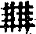

# 三峰藏和尚语录



> **藏经**：嘉兴大藏经（新文丰版）（嘉兴藏）　**册次** 第 34 册（J34）　**编号** JB299　**部类** 诸宗部　**卷次** 16 卷　**篇幅** 187,357 字

> **作者（译者）**：吴虎丘山云岩寺嗣法门人弘储记、吴虎丘山云岩寺嗣法门人弘储编

> **卷／品**：16 卷 · 11 品



---



## 目录



  - [三峰藏和尚语录序](#三峰藏和尚语录序)

  - [三峰和尚语录序](#三峰和尚语录序)

- [三峰藏和尚语录卷第一](#三峰藏和尚语录卷第一)

- [三峰藏和尚语录卷第二](#三峰藏和尚语录卷第二)

- [三峰藏和尚语录卷第三](#三峰藏和尚语录卷第三)

- [三峰藏和尚语录卷第四](#三峰藏和尚语录卷第四)

- [三峰藏和尚语录卷第五](#三峰藏和尚语录卷第五)

- [三峰藏和尚语录卷第六](#三峰藏和尚语录卷第六)

- [三峰藏和尚语录卷第七](#三峰藏和尚语录卷第七)

- [三峰藏和尚语录卷第八](#三峰藏和尚语录卷第八)

- [三峰藏和尚语录卷第九](#三峰藏和尚语录卷第九)

- [三峰藏和尚语录卷第十](#三峰藏和尚语录卷第十)

- [三峰藏和尚语录卷第十一](#三峰藏和尚语录卷第十一)

- [三峰藏和尚语录卷第十二](#三峰藏和尚语录卷第十二)

- [三峰藏和尚语录卷第十三](#三峰藏和尚语录卷第十三)

- [三峰藏和尚语录卷第十四](#三峰藏和尚语录卷第十四)

- [三峰藏和尚语录卷第十五](#三峰藏和尚语录卷第十五)

- [三峰藏和尚语录卷第十六](#三峰藏和尚语录卷第十六)

  - [序](#序)

  - [五宗语录序](#五宗语录序)

  - [教外别传序](#教外别传序)

  - [弥勒成佛经序](#弥勒成佛经序)

  - [顾子方诗集序](#顾子方诗集序)

  - [南岳勒古自序](#南岳勒古自序)

  - [南岳勒古后序](#南岳勒古后序)

  - [三峰藏和尚语录后序](#三峰藏和尚语录后序)

  - [后序](#后序)



---



### 三峰藏和尚语录序



武林卫军嘉鱼学人熊开元撰



开也暗，髫岁荷至人加策，初无所冥。会乙丑得假归，从觉来先生急自研，始有醯鸡之获。自喻适志，将谓天上下乐无逾者。明年受事吴门，趋见三峰老和尚于万峰之书屋，亲承披拣，而后知尼山先师所云不践迹亦不入於室，子舆氏所云二之中四之下，灼然有如是浅深。苟徒恃其天下莫能载、天下莫能破之意，自广而狭人，几不免斯文蟊螣矣。於是集都人士信道者，营建说法堂，劝请老和尚不倦开演。如是甚深之法，开独闻，孰与夫一天下人共闻，万世天下人共闻耶？阅六七寒暄，得语录若干卷，广录若干卷。开劝请之心，方存乎见少，而庸人浅人辄见多，往往不能卒业，则约而取之，尽撤其宝几珍御，独以狸奴面目对人，诚仁人孝子之志也。然水乳杂糅，非鹅王莫择，以游夏赞《春秋》，孰有能胜其任者？开得罪，抵临安，军国清储和尚忽邮书见招，且曰：「鼎沸若斯，虽有上至梵天之舌，无处向人，祗宜收先师狼藉之夜光，重胎明月，使方来有目者咸得与於清辉，不至守其一室，甘此长沦，是犹可及为者。公久在灵山会里，先师迁化时，尝贻书左右曰：『山僧有无数身前身后事仰托于门下。』公若不忘付嘱，可不共伸一臂，擘破华山，倒出万年流水乎？」开自顾非其人，何敢滥竽斯典？更祸乱相寻，梗与土之去未知所终，则亦姑留此一则，俟结集既成，附之编末，俾开千里万里、千生万生，不见有一步、有一时在老和尚门外，开不朽矣。或有过量人如嵒头婆子，谓此结集亦不消得，直取而投之水火，当更益一重光彩。若祗守寒嵒异草青，掉头不顾，仍为开二十年前同阬之土，非所愿也。



时崇祯甲申夏五月朔序。



------



### 三峰和尚语录序



和尚乘仰山尘刹之愿，降神东震旦国，作天童长子。艰危百战，死任纲宗。四十悟道，五十四开堂，六十三迁化，历主八刹。门人记语录三十卷，广录五十卷。示疾前半年，手命不肖弘储结集。时得法弟子松陵周祗侍侧，叹息再拜，以为至当。今已二十七年矣，犹凛凛退缩，不敢轻授简牍，诸佛列祖鉴之。岁月荒忽，感时感疾。辛丑三月，手抄录中稍平径易晓人者为一编，使后五百岁劫火洞然之际，得瞻此清凉寂灭法宝。三世如来说法之式，龙腾云变，无有定相。然天高地卑，川流岳峙，确不可反覆倒置。以正合，以奇胜，兵者，圣人不得已而用之，犹然兼揽并到，况大统纲宗哉！杨岐会滹沱正脉，雪窦显韶阳中兴，广大不违，从上精微。自我作祖，两家典册具在。商周礼乐大备之时，而执羲农已上之说，是知秋冬而不知有春夏也。子舆氏权衡诸圣，于伯夷、伊尹肯诺不全，唯时中至圣，则全身奉重，斯可以悟法式矣。有祖以来，乃有和尚。和尚道大不能容，栖栖皇皇，知者罪者，其惟春秋。不肖弘储惧，取其易者为之。若夫结集艰重，在有力者。



弘储敬述於灵嵒大鉴堂。



三峰和尚语录目录



卷第一住海虞三峰清凉院语  

住苏州北禅大慈寺语  

住杭州临平安隐寺语



卷第二住苏州邓尉圣恩寺语



卷第三住苏州邓尉圣恩寺语



卷第四住梁溪龙山锦树院语  

住杭州南屏净慈寺语  

住嘉兴水西真如寺语  

住苏州松陵圣寿寺语  

住苏州邓尉圣恩寺语



卷第五广录



卷第六广录



卷第七广录



卷第八颂古



卷第九颂古



卷第十颂古



卷第十一五宗原



卷第十二杂偈



卷第十三法语



卷第十四书问



卷第十五书问



卷第十六杂著



------



## 三峰藏和尚语录卷第一



**译者**：吴虎丘山云岩寺嗣法门人弘储记



住海虞三峰清凉禅院语



乙丑元旦上堂。拈香云：「化被空山老更闲，卧云谁道不朝天？生香一瓣呼嵩祝，圣德雍熙寿万年。」乃插香就座，以拂子畫一畫云：「正月一夜半，子前有消息，残冬已过新未交，个中一点谁拈掇？拈得出，是何物？」良久，喝一喝云：「百代旧山河，双悬新日月。」



上堂。举：「百丈和尚因黄檗问：『从上相承底事，如何指示於人？』丈据座，檗云：『后代儿孙将何传受？』丈云：『我将谓你是个人。』便归方丈。」师云：「过去诸如来，斯门已成就；现在诸菩萨，今各入圆明；未来修学人，当依如是法。」蓦拈拄杖，卓一卓，云：「自餘闲杂事，俱为生死因。」



上堂。僧问：「如何得真慧现前？」师云：「闻板声吃饭。」僧云：「如何得法性空？」师云：「洗脚上眠床。」乃举：「教中道：『此见及缘，元是菩提玅净明体。』祖师亦云：『六尘不恶，还同正觉。』」师召众云：「信得及麼？若信得，止宿草庵，且居门外；若信不及，三峰且与你葛藤。」推倒几案，下座。



上堂。「一大藏教闲葛藤，千七百则绊杀人。三玄本无安排，五位何来等级？松风涧水自谈玄，却笑区区论权实。咄！未跨船舷，痛与三十。」



上堂。「山又青，水又绿，早便起，夜便宿。桃红李白竞纷披，看来春事十分足。无位真人手段强，西来大意倾十斛。堪嗟临济小厮儿，风流千古诚难续。」喝一喝，云：「白雪阳春，聊和一曲。」



上堂。僧问：「一人办心，诸天办供，未审办甚麼心？」师云：「上人不可不会。」僧云：「某甲实实不会。」师云：「每日甚麼人将饭与你噇？」僧无语，师云：「你既无心我也休。」便下座。



晚参。「乱石危松护竹扉，住山人老共忘机，昼长无个消闲法，手弄潺湲湿衲衣。」顾左右，云：「大众！若信三峰与麼道，未免随流失炤；别更有商量，道个无端也不为分外。」



上堂。僧问：「如何是学人著力处？」师云：「转身处看。」「如何是学人转身处？」师云：「亲切处看。」「如何是学人亲切处？」师云：「你著力处最亲切。」僧云：「这回不是梦，真个到庐山。」师云：「五老峰因甚𨁝跳？」僧拟议，师直喝出，乃云：「第一句荐得，大海江河尽放光；第二句荐得，逢著观音问弥勒；第三句荐得，舌拄上腭。」蓦卓拄杖一下，顾大众云：「这是第几句？」僧才出，师便下座。



上堂。「三业清净佛出世，脚脚踏著黄金地；三业不净佛灭度，琉璃殿上难移步。立时贬向铁围山，落得身心处处闲。向上路，祖师关，也不易，也不难，饥来吃饭困来睡，肯把麻油树上摊。」



上堂。举：「临济示众云：『赤肉团上有一无位真人，尝从汝等面门出入，未证据者看看。』时有僧出问：『如何是无位真人？』济下禅床把住云：『道道。』其僧拟议，济托开云：『无位真人是甚麼乾矢橛？』便归方丈。雪峰云：『临济大似白拈贼。』」师云：「然则临济固是狼藉，雪峰也不应以贼心待天下尊宿，正令不行、拗曲作直，二俱不能无过。我当时若见，但道：『在和尚今日即得，恐后代传持难免无弊。』看他活跳底无位真人，到这里不得不垂首丧气，具通方眼底如何相救？」良久云：「替三峰下得一转，未必善因而招恶果。」



上堂。举：「睦州和尚见僧来，云：『现成公案，放你三十棒。』」师云：「睦州无端走入屎窖里，是你诸人还闻臭气麼？」众无对，乃云：「又争怪得？」



结夏，上堂。举：「法华举禅师谒公安，公问：『作麼生是伽蓝？』举云：『深山藏独虎，浅草露群蛇。』公云：『作麼生是伽蓝中人？』举云：『青松盖不匝，黄叶岂能遮？』公云：『道甚麼？』举云：『少年玩尽天边月，老倒扶桑没日头。』公云：『一句两句，云开月露，作麼生？』举云：『炤破祖师关。』」师云：「以大圆觉为我伽蓝，身心安居平等性智，快活快活。怎奈生平参得聱头禅，撞著聱头如銕壁？虽然纷纭自彼，于我何为？先圣垂范，理契必同。毕竟二大老节文在甚麼处？若判得，尘沙诸佛、天下祖师不消一捏；若判不得……」卓拄杖一下，云：「谨白参玄人，光阴莫虚度。」



上堂。「莫犯舌头路，休干心识情，只提三尺剑，挥落一天星。仰面峰如笋，低眉水作冰，问我西来意，石色湛空青。」喝一喝，下座。



上堂。拈起拄杖，云：「独立绝殊方。」卓一卓，云：「其锋安可当？前是佛殿，后是僧堂，大唐打鼓新罗闻，谁家漆桶夜放光？」



上堂。僧问：「如何是有句？」师云：「秋风诉愁绝。」僧云：「如何是无句？」师云：「寒月自多情。」僧云：「如藤倚树时如何？」师云：「风月年年在，人心有变更。」僧拜倒，云：「可知礼也。」师乃拈起拄杖云：「还有不变更者麼？」良久，卓拄杖云：「待树倒藤枯，再行检点。」便下座。



上堂。举：「临济祖师云：『大凡演唱宗乘，须一句中具三玄门，一玄中具三要，有权有实，有炤有用。汝等诸人作麼生会？』」师云：「苦哉！苦哉！若要安国安家，须是足兵足食。近来求个具信根底也不可得，三玄门怎能勾一踏到底？老僧今日不惜手脚，八字打开，请诸人排身直入。」喝一喝，云：「金刚脑后抽生銕，华岳三峰倒卓空。」



上堂。「豁开户牖，当轩者谁？坐立俨然，那容相度？南泉猫子胡狗，杀活全凭这副手，可笑临济白拈，天生一张恶口。」随喝一喝，云：「当年陷了华山，压倒八十一城，你辈茄子瓠子向甚处走？」



上堂。「衣拖五尺布，杖曳半山云。香炉峰下看石虎渡溪，大师巷前听寒风吼树。有时炉边煨芋，有时棹泛烟波。尊贵堕随手拨开，末后句不劳提起。虽然如是，且道如何是老僧底主中主？」放下拂子云：「无限家私都说破，了无一法可商量。」



师诞日，上堂。僧问：「父母所生口，一凭和尚大脱空、小脱空。父母未生已前，口挂在甚处？」师云：「不可挂在壁上。」僧云：「学人大胆，敢道挂在壁上？」师云：「老僧小胆，怕烂却。」僧云：「何不早道？」师连棒打下，云：「也不迟。」僧转身便出。师召云：「阇黎。」僧回首，师云：「若作打会，入地狱如箭。」乃云：「山山青，水水绿，眼见耳闻，千足万足，不消歇却。攀缘染净、凡圣取舍、有无诸念，不消拈却。四大、五蕴、十二处、十八界、和合诸入，一任朝悠悠、暮碌碌，自然进用罔涉离微，退藏不遭诸惑。何须大脱空、小脱空，花簇簇、锦簇簇，粧点父母未生已前本来面目？」良久，云：「谷，谷。」便下座。



上堂。举：「南院示众云：『赤肉团上，壁立万仞。』有僧出云：『赤肉团上，壁立万仞，岂不是和尚语？』院云：『是。』僧便掀倒禅床，院云：『这瞎汉乱统。』便打。」师云：「大小南院被这僧拶得热忙，人人尽道勾贼破家，争知是养子之缘？善舞太阿剑，决定无手厄，南院有之；惯编猛虎须，必有全身策，这僧有之。而今诸方病在膏肓，三峰若不发药，便道死而不救。」喝一喝，云：「虽然两不相伤，争奈二俱弄险？」



上堂。「嵒头未会末后句，打碎虚空入炉铸。德山死活总不知，只解肚饥托钵去。惹得儿孙错主张，打瓦钻龟猛窥覤。我今为君明启意，吐出个中真味趣。黑漆钵盂才出囊，遇饭随时下匕箸。山为家，云共住，唱罢吴歈歌白苎。」



上堂。「击磬卫，取瑟歌，圣人之教原无多。拈起花，倒刹竿，分明道了莫颟顸。住住住，庭前柏子树。直直直，大佛小佛空山石。若还拈起便掷，岂止五千退席。」



除夕，小参。「道不在内，道不在外，别有生涯，屙矢见解。灯笼跳入露柱，心实能容；佛殿走出山门，智通无碍。旧腊今宵送，新春明日迎，两年新旧事，一并付钟声。」



丙寅岁朝，上堂。拈香毕，乃就座，云：「白云高卧已多年，嬴得身心迥出缠，随例元正𦶟沉水，自惭无德颂尧天。诸仁者！衲僧分上，尊贵天然，一住此山，大忘人世。溪流菜叶，偶然脱赚诸方；钵贮松花，尽可团𪢮一室。晨钟夕板，未尝失候违时；岭月岩花，各自飞光美彩。若谓无心是道，何异掘井陷人？更言有得为宗，不免守株待兔。山僧有口，终不谩人，汝辈莫漫思惟，打入阴界。」卓拄杖三下，云：「从来古路如弦直，著脚何非化国民？」下座。



上堂。拈起拄杖，云：「豁开圣贤阃域。」卓一卓，云：「流出音声佛事。河里水，天上月，曩谟佛，乾矢橛，大士耳根顽，韶阳口门阔。看他两个人，竭尽老婆心，那事如何说？」掷拄杖，下座。



上堂。「即心即佛，将谓侯白。非心非佛，更有侯黑。不是心，不是佛，不是物，斩断葛藤窠，勘破维摩诘。咄！互换机锋，神出鬼没。」



上堂。僧问：「如何是第一玄？」师云：「不是涅槃心。」「如何是第二玄？」师云：「亦非正法眼。」「如何是第三玄？」师云：「三世诸佛只言自知，六代祖师有口难宣。」僧作礼，师云：「汝既知时节，吾今不再三。」乃举：「盘山云：『向上一路，千圣不传。』慈明云：『向上一路，千圣不然。』径山云：『向上一路，热碗鸣声。』」师云：「不传不然，热碗鸣声。我今无说，汝亦无闻。」下座，以拄杖旋风打散。



上堂。「三百六十骨节，皎皎凝虚碧；八万四千毛窍，澄澄发皓彩。逆底顺底，著著趁玄机；是底非底，头头超方外。山河大地、草木丛林，尽是恒沙劫千佛之数。信得及，贫儿暴富；信不及，三峰话堕。」



上堂。「百千万亿华藏界，信手拈来只一束。夜来埋向虞山巅，天上人间作眼目。好丑难逃这一机，双泯互存无背触。猊弦鼓断少知音，他年留待鸾胶续。」



上堂。「本色住山人，且无刀斧痕，殿上考钟伐鼓，声声寒满耳门，验人端贵知音，听响终非莽卤。」蓦拈竹篦，云：「背不背兮触不触，谁信先天为心祖？」



晚参。僧问：「如何观音玅智力？」师云：「插下金刚顶上针。」



上堂。「老僧终日与诸人同起同住、同语同嘿，全无一点奇特处。但有一件奇特处，不得不告报诸人。诸人极力思量，到无思量处起心动念，便不稳贴。老僧在无思量处起来，千思百量，不妨吃得饭、屙得矢。」



上堂。「先炤后用，莫从镜里迷头，须信顶门有楔；先用后炤，正遇黑风暴雨，还知冷月疏星。炤用同时，阵里飞砂，刀头具眼；炤用不同时，东影旗旛，西藏砲弩。」喝一喝，云：「须知昼伏夜行，不得隈刀避箭。」



上堂。「心不是佛明如日，智不是道黑似漆。大丈夫，须猛烈，既然拈却佛祖机，因甚抱守系驴橛？直中曲，曲中直，要平不平凭秤尺。」



上堂。「国师三唤，当阳明皎皎。侍者三应，遍界黑漫漫。最喜是生死烦恼，可恶是菩提涅槃。人间月半，天上月圆。咄咄，鼻孔撩天不著穿。」



上堂。「烂炒銕钉盛满钵，夜来托出新罗国，远来人事非等闲，秪许供僧莫供佛，指天指地自称尊，撞到云门无折合。」



上堂。「从上来事，匪从人得。截下左臂，天地悬隔。拟欲安心，纷然打失。捉摸至今，空无所得。咄！休去歇去，眉横鼻直。谁恁麼道，白拈老贼。」



上堂。「金槌未动，旷然绳墨之外；玉麈才挥，纵横得大自在。老僧一物不为，阇黎明辨去来。菩提涅槃等名，是从净法中得；贪爱取舍等名，从秽法中得。净秽两忘，扫踪灭迹，任运相将，不可陪法云随处起风雷。」



上堂。拈起拄杖，云：「镇海明珠，只有一颗，仰山不来，深藏待贾。」卓一卓，云：「东寺蓦地捧出，炤破山河万朵。」



上堂。「若论此事，如迅雷贯顶，掩耳不及，吐出清风，一条镔銕向须弥顶上一槌，金刚山下透脱，倒卷虚空，万仞壁立。若是临济嫡骨儿孙，便解向狮子口里敲牙、骊龙脊上揣骨，宾主互换，通身纵夺，末后句里出身，威音王前过活。还有如是操略者麼？出来与老僧相见。」(问荅不录)



住苏州北禅大慈禅寺语



上堂。「萧条古寺傍城隈，万户吹烟曙色开，独坐云堂无客问，西山相逐送青来。诸仁者！无情运用，举足则步步通涂；有识兴慈，逐念而尘尘障道。争拾池中之砾，遗下明珠；偶迷镜里之头，遂忘本体。」拈拄杖畫一畫，云：「若不畫断，早见葛藤遍界。」



晚参。「此事喻如苏州一座城总有六门，门门有路通达往来，若闭塞五门，教人总向一门出入，途路中不免反添之遶，不若随方来者随入一门，翻得径捷。然虽如是，饶你得到苏州城里，要来北禅寺参见老僧，更须问过地头人始得。不然，十个五双往往蹉路在。」



上堂。「假使有人能化三千大千世界满中众生令行十善，不如有人于一食顷正思此法，过前功德不可为喻。当尔之时，识智俱空，名体咸寂，谁为计功？谁为量德？又唤甚麼作此法？」良久，喝一喝，云：「不解顺风撒沙，那能衣锦还家？」



上堂。「胡乱三十年，不曾少盐酱，到处行脚，也须带眼。古今尽道得大机，北禅看来全不像。若论百丈门风，岂可预搔待痒？」拈起拄杖，云：「看！看！用时便用绝商量，方信临机原不让。」



上堂。僧问：「佛祖公案只是一个道理，因甚有明与不明？」师云：「昨日开元石佛放光，有者道青、有者道黄、有者道黑，道白、道赤，一总不定。」僧云：「和尚也是熟处难忘。」师呵呵大笑。良久，乃云：「于心所生即名为色，知色空故，生即不生。尽大地是正法眼藏、尽大地是涅槃玅心，实相无相微玅法门从甚处入？」喝一喝，云：「更须买草鞋行脚始得。」



上堂。「天上不能容，地下著不得。鼻孔海天宽，耳门针眼窄。未问著，先已头红面赤。毕竟是甚麼人？达磨曰：『不识。』观世音菩萨将钱买胡饼，放下手来是一块黄石。会麼？」挥拂子，下座。



上堂。「头上是天，脚下是地，青山自青，白云自白。会也，有粥吃粥，有饭吃饭；不会，草鞋钱且置，粥饭钱甚麼人还？」良久，云：「剑去久矣，尔方刻舟。」



上堂。「绿槐丝吐挂青虫，恰恰珍禽冷冷风；纵是三千广长舌，个中消息最难通。」曳拄杖，下座。



上堂。「有佛处不得住，百岁翁翁失却父。无佛处急走过，海坛马子似驴大。三千里外，逢人不得错举。一字是一字，一句是一句。恁麼则不去也，世情无真，佛法无假。摘杨花，摘杨花，搅得身心乱若麻。老赵州没来繇，输嬴岂在东司头。」



上堂。「无法可说是名说法，烈焰堆中试请下脚。三世诸佛一脚，历代祖师一脚，北禅今日也是一脚。现前大众！还有不惜娘生脚板者麼？」一僧才出，师连棒打退，云：「是甚麼所在？你也要插只脚。」便下座。



上堂。「门外有大路，秪要大踏步，一步是一步，直透长安路。」喝一喝，下座。



上堂。「未透祖师关，错过大好山。踏著大好山，有甚祖师关？」



上堂。「大棒打老鼠，惊起邻家睡。本末悉归宗，何用寻言语。」



上堂。「今朝四月廿九，受用头头皆有。葛衣自抹清风，蒲扇信翻轻手。胧胧睡眼糢糊，落落精神抖擞。偶尔曳杖出门，随处看花看柳。」



上堂。「竿木随身，逢场作戏。始从鹿埜苑，终至跋提河。于是二中间，未曾说一字。后来缺齿老胡，分皮擘髓，一出又一出。拖到而今，阳春易和，白雪难齐。门槌拍板，忍俊不禁。道：『嗏。』诸人还委麼？」良久，云：「原来驻云飞也不识。」



上堂。「三转法轮于大千，其轮本来尝清净，北禅寺里一日两餐馊饡饭，禅和家人人肚里七上八落，今早添得一餐白粥，便见稳贴贴地，真不掩伪、曲不藏直，现在可验，谩我不得。」拈起拂子挥一挥，云：「见麼？」良久，云：「我且谩你这遭。」便下座。



上堂。「何方圣者？甚处灵祗？秤盘上分斤定两，筭筒边横千竖百。于食等者，于法亦等；于法等者，于食亦等。观世音菩萨将钱买胡饼，放下手来却是馒头。因甚佛殿山门全归肯诺，灯笼露柱犹自沉吟？」良久，云：「此意幽深。」



上堂。举：「雪峰和尚示众云：『尽乾坤是个解脱门，把手拽，不肯入。』」师呵呵大笑云：「自累犹可，莫累他人。七百众善知识，几时跳出这个解脱坑？」



上堂。「闹市里天子，百草头老僧，在人王，人王中尊；在法王，法王中尊。偶然夜户不闭，撞入个白拈贼，一众惊惧不睡。依律合得何罪？」众无对，乃云：「不可便恁懡㦬放过。」



上堂。「西来大意，非小儿戏。千七百家，各逞绝伎。拖到而今，展转埽地，略较些子。庶几临济挨拶将来，依然驴屁。玄要横竖是三，主宾死活是四。纵有孝子慈孙，信你实情难事。要知容易为人，请观近代禅肆。举了便恁会了，何必苦他心志。此是诚谛之言，听与不听在你。」



上堂。「穷诸玄辨，若一毫致於太虚；竭世枢机，似一滴投于巨壑。眼前绿水，背靠青山，一夏与麼去也觉好过。倘或日出事生，未审作何向当？」良久，云：「岂不个个英灵？」



上堂。「脚脚踏断乌鹊桥，步步不从云里走，自从换得金刚眼，物物都将脑后看。问著便转，牙如利剑，口似血盆，信口道来，七石缸，门里大。细而论之，一即是二，二即是四，红白琉璃月下看，一双和影迸人寒。岂有如是事？岂无如是事？重之叠之，四即是八，八即十六，一二以至千万不可说转，猫儿𨁝跳上层楼，尾上研槌翻霹雳。如何是佛？」良久，云：「[○@塑]，且说到这里，莫被诸方简责。」



上堂。「人之尝情，一时难改。逆则生嗔，顺则生爱。」喝一喝，云：「学道贵除心，何惜这皮袋？」



上堂。「年年冬寒夏热，朝朝夜暗昼明，使得十二时辰，看看能有几人？」喝一喝，云：「太平本是将军致，不许将军见太平。」



上堂。举：「南泉云：『文殊、普贤昨夜三更起佛见、法见，各与二十棒，贬向銕围山。』」师云：「近日有从銕围山来底衲子麼？我不问你禅道、佛法，秪要问你二大士起居安乐否？少病、少恼否？」众无语，乃云：「莫谩山僧好。」



上堂。举：「茱萸把一橛竹，上堂云：『还有人虚空里钉得橛麼？』时有灵虚上座出云：『虚空是橛。』茱萸便打。灵虚云：『莫错打某甲。』茱萸休去。」师云：「灵虚不道无，未免性燥。你看他古今善知识，那个便肯放得下这一橛？老僧非是倚势欺人，往往知而故犯。虽然，茱萸休去，未可全信。」



小参。「古意不可得，萧然四座僧，簷牙无燕雀，赤日印空庭。治世语言、资生业等皆与实相不相违背。不可得意则不问，日印空庭事若何？」乃云：「苔文镂石古，草带篆帘青。」



上堂。「释迦已灭，弥勒未来。北禅三门，早闭晏开。但见频出入，知他才不才。莫怪老僧闲管事，要须分辨墨和煤。」



上堂。「森罗及万象，一法之所印。凡所见色，皆是见心。澄潭月影，静夜钟声。一处真，千处万处一时真。」喝一喝，云：「几多痴男女，茫茫古到今。」



住杭州临平安隐禅寺语



上堂。才白椎，师以拄杖横截，云：「千佛下口不得，历祖一场败缺，今日直下拈来，依然是赤骨律。此事如干将莫邪双腕并运，如冰花、若火燄，向报化佛舌根下一截，正好销兵铸镢，乐过平生。只今还有具如是操略底汉子麼？出来与安隐相见。」问荅毕，乃拈拂子，云：「释迦老子得这消息，便会指天指地，末后露出双趺；西天四七、东土二三得这消息，便会说偈传心，以空印印空印水。临济得之而棒喝，云门得之而鉴咦，沩仰向有无处吹火，洞山于睹影处我渠，法眼在曹源一滴水荅曹源一滴水处唯心，新安隐一齐收在拂子头上。且道拂子头上是甚麼道理？」掷下拂子，云：「久立众慈，伏惟珍重。」



晚参。「宾主相逢为对扬，神机一著好商量，定盘星子难移动，卓午高竿隐太阳。」举：「临济同普化赴施主斋次，济问：『毛吞巨海，芥纳须弥，为是神通玅用？为是法尔如然？』化踢倒饭床。济曰：『太麤生！』化曰：『甚麼所在，说麤说细？』次日，又同赴斋，济问：『今日供养何似昨日？』化亦踢倒饭床。济曰：『得即得，太麤生！』化喝曰：『瞎汉！佛法说甚麼麤细？』济不觉吐舌。」师云：「普化霸力横施，但禅王化不忘成褫之记，可见宾则始终宾，主则始终主。临济使尽软顽，不闻雷声动地，微见冷芒逼斗，致令后代儿孙点简，不知向阿谁吐气？」良久，云：「安隐今日挽古回今，轰个霹雳去也。」便下座。



上堂。举：「世尊一日升座，文殊白椎云：『谛观法王法，法王法如是。』世尊便下座。」师云：「文殊见小欲速，世尊将计就计，若作佛法商量，分明是小儿戏。山僧路见不平，拈拄杖云：『要打他家师弟。』还有为二老出气者麼？」良久，卓拄杖一下，云：「谛观法王法，法王法如是。」便下座。



云门澄和尚终七烧香。「翻大海作沤，绳绳开洞水之源；卓玅高为杖，籍籍振云门之价。正见诞子化生之盛，何期推爷灭祖之归？布袋藏鸦，四十九日已前尚噪；银碗盛雪，三十二传之后光生。玉线牵来，今日是渠前日我；绘图留下，纸间顶相背间毛。阿师俨在孝堂，古佛尝居显圣。繇偏入正，今日痛哭于无从；以正为偏，将来庄严于玅觉。俾石头之路永滑，代起群猊；令威音夜半正明，尝悬慧日。」



上堂。以拄杖作半个圆相云：「圆不圆，直不直，若人道得出，与你做相识。」良久，卓拄杖云：「长相忆，只有这个贼。」



上元，上堂。「繁钲杂鼓夜骈阗，火树星桥灿远天，谁把娘生双白眼？看到威音更那边。」(举公案不录。)



金粟老和尚送僧伽黎至，上堂。专使出问：「佛佛授手，祖祖相传。佛佛授手即不问，如何是祖祖相传底事？」师云：「金缕分明说向人。」使礼拜，师云：「三十棒留与老和尚打。」乃举起衣，云：「自从多子塔前笼罩迦叶，遂使至今在鸡足山前冷坐；黄梅室里遮围六祖，致令马驹脚下热闹不休。」复展开，云：「今日递代相传，送向安隐堂前。仔细看来，只好裹三十年前底破草鞋。」放下，云：「若是释迦老子、金色头陀、大满大鉴出来道：『内传法印以契证心，外付袈裟以定宗旨。』正好劈脊一棒，用酬金粟堂上本师和尚法乳之恩。还有旁不甘底，从金丝里出头、布缝中吐气者，出来与佛祖雪屈。」时值迅雷一击，师云：「一声雷送千山雨，大地春风花自香。」卓拄杖，下座。



佛涅槃日，上堂。「顶门突眼非为正，椁里呈趺未是全，八斛四斗乱抛撒，二月重圆又一年。」举：「世尊于双林将般涅槃，以手摩胸，告众曰：『汝等善观如来金色之身，瞻仰取足，勿令后悔。若谓吾灭度，非吾弟子；若谓吾不灭度，亦非吾弟子。』」师云：「我当时若在，好与一棒打杀，免得临末稍头生事一上。」竖起拂子，云：「会麼？切怪他有头无尾。世尊右胁累足，泊然而化，即入金棺。尔时迦叶尊者后至，世尊于棺中露出双趺示之。」师云：「我当时若见，以杖叩其胫。」放下拂子，云：「只为他有尾无头。此时金棺涌于虚空，高七多罗树，化火自焚，得舍利八斛四斗，流布人间天上。」师喝一喝，云：「犹未许渠在。即今二月十五佛般涅槃之日，这则公案还有人缁素得出麼？若缁素得出，速来道取。」良久，卓拄杖，云：「杏花含雨湿，柳眼带烟嚬。」



晚参。「入得安隐门，得到安隐地；既到安隐地，莫问西来意。」



解制，上堂。举话毕，乃楖栗横肩，云：「杖头山色花间滴，脚下泉声雨后多。」便下座。



岁戊辰，翁方伯、冯节推诸檀护请开堂。拈香毕，乃就座，云：「新天子登极，廓矣无为；旧安隐重来，颓然尊贵。夜犬吠花梢之月，那识太平？朝龙嘘石洞之云，岂知神用？老僧只解著衣吃饭，何劳举拂拈椎？所以，曹山曰：『披毛戴角是类堕，不断声色是随堕，不受食是尊贵堕。』觉范曰：『垂衣裳而天下治者，尧也。』须知尊贵一路自别，此曹洞宗旨也。兹因圣君御历，特拈尊贵之旨以见皇风，还有人向个中实证者，出众唱和太平，助宣圣化。」问：「如何是类堕？」师云：「鼻下无绳，满山青草。」进云：「如何是随堕？」师云：「倒跨白牛，横吹短笛。」进云：「如何是尊贵堕？」师云：「人牛归去，月落前溪。」进云：「曹洞旨趣已蒙垂示，济上宗纲又如何？」师打，云：「向这里会，不妨尊贵。」遂卓拄杖一下。举：「临济大师曰：『沿流不止问如何，真炤无边说似他，离相离名人不禀，吹毛用了急须磨。』」顾左右，云：「且道如何是流？此从截断两头，中间突出乾慧中发来，逆流而进，中中流入，为向上更有许多事在，所以不止。从玄入要，以至主中主尚有见在，岂非真炤？虽则无边，然只好似他而已。若是透过已前，则离相离名，何者为人？只是你那悟处，到这里透过一切，故悟不能禀。此处与曹山尊贵相似，更要吹毛用了急须磨始得。故曰：垂衣裳而天下治者，尧也。」复卓拄杖三下，下座。



示众。「机先一向，是汝诸人安身处；先机一著，是汝诸人立命处；其间左之右之、或伸或缩，是汝诸人踏脚处；末后一句，是汝诸人出头处。」



晚参。「举一不得举二，放过一著落在第二，此是睦州骨髓乾峰的诀。云门虽解虎口横身，也是间道小卒；乾峰善能倒转旗鎗，也是背水设阵。若到安隐门下，个个要渠失二落三、去一堕五，三大老蓦直相逢，人人叫冤叫苦。会得者，出来把手共行，平分半座；其或不然，一即是二、二即是四，也是红火叉相打，只好一次。」



晚参。举：「大觉参见临济，济举起拂子，觉敷坐具；济掷下拂子，觉收坐具，参堂去。僧众曰：『此僧莫是和尚亲故？不礼拜又不吃棒。』济闻，令唤觉，觉至，济曰：『大众道：「汝不礼拜又不吃棒，莫是老僧亲故？」』觉珍重下去。」师云：「二大老靴中指动，水底鱼行，且道那个是宾？那个是主？直饶虎兕出于柙，争奈龟玉毁於椟中？纵然钵里藏龙，又见风雷过峡。」



灵鉴法主到，上堂。「客从临平来，贻我一编雪，字字古人心，读之寒凛冽。」喝一喝，云：「当年第一座，早已为君彻。」(丙寅冬制法主曾克安隐首座。)



上堂。秀初居士才出，师问：「昔大沩和尚道：『有句无句，如藤倚树。』你作麼生会？」士以手横一横，云：「划破虚空一条血路。」师云：「忽然树倒藤枯，毕竟句归何处？」士云：「拄杖依然亘今古。」师云：「沩山呵呵大笑归方丈𫆏？」士云：「重叠关山。」师连打三棒，云：「也不屈著你。」良久，复云：「大沩空里钉桩，安隐兔头截角，虽然总是寻尝事，千古输他手段高。」



晚参。僧出作礼，师云：「万法归一，一归何处？」僧云：「今朝早是腊月初三。」师云：「古人道：『青州布衫重七斤。』是同？是别？」僧云：「一滴水，一滴冻。」师云：「如何是奇特事？」适殿上开静，僧云：「钟声咬破七条。」师乃云：「今日腊月三朝，钟声咬破七条，露柱滴水滴冻，灯笼不敢声高。奇特果然奇特，拄杖莫漫肆骄，老僧倚老卖老，让与风流年少。」下座。



------



## 三峰藏和尚语录卷第二



**译者**：吴虎丘山云岩寺嗣法门人弘储记



住苏州邓尉山圣恩禅寺语



己巳结夏，熊邑侯鱼山同阖郡绅衿请上堂。竖起拂子，云：「三世诸佛、历代祖师、山河大地、世出世间一切诸法缚作一团，千牢百固掷向诸仁面前，还有决烈汉一击粉碎者麼？」问：「昔年万峰于此大转法轮，今日三峰到来祖道重光，未审唱谁家曲调？」师云：「龙碑鍾王气。」进云：「恁麼则临济中兴，雷轰电掣去也。」师云：「凤岭蔚青霞。」僧作礼，师便打。问：「威音王佛一金圈，抛向当阳事若何？」师云：「湖洗千秋日。」进云：「得意忘言即不问，横三竖四是何宗？」师云：「山擎万古天。」僧拟进语，师喝住。良久，乃左右顾视，云：「诸佛未出世、祖师未西来、威音王未有名字以前，还有生死也无？各人父母未生、三缘未合、天地未分、觉明未咎以前，还有四句两头、是非好歹、言思识路也无？昨宵正睡著时，无梦无想、无见无闻，还有现前许多理会也无？若向这里了得，则知从朝睡醒下床、洗面吃粥、迎宾送客、嬉笑怒骂，是有心耶？是无心耶？若道有心，则前来三处心不是有；若道无心，则现前是谁主持？若向这里透过，则山出波中、树撑殿角，正好摇扇乘凉过夏。虽然如是，犹坐无事甲里。若有一物现前，未免心生意解，情尘亘天，顾杼停机，生死塞路，如何得大休歇、大自在？若是个不顾危亡底，向未问以前劈口一槌，板齿落地，眉间挂剑，血溅梵天，饥鹰爪上夺雀，猛虎口里下针，始契他临济大师道：『一句中具三玄门，一玄中具三要。』额上亚目，顶中出头，处处超佛越祖，在在盖色骑声，堪报不报之恩，共助无为之化。」喝一喝，卓拄杖下座。



法堂落成，上堂。以拂子畫一畫，云：「会麼？太阳到向诸神藏没，赤口白舌尽消除。」又畫一畫，云：「会麼？普庵到此百无禁忌，九良星煞没坐位。诸仁者！前一畫、后一畫，畫畫相对。四柱卓云，诸磉立地，临济宗旨尽情说了也。还有向上事麼？」又畫一畫，云：「不因跨海擎天势，争见千秋柱石功？」



上堂。「云无心而出岫，招招摇摇；鸟倦飞以知还，历历落落。堪笑陶渊明，舍重却从轻。有五斗米，腰不肯折；无一杯酒，眉便解攒。阿呵呵！廉亦不必廉，贪亦不必贪，但除心里病，到处脚头宽。」



上堂。「朕兆未形已前，切忌守著自己；形名既分之后，要须打破目前。大象不游兔径，凤凰肯啗鸡粟，祖师门下电光莫及，石火难追。」喝一喝，云：「说万峰以强欺弱，得麼？」便下座。



上堂。「擉瞎娘生眸，劈开觑驴井，任他驴事马事，不管生耶死耶。至若拈赤生銕补锅，飞𨍏轹钻钉缝，不过事存函盖，理应箭锋，也不是惊天动地底事。何故𫆏？两手捧钵，双足结跏，谁家沙弥非佛祖？一身带影，四体承月，那个男儿不丈夫？」遂卓拄杖，下座。



上堂。「以口说法，口有时歇；以身说法，身有时灭。」拈起拄杖，云：「秖有这个菩萨生，辣辣一例横该抹，不管你眼里无筋，秪要你皮下有血。」



上堂。「老僧有时将太虚空千煆万炼，炼成一柄金刚王剑，挥天截地；有时放下宝剑，偪塞虚空，令三世诸佛、历代祖师无出头分；有时卷尽白云归洞府，轰雷暴雨过黄昏。所以道：有句无句，如藤倚树。虽然，切忌问著，问著则头角生。」



小参。「沉空滞寂，龌龌龊龊。混世同尘，洁洁净净。长者长法身，短者短法身。月大大尽，月小小尽。狸奴白牯却知，三世诸佛不省。要得四海平定……」喝一喝，云：「急急如律令。」



上堂。「本来无一物，教外有何传？几多英灵子，纸裹又麻缠。天台南岳奔如电，河北江南走似烟。漆桶漆桶，苍天苍天。狼藉不止东土，淆讹始自西乾。」



女弟子上莲修净业，请小参。「口口佛，心心佛，事事佛，步步佛，一撞一磕都是佛。忽然撞著石大郎，口中吐出莲花碧。」



上堂。拈起拄杖云：「看！看！十五日已前，日月未足喻其明；十五日已后，虚空未足喻其广。正当十五日，有高逾泰华、深越沧海一句子，拟举似诸人，未免道欺人太煞。有信得及者，出来两手分付。」僧才出作礼，师劈脊一棒云：「且道一半。」僧进前云：「乞和尚全副道将来。」师掷下拄杖云：「要头截取去。」僧拟议，师托开云：「是甚麼乾矢橛？」便下座。



上堂。「冒虚空为鼓，悬日月为槌，打鼓普请邓山五百木罗汉，夯取柴庄岭上薪，蒸得米囤峰头粟，将渔洋钵盂山满盛香积，凭邓山翀天飞凤和声念摩诃般若，三世诸佛如麻似粟，虚空中懽喜合掌，惟有普贤长子骑却竹山卧象峰为作证明，曰：『若人会得这一句子，管取参学事毕。』」便下座。



上堂。「有句无句，如藤倚树，不参活句参死句，岂止蹉过河沙数？树倒藤枯，句归何处？大地山河生銕铸，千人万人把不住。沩山呵呵大笑归方丈，迢迢相望八千里，往复何尝行旧路？」喝一喝，云：「此是圆通自在门，万峰不须重指注。」



晚参。「今朝腊月二十底事处处难值，若便与麼放过，不久便是除夕。」



小参。「临济只为髑髅乾不尽，长年无风生浪；德山多因块垒未全销，一向平地起堆。万峰一串穿来，挂向八风头里，任他事逐眼前过，管甚老从头上来？」



庚午元旦，上堂。拈起瓶中花，云：「拈花嵩祝愿唯钦，春到方知圣主心，出世岂忘歌帝力？捷音且喜到山深。兵扬北阙弥天壮，寇败西山指日擒，欲把金刚王一拂，为皇千载靖氛祲。」举：「临济大师曰：『有时一喝如金刚王宝剑』」，师云：「魔佛同诛。『有时一喝如踞地师子』」，师云：「空碍俱破。『有时一喝如探竿影草』」，师云：「烽烟未动，砲已先行。『有时一喝不作一喝用』」，师云：「击鼓三通，强凶授首。今日元正新旦，只见杀气腾腾，虽然正是我大明国里春风习习，还有会一喝金刚王者麼？道！道！」僧才出，师云：「礼拜当朝北阙。」便下座。



上堂。「日日日东出，日日日西沉。是圣是凡劈脊搂，那管一棒一条痕。空劫已前无自己，眼目人天是甚麼人。上上上，上到最高高处望，望见青山起白云。」



上堂。「晓色烟为山，夜光月成雪，不知万谷梅，秪觉香镂骨。高风过疾雷，空芬转幽烈，问我西来意，早已为君说。」良久，云：「向上一路，千圣不传，未入门来，早已三十棒了也。」



上堂。「筑墙护果，凿地莳花，镢嘴廉尖，石头磊块。客来迎送，米到抬扛，愁酱乞盐，吟风弄月。此是住山活计，久参上士不消重说偈言，后学初机领取向下注脚。」乃云：「重湖叠嶂梅千顷，塌屋低簷四五家，未坼竹根先掘笋，略虚树罅又栽茶。」便下座。



上堂。「如何是佛？虚空一具黄金骨。如何是法？水清石冷苔长滑。如何是僧？眉长拖地骨如冰。如何是三宝具足？古殿法堂方丈屋。如何是其中事？日上芋香犹未熟，厨下先烹一盏茶。还有受用也无？白云为床，梧叶为屋，睡熟翻身，水足草足。恁麼则如何为人𫆏？相逢不道人间事，指点湖山个个青。老僧恁麼自问自荅，拄杖子恁麼自问自荅，大众亦恁麼自问自荅。拄杖子若会得，则老僧会得，大众会得；大众若不会，则拄杖子不会，老僧不会。今问拄杖子，还会麼？」良久，山鸟乱啼，乃云：「分明是个事，山鸟正啼忙。」



上堂。「老僧近来枕石放身，瞑然松下，不能说法。无已，则委之万象，将使云霞绚赫，水石击冲，露遮那身，出广长舌，曰的地蓝，曰阿布使，曰四月乍晴山色好，一天初晓鸟声多，此等皆非一代时教之所管摄。今日十方为口，山说、水说、空说、有说、刹说、尘说，有情无情三世一切同运法轮，令闻者、令见者立地成佛。且道如上说底是甚麼法？」良久，乃云：「湖上钵盂峰乍洗，峰头囤米饭初蒸。」



上堂。「摩诃衍法，四句既离，百非又绝，空荡荡三千刹海，冷澄澄八万法门，美则美矣，犹未尽善。何也？不能倾出猛烈红炉燄，锤碎清凉白月轮，李将军有家声在，不得封侯也是闲。诸人要识三峰真的旨麼？」喝一喝，云：「威风八面言思断，平地翻为荆棘林。」



结夏，上堂。「笋出林梢竹乍齐，青梅初重压枝低，山知雨好频增色，鸟惜花残不住啼。衲裰卷来云在架，革鞋悬后草成蹊，湖光近槛闲无用，洗尽晴霞日落西。」随顾左右，云：会麼？「若作结夏佛法会，入地狱如箭射；不作结夏佛法会，亦须衔銕负鞍。」



上堂。举：「六祖至广州法性寺，寓止廊庑间，暮夜风飏刹幡，闻二僧对论，一云幡动，一云风动，往复酬畣，曾未契理。祖云：『可容俗流辄与高论否？直以非风幡动，仁者心动。』」师云：「弄泥团汉有甚麼限？满钵炒浮沤，擎来充供养，影响尽消亡，心作底模样。」



上堂。僧问：「露柱挂灯笼，山门骑佛殿，神通法尔则且置，如何得稳坐家堂？」师云：「山僧无伎俩。」僧云：「和尚莫谩某甲。」师云：「白日青天鬼美人。」又僧问：「赵州吃茶去，不是好心；和尚开堂来，的何宗旨？」师云：「掌上星初满。」僧云：「恁麼则为瑞为祥去也。」师云：「盘中月正孤。」僧礼拜，师便喝，乃云：「山僧无伎俩，一步是一步，看他一辈茄子瓠子，不思烂货没人买，偏要担向十字街头争鲜斗价，白日青天鬼美人，真个苦哉佛陀耶。山僧今日正拟移风易俗，要使动者静，乱者定，邪者正。」以拂子左拂云：「唵部临部临。」以拂子右拂云：「唵齿临齿临。伏愿风以时而雨以时，渔父歌而樵人舞，直得皇封坦荡，化日熙怡，无一物不遂其生，无一法不安其性。且道山僧凭何力用，致斯盛治？」乃复以拂子作一圆相托呈，云：「见麼？掌上星初满，盘中月正孤。」



小参。「一句洞今古，千生绝往还，待看春雨后，嵒下听潺湲。」卓拄杖，下座。



上堂。「才问著，舌初掉，大洋海底火星飞，赤日头边急流瀑，白花牛穿破粉底皂靴，青头蝇不肯扬声大叫，丘八王、赵五到，敲金章、打玉诏，桃花妒眼能相撩。此是老僧向来不曾道底，若会得，出来下个注脚。」僧才出，师便下座。回至方丈，侍者出云：「请和尚注脚。」师云：「郑龙苦雨，章海酸云。」进云：「云收雨霁后又如何？」师云：「落长七生。」



上堂。举：「五祖演和尚云：『释迦已灭，弥勒未生，森罗万象，推向一边。且作麼生是你诸人尝住法身？』乃云：『有功无功，莫使腹空。』」师云：「五祖老汉颟颟顸顸，儱儱侗侗，更参三十年，也未会法身向上在。然虽如是，土旷人希，试听下个注脚。」喝一喝，云：「夏日赫如烈，流汗思冷泉，偶尔得一句，大雪下长天。」



病起，上堂。「山僧前日通身是病，昼夜攒簇不得，何啻四百四病？正当病时，病亦是病、药亦是病，那知更有个不病者？及至病退身安，从前寒热众苦相貌总不知向甚处去也，三百骨节、八万毛窍一一抖得乾乾净净，遍觅病源了不可得，始信这髑髅皮袋里面直是安置伊不得。病与不病是甚麼闲？大众，秖是一个身子，且道因甚有两样？」喝一喝，云：「夜冢髑髅原是水，客杯弓影竟非蛇，个中无地容生灭，笑把遗编篆缕斜。」



晚参。「古人真实相为道：『有念尽为烦恼锁，无心端坐水晶宫。』我却不恁麼。」喝一喝，云：「幽花自恋秋深草，脱叶谁知树底云？」下座。



上堂。「释迦堕七堕八，达磨落二落三，托言为道为法，实情玩水游山。拉下禅床问你：南北东西讨甚闲？秋风凉，秋夜长，井梧飘，嵒桂香，初无盖覆，有甚囊藏？但不许世谛流布，且不容佛法商量。」掷下拄杖，云：「逴得便行真汉子，人间天上本无双。」



上堂。「一立一破，犹有尘在；无立无破，犹有法在；尘法双亡，犹有亡在。老僧一棒到底，使你冰消桶脱，你莫非又向冰消桶脱处躲跟麼？」拈拄杖云：「一顿两顿三四顿，一一会来真是钝，棒头有眼为君分，脑后双眸何足问？直打下法堂。」



上堂。僧才出，师蓦头与一踏，僧起身云：「好一踏。」师云：「你从甚处来？」僧拟议，师又与一踏，云：「自己来处尚不知，也要说好说歉。」乃云：「山僧今日不能与这僧斩绝，未免劳而无功，还有赤心片片底衲子与老僧倒断，不致两相辜负。」良久，云：「这一踏非惟踏破释迦脑盖，抑且为千古龟鉴。」



上堂。喝一喝，云：「蝼蚁驰上泰山，闹断日观峰头巨石；蟪蛄奋出沧海，嘘成罗浮顶上白云。人人有这自力却不用，倒借别人底手拭涕，可惜许也。岂不见？长桥下蛟，只消一剑；蓝田中虎，不出一箭。直下便请，何等快便？大丈夫，阿呵呵，踏踏歌，蓝采和，不若十字街头布袋和尚把木屐拖，观世音菩萨将钱买胡饼，放下手却是馒头。云门大师来也，诸人还会得门缝里事麼？」喝一喝，云：「今日三七大悲，忏坛完满，扫万峰祖塔，山头挂百烛灯，湖上点通宵炬，设放燄口施食，普利水陆，莫言不道。」



净心居士请上堂。「生平笃信是参禅，琴上相看二十年，施地但知开刹愿，食贫未惜买山钱。清凉梦绕藤为座，邓尉身空水是天，三日耳聋君会取，马师道法广无边。」良久，喝一喝，云：「若还与麼会，难免叫苍天。」



上堂。「嶒峰无磴海无舟，率意驱车痛哭休。从此颓然坐芳草，问来伸手折花酬。」



上堂。「一棒一条痕，一掴一握血。到底一重关，人人尽叫屈。屈屈透过两三重，敢保老兄犹未彻。」



辛未元日，上堂。拈香毕，乃就座，云：「风不鸣条，雨不破块，民不失所，路不拾遗，承谁恩力？当今皇帝。」复顾视左右，云：「且知恩报恩一句又作麼生？」良久，云：「虚空开口呵呵笑，佛法从来贵出情。」



上堂。以拄杖畫一畫，云：「若人会得这一畫，则能搅长河为酥酪、变大地作黄金，世、出世间山河大地无一针锋许不是棒头的旨。」又以杖畫一畫，云：「若人会得这一畫，则黄金变酥酪、世界为白银，世、出世间无针锋许不是大休、大歇、大安乐处。」复以杖畫一畫，云：「若人会得这一畫，则黄金酥酪、酥酪黄金鍊作一团、打作一片，世、出世间无一针锋许不是大尊贵处。诸仁者！还会也无？会也，不出此；不会也，不出此。」以杖卓三卓，云：「移花兼彩蝶，买銕得黄金。」



上堂。「数万先须举一，二五恰成一十，数到不可说处，舌大如槌，神机活脱，蟠桃一夜尽开花，岁历三千始成实。诸仁者！万出于千，千起于百，百始于十，十始于一，只这一又从那里起？」良久，云：「剥到顶时培硕果，雷从复处震天机。」乃喝一喝，云：「诸仁者！这一喝有时作一喝用，有时不作一喝用，有时一喝不作一喝用，若人会得，管取参学事毕。会麼？王师合藉干城力，四海归降贺太平。」



李侍御请上堂。「有言无意号离钩，抛出先天紫气浮，泰华擘开轻有力，黄河畫断水西流。若人会得这一句，则手握乾坤、指呼日月，先天地而不生、后天地而不老，亘古亘今只是个自己。诸人还道得麼？不然，老僧自道去也。今朝二月廿四，饭僧作大佛事，策起三丈白眉，直下为君指示。」乃挥拂大喝，下座。



上堂。喝一喝，云：「特牛生儿也。」又喝一喝，云：「一马生三寅。」又喝一喝，云：「此中一句，能令山河大地、草木风云、情与无情一时转大法轮、成等正觉。诸人要会麼？」复喝一喝，云：「向这里入。」问：「𡎺肋三拳佛降生，指天指地令全行。父子传灯光灿烂，请师的的示分明。」师以杖畫



。进云：「啐啄顿开天地窍，鸾雏冲破碧琉璃。」师以杖于前相外畫一大○。进云：「父子合宗千古印，灯灯续燄古今传。」师以杖于一○中点，云：「呱。」僧作礼，师便下座。



通州弟子济闻请上堂。「诸上座！不用寻思，尽十方世界明明地无一尘一缕为缘为对，咳唾超彼三贤、掉臂直透十圣，著衣吃饭、行住坐卧有甚麼事？不见永嘉云：『绝学无为闲道人，不除妄想不求真。』秪恁麼散去，佛法道理一总用不著。可笑德山缘密有甚三句语示人？一句函盖乾坤、一句截断众流、一句随波逐浪，长安路上得恁麼滚滚地？」



上堂。「五十五位尽是度门，从门入作，好不丈夫。若是真正英雄，争肯踏佛阶梯、落人背后？诸人清净心中若起一念修学心，即是平地上立个阶级，不可度越；汝若无心，即是步步通途，说甚麼远近高卑？」良久，云：「会麼？分别魔军炽，忘机佛道隆。」



晚参。僧问：「不与万法为侣者是甚麼人？」师云：「老僧遭你钝置。」僧云：「一口吸尽西江水又作麼生？」师云：「阇黎遭我钝置。」僧一喝，师掷下拄杖云：「为他闲事长无明。」便下座。



上堂。问：「辟天人深域，一往已见全提；振今古洪谟，此时愿垂一语。」师云：「莫道点头犹未是，纤毫不了乱纵横。」进云：「金毛师子相逢也，未必轻轻放过伊。」师云：「行脚若还不带眼，难免海外觅浮沤。」僧点头三下，师云：「果然地阔少知音。」问：「诸法寂灭相，不可以言宣，三藏十二部所说何事？」师云：「不错。」进云：「大用现前，不存规则，因甚又道演唱宗乘须具三玄三要？」师云：「不错。」进云：「威音王已前是甚麼人先悟？」师云：「人事少暇，缓缓和你商量前两错。」进云：「和尚也须领话。」师云：「一期畣话，还副得上座意麼？」僧云：「不副。」师顾左右云：「这回老僧得也。」便下座。



上堂。「古人住山，尝有偈云：『酽茶三五盏，意在镢头边。且道是甚麼意？』老僧则不然，蚕豆茶边采，西瓜竹里栽，锄成生熟地，一月两番开。今古同风，宛有住山气象。若是真狮子儿，不妨向这边跳踯。所谓狮子儿，众随后，三岁便能大哮吼。诸仁者！蓑衣索索，官人不落三耳朵，草鞋放在禅床脚下，省得诸方乱走行脚。还有真正赤骨律，住山汉子出来道看。」良久，云：「开田储夏水，种树垭春云。」



上堂。举：「睦州和尚云：『汝等诸人还得个入头处也未？若未得个入头，须得个入头；若得个入头，不得孤负老僧。』」师云：「赚临济吃棒、拶云门脚折底本事甚处去也？反自出出入入、两头三绪，教坏人家儿女。万峰若不彻底掀翻，使彼承言滞句者一个个李向赤边咬，埋没己灵，深为可惜。众中还有捉败睦州底衲子麼？老僧肯相孤负。」拈拄杖卓一下，云：「要用直须用，眼目莫定动。」



晚参。「德山小参不畣话，埋没宗风；赵州小参要畣话，耻他先作。万峰今夜小参，会得自己底，截断他脚跟；识得目前底，穿瞎他眼睛。起佛见、法见底，与他茶吃；不见一色底，与他平交。不是山僧争人我？大都缁素要分明。且道总不与麼底又如何？」良久，云：「后五日看。」



上堂。「秋山乾若洗，秋水流如砥，秋云淡不生，七十二峰起。所以邓尉山与光福塔首尾问畣，致令渔洋山囓指出血，长旗岭叩首皈依。何以故？」以拄杖畫一畫，云：「班鸠麻雀大於鹏，白象青狮小如蚁。」又畫一畫，云：「会麼？杖头花正深，争奈草鞋有鼻而无跟？东边撞木钟，西边敲瓦鼓，齐一变至於鲁山僧，二十餘年一向打葛藤，从未曾说到这里，今日不觉尽情呕出。」良久，云：「若将耳听终难会，眼处闻声始得知。」



受扬州天宁请，上堂。「向上大法，不惜当阳拈示。诸仁者！从维扬放舟，截江到邓山，三日寒雨，一道清风，及乎到来，舟悬石岸斜，轿上泥坡滑，登涉间关，参寻不易，伏惟珍重。至若向下一句，则未踏船舷早已说过了也。且道还有末后句也无？十月多风信，难为衣薄人，会得者出来唱和一上。」问：「适才和尚道：『未踏船舷早已说过了也。』说底是甚麼？」师打云：「说这个。」进云：「未在，更道。」师云：「你又作麼生？」僧云：「未升座已前，和尚已吃三十棒了也。」师打云：「这一棒阿谁吃？」僧一喝，拂袖归众。问：「和尚道：『风远振，法雨均施。』今日觌面当机，未审如何相接？」师打云：「这样接。」进云：「还肯别施方便，接彼远来者麼？」师云：「肯。」进云：「如何是和尚底方便？」师云：「向下会取。」进云：「设有个金睛突出，头尾交加，大吼一声，和尚又作麼生？」师作虎声。僧云：「今日长安大有人丧身失命。」师打云：「这一棒阿谁吃？」人华居士问：「闻和尚於此建立临济宗旨，是否？」师云：「是。」进云：「临济宗旨且置，如何是万峰宗旨？」师云：「塔院到此不出半里。」进云：「三百年来今日始见作家。」师打云：「这一棒教阿谁吃？」又僧出问：「向上向下则不问，如何是末后句？」师覤上觑下。进云：「为甚解举不解荅？」师吐舌，僧礼拜云：「今日被学人捉败。」师打云：「这一棒教阿谁吃？」便归方丈。



上堂。「天上水，地下月，万斛天香好时节。无数青苍淡中抹，洞庭两山飞弹出，打破佛头顶上结。商山四皓齐吃跌，个个两口无一舌。三段老人雪窦翁，老僧一棒下风立。中郎儿孙贤叔侄，被我一问赤骨律。南斗八，北斗七，二十八宿右旋列。咄！我要问他今年洞庭多少橘？畣得出，与一掴；畣不出，与一掴。道！道！」良久，喝一喝，下座。



壬申元日上堂。拈起拄杖云：「世界阔几许，拄杖阔几许。虚空长一丈，拄杖长一丈。百亿莲华，九州万国，五湖四海，一切诸佛含灵，都在拄杖子头上传心续命，被老僧轻轻点一下，则虚空雷动，大地春生，泽国太平，圣皇万寿。」



上堂。以拄杖畫一畫，云：「直截根源佛所印，摘叶寻枝我不能。且道如何是直截根源底印？渔洋山曲钵盂小，邓尉峰高天寿深。」又以杖左右竖两竖



，云：「种花嫌地瘦，汲水问泉遥。」又以杖横竖各数畫



，云：「幽花不待人，清夜已开遍。第一个字，匾担两头尖；第二个字，刹竿对面竖；第三个字，一堆乱木和云贮。若人识得这三个字，则世、出世间文字一时会尽，无文字亦一时会尽，佛祖大用俱已了尽，岂但超生脱死而已？诸仁者还会也无？若不会，参去。」



上堂。「花放屋簷红，山家春信通。急磨删竹剪，闲制焙茶笼。逐鹿归蕉北，听莺过涧东。只麼消遣日，休问是何宗。」



上堂。「古人道：『诸佛一向净用，故名诸佛；众生一向染用，故名众生。』」师云：「诸佛空里沤花，众生水中云影。衲僧门下，染净不收，去来无碍。语言动静，三藏绝诠；瞬目扬眉，乾坤失色。用之则行，舍之则藏。彼彼丈夫儿，肯甘自退屈？」随喝一喝，云：「大家究取。」



通州诸居士送法被至，请上堂。以拂子指法被，云：「诸仁者看取，若论向上大事，如吴门针工绣法被相似。若於未剪罗段以前，向顶门一针，鲜血直迸，忽地翻身作大哮吼，顿使天魔外道一时粉骨碎身，何等痛快？其或未然，不免更著精神，裁成锦片，上却绷子，於密不通风处朝也绣、暮也绣，要使针针相对、线线相连，无一丝毫缝罅，一毛一毬无容少欠，不知不觉爪牙毕具，於绷子上突然跳出一个金毛狮子来，便解开大口，吐出五色上品莲花，花中显现诸佛列祖，一齐演说大法，顿使四天王天勇力护持，诸天天女空中散花供养，一切天母各各掬香擎花、然灯洒露，献果如山，乐音齐响，遂见须弥岌峇、海水腾波，天上天下、若风若雷、山林草木无有一物不出广长舌相，同说此法，令闻者、见者一时悟彻，尽大地狐狼野干但闻哮吼之声，肝脑涂地，永不复生，从此正法光腾，炤耀末世。且道：如何是狮子吼？喏！」乃喝一喝，卓拄杖，下座。



上堂。举：「雪窦上堂云：『乾坤之内，宇宙之间，中有一宝，挂在壁上，达磨九年不敢觑著。』」师喝一喝，云：「推倒墙壁，走却达磨，宝在甚麼处？」复顾左右云：「你看雪窦可是人养底？」



上堂。「赵州一饱忘百饥，今日老僧身便是。横铺破席白昼眠，起来不管天和地。兹因山中绝粮，适檀越送米至，特请上堂。记得年前小除夕一偈：『百僧饥看老僧关，湖自清清岭自弯。厨火宿留无粲粟，梅花愁绝满空山。』今日复有一偈：『细雨梅花玉湿枝，饱来不觉日长时。三通法鼓上堂去，说法何曾待所思？』只此二偈，若人不会，则说饥说饱、说喜说怒，便有无量生死，如何超得？若於此偈直下了却，古人所谓以手攀南极，回身倚北辰。举头天外看，谁是我般人？」



晚参。僧问：「唤作竹篦则触，不唤作竹篦则背，唤作甚麼？」师下禅床走两步，云：「莫怪老僧行步龙鍾。」僧云：「意旨如何？」师云：「水牯牛大底，老虎也打得倒几个。」僧不领，师云：「向年撞个师僧来亦曾与麼，直至而今总无消息。」良久，顾左右，云：「具足凡夫法，凡夫不知；具足圣人法，圣人不会。圣人若会，即同凡夫；凡夫若知，即同圣人。不消拈却凡情圣见，寒则普天匝地寒，热则普天匝地热，是法住法位，世间相尝住，尘尘尔、刹刹尔，亘古亘今，那怕瓮中走鳖？虽然如是，因甚又往往干戈相待？」喝一喝，云：「剑为不平离宝匣，药因救病出金瓶。」



上堂。「未离兜率，已降王宫；未出母胎，度人已毕。」拈起拄杖云：「这上座甚麼劫中成佛来？」僧出众云：「容某甲说道理得麼？」师云：「大喻三千，小喻八百，秪要恰这上座意便了。」僧云：「拘留孙佛劫中，某甲与这上座同参，直至而今，团不圆、分不开，无数知识出世，例皆懡㦬放过。和尚明鉴，是神通？是三昧？」师云：「眼若不睡，诸梦自除。」僧掀倒几案，师下座，顾大众云：「三峰今日死中得活。」便出堂。



小参。「溪声愤怒雨如丝，正是山中绝食时，三阵普梆催接米，炊烟依旧不曾迟。还有终日吃饭不曾嚼著米底衲僧，出来通个消息。」僧出问：「如何是祖师西来意？」师云：「烂熟黄梅落满地。」僧云：「意旨如何？」师云：「解得调羹味便和。」一僧出云：「和尚。」师无语，僧一喝，便归众。良久，僧又出，左右顾视，师仍无语。僧云：「满堂师僧觅个畣话底不可得。」师云：「今日得一个也。」僧拂袖便出。师云：「将谓是德山老汉，原来不是。」便起身归方丈。前僧出作礼云：「适来触忤和尚。」师拟拈棒，僧又拂袖出，对侍者云：「泽广藏山，理能伏豹，是甚麼人语？」者拟议，僧劈口一坐具云：「这棒合是老汉吃。」师召侍者云：「他道甚麼？」者拟举前话，师连棒打趁。



上堂。「问我老僧寿几许？只向道：『屋上青山庭下树。』只此一句，如金刚宝剑，万物撄之即失，原来百味具足，更无他事了也。正如唐尧之世，垂衣拱手，真为上古之风。奈何一句未分，未免颟顸儱侗，酷如洪水泛滥，草木繁茂，蛇龙为患，虎兕逼人，强梗未删，礼义未凿，五谷不登，未尽其善。所以，临济老人于一句中分出玄要、宾主等堂奥，以至四宾主之主中主，如大舜使五人为臣、禹疏九河水入大海而天下燥、使益掌火烈山泽而障翳销，驱龙蛇归海、逐虎豹入山，然后诛四凶、嗑强梗、树五谷、教仁义，洪荒辟而中原为宝，地葆上古之真，纯为三代礼乐之祖。究竟看来，秪完得个无为之治而已。今人畏临济入道之密、制法之严，便欲抹杀宗旨，单行一棒，此何异天恶其成、地恶其平、六府三事恶其允治？毕竟要身著箬栗叶，茹毛饮血为埜人之君。老僧值禅运式微，万不得已，提起三百年不讲之络索，以捄法道中洪荒虎兕之敝。还有同心共济者麼？」卓拄杖，下座。



石季玉送关帝像入山，请上堂。竖起拂子，喝一喝，良久，云：「十年磨一剑，霜刃未曾试，今日持赠君，谁有不平事？」喝一喝，云：「此事直须全身铠甲、八面威风，大刀飞一片冰花、赤马奋半空云影，於八万四千魔军堆里馘其酋首犹如拾芥。具如是操略，正好干城正法、震摄魔怨，俾天下太平，使苍生安乐。还有如是操略者麼？出来道看。」僧才出，师便喝，进云：「是何宗旨？」师又喝，进云：「单刀直入一句作麼生道？」师以杖旋风打散大众，归方丈。



上堂。「茫茫宇宙，落落门庭，前不见古人，后不见来者，据个曲录木床，日与山花水鸟闲诉衷肠，崖瀑松风激扬宗旨。汝诸人但只耳门有窍、眼里有筋，物物头头，何非己分？」以拄杖卓一下，云：「收。」



上堂。「唇封两片皮，齿键三条楔，脑后拖舌头，吐出三丈銕，一道寒芒射斗牛，万里长江两岸雪。不是，不是，一二三四五六七。古人曰：『耳朵两片皮，牙齿一具骨。』美则美矣，未有师在。」良久，云：「如何是佛？唐相细腰，明仪隐骨。如何是西来意？三年载一船。不是石头，定是土块。一年三百六十日，有五时、有九节、有六运、有七气。不是，不是，日日是好日。」以拄杖作钓鱼势，云：「悠悠渔父词，袅袅千尺丝，归来每到月明时。小小山，矮矮屋，厚厚茆茨，寥寥黄犬吠花枝。不是，不是，不关老僧之事。会麼？」顾左右，下座。



上堂。「平地上抬脚不起底，千里同风；眼光烁破四天下底，对面不识。信之则有，不信则无。先佛性命，函盖乾坤；后佛纪纲，众流截断。汝等诸人，从年头至年尾，触境遇缘，迎宾待客，著著随波逐浪。德山圆密，后生晚辈，置之一傍，自不怪你。云门大师气宇如王，在你脚底，因甚不觉？」喝一喝，云：「各各归衣钵下究取。」



上堂。「山贫每绝粮，供众无别物，一碗菾菜汤，百枚蚕豆荚，中间咬得著，两头清水滴。等得一供斋，预先支米吃，添却钱一千，将就遣今日。明朝说具戒，未闻大檀越，只有苏二伯，一金办早食，三百团𪢮头，心心肯相歇。也有嫌单狭，也有道屋窄，入厕无遮蔽，上殿怕脚湿。圣恩老堂头，丁此好时节，譬如岁俭家，寒酸遣朝夕。突然请上堂，大法无得说，尽将家藏宝，倾囊都统出。」良久，乃顾左右云：「山前山后几百家，家家看茧采新茶，老僧住此贫彻骨，嬴得年年看好花。」喝一喝，下座。



上堂。僧问：「山眉卓竖，日面𪸩煌，如何是无相法身」？师云：「求名虽有据，学稼本无田。」僧云：「不因渔父，争识桃源？」师云：「一身依棹转，双眼被花迷。」僧云：「原来只在这里。」师云：「错却路头。」乃云：「桃源原只在人间，堪笑渔郎去不还，贪著故乡田地好，回头那觉鬓毛斑？花灼烁，水潺湲，两崖石壁故苍然，都缘熟路难忘却，断送一生闲又闲。」



上堂。「苏州菱，邵伯藕，买卖经营随处走，从来主顾不择人，只贵有钱能出手。」以拄杖架肩，云：「老僧担一担子来，也足以填饥补渴，厌饱诸人，当场乞我一文，不妨连篮折倒，亦免得十字街头吃筋乞力。有麼？有麼？」良久，云：「眼看好货无人买，佳味于今只自知。」



上堂。「深院桂花残，香风恣狼藉。堪怜无目人，犹向枝头觅。举世笑他愚，山僧道不必。何也？合眼避诸尘，那怕黄金屑。」



因事上堂。僧问：「如何是万峰境？」师云：「庭果色骄秋半雨，田禾香落夜湥风。」「如何是万峰人？」师云：「从人笑骂，任我纵横。」「人在境中？境在人中？」师云：「开田说义家尝话，磊石为龛自在窝。」「向上还有事也无？」师云：「一声孤雁秋空远，无数乱峰寒日斜。」乃云：「千峰蒸寒碧，生我一片秋。逐逐任凉飙，来往无依留。有时落空谷，心与松俱休。有时乘殷雷，赤日滂远流。或为石所破，裂絮怜浮游。平生得失心，付之空悠悠。而辈体所慕，赞毁徒相投。胡为恋恋情，语此朝蜉蝣。愿言微云根，母道风飕飗。」



------



## 三峰藏和尚语录卷第三



**译者**：吴虎丘山云岩寺嗣法门人弘储记



住苏州邓尉山圣恩禅寺语



癸酉元旦，上堂。拈香毕，就座，乃云：「五彩泥牛耕大地，一犁锹动天和气，七十二峰如笋生，峰头似草和烟细，幸勿作西来的的大意。」良久，云：「今日新正元旦，特特上堂，举扬佛祖因缘，用祝圣明。山僧到此，竭力不能赞一词，只得将本色住山语支塞一上品字，柴头黄，砂罐窄，大叶茶香，水声啧啧，大家庆贺太平年，不道是崇祯皇帝底圣力。」卓拄杖，下座。



申朂庵居士请上堂。「非雨非烟山漠漠，为瑶为玉树玲珑，半醒半睡老僧眼，对客看花兴不同。」乃拈起梅花云：「还会麼？风来香在石，月上影横窗。」放下梅花云：「七尺开机席，撑天四脚床。」复拈起花云：「睡醒信脚出门去，随路看花系短裳。此是老僧日用事，至若求嗣一句作麼生道？」放下手中梅花云：「结得树头千颗子，递传调鼎作金汤。」



上堂。僧问：「七事随身，便请相见。」师便喝，僧云：「某甲则不然。」师又喝，僧云：「和尚把定封疆，只得别资一路。」师云：「你是不得已也。」僧拟议，师云：「随身七事甚处去也？」僧又拟议，师云：「八事。」僧问：「如何是学人自己？」师云：「寻尝一样窗前月。」僧云：「目前又作麼生？」师云：「才有梅花便不同。」僧作礼，云：「谢师指示。」师云：「赚了也。」良久，乃举：「临济大师云：『大凡演唱宗乘，须一句中具三玄门、一玄中具三要，有权、有实，有炤、有用。』汝等诸人作麼生会？」师随声便喝，云：「老汉没量罪过，未能把定要津，反自私通车马。诸兄弟！众中还有捉败这老汉底麼？与你从长计较，父子亲其居、尊卑异其位，西天四七、东土二三，鼻孔、眼睛总穿向这里，权、实、炤、用贴不上，三玄、三要插不入。临济道底若是，向来不解慎初；临济道底不是，将来尚可护末。」良久，云：「以智遣惑，颇逢下士；以智遣智，罕遇作家。真个东土衲僧不如西天外道。」便下座。



上堂。「合欢桃李映深池，上下同看一道迷，寄语参玄诸上士，顶门迸出是全提。有句无句，如藤倚树。」喝一喝，云：「玄都观里桃千树。」良久，云：「会麼？」乃举起拂子：「树倒藤枯，句归何处？」又喝一喝，云：「晓溪流出碧桃花。」良久，云：「会麼？」乃掷下拂子。「沩山呵呵大笑，归方丈。」又喝一喝，云：「桃花流水依然在，石室深崖不见人。」



上堂。「今朝二月十五，万象森罗鼓舞，落梅天女散花，迸笋玉麟出土，七十二峰头吼空外之狮，三万六千顷怒涛中之虎，引开云外幡幢，击动空中法鼓，头头剑刃交光，处处箭锋相拄，未经开两片皮，人人成佛作祖。」蓦拈拄杖，云：「住！住！还有会得拄杖头上活祖师底麼？」卓一下，云：「山禽历历分明道，林外春鸠对唤晴。」



上堂。「赵州佛字不喜闻，老僧佛字亦不恶。禅和担去问诸方，一任赞扬与贬剥。」良久，云：「莫！莫！」



上堂。「云门道胡饼，赵州云吃茶，一般行货，两样生涯。金陵俞道婆撒饼在长街，春风细细落藤花，渔舟悬水仄，茆屋傍山斜，也胜一疋布、三斤麻。若人直下会得，正是消冰竭水，织锦铺霞，刹竿头上跳虾蟆。」以拄杖作持竿势，云：「七尺丝纶八尺竿，钩头密意莫颟顸，冲波忽有金鳞现，手抚船舷笑眼看。」



上堂。「虚豁希辉荒，惊涛卷春雪，此中无有人，种树采瓜吃。此四句内有一句具云门，三句具临济，三句具三玄、三要、四宾、四主、四料简、四喝、四炤用，乃至无量法门、百千玅义无不具足。且道是那一句？」良久，卓拄杖，下座。



上堂。「诸佛未出世、祖师未西来，路不拾遗、民无夭阏，一经毘岚园里妄自称尊、少室峰前猥言传法，射来一只蓬蒿箭，扰动支那百万兵，有底荷斧擎叉、有底拔刀挥剑，太平草木尽化干戈，於银山銕壁处重设牢关、向栗棘金圈边更掘窖子，陷杀英雄、平欺凡圣，然此犹有丈夫气概可压诸方。近有一辈月黑穿窬、背地剽窃，只说希图口腹，全然不顾巡官，老僧撞著将来拶出骨髓，有甚罪过？今日要与诸人向佛未出世已前相见。」良久，顾众，云：「还识老僧麼？」



小参。「千树阴云锁半山，树中开屋向湖山，日高未必知长夏，惯著轻衣坐对关。」良久，云：「汝等诸人见我开口便作说法会，且道今日说底是西天法、说底东土法？争知老僧从无一法与人？然虽如是，且道适才毕竟说底是甚麼？」良久，云：「莫道我谩你太煞也。」喝一喝。



小参。「若论此事，与老僧住山轨则相似，云水衲子不但与他如兄若弟、如父如子，即同一体，手足耳目一般，与之一生穆穆。其间若有丝毫许生风作浪，老僧便与他一顿拄杖打出山门，与之断绝。若他经久回心，再入众中，老僧总已忘却了也，依旧如兄若弟、如父如子、如同骨肉。他若又生风浪，重与打趁，不容溷入，后来依旧忘却，再入众中，转见相亲，毫无隔碍。他若更复呈头露角，这一回连前两度一齐论过，捆作一团，打成泥块，此回送出，千生万劫永不见面。若人会得，一生参学事毕。」



上堂。僧问：「不是风幡动，亦非仁者心，师今升宝座，端的请敷陈。」师打云：「不可是这个。」僧云：「六祖大师见不及此。」师云：「寻思去。」乃云：「风动幡动，开眼说梦；不是风幡，劈面生谗。仁者心动，浑身断送，更提这个，将错就错。六祖大师见不及此，且去寻思，虽活如死。」卓拄杖，下座。



上堂。「石压笋斜出，崖悬花倒生。分明目前事，换却眼中睛。」



上堂。「水流湿，火就燥，各遂其宜，虚空𨁝跳，惊得北斗南辰，七颠八倒，玉兔金乌，一时失炤。独有山僧冷坐傍观，呵呵大笑。笑个甚麼？笑他向上人，未明那一窍。」



上堂。僧问：「宝剑未出匣时如何？」师云：「天下太平。」僧云：「出匣后如何？」师云：「何患天下不太平？」僧问：「临机一句，请师速道。」师云：「缓缓著。」僧云：「甚麼时节放在无事甲里？」师云：「几人得似上座性燥？」僧拂袖便行，师随后打，云：「怕烂却。」僧问：「如何是古佛心？」师云：「不异今人。」僧云：「如何是今人心？」师云：「不异古佛。」僧一喝，云：「某甲是甚麼心？」师云：「狼心？虎心？」僧云：「错。」师笑云：「错则不错，承当不下。」乃云：「夫行脚道流要得不落于恶道易事，但说佛时不被佛谩、说法时不被法障，自然到处通变，虽遇镬汤炉炭诸般厄难，行为佛事、坐是道场，障碍他丝毫不得。」随喝一喝，云：「大众一时闻麼？」便下座。



祈雨，上堂。「云为心，空为骨，兴雨兴雷起瀛渤。不作巫山昔日灵，为救苍生润吴越。」喝一喝，下座。



上堂。「屋头问路，笑豁鸱吻。月下抛砖，赚出韩卢。老僧没这闲心情，干此儿戏事。早被晨钟唤起，夜因烛短催眠。忘却日中一段，始知不涉尘缘。」靠拄杖休去。



上堂。「尽力道不得，头上空青湿滴滴；通身俱是口，万顷波光狮子吼。既是道不得，为甚都是口？翻转袋底一齐抖。此是有语？是无语？睢阳姓张还姓许，同死同心报大唐，万丈明光炤千古。只此几句，若人明得，许你一生参学事毕。」



济广请上堂。「青面相逢蓦撒沙，分明彻困为君家；若能直下频翻转，白棒掀天弄五花。」(广感梦怀疑，师直示其旨。)



茶话。击竹篦三下，云：「老僧二十年来行棒行喝、转语机锋、偈颂语录，都是本分中出格语，然未是向上实际，特为大众说破。」良久，云：「今朝大暑，第二日天气忒炎，老僧不若脱下这领布衫。」遂脱衣吃茶。



上堂。举：「黄檗入供堂，于南泉位中坐，泉问：『长老甚年中行道？』檗云：『威音王已前。』泉云：『犹是王老师儿孙。下去！』檗便过第二座。雪窦云：『可惜王老师，只见锥头利。我当时若作南泉，待伊道威音王已前，即便于第二位坐，令黄檗一生起不得。虽然如此，也须救取南泉。』」师云：「万峰今日救取南泉。岂不闻：待心死而伏诛，须切用前之炤。南泉出马家之门，为天下宗师，争肯以力服人？且问雪窦：黄檗下堂便坐第一座，于宾主之道为合如是？不合如是？」



小参。「六月二十一，教我如何说？」良久，云：「秋风枕上凉如拂。」



上堂。「经来白马寺，梵语唐言辊作一团；僧到赤乌年，深目昂鼻直是难看。以字不成八字，不是当头一个，至今辨论不清，说甚大钞小钞、广疏略疏？若欲决疑解惑，问取阿谁？」良久，云：「孔门弟子无人识，碧眼胡僧笑点头。」



小参。僧问：「如何是密密不传底事？」师云：「著衣吃饭。」进云：「才有知识，便省二事，焉得为密？」师云：「中间事作麼生？」进云：「不可无事生事。」师云：「你秪解得一半。」问：「如何是佛法至要处？」师云：「幸得问著老僧。」进云：「请师一言。」师云：「若是诸方，畣你话也。」进云：「秪如诸方又如何畣话？」师连棒打，云：「更要问。」问：「如何是末后一句？」师云：「开口道著。」进云：「十二时中如何行履？」师云：「动步踏著。」进云：「恁麼则一念万年也。」师云：「近日中峰讲筵大开。」进云：「和尚是何心行？」师云：「洗脚去。」乃云：「大凡出众切磋，雪窦道得好：『若未具啐啄同时眼，卒摸索不著。』今日一期，大似机变出于临时，然亦未是玅圆超悟者。莫谓针不劄、风不入，佛法便只如此，正眼观来，大有事在。」



上堂。「秋山青，秋桂老，秋风高，庭莫扫，放下破蒲团，秋湖向人好。昔日，晦堂问黄山谷云：『还闻木樨花香麼？』谷云：『闻。』堂曰：『吾无隐乎尔。』」师喝一喝，云：「是何言欤？老僧昨宵大睡一觉，外床倒，里床倒，枕子是藤，白席是草。」乃瞪目视众久之，便下座。



上堂。拈拄杖云：「当人分上各有与麼事。」卓一卓，云：「为甚不承当？」放下拄杖，云：「莫是有疑麼？」良久，云：「咳嗽得一声，许他是金毛师子。」



上堂。「千顷白云一柄镢，五六年来费开凿，石根锄得水一丘，迸出莲花如极乐。著青蓑，剪篱落，裙带豆，长络索，几度客来呈馎饦，也胜披千佛衣，坐在千佛阁。」良久，云：「秋风寥寥兮吹我屋，净场圃兮受新谷，早办官租兮省逼迫，品字柴头兮煮莱菔。为君寿，为君福，果然千足与万足。」



上堂。「要知佛法去处麼？」乃鼓掌三下，云：「只在这里。」良久，云：「若不如是，甚处见他达磨大师？」便下座。



上堂。僧问：「父子至亲，岐路各别时如何？」师云：「到家时验取。」僧云：「即今谁在门外？」师蓦起身云：「老僧得恁长，阇黎得恁短。」僧云：「祖师门下因甚说长说短？」师打云：「争奈岐路各别。」僧问：「万法从心起，未审心从何起？」师云：「唤甚麼作心？」僧云：「不会。」师云：「谁见他起？」僧云：「古人恁麼道。」师云：「老僧不恁麼道。」僧云：「某甲请和尚道。」师连棒打云：「不道，不道。」乃云：「大智唯心，都不缘境，当阳直指，只在自省。」喝一喝，云：「会得如矢，不会如金。」



上堂。「道以无而重，道以有而空。道不可道而道，故脚脚踏实地；道不可言而言，故头头是本天。所以道：人者，心不藏物，口不露字，如蝉翼之鸣秋风，若坚翅之踞空界，故能搅长河为酥酪，变大地作黄金。且道如何是道？」喝一喝，良久，云：「蓄得春池满，秋风禾黍香。」



上堂。「西来之旨，经久事变，未及几代，早差一线。日过一日，岂止一线？未审今日有何方便，不致此道湮没如线？」良久，喝一喝，云：「秪有一法，防微杜渐。」



上堂。「尖头茆屋草根香，活计全凭折脚铛，野菜和根同吃了，钵盂洗刮再商量。大众！且道商量个甚麼？近年茶价贵，客至点蒿汤。」



上堂。举：「僧问智门：『如何是佛？』门云：『踏破草鞋赤脚走。』僧云：『如何是佛向上事？』门云：『拄杖挑日月。』雪窦拈云：『千兵易得，一将难求。』」师云：「大小雪窦自甘下劣，直得门风扫地，奴儿婢子极低下，人家也有三两个，便视作奇货。」随喝一喝，云：「是佛！是佛！向上当时若下得这一喝，免见智门话堕。」



上堂。以手自点胸肋，云：「这汉未出胞胎，全无缝罅；才生头角，便有声价。拖到而今，疑者、信者充塞天下，有者道是甘露灭、有者道是小释迦，撞著冤家恶口小家！我无饭吃，投佛出家；我无衣著，投佛出家。有些伎俩，肯来出家？」喝一喝，云：「说圣、说凡，说真、说假，成得甚麼衲僧家？」便下座。



上堂。「长竹难点天边月，利斧不斩无罪人，有甚许多陈骨董？为他闲事长无明。临济胡乱施张，德山胡乱云为，祖宗莫大门户，展转返不光辉。」卓拄杖，喝一喝，云：「三级浪高鱼化龙，痴人犹戽夜塘水。」



上堂。「人人有双父母所生肉眼横瞭面上，首罗尊天竖亚一目在於额上，阿那律陀清净天眼在半头之上，观世音菩萨千手眼在八万四千毛孔上，老僧有一双金刚眼开在顶门之上。」乃拈起拄杖云：「另有一只开人天眼目在棒头上。今因上人大慧年跻六十，两眼失明，请说法要，愿开法眼，顿悟大事。老僧不待他出众问话，早与劈脊一棒，令他父母所生肉眼瞭然顿开，额上亚竖一眼亦开，半头净眼亦开，通身手眼亦开，金刚眼睛亦开，老僧棒头上眼亦开。何故？六十年前是一双明眼，六十年后是一双暗眼。今日令渠明暗两忘开佛眼，元来尽大地是沙门一只眼。」以拄杖卓三下，下座。



绝食，小参。「生台鸟雀不闻声，冷冷厨烟白日晴；客去愧虚留供谊，僧来莫说告单情！赊薪已阅樵人遍，乞米难教店帐清。自笑住山无道力，错追因果悔前生！」



上堂。僧问：「了未了时无可了，玄玄玄处直须呵，古人因甚靠此一著如须弥山？」师云：「莫乱针锥。」僧云：「和尚岂有护惜耶？」师云：「肚皮里休著妄想。」僧云：「谨领。」师云：「妄想。」僧问：「佛是觉义。」蓦竖拳，云：「这个是甚麼义？」师云：「抬眸燕子已高飞。」僧云：「还知某甲用意麼？」师云：「吽！吽！」僧云：「不如归去来，葱岭有人忆。」师云：「非惟不识这个，亦乃忘却拳头。」乃云：「通褒贬底句，诸方学得；看窟笼著楔，近日罕闻。老僧特地折节下问，汝等直须当仁不让。」良久，云：「见义不为无勇也。」



甲戌二月，真如回，病起，上堂。「雨雨晴晴二月天，白牛性嬾不耕田，绳牵鞭打今朝起，池水犹寒草似烟。牛牛牛，长林山迥风飕飕，敛尾复藏头，鼻下无绳得自繇。且道是何人境界？」良久，喝一喝，云：「未问著时，早已过去了也。」



上堂。举：「药山久不上堂，知事白云：『大众久思和尚示诲。』山云：『教槌钟著。』大众方集，山便掩却门，知事咨曰：『既许为大众上堂，为甚麼一言不施？』山云：『经有经师，律有律师，争怪得老僧？』」师蓦起身云：「上来讲赞良因，散周沙界。」便下座。



祝发，上堂。「挥金截断绿云根，露出冰霜透顶门，刀下翻身直荐取，顿然心了是心存。」举：「水潦和尚随马大师入山搬柴次，问著此事，被马大师拦胸一踏踏倒，忽然起来呵呵大笑曰：『无量法门、百千玅义都向一毛头上识得根源去。』」师云：「今日济文剃头，老僧用刀一挥，亦便呵呵大笑云：『无量法门、百千玅义都向刀口上识得根源去。』且道马祖一踏、老僧一挥，水潦、济文一同大笑，毕竟是同？是别？若道是同，则堕同，应三十棒；若道是别，则堕别，应三十棒；若道同别、不同别，则为四堕，亦应三十棒。还有判断得底麼？」问：「末后周罗结，请师直下截。」师挺身立地。进云：「未在，更道。」师转身便行。



上堂。「诸人未到万峰，将道万峰有多少禅道佛法；既到万峰，原来这老子乃是尝人。既是尝人，因甚诸方只是放他不过？你看他先德苦切之言实可取信，岂不闻男儿锁子黄金骨，苦痛无明堕污泥？」良久，云：「苍天！苍天！」



上堂。「一实谛中无起灭，鲁祖长年瞌睡；方便门里有亲疏，秘魔一向擎杈。因言得旨，不假外求；睹物明心，岂缘内省？所以，观风化物，无一定之机；因语识人，有差别之智。睦州唤僧提一桶水，沩山与我过净瓶来。至于荆棘林中红烂，破驴脊上苍蝇。临济喝、德山棒，会得总非死句，活人贵在通方。韩卢逐块，非敢望于今日；俊鹘摩霄，惟贵乘此一时。」拈起拂子，云：「饱餐禅衲，试请下语。」良久，掷拂子，下座。



供千佛衣，请上堂。「塔名多子宁无意，自是传衣佛种多，衣线下明真切事，岂论宫绣有淆讹？」喝一喝，云：「且道如何是衣线下事？金针直下刺意旨。」问：「如何红莲迸海波？还有向上事麼？」「千额珠光寒夜月，半肩日色醉春霞。会得衣线下事者，出来吃棒。」问：「我有一坐具，礼千佛即是？礼和尚即是？」师云：「缓缓向你道。」进云：「某甲则不然。」师指衣，云：「著得恰好。」进云：「且缓缓。」师良久，复举：「广额屠儿放下屠刀，云：『我是千佛一数。』且道提刀是千佛？放刀是千佛？若向这里会得，则血滴滴地。」僧又出，师顾大众，云：「一齐礼拜。」便下座。



上堂。「今朝四月甲子，政说毘尼八敬，命妇证优婆夷，乞赐大悲贵胤。於其未开口前，劈齿一拂子柄。」以拂子作打势，云：「辊下天上石麟，赠作振振公姓。」



浴佛，上堂。「世尊昔日降生，指天指地，动括十方，作狮子吼，尽力也只道得个唯吾独尊。奈值千有三百年后，跨灶云门，劈头一棒，忍气吞声，从来无人为之雪屈。今又七百年后，万峰远孙要断不平之事，亦不得扶强抑弱，直将黄面老子、折脚阿师，缚作一团、打作一块，推向堂前，贵令生与同生、死与同死，大家无出头分。诸仁者会麼？」乃起立，浇香水浴佛，云：「须与当头一杓恶水。且道是不是？」又浇水，云：「汝等诸人闻此见此，便欲鼓唇嗾舌，踏步向前，问个如何若何，我也预先与你一杓恶水。且道是不是？」又浇水，云：「九龙天外风雷壮，霡霂𬘡缊万国恩。」



西来罗汉请上堂。「十万里来不说一字，依稀像达磨，彷佛同真谛。芭蕉柄上书梵字，蝌蚪虫文不相似。拈起○相问伊，叉手睁睛直示。老僧点头道：『从前不是，这回恰是。』问大众：是不是？」良久，云：「宁说阿罗汉有三毒，不说如来有二语。」便下座。



上堂。「万峰有条銕门限，尽大地人跨不过，好笑街头石敢当，也学横身碍行路。山僧偶尔经过，向伊道却两错，这厮满面惭惶，不觉入地三尺，合眼扬声大叫，痛骂於密老贼：『饭米既用刚砂，门限何消生銕？』老僧梦中闻得，翻转个身来道：『你也说得是，你也说得是。然更有一句，你还知也未？纵饶折却銕门限，无数人死向平地。』」卓拄杖一下。



圆戒，上堂。「静主达贤住此山有年，破屋半间，蓬尘积尺，行锅无盖，黄碗不全，或七日忍饥，或逢缘一饭，口如木突，衣若鹑悬，曾圆具于先灵谷和尚，兹复请说菩萨戒法，谨白。」问：「如何是释迦如来口放戒光？」师云：「风为扫地使，月作点灯娥。」进云：「如何是孝名为戒？」师云：「灶里生青草，锅中叫碧蛙。」进云：「如何是亦名制止？」师云：「忍饿长盘脚，开斋过别峰。」进云：「如何是向上一句？」师云：「速道，速道。」问：「戒光顶聚辉千古，觌面相呈事若何？」师云：「与我过钵囊来。」进云：「衣文结角交加处，明眼缁流失却真。」师云：「二十五条拖著地。」进云：「涤尽无餘存洁白，戒珠灿烂黑光寒。」师便打。进云：「末后令行尊贵旨，棒头有眼炤人明。」师直打趁。



晚参。「未举时，逼塞虚空；已举时，虚空粉碎；将举未举之间，虚空在甚麼处？」一僧咨和尚：「虚空则不问，如何是那边事？」师云：「映波月落水天黑，夜半渔翁正睡浓。」进云：「如何是这边事？」师云：「东方日初出，牧子过前坡。」



上堂。「穿窬墙壁，盗窃金珠，虽然两手擎来，其奈人前难用。」卓拄杖一下，云：「老僧今日将诸人自家宝藏直下打开，众宝烂然，光彩夺目，逴得便行，更须炤顾脚下；踌踟不进，真成蹉过目前。不消满面添惭，只贵通身是胆。至若怀宝迷邦、他乡醉卧，总之自甘饿殍，又争怪得老僧？」靠拄杖，下座。



上堂。僧出，问：「如何是应物现形？」师云：「月落三更，黑潭烟冷。」「如何是全体作用？」师云：「三峡奔腾，长江万里。」「如何是机权喜怒？」师云：「笑里有刀，刀头有密。」「如何是或现半身？」师云：「昔年想是曾相见，杏花村里矮墙头。」「如何是或乘师子？」师云：「牙如利剑，口似血盆。」「如何是或乘象王？」师云：「四步莲华，六牙音乐。」僧便喝，师云：「我则不然。」僧又喝，师无语，僧云：「虽然如是，和尚已吃三十棒了也。」师打，云：「且道是你吃？是我吃？」僧云：「某甲罪过。」便归众，师便下座。



小参。「月之晦，要见月光今夜会，石童木女忽相逢，三更彼此摸著背。笑呵呵，快不快？云抹石，风梳树，分明道著生平事，一道尝光永不磨，两眼明开黑漆地。」



司李黄海岸居士到山，请上堂。士出，作礼，云：「弟子黄端伯久仰和尚人天眼目、佛祖爪牙，请和尚为大地众生点出。」师以拄杖作点势，士云：「未到万峰，不妨疑著。」师和声便打，士拟接棒，师又打，士云：「和尚只有弄乾棒手段。」师云：「老僧罪过。」士礼拜，归众。师乃云：「末后一句，始到牢关，把断要津，不通凡圣。且道如何是万峰底末后句？」喝一喝，卓拄杖一下，云：「花知人韵倚窗笑，石爱风清傍水蹲。」下座。



上堂：「一句中具三玄，相对语喃喃；一玄中具三要，虚空放出无毛鹞。有权有实，当面著贼；有炤有用，一齐断送。汝等诸人作麼生会？从前意气都销落，懒向长安旧路行。」



上堂。举：「昔日马大师违和，院主问云：『大师今日尊候何如？』大师云：『日面佛，月面佛。』山僧今日不快，大众问曰：『和尚今朝体气健否？』老僧畣云：『黄泥灶，碌砖灶。』复有偈曰：『日面佛，月面佛，六月晴空三尺雪；黄泥灶，碌砖灶，雪白吴绫一片皂。』若人会得这两句，则不但马师无病，抑且老僧无病，大地众生无病；若人不会，错去斋佛斋灶。老僧今日说破，省得临济祖师斋灶斋佛，求天祷地。」良久，喝一喝，下座。



晚参。僧问：「如何是接初机底句？」师云：「日日香花夜夜灯。」「如何是辨衲僧底句？」师云：「有语非干舌，无言切要辞。」「如何是正令行底句？」师云：「可怜门大开，而人不能入。」「如何是定乾坤底句？」师云：「二时展钵开单，逐日屙矢送尿。」僧作礼，云：「若不如是，争见万峰？」师云：「老僧总理会不出。」



上堂。以拄杖挥空，大喝云：「打破太虚空，迸出金刚骨，拈向诸人前，通身赤骨律。碧澄关主昔曾就正於安隐堂前，今朝始见你转身撇脱。且道得力一句作麼生道？」喝一喝，云：「万峰千丈崖头，一片白云裹石。」



上堂。僧问：「过去、未来则不问，如何是现在一句？」师云：「舌头不出口。」僧云：「而今出口也。」师云：「此是过去事。」僧云：「再请和尚道。」师云：「未来莫妄想。」良久，乃云：「现在与麼道，未来莫妄想。过去已过去，更讨甚伎俩？要踏向上关……」喝一喝，云：「即此样，无别样。」



普请，上堂。「若论此事，如万峰普请刈稻相似，各人拣定六处、把定根苗，将极快利铗一截，使六根顿断，务令两横一交、两交一束，亦有三铺六横，一切诸法无不具足。第一日一齐俱倒，第二日轮众巡看，第三日席卷登场，登时打下，然后暴之以骄阳、飏之以晴风，砻之、硙之、筛之、扇之，实於仓廪，先将一半贡之朝廷，次以一半供之大众，所谓君臣道合、宾主协和，便是这个道理也。诸人还会麼？」乃作刈稻势，便领众入田。



上堂。「畫里身心问有无，死生勘破髑髅枯。敬将一幅西方境，换去关山积雪图。孝子邹㳕、邹濴为荐先考来周府君入山礼忏、讽经、饭僧、施食，请老僧上堂说法。老僧无法可说，不免借帔拜婆，对景挂畫。来周居士生平嗜好衡山先生手作关山积雪图，今携焚化灵前，作挂剑故事。老僧展卷对大众谓来周居士灵几道：『衡山先生未敷纸、未染笔已前，还有心否？既敷纸、既染笔，布尽千峰万壑於无何有之乡，还有心否？若有心，且道心在何处？峰峦起伏，涧峡回盘，还有土石否？彤云漫漫，积雪漠漠，还有湿冷之质否？松枯露鹤，竹倒横门，茆屋如堆，柴门略见，果有此界否？寸马豆人，红衣乌巾，如飞如舞，果有生气否？片纸不加，放笔无迹，还有畫者否？于此覤得破、视得透，始知衡山先生不曾畫古董，架上无此卷，真心不曾动一丝毫，皆从妄识上变现幻中之幻，而来周居士生平嗜好之心置於何处？心既无处，则昔何以生？今何以死？既无生死，则何苦？何乐？何罪？何业？何从牵绊？何从解脱？是知有非实有，则知空无可空。』老僧今日对众将衡山、来周两居士有心无心、是境非境一时卷在玉头轴里，送在灵前纸钱堆上一炬燎却。来周从此脱然，不为境累、不为心移，不住娑婆、不居极乐，于无所住处不知不觉冉冉地青莲衬於足下、宝树森于目前，珍禽和鸣、螺呗交作，白毫光内弥陀顾问云：『你看是何境界？』于此瞥然悟得无生法忍，佛为摩顶补处称尊，一期大事直下了毕。正恁麼道时，忽有个撑眉𥅄目初参后生跃出大呼云：『和尚如此说话，令人向西背东、著净厌秽，学人今日亦将和尚并所说法卷在轴里，送在纸钱堆上一炬燎却，免得后人随语生解。』」师作吐舌势云：「老僧不觉吐舌下座。因甚如此？有前没后，政要他新出来汉子得些便宜，后来好做语录。」



上堂。「开眼纸窗红，被底如春热，儿童请拈香，道是我生日。和南礼佛陀，烹虀普面吃，摩挲饱后来，同去放生物。鸟飞飞，鱼鱍鱍，一场好快活，张七郎十六七。」举：「首山问僧：『近离甚处？』」师云：「即鹿陈虞。僧曰：『襄州。』」师云：「云山健足。山曰：『路上曾逢达磨也无？』」师云：「三重罥，十字䌸。僧近前不审。」师云：「犹有商量在。山曰：『这个是驴前马后底。』」师云：「急。僧曰：『和尚又如何？』」师云：「翻转网袋。山曰：『非公境界，且坐吃茶。』」师云：「头角峥嵘，原来是后园山子上底。僧才坐，山又问：『在甚处过夏？』」师云：「道过了也。僧曰：『石门。』」师云：「襄州过来真不少。山曰：『水牯牛安乐麼？』」师云：「达磨骑去了也。僧曰：『及时水草。』」师云：「逢著关尹，稽首和南。山曰：『为甚伤人苗稼？』」师云：「和尚莫作驴前马后汉。僧曰：『对和尚不敢造次。』」师云：「犹要呈头戴角在。山曰：『放过即不可。』便打。」师云：「首山也无大人相。山作纲宗偈曰：『咄哉拙郎君，巧玅无人识，打破凤林关，著靴水上立。』」师云：「屐齿上砖阶。『咄哉巧女儿，撺梭不解织，看他斗鸡人，水牛也不识。』」师云：「风吹罗带缓。『背阴山子向阳多。』」师云：「蛤蜊里四面观音。『南来北往意如何？若人问我西来意，东海东面有新罗。』」师云：「纵饶三头六臂，无出头分。」便下座。



晚参。举：「僧问长庆：『羚羊未挂角时如何？』庆云：『草里汉。』僧云：『挂角后如何？』庆云：『乱叫唤。』僧云：『毕竟如何？』庆云：『驴事未了，马事到来。』雪窦拈云：『宁可碎身若微尘，终不瞎个众生眼。长庆较些些子。』复云：『一般汉，设使羚羊未挂角，也似万里望乡关。』」师云：「雪窦大似已无目而废天下之视，长庆尽力只要赴他来机，全不顾言之渗漏，天下岂无作者？设有问三峰：『羚羊未挂角时如何？』云：『有这畜生。』挂角后如何？亦云：『有这畜生。』云：『毕竟如何？』然后缓缓向道：『宁可碎身若微尘，终不瞎个众生眼。』饶他生杀古今底雪窦，也只似万里望乡关。」卓拄杖，下座。



------



## 三峰藏和尚语录卷第四



**译者**：吴虎丘山云岩寺嗣法门人弘储记



住梁溪龙山锦树禅院语



上堂。「九龙山高，芙蓉水涸。觌面相呈，切勿卜度。猫有七尾，鼠生二角。事不厌精，何妨摸索。但摸索，勿卜度，张姑李嫂共扶持。」良久，云：「恶！何故？喏！树底寒风贝锦飘，松头细雨空青落。」



上堂。「有法无法，笔蘸虚空畫菩萨。阿耨菩提，无位真人，是甚麼乾矢橛？然灯佛与我授记，以空印印空印水。会麼？风车为口，簸箕为舌，金刚般若波罗蜜。若欲道此者，举一不得举二，放过一著，落在第二。会得，出来相见；若不会，且俟来日。」



上堂。喝一喝云：「唵萨婆啰罚曳数怛那怛写。」良久云：「未得微霜菊早香。」又喝一喝云：「唵悉殿都漫陀啰跋陀耶莎诃。」良久云：「山河大地变黄金。」又喝一喝云：「唵折隶主隶准提莎诃。」良久云：「相逢尽是陶彭泽，瓢下惭无大道浆。」



上堂。「今朝十月十五，枕上翻身钟鼓。声声敲破髑髅，句句打翻佛祖。胧胧从地醒来，便解奋槌如虎。金刚揩泥神背，翁仲从旁叫苦。一二三四五，天上去挑土。阿不力的普还会也无？此事若得虚空粉碎过来，粉碎底犹是鹘臭布衫、炙脂帽子。直须拈却，将一柄金刚王宝剑截天截地，始得和同。」随喝一喝，下座。



上堂。「抹杀法中英雄者，为其能以举一为用也；验尽法中英雄者，为其能以大机为用也；夺尽法中英雄者，为其能以抽爻逊位为用也；谩尽法中英雄者，为其能以前定不满为用也。」(诸方目为四杀雄。)



翌日，诸护法举近日北禅寺迦叶尊者瞬目、龙山出四雄玉兔为付法之祥，请上堂。「四雄玉兔出龙峰，泥塑头陀亦眼红；拂子四枝分付去，好花何地不春风？」下座。



上堂。「心无起处原无事，念转非情运六通，双足不知谁是主，看山踏遍白云中。且道如何是脚下事？」以拂子击桌，云：「红叶投空锦，清泉掷地金。」



小参。「七尺丝纶八尺竿，年年月月钓清寒，鱼龙虾蟹无寻处，半夜寥寥月一团。」卓拄杖休去。



上堂。「自从踏断葛藤窠，三量纷飞脚下过。昨夜相逢谈道者，声声怪我没家婆。且道老僧有妻没有妻？若道无妻，又言法喜以为妻；若道有妻，又道毕世同衾不共枕。所以云：『法喜以为妻，无明以为酒。』嗔来哮吼踯狻猊，不学今时醉颠走。」



小参。「不得有语，不得无语。嚼砂弹折当门齿，离钩三寸劈头桡。两岸桃花，一溪流水，踏翻舟子千秋死。」



上堂。「昔日临济大师有四喝，有时一喝如金刚王宝剑、有时一喝如踞地师子、有时一喝如探竿影草、有时一喝不作一喝用。山僧今日只有三喝，有时一喝巍如泰山北斗、有时一喝明如晓日晨星、有时一喝梦醒如前日昨日。」乃竖起拂子，喝一喝，放下拂子。



晚参。「佛口里碌砖一堆，拄杖中舌头三尺。踢倒净瓶，赢得沩山。猛虎当路，即住黄檗。会得者，出来相见。」



上堂。僧问：「不与万法为侣者是甚麼人？」师便打，僧云：「秪如马祖道：『待汝一口吸尽西江水即向汝道。』又作麼生？」师云：「文彩全彰。」僧问：「十七、十八因甚道著即瞎？」师拈竹篦，云：「唤作甚麼？」僧云：「十九、二十为甚人信不及？」师打一竹篦，云：「信得也未？」僧拟议，师叱，云：「拟胡饼里呷汁那？」僧问：「临济、纲宗毕竟是有？是无？」师云：「你见老鼠偷油麼？」僧云：「不会。」师云：「猫儿来也。」僧网措，师笑，云：「临济、纲宗是有？是无？」僧一喝，师云：「错口道著。」乃云：「斩钉截铁，此日诸方共用；平高就下，当年老宿不然。禅和家背地里绝有商量，因甚一众人前全无消息？」良久，云：「咄！也得三文买草鞋。」



上堂。「天地与我同根，万物与我一体。茫茫匝地，普天清净，法眼著翳。法身主，毘卢师，有何方便道一句子，不致阎浮提人弃却甜桃树，沿山摘醋梨。」喝一喝，下座。



至前，上堂。「群阴剥尽，不止于坤，以其硕果不食也。一阳未生，不坐于尽，以其来复不远也。故入无量义大定而不冥，入刹那际三昧而不断，真实空而不空，真实不空而不有。此政今夕一阳未生之候，应如是生清净心。」乃喝一喝，云：「此是明日事。」



晚参。以拄杖畫一畫，云：「畫水成乾路，飞虹驾石桥，不劳些子力，廿一是今朝。步步踏著，处处逍遥，添取银膏彻夜烧。」



上堂。「苏州有，尝州有，不是驴脚是佛手。更问老子生缘，请君面南看北斗。苍蝇偏向臭边飞，蚁子惯寻腥处走。闹浩浩处闹浩浩，冷湫湫处冷湫湫。若得二途俱不涉，不风流处也风流。」



小参。举：「沩山有句无句，如藤倚树。」师云：「会麼？」喝一喝，云：「铁牛头角太峥嵘，霹雳才翻失太清，头尾缚来成一片，纸猊火里大扬声。若会得，则入佛入魔，天上人间如意自在。」以拄杖卓三下。



上堂。「山僧三十年前也曾见神见鬼，如今年深月久，总忘却也。但得轻衣一片，饱食三餐，童子揶揄，禅人相扑，赞之或喜，骂之或怒而已。若道曹山有尊贵旨诀，切莫听他这样说话。」



小参。僧作礼云：「石霜有头尾话咨和尚，如何是头？」师云：「鼻端藏四海，双角直撩天。」「如何是尾？」师云：「卷到潭深处，三冬月色寒。」「如何是头尾相称？」师云：「通身雷送九天雨，流出桃花万壑春。」僧作礼，师直打趁。



小参。「辘轴耳朵簸箕口，问著向南却北走，德云不在玅高山，文殊狮子却是狗。」



小参。举夹山参船子话毕，乃云：「一桡落水踏翻舟，满目芦花两岸秋，昨夜华亭还说法，雨餘新浪向东流。」



师到尝州广福院，请上堂。「头上蔚蓝天欲滴，脚底白云千万尺，手中拄杖腰下瓢，去去来来无顺逆。好消息，踏破草鞋双脚赤，三头九臂脑后睛，日日相逢不相识。且道是甚麼人？他与地平砖同胞，本无庶嫡，还会也无？」举：「僧问赵州：『狗子还有佛性也无？』」师云：「赵州只解四蹄上立柱，不解狗子背上踹橇，山僧今日向狗子背上踹橇去也。」挥拂子，云：「咦！」下座。



住杭州净慈寺语



上堂。拈香云：「一缕苍烟祝圣明，九州四海尽升平，南屏老汉闲无事，白棒掀天破死生。」乃就座。刘长倩居士出云：「两峰云起苍烟迥，一道湖光玉鉴悬，领取眼前玄要句，塔轮尖上吐香烟。」师便喝，士拈香云：「这一瓣香𦶟向炉中，供养本师堂头和尚，伏愿开顶门眼、揭肘后符，逞狮子之全威，现大人之作略。且道机先一句作麼生道？」师合掌云：「南无无量寿佛。」士叉炷香云：「法界普熏无罅缝，灼破毘卢老面门。」师便喝，士礼拜，师以拄杖轮挥八面，卓三下云：「若向这里会得，如挥剑当阳一条血路，弯弓天外九中红心，正好出来与老僧相见。」僧出云：「一箭中红心，请师高著眼。」师回头问侍者，进云：「机轮转处，作者犹迷。」师云：「你转转看。」进云：「九乌射尽忘俱丧，锋镝销为日月光。」师连打三棒，进云：「今日痛领三棒，只得作礼三拜。」拜起，以手畫一畫云：「这边且置，一剑当轩来时如何？」师又打，进云：「一柄干将剑，惟师用得亲。」师不语，进云：「这回和尚正吃三棒。」师又不语，僧便礼拜归众。长倩居士复出云：「今日和尚全身出现，诸人仔细著眼。」遂出法堂，师便下座。



上堂。「今朝十月十二，雷峰塔指净慈寺，千嶂霜枫列锦屏，各人无位真人在何处？」良久，云：「㘞，胡张三，黑李四。」复云：「言无展事，八八六十四；语不投机，溪西鸡齐啼。承言者丧，灯蛾扑油上；滞句者迷，落水踏深泥。若人缁素得此等语出，如生龟筒里抽身化成坚翅鸟，扶摇九万里擘海直取龙吞，博地凡夫立地成佛，此正古人所谓接初机底句。今日特地拈向诸人，会得者出来道看。」长倩居士才出，师云：「如何是接初机底句？」士云：「幸喜西湖今日晴。」「如何是转身底句？」士云：「还见四山红叶麼？」师打，云：「这里会去，始是转身句。」僧才出，师云：「我不问你接初机底句。」僧便喝，师云：「为甚麼便喝？」僧又喝，师云：「三喝、四喝后又作麼生？」僧礼拜，师云：「向道从来不曾见矮子成佛。」下座。



上堂。举：「永明寿禅师云：『孤猿叫落中嵒月，埜客吟残半夜灯，此境此时谁会面？白云深处坐禅僧。』僧问：『如何是永明玅旨？』明云：『更添香著。』僧云：『谢师指示。』明云：『且喜没交涉。』僧礼拜，明云：『听取一偈：欲识永明旨，门前一湖水，日炤光明生，风来波浪起。』又问：『学人久在永明，为甚麼不会永明家风？』明云：『不会处会取。』僧云：『不会处如何会？』明云：『牛胎生象子，碧海起红尘。』」师云：「老僧则不然。」乃云：「松影落残崖际月，煤花爆尽佛前灯，禅衣破薄不禁冷，多少依依暗里僧。若有人问：『如何是南屏玅旨？』向道：『昼夜一百八。』若言：『谢师指示。』向道：『串断了也。』待他礼拜起，亦示一偈：『欲识南屏旨，山头云乍起，一缕入钱塘，微茫作海水。』若问：『学人久在南屏，为甚麼不会南屏家风？』向道：『宗镜堂前霜叶乾。』若言：『如何会取？』向道：『钟过千佛阁，塔下万工池。』永明大师恁麼道，南屏老人恁麼道，且道是同是别？莫有判断得出者麼？道！道！」



佛日金法师送准提镜至，请上堂。「威音王未出世已前，山僧与法主同时现大月轮相，中间阿字𠾐𠾐吽吽，双隐双现，宾主对谈，阐大法要，度人无量，所以世世生生同出同兴，共扶此事，或现汉月、或现佛日，心心相炤。今日法主说法苕上，老僧挂锡南屏，法主仍现大圆镜智，来我雷峰塔前请说大法，山僧不惜四面十八臂，大逞神通，只是今日头痛，不能为汝说。」以拄杖击镜三下，云：「日面佛，月面佛。」僧出，覆却镜子。师又击镜背三下，云：「唵哑吽𠶹哩。」下座。



上堂。「稽首和南别永明，疏林一叶脱南屏，翻思圆炤灵嵒去，多少英雄继此灯？雷峰塔不劳指点，慧日峰一任将迎，都是最后大事，切忌心下惺惺。」良久，喝一喝，云：「轻舟自傍六桥去，一片寒湖山影青。」



住秀州真如寺语



上堂。拈香，云：「名香贡猊座，凝万寿于至尊；宝篆结龙云，蔚胜祥于魏阙。万福献内壶之吉，千秋蔼东宫之春。阖朝簪笏，进道阶而登高阶；四海苍生，乐盛世而超出世。共跻仁寿，咸沐升平。今日请主大理朱公，外护法门，内崇道德，福增高秩，位转天衢。阖郡荐绅、诸山硕德，顿明纲要，密运权机，推广化之神，佐圣明之治。本山长水法师、彩云和尚，聆磬音而出定，弘大法于将来。此一瓣香，耑伸供养天童老和尚，用酬法乳。」维那白椎，云：「法筵龙象众，当观第一义。」师云：「长水门前长水遶，彩云堆上彩云生。二师法道重新举，宝塔风高骤午铃。会得目前旨趣者，出众与汝证据。」问：「彩云片片趁全提，长水滔滔展大机。且道：如何是彩云片片趁全提？」师云：「钟声出水重。」进云：「如何是长水滔滔展大机？」师云：「幡影落波轻。」进云：「八面玲珑无缝罅，卓午浮图顶日轮。是长水家风？是彩云境界？」师云：「门开桥接路，树老绿苔生。」进云：「和尚今日如是举扬、如是拈提，与昔日长水、彩云是同是别？」师云：「一时三顿棒，骨痒尚嫌轻。」进云：「一句了然超百亿，粉身碎骨亦难酬。」师打三棒，下座。



朱大理广原居士荐亲，请上堂。竖起拂子，云：「会麼？有无双绝、净秽两忘，向太虚空里突然翻转，如雷、如霆、如日、如月、如走盘珠，的的皪皪，宛转横斜，横出直入，何等自在？所以，朱大理向竹篦话上两处不得、四句不得、千不得、万不得、不可得不可得，於银山铁壁处突然翻转，如雷、如霆、如日、如月、如走盘珠，的的皪皪，破尽生死、凡圣、是非，超然自在。只今先太仆、先淑人亦向太虚空里突然翻转，如雷、如霆、如日、如月、如走盘珠，的的皪皪，於净莲华中自繇自在，一时成佛；尽三界十方一切圣凡、有情无情亦向太虚空中突然翻转，如雷、如霆、如日、如月、如走盘珠，的的皪皪，自在取证。即如大理堂上架一座大天平，不许他低昂轻重，务使天上针对地下针、地下针对天上针，针针相对。」以手作对针势，云：「令此天地心一线逼直，无有倾侧，遂使大明国里君君、臣臣、父父、子子一道同俗，坐致太平。诸仁者！要知大理二尊人立地成佛底消息麼？出来道看。」僧问：「生生死死去来忙，一击翻身顿歇狂，醒转不知天早晚，一轮红日炤西方。如何得一击翻身顿歇狂？」师云：「莲华出水波涛涌。」进云：「如何是一轮红日炤西方底事？」师云：「迸出莲胎见佛光。」进云：「和尚与麼告报，善则尽善、美则未美，学人则别有长处。」师云：「如何是你长处？」进云：「优昙初绽处，遍界藕花香。」师打，云：「也少不得这一棒。所以，如雷、如霆、如日、如月、如走盘珠，的的皪皪，何等自在？」良久，云：「若於此会得，何等直截拨著，便能作大师子吼，遂令百兽脑裂、飞鸟坠、潜鱼跃。且道：如何是师子吼？」便下座。



蔡大参维立居士荐母，请上堂。挥拂子，云：「瞑然一长睡，恰在莲华里，摩娑睁眼开，佛光眉际起。宝林风琅珰，直贯虚空耳，顿悟音圆通，岂但见自己？突然得大用，打破当年体。」遂喝一喝，云：「若向这第一喝上荐得，则东土堪忍世界一切有情、无情种种苦境一时打尽，脚下莲华现出，西方清净境界诸佛菩萨同时现前，令徐宜人立地成佛。」又喝一喝，云：「若向这第二喝上荐得，则西方极乐境界一时忘心泯性，在莲华上寂寂落落、熙熙皞皞，不知净土为何物，令徐宜人得大自在。」再喝一喝，云：「若向这第三喝上荐得，则东土变为西方、西方变为东土，净秽齐泯、凡圣俱忘，一时三变，令徐宜人从莲华中定起，分身无量国土，说大法要，广度众生，各各一时成佛，无少无剩。且道以上三喝所说何法？便能令徐宜人捷得如许大效，弹指之间成佛作祖，行广大利。老僧还有所说麼？若道有法说，说个甚麼？若道无法说，尽情与你说了也。所以，世尊降生，指天指地，是说此也；临末稍头，棺露双趺，是说此也。拈花示众，迦叶微笑，谓之：世尊不说说，迦叶不闻闻。至於历祖，句句皆然，而船子云：『离钩三寸，子何不道？』沩山云：『有句无句，如藤倚树。』云门谓之函盖乾坤句。华严孜谓之：『句中无意，意在句中。』皆示大用之句意也。若能如是，大用现前，处处拈出金刚王宝剑，直下如将一座泰山轻轻压去，更有甚麼出现？」随大喝，下座。



元日，朱大理请上堂。拈香云：「甲戌春王第一朝，殷勤百和𦶟兰椒，圣明寿比诸天象，岁岁昭回运斗杓。」就座，乃云：「坤以简能，乾以易知，如狮子王奋迅威狞，若大白牛肥壮多力。有时云里高眠，一任长林丰草自在供输；有时日边哮吼，尽使狐狼野干扫踪灭迹。此皆从立命得来，统天之力，佛祖得之而法王三千、圣人得之而教化中国、老僧得之而逐浪随波、大理得之则致君泽民。即今寿跻七十，於从心所欲不逾矩处，出处安舒，自在无碍。且道他获无量寿徵从何处得来？」喝一喝，云：「略与诸人通个消息。」



住松陵圣寿寺语



叶侍御庆绳居士请升座。拈拄杖打地一下，云：「此一棒自黄檗大师处建立，从天童和尚处印来，捏太虚为金槌，抛热铁作文字，浑身虎口，遍体狮牙，坐断临济命根，翻转大愚面目。所以我师天童和尚得此一棒，遂能打天打地，为电为雷，将南国打作选佛场，为后人砻成出匣剑。」复打一棒，云：「山僧得此一棒，不但裁长补短，抑且削阔就狭，重新入炉入火，益见爆天爆地，从黄檗处打下火烙印子，於临济边突起锥上刚砂，一句中具三玄，一玄中具三要，破尽一棒一喝之实法，打开囫囵孤硬之见功，务令炤绝权忘，名离用起，石人头上泚汗，白牛角上生风，幽鸟啼入乱云，有耳者未必能听，神龙深藏黑水，具眼者徒费仰瞻，翻近世难知，警诸方不肯。」复打一棒，云：「前一棒，后一棒，威音王前摸索不著，楼至佛后休歇未到。得此，方谓之一棒不作一棒用。末后一句始到牢关，把断要津，不通凡圣，方是安身立命处。大作大用，了不可得底实受用田地，方真到黄檗、临济、天童一辈大善知识立脚处。山僧今日告报诸人，若今在地四众咸宜信有此事，莫学今人只重前祖扫除黄檗、临济等法数为邪说，则天童一棒前无所本，山僧三玄近无所据，佛法无师，大乱必矣。若欲深入大法者，须向明日看取。」



吴江章邑侯敬明居士请上堂。「临济一喝，能杀、能活，能纵、能夺，为忠贞、为惠育，著著坐两头而独用其中，以之则无咎无坠；处处截言诠而确慎其餘，因之则惟坚惟贞。用宣道化，用拂仁风，智如圆镜，定若平衡。临机发用，无毫发轻重偏邪之差；包裹乾坤，有直统惟天惟命之作。一喝之至约，推拓之无穷，僧得之则握接物利生之权，俗得之则掌平天治国之政。且道即今邑侯得此又作麼生？」喝一喝，云：「只有天在上，更无山与齐。」



周居实居士请上堂。问荅毕，乃云：「老耆翁，近八十，参得禅，不赌说，只向溪边放白牛，两岸梅花卷晴雪。夜归来，戴微月，不脱衣，睡得彻，不道天何物，明朝依旧日头出。切莫认作自在受用禅，亦莫作会得解注说。」喝一喝，下座。



上堂。「如何是西来的的大意？鹤舞花阴地。如何是佛？舌根生白拂。那有这样事？石头迸出黄金汁。㘞！」意旨问：「如何独脚銕钉靴，冰山顶上立？」「两头拗，中间折，九九八十一。」喝一喝，云：「若不会下个注脚，细细绿阴鸦尾短，深深古木落花多，老僧发白齿牙嫩，汤饭时时爱软和。」



上堂。「露柱久已怀胎，灯笼昨夜生子，眼光烁破四天下，口门中央阙两齿，不因观音玅智力，那得端正有相至于此？老僧住山年已久，钵袋空空少人事，考钟伐鼓急升堂，特地殷勤为助喜。」喝一喝，云：「凤凰不是人间物，为瑞为祥自有时。不烦久立，春寒众慈。」



上堂。「如何是西来的的意？稽首和南齐著地。如何是向上一门？那个为官不戴君？还有受用也无？春风花乱竞提壶。恁麼则通身尊贵去也。沙水螃蜞横是蟹。此四句，一句是佛、一句是祖、一句是老僧、一句是大众。若人缁素得出，许汝一生参学事毕。何故？喏！尽道洞庭如篛笠，春风乱插满头花。」



上堂。举：「德山踞虎头，收虎尾，第一句下明宗旨。」师云：「还有道得者，出来道取。」僧出，师问：「如何是虎头？」进云：「春至百花开。」「如何是虎尾？」进云：「秋来尽落叶。」「如何是第一句下明宗旨？」进云：「双龙入海无消息，直至而今尝相忆。」师云：「三十年后则不问，三十年前一句又如何？」僧便喝，师拟打，僧拂袖归众。良久复出，以手连畫两圆相



，师展两手於空中，僧又作一圆相○，师以两手背交其指，僧又作



此相，师揲手案几上，僧点头三下，师便下座。



上堂。「一九二九，黄龙翻出两只手，两人合得百十八，额头迸眼是菩萨。过去心不可得，树上晒麻无反侧；未来心不可得，万里流沙如面黑；现在心不可得，今日正天晴，处处花柳色。咄！抽去乾上九，畫长坤下畫。」



周太尝季华率令子安期、安仁、安石请升座。喝一喝，云：「春风不贴肉。」又喝一喝，云：「晓起略添衣。」又喝，云：「偶尔移鞋去，寒吹半面皮。若人会此三喝便会得此三句，会得此三句便会得此三喝，会得也成佛，不会得也成佛。何故？东土西天两脚踏断，佛与众生不劳思筭，十年黑暗一旦迸开，赤日金波莲花出现。」喝一喝，云：「一声渔父歌声断，烟水茫茫十万程。」



解制，上堂。「牛在山中，水足草足；牛出山中，东触西触。山僧则不然，牛出山中，东城西郭；牛在山中，南谷北谷。若人会得两转语，则礼拜如菩萨，践蹋如粪土，不妨随人起见，处处为缘。」良久，云：「会麼？袅袅长鞭著地拖，半肩疏雨挂春蓑，自从赤脚骑牛去，只唱山中放牧歌。」



回圣恩寺语



上堂。「磊磊落落山上石，奇奇怪怪涧边松，悠悠飏飏空中絮，急急宽宽寺里钟。此四句内有一句推不向前、约不退后，有一句披烟啸月、攫雾拏云，有一句自西自东、自南自北，有一句本无踪迹，岂有名言？」复云：「说也说了，注也注了。若人会得，正是无事生事；若人不会，一任纵横撩乱去，谁能劳力强安排？」



上堂。「一机一境挨不入，三要三玄擘不开。出身白汗过这边来，中也养不中，才也养不才。岂是三峰没意智，终朝嚼饭喂婴孩。黄梅旧有不平事，至今遗累生疑猜。菩提树，明镜台，果是宗门桩祸胎。」



上堂。僧问：「如何是最初一句？」师云：「下床踏匾蒲鞋口。」僧云：「如何是不动尊？」师云：「朝到西天，暮归东土。」僧云：「如何是透法身句？」师云：「天晴道路乾。」僧问：「有问有畣，宾主历然。无问无畣时如何？」师云：「宾主历然。」僧云：「有问有畣时如何？」师云：「现在可验。」僧问：「临济喝、德山棒明甚麼边事？」师云：「明祖师西来底事。」僧喝一喝，云：「明甚麼边事？」师便打，云：「明甚麼边事？」僧拟议，师云：「临济、德山喏。」僧又拟议，师连棒喝，云：「只在这里。」良久，顾大众云：「人间天上诸知识，争似三峰用得亲？」



上堂。良久，云：「适来一段公案，还有人举得麼？」复云：「设有人举，又使甚麼人听？既无人举，又无人听，山僧不妨自拈自弄去也。」乃掷下拄杖，云：「窜向当阳风凛凛，丧身失命是何人？」



上堂。「三峰个村僧，凡事尽认真，频挝涂毒鼓，要使人人闻。诸方老禅伯，各各起怒嗔，横辟了竖辟，远近咸吃惊。饶你大有力，难抹祖师心，人情有生灭，毒气亘古今。奉劝善知识，梦里须惺惺。」卓拄杖一下，云：「听。」



上堂。僧问：「如何得不落数量？」师云：「竹杖量来难到顶。」僧云：「恁麼则古今不易也。」师云：「念日脚汉有甚长处？」僧问：「云门花药栏意旨如何？」师云：「直须连夜发，莫待晓风吹。」僧云：「逐浪随波蒙指示，斩钉截铁请敷扬。」师云：「休𡱰沸。」乃云：「弥勒未生，释迦已灭，佛法何尝付人？尽学猪偷狗窃。云门饼真个热大，赵州茶殊少斟酌，德山棒只顾行凶，临济喝全然尚气，逼得王老师立地卖身、宝志公无端剺面，这一队汉恶赖难名、不中相与，争似山僧不入这保社？」



上堂。「乾坤之内，宇宙之间，中有一处无人能到，日月炤临莫及，雨露滋霈无从，登须弥顶不足瞭远，入金刚际未合穷荒。山僧指汝诸人个捷出泥途、一踏便到底径路，行与不行总与山僧无预。」乃拈拄杖畫一畫，云：「上乘菩萨信无疑，中下之流岂能测？」



上堂。「露柱脚跟稳密，灯笼眼界光明，阅遍五湖禅客，握草尽作黄金。蓦然枕子堕落，𡎺杀坚牢地神，一向点胸点肋，到此漫不关情。山僧真实相告，又道平地陷人。」喝一喝，云：「海枯终见底，人死不知心。」



上堂。僧问：「如何是一句底主？」师云：「春色满园关不住。」僧云：「如何是一句底宾？」师云：「一枝红杏出墙来。」僧云：「如何是炤？」师云：「灯笼挂露柱。」僧云：「如何是用？」师云：「拍板合门槌。」僧云：「谢师畣话。」师云：「有甚亏缺？上座及早说。」良久，乃云：「菩萨行于非道，是名通达佛道。如三峰今日随机赴感，不肯露布风规、建立宗纲，务须吻合法印，欲冀诸方玉帛从事，如对桓、文而谈尧、舜，梦也不敢望你做。」卓拄杖，下座。



上堂。「一人所在须到，半人所在须到，但得针芥相投，自然随缘得玅。因地而起，原因地倒，果然踏著向上关，争肯沿途入荒草？」



上堂。「剔起灯来是火，力用须知遍普，变生作熟只些些，续燄联芳殊可可。花总是一，叶分其五。跨圣凌凡，超佛越祖。钓竿仍藉百尺丝，发机必假千钧弩。」喝一喝，下座。



耳圆阇黎五十请小参。「五十要知天命，抱却銕盂安木柄；求和尚说心地法，扎紧皮靴又套毛袜。昨日吃斋，今日小参，空令饥腹长心贪。老僧还有佛法说麼？夜来千嶂雨，流出一溪寒。且道阇黎寿量多少？山湥不解人间事，岁岁梅花盖太湖。还有向上事麼？」良久，喝一喝，下座。



上堂。「终日忙忙，那事无妨。冬至日短，夏至日长。山门头合掌，佛殿前烧香。昼夜精勤恐缘错，将错就错且承当。主人公，太颠狂，懊恨当年傅大士，闲将文字诳心王。」



上堂。「不许夜行，投明须到。不是乾矢橛，便是麻三斤。镇州萝卜，庭前柏子。忍俊不禁，连声云：『还有殿里底。』马大师摇手道：『未也，未也。』这汉百尺竿头坐起，自称不与万法为侣，敢保筭渠不著。更进一步，别有一人在。」良久，顾左右，云：「如何是那一人？」喝一喝，卓拄杖，下座。



上堂。「单传心印，过犯弥天，而今坐在老僧身上，也著寻个替手。」良久，云：「有也。作麼生得彼此无伤？」喝一喝，云：「自累犹可。」



上堂。「汝等诸人尽是祖师门下客，他日用作麼生？」喝一喝，云：「家丑不可外扬。」



上堂。「踞虎头，收虎尾，第一句下明宗旨。秖如第二、第三句下明个甚麼？」乃呵呵大笑，云：「有头无尾，终是不贵；有尾无头，虽饱无力。是甚麼人语？」良久，喝一喝，云：「明破则不堪。」



上堂。「绕四天下行脚底人有口堪吃饭，抬脚不起底人也有张口，吃个甚麼？」良久，云：「问取诸方。」僧问：「即今咨和尚。」师以棒拄其口，云：「吃！吃！」僧一喝，师云：「黄连未是苦。」



上堂。「尽乾坤是个解脱门，把手曳，不肯入，不如歇去好。」良久，云：「灵利汉子捉败老僧，非甚难事。有麼？有麼？点得头下，我且作死马医。」以拄杖打散。



上堂。蓦拈拄杖云：「拄杖有病，绝见绝闻，若不早救，丧却平生。」一僧才出，师和身打下云：「救不得也。」僧一喝，师云：「气虽未断，寿命不长。」僧又喝，师顾旁僧云：「拽出门外著。」



上堂。「从缘有者，始终而成坏；非从缘得者，历劫而尝坚。老僧一期借水献花，唯诸人善知时节，不致两相辜负。」喝一喝，云：「败阙不止今日。」



上堂。「长庆有愿不撒沙，万峰终日口咤咤，宗门若不拖泥水，后代如何得当家？有不被人欺底，出来对众道看。」良久，云：「地狱老僧下，与尔不相干。」



辞众，上堂。「心休不说法，骨瘦上堂艰，分明都说尽，湖水洗山巅。」喝一喝，云：「大道绝言，坐断心路，若能如是，不用露布。」下座。



------



## 三峰藏和尚语录卷第五



**译者**：吴虎丘山云岩寺嗣法门人弘储编



广录



安隐寺，小参。「妙明心中一念昏沉便是无明，无明生起一分有知，谓之众生；一分无知，谓之山河大地。明暗色空，山河影现，摇动知觉谓之尘，知觉吸揽前尘谓之念，所以生死流浪从尘念起。若识得前尘本从妄念起，则尘本非尘；识得妄念从前尘起，则念原非念。非念则真心如镜，非尘则妙境历然，此犹是五蕴边事，尚落照功，正是生死根本，直须一时翻转，如将宝镜覆却。正与麼时，谓之枯木崖前是体边事，动用不得，才动著便落明暗两路，直须向者里看个话头。」举竹篦，云：「唤作竹篦则触，不唤作竹篦则背，毕竟唤作什麼？到者里，明历不得、沉暗不得，正不得处，千拶万拶，忽然拶破虚空㘞，梅花不解春消息，漏泄南枝一点香。」



姑苏北禅寺告香小参。举：「昔日僧问云门：『如何是尘尘三昧？』门曰：『钵里饭，桶里水。』又僧问：『如何是云门一句？』门曰：『腊月二十五。』又僧问：『如何是法身？』门曰：『六不收。』即此三转语，若人会得，恰好许你得一橛。今日大众告香，且问：如何是尘尘三昧？」僧出便喝，师云：「如何是云门一句？」僧又喝，师云：「如何是法身？」僧作礼，师便打，乃云：「掣电乍形时荐取，尚属明根；轰雷顿破处承当，犹萦我执。直须向威音未名、父母未生以前定当，则咳唾掉臂，一语一默，皆是向上全提，处处是狮子踞地，截断众流，于万峰空里去来，金刚山中出没，鸟语湥花里，云生怪石边，到恁麼地何等快活、何等自在，又何必在者里起模做样、告香入室、胶胶扰扰者哉？其或不然，只得与你个没底盖底实法、有出脱底话头。」拈起竹篦子云：「唤著竹篦则触，不唤著竹篦则背，不得有语、不得无语，如将泥团塞却七窍，气急不过，自然愤之又愤、疑之又疑，疑得切、闷得湥，于穿衣吃饭处、迎宾待客处、屙矢送尿、搬柴运米处，或堂里，或堂外，或出或入，目前山河大地、明暗色空，若本性，若妙心，总是个背触不得。到者里若稍涉迟回，恐落冷窟，直须拌命再添一愤，如太山崩，虚空碎，得个前后际断。此处若不透祖家语脉，便坐死处，于言句上便来不得，还须于言句上起参。即如僧问云门：『如何是尘尘三昧？』他若来得，便道：『飞底飞，走底走。』若问：『如何是云门一句？』他便道：『满口吐金，遍地成铁。』若问：『如何是法身？』他便道：『就地辊。』若再问：『如何是尘尘三昧一句底法身？』他便劈脊一棒。纵使三世诸佛亦须退身三舍，历代祖师出头无分。虽然如是，若有举著临济、云门堂奥中事，一点不通，满目生死，微细无明，一齐顿发，更须向师承边温研积稔，磨光刮垢，透尽七零八碎，直到恁麼田地，正是行到水穷处，坐看云起时，方与威音未名、父母未生以前一段大事相应，始不负今日告香。」以竹篦击案一下，云：「直须与麼始得。珍重。」



小参。「真修行人须具一个信字。然此信字本一，分际有三：一者、遥信；二者、证信；三者、了信。所谓遥信者，未能亲见此事，先须信得自己直下本来是佛，只是圣凡情理所障，动辄落在意根下，东缘、西缘，狂心难歇，直须讨个歇处。才信得有歇处，便肯撇下六尘，舍将三毒，求个明师指点，广参博问，看个有疑情话头，务祈一触一磕，打破髑髅中间，便从信字上先立大志，任他千岐万惑，终不摇动，一直到底，魔来、佛来总不干些子事。既已立志，便能鼓发浩气，其气愤愤勃勃，盖天、盖地，不可屈挠，以志率气，以气成志，志气坚凝，打成一片，如纯钢浑铁一般，把一个话头疑处通身一迸，千飞万碎，那时见得自己下落，方谓之证信。既证之后，不疑生、不疑死、不疑佛祖、不疑古今、不疑自他、不疑参究，方信得前来信字也不消得，到此方谓之了信。可见不发遥信，无有证信；不发证信，不得了信，三者一贯到底。有等见人参禅，便道：『佛法全在教里，何须更走者死煞一路？穷尽教义，自然明却自心，直下是佛便了。』此便是依通狐伎，不发遥信者也。又有虽然只在教里发明，然亦不妨坐参一上，看他有什长处，此是无遥信而随人信处凿壁偷光者也。如此等人，必不抵死拌命，定无证信之理。又有果然大勇大猛，已得入处，但道：『一了百了，直是快活，何须更有师承络络索索？纵然理得线索，料道不过为接人门庭多有方便耳，在自己分上想无加损。若然者，我又何苦大费周折耶？』却不知一了之中，止可入佛，不能入魔。常时空净则相应，若到千态万状、七颠八倒、用心用识处，便无受用。所谓涅槃心易得，差别智难明，无量无量尘沙无明细惑，不曾动著一丝毫。此因遥信不湥，得少为足，未能了信者也。又有证信之后，信有了信，信有师承，于师承边逴得少许，窥得门户，依稀不到转一转田地。人忘法未忘，离师太蚤，出头得快，动辄在法见上四相纷然，自觉得相应，于相应处过日，此其了信不了，致成弥天过咎，非遇大手眼人，不能为其抽钉拔楔也。过此关方，真是了信。大众！若未信者，于此遥信，便猛参个竹篦子话去；若已参者，便拌命求个悬崖撒手，直到证信去；若已证信者，务须求个了信去。大众！不妨因今日山僧苦苦劝信，便即信取。」以拄杖顿地便休。



小参。「山僧昔年究极五家宗旨，既有所立，苦无先达为证，因不远千里参见一尊宿，志诚求决。宿曰：『五家宗旨是马祖以下人所建立，非前人意也。子盍简释迦而下逮于六祖三十四传之偈，其禅原无许多事，若向马祖之下辄作禅语，则恶俗不可当矣』。余闻之，怃然而返。复参一尊宿，问及临济宗旨，宿曰：『我不用临济禅，我今尽欲翻掉他窟子，从六祖而上直溯释迦老汉绍其法脉耳。若接临济源流，便有宾主等法；若有宾主等法，便有生死矣。』余复为之怃然。复参一二老宿，皆贬三玄三要为谩人语，无如是事。及考迩来诸尊宿语录虽不多见，然于五家宗旨概无吃紧语，未尝不置卷长叹也。窃谓五宗原非后人自立以罗笼人者，乃从达磨所传七佛诸祖之偈中拈出，以定纲宗者耳。今试以释迦一偈言之，可见其概。偈曰：『法本法无法，无法法亦法，今付无法时，法法何曾法？』会麼？者便是金刚圈、栗棘蓬也，柰何以意度通之？曰：法之本法原无法也，正以无法而为法耳。今付无法之时，则法而法者何曾法哉？此不过以无为宗，邪人说正法，正法亦皆邪，此辈名为可怜悯者，遂以菩提为本，无树狗子为无佛性，种种邪解不可枚举。而不知偈意则不然，看他说个『法本法无法，无法法亦法，今付无法时，法法何曾法？』何等直截痛快，正是五家宗旨之鼻祖也。试以临济之法逆而印之：法本法无法，无法法亦法，今付无法时，法法何曾法？法本法无法，第一句也；无法法亦法，第二句也；法法何曾法，第三句也；法本法无法，无法法亦法，今付无法时，法法何曾法？第一玄也；四句一齐抛出，尽其神力，柰何不得，第二玄也；黏头缀尾，双转四面，向上一路，千圣不传，第三玄也。此其为三玄也，三要不必言矣。四句齐行，金刚王也；全威独露，踞地师子也；以此验人，探竿影艸也。究竟则一喝不作一喝用也，此四喝之谓也。向你道了，不向你道，全偈忽来，逐句点出，此四料简也。会此偈否？偈会也未？尽情现前，东说西举，此四照用也。全偈会得，一句分宾主也。同生同死，同喝之宾主也；座中见解，宾中宾也；见不彻了，宾中主也；与你细解，你不得宗，主中宾也；大家面面相许，主中主也。此四宾主也，临济宗旨大略具矣。法本法无法，偏中正也；无法法亦法，正中偏也；无法者，果无法乎？正中来也。法本法无法，无法法亦法，兼中至也。全偈无可若何，兼中到也。此五位君臣也，而五位王子亦具焉，此曹洞宗旨也。法本法无法，无法法亦法，今付无法时，法法何曾法？此函盖乾坤也。全偈则截断众流也，如此说法，则随波逐浪也。四句乃一字关也，此云门宗旨也。」以拄杖于空中作圆相，乃云：「法本法无法，无法法亦法，今付无法时，法法何曾法？此沩仰宗旨也。四句全举，总相也；法之与无，别相也；法与无，兼同相也；无与法判，异相也；首尾轮转，成相也；各各不到，坏相也。此六相义。而法眼宗旨具也。此所谓五宗摄於一偈，而四七二三之祖莫不了了於此者也。至于马祖之时，人多情谓每堕文字，故大权方便有钟楼上念赞、床脚下种菜等语，后人溟涬其句，便以为恶俗而不欲参之，愿向无边著落以为极则，故以五宗为异说而欲翻掉其根，谬之谬矣。宗门家谓『智过于师方堪传道，智与师齐，减师半德。』今且不能智与师齐，而欲埽尽师承之正法，竖起自己之颟顸，以欺后世之豪杰，岂不深可痛哉？是以不惜口业，略为指示以定纲宗，向后倘有真人再兴救得此弊，虽万死足为诸佛报恩也。即今有信者疑者麼？出来趁蚤辩取。」良久，云：「诸上座！彼之所谓无五家宗旨既不是，我今所谓有五家宗旨也不是，有亦不是，无亦不是，你作麼生会？」僧问：「有宗旨又不是，无宗旨又不是，毕竟如何？」师便打，僧云：「此有宗旨也。」师云：「何不道来？」僧云：「请和尚道。」师又打。又，僧问：「如何是临济宗？」师云：「好与一棒。」「如何是曹洞宗？」师云：「尽力说不到。」「如何是云门宗？」师云：「恶。」「如何是沩仰宗？」师云：「汝只好在者圈子里。」「如何是法眼宗？」师云：「向汝道了也。」僧礼拜，师下座。



安隐寺小参。师竖一指云：「大众会麼？若向者里会得，则心不生灭；心不生灭，则上至佛祖、下至含灵，一切世间山河大地、明暗色空一槌粉碎，安复有我、人、众生、寿者等相？到者里直得一道平等。」复竖指云：「会麼？」举：「西天三祖商那和修尊者已付法于四祖优波鞠多尊者，即隐于罽宾国南象白山中，后于三昧中见鞠多徒众有五百比丘，其心尚有生灭，于法懈怠，互相我慢，乃往彼正之。鞠多见师至，顶礼次，尊者以右手上指，即有香乳自空而注，问鞠多曰：『汝识之乎？』鞠多不测，遂入三昧观察，亦不能察，乃请曰：『是果何三昧耶？』尊者曰：『是谓龙奋迅三昧，如是五百三昧汝皆未知之。』复曰：『如来三昧辟支佛不识，辟支佛三昧阿罗汉不识，吾师阿难三昧而我不识，今我三昧汝岂识乎？是三昧者，心不生灭，住大慈力，递相恭敬。其至此者，乃可识之。』于是鞠多弟子皆伏而悔谢。尊者复为说偈曰：『通达非彼此，至圣无长短。汝除轻慢意，疾得阿罗汉。』五百比丘闻偈已，依教奉行，皆获无漏。」师云：「此西天祖师公案最为微密，当细细参味。须知古人向者一指上悟去，则心不生灭；于不生灭中久久，则不思议境自然出多三昧。故前人三昧，后人未知。近世悟明心地者，不向一指头上入不生灭，尚见有我，于法懈怠，不相恭敬。盖为虽悟一指头禅，即便走出，不在里许过日，原与入处不得相应，三玄三要也不相应，连前所得一切废却。」复竖指云：「大众会麼？须向者里心不生灭，住大慈力，递相恭敬始得。」下座。



小参。「禅须妙悟，岂有逐日长进底禅？何为妙悟𫆏？从心识不到处忽地悟来，透顶透底谓之妙悟。若要妙悟，须把个竹篦子话头两头拶定，马祖所谓无门为法门、高峰所谓祖师关，如此透顶透底方得一橛。且道既是透顶透底，如何又唤做一橛？须知后来更有师承边事在，我今与你注解明白。譬如要到长安，忽地竟到，此是妙悟。虽到长安，途路中事都不觉知，与未识路者无别，动辄有疑，后来如何向人指示？其间曲折湥浅、到与不到，所以倒缩转来，详尽路情，务令决择真伪，不使躲根。正如善财初参文殊，文殊作象王回顾势，善财便得顿悟。然只晓得此事，便处处用他，也有处用得是、也有处用得不是，只为透脱不尽，无明处处盖覆。文殊知其师法未尽，指参妙峰，见德云比丘七日寻觅不见，后至别山忽得相见，便乃大悟。后又有五十餘参，中间种种差别法门若不得尽师承边事，定然心惊胆战，如何度得入？然而前边若不实于文殊处得个顿悟，而竟入师法，则如学算沙者，祇是个算师弟子；学字韵者，祇是个切字先生，有何用处？所以古人道：『没有逐日长进底禅。』如今做工夫，要得妙悟，须得妙悟底法。譬如两扇门关了，不得逾墙挖壁，定要一槌打破，直透殿后，堂奥中事一总不知，不妨再细细巡视一遍。你若一层一层偷开门路，窥视家私，则不得痛快，不但死来用不著，即今未死，遇境触缘，先吃许多生受，所以我者里无逐日长进底禅。如今最要紧者，在做工夫。做工夫之说极多，如猫捕鼠，最喻得好。古人曰：『子见猫捕鼠乎？目睛不瞬，四足按地，诸根顺向，首尾一直，拟无不中。』若是如鸡伏卵，喻即有弊，只为他把者一句话头绵密抱定，止得十寒一暴，未易触发。直须如猫捕鼠，直下见鼠，打个筋斗，不容走作始得。」



茶话。去凡居士问：「临济四宾主有主中主语，曰：『横按莫邪全正令，太平寰宇斩痴顽。』曹洞宗宝镜三昧曰：『但能相续，名主中主。』两家主中主之语各异，请问其义？」师竖竹篦，云：「会麼？」答云：「会得。」放下竹篦，云：「会麼？」答云：「会得。」师云：「者便是太平寰宇。」复以竹篦打一下，云：「者里便须斩却。何故𫆏？不许夜行刚把火，直须当道与人看，此临济主中主也。」又竖起竹篦，云：「此是侍者」。放下竹篦，云：「此是阇黎。若老僧总不在者里，者里相续便是曹洞主中主也，却是再相续不来底，直须相续不得处相续始得。良以曹洞重操履，须要操履到相续不得，颓然在中，无根而绵密。临济却不在操履，直从顶𩕳径过，不落体上消停而来，最初便提脱根蔕，于机先无一毫影响与你蹲坐，直于太平无事处冷灰豆爆、如雷如霆，不为绵密所困，所以妙极出于曹洞之上。但是后来子孙只贵作用，火气尚存，无法坐法，翻不如曹洞操履实到为病耳。若果从机先提脱，则操履不必言，而操履出于曹洞万万矣。真正临济儿孙毕竟与麼始得。珍重。」



茶话。冯白季居士请以易说法，师云：「未下一畫以前，蚤与诸人道破了也。才下一畫，便有许多事，有宾有主，有君有臣，有父有子。若会得者一畫，则宾宾主主，君君臣臣，父父子子，大家聚头吃茶，有什吉凶悔吝？其或不然，上一畫不是下一畫，下一畫不是上一畫，上三畫不是下三畫，下三畫不是上三畫，阴阳交错，形位森然，吉凶悔吝见矣。虽然如是，须向古庙里藏身始得，只是中间者一爻不与你说破。」居士礼拜起，师云：「八八六十四卦有间。」又云：「有一畫即有三畫，有一畫即有六畫，下中畫为宾中主，上中畫为主中主，只为从主出格，故为独坐无尊卑。三为下之上，六为上之上，只因亢极危极，故不可居。若善抽爻换象者，知得机，先即抽去一爻，仍居上中之位。」僧出作礼，师便起身。



圣恩禅寺，小参。「做工夫不得修行断习，作二乘人见解，纵使习断，不得成佛作祖，只在下手处铲尽两头知见，善恶心行、善恶事相，随众过日，如牛耕田拽磨，一味努力向前，别无他顾，自然习心轻了，及至悟了便得相应，谓之大修行人。」



晚参。「生死在有心无心处，轮回在见凡见圣处，出生死在翻转面皮处，看话头在下手不得处，工夫在参不得处，精进在愤然忿然处，前后际断在突然打失处，开悟在倒转杓柄处，履践在下脚不得处，相应在忘法处。」良久，云：「切急捷！忽打失便拈出，屈向者里会始得。相应即不问，翻转拈出一句作麼生道？」卓拄杖一下，云：「松虚日漏，竹密风来。」



小参。「公案中并无奇特玄妙，只要断尽根本无明、微细无明，不用将心性及作用知见去悟他，如销金矿，越销越净。若是不识公案，只悟得个一了百了，大是祸事。」



小参。「麤悟一句一棒，便无一法当情。然此一棒，正是实法系人。直须入三玄以销尽，出三要以了尽始得。当知玄非奇玄之玄，法乃无法之法。」



小参。「断人命根，了人知见，全在临济宾主句中。若不识宾主句，定不能到主中主田地。所云悟者，皆是生死。」



小参。「马祖而下，尊宿之禅如乾卦；石头而下，尊宿之禅如坤卦。马祖下四宗以正而刚奇，其后句而捷其变化，如龙、如牡马、如天行之健，此法中之乾元也；石头下一宗以回互尚操履，虚其父祖而驯其任载，如牛、如牝马、如地德之顺，此法中之坤元也。虽然，末后句正是操履不到处，回互处正是变化无象处，乾坤道合，未尝欠少也。」



华藏寺法云老宿请小参。「吾乡自宋及今五百年间，宗师之杰出者，惟圆照本一人而已。生于梁溪，后出世姑苏之瑞光。其外来说法于华藏者，惟密庵杰、涂毒策、演庵遁三人，而密庵尤称英特，为临济嫡骨之子。其于本寺上堂，卓拄杖一下，曰：『迷时祇迷者个。』复卓一下，曰：『悟时祇悟者个。迷悟两忘，粪埽堆头重添搕𢶍。莫有向东涌西没、全机独脱处道得一句底麼？若道不得，华藏自道去也。』掷拄杖，曰：『三十年后，老僧偶简《灯录》至此，喜而拈曰：「未在，未在，直须悟始得。」颂曰：翮成谁道还丹就？蜕去悬知未是仙。三醉岳阳过湖去，一声长啸水云天。』还有人会得者麼？若无，老僧为汝翻腾一上。」卓拄杖一下，曰：「『迷时祇迷者个』，晓烟笼罩钵盂峰。」又卓一下，曰：「『悟时祇悟者个』，一点青浮湖水面。『迷悟两忘，粪埽堆头重添搕𢶍』，三山半落青天外。『莫有向东涌西没处道得一句者麼』，便喝。『若道不得，华藏自道去也。掷拄杖，曰：三十年后』，今晚恰直锦树散期。『未在，未在，直须悟始得』，也是火上浇油。『翮成谁道还丹就』，桃花能红李能白。『蜕去悬知未是仙』，晓溪流出碧桃花。『三醉岳阳过湖去』，者一句留与诸仁自道始得。」僧出，问：「迷悟即不问，如何是者个？」师云：「望湖亭下水鸥闲。」进云：「恁麼则东涌西没也。」师云：「踏水飞时浪作梯。」僧礼拜，师便打。



端阳日，真净庵主求示一语三昧、爱语三昧、正语三昧。举：「古德曰：此事如端阳日，瓶中满盛蜈蚣、蛇、蝎、虾蟆一切杂毒，汝等诸人还下得手麼？」师云：「大众！且道此是个什麼说话？指示个什麼道理？有会得者，出来道看。」良久，云：「一语者，世出世间，亘古亘今，直至未来，一切语言音声出不得者语，故谓之一语三昧。此乃世尊睹星时见得底，顿超生死涅槃，更无他事，即今之一棒、一喝、一转语是也。虽然，若不解爱语三昧，祇成得个天然外道，谓之颟顸佛性、儱侗真如，只好一生坐在青云之外、不来人间、作无师承汉，佛不印证，度不得人。须通得爱语三昧，始与众生气分相接，有为人处。若通得此语，前边颟顸儱侗一时锻尽，此一句中具三玄要、四料简、照用宾主等法是也。若以此示人，人人可入得者三昧，个个了得此精深处，及尽圣凡情量，如佛三七思惟，重新打开舌头上十字关，不作囫囵说话，十方佛现为之印证。至于作家相见，与漳州人在长安市上打乡谈相似，将家中枕子上语，曲曲折折都明白说尽，千人万人不闻些子，自亦不曾伤锋犯手，故谓之爱语三昧。今人才见问著，便打个𨁝跳胡言汉语，道是不上他机境，莫落他圈缋，又道一棒打汝出血，此等皆是不正之语。会得底人，因一语上锻鍊既精，出言无处不正，故谓之正语三昧。此三种语出于《梵网经》上卷，世尊未降生时蚤已有此法子，故七佛历祖皆有传法偈，以法载心，若无法则祖心无从传付，所以悟道更须知法。珍重。」



小参。举：「永嘉大师云：『大丈夫，秉慧剑，般若锋兮金刚燄，不但空摧外道心，蚤曾落却天魔胆。』汝等一向闻得此语，无不人人向慕，只是不得个杷柄，无从下手。老僧今为汝等指出杷柄，人人得大作用，超脱生死去。如何是大丈夫？撑天拄地。如何是秉慧剑？」喝一喝，云：「二月梅花满谷香。如何是般若锋？且道者一喝意旨如何？如何是金刚燄？三世诸佛、历代祖师不敢侧眼觑著，觑著则燎却眉毛，不但空摧外道心，蚤曾落却天魔胆。」喝一喝。良久，云：「若人会得者一喝，则著著了在机先，头头不落齿缝，单提一剑，快活过日。诸人还会麼？」又喝一喝。



小参。「学道人心中无一些子剩物，便尔空空地过日，如镜照万像，任渠来去，镜无留送，像不沾存，岂有意思？既无意思，则纷飞全是自己。但事到目前，便与击断，省得拖尾。参。」



小参。「人人有一双眼，开之则双青，合之则两黑，唯有观音大士额上竖迸一只，不在两眼双青双白处，而又不妨从两眼青白，所以尘之刹之莫不皆是烁迦罗眼。人人有两只手，或合掌、或开掌，而菩萨手双结双开，所以通身迸出千手，不在两手开开合合处，而又不妨从两手开合，所以尘之刹之莫不皆是母陀罗手。然而，手眼或慈、或威、或定、或慧，刀之、斧之、弓之、箭之，或以甘露、或以善言、或以声音、或以色相，随波逐浪截流而行，莫不处处以函盖相应，俱是普门大作大用，不出手眼而手眼自在也。诸人要会大士千手眼麼？须入三玄三要、宾主互换始得。」



小参。「一向无心，眼对万法，不辩是非，有无抹煞。若人问著，单刀直入，不用舌头，虚空已说。八面无门，一槌迸血。」良久，云：「屈。」



小参。「不问时，本来无事；才问著，万马摇旗。还有出得重围者麼？」喝一喝，云：「前溪深夜橹声高。」



小参。「此事如空中鸟迹、云里电光，无你著眼处、无你下手处。古人云：『狗舐热油铛，欲取取不得，欲舍舍不得。』直须踏碎熬盘，趯翻破灶，翻身大转，呵呵大笑。」良久，喝一喝，云：「高提三尺晓霜清，历历青蛇出匣鸣，突骑当关轻一唤，伫看四海尽升平。」



小参。「西来大意，各宜瞥地，只在目前，何曾虚弃？会者直下承当，不会更莫打算。」



小参。「化臭腐为新奇，搅长河为酥酪，挽目前于脑后，破生死作津梁，皆因对垒纵擒，临机转变。祖师一句抛出当阳，有是有不是，譬如冰炭同途、玉石共器，会得者拣铁获金，不会者拈冰是水。昨日有一僧来参，圣恩问他：『如何是西来意？』僧指庭前曰：『柏树子。』老僧回问行者：『行者亦云：「柏树子。」问处未殊，答处不异。若道是同，泥里有刺；若道是别，如何简点？』即今众中还有会得者麼？会则奋翮冲霄，不会则泥途没溺。」



小参。「逼塞虚空，不消老僧一楔；大地火起，当阳一杓恶水。于斯明得，竹密春生笋；于斯不明，湖深夜没天。」良久，以拄杖畫一畫，卓三下。



吴门李子木、徐九一、杨维斗诸护法，请就准提庵升座。「吾人一向流浪生死，不得出离，不得自在，不得受用，不得作用，不能即为佛、即为菩萨、即为大圣人、即广度众生者，只为无一时一刻不是心意识用事耳。一涉心意识，则有生死之畏，诸患生焉。惟我西方大圣人出世，将一切众生心意识一时翻转，亦全将他用事而顿出生死，不特出生死，且不待修证而立地成佛、成菩萨、为大圣人。且道有何法亟能如此？盖能直将众生堕生死处，与他坐断生死为大作用，便能若此之快便也。凡夫流浪生死者，见庭前柏子则言柏树子，见矢橛便言乾矢橛，此非著有之生死心意识乎？又有弄巧说道理者，见柏子、矢橛皆言是空，岂非著无之心意识乎？或者空有翻弄而矫乱，或者空有皆非而堕空，如此等见，当前正是心意识用事，堕一种见便害无量事，故称外道，其属有九十六种，皆知见也。若要坐断生死知见，直须明取祖师家言句，如僧问『如何是西来意？』道个『庭前柏树子』；『如何是佛？』道个『乾矢橛』。向者里荐得，何等痛快，自然具多手眼，得大作用，显中有密，密中有显，显密合一、如走盘珠故圆；显密相兼、直示大道故通。所谓是大神咒，是大明咒，是无上咒，是无等等咒，能除一切苦，真实不虚。此东土所授，称为禅者也。西方大圣人则名之曰咒，名之曰真言，如西方以水名苏𠰷巴，此生死心意识之见，而计名著相者也。以之为咒者，则曰唵苏𠰷莎诃。初无唵莎字为之函盖，则堕生死见解。今以二字夹之，便成咒语。心意识不可到，而一切作用，靡不成就矣。前之问如何是西来意，言柏树子。问如何是佛，言乾矢橛。云门家有三句律之，以定宗旨。曰函盖乾坤句，截断众流句，随波逐浪句。以其函之盖之，乾坤固密，便能截断生死之流，不妨随波不沉，逐浪不汩。今之一句咒语云唵折隶主隶准提莎诃，岂不函盖乾坤。如此一句，岂不截断生死。凡有所求也，则曰唵折隶主隶准提所求某事莎诃，岂非随波逐浪之句乎。所以一大藏中，秘密之法颇多，而显密圆通，则单示准提一法为则。若已悟者得之，则如龙得水，似虎靠山。若未悟者得之，便能于不思议境界，先具佛祖菩萨大作大用，圣人治世大经大济。是故南国俊杰，才力咿唔呫哔已，先顶礼准提大菩萨，晨昏持咒若干遍。而诸护法，莫不见光见华，见诸祥瑞。而中高科登翰苑者，有先大居士汇庵杨公，建准提庵于桃花坞之深处。兹诸大居士绳其武，复建阁鸠材，集诸上善。今日同会法筵，请山僧拈出准提大法，告众同闻，俾广弘不息。夫心意识之生死，起于何处，在身口意之三业耳。即今超脱生死，亦在身口意三业。首先以身业示大法象者，如昔仰山趺坐于堂，忽有梵僧飞空从西天来探宗旨，梵僧从东过西，仰放下一足，梵僧从西过东，仰又放下一足，梵僧从中而立，仰收两足跏趺坐，梵僧作礼飞去，此金刚正坐之宗旨也。大凡固密之示，每每握金刚拳，此偏单固密坚重也。至于两手下四指交，而上六指藏密，表大道不言之象显然密见矣，此根本智也。于此根本智中流出十六手，以逐面表其差别智以为大用。夫中间正印，说法印也，如符如玺，号令之所必行，作法无不成就之密文也。二手相交，不音不言，所说何法？若于十六手上见得，则炽然说无间歇，如雷如风，广谈不尽。盖众生有心意识，见生见死，岂得不畏？今于中间印上了得，则心意识顿断，故有施无畏手以表显之。众生心识纷飞，葛藤系绊，永无出期，今于中印之上提起金刚王剑，将生死心一截顿断，便得闲落落地过日，故有宝剑手以表显之。众生卑陋馁弱，气不能胜，于中印上示大光明幢，卓立天表，永无屈坠，故有宝幢王手以表显之。于中印上便能如清净妙莲华王盈盈出水，而因花之中早圆妙果，立地成佛，故有因花手、佛果手以表显之。于一义中出无量义，于无量义复归一义，如《华严》一经，从一至于不可说，不可说转又不可说转，于此方则有河洛等数为大作用，故有数珠手以表显之。强项之奔逸也，钩之入法；心识之流散也，索之令一，故有钩索手以表显之。众生顽疲，牢不可破，当斩关夺门以见大道，故有宝钺手以表显之。邪魔外道，势力强大，非发大忿怒以震慑之不可，故有跋折罗杵手以摧折之。所说法如轮无端，法法无碍，不堕折轴，故示宝轮手以流转之。众生自心觉垢，不能清净，菩萨以一咒、一印、一观，坐断秽尘，二门从中突出，靡不荡然清净，故有澡罐手以表显之。众生苦恼煎炙，如铁床之不可离也，菩萨则以甘露灌之沃之，使如鱼得水而快活渊跃，故有净瓶手以表显之。说法有二种：一者无文字、无言意说谓之咒，谓之真言，谓之祖师句，令人于音声轮透悟，故有宝螺手以表显之。众生以意识求佛法，若骤以螺法与之，则如蠡测海，万不得已，亦以言句文字开导之，故有贝叶手以表显之。中手之印，法妙如此，求其自在庄严，靡不圆满殊胜。所以求官者，加之以黼黻，荣之以簪缨；为僧者，七宝庄严，高座殊丽，凡有所求，靡不如意，故有宝缦手以表显之。此中一印，略开则十六面，若细细表显，则千手万手，无穷无尽，穷劫亦说不尽者。然此印中，不待著眼，而千手具眼，照天照地，毫发不爽。而此眼者，非凡眼，非圣眼，故面上有双开之明眼，双合之暗眼。于开合外，更有面门竖亚一眼。即明即暗，非明非暗，而不可测识之中更不可测识矣。一身各具四面，以示四法合一。每面各具三面，以见三法变化。略而示之，则曰准提。扩而充之，则为千手千眼大悲菩萨。凡夫才坐结印，便具若许大用现前。此身业之清净也。口业清净者，今人说显则不谈密，说密便禁表显。殊不知显处不密，是生死语；密处不显，是死句。即藏中九圣字，皆有逐字解注。及乎成咒，便截断生死不可解。大凡一个唵字，便如通身金铠，不可破坏。一个莎诃字，便与唵字比为函盖。中间虽即无量讲说，亦是咒语中事。如云唵折隶主隶准提，所求何事莎诃是也。故于净法界也，曰唵㘕唵㘕莎诃。于护身也，曰唵啮𡄦莎诃。有莎诃字者，有吽字者。故六字大明真言，则吽字矣。于准提也，则曰唵折隶主隶准提莎诃。于华严大法界也，则曰唵𠽾𠾐莎诃。而准提九圣字中，具有前说法印中之十六义。三目四面等法，无不皆然。兹不重演。此口业之清净也。意业清净者，心如轻云，徐徐过虚，在山在石，在树在花，不动丝毫态度，而云自在不坏。故运心作观者，切莫畏其散乱沉酣。但历历分明，于字种上抹去，徐徐圆满，直观到底。所谓水流心不竞，云在意俱迟是也。切勿凝注乱思，以招餘祟。首以身心既净，便于顶门高处书出㘕◇字，光明灿烂，变成三角火轮。首将身烧尽、世界烧尽、心于四遍亦烧尽，霍然一空而不坐于空，其空变作大月轮相，即相非相而不有，空有相假，直入中道。故月轮中出一阿◇字，从中生起，隐隐隆隆，为五音之种，万物从此化现。于阿字中变现𠽾𠾐◇字之大法界，法界之中起吽◇字，而世间、出世间法逐一拈出，每一法上加一唵◇字，皆令究竟坚固，然后自身成佛、自身准提、自手作用，通身承当，现大人相。凡应机皆用手中四事：曰慈、曰威、曰定、曰慧之力，如御侮者用金刚剑、钩来、索缚、杵摧等是也，此意业之清净也。已上三业既净，佛道早成，大用现前，经济毕备，施于日用行事之间，处处合辙，谓之与咒观相应，所谓见群龙无首吉也。此禅师家真得大彻大悟，操此大法，掀天作用，于生死门头横出直入，单单只用一句柏树子、乾矢橛，便生时如浮云、死时如月落，救度众生如观抹去，无事不办，谓之禅、谓之咒，皆以显密圆通用之，非别有什神通三昧、奇特玄妙等怪事也。兹因诸护法谬以山僧曾于秘密中有个入头处，令升此座，义不获辞，竟以一络索披露诸仁者前，所愿各各现大人相，兴禅隆咒，普救天下苍生咸获法利于十六手中，不亦幸之幸乎？且道参禅是？持咒是？」乃喝一喝云：「唵折隶主隶准提莎诃。」下座。



------



## 三峰藏和尚语录卷第六



**译者**：吴虎丘山云岩寺嗣法门人弘储编



广录



德庆禅众请普说。举拂子，云：「大众会麼？」良久，云：「此事自从拈花之后，西天四七、东土二三，祖祖传来，直至临济老和尚向没缝罅处尽情剖出，以定纲宗，千古万古一印印定，一毫移他不得，只是急切难於嗣续，须是得他师承边事始得。不见济一日升座，曰：『汝等总学我喝，我今问汝：有一人从东堂出、一人从西堂出，两人齐喝一声，者里分得宾主麼？汝且作麼生分？若分不得，已后不得学老僧喝。』次日，济上堂，两堂首座相见，同时下喝，僧问济：『还有宾主也无？』济曰：『宾主历然。』复召众，曰：『要会临济宾主句，问取堂中二首座。』大众！二首座同声下喝，且道：那个是宾？那个是主？总分不得，为涂毒鼓声耶？总分得，为宾主历然耶？若总是毒鼓，又历然个什麼？若是历然，又道什麼毒鼓？」竖拂子，云：「还会也无？若道灵山拈花既已了却，何须临济说个分宾分主？若临济说宾主须分，为什灵山拈花便了？诸人试定当看，若于此会得，方知是句。不见济曰：『若第一句荐得，堪与祖佛为师；若第二句荐得，堪与人天为师；若第三句荐得，自救不了。』且道：如何是三句？若无人道，山僧自道去也。如何是第一句？」竖起拂子。「如何是第二句？是拂子、不是拂子。如何是第三句？」放下拂子。乃云：「若人识得三句，则世出世间诸句无不收尽。欲透三句，必须会取三玄三要。不然，不过儱侗真如，颟顸佛性而已。今人一悟便了，遂言：『临济只求得不受惑底人。』若是说玄说要，便是受惑底人了也。虽然，透过大法底人，方好埽除大法。若是不透大法，临济立地处敢保未梦见在。不见济曰：『一句中具三玄门，一玄中具三要。』且道如何是第一玄？」复竖起拂子。「如何是第二玄？三世诸佛向者里绝胡种族。如何是第三玄？两堂首座各出一只手，打入大洋海底，至今无出头分。且道如何是三要底旨趣？第一要电光作路，第二要缚取虚空作宝剑，第三要自己在剑刃里穿衣吃饭作用过日。又汾阳颂曰：『三玄三要事难分，得意忘言道易亲。一句明明该万象，重阳九日菊花新。』」复拈拂子云：「若于此见得，便见临济一喝道理，便识世尊拈花道理。大众何不究取看？」又良久云：「自汾阳而下，四传而至云庵，云庵传之觉范老人，觉范无传而著《临济宗旨》以待后人，迄今五百餘载。虽虎丘、径山诸家相传未泯，然自楚石、无念而下，二百年来宗旨传而不参，讹误不少。于三玄三要各有长短，并无的据。山僧十五出家，十九剃发，心中耿耿，若有所失。二十九岁，见高峰语录，读之隐隐，如获故物。八年之内，费尽心力，吃尽辛苦，居海虞之三峰，虚簷罅壁，草屋萝墙，床下水流，庭前草没，麦麸豆滓，掬水补衣，单单看个万法归一，一归何处。胁不至席，无柰昏沉笼罩，集诸随侍，夜悬巨板于座侧，分香击板，佛声彻夜不停。忆得初出家时，自期到四十岁决然悟道，至是年近四十，愈参愈难，转捉转远，思之惭惧。因入死关，方才推上关门，欲上蒲团，无柰一时眩晕，吐痰斗许，只得放身一睡。虽则随时吃茶吃饭，亦不知人事，吃过只是齁齁打睡。一睡五日，如在海螺蛳里，尽情要撞出来相似。至第五日巳间，泯然睡熟，忽闻隔窗二僧，夹篱攀折大竹，如迅雷一震，直见虚空粉碎，大地平沉，人法俱消，真无立处。开眼转来，晴日在窗，竹影满地。那时要理会一法，了不可得；要觅自己身，遍觅无有，苏苏湛湛，如有气死人、初生孩子。至夜，闻两堂课诵，觉得身遍虚空，其声都在虚空中，历历落落。端坐一夜，轻安如弹指顷，自己道：『此是前后际断境界，必须求悟始得。』尽力寻觅，忽于胸中撞出《永嘉证道歌》，从头至尾看一遍，了然符契，自觉安乐。又念道：『万法归一，一归何处？他答个：「青州布衫重七斤。」』忽然悟得祖师言句，凡柏树子、乾矢橛等一一皆了，方才放心。又思：『高峰为何悟得之后，又看正睡著时，无梦无想、无见无闻，主在什麼处？』因此又重新参起，至夜间经行，抬头见月，会得枕子落地消息。从此半年之内受用快活，只在古人门庭下竭力参究，看个三玄三要及汾阳偈子，翻覆究之，忽然入得临济堂奥。复参德山托钵公案，苦究二年，虽无所加，自觉受用非昔。后赴太仓慧寿之请，自念：『虽得些子，不如古人要来要去、入火入水，任运无碍。』因此看个大彻底人本脱生死，因什命根不断？经二十日，心不异缘，作偈曰：『一口棺材三只钉，声声斧子送平生。自从薤露悲歌断，赢得朝朝墓柏青。』嗣后再看三玄三要，会得两堂首座同喝意旨，及披觉范所著《临济宗旨》，宛然符契，如对面亲质，五百年间不分延促。可见参禅不可领得些子乾净禅便为了当，又不可入些子堂奥不更参求，有志之士直须到底始得。山僧只为近代禅风一悟便了，但得些子便尔纵横作用，不求向上，堕在有证有悟处。万不得已，将平生丑拙一朝对众供通，若有问话者，便请当阳拈出。」良久，下座。



普说。「山僧当初工夫枉屈，只为不曾觅得人著，所闻所见无非牵经合理，以见闻觉知为本性，以不起念为宗旨，以死坐为安禅，以念佛为参究，离止合观，种种不同，禅宗绝响。幸得云栖大师出世，虽以念佛收尽法中英杰，其实参究一著是渠本旨，故晚年於净土戒律之外特特提起此事，乃刻《禅关策进》，雪岩、高峰语录，遥续祖灯。山僧不知宿生那里曾沾些子气味，揭著高峰本子，瞭然如昨日背诵参究明白底一般，身心欢喜，踊跃无量。自念前来搜寻《楞严》、《圆觉》诸经俱有会处，习天台止观亦有得力处，后修耳根圆通，亦于音声中了得身心如幻，处处于世间与流云过虚、活水下石相似，自谓轻安。及见语录，始知与此法了不相契，得此法门定是到家杷柄也。为此把前来解会一例不肯，遂尔疑情结住，先于静处做工夫，觉得昏闷不过，因有怡山居士劝我念佛，乃作六时课，诵课隙看话头，率以为常。闻有达观大师是宗门中人，及至腰包往叩，师已迁化，因礼龛于双径，遂过白云山见函虚老人。时虚公移单弁山圆正寺，因下白云抵圆正，政值虚公闭不语死关，怅然而退。闻霞雾山有无欲老人，是留心此道者，乃策杖入山。又值无欲迁化，人言有个慧禅，是老硬禅客，及乎见他，亦无什说话。回身向湖州访问，人道车溪有无幻老人，遂搭便船往车溪。舟中逢僧问著，僧皆大笑，呼为张外道，因此不觉睡著。及乎醒来，舟子已到吴江了也。原来真正禅师，世间人识他不出，定然生谤，直须亲见始得。回首车溪，隔半日程，自觉意兴颇阑，日色又亢，不如且回本处，再来无妨。自归庵中，自谓行遍东浙，不见有人，以此类推诸方，此道亦是寥寥，不若就庵结关，自鞭自逼。乃于关中逐七进功，撤去床凳，单单行走。屋中挂一条匾担，若到昏闷之极，就于匾担上高展，悬空而睡，才跌下来便行。如此自炼，炼得无昏无晓，话头转难用力。至满百日，遂脱身走到三峰，爱其闲静，乃暂居之。或努力于搬石磊墙之际，或发狠于操锄种地之间，彻夜坐一蒲团，脊梁节节相拄，终日并成一句，心头滚滚腾疑，日夜一般，静闹无间，只是昏沉作孽，困顿不清，努力尽情，敌他不过。其时政不知日夜不倒身，翻为参禅之障。自念：『我从十五出家，便有志求开悟，四十岁时，必然悟道。』至此年近四十，转见茫然无际，乃安心入关，只带五寸阔一片板，除是病发，以此为床。若身子强健，便不消得。发志已圆，那知一入关来，便痰病大作，昏然睡倒五日夜，如在瓮中求出相似。正气闷间，闻折竹声，打翻窠臼，始知从前做工夫拗直作屈，所以十餘年空费身心，吃尽苦恼。山僧今日劝诸兄弟，但要下手做工夫时，先须将胸中一切倒正、是非、魔佛等事一齐放过，目前耳里顺逆善恶都总不知，空净其心，不停一物，不可坐禅，不可闲静，或入槽厂，或作诸务，随人起止，信手施为，吃饭穿衣，不立主宰，单单求一个真正临济家宗师作个主脑话头，亦须简别紧峭者，如云门推折足，道秦时钻，及秘魔叉、三顿棒、竹篦子、青州衫之类。先令目前万法一例，唤他名字不得，背他名字不得，唤本性不得，但是两头话一总不得，千不得，万不得，自然话头辊成一块，今日问话也被痛打，明日问话也被痛骂，或推出，或扭住，或道是什麼，或道乾矢橛、麻三斤之类。师家作用千奇万怪，只是要个扬眉吐气了不可得。久久参请，忽然一日一刹那间彻底触翻，了无遗剩，庆快平生。你若向舌头边讨滋味、意思上沾唾沫，又遇著没眼宗师，好将实法与人演些教理、带些止观，怕人问著无得回报，翻道参禅须是死坐，坐要长久与他相应，不得拈椎竖拂、转语机锋，此是自己不曾真悟、不知好歹，只要谩人，自是不知，赚害后生晚学打入恶套。呜呼！学道贵有师承，手段毒辣，无你寻香逐臭处，如铁眼抽丝、夹棒敲骨，不得不圆、不得不死。若是打埽洁净禅堂，闭门杜路，闲闲地养一队瞌睡汉，把一个念佛底是谁？本来面目与本性，今日也合、明日也合，只要呆桩桩地冷坐，冷到身心俱不见了，即便欢喜、便赞叹他好工夫，便道真相应处，便道此是行到、不是说到，将冬瓜印子一磕磕住，弄一队野狐精贡高我慢，遍历人间，云是某宗师印下底。又有一辈单单鍊个机锋，快恣口舌；又有影影傍著教理，如生盲人倚棒，各各自高、他强我弱。殊不知做工夫无恁麼格则，不用安排，只是去不得底话头拌命疑去，久久不懈，日亲师长一椎鍊就。或有未了，渐渐锻鍊，以了为期，刹那际入手，复于服勤边温研，积稔而成。如或未信，请细简灯录、诸祖本传，一一透过，自己眼明，方知我不欺汝也。珍重！」



安隐寺普说。「十方同聚会，个个学无为，此是选佛场，心空及第归。诸仁者！若欲得心空及第，须识选佛底道理。只今安隐堂开，大众会集，不选声闻、缘觉，不选菩萨、大乘，单单只选祖、选佛。然选佛次第有十：一者、人品；二者、根种；三者、器量；四者、洗涤；五者、做工夫；六者、开悟；七者、了悟；八者、师法；九者、忘悟、忘法；十者、养道。此是学地要事，其餘出世利生姑置弗举。人品者，巍巍堂堂、闲闲落落，具一段立地成佛、直下承当底气概，不为凡下情见所转者是。根种者，从来未知做工夫求悟等事，骤闻祖家一言半句抑逼心路，便觉过不去、放不下，愤然要求明白，便是当家种草。器量者，若器皿之洁净稳大、能盛能容，如琉璃瓶堪盛狮乳，大地堪任重物，受香水海而不溢、载须弥山而不重，方堪祖佛大任。如临济陆沉下板，三年不见头角，睦州拟其可成大树。今人做工夫，略有见处便不稳重，自谓得入、自谓了办，机锋转语，胡喝乱喝，不受人裁铲；才加锻鍊，便谓师家把住，不放出头，东走西走，急于求印。此等便是没器量底人，只为见小佛祖大事，所以承当不起也。洗涤者，将从前亚在胸中底知见，飏在大洋海外，如高峰曰：『三十年二十年，或参或学，尖尖满满，𡎺一肚皮，如臭糟瓶相似，直须尽底倾出，千番百番，洗涤得乾乾净净，无一点气息，无上醍醐，方堪盛受。』若留一些子气息，纵盛无上醍醐，亦变成一瓶恶水。然洗涤知见，不是无格则底，下手自有方法。其法何如？今人六根所对底尘境，根尘上所起底法，即是两头心识，染净情谓。在凡夫则执有之善法恶法，外道则执四句之对待法，小乘则见苦集见灭道之凡圣法，中乘则见凡夫有无明至老死之有法，自见无明灭至老死灭之空法，菩萨则见即色即空、非色非空，双遮双照等法。盖凡与圣对，净与垢对，有与空对，中与边对，是与非对，无是非与有是非对，了与不了对，常与断对，上与下对，长与短对，妙与麤对，佛与众生对，悟与不悟对。因有以上对待法，故有三藏十二部，若凡若圣，凡言可通、心可到，皆谓之戏论之粪，心不清净、不了歇。故曰：知见但有两头，碍口碍心底物，当尽情一放，放却两头心不起，方为下手做工夫地步。工夫者，不得坐在乾净意地上，要将以上一切对待法、四句法，都卢收在一竹篦子话头上，触不得、背不得，两路截断，目前万法去不得，正向去不得处，尽力发愤，心力合并，千挣万挣，勇猛不过，心识不行，于闻声见色处，一逗逗断，目前万境平沉，三心不起，谓之前后际断，那时不见有四大五蕴，何况生死涅槃，直是快活自在。大慧曰：『我到者里却快活，更理会不得也。』圆悟曰：『不疑言句，是为大病。』此是得体不得用，暂时光景所见之理，非正法身，是法身之边，通身死水，解脱深坑，不可坐著。若坐在此等境界光景中，开口便要说者好处，全是心路，不是开悟。开悟者，即此前后际断处，忽然会得祖师家句子，句中具有开悟底机在，犯著便和身翻转，无量劫来，知见尽底不存，便得个转身，便硬纠纠地，盖天盖地，谓之得一橛，此亦未是全了。然此开悟，亦非定与前后际断分作两截也。有断处即悟，而知有前后际断也；有因悟即断，知有悟处而忘其为断也；有断是断，悟是悟也；有悟得轻软，语脉虽通，不得痛快受用，直须重费一番周折。断处是得体，悟处是得用。得体不得用，自己虽安稳，遇事临机即便走作，不能自知。得用不得体，则临机虽是的当，只是自己不得稳密。用中犹有气息是病，体中全无气息亦是病。直须体用俱备，有气息无气息，无气息有气息，方是一橛。师法者，得此一橛，不可坐住，坐住便成法中我相，谓之大法不明，天然外道。再入深明，犹是未了，末后一句，始到牢关。入得大法，尽得五家宗旨，细惑方除。若一惑不尽，都是一分无明，根本智便用不著，须尽却师承法要，始得忘悟。忘法者，以前只为迷里翻身，故有悟在。悟见作孽，师家乃用种种锻药，锻尽所悟，此便是法。又以法路为孽，须法法透过，尽底掀翻，一法不存，于此脱尽。以无可求，只得放舍，但有著衣吃饭，屙矢送尿而已。养道者，无道可养，只是不出其位，如露地白牛，但吃些水草，高卧山前，一些子也不晓得。如此过日，从前指望成佛作祖，至此只与畜生一般。老僧今日说个心空及第，亦是无端，何不休去？珍重！」



圣恩寺普说。「参禅贵先决择祖师禅、如来禅。祖师禅者，透十法界之外，不堕如来之数，故曰出格。如来禅者，超于九种法界，堕在十法界之顶，犹是格内。欲知格内、格外之分，须在一事一物上分清十法界诸种之见，直到极顶，方是如来地位。祖师禅又从佛顶上透出，出格之外又越两种祖师外道。若是真正祖师禅，则末后一句始到牢关是已。今以格外之禅远之又远且置勿论，先将十法界之岐见在一句话头上次第分明，不致参到将悟处，被诸见打搅，可以一直上进，易于发悟。所谓话头者，即目前一事一法也。凡人平居无事，随心任运，千思百量，正是无生死处，只为将一件物事到前，便生九种见解，所以流浪生死，无有出期。故祖师家令人于一事一物上坐断九种知见，讨个出格之路，故谓之看话头。」师唤侍者将一片瓦来置于众前，师指瓦曰：「只此一片瓦，则十法界至如来、祖师之分历然见矣。何故𫆏？未将瓦来，人人心空无事，何有生死？及将瓦过来，人人现量未分，生死之见未成，及人问道：『者是什麼？』便有无量事端起矣。凡夫见之，便道：『此是一片瓦。』是著相而起我见者也。曰：『此瓦我要。』便与人争，甚至打杀其人，夺瓦归去，以此便堕地狱。又一等虽不至杀人，然贪心必得，重如饥渴，百计攘求，以此便堕饿鬼。又一等因贪盗瓦，致堕畜生，生生还债。此因瓦而起三途恶见者也。又有一等，福大气大，因瓦生嗔，夺瓦为施，后堕修罗。一者知瓦有用，惠施与人，因仁义心，生于人道。一者以瓦盖覆佛殿，感大福报，世世生天。此因瓦而生三善道者也。此六道之见也。前者之见，不脱四种见解：见瓦是有，即有见；见瓦是无，即无见；前有后无、前无后有，是即有即无见；知有是无，则无之亦无，即非有非无见。凡夫四句，随事转换，不能执定，不名外道。若外道之人，巧生知见，执一不变，心外有法，故名外道。一种因见此一片瓦，便言『瓦即是我本性，以我眼能见此瓦，我之见性，不生不死，此瓦虽碎至微尘，而我见瓦之见，真常不变，不堕轮回。』此是先尼外道见识，以瓦有生灭，见无生灭，半生半灭，半不生灭之见也。又有一种，言『此瓦起于微尘，即是我之原体，本性虽空即有。』此常见外道执有者也。一种言『万物无常，终归败坏，瓦散终无成日，人死毕竟归空。』此断见外道执无者也。又有一种，言『瓦性本无，无即是瓦，亦有亦无。』此矫乱外道也。又有一种，言『瓦有是无，其无亦无。』此空见外道也。略说外道有此四种，细查教中有九十六种，皆是各执四种之中一种见解，于此瓦上堕在外道，溷滥不可复救，此名外道禅也。今人看话头，坐到身心空处，见个历历分明，便言是我本来面目、念佛底人主人公也。此即神我之谓也。又见得空空本来无物，身心世界荡然不存，以此为是，即断见、空见也。又言空即是性，性即是空。即矫乱外道也。如今人看话头，类多堕此，不得不为说破。又有因见此瓦，问著则精进力参，误落五蕴，竟堕五十种阴魔。近世一种禅人，厌患身心世界，务要空他，见人将瓦到面前，心不餐采，坐见身心世界与瓦齐空，了无一法，以此为得，便是色蕴魔。又有见瓦定中说法变化，无所不至，谓之刹说、无情说，亦是色蕴魔。前是色空为蕴，此是色有为蕴。又有见前种种境界，便生心领纳，是受蕴魔。又有因好境入心，不能忘置，便生邪想，此是想蕴魔。又有因想著邪，无师救正，辗转迁流，是行蕴魔。又有因上种种认为佛法，是识蕴魔。一魔生则五魔并到，皆因邪师教他在本来面目、主人公、念佛底是谁等话头上讨个本性妙心，所以用惯肚皮里想头，通身是五蕴盖覆，不能离心意识事上参去，故在事上亦落蕴界。如此坐久，魔业已成，人若救他，他便嘻嘻冷笑，或骂或谤，言此人不曾到我者好处，而不知世世堕在魔网，不得出离，可惜可惜。此略说有五，广有千万，岂五十种而已哉。此魔外二种，寄在十法界中，不可定指。以上是世间法界之略也，下则言出世间四种法界。一种是声闻小心人，见此片瓦，若起一念，则若恶若善，无非是以上诸苦，极见得谛当。苦因一起，则世世生生，堆积聚集，苦中之苦，不得脱离，亦最谛当。便乃空其见瓦之见，广修观行，务令空之，此是道谛。以修小道，见得有餘寂灭，此是灭谛。此瓦上之声闻禅也。今人于话头上看急，忽得前后际断，身心世界荡然一空，见说一切诸法，皆埽而灭之，言有什三玄三要、君臣宾主，有什棒喝句语，有什师承法要，只要乾乾净净，单说一味清净，此是声闻气分，如空空田地空空月，讨什工夫蓦鼻牵是也。故其出语，滚滚虚浮，全无意旨，以无师承故，大豪杰人俱不免堕此数也。又有一种不堕死心空灭之见，见此一片瓦，起于无明，众生不知，故有十二轮回。今见无明本无，则无老死忧悲苦恼，此是缘生性空，大乘之初门。他因见无明本无，便泊在无处快活，不得入大乘道，故名缘觉之鹿乘，非大乘也。于此更进，则于一片瓦见得起于微尘，邻虚为因，水调、风鍊、火锻，心识虚空与见相缘，和之合之，假名为瓦。既解诸缘聚会而生，则不坏此瓦。诸缘本不相到，而无瓦之自性，缘即是空，空即是缘，两下辊作一团，分合不得，所谓是诸法之空相，不可言生、不可言灭，瓦见之而非垢，性见之而非净。此瓦在凡不减其性、在圣不增其性，两头相拄，此是地前菩萨之禅也。于此更进，则因缘生而性空不得，因性空而缘生不得，两头俱断，此是八地禅。前是双照，此是双遮，以上是菩萨正禅也。去此而从八地死水劝进，双照被双遮夺碍而双照不得，双遮被双照夺碍而双遮不得，然又不妨双遮即是双照，双照即是双遮，四法交加结角，如织锦回文，并无罅缝到你下手，此如来禅结顶处也。到此处方见是一片瓦，没柰何地唤作瓦又触，不唤作瓦又背，如银山铁壁，千推不能，万动不得，此犹是如来禅底半个堕在死水，全没用处，故犹在格内也。你道毕竟如何？」时鸿侍者将瓦一脚踏碎，师云：「于此见得，即入祖师格外之初门矣。如更进之，则头尾并完，直至后句方是了手。若不见得，则但入如来禅格外之一半，出言吐气便要落声闻境界，未有出头分在。为何𫆏？以其得体不得用，只为心小，要在极妙处躲根，不能出得妙处作用，问头答语分不清楚，陷在坎中，好好将祖师禅枉作出格声闻禅矣。昔香岩闻击竹大悟，偈曰：『一击忘所知，更不假修持。动容扬古路，不堕悄然机。处处无踪迹，声色外威仪。诸方达道者，咸言上上机。』沩山闻之大喜，仰山曰：『还须勘过。』仰往勘之，问香严曰：『闻师弟发明大事，你试说看。』岩举前颂，仰再拶之，又颂曰：『去年贫，未是贫；今年贫，始是贫。去年贫，无卓锥之地；今年贫，锥也无。』仰曰：『如来禅许师弟会，祖师禅未梦见在。』岩复颂曰：『我有一机，瞬目视伊。若还不荐，别唤沙弥。』仰山曰：『闲师弟会祖师禅也。』此是如来、祖师之法式。今人不会此意，不知如来、祖师分於一点关头，天地悬隔，见我如此道，便人前笑骂言：『难道如来倒不如祖师麼？祖师是如来弟子，你学祖师禅，翻要陵跨如来，太无道理。』责得固是，只是你不识教义。祖师是威音以前向上一著宝几珍御，穷子见之，舍而逃逝者；如来是脱去珍御，执持粪器，状有所畏，同彼佣人有共语分者。故人但知如来高妙，而不知祖师之道更出青霄之外。彼庸近逃逝，又安足怪哉？果是真正出格汉子，直须向格外论量始得。珍重。」



安隐寺提《智证传》普说。「老僧于安隐凡三赴其请，前两期上堂，已委曲指示五家宗要，未能彻上彻下禅教相印，以收诸种根器。今乃为提觉范禅师《智证传》，凡四十餘日，至第三卷曹山三堕章中，叙五家宗旨，各因其悟入，从首至尾，以印定纲宗。盖各家流传密印，务在得人，须透尽其法，然后记为真子。若一丝毫有未尽处，则法见未了，功勋犹在，还是心意识边微细无明，不能真到，目朝云汉，万事当前，犹有禅道佛法，超生脱死，自在快活等见，亚在心口，不能如云之起灭，草之荣衰。故师承于了手大痛快处，重新设诸锻药，越锻越尽，毕竟于颓然无气息处，轰雷走电过日耳。且道如何是临济宗？他从黄檗三顿痛棒，悟得马祖、百丈竖拂挂拂，一喝耳聋道理，便向大愚肋下三拳，从上宗旨印定一句中三玄，一玄中三要，衍开大法，洞然头角撑天、四蹄立地，令厥后儿孙向宾主中，以自己之眼付之棒头，以棒头之眼换来额上，只将石头说法，枯木生花，曲尽阳春，不失时候而已。此临济家绝人于棒上，裂断棒上命根，自由自在者也。所以古人谓之忤逆闻雷，不愁不死，杂毒涂鼓，喻最亲切。至于云门，才踏睦州门阈，便吃一推足折，但闻秦时𨍏轹钻，便会得机前一著，较之临济更加迅毒，古人谓之红旗闪烁，不待见其全师布阵而天下定矣。柰何太捷难知，不免源流早绝，不如临济委曲详尽，使后人无将就传法之弊。至於沩山，从有火、无火两不可得处悟得，柴上一吹便解，野狐不落不昧，撼门三下，如断碑横路，虽中断而两碍。故仰山信位、人位至於无位了不可得，亦如济上之棒眼、云门之机，先皆拔脱身心，自有一片白云为我卷空卷地、摧山碎岳，而我犹在炉边坐卧，贪芋子之香、觅菜羹之熟，总不知有也。至於法眼，闻不知最亲切於地藏，又两番竖指于同别之间，将片石於心内心外没安放处脱尽理，见得一切现成，便能心外无法，满目青山，只剩得一双眼孔，无一些子伎俩，逢人言毫厘有差、天地悬隔，便将墨润朱，道个毫厘有差、天地悬隔。慧超咨和尚：『如何是佛？』曰：『汝是慧超。』巡人犯夜之语，足发一笑。以上四家是南岳、马祖儿孙，著著用正，唯有洞山出自青原、石头，明暗挟带。从初问无情说法，云岩曰：『不见《弥陀经》水鸟树林说法？』因而力参。及问：『百年后还邈得师真否？』岩良久，曰：『祇者是。』师乃沉吟，岩曰：『价阇黎承当个事，大须审细。』因凝注久之，于过水睹影处见得无情说法，便以影为自己，然不堕死水，以渠我去来一条黑线于中开合，乃有偏正回互，兼至兼到，合为一位，辊辊过日。而其徒曹山便立三堕于不受食处，任水牯牛藏头敛尾，高卧白云堆里，自然饱齁齁地，不必用在棒头，通身指出操履，谓之驰书不到家，已先通尽闺阃中事。故率性汉子只喜临济、云门直截痛快，不许丝来线去之绵密，遂使济上宗旨亦欲削去三玄等法，单存一喝，谓之直截中更加直截，省事好参。我且问你：只今还到不疑之地也未？若也未能无疑，将知从上来事不是等闲，何不细心体究？看老僧因觉范为法痛心，重新拈出，务使尽法忘心，将三堕真操履复还棒子头上，使拄杖子自能周匝有餘，不待气喘喘地用尽腕中死力。若人明此等法，未能直下心肯者，只为不曾实实将眼目放在自开棒上耳。为何𫆏？胸中犹有欲在，此正是心意识用事家亲作祟。诸仁者！何不从今日便将木上座做却自己，将自己推在木上座头上，一向住在妙峰山顶，更不下脚人间，如走马灯中，刀鎗人马从他六乱相杀，亦不妨好看。其或不然，只消一口气吹灭却灯火，自然好过下半夜元宵，醉醒来时，明日晚间再看。珍重。」



普说。「学道人只须在一句里藏身绝迹，不涉点简，故情不附物，纵有物来，只与他百杂碎自然合辙，何得推开句子去磨棱合缝，惹起生死心行哉？修行不曾悟得一句子，情常附物，遇有物来，便在物上去恶从善，通身在生死里过日。不知既得一句，则凡圣、善恶、生死，一切两头从竹篦子上早已坐断，且已简点不得了也。直须入此一句，通身化作一道赤光，裹作日轮悬在空里，虽则靡所不照，然而一点尘埃也沾他不上，有句无句如藤倚树，又脱卸一重走在顶尖里去、三玄又脱卸两玄走在第三玄里去、三要又脱卸两要走在末后句里去，如此离尘脱世，善恶是非远之远矣，何可拆开竹篦重新在善恶是非上著到？难道有句无句也在情上简点、三玄要也在情上简点、末后句也在情上简点？正使简点得来，于自家本命元辰有何交涉？佛祖立法，正要你提脱情量生死，脚脚踏去自然中节，今仍旧将他走你简点底路，可不从头错起也？所以情量转深、大事转远，深可怜悯。山僧特特举扬不思议法，汝等诸人若信得及，便能于思议处搅长河为酥酪、变大地作黄金，一生参学事毕。珍重。」



------



## 三峰藏和尚语录卷第七



**译者**：吴虎丘山云岩寺嗣法门人弘储编



广录



广福院，示众。「参禅悟道，立地成佛，毕竟著著与法相应，则事事成就。何为与法相应𫆏？首于参究下手处，在一个话头上，背触两端俱不可犯，四句六路了不可得。如此，则善不得、恶不得，是不得、非不得，凡不得、圣不得，一切心路俱不可得，则无情渗漏、见渗漏、语渗漏，岂有露出心端、行涉恶事者耶？此于话头上相应者也。于此不可得处，尽情竭力，务求入手，凡心顿断，圣心亦绝，忽然于没缝罅处迸出，便得一句子。如云：『如何是佛？』答云：『乾矢橛。』此乾矢橛是句句上绝三种渗漏，如浑身铠甲，手提金刚王杵，万法当前，尽皆椎碎，此与句相应者也，岂更有出位处耶？再进之，此一句上有无不得，不妨有无于一句上分宾分主、双明双暗，直如蛴螬虫为蝉，飞向千峰万峰深树之上，大叫一声，就此声中化为大鹏，扶摇九万里外，撞倒天关，踏破虚空，擘开大海，直取龙吞，此与三玄三要相应者也，此一句子也。再进一步，前如戴角之虎，此如入海泥牛，了无踪迹，了不可得，此与大法中再进一步相应，然而不是止处。于此更进，向塔顶上打个飞脚，从塔尖至地，直到海底翻身，双明双暗，同生同死，双明复双暗，同生不同死，所谓末后一句始到牢关，把断要津不通凡圣。到者田地，难道还有出位底事麼？此与末后一句相应者也。在祖师禅谓之话头，在儒家谓之格物。格物者，两端叩竭，一切善恶、是非、凡圣等见并不许些子露现，从此翻身直到末后句齐治均平，著著与此相应，则禅与圣道一以贯之矣。今人类多以参禅为学问，可以立名，可以光大，至于下手之话头上虽则两端叩竭，而于一切事上仍露出善恶等两头心所，所以到底不得相应，修行无验，为可叹息。老僧三度于广福谈禅，禅宗要旨无不举尽，今特对众叮咛此事，尽情道破了也。」下座。



圣恩寺，示众。「昔日，临济大师在黄檗处三度问法、三度被棒，后去大愚肋下还取三拳，道：『原来黄檗佛法无多子。』今人闻说临济建立许多法子，便道是多事，不知单单阐发得无多子底佛法何曾别有？不见济住滹沱，谓普化、克符曰：『我欲于此建立黄檗宗旨，汝二人成褫我。』只此一句，将黄檗佛法一时倾尽了也，岂容更有在？二人珍重下去，但见唯唯诺诺，谁知謇謇谔谔？三日后，普化问：『三日前和尚道什麼？』咦！龙生龙子，赤电轰雷，一模脱出。济便打，怕瓮中走却鳖那？又三日后，克符问：『三日前为什打普化？』难为兄，难为弟。济便打。恰是看他父父、子子、君君、臣臣，各各有出身之路，何等自在！是夕小参，以料简明之：夺人不夺境，开眼见青天，当头一霹雳；夺境不夺人，睡熟忽翻身，依然还是你。人境俱夺，安得中山千日酒，酩然直到太平时？人境俱不夺，车辚辚兮马萧萧。看他三问、一珍重、两打，以四法为料拣，如米去糠、甑成熟饭，方是真佛、真法。处处是真佛、真法之真道，但学语之流依他作解，便千里、万里没交涉故。僧问：『如何是真佛、真法、真道？』济曰：『佛者，心清净是。』佛有真、有伪，伪佛者，如人得个前后际断，觉得心常清净，若人拶著他，便眼目定动，不能清净。何故？为他不得真法故。『法者，心光明是。』何为光明？只为他全不在心上用事，单单只在用上作法，法得清净，故心不动摇耳。『道者，处处无碍净光是。』净是心不动，光是法有眼。净与光合，故施之于事，事事无碍，称之曰道。三即一，皆为空名，而非实有。今之一棒一喝者，未尝不是，只是他细惑犹未尽除，如初铸成镜，痕垢易生也。故曰：达磨西来，止求不受惑底人，后遇二祖，一言便了。岂不是佛法无多子也？始知从前虚用工夫。痴人以工夫为入道之资，不知工夫落五蕴，须向无多子处直入。既直入已，便念念在直入处，谓之念念心不间断。可见要得真佛全不动心，常常受用，全在得法。何为法𫆏？即是如今目前凡夫说有说无之著相事，二乘小教外道之空事，菩萨之即空即色、非空非色、双双照泯，如来之四句合一、极则结顶等事，总是凡之与圣、生死与出生死，所以犹在格内。若于此处一时翻转，则凡夫、外道、佛、菩萨、二乘等，都成向上之言，出于格外。所以有第一句、第二句、第三句，只此三句，收尽世、出世间法。有无情三句，如石头道底水流花落是也；有有情三句，鹊云削、鸦云丫是也；有有言三句，即前之佛与众生语是也。且道如何是三句？」拈起扇子，云：「扇子。」又云：「扇子𨁝跳上三十三天，触著帝释鼻孔，打一个喷嚏，喷出九龙，行云布雨。今朝立秋之夜，雨下三尺。」又摇扇子云：「没有者样事。此是法中最麤，未是了手，直须更进始得。故一句中具三玄三要，有权有实，有照有用。如何是第一玄？只者扇子。如何是第二玄？以扇子扑云：罪过！昨夜睡中，莫打杀蚊子。如何是第三玄？昨夜半夜，有影无影，放落扇子，堕地起来，依旧拾著，更打蚊子，一发血流满地。到此与前者天地悬隔，高深最上，然而犹有玄在。更于落地扇子上，层层转入无路之道，向绝处一击，单单提著尾尖上火把子，燎天燎地过日。此是一句之极头，自受用三昧也。若为人，则在宾主相见处。今人相见，你问我打，我问你打，不识末后了手大事，谓之掠虚头汉，宾中宾也。宾中主者，只为要硬，见兔便咬，所以自己转无出头分。主中宾者，著著了在先天之外，纵然夺去，依旧还我。主中主者，垂衣拱手，天下太平。然须会得四喝，方得到者田地。何为四喝？金刚王剑，你看临济前来，父父子子，那个男儿不丈夫？踞地狮子，谁人脚下无一块方砖？岂是单单珍重便打而已？探竿影草，你走到那里去？一喝不作一喝用，恰是故有时先照而后用，有时先用而后照。照用同时，紧著眼；照用不同时，问取三日前后，此是无多子底法也。老僧今日要建立临济宗旨，汝等诸人成褫我。」便挥杖打散大众，归方丈。



示众。「从上祖师见学人于未开口前早用一椎一𡎺，直下断人命根、顿尽源底，那里有许多忉忉漉漉、撒屎撒尿作座主态？只为后人胸中理会太多，未入法门先学一肚皮禅道佛法、机锋转语、牵经带论，贵在有知见学、口边富赡，为做人出头张本，谓之运粪入，所以心尘壅塞，无一隙打并得开。故后之宗师万不得已，随人颠倒下个追截命根底法子，谓之看话头，要他将穷年学来底好处一时运出，向穷极不过处漆黑地追拶，拶极不休，自然穷则变、变则通，于本地上透出精光照天照地，则与学人未开口前一椎一𡎺底了无二道，此正所谓入水救人，没柰何费许多周折。比年以来，诸方看话头者可惜又在话头上生出枝节，辗转难参，禅病益多，悟者路绝。山僧愤不得已，于下水救人处深深下水，用古人开发做工夫法子细细周折一上，令人先晓得话头两字，则不被话头枝节所转。所谓话头者果何物耶？即千经万论中间谈空说有，以至中道极则去不得底顶尖是也。只是诸人日用不知一大藏教，祇在人初开口处、乍起念处，六根门头耀一耀底所在，凡夫之人便落有念无念、圣教底人便落是理非理，心中酿起粪团、口里落出粪块，穷年在粪坑里过日，道我玄我妙，所以千生万劫不得出离。佛祖愍之，没柰何，向说不去处问他一问，他便头定眼直。若是有血气底，问著去不得，只得回心转意，发猛参究。假如人从门外来，宗师见之，便问他：『你从那里过来？』其人不识生死，便道：『或南或北，若东若西。』宗师见他已堕在凡夫坑中，便呵呵冷笑，放他过去，直是可惜。若见教家龙象到来，宗师问他：『《楞严经》前非后即，又道离即离非，已是极则，为什又道个是即非即？』彼龙象便依文妙解一遍，宗师见他堕在圣理坑中，亦呵呵冷笑，放他过去，益是可惜。殊不知才一开口，便落凡圣二粪坑中，不开口亦落二粪坑中，了无出头时节。以是之故，教人看个话头。如僧问赵州：『万法归一，一归何处？』此岂不是教家极则去不得处？又如马祖拈起胡饼曰：『是什麼？』岂不是教家极则去不得处？首山呈拳曰：『唤著拳则触，不唤著拳则背。』岂不是教家极则去不得处？以此类推，则见人或道会，或道是否，或道嗟，如此种种问人处，皆是如来禅结顶去不得处。经经论论，只讲得到者里，三世诸佛口挂壁上而已。只是到此，便如生盲人踏著火坑，不愁你不堕不落。你等诸人一日起来，不知经过多少问头，都向二粪坑中跌倒过了，总不识利害。我今于世间法、出世间法、六根、六尘、六识、十二处、十八界、地水火风空见识及五蕴等，都卢一收，收在一问，拈出个竹篦子问你：『唤著竹篦则触』，此是落凡见故；『不唤著竹篦则背』，此是落圣见故。除却凡圣二见，你向那里安身立命？只者一问，便收尽世出世间一切有言无言等语，故谓之话头。你若信得话头如此该博，便不敢把听来看来死路上底经教当个名件，我慢贡高，不识好恶，掉头不顾，枉过半生矣。山僧因禅风太恶，诸方指示话头者，恐怕注解坏了，不敢开发，令将一句子日日夜夜在肚皮里念去，便念出许多魔境界来、魔道理来，十个五个见人则笑嘻嘻地，自觉清空快活，都是魔气所鍾。只为话头开发不明，令人目前万法、一切经教无个交加结角去不得处，流在光滑滑处生知生见，所以无个银山铁壁时节。既无银山铁壁，便无卒地断、爆地折也。自今开发之后，便当处处去不得，尽情愤去，如无翼鸟奋空勿令落地，奋奋不过，自有消息。那时跌得粉碎来见北禅，方与劈头一棒，血流满地，更须踏两踏，踏做一团始得。」



示众。「五蕴为魔业，四句为外道，惟参禅一法顿绝魔外之门，直造正法之域。盖以话头一句，绝理绝事、绝圣绝凡、绝生绝灭、绝心意识，眼见之而色不得、耳闻之而声不得、鼻嗅之而香不得、舌尝之而味不得、身著之而触不得、意参之而法不得，则色蕴等十魔从此永杜矣。色、声、香、味、触、法于话头上既无渗漏，便如木、如石、如银山、如铁壁，则此心无从领纳矣。既领不得、纳不入，则想头无自而起矣。想无自起，则心路不行矣。心不行，则六识无从辨别矣。六识莫辨，则七识无从执认矣。七识不执，则八识无得而含藏留种为将来孽矣。此五蕴不得而五十种阴魔无门可入者，乃话头无路之妙密使然也。话头既无路，便执不得有、执不得无，执不得即有即无、执不得非有非无，四句法执不得，则九十六种外道无从而异见矣。政以话头如金刚圈、栗棘蓬，吞不得、吐不得，要向此处力参力透，所以魔外俱绝耳。大矣哉！无为寂灭之光明幢也。惟在师承深得无路之路，所以能教人悟无路之道。但恐为师者道眼不明，妄教人看个话头，要他在谁字上与本性合，本来面目上与妙心合，即心即佛上与有心合，非心非佛上与无心合，不是心、不是佛、不是物上与非有非无合，狗子佛性有、狗子佛性无上与即有即无合。一切话头生出计较动落四句，所以日逐开却魔外门户，无事生事，遂致著色相、容领纳、起想念、逐迁流、落分别。一堕此套，或喜、或怒、或悲、或忧、或思、或恐、或惊，七情一形，魔得其便，皆因师眼不明，资心自惑使然耳。但能空尽心识，把住话头，不生见识，一味力参，任他天崩地裂，只恁麼参去，自然魔外永绝。」



示众。「有一辈不曾参究自己，亦不信有悟门，逢人便道：『我辈苦心持戒，修忏念佛，经秋历夏，万苦千辛，不能暂得一丝毫许轻安消息。』彼等依赵州高峰语录所言，便道：『七日不悟，截取老僧头去。那里有此等事？竟以博地凡夫妄称悟道，罪过不浅。汝等修行人决不可信。』诸参禅人疑彼所说，来问北禅，北禅曰：『此辈不是不修行，政是藏教修行刻苦小心人也。彼但知持戒欲得作佛，忏罪欲得作佛，念佛往生净土，持诵欲办一心，如此行持，待到纯清绝点，一心不乱，去黑趋白，以为修行。不知大心凡夫向一句子上心路顿绝，无修无证，直下翻转无量劫来生死心，作一把金刚王剑，向万法头边处处一截，截断佛心，菩萨心尚不得起，何况起于世间之心？此圆顿妙道，只在刹那际三昧入耳。赵州高峰七日悟道之言，犹是对中下根人做工夫者之权说也。彼之不信，正为根小，不足为怪。但彼以斥鷃之高，妄诋鶤鹏为无如此事，则可怜不足惜矣。』」



示众。「大都修行人不知真修方便，多为勇猛精进四字误过一生。然此四字是同，所修各异，有以身勇猛精进者、有以心勇猛精进者，昼夜坐禅执身不倒，或单遣昏沉务求不睡、或鍊顶烧身同于拔发、或以戒律威仪中极琐细事日夜盘桓。故南岳曰：『如牛驾车，车若不行，打牛即是？打车即是？』可见舍却心地法门，专于髑髅边作佛事，与出生死绝不相干。假饶弄到昼夜常清、坐脱立亡、人天最胜大事未明，有何用处？马祖坐禅谓之磨砖作镜、牛头神供谓之臭肉来蝇，皆因心法未忘、用心混杂，向有功用处作勇猛精进，不知修处不精，进何所进？勇猛长劫亦徒为耳。尝试论之，勇者无怯也、猛者不弱也、精者不杂也、进者不退也，四字惟参禅心地法门者能之。何故𫆏？禅人一闻出生死，在于彻证彻悟，证悟之路在于参禅。禅那无修，只在绝情绝想，务期亲见亲决，便尔不顾危亡得失、好歹是非，把佛法世法一齐放下，此大勇也。于放下净尽，无著力处、无拟心处、无入头处、无道理、无明白处，毕竟要于此处得力、此处用心、此处入头、此处明白者个道理，此大猛也。不涉杂修，只于一味心地上念兹在兹，茶里饭里，喧寂不分、净秽莫辨，打作一个疑团，此至精而无杂也。从此直到虚空粉碎，大地平沉，人法双亡，一真不立，更向百尺竿头再进一步，此大进也。赵州曰：『我三十年不杂用心，惟二时粥饭是杂用心处。』二时粥饭尚是杂用心，何况髑髅边种种琐屑而不碍勇猛精进耶？盖兼带修行，皆落功勋位中，一点修行，一点道理，若不拌尽，总为有勇猛而无精进矣。若真正生死心切，发大勇猛精进者，舍参禅一事，更无别路。参禅人不得遣昏沉，若遣昏沉，则转斗转多，精神疲倦，于心力极微细处不得发越，笼罩杀人，担阁日子，极是祸事。昔高峰妙禅师三年不倒身，立死限学禅，日夜打坐，终日辊在昏沉中，愈遣愈疲，话头转不亲切，虽为狗子无字难起疑情，未必不与昏沉作对所致。古人曰：『得者一放。』又曰：『须中夜大睡一觉。』此岂误人语哉？参禅须到放身命处，放身命处乃识心不到处也，识心绝则真心出矣。若於种种威仪礼节周旋无失，语言酬醋照顾不差，处处用心、头头著意，摩挲钵杖，装饰几筵，顾履瞻衣，遮前掩后，皆为修行障碍。故药山曰：『我何能屑屑事布巾耶？』由此观之，直到忘前失后，如高峰之启钥不扃，中单如厕，此真放身命处也。做工夫以之。」



示众。「单坐禅不看话头，谓之枯木禅，又谓之忘怀禅。若坐中照得昭昭灵灵为自己者，谓之默照禅。以上皆邪禅也。坐中作止作观，惺寂相倾，观理观事，虽天台正脉及如来正禅，然犹假借识神用事，所照即境，所以命根难断，不能透脱，多落四禅八定，及生五十种阴魔，以识神在故也。大慧一出，埽空千古禅病，直以祖师禅一句话头，当下截断意根，任是疑情急切，千思万想，亦不能如此如彼，有可著落。既无著落，则识心何处系泊？令人于无系泊处一迸，则千了百当可见。才看话头，则五蕴魔便无路入矣。然不得执著久坐，坐久则心细而弱，疑情必不猛烈。永嘉曰：『行亦禅，坐亦禅。』可见四威仪中，不时翻换，不使精神昏堕，但用心亲切处，便是确实工夫，何须执著死坐哉？又不得一向在静处，静惯则动中便失；亦不得一向在闹处，闹惯则静中便有无限杂毛知见打搅。静惯则怕闹，闹惯则怕静，皆工夫之病也。必须静中闹中，任缘任事，只是者一段不了公案，时刻要见明白而已。闹中亦不妨怕失，怕失则此事愈急，急极则自然发作；闹中亦不妨知见多，知见多则愈加气力参究，加力参究则知见自退而发明矣。有知见尽而发明此事者，有发明此事而知见不得不尽者，故楼子和尚、云峰禅师皆忙处发明，可见参禅不独坐在静中也。复有看话头而不肯参请者，又有执参请而不看话头者，皆偏枯也。何不向话头疑处著个参请，参请疑处反覆自看？如此参，如此看，两路夹攻，不愁不得。」



示众。「古人要做工夫而悟道，今人多为做工夫翻不得悟道。盖古人闻得如何是佛，答个乾矢橛，便反思道：『所问是佛，为什不见答个菩提涅槃、妙性真如，而单单道个乾矢橛？答不如问，有何长处？』因此疑心顿起，放意不过，凭他闹处闲处总是此疑，如万丝结住，百不能解，愈思愈疑，因之情绝心断，彻见答处的确，谓之悟道。不是今人闭眉打坐、遣夜排昏，不是静歇养第八识，不是穿凿信第六识，不是抱守养第七识，不是无心堕死水，不是悟些好光景入五蕴魔，不是道理落分别。今人做工夫犯此，所以不悟。必欲求悟，单单只在触背两路去不得处，如漫天网子兜住，一味奋力求出，奋奋不已，东打西打，忽然打破，一直步去作自在人。透过此著，更有末后句在。」



示众。「参禅最忌易明，易明则情不枯，情不枯则入不深，入不深则见不彻了，见不彻了则何有相应分？所以古人四指阔文字亦须搜尽，令人向无摸索处摸索。故大慧以其师圆悟所作《碧嵒集》伤于刳剔，欲碎其板，非徒然也。自评唱出，禅宗遂涉文字，致令学者有个著力处，甚至学语之流变而为讲公案，东穿西凿，把佛祖慧命都成狼藉，可惜许也。若非亲见亲证有个入处，决不可看此等书以为活计，即如《智证传》、《宗镜录》亦然。有大心者，幸于自己分上求之，待彻后细简前书，不妨有大证据。」



示众。「手不攀枝，脚不踏枝，口咬一枝，蓦然树下人问：『如何是西来意？』若不答他，却是孤负他；问头答他，则丧身失命。看他说得如此话出，只为从前信得牢固、舍得见解、死得心、咬得住、耐得久，所以悟得深、说得切实。今人一个话头未曾参三日两日，便尔猬然刺发，特地穿凿坏了，才见举话，又道如此如彼。苦哉！苦哉！只为见小利便要明白，不肯参求，直入异路耳。呜呼！生死事大，无常迅速，阎老子不怕你有见解，鬼符子忽地到来，你将什麼支遣？不如今日休歇好、话头咬住好、耐久参去好、莫理路上著到好、须尽削除好、勿太穿凿好，便恁麼信去，更勿生疑生畏、回头回脑。所以道：啼得血流无用处，不如缄口度残春。」



示众。「做工夫先须养精神，精神若旺，便得专志猛烈，话头便有精彩，有精彩便得跃然活泼，参情从此发而真疑起矣。真疑若起，则触不开、打不失，久久自然卒地爆地耳。行人不识养神之方，多生障难。障难之起，只在勤惰两途。惰者之过，人皆知之，固不必言；勤者之过，兹当略举。一者夜不容睡，则昏沉逼发，不惟夜不清爽，致令日间如雾中相似，经年累月，转做转迷，精神渐疲，话不亲切，此政不在遣昏沉为勤也。一者发猛坐香，身觉安妥，用心渐微，疑情益弱，坐在安乐窟里，直须于未安贴时即便起立，立之未久即行，行行再坐，则精神不倦不昏，不致凝滞，沉相中自然转辘辘地，若动若静，都有激烈气象，此又不在以坐为勤也。一者坐得安妥，不散不昏，寂然入于沉相中，目前如雪耀相似，话头如逆水游鱼，脱力尾摇摇而身渐退缩，越退越沉，人来巡警，亦不知他是沉相，自己亦不知是退屈，目前便有许多作怪色相出现，耳中亦有许多声音语言，或玄或妙，似梦似醒，若惊若喜，魔境佛境，惑乱千岐，多致失心狂执，此误以寂静为勤所致也。一者急于求悟，广生知解，将教乘极则语，宗家玄妙句，坐时盘桓一上，夜来辨论一番，明日又思索一遍，意在图度，不知智门一开，悟门便塞，纵有开发，亦是依通，生死分上，总无交涉，此误以知解为勤所致也。一者识得不从解入，全体打开，猛烈既久，忽得前后际断，觅取一念了不可得，话头便不猛烈，终日坐在死光影中，自谓快活，便尔精勤习静，恐怕失了者些好处，愈入愈深，不知不觉话头懒去鞭逼，所谓不疑言句，是为大病。若便坐此，谓之寒岩枯木，死水不藏龙，岐路纷然，自此而起，到此田地，自己便无主宰，必须仗此一个话头，度过者软洋子，直至开悟，方不堕落，此又不在把捉光影，即便住脚为勤也。一者识得此处话头要紧，猛地有个省发，或见得一切法空，目前无一点障碍，若身若心，如空中声，如镜中影，开口便在空静理上著脚，没头死水，永无出期，祖师一句，尽力道不得，纵道得相似，亦是中间隐隐夹带一段意思，逢人滚滚地，直是叵耐，此又误以如梦如幻，及本来无一物上蹲坐为勤者也。一者透过此关，便吐得一句出，不能实知落处，软嫩嫩地，见人便机锋转语，种种相似，勤于口头三昧，失却脚下践履，语时尚属法见，事上亦落罅漏，不肯盘桓委曲详细，自道直截好汉，大是祸事。此又误以口给御人为勤者也。一者在于一句上，果得实确确地，目前若银山铁壁，如弹打铁城，终日便无个下落处，仰天俯地，不可柰何，直下便肯休去歇去，不知更有下半节事。此又误以单提涂毒鼓为事，恐怕分擘法见，翻致生情动念，而慎护为勤者也。复有一等，知有下半节，而大法未尽，开口如连麻相似，以末上多一句为得，或在断贯索处，不自觉知，旁观者哂，若早为人，便不满足了也。又有一等，虽已透得大法，而操养未深，终是未熟果子，未堪摘得，若此处坐住，总是半涂而废，果到脚尖头，也踢出佛来，一任高卧孤峰，放身城市，无可不可，生亦得，死亦得，直入无功用行，不于勤处坐著，而于不坐著处精勤，直至无悟无法，无操履，无习气，无作佛，无利生，无勤不勤，然后勤如永明，惰如嬾残，各请自便。做工夫若此，始有些子气息，若到明眼尊宿门下，好与三十拄杖。」



示众。「道理不是禅，世情不是禅，工夫不是禅，修行坐香不是禅，问话答话不是禅，机锋迅疾不是禅，精进勇猛不是禅。但只时时愤然要明此事，即是参禅。时时要明此事，则及尽一切经教祖师言句，直逼塞在没缝罅处，谓之真道理。落落人前，不识好恶青黄长短，一任世间起伏摩荡，谓之真世情。不辨是工夫非工夫，是间断非间断，祇此疑情结住，不可柰何，谓之真工夫。不知行住坐卧，不间去就是非，颠倒错乱，谓之真坐香真修行。人去不得处，逢人便问，因人问处，向人便答，不作安排，谓之真问答。撩著便转，拨著便行，不作机用套子，自然合辙，谓之真机锋真迅疾。拌却身命，绝却心识，撇却修行道理世情，谈辩单单，直做那事，谓之真勇猛精进。忽然一愤愤著，便好拍手呵呵大笑曰：『原来却在者里。』且道如何是者里？」良久云：「今夜腊月初七，堂中稽考，吃茶与汝说破。」



示众。「昔黄龙死心新禅师初参秀铁面，已善机锋转语。及参晦堂，堂竖拳问：『唤著拳则触，不唤著拳则背，汝唤作什麼？』师罔措，二年方领解，然谈辩益炽。堂于其语锐处曰：『住！住！说食岂能饱人？』师窘曰：『某到此弓折箭尽，望指个安乐处。』堂曰：『一尘飞而翳天，一芥堕而覆地，安乐处正忌上座许多骨董，直须死却无量劫来全心乃可耳。』全心一作偷心，然而全字最好。师趋出，闻知事椎行者而迅雷忽震，即大悟。趋见晦堂，忘纳其履，即自誉曰：『天下人总是参底禅，某是悟底禅。』堂曰：『选佛得甲科，何可当也？』因号死心叟。今人不曾见人开发，但将一个话头在肚皮里念见神见鬼种种祥瑞，极是可笑。又有一种学个口头机锋，要人唱和一上，人不肯他，他便拂袖去，道：『机锋也不会。』殊不知死心见秀铁面时何等来得？及见晦堂，于拳头触背上去不得，方始服膺。及二年既悟，已是机辩纵横，又于说食不饱处兜住，直至弓折箭尽，教他死却无量劫来全心，所以闻雷顿丧，庆快平生。切莫去念个是谁？是谁？无无本来面目。本来面目念出事来，只于拳上背触不得，心言两绝。尽你见闻处，头头法法一截截断，自然转身。转过来后虽是活脱，还须死尽全心，直如选佛得甲科始得。参禅人不可自赚自误。」



示众。「僧问赵州：『如何是西来意？』州曰：『庭前柏树子。』只此一问，不是等闲，便是百千虎狼一时周匝环布了也。若无向下一答，岂不死在句下？可见此一问不是赵州，未免说心说性，将一段道理支吾。他与西来意有何交涉？先须识取西来意始得。所谓承言须会宗，勿自立规矩。今人只管热骤忙忙，手舞足蹈，希图体面上好过，摹倣他庭前柏树子意度，道他说柏树子是显法身，要牵合些子教理，著些子伎俩，依样畫猫儿。或道一句说一物，声一声色一色，做出千模百样，中间夹许多见处，殊不知总是魔业。又有一种，才见说道勿夹中间事，他便作解道没意味话，但冲口便出，莫要拟议，此是现量中事。不知没义味语，正是夹中间事了也。又有才闻有义味不得、无义味不得，便道柏树子本来是无底，及问争柰柏树子何，便道无又不得也。此等说话惑乱杀人，祖师分上有何交涉？只为平日不肯真正尽情舍下做大死底人，镇日只要堆积些粪秽以备不时之需，生怕做人不得，故有许多见处潜入魔道。何如？百不知、百不会，一点头路也无，昏天黑地只有一个话头，不知是何等语，只要求他下落处。然此下落处不是教乘里有底、不是事相上有底，只在问答处看。他如此问，因什却如此答？看不出如壁立千仞，只在壁立千仞处看，绝事理、去有无、离四句、绝百非，终日挨拶去不得处，古人所谓正是好处。若不如此做工夫，只求个速会。转不会矣。若更别求方便，更无容易方便了也。大丈夫立坚固志，不管一生、二生、百生、千生，按定脚头冷冷地与一块石头相似。高峰曰：『拌一生做个痴呆汉去，岂不是前辈好样子哉？』一点杂法不得入心，只是铁壁上扪摸，亦不要你寻出个门路来，扪摸来、扪摸去，连身心铁壁一时跌向火坑地狱里，化为灰烬，然后向灰飞烟灭处起来商量向上事。且道灰飞烟灭阿谁起来商量向上事？只向道柏树子𫆏。」



示众。「当机一句是剑刃上事，不得如何若何，才动著已成渗漏了也。虽然，若守著枯桩儿，有什麼用处？须知动著正是动不得底正句。要识正句，须识有句无句。然有无句有多种，有有问底句、有无问底句。有问本合有无句，须知有时却无无句；无问本合无无句，亦须知却有无句。有问底有句与无问底有句，要审是同是别？无问底无句与有问底无句，要审是同是别？作麼生是如来禅底有无句？作麼生是祖师禅底有无句？如来禅、祖师禅相去多少？有句无句有何力用即出生死？为什会得有无句却出不得生死？为什有一种会得有无句，虽出生死，未透法身？如何出生死全透法身？为什麼沩山说个如藤倚树？须识如藤倚树底道理，须向如藤倚树处过得日子，最为切要。先须看透此一节，再看树倒藤枯等语，此事大须仔细仔细。」



卷七(终)



------



## 三峰藏和尚语录卷第八



**译者**：吴虎丘山云岩寺嗣法门人弘储编



颂古



七佛并西天二十八祖传法偈



无相身心即有无，有无两绝密交芦。迅雷不及掩双耳，梦断遥空月自孤。



世尊降生，一手指天，一手指地，周行七步，目顾四方曰：「天上天下，惟吾独尊。」



指天指地已全提，四顾周行见大机，一句独尊山岳堕，现双趺处始知归。



世尊睹明星，廓然大悟。



眩眼星明顿霍然，东方群动用机全。不因深破正三昧，若个能离十劫前。



世尊一日升座，大众集定，文殊白椎曰：「谛观法王法，法王法如是。」世尊便下座。



雨过空山水碓声，文殊何处著椎鸣？脚头脚底无劳问，宝座从他下与升。



世尊在忉利天，为母说法。优填王思佛，命匠雕栴檀像。及世尊下忉利天，像亦出迎。世尊三唤三应，乃云：「无为真佛，实在我身。」



无孔铁椎抛一对，双双唱出太平歌。池塘月写梅花影，一任春风夜起波。



世尊在忉利九十日，及辞天界而下，四众八部俱往空界奉迎。有莲花色比丘尼作念云：「我是尼身，必居大僧后见佛。不如用神力变作转轮圣王，千子围绕，最初见佛。」果满其愿。世尊才见，乃诃云：「莲花色比丘尼，汝何得越大僧见我？汝虽见我色身，且不见我法身。须菩提岩中宴坐，却见我法身。」



未动段灰三尺雪，乾坤何处不阳春。千山鸟绝江深冻，不见寻花问柳人。



世尊一日敕阿难：「食时将至，汝当入城持钵。」阿难应诺。世尊曰：「汝既持钵，当依过去七佛仪式。」阿难便问：「如何是七佛仪式？」世尊召阿难，阿难应诺。世尊曰：「持钵去。」



百花当槛媚晴丝，舞罢凭阑眼睡时。黄鸟一声枝上语，抬头不柰日迟迟。



世尊因有比丘问：「我于世尊法中，见处即有，证处未是。世尊当何所示？」世尊曰：「比丘！某甲当何所示，是汝此问？」



闻说瞿塘春水高，今朝亲上峡中桡。木鹅倒岳倾湫下，几个长年解把篙。



世尊因耆婆善别音响，至一冢间，见五髑髅，乃敲一髑髅问耆婆：「此生何处？」曰：「此生人道。」又敲一曰：「此生何处？」曰：「此生天道。」又别敲一，问耆婆：「此生何处？」耆婆罔知生处。



髑髅乾竭到无声，还是泥犁鬼窟生，敲破世尊无见顶，人间天上任纵横。



城东有一老母，与佛同生，不欲见佛，每见佛来，即便回避。虽然如此，回顾东西，总皆是佛。遂以手掩面，乃至十指掌中，总皆是佛。



避佛何如避自己，伸出你手还是你。没头水浸讨乾场，尽大海中皆火起。



无边身菩萨将竹杖量世尊顶丈六了，又丈六，量到梵天，不见世尊顶，乃掷下竹杖，合掌说偈云：「虚空无有边，佛功德亦然，若有能量者，穷劫不可尽。」



点天棒月浪施功，竹杖抛时亲到顶。夜深摸著枕头边，被窝肩漏朔风冷。



世尊在第六天，说《大集经》，敕他方此土，人间天上，一切狞恶鬼神，悉皆辑会，受佛付嘱，拥护正法。设有不赴者，四天门王，飞热铁轮，追之令集。既集会已，无有不顺佛敕者，各发弘誓，拥护正法。唯有一魔王，谓世尊曰：「瞿昙！我待一切众生成佛，尽众生界空，无有众生名字，我乃发菩提心。」



高眼从来不著尘，阿谁奴子共殷勤。严冬一片三江冻，万卉千葩遍地春。



世尊因外道问：「昨日说何法？」世尊曰：「说定法。」外道曰：「今日说何法？」曰：「不定法。」外道曰：「昨日说定法，今日何说不定法？」世尊曰：「昨日定，今日不定。」



推出双轮驾白牛，四衢谁更敢当头。即他珍御还他载，天上人间自在游。



世尊在灵山会上，拈花示众。是时众皆默然，唯迦叶尊者破颜微笑。世尊曰：「吾有正法眼藏，涅槃妙心，实相无相，微妙法门，不立文字，教外别传，付嘱摩诃迦叶。」



大地花开胜国春，碧池窥洞笑相亲。自从惹得燕莺语，话到于今转失真。



世尊至多子塔前，命摩诃迦叶分座令坐，以僧伽黎围之，遂告曰：「吾以正法眼藏密付于汝，汝当护持。」并敕阿难副贰传化，无令断绝。而说偈曰：「法本法无法，无法法亦法。今付无法时，法法何曾法？」尔时，世尊说此偈已，复告迦叶：「吾将金缕僧伽黎衣传付于汝，转授补处，至慈氏佛出世，勿令朽坏。」迦叶闻偈，头面礼足曰：「善哉！善哉！我当依敕，恭顺佛故。」



拈起莲华掷向人，花房子蔤汇无垠，莲花服上深深意，祖佛从来并蔕新。



世尊至拘尸那城，告诸大众：「吾今背痛，欲入涅槃。」即往熙连河侧娑罗双树下，右胁累足，泊然宴寂。复从棺起，为母说法，特示双足化婆耆，并说无常偈曰：「诸行无常，是生灭法。生灭灭已，寂灭为乐。」时诸弟子即以香薪竞茶毗之，烬后金棺如故。尔时大众即于佛前以偈赞曰：「凡俗诸猛炽，何能致火𦶟？请尊三昧火，阇维金色身。」尔时金棺从座而举，高七多罗树，往反空中化火三昧，须臾灰生，得舍利八斛四斗。



双收双放可怜生，猫尾研椎生铁镇。任他东掷与西抛，碧眼胡儿无处认。



一祖摩诃迦叶尊者，因阿难问：「师兄！世尊传金缕袈裟外，别传个什麼？」祖召阿难，阿难应诺。祖曰：「倒却门前刹竿著。」



呼参即唯便传心，指掌分明禘莫寻。取瑟而歌君会否，有心击磬待知音。



四祖优波鞠多尊者，行化至摩突罗国，得度者甚众。由是魔宫震动，波旬愁怖，遂竭其魔力，以害正法。祖即入三昧，观其所由。波旬复伺，便持璎珞，縻尊者颈。祖出定，取人狗蛇三尸，化为华鬘，耎言谕波旬曰：「吾此华鬘，酬汝璎珞。」波旬大喜，引颈受之。即复三尸，虫蛆臭坏，尽其神通，莫能去之。乃升六欲天，告诸天主。又诣梵王，求其解免。彼各告言：「十力弟子，所作神变，我辈凡陋，何能去之？」波旬曰：「然则柰何？」梵王曰：「汝可归心尊者，即能除断。」波旬求忏，祖令自唱三皈，三尸悉除。



宾主相逢互献酬，清歌声里白欢浮。自从三叠阳关后，一夜西风满目秋。



二十六祖不如蜜多尊者，至东印度，其王坚固，奉外道师长爪梵志。祖至，王问曰：「师来何为？」曰：「将度众生。」曰：「以何法度？」曰：「各以其类度之。」梵志即化一大山于祖顶上，势且下压，祖指之，山遽移在彼众顶上。复以手按地，地动，五百外道皆不能立，梵志惶惧忏礼。祖复按地，地静；指山，山灭。



翻云覆雨凭谁力，滴滴空阶夜溜声。多少错将神用看，踏花那个不经行。



初祖菩提达磨大师至东土，武帝遣使赍诏迎请至金陵。帝问曰：「如何是圣谛第一义？」祖曰：「廓然无圣。」帝曰：「对朕者谁？」祖曰：「不识。」帝不悟，遂渡江。



廓然无圣复不识，踏转机轮未端的。掷得芦花便渡江，令人万古常相忆。



有僧神光，诣祖参承。祖尝端坐面壁，莫闻诲励。值大雪，光夜侍立。迟明，积雪过膝，立愈恭。祖顾而悯之，问曰：「汝久立雪中，当求何事？」光悲泪曰：「惟愿和尚慈悲，开甘露门，广度群品。」祖曰：「诸佛无上妙道，旷劫精勤，难行能行，非忍而忍。岂以小德小智，轻心慢心，欲冀真乘，徒劳勤苦。」光闻祖诲励，潜取利刀，自断左臂，置于祖前。祖知是法器，乃曰：「诸佛最初求道，为法忘形。今汝断臂吾前，求亦可在。」祖遂因与易名曰慧可。乃曰：「诸佛法印，可得闻乎？」祖曰：「诸佛法印，匪从人得。」可曰：「我心未宁，乞师与安。」祖曰：「将心来，与汝安」。可良久曰：「觅心了不可得。」祖曰：「与汝安心竟。」



提刀断臂置师前，的的传来万事全，匪得将来重话堕，安心尽底再翻掀。



祖顾慧可而告之曰：「昔如来以正法眼付迦叶大士，展转嘱累而至于我。我今付汝，汝当护持。并授汝袈裟，以为法信。各有所表，宜可知矣。」(解云：各有二字，最为亲切。)可曰：「请师指陈。」祖曰：「内传法印，以契证心。外付袈裟，以定宗旨。(解云：逐一指点一遍。)后代浇薄，疑虑竞生。云吾西天之人，言汝此方之子。凭何得法？以何证之？(解云：祖佛苦心，可悲可痛。)汝今受此衣法，却后难生，但出此衣(解云：此岂不是五家宗旨之法信麼？)并吾法偈，(解云：此非七佛历祖等偈麼？)用以表明其化无碍。至吾灭后二百年，衣止不传，法周沙界。明道者多，行道者少。说理者多，通理者少。潜符密证，千万有餘。汝当阐扬，勿轻未悟。一念回机，便同本得。听吾偈曰：吾本来兹土，传法救迷情。一花开五叶，结果自然成。」



三十五偈四卷经，衣钵家赀原不少。又道西来一字无，六番毒药救不了。



五祖弘忍大师从信大师得法，知付授时至，令众说偈。神秀书偈于壁曰：「身似菩提树，心如明镜台。时时勤拂拭，莫使惹尘埃。」祖曰：「未见本性，觅无上菩提了不可得。」慧能亦说偈倩书曰：「菩提本无树，明镜亦非台。本来无一物，何处惹尘埃。」祖曰：「亦未见性。」祖至能踏碓处，问曰：「米熟也未？」能曰：「米熟也，犹欠筛在。」祖以杖击碓三下而去。能三鼓入室，祖以袈裟遮围，能即大悟一切万法不离自性。曰：「何期自性本自清净，何期自性本不生灭，何期自性本自具足，何期自性本无动摇，何期自性能生万法。」



新月澄溪上下圆，冷云抹尽落遥天。城楼黑黑三声鼓，万象森罗枕子边。



六祖慧能大师避难经十五载，忽念说法时至，遂出至广州法性寺，值印宗法师讲《涅槃经》，寓止廊庑间。暮夜风飏刹旛，闻二僧对论，一曰旛动，一曰风动，往复不已。祖曰：「不是风动，不是旛动，仁者心动。」一众竦然。



风旛非动心何物，刹顶冲天铁鹘飞。六祖自家都靠倒，倩谁拈出最初机。



南岳怀让禅师礼祖，祖曰：「何处来？」曰：「嵩山。」祖曰：「什麼物恁麼来？」曰：「说似一物即不中。」祖曰：「还可修证否？」曰：「修证即不无，污染即不得。」祖曰：「只此不污染，诸佛之所护念。汝既如是，吾亦如是。西天般若多罗谶汝足下出一马驹，踏杀天下人。应在汝心，不须速说。」



冲锋一骑突重关，好手当鞍不敢攀。四足风驰满天下，几多神骏玉蹄翻。



马祖道一禅师，南岳嗣。一夕，西堂、百丈、南泉随侍玩月次，师问：「正恁麼时如何？」堂曰：「正好供养。」丈曰：「正好修行。」泉拂袖便行。师曰：「经入藏，禅归海，惟有普愿独超物外。」



呈桡舞棹踏翻舟，在海何人脱巨流？水底有龙窥得破，好兴云雨沃神州。



百丈怀海禅师，马祖嗣：再参，侍立次，祖目视绳床角拂子，师曰：「即此用？离此用？」祖曰：「汝向后开两片皮，将何为人？」师取拂子竖起，祖曰：「即此用？离此用？」师挂拂子於旧处，祖震威一喝，师直得三日耳聋。



狮子怜儿按绣毬，惹教丝线费牵抽。藏头未露翻身术，一一从他不识羞。



僧问：「抱璞投师，请师一鉴。」师曰：「昨夜虎咬大虫。」曰：「不谬真诠，为什麼不垂方便？」师曰：「掩耳偷铃汉。」曰：「不遇中郎鉴，还同野舍薪。」师便打。僧曰：「苍天！苍天！」师曰：「得与麼多口。」曰：「罕遇知音。」拂袖便行。师曰：「百丈今日输却一半。」



石边流水放教过，㶁㶁吞声曲曲涡，寄语不须频叫屈，到头千尺海生波。



黄檗希运禅师，百丈嗣。问丈曰：「从上宗乘如何指示？」丈良久，师曰：「不可教后人断绝去也。」丈曰：「将谓汝是个人。」便归方丈。师随后入，曰：「某甲特来。」丈曰：「若尔，则他后不得孤负吾。」丈一日举再参马祖被喝话，师遂领旨。丈一日问师：「什处来？」曰：「大雄山下采菌子来。」丈曰：「还见大虫麼？」师便作虎声，丈拈斧作斫势，师即打丈一掴，丈吟吟而笑，便归。上堂曰：「大雄山下有一大虫，汝等诸人也须好看，百丈老汉今日亲遭一口。」



举罢全身把舌伸，大机之用点来亲，分明学得陷虎法，一掴雄峰是个人。



临济义玄禅师，黄檗嗣。在黄檗会中，行业纯一。时睦州为第一座，乃问：「上座在此多少时？」师曰：「三年。」州曰：「曾参问否？」师曰：「不曾参问，不知问个什麼？」州曰：「何不问堂头和尚：如何是佛法的的大意？」师便去。问声未绝，檗便打。师下来，州曰：「问话作麼生？」师曰：「某甲问声未绝，和尚便打，某甲不会。」州曰：「但去更问。」师又问，檗又打。如是三度问，三度被打。师白州曰：「早承激劝问法，累蒙和尚赐棒。自恨障缘，不领深旨。今且辞去。」州曰：「汝若去，须辞和尚了去。」师礼拜退。州先到黄檗处曰：「问话上座虽是后生，却甚奇特。若来辞，方便接伊。已后为一株大树，覆荫天下人去在。」师来日辞黄檗，檗曰：「不须他去，只往高安滩头参大愚，必为汝说。」师到大愚，愚曰：「什处来？」师曰：「黄檗来。」愚曰：「黄檗有何言句？」师曰：「某甲三度问佛法的的大意，三度被打，不知某甲有过无过？」愚曰：「黄檗与麼老婆心切，为汝得彻困，更来者里问有过无过？」师于言下大悟，乃曰：「元来黄檗佛法无多子。」愚搊住曰：「者尿床鬼子，适来道有过无过，如今却道黄檗佛法无多子。你见个什麼道理？速道！速道！」师于大愚肋下筑三拳，愚拓开曰：「汝师黄檗，非干我事。」师辞大愚，却回黄檗。檗见便问：「者汉来来去去，有什了期？」师曰：「只为老婆心切。」便人事了，侍立。檗问：「甚处去来？」师曰：「昨蒙和尚慈旨，令参大愚去来。」檗曰：「大愚有何言句？」师举前话。檗曰：「大愚老汉饶舌，待来痛与一顿。」师曰：「说甚待来，即今便打。」随后便掌。檗曰：「者风颠汉来者里捋虎须。」师便喝。檗唤侍者曰：「引者风颠汉参堂去。」



层叠楼高一步登，末梢撩著迅骞腾。角尖迸出玄中要，万古真师贵所承。



师栽松次，檗曰：「深山里栽许多松作什麼？」师曰：「一与山门作境致，二与后人作标榜。」道了，将镢头𡎺地三下。檗曰：「虽然如是，子已吃吾三十棒了也。」师𡎺地三下，嘘一嘘。檗曰：「吾宗到汝，大兴于世。」



曳起三江尽底倾，弄潮人惯钓舟横。纵然三十还三下，添个嘘嘘叹大兴。



师半夏上黄檗山，见檗看经。师曰：「我将谓是个人，元来是揞黑豆老和尚。」住数日，乃辞，檗曰：「汝破夏来，何不终夏去？」师曰：「某甲暂来礼拜和尚。」檗便打趁令去。师行数里，疑此事，却回终夏。后又辞檗，檗曰：「什处去？」师曰：「不是河南，便归河北。」檗便打。师约住与一掌，檗大笑。乃唤侍者：「将百丈先师禅板几案来。」师曰：「侍者将火来。」檗曰：「不然。子但将去，已后坐断天下人舌头去在。」



打趁横流一掌行，先师禅板最分明，当时若与亲相见，不致如今叹不平。



师后住镇州临济，学侣云集。一日，谓普化、克符二上座曰：「我欲于此建立黄檗宗旨，汝且成褫我。」二人珍重下去。三日后，普化上来问：「和尚三日前说什麼？」师便打。三日后，克符上来问：「和尚前日打普化作什麼？」师亦打。



三日前，三日后，普化克符俱漏逗。如今临济到三峰，与他一镞三关透。



至晚小参，曰：「有时夺人不夺境，有时夺境不夺人，有时人境俱夺，有时人境俱不夺。」克符问：「如何是夺人不夺境？」师曰：「煦日发生铺地锦，婴儿垂发白如丝。」符曰：「如何是夺境不夺人？」师曰：「王令已行天下遍，将军塞外绝烟尘。」符曰：「如何是人境俱夺？」师曰：「并汾绝信，独处一方。」符曰：「如何是人境俱不夺？」师曰：「王登宝殿，野老讴歌。」



未发雷声电已过，几人先此绝淆讹。睡中一夜春风急，坐久落花帘外多。



僧问：「如何是真佛、真法、真道？」师曰：「佛者，心清净是。法者，心光明是。道者，处处无碍净光是。三即一，皆是空名而无实有。如真正作道人，念念心不间断。自达磨大师从西土来，祇是觅个不受人惑底人。后遇二祖，一言便了，始知从前虚用工夫。山僧今日见处，与祖佛不别。若第一句中荐得，堪与佛祖为师。若第二句中荐得，堪与人天为师。若第三句中荐得，自救不了。」僧便问：「如何是第一句？」师曰：「三要印开朱点窄，未容拟议主宾分。」曰：「如何是第二句？」师曰：「妙解岂容无著问，沤和争负截流机。」曰：「如何是第三句？」师曰：「但看棚头弄傀儡，抽牵全藉里头人。」乃曰：「大凡举唱宗乘，一句中须具三玄门，一玄门须具三要。有权有实，有照有用。汝等诸人作麼生会？」



言意浮沉结髑髅，发尖迸出海门秋，从权到实照功尽，处处吹毛用不留。



师曰：「有时一喝如金刚王宝剑，有时一喝如踞地狮子，有时一喝如探竿影草，有时一喝不作一喝用。汝作麼生会？」僧拟议，师便喝。



一喝金刚王，星斗避寒芒。千江不敢下，逆浪上瞿塘。踞地狮子吼，万山绝狐狗。寄语百年妖，何处轻开口。探竿与影草，谁解声前了。掣电过长空，落处斯分晓。喝不作喝用，霹雳下空洞。犯著三日聋，至今尚传诵。



示众：「参学之人大须仔细。如宾主相见便有言论往来，或应物现形、或全体作用、或把机权喜怒、或现半身、或乘狮子、或乘象王。如有真正学人便喝，先拈出一个胶盆子。善知识不辨是境，便上他境上作模作样，便被学人又喝。前人不肯放下，此是膏肓之病，不堪医治。唤作宾看主。或是善知识不拈出物，祇随学人用处即夺。学人被夺，抵死不肯放下。此是主看宾。或有学人应一个清净境，出善知识前。知识辨得是境，把得抛向坑里。学人言：『大好善知识。』知识即云：『咄哉！不识好恶。』学人便礼拜。此唤作主看主。或有学人披枷带锁出善知识前，知识更与加一重枷锁。学人欢喜，彼此不辨。唤作宾看宾。大德！山僧所举，皆是辩魔拣异，知其邪正。」上堂次，两堂首座相见，同时下喝。僧问师：「还有宾主也无？」师曰：「宾主历然。」师召众曰：「要会临济宾主句，问取堂中二首座。」上堂，僧出作礼，师便喝。僧曰：「老和尚莫探头好。」师曰：「你道落在什麼处？」僧便喝。又僧问：「如何是佛法大意？」师便喝，僧作礼，师曰：「你道好喝也无？」僧曰：「草贼大败。」师曰：「过在什麼处？」僧曰：「再犯不容。」师曰：「大众要会临济宾主句，问取堂中二禅客。」师会下有同学二人相问，一云：「离却中下二机，请兄道一句子。」一云：「拟问则失。」一云：「与麼则礼拜老兄去也。」一云：「者贼。」师闻乃升堂云：「要会临济宾主句。问取堂中二禅客。」便下座。



两堂一喝互交加，蓦直相逢且放他，到底分明向君道，窃桃三度见开花。



示众：「我有时先照后用，有时先用后照，有时照用同时，有时照用不同时。先照后用有人在，先用后照有法在。照用同时，驱耕夫之牛，夺饥人之食，敲骨取髓，痛下针锥。照用不同时，有问有答，立宾立主，合水和泥，应机接物。若是过量人，向未举已前撩起便行，犹较些子。」



截路张灯禁夜行，将军号令太严明。机前掉臂过关去，云外飞鸿叫一声。



上堂：「赤肉团上有一无位真人，常从汝等面门出入，未证据者看看。」时有僧出问：「如何是无位真人？」师下禅床把住云：「道！道！」其僧拟议，师托开云：「无位真人是什麼乾矢橛？」便归方丈。



团劈难捞水月华，当阳把住又归家。碧潭千尺夜空冷，落叶满天谁撒沙。



兴化存奖禅师，临济嗣。初在临济为侍者，后在三圣会里为首座。常曰：「我向南方行脚一遭，拄杖头不曾拨著一个会佛法底人。」三圣闻得，问曰：「你具个什麼眼，便恁麼道？」师便喝。圣曰：「须是你始得。」后大觉闻举，遂曰：「作麼生得风吹到大觉门里来？」师后到大觉为院主。一日，觉唤：「院主！我闻你道：『向南方行脚一遭，拄杖头不曾拨著一个会佛法底人。』你凭个什麼道理与麼道？」师便喝，觉便打；师又喝，觉又打。师来日从法堂过，觉召：「院主！我直下疑你昨日者两喝。」师又喝，觉又打；师又喝，觉亦打。师曰：「某甲于三圣师兄处学得个宾主句，总被师兄折倒了也。愿与某甲个安乐法门。」觉曰：「者瞎汉来者里纳败缺。脱下衲衣，痛打一顿。」师于言下荐得临济先师于黄檗处吃棒底道理。师后开堂日，拈香曰：「此一炷香，本为三圣师兄，三圣于我太孤；本为大觉师兄，大觉于我太赊。不如供养临济先师。」



得一低头毒已深，和根截去更锥针，棒从脱下回三顿，开合双眸出顶心。



南院慧颙禅师，兴化嗣。问僧：「近离什处？」曰：「襄州。」师曰：「来作什麼？」曰：「特来礼拜和尚。」师曰：「恰遇宝应老不在。」僧便喝。师曰：「向汝道不在，又喝作什麼？」僧又喝，师便打。僧礼拜，师曰：「者棒本是汝打我，我且打汝，要此话大行。瞎汉，参堂去！」　问僧：「近离什处？」曰：「襄州。」师曰：「是什麼物恁麼来？」曰：「和尚试道看。」师曰：「适来礼拜底。」曰：「错。」师曰：「礼拜底错个什麼？」曰：「再犯不容。」师曰：「三十年弄马骑，今日被驴扑。瞎汉，参堂去！」



两度抛纶问浅深，钩头密意有浮沉。自从三十年前定，潜跃由他好纵擒。



汝州风穴延沼禅师，南院嗣。上堂：「祖师心印，状似铁牛之机。去即印住，住即印破。祇如不去不住，印即是，不印即是？还有人道得麼？」时有卢陂长老出问：「学人有铁牛之机，请师不搭印。」师曰：「惯钓鲸鲵澄巨浸，却怜蛙步𩨍泥沙。」陂注思，师喝曰：「长老何不进语？」陂拟议，师便打一拂子，曰：「还记得话头麼？」陂拟开口，师又打一拂子。时有牧主曰：「信知佛法与王法一般。」师曰：「见什麼道理？」主曰：「当断不断，反招其乱。」师便下座。



犄角云排觌面攻，知机却阵倒锋冲。暂时左次影旗换，会得翻令失变通。车急急，砲重重，别山窥著早收功。



白云守端禅师，杨岐嗣。僧问：「智不到处，切忌道著。道著时如何？」师曰：「风吹日炙。」曰：「恁麼则无处容身去也。」师曰：「碓捣磨磨。」曰：「官不容针，私通车马。」师曰：「可贵可贱。」僧弹指一下，师曰：「恰是。」僧吐舌，师曰：「家贫犹自可，路贫愁杀人。」僧呵呵大笑，师曰：「放过一著。」



万仞崖前抛杖子，何妨到底自甘休。车马私通堪贵贱，呵呵放过有来繇。



昭觉克勤佛果禅师，五祖嗣。至真觉胜、玉泉皓、金銮信、大沩哲、黄龙心、东林度，佥指为法器，而晦堂称他日临济一派属子矣。最后见五祖，尽其机用，祖皆不诺，乃谓祖强移换人，出不逊语，忿然而去，祖曰：「待你著一顿热病打时，方思量我在。」师到金山，染伤寒困极，以平日见处试之，无得力者，追绎五祖之言，乃自誓曰：「我病稍间即归五祖。」病痊寻归，祖一见而喜，令即参堂，便入侍者寮，方半月，会部使者解印还蜀，诣祖问道，祖曰：「提刑少年曾读小艳诗否？有两句颇相近：『频呼小玉元无事，祇要檀郎认得声。』」提刑应诺诺，祖曰：「且仔细。」师适归，侍立次，问曰：「闻和尚举小艳诗，提刑会否？」祖曰：「他祇认得声。」师曰：「祇要檀郎认得声，他既认得声，为什麼却不是？」祖曰：「如何是祖师西来意？庭前柏树子𫆏。」师忽有省，遽出，见鸡飞上阑干，鼓翅而鸣，复自谓曰：「此岂不是声？」遂袖香入室，通所得，呈偈曰：「金鸭香销锦绣帏，笙歌丛里醉扶归，少年一段风流事，祇许佳人独自知。」祖曰：「佛祖大事，非小根劣品所能造诣，吾助汝喜。」祖遍谓山中耆旧曰：「我侍者参得禅也。」由此所至推为上首。



翠眉银海窥帘影，玉尺金钗隔壁音。坐对落花明月上，几人知此断肠心。



------



## 三峰藏和尚语录卷第九



**译者**：吴虎丘山云岩寺嗣法门人弘储编



颂古



明州天童应庵昙华禅师。虎丘嗣。上堂云：「九年面壁，坏却东土儿孙；只履西归，钝置黄面老子。」以拄杖畫一畫，云：「石牛拦古路，一马生三寅。」又有颂云：「蜻蜓许是好蜻蜓，飞来飞去不曾停；被我捉来摘去两边翼，恰是一枚大铁钉。」



一声叶堕起渊龙，怒雨奔雷鼓黑风。卷尽云山天色晓，三星落落月如弓。



无锡华藏密庵咸杰禅师，应庵嗣。上堂，卓拄杖一下，云：「迷时秖迷者个。」复卓一下，云：「悟时秖悟者个。迷悟两忘，粪埽堆头重添搕𢶍。莫有向东涌西没、全机独脱处道得一句底麼？若道不得，华藏自道去也。」掷拄杖，云：「三十年后。」



翮成谁道还丹就，蜕去悬知未是仙。三醉岳阳过湖去，一声长啸水云天。



破庵先禅师，密庵嗣，上堂云：「不是心，不是佛，不是物，忍俊不禁，为诸人作个撇脱。」卓拄杖一下，云：「流水暗销溪畔石，劝人除却是非难。」



双剑峰前德士家，牟尼冠子换袈裟，是非一任人描邈，春尽山松处处花。



无准师范禅师，破庵嗣。上堂云：「名不得，状不得，取不得，舍不得。只麼得，且道得个什麼？三人证龟成鳖。」



描出难将额眼窥，三人证鳖却成龟，不劳甲乙深钻兆，拱手垂衣过盛时。



仰山雪岩祖钦禅师，无准嗣。上堂云：「电光莫追，石火犹迟；搆弗及处，心不可识。智不可知，试举看。兴化和尚示众云：『今日不用如何若何，便请单刀直入，兴化为你证据。』时旻德长老出礼拜，起便喝，化亦喝；旻德又喝，化亦喝；旻德礼拜，化云：『若是别人，三十棒一棒也较不得。何故？为他会一喝，不作一喝用。』汝等诸人能于兴化、旻德未相见以前著得一只眼，则临济四喝、四宾主、四照用、四料拣，不待举而明矣。山僧不怕诸方简责，试为诸人明辩看。兴化道：『今日不用如何若何，便请单刀直入，兴化为你证据。』碧油幢下，令不虚行。旻德礼拜，不顾危亡。起便喝，金刚宝剑。化亦喝，踞地狮子。旻德又喝，化又喝，两阵对围，曾无胜败。旻德礼拜，深掘陷坑。兴化道：『若是别人，三十棒一棒也较不得。』张弓架箭。『何故？为他旻德会一喝，不作一喝用。』收下了也。是汝诸人还见得兴化、旻德麼？若也不见，听取山僧一颂：同时照用不同时，权实双行作者知；有得虽然亦有失，还他龙虎自交驰。」



碧油幢下阵云深，作者交锋互纵擒。掘得陷坑从万丈，蚤行先听步虚音。



天目高峰原妙禅师，雪岩嗣。一日，岩问：「日间浩浩，还作得主麼？」师云：「作得主。」「睡梦中作得主麼？」师云：「作得主。」又问：「正睡著时，无梦无想，无见无闻，主在什麼处？」师无语。岩嘱曰：「从今日去，也不要汝学佛学法，也不要汝穷古穷今，但只饥来吃饭，困来打眠，才眠觉来，即抖擞精神，看我者一觉主人公毕竟在什麼处安身立命？」师自誓：「拌一生做个痴呆汉，决要者一著子明白。」越五载，因同宿友推枕堕地作声，廓然大彻。



山悠悠更水悠悠，一片蓑衣枕石头。扑落一声惊起后，竹梢斜月半轮秋。



示众。「有句无句，金乌吞玉兔；如藤倚树，癞马系枯桩。树倒藤枯，一冬烧不尽；句归何处？石虎当途踞。呵呵大笑，龙头蛇尾捺倒烂泥里，刚刀不斩无罪之人。且道沩山过在什麼处？」乃呵呵大笑，下座。



撑天插地忽翻身，火里开花未见真。无首六龙飞上下，几人劫外领阳春。



大彻底人本脱生死，因什命根不断？



自从拽断蓬根索，一任虚舟海上帆。数点野萍栽不得，不劳根下更加芟。



佛祖公案只是一个道理，因什有明与不明？



山深通塞路逶迤，一夜风雷雨断溪。识得水边苔径险，自甘崖侧结茅栖。



大修行人当遵佛行，因什不守毘尼？



圣凡忘尽眼糢糊，摸得张郎唤大家，醉后不知天是笠，路傍潦倒倩人扶。



杲日当空，无所不照，因什被片云遮却？



当空赤日顶门高，赫奕翻令目自劳。夜半闭关深睡熟，者回能数背间毛。



人人有个影子，寸步不离，因什踏不著？



随身自影不相离，不上平桥反落溪，剩有脚心开只眼，等闲踏过顶𩕳西。



尽大地是个火坑，得何三昧不被烧却？



目前万事燄𬬻红，开眼眉毛燎已空。谁把虚空翻作海，为云为雨梦魂中。



韶州云门文偃禅师，雪峰嗣。参睦州，州才见来，便闭却门，师乃叩门，州曰：「谁？」师曰：「某甲。」州曰：「作什麼？」师曰：「己事未明，乞师指示。」州开门，一见便闭却。师如是连三日叩门，至第三日，州开门，师乃拶入，州便擒住曰：「道！道！」师拟议，州便推出曰：「秦时𨍏轹钻。」遂掩门，损师一足，师从此悟入。州指见雪峰，师到雪峰庄，见一僧，乃问：「上座今日上山去那？」僧曰：「是。」师曰：「寄一则因缘问堂头和尚，秖是不得道是别人语。」僧曰：「得。」师曰：「上座到山中，见和尚上堂，众才集，便出握腕立地曰：『者老汉项上铁枷何不脱却？』」其僧一依师教。雪峰见者僧与麼道，便下座拦胸把住曰：「速道！速道！」僧无对，峰拓开曰：「不是汝语。」僧曰：「是某甲语。」峰曰：「侍者将绳棒来。」僧曰：「不是某语，是庄上一浙中上座教某甲来道。」峰曰：「大众！去庄上迎取五百人善知识来。」师次日上雪峰，峰才见便曰：「因什麼得到与麼地？」师乃低头，从兹契合，温研积稔，密以宗印授焉。



饶君一镞三关破，纵使红旗闪便过。转句半提俱抹杀，全提时节问如何。



僧问：「如何是佛？」师答云：「乾屎橛。」



熏天触地特拈来，惹得青蝇闹不回，逼眼黑山千仞铁，几人跳过粪灰堆？



不用栴檀入细雕，拈来一段妙峰高，自从射得波心箭，今古钱塘不起潮。



深闺百结断离肠，日忆夫君在凤凰。灯下晚妆忽相见，十年愁绝一时忘。



僧问：「树凋叶落时如何？」师答云：「体露金风。」



欲得明珠觅蚌胎，虚空无缝任相猜。青山破后龙飞去，夜雨潺潺涧水来。



潭州沩山灵祐禅师，百丈嗣。问仰山：「即今事且置，古来事作麼生？」仰叉手近前，师曰：「犹是即今事，古来事作麼生？」仰退后立，师曰：「汝屈我，我屈汝。」仰便礼拜。



展大机轮换古今，进前退后问知音。夜明九曲鸳鸯线，秋后平分月色深。



袁州仰山慧寂通智禅师，沩山嗣。僧参次，便问：「和尚还识字否？」师曰：「随分。」僧以手畫此○相呈，师以衣袖拂之。僧又作此○相呈，师以两手作背抛势。僧以目视师，师低头。僧遶师一匝，师便打，僧遂出去。



双放双收铁突栾，胡僧侧目不能看。西天东土心相印，圆相分明为尔传。



师坐次，见一僧从外来，便问讯了，向东边叉手立，以目视师，师乃垂下左足。僧却向西边叉手立，师垂下右足。僧向中间叉手立，师收双足。僧礼拜，师曰：「老僧自住此，未曾打著一人。」拈拄杖便打，僧便腾空而去。



左看成贼，右看成魔，觌面看来不较多。拄杖不知何处落，西天夜夜隔秋河。



信位。



如何入信位，竹折初醒睡。开眼满山云，说什会不会。



同相。



拈出个同相，沙弥拜和尚，一样团𪢮头，袈裟挂肩上。



异相。



与君指异相，晴峰天外望。一般怪石头，参差千万状。



有情类。



自入有情类，触著也曾会。及至问将来，对面翻成背。



异类。



翻身托异类，蛇头著鸟喙。打入野狐群，真得大自在。



无情类。



无情复何类，拈起石头块。不作贵贱论，专向人前卖。



然灯前。



问我然灯前，一场没意智。昨夜寺门开，江峰插天峙。



正然灯。



正是然灯时，瞥尔相撞著，𨍏轹钻头抛，云门一只脚。



然灯后。



问著然灯后，林公方醉酒。及至睡醒来，苍蝇满杯缶。



落处。



落处果何如？舌拖三丈餘，个中著只眼，惭愧隐峰嘘。



佛界。



佛界问如何，轮珠转佛陀。大颠叩齿处，首座出岩阿。



生界。



撞著众生界，头角分明在，子胡狗子来，阇黎多缩退。



魔界。



滚滚魔罗界，红莲一百拜，豁地倒翻身，方为清净界。



末前句。



如何末前句，掉手总不住。纵然会得来，已落第二义。



日用句。



如何日用句，抛出木毬去。纵要捉将来，辊辊无寻处。



末后句。



末后一句子，钵归三度指。滑稽老岩头，无处寻头底。



第一句。



沩仰第一句，抛出铁锢鏴，饶你点畫来，也是闲家具。



第二句。



沩仰第二句，十指相叉住，觌面忽呈来，交加擎乱树。



第三句。



沩仰第三句，半个碍人柱，任汝舌头长，有味没舐处。



邓州香严智闲禅师。师有偈曰：「子啐母啄，子觉母壳。子母俱亡，应缘不错。同道唱和，妙云独脚。」



云雨初收月在空，泠泠秋色动微风。夜深院落无人住，黄叶一声池影中。



金陵清凉院文益禅师。僧慧超问：「如何是佛？」师曰：「汝是慧超。」



一呼一唯莫谁何，相见平身揖便过。晓露上花香汗洗，春风吹柳绿云梳。



瑞州洞山良价悟本禅师，云岩嗣。首谒南泉，值马祖讳辰修斋，泉问众曰：「来日设马祖斋，未审马祖还来否？」众皆无对。师出曰：「待有伴即来。」泉曰：「此子虽后生，甚堪雕琢。」师曰：「和尚莫压良为贱。」次参沩山，问曰：「顷闻南阳忠国师有无情说法话，某甲未究其微。」(拈云：须向者里参透始得。今时洞宗只为不参者个。)沩曰：「阇黎莫记得麼？」师曰：「记得。」沩曰：「汝试举一遍看。」师举了，沩曰：「我者里亦有，秖是罕遇其人。」师曰：「某甲未明，乞师指示。」沩竖起拂子曰：「会麼？」师曰：「不会，请和尚说。」沩曰：「父母所生口，终不为子说。」师曰：「还有与师同时慕道者否？」沩曰：「此去澧陵攸县，石室相连，有云岩道人，若能拨草瞻风，必为子之所重。」师曰：「未审此人如何？」沩曰：「他曾问老僧：『学人欲奉师去时如何？』老僧对他道：『直须绝渗漏始得。』」师遂辞沩山，径造云岩，举前因缘了，便问：「无情说法什麼人得闻？」岩曰：「无情得闻。」师曰：「和尚闻否？」岩曰：「我若闻，汝即不闻吾说法也。」师曰：「某甲为什不闻？」岩竖起拂子曰：「还闻麼？」师曰：「不闻。」岩曰：「吾说法汝尚不闻，岂况无情说法乎？」师曰：「无情说法，该何典教？」岩曰：「岂不见《弥陀经》云：『水鸟树林，悉皆念佛念法念僧。』」师于此有省，乃述偈曰：「也大奇，也大奇，无情说法不思议。若将耳听终难会，眼里闻声始得知。」师曰：「某甲有餘习未尽。」岩曰：「汝曾作什麼来？」师曰：「圣谛亦不为。」岩曰：「还欢喜也未？」师曰：「欢喜即不无，如粪埽堆头拾得一颗明珠。」师问：「拟欲相见时如何？」岩曰：「问取通事舍人。」师曰：「见问次。」岩曰：「向汝道什麼？」师辞云岩，岩曰：「什麼处去？」师曰：「虽离和尚，未卜所止。」岩曰：「莫湖南去？」师曰：「无。」曰：「莫归乡去？」师曰：「无。」曰：「蚤晚却回。」师曰：「待和尚有住处即来。」曰：「自此一别，难得相见。」师曰：「难得不相见。」临行又问：「百年后忽有人问：『还邈得师真否？』如何秖对？」岩良久曰：「秖者是。」师乃沉吟。岩曰：「价阇黎承当个事，大须审细。」师犹涉疑，后因过水睹影，大悟前旨。偈曰：「切忌从他觅，迢迢与我疏。我今独自往，处处得逢渠。渠今正是我，我今不是渠。应须恁麼会，方得契如如。」



三角碌砖空里走，叫道鹰巢有好酒。二人出手抬一缸，醉倒如泥不知有。



师作五位君臣颂曰：「正中偏，三更初夜月明前。莫怪相逢不相识，隐隐犹怀旧日嫌。偏中正，失晓老婆逢古镜。分明觌面别无真，休更迷头犹认影。正中来，无中有路隔尘埃。但能不触当今讳，也胜前朝断舌才。兼中至，两刃交锋不须避。好手犹如火里莲，宛然自有冲天志。兼中到，不落有无谁敢和。人人尽欲出常流，折合还归炭里坐。」



独行潭影见真风，隐显双双自合踪。树老不知春在否，雪中开遍五梅丛。



师曰：「末法时代，人多乾慧。若要辩验真伪，有三种渗漏：一曰见渗漏，机不离位，堕在毒海；二曰情渗漏，滞在向背，见处偏枯；三曰语渗漏，究妙失宗，机昧终始，浊智流转。于此三种，子宜知之。」



曾经彻悟尽情乾，处处将他与众看，不合此机生向背，不知深浅有多般。



师作纲要偈曰：「道无心合人，人无心合道。欲识个中意，一老一不老。」



一老一不老，桃枝生赤枣。雨露不知恩，馨香随晚蚤。



抚州曹山本寂禅师，洞山嗣。示众曰：「凡情圣见，是金锁玄路，直须回互。夫取正命食者，具三种堕：一者披毛戴角，二者不断声色，三者不受食。」时有稠布衲问：「披毛戴角是什麼堕？师」曰：「是类堕。」曰：「不断声色是什麼堕？」师曰：「是随堕。」曰：「不受食是什麼堕？」师曰：「是尊贵堕。」乃曰：「食者即是本分事，知有不取，故曰尊贵堕。夫冥合初心而知有，是类堕；知有而不碍六尘，是随堕。」师凡言堕，谓溷不得，类不齐；凡言初心者，所谓悟了同未悟耳。



分明蹄角卧长林，万树桃花各有心。水草连天云漠漠，不劳斗酒拂瑶琴。



池州南泉普愿禅师，马祖嗣。与鲁祖、归宗、杉山四人离马祖处，各谋住庵。于中路相别次，师插下拄杖云：「道得也被者个碍，道不得也被者个碍。」宗拽拄杖打师一下，云：「也只是者个，王老师说什麼碍不碍？」鲁云：「只此一句语，大播天下。」宗曰：「还有不播者麼？」鲁曰：「有。」宗曰：「作麼生是不播者？」鲁作掌势。



你打我掌，一场扰攘。三人齐趁各分飞，莲花峰在青天上。



麻谷宝彻禅师，持锡到章敬，绕禅床三匝，振锡一下，卓然而立。敬云：「是！是！」谷又到师处，亦绕禅床三匝，振锡一下，卓然而立。师云：「不是！不是！」谷云：「章敬道是，和尚为什麼道不是？」师云：「章敬即是，是汝不是。此是风力所转，终成败坏。」



东山一抹过西洲，西岭拈来左手头，拍手呵呵向人道，前溪自古水东流。



庐山归宗智常禅师，马祖嗣。大愚一日辞师，师问：「什处去？」愚云：「诸方学五味禅去。」师云：「诸方有五味禅，我者里只有一味禅。」愚便问：「如何是一味禅？」师便打，愚忽然大悟，云：「嗄！我会也。」师云：「道！道！」愚拟开口，师又打趁出。愚后到黄檗，举前话，檗上堂曰：「马大师出八十四人善知识，问著个个屙漉漉地，秖有归宗较些子。」



一番雨，一番雷，赏处遭他罚一回。教坏儿孙常向外，三拳肋下被人挥。



潭州龙山和尚，马祖嗣。洞山与密师伯行脚，见溪流菜叶，洞曰：「深山无人，因何有菜随流？莫有道人居否？」乃相与拨草溪行五七里间，忽见师羸形异貌，放下行李问讯。师曰：「此山无路，阇黎从何处来？」洞曰：「无路且置，和尚从何而入？」师曰：「我不从云水来。」洞曰：「和尚住此山多少时耶？」师曰：「春秋不涉。」洞曰：「和尚先住，此山先住？」师曰：「不知。」洞曰：「为什麼不知？」师曰：「我不从人天来。」洞曰：「和尚得何道理，便住此山？」师曰：「我见两个泥牛斗入海，直至于今绝消息。」洞山始具威仪礼拜，便问：「如何是主中宾？」师曰：「青山覆白云。」「如何是宾中主？」师曰：「长年不出户。」曰：「宾主相去几何？」师曰：「长江水上波。」曰：「宾主相见，有何言说？」师曰：「清风拂白月。」洞山辞退，师乃述偈曰：「三间茅屋从来住，一道神光万境闲。莫把是非来辩我，浮生穿凿不相关。」又曰：「一池荷叶衣无数，满地松花食有餘。刚被世人知住处，又移茅屋入深居。」因烧庵，不知所如。故人亦称隐山和尚。



用竭机谋不出关，廉纤脱尽隔重山。何时倒卷珠帘上，新月为钩挂一弯。



天王道悟禅师，马祖嗣。僧问：「如何是玄妙之说？」师曰：「莫道我解佛法好！」曰：「争柰学人疑滞何？」师曰：「何不问老僧？」曰：「即今问了也。」师曰：「去！不是汝存泊处。」



客来闭户去仍邀，不待呼茶尽纳交。宾主分明向君道，从来施礼不共腰。



乌臼和尚，马祖嗣。问僧：「近离什处？」曰：「定州。」师曰：「定州法道何似者里？」曰：「不别。」师曰：「若不别，更转彼中去。」便打。僧曰：「棒头有眼，不得草草打人。」师曰：「今日打著一个也。」又打三下，僧便出去。师曰：「屈棒元来有人吃在。」曰：「争柰杓柄在和尚手里。」师曰：「汝若要，山僧回与汝。」僧近前夺棒，打师三下。师曰：「屈棒！屈棒！」曰：「有人吃在。」师曰：「草草打著个汉。」僧礼拜。师曰：「却与麼去也。」僧大笑而出。师曰：「消得恁麼，消得恁麼。」



风风雨雨转吞声，树底游丝不断情。倒卷飞花上层阁，美人闲把玉栏凭。



浮杯和尚，马祖嗣。凌行婆来礼拜，师与坐吃茶。婆乃问：「尽力道不得底句，分付阿谁？」师曰：「浮杯无剩语。」婆曰：「未到浮杯，不妨疑著。」师曰：「别有长处，不妨拈出。」婆敛手哭曰：「苍天中更添冤苦。」师无语。婆曰：「语不知偏正，理不识倒邪，为人即祸生。」后有僧举似南泉，泉曰：「苦哉！浮杯被者老婆摧折一上。」婆后闻笑曰：「王老师犹少机关在。」澄一禅客逢见行婆，便问：「怎生是南泉犹少机关在？」婆乃哭曰：「可悲！可痛！」一罔措。婆曰：「会麼？」一合掌而立。婆曰：「跂死禅和，如麻似粟。」一举似赵州，州曰：「我若见者臭老婆问，教伊口哑。」一曰：「未审和尚怎生问他？」州便打。一曰：「为什麼却打某甲？」州曰：「似者跂死汉，不打更待几时？」连打数棒。婆闻却曰：「赵州合吃婆手里棒。」后僧举似赵州，州哭曰：「可悲！可痛！」婆闻此语，合掌叹曰：「赵州眼光烁破四天下。」州令僧问：「如何是赵州眼？」婆竖起拳头。僧回举似赵州，州作偈曰：「当机觌面提，觌面当机疾。报汝凌行婆，哭声何得失？」婆以偈答曰：「哭声师已晓，已晓复谁知？当时摩竭国，几丧目前机。」



一声冤苦下沧浪，争柰前风别野航。归载月明留下钓，从教深夜共鸣榔。



赵州观音真际从谂禅师，南泉嗣。到一庵主处，问：「有麼？有麼？」主竖起拳头。师曰：「水浅不是泊船处。」便行。又到一庵主处，问：「有麼？有麼？」主亦竖起拳头。师曰：「能纵能夺，能杀能活。」便作礼。



沙之汰之，瓦砾在后；簸之扬之，糠秕在前。石门两扇关如铁，半夜何人叩冷烟？



师示众曰：「此事的的，没量大人出者里不得。老僧到沩山，见僧问：『如何是祖师西来意？』山云：『与我过床子来。』若是宗师，须以本分事接人始得。」时有僧问：「如何是祖师西来意？」师曰：「庭前柏树子。」曰：「和尚莫将境示人。」师曰：「我不将境示人。」曰：「如何是祖师西来意？」师曰：「庭前柏树子。」后法眼问光孝觉曰：「近离什处？」曰：「赵州。」眼曰：「承闻赵州有柏树子话，是否？」曰：「无。」眼曰：「往来皆谓赵州有此话，上座何得道无？」曰：「先师实无此语，和尚莫谤先师好！」



庭前柏树子，先师无此语。捧出一炉烧，祸延觉铁嘴。又



柏树槎牙铁样栽，赵州腊月起轰雷。至今凭取阑干看，萧瑟满天风雨来。



师问新到：「曾到此间麼？」曰：「曾到。」曰：「吃茶去。」又问僧，僧曰：「不曾到。」师曰：「吃茶去。」后院主问曰：「为什麼曾到也云吃茶去，不曾到也云吃茶去？」师召院主，主应诺。师曰：「吃茶去。」



曾到呼茶不到茶，分明院主是当家。拶来依旧茶相款，抛却绳床坐晚霞。



僧问：「狗子还有佛性也无？」师曰：「无。」曰：「上至诸佛，下至蝼蚁，皆有佛性，狗子为什麼却无？」师曰：「为伊有业识在。」又僧问：「狗子还有佛性也无？」师曰：「有。」曰：「既有，为什麼入者皮袋里来？」师曰：「知而故犯。」



狗子佛性有，铁裹饭团投饿口。狗子佛性无，手绞虚空缉颈箍。牵也得，钓也得，子细子胡那一只。



僧问：「万法归一，一归何处？」师曰：「老僧在青州做得一领布衫，重七斤。」　雪窦颂云：「编辟曾挨老古锥，七斤衫重几人知？而今抛向西湖里，下载清风付与谁？」



一人提起一人抛，冷煖人情阅转劳，挂在树头无用处，几人知此古风高？



澧州龙潭崇信禅师，天皇嗣。一日问皇曰：「某自到来，不蒙指示心要。」皇曰：「自汝到来，吾未尝不指汝心要。」师曰：「何处指示？」皇曰：「汝擎茶来，吾为汝接。汝行食来，吾为汝受。汝和南时，我便低头。何处不指示心要？」师低头良久。皇曰：「见则直下便见，拟思则差。」师当下开解。复问：「如何保任？」皇曰：「任性逍遥，随缘放旷。但尽凡心，别无圣解。」



轻如柳絮重如山，指出分明俯仰间。曳脱布毛风里飏，凿耕作息不知闲。



鼎州德山宣鉴禅师，龙潭嗣。抵沩山，挟复子上法堂，从西过东，从东过西，曰：「有麼？有麼？」山坐次，殊不顾盼，师曰：「无！无！」便出至门首，乃曰：「虽然如此，也不得草草。」遂具威仪，再入相见，才跨门，提起坐具曰：「和尚！」山拟取拂子，师便喝，拂袖而出。沩山至晚问首座：「今日新到在否？」座曰：「当时背却法堂，著草鞋出去也。」山曰：「此子已后向孤峰顶上盘结草庵，呵骂佛祖去在。」



两翻腾跃逞全提，依旧孤峰草里迷。卧看夜塘风雨过，晚凉偏爱月明低。



鄂州岩头全奯禅师，德山嗣。雪峰在德山作饭头。一日饭迟，德山擎钵下法堂。峰晒饭巾次，见德山，乃曰：「钟未鸣，鼓未响，托钵向什麼处去？」德山便归方丈。峰举似师，师曰：「大小德山未会末后句在。」山闻，令侍者唤师去，问：「汝不肯老僧那？」师密启其意，山乃休去。明日升堂，果与寻常不同。师至僧堂前，拊掌大笑曰：「且喜堂头老汉会末后句，他后天下人不柰伊何。虽然，也秖得三年活。」山果三年后示寂。



钵来钵去足商量，密启还休未是长。咒杀阿师图痛快，师徒各自顾私肠。



父南子北缔同心，家业飘零骨恨深。多少岩居门洞窄，喜看横岭截千寻。



托出携归黑囫囵，启来休去佛消魂。昨朝不会今朝会，只活三年是报恩。



福州雪峰义存禅师，德山嗣。有两僧来，师以手拓庵门，放身出，曰：「是什麼？」僧亦曰：「是什麼？」师低头归庵。僧辞去，师问：「什麼处去？」曰：「湖南。」师曰：「我有个同行住岩头，附汝一书去。」书曰：「一自鼇山成道后，迄至于今饱不饥。」僧到，岩头问：「什麼处来？」曰：「雪峰来，有书达和尚。」头接书，乃问僧：「别有何言句？」师遂举前话，头曰：「他道什麼？」曰：「他无语，低头归庵。」头曰：「噫！我当初悔不向伊道末后句，若向伊道，天下人不柰雪老何！」僧至夏末，请益前话，头曰：「何不早问？」曰：「未敢容易。」头曰：「雪峰虽与我同条生，不与我同条死，要识末后句，秖者是。」



蝴蜨转身三幅绮，蜻蜓摘翼一枚钉。游蜂惯宿花房里，吟与傍人未易听。



澧州药山惟俨禅师，石头嗣。师坐次，道吾、云岩侍立，师指案山上荣枯二树问道吾曰：「枯者是，荣者是？」吾曰：「荣者是。」师曰：「灼然一切处，光明灿烂去。」又问云岩：「枯者是，荣者是？」岩曰：「枯者是。」师曰：「灼然一切处，放教枯澹去。」高沙弥忽至，师曰：「枯者是，荣者是？」弥曰：「枯者从他枯，荣者从他荣。」师顾道吾、云岩曰：「不是，不是。」



一桡两桡不足贵，踏翻船子见宗风。芦花冷落秋江上，多少行人话此中。



------



## 三峰藏和尚语录卷第十



**译者**：吴虎丘山云岩寺嗣法门人弘储编



颂古



举：「百丈再参马祖，侍立次，祖目视绳床角拂子，丈曰：『即此用？离此用？』祖曰：『汝向后开两片皮，将何为人？』丈取拂子竖起，祖曰：『即此用？离此用？』丈挂拂子于旧处，祖振威一喝，丈直得三日耳聋。后一日谓众曰：『佛法不是小事，老僧昔被马大师一喝，直得三日耳聋。』黄檗闻举，不觉吐舌。丈曰：『子已后莫承嗣马祖去麼？』檗曰：『不然。今日因和尚举，得见马祖大机之用，然且不识马祖。若嗣马祖，已后丧我儿孙。』丈曰：『如是！如是！见与师齐，减师半德；见过于师，方堪传授。子甚有超师之见。』檗便礼拜。又仰山曰：『此是显大机大用。且道如何是大机之用？』」



尽道英雄志可伸，长驱席卷见精神。胡卢谷断燎天火，一马为龙得几人。



如何是大机大用？



放去收来任自繇，突然翻转尾和头。曾经三峡瞿塘险，跨灶馨儿也大愁。



既有大机之用，如何是大用之机？



钵下袈裟窟里身，英雄当日逞将军。蒙山去后南宗振，避石犹传万古勋。



如何是大底道理？



断水穷山不惮烦，桃花流尽见仙源。自从一落渔人眼，世上相传有浪言。



马祖而下，早有宾主句矣，其源盖出于再参公案中。且道如何是百丈再参之宾中主？



早施约法次关中，示玦烹翁霸正雄。子夜楚歌虞帐冷，千秋无面见江东。



如何是主中宾？



东阶先揖致殷勤，北面擎觞礼让频。去尽骄淫见真实，从来入圣本于仁。



如何是主中主？



何处声榔击破秋，掉翻轻艓掷鱼钩。夜蟾不识湖深冷，沉到龙窝极底头。



主中主从那里得来？



颓然阃外付将军，开国成家岂别人。不是垂衣拱手贵，万邦何以致来宾。



举：「兴化在三圣为首座，常曰：『我在南方行脚一遭，拄杖头不曾拨著一个会佛法底人。』圣曰：『具个什麼眼便恁麼道？』化便喝。圣曰：『须是你始得。』」



全提劫外过春风，才见花开雨湿丛，纵使青皇未零乱，已看满地是残红。



兴化到大觉，觉问：「我闻你道：『向南方行脚一遭，拄杖头不曾拨著一个会佛法底人。』你凭个什麼道理与麼道？」化便喝，觉便打；化又喝，觉又打。明日相逢，觉曰：「我昨日疑你者两喝。」化又喝，觉又打；化再喝，觉亦打。



一回雨过一回香，转见花深夏日长。燕子尚疑春富贵，喃喃犹自语高梁。



化曰：「某甲于三圣师兄处学得个宾主句，总被师兄折倒了也，愿与个安乐法门。」觉曰：「者瞎汉来者里纳败缺，脱下衲衣，痛与一顿。」化于言下荐得临济先师于黄檗处吃棒底道理。且道如何是三度痛棒底道理？



洗尽胭脂素体香，多知嫂嘱细姑娘。翻思父母当年事，恩大难酬只自伤。



举：「守廓侍者到华严，值严上堂曰：『大众！今日若是临济、德山、高亭、大愚、鸟窠、船子儿孙，不用如何若何，便请单刀直入，华严与你证据。』廓出，礼拜起便喝，严亦喝，廓又喝，严亦喝，廓礼拜起曰：『大众！看者老汉一场败缺。』又喝一喝，拍手归众。且道华严败缺在什麼处？」



东和北拒策应高，前失吞吴后栋挠。八阵至今腾怨气，数堆顽石怒江涛。



守廓到鹿门，见楚和尚与僧话次，门问楚曰：「你终日披披搭搭作麼？」楚曰：「和尚见某甲披披搭搭那？」门便喝，楚亦喝，各休去。廓曰：「你看者两个瞎汉。」随后便喝。门归方丈，请廓问云：「老僧适来与楚阇黎宾主相见，什处败缺？」廓曰：「转见病深。」门曰：「老僧自兴化来便会也。」廓曰：「和尚到兴化时，某甲为侍者，记得与麼时语。」门曰：「请举看。」廓遂举：「兴化问和尚：『什处来？』尚曰：『五台来。』化曰：『还见文殊麼？』尚便喝。化曰：『我问你还见文殊麼？又恶发作麼？』尚又喝，化不语，和尚作礼。至明日，教某甲唤和尚，和尚早去也。化上堂曰：『你看者个僧担条断贯索向南方去也，已后也道见兴化来。』」廓曰：「今日公案恰似与麼时底。」门曰：「兴化当时为什无语？」廓曰：「见和尚不会宾主句，所以不语。及欲唤和尚持论，和尚已去也。门特煎茶告众曰：『参学龙象，直须子细云云。』」且道如何是断贯索？



逢师两喝硬如雷，谁料殷勤为汝悲，纵使再三千百喝，一条断索系头回。



如何是会宾主处？



轻轻拨著万斤椎，脑后潜过梦里雷。大觉家风千古秘，几人真到玉山颓。



举：「临济儿孙从五祖与佛鉴、鉴与妙喜递代，俱以沩山安有句无句，如藤倚树，树倒藤枯，句归何处？沩山呵呵大笑，归方丈公案为最后事。五祖曰：『相随来也。』且道如何是相随来也底道理？」



踏转双轮驾白牛，四衢风气肃三秋。笑归方丈还钱去，明月团团岭上头。



又沩山为道吾捺倒烂泥里，有判者曰：「也只是馆驿里撮马粪汉。」且道如何是马粪？



夜追鞭影过桥东，踏著深春柳下风。欲理羁缰向人道，乱丝空把月明中。



举：「圆悟问大慧曰：『踞虎头，收虎尾，第一句下明宗旨。如何是第一句？』慧曰：『此是第二句。』且道如何是虎头虎尾？如何是踞收？如何是第一句下明宗旨？」



树头树底觅残红，一片西飞一片东。自是桃花贪结子，错教人恨五更风。



举：「五祖演曰：『牛过窗櫺，头角四蹄都过了，只有尾巴过不得。』如何是四蹄？如何是尾巴？如何是过不得？」



十指为拳劈面椎，西风飒飒起春雷。霜前雪后分明事，谁道一阳冬至回。



三峰藏致问云门湛然禅师曰：「云岩传宝镜三昧、三种渗漏与洞山价，还是过水睹影前事？是睹影后事？若是睹影后事，为何不见重参？若睹影前事，为什未悟而先传堂奥？」



崚崚石室暂相逢，良久淆讹嘱付重，眼误自开当细见，世间几个是真龙。



问：「若是堂奥，果可先传，又说什麼自悟？」



不因度水绝来苏，定落然香受祖图。师法既传成纸墨，奋龙行雨在骊珠。



问：「若是法属闲家具，而可以先传，可以后传，又何必重于师承法乳？」



分符贵在合符同，苟不凭符何适从。只恐窃符私奔者，定然三尺不相容。



问：「若人人可以传得，为什绳床脚下听去，便道倒屙无及？」



春秋一字但诛心，诡御从他傲得禽。握法不严成自负，室中千古贵惟钦。



问：「五位君臣既是阐扬不少，为什又说个五位王子？毕竟是两义耶？是一义耶？若是一义，石霜、九峰料不多事；若道两义，请判意旨如何？」



既分贵贱辩疏亲，密阐玄宗不厌频。面面好山披洞府，脱然蜕去邈仙真。



五位君臣。曹山言：「正位即空界，本来无物。偏位即色界，有万象形。正中偏者，背理就事。偏中正者，舍事入理。兼带者，冥应万缘，不堕诸有，非染非净，非正非偏，故曰虚玄妙道，无著真宗。」从上先德，推此一位，最妙最玄。空界色界，说理说事，既是曹山语，为什大慧道：「说理说事，教有明文，教外单传直指之道，果如是否？若果如是，讨什好曹山耶？且道曹山毕竟意旨如何？」



东来西去共浮沉，辊出囫囵格外音，若向末梢乌炭认，又成担板费沉吟。



问：「既单取五位为从上所推，则今之悟者全在里许安身立命，为什出语多是正中偏、偏中正？」



从来双足走西东，起坐分明不住功。脱屣上床沉睡后，一轮圆月挂高穹。



问：「大慧言：『四大解散时，心识已昏，如何回互？既回互不得，定闯入驴胎马腹去也。且道此时作何谛当？』」



地闭天凝冻转加，梅因寒彻迸些花。若于白处看消息，大似寻春截树丫。



问：「景欣言：『见解人多，行解人万中无一个。若识不尽，敢道轮回去在。且道识尽底人，毕竟是见解，是行解？即今日应万事，在那里安身立命？』」



髑髅乾尽生青草，不借流萤一线光，敲到第三双眼直，不知入地上天堂。



问：「子归就父，又道：推爷向里头。且道推者是阿谁？既是推爷向里，谁是同时不识之祖？」



翻转青铜镜背看，朱砂斑厚矿泥乾。光生不用揩磨旧，汉制从来体自圆。



问：「曹山立三种堕，注者言：『师凡言堕，谓溷不得，类不齐。』又明安言：『不受食是尊贵堕。须知那边了，却来者边行履，不虚此位，即堕尊贵矣。』且道曹山堕意，毕竟是那里一种？」



者边那边都不得，合水和泥总不知。牛断鼻绳湖草绿，牧童浓睡月低垂。



问：「曹山回互当头，临济临机不让师。法眼家问：『如何是曹源一滴水？』答：『是曹源一滴水。』且道三家落处在什麼所在？」



双控俱虚直下针，主宾推让正全擒，劈头一撞云消散，个个归宗不用寻。



问：「洞山问龙山老人：『如何是主中主？』答：『常年不出户。』又别载：『如何是宾中主？』答：『常年不出户。』且道是讹误耶？是各有道理耶？」



醉深独贵和衣睡，未饱应怜放箸人。拂子挂来何足问，君臣溷失有家珍。



问：「临济秘密，只贵宾主。曹洞亦有宾主，且道同别在什麼处？」



主主应须体用分，杖头末句父归根，相参了得方珍重，利处应知钝已存。



问：「曹山四禁：『莫行心处路，不挂本来衣。何须正恁麼，切忌未生时。』且道禁此之外又作麼生？」



谁人影子不随身，吹灭青灯始见真。昨日看山携个杖，几回行过石麒麟。



问：「三种渗漏中，语渗漏有机昧终始。明安等语，究竟未在。且道如何是机始？」



前牵后扯浦州麻，只道奔腾总是他。不会牢关最后事，得来水影是虾蟆。



金粟和尚问：「汾阳道：『三玄三要事难分。』如何是难分处？」师答之。



若落难分处，颟顸未足谈。若还分得是，依旧隔千山。



答金粟和尚梦深青牯牛颂。



自从鼻孔不通风，水草寻常卧涧东。露地不知毛色变，只缘身在蔚蓝中。



又



分明蹄角下沩山，鼻底无绳过石田，童子经春寻不见，草深毛色染苍烟。



又



掀翻犁耙去悠悠，从此无人更可收，白日乱峰堆里卧，俨然苔石出云头。



菩提树、狗子佛性、百丈野狐总论。



双趺昔日示金棺，结得儿孙世世冤。能秀赵州兼百丈，丛林千古讼声喧。



南泉不是心，不是佛，不是物，是个什麼？



对面脱却娘生裤，冬冬挝动渔阳鼓。可怜后代不知音，犹问当年赋鹦鹉。



睡中主(和云门)。



一声枕子唤不起，亘古长年在睡里。烟消火歇瓦罐香，咄！元来璎珞粥就是你。



不许夜行，投明须到。



雷声隐隐隔前山，涨水平添过涧湾。自是渔郎舟缆稳，夕阳高卧钓丝乾。



又



两关难透虎交牙，拟得相应正落差。铁壁银山齐打过，回头还是旧生涯。



阇黎老僧。



问声未绝得人憎，拂子拈来摵眼睛，饶君纵是超群客，也向阇黎觅老僧。



般若无知，无所不知。



双手拏云两脚矬，胁边横口泻悬河。百花枝上春何处，一夜东风自哩啰。



又



楚楚千峰露宝刀，松声且莫逞英豪，老僧不识貍奴面，抱取狮儿弄作猫。



和镜新五阴颂。



一片空云抹太虚，云销华月正如如。请从月落夜深睡，拈出当人第一机。



何处寒山落镜中，明明点出隔重重。者回扑破青铜块，一任芙蓉削太空。



月光岂是弄波纹，波月相交自起痕。照尽月明非有意，不妨波月两多情。



水本不流因岸见，岸忘见绝自滔滔，知他流到住头处，不出东瀛者一毫。



百万强魔因有主，主人销去任魔来。当阳一剑两头截，放下吹毛何快哉。



自从打破桶箍子，依旧分明漆一团。漆到放光光照处，向君抛出旧箍○。



南泉斩猫。



猫儿岂让两堂僧，自解临机喷一声。不独南泉刀段段，赵州应弃草鞋行。



一色边。



雪满空江月在天，鹭鸶拳脚缩头眠。尽情扑得西风去，只在寒芦冻草边。



宗旨颂。



𮜭脚硬手，有觜无口，头尖如钻，尾大如斗，若人拨著，和身筋斗。



佛祖爪牙颂。



晚来平地起干戈，暴雨颠风卷薜萝。夜半车声千处歇，打斜松月挂天河。



答蔡云怡学宪青州衫颂。



青州吐出舌头乾，移得愚山对面安。枯骨呷羹从自咽，美斋不中饱人餐。



答云怡三顿棒颂。



起倒通身入井泉，一时三顿肋边拳。阮郎莫向车穷哭，一鹤冲云出九天。



答王闻修学宪竹篦颂。



铁门谁道双关紧，指点分明写唵吽。不用如来广长舌，等闲消尽破晴空。



有句无句颂。



河源清浊分还一，到海通身忽地乾。卷入沃焦山脚底，铁围大小火成团。



答周居实居士。



昨夜泥牛入海深，无消息处忽耕春。谁将五彩畫头角，梦里一犁花柳新。



示顾无遮居士。



玉真相别出天台，七世儿孙反见猜。从此无聊入山去，洞门不类昔时开。



示森如。



如何是佛？乾矢橛。舌头大，面颊赤，秤锤落地活鱍鱍。打碎砖，向汝说，有句无句交如织。织得密，微尘罗不出。忽然失，半夜落，潭月从头起。更歇虚空卷作铁，方是实。牢束三条篾，依旧斧用𨱄。非旧日三生劫头难出，莫将马粪空拈掇。咄！跌！龙头蛇尾相蟠结。乾矢橛。



示王夫人济炳。



函盖乾坤句。



木毬抛出向人看，辊辊如珠不在盘。为问毬中真切意，壳坚飞出凤凰翰。



截断众流句。



三峡奔流上界来，谁携千嶂绝天堆。舟人错认横江雾，落尽征帆睥睨猜。



随波逐浪句。



隐显波涛半浅深，不濡涓滴任浮沉。千溪万壑从兹竭，犹向空江著意寻。



总颂。



口中无舌语方亲，破尽虚空不著尘。两眼只看云汉远，应机千说不逢人。



黄金铠甲杵千斤，法会何曾不现身。贤劫尽时应绍位，只缘今古是童真。



------



## 三峰藏和尚语录卷第十一



**译者**：吴虎丘山云岩寺嗣法门人弘储编



五宗原



序曰：岁乙丑，结夏圣恩禅寺之万峰关。侍关中者，四上座，敏、致、证、彻也。居一日，俱整衣作礼而请曰：「尝闻诸方尊宿欲抹杀五家宗旨，单传释迦拈花一事，谓之直提向上。不知五宗之立，果为谬妄者否？愿赐一言，以通其难於密。」曰：「命将者，必以兵符；悟心者，必传法印。符不契，即为奸伪；法不同，则为外道。自威音以来，无一言一法非五家宗旨之符印也。昔人证之，遂嘿契其微而不分；后人似之，故建立其宗以防伪。抹杀五家而欲单传者，剖符销印自便之渠魁耳，岂五宗之忠臣、七佛之法将也耶？呜呼！法灭天人忧，政以此也，可不畏哉？」曰：「昔时有烧香鍊顶、密传宗旨者，大慧一榜揭出，以破狐技。然则今之宗旨，又何贵焉？」曰：「彼所传者，窃符假信者耳。若夫法法自明、心心相印，岂若室中密授之死法耶？盖传宗旨者，不悟宗旨者也；抹宗旨者，不知宗旨者也。兹当操提未破之密印，以擒托伪之奸党，此政今时荷担如来命脉之真子也，岂浮滥者可混入哉？因原五宗，付诸四子。」四子稽首谢，各各愿严符印，以永真传云。



临济宗



尝见绘事家图，七佛之始，始于威音王佛。惟大作一○圆相之后，则七佛各有言诠。言诠虽异，而诸佛之偈旨不出圆相也。夫威者，形之外者也。音者，声之外者也。威音王者，形声之外，未有出载，无所考据，文字以前最上事也。若龙树所现，而仰山所谓无相三昧，然灯以前是也。圆相出于西天诸祖，七佛偈出于达磨传来，盖有所本也。尝试原之，圆相早具五家宗旨矣。五宗各出一面，然有正宗。第一先出临济宗旨，此相抛出，直下截断命根，于一○中，宾主辊辊，直入首罗眼中，所谓「沿流不止问如何，真照无边说似他。离相离名人不禀，吹毛用了急须磨」是也。次则云门三句，一字关也。沩仰圆相，本于此也。法眼谭教义于六相之外，曹洞分回互于黑白之交，只一○中，五宗具矣。其餘傍出道理极则，教家玄妙渊微，莫不悉备，故七佛各以一偈摄之。毘婆尸佛偈曰：「身从无相中受生，犹如幻出诸形象。幻人心识本来无，罪福皆空无所住。」盖以身有相而无相，直截痛快，临济宗也。中间微露其旨，云门宗也。无相中而示圆相，沩仰宗也。身无相而具六相，法眼宗也。身兼无相，曹洞五位之旨也。其餘六佛，及四七诸祖，莫不皆然，但未明言显示耳。至般若多罗谶曰：「二株嫩桂久昌昌」，此钳记五宗之分，从二家而始，故有南岳、青原为五宗之源也。又曰：「震旦虽阔无别路，要假儿孙脚下行。金鸡解衔一粒粟，供养十方罗汉僧。」此记南岳、马祖也。南岳生于金州，马祖出于什邡，为二株之正宗。马祖脚下当出四宗，而惟临济一宗为正的也。及初祖至金陵，武帝问：「造寺度僧有功德否？」祖曰：「实无功德。」此临济直截语也，云门、法眼、沩仰何所不具？帝问：「何以无功德？」祖曰：「此但人天小果，有漏之因，如影随形，虽有非实。」岂非曹洞语乎？至二祖，有居士请忏罪，祖曰：「将罪来，与汝忏。」士良久曰：「觅罪了不可得。」祖曰：「与汝忏罪竟。」一将罪来，一忏罪竟，临济、云门宗也。问荅历然，沩仰、法眼、曹洞宗也。沙弥问三祖乞解脱法门，祖曰：「谁缚汝？」此非临济、云门宗乎？栽松道者问四祖曰：「法道可得闻乎？」祖曰：「汝已老，脱有闻，其能广化邪？倘若再来，吾尚迟汝。」此语全看，则临济、云门；细开阖之，则诸宗悉具。五祖接卢能，以杖击碓三下，非临济张本乎？六祖问南岳曰：「何处来？」曰：「嵩山。」祖曰：「什麼物与麼来？」曰：「说似一物即不中。」祖曰：「还有修证否？」曰：「修证即不无，染污即不得。」观让公说似一物即不中语，乃临济宗，而亦云门之旨也。修证即不无，染污即不得，宁非沩仰、法眼宗旨乎？盖四宗之源发于此也，马驹之谶定于此矣。及向马师磨砖，马问：「磨砖作麼？」曰：「作镜。」曰：「磨砖岂得作镜？」曰：「坐禅岂得成佛？」只此一句，临济宗旨大振矣，而云门亦具焉。及问：「如何即是？」曰：「如牛驾车，车若不行，打牛即是？打车即是？」则沩仰、法眼皆始于此。马祖曰：「藏头白，海头黑。日面佛，月面佛。有时喝，有时打。」此临济宗也。僧参次，师乃畫一圆相曰：「入也打，不入也打。」僧才入，师便打。僧曰：「和尚打某甲不得。」师靠拄杖休去。只此一则，便四宗齐收也。震声一喝，于百丈挂拂之后，三日耳聋；于黄檗吐舌之前，三顿痛棒。大树荫天，临济一宗，岧然五宗之顶。从威音至此，而乳中醍醐，精极妙极。马驹踏杀天下人，鍾意不在是乎？是知大愚肋下三拳，密阖显开，横分竖结，踏四家而独步，出三句以咸罗。四料简尽人境法，以褫其大纲；三玄要卷生死关，而归于顶。独道法细分，始能事事心佛；二三同一，方可句句断玄。影草动，则主在我而验人；金刚提，则力在腕而破物。师踞有地，浮泛者未识来繇；喝本无从，认真者定迷落处。两堂一喝，陆逊迷八阵之图；两处让宾，诸葛有隐蓬之策。二禅客，宾主成于升座；四宾主，机用毒于胶盆。或学人先喝以挑锋，须防伏卒；或知识随夺而掠阵，贵设陷坑。或夫唱而妇随，或分疆而裂土，相共一场懡㦬，放收两换交加。囊沙减灶，各顾成功；自缚诈降，独施冷刺。昵昵喁喁而隐虿，轰轰历历而濡尾，用莫邪于太平之后，提祖印于未定之天。举头天外，谁是其人？挂镜当轩，岂容魔异？待心死而伏诛，须切用前之照；先擒下而去缚，略挑用后之灯。济船筏于黑风鬼国之间，开晴霁于碧浪渔歌之外，头头为求格外，著著要了机先。了法者，尽法而无民；亡人者，随人而施药。抚猊弦而绝众声，滴狮酪而迸驴乳，从者里过得，向随处安闲。行云行雨，不湿仙衣；驱电驱雷，岂关天怒？兴化奖得于脱下衲衣之一顿，向古庙里藏身，致使克宾于棒了处，更罚钱出院。南院颙拈出啐啄同时，失之便打，终令那僧于棒折处见灯影里行。风穴沼从守廓处入玄要法门，便于南院处宾主历然，识破诈道不饥，领棒下无师之旨。首山念于古路上不堕悄然，向白兆处草贼大败，好手不肯张名，见太平斩痴之略。汾州昭见象王行处绝狐踪，遂到放身命处。石霜圆从掩口知道出常情，解道荒草里行。杨岐会截路打慈明，知是般事便休，辞云竟入乱峰深处，既向两喝后礼拜，复于担荷处便行。白云端因杨岐失笑，会得个中便了，放手扑到万仞崖底，有时掷下拄杖，有时放过一著。五祖演不会兴化古庙里话，因白云一叱便解转磨，既得出身白汗，大展下载清风。昭觉勤尽五祖机用边事，繇演师不肯，及再领柏子复证鸡鸣，虽会一串穿却，还合顶𩕳添眼。虎丘隆至见不及处举拳，解道竹密不妨流水过，终成睡虎。应庵华举放泥盘处大笑，解道禹力不到处河声流向西，方见真狮。华藏杰以拄杖两卓一抛，道三十年后已全面目。破庵先于不心不佛物处，将拄杖一卓略见一斑。无准范道三人证龟成鳖，真不欠少。雪岩钦道三拳三拜是同，许会三玄。高峰妙以龙头蛇尾辊作一团，中峰本于脱衣一顿许你半个。千嵒长见鼠食猫饭，碗破矣而碎甓。万峰蔚见净瓶踢倒，钝汉已而三十。宝藏持承三要印来，爪牙不少。东明旵赖重新悟得，到底无遗。宝峰瑄语若流云，出身有路。天奇瑞当宾不让，去有来繇。无闻聪深水里出头，石中迸火。笑岩宝操履中兼用，水里有龙。幻有传一点灯花，虚空爆破。金粟悟一棒到底，不提主宾。三峰藏挽临济七百年之大法，头尾宛然，水云中飞腾隐显，何处摸索？



临济一宗，至汾阳慈明而益大起。明出杨岐，自虎丘至雪嵒、高峰、千嵒、万峰，以及笑嵒之后，法道复当再振，已正叙其脉矣。其于石霜之下，出有黄龙南公者，初未悟时，因云峰悦所激指，见慈明，明问台山婆子话，不能荅，明诟骂不已。龙曰：「骂岂慈悲法施耶？」明曰：「汝作骂会那？」龙乃悟旨。其下出有真净文者，初见黄龙不契，至香城见顺和尚，顺问：「什处来？」曰：「黄龙来。」曰：「黄龙有何言句？」曰：「黄龙近日州府委请黄檗长老，龙垂语曰：『钟楼上念赞，床脚下种菜。有人下得语契，便往住持。』时胜上座曰：『猛虎当路坐。』龙遂令去住黄檗。」顺不觉曰：「胜首座秪下得一转语，便得黄檗住，佛法未梦见在。」净言下大悟黄龙用处。座下有慧洪觉范禅师者，净每举玄沙未彻之语发其疑，凡有所对，净曰：「你又说道理耶？」一日，顿脱所疑，述偈曰：「灵云一见不再见，红白枝枝不著花。叵耐钓鱼船上客，却来平地漉鱼虾。」真净见而为之助喜。吾尝参三玄之旨有深得，欲求决诸方而难其人。忽见师所著《临济宗旨》及《智证传》之临济两堂首座同喝语，今古心心如觌面相印。复简其法嗣，未有续之者，因愿遥嗣其宗旨，而现在法派则传笑嵒之后焉。盖不敢负高峰语录之发起也，因叙临济正脉而耑志于此。



云门宗



自威音一字金圈抛出，从七佛诸偈锦字文回，六祖传来一个钵盂囫囵咬嚼不得。马祖之后，者个眼目浅草易为。长芦天王惠饼、崇信擎茶，直下便见，拟思即差。德山吹灭纸烛于龙潭，正是截流；雪峰胸襟流出于嵒头，岂非函盖？所以韶阳折足于睦州门缝里，温研积稔于雪峰堂奥中，便道三斤麻、一疋布，撺鳖鼻于南山、脱铁枷于项上，烛露确师而咄嗟、须弥胡饼而恰好。诸佛出身处，东山水上行；透法身之句，北斗里藏身。钵里饭、桶里水，三昧尘尘；南山云、北山雨，佛交露柱。将三门来灯上，放胡饼作馒头，晋锋八博。咄！口中眉，故有红旗闪烁之品题。此云门一派所繇出也。



沩仰宗



一星火爆于无有双关之表，三撼门扇于昧落两头之间。沩山僧，水牯牛腰下看取；东平镜，沩山镜手中扑破。所以凡圣两忘，见履兼尽。用处则单刀直入，思无则灵燄何穷？插锹拔锹，垂脚结脚，平目仰视，于收放不独一二二三，而剑刃惟单。两口无舌，九十六相云兴；父子合宗，沩仰一枝乔出。



法眼宗



七佛偈意，全是修多罗了义语，而俨然独露为临济、云门、沩仰等旨，惟曹洞回互，则不待拈题而自著焉。故知法眼一家，全是教家极则，一代时教之真月也。达磨传来，若觅心不可得，明镜亦非台，即心即佛，非心非佛等语。至于天王闻马祖言：「识取自心本来是佛，不属渐次，不假修持，体自如如，万德圆满。」言下便悟。龙潭闻天王言：「汝擎茶来，吾为汝接；汝行食来，吾为汝受；汝和南时，吾便低头。何处不指示心要？」师低头。王曰：「见则便见，拟思即差。」师曰：「如何保任？」王曰：「任性逍遥，随缘放旷，但尽凡心，别无圣解。」德山曰：「穷诸玄辩，若一毫置于太虚；竭世枢机，似一滴投于巨壑。」此便是法眼张本也。雪峰于嵒头处悟得个，他日若欲播扬大教，一一从自己胸襟流出，自然盖天盖地。遂有玄沙从《楞严经》发明心地，繇是应机敏捷，与修多罗冥契。沙问地藏曰：「三界唯心，汝作麼生会？」藏指椅子曰：「和尚唤者个作什麼？」沙曰：「椅子。」藏曰：「和尚不会三界唯心。」沙曰：「我唤者个作竹木，汝唤作什麼？」藏曰：「桂琛亦唤作竹木。」沙曰：「尽大地觅一个会佛法底人不可得。」藏自尔加励。及悟后住地，藏问法眼曰：「作麼生是行脚事？」眼曰：「不知。」曰：「不知最亲切。」又论《肇论》至天地与我同根处，藏曰：「山河大地与上座自己是同是别？」眼曰：「别。」藏竖二指，眼曰：「同。」藏又竖二指，便起去。藏又问：「上座寻常说三界唯心，万法唯识。」乃指庭石曰：「且道此石在心内？在心外？」眼曰：「心内。」藏曰：「行脚人著什来繇，安片石在心头？」眼窘求住，藏曰：「若论佛法，一切现成。」法眼于是大悟。所以道：「会得声色问处，透声色也不难；识得凳子来繇，周匝有餘都了。」慧超咨和尚：「如何是佛？」曰：「汝是慧超。」僧问：「如何是曹源一滴水？」曰：「是曹源一滴水。」正是：山河在我眼里，自己只在目前。鸟啼花落水茫茫，月白风清山楚楚。说甚唯心唯识，岂关句里言前？六相义，金络索挂来；四法界，玉连环抛出。总是弄猢狲圈子，祭鬼神茶饭。何用将心凑泊，头头钉钉胶黏？不如信手拈来，处处箭锋相拄。以致永明博综于《宗镜》，座主彷佛于言诠。此祖宗妙极而流弊，痛挽之，惟望后人之实证也。



曹洞宗



威而音，音而威者○。五位，前后事也。五位，无位而位者也。威音以前，空劫也。威音至此，今时也。今时无空，劫则非今。空劫非今时即非古。今古一○，其为偏乎？正乎？正之偏乎？偏之正乎？偏正兼至乎？正偏兼到乎？吾不知而知，知而邈然于威音之先矣。故曰：身从无相中受生，犹如幻出诸形相。幻人心识本来无，罪福皆空无所住。七佛偈旨，等无有异。而世尊降生，一手指天，一手指地，周行七步，目顾四方曰：「天上天下，唯吾独尊。」至临末稍头，伸出双跌，以示迦叶。一期大事，不过如此。迦叶尊者因外道问：「如何是我我？」曰：「觅我者是汝我。」外曰：「者个是我我。师我何在？」曰：「汝问我觅。」阿难尊者偈曰：「本来付有法，付了言无法。各各须自悟，悟了无无法。」商那和修偈曰：「非法亦非心，无心亦无法。说是心法时，是法非心法。」优波鞠多因香众求出家，问曰：「汝身出家？心出家？」曰：「我来出家，非为身心。」曰：「不为身心，复谁出家？」曰：「夫出家者，无我我故。无我我故，即心不生灭。心不生灭，即是常道，诸佛亦常。心无形相，其体亦然。」鞠乃度之为提多迦，后说偈曰：「通达本法心，无法无非法。悟了同未悟，无心亦无法。」弥遮迦因一人手执酒器，逆问曰：「师何方来？欲往何所？」曰：「从自心来，欲往无处。」曰：「识我手中物否？」曰：「触器而负净者。」曰：「师识我否？」曰：「我即不识，识即非我。」婆须密因论义，谓佛陀难提曰：「仁者！论即不义，义即不论。若拟论义，终非义论。」伏驮密多问难提曰：「父母非我亲，谁是最亲者？诸佛非我道，谁为最道者？」提荅曰：「汝言与心亲，父母非可比。汝行与道合，诸佛心即是。」后密多说偈曰：「真理本无名，因名显真理。」胁尊者问富那夜奢曰：「汝从何来？」曰：「我心非往。」曰：「汝何处住？」曰：「我心非止。」曰：「汝不定耶？」曰：「诸佛亦然。」曰：「汝非诸佛。」曰：「诸佛亦非。」马鸣问夜奢曰：「我欲识佛，何者即是？」曰：「汝欲识佛，不识者是。」马鸣谓迦毗摩罗曰：「隐显即本法，明暗元不二。今付悟了法，非取亦非离。」摩罗谓龙树曰：「非隐非显法，说是真实际。悟此隐显法，非愚亦非智。」龙树于座上现自在身，如满月轮。○一切众惟闻法音，不睹祖相。迦那提婆谓众曰：「识此相否？」众曰：「目所未睹，安能辩识？」曰：「此是尊者现佛性体相，以示我等。何以知之？盖以无相三昧，形如满月。佛性之义，廓然虚明。」言讫，轮相即灭，复居本位。提婆与外道论义，外曰：「我欲得佛。」曰：「我灼然得佛。」外曰：「汝不合得。」曰：「元道我得，汝实不得。」外曰：「汝既不得，云何言得？」曰：「汝有我故，所以不得。我无我我，故自当得。」罗睺罗多荅僧迦难提偈曰：「我已无我故，汝须见我我。汝若师我故，知我非我我。」难提闻风铃鸣，问伽耶舍多曰：「铃鸣耶？风鸣耶？」曰：「非风铃鸣，我心鸣耳。」曰：「心复谁乎？」曰：「俱寂静故。」舍多将入鸠摩罗多，舍罗多问：「是何徒众？」曰：「是佛弟子。」彼闻佛号，心神竦然，即时闭户良久，扣其门曰：「此舍无人。」曰：「荅无者谁？」遂开门延接。罗多谓阇夜多曰：「汝虽已信三业，而未明业从惑生，惑从识起，识依不觉，不觉依心。心本清净，无生灭，无造作，无报应，无胜负，寂寂然，灵灵然。汝若入此法门，可与诸佛同矣。一切善恶，有为无为，皆如幻梦。」夜多谓遍行弟子曰：「我不求道，亦不颠倒。我不礼佛，亦不轻慢。我不长坐，亦不懈怠。我不一食，亦不杂食。我不知足，亦不贪欲。心无所希，名之曰道。」遍行谓摩拏罗曰：「泡幻同无碍，如何不了悟？达法在其中，非今亦非古。」拏罗谓鹤勒那曰：「随流认得性，无喜亦无忧。」勒那因师子尊者问：「我欲求道，当何用心？」曰：「汝若有用，即非功德。汝若无作，即是佛事。」师子谓婆舍斯多曰：「正说知见时，知见俱是心。当心即知见，知见即于今。」斯多谓不如密多曰：「圣人说知见，当境无是非。我今悟真性，无道亦无理。」密多谓般若多罗曰：「真性心地藏，无头亦无尾。应缘而化物，方便呼为智。」多罗谓菩提达磨曰：「心地生诸种，因事复生理。果满菩提圆，花开世界起。」达磨东来，为此地初祖。二祖慧可问初祖曰：「我心未安，乞师安心。」曰：「将心来，吾与汝安。」曰：「觅心了不可得。」曰：「与汝安心竟。」三祖僧璨忏罪亦同。四祖道信逢一小儿，问：「子何姓？」曰：「姓即有，不是常姓。」曰：「汝无姓耶？」曰：「性空故无。」度为五祖弘忍。祖欲付法，神秀偈曰：「身是菩提树，心如明镜台。时时勤拂拭，莫使惹尘埃。」六祖慧能偈曰：「菩提本无树，明镜亦非台。本来无一物，何处惹尘埃？」以上皆兼协之旨也。青原思参六祖，问曰：「当何所务即不落阶级？」曰：「汝曾作什麼来？」曰：「圣谛亦不为。」曰：「落何阶级？」曰：「圣谛尚不为，何阶级之有？」石头迁初参青原，原问：「子何方来？」曰：「曹溪。」曰：「将得什麼来？」曰：「未到曹溪亦不失。」曰：「若恁麼，用到曹溪作麼？」曰：「若不到曹溪，争知不失？」头又曰：「曹溪大师还识和尚否？」原曰：「汝今识吾否？」曰：「识又争识得？」原曰：「众角虽多，一麟足矣。」石头著《参同契》，明暗回互，曹洞宗旨悬起于此矣。药山俨一日在石上坐次，头问：「汝在者里作麼？」曰：「一物也不为。」曰：「恁麼则闲坐也。」曰：「闲坐即为也。」曰：「汝道不为，不为个什麼？」曰：「千圣亦不识。」头以偈赞曰：「从来共住不知名，任运相将秪麼行。自古上贤犹不识，造次凡流岂可明？」头垂语曰：「言语动用没交涉。」山曰：「非言语动用亦没交涉。」头曰：「我者里针劄不入。」山曰：「我者里如石上栽花。」云嵒晟于药山悟后煎茶次，道吾问：「煎与阿谁？」嵒曰：「有一人要。」曰：「何不教伊自煎？」嵒曰：「幸有某甲在。」上堂曰：「有个人家儿子，问著无有道不得底。」洞山价出问：「他屋里有多少典籍？」曰：「一字也无。」曰：「争得恁麼多知？」曰：「日夜不曾眠。」洞山于无眼耳鼻舌身意，不觉扪面问师。既闻水鸟树林念佛，猛省无情说法。邈师真于良久，睹渠面于水中，跌倒幻人，拾起缚草，向冷路上热闹，于炉炭里凝水。藏身无影，只见其声；全体现前，不逢其面。毒龙蟠处水偏清，顽石堆头云欲起。银碗盛雪，水花与火燄齐辉，挟后位而攒踊；黑夜鸡鸣，舜若与虚空都碎，带共功而不断。五子同归一父，那知祖业之崇？四臣咸戴一君，岂谓上皇之治？五位分而尽了不了，薪火既灭，世界方炎；一位圆而无圆之圆，花木摧残，阳春常满。见消行起，行灭道亡。睡中开眼吃茶，饭后洗盂就坐。铁脊梁竖处，眬眬似梦；犀牛枕倒来，漠漠无天。闹市里水流花落，事忙中马去牛来。既分和协于君臣，当辩贱贵于王子。贱分外绍，贵从内绍。未识极头，进于极头，门内人趋向里头事，是朝生之臣种归王；既识极头，担荷极头，里头人不担屋里事，是诞生之王种忘父。忘父者，食父而灭祖，故曰内生；无家者，闭宫而令行，故曰化生。末生未知两绍，真王不类五儿，贵贱俱消，浅深不立。石霜九峰舌结，章师悟老技穷，相续大难，岂容付授？悲末世一悟便了之魔人，故曰人多乾慧；示将来三漏须尽之法网，当知悟餘浊智。机不离位，好女不著嫁时衣；见处偏枯，盲儿不放双拄杖。究妙失宗休坐法，机昧终始要通宗。透此者，不是乾萝卜头；知此者，犹坐水屙漉地。金针双锁，鸳鸯交颈分飞，谁云玄路？金锁玄路，藤树合枝并起，岂曰鸟道？直须事理不涉，电火难追，展手不如吐舌；一老一不老，半肯半不肯，击首谁能应尾？所以曹山触毒三堕，浪分沩山水牯牛。水牯牛，沩山奈何不得；是国王水草、非国王水草，随纳非污。扑破钵盂，不独五马不嘶，抑且一牛不饮；颓然方丈，不特阇黎不知，抑且侍者不管。闭眼伸出被底里指头，谁云师子？看山踏断脚头边鞋鼻，不道死蛇。故曰莫行心处路，不挂本来衣，何须正恁麼？切忌未生时。黑漆地履践。当问景欣；垂衣裳致治，不知尧舜。奈何者未睹影而传宝镜，才入室而伏绳床，评唱繁兴，首帕遍布，此法道之可悲也。痛为其宗者，务使亲到可耳。



总结



得心于自，得法于师。师有人法之分，心有本别之异。根本智者自悟，彻头彻尾者是；差别智者自悟之后，曲尽师法以透无量法门者是。良以师必因人，人贵法妙，分宗别派，毫发不爽。故传法之源流，非独以人为源流也。所以六祖一华而出二枝，南岳怀让、青原行思是也。让出四叶，马祖道一，一出百丈怀海，海出黄檗希运，运出临济义玄，一也。百丈出沩山灵祐，祐出仰山慧寂，二也。自马祖出天王道悟，悟出龙潭崇信，信出德山宣鉴，鉴出雪峰义存，存出云门文偃，三也。雪峰出玄沙师备，备出地藏桂琛，琛出法眼文益，此马祖一枝之四叶也。青原一枝出一叶，自石头希迁，迁出药山惟俨，俨出云嵒昙晟，晟出洞山良价，价出曹山本寂，此青原一枝之一叶也。大矣哉！威音王以前无物也，威音王以后无物也，无物之物不可以言到心师也。其○也，弹丸迸出，透顶处忤逆闻雷；迅电突来，过眼时红旗闪烁。裂作两开而火见，处处断碑横古路；控成双结而中虚，远远驰书不到家。不知自己为何物，谩道三界为唯心。滴水荅曹源滴水，慧超原汝是慧超，分明打劫就窠，争奈巡人犯夜，罗五家之四面，突临济之正宗。所以从威音一点辟开，至临济一囊收纳。云门本出睦州，于黄檗岂外滹沱？沩仰自续风穴，于首山还归慧照。曹洞到浮山而率宾归王，法眼虽入教而难逃至化。惟此一事实，餘二则非真。临济儿孙既专大任，敢负前宗？一悟便了而无餘，是增慢者；一槌便就而莫动，是浅丈夫。当知大器晚成，切莫半途而废。师承在宗旨，不在名字，源流证悟尽差别，焉可根本坐定？痛快者翻成跋扈，廉纤者到底缠绵，缠绵尚有脱时，跋扈终成异路。殷勤至再，叮嘱万千，幸勿扫宗旨以藏拙，正当究宗旨而竭情。情竭细除，人忘法灭，方可为人师表，绍佛先宗。善自护持，无令断绝。



传衣法注



世尊至多子塔前，命摩诃迦叶分座令坐，以僧伽黎围之，遂告曰：「吾以正法眼藏密付于汝，汝当护持。」并敕阿难副贰传化，无令断绝。而说偈曰：「法本法无法，无法法亦法。今付无法时，法法何曾法？」尔时，世尊说此偈已，复告迦叶：「吾将金缕僧伽黎衣传付于汝，转授补处，至慈氏佛出世，勿令朽坏。」迦叶闻偈，头面礼足曰：「善哉！善哉！我当依敕，恭顺佛故。」鹤勒那尊者谓师子尊者曰：「吾师密有悬记，罹难非久，如来正法眼藏今当付汝，汝应保护，普润来际。偈曰：正说知见时，知见俱是心。当心即知见，知见即于今。」祖说偈已，以僧伽黎密付之。至达磨大师，谓可大师曰：「内传法印以契证心，外付袈裟以定宗旨。后代浇薄，疑虑竞生，云我西天之人，言汝此方之子，凭何得法？以何证之？汝今受此衣法，却后难生。但出此衣并我法偈，用以表明其化无阂。至我灭后二百年，衣止不传，法周沙界，明道者多，行道者少，说理者多，通理者少，潜符密证，千万有餘。汝当阐扬，勿轻未悟，一念回机，便同本得。听吾偈曰：我本来兹土，传法救迷情。一花开五叶，结果自然成。」后六祖因五祖击碓，夜入祖室，五祖以袈裟围祖，不令人见，曰：「以所传袈裟用付于汝，善自保护，无令断绝。听吾偈曰：有情来下种，因地果还生。无情既无种，无性亦无生。」六祖问曰：「法则既受，衣付何人？」祖曰：「昔达磨初至，人未之信，故传衣以明得法。今信心已熟，衣乃争端，止于汝身，不复传也。」於密注曰：「多子塔前传法者，悬记此法，祖脉佛脉两无断绝之时也。世尊与迦叶分座者，示祖佛位同，佛在世即佛授法于祖，佛灭度即祖受法于佛，指佛以法身为重也。僧伽黎围之以授法者，正法以衣相密为心印也。凡有难及难信处，即衣法同传也。正法眼藏者，师师相传之法眼也。不言涅槃心者，以人人自悟之心各各固有，只在正法眼藏印定以为师法也。敕阿难副贰者，言展转承化而代不乏人也。偈言法本法无法四句者，指伽黎而授其法相之义也。将金缕僧伽黎衣传付于汝，转授补处慈氏佛者，示前以法正授于祖，兹以法一付于佛，意后佛当亲授祖法而后化行也。达磨曰：内传法印以契证心，外付袈裟以定宗旨者，正以宗旨在衣上，以印所传契证之自心也。却后难生，但出此衣，并示法偈，用以表明其化无碍者，盖以人但信有自悟之门，更不信师法有忘悟了心之妙，故用衣以表明，令人悟之又悟，以尽差别智也。差别尽而根本之惑始尽矣。至我灭后二百年，衣止不传，法周沙界者，盖悟心得法者多，悟必尽法而后已，不待一一以衣表示也。明道者多，行道者少者，言自悟者，单明心道，若无法曲尽差别智，故不能行也。说理者多，通理者少者，言说理者，乃不悟心而但传法者也。通理者，自心宗旨两得证悟者也。此丁宁得心必得法而后能行，得法必得心而后实证，二者不可缺一，故当以法潜符密证也。潜符密证，千万有餘者，言世尊于多子塔前付嘱，无令断绝，定当心法不断，故千万有餘也。汝当阐扬，勿轻未悟。一念回机，便同本得者，言人不论根器上下，但不悟耳。逢人拨著，一念回机，便同本得。本得之心，与法符契，即与祖佛不二也。传法度群迷者，言传法者，不言有悟可传人也。五祖以袈裟围六祖，不令人见，而传法者，正是多子塔前故事。至六祖后，人皆知信此实相无相之法相也。皆言表信而用衣，正重信有宗旨耳。」呜呼！宗旨其可不信乎？宗旨而不信，更用佛祖相传为哉？更用源流名字为哉？故五宗恐其法灭也，显言宗旨以付授。付受之久，因不悟心者，认有法可传，而学法不参心也。故后之悟心豪杰，欲抹杀宗旨，单存悟见也。此心法不同，各偏之弊耳。兹值注佛祖相传之心法，以示心法同传之旨，愿后人信之，则多子之谶不诬，而千万有餘之言始实矣。若必重自悟，而抹杀相传之法，必非悟心之士也。何以故？以其见有法故。见有法，即与自心违故。既悟见有法，则所悟之心亦伪故。呜呼！自心师法，不可动著，动著则入地狱如箭射。



------



## 三峰藏和尚语录卷第十二



**译者**：吴虎丘山云岩寺嗣法门人弘储编



杂偈



大定偈



大定无定，情根无性。将情遣情，钵盂安柄。无定定大，无性性有。无定无性，性定不守。全体那伽，随事机宜。云生古涧，月落空池。君今有情，只缘有定。一句不了，莫管动静。随波起落，与事低昂。阿阿呵呵，任运行藏。驴事马事，骂鹿惊獐。一总抹杀，不用商量。昨日今日，几回饭吃。问我大定，雨落地湿。



偈二首



提起如热铁，森罗万象皆迸裂，从教狮子王，也须坐断舌。不是心，不是佛，不是物，什麼与麼太亲切？如何若何没交涉？若不如何堕虚豁？不是空，不是有，离却四句句中走，句中句外绝罗笼，粉碎囫囵吞一口。口吞吞口两难判，尽力道来秖一半，一齐抛入毒龙湫，瞥眼风雷破霄汉。更有云收雨霁时，谁敢回头正眼看？触著便提起，两个石虎没头尾；有时齐放下，处处箭锋相共抵。亦不是造作，亦不是法尔，一滴普润三千雨，若人彻悟即成迷，会与不会总不许。苍天苍天可悲痛，椎胸顿足成何用？独有山侬拄杖闲，壁头高倚无人动。



平生宝爱都抛弃，彻底贫来贫亦废。匣中剑去光怪销，一时丧尽英雄气。风流心，苦滋味，尝遍人间无说处。娥皇哭断竹痕鲜，孙登啸罢松声沸。水上葫芦空里絮，一生去住无拘系。横吹短笛竖吹笙，月水烟山恣游戏。阿呵呵，蓦直去，大家鼻孔都向地。



示净心居士



掷个蒲团坐面门，虚空撚出铁囫囵，翻身倒向人前看，郭外梅花杨柳村。



又



劈面轮椎莫放轻，沸汤锅里万年冰，当阳更有通霄路，剃发为翁带发僧。



又



目前万事总干休，推出明州布袋收。十字街头亲放下，揶揄童子闹春秋。



示怀上人



睡里日头俱是梦，会来一喝露山河。泥牛入海无消息，窗外梅花春几多。



示净禅人



开口打折你驴腰，漫道一箭落双雕。无言沥出你脊血，那许残春瘖百舌。中不立一，二已绝边。竹篦子话，两剑截天。速道速道，栗棘金圈。咦！直饶绝影驰千里，更有珊瑚一百鞭。



示学者



不生一念还成念，脱体无依未到家。截断意根敲碎骨，水流千树碧桃花。



饭后



自拈自放犀牛扇，谁脱谁穿臭鹘衫。饭饱不知饥后事，杖携随处看松杉。



信心偈示道圆



自心本无心，无心何所信。信所信不及，道向无心进。故知道非道，壁立千万仞。此心宁有无，此心岂逆顺。屹然无缝塔，虚空了无衅。两头不可得，突尔契空印。回看入世情，九逵骤神骏。又如六龙舞，如狮子奋迅。大道本圆融，信之法始振。究竟心何物，顶门忽雷震。



示一默成首座



狐技乍呈影，狻猊掌已过，未聆风劲疾，但见血成河。双刃芒生电，全身耀灭磨，空中筋斗转，密处再重科。剑出锋中锐，玄玄要复罗，直提尖处用，放手合双柯。问著先潜迹，青龙向后拖，葫芦谷口断，星火彻天多。互换机难测，纵横妙佛魔，从来狮子睡，牙爪岂干戈。



示学者



四大五蕴都放彻，一个话头如铁橛，著衣吃饭总不知，起止随人过白日。万法冰消一不存，急难归处务归根，银山铁壁千万丈，退无行路进无门。努力悬崖绝攀揽，千跻万蹑尽情拶，忽然拶入太虚空，地裂山崩破心胆。回头不觉梦醒来，水绿山青绝点埃，指点东风向人道，一年一度百花开。解开腰带放心睡，起来闯入牛羊队，世上争看痴倒人，问著全无一件会。道人密行不可测，祖佛相逢都不识，独有山前石一堆，平生伎俩颇相敌。兴云布雨闲家具，争似台山蓦直去，问我工夫却与麼，晓莺啼断花千树。



答懋存居士



一句未能乾到竭，尚留悟见死生心。从今发猛竭将去，扬子江头深更深。



又



任病应知触处多，用心解释落如何？忉忉说到最佳处，长舌东邻有老婆。



又



道人三业贵须清，切莫清边认是能。为要莫能翻做浊，看来只是可怜生。



示休禅人



下手须绝路，路绝如悬崖。手足不可揽，凭空用力挨。用力无用处，不得宽徘徊。譬诸无翼鸟，直奋虚空来。忽然失脚时，平地翻风雷。虚空俱粉碎，回身若婴孩。切勿此中坐，洁净成尘埃。直明向上句，透脱亡悟胎。不人玄妙奥，直截翻为灾。得法法亦亡，火尽飞空灰。方知主中主，何用更相猜。目前山色好，晴光湿绿苔。冷披褴衫衣，醉倒曲糱罍。有时卧绳床，有时横土街。生则随时过，死则当处埋。大开两道眉，一任儿推排。问我总不知，相对笑咍咍。原知空肚里，到处有清斋。



示禅子



万法归一，一归何处？一个话头，把绝义路。越参越难，金刚坚固。忙里闹里，处处研捕。忽然截断，廓然露布。青州衫子，非新非故。处处倒拈，截流而渡。此是菩萨，大方阔步。佛顶上行，为法王父。名之曰祖，不存步武。若人信者，便好参去。



示秀初居士



机先果何物？山月冷中宵，野鹤梦未醒，秋风自萧萧。枕头忽扑落，打破方砖角，拈起破沙盆，千峰活卓卓。倒转旗与鎗，泥牛斗入洋，杳无踪迹处，风浪卷泥浆。奔腾不可即，龙珠竞全得，了手不足忙，起处谁知勒？让尽复全擒，三山并六岑，高上须弥顶，直下定拌身。句里重为主，双双两两竖，突然顶上来，铁丸迸如虎。唯此一事实，拨著便拈出，不用启明光，处处抛红日。



示北禅长老



断肠只在一声猿，三峡曾过泪始乾。莫向瞿塘最深处，弃船取水下洪湍。



示金山印上人



印泥印水印虚空，一点金山浩渺中。独有当阳无印处，南询更向海门东。



示伊圆上人



一点不独，二点不并。同起同落，合三非定。从左看右，以偏夺正。从右看左，臣将君敬。顶门独朗，何处握柄。琉璃殿中，苔荒夜静。两板门开，森罗圆映。一齐推上，大千齐暝。竖目亚面，见非凡圣。三星照天，是何心行。咄，山树拖云，石堂流磬。



答竹庵关主



西出阳关泪转乾，千重万叠险峰寒。只因刚折一枝柳，回首听歌鼻欲酸。



又



长蛇卷尾不知头，砲火光中敌国愁。江上石堆留古阵，问君端的要相酬。



又



影旗摇动鼓声高，八阵图开不用刀。陆逊纵令先主败，乱砂飞处岂能逃。



示素衲居士



祖意不可得，得意皆非意，明明百草头，夜来八万偈。会得便快活，不会即参去，拈出竹篦子，个中无拟议。口缝刚欲开，霹雳虚空至，千佛出头来，也应无立处。三问复三打，请问旧临济，放开一线道，雨后山澄霁。



示熊鱼山明府



见离见见，见不能及。不及之见，如提三尺。我尚不有，何况佛为。太湖白白，新竹离离。



又



双眸开阖，非明非暗。额上竖亚，超此独断顶。心心佛佛不可到，无光之光黑且至耀。



又



道可见者，心言之餘。见此不见，雷破空虚。触著便烧，山崩空裂。毘卢顶上，有脚不立。



又



心之与性，不可点著。火不容蝇，水不容爝。一剑当轩，魔佛不前。舌头不到，苍天苍天。



答许定宇冏卿



踏翻地狱与天堂，蚬子林公一样狂，信手虚空轻畫破，纸炉今日又回阳。



示觉宗上人



高提法印作提纲，宝月寥寥出上方。为问印文无曲处，俨然空水有文章。



示众



的的秋花祖意新，夜来雨过湿朱唇。分明一句无言法，说与无闻听转新。



示鱼山居士



人似飘蓬日转丸，一求落处便生端。鱼龙莫厌通身水，行得风雷不用乾。



示定宇居士



看到梅花月上时，个中何处更堪思。若人问著休空放，带月还须折一枝。



示童野鲁居士



才沾心性不离心，隐隐犹从妙理寻，何似劈开空一片，为君直劄顶门针。



又



横刀跃马辊冰花，直突重围见作家。忘却六韬三略事，不须临阵说囊沙。



示孟卿居士



从来竿木戏逢场，古镜何须点出光？觌面与君深究竟，一株枯桂忽生香。



示果道人



凡圣路头窄，有力用不得。用此无用力，此力非心识。心识到绝处，自然有消息。如何又若何，参天起荆棘。出言落有无，举心动偏侧。所以年复年，坐久蕴胸臆。此法不真了，悟处即外道。贵乎有师承，寻师莫草草。工夫只如此，一踏了终始。请看水潦翁，呵呵笑不止。笑若止，前山后山烟色紫[耳/(馬*牛)]。



示某居士



群龙无首兀腾腾，现跃飞潜有未曾。不是通身都打过，如何恰与象先冥。



又



十年打水不成浑，扑破婵娟又囫囵。抹过明夷爻上六，文王箕子共黄昏。



与禅人



三圣何孤大觉赊，算来兴化较些些。而今拈出人前看，会作当机乱撒沙。



又



两家一喝便懡㦬，举起翻疑更什麼？济上宗风千古恨，重生守廓待如何？



又



迅捷机锋老行婆，人人解道不如他。最怜澄一埋荒草，哭断苍天恨转多。



又



生未生时乱若麻，颂前颂后转纷拏，子规彻夜声啼血，唤不回头也大差。



示中舆禅人



铁牛机下印文重，合合开开不可动。双金销尽突然来，八角火轮空里纵。东掷西抛带影翻，纷纷沓沓乱深山。五云屯处不可到，几个曾经透此关。难难难，大悲顶上碧螺巉。



送禅者之京口



铁瓮矶边江水声，声声唤道起参情。谁拈一粒金山小，刺破长江到眼明。



示读法华经居士



法华那句是真经，七卷从头到尾停。一字一圈金栗棘，满园春草舌根青。



又



是法从来示不得，拈出火团烧四壁。于中一猛忽推排，要问此门何处出。



示瑞之居士



断山截水好商量，到此须知转处长。拈取断山还截水，自身山水一时忘。



示刘居士



不力的丁短，当郎卢练零。舌头三尺杵，拈出向君听。华梵通禅咒，心言出死生。西来果何意，村外杏花明。



示宗镜禅人



宗无影相，照不到处。此中印文，空水不住。毫发不爽，万象一句。香在梅花第几枝，池塘夜水和春贮。



示雪巢禅人



千岭无从下脚处，一巢何地觅寒松？肯于直下翻长翮，踏破弥天大雪空。



题果证子遗笔(并序)



果证子者，恽居士仲诒之仲子也。幼则茹素聪颖，善属文。自言尝忆山中参禅习静事，以华严会功德未完，非早出家，即当谢去。缘父母未能即舍，乃脱然告诀焉。时年甫十五也。见其留稿，有西方赞、参禅散言、劝人念佛、西江月、吊屈子诗及幽思赋，颇有出尘之韵。惜其不得亲见作家为之一点，作百丈高峰一流人，以起临济今日也。因书数偈。



宿生灵骨此生心，石里琴飘隔世音。爨下若逢人拨著，定为枯木里龙吟。



又



百丈当年扭鼻时，与君一样少年姿。未明哭笑先回首，孤负人间马大师。



又



屈原渔父两俱非，鼓枻歌骚各自归。会取冲天一条路，死生门户即禅机。



偈五首



约得同心四五人，海山空处问空津，了知一棒无餘事，抛出寻常铁囫囵。



又



拶来未必落人机，别作生涯用处微。才欲若何波浪起，目前蒿箭乱蝗飞。



又



八面风尘一喝消，几人于此脱凡嚣？如今靠倒云门老，不敢耑称鉴咦高。



又



勒马拖刀岂好心，入他机陷便应沉。不如未得便宜处，背手先将惯贼擒。



又



不须全见已先完，谁把研椎尾上安。及至唤来还罢去，野鸿天外一声寒。



示初上人



唤得唤不得，凡圣路头窄。大地与虚空，万象难名色。此身及此心，本性与神识。件件皆两头，竹篦无别则。当机拶著时，翻空打霹雳。电影犹未收，骤雨掀天黑。更有那边句，九龙山色碧。回看经教中，句句有法式。无实复无虚，离即交如织。双双鸟去时，水天秋脉脉。更看机先事，如何而可即。早晨方粥罢，又要接禅客。



示众



鸟窠吹布毛，侍者当下悟。请问布毛间，毕竟何分付。有付成剩法，无付是绝路。两是两不是，东盼复西顾。收起玄玄思，打开木木肚。中间直领去，了然尊贵堕。倒却刹竿，拈起优钵。百丈挂拂，临济六十。一一看来，都是败缺。山僧与君说，三日耳曾聋，闻风争吐舌。



均上人施茶请说偈



寒施姜汤暑施茶，当机著著有生涯，若来撞著三峰老，毒药逢人卖与他。



参禅四十偈



大信



佛祖机关出悟迷，信知一见得全提。分明大事本条直，不上多门次第梯。



直心



心言两直勿思惟，应事如钟付木椎。捩转鼻头生死切，不知面目是阿谁。



持戒



涤尽唯餘洁白存，才添一点是瑕痕。圣凡两路齐抛却，戒是当机狭小门。



发愤



生死门头好放拌，一条血刃耀人寒。者回突入重关去，不斩楼阑不下鞍。



去我



憎爱关头直截平，不知尔我为谁名？放教气息通身尽，呼马呼牛总不应。



绝情



漂沉生死只缘情，一滴滔天白浪生。真是攫龙金翅鸟，劈开深水下东瀛。



绝理



丝毫理路即攀缘，庆喜曾经堕梵天。不是顶门心佛咒，如何到得世尊前。



绝善恶



六道分岐滑似油，只缘两路定沉浮。不信但看明上座，掉头何等不风流。



绝简点



从来不做亏心事，夜半敲门不吃惊。若更伫思看逆顺，太平草木尽成兵。



绝修证



清晨礼佛把香烧，饭后闲须遶数遭，门外忽逢王阿大，殷勤陪送说前朝。



近知识



湛堂顾命付云门，要了须参佛果勤，不向迅雷行处荐，三僧祗劫下功勋。



受锻鍊



习惑从来不自知，隐人胸次法如丝。须向红炉难下处，百千炮煮百千椎。



看话头



空腹还吞热铁团，四天无路不中安。忍将三寸娘生气，愤出骷髅迸脑乾。



勤问话



无心死水话头迟，闷处逢师急问之，铁锁铜关敲断后，始知参请占便宜。



莫妄答



当机拶著莫彽徊，下语须曾会得来，莫学今时油滑辈，便将狗口向人开。



便要彻



不是工夫要久长，话头绵密是灾殃。冤家撞著便当死，拌命和他战一场。



少打坐



悟机原在四仪端，莫把形骸博世观。冷坐悟迟身易病，日随昏散费盘桓。



莫习静



静里工夫最不堪，不生毛见定沉酣。大豁双眸随事看，闹枞枞处有真参。



勿堕工夫窟



觉无昏散话常提，稳稳蒲团念不迷。末法工夫真重病，自驱老象入深泥。



勿立主宰



忘前失后好工夫，七识几希主宰无。正是师承施巧处，莫教错过自支吾。



疑情



断识还须用识心，不随明路逐漂沉。只缘一点难分剖，疑到通身血迸淋。



壁立万仞



鸟飞不度目前高，百尺深潭脚未牢，蓦地一声雷送尾，打翻星斗出重霄。



悬崖撒手



攀跻不住突然翻，千里黄河彻底浑，飏尽皮毛和骨节，更无消息向君论。



断命根



镜光灯影逼天寒，照彻森罗绝不干。不是渠侬言不会，要言思去也应难。



莫坐前后际断处



翻身跌入水晶宫，一片寒江梦里空。岐路暂时休坐著，顶门要见日轮红。



以证悟为期



突然狭路偶相逢，果与寻常见不同。惺梦昏沉齐受用，任他魔佛变无穷。



更进一步



处处分明碍眼睛，要凭一转过平生。若为嫡骨亲生子，不向东宫问帝京。



服勤



碎身不独报师恩，要见亲娘脚后跟。八万四千门透过，末梢愁杀一场浑。



入锻须深



炉椎万遍滓仍生，鍊到寒芒逼斗横。砥砺勤勤休钝置，龙蛇转变自成精。



遍参



济上门庭次第参，五家求遍古人函。翻身行脚问诸老，内外书须向后探。



到家



玅高不见别峰逢，历遍南方到阁中，此处安身未奇绝，更知格外有高风。



住山



睡眼麻迷万事休，绿荷黄独自春秋。日长最是相亲处，铺叠青莎石枕头。



出格



三头四臂一身全，走入街头不值钱。一领青衫三顿饭，更加长带蓦腰缠。



相应



四更踏著下床鞋，出户依然地是街，折脚铛边敲石火，半升汤粥进枯柴。



不肯住



问君途路力如何？楖栗横肩不顾他，前有莲花后天目，古人谁个自淆讹？



出入生死



衲衣下事去来间，片片孤云岭上闲，若问个中真切意，一条秋水迸遥天。



重法脉



七佛相传到举华，东来毒害更如麻。不因此事难分付，谁肯生生入杻枷。



提振宗风



觅人须要智过师，口耳休轻使自知。珍重如来真命脉，莫因轻薄断悬丝。



终始重戒



入魔心在为魔缠，奇特掀腾戒不全，力若未充当负堕，古人深切有明言。



总颂



历过通身便放憨，旧来方信是奇男，一般碌碌尘沙界，数树藤花斗大庵。



------



## 三峰藏和尚语录卷第十三



**译者**：吴虎丘山云岩寺嗣法门人弘储编



法语



示王梦叟居士



参禅一法，本非世间学问，亦非出世间，离生死便了。当会得生死中，得大自在可耳。若欲得大自在者，直须真实畏生死，怕升沉，不知来去苦乐实际，因之发起阿耨菩提心。只要预先勘破生死念头，在于何处，得其处所，方好以法攻之。何谓生死念头，两端取舍心是。何谓两端取舍心，一切对待法是。对待者，上与下对，东与西对，大与小对，真与假对，凡与圣对，善与恶对，道与俗对，贫与富对，寤与寐对，有与无对，佛与众生对，出生死与生死对。但一念一动，一语一默，才落两端，便是取舍。不知不觉，时时刻刻，念念刹那，堕在生死之中，永不能出脱自在。纵使念得佛，持得咒，坐得禅，修得观，作得福，忏得罪，亦皆从两端心识上流注，做尽活计，与向上菩提，有何交涉？所以达磨东来，直指人心，见性成佛。人心者，即两端心是。成佛者，即透两端心是。了却两端，则不名人，不名佛。说人说佛，对众生情谓道耳。情断，则有何言说可到？惟向言说不到处，说此一段大事。《法华经》曰：「止止不须说，我法玅难思。」只此两句，说尽《法华》之旨，便是如来禅，转过即祖师禅也。柰何人不易会，心识纷飞，故历代祖师，千方百计，要人了此念头，开个问头答语，令人向答上顿了。自马祖而下，问答处发悟者，十百千万，不止《传灯》一书所载之人而已。唐宋以来，问答者，久久习成故事，轻如戏论，不能发悟，纵有悟入，亦无受用。故祖师家，翻出个看话头、起疑情，做工夫法子，令人把古公案，或问头、或答语，剪取一则半则，蕴在胸中，把两端意识，一截截断，便去不得。去不得，不是了手，政向了不得处发起勇猛，忽然情见断绝，猛地撞著，一声一色，一语一默，一棒一喝，顿明出身路子，再不重来向生死过日，此名快活人，便不落有修证无修证等法。如此了事，方好亲近真正识宗眼宗师，十年五年依止，究尽中间微细之惑。细惑尽，法见自忘，方好随随养道，自利利人。所谓话头者，若昔大慧禅师把竹篦子示人曰：「唤著竹篦则触，不唤著竹篦则背。不得有语，不得无语。」只此四句，将一个竹篦子实实落落，顿在目前，于事物参去，不得向心窝里看。本性玅心等，《楞严》经题谓之事究竟坚固。夫事上究竟得其坚固者，是从事物证之者也。切忌向理上解会，若理上会，便是意识。《法华经》曰「是法住法位」，法位事也。《大学》亦曰「物格」，于物上透，不愁不悟不了。只因人一向习讲道理，故读此等书，仍把道理会去，直是可惜。故参禅贵在事上著力，一事透则万法了，法了则心歇。此法一了，何所不会？咒语符章，件件洞达，实非寻常人所知。故禅之尊贵，未易家喻户晓，以非明白法子也。崇川梦叟寄语山中，索祖师话头，将力参力究，作向上人行履，不觉忉忉及此。若梦叟果是他家种草，未睹此卷，便当付之水火，隔江慢骂始得。其或眼目稍转，便须快读一过。



示于磐鸿侍者



大都学道须求正法。正法者，不著有，不著无，不落又有又无，不落不有不无，不走出四句外空空，不住在四句内流注，左不得，右不得，前不得，后不得，中不得，边不得，是不得，非不得，对一切万事取舍不得，放闲不得，把个竹篦子话头尽力提起，千竫万竫，忽然如生龟向太虚空里尽力一竫，竫出龟壳，浑身凤毛五色绚烂，飞过极乐世界，与共命鸟同谈般若始得。



示子贻居士



问头如两路甲兵，水陆并进；答处则非凡即圣，堕锋镝中。所以开口不开口，总是生死；起念休念，都无避处。若人于问处讨得个转身吐气，拨转泰山，压杀蝼蚁，令老胡无开眼动舌处，著著虎口，棒棒见血，自己分上不动一旗一鎗，百万魔军一时擒下，将长蛇阵卷到结角罗纹里头，也是饭饱弄箸。何必！何必！



示师黄居士



见得面前山，为什不见背后壁？闻得百里雷，为什不闻鷇中语？寤时件件明白，为什睡里不分明？且道生在者里，因什得生？忽然死去，为什却死？只者疑处，还可读书明得否？思量明得否？问人明得否？者里既明不得，如何唤作顶天立地底人？若是此处放不过，不得不以参禅一法直下讨个下落。参者，两中著一，三物夹持，透不去处，毕竟要透是也。禅者，有无中三不可得处，得无所得是也。下手只在两头，去不得处务要明白，朝夕六时，卧起行立，毕竟放不过，千疑万疑愤不过，一旦心识迸断，触境逢缘，一击粉碎，将碎底倒持，无物不破，然后回看前来不明白处、明白处，都是一场好笑。为何𫆏？青山云出顶，碧水月来波。



示松陵沈居士



一物坚如铁山，摇撼不得；一句重如金杵，撄触不得。以不得破不得，回不得作不得，至于不得不得，用此不用，何须更见得与不得为得不得哉？居士但将此没柰何话头，于没柰何处极力没柰何去，以没柰何破没柰何，复于此破破于破破作一口金刚王，随手挥弄，则治天下、度众生有何难哉？诚能如是操略，管取一生事办也。



示岷阳居士



工夫须要心路坐绝，才有行处，即是魔罗门户。譬如枯井中狐，得一线光明，便能走脱。大凡走得脱，是解脱深坑可畏之处，直向转身不得处努力求出，亦断然不从脱处脱去。惟其脱不去，正好用力，用力不已，铲地一迸，空有中间，三路俱破，单单用个无孔铁椎，横摧竖击，住手不得，和身向海底里没头辊去耳。



示了素二禅人



大凡学道人先须具择法眼，择法眼正则参处得力，参处得力即入处真实，入处真实即用处斩截，用处斩截即情见语言皆无渗漏，无渗漏处转入转深、越参越透，曲尽五家宗旨、闲熟五十三善知识事，竭尽情理，于情理处随顺情理。所以欲做工夫，首将世情善恶顺逆、好歹是非、赞骂毁誉视作空雷水棒，杳无起止，然后将平生所学道理经教一总抹杀，于所修所证一切工夫境界、佛地上事、魔地上事都总抛家散宅，又不于抛散处立是、于不立是处放开，寒便加衣、饥便吃饭，看个话头，唤著竹篦则触、不唤著竹篦则背，横来竖去、壁立万仞，勿得二路上著脚、勿得中间透去、勿得退后沉没四面，去不得处发大勇猛，眠不得、坐不得，要进进不得，要罢罢不得，尽力跳、尽力想，只是无可柰何。正在不柰何处，忽然一迸，㘞！原来是者个道理。回观向来种种梦事，总是、总不是，到者里寻个有来历宗师拌身舍命、服勤承事，求个大了当处、大转换处、大透脱处，弗得离师太早，直须忘尽我相，与二祖事达磨舍身求半偈相似，始有后来一段光明。又勿得向传授死法子处将就了当，此最是小人情状，大可恨者。若得见处透尽、行处相应，无渗漏、无习气，铲得了了当当，脚尖头处处踢出佛来，更要问你：大死底人既脱生死，为什命根不断？古人到者里住山、住洞、坐死关，正为此也。珍重！



示平休禅者



参禅是出世最上大事，先选人品德器。若人品果无作怪奇特、玄玅高险，居常惟不识不知、泯泯在众，而形仪挺特、志气出群者，此好人品也。德器者，居常戒律不持而自净、在众无碍而善荷负法中事，此好德器也。然后令渠观察目前事事物物，勿落有无、凡圣、是非、好恶、空假等言意，一落此等，便是轮回生死之心，务在两头坐断、心路不行，行不得处尽力求个转身吐气。假如事事唤他名字不得、不唤他名字不得，两个不得，毕竟要向不得不得处一棒一喝、一言一动，俾世出世间万事万法一齐打转，横出直入，目朝云汉，不用丝毫挂搭，清风走空、明月落洞，更无一点疑关。那时寻个好师，千锻百鍊，鍊心鍊法、鍊人鍊骨，鍊到白牛露地，不出其位，久久当自有受用也。



示俨公去疾二居士



大都聪明人学道，多用心意识领荷，不能自肯，纵然会得些子，却与学问相似，于有心凑泊处觉得也好，于无心霍乱时便觉不稳，以是回头转脑，愈参愈难，便疑佛法无什灵验，日久岁深，置之闲处，竟作退道心人，而不自知其过在何处，可惜许也。若是真心不退汉子，不要将理会处、恬静处、快活处作禅道佛法会。为何𫆏？以此快活、恬静等，是色、受、想、行、识五蕴堆头事，觉得身心安静是色蕴，觉得便是受、想、行、识蕴，此魔业也。若以此心意意识去学禅，是学魔耳，非学佛也。直须把前来领荷底一手推开，不走者魔路，只在去不得底所在研之、磨之。若有明路，又与抹过，再研、再磨，千不是、万不是，一旦聪明心尽，极力一竫，自然顿断平生识路，当下自肯。自肯之后，须得真师良法重重锻去，法中聪明一切心尽，方是得道。若真得道，便与寻常人等耳，岂有奇特受用、玄玅等魔事哉？俨公居士于此有疑，请决老僧。适去疾居士书来，法病颇同，因书此与二居士，并遍告法中一切聪明心学道者，并宜锻尽知识、去尽受用、洗尽佛法、忘尽道气为得也。若以聪明心务要佛法有些好处，则大背道阶，窜入恶道矣。慎诸！去聪明正是大聪明人，不是反钝却也。



示公因居士



欲识祖师巴鼻，须从前来一派发源处看透，然后一切老古锥种种差别言句、翻精作怪处，不消一捏粉碎。所谓发源者何？即从世尊降生，周行七步，指天指地，唯吾独尊领得，便见四十九年横说竖说，字字如铁橛子相似，毕竟不落他浪罅里没溺。此处不疑，即于拈花一笑处不疑；拈花无疑，即于倒刹竿诸传法偈不疑；偈上不疑，即于初祖无功德、不识处不疑；不识无疑，便于身是菩提树、菩提本无树处无疑。于此便见得击碓擦墙、摇橹张网、引颈受刃、以钵降龙消息，见此便见磨砖消息，便见马祖举胡饼扭鼻、百丈卷席子作笑作哭消息。既知者个消息，若识不透释迦双趺示徒湥湥密意，便识不透竖拂挂拂及马祖末后一喝消息，便识不透黄檗吐舌消息。若识得者个，便识得三顿痛棒道理，便会两打两喝、脱下衲衣痛与一顿；识得临济道理，便识船子覆舟、德山岩头末后句同条生不同条死句，便会仰山一二二三子平目复仰视，香严独脚颂五位君臣五位王子六相义，云门雪峰三句周遮开阖种种宗旨。识得者宗旨，便晓得尊贵之旨；既到尊贵，便晓得沩山大笑，才晓得石霜休歇、莲花峰不肯住，高峰出世后入狮子岩。此处晓得，便知普化振铎而去、隐峰倒卓而逝。到得与麼田地，方能如泉大道跃入龙潭；入得龙潭，方好学他吃酒肉、学布袋和尚行履、学皓布裈行履。所以布裈书七佛於裈上，有人学之，裈曰：「汝何人，敢学我耶？」其人吐血而死。学得皓公，方好学无厌足、婆须蜜千态万状，出不得指天指地者。一指头禅，神通变化俱非作意，要之不过一悟字耳。今人称悟，或恐悟不尽，所以千悟万悟，悟不怕多；又恐无师承，恐入邪悟，夹杂不尽。须仗作家钳锤，千锻百鍊，鍊之既是，久之复恐凡圣二情又作，自己不知，乃复再勘再锤，永不复败屈，方好离师自养。亦须住山少缘，淡薄无味，十载、二十载，万不得已，龙天推出，不过虚空中荡过云影子相似，岂是实事？虽然，末法禅道坏已极矣！不得已，因时因节向穷山冷地遇人先为指点一言半句，虽听信者少，亦为人植种。此高峰先出世、后入山，二祖先传法、后调心意也。此语我常于室中与二三同志者说。会公因居士信向此道，遂缕缕书之，令其寻常冷眼一看，若得透顶透底，异日于尘劳中提拔俗汉，作末法种子，留为千生万劫佛祖眷属，庶不负灵山嘱累之苦切也。公因勉之。



示戒初上人



参禅人第一要绝却修行道理知见，洗涤到呆桩桩如木如石，无些子人情世态，饭来即吃，茶来即吃，屙得屎，撒得尿而已。此则圣胎已办，开悟无疑。若临济三年在黄檗会中时景象，睦州知为大树，无别奇特学问也。然后遇有手眼师友，相木断器，一斲便就，不费些力。若不遇得好师好友，只要当人自发勇猛，择个紧峭话头，令世出世间一切心路直下坐断，如银山铁壁，打得彻底，忽然没要紧，一打打得洞然，无星子存剩。到此勿坐在前后际断处，做了空空外道，务要如古人明取青衫柏子，不得语句上生解路，不得看一句作无意味话，毕竟有个大了当在句里，毕竟有个大意旨在句里，毕竟意不在言句上，毕竟意在言句上。会得句又要会得语，会得语又要会得句，句语俱会，要用处实实有力，有力处不得有力用。一句中须要分出千头万绪，果得如是活句，便不堕在死处。如是用得，便著著在用上用去，切勿堕体。体是心性，心性便是意识，谓之软洋子。直须拔脱心体，立在句上，方得硬纠纠地。若更见得枕子头上主人，即是到家一橛也。此一橛谓之枯桩，谓之我相，正是生死根本，蛇不化龙，难为云雨。到此便须看个有句无句，如藤倚树公案。果能如藤倚树上了得一橛，然后看树倒藤枯。此处不可意思便了，须是真正打到者个田地，方好于呵呵大笑归方丈处重新参起。此处最难理会，即使古人大根大器亦要窒碍。在此十年二十年，若得痛快明白，又须从头参起，在一橛中看一切法。大凡宗家名相再无相同底，须要各各不同，件件分擘得清清楚楚，毫无溷杂。又须于大法中重新参起，宾主互换，与夺开合，机先先机，大机大用，大机之用，大用之机，换在那里？藏在那里？半身全身，有头无头，有尾无尾，此等变态一一曲尽，居常只在人群中目朝云汉过日，人来乞宝，拈些子布毛砂砾度与，自己决不到者里住。到此方好将三条篾牢束肚皮，提一柄𨱄斧子住山养道去，养得白牛鼻下无绳，放他东触西触，自然水米无交，不论行履是不是，总是真工夫切实处。又不可见得此事，将凡圣二心重来简点照察，如何可行？如何不可行？若一落此，便已出位，便已放豚，便是伤他，触他小心，害却大事。又不可道此事不涉点简便落放任，走出两头，堕坑落堑，最为可畏。以上略举途中曲折，得其影略而已。珍重！



示渊充兹首座



移花接木，先植其根，根浮动则花木死。抱法求人，先辩其器，器轻破则佛法危。故根器有中行、有狂狷，中行则磕著便了，狂狷则锻尽自成。惟在师有培根铸器之手，资具死心就𣃁之诚，二者缘合，不论智愚久近，靡不成果。夫根者，即《易》所谓「大哉乾元，万物资始，乃统天」是也。盖河图最初未下之一点为根本智，漠然无心，无物无我，生生化化，自此而起，此正学人死心塌地，如痴如兀，如木如石，于此一念萌动，但有求道之切，未有行用之能。在本卦即初九之潜龙勿用也，入复卦即天根也。故此爻潜摄六位，包罗餘卦，故曰「云行雨施，品物流行，大明终始，六位时成，时乘六龙以御天。」盖未动则为根器，既动则为根本智。未动者，未悟者也。动则发明根本，而未有行用者也。惟无用则其根刚大，以无心行用，故谓之龙。及乎现跃飞亢，亦皆无心，故卦中位位少他不得。潜龙者，譬如临济在黄檗三年，力役埋没，初未有识者。睦州见之，喜其根器如此，异日定成大树荫人，乃再三劝其问法，及问著，便与一顿痛棒，三问三打，而济屹然不动，巍巍乎大人哉！所以杰出五家子孙，代代如龙如猊，源湥流长，皆于潜龙勿用时得来者也。「九二，见龙在田，利见大人。」如普化与临济道不相上下，乃甘心承事，故掣风掣颠，至死竭力赞化，此不自出世而密应九五，正以无心为己，即潜而用者也。「九三，君子终日乾乾，夕惕若厉，无咎。」如古人开悟得法之后，事师服勤，泯泯给侍，不啻童仆，出不得住山养道，入不得秉拂赞化，栖栖焉无意于用，如稍稍动辄为出世之玷，朝夕若有忧惧者然。又如卢能逃难张网等亦是也。「九四，或跃在渊，无咎。」如汾阳闭门高卧，浏阳乞食乡村，风穴单丁，法昌对木罗汉说法龙山，湥入不出世，可以陆沉，可以赞襄，可以出世，其脚跟无一定之趋，本心无心，任缘随遇而宗者也。「九五，飞龙在天，利见大人。」此如禅师出世，上为王公尊礼，下为四众归依，荷负大法，教化弘施，尊居人天之上，然岂其心乎？「上九，亢龙有悔。」此如觉范、玅喜遣南瘴之乡，栖贤民衣、黄龙下狱，时乎！时乎！于此无心无入，不自得矣。此政菩萨湥自淬励，随其位之所在，无处不用其潜者也。至若「用九，见群龙无首，吉。」则如酒仙、蚬子、大道、布裈、布袋、浮杯之流，异类中行，漠然不知天地为何物，六位所不能摄，八卦所不能该，荡荡然魔佛之外，至矣！至矣！然此一位，疑溷不少，狂人稍稍有见，便学皓公书裈，皓诃之曰：「尔何人斯，乃敢学我？吐血必矣！」果吐血死。泉大道入得龙潭，人能之乎？杯渡不惊鸥，人如之乎？若作意神通，窃欲混入，便属魔业。所以「乾道变化，各正性命，保合太和，乃利贞也。」即此最初未下之一点为元，故首出庶物，及乎随遇，则万国咸宁。苟人致力于此，谓之「天行健，君子自强不息。」苟不致力于此，则流入他卦，不中不正，凶咎必矣。此乾元之所以统天也。故曰：「乾，元亨利贞。」所以凡接花果者，先辩其根，观其气味相似，即截其柯干，勿使自生枝节，但取其生生不息之正气，贯达名花嘉果之移蘖，幡然与古本不同，真能夺天地之造化，但不可授以非根耳。苟非其根，则花果死而枝节仍生矣。根有柞棫者，恶习难变，不中接莳者也。又有虽非柞棫而易生枝节者，纵可教可入，而旧习潜发以害正者也。有虽不生根节，接后摇动而死者，物欲动其心，纵得法撺入恶道，师承不能悬救者也。此皆非根之谓也。《法华》曰：「在所游方，勿妄宣传。」正诫为师，莫轻付授，莫轻放人，务在定，无转展，方许住山养道。去死心，就接者，只具木石心肠，惟切求道而已。培接其根者，𣃁尽枝节，才生便削，才削又泥，密不通风，使其蒸蒸不息之正气开发不已，不知不觉皮骨相接，气味亦投，愤然一迸，则繁花开而缃叶茂已。然后滋之以雨露，照之以日月，嘘之以春风，实之以阳气，生生不已而果熟矣。若更生摘得，便不馨香者也。此黑豆换眼之手段也。兹公兹公，欲成佛果，须具佛根。佛根无他，只在不识不知，赤身就锻，乾元之谓乎？汝能具根，弗恐老圃无莳花果手段。



示在可证首座



古人出世，法缘之旺，得大法嗣者，以其参方时，先具三种心：曰为众，曰为人，曰为师。三种心重，则如临济在黄檗，泯泯于众力作，不露一些子头角；或如百丈，一日不作，一日不食；或如汾阳，极寒而不缺夜参；或如龙兴，为师而力作佐辅。此其所以源湥流长，不致削弱也。今人惟图自悟，悟后自养，出世后自大。此法中大病，何有光大久远哉？老僧犯自悟自养之病，所以住山无柴烧，近水无水吃，千人憎，万人恨，岂不是公等今日之鉴？公亦无自大之病，但恐善自养而嬾为人，将何为菩萨利生事耶？法门断绝，念之念之。



示听石敏首座



问著，即下语不出，碍塞杀人，便合拌命参去，务要下得语出。亦不是下得语便是禅道，直须真正大死一番，情尘脱落，回转头来，出得身，通得气，下得恰好，方可谓之语。若是真正大死再活底人，语无滞碍，随处转辘辘地，更须自辩如何是有句，如何是无句，为什麼又道如藤倚树，大是可疑，不可放过。者里须要大著工夫，亲证如藤倚树一番，终日竟夜向里许安身立命，著衣吃饭。喜怒哀乐，一动一静，不得走作者一段子。若识未尽，或犹有走作处，只在者里撕挨，最是吃紧，不可便要向下句图快。直须于此相应，便是一节工夫完了也。古人所谓得一橛，谓之断贯索。出境不得，再看树倒藤枯句归何处。者里却是来不得，亦不得轻轻下一语，便当了事。大须仔细，不可妄道晓得沩山大笑归方丈意旨，便尔狂放。最要细研，大透大彻，方晓得马祖喝处、百丈耳聋处、黄檗吐舌处、德山归方丈处。又须再向托钵公案著实参究一番，尽底无疑，然后日用中看有触犯无触犯、逆顺处来得来不得、见女人并处如木石否、上刀山如床褥否、坐得去否、立得去否、去得唤得转否。所以高峰道：「大彻底人本脱生死，为什命根不断？」祥庵主道：「古人到者里，为什不肯住？」石霜道：「一条白练去。」者等说话可是轻易放过底麼？若是不曾真到，悬崖撒手，绝后再苏，于再苏处彻底透过古人言句，只在古人言句上讨滋味，零零碎碎见得透得，只算得个学来底掠虚头汉。自己若一担领过，则大妄语成，堕无间狱，无人代汝生受，莫言不道。



示继起储上座



道无终穷，参无住脚，曲尽大法之后，正好向死心死公案撞壁撞天，如高峰莲花湥湥究取。出世也如此，栖岩也如此，此是老僧骨里印。



示森如禅者



识得机从平地而起，便须机从平地而倒，向机前白云湥处过日。若见沤兴，便与沤灭，踢翻大海，乾尽髑髅，开开口便见舌头，转转身定知脚底。若见道机锋转语，有什用处？定是魔说也。至若三玄、三要、四宾主，不可不知，知尽法忘，方在机前过活耳。



示澹忘禅人



入得一橛，是功勋边事。如透过银山，倒使轰雷破山，破空破破，目前未许一醯鸡蚊虫相泊，直是无什身心世界可当情。但是者些子犹在，更宜看取有无句公案，尽情翻转，直向最后行履。又须于师承边曲尽诸法，将禅理、教理、儒理、俗理及与无理，都做一个鼻孔出气，举足动步，屙矢撒溺，无一处不是者个道理。然又一总抹杀，向那边过日，在者边尊贵。虽然，那里有与麼事？



示人华恽居士



羲皇示至文于圈○畫一间，祖师示至文于言棒表。盖圈之畫之，非直圈与畫也。其圈畫之间，则有宾主开阖，生杀彬斑，互换交错，以示乎其中者也。言之棒之，非直言与棒也。其言棒之间，亦以宾主开阖，生杀彬斑，互换交错，以示乎其中者也。故知目之所击，耳之所经，足之所履，手之所执，无非交互之文，而中在焉。故其圈不圆，其畫非截，其言不语，其棒非断。一声一色，无非大公案，大图书。倾海墨不能书尽其文，翘万口不能言尽其句。以物物皆中以见天，物物皆未尝言中与天也。故图书言棒，不待更拈，而草木风云，自然敷演于无穷矣。此学以一贯，非有二也。功不浪施，只在看山听鸟处耳。如是作文，如是学道，如是见性，如是经济。撮土为金，将火作雨，随地兴雷，靡不具足工夫，岂别有哉？下手处，先于中夜睡熟无梦，便能伸脚缩脚。次于下床时，亦能披衣整冠。推窗驻山云在石，开户掬湖光于案。粥饭随时，宾主交往，处处皆主中之主，未曾走作。如八阵图中，惟有一枝令字旗，隐隐挥动。虽尘沙顽石，无用之物，皆有弥天杀气，亘古亘今，不可磨灭。又如峡水怒春，曲曲有力。如此过日，便是真正工夫矣。珍重。



示持戒者



无念即戒，无心即禅，无戒无禅，即佛非佛，又何言受戒、言参禅、言证佛者耶？虽然，不戒则不得无念，无念则成寒灰枯木；无禅则未得无心，无心则为古井乾潭；无证则落顽虚，何得成佛？故知证佛参禅，自持戒始。既欲持戒，须识心体。心体无缘，如空中日，一切见闻知觉，缘之即属染污，直须时时远离，不使一点黏著。如出水莲花，盈盈落落，中空而外洁，荡荡然，泠泠然，目如悬镜，耳若空谷，遇声遇色，一切平常。心如木石相似，自然绝情绝理，不动不摇，滚滚随俗，超超出尘，动止与威仪冥合。伽黎飘飖，瓶钵次第，不待琐细，全体现成。悬知戒是心，戒本来具足，岂可以持犯开遮种种名相为律哉？知心是戒，何敢触心？知心是禅，何更拟心？知心是佛，便好歇心？知心本无，何妨用心？何妨持戒？何妨参禅？何妨证佛？何妨入魔？何妨出世入世为自在人去？公今持戒，请自无念入。



示看教者



教中人参禅，最难下手，只为他平日学得底，都有言路、意路，言思不断，动落四句法之外道，不觉不知，与之没溺。盖世尊一代时教，于睹星时，悟得有口难言，三七思惟，学得个说法底方子，即借凡夫、小乘、菩萨、如来五种法式，打开九十六种外道之四句法，影略而说。故有时以人天教，确确说有；有时以无常法，确确说空；有时以无明无无明，说缘生无性之初空，以通大乘；有时说即色即空，为菩萨之始；有时说色空双泯，为菩萨之终。此等说法，不出乎有，不出乎空，不出乎即有即空，不出乎非有非空。外道执此四句，断断不能相通，故为心外有法。凡夫实有，小乘趣寂，二乘知无明行等，皆属缘生，而重于无处。菩萨双有双无，玅在互交，虽以四法破四句，然四法即四句也。故经中说有处，每以空遥对应之；说空处，每以有遥对应之；说即空即有处，常以非空非有照之于言内言外；说非空非有时，常以即空即有照应于影略之间。故经旨自密，言路自显，尟有言显而意不密者，尟有意密而言不显者。显之于密，非但以经咒相待而言，而显密圆通，政在言诠之内。柰何讲者不能尽谙其秘，贵在销文，文有则谈有，文无则堕无，有空或双堕而为搅乱，有空或双非而为空见，此繇不知睹星之旨，动辄负堕，讲者之过，非经过也。惟如来禅则不然，非尽则即来，即完则非到，二句成则双非，二句非则双即，是即非即，互交互碍，互结互融，如一筐丝，初理而后乱，了无头脑，结结归一，不可复解，此如来边事结顶处也。若教家人看到此处，方好参禅。其或不然，舌头尚利，不可与之说法，此宗门家没柰何处也。公向游心教理，必透此玄，果透此玄，定死句下，若死句下，正好看个话头。话头者，不可看心、看性、看理、看玄，须离却心窠里，单单向事上看取，谓之事究竟坚固。若一落心窝，便溺软处，不可救矣，须实实将一件物事作表参之。古人以竹篦子作话头，曰：「唤著竹篦子则触，不唤著竹篦子则背。不得有语，不得无语，毕竟唤作什麼？」你若才要开口，便与一掌向没下手处参取，只者一个竹篦已收尽了世间种种法，收尽心性种种法，收尽凡圣诸路等法，勿得生出心言恶路，只是横结目前，时时件件总是个竹篦。尽力参，尽力愤，不可悠悠忽忽空过一生，须是著急著急，上天无路，入地无门，自然不思议境作大喷发，那时相见更须吃棒在。



------



## 三峰藏和尚语录卷第十四



**译者**：吴虎丘山云岩寺嗣法门人弘储编



书问



复金粟老和尚



窃惟法门事大，任荷自心者，苟非湥得祖宗的骨之髓，那可承虚接响，丧我儿孙。若于授受之际，稍涉卤莽，如指南倒置，岂独千里万里之谬而已。此藏所以褰裳濡足，于法门有临岐至再之请耳。至若中外汹汹之议，何足知此血心哉。今去临济五百餘年之远，而其堂奥之旨，犹未狼藉。藏尝走问诸方老宿，无有能应其请者。盖以法门建立之密，千古万古不能扑破耳。藏谓宗旨未破，则临济犹生也，那可一时以举扬之不易、承接之无人，便欲越过此宗，别行坦路耶。觉范曰：「此如衣冠称孔门弟子，而毁《易．系辞》，三尺童子皆笑之。」其言痛切，可为寒心。此又藏之所不敢不告者也。惟望和尚洞此至愚之诚，鉴其玄要之请，俾后世兴起之人，确有本据，勿使狐狼野豻溷同狮吼，则佛祖幸甚，法门幸甚。



上金粟老和尚



无上正法，自威音一圈，七佛交截，四七二三，双头独结，而马驹脚下，三顿棒头，横开竖合，宾主之机，愈玄愈实。所以有雪岩之英特，高峰之出群，代代智过於师，霆震火烈，至今绵远振起，为万世则，师承法印之力所持也。法藏夙缘，何幸得获上传。忆廿九岁，揭高峰语录，宛若自语，因发大心参禅，言：「我若大彻之后，誓绍此宗。」万苦千辛，至四十岁，于折竹边捉得落地枕子，那时心肯，早已承嗣双髻了也。及参济上玄要，宾主湥见，祖道不可草草，愈入愈湥。既透济宗，旁参四家，兼搜河洛。因见寂音尊者著《临济宗旨》，遂肯心此老，愿宏其法，自谓得心於高峰，印法于寂音，无复疑矣。乃复发愿，弘两枝法脉，合起临济正宗。凡遇埽宗旨者，力为诤之，不独负荷滹沱，将使云门、沩仰、曹洞四家遥承近续，令五宗再灿，愿世世生生为接续断脉之种，所以酝酿有年，搜披不满。提持之暇，屈指诸家，知和尚乃高峰嫡骨正传，敢不一探堂奥？向于金粟山前叨承委付，然尚苦攻力辩，往复数四，种种具诸语录，流布诸方。兹因吴门北禅之役，旧参新学一时来集，咸劝乘时拈出，不昧先宗。藏不获辞，谨以生平愿力，披肝胆於侍者之前，倘和尚一棒血流、三翻火灭，藏敬将高峰一脉与寂音、临济佛祖威音并老和尚，向北禅堂前连瓣香炷作一炉烧却，免见贻害诸方，用报法乳之恩。不揣下愚，敬陈陋劣，伏惟大慈照亮，不胜企仰之至。



复竹庵关主



世尊睹星悟道之后，为不明大法，但得涅槃心，开口不得。故曰：「若欲说之，无下口处；不欲说之，众生无解脱之期。」三七思惟，忽然悟明大法。大法既明，方才入得差别智，方能说三乘之法，以利众生。所以古人言：「涅槃心易晓，差别智难明。」善财南参五十三善知识，皆明其中事也。今公所见，不过象王回顾，狮子嚬呻。妙峰山上，七日不见，而别峰相见者，便乃安心乐意，以为究竟。而不知起脚力参，尚未万分之一，中间微细，具在五宗旨趣中。若临济三玄三要，宾主料拣照用，未曾入他堂奥，而妄欲以一棒一喝，儱侗真如，即便坐著，谓之天然外道，非佛弟子。近世竞抹宗旨，几致灭绝。幸有托钵公案，守廓侍者，五祖、圆悟、大慧等章，一一备露面目，何可躐等自便，忤逆先圣，赚害后生，其罪过于杀祖杀佛。某尝力争此事，谓宁以此身入无间地狱，断不可坐在一悟便了之科，非过激也。香严独脚颂，当细细参透，再进诸家。苟一处不明，则一分无明未了，故不惜眉毛，湥相激劝耳。公若果是有人气者，必不可放过此生，甘为下贱，而不入尊贵之域也。



与蔡云怡祠部



尽世出世间法，都卢作一个问头，便如掇一个没量大底火坑出来。拟答，则四句森然，三心顿起，那有一人不被他烧却？除实见得者一著子，一向闲极无事，滚滚地过日，但向他拈出来拨空作火处，略拈些子虚空作水与他，一时烟消火灭，所谓「念彼观音力，还著于本人」是也。此事不在久久做工夫，得个前后际断，方没生死。须知目前万法，本自硬纠纠地，原没生死，以凡圣两见，妄执事理，生出许多生死。如今只指出目前一动一静，如云过石，似水落溪，入净入秽，原来无事，何等具足？不犯纤尘，只是动处要了拈空塞空、以幻灭幻，不犯锋铓，籍没他根种而已。然此事又不可自生格则，若自生格则，便已多事，不如看他古人当机处，有言无言，原有样子。如僧问云门：「如何是诸佛出身处？」答云：「东山水上行。」圆悟别云：「薰风自南来，殿阁生微凉。」看他当机，轻轻吐出，如百万轮椎，一齐俱发，不见头尾。虽三世诸佛、列代祖师，一齐问及，亦柰何他不得。乃至千奇万怪，变乱异常，不过教人随事了事、当机息机，平生只在毘卢顶𩕳上踏过，不留鞋迹而已。古德云：「言无展事，语不投机，承言者丧，滞句者迷。」又云：「句中无意，意在句中，意句俱驰，意句俱遣。」所以每出一言必须成句，言不成句生死纷然。古人所重只在言句上，如云：「纵烧出舍利八斛四斗，不如当初下得一转语。」又云：「只重子之见处，不重子之行履。」故临济家有三句、云门亦有三句、玄沙亦有三句，句中之意非语莫辩。既有言句，复当验其意旨何如？道得意旨，句方得力。若意旨不明，便是掠虚野战，生死门头全用不著。寻常过日一任有念无念、或妄或真，但不得照察、不用简点，本自了办，倘若一露头角，便用本分治之。故于事到语到，须识祸机处得定当，定当者不过得一句之力耳。句要意重，意重只为句乾得极，乾得极者即是叩两端而竭之谓也。圣门大关头亦只在好问察迩处，执中用中总是言句上定当也。句若定当，寻常只秉一口金刚宝剑露端便斩，谁有不平事哉？



答云怡蔡学宪



接来札，并见青州衫、三顿棒等颂，知于此道得个入路，便是不退转地，喜之欲狂。并闻辇上诸公颇多信向此事，而有金正希太史根性尤猛利，同心断金，一时挽复，正法无忧矣。惟冀不倦提持，逢人下手不昧，为有力大人耳。又云：每至猝然问著，终未能转。盖繇乍见此事，而一向行处犹在倒正中，不能著著从腰下截去舌头，尚涉语脉耳。直须一向目朝云汉，如钟悬架上，叩著但闻吼怒，令人心胆俱丧为得。此正是绝简点，惟用爪牙也。若尔，久久自然纯熟，脚无绊索，意气高闲，应凡俗不妨随事了事，使人不疑，此是入尘更妙处。三顿棒须更进一步，与再参马祖因缘，并《指月录》中数则大公案，多多翻阅一过。若有疑处，便是进趋之门，从堂入奥，自有大受用也。



答熊鱼山明府



明公夙慧再来，以无我心求向上事，千古一遘，万万希有。承问历观诸教，欲蔽一言，其间不曰寂照，则曰定慧；不曰止观，则曰空智。大约根本智虽无功用，而湥湥般若，自本来不可磨灭。今法语中皆无片字及般若岸，果顶门摩醯眼既开之后，便瞎却不用，抑此眼原不必开也等语，正爬著山僧二十年无人问著底痒处。盖般若妙道，非中根聪智所能推测。山僧二十年来，所遘士大夫留心此道者颇多，功行理路从明白处推测，并无从向上顶门无眼处问著。求个出脱者为何？只为平日于第六识上照了，第七识上指认，第八识上摹拟，以心意意识不能一时截断，故光明尚在，不得从顶门无光之光照彻天汉，只得生死依稀本无而已，决不能于睡中梦中、正睡无梦无想处、死来昏闷处、跌倒闷绝处与淫怒痴正发处，坦然一如，自在无碍，作快活人。以故欲入此者，有禅教之分，教有如来禅，禅有祖师禅。如来禅有般若，有实相，有寂照，有定慧，有空智、实智种种名相，不可尽举。祖师禅即从如来禅尽处一椎，谓之独透独露。故祖师家有通教义说者，有单提向上说者。通教义说便有理路，向上透教便无理路。理有证到之理，有拟到之理，俱有开阖，不可一途溷说。所谓教者，从凡入圣，三乘二乘菩萨以至如来，故谓之如来禅。以凡夫执有三二入空，菩萨则缘生以透性空，故名般若之智。类多破有指空，空之不入，四遣而入，了不可得。得此了不可得，谓之空智。以缘生而本空，以无性而缘起，双照双遮，皆在般若。至於双照碍双遮，双遮碍双照，双照融双遮，双遮融双照，融碍交结，交芦不可测处，擉瞎有功用眼，方谓之如来禅，又谓之顶结，又名堕顶，又名死水。此等说话，若欲指点，只在做工夫到前后际断、三心不可得处。目前如冰壶，此处起手方说空相，已备在德庆普说中。于此空相中行履，如鸟飞空，此便双兼，然于祖师禅未梦见在。若於双双结处，看他唤著竹篦则触，不唤作竹篦则背，无门无眼，此处重下手力究，忽然於才开口处便打，万事破除，不可近傍，便于作用上提脱心性过日，打翻空有中道，于出格处脚下无私，湥湥海底行，高高山顶立，而心性了则佛心了，佛心了则凡与圣始真断，所谓但了凡心，别无圣解，方才醒梦一如，生死无二，生佛无间，但解著衣吃饭、屙屎放尿、喜而笑、怒而骂而已。寂照、定慧、止观、空智、实智、心之与性、识之与念，皆是两头语，若到现前，劈脊便打，何等省事？明公以出人之资、超佛之志，不必问著前来途路，便请向擉瞎有功用眼处，用一口金刚王剑，将佛魔生物到手便斩，直教闲闲落落，垂衣拱手，件件惠民，头头护法，以无舌而语、不胫而走，如坚翅鸟据空自在，可见摩醯额眼正是开不可开，用此额眼回观如来、祖师禅、浅湥般若等名，皆是无梦说梦，其可得乎？中间尚有说不尽处，请看《指月录》中百丈上堂语，自见山野，不便趋风，惟遥仰止。



又



承谕，曩于觉师处力究，旬日之间，遂觉顶上摩醯眼突然涌出，以故年来於开眼瞎眼处，亦觉一齐赴会。惟是习气湥重，功行浅薄，遇事不能两段，销殒处较少，增长处较多等语。窃谓双眼不瞎，则醯眼不开；双眼不明，则醯目不泯。醯目开，正为凡圣路断；醯目泯，正为灵悟照亡。照不亡，则凡圣根存；路不断，则习气干茂。只为当时醯眼突出，犹属照功上来。功行是照，照乃人心。人心惟危，故有觉得不觉得，遇事便有照了不照了。照他两段，正属两头；见长见销，全属双眼。此处用功，如煮沙为饭，倒马策前，愈难愈远。祖家正法，只在不堕两头，自然本无习气，不用照了，直用中间。习气若中，即是浩然充塞。古人云：「养一头水牯牛，拟向溪东牧，犹是犯他国王水草；溪西牧，亦是犯他国王水草。不如随分纳些些，总不见得。」如此说话，何曾道著飞空鸟迹来。韩侍郎致书晦堂云：「昔闻和尚开悟，旷然无疑。但无始以来，烦恼习气未能顿尽，为之柰何？」晦堂答书曰：「敬承谕及昔时开悟云云，然心外无剩法，不知烦恼习气是何物，而欲尽之。若起此心，翻成认贼为子也。从上以来，但有言说，乃是随病发药。虽有烦恼习气，但以如来知见治之，皆是善权方便诱引之法。若是定有习气可治，却是心外有法而可尽之。譬如灵龟曳尾於途，拂迹迹生，可谓将心用心转见病湥。苟能明达心外无法，法外无心，心法既无，更欲教谁顿尽耶？」可见两头坐断，习气无从，不露两头，不妨於中直截矣。复谕简鄙札喜中间万事破除，不可近傍。尤喜佛心了，则凡与圣始真断。从今惟有一剑当轩，服之无斁。若果如此，前来络索，便请一刀两段。但能时时向者里截天截地，一物不可近傍，久久用熟，不由思议，都从没照功处著力，自然如香象渡河，截流而过。只今且于此处研磨，未宜放手。又谕，更有疑者，欲於无门无眼处重下手力究，不惟究字安不上，竹篦子话早安不上。欲不如然，又恐堕少分为足之病，恒沙细惑，何由得尽？此数语，湥见大根大力，必欲透彻宗旨，凌跨古今，须从临济门风微细诸法，一一参过，汰尽见中蕴奥，入佛入魔，依旧著衣吃饭而已。



又



沩山与仰山曰：「以思无思之妙，翻思灵焰之无穷，思尽还源，性相平等，理事不二，真佛如如。」又僧问岩头曰：「起灭不停时如何？」头曰：「是谁起灭？」以是观之，人心本无，不必求其无，且无时之出入，莫知乡之所在，但放之自然，不用轨则，随事了事，顺水行舟，所谓处处得逢渠是也。若知心本无心，先落得无量自在受用，但在问著处，则两头形露，当一刀两段，便放他过去，更有何物敢系缚人？譬如狮子，坐睡游行之次，任他来去自在，若有虎狼虫豸到前，或以一掌，或一嚬呻，何事不了？何物敢影现哉？岩头曰：「百不思时是与麼时，将与麼时等破一切，如咬猪狗，眼赫赤，才见便咬，左来右咬，横来竖咬，此语太可怜生。」僧问云门：「如何是佛？」答：「乾矢橛。」洞山答：「麻三斤。」山僧道：「驴膫子。」又道：「雨过觉清凉。」此等言句，岂有意味在耶？但要会得其中的的大意，无事不办，拈一茎草作丈六金身，以丈六金身作一茎草，投石乾海，吹气倒山，在明公直下用去耳。



又



《圆觉经》曰：「居一切时，不起妄念。于诸妄心，亦不息灭。住妄想境，不加了知。于无了知，不辨真实。」若此四句辊作一句，了无头脑，便是向上人行履。盖妄念者，露出两头欹侧心，有个著落处也。一有著落，即是欺心不起，则一任如云如影，乱起乱灭，无有定见，即是居一切时不起妄念。此不起心极好，只因修行人向者里妄加点简，妄加安排，妄加照察，所以流浪生死，无有了期，可惜许耳。若是小乘人，便要去息灭他。若是多知多见底人，便要去了知照察他。生出生死，头角拽拽不了，流浪转湥，不得停止。若晓无了知不用简是好处，他又妄加个想必此样就是真实处也。如此许多用惯心识，修到驴年，无了手分。不如一了便了，更不回头转脑，直下放教乱去，只是再不落他两头欹侧处，露现则自然在中，不怕瓮中走却鳖也。若遇他人呈个头脑来，只与从中截断，并不与他交涉。所以云：「言无展事，语不投机。」此要法也。一落语脉，便是承言者丧，滞句者迷，通身染污矣。所以古人逢著问西来大意，只道个庭前柏树子，他安身立命处不在者里也。安身立命既不在者里，则所应一切俱是捏空，为弹破他心骨而已。开口不在舌头上也，终日言未尝言也，故曰：「言满天下无口过。」如此言而行，则行满天下无怨恶。孔子曰：「其言也讱。」讱者，不言也。即指掌呼参，鼓瑟击磬，无行不与，天何言哉？色举翔集，弦歌之治是也。若会得此一络索，则千言万语不曾露一些子，故其力用大耳。单单握得一个百二十斤钢锤，瓦来打瓦，石来打石，琉璃瓶来打琉璃瓶，十丈珊瑚来打十丈珊瑚，人来杀人，佛来杀佛，唯了而已。近得云怡居士书云：「途中参青州布衫公案，小有省发，乃知问答句旨之妙，宗家非此无以勘验，学人非此无从入手。自此还看儒家眼孔，与曩迥别。深知易道精微，正在无文无理，而蓍龟一法，受命如响，为易之大用。曰知几，曰不远复，则吾侪真实下手处也。」又谕：向于大师不许点简，不用觉照之语未能无疑。今始知一简点，一觉照，即伤他触他。弟子于此一事，已信得十分，决无岐向矣。此便是跻实地人之初步也。大道最忌奇特玄妙，奇玄正是两头心。古人不过大巧若拙，大拙若巧而已。故巧人多镂木为篆，拙人常抱枯桩，不知浑金朴玉，声价自重。大都日用应缘，只用机先，一向随事了事，不要管他。若是拨著头角，便与一刀两段，不可放过。



答赵文度郡伯



前者山中数日，相对殷勤谭一大事，非有力大人，岂能湥求力究如此？居士夙具殊胜种子，从今触雨生发，不可遏捺，真不易得也。承谕《宗镜录》言三途无分别而不发业，故不受报等语，简之具在七十四卷第四十叶。大都俱生二字，教中虽细解注，终不明言，故知教之人多不得力。须知本明与无明元是一个，明极故不觉，不觉则不守自性，不守故任运起惑，起惑则生明造业。所以众生流浪生死，皆因无明与本明俱生，俱生则业相动而转相向外，便现出现行，行现即智相生而分别起矣。所以要出生死，先断聪明，聪明通身是分别，故总别俱报，谓之定业，断不能避。《楞严》云：「知见立知，即无明本，知见无见，斯即涅槃。」此两句便该括尽矣。只是今人於知见处不能无见，苦无下手处，如人说食终不能饱耳。今日参禅，正为下手方便，若一得之，便终日行而不现行，终日分别而非烦恼分别，惑尚不起，何况造业受报耶？现行是明白底，明白便能作主宰。《宗镜》亦曰：「主宰是任持义，即我相根本主宰是第七识，恒恒执我不肯打失，打失即任运矣。」禅者任运而且断惑业三途，惑业太重俱生强盛而亦任运，以任运迷极故不受总报，别报是偶尔成文。喻如痴人随主人驱率便打杀人，罪当坐主，以仆痴极无知不坐杀罪，不过是牵连耳。大力鬼打舍利弗，而舍利弗是果上人，其缘胜故入地狱；鹦鹉闻法，以法力胜故生天北；俱卢洲因修痴福故感痴报，谓之生长寿天，是八难之一，此洲痴人亦不受报。大概此辈痴极故无分别，禅者透过明白故无分别，故大悟底人却翻迷了，此非迷悟之迷，乃与佛同体无记之迷，即所谓知见无见者也。今要参禅，先将平生知见明白抹过一边，将去不得底话头横看竖看、转看转迷闷，迷闷不过，于计较不得处忽地一迸，便会知见无见底方便，终日任运与佛无二矣。草草赘语，聊为宗镜作个注脚，居士高明自当朗鉴。



答王闻修廉宪



二年不接清范，想居士珍重杜门，必湥进此道。得手札，知努力大事，务在必证真人为道，自不承虚接响，定当一斩一切断，直欲翻身握三尺，向无面目处大用过日耳。竹篦颂，已到世出世间，万法交结，但欠一锤击破，于日用处大开两眼，放舍四大六根，撞著虎狼狮子影未动处，便与一击，一任埽踪灭迹，无一星子蝇蚊影响打搅，随时应缘，一任碌碌，但于无米饭上咬著嚼著，不轻放过，久久自然有力。然此力在逢缘不借，全不干主人公事，奴子禀令而行便了，若更回头顾著，则森然棘手也。大率理路者，明白会处也。古人云：「老僧不在明白里。」但贵翻身得用耳。问：「如何是佛？」答：「乾矢橛。」问：「如何是西来意？」答：「庭前柏树子。」恁麼看则得？才开口便打，入门便打，才举著便道：「不是，不是。」恁麼看则得？若於此等话头看破，则古人本命星官是什麼糖担里夫子，只要小儿不哭足矣。居士用心诚笃，久久不愁不得，只在竹篦话上问处著力，得个掀天揭地，卒断一上，便好向那边过日。



答李长蘅孝廉



病中工夫且歇，却看话头郁遏费力，难与病情支遣，不若明明白白一看透底，便自肯心休去。第一先看此身凝湿动暖四大，从来无有实体，不是我身。既非我身，便不必管他好恶生死、痛苦不痛苦等事，一刀割断，再不来整理，是初下手处。其二看色身既不交涉，其身外骨肉恩怨、功名利养，一切我所皆是虚妄，亦与一刀割断，不去回头转脑。第三看破内外色空，何处更有妄心领受？既不领受，想绪何生？想既不生，思惟之行心顿歇。行既歇灭，分别之识何从？五蕴既空，从来无我，无我又有何人受彼生死？何人造业？何人受罪？何物轮回？到此则身心世界一法无可当情，当下脱然放舍，便与法界平等，无一尘一法不是我自己真心。真心者，无心也。无心便当下成佛，并无佛与众生等名目作缘作对。《维摩经》曰：「空其室内，屏去侍者，惟置一床，以疾而卧。」空其室内，万缘休尽也；屏去侍者，一念不生也；惟置一床，颓然放舍于其中也；以疾而卧，不敢动著，动著则祸生也。若果如此放得尽，则意无所用；意无用，则五官不役；不役，则不怕眼光落地；不怕眼光落地，则不怕魂神飞扬；不怕飞扬，则任他到昏昧想位；昏昧既得恬帖，则一切善相、恶相都不随他；不随，则无欣厌颠倒；无颠倒，则天堂地狱、六道七趣收你不得。安身立命，自有一段任运腾腾，自由自在，不怕无个著落也。居士是个中人，但要直下肯耳。若肯直下放手，成佛不是另有。



答西空居士(本讳朱鹭，字白民)



法道可怜极矣，不可不救也。可怜者何？盖以文字禅没溺于语言，一棒一喝禅没溺于无言。无言则颟顸乱统，有言则摘句寻章。摘句寻章，但堕外而未易堕魔；颟顸乱统，易堕魔而又复堕外。尝尽夜思之，无法可治。窃按世尊旧法，列祖真宗，用辩魔拣异，师承千古不易之格，务在磨光刮垢，涤尽奇玄，便归一实。故不得已，只得千方百计，以救末世之弊。试一论之：世尊昔日睹星而悟者，即今人所悟之一棒一喝也。睹星霍然，岂有言说乎？岂无言说乎？岂有指点乎？岂无指点乎？此处脱然而了，突然而见，所得者自心而已矣。此口挂壁上处也，非颟顸而何？在世尊真见，则不致乱统；在凡夫见之，则易于乱统。且又有似悟而非悟者，已悟而不尽者，非悟而妄认者，千差竞起。佛若无法无师，何以救此一辈耶？故三七思惟，以一星分作四句，一星分作三乘。说四句以破九十六种外道，说三乘以接九十六种外道。一星分三，而四句破矣；三句合一，而一乘备矣。所以十方佛现而印证之，非以法为师承，杜乱统而何？此法一唱，则从迦叶、阿难以至六祖，遂有一花五叶之谶，正救今日之邪法也。昔僧问临济曰：「如何是真佛、真法、真道？」济曰：「佛者，心清净是。」此西空老人所见，身心世界一齐放下处也。又曰：「法者，心光明是。」此三玄三要，毕竟罢不得者也。有佛无法是死佛，有法无佛是无头法。故又曰：「道者，处处无碍净光是。」此心法合并，处处放光，事事无碍者也。又曰：「三即一，皆为空名，而非实有。若真正学道人，念念心不间断。」盖以前后际断，一心不乱底人，常居无念之地。若到入魔动念处，则一心遂为间断。以其破根本无明，而尘沙惑不曾动著一丝毫故也。良以悟得自心，正是我相。我相坚固，正是著有外道。直须把三玄去他的有，而后悟处无。悟无，正是落空外道，又把三玄去他的无，而后无悟无。我人既去，而众生命根在也。吾不知将何以尽之。呜呼！三要之不可废也，宜矣。吾知格君心之非者，三玄三要也。非为奇特，非为玄妙也。所谓三句者，临济曰：「若第一句中荐得，堪与佛祖为师。第二句中荐得，堪与人天为师。第三句中荐得，自救不了。」夫临济以三顿棒得来，以一喝为用。岂不知棒喝之径捷不枝，而不以示人，偏以三句示人哉？盖世间法、出世间法，难以棒喝一例收尽。若单以棒喝，则一切语言遂成剩法，有剩法又何贵於禅为？若单重棒喝，则棒喝时清净，至於语言时依旧道理玄妙，等生死起也，何能处处乾竭耶？故以三玄要之法，将一切有言无言、有意无意等音声色相一篰笮乾，从玄出要，直至顶上，如乳中醍醐，单单用此顶门独眼，并不落他语言文字，并不坐在颟顸乱统，所谓我为法王，于法自在者此也。此即未开口前事也，此即咬人狮子也，此竹篦子之所以为祖师关也，此拈尽五宗之奇玄也，正为参话头电闪歇足者多，㘞地而透顶者少也。最上一要，决不堕于湛精之动、光影之迷，落白落黑，牵惹情窟也。玄要乃棒之眼、喝之霹也，正欲以鸩毒杀天下人也。孝顺亦死，忤逆亦死，何妨向儿孙、父母、祖祢配出？但欲知其痛痒耳。诸方不肯吾者，以祖师不出世耳，若出世则不易吾言定矣。此二十年以平心冷觑而得之，惟异西空老人，鉴此，痛哭流涕，长太息于千苏万死中足矣，何必求今人一点首也？何必惊悚一时？吾将质诸千佛列祖矣，宁甘粉骨碎身，而此救宗旨、救法、救世之心必不敢退者也。西空老人念之。



------



## 三峰藏和尚语录卷第十五



**译者**：吴虎丘山云岩寺嗣法门人弘储编



书问



答陆戬夫居士



山花野鸟为长剑，风细北窗长昼眠。梦到寒山入壁后，漫言毒鼓髑髅前。三玄三要，从古到今，只得三人自悟。觉范是第二人，其偈曰：「一句中具三玄门，一玄中具三要路。细看即是陷虎机，忽轰一声涂毒鼓。偷心死尽眼麻迷，石女梦中毛卓竖。」可见虎不陷则涂毒不轰，心不死则女毛不竖，此百岁髑髅五花舞之谓也。



复章拙生居士



当初看话头，不曾在一话头上收得身心世界尽。及至转身时，又不曾在一句转语上了得身心世界尽。后来於一切事上，又不曾著著令此身心世界无露现处。故於事上不尽，便有剩法。既有剩法，便将一著子放开了，且在世法上滚去。待有工夫，再来整理。殊不知一著子外，更无世法。淫杀盗妄，总是里许底事。只要当人著著，不容他两头有剩耳。不容两头有剩，者一个本分，如太虚空做了一个铁锤，终日在手里轮来轮去，若更有一个太虚空来，便与打破。不是有两个太虚空，亦非不有两个太虚空。只一个本分，塞尽世界，就事了事，并不烦动心举念也。若是拈过锤子，放出虚空，更放出自己分别心简点。一简点，则丝毫也用不著。用不著，则不信心生，而求相应心起。越照察，越不相应矣。殊不知相应是心尽无法，只用大用，更不起疑耳。此相应不是者个相应。若此处看不过，不是退，定是谤，可惜许也。不见圆悟、大慧等聪明人，都曾犯此大病耶。急须重新收拾，不可在已破面门处下手，另寻一则公案。须得一月半月，对面拈拶得定，如圆悟、大慧方得了耳。切祝切祝。



又



当时二祖实为求法心切，故断臂师前耳。而初祖忙忙便与他印证道：「汝今断臂，求亦可在。」二祖见说，便道：「我心未宁，乞师与安。」初祖曰：「将心来，我与汝安。」二祖尽其神力，要觅个自心去酬他，柰何无处摸索，乃曰：「觅心了不可得。」便是抱赃自首处。「与汝安心。」便是脑后一锤处。今居士断臂力浅，故印证之言亦轻。居士不曾真正觅心了不可得，亦不曾有人与汝安心，故逢著五欲八风便摇动起来。若当初觅到了不可得处肯来，自然五欲八风是你了不可得之心耳，何复求相应耶？此求相应者，贼也；见相应、见不相应者，皆贼也。若道毕竟就要得个相应，则二祖觅心处早已相应，何消晚年又有调心等事哉？可见参禅必要参到大休大了，再无疑处，便知决不是相应上证佐者，以相应是心路所见，故不如无知之心法上处处进取，进到极则处，他自有一个相应底道理与你自肯也，何须途路预先卜度，作不中心行哉？仁者有进无退，莫问那里参好，只是件件参去、处处明去，少不得有放身大睡时节。此事决不碍举业，正好参去。



复许仲谦居士



事事捉住两头，从中断去，如握干将剖葱叶耳，虽老庖丁亦皆信手不费眼力。习则惯熟，全不以心，则身口意业皆是出身大道，是业随我转而为道，非我随业转而为苦也。若以静闭一室为道，如将玻璃盏澄大江之水，暂歇则月现，曷能以滔天之势兴云作雨于忘心不知之用哉？忘心者，以事物上能格而直用耳。能格于前，直用於后，一知则不用再知，不再则知无所用。知无所用，故其为知也，盖天盖地，亘古亘今，不可磨灭。可见知得猛省者，照察心也；知有丧失者，背道心也。苟于无事之时，泯然不用知识，不妨任其闲思乱想，事到之时，便直下断去，以两头准则，无错谬之遗恨。事去则放之，而无追挽之思；设有错谬，则悔而正之，不二其过。或不能著著执一端而用中，则当於话头上讨个出格，久之自著著在中，而有大力用也。居士但於此处研磨，切勿草草放过。



复蔡云怡居士



正法不许斟酌计较，只是理得两头定当，便从中一刀，其餘总不管他去住。以两头定当，定无差错也。才转身来，又不泥者里矣。但能宾主转换，落落可观，则事事千了百当。此事贵在用上锋利，全身不露背面。此是大神通光明之藏，以力在其中，不是心思上底事。即用心思，亦是中间不借之力，不必疑也。



复梁湛至居士



生死果何物而为其所累、为我所畏哉？以人心见身，故畏身有生死耳。夫阴阳昼夜、阖辟春秋，果曾生死乎？知生死者，人心耳，身果何物耶？人心生死不出两端，端不起则无生，端不灭则无死。苟觅其心至了不可得，则本无起灭，何有生死？虽欲不甘休，不可得矣。自既肯休，则当任之如空中花，不妨乱起乱灭，身心世界於我何有？但凭一双空眼，抹尽山水人物、古今治乱，所谓长安虽闹，我国宴然是也。惟因一事当前，则端心又起，须得大作用现前，于起处顿了，并不经我屋里事，斯为得力侍者耳。此事若在身心上著到，不但一时摸索不著，而魔境万状。古人云：「不疑言句，是为大病。」直须疑言句始得。言句者，识得问头、识得答语，如船子所云离钩三寸，如问佛而答麻三斤、乾矢橛，如才问便打、便推折足、便骂、便喝，不得以有言言、不得以无语语，著著有函有盖、能杀能活，藏尽楚天之月、腾将匣内之光，斯得大用之少分矣。言句既得，谓之知言，知言则心不动而气浩，所以能目空定乱也。前见居士笔底依稀近之，但未得一㘞，故有病梦许多疑畏。兹当乘病愈闲适谢事之时，细绎祖家言句，务期了却，勿放过好时节也。得来札，远心正合，伫俟面谈，殊为快便。



示翁季祥居士



禅是提出教之骨髓，一见便向语言文字外了却心地，心地了则何教不尽？教是悬拟禅之影响，一看便落语言文字中寻觅枝叶，枝叶繁则禅愈难透。所以祖师家向人未启口以前，先翻个狮子筋斗，令人直下透去，何等痛快！故睦州见云门，才挨入门，便与推折足云：「秦时𨍏轹钻。」云门见人问：「如何是佛？」便道：「乾矢橛。」德山见人来便棒，临济见人来便喝，不问你根器大小、知教不知教、识字不识字，只要你向情识来不得处得个转身吐气法子，得此法便一向不走心意识路。盖心意识从无始迷闷以来，只在两头语上轮转，不是善、定是恶，不是凡、定是佛，不是生、定是死，不是修证、定是无修证，有此两头心路，则时时在生死中流浪，不得出离。如今若得提脱者些根蔕，则佛祖头上一例踏去，讨什麼生死来？此便是教之骨髓也。你若未信有此，且向大乘教中看得明白，自然抛却葛藤窠臼，肯心参禅矣。《楞严》题曰：「一切事究竟坚固。」可见十卷经中未尝说道理也。若说理，则不究竟、不坚固矣。何以故？以其有心意识讲说讨论故。故七处徵心而觅心了不可得，八还辨见而有见精，随即云：「见见之时，见非是见，见犹离见，见不能及。」又夺尽无遗矣。心见俱夺，便说个五阴、六入、十二处、十八界、七大，此等皆是事相。每於一事相中，微细披剥夺得尽，翻转身来又与得，定定当当，一与一夺。理路不可得，则事相不可得，而不妨得得，与之夺之，心理难穷。如曰「如来藏本妙圆心，非心非空」等，乃至「以是俱非世出世故，即如来藏元明心妙；即心即空」等，乃至「以是俱即世出世故，即如来藏妙明心元。」上来一非一即，如干戈对垒，了无心缝。又曰「离即离非」，而即与非皆不许。又曰「是即非即」，前则即而与非，次则离即离非，再次则是非俱即。你道理会得麼？理会不得麼？故曰：「如何世间三有众生，及出世间声闻、缘觉，以所知心测度如来无上菩提，用世语言入佛知见？」又曰：「汝暂举心，尘劳先起。」可见心思测度皆是魔业，何不因教言可信，随即下手参禅哉？大慧禅师于室中提个竹篦子示人曰：「唤著竹篦则触，不唤著竹篦则背。」正向《楞严经》提出骨髓，要人一击两段自在去耳。岂不千了万当，痛快平生？居士昔从湖上受一喝之毒，于斋中受一掌之冤，今日向邓尉山前重新觅个谛当，才要开口，我便劈头一拄杖子，及乎再问，我已放下拄杖，伫思之间，我又将拄杖子拗作四折，置你面前。且道是教理？是事理？是禅道？是世法？你若如何若何，再与三十拄杖趁出始得。



离心意识说示禅者



心照生明，堕在明白里，正是无明生死根本也。意根把捉，堕在我相里，正是无明生死根苗也。五识起明了，外揽生明，六识起分别，内揽计著，同为无明生死枝叶也。知之一字，便落心意，意识非缚即脱，非善即恶，非凡即圣，著相则结缚而凡，离相则解脱而圣，著相离相，是对待法，两头语全是生死，何由出离耶？若将心去离心意识，则离即心意识，若将心去出凡圣路，即使离得，也是法尘分别影子，转走转恶，竟入无想，不入无想，便落清空，向清寥寥地，认个心性禅，不没在死水，则没在软洋子里，动辄在昭昭灵灵上著到，正是微细心意识之圣路也。所以佛祖指示参禅向上一路，全不落者格子，令人向离心意识处，加个参字，向出凡圣路处，加个学字，于去不得处参去，不得处学去，不得不明白，便非心意识所到，凡圣路可通，马祖所谓无门为法门是已。若向通得去处思量得来，便落理致，全是生死。故古人参问诸方，见尊宿示一机一境无可明白，便乃尽力参求，愈求愈无路，转参转不得，故心意识忽然迸断，不堕两头凡圣。又在尊宿答处入他语脉，便是正语。得入正语，则心便光明，意识便平等，处处分别，处处不落缘尘分别，岂凡圣偏侧之谓乎？岂心性道理、法身昭灵之谓乎？一机一境岂是没意味、谩昧人儱侗之谓乎？方知无量劫来迷沦生死无明，只在今日一句子上会得，便了却歇却，便在一句子上过活作用，以至于忘句忘法，立地成佛。大哉尊宿一句，便能令人离心意识参，出凡圣路学，宁非真参？宁非绝学哉？但愿信此一句，顿弃平生心意识之凡圣学路，向者里参去。



离心意识辨示禅子



离心意识参，出凡圣路学，此二句是千圣不易之定论，即宗门家祖述初祖《楞伽》四卷之文，而为曹洞家传嫡骨之要语也。洞山问讲《维摩经》僧曰：「不可以智知，不可以识识云云。」又曰：「不堕凡圣。」曹山曰：「莫行心处路」是也。又「损法财，灭功德，莫不由兹心意识」，此永嘉语也。「将第八识，一刀两段」，此大慧语也。若经若论，皆能言之。唯历代祖师，及天下老古锥，独善用此法之锋捷，故六祖有转识成智之语。今人惑而疑议之，不得不辨。夫心者，即第八识之一分有知、一分无知者是。有知者，灵灵不昧，了了常知，以知为体而湛然者是。无知者，湛极无记，在三性则不涉善恶之昏沉者是。意根者，即七识恒恒执认八识，谓自内我者是。意识者，即第六识分别善恶二性，分别非善恶性，起为散乱者是。盖八识以未离心，体未白净，故动则为生死，不动则为生死根本。在一心不生时，其执认自内我者，已恒恒在中。故定之不繇三观者，全是我相。此歇心之害非细也。今之教家，或误以为是而喜之，不足道。而吾宗门中，则以此为大患，故贬驳打坐为死水。此七八不相离者也。六识则事事分别，人皆知非，不必言矣。惟一事当前，灵灵之我，起为分别。分别既成，复执认是非之影，含藏田内为种。无量劫来，任运出没，了不可拔。所以千方万计，立转识成智之法以度之，最为捷径。厥后法之最捷而妙者，但教人看个话头。才看才疑，便顿离心意识三法。如话头云：「唤著竹篦则触，不唤著竹篦则背。」唤不得则出凡路，不唤不得则出圣路。以其参情两不可得，则凡圣路已出也。唤不得，则分别之散乱六识已离。唤著不得，则七识之执认已离。不唤不得，则灵灵之闲坐，及寂寂之沉酣已离。唤著则触，不唤著则背。两路去不得，两路罢不得，则六识不能分别，七识不能执认。一切两头语，齐断齐平，为平等性之质。分别不得，妙在疑情之不死，则为妙观察之质。故四智之中，因参话头，先得两种质地，但犹未悟，故不名转识之智耳。以第六识分别不得，翻作切要疑情，以自识杀自识，谓之回光返照，自六识绝，则七识亦杀尽矣。杀尽则前后际断，尚不为到家，若忽然顿悟，则七识转为平等性智，六识转为妙观察智，再不落两头凡圣语路矣。此六七因中转也。八识五识，虽曰果上圆，然大圆镜智之因，成所作智之因，无一丝毫欠少了也。妙矣哉！离心意识，重在参字，出凡圣路，重在学字。以话头之学，不是有路之学，话头之参，不是有路之参，皆以参而绝，学而绝者也。祖宗之法妙如此，今人乃云：「那有离心意识参，出凡圣路学之理？人之一动一静，妙赖於心，即使参话头，亦是心意识用事，若离此，如何参得禅？」苦哉！苦哉！若果具此见解，不但不曾见道，抑且不识心意识为何物，又且不识话头为何物，而其自揽之禅名，亦竟不知为何物矣。可怪！可叹！苟默而不言，恐非为法为佛祖之公愿，故特表而出之，以示诸子。



心经说示子方



般若波罗蜜多，即此方所谓智慧是也。此经六百餘卷，其间骨髓尽此一篇，故谓之心。此义乃诸佛、众生、有情、无情之智慧中髓，非经而何？所以菩提萨埵大觉之人，於智慧中不以智知，而以行深，行到极处，则智慧之照皆施，照绝之后，见无可见，铁山忽倒，了得了无所了世界，身心、佛法、世法一齐放尽，得大自在，所谓行也。放尽之行，即自在之名状相貌亦无著处，故曰观自在。菩萨行深般若波罗蜜多时，照见五蕴皆空也。五蕴者，即身、心、世界是。内四大曰身，即地、水、火、风、坚、湿、煖、动是；外四大之界，即山、河、大地、虚空等是，总之曰色。以身世相关，障人真心而起领纳，故曰受也。才领纳，便起想头，才起想头，便心识流行，识行则分别好丑矣。五种连珠串习而起，障人绝照绝心自在之玅用，故一念才动则有苦，苦苦相属，厄不自在。今既绝照绝心，虚灵放廓，故五蕴空而度过苦厄也。到此即是廓然大悟时节，自己了矣，遂起菩萨之心，为人不觉，呼未大悟之智者而告之曰：「舍利子！」凡人所以没溺生死苦中者，只因认身界之色为有耳，或又见身界之色为无耳，见有见无皆为不空。吾今于照心之量顿绝，如人初睡著时不生梦想，身心世界一齐忘却，是时岂有忘却之亡见耶？正是有无双绝，不可名言处，谓之空空。而此空空，何尝离有无之色哉。何尝非有无之色哉。故曰：色不异空，空不异色。色即是空，空即是色。以有无双绝，恰好有无之中，超然有无之表。正是坐断两头，中间路竭。色既如此，则受之想之行之识之皆然矣。故曰：受想行识亦复如是。何以故？是五蕴者，乃世间法出世间法也。于一法了却，便世出世法皆为空空。而空空之相，以坐断两头，不通心路。则生之与灭，垢之与净，增之与减，皆为腰折。到此则言语道断，心识行路俱绝矣。超然於万法之中，寥寥落落，全是五蕴空时之初见。故复告舍利子曰：「是诸法空相，不生不灭，不垢不净，不增不减。」盖无生灭者，度凡苦也。无垢净者，度生佛也。无圣增凡减者，度凡圣也。上不见有诸佛，下不见有众生，中不见有自己。故曰：是故空中无色，无受想行识。既无五蕴，则六根亦本不有。六根无，则无外所对六尘。根尘无，则无十八界分。三者既无，则身心世界已绝其根源矣。岂有无始一念无明之动而轮转耶？既无无明之动根，岂有尽无明之还灭？故十二轮转之三世，生灭还灭之间两绝矣。若此则缘觉之法亦空而度之矣。故曰：无眼耳鼻舌身意，无色声香味触法，无眼界乃至无意识界之凡法，无无明亦无无明尽，乃至无老死亦无老死尽之缘觉法。众生以一念之起而为苦根，从苦入苦，以至积集，故声闻修道谛以灭其苦。今既度苦，则无苦集，既无苦集，则声闻灭道之法亦空而度之矣，故曰无苦集灭道。自凡夫而二乘皆了不可得，即菩萨深般若之智亦了不可得，故曰无智亦无得。以无所得故，故菩提萨埵依此无智无得之甚深般若波罗蜜多，得了然无心之真心，自在无罣碍也。无罣碍故无恐怖，无恐怖则无生死涅槃之颠倒梦想，而得究竟了办也。甚至三世诸佛亦依此大了当处，而得无上正等正觉之玅道。以此观之，不但凡夫、二乘、三乘了不可得，即使现证此道之菩萨亦了不可得，而诸佛得阿耨菩提亦了不可得，盖以照见五蕴皆空，并照俱了故也。设有菩萨诸佛之道，则苦复有根种矣，讵能若是了办耶？至此则心不可得，时时掀天揭地中，皆是银山铁壁，大作大用，即密咒也。然此般若可依而不可得，依者，放身倒处，任之运之，而不堕任者也。故知此般若大神而不可测识，大明而不可正觑，无上而不可盖覆，无可与等等而不可比方，以故能除一切苦，而真实不虚也。上来一络索，正是心识根株，众苦由之生长者，故末后为汝一齐推倒，免见法师家从此躲根。即说咒曰：揭谛揭谛，波罗揭谛，波罗僧揭谛，菩提萨婆诃。向者里入祖师禅，便好力参去。复说偈曰：霜天月落夜初冷，石室道人身未翻，一声钟语破空落，撞倒石床脚下山。



法华经说示禅者



达磨未来时，此土座主判教，皆以经序中无言说之正宗目为序分，而轻轻略过，以有言说之方便目为正宗，而深深究玩，相习成风，今古无一人敢翻其案者。自达磨西来，以直提向上为宗，则有言说皆指为外宗之教，故知正宗正在经序中也。何以见之？如《法华经》序曰：「入於无量义处三昧，身心不动。」此非觅心了不可得处乎？以正不可坐定故，六种震动，而佛世尊乃从不可得之体起，大用现前，故眉间白毫相光东照万八千世界，极上极下，世间法、出世间法，靡不洞彻。此非以眉为两头，间为直指，白毫非色而有光，正从动处函盖一切，首先露出些子，令人疑著者乎？此与参禅从柏子、青衫等大起疑情之法同也。大都无疑不问，无问不答，无答不悟，故弥勒乃即世之子，特为之发起，文殊乃大智之师，特为之酬唱，援古证今，直提此事。所云「今佛世尊欲说大法，雨大法雨，吹大法螺，击大法鼓，演大法义」者，盖以心路所到，有量有义，唯心路不可到之宗，则无限量、无义路。此无限量、无义路之三昧，竭尽四法，坐断两头，只在动用中指出，无非放光动地，故曰经序乃真正正宗分，而人所不知者也。及世尊从三昧起，说个智慧门，难解难入，对声闻小机，便有如许忉怛，已落第二义矣。乃呼舍利弗云：「无量无边未曾有法，佛悉成就。」复曰：「止！不须复说。」言唯佛与佛乃能究尽诸法实相，所谓如是如是者也。如是之法，声闻未了，故舍利弗疑而请之，不过又答得两个止字。此所谓方便之正宗，已非正宗之正宗矣，方言岂得不说？汝今谛听！及正言说处，又不过道个是法非思量分别之所能解。可见以一大事因缘出世，单单以一光收四花，以一乘收三乘耳。盖三乘四法止在一法，一法若了，则世间相本来常住，只在拈起一法处从缘荐得，便无处不相应也。因设象以喻之，乃以无量义处三昧为火宅，以四花为四面火，以眉间为所烧之门，以一光之火宅为大车，以四面火为三车，以火宅嬉戏为四衢之乐，尽情抛向诸子面前，而作是念：「我虽能于此所烧之门安隐得出，而诸子不知，无求出意。」凡一法间便有有、无、即有即无、非有非无四句，管摄此一宅，而四面火起也。若悟得，就此翻身，何事不办？故曰：出狭小门。若不解此门，便欲离此四句，则成走脱，故曰：我身手有力。若以几案，或以衣裓，从舍出之，甚不为难。无如此舍，惟有一门，又复狭小，而诸子不识，堕落火中，为说苦事，犹尚东驰西走，堕在两头。乃以方便指出四火，假作三车，云在门外，使彼竟不知狭小之门，猛然从不知处一推便出。出已，于四衢道中露地而坐。既出空处，乃知三车非到家田地，须是回入火宅，全驾火宅，自在无碍，方是大车作用。故直示以三界万法即佛之受用，其车高严，交为铃幰，以纯清绝点之力迅疾驰突，何法不为作用之助耶？此正如拈出竹篦云：「唤著则触，不唤著则背。」才拟著，劈脊便打，不许依稀脱去，直教向佛顶上一踏，全体作用。所谓不以下劣小车为赐，而等与大车者也。是为白毫一光，函盖直截，痛快平生。即此大车，岂非前之火宅乎？若人会得此车，便知地狱即为净土矣。经言：三千大千世界，铁围两山，黑暗之间，谓之地狱。此非以两头黑处为地狱乎？於其四角有四大铜狗，非四句乎？其中苦事，非四句之堕落者乎？阿鼻言无遮，岂非迷此无碍者乎？故五逆之辈临命终时，坐此本有之车，以业因缘坐火燄上，左右玉女捉斧斩身，已是地狱。及思清凉花树，则本心之境还作宝树莲花。及坐莲花，又复毒虫火起，刀剑为林矣。及思城郭山林，亦复如是。故知地狱黑暗即是无量义处，三昧地狱即是一光，火花即是玅法，四狗即是三乘，无遮即是大自在快乐也。苟能直下了却，则何地狱之非净土哉？此正宗之不可不悟也。若一落言诠，则差别无量，三生六十劫不能得法华之旨趣矣。大众！幸各各自勉力参正宗之旨，老僧斫额。



持准提咒说示吴暗之



一个凶字，如竹篦子话头，辊作一团大火聚，烧尽身心世界，若有、若无、若即有即无，及非有非无四句，都下口不得。且又离脱此四句不得，是则清净无染，禅家谓之有体无用，浸杀死水中，直须死中得活，方有出头分。所以烧尽之后，清净圆满，大月轮相中，复起一◇字。此字无中造始，一切音声轮，都从中出，正是才开口便打。前是法身之边，此是报身之用，故于◇字中生下悉达，脚踏莲花四面之坛，周行各各七步，一手指天，一手指地，曰：「天上天下，唯吾独尊。」总不出◇字面目也。从此扩而大之，故于悉达加以宝冠，著僧伽黎，四面皆正，趺坐坛中。四面合一之顶，中分十字缝，缝中涌出一◇字，放大宝光，四面分照。座下千百亿叶莲中，各各现出四面释迦之相，弟子围绕，分说本身之法。以上本光，灌各各佛顶，而诸佛放光，亦同注本佛之顶。此一句中，具三玄三要，而宾主交互，大法已圆满无遗矣。至若每玄每要，各出手眼，细细显其作用，故于舍那之身，转变准提之相。其相四面，四面额中，竖亚一目，此正露三玄三要面目处也。目既竖亚，不同凡圣二目，有光无光，双双起落，密中更密。密密之旨，见於说法之印，交结于胸，具八万四千微玅作用，不出慈威定慧，故有十六臂以表之。说法印中，能以无畏施於众生，故有施无畏手；能截断一切生死，故有持金刚王手；其手不堕诸数，而不妨一切数从此出，算沙河洛莫不因之故，有数珠手；无上佛果从此圆满故，有执果手；能破坏一切万有故，有持钺手；能挽收一切流走故，有执钩手；能以三观摧折魔怨故，有杵手；能庄严法身及一切殊胜庄严，求必成就故，有宝缦手；其法尊胜无比，表表超出故；有宝幢手；因中欢喜玅好，必至成果无疑故，有玅花手，其法清净澡雪故，有澡罐手；能缚一切流散故，有索手；其法圆转不穷，枢轴常中辊辊无碍故，有轮手；一音说法，不属文字，如云麻三斤、乾矢橛等故，有音螺手；能以甘露灌诸众生故，有缾手；能分事分理，广说五时之教故，有贝叶手。以上十六手，各秉慈威等法，于一法中幻出各各八万四千法门，如观世音千手无二，故竖目中亦具千眼无二，一首三首亦与千首无二，皆于一字种中，一棒一喝，一语一默，流出无穷三昧也。一面既尔，四面皆然，然后菩萨顶上涌出◇(喑𠾐)字，广开毘卢阁中华严法界，于法界中各出◇(吽)字◇字，涌出世间出世间种种万法，万法皆有◇(唵)字，为金刚坚固，不可破坏，此字种身手印中流出之旨也。次则口中一句伽陀，字字可解，句句不可解，处处皆显，处处皆密，凡圣字中不妨挟带，诸所祈求皆从秘密一句禅语流出，五家宗旨，无量法门，百千玅义，靡所不具，此持咒即禅即观即密即显之旨也。



------



## 三峰藏和尚语录卷第十六



**译者**：吴虎丘山云岩寺嗣法门人弘储编



杂著



真赞



云中牟尼世尊像赞(今生居士请)



五云影里，优昙出现。中有牟尼，不从见见。不见见者，复是阿谁？一朵优昙，在五云堆。主中问主，觌面相举。今生今生，我即是汝。



复辉刺血写佛像赞



舌未动时，针锋先到，一镞三关，佛光照耀。试问复辉，笔落何处？佛在汝心，描摹无地。二人一佛，一佛千亿，我今赞叹，本不识佛。



复辉刺血摹梦中佛像赞



读诵法华，期见好相。梦中暂歇，佛现天上。放光摩顶，身心快畅。印尔参禅，超度格量。因之刺血，摹彼佛像。未索偈赞，三十拄杖。咄哉复辉，跌破瓮酱。



复密刺血图普贤像赞



心血洒空，成六牙象，我即遍吉，唯行无上。手注甘露，灌沃天壤，众生沾者，尽脱羁鞅。惟我众生，即我心血，我血我心，及我遍吉。一幅剡藤，非空非实，试问密公，如何是佛？竭尽海流，云门矢橛。



布袋和尚赞



我括其囊，师放下袋。岂曰同心，若契其概。千古相逢笑未休，憨却肚皮艮其背。



观音大士赞



圣流一入，坐断古今。生灭灭已，空里玄音。仲尼击磬，伯牙抚琴。迦叶起舞，谁曰无心。南无观音，返闻自闻。



又



音不可观，水不受月。名观世音，我复何说。念观音力，毒返本人。毒本人者，即毒观音。彼此俱毒，万事已足。大悲心中，全德全福。作此说者，如月在水。南无观音，我闻如是。



又



观不可音，音则耳旋。音不可观，观则返照。照返为听，耳旋为见。听见圆脱，音闻如电。世出世间，大悲非缘。水乾月落，心境历然。



又



竹风琅琅，吹笙鼓簧。于此直荐，划地超方。观此观灭，如器中锽。



又绣像赠水斋庵主



月本空轮，光从何发？水原无湿，波因何汩？轮波两空，光交水月。水月光中，一针一线。针线密处，大士出现。水为斋者，月是其心。斋心空冷，百鍊精金。七十餘年，空月未午。大士水斋，无今无古。



又绣像



菩萨何在？在针锋上，略通一线，即见玅相。顶叶垂垂，足花漾漾，自从耳根，豁开宝藏。针针密密，如喝如棒，俨坐当阳，谁敢近傍？



血写普贤像赞



脚脚踏著，无非象步。头头恰好，正是普贤。若道六牙六度，还须参取诸池玉女，弦歌声里花如雨。



文殊菩萨出山像赞



智不到处，智从何发？惟此一句，要问菩萨。双手擎拳，赤面青发，嘿然不言，尽情相答。



初祖达磨大师赞



汝何太直，拶著便道不识，搅得风昏天月黑。江之南，江之北，面壁九年非语嘿。贼贼贼，怪你肯个觅心了不可得，恨我那时拄杖子不在侧。咄！



又



梁皇殿上容不得，五乳峰前不敢言。有甚西来底消息，几番服毒讨熬煎。咄！政好三十大棒，依旧趁往西天。



又



道个不识，临井下石，打折门牙，冷地逢敌。六翻用毒，祖师标格，何待西来，九年面壁。咄！携归只履此方安，省得生风搅八极。



又



冷坐无言，压门湥雪。父子相逢，通身是血。此处承当，不劳多说。及乎再问，安心千古。纳交败，屈屈屈，一只皮鞋又重出。



又



乘兴东来，受梁皇屈。掷苇便行，战败走脱。收拾残兵，止剩一钵。孤锡浪浪，困顿湥雪。早等一人，一臂已失。今日儿孙气始扬，传来一刀逢人截。咄！



又入室像



九年等待，捕赃捉贼。断臂觅心，一朝获得。五乳峰前，千古法式。三鼓缓鸣，入室之则。代不乏人，世起英杰。插一瓣香，顿超百亿。关外重关，室中再劾。贼贼。



金粟老和尚真赞



棒头迸血，面门秉铁。不会向人肉里抽钉，倒与后昆眼中著楔。不得通，翻见结。千古万古，此冤难雪。直须投向火中，贵得恶形消灭。掴！



自赞



七百年来，临济被人抹杀无地，惟有者老秃奴偏要替他出气，惹得天下野狐，一齐见影嗥吠，不如自家打杀，便与劈脊一击。



------



### 序



### 五宗语录序



威音王已前，有无量恒河沙祖佛出世，以十方世界为口，出无量言词，谈无量玅义，而时人犹认三十二相迦陵仙音为佛真法身，故万不得已，入化火道场，遗舍利八斛四斗，轮王收取，建造窣堵波，至级尽结顶去不得处，用千丈栴檀，大数百围，从空卓下，自塔之结角交加处，透顶透底，耸立格外，上有重重宝盘，上之更上，复有铦然金顶，离顶入空，涌出五色宝光，一一光各现，非青非黄、非赤白黑，历历而明，类分不得之象，令人数尽层级，看透顶尖，辨析五光，心识路绝，不知不觉，目眩耳鸣，轰然若雷之破顶，自己全身，化为舍利之光，终日在太虚空中，为祥为瑞，或隐或显，普使见闻众生，同入五光三昧，此一代时教，五家宗旨之的派也。何则？崇高多级者，五时之教义也，令人心思可到，受用可著者也。结顶处者，如来禅四句，结缚三世诸佛，口挂壁上，大聪明人，心如木石处也。千丈栴檀，从空破顶者，祖师禅向格外转身，打翻窠臼，直截痛快也。重重宝盘，上有金顶者，转出转高，愈结愈锐也。此从迦叶破颜，以至六祖两枝，各各见此面目也。离顶入空，放五色光者，五派分宗，各建旨趣之谓也。色非青、黄、赤、白、黑，历历而明，类分不得者，五家各出宗旨之面目也。令人看到教之级尽，宗之顶尖，心绝闻雷，化为全身舍利之光，在太虚空中为祥为瑞，或隐或显，使见闻众生同入五光三昧者，入不思议境，得大自在，入魔入佛处也。此五宗所以为教与宗最上一大事因缘也。今之为佛弟子者，入教则不能出于多级而透结顶，入宗则限于卓木而无重盘，于是善出语者贵迅捷，善作用者重孤硬，致数五宗为旁出，正旨为义学，剖其方册，削其语言，使临济、云门、沩仰、法眼、曹洞之真儿孙头破脑裂，务令法无防制，道可讹传，五宗埽迹，方为一大快事，何更有灵山会上发愿再来护持末法正宗，如海昌之黎眉居士也？参寻既久，入法益深，救法如救头然，护世如护眼目，搜五家语录，梓布阎浮提世间，使有目者皆见塔顶放光，佛身常在，皆得五光任运自如三昧，此居士无功之功，曷可以浮图功德为较量者哉？山僧即於塔顶上加聚沙一掬，勿使人更向五光中分无分有，说是说非，失取双目。



------



### 教外别传序



老胡四十九年呢呢喁喁，与有心众生情投意接，说到说不得处，突然向龙尾尖上一声雷震，使大地有情一时绝倒，翻身转来便个个能御风骑气、兴雨为云、龙雷迅捷，各各现大人相，不属文字意情领略而得入正法，故谓之教外别传。大略此宗之旨不出一个别字，便能搅长河为酥酪、变大地作黄金，千丈舌头谈不到者里，自然粒粒抛出金刚王屑，破人肠胃、销人骨肉，化成一道葭管中最先阳气，不特有根者为花为果，至若顽空怪石莫不温煖滋润为之唱和矣。海昌黎眉居士既从河洛一派接续子舆氏性命之宗，於长者折枝处顿证拈花一脉，乃集释迦而下金色庆喜以至大鉴，振起五宗迢迢、千古格外之英，汇其语而付之梨，各各现千百亿身，处处说法，俾人人证而了之，方见黎眉通身手眼、根根毛孔放光说法，为先觉宗乘诸大老中杰出之英，照映末世。山僧矢心此道，力荷有年，忽得居士同心，始知佛祖犹有真血脉在，法门殷忧为之顿释，因序而流通於古今天下。



------



### 弥勒成佛经序



夫惟心者，有无不可得，心既尽而无物非心也。唯识者，有无皆是己识所变，而无法非识也。身心世界明暗色空，直下是一个靡己之己，不可以识识，不可以心心。如是而见则为观，如是而行则为定。观之定之，言思路绝而任运腾腾焉。观夫行者则抚其背，顾者则乞一文，初问而放下袋，再问而负之行。彼长汀子者果何人耶？其於唯心识定观之光明大三昧，或有少分相应矣。是知慈氏当来世尊所感出世功德神力国土庄严者，以慈也。慈也者，兹心也。兹心於有非有、於无非无，达解空法，心如虚空而身为法器也。夫有无皆非，何空之有？既空矣，何解之有？此弥勒大慈根本得清净心，从于净命不受不著，于因地中万法头边有无坐断，实处用空、空处用实，著著与兹心相应，故其成佛寿命身相国土庄严事事殊胜。其国人民以佛宿世德风，故生彼国者诸根澹静，面貌端正，威相具足，相视无恶，林池宝华，金色无垢，谷丰美味，皆无外於唯心矣。至若坐金刚庄严龙华菩提树下，达众生空，本性相实，运无缘慈，三会说法，广接一切，以六度行示无上寂灭，为诸众生断长夜苦，无非推广唯心识观，洗除众生心垢而已。故诸众生身纯是法，心纯是法，口常说法，福德智慧之人充满其国。三恶既少，女无谄曲，皆在忍心，如地光明大三昧中。故我释迦以僧伽黎付大迦叶，授为法印，为即世佛。盖慨堪忍众生不信直指之道，不能即相得心，以是预为鹙子等拈出弥勒成佛因缘殊胜，用告浊恶世中心良苦矣。二十餘年，是经匿诸龙藏，未能家喻户晓。兹雉皋范汝馨居士宿同慈氏，后值龙华，睹长汀子之道寥寥，矢傅大士之心切切，现居士身，唱唯心法，敬刻此经，布震旦国，俾见此经者皆入光明大三昧中，为三会同心法侣，属山僧序其端。山僧不解经义，竟於直指唯心处更下个注脚，遂喝。



------



### 顾子方诗集序



夫不言言而象示者，图书卦畫也；言不言而象示者，声诗咏叹也。揭山云、海月、禽兽、草木之形，以直指乎人之本天；吟山云、海月、禽兽、草木之韵，以曲发乎人之本天。俾绝情理者，豁悟其象外之旨，而超乎作用之表；溺情理者，荡脱其象外之趣，而见乎言意之中。故诗之示斯道也，远矣，微矣。然究其所以远、所以微，以其不言也，以其无意也；而得其所以切、所以著者，以其绝情也，以其绝理也。惟理绝情亡，而情理得矣；不言无意，而言意伸矣。乃曰：鸢飞戾天，鱼跃于渊；唐棣偏翻，而室不远矣。三百篇之言，亡道而道弥著，是古诗靡间於风之变正也；五七言之句，泯理而道益深，是唐诗之最玅於时之初盛也。退则求深而失浅，求理而失微，其晚唐宋学之谓乎？犹伐柯而睨视也。迄我明中叶，气象堂皇，音声铿激，所涵泳尚深蓄乎不言之表，近体则字句尖生，华致脆薄，良恐空音霞绮之飘，而于不言之象远矣。余曩泊舟张泾，得顾子方、陈本符二居士促膝夜谈，初谈禅，既而谈道，续而谈诗。维时子方未弱冠也，而其诗沉蔚奇切，有子美、东野之度。本符以所遭少闻问，而子方信道弥笃，参禅受戒，茹素断酒，积有岁年，忽出新刻一编，而其诗一变，遂为澹远弘脱，不涉今人古人口吻，有唐汉三百篇言外之响，以直指夫图书卦畫之玄象，其必有得于不师心而为心之师者欤？子方既不以予不知诗而属予序，予不敢辞者，欲因诗以进子方于道也，子方其勉之。



传



喝石大师传



昔死心禅师做工夫如猫捕鼠之切，见知事椎行者，而迅雷忽震，廓然自肯，趋谓晦堂老人曰：「别人是禅床角头参底禅，某是自己悟底禅。」堂曰：「选佛得甲科，何可当也？」此实证实悟而自肯者也。近世禅师因做工夫不能如猫捕鼠之切，遂无迅雷忽震之证，每见得依稀相似，自亦道是不敢承虚接响，恒不自肯。见实证悟而自肯者，则疑其为必无是事，言皆魔诳耳。既具此疑，则不独疑一人，遂致疑天下近世必无悟者，故有但求工夫佳处，勿求早悟以堕魔网之诫，举世成风，而禅道遂致埽地矣。欲求真实自肯者，盖难其人，予于喝石大师之自肯处，痛哭流涕而验之焉。师讳如奇，号体玄，住径山之喝石，后世仰而称之为喝石老人，吴江人也。姓方，父名简，母赵氏，先名臣孝孺之裔。初业儒，补邑庠生，文笔超颖，善书而词赋兼著，与抑所思白眉公友善，藻思相抗，馆平泉陆宗伯所。时禅风沦落，细素英宿绝口宗门，而平泉颇事参究。师因阅大慧语录，决志大事，奔礼紫柏大师，参竹篦话，久无所入，儒冠执侍。柏门风高峻，每以灰鞭棘棒，日加捶楚，缺眉裂额，瘢驳遍体，独秘重德山棒旨、慈明骂意，邈不可凑。周旋数年，无所契，退依憨山大师子那罗延窟，遂誓剃披，以了此事，深领教义，仍归紫柏，而柏益峻。师尝与密藏开公同事刻方册藏，板於五台双径，而藏公参德山托钵公案有省，且见禅道难弘，创臂出血，作书力劝紫柏易衣入山，柏不报，乃作亮座主龙山老人故事，蜚遯绝影。师慕之，半历中原，穷终南，自川出楚，不惟不见藏公，且绝不见一人致力此道，乃于途中力究，忽有所入。道抵公安，闻中郎袁公作禅语，与龙湖诸老唱和本分事，因往见之。公与师见处政相契，师叹曰：「我缁门寥落，有愿荷此事者，乃入轩冕中为唱导耶！」喜为盘桓几年，手录中郎闲时语，为珊瑚林刻行于虎林。师归双径时，予力参既久，思访天下留心此道者，磐礡吴越，登径山，造喝石，遍问山中禅士，而化仪、慈音二老为翘楚，咸谓予曰：「公欲觅悟道者耶？悟道者，古则有之，今无其人矣！独体玄公近日从楚中还，日以悟道为急务，此必魔业耳！公幸勿入其保社也。」予始知有师，遂叩之，师秘重不出一语。予复叩紫柏生平拈示处，师亹亹语之不倦，相看六十日，别数载，杳绝音问。於时紫柏罹难既寂，憨师遭窜犹萦，藏公绝影，天下无敢言禅者，惟以净土独唱，缁素翕然若定於一间，以念佛是谁开做净业工夫，久久要其净思纯熟，而最忌者唯悟之一字，号为魔窟焉！师亦俛首说净土，更号寒灰叟，弘法之心彻底灰冷，昔时行履泯然著於咨嗟之外矣！后数载，闻师闭关嘉禾之小东林，予致书道本分事，师亦无所答。后趋见於杭之莲居，见师坐深稳之地，余结期娄江慧寿庵，邀师执牛耳。师携颖夷哿公后至，哿参狗子话，于无字上生解路。予曰：「子谓无为休寂之实法耶？否否。」再问，余曰：「汝问我。」哿问：「狗子有佛性也无？」予拍手厉声曰：「无。」又问，予拍手厉声曰：「有。」于是哿有省入，师熟视予曰：「佛法果如是乎？」於是相向而笑，徘徊月餘，师先去。次年，余复往见於嘉禾之祥符庵，师曰：「我欲与公同住一上，得否？」余曰：「固所愿也。」师欣然过三峰，先以一关留师，而听石、梵伊、澹予、尽心、在可、顶目六禅人陪闭其中，日夕论究，期一载复入。余括囊关中，师年六十有七，精神益壮，深究不肯置。闻仪部尚书郎小修袁公从新安入吴门，期一见师，欲破关去。余曰：「大慧十智同真颂，师曾判断否？」师因糊颂壁间，研味久之，乃往吴门，僦居瑞光寺。寻有书来曰：「近来得大痛快，三十年来事，今实自肯，已手书自肯寮匾於室中矣。」此师於东西南北无门入，旷劫无明当下灰，实证之也。其於灰鞭棘棒之用，则隐而未之发，且不明言证处，以平昔习秘重耳。小修见之，知其所造益玄，草草别去。未几而书来告疾，予以关期未完，不能趋视，遣听石、梵伊辈递往给侍。师於病剧时，与若辈日相酬唱，迅辨锋颖，脱尽生平知见。张九服孝廉崃与予善，且有所得。自娄江别师数载，适闻师疾来问，激扬机用，不少逊让。择日告行，手书净土偈示徒，仍作书见遗别众，欢然而逝。师生於嘉靖某年月日，寂于万历某年月日，世寿六十有九，僧腊三十有二。遗命茶毗，建塔于径山寂照之左冈。师嗣紫柏大师，而剃落於憨山，得戒云栖，与袁中郎、苏云坡、吴本如、黄群玉为友，独推中郎见处，为录刻其语。呜呼！师生法末之世，值禅厄之秋，仰未得亲承印记之人，俯未逢同唱断金之侣。余生师后几二十载，相视莫逆，法门砥砺，独有同心，故其末上光明幢，惟余知之，因略师之生平梗概如左。至若师之密行，不能尽述，其临寂时语及偈颂书问，皆得大自在，兹不录。赞曰：词林之颖，儒冠之杰，乍阅禅语，参究唯切。趋侍柏师，棒棒见血，断发牢山，遍参始瞥。爰遇中郎，心契符节，及归吴越，禅灯冥灭。逐浪随波，以净土说，转入转深，愈高愈绝。六十有八，脊梁真铁，一旦自肯，大法顿彻。无明既灰，刚王独雪，一生温雅，到晚始烈。川驶雷奔，非三寸舌，临行欢笑，与禅友诀。六十九年，单剩一橛，堪叹世间，盲龟跛鳖。专重工夫，於悟轻蔑，死来热乱，谁为汝挈？三十年后，辨有明哲，呜呼喝师，起懦扶蹩。卓然而存，为万世碣，紫柏一枝，森森不绝。



题跋



题虚室墨书法华经



六万字在笔未点时，早已写过了也。岂待黑坐政甜，白光既发，起模做样，三请不止，鼓两片皮，指东划西，然后谓之《法华》七轴哉。虽然，要见最后一大事因缘，且看虚室上人笔冢头上青草。



题倪康候为母书法华经



佛无身口，不解说法；法绝名理，不属文字。世尊于四十年中，唯以虚空万物为身口意，以风声水月为文章，说一部《玅法华经》。后人结集不得，不知康侯居士向何处下笔？因范孺人遗命，手书全部。书成，属山僧题其后。山僧曰：「居士于无文字处、无名理处，不借释迦身口谈我佛四十年来一段大事，于笔尖上点出苫块间无上菩提之心，为母氏开示悟入是事。且道是事如何写得？咄！点点心中血，洒作宝池华。」



跋古雪居士遗稿



古雪居士者，佛心而儒行者也。弱冠，初不欲娶，翩然有世外想。父母惜其才，强之婚。既受菩萨戒于云栖，与吾徒玄颖为方外交最密。尝问道于余，联床旦暮凡几月，期以剃染参究，志在一第报亲之后。及玄颖没，复作诗吊之，甚凄惋。余住三峰，招之以书。厥后竟以青云、白云趋向各别，及再询之，已成千古矣。岁己巳，余说法九龙之锦树庵，值贾居士某，古雪之高弟也，出居士生平所著《诗草》一帙及《沉香亭记》一册。吟其诗，则清响如怨鹤夜鸣、石琴秋鼓，真令人洒飒欲涕。观其自为志铭、自为赞传中有云：「生为博士弟子，试辄不后，亦不甚前，以是浮沉十餘年而竟以病废。」是则其未了之局也。披览及此，不觉投卷而叹曰：「呜呼！古雪居士以宿生不了之僧为今世不了之儒，复以不了局系之梦幻中，曷若投碁翻局为僧儒并了之人，然后不妨儒而儒了、僧而僧了，与世浮沉为梦为幻耶？」居士有知，当忆对床竟夕之语矣。于是跋于诗尾，为居士作一大了局。



疏



云门募造佛牙铁塔疏



腾兰归汉而金人协梦，康居至吴而设利涌光。道否而人兴，缘生而法震。由众生之心灵不可尽汩，故古佛之灵异不能永沉。时繇於人，人因於瑞，俾众生睹瑞而穷源返本，良有自耶。逆思祖师禅一脉，远从七佛，近自历祖，灯灯辉续。至我明，像法浸隆，真脉稍隐。间谈及参禅见性法门，并以为迂罔，佛祖灵骨几于灭没矣。呜呼！仰山续风穴於将断之际，斯多继师子于未刑之前。有此乘愿之人，任彼遥嘱之法，宜其再兴于今之世也。故云门显圣湛和尚者，再来人也。决起曹洞一枝于将坠之秋，强荷祖宗一脉于丝发之季。唱和白雪者，不无其人。然而滔其源、拔其坠者，非假灵瑞以证之，人情未之信也。由是古佛留牙于吴门陆氏之宅，相去百里，现相师前。既又放光烛夜，吴人共睹，远近传为盛事。益信老和尚半世舌头，一具齿骨，与古佛牙放光现瑞，非同非异也。兹将建铁塔於云门，并和尚光明幢同竖不朽。法藏睹其事、仰其人，喜祖法之再兴，敬述其灵迹，以告夫十方。俾闻而兴起者，不独铁塔易成，将使祖宗正脉向古佛门牙上广宣流布於无穷劫矣。复说偈曰：一具门牙半夜光，吴门说法不寻常。要知说法真消息，万古云门铁塔藏。



结社参禅疏



自觉圣智从智不得有无而发兴，首楞严王於事究竟坚固而成就。是以禅那在事上，开悟在自心，非关文字语言道理觉照可到得也。何故？才有理路，才可讲说，皆落有无生死，皆不坚固。故欲明无上菩提，所贵参须实参、悟须实悟，此处得力，方乃受用得著。不然，则依倚说时便有禅，不说时便无禅；惺惺照时便有禅，睡著时便无禅；生时明白便有禅，死时昏闷便无禅矣。盖为自觉圣智不曾真从有无不得处发兴，首楞严王不曾实到究竟坚固於事上耳。良以人因识路动落思惟，以思而通必落有无二边之生死，故谓之邪思惟。苟思而转结，必断有无，别通一路，乃谓之正思惟。夫禅者，《楞严》所谓玅奢摩他、三摩、禅那是已。以奢摩他之空可思也，三摩提之假可思也，禅那之中可思也，此犹邪思所到处也。至若玅奢摩他、三摩、禅那，以玅字一串，穿起三观、三止、三谛，了无孔罅，则事事皆如银山铁壁。故昔人举拳云：「唤著拳即触，不唤著拳即背。」以其即之、离之，皆落坑堑故。若即此一事背触不得，你向那里安身立命？於此去不得处力参力究，向死水中一迸，透脱真光，处处著实，方始事事究竟、事事坚固，方始於智不得有无处发兴大悲玅心，如金刚王事事破除，谓之般若波罗蜜，而《法华》亦开於此、示於此，令人悟於此、入於此也。此处一入，不但教言入正法，乃至俗间经书、治世语言、资生业等皆顺正法，而惺梦睡著、生之与死皆自在受用，无所疑滞。不入此门，皆随福智转去，则三乘五性各各自谓成无上道，不能以此菩提玅心一贯收摄而成剩法者多矣。山僧住三峰十有七年，与诸子日夕以此事究心，邑有居士辈奋然发心，将结甲参禅，索数语为同学策发，不觉落二落三、牵枝引蔓。请於百草头捉败老僧、尘埃中识取天子，则临济之主宾、洞山之君臣皆藏身无地矣。吽！吽！无位真人是什麼乾矢橛？



卷第十六终



三峰和尚年谱



吴虎丘山云嵒寺嗣法门人弘储编



神宗显皇帝万历元年癸酉临济大师唐懿宗咸通八年丁亥示灭，距明万历元年癸酉，历七百又七年矣。和尚降生东震旦国古扬州无锡苏氏。苏氏，宋著族。和尚曾大父隐居兰泥乡，谱阙不能考，父老皆称为白云尖苏氏。和尚父讳兰，母周。和尚之生，月纪十，日纪七，时纪巳。庚午，和尚诞日，下座录法语毕，笑谓弘储曰：「我生在霜寒木落之时，年运在癸，月亦在癸，寒水坚凝，我能合时宜乎？」弘储对曰：「不与世心和合，寂音为今日道。」



二年甲戌和尚二岁。江南俗尚𢳛周，和尚四顾不取一物，唯笑而已。



三年乙亥和尚三岁。



四年丙子和尚四岁。



五年丁丑和尚五岁。方剥栗食，闻父先生为门下士讲《孟子》，至浩然之气，投栗而起，神思慨然。父先生戚然曰：「恐苏氏不能有此子。」父先生自号镜湖居士。



六年戊寅和尚六岁。



七年己卯和尚七岁。积雨，水暴至河，鱼大上村墟，荡荡成江河。是年，和尚始出，就学《论语》章句。家人求和尚馆中，不见。俄见和尚乘一大龟，龟绿文星斗章，冲洪涛而来，因迎之艇子，乡曲神之。弘储住虎丘，腊夜与南潜语及先世，告潜子曰：「我见世间祭庙有乐章，我欲起传法祖堂，祀历世祖，至汝祖，祀汝祖。我欲草创禅祖乐府九章。其第一章曰：乘龟来，汝素长。乐府以我言为当乎？」(状云五岁，误。)



八年庚辰和尚八岁。



九年辛巳和尚九岁。日茹菜，不忍伤物命为食。有苏氏先辈见之曰：「孺子欲为莲池耶？学其放生。」和尚因此语遍索云栖放生杂文读之，流涕曰：「不异我意。」



十年壬午和尚十岁。



十一年癸未和尚十一岁。就医五木德庆院僧云居，和尚从舅氏，名医也。和尚婴瘵疾，往来德庆院。其初至德庆院也，方礼佛投地，心如洞开，宿疾忽瘳。后和尚语叡侍者曰：「我其时如子得母，如久客还故乡。不觉悲喜交集。」



十二年甲申和尚十二岁。是秋，和尚作出家好歌，有「秋懊恼，秋懊恼，青山待我回头早」之句。镜湖先生见之，裂其纸，和尚恸哭。



十三年乙酉和尚十三岁。家居，慰其父母，读书深思。



十四年丙戌和尚十四岁。家居。



十五年丁亥和尚十五岁。冬十月，和尚辞父母，出家德庆院。镜湖先生泣而从其志曰：「汝儒者子，不能乞食道途也。授之田，名其田曰汤药之田。」又曰：「洒扫，弟子职也。汝羸弱，虑不能荷担，为置一行童。」师弥坚，即欲为和尚下发。和尚曰：「兹大事，我不欲同俗草草。」乞三年，学出家法，受名法藏。



十六年戊子和尚十六岁。



十七年己丑和尚十七岁。



十八年庚寅和尚十八岁。镜湖先生晓出，突遇和尚于门，先生曰：「归乎？」和尚曰：「归矣。」归行冠礼，入告其母，即日为和尚冠，冠而拜祖先、拜父母毕，曰：「我三日后脱白矣。」德庆院失和尚三日矣，一院疑骇。午鸡鸣，和尚突如来，高冠峨峨，见其师，投地稽首曰：「今乞铲草矣。所以归而冠者，童真入道，吾教所重，然往往有未成人径为大僧者，凌节而登，终未尽善。」时国学薛公敷教闻而奇之，为鬻僧牒。



十九年辛卯和尚十九岁。春，礼部牒下得度。按普说云：「我十九岁剃发德庆，尘劳满眼，未知此事，中心耿耿，若有所失。」



二十年壬辰和尚二十岁。



二十一年癸巳和尚二十一岁。薛太仆敷政寓德庆院，谓院众曰：「此天骐骥，勿累盐车。」时和尚有咏蝉诗曰：「素志本非干露泽，清标那肯混泥沙。」



二十二年甲午和尚二十二岁。和尚既高，自负目前无当，意寄适吟啸，和杜拾遗秋兴，和李青莲登高丘而望远海，有「海涛秋紫三山青，鼎湖怒拍飞龙背」之句。



二十三年乙未和尚二十三岁。遍发笥中书读之，于古经训各有参同，而犹研虑于《易》，推高发隐，穷赜柝微，粘河图、洛书于壁。尝语人曰：「十河九洛，象教总持，须从无文字道理处求之。」直指钱公一本自任易学，与梁谿顾端文、高忠宪诸先生倡道东南，品衡海内。见和尚后，贻书曰：「见公如见麟凤。」后《论孟参同》、《学庸究》授门人梵伊致，已行世。《五经参同》，授门人恽日初。



二十四年丙申和尚二十四岁，修耳根圆通。



二十五年丁酉和尚二十五岁。钱、薛二公一日摇艇子到门，偶举《楞严》、《圆觉》诸经论问和尚，和尚曰：「《楞严》云：『诸可还者，自然非汝；不汝还者，非汝而谁？』瞿昙如将名品荔枝，和皮核去，尽送在人口里，多不解吞。」又云：「但能转物，即同如来，临济、德山又岂能过之？《圆觉》云：『知幻即离，不作方便；离幻即觉，亦无渐次。』而今诸家浩浩说禅，争能许便捷？」顾二公笑曰：「恐当日寂音诠注二经，犹不及我三段义。」随问二公：「《楞严》中说：『一人发真归元，十方虚空悉皆销殒。』《论语》中说：『一日克己复礼，天下归仁。』试说二宗差别。」钱顾薛曰：「议论变矣。」



二十六年戊戌和尚二十六岁。先是创虎谿后社于开利寺，当时名彦为作《莲社高贤后传》，副之以图。传遗亡，存其图，图后留三峰阇黎耳。圆应未脱白见，而为弘储言之。



二十七年己亥和尚二十七岁，书《法华经》，矢于佛曰：「愿早遇至人，示大乘道。」当是时，和尚名益高，四方士大夫问道者履交错。晋陵、梁谿，道学渊薮，和尚左提右挈，儒释驰骤。时会通华梵，著《拣异》上下二篇。后住万峰，夏夜乘凉，蔡云怡侍坐，和尚顾诸弟子曰：「焚书以前，圣学乃分；焚书以后，圣学乃绝。绝而复起，汉而杂，至宋而畫，至我明而复合。」



二十八年庚子和尚二十八岁。夏四月，夜梦观音大士语和尚曰：「我心中有一物，你为我拈却。」和尚梦中应曰：「某甲胸中一物，倩甚麼人拈却？」遂觉。晓起悒郁，经行山门前树下，怃然曰：「宗乘中事我自问，理会也理会得，说也说得，只是一事未在，敌他生死不得。」遂决意腰包行脚。



二十九年辛丑和尚二十九岁，走云栖乞戒，宏大师曰：「朝廷戒坛未开，姑先受息慈戒。」和尚拜受命，寻登双径，晤寒灰老宿于喝石嵒，则紫柏老人上首也。灰熟视曰：「此事无人做得，公且持偈去。」持偈满夏，念非行脚初心，乃造白云。会虚公移锡弁山，造弁山，虚闭死关。复造霞雾大山，访无欲老人，又值迁化。或言有慧禅老硬禅客，扣之，亦复影响。于是陟天目，泛霅谿，山巅水裔，不见一人。有禅者指见车谿无幻老人，云是断桥下。为同行所尼，不果往。旋返德庆，简囊中得云栖新刻《高峰语录》，读之如逢故物，曰：「吾今得所归仗矣。」



三十年壬寅和尚三十岁。闭关看万法归一，一归何处，昼夜不放参。



三十一年癸卯和尚三十一岁。走荆谿，见禹门传和尚。夜宿龙池下院，院名白龙，壁挂传和尚像，传和尚自赞，和尚题数语于后，径返。



三十二年甲辰和尚三十二岁。再上云栖，乞具足戒，不果。按与古德法师书云：「以辛丑礼大师，得沙弥戒。越三年，求进具，大师仍以戒坛未开辞。求改名。大师曰：『皇恩得度，名不可改。』」



三十三年乙巳和尚三十三岁，遍购古尊宿语录读之，至前哲悟道机缘、师资扣击处，涕泗交颐，因于初祖前然臂香誓曰：「倘得彻悟，愿不惜身命，力弘祖道。」是年，弘储生。



三十四年，丙午和尚三十四岁。



三十五年丁未和尚三十五岁。新德庆大殿。和尚走檇李，谒岳大司马元声。司马叹曰：「堂堂我辈中鉅人，被释门束之以袈裟，信儒门澹薄耶？」慨然一力为和尚完疏。和尚住苏州北禅，岳公来见，累宿而后别。见和尚勤苦法命，近古无俦，叹曰：「真天人师，我二十年前不曾失却一只眼也。」



三十六年戊申和尚三十六岁，登双径，礼大慧杲禅师塔，见明月堂旧址，怆然泣曰：「我不及与弥光、万庵辈同怀香入此室哉！」



三十七年己酉和尚三十七岁。古心和尚开南山法门于金陵灵谷寺，和尚始得圆具。按为蕴空律主升座云：「昔偕律主从灵谷受戒，比时四方禅风绝响，禅和子相见不敢提著本分二字。」又按普说云：「灵谷受具回，受业键关，把从前解会尽情推开，以日及夜拼命究寻。」



三十八年庚戌和尚三十八岁，游海虞，寓东塔寺。一日，至虞山北麓，见烟一穗起深树间，和尚曰：「此有隐者。」拨草而进，谿流遶门锵锵然，古院沉寂。主僧曰：「师气宇非尝人，三峰集东南灵秀，师宜住此山。」和尚曰：「我亦乐之。」院久废，和尚携四五苦行，如风穴当年。按普说云：「三十八住海虞之三峰，虚檐罅壁，草屋萝墙，床下水流，阶前草没，麦麸豆滓，掬水补衣，或搬石磊墙，或操鉏种地，彻夜蒲团上脊梁，节节相拄，单看一归何处。」



三十九年辛亥和尚三十九岁。五乳弟子包福明十餘人，破家为三峰成丛席。时有八安僧者，不知何许人，卯斋自律，诣和尚曰：「师肉人，此骨山，无久留，向后傍水成居，三百异姓子随学去在。」按普说云：「忆少年时言：『我到四十决悟道，如捉得手中相似。』今三十九矣，愈参愈难，转究转远。便欲卷却衣钵，不受十方茶饭。」



四十年壬子和尚四十岁。二月朔，与朗泉大德相期入百日不语死关，才上蒲团，忽眩晕呕痰一斗，遂放身熟睡，如坠千尺井中求出相似，手足都无攀揽，至第五日巳间方深睡，窗外二僧夹篱拗折大竹，声若迅雷，顿见虚空粉碎，大地平沉，人法俱消，一真不立，尽大地觅纤毫过患了不可得，无有譬喻能喻，揭开从前文字，但见纸墨义理，了不关思，端坐终夜如弹指顷，无思惟中触著赵州云：「我在青州做领布衫重七斤。」凡古柏树子、乾矢橛，新妇骑驴阿家牵，八角磨盘空里走，至云门扇子𨁝跳上三十三天，种种三昧一时现前，因勘破向来横说竖说、行棒行喝，总未是向上全提在。所以云门道：「尽大地无纤毫过患犹是转句，不见一色始是半提。直得如此，须知更有向上全提时节。」倘临济不曾见得黄檗佛法无多子，德山尚疑天下老和尚舌头，何能棒下成等正觉？喝下成等正觉？行者尝白：「见和尚颜色异。」尝问：「如何是和尚得力一句？」荅曰：「下床踏匾蒲鞋口。」



四十一年癸丑和尚四十一岁，作《证心歌》、《高峰大彻底人本脱生死颂》。



四十二年甲寅和尚四十二岁。昔临济大师上堂曰：「大凡演唱宗乘，一句中须具三玄门，一玄中须具三要，有权有实，有照有用。」汝等诸人作麼生会这副眼目？自释迦始祖全心委第一祖迦叶尊者，至玄祖越二千餘年，如新兴化大觉见而知之，风穴汾州通变不倦，岂仅闻而知之？至觉范隔二百餘年艰难而得之，悲夫！和尚既悟门广大，复深研玄要之旨，从梅蓓蕾闭关，疽发于背不自觉，推窗见黄梅堕地，千门万户划然天开，偶抽架得觉范所著《临济宗旨》，如对面亲授于五百年前。叹曰：「我以天目为印心，清凉为印法，真师则临济也。」后名三峰之院曰清凉院。



四十三年乙卯和尚四十三岁。禅者问：「临济大师有三句。咨和尚：如何是第一句？」曰：「洗钵去。」「如何是第二句？」曰：「食堂里是粥是饭。」「如何是第三句？」曰：「一饱便休。」随举：「南院问风穴曰：『临济有三句。当日有问：「如何是第一句？」临济曰：「三要印开朱点窄，未容拟议主宾分。」』风穴随声便喝。『又问：「如何是第二句？」临济曰：「玅解岂容无著问，沤和争负截流机。」』风穴曰：『未问已前错。』『又问：「如何是第三句？」临济曰：「但看棚头弄傀儡，抽牵全藉里头人。」』风穴曰：『明破即不堪。』南院深许之。后神鼎𬤇举云：『若人问神鼎：「如何是第一句？」曰：「苍天苍天。」「如何是第二句？」曰：「有什麼驴汉。」「如何是第三句？」曰：「近前来向你道。」才近前便打。若恁麼会得，也不孤负祖师西来。若是从头一一问过，几时得休？佛法不是磨棱合缝底道理，似这一脉说话，须是久在他门风始得，直是嫌佛不做、嫌法不说方可。如是子细。珍重。』」三峰道：「𬤇公可谓妙得其家风者。且道临济当年一期说话，实有与麼事否？若道实有，成得什临济？若道实无，面目现在。此三玄三要之所以建立也，宗师家若以实法与人，吃土也难消；若秪是个儱侗，土也没到你吃。只为学者见有差殊，随时设药，虽非有为，不是无语。大师当初明明向道：『第一句荐得，堪与祖佛为师；第二句荐得，堪与人天为师；第三句荐得，自救不了。』你道无位真人还了得也未？如今菽麦不分底，尽道会得无位真人便了。」三峰道：「自救则得，欲与人天祖佛为师，何异见弹思炙？既不能与祖佛人天为师，争算得个了事人？一句中具三玄，则句无阶梯；一玄中具三要，则玄绝品位。以玄销玄，以要销要，三句一句、一句三句，皆是空名而非实有。所以道：『识得无依佛亦无。』」良久，云：「还识临济大师麼？」卓拄杖三下，喝一喝。夏。▆▆▆▆▆▆▆▆▆▆▆▆▆▆▆▆▆▆▆▆▆▆▆▆▆▆▆▆▆▆▆▆秋，返三峰。按董宗伯其昌塔铭云：「厥初寺名破山，隐同贫子。」



四十四年丙辰和尚四十四岁，张孝廉九服来请益做工夫，和尚曰：「居士大根人，不于言下悟去，那复说起工夫二字？山僧秪以见闻近，沾著高峰习气，参话头做工夫，钝置了十餘年。」九服稽首固请，和尚乃令看首山竹篦子话，两日有省。当是时，儒林向往，严天池、王季和、李长蘅诸公并云栖弟子往来座下，荅严邵武偈、和钱太史佛性颂、赵承德琦美扣易旨，和尚示河洛究一篇。后季和疾革，延和尚手为薙染也，曰：「誓生生为入室弟子。」



四十五年丁巳和尚四十五岁。示众：「举云门大师曰：『禅非意想，道绝功勋，汝等诸人怎麼生参？』」乃云：「日升之时明遍天下，日没之时暗遍天下，虚空死活也不知过在阿谁？」随打露柱一下云：「诺，惺惺著。」又举：「云门斋次，将胡饼一咬曰：『咬著帝释鼻孔，帝释害痛。』乃笑云：『且道三身中那一身觉痛？人中来底菩萨终隔一层，天中来底菩萨试道看。』众无对，一齐打趁云：『得恁不识痛痒。』」憨山大师自五乳至双径，旋抵海虞，和尚与钱太史迎至三峰，为门人梵伊致、在可证、顶目、彻净、心玉辈说心地戒。大师让曰：「我作羯磨，公为教授，本师和尚仍是迦文。」后名三峰草亭曰毘尼亭。径山法席久虚，寒灰、闻谷二老宿同诸士大夫迎和尚，和尚辞，二老各持书劝驾，闻师书曰：「径山法席为天下名刹，东南祖庭至今犹有力参者，今继峰主事与合山云水极欲重开法席，再振颓纲，沉思谛审，佥谓非师不能发此悲愿，荷此重任，敢请曲循群机，垂慈慨许，特尔斩新条令，唤回上古风规，庶法堂前不致草深一丈耳。」寒师书见《喝石集》中。作初祖赞、示渊充滋法语。



四十六年戊午和尚四十六岁。春，游庐山，践五乳大师约也。由牛首、金、焦还三峰，四方来学益众，提唱无虚日，不正席、不升座。和尚曰：「威音已后不许无师，恐将来未得谓得者倚我蔑古法，我罪深矣。」寒灰老宿闻和尚道望，率弟子一默、颖夷辈来谒。寒嗣紫柏，度于五乳，与袁中郎、苏云坡、吴本如、董玄宰诸公同学。二十九年辛丑，晤于喝石嵒，请益者也。至则迎居正寝，寒年已六十七矣，逊居弟子列，复力参逾年。和尚一日举十智同真至杲径山颂云：「兔角龟毛眼里栽，銕山当面势崔嵬，东西南北无门入，旷劫无明当下灰。」随后道：「白玉无瑕却有瑕。」寒言下豁然。会荆州袁小修邀往吴门，书谢和尚云：「三十年来事，今日自肯。」未几，殁于瑞光。张九服书来云：「此老平日藏锋，末后肯用剑刃上事，大是快人。」后请和尚作传，见寒自叙行实，有「末后得力三峰」之句，和尚抹去三峰二字，为图一○相云：「我敢钝置此老哉？」冬，钱阜成持毘陵人士请住夫椒祥符帖来，和尚以桑梓坚辞。



四十七年己未和尚四十七岁，示众：「举盘山和尚云：『光非照境，境亦非存，光境俱亡，复是何物？』」乃云：「直得露柱立地放尿。」一日，到供堂，左右熟视曰：「这堂师僧总消他施主饭不得。」一齐念佛念法，作诸说会通工夫，辨禅病偈，作参禅偈，自大信以至服勤住山，凡四十首，末总颂云：「历过通身便放憨，旧来方信是奇男，一般碌碌尘沙界，数树藤花斗大庵。」题断崖和尚畫像有云：「这回跳入死关，要打高峰一百。」紫柏孙半偈禅师以邢梅阳居士书来请住庐山，归宗五乳大师亦寻有书来，言：「虞山亦人间世耳，道人深藏莫如庐阜和尚戒行。」钱太史以书抵半公曰：「敝邑佛法衰微，赖汉师力振宗风，衲子中始知有本分下事。今闻邢公与师将遂邀往匡庐，一二有血性男子空群而行，是不特撤三峰法席，并撤此方佛法也。且匡山有憨师及吾师在，龙象云集，独不慗遗此一老以慰虞山之灵乎？」复诣山坚留，和尚作辞归宗书。太史书称汉师者，和尚法字汉月，又自号於密老人。



四十八年庚申泰昌元年和尚四十八岁。宋崇宁间，寂音尊者作《智证传》，直究纲宗，行祖令四百年，少有洞明此书者。万历丙辰，和尚结夏三峰，对众日提一则。既而病，或越四日、五日一提，甚或越月。至庚申，痛念法门，强为卒业，自言收觉范狼藉之夜光，复胎明月。首座听石敏录成帙，曰《於密禅师提智证传》。



天启元年辛酉和尚四十九岁。复五乳大师书。次唐人尝建第三峰诗、作三峰三十咏、示圆觉社法语、题释迦出山相、初祖渡江畫像赞。



二年壬戌和尚五十岁。苏州北禅寺住持量虚惠公同山主徐彭蠡居士，将文太史震孟、姚太史希孟、周选部顺昌诸公疏来请，和尚许以九夏。示王觉我法语、荅严子山南泉斩猫颂、作离心意识说示参徒。冬，和尚过梁溪，至华藏寺，慨然曰：「我旧游也。」留数日，五木父老相率曰：「苏家四郎今巍然为大禅佛，到处说法，若不一到里中，我属之耻也。」则共迎和尚至旧德庆院，里中父老及缁白数百人罗拜，请普说，和尚为留数日而去。其在德庆也，说法下座，与里父老坐，父老曰：「禅语深不解，求和尚明白几句。」和尚笑曰：「归笑作宾推上客，不知何处是吾家。」还三峰，和隐真子劝修偈三十首，作宗旨颂、像象说。



三年癸亥和尚五十一岁。示众：「南岳儿孙一个鼻孔，时有升降，左右出气，设有不准，病也。六祖问：『什麼物恁麼来？』南岳曰：『说似一物即不中。』岂不从应无所住而生其心来底？正如子午交加，浑然一气，玉洞双开。江西曰：『即心即佛。』又曰：『非心非佛。』或左或右，一龙一蛇，至独坐大雄峰底，直是奇特。」蓦然曰：「灵光独耀，迥脱根尘，体露真尝，不拘文字，心性无染，本自圆成，但离妄缘，即如如佛。还知他鼻孔今日痛麼？道个大机大用，总是渠父子作孽，会则江河无碍人之心，不会佛祖有谩人之意。虽然，此事不是说底。你看舌头不著地底黄檗，好好问他佛法的的大意，便麤麤糙糙打了六十，仔细看来，大似教猱升木，致令厮儿于临济小院里终日喝风喝雨，谓是建立黄檗宗旨，大觉三圣使尽偷心，尽情推到兴化身上，紫罗帐里撒珍珠，跛脚阿师依旧说得行不得。诸人试各各自看，鼻头里还有气息也无？」良久，云：「你等拟向三峰两管里讨那？」曳拄杖便行。一日，室中与问石乘、澹予垣、渊充滋云：「尝见学徒呈解，吐得一句子出，连忙追他，是何意旨？真正有个悟入处，他自然击首知尾，不说死语。古人道：『且喜师兄会得活人句也。』活人句不是会得三玄三要旨趣，道不得三玄三要即一句底旨趣。参学人先要识得言句差别，当时水潦谓百千法门、无量玅义，向一毫头上识得根源去。识得根源了，又要识得百千法门、无量妙义。无量妙义、百千法门，世出世间大约有三种说话：有声闻一种说话、有佛菩萨一种说话、有凡夫一种说话。如何是佛？曰：麻三斤。如何是诸佛出身处？曰：东山水上行。狗子还有佛性也无？曰：无。以至廓然无圣。新妇骑驴阿家牵，云在青天水在瓶，体露金风心识不到处。句身有差别，用处无两般，所以一句当天，八万门永绝生死。临济说三句，是在学人见地分上说；云门说三句，在师家运用上说。不见道：『句中无意，意在句中。』又道：『意不在言，来机亦赴。顾伫停机，早成窠臼，有什处所安排他？』今之人往往向句中作意，没溺杀人，只为不曾透过语渗漏，语脉若有渗漏，则情有渗漏、见有渗漏。而今器量远不及古人，苟或糢糊放过，过在阿谁？」是夏开戒北禅定，弘戒法仪，又著《梵网一线》。方属稿，殿中佛顶涌出异光，数道贯天。众贺和尚，谓是得佛心之瑞。和尚呵曰：「三百来衲子，总无个有气息底。」



四年甲子和尚五十二岁，海虞令宋公贤诣和尚问道，拜请曰：「吏事纷沓，冀一言自治。」和尚曰：「寡欲则简累。」公顾僚佐曰：「频伽音也。」夏，举古德淆讹公案拈颂示参徒，座下如听石敏、梵伊致、一嘿成、问石乘、在可证、顶目彻、澹予垣、渊充滋、剖石璧、硕机圣、圆印海、无坏法、扩南宏、镜融闻，三十餘辈皆法门龙象。初毁院中杂祀，立武安王护伽蓝，至是梦中乞和尚赞，作关侯赞。谒悟和尚于金粟广慧寺，请升座，示临济宗旨来源。悟和尚特上堂，举黄檗见百丈，丈举再参因缘，黄檗不觉吐舌，丈曰：「子以后莫承嗣马祖去麼？」檗曰：「不然，因师举得见马祖大机之用，然且不识马祖，若嗣马祖，已后丧我儿孙。」丈曰：「如是如是，见与师齐减师半德，见过于师方可传授，子甚有超师之见。」故临济三度问佛法大意，三度被打。济后出世，惟以棒喝接人，不得如何若何，秪贵单刀直入。和尚出众便喝，悟和尚曰：「好一喝。」和尚又喝，悟和尚曰：「汝试更喝一喝看。」和尚礼拜归位，悟和尚复暧顾。和尚举：「僧问古德：『朗月当空时如何？』德曰：『犹是阶下汉。』僧曰：『请师接上阶。』德曰：『月落后相见。』且道月落后又如何相见？」和尚便出堂。即日请和尚居第一座。制完辞行，悟和尚手书从上承嗣源流并信拂付嘱。和尚过嘉禾，众迎至祥符寺，留三日。舟抵金阊，湛持太史请作文信国祠堂记，祠在德庆院。还山，荅云门和尚书、荅赵叙州隆美问宗镜书、示崇川居士姜剑河庄心维李仲连法语(弘储居家时，自号仲连居士。法语末后云：「如金刚锤击破万法，那时来见老僧，犹当三十年给侍在。」)



五年乙丑和尚五十三岁。春正月，受吴郡邓尉天寿圣恩寺请。寺为和尚十一世祖蔚和尚道场，至有诗纪事云：「千嵒正脉国初来，圣祖恩碑石半苔，列嶂拥身屏畫展，具区临槛砚池开。钟敲响雪三洲浪，阁浸空香万壑梅，多世定曾湖上住，埜云邀我又重回。」寺有圣祖碑，夏著《五宗原》。冬十一月，悟和尚寿六十。和尚先受毘陵寂光请，九月率弟子预上金粟，众请小参，和尚辞。



六年丙寅和尚五十四岁，吴郡北禅请开堂，专使请命悟和尚，悟和尚手书报曰：「汉月藏公于甲子季秋来金粟山广慧禅寺谒老僧，相见室中，即请堂中领众为第一座，中间徵诘并不存知解窠臼，已见于鄙刻中。至腊八，解制书从上承嗣来源，并拂一枝，委付返海虞三峰。旧岁仲冬，值老僧六旬，复领徒众来，无一言，惟礼拜径去。今春奉姑苏檀越请主城中，北禅特命行圆上人持书及新刻至，老僧目之，普说数纸，一一精明，诚堪克绍。至于书尾述昔年得力于古录语下之尊宿，及以老僧炷作一炉烧却，以免遗害将来。老僧道：秪恐不是玉，是玉真大奇。更复何云？」至期，和尚曰：「前古尊宿开堂，奉朝廷命令也，今当事奉行骇听矣。」辞不开堂，然提唱不废，室中握竹篦以验方来衲子，远近咸曰：「三峰和尚，今之汾州也。」荅德藩问道书、荅崇明令熊开元问道书、示通州王梦叟居士、听石敏扩南宏法语、荅姚太史王观察法空长老书、荅博山六雪首座二十问、天台华顶讲僧大道六问，各系以颂。冬，开法杭州安隐寺，始为悟和尚拈香。(寺先请云门湛和尚结制，湛曰：「能致新北禅为第一座，我来；北禅不允，我不来。」武林护法合词来请，北禅一众不悦和尚行，和尚曰：「尝以戒事请益。」诺之。抵安隐，则云门先一日化去，浙之士大夫缁白踊跃曰：「云门有深意。」)



七年丁卯和尚五十五岁。金粟悟和尚专使送僧伽黎至，手书云：「老僧年迈，不能领众说法了也。旧衣一顶，惠与代劳耳。」制解，和尚上金粟礼谢。留二日，回北禅结夏，告香入室，壹依百丈旧规。立澹予垣为参首，麓屏贡总院事。当时参众：尔敦艮、祖印证、四弘愿、具德礼、于磐鸿、破关扶、自复圆、直方伟、朝宗昱(后改名忍)、江月源、慧超权、森如朗、津超拔、剑石慧。时权珰虐燄炽然，吴郡贤士大夫都家居问道，和尚垂涕曰：「国事日非矣！诸方大法不明，宗旨溷淆，法运亦日下矣！古人有言：『舍我其谁？』」於是极力提唱，忌者益深，丛林几陷。返邓山，有感时诗云：「秋风林石总成悲，烈燄滔天国势危，三百年来恩莫报，空山双泪滴穹碑。」是年十月，付梵伊致住三峰。



崇祯元年戊辰和尚五十六岁。作《草堂元日诗》云：「白日雷霆国运崇，登庸盛事喜躬逢，千秋莫讶天难补，四海真看日再中。二祖列宗威德在，山川草木感怀同，石楼一炷香拈罢，万壑松声动晓风。」夏，浙人士疏请安隐寺开堂，升座云：「新天子登极，廓矣无为；旧安隐重来，颓然尊贵。夜犬吠花梢之月，那识太平？朝龙嘘石洞之云，岂知神用？老僧秪解著衣吃饭，何劳举拂拈槌？」回山，高丽僧昙晦来参。



二年己巳和尚五十七岁。海虞天宁春制解，四月到万峰。熊开元调吴江，建说法堂，请和尚开堂。后开元居谏垣，得罪遣戌武林，序和尚语录略曰：「集都人士营建说法堂，劝请老和尚不倦，开演如是甚深之法，开元独闻，孰与夫一天下人共闻、万世天下人共闻耶？」和尚尝上堂云：「日日日东出，日日日西沉，是圣是凡劈脊搂，那管一棒一条痕，空劫已前无自己，眼目人天是什麼人？上上上，上到最高高处望，望见青山起白云。」小参云：「六月二十一，教我如何说？」良久云：「秋风枕上凉如拂。」便下座。秋，金粟悟和尚入山扫祖塔，和尚率门弟子顶目彻等请上堂，祖孙父子先后唱酬，时赵中丞士谔、周居士袛踊跃座下曰：「旗鼓相当，风云各变，三百年来所未见也。」周留山中参，旬日有省。冬，梁溪锦树院开炉，至前三日，付嘱一嘿成、问石乘、在可证、顶目彻。翌日，士大夫举北禅寺迦叶尊者瞬目龙山出四雄玉兔为付法瑞应，请上堂。云：「四雄玉兔出龙峰，泥塑头陀亦眼红，拂子四枝分付去，好花何地不春风。」是时弘储始出家，越二十五年，熊开元投弘储剃度，纳戒于灵嵒，法名正志，字檗庵。又五年得法，又三年住三峰。



三年庚午和尚五十八岁。春正月，立胤禅萃(易字三关)总院事，耳圆应、昙舸航主院规，送顶目彻住三峰。归繇鹿城，次娄江，留王玺卿时敏东园三日，从时敏请也。却汉阳萧方伯并诸士绅请住大别兴国书、荅西空道人问道书、荅王观察志坚问道书、荅严司寇一鹏问道书、荅金太史声问道书、荅蔡学使𢡟德问道书，并十七问各系之偈。示许光禄鼎臣偈，及令子之渐法语。和吴仪部鍾峦四偈。吴梦门人李应升，飘飘举身云中，而感于死生今昔者也(李公死珰祸)。荅陆戬夫榖三玄偈(榖，长洲人，后遇败舟，趺坐水中死，和尚痛惜)。荅章美临济纲宗书，作离心意识辨，作悟秋集序。



四年辛未和尚五十九岁。春正月，送悟和尚住鄮山回，立具德礼为参首。夏，山中结制，江南北、浙东西黑白英灵附座下者百餘人，周居实、恽仲升、巫友湘、蒋西声、王双白、庄心维、保顺斋、白棘生、保式宏、徐如竹、徐汉水、马楚侗、金贞度、顾彦英、王静宇、汪子瑜咸在，耆旧蕴空鉴公、量虚惠公，衲子则空谷、了闲炎、雪克宗、初第中、舆戒初、净启慧、朗四维、仁启辨、庵笠筠、临渠万、木安行、古嶷涵、之镜空，内外省悟者一十七人。中元，作蔚和尚告文，复磬山修和尚书。冬，赴扬州天宁朗契镜请道，毘陵太守洪周禄迎入官衙升座，张副院玮、董方伯承诏、金孝廉印荣、恽闻人日初等请天宁寺升座，孙宗伯慎行来谒，问道毕，从容请曰：「早从钱、薛二公知慕和尚，愿和尚提唱之餘不忘圣学。」抵扬州，士庶拥道。十一月，浙人士复疏请开法，安隐灵鉴法主到，上堂云：「客从临平来，贻我一编雪，字字古人心，读之寒凛冽。」喝一喝云：「当年第一座，早已为君彻。」(丙寅冬制，法主曾领众安隐云)晚参，弘储出作礼，和尚问：「万法归一，一归何处？」储曰：「今朝早是腊月初三。」又问：「古人道：『青州布衫重七斤。』与你是同是别？」储曰：「一滴水，一滴冻。」又问：「如何是奇特事？」适殿上开静，储曰：「鍾声咬破七条。」上堂，秀初居士才出，和尚问：「昔大沩道：『有句无句，如藤倚树。』你作麼生会？」士以手横一横云：「划破虚空一条血路。」曰：「忽然树倒藤枯，毕竟句归何处？」士云：「拄杖依然亘古今。」曰：「沩山呵呵大笑，归方丈𫆏？」士云：「重叠关山路。」和尚连打三棒曰：「也不屈著你。」良久复曰：「大沩空里钉桩，安隐兔头截角，虽然总是寻尝事，千古输他手段高。」和尚三应。安隐张秀初、冯俨公、翁季祥、江道暗兄弟朝夕座下。秀初法名济义，后剃染纳戒于灵隐，继嗣显宁，出世皋亭，迁云居，今住扬州庆云寺。十二月还山，荅姚太史思孝书、薛进士审书。



五年壬申和尚六十岁。邓尉湖山窈邃和尚雅尚高古，屏绝外缘，时枝叶尽退，相从皆贞实之士，能寒苦，都似远录。公在叶县时，有度岁偈云：「百僧饥看老僧关，湖自青青柳自湾，厨火宿留无粲粟，梅花愁绝满空山。」弘储兄弟辈散广陵、嘉禾诸郡，募置参禅田，期岁得沿湖葑田三百餘亩于寺之西，和尚率众入田，搆茆凿池，刈榛疏浍，名之曰大义庄。弘储住灵嵒日，作灵嵒募田疏曰：「盛时各寺皆有钦赐田亩，隆、万以来，禅宗式微，两宫钦崇特挚，然慕鲜华者潜入败群，所至丛林外充内瘠，相沿百年。先师三峰和尚忧之，尝作募田疏，特命山僧走江淮正告海内，今玄墓僧田是也。」和尚从弘储请，自题顶相云：「说法不用舌，斋僧不见米，怪尔老秃胡，赤贫真到底，空著眼梅花里，那知我是你。」冬十月，和尚诞日，四来弟子庆贺悉不受，别贮为造殿、为修阁。是年，邛州孝廉刘道贞参请，历二百餘日，机契，临行书法语、拄杖授之。扬州梁孝廉有书候和尚。和尚因事上堂，僧出问：「如何是万峰境？」曰：「庭果色骄秋半雨，田禾香落夜深风。」问：「如何是万峰人？」曰：「从人笑骂，任我纵横。」问：「人在境中？境在人中？」曰：「开田说义家尝话，磊石为龛自在窝。」僧问：「向上还有事也无？」曰：「一声孤雁秋风远，无数乱峰寒日斜。」



六年癸酉和尚六十一岁。春，立扩南宏总院事，却海陵天宁之请，荅洪太守周禄梅边十二问诗，寄文宫詹盐官郭孝廉凝之，请题教外别传及五宗语录序。夏，遣候天童悟和尚书，荅成都吹万长老书。蔡云怡备兵杭辖，集同学▆子将、严印持、严忍公辈，请于湖南净慈寺开堂。拈香云：「一缕苍烟祝圣明，九州四海尽升平，南屏老汉闲无事，白棒掀天破死生。」才就座，居士刘道贞出云：「两峰云起苍烟迥，一道湖光玉鉴悬，领取眼前玄要句，塔轮尖上吐香烟。」和尚便喝，贞拈香云：「这一瓣香𦶟向炉中，供养本师堂头和尚，伏愿逞师子之全威，现大人之作略。」和尚合掌云：「曩谟无量寿佛。」贞云：「法界普薰无罅缝，烁破毘卢老面门。」和尚又喝。明晨，上宗镜堂享永明智觉禅师，是日上堂，举：「永明云：『孤猿叫落中嵒月，埜客吟残半夜灯，此境此时谁会面，白云深处坐禅僧。』僧问：『如何是永明旨？』明云：『更添香著。』僧云：『谢师指示。』明云：『且喜没交涉。』僧礼拜，明云：『听取一偈：欲识永明旨，门前一湖水，日照光明生，风来波浪起。』又问：『学人久在永明，为什麼不会永明家风？』明云：『不会处会取。』僧云：『不会处如何会？』明云：『牛胎生象子，碧海起红尘。』」和尚曰：「老僧则不然。」乃云：「松影落残崖际月，煤花爆尽佛前灯，禅衣破薄不禁冷，多少依依暗里僧。设有问：『如何是南屏旨？』向道：『昼夜一百八。』若言：『谢师指示。』向道：『串断了也。』待他礼拜起，亦示一偈：『欲识南屏旨，山头云乍起。一缕入钱塘，微茫作海水。』若问：『学人久在南屏，为什麼不会南屏家风？』向道：『宗镜堂前霜叶乾。』更言：『如何会取？』向道：『钟过千佛阁，塔下万工池。』」随顾左右云：「永明大师恁麼道，南屏老人恁麼道，且道是同是别？有判断得出者麼？道！道！」时缁素省发者，自豁堂嵒、燮云玑前后二十五人。上云栖埽宏大师塔，众请升座，和尚特示禅净大旨。梁饮光耑使请法语，荅新安汪明府萃默书。汪年八十二矣，宗门宿学。壬申秋，在万峰山寮力参两日夜，有省。庚午，禾郡人士请和尚住长水真如寺，吴门人不从。至是，朱大理大启、李太仆日华诸公力恳和尚解净慈制住真如。到寺礼断际禅师像，偈曰：「昔时曾受三通棒，此日重逢麤行人。天下至今承大树，儿孙欲把旧冤伸。」寺奉断际为开山祖。李太仆呈解，和尚不肯。午后，来室中呈偈云：「三十年来事未平，真如喝下气峥嵘。宗师与我真方便，安国安家不在兵。」和尚笑曰：「笑杀紫柏。」太仆曾见紫柏来。制中，日提寂音尊者《智证传》助显第一义。上堂、法语，别见。有同李九嶷游南湖一绝云：「笔床茶灶盖筠蓬，落尽丹砂遶岸枫。凭谁双畫云山衲，共载江南烟雨中。」题天童和尚像赞、裴相赞，示恽闻人日初法语，示朱大理、曹侍御、谭工部、虞给谏、项别驾诸公偈。



七年甲戌和尚六十二岁。正月初五，真如解制，舟抵吴门，大雪，留顶目彻瑞光丈室三日，士大夫旧依座下者咸集，叹曰：「临济大师没七百餘年，正法眼大光明于江浙淮海，岂易得哉！岂易得哉！」抵邓尉，西来罗汉请上堂云：「十万里来不说一字，依稀像达磨，彷佛同真谛，芭蕉柄上书梵字，蝌蚪虫文不相似，拈起○相问伊，叉手睁睛直视，老僧点头道：『从前不是，这回恰是。』」问大众：「是不是？」良久云：「宁说阿罗汉有三毒，不说如来有二语。」便下座。圆戒上堂云：「静主达贤住此山有年，破屋半间，蓬尘积尺，行锅无盖，黄碗不全，或七日忍饥，或逢缘一饭，口如木突，衣若鹑悬，曾圆具于先灵谷和尚，兹复请说菩萨戒法，谨白。」问：「如何是释迦如来口放戒光？」曰：「风为扫地使，月作点灯娥。」问：「如何是孝名为戒？」曰：「灶里生青草，锅中叫碧蛙。」问：「如何是亦名制止？」曰：「忍饿长盘脚，开斋过别峰。」问：「如何是向上一句？」曰：「速道。」具德礼问：「戒光顶聚辉千古，觌面相呈事若何？」曰：「与我过钵囊来。」具云：「衣文结角交加处，明眼缁流失却真。」曰：「二十五条拖著地。」具云：「涤尽无餘存洁白，戒珠灿烂黑光寒。」和尚便打。具云：「末后令行尊贵旨，棒头有眼炤人明。」和尚又打。四月结制兴让社，诸子一时腾踏，意气勃勃隆起，和尚一日三上堂，曰：「万峰不同诸方闭门入室，此事如击石火、如爆龟文，机变无心，吉凶立见，那容低头定夺、背地思量？」肆意纲宗，有提尽古人未到处。诸方益惊，谤议竞起，和尚作五宗哭诗。上堂云：「观风化物，无一定之机；因语识人，有差别之智。会得总非死句，活人贵在通方。韩卢逐块，非敢望于今日；俊鹘摩霄，唯贵乘此一时。」解制日，和尚叹曰：「物盛而衰，固其势也。身当后五百岁，犹欲复上祖极盛时，正令我过也夫！」于是具德礼住静越州，剖石壁五洲山，潭吉忍潭东，硕机圣江西都散处。和尚戚然，念先人坟妥未安，迁葬百花墩。毘陵诸久参弟子张二无玮、吴霞舟鍾峦、恽道生本初、顾伯平澹生、恽仲诒谷初、许我调鼎元、巫友湘大章、蒋西声秋、恽仲升日初、王双白廷璧、顾孚尹元交、朱师黄冠采、许仪吉之渐，迎至白沙圩放生。三日，维扬梁饮光于涘疾笃，介同社姚徵君文台请升座广福院，梁如梦而寤，即愈。归万峰，济文祝发，请上堂。海岸居士黄端伯来参，请上堂。和高皇帝赠无念学禅师诗、荅唐孝廉元宏书、李侍御模书、刘大参锡玄书，时刘自断发为僧。示王居士廷璧法语、示金太史声参禅偈、寄剔眉方，偈有「老去何人不惜年」之句。方辛未，见和尚广陵天宁。壬申春，散席易服，上万峰参请，六十餘日机契。后住芜湖吉祥，有袁梅一叶行世，玄墓一名袁墓也。乙亥，和尚示灭前一月，方说偈坐化，和尚叹息曰：「可怜生作这个去就。」长至日上堂，下座，曰：「弘储来，汝具舟楫，具舟楫。」曰：「将诣郡城。」一院皆惊。至郡，视姚现闻学士疾，过北禅晤量虚长老，次徐彭蠡、次严子山兄弟、次管乾三、次徐元叹、次张异度、次朱德升，遇旧交皆谈笑竟日。时蔡云怡、李灌溪、徐勿斋、沈去疑、刘公旦、李仲木、姚文初、瑞初、文孙符、朱彦兼请就准提庵普说，顾嵒叟、杨维斗各迎至其家，对灵说法。十二月，复天童悟和尚书。辛丑，弘储住金粟，荅尧峰潜月函书云：「世出世间事，总非人意识所能到当，你师翁复天童老和尚书，实实出不得已。方七书出时，不独天下人不知老和尚之意，即家里人亦不知老和尚之意，只据荅磬山老和尚一书，是抬你师翁？是搦你师翁？林埜和尚在嘉兴孙园曾对我言之，辟之一字实不出老和尚意，你师翁因为不知者有圜悟、高安之诮，立言未免过激。是时书成，瑞光和尚同蔡云怡居士候问，至侍寮细商之我，瑞光谓：『兄能止其不发。』我俯首曰：『是我意也。』蔡云怡曰：『是不能。老人一生刚大，不爱身命，唱明纲宗，诸方横说竖说总不与之较计，独为天童诤子者，秪异天日一开，云销雾散。今若苦苦遏之不上，我知老人不能生矣。且父子间无论是不是，有话要说尽，但使后日不流布诸方，于理原不害，故瑞光与我竟不敢骤言。』你师翁尝谓我曰：『古人传持道法，所贵久远，不在热大。汝辈绵远传去，我身背上事毕矣。你师翁之意岂有他哉？所以我三十年来出一语、动一步，悉体你师翁之心，故事事退让诸方，恐不知者妄谓你师翁好辨。当湖马培原每读我书，辄喜曰：「三峰老和尚一片大孝大慈之心，非和尚几埋没矣。」这说话我也不敢当，但今之为人后者，为师长立言要当回心，自看众生现行无明易于流走，若胜心不除，久久打入魔界，不得好师好友教之以正，总不自知觉你师翁大恩，我虑今生不能报矣。但愿你后来立言，一体你师翁之心。师翁之心，佛祖之心也。』蔡云怡以世间之宰官，观其一往事你师翁，我辈有愧心。止据云怡三年家居，于你师翁分上忘尊贵，曲为尝住，犹为琐末，犯风雨寒暑，奔走道路，以事你师翁。你师翁示寂之先，调汤药，候声息；既寂之后，慎法命，视同门如一体，甚加意于第二世，古今有几人哉？皆你师翁有以感之也。你平昔知我心，你师翁这段心事今日不说起，你辈争得知？」



八年乙亥和尚六十三岁。春正月，吴江士大夫迎开堂圣寿寺，和尚慨然曰：「临济大师至于今七百餘年，我鞠躬尽瘁，死欲倡明其道，而终不能大遂我志。今老且病，安能仆仆对世人费口舌哉？」终不忍其请人口，到寺告香。明日，举弘储及潭吉弘忍立僧轮赞，制完还山。董宗伯其昌见和尚于证心堂，自陈于临济无位真人语有省，和尚剔发痛露，宗伯跃然再拜，出而语弘储曰：「如出云雾。」四月朔，命侍司估倡衣钵，设十方普会斋，挝鼓为最后辞众上堂。十二日，书从上源流付嘱澹予垣、剖石璧、于磐鸿、慧刃铦、潭吉忍、具德礼及不肖弘储七人，各副以衣拂。硕机圣远在西江，留信衣法语，命弘储继万峰席，成就诸入道之晚者，弘储拜辞请代。后五日，复议立继席，三关萃力推瑞光弘彻，和尚书招瑞光作别。道中居士蔡云怡、熊鱼山、周居实、刘墨仙、巫友湘、蒋西声、恽仲升、王双白、翁季祥、冯俨公、张秀初、江道暗、北禅长老、瑞光竺璠及问石弘乘书，久依座下，如四弘愿、耳圆应、三关萃、扩南宏、昙舸航、津超拔、笠云筠、临渠霞、仁启儒、燮云玑、什庵叡、古嶷玄、逐鸥㭘、巨冶教、冰鉴朗、剖玉璞、三目渊、舒光曮、月航缁、英伟悟，各嘱以最后法语。又以偈嘱中舆范、利根庆、涌白明、明夏时、劭圆琚、箨庵绳、眉光正、历公舜辈。当是时，四方来候诸贤求一言为终身宝者，和尚云行雨施，不烦应接。如恽仲升、王双白、翁升宇、王湛寰、龚若滋、延赏目，见和尚步履如尝，饮食如故，皆大欢喜，和尚犹无恙。五月朔，和尚就证心堂设死关，自榜曰：歇处。又自题云：「佛法有人说，天山好自埋。」天山，和尚晚年自号也。四方一切往来书问，尽委弘储。六月十一日，瑞光弘彻以郡人固留，入山辞。明日启关，复申大司马用懋、胡度支如淳、顾侍御宗孟、李侍御模、徐太史汧、沈刺史几书，举剖石璧继席万峰书，嘱蔡云怡始终护法。七月初，旧尝州守洪周禄自楚黄耑使求法语，和尚疾书二百二十餘字，曰：「我自此断世间应酬笔墨矣。」后叶庆绳观风粤东，尹西友宰瓯闽，文湛持始相，各驰书万峰候和尚，悉命代荅。十四日，示微疾。十五日早，鸣寝堂钟，集众入室，随机提掇，应发不倦，皆和尚平生力荷纲宗之验也。自十五日至二十日，五日之间，应机外吟笑自若，绝去世间言语。廿一日凌晨，大风拔木，疾雷迅雨，法堂崖石崩。适蔡云怡致医来，方礼拜，和尚吐舌示之，医曰：「舌破那？」和尚笑不应。请诊视，和尚出左手曰：「不可道手破也。」时至戌，侍者济曮问：「如何是身后事？」和尚曰：「床头老鼠偷残药，壁上孤灯照旧衣。」曮拟问，和尚曰：「放下幔子著。」熟睡至初更，阇黎耳圆问：「汾州颂三玄语曰：『直出古皇前。』如何是古皇？」和尚曰：「草衣木食。」少顷，瑞光弘彻，蔡云怡居士至，和尚曰：「冲风雨夜来，我不安。」言毕，复鼾睡。众环拥，中夜起坐，左右熟视，以手抚膝，泊然而化。十一月八日，奉全身塔于证心堂。后夜，素光从塔起，直上如虹亘天。茂苑相公祭文云：「浩然刚大，佛祖咸在其陶镕；动若风云，凡圣畴知其变化？倒日回天，七百载宗纲未坠；茹荼集蓼，六十年辛苦自知。」读者以为得和尚生平之概也。



三峰和尚年谱终



附：与毘陵人华禅师书。昔人谓云门跛师奇伟杰茂，其辨慧涡旋波险，如河汉无极。余尝谓先和尚之全机大用，真不可得而名状。每中夜祷佛前，愿我兄弟中有操董狐笔者，载其生平成一岁谱，岂不光耀前古、启迪后昆？屈指廿七年来，尽宝惜不轻出手。今春宿安大巳斋中，闻见异尝，秪虑此案未圆，对大巳唏嘘哭泣。倘此番不死，仍复因循如前，则来生定不得生人道，尚得滥厕法门。故中元后，扶病七日而卒业。然以身徇法，其本愿力不止罣一漏万，即当时贤士大夫问道无虚日，秪据其事、书其人，而遗亡者实繁。前辈如贵里沈湛源、尚宝钱梅谷、司农薛又损、方伯郑太初、仪部父子、梁溪何天玉、太仆马素修、洗马华凤超、选部秦圆海、观察顾白於、孝廉令子子凝、子方、子克、邹木石太守、叔介孝廉、堵濂生孝廉、海虞魏仲雪方伯、叔子孝廉、赵景之太史、全之刺史、严子张枢部、吴郡申最庵比部、青门少司农、汪孺石方伯、文启美中翰、严开之孝廉、令子仲日、周子佩兄弟、松陵沈宏所中丞、及令侄君善孝振、周季华太尝、令子安期、安仁、安石、庞序皇方伯、吴燕勒中丞、吴茂申孝廉、娄东王闲仲父子孝廉、黄子羽刺史、东皋冐嵩少大参、石季玉、范汝馨诸居士、崇川范太蒙勋卿、张完朴大参、顾元善都谏、姜荆璆太守、潘玉函太守、陈弗如太尝、虎林翁周埜方伯、冯知白节推、乃弟季白、侄去凡、当湖冯茂远孝廉、武塘周君谟孝廉诸公，皆抠衣问法，谛信无疑。至于望影知归，确诚弘护者，又殆不可胜数。座下依老师最久，知老师最深，老师易箦时，尝贻书左右，谆谆相托，有所记忆，幸明以示我。



复庆云仁庵禅师。吾宗来东方第一祖，六人之中有尼总持，自后诸大老如昭穆有空室，径山有玅总、玅道，餘不暇悉举。先和尚出世，八坐道场称临济中兴，见鞭影而驰者四众，甚有其人。去秋编集岁谱略而不见者，山僧无长才，有病心枯力瘁，但约举纲要而遗忘实多，即吾兄弟悟道机缘，谓将来辑《国清祖灯录》各见诸章次，故不敢屑屑於年谱中也。如尊慈定光道人，堂堂女中丈夫，不惟见地稳实，大有补于先和尚道法者，此中岂一日忘哉？岁谱初成之夜，室中话及当年，顾左右侍曰：「甚矣！老和尚法运之盛也。即如今庆云仁公母定光道人法名弘瑶者，昔天启丙寅参先和尚于安隐，其勇进于堂中，数百衲子齐艰并苦有所见，老和尚不轻可，道人亦不自肯。迨崇祯癸酉，老和尚住净慈，仁公迎和尚至飞仙里宅中，斋茶次，老人举茶瓯问道人：『唤作茶瓯则触，不唤作茶瓯则背，速道！速道！』道人拟进，老人以茶瓯劈面掷，其孙元坊才五龄，从旁唤云：『婆婆！以后不可将茶与这老和尚吃。』道人才举掌打元坊，忽有省。后世缘垂尽，危坐自叙平生参请始末，瞑目脱去，闻子媳哭声，复开目举竹篦遍击云：『恩爱断时生死断，汝辈侍我久，犹作这去就。』遂手握竹篦而逝。道人乃武林黄学使贞父之女也。」左右复问：「如定光道人者几人？」山僧复屈指云：「甚多。」秖据一时忆得者，荆溪济广道人，吴中翰宅吴郡胡度支之姊，修云栖教，参老人于万峰。时济广患目，老人命日以大碗贮水几上，坐而注目，觉一念起，以箸击水一下，至第五日猛击一下，豁然有省。又湖州恭道人者，吴江赵中丞荩庵之女，适闵氏，精通教义，往来土桥佛日历十五年，秖以大事未明，同其姑随父中丞来参，老人示以本色钳锤，二人于言下一时得大安乐，齐作礼恭曰：「古人谓『泗洲见大圣，远客还故乡。』非欺我也。」老人勘之，亦为助喜，姑则忘其名氏矣。余己丑住灵嵒，其兄钦仲结冬山中，长君砥之来省，侍坐次，举道人己巳秋在铜井山居，一日朝气澄爽，听中丞弹琴，惊谓砥之曰：「祖翁不能长抚子孙矣。」明年庚午秋，中丞捐馆舍，岂寻尝人哉？外此(亚僧)中如西池卢静、远闻朗重、灯若而人，其事迹皆炳然在人耳目也。岁寒接手墨，惕然打合山僧一日不敢忘之心，惜乎已断手于老人降生之日，定光遗事及诸道人秪有室中追叹耳。至老侄读谱而有补天浴日之喻，增予愧悚，金石鸿文发扬先德，老人寂光未尝不深望于庆云也。



与灵隐礼和尚书。我老和尚乘尘刹至愿，下生阎浮，当正法艰危之日，天童老人为之父，我几兄弟为之子，夫岂偶然？六十年中，河汉之口，雷霆之舌，佛祖之心，圣贤之行，跻之唐宋，自称杰祖。乃弘储幼失业眼，不猎经史，长而四方录录，不暇补学，幸而获侍老人于风雨寒窗，朝申夕请，譬如磈石坚顽，小有空明之一隙。以是之故，平生自誓自信，于古今著述之事不敢躬承，秪为我老人巍然一生道行，不以此时草创编年，后代子孙欲准岁月而无所凭依，所以强扶枯骨，触暑成编，援已寝之笔，拂久栖之牍。然急于先德，或疏于支裔，出于胸臆，或限于见闻，知我罪我，则听之千秋，教之诲之，深望于骨肉。弘储以枯木朽株之语为风伯、为雨师，洒道扬尘，前驱以待，从此碑版大文麟麟炳炳，使后世知天童有克家之冢嫡，临济有振祖之真孙，我兄弟有父也如此，我子姪有祖也如此，七百年应运之人，岂弘储所能赞一辞哉？非兄谁告？



尧峰潜月函读年谱，复书记阙里者曰：「凡域中之山，皆发於昆仑，至为都会，山必西峙，水必东流。阙里之山，北南东皆山环抱，若人冠冕佩玉，端拱正揖，惟西向廓然，浅垄平阜。而水内为沂、为洙、为泗，外为漕、为洸，又外为汶、为济，大抵皆西流，会於今之济河，盖其势逆。夫黄河排积石入中国，冲溃突厥，非岱岳诸山东障，则青、徐之境与碣石俱沦，唯山水俱逆，实启中原元气之运。故岱於五岳称宗，而庖牺八卦始斯文，孔子六经终斯文，实在兹土，亦万古人心之障也。我三峰老人，则禅宗之岱岳也。临济示灭七百餘年，难起之纲宗，三峰老人不惜肝脑涂地，以力挽之，其势实逆。而和尚所垂示年谱，则真阙里之山水也。读年谱而得文章之诀，曰提则挈本末之全也，曰转则变首尾之迹也，所以善用其逆也。曰纵则运其幽闲，曰持则谨其枢纽，所以善藏其奇也。千秋万古，读和尚之文，见三峰老人之道，于三峰老人之道，会通从上之文，此所以为至人之文也。」



------



### 南岳勒古自序



佛祖以治天下万世之病而垂言句。佛病祖病，何以治之？轩辕、岐伯论经脉，量药石，著《素问》、《灵枢》，壹本天道五运六气，鉴别时节因缘。长桑君饮扁鹊以上池之水，以此视疾，尽见五脏症结。故不明乎时，不知所以治；不察乎隐，不知所以治。目宗门有颂古而后抑扬咏叹，有拈古而后变化精微。颂发于汾州，拈发于韶阳。雪窦以韶阳之孙，又得汾州之意，词开句立，岳拔云垂，历世无以尚。云峰、真净、昭觉、径山诸老，旗鼓振扬，有勋劳于宗统不小。虽然，古人知天下万世病之所在，故能以药药天下万世。后之人懵不知天下万世之病与药，而尚论古人之手眼，参伍古人之著作，则病而已矣，药何有哉？勒古之创，盖勒今以返之古也，勒四十世以返之少林，勒七十世以返之迦文也，勒普天之下而返之正也。弘储，南岳让和尚之三十四世宗孙也，传南岳之源，行南岳之道，履南岳之位，肃承祖意，建言表微。法子尧封、南潜相与戮力，以告成于佛祖。



弘储序其端。



退翁和尚南岳勒古



侍者警秀记



始祖释迦牟尼佛。一日见文殊在门外立，乃曰：「文殊，文殊，何不入门来？」文殊曰：「我不见一法在门外。」勒曰：「宜慎辞哉！」尧封潜曰：「个语逆耳。」



圆觉曰：「一切障碍即究竟觉。」勒曰：「三般人不会。」尧封潜曰：「无成办之期。」



一祖摩诃迦叶尊者。因外道问：「如何是我我？」者曰：「觅我我者是汝我。」外道曰：「这个是我我，师我何在？」者曰：「汝问我觅。」勒曰：「取此为是祖门佛法。」尧封潜曰：「诸人恣意早问。」



二祖阿难尊者。一日入竹林，闻比丘诵偈曰：「若人生百岁，不见水老鹤，不如生一日，而得睹见之。」尊者因为正之曰：「不然。佛云：『若人生百岁，不解诸佛机，不如生一日，而得决了之。』」于是比丘以闻其师，其师曰：「阿难老昏矣，吾语是也。」异日，尊者复经竹林，见比丘诵偈如前者，诘之，闻述其师言，因念愚痴难化，入三昧，求尊圣为之证。于是地为之动，光明遽发。俄有一圣宿大士示现，而为之说偈曰：「彼者念讽偈，实非诸佛意，今遇欢喜尊，而可依了之。」彼师弟子竦敬，寻得二果。勒曰：「南方禁夏不禁冬，我这里禁冬不禁夏。」尧封潜曰：「都不希求一餐之直。」



三祖商那和修尊者。隐于罽宾国南象白山中，后于三昧中见鞠多徒众多懈慢，乃往彼正之。鞠多见尊者，顶礼次，尊者以右手上指，即有香乳自空而注，问鞠多曰：「汝识知乎？」鞠多不测，遂入三昧观察，亦不能测。乃请曰：「是果何三昧耶？」尊者曰：「是谓龙奋迅三昧。如是五百三昧，汝皆未之知。」勒曰：「一如不作相侣。」尧封潜曰：「且与渠一升一合担。」



四祖优波鞠多尊者。在世化导，证果最多。每度一人，以筹置于石室。其室纵十八肘，广十二肘，充满其间。勒曰：「怕烂却。」尧封潜曰：「待我抽解了来。」



五祖提多迦尊者。说偈付法已，踊身虚空，作十八变，火光三昧，自焚其躯。勒曰：「传者以为笑。」尧封潜曰：「莫便面赤。」



六祖弥遮迦尊者。有一人持酒器逆而问曰：「师何方来？欲往何所？」祖曰：「从自心中来，欲往无处。」曰：「识我手中物否？」祖曰：「此是触器而负净者。」曰：「师识我否？」祖曰：「我即不识，识即非我。」勒曰：「抽刀蓦口斫。」尧封潜曰：「不为人斟酌。」



七祖婆须密尊者。法付难提已，即入慈心三昧。时梵王、帝释及诸天俱来作礼，而说偈曰：「贤劫众圣祖，而当第七位。尊者哀念我，请为宣佛地。」尊者从三昧起，示众曰：「我所得法，而非有故。若识佛地，离有无故。」语已，还入三昧。勒曰：「瞎秃奴，颠却他人入地狱。」尧封潜曰：「何不直下与伊打脱？」



八祖佛陀难提尊者。因伏陀密多来作礼，起而说偈曰：「父母非我亲，谁是最亲者？诸佛非我道，谁是最道者？」祖答以偈曰：「汝言与心亲，父母非可比。汝行与道合，诸佛心即是。外求有相佛，与汝不相似。欲识汝本心，非合亦非离。」勒曰：「此话大行。」尧封潜曰：「第一莫拱手作禅师。」



九祖伏陀密多尊者。承八祖付嘱，即起身虚空，散众宝花。勒曰：「国有宪章，三千条罪。」尧封潜曰：「当局者迷。」



十祖胁尊者。遇九祖落发出家，羯磨之际，祥光烛座，感舍利三七粒现前。勒曰：「无恁麼事，无恁麼事。」尧封潜曰：「如春细雨。」



十一祖富那夜奢尊者。胁尊者从中印土来，憩一树下。祖合掌前立，者问：「汝从何来？」祖曰：「我心非往。」者曰：「汝何处住？」祖曰：「我心非止。」者曰：「汝不定耶？」祖曰：「诸佛亦然。」者曰：「汝非诸佛。」祖曰：「诸佛亦非。」勒曰：「天寒日短夜更长，锦绣鸳鸯行人难见。」尧封潜曰：「从此蹬蹬以碣碣。」



十二祖马鸣尊者。有外道索祖论义，集国王大臣及四众俱会论场，祖曰：「汝义以何为宗？」外道曰：「凡有言说皆能破。」祖乃指国王曰：「当今国土康宁，大王长寿，请汝破之。」外道屈服。勒曰：「甚麼经里有恁麼语？」尧封潜曰：「长长出不得。」



祖作性海偈曰：「山河大地，皆依建立。三昧六通，由兹发现。」勒曰：「但秖用得，不可执本也。」尧封潜曰：「神从空里来，却往空里去。」



十三祖迦毘摩罗尊者。山行逢一大蟒，祖直前不顾，蟒盘绕祖身，祖因与授三皈依，蟒听讫而去。勒曰：「艺不辜人。」尧封潜曰：「弄得一出。」



十四祖龙树尊者。于座上现自在身，如满月轮。一众惟闻法音，不见祖相。勒曰：「大似一头驴。」尧封潜曰：「不知圣人立言之难。」



十五祖迦那提婆尊者。及龙树之门，龙树以满钵水置于座前，祖即以一针投之。勒曰：「一众总念摩诃般若波罗密多。」尧封潜曰：「何不向膏肓穴上下？」



十六祖罗睺罗多尊者。既度僧伽，以右手擎钵，举至梵天，取彼香饭，将饭大众，而大众忽生厌恶之心。祖曰：「非我之咎，汝等自业。」即命僧伽分座同食。一众讶之。勒曰：「于方便中向上座道：『这里合下得一转语。』」尧封潜曰：「诸方以为口实。」



十七祖僧伽难提尊者。攀树化后，诸罗汉欲移之不得，以诸象力挽亦不动，遂就树下焚之，身尽树更蓊郁。勒曰：「详观斯集，擅于理者偏于事。」尧封潜曰：「忽然非次闻之，诸人尽惊愕。」



十八祖伽耶舍多尊者。手持圆鉴，直造僧伽前。僧伽问：「汝手中者，当何所表？」祖曰：「诸佛大圆鉴，内外无瑕翳。两人同得见，心眼皆相似。」勒曰：「侧跳上山巅。」尧封潜曰：「更不再勘。」



十九祖鸠摩罗多尊者。法付阇夜多已，即于座上以指瓜剺面，如红莲开，出大光明，照耀四众。勒曰：「不愿再见。」尧封潜曰：「问他继嗣何人？」



二十祖阇夜多尊者。月氏国王闻师德风，躬诣问法，修敬已，请开演。祖曰：「大王来时好道，去亦如来时。」勒曰：「只得七成。」尧封潜曰：「不是一劫两劫得休。」



二十一祖波修盘头尊者。对阇夜多曰：「我忆念七劫前，承师智者月净之诲，责躬悔过以来，闻诸恶言，如风如响。」勒曰：「罄舍衣资设斋。」尧封潜曰：「为人师匠大不易。」



二十二祖摩拏罗尊者。因西印土国王得度，请问法要。祖曰：「佛法能具七事，去三物，乃可学。」王问三物七事，祖曰：「所去三物，贪、瞋、痴；所具七事，大慈、欢喜、无我、勇猛、饶益、降魔、无证人。所以明了不明了，以此耳。」勒曰：「坐是滥食。」尧封潜曰：「拄杖头拨著一个会佛法底人。」



二十三祖鹤勒那尊者。与师子比丘语已，忽指东北问曰：「是何气象？」师子曰：「我见气如白虹贯乎天地，复见黑气五条横亘其中。」祖曰：「其兆云何？」师子曰：「莫可知矣。」祖曰：「吾灭后五十年，北天竺国有难起，婴在汝身。」勒曰：「不负汝见，别有人不肯。」尧封潜曰：「脱得髑髅里意，想留他挂搭。」



二十四祖师子尊者。与禅定师达磨达论义，达磨达词屈，遂作礼曰：「我于学道皆虚劳耳，尊者幸有以教我。」殷勤哀请，祖曰：「诸佛禅定无有所得，诸佛觉道无有所证，无得无证是真解脱。」勒曰：「莫取次发言吐气」。尧封潜曰：「古人所以有目睫之论。」



二十五祖婆舍斯多尊者。当生便拳左手，年二十终未能舒。二十四祖睹之，即以手接曰：「可还我珠。」祖遽开手奉珠，众皆惊异。勒曰：「决定，决定。」尧封潜曰：「白日挑灯仔细看。」



二十六祖不如密多尊者。一日与东印土王坚固同车而出，璎珞童子稽首于前，祖曰：「汝忆往事麼？」曰：「我念往劫中与师同居，师演摩诃般若，我演甚深修多罗，今日之事盖契昔因。」祖顾王曰：「此大势至菩萨也。继后出二人，一人化南印土，一人缘在震旦九年却返此方，即以昔因故名为般若多罗。」勒曰：「长安道上衮衮地。」尧封潜曰：「争出他名身句身？」



二十七祖般若多罗尊者。告菩提达磨曰：「如来以正法眼付大迦叶，如是展转，乃至于我。我今嘱汝，听吾偈曰：心地生诸种，因事复生理。果满菩提圆，花开世界起。」勒曰：「日面佛，月面佛。」尧封潜曰：「如是经百千万亿。」



二十八祖菩提达磨尊者。寓止嵩山少林寺，面壁而坐，终日默然，人莫之测，谓之壁观婆罗门。有僧神光诣祖参承，值大雪，光夜侍立，迟明，积雪过膝，立愈恭。祖过而悯之，问曰：「汝久立雪中，当求何事？」光悲泪曰：「惟愿和尚开甘露门，广度群品。」祖曰：「诸佛无上妙道，旷劫精勤，难行能行，非忍而忍，岂以小德小智、轻心慢心，欲冀真乘，徒劳勤苦。」光闻祖诲励，潜取利刀自断左臂，置于祖前。祖知是法器，乃曰：「诸佛最初求道，为法忘形，汝今断臂吾前，求亦可在。」遂因与易名曰慧可。勒曰：「卤莽底相知，玲珑底相讶。」尧封潜曰：「相续也大难。」



慧可问：「从上法印，可得闻乎？」祖曰：「匪从人得。」可曰：「我心未宁，乞师与安。」祖曰：「将心来，与汝安。」可曰：「觅心了不可得。」祖曰：「我与汝安心竟。」勒曰：「畜生！畜生！」尧封潜曰：「喏！喏！」



又曰：「外息诸缘，内心无喘，心如墙壁，可以入道。」勒曰：「这里别有个道处。」尧封潜曰：「掇不转个副面孔。」



二十九祖慧可大师。邺都化导，四众皈依。三十四载，遂韬光混迹，变易仪相。或入酒肆，或过屠门，或习街谈，或随厮役。或问之曰：「师是道人，何故如是？」祖曰：「我自调心，非关汝事。」勒曰：「堂中秖空第二位。」尧封潜曰：「难更改。」



三十祖僧璨大师。谓道信曰：「有人借问，慎勿道我处得法来。」勒曰：「此是第三段义。」尧封潜曰：「盖千年餘矣。」又《信心铭》末曰：「信心不二，不二信心。言语道断，非去来今。」勒曰：「争传诵之？」尧封潜曰：「禅子相寻而来。」



三十一祖道信大师。因唐太宗向师道味，欲瞻风彩，诏赴京。祖辞谢，前后三返。第四返命使曰：「如果不起，取首来。」使至山谕旨，祖乃引颈就刃，神色俨然。使回以状闻，帝弥钦重。勒曰：「决定不流至第二念。」尧封潜曰：「更勿疑也。」



三十二祖弘忍大师。既以衣法付六祖，末上嘱曰：「所谓受衣之人，命如悬丝也。」勒曰：「还具见闻觉知否？」尧封潜曰：「黄河如带，泰山若砺。」



三十三祖慧能大师。印宗问曰：「久闻黄梅衣法南来，莫是行者否？」祖曰：「然。」印宗作礼，请衣钵，出示大众，令瞻礼。宗复问曰：「黄梅付嘱，如何指授？」祖曰：「指授即无，惟论见性，不论禅定解脱。」勒曰：「借一路过那边，还得否？」尧封潜曰：「扶得起好手。」



七月八日，谓门人曰：「吾欲归新州，汝等速理舟楫。」大众哀留甚坚，祖曰：「诸佛出现，犹示涅盘，有来必去，理亦常然。吾此形骸，归必有所。」众曰：「师从此去，早晚可回？」祖曰：「叶落归根，来时无口。」勒曰：「风高月冷。」尧封潜曰：「不能入拔舌地狱。」



三十四祖南岳怀让禅师。入室弟子总有六人，师各印可，曰：「汝等六人，同证吾身，各契其一。一人得吾眉，善威仪(常浩)；一人得吾眼，善顾盻(智达)；一人得吾耳，善听理(坦然)；一人得吾鼻，善知气(神照)；一人得吾舌，善谭说(严峻)；一人得吾心，善古今(道一)。」勒曰：「啮草含烟。」尧封潜曰：「龙鍾横集。」



师一日问众曰：「道一在江西为众说法否？」众曰：「已为众说法。」师曰：「总未见人持个消息来。」众无对。因遣一僧去，嘱曰：「待伊上堂时，但问作麼生。伊道底语言记将来。」僧去，一如师旨，回谓师曰：「马师曰：『自从胡乱后，三十年不曾少盐酱。』」师然之。勒曰：「如何斯言独能见欺？」尧封潜曰：「举目有江河之异。」



三十五祖江西道一禅师。僧问：「为甚麼说即心即佛？」师曰：「为止小儿啼。」曰：「啼止后如何？」师曰：「非心非佛。」曰：「除此二种人来，如何指示？」「向伊道不是物。」曰：「忽遇其中人来时如何？」曰：「且教伊体会大道。」勒曰：「将无播朱紫之艳色？」尧封潜曰：「登城不指。」



僧问：「如何是西来意？」师便打。曰：「我若不打汝，诸方笑我。」勒曰：「三揖而后至阶。」尧封潜曰：「不获侍座。」



三十六祖百丈怀海禅师。谓众曰：「有一人长不吃饭不道饥，有一人终日吃饭不道饱。」勒曰：「恤病讨贰。」尧封潜曰：「争免口过。」



一日，僧问：「抱璞投师，请师一鉴。」师曰：「昨夜南山虎咬大虫。」曰：「不谬真诠，为甚麼不垂方便？」师曰：「掩耳偷铃汉。」曰：「不遇中郎鉴，还同野舍薪。」师便打。僧曰：「苍天！苍天！」师曰：「得与麼多口。」曰：「罕遇知音。」拂袖便行。师曰：「百丈今日输却一半。」勒曰：「岂例是沙门？」尧封潜曰：「是玉真大奇。」



三十七祖黄檗希运禅师。一日，捏拳曰：「天下老和尚总在这里。我若放一线道，从汝七纵八横。若不放过，不消一捏。」勒曰：「师徒不烦。」尧封潜曰：「所以平生亲旧唾闻讳见。」



一日，上堂曰：「阇黎不见马大师下有八十四人坐道场，得马大师正法眼者止两三人，庐山归宗和尚是其一。」勒曰：「便须露布个道理。」尧封潜曰：「尚忍言之。」



三十八祖临济义玄禅师。住镇州临济，学侣云集。一日，谓普化、克符二上座曰：「我欲于此建立黄檗宗旨。」勒曰：「无由造敬。」尧封潜曰：「三月护生。」



师应机多用喝，会下参徒亦学师喝。师曰：「汝等总学我喝。我今问汝：有一人从东堂出，一人从西堂出，两人齐喝一声，这里分得宾主麼？」勒曰：「两头三绪。」尧封潜曰：「如今论年论月。」



麻谷问：「大悲千手眼，那个是正眼？」师搊住曰：「大悲千手眼，作麼生是正眼？速道！」谷拽师下禅床，却坐。师问讯曰：「不审。」谷拟议，师便喝，拽谷下禅床，却坐。谷便出。勒曰：「不由至公，大义而起。」尧封潜曰：「古有之乎？」



三十九祖兴化存奖禅师。有时唤僧，僧应诺。师曰：「点即不到。」又唤一僧，僧应诺。师曰：「到即不点。」勒曰：「中人已下指其迹。」尧封潜曰：「使天下敛手栗股，以伺颜色。」



师谓克宾维那曰：「汝不久为唱导之师。」宾曰：「不入这保社。」师曰：「会了不入？不会了不入？」曰：「总不与麼。」师便打。曰：「克宾维那法战不胜，罚钱五贯，设饡饭一堂。」次日，师自白椎曰：「克宾维那法战不胜，不得吃饭，即便出院。」勒曰：「道自是难复。」尧封潜曰：「就之以中庸。」



四十祖南院慧颙禅师。上堂曰：「诸方秪具啐啄同时眼，不具啐啄同时用。」僧便问：「如何是啐啄同时用？」师曰：「作家不啐啄，啐啄同时失。」勒曰：「提其身而命之耶？」尧封潜曰：「亦不敢自出意见。」



一僧才入方丈，以手指曰：「败也。」师乃拈拄杖度与僧。僧才接，师便打。勒曰：「礼不筋力，老于敢侮。」尧封潜曰：「驱而率之。」



四十一祖风穴延沼禅师。上堂曰：「若立一尘，国家兴盛，野老颦蹙。不立一尘，家国丧亡，野老安怗。于此明得，阇黎无分，全是老僧。于此不明，老僧却是阇黎。阇黎与老僧，亦能悟却天下人，亦能瞎却天下人。欲识阇黎麼？」右边一拍曰：「这里是。欲识老僧麼？」左边一拍曰：「这里是。」勒曰：「当得住山事也无？」尧封潜曰：「茫乎！前圣已远。」



一日，示众曰：「夫参学眼目，临机直须大用现前，莫自拘于小节。设使言前荐得，犹是滞壳迷封。总饶句下精通，未免触途狂见。劝汝诸人，应是从前依他见解，明昧两岐，凡圣疑情，一时埽却，直教个个如师子儿，哮吼一声，壁立万仞，谁敢正眼覤著觑著，即瞎却渠眼。」勒曰：「患沙浑水，投土益之。」尧封潜曰：大「抵贤圣发愤之所为作也。」



四十二祖首山省念禅师。常作纲宗偈曰：「咄哉拙郎君，巧妙无人识。打破凤林关，著靴水上立。咄哉巧女儿，撺梭不解织。看他斗鸡人，水牛也不识。背阴山子向阳多，南来北往意如何。若人问我西来意，东海东面有新罗。」勒曰：「螭首龟趺，揭于天衢。」尧封潜曰：「七世之庙，可以观德。」



四十三祖汾阳善昭禅师。上堂曰：「夫说法者，须具十智同真。若不具十智同真，邪正不辨、缁素不分，不能与人天为眼目、决断是非，如鸟飞空而折翼、如箭射的而断弦。弦断故，射的不中；翼折故，空不可飞。弦壮翼牢，空的俱彻。作麼生是十智同真？与诸上座点出：一、同一质；二、同大事；三、总同参；四、同真智；五、同遍普；六、同具足；七、同得失；八、同生杀；九、同音吼；十、同得入。又曰：与甚麼人同得入？与阿谁同音吼？作麼生是同生杀？甚麼物同得失？阿那个同具足？是甚麼同遍普？何人同真智？孰能总同参？那个同大事？何物同一质？有点得出底麼？点得出者，不吝慈悲；点不出来，未有参学眼在。切须辨取，要识是非，面目见在，不可久立。珍重！」勒曰：「髑髅吐气。」尧封潜曰：「癸甲回轮节目张。」



四十四祖石霜楚圆禅师。师平生以事事无碍行心，凡圣所不能测。室中晏坐，横刀水盆之上，旁置艸鞋，使来参叩者下语，无有契其机者。勒曰：「未详利害之原也。」尧封潜曰：「已遍天下也。」



四十五祖杨岐方会禅师。室中问僧：「栗棘蓬你作麼生吞？金刚圈你作麼生透？」勒曰：「必速戾于厥躬。」尧封潜曰：「三角九尾，四肩六足。」



四十六祖白云守端禅师。示众曰：「若端的得一回汗出来，也向一茎草上便现琼楼玉殿；若未端的得一回汗出，纵有玉殿琼楼，却被一茎艸盖却。且道作麼生得汗出去？」勒曰：「敢辄布区区。」尧封潜曰：「切忌滥觞时。」



四十七祖东山法演禅师。僧问：「如何是佛？」师曰：「露胸跣足。」曰：「如何是法？」师曰：「大赦不放。」曰：「如何是僧？」师曰：「钓鱼船上谢三郎。」勒曰：「恶情悰。」尧封潜曰：「宁贫贱轻世而肆志？」



一日，僧问：「如何是临济下事？」师曰：「五逆闻雷。」曰：「如何是云门下事？」师曰：「红旗闪烁。」曰：「如何是曹洞下事？」师曰：「驰书不到家。」曰：「如何是沩仰下事？」师曰：「断碑横古路。」师曰：「何不问法眼下事？」曰：「留与和尚。」师曰：「巡人犯夜。」勒曰：「昭昭其永垂。」尧封潜曰：「人腰水心之剑，家给火耕之田。」



四十八祖昭觉克勤禅师。入东山演祖室，通所得，呈偈曰：「金鸭香消锦绣帏，笙歌丛里醉扶归；少年一段风流事，秖许佳人独自知。」祖曰：「佛祖大事，非小根劣品所能造诣，吾助汝喜。」勒曰：「五日观于春山之上。」尧封潜曰：「将谓有车辙马迹。」



一日，到首座寮，因说：「密印长老四年前见他恁麼地，乃至来金山升座也秪恁麼地，打一个回合了，又打一个回合，秪管无收杀，如何为得人？恰如载一车宝剑相似，将一柄出来了，又将一柄出来，秪要搬尽。若是本分手段，拈得一柄便杀人去，那里秪管将出来弄？」勒曰：「一众远立。」尧封潜曰：「怀安败名。」



四十九祖虎丘绍隆禅师。僧问：「古人到这里，因甚不肯住？」师曰：「老僧也恁麼。」曰：「一刀两段时如何？」师曰：「平地神仙。」勒曰：「打硬作模作样。」尧封潜曰：「换副舌头。」



五十祖天童昙华禅师。上堂曰：「见闻觉知无障碍，声香味触常三昧。眼见如盲，口说如哑。苏州人呆，常州人打野。大宋国里只有两个僧：川僧、浙僧。其佗尽是子：淮南子、江西子、广南子、福建子。岂不见父慈子孝，道在其中矣。」勒曰：「取次用心。」尧封潜曰：「经三大阿僧袛劫。」



五十一祖天童咸杰禅师。上堂曰：「一个葫芦才倒地，满地葫芦尽倾倒。欲识单传直指禅，今日斗凑得恰好。」勒曰：「入粟受爵者难搆。」尧封潜曰：「腷腷膊膊雄鸡鸣，磊磊落落垂天星。」



五十二祖卧龙祖先禅师。上堂曰：「如何是禅？阎浮树在海南边，撑天拄地，拄地撑天，巧说不得，只要心传。毕竟如何是禅？禅。」勒曰：「悔不剩得。」尧封潜曰：「父前子名，君前臣名。」



五十三祖径山师范禅师。上堂曰：「若论此事，直是省要易会。多是诸人自作艰难，自作障碍。所以有时东廊西廊见诸人和南问讯，山僧便乃低头相接。其实无他，只要诸人识得长老是西川隆庆府人氏。」勒曰：「当举衡石，以正轻重。」尧封潜曰：「历数在躬。」



五十四祖仰山祖钦禅师。住龙兴，上堂曰：「一见便见，一得永得。」展手曰：「撒开两手大家看，毕竟明明是何物？潭州内外有一十八座城门，白日行人，千千万万，一任东西南北。」勒曰：「政有所伸也。」尧封潜曰：「洪范九洛，风角鸟鸣。」



五十五祖天目原妙禅师。普请，上堂，曰：「禅不在参，道不在悟，动转施为，山岳鼓舞。孟八郎汉便恁麼去，争似西峰搬石运土？」勒曰：「不有怨也。」尧封潜曰：「追维畴昔，如何可忘？」



五十六祖天目明本禅师。示众曰：「瞻在前，忽在后，竹鸡昼啼，华鲸夜吼。未了听一言，如今谁动口？」勒曰：「殊出而共趋也。」尧封潜曰：「刻玉符者也。」



五十七祖圣寿元长禅师。上堂曰：「贵买庐陵米，大做铁馂馅。普请诸禅流，堂中自吞啗。阿呵呵！聊表殷勤，莫嫌冷淡。」勒曰：「以其能相胜乎？」尧封潜曰：「古者不下堂而见诸侯。」



五十八祖万峰时蔚禅师。久参三不是因缘，一日，闻举沩山踢倒净瓶，忽悟，乃曰：「当日若还亲看破，如何不进劈胸拳？」勒曰：「厥功懋哉！」尧封潜曰：「得其人则振之也。」



五十九祖万峰普持禅师。一日，问慧旵：「心不是佛，智不是道，汝云何会？」旵近前问讯，叉手而立。师呵曰：「在此许多时，还作这个见解？」勒曰：「亦非人之能也。」尧封潜曰：「不知有汉，无论魏晋。」



六十祖东明慧旵禅师。呈解偈曰：「一拳打破太虚空，百亿须弥不露踪。借问个中谁是主，扶桑涌出一轮红。」勒曰：「辄生惆怅。」尧封潜曰：「敢稽首布之。」



六十一祖东山永慈禅师。于旵和尚两掌下开悟，乃展具珍重，礼三拜而立。旵曰：「居古道山三十载，今日秪见得这僧。」勒曰：「不必阇黎。」尧封潜曰：「使客舍洒扫以待。」



六十二祖高峰智瑄禅师。久参东山慈和尚，付法偈末有「杀活拈来总现成」之句。勒曰：「二时上堂，不得咬破一粒米。」尧封潜曰：「日精月华，吞霞服气。」



六十三祖金陵本瑞禅师。参瑄和尚，瑄问曰：「甚处人？」师曰：「四川。」瑄竖起拳曰：「四川还有这个麼？」师曰：「无。」瑄曰：「因什却无？」师曰：「非我境界。」瑄曰：「如何是你境界？」师曰：「不识。」瑄曰：「汝岂不是著空？」师曰：「终不向鬼窟里作活计。」瑄曰：「西天九十六种，你是第一种。」师拂袖便出。勒曰：「老硬作禅和。」尧封潜曰：「一日复一日。」



六十四祖玉泉明聪禅师。一日闻马嘶，豁然大悟，乃曰：「如斯之事，如来明见，无有错谬。」勒曰：「敢不远千里望风以来？」尧封潜曰：「何必华山之𫘧耳？」



六十五祖圆通德宝禅师。上堂，拈起拄杖曰：「有麼？有麼？」一僧作礼，师劈脊便打，曰：「多口作麼？」曰：「某甲一言未措。」师复打，曰：「再犯不容。」勒曰：「如斯争奈何？」尧封潜曰：「岂是磨棱合缝底道理？」



六十六祖禹门正传禅师。常举：「门前冷落车马稀，老大嫁作商人妇。」辨验方来三十年，衲子士大夫罕契其机。勒曰：「迸散十斛。」尧封潜曰：「是风之始也。」



六十七祖天童圆悟禅师。僧问：「如何是佛法的的大意？」师搔头曰：「老僧头痒。」曰：「还有奇特也无？」师展两手。勒曰：「绝毫绝厘，如山如丘。」尧封潜曰：「震旦无别路。」



六十八祖三峰法藏禅师。示众曰：「机先一向，是汝诸人安身处；先机一著，是汝诸人立命处；其间左之右之、或伸或缩，是汝诸人踏脚处；末后一句，是汝诸人出头处。汝等诸人作麼生会？」勒曰：「若人辨得，天下横行。」尧封潜曰：「不图东天一只，西天一只。」



退翁自铭塔



序曰：崇祯八年乙亥四月，先师三峰和尚定《临济正宗记》，付弘储而记之曰：「藏于龙云，用出师吼，贵宗旨有继而起也。」命名弘储，命字继起，为临济荷担之嫡子，晚而自号退翁。退者何？於法运，於自揆，皆不宜进而宜退，故以退为安。曰：翁自老之也。物老而衰，衰将至而自老之者，自悲之也。自铭塔者何？门弟子为翁营归藏之地，而翁忧其身后之文之不获翁心也，故自铭。盖自世有谀墓之文，于是有谀塔之文，身后之文往往文过其实，翁耻之。况槁立山林，不应烦当世大位君子经畫笔墨。临济殁七百餘年，纲宗未坠于地，弘储躬承祖父提命，不敢惜肝脑、自暇自逸，忧劳四十年，上观千载、下观千载，如印印空，庶几无惭。称南岳宗孙，为三峰嫡子，当临济三十二世，生平无他伎能，铭不餘及。铭曰：



> 达磨之孙，不重禅定。解脱匪存，庙貌严靓。  

> 塔势雄尊，弗关性命。循末讨论，夙夜怲怲。  

> 羸立疲奔，请观前圣。直截本根，四顾空净。  

> 横竖并吞，天衢绝径。荡荡不痕，大机全胜。  

> 大用云喷，断际超伦。提祖父令，旋乾转坤。  

> 沩仰声应，五宗始藩。我祖秉正，照用煌焞。  

> 机对飞横，则有云门。两支双劲，同源昆仑。  

> 洞水澄泳，绵密粹温。心王顾命，法眼开屯。  

> 药因救病，荼苦戴盆。天关不▆，大哉宗原。  

> 单提古政，东国赤幡。多罗悬证，河注重翻。  

> 雾罢开瞑，手拂朝暾。视者徒瞪，扼要弗烦。  

> 大方无诤，大文无抡，大声无竞，上报师恩。  

> 吴山青亘，具区可扪。向当斯定，爰有后昆。  

> 心心智证，乃真达磨之孙。



辛亥夏孟，　于留惑轩　自铭塔竟。



------



### 南岳勒古后序



二万五千九百二十年，天日交差一周。天地开辟久矣，其经历二万五千九百二十年者凡几？若使创者必在前，袭者必在后，则时递而降，各循前迹，鸿荒以后，天地何赖？伏羲以上非无文字，至于伏羲而文字立，故伏羲、文字，天地之一开辟也。轩辕以上非无甲子，至于轩辕而甲子定，故轩辕、甲子，天地之一开辟也。当尧之时，日在元枵，九州波涛于是整顿，名山大川禹贡乃作，故陶唐治水，天地之一开辟也。此以明创者不必在前，袭者不必在后也。震旦禅宗，少室创之；大机大用，江西创之。自临济创统，汾州十智一创，东山、昭觉、法式各一创，至我天童、三峰埽荡建立各一创。天下灵嵒身集大成，法运开辟，前起丙子，到于今三十年，拓万古之心胸。达磨以来，震旦第六创，而南岳勒古则又一创也。南潜凉薄栗然，惧不能少裨益前人，而命之同。勒承命惭惕，敬以禅宗之重赖于开辟者，告天下后世为法准。



住尧封宝云院嗣法门人南潜谨书



------



### 三峰藏和尚语录后序



身中有生老病死，念上有生住异灭。荆山汴水，埜火断云，何故何新？何忧何虑？有截断天下人舌头底手脚，不能教无舌人解语，入不得夹山眼。况我临济门风，高多少？阔多少？三贤十圣望影神迷，诸佛祖师闻声胆碎。你道甚麼人才能于中自在纵横，神通游戏？我三峰师翁所以未离天上，天上震惊；才下人间，人间摇动。咳唾修罗绝种，掉臂佛影无踪。尚有辈钝根阿师道：「棒喝阐佛祖之机，玄要绝狐狼之迹。」我师翁笑倚长松，闲临寒水，济济威仪，萧萧动止，六门虚静，心月孤圆，万法咸舒，神珠炳焕。如此说法，岂有言路可寻？如此利生，那来功勋可立？千古为物作则，惟此法王大宝。



岁辛丑八月望，尧峰嗣法孙南潜稽首拜言。



------



### 后序



三峰师翁开物成务之功、振兴摧辟之力，发诸语言、被诸行事，嵥然以应身大士来支临济，其无师乐说之智辨如云门、其始终化迹又如云庵。云庵天纵自然，定宗旨於黄龙；师翁欲振起杨岐，乃定名於金粟。其悟门广大，说法如云涌川决，笔记者莫能殚书，然犹裒聚成录，得法语三十卷、广录五十卷。顾命时，亲持稿本以结集嘱我和尚，我和尚再拜而受，秘重大法，藏笥箧者二十餘年。庚子中秋，住云嵒，慨然念滹沱大宗定于隆祖，隆祖得真子应庵与玅喜并驱，不再传，渐见衰落。其间虽有仰山、天目崛兴，为一代龙门，瞿然视其后，终不甚昌大。逮金粟悟祖与我师翁，一虎步于前、一龙骧于后，从上纲宗致广大而尽精微，莫之有加。今据大宗之庭，宜事结集，卷轴浩繁，摘要四编，曰《三峰和尚语录》。盖取浑金璞玉，不事雕镌，应物垂慈，楷模百代。若夫险崖惯拶、銕壁孤撑，或渺然如云汉之高、或浩然若江湖之决，波腾浪蹴，鱼龙尽迷其方；地转天回，鹰隼旋失其势。海水一滴，全用百川，于此入门，堂奥斯在。呜呼！我和尚之心亦苦矣。云嵒当四冲八达之衢，接纳烦剧，未竟厥绪。今辛丑夏，来金粟，始克成之。命予小子叙其后，不敢辞，乃再拜稽首，志其岁月。



灵嵒嗣法孙晓青盥沐敬书于金粟首座寮

