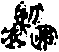

# 南岳继起和尚语录



> **藏经**：嘉兴大藏经（新文丰版）（嘉兴藏）　**册次** 第 34 册（J34）　**编号** JB301　**部类** 诸宗部　**卷次** 10 卷　**篇幅** 101,596 字

> **卷／品**：0 卷 · 1 品



---



## 目录



  - [南岳继起和尚大宗堂录汇自序](#南岳继起和尚大宗堂录汇自序)



---



### 南岳继起和尚大宗堂录汇自序



庚戌长夏，病榻山中，念行脚高士囊钵萧然，不独古人语录不能购，与我同生此世者，尚不得读我全书，秪因卷帙浩繁，慨然於诸会录中，取其语之简直者，厘为十卷，曰大宗堂录汇。其实如树泉、报慈、甲辰、湘云馆散录、尧封后录，皆於古人说不到处尽心而出，一字不可舍者，无以得此失彼，反使老僧赚却阇黎。



壬子九月霜降第一日，退翁自序。



南岳继起和尚语录总目



卷之一住常州夫山祥符寺语  

住台州天台国清寺语  

住苏州灵嵒崇报寺语



卷之二住苏州灵岩崇报寺语



卷之三住苏州灵岩崇报寺语



卷之四住苏州灵嵒崇报寺语  

住苏州尧封宝云寺语



卷之五住苏州虎丘云岩寺语  

住秀州金粟广慧寺语



卷之六住衡州南岳福严寺语  

衡州花药寺语  

高峰理山寺语  

武昌东岩寺语  

住汉阳大别山兴国寺语



卷之七灵岩廿一录卷上



卷之八灵岩廿一录卷下



卷之九南岳正续录卷上



卷之十南岳正续录卷下



南岳继起和尚语录卷之一



嗣法门人济玑等编



住常州夫山祥符寺语



到寺升座，举：「临济大师初住镇州，一日谓普化、克符二上座曰：『我欲於此建立黄檗宗旨，汝二人成褫我。』二人珍重下去。三日后，普化上来问：『和尚三日前道什麼？』济便打。三日后，克符上来问：『和尚三日前为什麼打普化？』济亦打。」师曰：「寰中天子，塞外将军，古之既尔，今之亦然。我欲於此建立万峰宗旨，诸上座不得向三日前后躲根，即今作麼生成褫？」良久，大喝一喝，下座。



上堂。举：「雪峰和尚曰：『望州亭与汝相见了也，乌石岭与汝相见了也，僧堂前与汝相见了也。』」师曰：「看看，三千大千世界被这老子一时摇动，祥符只是热不睬。管他齐楚燕赵千里万里来底，直饶过得太湖登古竹岸了，尚不知什麼处是夫椒山。即使从水平王庙前一迳西来到寨前湾了，不知那里是祥符寺。极灵利汉子入门看额，认得祥符寺真了。行得三两步，又被堵泥墙换却眼睛。及至僧堂前，知客接著，放下腰包，引上方丈，揖侍者通报，尚不许你相见，等闲容你途路边耽阁。」蓦亚身曰：「且道即今与诸人相见也未？」众拟议，以拄杖旋风打散。



结夏，上堂。「山前麦熟，现前可以忘饥；筐里蚕缲，将来可以适体。何消万虑挠其神，千忧苦其志？非不非，是不是，灯笼三，露柱四，然灯佛授记。三月安居，九旬结制，直待中元那日，蜡人无纤毫过患，方与你坐草自恣。」



上堂。举：「僧问瑯琊：『清净本然，云何忽生山河大地？』琊曰：『清净本然，云何忽生山河大地？』其僧有省。」师曰：「雪里送冰不无他瑯琊。可惜这僧，月明帘外不解转身，至今犹坐在光影头边。殊不知琉璃殿上行，扑倒也须粉碎。」喝一喝曰：「将知此门中事，不是等闲。」



上堂。问：「一月落清溪，千峰凛寒色时如何？」师曰：「壁立万仞此心真。」进曰：「拶破面门天地黑，剔开耳孔海山倾。心在什麼处？」师曰：「倒悬千尺瀑花新。」进曰：「恁麼则衲僧巴鼻草头风，师子爪牙空外电也。」师便喝，僧礼拜。师曰：「金钟玉漏相酬酢，疑杀滔滔天下人。」乃曰：「江湖无碍人之心，时人过不得，却成碍人。雅埠到这里，有什麼阻隔？佛祖无谩人之意，时人透不得，却成谩人。山僧心胆在舌尖上，何曾覆藏？钟作钟鸣，不杂鼓响；鼓作鼓响，不杂钟鸣。透得者，如贼入空室；透未得者，无绳而自缚。忽有个衲僧出众曰：『道也太煞道，要且无祖师西来意。』山僧呵呵大笑曰：『尽从这里去。』」



上堂。「先师道：『三峰门下一双箭，拨著透过髑髅。有甚神力拾得全身？』」师点胸曰：「这个汉子当年於箭锋上三回九转，你看还损得他一毫毛许也无？而今冷地思量，直是通身汗血。若不是个老子，什麼人下得这副手？山僧出手也。你若活得身来，便安在六纛旗下。」蓦召大众，众回首，师曰：「看箭。」



上堂。「山僧不敢平地陷人，大众切忌望空启告。此个宝华王师子座上，若一微尘许证验不过，岂惟遭人笑怪，亦且善因而招恶果。」拍禅床一下，曰：「三十年后，鼻孔撩天，谩人眼不得。」



晚参。「七十二峰各住本位，三万餘顷去不至方，我辈林下人，月听其自白、风看他自清，一向申申夭夭，乐此太平时节，有粥、有饭，诸人还甘也无？若甘去，蓦地卒风暴雨，如何避得过？若不甘，无事不可生事，千个作团、万个作块，我也不敢错怪你、你也不要错怪人。」



上堂。「尽乾坤刹海，都卢是个自己。而今撮向眉毛眼睫上，因什不绝毫绝厘，如山如岳去？往往桑树上著箭，柳树上出汁。」喝一喝曰：「和尚子莫妄想。」



上堂。举：「汾阳曰：『识得拄杖子，参学事毕。』泐潭曰：『识得拄杖子，入地狱如箭射。』」师拈起拄杖曰：「壁立直条拄杖子，强生节目。山僧自先三峰手中接下，年来放在冷壁角里，动也不曾动著。诸人道是识得识不得？参学事毕也未？将来入地狱否？简得出，汾阳入地狱如箭，泐潭参学事毕；点不出，拄杖子在汝眼里为灾为祟。争得如金鳞透网，游泳波澜，俊鸟离笼，翱翔碧落？夫山有个方便。」遂拗折拄杖曰：「大众即不得话作两橛。」



普请，上堂。「诸方老宿尽道接物利生，开门七件事尚不知来处，又争知匾担脚箩一向在杂收寮里？」喝一喝，曰：「夫山今日一齐搬出，手亲眼辨底接得便行，千五百人善知识不愁不随他去。其或缩手缩脚，怕寒畏热，无位真人在鼓声里恶发，莫怪！」



上堂。「地摇六震，既不为祥；天雨四华，亦岂曰瑞？夫山门下来一个衲子，与他七尺地铺，横也繇他、竖也繇他，但只是梦中不得与人交头接耳。」喝一喝，曰：「好人家男女，肯遍相说梦。」



上堂。举：「鼓山上堂曰：『鼓山门下不得嗽咳。』有僧出来咳嗽一声，鼓山曰：『作什麼？』僧曰：『伤寒。』鼓山曰：『伤寒即得。』琅琊拈曰：『雷声甚大，雨点全无。』」师冷笑曰：「天大底病，你还作小小看承。夫山若迟到一刻，几乎！几乎！」良久，乃摇手曰：「不妨，待伊出身白汗了再看。」



上堂。「有句无句，如藤倚树，斫得倒是好手。忽遇树倒藤枯，扶尚扶不起，说甚句归何处？馆驿里撮马粪汉，趁向无尾巴队中，不怕伊不甘。要问大众，却使沩山笑转新。者还具眼麼？」众无对。师呵呵大笑，归方丈。



上堂。举：「僧问曹山：『雪覆千山，为什麼孤峰独露？』曹山曰：『须知有异中异。』进曰：『如何是异中异？』曹山曰：『不覆千山顶。』琅琊和尚曰：『曹山慈悲浓厚，接引群生，要会即不可。山僧这里不然。如何是异中异？片片梅花飞落地。』」师曰：「一剑挥尽，始得和同，那许你异中有异？堕在语渗漏里，虽则慈悲浓厚，未免己命自伤。设问夫山：『雪覆千山，因甚孤峰独露？』但向道：『偶尔成文。』不惟令他不疑去，省得诸方尽把格则，以致究妙失宗，机昧终始。即今但有透过语渗漏，於不变异处端的得下，不论曹山、琅琊、夫山，大展三拜。」



上堂。举：「僧问风穴：『宝塔元无缝，金门即日开时如何？』风穴曰：『智积佐来空合掌，天王捧出不知音。』『如何是塔中人？』风穴曰：『萎花风扫去，香水雨飘来。』琅琊拈曰：『风穴若无后语，大似纪信诈降。』」师曰：「猛火不藏蚊蚋，大海那宿死尸？饶伊后语惊群，争如先机扑倒？」



上堂。举：「僧问三峰先师：『如何得真慧现前？』畣曰：『闻板声吃饭。』又问：『如何得法性空？』畣曰：『洗足上眠床。』」师顾左右曰：「学般若菩萨，须是不滞玄解始得。法性宽，波澜阔，才有毫忽异见，奴缘未断，争能触处闲闲？而今要透前两转也不难。闻板声吃饭，太煞不寻尝。更拟玄解会，洗足上眠床。」喝一喝曰：「大哉三峰师，巍巍法中王。」



上堂。举：「五祖演和尚上堂曰：『举则公案，事事成办。向外驰求，痴汉痴汉。』」师曰：「若是夫山肯恁麼道，有什公案，抵死要办，顶天立地，须让个汉。」



上堂。「江月照，松风吹，永夜清宵何所为？行尽东西廊，几多人未归？堪悲为著谁？」



因事上堂。举：「赵州和尚曰：『不闲过，念佛、念法、念僧。』」师曰：「原来讨事做。夫山即不然，但闲过，不得无事生事。设有衲僧出众道：『和尚聒闹杀人。』但合掌道：『某也幸，苟有过，人必知之。』」



上堂。「永日萧然坐，澄心万虑忘，欲言言不及，林下好商量。原来古人大有商量，夫山孟孟浪浪，只恁麼一直头，一字是一字、一句是一句，他时后日撞著个俊辨衲子，问著三峰屋里事，小脱空尚自打不来，何况大脱空？」蓦召曰：「大众试请验看。」众辟易，师曰：「筭来只是一直头使得快。」遂打散。



上堂。举：「演和尚上堂：『频频唤汝不归家，贪向门前弄土沙。每到年年三月里，满城开尽牡丹花。』」师召曰：「大众，五祖师翁惟恐汝辈乐著嬉戏，将好日子等闲送去，太煞不惜两片皮。若是夫山，撒沙撒土尚讨不得闲，有什工夫频频相唤？三月四月牡丹落尽，少不得有个回头。当尔之时，与你个随流认得性，快乐永无忧底妙诀。」喝一喝曰：「莫誓速。」



上堂。举：「龙门和尚上堂曰：『山僧今日与诸人同参一个真善知识。』便下座。」师拈起拄杖曰：「住住，真善知识来也。尔辈到处行脚，讨个什麼？若向赤水求珠，珠沉赤水。就荆山觅玉，玉隐荆山。讨方便，讨法门，讨安乐耶？真善知识者，从无一法与人，那来安乐法门与你方便？久参上士，闻与麼说，自然心死。初机后学又作麼生？」卓一卓曰：「怎奈何。」



上堂。举：「百丈一日侍马大师山行次，见一群埜鸭子飞过，大师曰：『是什麼？』百丈曰：『埜鸭子。』大师曰：『什处去也？』百丈曰：『飞过去也。』大师遂把鼻头扭，百丈负痛失声，大师曰：『又道飞过去也。』百丈有省。龙门远颂曰：『草里寻常万万千，报云飞去岂徒然？鼻头是什闲皮草？十字纵横一任穿。』」师曰：「众中还有鼻孔端正者麼？试自家摸看。大师手里底、龙门口里底，与你面门上个，是一样？是两样？人人只顾撩天，不信大头向下，未到透皮彻骨，争得出入息内？承事恒沙诸佛，无一空过者。夫山今日虽与你捩转鼻头，还须照顾眼下。」以拂子蓦直指，曰：「埜鸭子𫆏？」击一下，曰：「飞过去也。」复颂曰：「娘生鼻孔，一模脱出，气宇如王，阿谁委悉？」



元旦上堂。拈香祝圣毕，喝一喝曰：「此是庚辰年最初第一杓恶水，泼得著底一花开五叶，泼不著底结果自然成。且覆荫天下人这株大树，新新无住一句作麼生？」复喝一喝曰：「路上行人口是碑。」



上堂。问：「千圣不到处，万法用无亏。拈却拄杖，请和尚道。」师便喝。进曰：「塞断咽喉又作麼生？」师曰：「不靠你一个。」进曰：「老老大大，全无准的。」师曰：「失口道著。」乃曰：「失口道著，天下无敌。塞断咽喉，有什准的？万法用处无亏，千圣齐讨棒吃。」喝一喝，曰：「这副手脚什处寻觅？」



上堂。举：「僧问长沙：『如何转得山河大地归自己去？』长沙曰：『如何转得自己归山河大地？』径山拈曰：『转山河大地归自己则易，转自己归山河大地则难。有人道得不难不易句，却来径山手里请棒吃。』」师曰：「只是个自己转一转，便说难说易，棒又教阿谁吃？长沙转自己归山河大地，可谓将此身心奉尘刹。这僧转山河大地归自己，何得将常住物归衣钵下？夫山也不管你转得转不得，且山河国土与自己是一个是两个？速道！」



上堂。举：「黄檗见僧来，乃曰：『诸方老宿尽在我拄杖头上。』僧便礼拜。僧后到大树处，举前话，大树曰：『黄檗与麼道，曾梦见诸方也未？』其僧却回，举似黄檗，黄檗曰：『我这话已行遍天下。』琅琊拈曰：『大树与麼道，大似有眼如盲。黄檗一条拄杖，天下人咬嚼不碎。』」师曰：「若据琅琊，太煞高黄檗门风，然未免讨他棒吃。当时大树岂无出人之眼，一旦以非罪加之，何以服诸方之心？曾不闻咬人矢橛不是好狗，管他嚼得碎嚼不碎。」蓦拈拄杖卓一卓，曰：「我这话已行遍天下了也。」



许定于中丞断七，升座。「大人具大见、大智得大用，天下老和尚一气道：『我在这里。』还谛当也无？若果具大见，则不受人谩；果得大用，则不受人欺。秪如释迦老子初从母胎堕下，气宇如王，为什千餘年后遭他跛脚阿师劈头一棒？这里一气拽得转，始好说个天上天下独尊底大人。果然具无师大智，打瞌睡也是繁兴大用。若言达磨西来，事久多变，不消恁麼，只要才能足机划，自然逢著有通涂。莫誓速，杨岐栗棘禅且置一边，权借南公下平实禅一问：『拨草瞻风，秪图见性，阿那个是诸上座底性？识得自性，本脱生死，眼光落地时作麼生脱？既脱生死，便知去处，四大分张向什麼处去？三句作一句道将来。』你若道：『生也，石火电光，举必全真；灭也，玉转珠回，通身无影。』祥符门下有棒到你吃麼？莫说他日奋大机、显大用，提从上正印印天下丛林善知识，要望我山主定于居士，八千里未是远在。居士自山僧言下打开个安乐法门，所以捐馆之际如脱敝屣，澄澄湛湛，不动不摇，舒卷以时，去来无碍。至於功业书於竹帛、遗德在於生民，又是他第三四头底事。山僧恁麼道，还是提奖大众？还是欺谩大众？直饶一时透过，千七百则总作个切脚。我要问你：本文在什麼处？」喝一喝，曰：「千古万古与人看。」



上堂。拈起拄杖曰：「诸方尽谓这上座近傍不得，各各望崖而退。今日实情说向你，你等皆是祥符门里人，臂腕肯向外曲。」随卓一下曰：「只有这些伎俩。」



住台州天台国清寺语



上堂。僧问：「何时得圣人复起？」师曰：「难为国清，也不消如此。」僧作礼，曰：「某甲罪过。」师曰：「奉劝兄弟，以后不可随人言语走。」乃曰：「佛法二字，不道难，不道易，但於一切处寻著勘著，无去住处，直下将法王跟法王苗一时斫断，谁不道你是法王？」良久，拈起拄杖，曰：「不是国清今日特地勘验兄弟，且道法王还吃这个麼？」随卓一卓，曰：「便请。」



上堂。「当人分上，各有什麼事？这里道得一句，国清以后不消得开口也。」良久曰：「诸人既尔坚秘不发，事不获已，道一句。」落座，乃曰：「白大众，国清方丈不比诸方，容易出入。」



上堂。「天上天下，自古自今。」僧出曰：「如何？」师曰：「总不得如何若何。」良久曰：「不知是不是，是即也大奇。」



上堂。僧问：「四大分张，计将安出？」师曰：「计将安出？」僧曰：「争得不辜於己？」师曰：「岸谷无风，徒劳瞪目。」僧曰：「与麼即不劳究竟也。」师曰：「瞥地。」僧问：「如何是先佛本意？」师曰：「这里即易。」僧曰：「在学人分上大难。」师曰：「如是用心，真实难得。」僧拟议，师喝出，乃曰：「斗行则十万八千也是输，斗坐则寸步不移也是输。何况这里那里四大分张，尚图别生计较，岂先佛世尊之本意？欲得不负先佛，不辜己灵，究竟非什难事？」喝一喝曰：「这里瞥地，则岸谷无风，何劳瞪目？」



上堂。大众已集，师厉声曰：「山僧今日大以为不然，此后更不得依诸方样子施行。设法不严，道化日见凌替，罪归阿谁？未若众中得一人出来，真赝虚实向这里定当得下。活活底虚空，摇杌不动，何患天下不太平？」一僧巍巍堂堂而出，师曰：「不是你。」便落座。



先皇帝讳日，上堂。拈香已，就座。良久，乃起立曰：「年年此日，不得忘却。」下座。



上堂。举：「鼓山和尚因僧问：『如何是西来意？』山曰：『石人笔下看。』」师曰：「大哉！从上之心髓。又问：『如何是作家？』山曰：『你行脚为什麼？』」师曰：「亦不是戏论。僧曰：『与麼即某甲不疑也。』山曰：『你何处得作家？』」师曰：「亦不是乱塞人口。」良久，长声叹曰：「追远之诚，何可忘也？」随顾一众曰：「汝等从前所作杀、盗、婬、妄诸罪，一一如汤消冰，应念化成无上知觉。苟或毫末不灵，秪因听响各流传，又从今日起。」跳下座，旋风趁散。



住苏州灵嵒崇报寺语



到寺上堂。「灵源独耀，千日蔽其光辉；一岳盘空，万象失其相好。大丈夫！秉慧剑，般若锋兮金刚燄，非但空摧外道心，早曾落却天魔胆。释迦已过去，弥勒犹未来，如来正法眼藏委在今日，捏聚放开总繇这里。放开也，无量诸佛国土一时现前，且听诸人饱足观光；捏聚也，天下老和尚鼻孔一串穿却，又向什麼处出气？」喝一喝，曰：「巍巍乎！惟天为大，惟尧则之；荡荡乎！民无能名焉。」卓拄杖，下座。



上堂。僧问：「上来纳个不审作家禅客，下去赏个珍重本分宗师。秪如云兴百问、缾泻千酬底，当得何名？」师不畣，僧曰：「欲得不辜来意，更请别转一机。」师亦不畣，僧曰：「某甲也是譬如闲。」师哂之，乃曰：「三世诸佛说梦，有事有理；六代祖师说梦，无党无偏。灵嵒今日说梦，黄连未是苦，黄柏可为怜。何故？近来世界大非昔比，行脚高士朝也妄想、暮也妄想，收得安南又忧塞北，那讨闲心情来听说梦？纵饶勉强筑在他耳窍里，生门易过、死门难出，今日也恁麼、明日也恁麼。雪窦道得好：『第三、第四不问你，后五日事作麼生？』说到这里，未免二乘胆战、十地魂惊，老汉更不与你方便，直待驴年诺惺惺著，吾行尔随、吾唤尔应，一随一应，无少无剩。」



上堂。举：「赵州和尚示众曰：『金佛不度炉，木佛不度火，泥佛不度水，真佛屋里坐。』」师曰：「至道无难，惟嫌拣择。选佛场开，是圣是凡一齐来。心空及第，所作所为绝猜忌。不见石头土块，草木丛林，以至昧略飞摇，我皆令入无餘涅槃而灭度之。况乃具正遍知底大圣人，无往不自得，而不能入水入火入大炉鞴。老汉今朝岂敢掩是饰非，将佛法当人情。秪要他随处出生，当处寂灭。金佛入炉，根尘一如；木佛入火，彼我无殊；泥佛入水，全身归父；屋里真佛，一场露布。百念岁个老古锥，直得手足无所措。灵嵒病叟没伎俩，闲把虚空缺处补。」喝一喝曰：「报诸仁，举即顾，无差互。」



上堂。众集嘿然，经食顷，乃曰：「诸仁不是畏缩不将来，老僧不是吝惜不祗对。」击禅床，曰：「坐了这个位次，不与诸仁说难说之法，教你一个个直下作师子儿去、成佛成祖去、入如来藏去，反教你如乡头、保正、耆长、大户参杂在资生产业里去、祈神告佛打入福利门头去。如是，则袈裟下多藏毒药，把诸相完具底活佛沉埋向秽厕坑里，将来老僧头破作七分，如阿黎树枝也不足偿其罪过。即今世事如麻，空门路赊，布裙一截泥，努出膝盖子，看这老和尚说什难说之法？」复击禅床，曰：「今年桃李熟，一颗值千金。」



上堂。举：「达观颖和尚住圣因，一日升座曰：『诸方钩又曲，饵又香，奔凑犹如蜂抱王。圣因这里钩又直，饵又无，犹如水底捺葫芦。』举拄杖作钓竿势曰：『深水取鱼长信命，不曾将酒祭江神。』」师曰：「尼山夫子，世间圣人，犹自罕言利命。颖老出世祖师，乃尔怨天尤人，尚得谓之达观哉？灵嵒今朝不图翻局，要见得失平怀。」良久曰：「柳絮随风，自西自东。本无定法，遇缘即宗。取得鱼来还自放，羞凭钩饵立奇功。」



建侍者母氏三十周年，请上堂。僧问：「佛法二字总不敢问著，秪如腊月三十日到来如何打算？」师曰：「好向人前恁麼问。」僧曰：「不意和尚见到这里。」师曰：「老僧有口也难开。」僧曰：「今日可谓小出大遇。」师曰：「且待别时来。」僧问：「既然黄檗佛法无多，因什临济不肯得少为足，垂老更思一顿？」师曰：「上人惯自生铁团上寻缝。」僧曰：「真个那！」师曰：「老僧争肯虚空罅里钉橛？」僧曰：「和尚大似不知。」语未竟，师便喝，僧亦喝。师曰：「学语。」僧问：「香严道：『子啐母啄，子觉母壳。』如何是子？」师便喝。「如何是母？」师曰：「正觅起处不得。」「作麼生啐？」师曰：「哀！哀！」「作麼生啄？」师曰：「旧日事不须提起。」僧无语。师曰：「老僧患聋，阇黎患哑。」乃举：「临济大师曰：『你一念心疑被地碍，你一念心爱被水溺，你一念心瞋被火烧，你一念心喜被风飘。』」师曰：「据老僧看来，大师正欠悟在。学道人真到不疑之地，自谓脚脚踏实，岂非地碍？纵饶恩爱全消，如髑髅里眼睛乾不尽，岂非水溺？驴践马踏，刀斫斧砍，木石泥土相似，觅瞋心如芥子许不可得，秪这不可得底无明忒煞，岂非火烧？喜识尽时，自谓消息尽也，岂非风飘？果真达得四大如梦如幻，随处解脱，疑心爱心瞋心喜心，总是你屋里真佛显现底心光。把得便用，即是杀人刀活人剑，一任人间天上纵横自在，应物无拘，随缘得妙。一人如此，众多亦然。生者如此，死者亦然。今生父母、多劫父母，尽达烦恼结使如空无所依，向这里还歇去得麼？你若又引将大师道：一念心歇处，唤作菩提树。」喝一喝曰：「和根截倒。」



契侍者请上堂。举：「僧问曹山：『佛未出世时如何？』曰：『曹山不如。』『出世后如何？』曰：『不如曹山。』后来我演祖拈曰：『若以世谛观之，曹山合吃二十棒；若以祖道观之，白云合吃二十棒。』」师曰：「老大祖师这回救不得也。道枢绵密、智域困深底曹山，好以世谛责之，前来二十棒自领出去。然曹山老汉亦不无大智人前三尺暗，若於出世、未出世观佛，争能截断情尘、裂开见纲？要得类中混迹、炭里藏身犹未在，何况青天轰霹雳、陆地起波涛？远之远矣。今日设有问灵嵒：『佛未出世时如何？』道：『不曾贬剥诸方。』『出世后如何？』道：『一任诸方贬剥。』若更以世谛、祖道论量，七十二棒且轻恕，一百五千难放君。」



弟子祝本圆庄严先慈，请上堂。僧问：「一不得有，二不得无。新年头佛法作麼生商量？」师曰：「空里忙忙书卍字。」僧曰：「还谛当也未？」师曰：「是真草？是隶篆？」僧曰：「谩某甲一人即得。」师喝曰：「从不谩人。」僧作礼曰：「分明举似。」师曰：「切不得作永字八法。」僧问：「见得满地黄金，何妨即此用离此用？明知通身锦绣，因什触不得背不得？」师曰：「且读本文。」僧曰：「陈年底拈过一边，斩新底再请垂范。」师曰：「莫寻注脚。」僧作礼曰：「某甲且自领话。」师曰：「身上著衣方免寒，口中说食终难饱。」僧问：「一冬烧不尽，春风吹又生。未审湖南草作何颜色？」师曰：「昨日闹哄哄。」僧曰：「大有人疑著。」师曰：「今朝静悄悄。」僧曰：「何妨细而详之？」师曰：「果是俊快衲僧，定不回头转脑。」僧曰：「不是某甲，几被惑乱。」师曰：「大唐国里老婆禅，一等与君注破了。」僧问：「大众也如是，某甲也如是。和尚作麼生？」师曰：「直得天雨芬陀华。」僧曰：「还著得这一句也无？」师曰：「试看玉阶长瑶草。」僧随顾左右曰：「今日看破这老汉。」师曰：「一年一度春风来。」僧一喝，师曰：「大地何人眼不开？」乃曰：「一年一度春风来，大地何人眼不开？空里忙忙书卍字，青山拍掌叹奇哉！且读本文，莫寻注脚。身上著衣方免寒，口中说食终难饱。昨日闹哄哄，今朝静悄悄。天雨芬陀华，玉阶长瑶草。子母各不相知，事理依然兼到。」卓拄杖曰：「大唐国里老婆禅，一等与君注破了。」



祖侍者请上堂。大觉溟长老出问：「若有欲知佛境界，当净其意如虚空。虚空来，连架打，某手不如脚。还有畣话分也无？」师无语。溟曰：「早知与麼，悔不与麼。」酂侍者问：「某甲不问话，和尚作麼生？」师亦无语。酂曰：「果然三寸甚密。」师仍无语。酂曰：「三十年后，此语上碑去在。」乃曰：「古德道：『横按莫邪全正令，太平寰宇斩痴顽。』何异灵龟负图，自取丧身之兆？大似凤萦金网，拟趋霄汉以何期？汾阳无业禅师曰：『佛法在日用处，在著衣吃饭处，在迎宾送客处，屙矢撒尿处。』美则美矣，未尽善也。著衣但著衣，吃饭但吃饭。佛之一字，尚不喜闻，更起法见，展转不堪。况又道个举心动念，便不是了也。寻尝向汝等诸人道：『举心动念，华雨四天；逐恶随邪，香飘尘刹。贪欲瞋恚，是值种德之本；邪见烦恼，是严佛土之门。拟心学佛学法，便不是了也。』经中谓地狱、饿鬼、畜生、盲聋瘖哑、世智辨聪、佛前佛后、北俱卢洲、长寿天为凡夫住事八难。灵嵒道：『禅宗亦有八难，真佛、真法、真道，三涂也；不见一法，名为北洲；念念心不间断，如长寿天；权实照用，是世智辩聪；独脱无依，乃诸根不具；石火电光，同佛前佛后。』所以《楞枷》曰：『断二根本，名害父母；诸使不现，名害罗汉；断彼异相诸阴积聚和合，名为破僧；断彼七种意识身，名为恶心出佛身血。以此行五无间业，不堕无择地狱。』今日祖侍者为父圆慧居士三十周期，特请老僧举扬实际庄严报地，不惜口业，破尽从上家私。汝等诸人倘能不断无明，直见真父；不灭贪爱，直见真母；行於非道，通达佛道，则老僧箭不虚发。其或寻逐古人言句，心念一起，不惟自被波旬扑倒，和老僧一时打入铁围城也。」



南岳继起和尚语录卷之二



嗣法门人济玑等编



住苏州灵嵒崇报寺语



松陵屠居士玄枢为母屈太君寿，请上堂。喝一喝，曰：「其用广大，宽廓无边。其文深，其旨远，与凡圣为依，是众法之本。其信之者，穷尽法性。以之觉亲，慧命无涯；以之自觉，智源罕测。启悟劳生，破诸尘妄，无待渐趋薰习，诚非小事，不可轻心取於流转。」复喝一喝，曰：「倘善知时节，吾今不再三。」



席恭人六十初度，上堂。「金风一夜铿锵，黄叶四山锦绣，满目秋光烂不收，莫厘全露法身。倒涵两岸枫颜，摇荡长空雁影，远天霜翠青无极，震泽横开笑口。诵来一道聪明咒，唱作千秋白石歌。但得圆通证无漏，不须石臼念摩诃。曩谟佛陀，曩谟达磨，曩谟元和。伏愿弟子玄信，福隆寿广子孙多。普天知识长惺惺，脱却笼头卸角驮。」



快雪，上堂。以拂指庭中，曰：「雪！雪！能使枯者荣、秽者净、乌者白、缺者盈、瘠者肥、隐者显、热中者不得不冷、奔驰者不得不歇、险阻者不得不平、浓艳者不得不澹。道渠一切处寂寥枯澹，他却庄严诸品；道渠一切处光明灿烂，他却文彩全无。他能盖覆一切，一切盖覆渠不尽；他能穿透千门万户，千门万户牢笼渠不定。本非神通，亦非法尔。道个夜月流辉、澄潭绝影，尽属比拟之词。何也？不消转句，使乾坤大地无纤毫过患，犹是渠本有风光；待到红日出时，不见一色，始是半提。要知渠全提时节麼？老僧三十年前在万峰会里有一转语，举似诸仁。」良久，击拂子一下，曰：「溪涧岂能留得住？终归大海作波涛。」



静舆禅人为母氏，请上堂。「夫学般若菩萨，无甚日旋三昧，斩然将无始来火伴尽情交断义绝，他日山边水边冷地撞著，只是交肩过去，管取十方世界一时销殒。设或兜三惹四，不知不觉依旧走入他路里，万劫无有出期。更作意回避伊，又添上一个也。约略唤什麼作火伴？佛是？法是？菩提涅槃是？真如解脱是？要断绝他，须还上流。临济、德山、云门、沩仰是真下流。现前那个和你是生冤家？费这许多气力，生这许多计较。」顾左右曰：「老僧三十年不忍说到这里，今因檀越信心，不觉肆口。」随指口曰：「看牙齿在麼？」



袭祖宪，退平川，通济弟子玄仁、玄森、玄净等送入山，请上堂。僧问：「天上无双月，人间只一僧。」指左右曰：「因甚有这许多？」师摇首。僧曰：「不可辜负来机。」师哂之，乃曰：「自来不惯强差排，今日无端闲著力。若将佛法当人情，怨哉屈哉！诸知识！秪要你识取去底、识取住底，百年三万六千日，日日朝昏十二时，身上著衣方免寒，口边说食终难饱。青山白云、落花芳草，去底既不倚势欺人，住底争肯无本可据？不见三峰先师曰：『德山忤逆往哲、临济轻薄来学，两个没量大人病入膏肓，不觉什风吹到三峰门里？知事分付：缘左先左脚、缘右先右脚，仍前热乱，莫怪不轻发药。』」师乃呵呵大笑曰：「目前师僧尽出自三峰门里，定然头正尾正。劈面三拳且不问你，连腮七掌还健脾麼？」良久，掷拂子曰：「若要无事时，归衣钵下坐。」



海虞光聚大德请上堂。「观色即空，成大智而不住生死，诸方共闻；观空即色，成大悲而不住涅槃，灵嵒不然。两片顽皮包个舌，一双耳门藏两窍，欲得不招无间业，莫谤如来正法轮。有什旷发群动、越绝孤应，辟天人深域、振今古洪谟，而不视同烂本心之药、斩法身之斧？」拈起拄杖曰：「这一队漆桶莫怪。」连卓三卓，下座。



吴兴弟子灵资请上堂。「适才鼓声急忙忙一点一点钻入你等耳门里，老僧急忙忙一步一步赶上来，拟为你拔出，竭尽伎俩下手不得，须你等自作法，莫待贯髓入脑便救不得也。你若计穷力尽，老僧只得将错就错，鼓声无能入之心、耳门无所入之迹，心迹既无，彼此何碍？无碍真宗，居谷盈谷、处坑满坑，无底篮盛他不漏、黄金索锁他不住，取殊裁於妙手，照用齐彰；不稽度於往哲，理事兼到。竖穷三际、横遍十方，尘沙诸佛、天下祖师尽在里许头出头没，通方之士自不怪我言无一定。老僧寻尝见掌钵盂向香积世界无出身之路底、挑日月於拄杖头上有眼如盲底，总不与之计较者。」乃捧腹曰：「秖得这副肚皮宽，更有容得老僧底，下座礼他三拜。」



宣州青林明虚律师率诸弟子请上堂。僧才出，师便喝。僧拟进语，师又喝。良久乃曰：「持宝奉君君不识，令人空忆老南泉。要得远离众缘，岂止千年一遇。教中道：『一切障碍即究竟觉。』不是大作家，争得横身不怕侵泥水。离凡圣底嵩山安国师，用凡圣底南岳让和尚，终日牵无丝傀儡，当得劳而无功麼。老僧这舖功德，成就多少时也。逗漏遗踪，实无走路，难免被他捉著。直须千言无一中，脚下到长安。」复喝一喝曰：「遍乾坤动天地底，是什麼驴汉。」



能仁光长老三周忌辰，门人遍颙、备仁请上堂。「世尊三昧，迦叶不知，老僧得知。四十九年说底是没心肝话、行底是没心肝事，度若干没心肝底人，以讹传讹，直至今日十字路口、深山角落，据高位、享厚供，那一个是有心肝底？流到食腐烂、衣粪扫，还道是他白毫相中光明。非他底连声弗也、是他底满口善哉，如是之人，不待见之者心生轻慢、闻之亦当呕吐。若是老僧三昧，总不曾谩昧诸人，三十年来说底在诸人耳里、行底在诸人眼里，所度底人诸人尽知尽见，老僧两道眉棱如剑戟，讨甚白毫相光照顾儿孙？非我底增我意气、是我底长我惭惶，深山角落他也不曾孤负我、十字路口我却不曾孤负他，据高位、享厚供是他底禄，衣粪扫、食腐烂是他底福，淆讹任他淆讹、颠倒由我颠倒。大众！这两段公案什麼人判得？」良久，曰：「有也。有第二子同光，号辨庵，住灵石、能仁两刹，三年前此日说偈坐化，今其脚下儿苦要老僧说几句残言剩语，反讨得这桩没头脑底官事要渠定当，少间闻三下鼓，诸人静听。」



上堂。「佛法不是小事，夫说法者须是六种成就：第一、安立成就，第二、目前成就，第三、自己成就，第四、智智成就，第五、本末成就，第六、平等成就。六种圆具，法法归宗；一种有亏，言言昧旨。上根利智自然一六互收，浅学初机切忌循途守辙。」卓拄杖，下座。



上堂。「夫临机转握，共有八门，定乱致平，难拘一法。或奇正之纵横，或阴阳之纷错。九天九地，一死一生。擒贼擒王，射人射马。所以决胜要在临时，神符贵於转换。门门有路，步步通途。过量英雄，不烦指点，自能排身直入。其或不然，灵嵒为汝打开八门。」拈起拄杖曰：「第一刹那该摄门，第二主宾成立门，第三当机生法门，第四予夺自在门，第五输机善用门，第六全提正令门，第七诸根普摄门，第八太平无象门。」卓拄杖曰：「这是那一门？」众罔措。遂下座，旋风打散，归方丈。



谓云、敏闻二上人请上堂。「腰软背酸难立久，才近绳床瞌睡来。面前大好山，脚下俊衲子，一齐攒簇著，如逼债相似。抖尽肚里零星，究竟收拾不下。再三无计可施，略与诸人评议：一、不得截生死流；二、不得踞祖佛位；三、不得互分宾主；四、不得驰骋问畣；五、不得曲顺机宜；六、不得平怀尝实。岂不闻纤芥不留，犹是交争之法？」拈拄杖卓一下，曰：「汉家虽有三章约，争似灵嵒六不容？」



灵瑞符道者请上堂。僧问：「如何是道中人？」师曰：「一步紧似一步。」僧曰：「道中人相见时如何？」师曰：「工夫各自忙。」僧曰：「设遇虎狼师子，凭谁相救？」师曰：「也只是个自己。」僧曰：「有个自己，难免炤管。」师曰：「伶俐也。」乃曰：「三峰老和尚若在，闻山僧与麼提唱，通州做得来底布靴和毡袜底一齐顿下，三十年参禅到此，一些气息也无，当年末后句子无人提得也。休！休！山僧仔细思量，我此门中争好胡乱教坏人家男女？」良久，曰：「古今尽道说禅难，沾著些儿心胆寒，若是本等赤金体，倾入红炉一任看。」喝一喝，下座。



中游后堂五十生辰，请上堂。「八万四千深法门，无问平坦，管什崎岖？只要插得脚入，释迦老子和身放倒，有什十方虚空而不一时销殒？然后在天同天、在人同人，更不须拖鎗带甲、披席把碗，元丰条、绍兴令，有智若闻则能信解。其或幽旨既融、玄机未泯，虽有万德千身轮足，无智疑悔则为永失。争如长松下、白云乡，吟鸟啼猿尽道场？随分水草，地久天长。」



江阴莲道人寿日，请上堂。「汝等绕四天下行脚，尽谓我求心，且道心是何物？老僧於无数量中略露些文彩：心是日，处空照有无定迹；心是月，光涵宝镜清高绝；心是星，运斗旋箕禀曜灵。与麼，昨朝则有，今日则无也。不然，心是雨，花木普滋含笑蕊；心是风，锦绣山川披拂中；心是云，舒卷乾坤越样新；心是雷，发蛰一声幽谷开。汝等这回还识心麼？直饶量取河沙，筭他过去、未来、现在无有穷尽。临济先祖又道：『真正学道人，念念心不间断，嘘嘘。』心之一字，刀刁莫辨，鱼鲁难分。」便下座。



弟子重荷请上堂。「赤肉团上一物，尽道西天尽有、此土全无，未必然也。焚香择火，昨夜踪迹不著；开单展钵，今朝回避无从。始信近日丛林吐出来底是埜狐涎、非师子乳。一众闻我道，未免惊疑。此辈不独堪悲，亦且堪笑。驴鞍轿若是阿爷下颔，因什一切人坐在骨臀底？轻重罔辨、香臭弗知，春山乱青、春水漾碧，寥寥天地，叹望何极？」良久，左右顾视，曰：「具超方眼者，自当怜我开眼造罪、合眼受灾，肯同儿戏？」敲香几，下座。



大悲道场开启，弟子玄信请上堂。「夫宗师唱道，不屑以智遣智，肯以智遣惑。事不获已，向道：六门虚静，万法咸如。然非心月孤圆，争见神珠炳焕？临济大师道：『但能纯一不杂，虽十地满心，求你踪迹了不可得。』所以，天龙欢喜，地神捧足，十方诸佛无不称叹。老汉过矣！现前一众，那个不是金毛师子？等闲一言半句，谁道不是大悲心无碍大陀罗尼神妙章句？惟诸大德抖擞精神，豁开胸怀，岂止除灭千灾、成就万德？正所谓：识取摩诃般若光，万古悠悠是今日。」喝一喝，下座。



净居庵主宗本断七，上堂。「云门大师上堂曰：『划断即不可。』大众！甚好言语。固不可以一朝风月昧却万古长空，又岂可以万古长空不明一朝风月？掩胜潜奇，黑漆桶里黄金色，秖为一人斟酌皮髓，遂致后代较量亲疏，因而凡圣岐分，悟迷派列，奔驰七趣，汩没四流。欲期插脚曹源，岂止隔洋子江在？果具把定世界、函盖乾坤眼目，观净居庵主八月二十消息如掌中物，无有丝毫错误。其或未相委悉……」敲禅床三下，曰：「老僧表而出之。来无三言两语，去时一笑而已。不明向上个窍，生死那得由你？」靠拄杖，下座。



大悲道场圆满，洞庭席文舆居士伯仲为母夫人玄信，请上堂。高声曰：「大悲菩萨在什麼处？」良久，曰：「不欲得商量，诸和尚子各各欠少个什麼？虽然，莫谓如今说底便是，才有个是，早有个不是。大悲菩萨岂有两个？近日诸方不是坐定你，便是走作你，二六时中折旋俯仰、思衣念食种种杂虑，是从大悲心中流出？是不从大悲心中流出？灵嵒直下老婆心，与诸仁个圆满著。」喝一喝，曰：「此老古锥，心不负人。」



若拙法师请上堂。喝一喝曰：「山河大地由兹建立，三昧六通由兹发现。隐显无殊，明暗不昧。近日多见诸方说心说性，遂致丧家失计，往来莫辨，开遮勿灵。故学道者如恒河沙，见道者难得一二。岂不闻剋己求真，修行大错。直须褊衫不盖体，赤脚踏倒崇报门。把主人翁曳下曲录床，落脊棒打不歇手。然后老僧合十指爪而说偈言：『假使心通无量时，历劫何曾异今日。』」



癸卯正月四日，上堂。「三日前，有一男子来前申问：『新年头佛法，诸方竞铸金石之言，各垂山岳之训，此问作麼生？』老僧叱曰：『合取狗口。』记得尚书度支员外郎明觉禅师塔铭有曰：『噫！蠢愚背本源，一念异，生二根，从上相传心印，看看扫地尽也。』老僧既不能为他扶起刹竿，又肯随邪逐恶，而今不比前两年也。人困马困未是困，露柱困来真是困，心愤愤、口悱悱，要得老僧佛法流通，只恐不能矣。」



东山灯明道人八十寿，请上堂。喝一喝曰：「上来讲赞殊因，非知方俊眼、出格上机。举一明三，并同边浅。欲求大宝，莫局时代。制辞申颂，惟仁善听。湖光翡翠青，洞庭春草绿。中有百尺松，枝枝垂屈曲。映日拔云霄，从风戛金玉。周髀小数术，难将岁月卜。」



雪窦老和尚讣至，上堂。「呜呼哀哉！法门不幸，人从西园来，却得南广信，报道：我法叔杏山老人遽尔归真。不信，不信！这老子人天眼目、法苑权衡，聆其謦咳，永出四流；承其指挥，高步三界。谁不蒙恩？谁不仰德？忽然日月沉辉，乾坤失色。不信，不信！呜呼哀哉！人亡弦绝，知希守嘿，三缄其口，正是时也。莫逆於心，何可忘乎？大众！道乎？情乎？情牵生死，道绝去来，道非尝道，情岂尝情？呜呼哀哉！法门不幸。」掩面哀哀，曰：「不信，不信！」



三峰檗庵志省觐，请上堂。「有个人家儿子，其父览而神之，无心心心合妙，有口口口道火，一切临时建立，从不遂旋包裹。」拈起拄杖，曰：「而今风和日丽，直教天下人一时成佛成祖。阿谁出来敢道个不可？」卓一卓，下座。



盐官行辉请上堂。举：「真净和尚曰：『此个事教不得，学不得，传不得，须是当人自悟始得。』」师曰：「我不肯这老子，春风霭然，春水荡然，春山俨然，是谁不然？」



弟子玄信六十生辰，水陆大会圆满，请上堂。僧问：「祝融峰畔万年松，枝枝撑著月。东山水上行，因什向北斗里横身？」师曰：「稀逢难遇，正在此时。」僧曰：「老汉惯自虚空里烜彩。」师曰：「锦上铺花，别资一问。」僧曰：「是伊报恩有分。」师曰：「三千八百未是住头在。」良久，乃曰：「若有欲识佛境界，当净其意如虚空。远离妄想及诸取，令心所向皆无碍。灵嵒道：若论佛境界，那一处不遍？开眼也著，合眼也著；举足也是，下足也是。一切障碍即究竟觉，窒碍不是佛境界；地狱天宫皆为净土，恶道不是佛境界；得念失念无非解脱，妄想不是佛境界；成法破法皆名涅槃，谤毁不是佛境界；智慧愚痴均为般若，分别不是佛境界；无明真如无有二理，杂染不是佛境界。若信得及，虚空本自廓尔，佛性从来湛然。风动云披，骏发天真妙用；凡情圣智，全提本分雄机。揭杲日於天中，幽潜蒙曜；扇真风於劫外，枯槁回春。粲不萎之心花，花花联影；奏无生之梵曲，曲曲离情。洒甘露则一味无餘，霈慈霖则三根等润。能使嵒居穴处，皆依智炤神光；水泛空飞，咸入义天性海。严戒定之室，筑福德之基。有感斯通，无求不遂。非关异术，岂假他缘？秖在一法界中，虽欲回避时，直是无回避处。故曰：『应眼时，若千日，万象不能逃影质。』凡夫只是未曾观，何得自轻而退屈？又曰：『贪欲即是道，瞋恚亦复然。於此三事中，有无量佛道。』」拈拂子击一下，曰：「这便是一条入佛境界底通天大路。果若脚跟得力，便请平步丹霄，随寓而安，无往不适。正恁麼时，且道还有向上事也无？更垂一偈，作个注脚：水陆斋筵已告圆，如空福德利无边。斗充佛座量难尽，历劫长存般若缘。」



射州卑牧谦请上堂。僧问：「吞尽三世佛底人，为什开口不得？」师曰：「我若开口，又道暴露已长。」僧曰：「照破四天下底人，为什合眼不得？」师曰：「我便不开口也得麼？」僧曰：「前头著？后头著？」师曰：「麤心者隔。」乃曰：「好铺功德，被人问著。莫谓去却麤缘，便照见一切长短方圆。而今与你门路，不自欺，不欺人，个是灵嵒山里佛法也。东林和尚曰：『世间名利闲荣辱，云雨纷纷手翻覆。悲歌相继不堪论，棒头无眼黄粱熟。』个些话作道理卒难会，方来兄弟几曾体得？谨白！谨白！要得光阴不虚度，亟问取他家脚下人。」



晚参。举：「赵州和尚上堂曰：『兄弟但改往修来，若不改，大有著你处在。』」师曰：「西天人事至此老轻薄尽也，含齿戴发，巍巍堂堂，说恁语话，捋灵嵒面光。咄！也大有著你处在。」一僧出，师曰：「赵州合著在什处？」僧曰：「别处著伊不得。」师曰：「不改往修来底𫆏？」僧曰：「不可著在别处。」师曰：「但改往修来，也大有著你处在。」便下座。



上堂。僧问：「曹溪镜里纤尘不立，因什眼里有睛底，打鼓看来犹不见？」师曰：「甚不肯你此问。」僧曰：「为什如此？」师曰：「依然走入识情里也。」僧曰：「若不上来，焉知端的？」师曰：「犹未得决然。」僧问：「一日打眠三五度，也消不得许多闲口。除吃饭合作什麼？」师曰：「且放冷著。」僧曰：「不可教伊上壁去也。」师曰：「衷斯自家裁断。」僧曰：「近日诸方错怪人。」师曰：「可当得禅道麼？」乃曰：「老僧看定诸人了也。还知麼？」良久，复曰：「知之一字，也不易言。知之一字，众妙之先锋。知之一字，凡惑之帷幄。洗脚处用巧不得，著草鞋时安排不得。朝阳户口，夜月阶前，不可总为诸人注脚。春去秋来三百年，拄杖至今犹靠壁。」



早参，上堂。举：「智门纲宗歌曰：『昆明池里失却剑，曲江池内捞得锯。䶥䶥齖齖且过时，莽莽卤卤河沙数。粝竭节，曳露布，伶俐衲僧通一路。』」师曰：「夫出家沙门不行异路，乞食自活取那一路？」众畣不契，乃卓拄杖曰：「可惜这一路。」



小师越祖范铜写师像供慈受阁，请上堂。「空山中得似人者而喜，好段语话要且难搆。善说无生法底道：只是生铜铸就，圣从何来？灵从何起？若打从大炉鞴里镕尽气质，决不坐著这个见地。此椰子一躯，不慕诸圣、不重己灵，赞誉勿喜、残毁勿瞋，眼摄一切而影不留、耳透一切而声不染，为他是佛模子里、祖模子里脱出，故诸象繁兴，那伽尝定。饶你在面前作多色伎俩，渠不见不闻，无尽诸方闻得，未免笑灵嵒两口无一舌。咄！管保老兄未彻在。」



吴江弟子定洪密珠请上堂。「侬家自有同风事，千里苍茫却肯伊。天地河海，风云草木，虫鸟人物，月之大小，岁之餘闰。古人道：无知者，无所不知，无所不到。起心解会，则便隔也。今日与你约断一件事，若要去离泥水，活人眼目，举唱激扬。」喝一喝曰：「细看前话。」



早参，上堂。「果是个解事师僧，不待灵嵒到你面前，横竖已知老汉铺张，佛意祖意在这里多少时也。你道我与诸方差几尺地？」一曰：「近日此话大有商量。」一曰：「放待冷来看。」一曰：「阖国咸知。」一曰：「我不可作灵嵒弟子不得。」一曰：「某甲参堂去也。」一曰：「打鼓普请看。」一曰：「某甲不敢造次。」一曰：「直不藏曲。」师乃起身曰：「一总是开眼尿床。」



晚参。「谨白参玄人，光阴莫虚度。如此老所说，天下宗师尽是吃饭汉子。众中有高过石头底，试请下语。」一曰：「不料和尚问到这里。」一曰：「上来下去，总不徒然。」一曰：「耑为流通。」一曰：「别有商量。」师曰：「到南广回来，一齐定当。」



弟子元信大藏圆满，请上堂。「古德道：『一大藏教是个之字。』三峰老和尚道：『一大藏教是个日字。』山僧道：『一大藏教是个席字。』三人行，必有我师焉。之字下荐得，生来造化承斯力，贵胤天然世莫群；日字下荐得，一句当天出盖缠，纵横妙展无私炤；席字下荐得，觌面千殊一体平，水上东山青不尽。诸人拟取那一字？宗乘露布，建立由人，若非事理圆融，能免触途成滞。当此之际，须明古人血脉，有随自意语、有随他意语、有随自他意语。一等出世尊宿，个个道：鼻孔咤沙，眉毛卓朔。才据祖令，总须茫然。胜事将成九仞，山僧肯惜一篑。」喝一喝，卓拄杖，下座。



晚参。举：「云峰悦和尚一日谓僧曰：『汝问讯了一边立地，是什麼道理？』」师曰：「未必善因而招恶果。」复曰：「灵嵒今问大众：『汝等礼拜了，两行立地是什麼道理？』」一曰：「某甲若说道理，遭人怪笑。」一曰：「也不较多。」一曰：「不可儿戏。」一曰：「肯以小缘妨於大事。」一曰：「是上古风规、是今时枢要。」一曰：「不得作佛法商量。」一曰：「耑为流通。」一曰：「衲子难谩。」师乃曰：「眼目洞然，是谁不然？更拟踏步，落花满前。」



平川弟子王本让请上堂。「灵嵒三昧最省力，举起一念事事毕，高来低去尽奇祥，屈伸进退咸饶益。临济入门便喝，德山入门便棒，逐妄所生，不能自在。老僧指出底，可与祖佛为师；信及底，肯走到人天路里。我於一切处而无所行，他拘我不得。曩谟观世音菩萨，曩谟大慈悲菩萨，心主采集不是佛，智多矫诈不是道，何况执著文字限量？」良久，曰：「你且听去好。」



弟子灵秀请上堂。良久，曰：「大众总集，也听老僧说话。」又良久，微笑曰：「任你江南江北各自有禅、各自有道，吾不喜闻。三十年前在万峰刷印寮，见兄弟都道：『才有是非，纷然失心。』不图他能让千乘之国箪食豆羹便见於色，肚里忖量道：何必。及踏著安隐一片地，从夜半子到人定亥，一切智智清净无二，无二分、无别、无断。方省古人道：『举一则语教汝直下承当，早是撒矢向汝头上也。』」喝一喝，曰：「将此身心奉尘刹，是则名为报佛恩。」



弟子灵善、灵玉请上堂。「古德道：『不信菩提涅槃，是则解空第一。』」喝一喝曰：「丹凤自腾霄汉去，寒鸦犹噪夕阳西。从上诸圣浩浩商量，都要傍省事径捷一路走。直至如今，计较未成多少。倚长松，临绿水，感恩无地。大事本来平等，反作多种奇能，役役趁过光阴。大众！流言止於智者。二时开单展钵，逐日屙矢送尿。尽将业识作流传，此道今人弃如土。」



月朗大德请上堂。「曹溪一路大不净坑。自古自今掘了一丈又一丈。何时得息浪停波。更有一项左手把水如光，与鬼倒挂瞳人颠覆肝肺。据实理论，而今方来兄弟能有几人？雠智观、薄机衡，斥逐正法眼、抹断涅槃心，视无相实相如疮疣溲勃。老僧今日不图分雪，三十年后人间天上一回撞著。」高声曰：「岂其然乎。」



早参。举：「赵州示众曰：『金佛不度炉，木佛不度火，泥佛不度水，真佛屋里坐。』」师曰：「智有邪正，道无净染。擎拳竖指、瞬目扬眉，是美精魂鬼。总不与麼，快便将来。如何是屋里真佛？」一曰：「莫要泼水麼。」一曰：「不可错祗对和尚。」一曰：「心不负人，面无惭色。」一曰：「痛领一问。」一曰：「口是祸门。」一曰：「不经一事，不长一智。」一曰：「某甲无侍者袛对和尚。」一曰：「不可口似鼻孔也。」一曰：「动则风生。」师曰：「市食斋僧不见好。」



晚参。「古人道：『若是陶渊明，攒眉便归去。』」师曰：「满目溪山一带烟。去便休，何用攒眉？」一曰：「病入膏肓。」一曰：「深怀恐惧。」一曰：「肯挂唇齿。」一曰：「是伊救不得也。」一曰：「深领。」师良久曰：「看见了也。」便下座。



早参。自点胸，曰：「此老子一生口硬，惯说硬禅也无他，只是做禅和子时不轻易吃人家三个胡桃两块饧，而今禅和子能有几人插花不入？昔，僧问云居：『如何是道中人？』对曰：『如死人手。』『道中人相见时如何？』对曰：『如死人眼。』这两语到我临济家，济得什麼边事？不解自持白刃断其命根，每日说千说万，总未契得木上座在。多见时流妄作主宰，请个古人为你证验，有能与佛祖作得生对头底，出来道两语看。」僧出，师问：「如何是道中人？」僧曰：「雪深三尺。」「道中人相见时如何？」僧曰：「特地一场愁。」又，僧出，对前问，曰：「独掌不浪鸣。」对后问，曰：「两掌鸣啯啯。」一僧曰：「脚跟不点地。」次曰：「把手上高山。」一僧曰：「舌拄上腭。」次曰：「绝倒旁观。」一僧曰：「待问即对。」次曰：「盖胆毛一茎两茎，还遮覆得麼？」众僧竞出，师曳拄杖，下座。



南岳继起和尚语录卷之三



嗣法门人济玑等编



住苏州灵嵒崇报寺语



上堂。喝一喝，曰：「前圣所知，转相传授。能灭亿劫倒想，成就无量慧身。离此章句，别有商量。水牯牛栏里，又添一头。灵嵒不获已，且作死马医。将知你一生行脚，只是泥里撼椿，看人吃饭。一法若有，毘卢堕在凡夫；万法若无，普贤失其境界。你道街头巷尾敲铁磬，沿门念高王经底，亲见妙觉也无？灼然谛当得，其乐不可量。打筭不下，最苦莫过此也。」复喝一喝。旋顾左右，曰：「洞山古佛道得好：『成佛作祖，越此不得。』不得，伊何要你消磨？」



松陵陆懋之居士求嗣，请上堂。「从门入者，不是家珍。一朝亲自得来，是真狮子儿。何怕不大起家声。」蓦拈拄杖曰：「不见释迦小厮，才出母胎，便手指天地，目顾四方曰：『天上下惟我独尊。』当尔之时，如珪如璋，谁敢相著。所以道：『一人得之，则位齐诸圣；一人失之，仍是凡夫。』人虽不殊，得失辽远。古德真切之言，诚堪信受。」随卓一卓曰：「务求必得而后已。」



晚参。举：「思益梵天问佛世尊：『何谓菩萨名为有惭？』佛言：『知见内法。』『何谓菩萨名为有媿？』佛言：『舍於外法。』『何谓名为菩萨遍行？』佛言：『净治身、口、意业。』」师喝一喝，曰：「惭！愧！释迦老子不顾乱却天下人眼，何不与伊本领？今日设问灵嵒：『何谓菩萨名为有惭？』对道：『裁衫错却领。』『何谓菩萨名为有愧？』对道：『把针失却线。』『何谓名为菩萨遍行？』对道：『衲僧破草鞋。』又道：『五戒不持。』大众！提将钵囊千里万里行脚，莫待阎罗老子徵你饭钱，然后搜刮肠肚上来，山僧共释迦老子各出只手为你分取一半。且如何得知见内法？如何得舍於外法？何法能净治身、口、意业？」众畣，不契，乃曰：「指望洒洒地，为宗门中出口气，如斯争得能搆？」归方丈，侍者问：「如何得知见内法？」师曰：「不食空王俸。」「如何得舍於外法？」师曰：「何假雁传书？」「何法能净治身、口、意业？」师曰：「昨朝栽茄子，今日种冬瓜。」



知殿慧圆请上堂。「位天地，育万物，圣人之道可谓大矣，也只好向无佛处称尊。若撞到宗师面前，尚费手脚。不然，禅和家三千、五千、一万里地，盘水陟岭，难道总为一羹一𩚙？老僧不是抑人扬己，秖为不甘你一众负屈。你辈尽道惯自於古佛出头不得处，铁石崩崖，霜弓劈翦。我且问你：诸佛如来说一切众生身中具有三大：体大、相大、用大，较他圣人之道孰大？」良久，曰：「李将军有嘉声在，不得封侯也是闲。」



荆溪周居士请上堂。蓦拈拄杖曰：「祖师不曾西来，各有一片田地。以时作息，谁敢差之毫厘。既来东土……」卓一下曰：「中心树子属我也。谬之千里，何所不宜。虽然如是，白云横谷口，迷却几人源。所以道：『语不离窠臼，安能出盖缠。』现前诸人，有能於祖师命脉上眼目人天，试请道一句，助喜青池居士圆满报恩功德。」良久曰：「三十年后，此话大行。」



通州幻住闻长老遣门人音圆彻省觐，请上堂。「如今直下信道，老僧不能替你作活计，须是各各自解作活计始得。而今还自解作得活计也未？且返思自解作活计底人，在见今见古、见屋见树处见，在行不见行、坐不见坐处见，又作麼生说个见底道理？有人问，你又作麼生道？先和尚尝时说得好：『如今悟得底，向前迷时在什麼处？如今正迷也，悟从什处得来？』恁麼说话，罕有人说得。山僧尝时道：『佛法是个省力易会法门。』今人甚看得难了？秖如僧问赵州：『学人乍入丛林，乞师指示。』州曰：『吃粥了也未？』曰：『吃粥了也。』州曰：『洗钵盂去。』其僧言下省悟。赵州是自解作活计人家儿子，开口动舌全不费力。迷时底人还吃粥？还洗钵盂麼？个个吃粥，个个洗钵盂，迷悟如何分？若分不得，赵州未开两片皮，这僧因什不悟？才说个吃粥洗钵盂，这僧便悟去。佛法无迷悟、无来去，平生所作所为总是这个活计。解作底人，三毒、四倒、五蕴、六入、十二处、十八界、二十五有，无不是活计。自不解作活计，则菩提涅槃、真如解脱尽是死路。僧问嵒头：『起灭不停时如何好？』嵒头便道：『是谁起灭？』老僧在万峰槽厂，岂止吃过七棒八棒？一朝低头，登时看破他自解作活计底也不是、自解破家散宅底也不是。毕竟如何？」掷下拂子，左右顾视，曰：「还要注脚。」



佛诞，上堂。「道大不有，功成不居，作无所作，为无所为。善哉！释迦老子当年一出母胎，得闻此语，或不至莽莽卤卤开这张乳臭口，遭他跛足云门蓦头一顿。今日老僧若不说明，诸方依然放渠不过。大众！法无成相，生杀由人。近来巧唇薄舌，克路塞巷，试请为二老定案。」良久，曰：「古人道得好：『你若肯我，我即辜负你；你若不肯我，我即不辜负你。』」



云间钱太君为令嗣宝汾求功名，请上堂。「毘卢顶上人，识者既少，举者尤难，也别无奇妙。我见世间之人随情起解，情解方起，名相是兴，咫尺之间常乐法身而作无明幻相。争知他本自无表无里、不欠不剩，风雷咳唾、烟霞尘垢，呼吸万灵、叱咤群品，皆其尝分。禅和家闻知是说，呵呵大笑道：『我会也，我会也。念兹在兹，安乐长寿。』老僧更助汝喜。」良久，击拂子一下，曰：「好上大人！还会麼？他家大有儿孙在，顶天立地通人爱。」



小参。「实谓此事如王字不加点。巍巍乎谁不承恩？谁不仰德？纤毫违犯，身命殒亡。盖谓不辅非忠，不顺非孝。尔等其善体悉。」



早参。「实谓此事如王字不加点，有大智人以三要印当头印定，是他家亲子亲孙，何愁不眼枯肠断？苟非骨血，灵床前一分，争得应时及节？」随掴口曰：「鬼话。」便下座。



晚参。「实谓此事如王字不加点，在天天中尊，在人人中尊，少他一下，食者难消。」



建大悲道场，秀州世益禅人请上堂。「实际理地，拨转天关，良哉观音，快逢其便。经律论三藏，五乘十二分。」喝一喝，曰：「我所得智慧，微妙最第一。参玄上士、味道高人，何不直下打开自己宝藏，运出神通光明，共灵嵒老子对个平交，成办现前佛事？枉被识情安排工夫，造作过去诸佛、现在诸佛、未来诸佛，各与三十，已自领出。汝等诸人幸早各为之计。」



南濠弟子张云升为母六十寿辰，请小参。蓦卓拄杖一下，曰：「西天人事，尽情交割了也。可笑临济、洞山各得圣人之一体，便乃高竖三玄、横张五位，天下之不见大全也久矣。老僧今日复还旧观，不图炫耀己灵，秖期仁人孝子各各晓了本生父母，原自诸相完具。」旋顾左右，曰：「且道以何为验？」良久，复卓拄杖，曰：「面目现在。」



早参。「实谓此事如王字不加点……」乃呵呵大笑曰：「加一点又成什事？此一点体非大小、位列高卑，加之上位，指挥万象，不逐四时；著之偏位，秖恐不是，是真大奇。为君既不易，为臣良独难，盐梅不是生知，功勋非关夙具。大凡学道人，须知有转身处始得。」复呵呵大笑曰：「扑在散粟位中，𫗪得来赤冻红地，无有出期。」



侍者山庵请上堂。举：「明觉曰：『祖师不到处，时人知有；时人不知处，过在祖师。』」乃曰：「山高水深，岂尽人力使之？时人伎俩，往往多於祖师。夫为祖师者，又常常平地遭扑，虽人皆得而贱之，何所不宜？时人不知处，又归过於祖师，拗直为曲，使之正令不行，岂能服其心哉？雪窦当皇宋中叶，正宗鼎盛，无丈夫气概乃尔。灵嵒幸无偏照，刚有不明。敢问祖师不到处，时人知有个什麼？」良久，曰：「共相著力底，试人前露爪牙看。」



早参。举：「风穴问真园头：『会昌沙汰时，护法善神什处去也？』真曰：『常在阛阓中，要且无人见。』穴曰：『汝彻也。』妙喜曰：『风穴彻也未？』」师曰：「风穴道底是第一句，你若会去是第二句；妙喜道底是第二句，你若会去是第三句；真公道底是第三句，你若会去是第一句。临济若在，必然道：『谁知吾正法眼藏向这瞎驴边灭却？』老僧笑道：『却做得灵嵒半个儿孙。』掌有神珠，白昼示人已无遗餘，大家看见，自信父子领诸檀越远擎香饭饷我山众，依法料拣是第几句？『礼云，礼云，玉帛云乎哉？乐云，乐云，鍾鼓云乎哉？』先圣道：『法性海中亲认得。』现前人人都在法性海中，且道认得个什麼？嘘！常恨言语浅，不如人意深，今朝两相视，倾尽百年心。」



弟子灵简、灵楷、灵冶请早参。举：「五祖和尚上堂曰：『庭开金菊宿根生，来雁新闻一两声。昨夜七峰牵老兴，千思万想到天明。』」师曰：「演祖天下宗师，据此亦不足猒天下之望。出家沙门作佛弟子，含齿戴发，巍巍堂堂，行尽水云脚，求悟本来心。待其未踏船舷，痛与三十，庶几不忝门墙。乃作许闲言冷语，衔耀己灵，耻他先作。直饶说法者无有能说可说，听法者无有能听可听，出得离间语，落在和合语里，要称临济下尊宿，且听灵嵒处分。」随喝两喝曰：「冷地忽然觑破，笑杀无数旁观。」



晚参。举：「抚州龙济和尚问僧：『什处来？』曰：『翠嵒。』济曰：『翠嵒有何言句示徒？』曰：寻常道：『出门逢弥勒，入门见释迦。』(师注曰：二不成双。)济曰：『与麼道又争得？』曰：『和尚又如何？』济曰：『出门逢阿谁？入门见什麼？』(师注曰：一不成只。)僧於言下有省。」(师注曰：好与劈脊便棒。)乃曰：「二老宿头白齿豁，不指望出两转壮观宗门，紧紧抱著佛脚，一步不敢动，据此何能入魔？灵嵒今日要与二老为师，教渠竿头更进，直道：『出门逢马面，入门见牛头。』问话师僧暴得人身，岂遂甘心？必然冷笑道：『金毛跳入埜狐窟也。』」随抚掌三下。早参。举：「僧问首山：『如何是截径一路？』山曰：『或在山间，或在树下。』」师曰：「老汉耄矣！登危陟险，绕棘攀荆，争得径截？灵嵒却有一条截径路头，快便师僧，速请进步。」一僧卤莽冲出，师痛打一顿趁之，复就座。良久，回视一匝，众无对，乃曰：「土旷人稀。」便下座。



晚参。「道吾真禅师孤硬具大知见，与杨岐会和尚俱有重名。当时慈明会中先数二大士为龙象，然开法皆远方小刹，众才二十餘辈，诸方来者必勘验之，往往望崖而退甚多。或问真：『如何是佛？』畣曰：『洞庭无盖。』寂音尊者颂曰：『洞庭无盖，冻杀法身。赵州贪食，牙齿生津。』异哉！担雪既爱真公畣话，又爱尊者颂语，遂不顾惜举止之丑恶，效颦颂曰：『洞庭无盖，托出法身。吞吐不下，空自咽津。』又曰：『洞庭无盖，走却法身。东西南北，苦杀问津。』二颂去尊者远矣，有小洞庭者拈四句，使寂音、担雪不自知其首之俯，幸哉！」座下竞颂，师复别曰：「洞庭无盖，上载下载？杜撰禅和，多见未在。」



早参。举：「僧问元叟端公：『如何是实头一句？』端曰：『刀斫不入。』」师曰：「非也，老僧今日要与元叟相见。参玄上士，拨草瞻风，动逾千里万里，秖图个入路。若据高论，辛辛苦苦尽是美虚，实头一句如何道？」良久，曰：「将屎块蓦口𡎺，好怪我没道理。」



晚参。举：「僧问赵州：『世界变为黑穴，未审此个落在何路？』州曰：『不占。』僧曰：『不占是什麼人？』州曰：『田库奴。』」师曰：「田库奴，当此之际，救你头是？救你脚是？烧香祷告观音去。」良久，曰：「观音，观音，可奈何？」



小参。「旷大劫来觅不得底，出息不涉众缘，入息不居阴界，禅和家长连床上客春，开眼半晌听不著，晚粥梆气急杀人，三十年来辛苦事，触磕何曾不遇缘？」



晚参。月首座问：「佛祖不能到处，敢问和尚？」师曰：「三千条罪莫大於不孝。」曰：「然则小子领命矣。」师曰：「也知势不容不下也。」曰：「何必痛而后伏？」师嘘嘘良久，乃曰：「今世道人多溺文义，不务大道。人类相乖，尚能刺足於佛祖。永明不曰：『若但随文义所解，只是阴识依通。当逆顺境时，还成滞碍。』老僧痛心，诸人其有过量乎？」喝一喝，下座。



晚参。「年穷岁逼，大小事都有个结筭。我也要清楚你，你也要清楚我。」一僧出，师打曰：「一并清楚与你。」僧拟伸问，师连打曰：「更欠少你什麼。」趁出。



晚参。「古之人有截人脚跟者、有换人眼珠者、有去人匙箸者、有拈人鼻孔者，总非善法。灵嵒且不然，尽乾坤将来如唾星点，只要你吃；吃得下了，又要你吐得出。而今且先说吃。」僧才出，师蓦面唾。僧将进，师曰：「不得吃我吐下底。」



楚潼泉俞昭汾长老省觐，早参，请上堂。僧问：「一人知有道不得，一人道得不知有，那个在偏？那个在正？」师曰：「若此者，非老僧所能知也。」僧曰：「好一转，可惜引人语路。」师曰：「人各有知有不知。」僧曰：「和尚还知面门一突是他通气处麼？」师曰：「子欲我强不知以为知乎？」僧曰：「倒是某甲罪过。」师曰：「非也。」僧问：「百种多知，不如无求最第一也，因什又向大庾岭上以网取之？」师曰：「其言则然。」僧曰：「既无依执，云何名传？」师曰：「汝意谓何如？」僧曰：「还塞得他口住麼？」师曰：「古之人则不如是说。」僧曰：「原来共某甲说道理。」师便喝，乃曰：「老僧之意，诸人知之乎？知之为知之，不知为不知，三十年辛辛苦苦，只图几正知正见之人布之四方，使三峰道法有传，人则尽在见闻章章之道，如之何？」喝一喝，曰：「在人。」



师到三峰，祖庭法子檗庵志主席率大众请升座。僧出问，师皆默然，乃曰：「此片地长如许长、阔如许阔，我老和尚於此得道、养道、行道，我兄弟子侄、子侄之子於此得道、养道、行道，摧颓老子，特地又作个什向当？」良久，曰：「天地覆载，日月照临，物以曲成，情忘向背，断断靡他，尚冀大振於后来。」喝一喝，下座。



晚参。「理无相状，事有形段。一报身中，善善恶恶。如何得事事顺理？」一曰：「嫌什麼。」一曰：「还容某甲杜撰麼。」一曰：「一切总由和尚。」一曰：「只宜拄杖子。」一曰：「洎合打破蔡州。」一曰：「家丑不可外扬。」一曰：「巢知风，穴知雨。」师曰：「但念观音。」



病起，早参。「见到古人见不到处底禅和，我有两问问你。用过古人用未到处底禅和，我有一问问你。乃问：老病寻常发，龙鍾无较时如何？」首座曰：「近日荆州玉泉请和尚。」师曰：「始见望朝，又己念日。」西堂曰：「有手不弹指。」师曰：「无限世间心。」问：「雨歇农方作，天空蝉尽鸣时如何？」首座曰：「堆蓝堂中，坐卧亦不恶。」师曰：「或若当此一问，灵嵒门下将何如？」西堂曰：「往往如斯。」师曰：「图他力尽。」问：「临济、德山不足标牓，信得及麼？」首座曰：「和尚行时，某甲腰包。」师曰：「将作奇特商量。」西堂曰：「某甲经了多少寒暑？」师曰：「故山归路笑羊肠。」



晚参。「老汉不肯乱塞人口，明取自己、明取目前底交驰天下，总之赏他个热不睬师法祖佛句子道来。」一曰：「近日诸方大有商量。」一曰：「某甲不敢妄生节目。」一曰：「也曾他家簷下过来。」一曰：「专为流通。」一曰：「今古罕闻。」一曰：「恐不惬和尚意。」乃顾侍者曰：「寡不敌众，打退鼓。」



晚参。「老僧崇祯二年到万峰，见老和尚有两句话往来，於怀三十六寒暑，怕烂却，今晚举一过。上上人不拨自转，下下人千拨不转。」众无对，乃曰：「两肩扛一口，枉续牟尼子孙后。」



早参。「平旦寅，狂机内有道人身。」喝曰：「欲得不招无间业，莫谤如来正法轮。老汉难道定要与这不是人养底打对？有法得菩提道，实大可畏。你等既不问老僧，而今老僧要问你：正听经时，禅在什处？正参禅时，经在什处？」代前曰：「展脚缩脚。」代后曰：「合眼开眼。」(孤峰长夏命阇黎论法华助显)



千华法侄守缘和尚请上堂。僧问：「一字根要是何之说？」师曰：「将谓俊伟之机。」曰：「依依对看。」师曰：「能为来者之益。」曰：「果尔殊特。」师曰：「无以当意。」曰：「得尽之也。」师曰：「收。」僧问：「上来置个问端，和尚定有以畣之。」师曰：「早已备悉来意。」曰：「便恁下去也。」师曰：「实为希有。」曰：「其一有所当乎？」师曰：「家里人说家里话。」曰：「也要大家知。」师曰：「珍重。」乃曰：「反覆丁宁，输诚苦口，是南泉、睦州大机之用，我济上之所秘也。今遇大方，事难久韫。」随仰手覆手曰：「过去如是如是，现在如是如是，未来如是如是。得亲故用亲，行到故说到。有时威行雷电，有时静穆渊澄，皆不计较而得。」良久，左右顾曰：「有当高怀也无？」便下座。



虎丘回，上堂。僧才出，师以拂子截住，曰：「我不汝欺。」乃举：「云门和尚一日行次，以拄杖打露柱一下，曰：『什麼处来？』自曰：『西天来。』复曰：『来这里作什麼？』自曰：『说佛法。』乃喝曰：『欺我唐土人！』又以拄杖打一下，便行。」师曰：「捉住！捉住！浙西路里清水白米与你吃了，亦是一种善知识底事。撞到露柱，也扯葛藤一上，莫是欺他外国来麼？谁信你？老僧昨夜从虎丘到灵嵒，有问侍者：『和尚来作什麼？』者曰：『说佛法。』诸兄弟，若道有佛法可说，是欺灵嵒大众；若道无佛法可说，又孤负他远来。檀越这里道得个平展句子，老僧分半院与伊，为檀那植福。」靠拄杖，下座。



喻、岸二侍者丐盛川回，请上堂。「我宗无语句，不是无语，秪是无祖佛语、无人天语、亦无自语，一味应机发语。昨日有僧问：『尽大地是学人一坐具地，佛出世也侵他毫厘不得，拟著和尚向什处？』老僧道：『生平行脚，到处只管九十日为一期。』僧曰：『还得触处自由麼？』老僧道：『如方木逗圆孔中。』僧曰：『始得无过。』老僧道：『多少聱讹。』大众！未识者识取。习学谓之闻，绝学谓之邻，过此二者是为真过。上来个道真言，三玄收不得，四句岂能该？若不挈其纲领，百年能几许？走杀乱山青。然今日两侍者请说法，当用何等语？」良久，曰：「钵盂安柄新翻样，牛上骑牛笑杀人。」



上堂。拈拄杖卓一下，曰：「妙用自通，不依傍物。冥会至理，非见闻缘。但有语句数量，尽属法尘，尽同诸漏。祖师门下，春非我春，秋非我秋，夏非我夏，冬非我冬。伶俐衲子，队队尽入僧堂里吃饭，那个不曾提将钵袋？千山万水，亲觐尊宿知识来，几人於筭盘珠上拨得著？圣僧年庚月令，子平局上若不具有正官正印，争能一坐千年，永臻禄养？这里看彻常住真心，待山前麦熟，特磨面作头须弥山样糊饼，拉取东西南北坐曲录木底，同共一筵，大相赞颂。」良久，顾大众曰：「不得道灵嵒惯说长远话。」



瑞嵒若长老省觐，请上堂。「本色住山人将临济随身七事镕作柄镢头，开得一亩田、种得一箩粟，百年三万六千朝沐日浴月，总无虚弃底时节。秪麼不信，更向外求。须知向外无法，内亦不可得，直下歇却，便是清净身界，心肝五脏、头目髓脑未尝属与别人。汝诸仁还有眼麼？有则便合乘时识取。」拈起拄杖，曰：「即此物，非他物，从上传持无少别，打雨敲风只等闲。」卓一下，曰：「何惜今朝重漏泄？」



诞日，上堂。「今朝二月初八，正是山僧五十七年前撞出母胎底时节，其纪年万历，其历三十有三，其岁乙巳，其月己卯，其日壬子，其时癸卯，只这现成本命元辰，锦绣云霞也绚烂他一点不著，晦冥雷雨也掩覆他一毫不得，直饶斗、牛、女、虚、危、室、壁、奎、娄、胃、昴、毕、觜、参东方发红炤底，在周天三百六十度上打一个转，天干地支不曾移易。弟子圣坚向依雪峰故事，服瘁丛林，铢积寸累，捐以营供，适当诸山毕集，名宿满前，特求山僧乘此良辰举扬法要。山僧料拣微躯，秪有清净本命可以上对佛祖、可以下示后昆、可以无愧高贤、可以率先来学，一时和盘托出了也。若是佛法，且待别时。」



一如禅人领弟子灵升、灵受，请上堂。「四来诸禅和，三千、五千、一万里地披风吸露，挨他冷月赤日，只为不大肯於诸方、只为不肯小视自己，要决择万劫千生事故，攒簇高山顶上，希逢难遇。正在此时，出来对众美一解，果然言如雷火，始见宗乘不坠、丛林有人，莫惮灵嵒格致错崿，旋生退缩。有麼？如无，老僧理葛藤去也。」喝一喝，曰：「我教你歇，你不歇；教莫著忙，你著忙。可惜娘生两板脚，空向阎浮走一场。」



梵因副寺首七，上堂。「古人谓：无眼耳者是得力小师。老僧三十年来畜得颇颇一个，中途忽遇卒风暴雨，打失了。」拈起拄杖曰：「一向拖拖曳曳、撑撑拄拄全靠渠，而今贫恨一身多，并渠亦不要。还有用得著底，一任领去。」众无对。师曰：「全副送在你屋里，不解使令。此后莫妄想。」



密因薙染，请上堂。「各请停思，思而知是鬼家活计，智不到处冲口道出，如炬破冥、如霆发荣、如篲浮云、如斧枯木、如师子王独步众会、如宝钟杵群聩震动、开化刚强如草覆地、寤寤疑昧如日中天。」随喝一喝，曰：「宗门旨要为当秪恁麼，别更有奇特？」乃起立，曰：「第一愿，愿剃度沙弥作止无碍；第二愿，愿现前参众动静光明；第三愿𫆏？」便下座。



侍者粹盎为同事子木樾请上堂。僧出请益，师不顾，良久乃曰：「亭亭霜后竹，落落镜中丝，俛仰乾坤小，谁堪话所悲？一众还知古今坐曲录木者麼？尽是无猒足贪夫。可怜达磨这厮，十万里程从天竺来，秖带得随身两脚，人人尽指望受他人事开个舖面，贩茶底赞茶香、卖饼底夸饼热，三斤麻、一疋布，竹札木屑尽情担出，人前寻个出脱，甚至乾矢橛和兜率陀天底一秤卖却，犹不自满志，割空里春山、剪意中秋水，高抬声价，不图你烧旃檀沉乳作七代先灵供养，反要他提水挈浆洗甚驴脚马脚？有个血性汉子，眼不忍见、耳不忍闻，宁甘打入异类，不与同中国，一去三七日，杳无消息现前。大众俱有半面之识，试为我唤转看。」众伫思，猛击案曰：「缺七种相底不是。」



别峰三关大师七十初度，遣弟子设斋，请上堂。喝一喝，曰：「若是开口便吞佛祖底，决不嫌齿牙碍塞。未生前、已生后，岂有两副面嘴零分细剖，供人点染？杖头明月，顶门具眼方窥；笠下清风，胸次无尘始觉。用时似雷翻瓦，行处如火销水。菩提涅槃，一笔勾下；闲田旧阁，吐唾赢来。於险恶为桥梁，不惜度驴度马；於昏黑为灯烛，从教鉴地辉天。花簇簇、锦簇簇，一本同条，联葩并馥。耳顺启观音入理之门，从心处普贤归源之府。黄金奕叶劫前香，碧玉回环言外旨。山僧今日庆赞因斋，期於此老别峰相见。」拈拄杖，曰：「看！看！要识赵州庭柏样，直须连夜长新枝。」卓一卓，下座。



惺悦禅人领琴川众檀越请上堂。僧问：「若人识得心，大地无寸土。即今大地已无寸土，且道心在什处？」师曰：「三代以上底不是。」僧曰：「几人说到这里？」师曰：「又来错品题。」僧曰：「直得寒毛卓竖。」师曰：「依然打入骨董箱里。」僧曰：「日上月下，总不徒然。」师曰：「转见淆讹。」乃曰：「有一物，博古图中收不得，宣和印记打不著。纵有个惯说大话底，自言我是威音王已前领过勘合来，秖好信一半。唐虞三代、秦汉六朝、蚩尤饕餮、翡翠朱砂，也总是模糊品题。何故𫆏？篆文无口，款识不灵。从来骨董箱原是淆讹窠窟，除是实情大方赏鉴家，不消揣按自然分晓。即今众中还有恁般人麼？」喝一喝，曰：「试请定价。」



师到当湖化城，院主是公领诸檀护请上堂。僧问：「即言定旨，不敢上来。过化存神，愿垂方便。」师曰：「破夏谋食，可是好僧？」僧曰：「敢为流通。」师曰：「令我攒眉。」僧曰：「大众一时记取。」师曰：「也是徒然。」僧问：「湖波逗日，玄沙眼孔撩天。竹击清风，香严耳门著地。两段不同，试请料拣。」师曰：「事非草草。」僧曰：「已出白汗底，徒烦指注。」师曰：「汝又奚为？」僧曰：「未明下载底，如何甄辨？」师曰：「千里万里。」僧曰：「可谓入石之言。」师打曰：「也是不得已也。」乃曰：「宗师命脉，久远来在。汝诸人赤肉团边，设验人关，施活人句。幽鸟语如簧，柳垂金线长。缁缁素素，满眼满耳。不立文字，高贤争肯多求？妨於至道。」喝一喝曰：「今日老僧把汝手上高山，大行阔步，又在识法者自验。」



戒珠道人领檀越灵智请上堂。僧问：「仰山道：『尽大地人业识茫茫。』某甲道：『尽大地人心光湛湛。』还是仰山道底是，某甲道底是？」师曰：「你但将手向鼻上揩看。」僧曰：「和尚过为巧说。」师曰：「不可流入意地。」僧作礼曰：「曩谟观世音比丘，某甲从今张口，只留取吃饭也。」僧问：「向上一路，寸草不生。脚头只顾步步登高底，还知草鞋跟断麼？」师曰：「当年六祖在大庾岭头，与明上座说什麼话来？」僧曰：「与麼道即易，相续也大难。」师曰：「古德诚切之言，实大可听。」僧曰：「而今而后。」师曰：「休将玄妙挂心头。」僧问：「无底篮盛将来底，大家知有。佛祖说不到处，愿请提纲。」师曰：「莫被他识情驱使。」僧曰：「实谓罕稀。」师曰：「现今种种念虑，交割下落也未？」僧曰：「千古万古。」师曰：「一朝踏著实地，欢喜不了也。」僧曰：「验取。」师曰：「让第二位话行。」僧问：「观音入理之门，闻鼓声横趋而去。超佛越祖之谈，因什胡饼塞来犹不住？」师曰：「末法比丘。」僧曰：「而今秖恐不然。」师曰：「但得心平等，高低路坦夷。」僧作礼曰：「谢和尚。」师曰：「老僧肉战。」问：「东海腾波，南山叠翠。大家闻见分明，因什问著口吃？」师曰：「老僧替你不得。」僧曰：「有恁麼心行？」师曰：「他日也须自得去。」僧拟进语，师曰：「莫将闲学解，埋没祖师心。」乃曰：「不消开口道，福寿总从心。现前诸菩萨，助我转法轮。摩诃衍，深复深。绝憎爱，一古今。须知五色灯光青所成。三昧性海，名身句身，但除其眚莫除尘。堂堂大丈夫，不用佛扶，不用祖扶。肯道挟带挟路，通宗通途，亲切最亲切。钵盂或瓦或铁，一日两度周旋，秖要肚饱即歇。」



南岳继起和尚语录卷之四



嗣法门人济玑等编



住苏州灵嵒崇报寺语



月朗大德请上堂。「虎豹文章，美来西天尽有。麒麟头角，难道东土全无。笊篱木杓，处处堆山积岳。钱贯井索，头头焯地辉天。拈来盖色骑声，放去风行草偃。聊闻举著，已瞥地剔起便行，何俊哉。若向意根下妄自穿凿，岂但分疏不下，直是抬身不起。一年又一年，一月又一月，拖到弥勒下生，也未得成办时节。有句诚谛之言，惟在诸人料拣。」掷拂子曰：「自是不归归便得，五湖烟景有谁争？」



云间弟子灵耀荐严大拙居士大悲忏期告圆，请上堂。乃顾视左右曰：「观世音菩萨先进於礼乐，后进於礼乐，草木为之稽首，土石因而放光，一朝摩竭鱼钻透清净宝目，须弥山压倒母陀罗臂，三十二应、十四无畏，谛当甚谛当，敢保老兄未彻在。有个汉子，扬眉鱼龙得游泳之方，瞬目鬼神无行走之路，摧折刀山不用文殊妙智，消灭地狱不用普贤三昧，法性如此遍圆，心源如此湛寂，今日若不证据，后来如何趋进？」乃合掌曰：「现在可验。」



上堂。「奇怪诸方老宿，尽道善能切磋，然则灵嵒门下直是好笑。禅和子！是木头？是土块？就使是木头土块，穿凿将来，还解语麼？苦哉！汝等禅和深受屈抑，我此时若不说个快……」自指口曰：「枉生这两片皮也。诸德！如今泛其波者甚多，穷其源者极少，总道宗师家本分为人，劈面两掌有什麼过？饶你见机而变，其间有得有不得。」拈起拄杖曰：「毒药醍醐，千载黾鉴。」卓一下曰：「我与麼及你漆桶，敢道不得为天下宗匠。」



渊侍者请上堂。僧问：「百尺竿头进一步，方知海阔天宽。万人丛里夺高标，秖要手亲眼辨。威音那畔即不问，昨日说不到底略通消息。」师曰：「出草之谈即不与麼。」僧曰：「原来。」师曰：「若要重话，老僧与汝洗脚也不中。」僧曰：「岂敢造次。」师指鼻曰：「你拟安著他向什处？」僧曰：「直得退身有分。」师曰：「得恁没下落。」僧问：「佛法要妙，不在多言。因什今朝三，明朝四，滚滚无碑记。」师曰：「见解偏枯底过一边。」僧曰：「几人得似和尚。」师曰：「恐有妨碍麼？」僧曰：「出草之谈即不与麼。」师曰：「与你饭吃底人还具眼麼？」僧便喝。师曰：「罪过。」良久，拈起拄杖曰：「这一个，那一个，一一被你俱勘破。」卓一下曰：「而今谁肯放你过。玄素不殊，官商同度。色色正观，声声天鼓。截耳避聪，闭眸佯瞽。依然混混沌沌帝江之舞。争知雕心镌髓，镂肝铸腑。将谓尖新，番同莽卤。不假音容，直还太古。然后可以压量佛祖。」连卓两卓，下座。



浴佛日，化士有邻领海虞弟子金本长请上堂。举：「僧问赵州：『狗子还有佛性也无？』赵州曰：『无。』五祖演和尚道：『也胜猫儿十万倍。』」师曰：「昨有问老僧：『佛还有狗子性也无？』曰：『有。』演和尚若在，又不知下得个什麼语？可惜在今天下罕有美大旗手底尊宿带累老僧下此苦心。佛若无有狗性，争肯离兜率、降阎浮？狗子若有佛性，那得证涅槃、成正觉？古今佛法人秖知狗之为患，不知佛之为患大矣哉！所以无灾无难，活到百廿三岁底老古锥，有灶门大两只耳朵，不喜闻他一字。设有个汉子出来道：『灵嵒！灵嵒！』老僧不待打二十棒，即时贬向铁围山里。何故𫆏？他决定与佛有一分情面。」随顾左右曰：「有不平底及早说。」众寂嘿然，师大笑曰：「且喜天下太平。」



当日秋佩大德领郡城弟子本容、本珍请上堂。「佛之盛德，难尽赞扬。晨朝如是如是，而今如是如是。如是之法，亲从佛闻。依文解义，作三世冤。违离一字，堕於魔说。近来江南两浙河北关西，尽道『心是根、法是尘，两种犹如镜上痕。痕垢尽除光始现，心法双忘性即真。』与麼会，贬向崖州。多虚不如少实，千语终归一当。要使法界有情，同悟如来无上。」喝一喝曰：「谁信黄河源头浊，六十八传尽作恶。」



深栖寒松，请上堂。「达磨传来角印，老僧连日粥饭。头不了事，不易提掇。果然慧珠奋彩，心月飞光底汉子，不待放下柴担，早已迥出六尘之境，直造一相之门。今时学人多分出家，不肯入家。若入得家，随他拈起块土，敢道不是祖宗家业。好处便认，恶处即不认。是疑栴檀林中有秽草，争能不嗅餘香。苟了根源，终非他物。随其色相，一镜传辉。」喝一喝曰：「露。」



行修道人请上堂。「先师尝说个譬喻。『近代禅师大似乡里小儿。其父一日携至郭中，小儿一向空腹，见城门口点心舖里有落笼馒头，趁热捉住两个满口塞。其父劈手夺曰：「莫忙，迟迟到主人家，更有好过此者。连数几色，青州柿饼枣子胡桃，甜底甜、香底香。」小儿死不放手，其父数不住口。』大众！胡桃枣子世间极平常物事，不曾见惯尚自信不及，况珍奇百怪远方异品。而今参学人久久用工，忽於冷地里悟得个自己，便觉饱齁齁，不见有天、不见有地，不见有人、不见有自。诸佛出来，他也只道是光头百姓。又有一种於声色边悟得个目前，便觉硬纠纠，见琉璃瓶打破琉璃瓶，见十丈珊瑚打碎十丈珊瑚。达磨出世，他也只道是洗脚奴子。大众！悟有我者不复认我，所悟非我悟亦如是。此两种人大法不明、悟见未销，金刚眼睛衲僧巴鼻，谛当甚谛当，敢保未彻在。不见百丈未经耳聋，马祖诃道：虽有两片皮，为人不得。云峰和尚判一棒打杀释迦老子喂狗底云门，还道：秖有定乱之谋，且无出身之路。诸方禅师要望前两种，能有几人？更说什末后全提，岂非对饥人而夸王膳。先师是个大富长者，动便挥金如土。灵嵒是个小本经纪，一向借路径过。」蓦出两拳曰：「且趁热吃个馒头。」



弟子理轮为令师清泰大德植般若因，请上堂。僧问：「八万四千波罗蜜门一时踏倒，从上诸圣什处去也？」师曰：「老僧百不会。」僧曰：「和尚天下宗匠，因什讨他头脑不著？」师曰：「争似阇黎能干？」僧曰：「真个。」师曰：「若更抑逼将来，只得放倒浑身。」僧曰：「和尚也著甚紧，某甲也著甚紧。」师曰：「且让第二位说看。」僧问：「清风匝地，爱日方长。未审犀牛儿生也未？」师曰：「三十年来曾不将涕唾与人吃。」僧曰：「莫有好使用底麼？」师曰：「闻说诸方尽多。」僧曰：「若然，徒费老力。」师曰：「也只看得。」僧一喝，师哂之。僧问：「未打鼓前落二落三，某甲上来落七落八。和尚老老大大，为什随人脚跟转？」师曰：「闻所未闻。」僧曰：「人无远虑，必有近忧。」师曰：「肯说一半与老僧麼？」僧曰：「且不得作佛法道理商量。」师曰：「谨领。」僧顾第二位曰：「泽广藏山，理能伏豹」。又僧问：「三登投子、九上洞山则不问，鳌山店上一句作麼生道？」师曰：「壮。」僧曰：「今日与师觌面。」师曰：「莫。」僧作礼，师曰：「依然错。」乃曰：「今日也相似，七出八没，温恭儒雅。向来尽道须知有声色外一段事，果然总是这个时节受用信施，如洪炉上著片雪，愁他消不得。若效近时死老奴，惯坐曲录木床上，教习后生小秃丁接涕唾嚼，说咸说淡，有滋味没滋味，空披衲衣何益？争知道德山用底是钉尸骸底橛子，临济用底是散魂魄底业风，曹洞法眼扭捏娘生鼻孔痛不彻，沩山大仰差排阿爷下颔拍不上三门，在露柱头上朝行三千转、暮走八百回，只是没计较。老僧不惜念则古颂，为伊指南。」拍手一下，曰：「听取。云门耸削白云低，浪急游鱼不敢栖。入户早知来见解，何劳更举轹中泥？」



开化堂主请上堂。「担佛著肩上行，不是力量汉子。上来下去，争得通涂通辙？著衣吃饭，屙矢放尿，唤作遍行三昧。惟其不守住声闻，不随於劫数，故福智二严，一念毕备，如镜无象，所以万象森然。不见道：正法不从佛闻，引经说喻，分别前尘，似向别人屋里数更筹，忙忙达旦，灼然日午打三更，阿谁肯信？古者有言：学道先须识得自己宗旨，方可临机不失其宜。问大众：如何是自己宗旨？」乃轮掌曰：「日值壬子最吉祥，开公五十请升堂。钵盂大小皆充满，匙上挑来粒粒香。」



玉峰弟子玄纬荐严夫子仑生居士，请上堂。「春风如刀，春雨如膏，衲衣下事，坐久成劳。独有无位真人，不畏泥涂滑滑，绕偏天涯，了无踪迹。收得劫初铃子，轻轻一振动云雷，卓出水上红旗，眨眼空中飞闪电。迅机同鹘，不可罗笼，了义非言，如何捉摸？」蓦竖拂子，曰：「譬彼名花万种，惟采优昙；大宝千般，先求如意。自然到处称尊，随方受用。若待跋涉化城，方升宝所，正有商量。」掷拂子，曰：「饮光冷眼自开合，良马岂用珊瑚鞭？」



二月十九日，弟子本德领金、陆二居士请上堂。「早来报钟一声，观世音菩萨抖擞屎肠，为汝得彻困。不甘作辜恩负德者，各出一分，老僧领袖。」卓拄杖三下，曰：「山中人事朴实，菩萨莫怪。」



禅人有邻、惺悦人宪领常熟众居士，请上堂。凡有咨问，一例打退。乃就座，拈起拄杖，曰：「老汉若一向拖泥带水惯了，汝辈有朝拈得、把得、用得，老汉性命也不可保。」卓一下，曰：「自古先辈披这张皮，不是希图到处觅取一口饭吃，秖要后生小阿师不被他世界摇动。试请返观，只是一个父母，更有何物？将军不上便桥，勇士徒劳挂甲，古今日月，依旧山河，师子儿善能哮吼，龙马驹自然𨁝跳。」



住苏州尧封宝云寺语



到寺，上堂。顾视左右，曰：「这里不得说临济主宾、云门事理、沩仰父子、曹洞君臣。何以？法眼家里秖言一切现成，老汉争肯将无作有，教你修禅习观、改断变常、起寺造塔、铸像印经，终日傍家走？盖老汉未离乡土，街头市尾早已看破诸方有大名称尊宿，确知万峰深处有个无面目顽赖老子，天下人咬嚼他不上，所以不避拳踢、不顾性命，入他槽厂、遭他毒箭，直得从顶至踵三百六十骨节、八万四千毛窍都是毒气。你若沾著些子眼底，便不见有老汉，何处更有他三世诸佛、历代祖师？惟不知有，故堪与祖佛为师；稍或受他言句，蕴在意识下也太险。」复顾左右，喝一喝，下座。



副寺道祥请上堂。喝一喝，曰：「礼之用，和为贵，先王之道斯为美。诸方知识不知青松白石是山家之颜色、紫陌红尘减道人之威光，矢口骂人，古仪安在？生灭横起，薄俗可憎，临济、德峤耻其死拙之不肖，洞山、沩仰冷笑歪倒所从来。尧封不能抛掷嵒阿、混於沙石，决之东则东、决之西则西，大用未必天真、喜怒何曾过量？看他从上统领三界、号召四生底圣人，一个个启悟劳生、破尽尘妄，可怜实是可怜、惭惶端的惭惶，其意果何为哉？今者圆顶方袍之士，孰非希圣希贤、成佛成祖？相习举枉错直、背是证非，如是展转流传将来，有何所益？尧封记得一只古颂，特特举似诸仁：『棒喝齐施古佛宗，三玄三要绝狐踪，白云消散青山在，明月芦花对蓼红。』惟愿仁者从始至末尽善尽美，将此深心奉尘刹，是则名为报佛恩。」



上堂。「他人住处我不住，臭烟蓬㶿，红燄炽然。他人行处我不行，坑坎堆阜，高下不平。不是与人难共住，彼此不著便。大都缁素要分明，增一毫不得，减一毫不得。」遂顾左右曰：「且道什麼年中有此一人，他本生父母什麼处居住？欲识其父，先观其子。若识得他家儿子，尽大地草木丛林一时成等正觉。若识得他家父母，虚空世界一时成等正觉。出没三界，如日处空。流转六趣，似云投壑。眼睛里放光现瑞，耳门里出圣入贤。不舍十恶业，不堕五阴身。那来烦恼障可除，涅槃心可证？毁禁可憎，持戒可敬？如如向上，没可安排。更说什三句外会取，六句外省去，有何交涉。虽然，理则如是，事又不然。难道今日大德荐严二人，便与麼拨无因果。凡也无，圣也无。修也无，证也无。天堂也无，地狱也无。三乘十地，五果四向，一切总无。不见道：一处有滞，自救难为；触处皆通，方名导师。毕竟这些子药头在什麼处？」喝一喝曰：「从上幸有恁般体格，如何略不著些眼脑看。」



出山上堂：「太阳羞与萤光并，鱼目敢同明月流？出入烟霞输老象，等闲水草不如牛。」卓拄杖曰：「且逐东风吹大埜，漫言四海一时收。」



到郡城，裴居士时万请对灵小参。「具彻法之慧眼，始见生老病死如空中鸟迹；得离念之明智，方知生住异灭似水底鱼踪。睹色闻声，了无过咎。若欲拂除宿障、修复本明，何异置帚太虚、扫清花影？苟不穿凿异端，直下逢缘不借、取信於己，自然契文殊妙智，宛是初心；入普贤行门，并无别体。且道即今当荐姚孺人一灵安在？」蓦竖拂子，曰：「时人只看丝纶上，不见芦花对蓼红。」



上堂。「淮南北，浙东西，走两转来，便见是隔年隔岁。寒云散尽远郊，和气才生枯蘖。拟作宝云境话，未免错了时节。当下即领深旨，知是几生辛苦。强项后生，都笑老汉话杷。咄！要敌生死，还同霄壤。」



上堂。「闭却僧堂门，荒却祖翁田。虽然未当全提，庶几称自本怀。倘或四月五月，黄梅雨连下不断，柴没得烧，米没得煮，不容你怨天尤人，如何过活？咄！小家子没肚量，不堪共语。」



上堂。举：「僧问首山：『如何是和尚不欺人底眼？』山曰：『看看冬到来。』僧曰：『毕竟如何？』山曰：『即便春风至。』」师曰：「有问尧封：『如何是和尚不欺人底眼？』曰：『有一丈还你十尺，有半觔还你八两。』设问：『毕竟如何？』但道：『银是十成，钱是足百。』」



上堂。「粥后打钟，知是堂头升座，只麼散去。不道你不是一员惯常使、没意智、一著子底。倘遇著个舌覆金钱、语带玄而无路者，横该抹将来，更买三二十緉草鞋行脚。何以故？不伤物义一句，不容易道。」



上堂。「山河大地同一舌，万象森罗同一音，千差万别同一质，世出世间同一心，圣凡善恶同一机，日月星辰同一照。」蓦拈拄杖打地，曰：「木头土块又何尝不是同一用？即今有同气相求者麼？」良久，曰：「百鸟不来楼阁闭，秪闻夜雨滴芭蕉。」



上堂。僧问：「䶥䶥齖齖，人谓我恶。是是非非，我谓人莫。除却是非人我了，因什庭前柏子梦不醒。」师曰：「闻之悚然。」曰：「般若餘力。」师曰：「老大不契。」曰：「白云风卷虚空阔。」师曰：「出气不得直是苦。」曰：「根本法中留不住。」师曰：「空王佛，然灯佛。」曰：「带累杀人。」师曰：「大雨方归屋里坐。」乃曰：「拈椎竖拂，不怪诸方。瞬目扬眉，常笑自己。上上根人，了心如幻。中下之流，识性难空。一时吹取入门来。吽吽，剑阁路险，夜行人多。近来胆大心麤。」



上堂。举：「首山示众曰：『诸子漫波波，过却几恒河。观音指弥勒，文殊不奈何。』」师曰：「乌蛮药箭，中者立死无脱理。非三十步不发，不能及远也。今观首山施用，大略近是。尧封从中助一筹，得麼？」喝一喝，曰：「费半他人，而功必倍之。」



上堂。「所谓参学人，岂偶然哉？不知其所重，不在鼓山头上云成盖，不在石霜霜水清如镜，不在新丰洞里伸脚眠。伶俐底试道看，参学人所重在什麼处？」良久，曰：「尔现前禅和相顾而不肯出口，是无特达之志也。有三患不可不知：一患识短，二患气短，第三患患其无所料拣。不然，何退休至此？」侍者才出，师曰：「患老僧畣你不得话那！」便下座。



上堂。喝一喝曰：「浩劫有穷，斯文不泯。彼石上栽花，虚空钉橛，徒费心力。远者不过一传，再传而灭，安能久乎？惜其皆不合乎古道也。虽数数措置规畫，未免过计。丛林自古号多雄杰，所在贤俊肯留意其大者？」复喝曰：「庆快平生，不止今日。」



上堂。「我宗门素不择人而教。你有两只眼，抬起头来看，老子可是当大事而独断底。你有两只脚，踏步向前来，下一探竿试，老子可是以细务责人底。凡一言有当，虽众说不得以沮之。尚无一人敢前，其故何哉？为你不明古人所谓平常无生句、妙玄无私句、体明无尽句。透斯三者，一切处如镜对镜，其谁不能。若还未信，古颂证明。」乃曰：「莫於言上觅，切忌意中寻。疾燄过风旨，思量海岳沉。」僧出曰：「三千剑客独许庄周。」师曰：「跳不出良医之门。」曰：「聊且安置。」师曰：「更待看过。」曰：「学人乍入丛林。」师曰：「何不早说。」曰：「不敢便作丛林殃害。」师曰：「老僧汗流脊背。」



上堂。「尧封长老生缘广陵三十餘年，备员法门。怀有所见，不敢不尽。谨条三事如左：一、官人相访，不得非时引见。一、禅者来参，不得机锋唐突。一、上堂请益，不得褒词奖誉，炫耀己灵。」一僧出曰：「不敢不以实告。若不反覆诘问，难见胸怀。」师曰：「每次出众，见你破费煆炼。」曰：「法门大计，事难草草。」师便喝。僧曰：「遂不与禅子接哉？」师曰：「非细故也。」曰：「天下幸甚！」师曰：「肯道为益不小。」便下座。



上堂。僧问：「如何是无位真人。」师曰：「四王抬不起。」曰：「面门上争容得伊？」师曰：「趁向水牯队里。」曰：「甘麼？」师曰：「不怕他苦死。」曰：「善知识如是乎？」师曰：「如是如是。」僧问：「如何是佛？」师曰：「饱丛林。」曰：「如何是法？」师曰：「险路设桥梁。」曰：「如何是僧？」师曰：「常常独坐妙高峰，几见洞庭青又黄。」僧曰：「会也。」师曰：「就地拾得黄金，将来未必是宝。」僧问：「三尺杖子搅黄河则不问，如何是和尚居山底事？」师曰：「丝发淆讹，迅风霹雳。」曰：「始从迦叶，直至今日。」师曰：「到处践踏，嫌他劳苦。」曰：「冤哉。」师曰：「老僧住此山多年也。」乃拈起拄杖曰：「指天指地人不知。」放下曰：「青山白云徒尔为。」卓一卓曰：「四远闻之尽大惊。」良久，掷下拄杖曰：「终日跣足蹑阶行。看看秋风渐老，满地尽黄金。」喝一喝曰：「临济七百年扫不尽底，传到而今。」



上堂。僧问：「雪点红炉，请师验的。」师曰：「千行书不尽。」曰：「恐相孤负於人。」师曰：「臂长袖短手难申。」曰：「他时后日。」师曰：「割却胸头肉，输君手段强。」曰：「何必？」师曰：「不必。」曰：「争奈何？」师哂之。僧问：「古人见桃花，意作麼生？」师曰：「眼睛似眉毛。」「玄沙道：『谛当甚谛当，敢保老兄未彻在。』又如何？」师曰：「舌是捣姜椎。」曰：「照破两家心。」师曰：「未必是好心。」曰：「和尚𫆏？」师曰：「大街拾得金。」僧出曰：「莫怪某甲触忤。」师曰：「牛老难得乳。」曰：「何得名播寰宇？」师曰：「三时雨满河。」曰：「快！快！」师曰：「宛！宛！」曰：「能大肚皮。」师曰：「难保久长。」僧拟议，师连打两棒。僧问：「师唱谁家曲？宗风嗣阿谁？」师曰：「赚却几多人？」曰：「南屏嫡子，太白真孙也。」师曰：「两头尽脱空。」曰：「始终作主。」师曰：「驴汉不会休乱统。」乃曰：「街头巷尾，不是阇黎转身处。结角罗纹，难好赚你著力亲切一段事。」拈拄杖卓三下，曰：「同道者方知。」



上堂。僧问：「新岁将临，旧岁终归何地？」师曰：「寻头脑不著。」曰：「和尚方便表示。」师曰：「来年，来年。」曰：「打点迎新得麼？」师曰：「鹊鸣不可便喜。」乃曰：「不论古话，秪说目前。若果高下一顾、万类等观，许阇黎入得门也。且道堂奥中事又如何？」良久，曰：「恼乱春风卒未休。」



上堂。举：「南院因一僧才入方丈，便以手指曰：『败也。』院拈拄杖度与，僧拟接，院便打。」师曰：「我道。」僧问：「和尚曾道什麼来？」师便打。僧曰：「败也。」师直打出，复就座曰：「几乎败也。」便下座。



上堂。「阎罗老子来也，你这队汉没法也，并老汉坐不定也，有什方法出来说。」一僧才出，师便打曰：「肯与你说鬼话。」



上堂。僧问：「慧珠何日奋彩？」师曰：「阇黎老不歇心。」曰：「敢造一相之门，希赐一行之旨。」师曰：「念子远来，放你三十。」曰：「不信道。」师打曰：「七十二下不为多。」僧出，顾左右问曰：「杨岐和尚道：『一众尽是古佛。』两行师僧还甘麼？」师曰：「好言语。」曰：「一齐散去时如何？」师曰：「好师僧。」曰：「待某甲举似诸方。」师打曰：「一并供出。」乃曰：「面皮厚三尺，出语诚不逊。既许为大众说法，肯为说第二义。」便拗断拄杖，下座。



上堂。「还有不报四恩三有者麼？」僧曰：「久向和尚。」师指露柱曰：「他与老僧同参。」曰：「参什麼人。」师曰：「问取灯笼。」僧作女人拜曰：「灯笼灯笼。」师打五下。又僧出曰：「这僧不解尊意。」师曰：「尊意如何？」曰：「某甲三十年前撞著大虫，直得肉战。」师曰：「老僧三十年后未必不肉战。」僧举手作捏势，师亦打五下。又僧出未及咨问，师亦打五下。乃举：「云门大师曰：『若问佛法两字，东西南北，七纵八横。』尧封则不然。若问佛法两字来者，赏伊五下。何故𫆏？若约入水之义。不可记时记节。」便下座。



上堂。「法身吃法身，三乘十二分教那一时分收？」良久曰：「闭口举来全不是，开口送出未见全。来去不离皮两片，法身噇尽话方圆。」



上堂。僧出曰：「语路分明在，请尊著眼看。」师曰：「夜鸟投林晓即飞。」曰：「红白灵云见未真。」师曰：「还踏玄沙旧路寻。」曰：「苍天！苍天！」师曰：「小失大怒。」曰：「风来水面尽文章。」师曰：「郭象注南华。」曰：「分来按指法，莫讶不成音。」师打曰：「万水千山似镜明。」乃曰：「风信饶他十月多，洞庭吹落千头橘。是事从来不久长，殷勤报汝母轻忽。三十三天拍帝钟，大家同念波罗蜜。」



上堂。「金字茶六百钱一斤，一半奉他睦州尊宿，一半分供雪峰古佛。岁时伏腊，不愁郡县不置礼虔祀。今日之举，一则私恩未报，一则使今之学其道而背其德者皆有愧耻，而古道可以渐复於天下矣。」随起身曰：「春寒料峭，伏惟法身报身，眼里耳里，见闻不昧。乃若化身猪肉案头，茆坑虫子，横三竖四，七纵八横，一切由他。物物皆真现，头头总不伤。」



上堂。「十丈长，珊瑚高树琉璃瓶。云在青天，沛然变色。面赤何如语直？报君知，最可怪底，是堂堂白日入春来，陡添几十刻无舌人语。多虚不如少实，说取一丈，何如行取一尺？天中天，圣中圣，一切输与南无佛。南无佛，才到胸襟便著贼。功德法财，一五一十，尽归乌有先生之室。咄咄缓缓，日展华严一帙，看尽大地是君家放身命处，何事分他你我、计他得失？」



上堂。举：「僧问汾阳：『如何是学人著力处？』畣曰：『嘉州打大象。』『如何是学人转身处？』畣曰：『陕府灌铁牛。』『如何是学人亲切处？』畣曰：『西河美师子。』乃曰：『若人会得，已辨三玄。更有三要语在，切须荐取，不是等闲。』」师曰：「不是等闲，汾州亲见首山，肯乱走他人，堕坑落堑，作薄福业。其所论情知不堕荒唐，脚跟下到金刚水际，宛转复宛转，还著得力也无？善来文殊，到即不点，尽大地熹熹炽炽，转身向什处去？有一句最亲切。」咳嗽一声，曰：「乃若高低普应，前后无差。老僧今日将三要语尽情说出，且三玄作麼生辨？」良久，曰：「他时鼻孔撩天，切忌辜负老僧。」便下座。



上堂。「欲有所白，恐论说不已。具行脚眼者，自不落将息。寮躲跟，宝云泉，连赏两瓯，礼无不畣。速具威仪，道一句来。」良久，代曰：「大意除实。」



一日曰：「大意除实，不假流传，方便道中，稍可推校。不详年甲，请通名。」良久，代曰：「少时已能诵四韦陀典，稍长善天文地理，悉通百家艺术。」



一日曰：「大罗汉即成圣道，得六神通。寻以大法付之。明日宝云院里斋，祖师那位先到？」代曰：「必除我慢。」



上堂，僧问：「弓折箭尽时如何？」师曰：「见底闻底是什麼？」曰：「根尘相离又作麼生？」师曰：「难得阇黎。」曰：「如何是老僧？」师曰：「今年五十四。」曰：「亲见和尚。」师曰：「老僧与你不是冤家。」僧出曰：「七珍八宝一时拿又如何？」师曰：「放下手来看。」乃曰：「漫将闻见强针锥，圣鸟凡禽一等飞。鹿鹿冗冗遭一跌，胸中宝惜眼中灰。」



上堂。师召僧某甲，僧出曰：「来时无语，去亦无闻。」师曰：「莫落邪途。」又召僧某甲，僧出，师曰：「一物著不得，什处安名字？」曰：「徒生逼迫。」师曰：「何处少你一坐具地？」又召僧某甲，僧曰：「恐惊天上。」师曰：「爱惜皮毛。」僧低头归位。师顾众曰：「良哉三人兮，紧抱根头意。蓦地事来临，难讨转身计。」



上堂。举：「曹溪六祖问让和尚：『什麼物与麼来？』让曰：『说似一物即不中。』祖曰：『还假修证也无？』让曰：『修证则不无，染污即不得。』祖曰：『即此不染污，是诸佛之所护念。汝既如是，吾亦如是。』」师曰：「小心赵州，宗门之贼，念佛一声，漱口三日。尧峰老子大胆忒杀，恶毒骂人，恨不得三句一口出。乃有偈曰：具区三万顷，难洗念佛声，恶口骂人底，刹刹现全身。」



上堂。举：「僧问马大师：『如何是修道？』祖曰：『道不属修。若言修得，修成还坏，即同声闻。若言不修，即同凡夫。』」师曰：「城头开船北风起，帆轻直过南湖嘴。上水欢呼下水嗟，龙王庙前准烧纸。」良久，乃叹息曰：「今之以贱役贵者，朝释迦，夜弥陀。驴年驴年，驴年梦见马大师。」喝一喝，曳拄杖下座。



晚参。「看他真佛天生，不以筋骨为能；的的真法，肯把言锋角胜。所谓真道，近不离於方寸，远则十万八千。蓦地撞著个汉道：『是第一句荐得底。』老僧打退鼓有分。又一人道：『第二句荐得。』且分半院与伊。乃若第三句下荐得者，虽不好轻易相许，又争好埋没得他？何故？倘或一拨便转，未必劳而无功。老僧秖恁麼，未审到临济大师分上又作个什麼？」良久，曰：「吽！吽！特舍儿！切忌担枷过状。」



南岳继起和尚语录卷之五



嗣法门人济玑等编



住苏州虎丘云岩寺语



到寺，上堂。拈香曰：「此一瓣香，天上天下独尊，世出世间至贵。𦶟向炉中，耑伸供养始祖释迦文佛大和尚。恭愿！一人有庆，慧命无疆，万国同风，智严不昧。此一瓣香，拈出则递相恭敬，收来则各自成家，普同供养饮光以下六十八世先祖大和尚。伏愿在筵尊达，当世名贤，会众德成一德，晋天阶为道阶。此一瓣香，说破则头上安头，不说恐相辜负。今为供养当山隆和尚暨历代开法祖师，惟冀诸山尊宿、远近檀那、阖院耆英、新旧两序，精勤卫法，共报佛恩。」末上拈香曰：「此一瓣香，黑漆盒子不曾打开，鼻孔端正底人人愿闻，及乎落在这厮手里，谁敢把眼相著？第十回𦶟向炉中，单为供养先净慈堂上三峰老和尚，以酬法乳。」翠堂和尚白椎曰：「法筵龙象众，当观第一义。」师随声喝住曰：「我意不欲与麼道，个个英雄丈夫儿肯走人家熟路，善劈生机者出来𨁝跳看。」(是日听众云涌，参请者不得前。)乃曰：「垂老重新入闹蓝，自添缠缚笑春蚕，谁知身是浮云片，来去随风总信缘。闻山僧与麼话，竖点头底有一半，横点头底也有一半，独是可中亭、点头石，不管横竖，全归肯诺。何也？只为未受雕镌，元无渗漏，色声丛里峭巍巍，是渠不解随人走。」复喝一喝。结椎曰：「谛观法王法，法王法如是。」下座。



次日，诸护法请上堂。僧问：「打开青嶂，大恢佛祖风规；捩转白云，铲却古今涂辙。一众上来，请施法印。」师曰：「老汉也不敢草草。」僧曰：「是真语？是实语？」师曰：「你还知虎丘入院有十二种奇特麼？」僧曰：「一点也谩不得老汉。」师曰：「第一不得记持言句。」僧问：「我意不欲与麼，和尚还自信得及麼？」师曰：「搆得底自不如此。」僧曰：「正与初心相应。」师曰：「从前草鞋钱什麼人偿？」僧顾第二位，曰：「还听得这老汉麼？」师曰：「远走不如近匍匐。」僧曰：「谨领慈旨。」乃曰：「天上无双月，光非私炤；人间只一僧，道不虚行。今朝旧店新开，恰值中秋时分，弹丝品竹，人籁共天籁齐闻；梵唱清讴，佛心与凡心并显。不劳拣择，一串穿来，掷向面前，各人辨取。」掷拂子，下座。



谢本山耆旧大德，上堂。喝一喝曰：「瞌睡虎翻身也。直得风生大壑，威镇长林，狐兔潜踪，魈魅遁影。拟向这里露个面目，布个爪牙，但可惜罕逢匹敌。」乃拈起拄杖曰：「看看！山僧今日入虎穴探虎子去也。有大胆不顾危亡底，能步一步趋一趋麼？」良久，掷下拄杖曰：「要得惊群兼敌胜，直须连夜化为龙。」



广陵余君启居士请上堂。「老僧病，不开堂日久，无端被人推上祖庭，既做他脚下儿孙，又争肯隈刀避箭，舍己之田，耘人之田？不妨借君拍板门槌，助我逢场作戏。天人攒簇处，看破从上纲宗；贵贱未形时，识取本来面目。始信生公台畔，风月常存；短簿祠前，林峦依旧。更问佛法因缘，何似平添钵柄？」卓拄杖，下座。



古月上座领山前众檀越请上堂。举：「沩山灵祐禅师上堂曰：『老僧百年后，向山前檀越家作一头水牯牛，左胁下书五字曰：沩山僧某甲。当恁麼时，唤作沩山僧，又是水牯牛；唤作水牯牛，又是沩山僧。毕竟唤作什麼即得？』仰山出，礼拜而退。云居膺代曰：『师无异号。』资福宝曰：『当时但作此○相拓呈之。』新罗和尚作此[○@牛]相拓呈之，又曰：『同道者方知。』芭蕉彻作此



相拓呈之，又曰：『说也说了也，注也注了也，悟取好。』」师曰：「这一队汉各各得座披衣，乃有如许心行，眼见沩山古佛打入异类，不肯援之以手，只管畫影图形，及乎邈抹将来，全不相似。若是虎丘老僧，但吃檀越饭、著檀越衣，百年之后决不作水牯牛，令人道熟处难忘。设使翻转面皮，行於非道，也只吃檀越饭、著檀越衣，终不标名立字。看他后生晚辈，还敢圈圈点点也无？」随顾左右曰：「且道因什得与麼自在？秖为索头不在别人手里。」



谢华山见和尚斋，上堂。僧问：「秋声历落，阖闾冢上碧萝寒；雁影参差，短簿祠前黄叶乱。金风吹玉管，那个是知音？」师曰：「人天众前不欲造次。」僧曰：「恁麼则尽大地昂头侧耳去也。」师曰：「虎丘不是泥做底。」僧曰：「老老大大，不可雪上加霜。」师曰：「这回若不下手，尽道其圣不灵。」和声便打。僧才出，师便打。僧曰：「作麼？」师又打。僧曰：「老大知识，不解与人畣话。」师直打下，乃曰：「优波离梵行最尊，须菩提解空第一。一个嵒中晏坐，天雨四华；一个振锡昏衢，地摇六震。等闲撞著，各剖襟怀。一曰：『心清净是渡海浮囊。』一曰：『无所依是济河宝筏。』生法师定中闻得，进前致词：『二尊所论，其义甚深。某甲今日欲呈管见：阐提有佛性，阐提无佛性，是教意否？』山僧曰：『是。』『狗子有佛性，狗子无佛性，是祖意否？』山僧曰：『是。』法师合掌赞言：『希有，希有！善哉，善哉！诸宗门户从此融通，列祖渊源一时濬发。自古至今，未之有也。』於是点头石通身庆快，𨁝跳上天，扬声高叫：『大道绝同，任向西东。是禅是戒，遇缘即宗。放出南山律虎，趁起临济大龙。法海汪洋从变化，深心相与显家风。』」喝一喝，下座。



阖山耆旧请上堂。僧问：「和尚高据祖宗之座，作麼生行祖宗之令？」师拈起布毛吹一吹。僧曰：「当初有此一机也无？」师曰：「总记不起。」僧曰：「赖遇某甲。」师曰：「今日直是感子不彻。」僧曰：「岂止今日？」又僧问：「不行心处路，踪迹难寻；不挂本来衣，真尝体露。佛法省要处，请师一筹。」师曰：「问讯了，过一边立地。」僧曰：「莫便是和尚相为处麼？」师曰：「你若不听教诏，莫怪老汉麤糙。」僧曰：「某甲争敢？」师随声便喝。乃举：「法眼和尚问永明：『教中谓隔壁闻钗钏声，比丘破婬戒。现前金银合杂，朱紫骈阗，是破戒不破戒？』明曰：『好个入路。』后来琦楚石拈曰：『若真得个入路，锦上铺华；不得个入路，眼中著刺。』」师曰：「依语生解，即落魔界。衲僧家眼里著得百千万个须弥山，耳里著得大海水清净法眼，这些子也著不得。又从长计较，致令踏佛脚迹汉子不解自寻个出路，蓦地拶著，把从上墙壁一时推倒，遭他东邻西舍你指我摘。当时虎丘老僧若在，见他父父子子狼狼籍籍，但与冷笑一声，或不致宗枝扫土。还要问他楚石个汉，金银合杂，朱紫骈阗，是锦上铺华？不是锦上铺华？更自出出入入著刺眼中。」随顾左右曰：「大众！岂是老僧顽赖不近人情？若秖一味炫德掩疵，希图赞叹，虽是善因，未必不招恶果。」随卓拄杖一下曰：「不信，长连床上叠足坐了，仔细咬嚼看。」



梁溪倪霞章居士荐室，请上堂。「弹指作天地发生之气，实情是佛祖之末伎；咳唾抉含灵颠倒之心，何足为衲僧之能事？但只把从前丛林学得底言语一总拈却，谛审今日茶饭是何滋味？如是我闻，要道有什麼难，独有信受奉行一句子，须是我与你葛藤。」拈起拄杖，曰：「看！看！金色光明云，青色光明云，一时虚空里纷纷纭纭，不可道尽为当荐亡灵而有此也，恁麼则成世谛增语。汝等半生行脚，肯自相辜负？」随卓一卓，曰：「这里点得头下，一时作礼而退。」



何太翁诞日，诸道侣请上堂。「古释迦，今弥勒，面上眉毛一样横，口边鼻孔都来直，终岁忉忉说度生，等个人来知何日？伎俩做尽几般般，依然大家赤骨力，上根利智眼对眼，中下之机识莫识，威音到今数百秋。西来大意底消息，吴云千顷冷光飞，古槐三树清风集，紫芝白石竞谈玄，那更多方恣饶舌？有一语，藏不得，此日何吉祥？天香散瑶席，圣徵老居士，今朝正七十。咄！」



晚参。问畣罢，乃曰：「千顷冷云，描就无边妙相；一声南雁，叫破不二圆宗。人人口里包个舌头，寻常撒玉抛珠，因什达磨老臊胡猪偷狗窃？这点见解，论年论月，向别人牙缝里讨。今晚幸然无事，满拟絮絮聒聒，尽情说向诸人常住。油火艰难，不能久坐，莫怪。」



晚参，兼谢淡心居士。举：「永嘉大师曰：『江月炤，松风吹，永夜清宵何所为？佛性戒珠心地印，雾露云霞体上衣。』大沩哲和尚道：『江月炤，松风吹，永夜清宵何所为？牧童岭上一声笛，惊起群鸦遶树飞。』」师曰：「一人理上著，一人事上著，若据本分推敲，总负此清宵永夜。虎丘日来困於酬对，事理兼忘，既遇高贤，不禁技痒，有个火柴头话用借续貂。江月炤，松风吹，永夜清宵何所为？自汲涧泉煮雪乳，爱闲踏月有谁来？」



觉如大德请上堂。僧问：「水肃霜清，风高木落，无位真人如何行履？」师曰：「放得过，且让这遭。」僧曰：「鼻孔里一转，何不祇对某甲？」师曰：「十分逼拶将来，只得倩一转打发。」僧曰：「依旧，依旧。」师打，曰：「亲证其事，然后知其义。」良久，乃曰：「自从撞到这个门里来，口边白醭旋积旋销，人人都道多言不如少说。我也知毘耶一嘿占尽便宜，争奈一众贪心未猒，各各千里万里打叠两只耳朵来盛新鲜句语。我若只念自己气力劣弱，全然不顺人情，你生生怨怅我在。有极省心智个著，一凭将去，用得著、用不著，我也管你不了。你是人家爷娘养底，我也是人家爷娘养底，难道煖肚皮也不留口气？」嘘两声，展手，下座。



至日，上堂。僧才出，师曰：「大冬第一朝，问话不草草。」僧曰：「今日领这话不得。」师曰：「赖遇老僧道过。」僧点胸，曰：「某甲𫆏？」师曰：「汝若知时节，我今不再三。」僧一喝，师打，曰：「这回却住手不得也。」僧曰：「如斯争奈何？」便归众。乃曰：「日来天气寒冽，一滴水便是一滴冻，法报化身不可秪收摄在一处，拥毳负暄固老僧乐事。且道：书云管笔又分付阿谁？如我意者，不妨各显神通，普使阳回硬地、花动枯枝，从他有眼底一时看煞，殊大快事。」卓拄杖，下座。(节后委诸头首次第分座，故云。)



泉辉禅人领众请上堂。举：「云门和尚曰：『从上来事，且道是个什麼？』」师呵呵大笑，曰：「犹自斟酌，从朝至暮，横说竖说，谁敢道个不字？腷腷膊膊枯叶落，尖尖曲曲后夜月，惺惺寂寂坐禅僧，髼髼松松麤布衲。佛亦不作，祖亦不屑，肚里一字不著畫。绝伎俩，罔规则，脚头脚底炽然说。无间歇，瞌睡虎，镇日耳热睡不得。咄！」



灵瑞符道者请上堂。「寂是法王根，动是法王苗，动寂齐彰是法王华，动寂俱泯是法王果。」拈起拄杖，曰：「秪这一株，不属动寂，那辨根苗？华开则世界馨香，果熟则光明灿烂。现前还有识得生缘者麼？」卓一卓，曰：「分明说与无人会，更向灵山问世尊。」



分卫，上堂。「一九二九，相逢不出手。想他古人仓里有粮，故说得自在话。若像我虎丘，一餐赶不上一餐，面皮尚惜不得，何况手脚？」蓦展两手曰：「老僧出手，也要求福底，快便将来。倘或不自肯，且俟第二番。」曳拄杖休去。



荐严请上堂。举起拂子曰：「推倒这个，非惟玉户抽关，升於堂而入乎室。正如宝舟到岸，获大富而济有餘。理事全超，自他兼利。或彼或此，岂不绰绰然有餘裕哉。无奈睹影反驰，寻光失趣。茫茫烟水无知己，一点落梅悲故乡。虎丘有片婆心，以苦言激发，苦胜黄连；以甜语劝掖，则甜逾白蜜。要渠自解生活，方知上天人地总不在别人脚下。现前一众尽是其中人，因什不了其中事。何不与我放下皮囊，解开五蕴，看无量劫来主人公是何面嘴。」掷下拂子曰：「人间虽有千般乐，争似今朝一事无。」



通州宗锡胤道人请上堂。「南泉道：『尽大地是王老师檀越。』山僧道：『马家八十四人中不合有这汉。』若是虎丘，尽大地只消一人檀越。有个汉子出来道：『三峰十二人中不合有你这汉。』山僧虽老拙，要畣这话有什难？但汝等既是虎丘门里共镬吃饭底，也合代出口气报他檀越。」良久，乃曰：「若约至理，还是山僧自道较便。叵奈旧病顿作，连日舌头硬如生铁。」



解制，甘露大师请上堂。「今朝上元日，佛面添喜色，笑他诸禅和，草鞋各收拾。聚散固有时，行止论损益，省亲天伦情，讯师端本立。或者眼未开，百城寻知识，阅历烟水愁，尽我行脚职。江南春寒，塞北秋热，智者於中善拣别，从来孤岭拔天高，肯把青蝇点壁白。老倒丰干性枯僻，短发垂垂双手赤，从今伸脚卧空山，塞窦不教群籁入。秪有松风也怕听，卖与人间消毒热，丁宁眼底参玄人，出门浩浩非容易。千劫沉沦不足悲，苍茫岐路真堪惜，绎络车尘马足间，祖师滴尽伤心血。咄！岂不闻？天然尊贵荣辱绝，不信证取甘露灭。」



住秀州金粟广慧寺语



师在灵嵒受请上堂，兼谢黄坡蔡子谷居士及本山耆旧。拈香毕，居士出问：「三十年前迎老人进金粟，也是五月初六；三十年后迎和尚住金粟，也是五月初六。且道这个时节因缘，为复法尔？为复天然？」师曰：「我不可作金粟弟子不得。」士曰：「与麼则密云弥布灵嵒顶，汉月重圆金粟天。」师曰：「居士证明。」士曰：「也要两堂证明。」师据座，乃曰：「盐官三佛地，金粟大禅林，乃祖翁开法之区，实先师分座之所。山僧今日既隆释种，须绍门风，问汝诸人谛审先宗是何标格？」蓦拈拄杖曰：「这里得个入路，西天此土草偃风行，四圣六凡龙骧豹变，其静也群星拱北，其动也万派朝东，摄支流、吞众曜，皆吾心之尝分，非有假於他术。然虽如是，不藉一人指南，争得令行吴越？」



到寺，据室。「这里翻得个筋斗转，果然天上天下独尊。若接不著，打尽天下人底拄杖，难得老和尚笑口开。」蓦拈拄杖曰：「看！看！」卓一卓曰：「三世标致，尽在这里。」



结制日，能鉴上人请上堂。「迅速锋铓，总是痴顽，万里无云，青天犹在，希罕什炤用同时，人境俱夺，十二时中莫乱斟酌，会与不会都卢是错。你若又畏避不前，一味长连床上作好人宝惜，三寸急忙怕上人钩，巨浸沉身祗成泥伏，佛不虚传、祖不虚受，彼彼丈夫畫时解脱，老僧有棒到你。」连声喝，下座。



上堂。「下地穿上鞋，上床脱下袜。五十七年来，除此无别法。若拶逼将来，肚里直急杀。龟生三丈毛，兔长八尺角。古人恁麼说，我也恁麼学。南无观世音菩萨，南无大慈悲菩萨。好好放我落座去，胜造真如七级塔。」



晚参。「远远破夏来此，佛法没得半字。禅和早晚参请，一味皮下挑刺。切莫到处喧传，有法超生脱死。胸中不挂一丝，此是真实提撕。」



上堂。「披三十二相者唤作如来，著二十五有底唤作菩萨，三涂六道如游园观底唤作什麼？」合掌曰：「希有！希有！善哉！善哉！即今来也，省他达磨老子九年在冷壁上挨。」



上堂。「十二时中，直须事事如方木投於圆孔，始能心如墙壁。忽然石压笋斜出，崖悬花倒生，虽然情不附物，难免作境话会。却要得语言情见绝渗绝漏，方好与衲僧齐驱并驾。是则固是，若到金粟门下，还要与你倒断。一月三次担粪，莫嫌小当你。」



上堂。拈起拂子曰：「拂子吞却法身，老僧将作死马医，还倩什麼人下药？」良久曰：「这回活也。有一般病痛底衲僧，请及早来医。」乃拱手曰：「莫怪。」



上堂。喝一喝，曰：「总是这队埜狐精，佛法不到今日，三千年黄河一度清。若不为你彻困，将来开眼尿床，老僧岂得无过？诸佛竞出头来，决不以丈二钉、八尺楔榍在你眼里。」



尔微禅师领诸弟子请上堂。拈起拄杖曰：「一向未见而今见。」卓一卓曰：「一向未闻而今闻。既尔闻见洞然，直下声色无剩。恁麼恁麼，赵璧无瑕；不恁麼不恁麼，隋珠绝颣。到这里，尽力放不下，著力提不起。满裓盛天华，原是自己底拄杖子。然后涌身虚空，以清净天眼普观大地一切众生。自威音以前，到娄至以后，於其中间，理无不圆，事无不具。老僧应西天悬谶，传东土大法，不惜真实说向你。」良久，以拄杖击禅床曰：「要与祖佛为师，不得离却这里。」



上堂。拈起拄杖曰：「诸方尽作奇特商量，老僧乘愿力来荷担。这一事单单直指根源，未免笑他捏怪。将身卫险，固非作者。躲避无声，板头上肯安著你。你有没量罪过，我也没量罪过。」连卓两卓曰：「我既恶发，你敢恶发？」



扫天童老和尚塔，上堂。「至高莫若於天，至厚莫若於地。先天地而独立者，岂高厚之所能摄？投机便转，气宇如王。滞句不灵，风规殆丧。欲荷非尝之事，必待非尝之人。故我师翁於赫日里证得涅槃心，我先师於月落后灭却正法眼。实相无相，微妙法门，今日被我家兄弟一捏百杂碎，掉下地来底零星粒屑，诸方拣拾得去，犹堪餍饱饥肠。」卓拄杖曰：「你诸人若於空名上又作实法会，莫谓扶竖这老和尚不起，将来吃土也难销。」



晚参。师同众坐香起，乃曰：「汝等寻尝道：『佛法遍在一切处。』又道：『佛法在日用处。』欲明斯事，当以譬喻。且道佛法如什麼相似？」一僧曰：「如明镜相似，胡来胡现，汉来汉现。」师曰：「忽然翻转镜背又作麼生？」僧曰：「恰好。」师曰：「未在。」一僧曰：「如行货相似，东头买贵，西头卖贱。」一僧曰：「如山门相似，拨动机关，东扇西扇。」一僧曰：「如青天相似，但有路可上，更高人也行。」师曰：「一总不相似。」僧曰：「和尚又作麼生？」师曰：「如禅和子瞌睡相似，行也在里许，坐也在里许。」僧曰：「即今你。」师曰：「正觅他起处不得。」



腊八日，宝雨道人请上堂。「祖师门下从本无窠臼，迦文老子二千年前夜半瞌睡醒来，剔起眉毛、睁开眼孔，一点星光落在见不及处，虽则辉腾今古，始终出自偶然。后来有辈依样畫猫儿底，一味学步邯郸，只管刻舟求剑。老僧恐失祖宗本意，夜来将太虚面目一时翻转，直得黑云叆叇、寒雨飘萧，仰不窥天、俯不觑地。诸人於中见个什麼？」良久，拈起拄杖曰：「而今尽大地光明灿烂了也，且道又见个什麼？」卓一卓，下座。



丹丘神鼎雪章和尚五十生辰，诸同门请上堂。维那白椎曰：「法筵龙象众，当观第一义。」师曰：「第一义不必他求，金粟山霜叶标霞，白鸥滩浪花斗月，遂使独桑鼓涂毒齐轰，千人井曹源并冷。秪向康僧桥上望刹竿，未见门风阔大；直须弥勒殿里看正位，方知地脉绵长。佛佛出世，各有神足，各有侍者。今日老僧於盐官界分广慧堂中坐宝莲华，成等正觉，将次说法，饶益有情。且道神足为谁？孰当侍者？汝等肃恭听我记曰：联篇白雪妙伽陀，穿过元和与达磨；百亿莲华同一舌，馨香岂止遍娑婆？」(雪西堂二十年侍师，始得记。)



侍者万宗、古林丐西江回，请上堂。僧问：「三阳交泰，万象维新。未审古庙香炉添他多少光彩？」师曰：「此是活法。」僧曰：「正要应个时节。」师曰：「不可认为实法。」僧曰：「是真语，是实语？」师曰：「何曾与你一法？」僧作礼曰：「也不得放过。」师曰：「看你也是没法。」乃曰：「杨岐老师尝说：『我这里如闹市里上刹竿相似，是人皆见，谩你眼得麼？』」师曰：「父母所生清净宝目，何苦下这一钉？佛眼曰：『现前日用是大总持门，一一亲得其力。如斯之旨，事可量哉！』」师曰：「拓一灵於万有，此老其庶几乎？」随顾侍者曰：「诸州丐士辛苦归来，春朝茶汤，老僧相陪。」



弟子灵复请上堂。一僧出，就身上拈起一茎布毛，曰：「秪这个不从行脚箱里带来，即是盐官土物，敢请和尚定价。」师曰：「诸方惯自穿穿凿凿。」僧曰：「家丑不外扬。」师曰：「吃却施主饭，将何报畣？」僧曰：「七棒对十三。」师曰：「看你驴汉。」僧顾一众，曰：「莫谓浙中清水白米是容易吃得底。」师曰：「这回省也。」僧问：「如何是和尚心？」师曰：「或凡或圣。」僧曰：「冥冥一去，杳杳何知？」师曰：「莫是阇黎底心麼？」僧曰：「清净伽蓝，争容得伊？」师曰：「湿土坐著，难奈伊何？」僧曰：「天灵盖，至今痛。」师曰：「或者救得不定。」僧曰：「感谢和尚。」师曰：「遇明眼人举似。」乃曰：「本末须归宗，尊卑用其语，利剑掷虚空，大棒打老鼠。演老固是山僧二十三世祖，前两句说得著，后两句说不著，太虚不痕，徒劳心力。鼠子微物，著什死急？真实光宗耀祖，他家原自有语：麟凤产麟凤，花猫不生鼠。更有末后句：惟孝则顺，惟忠则辅。」



上人序香、峨雪丐檇李回，请上堂。僧问：「钵里饭，桶里水，某甲不敢重添盐酱。今日供养何似昨日。」师曰：「如斯请益，自问有过无过？」僧曰：「是何心行？」师曰：「阿那个所在更著此语？」僧曰：「若不上来，洎合虚消信施。」师曰：「不然棒了趁下山，好怪我得。」僧问：「脚拨不开底，从他明来也得，暗来也得。手扶得起底，因什横又不是，竖又不是？」师曰：「著什紧要来这里美性命？」僧曰：「苏州纸贵。」师曰：「莫有苦屈事麼？」僧曰：「恁麼长安路上正好商量。」师曰：「老僧不能多多久立。」乃据座曰：「诸方宗师有用佛语底，有用祖语底。祖语上口不得，佛语钻头不入。看你吞透艰难，不若自用自语。你等各各见色有眼，闻声有耳，嗅香有鼻，了味有舌，毕竟唤什麼作自语？莫是冬至寒食一百五麼？莫是钱塘去国三千里麼？莫是雨来山色暗麼？莫是著衣吃饭量家道麼？日月易流，光阴迅速，如斯传播，深抑己灵。老僧不避斩身之斧，枝辞蔓语，编联互出。肯不急急救取一半。」旋顾左右曰：「但愿明年蚕麦熟，罗睺罗儿与一文。」



壬寅岁朝，香林上人吴江回，请上堂。「诸方此日斗胜不斗劣，总说新鲜佛法。金粟一向惯说陈话，开口只数两个旧人。记得威音王已前亦有个元旦，一时考钟伐鼓，长老升堂，簇簇上来，异口同音曰：『皇图巩固，帝道遐昌。天下太平，法轮常转。古今天地，古今日月。佛佛道同，心心符契。』直到娄至佛已后，少不得亦如是说：『伏惟头首知事，现前大众，各各法身寥廓，正眼洞明，光扬祖道，模范人天。老僧曷胜庆幸之至。』」



童石副寺四十生辰，请上堂。「香至王三子，脱珍御，著獘垢，轻泛流沙，高逾葱岭，跨脚东来，单为一事，不为别事。是什麼事？也秪图觅个不受惑底。叵奈神州路狭，劈头撞著个少筭计底师僧，至至诚诚礼了三拜，连忙诳他道：『汝得吾髓在。』这老子急於脱货，不论行情，且道於个汉分上是受他惑？不受他惑？这椿公案千餘年来无人断得。诸人要会……」卓拄杖一下，曰：「问取堂前宏副寺。」



延令醒熟粹耑使省觐，请上堂。「的的祖师苗裔，争肯南斗七、北斗八，随人颠倒？不见舒州投子和尚初参翠微，问：『如何是祖师西来意？』微瞪目正视。投子欲进语，微曰：『更要第二杓恶水泼？』投子从此识情超诸三昧。古今据大庭号召群衲善知识自命者，莫不以谓凌跨从上，往往刻深畫细，妙失其宗。乃若翠微，可谓直焉而不迂、明焉而不昧。但标榜太高，兄弟到这里难搆。老僧添个注脚。」拈拄杖卓一下，曰：「直截门风谁不仰？刚要节外强生枝。」



弟子玄旵、超正领道友许圣生请上堂。「门前屋后底禅，羞见内里真佛。有胸襟男子，盈筐盈笼，到处检刮得去。可惜娘生两板脚，蓦劄地踏著关捩子，方知从前不名不物底是第八魔境界。你道头头物物无不具足，是安乐田地，实大可畏。把取翻覆思量看，及早担出本色咬猪狗手脚，勦绝得从上露布，不辜他先觉，不负伊后来。师长父母具信，檀越获益无限。」旋顾左右曰：「直须自著精彩，老僧替不得你。」



弟子行宗、岳嶙、岳嶒请上堂。「初心未觏大事，动辄舌头寻路。浊智横流，形踪未泯。要得如金翅鸟，飞腾虚空，自在翱翔。二六时中，无拘佛界道界，不背一物，不向一物，自然灭绝始终之患。艳圣疾凡，展转何益？老僧三十年以此验人，尽欠个眼目。事难久秘，索性说破。」喝一喝曰：「体而行之，是肉身佛。」



解制日，旭庵上人丐平川回，请上堂。「山僧初参天山老和尚於万峰，记得这老子解制日分付道：『去则直言去，住则直言住。到我口里讨去住，去不容你去，住不容你住。』冷地思量，直是恩大难酬，山僧敢不善学老和尚？今日亦有分付：教你去时不肯去，教你住时不肯住，山僧口门不著锁，一个半个关不住。而今去亦听其去，住亦听其住，只要自家定去住。」



江上毅庵英到山省觐，请上堂。「云门大师道：『遇人即鼻孔撩天。』老汉耄矣，什麼劫中鼻孔不撩天？捏聚则面门无路，曳脱则指节生风。衲僧伎俩在有破有、居空破空，南来北来总凑泊不上。其有欲亲而叩之、就而明之，老僧回身三界内向道：『性是弟子。若见老僧，是真见性。』倘有个燥如雷火底道：『没这闲工夫。』抚掌曰：『这回却称老僧意。』」



魏塘弟子灵汇求嗣，请上堂。「玉树槎牙，麒麟头角。锦霞灿烂，虎豹文章。不独春信藉梅传，更喜韶光连草发。即心即佛，明月照见夜行人。非心非佛，海神知贵不知价。所以道：一语归宗，万机来赴。神通游戏底，迥脱规模；田地稳密底，全超渗漏。然此犹属门庭施设，且一子亲得，阿谁证明？」拈拄杖，卓一卓，曰：「杖头突出人争羡，始信风流出当家。」



嘉禾弟子灵鹤请上堂。「未达境惟心，起种种分别；达境惟心已，分别即不生。」随竖起拂子，曰：「是拂子即属分疏，不是拂子却成盖覆。到这里，如烈燄亘天，那容凑泊？凡情圣解，直下乾枯。所以曰：『学道须是铁汉，著手心头便判；直趋无上菩提，一切是非莫管。』拈来便用，宝藏无亏；逴得便行，鳌头独占。不风流处，顿见风流；有意气时，平添意气。你若情存毫忽，早涉纠缠；境立纤微，终成窒碍。直须如神龙出海、灵鹤冲霄，不受樊笼，岂封沟洫？且道此人毕竟如何？铁石不磨肝胆在，自然光彩耀寰区。」



魏塘弟子灵彰、灵淇、灵契、灵皙请上堂。「佛是家里人，法是屋里事，千僧万僧，心同眼同，有椿陈年烂葛藤在饭箩边。自从金牛这漆桶抖乱了，其间多少明眼大匠出世，只是分析不下。直待我先师老和尚住三峰时，一日到供堂，左右熟视曰：『这堂师僧总消他施主饭，不得一齐念佛念法，虽则互相擎展，犹较他金牛十步程在。』大众！山僧今日不是狭小金牛扶竖先师，秪期诸人各开论定古今眼目。至若金粟又且不然，我这一堂师僧尽消得他施主家饭，更不许念佛念法。何也？彼彼丈夫儿，终不借他力。」良久，顾视左右曰：「好麼？」便下座。



上堂。大众云集，师良久，拍案长叹，顾视大众，众仰瞻，师曰：「所谓丈夫者，须眉云乎哉？所谓道人者，语言云乎哉？有古闲庵主，其人乃得名道人，乃得名丈夫，在处涝涝，随所碌碌，三四十年讨个作用，不曾得大遭逢，愤愤之心何时而雪？今日是渠三周忌辰，老僧要与伊倒断。大众！心不知心、眼不见眼，如何倒断？昔有僧问古德：『如何是祖师西来意？』古德大惊，曰：『你问他西来意作麼？何不问你自己意？』」又左右顾视，曰：「大众！你诸人大半生行脚，何曾有个问著自己意底？老僧今日若再加些言语到你分上，反使你意想不息、物境不融，不为省事。要知省事法子，一切处看。」良久，曰：「苦乐逆顺、动静寒温，随处得宜，道在其中矣。」曳拄杖，下座。



当湖尝明禅人请上堂。「昨夜三更过铁门，但见四溟无浪月轮孤。手握金鞭，欲问归客。长安道上，布满苔花。一自威音老子，草鞋搭上双印历。如许如许岁月，踏他脚板底，直是稀罕。」长叹曰：「我若别劈径路，恐增兄弟罪过。聊且以智遣智。」喝一喝曰：「实谓苦屈之辞。」



回吴，上堂。「老僧廿七年来坐这个座子，希望有个人将一把沙扑面撒在眼里。已后也省得东照西管。大家袖里有双手，听你胡乱死，不肯拏出。而今思量个道理，且自眼𥉌[睊-月+虫]。今日这里，明日那里，絮絮聒聒，一任如风过耳。频婆娑龙王总是自作自受，好怪别人得。」



灵嵒回，宝雨禅人领弟子灵穆、灵仪请上堂。僧问：「南山日日起云，北山日日下雨，因什祖翁个片地上绣花样底秧针尽力插不入？」师曰：「过在阿谁？」僧拟议，师曰：「也好怪得老僧。」又僧出，师止之，乃曰：「一竿一笠，好山好水，眼不解观，耳不解听。忍曰：人境法俱泯。忍曰：人境法俱绝。忍曰：人境法俱空。也别无甚奇妙，仔细看来好笑。打从正月廿六日离了这里，才方插脚那里，东邻西舍轰个晴空霹雳，岳秀千枝盲聋不辨，诸仁者无过此时也。然亦不过丹霞烧木佛，院主落须眉，拖到今朝还知一段真实事麼？龙门曰：若知得，永超终始之患，十二时中安乐无事也。」



得雨，上堂。「夜雨滴芭蕉，身心当下消，圆通门大启，不用更勤劳。」



退院，上堂。「一言截断千江口，万仞峰头始得闲。首山不忝一代宗师，风穴若在，必然大笑。曰：『何不看念法华下语？』金粟看来，犹属商量在。具参学眼底，暗地点头道：『老汉过矣。』」良久，曰：「不然，各各家风事不同。」便下座。



南岳继起和尚语录总目



卷第六住衡州南岳福严寺语  

衡州花药寺语  

高峰理山寺语  

武昌东严寺语  

住汉阳大别山兴国寺语



卷第七灵嵒廿一录卷上



卷第八灵嵒廿一录卷下



卷第九南岳正续录卷上



卷第十南岳正续录卷下



南岳继起和尚语录卷之六



嗣法门人济玑等编



住衡州南岳福严寺语



到寺，周中丞衡斋居士设斋，院主佛顶请上堂。维那白椎，师拦住曰：「一千年旧例打放一边，自家孙子走到祖宗屋里，管领祖宗家业。一千年心同眼同道同之孙子，非常之孙子。一千年心同眼同道同之祖翁，非尝之祖翁。今日之事，一千年非尝之遭逢。」乃喝一喝曰：「岂肯草次雷同，又肯烜耀珍异。像他拨置证修，单行污染。中圣中凡，中天中人。似佛似祖，似古似今。情存向背，理涉偏枯。即今座下有惧法尘如畏三涂底龙象，同声念摩诃般若波罗蜜多。」良久高声曰：「请观法王法，法王法如是。」便下座。



扫最胜轮塔，弟子信辨请上堂。拈让和尚香曰：「旧吴嵚崎孙子，出身三峰脚下。水陆四千里程，敢道来添声价。」遂插香曰：「一真能敌千假。」乃就座。僧才出，师曰：「猛虎便骑。」僧即下去，师曰：「有须便捋。」良久，举：「让和尚住此山日，示众曰：『一切万法，皆从心生。心无所生，法无能住。若达心地，所作无碍。非遇上根，宜慎辞哉。』」师叹息久之曰：「为人后者，而不发扬先宗，何补哉。不见临济上堂曰：『大凡演唱宗乘，须一句中具三玄门，一玄中具三要，有权有实，有照有用。』无一人不上根视之，无一辞不向上慎之。一句中不具三玄，则语有路、人根立，见偏情渗，心生法住，所作不能无碍。好道心地洞达，敢言三玄三要是决定少不得底。敢言三玄三要是决定少得底，所以我二十五世祖慈明禅师唱让和尚之道，於兹直得草木丛林是佛，蠢动含灵是佛。遂见音声鸟飞鸣般若台前，娑罗花香散祝融峰畔。又经五百来年，我首座赋德山继住。纵横放肆，群观目眩。一日上堂曰：『若用一毫气力支撑，是邪法非佛法也。』摧颓老子来撑个破院，尚肯藉筋骨之力，翻阿郎旧案，於祖宗田地加一坏土。」随起立顾众曰：「莫谓行道三十二年，败缺愈甚。」



法孙得坤厚请上堂。喝一喝曰：「佛草料喂马，老汉面无惭色，小智未免惊疑。有嫌佛不作者，并这一分亦不受。奇哉奇哉，莫轻莫轻。古冢堆里未必尽是死人，不虚从九马嘴恶浪颠风过来。佛佛祖祖，你道可是住得手住得脚底时节。」



德山都寺信慧请上堂。「是义学？是玄学？请过一边立地。我家禅和子麤糙手脚犹自可，眼光横起，百千诸佛来也没些情面。家人过犯，罪坐尊长；倘或无理，待老汉分疏，早迟八刻也。坐在曲录木上，一味搬美。古人闲家具全不照管，自己又不照管，目前人情之外别有佛法不？不。」下座。



侍者叙殊革扫师祖山茨和尚灵塔，请上堂。「松根石上，四顾寥寥，看雪窦老子胸膈间似有一段说不出底话，五百年后得个知己，乃自点胸，曰：『今日为他说出。』」蓦拈拂子，曰：「相见从容莫等闲，人天景行存高躅。他若不能忘情道，此话当年说出也。」掷下拂子，曰：「山茨和尚若在，必然笑曰：『不过逢场作戏耳。』」遂顾左右，曰：「还信得及麼？」便下座。



衡山邑侯王辅予，法名本廉，请上堂。「风云不次第，日月有恒常。宾则始终宾，主则始终主。」连喝两喝，曰：「担个险将蜜果，换苦葫芦供客。不嫌异常者，自然知得主道周匝；执一不化者，难得不讶酬酢乖离。乍入丛林，望之尚远；久亲名匠，谓老汉何？」又喝两喝，下座。



嗣法龙潭超请上堂。「谨此奉闻，释迦世尊已成正觉，弥勒大士当来下生。旧吴老李与杖笠南来，放开肚皮，长叹一声，水中石子青赤，山头木叶纷披。尚有一端曾未举，昭鳞滩，大岩滩，一连过了若干滩。不得闻锣滩子力，如何免唱行路难。」



卞太翁孝旨居士请上堂。众集，师曰：「近前来，老僧共你葛藤。」一众拶上前，师曰：「来则来也，看你争生去得。」众默然。师曰：「古佛古佛，葛藤到这个地位，尚要讨添。」蓦拈拄杖曰：「穿破天下人髑髅一著，巧说不得，只在心传。」卓一卓曰：「观世音菩萨若无遣蛇手，误杀世间人。」随即旋风打散。复就座曰：「妙喜老人说得好，度体裁衣，量水打碓，毫发不差，且居门外。」



明日，众请上堂。「不得入门在门外，莫贪落花红满地，须知芳草碧连天。切忌动著，动著三十棒。何故？今朝若不尽法，他年争得话行？」



阖山诸尊宿请就中山禅院上堂。蓦拈拄杖，曰：「虚空扑下来，急忙地偃身缩项，秪为不曾踏得著别峰地面。」卓一卓，曰：「这个所在，日月照临之不加明、云雾笼罩之不加暗、象龙腾踏不为喧、人烟杳绝不为寂，从来与般若相为表里，所以有隐、有显，有荣、有卫。且今日风定气澄、主宾投洽，个段绸缪从什处得来？」复卓一卓，曰：「苍苍旧阁闲田地，一度看来一度新。」便下座。(前一日迅风特异。)



尹太仆为庵居士庄严实际，上堂。喝一喝，曰：「是如理句？是依法句？是依智句？眼、色、眼识性无依住，耳、声、耳识性无依住，鼻、香、鼻识性无依住，舌、味、舌识性无依住，身、触、身识性无依住，意、法、意识性无依住。是句依法、依智？不为证小法、为如来大解脱之门，不消玛瑙为枢、赤珠为柱、玻璃为扇、黄金为阃，然后称是如事句。所以，灵嵒门前路，往复行大步。踏得如理句，生也不道、死也不道；踏得如事句，佛亦不拘、祖亦不管。为庵居士向及灵嵒之门，痛领灵嵒毒棒、毒喝，今日人天众前肯复造次。」便下座。



陈观察颉仙二七，上堂。顾视左右曰：「汝诸高流，寻常打筭，佛是何者名？法是何者事？禅居何地？道行何路？心作何颜？性作何色？相似表显，文字差排，则不得也。大丈夫自家屋里物，有什麼难见？」喝一喝，良久曰：「哭倒湖南百万家，观察清名在天地。」



指南观侄禅师请上堂。大喝一声，曰：「剑刃上拾得全身，何患一切处不解脱、不成立？」乃於空中作世△字，曰：「必待安住如是三法名为涅槃，恐大迦叶笑颜不开。何故𫆏？正法眼藏却成剩局了也。」良久，呵呵大笑，曰：「正法眼藏、涅槃妙心，相去一丈、相去五尺。苟以丈尺论量，是为实相、是为无相？」蓦竖拂子，曰：「我此微妙法门，秪为一代时教管摄他不得，方才出得身、拈得起。」随顾左右，曰：「唤作拂子则触，不唤作拂子则背。速道！」旋放拂，曰：「不是冰棱上度过九鞠来，未免视为入道之初章。」复喝一喝，曰：「笑兮哭兮百丈师，舌吐黄檗非真苦；掷钵老僧冷眼看，他家跳出戴角虎。」



到湘潭，护法众居士请于碧泉禅院上堂。喝一喝，曰：「是甚生次第事？长沙路，湘潭路，迢迢出入无门户。妙语不多，亲言举似。管他称释迦之谈，夸毘卢之句。若论人，十方蹴踏忘回互；若论境，风严岁逼峥嵘暮；若论法，日用纷纶何曾错？老僧大宣秘伽陀，受持灵验超诸数。」复喝一喝，曰：「千经万论绣烟霞，冬到寒食一百五。」



衡州花药寺语



到寺，院主文周请上堂。「继起继起，寒天著火向；妙喜妙喜，夏月取凉行。天山口头箭，佛果殿角风。声价千年定，遭逢一日同。眼光笼翳客，徒自话西东。三卷正法眼，人天俱绝工；一轴单传表，祖佛一门通。作凡作圣，为电为风。南岳而下，谁曰不中？而得不得，其在而躬。若谓不然，且听吽吽。」掷拂子，下座。



衡州诸护法宰官请上堂。僧问：「石古苔纹绿，林疏殿角红，风致宛然，敢请料拣。」师曰：「领在众圣之前。」曰：「作境话会得麼？」师曰：「莫见解入微。」曰：「看取从上。」师曰：「不尔依位住。」曰：「别展机权光彩异。」师曰：「且怪老僧不得。」僧问：「一句当天是说取行不得底，如何是行取说不得底？」师曰：「速展骥足。」僧作礼，师曰：「漫驰小道。」曰：「不易。」师曰：「宁容可否之间？」乃曰：「万般施设只如常，又不惊人又久长。」蓦拈拄杖，曰：「俊哉，俊哉！佛出世来不为别事，祖祖相传，至南岳老宿施设此土八百餘年，到老汉手里。」卓一卓，曰：「不觉不知，尊者益见其尊，贵者益见其贵，凡情勿使安卑，圣位肯容矜大？敢加名曰禅，敢加名曰道。」又卓一卓，曰：「秪要明取这一窍，呼之禅也好，呼之道也好，呼之凡也好，呼之圣也好。」又卓一卓，曰：「恢廓无涯，妙门胜伏，河沙智境，是渠能扼。领要。」下座。



花药众檀越请上堂。僧问：「伸正义於千载之下，何格式？」师曰：「立其纲，后者加勇。」曰：「争传诵之？」师曰：「汝岂不是闻鼓声来耶？」曰：「合先意否？」师曰：「抑想餘风。」曰：「几人知归？」师便打。僧问：「便与麼去，信是金毛师子。途路迂回底，肯与他拄杖麼？」师曰：「遂为常。」曰：「然则主宾不易。」师曰：「明陈其故，捷於一朝。」曰：「益见岁寒之色。」师曰：「如其不然，纷纭何益？」僧作礼，曰：「个是衡州花药山里段话。」师乃就座。良久，曰：「将本道公验验，天下衲僧副眼目。」随喝一喝，曰：「岁月将阑，天光普寒。汝水东来，点滴是冻。飞腾直上三十三，不消锁断，奔驰不离。当处常湛然，推过来作个甚语话？派下令行，义例常准。格外风气，吾亦要知。龙蛇走，玉石分，缁素别，犹豫决，受用可常保。」复喝一喝，曰：「非此可能哉？」



佐领程护法请上堂。「有一句不出山门，天下共闻；其有一人不闻，老僧得大过患。而今南南北北、大家小户、若高若下、若长若幼，谁不知腊月三十日到也？何尝从花药寺、解脱门、般若门、涅槃门传出去？当下得旨，则内心安裕、外相雍穆，现前坐取宴逸，将来动邀福庆。百年千年，年年处解脱之场；千日万日，日日行般若之路。敢对人天广众不惜肝胆，秪图先宗有据，吾道益明。」掷拂子，左右顾视，曰：「久立不当。」便下座。



丁未元日上堂，兼谢花药院主文周山学。拈香毕，乃就座曰：「一向不存轨则底，到这个时节，少不得拈一片安放炉内。儿孙虽在途中，祖父无非家舍。一番新，一番旧，佛法人事相资成就。」遂起身曰：「看！看！主宾风味一堂好，欢然举目千峰秀。」



供白云老和尚，上堂。「一口生下十多子，兄是第三我第九，忆得庚午在万峰，新年佛法各出手，推倒座上苏老翁，打开怜儿张笑口，倾来栲栳没帐底，如珠磊落盘中走，个段风华压古今，啧啧丛林诚罕有。屈指春光四十番，白云篆塔苔花厚，潇湘鼓柁老怀荣，我父我兄知我者，神山远岂在天上，杖短不及悲衰朽，袖中一瓣付阿孝，相期此日鸣瓦缶。」蓦拈拄杖卓一卓，曰：「供我人天大导师，匝地尽作金毛吼。」(南台孝姪补住白云江头，别去瓣香寄供，期正三日为上堂。)



长山李居士诞日，请上堂。僧出，曰：「其事云何？」师曰：「秪可称扬。」曰：「云幢月盖，尽演梵音。」师曰：「徒为剂量。」曰：「祝融峰还点头麼？」师曰：「看后五日。」乃曰：「一松一竹一溪云，好尊古佛样子，只可起而称扬，若为从而剂量？五岳峰峦，群生睹见，虚空演喻，随地彰名，饶伊辨若悬河、智如流水，法身边量，分疏得孤真颖秀；报化之缘，添饰得五彩横飞。祖师西来，宗门举令，不可将为小小。日月旁照三天下、正照四天下，九九八十一，须知色香外别有段事，六味三德供佛及僧，岂徒然哉？」卓拄杖，曰：「据仁者分上，宜作祯祥，永为盛事。」



上元日，罗总戎君锡，法名济显，请上堂。蓦竖起拳，顾视一众曰：「未识识取。」旋放拳曰：「前圣所知，转相传授。心性未起，是如来大智慧光明。心性起时，是祖师大智慧光明。汝诸人於拳作拳想，非拳作拳想，如来大智慧光明，祖师大智慧光明，尽成世流布想。一切圣人有世流布想，无有著相，所以不坏世间相，而能谈实相。即今天上月圆，人间月半。天上人间，流光不断。达磨大师来震旦后，横机诸大老，各各阐扬宗旨。有一不视超诸位，何能真际平提，神通各露。」复以拳击案曰：「日照月临，天长地久，匪异人任。」



到宝安，法孙宾日请上堂。一众集定，师曰：「将谓惠汝三昧。」良久，曰：「然则今时尊宿朝暮以旷险辞意为飞为伏，唐突参承，平涂学党何心哉？请试甄别：指喻非指，马喻非马，知汝不甘。心心是佛，智智是道，肯诺全否？开得一片田，九夏勤劳；收得一箩粟，三冬受用。老少相依，上下欢悦。达磨免泛重溟，神光省埋深雪。天下本自太平，将军何妨施设？」卓拄杖一下，曰：「获大富而济有餘，只在现前；升於堂而入乎室，宁须异日？」顾视左右，下座。



次日，监院直指原石同山邻诸护法居士请上堂。「急切相投，待擘开两片唇皮，方使庆快平生。」蓦拈拄杖，曰：「上上根人，自然发笑。」良久，曰：「若执自然，即属自然；别倚因缘，又属因缘。个上座本非因缘，且非自然。」卓一卓，曰：「一众睹见尽攒眉，有甚冤家难解免？看他伎俩，却如文光钱买得陈姜二两，单单一味生辣，难於上口。然而在宾全主、在主全宾，於理理合、於事事圆。」复卓一卓，曰：「演出波罗蜜，恰似天边月。」



高峰理山寺语



师诞日，法子云盖豫请上堂。「秪知今日明朝，不知明朝今日；不知明朝今日，争知今日明朝？今日溪山，明朝云月。溪山云月知，则天长地久；云月溪山不知，则岳拔河流。岳拔河流，忘观照、泯实相；天长地久，圆万象、摄森罗。一切处示人以无示，而分别不行；毫忽间听之於无听，而历然如对。」敲禅床一下，曰：「会麼？要知明日，会取今朝。」



衡斋居士生辰，法中诸昆庆诞，请上堂。拈起拄杖，曰：「一众总有分付处，愿得雄伟之器以彰祖烈，为来者益庆快，莫大布词展意。若论佛，千年常住输今日；据我法，不磨智勇超前烈。至於道……」卓拄杖两下，曰：「重嵒叠秀看兼到，宾主忻逢，师资奏妙。曩谟佛，曩谟法，曩谟僧，真实道。」复卓一下，曰：「珍重仁者！绵亘古今，卓立群品，千圣同音。」



嗣法智度胜请上堂。「隔江望见树影，道尽是祖师指出底。彼彼出家，彼彼行脚，这里是理。山寺入得一重，是砚子居。终日侍从底，是掷钵老僧脚下物。何劳他无齿汉子指手划脚，然后外息诸缘，内心无喘。」喝一喝曰：「我临济儿孙，肯借鼻孔出气。」



湖南藩伯郎定庵，偕檀护绅士陶密庵诸公、主人破愚铁目，请于万福禅院升座。旋视左右，曰：「今日一会，何异灵山？设有道：『孟浪无过和尚。』老僧点首，曰：『好怪汝。』」良久，曰：「信受如来不思议身，信受如来不思议音声，信受如来不思议智，自然兴起正勤，不怯不退。」拈拄杖，卓一卓，曰：「在耳曰声，在目曰容。声应乎耳，可以听知；容接乎目，亦以仪觌。发扬蹈厉，以拓其智，上下交融，进止有度。总之，开发显示诸佛正真之道。」再拈拄杖，卓一卓，复举：「三圣道：『我逢人则出，出则不为人。』兴化道：『我逢人则不出，出则便为人。』白云端和尚拈口：『二尊宿各有一处打得著。』」师曰：「若论据款结案，不道全无铢两，然则难逃五祖师翁说他语拙。夫举一隅不以三隅反，则不复也。临济家法是你涯际得底？是你刻畫得底？是你汗漫得底？昔人尽其机智，列门庭，制要诀，不过彷佛皮肤，绝非骨髓，依稀名相，何关旨意？二尊宿是入室真子，不同门外游人，只消此两句廿一个字，予有的而夺有准，照含用而用挟照，正正堂堂，何啻八面御敌？但见波涛涌，不见海龙宫。老僧操柄蒿枝，拂大蹈，步四千里，岂图扫尽竹木精灵，稍稍令方来知有？且道今日是出不出？为人不为人？」乃复喝一喝，曰：「毫厘之差，天地悬隔。」



到华林，法孙定山会领监院实刊请主席，上堂。「老汉兹者不是时中出入游戏，切实为诸人一段大事因缘。既不肯埋没后学，又争敢刻剥古人？大空小空使得惯，不怕不听教诏。禅和家天长地久，日子何在热忙？单刀直入，不嫌卤莽；放一线路，未必筭是纡回。颠言倒语底，我说此人应与他交椅坐；应时及节底，应与他板凳坐；理丧情亡底，应与他绣墩坐；知恩负恩底，应拨选三十人伶俐侍者，日日烧香供养他。昔僧问忠国师：『如何是本身卢舍那？』国师曰：『与我过净瓶来。』其僧过净瓶与国师，国师曰：『却安旧处著。』其僧安置净瓶，还来问：『如何是本身卢舍那？』国师曰：『古佛过去久矣。』未晓之徒看老子向紫罗帐里撒真珠。虽然如是，晓者还稀。」良久，曰：「收。」便下座。



到嘉鱼，麻邑宰飏言诸当事、任刺史仙孟、诸缙绅文学、众善信居士、诸山大德，请就法华寺上堂。拈拄杖曰：「嘉鱼一丸地，从来出生撑天拄地无情面汉子，在儒在佛总不肯囊藏头角。老僧往返八千里，特特到来为他点开光明，又肯惧境藏形、隈刀避箭，说凡了凡、说圣了圣。」蓦卓一卓曰：「试请详观。」良久，复卓一卓，喝一喝曰：「铿锵灿烂洞人天，伦序安和万象宣。大智当筵难隐覆，只教领揽在机前。」



到簰洲，广贤院主端次同诸护法檀越请上堂。「惺惺惺惺，莫待老汉恶骂。有头角兄弟，不是老汉不解摩捋你、温抚你，开张这恶泼门户，见两度三度呼唤不回，呆呆地坐看北斗、立觑黄河，有三言两语难为出口。」蓦卓拄杖曰：「尽乾坤人口到这里，百杂碎。众中有一人大肯去、安乐去，犹是伤机之患。我言虽重，奉劝思存。」



武昌东岩寺语



佛诞日，汪观察悔庵、程经也、夏孟绍、萧培元诸居士请上堂。遂拈香瓣在手，曰：「担水河头卖，人见尽怪笑。家业祖宗传，不奉终非孝。」插香，曰：「此日天下同，几人通此窍？」就座，曰：「仰瞻𫖯视，地久天长。擎香无贡高之过，散花有无尽之怀。骏奔祖庙，端颂无疆。」顾视左右，曰：「请众置问，看老僧荅。」僧出，遂下座，曰：「可有少分相应？」



竟陵死心道人本觉请上堂。僧问：「点著便转，早成钝置。三三四四，争免郎当。」师曰：「我一向在湖南。」曰：「忙忙者匝地普天。」师曰：「不是一日行五百里顺风，难得这里相见。」曰：「恐成途辙。」师曰：「碍我行令。」曰：「莫将泥水滞春风。」师打曰：「速退，让好人出头。」乃拈起拄杖曰：「总不敢与这上座齐肩并躅者……」卓一下曰：「盖为他机轴出在临时。饶你纵变无方……」又卓一下曰：「他肯守定一路。更问如何是他正主，掷钵老僧替他放一线。南岳一宗，震耀天下。诸方因甚各说异端。」良久曰：「老和尚麤心转盛。」复卓一下曰：「不是一类，秪可旁观。」



陈居士华卿请晚参。「会取，会取。」蓦竖一指曰：「俱胝好宗师，接机惯用此。不知死去见阎王，可能与今日相似。」连忙放下手曰：「我且收起这一指，看你诸人眼睛乌律律地，知他是活是死。」



天然、智光二禅宿，领法华社居士请上堂。僧出，师曰：「是从天降下，是从地涌出？」曰：「道看！」师曰：「今日一会，未是小缘。」曰：「有人领话。」师喝曰：「支离铉辨，辱我宗风。」就座。良久，曰：「诸法从本来，常自寂灭相。上则在天，下则在地，中则在人。左来左中，右来右中。僧问疏山：『如何是法身？』山曰：『枯椿。』『如何是法身向上？』山曰：『非枯椿。』真金须入火。他未彰名，余不能取。汝诸人道：古庙香炉，灵从何来？圣从何起？」喝一喝，曰：「如此遭逢肯受欺？」



丁未四月六日，上堂。「今日广陵李仲连先生元配金孺人四十周忌，请南岳福严老和尚就于江夏东岩同真堂上堂。且道说什麼法？佛眼和尚曰：『今时人须自尊自贵、自成自立，方有个休歇处。』记得丁卯四月六日，先生於南通州李家宝俭堂发真实菩提心，自誓从今身直至佛身，为清净大沙门。故四十年中得遇真善知识，得真实透明佛祖纲宗，十年居学地，真实事师，三十年行道於天台、南岳、江淮、两浙，教化真实大众，而得正因出家、正因行脚，真实明道之士嗣其法，实始於孺人放身命底时节。大众！要识昔之仲连先生麼？即今说法之南岳和尚也。南岳和尚所说之法，即仲连先生始终一贯之法。盖和尚开堂历三十年，说法已四十年。何故？《长阿含经》载：『佛佛出世南，家室有子孙、有神足、有侍者。』则家室一法也，存亡法也，修短法也，苦乐法也，舍诸法一法也。何事非法？何往非法？今所说之法一法也。此法强会不得，缘差不得，用力取不得，有意舍不得。时节若至，其理自彰。所以一切处尊贵，一切时成立。」卓拄杖一下，曰：「不得个休歇处，光阴莫虚度。」



山邻弟子李胜宇、黄见之、苏文元、陈瑞伯等请小参。「就人拣辨，还当得本参底事麼？老子不是泥捏底圣僧，忍见诸仁进前退后？古人事不获已，齿罅缝落出一段两段，本自峭绝，而今阿谁弱过？伊肯与折开，只管队队上来就我商量。老子事不获已，也和你商量。二十楖粟棒擗脊㨟来，你但领下，明朝看消息。」



弟子魏厥修，法名本初，请上堂。「今日大似在宾全主令，岂知达磨未西来，父母缘生口，便不肯挂上壁。诸人也曾打从知识丛林过来，曲录木上早晚提段突兀话也未。近日南方，动则挥拳撒掌，斗打纷争。约至理论，便恁麼去，陷下麤心，阿谁救得？若或细针密线，煖室里商量，只恐黄面伤心。看他法久獘生，何忍胁肩谄笑？」良久，曰：「向后踏著正脉，莫辜负人好。」



法子汾俞昭请上堂。「一夜作窃，不觉天晓。鸣鼓升堂，尽情说了。」卓拄杖，曰：「白拈一派，源出獦獠。二株独挺於朱陵，五叶孤秀於萍实。」又卓一卓，曰：「子承父业，孙重祖华。」复卓一卓，曰：「接人之际，不竭心力而与者，非夫也。」掷拄杖，下座。



嗣法九峰纪率阖院大众请上堂。「临济初住河北，首唱断际纲宗，於人境法不止三致意，益为运老轻触，大中善弄爪牙，殃及儿孙若干。建立掷钵，老僧两手空索索、张口乾曝曝，新九峰咳唾掉臂，风动云从，曾不借力於父祖，肯学他临济架险凭空？老僧今日力疾上来，又肯饰词褒奖，炫子之长？」喝一喝，曰：「谁为临济？谁是临济者？」



次日，山邻众弟子请上堂。僧问：「东西林下鸟，一段好音声。出入耳门，宁有关节？」师曰：「老僧不欲乱天下人眼。」曰：「如斯争奈何？」师曰：「你有一问，答你一转。」曰：「不才谨退。」师曰：「若有疑虑，不难方便。」僧问：「花开本有风光，鸟语全提妙用。前僧已纳败阙，某也敢复支离。」师曰：「老僧败缺尤甚。」曰：「幸是。」师曰：「且看支离。」曰：「流布诸方，恐难收拾。」师便打。曰：「始终作主。」师又打。曰：「勿使外人闻此麤语。」维那白椎，曰：「法筵龙象众，当观第一义。」师曰：「且说个什麼即得？」旋视左右，曰：「非但昨日，今日连赃捉败亦不为迟。远近随风而凑，都道掷钵老僧两日在九峰上堂，各各尘劫段不思议事，可得当下明白。若使无所关领而去，辜负远来不易。若道且坐吃茶，这个是驴前马后事，曳过旁僧又非公境界。」随卓拄杖，曰：「劈腹开心，别处即不说也。」下座。



到洪山，长老明若同诸院大德请就本寺上堂。「掷钵老僧三十年，千言无一中，岂单单不上人钩？此时乘听众未出三门，与他明白一下。」随喝一喝，曰：「实谓如斯，北邙山下，千坵万坵。滹沱家法曰：『第一句荐得，堪与祖佛为师；第二句荐得，堪与人天为师；第三句荐得，自救不了。』不欺人眼底，看此翁言之当否？福严直谓不然，第一句他家无你话论处，第二句劝你担出看，第三句软嫩嫩地实情无力。」良久，曰：「肯自领过，但请先行。」便下座。



到白鹤院，住持玉芝同众护法居士请上堂。「千年一遇，正在此时。」乃震喝一声，众懵然。师曰：「疑情未息，如何遣拨？」良久曰：「诸苦所因，贪欲为本。若灭贪欲，无所依止。大大上大人，在处劳劳，随所鹿鹿，岂但志公不是闲和尚？」随自点胸曰：「且道他毕竟图个什麼？」复震喝曰：「钝根阿师，下坡不走，快便难逢。」



住汉阳大别山兴国寺语



到寺，文山弟子密粹同居士萧文远请上堂。「今时丛林中兄弟，那个不自承当？低昂佛祖，陶铸人天。老僧乐与羽仪，肯走作你？肯抑捺你？既承当得下，肯受人抑捺？肯听人走作？有两句说话，三十二年不曾轻易担出，到这里忍不得也。」喝一喝，曰：「一例顺时祝赞，决非宗门建立。」卓拄杖，下座。



刘方伯元伯请上堂。「尽大地人各各置一问，问问各别，秪消宝应道个好字，直得天下归仁。且道节文在什麼处？今时学般若菩萨，例皆精致斗对，希图跨灶佛祖。福严分明举似，临济出四种料拣、四种照用，七百年来不敢废，者是丛林向上关，若人蹈著喜无量。今日有僧出来道：『请老和尚领话也。』尽力向道：『好！』其或进曰：『过分教令。』向道：『好！好！』」蓦拈拄杖，曰：「木上座尊意谓何？」良久，自代曰：「好心得好报。」



半园阇黎请上堂。「有段话问师僧家，据你胸襟吐出来看。若起解会心，便塞断胸襟了也。胸襟是你自己底胸襟，什麼人塞断得他？你又何苦要塞断他？胸襟有什麼所在，停蓄得纤毫？恁麼则胸襟究竟塞他不得。是凡是圣、是染是净，是法身、是般若、是解脱，但吐得出，便是大火聚、便是太阿剑。不消用力，只贵临时。而今是各展胸襟之时。」喝一喝曰：「若是师子儿，自然增勇健。」僧问：「名不干事，事不干名。依执滞名，於他玄隔。是耶？」师曰：「更有伶俐者。」曰：「有一句未当情。」师曰：「既堕中流，须早愤发。」曰：「恐亦未到玄源。」师曰：「非究理也。」



本寺监院嗣宗同徒瞻初请上堂。「若肯欺圣罔贤，埋没诸人，便依根布叶，狎猎纷披去也。既不尔者，释子聚会，不可作世谛流通。如此则将何饶益？请法听法，诸贤究竟将底消结今日这段去就。」喝一喝曰：「你行脚之士，须开行脚之眼。夫行脚眼，非慧眼法眼佛眼所能较得，况天人之肉眼而能窥窃得？毕竟要我说与你，只要你一信，可不省力？」



佛林庵无染禅者请上堂。「在昔有个老和尚，一日示众曰：『不得闲过，念佛、念法、念僧。』会中出一员不带伴侣底禅客近前曰：『某甲单单只念自己。』老和尚痛叱为驴。据福严看，这老和尚原不曾轻视此僧，但不知此僧可看得这老和尚上眼也未？今日平心与兄弟商量，这老和尚是谁？便是有佛处不住、无佛处走过底老赵州，打从十八上破家散宅了，到处孤迥迥、峭危危过平常日子，一旦年老心孤，无事生事，教好人家儿女紧靠著三宝过活，不道他无业性，将来扑在人天位中下泪谢过，已迟八刻也。这米囤子一向道：『莫历他门户。』又道：『才有纤毫，万劫不如。』为什麼临老眼花，屈膝妥尾，一至於此？虽然，莫闻我与麼说话，便坐定在空劫里许。不见三峰老师三十年只教看个竹篦子话，道：『唤著竹篦子则触，不唤著竹篦则背。』有什麼人？向什麼处安排？他正大修行人，著衣、吃饭、屙矢、放尿，阙一不可，才拟作佛，太费心力。」喝一喝，曰：「佛眼、法眼尽打睡，天眼、肉眼何足贵？西来大意久浮沉，不早举似恐后悔。」



本山定姪禅师率监院嗣宗同护法众居士请上堂。「今日斋饭较细。」良久，曰：「阿姪定兴国稽首方丈，曰：『先白云出世二十餘年，掌丛林者七，非人类精奇不敢登其门，一时王公贵人循循巾钵，此山实为发源之初地。伏乞和尚垂念，同一佛生，披露微言，为世信式。』老僧道：『我师兄久矣为天下信、为天下式，我何能信式？我师兄记得白云乘和尚住此山日，僧问：「如何是一句底宾？」乘和尚道：「黄鹤一去不复返。」僧曰：「如何是一句底主？」乘和尚道：「白云千载空悠悠。」僧曰：「钱是足陌。」乘和尚道：「今日斋饭较细。」』」师乃召众，曰：「来！来！四十年前斋饭较今日斋饭何？若体理得出，非父不生其子；体理不出，非子莫显其亲。夫沙门者，播扬大法，须从自己胸襟流出，方才盖天盖地。白云和尚等闲吐一句子，一回思想著，岂止一伤神？大千俱坏，此句不坏。其有不信而式者，可不道今日斋饭较细？」



李学使元仗请上堂。「端天下英异之士之所趋向，使之望风而驰，不失尺寸。非是各自有禅，各自有道，此外更有何法？亦非桩立意根，收其奔放之心，曲制潜匿，然后谓之克己复礼。请观古人之所对者而发之。昔有僧问禅师：『自心他心得相见否？』对曰：『自己尚不见，他人何可观？』又问：『罪福之相如何了达得无同异？』对曰：『𫄨绤不御寒。』今之学者谓自心非外有，妄尽而自返。禘自既灌而往者，吾不欲观之矣。直趋祖佛之域，顿获圣人之心，有故也。」卓拄杖曰：「举似天下人。」



饶大参型万请上堂。暧顾一众，震喝曰：「能使王公贵人闻声而悟、瞻颜而证，非宿具深慈真愿，虽亲见尊宿如汾阳、赵州有大声价，秖高虚气，那得收实效於意言之表而光远他耀？今者慧业文人虚怀问道，空腹老僧难为酬荅，普请大众各施神用。」良久曰：「尽乾坤是当人自体，形著影出、声呼谷应，学者囿於见闻，使圣人光大通变之道反胶瑟柱。然则禹之治水、孔之闻韶，然乎？不然乎？」复喝一喝，顾众曰：「参。」



下太翁孝旨居士请上堂。举：「汾阳先祖道：『汾阳门下有西河师子当门据坐，但有来者即便咬杀。作何方便入得汾阳门，见得汾阳人？』」师曰：「脚下孙子尝阅《临济正宗记》，从南岳让祖而下，中心悦服者只得十一世，至我祖无能尚矣。今日不得不有说焉。老大宗师自不解作主，容个畜生不识好恶，触忤贤良。所以自到兴国，每日打开两扇门，大坐当轩。凡有来者，不用方便，亦无拣择，个个许他升其堂、入其室，亲见其人。他若是个人，语也著、嘿也著，四威仪中何处不是他放身命处？最可笑者，疏山矮师叔，他道：『咸通年已前会得法身边事，咸通年已后会得法身向上事。』乃高声曰：『菩萨子不信，打鼓普请。』看我孝旨居士永昭今日较昨日差几尺地？」良久，曰：「前三三与后三三，落得身心从此闲。」



娄孝廉南石居士，法名于衡，请上堂。「净智为天，正智为人，智智流通，曹源一派便展转相续去也，所以向上人不可思议。而今但一切时中超超然于等、妙二觉之表，决定不流至第二念，一不拘滞於佛境界，一理一切理、一事一切事、一心一切心、一道一切道，别无照顾、别无晓了、别无趋向、别无保任，天地、河海、风云、草木尽是助显你思议不及一段事，但得现前兄弟点首欢喜，老僧得也。」



上堂。举：「僧问洞山初和尚：『如何是道？』(官禁不容泼屎泼尿。)山曰：『卓。』(睡来还合眼麼？)僧曰：『拟向如何？』(亡僧还吃饭麼？)山曰：『失卓。』(竟不向上道与他。)后僧持此语问彻和尚：『洞山意旨何如？』(伏闻钝置人者，遭人钝置。)彻曰：『虎斗龙伤。』(尝言达磨大师缺当门齿。)」乃曰：「洞山相承。因言：晓人之旨，吐词如砖块铁屑，非有所造也。彻公重糁姜椒，益使食者难于下咽，致令多少旁观拊手大笑。」良久，曰：「嚼得碎者，自不如此。」



法子嵒头彻请上堂。「佛佛出世，有诸人一坐具地，南北东西横竖不出佛地位，三身四智露冷风寒，八解六通泉飞石丽，目前旨略不怕诸方取则。更有一格，莫作等闲咬人，火急者宗脉未露，见你气息取办圆顿，恐觅个出头处不得。何也？」卓拄杖曰：「大统纲宗中事，别处往往放过。」



德山副寺泳明请上堂。「作者相见，何用烦词？苟不尽意，殊难为怀。佛祖大意浅而易见，故作崤函老僧罪过。」旋视周匝，曰：「天高而居上，地卑而居下。中问黑白贵贱，趋趋翔翔，不待缘木求鱼，各各见义勇进，或不至劳而无功。」拈拄杖卓一卓，曰：「岂是强生节目？」



什邡院主念纯同众护法居士请上堂。僧问：「并却咽喉，请道一句。」师曰：「有恁麼心行？」曰：「事须斟酌。」师曰：「昨日不得已，白鹤院里曾小小纳一上败缺。」曰：「意不至此。」师曰：「今日不过更要我大大纳个败缺。」僧作礼，曰：「争敢！」师不顾，乃就座，掀髯一笑，曰：「人人总道个老子竿木随身，逢场作戏。诚如所言，佛灭二千岁，比丘少惭愧，却成授记老福严了也。禅风日下从迷入，迷者自甘流转。知识出世如救倒悬，那讨闲心游猎州县、摭拾山水？而今诚实说向，有事近前决择，无事洁净心地，莫心生闲草。」卓拄杖，曰：「非常人物，领之一字也不消得。」便下座。



王大参茂衡请为令兄节推，对灵位升座。「古来有辈尊宿，秖教人心同虚空去，如枯木石头去，如寒灰死火去。据掷钵老僧，犹自内身外器岐而为二，不达如来意，枉服大乘药。无边身菩萨不见如来顶相，无边身外别无如来，若见如来则有二如来也。所以道：但无诸见，即是无边身。外道乐於诸见，菩萨於诸见而不动。如来者，诸法如义，如即无生，如即无灭，佛身无为，不堕诸数。敢问即今节推王公之灵，安之圣位耶？安之贤位耶？安之天上、安之人间？不见道：『内见、外见俱错，佛道、仙道俱恶。』以故祖师直指一切众生本心、本体、本来是佛。且不假修成、不属渐次一句如何通信？」喝一喝，曰：「我今为汝保任此事，终不虚也。」



南岳继起和尚语录卷之七



嗣法门人济玑等编



灵岩廿一录卷上



和尚建大法化吴越三十年，至甲辰得二十会，复有请为廿一录，小师果成记。



长芦简石西堂庄严母氏，请上堂。「法身无相、无相法身之母，触之不得，背之不可。握节当胸，实为沉屈。撒沙向人眼里，还抬手得起麼？」蓦拈拂子曰：「有句无句，如藤倚树。」随放拂子曰：「树倒藤枯也。本生父母卧在荆棘林中，如何相救？」喝一喝曰：「三十年后，知老汉彻底婆心。」



荐严陈太仆皇士，请上堂。僧问：「如何是佛法的的大意？」师曰：「莫颠倒。」僧问：「乃至蠢动含灵，未曾於此一分真如中有些子相违处，是否？」师曰：「可惜光阴。」曰：「直下承当，不劳功用，是否？」师曰：「赚汝皮囊。」曰：「请师提奖。」师曰：「苦死人。」僧问：「三界智人未出母胎，神用何在？」师曰：「我许你此问。」曰：「谁入法界？」师曰：「你多少时在老僧这里？」曰：「不肯便离人天去也。」师曰：「即不辜负你。」僧问：「朗月当空时如何？」师曰：「何待月落后相见？」曰：「果然高过古人。」师曰：「古人高？朗月高？」曰：「平出。」师曰：「老僧不及上座。」乃起身曰：「即将此段问荅进之皇士太仆，太仆有灵，争肯扑在人天位中？」随顾众曰：「我钝置你犹可，你钝置我太煞。」便下座。



上堂：「山僧今日就你身上割一块子似与你。」蓦出两拳，曰：「是皮是肉？试请分疏。」良久，击香台，曰：「木头何异？畜生何异？」袖手下座。



晚参。「山僧今日就你身上割一块子似与你。你若知得是自身上肉，定不缩手缩脚，伫目凝眸，铢铢两两，较精较肥。若见得血滴滴地，反自生疑生怖，不但忘却自己，亦且错过目前。岂不辜负山僧个副驴肝肠。」



弟子方新请小参。「馒头从你咬。新麦面少吃。」僧问：「肚饱无力时如何？」师曰：「再吃一顿。」曰：「显扬宗教时如何？」师曰：「念上大人。」僧点胸曰：「某唯一己。」师曰：「可知礼也。」僧问：「如何是心地？」师曰：「不长无明草。」曰：「多少分明。」师曰：「看时不见暗昏昏。」



众檀越请上堂。僧问：「丹霞烧木佛，意旨如何？」师曰：「恩义尽从贫处断。」僧问：「如何是佛？」师曰：「不拘小节。」又问：「古人道：『狂机内有道人身。』如何是道人身？」师曰：「潦倒不堪。」又问：「如何是学人自己？」师曰：「自从别后见君稀。」良久，顾左右曰：「也不屈著你。」便下座。



都寺徵圣五十初度，子徒佛基、上荫请上堂。僧问：「将弘永图，必布新令，愿俯群情。」师曰：「老僧口头觅得底当不得。」曰：「进以礼，退以礼，其所由来尚矣。风度详闲，卷舒惟道。」师曰：「一等行脚莫教错。」曰：「将寄陶钧，尚思末掖。」师曰：「奉劝趁色身强旺，为众竭力去。」乃曰：「汝等见闻觉知之性，原不附物。老僧四十年披究宗乘，见参学兄弟大抵有三种不易：转烦恼入菩提易，博地凡夫成佛易。所谓不易者，言必信，行必果，好贤恶不善。若人透得，百年三万六千朝咳嗽一声。曰：秖有这汉较些子。」



晚参。「今时学者尽道：但易虑於可作之初，革情向误为之后。念响佛底人家即得，这里即不得。」客司近前作礼。师曰：「有客且去。」便起身。



长至，檀越请上堂。震声一喝曰：「两行立地师僧，便道高座上老奴不肯歇心，尽力挣一口气，要发扬幽滞，振拔伏匿。」随点胸一下曰：「伊秖是依而行之。古人没转变，但言尽却今时。句前句后，是诸人难处，是诸人易处。总之，你自作崤函，分天限日。一线长，长一线。」复喝一喝曰：「无人话岁寒。」



受荆州玉泉主院三学法师请，上堂。「正法眼，看他北郁单越、南赡部洲，事同一家、情尘一翳，如隔须弥。老僧合水和泥说向你，你又将作壁立千仞。老僧壁立千仞说向你，你又和泥合水会去。开却路，祖师来也。」卓拄杖一下，曰：「南方一棒作麼生商量？有朝听得玉泉寺里钟声鼓声，是老僧和盘说向你时节也。且先与道回文。」又卓拄杖，曰：「楼阁凌云叠翠层，皓公诸老旧仪型。而今出手还相接，迎笑名蓝别起亭。」



小参。僧问：「如何是真佛？」师曰：「相见何曾不注脚？」「如何是真法？」师曰：「岂是闲开两片皮？」「如何是真道？」师曰：「劝君不用栽荆棘。」「如何是第一句？」师曰：「一盲引了众盲行。」「如何是第二句？」师曰：「却笑痴人闲费力。」「如何是第三句？」师曰：「洗脚处更不安排。」又僧问：「如何是真佛？」师曰：「似此之辈，全没心情。」「如何是真法？」师曰：「阇黎致问，老僧有答。」「如何是真道？」师曰：「冥冥一去，杳杳何知？」



庄严堆山太守，上堂。「一杓两杓不轻易，三杓四杓如何当？」僧出，师曰：「欠你一个糊饼不得。」僧作礼，曰：「幸是某甲。」师曰：「灼然难得似上座者。」乃曰：「一切无心，一时自偏，号为秘密。若待将一块矢蓦口抹了，更咬人手，直饶演出妙中之妙，殊无利益。」喝一喝，曰：「日用总持门，淡而还有味。」



晚参。「年残岁逼，无暇说祖宗长话。举一隅不以三隅反，则不复也。三峰的要举似。」拈竹篦曰：「看此老子肺肠。」僧问：「不伤物义，敢速请旨。」师曰：「幸对人天。」曰：「庶使先宗有据。」师曰：「肯向眼睛上下一钉。」曰：「苦切之言。」师曰：「又奚为？」僧喝。师曰：「何故因循至今。」



除夕，小参。「临济说有七事，灵嵒那来一事？而今漫有商量，岂是无事讨事？」乃咳嗽一声，曰：「如此甚生可畏，说与你后生晚辈。」



乙巳元旦，正宗上人请上堂。「在孤峰顶上，年年岁岁从不曾分剂心量、饮食衣服，讨甚潜行密用来？黄梅四百九十九人尽会佛法，尚有卢公一人不会佛法，当时称他是过量人。灵嵒过量堂里人人过量，所以不将他眼作自己眼，肯似诸方教他旁家舌上取办，打头年朝第一日。无事，珍重。」



梁溪杨弘生、松生请上堂。僧出礼拜，师曰：「如何是真佛？」曰：「且无盖覆处。」师曰：「如何是真法？」曰：「三千条罪莫大於不孝。」师曰：「如何是真道？」曰：「每日与和尚道。」师曰：「拈却三句又如何？」僧作礼，曰：「有度敢礼三拜。」师曰：「总是现成公案。」又僧出如前问，僧答第一语，曰：「曾不夜行。」第二语，曰：「投明刚到。」第三语，曰：「不是大死却活，争敢草草？」师据座，良久，曰：「於佛未生时，灵嵒亦有三转，权作供养，不中兄弟。若论真佛，老汉笑他高头强项；至於真法，一众听他胡乱指注。秖有真道，老汉与大众同时吃，不同时屙。何故𫆏？多年脾胃不实。」



晚参。举：「临济大师曰：『第一句荐得，堪与祖佛为师。第二句荐得，堪与人天为师。第三句荐得，自救不了。』」僧出，师问：「如何是第一句？」曰：「某甲秖向和尚道第二句。」师问：「如何是第二句？」曰：「朗州山，澧州水。」师问第三句，曰：「四海五湖王化里。」师曰：「三句作一句说，又作麼生？」曰：「今日十四，明日十五。」又数僧出，次第问答已，末后拶一僧出，问：「如何是第一句？」曰：「道得不道。」「如何是第二句？」曰：「苦苦抑逼人作麼。」问第三句，曰：「却请和尚道。」良久，乃曰：「第一句不审从什处起。第二句老僧答你，你还信否？第三句忽然出得头，唤你作自救不了，得麼？其餘祖佛为师，人天为师。」喝一喝，曰：「更嫌什麼？」



尧峰耆旧柏泉入塔，诸弟子请上堂。「男儿锁子黄金骨，尽你抛撒亦不狼藉，更若函盖相应，向什麼处觅他缝罅来？纵横十字，则光被万灵；同心一仪，则广益群品。有不蒙斯利者，老僧拄杖拗作两橛。」随卓一下，曰：「不假风雷自有奇，通身鳞甲何为者？从教斫额望千峰，正正堂堂可知也。」



晚参。「南泉道：『我十八上便解作活计。』赵州道：『我十八上便破家散宅。』老僧十八上直是影子也摸不著。你等十八上作何勾当？」僧曰：「某甲兀兀痴痴，秖恁麼过了。」一曰：「咬尽生姜呷尽酢。」一曰：「东头买贵，西头卖贱。」一曰：「苦两片皮。」师曰：「事事遭人钝置。」便起身归方丈。一僧咨和尚：「南泉十八上作底是什麼活计？」师曰：「随分。」曰：「赵州十八上破家散宅了，如何遣情？」师曰：「摘杨花。」



香象宗道者率门人镜善鉴请上堂。「古今榜样，论人则老僧弗讳，兄弟莫久立。塔棱黯澹六朝色，殿铎琅珰太古声，境作麼生夺？」喝一喝曰：「临济来也，普化、克符，成则是？褫则是？」良久曰：「三日后看，三日前看。」



镜善鉴率诸弟子请上堂。僧问：「镕缾盘钗钏作一金，即此用？离此用？」师曰：「讹言乱众。」曰：「春寒料峭，惜口较他缩手」。师曰：「驴唇先生决定不是马簸箕。」曰：「多处不消添，少处还加减麼？」师曰：「老汉诳汝，自得大罪。」曰：「善体此意，总不烦照顾也。」师曰：「犹然自作崤函。」僧问：「三日前有一问，今日不可讳却。」师曰：「今日是初六？不是初六？」曰：「单襟狭量，未易窥测。」师曰：「若斟酌得去，也不虚亲到灵山。」曰：「欺人者人亦欺之。」师曰：「有什麼共语处？」曰：「某也幸师喝退。」乃曰：「费甚老力，破汝憍慢，增汝智慧，拨开自己古路，脚跟下荡荡地东来西来。快哉！快哉！」喝一喝，曰：「不信吾家正徧知，论劫莫能成正觉。」师诞日，开化堂主请上堂。「今日本分说向你，六十年浆水钱讨头脑不著。等闲肯曲顺人情，赫日里烁破阇黎面门，不甘弃隔。殊胜急索，抖擞精神。」喝一喝，曰：「临济下火发，能容得你打开骨董箱子。」



晚参。僧拜起曰：「咨和尚，临济祖师曰：『大凡演唱宗乘，须一句中具三玄门，一玄中具三要。有权有实，有照有用。』如何是一句？」师曰：「信彩道看。」「如何是第一玄？」师曰：「有口原来道不得。」「如何是第二玄？」师曰：「而今却道得也。」「如何是第三玄？」师曰：「道得道不得，与他甚相干。」「如何是第一要？」师曰：「执事原是迷。」「如何是第二要？」师曰：「契理亦非悟。」「如何是第三要？」师曰：「别后都城旧知己，暖烟斜日又黄昏。」僧复请权实照用之旨。师止之曰：「老僧三十年坐这板头上，扯无数葛藤，总不曾提著这件事。难得上座今日问到这里，不觉狼藉如许。虽然要领得以上言句，莫道老僧开大口在，今屈指得著底知识不道无，只是少。」



次日上堂。「潦倒江湖上，竿头事可咍。一回浮子动，又是上钩来。五州管内秖得个老子是真实会三玄要底，其餘举扬竭力，甚见乖张。尽你说到十成，难搆佛慧。何故？推一下便倒了也。昔年有个同参问老僧：『如何是第一玄？』答曰：『同门出入。』『如何是第二玄？』答曰：『宿世冤家。』『如何是第三玄？』答曰：『上士闻之笑未休，中流特地生疑惑。』当时兄弟家大半不伏善，老僧冷笑曰：『古人刚地成多事，展事投机累后人。屈指三十年来要寻当年个不伏善底兄弟，实亦罕得。』」随顾左右曰：「毕竟这事如何？」良久曰：「轰轰一掌连腮下，眼目从教什处开？」



青浦民望吴居士得子，请上堂。僧问：「麟龙产麟龙，华凤生华凤。未审拄杖子生个什麼？」师曰：「如是信解，如是长养。」曰：「后代传授，将何指南？」师曰：「如是度脱，如是成就。」曰：「和尚不虚受人天供养。」师曰：「不其然乎？」曰：「犹自不信。」师曰：「是你。」僧问：「春山叠乱，春水汪洋。顾鉴之机，如何辨的？」师曰：「不大称老僧之意。」曰：「云门师兄肯诺全也。」师曰：「何能副檀越之心？」曰：「大众还知跛足阿师今日受屈麼？」师曰：「非老僧过督。」曰：「咦！」师曰：「宜知之。」乃拈起拄杖，曰：「若要报佛深恩。」卓一卓，曰：「圣圣相传，如是信解，如是长养，如是度脱，如是成就。而或不然，老僧拄杖向什麼处阁？南来北来，东来西来，贤愚共相出入，圣凡眼见耳闻。这回放过，后会难期。」良久，复卓拄杖，曰：「又争怪得古人望影而心驰？」



嵩江朱公协居士求嗣，请上堂。僧问：「目前无法，意在目前。庭前柏树，几时生子？」师曰：「恁麼来，老僧早为你助喜了也。」曰：「某甲见不到这里。」师曰：「别有生机，益见光彩。」曰：「众角虽多，一麟足矣。」师曰：「增上慢比丘，你是第一僧。」问：「杨岐正脉较他密室真子，如何是密室真子？」师曰：「问得恰当，老僧答你。」曰：「三翦冲锋，四雄踞地。」师曰：「吃却施主饭，将何报答？」曰：「棒头迸起玄中要，千古家风让阿谁？」师曰：「向上还有也。」曰：「大众看取。」师曰：「速！速！」乃拈拂子，击香台，曰：「这汉忝继先宗，续明后燄，正令全提，各须静听。天中来底菩萨，朱、秦、尤、许；人中来底菩萨，何、吕、施、张。一一举措，看他上流，将来与我盖天盖地。直饶临济大师高声连喝，萤光难比太阳；德山和尚热棒痛施，蹄涔敢拟沧海。何故𫆏？」复击香台，曰：「浩劫有穷，斯文不泯。」



小参。僧问：「恁麼来者，著向什处？」师曰：「诸方火葬，我这里活埋。」



梁溪弟子圣传，庄严舅氏慎言上人，请上堂。「老和尚打鼓升堂，并不把断要津。东来西来，听你自来。剪得断老和尚舌头，不虚一来。设有一人放过老和尚，又不失却本命符子。我说此人有一事，奈他不何。」顾左右曰：「是什麼事？」僧问：「剪断天下人舌头底，为什被夹山擒下？」师曰：「达磨大师所传心印，扫地尽也。」曰：「会得无舌人解语底，还扶得起麼？」师曰：「真个要扶起那？」僧一喝。师曰：「以后切忌作如是话。」僧问：「若人识得春，万劫元一春。立夏五日也，春在什麼处？」师曰：「多见时流错会。」曰：「僧堂里底，寮舍里底。」师曰：「对僧堂里底说，对寮舍里底说。」僧作礼曰：「孟夏渐热，伏惟和尚起居珍重。」师曰：「客话。」僧问：「灵光独耀，迥脱根尘。所荐先亡，当居何品？」师曰：「这露柱成年不醒。」曰：「偏正不拘时如何？」师曰：「下阶两三步看。」僧不审。师曰：「慎言这厮笑你。」便下座。



晚参。「可怜生！」僧问：「膏肓顿起时如何？」师曰：「更加铖砭。」曰：「何时而已？」师曰：「腊后看。」僧问：「作何行业，报得四恩三有？」师曰：「我坐你立。」曰：「与麼则目视不劳也。」师曰：「犹挂三寸。」僧问：「不是心，不是佛，不是物，是个什麼？」师曰：「立在众人前。」曰：「如何是超毘卢、越释迦之句」？师曰：「万千无一中。」曰：「便恁麼去时如何？」师曰：「依旧可怜生。」



晚参。僧问：「如何是堪与祖佛为师底人？」师曰：「口挂壁上。」曰：「如何是堪与祖佛为师底句？」师曰：「不消收下。」僧一喝，师曰：「其为人也而好犯上。」僧问：「如何是学人自己？」师曰：「不唧溜。」曰：「今日落便宜。」师曰：「好。」



杨静山太史断七，上堂。「为檀越修福也。」僧出曰：「某甲初心。」师曰：「对众说。」僧拈香曰：「曩谟三漫陀没多喃。」师曰：「此国土，他国土。」曰：「还到西天麼？」师曰：「又去那里作麼？」僧作礼曰：「特谢重重相为。」师曰：「吽癹。」乃曰：「发挥古宿机语，聊表二十年道。旧昔杨侍郎与唐明嵩和尚问答，问：『南宗之旨，北土大兴，承谁恩力？』嵩曰：『不入莲池浴，懒向雪山游。』杨曰：『清凉山里万菩萨。』」师曰：「一句当天，八万生死门永绝。杨公扼其要领，嵩老眼光烁破四天下也照不著。若能如是体得，方与向上人同也。不然……」喝一喝曰：「又要从头起。」



新安江天胤居士同令子之白请上堂。僧出，师喝住，僧退，师曰：「从来姿韵爱风流。」良久，乃曰：「上上人一拨便转，不自谩昧，向诸人作一场佛事。麦秋时至，日永风暄，楼阁清高，云山缥缈，道远乎哉？圣远乎哉？前佛性命，后佛纪纲，何曾在别处？一念相应，刹那万劫。」拈拄杖，卓曰：「若能委悉，对众商量；如或不然，老僧与孔夫子下个注脚：为人父，止於慈；为人子，止於孝。」



忏罪祈嗣，请上堂。举：「三祖璨大师参二祖可大师，不言名氏，聿来设礼而请忏罪。祖曰：『将罪来，与汝忏。』良久曰：『觅罪了不可得。』祖曰：『与汝忏罪竟，宜依佛法僧住。』」师曰：「固乐为说。璨公不将祖宗言教贴额上，足称香至王子当家种草。可师指南一路，大似人家儿子，触目皆乃父资本，肯取他家用度。所以绵远至今四十餘代，云日丽天，光曜祖烈。虽然，灵嵒更有进焉。夫自性非外来，几返而脉长。我正法眼藏，其在利根，善自保任。」



万寿萃孙请上堂。僧问：「玄素不殊，官商同度。云何舍於外法，知见内法？」师曰：「上座能奇能异。」曰：「非耳目所可到耶？」师曰：「老僧省径省心。」曰：「愿有进焉。」师曰：「未必不并见於此时。」僧顾左右曰：「当如是净治身口意业。」师以拄杖卓地一下。僧问：「茶芽蔍簌，笋角狼芒。厨库山门，添得几多风彩？」师曰：「向你道什麼即得？」曰：「若然者，水牯牛饱足观光也。」师曰：「而今即得。」曰：「某甲今日也是齿不关风。」师曰：「岂更甚於老僧？」僧问：「山门前破草鞋，寻常鼻孔撩天，只是无人顾著。因甚赵州一见，便乃顶戴奉行？」师曰：「大大长篇，更希惠教。」僧一喝。师曰：「伎俩如此。」僧问：「古者云：『一饱忘百饥。』因甚又嫌渠无力？」师曰：「总提不起。」曰：「吐得黄金，时流所重。如何又道终是不贵？」师曰：「曾见几人来？」曰：「坐断头尾一句又作麼生道？」师曰：「后五日。」乃曰：「祖令当行，争似今日？决定决定，笑破人口。在宾全正令，立主要须圆。波随月泛，影逐日移。入州不看官路，光阴非旨趣。朝杂人烟，暮惭云鸟。一条济水，射透新罗。正当与麼时，犬吠虚声切，痴心望远帆。灵嵒老拙，诸色不会。惟我一众，自然弗怪。」



晚参。「僧问德山：『如何是宗门奇特事？』山曰：『我宗无语句，实无一法与人。』」师曰：「与老子茶吃。睦州和尚一日唤僧，僧回首，州曰：『担板汉。』」师曰：「与老子面吃。僧问忠国师：『如何是本身卢舍那？』国师曰：『与我过净缾来。』」师曰：「与老子饭吃。僧问先三峰和尚：『如何是学人自己？』和尚曰：『不可坐取安佚。』」师曰：「与老子方便。何故𫆏？近代尊宿牙齿尽不关风，有问自己，必然道：『吃茶底、吃面底、吃饭底。』咄！吃饭底！我宗无语句，实无一法与人，是什麼奇特事？尽其神力，要唤转这担板汉，直饶过得净缾来，未必契他本身卢舍那。流言止於智者，德山堂头，近日迁化。陈观察有纪异一篇，禅和子闻说，尽作奇特事，每日口吧吧地，不可坐取安佚。学道人一切如当门按一口剑相似，管他火燄里身光遍界，牙齿坏不坏，种种神异。」卓拄杖，下座。



晚参。举：「佛眼和尚曰：『如今直下信得，道是也，己名不唧溜者；况更不能直下信得，又堪作什麼也？』」师曰：「灵嵒拟与你商量，惟恐龙门见笑；灵嵒不与你商量，犹恐龙门见怪。」拍禅床，曰：「情旨不录。」



端午，龙牙𬤊长老归觐，请上堂。僧问：「蒲剑拂清风，畫断诸方话堕。」师曰：「大好时节。」曰：「洎成错过。」师曰：「适於众口底，可别拈出。」曰：「实不相谩。」师曰：「依旧入枇杷树里去也。」乃曰：「浴兰汤兮法▆华，以登上药，以蠲诸毒，是上古之遗型，非今时之急策。四溟东海流，般若波罗蜜，我辈林下人，取之不竭，用之无穷，五风十雨，松窗木榻，圣心凡意一炉香，季运二千年远旨，我家风景出寻常。」



上堂。拈拄杖曰：「秪此一端，深远莫伦，悠长无际，祖师门下确乎其操、邈乎其度，说什栖真荡秽、离俗遗务？日用活计，千圣相传，自立自成，特尊特贵，去此外修似较辛苦，莫听他人说。龙门老叟曰：『黄金为骨玉为棱，莫听他家此日寻，多少从来悟心匠，尽将底事继威音。』末上又曰：『咦！』」师随声曰：「咦！不假尖新，自然奇特。」毘陵杨状元百日，令嗣太史伯仲请对灵升座。「听无事是贵人，谁人无事？即今静山太史有什麼事？目前孤明历历，似地擎山，不知山之高峻；处处不滞，通贯十方，如石含玉，那知玉之无瑕？所以三界自在，入一切境，差别不能回换。山僧今日逢佛说佛，设有疑者，此清净光亦能透过十方。」良久，曰：「便与麼信得，一时著便；若论玄微，老僧不会。」



到毘陵太初院，主席法姪觉堂久，率众请上堂。僧出，师曰：「住。」曰：「风以时也，雨以时也，莫言禾黍不阳艳麼？」师曰：「我今为汝保任斯事。」曰：「於古可，於今或不可。」师曰：「莫疑人。」曰：「信斯言也，何患古风之不振？」师曰：「更与一隔。」曰：「一场快。」师曰：「住。」又僧出，师曰：「住。」曰：「日上月下，山深水寒，还假时人功干麼？」师曰：「是。你到这里还住得麼？」曰：「真个那？」师曰：「住之一字，也不易言。」曰：「实是某甲疑处。」师曰：「住。」乃曰：「但有来者，向道住也。将谓是者，我不是你；将谓不是，我却是你。秖如今是不是处荐取，一一转向佛未生时，亦不是你住处。此外别求，展转失照。夫我沙门每日区区，端为何事？若不将为事，不干老僧事。」



毘陵天宁声白律主，同陆护法乔梓，请就本寺上堂。僧问：「今日特地降尊，为是不住相以垂慈？为是横身而育物？」师良久，僧曰：「忙忙者匝地普天。」师曰：「莫是要一念万年麼？」曰：「未到这里不妨疑著。」师曰：「莫是要纯清绝点麼？」曰：「与麼则易，不与麼则难。」师曰：「不信。」僧问：「天地同根，万物一体。」指香台，曰：「秪这个何似陆亘大夫家中一片石？」师曰：「适才答这僧话还有过麼？」曰：「人天众前不欲造次。」师曰：「此是对家里人说家里话。」僧喝，师曰：「谁是家里人？」曰：「吽！吽！元来共我作道理。」师曰：「天宁主人笑你。」乃拈拄杖，曰：「吐得黄金，诸方间有；依倚一物，灵嵒绝无。饶渠不作个解会，亦未许渠在。何故𫆏？显照底人即易得，显己底人即难得。不见道：悟无念法者，诸法尽透；悟无念法者，见诸佛境界；悟无念法者，到诸佛地位。孝标居士以无念之法，三十年中游戏神通、净佛国土，今七十大诞，令子令孙请山僧一语，以永慧命。」随卓拄杖，喝一喝，曰：「一喝一卓，清风生角；眼若放过，耳里不落。堪爱！堪爱！真实意中真实意，行深般若观自在。」



梁溪秦护法庄严太夫人，请就北禅寺上堂。僧问：「五月卖松风，锡山县里甚麼人酬价？」师曰：「从来此事少人知。」曰：「时值不谐，空相驰突。」师曰：「汝知之否？」曰：「教某甲口挂壁上不得。」师曰：「知即辜负老僧，不知埋没自己。」曰：「天气炎热，伏惟珍重。」师便打。曰：「可怜门大开，而人不肯入。」曰：「世出世间所有言句，还该摄得麼？」师以手畫一畫，曰：「但随老僧手看。」曰：「恁麼则过去现在皆承恩力。」师曰：「寥寥千古几通津。」僧问：「文殊三处度夏，迦叶正令全提。未审有当世尊大意否？」师曰：「待问世尊，却来相报。」曰：「老大宗师惯自剪人语路。」师曰：「世尊不答。」曰：「莫谓此会无有尊者。」师曰：「无以小智妄测大方。」乃曰：「谨护蜡人，九旬禁足，乃祖宗教旨。老僧不守本分，中夏犹在这里。如斯之作，尚可量哉！然从上诸圣悉所称叹，非常之事必待非常之人。即今现前人非常人，云何是非常之事？」喝一喝，曰：「可知所以有生灭，解举方能忘取与。光明寂照偏河沙，慎勿於中论尔汝。」卓拄杖，下座。



梁溪保安主席法子去息溟，率诸檀护请上堂。僧才出，师便喝；僧亦喝，师又喝；僧亦喝，师曰：「一等是声无限意，有堪听有不堪听。」僧掩耳而出，复上前问：「父母所生眼，悉见三千界。乌那青青黯黯处，莫是九龙峰麼？」师曰：「有一手土不肯撒你面上。」曰：「是即是，可惜许。」师曰：「恐惊一众。」曰：「不是大方，事难殷鉴。」师曰：「别具只眼，尚不嫌迟。」随声便喝。曰：「他时后日谩人去在。」师又喝。僧问：「一切处是个句，七出八没，温恭儒雅𫆏？」师曰：「连日客事匆冗，无暇精制好语。」曰：「赵璧本无瑕。」师曰：「一转两转则可。」曰：「但自莫相诳。」师曰：「三转四转不可知也。」僧喝，曰：「有什麼过？」师连喝两喝，乃举：「僧问投子和尚：『如何是沙门立足处？』子曰：『若有立足处，不名沙门。』」师咄曰：「这卖油汉！一向道：油，油，油！惯了口门，全没关键。夫沙门者，不合一切、不共一切、教化一切。若自无立足处，一切人向什处成立办事？每日向道：不凡不圣时，立凡立圣，诸见不生，通身红烂，无我相、不作大，始名出尘师子。断得世间来往，定生兜率内院；若不断世间来往，争免人家做儿子？何故？一切处不作模样，所以一切处是他住处。设有问：『老和尚才离了苏州灵嵒到常州，或太初、或天宁；离了常州到梁溪，昨日北禅、今朝保安。毕竟那里是立足处？』听吾偈言：『老儿无定法，到处插只脚。闻鼓声上堂，肚里直急煞。』」便下座。



香庵禅者领檀越请上堂。僧问：「如何是大道之源？」师曰：「打二十棒了再来。」曰：「和尚莫使人寻流。」师曰：「无风往往生波。」曰：「亦不是源。」师劈头打下，曰：「怪老僧不得。」僧问：「生死沉沦，如何得出？」师曰：「什麼劫中起？」头曰：「肯自沉溺。」师曰：「什麼劫中出？」头曰：「不昧真机，敢请直指。」师曰：「依旧沦溺。」乃举：「指话会颂曰：『洞山语孤孤，言淡人难措。举目会宗风，辜负西来祖。』」师曰：「此句中玄，好看好看。若还更说，无端无端。」



悼许子上堂。顾左右良久，众罔测，师长叹，复顾左右曰：「庶庵许子以中丞庭训师老僧。庚辰，庶庵方十五，补博士弟子员，中丞遂捐馆舍。明年，老僧一杖拨天台云，钱塘涛恶，不隔庶庵音问。知负笈从二，无慰余远望。乙酉，老僧四月出天台，兵阻夫椒旧隐，庶庵竟剪发，朝夕侍随，循循衲子。丁亥，长歌痛哭，送余归天台。未几，太夫人命改初服，从此放浪烟云诗酒，直踏倒华山五千仞，不觉全身放下，吹到老僧耳里，哭一场、笑一场，几番哭笑。今年五月过毘陵，不见庶庵，乃见郑子素居率其四子拜于涂，当时伸出巨灵，擘太华之掌，特兴扶起。通身粉碎华山头，笑语空惊天上秋，扶起英灵平白地，廿年离合一机酬。」复顾左右久之，下座。



南岳继起和尚语录卷之八



嗣法门人济玑等编



灵嵒廿一录卷下



玉峰徐太夫人五十初度，令嗣原一、彦和、公肃三居士请上堂。僧问：「饭炊香积，寿耸须弥。知恩报恩，当於理否？」师曰：「善其语者，别唤一位来。」曰：「不是某甲，几乎！几乎！」师曰：「古人到这里，因甚不肯住？」曰：「三十年后。」师曰：「三十、五十未肯住在。」乃就座，喝一喝，良久，曰：「幸有如此广大门风，插得脚入，乃至弹指合掌，皆是正因。万德万行，纤悉同流。所谓无渗智、不思议智，无有始终，安有限量？神用自通，任运乃尔。故此一门，称无量义。」又喝一喝，曰：「妙旨敷陈，岂关情见？心心相接，佛佛称善。」复喝一喝，曰：「请验。」



李孝敏先生二十周忌，上堂。「宗师血脉，眼底有涩钉者，十二时中麤言细语、挥拳掉臂，往往不相贯通，日上月下未免伤心。灵嵒揭开脑盖，告之曰：『坐餐都不问你开眼合眼，顺古人、违古人，一等是人家儿子。西天二十八祖、唐土六祖、天下老和尚惯将木患子换你眼目，道：「一切地水是你先身，一切火风是你本体。生生无不从之受生，打宽帐，过日子，豁达空，拨因果，莽莽荡荡招殃祸，驴年梦见你本生父母。」』座下有个伶俐禅客出前请曰：『毕竟那个是老和尚本生父母𫆏？』他既认真，我敢虚诳？乃说偈曰：『二十年前一雪舟，肝肠呕尽鲍庄头，鸣戈隔断还乡路，反覆槌床苦未休。』」(孝敏先生捐馆日，触目伤怀，槌床而逝。时和尚舟阻武康鲍庄，呕吐一日夜。)



新安江居士经伯、之白伯仲，奉太翁命，请为太安人对灵升座。「上大人不能言，拄杖子谨代与语：『仁者还知麼？各各具有天真自得之妙，不著寻讨、不著整理、不著修证，此是千圣骨里髓，一名无位真人、一名函盖乾坤，把住则截断众流、放行则随波逐浪，常时面门出入，行脚人唤作袈裟下事。此事不了，生死不了，三细六麤，动则有苦，除是直下回头就尾，敢保安乐无虞。不见江太母朱氏之一灵，不住过去、不住未来、不住现在，正是时流难措入处。』昨晚令嗣之白问老僧：『和尚当时留心几年得个消息？』老僧对曰：『直至而今尚不得个消息。』士沉吟，老僧曰：『居士方便与我个消息。』士曰：『是由外生也。』老僧曰：『娘舅在什麼处？』士又沉吟，老僧曰：『依旧遗言许外甥，今时丛林兄弟似总不提到这里。』」复拈起拄杖曰：「仁者还知麼？外甥放过目前，娘舅难谩自己，更拟打瓦钻龟，佛法直错到底。谨白我上大人，拄杖颇颇知礼。」卓一卓，下座。



雪庵听大师二十周忌，西堂状伊请上堂。良久，曰：「是你诸人尽曾三十、二十年参方行脚，岂是一等无知无识者？还亲曾撞著作家来麼？我所说作家，不是地连金屋、家蓄铜山，花盖拂日、玉帛盈庭，亦非耳目无根、色声绝影，一室虚明、三空圆启，又何在重臣皈礼、宿将投诚？果尔，遇诸缘洗然若虚、容万象旷然若谷，活泼泼，勿根株，拥不聚、拨不散，方可眼目人天领就龙象。山僧崇祯初年落在万峰槽厂，见得板头上有一人，言言火聚、著著冰棱，顿然心折，乃竟不闻謦欬二十寒暑矣。今朝是个老子全身显现底时节。」随召曰：「大众！齐到影堂，大申三拜，看我羯磨阿阇黎毕竟道个什麼？」侍者手中接坐具，下座。(大师状西堂受业师。)



顾母杨太君大殓，令嗣请对灵升座。「扑破菱花光影绝，扫除蝶梦色声亡。不须露柱重饶舌，看取灯笼自放光。闺阁中物，彻底掀翻，宛有丈夫气概；佛法边事，尽情飏下，益见道者担当。莫测神机，倒插牙梳鸦鬓后；无师妙智，别穿玉线虎须旁。在世何殊度世，生方不定西方。识阴空而涅槃天晓，心源湛而般若莲香。固是太君之本有，何藉老僧为举扬。虽然，若非指踪畫迹，未免对境迷方。」掷拂子，喝一喝，曰：「今朝函盖相应，多是儿孙得力。」



愚庵和尚讣到，上堂。「匪雷匪霆，声名常在人耳，非廓越先宗者不能也。故洞宗三十三世云门愚庵和尚，生平指示心法，阔大杳奥，如岳立云兴，如电出星没。其作略有时类我家慈明，有时类泉大道，有时类政黄牛。颠倒天下名宿，如掷瓦砾，气节所在，身命以之。独到担雪分上，刻苦相喻，如手与目，如声与响，如木与石，如水与冰，相对也忘寒暑，相别也等朝饥。一字相及，纸不烂不去怀袖。呜呼三兄！不顾盟约，先我而去，一向多情，此回太煞。纵不念担雪，能不念洞宗？呜呼三兄！迢迢独自往，古路少知音。」掷拂，潜然下座。



无我大德虎林归，因事上堂。「袈裟浮渌水，竹杖点寒云，不入洪波弄潮，争见关山重叠？一千五百人善知识，也无甚神通妙用，寻个别担子挑法，尔不尔俱为唇齿，千说万说不如一决。诸人听山僧一颂：纵横南北是寻常，挨到头来自抵当，露柱灯笼何必笑？祖翁原有古良方。」靠拄杖，下座。



晚参。僧问：「一则三，三则七。近则不离方寸，远则十万八千。咨和尚，如何是禅？」师曰：「晴不感日，雨不怪天。」曰：「千难万难。」师曰：「百千年滞货，担得到人前。」曰：「通身是命。」师曰：「石烂松枯尚忍言。」乃曰：「如今奉劝兄弟，禅不用缠，道不用蹈。语短言长，遭人怪笑。」乃呵呵大笑曰：「吉凶不辨多尤，甄别须明个窍。」



师到江上，香草园主人嗣法元雪章请上堂。僧问：「尘劫来事秪在於今，领揽得下，还肯南斗七、北斗八麼？」师曰：「汝助我机。」僧点首，曰：「与麼，与麼。」师曰：「我发汝用。」曰：「不与麼，不与麼。」师随声便喝，曰：「争敢穿穿凿凿？」师曰：「利害在什麼处？」僧问：「滴水滴冻，佛心祖髓，直得七花八裂，老和尚切忌干戈相待。」师曰：「巧来妙去，老僧不与。」曰：「不展锋铓时如何？」师曰：「实情道得，许汝问话。」曰：「不图锦上铺花，且自应个时节。」师曰：「贵数多底衲僧请过一边。」乃曰：「智不到处行得三转，此人不由他方世界而来，实实打从灵山会里来，从佛口生、从法化生，故得佛法分。岂同佛灭二千岁，於楮墨文字上窥得旋陀罗尼半面，便自骄矜炫喜？所以到处灵音落落，殊应章章，不徇凡情、不沿圣路。设有问：『如何是第一转？』曰：『玉阶春色满，偏地彩云香。』『如何是第二转？』曰：『净练澄江地，餘霞散绮天。』『如何是第三转？』曰：『行为佛行，坐是道场。』若於三转外，更请一转。」喝一喝，曰：「而今停话灵山月，捩转竿头待锦鳞。」



邵仲木卒哭，小参。僧问：「不问庐陵米价高。」师曰：「且向途中息草庵。」僧问：「智眼开明，风急似箭时如何？」师曰：「好。」曰：「体明无尽，雨击寒窗时如何？」师曰：「恶。」曰：「好恶任从分付去，回途石马未降心。」师曰：「怪得。」乃曰：「学般若菩萨，鹘眼龙睛亦遭樗驳，绪餘珠雾肯流落人间。心地既明，现仪皆法。观者震掉，莫测其涯。纵横放肆，不在今日。香残火冷，益见精神。旁不甘底为仲木别展看。」良久，曰：「高堂子舍壹天真。」



晚参。举：「僧问三峰老和尚：『唤作竹篦则触，不唤作竹篦则背。』峰曰：『初五十四二十三，纵有好风莫过江。』」师曰：「不屈宗乘，遭逢有据。」



上堂。「老僧在此中一坐三十年，皮也摸不著。恰好你来大言道得，他髓神光未遇达磨，难道腰也不曾屈上智哉？举身相为，顺世间情，乘境出来，不避丧身失命，庶几不相辜负。」



虞山宗伯生忌，门人请对灵升座。蓦拈拂子曰：「即此物，非他物，天上下独尊，遍大千共仰，是竺土大仙之心、大宗伯牧斋钱公之一灵。对三贤十圣说法身以为极果，其实不无缘起、不有缘灭。道是近，十方世界求不可得；道是远，秪在目前。心既如是，法亦如是。一沤生波澜，始六入、十二因缘、十八界乃至八万四千法门，有什麼限际？」喝一喝曰：「子期去不返，浩浩良可悲，不知天地间，知音复是谁？」



上堂。「今日尽是衲僧。」一僧从西过东，从东过西了，中间立地曰：「不信道。」师曰：「易开终始口。」曰：「难保岁寒心。」师曰：「去去杨朱路不差。」曰：「又得重理草鞋。」师曰：「风俗至今流传不断。」又僧出曰：「适来上座辜负婆心。」师曰：「赖得僧呕吐数声。」曰：「肚胀。」师打曰：「我不头痛医头。」第三位出曰：「入得灵嵒事事奇，人人尽入不思议。」师曰：「岂人力使之？」曰：「某也幸。」乃曰：「三个囫囵铁馂馅，一众从教滋味无。」便下座。



早参。「踏著正脉者难。」一僧进前三步曰：「也不见得。」师曰：「陆地弄尘行。」曰：「我不敢毁善知识。」师曰：「你道老僧还是娘生底麼？」曰：「饶他乾坤倒覆，更不敢开口也。」师唤第二位曰：「草鞋不入市，你且屋里坐。」



上堂。蓦竖拄杖曰：「祖师心印，拈向太虚空里，一印印定。具大志操者，直下模范祖佛，号召人天。横机拨倒精灵，全心荷担魍魉。」僧出，师曰：「昨夜东风又发狂，满地不知何处去。」



上堂。「一等是行脚人。」一僧出曰：「随方就圆，诸方罕闻。」师曰：「万水千山明似镜。」曰：「堂中圣僧至今不惺惺。」师曰：「犹是旧时习气。」曰：「三日后看。」师曰：「不免口过。」第二位出曰：「翻身师子威雄大，争敢当头露爪牙。」师曰：「败种且不发芽。」曰：「却是真个。」师曰：「苦益菜下饭。」又僧出曰：「争怪得伊。」师曰：「谛当之言，时人知有。」曰：「赚杀他家子。」师曰：「乱度量。」乃曰：「古人道：『因汝颠倒知见，方有往来。』诚实苦哉。你道老僧还用侍者麼？」卓拄杖曰：「秪宜说一句。」



明日上堂。「秪宜说一句。」僧问：「某甲也好一员禅客。」师曰：「将军自有嘉声在，不得封侯也是闲。」曰：「御楼看射猎，不是刈茅田。」师曰：「老僧卖身去也。」曰：「莫不大幸？」师曰：「悠悠之徒，贪生过日。」曰：「岂尽学人之咎？」乃曰：「秪因忘前，难怪失后。」便下座。



晚参。「未说之法，林中之叶。」僧出曰：「山云拂藓衣。」师曰：「图度绝矣。」便起。



上堂。「如何得无道理去？」僧出滑倒，一众失笑。僧爬起曰：「世间有多少宗师？」师曰：「老僧至诚相劝」。曰：「对某甲？对一众？」师曰：「无过此时好。」便下座。



上堂。「千里万里去。」一僧便出法堂。师曰：「去父母未生时，明取本来面目。」僧问：「三峰老和尚不许人提著本来面目，和尚寻常不许人提著本来面目，因什今日又要这上座明取本来面目？」师曰：「哀哉！法门不幸。」便下座。



上堂。僧问：「和尚无病缘侵体，某甲无住持干怀，终日眉毛攒簇，何也？」师曰：「莫走作。」曰：「格外之说，时师那知？」师曰：「恁麼也只是识路中人。」曰：「敢自欺！」师乃曰：「正宗澹泊，异道纵横。须发已苍然，眉毛那惜得？」



上堂。「智隔千重锁，如何擘得开？」僧问：「诸方为什麼各说异端？」师曰：「不知是何说话？」曰：「面前一味，背后千般。」师曰：「三白大众。」曰：「天性不擢炫。」师曰：「不虚这一转。」僧问：「古寺幽闲，何门可入？」师曰：「肯说这边那边？」曰：「则克己求真也。」师曰：「听人言语。」曰：「能辨邪正，尚乖道体。」师曰：「山门前两个笑上座。」曰：「与麼则学人得入也。」师曰：「到老不惺惺。」一僧出曰：「请和尚归方丈。」师曰：「幸有阇黎。」便下座。



晚参。「道非色相。」僧问：「是和尚诚言。」师曰：「眼𫆏？」僧指阶下草花曰：「一株能黄，一株能紫。」师曰：「幸得验破。」便下座。



上堂。「你且出来，礼拜起了商量。」良久曰：「你若执意不出，老僧别有个商量。把你娘生以来胸中所积底推向一边，老僧有个验处。推得尽情底眉栽眼上，推不去底鼻挂口边。眉眼口鼻还了你位次，毕竟如何辨优劣？」良久，呵呵大笑曰：「说向了半日，尚不分别生。」



上堂。「云中屋角摩星斗，得大总持者到处。成就佛事，成就道场。一种语？二种语？若向空谷流声，讨他千般万样。悠悠万古，何怪知希。」



天童老和尚百岁诞辰，上堂。「举则公案，震旦国中有大法王，从世庙嘉靖丙寅降生筭到今朝，准准三万六千日了也，谓之生；壬午七夕已般涅槃，谓之死。现前一众各各来庆百岁，则这老子生死他不得、是非他不得、名状他不得、装点他不得、染污他不得，秖许亲子亲孙酌花献水、泼茗烧香供养他、赞诵他，愿这老子脚下儿孙一个个正因出家、正因参学、真实悟道、真实为人，心地光明、出处端确，不致为名闻利养之所移换，失自本心、昧自本性，虚伪施设，忍坏门风。」蓦拈拄杖，曰：「老和尚来也。」连点首，曰：「继起，继起。此段话句句搔著我痒处。」遂起身，曰：「师翁万福，子孙万福。」便下座。



晚参。「若究理而坐三十年二十年，直得板齿生毛。不受整理者，掇转过量境界。米面柴炭之属，无论现成不现成，哮吼一声，知你是师子儿。大开府藏，差珍异宝，凭伊所好，临时取用。」喝一喝曰：「莫谓入荒田不拣。」



堆山太守周期，上堂。僧问：「为什麼如此？」师曰：「事不孤起。」曰：「和尚今日有事也。」师曰：「若非证入，莫晓宗猷。」僧诺诺。师曰：「难保岁寒心。」僧问：「如何是至近之言。」师曰：「开封府统辖三十六州县。」曰：「老子一生口阔。」师曰：「未到灵嵒尽道窄。」乃曰：「廓清五蕴底人，明知生死去处了，又不能忘情於生之天、死之日。一切不忍之情，又不能生他死他。凡情晦昧，俱道他居究竟地，住本觉场。」随呵呵大笑曰：「共至灵前，沉思观听。浩然落然，何方出没。」良久抚案曰：「山河大地，日月星辰。心到手到，布之文字。非太守之能事乎？」



上堂。「以世谛观之，老僧出诸人一头；以祖道观之，诸人出老僧一头。诸人高过老僧，无人孟浪过你；老僧高过诸人，往往自打退鼓。」良久，曰：「世谛不辞山路远，祖道何曾一步移？」



上堂。「明头合，暗头合，唱道之机，事难忉怛。学般若菩萨不相埋没，岂无方便之辞？其或不然，老汉自难袖手。」拈拄杖曰：「共你葛藤，然终不敢撒矢著你头上。」卓一卓曰：「尽大地一时明得，恐无转变，又费手脚。速退！速退！」



晚参。「有志不假年高，无智徒劳百岁，幸然老僧犹在，今时诸方尊宿走天下禅流，秋风样急，谈真则逆俗，顺俗即违真，秖为惯用智著。若是无智，灵嵒何消愁负不悦？」



上堂。「天地与我同根，万物与我一体。肇法师大似分疏不下。」拈起拂子曰：「这个安他天上不得，放他地下不得，那里是他生根处？他无我亦无，人云何体物？天地万物总被灵嵒拂子折倒，汝等头顶个什麼？脚踏个甚麼？汝等眼见耳闻是个什麼？」乃召众曰：「汝若点首，我即辜你。你若摇头，我即不负你。快下去。」



上堂。「老僧记得在先和尚会里，闻一老僧曰：『登天不假梯，偏地无行路。』当时不知出在那经本上，不曾对他。而今思量，何不道个『可怜沙塞雁，呜咽与春期。』」



上堂。「山僧分上，无有不是者。」僧出曰：「莫便是事上觑得，自后无有不得者。」师曰：「你在寮舍里洗脚，祖师还嫌你臭气麼？」曰：「轻轻问著，便恼害人。」师曰：「含齿戴发，巍巍堂堂。」曰：「更要第二杓？」师曰：「节记门庭。」僧问：「作麼生得无法为对？」师曰：「我向痴顽，汝能伶俐。」曰：「欢喜情怀，古今病痛。」师曰：「说理者多。」曰：「拂意之谈动天地。」师曰：「年来年去冷飕飕。」僧问：「轰轰出白云时如何？」师曰：「颜容皎如玉。」曰：「尽将底事继威音。」师曰：「使我眉头蹙。」



晚参。拈拄杖曰：「验尽当行家。」僧出，作礼三拜，依位而立。师曰：「若无锦绣文，何堪论嘉藻。」次僧出，嘘两嘘。师曰：「不负平生眼目。」僧拟议，师曰：「秖见一人，上座出去。」僧问：「适来两上座都不合和尚意？」师曰：「不知后来有什麼人合著。」僧一喝，归众。师曰：「芥子纳须弥。」良久，顾左右曰：「无病之药，老僧不用。」便下座。



上堂。「三世诸佛拟何宣？」僧作舞而出。师曰：「有年无德。」僧问：「曲为今时时如何？」师曰：「渡河须用筏。」曰：「秖恐古宿不然。」师曰：「到岸不须舟。」曰：「如何是正令行底句？」师曰：「千头万头。」僧问：「此事如何辨？」师曰：「我说你听。」僧侧耳。师曰：「佛在日，一切众生皈依佛。」曰：「佛灭后𫆏？」师曰：「你说我听。」僧拟议，师曰：「一切众生皈依什麼处？」僧又拟议，师曰：「若不改往修来，大有著你处在。」良久乃曰：「高而不危，满而不溢。风铃有韵真堪听，听得繇来曲不成。」便下座。



上堂。「信邪倒见，死入地狱。」僧出曰：「相救！相救！」师曰：「困。」曰：「停机罢想，智者不为。」师曰：「惺！惺！」曰：「白日美傀儡。」师曰：「槁骨连山。」僧问：「放一线道。」师曰：「稳便即收取。」曰：「则有损有益也。」师曰：「更自有函有号。」曰：「为什麼人设？」师曰：「莫漫拨无？」僧问：「近来师僧只爱说禅说道。」师曰：「这个是什麼人语？」曰：「和尚慈悲放某过。」师曰：「如何是第一句？」曰：「从不说第二句。」师不睬，随顾左右曰：「打鼓打钟上来，毕竟不是教你负屈底事。」良久，又曰：「末法时代，禅社交驰，各须仔细。」



元旦，嗣法九峰纪、嵒头彻，请上堂。「丙午首日，法王令新，若以词陈，埋没宗旨。有扣弗应，遗斯机候，赫定厥初，万口相庆。步古骤今，远杜岐邪，气全力果，扬变声律。愚及智就，可动而起，传世垂后，出於正始，尔纪与彻，登登持久。」喝一喝，曰：「南岳而下，实式临之。」



第二日，上堂。「诸方惯把佛法当人情，老僧不取。灵嵒一向道：『即人情是佛法。』诸方不信，把佛法当人情。古人谓：『转山河国土归自己则易。』即人情是佛法。古人谓之：『转自己归山河国土则难。』汝等诸人还知从上尊宿那个是转山河国土归自己底？那个是转自己归山河国土底？千七百家不具论，五宗诸老把来细细审详看，这里定当得，方好定当今日公案。山前包孝廉朗威，二十年高风远怀，人人共知。从己丑学灵嵒之道，十七年中根纯蓄厚，又非人人所得而知。居士上年诞辰，山家疏旷，竟不曾聊表一分人情，翻设饭饱我一众，都道：『法轮未转，食轮先转。』食轮、法轮有以异乎？分疏两路，人情生矣。情生智隔，如何说得即人情是佛法？老僧今日考钟伐鼓，团集大众，见见闻闻，尽知是说佛法。佛法不是郑州梨、青州枣，如何把来当得人情？五祖老师曰：『会即大富贵，不会空对面。』昨日元正启祚，今朝万象维新。居则应时纳祐，动便庆无不宜。」蓦竖拂，曰：「诚言不谬是老僧，掀髯一笑在居士。」



真藏主请小参。「昨提转山河国土归自己则易，转自己归山河国土则难，尚不曾明言难易之故，古今唱导知识互相不肯，岂尽是生灭人我之心？秪缘悟有浅深，见有同异，明自本心、见自本性，当人未尝不以为极则。不知单明自己，不悟目前，有足无眼，虽饱无力，棒棒见血，言言截舌，世人未尝不以为径捷。会得目前，不明自己，有眼无足，堪作什麼？盖此二种人虽各悟一玄，理无碍者不能事无碍，事无碍者未得理无碍，进此则头尾宛然、理事无碍，然动便伤锋犯手，为人不得。即使照用两忘、事事无碍，至於举扬则各有重轻，如杨岐、黄龙同出石霜之门，尽得石霜之道，后来施设则又迥乎不同。易之所以易，明自己易、透目前尤易，所说、所行人皆易见；难之所以难，忘人难、忘法更难，所说、所行人难得见。诸方取其易者而为之，故到处欣欣；三峰老人独为其难，而人不知肯所谓难易之故。若尽古人而言之，则老僧又获罪於古人，自亦不忍。今略以譬喻申之。孔子三十而立、四十而不惑，不过明得自己；五十而知天命，方始明得目前。转目前归自己，还在耳顺之年；到从心所欲不逾矩，庶几转自己归山河国土矣。临济谓：『第一句荐得堪与祖佛为师。』如何是佛地位？如何是祖地位？祖佛有何不到，尚须师承？堪与祖佛为师底人当具何手眼？听吾一偈：转他自己作山河，业识茫茫好大哥；只转山河归自己，从来煖室睡偏多。直出他家尊贵路，闲心枉费日蹉跎。」掷拂子，卓拄杖，下座。



上堂。「当人分上，各须分晓。」僧问：「目前有路，如何下足？」师曰：「乾坤不跨。」曰：「不如休去。」师曰：「莫不辨清浊？」曰：「不得已作死马医。」师曰：「还反仄麼？」僧无语。师曰：「因什麼到与麼地？」随顾大众：「句里相斗，实不敢欺。」下座。



小参。僧问：「秪知今日明日，不觉前秋后秋。」师曰：「短裤长衫白苎巾。」曰：「洛阳路上相逢著，尽是雕栏畫里人。」师曰：「是昭觉？是佛印？」曰：「要打便打。」师曰：「我不及古人。」僧问：「步趋端的准何人？」师曰：「待得回头月已西。」曰：「莫执一时见，便忘千古音。」师曰：「万福大王。」乃曰：「饱参衲子，莫笑灵嵒。一味扶古人，古人骨已朽。清风月下守株人，凉兔渐遥春草绿。昨日是十七，今朝是十八。而今幸对，山青水绿。」



粱溪龙护庵慈月、妙归二禅者请上堂。「佛法因缘浩然充塞，秪在临时挥霍、色色现成，若待转位投机方称快辨，古佛过去久矣。活物不定、傍来不绍，欲得以手抚之，须是不自谩昧。拾来物安放口中，消不下、吐出难堪。回避不及处，恰好展手，犹自玄路鸟道上论量阔狭，阿爷终不得出头。可怜生，过量汉肯自把蛇头求歇，蓦地擗眼打来，何须照他是观音弥勒、是牛马畜生？直下劈生柴头相似，一例劈将去，何曾劈在自手上？」良久，复自点胸，曰：「看这老子面上还有惭色麼？」便下座。



宾余俭公六十初度，请上堂。「万古长空，不是插脚所在；一朝风月，撞得著大快平生。观自在菩萨行深般若时，不图显观照之功，亦非徵实相之力。当明中有暗，勿以明相睹；当暗中有明，勿以暗相遇。道远乎哉？体之则神；圣远乎哉？用之则灵。所以入我门来事事奇，闻声见色不思议，山青水绿元无事，仁智从他各乐之。」



书状于节请上堂。「老僧记得佛未生时，有一人知识对我道：『心常颠倒不是佛，智多矫诈不是佛。』直待真佛出世时清道泰，梗去莩平了，方才心不颠倒、智不矫诈，三十年做长老不曾向人说著。而今说著，设有理路清爽底禅客出来道：『老和尚莫信他，佛未出世时清道泰，出世后形兴名立。所以近代知识多教人把住佛未生时过日子。』咄！痴人！真佛讨什麼出入？」



天宁巨渤和尚讣到，上堂。「躩翻教海定禅波，正脉雄开接济河。二十年来旗鼓阔，弥天声化叹弘多。法姪巨渤禅师，灵隐克家长子，天山绍志真孙。謦欬五宗共响，宛转七事圆融。与物作则，似火属天；应根发机，如水赴壑。列祖於焉生色，诸方为之气索。不忝妙喜归宗，共指青松白石。方期立挽古道，将见籍没浇风。遽尔归真，岂胜痛悼？宁后起之福凉，抑先宗之祐薄？斯人云坠，衰老悲伤。」卓拄杖曰：「痛哉！广陵千古调难忘。」



丙午二月，浮湘出山，住丹丘瑞嵒，若严白请上堂。举：「赵州和尚游天台路次，相逢寒山子。山指牛迹问州曰：『还识牛麼？』州曰：『不识。』山指牛迹曰：『此是五百罗汉游山。』州曰：『既是罗汉，为什麼却作牛去？』山曰：『苍天！苍天！』州呵呵大笑。山曰：『作什麼？』州曰：『苍天！苍天！』山曰：『这厮儿宛有大人之作。』」师曰：「寒山安排五百罗汉於牛迹，终不以赵州这厮而外之。观其一往更唱迭和，尽足以副本怀而拓宗趣。大凡为人，其有旨哉！」复说颂曰：「打伴山间与水间，放他胡乱此生闲。游人何事追根脚？又把时流见一班。」



到五牧，薛太翁漪石率诸令嗣，请为太君对灵升座。拈起拂子曰：「灵嵒上人今日将作一头供，供养薛太夫人高氏之一灵。」曰：「古亦如是，今亦如是。生亦如是，死亦如是。如是之法，不与法缚，不求法脱。不关久习，不限初机。硬剥剥为祖佛之师，活卓卓开人天之眼。何待三要印开，主宾分别，拟窄点之淆讹，辨净光之变夺，以致漂流诸圣，壅塞玄关。」喝一喝曰：「佛子速成佛，老僧坐地看。」



南岳继起和尚语录卷之九



嗣法门人济玑等编



南岳正续录卷上



法子谦卑牧请上堂。「睹史天上各各以天福力，五百圣堂里虽则云蒸霞蔚、虎骤龙骧，礼乐文章、珠辉玉润，毕竟上无私盖、下无私载。因甚指天指地、五言七字底秖安在第三位？高唱摩诃衍、迥绝於百非底安得在第二位？不舍道法而现行凡夫事者有何功干，定该他是第一位？」随左右顾，曰：「近日学者都不究所从。」喝一喝，曰：「他从我口生、他从我法生，他得我佛法分。不信，且听古佛悬记。」蓦拈拄杖，曰：「报尔铿锵一句长，天山老子法中王，儿孙个个薄尊贵。」卓一卓，曰：「燄续灯联，让大方便。」下座。



小参。「尔辈来到这里参老僧底禅，即如老僧亲生下来底儿子无别，古所称禅子是也。今特至诚相问：尔辈腰包行脚以来，风风雨雨，顶穿几槲笠、踏碎几芒鞋，忍饥耽渴、触热冲寒，情知尔辈端不在真如解脱、菩提涅槃、三贤十圣、五果四向，亦不在鲜衣美食、凉箪厚茵、精致玩物、契好朋党。何以故？佛心、菩萨心尚不许尔起，何况起於世间之心？然而说法不时，尽成非法。近来丛林所在，不患无久修、不患无积学、不患无施设、不患无文彩，盖重於此则轻於彼。毕竟禅子所重者在什麼处？老僧见今之师资尽皆轻其所当重、重其所当轻，究竟所当重者在心术、所当重者在人品。苟心术不端、人品不卓，虽禅道扬於面、学问充乎腹，如将宝物盛之秽器，见者将掩鼻恶心，谁肯敬重？敢道禅子今日实实所重者，在心虚，在广量，在恕己，在容物；所忌者，在不张大德而证小非，不矜安富轻视寒微，不炫勤谋凌灭闲懒，不挟浮燄欺诬真人，不恃前行侮慢后哲，不耽学问拨置证修。文字之学不足以洞当人之性源，甘露灭尝遭昭穆之训，不可不慎。又不得误听少室浮谈，孤负己灵。若道内不放出，是教人胸负大宝，泽不及於来学；若道外不放入，则宁甘虚腹，不饮醍醐。何况心如墙壁，我相牢封，毫无窍穴，道从何入？小参者，家训也。我若不择先后重轻，徒负虚声，教汝不务实学，如患危症之人，不急治其标，一旦死亡，徒曰固本，一例罪归参苓，则医非良医，师岂真师？」呵呵曰：「汝等切实说来，禅子所重者在什麼处？」扑案曰：「道！道！」



上堂。「众中有一人出前嘘得两嘘，是个汉子。若秖背地里话短长，有一联奉赠。」乃敲香几曰：「殷勤送别潇湘岸，归到家乡丧却心。」



上堂。「不得平地吃交。」僧曰：「稽首赞叹道难及。」师曰：「迢迢十万程。」僧拂袖便出。第二僧出曰：「从此屏绝闲缘，随随昔昔，倘有合於尊意。」师曰：「刻木作鹞。」曰：「特地下脚又遭错。」师曰：「何为哉？徒然至此。」僧亦拂袖出。师曰：「若之技，止此尔。」良久，熟视左右曰：「诸方所说，非不美丽也。」下座。



早参。举：「古德曰：『君但随缘得似风，飞沙走石不乖空。但於事上通无事，见色闻声不用聋。』」师左右顾曰：「窃自谓有可以助万一，敢尘听览。」



上堂。举：「罗山和尚曾问石霜：『起灭不停时如何？』霜曰：『直须寒灰枯木去、一念万年去、函盖相应去、全清绝点去。』罗山不契，却往嵒头处，如前问。嵒头曰：『是谁起灭？』罗山於此有省。」师曰：「罗山困急，不得不从。乃若嵒头，臣愚不敢不服用其言。至於石霜，区区未尝不心爱其言，然不敢为之讳其迂愚之责。斯三人者，皆未见其不可，不敢曰可。昔人可，今人胡为而不可之？昔人不可，今人亦胡能而可之？愿且委之太虚空，听其触著磕著。」



上堂。举：「演和尚上堂曰：『子丑寅卯，辰巳午未，申酉戌亥，终而复始，有猒有爱。毕竟如何？但管熟念。』」师曰：「民之不见兵者，二三十年矣。」



晚参。「老僧当年在老和尚会里，尝有两转三转语可敌他古时尊宿，而今总记不得。今早五更，半睡半醒，朦朦胧胧，忆得老和尚有两句合乎古未必合乎今。看他冬日示众曰：『松秀寒姿，桂荣贞质，学道人言真实、行真实，脚脚步步贵真实。』南岳不才，客寓兜率，也有两句奉答：繁霜隆当夕，悲风中夜兴，寂寥段滋味，何苦累儿孙？」



早参。「言下脱生死，效在什麼处？」曰：「为之呜咽流涕。」师曰：「不孤正眼，便合归堂。」曰：「丈夫作略，甘施於此。」便出堂。师曰：「拾著蜣蜋粪弹。」第二僧出，师即起身曰：「终无了日。」



早参。「夜来一总睡不著，今日劳倦之甚，实是无能为也。汝等既然簇簇上来，奇名怪相，肚皮里穷窘无聊不待言矣，朴实头底殆将不兔。若一味嘿然下去，肯犯众人之怒而忍行此危事，委实今日劳倦之甚。又尝闻之古尊宿：『主法之义，当死效力，法门不当深闭固距，一切处、一切时，宜尽力明示，使一切闻知。』」喝一喝，曰：「但勿与诸方文字一处商量。」



径山老和尚断七，上堂。蓦拈拄杖，卓三卓，曰：「𫖯仰天壤，畴知此者？」随顾左右，曰：「此个不可说，不可说，又不可说转。山僧自己巳腊月至今腊月几四十年矣，如饮食一日断不得、如衣服一日离不得，嘻笑则嘻笑连昼夜、怒骂则怒骂忘尔我，千里万里亲同一室，一室同心，千里万里，师法则刻刻为命、祖道则事事共忧。」猛击香案一下，曰：「岂我一人之伤大雅沦亡？」良久，复左右顾，曰：「你等作麼生体理？你等作麼生消缴？你等作麼生忘情？」乃长声，曰：「呜呼！痛哉！」下座。



晚参。「闹市红尘，煎熬不少，还自忙忙，贪生至老。」僧出，曰：「秪这亦是错。」师曰：「事无一向。」曰：「出家人端为何事？」师曰：「不为别事。」曰：「毕竟何事？」师曰：「子期别后空千载，霜月落崖流水寒。」



佛成道日，上堂。「世尊於周穆王三年癸未二月七日入正三昧，至八日明星出时廓然大悟，迄今二千餘岁，西国东天依样猫儿者不啻什伯，孰不欲穷工极巧，希图光扬厥祖？究竟不仁之辞纷纷异说，遂使眼目尽失其真。老僧不惜笔墨，希望今日返正，若不从长计较，难好下手。星者，五纬列宿之总名。又曰：星，散也，列位布散也，一落比量即属外尘。眼为六根之一，星与眼，根尘相离。未经瞬息，大其声曰：『奇哉，奇哉！』其谁信乎卤莽？又曰：『一切众生具有如来智慧德相，但以妄想执著而不能证得。』支支离离，吾惑滋甚。直待楞严会上稍见长进，道：『见见之时，见非是见，见犹离见，见不能及。』叵奈后来依稀相似之徒又从而附会，曰：『见不及处，江山满目，不睹纤毫，花红柳绿。白云出没本无心，流水滔滔岂盈缩？』不知乌焉成马？」拈起拄杖，卓一卓，曰：「老僧伎俩止於此，请大方高鉴，果契世尊当年所见否？脱或未尽颊上三毛，窃取孔氏之意以补之，曰：『道也者，不可须臾离也，可离非道也。』」又卓一卓，下座。



早参。「不可乱作次第，祖宗纲要不肯揭牓於门。入国须问禁，既放下止静牌，因什又探头探脑？俊快底点著便行，迟钝底推挽不动。放你在两路。有千佛旨，说一句打个合同。」随喝曰：「两个扯来作不得一个。」



小参。「万里无云，罪不止於吃棒，青天无处可逃身，拜言红日影，明朝缓缓到窗纱。堪嗟行脚儿，最苦是不见自己，耑怪底是他。」



晚参。「埜寺嫌无事，雪飞念远人，岂是衣单薄？连年共苦辛。」良久，曰：「开眼梦不到，胸襟何日论？」卓拄杖，下座。



小参。「迷闷不能入底师僧近前来。」众无对。师曰：「古剑髑髅前。」



小参。「众兄弟个个是一尊古佛，秪是不肯承当，撇下至重至爱，遭他老秃奴带累，今朝天台、明日南岳。不然，苦苦来这里图个什麼？情知兄弟不是游山玩水，看州府奢华，难道单为片衣口食？至愚之夫弗信也。幸审思之，幸再思之，蹇蹇涩涩来这里，死伴著老秃奴，究竟图个什麼？若希图佛法，佛法不在这里；若从我学问，老汉是贤劫佛中第一尊。没学问底，寻老汉好处，他六十三年来在家出家，从不要讨人说个好字；寻是非，老汉生成不落这两路，捉他底败缺，他却通身是个败缺。你拟向眉毛上寻，你拟向眼睛上寻，向上寻错过向下底，向下寻错过向上底，若在皮肤上寻，切莫认著老汉著底衣。拟学乖巧，乖巧莫若兄弟；拟学扑实，兄弟不甘扑实；拟学直心，兄弟家底心肠难得直。曩谟观世音菩萨，曩谟观世音菩萨。你道一总不为这些，毕竟来这里图个什麼？直饶道丝毫无希冀之心。咦！谩这老贼不得，老汉也不肯孤负於你。你但不得道：『如来三昧，辟支佛不识；辟支三昧，阿罗汉不识。我师南岳三昧，我岂识乎？』咄！你不闻：『是三昧者，心不生灭，住大慈力，递相恭敬，其至此者，乃可识之。』不然，苦苦来这里图个什麼？」良久，曰：「参。」



小参。「拟举个古人因缘相问，恐障却阇黎。」良久曰：「『迷生寂乱，悟无好恶。得失是非，一齐放下。』是好言语。」卓拄杖一下曰：「记取。」



晚参。「无为而为，神而化之，三家村里无事汉子庶几近之。你道决定是先哲之本原，学道人自己佛性，老僧那得不趋而避之？」起身便行。



晚参。举：「鹿门示众：『尽大地是学人一卷经，尽乾坤是学人一只眼，以这个眼读如是经，千万亿劫无有间断。』」师曰：「吃饭噇眠、屙矢撒尿，是序分、是正宗分？是方便、是流通？拟议思量是妄想，默而识之是昏沉。终日在妄想、昏沉两路，直饶千万亿劫无少间断，不但孤负如是之经，直是孤负这一双眼。鹿门老宿如何分解？咄咄！痴人前不可说梦话。」



上堂。举：「云门和尚上堂曰：『遇人即鼻孔撩天。』便下座。」师喝一喝曰：「岂深计哉！」



兜率两序侍寮诸职请上堂。「文字殊胜，不得活祖师意。一往孤明，本无形段。差别智中求，错却屋里佛。几多弄光影，触目成窒碍。手上出来手上打，口头出来口头打。是我临济家法，果然跨灶儿孙。」喝一喝曰：「好好共你商量，莫道老汉恶发。」



早参。「就人拣得，不如明取自己。」僧出曰：「今后方知本来无事。」师曰：「㽄嗄之器。」曰：「红尘路上，那讨闲客。」师曰：「更须三十年著力。」



上堂。「有平地上陷人底手脚也便不好骤自先发，要当知其隐匿所在而后无所恐，再加之振刷磨淬，使彼勇气消耗，一躩躩开蔡州城，百来个天大底吴元济不愁不束手就擒，四方强项禅和自然丧胆震栗，庶不忝於临济门墙。」喝一喝，下座。



上堂。喝一喝曰：「业识茫茫底汉子，有耳还同风过树，敢道他去古佛已远。他若视同金刚王宝剑，逆上三十三天，望无色四空天，隔十八重梵天在。老子徐与之议，词理若不甚乖谬……」复喝一喝曰：「想定不作斋后钟声。」又喝一喝曰：「你将谓天下之人皆不可以激而壮也。」



晚参。「离却上来说处，前不让德山、后不让临济，更弱於阿谁？饶他高座上老奴作风作颠，不消打筭，直下担出两个看家底，难道他便恬恬静静吃你底？待他转计时，枯木生花，别迎春色。」



小参。「钵里饭、桶里水，一是檀信脂膏、一是行人血汗，一齐掇向堂前道：『菩萨子！吃饭来饮水。』惭地面你且问他：『是吃得底？是吃不得底？』若谓应吃，又道：施主一粒米，重如须弥山。若谓不应吃，又道：日食三两黄金，不为分外。岂不闻：别人说话是听不得底？你只要饱便休。」



晚参。「有一句子极难信，我今日劳倦之甚，忽闻法堂考钟伐鼓，胸头猢狲子横冲直撞，直𨁝跳上三十三天，见兜率宫黄金银殿阙巍峨高敞，鸟飞不入，中有百千帝青珊瑚诸宝之座，座上各有天人，人人宝冠之上飞大宝轮，如帝网交罗，日光晃耀，花影周身，又各各闭目藏睛，游戏禅定，如泥捏底圣僧相似。如是八万四千狮子宝座中虚一座，猢狲子随敷座而坐，秪以几案之上无量无数珍玩之具绝无照管，惟恐有力者夜半负之而趋，只此凡情一起，便从天降下，仍落在老僧胸次，看他安怗怗地，别无餘想，秪待禅和子各启云兴之问，不知见得今日劳倦甚底？那里去也？」随四顾周览，曰：「相识满天下，知心能几人？」



明白庵早参。「极明白底事，你等因甚反不明白？千岁宝掌和尚，周威烈十二年丁卯降神受质於中印度，唐高宗显庆二年入灭，实一千七十二年，其在此土盖历四百餘岁，是第一段义。向留大慈常不食，日诵《般若》等经千餘卷，有咏之者曰：『劳劳玉齿寒，似迸嵒泉急，有时中夜坐，阶前神鬼泣。』是第二段义。游五台，复南历衡岳、黄梅、匡庐，寻入建业，会达磨入梁，就而扣请悟无生忍，述偈曰：『梁城遇导师，参禅了心地，飘零二浙游，更尽佳山水。』是第三段义。此三段义，明者则本无生死，何妨示有生死？昧者则白犬青猿，往来无已，更有甚不明白？所以在天台榜其居曰明白，在南岳榜其居曰明白，在灵嵒金粟榜其居曰明白，无论天上、无论人间，语默动静无有不明白者。今寓射州兜率法子式谦同居士李友兰，别设精舍以居之，自丁未冬至戊申春，始终明白示人，仍题其居曰明白庵。有旧吴沙门弘储谨白。」



晚参。「禅子所重者，祖宗法门将来之用也。今悉置之不问，尽教之以名称、教之以利养、教之以斗诤、教之以欺妄，将来为害於祖宗法门不可言也，老僧深为痛惜。尔辈相从於寂寞之滨，苟不教之以先宗之道，则是弃汝之甚。」随问：「何为先宗之道？」无对。喝一喝，大拍案曰：「岂是为他闲事长无明？」



晚参。僧问：「不谬本参，乞师方便。」师曰：「家家观世音。」曰：「岂不是和尚与麼道？」师曰：「念言语汉。」曰：「全不顾旁观。」师曰：「观世音菩萨。」次僧出曰：「观世音菩萨。」师曰：「念千偏，念万偏。」曰：「红旗偏埜，白骨连山。」师曰：「老僧不惜。」又僧问：「不惜，不惜个什麼？」师曰：「不惜你。」曰：「斩草伐木，掘地垦土。」师曰：「不定。」僧作礼曰：「是第一之说。」师乃起身曰：「第一不得乱说。」便下座。



小参。「有限色身，讵免荣枯之叹？不惹泥水道得一句，未必善因而招恶果。」



早参。众集，默然而立。师曰：「惭愧老僧，不能为兄弟接羽翼而天飞。过去诸佛已灭，未来诸佛未生，兄弟及早使一众束手畏服而去。鸡足山里老比丘，二千年来又得一破颜，老僧幸甚。」



小参。「黜聪明，离形去智，风雪震薄，危然而不少懈，稍稍具一分行脚样子。丈夫过量境界，明月堂前进得一步，庶几可望古涧寒泉、孤峰独拔，洒洒不滞於人境，勿规绳处承言领旨，不失其宗，点一盏松萝与伊湿口，知事人不为破费，常住老僧何必大怪小惊？扣己而参者闻其风，去其所重。」卓拄杖一下，曰：「大可加赏。」下座。



因雪，上堂。「雪！雪！听说我侬祖居在滇南鸡足山，高数十仞，公公乳名叫饮光，冷坐此中二千餘岁，一向囊无半文，秪为天性孤绝，倘或积起十八九尺丈来雪，如何支遣得过腊月？雪！雪！莫怪老子孟浪说，现前血气儿孙几个不搥胸喊屈？若还都似那辈千方百计抹杀祖宗法门，我也何消得？苦苦告你说：雪！雪！」



晚参。举：「僧问黄龙：『禅以何为义？』黄龙曰：『以谤为义。』」师曰：「黄龙古佛不直提大雄正续之道，而用最下之策，痴人闻之，恃为长城天下老师，其势危矣，不可不追而悔之也。设有问南岳：『禅以何为义？』但道：『尝窃怪其不以大经大本而以奇险教人子弟，卒不至於死亡者无有也。』诸人谓何如？」良久，曰：「太平后园驴吃草，世乱小鱼吞大鱼。」



上堂。「看看春到来，好好问将来。一点不来，我便劈头打来。若还蹇涩，又一下来。你道老汉只是这一来。」拈起拄杖曰：「你敢近前来？更若问：『春之时义大矣哉！正月十三见他与麼来，因甚而今腊月廿三依旧与麼来？和尚大慈，表示将来。』连打两棒曰：『莫待别时来。』」



晚参。举：「宝志公和尚一日问一梵僧：『承闻尊者唤我作屠儿，曾见我杀生否？』曰：『见。』志公曰：『有见见，无见见，不有不无见见。若有见见，是凡夫见；无见见，是声闻见；不有不无见见，是外道见。未审尊者如何见？』梵僧曰：『你有此等见耶？』」师曰：「老僧若作宝公，但道：『是。』待他拟议，劈面两掌，曰：『你远远从西天过来，全然没一分本色。』随后再与两掌，曰：『前两掌你自吃了，后两掌好好为我寄与世尊。他若省发了，早早报我。』」



除夕，小参。举：「僧问三峰老和尚：『如何是腊月三十日到来底事？』老和尚曰：『寒林无宿客。』僧曰：『来日又如何？』老和尚曰：『四海听龙吟。』」师曰：「小子於诸昆中受恩至深，与众独异，故敢於老师分上往往大胆放肆。老汉处丛林无恙之时，耑惯说太平禅，而今设有问南岳：『如何是腊月三十日到来底事？』向道：『励志扶宗，报佛恩德。』更问：『来日事如何？』向道：『正是时。』」良久，叹息曰：「二三百年之间卒未有以大慰天下禅子之望，秪为自完不暇，何能有所成立建明？果能时时有相持之忧，皇皇不安於寝食，何患杨岐正脉不大光曜於后五百岁哉？」复嗟叹久之，下座。



戊申元日，上堂。「五祖演师翁一生念聪明咒、唱太平歌，广於简篇，五百年中领其旨者千万有餘。山僧虽是他家屋里孙子，质性鲁钝，朝朝暮暮、千咒万咒，只是不得聪明。至若太平歌，向来亦曾咿唔上口，近来见人心不肯太平，一总提不起，而今客听主裁，未免由不得自己。且天道以四时成岁、岁成万物，此日为一岁之首，山川草木、飞潜幽显，举首触目各露新格。又尝闻岁丰则甘草先生。」拈起拄杖，曰：「看，看！甘草生也，岂非丰稔太平之象？」乃长吟，曰：「一松一竹一溪云，时有清风伴月轮，窗外泉声长似雨，迥然居者不知春。」良久，曰：「座下设有个刻薄禅和，叉手近前，曰：『老和尚！此是昔日嘉隐堂诗。』咄！痴人在。老僧今日岂不为嘉隐哉？秪要天下太平、人情和悦，管甚他底、我底？更有两句奉赠：人生几度逢春景，乐得於中种福田。」



早参。「青天敷翠色，朝日含丹辉。东西南北，得路者二三；马后驴前，失道者八九。熙春寒往，一番更新。守典奉法，不致违时失候；师胜资强，亦何至於伤春？上大人颙望高流，如饥若渴；尒小生展钵开单，毋忘自己。」



晚参。举：「药山斋时自打鼓，高沙弥捧钵作舞入堂，山便掷下鼓槌曰：『是第几和？』高曰：『是第二和。』山曰：『如何是第一和？』高就桶舀一杓饭便出。」师曰：「无人孟浪过你，何不分明与和尚说了？待老汉倚势欺人，然后与他手脚。不然，师弟子之礼，众人面上不好看相。南岳三十三年做长老，孟孟八八似高沙弥一样底，千千万万有饭到他吃、有鼓声到他闻，如此大胆，手中鼓棒放得他过。」随后喝曰：「不落二三，请阇黎和。」



诸山尊宿请上堂。「久矣夫！弗敢造次。今奉来命，何所畏避？诸高德！愿少留听。」喝两喝，曰：「前一句：舞文巧诋之夫，挥之粪草域中；炫睛夺目之作，扫向搕𢶍堆里。南山鳖鼻，恣意提向上之机；东海鲤鱼，放胆展无边之用。后一句：纷纷异相，不能烜赫於外；的的一真，尚容肆骄於内。天然古佛之概，一众难凑之缘。」又喝两喝，曰：「若不改往修来，这两行安何地位？秪看打头一步，果能翻转面皮，尽大地觅纤毫过患不可得。日烧饼香、黄熟香供养他，从陈年尾直到新年头，何足为分外？进此不假方便，亦无渐次，赤洒洒没可把。波旬久矣失途，然灯悚然避席，三劫三千个汉，孰不中心悦服？备员巾钵，仍前依根布叶，还复暗里抽枝，叮咛恐损君德。大棒蓦头楔来，方显退院长老家风元在。以后大车驷马至於门，亦逡巡不敢入。」



小参。「绿篆苔文在湘水，帝青光射石鼓嘴。朱陵后洞门大开，倾出南岳三斗髓。拟作新年段人事，承当得下问是谁。」良久曰：「堪爱堪爱，好幅青山没钱买。」



南岳两序同侍司请上堂。「尽大地无有空缺，是长生实地句。推出虚空不讨价，是日用体尽句。方圆无底，函盖正偏，是如如善生句。」乃抖擞衲衣曰：「尽十方总法界，没纤毫许不是老僧线缝里飏下底。今晚一总悟去，从前丛林学得底，玄中玄、妙中妙，切忌担到人前。诸方闻之，恶心呕吐。佛法身心放不下，将来入地狱如箭。凡有请问，不得不对。通褒贬底句，不落青黄，吐出来看。」良久曰：「不再问。」



人日，上堂。「直下便是，是即大错。千错万错，丝毫不错。人日天晴，大家庆贺。千个万个，随堕类堕。相逢不举手，方显尊贵堕。住住，兜率门中第一句，新创丛林多种树。」



榖日，上堂。「佛殿前烧香，山门头合掌，三吴两淮宗师之所聚也，而闽越江楚学家所恃为归托也。昔有士大夫问一禅师：『安著禅和子以何为先？』对曰：『米谷为先。』而今岂不然哉？榖日晴，天下丰，朝栴檀，暮沉乳，磕破髑髅有什麼说？」



上堂。僧问：「师唱谁家曲？」师曰：「直不藏曲。」僧曰：天「童真孙。」师曰：「三峰嫡子。」僧曰：「以何为验？」师拈起竹篦，曰：「於此可验。」僧曰：「放不下。」师劈头打下，曰：「上中下。」乃曰：「一道曲子，两番勘验。你牢不肯放下，我便上中下一时打下。」



晚参。拈起拄杖曰：「他却素守本分。你若不守本分，他将出个本分。莫怪他不守本分。」卓一卓曰：「不可道祸不入谨家之门。」



上堂。「西天胡子全无孔窍，内不放出、外不放入，非欺人之语。心头一堵墙壁可以入道，那讨这副好手底泥水匠、没影子底事便从这里做起？老僧依样胡卢掇出来看，须弥山𨁝跳入你鼻孔，因甚口里出气不得？嘘嘘！无味之谈，可是妄说底。」



小参。「脚踏实地底，自不惜草鞋之费；瞻星望月底，那顾露湿袈裟？医师大有割股之心，病夫罕见不嫌药苦。以后恶发不作无明会者，是真丈夫。」



晚参。「新罗国里打铁火星，烧著苏州人指头。香水海虽滥觞，究竟远而难救。」拈起茶杯滴一滴，曰：「消得多少？」



上堂。「山门不来碍你，无心能容万物。你不去碍山门，有心皆得作佛。有心无心，二俱作佛。山门与你将来，合作得个什麼？㖿！㖿！繇得阿谁？」又曰：「著甚来繇？」



南岳继起和尚语录卷之十



嗣法门人济玑等编



南岳正续录卷下



上堂。「韶阳跛师放针眼里鱼，演师翁下水船上唱一曲。不是闲人闲不得，闲人不是等闲人。掷钵老子恒对夕阳，细把蛛丝穿日影。不甘心坐他第三把椅子，每夜分乘凉月沿溪看水，折方圆以试珠玉。唐宋以来禅之杰者，未便是马大师。」随顾座下曰：「后日对机设教，月白风清，幽关难出。」



上堂。「刚道无人扑帝钟，南山云起闹烘烘，春风莫讶春花老，闲煞华亭钓雪翁。没计较，有变通，过了三四五月来，十里荷香从从容容，少什白白红红眼界中。」下座。



晚参。从容顾视两行，曰：「借有疑，不以衰老鄙弃而易之；倘不足当大望，亦不致竟孤来意。」良久，曰：「旧好不尽，难得决臻佛地。从上各有想、各有念、各有见、各有闻、各有名、各有字，终始不被名字、见闻、想念所溺者，他善何旨趣？」猛击案一下，曰：「依前是旧时鼻孔，不容不泣向枯桑泪涟涟也。」便下座。



小参。「断取百丈曰：『秪如今但不被一切有无诸法碍，亦不依住不碍，亦无不依住知解，是名神通。不守此神通，是名无神通。』」师顾侍者曰：「即唤晋右将军王羲之，用黄金为地，青玉为字，大书特书於篇尾曰：法苑灵宝真经。」



上堂。僧问：「如何是善知识眼？」师曰：「鸡足云高万里青。」曰：「还鉴物也无？」师曰：「秦镜不存私，鬼面难藏丑。」曰：「如何是道？」师曰：「松因有节千年老，花为无情岁岁开。」曰：「教外别传，也只恁麼？」师曰：「千里万里。」僧出，曰：「我会也。」师曰：「刁学士梦牛。」僧一喝，师曰：「水声转呜咽。」僧又喝，师直打退，乃曰：「进得一步，子不见父。退得一步，全身归父。不进不退，愈见露布。善观时节，出身有路。」靠拄杖，下座。



晚参。「诸方未经结断底黧奴白牯一齐投到，当下与你勦绝。」竖起拂子，随掷下，曰：「已后不致枉受人天供养。」



上堂。僧问：「念异不生，遇人弗著时如何？」师曰：「埜老争知黄屋贵？」曰：「三尺杖子。」师曰：「扶不起。」曰：「某甲虚心参学。」师曰：「仆夫迷道。」曰：「见山知路近。」师以杖击之。僧拟议，师曰：「没见识底。」乃曰：「楖栗一条，衲衣三事。云散千山翠，烟深隔雨钟。道人行脚日，何处不相逢？」



小参。举：「永明曰：『心者，信也。谓有前识法随相行，则烦恼名识，不名心也。意者，忆也。忆想前境起於妄，并是妄识，不干心事。心非有无，有无不染；心非垢净，垢净不污。乃至迷悟凡圣、行来去住，并是妄识非心。心本不生，今亦无灭。』」师喝曰：「抽钉拔楔手段什处去也？有收得下临济底拄杖子，方好开如此恶口。你念佛人家亦出此恶言？所以老僧此间即以本分事接人。」僧才出，师曰：「太无猒生。」便下座。



弟子海澄请上堂。僧问：「拽脱向下鼻孔，塞却向上一窍，将什与他出气？」师曰：「使得底别寻一路。」曰：「往往陆地生波。」师曰：「依然旧时鼻孔。」曰：「难得作家。」师曰：「翻得转面皮，有三十下赏你。」曰：「人无远虑，必有近忧。」师便打。僧问：「正与麼时，妙网光舒，香流燄发，是种种变化摩尼王云？是周闻十方摩尼王云？」师曰：「要老僧显发也不是难事。」曰：「疑辞耶？决辞耶？」师咳嗽，曰：「何必情人相助？」曰：「方来兄弟类如此消缴。」师曰：「七年八年去也，渐成家活。」曰：「还得瞻听离闻见，承揽自超绝麼？」师喝一喝，曰：「与你个样子。」乃就座，大咳一声，曰：「错怪人者有什麼限？不是老僧语路嵚崎，不与方来冥契。道如展手，佛似握拳，佛道去人原自不远，但於展握之际毫厘有差，便与他悬隔，直饶去住自繇，出入无难，眼睛珠上有丝忽圣凡，玄妙往来，望道未见，要得行路平正，大不容易。一问、二问、三问托得开，佛不干理，道不涉事，意句全消，人境俱夺，天上人间、他方此土呵一口气，祖师命脉悠久长远接续得去。」复大咳，曰：「老僧方可不虚吃他信心檀位上一口饭。」



阖邑缙绅请上堂。僧问：「大鹏金翅，奋迅百千由旬。十影神驹，驰骤四方八极。」言未竟，师便喝。僧曰：「幸是见惯。」师又喝。僧曰：「春寒料峭。」师哂之。僧问：「拂尽露布，连云节角，敢请锥劄。」师曰：「隔林笑倒曹家女。」曰：「红炉燄上摘杨花。」师曰：「抟风千万，直过南州。」曰：「等闲踏到北俱卢」。师曰：「不谓山门为你开。」乃曰：「旷劫以前，不异今日。七佛仪式，智者合知。」敛僧伽黎，旋视左右曰：「一缕非轻，九鼎非重。三十年不孤负行脚眼，高天厚地洞鉴於中。有一人终不自赚，摆动精神。乾坤大地微尘诸佛，悉在指麾之下。三千八百谁敢塞住你口，不消热发，洪机历掌。」良久曰：「诸方尊宿畅说葛藤，南岳老僧岂容露布。」乃合掌曰：「冀诸大方同锡点首。」



大云窿长老花甲一周，请上堂。僧问：「多子塔前所谈何事？」师曰：「一马生三寅。」曰：「梅花雪月交光处，一笑哄然千古传。」师曰：「从此春风日渐多。」曰：「不消求证於延寿。」师曰：「可。」僧问：「『金鸡抱子归霄汉，玉兔怀胎入紫微。』是同安家风。如何是南岳家风？」师曰：「万年松在祝融峰。」曰：「现成受用也。」师曰：「山河大地肯与你证明麼？」曰：「伏惟珍重。」师曰：「莫道老僧胜过你。」僧问：「佛法正论，乞师指要。」师曰：「仁者寿。」曰：「乾无事底难领。」师曰：「我对屋里人说。」僧诺诺。师曰：「一重山又一重山。」僧问：「去就十分，如何起家？」师曰：「不扶自直。」曰：「有是哉？」师曰：「桃红李白蔷薇紫，问著春风总不知。」曰：「万幸。」师曰：「不可。」曰：「但观文彩未生时，毕竟佛法无多子。」师喝曰：「台星临照。」乃曰：「南岳沙门打从威音王世尊最初开堂第一会须弥宝座之下，以父母所生之眼亲闻一句，智智清净，无二无二分、无别无断、无上上、无等等，最神最明、越格越量，因而囊以锦绣、蕴之金玉，秘而不传。直至今日有一项紧要人事，只得打开金柜摊向众前，惟冀仁者宣闻震旦，利济天人，寿之永久，广为福田。」旋视一众久之，咳嗽一声曰：「离婆离婆帝，求诃求诃帝，陀罗尼帝尼诃啰帝。大家好生担去。」



杨元戎玉廷、都阃曹元佐、刘腾蛟诸护法请上堂。僧问：「千古段话，敢请布旨。」师曰：「要用直须用。」曰：「则一切处是句也。」师曰：「眼目莫定动。」曰：「咬钉嚼铁，原不容易。」师喝曰：「举措看他上流。」曰：「某甲著什紧，和尚著什紧。」师曰：「莫漫随於庸鄙。」僧问：「一个上来，一个下去，都道请益佛法。是否？」师曰：「宗门奇特事，难将声色求。」曰：「争奈肝肠已露。」师曰：「直须吐词如刀锯。」僧指口曰：「岂是闲挂壁底。」师曰：「筭不上第一句，依稀却似第二句。」曰：「未必劳而无功。」师喝曰：「不可坐住第三句。」僧问：「诸方未经结断底桩话，敢请和尚降尊就卑。」师曰：「眼目於今谁辨真。」曰：「看某甲有几茎盖胆毛。」师曰：「莫来背地妄疏亲。」僧作礼曰：「可谓小出大遇。」师喝曰：「不信道。」旁僧亦喝。师曰：「停停与你吃。」乃曰：「一花未发，五叶茫然。山长水远，白日青天。理事兼备，福慧两圆。达磨西来，尊之曰禅。迥然独脱，秘密幽玄。山林廊庙，到处喧传。圣凡仙佛，并躅齐肩。金敲玉戛，武用文宣。卷舒有据，神化无边。信脚踏去，一念万年。」喝一喝曰：「大哉日用之枢纽，信矣利济之舟船。」卓拄杖下座。



德山原直堂头讳日，小师秀倚鸣请上堂。僧问：「笠子、拄杖拈放一边也，针筒、鞋袋𫆏？」师曰：「不堪，不堪。」曰：「则谋臣勇将总用不著一毫气力也。」师曰：「向道：『不堪，不堪。』」乃就座，曰：「老僧常说：『端的要明第一义，第一莫来恼乱我。』而今反把桩极可恼事来恼乱我。」大拍案，曰：「不堪，不堪。晨朝未及下床，秪见孙子警秀再拜，曰：『今日本师和尚三周忌辰，细简行脚箱囊，并无什物可报恩德，愿垂一语增崇品位。』老僧呜咽流涕，曰：『巴陵有旧样。』秀曰：『有段话恐不契先师意。』老僧示以偈曰：『打开急著，暴露声光，死生父子，谁较短长？』」随顾左右，大拍案，曰：「不堪，不堪，斫不开底何日忘？」靠拄杖，下座。



晚参。拈起拄杖，曰：「都道三世诸佛秪替黧奴白牯下得个注脚，那知黧奴白牯秪替木上座下得半个注脚？」随递拄杖与侍者，曰：「且莫问他那半个注脚，快请出本文来看。」侍者茫然，师咄曰：「依旧是前半段注脚。」良久，又曰：「端居而念焉，已矣乎！其终能复古乎？」



早参。僧问：「翻然其心，勃然其色，天下勇夫无以过之，合於道乎？」师曰：「张打油，李打油，不打浑身只打头。」僧作相扑势，师缩身害怕，僧拟议，师直打下，僧出曰：「镇日上来下去著什紧？」师曰：「说一众，说老僧。」曰：「仁义道中。」师打曰：「若是仁义道中，则轻上座不得也。」又打三下。曰：「无端无端。」师又打三下曰：「有据有据。」僧一喝归众，师曰：「分付维那定床历，安这僧於第八条席上。」一僧出便喝，师曰：「安你在第七条席上。」僧又喝，师曰：「不听知事教诏者出院。」乃曰：「此三段义，领得则善观风云，不领则难别气色。老僧受参上来，争得不说两句？」击拂子一下曰：「自从春色来嵩少，三十六峰青可怜。」下座。



张尚书大圆居士八十初度，兜率堂头同长芦永嘉宏觉十六兄弟请上堂。僧问：「祝融峰畔花香，般若台前鸟语。是尘说？是刹说？」师曰：「一门庆快。」曰：「更请添筹。」师曰：「锦上又铺花。」曰：「天柱峰头月，而今分外明。」师曰：「齐看春风拜高竹。」曰：「九十一百又来也。」师曰：「三千不为多，八百不为少。」僧出，提起袈裟角曰：「别处人事不敢出手，此是鸡足山中将来底。」师曰：「八千里，八千里。」曰：「一分寿老和尚，一分寿大司农。」师曰：「万年松在祝融峰。」曰：「则不至劳而无功也。」师曰：「无数茫茫争得知？」僧问：「莲目瞬时千界静，金容笑起百花新。文字非关，岂属筭数？」师曰：「出口入耳。」曰：「辨似悬河，智如流水，也则赞叹莫及。」师曰：「低头冷笑。」曰：「锦屏天上有，光国世间稀。」师曰：「张尚书，李仆射。」僧问：「提须弥笔，点香海墨，向万古长空里大书一切智智清净，其得是三昧者，固乐为说乎？」师曰：「春日晴，黄鹂鸣。」曰：「赫然大效於今兹。」师曰：「阿谁不乐闻？」曰：「愚及智就，可动而起也。」师曰：「鸣玉锵金十百春。」曰：「岂不见净练澄江地，餘霞散绮天耶？」师曰：「一句是一句。」僧问：「空中书字，文彩全彰。当道青松，甚年种得？」师曰：「远不在威音以前。」曰：「又见清风匝地忙。」师曰：「还益覆伊得麼？」僧问：「指南一路，智者知疏。约什麼体格商量？」师曰：「不羡他家气力。」曰：「因甚九天云垂，四海水立？」师曰：「赫然大效於今兹。」曰：「不无有异於将来。」师曰：「急速发愤。」曰：「犹是依根布叶。」师曰：「但莫狎猎分披。」曰：「曩谟观自在菩萨。」师曰：「蘸墨涂空，一场好笑。」曰：「不可不谓超越之作。」师曰：「也著分付得人。」僧进前叉手曰：「云在碧嵒千仞翠，月当霄汉万溪春。都道为青旸尚书花铺锦上，是否？」师曰：「不止此也。」曰：「多多益善。」师曰：「善哉。」僧出作礼曰：「古德道：『三藏十二部，一切修多罗，总作一句。』咨和尚！某甲拟将十兆九万五千四十八字作一字，得麼？」师曰：「得。」曰：「承蒙慈允，只作一寿字，用寿天下有道有德高人，是否？」师曰：「是。」僧再拜曰：「从今为始，一切处纵横放肆，任运施为。谁敢道不是文殊普贤大人境界。」师曰：「且莫得少为足。」僧出，顾两行曰：「尚论此事，须还和尚。」师曰：「老僧不曾有捻土到上座分上。」曰：「情知不同今日夸多斗靡者。」师曰：「是谁信你？」曰：「即将此段用祝青旸，寿同宝掌，谁曰不信？」师曰：「而今且信你一半。」僧作礼曰：「宜宣闻於天下。」师曰：「三十年后。」乃曰：「观自在菩萨行深般若时，纵横放肆，任运施为。九天云垂，四海水立。千峰盘曲，一道洞明。贯色通声，驰空骤响。直饶文殊、普贤变幻倏忽，弥勒、世尊机局斩新。不羡他家气力，未免薄视诸宗。审其势，定其归，十兆九万五千四十八字广福延年，则故是不可以为超越之作。」喝一喝曰：「三千八百年后，孰敢道南岳之言不当。」



华严道场圆满山主尔馨居士率令子玉彝再请上堂。僧问：「有一句高广莫逾，请尊慈纳。」师曰：「西天梵语，此土唐言。」曰：「日朗风清甚时节？」师曰：「一宿两宿，千山万山。」曰：「走遍大唐国，难觅有心人。」师喝曰：「相对犹如不相识。」僧问：「云兴缾泻，葛藤窠里浪得大人之名，口似磉盘磨盘底，威音以前当居何位？」师曰：「观音，观音。」曰：「在这厮分上也无这个消息。」师曰：「请退，请退。」僧作礼曰：「且留与后人贬剥。」师曰：「麤言唐突，幸亮不文。」二僧竞出，前僧指后僧曰：「听你纳败。」便归位。后僧曰：「一著高一著，一步阔一步，是他还摸著边际麼？」师曰：「拂动云外路，打脱月明前。」曰：「一众瞻仰。」师曰：「高楼驰玉马，何如急水打金毬？」僧作礼曰：「恩大难酬。」师曰：「上来禅师道你败阙。」僧问：「一队一队总被鼓声地上来，也争样打发？」师曰：「如斯之旨尚可量哉？」曰：「鼓寂钟沉，什处著眼？」师曰：「毘婆尸佛早留心，直至而今不得妙。」僧拟议，师喝住，乃曰：「打开空劫琉璃殿，拥出威音自在王，五十三家旧生活，登时卷叠在当场，无限精灵才嗅著，鼻头裂破眼睛黄，独有淮南李长者，一回展拓一回香。」喝一喝曰：「从容踏得衡山路，以后逢人不著忙。」



二月八日，王筠长居士暨同社诸名家请上堂。僧问：「宝掌千年，因斋庆赞，主宾相见，请师大展风规。」师曰：「赖遇问著老僧。」曰：「秪如旁观喝彩，还当得佛法也无？」师曰：「别处放你不过。」曰：「三千里外，一道同风。」师曰：「此回却放你不过也。」随声便喝，乃曰：「佛之心，天高地厚；祖之髓，玉润金坚。天下老和尚眼目，电光莫及；四海禅和子口角，石火罔追。」拈起拄杖，曰：「秪有这厮无状，一例放胆云为，单己弗能照顾，庶事何力周旋？尚论法门獘窦，究竟不尽襟怀，针砭方来痼疾，何曾减损纤毫？一旦发白面皱，倏焉耳暗眼昏，师法渐次唐丧，祖道浸久荒芜，成年虚耗檀信，论岁破费招提。」卓拄杖，曰：「幸而有此一著，庶几聊谢殷勤，惟贵承当直截，自然超格越伦。」



是日，阖邑缁素复请上堂。举：「僧问三峰老和尚：『十二时中如何用心即不违於先圣？』老和尚道：『见善不得生忻，见恶不得生猒。』僧礼拜曰：『大善知识！』老和尚道：『何用知识？』僧曰：『弗信老和尚道，是你应得不信。』」师曰：「晓起视天宇，风云渐不同，不知后起者，云何话此宗？某愚不克先意，量其事势，倘得不减师德足矣，敢望见过於师？今日设有问：『十二时中如何用心即得不违於先圣？』向道：『进一步不迷其理，退一步不失其事。』其僧若作礼曰：『大善知识！』向道：『匪关心识。』若曰：『弗信。』向道：『焉用你信？』他若拟议，向道：『一日一日，一年一年，如斯辈类，万万千千。』」



利生禅德同宋灿然、宋人杰二居士请上堂。僧问：「尽大地撮来如粟米粒，因甚江国春风吹不起？」师曰：「与你道理。」曰：「去七拈一，也要商量。」师便喝，僧曰：「不图绝毫绝厘。」师曰：「从来利剑不如锥。」僧一喝，师曰：「讳不得也。」僧问：「一音赞和，声传天下乎？」师曰：「不堪锥劄。」曰：「惊天动地。」师曰：「何用钩为？」曰：「往往如斯。」师便喝，僧亦喝，师曰：「已在言前。」僧问：「昨夜推倒，今朝扶起，总不干他。释迦弥勒、黧奴白牯，因甚面红面赤？」师便喝，僧曰：「著什来由？」师曰：「自古先德皆有出人之路。」曰：「为他闲事。」师曰：「不可总作泥捏底。」僧问：「击碎乾坤，金粟踞象王威猛；旋回天地，净慈纵狮子爪牙。忽地掀翻祖窟底，不辱没渠父家风否？」师曰：「不可惑众显异。」僧摵坐具一下，师便喝，僧亦喝，师曰：「老僧和你平实商量。」随声又喝，僧连喝两喝，师曰：「未许大胆。」乃曰：「达磨所传心印，一向诸家印空印水、印住印破。」拈起拂子，曰：「无端落在老僧手里。」击一下，曰：「轻轻击开玉匣，便见文彩芒射。上有两行白字，未必是大令草书。不敢惑众显异，暂时高阁一壁。」放下拂子，曰：「且与兄弟平实商量。我是退院僧，在吴在楚，初无两样。除佛方便说，无事莫漫他求。自古先德皆有出人之路。」蓦出两拳，曰：「请诸上人趱前几步，看这个因何唤作拳？」无对。良久，曰：「一众眼乌律律地，勿个血性。」便下座。



佛诞日，侯都护公言请就北固山甘露寺上堂。僧问：「甘露门开也，世尊临天下，以福广天下耶？以慧启天下耶？」师曰：「什麼时节好开第二义门？」曰：「莫是报化之缘添饰他不得麼？」师随声便喝，僧亦喝，曰：「不可不谓超越之作。」师曰：「何不早道？」僧问：「指天上下小儿，秪解播美，目前自己𫆏？」师大喝，僧亦喝，师曰：「且喜听人言语。」僧又喝，师连喝，僧曰：「始终不被名字见闻想念所溺。」师曰：「佛法不是无通变底。」乃曰：「僧徒云集，月中仲吕，此个门中话不是容易说出底，天上下独尊底老子秪为看得不打紧，於九龙口边使一下蛮手脚，儿孙家都走上这个台子，尽道随缘设教，到处提纲。」喝一喝，曰：「三千大千世界一时震动。」复喝，曰：「宜大展布，报佛恩德。」



师到长乐寺，法子状伊致率李云生请上堂。拈起拄杖曰：「佛记仁者绍隆圣教，巍巍乎眼见，荡荡乎耳闻。顾是鼻嗅，抑亦舌尝身触矣。焉哉意思，而所以六根夫真如，六尘大解脱，六识尽菩提，十八界总般若，二十五有皆圆觉。汝行与道会，何复记终始，欲报於恩德。」卓一卓曰：「直心道场耳。」靠拄杖下座。



古歙汪左人居士请上堂。维那拟白椎，师冷笑止之，曰：「住！你肚皮里可曾划两划？今日可成个法筵，会中有几人龙象？一双眼蒙懂地，两只耳朵紧塞著，第一义长多少？阔多少？将什麼观？犍椎一鸣龙天耸，听你总将作儿戏，最后那禁得再三再四，谛观谛听？说死话，谓法王法秪如是，教他两扇板门上坐底争当得？」随顾一众，曰：「老僧看得佛法极重大，檀信不易受，礼拜如泰山崩，也要打筭我是法王、不是法王，如何又带累你犯大妄语？成你辈禅和子一向沿习将去，熟闻不察。」卓拄杖一下，曰：「特地说破。」(师自此说法废白椎。)



通州庄心维居士三十周忌，上堂。「千说万说，只在一决。此兄三十年前吐云山岳，三十年后漾月波光。吐云山岳不昧见闻，漾月波光皎然万古。南岳败缺至此，心维之心天长地久，转个身来还替出一臂力麼？」拈拄杖卓一卓，曰：「吾尚可迟汝。」



道深禅者请上堂。「一句该通五千餘首，不是汉魏六朝、三唐两宋分疆列土，作麼生浅闻深悟、深闻不悟？龙济师兄迷逢达磨，或者有之。然法炬以烛幽，运慈舟而广济，当日有人赞过你。后来寄语秀华宫使，又图个什麼？不可道已有人通信了也。从上诸圣尽是听信教诏底，今日一会，非圣即贤。」卓拄杖一下，曰：「有恁一件事，何故无人得知？从上诸圣莫不是为法求人底，今日一众，非圣即贤。」又卓拄杖一下：「展对敷陈，何故埋没古先？老僧不顾辞旨幽奥，难为晓达，把西天东土传来段事，摊向当阳承领得下。速请，速请。」复卓一下，曰：「敕点飞龙马，你却出头来。」



晚参。卓拄杖一下曰：「临济来也。」僧出问：「大师道：『大凡演唱宗乘，须一句中具三玄门，一玄中具三要。』咨和尚，如何是第一玄？」师曰：「进一步何难会取二玄。」僧曰：「如何是第二玄？」师曰：「退一步且领取第一玄。」僧曰：「如何是第三玄？」师曰：「一主一宾，一进一退，庶几乎此话可圆。」僧曰：「如何是第一要？」师曰：「不足当上人一笑。」僧问第二第三要，师止曰：「古人悟心，布於道法，验其偏全，而操权实照用之衡。吐一词，出一句，如疾行者不能逃其影，乃有此段文字。若板实不化，抑岂临济初心？」喝一喝，下座。



毘陵恽正叔居士为荐令嗣岳正，请上堂。「慧照禅师首住镇州，以三法为宗：曰佛、曰法、曰道。山僧承其法为天人祖佛之师，三十年中凡有来者，随其根性各令解脱。秪如今日当荐岳正，应以何法而度脱之？」乃大喝，曰：「会麼？第一句下荐得：毘卢师，法身主，兜率宫中盖玉宇；第二句下荐得：堂堂正坐令方行，观音、弥勒齐起舞；第三句下荐得：曩谟佛，南岳远来拍板和，一曲弥天响入云，曼殊赞善承恩大。」随顾左右，曰：「成佛、献盖等是升合担语，尝闻第一义空以上所说能合玄旨否？」复喝一喝，曰：「不务神变，可名游戏自在菩萨。」掷拂，下座。



曹溪稚珪金居士请上堂。僧出，师不睬，良久乃曰：「佛法二字不是小可。昔有僧请益赵州和尚：『如何是祖师西来意？』你看他何故问到这里？赵州道：『庭前柏树子。』虽则倚老卖老，也须审定利害。所以这僧特地上来，老僧不轻制畣，经历六十三年，更翻几多事业？身相终属四大，心相还归六尘，讨甚闲情奔驰，言句举论是非？既蒙四众倾诚，敢具一转塞责。设问祖师西来意，向道：『几年以来无住持干怀、无病痛苦恼？秪见方来师资於本分事全不明了，遂致法道浇漓、正宗澹薄，感时叹世不无奋激。』且道此段话较柏树子孰古孰今？孰轻孰重？借古德四句为诸仁颂出。颂曰：根问本人何所适？涂割等平忘顺逆，有为虽伪性常真，法法无依称善吉。」



梁溪弟子济密，同上志庄严声庵居士如伊请上堂。僧问：「祖佛奈伊不何底，到处撒风撒颠，即今知他在那一天？」师默然。曰：「秪恐知之者寡。」师仍默然。良久，顾左右，曰：「真诚从上佛祖，无一人不是撒风颠汉子。见千丈珊瑚打碎十丈珊瑚、见琉璃瓶打破琉璃瓶，此是小风颠；阿师胁下𡎺拳、火烧师翁禅板几案，始是大风颠。临济家风昭昭日下，而今三百、五百、一千傍边二众提著佛法两字，面赫赤地如哑钟相似，要在他家门缝里称忤逆孙子，隔须弥山在。我家有个风颠汉，一向唱过头喏、引无腔曲，左之右之眼底总不见有佛祖圣贤，安有诸方猖猖狂狂十五六年？趁老僧踏到最胜轮下，他便弄一下险，不假云梯从空大步，待老僧回头与伊圆案。」喝一喝，曰：「举似天下人。」



读石门文字禅，当时《僧宝传》成，亲炙寂音若干人，多濡笔和墨，手录副本投钵袋，寂音不惜各为题识，以赏其重法之勤。盖八十一祖精神命脉所在，宜为后来所奉重。庚戌夏，余於广录中剔取十卷，名之《大宗堂录》，汇所谓一时杜田说话。而南源晟子七十以上之身，不惮镫窗风雨，楷录一过，字若蝇头，不啻昔之录僧宝者，余甚惭于古人。



退翁书

