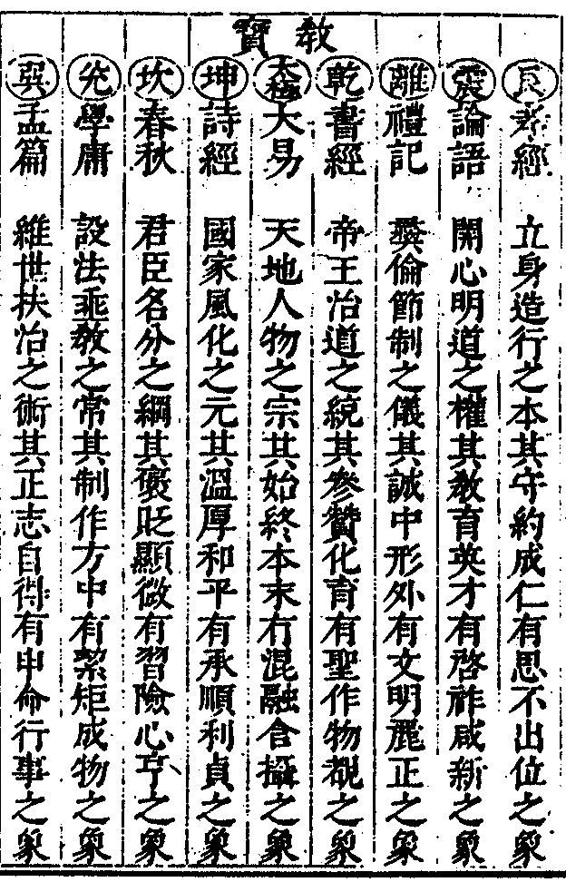
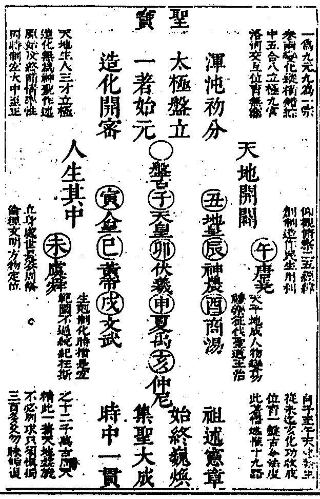
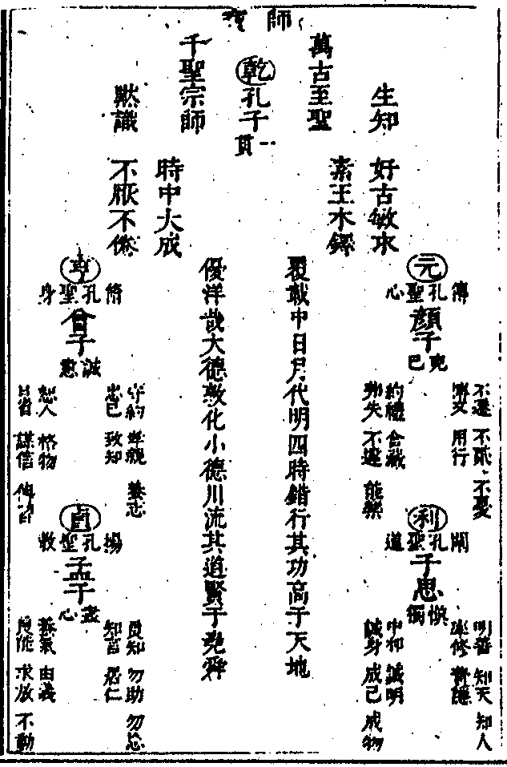
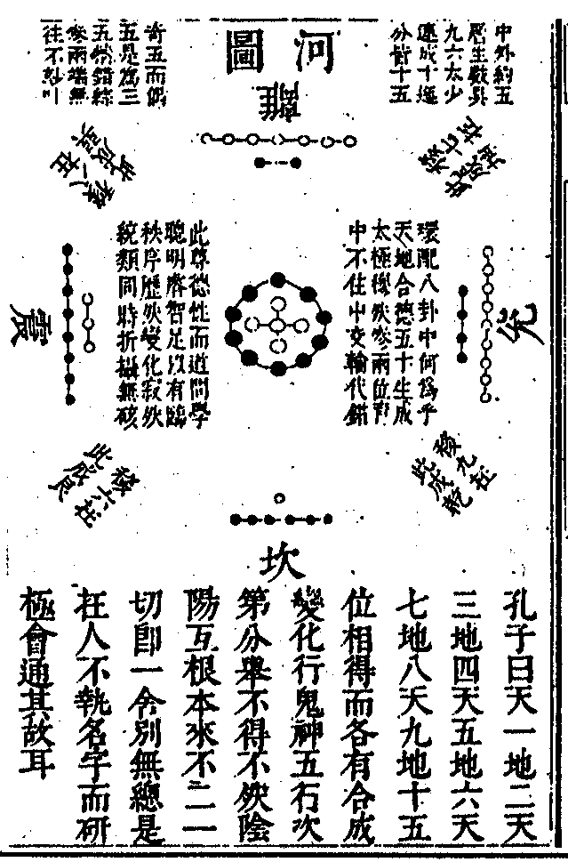
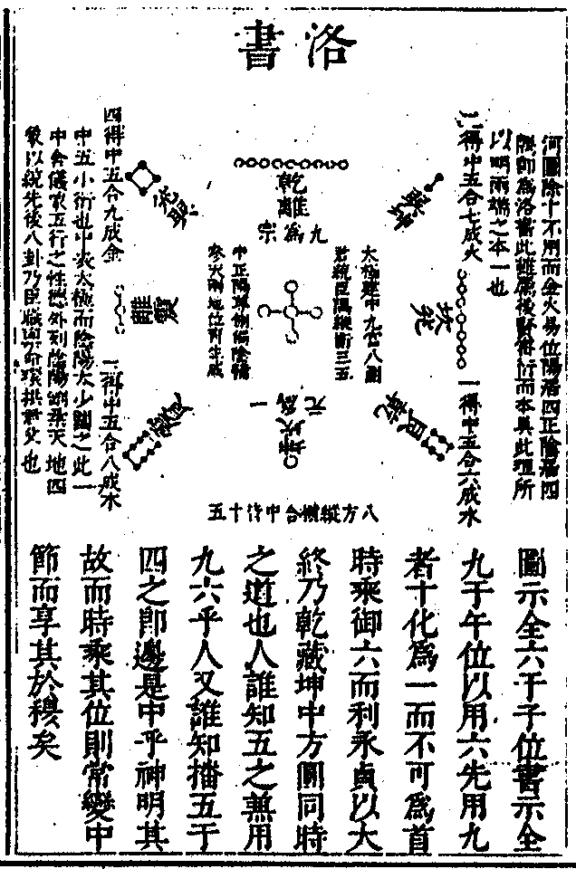
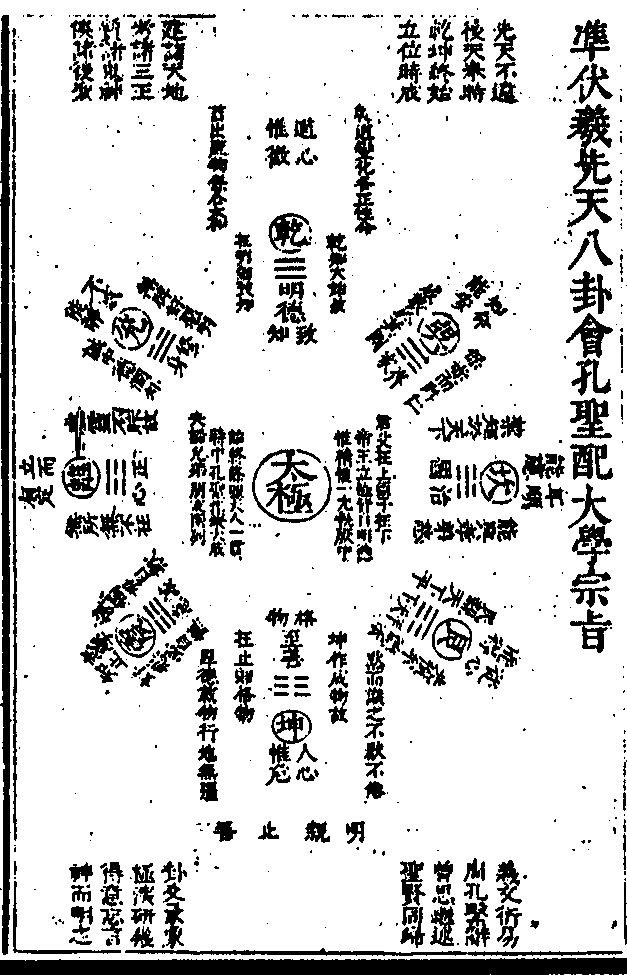
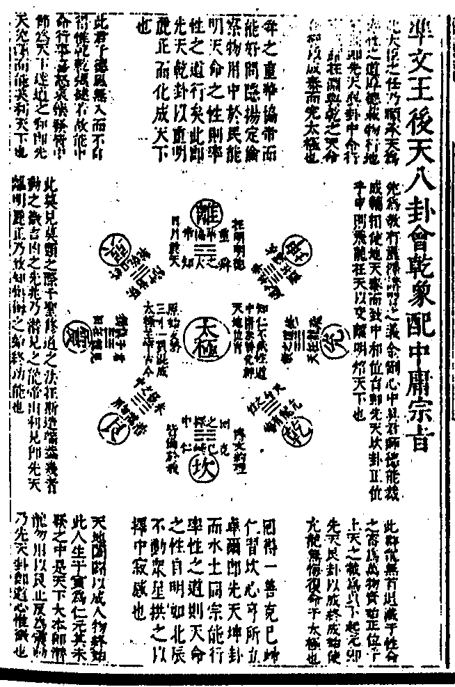
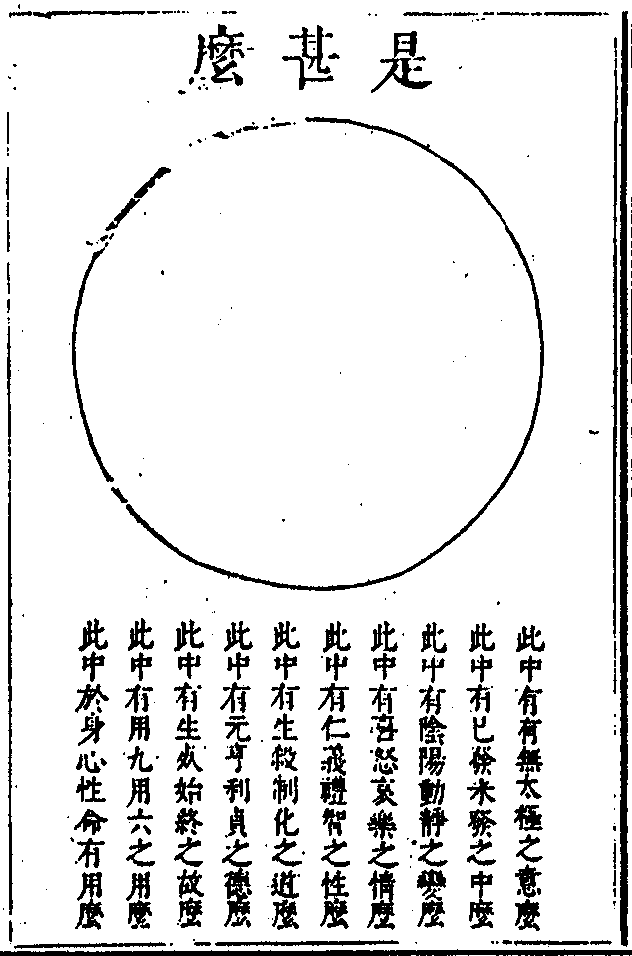
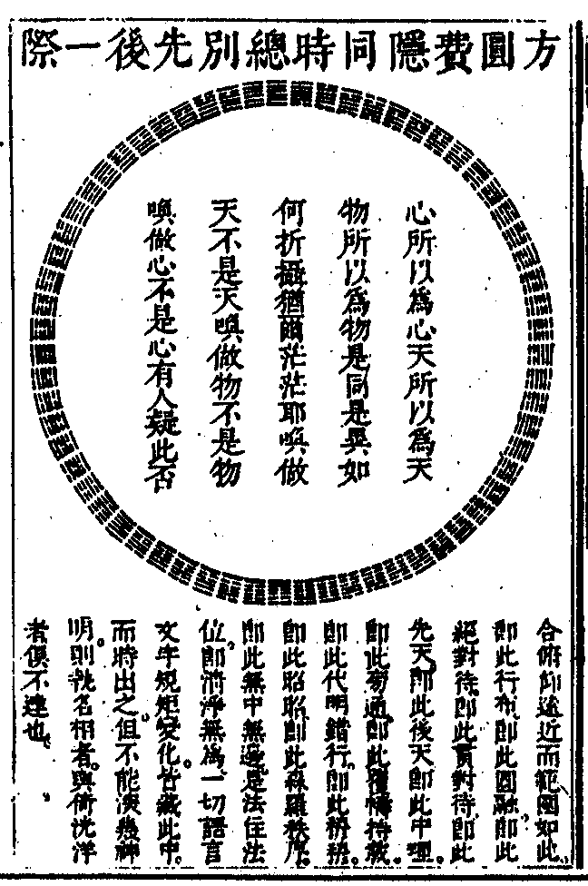

# 天界觉浪盛禅师全录



> **藏经**：嘉兴大藏经（新文丰版）（嘉兴藏）　**册次** 第 34 册（J34）　**编号** JB311　**部类** 诸宗部　**卷次** 33 卷　**篇幅** 444,516 字

> **卷／品**：0 卷 · 55 品



---



## 目录



  - [序](#序)

  - [序](#序-1)

  - [天界觉浪盛禅师全录序](#天界觉浪盛禅师全录序)

  - [龙湖宝筏语录序](#龙湖宝筏语录序)

  - [觉浪大师归寿昌序](#觉浪大师归寿昌序)

  - [寿昌觉浪大师语录序](#寿昌觉浪大师语录序)

  - [圆通语录序](#圆通语录序)

  - [洪都语录序](#洪都语录序)

  - [灵谷语录序](#灵谷语录序)

  - [金陵语录序](#金陵语录序)

  - [鸠兹语录序](#鸠兹语录序)

  - [觉浪和尚语录序](#觉浪和尚语录序)

  - [天界初录序](#天界初录序)

  - [崇先语录序](#崇先语录序)

  - [序](#序-2)

  - [尊正规序](#尊正规序)

  - [尊正规小序](#尊正规小序)

  - [尊正鉴序](#尊正鉴序)

  - [会祖规序](#会祖规序)

  - [会祖规小序](#会祖规小序)

  - [会祖鉴序](#会祖鉴序)

  - [五灯热序](#五灯热序)

  - [寿昌阒然禅师指据录序](#寿昌阒然禅师指据录序)

  - [憨山大师全集序](#憨山大师全集序)

  - [紫竹林集序](#紫竹林集序)

  - [重刻证道歌注颂序](#重刻证道歌注颂序)

  - [重刻悲华经序](#重刻悲华经序)

  - [释门真孝录序](#释门真孝录序)

  - [序](#序-3)

  - [合刻四当参序](#合刻四当参序)

  - [莲峰纪事序](#莲峰纪事序)

  - [寿世篇序](#寿世篇序)

  - [大观冯席之远复斋稿序](#大观冯席之远复斋稿序)

  - [大轮高笃生举餘编序](#大轮高笃生举餘编序)

  - [为周子彝立存存号序](#为周子彝立存存号序)

  - [重刻僧宝传序](#重刻僧宝传序)

  - [汤季云拈花社序](#汤季云拈花社序)

  - [唐集生大参集序](#唐集生大参集序)

  - [丁莲侣郡伯仗剑歌并序](#丁莲侣郡伯仗剑歌并序)

  - [吴二公半峰吟序](#吴二公半峰吟序)

  - [古人几序](#古人几序)

  - [金刚般若经修行会义序](#金刚般若经修行会义序)

  - [如涌录序](#如涌录序)

  - [吴瑟黄竹山归来吟序](#吴瑟黄竹山归来吟序)

  - [薛那谷孝经通笺序](#薛那谷孝经通笺序)

  - [寿嵩乳密和上七秩序](#寿嵩乳密和上七秩序)

  - [书义全提序](#书义全提序)

  - [老子骑青牛出函关图赞序](#老子骑青牛出函关图赞序)

  - [宝寿位中符禅师拈颂序](#宝寿位中符禅师拈颂序)

  - [义山且拙讷禅师语录序](#义山且拙讷禅师语录序)

  - [报恩南庵依禅师语录序](#报恩南庵依禅师语录序)

  - [新安仇氏家谱序](#新安仇氏家谱序)

  - [僧祥马培元近稿序](#僧祥马培元近稿序)

  - [天界浪杖人全录序](#天界浪杖人全录序)

  - [杖人翁全录集要序](#杖人翁全录集要序)



---



### 序



佛以大权示现，法华显实，末后惟拈一花东渡，别传直指，五宗焱兴，认花认拈，祗供棓喝，雷奔电拂，愈出愈奇，然识法者惧，能免逋薮耶？凌官球曰：「不可独行，不许僭窃。」陈旻昭曰：「须是其人始得，非可以依样按水葫芦斗卤莽也。」杖人於刀兵水火中求大伤心人，穷尽一切，超而随之，乃集大成、乃定宗旨，恰好托孤于竹关，则吾友也。今出世且二十年，龙天推出于青原，七祖倒插之枯荆竟发蘖矣。龙象骈集，缁素景从，敲金戛玉，节拍萧森，法乳流通，奉者得宝，拙庵凡夫览而叹焉。愚生近溪寿昌之乡，亲炙海岸黄公，又遇竺师盘礡，终县影事，后阅《药地炮庄》，仅乃汗出。今展此录，随场示应，惟礼拜退而已，更何语乎？然因时而徵一，寔有不得漫然过者。闻之曰：单提法身，尚有法身向上事，拟欲承当，剑去久矣。合啄敲唱，本无奈何，欻起斗绝，无栖泊分，不见一法，犹半提耳。全提纲要，包举弥纶，更有不烦扫建处，一切现成，然倚此胶杯，乃大病也。无方裁方，应病予药，须历事在，万古茶饭，柝薪炊煮，事理圆毕，从来增减不得，何容毫厘系念乎？双锁金𫔇，意句相铲，他出缪刺，隔治更灵，展演出格，亦是偶然。挥剑则利，握刀则伤，忌执而有之，所以随分拈提，宵练无迹。人但见其三堕纵横，不可拟议，而不知其泰豆氏舞交衢也。八音繁会，应接不暇，而祝敔历然，丝毫不动。或以为理窟残垒，或以为渊云餘技，不知其吞吐古今，皆我指爪。拈花落草，岂限町畦？木舌揵椎，异响合奏，正是随类现身，入田不拣耳。所至道场，翼翼谡谡，千指楼阁，不日巍然。按其践履，斲水喷雪，布袖平澹，来往翛翛，正是本色光明，寸丝不挂。县寓大畜，总作药笼，多生一生，具足渊源。三才一心之故，自少遍穷，行布本圆，五地五明，至颐象宜，直盐酱也。嗟乎！庄语不信，戏语不敢，姑从旁而质叙之。时哉雉噫！百淬金刚，委土新硎，不涉方便。天以世界为炉冶，人以痰疾生德慧。历浊奇缘，大圣或修偏行，集大成后，鸟道不妨横飞。况乎夙愿大人，应此午会，彻顶彻底，条理其中，超一切、随一切，而乘时统御之。深心大力，藏密无间，风雨露雷，莫非恩也。夫岂世出世间测度所能及哉？生死本无生死，何用赘疣？泥洹乎？竿木乎？任人牛马矣。果然二十年剥烂，不必为何事；自信三十年后，此话大行为何事。感此络索，千载旦暮，不妨覆叶于掌，就其一茎而消归之；更不妨挈多于林，举其全集而熏沐之。故以愚管为之嚆矢，愿同心者勿滞篱门，无负此午会可也。



康熙庚戌大鄣道中老山学人徐芳拜书。



------



### 序



生死发药，见于大宗师易，则以寂感蕴示端几，而神明其故者也。卓立几几，谁肯研极而与语？通神明，类万物，质俟不惑，其讵信乎？关尹曰：「以可得可行者善吾生，以不可得不可行者善吾死。」牛翼马手，是悟出否？佛以因果障狂澜，以戒定慧仁智交圆为理事，以拈花为契证，以法住法位为诚谛，此其概也。生来死去为疑城，天竺外道以有无四见矫乱，而惟惟决之，犹不豁然感佛恩乎？麻三斤、乾矢橛，一种棘栗蓬，果为何而设耶？习气难以卒除，及尽今时药病，展转嘘嘘，固然遯贵滑疑之耀，瑰士造闭以困駴，或掩行布以求圆，而诡随昌之，安得无午会之医？医者乘夙愿力，因法救法哉？药地大师渊源三世，觏闵穷尽，息喘杖门，点睛飞潜，非偶然矣。世无具真心细心者，畴能合鼎薪炮庄而通其故乎？公因反因，殊破天荒，实乃如此。自上叩之，时乘现身；自下铎之，随分自尽而已。此册切切，岂无攻坚以解者？杖人曰：「冬炼三时，乃享无冬无夏之天。此冬灰之旨乎？石头大师曰：『本末尽归宗，当知用及处。』玅协何疑？但背与庭代错为用耳。时为流通，以待神明者。」



东海学人兴翱赵㟲谨识。



------



### 天界觉浪盛禅师全录序



今日之佛法，不谓之极盛不可；今日之佛法，不谓之极衰不可。遍道场皆宗师，遍枣梨皆语录，人以为盛，吾以为衰。故欲从今日佛法之盛，救今日佛法之衰，则必举天下之证法王宝座者，尽夺其席焉而后可；举天下之称支那撰述者，尽火其书焉而后可。夫所谓证法王宝座之人，与所称支那撰述之书，游其门者，方共仪之，以为为人天作眼目、为佛祖续命脉。而一旦谓必夺其席、必火其书而后可，则彼之游其门者，方群起而议吾言之肆而且瞽，而欲从今日佛法之盛，救今日佛法之衰，将遂势穷于无可如何乎？曰：圣贤设教，有极盛之时，亦有极衰之时，亦无有极衰而不可救药之时，则为今日回光长夜，砥柱狂澜，亦不过从法王宝座、支那撰述中，而观其孰为数十年来所共宗之人，数十席中所共传之书，表而出之，以教天下。而天下之凡游其门者，亦或有以自止，而今日诸方名宿，亦或藉手以补救之而有餘。叩其人，其人如在；读其书，其书大成，则惟天界之觉浪杖人。盖杖人于一切处成等正觉，无住无不住，当时诸龙象奔走庭堂者，实繁有徒，诸名乡鉅儒，获聆片晌透一针者，亦无不心悦诚服，薰沐归向。而某以生晚缘薄，从未一亲其庭，乃于今佛法极盛即极衰之时，谓其人为世所共宗之人、谓其书为世所共传之书，而推崇之以为此真正令全提救时良剂，天下之人不几谓吾为随声附影、徇名失实，而怅怅然其何之乎？曰：非也。吾儒道统之传，有见而知者、有闻而知者，不得谓见知之人可以同堂共订，而闻知之人遂不可隔世传心。孟轲居战国，去圣人之世若此其远，而自谓予未得为孔子徒，予私淑诸人。究之知言养气、愿学孔子，千百载后宗其道者至跻之七十二子之上，与泰山曲阜俎豆钟鼓亿万斯年，推之于佛，何独不然？吾虽未登杖人之堂，不视其父、视其子，而犹及见其门之能嗣杖人之传者，前则有青原笑峰、今则有药地愚者，此两人在吾儒中皆天民先觉担当斯道，以文诠木铎之秘、以心维几希之微、以身系纲常之重，百尺楼上、千仞岩前，死生荣辱俱无足以动其心者，使非杖人煆炼锤凿，使生平豪气尽归淡漠、绝代聪明相忘浑沌，而欲俾其叶落归根、灼破两头，悟本超宗、回互玅协，头正尾正、永不退转，甘心出入门下，不其难哉？往笑公来住青原，吉人士屡请正席方丈，每谦让未遑，一则曰待老人至，再则曰待老人至。及闻老人圆寂，奔丧东下，不啻孝子哭其考妣。药公继主青原，揭地掀天，不落阶级，四方来学以为儒宗者，以为禅宗，而于杖人语录及别种著述，时手一帙以教同人，且欲举各刻重行参订，汇付剞劂，用垂来兹，较之析薪负荷、徒读父书者，大相迳庭。两人且不以予为不可教，而每于沉迷依恋之中，时施警策，间行唤醒。噫！两人之于杖人，固所称见而知者，而予虽未亲杖人，犹得从杖人之徒以闻杖人之教，亦岂敢遂谓闻而知者？而乃于佛法极盛即极衰之时，独尊杖人以挽回补救，使天下读杖人之书者，从此争自濯磨、争自悔悟，不得为见而知之人，犹得为闻而知之人，则举杖人之书而汇梓之，以行于世，功岂浅鲜？若夫杖人正法眼藏，变化机权，御一乘车，摧五魔道，片词微旨，触类旁通，不特有益于禅，而且有益于儒，则已有李梦白、黄元公、马培元、李小有、陈旻昭诸先生序以不朽，而予以未梦个中之人，敢与诸见而知者谈伎俩、味醍醐，今日药地、前日笑峰告之杖人，杖人有灵，得无急遣侍者日此卤莽汉推出门外也哉？



时康熙戊申秋月，青原弟子张贞生薰沐拜题。



------



### 龙湖宝筏语录序



乙亥、丙子之交，流寇方炽，予与同参友特延龙湖觉浪大师於宝筏禅林开堂说法，正欲藉此以一番振作也。人初或疑之曰：为此迂事，斯何时者？及大师升座，顾鉴嚬呻，激扬阐发，人天围绕，无不钦悦，所谓王登宝殿，野老讴歌，正令全提，群邪皈命，岂非诸法性无常，佛种从缘起也哉？夫出世宗旨，大师已弘宣其密，余世内人也，请以世谛重为质之。贼势孔棘时，士民之饔食如故乎？市肆如故乎？诵读如故乎？是皆不废，何独废说法耶？法即饮食之知味，出入之门户，定乱之兵符也。夫既如是，而又孰能废哉？况今聚而闻法之士，即合而城守之士也。总斯人也，饥而食、寒而衣，寇至而登城，寇远而闻法，城守不碍於闻法，闻法亦何碍於守城乎？盖守城之害有三：一畏心，二悭心，三分别心。见贼轻逃，困乏不济，左右分袒者，此三心之崇也。大师说法，首破此三心，单刀直入，大震全威，出死入生，神变自在，人人如此、心心如此，何忧乎办贼已哉？毋论瞿昙举步，殃崛旋机，慈指放光，狂象奔伏，唐不空三藏持《护国仁王经》，致毘沙现身而吐蕃归化，即吾儒分中驱鳄渡虎，单车诣垒，贼不入境者，一皆精贯天人而成此功用也。况大师祖印真传，门庭孤峻，委心乱世，调御摄持，独揭刚圈，严施棒喝，太虚空中抽钉拔楔，普门示现，度脱无方，於兵戈中惠诸三昧，处危城里转大法轮，斯可谓真能大兴宝镜宗风，善入不变异处，任他三堕纵横者也。蹄驰火宅，大车之赐岂迂？掉拨烟波，宝筏之乘何快？谨集斯录，用广法施，具眼高人，言前荐取。



崇祯丙子楚黄学人李长庚拜题。



------



### 觉浪大师归寿昌序



余少从丘长孺处，望见龙湖老子，颜色书生，茫茫然未知领解。在长安，从袁伯修兄弟游，始知吾宗门大事，时时激扬。每归来，辄向綦隆、黄檗呈之。念公屡遭痛骂，十餘年间，前后不啻十餘次，虽根钝机迟，不蒙印可半字，而于不蒙印处，觉有少分入许。不觉念公先往，自叹大事无缘，止将性相经论度目过日。世路风波，又历十餘载，此念亦闲置矣。山居，值寇盗干戈，谋生无计。一日，有僧慈遍以雪关大师问答语见示，触动风机，不惜败缺一二妄呈。雪师婆心困彻，批驳钳锤，极力相为，于托钵公案尤加针劄。会觉浪大师主龙湖，盖二师皆博山龙象也，一见深相契合，有所问答，另具录中。一日，与诸英衲同集，偶举时节因缘，有举众生心缘起诸如来者，有举如来为一大事因缘出世者，举大通智胜佛十劫坐道场者。余因问座僧恒鉴：「比如文殊不能出女子定，罔明出之，是何因缘？」鉴曰：「此罔明有缘。」师震威一喝曰：「不是。看取托钵公案。」余拍案曰：「大师何得平地杀人？」恒鉴通身汗下，余亦默有省。会师坐禅堂，举拄杖子连问余二次，余不置对。盖余是时於世法内事有所回互，故不欲当机，以三颂呈之。颂曰：「荆棘丛中解敝衣，旋风八面解重围，须知微服兼章甫，孔子曾呈第一机。师因出世婆心彻，我为世法彻婆心，同是一般琴与笛，无弦无孔说知音。四十年曾坐艸衣，秘宣内外有玄机，没踪迹处藏身是，谷口寒云自在飞。」师笑颔之。值梦笔山僧众来迎，为了先寿昌大师扫塔之约，欲暂还江西同参，大众悲泣挽留，如丧考妣。一夜，忽梦一[虫*縈]蝉长七寸，一鹊下逐之，[虫*縈]蝉走入艸中。余曰：「险哉！」回首见师，曰：「俊哉！」惊寤，复合眼，见师喝云：「休去！歇去！」余曰：「余歇去矣。」师又喝曰：「谁教你歇来？」余惊起披衣，待走禅堂，则师已戒行矣。僧允中请师升座，请末后一语。师说毕，下座，复坐门外，大众齐集。时多儒者，师举云：「颜子喟叹一章，书仰钻瞻，忽求之于道；孔子一博一约，指出我来。所以教中云：万象之中独露身。」余问曰：「云何清净本然，忽生山河大地？」师云：「遮一问，何处起来？」师因问余曰：「比如才举末后句，儒家也有麼？」余曰：「和尚放过某甲。」师云：「放过了。」余曰：「群龙无首。」师云：「遮是当头话。」余曰：「过此以往，未之或知也。」师曰：「再举。」余曰：「子出门人。」曰：「何谓也？」师良久，曰：「情到不堪回首处，一齐分付与东风。」盖龙湖为邑先辈周柳塘先生开堂，卓吾老子及念公久住，以三大师之区，非大师不能复兴，一时大众殷留。是地出余母曾氏，故曾氏诸君子留之更摰。师于佛前证盟，扫塔后即还龙湖，大众方为安心。余又献颂三章曰：「黄金灵骨尚依然，万里清空塔影圆，月印千江同一点，龙湖先挂夜明帘。谷口云深路不迷，青山行令正全提，莲花出处杨花著，池面浮萍池底泥。洒泪丝丝别去津，莫言离别念非真，更将末后频频问，兜率如今笑转新。」师云：「虽然，不可艸艸，更为升堂一说。」师升堂说毕，问余曰：「闻汝在看《法华》，有何言句？」余曰：「昨看〈提婆〉，只有一颂呈上。颂曰：平地孤堆最误人，枉将法座赚冤亲，瞿昙自有金针度，认影迷头又隔津。」师云：「何不道提婆别有金针度？」余曰：「恁麼是老婆勘破有来繇也。」师大喝一声，下座。



丙子六月，楚黄学人李长庚稽首题。



------



### 寿昌觉浪大师语录序



先寿昌得无师智，特唱玄风，末后以一枝佛法嘱付东苑，诸方咸讶之。余见东苑嫡子浪公，机用勦截，雷轰电掣，有德山、临济门风。公尝亲见先寿昌默受心印，故手眼与诸方迥殊。耆宿见其言句，尊之日新。寿昌盖谓吾师独传先祖真命脉也。诸方悟得乾萝卜禅，口如扁担，安得纵横自在如我师之辩才无碍哉？三种渗漏，独我师能脱格单行，洞水逆流。吾见其人，闻其语矣。



崇祯丁丑中秋，寿昌法子黄端伯和南题。



------



### 圆通语录序



长庚昔尝参诸尊宿，或指示、或商确、或机锋、或棒喝，然未有如今觉浪大师之奇迅超绝、纵横玅协者也。盖师於世、出世法已透内圣外王、先佛后祖之微，故其神发秘旨、光阐玄猷，不特为学人衲子点眼刳心，直当与儒师宗匠返魂夺命。此非庚独佞於师，试请披读龙湖、寿昌、新城、福山与今圆通诸语录，及植圣、尊正、别傅、法印、宗盟诸著作，始知古今衡鉴，非一人敢私也。师尝云：「治世之道，以尧、舜为正始，文、武为正终。其删定作述，独孔子能始终一贯，集众圣大成；不则，尧、舜、文、武之道亦支离而失其浑全矣。至於出世之宗，以达磨为正始、五家为正终，若不有如孔子者出，则此宗犹未免于散灭也。」即此足见宗门孔子当仁不让矣。师方出世年浅，且多涉贼乱中，故海内知师者尚少，而黄元公乃今之杨大年、张无垢也，本出先寿昌、博山之门，所以於师独亲。庚亦繇是得与密交方外，共事大师，不啻马祖、石头当世，岂非夙生承禀，今复同时者乎？况兹应匡庐、圆通、旻古佛折半破三，於三百年后重来大作佛事之识，则师为古佛再来，信有徵也。恨庚老矣，使得加我数年，以随天下英杰共睹厥后奇特，不亦快哉！谨序其斑，窥以质正同参云。



崇祯己卯年上元楚黄学人李长庚伏首撰。



------



### 洪都语录序



向上事，语忌十成。若错认定盘星，则河阳新妇当侧身局影，三日不出声。艸昧初基，人情沕穆，不设触讳之禁，不架箭锋之机，拈花倒竿而已垂衣拱手矣。当时传法，仅凭一金襕袈裟，或偶垂半偈，而法穷则变，衣止不传，则各立一赤帜，或秉拂子为爪牙，或推枕子为锋刃，不过一节度使信旗。五家异军特起，倒用魔印，假道虞境，火牛木马，俱从幻出。虽使血溅梵天，入廛出巇，尚不许将军见太平，岂有圯上兵书可相授受？而韩卢逐块，扪响追空，狡已脱而薮者尚待於株，亦宗门之季世矣。觉浪大师自寿昌得法后，应古佛县记，建圆通一刹竿，乾闼王瑟，任指出声，法界不藏，驹蹋天下。遂憩章门，演泰定，列缺雷雨，九土膏坟，随三根人而接诱之，各赴来机，岂非时节因缘使然？表冲旋三十年，未得喷地，一蒙深劄，更无伎俩可呈，誓奉深心，尘刹永依座下。独怪老人舌覆大千，未留一字，徒吸尽西江而去矣。亲到圆通，再为拔本。



弟子丁立表题。



------



### 灵谷语录序



不孝於衰绖中，方悲慕罔极，忽忆古德云：「大事未明，如丧考妣。」转觉痛切。亲不知亲之去处，我不知我之始终，此真亘古今所共之生死大疑情也，安得不疑？又恶容自己？偶故人罗君邀过灵谷，访圆通浪大师。予初以宗门多拒绝人，及见师接尘笑谈，高闲雄快，因从容问曰：「学人参道，可以开谕乎？」师曰：「道也者，常也。其性则主乎天地古今为独灵，非身世生死所能变灭，故佛称曰：『奇哉！』正以人皆有之，而人多不能自有之，反以至常为至奇也。孔子能发愤好学，故曰：『朝闻道，夕死可矣。』惟孔子能自得之，故生死不足为累。其谓孔子不悟无生大道，不与佛同，大权示现，前后唱酬，吾不信也。今儒释自畫为二，道本大同，而不相为谋者，则不善学之病也。」予不胜倾倒，因相与游於松风石涧之上，盘踞而坐，烹茗对酌。师忽指涧水曰：「公见麼？」予曰：「逝者如斯夫！」师正色曰：「公又恁麼去。」予时悚然良久，复问曰：「幸师指示。」师曰：「莫被人欺瞒好。」予於是脱然，始知大事未明，不可不见明眼人也。乃于所寓循公房题其额曰「遇浪处」，识所感耳。时予太座师姚太仆公子愚谷世兄，前於江右弃官从大师学道，深得钳锤之力。自丙子夏仲都门别来，几及十载，始复晤谈甚惬。世兄以大师全集及灵谷新录示予曰：「此新序必藉一言。」予虽不文，然感师指示，不敢不勉。焚香披阅一二，见其白椎说法处，或掀天揭地，电卷雷轰；或化日春风，花香鸟语；或呵佛骂祖，颠倒英雄；或骤帝驰王，权衡治乱。至於热呵痛棒，拔楔抽钉，收放杀活之间，真不可得而思议也。然忠孝之故，剖肝胆而不辞；彻困之深，擒虎狼而独捷。要其指归，则尊正会规，集成佛祖之统宗；谈易论学，继述周孔之道法。其欲会同世出世法，以定天下万世宗旨也，人孰测师之深意哉？昔欧阳文忠公见明教嵩书曰：「不意空门有此。」即予谓师实总南阳明教，与觉范、玅喜不足多也。予暂得及门，未悉堂与中事，仅述所窥如此。大方明眼有深知师者，当别有向上一著在。



崇祯癸未，古滇学人王锡衮稽颡拜题。



------



### 金陵语录序



古今持世之功，存乎佛法王道，故二帝有施济犹病之心，诸佛有度尽众生之愿，无其事有其理，有其理非无其事也。汉、唐、宋历代之君臣，或弃王道以奉佛法，或辟佛法以尊王道，尊王而不及纯王，奉佛而同於谤佛，皆争於其末之分，未窥於其本之合耳。独我太祖聪明睿知，临照万方，於龙兴之初，即建诸梵刹，显彰宗教，阴翼皇图，传一贯之心，杜纷争之口，非惟相万於前代之辟佛者，亦相万於前代之奉佛者，三百年来，久安长治，此其徵矣。迩来缁俗相沿，多迷本智，师承大坏，搆忿执迷，假儒衣书，士非真士，傍佛门户，僧非真僧，貌儒佛津梁，入尘劳缰锁，莫觉莫悟，迷者愈迷，罕闻身心性命之真宗，遂酿水火刀兵之劫运，天人减损，魔外纵横，洵莫甚於此际。圆通觉大师以正法眼直指全提，行世难行，度人难度，李梦白冢宰之叙师云：「不特能发扬先佛后祖之秘，即圣学王道之宗旨，亦无不抉尽其微。」可谓知师矣。历观佛祖出世，玅在救时，无法不收，无机不被。师於今日，若但如德山之见人便棒，临济之见人便喝，睦州之见人便闭门，俱胝之见人便竖指，此又何难？正使鉴顾动容，开悟正性，谈笑挥指，销落偷心，此乃师之全机大用，玅辨宏才，炤用纵擒，正偏玅协，世间出世皆有证入之门，上智下愚悉受平等之法。师尝谓：「扶阳太过则抗，扶阴太过则惨。」使诸方参学知其门庭高峻，不专在棒喝拒绝之严，正当如春风时雨起其焦枯，不期荣而自荣，不期化而自化，何籍肃杀之气行於惨害凋伤之世乎？师且目击弭乱之转乖，心伤阴翊之靡度，恐贻佛法无灵之谤，痛自责成於己之深，故能示不杀机，立无死地，开龙战勿疑之血脉，复硕果不食之贞元，为法求人，为国资治，通二帝施济犹病之心，行诸佛度尽众生之愿，必祈今日佛法指归，上报皇恩至化，如斯救世，谁谓无人？或谓留都宰官骈集龙象，谛观师结制灵谷时节因缘，正大化宣流之日，师盖以金陵为龙兴之地，图王奉佛精神可求发扬於此，振其末必循其本也。至於万法同时，亦如楞严会上十方微尘国土一时开现，佛之威神令诸世界合成一界，宁止续达磨之灯、超宝志之座乎？盘旧闻道风，新渐法化，然根性下劣，于师未知少分，兹从所见而言之，仅入门之歌叹云尔。



淮南弟子李盘拜题。



------



### 鸠兹语录序



觉浪大师胸有智珠，舌为宝筏，天龙推出，为大地儿孙飞洒法乳，余亦仰乳儿孙之一也。今兹中春，师不果栖贤之游，以浮丘作化城，余亦适省沐居里，函丈有期，魔娆间生，梗我良觌。及余蓱寄姑溪，闻师将赴堂，席於姑之白纻，为停归驭以迟之。已而遇师鸠兹江浒，磬折才终，世缘相嬲，提命无几语，然满堂目成，懑然心服，知祖印固在师肘间，众仰所归，固不虚矣。余往之，知师不离文字因缘，诸锓行法录，比诸宝瑶，所至必俱。尝举谓友人鸠兹璃柯罗子：「大师行世文字，何必减玅喜、幻住二老人乎？」今师鸠兹法语踵行，勺公属余为弁，适璃柯别余江上，指示水滨高刹，「前此千春，杯渡道场在焉。以神通论，应让前人，若云单提祖印，一代津梁，定属今日浪杖人矣。」余韪斯言，敬录以引龙眠史。



参学王大礽题。



------



### 觉浪和尚语录序



天下之盛会，莫若江南；江南之大善知识，莫若觉浪和尚。年未古稀，而闽楚吴越江淮以底，旧京建业展坐具者，阅历五十会，声名洋益，无间华夷，到处云行雨施，影从响附，钦为明神，恋如慈父，实目前所罕遘，往昔所希有也。良繇洞上真钢刮人眼膜，梦笔灵气直射斗牛，居恒澄彻一门，该练三学，遂使儒门澹泊收拾不住者，都得皈师，换一头面，翻一筋斗，而禅门之徒无论，玄门之徒又无论矣。不急尝读《孟子》七篇，至末章叙述尧文，至孔子见知闻知道统，皎於日星归结，然而无有乎尔，则亦无有乎两句著语，囫囵咬嚼不破，全似言语道断，见闻双泯，从此无复担荷鲁道之人，金丝堂钟鼓章䙜，刹那间交付西来衣钵矣。又尝读《庄子》，有东郭子问道恶乎在，庄子叠答以在蝼螘、在稊稗、在瓦甓、在矢溺，又有与物无际不际之际等，是全似麻三斤、乾屎橛，前后际断，为呵佛骂祖西来大意，无义话头最先嚆矢，抑何奇物吻合甚也。是知孔教而孟宗，老教而庄宗，释迦教而达摩宗，宗中教，教中宗，参同玅协，臭腐神奇，则浪和尚之坐进此道，而集三圣大成，固有不可思议者在矣。是以笔说舌说，实说权说，横说竖说，旁说曲说，炽然说，无间歇说，语大莫载，语小莫破，毫末不足穷至细之倪，天地不足穷至广之域，所谓万川归之，不知何时止而不盈，尾闾泄之，不知何时已而不虚，尺水可使兴波，狂澜偏能砥柱，逝者不舍昼夜，资深若决江河，即令四隩横流，大地陆沈，毕竟大觉海中，前波不动后波，后浪一如前浪，眼见倾湫倒峡，换谷移陵，总不越曹溪一滴，青原半点，洞山五位，东苑一指，呼吸飞洒中，万派朝宗处，源头活水来，遇此解者，可许读浪和尚等身著述，少分相应乎。不慧自从白下沧桑之日，尘刹相对，浃岁盘桓，数数然望洋向若而叹，拊髀雀跃而游，比来檇李两番，卓杖诸刹，翘首企足，瞻礼趋迎，恐后旬月之间，说大戒於龙洲，而真如、而楞严、而天宁，幢幡争致，鼓吹同声，浩浩说法，狼籍如许，悉凭朱葵石郡侯，矢无边心，缔最上契，纯陀之供屡修，维摩之坐常满，圆就枣梨香积，终始轮藏胜因。自憨山、雪峤两大师，飞锡我禾，檀缘辐辏以来，未有如浪和尚之擎扶象教，拂拭禅门，咄咄后先辉映者也。神豹寸班，吉光片羽，禾录之视诸录，特芥子之纳须弥耳。而明眼人，见偏得全，闻一知十，不止作东土文字观，并不止作西来无文字观，则於标一函三之旨，思过半矣。



曹溪侍者福徵谭贞默槃谈谨撰。



------



### 天界初录序



余下根钝器，衰老失学，每见世间文字及诸方语录，堆床积案，便眼昏头运，不能开卷。每拈懒赞语，那有闲功夫朁俗人拭鼻涕耶？然每於灯残月落，梦回寐醒，先佛古师一二染神剋骨语句，影略逗漏，时时落齿牙喉吻中，如小儿弄语时，婆婆和和。有人诘之，茫然不能置答，有掩口一笑耳。与觉浪和尚相闻十餘年，始得把臂不交一语，顿觉心腑清凉，辄伸笔为文以赠。顷又见其天界初会语，是四十年前与焦弱侯诸先生聚首提唱者，迄今藏弃箧笥，未有人著语。而公之上首鹤谿猥以见属，每欲下笔，辄作婆婆和和然，是又可一笑也。常闻长者言：「本朝禅门自琦楚石、泐季潭后，一灯迢然。而憨山大师盛称寿昌无明，以为法眼圆明，振起末俗。」今浪老实寿昌的骨子孙，建大法幢，狮弦继响。读斯语者，有以洞见其提挈纲要、照用纵夺之机，无以斯世颟顸儱侗、冬瓜瓠子之禅同类而举扬之，庶不为延津刻舟之人所窃笑也。昔吾憨师赞寿昌之像曰：「突出大好山，千里遥相见。」博山见之，以为知寿昌之深无如憨师也。今吾幸於暮年得见浪老，相与敲空作响，无舌而谈。善财童子登妙峰顶，不见德云比丘，及见德云，乃在别峰之上。盖余与浪老所谓千里遥相见者如此，鹤谿以为然否？



岁在戊戌夏五望日，海印弟子虞山钱谦益和南书於杭城之报恩院。



------



### 崇先语录序



皋亭浪和尚真不可以名状也。自弱冠即得无师智、自然智，自能悟道，特定宗旨於寿昌、东苑二祖父，从此以一杖拄天地，双眸炯古今，放九界身光，施十方法乳，剖三藏秘旨，透五宗全机，直使横亘竖穷，负此灵性者，皆知自己心中有法界，主中主之恩力也。古云：「寄诸空言，不如行诸实事。」而师四五十年来，坐道场五十有餘，会著作佛祖儒老内外篇集百有餘种，无一不是创语，无一不是活机，无一不是痛心，无一不是刺骨，每於刀兵惨杀巾开创兴复，行人之所难行，道愈高而心愈下，己愈损而人愈钦，无彼此而能曲顺机宜，忘悟述而得大同物类，参同法界，丽化宗灯，密金针於锦缝，提向上於牢关，托三教之真孤，寄九流之正命，千圣混而知处，诸方类之不齐，尤於洞上之君臣父子功位正偏，与济上之主宾人境玄要照用，有关於圣学王道，处处加意发明。使天下无此名教，则不成天下；古今无此宗旨，则不成古今矣。师昔有诗云：「吾人性所全，用舍有独至。其存万世谋，惟一知己地。」秖遮万世谋、知己地，是何宗旨之妙密乎？即洞山之邈真，临济之吃棒，德山之见龙，沩山之拨火，云门之撺杖，法眼之竖指，不有知己地，而能存万世谋乎？推此则可见师之性所全矣。旦根识暗昧，何足以窥一班。三十年来，仰师之名，前读诸刻，直下令人心死汗下。去冬始得到皋亭参谒，一瞻眉宇，如天日春光。一听法音，如迅雷启蛰。深知此崇先之真歇宗脉真不歇。五百年后，有能使宋高宗敕建之崇先显孝，得以光被於天下。而昔时之文章道学节义，更当超超振起於两间，已有在於此录也。旦何幸获附一言於千古大光明之下哉。



当湖铁雪弟子行旦马嘉植薰沐拜述。



天界觉浪盛禅师全录目次



卷首(新序旧序发凡)  

卷一(上堂)  

卷二(上堂)  

卷三(上堂)  

卷四(上堂)  

卷五(上堂)  

卷六(小参)  

卷七(示众)  

卷八(普说)  

卷九(茶筵法语)  

卷十(法语)  

卷十一(机缘)  

卷十二(颂古)  

卷十三(源流赞)  

卷十四(赞　佛事)  

卷十五(偈)  

卷十六(附载)  

卷十七(塔铭)  

卷十八(诗)  

卷十九(论)  

卷二十(论)  

卷二十一(序)  

卷二十二(序)  

卷二十三(记)  

卷二十四(说)  

卷二十五(说)  

卷二十六(说)  

卷二十七(书扎)  

卷二十八(题跋)  

卷二十九(杂纪)  

卷三十(杂纪)  

卷三十一(杂纪)  

卷三十二(杂纪)  

卷三十三(杂纪)  

卷三十四



> 目录终螺川(王腾霄书　曾毓祥梓)



天界觉浪盛禅师全录卷之一



门人　大成　大峻　大然　大浩　较



上堂



己未冬，莆田林宗伯，偕诸大謢法，及住持翠林大心，狮林大灯等，请於莲山国欢寺开堂



师云：「此一瓣香，佛顶𩕳上透出，正眼藏中拈来，祝延今上皇帝一人有庆，天下太平。此一瓣香，同胞共乳，灶里生莲，一气连枝，各自横出，今特拈来供养堂上曹山本寂、国欢文炬二老祖，藉此穿过天下人鼻孔，撩出天地人眼睛。此一瓣香，烈如鸩毒、猛似灵丹，劫火光中夺得、黄龙颔下探来，今特供养中兴曹洞宗寿昌先祖老和上、东苑本师大和上，用酬法乳之恩。」上首白椎竟，僧问：「二株五派以何相传？」师云：「云度钟声彻九天。」进云：「莫是突出大好山，千里遥相见麼？」师云：「行人更在千峰外。」进云：「东苑独出一枝，与少林分披五叶，还有同别也无？」师云：「解笑还他碧眼儿。」进云：「恁麼则心心相印无差互也。」师云：「直须亲透此消息始得。」问：「如何是西来大意？」师云：「露柱贴膏药。」进云：「如何是九年面壁？」师云：「洗手解烟包。」进云：「神光三拜见个甚麼？」师云：「怕死不称冤。」进云：「达磨谓之得髓时如何？」师云：「吃土须咽唾。」进云：「便恁麼去时如何？」师云：「平地莫跌交。」问：「昔年灶里如何解生两朵莲华？」师云：「雷部主青山。」进云：「恁麼则声震古今也。」师云：「恼乱水火神。」进云：「曹山文炬，一母所生，皆证祖位，是何愿力？」师云：「乌碗飞，白碟走。」进云：「莫是各显神通麼？」师云：「山门无口，石磉咬人。」进云：「今朝重主法席，早见洞水逆流。」师云：「线穿红叶奉双亲。」进云：「恁麼则千古儿孙皆得力。」师云：「谁抚梧桐思凤凰？」进云：「今日开堂祝圣一句又作麼生？」师云：「阖国欢呼无量寿，普天乐唱太平年。」乃震声喝云：「会麼？千圣齐拜下风，未为分外；十方同时鼓舞，乃见希奇。到此还有领略承当处也无？」大笑云：「可惜许当年老达磨初遇梁武帝，不曾推上此高座子，看他将西来的的意作麼生举似人？若只是廓然无圣，对朕不识，可谓面皮厚三尺，不被明眼人掀翻座子，亦当自打退鼓，折芦渡江而去，那复出乖遗丑，累及后世？秪如莲山今日重新出世，莫是特为初祖雪屈麼？儿孙各有超群志，岂肯区区较是非？然则特畫乾坤祝万历主一句当作麼生道？讴歌不识羲皇德，海阔天空日月高。」下座。



海澄诸居士请上堂



「今朝十月十五，手提贯珠慢数，高声只念弥陀，不敢呵骂佛祖。活冤家，恰值顺风耳聋；生魔障，刚遭千里眼瞽。决定今日莲山，又是呵骂佛祖，翻身急报阎罗，忿气冲冠大怒。撞幽冥钟，击阴司鼓，会同十殿阎君，要使刑罚得所。商量重铸油锅，计较新栽剑圃，必须活捉莲山，亲身受此极苦。牛头阿旁奉命而来，争奈先声夺其气主，近前却要近前，触忤不敢触忤。苦哑苦！莲山见之，不觉大笑一声，直得十方法界与地狱天堂，一时化为水乳。正当恁麼时如何？天涯何处觅灵云，桃花乱落如红雨。」



罗山碧天师遣徒持曹能始居士书来，请上堂



问：「春间罗山结制，冬下莲屿开堂，总是和上高踪，还有门庭堂奥之别也无？」师云：「罗山吃白饭，莲屿饱青精。」进云：「紫罗帐里撒珍珠，到处光明还灿烂。」师云：「莫须倚在锦屏畔，令人旁指作阿娇。」乃云：「罗山拈头不便，莲屿捉尾谁能？三人证龟成鳖，木蛇笑倒枯藤。曹家女切莫作怪，蜘蛛丝咬杀蜻蜓。石仓居士且披禅衣，作李夫人叫救的梦；碧天长老好提数珠，敲叶相国底棋枰。归去来兮，聊寄三十拄杖，莫教我摈出首座，只因差一著，赚却古传灯。」



佛诞日上堂



问：「出生时已指天地，何到雪山六年后乃悟道？」师云：「烧羹易吃，冷债难还。」曰：「毕竟如何？」曰：「嚼破舌头不是肉。」乃云：「拄杖子忍饥耐渴，坐地吃了须弥山，曾不见谢土？吸了大海水，亦不见酬源？夜来创个奇论，谓佛生时原不曾指天地，后亦不曾观星悟道，此皆捏怪，云门故欲打杀。和上明日上堂，举出此意，岂非斩新公案乎？莲山大喝曰：『遮妖怪！』便乃拗折，抛在大火聚中烧去了。今日拈得遮条新拄杖子，头正尾正，不敢妄生节目。若有问世尊初生意旨者，但打云：『恭喜你，好彩头。』又有问雪夜观星者，但打云：『恭喜你，好结款。』更有问中间与出世为人事作麼生，但打云：『恭喜你，千古春风常在手，但教随处有生涯。』」喝一喝。



上堂



「文殊、普贤忽起佛见、法见，被世尊摄入二铁围山；莲山拄杖子忽起佛见、法见，被我一捏粉碎，撒向十方微尘国土，皆成大菩提树，根盘大地，叶覆三千，各各树下有世尊成等正觉，吹大法螺，击大法鼓，演大法义。拄杖子忽然翻生，又变出许多神奇魔王来，毁佛、谤法、灭僧，恼乱十方诸佛。佛大笑曰：『煮豆燃豆箕，豆在釜中泣，本是同根生，相煎何太急？』魔王呵云：『犹自念曹子建底诗章在。』佛曰：『你亦念个诗章看。』魔王曰：『欢在粉墙上，侬在粉墙下，细语欢不闻，压碎鸳鸯瓦。』」蓦喝一喝，拈拄杖将大众打散。



小年诸庄夫请上堂



问：「南泉不出方丈，到庄上吃油糍，是何作用？」师云：「邪言不入正人耳。」进云：「庄主亲到方丈谢降重，是如何？」师云：「何似时衰鬼弄人？」进云：「和上尊重不受请，今日诸庄送供养时如何？」师云：「好好与他一顿。」进云：「有过也无？」师云：「重赏之下，必有勇夫。」进云：「感恩不浅。」师云：「打鼓为三军。」乃云：「风俗作小年，灶神送上天，天帝有何说？更不与人传。果是个泥瓦合成，灵从何起？蓦地却生出两朵莲，只今谁能向我杖头讨个压年钱？」



除日上堂



「南泉提起猫儿，刀前谁能救得？洞山收却果桌，句下孰能转身？子湖捉住贼僧，如何承当不下？大随随劫火去，直下无能知归。遮里一一得个出身句，我与你分岁尚且大有事在。洞山云：『三途地狱未是苦，衲衣下不明此事最是苦。』诸兄弟！抖擞眉毛已是堕坑落堑，平日急急整理手脚，如狮子游行哮吼返掷而去，虎狼野干闻之遗尿失魂，谁敢当前与作敌哉？暂时失念，瞥起偷心，打在软洋海底挣命不起，后日莫怪不为汝等道破。」



乙亥九月，麻城刘邑宰、李太宰、梅中丞、周司马、陈司寇、梅惠连、李公楫请於宝筏寺开堂。



师云：「此一瓣香，天然尊贵，巍巍莫赞，荡荡难名，奉祝皇帝陛下圣寿万岁，伏愿位育建中和之极，统御庆日月之光，诸大护法、宰官、居士亲扶法座，共振宗风，伏愿生生示现普门身，世世庄严真佛刹。此一瓣香，昔日无欺，今朝不昧，光明妙密，拈对人天，供养中兴曹洞正宗始祖江西寿昌师翁大和上，用表亲定宗旨之嗣。即此一瓣，同气结根，连枝发秀，供我信州博山本师大和上、建州东苑本师大和上，用酬一参一证、双垂法乳之恩，伏愿大众同生钦重。」堂主白椎，云：「法筵龙象众，当观第一义。」师良久，云：「观见麼？大镜中天，物物自照，若更待扬眉瞬目，已是增金之黄、添玉之白也。虽然，今日山僧升此宝华王座，还有向上全提也无？其中有得此先声者，正好对众酬唱，庶不负本分风光。有麼？有麼？」众无语，师乃举如意，云：「奇，奇！标天指地，曾为传语之人；面壁安心，可是分灯之种？今日山僧出世一句更作麼生道？」乃畫一○，云：「会麼？人人顶上有金轮，万古威音光圣代。珍重！」复白椎，云：「谛观法王法，法王法如是。」下座。



李公楫居士设供请上堂



师就座，白椎竟，师振尺云：「宝镜已当空，谁是出头者？」恒鉴出云：「个中全无事。」师云：「死汉不斩。」进云：「古涧寒泉，水作何色？」师云：「拖出去。」进云：「如何是不萌艸下藏香象？」师云：「臭也不知。」进云：「彻底无依，作麼生转身？」师云：「那里讨遮秽人？」僧问：「四方流寇，八面兵戈，学人向何处安身立命？」师云：「顶门上。」僧礼拜云：「谢师答话。」师云：「也须向锋刃上翻身始得。」支浮法师问：「大明国里清平世界，流寇因缘从何处起？」师云：「既是大明国里清平世界，谁见流寇？谁见刀兵𫆏？」进云：「见今国家不宁、百姓不安又作麼生？」师畫○云：「消归得麼？」支礼拜起云：「乞师曲垂方便，指示中下之机。」师云：「列位久立。列位知得嵞山圣人拈出各安生理一句麼？理则不作非为矣，更有甚麼乱事？若不知自己遮个生理，则举身眼耳鼻舌皆为流寇之城池也，何独以四境之外者为流寇哉？抵如在上位而玑衡广运，在下位而金玉振声，一皆得此中危微之机，光被四表、格於上下，为君、为师，制礼、作乐，无非藏密同患而参赞此两间也。不然，从何处立达、何处位育哉？大众！直须亲自透遮个○生理始得，其中有能别出手眼者麼？」玄韫问：「宝镜重辉，请师指示。」师畫一○，云：「莫向遮里死却。」进云：「宝筏新开事如何？」师云：「问津之人多错路。」进云：「宝镜、宝筏还有宾主也无？」师云：「打破大散关，中间得自在。」进云：「宾主相去几何？」师云：「此中无问答人。」进云：「宾主相见亦有言说也无？」师云：「待侍者与你三十棒。」韫礼拜，师震声云：「太宰何在？」太宰近前作礼，拟问，师云：「再礼拜著。」宰礼拜，起，云：「向上宗风，大师已举，示何方便，息此干戈？」师云：「问取当事人。」宰云：「如何得太平去？」师曰：「尽在明君方寸中。」宰云：「和尚也须认一半。」师云：「高著眼。」宰云：「君臣妙旨蒙师示，人境俱夺事如何？」师曰：「法王宝剑当央举，八极光天庆太平。」宰云：「谢和尚大法。」师云：「大众！正好遮里唱太平歌去。」下座。



邑宰刘公同李太宰诸公请上堂



师云：「向上一路，千圣不传，本分风光，须自领悟。山僧便恁麼下座，还有亲切为人处也无？大众便恁麼礼拜而退，还有不相孤负处也无？虽然，官不容针，正好添花锦上。石女夜抛梭，文彩焕然满地；木人朝唱曲，音声杳尔难闻。其中还有正偏兼带、不落是非者，出来唱和看。」众无语。师云：「恁麼则山僧倒骑露地白牛，游戏十方刹土去也。」举如意，云：「见麼？自古轮王全意气，不彰宝印自然尊。」下座。



太宰中丞同阖邑诸缙绅请上堂



师抚尺，云：「见麼？见山僧登法座麼？登座为个甚麼？莫是为大众举头不见天麼？莫是为大众低头不见地麼？莫是为大众开眼不见人麼？莫是为大众伸手不见掌麼？毕竟为个甚麼𫆏？」众无语。师复云：「拼得性命，方为得性命；不怕生死，方出得生死。众中还有好手中呈好手者麼？出来与山僧相见。」有僧在众中喝一喝，师云：「是那个？出来！莫要藏头露影。」僧出，举坐具，云：「正要问和尚：遮个唤做甚麼？」师云：「礼拜著。」僧礼拜起，云：「毕竟唤作甚麼？」师云：「斩头求活汉。」僧一喝，师云：「再喝一喝看。」僧连喝，归众。师云：「众中有简点得遮僧落处者麼？若简点得出，方知喝中有宾主句。更有不惜性命者出来，百战场中当有敌胜者，不可如他一合便退。」僧复问云：「向上事如何？」师云：「败将不斩。」僧理前问，师云：「拖去遮死汉。」僧归众，师乃云：「极力举不起底，圭峰山觌体承当；满口道不出底，百子塔点头领略。更有从上佛祖无量机缘，却是五脑山土地悉能理会。独有昔日僧问云门：『如何是西来大意？』门曰：『久雨不晴。』土地不契，因并呈似龙湖，龙湖云：『恁麼则一切皆不会也。』土地乃问：『如何是久雨不晴？』龙湖答云：『气急杀人。』土地大笑云：『我悟也。』龙湖云：『你悟个甚麼？』土地云：『前日一连阴雨，我那泠庙无人烧香赛愿，忽然一滴漏落在我土地婆头上，被他埋怨了半个月，真个气急杀人。』龙湖震声一喝，土地直得冰消瓦解。你诸人会麼？莫将闲学解，埋没祖师心。」遂下座。



解制上堂



师云：「龙湖和尚又要去也，其中有不惜性命出来掀倒法座者麼？」僧出，问：「未出母胎有一句子，请和尚道。」师云：「舌头拖地。」进云：「直指人心，见性成佛，意作麼生？」师云：「眉毛拄天。」进云：「更请和尚方便垂示。」师云：「斩头求活。」僧归众，师云：「末后一句始到牢关，秪如透脱牢关，大方独步一句作麼生道？」良久，云：「逢人且说三分话，未可全抛一片心。」下座。



大雄庵上堂



师升座，击香台云：「闻麼？」良久，朗声云：「巍巍独坐大雄峰，一喝曾教三日聋，今日当阳明举似，西江吸尽吐东风。且如不与万法为侣者是甚麼人𫆏？」一僧出众云：「阁静不须重借月，三更自有夜明帘。」师顾视云：「乾闼婆王亲托出，摩尼光影照三千，更有於光明门头出身者麼？」大宰出云：「近日有提婆达多一颂呈上。颂云：平地孤堆最误人，枉将法座赚冤亲，瞿昙自有金针度，认影迷头又隔津。」师云：「何不道提婆别有金针度𫆏？」大宰抚手云：「此又是老婆勘破有来繇也。」师震威一喝，便下座。



腊八日期主李栩偕鹿门法师请师因戒坛为先君尚书里贞公上堂说法



师拈香竟，振尺一声，良久，顾视大众，曰：「见麼？我佛昔於腊八子夜观星悟道，大叫：『奇哉！普见一切众生本来成佛，但因妄想执著而不证得。』秪如现前香烛腾辉、眉光相射，与昨日风云骤兴、雷雨交作，比昔日观星悟道有同别否？若无同别，何佛於天地日月、万象森罗之中独睹星而悟𫆏？於此透得，则知现前众生本来成佛，亦无古今生死之异也，何独父子血脉相承、本无断绝者而不立地成佛哉？会耶？不会？且看昔日乾峰示众云：『十方婆伽梵，一路涅槃门，路头在什麼处？』以拄杖畫一畫，曰：『在遮里。』云门云：『扇子𨁝跳上三十三天，触著帝释鼻孔；东海鲤鱼打一棒，雨似盆倾。』你若於此会得云门拈扇子意，则知乾峰畫拄杖落处，亦知十方诸佛并一切众生与尚书公落处，本自无生无灭，又何有执著更解脱哉？」众无语。师曰：「孝子李栩当体父子血脉亲承，何不出众举扬𫆏？」栩出：「日月在中，天水在波。」师曰：「与你有甚相干？何不向自己分上道取一句来？」栩以手打一圆相。师曰：「未举手时，遮个落在什麼处？」栩即礼拜。师曰：「俊哉！直须猛著精采始得。不然，又向脚根下蹉过了也。珍重。」



六安齐头山水晶寺上堂(附)



修竹彬公设供礼拜，请云：「今日某甲母难之辰，伏乞和尚法施，使先亲速获超往，并示某甲末后大事。」师良久，云：「会麼？午夜日头红，石女临盆急，㘞地叫一声，生个铁棘栗。性猛利，情奇崛，假龙舒陈氏裔苗，托齐头狮子躅踯，咤咤呀呀，翻巢破敌，五十年来虎踪狼迹，不觉逗留至今。且道承谁恩力？」乃畫一圆相，云：「若於此荐得，不惟觑破生死牢关，至於彼此冤亲总向遮里七花八裂去也。虽然，犹是彬公就地扫尘边事。祗如我梦笔杖人受彬公深心供养，如何是亲切相为处耶？」乃于○相中畫一卍字，云：「会麼？五色彩霞笼玉象，分明一点座中圆，其中有能为彬公祝赞一句者麼？」众无语，复云：「噫！祝不得，赞不得，赤肉团边光赫赫，雪峰打鼓请同看，宝志杖悬剪镜尺。剪镜尺，明历历，愿公常住此人天，直待当来问弥勒。珍重。」



寿昌语录　丙子扫寿昌祖塔，阒然谧大师偕诸护法，请师住寿昌本寺开堂



师以如意指法座，云：「见麼？若向遮里明得，不惟坐断十方，直教三世诸佛齐拜下风有分。虽然如是，更须知有向上全提一著在。大众！看取新寿昌向毘卢顶上行去也。」遂升座，拈香，云：「此一瓣香，结根鹫岭，发秀熊峰，遥付嘱於当时，密传持于斯日，𦶟向炉中，祝延皇帝圣寿万万岁，伏愿佛心不二，慧命无疆，主华藏之庄严，致刹尘之位育。此一瓣香，兆自众生脚底，透於诸佛顶门，觌面无亏，全机不昧，𦶟向炉中，专奉为益府殿下、宗室贤明、阖郡缙绅、诸大护法，伏愿同扶慧日以高明，共赞宗风而玅密。此一瓣香，劫火洞然曾拾得，今朝对众特重拈，𦶟向炉中，专伸供养我寿昌先师翁老和尚、东苑先师大和尚，用酬法乳之恩。」敛衣就座。上首白椎竟，僧问：「法窟当年狮子吼，今朝据座又嚬呻，一声震动乾坤句，特请分明举示人。」师云：「才望刹竿影，摆手出章江，也须是个汉。」进云：「初机未会玄微意，请向从前话一周。」师云：「两手分付与阿谁？」进云：「龙峰白浪掀天舞，涌出沤花遍界香。」师云：「大众不消徒著力，自有钳锤密与人。」进云：「擎出满盘皆具足，当机领略事如何？」师云：「退身三步。」僧以手作拈香势，云：「学人作恁麼话，会得麼？」师云：「已过去也。」进云：「虽然数树苍松古，也秪一湾流水长。」师云：「寿昌自有真源在。」进云：「不是枝头开玉蕊，争得乾坤处处春？」师震声，云：「大众见寿昌放眉间白毫相光麼？」良久，复曰：「天无私覆，地无私载，日月无私明，时候无私序，帝王无私德，臣民无私功，善恶无私报。所以，灵山拈无私之花，少林面无私之壁，二祖安无私之心，曹溪传无私之法，青原、南岳开无私之二宗，马祖、石头列无私之五派。百丈拨无私之火，沩山直下知归；黄檗挥无私之棒，临济顿彻婆心；云岩示无私之镜，洞山锦缝重开；雪峰升无私之堂，云门当机独领；地藏竖无私之指，法眼妙契天然。乃至千七百没巴鼻汉一味无私，心心相印，法法相传。至我寿昌先师翁，触发大好无私之山，重兴曹洞之旨；洎我东苑先和上，勘破台山无私之路，透过赵州之关；迄我道盛，偶入东父无私之室，勒回鞭影之驹，亲承寿祖无私之宗，振起箫韶之凤。是故，二十年来纵横方外，无私任运，到处自强。今日归家，幸逢法属，推上法王无私之座，重扬先祖无私之风，何异削雪为银火不销，白战未曾持寸銕？虽然如是，今日开堂一句作麼生道？」良久，云：「高提祖印当空照，一道无私谢太平。」结椎，下座。



宝方上堂



「竺土大仙心，东西密相付。且道如何是密付的意旨？」良久，复云：「昔我青原老祖当时曾命石头迁禅师往南岳通个书信，遂拨开一条冲天大路，自非足下生云的也不容易进遮一步。你看他石头如狮子游行，一蹴便到那南岳，见让和尚即问：『不慕诸圣、不重己灵时如何？』让公眼似电光、舌如利剑，何曾放过天下一人？即道：『子问太高生。』头云：『宁可永劫堕沉沦，不向诸圣求解脱。』即拂袖便行，不啻鲲鹏奋怒，直得水激三千、扶摇九万。自此石头一宗传至云岩、曹洞，直至於我宝方灯灯不绝，全因此青原一足之真风也。后世人徒知马祖一喝、百丈三日耳聋，殊不知青原垂足、石头万劫心死。秪如今日绍登我祖宝方法座，既为承嗣子孙，毕竟密传个甚麼？众中果有明眼者请出来证据，如意子便磕著也。有麼？」良久，云：「玉玺不离天子手，金箱那许外臣知？」下座。



谧大师寿日上堂



僧问：「大好山头云霭霭，寒潭波底月团团，父子无功即不论，君臣道合事如何？」师云：「雨滋山艸秀，玉片本来辉。」进云：「如何是正中偏？」师云：「木鸡啼子夜。」进云：「如何是偏中正？」师云：「刍狗吠天明。」进云：「如何是正中来？」师云：「八万里鹏从海出。」进云：「如何是偏中正？」师云：「三千年鹤远天归。」进云：「如何是兼中到？」师击如意，云：「会麼？」进云：「正偏已蒙师指示，祝寿一句又何如？」师云：「西竺峰前横紫气，寿昌桥下涌春潮。」进云：「和尚已恁麼，学人又不然。」师云：「速道，速道。」进云：「须弥顶上苍松古，广寒宫里桂花香。」师云：「划断千峰上，红轮满一堂。」僧礼退，师云：「向上一句，威音未敢先声；末后一句，弥勒安能措口？当央一句，直饶释迦才生作狮子吼，未免云门遮一棒在。所谓：出身犹可易，脱体道应难。我当时若见，好与一棒即了，更说甚与狗子吃，贵图天下太平。以至后昆纷纷接响，不相孤负。谁是其人？惟我禅伯谧公大师於五十八年前正当此日，虽曾㘞地一番，却不虚张声势，且于道盛，屈尊就卑，推登祖位，自非善於门里出身、身里出门，孰能致从上佛祖慧烛常烧，终不见跋也耶？虽然如是，秪如今日祝扬慧寿一句作麼生道？」举如意，云：「优钵华中旋日月，灵光直透未生前。」下座。



师诞日上堂



「特特升堂为证据，要人透我藏密句，一句父母未生前，一句才生便㘞地，一句四十五年的。若人一句中荐得，我堪与佛祖为师，切忌静沉死水；二句中荐得，我堪作人天之主，切忌动落今时；三句中荐得，我堪与随流入妙，切忌自救不了。若能三句一齐荐得，方能情见不偏，始终超脱，不纵不横，如摩醯首罗天王眼相似，此犹是寿昌门庭施设边事，须知向上一路尊贵自别。不见《宝镜三昧》首末云：『加是之法，佛祖密付，但能相续，名主中主。』且作麼生能续主中主去？」良久，击如意云：「日日是今日。」下座。



元旦上堂



「今上皇帝为一大事因缘出现於世，恭遇元正启祚，泰运方新，寿昌寺僧谨以正直方便举第一义，祝延圣寿，普令光天之下一切臣民开示悟入帝之知见。且道如何是帝之知见？而一切臣民又作麼生悟入？」弹如意，云：「乐麼？康衢击壤者，何有于我哉？」



涂季玉居士因大乾寺祈梦归请上堂



僧问：「雨打阶前湿，何八得所繇？」师云：「乌龟向火。」进云：「和风开地冻，枯木曷生辉？」师云：「白鳖吞冰。」进云：「满山香馥馥，百艸独青青时如何？」师云：「杨子江头杨柳春，杨花愁杀渡江人。」进云：「其如清夜月，还应落前溪。」师云：「闲话作麼？」进云：「非欲强来呈旧面，只因特地太惺惺。」师云：「放过一著。」又，僧才出礼拜，师云：「冒刃冲锋。」僧即退，师云：「一场大梦。」良久，复云：「世人有梦，鬼神能解；鬼神有梦，天帝能解；天帝有梦，声闻能解；声闻有梦，菩萨能解；菩萨有梦，诸佛能解；诸佛有梦，虚空能解；虚空有梦，拄杖子能解；拄杖子有梦，山僧能解。且道：拄杖子有甚麼梦？山僧作麼生解？」乃拈拄杖向空中击一下，云：「一击震寒空，触倒妙高峰，石人衫子破，拍手笑春风。笑个甚麼？笑寿昌新长老白地里拈葛藤掠虚空。秪如新长老又作麼生？噫！重赏之下必有勇夫。石人！石人！你也须梦见遮个消息始得。」卓拄杖，下座。



上堂



「十道不通风，哑子来传信。夜半漆昆仑，皎然雪万仞。若向遮里会得，可与洞山老祖把手并行。其或未然，今日寿昌为汝说破。」复曰：「噫！锯𨱕秤锤易，决择生死难。石上栽花易，安立性命难。难不难，心上看，黑豆未生芽去处，善财童子未曾参。易不易，境上觑，阿难欲速成宝王，五浊恶世誓先入。如何入？无为真人乾屎橛。释迦调达暗承当，赚杀文殊与弥勒。」



广照寺诸耆宿请上堂



师才到座，铁云便喝，师不顾，遂升座，云出问讯，即归位，师击案，云：「何不速道？」云又喝，师云：「野干鸣。」进云：「亦见我烹祖的手脚。」师云：「且退一边著。」进云：「今日且放宽一线。」师云：「不容你不立下风。」进云：「恰好，恰好。」白椎竟，僧出，问：「当阳一机，请师指示。」师云：「白日青天轰霹雳。」进云：「若是，则万象之中常独露，孤峰顶上现全身。」师云：「一马生三寅。」进云：「可谓一切无收摄，触处尽圆成。」师云：「踏杀天下无几个。」进云：「知音不在频频举，达者须知暗里惊。」师云：「且向云飞鸟没处寻消息去。」进云：「将谓烟笼海口窄，一匝红轮彻底辉。」师云：「闲话太多生。」进云：「也少他不得。」遂礼拜，师击如意，云：「太法有时机，激扬开秘密，棒打石头人，嚗嚗论真实。如何是论真实𫆏？若论登台说法，有甚麼难？只是一提一唱，使人直下心开意解为难耳。钟鸣鼓响，直得通身光迥迥地，恨不得将此光迥迥底心肝五脏提示诸人，使见者、闻者心肝五脏一个个光迥迥地，争奈皮下无血，似鸭闻雷，安有崖崩石裂之事乎？诸佛欲说法时，必先六种震动，天雨四花，吹大法螺，击大法鼓，无非欲翻破众生无始劫住无明，透出光迥迥底以照天照地去也。至于祖师门下，棒喝交驰，龙象蹴踏，拈锤竖拂，擎叉辊毬，种种激扬，将谓争奇弄怪，亦不过敲骨打髓，裂碎顶门，光迥迥地，不暇安排，心行处灭耳。今日广照、元尚诸师特来寿昌设供，劝请举扬，山僧特地一场，光迥迥中亦有人盖覆得去麼？亦有人透脱得去麼？」良久，云：「石牛步步火中行，反顾休啣日边草，果是好山脚下人，自然不昧来时道。」击如意，下座。



解制上堂



师云：「南赡部洲上堂，西牛贺洲击鼓，东胜神洲解制，北俱卢洲作舞，须弥顶上撞金钟，直得三十三天梵王帝释一个个退位求出身活路，乃至天魔外道知非便舍，与二乘、声闻、缘觉离涅槃床，及至五十五位菩萨直上阶梯造等妙二觉，才得舍功就位，即▆转位旋机，复於向上竿头更进一步，争奈须弥山底、金刚际下那一个强遭瘟底躲根汉子不肯放下偷心？若能全心放下，岂不虚空粉碎、大地平沉、横身劫外、独步大方也哉？虽然，此犹是指踪极则，秪如寿昌全提祖令为诸人结制，且道：曾与诸人向何处结𫆏？令又向何处解𫆏？解制之后，诸人向何处安身立命？作甚麼活计𫆏？」乃击案，云：「一拳拳倒须弥山，一踢踢翻金刚际，不向如来行处行，男儿自有冲天志。」击案，下座。



黄海岸司理请上堂



师升座，士拈香云：「遮一炷香，特为新寿昌拈出。」师震声云：「速道。」士便喝，师云：「且莫诈明头。」士云：「却是和尚颟顸。」乃礼拜归位。白椎竟，师喝一喝云：「大众见麼？黄海岸居士穿一双没鼻艸鞋，向南方诸知识肚皮里踏过一遭，今日特归寿昌，且作麼生为他证据𫆏？」良久云：「请君吸尽西江水，看取马驹踏杀人。」士云：「半滴不留。」师云：「已蹉过也。」士从西过东立，师竖起如意，士云：「张牙露爪即不无，和尚且无转身句。」师云：「你且向脚跟下透出著。」士从东过西立，师云：「东走西走即不无，本分底事尚未在。」士云：「且道居士立在那里？」师云：「脱却草鞋著。」士云：「如何是途路中事？」师云：「莫向三千觅大千。」士云：「如何是入门句？」师云：「泥牛踞地笑呵呵。」士云：「如何是出门句？」师云：「南山起云，北山下雨。」士云：「如何是不出不入句？」师云：「露柱向汝道。」士遂礼拜云：「须是遮老汉始得。」白椎将下座，士复问云：「朗月当空时如何？」师以手拜云：「深深拜到月儿高。」进云：「月落时如何？」师云：「相随来也。」



黄海岸同诸护法请上堂



师击如意，云：「达磨大师又来也。且道又来做个甚麼？若向遮里荐得，不徒作我脚下儿孙，亦乃重开五叶。有麼？」黄海岸出问：「如何是重开五叶？」师云：「特地相逢不相识。」士云：「达磨大师来也。」师云：「俨然相对不相知。」士云：「龙吟雾起，虎笑风生。如何是宾主相见底事？」师云：「高著眼。」士礼拜，云：「谢师答话。」师云：「毕竟达摩大师又来做个甚麼？」众下语不契，师乃将一只鞋抛下地，云：「昔日曾遗一只履，如今特要凑成双。」下座。



中天剡水大师请上堂



师击案，云：「指南一路，作者自归；格外玄机，为求知己。所以，一双孤鴈拍地高飞，两个鸳鸯池边独立，於斯荐得，玅协正偏，觌面相逢，别有话会，须使大好山重重突出，要令曹洞水派派逆流。且道：秪今是甚麼时节？」良久，复召云：「大众！见我中天剡水法兄麼？昔日曾见我博山先大师来，壬申九日，我於金陵天界寺两相欣逢，亦复各分闽楚，彼时送别诗云：『相逢不是喜同门，囊里昆吾一剑存，君既入闽吾入楚，风云凑处自无痕。』计今别去六载，果然法兄特来寿昌扫塔，正当九日，请我升座，激扬祖父宗风。秪如重阳菊花已自凑巧，毕竟一句忘言作麼生收科𫆏？」剡水师作礼，云：「请和尚归方丈。」师云：「推倒门前刹竿著。」遂下座。



黄海岸偕中天剡公往金楼峰留阒然大师请上堂



师升座，拈拄杖，云：「天不能盖，地不能擎，一条拄杖，八个眼睛，中间一个，透顶睁狞。」复卓一下，云：「口咬鼻孔，谁察其情？夜来捉得白月，天晓太煞分明。且道捉得白月在那里？」众默然。师云：「丰干三昧，寒山不知，将谓不是我同流，谁知赚杀老文殊？寒山三昧，拾得不知，将谓失却来时路，恰好相逢携手归。毕竟归向何处？」良久，云：「呵呵呵，惟我知，一任时人痛著疑。」印光出，拍手，云：「惟我知，惟我知。」师云：「又错空也。」海岸居士云：「文殊饶舌。」师云：「何不出来再道一句？」士礼拜，归位。师卓拄杖，云：「黄龙翻倒天河水，万派千流逐我来。」士云：「黄龙出洞时如何？」师展两手。士云：「黄龙归洞时如何？」师振身而立。士云：「兴云作雨时如何？」师云：「金翅鸟王在此。」士云：「复欲倾湫倒岳时又作麼生？」师云：「性命在我手里。」士遂礼拜，云：「须还他一只手始得。」师便下座。士复问：「金楼掀起时如何？」师劈开胸示之。士云：「推倒金楼时如何？」师云：「吞却居士。」



福山语录　丁丑仲冬，新城诸缙绅居士等，请师住持福山禅寺上堂



师举如意指法座云：「会麼？诸佛出身处，东山水上行。看看！寿昌杖人骑黄龙峰，登双林宝华王座去也。」遂升座，拈香云：「此一瓣香，如天普盖，似地普擎，特供养今上皇帝无量寿佛，伏愿龙颜多喜，天下太平。此一瓣香，针锥不出，法界难藏，特供养覆船开山和尚、绍隆大师、西竺禅师及危王大檀越，伏愿灵光不昧，万古腾辉。此一瓣香，灵山付嘱，天然有在，兹特拈出，奉为诸大护法，伏愿成就慧身，齐登正觉。此一瓣香，少室峰前不传消息，兹特拈出，供养寿昌先师翁老和尚、东苑本师大和尚，用酬法乳之恩。」乃就座。司理黄公问云：「绍隆出世，七佛证盟，和尚出世，甚麼人证盟？」师云：「星池重见幢幡影。」进云：「琼楼宝殿是甚麼人居住？」师云：「箫曲犹闻鸾凤音。」进云：「满堂龙象，师还辨别得也无？」师云：「空王嚼碎赤波斯。」公礼拜。海公问：「诸佛出世为一大事因缘，和尚出世毕竟为个甚麼？」师云：「大好山中第一人。」进云：「恁麼则长天日月辉今古，大地笙歌处处新也。」师云：「特地谁登千仞壁？谩教千古仰标题。」进云：「龟毛挥电影，兔角搅空华，是谁分上事？」师云：「一曲无弦独自操。」海礼，云：「谢和尚证盟。」张拱之问：「今日福山遮瓣香从那处拈起？」师云：「穿靴人打猎。」进云：「如何得不断绝去？」师云：「赤脚人食肉。」进云：「断绝时如何？」师云：「君子爱财。」进云：「如何得断而不断？」师云：「取之以道。」张礼拜。何长白问：「今日福山大众请和尚开示。」师云：「凌空驾出覆船子，惊起波涛风拍天。」何礼拜，云：「今日亲见覆船也。」余三明问：「如何是山中主？」师竖如意，云：「会麼？」进云：「如何是主中山？」师云：「蹴蹴巉巉最上层，绝顶阿谁频举手？」进云：「宾主相见时如何？」师云：「相乐自相知。」余礼，云：「谢和尚指示。」师云：「云开天上路，今古试高踪。」上首白椎，师震声一喝，云：「覆船和尚无生可度，撒手太孤危；绍隆大师面目多端，惑乱人不少；西竺老子灵龟曳尾，狼籍丛林；更有许多藏头露颖老古锥，仔细简点将来，不免一齐断案。且道：今日新福山出世为人当作麼生𫆏？」良久，云：「宝杖指开千圣眼，大明天下共传心。」喝一喝，下座。



腊月八日上堂



师云：「会麼？山僧昨夜正熟睡，五更钟响方瞥地，醒来犹自眼眯[目*麻]，拈得口来失却鼻，低头吃粥乃思量，不胜令人大惭愧。愧个甚麼？愧彼雪山彻骨寒，半夜星儿独自觑。独自觑，叫苍天，说向人前不值钱。不值钱，千古万古空自怜。珍重。」



师诞日上堂



师击如意，云：「去年四十五，大擂寿昌鼓；今年四十六，重挝福山毒。福山寿山相对高，红日光生白玉毫，迦叶头陀不忍俊，横披倒舞金襕袍。且道迦叶意作麼生？」良久，云：「也是家富小儿骄。」



除日上堂



师云：「昆仑奴，著铁裤，打一棒，行一步，打发根本无明，撞翻从上佛祖，逗到腊月三十日来折合不下，依旧甜瓜彻蒂甜，苦瓜连根苦。且道福山正当重辟门庭，斩新条令，作麼生与大众折合？」喝一喝，云：「踏倒须弥第一峰，太岁头上添新土。珍重。」



寿昌先和尚忌辰上堂



司理黄公拈香云：「此一瓣香供养寿昌先和尚，且道寿昌还来也无？」师云：「月夜三更穿市过。」进云：「先寿昌在甚麼处安身立命？」师击香台云：「会麼？」进云：「且喜寿昌犹在。」师云：「雨滋三草秀，花发上林春。」公礼拜，师云：「僧问巴陵：『如何是道？』陵云：『明眼人落井。』云门大师怜儿不觉丑，将以此一语可与他后作忌。僧问兴善：『如何是道？』善云：『大好山。』兴善乃马祖脚下儿孙，以故乖示一言半句，犹足踏杀天下万世。我寿昌师翁闻此一语，特地发明本分大事，阐扬洞上宗风。且道师翁如何不承嗣马大师𫆏？若向遮里简点得出，始可与先师翁作忌。众中有简点得者麼？请出举扬。」公云：「他家自有青山在。」师云：「谁向其中半出头？」进云：「谢大众证盟。」师云：「畫得真符打真鬼，倒骑玉象趁麒麟。」时龙湖桂毂大师在筵，公因问：「作家相见时如何？」师云：「脑后著双睛。」进云：「今日龙湖龙现也。」师云：「突出骊珠颔下照。」进云：「张牙露爪时如何？」师云：「妙作通明一点秋。」进云：「风雷迅速时如何？」师云：「端坐定乾坤。」进云：「忽遇金翅鸟王出现又作麼生？」师展手云：「一任掌中飞。」公礼拜，师云：「且喜收下了也。」便下座。



解制上堂



僧问：「未登宝座，已涉廉纤，大众叮咛，请师再振。」师云：「口力希，中眉垂。」进云：「官不容针，歇后语也。」师云：「东路突，西路横。」进云：「末后一句始到牢关，如何是末后一句？」师云：「待阇黎瞥地一回著。」进云：「树倒藤枯又作麼生？」师云：「三十文钱没人偿你。」僧礼拜。又，僧问：「十五以前即不问，十五以后事若何？」师云：「头上痛针锥。」进云：「钩锥会著，一任纵横，又作麼生？」师云：「遍身红烂。」进云：「恁麼则福山独露无私雨，又向匡庐覆大云去也。」师云：「臭气冲天。」僧一喝，师击如意一下，乃云：「福山於四月十五日也无生擒活捉手段与诸子结生死冤家，正当九十日也无烹凡煆圣底炉锤与诸子敲骨打髓，如今七月十五日也无杀人活人底刀剑与诸子作性命开交。所以，结制也，灯笼搀露柱怀胎；解制也，木人倩石女原梦。无端陷杀平民，不妨笑倒作者。虽然如是，汝等诸子於三个月中特地吃了福山底金蚕蛊毒，他时后日毒药发作，却大有事在。」便下座。终



天界觉浪盛禅师全录卷之二



门人　大存　弘智　大瑸　大奇　较



上堂



藻林庵上堂



师云：「城中多佛法，烂贱没人要，我今轻举时，却恐大家笑。且道有甚麼佛法没人要𫆏？只是未深参，所以不得妙。不见古人问：『如何是小乘？』云：『钱贯。』『如何是大乘？』云：『井索。』『如何是有漏？』云：『笊篱。』『如何是无漏？』云：『水杓。』『如何是教外别传的事？』云：『分付典座行人。』咄！切莫动著磕著。咦！若不动著磕著，千年故纸争堪合药？」良久，云：「会麼？赚杀文殊与罔明，万古长空飞一鹤。」遂撒手，下座。



南城觉海寺席居士设供请上堂



黄公问：「觉海圆澄，为甚麼无风浪起？」师云：「正好一帆风到岸。」进云：「忽然乾尽时如何？」师云：「六窗虚映芥投针。」士云：「泥牛入海时如何？」师云：「当头迥出玉轮辉。」进云：「泥牛出海时如何？」师云：「拽著鼻孔。」进云：「忽遇龙王把住时如何？」师云：「铁鞭打断。」士礼拜，云：「老汉惯得其便。」师笑云：「应以竿木得度者，即现竿木而为说法。与人有缘则易信，掬水月在手；与法有缘则易入，弄花香满衣。秪如露柱与古佛相交，灯笼与佛殿斗额，是甚麼道理？」击如意，云：「紫微转处夕阳辉，白鹤飞来仙果熟。」将下座，士复问：「古佛升堂，为甚麼被露柱看破？」师云：「展手不逢。」士云：「请下座。」师云：「居士前引。」



临川艾千子居士设供净明刹请上堂



僧问：「云从龙，风从虎，且道如意子从个甚麼？」师云：「长剑倚空寒。」进云：「临川自古多奇士，选佛选官独许谁？」师云：「曹源一滴犹在。」进云：「恁麼则挥起毫端风雨快，此回不作探花郎也。」师云：「霜天飞一鹗。」僧顾众，云：「傍观更有出头人。」师云：「秋岸立千峰。」僧礼拜，师乃击如意，云：「大地是沙门眼，大地是法王身，且道赵州寄一把锹子与雪峰，当安在何处？」良久，云：「是事且置，秪如山僧从黎川寿昌应匡山圆通之请，道经临川净明，已先作得匡山志略一册，欲请诸公作一序文，今将真本呈似诸公，幸一言弁之。」乃展两手，云：「便请。」黄公出，云：「临川一笔，光照山河，大师还拈得起麼？」师云：「恁麼则文不加点也。」进云：「右军墨本还曾临得也无？」师云：「僧繇别有丹青笔，一点龙睛破壁飞。」士礼拜，师下座。



初登匡山归宗寺，履云上座请上堂



黄元公问：「三百年来重提祖令，金轮宝塔普放光明，如何是三百年前事？」师云：「宝剑挥空。」进云：「如何是三百年后事？」师云：「光吞万象。」进云：「正当三百年，祖师在甚麼处去也？」师云：「明珠出海岸。」进云：「今朝塔顶红。」师云：「万峰齐点首。」士礼拜。僧一无问：「金轮峰顶，古剑冲天，和尚登坛作麼生用？」师一挥，云：「了麼？」进云：「如何是君位？」师云：「向上不通风。」进云：「如何是臣位？」师云：「波中摸龟六。」进云：「如何是君臣道合？」师云：「黄纱帐里示慈容。」僧出一喝，云：「我遮一喝，有宾有主，有照有用，请和尚分析看。」师震声一喝，云：「是甚麼？」进云：「并却咽喉道一句来。」师云：「狮子吼时天地震，千妖百怪尽潜踪。」履云问：「庐山八面高峰，那一峰是庐山真面目？」师云：「山中一夜雨，树抄百重泉。」进云：「归宗曾出三十六代祖师，未审和尚是那一位？」师云：「鼎湖开玉浪。」进云：「金轮顶上放毫光也。」师云：「宝座正高登。」云礼拜。师乃云：「灵光不昧，迥脱古今，妙用无私，超绝凡圣，所以马驹踏杀天下人，独有归宗较些子。且道归宗有甚麼长处？」击如意，云：「当场放出斩蛇手，千圣从教立下风。珍重。」黄公问云：「归宗斩蛇，蛇在甚麼处？」师云：「居士谩出头。」



戊寅八月，黄元公同诸护法请住匡山圆通寺，入院上堂



师喝一喝，云：「狮子嚬呻，象王回顾，华藏门已大开，且看遮那一步。」师入方丈，卓拄杖，云：「入此室，据此位，千圣同居不相识。正当恁麼时，阿那个人全提正令𫆏？」黄公问：「圆通二十五门，门门俱入，为甚麼专选耳根？」师云：「杖头有眼明如日。」士云：「大士现三十二应，和尚还应得麼？」师云：「要识真金火里看。」士云：「此是维摩方丈。」师云：「今日被世尊坐却了也。」士礼拜。即日上堂。



师升座，云：「此一瓣香，根盘劫外，秀发寰中，历今古以常新，超位育而独贵。兹特揭开宝藏，拈出金炉，祝延皇帝圣无量寿，伏愿一人有庆，天下太平。此一瓣香，般若智中流出，金刚心内迸开，奉为诸大护法宰官及期主黄司理等，伏愿福慧庄严，齐成正觉。此一瓣香，法界难藏，真机独露，奉为匡山圆通开山弘法历代诸祖师，伏愿灯传不夜之光，花结不凋之果。此一瓣香，大好山中突出，仙亭枝上传来，今特供养新城寿昌师翁老和尚及东苑本师大和尚，用酬法乳之恩。」维那白椎竟，僧问：「西江一派不异曹源，庐岳千峰何似灵鹫？」师云：「一九当面掷，大地著睛看。」进云：「如何是圆通家风？」师云：「石耳峰前驴觑井。」进云：「圆机古塔今常在，三百餘年复放光。」师云：「海云遮处洛伽深。」进云：「恁麼则千峰势到岳边止，万派声归海上消。」师云：「金乌拶出海门东。」僧礼拜。又，僧问：「三百年前旧公案，今日重新意若何？」师云：「苍海月明光不夜。」进云：「看龙吟雾起，虎啸风生。」师云：「广寒宫照白银床。」进云：「为甚麼在和尚拄杖头边放光动地？」师云：「阇黎珍重。」进云：「遍界不藏无觅处，一溪流水却知音。」师云：「妙翅更翻身。」僧礼退。师乃作圆相，云：「通麼？灵山花发，亲示别传；少室雪寒，全提正令。坐断十方，无间石笋横空；洞明一道，无殊泥牛出海。所以八万四千非凤毛，独许三十三人入虎穴。繇来此事奇特非常，数百年来绍续不易。今日寿昌杖人特登匡岳，入圆通禅院已全身披露，与十方尘刹诸没巴鼻老古锥及一切黧奴白牯觌面相见了也。且道开堂祝圣一句作麼生道？」良久，云：「天开瑞色光河岳，万国衢樽尽唱歌。」结椎，下座。



黄元公主监院上堂



「道济塔红，已应再来之记；圆机碑白，方符同日之刊。折半破三，海岸道人今承斯谶；拈一开五，寿昌杖者正主其盟。信是天缘有在，神理自交，啄啐同时，芥针协妙。所以心空及第，选官选佛即圆通；学契无为，监世监家真自在。秪如顶门具眼，肘后悬符，宝印当空，全提向上一句作麼生道？」居士云：「专为流通。」师乃授拄杖云：「恁麼则圆通新拄杖分付居士去也。」士云：「谢大众证盟。」师云：「大好山中枯木秀，少林室内祖灯新。」士礼拜，师下座。送居士入室云：「金粟如来曾据此室，今日海岸重振宗风。」士礼云：「亲承旻佛记，普现白衣身。」师云：「多子塔前知我贵，夜明帘外法王尊。珍重！」



黄元公设合山斋请上堂



师云：「达摩不来东土，二祖不去西天，震旦更无别路，儿孙脚下亲传。既然如是，匡山诸祖法席列刹可以相望，如何数百年来却成土旷人稀，相逢者少𫆏？今日圆通新杖人特提得寿昌一把没柄镢头，涌向匡山峰顶著力一掘，直得十方国土六种震动，历代祖师灵塔舍利各各踊跃放光，犹如出窟狮子一个个翻身返踯，使大地山河、草木丛林皆作狮子返踯，围遶宝华王座作大哮吼去也。」师召海岸居士云：「前日分付底拄杖子今在何处？」士竖一指，师云：「信手拈来无别物，头头用得始全真。」便下座，归方丈。士问：「归宗以镢头斩毒蛇，圆通用镢头斩甚麼？」师举手云：「撚土定千钧。」士云：「亲见归宗了也。」师云：「为山成九仞。」



荆籓国主元旦设供请上堂



师升座，拈香竟，乃云：「元正启祚，泰运维新。适恭遇我荆籓国主特使进香匡岳，命臣僧道盛于此日祝延圣寿。此国主真能与普天之下、万国臣民，同奉主中之主、共尊天中之天也。所以瑯琊云：『扫除狂寇，荡涤搀抢，此是功勋边事；君臣道合，海晏河清，此是法身边事。』臣谓功勋边事，拨乱反正少不得；法身边事，居安思危放不过。至於功位双超，犹须横按莫邪传正令，太平寰宇斩痴顽始得。虽然如是，向上尊贵一路作麼生道？」乃畫○云：「须识诞生王子父，九重深处御飞龙。」下座。



夏月，重到楚龙湖新建芝佛上院，诸护法请上堂



师拈拄杖云：「看看，龙湖杖头落处。」卓一卓。僧问：「达摩西来已不守分，和尚正当贼乱，直入西陵，意旨如何？」师云：「惯骑銕马骤高楼。」进云：「今於龙湖特建明堂，开大法又作麼生？」师云：「金鞭指尽胡人路。」进云：「且喜和尚好一则斩新公案。」师云：「两重銕作围。」僧礼拜。又僧问：「龙湖波浪粘天涌时如何？」师云：「也须有个弄潮人。」进云：「平步虚空驾銕船时如何？」师云：「把舵之人谁好手？」僧礼拜云：「谢和尚指示。」师云：「快便难逢风忽生。」又僧问：「和尚今日开堂所为何事？」师云：「神龙起蛰，云行雨施。」进云：「即今神龙在甚麼处？」师喝云：「瞎汉。」僧亦喝，师云：「是甚热碗鸣声？」进云：「学人一喝还有宾主也无？」师云：「闲神倒退三千里。」僧嗄嗄而退。师顾众云：「其中谁解摘杨花？」众无对。师复卓拄杖云：「会麼？三世诸佛於此安身立命、历代祖师於此返魂夺魄、一切魔外於此换骨脱胎、六道有情於此出生入死，秪如山僧拄杖子纵横颠倒时又作麼生？」复卓一卓云：「尽大地是一棋盘，谁能於黑白未分已前占得敌手全胜一著？我许你著著有眼，自能结成一大局面。尽大地是一戏场，谁能於开台时唱得超绝古今一出？我许你出出自能演出一大传奇。是事且划断，秪如此一坐具地，当年周柳唐於此钓鱼台清损渔父、李卓吾於此芝佛院刻削化身、黄檗念於此龙潭湖浸杀瓜茄，遮二老虽则同床打眠，未免各自作梦。今日浪杖人将从前事一齐据款结案，至於杖人本分受用一句又作麼生？」乃卓杖云：「坐断十方传正令，点开大地看飞龙。」下座。



庚辰，受李梅公、朱遂初、刘西珮、邓左之、余小星诸公请于泰定寺上堂



拈香毕，泰定监院鉴可礼拜，请云：「梵刹重新，古佛登座，秋风拂地，法雨飞空，伏乞大师慈悲指示。」师命白椎著。僧问：「自古江西称选佛场，今日和尚重开马祖门庭，还是选甚麼人作佛？」师举如意示云：「选甚麼？」进云：「设遇牢笼不肯住、呼唤不回头底又作麼生？」师云：「知你倒听有分。」进云：「恁麼则单刀直入堂奥去也。」师云：「速退。」僧拜云：「大众证盟。」又僧问：「金风落叶，秋水澄清，是甚麼人境界？」师云：「山僧前日渡江来。」进云：「未离圆通，已居泰定，是甚麼人底事？」师云：「三十棒自领出去。」进云：「打即不无，毕竟意旨作麼生？」师云：「倒退三千里。」进云：「马驹踏杀，天下混乱，江西和尚今日重来添盐添醋麼？」师云：「非公境界。」进云：「恁麼则法云弥布，法雨普施去也。」师云：「且退著。」又僧问：「圆伊三点纵横妙，普门示现事如何？」师云：「高著眼。」进云：「大士三十二应，和尚是那一应？」师拱手云：「看取当人。」进云：「今日刘居士请和尚开堂说法，还有为人处也无？」师云：「两手接乾坤。」进云：「秪如不涉机缘一句又作麼生？」师竖拳示之。进云：「冰轮高挂须弥顶，大地山河一片清。」师云：「放过即不可。」僧礼拜而退，师震声云：「看！看！」以如意立起云：「会麼？圆通浪杖人，今日全提正令也。其中有不受人瞒昧者麼？若有，则相逢觌面更无真；若无，则莫怪相逢不相识。所以庞居士问马祖大师云：『不昧本来人，请师高著眼。』祖直下觑，士云：『一等没弦琴，唯师弹得妙。』祖直上觑，士礼拜，祖归方丈。秪遮便是全提也耶？为甚上觑下觑𫆏？今日刘尚宝居士若非亲知有本分遮段光明，安能挺身特请圆通於此泰定升座，举扬唐宋已来无上无下不可昧灭之宗风乎？且道如何是不可昧灭之宗风𫆏？」放下如意云：「会麼？天然宝镜当空照，华藏重重锦缝开。珍重！」下座。



吴使君、李铨部、朱大行诸宰官居士请上堂



师升座，白椎竟，僧出问：「诸宰官居士恭请和尚登觉王之宝座，演少室之宗风。请问和尚：如何是第一玄？」师云：「一棒一条痕。」「如何是第二玄？」师云：「一掌一握血。」「如何是第三玄？」师云：「狮子翻身也折腰。」「如何是第一要？」师云：「公打婆哭。」「如何是第二要？」师云：「小儿莫乱啼。」「如何是第三要？」师云：「将军不用刀。」进云：「三玄三要蒙师示，堂奥中事又如何？」师云：「门外威风万里。」进云：「金风从地起，秋水到江清。」师云：「且喜吹毛未出匣。」僧礼拜云：「谢和尚证盟。」又僧出问：「马师一踏绝消息，今日重新事若何？」师云：「顶𩕳一吼至如今。」进云：「云覆青山随去住，月沉潭底任纵横。」师云：「一吸西江犹未乾。」进云：「和尚莫是马大师再来麼？」师云：「莫错认好。」进云：「今日亲见马祖。」师云：「拄杖头边会。」僧顾视左右云：「庞居士在傍。」师云：「各领三十棒去。」进云：「尽大地是一句佛法，和尚作麼生拈提？」师云：「尽大地舌头拖地。」进云：「恁麼被和尚一口道尽也。」礼拜归众。师震声召云：「诸仁者会麼？劄向遮里剔得眉毛起麼？劄向遮里立得定脚跟麼？劄向遮里作得主、转得身麼？劄向遮里超得生、脱得死麼？劄果能如是，则圆通杖人别行一路去也。恰好撞著马大师捏定喉咙劄，你说甚即心即佛劄？说甚非心非佛劄？说甚不是心、不是佛、不是物劄？你扭痛野鸭子鼻孔劄？你见举拂子云：『即此用？离此用？』震声一喝，使百丈直得三日耳聋。劄！劄！劄！且道如何遮一则连下三劄𫆏？秪为圆通当时曾遭他此毒，则今日狭路相逢放他不过也。设使座下有一人掀倒禅床，将杖人痛与一劄时又作麼生？」下座。晒谷石大莲上座礼拜请偈，师云：「庐山不曾带得来，泰定无你寻觅处，於斯特地得翻身，一啸长风万里去。」　终



庚辰秋，建阳诸护法请于仙亭一枝庵上堂



师击如意，云：「会麼？空王殿上未卷珠帘，仙苑林中已腾瑞气，紫微转处玉轮辉，彩凤归来金阙启。还乡一曲，韵出丹霄，特地知音，同人拍掌。秪如不涉正偏，妙协功位一句又作麼生？」击如意，云：「梦回夜月依稀晓，丹桂香飘天下秋。珍重。」



九日上堂



问：「桂花已发菊方开，请师指示不迁羲。」师云：「铁牛不吃栏边草，直向须弥顶上行。」进云：「古人一言说尽山河界，如何是一言？」师云：「舌头拖地。」进云：「恁麼则一枝独出东篱外，不许时人著眼看也。」师云：「须是时人眼始得。」乃云：「重阳九日菊花新，一句明明玄要亲，昔日汾州曾指出，今朝得意许谁人？知有者，特地登高闲笑傲；不知者，风吹帽落惹埃尘。祗如今日圆通与建山诸公作麼生举唱？」良久，云：「忽见南山秋色好，风光岂独让陶君？」



刘开侯居士荐先严大参淇菉公请上堂



师云：「银蟾出海，共睹光华；玉凤翀霄，莫窥文彩。诸仁者！还见刘大参淇菉公於书林开此文章德业之灵幻者麼？孔子云：『未知生，焉知死？未能事入，焉能事鬼？』浪杖人云：『未知死，焉知生？未能事鬼，焉能事人？』何则？是生或可伪，而死不可伪，苟能知死，则可尽生；人或可欺，鬼不可欺，苟能敬鬼，则可务民。按：此犹是经世变通边事，至於圣人，则洞视幽明之有故，迥出生死之无端，又岂心迹之所能系累哉？山僧今归阙里，嗣君开侯设供，请杖人举扬，还有荐得大参性命之所存处麼？」开侯居士礼拜，问云：「大孝释迦尊，累劫报慈亲。请和尚指示，如何是报亲一句？」师云：「蚌含明月，珠吐秋光。」进云：「未有世界，先有此性；未入胞胎时，此性在甚麼处？」师云：「铁关无缝石牛鸣。」士礼拜。若朴居士问：「祖师门下，壁立千仞，正不立玄，偏不附物，和尚将何表示？」师云：「空劫难藏讳，转身人是谁？」进云：「内不放出，外不放入，中间事作麼生？」师云：「秪今觌面时，居士又作麼生会？」进云：「曹洞一曲，耀古腾今。」师云：「你又攀他古今作麼？」士礼拜，师下座。



刘若朴居士祈嗣请上堂



师云：「从佛口生，从法化生，得佛法分，是法王子。如何是得佛法分𫆏？卯生日，戌生月，芙蓉点灯来投子。喜不彻，喜不彻，若朴刘公太奇崛，春色秋光两袖生，丹桂枝枝撑著月。」



上堂



师云：「碧落净无云，秋空明有月。许多闺阁中，商量作话说。何如透出海藏人，两手呈来光洞彻。不见大智文殊，密移一步看飞龙。可笑小慧鹙子，睁著双眸如跛鳖。」



熊仰宗居士小祥请上堂



师云：「去年今日笑吟吟，今日去年笑更亲。且道笑还有落处麼？今日杖人也不得放过，要与我熊仰宗居士重新勘验一番，始不负曾与同参也。仰翁曾参寿昌，还识大好山来路麼？曾觐鹅湖，还吃过他家常茶饭麼？曾参博山，还见得藏身处没踪迹麼？曾结识瑞岩，还有真机密麼？曾迫拶东苑，还透彻他心行麼？曾称赏雪关与浪人，还具择法眼麼？虽公平生有如此参历，也须是有证据始得。如今拈来问取外人，何异隔靴搔痒，有甚交涉？然虽如是，树高千丈，叶落归根，始有著处也。我杖人更如何追拔仰公𫆏？」良久，云：「重教剔起生前眼，识取当年解笑人。」下座。



庚辰秋诸护法请黄岩结制上堂



上堂，拈香祝圣毕，白槌竟，师云：「会麼？如天普覆，似地普擎，灵枢密运，万物化成。看圆通杖人指开天门也，直得南山起云、北山下雨，点点滴滴不落别处，惊起六祖大师欢喜赞叹曰：『善哉，善哉！心地含诸种，普雨悉皆萌，顿悟花情已，菩提果自成。』诸仁者！你看遮种子从何处得来？须知诸护法与念海二公高高峰顶立，深深水底行始得。祗如我杖人今日全提一句作麼生道？」良久，云：「紫云掩映千峰秀，劫外灵枝依旧新。」下座。



福州诸护法请于鼓山涌泉寺上堂



师拈香竟，乃击如意，云：「一击响玲珑，轰喧宇宙通，丹山飞彩凤，碧海起神龙。会麼？若向遮里荐得，更须知屴崱峰前有古今不坠之意。且如何是不坠之意𫆏？」良久，云：「鼓山一枝圣箭子，射入九重城里去，超然有路自通霄，所以称尊於处处。直饶倔强太原孚，莫能把断於中路，心折归来捋虎须，雪峰牙瓜犹可怖。兴圣风高天下惊，共诧不跨石门句，从斯法语如涌泉，狮吼象回追武步。至我博山父与兄，先觉后觉相支柱，杖人於此笑轩渠，东土西天齐露布。将谓打鼓弄琵琶，莫若会归於一处。且道：会归在那一处？」以如意畫[○@╳]相，云：「一花五叶此中开，奕奕传芳照今古。」复击如意，下座。



林衡亭居士偕弘龙、弘凤二子请上堂



问：「十年磨一剑，霜刃未曾试，今日露当央，虚空击粉粹时如何？」师云：「秖如巴陵道：『珊瑚枝枝撑著月。』意旨作麼生？」进云：「曲终人不见，江上数峰青。」师云：「争奈杖人不点头？」进云：「和尚也须著眼。」师云：「你还得个立地麼？」僧拟议，师云：「阇黎唤去了也。」僧礼拜，师云：「看！当央放出鼓山箭，特地抛来象骨毬，直下阿谁亲领略？於中能放复能收。能放收，谢三郎在钓鱼舟，桂子天香云外秀，明月芦花两岸秋。两岸秋，吾无隐，二三子兮齐振振，庭前作舞彩衣班，惹得阿翁特微哂。特微哂，须得意，不负博山曾授记，更能悟入杖人机，龙遇水时增猛利。」喝一喝，下座。



南禅住持碧池初度请上堂



问：「弘度今日母难之辰，恭请和上升座说法，作麼生得报四恩去？」师云：「彩云影里神仙现。」进云：「父母非我亲，谁是最亲者？求和上直指。」师云：「亲言亲口问堂前。」进云：「除此外更有向上佛法也无？」师云：「袈裟角又拖地了也。」度礼拜，问：「法鼓齐催，人天皆仰，报恩一句即不问，一念无为是如何？」师云：「千峰最有一峰奇。」进云：「树影月明现，秋风彻夜寒。」师云：「阇黎脚下荐取著。」进云：「芦花霜里映，一片白云收。」师云：「不必将他来盖覆。」进云：「和上共阇黎。」师云：「是个甚麼？」僧礼拜，乃云：「蚌含明月兔怀胎，一点光生莫浪猜，鸯崛漫劳传佛语，圣贤不向杀中来。诸仁者！今日是甚麼时节？南禅碧池公初度，特请杖人喧此石鼓，举扬第一义，以报母难之恩。且道第一义作麼生举？有条攀条，有例攀例。昔南禅契璠禅师有超第一义句，七百年来曾未有人道破。即有道者，不免落二落三。何故？以彼作第一义会故。当时独乾峰和上有向上巴鼻，乃示众云：『举一不得举二，放过一著，落在第二。』而云门动弦别曲，叶落知秋，便出众云：『昨日有人从天台来，今日向径山去。』乾峰通身是眼，有杀有活，便道：『来日典座不得普请。』若向此二老处荐得，始知有超第一义，亦可令普天匝地知所归也。秖如杖人又如何令碧池上座自知寿量，可以报亲恩𫆏？听我颂曰：玉蕊金丝承露盘，彩鸾飞在五云端。要知华藏人人具，楼阁全凭一指弹。」下座。



地藏院主檀林偕四鹤门众居士请上堂



师击如意云：「遮一锤会得，大千法界百杂碎。」又击云：「遮一锤会得，大千法界圆陀陀。且道会与不会意作麼生？看看，地藏菩萨来也，手持金锡掌明珠，惜死怜生泥水涂，何事忍心幽暗坐，不令地狱即空虚？咄！是何言与？不见一切众生於无住法起诸生死，而生死本无；一切菩萨於无住法立诸誓愿，而誓愿如幻。所谓：了即业障本来空，未了应须还夙债。秖如誓愿与业障，如何得如明珠透悟去𫆏？」复击如意云：「罔象过时光灿烂，离娄行处浪滔天。」



顺昌廖广文、吴孝廉偕诸文学请普庆寺上堂



师云：「千峰寒色，雨滴岩花，若是知音，何劳举似？杖头秋月，处处生辉，特地拈来，太煞奇特。所以，向上举去，直得壁立万仞，千圣齐立下风；向下举去，直得垂手入廛，宝山从地涌出。秖如双峰诸居士请山僧於普庆座举扬本分大事，且道：如何是本分大事𫆏？」乃击如意，云：「若向遮里会去，如龙得水、似虎靠山；其或未然，且听山僧举一则现成公案。昔陆亘大夫问南泉师云：『开口成双橛，扬眉落二三。肇法师甚(奇怪)，却道：「天地与我同根，万物与我一体。」』」师云：「且道陆亘大夫知有？不知有？南泉虽是作家，却指庭前花召大夫，云：『时人见此一株花如梦相似。』」师云：「且道：南泉有出身之路也无？若於他二老处会，犹未知有向上事在。若是山僧见陆大夫恁麼问，但呼：『大夫！』待他应喏，却云：『去！你不会我语。』待他拟议，便震喝一声，直教虚空粉粹、大地平沉，看陆大夫向何处安身立命？虽然如是，也须是他绝后重苏，始是欺君不得。且道：毕竟作麼生得透脱去？出群消息少人知，别有长歌在天地。」下座。



选佛社涂宜振诸居士请上堂



师云：「将欲选个甚麼？天有所不盖，地有所不载，日月有所不炤，岁运有所不迁，鬼神有所不窥，生死有所不变，是个甚麼？又如何选？虽然如是，凡愚为甚而迷沦？佛祖为甚而出世？福山为甚与诸衲子结制选佛社？诸公又护个甚麼法？寿昌阒大师又证明个甚麼？会也不会，正好向三条椽下、七尺单前，人人撑开向上眉毛，个个竖起本来脊骨，忽然㘞地一声，呵呵大笑，始可向杖人前讨木头吃。何故？若不分明赏罚，安见天下大平？」卓拄杖，下座。



建宁通觉庵偕众居士请上堂



师云：「石头门下壁立万仞，恁麼也不得、不恁麼也不得、恁麼不恁麼也不得、不恁麼恁麼也不得，直饶马祖大师四蹄翻空到遮里，也秖得随其颠倒，以缁为素。若不是药山老肯心自许，瞥地眼开，争知得蚊子上铁牛？若是鼓山门下，不妨奇特，行也大好山、坐也大好山、住也大好山、去也大好山，只得仰面不见天、低头不见地、觌面不相知，却是好消息。虽则如是，秖如绥安瞳禅人偕张宁余诸居士成群逐队，带水拖泥，特来鼓山，作麼生始得不孤负他去？咦！一个个与他个铁酸馅。若是满口嚼得破，更与他浓煎苦辣茶，出却一身冷汗，待得天明日朗，牵那折角铁牛儿与他颠颠倒倒骑将去，岂不快哉？」喝一喝，下座。



黄道授居士设供请上堂



法海公问：「东方来者东方立，西方来者西方立，其中还有宾主也无？」师云：「金乌一点，万里无云。」进云：「如何是宾中主？」师云：「袖里弄金锤。」进云：「如何是主中宾？」师云：「风前抛玉尺。」进云：「如何是宾中宾？」师云：「逢人且说三分话。」进云：「如何是主中主？」师云：「更有知心在后头。」进云：「向上一著还容分宾主否？」师云：「也须老兄承当始得。」进云：「果然处处圆通也。」师云：「那个亲见杖人来？」乃云：「人人有个真下落，佛手驴脚谁摸著？夜来梦与黄龙游，折得头上一只角，今朝拈出示诸人，满堂莫不齐惊愕。才惊愕，忽有一十八个伟人从地涌出，作礼而称叹：『奇哉！希有！秖遮个岂不是黄丽泉公与其子道授昔年於东苑和尚室中亲授记莂，乃同念公、海公於此黄岩拈出一茎而建梵刹，以致今日紫云冉冉、花雨飞飞，亲见你圆通老汉於此震大法雷、击大法鼓，即此物也耶？』杖人大笑曰：『善哉！善哉！灵山付嘱果然有在。』你诸仁者还会麼？撑天拄地非他物，好向当机彻底参。」



赴斋上堂



师云：「普化摇木铃，云：『明头来，明头打；暗头来，暗头打；四方八面来，旋风打；虚空来，连架打。』忽被临济小厮儿捉住，问他：『总不恁麼时来，如何？』直得推开，谓明日大悲院里有斋。遮个掣风颠汉，龙头蛇尾。若是圆通杖人，便好将临济劈脊便打，不惟光前彻后，亦乃正令全提。虽然如是，若不就中轻放过，何从见得活人刀？」击香台，下座。



余尔锡居士荐先严请上堂



师震喝，云：「生也不道，死也不道，激得渐源没孔窍；打即任打，道即不道，道吾、铁山都推倒。忽闻应以此身现此身，特地惊起泥牛生𨁝跳，直得石霜门下从东过西，白浪滔天，正好著力。锹子拈来即便行，千古清风犹未息。犹未息，正是我余继泉居士今日忌辰，其子若孙请我圆通杖人升座举扬，方知古今之端的。如何是古今端的？居士当年曾自描真作相，其文云：『左[必-心]不成，右？乀不像，直伸一脚，堪作榜样。』若能会得，与他供养；其或不然，缘木作网。诸仁者！还识得居士亲供养我东苑(先师)，末后有得力处麼？」众无对。师云：「速道打！速道打！设有掀翻法座时作麼生打？苍天！苍天！原来我居士犹在。」便下座。



董岩赵檀越请上堂



问：「如何是法身体？」师云：「大冶炉中添烈焰。」进云：「如何是法身用？」师云：「锋前不许犯光芒。」进云：「法身体用承师示，向上宗乘事若何？」师便打。进云：「恁麼则头头显现，法法全彰去也。」师云：「更须透脱始得。」问：「洞明不觉时如何？」师云：「千峰生秀色，一日正当天。」进云：「文殊是七佛之师，为甚出女人定不得？」师云：「藏身弄影汉，好与三十棒。」进云：「世尊未出世，度人已毕，和尚出世，度甚麼人？」师云：「阇黎在那里来？」僧便喝，师云：「瞎。」乃云：「会麼？廿五年前亲到来，博山於此一场开，湛翁能具文殊眼，独择圆通亦异哉。今日重来礼祖庭，赵门果是好家声，继述能光先世业，雪翁豫老意分明。且道如何是云阳翁豫斋老底分明处？诸仁者！还见赵心惕、心暗二居士偕爱公一门子孙，及监院应公、阖山耆宿，雍雍肃肃，主伴交参麼？盖我东苑先师曾受业於豫斋、一心、丽空三老，而三老出自云阳太师，东苑末后虽得法寿昌，而溯本追源，於董岩最亲切。又况寿昌、博山曾开法於此山，杖人亲承法乳，且先受知於湛虚公，则此经脉相连、根宗妙协，孰能如此而亲疏之？然则杖人升座，还是提唱还乡曲调？还是举扬父祖家风？」横如意而敲唱曰：「金针双锁妙如神，锦缝重重掀古今，打面还他州土麦，唱歌须是帝乡人。」



书林诸居士请上堂



师拈起如意云：「文殊伏剑逼佛，为甚麼灵山五百比丘一时悟无生忍？涅槃会上广额屠儿，为甚掷下屠刀便道我是千佛一数？且道他提起底是？放下底是？直饶遮里透得过，犹在圆通门外。若要入圆通门……」乃挥如意作那叱展八臂势云：「也须恁麼恁麼始得。」



东苑老行者请上堂



举临济玄要毕，随喝一喝，云：「遮个白拈。凡宗门举唱，道个甚麼？一句须具三玄，张三有钱不会使；一玄须具三要，李四会使又无钱。有权有实，瞒人瞒不识；有照有用，欺人欺到底。」复喝云：「且道圆通恁麼判断，临济大士还有出身路也无？临济不是小厮儿，浪公岂是闲和尚？」便下座。



李勉吾居士请上堂



师卓拄杖云：「震动麼？人人有个柱杖子，从来逼直无虚伪，有能拈得便用时，自解掀天与揭地。有时点开诸佛顶门，有时穿过众生巴鼻，有时伏虎降龙，有时辨魔拣异，有时妙协正偏，有时玄超功位。且道今日拄山僧手里又作麼生？」复卓一卓云：「百岁老翁入场屋，诚哉不是小儿嬉。其中还有出众者麼来？」云上座才出礼问，师云：「一钓便上。」云便喝，师亦喝，进云：「与柱杖子是同是别？」师即打一棒云：「也不得放过。」云推出傍僧，便归位，师云：「牵扯别人作麼？」云礼拜，师便打云：「还好一棒。」复问：「还有出众者麼？」众无对，师云：「三级浪高鱼化龙，痴人犹戽夜塘水。」卓拄杖，下座。



天界觉浪盛禅师全录卷之三



门人　大龙　大健　大灯　大文　较



上堂



壬午春，豫章饶元瑛居士请师金粟园，值佛诞日设供请上堂



邓大超居士问：「云从龙，风从虎，圣人作，万物睹。正当物睹时如何？」师展两手示云：「会麼？」进云：「师行芳草里，我又入深村。」师以手畫圆相，云：「是甚麼？」进云：「家住海门东，扶桑最先照。」师云：「红炉片雪飞，须是眉毛见。」进云：「夜半负趋谁有力？秪许空王独自知。」师云：「退步著。」士礼拜。饶大齐居士问：「如何是直指人心、见性成佛之旨？」师云：「脚跟下分明看取。」进云：「是法住法位，世间常相住时如何？」师云：「顶门别有路通霄。」进云：「秪今当如何进步？」师云：「直须彻底无私始得。」士礼拜，师云：「向上一路，千圣不传，木鸡啼子夜，刍狗吠天明；向上一路，千圣不然，石人衫子破，大地没人缝。且道：我佛为甚才出摩耶母腹，便乃指天指地周行七步？将谓是脚跟下？是顶门上耶？大抵还他肌骨好，排场搬演自风流。秪如今日饶大齐居士请山僧升座举扬，并求授菩萨大戒，可谓尘劳之俦为如来种也。且作麼生举扬𫆏？」良久，云：「龙袖拂开全体现，指天指地不徒然。」下座。



庚辰秋，临川宰陶弘持、景陵谭(拟陶)，偕本邑汤季云诸公、天宁监寺大通设供请上堂



师升座，宗侍者问：「黄檗道：『大唐国里无禅师。』秪如今日临川诸缙绅居士请和尚於天宁古刹升座，又作麼生？」师云：「一箭透九关。」进云：「和尚也须照顾。傍有不肯者。」师云：「痛棒顶门敲。」进云：「恁麼则击碎虚空，通身手眼。」师云：「活中有路孰能行？」进云：「几度扣门呼不应，翻身直入里头看。」师云：「放过即不可。」便打。者礼拜，云：「作家，作家。」双炯问：「龙吟雾起，虎啸风生，和尚重振荷玉宗风，斩新条令一句作麼生？」师云：「秋水断桥横。」进云：「瞿昙无说，迦叶无闻，和尚又作麼生？」师云：「扁舟空载月。」进云：「满筵龙象，师还辩得也无？」师云：「杖头有眼光如电。」进云：「恁麼则学人蹴踏毘卢顶𩕳去也。」师云：「露柱堂堂笑杀人。」彻凡问：「古人云：『天得一以清，地得一以宁。』今日天宁诸公请和尚说法，且道如何是向上法？」师云：「清波无透路。」进云：「和尚也须珍重。」师云：「拔剑搅龙门。」进云：「恁麼则太阿藏匣去也。」师云：「丧身失命。」僧归众，师确如意，云：「会麼？天宁法窟凉来久，荷玉风吹树未休，今日圆通重振作，喜看明月正当秋。诸仁者！古之天地日月即今之天地日月曾无变异，今之山河人物与古之山河人物屡多改迁，秪如遮多改迁底与无变异底还有同别也无？若向遮里荐得，说甚天地与我同根、万物与我一体？其或未然，则异端互相隐怪，百姓茫无所知，又安能向其中透彻他古今同异去？不见唐时曹山本寂禅师亲受洞山良价和尚宝镜三昧宗旨，一日辞去，洞问：『子向甚处去？』曹曰：『不变异处去。』洞曰：『不变异处岂有去耶？』曹曰：『去亦不变异。』诸仁者！秪遮去亦不变异，透彻云岩，秪遮是与渠我交参之旨，所以建立君臣正偏五位之宗，纵横三堕一念无私，透过三无渗漏，以大阐洞上宗风而开古今之心眼也。且道：重重锦缝，文彩奇微，遮个金针玉线是谁拈得𫆏？今日圆通到此，临川、天宁诸公请山僧升堂，重振曹山本寂家风。山僧是自家屋里人，不妨重重拈出，秪要求个明眼底人透出生死牢关，全提向上机用，其中还有不被天下人瞒底麼？」复打圆相，云：「看看，向遮里透彻牢关去，彩凤冲开霄汉碧，光昭海岳尽文明。珍重。」下座。



癸未，司礼车乔高张诸大护法设供，请于灵谷结制上堂



师指法座，云：「巍巍堂堂，正位中央，面南而看北斗，西成而震东方，欲祝圣明无量寿，须登此座宝华王。」即升座，拈香，云：「此一瓣香，根盘空劫之前，叶布大千之外，七鬯主位育以无私，赫濯亘古今而永久，专奉为二祖列宗、当今皇帝，伏愿在天之灵齐佛之位，御金轮而成正觉，统法界以证庄严，兼愿满朝文武共秉忠贞，一统八荒，同遵治化，干戈底定，礼乐振兴，时雨光风，登三咸五，诸公见在，俨然不忘灵山付嘱，作人天之柱石，为佛祖之金汤。此一瓣香，劫火光中迸出，黄龙峰上拈来，端为供养江西寿昌师翁慧经老和尚、建州东苑本师元镜老和尚，用酬法乳之恩，伏惟大众各生珍重。」师就座，维那白椎，云：「法筵龙象众，当观第一义。」监院容源问：「蒋山虚席已多年，今日吾师重布宣，竖拂拈锤即不问，太平一曲若为传？」师云：「紫金山上撞金钟。」进云：「恁麼则寒松一色千年别，埜老拈花万国春。」师云：「合掌山门礼至尊。」进云：「木马嘶风云布彩，泥牛吼月水波生。」师云：「偏是诈明人弄影。」僧礼拜，喝一喝，师云：「莫卤莽。」维那礼拜，起便喝，师云：「红炉飞片雪。」进云：「大地起波涛。」师云：「阇黎在何处安身立命？」进云：「和尚还见学人也未？」师云：「你须仔细。」进云：「翻身击碎黄金锁，露出山河一片青。」师云：「好生礼拜。」进云：「谢和尚答话。」便礼拜。印明问：「三百年重兴佛事，此日大阐宗风，如何是和尚为人处？」师云：「个个顶门著一锤。」进云：「还有不入炉鞴者麼？」师云：「脚跟好与三十棒。」进云：「且喜高低岳渎齐称贺，万象森罗拱手归。」师云：「且看令行时。」僧礼拜。又僧问：「学人不服诸方胡棒乱喝，喜今日亲觐，和尚作麼生接引？」师云：「家家有路通车马。」进云：「老人真手眼。」师云：「见个甚麼道理？」僧礼拜。又僧问：「向上一路，诸祖不传，和尚登宝志公座传个甚麼？」师云：「志公不是闲和尚。」进云：「志公三百年外有一句说不到底佛法，请和尚举。」师云：「何不当央识浪公？」进云：「百花全仗春风力，果熟香飘事若何？」师云：「捏得怪来无用处。」僧便喝，师云：「不必，不必。」僧礼拜，师曰：「果然，果然。」师以如意打(圆相)，云：「灵麼！千圣顶𩕳上建法幢、立宗旨，方能振佛祖不传之真机；威音王那边旋天关、转地轴，始可提圣凡无犯之正令。至於入廛垂手、临难救人，却如大医王治脉调元，唯扶血气而延年寿；又如大将军伐谋致胜，不动干戈而见太平。我为法王，於法自在，何有世间出世间、生杀定乱而不繇於神妙先著哉？且道承谁恩力𫆏？诸公还见太祖高皇帝遗下千古不易之公案麼？定鼎之初，即于金陵敕建大灵谷寺，为天下第一禅林。及建诸大梵刹，诏请禅、讲、律、论、净观诸大沙门而主其教，是以天下英奇各相求而成志，古今道术总殊途而同归，盖深知佛氏之学诚有以阴翼王度之不逮也。嗣是成祖列宗历世相承，崇奉不替，法久成弊，内外难生。皇上御极以来，无日不焦劳求治，求之不已，乃感九莲圣母阴俾皇五子启迪圣心，绍隆佛法，萃祖宗未涣之精神，集国家永兴之祥瑞，於是天下臣民益自知身心性命之道为天下国家之根本也。使世间人皆知此身心性命为重，则何有名位势利、争夺杀害以坏天下国家之大经大法哉？况三百年来养天下臣民，岂无忠臣烈士一旦奋发，展生平经济，为国驱除戮力者乎？三百年来养天下僧道，岂无真僧高道一旦奋发，展生平机用，为国说法破迷者乎？山僧何幸得遇金陵诸大护法及诸法侣，目击时危，心伤类惨，人人有忠孝之心，个个求佛祖之力，延山僧登此大灵谷三百年虚席之座，举扬直指人心、见性成佛之旨，以销此锋镝惨杀，还彼本来平正之心，庶使赤符灵应，有臣有僧，能不负洪永建刹之意，以佛法能阴翼王度之语非虚诳也。即世间人家庭有难、父母有灾，为人子者不胜泣血吁天、求医割股，凡有可以解危救命，虽肝脑涂地无不为也。今山僧身受君父之恩，深恨未全道力，不能如康僧会求舍利於空中、不能如宝志公悬剪镜於象外、不能如金碧峰现神变于国初，第此一念痛心为法为国，深历刀兵水火之中，不啻尝啼大士卖心肝以求般若於天下也。此中般若如何可求𫆏？祗是人心正则天地之心亦正、人气平则天地之气亦平，但求此正平之心见在一念灵明，不可自昧、不可自欺底参而证之、扩而充之，则格致诚正、修齐治平即在是，而施戒忍进、定慧机用亦在是，诸忠孝直下便好参证，扩克此正平之心以祝圣明，则万寿无疆。以此推文武，则天下协和；以此及万民，则天下太平。岂非尽世界享此甘露缾，亘古今不逃(大圆)宝镜哉？秪如今日特地举扬护国，又作麼生收场耶？万代金轮全妙密，不彰宝印定乾坤。」维那结椎，下座。



天界寺三方丈禅堂，暨耆宿无蕴、大休、一味、崇麓、澄心、善权、得一、若无诸法侣，设供请上堂



师击如意，云：「一真印现，大法门开，超日月之光华，透乾坤之秘密，万化不能逃其性，群机无所遁其情。盖善逝世间之有主，则玅尽身心性命之无亏也。故我太祖高皇帝统百王之至治，集三教之大乘，以如来万德十号而敕建天界禅寺为善世法门，岂非会尽千圣之真宗，以致天下之太平乎？议者以佛之戒律足以弼世，为不治不乱；佛之禅定足以正身，为不言而信；佛之智慧足以正心，为不化自行。所以，三即一，一即三，神而明之，存乎其人。此盖吾震旦孔子称赞吾佛西方大圣人之意也。秪如吾祖宗门下如鸾凤冲霄，其谁能睹光彩？如羚羊挂角，何处能觅踪繇？正当觌面全提，即三世诸佛不敢正眼觑著，觑著则瞎却渠眼；历代祖师不敢赤体承当，承当则殃及儿孙。直得海底尘生，山头浪起，木人拍掌，石女讴歌，庶几通得个太平消息。诸法侣！还见昔日天界宗泐禅师初参天竺广智和尚，智问：『国师三呼，侍者三应，意作麼生？』泐曰：『何得好肉刲疮？』智曰：『将谓你有甚奇特，元来无所得也。』泐便喝，智拟棒，泐拂袖而出。於是，顿见秘密法门，而后大阐宗风，以助无为之化。此非千古之大奇特哉？古即今也，今即古也，如今善世诸法侣英材拔萃，不让当仁，拶入此宗，其谁能敌？特来设供，请我举扬宗旨。毕竟作麼生是相为处？」乃呼云：「诸法侣！会麼？拨转上头关捩子，大千法界现全机。」下座。



桐城吴雪崖农部、张坤安兵宪暨吴圣修、吴豹文、吴敬伯诸居士及法侣九一设供请上堂



师升座，僧问：「法王正令，师已全提，某甲今日无问，请师不答。」师云：「千峰顶上起清风。」进云：「且喜和尚现大人相。」师云：「十字街头石人舞。」进云：「恁麼则礼拜去也。」师乃云：「向上全提，十方坐断，施大机用，展杀活锋，始能扫清魔外，定夺圣凡，变大地作黄金，搅长河为酥酪。且道秘密关键是甚麼人才通得？昔玅喜和尚说法于径山，张子韶侍郎与冯济川给事诸公议格物，玅喜曰：『公秪知格物，而不知有物格。』子韶茫然，妙喜大笑，子韶曰：『师能开谕乎？』玅喜曰：『公见小说载唐人有与安禄山谋叛者，其人先为阆守，有畫像存焉。明皇幸蜀见之，怒令侍臣以剑击像首，时阆守居陕西，首忽堕地。』子韶闻之，顿领深旨，题不动轩壁曰：『子韶格物，妙喜物格，欲识一贯，两个五百。』喜乃许可之。诸仁者！还通得遮个消息麼？若向遮里透得，不妨一赛两彩；其或未然，山僧打葛藤去也。物是何物？格是谁格？二公秪知有物有格，而不知无物无格，如明皇当时秪见阆守为冤对，更不知此是畫像，而人且在千里，若谓必能斩其像首，则禄山亦可以畫像而击之矣，又安能以不思议之神力击其冤对之首乎？不见耿恭拜井而涌泉、李广射虎而入石、王祥卧冰而得鲤、商丘夺锦于火中，此盖以一念忠孝诚信之心所成也。使彼当时有知识道理、生死利害之想，则自心已陷於物累，又何足以感格天地哉？昔山僧闭关时，有奇祸骤至，建州柯宾明居士乃寄偈云：『释迦牟尼佛，歌利割截身，一刀断不断，能忍是真心。』山僧答云：『欲截牟尼体，挥刀斩太虚，本来非幻化，能忍者遭诛。』居士见之大惊曰：『我以能忍为真心，而浪公以能忍为生死根本，吾令乃知悟道人了生死在先、了能所之心矣。』诸公皆鼎铉重器、忠孝天成，尤能会世、出世为不二法，方今天下多难，能为朝廷扶其元气，即此至诚足以感格天地矣，又何内外杀乱不化为清平哉？虽然，山僧又作麼生振起全机𫆏？宗风吹醒乾坤梦，佛日昭回圣主心。」下座。



博山碧潭、远觉、雪琪、一如、静休、默观诸上座请上堂



约素问：「色身不入，法身不住，毕竟在何处安身立命？」师云：「大众眼睛在你舌头上。」进云：「谢和尚慈悲，毕竟作麼生会？」师云：「你底舌头在大众眼睛里。」进云：「承和尚指示。」师云：「闭著眼睛看取。」素礼拜，师云：「若向上举去，直得黄头碧眼忍气吞声；若向下举去，直得白牯黧奴欢天喜地；若总不与麼，却使法堂前草深丈二、土旷人稀，相逢者少；若总皆与麼，未免胡张三、黑李四，分疏不下。到遮里作麼生为人？也须是有纵有夺、宜假宜真，杀人不见血痕、活人便有生意始得。不见我博山先师初於此宗自视甚易，及阅船子嘱夹山云：『直须藏身没踪迹，没踪迹处莫藏身。吾在药山三十年始明此事。』乃大惊曰：『古人尚自如此，我何敢轻视？』乃痛自苦参。久之，忽於有佛处不得住，无佛处急走过语下打失布袋，趋见宝方先祖，恰如方木逗圆孔，了不相入，自此再加逼拶。偶一日，见人上树，始大豁然，方能於先祖处通个消息。然山僧曾亲从祖父参证过来，今於灵谷开法，汝等诸兄弟特地入山设供，请我举扬大事。且作麼生是相为处？诸兄弟既曾亲近博山先师，当必能参究此事，如有入处，正好出众举似，为尔证明；其或不敢轻视，直须於祖父行履处参究个透彻。不然，狭路撞著个没面目汉，把断你咽喉，大喝：『你速道，一口气不来，毕究向何处去？』你到遮里，也须是有转身吐气始得。且道：秪今又作麼生？不是冤家不聚头，各须拔出吹毛剑。」下座。



牛首融悟、接引阁体玄、净业堂见朴三上座，暨傅仁宇、鍾弘仪、孙启南、胡耳门诸居士请上堂



师击如意，云：「会麼？过去心不可得，万里山河凭点墨；未来心不可得，千古老鸦一样黑；现在心不可得，天上有星皆拱北。取不得，舍不得，相逢谁是知音客？虽然向下文长，须看一则两则。世尊乞食归，空生特地叹希有；德山托钵出，岩头皮里作阳秋。一个感悟流涕，寒谷生春；一个抚掌呵呵，吹毛露刃。虽则是法平等，无有高下，争奈车不横推，理无曲断？今天下多是兔马有角、犬羊无头，到遮里，谁能作主得大自繇？」良久，云：「有意气时无意气，不风流处是风流。」下座。



独峰竹山禅师请上堂



师云：「寿昌先祖平生为人壁立万仞，如一大好山相似，即我博山、东苑二先师秪瞻仰有分。此分虽有伶俐衲僧，求窥其光影不可得，故博山先师云：『山僧平生得寿昌老人一个不肯。』东苑先师亦云：『寿昌老人如一个铁橛子相似。』所以二先师一显一隐，各立先祖家风，又非天下衲子所能造诣。山僧为他儿孙，盖亲从祖父堂奥中来。去秋到天界，遇张兴公居士，问曰：『弟子闻古今师资授受，必亲承许可，何博山和尚自谓得寿昌一个不肯，便出世为人？』山僧曰：『你知寿昌不许天下衲僧，还有衲僧能如博山得寿昌一个不肯者麼？』又问：『闻和尚昔曾亲见寿昌，不知得个甚麼？』山僧曰：『得个不肯。』寿昌居士乃惊愕礼拜。今山僧寓灵谷，独峰竹公先曾见，山僧因问：『公於何处曾见博山先师？』竹曰：『在天界寺。』山僧曰：『何不亲到博山？』竹曰：『某家多病，近於独峰住静。』山僧震声曰：『死水不藏龙。』竹曰：『因先师今日得见和尚。』山僧曰：『见我且止，何不扫先师灵塔？』竹曰：『某甲要约陈旻昭居士同往。』山僧曰：『此是你本分事，何得扯他人作伴？』竹曰：『也要扯他一把。』山僧曰：『是你脚跟不得力也。』竹曰：『因自无力，所以扯他。』山僧曰：『败也。』竹公今复入山，请山僧上堂。山僧见其欲出世为人，恐其离师太早，未尽其妙，须於人天众前与他决择，果於先师有得力处，一一举出与之质明；其或不然，正好如岩头铲削雪峰，成今日之鳌山公案也。竹公出众看。」竹出礼云：「适劳和尚神用，大众证明已竟。」师云：「你自己本分一著作麼生？」竹云：「瞒和尚不得。」师云：「你当时从何处得入？」竹云：「不从他得。」师云：「遮个还是现成话，你别道一句来。」竹进一步，竖两指云：「遮里怎瞒得和尚？」师云：「看你脚跟未点地在。」竹云：「佛祖也放不过。」师云：「何处见佛祖？」竹礼拜云：「谢和尚慈悲。」师云：「也须再深参始得。」下座。



凤林语录　甲申重九，师到杭州，护法葛屺瞻、徐大玉、吴若谷、徐九知、张顾存、严认公、严无敕、宋孔章、王昭平、洪载之、方子凡、龚华茂、宋子埜、严子餐、沈冠东、钱亢子、王以中、洪玉衡、姚愚谷、偕子期两设供，请入凤林寺院



师礼佛，拈香毕，升座。良久，云：「会麼？相逢不拈出，举意便知有，知有个甚麼？直下会取好。」复云：「二十七年中，两度曾到此，今还特地来，谁是旧知己？莫是吹布毛底古鸟窠麼？须是会通侍者始得。莫是问佛法底白侍郎麼？须是八十老翁始得。莫是重阳九日菊花新麼？须是汾阳老汉始得。莫是牛头一枝今当重於凤林横出麼？须向杖人良久处透过，不触不背始得。虽然，今日得到凤林，全是姚愚谷居士前年於庐山先与诸公通一消息相挽，始得从金陵一路来此，以酬胜愿。其鸳鸯绣出，妙在金针，不落文彩，更须著眼。秪如杖人既已亲到，与诸公亲见了也，就中还有亲切提持事也无？」复云：「会麼？明圣湖中龙跃起，越王台上凤飞来。珍重！」下座。



师到龙门寺，石雨大师偕诸法侣请上堂



石雨大师问云：「君臣未定，宾主未分，宾主协和，如何开示？」师云：「彩霞笼玉像，个里自分明。」进云：「秪如低处低平、高处高平又作麼生？」师云：「顾鉴木▆▆，天然成照用。」雨大师顾大众云：「毕竟是遮老汉。」师云：「也须师兄证明。」僧问：「佛祖近傍不得的人，未审和尚如何与他相见？」师云：「脑后著双眉。」进云：「莫遮便是相见处麼？」师云：「蹉过了也。」进云：「此邦不入，彼邦不居，且道他居何国土？」师云：「顶门突出。」进云：「杲日当空又作麼生？」师云：「谁敢妄自瞻仰？」又僧问：「青青翠竹，片片白云，宾主相逢，合论何事？」师云：「独许当机作者知。」进云：「龙吟凤舞是何祥瑞？」师云：「可中消息谁能会？」进云：「恁麼则月色四时好，秋光君独知。」师云：且莫闲说话。又僧问：「古云：『任他风浪起，只是不开船。』不开且置，假如船至江心，风浪倏起时如何？」师震声云：「把舵人在那里？」僧礼拜，师云：「险。」进云：「但看中流横击楫，直教海外不扬波。」师云：「须是其人始得。」乃卓拄杖云：「为访同人度远峰，龙门耸峻赖孤笻，相逢不更倾心胆，共看浮云弄太空。诸仁者！正当浮云弄太空时作麼生？到遮里，纵是明眼作家，诚难话会在。今日径山特访龙门，承堂头石雨法兄及诸禅侣深用激扬宗旨，命登此座，不免客听主裁，相席打令去也。诸仁者！还见龙门风景殊特麼？盖主人立处高巍，会同云月谿山之同异；可中严密，妙尽君臣偏正之尊卑。孰有门庭施设、堂奥深微能过於是？以故门下英才济济，克绍芳规，此后大法振兴正未艾也，又何有浮云之弄太空哉？虽然如是，古人云：『万里无云，青天亦须吃棒。』今此浮云弄空，我与法兄将何处分？使彼为霖为雨去，好知渊默有真龙。」



甲申仲冬，南浙诸大护法宰官，偕餘杭邑侯诸乡绅居士，及阖山耆宿大众，请师住持径山，入院上堂



师到山门，喝一喝，云：「入门须辨主，端的此中明。如何是端的？全身拶入始得。」到弥勒殿，云：「大坐当轩等，阿那个特地撞著？知音我唱，须是你和。」到大殿，礼拜起，指法座，云：「正令全提，当央直示。更有向上一路麼？千圣不传𫆏？且看新径山长老为汝大众通个消息去。」乃升座，祝圣拈香讫，维那白椎竟，师以如意畫圆相，云：「会麼？大圆照内，凡圣交参；双径峰头，人天围绕。到遮里文不加点，新长老秪好证明。虽然如是，也须是顶门具眼、肘后悬符底人始承当得。昔唐朝本寺开山法钦禅师道风闻於京师，代宗皇帝遣中使诏至阙廷咨询法要，同弟子之礼。一日，钦师见帝乃起身，帝曰：『禅师如何起身？』钦师曰：『大檀越何得以四威仪见贫道？』帝大悦，谓南阳忠国师曰：『朕欲赐钦禅师一号。』国师欣然奉诏，赐国一焉。钦师辞归山，帝曰：『彼地众生当得度，与此地众生何殊？』钦师曰：『实无有一法可度众生者。』帝益深重之。」师云：「诸仁者！你看他一个佛心天子，一个法眼宗师，一唱一酬，两镜相照，是法平等，妙密圆明。山僧既膺法席，正当於黄金殿上揭开日月之光华，白玉毫中指出古今之主宰，始不负一人有庆，千载同风。」敲如意，云：「若於遮里会得，是法住法位，世间相常住，又何有世法、出世法，彼此先后之不平等哉？秪如今日诸护法特请开堂祝圣，共致太平，作麼生道？金轮迥出中天照，万世讴歌颂圣明。」结椎，下座。



结制上堂



师举：「妙喜禅师云：『金佛不度炉，木佛不度火，泥佛不度水，真佛屋里坐。赵州和尚吐心吐胆，恁麼告报也，还有知恩报恩者麼？』」师云：「大小妙喜不识好恶，尽大地人被赵州老汉刳了眼睛鼻孔，将个无位真人推下万丈深坑，至今求出头不得，径山别出只手救拔他去。且作麼生救拔他？金佛须度炉，木佛须度火，泥佛须度水，真佛不许他在黑山下作鬼家活计，直教他剑刃上行、火燄里走，入生死流、辟圣凡路，显全机大用，向如意子头上续佛慧命去。会麼？换骨洗肠重整顿，通身手眼更须参。」



腊八日上堂



「今日正是二千年前黄面老人在雪山於此夜观星，自谓悟道之时也，殊不知当时已打失一只眼，直得四十九年捞天摸地，无有寻处。忽於粪扫堆头拾得一个泥弹子，於灵山会上百万众中蓦尔拈出，独迦叶不知好恶，破颜微笑，特地被渠将眼换去，却道：『吾有正法眼藏付嘱於汝，勿令断绝。』从此西天束土被遮弹子换了多少人眼也。且道世尊初生时，指天指地，顾视四方，称我独尊，是个甚麼眼？如何更到雪山始称悟道，又是甚麼眼？再至末后拈花付嘱迦叶，遮又是甚麼眼？如此简点，还有同别否？遮个法眼还是本有耶？本无耶？若是本有，何更分付？若是本无，虽付何用？秪遮淆讹，如何辨别？须知诸佛悟处是众生迷处，众生悟处是诸佛迷处，若向遮迷悟关头透得过，始可与佛祖为师，开人天眼，纵横凡圣，随类投机。虽然如是，我试问诸人：众生迷处即是诸佛悟处，人皆易会，及究其众生之所以迷、诸佛之所以悟，未免昏天黑地。更问彼：众生悟处即是诸佛迷处，众生既悟则不得为众生，诸佛既迷则不得为诸佛矣。秪遮个迷悟毕竟作麼生？此不惟未开眼者决择不下，即有已悟此事而未透末后牢关者，亦未免认影迷头也，况其餘乎？不见古人云：『须知迷中迷，悟中悟，迷中悟，悟中迷。』若向遮里一一透得过，始能勘破从上佛祖败阙，更不向从上佛祖纳败阙也。秪如今日径山全提一句又作麼生？」击如意，云：「击开劫外无私眼，印破古今凡圣心。」



太仓惠明禅人设供请上堂



举：「南泉和尚云：『王老师自小养一头水牯牛，拟向溪东牧，不免犯国王水草；拟向溪西牧，不免犯国王水草。不如随分纳些些，总不见得。』」师云：「遮偷懒捞天汉，好与一顿痛棒。既有个牛儿，便当随处放牧，但勿犯人苗稼，使他水足草足，自然不东触西触矣。如我山中许多大众，必求饥餐渴饮，岂可空腹高心，强谓随分纳些些即饱足也？又况国王水土，如天地养物，曾不限人，孰不取足以负其大檀施乎？还有为南泉雪屈者麼？惠明禅人从太仓来，於此设供，请山僧与他举出本愿，尚欲为阖山作财法等施之会。虽然，更须知有普供养意旨始得。如何是普供养意旨？五台山上云蒸饭，佛殿阶前狗尿天，刹旛竿上煎锤子，三尾猢孙夜𥳽钱。若于此荐得，则供养也足，俵嚫也足，无佛性狗子吃得饱𱃫[飢-几+亨]地，撒粪撒溺去，才是平等也。会麼？欲得不招无间业，须转如来正法轮。」



净慈语录　方书田相国，张坤安抚台，偕诸宰官居士，四月八请于净慈寺上堂



师拱手，云：「恭喜诸公！人人头顶天、脚踏地、眼放光、口出气，从古以至如今未曾丝毫变异。道个本来是佛，自已糊涂；更若向外驰求，转成钝置。当年悉达太子才生下来，不守本分，夸张尊贵，遭他傍观不肯，却成一场笑具。既然如此，今日方相国诸公为甚请来净慈发挥大事？不见道：药因病险制尤奇，剑为仇深磨更利。」喝一喝，下座。



丁亥夏，陈旻昭同宋其武、吕霖生、石象云、谭梁生、董孔昭、朱成之、赵蓲伯、施元引、周仍叔、王穆如、朱允升、周吴昉、王奕文、顾与治、谢载之、王尔玉、余未也、张季筏、胡星卿、纪伯紫、曹梁父、张僧持、监院耆旧诸法侣，请于大报恩寺结制上堂



师良久，云：「会麼？黄阁帘垂，谁通密意？紫罗帐合，谩拟真音。可中别有生机，天上人间罔测。所以尼山耳顺已曾知命而来，百丈耳聋却因卷席之后，到遮里也须是亲的透过始得。诸公还知耳顺消息麼？」敲香案，云：「一击忘所知，更不假修持，动容扬古路，不堕悄然机。此正是孔子见温伯雪目击道存时也。还知耳聋消息麼？」震声喝，云：「虚空俄粉碎，大地忽平沈，威音王未睡，弥勒岂惺惺？此正是海公被马大师喝倒雄峰时也。若不是进步竿头，全身透脱，安能横身异路，到处称尊？今为陈旻翁寿，　诸大护法合请山僧举扬向上，还知所以寿佛祖慧命底意旨麼？旻昭居士夙承愿力，以法界庄严作老莱子班衣妙舞，供奉十方慈父，各各破颜而笑曰：『善哉！我此正法眼赖汝护持者之增年，即使我佛生之慧命常住不灭也。如此妙舞，现在诸公目前露地矣。』於此荐得，何待剔起眉毛始存道妙，耳聋三日乃振全机也耶？」复击如意，云：「特地豁开千圣眼，大千花笑法王机。」



刘良弼翰林为荐封翁尔敬居士请上堂



「世间多少英奇，谁知自家主使？自家主使不知，如何了得生死？试问：是谁使汝生死？谁是了生死者？谁能入圣超凡？又谁了无取舍？须知吾宗有宾中宾、宾中主、主中宾、主中主。如何是宾中宾？眼迷徒自堕风尘。如何是宾中主？百花丛里有归趣。如何是主中宾？垂手街头等个人。如何是主中主？不动声光动寰宇。於此一一能发明，头头各有称尊处。诸仁者！今日是刘良弼太史为荐扬封翁尔敬居士请山僧升座。封公昔皈依博山先和尚，即参究父母未生前事，后受华山昧师大戒，而操履益精。尝与余未也居士同参，互相激发。客秋，偕贤桥梓参予于济生庵，呈见请益，自谓於良知性善有契入处，予曰：『此孟氏之学固不易到，据吾教既为良善，正是六识功勋边事，至于知见立知是无明本，必须参透向上活句，始得本地风光。』封君於是执计顿消，大有省发。先是，其弟司马公尝梦封君手持《五灯会元》一卷，讶之，至今春俄然坐逝，即命司马书偈曰：身心本来清净，父母未生可证，梦幻泡影一空，依旧青天明镜。始于此徵其平生参究之得力，正余所谓百花丛里有归趣是也。使公更假数年，自当深参诸祖门庭堂奥，如裴公美、杨大年振大机用也。虽然，太史能承父志，不让当机直下、勇锐向上、全力荷担，则扶树吾宗、传灯千古，岂非遭际之奇特哉？且更作麼生荐扬𫆏？偈曰：风光匝匝回埃尘，就路还家妙转身，空劫那边移一步，大鹏生下玉麒麟。」



孝廉巫瞿庵荐父思真公、母孙氏，文学孙仲长荐父益繁公、母陶氏，李仲审荐父懋庵少参公请上堂



「人非法不行，法非人不立，人法两相成，超然还独出。如何是独出底消息？」卓拄杖，云：「向遮里荐取。遮里荐得，不惟扶过断桥水，伴归明月村，亦可搅长河为酥酪、指大地作黄金。兹有巫瞿庵、孙仲长、李仲审三居士为荐严慈，求超生出死与存亡两利之法，此须人子有至诚心，方能感通父母。如何是至诚感通处？」复卓拄杖，云：「向遮杖子上感通得，便知自己性命落处；知得自己性命落处，则知父母性命落处，亦足以感佛祖、通鬼神、参天地、赞化育。所谓：你有拄杖，我与你拄杖；你无拄杖，我夺你拄杖。忽然𨁝跳上三十三天，触著帝释鼻孔，东海鲤鱼打一棒，雨似盆倾又作麼生？」复卓拄杖，云：「咦！向道是龙曾不信，天田飞舞始惊人。珍重。」



高玉铉同缪华闾、吴台衡居士请上堂



师云：「有时相逢不相见，有时相见不相逢，东山起云西山雨，南山烧炭北山红。无位真人面门出入，没缝塔子透彻玲珑，现成公案，好与痛棒三十，礼拜了退，一任齐立下风。吽！吽！太平景象无人识，大坐当轩笑浪公。珍重！」



独峰竹山禅师请上堂



师升座，独峰礼拜，问云：「先师在昔一登天界，和尚於此四坐道场，佛祖尽力道不出的，和尚作麼生为人？」师云：「一箭透威音，当机谁中的？」进云：「即今宗风大振，英杰堂堂，和尚未出方丈，全身已露，谁是知恩报恩者？」师云：「拍拍是令少能和。」进云：「恁麼则博山之道应隆，寿昌之脉愈远也。」师云：「性命却在杖人手里。」进云：「和尚不得孤负他人。」师云：「别有一机去向在。」进云：「和尚也须珍重始得。」师云：「当知有辨验处。」峰礼拜归位，师乃云：「一片月生海，几家人上楼？何劳重指点，各自应开眸。虽然，清光照眼似迷家，明白转身犹堕位，到遮里直须知有出就入就底宗旨始得。博山先师一枝辉天炤地底法道，自雪关师兄示寂后，此事耿耿在我心中。前年在灵谷开期，独峰竹公特来相见，请我上堂，曾於人天众前大为激励，竹公亦深为感发，嗣后窃念先师法道不可断绝，乃勉自应世为人，然尚有数人出博山门者，皆各化导一方，亦是使先师门风不致寂寥，其谁亲承付嘱、觌体承当者哉？今予主报恩法席，竹公复来请予上堂，足见虚怀就正之诚，予既不忍负先师，宁忍自负负公而不为光扬前后之事乎？昔巴陵鉴答僧三语，僧举似云门，门云：『老僧今日忌辰，只消举此以为供养。』杖人亦有三语，今问竹公，若答得的当，正好于此供养先师。竹公出众答话。」竹进前，师问：「推倒兴善大好山，如何是寿昌祖翁田地？」峰云：「今日与和尚亲相见。」又问：「击碎船子没踪迹，如何是博山先师法身？」进云：「道严特为先师来。」又问：「喝断洞上逆流水，如何是曹溪正脉？」进云：「大众俱有分。」师云：「答也答得恰好，只是门庭边事、堂奥中事，还须问取杖人。」峰云：「道严亲从祖父堂奥中来。」师云：「脚跟下地深三尺，渤海难将雨露酬。」进云：「总瞒和尚不得。」师云：「白浪滔天须著力，持锹归去骨毛寒。」进云：「困龙飞上天去也。」师云：「好好在遮里著。」竹礼拜，师下座。



雪峤大师示寂，讣闻金陵，𫟠梁生司成同张如盘太史、钱文青兵宪、黄玉耳总戎、蔡二白职方、黄观之解元、刘今度明经、薛更生、谢在之、顾与治、姚伯右、余未也诸文学请上堂



「从上东西老古锥，更无一法奈何伊，渠侬却得超心法，欺尽世人人莫欺。噫嘻嘻！有谁知？天上人间尽著疑，疑情脱，许他悟此超心法。诸仁者！还知径山雪峤大师行状麼？其生平参悟已自希奇，出世为人偏生怪异，以故不落诸方格套，使依门傍户者无能凑泊，乃目之为散圣，正是他凡圣不测处，不妨惑乱天下人、赚杀天下人，留此一种毒气于千百世下，有人向遮里死得、活得，许他与大师相见。不见唐、宋二支五派正盛之时，有丹霞烧木佛、玉泉书布裈、蚬子卧钱炉、普化翻筋斗辈，纵横格外，傍打正敲，破尽五大宗师门庭施设之执计，虽彼承接难得其人，然其法乳风流自足润沃千古。如谭梁生居士亲大师，四十年来自谓不能不疑、不敢不敬，始终觑他不破。山僧谓此正是他超心活法，若使人觑得破，何处见得他不落圣凡之机？今当大师蜕然示寂，公深有感激，乃偕诸公请山僧举扬大师末后秘旨，诸公直须向遮里亲得大解脱法，始不相孤负也。会麼？红炉燄里看飞雪，白刃霜前拂大旗。」



药师庵法侣暨诸居士请上堂



师指如意云：「会麼？门迎柳色黄金嫩，院送梨花白玉香，特地东君能自荐，肯如蜂蝶去来忙。诸仁者！那个是东君𫆏？果能于此荐得，则随缘作主、遇物明宗，出入自繇、纵横无碍，掷大千于方外、纳须弥于芥中，何有凡圣、死生、世出世法而不归此大圆镜智？虽然，也须是开得顶门眼、提得肘后符始得。不见儒门高弟如子贡，尚乃末年始窥得孔子堂奥中事，乃曰：『夫子之文章可得而闻也，夫子之言性与天道不可得而闻也。』盖此道深微非见闻所及，而学者不失于深，正昧于浅也。何故？圣人之道，形色即是天性，事人所以达天，曾无内外浅深之分，何有文章性道之异？若非亲见此旨，安能一贯天人哉？此惟我佛说法，尝于声色尘劳示人本分大事，故文殊末后乃请佛再转法轮，佛咄云：『文殊！汝将谓吾曾转法轮耶？吾四十九年未曾说一字。』若于此荐得，则知孔子之言文章与世尊之转法轮，皆不可以语言文字会也。秪如山僧今日升座，指出现前人境，还与孔子、世尊有同别也无？莫将间解会，埋没本来人。」乃击如意下座。



桐城倪资生、臣北伯姪，夏广生、生生兄弟，设供荐亲请上堂



师举如意云：「会麼？当机不昧，透彻古今，一念现前，迥超梦觉。亲莫亲乎父母，大莫大于死生，若欲顿拔生死、开悟性灵，不从参证过关，何能报此罔极？不见宋时有枢密师川徐公，每侍先龙图谒法昌及灵源，语论终日，徐闻之藐如也。及法昌归寂，在谈笑间，徐异之，始信此道。后丁父忧，念无以报罔极，因请灵源归孝址说法，源登座曰：『诸仁者！秪如龙图平日读万卷书，如水传器，涓滴不遗，且道寻常著在甚麼处？而今舍识之后，遮著万卷书底又向甚麼处著？』徐闻，洒然有得，遂曰：『吾无憾矣。』源曰：『学士见个甚麼道理便恁麼道？』徐曰：『若有所见，则钝置和尚去也。』源曰：『恁麼则老僧不如。』徐曰：『和尚是何心行？』源大笑。于是徐公尝与朝士同志者挂钵于天宁，参究此旨，以故传灯至今焕然不昧。今桐城倪资生、臣北伯姪，夏广生、生生兄弟，昔常侍其先人参朗目、憨山、博山诸大师，深参性命，故倪司空致仕林下，与雪琪上座为方外友，临终八十岁握手谈笑而逝，其夏明府与倪处士皆超然独脱而终，此乡党中人人瞻仰发心，以佛法为有灵也。今资生居士长斋绣佛，誓心与诸君从山僧挂钵于祖堂，求明自己著落，不钝置予，则诸君与徐枢密千载同风，且与世出世间法身慧命妙密相传为至亲至孝也。山僧更为颂曰：夜半方明朝不露，劫前消息孰能知？于斯不昧真宗旨，彩凤缤纷天外飞。」下座。



天界觉浪盛禅师全录卷之四



门人　大机　大忍　大宁　大别　较



上堂



戊子六月，期主曹梁父、文占吹、台特臣倡兴灵山古刹，偕陈涉江、杜退思、恽道生、汤秩斯、孙仲长、陈六符，暨本寺法侣，请上堂



师升座，僧礼拜，问：「灵山昔日拈花无相，今朝选佛不落，古今一句请和尚举。」师云：「目前无异路，千圣不存机。」进云：「恁麼则释迦拱手，弥勒低眉也。」师云：「阇黎何自陷其身？」进云：「某甲不敢弄影。」师云：「草里汉。」僧礼拜，归众。问：「龙游云刹，四海皆惊，为甚德山亲到龙潭却言不见不现？」师云：「自眼不见眼，当局反成迷。」进云：「为甚吹灭纸烛乃大彻悟？」师云：「撞破虚空始痛心。」进云：「某甲今日亲见和尚也。」师云：「一翳在眼，空花乱坠。」僧礼，云：「谢师答话。」师喝一喝，乃云：「天飞花片，地涌灵山，一场双选，千指同参。诸仁者参个甚麼？诸佛尝示人父母未生前事，有能参得透，则可以超生死、出轮回、证菩提、成法界；诸祖尝示人向上不传之旨，有能参得透，则可以超迷悟、出圣凡、阐大机、明大用；圣人尝示人未发之前一著，有能参得透，则可以扩致中和、弥纶位育。今大檀护乘夙愿力，共扶灵山刹竿，以续太平慧命。」伸掌，云：「即此是花，更将何拈？若问灵山亲付嘱，春风拂面谁俨然？且道亲相付嘱以何为验？楖栗全身担荷处，满江花片是同参。」



大圆张季山封君偕侄兴选旭海居士设供皈依请上堂



师云：「奇特不奇特，当阳常赫赫，诸佛及众生，皆承此恩力。且道承甚麼恩力？看看观世音菩萨将钱买胡饼，放下手原来是个馒头，临济到此却唤作无位真人，云门到此却唤作乾屎橛，云岩却唤作十八女儿不系裙，赵州却唤作青州布衫重七斤，杨岐却唤作三脚驴子弄蹄行，杨大年却唤作八角磨盘空里走。杖人呵呵大笑，遮一队老古锥，掠得些子光影，便能掀天揭地，越圣超凡，倒用横拈，得大自在。请问是何等恩力尚漫漫耶？今有张封君偕侄特来皈礼灵山，自言先年因病得学玄门，与修止观，持素二十餘年，及见《禅关策进》、《传灯》诸录，始知向上宗旨，必求如何得到透彻田地。杖人曰：只今有甚不透彻处？若透得，无论大小浅深，世法出世法，皆是本分上事。即如颜子未闻克己复礼之前，不免向外驰求，仰钻瞻忽愈於己远。及夫子善诱，文以博我、礼以约我，於我自己上求，未见我时虽欲罢不能，及至才情俱尽，始见真我，如有所立卓尔。自此之后，虽欲如从前更为仰钻瞻忽，末由也已。如颜子自述，岂非世法之最直捷哉？犹是明了意识边事。因更进以马祖扭百丈鼻孔，机缘便当直下知归，无复如野鸭东飞西飞去也。百丈知归之后，便能当堂卷席，及闻一喝，三日耳聋，顿发全机大用。翁能如此参去，则今日机缘更奇。况令嗣缘雪公深皈心於杖人，从此贤父子游行之处相与出大手眼，拽回天下人鼻孔，灵山慧焰岂不快哉？诸仁者！还知快此直下麼？」捏一拳，拍一掌，下座。



大音恽道生、大剑唐祖命，二中翰皈依请上堂



僧问：「和尚开选圣场，还选甚麼人先入？」师云：「门外汉问甚麼？」进云：「某甲一无所能，请和尚垂手摄入。」师云：「点即不到，到即不点。」僧礼拜，曰：「谢和尚婆心。」师云：「白撞人不许在此。」师举：「蔡五岳云：『三界是大戏场，究竟傀儡系何人提弄浪？』杖人云：十方为空棋局，始终著子繇自己主张。有能於此问答透去，不妨纵横自在，更须知有向上关捩子在。昔陆亘大夫问南泉：『弟子少时养一鹅於瓶中，渐见长大，如何得不毁瓶而令鹅出？』南泉召大夫，陆应诺，泉云：『出也。』遮老汉只知欲使人出瓶，不知自己被语脉转却。若是杖人，待彼应喏，但云：『瓶在那里？』岂不令他超然神解？噫！陆公设此一问，不知千古多少人为他所瓶，极尽佛祖神力，有呼拔不出者，其孰能於此自神解哉？恽、唐二居士为人博雅慷慨，志趣非常，适於姑孰一晤即倾倒生平，且日夕周旋山水之间，扣击古今疑义。兹特皈依，求向上拈提，使於此公案透得，则一任逢场竿舞、当局闲提，又如古调发音、太阿出匣，有何不神协耶？更作麼生收煞𫆏？一呼震醒威音梦，古剑挥来凡圣惊。」下座。



结制上堂



师卓拄杖云：「会麼？拄杖从来秪一根，出生佛祖了无痕，如今卷地挥天也，谁解当机承此恩？诸仁者！还有知此杖头落处者麼？古人云：『识得拄杖子，一生参学事毕。』又有云：『识得拄杖子，正好买艸鞋行脚。』又有云：『你有拄杖，与你拄杖；你无拄杖，夺你拄杖。』灵山门下则不然，须要与拄杖子作得主底，方可两手分付。秪如今日一结又作麼生？」复卓杖下。



恽道生内翰荐父神武参军敬止公生忌日请上堂



「夜半正明，天晓不露，牡丹花下睡猫儿，向上之机须自悟。诸仁者！父母生子，於未生前，父母不知；子生於父母，未生前，子亦不知。父子不知，故以恩爱而成能生所生之因缘。父母既生子后，养育之恩大於天地；子既生父母后，亲爱之至性与天成。有其身者，不敢遗其亲；有其亲者，不敢亏其身。不遗其亲，不亏其身，而能全其生身之本，此真世间之奇男子也。恽道生居士，孝友慷慨，人所共推，尝参三峰大师於此，必须知其源本。今是参军敬止公生忌，特请杖人举扬此中生意，玅协同难言也。请作一歌。歌曰：乾坤而交生六子，万物化生生不已，生不已，原始反终只此子。世尊心悟证无生，孔子朝闻夕可死，死而不死生不生，圣凡界外任纵横。恽公能悟此生意，百尺竿头进步行，一口吸尽西江水，听取日午打三更。」



陶自淑奉拄杖子设供请上堂



师举杖示云：「我有能无法界之有，我无能有法界之无，我放能收法界之放，我收能放法界之收，更须知纵横於十方法界中，使迷不能迷，使悟不能悟，在声色而超声色，在异类而超异类，在尊贵而超尊贵，别有一条根抵，也须向遮里断命根始得。今陶自淑偶得一奇特拄杖，敬奉山僧拈提纵衡用舍，只今当央拈出，还有荐得者麼？」复卓拄杖云：「卓开千圣顶𩕳上，拥肿支离横古今。」



法音偕诸居士请上堂



「古佛空王传正令，插艸交芦齐选圣，十字街头石敢当，俨然入会求盟证。文殊问获何圆通？昂首仰天浑不应，顿使枯木与寒灰，发燄生花明性命。明性命，如今四海清如镜，一句灵然定太平，个个超凡还入圣。汝法音诸人到遮里，也须办个銕石心肠，始透脱得死于证。噫！切莫被他石敢当瞒定。」



俞陵霄、焦得所等荐懒子禅人请上堂



「月落潭无影，春归谷不知。枯水龙吟处，红炉冰结时。懒子平生苦心未必透得，如今死矣，还有知他落处麼？若不知他死处，则汝等生处亦不知也，又何异於死哉？汝等须直下踢破遮生死关头，与他打个合同始得，不则依旧孟八郎也。」



薛异凡、吴君重请上堂



「豁开户牖，当轩者谁？青霄散彩，白日扬辉。丹霞烧木佛，却向寒炉添炭；翠微供罗汉，何似闹市鼓吹？马大师云：『自从胡乱后，三十年不曾少盐酱。』正是如虫御木，偶尔成文。薛异凡祈嗣，特向灵山饭十方贤圣，端有感应在。会麼？为儿不识承渠力，养子方知父母恩。」



师在太平万寿寺，陈旻昭、刘灊柱、恽道生、汤秩斯、吴玉林、杨容如、杨严公、王允大诸居士请上堂



师卓拄杖，云：「会麼？今古曾无昧，分明在目前，有能知此意，红日丽中天。诸仁者！还知从上佛祖出世意旨麼？秪要求个不被人欺与不自欺底人，始能自安性命，及与尽大地人安立性命，成就本来法界。我试问汝：诸仁者！还有能取东方虚空安於西方者麼？还有能取西方虚空安於东方者麼？还有能取南方虚空安於北方者麼？还有能取北方虚空安於南方者麼？还有能取上天安於地下、能取下地安於天上者麼？若有能者，好与三十棒；有不能者，好与三十棒。何故？赏罚分明正令行，自有知音能点首。」复卓拄杖，归方丈。



戊子午月吉祥寺法侣请上堂



师卓拄杖云：「会麼？赵州云：『有佛处不得住。』遮没胆量汉，若是杖人，偏要此中安住；如有古佛再来，却教他与杖人提瓶挈履，指示他解脱法门。州又云：『无佛处急走过。』遮没机用汉，若是杖人，偏要此中从容，如有邪魔外道，却教他与杖人酌水献花，指示他秘密法门。何则？不见道：举头天外朢，谁是我般人？也须知是法平等，无有高下始得。不然，系驴橛汉又与麼去也，何处有恁麼事？」



西江奉新严省斋居士请护国上堂



师卓杖，云：「横拈拄杖笑呵呵，彻底风流奈若何？惭愧古人无伎俩，大家撞入葛藤窠。古人为甚撞入葛藤窠？祗为他妄与人通消息。何则？若棒能与人通消息，则尽大地当连架相打去；若喝能与人通消息，则尽大地当雷轰霹雳去；若言语机锋能与人通消息，则尽大地之乎者也梦想颠倒去。秪如西江严省斋居士久欲亲依杖人，乃今特地请升此座又作麼生？杖人到此更不与他妄通消息。然则又上堂作麼？祗因旭日临青嶂，喜对山河炤眼新。」卓杖，下座。



丙戌腊月，少宰陈百史、宫詹方坦庵、司成谭梁生、侍御李少文、陈旻昭、沈得一、司马蔡二白、农部顾遂初、宪副易起也、水部万遇庵、董孔昭、别驾刘广生、中翰梅生生、明府李石兰、孝廉朱允升、王穆如、刘纯之、吴二公、明经刘今度、文学张兴公、李何事、顾与治、张文寺、季筏、幼仁、谢在之、陈非白、余未也、于大宗、纪伯紫、欧陶正、周子方、淑予、徐冲而、李子猷、宋亮公、倪止先、雨先、陶肃公、张僧持、期主谷、语千辐、幻愚，偕本寺方丈无蕴、大休、智林、润石诸耆旧，请入天界院。上堂。



师到山门，震声一喝，云：「善世法门开也，大众向遮里入。」到天王殿，云：「佛祖门庭也须是撑天拄地底汉子始支持得，不因今日事，争见此中人？」登殿礼拜，起，云：「见麼？灵山一会，俨然未散。」指法座，云：「看取新天界主法杖人，直上须弥灯王佛顶𩕳上全提正令去也。」即登座，拈香白椎毕，师良久，卓拄杖，云：「会麼？过去诸佛吞尽铁丸心已烂，退步一边；未来诸佛欲上刀山脚未登，齐立下风；现在诸佛镬汤滚处正翻身，听令有分。秪如今日新主法杖人又作麼生？不行诸佛行，不受诸佛报，聊借此游戏，以阐解脱道。三世诸佛性命在杖人手里，杖人性命诸佛摸索不著，所以放行也繇我、把住也繇我、不放不把也繇我。须知放行也，大地山河心眼露，白牯黧奴笑不休；把住也，铁壁银山风不通，黄头碧眼吞声气；不把不放也，横拈拄杖当轩坐，杀活古今人不知。虽然如是，今日山僧升座，还有异方便助发第一义麼？昔裴相国一日捧一尊像跪于黄檗禅师前曰：『请和尚安名。』檗呼云：『裴休。』公应喏。檗云：『为汝安名竟。』杖人曰：遮两个弄泥团汉，互相钝置不少。若是杖人见他请安名，但震声一喝，使他两手放下，翻腾而去也；若作裴公，见他云：『为汝安名竟。』便好将像蓦面一掷，使黄檗通身手眼无所施设。杖人如此，也不是埋没他。何如我天界诸公，人人鼻孔撩天，个个脚跟点地，又何待依草附水而弄精魂，以自昧其本分事乎？会麼？五色彩霞笼玉像，超然一句报升平。」结椎，下座。



太平府素寰胜公偕诸法属请上堂



「寿昌先祖登峨峰云：『踏上云头第一峰，眼中广博小虚空，当初欲见无繇见，今日相逢处处同。』博山先师云：『分明都道破了，若向遮里会去，洞山大师在汝诸人脚跟下放光动地，入宝镜三昧。』山僧云：若向遮里会去，也须锄破大好山，始解使洞水逆流。不然，慧命一丝，犹自怕风匿影了也。素寰胜公尝亲参先师，力究此事。先师寂后，深自掩关，每於寤寐念先师之意，辄感泣不置。今闻山僧在此，特来谒见。予问公：『见先师有何言句？』公曰：『曾问：如何是某甲本来面目？』师曰：『只今是甚麼面目？』某云：『不会。』师呵呵大笑。某更乞和尚方便指示。师云：『但恁麼看去，自有契会时节。』杖人曰：『遮老汉龙头蛇尾，可惜一个好笑，分付得没著落。』公曰：『此某甲不会处。』杖人曰：『上座正闹在，且去别日来。』公礼拜。今日请山僧升座，不免重重举出，祖父家私尽底抛向诸人目前也。还有彻见本来面目，处处逢渠者麼？若有，则从上宗风曾不用畫蛇添足也；其或未然，家家门前火把子，照破虚空旧面皮。」



蔡司马二白、顾农部遂初、沈待御得一、易大参起也请上堂



「当央直指，未免淆讹；出格全提，却成钝置。何似春日融融，消落银山之雪；春风拂拂，吹开铁树之花？木人得趣以高歌，石女知音而密和，此段天机太煞超绝。正当恁麼时，释迦热肝胆、达磨冷眼睛，与山僧闲拄杖又如何分付？噫！到遮里也须是个罗笼不肯住、呼唤不回头底汉子，转得身来，入林不动艸、入水不动波，拈一茎艸作丈六金身、拈丈六金身作一茎艸，方可与他通此消息。秪如今日山僧当作麼生举扬？若论此事，瞒也瞒不得人、欺也欺不得人，但要诸公於脚底下命根爆然迸断，便能截生死流、出圣凡路，于无佛处称尊也。虽然，毕竟如何是向上宗旨？从来海岳归真化，未有乾坤陷吉人。」



风隽偕诸居士荐苍森禅人请上堂



「盏子扑落地，碟子成七片，斩钉截铁人，不肯通一线。昔奯上座住山，遮汉太孤绝生。一日，贼来索宝，撞著对头也，奯云：『僧家之宝，非君能用。』犹弄死蛇在。贼云：『你但将来，管我能用不能用。』迫得鲶鱼上竹竿。奯震威一喝。果然，果然。贼大惊，挥刀便砍。痛快，痛快。可惜遮贼一场懡㦬去也。苍森禅人常参天童诸老，每於棒喝下不能顿断命根，去年偶遭奇祸，直得一刀两段。今日其弟与诸道友特请荐拔他。若要我荐拔，更须与一刀。何则？悬崖撒手自承当，绝后重苏欺不得。」



刘今度、朱允升，同李侍御、张佥宪、万工部、邝明府，及顾与治、谢在之、马泰昭、许青玉、陶肃公、李坤宇、宋振南诸居士，无尘、洞一诸法侣，请上堂



「一不成，八不就。任穿凿，不漏逗。勘得破，呵呵笑。且道笑个甚麼？笑他跛脚老云门云：『乾坤之内，宇宙之间，中有一宝，秘在形山。』将山门来佛殿里，拈佛殿向灯宠上，遮汉移星换斗即不无，若是此宝，三生六十劫也未梦见在。或有问山僧：『如何是此宝？』向他道：『天晴日头出，落雨地下湿。哑子吃黄连，谁知甜如蜜？』」



翁元所诸居士求嗣请上堂



师举拂子云：「会麼？瞿昙老子面门上被我遮一拂，正拂著他平生痒处。乃大叫曰：『奇哉！一切众生皆具如来智慧德相，但因妄想执著而不证得。』作是语已，时三十三天善法堂前法鼓自鸣，诸天帝释皆悟无生法忍，十八重地狱悉皆顿空，饿鬼、畜生、诸阿修罗皆得舍贪嗔痴爱，证解脱道。地藏菩萨顾阎罗王抚膺大喜曰：『省我等多少气力。』娑竭龙王大震，波涛涌出，无量宝藏充满世间，遂使富贵者鄙吝并消、贫贱者贪求俱息，瞽者两眼洞明、聋者双耳通彻，病者不药自愈、跛者不扶自行，乃至五逆十恶、贼盗争夺之心一时俱化为清净妙觉。而少林老达磨回头一觑，生大惭愧，赢得只履西归。独我天界禅堂诸子尚自不觉不知，於七尺单前睁眉努目，正当挨拶时，山僧拄杖子忍俊不禁，一顿趁出山门外，诸子面面相看，不觉大笑。设供诸居士见此奇特，生大欢喜，却如求嗣之久，忽闻房中㘞地一声，生下一个男子相似。且道承谁恩力乃得恁麼？」复以拂子一拂，下座。



圆通社、万缘社、西方殿净如，同众居士请上堂



「佛殿里烧香，山门前礼拜。钟楼上念赞，床脚下栽菜。若也会得，如龙得水，似虎靠山，赏你一个没孔铁锤。若也不会，八棱著地，一窍通天，赐你一挂宽皮腰带。常啼菩萨卖心肝，无厌足王好捏怪。观音骑得三脚驴，撞倒街头憨布袋。憨布袋，笑呵呵，一毫不了万般差。荐得西方日出卯，便能火里种莲花。」



无为州诸居士请上堂



师云：「十方同聚会，个个学无为，此是选佛场，心空及第归。秪如无为作麼生学？心作麼生空？心空之后又作麼生？一人曰：『夜来有一大变事，十字街头一口井不知被谁偷去？』一人曰：『怪道早开大门，只见街路上湿。』一人曰：『不必忙，我遣虚空去追捕他，怕他走向艸里去不成？』一人曰：『莫道虚空去捕他，直饶遣万象森罗去，敢保你寻他落处不著？』一人曰：『你遮一队大妄语汉，一个个好与痛棒三十。』一人曰：『你遮不通汉底痛棒叫阿谁吃？』六人争兢不下，乃共造诉於没盖载大王，大王呵呵大笑曰：『听讼，吾犹人也，安得必也使无讼乎？我今为汝判断，汝等当自悟之。断曰：脱壳灵龟上酒楼，从来醉不解真愁，忽闻红袖一声曲，你若无心我也休。我若休，与你腰缠十万贯，大家跨鹤上扬州。』」



南庵得一上座偕诸孙请上堂



「大法有机缘，当央谁感发？若是英特人，一通还百达。昔龙潭信禅师家居近天皇寺，信少年时，常日以十饼馈道悟和尚，悟食毕，常留一饼，日：『吾惠汝以荫子孙。』信自念曰：『饼是我持去，何以返遗我？』因而问之，悟曰：『是汝持来，我还复汝，又何疑乎？』信於是有省，遂投出家，得悟心要。后信龙潭出德山雪峰，一枝子孙果满天下。山僧曰：天皇虽惯向冷灶下火，龙潭却是皮下有血之人。昔万历戊午，山僧偶来金陵，会印主袭明灯公，一见感发，即延居南庵，命孙白业无文依侍参学。时予正与金正希、焦漪园、陈乾室、吴远庵诸公论道，灯公喜曰：『此灯当开花矣。』不久，予有事还闽，而灯公亦谢世。及予重来灵谷说法，其诸孙顿悟辈复依止参学。今又於本寺结制，得一上座，念其师之夙志，特请上堂，举扬从前机缘，将以激励后人，不可不亲师友，求向上事也。予亦感其继世不倦，故举龙潭公案示之，安知非一饼之遗，以启法门之智种乎？听我偈曰：一饼遗之荫子孙，从兹开我此宗门。杖人三十年前事，今日还它一饼吞。」



解制上堂



「刻期取证，何如畫水成文？解制忘机，孰能悬崖撒手？到遮里，须知门里出身易，身里出门难。不见古人，此处经冬，彼处度夏。饭袋子，江西湖南便恁麼去，好与三十捧。直饶一个个卸却炙脂帽子，脱却鹘臭布衫，做个洒洒落落衲僧，也须透过无上关捩子始得。如何是无上关捩子？倒得门前刹竿去，不风流处也风流。」



癸巳秋至嘉禾，梵受静闻监院偕阖郡诸护法请上堂



「古帆飞影到鸳湖，坐我同人笑傲图，何似云门枷卸汉，东山水上倒骑驴？若向遮末后句子荐得，则知诸佛出身处别有生机一路，所以德山云：『有言时踞虎头收虎尾，第一句下明宗旨。』秪如遮个句子，若非我同人，如何得通遮消息？不知我龙门、显圣二法兄从何处放了遮毒气，创发此保社？於尸阤林内掀翻活埋死人，顽石堆头火葬无依汉子，拈一茎艸建立梵王宫殿，入此门限使他顿断偷心，断枯木桩示现丈六金身，瞻此影光令彼全机脱颖，不论船来陆来、不涉程途底各与三顿了去，佛到祖到无可安排中也要为他处分。」乃打圆相，云：「向我遮里七花八裂，卓卓出得身者，始能消我同人毒气，使我此宗遮天盖地去也。还有当阳跳出者麼？九万里鹏乾海出，三千年鹤扫空归。」



偕灵岩储和尚、应朱葵石郡侯，於真如建塔，请上堂



喝一喝，云：「还有向遮里入得者麼？」又一喝，云：「还有向遮里出得者麼？」又一喝，云：「还有向遮里放得去者麼？」又一喝，云：「还有向遮里收得来者麼？」又一喝，云：「更须向遮里透得，则许他是个顶天立地汉子，脚跟下有眼、顶门上透尖，迸出胸襟、掀翻法界，古佛今佛分座俨然，宾主交参、正偏妙协，十方分影、敲唱同时，竖拂吹毛如击毒鼓，断他凡圣命根、开我佛祖正眼。且道遮一著子落在阿谁分上？果有向遮里得个转身出路，则如昔日黄檗呼来风凛凛、裴休应处日团团，长水於佛顶上生波、彩云向拄杖头弄影。到遮里，须知於全主即灭处涌出大光明幢，所以三峰和尚於此提《智证传》，使觉范老人直得七花八裂、文彩纵横，许多人向遮里要死不得死、要活不得活，正是罗纹结角处，又谁能於此透去？乃有追古遗风如庞叟者、朱居士，父子一门绍述祖先，皆是从佛口生、从法化生，发此重兴真如愿力、振起创造机缘，故有印白上人、造端文节法师，始终成此多宝奇特。更有三个汉子如常不轻，且现三头六臂，敲磕无限顶门，正当亲见法华一会诸佛同时，以故蓦劄相逢、机轮互换，直使现前人人眉光炤破今古去也。还有觌体承当者麼？正好於此明证。杖人适於舟中有一偈子，对众拈出以似朱公：载得钟声震水云，笔尖不点已成文，裴公风度今犹在，孤鹜残霞落一群。珍重。」



谭埽庵居士偕诸护法请於龙渊上堂



举：「灌溪云：『十方无壁落，四面亦无门。』演祖云：『同门出入，夙世冤家。』秪如遮两个恁麼道，还有立地处也无？昔有老宿於门上写心字、壁上写心字，有老宿云：『门上但写门字、壁上但写壁字。』又有老宿云：『门上不必写门字、壁上不必写壁字。何故？文彩焕然。』杖人云：遮一队没孔锤，东敲西磕，未免在门户上起见，何似泥里洗土块，有甚分晓处？诸公也须知杖人此来鸳水更到龙渊，是何缘故？便是遮谭居士惹下此没头脑公案，要杖人与他剖判也。还知此中底利害麼？咦！剑为不平离宝匣，药因救病出金瓶。」



荆溪方舟请上堂



「天花处处鸟衔飞，浩荡春光放翠微，尼父曾言吾与点，风流千古几知归？天不言而时行物生，将谓藏舟於壑，以为固有力者负之而趋，正在昧昧，又安知藏天下於天下有不可得而遯之者乎？到此须是通身手眼、已曾再三捞摝，始得於指尖头弹去迷魂蝴蝶、眉睫上掀落啼血杜鹃，移步荆棘林中、转身月明帘外，於有佛住处竿木随身、无师表时垢衣垂手，始许他出廛入廛，纵横异类。其中还有于藏舟不可得遯处撩起便行者麼？」复喝一喝，云：「看脚下。」



五龙坊众居士请上堂



喝云：「会麼？有物先天地，呼客灼龟；无形本寂寥，隔鞋搔痒。能为万象主，垛生招箭；不逐四时凋，平地吃交。有个汉於此能抽脑后钉、去眼中屑，许他与傅大士空手把锄头、步行骑水牛。切忌龙渊门下过，直教打折老驴腰。何故？相逢若不亲锥拶，千古啀喍恨不消。」



息波偕王文学、张观察、项别驾诸公请上堂



师提杖云：「孔子不梦周公，万古人昏弗醒；庄生能化蝴蝶，大千物幻成迷。文殊莫出女子禅，德山不会岩头意，大悲菩萨瓮里坐，道士酩酊捧漏卮。原始返终，天地可测；横施逆用，鬼神亦疑。看我杖头指点，便能突出神奇。是何奇？龙生金凤子，象趁玉麟儿，太平曲调从斯唱，请看新丰一手提。」



浴佛日，高念祖请上堂



「佛真应身，如井觑驴。黄鹤楼诗，崔颢漫题。一棒撩空，打出瓮中之鳖；谁能垂手，无底篮儿自提。正当恁麼时，还有撞著至亲，更问是甚麼人者麼？於百万人天中，见一个跳出，指天指地，有个旁观不肯，欲处分他者麼？若有，好与一棒；若无，好与一棒。何故？平分风月曾无异，痛痒还他各自知。如不知，年年空将恶水浇头皮。」



真如铸塔顶，文节大师偕朱葵石、曹秋岳诸公请上堂



「清净本然，云何忽生山河大地？重言不当吃，瑯琊拽转长水鼻，吹散九霄云，天花仍乱坠。插茎艸而建梵王宫，拈一花而传西祖意，荐取目前机，莫作等闲戏。法华以童子聚沙为塔，渐渐积功德，皆已成佛道。既云皆已成佛，则渐渐所积为何物乎？文与可胸中不有成竹，何能疾笔一挥而枝枝叶叶皆成清风高节哉？只今现前诸公俨然一会，心中如不有佛，何能敬礼？如不有塔，何能瞻仰？如不知有向上事，何能亲向上事？不见文大师、朱居士与众耆宿才创造此七级之机，则咳唾掉臂无非多宝玲珑、十方影现，又况有生銕铸成底三个汉子东敲西击，使六种震动、舍利飞光，凡有见闻，谁不平分此风彩耶？今日特为开铸合尖一句作麼生？杖头点出千花影，个个遮那顶上行。」



师於天界受请主博山



拈请启云：「金风体露，玉桂秋深。曹溪叶落归根，去时已是无口；博山活埋不死，有伴还能自来？正当此际，还有见栖凤岭横抽撑月之枝、浴龙池跃出拏云之爪者麼？既然如是，何当年先师以没巴鼻金针是好因缘时节，乃於急水滩头抛竹篙，故溺杀无限英雄客乎？」乃喝一喝云：「看！快返掷，莫惊魂，杖头击出云岩路，毒手推开良久门。」



乙未进博山方丈



卓拄杖，云：「有时掀翻海岳，有时坐断乾坤。正当春风拂座，花鸟盈庭，能於未展坐具前翻得身，未拈拄杖时开得眼，更有淆讹在。」复卓杖，云：「放过即不可，笑破老门牙。」



博山上堂



僧问：「黄阁帘垂，真音弗露；紫罗帐合，密信罔通。如何得臣奉於君，子归就父？」师云：「揭出妙高峰顶日，烁开东土与西天。」进云：「金针暗度，到即不点；玉线晓穿，点即不到。如何得敲唱俱行，正偏兼带？」师云：「少林岩上花含笑，谁见风光特地新？」进云：「当机微笑，窥见一斑；依位无言，犹亏全体。如何得心髓相符，门庭克绍？」师以手握拳云：「还有窥此中机密者麼？」进云：「任从天下乐欣欣，我只是不肯，又作麼生？」师云：「放收别有家风在。」进云：「恁麼则虎出渡河皆此日，珠还合浦喜今朝。」师云：「还须透过铁壁银山始得。」进云：「不因奋地雷声发，争得先天春色回？」便礼拜。僧问：「逢人则出，因甚出则不为人？」师云：「风前吹玉笛，那个是知音？」进云：「逢人则不出，因甚出则便为人？」师云：「倚杖当央立，其谁蓦地来？」进云：「出格人又作麼生相见？」师云：「戴个硬头来承去。」进云：「冲破碧琉璃也。」师云：「袈裟围下是甚麼消息？」僧喝，师亦喝，僧礼拜，师呵呵云：「看破了也。」僧问：「如何是先博山大体？」师云：「老鼠咬心肝，猫儿痛不彻。」进云：「如何是次博山大机？」师云：「剥了铁牛皮，谁见真心印？」进云：「如何是新博山大用？」师云：「撞破两重关，来吃拄杖子。」进云：「历世家风狮子吼，惊天动地震乾坤。」师云：「打折你驴腰。」僧礼退，师乃喝云：「会麼？秪为孟春犹寒，恭惟当山堂上先老和尚起居万福，且喜尊者躩跞，群英气生。」卓拄杖云：「看看！先和尚骑了青金山王额虎，雄视耽耽也。还有冲风激电，拚命直前，不犯耳边之缺，能追足后之尘者，试出来探我此藏身没踪迹之消息，待我痛与一棒，教你皮毛脱落，血溅梵天，何等畅快？惜乎一等没眼脑汉，将谓先老人最初把断太危，末后收来太急，殊弗知不遇倾湫倒岳之作，那有掀天揭地之奇？以故将此华亭钓竿子分付我雪关师兄，听他自弄。当此时，正是丝悬绿水，浮定有无之意。若有个不贪香饵，浪激三千，一怒而飞，抟风九万者，正好展开金翅，劈破沧溟，直取龙吞游戏自拄去也，何肯类盲龟跛鳖陷於昧昧，自夸一隅，以取笑於大方哉？秪如今日杖人全提先老人正令一句作麼生道？」卓拄杖云：「临风拈出吹毛利，天下痴顽莫躲根。」



吴本德居士请上堂



僧问：「岩头因僧问：『浩浩尘中如何辨主？』岩云：『铜沙锣里满盛油。』未审端的也无？」师云：「箭穿红日影𫆏？」进云：「后来招庆举问罗山，山召大师，庆应诺，山云：『猕猴入道场。』又且如何？」师云：「火发水晶宫。」进云：「只如箭穿红日影，为复别展家风？为复春行冬令？」师云：「触发老僧拄杖头。」进云：「设有问和尚：『浩浩尘中如何辨主？』更作麼生答他？」师云：「一任平地吃交。」进云：「惯从五凤楼前过，策起金鞭贺太平。」师便喝。问：「磨剑常看，寸心欲报知己；当轩击鼓，那个的是知音？」师云：「满地髑髅谁跃起？」进云：「好音在耳人皆耸，只恐人间作见开。」师云：「好知枯木有龙吟。」进云：「大好山云横古路，庭前树日浴青苍。还是向上巴鼻？还是时人窠臼？」师云：「拄杖头边弄彩毬。」进云：「恁麼则机轮截断，不许带水拖泥。」师便打，僧一喝，师亦喝。进云：「不惟丁一卓二，抑且匝地普天。」便礼拜，师又打，复振杖云：「还有个汉跳出场来，趁此拄杖热辣。」众默然，师云：「放过遮一著。」乃云：「五更睡起手牵衣，才下床时脚踏地，抬起头来不见天，几多打失娘生鼻。有个不打失底，却又笑他君子时中小人无忌，何待伐鼓考钟，引出遮没搨𢶍老侬，上此曲录木，指东畫西，不胜魔魅，迫得露柱奔忙，灯笼𨁝跳，恼乱无位真人，向黄瓜茄子上挖肉作疮，苦无出气，何似怀州牛吃禾，益州马腹胀，遍界觅医人，炙猪左膊上。咄！莫错会好，不见庞公老泼皮，偏能不畏石头路，吸尽西江眼，赫赤地咬杀了多少泥猪癞狗，有如此活脱，设使到我博山门下，教他衣穿骨露，无地藏身在。何故？不到洪炉亲锻过，争得吹毛杀活人？」复卓拄杖，下座。



远门柱姪禅师讣音至上堂



拈拄杖，云：「石耳峰寒挝毒鼓，龙门浪暖跃春雷，昂藏头角擎霄汉，洞上风生天地开。天地开，鸟飞兔走笑奇哉，如何龙峰倒卓，湖水飞埃？黄梅石女夜生子，仗剑横行甚可猜。诸仁者！还知我姪远门禅师底出处麼？惜乎天机密用，太煞神驰。法道夜长，方喜灯幢高树；祖庭秋晚，俄惊乔木下催。血泪溅天，痛远山之花落；悲风刮地，伤法脉之心灰。斯人虽亡，实不忘也。我姪自从吾庐山石耳发踪而后，得龙门雨兄之法，出世两浙，如祥麟威凤，文彩风流，其座下英才济济，振起祖灯，日月丽天，此又岂邪云逆蚀之所能掩灭乎？摘欺之话既已大行，千古之下无论智愚，自不能昧此本心矣。吾初闻讣，哭不成声，特地举扬，则又喜而无憾。且道博山今日表彰底意旨作麼生？满棚弄鬼惭无地，敢朢丹霄一羽毛。」



佛诞上堂



僧问：「世尊未出母胎，度人已毕，剖胁而生，当为阿谁？」师云：「铁棒击雷门。」进云：「直得九龙浴体，心月孤圆，四瑞呈祥，光吞万象，为甚有知有、不知有底？」师云：「烂泥里不妨有刺。」进云：「只如不知有底，还解奉重也无？」师卓拄杖，云：「遮没血性汉。」进云：「恁麼则人人皆仰德，个个悉承恩。」师云：「脚跟下好与三十棒。」进云：「设遇云门来又作麼生？」师打，云：「也放过不得。」僧礼拜，云：「作家宗师，天然有在。」师又打，乃卓拄杖，云：「会麼？钟未鸣、鼓未响，博山未出方丈，有个衲僧撩起便行，好与三十棒，为他无事生端；钟已鸣、鼓已响，博山已出方丈，有个衲僧便掀倒法座，好与三十棒，为他剑去刻舟。正当恁麼时，利害在那一处？博山拄杖子呵呵大笑。且道笑个甚麼？笑他悉达太子才出母胎便不守本分，称我独尊，及至四十九年，如螃蟹落锅相似，独尊在甚麼处？更笑他跛脚云门被睦州拶断秦时𨍏轹钻，无出气处，要将一棒打他二十年前悉达太子与狗子吃，自陷陷人，恩怨谁雪？博山恁麼举，还有与佛祖作主者麼？出来吃博山痛棒；若无，各各亦少他一顿不得。」卓拄杖，下座。



结制上堂



问：「闭门打睡，接上上机；顾鉴嚬呻，屈为中下。和尚登曲录床，还是接上上耶？中下耶？」师云：「铁牛吃尽黄金艸，露地风光许孰知？」进云：「古人道：『依经解义，三世佛冤；离经一字，即同魔说。』今日和尚说法，还是依经耶？离经耶？」师云：「水上掉红旗。」问：「九旬结制，无端畫地为牢；蓦地追寻，犹若水中捞月。不假金锤，请师直指。」师云：「倒骑玉象趁麒麟，千峰顶上呵呵笑。」问：「大唐国里行令，长安路上藏兵，锋铓未露，天下太平，向上全提，请师分付。」师云：「乌龟钻破壁。」进云：「若非独步丹霄外，谁解峰头驾铁船？」师云：「肚上贴门神。」进云：「秪如有人孤峰顶上翻身，十字街头抚掌大笑，和尚还许他也无？」师连打，云：「更捞摸个甚麼？」乃卓拄杖，云：「万里无云，青天也须吃棒。老赵州乃呼胡钉铰打一棒，曰：『钉得遮一缝，我与你拄杖子。』忽然黄面老瞿昙来，谓杖人曰：『闻你博山今日结制，有一句禁忌先与长老说破，诸衲子尽他参究，切不可令他一念发真归元，使十方虚空一时销殒，则我与你向何处安立？』杖人大笑，曰：『念你世尊潦倒，放过三十棒。浑家自有制度，何必为我耽忧？』」卓拄杖，下座。



佛音禅人请上堂



「描不成兮畫不就，秪遮是兮难泊凑，到处逢渠不识渠，打失眼光笑不勾。笑南阳忠国师於肃宗内殿见侍臣奕者，师曰：『世人只知以黑白相争，老僧能用两奁黑子奕，还有同我对手者麼？』帝大笑。杖人云：大小国师大似白拈贼，既已明中打劫，又且暗里翻盘，不免欺他大唐国里无能敌手。博山今日不著便，特地拈破国师遮一著黑子，还有知落处者麼？若有知得，好与他三十棒；若是不知，缓缓自领出去。」



端午上堂



师云：「五月五日天中节，毒鼓击兮甘露灭，风从虎也云从龙，笑看红炉飞白雪。到此几括最微，也须分明剖决。六阳既升龙已亢，此龙无首孰能降？六阴欲兆虎将姤，此虎无尾孰能揉？有能降此龙、揉此虎，则玄黄交战之机、原始返终之故，皆在此干旋中，所以风同声而相应、云同气而相求，火就燥而上炎、水流湿而下润，然非圣人之能慎独以致中和，何能使天地之气化自位、万物之性命自育？虽然，此犹是治世边事，秪如格外衲僧分上又作麼生？」以杖敲空，云：「毒鼓击也，还有绝后重苏者麼？」以杖卓一下，云：「甘露灭也，还有觉道顿成者麼？若果然红炉飞雪，出来与汝证明；其或未然，就中杀活无人见，争怪当机六不收？」



徐大越居士请上堂



师振杖云：「了得麼？惜花春起早，爱月夜眠迟，此段风流事，几人可与知？咄！直饶恁麼去，更须有西山擒白额、东海捉苍鳞底手眼始得。不见甘贽行者到南泉设供，请和尚念诵，南泉白椎云：『大众为黧奴白牯念摩诃般若。』便归方丈，甘贽乃拂袖而行。南泉见贽去，乃於厨下打破锅子。看他遮作略，虽銕眼铜睛亦觑他不破，独我寿昌老祖拈曰：『拂袖便行钩有饵，锅儿打破玉无瑕，千古又谁能如此喝彩哉？』且道我博山门下还有恁麼人也无？」徐居士问：「大唐国里无禅师意旨如何？」师云：「破鼓通天打。」进云：「如何又道不是无禅，只是无师？」师云：「拔剑搅龙门。」进云：「秪如牛头横说竖说，不知有向上关捩子，何处是他不知有关捩子处？」师呵呵大笑曰：「可惜许。」士礼拜，师乃振杖云：「劈开华岳参天色，放出黄河动地声。」



天界觉浪盛禅师全录卷之五



门人　大选　大补　大闻　大汕　较



上堂



丁酉，从龙泉到虎跑，诸护法请主皋亭崇先寺上堂



师升座一喝，拈拄杖示云：「看！看！新长老拄杖子全提正令也。三世佛祖齐立下风，各各鼻孔被拄杖穿却，直得出身也由我、吐气也由我。佛祖三昧，杖子尽知；杖子三昧，佛祖不知。正以此无自欺三昧能使日月自丽乎天、山海自立乎地，春自开花、秋自落叶，鸟自飞空、鱼自跃水，凡自忘情、圣自离解，佛祖由斯而生、邪魔由是而正。更须拨转向上关捩、透出教外别传，始知刹竿倒而千圣迷踪、骨髓空而二株永秀，风旛不动而心开、归根无口而体露，庐陵米价震旦惊声、𨱄斧风规神机莫测，乃至新丰一派法乳横流、崛起皋亭开宗歇祖，初吃一掌血溅梵天、历世面门痛痕犹在，迄我寿昌先祖突出好山、东苑先师奇生武曲，及今杖人主此祖庭、重标宗旨。还有承此无欺三昧者麼？」复一喝，卓杖云：「指来皋岳千峰秀，放出曹源万派清。」下座。



安职事上堂



师召云：「还会彼一时即此一时麼？昔世尊於多子塔前，对百万人天大众召云：『善来迦叶！汝能行诸佛清净微妙头陀梵行，使我正法得久住於世。』后命座，以金襕僧伽黎围之，告曰：『吾有正法眼藏密付於汝，善自护持。』更令阿难副贰传化，直至补处慈氏佛出世，亲相授受，勿令朽坏。噫！只此便见佛祖心法无敢断绝。若谓世尊独以衣法传付迦叶一人，亦视世尊为小家子，无大人相矣，又安知世尊以迦叶上行头陀之法，令人天大众各各承当也耶？即后来达磨分皮分肉、分骨分髓。吁！世间岂有得骨髓而不得皮肉、得皮肉而不得骨髓，可能成得人乎？就中正欲其本末尽归宗耳。不见此宗之立君臣、父子、主宾、人境乎？立君便有臣、立父便有子、立主便有宾、立人便有境也，岂天下有境而无人、有宾而无主、有子而无父、有臣而无君者哉？於此荐得，则知东西密相付，皆是兼中妙，协续此主中主之尊贵矣。秪如今日樵公特请杖人举扬向上，安立两序纪纲，成此多子宗社，意又作麼生？千峰势向岳尤秀，万派声归海更奇。」



中秋上堂



「千峰秋色远撩人，玉笛横吹别调新，桂子庭前花正发，月明帘▆笑谁亲？今值中秋月明，诸人各剔眉毛，猛著精彩，还见我丹霞淳祖示众麼？日照孤峰翠，月临溪水寒，祖师言外旨，莫向寸心安，彼时独我歇。祖闻之，大叫曰：『此回瞒了上座不得也。』汝诸昆仲直须到恁麼痛快始得。咦！当央得月须忘指，黄鹤风高有大机。」



上堂



「家家门前火把子，青天白日却迷人。何如朗月当空照，长夜岐危使出身。虽然，红尘扑面，狮子已露爪牙；碧草侵阶，象王自雄蹴踏。若是个伶俐汉，脱洒得去，过桥村酒美，隔岸野花香。何非悦可人心，享大平乐？咦！也须高著眼，看脚下始得。」



开𬬻，玅诠请上堂



喝，云：「会麼？当阳抛出，抬眸鹞过新罗；直下承当，正好驴腰打折。佛祖无凑泊处，就中谁得安排？特地奋起英奇，不免全身拶入。所以，峰峦峭异，鹤不停机；灵木迢然，凤无依倚。於此荐得，新丰老子玄中别唱、密用全提，也须向崇先拄杖头有个转身吐气始得。今日言孙玅诠，不禁忍俊於红炉添炭、锦帐铺花，不妨引个呵呵一笑。秪如大纳乾坤底句子又作麼生道？」复喝，云：「銕额铜头须著力，大家踏转上头关。」



结制上堂



问：「插标开鞴没量人，寻常作略不待问矣。秪如密不通风一句，未审作麼生道？」师便棒。进云：「只此一棒，已见全提，拨转风规，请师更道。」师又打，云：「还要第二杓在？」沈居士问：「五百年前事，今朝重举扬，了然真歇处，大地涌金光。」师云：「维摩一默，切忌瞒顸。」进云：「千仞皋亭风扫雪，含元殿里睹威颜。」师云：「玅喜佛国如何出手断取得好？」士便礼拜，珍重而去。师云：「且缓缓著。」乃震声一喝，云：「全提一句，迥脱罗笼，老胡不识，千圣迷宗。百怨门开施杀活，群英愤起夺机锋，青原麈毛，曹谿分付未到；石头𨱄斧，南岳书信不通。龟镜当空，特地谁分形影？鸡犀破梦，就里作麼弥缝？至若闻声悟道、见色明心。何故？观世音菩萨将钱买胡饼，放下手却是馒头。正恁麼时，多少有眼如瞎、有耳如聋，便好向这里别寻个抽换处始得。今朝结制，好木法姪善于逢场，偕诸公来，节拍相应，同时喝彩，顿开楼阁。秪如杖人作麼生使？当机者得心空及第去，花开五叶为谁种？八面风光灿我家。」振杖，下座。



严三求居士请上堂



振杖，云：「文殊眉棱挂剑，惯於落草横身；净名舌本藏雷，善向晴空著橛；瞿昙笑看变化，坐断金锁玄关。月映芦花，但凭飞鹭；春潜枯木，却许吟龙。十五年前，灵谷杖痕刺骨；十五年后，皋亭锥影惊心。当道青松，空手把锄曷种？碑文白字，寒虫御木争刊？秪这些子淆讹，便是严三求昔年吃棒尿床底勾当，今偕胞弟於崇先增庐陵米价、出甘贽药金，杖人一一按过，也要他亲自拳倒黄鹤楼、踢翻鹦鹉洲，方许他北斗藏身，於此入作。」喝一喝，振杖，下座。



访愚庵和上於古报恩寺请上堂



击如意，云：「櫂引桐溪猎晓霜，山光痕我影低昂，仰山久不见临济，瘦却法身三寸长。正当恁麼时，还有能见杖人与我愚庵法兄底眉毛厮结处麼？虽则同条共命，各自步趋，及彼超轶绝尘，仍自瞠乎其后。即其宗兼众玅，奇出异常，一棒撩空，八面受敌，直使他西天东土这一队没巴鼻汉当机也进不得前、退不得后，况其餘乎？饶彼五祖演欲形容五宗之密，如逆耳闻雷、红旗闪烁，断碑横古路语，亦不过彷佛其一班，我又何能刻畫无盐、唐突西子也哉？虽然，今日客听主裁，如何得不方命去？」良久，云：「莫怪驰驱不到家，窃恐巡人还犯夜。」复击如意，下座。



冯昆石七秩，诸公即设供喻指庵，请上堂



横杖，云：「古佛交通拄杖机，毘耶城见彩云飞，大唐击鼓新罗舞，金粟花开玉果肥。诸仁者！秪这尽大地是个解脱门，把手拽不入；尽大地是庄严门，玅笔写不出；尽大地是寿量门，尘点数不及；尽大地是秘密门，义理所不立。正以非智所知、非识所测，须知有个大愿力人，乘此自性现量不可思议三昧，於自己胸中迸出遮天盖地，若解脱、若庄严、若寿量、若秘密，一切三昧无不成就，又何可以指马而足喻之哉？我愚庵兄尝云：『冯居士以尘劳之俦为如来种，以知见力在欲行禅，故於彝伦物理无不贯彻，抑且莲花并蒂、桂子兰孙皆能承事供养诸善知识，末上法喜杖人尤亲。』今当古稀之年，我又将何为之称祝？更举金华善慧傅大士机缘请公进之，大士亦示现尘劳而有眷属，尝经行於云黄山中，感七佛引前、维摩接后，而且于达磨未来前拈出教外别传意，空手把锄头，步行骑水牛，人从桥上过，桥流水不流。如此提唱，使黄头碧眼当机亦不敢正眼视之也。居士於此透去，则与大士把手并行、同登向上，又何佛祖慧命不我续哉？秪如杖人正当此时又作麼生？」复卓杖，云：「一阳来复天心见，千古风流在秪今。」



鉴中禅人同孙归南请上堂



「一句最淆讹，当机杀活多，刹竿曾倒却，千圣尽投戈。忽逢无鼻汉，把臂入烟萝，山海坦然平，敲冰来煮茶。或长啸、或高歌，就里风流谁得似？未嫌伎俩不如他。诸仁者！还有识这无鼻孔汉麼？若也识得，则能用这句子挑海底明灯、鼓山头白浪，开大平痴暗、垂秘密光幢。秪如昔日当山雪松法师曾拈一茎草建梵王刹，於微尘里转大法轮，孙子云礽流光奕叶，特请杖人举扬意旨又作麼生？」振杖，云：「手中杖子天台拔，指出云山分外奇。」



上堂



「赵州东西南北门，是门皆有关捩子，铜沙锣里满盛油，浩浩尘中谁作主？能作主，须自许，拨转灵山根，头头咸法乳。西江好木姪启杖人曰：『邓居士以克家之子苦於病难，特求大慈为说延生续命之法，以绍宗祚。』杖人曰：善哉！即我佛祖亦不辞游历诸国，求利根人续佛慧命，今能以恩爱而成父子义命，发广大愿而作无上玅严，如舍恩爱而求德性，又何异去美矿而搆精金、弃良薪而传明燄？更听偈曰：佛视众生如一子，其谁仰体于慈父？能将恩爱作金针，门门绣出庄严路。」



愚庵和上至引座



卓杖，云：「看，看！一棹湖中发，千峰引领来，火烧衣带急，不禁叫奇哉。大众！各须剔起眉毛，猛著精彩，好听杖人大惊小怪，与汝说一奇特。何则？杖人四十年来以一霜藤横行海岳，於刀兵惨杀、天翻地覆中求个真伤心人不可得、真快心人不可得，而心服、口服之人又岂易得哉？自我千百年上祖宗服毒不死者，别遗下一种丹头，作千古补偏救弊之毒药，使於此宗得皮者毒杀他皮、得肉者毒杀他肉、得骨者毒杀他骨、得髓者毒杀他髓、得心者毒杀他心，正要他自有超脱活计，以故留难於今。独有生死同条老弟兄相与感伤不彻、痛快不彻，如冤家厮结，斧斫不开，入佛、入魔，纵横三堕，若非毒毒相激，安能相随傲睨於古今上下哉？适来皋亭於一掌开宗、快活不彻底歇祖无缝塔前烧此一瓣香，用酬毒乳之恩，老祖已自破颜一笑，汝等何幸落此没量大人局内？即我亦攀跻不及，宁论汝等拼得命、拼不得命，搆得上、搆不得上？直须尽行拶入这愚庵老汉大毒海中，翻腾不上、翻腾不去，许汝是个哮吼；使祖父俱尽翻腾不去，已在他金刚圈里终有透露。汝等但随我礼请升堂，自有一痛快打发汝也。」复卓杖，下座。



有彰请上堂



「巢知风，穴知雨，天机幻出谁为主？岭梅绽玉占先春，午马凌空看子鼠。百尺竿头五两轻，四升斗里呼相杵。有彰禅客偕半山桥友来此，助扬禅悦，以乞法乳。杖人点汝头，点汝尾，这风流，须自许，切忌向明眼人前错乱举。」



武林诸荐绅居士请上堂



举如意云：「看八字不须撇，十字未添畫。蓦劄两相交，天机成造化。」以如意畫[中-口+(乂-(必-心))]云：「秪如遮个是甚麼？老聃执大象而天下往，刍狗是民；仲尼各於其党而知仁，居易观过。瞿昙拈出，勾引傍嗤；倒却刹竿，撩天索价。鸟窠布毛，逐空中鸩影横飞；大随草鞋，惊岩下灵龟爆卦。真天子不假尧舜敕文，大英雄肯卖陈年滞货。曹山按剑，八面风生；庞老吸江，万机俱堕。大藏切脚钵罗娘，五宗不传精骨挫。逗到今日，物换星移，江流愈下。却幸武林诸公具择法眼，能鉴千古神奸，拔除奇祸，特於皋亭重开双选，别作同参。且道斩新条令一句又作麼生？不见道：蓦劄两相交，天机成造化。」



永觉和上讣音至上堂



「山苍苍，水茫茫，藤林荒，滞肌尪，上不见天，下不见地，捏断咽喉，何处出气？咄！咄！咄！鼓山法叔永和上踏翻盘子也。还有见秋清月转霜轮，河淡斗垂夜柄，默默全提正令者麼？此老叔初於寿昌师翁处得旨，后於博山先大师纳戒，深得门庭堂奥之密。及归隐荷山，著书自娱，偶受知於瓶窑闻大师，付以云栖戒法，遂推扬於温陵出世，继而主真寂法席，大振宗风，光摇海岳。及山僧主鼓山，闻师退居金华，特与护法延归山中，不动声光，坐成宝所，摩天峭异，鹤不停机，年登八十，如太阳玄之高致，且喜顶相皮鞋不更求人。今者讣音初至，使我换手搥胸，哀泣不已，正以寿昌一枝法燄光烁八方，忽而摸灭，直得天昏地暗，魔魅横行。继读归真记，始知正法眼已付嘱霈首座，乃翻然大喜，这个蔡胡子将此一枝圣箭射透重关，𨁝跳上三十三天，触著帝释鼻孔，东海鲤鱼打一捧，霖雨盆倾，使大地异苗灵根深密也。山僧忝在法乳相关，更有一偈以表举扬：霜飞叶落金风泠，屴崱峰头慧日颓，莫道法幢今已灭，好看铁树正花开。」下座。复率众上祭云：「不跨石门句，阿谁道得亲？一声涂毒鼓，法界尽平沉。且道我法叔永和上迁化向何处去也？横吹玉笛威音外，唤起新丰调更新。」



观星日圆戒上堂



「白云向寒崖而断，明月随夜船而归。晓起一声渔唱，芦花宿鹭惊飞。无位真人向汝等面门出入，无踪迹可得，才眨眉毛，已打失眼睛也。那堪于雪山泠冰冰处，半夜大叫，观星悟道，赚杀了多少演若多迷头认影，至今无能为无位真人雪屈者。杖人不惜饶舌，直与道破。汝等一日不作，一日不食，既已披披搭搭，钵盂口朝天，草鞋鼻著地，下雨，在家弹指穆力陵；天晴，托钵底托钵，搬柴底搬柴，切莫辜负好。」



师诞日上堂



振杖，云：「会麼？真歇老祖去我五百年，望我於无阴阳地上建大光幢；寿昌先祖去我四十年，望我於无影树头开花结果；东苑先师去我廿八年，望我於六毒峰前掀翻五乳。争奈这孟八郎子孙以一条血滴滴拄杖子，火驰冰突，冒命忘危，坐不温席，行不辞疲，踏残芳草，断送落花。黄鹤楼前倩秀才，次不成崔颢底韵；曹山井畔骑驴子，觑不见法身茎眉。凛良久，邈真溯，无言得髓，谁堪振向上深微？自应续主中尊贵。逗到於今已六十六，白接得几枚没勾挂底嗣子，东穿西汲、南搯北捞，大似钱贯井索、木杓箍篱，何足塞祖宗之厚望、慰慧命之传持？甚愧马齿徒长、鸡筋无力，醍醐毒药、快意伤心，滞货与此遗艰都卢皆属分内，是何初度受此祝辞？新丰之曲调既高，药峤之鼓笛犹渺，朝无猿摘之金果，晚乏凤啣之玉花，如此荒疏，实难酬酢。然随时应郎也须吐露一句，且道吐露底又作麼生？」良久，云：「法界不容吾自委，敢推楼至与威音？」



监院阔堂，同护法陈瓠庵、沈大匡、姚尔含、陈阶尺、胡长民、赵声伯众居士请上堂



「蓦劄星芒奇不奇，刹竿尖透饮光机，油铛月里亲煎煮，北斗南辰惊罕稀。秪遮皋亭春暖，梅萼香霏，丹霄凤舞，碧海龙飞，是谁拨转关捩，疾使草偃风威？主盟者全身拶入，作倡者把手同归，不必指庭前花梦，何待讯壁上僧仪？但得髻珠迥露，自能锦缝光披，骰子掷下满盘红，香烟迸破一炉灰。到这里大开笑口底，你道孤负阿谁？」



普门大士诞辰，张方伯、范兵宪、李榷关、刘给谏暨诸荐绅护法，请於报国院上堂



师云：「五更欲觉忽闻钟，梦里风光一击空，醒起六根齐感应，普门何处不圆通？诸大士！还见过去正法明如来於现前出生为大悲观世音菩萨者麼？看看！天际日上月下，槛前柳绿桃红，水流湿而火就燥，风从虎而云从龙，正以圣作而物睹、寂感而道通。圣人具足凡夫法，圣人不知，春风吹起百花枝；凡夫具足圣人法，凡夫不会，荆山璞玉自藏粹。感之时义大矣哉！秪如今日庆赞大士示现底意旨又作麼生𫆏？」良久，云：「薪薪丽火喜灯花。」下座。



樵师请上堂



「丹霞烧木佛，累他院主堕眉须；翠微应供真，惹彼怀牛胀肚腹。到这里驱耕夺食，格外全提，拈山门於佛殿里，拈佛殿於灯笼上。呵呵呵，何如我皋亭春光明媚，桃李锦披，灵云与剑客相逢，蓦劄浑成一笑。且道笑个甚麼？渔郎漫把竿丝弄，纵浪金鳞别有机。」



上堂



「以能分人己愈有，火之传灯；以能出生己愈多，种之布谷。」乃於左边拍云：「向这里与诸人分灯也。」於右边拍云：「向这里与诸人出谷也。若於此中荐得，则能与普贤乘大愿王出入藏身三昧，撒漫天丝网，设遍地钩锥，使人人就路还家，处处转身归父。其或未然，夹路桃花风雨后，马蹄何处避残红？」



中元，敏之、元章领众请上堂



召云：「春生夏长是化母底勤劳，秋收冬藏是化母底俭约，好於此知原始返终、变生化死之故。目连尊者之母既能生圣子，如何自己无出身路，却向鬼窟里作活计？目连於灵山会上称神通第一，如何却假十方僧伽作兰盆会，始能度亲？莫是示异方便，从井救人麼？也须别具只眼始得。皋亭试为点破，汝等诸人赤肉团上有无始化毋向六根门头放光动地，开秘密门、示忠孝行，如何不知本始，颠倒行事，以自沦坠？若於此荐得，便能穿却瞿昙与十方鼻孔；不则汝等鼻孔被我柱杖子穿却，向天苍苍、地茫茫去也。会麼？鸳鸯绣出自金针，何尝不肯度诸人？」



界滋禅师请上堂



「秋色撩人引兴长，山楼幽喷木樨香，无端指点吾无隐，应笑当机老晦堂。且作麼生是应笑处？秪为渠向净地上赚人躲根不得，洒洒落落去。何似皋亭这里峰峦峭异，鹤不停机，片月横空，白云自在？今有崇善法姪久不见杖人，特来探问我近日风光。当如何款待，不致更有哂者？噫！好大哥！千古风流须解笑，出群消息几人知？」



破幻闻心偕曹德长请上堂



僧问：「夜明帘外，臣退位以朝君；宝镜台前，子转身而就父。且如何是父子投机的句？」师云：「怪石不镌字，苔纹孰与成？」进云：「即此见闻非见闻，为甚二祖断却臂？」师云：「叶落千峰露。」进云：「直下一回亲自荐，为甚华亭覆却船？」师云：「风来水面痕。」进云：「秪如歇翁亲遭淳祖一掌，为甚露柱叫屈？」师云：「须自瞥地。」问：「云生大野，雨洒千峰，还有西来大意也无？」师云：「鹤来秋色远。」进云：「恁麼则点点滴滴不落别处。」师云：「凤去彩云横。」进云：「已把金针暗度，鸳鸯绣出何新？」师云：「剔起眉毛仔细看。」乃云：「双轮合璧，泥牛入海如神；五曜经天，石马回途自玅。微云淡河汉，秋露滴梧桐，路逢达道人，不将语默对。若有个汉向这里发得一笑，许他亲见歇祖，八字打开，别施手眼，衣被万物，乳育群英，使个个遮天盖地去。还会麼？夜排月户清光远，山拭秋棱秀色多。」



结制上堂



卓杖，云：「十字街头结制，唯有石橛子自敢承当；急水滩上白椎，秪许竹篙儿全机活脱。杖人恁麼举，忽有个出来卷却席子，也好与三十棒。且道是赏伊？罚伊？简点得出，黄头碧眼剜肉成疮；简点不出，白牯黧奴开眼作梦。秪如今日与众造个款端又作麼生？巨灵抬手无多子，擘破华山千万重。」



青原笑峰然公专使送衲衣至上堂



「曹溪得髓，超超竖拂青原；庐米吹毛，凛凛全提震旦。师承各禀，谁破天荒？敲唱同时，独标宗眼。在昔行倒竿之令，方今逗微笑之机；怪习气以舞琴声，奇金襕而伫鸡足。秪如天上无弥勒、地下无弥勒，直得云岩禅床震动、洞山遍体汗流时又作麼生？闲拈拄杖风前立，看鹤飞鸣上九皋。」



寿昌竺庵成公重鼎祖刹，推光雪存公主席，自应南岳之请，两专使至上堂



「先圣云：『寄诸空言，不如行诸实事。与其举古，何似验今？』秪这寿昌两长老之交代亦可法也。还知竺庵成公之行履麼？独龙摆尾风云迅，双凤啣珠气象新。扶起祖竿，不恃成功汗马；呼来弟喏，能催跃浪神鳞。到处好山春色秀，随方相见倍相亲；横拈𨱄斧归衡岳，谁识石头滑杀人？如此已是一掷骰子满盘红，何待遥观添喝彩？况此原是渠之出身处也，须有俊快衲僧、竿木随身者去探他一嘘两嘘，或如豹披雾而毛文、象闻雷而牙灿，不使古祖宗猷益远大乎？更知得光雪存公之出处麼？石耳凌空，铲佛殿前之夙草；鼓峰放箭，骑圣僧上之危肩。此子天然踏翻钓艇，直得通身顽烂，於浓滴滴处遍著艾焦，始悟天界杖下骨疼，掘起向大好山无缝影里叫屈，撞著同门冤对，特地钝置，恨更难消。飞符皋鹤亭前，惹得杖人一笑，笑彼疾风知劲卉、傲雪见新条。」



息波禅宿偕孙传我请上堂



「人从贤溪来，请击皋亭鼓。策杖独登堂，一喝惊今古。是谁直下耳聋，又谁当央舌吐。不劳象骨更抛毬，且看玄沙是甚虎。巢知风，穴知雨，动植飞潜各有主。电卷星驰，龙骧凤翥，这些儿须自许。大平一曲韵深长，流水高山何足谱。」



汪本和比部施财倡造大殿请上堂



师振杖，云：「会麼？向上不传，脚底踏通诸圣路；独尊在我，杖头点发大千机。所以，从门入者不是家珍，直须向自己胸中迸出，始能遮天盖地。到此也须知这个消息，始得碧眼胡留嵩山半片影石，震旦敷五叶之花；陈亚仙创曹溪一座祖庭，万世传二株之命。以故，青原垂足，南岳追风；洞水逆流，霞峰吃掌。宋高宗御龙而听法，真歇祖奉诏以开山。宝殿琼楼，妙丽参於睹史；祥麟瑞凤，声光协自中孚。五百年隐见有时，千古下心灯不夜。今当恢复，首倡遇人，拈茎草而梵刹重新，添九筹而洪钧尽转。碑文刻白字，主盟更有亚仙；当道种青松，鸣皋自来灵鹤。秪这便是天都汪比部剔起须眉、大舒手眼，自堪取足，何待三千里外卖布单，索我一笑而后能搆去？杖人只合率奇越诸子於佛殿里烧香，念曩谟三满多，任彼船来、陆来，风动、旛动，向山门前合掌赞曰：『异哉！希有！』岂非我显孝中兴一大奇特公案哉？」复振杖，云：「珍重。」



玅诠言法孙请上堂



「疏山手握木蛇，自命是曹家女。吞吐八面锋机，肯诺不得全许。似这等聱头禅，若非推倒有句无句的枯桩子，彻见他笑里有刀，安能向猛虎口中夺雀儿，饥鹰爪下争兔子。我这里潦倒随时，跛跛挈挈，无暇缚鬼左搓芒绳。且喜一掌峰前，尚有寻宗问祖者，来此酌水献花，亦可慰在。」



腊八，曹华国居士请上堂



「寒则普天寒，热则匝地热，刺眼不但是星，透骨非止是雪，胡为乎悉达太子独於此夜大叫悟彻？况此世人逆之则嗔、顺之则悦，饥则思餐、渴则思啜，按之一例皆然，何有迷悟之别？秪如曹华公得甚消息特来饭僧？问多子社如何能结杖人？只令首座引到大雄殿上、选佛堂中巡视一回，乃大喜点首曰：『且莫泄，且莫泄，我已得不言之秘诀。』夫如是，则古今又各自有亲切。」



元旦，僧祥培元马公请上堂(马名嘉植)



振杖，喝云：「看！看！毘卢遮那如来与十方三世诸佛迥出皋亭拄杖头上，同声唱言：『上大人！丘乙己！我等皆承此恩力，是你尘刹诸小生，尽可於此得知礼。』尔时，一切有情、无情皆踊跃稽首曰：『奇哉！拄杖子！我已深知此，你乃能出生诸佛法身，永作法界依止。方今元正启祚，共庆新祉，八表仰旦旭初光，九天钦重华更始，果你拄古撑今而能中立不倚？』杖子笑曰：『正当为汝恭喜我，此上大人即你丘乙己，但能相续即主中主。』」复振杖，下座。



天界觉浪盛禅师全录卷之六



门人　大嵩　大权　大韶　大麟　较



小参



师於万历丁巳冬，从江西寿昌到金陵，寓天界西方丈。孙千枝居士传寿昌老和尚像，求授记小参



师据座，良久，云：「会麼？云岩不著便，洞山邈不真，谁知亲入苍龙窟？俨然临水影，顿省定盘星，何如吹灭瞎驴眼？居士於此荐得，则能不与万法为侣，一口吸尽西江，直得赤身拶入大好山，应见东苑花独秀，又何让他庞老銕船浮水、韵彻青霄也哉？会麼？当机展出娘生手，好把旃檀日夕烧。」



觉悟老宿请於毘卢阁为弟子祝发授戒小参



「毘卢顶上高拂吹毛，古佛殿前横铲荒艸，直下揜耳而去，钟声已挂七条，更能坐断圣僧，愈见天然有在。虽则如是，果要高高峰顶立、深深海底行，闺合中物一毫舍不尽，未免成渗漏去。至於向上向下，大有事在。到遮里，直须拔足荆棘林、转身明白地，始堪来讨我底棒吃。」



黄檗山乙亥主楚龙湖小参



师云：「峰峦峭异，鹤不停栖，灵凤无依，独翀宵汉。且道是何人境界？」以如意畫破，云：「会麼？大煞天然，漆桶不快；太煞淆讹，野狐作怪。真机不发，枉匿死生；正眼不开，徒偿业债。秪如真机如何得发？正眼如何得开？」复举如意，云：「大众！看看！如意子𨁝跳上三十三天，触著帝释鼻孔，十殿阎王打一铁棒，怒气不禁，直得南山起云，北山下雨，黄檗山上月白风清，法眼寺中红炉飞雪。会麼？」良久，顾视大众，云：「陇上梅花开也未？我将先寄有心人。」



李太宰有书到山小参



师振尺，云：「天开治象，谁得太平先声？」众无语。师复云：「彩毫现出人间喜，灵鹫啣来天上春。会麼？太宰书云：『圣主宵衣，恻然下诏，普天之下，重涤肺肠。试问我诸法王子，法战亦有何消息耶？』」乃以手加额作望势，云：「月似弯弓，少雨多风，半钩犹有三星拱，大地山河掩映中。」复振尺，云：「珍重。」



夜参



师举：「昔日长庆禅师悟道颂云：『万象之中独露身，要人自肯乃方亲。昔时谬向途中觅，今日方知火里冰。』大众！其中有自肯者麼？且道：如何是火里冰𫆏？独露身是。如何是独露身𫆏？火里冰是。独露身与火里冰是同是别？你大众各自简点看。」众下语不契，师乃云：「古人云：『承言须会宗。』不是乱统说得。如实不会宗旨，但将自己痛切处出求决择，发问不起，便好痛自讨个落处，不可捏怪造语，热闹人耳目也。我要人各各发明自己本分事，然后始有酬唱分。你看自己本分上还容得三藏十二部底元字脚麼？还容得一千七百底公案麼？还容得生死涅槃种种名相麼？还容得成佛作祖底道理麼？若皆容不得，如何佛祖又设了许多机缘𫆏？你试仔细自看，从无始来在那里安身立命，得恁麼坚密？从十二类中受了许多磨折，如何还有我遮个？你如何反不自知𫆏？你若向遮里直下看透，方许你聊通一线，方许你判断古今机缘。如自己尚不知自己落处，强欲分别古今之事，何异狂狗逐块乎？」僧问：「狗子有佛性也无？」师云：「你有佛性也无？」进云：「万法归一，一归何处？」师云：「那个教你恁麼问？」进云：「不知。」师云：「我遮里棒不轻打人底。」乃云：「各各立地，欠个甚麼？莫向别人讨好，别人岂有剩物与人？我不要你参佛祖禅，只要你参取你自己本分事。果有，生死可了也无；果有，佛祖禅道也无。参透了，始知我不肯轻欺你也。噫！可惜了遮一对好明烛，孤负了遮一瓶好莲花。」僧向前提起花瓶便行，师云：「提起那里去？」僧云：「请和尚归方丈。」师叱云：「你偏好恁麼捏怪。」



堂中小参



师方坐次，恒鉴问云：「杂念纷飞时如何？」师云：「放下著。」进云：「一念不生时如何？」师云：「提起著。」进云：「如何行履不犯国王水艸？」师以如意畫一畫，云：「截断路头著。」鉴无语，师云：「会麼？」进云：「不会。」师乃云：「大众立地自看，毕竟是个甚麼？得恁麼难见难会？也须是亲向其中逼拶到无可逼拶处始有自肯分，所谓万古碧潭空界月，再三捞摝始应知。秪如我遮如意子，若不是真的识得，如何要提起即提起、要放下即放下、要截断凡圣路头即截断凡圣路头、要杀即杀、要活即活？盖繇我知得、用得，始不为他所欺也。不然，总是业识忙忙，有何可据？如人自己不知自己鼻孔，向人曰：『我有鼻孔、我无鼻孔、我即有即无鼻孔、我非即有非即无鼻孔。』此岂真知鼻孔也哉？若果一朝亲自摸得，始信从前皆是自己妄想颠倒也。故从上佛祖出世种种方便，无非助人发机，使人自求自己落处；一朝亲见，始知佛祖无实法与人也。如当时慈明偕诸同志於兵戈中混为厮养，直造汾州参无德昭禅师，昭知彼中有大法器，更不为彼说法，一味以世谛㛱媟之事以毒发其毒业，密置於烈燄猛锤之中，直要煆尽他无始习气命根，然后始知临济之道迥出常流也。所以，大愚芝密激云峰悦、叶县省煆炼浮山远，皆非常手眼。近世学处不玄、师宗不玅，类以死语、死法接人，如按牛头吃艸，令无伤人举哀，又安得有真性情之激烈哉？今日参学之弊，皆是参言语文字禅，非参了生脱死禅；皆是参知解机锋禅，非参见性明心禅。所以，秪图说得、颂得、心意识卜度得，更不求身心性命落处毕竟如何始了生脱死也。虽然如是，直须知有三种吃紧事始得：一要痛惜光阴，不可蹉误；一要依止师友，恐堕迷途；一要亲自痛切，始有生机。所谓『欲知佛法，当观时节因缘；时节若至，其理自彰。』然此时节因缘不是自肯自切，虽遇佛祖现前，安得有啄啐同时之机用哉？是以，佛祖出世百千方便亦不过为此肯切二字著力耳。肯切二字即是你话头、即是你疑情、即是你发机、即是你入路、即是你百千三昧法门、即是出生死取心性之金刚王宝剑，从始至终、超凡越圣，直是此肯切二字。你若肯切，三世佛祖也没奈你何；你若不肯切，三世佛祖亦不奈你何。(何故)𫆏？把手教他行不得，要人自肯乃方亲。予有何言哉？」



夜参



众请师堂中小参，陈司寇公偕入，礼拜坐次，建幢问：「众手淘金，谁是得者？」师云：「直公牙齿疼。」进云：「寒暑煎逼，学人向何处回避？」师云：「去著。」幢礼拜而退。师曰：「昔富郑公见投子颙禅师升座，颙举目作象王回顾势，富公特地有省，及下座，随入方丈，颙见公即励声曰：『相公已入室，富弼还在门外。』公直得汗下。」师曰：「秪如陈司寇公昨日从刀兵中来，为个甚麼𫆏？我道公已入堂，汝等还在门外，其中亦有出白汗者麼？」觉空问：「渠无国土，何处逢渠？」师曰：「大光明中，那容罔两？」进云：「恁麼则请和尚归方丈。」师曰：「要且不见我在。」司寇公问：「昔有何心隐讲学时，张江陵相公忽来，耿天台出接入，何不起座揖手？」曰：「方外人不为礼。」张公曰：「你见在方内，如何说方外？适大师谓某在堂内，诸人在堂外，何也？」师哂曰：「公犹作堂外会那？」公曰：「元无内外。」师曰：「公只今在那里？」公曰：「在遮里向火。」师曰：「尚隔一案在。」公曰：「师只今是坐？是立？」师展两手示之，复曰：「善财於玅高峰为甚麼不见德云，乃向别峰相见？」公无语，师曰：「众中还有道得者麼？」觉空出礼拜，师曰：「鹞子过新罗也。」陈公又问：「拨尽寒炉，如何愈拨愈不见一星子？」师曰：「火燄正滔天。」公无语，师曰：「大众！切弗回头转脑，烧却眉毛也。」建幢云：「和尚向何处回避？」师呵呵大笑，曰：「我即热胜婆罗门也。」幢曰：「莫瞒人好。」师曰：「痴者自痴，蒙者自蒙。」因有轻出问话者，陈公云：「今蒙大师直指，如金刚王剑著著斩人知见，正为不肖辈因病下药，不与寻常接引人也。如大师欲因机利导，不妨说他人话；我辈参学，只须说自己话。若也说他人话，便失自己参学事也。」师曰：「古人欲直下发明自己事，决不随人语脉所转。若是信口领略，与本分有甚相干？」复举：「杜顺大师『怀州牛吃禾，益州马腹胀，遍界觅医人，炙猪左膊上』；及傅大士『空手把鉏头，步行骑水牛，人从桥上过，桥流水不流』二颂；及皓布裈，将诸佛名号写裤上，有人效之，立得恶报。皓尝谓：『杜、傅二颂秪明得法身边事，尚未明法身向上事。』因示众曰：『昨夜雨滂滂，打倒葡萄棚，知事叫行人，拄底拄，撑底撑，撑撑拄拄到天明，依旧可怜生。若於此荐得，始知有向上事。』」师复曰：「向上事且置，且道如何是法身边事？」良久，喝一喝，便归方丈。



丙子到峨峰小参



师良久，策起眉毛云：「见麼？某甲曾亲见峨峰和尚来，莫道今日始到此中也。秪如蹋断千峰，转身就父，更将个甚麼呈似诸法亲𫆏？」乃举如意云：「噫！无影枝头凝玉露，滴滴能开五叶花。」



寿昌小参



师入堂坐定，召云：「大众！是甚麼？」良久，云：「莫被人瞒好。」复良久，云：「还有一个不受人瞒底麼？」复良久，云：「动著即三十棒。」众无语，师乃起身纵步一匝而立。项佩日出，从东过西、从西过东。师云：「谁恁麼穿堂直过？」佩掩耳归位，师云：「苕帚柄聊与三十。」佩云：「和尚莫瞒人好。」师云：「随人脚跟转，有甚麼来繇？」进云：「请和尚归方丈。」师云：「遮里没有你开口处。」进云：「和尚也不可道破。」师云：「是你耳聋。」佩一喝，师咄，云：「你遮野干。」进云：「过在甚麼处？」师云：「罪不重科。」佩云：「恁麼则折角泥牛翻白浪，冲开海底起红烟。」师云：「还叫唤那？」乃云：「一堂风冷淡，千古意分明，秪为分明极，翻成八不成。且道如何得十成去？」顾视，云：「也须仔细始得。」遂归方丈。



堂中小参



「过去心已过去，电光石火杳难追；未来心又未来，兔角龟毛挑不出；现在心虽现在，水月镜花争摸捉？良以昏沉成国土、散乱作众生，释迦从无始劫刻畫晦昧之空、弥勒尽末后际钩锁色杂之妄，仔细简点将来，大是开眼作梦。秪如今日寿昌又教人参究个甚麼？虽然如是，肯心未许，难清业惑之狂；倒想不除，谁享本来之玅？且道作麼生参究得肯心自许去？一语顿消千古恨，自教天下免干戈。」良久，复曰：「堂中连日亦有省发与有疑情者麼？」首座拟开口，师大喝，曰：「看剑！」便起座曰：「大众有疑，出来问。」师以如意蓦头便打，曰：「头落也不知。」



小参



「一性融通一切性，文殊莫出女子定。一法遍舍一切法，罔明弹指便超脱。一身普现一切身，瞿昙弄假却成真。一命永证一切命，坐断圣凡行正令。性法身命曾无别，日可冷兮月可热。不是死中得活人，谁能解此问心结？遮个结，甚奇绝。饶是德山托钵与岩头雪峰，遮般毒口蛇心，毕竟三人证龟不成鳖。」



小参



僧问：「德山小参不答话，和尚今夜还答话否？」师云：「把髺投衙。」进云：「昨夜不期山上雨，满溪流出落花香。」师云：「担枷过状赶出去。」进云：「行行不借双关路，钩锁从教直下抛。」师云：「罪不重科。」进云：「采叶弗将题姓字，恐随流水到人间。」遂礼拜，师云：「一个大禅堂，两边列长床，一个圣僧一炉香，日有日光、夜有夜光，三时粥饭叮当响、四时止静响叮当，一任剔起眉毛、竖著脊梁、捏紧拳头、钉定脚桩，你要行也不妨、立也不妨、坐也不妨、卧也不妨，只有一事汝等也须仔细承当。且道承当个甚麼？」良久，云：「黄连树上出生姜。」复顾众，云：「是事且置，只如汝等久在此中，毕竟于自己分上事作麼生？」僧答语狂乱，师切齿痛责，云：「汝等在此所为何事？肯自欺瞒，作此大妄诳语。汝等正如新官上任，一等无赖之徒偏去告哄状，考问将来，何曾有一点真情？若遇清正之官，岂容汝如此奸伪？是必处汝以重法也。知麼？况从上古人出世，种种施设无非欲使人发明本分大事，如有对头人闭门在屋里坐，有人必欲与彼主人相见一回，或用瓦子敲其门、或用石用木、用棒用喝、或叫唤其名、或好言诱引、或恶口骂詈、或投名刺、或传书柬、或亲抵其门、或差官擒捉、或围屋搜拿，种种施设不过要他屋里主人相见一回便了，何曾有实法哉？是故，古人或良久默默、或扬眉瞬目、或拈锤竖拂、或打鼓吹毛，百般拈弄，正打傍敲，全机密用，亦无非欲人发明自己主人本命元辰，一回亲见便了，岂可执定一法为何如乎？然古人师资相求，皆是一段真实心、不欺诳心、不瞒昧心，始得机教相投，针炙中病，不是妄呈妖异，互相惑乱也。汝不见世人欲听响卜与祈神梦者乎？亦必斋明盛服，端肃身心，或求功名，或求子息，或求货财，或求仕进，必须明告其心，谨白其事，以我精气合神人之精气，以我灵机动神人之灵机，始得感应道交，朕兆发见。虽其言似吉似凶、似好似恶，当下不可测度，及其机缘时至，明彰较著，毫发不爽，乃知神人不我欺也。又有一等欺心罔圣之徒，不畏鬼神，恣行奸伪，每欲托梦於神人，而神人安肯授汝之正梦哉？即使神人授以屎尿，令彼食啖，而彼心亦自知其为恶。或有问之，乃佯为大喜曰：『昨夜梦神君延我明堂，揖我上座，奉我以如意之珠，赠我以彩毫之笔，懽喜褎赞，而慰谕我将来有大显贵，有大受用，此必他日有灵验乎？』世间痴人闻其神人待彼如此，是必大显贵也，乃为捧拥奉承，无所不至矣。呜呼！如此等人，岂非天地间之大妖孽、大奸险，天地鬼神之必诛戮者哉？彼自以为得计，又安知恶不积不足以灭身乎？噫！慎之，慎之！生死海中不能奋然自出者，正以自欺自昧、自沉自没，不受人之提拔也。谁奈之何！谁奈之何！」



为福山大众授记早参



师升座，为大众命名毕，黄司理问云：「真佛无名，为甚麼安名立字？」师云：「圣圣相传，缘生无性。」进云：「天上无弥勒，地下无弥勒，且道谁与安名？」师举手云：「谢居士好个问头。」进云：「灵山一会，俨然未散。」师合掌云：「我不敢轻於汝等，汝等皆已作佛。」公便礼拜，师下座。



塔楼峰小参



师云：「会麼？雨打虚空湿，自愁无晒㫰，急敲石火烘，汗滴龟毛上。遮一滴，西天东土真消息。」



匡山圆通夜参



「藏舟於壑，藏山於泽，夜半有力者负之而趋，其昧昧者浑不知也，又安知藏天下於天下，旦能握其机乎？其机是甚麼人能握？」良久，云：「昆仑骑象藕丝御，就里抽牵意自殊。」



除夕小参



师卓拄杖，云：「百丈大师云：『今朝腊月三十日到来，大众作麼生折合去？』」僧问：「年尽、月尽、日尽、时尽，恰好一句，请师速道。」师云：「爆天惊碎五须弥。」进云：「马耳峰高云不断，一溪流水古今然。」师云：「划断千峰更许谁？」进云：「等闲识得东风面，万紫千红总是春。」师云：「太早生。」师复云：「同门出入，夙世冤家，末后牢关，如何透脱？透与不透，今日总要向圆通手里乞命。」众无对。师云：「会麼？抽刀不入鞘，万里髑髅寒。」卓拄杖，入方丈。



癸未主灵谷堂中小参



师入堂，众礼拜，立定。师良久，云：「正当与麼时何如？」复云：「剔起眉毛。」复云：「立定脚跟。」复云：「是甚麼？」复云：「动著三十棒。」复云：「还有入得虎穴者麼？还有下得龙潭者麼？还有登得刀山者麼？还有上得剑树者麼？」复云：「动著丧身失命。」复云：「是甚麼得恁麼利害𫆏？直须向遮里透过，始得消此业识、始得了此生死。」复云：「万古碧潭空界月，再三捞摝始应知。」有僧欲出问，师曰：「若要我说破，须哑却我口；若要你领会，须坏却你心。毕竟作麼生？不许夜行刚把火，大家吹灭暗中行。」良久，复云：「到遮里虽则忍气吞声，必须得个出身活路始得。不然，自欺自陷，又争怪得山僧？大众！须猛力斩截你自心上底偷心活路与向外驰求底心，则单刀直入，不顾危亡，杀出生死重围，始保你有个出身活路、始保你有个完全性命。猛之，猛之！毋自失误。」



除夕小参



「末后一句始透牢关。今当腊月三十夜，汝等诸人作麼生折合去？」良久，云：「若在遮里透去，始有转身吐气分。不然，如世间人到今夜业债缠身，安能自繇自在而结此局？汝等既于此参究，果於本分上透得生死、圣凡、善恶、苦乐底心境麼？若透不得，则妄想颠倒，将法身流转五道，无有已时，何日折合得去？直饶如静夜钟声、寒潭月影，犹是生死岸头事；直饶你因果历然，不落不昧，亦未脱得野狐身；直饶一丝不挂，彻底无依，如万里无云，青天也须吃棒；直饶四至分明，中心树子不得为我动著，正是垛生招箭，未免争端；直饶破衲蒙头万事休，此时一切都不会遮，瞌睡汉正好烂熟打醒，推出门去。秪如到恁麼田地，在我遮里尚折合不得，况生死业识未空、圣凡情境未透，又如何免得阎家老子考较哉？秪如在山僧今夜，又如何处分此参禅事？如军国之事，必须考其虚实，或有血战汗马之劳、或有复土开疆之绩，然后享士椎牛，论功行赏。今到遮里，总无甚功绩可见，何有北禅之牛可烹？何有曹山之酒可饮？何有禾山之鼓可打？何有德峤之歌可唱以冒昧法喜哉？虽然如是，不可一例抹杀。我灵谷今日结制已至半期，肯自施功於无用之地乎？若欲珍重其事，且放过诸人一著。秪如山僧自己为人处又作麼生折合去𫆏？路逢死蛇莫打杀，无底篮子盛将归。」



甲申径山堂中小参



师顾云：「还有上天无路、入地无门、无栖泊、无奈何者麼？此正是汝等放身舍命去处。」僧出礼拜，师便打。僧云：「六桥俱断时如何？」师打云：「还断不断？」僧又进语，师又打云：「你又捏怪作麼？」连打退，复云：「若要急切打发，直须拼却性命始得。山僧今日见《磬山录》中有示众，举：『雪峰问僧：「甚麼处来？」僧云：「浙中。」峰云：「船来？陆来？」僧云：「二途俱不涉。」』径山看到遮里，谓雪峰行棒已迟也。『峰云：「争得到遮里？」僧云：「有甚麼隔碍？」峰打趁出去。僧过十年后再来。』径山道：遮僧又来，是甚麼心行？『峰又问：「甚处来？」僧云：「湖南。」峰云：「湖南与遮里相去多少？」僧云：「不隔。」』径山道：遮里亏了雪峰，又放过他。『峰竖起拂子云：「还隔遮个麼？」僧云：「若隔即不到也。」峰又打趁出。』径山道：天下参学人往往向遮里打失眼睛。此僧往后凡见人便骂雪峰，径山到遮里却疑著遮僧得恁麼痛入骨髓。『那一日有同行者闻之，特去访，乃问：「兄到雪峰有何言句便如是骂？」』径山道：遮僧果的亲见雪峰来遮里，便好与雪峰报冤，以一顿痛棒将同行打出，岂不胜於痛骂哉？『他遂举前话，乃被同行诟叱与他说破。』径山云：却反被人坑陷。『遮僧乃自悲泣，尝向中夜焚香向雪峰遥礼。』径山道：遮里更是坑杀人。磬山云：『雪峰老汉行其正令，遮一条白棒不添德山之风，可惜当时不遇其人，重重蹉过。遮僧既不惮劳苦，拨艸瞻风，何其卤莽以至如斯？及遇同参通个消息，悔之晚矣。』虽然，此犹是君子禅也。若是今时不服善者，宁招谤法之愆，永无悲泣之事，可见今人不如古人多矣。大凡参学须自具眼目，莫当面蹉过，以贻后日之悔。今日有新到者麼？」众无语，乃复颂云：「憧憧往返隔千山，觌面相承与话难，不得知音痛呵叱，到头终是一颟顸。」师云：「大众！汝等还见磬山和尚今日特地痛相锥拶麼？所谓大事未明，如丧考妣，同门出入，夙世冤家。汝等真个为己躬事，肯如此僧头头痛切乎？真个为生死心切，必须不顾性命，始有透脱一路。径山亦有一颂好生听取：父母之仇不共天，提刀必报此深冤，忽然撞著真头对，性命元来不值钱。众中还有性命不值钱者麼？出来为雪峰与遮僧雪屈。」众无语，师掷下拄杖良久，一僧拈起递与师，师接过便打，僧云：「和尚打某甲作麼？」师又打，云：「你是那个？」众俱礼拜，师云：「放过即不可。」一齐打赦而出。



堂中小参



「参学须先有个痛切心、伤感心，如雪耻报仇底人，始能斩截生死，顿明心性。不见德山号周金刚，为蜀中义虎，闻南方有直指人心成佛之说，乃谓：『魔鬼！子敢自妄言，吾当往搂其巢穴，灭其种类，以报佛恩。』遮个便是能与佛祖为生死冤家者也。及遇婆子买点心，被他问：『《金刚经》以三心不可得，上座要点那个心？』直下便打折了金刚担子矣。若是如今弄虚头禅客，便好劈面一掌，或推倒点心架子去，何肯轻放过他？此古人不亲见得，决不肯自欺也。乃到龙潭，正以不见自己落处，问云：『久向龙潭，及乎到来，潭既不见，龙又不现。』龙潭不合为他下注脚曰：『子亲到龙潭。』若是今人，便拍盲领会曰：『不见处，便是我亲见也。』即死在他语下瞎弄将去，又安肯必须亲自见得乎？於是乃亲依龙潭。一夜，因接纸烛，蓦被潭吹灭，乃大悟曰：『从今不被天下老和尚瞒也。』以故龙潭大称之曰：『可中有个汉，牙如利剑，口似血盆，於孤峰顶上呵佛骂祖去在。』使德山当时无搂人巢穴、灭人种类之痛心，到此焉能为婆子搂其巢穴，又为龙潭灭其种类，而立地如狮子之出窟、宝剑之挥空乎？此皆其痛心、伤心、不欺心之所致也，又岂别有参禅之法乎？又如临济亦无别参禅法，只是一个不肯自欺，当三遭痛棒，不得㘞地痛快，终不肯妄意领略，必须於大愚言下顿悟老婆心切，然后得大痛快，始能於黄檗面上捋虎须也。是彼何曾因参玄要、宾主、人境、照用而后始顿悟哉？佗大彻后得座披衣，自解作活而生擒活捉，天下英雄全是遮些子锋芒，彼又何曾以死语、死法系缀於人乎？今人皮下无血，无为生死心，不去本分上一口咬断，却如狂狗逐块咬他语言文字、道理机锋以为参禅，真个掩彩杀人，如何得到德山、临济底大用？不见古人颂他：『一拳拳倒黄鹤楼，一踢踢翻鹦鹉洲，有意气时增意气，不风流处亦风流。』盖从上诸祖只是与人助得发机，如放大铳砲相似，你腹中无许多猛烈火药，我虽有火引，如何点发其惊天动地之势？你果有古人如此痛愤伤感，自能触发得大彻大悟也。只此一个痛愤感伤，便是拨乱反正、定国安邦之真作略也。」乃喝一喝而起。



振宗杰禅人为父郑仲翁五旬请小参



「顶天履地，须知身自何来？立意成人，应识本之所在。识本於一念未生之前，则生死圣凡全机超越；知身於父母正生之际，则世间出世当体圆明。所谓识心达本源，是则为沙门，岂寻尝之所能哉？今日是大杰禅人生父郑仲翁知命之辰，自念少入空宗，未酬罔极，特求径山为父母授记，命名大高、大厚，盖欲报其双亲如覆载也。秪如杰禅人在浙，其父亲在蜀，不啻数千里之隔，况此身心本不相代，如何能使其父增此慧命？若于此有个透露，乃知天地与我同根、万物与我一体，岂有骨肉天性不可以当体感通？虽然，更须知吾宗别有不传之旨。昔僧问曹山：『子归就父，如何父全不顾？』山云：『理合如是。』僧云：『何成父子之恩？』山云：『始成父子之恩。』僧云：『如何是父子之恩？』山云：『刀斧砍不开。』诸仁者！你看他古人敲唱同时，著著皆是亲悟亲证，若非全机超越，安见得有斧斫不开之玅密乎？乃说偈曰：祖父从来不出门，儿孙得力始为尊，了知斧斫不开处，厚地高天共报恩。」



丁亥报恩结制堂中小参



良久，云：「正当恁麼时，何如杖人性命在汝诸人手里？汝诸人性命在杖人手里？我要与你生，作麼得同我生？我要与你死，作麼得同我死？直饶能同我生、同我死，我要与你打个开交，你又作麼得同我打个开交？」击竹篦子，云：「点即不到。」复击竹篦，云：「到即不点，度刃冲流，雷挥电卷，到遮里也须是拼得性命底绝后重苏，始许他通此消息。」复举：「僧问赵州：『狗子有佛性也无？』州云：『无。』『忽然绝后苏来又作麼生？』复云：『险。』僧问赵州：『狗子有佛性也无？』州云：『有。』忽然绝后苏来又作麼生？」复云：「险。僧问赵州：『如何是西来大意？』州云：『庭前柏树子。』忽然绝后苏来又作麼生？」复云：「险。僧问赵州：『万法归一，一归何处？』州云：『我在青州作领布衫重七斤。』忽然绝后苏来又作麼生？」复云：「险。忽有个汉闻我恁麼举，不惜性命，向前掀倒杖人禅床又作麼生？」乃拈竹篦拍地，复打云：「放过即不可。」复云：「险。」抛下竹篦归方丈。遯庵随入方丈礼拜，师擒住云：「狗子有佛性也无？速道！」遯云：「道甚麼有无？」师云：「你犹作道理在，速道！」遯云：「道不得。」师云：「为甚道不得？」遯云：「道不得。」师云：「你为甚又道得？」遯云：「领。」师便打云：「领个甚麼？」遯拟对，师又打云：「我要你向遮里绝后苏来，许你亲见赵州。」遯礼拜，师又打云：「直须向遮里跳出始得。」师复顾出之。旻昭、蓲伯、幼仁诸公云：「赵州一任道有道无，杖人不许你等道有道无，别道一句来看。不然，汝等也须防我杖人毒手始得。」众礼退，遯庵即笑峰。



杨龙友监军太夫人作五十三参会，设供请小参，时天正亢忽得雨



师云：「一句全提，超今越古，六种震动，吟龙啸虎。忽尔南山起云，北山下雨，且喜点点滴滴，不落别处，与法流相接，而黧奴白牯却似知有。耕翻故园田地，使一切种智得生实性净土。卢舍那如来与十方诸佛，不动寂场，坐普光明殿，却不知有文殊、普贤及十方尘刹大菩萨，各各狮子哮吼，象王起舞。谁知遮个莲华藏世界根源，皆生於香水海中，全是遮一法雨之所傅哉！善财童子承佛威神而称赞曰：『奇哉！世尊！自我一念圆明，游历三千大千世界，乃至南询一百餘城，遍参五十三大善知识，教我观察，若圣、若凡，若僧、若俗，若男、若女，是皆称性平等法门。自本、自枝，自花、自果，乃至法身、慧命，功德、相好，眷属、劫数，国界庄严，寿量差等，皆是一点圆明，无今无古。』且问在会诸公曾会否？楼阁重重，是谁吞吐？」



丁亥，主天界，慈秀法侣，偕赵梧岗、徐祥宇众居士请小参



「坐久却成劳，出门又是艸，风吹琼树枝，红日碎杲杲。昔夹山与定山同行，言话次，定山曰：『生死中无佛即无生死。』夹山曰：『生死中有佛即不迷生死。』互相不肯，同上大梅山见常公，夹山便举问：『未审二人见处那个较亲？』梅曰：『一亲一疏。』夹山复问：『那个亲？』梅曰：『且去，明日来。』夹山明日再上问，梅曰：『亲者不问，问者不亲。』夹山住后自云：『当时失一只眼。』雪窦云：『当时换得一双眼。』山僧云：定山只见锥头利，夹山不见凿头方，那堪便问谁亲？所谓一字入公门，九牛拖不出。大梅虽似当断不断，不同德山、临济用事，然其陷虎之机杀活有在。秪如雪窦道他换得一只时，还有简点得出者麼？若有，亦许他换得一只眼。」



小参



「山僧今日午前写书，午后与人说话，直得口乾舌燥，到晚来幸自可怜生，无一星子事。汝等无端将那无血性底死牛皮打得轰轰响，又牵引出老汉来，大家攒簇做一块生。且道：为个甚麼事？有甚麼亏负汝等处？有甚麼欺瞒汝等处？汝等又欠少个甚麼？大家吃了现成饭，问我讨甚麼碗？汝等自看，大家在堂内底，个个睁起眉毛、竖起脊梁、咬定牙关、捏紧拳头，如尿床鬼子相似，是何道理？堂外底，担柴底担柴、运水底运水、烧火底烧火、煮饭底煮饭，你来我往，打躬作揖，撑撑拄拄、忙忙憧憧，是风耶？是颠耶？做尽模样、弄尽精魂，从朝至暮毕竟是个甚麼事？与本分上还有一些交涉也无？到遮里还用得著个甚麼？假借人个甚麼？行住坐卧、语默动静、穿衣吃饭、屙屎放尿，遮里何曾因人说破、借人气力？你即不参不究，你底主人公本来面目亦何曾失来？只今佛祖出世还有加损你一毫来，一切语言文字、道理知见、玄玅机锋，於你六根门头、八识心中有三毫加损也无？即汝等无始劫来，不是才得为人，三途六道、一切异类无不变弄过来，何曾奈得你何？阎罗大王、牛头阿旁，何曾奈得你何？镬汤炉炭、刀山剑树、抽肠拔腹、碓捣磨挨，无所不为，乃至披毛带角，受尽苦楚，何曾奈得你何？直至如今，依旧恰恰好好地，依旧业识茫茫地，还是你今日累我？还是我今日累你？你也没奈我何？我也没奈你何？若了，直下各自了去；不了，一任七颠八倒去。我也是为他闲事长无明，徒怕虚空烂坏，与镜花水月耽忧，与梦幻泡影吃力，著甚死急？大家散去，免教特地相赚误也。」僧才出，师便打。僧云：「此是第二等。」师连打云：「一任你第三、第四、第九、第十。」僧云：「毕竟是第二等。」师又连打云：「我与你第一等、上上等、无上上等，与你有甚交涉？」一顿打出。又僧出云：「某甲今日谢和尚慈悲。」师打云：「我有甚麼慈悲？」僧云：「打得痛快。」师又打云：「有甚痛快？」复一顿打散。



戊子，太平无相寺非远、净修偕杨元长请小参



「鼠咬头巾破，火烧裙带香，遮些消息子，不待更商量。非远昔来石耳峰前，正值猛虎当路；今到灵山堂上，方逢毒鼓惊天。到遮里，直须拼得性命全机拶透，始有出身处。会麼？欲知急切相趋事，鞭起泥牛耕石田。」



为无可智公圆具小参



师击尺，云：「善哉！时哉！撒手不易，是谁肯上县崖全眼？用偏本于正人夙愿，淅米矛头炼成郁刃，舍身药树即全其天，信是本事修行，玅在藏机敝垢，将谓一笑入云中，恰好聚头来屋里，果然放下十八界，何须瓶泻二千酬？峰头澥底蹈过扬尘，上律下袭同参不二，且道万世旦暮遇者如何？」乃击尺，云：「震醒遍界了也。」



甲午主博山小参



「宾头卢尊者应阿育王斋，乃策起眉毛云：『大王！会麼？我於阿耨达池龙王请佛斋亦预其数，遮个臊胡子虽则冷面热瞒，却能撩人巴鼻。何如我博山座下有个老骨董，不学长汀子於十字街头伸手乞人一文钱，偏於龙象蹴蹋底脚跟下紧峭，他底艸鞋也不曾放过一个。今当从心之年，却做些馒头锤子与一众横咬竖咬，忽然咬著舌头，乃知老骨董有红线穿人鼻孔在。』杖人不免打个呵呵。且道笑个甚麼？一把柳丝收不得，和烟搭在玉栏杆。」



室参



「欲行奉马，当食进盐。王索仙陀婆，智乃在机先。凤林关键太密，十字街多白拈。灵龟脱壳方堪占，不卜孙膑无饭钱。况乃久雨不晴，打湿眉毛，无处晒眼。只得横眸读梵字，弹舌念真言。争奈吹火长尖嘴，柴生满灶烟。」



雨后小参



卓拄杖，云：「天晴日头出，雨落地下湿，可怜见打失了许多人眉毛脚跟也。六祖问南岳：『甚麼物恁麼来？』当时便好打，何待八年后始道得个说似一物即不中，堪作何用？先博山逢人便道：『一口气不来，毕竟向甚麼处去？』当时便好打，何待黑牛卧在死水里，更不见出个蹄角，蹋杀天下人去。如今还有与六祖作主、与先博山出气者麼？出来与拄杖子相见，放过即不可。」拈拄杖，将大众打散。



枯堂请小参



召云：「大众！脚跟下事作麼生？」众无对。师云：「剔起眉毛看，已蹉过也。」复击如意，云：「天不能盖，地不能载，可笑韶国师无钱做卖买，无端撞著把破木杓底老龙牙，两个漆桶浑不快，直饶向曹源一滴水里翻身，依旧赤土涂牛妳。分付汝等：横三竖四中，切忌被那没面目大王捉败。」



寿昌使至小参



举：「玄沙遣僧致书上雪峰，峰揭开缄，见三张白纸，乃拈示众云：『不见道：君子千里同风。』沙闻之曰：『山头老汉蹉过也不知。』杖人云：以寻常观他父子，大似家富小儿娇。殊不知雪峰惯撒漫天丝网，玄沙却肯向明眼人前打失鼻孔。今日寿昌成长老遣使到博山，为杖人作供，乃有一牍，即以火焚之，不妨千里烧却人眉毛。但汝等吃他油面𫗰子，切忌东屙西屙。」



田寮请小参



举：「雪峰一日云：『此事如一片田地相似，一任众人耕种，无有不承此恩力者。』玄沙云：『且作麼生是一片田地？』峰云：『看。』玄沙云：『是则是，某甲则不然。』峰云：『你又作麼生？』玄沙云：『秪是人人底。』」师云：「一千五百人善知识，父子亲承，作恁麼举止，虽好一片田地，未免互相荒弃。若问博山：『作麼生是一片田地？』便与一棒，教他知些痛痒，则种田博饭有餘力，鼓腹讴歌乐太平。」



王居士请小参



「闺中产难妇人底三昧，堂上饱暖底长者不知；堂上饱暖长者底三昧，门外托钵底殃崛尊者不知；门外托钵殃崛尊者底三昧，灵山打瞌睡底老瞿昙不知；灵山打瞌睡老瞿昙底三昧，新撞出娘肚皮底孩子不知；新撞出娘肚皮孩子底三昧，无人能知，独有我遮拄杖子能知。忽有僧出来道：『彼此三昧各各皆不能知，如何和尚底拄杖子却独能知？』便好与他痛一拄杖，看他知不知。待他更开口，又与他一痛拄杖。何故？博山三昧从来别，拄杖偏能决是非。」



客至小参



「闻声悟道，见色明心。古人恁麼道，已是将白净人捆缚了，抛向粪坑里浸杀，安能使彼横身物外，别出杀活之机？昔玄沙和尚一日见三人新到，遂自打普请鼓三下，却归方丈。新到具威仪了，亦去打普请鼓三下，却入僧堂。久住来白沙云：『新到轻欺和尚。』沙云：『打钟集众勘过。』众集，新到不赴，沙令侍者去唤新到，才至法堂，却向侍者背上拍一下云：『和尚唤你。』侍者至沙处，新到便归堂。久住乃问：『和尚何不勘新到？』沙云：『我与你勘了也。』」师云：「玄沙门庭虽峻，自有高宾，其落节不少，然而炉鞴之所，钝铁尤多。博山遮里则不然，今日亦有故人新到，一见即勘过了也，何必大惊小怪，击鼓敲钟，於雪上加霜？且道博山有甚长处？寰中天子无私敕，塞外将军令更严。」



山下设供小参



举：「龙潭一日问天皇云：『某自到来，不蒙和尚指示心要。』皇云：『自汝到来，吾未尝不指示汝心要。』潭曰：『何处是指示？』皇曰：『汝擎茶来，吾与汝接；汝行食来，吾与汝受；汝礼拜时，吾与汝合掌。汝更疑何处不是示汝心要？』潭忽然大悟。笑岩拈云：『龙潭恁麼问，天皇恁麼答，若不悟去，几成世谛；若实会得，凡圣秪有虚名，迷悟皆为剩法；若实未会，不可瞎驴趁大队。』」师云：「大小天皇虽则一期点化，争奈将石头一宗打破狼藉，那堪笑岩又向粪埽堆头添了许多臭秽熏人。博山恁麼道，汝等又向何处措手足？」众无对。师云：「各自散去，切忌磕破瞎驴鼻孔。」



落堂小参



卓拄杖云：「我有一句到你，不如拄杖子一句到你；拄杖子一句到你，不如你一句到拄杖子。如何得你一句到拄杖子？」良久，复卓拄杖云：「拟议打折你驴腰，你又作麼生𨁝跳得？」



夜参



「达磨独自面壁，鲁祖逢人面壁，杖人与汝等每日面面相见，还与古人有同别也无？若是同，则古人恁麼生，无乃多事。若是别，杖人恁麼道，其意谓何？汝等还简点得出麼？若捡点不出，放待冷时看。」



半期小参



「紫湖禅师一夜大叫：『有贼！』大众皆惊起。紫湖於法堂前捉住一僧，曰：『贼在遮里。』僧曰：『某甲不是。』湖日：『是即是，你不肯承当。』」师曰：「我闻紫湖有恶狗，善能咬人性命，原来也只是吠声，无能啀实。虽然做贼人心虚，暗地里咬死一个、半个也不见得。我博山门庭广大，不养此物，只有一把吹毛利剑，挂在冷处，有不识好恶者，犯其锋芒，教他自丧身命。我遮里不动声色，坐致太平。汝等大众，也须防慎始得。」



立两堂小参



「南泉两堂衲子争猫，不知争个甚麼？南泉提起猫云：『道得即不斩。』众无语，泉即斩却。」师云：「大小南泉没奈船何，打破戽斗。猫子有甚麼罪？晚间举似赵州，州脱艸鞋头戴而出，泉云：『子若在，救得猫儿。』且道果救得、救不得？赵州是甚麼心行？大似个帮恶的。秪如猫儿已斩也、艸鞋已戴也，两堂僧又作麼生？杖人今日重新举似，放过则不可。」一时趁散。



晚参



「明镜当台，纤毫不隐；灵锋出匣，凡圣不存。须知向上一机如击石火、闪电光相似，还有转得身、吐得气者麼？」良久，云：「没孔锤。礼拜了，退。」



避暑庵请小参



「洞山门下寒暑到来，寒则寒杀阇黎、热则热杀阇黎，遮老汉太煞利害。若恁麼，则尽大地皆无一活人也。曹山门下天时热极，却教人镬汤炉炭里回避，使众苦不能到，遮老汉太煞偷心。秪遮镬汤炉炭，还容你躲根麼？若於此二则公案透得，许汝等向东山水上行，与诸佛共一出身处；若也不能透过，秪恐八苦交煎，教你求生不得、求死不得，纵有薰风自南来，殿阁下那到你乘凉在？秪如博山门下又作麼生？金镞惯调曾百战，铁鞭多力孰能仇？」



六月晦小参



「解白玉大连环，开黄金无缝锁，也须是个超绝佛祖底玅手。今日六月小尽，一年已瓜分半个去也。鸡足山中饮光尊者作麼生思量？兜率天上逸多大士又如何计较？秪如壁上挂钱财，老鼠咬腰带，遮个消息也须透过。若透不过，问取西楼笑长老。」师归方丈，笑公随进，师曰：「如有人问长老：『壁上挂钱财，老鼠咬腰带，是甚麼消息？』如何答他？」笑曰：「直得禅床震动。」师曰：「秪如天上无弥勒，地下无弥勒时，是谁禅床震动？」笑曰：「多烦和尚挂齿。」师曰：「恁麼那？」笑曰：「谁敢击雷门？」师微笑。



徐门请小参



「庵提遮女问文殊：『明知生是不生之义、死是不死之义，如何又被生死之所流转？』文殊云：『其力未充。』杖人云：当时只合扣齿三下。进山主亦以此义问修山主，修云：『笋毕竟成竹去，如今作篾用得麼？』进云：『老兄欠悟在。』杖人云：我只将一把稻艸与他。修云：『老兄又作麼生？』进以手指云：『遮个是监院房。遮个是典座房。』修即礼拜。杖人云：我只震声一喝。大众！汝等若於此三转语荐得，许你与古人各有出身活路；汝若不荐，且一坑埋却。」



室参



「岩头云：『大统纲宗，先须识句。』杖人云：识得句，门里有出身之路；识得宗，身里有出门之机。僧问岩头：『古帆未挂时如何？』『小鱼吞大鱼。』进云：『已挂后时如何？』『后园驴吃艸。』杖人云：且道此僧具何知见能恁麼问？岩头具何宗旨能恁麼答？在吾人分上还有交涉也无？有交涉，试拈出意旨来看；无交涉，则古人如何敲唱？既在我博山门下，也须出些手眼始得。忽有问杖人：『古帆未挂时如何？』向他道：『锦绣银香囊，风吹满路香。』『古帆已挂后时如何？』杖人云：寄言十八子，好好事潘即。」



重阳解制小参



卓拄杖，云：「兔老冰盘光滴露，鸟栖琼树影翻空，重阳桂菊交相发，倚杖看来笑独浓。笑个甚麼？博山夏中结制，火伞炎炎飞冷雪，白玉驹儿流汗血；博山秋深解制，霜轮寂寂散香彩，黄金索子须自摆。就中更有末后牢关，须知有时解期不解人，有时解人不解期，有时人期两不解，有时人期两俱解。於此一一透得，拄杖子不妨当堂分付；其或徘徊，未免羝羊触籓，徒望冲霄鸾凤。」复卓拄杖。僧问：「如何是期解人不解？」师云：「花开叶落浑闲事，纵目其谁与己亲？」进云：「如何是人解期不解？」师云：「烟云渺渺关山隔，能作生涯孰敢欺？」进云：「如何是人期两不解？」师云：「折角铁牛鞭不起，无腔牧笛漫相催。」进云：「如何是人期两俱解？」师云：「浩荡乾坤随放步，吹毛不露太希奇。」



丁酉，主皋亭崇先寺小参



敲如意，云：「此事如击石火、闪电光，无论搆得、搆不得，不免丧身失命。」举：「紫湖和尚夜半大叫：『有贼！』一众皆惊走，湖蓦遇一僧捉住，曰：『贼在遮里。』僧骇曰：『某甲不是。』湖放手，曰：『是则是，只你不肯承当。』」师云：「大小紫湖，龙头蛇尾，无杀活手，无端与贼过梯。若是崇先，待他道不是，即便推倒，曰：『你遮贼走向那里去？』亦不负下手一场也。虽然，秪如今日捉住汝等又作麼生好？」乃喝，云：「饶你度刃冲流，早落遮个坑里。」



近庵请小参



「英雄不作欺人语，英雄不作欺人事。秪如世尊於诸佛大集会处，绝世英奇不知多少，独一女人得近佛座入定，文殊称为大智，乃不知其得何三昧。世尊既命文殊自出其定问之，及文殊用尽神力竟不能出，世尊却云：『非但一个文殊，直饶百千文殊亦出不得。』遮黄面瞿昙岂不将人玩弄？复曰：『下方有罔明菩萨始能出之。』罔明至，果一弹指便出彼定。汝等看遮一棚傀儡，各有线索当在何处？世间英雄尚不肯欺人，而出世佛祖肯自欺欺人乎？设使现前有一衲僧突出道：『老汉不得东扯西拽。』或喝一喝、或弹指一下、或拂袖打之。遶如此，还了得此淆讹麼？不如此，毕竟遮段公案如何剖判？汝等试自简别看。若简别得出，不负我崇先杖子与汝点头；如简别不出，更须猛著精彩，莫被自己瞒顸好。」



荐亡小参



「向上去，高且清；向下去，厚且宁；中间去，和且平。迷时去，纵横皆惑乱；悟时去，逆顺尽神明。夫如是，安得透脱迷悟，贯彻圣解凡情？」顾大众云：「大千世界拈来如栗米大，打鼓普请看，漆桶不会。忽有灯笼沿壁上天台，大叫曰：『通玄峰头不是人间，心外无法，满目青山。』左边被寒山打一巴掌，右边被拾得打一苕帚，翻个筋斗下平地。复叫曰：『灼然三世诸佛不知有，黧奴白牯却知有。』又遇著骑虎老丰干，笑云：『莫道山僧饶舌，汝蔡示桥一队居士也须吞得浪杖人棘栗蓬、透得金刚圈，始可与你向毘卢顶上逍遥去。』呵呵！觌面相逢何处去？知音知后更谁知？」



一七小参



「一二三四五六七，万仞峰头独足立。翻身撞倒老空王，捉败真赃还叫屈。谁见此真赃，谁雪此冤屈。欲识精金火里看，杖头有眼明如日。」



室参



「赵州在厕坑上呼文远：『此处不可与说佛法。』文远於狭路傍把断赵州，要讨个公验。此是镇州萝卜头开花，青州布衫里石，被皋亭抛向东洋大海底，惹得铁牛背上蚊子飞到十字街头，自歌自唱云：『土旷人稀，相逢者少。』汝等遮队没料掉禅和子，在长连床上打瞌春，那知有恁麼事？」



堂中小参



「昨夜三更失却牛，天明起来失却火，王老师卖身无人酬价，未遇甘贽行者到，留得灶上个破锅。不见山门前御龙桥畔艸离离，金家堰每有卖糖人打锣子向遮里过，此中有一僧闻此锣声，却於糖上著到，将一文大光钱托道友买一块来压馋，此友过手掷地曰：『若作一文钱会，入地狱如箭射。』此僧猛省曰：『捉败我偷心也。』杖人闻之，乃呼此友来问曰：『是你恁麼点发他麼？』曰：『是。』被杖人一顿打趁出去，汝等还有知此消息者麼？」



结七小参



「三七日前，释迦掩室於摩竭。三七日内，海底波斯嚼生铁。三七日后，大家笑龟不成鳖。无论是七后七前，只要你自奋自烈，不有伤心人，争解死冤结。说甚麼为人须为彻，杀人须见血。若作一场鬼戏，徒自掉棒打月。」



炤空领葛龙泉众士请小参



「梅花未发，谩取影於临水横斜；春色如分，任寻芳而乘与傲岸。此时霜风虽凛，且喜参谒犹多。近乡金堰更奇特，能问西来意若何。欲指彼庭前柏树子，恐赚他缺齿老达磨。何似相逢开口笑，敲得寒冰煮活茶。呵呵呵，痛快麼，千古风流属作家。」



室参



「异方穿心国有一好事自以出人头地者，忽被大鹏金翅鸟擒向虚空抛掷，寻落下我震旦国中。彼陡见此中人个个胸次严密，浑无缝隙，乃诧曰：『原来遮夥人皆是一窍不通者。』中有个眼光烁破四天下汉，迎风与一痛掌，直使血流披面，疾奔杖人处叫屈。杖人曰：『你道遮一掌打著阿谁？』彼人目瞪口呿，杖人曰：『徒自仰寒空，那讨金翅影。』」



除夕小参



「百丈老汉不识好恶，却於腊月三十日夜始问人：作麼生折合？大似老鼠尾上系研锤。若是趁狗迫墙，掉过头来，性命却在他口里。云门道：『日日是好日，时时是好时。』也是锦井限人。寿昌云：『是遮等过日子，不是遮等过时光。』未免金𫔇刮目。北禅欲烹露地白牛与人分岁，正是穷人多诈。遮队老古锥，多处添些子，少处减些儿，自谓有杀活手眼，消不得杖人一笑。荐得此笑，许他做个本色衲僧，脱脱洒洒去；若也不荐，明年更有新条在，引得春风笑不休。」



晚参



举：「秀才问长沙：『弟子只见《千佛名经》，不知居何国土，亦化物也无？』沙云：『秀才曾到黄鹤楼否？』曰：『曾到。』沙曰：『崔颢题诗后，还有人题否？』曰：『无。』沙曰：『得闲题取一篇好。』」师曰：「岑大虫洒食大地，皮毛有滴血，落处可成甘蔗种族。若是我，但呼秀才，待应喏，便向道：『你好个彩头。一试便中状元。』颂曰：饱腹文章半字无，俨然殿试便傅胪。春风得意马蹄疾，一日观花满帝都。」



天界觉浪盛禅师全录卷之七



门人　大玺　大量　大臬　大汕　较



示众



处州龙泉西寺孤舟和尚请为众证戒示众



僧问：「悉达才生，如何便手指天地？」师云：「撞出娘皮袋。」进云：「如何是天上天下唯我独尊？」师云：「磨刀恨不利。」进云：「一棒要打杀时如何？」师云：「忍痛叫苍天。」进云：「后来又观星悟道是如何？」师云：「驱雷打梦人。」进云：「特地出世说三乘法为人时如何？」师云：「开眼尿床。」进云：「既如此，今日堂上和尚请大师证戒又作麼生？」师云：「点灯照人吃饭。」进云：「如今白日青天又如何？」师云：「突晓涂中眼不开。」进云：「如何是金刚自性戒法？」师云：「胎中童子眉如雪。」进云：「恁麼则洁白身心绝点埃也。」师云：「夜半金乌带雪飞。」进云：「飞向何处去？」师云：「艸里汉乱跳作麼？」僧云：「括苍千古风流事，今日龙泉唱独高也。」师云：「且待冷时看。」僧礼拜，师云：「昨日已与诸兄弟满口道破也，今日又要梦笔杖子为汝等斩新敲磕。我问你等：脚跟谁无立地？也要有处出身。顶门上谁不撩天？也要有处开眼。到遮里，直须不行心处路而得纵横、不挂本来衣而得严密，虽不如恁麼而得透脱，切忌未生时而有杀活。如此持得、证得，则不负卢舍那如来当当常有因、当当常住法身，而能出入华光三昧，戒光从口出，与十方诸佛作心地印也。」挥尺，云：「会麼？一毛端上开心眼，梵网光中笑杂华。」



偕黄心镜到松林寺访本静老宿，请示众



「相将策杖访同人，猛虎当途松色新，何事猎徒先逐去？不令吃我杖头亲。秖如昨日途中撞著大虫时如何？」静老出众作虎声，师云：「假老虎威作麼？」宿云：「也须识法而惧始得。」师曰：「恁麼则当机不让也。」宿云：「丈者是甚麼心行？」师云：「老宿惜取牙爪好。」宿礼云：「作家，作家。」师笑曰：「取笑旁观。」乃云：「工部山前与公眉毛厮结，寿昌堂上犹能追我步趋，各自转过身来，且喜更自深入。梅子熟也未索核，喜有庞公腊月火烧山祖意，还他香老到遮里，搜尽旧时骨董，重添雪夜红炉。还有辨别得宾主互换句子者麼？」宿拟出众，师云：「老宿合取口好。」宿笑曰：「大众礼拜了去。」



壬申龙湖垂示



师良久，云：「大众见麼？龙湖和尚又来也。虽然，一回相见一回新，也须道个不审始得。」乃拱手，云：「恭启宝筏大师：时当仲夏炎热，伏惟趋居万福忍，坐此大火宅，现清凉月、吹微玅风，使十方尘刹诸佛及一切有情各得欢喜利益。善哉，善哉！大众！龙湖、宝筏原是山僧一人，如何特地自分宾主𫆏？若向遮里会得，正好把臂并行；其或未然，且参透遮不触背句，来我方丈与木侍者相见。」便下座。



黄檗落堂示众



师云：「马祖开选佛场，要人人学无为而心空及第；石霜建枯木堂，要人人休歇去而绝后方苏。今日龙湖乃於黄檗山上立铁汉堂，个个须如生铁铸成，拼著性命共相挨拶，所谓直取无上菩提，一切是非莫管。你大众果能办此铁汉心肠，直教世界身心一时坐断，岂不立地心空、万机寝息，如演若多之狂心顿歇哉？」僧问：「狂心作麼生得歇？」师云：「吹灭灯去、打破镜子去、铁佛头上屙屎去。」进云：「某甲不会。」师云：「难道屙屎也不会？」僧归众，师乃云：「钟楼念赞口喃喃，床下栽菜叶斑斑，猛虎当衢谁敢犯？胜老坐赢黄檗山。参。」



室中举示梅李



举：「昔日世尊欲将诸圣往第六天说大集经，敕他方此土、人间天上、魔王外道、狞恶鬼神悉皆集会，受佛付嘱，拥护正法。设有不赴者，四门天王飞热铁输迫之令集。既集会已，无有不顺佛敕者，各发弘誓，拥护正法。唯有一魔王谓世尊曰：『瞿昙！我待一切众生成佛，尽众生界空，无有众生名字，我乃发菩提心。』天衣怀云：『临危不变，真大丈夫。』」师云：「龙湖则不然。若果有真丈夫，魔王则应出众云：『瞿昙！我当断尽诸佛命根，扫空十方刹土，无有佛生名字，始快我心。』正恁麼时，代世尊著一句甚麼语始得？」乃作金鸡叫一声云：「天明了！天明了！大家起来作事好。珍重！」



开示



僧问：「某初入禅堂，不知如何用心？」师云：「你欲用那个心？」曰：「不知。」师云：「谁教你入禅堂？你入禅室所为何事？」曰：「求参禅。」师云：「禅与你有甚相干？要参他？」曰：「为生死不明。」师云：「你只今有甚麼生死不明？」曰：「生不知来，死不知去。」师云：「你只今来来去去，是那个作主张？又谁教你恁麼礼拜参请？」曰：「正乞和尚慈悲开示。」师云：「只今那个是你迷不了底本心？」曰：「不知。」师云：「是谁见闻知觉？是谁语默动静？是谁喜怒哀乐？是谁拖死尸走？」曰：「莫即此便是迷不了底本心麼？」师云：「父母未生前，遮个见闻知觉底、语默动静底、喜怒哀乐底、拖死尸走底在那里安身立命？」曰：「不知。」师云：「只今日醒夜寐，那个是不生灭底主人公？」曰：「莫即在日醒夜寐中为散乱昏沉所迷倒否？」师云：「死了、烧了、四大分离了，遮个散乱昏沉所迷倒底又在何处去也？」曰：「正是遮里不得明白。」师云：「见闻不脱，如水中月。心境两亡，谁彻不彻？所以先圣直指人心，见性成佛，只贵当体便见。因人机智迟钝，不能当下脱然，反於心境照应中更起知见思量，分别取舍，结成五蕴幻妄，展转与本心愈远，不能顿歇狂迷。所以无可奈何，乃复教人外息诸缘，旋机自省，看当下是生是灭？是有是无？亲见一回，自当顿绝。又因学人拨置不开，乃就彼纷飞杂乱中教他看那个是兵中之将？那个是奴中之主？毕竟遮兵将、奴主有分别否？人或执此见闻知觉便是语默动静之主，故又教看一念未生前了无见闻知觉时、父母未生前了无语默动静时，那个是你本来真主面目？或人又将心空空想著个虚无境界去做工夫，不知又失却现前天真明妙底主人也。及至指彼参取天真现前底，彼又执著能昭昭灵灵弄精魂者，是乃又教看死了、烧了、遮个昭昭灵灵底又向何处去了？此正与彼打破五蕴精灵窟子也。若是伶俐汉子，何处不可开眼？其奈妄惑深重者不能於此透脱，反向此中思惟卜度，不得已又将一个无义味话头如吹毛剑、涂毒鼓者与彼挥舞提撕：如何是佛？麻三斤。如何是西来意？庭前柏树子。万法归一，一归何处？我在青州作一领布衫，重七斤。如此纵横杀活，便当立地荡然也。不唧溜汉又不肯拍盲死心、拼命挨拶，只管於古人言句妄自穿凿起疑、东咀西咬、胡思乱想，忽得一转语，或别一机锋以为省悟透关，或更进言呈解知识，乃於当机或呵、或骂、或棒、或喝、或正按傍提、或敲骨出髓、或知非而顿释、或见过而深参、或激触而发明、或困顿而打彻，虽则机缘不一，是皆痛切为心，汝须彻底真参，莫自捕风捉影。」众礼拜，师震声云：「赚杀人！赚杀人！速退！速退！」



净明刹示众



「黄连苦，甘艸甜，快将猛火著油煎。醋不酸，盐不咸，猢狲上树尾常颠。才拟腰间柯斧烂，棋残局破不逢仙。不逢仙，幸自怜，特地眼睛人换去，枉教鼻孔去撩天。



丙子，寿昌示职事



「人性亘古不磨，人命繇心自造。如天子敕命臣下，有相才，命之为相；有将才，命之为将；有六部九卿才，命之为部卿；有百司庶职才，命之为司职。惟才之未成，命之未下，须先立命；至才之已成，命之已下，当自奉命。所谓先天而天不违，后天而奉天时是也。若弃才逆命，是谁之过欤？故曹洞立君臣正偏之旨，盖大有关于世间出世间法也。共一各一，分即是合，尚狐疑耶？《参同契》曰：『万物各有功，当知用及处。本末尽归宗，尊卑用其语。』官骸尽职，指臂不争，其乐何如？」



堂中开示



「谿谷传声，皆因人之呼应，昧己者自惊自怪，而魂魄齐飞；明镜现像，本为物之露呈，迷头者自惑自疑，而形神俱失。不知自心取自心，以故非幻成幻法；若知不取无非幻，则此自心常湛然矣。今之坐禅昏乱不明定者，虽是夙习现业，流识根因未绝，亦是见前为生死心不猛切耳。为生死心若切，则杂想浮昏自然不生，如金刚出匣，寒光逼人，鬼魅邪魔悉皆消殒，安能于此张形弄影哉？永嘉云：『大丈夫，秉慧剑，般若锋兮金刚燄，非但能摧外道心，早曾落却天魔胆。』此正直指吾人现前遮一念金刚心也。汝等不能顿发真心，只去排遣昏散，犹如乱军以追流寇，而乱军反自为寇矣。故必大将军全提正令，则军威自严，而流贼自败也。秪如汝等尝侍立大人之前，心上亦还凛然肃静乎？亦还颓然昏散乎？亦还三业孤迥乎？亦还六识分飞乎？暂立大人之前，尚能惠汝三昧如此，又况自能顿起本心金刚三昧王，而不能威伏八万浮尘幻想哉？」复震声曰：「看！是甚麼？」



示学人自看



僧问：「学人不识自己，请和尚指示。」师指火炉曰：「在遮里拈出一茎毛来看。」又问：「如何用工始得亲切？」师又指火炉曰：「放一茎毛在遮里去看。」曰：「恁麼则无有人处也。」师曰：「你只今在郡里？」曰：「在遮里。」师曰：「遮是甚麼？」进曰：「莫是自己麼？」师曰：「牛马畜生也有，为甚又披毛戴角去？」曰：「不知。」师以如意示曰：「你见遮个麼？」曰：「见。」师曰：「谁见？」僧拟议，师曰：「只因你遮拟议，所以转见差别，转见惑乱，转见深远也。此正所谓想中物色，意里丹青，是为微细无明，最能遮障我妙明真性。不见三祖云：『归根得旨，随照失宗。』而《楞严》亦云：『元明照生所，所立照性亡。迷妄有虚空，依空立世界。想澄成国土，知觉乃众生。』若能一念回光返照，则当体归根复命，而寸方虚空悉皆消殒也，又何有梦里明明之六趣哉？故《信心铭》云：『不用求真，唯须息见。但莫憎爱，洞然明白。才有是非，纷然失心。一念不生，万法无咎。』初祖亦云：『一念回光，还同本得。』又云：『外息诸缘，内心无喘。心如墙壁，乃可入道。』今人只以意言分别，妄自比度，安得见自心现量之境界哉？六祖亦云：『汝若返照，密在汝边。如人饮水，冷暖自知。』从上诸祖皆教人返此照心，则本地风光自然现前也。故曹山有四禁，正以参学人心意识之细微路头不绝，所以知见横生，不惟昧灭法身，亦乃为诸浊智流转成种种渗漏去也，又安能使枯木生花与此道相合哉？」又一僧问曰：「承和尚示，学人看自己用尽心力，展转看他不出，过在何处？」师以如意子示曰：「你见麼？」曰：「见。」师曰：「你作麼生见？」曰：「见他是如意子。」师曰：「他何曾说我是如意子？秪是你妄生分别，所以不见也。」曰：「终日见面不见，是何也？」师曰：「秪为你将见去见，你眼上已生了一翳也，又安得见此睛明空哉？经云：『见见之时，见非是见，见犹离见，见不能及。』此岂以眼能自见眼者乎？我教你冷地看自己，不是教你意里念自己、心上思自己，以念觅念、以心觅心，何异畏影逃形，形逾逃而影逾多乎？如意子失了，汝但到处看则见，到处想则转不见也。若不去寻看，但自去想念，及你想念既劳，则眼中妄见鬼神、梦中妄见颠倒，必成狂疾，不可救也。汝但一切放下，冷地自看，自然海印发光、天机呈露，那时为汝打破镜子，再来与我如意子相见也。慎之！勉之！」



僧问：「古人教人看公案、提话头，和尚只教人看自己，亦有同别也无？」师曰：「今日有三四十人下田，我见田头在那里东看西看，田中人如一棚傀儡相似，个个搬弄，没有一个不精采。你道线索在阿谁手里？」曰：「恁麼则一堂禅和子底线索都在首座悦众，首座悦众底线索都在和尚也。」师曰：「我底线索在那个？」僧拟议，师叱曰：「死傀儡去！」



「六祖云：『我法门秪贵明心见性，不论禅定解脱，故彼但教你不思善、不思恶。正当与麼时，阿那个是你上座的本来面目？』亦何曾说不思善恶时即是你本来面目乎？即初祖亦云：『心如墙壁，乃可入道。』亦未尝说心如壁处即是道也。盖祖师恐人心涉今时根境迷惑，未能返转刀头，向空劫前剖出生死伏藏耳。故曰：『横按莫邪行正令，大平寰宇斩痴顽。』今时门头躲根者尚易剿除，於空劫前躲根者最难断绝也。正云居所谓：『门里出身易，身里出门难。』自非向銕壁银山迸出金刚王剑，安能断此法身上贴体无明哉？」



师曰：「个个皆说妄想放不下，疑情发不起，偷心不肯死，命根不肯断。你且将你底妄想、疑情、偷心、命根简点出来，我看你简点不出，秪为你不曾真有为生死心与真到那田地耳。若真到那田地，自然有真消息也。」



黄子安问：「如何得顿发大机大用？」师曰：「要到生死结交头上，才迫得出，亦不是预为扭捏得来者。公看《水浒传》麼？宋公明命石秀打探杨雄狱中消息，要去劫他回梁山。石秀才到城，官府正恐梁山人来劫狱，刻目令先斩之。石秀事急，忽生一智，蓦向法场边高楼上，从空跳下，大呼曰：『梁山泊全夥在此！』满城人各相践踏，不知谁是人？谁是贼？石秀斩其杻械，携手直上山去。梁山人见之，大惊曰：『设使统全夥去，未必容易如此也。』」士大笑曰：「奇哉！」师曰：「更有一段。宋江命燕青去请安道全。全为一名妓系恋，燕青是夜带刀入妓舍，将一家杀尽，以帚醮血书壁曰：『杀人安道全。』大点其烛于中而归。及夜半，道全乘醉入妓舍，方呼娇娇，蓦见死尸满地，壁上书名，直得魂不附体，惊走归家，叫：『燕青哥，与你上梁山去。』青故高卧不理，全急跪拜哀告。青瞪目叱曰：『你如今肯去梁山了麼？』」



师曰：「个个皆云：最初看经教尚有入处，尚可理会；及看一归何处，又无入处；看无字，又无入处；和尚教学人看那个是本来自己，又无入处。你看一房人皆睡著，如何叫张三，则张三应；叫李四，则李四应；不是张，不是李，如何则不应？如何叫打劫，则大家惊起，叫著不著皆是个好消息，惜乎自不省悟耳。你不看那做贼人忽闻叫著拿强盗贼，自不觉神消色丧也；如秀才闻叫提学来，也自不觉其悚然；如我在百千大众前骂人，只有那一个动念发嗔。是何也？盖彼各自有命根所属耳。你真为生死心切，则鸡鸣犬吠亦自伤心惊神，亦自疑情顿发，亦自有悟入处，隔墙影动，疑是人来。况一切色相皆是你心相，一切音声皆是你心声，或叫著你那可思议、可分别底本命元辰，故有入处，故有理会；或叫著你那空劫前底本命元辰，不可得而思议分别。蚊子上铁牛，无你下嘴处。」击如意云：「会麼？噫！频呼小玉元无事，认得声来魂已消。」



示成峻等参学门人



师曰：「我见古人师资之契，真如移花接木，其枝根元虽异种，及其相接处，妙在皮骨精气两相孚合，其生生之意，乃浑而为一也。非其花果种性得真，根枝又安可哉？若今之师资相承者，初心不过欲藉源流法派，为异日出世拈香，取信于人，故强为苟合耳。至一等虽藉名分，而中心矛盾，转面悖戾，更不足言矣。何曾真如古人心心无欺、灯灯不昧，如一血气精神之相贯于无穷者哉？亦何曾真如古人所谓某不敢自欺，此中实未稳当，实不敢妄自为人，而先师授记不敢违越，及与某自有师在，而某此瓣香不欲向两头炷者哉？吾所谓今之师资，但存名器，尚有破绽，若其神器真种，久已混失断绝，难可寻讨矣。孰能挺然以自求其真授受之慧命者乎？正如三代之帝王禅位，实乃禅此内圣外王之道也。三代已后，所谓春秋无义战，即有得天下者，能有几人？是真受天命，真禅天位，而不为偏安自立者哉？呜呼！世道交相丧矣。虽然，人能弘道，亦何患於丧乎？噫！果有能以此道自任者，吾深有望于斯。」



室中诫示



「功莫大於重法，罪莫大於欺心。从上佛祖出世，无非欲人重此法而不欺此心耳。舍全身而求半偈，断只臂而乞安心，所以法乳涌于一时，慧泽传于万古，此非精神气昧真正种子之不断绝乎？吾子能不自欺其心而重吾法，至于立身为人、发言行事，能如对医说病、临冶烹金，此是吾子真爱我指示；吾子能于我受用隐微中，能使我心肯口肯、心重口重，此是吾子真能承事我、真能承事先佛先祖，如丹出九还，无不灵也。为吾弟子尚不能尽心竭力而无自欺，又安能承事十方知识而曲尽其门庭堂与哉？若第籍此师资名目，鼠窃狗偷以耀见闻，又何贵出自寿昌门下耶？天下眼毒，瞒得谁过？」



痛诫学人莫自欺



「为法而参师友，如求水火之不敢欺也。欺此一滴水，则尽大地水皆被汝欺，尽大地水皆能溺汝。欺此一星火，则尽大千火皆被汝欺，尽大千火皆能烧汝。汝能不欺此心，则遍异类，亘古今，更无有能欺汝者。」



匡山圆通示诸职事



师云：「古人言恩义不可相掩，汝等须知之。恩乃父子兄弟天性生成，不可解也；义乃君臣师资天理合成，不可苟也。所以古人易子而教，使成其义。盖父子之间不责善，恐以义伤恩也。故大舜处父顽、母嚣、弟傲，日以杀舜为事，舜不敢责亲及弟，惟怨慕号泣以自反，终获瞽嗖底豫，而天下之为父子者定。所谓圣人者，人伦之至也，而终成大义，以全天性也。若君臣师资之间，则当以义为质，义成则能生大恩矣。如文王、武、周，则以父子为师资、为君臣；如孔子、颜、曾，则以师资为父子、为兄弟。若此，则恩义相生不相掩，两尽而两成也。故吾曹洞宗旨，独揭君臣父子之道，以明世出世法。所谓臣奉於君，子顺於父，不顺非孝，不奉非辅，但能相续，是主中主，正得恩义相成，为正中妙叫也。吾且以处人情世事论之，即如我等今住匡山、圆通，山中诸刹及诸静室，僧众万计，与两郡相连，若僧若俗交接之道，须以恩惠为主，则不失其敬重乡党、和睦邻里之意，而法义自行。至於本寺四十八房主僧，既彼各来合众听命常住职事，则当明教而善导之。然此寺宇尚未拓充，其房中僧行多未惯习礼法，尤宜加意。如父子兄弟骨肉天性处之，而彼薰蒸日久，润泽岁深，亲爱之意渐生，讳忌之念渐化，则此恩惠之至，自然变成法义也。故吾天下名山祖刹说中，极言主法者须知六弊，能善调御则成六妙。若夫诸方衲子不辞跋踄，为法而来，此当以法义自行，不可包荒姑息，以负其求师友、受钳锤之心。若例以委顺成褫，则何处是善知识为人抽钉拔橛、敲骨打髓，以断学人生死命根之作略乎？虽然，亦看其人何如耳。使本山本寺果是为法之人，不得不以法义相成，即诸方远域亦有为名色作门面特来参访者，或是宰官士子，或是知识学人，亦须审辩来机，善巧接待。盖彼非为法而来，若专以法深锥痛劄，不惟彼不能领会，而我失其诱引，反令彼生毁谤，而退息其亲觐将进之心矣。已上所论恩义之权，皆主法之事也。分而言之，似有二旨，岂恩惠、法义真有二道乎？你诸职事例当行平等心，无分彼此，皆应恭而有礼，敬而不滥，则可以延揽远近学人，护卫丛林法化矣。又有说焉，俗谚云：近寺不重僧。何也？吾当以近寺则重僧可耳。盖僧众道行不端严，兼亵慢於附近人，不足以感化於彼，往往为彼觑破，所以不生敬重，遂生毁谤，乃至盗砍树木，侵占田地，以致兴讼结冤，皆由是而起也。岂有近火而不先焦，近法而不先化者乎？故吾再致意於附近居民，盖彼多是耕作澹泊之家，即化盏饭，亦不敢强其有无，必择诚实不杂话者任之，恐以言行坏彼初心也。其餘小缘，更勿搅动，宁可远处募化，听其自家发心则可。吾尝以此山或大建造，皆当令彼澹泊居民为百工事业及搬运作务，使彼因利得安生理，并获亲近佛法，日久亦可化为善俗，互相爱亲，即有荒乱，足相赈济，亦无悖逆争夺与作非为之事，岂非佛法善为阴翊无为，以作持久之至治乎？故予前日与江州司马杨公云：『我等虽是借人兴山，而实借山与人；虽是借宰官居士护法，而实借法护宰官居士。公等宰官居士及诸世人，若非佛法禅宗，孰能使之忘势位而舍恩私，公大道而爱民物，决生死而证性命乎？』杨公大喜曰：『大师太煞以一语尽道破也。』予笑曰：『若能向道破处解，善用心，占地步，乘时机，下先著，则不妨是眼亲手快人也。』公曰：『此大师过人作略，始有如此婆心，敢不唯命哉？』诸子知之。只此一串言语，皆棒打石人头，嚗嚗论实事者，汝等须常思念之，则我与汝不负相与际会於此名山古刹，以承佛祖之恩义也。诸子勉之。」



室中示诸衲子及众居士



师云：「予昔年尝会吾漳戴今梁观察及予父弟于维扬舟中，戴公问曰：『佛教有超凡化圣之说，师果能亲证其旨乎？』予曰：『须深悟得游戏三昧可也。』公曰：『如何即能悟？』予曰：『公见夫戏子乎？在台下即凡，在台上即圣。』公曰：『何也？』予曰：『戏子在台下，人或称之为周公、孔子，戏子必大喜；人或毁为仲子、齐人，戏子必大怒。及至登台，则亲身为周公、孔子，却不自喜；俨然为仲于、齐人，却不自怒。吁！岂你真能为周、孔，而仲、齐真不足为哉？盖彼台下以无为有，故喜怒生；台上以有为无，故是非泯。以无为有，故妄执成凡；以有为无，故妄解成圣。然则凡夫堕落与圣人超脱，只在一念有无之转机也，而圣凡何曾有实法？乃迷悟自成其堕超耳。』公大喜曰：『此天下奇论，读尽千言万语，不如台下台上一念有无之转机而成圣凡之一语，令人开悟无迷，真痛快斩截也。』予父存三居士曰：『审如此语，则观音所以能三十二应者，非获此如幻解脱法门乎？』予曰：『正是此意，第当局难得不迷耳。所谓却来观世间，犹如梦中事。若主人公心眼不惺，则未免又为梦幻空花所惑乱也。』予弟季玉曰：『玮前日见《林间录》载王文正公当大拜时，宴会官僚作戏，公题诗曰：「诸优戏场中，一贵复一贱，心知本是同，以故无欣厌。」觉范大师谓此老通身是手眼，一点也瞒他不得。正符此论也。』予笑曰：『吾弟从此为人处世，须是眼睛鼻孔端正始得。』戴公曰：『善！善！决不可少师末后遮一锥劄也。』呜呼！此予戊午年寓金陵天界，因戴公挽予过广陵一番游戏，时吾徒大方、大圆二子尝侍侧，犹能记之。计今二十餘年，戴公与吾父弟皆作古人，可胜叹哉！我今重新举似你诸学人及众居士，果能忘躯为法，依止丛林，参承师友，切不可于名言相法中妄生分别执取，而起是非、憎爱、冤亲、苦乐之心，以自惑乱其身心性命，亦复惑乱他人之解脱知见也。予尝曰：汝等参学，略能参破生灭妄想之丽迹，则自不为世间名言相法所颠倒也。我试令首座今日退席为本堂侍者，即令本堂侍者立居首座之位，侍者俨然以首座自任，首座安然以侍者执持，毫无上下彼我之分，庶于解行少有证据。若才令悦众退下作副悦众，令副悦众退下作散单，便如夺了封侯印，心愤愤，口悱悱，宁可知识不亲觐，生死不参究，遮个面皮，决成不得，半夜卷单而行，此岂真有为法求依止善知识之心者乎？呜呼！惯弄虚头，占好名色，不肯自尽寔事，虽有医王，亦拱手矣。凡住丛林之人，毋论事之巨细，皆当痛治偷心，以求亲证，虽群居杂处，能使上下相忘于道术，凡圣相忘于戏游，何复有生死是非之能惑乱？又何虑身心性命之不超脱乎？珍重！」



开示堂中人



僧问：「某疑情发不起，乞和尚开示。」师云：「你甚麼疑情发不起？」曰：「念佛是谁？」师云：「不念佛是谁？」曰：「不会。」师举如意示之，曰：「不会。」师云：「如手执如意，非无如意手。」曰：「不会。」师举拳示之，曰：「不会。」师云：「如手自作拳，非无不拳手。」僧拟对，师叱云：「尿床鬼子又与麼去。」僧再礼拜，乞方便垂示，毕竟为甚麼发此疑情不起？师云：「你毕竟为甚麼要发疑情𫆏？」曰：「争奈不知生死落处何？」师云：「是你为生死心不痛切耳。昔有孝子，幼年兵乱失母，因号哭乞食，偏寻天下。至十八年，乃于河南村落见一老妇，骨肉俱惊，询知是亲母子，一时悲惨，黄河为之逆流。又一孝子以父死于边塞，奔求父骸骨不得，乃大悲恸，震倒边城，白骨纵横，不知谁是，乃嚼指以血洒之，父骨随血跃起。只此二事，撤见吾人真心顿发，足以惊天地、感鬼神，曾无人物山河之能隔也。又况参究性命，乃自心求自心，不同身外而求考妣，如求湿于水、求热于火，不离于当体而本有者哉。但以众生业识坚强、真心微弱，如劣主不胜悍奴耳。使能痛发为生死念，则金刚慧心跃出于无明业识中也，何复有旷劫疑情之不破、现前灵觉之不开哉？勉之，毋自堕落。」



金陵报恩堂中示众



师入堂，众礼拜立定，师喝云：「看脚下。」良久，复云：「古人道：『死人路上有活人出身，活人路上死人无数。』若向遮里捡点得出，卸炙脂帽子、脱鹘臭布衫也不难。山僧云：死人能与活人出身，不能行活人路；活人能与死人出身，不能行死人路。有一个汉于死人路上能行活人路、于活人路上能行死人路，著著皆有出身处，正好山僧遮里吃棒，指他个宝镜三昧，入五位正偏，还须知有向上尊贵之事。不然，触途成滞，随照失宗，于本分上总未得大解脱在。如今参学，死了不得活、活了不得死，头出头没，总在生死海里，有甚透彻处？从上佛祖皆谓：不立文字，直指见性。必须悟此法眼，始可传授不绝。且问你诸人：既此宗不许文字道理、知见玄妙，只贵悟心。如何后世祖师又云：『不疑言句，是为大病。』每每以问答机锋令人参悟，如迦叶示阿难云：『倒却门前刹竿著。』只遮一句，便是金锁玄开，使人难透也。且道遮一句子，还与后世棒喝玄要、人境主宾、五位君臣、正偏妙协、暗机圆相、一镞三关、啄啐同时等机，用有同别也无？若向遮里检点得出，山僧今日不妨两手分付；如若伫思停机，早已丧身命也，如何透脱得去？」有僧出众诵偈，师便打云：「你遮不知死活汉，只顾念你篇章，不知当机蹉过也。你果是人，何不向我拈提结交处冲破阵头，不妨是个好手；若不能搆，见我恁麼举，便当伤心痛哭，愧死无地，如见生冤家相似，始有透脱分。若此迷倒，可不哀哉！」有僧出问：「推倒门前刹竿著，还有君臣也无？」师便打。进云：「和尚是曹洞，如何用临济棒？」师又打云：「你且吃个曹洞棒著。」僧不肯，师连棒逐出，便归方丈。



为监院七净悔过开示



监院七净，偶以事与陈护法使人相触忤，因自悔责，以头创柱。陈公晚归知之，以痛棒责其使人，乃亲干方丈，礼求忏悔。言：「生平皈依佛，凡见僧，不论贤愚，皆尊敬。即有过，亦不敢以琐屑讥议，恐伤法门大体，但力为护持，以挽回之。今小仆无知，有犯监院师，此不惟是某教令不严，亦是恭敬有所未至，以致仆辈无忌惮也。」并与监院及堂内外大众前，皆白求礼悔。师耸然称叹之。七净益生惭愧，但向韦驮前燃顶香，乃进方丈，求痛棒责罚。师曰：「予适与居士言之矣。自古佛圣，只是一个能降伏自心之人，所以能降伏天下万世。彼使人虽无知，汝平日能以慈悲诲导，则万万无有见主人所恭敬者，反来触忤之也。故我责彼曰：『不见你主人如此尊贵，尚乃敬重于僧，你何敢如此纵恣？』彼曰：『偶外出饮酒故也。』予曰：『你知天下许大好人，皆被酒陷乎？你从此斋戒，敬礼三宝，则罪可忏，福可集。』彼翻然受戒，亦到处礼求忏悔。此非善挽转者，便能因祸致福。不善挽转者，便因福致祸乎。七净！你还知此机缘否？我杖人为法求人，几偏天下。最初干楚中，遇李梦白太宰。次于江西，遇黄元公仪部。今乃于金陵，遇陈旻昭侍御。此吾三十年，历尽苦辛，始得此数人，能挺身为我护法。故我得展生平怀抱。你又何因何缘，乃今同我感此，而成就你为我说法场中大首领耶？若论发心出家，天下更有胜汝者；参学精进，亦更有胜汝者；乃至根性相貌，行业福德，种种皆有胜过汝者。独是此一时，便能遘此机缘，乘此法会，表表为众中首领，则又是寻常人所不能胜过汝也。汝今既膺此胜事，则汝此身，是我首领之身；则汝此头，是我佛祖法会之头。汝何得私以小忿不忍，而触犯我佛祖所关之头，轻毁我方丈所系之身哉？可惜许，争奈此露柱昏梦未醒也。如此过犯，何可忏除。汝今既痛自知过，忘身燃香。还须知此头首，非名在人前行，在人前坐，在人前为头首也。须如古人为法忘躯，劳苦在人前，忍辱在人前，谦退在人前，不知有己，只知有法、有规矩、有大众，此乃是为常住真首领，而后为汝自己始占得好高地步也。不然，徒似今人为躯忘法，看得自己甚大，养得自己甚丰，更不知有大法规矩与人天大众，此真所谓自暴自弃，得罪佛祖、得罪名教、得罪丛林大众，并得罪于天下，见者闻者生毁谤，退息作无间业也。你道丛林首领是易为哉？正所谓功之首即罪之魁，谁能于此自量自裁，退步求人，分功让德，乐取诸人为善，始可为我法之真首领也。天下之事，皆成于能自知非，皆败于争为己是。又况天下只有是非二字，是字被你一个争去了，将那个非字推与天下人，而天下人谁能争取非字于己，推此是字分与天下人哉？正所谓不自是者，取尽天下之是；不自非者，天下之非皆归之也。又况更有高人，终日于是非中而能超脱人是非，而不可以是非测度者乎？汝其勉之，庶可成此首领，亦可振兴此丛席也。」陈公与监院皆大感激礼谢。



吴时猛居士请开示



「大法本现成，随缘须识主，不为妄想流，机轮转今古。诸仁者！还识得现前遮个主人公麼？若也识得，则随缘赴感，体露真尝，在天主天而化神，在人主人而超越，故能在君主仁、在臣主忠、在父王慈、在子主孝、在夫妇主敬顺、在兄弟主亲爱、在朋友主信义、在世人主和同，乃至主出世法则，不为生死所流，而能转凡圣之业，或为宾中之主、或为主中之宾、或能主中之主，皆能不昧真常，游戏法海。吴居士发殊胜心，作出世倡，汝诸仁者！速速同向遮里参透，无常迅速，时不待人，眨上毛眉，千里万里去也。」吴居士礼问：「弟子辈在家不免家累，如何做工夫便得出此生死苦缚？」师云：「但要你先以万劫性命为重、一生身世为轻，则二六时中自能念念提撕、时时返照，自己遮个主人公自然头头迸露，而生死虚妄之迷不求顿彻，自能顿彻也。今人见有问著本分事者，辄以父母、妻子、家计之累藉口，其实不曾真为此也。你看世间几个主家之人，于一日能以一二时真为孝养父母、敬爱兄弟、严正妻妾、教训子女奴婢及调停家计之事苦心，与周旋亲友乡党、救济患难困厄之事苦心。若真有一二时能于伦常物理苦心，则身家之事日见分晓，日见省力，日见简易，日见融化，而不致为本分参究之累也。只恐真正为生死性命事轻，而为世间名利情欲事重，使此身心昏惰，散乱不振，即有一念敬信佛法与参究之心，争奈正念未立，欲根未除，而心事夹杂，徒有参究之名，而无肯切之实，虽积岁月于此，本分灵心无日得透悟也。你辈真欲参究自己主人公，必须将家事拼一二时，仔细决断一番，无使互相负累。即有朝廷军务之重大，若是真参究人，不必偷闲始能做工夫，殊不知轮刀上阵正好著力也。又况此事原不离喜怒哀乐中、语嘿动静中、颠倒错乱中、八苦交煎中，若不于中参透，终是头头错过，所谓舍灯觅火，掉手求拳也。若能念念自看自拶，毕竟是谁恁麼，是谁为主，是谁生死去来？即看不透，而于心境渐有得力处。如看得透，做得主，自然一切妄心妄境皆化为常住真心妙明境界矣，何复有水外之波能夺大海之水，光外之影能迷中天之日，化外之妖能窃我宰政之权，形外之事能乱我自身之主人公哉？」诸居士礼拜，师唶曰：「为甚麼。」



灵谷堂中示



师下堂，众礼拜，各归位，久立。师顾众云：「正恁麼时也恰好，有甚麼相辜负处？」复举：「南阳忠国师云：『青萝夤缘，直上寒松之顶；白云淡泊，出没太虚之中。万法本闲，惟人自闹。』诸仁者！还识遮本闲麼？上至诸佛、下至众生、天堂地狱、外道邪魔、刀山剑树、镬汤炉炭、牛头阿旁、碓捣磨挨、山河大地、明暗色空、兔走乌飞、轮回生死，法法皆是本闲，无有一法不闲者。既无一法不闲，为甚又道惟人自闹？且法是何法？人是何人？闲是谁闲？闹是谁闹？人与法是一、是二？闹与闲是同、是别？若向遮里透得去，则知如何是佛？麻三斤，本闲。万法归一，一归何处，本闲。如何是西来意？庭前柏树子，本闲。狗子有佛性也无？无，本闲？父母未生前，那个是我本来面目？本闲。死了、烧了，在那里安身立命？本闲。日间浩浩，作得主麼？本闲。梦想颠倒时，作得主麼？本闲。无梦、无想，那个是主人公？本闲。乃至一千七百公案机锋，是甚麼？本闲？透得、透不得，是甚麼？本闲。只今大众在此堂中，只遮行、住、坐、卧，是闲、是闹？秪如人也是闲、法也是闲、闹也是闲、闲也是闲，毕竟是个甚麼𫆏？忽然㘞地迸开，则天下太平，又何人法闲闹之有？又何圣凡生死之有？会麼？是甚麼本闲？」忽有僧出礼拜，师大喝云：「你又闹也。」僧拟开口，师又喝云：「你又闹也。」众礼拜，师云：「我也太煞闲也。」遂归方丈。



「参禅人须有必悟之志，若愚若痴，始有立地曝折，见性成佛之候。如无愿力，自起真疑，断非按牛吃草所能成就，或止是死水浸顽石耳。又况惹出种种怪病，最为难治，不如且说依法而住矣。姑就世间指之，不见王祥卧冰之愚痴乎？彼只知有孝亲之心，一往直前，更不管身可保不可保，冰可卧不可卧，鱼可得不可得，才有此分别计较，则为道理知见所障，终不能成此不思议之事矣。又如商丘开，忽闻子华氏能使贫者富、贱者贵，死者生、生者死之威力，彼自感其穷苦，直往而求之。彼门下人百般排挤，开亦不惧。门下人视彼愚痴，因令入海拾珠，彼竟得珠；令入火取锦，彼竟得锦。何则？以彼信子华氏有威神也。及闻子华氏不能有威神加人，则心怯气丧，更不复如前之能入水火矣。他如李广之射石虎，耿恭之拜涌泉，与康僧之空中求舍利，玄奘之西域取经，何莫非有必行之志，而得成此奇缘哉？今人初不知十界圣凡、依正报相，是皆循业发现，乃不信自心可为佛祖，自心可为圣贤，此界可为华藏，此世可为唐虞，以故参学者不能悟道成佛、建刹度生，用世者不能开道化统、成无为之治，是皆自心知见之所陷，无有勇奋必为之志而求之也。如果见义能勇，而有必成之志，虽佛祖圣贤与水火生死，亦怕愚痴勇奋之心，又何心外有法，而能为彼障碍哉？」陈旻昭曰：「若谓至诚自能惊天地、感鬼神，此岂不玅？和上却言水火生死亦怕彼愚痴之勇，此真吹毛宝剑，刺天下人心肝血滴滴也。」



示戒子



「一言一动，必须戒慎恐惧，无使心行有少过差。勿待形迹发露，而后为破戒也。念念能戒惧之人，才知心行有过差处。不戒惧人，都无忌惮，虽有过差，如何能知？所以受戒人与不受戒，相去甚远。受戒不能持，固是罪也。即不能行，尚有惭愧，尚可忏悔惕励而行，尚可洗涤而胜进也。惟不受戒人，则不可语以罪福。虽不可语以罪福，所作业能自逃乎？正以受戒为人定慧之初门。最初持戒，未必能尽如法，未必能尽精纯。如初学顺红朱上大人相似，与摹本黄庭经相似。初则未免顺在朱墨外，摹在字迹外。久久不舍，习之不厌，自然在朱墨内，且能弃朱墨而自写，其格式自然在字迹上，且能舍字迹而自成其法度。所谓不怕念妄，惟恐觉迟。念念能自如是，则喜怒哀乐不越度，见闻知觉自能贯，语默动静而摄六度万行。直此一念戒心，圆明露地，则见性成佛，将谓别有哉。切勿嬉戏放逸，以破此千生万劫之大事也。」



太平圣印偕朱调元、陈起子设茶请开示



师召云：「大众！此一时举天下有几人能参究此事而有悟入者？」众无对。师曰：「天下广矣，秪如一府一邑有几人能参究此事而有悟入者？」众又无对。师曰：「府邑尚与此隔，秪此同会茶有几人能痛心参究而求悟入此事者？」众又无对。师曰：「我遮里吃茶、吃果子也不曾隔碍我此事，汝等亦有在遮里於此事不隔碍者麼？世间人以世事羁縻，不得入丛林、亲师友为恨如此，居士辈能舍家下事来设茶求指示，汝等既已有此机缘，若不能痛心参究，则真可谓自暴自弃也，汝等也须生大惭愧始得。不然，如坐铁围山中望天日，何时得见哉？如坐铁围山中人能有一念求望天日之心，则此人终自迸破铁围、彻见天日也。今人坐在大海中甘自渴杀，虽大海又安能奈之何哉？」



慧渊云谷偕吴、郑诸居士请开示



「世人所以不能奋发者，皆是甘处迷沦，不发向上志也。有欲为圣贤之人，自能日夜进德修业，惟恐陷于不义，见不义事如见水火贼盗，避之不及，岂肯乐从而为之不厌哉？有欲为佛祖之人，自能日夜真参实究，惟恐一念之差堕自己法身慧命，虽举世功名富贵、利欲恩爱不能系缚也。不见古人云：『入山不避虎豹，樵夫之勇也；入水不避蛟龙，渔父之勇也；入道不避死生，丈夫之勇也。』世人之於求功名富贵为利欲恩爱，虽前有刀兵水火、贼盗毒害之事，亦不惜性命而勇为之，无论求得求不得，皆甘心也。呜呼！人之迷而不返如此，佛祖圣贤又何法以救之？虽然，此皆薰染成性，习俗成风，使人不自省觉、不知惭愧，如此愈趋愈堕也。若非大慈悲人以同体之心，安能於此浊恶世界垂手入廛，行此难行也哉？诸仁者各各须猛省始得。」



垂示



师良久，云：「大众会麼？我观汝等个个皆能立地成佛，只是汝等不肯立地成佛，所以终不得立地成佛。」良久，又云：「我观汝等本来立地成佛，不必更求立地成佛，更求立地不成佛也不可得。」良久，又云：「汝等也须悟得立地处始得，不然，终是自孤负也。」良久，又云：「此却是我孤负汝等，却不是汝等孤负我。汝等还知我孤负汝等处也无？还知汝等不孤负我处也无？」良久，又云：「噫！吃茶去。」



示笑峰诸子



「杖人不能学达磨於少林面壁，却要学孔子集众圣大成；学得孔子集众圣大成，则能传达磨心法正印；能传达磨心法正印，则能集孔子众圣大成。或时学达磨则易，或时学孔子则难。至於达磨，已於西天雄辞深辩，收伏六宗，特泛重溟，来我东震，斥相指心，不顾讳忌，九年面壁，六遭服毒，乃得传此心印，然后只履西归。如此，则又难於孔子，止辙环於我东土之天下也。虽然，此土宗风，至於二支五派之后，门庭堂奥，各出异同，不有删定作述之手眼，安能存此千圣不传之真宗旨哉？知此，则西天之达磨，即东土之孔子；东土之孔子，即西天之达磨也。此世法、出世法之大关键，孰能窥之？」四顾曰：「了然否？此中别有同条意，留与古今能择人。」



示室中诸子



师云：「善学鲁男子之闭户不纳者，则能作柳下惠之坐怀不乱。今人动辄欲学超佛越祖之谈，绝不学了生死性命之行，真是自暴自弃，为背驰之人，深可哀也。杖人先教人学一乞儿行，然后大事可成。彼乞儿六亲无靠，骨肉无情，六根败缺，艺术不能，无片瓦卓锥之祖业根基可赖，求食不得克饥，求衣不得遮体，到处遭人摈斥，此身无所安生，虽极苦不伤，至劳无怨，却也风寒暑湿不能侵，荣辱得丧无足感。至於功名富贵、利欲恩爱，既已不来寻他，他亦无可系恋，惟有丝命是存，却似个避难英雄、潜机奇杰，又似个参禅慕道、舍身命学、行菩萨行底汉子，只恐有些子偷心不断，使能撒手苏来，却是无人奈得他何也。又何富贵能淫，贫贱能移，威武能屈，与夫生死危疑，能变乱其性命哉？能行如此丐儿行，则又无事不可为，无厄不可度，无蕴不可破，无法不可行矣。古人示三种行，一奴仆行，二畜生行，三粪草行。能行奴仆行，则已皈命於主人，只唯主人之命是从，故难舍能舍，难戒能戒，难忍能忍，难行能行，难止能止，难入能入。至於畜生行，又进於无身命之可惜。至於粪草行，又进於无物我之可忘矣。今人有能取法一二於此者乎？即知识亦须别具手眼勘验，如地理之穿海过峡，或起伏隐微，或如草蛇灰线，马迹蛛丝，必要求其真正气脉，不可为形势变乱，而失其真龙之结作也。夫如是，岂可轻易入此法门哉。诸子须著精彩始得。」



博山元旦示众



「今日新年，别无佛法可说，只有一则现成公案，重新与众取决。五百年前，本山无隐子经禅师元旦上堂云：『和气生枯卉，寒云散野郊。木人占吉兆，夜半露龟爻。』先和尚云：『山僧今晚亦有四句：烛影摇红处，香烟结白时。见成的佛法，也要大家知。如此会得，如金之黄，如玉之白，曾无变易也。』二老前后拈提如此。今日杖人亦有四句：新年头佛法，拄杖未开封。惊起丹山凤，搅翻碧海龙。大众！既是拄杖未开封，为甚能惊凤搅龙？於此会得，更不逐驴年马年而去。会麼？手撮虚空成弹子，打透天边白凤儿。其或未然，瑶台误却来时路，莫恨神仙不指迷。」



上元示众



「达磨大师以解行相应，是名曰祖。此是何解何行？若不曾向大冶红炉中煆炼过，得个脱胎换骨，自能作活，何能一言一行开人天之眼目、作佛祖之师宗？不见雪峰三到投子、九上洞山，末后始道得一个『尽大地是个解脱门，把手拽人不入』；长庆参驴事未去、马事到来，才悟得个『万象之中独露身，要人自肯乃方亲』；洞山邈一个云严『秪遮是』，於过水睹影，始悟得个『切忌从他觅，迢迢与我疏』。此岂不是古人於脱胎换骨始得个解行相应、自能作活之真消息乎？今日谁不在里许？若是不肯拚舍身命，求个入处；设得个入处，又不能踢脱窠臼，求个出处。所以古人竭尽婆心、下尽毒手，不过欲控人个入处与控人个出处，使渠自得转身吐气，始不被人欺，亦不致於欺人也。惜乎！时人不自痛心，头头蹉过，如五更钟叫，谁不在梦中打开眼光？还曾见有威音王佛与日月灯明佛底神力者麼？若论遮个，谁不能知？我问你：香严是甚痴子？如何因击竹始悟『一击忘所知，更不假修持』？灵云是甚瞎子？如何因『三十年寻剑客，一见桃花更不疑』？又玄沙是甚疯子？如何於飞鸢岭上踢破脚指，乃悟曰『达磨不来东土、二祖不去西天』？至於沩山之拈出火柴头、百丈之扭却鸭子鼻、云居之囚呼出本名，各各始得知归而有出身路。此何故？正是佛祖言句与师资相遇，如生冤家相似，两不放过，始得啐啄同时、水乳相合。又如击石乃得火迸、鞭草乃见血流也。若是聚头打哄、互相赚误，何异饭箩里饿杀、大海里渴杀，更怨於谁乎？又谁能自怨？大众！如今还知非非想天烂泥里有刺者麼？噫！看脚下。」



闲坐轩示



「前日常住走却一只水牯牛，大众还有知彼去处者麼？问取监院，却云：『不知。』当时闻走却牛时，已向汝心头东触西触也，如何谓不知𫆏？杖人试召南泉、沩山、懒安、石巩诸牧人来问，南泉道：『拟向溪东溪西牧，不免犯人苗稼，不如随分纳些些。』只今何处纳些些？又问沩山，道：『山下檀越家作一头水牯牛，胁下书沩山僧某甲五字。』如今胁下还有个书博山僧某甲者麼？又问懒安，道：『如执杖人看牛，行则同行，止则同止。』如今行止在何处？又问石巩，道：『一向入草去，蓦鼻拽将回。』如今鼻孔索子在那里遮？一队执事底人还敢自语不知其落处乎？而南泉又云：『不特昨夜三更失却牛，天明起来又失却火也。』杖人大笑，急得佛殿里灯笼如黑漆桶相似，𨁝跳上三十三天，触著帝释鼻孔，东海鲤鱼打一棒，雨似盆倾，打失汝等眉毛。只愿天晴晒眼，眉毛看取，隔墙或见彼角、隔山或见生烟，正好来杖人处讨棒吃，莫说不先为汝道破。吽！吽！看脚下。」



室示



「昨宵偶得一境，见观音大士相接甚欢，吟自庆生诗曰：『春眠不觉晓，处处闻啼鸟；夜来清梦中，花发知多少？』复曰：『有荐得此意，则可与我同生分身尘刹。』杖人曰：『如此则大士秪具一只眼，要使尘刹人於此逆顺中得大解脱未可在。』大士曰：『长老试简点看。』杖人曰：『我问大士，秪如常不轻菩萨见尽大地人皆当作佛，逢著人便撞头磕脑，虽瓦砾打掷，不惜自误误人。何也？又提婆达多见尘刹诸佛皆是仇敌、不共戴天，多方为之加害，虽堕地狱犹不自甘。何也？至於江西马簸箕却道：即心是佛、非心非佛。一脚踏两片板，不怕跌断驴腰。何也？又南泉水牯牛却道：不是心、不是佛、不是物。却使人向黑山下、鬼窟里作活计。何也？又赵州老略彴问彼：「狗子有佛性也无？」曰：「无。」又问：「狗子有佛性也无？」曰：「有。」如此随风倒柁、水里按葫芦相似。何也？南狱𨱄斧子，问他禅道佛法，又不说是说非、说有说无，但抛出木头碌砖，直得东壁打西壁，赚杀许多人。此又何也？大士试判断看。』大士曰：『我将谓你长老是个大手眼人，原来为古人语脉转却在，不免为你点破。』乃曰：『秪因恁麼，所以恁麼；若不恁麼，争得恁麼？』杖人大笑曰：『果如此，则大士朝打三千、暮打八百，也未梦见遮个在。』大士却大笑云：『谢供养！』不知向何处去也。赢得博山如今与大众说此一场梦话。」击竹篦子一下，便下座。



一顿请示



「天覆清而成文，地载宁而有理，草木人物各能生剋制化而正性命，且承谁恩力？宝峰和尚云：『洞山门下从无佛法与人，只有一口剑，凡见来者，一一斩断，使伊性命不存，见闻俱泯，直向父母未生前与他相见，见伊才近前便为斩断。』」师云：「遮老汉只有杀人刀，且无活人剑，不知错过住持多少大事。我博山门下则不然，也无甚闲佛法与人，即有此剑，亦用他不著。凡见来者，遇茶与茶，遇饭与饭，遇常住有公事，立地教他成办，自然见闻不昧，性命常存，处处逢渠，杀活自在。若作佛法世谛商量，未免丧身失命；更作生前生后计较，未免失命丧身。忽有个出来道：『既不许商量计较，如何得个杀活自由？』杖人便喝道：『遮堕身死汉。』一顿拄杖逐出。何故？吾宗自有家风在，天下其谁敢妄传？」



悟田请示众



「龙牙云：『学道先须有悟由，犹如乘胜斗龙舟，虽然旧阁闲田地，一度赢来方始休。』到此正莫住头，如何云方始休？如我先当山和尚以此现成基业，使一旦无人主持，则先圣道场也荒废，人心法道也荒废，山场田地一切皆荒废也，如何休得去？今山僧住此法席，要重整门庭堂奥，大振宗旨风规，即汝等监院诸职事未承当个事，犹可无督责。今既职事在身，有一法不到，则遇悉在一己，推不向别人也。若不由此悟由，何能济大事乎？五祖演悟道偈云：『山前一片闲田地，叉手殷勤问祖翁，几度卖来还自买，为怜松竹引清风。』遮老冻脓，叉手问阿那个祖翁？切忌认驴鞍桥作阿爷下颔。只遮自卖自买，也须是有个转变处，却妙在为怜松竹引清风，只遮个松竹也须保护始得。不见近世许大乾坤失其所守，一旦杀乱，直得人亡家破，何处能受用此松竹之清风乎？如今只愁他不悟，又谁知悟后底事更是淆讹？」



入堂开示



举：「良遂法师参麻谷，谷见来，即拈锄入园，遂即随入。谷见彼来，即出园入方丈闭却门，遂乃敲门，谷云：『是谁？』遂於言下大悟，曰：『和尚！我若不至，泊被遮两部经论误杀。』便归，散却众，曰：『汝等知处，良遂总知；良遂知处，汝等不知。』」师云：「麻谷未曾与一语，如何才敲门便悟去？杖人亦敲门进堂，汝等面面相见，如何不悟？又如何是良遂知处，汝等不知？秪遮些子便是古人急切处，触著磕著便曝地折、扑地碎。知此，则亮座主之见马祖、太原孚之闻鼓角一等，是此毒发也。汝等既不急切，何处得毒发？可惜许！可惜许！」



崇先落堂



师携杖入堂，顾众曰：「汝等在遮里攒攒簇簇，还有人欺负你底麼？」僧才出，师便打云：「是谁欺负你？」拟进语，师又打云：「是谁欺负你？」又僧问：「如何是父母未生前事？」师连打云：「是谁欺负你？」复顾众曰：「还道我欺负得你麼？」乃一路打出。



堂示



举：「南泉云：『我十八岁上便能与家创业。』赵州云：『我十八岁上便破家荡产。』且道他父子十八岁已前在何处立地？兴又兴甚麼家？破又破甚麼产？秪遮个淆讹，分晓何在？又有个如岩头底，执把斧子入此堂中云：『道得也一斧，道不得也一斧，还容得汝等性命麼？』汝等又当作麼生？」一僧才出，师便打：「你敢冒命出头麼？」又有僧拟出，师喝云：「动著三十棒。」众耸然，师振杖而起。



结七期语示诸居士



「世尊出世，为此一大事因缘，尝於三七日思惟，又於秪陀林中示方便中之捷要，教人七日一心不乱，得入念佛三昧。至於达磨，以教外别传示神光二祖，谓：『诸佛法印不从人得，一念旋机还同本有。』又谓：『外息诸缘，内心无喘，心如墙壁，乃可入道。』故历无有一人不从断绝外缘而得悟入无念心体也。如马祖出世，庞居士参问：『不与万法为侣者是甚麼人？』祖曰：『待汝一口吸尽西江水，即向汝道。』公大悟，乃称赞曰：『十方同聚会，个个学无为，此是选佛场，心空及第归。』石霜置枯木堂，令人休去、歇去、一念万年去，即此便是从上佛祖直指人心、见性成佛之顿悟法门也。今诸居士能以三七日思惟是大事乎？能七日一心不乱见自心佛乎？能一念旋机即同本有乎？能外息诸缘心如墙壁而透悟乎？能不与万法为侣而吸尽西江乎？能个个无为而心空及第乎？能休去、歇去、一念万年去，顿使枯木生花、寒灰发燄乎？诸居士果能如是，则可将三条篾缚取肚皮，结个生死冤家，与他讨个开交去，所谓铜头铁额汉俱在我山中，山僧当翘足而待。诸居士个个於悬崖撒手，绝后重苏，来吃山僧痛棒，岂不快哉？」



「结制，或一七、二七、三七为期最便。於在家居士，不能长期入社，恐家务事分发不下，特设七日，每年四季，随分剋定期限，亦忙里偷闲，斩断尘劳之第一方便法也。此不特於居士，即住庵院僧，能暂放下於此，而日少工精，尤急切於进取，不使蔓衍，易於懈怠也。别立十禁，以警同参。一，不得开口说话。二，不得求人说破。三，不得看诸文字。四，不得恣纵昏散。五，不得修观习定。六，不得卜度道理。七，不得枯坐不参。八，不得畏怯病患。九，不得妄作解会。十，不得将心待悟。此制无论在寺、在庵、在花园、在别业俱可，而期中最宜闭户严密，定香止静，当坐七行三，秉巡昏板者，尤须痛切，忌作斋会，多迎送及夜食，以动乱生昏，大妨正业，早晚亦不必功课，唯读警策二篇，资其勇锐可也。予昔於楚，见一长者求嗣，遇僧劝彼斋十万八千僧。适予至，问其斋法，予曰：『此方多不知好善与信佛者，正以无一梵刹住明眼知识为之开示也。与其每年十二个月，忙忙秪设十二筵斋，不胜其营办奔走之烦，何若捐资修葺近处一庵寺，将此放堂斋银，置田於常住，永远供僧，於此参禅修戒论经，使此方知有明心见性之道，以传续佛慧命，不致断绝，岂非求嗣之大功德乎？』此公喜动心志，别后不知果能依予言否？呜呼！大抵世人作福布施，秪好热闹虚花，孰知探本穷源，为无上希奇之法施也哉？」



天界觉浪盛禅师全录卷之八



门人　大庚　大斧　大中　大康　较



普说



天台植圣寺开戒上堂普说



拈香，云：「此一瓣香不是寻常所有，即我卢舍那佛於心地初发心中一毛头许已曾熏遍法界，所谓当当常有因故，当当常住法身；有缘非无因故，念念不去其心。我今登此金刚宝座，将此五分法身之香供养本师卢舍那如来及千华台上百亿释迦世尊、十方三世诸婆伽梵、当来下生弥勒尊佛、大智文殊师利菩萨、优波离尊者，与西天东土前传后受诸大律师、南山圣祖、云栖大师、鹅湖大师及诸护戒护法八部圣众，即此真香普同供养。此一瓣香虽受国王水土，实乃劫外灵根，今日山僧传持无上戒法，先当恭祝皇帝万寿，天地合符，文武共秉忠贞，兵气销为日月，风雨时若，五榖丰登。此一瓣香灵山亲嘱，随处流芳，奉为本山护法生生常现密严身，处处同成功德聚。此一瓣香果然太煞分明，正要知其所自，某十八年前曾於博山堂上亲得闻此消息，今日天台座上传此戒法，不敢自昧来因，特拈出供养本师博山堂头无异大和尚，用酬戒法之恩。」遂敛衣就座。维那白椎竟，师召大众，云：「今日山僧升此宝座，且道是庆赞我佛生辰耶？是薰发汝等戒性耶？若谓庆生授戒，无非皆为此事，秪如悉达太子未入母腹之时，汝等以何日为降生之辰？以何人为得戒之师？若於此荐得，则壁立万仞，顶天立地去也，又何容彼㘞地才生小孩子，称尊作大，目空世界，旁若无人者，而从其乞戒也哉？虽千载之下，有子孙如云门者，欲一棒打杀，贵图天下太平，争奈贼过后张弓乎？即如诸方丛林，四月八日，莫不浴佛庆赞，以此激扬诸佛出世遮段因缘。且道太子初生，既有如此奇特，不知当时净梵王与摩耶夫人，及迦毘罗国人民皆见否？若见，则人人皆当顿悟去也，又何待临涅盘后，复升忉利，为母说法哉？若不见，也是靴里动指，是谁为他盟证？彼且如何才沾乳臭，复自迷失本来，而娶妻耶输陀罗，生子罗睺罗？至游四门，观生老病死等苦，乃大惊畏，夜半逾城，出家雪山，六年苦行。又复於腊月八夜，始观星悟道，大叫奇哉！又复现千丈卢舍那身，於华藏世界，说华严圆顿之法。又复於摩醯首罗天宫，说此梵网心地戒品，乃至说法四十九年，谈经三百餘会。繇是观之，亦无非描写注脚初生指地指天，称我独尊遮一段事。至於末后拈花，教外别传，付嘱摩诃迦叶，亦不过心心相传，密密印证，此指地、指天之前遮段消息也。所以卢舍那佛自说心地初发心中，当当常有因故，当当常住法身者，正是如来亲口直说此心地中当当见性成佛之玅旨，非所谓戒光从口出，光告千华上佛哉！若於此会得，则知世尊著衣持钵，乞食而归，须菩提冷眼觑破，大叫：『希有！如来以此付嘱护念，应如是住，如是降伏其心。』与迦叶破颜微笑，与指天、指地皆无差别。大众！汝等既求我受菩萨大戒，正是上承佛化，下度群生之时，若不於此发明卢舍那佛心地发心、当当常住之因，及我佛初生指地、指天，及著衣、持钵之事，与拈花、付嘱之事，不特非真佛子、非真受佛戒、非真入佛位、非真代佛扬化，且不知自己性命落处，终日业识茫茫，无本可据，又安知自皈依之当当常住法身哉？又安可以令一切众生皆知所自皈哉？大众！从今已去，当知我所示之当当戒本，须向父母未生前冷眼看破，始知日用当当皆是卢舍那佛心地所现之事，所谓一切是情、是心，皆入佛性戒中。盖心外无戒，戒外无心，你诸人会麼？」宗我等云：「今日诸弟子不知夙生何幸，得闻和尚如是指示，敢问千华台毕竟当当所为何事？」师震戒尺一声，下座。



庚辰，建安王修源殿下请秉宁古上蓝寺上堂普说



师升座，拈香云：「此一瓣香，瞻仰有分，赞叹无穷，祝延皇帝圣寿，伏愿一人有庆，万国咸宁。此一瓣香，专奉建安国王庄严福智，振祖机以弘圣道，开真智以利群情。此一瓣香，觌面无私，当机不昧，穿过马祖大师鼻孔，透过寿昌东苑眼睛，念兹慧命悬丝，特此酬报法乳。」维那白椎，师举袖云：「诸仁者会麼？昔日世尊於灵山会上亲自拈出示众，独迦叶尊者领悟微笑，故得传此直指人心、见性成佛之宗。又以此付嘱诸大菩萨，於十方刹土示现国王、宰臣、长者、居士等身，而为内外法护，使此慧命流通不尽。传至西天二十七祖般若多罗尊者，遥见震旦神洲有大乘气，特嘱达磨大师云：『汝於此方有大法缘，后来获菩堤者不可胜数。二百二十年后，林下有一人当得道果。听吾谶曰：震旦虽阔无别路，要假儿孙脚下行。金鸡解衔一粒粟，供养十方罗汉僧。』此正谶十邡马大师也。后六祖亦嘱南岳云：『汝后当出一马驹，踏杀天下人。』果於磨砖成镜，良驷窥鞭，而马祖大兴洪都，与石头大兴南岳。於是江西、湖南二支分派，五燄分灯，天下宗风独盛於此。直至宋元之末，祖灯寂寥。近世幸我寿昌先祖突出大好山，法乳横流，为博山、东苑二先师以及山僧。前年因李冢宰、黄司理、刘尚宝诸公请住匡山圆通，乃有庐岳之举。今过洪都，果见有大乘气，幸建安殿下不忘付嘱，特请山僧开堂，於永宁古上蓝寺重新提唱马祖向上宗风。且道：向上宗风如何提唱？」复举袖，云：「若於此荐得，便当与佛祖把手并行；其或未然，更与通一消息。」乃书圆相，云：「会麼？天得此以清、地得此以宁、帝王得此以参天地之精、公侯得此以辅日月之明、仲尼得此以始终条理集群圣之大成、老聃得此以常无常有合众玅而无名、释迦得此以指天指地等法界而证盟、达磨得此以一花五叶传心法之绳绳、马祖得此踏杀天下龙象皆惊、石头得此以滑杀天下海岳俱灵、沩山得此以拨出星火而虫木发荧、临济得此以悟无多子而须尾双擒、洞山得此以邈秪遮是而渠我相应、云门得此以拶断秦钻而拄杖直行、法眼得此以心石扑落而法界峥嵘、寿昌得此透过大好而曹洞中兴、东苑得此以一枝横出而万物敷荣、圆通得此以一声㘞地而今古齐轰。且道：今日始终全提一句又作麼生？」复打圆相，云：「一气不言含有象，万灵何处谢升平？珍重！」僧问：「法王与国王说法意旨作麼生？」师云：「龙袖拂开全体现，象王行处绝狐踪。」僧拟再问，师震声一喝，下座。



黄檗堂中因事普说



师曰：「佛昔尝转差僧看病，非独愍彼苦也，欲藉病以省发未病者耳。如洞山所谓：『老僧看他有分，也须亲自决择始得。』你且看他未病时，与我同此行住坐卧，说会说能，不背降心，自求彻底受用。及一朝病发，却自错乱，毫无一法相应，自作主宰不得。盖人人有个幻化空身，虽无作者、受者，而彼四大毒蛇偶然触发，互相凌噬，乃至五阴炽盛、八苦交煎，转不能自治也。既见如是，何不平时早求一个彻底受用𫆏？」自在曰：「堂主无缘，特地病发，不得彻底操持。」师曰：「彼缘更胜，直下便讨证验也。汝等於此参究，如习武艺人，著不著不见利害。彼今已到教场操练，便比寻常手段不同。盖参禅原为敌病患、了生死而发锐也，今遇病小试耳。若值阎罗大王下战书时，符到奉行，便不顾性命，始见真本事也。虽然，千兵易得，一将难求，所谓一将功成万骨枯，亦要他素有此种性耳。」复进语云：「谩说了生脱死，秪如某等在此堂中，全不觉察自己是非，偏去简点他人过失，如某人好说欺心话、某人恶人巡昏沉、某人粗糙出入不循规矩、某人惯触恼人身语意业，令大众不得安意参究。如此人者，和尚必须以摈罚从事始得。」师笑曰：「来说是非者，便是是非人。虽然，此灵山会上不能无者，争怪得你？此正汝等承佛祖秘密威力熏发积集之种子也。所谓炉鞴键锤，正欲使你变化习气，脱胎换骨，切不可轻易磋过。试问汝等寻常住静，未入丛林，谁见得你等虚憍爱著有如是乎？你底散乱昏沉，有人肯警策汝乎？你底执计疑难，有人指摘剖决汝乎？天下名山有几处丛林为参禅争性命者乎？你出了此堂，更无人见你过也。噫！你见戏剧麼？尼姑下山，遇一僧偷目看他，尼曰：『遮比丘！如何看比丘尼？』彼僧乘其机曰：『遮尼子！你不看我，争知我看你？』即此便是古今人境是非之缘起也。世间岂有人境是非为孤起之能所哉？皆是人自招架耳。彼之伎俩有尽，我之不采无穷，木人看花鸟，有何心境可恼乱哉？虽然，此犹是石压艸语，未是发药病语。不见释迦文佛恰遇提婆达多为彼发药也耶？故曰：『我非提婆达多善知识，安得疾成此庄严无上佛菩提哉？』你谓某人能触人无明，恼乱人身心，我谓你等尚未有真对头在，所谓棋逢敌手见高著，将遇神兵显异谋。汝等如此根解，正汾阳所谓闲神野鬼，不消数杯酒、几陌纸钱，断送他千万里外去也，安得我此堂中有彼提婆达多作首座、善星比丘作西堂、障蔽魔王作后堂、那咤太子作堂主、摩登伽女作悦众、宝莲香比丘尼作侍者、维摩不二开士及华严诸善知识作邻对单，令十方邪外为值日服事，则我等有此一会，不消历三大阿僧秪劫而顿证法身，亦不消承事无边刹海而偏证三昧也。何故？十世古今不离当念，一念看破、事事圆融，看得破、看不破，灯笼露柱一齐懡㦬，将谓舍此众生无明业识，别有所谓玅湛总持乎？我但恐你发不起此业识耳。真发得起，如敌胜怨，匹夫一呼出入，九军龙象蹴蹋，信非驴所能堪也。若舍一法不明，满足菩提，八万尘劳门开，则八万种种智门开矣。上根闻此，一了则一切了，如金刚慧心顿发，则根本无明化为宝觉真心。若彼初心别学，不免经一事、长一智，入一地、断一惑，若不反转刀头去性命上拶入，却在尘情上分剖，何异欲入舍元殿人，反向长安城外打之遶？何日梦见根本无明之玅觉？又何日到百尺竿头更进一步哉？汝知无明与佛性是一？是二麼？」众礼拜，师复云：「我也是为他闲事长无明，亦但愿你大众向没孔铁锤里尽底发起，遮根本无明一椎粉碎，我当为汝助喜也。」



圆通上元满期，剑峰时禅人设供，请上堂普说



师击如意云：「看！憍陈如尊者来也，请向东边立著。你尊者最初闻佛声教而悟道，毕竟道如何悟？试举似圆通为汝证据。看！大迦叶尊者来也，请向西边立著。你尊者末后明佛心宗而传法，毕竟法如何传？试举似圆通为汝证据。二尊者大笑曰：『你圆通无乃太过高乎？我等悟道传法已有世尊证据，自兹以降一皆取证我等。你何人？生於末法之世，自称全提佛祖号令，踞坐匡岳之庐，大开炉鞴钳锤，煆炼天下英杰，即令结制三月，你曾激励几衲子有省发𫆏？我等正来为汝证据。你若刀锥不密，钝置学人，大言不惭，全无的实，我将为汝倒断去也。知麼？』圆通俨然而笑曰：『噫！今日当仁不让，即三世诸佛且立下风，况你二尊者乎？你尊者且看圆通底作略也。』」乃震声云：「众中有真师子儿麼？出来为我与二尊者打个开交。」僧才出，师便喝，僧顿足，师咤云：「短贩樵人，徒夸书剑。」僧拂袖一匝，师云：「逐块村庞。」又僧出问：「龙凤呈祥时如何？」师云：「我遮里未足贵。」进云：「狮子出窟时如何？」师云：「打折你驴腰。」进云：「人人气宇如王，那个是当家种艸？」师云：「三千剑客今何在？」僧拟议，师大喝云：「速退。」又僧才出问，师便喝，僧便礼拜，师云：「艸贼大败。」复问：「众中有真能出手眼者麼？」良久云：「特地一场，翻成败阙。虽然，我更须问尊者：『我佛出世几年？四十九年说法几会？三百餘会得道证果者几人？如我潜修密证者不计其数，得如来正法眼藏者几人？独遮迦叶一人。灵山百万人天，如何独彼一人当机领旨？元自希奇。圆通乃解顾曰：夫如是，则争怪得我圆通耶？如我世尊现法界身，说称性法，而座下犹如盲聋遮个消息，何曾梦见？次至鹿野苑示应劣身，秪为你憍陈如五比丘辈略施方便，次千方等曲唱傍敲，沿及楞严选择圆通本根，未免依义说解，向上玄关总未蹋著。复次，般若乃净洗几微，当法华时始付家业，然其无上宝藏犹未分疏得下，逗到末后於灵山拈花，方得付嘱你迦叶一人。嗣及达磨航海西来九年，面壁服毒六遭，秪得半臂神光，所以传此法者命如悬丝。迄至我今，诚如所言，生於末世，法弱魔强，人多痴怠，戒律未能精持，经论无因深究，若非夙根利智，到此总须茫然。我又何人？安敢以佛祖慧命自欺欺人，而令后昆如彼童子聚沙为栗，以轻心慢心高自许可，而为彼证据者哉？我宁可身陷泥犁，终不以此互相孤负也。』二尊者相与浩叹曰：『善哉希有！我此如来正法眼藏有所付嘱也。你请速归鹿野苑，我仍捧金襕袈裟立於鸡足山中，以待弥勒下生也。』我圆通大愧曰：『今日屈尊庆幸不小，敢伸一偈奉为饯别。偈云：相将携手思何穷，感触之机趣转浓，解释春风无限恨，静依石耳一丛丛。珍重。』」



阒然大师请上堂普说，时值武林雪𫔰和尚有书并语录至



师将升座，铁云把住，云：「把断圣凡路头时，请师速道。」师劈头便打，云又把住，师又打，云：「触犯当头。」遂升座。又出，问：「黄龙峰毒鼓才挝，选佛场阿谁得中？」师云：「不用命者。」云礼拜起，一喝，师云：「瞎汉。」进云：「无位真人是如何？」师云：「谁与你分疏？」进云：「也具一双眼。」师云：「且放汝三十棒著。」云礼拜，云：「要大众证据。」白椎竟，阒然大师出，启请曰：「四方云集，海众临筵，恳请慈尊为众普说，作人天之眼目，为万古之洪规。」师召云：「大众见古佛现前放光麼？三世诸佛为一大欢喜因缘出现於世，以种种方便譬喻言辞，欲令一切众生开示悟入佛之知见，生大欢喜，自知作佛。所以世尊乘欢喜缘故，降神母胎，已作佛事，何等欢喜！於无忧树下左胁出生，便称天上天下唯吾独尊，何等欢喜！直至雪山，须发自落，六年苦行，泯绝身心，夜半观星，豁然大悟，曰：『奇哉！一切众生皆具如来智慧德相，但因妄想执著而不证得。』我今既悟，当令彼证，何等欢喜！乃干菩提树下成等正觉，降伏魔军，制诸外道，何等欢喜！於是不动寂场示现卢舍那身，十方尘刹主伴交参，同证华严一真法界，何等欢喜！复卸珍御上服，现丈六化身，於鹿野苑说阿含教，化度人天小乘，何等欢喜！复於方等，弹偏咤小，叹大褒圆，令诸二乘，渐入佛慧，何等欢喜！复於般若，陶汰诸根，纯一清净，玅入醍醐，何等欢喜！乃至法华，会权归实，大畅本怀，一切授记，皆得作佛，交付家业，各有所归，何等欢喜！末后於灵山会上，多子塔前，拈花示众，迦叶破颜，以正法眼藏，涅槃妙心，付嘱与摩诃迦叶，复以金襕袈裟，命向鸡足山中，以待弥勒下生，佛佛授受，法法亲传，何等欢喜！至是始欲涅槃，能事已毕，无佛可成，无生可度，誓愿已满，撒手跋提，何等欢喜！佛有金刚舍利，付诸罗汉等；有大律藏，付优波离等；有大经藏，付阿难陀等；有大论藏，付迦旃延等；有大法藏，教外别傅，独付迦叶，传佛慧命，久住于世，不令断绝，何等欢喜！嗣是迦叶阿难，以亲兄亲弟，一呼即诺，密相付嘱，推倒刹竿，何等欢喜！乃至西天，心心相传，次二十八祖达磨大师，观此方有大乘气，特特西来，为法求人，面壁于嵩山之下，六遭忍受毒害，九载始遇神光，断臂安心，传佛心髓，何等欢喜！至于三祖觅罪相不可得，四祖求解缚不可得，五祖求老少不可得，六祖求一物不可得，乃知机缘会遇，命如悬丝，性相宛然，本自清净，何等欢喜！至是一枝横出，得道如林，南岳、青原两宗特异。南岳脚下出一马驹，踏杀天下人；青原脚下出一石头，滑杀天下人，何等欢喜！至于沩山之寒灰发燄、临济之直捋虎须、洞山之睹影逢渠、云门之出身象骨、法眼之一切现成，遂为五大宗祖，何等欢喜！乃至一千七百全机大用，玅唱玄通，列燄分灯，光天照地，何等欢喜！迄我寿昌先祖亲悟惟宽之好山，中兴曹洞之正脉，宗风大振、法慧横流，乃有博山、东苑二先师，如南岳、石头之嗣曹溪，何等欢喜！博山已有我雪关法兄震吼于东浙，闻谷大师偕古德诸公请雪关阐法於云栖先祖之古刹，东苑有我不肖道盛蹴蹋於江西，师伯阒然大师偕诸山法属推不肖主法於寿昌先祖之禅林，天下见闻无不欢喜，曰：『闻谷、阒然二大师真古佛再来也。』本高迹下，屈尊就卑，向高高峰顶立於深深海底行，向深深水底行於高高峰顶立，於此二师观之，乃知古风不坠。至於正偏兼带，宾主协通，类之不齐，混则知处，深明宝镜三昧，大兴曹洞宗风，岂非千古希奇、万世标榜之一大欢喜因缘哉？只如阒大师为众请新寿昌升堂普说，毕竟千圣不传、密付不绝一句作麼生道𫆏？」良久，以如意绕三匝，云：「大众欢喜。」下座。



云栖扫塔，徐大玉、吴若谷、徐九知、张顾存、严认公、严无敕、宋孔章、王昭平、洪载之、方子凡、姚愚谷、龚华茂、宋子埜、姚期两、严子餐、沈冠东、钱亢子、王以中、洪玉衡诸居士，并耆旧行素、了幻、幻成、无住、蕴玄、善徵等，请上堂普说



师打圆云：「向上一路，千圣不传，末后牢开，直须亲到。达磨大师特来东土，遇梁武帝不契，即渡江於少林面壁。此时震旦义学相高，多滞名相，惊见斥相指心，不能领略，辄生嫉害，乃至六遭服毒，末遇神光，安心归位，始付衣钵，并授《楞伽经》以印心。嗣是东土一花五叶偏灿寰区，皆是亲悟亲证，始得使此真宗不坠也。或谓达祖既以不立文字直指人心，何复以《楞伽》为印乎？此正明一切佛语皆以心为宗旨，不特《楞伽》是离文字法，如能亲悟心印，则三藏十二部、一切修多罗皆是离文字为宗旨也。达祖斥相指心，正以彼时教家执著名相，不见心宗。斥者，斥其名相也，非斥彼不当开阐教义也。如能悟此心宗，又何经、律、论、观、净诸教非直指之玅心哉？不见我云栖太师最初发心即以生死大事而起疑情，剃染之后即偏参诸方尊宿，尝於京师参笑岩和上求指示，笑岩曰：『阿你三千里外来开示我，我有甚麼开示你？』时大师言下有省。因过东昌，闻谯楼鼓声，乃悟其旨，作偈曰：『二十年前事可疑，三千里外遇何奇？焚香掷戟浑如梦，魔佛空争是与非？』此后见法门师承大坏，参学无真，乃大权设教，开戒律，阐教乘，标净土，而归于心宗。世人不知大师悟证之繇，以大师乃教中圆人，何必捏归禅宗，以乱其统？又孰知大师先悟禅宗，而后开教海，收摄群机，消归正觉之苦心乎？世间开戒、阐教、标净者甚多，未必皆悟道之后设施也。独大师於悟心之后弘法，是以说戒，戒即金刚戒相也；设教，教即玅明真心也；立论，论即直剖宗旨也；标净，净即全提佛心也。挽近主法之人，孰能如大师真参实悟，而后举扬宗旨，振作玄机密用哉？今之参学，曾起二十年前可疑之事乎？曾有於三千里外，一闻谯鼓而不疑乎？大疑大悟，小疑小悟，不疑不悟，如今人疑也未疑，安得有遇而且悟此奇特乎？昔云门湛和上或问中，尝载大师宗门机用甚悉，如拈外道问佛空生宴坐公案云：『若於良久处欲望开迷，阴霾万里；宴坐边拟闻般若，说竟多时。既然如是，鞭头得指、空里飞花者是个甚麼？参！』又拈自性西方惟心净土云：『若直指自性，不但过此娑婆千万亿国土为非也，设个自性已涉程途；若实谭性心，不但宝莲金地种种庄严为非也，说个自心早成垢秽。』你看大师如此起疑、如此参悟、如此提宗门向上机缘、如此指示惟心净土，此岂与未悟拈心宗而代佛扬化、敷文演义者可比拟哉？吾大师深念如来一代时教为后世分门别户、互相矛盾之弊，故於悟心之后密移一步，始能会通佛语诸教而归于无门法门之心宗也。不然，达祖只须传心，不必以教为印矣。予小子舌短，何足以举扬万一？但禀承大师法荫，今敬入山扫拜灵塔，诸大护法尊宿命登此座，辞不获免，强为赘疣，惭愧无地。还知此一举扬底意旨麼？亲到须弥莫问山，既游大海休夸水。」下座。



请雪峤大师主径山祖庭，为众普说



师呼大众云：「至道无难，惟嫌简择，但莫憎爱，洞然明白。从上佛祖出世为人，别无奇特，直是要人了此分别是非之心，则与此道相应，何有圣凡迷悟之异哉？近世此道寂寥，幸云栖、紫柏、憨山、禹门、寿昌、云门、博山、天童、磬山、瓶匋诸大老递相振起，今亦取次示灭，独有雪峤老宿住此径山静室，三十年来少有知其隐微者。如能观其为人及语录、颂古诸作，则古峭奇绝处非今人所能及，然而奇僻曾不掩也。正彼奇僻不掩，所以换却人眼睛鼻孔，具眼人乃见其奇、不见其僻，不知者只见其僻、不见其奇，此老不合时宜，故故如此。夫古人之峭绝，有人搆得上，使此老如汾阳之说梦作祭，不将几杯冷酒、几陌纸钱断送尽天下之孤魂野鬼乎？盖彼时尚有慈明辈驱夺他不得，竟为其嗣，今则罕见其俦矣。独怪黄海岸、余集生二公偏能知之，再三再四欲推出主径山祖庭，惜此主僧不知退让，乃至又请主庐山开先，而庐山正值荒乱，衲子难寻，而此老复归此山，是亦不忍自弃其深根固蒂之地也，此中又几人能知之哉？即黄海岸亦但能创发其始事，而终不能死生以之，成其末后也。洪觉范谓张无尽见真净，如叶公好书龙，真龙现前，则弃而走，何以解耶？傍观者清，而当局迷耶？呜呼！世间求知己，岂不诚难乎哉？此老惑乱天下人处，欲嗣古云门匡真大师，欲矫时弊，不知转甚。然有可原者，非彼近世绝无师承，而强欲嗣古人也。此老昔尝受知於禹门、云栖二大师，而二师亦非轻易肯许可人者，一乃末后有所付嘱，一乃已前有所印契，况二老皆亲承笑岩和尚法脉，有自来者也。禹门之下有天童、磬山，是其同参兄弟，皆欲推出为人，此老倔强，掉头漫骂，欲别行一路，此其犯人指目，又何辞焉？禹门、云栖之印可，天童、磬山之推重，此老虽不藉此为重，亦足表信于人，使其树高千丈，叶落归根一著，终不能不嗣笑岩之下，为师承有据也。余集老以雪老嗣云门，如寿昌嗣曹洞，此又大不类矣。寿昌乃廪山之嗣，雪老则爱慕云门宗旨也。寿昌因马祖下与善之大好山而悟道，亦可为马祖法嗣欤？然而雪老脱落，又玅在末后，终不忘所嗣，拈禹门香，则海内久参衲子皆勃然更仰矣。予亦曾以此意于庐山时达之，今复得住此山，正欲全其末后大事，庶使宗门有公道在，亦不致后人效尤乱统也。去年遭此一变，足见诸护法能别具只眼，用一段苦心为祖庭，到此终有一人成就其事，是亦因果之不可昧灭也。故予亦感海岸生平为法之心成之于先，今予为彼成之于后，使海岸末后更能入胜热厌足之门，则亦不负子与相知之久，今来径山为作祖庭一完局也。使予果不知其为人，则不必言矣；既知其人，而置海内老尊宿于度外，不互相激扬而成其事，是则为忍心欺法罪人也，又安可高坐千峰、眼空四海，自为人天圭表也哉？汝诸仁者幸深念此相赞成之始，不负今日亲相告报之意。」



天界觉浪盛禅师全录卷之九



门人　大成　大浩　大然　大充　较



茶筵法语



乙亥龙湖黄檗茶话



耳城润光法师命门人素如辈特过圆通设茶，请师开示。师曰：「你从法席来，乃问我法耶？」素云：「不知。」师曰：「不知，解恁麼来？」素云：「乞大慈指示。」师曰：「闻润法师说《法华经》至何品也？」素云：「〈寿量〉。」师曰：「寿量作麼生？」素云：「正是不知。」师召云：「大众！汝等遮立地底，如何是寿量𫆏？」鹿门法师云：「乞大师方便，使初学始有入处。」师曰：「参学人不得入处，正以听人说《楞严》便作大佛顶句看，说《法华》便作寿量句看，闻宗师说机缘便作公案句看，更不向自己本分上看何者是我大佛顶究竟坚固，何者是我眉间光本来寿量，何者是我自己本分一段公案，只管在册子上意言分别，计较有无是非，不知特地蹉过了也，又安得有入处？不见昔者疏山问沩山：『承问，和尚垂语云：「有句无句，如藤倚树。」设使树倒藤枯，句归何处？』值沩山方泥壁，放下泥盘，呵呵大笑，即归方丈。疏山忿然曰：『某三千里外卖布单，特来参问，师何乃笑谑我也？』沩山命侍者：『与遮上座布单钱令去，异日遇独眼龙为他点破在。』果疏山见只眼明招，重举此问，招曰：『可使沩山笑转新。』疏山大彻，曰：『元来沩山笑里有刀。』大众！汝等似古人，闻一句言语便能自发疑情也无？若是个人，见角知牛、见烟知火，又那肯逐语生解？且道疏山知得沩山语意也无？若知，则不於此句更生枝节，且不以沩山为谑；若不知，却闻此语又能发疑，而举一明三，且於明招言下悟沩山笑里有刀。汝等参学，直须一言一事消归自己本分，果有下落，不为三藏十二部破故纸埋没，亦不为一千七百则烂葛藤紏杀。故古人参到极处，如上百尺竿头，始有撒手进步断送此命根也。其或不能𢬵舍言语文字、知识情解之命根，太煞颉滑，安得扑地折、曝地碎哉？我如此饶舌，不过欲打艸惊蛇耳。众中还有知痛痒者麼？」素云：「如何是蛇？」师曰：「你遮死蛇，不打。」众礼拜而退。



西堂茶话



师与李太宰伯仲及毛克举、周更生、冯西星诸公会茶，毛公问朝闻夕可之旨，师举如意示之曰：「诸公闻麼？」众无语，师曰：「且听一喻。主人请客，侍人取玉杯来，失手扑破，众客失色，主人怡然不惊，客叹其高致，主人曰：『此假玉杯也。』客复讶曰：『怪道不惊，元来已先勘破了也，更请真玉杯看。』主人笑曰：『方扑破时，真玉杯已俨然呈献矣，乃诸君自不具眼耳。』」於是客皆感悟，毛公大喜曰：「灵源论参禅须死偷心，今夕可扑破矣。」太宰曰：「此一钳锤非同轻小，不惟亲见玅道，亦使亲见孔子真正面目也。」



北斋茶话



李公楫云：「昨与家伯快谈何事？」师曰：「太宰云：『昔一名公尝言：「灯录有禅师言解鄙浅者亦入之，或有宰官一时聪辨撞彩者亦入之。此未必尽悟，或为后人引进乎？」』予笑曰：『勘破此公也。吾初会令侄公楫，尝举二祖安心话问予云：「如我等亦觅心了不可得，使大师曰：『为汝安心竟。』我等向不彻去。」予曰：「要人之偷心自死耳。使二祖不真到此，而达磨亦决不如此也。如孔子呼参，曾子曰：『唯。』子出。看他师资之啄啐同时，亦何尝弗思议哉？更有一喻，如君有十友，偶托一诚信者行事，及返命，彼语尚未完，君即领之。又托彼九友素行诡异者，彼虽语意条贯，君心彻底不肯，且再四徵诘。如公家断案，果有被告与干证，俱是欺诈，又不容不穷奸辨伪，以折伏其心也。按彼名公正是自视聪明，而无实证，乃疑古人亦犹己也。殊不知勘验人之真见，岂在言语之工拙哉？昔归宗闻一僧自叫大悟，谓尼姑元是女人做，宗即许之。若非真见得此僧，即问一答十、问十答百，如香严之见沩山，亦安肯轻放过哉？果真有悟解之人，明眼者远远望见即赏识矣，又何待彼开口乎？令伯爽然，谓人决不可不遇真手眼知识也。」楫感激曰：「此大师挝涂毒鼓，断千古命根，特先施我以法乳也，敢自欺哉？」楫又问：「今人有专以机锋棒喝为向上宗旨者，何如？」师曰：「是即是，恐人多错认了机锋棒喝也。一居士闻法师谈金刚忍辱波罗蜜，喜极归家，见小儿失跌啼哭，士曰：『此处正好说能所体空之无生忍也。』士愈说，儿愈哭。其妻窥见丈夫不救儿，且口喃喃地，乃拈一火柴头走出，将地打一下，喝曰：『你如何跌我儿子𫆏？』儿见母打地，便不哭而起矣。士忽踊叫曰：『今乃悟我老婆善谈般若之无生忍也。』」师复曰：「知此意乎？使此士他日学老婆拈火柴头打地，又何异昔日之学法师谈般若乎？」楫大喜，顾席中白臬惺公曰：「此大师真机锋棒喝也，真能杀、能活、能纵、能夺大权方便也，真足破近世学老婆拈火柴头以为机锋棒喝，不作机锋棒喝用者也。幸记之，以示同参。」』」



黄檗麈谈茶话



师在黄檗与陈司寇、以直二公围炉。司寇公问：「向於此中用心不得明白，何也？」师曰：「此正公不肯直下便见，要将心会道理故耳。」公急曰：「是，是。正以觌面隔一重便不得见。」师曰：「世出世法皆有单刀直入之捷，才著意言分别便惑乱也。若欲与人解惑发智，又须有善巧方便耳。如齐桓公与管仲出郊见鬼致疾，及闻皇子告敖言：『有见如此鬼者当霸。』桓公辗然一笑而愈。此非分别成疾，复以意言释疑乎？予前日正以此意作诗寄梅中丞公，或管仲佯为不见而使之乎？」公甚奇之，因举扬大年八角磨盘空里走颂，师曰：「公虽是恁麼举，且道八角磨盘如何向空里走𫆏？」公沉思，师曰：「向道要见直下便见，不可向磨盘上安眼睛鼻孔也。」公爽然喜极。次日，公曰：「昨深感大师示不肯直下便见一语，乃知往往皆是自不肯承当耳。」师曰：「承当个事亦不容易。前者与李太宰谈及彼令即，当时因唐宜之与言八识不肯信，及临终曰：『惜不能修书与唐宜之，言我今知有八识也。』予曰：『学贵乎自信，此正是知之为知之也。若今人闻禅便谓知禅，闻道便谓知道，此辈终身自障，不得真见禅见道也。若令即者不知，既不轻信，若肯信，则必有真知矣，又安得此人与之入此道哉？』」陈公曰：「此正所谓当观时节因缘耳。」师曰：「古人谓时雨之化，盖亦因其种性成熟耳。杜诗云：『欲觉闻晨钟，令人发深省。』若非欲觉，虽每日闻钟，熟能发深省哉？即此欲觉二字，乃千圣传心之妙，如孔子呼曾子，唯是欲觉之候也，诸门人仍不觉耳。故不能开悟者，以中心之生意未发，如桃仁、杏仁之在核中，皆未有浸入之功、薰发之力，其仁中之枝叶花果，皆藏隐未得发现也，故吾佛称为悟无生法忍。忍者，仁也，藏也，即如来藏心也。以能藏万法於一心，又能藏一心於万法也，即无生无不生之种智也，即至诚无息天命之性也，即太极含二五之纯粹精也，即归根复命、窅窅冥冥、其中有精也。不然，贞下安能复起元哉？故参必须开示悟入此归元之旨，不然，随照愈出而愈失宗矣。」公大喜曰：「欲觉与法忍数语，诚发千古未发。」师曰：「此亦因机指点耳。种杏仁核，正有事在。」



李长庚曰：「世无不知看杏花者，谁知一树千花，在此核中之仁乎？可惜见核而纸里之耳。吾师婆心，是谁知感？」



寿昌诸山请茶话



师云：「日日日东上，日日日西没，寒则普天寒，热则匝地热，惟有大好山，应时还及节。且道只今是甚麼时节𫆏？噫！一语唤回鹦鹉梦，九霄夺得凤凰归。珍重。」



宝方茶话



举：「云门云：『乾坤之内，宇宙之间，中有一宝，秘在形山。拈山门向佛殿里，拈佛殿向灯笼上。』雪窦云：『乾坤之内，宇宙之间，中有一宝，挂在壁上。达磨大师觑不见，觑著即瞎却眼。』」师云：「遮二老汉拨乱乾坤即不无，若是安邦定国，尚未梦见在。秖如道盛今承宝方师翁之力，应得宝方受用，又作麼生？」复云：「乾坤之内，宇宙之间，中有一宝，一体同观，龙蛇混杂，凡圣交参。噫！无限珍奇无用处，前三三与后三三。」



茶话



师举：「长沙岑禅师有一秀才问曰：『弟子见《千佛名经》，秪见其名，不知居何国土？亦化度否？』沙云：『秀才曾到黄鹤楼否？』才云：『到。』沙云：『崔颢题诗后亦有人继作也无？』才云：『无。』沙云：『秀才闲时题取一篇好。』」复召大众云：「会遮秀才问麼？青蛇口里燄。会遮长沙答麼？黄蜂尾上针。虽然如是，若有人如此问我，寿昌但答他云：『今日山中大众礼千佛辛勤，楚中广上人闻予身外无餘之说，估自己长衣设茶供众，山僧不著便，待无人时来，与你将那一队黧奴白牯一一按过。』且道寿昌与长沙之答有同别也无？若也会得，仙人有待乘黄鹤；若也不会，海客无心恋白鸥。」



福山茶话司理黄元公请



何长白问：「七星桥还在南？还在北？」师云：「日头露出。」士云：「落在何处？」师云：「碧沼重开。」黄司理问：「乡关万里，一步为初。如何是最初一步？」师云：「天风醉花鸟。」进云：「如何是途中事？」师云：「此句有人读。」进云：「如何是门庭事？」师云：「莲花石上说机缘。」进云：「如何是堂奥中事？」师竖一指。进云：「到家后如何？」师云：「洞庭峰顶再相叙。」黄敬授问：「福山茶还供得天下人吃麼？」师云：「白花浮出此冰壶。」进云：「还有滋味也无？」师云：「两腋风生便是仙。」进云：「七碗吃不得时如何？」师云：「玉川子醉也。」进云：「如何是赵州茶？」师云：「卢仝不肯吃。」进云：「吃后如何？」师云：「脱骨换胎难。」张拱之问：「如何是朱槿移来释梵宫？」师云：「峭壁本无苔。进」云：「如何是老僧非是爱花红？」师云：「洒墨图斑驳。」进云：「如何是花开花落浑闲事？」师云：「百万一时尽。」进云：「如何是秪要人知色是空？」师云：「舍情无片言。」



茶话



司理黄公问：「如何是后天一著？」师云：「拈出当阳句。」进云：「如何是先天一著？」师云：「金锤打不开。」进云：「莫躲在混沌无记空里麼？」师云：「冻鸡未报家林晓。」进云：「天开时如何？」师云：「隐隐行人过雪山。」进云：「地辟时如何？」师云：「石笋穿云路。」公举手云：「谢答话。」师复问云：「垂条意若何？」公云：「一株独秀。」师云：「如何是一株独秀？」进云：「开花结果。」师云：「阿谁摘得？」进云：「请和尚吃茶。」师云：「莫颟顸好。」张拱之问：「古人云：『无佛转身。』和尚还有转身处也无？」师云：「不与外人知。」进云：「如何是泥佛转身？」师云：「水里失钱河里捞。」进云：「如何是金佛转身？」师云：「火燄头上风车子。」进云：「如何是木佛转身？」师云：「大斧劈了手摩娑。」士礼拜。师问大众云：「还有未到此山者麼？」黄公云：「秖有大师未曾到。」师云：「苍苔古道行应遍。」进云：「还记得旧时事也无？」师云：「落日寒泉听不穷。」进云：「恁麼则与大师同行也。」师云：「更有千峰最高处。」进云：「遮里不容大师。」师云：「此心期与故人同。」进云：「却请大师同住。」师云：「大好撞彩。」黄敬授云：「恁麼则大师被古人句转也。」师云：「且在脚跟后走著。」黄公云：「截断脚跟时如何？」师云：「逼逼地。」公云：「如何是夫子之文章？」师云：「满筵道火不烧唇。」进云：「如何是夫子之性道？」师云：「无限清机如历掌。」进云：「大师还见夫子也无？」师云：「锯解秤锤。」进云：「恁麼则大师无分也。」师云：「八字少一[必-心]。」敬授问：「浩然之气与凡有血气是同是别？」师云：「漆桶中辨取。」何长白云：「打破漆桶后如何？」师云：「土宿骑牛。」



茶话



邑宰廖公因谈青原山有挂角寺，灵迹甚奇，师乃云：「善於名山挂角者，莫若苏东坡辈也。如匡山东坡亭、双径东坡池、西湖东坡堤之类，何处非彼挂角哉？至於佛印住金山寺，昔人以苏公与佛印法战不胜，输玉带镇佛印山门，苏公亦自为诗云：『钝根犹堕箭锋机。』殊不知苏公惯用陷虎之计，以一腰玉带占了佛印千古金山。遮则公案，孰能辨其胜负？所以吾宗独贵有转身活路耳。」廖公云：「请大师剖判。」师顾黄公及诸孝廉云：「诸公各下一语看。」黄公云：「弟子前日作金山语录序，有佛印以衲衣授记东坡，东坡以玉带授记佛印。甚矣！东坡之善作贼也，正协大师微旨。」师云：「遮两个白拈贼，须是山僧捉败始得。虽然，中不容针且置，旁通车马处捉得衣带贼否？」诸公愕然异之。师云：「天地造化机权、古今功名事业，皆天下公物，从上佛祖出世为人宗旨及世间圣贤英杰，或明取其名、或暗取其实，以为自己本分受用，此非大白拈贼而何？」黄公云：「今日遮里著贼底也不少。」师云：「且道无位真人是甚麼乾屎橛？」群公相顾，师云：「羚羊又挂角去也。」众大笑。



临川天宁寺茶话



朱长文、长源，齐寅生、陈伯几茶次，文公问：「人人皆知参禅一事直探根宗，如何学人终日参不透彻，何也？」师云：「人人皆知是直探根宗，争奈探根宗之心不能直捷深入耳。此不但参禅，即如子事父、臣事君，亦未见有能直捷深入者也。孔子尝曰：臣之事君，当以大道。若琐屑数末之事，则反辱君命与辱己身也，又安能陈善闭邪而格君心之非哉？如大舜之事顽父嚚母、友爱傲弟，可谓真能事亲，而不见亲有不是处，秪自怨慕号泣，所以终至底豫。文王天下有其二而服事殷，但曰天王圣明，而小心翼翼，虽至羑里而无不敬，於是感悟昏纣而释其囚。故夫子以大孝称舜，以纯至称文，皆叹美其能直心事亲事君也。故曰：『事父母几谏，见志不从，又敬不违，劳而不怨。』此一则唯舜与文足以当事之一字。世儒不达圣意，以须几谏，又安知事之至极自然底豫感悟？何况孝子忠臣之心一往直前，秪知有君亲可事，不知有廪之可完、井之可浚、羑里之囚、昏乱之恶也。臣子才见得君父有不是处，便有弑父弑君之渐矣！今之参禅学道，秪爱用知见情识去公案机锋上领略卜度，如何得深入门庭堂奥而见本生之君父哉？此旨唯吾曹洞祖师深悟直指之宗，故立如子事父、如臣事君之旨，以开示世间、出世间之后学，必如是念念归根、心心得旨，若才随炤则失宗矣！你不见倒刹竿、青州衫、庐陵米价、日面、月面、柏树子、麻三斤诸公案，皆是直截根源，不容拟议，而亲见祖父於一吼俱尽乎？」诸公大喜曰：「此不特为少林一脉直通元气，即舜、文、周、孔乃於今日始得见其真面孔也。幸侍者记之，使天下后世悟斯旨者，皆得致君亲乐太平於大师言下矣！」



诸缙绅请茶话



师云：「山僧逢人莫不个个说解脱法，亦竟不得解脱者，何也？良以全身坐在现成文字、道理知见窠里，展转反侧，终是不得蹋翻窠臼，如何得此身心与世法、出世法相解脱哉？正如人欲运瓮，须身在瓮外，始运得他动。若将身坐在瓮里，不惟瓮运不动，而瓮被我蹋定，我又被瓮关住，元非是瓮累我，乃是我累瓮也。今之治天下者，才有天下，便为天下所累；惟不有天下，则天下不为我累，而我且运天下於掌上矣。故唐尧见得有天下，便要以天下让许由；许由见得有天下，便恐天下所累，故宁死而辞。是二者皆以有天下，故有授受之累也。及至於藐姑射山中，见四子之无所知，始乃窅然而丧天下，乃不期逍遥而自逍遥矣。故曰：列子御风，犹有所待。若彼至人，则又乌乎待哉？正以圣人无己，故无所待矣。今之参禅欲了生死，是生死为何物？乃若是黏皮缀骨、系识缠心之不可解哉？殊不知自心取自心，非幻成幻法，不取则无非幻矣，而幻化又何从立乎？诸公了知此意，则我与公皆是戏台上人，谁僧、谁俗？谁真、谁假？谁是、谁非之有哉？」诸公大喜，曰：「此千古之大惑，不消片语而解脱之也。婆心彻困，曷胜倾倒？」



灵谷茶话



师云：「诸公！才见堂中诸学人参究本分事麼？」二公云：「近日视诸禅师从容恬密，真觉得个个有入处相似。」师云：「居士！你知各人本分事麼？既谓之本分事，则不假借分外一毫也。平日不依名利恩爱，则依文字理解；不依文字理解，则依玄玅知见。凡佛祖机缘公案，皆是依通识揣，又安能蹋翻圣凡生死窠臼，显发本分机用哉？如近来江北富贵之家，兵贼未乱时，则奇衣美食、华堂娇妾、金宝珍玩、车马侍卫，喜人呼老爷、相公，跪拜叩头。及贼将临城，则求穿奴婢衣，作乞丐状，住破屋，用恶器，损其容貌，敛其仪态，痛恨人叫老爷、相公、夫人、小姐。何故？怕贼识其富贵美好，欲索他珍宝，伤他性命也。即贫贱人平日喜富贵不能得，假至此日有以奇异衣服换其垢弊者，亦必叫唤驰走。何故？恐杀害之祸及身也。殊不知贼乱时之富贵珍宝，秪能招贼兵害我四大幻身；太平时之富贵珍宝，最能招贪欲害人万劫慧命。世界之荒乱，尚有静平之日；而自心之贪欲荒乱，一念陷其心性，则随业轮转，千生万劫堕落异类，惨杀之苦无处可逃。自非逃於佛祖域中，闻解脱法，参超悟禅，又孰能免一切生死业惑哉？是故吾宗欲人参此本分禅者，正使自全此本来法身慧命也，岂非天上天下大奇特机缘乎？」



陕西邓自亲偕诸文学请茶话



邓自亲居士礼请曰：「弟子陕西人，客南京，闻故土贼乱，有老母不知存亡，虽亦久信佛法，不知如何始了生死而度父母？乃痛哭流涕，乞和尚大慈开示。」师曰：「居士还知遮痛心人底出处麼？若知得此人出处，则父母故土虽历岁月程途亦易到易见；若不知此人，则现前不历岁月程途本来面目却是难见，且了不得遮生死。若了不得遮生死，你即得见母亲大哭一场，以尽百年孝养亦须归尽，安得超他出生死哉？秖如目连尊者上得天堂、入得地狱，必须先有一个了生死法始度得他母；若无此法，终是千生万劫徒自缠缚于生死恩爱，又何济于大孝哉？你诸居士急宜直下透彻始得。不见庞居士云：『难！难！难！十石油麻树上摊。』庞婆云：『易！易！易！百艸头上祖师意。』灵炤女云：『也不难！也不易！饥时吃饭困时睡。』你看他虽是尘劳中人，却能父子团𪢮说无生法，且道他说难、说易是个甚麼？若以百艸头边饥餐困睡即是无生，则大地人皆是无生也，又何难易之有？又何他父子如此提唱？虽是极平尝话，却是极淆讹事，到遮里也须著只眼始得。又不见孔子云：『天下国家可均也，爵禄可辞也，白刃可蹈也，中庸不可能也。』我见天下如此林林总总、差别杂乱亦不易均，縻一身之爵禄为一家之欲亦不易辞，拼性命之生死白刃亦不易蹈，而圣人反不为难，岂非中庸是天下古今人底安身立命之极平尝、极奇特之事乎？先圣语言最简最易，如揭日月於中天，但人不肯痛心参究，所以不得真实受用，以致天下卒不可均、爵禄卒不可辞、白刃卒不可蹈。若悟入此中庸平尝之道，如饥餐困睡相似，则人事无甚奇特，天下有何不可均？势利无甚奇特，爵禄有何不可辞？生死无甚奇特，白刃有何不可蹈？只此极平尝之道，人不肯参透，所以费却许多奇特功能，终是不可能也。若不亲切透过，此事如何？庞家父子炤耀传灯，抛家业于湘水、了生死於笑谈，岂今人所谓平尝中庸之所能哉？正以天下古今之人轻易视此平尝，反使此中庸之道人鲜能也。诸居士欲了世法、出世法，可不参究自己本来面目遮一著子，又何难均天下、辞爵禄、蹈白刃，以了此平尝生死性命哉？诸公还知坐立俨然、当机不昧底，与父母未生前底，本自平常，原无一毫差别麼？」复说偈云：「少小离乡老大回，阿爷相遇复相猜，偶因傍客呼名姓，顿使从前眼豁开。珍重。」



径山观音殿除夕茶话



「我等林下道人，当此除夜，享清净无为之福，是皆受朝廷之恩泽，谁知有宴安鸩毒之害乎？方天下遭此大变，民穷财尽，惨杀不宁，当宁焦劳，文武忘命，千疮万孔，莫为救疗，安得顿还元气，使朝野苏息乎？即前代名山古刹，往往为饥荒贼乱兵火所焚，即诸祖亦常避难，如岩头隐於渡子，石霜藏於浏阳，慈明、浮山辈结伴参汾阳叶县，直可谓赤身挨白刃，撒手跳悬崖也。若不如是舍死忘生，安能破此生死牢关，得出身路？今参学人自己无忘躯为法之心，只管去观望知识，看他有意於我、无意於我，世间岂有如此拼生死而求玅道者乎？使慈明、浮山辈才有一念观望之心，则早被他热呵乱骂、泼水撒灰，断送去三千里外，安得顿悟临济之道迥出常情？往在灵谷，常与凌官球、倪朴庵诸公言做行状者纪述将来，自觉淡泊不好看，百计搜求出数段，要大圣大贤说不出底、忠臣孝子行不出底，入在里面，才成一篇文字。及乎自己为人，生怕说一句难话、死怕行一步难事，半毫毛也不敢惹著。既行时，要如此好境好缘，如何做行状却又要如此险难怪异？岂非背驰其言行而欲自欺欺人乎？昔吴远庵与予曰：『我南京宗风久寂，幸余集老请博山和尚於天界开堂，引发多少人知有此本分事，争奈护法神不加被他，不知是他夙业否？今为山东作巡抚事，收在刑部狱里，却不退息人之信心乎？』予笑曰：『大好信心。公且道佛法有灵验乎？』吴大惊曰：『莫是他错因果乎？』予曰：『是你错因果也。』吴益惊。予曰：『谁教他要参博山和尚及诸方善知识禅？』吴曰：『请大师破我惊疑。』予曰：『此正苏子瞻所谓佛祖恐我难化，故特遣於万里之外折伏之也。公又安知非护法善神感集老为法之心，欲以道法速成其参了生死禅之行状乎？集老既能参博山诸老禅，且试向刑部监看，此刑部禅与诸知识禅是同是别？若是同，则参得刑部禅，亦可参阎罗大王禅也。刑部禅是操兵演武禅，阎王禅是轮刀上阵禅，刑部可以宽假，阎王不顺人情，又况阎罗王与牛头阿旁多是不通文字道理、佛法禅道者。诸大善知识尚可以著语呈解、拈古颂古、棒喝机锋相见，与他阎罗王狱卒相见，一些也用不著，只要你参他刀山剑树禅、镬汤炉炭禅，参得他地狱极苦禅，庶几可以参他佛祖向上禅也。』」诸公大笑绝倒曰：「此千古棒喝，使世出世人皆当透骨透髓矣。」「汝等诸仁者，到遮里也须当真参了生死禅始得，不则腊月三十夜易过，涅槃堂里生死结交禅，恰是参不透也。汝等可不痛心惊觉，此世出世法当此大难，必如何始得透脱乎？果欲参透此禅，则当不惜皮毛，欲乐便从，今日做一个能透万死千难之人，免使他日悔不曾做得真行状，以致自陷於欺心之大罪也。」



观音殿灯节夜茶筵垂示



师指花灯云：「见麼？南斗六，北斗七，赵州吃茶口不湿。当机谁肯便承当？甘如鸩酒毒如蜜。醉倒街头李八胡，骑牛穿靴海底立。跛鳖踢碎须弥灯，白玉毫中黑漆漆。径山长老笑呵呵，千载惟有今夕吉。吾有正法眼藏，不立文字，教外别传，直指人心，见性成佛之旨，付嘱与摩诃露柱、摩诃灯笼、摩诃鸩酒、摩诃蜂蜜，善自护持，毋令断绝，惊得他诸佛诸祖摇头吐舌云：『我从本已来未曾闻有如此奇特，我从本已来未曾见有如此奇特。』」复拍案云：「急急如律。」



胡洪胤盛高姚诸士云莲净修禅侣请茶话



「中峰大师云：『参禅无秘诀，秪要生死切。』须知遮一切字便是断生死命根、剖如来藏性底金刚剑，从上佛祖百千方便秪是拈提遮一切字，此外更无别法也。人能痛切为发明生死性命，则一切勇猛精进自不待人教诏，所谓如轮刀上阵，一人与万人敌，更不顾生死危亡，所以能杀敌而自全性命。稍一不切，则生死性命皆落人手矣，可不切乎？今人不有真为生死心，徒云我疑情发不起，殊不知此心若切，即是话头、即是疑情、即是金刚剑、即是大阐提也，到遮里更有何生死不破、何性命不透哉？我尝与儒者云：『夫子称诗可以兴观群怨，此怨之一字即吾禅门疑情也，所谓臣不得君、子不得父，乃至不得于朋友百姓，皆此自怨之疑情。孟子善于形容大舜，谓如怨如慕，如泣如诉，此正是自怨自艾，自起疑情曰：我何以不得于父母兄弟哉？非有怨恨于顽父嚚母与傲弟也。才有怨及父母兄弟，则此自怨自艾之心终无以自悟，亦终不能感格其父母使底豫也。』参禅人不返求诸己，我如何不明？我自己性命如何？却被妄想之所流转，毕竟我如何作得主？妄想生死又从何而有？只如此痛切参去，更无第二人，更无第二念，久久伎穷俩尽，一旦顿断命根，便是大事了明也。今人参究而不悟者，皆是为生死心不切与不能久远痛愤耳，非古人言句话头不能令人开悟也。如《本艸纲目》中上药不可枚举，独难者是久服二字，若能久服，则无药不灵矣。今人一日暴之，十日寒之，正是无痛切久远之心，又安能得大彻大悟如古人哉？」



为宴林、影竹、松阁、开远及诸居士茶话



开远因举其师叔祖宴林与影竹之戒行精严，因财立义，有如宝训之风。杖人曰：「季札挂剑於徐墓，能断人千古偷心，亦足以义利风世。如宴林与影竹如此，则於生死交际，亦可颖脱矣。开远当此奇穷不滥，与松阁之能力行坚忍，则其他事之不敢自欺，亦可知也。世人尝以贫贱不能苦守而为非义，又或因求慕名利、富贵、恩爱，迷倒丧心。予谓人自负名利、富贵、恩爱耳，如尧、舜、桀、纣，皆富有四海，贵为天子，彼则有德有位，名震万年，利泽永世；此则失德失位，名秽帝王，利败今古。此富贵、名利，何负於人？即如孔、孟，汲汲遑遑，不得君相而行其志，然皆不敢自滥於贫贱，乃能为千圣百王之师，此亦岂贫贱之能负人哉？总之，能不负自心，则不负大义，亦不负富贵、贫贱与名利、恩爱也。又尝见父母、子孙，欲保其名利、寿命，皆以恩爱之故，自能立心行义，求福於天，乃至割人难割，为人难为，以开悟性命天道，乃成不世之大业者，此非以恩爱度恩爱，而出恩爱於生死性命乎？故杖人生平，秪教人悟此灵心为主，能使此心灵悟，则尽大千法界，若圣、若凡，皆是全机大用，何更有心外之法，为剩物、为留碍哉？诸人但能勇愤求明此心，不负此心，则千圣不传之玅，不待求人开示，而自悟入矣。」



天界觉浪盛禅师全录卷之十



门人　大存　弘智　大瑸　大奇　较



法语



洞宗标正



师室中因诸门人侍立，有僧出问：「洞上宗旨，乞和尚指示。」师良久云：「会麼？」曰：「不会。」师曰：「你不如西天外道。」曰：「某不曾问有言无言。」师云：「却又似西天外道。」进云：「惟大慈悲，曲垂方便，令我得入。」师云：「雪窦道：『邪正不分，过由鞭影。』如何是鞭影？」进云：「莫是良久处麼？」师云：「一翳在眼，空花乱坠。」进云：「外道见个甚麼便得悟入？」师云：「劫贼入空房。」进云：「莫是疑根断绝去麼？」师云：「我说你不如西天外道。」僧礼拜归位。师乃顾众云：「汝等还知价公始终机缘之妙密乎？公初为沙弥时，念《心经》至『无眼耳鼻舌身意』处，辄自扪其面以问师曰：『我分明有，何故经言无？』今人读经能如此触发天机，即其师亦可使猛然自讨入处乎？从此参方，首谒南泉，因为马祖讳辰营斋，泉问众：『马祖还来否？』公乃出曰：『待有伴即来。』南泉是个通身手眼底汉，也只得道：『此子虽后生，甚堪雕琢。』公曰：『和尚不得压良为贱。』正如虎生三日，气已食牛，寻常辈孰能当其爪牙？嗣于忠国师无情说法话有省，已向荆棘林中能下足矣。及辞云岩，问：『此去有人问：百年后还邈得师真否？如何秖对？』此正向没孔铁锤重下楔也，不是此老大难酬他。乃良久，云：『秖这是。』杀人刀、活人剑，不妨利害；若是德山、临济，未免以棒喝用事。且道良久云：『秖这是。』还与棒喝有同别也无？公既已悟无情说法，到此如何又开眼尿床沉吟不下？莫是识法者惧，所谓承当个事大须审细麼？秪这一劄，愈见银山铁壁大火聚中无你进步处、无你躲根处、无你转身吐气处，从此所悟所解底命根不容不断，但不能向月明帘外㘞地一声，跳出身里之门而得全机大用。奋激不已，忽于过水睹影，乃打失眼睛，大悟前旨，正如德山於上座欲点那个心处不能出脱，乃以潭不见、龙不现致个疑头，迫得无路无门，忽於吹灭纸烛处乃绝后苏来，大叫曰：『从此天下老和尚欺瞒我不得也。』明眼人试看价公与德公悟门是何如哉？故公乃作偈自述悟证，与石头《参同契》之『明暗妙协』、云岩所付宝镜三昧之『渠我交参』深相符合，即以重离回互而立正偏五位之宗旨。使公不於此得真正全机大用，何能自云『切忌从他觅，迢迢与我疏』？即有悟得自己，若不见人以妙密键锤打开九重锦缝，透过百种冤门，则大法不明，触途成滞，终不能自我作主，折摄法界之群机也。正以理明而自神动，神动而自天随，如圣人作而万物睹，凡夫视为高远之事，殊不知万物皆备于我，我之圣心一发，则天地万物皆随我而全现也。人无圣心，安得谓之圣人？此价公顿悟真我之大机大用，故能我今独自往，而法界皆全彰我之神用，此正以我能作主，则先天而天不我违，后天而天奉我时也。知卢舍那佛顿出藏身，则三身四智、十方应化皆互为主伴交参，若但於头头上明、物物上显，不知向上尊贵一路自别，则不免於处处得逢渠，即认渠为真我，却又落在驴前马后之阶下汉，何能作主於法界，摄重重涉入之三昧？又何能处处逢渠即是我，处处称尊即我是渠哉？」师说至此，蓦呼云：「大众！正当恁麼时是个甚麼？毕竟洞山祖面目作麼生？」众愕然，师云：「打破镜来谁炤烛？鹤冲霄汉出银笼。」众礼拜。



师曰：「吾洞上之旨，不特能会通五宗之秘，即如来一代时教之始终本末，与儒道九流尊卑体用，事理功位之名分，无有不收摄而阐发者也。此宗无语句，亦无实法与人，正以明破即不堪，法死则不能活人。舞吹毛，击涂毒，无论搆得搆不得，未免丧身失命矣。不获已，立个正偏宾主，玄要人境，暗机圆相，六义三关，九带十真等，已是刻畫虚空，雕凿浑沌。但先圣深恐法久成弊，邪异繁兴，若不为物作则立此宗旨，则万世何从拣别真伪，使此法眼妙心不昧灭哉？古人之立法立言，正如大易之立象立辞也。使无大易之象辞，则天下万世何从而得天地造化之几微，人物生死之性命哉。所贵於观象玩辞，而显仁藏用也。人每以理为活、数为死，不知理虽活，或以意见自用，而反落於怪邪；数虽死，能存法则，而可悟其天然。有不得於象，则求之于辞；有不得于辞，则求之于象；或于言辞有尽，而得象意无穷。是法住法位，世间相常住，不于此可悟耶？吾于叠三变五中，见其象畫之奇偶妙协，乃知偏中至，不可以兼中至，而重犯兼中到也。何妨拈出，以待神明之者。如太极舍四象为五位，即是河图、洛书以中五含十，不过一奇一偶之参两错综，而成其中和位育也。六爻之偏正回互者，即奇偶之兼带妙协也。盖万物无不负阴抱阳，阴不抱阳则孤而不产，阳不负阴则寡而不生，阴阳偏胜则散乱断灭，何以承天命之化育乎？故圣人深几裁成之，揭其奇偶之枢机，而变理其太过不及，以致中和，则天地人物各自正其性命，此参赞位育之功能。惟其善用九六，转变其乾坤造化，所以为至神至妙也。重离，如太极之含四象者，



即五中之十，如荎草之含五味，金刚杵之具五楞也。



之中一圈，为天地人物之心，即太极为重离，含四卦之兼中到也。



东方一圈，即少阳之正中偏也。



西方一圈，即少阴之偏中正也。



南方一圈，即太阳之正中来也。



北方一圈，即太阴之偏中至也。觉范洪公以互卦为回互，以单卦为互叠，先大过、中孚，而后单巽、单兑，特一说耳。少阳少阴，体尚未纯，但能叠进，而未可即变。太阴太阳，体已至纯，但能变转，而不可复进。吾洞上借此配喻偏正回互，以用叠为三，变尽成五，谁得此意象外之深旨乎？回互者，如教中之回向也。内外上下，因果本末，皆各相含摄之谓也。或回正向偏，以理夺事，则无事而不理，可夺色法以明心也。或回偏向正，以事夺理，则无理而不事，可夺空心以明法也。或回正中事理之全体，而来向全用，则事理俱夺，而可即妙有以成等正觉也。或回偏中事理之全用，而至向全体，则事理俱不必夺，而可即正觉以成大化权也。或回此正偏事理之体用，向此天然尊贵，无著真宗，全提法界，则向上兼中到，又何言哉？重离六爻，偏正回互，叠三变五，天然妙协，原非意见所能强为之分合也。此



重离之偏正混融也。以重离初爻之奇叠上为



。重巽下断，如正中偏也。以重巽初爻之偶叠上为



。重兑上缺，如偏中正也。以本离叠上成巽、兑为三卦，则不可更叠矣。更叠之，则又成一重离矣。既为重兑。



则当用变，变则当先从内卦之兑翻转成巽，合外卦之兑变为



泽风大过，则四奇在中，两偶在初，上如坎中之满，为正中来也。大过既成，则又当变。



此内卦之巽为兑，变外之兑为巽以成此。



为风泽中孚，则二偶在中，四奇在初二五上，如离中之虚，为偏中至也。以四而叠变既尽，则兼到自成中五耳。或谓正来偏至，聚讼至今，究何决焉？曰：叠如二少，变如二太，约几易简矣。举二而参统之，如阴阳之藏太极，如寒暑之藏天。举四而中五统之，如太极之舍四象，如天之四时。盖象数奇偶，费隐先后，可互徵也。吾概举其纲几，而变化在其中矣。正偏兼中，兼何须重举乎？寂然不动，感而遂通天下之故，所谓感为易体也。吉凶悔吝生乎动，不有感而动之，则何卦爻之叠变哉？经中以应观法界性，一切由心造，而心不动，则十界圣凡之名相，了不可得，有何四句可离？有何百非可绝？说个绝代灵心，亦强名也。正以十界之机，感乃应之。[○@(?/─)]正中偏者，以上黑下白，为少阴兼少阳也。[○@(─/?)]偏中正者，以上白下黑，为少阳兼少阴也。◉正中来者，以中黑外白，为太阴之全体，协太阳来也。[●@○]偏中至者，以中白外黑，为太阳之全用，协太阴至也。



兼中到者，以全放全收其黑白而混融之，不可以黑白表显名迹。到此俱化类之不齐，混则知处，不落是非，无敢和矣。此大总相，一真毘卢，华藏法界，圆融行布，不可得而互表互遮者也。大易以阳为奇、为正、为君、为白，以阴为偶、为偏、为臣、为黑。吾宗则借奇为阴、为正、为君、为黑，借偶为阳、为偏、为臣、为白。所谓夜半正明为正中偏，天晓不露为偏中正，又不当执此以相反其奇偶也。引而伸之，何处不具？扫而置之，原自不坏。此后之说，吾何能限？然宁有逃于中五者哉？祇如八八六十四卦中，奇即此一奇，偶即此一偶，奇偶太极，即费即隐，分之则大绝方所，合之则细入无间，就中行布圆融，弥纶一际，死不碍活，活不碍死，孰能分合此中之奇偶、正偏、渠我、宾主哉？此惟亲悟亲证、无我无位之真人，入于刹那际无间三昧者，始能传受此千圣不传之秘旨也。」



洞曹君臣正偏及功勋父子主宾五位参同宗旨



[○@(?/─)]正中偏者，即君视臣也。以上黑下白，而体尚与用分，方将使合。如尧之圣君，乃能求舜之贤良，是劳于求臣，以尽君道。此所谓妙容虽不动，光烛本无偏也。亦谓君向臣，亦谓父垂慈养子，亦谓主能接宾。



[○@(─/?)]偏中正者，即臣向君也。以外白内黑而用始，从体归方，将得一如舜之贤臣，乃能求尧之圣明。是勤于事君，以尽臣职。此所谓不堕诸异趣，凝情望圣容也。亦谓臣奉君，亦谓子承欢孝父，亦谓宾能对主。



◉正中来者，即君御极也。以黑在白中，而体已成其用，如不显惟德，百辟其刑，此所谓妙德尊寰宇，高明朗大虚也。惟我独尊，故又谓之功。无能与比，即笃恭而天下平，亦谓父全业付子，亦谓主能作宾。



[●@○]偏中至者，即臣摄政也。以白在黑中，而用已成其体，如玄德升闻，重华协帝，此所谓灵机弘圣道，真智利群迷也。率宾归王，故又谓之共功。同归至化，即共乐无为之治，亦谓子全身绍父，亦谓宾能为主。







兼中到者，即君臣道合也。以黑白浑融，而体用一无分别，如尧舜之揖让德成。舜先宾，能相续为主，而尧退位，又作主中主。尧既不居正位，舜亦不居偏功，此所谓浑然无内外，和融上下平也。亦谓之功功，是无功无不功也。亦谓之父子恩忘，斧斫不开，向上尊贵之正命，食亦不取矣。此秘密藏，千圣不传，岂言所可尽哉。



示普侍者归圆通



予侍者鉴咦普子，随从九年，今命归庐山，因以一纸礼求警策。予曰：「知我平日痛为汝乎？」你师解啣日，子尝亲依弁山宝寿，诸知识咸器重之。丙子，随予於西陵李家宰，诸公称为英敏。予曰：「此子病不能愚，恐难善后。」及从归寿昌，阒然翁、黄元公亦抚而慰之。予见其好胜喜名，辄露浅鲜，益痛叱痛逐之，你师亦感泣不忍去。予主圆通，你师以缘事携你往粤，礼曹溪祖塔。及归，以汝乞。予曰：「大日不能承事和尚，此子朴实，可代日奉侍，惟痛钳锤。」即日之受命也。后你师掩关福山，旋到雪峰，出而殁於旅次。予时主鼓山，命汝去茶毘，其骨归寿昌普同。汝师虽死，予每以你师痛策汝，使汝勤劳，忠心用命，是应当事。但习气不自严切，好刻责人，非惟参究不力，而心亦终日不快乐。你自视能如汝师之英敏乎？尚不能自善其后，汝如此资质，可不深为自警，而追思汝师乎？普因告欲闭关，誓死心彻究，以不负平日督责之恩。予因书此，令从此去。果能不忘督责之深，痛自裁抑，潜自参究，则何大事不发明乎？子深勉之，无负始终之心也。



示真仪准禅人



古人参学必至於悟证，有足以惊天地、感鬼神而超超乎圣凡之外者，皆由最初发心为欲了生死、正性命也。今人最初未有为了生死心，以故所参者是文字道理、机锋公案之禅，所学者是知识为人门庭施设之事，纵使参得学得，秪成一个无明业识，虚憍我慢以欺诳世人而图名闻利养，为法门之贼住，其流弊又有不胜言者，是何曾有求了生死之功行哉？此正如蚕之用尽心机、吐尽丝茧，适足为自己生死自缠自缚之计，为可悲也。真仪准子尝亲依予於圆通，别去参诸方尊宿，近复归见予天界，因追究其所以，正吾前言所参学之流弊以自为有进。予深斥之，必欲其以求了生死、自悟性命为本，则其为人天轨范皆悟证后之事也，因书以勉之。



示旌川慧生禅人



德山见僧入门便棒，临济见僧入门便喝，鲁祖见僧入门便面壁，赵州见僧入门便云：「吃茶去。」无业见僧拟问便云：「莫妄想。」睦州见僧便云：「现成公案，好与三十棒。」或才入门便捉住云：「速道！速道！」拟对即推出去。此一等老古锥，刺骨刺髓，彻困为人；若才拟议，便堕坑落堑，陷身死汉，无出头路矣。那堪更踏步向前，逐语生解，打葛藤，弄鬼眼睛？问：如何承当？如何透脱？乃至如何参究？如何下手？如何看话？如何起疑？如何进步转身？如何出言吐气？岂但白云万里，枷锁千重也哉？若不恁麼，又如何始得个入处？又如何得出离生死？悲哉！胡饼讨甚麼汁？虽然，到遮里也须是个真正为生死底斩钉截铁汉子，始有个趣向分。不然，总恁麼，纵汝意识从世谛流布去，孤负天下人，宁有限量哉？慧生禅人求予指示，已是要教棒折，如何又恁麼放行？山僧也是惯向泠灶里下火，不免将错就错，或死灰里爆出一粒豆也不可知。



示郝子荆居士



新安郝子荆居士，才奇志异，绝侣孤风，常参诸方，独折节於三峰藏和尚，因游戏于顶日、问石二公之门。一日，访予於长干，一见倾倒，因出藏公父子所示参禅须参宗门之句，其法语反覆拈提，皆足开发人知见。予阅毕，居士礼拜，求一语以相激扬，予呼曰：「居士！秪遮一句作麼生？」士曰：「不会。」予曰：「好个金刚圈、棘栗蓬。」士拟议，予展开两手，士以手来摵，予即劈面一掌曰：「遮老贼。」士笑而退，予曰：「蹉过了。」士复礼，请于指示，予曰：「我宗无语句，亦无实法与人，或不得已，一语一默、一作一用、一棒一喝、一指一示，是皆欲人直下了然于心，绝未尝以语默作用、棒喝指示及种种言句机锋为宗旨，令人参究也。即灵山会上，迦叶见佛拈花而悟、阿难闻倒刹竿而悟，亦何常以拈花之机、倒竿之句而参悟耶？正以后世学人根性迟迷，未能直下豁彻，因而返自参究，以至苦劳积久岁月，或后遇师友机缘感触而后开悟，乃知从前种种言句机锋等，皆是直指人心、见性成佛之妙，其为方便接引、初心入路，原不执一也。辟如世间有欲见主人者，或了无一语直入堂奥而相见；或通谒者，而后相见；或投名刺书柬，而后相见；或借亲友引进，而后相见；或值门闭，乃以拳击手拍，瓦敲口叫，以至骂辱激愤，始闻门而出相见；或主人畏避犯法事情，官府雠家，拥兵仗困，绕其屋宅，捣其门庭，搜其藏匿，生擒活捉，而后相见。此皆因其主人事势，亲疏缓急，不得不如是，非先必定有如此种种之法也。虽求见之法，种种不同，而所以令主人相见之旨，岂有异哉？后世师法不妙，根性不齐，不知从上直指见性之旨，徒以语默作用，棒喝指示，及种种言句机锋，以为一定宗旨，得非深昧直指当下之旨，执指为月也哉？自拈花倒竿，投针示相，以及庐陵米、日面佛、麻三斤、乾屎橛、青州布衫重七斤、十八女儿不系裙，与三玄三要、主宾炤用、君臣正偏、三句一镞、九十七种圆相等，神变不测，是皆透出我本来宗旨之方法也。若但以名相而求，语句而讨，不明就中方法，所以得相见之意，何异执敲门瓦子，而不打开大门，安从得见主人之面目乎？以是后世不繇自己，直下发明，乃於古人言句机锋，分别计较，穿凿扭捏，支离破碎，陷堕识情，不几误入邪外稠林，而不可救拔也哉？汝正骨人发心，直须透破了担荷调御之任，不须更作廋讔相撮弄也。珍重！」



丛林药石法语



古之禅林号为百怨门，要人於千不自繇、万不自在中煆炼出千得自繇、万得自在底三昧来，所以始终有大受用，将来亦为得人。若参禅人有一法不能透，有一事不能为，有一人不可与，有一处不可居，又安得向异类行而变化其异类哉？吾尝曰：若丛林有一等人收拾不得，未足为通方丛林；若衲子有一丛林居住不得，未足为通方衲子。人生之器量深浅，於此可以见矣。今有一等说：「我来亲觐善知识，元为向上大法，岂来此修苦行、习禅定哉？若夫堂外作务从来不惯，也没那心去做禅堂；曾坐过来，也没心更去受职事人琐碎规矩，我有个绝好规矩法度，他又不肯把职事与我。当我看那一班人，也没几个似我遮般有开发底，不是十二点底斗子，便是攒死蛇底痴人。必须与我一个小房，但要明窗净几，文书纸笔，几味茶果，可以点心，或看语录，写草字，或做些诗偈歌颂，或困倦时稍睡一觉。同参道友三五人，常著几个转语，论几则公案，吃些茶，谭些语，或简点诸方，或议论时事，或笑口拍掌，或扬眉吐气，亦不负我等有方外风味。若不如此，岂肯蹐蹐跼跼？如那一等不曾大有省发底，终日打桩摇橹，如系驴橛子，如三家村书地相似，丛林之规矩法令，元为彼一等初心行人严设，岂可加我通心之士？」又有一等素出头者曰：「我非为参学求依止，我看彼会下无人屈为辅弼，特地里扶持他出世为人，乃至为他代笔代座，又岂可不破格以礼遇我？」呜呼！你真是其人，岂特明窗下安排？当果熟香飘，龙天将自推出也，岂可强自炫暴乎？若秪如是狂妄过高，则二祖立雪断臂，百丈不作不食，沩山种畬插锹，雪峰三登九造，叶县摈叱浮山，种种为法忘躯，沉陆下贱，如龙潜九渊者，皆所谓十二点斗子之活计也，又何处有今日之事哉？佛法宗风自此扫地，魔祟妖孽自此塞天矣，可胜叹哉！又有一等自谓：我特来亲依善知识，为决择生死。偶遇知宾行人或侍者同事，有一言稍拂其意，即时卷单便行，心愤愤，口悱悱，不胜讪谤知识，毁骂丛林，而终身含恨，虽过门亦不入也。呜呼！如世间有真决科秀才，因学宫门子一言不合，即将巾衫送还宗师，有是事否？真为生死人，正要将此身心性命入大冶洪炉，煆炼尽无始劫积习业识，钳锤尽无始劫生死命根，岂肯包藏祸心，盖覆毒种，为自刑自害之人哉？又安肯取一时之利便，造万劫之迷坑，而不求自出哉？又况古佛大士尚欲示同凡夫，入异类中，行同事摄，示种种功过，为人天标榜。今为生死垢重之人，于生死性命绝无一毫解脱，又安能为人与为将来人之眼目乎？吾尝云：欲向千人头上坐，必须万人脚下眠；欲向高高峰顶立，须向深深水底行；欲为尊贵中之尊贵，须为卑贱中之卑贱；善游魔界，乃真游佛界；善入五阴，乃真度五阴。今人未能发一智，消一惑，行一非常之事，安有非常之果？呜呼哀哉！我尝见许多英灵衲子遭此恶疾，遂致终身自弃，不惟不能成人，末后业报苦果有不可胜言者。吾深有感于此，故不惜口业，为汝等先进此一服良药而已。惟不我吐，法门幸甚！



复示圆觉化上座



昔普化沿途掣风颠，遇巡街御史出，隶人喝道而行，普化撺向道前作咄咄声，御史呼隶捉下打五棍，普化曰：「似则似，是则不是。」复欣然𢔒徉而去。山僧尝问诸学人：「且道御史赏罚分明否？普化有出身路否？似则似，是则不是，一敲一唱，妙密希奇，向遮里觑破，真可入如幻解脱法门也。」今上座到处唐突，不妨冲流度刃，何以怪人呵叱驱逐乎？巡街御史与我知宾职事还有同别否？你果能如普化，当呵呵大笑，不敢以己妨人。不见无厌足王之门庭，而斩首刳眼，支解众形，未尝以身语意业恼乱六道群灵者乎？又不见寒山、拾得放旷不羁，每遭人叱逐，自抚掌笑傲，打锁敲枷，又何尝以人不知而自愠怒乎？必欲使人礼敬，不敢怠慢，则自当循规蹈矩，周旋上下，所谓机贵回互，不敢触犯锋芒也。今既不能入荆棘林，游狮子窟，如裸形之人责人不以礼貌，又如贼兵之专以放杀掳掠为事，却怪人以刀杖御暴，即世谛中亦无是事，况我祖宗门下剑戟纵横，特欲破除学人之偷心妄法哉？我亦知上座是学脱略不羁之人，但可恣意於艸昧荒疏之外，何可放纵於规矩法度之中？如上座前日谒颛愚大师，唐突无礼，且轻击其背，大师以不采无穷，你自纳败阙。若使诸方，拄杖打折，不放你在，何可以善知识勘学人之机，而倒用於善知识之前哉？你既如此行事，当尽天下无措足之地矣！还敢大言世人昧於名相，而不知超略幻惑，岂非当局自迷者乎？



示石潮宁西堂法语



吾宗末裔传至少林、金沙、太混，若非吾廪山翁于宗镜书祖披出纯精，别行一路，几于人天冒昧，何能回拔今时哉？笃生寿昌老祖得无师智，掘出大好山中，掀翻黄龙头角，正是胸中迸出，始能遮天盖地也。及接我东苑先师，便蓦地推下险坑，使自跳出，捉败遮老汉莫作怪，即杖人撞开祖父之门，全是赤身挨白刃，以故生平不拘拘于三玄甲胄、五位鎗旗，别施符剑八面破敌。今时之弊，正坐在各执名器，不能神其杀活，终属浊智流转，不鉴沩仰、云门、法眼之后因何而自绝乎？吾子始于太平棒头得火烧裙带消息，今复来此烹炼，自应如九转神丹变化不测，异日大起吾宗，则皋鹤之声光自远矣。子当慎之。



天界觉浪盛禅师全录卷之十一



门人　大龙　大灯　大文　大健　较



机缘



乙亥龙湖问答



太宰问：「三玄五位是发明悟后事，是发明悟前事？」师云：「临济开眼尿床，洞山合眼投水。」公云：「大师意作麼生？」师云：「心不负人，面无惭色。」



周司马问：「流寇有何法力可退？」师云：「有一行咒。」公云：「甚麼咒？」师举如意云：「吽！吽！」傍者云：「便恁麼持去如何？」师云：「狗啣赦书，诸侯避道。」



陈司寇问：「大师出世，如何为人？」师云：「此问最亲切。」公云：「毕竟如何？」师云：「死水不藏龙。」公云：「日夜波涛涌激时如何？」师云：「张无尽曾作《无佛论》。」



周赤城、毛自明二太守过访，恒鉴云：「师以何法开导二公？」师云：「一人云：『昨夜十字街头井被人抬去。』一人云：『只见今早街上湿。』一人愤然不平，为无此事。」鉴云：「二公信得及否？」师咄云：「痴汉！你见百子塔点头也未？」鉴无语。



宋户部问：「返闻闻自性，自性如何闻？」师召居士，士应诺。师云：「山僧戒口。」



太宰问：「我闻圆相从耽源传仰山，是否？」师云：「公见西天十五祖，睹龙树现月轮相否？」宰云：「见。」师云：「提婆即是外道。」宰云：「此意甚深。」师手畫破圆相云：「西天外道六师及九十六种，皆向遮里折伏。但得其旨，则千变万化，无不暗合圆机也。」宰云：「师从何而得此旨？」师云：「白云断处见明月，黄叶落时闻捣衣。」



恒鉴引僧来参，问：「如何是学人自己？」师云：「礼拜著。」僧礼起，师云：「你如何在遮里欺诳我？」僧拟议，师震威喝出，鉴云：「和尚还须方便。」师以如意蓦口便打。又僧问云：「如何是学人自己？」师云：「吉獠舌头三千里。」进云：「某甲不会。」师云：「入海捉波斯。」进云：「还许参究否？」师云：「反脚穿靴水上立。」



僧立次，师问云：「阿谁？」僧云：「堂中学人。」师云：「山门骑佛殿向圣僧鼻孔里去，你见麼？」僧云：「不见。」师云：「打二板也未？」僧云：「打也。」师云：「吃茶去。」



王康伯、王见虚诸居士来参，师云：「鱼因甚麼即跳过龙门？」一士云：「全仗风雷力。」师云：「如何又有点额底？」士云：「是他气力未充。」师云：「话堕也。」士云：「和尚还须方便。」师曰：「吃水去。」又僧问：「鱼因甚麼即跳过龙门？」师云：「逢人但恁麼举。」僧拟议，师云：「徒遭点额。」



问：「某看古人言教，激发此心不起，如何？」师竖起如意曰：「教中曾说著遮个麼？」僧云：「不知。」师曰：「今见了，还知麼？」僧云：「此须和尚始得。」师叱曰：「自暴自弃汉！」



僧问：「生死大事不明，乞和尚指示。」师竖起如意曰：「见麼？」僧云：「见。」师曰：「见甚麼？」僧云：「如意子。」师曰：「有眼如盲去。」



僧问：「学人无个入处，乞和尚指示。」师以如意击香台，云：「会麼？」曰：「不会。」师曰：「赖你不会，到有个好消息。」僧云：「秪遮不会便是入处麼？」师曰：「又被风吹别调中。」



资秀禅人持一杖赠太宰，师即夺之曰：「若道遮杖是太宰底，如何又在龙湖手里？若道是龙湖底，如何又是太宰杖？道！道！」秀云：「请和尚道。」师即以杖击之。太宰笑曰：「临济小厮儿，却具一只眼。」师掷下拄杖曰：「放过一著。」



太宰一日命使持所作颂古一则请政，师抚使者曰：「去请太宰公亲来领证据。」公又遣使云：「明日必亲来，但和尚莫虚哄。」师曰：「却是公先哄我也。」次日，公才入方丈，师据座震声一喝曰：「入门须辩主，端的请公分。」公近前不审，师曰：「何不速道？」公乃趋傍就座，师曰：「我要公当机便透，如何又恁颟顸去？」公云：「我特来领证据，原来又是虚哄。」师曰：「是公自纳败阙，争怪得山僧？」宝公大笑曰：「今日和尚又勘验一个衲僧也。」师曰：「山僧棒折那。」



梅中丞问：「孔子知世不可为而欲为，地藏知生不可尽而欲尽。如今日和尚於刀兵荒乱中说法度人，同是一副婆心，奈如此时人情危险之终不可度乎？」师曰：「孔子、地藏，盖将自己看大了，将世界看小了，如一身一家有一小事不妥贴，便是自己一大事不了当也。若僧者，以生在遮人世，便逃不得遮人世，如同舟遇风，亦因其患难而行乎患难耳，岂有大过人之事乎？」公大喜曰：「如此说法，惟上根利智，则一闻千悟矣。若夫业重痴迷，何可与说道理哉？予又窃疑佛尝以密言真言度诸鬼神，明说与人尚自不知，密说与鬼又安知乎？不知则不信，不信则疑，疑则谤，谤则无所不至矣。师又何法以开此痴迷哉？」师曰：「如公昔掌兵权，凡出一号，施一令，令惟主将谋士知之，使三军皆知，则心志不一，精神不专，拟议愈多，而是非愈起，则水火不足以趋，生死不足以敌也。故从上先圣，皆以神道设教，而一天下之性情。正以智者太聪明，不可与之道理，与道理则聪明愈乱；愚者太痴迷，又不可与之道理，与道理则痴迷愈惑。故密语真言，正为上智下愚者设也。」公太笑曰：「奈何泄尽？」太宰问：「宝镜三昧中所云：『如虎之缺，如马之馵。』此二句若以道理注解，或即应下文。以有下劣，故拖泥带水，以示败阙。因为救人，不嫌自败，舍位就功，故云宝几珍御。如此解，不知合否？望师以道理判示，不敢当上上机也。」师曰：「宝镜谓佛道垂成云者，正恐大通智胜，自滞空劫，犹十劫观树，而佛法不得现前也。故有三堕之设，欲其不触虎头之缺，与犯马足之馵，而迥超於功位耳。故以宝几珍御之惊异，黧奴毛角之下劣，空劫守株之尊贵，互相救其触背之非。予所谓邪食作病，以毒为医云者，元无实法也。自非三堕忘玄之人，安得妙协宝镜之不触背哉？」



师一日与太宰坐僧堂中，因举寿昌和尚颂临济吃棒公案云：「醍醐上味出乎乳，滴水搀中便不成。三十棒头开正眼，何尝傅得祖师心？」师顾太宰曰：「如何是正眼𫆏？」公悚然。僧一悟出问：「如何是正法眼？」师劈面一掌曰：「问甚麼？」悟云：「莫秖遮便是否？」师又一掌曰：「不识好恶汉。」悟礼拜，再请开示。师曰：「逢人不得错举。」太宰因有颂曰：「无影堂前万木森，松风萝月度知音。秖须觅个疯颠汉，一掌酬他彻困心。」师看颂曰：「见之不取，思之千里。」



太宰公初度，师问：「未出母胎，度人已毕，意旨如何？」公曰：「请大众各下一语。」看众下语不契，公再请师指示。师曰：「待公出母胎著。」公曰：「我知大师婆心也。」



太宰曰：「袁中郎尝引罗近溪云：『圣人乃安心之百姓，百姓乃不安心之圣人，犹是道学窠臼，不许夜途刚把火，大家吹灭暗中行。』邓豁渠末后见解又出於近溪耶？然中郎辈所见亦止此耳。」师曰：「此正盘山所谓指纵极则也，安知有向上一路？」太宰曰：「寒辉因达大师举竹篦子话曰：『道是即触，道不是即背，将谓此中有一语。』参数年，乃白大师曰：『某今知此中无一语也。』达师乃掇转曰：『此中正有一语，还须参取。』岂非达大师善纵夺乎？」师笑曰：「只遮竹篦子话，当时才举起，已太煞漏逗、太煞落艸了也，那堪更引入此葛藤哉？即彼向后有个深入处，争奈纡曲途路何？祗如僧问马祖：『离四句，绝百非，请师直指西来意。』此问不妨奇特，而马祖父子自然能出手眼，不负来机，日面月面，头白头黑，真可谓不负西天谶语，马驹踏杀天下人也。」公曰：「此去汉阳不远，黄鹤楼上题诗，一头白，一头黑，今日益见大师。」师曰：「踏。」



黄檗直公问：「大师曾见黄元公丁艰归时，雪关有把关一语否？」师曰：「未闻。」直曰：「雪关问元公：『见寿昌与天童事何如？』元公曰：『虎头虎尾一齐收。』天童闻之曰：『元公正似做官人，受了分上，止断得一平和官私。』」师笑曰：「天童却要说个相似，惜当时未遇一打老虎腰者耳。」



雅虚问：「张无尽见兜率悦后，其颂马祖一喝，江西从此立宗风，特翻雪窦之案何如？」师笑曰：「无尽见地固是超绝，仍跳不出大冶精金无变色之杀活锋也。如雪窦拈德山不答话公案云：『德山握阃外威权，有当断不断、不招其乱底剑在。』如此举唱，孰能及哉？凡看古人公案，不可执一偏知见，彼固各有出身之路。如僧问马祖离四句话，祖谓：『今日困，问取智藏。』虽是他父子，踏杀天下人。你知此僧问智藏、问海兄、再问马祖，始终却勘破此三老底意乎？」虚云：「此须是和尚始得。」师曰：「你也不得草草。」又问：「石霜昭首座答九峰一条白练去，为明一色边事，九峰不肯，首座即坐脱，有何过处？」师曰：「可惜首座当机蹉过，却乃寻死，大可笑也。」虚云：「九峰意旨何如？」师曰：「你道九峰梦见先师意也未？」虚曰：「和尚又作麼生？」师曰：「若我作首座，见他曰：『若明得先师意，我当如先师服侍。』便不待他举话，即应声以大棒打出曰：『我遮里容不得你遮般侍者。』岂不坐振先师宗风，使九峰向三千里外自瞥地去哉？」虚礼谢而退。



李冢宰问：「如何是圆通为人处。」曰：「惯将飞剑斩精灵。」曰：「也有能断命根者无？」曰：「死机不犯。」「如何是向上事？」曰：「赤脚上刀山。」「如何是末后句？」曰：「泪出痛肠。」「如何是学人自己？」曰：「六亲无靠，骨肉无情。」「如何是学人自己命根？」曰：「镜里栽花。」「如何是命根不断？」曰：「水中捞月。」「如何大修行人命根亦不断？」曰：「不因樵子径，争到葛洪家。」「如何不自肯去？」曰：「饿鬼思沙袋。如何得自肯去。」曰：「劫贼入空房，如何得大自在去？」曰：「成人不自在，自在不成人。」「如何得成人自在，自在成人？」曰：「甜瓜彻蒂甜，苦瓜连根苦。」曰：「恁麼则大解脱去也。」曰：「富嫌千口少，贫恨一身多。」「如何得正偏妙协？」曰：「类之不齐，混则知处。」「如何得功位双超？」曰：「须知尊贵一路自别。」曰：「秖遮是向上不传之妙否？」曰：「居士作麼相续去？」公作礼曰：「恩大难酬。」师默然。



戊寅圆通问答



僧来参，师曰：「何处来？」曰：「云居来。」师曰：「明月湖有人试探竿否？」曰：「谢和尚指示。」师曰：「脱空谩语汉，指示你甚麼？」僧无语，师叱出。



荆藩国主闻师入楚，过蕲州，差官迎入宫庭供养。王问曰：「大师慈悲降重，愿示法旨，令得悟入。」师云：「殿下因何得知山僧？」王曰：「大师宗风何处不闻？」师云：「殿下自有法旨，但能深心体究，则无一时不悟入也。」王云：「如何得佛法时时现前？」师云：「山僧本是方外，如何得入王宫？」王云：「此是大师愿力。」师云：「不因殿下，何缘得入？」王云：「觌面相对，还可当佛法否？」师云：「殿下现前指出那一事是世法？」王云：「须是大师点破始得。」师云：「殿下还记得灵山付嘱的事麼？」王曰：「不因今日，未免忘却。」师微笑，世子礼拜。师云：「世子还记得麼？」王曰：「请大师授记。」师云：「授记已久也。」王曰：「若不夙生授记，安得复遇慈颜？」师云：「此可谓真从灵山付嘱来也。因请法名大登，字嗣圣。」世子礼谢，复请为王妃授记，及开示宫中慈悲喜舍、戒杀持斋，参究自己性命，兼修六度庄严，为世世依正报相之事，于是阖宫欢喜。王因问：「太祖从何修而获此？」师云：「此夙修已成菩提，示现帝王身，以说法度生，安立世界者也。」王曰：「今日大师不异释迦，入波斯王宫转大法轮，令宫内外皆得种成佛因缘。惟大师常应愿求，使终得成就也。」师云：「殿下常使摩尼不昧，则与苍生作大檀施矣。」王问法要五日，师坚辞，乃差官送归圆通，设供谢法。



九江兵宪黄公过访圆通，问云：「弟子常参此宗，历年已久，曾未得个入处，大师何以指示？」师云：「台驾冒雪而来，跋踄甚是不易。」公云：「大师亦还以话头指示人否？」师云：「只今话头亦不少也。」公云：「争奈了无入处？」师云：「公也不得当面讳却。」公喏喏。及出门，师顾公云：「还记得药山门前风景麼？」公云：「是甚风景？」师指空中雪云：「片片不落别处𫆏？」公云：「谢大师指示。」师云：「前头更有数峰奇，还须与公看过。」公乃笑揖而别。后师因赴能仁会，与公茶次，因问云：「我等自知此事大难，今日出来做官更觉多事也。」师云：「公正须向此处一一透过，始于生死得力。不见古人要於异类中行，即刀山剑树须全身拶入乃得大解脱法？若在死水里浸杀，何处有出身活路？」公云：「遮般作用恐亦不易承当。」师云：「瓮里何曾走却鳖？」公喜甚。一日，又过圆通，问师：「近来参禅人皆依大慧、中峰提话头起疑情，今大师何以接引后学？」师云：「宋元已前但能使人疑情起，不肯教人起疑情，山僧虽无实法与人，然亦不敢孤负来机。」公云：「毕竟有何方便？」师云：「公且将自己本命元辰掀翻著。」公不语，师云：「公曾参究甚麼来？」曰：「万法归一，一归何处？」师云：「秪如赵州云：『我在青州作一领布衫重七斤。』意作麼生？」公云：「不会。」师云：「赵州当时见僧问：『万法归一，一归何处？』如何不下一喝、打一棒，却乃恁麼答去？此正古人杀人刀、活人剑也，何曾以死语死法使天下人作焦芽败种哉？」公曰：「如何是生机一路？」师蓦呼公二侍人，二侍人趋前，师拈一片果子问云：「遮个是甚麼？」对曰：「核桃肉。」师云：「不是，不是。去！」侍人去，师云：「且喜二人俱无所知，若是苏子瞻辈，又作许多禅道佛法会也。」师复呼侍人前来，侍近前，师云：「遮个你也应有分，各分一半吃去。」二侍接去，师云：「好生吃。」公时悚然，师云：「山僧太煞罪过。」公云：「遮个境界不能时时现前，何也？」师云：「公虽参究此事，秪为寻常日用打作两橛耳。若要与本分机用相应，直须头头物物不得轻放过耳。无分世法、出世法，即妻子烦杂、公事绸缪，正好时时提撕此事，令主人常自惺惺，便能游戏圣凡、操纵杀活，所以於一切生死处自能作主，有自繇分、有出身路，始可向有佛处坐断、无佛处称尊也。」公云：「一向也知世法、佛法元是无二，及乎临机应事，又打作两橛，所以往往当面蹉过。今幸大师指点，头头不得放过，令我全身拶入，不胜痛快、不胜警醒。」师云：「欲得省力，须於直下便见，所谓万象之中独露身𫆏。」公大喜，揖谢。



金正希太史过访，茶次，问师曰：「见个甚麼道理便自肯去？」师云：「如劫贼入空房。」金曰：「贼以有所获，心始休；既入空房，则心益不休也。」师云：「谁教他妄起偷心？」又问：「如何能使弟子如广额屠儿放下屠刀，便云：『我是千佛一数。』」师云：「好与三十棒。」公曰：「过在何处？」师云：「直饶公放下扇子曰：『我是金正希。』也好与三十棒，况道我是佛乎？」公曰：「若不亲自见是佛，如何肯放下屠刀？」师乃揕其胸曰：「秖遮个是甚麼？还容得佛与金正希。」公乃喏喏。良久，又问：「大师如今日用还作麼生？」师因拈如意子示云：「遮个是甚麼？」曰：「如意子。」师云：「知得秪遮是，便自休去歇去，将谓别更有，不免向外驰求。」公曰：「知得他堪作何用？」师云：「与人敲枷打锁，起死回生，全得渠底大机大用。所谓知有者，始解奉重；不知者，枉自颠倒耳。」公时爽然问难，彻夜而去。



南昌问答



建安王请斋，问曰：「久仰大师宗风，今幸慈悲降重。」师云：「殿下还记得灵山付嘱底事麼？」王拱手曰：「全仗大师开示。」师云：「今日觌面相对，俨然未曾相异。」王问：「法王与国王还有同别也无？」师云：「在法为法王中尊，在国为国王中尊。」王云：「即国王亦必须以法为尊。」师云：「殿下一赛两彩也。」王问：「一念未生时如何？」师云：「风前不露影。」王云：「一念已生后如何？」师云：「脚下泥三寸。」王云：「正当恁麼时如何？」师云：「金轮脑后看。」王云：「三千里外逢人时如何？」师云：「殿下须向顶门上行始得。」王云：「恁麼则万里翱翔去也。」师云：「黄河彻底清。」王云：「谢大师指示。」师云：「也须殿下自肯承当始得。」师因与诸宗侯问答开示后，王又问曰：「世尊说法四十九年，未曾说一字，大师遮段指示，还曾道著也无？」师出舌云：「看取山僧舌头。」王云：「无舌时又作麼？」师云：「还要问麼？」王微笑。



南美宗侯因谈及曾到曹溪，师云：「见六祖大师麼？」公云：「见。」师云：「见衣钵麼？」公云：「见。」师云：「衣钵作麼生？」公云：「衣已残，钵已破。」师提袖云：「我遮个还好在。」公不语。师云：「钵既破，六祖将甚麼吃饭？」公云：「遮个须问大师。」师云：「恁麼则劝公一杯茶著。」公拟对，师云：「拟议时，大庾岭头便提不起也。」



建安王问：「永宁古刹，马祖道场，今朝大师升座，人天瞻仰，设何权巧方便接引？」师云：「今幸殿下亲自证明。」问：「鸣钟击鼓，说法已竟，大师莫是重下注脚麼？」师云：「殿下已向声前具得遮只眼麼？」问：「临济一喝，有宾有主。宾主且置，如何是一喝？」师云：「也须当机承领始得。」问：「千圣笼罩不住的，万魔窥伺不得的，还有坏时也无？」师云：「且喜话头犹在。」问：「玄沙要一担无底桶子，不知要他作麼？」师云：「纵有遮担子，秖恐玄沙无安置处。」问：「有拄杖子又与个拄杖子，未审还与个什麼？」师云：「圆通遮个如意，从来无人疑著。」王大喜，曰：「不特江西从此立宗风，将令震旦从此开佛国去也。」



邹端侯居士问云：「弟子尝自参究了，不与此宗相应，何也？」师云：「如今见前有甚麼不相应处？秖为尽天下人参禅，皆是念念放过了自己好好底安身立命处，乃用他傍瞥分别识心，转转活不得死，所以於此无分别自觉圣智境界转转不相应也。问或有一二人能承当此宗者，亦秖是知有个事，而此心於无分别境中尚在半死半活间，较彼世谛粗恶习气稍稍轻清洒落些子，然此根本偷心未能大死到尽，安得绝后重苏，振发此本分机用，於三堕纵横中超出正遍功位、情见语意而绝无渗漏哉？果有一人念念不敢昧灭自己，忽然勘破此几一念死尽傍瞥偷心，则此真大阐提秉杀活剑横挥直扫，更无有一毫生死冤亲、圣凡是非之法而得当此锋也。今人参禅所以不能大彻大悟、直截根源者，正以未达念念本自无私，所以妄起凡圣是非之心，自为颠倒障惑，岂此念念无私之外别有一法能为我心之障惑哉？故吾洞上宗旨，全在初心知此一念无私，如狮子哮吼，顿断一切傍瞥之念，则始终造诣皆有转身出路，更可以不断声色、不舍异类、不执尊贵，如石牛步步火中行，返顾不衔日边草也，又何有逆顺是非之相应不相应哉？」居士大喜曰：「此大师击涂毒鼓、挥吹毛剑，断尽天下万世参学人之命根也。」乃礼拜而谢。



师问群公：「江西称为选佛场，且道当日选甚麼人作佛？」黄公云：「便请大师指点。」师云：「我要个鼻孔辽天底。」进云：「须令他臭个宗眼始得。」师云：「水上驾铁船，还让他庞老。」进云：「大师手眼何在？」师云：「一箭射一群也。」进云：「毕竟还有选去的麼？」师云：「我遮里个个都选来。」进云：「玉石何分？」师云：「华严五十三善知识，还有主伴正偏也无？」公云：「莫是一味总成真麼？」师云：「碧眼胡僧不点头。」进云：「他有甚长处？」师云：「好手之中呈好手，红心中里贯红心。」公云：「恁麼则今日重开选佛，再见马驹也。」师云：「且看遮庞公能搅乱丛林不？」公云：「弟子不敢造次。」师微笑云：「毒物。」



司理黄公举：「余集老问雪峤大师云：『径山不动轩为甚被大水推倒？』请和尚著一语。」师云：「随流始得。」妙公云：「雪师答云：『礼下于人，必有所求。』」师云：「求个甚麼？」公云：「赚杀人。」复举：「雪师问余中丞：『我欲随喜南京报恩塔，未审塔顶门几时开？』请和尚亦著一语。」师云：「霹轰轰地。」公笑云：「余老答云：『尖溜溜地。』」师云：「一任人卜度。」黄公问：「如何是有禅无净土？」师云：「月笼丹桂远，星拱北辰高。」进云：「如何是无禅有净土？」师云：「草枯鹰眼疾，雪净马蹄轻。」进云：「如何是有禅有净土？」师云：「腰缠十万贯，跨鹤上杨州。」进云：「如何是无禅无净土？」师云：「举头天外望，谁是遮般人？」进云：「净土与禅宗还有同别也无？」师云：「客路如天远，侯门似海深。」进云：「永明寿作四料拣，意旨如何？」师云：「为怜三岁子，不惜两茎眉。」进云：「和尚全提祖令，亦教人修净土也无？」师云：「坐断十方，还我本分事来。」公云：「恁麼则一赛两彩也。」



鄱湖舟中别黄司理答寿昌蕴石关主十二问



问：「新寿昌开法圆通，为是用恶辣锄镢？抑是单卖死猫头？」黄答曰：「恼乱丛林。」师云：「看取令行时。」问：「投子在圆通打睡，醒了也未？」黄答曰：「彻困。」师云：「遮尿床鬼子。」问：「太阳以皮履寄远公，为是预先知有？为是夜半双陆？亦是别有道理？」黄答曰：「冤有头，债有主。」师云：「贼无种，相哄弄。」问：「知恩深处报恩深，投子恁麼承嗣，恐亦报恩未尽。」黄答曰：「小虫吞大虫。」师云：「问取石女儿。」问：「覆船之舟楫未备，好山之耕作未收，和尚遽尔他往，不亦辜负两头麼？」黄答曰：「我从来疑著遮汉。」师云：「怎怪得老僧？」问：「华严会上不离菩提座，上升天宫，和尚今日全身出没，亦伎俩有限麼？」黄答曰：「你向甚麼处见秃驴？」师云：「寐语作麼？」问：「今日匡庐之行，仗甚麼过鄱阳湖？」黄答曰：「随风倒舵。」师云：「借阇黎背上著草鞋。」问：「若遇麤行沙门，作麼抵对？」黄答曰：「圆通卖弄死猫头。」师曰：「一锄两段。」问：「昔年开先撞倒钟楼，今日打在门首过，亦欠他草鞋钱麼？」黄答曰：「心不负人，面无愧色。」师云：「阇黎也须亲到一回始得。」问：「冒暑过匡庐，往还经数次，拄杖头拨著一个两个也无？」黄答曰：「三三两两。」师云：「验取居士拄杖子看。」问：「圆通开场一著，居士先下手矣，又用新寿昌重整旗鎗作麼？」黄答曰：「耕问奴，织问婢。」师云：「你见山僧底边幅麼？」蕴曰：「某甲仍有一问，托大居士侯和尚进圆通最初上堂时节呈之，不得著讹字句先后时刻也。」黄答曰：「仲文不作卖书邮。」



别黄司理答余用晦居士九问



问：「马祖踏杀天下，庞公吸尽西江，如何学人终日奔波？为是那边不明，遮边不了？」黄答曰：「蚊子咬铁牛。」师云：「何不浓煎姜茶吃两三碗？」问：「三脚驴子因甚千里驹也趁不及？」黄答曰：「畜生不得无礼。」师云：「破头山下拾枯枝。」问：「三人玩月南泉，超然物外，如何是物外？」黄答曰：「刹竿头上挂灯笼。」师云：「弄光影汉有甚麼限？」问：「岩头两举末后句，毕竟是有是无？是同是别？」黄答曰：「矢上加尖。」师云：「满口雌黄心似蝎。」问：「一里两里，狗眼见鬼；三工四工，牛目知风。何也？」黄答曰：「好与一坑埋却。」师云：「见怪者心惑。」问：「捏杀三千祖，槌扁作扇摇，上书一个字，两点又三勾，是何心行？」黄答曰：「狼籍不少。」师云：「不许搀行夺市。」问：「云岩不知有，意旨如何？」黄答曰：「东家人死，西家助哀。」师云：「他家自有灵符在。」问：「无云生岭上，有月落波心，过在甚麼处？」黄答曰：「露。」师云：「墙壁瓦砾。」问：「捏鼻卷席已太多生，如何震威一喝，直得三日耳聋𫆏？」黄答曰：「伤弓之鸟闻弦声而惊。」师云：「遮纳败阙汉，焉知有今日事？」



师月夜闲立，与璞首座并诸子谭及习气难除之事，座云：「璞亦思及於此，有诗二句云：『最喜懒安解牧牛，归宗宣老可为俦。』请和尚代续末后二句。」师云：「欲知今日门前事，车过分明两道沟。」座礼拜，师复曰：「予昔在博山，与雪关、颜石二兄坐，石曰：『二兄可作一诗赞我何如？』关应曰：『近日看山头不动，阿师却有几分顽。』予曰：『此结语也。』关曰：『兄何不为起语乎？』予曰：『芒鞋踏破几重关，未得身心彻底闲。近日看山头不动，阿师却有几分顽。』当时三人抚掌大笑。」座曰：「不因和尚今夜重举，几遗落此奇事。」



径山问答机缘



僧问：「径山八十七代祖庭，今幸和尚中兴，请问如何是中兴事？」师云：「山僧拄杖未开封。」进云：「和尚大煞慈悲。」师云：「谢子慇勤，请吃一棒。」僧礼退。



僧问：「诸祖各有门庭，请问如何是和尚门庭？」师云：「几时到遮里？」僧云：「昨日。」师云：「在那里安单？」僧云：「客房。」师云：「原来是门外汉。」进云：「如何是门内事？」师云：「阇黎且绕天下行脚去著。」僧便出，师云：「一任滔滔。」



师问僧：「何处来？」曰：「金粟。」师云：「在金粟作甚麼？」曰：「闲住。」师云：「金粟那有闲饭你吃？」曰：「遮里未尝不闲。」师云：「我遮里容你不得。」僧便喝，师云：「遮弄精魂汉。」便打出。



僧问：「有句无句，如藤倚树，树倒藤枯，句归何处？如何是句？」师打云：「逐语生解汉，在遮里作麼？」僧云：「毕竟句归何处？」师打云：「且打断葛藤著。」



僧问：「百万松杉双径杳，三千楼阁五峰寒。有人道：杳字是绕字，寒字是函字。还是那个字更妙？」师云：「你曾到凌霄峰也未？」僧云：「曾到。」师云：「你那一对瞎窟眼，只好出气。」僧云：「和尚因何骂某甲？」「师云：好货！我骂你。」因僧问：「五位王子有同别也无？」师云：「一有多种，二无两般。」曰：「如何是诞生王子？」师云：「银盘盛雪。」曰：「如何是朝生王子？」师云：「明月藏鹭。」曰：「如何是末生王子？」师云：「类之不齐。」曰：「如何是化生王子？」师云：「混则知处。」曰：「如何是内生王子？」师云：「夜半正明，天晓不露。」进云：「五位王子还有父也无？」师云：「东宫虽正嫡，不面帝尧颜。」进云：「恁麼则九重深密人难见也。」师云：「须知向上一路，尊贵自别。」僧礼拜云：「谢师指示。」师云：「山僧失利。」



僧问：「大慧竹篦子，和尚也拈提否？」师云：「不拈。」曰：「为什不拈？」师云：「没遮闲工夫。」曰：「莫是和尚亲切为人处也无？」师云：「浪荡拾花针。」



僧问：「和尚往年尝用如意，如何近来亦用拄杖？」师云：「礼防君子。」曰：「和尚也怕遮些狂禅和子麼？」师便打，云：「正为如此。」



行者问：「初祖云：『外息诸缘，内心无喘，心如墙壁，乃可入道。』古人又道：『从缘荐得相应疾，就体消停得力迟。』岂不与前相违？」师云：「兔角杖挑潭底月，龟毛拂缚树头风。」进云：「内不放出，外不放入，始得相应。观音大士又道：从闻思修入三摩地。」师云：「抛出没孔锤，打碎空王脑。」进云：「马祖升堂，百丈卷席，已深明昨日事，后来一喝直得耳聋，又是甚麼？」师云：「荆棘林下拔足，月明帘外转身。」进云：「南山起云、北山下雨即不问，空生岩中晏坐，帝释因何雨花？」师云：「路逢死蛇莫打杀，无底蓝儿盛将归。」进云：「发真归元，十方虚空消殒，未审斯人何处安身立命？」师云：「痴人面前不得说梦。」者礼拜云：「今日某甲小出大遇。」师打云：「你道甚麼？」



僧问：「昨日和尚开示二居士：『看一切公案与自己著语，无论巧拙，须先得个自己痛快。』痛快处莫便是省发麼？」师云：「痛快处是搔著痒处。」曰：「不痒不痛时如何？」师云：「顽皮怪肉有甚麼血性？」曰：「泥牛吼月，木马嘶风又如何？」师曰：「正是顽皮怪肉。」曰：「如何又解吼月嘶风？」师云：「争奈你不痛快。」



师一日示造东苑和尚塔因缘榜於殿左，有僧见，乃到方丈礼云：「某甲见东苑和尚塔已造了也。」师云：「塔造在那里？」僧展两手，师云：「未在。」僧乃珍重而出，复呈颂曰：「东苑灵塔，逼塞虚空，通身焦烂，处处无踪，塔门没缝，八面玲珑。咦！夹路桃花风雨后，马蹄无处避残红。」师览云：「马蹄无处避，你作麼生承当？」僧云：「承当则有避处也。」师云：「烟霞生背面时如何？」僧云：「处处耀日轮。」师云：「待塔合尖著。」僧云：「合尖了也。」师云：「如何得一枝横出？」僧云：「三十年后待某甲与和尚别通一个消息。」师云：「只今作麼生？」僧云：「终不敢造次。」便礼退。



崇先机缘



师问僧：「甚处来？」曰：「鼓山。」师曰：「不跨石门句，有人道得无？」曰：「无人道得。」师曰：「可惜眉毛。」僧云：「请和上指示。」师曰：「紧峭艸鞋去。」



师问僧：「甚处来？」曰：「和上不知某甲来处麼？」师曰：「野狐精𨁝跳作麼？」曰：「情知和上有此一机。」师曰：「苦不是新罗。」僧礼拜，师曰：「村夫吃橄榄。」



师问僧：「曾见博山先和上否？」曰：「天界寺曾见。」师曰：「有甚麼言句？」曰：「有则有，忘却了也。」师曰：「前孤负眼睛，后孤负耳朵。」曰：「如何得不孤负去？」师曰：「手长衫袖短，脚瘦草鞋宽。」



师问僧：「曾见天童和上否？」曰：「金粟时曾见。」师曰：「如何是棒下无生忍，临机不见师？」曰：「须是和上始得。」师曰：「掠虚头汉，自领出去。」



师问僧：「去年贫不是贫，今年贫始是贫。你道香严在那里安身立命？」曰：「锥也无，立甚麼命？」师曰：「亡命汉向艸里滚作麼？」曰：「何处是艸里滚？」师曰：「黄连作马鞭。」



僧问：「如何是佛？」师曰：「未梦金人。」「如何是法？」师曰：「不见白马。」「如何是僧？」师曰：「王库无此刀。」「如何是常住三宝？」师曰：「两粥一饭。」「如何奉持？」师曰：「朝看东南，晚看西北。」「还有知恩报恩者无？」师曰：「毕竟水从海里去，到头云信岭边归。」



僧问：「有问石头和尚：『如何是道？』头曰：『木头。』又问：『如何是禅？』头曰：『碌砖。』此意如何？」师曰：「艺压当行。」僧云：「或问和尚：『如何是道？』作麼生？」师曰：「好皮不染皂。」问：「如何是禅？」曰：「好人不倩钱。」问：「此与石头答有同别否？」师曰：「白马庙前好繖舖。」僧曰：「不会。」师曰：「木屐店在对门开。」僧曰：「恁麼一副要用也。」师云：「天晴不肯去，直待雨淋头。」僧礼拜，师大笑曰：「消得！消得！」



僧问：「云岩良久云：『秖遮是。』便可传得真麼？」师曰：「洗木屐。」进云：「洞山为甚沉吟？」师云：「石头摇。」进云：「如何又因过水睹影，始乃大悟玄旨？」师云：「穿心国里日如脂。」进云：「某甲不会。」师曰：「弱水如堪渡，蓬莱人易登。」



僧问：「知有底人如何行履？」师云：「烧火不用薪。」进云：「不知有底人如何指示他？」师云：「煮石念摩诃。」进云：「一朝瞥地时如何？」师云：「矮子上天梯。」



病中垂六问



问：「马祖安因甚道日月面佛？」



代云：「且喜和尚无恙。」



维摩独寝一床，世尊问：「甚麼疾？」



代云：「送人入火坑。」



石霜首座自能坐脱立亡，九峰侍者因甚谓佗未会先师意？



代云：「须知石霜门下剑戟纵横。」



佛鉴佛眼，愤出五祖。祖具甚眼道，待佗大病一番，始思量我。



代云：「还知祖父利害麼？」



洞山病，遣问云居云：「云岩路相次绝也，如何先教伊远立？」声未绝，果被一棒。



代云：「瞎驴灭却正法眼。」



吾有大病，非也，求医。



代云：「某甲放参去也。」



天界觉浪盛禅师全录卷之十二



门人　大机　大忍　大宁　大别　较



颂古



文佛。



指地指天成卖小，观星说悟更无惭。平生伎俩至穷处，冷把花枝对众看。



达磨。



冒命西来已负机，那堪梁殿失便宜。此时不肯空归去，雪里拗他半臂儿。



六祖。



应无所住而生心，去去黄梅受苦辛。毕竟一尘无著处，却将衣法付何人。



马祖。



牛不打兮徒坐佛，磨砖成镜果神明。照开心地无门路，的的从他脚下行。



石头。



南岳高登书不达，天生强项不堪亲，翻然更作参同契，别置青原𨱄斧斤。



沩山。



大雄言下偷心死，踢倒瓶儿赢了山。蓦地忽成头角去，故园风月更间关。



临济。



三顿蒿枝赤肉招，老婆彻困不相饶。惜乎舌上通些子，胁下还拳恨怎消。



洞山。



临行乞得岩良久，睹影方知不是渠。却自无中能唱出，一门偏正孰分疏。



云门。



拼命挨伤睦老锋，如王气宇绝中通。再来象骨呈机变，北斗藏身趣更浓。



法眼。



地藏门前百杂碎，大千沙界太森森。唯心唯识天机泄，谁解鸳鸯见密针。



六祖行状十颂。



放下柴担试一听，曩生习气忽通明。谢他布施堪供母，辙向东山蓦直行。



佛性何尝有北南，獦獠根器已非凡。著渠糟厂深安置，赢得黄梅冷眼看。



菩提无树镜非台，以己妨人太卖乖。最好皮鞋都擦了，听他豆自爆寒灰。



米熟也未欠筛在，碓头三下真可怪。何期半夜入袈围，付了衣囊吾自载。



大庾岭头提不起，就中何幸兹消息。翻言不为衣钵来，授首与人求活计。



善恶不思何面目，老卢开口齿先寒。饶他直下便明去，未必能超百尺竿。



汝若返照密在汝，如人饮水自家知。会须扑破秦时镜，解使泥牛颠倒骑。



不是风旛动自心，无端插觜强锥针。一朝瞥尔知羞涩，始信真鋀不博金。



猎衣卸下便登坛，灼灼婆心示肺肝。生得克家原岳子，两峰爽出一溪寒。



归根亦复来无口，大庾岭上网张取。曹溪末后句深深，特地浪花为一吼。



五家宗旨颂。



沩仰宗，寒灰䇲出井中侬，柴头吹起还源焰，两个蟭蟟吞大虫。



临济宗，痛棒痕痕绝路通，赤肉团头心胆裂，冤冤相报立家风。



曹洞宗，渠我相参迥不同，透去可中无变易，玄关金锁密重重。



云门宗，脚跟拶断始英雄，翻身掷出秦时钻，惊倒南山鳖鼻翁。



法眼宗，竖起指头夺别同，直下顿明心地印，一帘卷落两机锋。



沩仰三生六种。



宝镜三生灵焰发，超超圆相六名通。沙弥续得主中主，玅用纵横展至宗。



临济三玄四喝。



棒头突出喝中玄，句句金刚作用全，探艸辄成狮子踞，许谁拟议迅雷前？



曹洞四堕四禁。



秪这是谁能变易？类随何处不称尊？为怜颠倒成缁素，堕禁深深解脱门。



云门三句一镞。



捉住推开生杀急，拈来便用太狼心。等闲三句收天下，一镞轻轻丧古今。



法眼一滴六相。



信手才沾一滴水，俨然六相此交参。本来成现风光好，谁把牛头尾上安。



师因挺瞳石远诸子，请问从上源流，及五家宗旨门庭事。师乃拈前隐梦笔时所作七十颂示之。挺等拜受，谨录出以公同参。足见我师久默斯要如此。学人大瞳录。



洞山五位正偏颂。



正中偏，大会孟津盟誓言。受命观商诛厥罪，同心同德敢违天。



偏中正，一戎衣而天下定。乃反旧章复释封，大赉庶邦安万姓。



正中来，武王即位祀燔柴。追亲及远崇明德，成命尊周休震哉。



偏中至，访於箕子咨收叙。重推洪范九畴言，皇极之敷帝训是。



兼中到，文武圣明已大告。垂拱端然四海清，熙熙天下知谁造。



曹山五位君臣颂。



正位君，穆穆缉熙已自申。克配上天终弗易，呜呼不显德之纯。



偏为臣，西伯从来有至勋。开国承家膺锡命，独能翼翼致其身。



君视臣，忍使如伤赤子均。枯骨沾思禽兽若，廓然胞与一成仁。



臣奉君，尽瘁鞠躬服事殷。三分天下有其二，圣明咫尺敬尤勤。



君臣合，天命人心一周匝。文王至德诚自然，武王周公孝其达。



石霜五位王子颂。



诞王子，天生虞舜正斯纪。濬哲文明足有临，大孝终身慕弗止。



朝王子，完廪浚井何忧喜。蒸蒸又以不格奸，瞽瞍豫哉天下底。



末王子，麋鹿山中偕乐只。耕稼陶渔自若焉，明明扬侧有鳏氏。



化王子，玄德升闻师锡亹。询事考言续可嗣，受终文祖於兹始。



内王子，重华协帝至尊矣。恭己无为自太平，韶乐雍容尽美矣。



临济四宾主颂。



宾中宾，子路停车试问津。沮溺自耰浑不辍，途穷况复厄於陈。



宾中主，制作自是天王事。知我罪我惟春秋，万世乱臣贼子惧。



主中宾，斯文未丧漫沉吟。天将夫子为木铎，独使周流作正音。



主中主，杏坛设教尊尼父。王振金声集大成，百王千圣齐师鲁。



四宾主，一自从心不逾矩。大哉博学无成名，吾执射乎吾执御。



临济人境四料拣颂。



夺人不夺境，世危不足整。诛彼一乱魁，天下自安枕。夺境不夺人，旧邦维命新。有王能大赉，万国自来宾。人境两俱夺，正令一时发。列爵更封疆，天下靡侵越。人境俱不夺，世治无征伐。端拱自平章，朝野忘休烈。人境四料拣，切忌刻死版。当机觌面提，好生透心眼。



师坐梦笔倚杖室，时潘雪生大嗣偕诸儒者请问：「禅门以性命为归趣，何诸祖以正偏、君臣、王子、主宾、人境立为宗旨，岂出世间法亦合於处世间法乎？」师曰：「此皆托世法有贵贱、尊卑、内外、亲疏、正依之道为喻，使人易於因名思义，以法求心，不使邪外僭越，失宗乱统。参究之久，自当悟入玄旨，迥超名言也。」遂以武王颂正偏，文王颂君臣，大舜颂王子，仲尼颂主宾，以周颂人境，此亦借事明宗，随机设化，幸勿以无泥牛木马为太异也。潘生等大喜曰：「吾师以四大圣颂此四宗旨，读其题者，当於世出世法思过半矣。」乃拜而识之。瞳录。



洞山正偏五位颂。



正中偏，木人挥掌拍苍天。虚空堕地毘岚起，吹落舍那眉半边。



偏中正，消磨大地浑如镜。单单照见瞎王婆，手把无星屈曲秤。



正中来，夜半误穿没底鞋。踏著茄子呱声叫，惊得虾蟆辄活埋。



偏中至，八十翁翁报毬气。可怜费尽老无明，白眼看他儿仔戏。



兼中到，一条拄杖床前靠。忽然狂狗来探头，不觉笑曰可知道。



其一、以类堕披毛戴角，颂正偏五位。



正中偏，折角泥牛露地眠。觌面牧童寻不得，却随芳艸过晴川。



偏中正，忽尔一吽山水静。正拟回头把索穿，寥寥复失渠踪影。



正中来。夜深亦自出林隈。踏踏不知何处去，长安一迳绝尘埃。



偏中至，狭路相逢曾不避。信手牵来勿用鞭，声声邃向前村吹。



兼中到，人牛各适忘幽躁。月落潭空天色沉，家家密迩休相报。



其二、以随堕不断声色，颂正偏五位。



正中偏，独倚栏杆泪潜然。无限伤心难却寄，花啼鸟笑又经年。



偏中正，敛衽帘前喜定定。夜来亲梦夫婿归，精绣镜囊谢神圣。



正中来，特地八门忽见猜。自是别离情思久，相逢犹怯梦时回。



偏中至，鱼鴈音书重展视。肝肠片片可怜人，面目分明浑不是。



兼中到，琴瑟不调元自好。闺阁风流人莫知，春花狼藉长安道。



其三、以尊贵堕，礼绝百僚，颂正偏五位。



正中偏，才出头来便指天。目顾四方行七步，十分尊特向谁怜。



偏中正，英英意气能传令。四门游罢独伤心，半夜逾城求究竟。



正中来，冷冷雪岭勿疑猜。蓦地抬眸星独朗，不禁这点叫奇哉。



偏中至，落艸为他寻便利，四十九年舌断根，拍盲拽转娘生鼻。



兼中到，满口於兹难自道。试把花枝对众看，饮光一瞥随倾倒。



世尊初生，指天指地(龙湖)。



才子出头来，便恁逞奇特。要省力为人，却自不省力。



世尊雪山，观星悟道。



六载雪压眉，一夜星破眼。何似我闻猫，㘞地一声喊。



世尊升座，文殊白椎。



是谁迫上堂？是谁迫下座？不知我迫人，不知人迫我。



世尊拈花，迦叶微笑。



我拈如意子，亦尝全提此。不遇这般人，自起还自止。



文殊罔明，女子出定。



谁谓物理齐，种麻还得粟。庄周为蝴蝶，蘧蘧梦初足。



迦叶阿难，倒却刹竿。



身外无长物，片衲如悬丝。呼来还自诺，推倒复何疑。



达磨面壁。



西也壁，东也壁。来也壁，去也壁。梁王壁也神光壁。



二祖安心



觅心不可得，又得甚麼髓。虽非关我事，也要我相许。



马祖日面。



两眼星飞，四蹄电闪。闪杀天下，不见血溅。



百丈野鸭。



出门是艸，何处寻讨？信手拈来，恰好恰好。



洞山睹影。



邈之不真，悟来太切。平步丹霄，拈弄日月。



云门损足。



引上悬崖，一手推倒，特地翻身，如狮子吼。



德山托钵。



翻却面皮，下这毒手。末后全提，自扬家丑。



赵州勘婆子。



明知山有虎，偏向虎山行。舍命陪君子，以表此生平。



玄沙谛当。



剑客既呈剑，诗人复献诗。欲开千古眼，更剔两茎眉。



香严树枝。



口咬树枝，不敢相欺。分明道了，你知不知？



婆子抛儿。



秪这不消，大地水涨，浸杀法身，全无伎俩。



大随覆鞋。



脱鞋覆龟，鬼见鍾馗。计较不成，皮骨如縻。



一归何处？



绝好这一拶，拶拶百杂碎。虚空喟然曰：未有是处在。



经首。



以字不成八不是，春风拂槛花犹睡。王孙何去未归来，芳艸凄凄愁满地。



黄龙三关。



我手何似佛手，特地出乖弄丑。早已勘破秃奴，快须合取狗口。



我脚何似驴脚，扁头无异木杓。逢人撒屎撒沙，便好大棒打却。



人人有个生缘。从来活计失钱。只得唱这啰哩，到处讨些盘缠。



赵州四佛。



金佛不度炉，掷刀广额屠。自称千佛数，不觉面糊涂。



木佛不度火，丹霞却脱洒。赚杀住庵僧，一任眉须堕。



泥佛不度水，青原垂足指。可惜住山人，无风波浪起。



真佛屋里坐，南阳招箭垛。塔样描纷纷，千古成滞货。



云门三句。



函盖乾坤句，台山蓦直去。赵州也恁麼，勘破何容易。



截断众流句，猛虎当路踞。大家看首座，独得黄檗住。



随波逐浪句，如藤还倚树。千里卖布单，一笑归何处。



圆通作。



悉达才生，好胜横行。如今老大，天崩不争。



世尊升座，生意易做。不遇知音，却成滞货。



赵州布衫，驳驳斑斑。皮穿骨露，也胜金襕。



五台问路，有故无故。吃尽咸酸，不知盐醋。



洞山邈真，佛面剥金。下手不得，忽然失心。



玄沙𡎺指，回瞋作喜。笑倒达摩，平起堆起。



曹山不异，即秖这是。惯发酒颠，全无讳忌。



圆通猫头，太煞崎峣。死口才开，天下魂消。



洞山邈师真。



洋铜热銕家常食，今特拈来供十方，莫怪知恩人少有，秖今渠我滚如汤。



德山不荅话。



死人平地已无数，把火齐驱作夜行。险绝还教吹灭去，新罗日午打三更。



临济思蒿枝。



生平别有一深心，抚景观时自不禁。慷慨悲歌如识得，何劳琴剑寄知音。



兴化摈维那。



谁云虎不食其子，争奈恩冤业在中。舂打烂泥夸好手，忍心雌伏见飞雄。



再参独眼龙。



谁知矮子善观场，度刃冲流异类行。没尾大虫牙爪怪，倒屙恼乱好人肠。



洞山初吃棒



再三问处涉钩锥，棒下惊来石火迟，饭袋忽然开口笑，几多平地受人欺。



僧问巴陵：「如何是道？」陵云：「明眼人落井。」



争雄弓马最危微，背手能拈囓镞机。自笑老来忘意气，看他云鸟自闲飞。



僧问巴陵：「如何是吹毛剑？」陵云：「珊瑚枝上撑著月。」



蓦劄相逢各展眉，此心千古孰能欺？可怜一句全生杀，剑挂徐君墓上枝。



僧问巴陵：「如何是提婆宗？」陵云：「银碗里盛雪。」



吾宗无语若为人，东土西天负堕深。明月芦花闲索索，临风何处觅秋砧。



僧问：「那咤太子析骨析肉还父母，然后现本身为父母说法。如何是那咤本身？」师抚掌三下。又云：「天花吹不尽，处处鸟衔飞。」



不假胞胎未是亲，曹山一笑起风尘。夜来玉笛从何发，恼乱深闺梦里人。



中天竺云屋珂禅师，以宋鼎迁，即谢事金山。默庵言於伯颜，请珂公住灵隐，亲持疏叩其门。珂抽关露半面曰：「汝是谁？」默庵曰：「和上故人某甲也。」珂落关曰：「我不识你。」后断江恩公赞曰：「云屋今支四十年，高风凛凛尚依然；徒令丞相拜床下，不肯为渠来冷泉。」师别珂公落关语曰：「我已识你也。」



云屋曾将宋纪年，落关一语自危然。故人多已不相识，更有何颜对冷泉。



僧问南泉：「师归丈室，将何指示？」泉云：「昨夜三更失却牛，天明起来失却火。」师云：「恁麼则住持不易。虽然，须是南泉始得。」



野老忘机事事闲，柴门虽设未尝关。偶然拾得无须锁，依旧抛他途路间。



举：「禾山普参黄龙南，问：『阿难问迦叶：「金襕袈裟之外，别传个甚麼？」』迦叶呼阿难，难应诺。迦叶云：『倒却门前刹竿著。意旨如何？』」南云：「上人出蜀，曾到玉泉否？」云：「曾到。」南云：「曾挂搭否？」曰：「一夕便发。」南云：「智者道场，关将军打供与结缘几时？」普座主良久，理前问，南公免首。主趋出，大惊云：「两川义虎，不消此老一唾。」师云：「大小黄龙一生弄佛手驴脚，特地被遮座主捉败。」



举世皆闻蜀道难，谁知平地有牢关。假鸡任叫休瞒我，一唾千门万户闲。



举太阳托浮山接投子公案，师云：「浮山的不是欺心汉，又谁知接得投子？青灭太阳正法眼藏，胜於平侍者凿出塔中顶骨。虽然，如今天下能有几人不於三叉路口丧身失命者乎？」



虎口翻身也是奇，青鹰梦里已惊飞。大阳顶履今何在，谩向胡僧问故衣。



举：「南院示啐啄同时至，僧再来举似，风穴云：『遮汉会也。』」师云：「南院棒头已折，此僧担板过高，就中灯影里行，风穴太煞逗凑。若是杖人，当别有处分。」



啐啄同时用却奇，移星换斗许谁知。骑牛海上穿衫子，十字街头放鹞儿。



举兴化到大觉至言下荐得临济於黄蘗吃棒的道理，师云：「兴化的是个亡赖贼，以一条杖子拨出三圣、大觉，与他作个对头，无端要讨痛棒吃，才好公然烧炷香。」



豪杰无王亦自兴，难兄难弟作宗盟。当时法眼谁能灭，磨出吹毛决不平。



举：「西院因天平漪下四错，至漪住后，自云：『发足行脚时，早是错了。』」师云：「西院寸铁杀人，不容喘息；共汝商量两错，别有钩锥。天平跌后思痛，开眼说梦，争奈知恩者少，负恩者多。」



天下干戈共战争，朝秦暮楚尽求名。不知真命将何属，那识真人有主盟。



举：「佛印元入室次，苏子瞻适至，印云：『此处无内翰座子。』苏云：『借和尚四大作禅床。』印云：『我有一问，道得即坐，道不得解下玉带。』苏云：『便请。』印云：『四大本空，五蕴非有，内翰向何处坐？』苏无语。印即命侍者解下玉带，以镇山门。」



代苏荅云：「若恁麼，则被某坐断也。」又云：「遮个破禅床我不坐。」



佛印禅床信手推，七花八裂堕尘埃。如今多少往来客，丈室门前滑似苔。



举：「玉泉皓因苏子瞻过访，泉问：『官人高姓？』曰：『姓秤。』泉曰：『甚麼秤？』曰：『称天下衲僧秤。』泉喝一声，云：『重多少？』苏无语。」



代苏抚掌云：「果然是个野干鸣。」又云：「草贼大败。」



偶因拨动玉泉喝，称得果然野干鸣，千古禅流高著眼，莫教错认定盘星。



国一禅师初登径山顶上，於龙湫边宴坐，五百龙神不安，因让其窟宅涌为寺基。且道国一宴坐，何得令龙神不安而徙其宅？龙代云：「密移一步看天机。」



若不同床睡，焉知被底穿。遮些消息子，不与外人传。



巾子山人参国一，求薙度往京救佛法之难。国一试其神通，彼因大喝一声，将坐后大石震为三断。如今满天下许多吠声之徒，还有能一喝使彼髑髅粉碎者麼？



代云：「婆心彻困为阿谁？」



不闻遮老马，踏杀天下人。饶是白拈贼，无处著浑身。



妙喜室中不许人下喝，下一喝者罚十金。了明长老先将库司银十两放方丈几上，大喝一声而出。且道下遮一喝堪作甚麼事？



代云：「祸不入慎家之门。」



养子不及父，家门一世衰。须知今日事，古佛莫安排。



昧劣莫过於毛禽，如何径山大殿鸦叫得甚？则大殿有人做供。观音殿鸦叫得甚？则观音殿有人做供。



代云：「何我到山不闻此事？」



鬼窟作活计，添得鸦臭气。八十翁登场，岂比小儿戏。



杖人前日上堂云：「迷中有悟，悟中有迷，迷中有迷，悟中有悟。此四句中各有意旨，一一道来看。」代云：「不许夜行，设明须到。」



不辞向汝道，恐瞎天下眼。透过向上机，自不遭人点。



妙喜尝以竹篦子验人，杖人以如意子验人，唤作如意子则触，不唤作如意子则背，不得有语，不得无语，且作麼生得个出身活路？



代云：「要识真金火里看。」



当机觌面提，关捩如何转？奋迅狮子儿，须防此中险。(此径山时，师垂问，复自代自颂。)



破篮茎草颂(有序，癸巳孟冬书付竹关。)



文殊与善财采药，殊曰：「是药者采将来。」财曰：「尽大地无有是药者。」殊曰：「不是药者采将来。」财曰：「尽天地无有不是药者。」殊信手拈起一茎草曰：「只此能杀人，能活人。」杖人曰：「从上手眼自别。一挨一拶，直要控人於生死得个入处，又要控人於性命上得个出处。门里出得身，身里出得门，然后自能作主，破格为人。一切圣凡只是不知出入之机，故於变异不得自在也。故吾宗独贵知有，惟知有者始解入作。如药山与云岩伐木次，岩问：『腰间响底是甚麼？』山拔刀作砍势，岩悚然。此藏锋出入，杀活无痕，大用全提，佛祖难搆也。僧问洞山：『和尚于云岩处有何所得？』洞曰：『无所得。我不重先师道德，只重先师不为我说破。』又问：『先师还知有也无？』洞曰：『若知有，争肯恁麼道？不知有，争解恁麼道？』只此便是金锁玄关，全无肯路。人能於此如生冤家相似，疑愤不已，伤尽偷心，自有出身机用。如宝之明暗形影，婴儿之哆和去住，茎草之味味，五金刚杵之杀活，诸见重离之回互交参，此大似死法而存活机，使此法式不毁，有足拣别真伪也。如水火是名，湿热是实，而实用之神化，岂名言所可执？或又药物之辨性味，其杀人活人，原在人而不在药。出入之机，各有亲切。沩山入於拨火，德山入於吹灯，临济入於吃棒，洞山入於睹影，云门入於损足，法眼入於竖指。若是其入，即是其出，又何妨於妙尽淆讹乎？故予於纲宗有明暗句、入出句、杂毒句、百怨句、杀活句、向上句，与之拔屑抽钉，敲骨打髓，击碎悟门，别行一路，始能呵佛骂祖，异类纵横。然此控人之机，不先使之伤心痛愤，何能绝后重苏？此师子教儿迷子法，从缘荐得始相应也。予今年倚杖天界，无可智公从生死危难中来，皈命于予，受大法戒，乃掩关高座，深求少林服毒得髓之宗，披吾参同灯热之旨，喜其能隐忍坚利，真足大吾好山之脉。予时归博山武夷，扫二先师之塔，特潜为别。予因嘱之曰：『圣人无梦不能神，大海无波不生宝，使圣凡无怨艾之毒，则皆无出身之机也。子当以大法自命，痛此悬丝，宁不自愤乎？』智曰：『不肖何人？且在鬼门关上卖破蓝耳。』予笑曰：『此非吾家毒草能出入乎？正好打杀死蛇吞活龙，以大阐提行无间行，作常不轻，起吾三堕之密，不负此一蓦劄乎？』因更为破蓝茎草颂以识之。颂曰：『秖这一茎太绰约，神农曾未亲尝著，大地迷茫无处寻，文殊拈出露锋锷。杀活争如老药翁，云岩蓦劄眉毛矍，杨广山头翻异苗，无底蓝儿盛诺诺。鬼门关里卖危疑，五逆撩之惊雀啄，探竿影毒常不轻，后园驴吃三禅乐。紧箍咒发曹酒颠，佛祖魂消魔胆落，醉向梦中劝石人，切忌醒来空索摸。』」



天界觉浪盛禅师全录卷之十三



门人　大选　大补　大闻　大渡　较



赞



毘婆尸佛(过去庄严劫第九百九十八尊)



身从无相生，已是招箭垛，擒贼须擒王，射人先射马。阿谁传谓早留心？至今不知灯是火。只这一个，不得玅兮，俨见你槃头婆提，亦自安排不下。



尸弃佛(庄严劫第九百九十九尊)



试问父母未生前，明相光耀何处见。此身如沫心如风，芬陀利花春已遍。幻出无根实性空，我不是渠渠孰荐。



毘舍浮佛(庄严劫第一千尊)



举终便见始，那有可借你。唤作前境甚脱空，心不有兮谁主使。笑杀婆罗树下人，畫个石丸与饥子。



拘留孙佛(见在贤劫第一尊)



因父得礼我，而母善抽枝。安和城中坐尸利，撒泥打楼太煞奇。了得身心本性空，留些佛火烧口皮。



拘那含牟尼佛(贤劫第二尊)



知之一字，玅祸同根。坦然不怖於生死，清净城中月一痕。坐乌暂兮银碗盛雪，赴来机兮导师雷门。



迦叶佛(贤劫第三尊)



放光开此迷幻，打鼓大集三军。唱出无生曲子，尼拘树下如云。只要檀郎认得，何辞呼玉频频。



释迦牟尼佛(贤劫第四尊)



冤有头兮债有主，生来作怪喷毒乳。净梵王官恩怨深，一箭射透九铁鼓。蓦然踏破漆桶城，断贯索穿邪外虎。雪山打失眼中星，赚杀迷头几千古。撒五时之漫天网，拈末后之不传弩。多子塔前成浪闻，金襕破绽待谁补。



第一祖摩诃迦叶尊者(西天二十七祖)



煆金粧佛面，诱来好女成烟；粪艸灭意根，藉没灵山家产。见拈花而微笑，瞿昙蓦地转机；将法眼以传心，饮光凭空受累。更结集兮，药中多毒；入鸡山也，雪上加霜。



第二祖阿难尊者



侍佛出顶，取颔下骊。冷灶著火而发爆，欲钩牵人於不疑。善启无门钥，惯锯没孔锤。拶师兄别传漏逗，倒刹竿刺在烂泥。更有弄丝兮可危，乃於撒手兮得儿。



第三祖商那和修尊者



九枝艸未萌，圣人已自表，五百同参独吼狮，降伏火龙光北斗。咤利逢问年：发老心白否？如金解博金，心法还自剖。枯木岩前懈慢生，指空香乳从何有？千圣三昧不相知，十八变中看突晓。



第四祖优波鞠多尊者



狭路投机，悟性即为给侍；波旬作娆，入定已见狂迷。人狗蛇底花冠，谁不喜戴？从地倒底法子，我岂相欺？落艸寻尼，触钵是何粗行？置筹度众，克肘得个馨儿。捉败无相好佛，和赃总与茶毘。



第五祖提多迦尊者



此是何香？穿却西天鼻孔；出家无我，通达诸佛常心。梦金日光炤乾坤，涌宝山法流今古。不变异处去逢渠，是我同参何物？阿私仙悬记，报分六劫，从缘荐得自相应，到此方能无渗漏。



第六祖弥遮迦尊者



受人付嘱，此身何敢躲根。游化北天，睹气而思法嗣。触器负净，阛阓中手眼谁灵。识我何方，称名后心因自在。禅祖第七。如来宝座已先登，贤劫再来。宣传至教符尊记，痴人面前。切忌说梦，涌身多树，快且自焚。



第七祖婆须密尊者



灵衣不挂，好发酒颠，赚杀平民，其狂不醒。遇知己而投器，承印记而出廛，拨艸迦摩，快逢智者。就机论义，一点豁然，证得虚空，七花八裂。慈心三昧，者也之乎？



第八祖佛陀难提尊者



顶中肉髻，突照人天，特地瞻光，果得半个。口挂壁上，心佛谁亲？七步复行，踏杀恩怨。无限春光收不得，好看花鸟任时更。



第九祖伏驼密多尊者



不惜艸鞋，撞著香盖。此子处胎二十年，不知作个甚麼怪？一见便除须发，复乃祥光遍界。付法得人既奇，手持个赤旛儿，将他邪外一时捉败。



第十祖胁尊者



开眼不尿床，拥胁不至席，一付铁脊梁，撑破虚空壁。指地成黄金，夜奢面前立，来处太分明，诸佛亦不识。



第十一祖富那夜奢尊者



化被五百人亲证，已如掌果。后至一长者绍法，乃知马鸣锯解木义，出与师平，佛不识知。汝被我解悟，裸露而分身作蚕，笑披衣而漆桶不快。



第十二祖马鸣尊者



隐显神通，迷悟自迥。功胜於有作无作，推伏彼外道邪宗。仆地涌金人变女，傍敲亦奇；指空现金龙降魔，全提更异。化性海而建立，激怒飞以乘风。



第十三祖毘摩罗尊者



曾为外道，善攻异端，几度扣门呼不出，翻身直入里头看。遇蟒盘而受彼戒，瞋毒冰消；访龙树而决先心，疑情瓦解。此中玅曲有知音，何怕风吹於别调？



第十四祖龙树尊者



龙之潜飞，神於机感。九十六宗执计根，痛於我慢下一铲。谁悟性空如月轮，提婆金𫔇刮眚眼。就中杀活兮藏锋，象外明宗兮绝罕。后遗六代付南阳，耽仰奇能翻死款。



第十五祖迦那提婆尊者



树王玅在不传，尊者贵於自悟。座上虚明，孰见银盆盛雪？言前密旨，喜逢钵水投针。师资啄啐既同时，邪外难兴齐负堕，赤旛纵夺清风起，白足罗睺法眼开。



第十六祖罗睺多罗尊者



杖头拨出五佛影，指点难提金出井，我无我故义何成？上苑春归花梦醒。宝钵擎来饭独香，令渠分食齿生光，娑罗树下翻筋斗，莫怪槃山弄子狂。



第十七祖僧伽难提尊者



庄严王子仗剑生，能裂世网神助行，金水河边承祖胤，紫云峰下遇奇婴。手持圆鉴心眼彻，诸佛之机一笑决，风铃心静印南能，无影树留千古月。



第十八祖伽耶舍多尊者



宝镜形影梦中来，两人相见不疑猜。为法求人震月国，鸠摩闻佛耳如雷。一喝是谁心眼露，西天打鼓惊东土。自焚火后一茎毛，鸳鸯飞去针何度。



第十九祖鸠摩罗多尊者



积代簪缨肯自爱，聊成落魄偿人债，瑞艸还於嘉运生，轮王宝冠曾不戴。中竺逢渠阇夜多，何疑好手旃陀罗？屠刀拈起俄能荐，诸佛当锋奈若何？



第二十祖阇夜多尊者



如幻门中开宿智，神机拨出盘修利，无弦有韵玅能弹，大地琴声何习气？以杖倚壁畫佛光，就中奇特莫惊狂，幸然失却二乘果，今获亲承玅法王。



第二十一祖婆修槃头尊者



明暗二珠前后步，罗汉却来试其故。颠倒父母表圣儿，夜多机下亲分付。那提国里觅摩拏，自在王宫摘异花。五百年前，承佛记莂。师资继圣，非敢矜夸。太子俨然嗣眼藏，钟声披出古袈裟。



第二十三祖摩那罗尊者



既传慧命游西印，指来塔影王机迅，大器遥观鹤勒那，龙宫诸子谁堪任？福薄还生羽族中，免教负重转难逢，一笑随流俄得性，飞鸣而去弄宗风。



第二十三祖鹤勒那尊者



金幢七佛授金环，梦觉神童来破颜，化鹤异香先嗣法，无心用我绝跻攀。祖令藏机密，狮乎窥此班，吉凶须自试，生死在亲删。白虹一道横天地，黑气五枝贯亦闲，东北竺中当难起，汝能吼哮出重关。



第二十四祖师子尊者



五众拨开知见沙，奇哉拳握索斯多，是珠莫道龙宫嚫，古佛於今得也麼？吾尝於此切，无个似年牙，要头砍将去，那更问如何？师子不返踯，罽王非作家。白乳光吞天外月，赤肱血溅镜中花。



第二十五祖婆含斯多尊者



神剑何来化掌珠，解铃师项得真符。南天夺默非名义，置毒邪人祸自殂。国王有大德，二子却殊途。最奇不如密，乘机上祖图。得法自应丝作命，焚衣愈见火中芙。师承险绝能通变，教外传来别有枢。



第二十六祖不如密多尊者



王子俨然传祖令，白光印土遥相映。若他长爪捏空花，太山压顶谁能竞。已先有神童，缨络自称命。缓急汝何行，出处我同姓。师并王车双眼明，远劫未曾离智镜。势至重来证二人，震旦南天分法柄。



第二十七祖般若多罗尊者



不辞为法向南征，香至王先作主盟。无价宝珠呈慧鉴，试三太子独高擎。纵夺当机惊互显，汝心过量自天生。如来法藏转相授，震旦二株花果成。设大法药，留难预明。毒中最密，脚下能行。分手舒光还远照，东西一吸笑长鲸。



第一代菩提达磨大师(东土十代祖师)



尊贵天生，王子内绍。透顶神珠，手眼俱照。开佛知见，救正六宗。雷启蛰飞，日出冰融。声震竺乾，般若留记。观光支那，有大乘器。西来无路，折苇可航。面壁无门，吊影可藏。命毒不死，千圣寸丝。髓分不得，一花五披。笑彼萧梁，后悔何追。葱岭熊峰，徒见鞋皮。少室石头，万古冤对。遗恨儿孙，谁敢欺昧。



第二代大祖慧可大师



老胡未来，霜刃先利。光夺神州，骨生秀异。具择法眼，独能识师。立雪断臂，不惜微肌。幸蒙曰可，求开甘露。虽欲已安，端在广度。命之自觅，彻底摝捞。了不见心，潭月俱抛。善破人梦，如骇鸡犀。更令各道，白日谁齐。三拜归位，岂敢不对。谓吾得髓，诸子之罪。衣法所系，宁弗是竞。付嘱有在，道不虚行。婬坊酒舍，汝事非干。且试调笑，或者知惭。花飞镜中，何债可偿。仲侃偶来，敲空作响。



第三代鉴智僧璨大师



皖公山下，业风俄吹。病不瞑眩，厥药何施。遇折肱人，笑而指点。觅罪不得，九重云卷。日丽中天，光吞万象。三宝灿然，光生花上。心珠独露，明白无瑕。随照失宗，门出千差。得旨归根，现前大用。能彻悟之，自知奉重。谓吾处得，反成相诬。狮子游行，肯落辙途。不负来机，此法可续。千圣同铭，无劳更嘱。



第四代大医道信大师



大解脱门，把手不入。平地忽迷，乃悟得失。遇司空老，一言洞明。摄心无寐，梦缚俱清。戒定发光，群情喝彩。神卫吉城，贼围尽解。破头山上，横出一枝。牛首求人，懒虎展眉。路往黄梅，小儿秀异。性空无常，花开种智。朝廷向风，三诏不起。引颈受刃，弥加钦企。真身不灭，塔户自开。胁犹不席，千古巍巍。



第五代大满弘忍大师



双髻峰头，手眼有在，栽得青松，盘如紫盖。法道可闻，无赚我老，师既能迟，再来尚早。借宿浣衣，女子首肯，果育英奇，浊港光耿。蓦地相逢，真堪一笑，知是宿缘，谁能巧凑？东山法门，愈为大辟，七百高僧，以秀首席。俄有獦獠，根性太利，知心是佛，槽厂安置。米熟将筛，推倒镜树，皮鞋擦了，寒眸独注。三杖碓头，时为证悟，衣钵南行，还令自渡。能者得之，俨然脱颖，花雨纷飞，塔光永炳。



第六代大鉴慧能大师



大法东流，时节已熟，道无南北，宗有所属。至人乘愿，隐显甚奇，如服金刚，终自出之。闻无住心，柴担忽折，辞母南行，忍祖独接。西来衣钵，付之令止，命如悬丝，争端必起。大庾岭上，谁敢轻提？汝反面目，密在何迷？怀憩会藏，机缘有待，指点风旛，印宗拥戴。曹溪大启，山海齐归，舌本澜翻，杀活全机。法周震旦，棋布星联，首出原岳，两峰插天。风卷云飞，以网张取，知解之徒，空欲高举。叶落归根，来时无口，末后牢关，千圣不晓。



第七代江西青原行思禅师



倒刹竿后，此宗甚密，竖义赤旛，多所破立。碧眼试来，吹毛艸创，驯至六传，圣谛全荡。廓然无务，更落何阶？如得髓人，独拔群才。首命分化，雄踞青原，庐陵米价，震国初传。曹溪嫡子，特指寻思，箭锋相拄，不让於师。竖起拂儿，东土未有，屈杀西天，移星换斗。荷泽来参，振身而立，瓦砾精金，无拣得出。从前祖令，谁曾与齐？意句藏锋，始此全提。



第八代南岳石头希迁禅师



室中真子，的是内生。亲承顾命，掉臂西行。十影神麟，超异众角。独出青原，瞻风南岳。一书不通，诸圣不慕。既惊太高，翻然返步。汗血成功，谁赏盖代？𨱄斧住山，垂足何迈？梦从祖游，乘龟智海。密契参同，心宗有宰。惟马簸箕，知石头滑。再试隐峰，嘘之跌杀。丹霞庞老，来大寂门。皆归衡台，深植灵根。药山天皇，英英两展。嗣出三宗，源高流远。



第九代澧州药山惟俨禅师



一代时教，整理脚手。不被法羁，始能掣肘。紧峭南鞋，锥刺直指。四路不得，蚊子落嘴。血溅马驹，眉毛搭印。篾缚铁牛，皮肤脱尽。恩归有毒，石上栽花。不许千圣，闲杀鸦丫。玩弄狮儿，争游异类。岩蛮无角，那讨巴鼻。各任荣枯，谁独藏密。立高行深，斫口迥出。



第十代潭州云岩昙晟禅师



大雄虎子，忽追风来。俗气不除，一讶眼开。乃惊药山，别有长处。折脚铛儿，出手提去。百丈廿年，心灯不续。顶上花冠，轮王最独。禅之深旨，女不系裙。日夜未眠，不字成文。默笑同条，生死何别。啮指把针，末后始决。善来价公，亲传宝镜。鸾凤冲霄，不留兆朕。



第一代筠州洞山悟本良价禅师(洞宗)



鹘突元头，命世必异，初心摸著娘生鼻。虎生三日气食牛，牙爪才开何猛利？探艸南泉供马师，有伴即来谁敢忌？返竿拔却无情舌，云岩拂子宁截铁？邈得影兮眼破光，轩笑银盆盛白雪。五位纵横兮，拣类不齐之渗漏知归；九重深密兮，续混不得之尊贵自别。二雄玅协兮，神两刃之交锋；秪这兼中兮，透三纲之横绝。不传向上炭奚藏？千圣全收风独烈。



第二代洪州云居道膺禅师



噇得翠微罗汉饭，不虚参见作家来。我名向上不能道，问著祖师罪敢推。思大如何佛不作，火炉汗下眉毛落。大阐提汉孝难酬，谁能把住渠羊角。喝他诸佛田库奴，那不沿盘乞丐乎。寸丝不挂行仍扑，笑倒新罗老赵驴。游子归来，朝捶暮打何亲切；尊贵迥异，金鸾玉凤没分疏。价公末后独怜儿，一棒撩出云岩路。



第三代洪州凤栖同安丕禅师



凤栖山中无缝塔，白日吽吽人不袜，金鸡玉兔展家风，客来秪待曾不乏。短贩夜行不觉晓，要踢要拳须自了，孤峰迥秀出烟萝，江西湖南休乱走。盲头乱喝，贼身自迷，和赃捉败，剑甲安施？藕丝系得大象，铁锁拴来石牛，乃知佛出不出，不伤王道风流。同安一只箭子，脑后看来已过，饶你唱祖师衣，打教苍天话堕。



第四代洪州凤栖同安志禅师



向上玅全提，可中肯落艸；不是凤凰儿，却向那边讨？多子塔前是，谁宗子能秀？五老峰下看，吾正令斯行。夜明廉外，臣奉重以排斑；万里歌谣，乐太平之至化。须是驴汉始得，何殊鹫岭亲承？不落今时机自密，迥然不换贵天然；标的不乖玄旨在，同安继世玅难传。



第五代朗州缘观禅师



梁老门风，太煞孤峻。资阳水急，白鹿松高。纵能透出波澜，更须善腾霄汉。家亲作贼，识得无冤活水；果能神龙，收来袈裟角下。葱岭不传印，胡人谩唱歌。孤舟曾不犯，海上棹烟波。格外玄机，末后喜逢知己；急索自肯，当场已邈全真。不辞放出牙关，影予上碑去在。



第六代郢州太阳警玄禅师



置毛义虎，狞风已夺。汗牛撞彩梁山，打破吴处士畫。点出秦镜狐疑，夜放乌鸡带雪。三句验尽诸方，浮渡瑯琊玅协。八子逝兮谁嗣？远公奇兮代传。顶相皮鞋白象藏，异苗翻茂青鹰梦。



第七代舒州投子义青禅师



猛省性自法离，快便浮山一走。三年鞭影悟玄机，狗口那堪斯一呕。深契太阳宗旨，洞然日月绕须弥。能使凤宿龙巢，帘卷曹溪风少室。且试锋於铁面，美食不飧；果握手以癞顽，高价已偿。唱底谁家曲子，威音一箭透重关。淮月炤见郢春，入水长人能独出。



第八代东京天宁芙蓉道楷禅师



佛祖言句家常饭，咬断为人命根。天子假敕尧舜无，一拂打开顶眼。冲流度刃，揜耳便行。密用潜机，年尊得力。卯生日，戌生月，灯来甚奇。食进盐，行奉马，仙陀未俏。道行冠绝，不受宠褒。忤旨再三，宁甘下狱。徙淄州而不涅，疾受刑而不磷。果能石上插芙蓉，横身界外何风彩。



第九代邓州丹霞子淳禅师



剑州贾子甚奇特，自能彻证芙蓉室。却笑德山入水泥，我宗无语眼一只。丹霞有句可示人，玉女怀胎旨自深。一任金刀裁剪看，六户风光别有春。打破形山宝何处，日午如迷夜没趣。拄杖头边见得亲，芦花明月何能秘。升天底事须飏却，掷地金声热碗鸣。石牛不举人间步，类不齐兮洗不清。



第十代真州长芦真歇清了禅师



丹霞遭个问，空劫闹何堪？踏著钵盂口，一掌如倒竿。日照孤峰秀，玅诀不容心，此度难瞒我，红炉出矿金。才抵长芦，即能继席，遍主祖庭，声光赫奕。觅个如吾快活人，先师掌下便彻底，啣铁负鞍徒苦辛，莫怪山僧敲出髓。是谁桶底忽然脱？一众失声无个活，死款难翻空作灰，可惜老婆输棒喝。何如自作舞？老歇较些儿，隔岸花香村酒美，这样风流却也奇。



第十一代明州天童大休宗玨禅师



长芦渔父迷青眼，夺得钩锥好斗胆；十字街中问道人，临风斫额休招款。劫前运步，丫角童儿吹玉箫於太白峰头；世外横身，蛾眉女子散天花於玲珑岩畔。玅契非意，门槌与拍板，谩计家风；真证非传，镜水并秦山，何妨击节？白云向寒岩而断，惊起膺公一棒之龙；明月随夜船而来，钓归乳窦千层之雪。



第十二代明州雪窦足庵智鉴禅师



小儿生缘太煞奇，母子俄然触密机。洗疡伸出劈佛手，那得囊藏此利锥。长芦看明月，休公却傍瞥。就中置毒果难逃，象山遯迹妖风绝。悟来肚大要吞人，再试岳林风愈烈。佛祖不奈你何，长汀且分半橛。尊贵位中收不得，触处相逢笑不彻。主中主，谁敢别。丙丁吹灭火烧天，花雨满城落金屑。



第十三代明州天童长翁如净禅师



没来由处有来由，柏子庭前真怨仇；捉败枯枝俄𨁝跳，眼睛鼻孔一齐收。便解拈头去作尾，烧香自首弥天罪；失却乳峰陷阱深，短贩天童笑若辈。火炉烧杀銕臭拳，水牯生卵叫飞鸢；红日出来天下湿，过桥屎急活油煎。禹门浪暖头生角，抛出多年老鼠药；毒死春风勾鹧鸪，文殊作怪无锥卓。一款招承供足庵，黄泉路上好相甘；儿孙各有冲霄志，夸你祖宗宁不惭？



第九代住襄州鹿门觉禅师



初参楷老於芙蓉，闻举灵云走下风；庄周剑杀三千客，从此桃源路不通。谁悟蜘蛛能结网？打得蜻蜓无伎俩；恰似乌梅咬銕钉，跂死禅和追影响。不禁叫笑奇，知灯饭已迟；打破东瓜印，鹿门别有机。大地是经何玅密？鸭吞螺蛳眼突出；不如食我个油糍，一饱百饥无复吃。牛角不用有，风流不沾白家酒；兔角不用无，笑他东壁挂葫芦。天下无情可恕，那知有理难图？



第十代住青州普炤一辨禅师



大地是经函，乾坤是眼孔。试问如何见得亲，却被牛皮遮骨董。狗口拟开对鹿门，摇手打翻这漆桶。放步青州卖布衫，七花八裂不羞惭。通身红烂脓滴滴，不啻玄沙得自甘。室中百问细盘诘，正令既行真伪别。节度全凭密印符，守关有禁谁能越。笑痴狂，弄水月，莫怪渠侬赚杀人，不到伤心情未瞥。



第十一代磁州大明宝禅师



青州队里横行，索取老胡亲的；一个没孔銕锤，打透东壁西壁。不识痛痒泼皮，棒拆乃惊汗脊；刚刚夜半枕头，蓦被针儿一刺。轮王宝藏，腰带徒资；赤穷洞上家私，拳踢许多痛快。风前搆得电光机，虎尾虎头齐捉败；笑他玉犬能夜行，天晓不知谁作怪？



第十二代太原王山体禅师



生台鸟拾食，拍手便飞去，抚你背一掌，回眸何卓竖？幸自可怜生，两两成孤负，大明涂毒挝，侍者吹毛露。十载抽单疑只今，诸方来去笑吟吟，非栽头角减风彩，参学繇来印契深。异目超宗，师子自有真种；旋机转位，尊贵不落阶梯。升座白槌，谁见冲流度刃？东行西立，已见棺木瞠睛。不是活捉生擒手，争见王山有大机？



第十三代磁州大明雪岩满禅师



普照宝门排闼入，俊年佛法是生冤。不徒千里来相见，握手惊看下榻前。死灰忽有一粒爆，跪受同参胜默教。愧杀诸方狮子虫，一室操戈何怨报。末造王山闻邈真，能疑言句病谁寻。忽然药发非归炭，始悟兼中意最深。料掉没交涉，此回不我嫌。夜行曾不到，迥出月明前。



第十四代燕京报国万松行秀禅师



遍谒还趋胜默风，大地自己如何转？根利那堪令且迟，玄沙未彻语俄荐。雪岩不点头，脑后箭谁放？头上出角自能擎云，手上生牙正好吃棒，鸡飞忽悟不让当锋。捉败谢三猛虎，收来岑老大虫，不怕阿师高笑我，超超秀出万山松。



第十五代西京少室雪庭福裕禅师



万松门下，得何消息而来；老大低声，却向学人纳败。作家有眼，接人活句自藏锋；衲子出奇，老贼和赃能盖覆。亲炙十年还得髓，圣儿果作帝王师。驰驿而火伪经，赐号而建精刹。面壁一花开五叶，好知官不容针；谁买黄金铸子期，就里私通车马。赵州衫子破，风流不在著衣多；孝子讳爷名，立雪庭前看血刃。



第一十六代少室灵隐文泰禅师



当机一句试拈来，开口家产被人没，抚掌其谁奈我何？风颠个汉能颖脱，尘刹底事喝彩示人，笑他觌面太分明，翻自抱赃而叫屈。僧参才展具，天网何恢恢？禹门曾未跳，蓦与一声雷。撑得饭袋子有头无尾，可惜桃花浪徒自曝腮。



第一十七代西京还源宝应福遇禅师



讲坛雄辩如流，灵隐拂子截倒。欲透此事且驴年，面热汗下却也好。切莫向他求，老贼我捉了。西来大意，是何风送泉声？笑倒老胡，又甚月移花影？弄假引子卖私盐，糟里虫儿呼不醒。



第一十八代邓州香严淳拙文才禅师



悟得证道歌，幻化法身句，便作狮子儿，直吞诸佛祖。及谒还源老古锥，问君不见是阿谁？觌面亲呈不回互，剔起浑家两道眉。堕坑落堑呵呵笑，秦时𨍏轹还𨁝跳，勘破白牯与黧奴，熨斗烹茶不同铫。扑落四法界，拈示不成文，清风伴明月，更与孰相亲？针不容官，线能牵马，善翻公案野狐涎，满盘这著谁能下？



第一十九代万安南阳松庭子严禅师



参了江月照，却被松风吹，再谒息庵让，临机不见师。撞开淳拙舖，毒蛊能吞吐，苍天连叫冤，灵钥真风度。五乳狮子儿，哮吼超群去，岩头何过师？不肯洞德老。赚杀一船人，烟波谁解讨？秦槐不听法，面壁已遗殃。左搓个芒绳，秋艸空断肠。



第二十代住少室凝然了改禅师



香山月印再三捞，还来松庭觅甚碗。路逢死蛇盛将归，卤莽却来弄担板。笑裂山僧臭口门，一言独拔出行款。久贩滞货，捉月痴猿。句外明宗，大虫纸裹。得髓须教三十棒，莫听千峰啼杜鹃。



第二十一代少室俱空契斌禅师



特扣改翁末指示，老胡未到何碑记。误得秦槐下喝来，赃诬还教重失利。乃知赵老勘台婆，荆棘林中陷阱多。石头不通南岳信，祸事谁能奈你何。洞山一宗机独玄，乌龟向火劫空前。吉凶曾未兆，切莫乱抛钱。上堂屈指从头数，西天四七东二五。算来不出我指头，徒向泥中去洗土。罢罢罢，归归归，嬴得嵩山明月在，杖头随处有光辉。



第二十二代西京定国无方可从禅师



龙潭未见龙，超化却将化，空里打个筋斗来，诈明道士铁锤堕。天下掠实无掠虚，不打自招笑杀渠，惯用老人今勘破，何妨收拾这蛮驴？末后关还透过，百丈甘为野狐，九峰不肯首座，果能平地生波，许你家中稳坐。



第二十三代少室月舟文载禅师



梦中撞出风光露，便解撒沙为佛事，惊见提唱善藏锋，劈碧岩者是何故？老无方，手段好，嵩山影石冷推倒，悟得大龙杀活机，山花涧水真神巧，祖庭主鼎久如丝，泛月千峰看抖擞。



第二十四代北京宗镜大章宗书禅师



水冷石边出，风香花里来，习儒心上判，眼自顶𩕳开。踏上载月舟，棹得清波别，追上古参同，宗明千圣辙。天下正偷安，谁砥此狂澜？先人何付嘱？几希独把竿。末上将归钟鼓堕，心法分明镜忽破，无影树下孰逢渠？年牙以者骑风过。



第二十五建昌廪山蕴空常忠禅师



早识良知是祸门，遍搜方外无当意，拂衣重到五乳峰，指我青黯黯处𫆏。捉败指东话西老，宗镜拂开何皎皎？新丰此道复南行，归隐廪山谁得讨？罗邓瞻风喜唱酬，突有冤家来聚头，宗眼拶之看究竟，峨峰鞭起吼天牛。一生快活笑不彻，折脚铛儿还自挈，莫怪渠侬太陆沉，谁知剑已付豪杰？



第二十六代江西建武寿昌无明慧经禅师



金刚印上出娘胎，此个经儿带得来，终始脱如卢行者，好山何让树台推？西江喝起新丰月，海岳风生趋下列，策杖重登少室堂，大挝涂毒声何烈？北去台山遇瑞峰，两相酬唱展斯宗，济门尚有个知己，渠亦因之始露踪。此事不难於自了，管窥天地一何小？寥寥千圣赖於今，行解相应堪不朽。镢头举起识还希，夺食驱耕别有机，垂足岩前苔路滑，孤峰千古几能归？



第二十七代建州武夷东苑晦台元镜禅师



虎啸风生龙蛰起，聱头便掩丹霞耳，高呈知见老龙峰，推下险坑饮毒水。蓦然撞倒维摩床，仍欲击彼当门齿，勘破不值半文钱，和赃捉尽把关子。镢头不复能作怪，怜儿打失风流袋，相持正印付全提，具眼天然应有在。特以同门访博山，当机不让自应甘，命根断处眉毛竖，三日喝惊秋露寒。武夷奇突难邈状，汾阳叶县差可况，临行一啸自全提，六六峰头声独放。



天界觉浪盛禅师全录卷之十四



门人　大嵩　大权　大韶　大麟　较



赞



三大士赞(梦笔山常住请)



有遮一个，不可无遮。两个恰好，三个可以。同行同住，同坐同卧，同做些子事，同说些子话。试问做甚麼事？说甚麼话？噫！你不是我同流，即与你道破，又堪作个甚麼？



又(无欺禅人请)



壁立万仞，石不自知。漩复千里，水不自疑。烟云生处，望者自奇。良久，云：我不欺汝，汝无自欺。



又(古拙上座请)



大千撮来，如芥子大。抛人面前，七奇八怪。文殊普贤，起佛见法见。堕二铁围，至今莫辨。独观自在，袖手默踞。如伏太阿，横截三世。咄！谁是不用命者，便恁麼去？



又



此是何时，袖手闲坐。一片婆心，堪作甚麼。若谓救苦寻声是向外驰求，安知掩室面壁非向上堕。毕竟如何得个出身，免遭明眼特地勘破。



又



盏子扑落地，碟子成七片。忙杀小善财，百城寻不见。遮消息，谁能荐。黄莺啼断洛伽春，几点落花浮水面。



又(姚门方氏清芬阁畫，年七十一)



枯木崖前下毒火，五台路上透金尘。赤脚波斯弄明月，惊起姑姑似妇人。



普贤大士饮象图赞



能负愿行之奇，必济生死之险。鼻孔既由我牵，脚跟何妨你转。饮法乳之恩深，劳汗血之报显。咄！只今是谁，具得遮般手眼。



题达磨大士赞



一函未开，一钵未付，独坐堆堆，做个甚麼？只遮些儿，已便惑乱了西天东土。



又



遮个老臊胡，抱膝坐岩谷，眉攒天竺愁，眼凝震旦毒，不知欲何为？咄！



又



流支遇你药不毒，圜通药毒不遇你。如今觅你真裔苗，毒死渠则你祸止。咄！不见道：士为知己者死？



又



折芦渡江时，惜不遇黄檗，打断你脚跟，何处去作贼？遮贼贼！那知千载下有人捉得？捉得后如何？拈拄杖便打，云：还不知黑白。你会折芦过江，我会穿鞋走路，捏怪让你西来，安分输我东土。秪有一可疑可恨底缘故，害又害不得、毒又毒不死，却能使我此土万世之人不是此悟，便是此误。



杭州崇先真歇清了禅师赞



秀骨挺雪峨於天半，丰神拂春晓於眉端。空劫全提，撩象王鼻孔；丹霞一掌，奋师子爪牙。路转生机，句开活眼。七据缁海，宝座笼云；五捧紫泥，金襕耀日。卷洞帘於鹤岭，标宗塔於皋亭。灯传法界真光，脉接遮那慧命。



先寿昌师翁真赞



阿呵呵！遮老汉，究竟你生平吃饭与人一般香，屙屎与人一盘臭。何故？满天下人个个称玄赞妙，莫是你于世法、出世法别有一窍麼？噫！不是你脚下遮个儿孙，争解向你面前发遮一笑？



又



面不如翁面，心已是翁心。云岩不良久，洞山不沉吟。睹影逢渠人不识，闲听鸟语落花阴。



紫柏达观大师赞



有牙如利剑、口似血盆之气概，惜无吹灭纸烛者与激扬；有肋下筑拳、面上挥掌之豪雄，惜无彻底痛棒者与创发。虽则生不逢人，然而道已惊世。至於重开眼藏，为法忘躯，此又谁曾不饮其法乳者乎？咦！



云栖莲池大师赞



全身拶透娑婆，不与人共天日。拈一句，截断圣凡命根；炼百毒，消尽古今秘密。不是太煞利害，正要使冤亲打个生死开交，始可同门出入。大哉古佛，无所不用其极。



曹溪憨山大师赞



长干拔剑，五髻摇铃。弄牢山之牙爪，激天阙之雷霆。蛟龙惊而启蛰，海岳震而飞腥。民其衣而执戟，冠其发以著经。重辟南华，吹风旛之远影；独留肉像，配祖殿之高楹。谁能眼开，作天梦之游戏；公善憨密，发海印之光清。



东苑老和尚真赞



造维摩室，觑破佛土皆空；过赵州关，喝倒寿昌作怪。访大仰，几番盘错阿兄；出东苑，一场漏逗故物。性情孤僻，事迹疏违，入夷山而折杖，遇浪子而覆舟。遯世无依，至死绝侣，就地艸埋，谁请塔样？欲见龙眠云起，须听虎啸风生。



天童密云和上赞



遮个老冻脓，还有勘破你生平利害者麼？拈一枝杖子，几乎打杀天下人；弄一枝拂子，几乎赚杀天下人。今日性命果然落在圜通手里，也好与劈头痛棒三十。且道是打杀伊？是赚杀伊？天下衲子各为伊领去。



又



昔入闽时，冤家相遇，曾施陷虎之机，特验出身之路。要夺你拄杖，愈是横行；既骂我悬梁，何妨高竖？咸惊法战斩新，谁识兵符密御？方今欲买棒棒见血之蒿枝，切莫错认遮老橛头底招牌，始得不误主顾。



云门散木澄老和尚真



谁射南方一个儿，溅出新丰枝上血。石繖惊生散木花，妒残秦望山头月。瞻悬越门，狮吼禹穴。从斯毒气不能藏，千古冤深难与雪。



闻谷大师影



颖脱窑瓶，秃号掌石。闹蓝里抽条，冷灰中返掷。狭路曾逢渠，拶教牛上壁。将我鼓山箭上加尖，奈弃禹门跳浪一霹。



颛愚大师像赞



禀童真身，奋大人志。参空印之无文，挈清凉之未坠。策杖拨天下，两眼自奇；退步占寰中，四依独贵。半生善病以破情，一味平尝而得意。末后振作金陵，别有孤光照世。



三世真赞(有引时奇侍者请)



少林一宗之有洞，上至我寿昌，此时无此人可乎？继有我东苑而独有天界，此时无此人可乎？彼此一时，此三人为何人乎？吾奇子，试自视之。知此，则千百年前、千万世后更是何人？题曰：鸩鸟影落水中，鱼鳖触之皆死；毒鼓声挝耳外，远近闻者立亡。你遮三个老怪物，无始积毒犯人，此时还曾有佛祖邪魔于名色前、杀活里别有出身路麼？喝一喝，云：收。



博山老和尚真赞



寿昌得个不肯，急水滩头抛篙。药山无藏身处，见人上树忽号。黄金弗与增色，打破雪关拴牢。活埋天下英雄汉，万里云霄飞羽毛。谁见毛？凤凰山上，烈风愈高。



阒然大师塔上赞



钟声撞倒金楼月，惹得宝方棒几折，低头誓欲去活埋，却怪杖人轻漏泄。以故末后於祖庭结此业，到来人剔眉睫，黄龙角上弄风光，无缝塔前笑不彻。



鼓山永觉和尚像



大好圣箭，射透石鼓，赚杀太原，几遭猛虎。如何影弄鸳湖，惊得木人起舞。为甚麼起舞？只为误沾著了他的毒蛊。



天童山翁和上像



前天童以一棒撼临济复起，后天童以三玄振太白高风。棒不透玄，终非所出；玄不透棒，将何所宗？一任明眼择其异同。吾以心交有在，是故独让山翁。



佛日石雨和尚影



兄从雪峰辊毬来，我往鼓山放箭去。恰值黯淡滩头，招手一笑，直得船惊目注。旋於南屏径山，又隔角相思，却成个岩头道底末后句。咄！且放过遮一著。



灵岩储和尚



济下已仆之宗，决不可无天童，又不可无三峰，更不可无未翁。如孤赊易於流弊，须正遍妙乎协中。面门竖亚机如电，棒眼三玄活似龙。问谁为灵岩知己？莫不是栖霞老侬？



撒真人赞(示道人，俗号王灵官者)



尝闻撒真人，誓死学仙道，王灵官执鞭，随之以察考。伺其一念差，铁鞭击破脑，觑捕历年多，一毫无潦艸。畏敬而神明，身心冰月皎，千圣无别传，此鞭须自讨。



黄海岸仪部赞



遮一著子，谁敢当锋？公能拼命，深入吾宗。入吾宗，何所得？却又能杀能活，於世法出世法作白拈贼。咄！



题金正希太史写大士像



观世音菩萨将钱买胡饼，放下手是个馒头。试问金太史，正恁麼时如何著笔？速道！速道！



以有叟堂为妙意庵赞(有引)



予爱陶靖节诗二语妙绝，有云：汲汲鲁中叟，弥缝使其淳。于此足以想见五柳先生虽不以名教自命，其于拈提圣人刻的处，若身有之，其为住持名教亦大矣。唐空翁，今之处士也，能以名教挽世，不辞落草入泥；其于性命指归，能决焚舟破釜。视其身世，已如薪尽而火将别传；得其名教，又似薪传而火愈不尽。夫如是，无乃将娑婆极乐打成一片，就中以金针玉线而弥缝之，亦可谓汲汲者矣。乃为之赞：



乌龙之有潭兮，何潜见之不可以变通？其能用九用六兮，何亢战之不可以始终？闻朝夕以知其故兮，妙乎环中之道以应无穷。吾以是知唐翁之无不可以西东。



自赞



既欲传我真，如何传我假？果然传我假，却也真脱洒。不见庞公一遇马大师，便解将那没柄笊箩，捞尽他天上天下。



又



遮个半夜教化，不知向那里讨？彼嗟生不逢时，我喜来得恰好，不辞从井救人，何嫌赴溺援嫂？肉白骨须用灵丹，医死马弗烦本艸，刀斩刀杀活无痕，毒攻毒神奇莫考。即有个绝后重苏底来，应笑他投晓不早。



又



活猫儿叫出怪头，死马驹踏出奇腹。劫火中烧出恶脚，涅槃后迸出蛊毒。遮里识得吾真，擉瞎佛祖眼目。咄！



又



咄！遮个放浪汉，五十三年脚不点地，圜通选圣未开场，会祖图来百杂碎。今住双径峰头，亦且不曾发市，一片热心海底烧，两只冷眼天上视。视何意？窃笑达磨却似折本了，归日久，收得震旦许多大利。噫！正当恁麼时，我也疑著你。



又(门人竺庵成公请)



我不假人以颜色，阿谁特地能描得？饶他良久里传来，未是双径真骨血。如何是真骨血？自有人常于此切。



又



遮汉於一切法，不敢作死看，不敢作假看，不敢作难看，不敢作易看。或曰：早哩。或曰：未必。或曰：恁麼那？或曰：是甚的？或曰：我也不知，我也不会。或曰：我恰活卓卓地，见得有绝没交涉底奇特事。或曰：你还识浪杖人麼？有个曰：我也不董得。不妨大笑，打他一棒，曰：放过即不可。



又



一生从井救人，谁知别有出身？却是难为亲近，要个眼里有筋。镇州萝卜休夸大，拄杖头防鳖鼻瞋。



又(门人松影麟公请)



江南踏白多年，洒扫几成破帚，被人描出请题，拶得惭无措手。昨斗凑了前后底行迹一篇，又何异乎粪秽中再加抖擞，立时扯碎焚之，掉转逼墙狗口，乃尔大骂你遮松影厮儿，何不如他掣风颠子为我打一个痛快筋斗？



又



举起笔自题也不难，拈起棒打退汝诸人也不难，拽破遮轴子便行也不难，每日焚香礼拜遮影子也不难，直饶能体此老志有大机用，建一梵刹如尊正规庄严，将此供养於正宗堂为创法祖也不难，秪是要与此老亲相见却也难。恶！好货，定要你相见作麼？即别有相见处又堪作甚麼？不能与你相见又怎生𫆏？呵呵呵，秪遮些子便是汝诸人难相见处，便是汝诸人没奈何处，可不是难，可不是难。



又



天无头，地无脚，须弥无腰，日月无壳，遮条拄杖子一生东敲西磕，迫得太虚空大叫，冤屈无下落。达磨特复来劝言：老兄且放遮一线著，如我小弟亦听其得髓得皮，又何妨於醍醐毒药？杖人大怒云：都是你遮，祸殃，也放你不过，那堪更错错错错？



又(栖霞然请)



遮汉一生自强，故能眼空胆大。有个没皮肚皮，所以见怪不怪。江南将四十年，今得两椿痛快。笑公可承我宗，摄山可传我代。杖人特地开宗，千古破颜有在。



又(涵子请)



曾上皖江，逆烟波而弄棹；特登浮渡，呵毒雾而驱风。去楚之计未成，留吴之意有在。复来姑孰，平陆俄起骨堆；笑入圜扉，地藏重翻公案。不使两间道没，故令七论声腾。既硕果以天全，亦快心于奇遇。秪此一段，涵子颇知，别有风规，还须自见。



又(门人大嵩请)



庐山三百年毒薮，死猫头儿忽开口。石耳马耳峰齐聋，惊得西江藏北斗。北斗藏，消息别，峨眉飞来一片雪。拄杖头上叫苍天，触处难逃此血热。



又(竹关智请)



江南三月杜鹘啼，血染梅枝日月迷。不许夜参先卷席，传薪独听旦时鸡。是何鸡？天生疾固自栖栖。不妨有客能歌凤，笑看河图出欲齐。



又



少年一味是痴，中年一味是迷，老年一味是疲。不知末后何如？切忌道著。道得著，却也奇。



又(门人大英请)



大地噇糟自醉，屈指几个醒人。痛口无禅无师，忍使千古陆沉。故将毒医死马，别有活法如神。莫怪杖头高远，胡天击出石麟。



又(门人大补请)



杖头击处无他事，却笑空山呼应多，不是紧箍些子密，英雄何自出淆讹？满盘诚莫测，遮著又如何？去住谩劳重劄印，碧岩前看鸟啣花。



又(龙门法侄樵风妙请)



双径看竿头鲤跃，南屏笑炉里雪飞。又别十五年，移星换斗，忽到皋亭，仍撞著个樵采底，把住我𨱄斧子，问：歇祖遮具灵骨付与阿谁？咄！你问是非者，却来惹是非。



又



姑孰火烧裙带香，无驴新妇拖泥走。过桥村酒已亲尝，抛却杯儿开笑口。此笑口，惊星斗。皋竿风急闪红旗，齐射鹄心看好手。



又(门人石潮宁请)



瘦笻曾刺遮那血，造论风惊泥钵沙，谁似殷勤奴见婢，天光日月两挨磨。今凑拍，还唱歌，喜看披襕能起舞，何妨习气震山河。



又(门人梅逢忍请)



马耳石耳齐听鼓，旻老重来何所补？狼藉天花选圣场，折半破三谁荐取？遮聱头，好讲古，崇先血掌复开宗，吃痛儿孙应作祖。



又(门人阿剑别请)



霜藤忍俊自相扶，勾引春风啼鹧鸪。一片韶华闲玩弄，孰能有也孰能无。双眼碧，似愁胡。不辞绝倒冰枯处，笑看龙巢生凤雏。



又(侍者大淳请)



大颠只此一条杖，韩公首座两人扶。那弓弦上半个圣人，问我侍者，皆嘴卢都。予笑曰：莫怪潮州碑上添出焉乌。



又(侍者大勤请)



从前行了多少不太平路，偶又撞到调达埋毒於地藏放珠处，拉来较勘，各失情由，聊与据款，且作影向，众好警策我执侍之俦。



又(侍者大圆请)



近视阔步，大胆小心。不修边幅，自展胸襟。就中有不容己，此外别无所钦。不是同天地混帐，安得与古今对针。



又(楚黄弟子大衍请)



坡诗之竹萌抱静节，是创先句。心史之宿火藏永燄，是慎后句。杖人无善状，衍子为露布。



又(门人巨音选请)



生平许多将谓，就中又或不然。正是时机所逗，斯道妙乎屡迁。吾尝於此切，良久固难传。自笑玄之玄，殷懃卷起夜明帘。



又(依杖行者兴旭请)



杖者尝要个人向三千里外拔一茎草来，即掷却；更命向三千里外取一杯水来，即泼却。且道是甚麼意思？若有此人，他自会得。



又(戒弟子一杰请)



七尺躯无椰子大，往往分身作买卖。将本求利没一文，惹下古今多少债。还得去，真痛快。还不去，且莫怪。



又(门人协玅权请)



我亦不知，遮厮所以。俄然病痛，杂然顿起。独与佛魔，毒翻终始。就里淆讹，不容自己。其谁特地不甘，一任分明处分你。



又(中塔法孙兴越请)



法界是大家共底，谁能去此独存彼？不计有利与无利，一任各自做行市。西天不知东土，屋破看星眠；东土不见西天，衣穿瘦骨露。争怪异端并起，萌芦笑倒老顽皮；尽教邪法难扶，拄杖击翻死獦怛。或有觑得遮消息，与他八面受敌。



又(门人蒲庵健请)



遮汉拈条拄杖子作麼？不惜从井救人，不惜入夜寻人，不惜破舌告人，不惜刳心示人，不惜深责佛圣托重人，不惜痛棒古今欺逆人，原来是个多不自量人，绝不自惭人。何物小厮儿，乃敢大胆师遮没盖载人，我也疑你是个不可测识人。



佛事



安慈氏像(甲午博山)



「迎轩坐笑，等一个人，卓卓到来，是谁最亲？无筋底，眼见你，乞一文，疑为小利；有血底，背当机，承一掌，汗下通身。且喜回途复妙，艸绿花新，布袋收归三会满，龙华放出十分春。」



安迦叶尊者像



「咄！遮个尊者却也怪哉！灵山会上失笑，多子塔前张乖，鸡足山中钝置，枯木岩里活埋。今日浪杖人推汝出一头地，拨转天光，令汝看取寒潭龙起，空劫花开。」



宝方和尚新像开光



「宝方先祖於少林惟宽禅师大好山一锄锄破，豁开正眼，自是衡鉴天下、照耀古今，虽则灭度有二十年，而元肃等重建祖堂、重新祖像，主气俨然，如当机呵佛骂祖时也。今值开光之日，命法孙道盛为先祖点眼，盛大笑曰：『先祖眼在何处？是岂我之所能点哉？』虽然，眼以血能视、手以血能捉，先祖虽已灭度，遮一点真正血脉却在我手里，我若不分明点出，孰能见我先祖常住法身、光明法眼之不昧灭哉？」乃举笔示云：「会麼？正法眼向瞎驴灭，祖师心从梦笔传，为怜觌面无人识，点出双轮照地天。」



径山挂钟板



拈键锤，示云：「会麼？未入堂前，脚跟下好与一锤；既入堂后，顶门上好与一锤；进前烧香礼拜，两班依位而立，脑背后好与一锤。若向遮三锤下荐得，便知汝等安身立命去处，更须遮里有个出身活路，方可到我方丈中吃棒，为汝拨转向上关捩子。虽然，也须为汝等通个消息。」乃付锤与维那，击钟板一下，复云：「会麼？千圣不传真秘旨，当机一震定乾坤。」



崇先挂钟板



拈圜板示云：「会麼？」次举椎云：「看！十方无壁落，四面亦无门，圜陀陀，光烁烁，谁敢向遮里触背？无情说法，脱赚洞山开眼尿床，惊翻临济没巴鼻汉，漫坐瞒顸，门里出身不易，身里出门犹难，蓦然创发铁牛机，突出摩醯三只眼，到遮里更须知有全放全收底杀活键锤在，今特分付西堂为众竭力。」堂击钟板各一声，师复云：「是甚麼？一击拶开无缝鏬，大千迸出不传机。」



送老和尚神像入师表堂(甲午博山)



「坐久不成劳，机来还凑巧。俨然良久时，神彩真师表。请你沙老师移过胡床，踞斯昼锦堂中，卷起夜明帘子，一双碧眼，静看月上花稍，鸟啼春晓最奇是绕砌金兰浥露香，盈庭玉树临风皎。想你沙老师当此时岂不点首笑曰：不期你遮放浪子，乃能位置得我如此恰好。」



送真歇祖真像入师表堂▆▆云：



「看左绵雍氏生祖身，丹霞淳翁发祖神，万世儿孙续祖命。今日曹华公供祖真仪，保嗣慧命，正是火有薪而愈传，法得人而益远。只如显孝重兴，歇祖出现，又作麼生称庆？多子堂前分觉胤，千华丛里拥优昙。」



祖师堂告香(甲申)



「西天东土与本山八十七个没孔铁锤，今日还欲向新长老如意子头上求出气麼？你要求我为你出气，须我后来人登你向上位。」



龙王堂告香



「退己让人，地步深远。付嘱灵山，内秘外显。海底生尘山上鱼，万古宗风因你阐。」



韦驮告香



「匹夫横行，圣人所耻。眼光烁破四州，岂肯一隅自委。权在手已非一朝，令能行乃见风旨。」



礼开山国一钦禅师(甲申径山)



「牛头一枝，赖师拔起。无法可传，遇径则止。试巾子山人喝石，以救佛法之危。见代宗皇帝立身而启，龙颜大喜。点开马祖圜机，惑乱天下无已。」



礼第二代无上忠禅师塔



「国一宗风，因公大振。白日雷轰，狮子奋迅。两赐紫衣天子尊，千古尝光无上印。秪今印在那里？」弹指云：「遮里验取。」



礼大慧杲禅师塔



「眉间挂剑，血溅梵天。平地骨堆，千古含冤。瞎临济小厮儿法眼，吐圜悟老巴子狐涎。今朝撞著对头，顶门痛与加尖。咄！」



礼元叟端禅师塔



「遮破坐具，能展能收。三十痛棒，迥出常流。两被金襕，眼睛突出。重振妙喜宗风，高悬双径佛日。」



礼达观可大师塔



「舍己求人，忘躯为法，剖正眼藏，照十方刹。无影树下谁同船？鹏搏峰前逢老达。相逢时如何？」以手捉，云：「鼻孔拈来阿剌剌。」



礼鸟窠道林禅师塔



「类不齐，混知处，凡圣位中留不住，随缘寄迹鸟窠，赚杀鬼家活计。白侍郎到遮里，始惊坐镇江山有薪火之危；通侍者十八年，乃悟欲参诸方求佛法之意。悟个甚麼𫆏？布毛拈起一吹，三藏十二部、千七百公案都被无影树头风吹去。吹到那里去？」以如意指窣堵波，云：「高著眼。」



冬至博山礼先和尚塔(甲午)



拈香，云：「从来刀斧斫不开，莫道相逢不顾，此时还有见我当山老汉底超越佛祖手眼者麼？遮老汉每常自谓得寿昌老人一个不肯，以故生平不肯轻许一人，即天下衲子许多受其炉锤，蓦地跃冶而出其门者，曾有几人能不自欺欺人？又能得此不肯以杀活圣凡、定此不传宗旨如遮老汉者乎？虽然如是，冤有头、债有主，即不肖虽犹子，盖最初亲从董岩求受大戒，及依止此山迄示寂，於今已四十有年，正值世道交丧，遍历如幻希奇，不啻隐忍存神，系此悬丝慧命，又况近日法门邪逆横起，乱我祖宗源流，何敢自惜微躯，不与同法者救正此始终流弊，揭明我佛祖正宗哉？幸此天机有定，故乃不辞几千里，冒此风波以趋我师无缝塔前，烧此一瓣痛心之香，以上金刚慧寿更不自禁其悲欣交集也，我老和尚宁不大创哀怜，为之破颜微笑者乎？且道烧北香后更有甚麼意旨？噫！自非退密藏天地，安得全机振古今？」



礼雪关和尚塔



举拂子，云：「看！大地是洪炉，活飞此片雪；东土与西天，咬碎舌根血。此处须知我雪关先师兄未出世时，作我博山堂中首座，眼光已烁破诸方也。惜乎先和尚逝早，致我兄如孤臣孽子保此不传慧命，至於震吼闽浙、光阐洞上玄猷，而海内英奇靡不望风畏服。又惜我兄抽身太速，使门下亦步亦趋者见其超轶绝尘，未免瞠乎其后。虽然，又安知无有自奋而追风向上者乎？如不肖弟者，虽不能与兄生死同条，至有深密灵根与法乳相亲者，犹足挨开无缝神光与之处分此事。我兄灼灼威灵，能不俨然为之鉴格？尚飨。」



宝方师翁像前上供



「南泉为马祖作供，洞山谓待有伴时即来；某甲为宝方设斋，我翁却不待请而自至。且道我翁如何得恁麼不惜眉毛𫆏？独不闻不是冤家不聚头乎？秪如我翁俨然亲临，应将何物以为供养？」乃作拜，云：「谢翁降慈，无可祗待。」



先祖忌辰塔前上供(正月十七日)



师拈香示云：「会麼？二十年前，我先祖以遮个指示诸人，云岩路相次欲绝；正当今日，我法孙以遮个拈示先祖，洞上水灼然逆流。且道先后寿昌恁麼拈示，还知有也无？噫！年年此日难欺昧，须是知恩解报恩。」



祖塔前同诸法属献茶



师震声喝云：「会麼？狮子哮吼，祖父俱尽，尽后如何？」乃转上向下，云：「旋机返踯全归父。会麼？」复转下向上，云：「一道圜明照大千。」遂作礼献茶，乃举杯长吸，曰：「乾。」复曰：「滴滴不落别处。」



接博山雪关和尚讣状设灵座(寿昌)



师举讣状，大哭云：「雪关师兄！你忍心将博山一枝法眼特地断绝去也。苍天！苍天！你果断绝得去麼？红炉燄里雪山颓，折角泥牛遍地吼。呜呼哀哉！」乃率众上茶汤，念诵。



东苑和尚忌辰烧香



「庚午七月十三，东苑先师示灭，武夷六六峰前，长笑一声而别。如今一十九年，谁见鼻孔辽天？不肖当央拈出，赚杀东土西天。且道为甚麼如此？儿孙别有真奇特，肯把亲亲作话传。」



东苑老和尚忌辰



拈香礼毕，乃召云：「看遮个老聱头，▆是伤心江上客，不遇故乡人。昔在东苑退茹时，有一等人视彼青黯黯处，疑有一大毒物而畏避之，至於风吹草动，亦能断送人命根。无端撞著不肖逆子，轻轻将生平底鹘突夺去，直得忍气吞声，以至不肖四十年来亦未敢轻试，然又赚杀多少射覆之徒。今於博山堂上正当揭出，始不负此隐微也。」乃弹指云：「见麼？饮光不是酒颠汉，毒气难销舞不休。」



寿昌祖翁老和尚忌辰



拈香，云：「看！看！有恩有怨，不成法界；无恩无怨，法界不成。遮个没巴鼻老汉，便是佛界、魔界中第一个顶尖底恩怨渠魁。更有个能於无讳无忌中道得个不触不背底堪为八面受敌者，许他报此恩怨有分。噫！直须防遮个毒物始得。虽然，今日於博山炉内炷此一瓣，意旨又作麼生？」乃烧，云：「凤凰山上香光起，文彩风流振古今。」



云栖老和尚忌辰



「腊尽𥐰脱，莲出冰池，三千里外，惊悟何奇？东昌樵鼓穿心过，掷戟焚香笑大机。转身一步，指日西驰，集佛学大成，启禅关密椎。当机一个銕馂馅，嚼断六方长舌；临行一句莫作怪，拈起千古全提。今日博山堂前重开生面，谁於旃檀篆上亲见寒眉？」



养庵老和尚忌辰



「昔年峰顶亲逢，今日博山作忌，不啻梅花枝上笑春风，茶铫炉边增意气。至於黑白圈子，谁敢描摹？无缝锁门，岂容触讳？推原此当，当常有因；禀明斯历，历是何位？钟声惊起七条飞，旃檀穿却木叉鼻。」



寿昌老和尚百岁忌辰



师拈香云：「见麼？百年冤对不开交，今日分明还自招，应是业缘无避处，焦疮仍著艾头烧。」乃炷云：「艾头烧，转使万世儿孙恨不消。」便礼拜。



寿昌祖翁忌辰



「梅花无讳忌，遇伴即来；春色有时机，不言自到。谁於生死阵中与性命杀开血路，俨若邪魔骨里将佛祖抓出偷心。推倒大好山，突突兀兀；灭却少林种，冤冤仇仇。蓦地相逢，卒难回避。老镢头，莫作怪，直饶掘尽十方尘刹作活埋坑，争奈惯向空中打筋斗底儿孙，今日把你分明捉败。」



辞先老和尚塔



「千峰春色好，日照百花新。遮是甚麼人出身处？盛不忍说辞去，恐惊塔里人。自有儿孙在，还应一笑亲。」



辞雪关和尚塔



「兄既有授命，敏者自能为。弟特此辞去，兄须密速之。何则？花须连夜发，(莫待)晓风吹。」



为嵩乳和尚起龛



「栖凤岭云飞，卧龙江月露；白日不移轮，青山常举步。本自有来繇，不是无缘故；不见爱才人，取之必以度。恭惟菩提堂上嵩乳密和尚。泗洲阿个唐柴头，穿得淮平牛鼻孔；蒋八、镏季是何人？出格随乡不打哄。皋亭杖者，原同条新丰苗裔，抽劫外之灵枝；大好风光，运寰中之宝镜。如公初入诸方棘薮，踏断没耳艸鞋；末登博峤銕门，死尽偷心活路。故能急水滩头，夺竹篙而跳出；裂石崖里，藏古锦以春归。晚香吹万里之海天，硕果结上林之笑傲。秪如遮一笑落在何处？咄！咄！多子塔前亲看取。」



为石冷举火



召云：「石冷！你今一口气不来也，毕竟向何处去？咦！突然撒手令人惊，咬断绳头别路行，翻忆当年闲吃棒，於今痛快此生平。杖人作麼生助你转身吐气？」掷炬，云：「大火流金曾不换，千峰秋色月初清。」



送龙门峻上座灵骨入莲华寺塔



「击石鼓毒断偷心，捧石头惊销骏骨。重磨宝剑，光射栖霞。敛锷违华，薪传没缝。藏机大速，游刃应神。还有知峻上座转身处麼？座断威音开别眼，密移爻象看飞龙。」



封塔



「遮个没盖藏底东西，那有藏秘你底去处？直饶摩竭已丧全锋，杀活古今，谁能见血？留此一个封皮，看是谁与作冤对底来，裂破渠面门相见。」



天界觉浪盛禅师全录卷之十五



门人　大玺　大量　大杲　大充　较



偈



自参歌



参禅人，自愤发，切莫斩头去求活，此个元来你现成，自悟一回方洒脱。若不悟，必从迷，其谁本分合天机？自非打破达多镜，未免痴狂向外驰。西来意，何直指，九年面壁泠如水，神光设不乞安心，焉得使渠求自己？自觅了，正依稀，轻轻一点释深疑，万古碧潭空界月，再三捞摝始应知。从此后，心相传，衣法丝丝命若悬，汝若返照密在汝，如人饮水对谁言？甚麼物，恁麼来，当头一劄眼眉开，说似一物即不中，岂是颟顸可妄猜？作何务，不落级，就手行拳不费力，亲口亲供勿自欺，彻底无依独超逸。佛非坐，镜非砖，车不行兮牛著鞭，果然窥影便腾踏，脚下儿孙如涌泉。特地里，解寻思，才出曹溪即自奇，𨱄斧无痕今现在，几人曾领此风规？鸭子去，扭痛鼻，一喝耳聋尤骇异，巍巍独坐大雄峰，吐舌踢瓶争意气？如蚊子，上铁牛，脱落皮肤真自繇，从来千圣不相识，咬指抽刀谩展眸。秉金刚，灭胡种，腹饥不得点心噇，龙潭吹灭眼中花，白棒横挥佛祖悚。我此宗，无实法，当机要你桶底脱，从门入者匪家珍，自胸迸出始开阔。一支分，五列派，谁在井中叫出快？三顿棒彻老婆心，拶断脚跟何慷慨？无情说法我非渠，三界唯心百杂碎。看古人，何榜样？今时参学须增上，莫只随波向下流，自己打失真柱杖。真参禅，为生死，岂是要图作佛祖？死生根木未曾空，秪因未悟我自己。既未悟，须自参，自参自己复何难？若能瞥悟未来者，佛法机缘太煞闲。方便说，名禅宗，自性通时万法通，百千三昧随时用，曲唱全提妙不穷。大丈夫，肯自昧，烈烈轰轰彻勘对，翻身踯地狮子儿，咤咤呀呀谁匹配？哮一声，群兽灭，逼出娘生真汗血，一朝奋发此神威，踏破山河如片雪。更嘱你，信自心，休较禅机与古今，公案话头谁不有？达磨未来须自寻。依语解，恣偷心，堕他毒海枉沉吟，个里生机成败种，争见焦芽发早春？汞银禅，招箭垛，管教精彩难入火，谁识无门解脱门？玄情密意真羁锁。没入头，无把柄，正是向上人行径，象王蹴处绝狐踪，龙袖拂开全体净。无师智，自然智，不从诸圣求神秘，顶𩕳自有路冲霄，岂借清风生羽趐？竿头步，进毋迟，绝后重苏不你欺，傍他家含安生理，得便宜处失便宜。宋元问，有阿那，参扣机缘放不过，或於语录结冤雠。日久疑团忽打破。直至今，法成弊，一狗见形群狗吠，例将死语当参禅，除却驴椿无利市。禅何物？硬差排，祖师活意可怜哉，颠倒不令渠自肯，按牛吃草一何呆？虽机锋，亦棒喝，几曾痛处深锥劄？为伊本地未超玄，争免相将成赚瞎？不中病，不惊危，谁能发药彼生机？正如孽子孤臣事，困虑衡心乃有为。生死切，自通灵，不必偏於根境争，俄然触发此坚密，击竹观桃总现成。禅何病？情何疑？捏目生花更是谁？不能扑碎空王鉴，拨影披光徙尔为。直下明，须銕汉，著手心头便自判，回头转脑益狂迷，万劫命根安得断？试再问，何如参？痛挥一掌与羞惭，风前蓦见婆心切，笑杀香严礼沩山。



坐禅歌



坐禅者，何所图，禅非坐卧非工夫，为调摄尔初机士，节制身心立范模。四威仪，坐独静，俨然端庄无不敬，外息诸缘内自宁，心如壁处好参证。无始来，流识业，不知常住妄生灭，谁能暂息此尘劳，冷眼看兹蓦地瞥。孤易懈，众难疲，形神相警密钦持，不自在中观自在，百怨炉锤煆是非。互鞭策，共针锥，散乱昏沉毋自欺，诚於中则凛于外，其十严乎指目为？意集起，心攀缘，自视曾何肝肺然，不睹不闻前拶透，独中消息许谁诠？空劫外，命何安，掀翻太极古皇盘，冥冥杳杳精乌有，打破先天罔象关。根境寂，守幽闲，法尘缘影铁围山，空亡外道常拘执，万劫痴迷愈石顽。禅非定，参非思，定境思情节外枝，要你返将心自剖，树倒藤枯好见几。几何见，莫狐疑，水尽山穷更有谁，拼死悬崖亲撒手，命根断处是生机。无依寂，勿随照，刀头拶入没缝窍，裂破娘生旧面皮，蓦地相逢堪一笑。寂灭场，一真界，缘起无生方广大，十世古今当念间，一切法成正觉快。十劫滞，不现前，迸出眉光始豁然，未来佛莫生疑议，过去灯明本自传。吃了饭，洗足坐，须菩提却冷窥破，即从座起叹希奇，若个当机无蹉过。果能如是便降心，不胜令人悲泪堕。畏生死，自肯切，三世佛祖无妙诀，秪这便是金刚锋，直剖此心千万劫。可不佛？可不禅？自家性命待谁怜？此生若不明来历，枉入泥犁受痛鞭。不自疑，情不切，所以真机不发越，强将公案作活头，那个甘心咬木橛？不提话，坐何为？我欲公看自是谁？莫只念他言与句，道火何曾烧口皮？宋流弊，世相沿，谓看话头即是禅，不识五宗前祖道，曾将何语作蹄筌？无一物，不惹埃，何期自性此奇哉？若能一念知非去，自己灵光不用台。赵州狗，性有无，天光犹执夜明符，可惜呆郎无志气，空於水里按葫芦。竹篦子，何触背？不疑言句真叵耐，成群列队弄精魂，驴劫依他语作解。想得奇，情愈妄，迢迢向外渠转诳，何如良久自旋机，乃识循途非向上。主中主，不出户，门外儿孙休步武，苟无一物献尊堂，却好承颜无逆忤。古佛住，在何处？返思灵燄妙而秘，特地当央唤出来，莫教痴儿井里觑。问的意，三顿棒，元来佛法无多样，赤肉团边荐得伊，无位真人非莽荡。撮三千，如芥大，放在目前朗朗个，打鼓普请众同看，一翳在眼空花堕。法身病，非一种，虚空莫妄剐空笼，直饶澄彻似寒潭，光影门头生死哄。念不动，如须弥，黑山鬼子正相依，等闲拶断秦时钻，北斗藏身解展眉。三界心，万法识，浩浩商量没穷极，当胸击破碧玻璃，大地山河无影迹。彼三关，须自造，佛手伸来驴脚到，捉败黄龙斯爪牙，生缘失却来时道。透刚圈，吞棘栗，可中曾费纤毫力，知是般事便甘休，三脚驴儿任跳踯。傀儡戏，有机关，举止分明莫热瞒，俄然窥得抽牵者，抚掌呵呵出闹蓝。正法眼，本圆明，一朝梦断两眉清，看彼拈花成甚事，漫与英奇作证盟。能自肯，复何言？勘破方知不值钱，未是马驹真种骨，徒教南岳苦磨砖。



呼惺佛偈



此念兼中更问谁，可怜明极反成迷。但能呼惺自家底，南北东西笑展眉。



此心圆净非凡圣，亘古何曾昧灭来？秪为众生迷本有，劳他古佛下尘埃。



屈指伸来我独尊，新生孩子掷金盆。无端惊起白拈手，捉得真人一橛痕。



迥出根尘须发落，俨然独露古僧伽。鹊巢芦膝空生影，没臭弥陀笑眼花。



一念超超六识空，雪山寒透豁双瞳。明星夜半风光凛，彻见真丹无异同。



体露真常佛已成，更何妄想作众生？此心净则六门净，十世古今落叶声。



举起分明大木叉，当当常住古遮那。千华台上法身句，心地金刚戒性多。



顶门透出髻中光，一句心销亿劫狂，七处八还休卖弄，阿难玉线引针长。



持钵归来谁见几，空生特地叹希奇。分明一念无私处，般若花开白藕池。



罔明弹指阿娇还，鸯崛传言解产难。却笑渠侬徒著力，超超四座自开颜。



灵光独耀迥根尘，十八同时一照新。弹指豁开多宝塔，呈珠龙女化全身。



日月灯明转法华，三乘并驾白牛车。堂堂体露真常妙，十六王原是一爷。



日入西方月出东，南山烧炭北山红。双林忽唱茶毘曲，木马嘶开无缝空。



四十九年无一字，文殊请转是何轮？须知教外别传密，一句当机迥见闻。



一心不乱是真宗，万法都收六字中，没孔铁锤当面掷，十方三世尽销镕。



悬鼓全开十六门，九莲花拥一慈尊。谁知法藏婆心切，四十八重同命根。



灵山一会尽英奇，偶尔拈花笑不知，幸自可怜忘彼我，无端付嘱被风吹。



金栏之外更何传，呼得阿难诺已全。推倒刹竿消息绝，了然东土与西天。



一句分明古月轮，提婆谩自著名言，钵水投针谁妙协？春来花发了无痕。



觌面梁王曾不识，廓然无圣孰知机？觅心不得安心竟，三拜堂堂得髓归。



信不达来书不通，无痕𨱄斧砍虚空，往来不畏石头滑，千里嘘嘘振古风。



一句了然非向背，扬眉瞬目转无聊。俄然脱体皮肤落，蚊子曾亲上石头。



泠灰拨出一星儿，烧却娘生两朵眉。信口吹来虫御木，净瓶踢倒笑吟归。



十方一路箭锋机，扇子惊教天帝噫，拶断秦时𨍏轹钻，鲤鱼吞却涅槃飞。



此是曹源一滴水，谁於言下振全机？僧繇落笔能神变，点著龙睛破壁飞。



一句浑仑凿不休，千名万号谩相酬，三斤麻系庭前柏，笑倒沩山水牯牛。



万法无能与此俦，西江吸尽自开眸。铁船浮水呵呵笑，一曲无弦百草头。



一句玄该𠁼字门，当机历历主宾存，三三前逗三三后，无著文殊谩躲跟。



一唤全机五位尊，未容拟议正偏分。当风宝印重重妙，锦缝花开不露文。



拨尘见佛太烦劳，一句挥来剑刃豪。真照无边人不禀，渠无国土孰栖巢。



狗子谁将佛性呼，漫疑是有漫疑无。一归何处知端的，穿破青州赤骨卢。



密露君王三寸铁，森森大地是刀兵。赵州古佛何神妙，不用干戈建太平。



中天好月谁能用？寂子轻撩岑大虫，一脚踏翻真痛快，㘞声裂破九莲丛。



千佛堂堂有此名，居何国土化何生？秀才一句能题破，黄鹤楼前崔颢惊。



向上一宗无语句，与人实法土难消。何如唤惺沙盆破，免教巫咸向外招。



语默谁能通不犯，鹧鸪啼处百花新。须知一句无私度，把断咽喉有要津。



从门入者未为奇，迸出心师乃可师。千圣不传真命脉，鳌山大叫不吾欺。



世界拈来如芥大，雪峰打鼓普同看，当央漆桶不能会，鳖鼻山前天地翻。



试问春秋是几多，分明提示却淆讹。那知昼夜一百八，赚杀韩公打破锅。



六字通红金弹子，簉破威音劫外天。三脚驴儿闲跳掷，杖林山下漫挥鞭。



大好山中突出奇，石屏岩上倚藤枝。俄然一啸千峰震，东土西天笑展眉。



山上鲤鱼海底尘，三千楼阁五峰新。杖头正眼轻轻点，双径家风指一轮。



灵山拈出这枝花，眼底风流不可夸，笑杀饮光能独笑，别传万古破风车。



酬和李梦白太宰四首



一滴曹源是处生，谁教枯木里龙鸣。玉鞭敲惺维摩默，梁八原来亲弟兄。



谁培大树影森森，睦老当年知此音。一掌虎须曾捋得，令人千载忆婆心。



正眼开来心不传，鸡巢栖凤雪连天。西陵老子轻拈出，赚却他家浆水钱。



此来愁悴不胜衣，伤尽春心不出帏。添得蛾眉千古眼，连环终可惜金椎。



赠埋庵禅师偈



先后同参老寿昌，知君气宇久昂藏。诸方踏遍山川别，一杖搅来风月狂。自愤有吾能作主，何嫌无土莫称王。少林剑己心相许，忍不斩新剖此光。



示宝方殿主



朝朝暮暮打钟鼓，苍天苍天叫冤苦。可惜夜来风雨中，吹落闲花知几许。



示张僧持立年



剔起眉自看，三十立何度。特地叩灵山，月圆正当户。



寄示祁年超居士



天章有密意，曾未得通风。间气关千古，可无责季公。



寄示祁文在居士



不作伤心人，须作快心事。振起自家宗，辟出他家路。



寄示叶配林居士



决不便如此，乃知别有奇。遮些儿古怪，千古亦惊疑。



问建安殿下疾



西园花鸟弄阴晴，示疾毘耶眼独清，古镜不烦龙袖拂，面如日月太分明。



寄赠通政张坤翁



我既然遥遥拍手，公必尔欣欣点头，人生秪有遮些子，得来何处不风流？



闻曹山西阿祖塔有启圹者，见全身长可九尺，头大如斗，黄金锁子骨俨然未散，乃惊而掩之。今欲重新窣堵，予乃寂祖三十二世嗣法孙，又何敢辞其责？然亦见住祖庭人之责也。因赋此志感，为之先声云。



荷玉山中按剑人，大唐国里已横身。如今喜见头颅在，千古西阿句独新。脚下儿孙惊法乳，是谁能续主中主。祖庭塔上月光生，三堕风高须荐取。



与李灌溪居士



潜龙勿用神於九，天地立心谁见首。应笑青衫重七斤，元来却是苏州有。



挽汪本和大康偈(并引)



天都汪比部本和居士，年七十七，以家学兼得儒佛二宗之妙，生平所作功业已多，末於杖人笑峰处独切。施木建皋亭真歇祖刹，以刻新集传灯为自慰。今己亥夏，蜕然知时，遗命而化，不负吾法门真弟子矣。



渊源力究朝闻道，仕宦犹勤出世鞭，既拨博山关捩子，还参诸宿棘蓬禅。拚身入得虎跑窟，拈草撑开真歇天，独喜传灯能续命，蜕然笑嘱占机先。



卓庵成子天目掩关作此示之



天目奇绝人能道，天目险绝人能到。独是三个老古锥，奇险无有人能效。高峰死关真抵死，断崖命根真断耳，幻住真如幻术人，谁能真似佗父子？吾徒自视何骨力，乃敢胆大与为敌。崭然据彼上头关，当使三老齐辟易。果辟易，天目奇险增百尺。不辟易，且在三老脚跟下仰取佗鼻息。咄！



寄些庵郭天门



遮些些是那些些，疑杀赵州东院西。壁上葫芦口欲破，那些些笑遮些些。



寄出泥尹洞庭



天阙山中骑小驴，翻身踏破古西湖。俄於泥里出头看，擦背金刚首肯无。



送刘开西挝毒子归浔阳



丈夫各有不甘事，肯使几希负古今？石耳峰前机已密，杖头挝出毒尤深。



示滴投曾青藜



不曾做到伤心处，平地吃交徒自嚼。愤极忽逢真毒手，生平怨恨一时消。



光雪存子从径山辞归闽，於惨杀中行乞葬亲，今来大平省杖人，正搔著旧所痛处，因作此示之



我有考妣曾两丧，举目无亲空自葬，打破灵床谁敢况？搥胸苍天成大於。存子亦学汝师浪，双将父母俱勾当，道个孝字真毁谤，千古痛心秖此棒。



示观涛奇子



逝者如斯日下流，其谁小鹿撞心头？蓦然撞破疑团子，撒手横行笑不休。



示石波藏子



欲知诸佛出身处，须识东山水上行。一句咬开空劫梦，堂堂日午打三更。传藏子，好参明，莫教孤负此生平。



天界觉浪盛禅师全录卷之十六



门人　大庚　大斧　大中　大康　较



附载



初至天界随处激扬开示语(万历丁巳)



师到鸡鸣寺，值无隐法师讲《法华经》，遇支提待兴、长干优昙、无方邀与法师相会，谈及从寿昌来历，优昙曰：「秪如我法主师适谈娑竭龙女呈珠立地，即得转身成大丈夫相，向南方无垢世界成佛，此与参禅顿悟旨趣何异？」师笑而弹指曰：「遮个转向何处去也？」众默然。师曰：「须知此中发起机用却自不同。何则？凡大经教多以表法喻其密旨，此龙女表八识心王之业识，一念能回光，破其觉明幽室之见，则不堕三细六麤，统於心王心所无明，覆阴立地，出缠离隐，舍此闺合中物，如转女成男，向离明而成大丈夫，证此圆明玅觉也。虽然，此犹是教乘义学，非是宗门觌面全提，不涉比况也。」昙曰：「如此拈提，已非诸解所及矣。」师曰：「可不是。秪如鸟窠因侍者辞，要诸方学佛法去，窠曰：『欲学佛法，我遮里也有些。』乃於衲衣上拈取布毛吹一吹，侍者直下顿悟。遮个是甚佛法？又何待设喻乎？又如僧参大随，见岩下有一龟，此僧便问：『一切众生皮包骨，如何遮个众生骨包皮？』此僧是何眼孔，便能置个问头？不妨如大火聚、如铁昆仑。我问你：此是弥勒所能腾疑乎？文殊所能决旨乎？舍利弗所能启请乎？试使黄面瞿昙透出眉间白毫，也未易照破在。请世尊下一转语打发他看，大随不妨通身手眼，且有东海探骊颔、西山擒白额底作略，轻轻地拈一艸鞋覆在龟上，使此僧如八臂那咤，到此无可奈何也。岂不是银山铁壁从空堕，旷劫无明直下灰哉？到遮里更须有转身出路始得，还是作女人拜好？抚掌大笑好？还是进云起动和尚好？噫！好知荆棘林中下脚易，月明帘外转身难也。不然，世尊谈经三百餘会，末后又要拈花传甚不立文字正法眼藏与迦叶。阿难多闻总持为灵山第一人，世尊说法如水传器，到了教外别传，如何茫然无措？乃因迦叶呼来倒却门前刹竿一语，始悟向上关捩子，以传此秘密法门为西天第二祖也。此岂佛祖欺人哉？」隐法师爽然自失，又复勃然自喜曰：「我辈皆当如焚去疏钞者，从觉师参此真悟道禅也。向来我亦曾见有从少林来提唱宗门事，与我谈经何异？不足以服我心。闻如此话不服者，真自暴自欺，真佛法边外人也。」乃曰：「待兴诸公，我等皆当礼拜，非等闲与人拜也。」



师因待兴与鸡鸣住持一心师，请於懒融塔上静室度岁，每与隐法师盘错宗教中事甚快。时戊午元旦，住持请斋，与法师分席於大禅堂会茶，师云：「当日宾头卢尊者应天竺国王斋，乃以手策起眉毛曰：『我昔於龙光佛时亦曾预会。』且道遮个拈提是何宗旨？还与世尊眉间白毫照见东方万八千世界底义是同是别？惜乎彼时无当机者，未免为风吹别调去也。今日山僧与法主同此法席，不用弹指、不展眉毛，还有见多宝塔如大雷震开、见二如来分座说法者麼？此不是自已夸张吾宗门举唱，直教三世诸佛齐立下风不为分外，况与之比较乎？去年内下雪已十日，飘白半堂、积满丹墀，行人与学者拥塑弥勒、狮子、象王踞於庭前，师顾众云：仰山尝指雪狮子云：『曾有过此色者麼？』云门后闻云：『当时好与他推倒。』雪窦云：『云门只解推倒，不解扶起。』且看此三老逼拶个甚麼事？若不知他拈提底意，却於一色与过一色、推倒与扶起上敲击，不免打入鬼家活计，何处能杀人活人出於情见之外？此处最能换却人心眼，设使弥勒、文殊、普贤到此，恐无出头分也。将谓以片片不落别处，拈起雪团便打，是为得手，殊不知正是老老大大被人语脉转却也。山僧最喜玉泉皓布裈，因下雪示众云：『今年无端十一月下雪，但教他下到十二月，明年正月从头起，下到二月、三月、四月、五月、六月、七月、八月、九月、十月，直下到十一月，使他大地人尽冻死饿死，免得胡说乱说。』不知者以皓布裈为胡说乱说，又谁知别有锋机，寻常莫测？此非圣凡荡尽、大用现前，如何敢开此口、拈此语？直是灵山、少室不能过此，要且破格人别有超佛超祖手眼，始能以毒攻毒也。大家照顾看，莫教旁观者眉须堕落也。」



莆田蔡心玄唱龙江林公三教於南都，请师与福州陈达泉、茅山王知白於朝天宫为母庆寿。师顾左右云：「东拜东皇公，西拜西王母，秪如蟠桃三千年开花、三千年结实即不问，且道遮个桃核种子从何处来底？」知白曰：「此先天造化根也。」达泉曰：「此儒宗天命之谓性也。」心玄曰：「此禅宗本来面目也。」师顾待兴、了玄曰：「二公说看。」待兴曰：「我道不得。」了玄曰：「推与别人不是。」师曰：「玄公试道看。」玄曰：「此三教同源底物。」师云：「只今源在那里？」玄曰：「就在遮里。」师云：「掀倒此座子时如何？」玄曰：「遮又是禅家作用也。」师云：「莫谤禅家好。」玄曰：「我正是赞禅也。」师云：「你如何被人语脉转却？」知白曰：「大师将此核子庆寿看。」师云：「诸公被蔡母一口咬得百杂碎，且已向十洲三岛上抚掌打呵呵也，还在遮里讨甚麼碗？」达泉笑曰：「知白老此回藉大师指引，可直到武夷三十六峰去也。」师云：「大王峰顶有天鉴池，十三仙尝在彼照面孔，一回照则一回惭愧。」知白曰：「为甚惭愧？」师曰：「他谓我神仙家，只奈打不破遮个光影子。」知白曰：「大师无乃打趣我辈做全真道人也。」师曰：「公又作打趣会在。」达泉曰：「不作打趣会，则大师不发奇论也。」师云：「公是个老贼，却做三教门下智过於师底汉子也。」泉曰：「又来打趣愚老。」师云：「敬老得老，敬才得宝，公老而且才是天下宝也。今有此宝，不可以为蔡母寿乎？」众大笑，因拈一偈曰：「八十风光花鸟度，阿娘应未鬓毛斑，华筵高侣翩翩集，笑指昆仑作寿山。」蔡公乃礼谢。



朝天宫王知白设供，请於钵堂随喜道藏，因问曰：「我见诸禅家多轻我全真，独见大师三教并称，使人无不心服。一等谓我道藏是窃佛藏而作，故语多类佛经，此岂能使人信乎？」师曰：「然，此必不信也。山僧敝乡有大老讲道学者，亦言我佛藏是彼汉儒作底，何曾真有佛来？予笑曰：如汉儒能作佛经，又能使汝儒家诸大名公皈依参悟，超於羲、黄、尧、孔，则是汝青出於蓝，皈依佛即皈依儒，又何必辟之？如汉儒伪造佛经以驾於儒教，使儒舍羲、黄、尧、孔而皈佛，是汝儒自叛儒，如狮子身中生虫，自食狮子身上肉。汝今辟佛，亦是辟儒，何处有佛到汝辟哉？若是果有佛，但不如汝儒教，则汝当实实辟佛藏经底邪伪处，乃显真儒能辟邪佛也。既不能辟，又为佛所收拾，则亦是汝儒自叛其儒，只当辟叛儒者，何必辟佛？如隋朝有宫观，中畫老子骑青牛，出函关，涉流沙，化胡作佛图，与化胡成佛经。时宰相杨素见之，笑曰：『何不化胡成道？若化胡成佛，则是化道成佛也。』此作者自误也。又张商英入寺，见佛藏庄严，恨孔氏之教不如胡人奉佛之尊，而中国儒者亦乃叛儒崇佛，乃忿归，彻夜不睡，作《无佛论》。彼夫人向氏问其故，乃曰：『既云无佛，何论之有？必须作有佛论，方可论也。要作有佛论，必须熟读佛经，知其出处根源之邪伪，则能辟之。若只皮毛上辟，何如韩愈上佛骨表辟佛？不过自取贬抑，转使佛教大兴於唐。』今无论道藏果窃佛经否，如佛氏人假作道士窃佛，是佛氏欲以佛义充入道教，使道暗暗化为佛，以真狮子乳滴入驴乳，以真丹充入假药，不反奇乎？惟恐只窃得皮毛糠秕，不得骨髓精醇也。使道教果有超佛之玅，则道教之真金肯混汞银与假药自乱之哉？此又是道自叛道，与不能守道藏之真，为佛氏篡入而化道为佛也。使道教果有真人如佛教，谁能破灭？又谁能混乱哉？」知白诸公大喜曰：「此千古至公至奇论，玅绝如此，则三教谁能混哉？请问佛教之宗旨果与道教合否？」师曰：「大悲菩萨瓮里坐。」曰：「莫是别有同异乎？」师曰：「道士酩酊捧漏卮。」曰：「此我辈皆不晓。」师曰：「参透此二语，不特三教，即大千法界、九流百家皆透彻也。」道士大喜而谢。



兴善寺印吾公请斋，有刘公者，谈及京师曾见寿昌和尚与元华大衲头者，取法名道隆，并谈及大衲头於少林打杀狐狸精话。时十八大司礼皆恳祈老和尚在京，独大衲头不肯，以彼曾誓送和尚回宝方，不敢违也。当时多求老和尚开示，亦多教人念佛或持咒。有根性者参万法归一、庭前柏树子话，问其得悟因由，曰：「曾参大好山，我等不能领略。今遇大师，则如见老和尚也，幸为我方便开示。」师曰：「公既见老和尚几年，何不勇奋如此，当自求方便乎？不见公云：大衲头打杀狐狸精，他有何术？只是气雄心正。彼少室许多禅师，如何却自畏避？而世间人见有妖怪惑乱人家，便自作主不得，要往龙虎山告状，求张天师发符遣将去捉获他，此便是自己气弱不胜而求人也。今念佛持咒，参话头不得力，多昏沉散乱，去求人方便，是何异无奈你狐狸精何去告状求捉获哉？」公曰：「念佛持咒者多人，皆言不如参禅持话头，何也？」曰：「不然。只以公辈靠著佛咒，无愤然求透悟之心，自埋陷也。参禅人以立地欲求勘破古人言句，超悟生死性命之心肯切也。使不肯切，何异念佛持咒之因循乎？此无他，只看人急切不急切。如敌胜怨，乃可为勇；如杀父母妻子之雠，肯自一念不痛愤乎？痛愤即是疑情，肯切即是话头。使无痛愤肯切，则求救於张天师，符亦不灵，将亦不猛，敌亦不可破，怪亦不可获也。凡作巫师弄鬼妖之人，亦必认真痛切则灵。汝不认真痛切，则天下万事皆不成就，况欲断万劫疑根，而可不发大勇猛哉？」诸公大喜，礼拜曰：「此世出世法，皆藉此得一直指痛快也。」



焦弱侯太史请到园中，因问：「闻师亲见寿昌，有何言句？请举似大众。」师曰：「过时茶饭不堪奉人。」公曰：「不必吝教，以示未闻。」师曰：「电光不可追矣。」公曰：「师之所得岂无据乎？」师曰：「觌面不曾藏，何劳标月指？」公良久，顾众曰：「大似现成句语一般。」师曰：「可煞太新鲜，诸公不领略耳。」公拱手曰：「原来是个作家。」师曰：「也不消得。」公更论及参究工夫事，师曰：「秪如我吃粥已腹饥了，公教我作甚麼参究即好？」公大笑曰：「快讨点心来。」师曰：「诸公有甚禅参不透？有甚生死了不得？正好向遮里参、遮里了，回头转脑论教求宗，敢保钟山倒卓未梦见在。」公大喜曰：「我前日见瑞龙璋公上堂语有个快处，今日得师亦可以作一印证也。」



吴远庵问曰：「李卓老与大师同乡，此公见地著作何如？」师曰：「此公与焦老先生最知己，何用问我？」焦公曰：「师试断其人品看。」师曰：「情人眼里有西施。」焦曰：「此又是一往论也。」师云：「如焚书藏书，真有足以敲枷打锁，以毒攻毒，令人心眼俱快。然其为人，却虚怀肯心下人，但彼头上无人，才力不胜过彼，不免英雄欺人，有强辞夺正理处，自行胸臆，以快其愤所欲言，不顾人之讳忌，此所以谓之文章中大豪侠也。至於入尧孔之道，则负气魄，多伤中和之致，使孟子见理不真，任道不力，则亦流为战国之习，如视大人则藐之，舍馆定然后见长者乎？如此皆气魄用事也。」焦公大快曰：「玅绝形容得活卓老出，说到自行胸臆，又能虚心下人，此是人所不及处。」又问：「师所见寿昌何如人？」师云：「此当求之古人，看其无师智、自然智，自能悟道。又能於旷绝无对待时，创立古祖风规，其提唱宗风之浑雄高古，即六祖、南泉亦不多让。其为人本色，操履孤峻，虽百丈、地藏不能过之。平生不肯轻许一人，独有博山、东苑二人，是其炉锤下跃出之利器，方今海内无人能彷佛也。」焦曰：「师承嗣寿昌麼？」师曰：「山僧初参博山受具，次见东苑投机，再见寿昌为之印契，此来源则祖孙相承也。」焦曰：「今见师，亦可见寿昌之风范矣。昨承惠寿昌语录稿高极，闻欲得一序发刻，当候数日，周海门先生到，约与师一谈，当有太机缘，得其手笔，一序尤玅。周公是此宗明眼，如老朽於此未有所窥也。」师曰：「老先生太谦，候周公来，互为酬唱尤玅。前曾见圣学宗传，此真千古不可少之书，尚有一二品题语，当请正之。」焦曰：「如此，则又使圣宗增一番奇特也。」



何皇房曰：「闻大师有大易宗旨，幸大略举之。」师曰：「昨偶与吴伯元、季尔康诸君解易字。」焦公曰：「易字解者甚多，不知师解如何？」师云：「易者，时也，时时皆变易。六十四卦，三百八十四爻，无非此时之易也。易而能中，中而能时，则可以建中立极，与天地万物正性命矣。又易有七义：一曰移易，如初爻移二爻，二爻移三爻是也；二曰交易，奇与偶交，水与火交，金与木交，二爻与三爻交之类；三曰反易，如上卦反为下卦，下卦反为上卦；四曰变易，如八卦抽爻，互换成象；五曰翻易，六爻尽翻，乾翻为坤，坎翻为离；六曰各易，六爻各各自相翻易，无穷者也；七曰不易，则千变万化，不能易此一奇一偶，一奇一偶不能易此一畫，正是不易而易之不易也。若是凡夫百姓，为心境所易於生死吉凶，而不能於天命流行而不易，故无有安立性命身世之道。如今人为水者，才移到火里，水火便激变也，何能金木水火土与八卦交相变易，而处处能自保全，有出身路，又能创出神通玅用，而变易凡愚之迷执乎？至於贤人君子，则於生死吉凶变易之处，稍能求其不为所易之理，以增其所未能者，以维持其名教，然终未能如神圣於一念几微未朕之际，自能照察，与照察天地人物，更无易无不易之几，而能立卦爻彖象吉凶悔吝，以开发世人，不特能不为阴阳八卦之所变▆，而且能裁成天地，处处表其节奏条理，故道德又草礼乐刑政，皆以范围天地，曲成万物，使同得易而不易，以传此生生不易之心法也。易更有七义：一曰译，如卦辞彖象，译出天地人文也；二曰绎，使人精思玩索，抽出义理之秘密也；三曰驿，此道乃率天命流行，速於邮驿也；四曰翼，如孔子十翼卦象之幽微，以羽翼其天道也；五曰奕，使奕叶相承，交错不绝也；六曰螫，此易之作於危微忧患，谨其义则至灵，忽其警则至毒，能使人戒慎，不敢犯其讳忌也；七曰亦，此易如此，天地人物亦如此，吉凶悔吝亦如此，神而明之，超凡入圣亦如此也。此亦惟参透真禅，善入生死变易者，始足以尽之，又能变而化之。」焦公曰：「此千古奇绝矣。请问更能进於禅为之解乎？」师曰：「禅无卦爻名象，亦无实法与人，然亦可以意为公解之。禅者，潜也、穿也、鞭也、煎也、犍也、迁也、旋也。未出母胎，度人已毕，此潜行密用，如复见天地之心者也。至於初生时，指天指地，即穿却法界人鼻孔矣。观星悟道，以一切众生但因妄想执著而不证得，此非痛下鞭乎？至於降魔说法，正按旁敲，此非猛火煎油烹佛喋乎？又如灵山拈花微笑，以正法眼藏付属迦叶，此非末后关犍，牢其秘密，无人漏逗处乎？又於涅槃会上，无缝无际中，如羚羊挂角，使天下人无寻觅处，此非迁其性命身世於空劫外去也乎？到遮里，又旋转灵明於不生不灭处，使此千圣不传之秘密，於不可传中而传也，岂非旋哉？虽然，切忌开眼尿床始得。」焦公大笑曰：「此又别传中别传也。」



师因天界袭明灯公请，倚杖南庵碧空法师、崇麓卓峰相看聚谈，时王知白特来问武夷路程，师曰：「果要山中住，直须是脱胎换骨之人始得，不则徒自吃淡泊，受苦楚无益。」碧师云：「前者觉悟师是崇安来，彼言山中多半是俗人种茶，更无全真道人在彼，昔年多有仙蜕在绝壁上，尚有肉身仙蜕在洞中，如今僧家住静亦多，独东苑和尚在虎啸往来，有数禅人相聚，山水却甚奇也。」师云：「人只知山水之奇，全是一片忤逆、全是一片杜撰、全是一片蛮拗、全是一片不通道理、不近人情底怪物，此所以为三十六峰之奇、七十二岩之异、九曲水之怪诞、诸洞壑之淆讹，使此山水如道学先生之端端正正，虽千里只成得一大山、万顷只成得一阔水，如何不百里周遭曲尽不经不法之奇玅乎？」诸公大笑曰：「说得忤逆杜撰、不经不法处，此天下志山水之绝奇者，无人道著。」师云：「此不特山水如此，我看《楞严》、《楞伽》、《维摩》诸经多如此，吾宗门亦多如此，所以成其疑悟也。僧问五祖演和尚：『如何是临济宗？』曰：『忤逆闻雷。』『如何是云门宗？』曰：『红旗闪烁。』『如何是曹洞宗？』『驰书不到家。』『如何是沩仰宗？』曰：『断碑横古路。』『如何是法眼宗？』曰：『巡人犯夜。』更有一喻，切莫看弄引扇子可也。只此武夷山，如天王峰、接笋峰、虎啸岩诸处，真有如忤逆闻雷之耸然欲绝，红旗闪烁之惑乱心神，驰书不到家之天地无门，断碑古路之无转身，巡人犯夜之无活计也，岂不奇乎？又如阿难为佛侍者，多闻第一，却乃误堕淫室，此非巡人犯夜乎？淫躬抚摩，将毁戒体，忽而文殊将咒往护，提奖阿难、摩登而归，一人悲泣，自恨道力未全，一人淫心顿歇，即证初地，此非忤逆闻雷乎？七处徵心，如煮荳燃荳箕，又如七擒孟获，此非红旗闪烁乎？八还辩见，换却心眼，此非驰书不到家乎？三科七大，碍塞杀人，此非断碑横古路乎？如此，则天下事业机缘，未有不从逆中而得还源也。选圆通处，皆是逆流，而洞上亦云：『唯大阐提能作五无间业，始得异类中行，纵横三堕也。』故山僧以王知老住武夷，先要见我东苑和尚，脱得胎，换得骨，逆得流，则可到幔亭峰前舒啸，直入大王峰上，蓦地一喝，使他十三仙与诸骨蜕，更不敢作守尸鬼子弄精魂，则又不妨拍手唱步虚辞也。」王知老大喜曰：「太抹杀神仙也。」碧师曰：「你又作抹杀会那？」



焦弱侯诸公每月一会，延碧空法师讲《楞严》一段，提唱公案二则。时请师随喜，碧师再四谦让曰：「今有浪师在此，正好质疑快论，何必拘拘旧套乎？」焦公喜曰：「玅绝！此非浪师是作家，碧师决不肯开心如此也。」陈乾室曰：「昨碧师言：『今海内独北方洞宗、南中济宗未见有大振起者，以洞上立门庭，宗旨绵密，固可久传也。』大师以为何如？」师曰：「二宗末流，弊皆不免，因所传者皆名相皮毛耳。就中得其神髓，岂易识乎？今幸儒宗、教宗、禅宗皆有人在此，所谓明眼人前不得说梦。今秪与诸公举之，或有疑难，不妨一激扬之，当炉避火，何贵於有精坚哉？」碧师曰：「只遮开场便当喝采也，使能一出出演出奇微，不使大家绝倒乎？」焦公曰：「也须二师节拍相应始玅。」师曰：「予昔尝论五宗，独洞上标旨能兼玅世、出世法，其名教义理犹深於儒，而宗旨机密更兼摄四家，此非自树洞上门庭也。如七佛以前，秖有此灵明玅密，何曾有名义可表、宗旨可分？试看世尊初生，指天指地是何名义宗旨？与观星悟道、拈艸建刹、升座白椎、以手摩胸、拈花微笑、倒却刹竿等是何名义宗旨？不知名义宗旨便从此处表分也。此处表分，能无真知真悟、邪见邪解者互相掩夺乎？此中便有辨魔拣异之法，不惟使不敢借窃，亦使於此有转机活计也。不然，一法立而百弊生，一正开而百邪入，何尝有心心相应、法法相传，为之创立、为之推扬、为之救弊、为之变通、为之扩充、为之收拾？至於西天破九十六家，及东土斥相指心、全提直指、曲唱旁敲，及二支五派《信心铭》、《证道歌》、《参同契》、《宝镜三昧》、《玄中铭》、五位正偏功位、君臣、父子、主宾、王子、内绍、外绍、三纲宗、三渗漏、三堕、四禁、十玄门，乃至九十七种圆相、三燃灯、三玄、三要、四料拣、四主宾、照用、纵夺、三关、九带、一字关、三句、六相义，种种皆是以楔出楔、以毒攻毒，此中非神心玅手能於生死淆讹中杀活人，安有出身之路乎？如外道问佛，不问有言、不问无言，世尊良久，外道曰：『世尊大慈，开我迷云，令我得入。』此处铁眼铜睛亦看不破世尊也，如良马见鞭影，不知阿难担了一担懵懂，何能瞥地？又外道在佛侧侍立，世尊曰：『此中有外道，如何便搔著痛处？』外道亦曰：『世尊大慈，开我迷云，令我得入。』世尊良久，外道不言，分明两个没孔锤却令人悟入，而此名教宗旨能表分其邪正乎？此处须别具只眼始得。又如达磨令神光将心为汝安，光觅心了不可得即为安心，今日学人亦曰：『我觅心了不可得。』我今曰：『为汝安心竟。』彼能如神光即顿悟，复能末后三拜依位而立，达磨谓之得髓乎？此处还有君臣正偏、玄要照用也无？又如洞山问云岩：『有人问：「还邈得师真否？」如何抵对他？』岩良久，云：『秖遮是。』遮个良久与世尊良久有同别乎？此如德山亲参不见龙潭、临济吃三顿棒、沩山拨火不著、仰山出井不得、云门被睦州闭却门、法眼见地藏竖指，有同别乎？洞山沉吟，云岩云：『价阇黎承当个事，大须审细。』即此何异百丈躬去拨火、大愚呵为尿床、龙潭吹灭纸灯、地藏拨破心上石？如此作用，正是捣其五阴巢穴、灭其无明种类，使他出圣凡迷悟大转变之时也。如人病在膏肓，不是如此灵丹玅药，如何拔出病根、振起元气？又如红铜中出血、白铜中出铁，如今参学全是个夹矿金、假汞银，不曾受过炉锤锻炼，如何敢称了生死、破无明？此自暴自欺乎？今日参学果能如古人恁麼悬崖撒手、绝后重苏一番乎？直饶恁麼，更须见人。洞山初见南泉即能破的，又要透无情说法与过水睹影、打透金锁玄关，始能拔圣凡见刺、斩魔外稠林。即临济吃棒得一自了，重重於黄檗处锻炼，及遍参诸方；云门拶断秦钻，又向雪峰撺出杖头，更入重重锦缝、玉线金针，遍参疏山、曹山、乾峰，曲尽三登九上之玅，始能为一代作手，雄列五宗。此非能君、能臣，能偏、能正，又能玅协超迥，安能使此千圣不传者不坠哉？正以机不离位，无有出身之路；情存向背，不能断人命根；体玅失宗，不能拶向上人之见刺。今世徒见君臣五位为门庭施设，又谁能神而明之、毒而攻之哉？秖如世法，举世皆是人，何彼独为君？何彼独为臣？何彼独为主？何彼独为宾？人皆有正偏，何有正不能偏、偏不能正、正不能来、偏不能至、正偏不能兼到而玅协？不知君臣、父子、主宾皆有德、有位、有功也，何尝独以君为正、臣为偏，君为内、臣为外乎？君臣、父子、主宾各皆有德、有位、有功，始能互换交易、玅协融通，超超乎皆有天然尊贵之玅密也。但一切圣凡皆有事障、理障，以无明执计未破、生死命根未断，故正是染污之正、偏是执计之偏，如镜与珠既有染污执计，则镜与珠皆不灵玅也，何能寂而常照、照而常寂？既染污，则寂照皆失、正偏皆邪也。使非佛祖以本分金刚性智之正偏玅密以拔其无明执计之污染，何能成此如来智慧德相、三法身之德位功哉？何故？君臣、主宾有此德位功，然后君始能君而视臣、臣始能臣而向君，所谓一体玅合而中和位育，於此天命流行不息中还容增减否耶？请致。」



师偶偕陈乾室、吴远庵、何星房、季尔康诸公到莽蛇仓，古昙庵随喜坐禅。时古昙师相见，茶次，陈公云：「我南京讲席最多，绝无坐禅者，独此坐禅参话头做工夫，始有与生死作对敌者。昙师曾见达观、憨山诸大师，以故云台、见源诸公在此久住，我辈每来，愧不能有下手处，徒望洋而退也。」远庵曰：「昙师辈绝好一架铁脊禅，如壁立千仞，昏散甚少，可谓打成一片也。」师曰：「公说得也。似此禅不是昏散少、打成一片即得入也。」吴曰：「我等一生求一刻壁立不能，古人亦有四十年始得打成一片话，何大师以为未得入也？」师云：「天下人就是此处打不破无明关键，无有出身之路。不见道：坐断十方犹点额，密移一步看飞龙乎？玄沙云：『静夜钟声，寒潭月影，随扣击以无私，逐波澜而不散，此犹是生死岸头事。』洞宗人云：『莫守寒岩异艸青，坐断白云宗不玅。』机不离位，堕在毒海，如何出得圣凡窠窟？」吴曰：「如此则大师何以进之？」师云：「我将个死话头问汝诸公：万法归一，一归何处？如何赵州道：『我在青州做一领布衫，重七斤。』此处容你打成一片乎？此处容你把定躲根乎？此处容你坐脱立亡，即梦见先师意乎？」吴曰：「如此，则古人不必教人坐禅也。」师笑曰：「居士又错也。非是教不要坐也，只是教人不要坐在死语、死法、死路上，要人於坐中参著著有出身路，不要被佛祖言句所欺、不要为心行见解所欺、不要於工夫绵密所欺，要藉佛祖言句打破无明业镜，透过金锁玄关，所谓不疑言句，是为大病。如我寿昌和尚必透得大好山语过，然后乃云：『知道始知山不好，翻身直出祖师关。』透过此，又要遍透古人结角罗纹处，始能以毒攻毒，与人出生死结交，得纵横於类不齐、混不得之秘密法门也。」昙公乃惊起，与堂中诸公搭衣执香礼拜曰：「此不敢欺，实未曾得闻此语，虽不直下领略，然已打断许多死语、死法、死路，便见此身心轻松，如大病之出一身白汗也。」陈公曰：「此处乃见浪大师玅密炉锤，亦见昙老师虚衷为法，此不是工夫到极处，不能如此得一转身也。」自是，云台、见源诸公次日皆相随至三藏殿，邀诸友结制。



优昙於鸡鸣解经期，即与无方迎师於三藏净室暂住，请益参禅事。时立宗法师在殿上讲《楞严经》，闻师至，即过访，谈及寿昌、博山悟道后开堂说法之事，甚惊讶之，曰：「此真古佛再来也。惜乎我辈生於西江，不获参礼。但小弟虽讲经，亦尝念学人听过二三部，教得个理路通，便好弃却册子、看公案参禅去。」师云：「不消弃却册子、看公案，别求参禅也。如世尊曰：『无始以来，生死相续，皆由不知常住真心。』只遮一个皆由不知四字，便是金刚剑剖破一切众生无明根翳也。使直下能知此常住真心，岂不立地始觉，顿成本觉哉？如看不破，则此常住真心何异庭前柏树子乎？又云：『知是空华，即无轮转。』如何便知？如何是空华？此个知字，即是涂毒鼓一击，便能断生死命根也。此知是何知？若不知，便可疑，便是个铁馒头也、便是个乾屎橛也、便是须弥山也、便是麻三斤、死猫头也。知麼？如何不知？既不知，何不疑？疑不透，则如何能使万劫生死即无轮转哉？正是不善疑，则一千七百公案亦如大佛顶首楞严相似，如水里按葫芦相似，如何参得透？如今参话头、看公案，与看解注无异，何曾有一些拶入处？秖如狂心若歇，歇即菩提。如何为狂心？见色闻声是狂耶？语默动静是狂耶？如何歇得去？眼不见色是歇耶？耳不闻声是歇耶？如何是菩提？此菩提是本有耶？是新来耶？只此何异『万法归一，一归何处？我在青州做一领布衫』相似，又何如赵州勘破台山婆子相似？又何如洞山道有伴即来相似？楞严中句句是铁橛子，句句是金刚圈，句句是棘栗篷，句句是大病源，只是人当作寻常看去也。」立法师大惊曰：「怪道优昙说昨老师在鸡鸣大振宗风，全提密义，真得未曾有也。我辈如此看之，真可谓终日与人做脚夫、搬糠秕矣。愧甚！感甚！」



师生父张存三老居士与胞弟季玉居士同戴今梁观察在扬州，闻师寓天界，程相如大将军遣使迎师於广陵兴教寺相会，痛谈思慕之怀，及偕游琼花观、吹玉台各处，晤诸公，因机说法甚多。师以焦公约会周海门先生，使人促回，乃辞戴、程诸公，同父、弟返南庵。时存翁老居士正五十初度，闽中亲友宋比玉、孙千枝、蔡心玄、待兴了玄及魏考叔诸故交来作屏，传父子三人像，作三教一家图为寿。存老居士自题云：「三教原来是一家，无端能较此年牙，银盘盛雪谁渠我？明月堂开劫外花。」师自题云：「蓦地重逢力囗希，俨然顾鉴中眉垂，杖头敲出追风鸩，逆拂人天毒影吹。」弟季玉自题云：「仰钻瞻忽笑驰求，谁识谆谆老孔丘？鼻孔拽来还卓卓，心齐忘后更风流。」诸公各有屏诗，复设供，请小参为寿。师拈香后，乃云：「尼山五十知命，仰见毘卢有师；大衍全数一虚，就中法身有父。拄杖子拨出威音王，向上顶眼正令已行；吹毛剑剖开娄至佛，末后牢关全提犹密。就路还家，有不出门底祖在；转身归父，无可献呈底机深。儿孙得力不繇人，奉重相忘原自肯。秪如前三三、后三三，与九九山房所存底尊贵意旨还玅协否？三点印开朱缝窄，鹤冲霄汉出银笼。」众大喜，同为拜。



父弟一门未见寿昌老和尚，今於圣像前求师皈依，授父法名元梵，母潘名元净，兄瑚名道日，弟玮名道月，请师法语表之。「父母未见翁，不肖孙亲见，白玉毫端飞紫电。兄弟未见祖，我却展眉新禾粟干中透法身。梵兮净兮，体覆载之恩力；日兮月兮，承巍焕之威神。吸西江而掉入南浦，分法乳而脉贯宗亲。」



师因优昙、无方、云台见源诸公延於三藏殿结制，师不许，诸公以不敢请开堂，但求激发诸友同集参究，使此宗风有以开端也。师乃允之，立规条令整肃，乃题客堂对曰：「黄面老来且吃茶，试听斩新法令；赤胡子至休潦艸，好看特地家风。」湛怀师过访，见之乃曰：「佛祖到此也难，在我辈又当如何？」师笑曰：「公既已到遮里，瞻前顾后作麼？」湛曰：「大师也须放一线道始得。」师云：「公且吃茶著。」怀因言：「昨见大师与昙映一偈，有『秖遮不知知，月照清池上』之句，玅甚，但不易会得，此与无明窟下一火炬子也。」时审之法师从高座论经，闻诸友举与碧空、无隐、立宗诸公论议，惊讶之曰：「彼少年如此，岂真活祖师哉？我试看之。特来访。」方在座中论杜顺怀州牛吃禾、傅大士空手把鉏头及皓布裈打倒葡萄棚语，拈提正快，因举问审公云：「师如何著语看？」审之愕然，又问之，拟对，师摇手曰：「不是，不是遮个道理。」审愈愕之，师曰：「打倒葡萄棚也，阿那个扶起好？」众默然，师曰：「亮座主不信，虚空解讲经。待欲行，被马祖呼来，豁然有省，便掉头而去。太原孚上座讲《涅槃经》，被禅者一笑，即冰消瓦解。夜来闻鼓角声，便如钻天鹞子，虽雪峰弄蛇手，亦捉拏他不住。此皆是曾亲见作家来，便能脱胎换骨，别行一路而去。诸公果能於此打破自家葛藤窠，正好如周金刚直到龙潭，便彻底掀翻他底巢穴、灭他底种类，拈一条白棒，佛祖也打得无地走，岂不快此生平哉？莫只作央庠座主，被人当面欺负，不知愤激以自钝置也。」湛怀、审之、诸公大喜，曰：「即此是深锥痛劄，胜於开堂说法也。」



阒然谥师偕大休老宿从北京归，至清凉门，闻师在天界来会，始知寿昌老和尚已示寂，不胜痛绝，茫然如失天地。师云：「此老祖全提，我辈别创乾坤，各出手眼也，师亦当自励矣。老祖遗命茶毘入普同，大众不忍以中兴祖可无表彰乎？拟於西方丈建塔，将必请塔铭。海内大老独有憨大师深服老祖，曾有『突出大好山，千里遥相见』之赞，足以表扬此外大手笔。唯周海门、焦弱侯、曾金简、吴观我诸公可能为之，不则公且立片石於塔前。人问，但曰：『此老和尚塔铭也。』或曰：『如何无文字？』但曰：『待具眼底人来著。』」谧师曰：「此须是浪公始得。」师云：「师且恁麼去著。」谧师遂去。师且与父弟倾倒，候寿昌消息，随后归来可也。时沈养素购新室，请师住数日。又闽中有书来，以东苑和尚病剧，并师之老母亦病，老居士促归。诸公以三藏殿方欲结制，再四苦留不能矣。因示别诸公曰：「金陵是六朝胜地，天下人文之都会。自后汉赤乌间，有康居尊者，从空中求得佛舍利，於此长干建塔，此震旦国一最尊特之神教也。又有三大藏经版，此诸佛慧命在此流通，真世出世之至宝也。达磨大师初来，即此会梁武帝，一则廓然无圣公案，为东土开天之金刚王剑，截断圣凡命根。惜乎无能领略，渡江而去。只此遗风，亦足剖千古人心眼矣。继有四祖，於匡山望气而来，牛头寻懒融，乃得别出一枝。至南唐后主，延法眼益禅师，大振宗风於清凉。此后虽无创出之人，谁谓真宗旨果湮灭乎？客冬天假之缘，得来此会晤群公，同得许多激扬，较古人一言半句不契，拂袖而去者，亦未为不奇快也。喜今有优昙、无方、云台见源诸公，拚身恳切此事，为众竭力。即山僧暂时归闽，勾当祖父之事，随来了此未了公案。方今海内果欲振兴此宗，舍此南都，则是舍须弥而求尊山矣。诸公信得及耶？自不负此一约也。」



长干结参同社引云：「石头迁和尚以竺土大仙心，东西密相付为宗旨，只此是千圣传心之法。必须参透此心，灵源能於明中皎洁，始不昧乎生；参透此法，枝派能於暗中流注，终不灭乎死。此则不执枝派之事，以迷函盖之合其源；不计灵源之理，以悟箭锋之拄其派。又何有明暗两岐其清浊，使本末不归宗於此心？何有理事不一其上下，使尊卑不用语於此法乎？即三藏教乘多用其语，未必归宗；五家秘旨如不归宗，终非得语。此参究必意句俱到，始能透脱牢关。所谓谨白参玄人，光阴莫虚度者，可作同社之警云。」



梦笔初集



师自万历丁巳岁见寿昌老和尚，后到南京，寓天界。戊午夏，因闽中家难作，父弟促归梦笔，遂於祖父师友各有表章，不敢忘其所自云。



送大父子阳张翁、大母唐氏合葬，於墓前奠语。「大父生平以家学所宗南轩公及侍御善公，以西山、心政二经参大学衍义而训子孙。大父但能诚笃修己，潜好济人之急，专供西方三圣，念切往生。临终自知时至，澡浴衣冠，笑谈辞众，我子孙不禁大哭。翁笑曰：『你哭将谓我去处不好，我却有个好去处，只是汝等业识紏缠，生不知生，死不知死，正当自哭耳，何哭我为？』师为童子，彼时猛省，即求出家，走去庆源。大母与母哀号，促父兄觅归，乃咒曰：『我祖宗无风水荫，出你不肖子孙，坏我家门，宁可拜死你，不使你玷辱我。』大母亦尝念佛，但不知法门事，及临终，乃召子孙曰：『到今日乃知我那老子与出家底孙是个活脱法，我如今更不恨，且喜他也。汝等念佛无哭，送我往西去。』就中一逆一顺，亦甚奇合也。」乃烧香祭奠云：「春生南北枝，一坑无异土，何劫作同参，生死还相睹。谁知两个庞公婆，特地能挝涂毒鼓，逆激世出世冤亲，此段风流几解举。文彩纵横针线奇，留下畫不成底鸳鸯谱，也是度他千古与万古，善於出入自家门户。」



师之父存三翁元梵居士，天性豪侠，凡衣冠玩好，皆先创出，人称之为大方家。海内三九异人，无不接纳。宾明柯公赠曰：「家无半亩庄，座满三千客。」一日，在赌场解斗，值中伤人，命坐入狱。翁洒然，日夕唱步虚词。喜抚琴，不计指法，但适趣耳，狱明乃出。每倾身家救人，人负之，绝无怨言。尝对人叹曰：「英雄不作欺人语，惜乎曹瞒亦千古英雄，独心行自负之。如宁可我负天下人，不可天下人负我，此岂天下负彼哉？使能曰宁可天下人负我，不可我负天下人，不亦圣贤可造乎？善乎伊川之言，甚简甚切，心口不可暂忘。曰：『小人枉做了小人，君子乐做了君子。』又曰：『世界上做得一分好事，即救得世界一分。』此语不真令天下人尽可学乎？」或曰：「公能心口不异乎？」翁笑曰：「我借此自警耳。」一夕，梦到一洞府，会诸仙相盘桓，赠一额曰九九山房，别号曰存三仙。曰：「此吾道术之秘旨也。」又从上转入一岩林异常，见群僧在绀碧殿上踞坐谈笑，见翁到，即相迎客坐。因道及会诸仙赠言事，有老僧曰：「吾异是翁，更求指示。」僧竖拂子曰：「还有遮个麼？」曰：「弟子家中有白尘底。」僧笑曰：「错过也。」翁猛省曰：「是是。」僧曰：「尚有病未去在。」曰：「如何去得？」僧曰：「待病发自去。」曰：「还乞指示。」僧呼居士，公力应，即惊醒。乃求曾心蕊太史记之，於是更讳为去病，号额皆如仙赠。海内诸公赞言，积几册轴。及师见寿昌、东苑后，每以生死事取决。又曰：「九九何指？」对曰：「呼醒时是谁指？」翁曰：「莫是不昧主人公麼？」对曰：「摘扬花，摘扬花。」翁曰：「待我透此著。」对曰：「又恁麼去。」翁亦觉自喜。一日远出，有生平最珍惜古董玩好，为大兄荡去。亲友惊之曰：「此番乃翁归，当深避之，无触伤天性也。」及翁归闻之，忽叫曰：「好了好了，机缘到了。」人讶之。翁曰：「我一生每遇功名事业将凑手，忽然断去；每与人结交至密处，忽然反去；每遇玩好恩爱事，忽然夺去。我浪长老说：『不特世间恩爱当自断，即佛祖秘密如生死冤家，亦须与他开交，方有自由分。』今日事事皆来断我，不待我去断他。使我去断，何时得断？今日乃知冤家是我恩人也。我方整顿，明年要往云南、四川作何勾当？不赖此一断，与他做奴才也做不了。自己抛身命在，何冤井不知也？何幸如之！」翁嗜茶，日夕烹不离手。尝曰：「卢仝茶歌曰：『白花凝光浮碗面。此得茶经之玅。』又曰：『纱帽笼头自煎吃。』此非亲手烹煎，何能得此水火之候乎？」知交甚多，独与柯宾明、戴今梁、邹愚谷甚密。在西湖，与界山、德宗二法师相契洽。初会东苑和尚於会心园，语意不投，谓其太僻，做善知识须是大通人情，而心亦敬之。最皈命者，独是寿昌老和尚，尝曰：「我虽未见，闻其为人真踞地师子吼也。」及云门湛和尚入闽，於梦笔快谈，门大称曰：「使翁早年参禅，真有驱耕夺食之手，今尚未老也。」明年丁卯，少有恙，邀黄心镜诸公到家，曰：「此回别去也。」心镜曰：「存老生平得力全在此时，百尺竿头须进一步。」翁笑曰：「老老大大作遮个话在。」镜曰：「毕竟如何？」翁曰：「莫寐语，看取日头尚高否？」乃拱手就枕而寂。诸公屏息久之，无不感者。时师在建州，及追归，乃三七日也。师母早丧，有继母、继子同一居，兄弟亲属问其家事者，师曰：「天地既覆坠，尚问山海艸木乎？」极力止兄弟：「尔各有家，何必更问此？」因而对灵奠曰：「九九云飞，三三鸟度，英雄语不欺人，蓦地呼来病去，打鼓惊起梦蝶，摘得杨花栩栩。六月山房冰煮茶，自笑庞公是作家，百尺竿头呵看日，铁船水上唱三巴。」



师之母潘氏，元净开士。自初持大悲圣号不辍，欲生不肖。初夜，梦於堂前见一雪眉僧，持莲花一枝求宿。母曰：「问我男人去。」惊醒，即分娩，因乳名为僧哥。就外传时，母欲命名为莲。叔父曰：「大侄名瑚，次侄名琏，乃圣贤器也。」母性善，事祖父母尽孝养，与父如敬大宾，多茹素。念大悲号后，卧疾三年，四肢不举。忽一日，命沐浴起拜佛，不用扶持。一家惊谓：「得何神药？」母曰：「非药也。昨梦大悲洒我甘露，谓我夙业尽消，今当生欢喜国也。」母曰：「我愿生菩萨国。菩萨笑曰：『即我国也。』汝等可寄语梦笔僧哥，我生他有好处也。」乃念大悲而寂。时辛酉三月清明日。师自称僧子盛，奠曰：「无忧树下，僧从何来？大悲口出，莲花托胎。法身大病，磨尽镜尘。梦回倔起，欢喜自新。可怜逆子，不能割股调药，而报此罔极。徒以合笑不合哭，赚杀曹山颠酒汉，使他三堕不变异者，自求出身。」



师之弟玮季玉，道月居士，少年英粹，不知世故，唯刻苦读书。进庠早，师掩关时，从宾明柯先生游，得窃听奇论。柯公以墨庄堂稿示师，师素不攻举业，因读其理题，如率性之谓道、吾道一以贯、天何言哉、如有所立、子绝四诸篇，其义理不透彻，因以八股法拈数艺似之。柯大惊曰：「禅是其本事也，何从得此快义乎？我老於牖下，当望尘而拜。」时翁寿如相从，即批评命誊之，黏於寓所。诸士绅谒之，便指之曰：「此圣人文，非特禅师能为。」　邑中亲友亦未之信，此或是柯公故为骇人视听耳。及李绣虎、徐居之、张丹扆诸君皆来采问，与之论，始信曰：「此悟门也，不关於外学。」季玉於是愧然愤发，力究宗乘，谓非此不足为世出世也。惜母又继丧，身弱，入赘於徐吉源处。又未周年，季玉俄病痢，其岳翁善医，用峻制太伤，遂不起。无子，秖一女，其岳翁亦无子，感恨，不七日亦终。师乃为主其事，令之合葬，以弟媳别适於人。伤其夭，挽之曰：「尝以卓立自慰耳，子在如何敢先死？南浦源流当属谁？令予恸也伤逝水。」



梦笔剃度。师识源法和尚，楚黄陂人。尝游雪浪诸师法席，后隐书林瑞岩。不肖辛亥从师祝发，因得同归。梦笔成我三年死关，恩力因有在也。今庚申秋示寂，谨此奠云。「呜呼！黄鹤楼前古镜未磨，黑漆桶底雪浪生花。脚下谁抽红线？蹋碎南浦渌波钩。引个冒命子上瑞岩，眉毛几乎尽堕，无端又被业风吹向梦笔，与犯苗稼者做死冤家，赢得我活埋关里，石笋生龙牙。遮老大虫，心肝血滴滴，叫咤咤，无可酬报，今朝博遮艾火烧尾巴。」



东苑和尚庚午秋迁化於武夷石屏岩，报讣，人觅予不见。久之，於建州始知，乃哭奠云：「狮子游行，更无伴侣；毒龙扰海，无不匿闭。遮个没面目汉，死去见阎罗，只应翻乱地狱，无安措处。直饶佛祖异类中，争奈恣意僻性，无一个人近傍得它，亦可谓自苦自穷，谁能代替？咦！赖有此个拄杖子，放他不过在。」于是擗地大叫曰：「苍天！苍天！徒添冤酷。」乃礼拜，遂归武夷，襄末后事。



博山和尚於庚午冬示寂，报讣梦笔，师时在武夷西来嵒，乃哭奠云：「急水滩头抛竹篙，庵儿烧却金增色，惜乎广种不及薄收，将与他室纷纷添筹。归去早，五湖风月空皎皎，又谁知大好山尚有一枝横出玉珊珊？」



处州龙泉西寺孤舟榕和尚，从浦城吴山出家，受鹅湖戒，以梵行作佛事，感化甚远。初住庆源忠堂岗，师适大父逝，有感，走到山求出家，师不肯为，父母不听，师苦求依止，舟曰：「你且将为僧事习学熟，待有机缘，则现成也。功课及律仪，须先精之，则听教参禅，无往不利。」不阅月，为家人执归，而感其抚教特甚。壬戌在博山时，师亦来设供，因随之到鹅湖峰顶，见养庵老和尚，机缘甚惬，喜慰之极。又随同到龙泉西寺度夏，舟师力命为众受戒，力辞不敢，因代为之羯磨开示。以梦笔人逼归，舟师洒泪曰：「古人亦有弟子度师者，老僧何幸而不幸也？」痛为割别。此后鼎新重建西寺，甲干处州尝千指亲依，以德行感人，不言而化。己巳在建州，始闻孤舟师归寂，乃感奠云：「春风拂拂，万物争新，造化何知？自能屈伸。忠信可行蛮貊，道德足感鬼神，戒月悲花，拔楔剖尘。可怜浪子不能住，赚杀千年核里仁。」



天界觉浪盛禅师全录卷之十七



门人　大成　大龙　大中　大玉　较



塔集



传洞上正宗二十八世摄山栖霞觉浪大禅师塔铭(并序)



宗门自世尊拈花、迦叶微笑，遂开西天四七、东土二三之祖。曹溪一滴，思让分流。厥后五宗岳峙，而二桂独昌，洞济代兴，互有隆替。至明嘉靖间，其道寥寥，几不闻矣。先辈叹之。寿昌崛起好山，不独挽洞山於逆流，实乃揭心灯於再朗。东南宗风蔚起，岂不赖此老人乎？昌得博山，大震海内。东苑山隐武夷，得之吾师觉浪大和尚。师出，伟然龙象，杖锡所到，雷厉风驰。世出世间，无不摄化。宗说兼备，言行双律，真法海津梁，人天正眼，可谓金声玉振，道光德辉者也。呜呼至哉！按状：师讳道盛，号觉浪，别号杖人，闽浦张氏子。父存三居士。师生而颖异，幼习举子业，年十五入赘。十九，因大父坐亡有疑，遂生出尘想。求庆源孤舟榕公出家，不果，疑益切。偶於街次闻猫堕声，有省。因瑞岩识公过浦，密求剃落。栖邑之梦笔山，誓死揜关。读高峰枕子语，若相印合。复於倒刹竿等句有疑，迷闷成病。乃取古人未悟既悟机缘，返复参勘。一日，阅百丈再参语，不觉辗然曰：「遮马驹亦复蹋杀天下万世人也。」及见寿昌颂临济「三顿棒头开正眼，何尝传得祖师心」语，大叫曰：「此时尚有若而人乎？我当往嗣之。」始出岭之董岩，从博山和尚受具。问从上佛祖行履，不契，辞往寿昌。道经书林，见东苑和尚投机，遂折节过冬。因一病濒死，苑亲调药疗之。有间，苑究其生平参悟及五家堂奥之旨，大惊曰：「不期子深入此秘密法门，吾寿昌遮枝慧命属子流布去也。」因付寿昌源流，并赠一偈。师拜受，遂随苑礼寿昌和上，重重参证，昌颔之。自是荷担大法，当仁不让。初下金陵，与焦太史、周海门、曾金简诸公游，大有敲击，诸公重之。未几，寿昌示寂，东苑说法书林。师归省觐，曹能始诸公请师於兴化开堂。师时年方三十，而提唱卓然古德也。期罢，复上博山，与山问答，雷轰电掣，山奇之。殆所谓智过於师者耶？云门湛和上入闽，留梦笔三宿，论法门近事多激扬，门叹之。金粟密云和上过浦，师投书有「源流拂子，滥付非人」之语。密回书云：「上人何处见老僧滥付？且尽大地谁是非人者？试指看。若指不出，自合悬梁缢死梦笔山中。」师睹大笑曰：「焦砖打著连底冻也。」并刻其言行世。未几，密公住天童，父子辟妄诸书出，海内始讶之。东苑、博山两和上一年相继入灭。师得讣大痛，有风穴深忧之感。乃一杖复出闽，殷殷为法求人，楖栗横担，席不暇暖。四方启请狎主名刹，如楚之李太宰、梅中丞、陈司寇、周司马诸公请住龙湖，蕲州荆王、豫章建安皆延说法内庭，江右黄元公司理、邓太史、涂司寇诸公请主寿昌福船及匡庐圆通，如金陵魏上国及王乔司礼、倪朴庵、陈旻昭、蔡二白、李小有诸公请主灵谷天界报恩祖堂，如虎林姚愚谷、方子凡及徐太史诸公请住凤林双径，特为云门湛和尚入祖堂，请雪峤大师归，千指法筵胜会得未曾有，十千高步、万里香花未足以喻其旺化也。师乙酉离金陵，丁亥复还天界应太平请，会有嫉师者以原道论下师狱，师不辩，居圜一载，著金刚诸书见意。陈太宰遣人省师索偈，师书问予何事？栖碧山诗遗之，太宰嘉叹不已，谓其蒙难不惊，视生死如游戏，虽大慧、觉范诸公不是过也。事解，金陵诸护法请主摄山栖霞，师欣然有逸老计。未几，受博山请，命笑峰然公代座，又嘱无可智公高座揜关，二公弃缙绅而游师门久矣。师过嘉禾，谭埽庵诸公延师天宁、龙湖各刹说法，因睹费隐容公严统，复还天界修《传灯正宗》以卫大法。及博山梦笔出，陈匏庵诸公请主皋亭崇先，闻竺庵成公重兴寿昌，推双峰存公住持，特为上堂举扬。未几，吉州李梅公、刘平田诸公请主青原，师命笑峰然公住持。诞日上堂，历叙生平，浩然长叹，有「法界不容吾自委，敢推娄至与威音」之语。时师年已六十六，白睹法门衰落，能无中痛乎？谷语轮公监院念师年老，复持金陵诸护法书请归天界，故晚称天界和上。师因报恩大藏版朽，命松影麟公募修，嘱石溪杲公较刻。休夏毘卢阁，偶示微恙，命移锡禅堂旧方丈。一日，旦起礼佛毕，特开示大众，回寝室，饮茹如常。亭午，取纸笔书偈云：「万象指头明卓异，纵擒不换机何利？无端拶断破蒲鞋，翻然直入千峰去。」掷笔而逝。供堂中三日，始入龛，颜色不变，观者如堵。陈旻昭侍御、周凝图司空请三宜和上掩龛，江南宰官居士及衲子善信无不悲号，如失慈乳。海内士大夫同诸方知识作诗制诔，千里赴唁，感叹法门梁木之摧也。师生明万历壬辰十二月十六，示寂清顺治己亥九月初七，世寿六十有八，僧腊四十有九。嗣法弟子二十九人，记莂居士四人，往来问道及皈依缙绅、孝廉、文学若干人，得戒剃度弟子不可数计。师说法四十餘年，坐道场五十餘处，著作百餘种，皆载师全录。将奉师龛建塔，竺庵成公与众三卜，皆得栖霞，遂全身归葬千佛岭下之右，延庚挹辛。既竣，竺公述师行状，丐余年友陈旻昭为塔上铭，以旻昭数十年金汤，从师患难流离，知师之详无出其右者。会旻昭即世，稿未就，乃命餘谟卒业。谟忆五岁时，随先老父宫论公礼博山和上於皖城，迨乙酉京师南还，矢心白业，始随先府君谒师金陵。戊子居庐，复谒师於余中丞济生庵，述先君临终梦幻泡影一空，依旧青天明镜语，师为升堂。及后谒师皋亭，晨夕参叩，屡多机筹，自谓疑团终古破。师时赠偈，有「夺却南泉老爪牙」之句，则谟於师数世渊源法乳之仁，可谓不浅矣！且与旻昭为一人交，不敢以不娴辞。窃观唐宋以来，举扬宗风，代不乏人，其间儒佛兼总者，惟明教嵩、觉范洪，然犹不无二岐。若师则易象、诗书，乃至老庄诸子百家，并世谛文字，偶一拈提，言言玅谛。谟尝服膺「真儒必不辟佛，真佛必不非儒」二语，以为名言。然前此诸儒崖异，未免角立门庭，即宗主高自标诩，多轻外典。自姚江倡学以后，龙溪、海门诸公始不讳言佛，若以儒说谈宗，上下千年，独我师一人而已。盖东鲁、西竺两圣人，此心此理之同，不容终秘者也。至於师之升堂入室，大机大用，杀活纵夺，如金翅鸟直取龙吞，如大将搴旗探囊取级，故衲子即久参宿学，亦多望崖而退。彼以师梦笔非人之辞，为两家方枘者，安知古人当机作用，别有出身路耶？故师拣魔辨异，拓述《传灯正宗》诸书，源流所系，笔削谨严，然不肯轻遗一真参实悟之士。至语及济宗出世诸老，未尝不极力推毂，岂末法诟诤、我见峥嵘之辈所能窥其涯涘哉？竺公之状师曰：「师虽嗣法洞宗，五宗并举；主盟佛教，三教并弘。非阿私其所好，盖实录云。」谨依状序其大概，合十稽首，敬为铭曰：灵鹫拈花，首传叶祖，少林溟泛，始辟东土。五叶二株，天撑地拄，几危之间，岂不握吐？卓哉洞曹，声振寰宇，突出好山，壁立风雨。博山东苑，兄龙弟虎，吾师嗣之，一麟独武。开正法眼，滴狮子乳，如大火聚，如涂毒鼓。触之魂飞，闻者毛竖，杖锡至处，海岳惊舞。法幢云兴，肃规凛矩，重兴宝镜，新镵𨱄斧。拣异辩魔，针聋𫔇瞽，全提向上，验主中主。横担楖栗，高挥王麈，吴楚闽秦，缁素争睹？五十餘刹，慈心婴抚，金汤霞簇，法流川组。道扶圣教，名正灯谱，宗集竺震，文宪邹鲁。临难不避，遇嫉弗怒，流水桃花，萧萧起舞。垂老益坚，悯世益苦，适然谭笑，坐脱凤坞。双树潜辉，金河影栩，两间哀恃，百灵泣怙。屴崱繖峰，六朝仙府，千佛环坐，俨同玄圃。浩浩长江，亭亭窣堵，我师高风，千古万古。菩萨戒弟子大印皖城刘餘谟顿首拜撰。



康熙二年仲夏月，住持栖霞嗣法门人南岳大成立石并书。



愚庵老和尚为天界老和尚封龛法语



「君从千峰万峰入，我自千岩万壑来，云月溪山了无异，借婆衫子舞三台。恭惟老法兄天界浪杖人大和尚，县白泽图，佩秦宫镜，妖狐丧胆，佛祖攒眉。几七十载，身云随方陶铸；历四十年，法雨充栋琅函。道通睿圣，错锦贯珠；行比婴儿，浑金璞玉。主中主不难於相续，借不借何碍於通途？菲以奉身，陋於希世，以不窘於世，故不累於俗。若夫卫教御侮，假文章以撼动儒林；驾俊舆贤，借辞锋以风摇曲学。弘慈济物，若紫金山砥柱中流；立论摧邪，似石头城坚不可破。八柱擎天，亭毒群有，是其法性广，波澜阔，左右逢源；本根固，枝叶茂，高低普应。祖寿昌而大好山影落群峰，师东苑而曹源水稽天洪浪。维弟者拟附骥以追风，黎庶乎眩青燐於白畫。」举拂，云：「大众！这是山僧千里持来个消息，要向凤凰台上吹生，师子林中蹴踘，不过要显这老汉一生来提持个威音王以前最上一著子。」拈封，云：「大众！看看！玉殿无人虚夜月，琼林花谢掩重门。」



三宜和上明盂，为云门湛和上之法嗣，晚住西湖愚庵，己亥秋来天界法语。



不肖法孙兴化识



天界觉浪盛禅师全录卷之十八



门人　大成　大存　大然　大瑸　较



诗



凿迳



不问庵中主，焉知迳与门？幸诗先我过，引水与谁吞？试屐不疑峭，探笻岂惜痕？幽然成一曲，正见古风存。



架桥



隔江招手事，此意久无聊。未问人来地，先观自度憍。烟迷两岸失，霜滑一枝遥。但得超然往，扶藜亦不消。



编篱



巧以茅为舍，疏将竹作篱。湖光栖半幅，秀色遶双眉。杖峭风前倚，人奇天上窥。潜形须忍俊，发笑莫惊时。



开池



大有临濠趣，其如枯坐何？凿天成古涧，遮地种新荷。良夜自来月，佳期或见波。了然言外矣，不用诘观河。



赏梧



龙门高百尺，植者意偏深。一叶当秋落，全收天地心。凌虚聊抚手，击节待知音。弦外谁能赏，凭轩听此琴。



山中咏怀



天下藏所以，时与机自翻。业已方外游，出处声一吞。瓮牖转日月，竹杖挑乾坤。深深谢今古，敢恃青山尊。



又



世久无歌凤，亦不闻吊湘。而我竟何似，俱惭圣与狂。涧石何落落，飞泉亦皇皇。一跃还堕地，空叹浮云翔。



又



我亦生斯世，宁求别所归。区区当自尽，有事敢辞机。虽无君父责，心辄系安危。一日立天地，此恩难或欺。



又



古人腹中热，五经按未寒。搔首日伏几，啼笑真无端。赖此足自娱，舍此谁砥澜。析薪炊饭后，笑汝灶觚看。



山事



十年随一杖，所至艸离离。树是团焦屋，石为无字碑。此中休梦语，别路有谁知。两袖乘云起，飞花点墨池。



又



小窗收叆叇，古涧送潺湲。苦竹常留径，高松自护关。眼惟怜白纸，天只许青山。出没浮云态，惟餘坐看闲。



又



今古皆如此，山川游不同。帘垂黄落后，人卧翠微中。击磬谁相和，题诗自起风。隔溪邻友至，笑破夕阳红。



荅石仓居士



红炉雪水野生涯，招客同消石火茶。一叶秋惊天地梦，千年核具古今花。月留破镜空搔首，露滑县崖试作家。争似东轩高卧稳，半床枕藉傲烟霞。



大藏峰



剌艇溪滩不畏疲，岸峰壁立太嵚崎。崖伸一掌三千界，风奏群松十二时。若问船从何处架，漫云天不许人知。漆园藏壑谁能负，彻去虹桥任汝疑。



博山老参往桐城，候何之岳相国、吴观我太史



博山雷雨过龙眠，蟠窟腾空总电鞭。璎珞光中垂两手，云霞洞里只孤拳。浮丘金凤飞还息，投子青鹰梦自圆。赤脚油缾相见笑，千秋一带与谁传。



怀浮山远祖



尚论宗门奇特事，辄於远祖不胜情。五丝将绝谁兼命，二桂中兴独主盟。叶县盘根千古峭，太阳翻茂两眉清。儿孙碌碌盈寰宇，几识浮山脚下行。



怀云浪



孤笻初试入鸡呜，特地奇君独出迎；忍俊不禁沩老笑，虚怀能发太原惊。长干鼓角声应在，栖凤霜花影自清；且喜浮山当此局，掀盘一著与谁评？



董岩上博山无异和上(丙辰秋)



相逢休去不妨奇，竖拂输他第一机，不见门前杨柳树，无人问法自依依。



仙亭上东苑晦台和上



袖中些子防闲药，留待他年毒达磨。试问当年传底事，吴江隔岸越山多。



旴江上寿昌无明老和上(丁巳春)



昔年曾饮醍醐语，今日亲承啄碎机。应是深心无底止，重来相挈未归归。



寿昌师翁七旬犹自躬耕呈之



山头老子年七十，犹似西施未嫁吴。绝世风流人不见，浣纱石上独嘘嘘。



偕余继泉观雪



轻白飘飘一夜寒，千岩尽锁玉珊珊。谁知妙极天工巧，空笑明朝日出看。



榕城怀古



雪岭遗风八百年，木毬无恙尚欣然。谢郎不在渔船上，柳线垂垂曲水边。



偕狮林寻隐九座



偶闻九座万千峰，惊起玄沙艸里翁，拽转故人青竹杖，翻然直入翠重重。



浦城梦笔山景



千僧讲席



我亦登斯座，谁为绕此听？忽然成独啸，疑杀万峰青。



万井传灯



薄夜钟方度，盈城花渐新。少林消息密，半点不瞒人。



吴山朝云



江梦非襄梦，吴山岂楚山。枕肱看变态，一片最孤闲。



文笔凌空



迹寄烟霞杳，诗传梦里奇。若将毫彩会，负我两茎眉。



为雪生言



吾人所性全，用舍有独至。其存万世谋，惟一知己地。



其二



大圣有隐忧，乃知天下故。坐折英雄心，能先其后步。



竹杖



生平怜此杖，砍断铭其根。珍重不堪看，令人生痛痕。一握天然节，立处皆昆仑。大笑邓林掷，坐卧承谁恩。



登廪山礼蕴空忠翁老祖塔



忆我祖翁王老师，卖身赢得一穷儿。灵光舍利归何处，玉兔金乌漫著追。



登峨峰



天下於今仰此峰，峨峨曾出法中龙。化生头角知多少，反顾都应拜上风。



昔年曾见境中人，今日为人滴血亲。无数好山天外秀，一回指点一回新。



镇衣潭



峨峰师翁初入山，见龙湫腾激，因解里衣包石镇之。



贴肉衣衣怪石头，重岩之下定倾湫，胜他谷老驱龙手，㘞倒慈明冷汗流。



甘露松



予登峨峰日，与阒师伯见龙岗上松满凝甘露，喜而识之。



深翠峰前松独奇，日光掩映露珠垂。分明滴滴曹源是，领略还须法眼儿。



酬江观其居士一偈



结角罗纹透最难，当机勘破却闲闲。自非踏断来时路，谁得纵横大散关。



游武夷山



此山作怪几何年？千古人谁不浪传？三十六峰齐按过，石头依旧未云然。



三教峰



三人弄影高峰立，谁见相将深水行？万种青苍齐侧耳，风吹秋叶说无生。



虎啸洞



百丈峰头倚杖看，云飞鸟没窅无端，划然一啸谁能听？赢得风生六六寒。



庚午春，竟陵张君宜过梦笔，问及鍾、谭，写此赠别



霜根七尺怪未倚，拟登匡峰看湖水。因知美才世所难，乃更委蛇就知己。今年作计住家山，闭门却扫闲坐止。跫然空谷闻履声，披衣见客眉发喜。快谈闽楚珣玕琪，一洗白门十年耳。俨然瓦仚奏埙箎，远方一端情如此。文章不使神为交，千圣寥寥竟糠秕。县崖相视心已倾，君归笔梦从此始。他年策杖舞毫端，此梦圆时只弹指。



辛未九日，洞上见桃花，奇之



还山五月彀卧疾，支杖临崖不胜立。试看秋山瘦孰多，峰峰倒影畏风过。聊且一笑一惊鸿，三五横斜泪碧空。数声若助予清远，不知肯入谁新卷。俄见桃花斗菊开，悠然独咏独归来。呼小子书之歌之，识我今年九日乃如此，奇哉！



再入武夷见玉女峰



山水有奇姿，幽贞夙自负。亦时怀隐忧，未获良人晤。我怜窈窕情，恻然返故步。初见恍梦思，如怨复如慕。深感白头吟，素琴犹在御。一抚心为悲，再抚心为悟。指月盟寒潭，佳期勿再误。



彭本之倚云阁东望



天予者已厚，肯自负其才。况此二月春，一年尤佳哉。幸我所主人，雅好能相催。顾盻念乐事，东阁还为开。折柬致高友，惠然皆蚤来。石溪多古意，剑峰谁别裁。英雄固尔尔，天下无足怀。起而寿南山，诸君各举杯。



初还虎啸作



浩然放棹入清流，肯慕虚名犯饮牛。尚有故人能击钵，梦中报我笔归休。



乍还如客已心安，试召孤笻慰所难，从此秪扶岩上叟，莫随云水过前山。



放艇



乘风疾驾小扁舟，刺入烟波自在游。一曲櫂歌还独唱，笑他天地一浮鸥。



观化居直语



古人常慎密，每欲自焚书。深恐资奸僭，宁为截舌愚。



又



我观上世时，不知俎豆器。至於礼乐兴，干戈亦复起。



又



干戈生礼乐，天道在其中。隐处非逃雨，乘时善转风。



又



密心制井田，寓兵於农事。不欲使民知，隐微费裁制。



又



环中而寓庸，果蓏各有理。此外恐离跂，情田生荆杞。



又



太易之为道，一奇与一耦。庖羲氏衍之，天地复何有。



又



艸野容吾放，苍天亦自开，讴歌还击壤，风雅此中来。



伊尹



空桑伸足破青天，旷古谁知铁称权？漫笑一生无取与，几回接履忽翻然。



管仲



世孰有心如此人，生平委曲竟成仁。小哉一语休轻视，尼父于兹独怆神。



张良



圯桥堕履是何机，正惜沙中一击奇。用汉报韩还碎谷，果然黄石不吾欺。



颜渊



时哉金口送途穷，助发农山陋巷风。嚼破杏仁何处种，且收天地一瓢中。



庄周



混沌至今非怕死，漫将一凿与鸿蒙。至哉捄世深谋者，莫谓一场蝴蝶风。



严陵



豪杰于时竞发身，阿谁独不致于人？一生坐钓春风里，暗护中兴阁上麟。



陶潜



五斗何辞不折腰，翻然归去独翘翘。北窗高卧浑闲事，千古凉风破寂寥。



孙登



长啸已教青眼醉，微言还使玉山颓。苏门一去无消息，入水聊除薪火灾。



诸葛



凤龙自可安天下，要是汉昭三顾诚。不负平生而后已，君臣万世见交情。



怀武夷倣归去来辞(寓光孝寺时作)



归去来兮，武夷有山今必归。更不疑而直往，宁待悔而增悲。振孤笻之长策，峭双履而高追。秉吾心之确是，谢异见之交非。出红尘而掣肘，入青霭以抠衣。泛三三之玄曲，蹑六六之离奇。孤峰坐断，万象亡奔。昂藏其行，迥绝其门。萝帏未卷，竹榻尚存。甘泉可烹，荈茗盈樽。或点石而听法，或飞花而破颜。云闲闲兮淡泊，鸟幽幽兮间关。妙万物之信顺，虚一空而静观。随芳草而朝出，逐落花而暮还。咀天地兮粒米，乘秋云兮磐桓。归去来兮，请毕世於兹游。山山水水兮如是，讵逃雨兮他求。卧烟霞以自逸，忘生死之殷忧。笑古洞之遗蜕，留绝壁之藏舟。或持寒木，或掉轻舟。玩潜蛟之舞壑，抚野鹿之经丘。能各适其所适，可源源而入流。知生平之出处，庶志趣以行休。已矣乎，大事因缘自有时，岂可容心於去留。胡为乎迟迟，居山兮夙期。感少林兮叶落，返本地兮耘耔。歌櫂歌兮何曲，且两濯兮兴诗。山嵂嵂兮水洄洄，春回寒谷兮复奚疑。



卧疾莲山国欢寺



莫怪世人轻笑骂，自家笑骂许谁知。如今卧疾更无赖，堕落生平两道眉。



寄榕城曹能始观察



几年不见曹居士，手里数珠夺得无？痛切声声亲救我，罗山石上梦谁呼？



出谷吟



奇雏翻然出幽谷，飞来高踏琅玕宿。秋风初响金井栏，梧叶珠垂供美𫗧。下听鸱枭剥啄声，竞争腐鼠心不平。上窥忽讶青山堕，哑哑乱叫群栖惊。阿谁推枕梦初起，风递兰帏沐衣履。喷桃一笑天破颜，雷雨昨夜开后山。



忆嵩诗



是役也，谒少林也，过颖州，得交瑶席张公。公以汴城张林宗子襄酬唱诗示余，曰：「此二公深于禅理，吾中原大雅也。」师读之，异日适周之针芥契者，其在斯乎！是诗用杜句「翠柏苦犹食，明霞高可餐」为十韵。予叹赏其风神，亦步十诗之韵为忆嵩诗，以写吾志，并为向往之先声云。



尝爱雪窦诗，二桂生寒翠。因之念少林，心髓辄如醉。一花开未休，五叶还同致。乃今风气衰，感慨生予志。策杖追西来，振此宗无坠。



前春出我闽，吴楚几成隔。恨无长风乘，抟扶此六翮。大法系时机，迟疾固难逆。遥想霜雪林，应有不死柏。行行重佳期，不负吾夙昔。



中原有鼓旗，谁乎善作舞。熊耳峰未聋，喝之应媚妩。只履虽西归，所遗藏故府。使不遇神光，特地如骑虎。势已不得下，面壁良亦苦。



异域来何事，区区独溯流。三年适周兴，祗傲嵩山秋。拨草瞻风色，皮毛非所求。知己是奇遘，行藏几豫犹。安知千古下，法印不吾留。



天下多遗英，一法焉罗织。虽曰教外传，然终不可默。飞潜密激扬，令自迸胸臆。感触有锋机，神心莫掩匿。却笑畫饼人，遇膳不能食。



精气敛天地，归根命独荣。行生方伏蛰，一震起春声。於穆握谁手，薪火膏诚明。寸心千古义，致曲性其情。仲尼见伯雪，不语平生倾。



真者比珠玉，似者等泥沙。此中有由来，切者非浮夸。向上过关否，岳顶藏云霞。迤峛纷灌莽，谁信枯木花。空怜万里外，举手额自加。



斯来颖水上，景仰古风高。有所重如岳，有所轻如毛。此身能自惜，潜隐甘蓬蒿。吉凶尽陶铸，进退如桔槔。至味几吞吐，世尽啜人糟。



细读昔人书，才情各坦左。善哉会心吟，领略唯独可。天地托七尺，古今看担荷。世波日益狂，中流谁把柁。吾岂无故哉，信乎匏子果。



文章有神协，此道盟已寒。何期志壑公，舞渡观其澜。东斋寄酬唱，秀色诚可餐。声气自相求，毫发天地宽。中原有所主，十洲皆喜懽。



寿春方孩未侍御招住真歇了禅师道场并示一诗依韵酬之



环辙不从他歇处，可中谁复破天荒。八公山下遗踪在，拱手争看额有光。



商城汪太仆以诗见赠，订约龙湖，因步其韵



中原自是大方家，嵩岳居然占一华。我欲登峰观气象，喜逢毘奈散天花。



似梅长公中丞



曾闻三尺定边夷，此地长城复倚谁。君父於今忘寝食，比来臣子欲何为。



吊李温陵龙湖旧迹



客山何似吊家山，千载龙湖怒未阑。厚责於人终薄己，然犹血性逼人寒。



与梅长公游小洛伽



大地惊危欲震鳌，浮生何处脚跟牢。洛伽原在风波上，谁解乘流占步高。



姚愚谷卜居龙洞



人皆羡汝得幽岑，谁识如今隐者心。四火出门丹枕在，一鞭挥影白云深。野田锄就堪遗种，大树培成足覆阴。珍重神龙潜勿用，时当空洞莫相寻。



谷帘草



康王千古敛幽襟，泽广藏山那得寻。谷笑愚公移不动，帘垂洞上卷来深。十洲风月图吾壁，三岛烟霞许梦吟。争似县崖飞瀑下，一杯烹却驾空心。



和西陵李梦白太宰



浮云散尽一轮孤，正好扁舟入五湖。尚有珊珊风景在，看他撑破月华无。



女子身中入定时，文殊谩自掷钩丝，罔明冲浪便吞却，穿在瞿昙柳外枝。



生即无生已两关，谁知平地起高山。商量极处忘题目，伎俩穷时意自还。



庚星一点最高寒，北斗南辰作麼看。八角磨盘空里转，几人不被眼光瞒。



附寄匡山觉浪大师诗有引。予与浪大师有圆通之约，以孙亡暂负此愿，因寄四诗，并呈黄元公居士正之。西陵后学李长庚具艸。生缘都尽此心孤，拟削颠毛向蠡湖，师有活人刀剑在，相逢肯示道人无。眷属连缠无断时，天兹断我藕中丝，故人欲问如今事，咬著悬崖树上枝。历涉从前生死关，偶因柱杖一看山，忽然鸟散云飞处，独有天光自往还。溪月松风玉露寒，一条白练望中看，金刚棘栗寻常饭，吃尽方知被尔瞒。



夜话亭诗(有引)



欧阳公与讷禅师夜话，后人高其风，以名其亭。亭既没，今遇朱方伯，属杨司马重建之。予适主圆通，黄司理为之长赋，予聊作一绝，以识其事云。



欧讷风流已擅前，令人千载想犹玄。不知当夜谈何事，相对清灯太俨然。



讯刘元卿太史



博山先师曾罄欬，玉山之言犹记得。急水滩头抛竹篙，溺杀无限英雄客。雪关承嗣称冢子，何忍折杖辄蚤死。父兄一点存不存，问我同参刘太史。



春雪后南康彭君宣别驾月夜携诗过访坐谈达曙，因步韵酬之



雪霁月明山夜静，萧萧班马入光幢，病僧榻上迎高客，奇论风前吸大江。敲落灯花春梦醒，拈来墨艸拂心降，冷斋白战空千古，无奈疏钟过碧窗。



似李公楫、王在明



谩道毘耶已杜机，围炉铸剑火星飞。龙湖一浪楚江起，多谢春风上布衣。



寄雪庭老宿



一叶落惊天下秋，孤笻特地更谁求？廿年耳耸双峰髻，今日亲瞻百艸头。古径风清非用扫，寒江月朗不须钩，比来未可轻相触，恐诧山中老卧牛。



癸酉腊月於鹫山初度值晴雪志喜



浮世共雕水雪事，惭予四十二年生。晓来光射眉间白，笑见山河彻骨清。



过中都临水寺观圣迹



中都自是潜龙地，大士曾兹示现来。应以帝王身说法，手提日月向天开。



别路答客



神骏让支公，法开以医寓。圆光送道子，惠钦乃学塑。东门既阻塞，便向西方去。千峰又万峰，藏身有别路。丈夫超一切，一切自回互。六龙非优劣，何况本无住。腐士执优孟，鼓瑟成胶柱。猥民寡学问，神钱矜瓦注。借一艺以游，垂帘岂相负。眼光牛背上，万世旦暮遇。



初倚杖金粟园作



南岳磨砖成镜后，窥鞭良马踏如飞。金鸡啣粟传真种，玉髻留珠赏大机。试问西江谁独吸，且随庐阜我同归。满园种出真金粟，信手拈来知不知。



坐金粟楼感古人彻困处，偶拈一颂似雪堂居士



象骨峰前滚水毬，玄沙就地抱来休。一时邂逅闲相戏，要解英雄万古愁。



滕王阁似刘西佩、严羽宣



南浦西山相斗奇，风光千古总堪诗。喜公坐断阁中胜，一笑惊开帝子眉。



似朱子强孝廉



一叶惊飘天下秋，英雄喜见大刀头。振衣直拂千峰月，不逐烟波处处愁。



似罗栗士居士



少年曾见诸尊宿，英姿秀拔自殊俗。亦有热心剔我灯，亦有虚心对我竹。



似饶得渭孝廉



桂子生香秋色清，归帆风细浪花轻。中流笑语知高兴，喜是千峰月正明。



和汤季云居士请天宁上堂韵



尝思欲觉闻晨钟，今偶天宁惊浪公。自讶曹山颠酒后，惺来笑看日头红。



竿木随身上戏场，尽教台下说炎凉。从来假事要真做，莫怪山僧喜上堂。



临川陶弘持明府



白云为盖水为琴，百里花光覆远阴。试问藐姑何处是，一庭秋月静人心。



黄岩汤季云(尊公曾为寿昌先祖作五灯序)



高才奇识世称汤，先祖门庭亦有光。强项一灯传最密，季公好续半炉香。



畫鬼何如善畫人，此言千载足传神。东风决定无欺处，吹得眉毛日日新。



酬新城邓来沙太史见寄韵



光满中天白玉楼，当央谁复唤裴休？金珠突出顶门眼，击楫还开彼岸流。箫曲凤鸣音正好，竺峰桂发月方秋。俨然拈得东园菊，特遇重阳一句收。



建安王修源殿下



灵山付嘱天然在，今日相逢意果奇，笑杀马驹无避处，刹旛竿上八风吹。



朱遂初大行



密旨传来直至今，要须善操没弦琴。分明一曲超空劫，引发威音那畔心。



示王于明余小星



曹溪一路谭何事，千载鹤来巢涧松。的的分明言外旨，凤凰飞向月明中。



夜月游龙光寺，饶净念云：「昔传白沙高过城，江西出圣人。此谶难测，第见白沙平地围绕梵宫，不飘不堕，渐与雉堞齐眉，真天下之奇观也。」因得飞字



夜步龙光寺，沙城世所希。天将垂圣谶，地特拥奇围。月映池如晤，风生雪欲飞。相看天上眼，物外孰同归。



寄九江刘开西



古今云梦假，我独谓梦真。相识满天下，何曾梦几人。



酬中天剡水法兄



六载重逢入祖门，相看却讶两眉存，好山几处曾惊眼，洞水其谁欲断魂？愧我中原空拆苇，喜君七闽善盘根，偶然一语浑如戏，抵此方知玅绝痕。



金楼峰偕阒公剡公看雨迟黄元公



倚杖临风相指顾，数峰偏向眼中开。奇云解作催诗雨，犹待幽人续韵来。



答餘杭邹复斋明府



天下风波何处安，生平有仗足盘桓。禹城喜种春花满，双径惊悬古鉴寒。弹指尝将诗奉答，洗心於此畫无端。若非两翼垂云下，羊角扶摇未许抟。



游西湖



湖爱湖上山，山爱山下湖。而我亦爱我，苍然在畫图。



赠杨维斗居士



海上风高竞问奇，艸玄虽就几人知？吴中石佛三更指，谁见天明斗柄移？



和语风大师冬日漫兴



岁寒谁倩鲁戈挥，雪妒梅花战瘦肥。白乳沸山天欲堕，红炉安榻梦将飞。谁烧宾主一瓢供，我笑风流千指归。咏得好诗堪秘惜，东君莫遣出荆扉。



又



烟云拨尽兴无涯，何似忘机老作家。木石与居能自置，寂寥为伴向谁夸。掀天伎俩空中雪，照世神奇陇上花。潇洒一生无底甑，闲看今古共炊沙。



觉范禅师昔尝寓吾圆通崇胜寺，见修竹千竿，独一根秀出，呼为竹尊者，有诗纪其异。予住山虽久，尚未暇及。今来湖上，偶见行素与诸公唱和此韵，喜而赋之



多福门前眼不枯，一茎斜出秀而臞，其谁得似此尊者，莫我知兮彼丈夫。特地空心能及第，临风击节许吾徒，动容古路忘机处，菊径松风问答无。



南屏怀古，似左三山



重振孤笻入武林，湖山影影照人深，南屏一带春风起，吹我苍茫吊古心。



访龙门石雨法兄于宝寿，不遇。因读三宜法兄诗序，以石田禅师首创此寺，今五百年，值两兄重兴，复其古塔，而二石如合符焉。予奇之，乃次其韵以留正，时崇祯甲申春也



重兴古塔合符奇，宝镜新磨照两眉。策杖苔痕疑虎迹，迎风花影落龙池。几人到此为君和，二石相逢不我欺。五百年中翻一掌，北窗明月爱南枝。



赠尹洞庭出泥



人日同舟正遇风，谁将吴楚置胸中。但能刺出乾坤血，即是全收不世功。



次蒋吾翮韵



千峰晚色醉明霞，杖策来敲世外家。凑兴不须频指点，夜深静对剔灯花。



古云学佛始知儒，此处端然超有无，特地击开如意藏，笑他金谷赛珊瑚。



赠陈旻昭侍御



博山窣堵已良久，谁觅先师灵骨来？破浪帆墙三老在，横肩上下一锹开。死生不道机先露，节拍无心律自谐，珍重别将关捩转，世间出世起云雷。



寄杨内美侍御



文山字水护青原，一任双丸掌上翻。空忆芙蓉山水话，善能高鉴此乾坤。



浮山严公来



青鹰收翼入人怀，赤脚桐城特地来。话到指天金谷下，棋盘石为扫苍苔。



赠萧伯玉铨部



马鸣三点曾拈弄，肯引匡山一展眉？今试白门悬剪镜，秋光影里破希奇。



喜竺山法弟过我次韵酬之



浮云空自乱江烟，一苇南来亦偶然。不惜深心能见我，乃知好事有亲传。先师灵骨今安在，白浪滔天太煞玄。特地相逢提向上，独龙岗畔杖头前。



赠开一王海章



记得前生尚俨然，去来一点独亲传。栽松在昔曾投宿，施水如今亦入廛。宫锦陆离依皓日，宝刀凛烈拂寒烟。黄粱炊熟俄开眼，笑看千峰驾铁船。



皖桐王以介太史过访



欧公曾试浮山远，棋局拈来别有禅。今日俨然相晤对，当机一著请君先。



暑登青山遇雨时，同恽道生、唐祖命



地步能高双眼大，何藉泰山小天下。游山不必因古人，乘吾兴兮命吾驾。谢眺李白称奇才，千古青山青入怀。竹杖麻鞋信一步，十洲五岳非崔嵬。惊人句须惊豪杰，读之谁敢不心折。谈笑忽然风雨生，驱去酷炎真快绝。



示别曹文子



杖人卖心三十年，秖得一语不足怪，如今珍重且难之，或是天机犹有待。



与方尔止、纪伯紫、唐髯孙诸子夜坐尚论古今，忽及方子留少年英烈，创感於怀，赋此



人如比干心可剖，心如比干人可友。泰伯文王尼父取，舜子丹朱谁下手。文字知见怪掣肘，痴忠愚孝视破帚。试问於今还有否，蓦然叫出方子某，惊起杖人只搔首。



林殿飏大行过访



世间无谓问天心，谁识天将问我今。试读古人於版筑，不胜寤寐更沉吟。



杖人向恨潘子雪僧、纪子伯紫，此杖人伤心事，其所恨者，正以二子无一能深恨杖人也。今幸不死，虽得见纪子，尚不见潘子，作此示之，或此后不必专恨二子也夫



天下谁得杖人恨，天下谁能恨杖人。潘子纪子我恨之，其如二子恨不深。从古恩冤难自解，以故斧砍不能开。翻思服毒少林老，血臂亲承何恨哉。



从姑溪下金陵舟泊采石矶，偕纪伯紫诸子登谪仙楼赋怀



我闻太白骑鲸去，何以青山复留墓。世岂犹有尚才人，播弄其名幻其处。太白不因山水生，采石却为太白有。自古英雄力战争，谁曾尺寸成不朽。太白从来多似辱，放怀天地自取足。正如逆棹凌横风，烟波日影空相逐。三十餘年舟几过，无端惭见老松萝。今携诸子当风立，放却蛾眉发浩歌。



重晤蒋一个



大燥性汉欲快意，痛骂药师相钝置，作佛那堪愿来世，放下屠刀已失利。幸天授子留此志，正令全提谁敢异？托底翻盘势必至，乘时踢起西华睡。尺茎未足撑天地，日面月面当央示，万古本光如此瑞。



寄郭天门中丞



提起庐山太俨然，别峰畫出妙难传。殷勤白纸亲相寄，千里何妨驾铁船。



永利寺示逢若



佛法无多举似谁？鸟窠漫把布毛吹，蛟台日夕风光丽，珍重时人好展眉。



示白花庵梦衡



百城烟水各呈机，指点翻成耳目痴。不识善财何处去，白花岩上望多时。



龙山寄怀方仁植中丞



长干笑晤风流在，过眼浮云几度奇。杖策龙山看变化，隐君不定此栖迟。



讯云居颛大师於谢公墩



云居特地禅床动，弥勒谁云不下生？明月湖飞孤鹤远，清风江度古帆轻。五台有会堪成卧，千里同堂可作盟。却惜谢公能折屐，何妨大繖此中撑？



王昆华少宰春日过访赋赠



皜然霓珮度龙冈，春护梅花隐墨庄。玉麈挥来香有梦，寒泉听去响生光。剑锋稳密疑泉石，议论从容俨庙堂。饱享多生煨芋火，衡山心与日俱长。



赠陈公路居士



君能入谷不寻梅，别有风光特地催。试问山僧亲切意，灵花偏向火中开。



酬魏东晓



我昔奔马西陵渚，尘埃踏杀无人语。此时七圣路犹迷，究竟何济于我汝？支离肩脰酣蘧庐，蚊睫那堪辨秦楚？天风吹到白门东，特地相逢谢公墅。举世皆醉许谁颠？饭床筋斗盘山前。纷纷梅花落红雨，白浪忍俊掀铁船。栩栩不知梦蝴蝶，聊通一线人间天。嵇康引发苏门啸，石壁斜阳池返照。胡为乎井觑驴北斗跳？君须于此迸一笑。



示陈彬吾居士



离娄有意偏难见，罔象无心却易逢。悦道当年曾撞彩，一声霹雳顶门通。



寄印莲禅友



喜君诸友自为俦，愧我孤笻独去留，安得春风深著力，一齐吹向万峰头。



华山香法师读予会祖鉴有感，寄以四颂，和酬其一，以助金刚复出云



点心不卖若为尝，亲到龙潭自莫藏。纸烛吹销疑绝影，空王推倒殿无梁。牙如剑利三生哑，钞已灰飞千古香。君有金刚能痛拔，其谁病更在膏肓。



清明日，偕陈旻昭、唐宜之、韩圣秋、杨玄艸诸公应佛国玉公怀白请，作此赠之



相见未扬眉，笙歌特地吹，清明微雨后，花鸟乱飞时。佛国谁为主？古风人不知，杖头空指点，云起太离奇。



山游次更生韵示竹关无可



神烈山前剩几松，冰霜有路护茅蓬。竹关枕子堕地否，溅血漫天感此风。



和谭梁生居士见赠韵



公生於浙我生闽，特地相逢不二身。道大同时谋似券，天何言处转如轮。两经手定谁知己，三子书成自有因。怪杀鸳鸯湖凑巧，夜深却见把针人。



赠西蜀熊完车居士



峨嵋天半雪方晴，遥忆令人爽气生。何似匡庐真面目，毫端亲见益纵横。



许天鱼司理订惠连梅公归山



西陵杖子敲风雨，纷纷见我谁似许。特地知君如饮乳，别久生苦不堪举。囊山道人欲作舞，灵山花片遮黄土。



送祖心法侄归粤并致讯阿师宗宝兄



庐山一别几年来？重晤金陵亦快哉，不问风旛还动否？秖应仁者不疑猜。忽辞归粤心何急？想见抵家礼师日，必叙南中事若何？开口杖人最亲密。



送法纬禅侄归罗浮



罗浮曾入昔年梦，喜见梅花斗雪奇。持语山中高隐客，江南何故有相思。



弘济禅人为母史氏七旬寿



拨影空山觅所思，一朝忽忆母生时。慇懃归省庭前树，应见春风长故枝。



和扫庵谭公韵



参到穷时故纸灵，超超玄著孰能听。随机应不泥三点，善世犹宜用五经。春入上林花自媚，钟生大夜梦还醒。了知今古无藏处，何必呼鹅更出瓶。



与薛更生谈圣学有感



两袖依然是大缝，象环何用苦良工。金声出壁书谁读，布袋摊钱世不穷。晓日烁消千嶂雪，春禽啼醒一天风。时哉今古曾无间，不必深山叩哑钟。



示载月舟



心为万法舟，出入诸生死。凡圣本同流，两岸何彼此。了知把舵人，逆顺随吾使。教外有何传，三堕纵横里。



又



翻忆古艸亭，斫尽重栽竹，不遇冲浪鳞，廿年空慎独。一竿不肯休，悠悠自歌曲，满载月明归，俄然获所欲。



和谭朱重建真如塔韵



一笔如涌出，惊飞日月宫。杖尖青白眼，烁破几花空。童子戏聚沙，拈来夺化工。文同有成竹，一挥凌苍穹。渐渐皆多宝，技技撑八风。影分五莲华，眉毫先射东。罄咳古今开，葵心布玲珑。俨然此宾主，笑生无缝中。梁公右掌擎，刺破老鸿蒙。剥尽地雷复，重离标我宗。谁见上之载，一道光熊熊。



和谭梁生迎塔心木韵



龙树地中涌，天生多宝年。一心能作主，七级看飞仙。日月随身转，山河弹指穿。与君期绝顶，挥麈散兜绵。



过朱葵石居士别业拈赠



没分晓句迥常流，放鹤洲前笑自繇，七佛秪应无觅处，却能空手把锄头。



答高念祖过访韵



秋引龙渊醉，谁开古镜颜。钟声飞鸟外，尘影拂松间。结社收前后，开炉锻往还。高贤如有在，何必羡庐山。



次韵答埽庵居士



杖引千岐路，敲空笑几回。神鸡甘食火，狂象畏闻雷。丽海珠何去，横秋鹤自来。独怜删定事，知己急相催。



次扫庵诸公，送故司空高玄期寓公两先生祀东塔功德林韵，兼赠念祖居士舍石建大悲阁



拈将茎艸表高深，影掠风旛未易寻，既有亚仙能舍宅，岂无卢老独传心？孝思直荐悲华阁，法社今开功德林，古道长如松下路，仰观足以厉来今。



当湖朱鹤门明府招游弄珠楼，读宝月巢云骄合浦之句，属予题额，适拈天凑，并口占此



一棹南来不远寻，喜逢知己共登临。危楼尚有弄珠手，奇句堪传巢月心。烟雨湖山秋已醉，笑谈飞跃意何深。青天辐凑窗櫺里，千古风流只在今。



读汝航兄次祥老诸公时挑野菜和根煮韵



真个能闲解此探，皮肤脱尽自相甘，石头路滑机斯密，竿木随身试所堪。拔出有根惊得句，来时无口笑何惭？髼松一碗真风味，勘破吾宗较二三。



飞来大士像为周摩云道人题



大易命根断，是爻皆变化。六龙无首飞，疑杀四天下。



张竹房居士像



五柳先生自作传，恐无知者污其面。竹房有函未展卷，停笔沉思如想见。忽亲见，春风吹醒琼花院。



谭东里居士痛饮读离骚图



屈平死兮，离骚已为故纸。日月昏兮，偷光以何自处。读子亦痛饮此恨兮，泄幽愤於几许。果诗之可以怨兮，今之人於此又何所取。此其所以读之愈不容己兮，抑自招其魂且不敢死只。



浮渡行者至闻栾庐行脚



铎随道路晓闻钟，云护青山千万重。且喜浮杯能驾浪，虚舟使得八方风。



石谿持些庵郭天门补山堂歌视予，喜而和之



入山宜深却畏虎，高飞不必能生羽。道人退步水云宽，一茅便足逃风雨。门连七泽倚沙湖，俛仰谁惭心眼孤。乾坤摩荡几经变，近取远来知有无。大千描来幅半咫，放开捏聚毫端耳。水山蹇蹇生波涛，一跃乘云杖头起。隆中丘壑自裁成，抱膝长吟梁甫里。从古神奇生烂腐，造化在手天可补。赤松黄石漫追求，碌碌尘埃何足数。独怜懒瓒卧斯堂，衡岳潇湘曾未荒。粟火灰深黄独熟，不轻分客莫徬徨。



灵寿院十六景次愚庵宜和尚韵



华顶乘云



山好谁先采，披诗见靓粧。九皋偏近玩，孤杖喜同行。招我天之杪，追风影欲昂。寄言华顶石，高卧待清狂。



花心莲座



俨然敷蕊海，霞彩引天衣。美睇凝秋月，香风拂晓晖。猿啼松石梦，春撼雪林扉。谿口桥斜度，看谁笑语飞。



仙岩鸣珮



久矣媚幽独，盟斯益快心。风高垂两翼，夜永拭孤琴。老解寻山水，道能藏古今。自怜狂兴在，雪棹访山阴。



水坞樵风



放牧多谿谷，斧斤不犯痕。鸟鸣春在树，花笑客临门。泉石情无妒，炎凉世自昏。一肩初放下，帘影乱前村。



白𪩘晴岚



雪压千峰秀，光吞百雉新。问天疑有路，搔首是何人。奇句堪题石，雄才少比邻。得来登绝顶，始见此山春。



秀屏春树



上苑春风早，花开啭小莺。踏青人近陌，试服咏初晴。天自不言述，谁为无隐盟。尼山能具眼，何似竺先生。



碧浪鳌飞



雪夜惊奔瀑，风颠老石林。噇眠机太毒，痴坐眼何深。迸出胸襟事，遮来天地心。此鳌能大叫，脑后又抽簪。



西江月阙



鹫岭能标指，分明不夜天，赚他阶下汉，贪看那边圆。白堕疑逃兔，西倾怨断弦，临风迷顾鉴，挑出杖头悬。



钵池落照



寒色澄如染，光分雨滴花。乍看岩贮月，拭手水生霞。洗瘦千峰骨，飘沉万点华。夕阳仍返景，低首数归鸦。



化亭且止



绝处山生径，翻怜壁倒花。搆亭容小憩，倚杖落新霞。谷响钟声近，风香梅影斜。入门劳远到，不敢尚高华。



野径双桥



桥接分流水，交参花木春。把竿禁野叟，纵壑快潜鳞。节制山林密，调亭出处匀。其谁歌扣角，风起碧湾苹。



围峦积雪



夜明帘不卷，花擘玉楼天。活火烹寒乳，新枝插晓烟。乌饥愁哺食，水解喜闻泉。人境谁能夺，诗成怪灿然。



狮峰吼旭



曙钟山梦破，海日漾花庵，鸣鸟争光动，流云曳石憨。绿翻春路艸，晴拂碧天岚，烟水百城渺，谁先踞地参？



象岫回泉



踏出不萌艸，昂藏调御宫，撩天掀雪白，截水激花红。香扑旋风远，霞飞玉色笼，当阳无觅处，具眼亦朦胧。



盂案呈珠



佳山如道者，夙负有其形。席上珍能惜，函中盖自明。投针曾启意，合浦已成名。莫怪不藏讳，喜君一案平。



雪松挺盖



风雨参天末，惊闻几代钟。根灵存造化，势劲敌蟠龙。枕石看云覆，披涛听日春。破头人去久，有待振斯宗。



甲午冬日偕愚庵法兄礼博山先和上塔十咏



观海惭为向若文，展心聊荐此霜芹，南阳良久金增色，药峤荣枯树拂云。荷锸堂前谁敢道？香烧塔上石犹熏，逆流句子能兼带，有伴还来创未闻。



屈指初参事已遥，沙门笑眼寄来锹，力回造化堪挥日，气夺狂奔可射潮。拔汉千峰疑削玉，搏风孤鹤喜凌霄，昔曾责任横肩担，今果危趋独木桥。



青艸岩生白玉烟，夜明帘卷不痕天，迷逢漫问归家路，晓突应飞出岭鸢。犀枕已消迁客梦，竹篙犹赚上滩船，岂无拈得虫文木？吹出寒炉火自传。



密移孤杖探龙池，咏出风雷变化辞，道在象爻皆听命，人亡谱册莫能知。清波不犯竿头弄，赤尾能收格外丝，浴日洗天惟一勺，低佪未丧赖於斯。



荆棘翻为祗树宫，敲砖打瓦孰家风？多门又到珠成网，别苑重关玉作笼。雨滴岩花机太迥，云迷殿角眼谁空？禅床拂子悬来久，喝起令人几失聪。



当场幸自可怜生，烟水何年滞化城？垂手不辞携落魄，回途自合悟簪缨。不萌艸密春应在，无影林深花几更？野老相亲嗟故事，舌存细语听难清。



大好山来脉独微，白云常卷不开扉。一从自肯双眉豁，乃尔心甘两翅飞。顶有把茅旋得座，身无筹策解披衣。前人历履曾如此，盆下谁窥星日晖。



以网张他落叶风，大庾岭上笑卢公。诸方有语将何答，千里投机未易同。办物不真钟作瓮，求人多惑虎为虫。较来燐火争明灭，愧死光幢一点红。



玉山一诱灿寒花，穴细金针刺晚霞。借借伎穷机活脱，亲亲路绝影横斜。藏身迹渺羊亡角，上树栖空鸟破家。却笑抛砖徒引墼，火官头上驾风车。



最奇把臂上层台，千古悲风动地回，谩道瞎驴全主灭，应教枯木好花开。俨然顶相何曾异，珍重珠衣不偶来，得此金檀真种子，自能受命永栽培。



博山八景和韵



千里趋风路不齐，入林喜见此芳堤，从来长老门庭好，到得无疑东院西。(金绳界)



群峰蹴踏绕重围，雪卷寒流下翠微，韶国自能甘一滴，石津把断谷云飞。(灵源桥)



泠泠迸出孰知渠？莫使於兹洗钵盂，策杖到来将吸尽，且留半井觑闲驴。(卓锡泉)



圣者尝悲德下衰，羽毛不敢作人媒，如何山衲栖迟处，不种梧桐凤亦来？(栖凤岭)



枕流漱石是何心？一片孤闲未可寻，夜静月明风在树，碧潭云起有龙吟。(浴龙池)



钝锄博得活家风，饱食横眠笑脱空，切忌闭门箍漆桶，钟声敲破纸窗红。(禅那窟)



山幽肯放鸟空啼，花发寒岩春未迷，句子无文非漏泄，石头大小自全提。(讲经座)



别峰遥见紫烟铺，漫拟山中奢与孤，到处香烧驴马粪，谁争轻向此拈无？(香炉峰)



寄无可智



漆瓠全标付竹关，铁椎信得造连环。撄宁破镜犹然笑，一掌翻身何处还。



偶与汪子绣雯谈及吾门人大时凌官球曾作括苍司李，雯少年受知於凌，有咏梅诗扇与之。予感其人已化，即其韵赋以示之。



忽见雪中句，深思作者闲。清分苍剑水，寒透白门山。高洁人谁似，风流趣不还。时乎能自课，肯去杖头还。



卮言



以酒遗敌帅，慨能饮勿疑。如何羊叔子，信不酖人奇。



其二



是何小厮儿，却具一只眼。按剑立床头，英雄见破胆。



其三



哀莫大心死，生平不自欺。墓门亲挂剑，千古凛人私。



西陵李冢宰传异诗(并序)



李冢宰梦白公长庚。予少时，即闻公太夫人梦见僧投胎，因乳名和尚。在襁褓中，能言往事，历历可记。及长，连第。尝巡察山东，至长庚寺，有僧闭关坐脱，究其年月，恰与公生合。寺中又有梦白亭，公徘徊，乃重新之，盖自表也。每出仕，必访高僧知识，如达观、憨山、月川、幻有、云门、黄檗诸老，无不扣激以性命大事。檗尝勉公入山，无堕前志。公告有夙因未酬，当位至侍郎乃可。檗后寄公书云：「昔在山中，望侍郎不至；今作侍郎，望山中不至。」盖有以也。不意公现业增上，更进四部尚书，始得致仕。时乙亥，予欲造嵩，而中原寇乱，公特遣人延归西陵龙湖卓老旧隐处。尝与梅、陈诸公日夕盘错，独冢宰深相契入。尝以前事质之，公曰：「明眼人难瞒。」予笑之：「此吾最初第一知己也。」兵戈继作，别去匡庐，复入鼓山。公将捐馆，以书辞予曰：「和上远去，庚不得面别，惟和上道高寿跻赵老之上，庚此抽身再来作文远侍者，尚不迟也。幸别具只眼，勿以翻转面皮却放过也。」呜呼！自公与梅长公去后，深伤吾道知己难得其人，方喜黄元公可继，亦已化去，岂世道之俱丧乎？公没既久，幸今惠连已出世，号皜木，相从吾游。忽耿玉齐有书与李公楫，详述冢宰示现山东为僧，杖履飘然，江右张方伯、绍兴沈分守皆亲见之。又以书嘱皜木代为寻访其事，皜木作偈六首示公楫，因寄余。余见之，不觉大笑曰：「遮汉惑乱天下人，无有了日在。」因增为十，以示皜木，并风后世之有志於生死性命者，当自有真云。



此老生来便惑人，山东僧又是前身。闭关坐化曾亲启，梦白亭前笑转新。



太母临盆见比丘，乳名和尚此原繇。褓中自诉前生事，今故重来志欲酬。



黄檗当年拉入山，公言夙业已相投。为官当在侍郎上，及至尚书不得还。



我在龙湖公独亲，生平投契更无人。果然蜕去能超卓，手扎分明寄最真。



此公既化孰安排，弄影空将人活埋。岂是从前颠复发，却於冷灶特添柴。



如今幻世已多妖，毒上谁能以毒销？又尔山东翻旧案，皜公出手肯同烧？



子侄情痴亦易移，寄书代觅个阿谁？笑他李广曾伤父，射虎真将以石为。



此话偏能传世人，张公沈老即今身。空花更望结空果，争奈英雄不认真。



冢宰多应有异名，令人特地幻三生。坡公尝道成仙去，千古神情当更明。



没后谁为喝采来？迷徒好自眼先开，世间多少乖男子，说到死生偏是呆。



寄祖心上座



俨然不食空王俸，一任人看背上毛。剩有风光透金石，何烦飞鴈唳声高。



寄石溪上座



年老心孤博得闲，无人知处即深山。无端倚杖看风色，千里云生喜破颜。



秋海棠



俄见巴陵著语奇，珊瑚撑出月中枝。莫教妒此海棠似，秋色醒於春醉时。



宿松衢福海寺



分付秋风紧峭吹，翻令鴈字几参差，撩空响落声堪咏，静看松门月上迟。



张兴公六十，拈此示之



在昔尝高陶靖节，退身一步为晋杰。门栽五柳自依依，乞食不愧言词拙。如今想慕无其人，喜君学道能耐贫。甘老丘园课耕读，自呼六十葛天民。



盘今斧子吟



混沌之时有盘古，手执开天辟地斧。试问此人从何生？此个斧子得何所？此人既异斧亦奇，不知此人今何为？此斧秪应不可坏，我欲如今重用之。问我如今更何用？修合天地还无缝。彼既盘古我盘今，始终收放谁能共？天地既判如何合？人物既散如何收？有能得此真机用，可与盘今作聚头。



浦城张氏宗祠当思堂尊亲诗



我身当思所尊亲，生於天地作何人。茫茫谁是无惭者，好学毋欺火用薪。



我心当思所尊亲，不善用时总失真。见独知几天地合，超今越古此传神。



我事当思所尊亲，两戒人间大要津。利害死生无别义，惊天动地只成仁。



天界觉浪盛禅师全录卷之十九



门人　大然　大斧　大中　弘智　较



论



尊火为宗论



天地之德，莫大於二五之精。二五之精，莫贵於阳明之火。盖火为五行之至神，非同木土金水之成形也。故易称阳为天，阴为地。以阳为火，而至神无形，故能生生不息。自古圣人，莫不尊土为中德。而予独贵火德神化，为天地之真宗。世人只知火能生土，殊不知火能生金生水生木。盖金非火不能生成，水非火不能升降，木非火不能发荣。至於剋土剋金，剋水剋木，制土制金，制水制木，化土化金，化水化木，是惟火力之兼能也。故伏羲以龙马负图而畫易，而易称乾为龙。至於八八六十四卦爻中，皆龙之神变起伏。盖为阳为九，为火之精也。五行之精，惟龙通变。故有火龙土龙金龙水龙木龙。土中石中金中海中树中，敲之击之，钻之研之，无不有火出焉。则此火能藏神於万物，而又能出生其万物。古之帝王，尝以火铸龙鼎。神仙以火炼金丹，号阳明，号纯阳。非取此义，而为飞升还易者乎。或谓从上佛祖，教人明心见性，必先以寂静为宗。即老聃亦教人守静，笃载营魄。即易以寂然不动为主，故周子教人主静。似若皆尊北辰之不动，故坎卦在子宫。所谓天一生水，以阴先阳也。今以先火为宗，无乃乱其先后之序乎？曰：是又孰知其旨之密哉。夫阳为君，阴为臣。阳居中，阴在外。其来旧矣。即彼北辰居子，是为坎卦，还知坎中一畫真阳为天地之心乎？邵尧夫云：「冬至子之半，天心无转移，一阳初动处，万物未生时。」盖子之半，正是坎中一畫真阳，为天之根，火之宗也。阳藏阴中，即龙宫之在海藏，神龙之潜九渊，所谓阳在下而勿用，是佛祖教人明心见性之旨，即大易寂然不动之宗也。寂宗非徒以寂静也，真性存焉。复卦先王至日闭关，后不省方，商旅不行，盖以表神守中，则气与形俱静定而无纷扰也。养火、伏火、藏火、尊火，如炉鼎之养真丹，则妙於火候之有在耳。不然，如何天地亢旱之极，即向此火性之龙王求雨哉？即人投胎之始，非三缘之火不能结媾；生身之后，非丹田之火不能养成。是故四大百骸、五脏六腑、十二经络，独以心火为君，命火为相，始能传生化食，以资长其骨肉。此火不调，则百病生；此火一散，则百骸废矣。所谓法界圣凡，同此心造，要当辩其邪火、真火为可传也。能知性火真空，性空真火，则知庄生之薪尽火传。吾佛以灯传为命续，有秘旨哉！土分之则崩，金分之则缺，水分之则绝，木分之则折，独火愈分而愈多，愈聚而愈胜，愈与而愈有，愈传而愈久。四行皆有体质，火无体而因物为体者也。神乎！神乎！不传之密，分灯列燄，谁能知此而永传之乎？或谓五行皆能生剋制化，共致太极之中和，以成天地之位育。阴阳五行一偏，则五皆受病矣。且天地之阴阳五行，虽或过偏，终归於正，以其无情，不致於太越度也。人心之阴阳五行，属於有情，或偏而无所制，上则反尝越度，颠倒错乱，无所不至矣。故佛圣准天地二五之中和，而制为教，以诏天下，使无徇情为太过不及，以率其天然之性也。今以天地全功，纯归於阳火，无乃有偏党乎？曰：不然。此特指其神化之机，使学者易於会通也。盖主乎阳，则阴在其中矣。又况三教九流，莫不主阳而为宗乎？故阴为臣道、妻道。坤卦以阴虽有美，必从王事，盖不敢自成，必成之以归於王也。五干皆阳，惟丙火为天上之真阳；六曜皆阴，惟日为真阳。无形之火，周遍一切。真阳之贯，阴阳也；真知之贯，知行也。此中之无内外也，一畫之贯乾坤太极也。知之乎天地万物，非真阳皆不能生，所谓天地之大德曰生，生生不息之谓易，心之精神是谓圣，金刚先后智，以无所住而生之。伏羲之最初所畫，只一畫也。只此一畫，是乾卦之潜、复卦之初。非此一畫，又从何处得见天地之心乎？而《楞严》二十五圣，於三科七大中，得圆通本根者，即悟此一畫也。初於闻中入流者，入此一畫也。寂灭现前，忽然超越者，正以般若之慧属火，能破痴暗无明，而复还其全乾也。即从上精一缉熙，天人一贯之道，与吾宗念佛参禅诸三昧门，虽有大小偏圆、浅深顿渐，而其取象於乾之潜、复之初，宁有异乎？或谓得此一畫，如何使之即能生剋制化？曰：非使之所能也。如火之精神，谁不具足？正以妄散於外，不能凝聚，而取足於己。若能不向外驰求，而取足於己，则自能生剋制化於彼，更不受彼生剋制化，亦堪受彼生剋制化，而纵横摩荡，无不自足也。如自己精神未能取足，则求彼生我，尚不暇给，何能生剋制化於彼？又何能受彼生剋制化，以成其通变哉？至诚能尽己性，则能尽人尽物，与天地参，惟取足于己而已矣。《楞严》以最初乾慧地，入真信位中，中流入圆妙开敷，以至五十五位金刚乾慧妙觉果海，正如大易乾初为复，以纯粹精之一阳，始终推於八八卦爻中，而天地之心，何尝为生剋制化之所变易乎？生剋制化，其机用也，即吾人之根根尘尘，周偏法界，皆如来藏心，妙真如性之机用也。又如华严法界，以善财童子最初发心，获文殊根本智，乃至遍参五十三善知识，得差别智，以行普贤愿海，末复从弥勒弹指，归毘卢楼阁，盖始终不离此刹那际三昧也。童子者，少阳火之精也，即最初一念无分别之心也。文殊者，太阳火之纯也，即全体根本无分别之智也。普贤者，即取坎填离之果行，育德而成其差别行，以范围天地而不过也。夫以无分别之初心，悟无分别之本智，而入一切差别行海，收摄群机而归本性，所谓终日差别而未尝分别者，是处处得还此一畫之根源也。於此悟得，则知复初即善财不远之初心，乾初即文殊勿用之初智，坤初即普贤履霜之初行。六十四卦之阳爻，即用九之妙智，智智必生其坤行；六十四卦之阴爻，即用六之妙行，行行必成其乾智。以乾智生之，以坤行成之，而归觉性毘卢，即合阴阳而归太极本体也。善财末后从弥勒弹指之一畫而入楼阁者，正是始终一畫初心乾慧，不越一刹那际，以获末后纯乾之金刚慧，而一生圆成佛果矣。又如法华之眉间白毫相光，火之宗也；日月灯明佛，火之体也；妙光法师，火之用也。文殊入龙宫，拔龙女，出娑竭海，呈珠於佛，向南方无垢界成佛者，正是取坎填离为转女成男，以出阴还阳而成正觉也。聊且折摄，如火之可分可合耳。若悟分即是合，则世法、出世法不离一心之畫，所谓是法住法位，世间相常住者，理气象数原自不昧，心外更无别法，法外更无别心，其显仁藏用与吾正偏妙协之旨，宁可得而同异乎？大哉金刚燄乎！有能一念取足於己，又何一真法界之藏而不自足哉？



五行，五气也，世见五材耳。无形之火，则遍周一切而无息者也。三一老人曰：「学薪不厌，而心神之火传焉。事究竟，固神明，原亘古今。」《野同录》曰：「满空皆火，物物生机皆火也。」火能生物、化物、照物，而有焦焚之祸。钻燧发之，必赖灰斗养之，置灶与釭以用之。伦物协艺，即用即藏，非灶釭耶？先中丞易编约杖人此篇，而回互发明之，此真贯宇宙之寔际，毋惊其创也。漆园之薪尽火传，与苏门之用光得薪，贯之者谁？浮山学人弘智，识于高座竹关。



三子会宗论



《易》、《书》、《诗》、《礼》、《春秋》，五经皆具天人一贯之宗，是孔子所删定述作，为千圣百王之师法者也。后孔子而生者有孟子，继颜、曾、思三子而承孔氏之宗，其所著述，亦皆直揭圣学王道之微，以光大五经之统也。此外有庄子之《南华》，屈子之《离骚》，其貌虽异，究其所得，皆能不失死生之正，以自尊其性命之常，曾无二致，岂不足与五经、四子互相发明其天人之归趣，可为儒宗别传之密旨哉？尝试论之：庄、屈二子与孟子同生战国，是时也，文、武之道已废，七雄争噬，所尚者刑名法术，欺诈纵横，其天道人伦几乎灭绝，独孟子能以私淑时中之圣自任，道人以性善，言必称述尧、舜、孔子，大张仁义，直黜功利，正人心，辟邪说，距杨、墨而尊君父，其道竟不能行，乃退而著书，使后世知有孔子之集大成者，全赖于是。孔、孟同称，不亦宜乎？然彼时世道既已交丧，不能即身而畅行之，虽有屈子忠贞坚白之才，事楚怀王，图议政事，谋行职修，方将致君於尧、舜之上，而同列害其能，共赞毁之，至於疏放不能自达，乃忧思而作《离骚》，上述唐、虞、三代之制，下序桀、纣、羿、浇之败，冀君觉悟，反正还已。王卒为小人欺诈，客死於秦。其子襄王仍用谗言，迁屈子於江潭，复作《九章》，援天引圣，以自证明，终不见省，遂决志赴汩渊而死。后之君子，哀其不遇，继为歌章以广之，同名《楚词》。使万世之下，有能忠君爱国，不二其心，不改其度，不忍偷生，而甘死于义命者，殆无有过於此也。孔子尝称殷有三仁，以伯夷求仁无怨。孟子亦以夷为圣之清，能廉顽立懦。使孔孟得见其人，读其书，能不以殷之仁、圣之清，而许屈子乎？殷之仁清，孤行自尽，而无述作开世，赖有大圣贤知之，特为表见，亦足以光烈千古。又况屈子有《离骚》之经，深得思无邪之旨，足继三百篇之后，正夫子所称可以兴观群怨，可事君父者也。善读骚者，举千古之自怨自艾，号泣旻天，与忧心悄悄，天王圣明，只以自求其不得君父之故，而终使之感悟者，孰以屈子之怨忧，未能格君之心，遂谓不逮于大舜文王哉？舜幸瞽瞍，自能底豫，以获玄德升闻，而卒协帝，使天下万世之为父子者定。文幸暴纣，尚有良心，赐西伯以专征，而服事殷，使天下万世之为君臣者定。屈子虽不能即身使怀襄感悟，然其忠贞贯於天地，文与日月争光，又何尝不使天下万世之为君臣者，不敢乱贼其心，以自陷其名义於生死，而定天命之有归哉？若夫庄子，则生平自能高尚其志，奋其身如鶤鹏之化，洁其神如藐姑之游，故所著作，独揭向上一路，以天命性道为宗，并三代上下之以圣智仁义为号者，乃直斥之为大盗之资，如继天立极之伏羲、神农、黄帝、尧、舜，与禹、汤、文、武、周、孔、颜、曾，皆得借之以神其发挥。盖其中有纵有夺，有权有实，有正有偏，有天人交相抑扬之密，在寓言重言怪诞奇诡之外，如所推尊广成、老聃、壸子、列御寇、许由、王倪及哀骀它、无趾、兀者、支离、桑户与不祥之人，是皆借客形主，互为激扬，其旨趣深秘，引而不发，使人於此惊疑怨恨，感怆渺茫，於无可奈何、无可适从处，忽然而触、猛然而悟，则自能如解牛承蜩，累九运斤，神行天随，而嗒然划然，如疑始之撄宁与季咸之却走也。是又孰能与庄子相质於言外，而悟其以毒攻毒，妙於破执而不破法也哉？当是时也，有孟、屈二子，能以王道人伦亲就治政，尚至於远出疏放而不能见用，又孰能舍切近之圣智功利，而物色於无何有之天哉？虽然，庄不能即身使人宗之，使其即身，又何以宗之耶？方且以有用为害，以无用为杀，方且自逃於材不材之间，能使世人不得杀其身而不焚其书，是亦幸而免已。方且大言不顾，而优游乎漆园、濠濮之上，与惠子之坚白自呜者，寻乐鱼水，而蘧蘧然与梦蝶俱化於不知之天。世所谓居易俟命，遵法善世，而不行险侥幸者，能如是乎？吾故以庄子者，道心惟微之孽子也，天之徒也，先天而天不违其人也。屈子者，人心惟危之孤臣也，人之徒也，先人而能奉其天也。此二子者，岂不交相参合天人於微危之独乎？或以庄之为人，独贵於脱出尘坌之外，不肯敝敝以世为事，谓天之徒则几矣，何以谓能先天而不违其人乎？不见自著内七篇之大题目乎？《逍遥》曰：「圣人无己，至人无名，神人无功。」以尧之让天下表之，以此外天下而治天下。尧御六气，即藐姑山之神人，不与万物疵厉，何尝弃天下万物哉？继以《齐物论》，既谓之齐，是则明其不弃物而齐之也。吾而丧我，正是艮其背而不获其身，行其庭而不见其人。明鉴止水，光影昭然，虽心境两忘，而不失照应也。一参两行，环中寓庸，春秋怀之，亦因是矣。《养生主》，则是不舍其生，而有能养之主在焉。人之生也直，但不罔其生者，是其养也。盖主其生之直而不罔者，乃缘督以为经，故能为於善而不近名，为於恶而不近刑也。为之也者，无为自然，如庖丁解牛，以无厚行有间，恢恢乎不犯锋铓而有餘地，正是由於天理之固然也。吾丧我而致知，因两行而格物，我物不伤，则内率天命之性以为经，外御善恶之情而不犯，是能诚正而养其主。以此物我无伤之主，而游于人间世，使德充符以作大宗师，而应帝王修治毕矣。如此七大题目，何尝不与《学》、《庸》、《论》、《孟》及五经之天命人伦相为发明哉。第庄子全提其缘督经世而御人物，不拘执其形器以妨通变耳。如《易》所云「乾道变化，云行雨施，品物流行，各正性命」，即致中和之能位天地，育万物，尚有疑耶？世儒不知慎独之微，每遗其天命流行，而自滞於善恶刑名，又何怪后世之以功利为争夺之资哉。彼之知见如此，不特不知庄子之神化，即尧孔之神化，与《大易》、《中庸》之神化，皆不能知之矣。如果知也，又何独视庄子为河汉迳庭乎。又且相袭以庄子为发明老聃之学，开口辄詹詹曰：「是老庄之学流於江左，以故有嵇康阮籍之流，而废名教以荡晋业，此风不可长也。」呜呼！还知有世习五经《庸》、《孟》，而亦荡其王道圣学之统者乎。殊不知庄子虽推尊老聃无为自然之旨，以寓於经世，是彼善用不龟手之药，得裂地而封者也。其拙於用老聃者，晋人之风流，以牦牛而捕鼠，适足以自累耳。夫老聃之道，高古浑雄，独跨百氏，将与三皇五帝游于象帝之先者也。然彼未尝一称伏羲、神农、黄帝、尧、舜、文、武之名德，似乎独立一宗。据所云云，简俭而退守者多，何若庄子之浩荡转变为曲尽其妙欤？庄子所称无为自然，皆归宿於人间世、大宗师、应帝王与尧、舜、孔、颜之事，吾故曰：庄子若托孤於老聃之无为，而实是神乎尧、孔经世之孽子也。不然，所称大宗师与应帝王者，请试观开辟以来，其孰有师如孔子之可宗？又孰有帝如唐尧之可应哉？此所谓精于道心之微，而能先天而不违人者也。盖人伦而不知天命，则终惑於形器争夺而不能死生，以此身所出之天为归根复命之极；天道而不知人伦，则终惑于虚无断灭而不能死生，以此身所在之伦为全体成人之地矣。夫子之生身於亲也，则当竭此身力以报其所生；竭力而不以孝，则何以安此身於上下之生死哉？臣子之受命於君也，则当致此身行以报其所受；致行而不以忠，则何以当此身于荣辱之生死哉？妇之配命于夫也，则当终此节义以报其所配；终节而不以贞，则何以洁此身於离合之生死哉？统此身世之因于性命也，则当使此身世以尊其性命；尊其性命而不能以中正，则何以超此身命于迷悟之生死哉？使天下臣子于人伦之道皆能如屈子之忠贞，即不得圣君而事，不得贤僚同列，不得善地而居，但自不变其操，不易其世，不辱其名，不偷其生，不惜其死，惟怀王之我君是慕，惟楚国之我土是求，作《九歌》以自扬，继《九章》以自表，《渔父》以自放，《天问》以自问，《卜居》以自卜，生死以之，性命以之，则胡为乎天，胡为乎人，皆自有不容己也，复何怨乎，复何憾乎。呜呼！此屈子所以能尽臣子之心，以极人伦之变，而不失其性命之常也。人孰能以道事君，自问天、自招魂，耿耿至诚，死而不已，如屈子者哉？又孰能使屈子奋于九渊之下，而申於九天之上哉？惟尽乎人者，乃能尽乎天；惟尽乎天者，乃能尽乎人；惟洁净精微者，乃能天人不二。后世之人，孰能有能精道心之微如庄子者乎？孰有能一人心之危如屈子者乎？又孰有能存天人几希如孟子者乎？微者，即於穆不已之天命，为不睹不闻之独也。危者，即显见昭著之人心，为已发已形之几也。天人交际，皆性命流行之中和，其惟圣人乃能慎此独于隐见之际，是惟精惟一也。天理易于昧灭，故惟精之则得中。人心易于流荡，故惟一之则得和。惟庄子之精于中，则立而不倚，倚则住于中，如子莫执中而无权也。惟屈子之一于和，则率而不流，流则溺於和，如告子顺情而失性也。此二者，惟孟子得之，故能辨其危微於几希，以道其尧舜孔子适乎时中之性善也。以故庄子之与孟子，皆能自全而不陷於死，此善於居亢而能无悔，所谓知进退存亡而不失其正之圣人也。屈子与伯夷，皆能自尽而不陷于生，尤善於居亢而能无所憾，所谓知进而不知退，知存而不知亡，知得而不知丧之圣人也。使屈原、伯夷二子亦如庄、孟而不死，则天下之人皆藉此以偷生自全为名节，而万世之下又孰能高其汨罗、首阳之忠烈哉？处亢之中，有当慷慨捐生，不捐则失道；有当从容就义，不就则失身。如比干之死，微子之去，箕子之狂，与伯、屈之死，庄、孟之生，是皆重道尊身，乃大圣大贤以大仁大义善於处亢，无悔无憾，其于易地则皆得而不失其正者也。吾於是以潜而亢揭之，用此三子为斯乾坤变化之证据也。况三子者，业已目穷千古，生同一时，讵有昧昧不知不相为尚论者哉？夫固各自潜行以泯其亢变，各以怨怒戒惧而致中和，其相忘于无言也，非世之所知矣。以事观之，似皆不能即身行道於世，不知皆能即身抗俗，独行此志，以能自奋不委，是真善于亢潜而从心不逾矩也。噫！安得撼起此三子者，与论天命流行之妙密，以会其宗果如是乎？安得惊起如此三子者，与传此儒宗别传之妙旨，而不坠此文仁大觉之真宗乎？



自评曰：世不绝贤，庸讵知此后无有若而人。读吾此论，不大为赏鉴，倡同心者建一祠庙，貌三子之像，以孟居中，而左右庄、屈同堂共席，相视莫逆，以配享千古，使景仰此天人不二之宗，岂不为甚盛事哉！因题曰鼎新堂，书其柱曰：三目已皆空万古，同堂更不许它人。又曰：自古叹生才，战国乃尔鼎足；同时不相见，今朝共放毫光。又曰：谁云道并不行当世，心传惟有自强；我谓天犹未丧斯文，仁者见之先觉。



薛旻曰：「方孩未尝欲于濠梁园中存此，如白鹿洞祠濂溪、渊明、孔明，何尝不寓深旨乎？繇李长者《华严合论》充之，曼殊、普贤为佛两足，罗汉、菩萨先后专通，真俗双化，而觉在其中矣。释迦牟尼佛，译曰文仁觉。觉杖人之苦心，其谁知之？」



天地无古今，人心生治乱论(自径山请住祖堂时)



天地无古今，人心生治乱，其机神玅在能干旋其中。所谓最神之机者，即吾人身心性命也。世人不知此机，而归治乱於天运气数，安知天运气数皆生於吾人之自心哉？此惟佛祖能握性命之机，使一切众生悟此安性命之法，不为生死圣凡之所升沉；圣贤能握身命之机，使天下百姓知此安身命之道，不为善恶是非之所迷乱。世界赖有佛圣出生，以治易乱，能使人有安身立命之法。人与世虽有变坏，而安身立命之法，决不可一日不明於世也。如我佛出生之时，满世界是邪魔外道毁害正法，其阿阇世王与提婆达多等，无一时一事不是杀害佛慧命者，佛不但不厌恶，且生大哀怜而多方救拔，彼伎穷俩尽，悉皆皈化同佛，转大法轮，为万古成佛度生之标格。即我达磨祖师，初到震旦，斥相指心，为诸家妒害，乃至九年面壁，六遭服毒，终得断臂神光而传心法，以至一花五叶开遍支那，脚下儿孙踏杀天下，迄於末世，各自分门列户，互相诋訾，竟不能如从上佛祖挽回魔外以归正觉，是岂真能得髓传命之儿孙哉？即世间法，今人动谓三代之上风俗淳朴，人民易化，我问汝：古有尧生丹朱之子，嚣讼傲慢；有共工之臣，象恭庸违；世有洪水之灾，人民厄於饥溺。舜有顽亲傲弟，日以见杀为事；国有三苗逆命，四凶之诛。禹有水土之役，过门不入，焦劳勤苦，鞠躬尽瘁。汤、武救生民於水火，不辞征诛之名，而受惭德之罪。文王有羑里之囚，而忍食子之痛。周公有管、蔡之乱，流言之加。孔子汲汲遑遑，削迹伐木，厄陈畏匡，辙环天下，至於出妻如丧家之狗。孟子不得行其志，辟杨、墨，禁邪说，岂好辩哉？不得已也。如上诸大圣贤，遭此父子、兄弟、夫妇人伦大变，贼寇猾夏，洪水滔天，邪说横议，矫乱陷溺，今人有一於此，则杀身亡家，败国乱世，无所不至矣，如何能成此熙皞治平而端拱无为哉？故谓尧不难以天下与舜，最难是使嚣讼之子与九男二女事舜，而不敢作乱争夺，使此不肖之子能为人敬顺之臣，是尧不谓之神尧可乎？舜不难於摄尧之政与作九男二女之主，而难於自处父子骨肉，能使瞽叟底豫，傲弟忸怩，是舜不谓之孝舜、智舜可乎？推之禹、汤、文、武、周、孔、颜、曾、思、孟，无一不是行人难行，处人难处，化人难化，治人难治者也。故曰：圣人，人伦之至也。能使如此人伦，以至不言而信，不动而变，无为而成，非以至诚尽己性命之道，能如是乎？由是观之，世界治乱，何尝有定？惟知性命人处乱亦治，不知性命人处治亦乱。须知性命之机最神，全在人能干旋，则天地古今皆在我矣。今人动辄怨恨世界恶、人伦坏。世界之恶，又有恶於三代者乎？人伦之坏，又有坏於尧、舜时乎？惟尧、舜诸圣处之则治，惟尧、舜治之，所以谓之尧、舜。即如桀、纣处祖父见成好天下，不解享受，将好世界弄作坏世界，将好人伦弄作坏人伦，不是汤、武之来重为新命新民，则天下复成洪荒，人兽相食去也。吾故曰：使天下万世之君不敢为桀、纣之君者，汤、武之力也；使天下万世之臣不敢为僭逆之臣者，夷、齐之力也；使天下万世之父子不敢为忤逆父子者，尧、舜之力也；使天下万世之兄弟不敢为管、蔡之兄弟者，周公之力也；使天下万世之夫妇不敢为不正之夫妇者，孔、曾之力也；更有使天下万世之朋友不敢为原壤之朋友者，亦以杖扣胫之力也。吾佛祖之道至於五宗，亦当有集大成者，故吾作《会祖规》以追孔子集大成之意。假如世法无孔子，删诗、书，定礼、乐，正大易，作春秋，使天下万世三纲五常为圣帝明王传授心法，则尧、舜中道之正始与文、武和道之正终，皆不得致中和、成位育，为万古天人一贯之道矣。大哉！天下万世有不知孔子集大成之意而能为天下身心性命之治者，未之有也；有不知孔子之治而能知佛祖之道，亦未之有也；有不知佛祖之道而能会同世法、出世法者，断断乎未之有也。



泰伯丹朱合论



古人隐德，有潜行密用，非古今之所能测者，不得一深心人阐发之，则其人终被不白之名。吾欲为泰伯、丹朱作一合论，可乎？吴泰伯逃之荆蛮，断发文身，使不悉其隐，亦可谓忘厥天伦，自甘狂废者矣。其谁以至德归之？自孔子以三以天下让，民无德，而称许其为至德，盖原其心，有成父之志，成其弟之子之贤。使非身入无知之俗，髡然自放，则太王之意，举之是废长也，兼废贤也；寝之是不能成季也，兼不能成昌也。身为人子，奈何使吾父有未遂之里乎？故佯狂自弃，以示己无可立之德，生平行事，概乎未见，所谓至德，是耶？非耶？至唐之丹朱，政可与周之泰伯相提而并论焉。嚣讼自恣，傲虐是作，朋淫於家，用殄厥世，其谁以至孝归之？杖人独谓不然。孔子既可以泰伯为至德，吾独不可以丹朱为至孝乎？尧取丹之天下而与之舜，人虽甚不肖，岂不知有天下之利，岂不知有应得天下与不应得天下之故，而拱手而让之他人？使丹朱即不称戈作乱，少有忌舜受禅之意，少示已有可立之才与夫可立之德，尧虽注念有鳏，亦无如之何矣。历试诸艰之意，见阻於子，负神享民安之素望者，终淹北面，神尧之名何居焉？使丹朱也，始而非不肖，则舜无得天下之理；继而犹不肖，则舜无得天下之热。故宁与九男二女同心事舜，转不肖之迹为敬顺之臣，始终所为，皆成父之志，成父之名。使与周泰伯相遇於九原，亦当相视而迎笑矣。以为不肖，何其诬哉！又何其微哉！又不见武庚之与管、蔡，以殷之故而乱乎？此可见丹朱之后，万世无能及者也。或有谓知人者智，自知者明。如大王既能知子季之贤与孙昌之圣，可以大其后，而不知泰伯之贤，则其知亦有所未尽，而大王与王季不又为泰伯所瞒过乎？又尧之所以为神，舜之所以为智，自古称之矣，岂独不知丹朱之能退藏于密乎？若大王者，隐衷未之发也，使泰伯不引去，大王肯自为废长哉？所谓泰伯能深知父之意，与知弟侄之贤，故不陷之於不义，以成父弟与侄之德，而大先人之嗣。此德之至，即孝之至也。为人子者，孝孰有大於是乎？即如尧也，使不深知丹朱之能隐忍事人，而让位於贤，则尧必不举舜以成此揖让之事。如舜不知丹朱之能甘心臣事於己，则舜亦必不敢承受尧之大位。此各自相知相肯，故能成此唐虞之至治也。然则丹朱之不肖於尧舜之为君则可，而谓不肖於为子则不可也。故武庚之与管蔡，万万不如丹朱可知矣。至如周公之智，亦有不及於尧舜乎？虽然，此正周公之知能通其变也。周公非不知武庚与管蔡也，事不容己，势如此行。人只知以大义灭亲，谁知正以大义成其亲乎？周公以大义制天下万世，故宁居其过而弗辞，正使天下万世不敢以不义而自陷陷天下也。此非周公之隐，又何足成大事哉？从上圣贤之隐几，人能知之。观过知仁，真孔子深几之藏密乎？五台弟子大续吴昌仍纪。



潜艸曰：「田单可以有齐而不有，郭子仪可以有唐而不有，朱虚侯章可以有汉而不有，皆隐让也，惜不遇孔子称之。史迁〈伯夷传〉中惜许由，亦此意欤？泰伯自文周来不显，四百年后一布衣表之，真青云哉！杖人表丹朱之隐，总以教万世之让，而自造一青云耳。然则庄子协唐许，谓之让书可乎？」



诗论



诗者，志之所之也，持也，时也。庄生曰：「灵台者，有持而不知其所持，而不可持者也。」关尹尝言：「道寓永言。」言志发其心苗，其寓兴也深矣。一阖一辟，一正一变，一直一曲，一平一奇，其音自谐，其节自中，殆以法持其不可持者，以时而节宣其所之也乎。雷风恒、风雷益，有形者坏而声气不坏，其明徵也。风力最大，随处善入以转人，动静归风，有转之者，风教风俗，以是称焉。故曰：风力声气，寔传心光，心不见心，以寓而显。故《诗》以风始，是曰心声。兴诗为礼乐之端，自咏勺以至白首相见，喻志冲口，玅协未尝离也。诗有六义，寔是比兴赋三互而风转古今之轮焉。诗有四可，寔是哀乐之两端感于中而相生者也。风写情景，雅叙事理，颂称功德，用之乡国朝廷宗庙，其概也。约言之，雅颂皆兴于风，而比兴所以为赋，三自兼六，而三自互焉。古今之轮转而不已，就海洗海，圣人因之。四可者，可以兴、可以观、可以群、可以怨也，是远近一多之贯也。惟兴乃观，惟观乃群，惟群乃怨。或谓：怨则何以消之？予曰：勿忧也。怨不得已而兴，犹冬不得已而春也。贞之起元也，亢之于潜也，言者无罪，闻者以戒，摅其郁结，虽怨而不怨也。通乎贞元亢潜之道而知之，即怒怨而致中和矣。四时行焉，六龙乘焉，诗还其诗，吾何言哉？皎然曰：「诗之为道，居六经之先，司众玅之门，彻空王之奥，但恐徒挥斧斤而无其质，则伯牙所太息也。」憨公曰：「诗禅一也，吾宗以之接机，山川烟云，艸水飞跃，感物造耑，不即不离，而协在其中矣。区区与王、孟、李、杜磨戛声律而已乎？然王、孟、李、杜诸人，谐音中节，时宜正变，适其天然，亦未尝非思无邪之陶铸糠秕也。」



虚舟子曰：「尼山以一言蔽之曰：『思无邪。』攷亭曰：『夫诗何为而作也？知一言之提转风力乎？知一问而兴之，随风申命乎？』书，阳也；诗，阴也。古，圆也；律，方也。书以表礼，诗以入乐，其律则春秋，其变则易也。法度开合，吞吐性情，辟如食蜜，无中无边，因其不得已而转之，一澄一流，一收一放，节宣之道也。」



陈丹里曰：「孔子教学诗而及鸟兽艸木，其寓深矣。」蝶庵曰：「诗祖伏戏之立象，伏戏祖鸟兽艸木。夫寓物而不敢正言，臣子之谊也。后来以奇闻僻事捧砚捉刀，是又下古之鸟兽艸水也。别峰相见，即边是中，谁知吾师之寓一切以随风转风也乎？」



正命堕论



孔子曰：「五十而知天命。」又曰：「五十以学易，可以无大过矣。」又曰：「人之过也，各於其党。观过，斯知仁矣。」又曰：「丘也幸，苟有过，人必知之。」秪如天命与易有何别？一曰知命，一曰学易，一曰无大过，一曰观过知仁，一曰有过人必知之。此意安在？杖人曰：五十以学过，可以无大易矣。人之过而堕也，各於其党类也。观过而堕，斯知易中之仁矣。孔子曰：「易有太极，是生两仪。」杖人曰：太极有易，乃生两仪。易不极则不仁，极不易则不生。君子唯能易，则无所不用其极；唯能仁，则无所不用其易。唯易则能习坎，维心亨，行有尚。坎者，陷也。唯习则能陷，虽过於灭顶之凶，能无咎也。过则能堕，堕则能险，险则能与人造命，能与人造命则无不仁，仁则无类而不极，极则无命而不天，天则无不大过於人。唯过於人，则能不取正命之食，不执本分之真。惟不执取，故能三堕纵横，如圆伊三点矣。尊贵堕为法身言，随堕为应身言，类堕为化身言。三即一、一即三，不即不离、非同非异，故能兼带正偏，天然玅协，随分而昧，任之则碍。故曰：类之不齐，混之不得。夫宗贵乎超，而乃曰堕，有疑者乎？孔子时乘用中，而发挥旁通，无可无不可，而集为四可，超耶？堕耶？宗应无所住，而去亦无变易，大易不易，周流六虚，一切历过，而一毫不动。苟非学过，而反复自反，孰能无所不用其极？穷尽而至，又安知向上无上之造命也哉？余尝曰：学易乃知真宗，而超宗乃能用易。



环中堂曰：「易以大过收坎离，以小过收既未济。大过送死，小过行事，有疑此而研极者乎？人非贤智之过，不能拔萃，穷上反下，乃享其中。不然，子莫耳世，群祝庸庸为厚福，而安圈栏为淳谨，何以服贤智之志？又何以化贤智之我乎？不超不足以为拔，而不堕不可以安常。两折三番，教亦多术，岂得已哉？徒胶常格，不能尽变，变至则乱。苟非精一神明而知其故者，退而与民泯於日用，又孰明公因之贯，反因而因，二所以致一乎？亲逢生死大过之关，故如两扇门开，还其本然。历过一切小过之事，故时措之宜，因物付物，皆不起一念也。别传以专门激炼而展演，出格偶然，宁可以鄙猥短贩而自夸不超不堕也乎？」智曰：「息喘杖门，益知渊源不二。自非彻底掀翻，穷过一回，又安知其堂窔而时享此一事寔哉？愚荡胶荒，均难语此。」



小子弘智谨记



天界觉浪盛禅师全录卷之二十



门人　大成　大奇　大然　大宁　较



论



各安生理论



高皇圣训略曰：「各安生理，毋作非为。」秖此二语，如揭日月行於太空，普天之下，三教九流，万国人民，无不炤被而教诫之，虽传与天地，终穷亦无弊也。何以知其然哉？洪荒之世，神圣未生，虽有人物滋茂，而品类未分，身世无制，不免有人物互相噉食之混乱。及至圣人迭作，万类区分，三教乃兴，九流斯备，使民各安生理，勤俭自足，而不作非为矣。夫三教九流，岂彼人民之生成哉？是皆圣人各因其材而教授之，使其勤俭自劝，各有所收，则天地无弃物，而天下无弃人也。后世人事多乱而不治者，亦以圣人务本之教戒未严，遂有无救无归之徒作非为，以致世人之不得安生理也。使圣人务本之教戒能严，则天下之人士为儒者，皆能调制礼乐刑政，则世无不治矣；道者，皆能存养精神意气，则身无不寿矣；释者，皆能明悟生死性命，则心无不真矣。如三教之大纲既举，则九流之众目自彰。故为农者，皆能苦力耕种五谷，则食无不足矣；工者，皆能精勤营作器使，则用无不利矣；商者，皆能交易出入货物，则资无不给矣；医者，皆能燮理方脉药病，则生无不卫矣；卜者皆能洞究卦兆吉凶，则几无不见矣；相者皆能明辨骨气贵贱，则分无不定矣；算者皆能推详造化穷通，则命无不安矣；历者皆能仰观星象变迁，则天无不敬矣；舆者皆能俯察形势聚散，则地无不顺矣。知是三教九流之道，无非为天下务本安生之术。若以事实核之，秖有士农工商四者，可以通摄三九之术。盖士之一类，足以通儒释道医卜相算历舆之术，而不可代农工商三民之业。何则？理术乃通虚之玅，事业乃执实之精。虚通则三教九流可以互收，执实则士农工商当以自治。所以古圣立士农工商为四民者，是皆以务实之事，而虚通三教九流之术也。故予以为立天下之事，当以四民为王；通天下之道，当以三九为经。是则天下之农当倍於工，则天下之食足；工当倍於商，则天下之用利；商当倍於士，则天下之资给；而士又当倍於释道及医卜相算历舆，则足以收摄其诸术矣。试以近世天下民户推之，食粟穿衣需器资货而惰奢者，尝有七八；其为士农工商而勤俭事业者，尝无二三。孰能使二三之实事，以充足天下七八之虚用，而不困乏争乱也哉？礼义生於富足，富足生於勤俭。天下本弱支系而致败乱者，正以圣人勤俭务本之教戒未严，使天下人民惰奢趋末之所致也。使天下人民，各各自严圣人勤俭务本之教，以安生理，则自然各正性命，保合太和矣。繇此言之，则立天下之事，莫过於四民，治天下之道，莫过於儒释。范围天地而不过，曲成万物而不遗，教虽名三，实以世出世法，回互内外而收摄之。圣祖御制文集，亦尝以老庄之学为儒术第三，教之名已久不可废，故特以玄学养生，以成其教。至於推重释教，阴翼王度之不逮，密辅至治之无为，以罪福因果而警醒其诸术，以生死性命而开悟其通儒，其补於圣帝明王之道岂鲜哉？是则儒教能悟心性，又足以统摄释道之教，而儒类当倍於释，释类当倍於道类，势固然也。其道甚大，百物不废，而本末知所先后，条理自有始终。嵞山圣人，首举各安生理一句，正是彻生死无始终而一贯者乎？今谨捐出，县之中天，更当编次崇儒、崇释、崇道三集，振其三纲，士首三民，挈其四纪，历算医卜，相表形家，收其六目，端本条达，邪说不能矫乱，则中和易简，精一勤俭，尽在其中矣。



士为治本论



古立四民以类天下，而士独统天下之治，农工商实所摄焉。盖士为出治之本，使农知所以耕，工知所以制，商知所以货，百姓知所以能，各安厥止，守人伦而有常，通物理而有变，群居方而不乱，杂处分而不违，生有养而终年，死有归而顺命，世界赖而不坏，道法因而得传，更於生死知所以悟，圣凡知所以超，是皆士之能治也。夫士也者，圣贤之通称也。三教九流，能以道术主辅治化者，皆名为士。所谓儒士、学士、道士、高士、禅士、大士、无上士，皆足以互相为治也。使农工商等能通道术，又何莫非士哉？但士独以出治属之耳。是故古今之治独统於士，古今之乱亦责於士，而农工商不与焉。夫农工商等之能各安生理，不作非为者，非彼自能也，治之、教之、化之者，士也。治赖於教，教神於化，故王者劝农、来工、通商，而先教士。凡治教化之理，皆士主之，士之责盖其重哉！农工商等得以自食其力，实各得食士之功也；士得以自食其功，实全得食民之力也。士非民不得食其功，民非士不得食其力，今日之士，果能出治於民而食其功乎？果能不乱其民而食其力乎？呜呼！谁知今日之士，全食先圣先贤出治之功，全食穷民苦民出死之力也。使今日无继治之功，则先圣先贤亦无功可食，而穷民苦民亦无力可食矣。安能继遗功於后，子孙世世享之，继遗力於后，百姓世世食之乎？士之所以为士，可一日虚食此名哉？名无实不成，不成之名，谁能久保？若欲久保此名，必须真实出治，以扶天下之危，以安天下之生，以成天下之业，以固天下之本，则天下万世皆食士之功也。若更坐使乱臣贼子窃士治之威福，敲天下之骨髓，害天下之性命，坏圣贤之治法，灭国家之本元，当此之际，不出真方而救危亡，尚可自谓能为士哉？自生民以来，未闻有无功食力而能自全於天地间也。士乎，士乎，真今日赤子之父母乎？真今日大旱之甘霖乎？真今日饥寒之衣食乎？真今日刀兵之放赦乎？真今日苦海之慈航乎？真今日火宅之宝车乎？予上不能预出治之贤圣，下不能预食力之农商，深愧乎不能为士也。敢以士自勉，并勗同人。凡主世法出世法者，各当竭力尽忠辅治，始不负食此国王之水土也。



法为国本论



开辟之初，先圣与生民立法，渐次皆从根本而成，惟虑其不备不均，必使人伦物理有常条，衣食作息有受用，生老病死有调度，身心性命有依归，除此之外，不敢添设，恐因养生反害生也。及其法之备也，或因法而生弊，圣人又出而立救弊之法，去其先圣本法外之甚者、奢者、泰者，救其本法中之变者、失者、坏者。自后圣救弊之法一出，而后人又於救弊之法而生弊焉。或执救法为本法，而舍本法为末法；或於救法而生弊，复於弊法而生弊。而本法、救法、弊法，交相混乱，无所拣择，天下颠倒，无所适从矣。治心、治身、治世，是三大本法也，其法最易最简，人能反己求之，有何难哉？饮食充饥耳，食中生出浮巧百端，穷其财力，乱也；衣服御寒耳，衣中生出浮巧百端，穷其财力，乱也；房舍庇身耳，房中生出浮巧百端，穷其财力，乱也。夫以身外一法，尚生百端而乱天下之性，又况三教九流外，更有异邪妖怪，游手偷心，坏国家务本安生之法，穷汗血，夺性命，而不互相为乱哉？今欲追先王易简之大治者，莫先於明三教九流务本之正法，而去其本法外之甚者、奢者、泰者，则后圣救弊之法，亦可以去，而救法上所生之弊，亦无从而借影也。本法者，系生民世界之性命也。圣人未有不死，世界未有不坏，独此三教圣人之本法，与九流之本法，决不可一日坏於世间也。此法一坏，则天地无定位，人物无安生，古今无统纪矣。是故儒氏之法在世，可治也；老氏之法在身，可治也；佛氏之法在心，可治也；士人之法在教，可治也；农夫之法在食，可治也；工匠之法在器，可治也；商贾之法在货，可治也；医药之法在病，可治也；堪与之法在居，可治也；星学之法在命，可治也；卜筮之法在数，可治也；风鉴之法在相，可治也；帝王师相之法在，则古今三教之道化，天下万民之身命，皆可得而治也。夫天下者，天下人共成之天下也，非一人独成之天下也。惟能以天下人共成天下为天下者，乃为独成天下所共成之天下第一人也。天下一法不在，则天下人人分上坏去一事矣。试观天下人人分上，何事可坏？世法可坏乎？身法可坏乎？心法可坏乎？教法可坏乎？衣食可坏乎？器用可坏乎？货财可坏乎？乃至医药造化吉凶趋避气数之法可坏乎？或小法不在，因而坏大事有之，未有大法不在，而小事能保其不弊也。是故君师为大纲，教养为治本，衣食足而四维张，礼乐行而刑罚措，大同小康，亦在其人举之耳。举之必知天人性命之故，而发一体均平之愿，安得此中正之法，以使富贵者不欺凌贫贱，不剥削贫贱，不劫夺贫贱，不激乱贫贱，不受害於贫贱，又安得此广大之法，以使富贵者怜爱贫贱，谦敬贫贱，赈济贫贱，教育贫贱，化之而忘其贫贱，共相赞成胞与，以致天下之至治哉。富贵贫贱，元无定相，言之似麤，而行之甚细。自古圣贤豪杰，初陷于贫贱，不得明其志，而汲汲遑遑，求行道於君侯宰辅之门，亦似为富贵谋也。求其在我，素位自得，因民好恶，扬遏裁成，非固达者，孰能知之？不然，贵为天子，富有四海，居万乘之尊，无道法而徒拥虚器，则天下危如累卵，幻如朝露，又何足以恃哉。惟能以圣人中正广大之经法，而求天下圣贤豪杰领之，与天下富贵贫贱，务本安生，各正性命，则万世无弊之道也。管仲曰：「各用所长，使民不争。」苏轼曰：「材辩勇力，齐之以学。」谭峭曰：「大人之几，鬼神莫窥。忍俊𫍦𫍦，亦不得已。」圣人始终条理，就事言事而已，初不露也。君以统臣，而化及於民。师以化民，而并以化君。上古君兼师统，后来师潜君德，可曰民使由，而我亦不致知乎。知其故，而基命宥密，藏於同患矣。神深於几，但请学《易》。



道治宗旨论



道贵中和，治贵易简，勤俭安生，精一传心，不息法天，主静法地，善用在人，此千圣不易之宗旨也。易简知险阻，险阻皆易简，谁信之乎？自反最易简，因物则而用物最易简，徵昼夜呼吸而知死生之故最易简，徵宇宙统类而知身心之故最易简，谁信之乎？故必以大畏知本，戒惧见独，学问格通，薪火鼓舞，而后知好学致道，享其中和，非以苟且为易简也。博我以勤，勤法春夏，约我以俭，俭法秋冬，谁信之乎？穷尽惟精，定静惟一，精义入神，参两贞一，谁信之乎？真心细心，知泯於事，非以俗累为勤，护悭为俭也。史迁称孔子传疑为慎断，自唐虞而至文武，以立人极尊为明证，其所以建天地、合外内、贯古今，而集大成，则衡宇纵宙，身心性命，本自弥纶者也。惟天生民有欲，无主则乱，故观会通以行典礼，制数度以议德行，三立四教，伦伦物物，此其藏天下於天下，泯知能於当务者也。知乃能行，知即是行，同别何如？神不可知，日用不知，同别何如？知之为知之，不知为不知，是知也。又况知而无知，知本无知，知即无知，岂齿舌所能及乎？默识而已。既然，不知在与知中，吾言其可知者而已。孔子栖栖辙环，知道不行於当世，故老以志事托之斯文。曾子曰：「夫子之道，始於诗、书，终於礼、乐。」诗以情兴性，书以事立政，礼以表其中，乐以和其节，春秋以律行其忠恕，易则统御而无后先。大学、中庸传为礼经之心，孟子七篇称为得易之用。经正纲举，时即乘权，信得及乎？噫！今日之五经，非昔日之五经也。遭秦火之焚，传漆壁之漏，兼以编集差错，儳言谬讹，又为传注所昧晦，师说所紊乱，学者又无精心参讨，又无正眼拣择，遂使此学陷於曲学陋见，卒至不明不行。呜呼！安得有仲尼再生於世，重为删定而集其大成哉？而孔、孟之后无超孔、孟者，万万无能重为删定而集孔、孟之大成也。虽然，莫谓今人无制作，古人制作目何来？人能求诸自心天然之法，则自我作祖，中和易简皆备於我矣。人既知尧、舜之后乃有孔子，又安知孔子之后不更有其人哉？所谓舜何人也，予何人也，有为者亦若是。则学道者不可自畫，而谓后起更无有孔、孟也。予不敏，深有望於后起而续此宗旨者。



生死重超论



世人只知重生，不知重死。即知重生死，未必知超生死。孔子云：「未知生，焉知死。」生固死之本也，生岂易知哉。又云：「朝闻道，夕死可矣。」此道非了生死之道，何一闻之便可死乎。庄子所谓善乎生者，即所以善乎死也。然则庄子知生死之贯处否？大觉氏曰：知生之来处，则知死之去处。知生本无生可生，则知死本无死可死。此超然悟心之道也，其孰能深知之？世人知生可重，未必知生之所以。既不能重，且将害之。知生之所以，则老之所以、病之所以、死之所以，无不知之也。如不知生之所以，则不知养生，又安知养老养病与尽死之道乎。老病难於著力，死不可著力。所可著力者，独於生为易耳。生能著力，则老也病也死也，不期得力而自得力也。得力云者，犹是幻妄相中作得主云耳。真达本心无生之道，又何著力与得力云乎？生时可著力者，只在一念旋机，便足超生死圣凡之幻相。其次于立命安身之事，有如种植之法。得好种子，好地土，好时节，好溉灌，则异日生芽抽枝，开花结果，不卜可知也。死时著不得力者，如睡梦中行事，与所遇境界，皆不能作主，为业力转也。所能作主者，皆是惺寤时旋机行事，与所遇境界，能繇自己也。惺时作得主，则梦中自得力。少时作得主，则老时自得力。好时作得主，则病时自得力。生时作得主，则死时自得力。学时著得力，用时自得力。参时著得力，悟时自得力。行时著得力，证时自得力。闲时著得力，忙时自得力。病时著得力，死时自得力。此必然之理，非强致也。儒者以世善生，亦可善老病死，而不暴弃此身命也。道者以身善生，正能善老病死，而不损坏此精神也。佛者以心善生，独超於老病死，而能圆净此灵性也。世人信儒，则能以生行世。信道，则能以生度身。信佛，则能以生悟心。舍儒者，是舍生於世也。斥道者，是斥生於身也。辟佛者，是辟生於心也。人生天地，自不容生於世，不保生於身，不超生於心，是真自暴自弃也。虽三教大圣，如此谆谆善诱，切切为人，争奈其自舍自斥，自辟其心身世哉。自古伏羲神农黄帝尧舜禹汤文武周孔，递代致中和之道，制易简之治，无非与人善其生老病死此四大事而已。至於分其人伦，别其种类，定其方隅，辨其贵贱，与制饮食衣服宫室医药，生有教，老有养，病有治，死有归，尊其尊，亲其亲，仁其民，爱其物，参天地之全功，赞化育之能事，无不尽礼尽敬、尽人尽天也。是故圣人之道，独重在生，所谓天地之大德曰生，而生生不息曰命，不重此生，则天地人物之性命，於斯绝矣。苟能克此生生之机，在心养此一念，生机自无妄想之乱也；在身养此四大，生机自无夭折之乱也；在家养此骨肉，生机自无悖逆之乱也；在国养此胞与，生机自无争夺之乱也；在天下养此神化，生机自无败坏之乱也。是故王者兴，必先诚身明善，而后家齐国治，以教养天下之生，以恩养天下之老，以德养天下之病，以泽慰天下之死，所谓视民如伤，问民疾苦，仁沾枯骨，化及昆虫，此文王善养天下生老病死之德之纯者也。今欲王天下者，可不师古圣养生之道哉？虽然，人之有生也久矣，几能尽生生之理，以超天下万世生死之道，而圆净灵性之玅者，苟不深参大觉氏，了悟生死、圆证真心之旨，恐终未有超生死之大道也。予见世人徒知重生，不知孔老与佛之所以超生、重生之旨，适足为穷生害生之事，又安知有即身世而超生死，即生死而超性命之大道乎？故予特地拈出，以示天下后世，必有真能以性命为重者，相与使此正法不断绝也。



圣主当兴世出世法论



或曰：帝王宰辅，崇尚佛教，史多不取；或有疑似於世儒者，多作意分别之。以彼不纯法王道，而以荒唐不稽者诬世惑民，吾师何独不惧异端之辟，乃挺然以佛教会圣道而主其说乎？虽可使后世有法王真子，能令正法常住，又安能使后世儒者翻然点笔，称为世出世法之功臣乎？曰：此盖世人见道有浅深耳。予孩提时，全不知有天地人事，但听吾亲所呼，我亦呼之。长而见人之贪竞货财名色，见人之赞毁古今，见人求之有得失而生荣辱，我亦以为固然。何故？盖据日用者指实而名之，至有自不曾深造而亲证之者。如说古人之心与神人之境，不免随人言语浅深而托之想像矣。以故求圣贤之典坟，始知人伦物理之亲疏，而人复有智愚贤不肖之太过不及。赖有圣人作之君师，教以节情率性之道，安身处世之方，礼乐刑政以为劝惩平治，予於是有思齐圣贤之志焉。不意俄遭疾病生死之苦，虽亦知寿夭不二，安时委命之理，奈何惊扰吾人之灵心玅性，岂可冒昧於生死去来，而不自知其主宰乎？再求於书，而不得其旨趣，求之世儒，益不知其根繇，转见痛切，如丧考妣，亡子无依。乃闻佛法使人自参，一念未生前，谁是我本来心性？自是日夕自参自疑，俄而有感悟焉，始知生死皆妄想颠倒所使，而常住真性古今曾不昧灭，乃少自慰。然犹未达天地人物、善恶凡圣之差别，遂入空门，誓死揜关，寻求佛祖教典及诸知识，反而参之以至疑，疑而参之以至悟，始於凡圣根因、淆讹宗旨一一穿彻，乃有大安乐处。然又自念，幸得人身生此中国，初遇圣贤之教，又获佛祖之缘，此君亲佛祖之恩又将何以报焉？乃思古圣皆谓若不传法利生，无有报恩德者。於是昼夜自思，古人云：「达道容易，信道难；信道容易，参道难；参道容易，悟道难；悟道容易，行道难；行道容易，使世人同信、同参、同悟、同行、同证为难中至难也。」故吾佛雪山悟曰：「奇哉！一切众生皆具如来智慧德相，但以妄想执著而不证得。」我今既得此道，当以种种智慧、善巧方便、譬喻言辞开示一切众生，解其妄想执著，使同证同得也。吾受大法之恩，敢自负哉！亦当如佛於此堪忍世界，说此难信之法，行此难行之事，虽虚空界尽，终不敢自委矣。是故从世间易见者而思之曰：上古之人远矣，人不能知；太极之理微矣，人不能知；外国异域渺矣，人不能知；生死幽明幻矣，人不能知。吾乃俯仰此身於日用伦常物理之间，细而推之，上古之人如今人也，太极之理如今理也，外国异域如今世也，生死幽明如今身也。何以知其然哉？洪荒忽辟，古圣人仰观天之有文，俯察地之有理，中审人之有伦，本如是也。为耒耜，教耕种，以免茹毛饮血，与禽兽争；制药饵，以疗治疾病，使人保身延命；列廛交易，以通百姓之用；修德教，以抚万民；习干戈，以征不享；立五官，以叙五事；占五星，以推五行；作算数，定律吕；作冕裳，定章服；制陶木，以利器用；通水陆，以造舟车；规天条地，畫野分州；顺天地山川之经，达生死存亡之故，我则亲见古羲轩诸圣矣。至於读易诗书礼春秋诸书，而见内圣外王之大经法，如天地之无不覆载，如日月之代明，如四时之错行，如鬼神之诚不可揜，我则又於此亲见尧舜禹汤文武周孔颜曾思孟诸大圣贤也。夫如是，则我亦尝试求圣贤坟典，始能於此世界人伦物理礼乐刑政种种制度之中，而得亲见上古之神圣焉。故吾曰：是亦在人见道之有浅深耳。盖天之职，秪能悬象其日月星辰也；地之职，秪能载象其海岳山川也；山之职，秪能容艸木禽兽也；水之职，秪能涵鱼龙珍宝也。若夫圣贤之职，则能明天地之理，通万物之情，安人民之身，制伦常之教而已。至於穷天地阴阳之所繇生，究万物性情之所自出，明身心性命之所以然，悟生死圣凡之所以异，虽推之於盘古三皇之前，荒唐不可稽也；推之於尧舜周孔之后，隐密无能测也。使荒唐而可稽，则世人不毁佛氏之微玅矣；隐密而能测，则世人不毁佛氏为邪异矣。今世人之毁佛法为荒唐邪异者，亦犹愚夫愚妇不知神圣创制之密，而指盘古有巢、燧人、伏羲、神农、轩辕，与夫尧、舜、禹、汤、文、武、周、孔等之为荒唐邪异不可稽，何以异哉？或曰：先圣既能知立人安生之法，何不知立人出死之法，而独留与西域佛氏言之，何也？是非此方先圣一人之所能为也，即三皇、五帝、三王之制作，亦渐因时而制宜耳，孰能以一时即尽备其制作哉？如天地之大，不能一时成熟万物，亦必春生、夏长、秋收、冬藏，历八节、二十四气，以成周岁之运也。故就治世之道言之，盘古以来，其荒唐有不可稽，孔子亦但祖述尧、舜，宪章文、武，则制治之道，於周始备，其前此者，疑则缺之已耳。孔子删诗、书，定礼、乐，述大易，作春秋，始终条理，以集大成，质鬼神而无疑，俟百世而不惑，虽法旧章，而实创自神智，后世虽有作者，孰能过哉？然此设教，亦不过人世已成后之道也。至於天地人物未成之先，天地人物已坏之后，及人父母未生前，性命投胎之因繇，与人四大败坏后，圣凡生死之报应，非佛神明，又谁提之？或曰：然则盘古三皇与尧、舜、周、孔，犹未尽生死之道欤？曰：非此之谓也，姑以治世而断之耳。然此神圣，皆超悟生死性命之人，特以大权示现，安身世而治天下，故未遑以出生死之道教世间也。曰：然则先圣何不早开此超生死之道以示后世乎？曰：有之。但今人心麤，未尝穷彻其精微耳。《易传》曰：「原始反终，故知生死之说；精气为物，游魂为变，故知鬼神之情状。」《论语》曰：「朝闻道，夕死可矣。」皆密示其概。此方之外，存而弗论，未尽阐其旨也。况彼神圣出世，不能顿立教化，至於周末，而春秋之法、伦常之道尚未尽行，若非我佛弟子不辞跋涉，以生死性命之道传至震旦以惊觉之，则此震旦之人又安知有超生死、显性命之道哉？或曰：诚如所言。使彼西方佛教不来，岂我中国之人皆沉迷生死，不复为人世乎？曰：非此之谓也。吾佛示现於中天竺国，其教化流布已充塞於三千大千世界，视我震旦如京师视闽越之乡邑也。我之以震旦为中国，而视四夷则如吾闽越之视小聚落耳。我震旦人不审国之大小，乃以东视为西，即将中天竺国为西域，乃夷狄胡人，岂不谬哉？若是，则我闽越视京师已在西北，亦可指京师为边外乎？又以吾震旦自有尧、舜、周、孔之道足以安身处世矣，何复用佛氏超生死、显性命之教为扰乱哉？是则有巢氏、燧人氏之民乃曰：我此世界自盘古浑沌开辟以来，茹毛饮血，以皮蔽身，与禽兽相狎，木石为群，亦足以终天年、度岁月矣，何复用伏羲、神农、黄帝、尧、舜之徒，以道德仁义而撄人心，以创制造作而乱世界哉？所谓乱天之经，悖地之理，害人之事，皆此道德仁义之徒也。自盘古至有巢、燧人之世，不知经几何年，不见虚空坠地，春夏倒行，何用此乱人之徒哉？我等当相与斥之逐之，而后相安於无事为快也。诚果如是，则今日世界犹然与禽兽为群矣，何复见三代之礼乐乎？诚不如是，则尧、舜、周、孔以安身处世之法而治天下之后，又何求而得此佛氏之超生死、显性命之法，完全此身心性命，以成其世法、出世法哉？井蛙不可以语东海，诚何怪焉？或曰：佛教以三千大千世界为教化之地，彼诸弟子何必拘拘欲以此教垂念吾此方乎？予笑曰：是何言与？夫佛以大觉慈尊，见大千世界众生同一体性，有一众生陷溺其性命於生死，犹自己陷溺於生死也。不见禹、稷之圣人乎？见百姓之溺於洪水也，如己溺之；见百姓之饥於无食也，如己饥之。故不辞焦心劳力，为疏濬九州而教种五谷，初非有求於世人知之德之而后为也。又不见唐尧之民击壤而歌曰：「日出而作，日入而息，凿井而饮，耕田而食。帝力何有於我哉？」我佛氏弟子不辞劳苦，重译来贡，盖欲使此出世之教行於震旦，以开悟其人心耳。或曰：如此异域之人，知他真是佛国来否？或托辞为佛而文其说，取此方之名声利养以度活也，岂必真有是奇特之事乎？曰：彼异域人既能不辞劳苦，又能具此聪明，驾其说以超出此方粤古神圣之文字义理，使此方人攻之不破、摧之不折、辨之不及、思之不到，又能使此方绝大聪明者心服而神往、极大凶暴者心畏而情枯，则彼奇特移来阐扬尧、舜、周、孔致治之教，不亦能取将相公卿之爵位乎？又何苦自捐其妻子之情欲、舍其财货之富贵？所食者不过谷粟菜果，而非有肴馔珍馐之美味；所披者不过缁衣坏色，而非有锦绣罗绮之丽身。或居千峰绝壑，木食艸衣；或居城市都甸，托钵乞食。无敕赐印剑生杀之权，又无官爵品位尊卑之职，於心则恬淡无为，於身则孤洁无欲，如此名声利养，何求不有？乃区区入东土以大法济人，而反受此方之诋毁哉？或曰：吾东土人正以佛氏之入我东土，不耕而食、不织而衣，建宫殿之庄严如朝廷、奉佛法之尊贵如敕旨、敬僧徒之仪轨如官府，所有经、律、论、禅之教门，各自标榜而行化。至於糜费国家钱粮、混同天下士类，专以教人，绝夫妇父子之恩爱、背君臣朋友之礼义，是为可辟可斥，以清天下之至治也。曰：此盖未之思耳。夫佛之教，以离欲清净教化众生，使彼开示悟入身心性命之根源，不致认色身幻世之名利恩爱，以自堕其灵心玅性於生死业累也。使佛不以神道设教，建清净宫殿，奉微玅佛法，敬梵行僧伽，以戒定慧而化贪瞋痴，以正法眼而存真慧命，则安能渐使世人断杀盗淫妄、嫉妒争夺之事？又安能渐使世人悟超越生死、契证心性之道哉？正以世人不知大道之源而利天下国家，辄以糜费国家钱粮与混同天下士类为辟也。况今圣帝明王神道设教而治天下，使万物各安身命，即今僧徒在此国中，皆此国中之人民也。一人不安於衣食教化，则是帝王不安此一人也。况此人能以道法自安性命，复以道法而助安天下人民，其衣食於天下人民亦未为过也。如天下人民，岂人人皆衣食其自力乎？士农工商、九流百技，皆交相食养於天下，如朝廷官府之满天下也，皆衣食於教化治政、文章礼乐之类，而工商技艺则各衣食於天下，是岂尽天下皆耕织之徒哉？即我僧於此国中，较人民之类盖千中之一，而衣食於道法教化者亦千中之一，其自食力於耕作工用者不少。如天下名山大岳，世人有妻子亲属与功名恩爱所系而不能到者，则僧开辟之、刱制之，使彼寇盗不仁之人不敢据占其地，居其国则化其国，居其乡则化其乡，居旷野则化其旷野，居边方则化其边方，遇功名富贵者与言因果以悟之；遇恩爱利欲者，与言生死以悟之；遇盗贼不仁者，与言善恶报应以悟之；遇孤苦贫穷者，与言三世罪福以悟之。故凡所遇，如观音大士，应以帝王、宰官、长者、居士、妇女等，皆为说法以悟之。如此道化，不受朝庭爵禄，不有官守民责，而能到处与人民为善，其阴翼王化之不逮，密助至治之无为，虽与言尧、舜、周、孔之礼乐，未必如此教化之易入人心，易救风俗也。百氏九流，孰有道化如佛教之大小、偏圆、麤细俱化之玅密哉？即使天下受爵位之官，膺敕命之寄者，镇守天下名山大川，以制旷野边方，靡费国家俸禄粮饷之输运，未必有此道术之能与天下百姓两相忘於治化也。佛氏何负於朝廷，何负於百姓，而欲辟之除之为快哉？况佛教以性命之法教人，且使人於世不敢造业以乱世间，勤修善事以助王化，以至超生死，出苦输，而人不知此莫大之恩，有过於天地、君亲、师也。天地以一气而养人民，父母以生育而养人民，君师以教化而养人民，此不过养此色身，居此幻世也。孰有如佛大慈大悲，能以出生死苦轮之道，教化人民，即色身而证法身之慧命，即幻世而证法界之庄严哉？或曰：汉晋以来，如元魏孝文之修斋听讲，石勒之於佛图澄，符坚之於沙门道安，姚兴之於鸠摩罗什，梁武之奉佛饿台城，而皆国祚不永，身家灭亡，何佛法之有灵哉？曰：数君者，皆於篡弑之后，畏杀戮之罪而信佛，原未能尽信佛法之教化也。使早信佛，则自无暴虐篡弑之事，以取人之国为己有矣。若不由仁义行，而但以奉佛即保国祚，则佛亦为佞人矣。按：三代之后，国祚之长，莫如汉、唐、宋。佛教初兴於汉明帝，再盛於唐太宗，又盛於宋太宗。如数君奉佛最笃，何独不归功於佛，乃以乱世之君而责诸僧乎？盖自古君臣有天下以来，谁不习知尧、舜之道？而尧、舜之道，亦未能尽使君臣人人成唐、虞之治也。即黄帝之神，不能化蚩尤而不战；尧、舜之圣，不能化四凶而不诛；伊尹终吉，不能化桀而事汤；微比箕子，不能化纣而去国；文、武、周公，不能化管、蔡；天生仲尼，为万世师，栖栖辙环，至无所容；孟氏浩然克塞，老作七篇，皆不能行道於当世。由此观之，可谓诸帝王圣贤，有不足以化人行道者，则亦辟而除之，如秦始皇尽一坑乎？殊不知神圣之道，其教化微密，而成就世人者，人不自知之，谓帝力於我何有也？岂真帝力之无加於民乎？或曰：如佛法之大，人固有所不见，争奈如古来亦有不法之僧，及杀盗淫秽，身居梵刹，心在利名，口诵佛经，心行垢浊，乃至悭贪嫉妒，贡高我慢，不知因果罪福，此等不轨，安得使世人见之，不生瞋恨，欲除灭之？曰：诚可恨矣，固不可以责佛教也。此或读书不成，学武不就，工商不利，技艺不售，或犯王法而无所逃，或败人伦而无所倚，或官法为之漏网，或家教为之堕纲，以致此败坏之人，窃入法门，混为僧侣，包藏祸心，仍纵恶业，不亲知识，不近高明，以故於戒律不能约束，於禅慧不知归依，遂为肆无忌惮之行，所谓贼人假我衣服、破我律仪，而坏我法门也。此岂天竺国来者哉？是亦王正家法所不及教化，而逋逃以坏我教门也。使有如我佛弃金轮王位，及我诸祖见世道之虚幻，悟生死之无尝，舍功名恩爱而入空门，慕性命智慧而归觉道者，宁有如此可瞋恨、可除灭之贼人乎？或曰：既有如此贼人，入此法门，何不以微玅方便，摄化此种类乎？曰：然。须知佛教慈悲，於此等人，未常不摄化也。盖彼虽假托为僧，实不曾入真知识门中，受其摄化，即或有之，终难容彼非类，彼自相容纳，自成其非类也，岂真与法门有薰染哉？即历代圣世，亦不能全无此人，但教化之纲纪不坏，虽间有不作法者，亦不足尽责於教化也。如朝庭官府之治化，大权不移，即少有不法，置之刑宪，则亦惩恶劝善之道，岂圣王之世，全无刑罚？若是，则圣王不制兵刑，但制礼乐矣。盖明刑正以弼教，即吾佛戒律之严，罪责之重，亦所以弼教化也。不然，赏善罚恶之教废矣。天地有日月风云，不能无雷霆霜雪，又况於人乎？圣人作春秋之大义，正以明赏罚而行上天之正道也。今有圣天子以天下为一家，以万民为一体，为当以三教治化之纲宗，九流百技为治化之纲目，使三教圣人之法相与摄授，九流百技之事相与维持，即於佛道之教，正者崇之尚之，异者辟之除之，如朝廷之官府有升降黜陟之法，举贤退不肖，则教化行，风俗美矣。能使佛教亦如官府之敕命职掌，使有道德者主其经、律、论、禅、净土、止观、功行等教以禁制之，则不法者法、不轨者轨，又何有乱法乱僧以坏王化哉？如有圣主贤臣能相与主持佛教，如主儒教，并行於世，则互相为理，岂不大翼王化为至治哉？或曰：此议甚善，予窃有疑焉。使圣君贤臣专立佛法，将使天下人尽趣为僧而废人伦乎？予笑曰：吾佛氏之教，非欲尽使人削发为僧而弃人伦之道也。经云：「应以佛菩萨身得度者，即现佛菩萨身而为说法，乃至应现长老身、居士身、比丘身、优婆塞夷身、阿修罗、人非人等身而为说法。」如华严善财童子参五十三善知识，皆各类中人，曾无数人是僧也。即佛、菩萨、缘觉、声闻之称者，非尽削发之僧也。佛者，觉也，如此方称圣人也。菩萨者，觉有情也，如此方称大贤也。缘觉、声闻者，二乘小果也，如此方称君子贤人也。况僧者，众也，亦非以削发为僧，但此方僧与俗异，故以此削发者称为僧耳。以法义而论，僧乃梵行清白为名，非特圆顶方袍也。即佛法入东土，悟入此法者，亦多帝王、宰官、居士，岂人尽欲削发为僧，然后始可入佛道乎？毘卢佛皆有发有冠，而菩萨位中各各皆有宝冠缨络，何尝有僧俗哉？使世主能尊重佛法而行之，则世间出世间原不相隔碍。又况学佛之心独宽於顺俗，出家之行尤凛於禁僧，先必绝欲枯情，不食众生之肉，不行杀盗淫妄之事，今世间人孰能尽驱之不爱功名利禄，舍其恩爱欲乐而尽为僧哉？放心放心，不必如此过虑也。或曰：成佛之道，贵证一心正觉，原不分僧俗也，何从上佛祖必以出家而成正果？如释迦文佛先自舍父母、妻子、王位、国城，於雪山修苦行而悟道，此非独以出家教后世乎？曰：此正所谓并行不悖也。使天下皆以名利恩爱幻妄身世为实证，则天下古今无一人能舍妄想执著矣。惟佛能舍世间伦常恩爱之执著，则世间人始知妄想执著为生死结缚，必须於伦常恩爱而不执伦常恩爱，始得心寓根身器界中，而不为根身器界之所迷昧也。不见尧之荡荡民无能名，舜禹之有而不与乎？正所谓外其身而身存，不有天下而能治天下者也。如世间人好财者不可临财，好色者不可亲色，好气者不可平气，好酒者不可监酒，然则有势利恩爱而结心者，孰能即势利恩爱而超然不执著哉？故必如佛祖能舍势利恩爱以证自心性，始可复於势利恩爱中示现以度人也。如观世音初於闻中入流忘所，寂灭现前，而后㘞地一声，绝后重苏，忽然超越世出世间，获二种殊胜，上合诸佛同一慈力，下合众生同一悲仰，所以能随应一切身而为说法。夫能天能人者，岂天人之所能哉？惟非天非人，乃能天能人，是则观自在炤见五蕴皆空，所以不自有其身，乃能普见一切色身也。世人不达五蕴本空，以为皆学佛则无人伦，岂悟超宗过关者，止有一寔乎？析言人伦恩爱，乃色受二蕴所摄，色受蕴破，则四恶道与人天二道之分段生死，皆了不可得，又安知有超出胎卵湿化等十二类身？如二乘菩萨，有戒身、定身、慧身、愿身、意生身、自觉圣智身，不属诸情识报应哉？悟本空而发大愿，乃可语耳！土虫不知水鱼，水鱼不知空鸟，空鸟不知山兽，山兽不知人民，人民中有贫贱不知富贵，愚痴不知聪慧，地狱不知天堂，边方不知中国，村邑不知京都，凡夫不知圣人，处世不知出世，色相不知法身，小乘不知大乘。何故？各自陷於心境所差分矣！何可互相责备，求其逆几顺理，费隐弥纶，皆如通儒大圣之玅，尽此旨哉？使予当年不亲参此出世法，透过向上宗旨，不特与世法人难言，即於出世法中，人与言向上事，亦犹与梦人说觉也，何能使直下即顿悟哉？入我宗门，更须知有尊贵一路自别，何况於世人乎？故吾特举从来神圣道治，而发其终始本末，盖於先天不违，后天奉时之中，拈出向上一路，千圣不传之密，以待顶门具眼者，神而明之，天下幸甚！法门幸甚！



三教会同论



或问：师欲会同三教，有是说乎？曰：三教之道，原本自同，予何人，敢会之哉？昔之为万世师者，集群圣之大成，惟周孔子。今之为万世君者，会三教之统宗，惟我太祖也。或曰：孔子前有尧、舜、禹、汤、文、武、周公，岂有所未及欤？曰：非此之谓也。天地定位，文明方兴，尧、舜授受，是开宗明道之圣人也。禹、汤、文、武，平水土，定祸害，乃拨乱反正之圣人也。武王、周公，继志述事，制礼作乐，乃参赞化成之君师也。此时方成一王之法，更无异道，又何复有会同之事哉？至孔子时，伯夷、伊尹、柳下惠诸圣，各得一道，迹有异同，独孔子祖述尧、舜，宪章文、武，始终条理，玉振金声，无可无不可之时中，集群圣之大成，自生民以来，未有如孔子者，此天地所以为大也。老聃隐於周，为柱下史，世无人识，亦不能见用於世，独孔子屈身问礼，乃退与门人称为犹龙。而老聃潜出函关，关令尹瞻紫气，留著道德五千言。后世以孔子尊称老子如此，故道家别立门庭，尊始祖也。至於释迦，主於西域万国，外人何得而知之？太宰嚭问圣人於孔子，推及五帝，从容谦让，乃曰：「西方有大圣人焉，不治不乱，不言而信，不化自行。」嗣后千年，至汉明帝获金人之梦，而佛教始入东土。使当时孔子不亲问礼於老聃，谁知老氏其犹龙乎？孔子不答太宰嚭问，又谁知西方有大圣人乎？夫老聃虽未出道德五千言，释迦虽未流教藏於东土，而孔子乃能逆知老为犹龙、佛为大圣，则天下之能会同三教，称尊佛老者，莫过於孔子矣。故曰：为万世师者，独孔子一人。非敢下尧、舜、禹、汤、文、武、周公也。使七圣生与佛老同时，安知不如孔子之称老为犹龙、称佛为大圣乎？盖求其当机有据证者为标的耳。或曰：老聃亦尝称西竺有古圣先生，善入无为，真吾师也。乃独称孔子，而遗老聃之言，何也？曰：老聃当时未显，世道独尊孔子，唯得孔子一人知佛老二人，则天下万世莫不信服，又何必拘老聃乎？然则亦须问释迦当时不知能会同三教否耶？而佛教中亦曰：「遣二大士为之前矛，故有迦叶、儒童二菩萨，先往东震示现。」不然，何老聃、孔子，一称真吾师，一称大圣人，乃俨合符节哉？要不必举老聃、释迦能会同，直以世儒所尊尚之孔子言为足徵，则天下万世未有不足徵也。既徵信於大儒，则老氏、佛氏之徒，不必求其信，而又不敢不信也。故曰：三教之道，原本自同，予何人，敢会之哉？或人踊跃而稽首曰：此万世不易之言也。非师如此直剖本色，孰能令天下人消其攻击，领其精微？即以三圣之言，为会同之真旨，此真所谓建天地而不悖，俟百世而不惑也。但今世人尚有未闻师论者，不免窃疑太祖神圣，何乃先得三圣之同然乎？曰：子不闻吾前言乎？大凡圣帝明王御极，能正人心成世道者，莫非皆佛圣示现，为君为师，始能会通至圣之教，以参赞位育，而化成万物。不然，虽出世为君为师，未有不杂於偏僻之教，而遗害於世道也。故圣人迭出，皆神明其故，而因时制宜，补偏救弊。三代之后，惟孔子、颜、曾、思、孟，能维持三才之道。后来君师，不过循倣其郛廓，而为学为治。或倣之未善，循之不精，未免流为杂霸异端，后来生心乱政，流毒日深，天下国家，几化为贼盗禽兽，洪荒垢秽之域矣。呜呼！使佛圣不重出生，而龙飞九五，现帝王身，总三教之统宗，则今日无复汉官威仪矣，安望重瞻三代之礼乐哉？且夫赤手开天，成此德业，复尧、舜之世於已坏之时，言岂容易？是惟嵞山圣人，乘夙愿力，以慈悲喜舍四无量心，而怜愍济度此苍生赤子也。所谓能尊三教，正所以为三教之尊也。自生民以来，孰能握其枢纽，以君临天下若是者哉？一为大成之孔子，一为时乘之圣帝，统宗既定，虽千圣复起，不能易也。孔子知佛、老於前，而千年之后，未有能知佛、老与孔子原本自同，能会其原者。孔子曰：「吾从周。」则今日之鼎定三教者，谁之力耶？门庭堂奥，世皆茫然，各恃所知，互争强辟，转使天下万世疑惑，而乱其道治。开辟至今，有开必先，既有三教之名，应当尽三教之实，而究心其源，顺理其委，先立其大，自反诸己，乃能率循其固然之条理，以顺大同无我之至治。不则人人私其学，家家异其教，遂使天下是非纷纷，虽圣贤屡出，扶偏救弊之不暇，又何暇责天下相忘於大同无我之化哉？吁！以时乘统御之神圣，洞彻古今，鼎足三教，而天下万世尚有未知其微者，盛为此惧，故不辞僭议之罪，斧钺之诛，以阐发之，宁得罪於无知，不敢得罪於诸圣人也。或人曰：尚有意外之疑，请更决焉。如师云：孔子称老聃为犹龙，此盖孔子问礼，见其超忽世教，不可以度数拘束，如龙之变化无常耳。老子之道，当身未试，后世去圣已远，又安能效用於实事？犹学屠龙者，虽能曲尽其玅，其如无所适用於人间世乎？今师谓后世好犹龙之称者，遂尊之为道家之祖则可，直谓孔子必取以适世，用为会同之道，则恐未尽然也。又孔子答太宰嚭，以大圣人为不治不乱，不言而信，此秪可行之於西域，如中国自黄帝有涿鹿之战，尧舜有四凶之除，汤武有南巢孟津之举，周公有管蔡之变，即孔子亦有三都之堕，又安所用大圣人之不治不乱不言乎？今谓后世好佞圣之称者，遂以为释氏之祖则可，直谓孔子必取以适世，用为会同之道，则亦恐未尽然也。太祖以道教可以治身，佛教可以治心，即如度数可以观天时，堪舆可以察地理，医之可以疗病，卜之可以知几，相之可以识神，算之可以定分，凡有利於于民用，亦使民各安生理而已。如必曰深知孔子有必取佛老之道，能会同儒教之治世，而鼎定三教，以垂绕宗，则不惟妄测神圣之渊涵，亦且厚诬先圣之立极。闻吾师之论者，如河汉迳庭，无乃使天下后世复为不可论，而重重翻案，遂致异端纷纷，不可以制止乎？况孔子尝云：「道不同，不相为谋。」今师必欲捏合之，不太多事欤？曰：善哉！子之问。子不见同人先号咷而后笑乎？子曰：「君子之道，或出或处，或默或语。二人同心，同乎善，而不贵同乎不善也。」夫孔子之云道不同者，盖曰圣人之道，若不能同诸天地人物，则天地人物之性情气化，皆不相谋於一人矣。世儒不达圣人正言似反耳。圣人无己，而无所不己。故曰：会万物以为己者，其惟圣人乎？乾九五曰：「大人者，与天地合其德，与日月合其明，与四时合其序，与鬼神合其吉凶。先天而天不违，后天而奉天时。」天且不违，而况於人乎？况於鬼神乎？使孔子不能知来藏往，内秘外现，则近不闻老聃之贤，有资大用，何肯委质问礼於彼，而称为犹龙？远不知西方之化，深於至治，何肯退让当仁，而且称为大圣，高於五帝耶？鹤鸣在阴，其子和之。在大人之神明，先天地，通六合，贯古今，蕴寂感，而冒其如斯，盖体度本如是也。且圣人学无常师，即三人同行，必有一言一行之善，可以择为我师者。况自称为犹龙，为天圣治，而肯昧心以惮胜己，不师而从之哉？是盖确有据证为可徵信，非漫言欲捏合之也。至高皇以神武不杀，而扫乱还治，刱业之正大，自古未有。天生命世之圣，固非世人黭浅所能窥测者，又肯以佛、老清净无为、不适世用之教，与孔子会同为鼎定之统宗哉？若以清净无为即谓之不适世用，则上天之载，无声无臭，不显之德，端拱无为，与不见而彰，不动而变，无为而成，惟天为大，荡荡无名，亦当称之为不适世用，不足以会同孔子之教也耶？若以战涿鹿，除四凶，堕三都等，谓非无为之治，则天地亦不应有霜雪雷霆之肃杀，但当有风日云雨之生长也。礼乐征伐，因二以济，刑一劝百，小惩大诫，正小人之福，君子之庆也。夫又安知易之包决，两端用中，如日月之代明，如四时之错行，而享无为之化哉？夫中国之异於异域者，以有圣人、伦物、礼乐、身心、性命之道，交错成此人文，而后鸿图大业，於斯为盛也。不然，何以为重轮继照之昭代？何以为并行不悖之天地？亦何以尽此文仁觉之广大精微也乎？或人再拜曰：予亦痛心於三教大圣之道。世无知者，不究天人费隐，辄敢诋訾大圣，为世乱阶。故予不惜狂愚之言，扣击广大精微之论，以为天下美利，庶不负佛圣示现，欲此道大同天下，使之洋溢覆载。凡有血气者，莫不相谋此大公无私之道，而各自尊亲以高厚，悠久无疆也。曰：有是哉！予今与尔，亦可谓同心断金矣。



戊子冬，因江院王公屡慕师道化，求师语录，因阅师原道七论，谓不应称明太祖三字，遂坐师狱中，师不辩。后陈太宰闻，命一吏省师索偈，师援笔书云：「问予何事栖碧山？笑而不答心自闲。桃花流水杳然去，别有天地非人间。」太宰得偈，嘉叹不已。旻昭居士尝问师安，师见惟谈向上事，不及寒暄，故居狱一年，未尝有一字干王公大人，日於狱中著金刚心经、周易衍义，以明内圣外王之道。成自匡山圆通礼师足，问云：「不因渔父引，争得见波澜？某甲到这里，请问和上，这是甚麼所在？」师曰：「看脚下。」进云：「镬汤无冷处，和尚凭何立命安身？」师曰：「还要别求麼？」进云：「曹山三堕，和尚即今居那一堕？」师曰：「此中无人到。」进云：「风前吹玉笛，那个是知音？」师曰：「要他知作麼？」成礼退，师微笑。己丑秋，操江李公艽过太平，入狱询其事，道府诸当事一时毕集，因索原道七论阅之，李公云：「此论道书也，明太祖岂可不许人称耶？明亦称元世祖也，况其书刻在明崇祯时耶？」遂一笑而释之。师出，李公顾诸当事曰：「禁之无愠，释之无喜，此真道人也。」法子大成记。



管东溟志道曰：「迦文，圣之圣者也；老子，圣之智者也；孔子，圣之仁者也；高皇，圣之时者也。」周六德曰：「知、仁、圣、义、中、和，岂有次第哉？吾直以年岁举之耳。」郭青螺子章、吴观我应宾从而畅发之。吾师此论，正犹日月星辰常照天地间，午会人法齐彰，有开必先，信夫！



门弟子大中陈丹衷谨跋



天界觉浪盛禅师全录卷之二十一



门人　大成　大存　大然　大中　较



------



### 序



### 尊正规序



予昔以不知自己主人公落处，忽因闻猫叫有省，复於诸祖语录，如倒刹竿、青州衫等机缘，疑虑横生。返参久之，乃於一喝耳聋处，豁然惊悟，始知有宗门向上关捩子。自是细究五家门庭堂奥，曲尽宾主人境功位正偏之旨。及阅《华严》、《法华》诸大经论，洞见佛祖建立开张，妙出言象。若不如是互换予夺，则身心性命之机，不得镕通廓彻。嗣参证於博山东苑，受印记於寿昌之后，乃痛自感激曰：「佛祖深恩，难为酬报，独此弘扬法化，绍续宗风，使不断绝，庶无孤负耳。」於是思之，先圣以法为身，以慧为命，以微妙为食，以功德为衣，以教化为门庭，以宗旨为堂奥，以参悟为真子，以证成为法王，以丛林为场地，以众生为本根，以规矩为栽培，以薰习为雨露，以庄严为心花，以秘密为觉果，以常住为寿元，以传受为生育。是故一真法界，以舍那为生父，以弥勒为导师，以普贤为长子，以文殊为发机，以胜友为助道，以善财为初心，以众生为荡子，以华藏为家乡。夫如是，含灵之种性妙尽，而佛祖之觉道圆成也。故予尝以世人不知普贤称长子何义，盖一切众生皆有一子之分，特以舍父远逃，流荡忘返故耳。自非普贤以十大愿遍入刹尘，而接引其就路还家，指点其转身归父，安得使此众生本有性中，迸出一念初心之善财童子，而念念圆成此正觉哉。惟童子一念纯真，全无变异，始终参历，妙性如如，以故末后初心愈明，更不必成佛而本自圆成也。不见他佛发愿，皆云愿我来世得作佛时，以如何功德智慧成就众生。独此普贤十愿，则曰礼拜、称赞、供养、忏悔、随喜、请法、请佛、随学、顺生、回向，是皆特作弟子以奉父师之意，始使诸子得从其后而有所趋向也。故舍那为父视子，普贤为子向父，善财为子承顺，触背俱浑，如火续火，为主中主，所谓大人不失赤子之心，赤子能全大人之性是也。今之主法建丛林者，当如是住，则现世当身绍隆圣位，不待来生求证庄严也。读尊正规，知予此意，能发是愿，则报恩有全矣。崇祯十三年庚辰元旦，匡山圆通寺住持沙门道盛谨题。



------



### 尊正规小序



观我大雄调御丈夫之立出世法也，必先制戒律以教诫诸佛子，使不敢越外作犯，始得直趋正觉之道。迨至历祖建立丛林，亦必因时制宜，以变化其戒律，而折中为规矩，使参学之徒习知称性之法，然后循行安稳，自无破律犯戒之事。所以规矩立则僧徒齐，而丛林之法化职此兴矣。今融会先圣之法为尊正规，凡住我丛林者，必先命教授令彼熟习其规，则自无赏罚之过与相贼之弊也。然此非徒居众者之所当尊也，即使单丁住山，旷荡行脚，能领略此中之旨，则亦脱颖於凡圣丛中矣，岂曰法门小补哉？予昔尝於本闽福州罗山结制，时叶台山相国偕曹能始诸公过访，见禅堂所立规条，乃大嗟曰：「是吾相业所不及也，诸公毋忽之。」此正如二程子游古刹，见僧威仪雍肃，乃相顾叹曰：「不意三代之礼乐在是。」呜呼！使诸佛祖师之道不与圣帝明王之法相参赞，则又安可以西方之教一日暂居此土哉？故历代国王宰臣之所以护持佛者，正谓有此足以阴翼王化之所不逮也，吾徒又安可自轻而不兢兢於尊正乎？



------



### 尊正鉴序



人之有生也，须遇三种大缘，始易於成立。三种者何？一、生于圣明之世，而天下之化行俗美，则此生如蓬生麻中，不扶自植也。二、生于善德之家，而天性之伦常养育，则此身如旃林之木，无有异种也。三、遇贤哲之师，而教诲之明严玅密，则此身如在冶之金，日见其精也。是故君亲师之恩，等于天地，尤有殊胜者，故难可酬报也。人无三种之缘，又无天资之禀，则亦迷堕乎无可救援之地矣。苟有天资之禀，初无三种之缘，后或遇善机之触引，或遭逆事之激成，或披佛圣之典坟，或逢知识之指示，大生惭愧，创发宿因，顿舍痴迷，猛发正志，将勤补拙，下体求人，深穷参证之功，必尽性命之道，此则真自能成立之豪杰也，是岂容易而得之哉？予痛念末世法弱魔强，成人之胜缘独少，坏人之恶境偏多，或有法而不能全，或有人而不尽善，以故集先佛选圣之法为规，更汇参证肯切之语为鉴，使此六种之机缘能就，则此尊正之丛席可成，千古法门始终可以概见，天下参学庶几可以统收，而大多胜之三义，乃於此备举之矣。即不然，有能深心读此规鉴，一身准此参同，虽生来无三大缘之遭值，而末后得入先佛选圣之科，亦可谓不负此生平之奇特也。夫古人岂独异于今人也哉？盖亦称其超类拔萃，能善用心，占地步，端趋向，以真参实悟佛祖心法之玅，而行事取证皆有成验者，足为现在人天之规鉴，后世师宗之权衡者也。古人亦有遇三种大缘，而无天资之禀，与无惭愧自励之心，如今人之不足称者，不称何碍焉？若以言不顾行，解不考证，而亦随声称之，则将须弥卢为载籍，亦不足多也。可见古人之能善用心，玅在用佛祖之圆明玅心为本心，如投胎于帝王，生来便尊贵无与等也。占地步，玅在占佛祖之广大地步为地步，如王子才登于父位，天下之臣民皆皈命也。端趋向，玅在端佛祖之严密趋向为趋向，如王子秉政为帝主，全提其正令，杀活自在也。果能承当此事，则决不敢以浅小之法自欺欺人，决不敢以未悟证为已悟证，决不敢以未广大为广大，以故能超乎其类、拔乎其萃，为人天之规鉴，为佛祖之权衡也。今人有能追古人之尊贵如此者，岂非法门之大幸哉？



------



### 会祖规序



予昔阅《五灯》，见从上佛祖始终之事，乃作法印记，有六种纲宗：一、参悟；二、印证；三、师承；四、法嗣；五、家风；六、付嘱。始终虽分为六，其实统于一参悟也。使无参悟，何有印证及师承哉？唯有参悟则有印证，因印证则有师承，因师承则有法嗣，因法嗣则有家风，因家风则有付嘱也。所以威音王前无师自悟则可，威音王后无师自悟而不有印证，则属邪宗外道等无所据证也。即我佛释迦，亦自谓我於法无所得，故燃灯佛即为我授记；若我於法有所得，则燃灯佛即不为我授记。然则佛佛相传，莫不因自悟而后有印证、师承也。如释迦于贤劫为第四佛，亦尝以僧伽黎衣付迦叶尊者，转付慈氏佛出世传授将来，岂非佛祖亲相授受而有所据证哉？故佛末后于灵山拈花，独有迦叶微笑，乃以正法眼藏、涅槃妙心、不立文字、教外别传之旨付与迦叶，为西天第一祖。而迦叶再传阿难，以至达磨始来东震，为初祖。传慧可至曹溪，衣钵不传，独以心法传授南岳、青原，分为沩仰、临济、曹洞、云门、法眼五宗。宋元间，沩仰、云门、法眼无传。迄至昭代，秖有临济、曹洞二派，繁衍天下。中有提唱临济、曹洞宗旨者，亦不过几人。使今日济、洞二家不得其真正宗旨，安知不踵沩仰、云门、法眼之流弊，以致无传乎？予於是乎惧，慨然将西天东土以至五家宗师，而会其始终之旨，为《会祖规》，以表东西密相付，曾无二法脉也。或问：师所会者，东西诸祖及五家之宗旨也，而五家之子孙全不会归，则何处见后世之流弊哉？予曰：若广收，则有五灯矣，又何从见吾会祖有提纲以振其目，举直以措诸枉乎？而后世之弊，正以不悟上祖及五家之真正纲宗耳。使能悟上祖与五家真正纲宗，则心心相印、法法相承，传於万古。如人之眼色、耳声、鼻香、舌味、身触、意法等，皆天然体用之法，无有一法能自越逾，亦无有一法能变易之也。或曰：如云天然体用者，是世间有为有相之法也。是出世法，无圣凡之得失，无迷悟之是非，何可以天然体用之法而比拟哉？予曰：子知心外无法，法外无心乎？佛祖出世之法，正以人不悟真如自性，而於根身器界妄生迷悟，而自异其性相之法也。不见《法华》云：「是法住法位，世间相常住。」以不坏世相而成法性乎？所以世尊付法偈曰：「法本法无法，无法法亦法，今付无法时，法法何曾法？」秖此一偈，便是佛祖天然体用不可变易之微妙法印也。若知此意，则知吾作《会祖规》以存东西密相付之根本法印，使后世子孙能悟此根本法印，则五家门庭堂奥之宗旨不致流弊而无传也。或曰：《会祖规》乃会五家宗旨也，今五家秪有临济、曹洞二宗，而三宗之后无传，又何以会乎？予曰：夫五家之宗旨即少林之宗旨也，既五家能悟少林之宗旨，岂有少林之宗旨不可以会五家门庭施设堂奥深微之宗旨哉？此吾深有望於具顶门眼、悬肘后符者，当使一花五叶之宗旨重重开敷於天下后世耳。或曰：近世丛林凋弊之极，不见汉官威仪久矣，况复得睹三代礼乐之犹在乎？今日吾师立此会祖图规，以揭出西天东土及五家门庭堂奥之宗旨，实为天然体用不易之常法，亦乃振古所未有之奇特也。予曰：此不过窃取祖述於迦叶、达磨，宪章於马、石五宗，以六种纲宗而集始终一贯之大成耳，岂别有所谓奇特之建立哉？



------



### 会祖规小序



或问：师著《尊正规》，以佛、菩萨及诸宗祖出世为人，种种经、律、论、藏、净土、止观、忏法等，门庭施设，堂奥深微，始终本末，折入禅宗，为集佛祖大成，已无餘蕴矣。兹又作会祖图，独以禅宗为一丛林之式。今天下诸家学人，见尊正规之妙，正恨其集会之未能，而师倏然复先折出禅宗，自作一家，无乃方招之欲入，而又直拒之远去乎？予曰：非然。予所制选圣场会诸家为一者，使知佛、菩萨与诸祖无二道也。如孔子当时删《诗》、《书》，定《礼》、《乐》，述《易经》，作《春秋》，使此五经为一内圣外王之道，为万古不易之宗也。今予重作宗门会祖图式，又如孔子述易之上下经，为之十传，以集伏羲、文王、周公创制之旨，而明周易之大成，使后世之宗易者，则得其大全。如五经虽共为大全，而《诗》、《书》、《礼》、《乐》、《春秋》，亦不妨各於本经有大全也。予今不特以宗门会祖别作一统为大全，即经、律、论、观，亦各有统为一大全也。如禅自有五宗为统，经自有五教为统，律自有五部为统，论自有五摄为统，而吾经、律、论、禅、净等而大统于佛者，正如《诗》、《书》、《礼》、《易》、《春秋》之大统于儒也。使经、律、论、禅、净等各无统纪，则选圣诸堂所学何事？所宗何旨？而诸堂又何足以成此大统于选圣场哉？故吾作会祖图，则知经、律、论、净、止观、忏法等，皆当各会其宗以成其大全，则殆可谓我佛始终一贯之大全也。知吾此意，则随宗随处皆可建立，如治一经不妨会通五经，治五经不妨会通一经也。或又问：如一经为会通五经，与一宗之会通诸宗，亦可以取譬发明而会通之乎？予曰：我昔尝以五经喻一岁之四时，如吾五宗与诸宗之相配亦然也。五经之喻为何？夫《书经》有体仁之旨，足以长人，春也；《诗经》有嘉会之旨，足以合礼，夏也；《春秋》有利物之旨，足以和义，秋也；《礼记》有贞固之旨，足以干事，冬也；《易经》则统此四德，如乾、元、亨、利、贞以冒天下之道，一岁之统四时也。分而言之，则五经各秉一时之正令；合而言之，则一经各具乾、元、亨、利、贞之四德也。使五经各不具此四德，则圣人之一言有不足为天下法也。此盖论教之大端如此耳。若但以大易能定天地、别尊卑以化成天下，将谓《诗》、《书》、《礼》、《春秋》皆不足以定天地、别尊卑与化成天下也耶？若於此会得圣人述大易之意，实是发挥四经之意，则知吾作会祖图之意，正所以发明选圣场诸家之大宗旨也。即如经、律、论、观、禅，以一岁四时配之：经则勃然开发，春也；律则灿然敷陈，夏也；论则凛然精核，秋也；观则冥然清彻，冬也；禅则浑然通洽，如岁运无言而四时行也。单以禅宗配之：沩仰则如春之生育，临济则如夏之明露，云门则如秋之严峭，法眼则如冬之精纯，曹洞则如四季之统化也。此亦拟其大概有如此折摄耳，岂沩仰、临济、曹洞、云门、法眼之宗旨有优劣同异乎？然必须悟此宗旨之妙密，始可会通诸祖为一大成，庶使此宗传之万古而不可昧灭，亦无有非人能破坏以篡乱之也。予於是先为是说，使阅吾规者有以鉴于言象之外云耳。



------



### 会祖鉴序



从上佛祖之宗旨，心心相印、法法相承，传至后世，有不爽其印、有相似其印、有全失其印，而且伪其印以为真印者。夫印一也，或印此而真，或印彼而伪，何也？祖师真印，如王右军之真帖，善摹者则逼真，不善摹者则稍似，又不善摹者则失真而自为伪矣，与真帖何与哉？此盖摹帖者之有工拙也。如祖师之印，必得其人之真则印之，非其人也则不印之矣，岂有真人之印而肯印彼伪人乎？不见古人云：「大匠能诲人以规矩，不能诲人以巧。」诸祖之印，犹规矩也，诲之以规矩，则巧从之而出也，安能舍规矩而诲之以巧乎？虽不能舍规矩诲之以巧，又安能执规矩诲之以必巧乎？从上如佛以一音演说法，闻者随类各得解，是佛以一音之法印，如印空、印水、印泥，自成其所受矣。即西天诸祖中，亦有一师陷于牛迹，而弟子分为六宗，各唱异端，非达磨往而救之，则彼陷溺又何自而出耶？所以诸祖不惜性命，为法求人，欲使此慧命不致断绝耳，不计其人必得必传，亦不计其人为正传为旁出也。至於末后，当机决择，传受之际，不得不精严而分皮分髓也。此正法眼藏流我东土，至黄梅有南宗北宗之分，至曹溪为一枝横出，得法者无数，独南岳、青原二支子孙为盛，后人遂以为正传，而南阳忠、一宿觉、荷泽会诸师子孙微眇，后人遂以为旁出。如马祖同参六人，而南岳以餘者得吾眉眼耳鼻舌，独以道一为得吾心善古今，而石头於青原门下则曰：「众角虽多，一麟足矣。」又如马祖与西堂、百丈、南泉玩月，而马祖以经入藏、禅归海，惟有普愿独超物外，当时之人岂不以南泉为逸格之奇乎？殊不知百丈海出沩山、黄檗为二宗之祖，而仰山亦谓马祖出八十餘员善知识，惟百丈得大机，黄檗得大用，其餘皆唱导之师。黄檗亦云：「马祖出八十餘员善知识，问著个个阿漉漉地，独有归宗老较些子。」若是，则仰山以南泉、归宗皆唱导之师，而归宗又谓仰山决择不精为之漏网乎？而南泉、归宗虽其后世子孙不能传远，然彼赵州、长沙、高安辈大机大用震骇古今，世无与敌也。又如睦州出自黄檗，岩头出自德山，睦州能植临济之大树，又能接云门之出群，岩头能於鳌山以悟雪峰，若此二老之后亦竟不传，亦岂可谓法印之不真乎？云峰悦尝称云门气宇如王，亦自以巴陵鉴三转语可与己作忌。而巴陵出泐潭澄，尝与黄龙南分座说法，而悦公知南公未稳，乃曰：「云门语如九转还丹，澄公有法与人，如汞银见火则流。」谁谓死语能活人乎？南公因此激发，始入慈明之室，遭其讥呵，乃大悟。及其接人，亦如汾阳慈明，其法嗣真净文辈出世，五祖演称其有云门作略。东林总亦出自南公，则说无事禅，尝印可苏子瞻、张无尽。苏公不能当佛印玉泉之机锋，张公又重受兜率真净之煆炼。至於慈明，又出杨岐会，会出白云端，端出五祖演，演出圆悟勤，勤出大慧杲、虎丘隆。而大慧之门，网罗天下，如马祖、临济之中兴。不知隆公之瞌睡虎，出应庵华、密庵杰之嗣，直传至于今也。又如石头之出药山俨，俨出道吾智、云岩晟、船子诚，三人相亚竖而出。道吾之出石霜诸，云岩之出洞山价，船子之出夹山会，而石霜、夹山之后，亦竟无传。独洞山出曹山寂、云居膺，而曹山名振天下，咸推尊之曰曹洞宗。殊不知云居出同安丕，以至太阳玄，玄几绝，以托付浮山，而得投子青，青传芙蓉楷，以至少林雪庭裕，直至于今也。呜呼！孰知佛祖以一时之慧命传於万世者，皆赖有真正法印而亲相授受哉？若谓南阳、永嘉、南泉、归宗、赵州、睦州、岩头、道吾、船子、巴陵、云峰、黄龙、佛鉴、佛眼、大慧诸大宗师子孙后亦不传则可，若谓法印之不真与不可传于后，又奚可哉？如法印之真也，则天下后世自有能读其法语、闻其机用，如吾先寿昌经和尚读惟宽禅师大好山一语而顿悟从上宗旨者，何代无其人哉？或问：古今之人有於佛祖言教一见其语而悟，有参久而后悟，有参而错会遇师友铲除指点、敲击煆炼而后悟者，有参久不悟至於决择知识又不悟，或反於古人语及知识语下谬生知解、自为明悟，更不受明眼指点煆炼者，或终身参学毒入骨髓而不可救药者，若此辈其功过为何在乎？曰：此无他也，秪是最初一念无真为了生死心耳。若有真为生死心者，未有参学亲炙知识而不悟自己本分及佛祖宗旨者也。其始过在无为生死心，其次见知识门庭热闹，其贪欲之心转为求名闻利养，乃至于佛祖言语、文字、道理、知解、慧悟五种执著为障为碍。所谓语言、文字、道理、知解、慧悟愈高，而生死情识执著计取之心愈甚，故虽于佛祖宗旨上著到，而实生死偷心不死。如毒药入於牛乳，变为酥酪醍醐之上味，而此上味尤能杀人也。故云：醍醐上味为世所珍，遇斯等人翻成毒药。正以最初无此真正根本，末后安得有真正因果哉？然则佛祖之道为无救药于此辈乎？夫药正为疗此等病也，如能去害药之忌，则药灵而病除矣。用其药而不去其忌，则药有夹毒不能单行矣。况此妙药能入人骨髓经络，而毒物夹入药中，则药到于骨髓经络之处，而毒亦到于骨髓经络之处矣。大法医王又奈之何哉？此非佛祖法药之过，乃受法药者之带杂毒之过也。不见古人云：惟琉璃瓶始能盛师子乳，餘器盛之则裂而失其乳矣。佛祖之道非人不传，传之非人则破法而坏道矣。故余集诸祖参悟真机可为心法正印者，评之於《五灯热》中，可与《会祖规》参看，则全得诸祖门庭堂奥宗旨之密也。此卷但采诸录中有可作鉴诫者，评之为《会祖鉴》，以防其真器，去其杂毒，纯粹其宗旨，精严其传受，使五宗之根本法脉常住於丛林，可以经大传远而不混乱与昧灭耳。



------



### 五灯热序



圆通燥性杖人曰：自予本来热性，一朝触发，直欲八面燎人。因阅《五灯会元》，愈觉火就燥而此热燄愈不能自掩也。何则？夫世间、出世间之最猛烈者，莫过於火。火性一发，则大千法界，无论凡情圣解，殊相劣形，入此性火真空，如红炉飞雪，了无可得。故我释迦於一切法了无所得，始获燃灯授记，相继日月灯明。是知火之最亲切处，全在此热性猛烈耳。火乃热燄之名，热乃火光之实。惟此实相无相微妙法门，独我世尊於空劫之前，㘞地迸出，指天指地，洞烧十方，仍自深匿雪山，夜半忽复顿现。及至五时设化，於火宅中烧出诸子，以迄末后拈花，如大火聚人天百万，近之则燎却面门，惹发迦叶煆金夙火，热性不禁，遂乃破颜微笑。是则雄雄之尊，唯火与火乃能亲相授受也。自迦叶以此热心相传，灯燄相续，传至达磨，火性急烈，走向东来，烧得神光了不可得。以至南岳青原，析为五家，分灯列燄，热性相炎。所以古人师资激扬，参证心法，是皆热性相摩，触发本有灵燄，而传此千圣不传之密旨也。若是死水里浸，非鱼龙之热性搅动，则宝藏不兴；顽石里藏，非锥凿之热性攻击，则火星不迸；枯木里隐，非阳春之热性吹嘘，则花果不生；冷灰里埋，非薪木之热性烧燃，则火种断绝。所以参学之人，若非热心相激，真性洞明，又安能迸出胸襟，透出顶𩕳，使此灵光独耀，迥脱根尘，而光天照地，耀古腾今也哉？自宋元之末，热性渐微，灯光散乱，以致鬼火燐光互相起灭，造妖捏怪比比然矣。今之学者多无热性，秪向古人光影门头，藉此为见识知解，东戏西弄，孰能舍此性命，入大火聚，如善财童子，禀此根本烈性，投身於胜热三昧火中，而顿发自心无差别智之光燄乎？更有白痴，不知何者是火，窃相似语，或以萤光为火、或以橘皮为火，则其弄光影者，愈讹而愈背矣。其弄光影者，或能一念知非，犹足投身火中，烧去从前妄计生死执著之根，所谓近火易焦，因风吹火尚不远也。盖传灯者，传此热燄也。惟此热燄乃能烧绝生死知见，透出真性灵明，若秪弄此光影，徒益颠倒迷狂耳。今人漫以为喻，殊不知独有此火，死中有活、活中有死，纵横异类，出入死生，其火所触之处更不容他一物，而又能成一切物也。虽则大千性相承此火力而成，大千性相承此火力而坏，而此热燄之性且亘古今而不变，超生灭而常存，又孰敢以成与坏而拟议於其间哉？虽然，孰不有此热性？设使不遇师友真火触发，又安能透此灵燄与佛祖争光而照彻天地哉？了知此义，则此亲传热燄之恩真不可得而昧灭也。以故乃於五灯中择出师资，参悟热性相触最猛烈者，一一评出而激扬之，或拈或提，或徵或诘，或拣辨其正邪，或定当其宗旨，盖欲与佛祖发挥秘奥，使此法眼妙心真实热燄不致断绝而传无穷也。或有人问：秪如师资未相激发之时，这个热性安寄在何处？燥性杖人拈如意击顶𩕳曰：你不见东家点灯，西家暗坐？



------



### 寿昌阒然禅师指据录序



从上佛祖出世，及所留言教，直是与人指点与据证耳。使指点而不发机，据证而无省悟，则虽有出世言教，亦何预人之生死性命哉？予丁巳年，随侍博山、东苑二先师，为先寿昌师翁上寿。时诸耆年，罗列满堂，而目中已默识其概矣。因就寝室，询其门下潜有所契之人。翁从容曰：「潜契者不无，何可尽说似人？要自有不可掩者耳。若夫元著、元莹、元谧诸子，皆有省发，其老而逝者，足以自了。但出世为人，须如南堂所谓必得十全始可也。彼元谧者，其年尚未，看将来操履之时缘耳。」予谨拜命，因去金陵，而阒大师亦去燕都。明年正月，翁忽迁化。四月间，师从燕都归，会予天界，两相悲感，更与订约。以机缘不偶，隔去二十有年。客冬，予始返寿昌，扫先翁塔。师乃屈身推扬，为振祖道。适与师坐禅，因问曰：「某闻海岸黄居士深与师伯投契，尝有偈颂相激，且极力劝请出世，何固吝不为先翁一光大乎？」师曰：「吾自度不暇，敢越分为人？此黄公护法如是耳。」予曰：「闻黄公再三书来，索法语于浙中授梓，何不先付现前人作一题目乎？」师笑曰：「此是道璞窃有所录，予已取而焚之矣。」予数索不得，因密令侍者揭箧取之，师於是无可奈何。予曰：「今日捉获师伯赃物了也。」师曰：「贼𫆏？」予曰：「洞上这枝花影自有人承当在。」予即书其事以作缘起。至於发挥公之出世指据大事，则海岸未了公案当自来结款也，予直名其录曰《指据》。异日于此录中能发机省悟者，是亦不负立法与流通者之深心云。崇祯丁丑孟夏，法侄道盛题于祖庭方丈。



------



### 憨山大师全集序



余尝思圣贤立身维世，或开创，或继述，或守成，或重兴，或救弊，其大经大法制作之微，事无不周，义无不备，使千万世下有能寻其旨趣，皆可因之而振起也。我佛祖出世为人，以超生死立性命之法，而化凡圣迷悟之心，其示现普门，感应异类者，岂非以续三世之慧灯，传大千之种智乎？憨山大师生平已见於著述，与诸明眼传记赞铭，举世莫不知为再来肉身大士矣，余何能赞一辞？盖痛念法门而有感焉。当宗门凋落之际，憨山与云栖、达观称三大师，相为鼎立以悟宗门之人，不据宗门之位，是预知宗门将振，故为大防，独虚此位而尊此宗，使狂妄僭窃之徒自生畏惧，而不敢眇视轻践，此其心又奚啻程婴、杵臼哉？呜呼！有三大师如此光明赫奕於前，而后世尚有僭窃不恤为大师之罪人者，宁不大可慨欤？虽然，孔子作《春秋》正万世名义，虽不能使万世之名义皆正，而不正者亦何能逃《春秋》之诛？余昔年见大师赞予寿昌先祖及撰塔铭，即「突出大好山，千里遥相见」之句，已知与先祖把手共游向上一路矣。至於平生说法著作，曲尽一代时教始终本末，全体佛心、全行祖意，其提唱拈颂及指示偈语，曾何减於古人？曾何让於今人？天下后世自知师实祖位之人、不居祖位，岂可以师不自居即为非祖位人乎？师没后二十二年而全身不坏，与曹溪六祖开创重兴无有二义，其进於维世大经大法而能续法身慧命，诚无不周、无不备也。兹者，大师之孙坚如欲募刻师《梦游全集》，特请为序而赞成之，予嘉其为法忘躯之诚，因述余仰止慕慨之思云尔。



------



### 紫竹林集序



孔子曰：「辞达而已矣。」教中云：「宗通而后说通。」盖情见乎辞，不以辞害意，正是意句俱得，宗说皆通也。况文言为载道之器，非文言则道不足以传。如吾佛祖，皆生西域，灭度之久，孰能知之？亦必籍此言教，始得亲见亲闻，始知吾人具有，秪因迷悟而差失耳。末法舍此文字言教，又从何而悟入乎？予癸未冬，于金陵会颛大师，相与莫逆，偶别往浙，扶竿径山。今日重来白门，而师已示寂于紫竹林矣。予深悼而吊之，其室中有千辐、佛地二子，汇师生平法语著作，名《紫竹林集》以请余曰：「此吾师生平之骨髓，师意不欲人序，故阙如也。师独推重和上，和上俄至，则此感应道交，甚为奇特，末后光明，不待和上发挥之，而谁望乎？」余谓紫竹言教，久信海内，何用更赘？但师之法语著作，皆从胸中流出，称性而谈，所谓言与心亲、行与道合，非世人揣摩摹拟之辞翰，与浮言过实者所可比也。有能读此集，知其意句嚗嚗落处，则亦可从此悟入心性之密，恩逾父母矣。法乳所流，宁有穷哉？



------



### 重刻证道歌注颂序



还丹一粒，点銕成金；至理一言，转凡成圣。此惟吾宗门足以当之，故予尝令学人熟读宝志公《十二时歌》、傅大士《心王铭》、三祖《信心铭》、永嘉《证道歌》、石头《参同契》、云岩《宝镜三昧》诸著作，参研久之，自能随事触机，顿入圆明玅性。何则？此诸祖如大医王，从旷劫来遍采奇异方药，修炼微玅灵丹，末法之人何幸遇此？如灵丹在口，但能信而吞之，便足起死回生，转凡成圣，岂非《证道歌》中所谓「粉骨碎身未足酬，一句了然超百亿」乎？世人以诸祖无有法嗣，又孰知愈於有法嗣者之法乳益深乎？吾弟子姚愚谷尝随予庐山圆通，偶得竺源禅师所注《颂证道歌》，不啻如获髻珠，深为秘惜。去年携来金陵，质颛大师赞其梓行，亦自於林中剃落，改号千辐。今复乞予序其流通之意，予曰：「善哉！从上诸祖不吝修证之劳，以自受用者施於末法，而末法自惟将何以报深恩？今子广为流通，何尝非析骨刺血之意乎？虽然，莫将容易得，便作等闲看。惟真琉瓶能盛狮乳，其他则裂也。醍醐毒药，辨之者谁？往往一等痴狂，拾得古人现成快活之句以为己得，更不思所谓证道，果证何道乎？果能证到绝学无为，不求妄想不求真乎？果能证到，纵遇刀锋常坦坦，假饶毒药也闲闲乎？若不能亲悟亲证古人证道所在，直须生大惭愧始得。」竺源禅师机用纵横，杀活自在，虽能箭上加尖，未免平地陷虎。不惜性命汉子，到遮里也须别能破围斩将，始有出身活路。



------



### 重刻悲华经序



予昔在颖州，同鹿门西公，尝谈释迦牟尼佛悲誓宏深，堪忍此五浊恶世，说难信法、行难行事，更令众生舍此方业苦，取诸佛净土，其於极乐弥陀，独为详切，六方诸佛，同称希有。予意诸佛亦当有说娑婆世界释迦牟尼佛悲愿经，专以呵责彼土诸菩萨弟子，毋贪著胜玅境界，生娑婆亲觐释迦，即此浊恶心境，成就六度万行，而取正觉。予欲代弥陀说释迦牟尼佛经，以互相酬唱，不亦更显发乎？西公大笑曰：「此即梦笔和上本愿经也。」相与抚掌，作一法喜。今唐宜之居士，一见《悲华经》，即劝请流通，耿二忆居士，即捐资重刻，固知宝藏如来与宝海梵志，一枝悲华，照十方刹，曾未昧灭也，又安知非宝海梵志悲愿所加被，而分身扬化，与予互为证明乎？二居士既深信此经，肯自摈弃其心，而不於生死海中，作度人舟乎？顾宜之居士，犹有出入生死海中，未易游行之惧。予曰：「二乘人以生死菩提为二，以涉生死为破戒；大士以生死菩提为不二，以舍生死为破戒。盖大士以度生为行，舍生死海，是舍诸佛菩萨之行愿也，又从何而得证此功德庄严哉？不特出世法如此，即处世大圣人，以天下之溺为己溺，天下之饥为己饥，有一不被尧舜之泽者，如己推而内诸沟中，万方有罪，罪在朕躬，天下有道，吾不与易。此皆大菩萨之悲愿，决非独善其身之小贤可比也。至於教外别传，全机大用，如洞宗礼绝百僚之尊贵堕，不断声色之随堕，披毛戴角之类堕，超超乎千圣不传之密，何尝非悲华心之所发哉？惟悟入此宗，乃能三堕纵横，人境互夺，正偏玅协，玄要同时，又孰谓宗教之不足以互相发明哉？」真参实悟之徒，尤当速速细读此经，则佛祖之恩，酬报有地矣。



------



### 释门真孝录序



天地生人，人孝天地，受中以生，苟不自觉，又何效焉？大小圣凡，惟反本者，觉而化之。有以五欲自觉，觉亲以及人者，此俗孝，效在三途也；有以五戒自觉，觉亲以及人者，此常孝，效在人天也；有以十善自觉，觉亲以及人者，此净孝，效在释梵也。已上三孝，世间觉也。六凡以未出分段生死，尚昧于妄觉也；有以谛缘自觉，觉亲以及人者，此胜孝，效在二乘也；有以六度自觉，觉亲以及人者，此等孝，效在大乘也；有以性灵自觉，觉亲以及人者，此玅孝，效在佛祖也。已上三孝，出世觉也。四圣以能出变易生死，证悟于正觉也。以世间觉论，则人之有身，本於父母，惟孝父母，则能成生身立身之事；以出世觉论，人之知孝，本於师法，惟孝师法，则能成入世出世之事。故戒经先以孝顺父母师僧，孝顺至道之法为宗旨，此正发明世法出世法为大觉之真孝也。舍此生身生法之本，孰能成此立身出世之大孝哉？今年礼云栖塔时，建公以张梦宅居士所集《释门真孝录》示予，予读之，不胜击节曰：「此真吾意中事也，而居士先得之矣。」居士素皈依云栖大师，受菩萨大戒，深喜古航法兄报亲庵之制，以为尽善。今集佛祖经论真孝之法，以自觉觉亲以觉人，一心行持，怵然四顾，可不谓能觉世间出世间之孝子，而自取其至效者乎？予喜其有同然之举，因为之序。



天界觉浪盛禅师全录卷之二十二



门人　大奇　大忍　大健　大宁　较



------



### 序



### 合刻四当参序



予尝欲以《楞严》、《僧宝传》、《大易》、《南华》四种合刻，题其名曰《四当参》，先自作序，以发明其合刻当参之意，使学者知其要领，有所师承，而后参究，始得宗旨，不致乱统无所归也。今夏，陈旻昭侍御延于三藏阁避暑，薛更生亦下榻其中。一夕，明月在树，爽气拂空，因谈及庄子天游，予曰：「此老游戏处，无人窥得，正儒者之教外别传也。」薛翁喜动眉宇，请予更痛快言之，予曰：「儒之有《大易》，即佛之有《楞严》也；儒之有《南华》，即佛之有禅宗也。治世之法，莫尚于五经，独《大易》为诸经之本，盖圣人之道，皆取法于易也。圣人未作易，则此易理具在天地人物中；圣人既作易，则天地人物之理具在大易之中，所谓先天不违，后天奉时，范围曲成，无先无后者也。诸经皆因时事而作，其宗旨皆法乎易，至于明天地之几微，通生死之变化，岂诸经所几及乎？虽然，易之为易，全在规矩准绳之中，自非神而明之，未免滞于名相，而不获超超千言意之外。庄子忧徇名执相者不达大道之原，往往自陷陷人，或流为刑名术数，或流为輐断鬼窟，或流于謑髁矫乱，至于生心害事，僭窃斗争，岂不为赘疣桎梏者乎？故特作寓言，诋訾羲轩，讥议孔子，正以不有帝王乃能为帝王，不有天下乃能为天下，其解胶释缚也，正正奇奇，不可测度，大似吾宗之呵佛骂祖，别出全机大用，以激扬向上者。诸子之中，更孰能立言秘密，寓意高深，如庄子者乎？此正与五经相为表里，而寔深为大易标先天上载之真指归也。五经后，决不可少此一种奇特之书。世人徒以文章微渺诞怪，而忽其立言宗旨，未免似乎毁谤先圣耳。若吾佛之藏海，浩瀚无涯，其指归宗旨，无尚于《楞严》。盖《楞严》所摄十界圣凡之依正，若性若相，若事若理，乃至始终本末，大小偏圆，无不备具。又况言简义丰，旨深趣远，大含《华严》，统该三藏，更无有过此经之广博精微也。然此但能言中显无言，而未及于无言中显无言。至于直指人心，见性成佛之旨，又莫过于禅宗。禅宗之备，又莫过于《传灯》诸语录。吾独拈出洪觉范所著《僧宝传》八十一人，其人虽少，而二支五派，门庭堂奥，无不精摄。洪公大才，传各为赞，激扬此旨，其笔如太史公得《春秋》遗意，大有关于宗门。又况此卷帙不多，足以配楞严而便于参究。吾故曰：《大易》有《南华》，则天人之学通；《楞严》有《僧宝》，则宗教之旨彻。四种合刻，则内圣外王，先佛后祖，上下一致，表里纵横，而天下古今之道，从此扩充，更无遗漏矣。此刻人人皆当置之案头，日夕研究，简而易入，要而易从，无论治世出世，如如当当，皆不可一日无此以自参证也。若不自参，无有是处。」



------



### 莲峰纪事序



人生难得者知己，然贵自立，始能知人，不患人不己知也。不独人也，天地万物皆然。如吾庐山，屹立於江湖之间，控吴楚而引瓯粤，摩荡日月，吞吐风云，神圣为之栖游，英灵为之萃止，故能与五岳比宗，万峰作祖，正以其自立之体才雄伟，而奇胜甲天下也。自匡续庐于此山，而山有姓矣。自晋大元慧远法师兴东林，而过江之宗、雷、刘、张依之以莲社胜，陶渊明以风节胜，白乐天、苏子瞻以文行胜，刘道原、李公择以藏书胜，周濂溪以道学胜，赤眼诸公以禅宗胜，此皆有以自立，故能取胜於名山，而山亦因以取胜於天下。夫自古圣贤生於世，必与天地相参，然未有不能自立而能受知於人也。至如莲花峰祥庵主，才闻洞山聪公答泗州大圣扬州出现一语，便知云门儿孙犹在，千古称知人者，未有不推祥公之知人为尤异也。而周濂溪先生独能探祥公之秘，与作方外游，结室於莲峰之下，至今想见孤峰独秀中有光风霁月之襟怀，泠然善也。如泗州圣祖能以帝王之道自立，而取胜匡庐、湖、蠡之间，其天眼尊者、周颠仙、赤脚僧辈便能相与酬唱，互为知己，而取胜於兹山、天池之间，是非自立之能雄奇也哉？嘉靖间，有大安公慕祥公遗址，重为开刱，嗣有澄舍上座，以此深固幽远，直欲活埋此中，以期大彻。江州万寓庵虞部继先人之志，追古宿之风，以周子莲而自标致，以祥公眼而自空明，此其志则兼握世、出世法之机，而结秀於莲峰，又将流光於天宇也。今特以纪事属予一言表之。吾读诸作，是皆迸破慧心，别写莲峰面目，就中指点天地之离奇，拈提山灵之知己，如顾虎头传神写照，使人见毫楮间有起舞之莲峰，足以开示人之心胸青青欲滴矣。灵山固难孤负，知己又难解逅，今澄公、万公超然独立，坐进此道，又何患灵山、知己不合两采于斯乎？



------



### 寿世篇序



耿孝廉九一先生，古之隐君子乎！人咸拟之五柳北窗、羲皇上人。嗣君玉齐去秋金陵一见心协，即挽予同归天台山，於是日夕与先生激扬向上事，机锋峭拔有似杨大年，惜予玅密钳锤不及唐明嵩耳！始窃怪先生负天纵之资，何於世法、出世法一若付之天然？久之，乃见先生深心，正所谓默成旋干之几、密迻造化之柄者也。夫先生秉性之清，而贞介易於方世，乃不轻其仕使，又安肯拖泥带水为此法门之累哉？故宁徜徉龙山梅水间，曲肱高卧，敲水煮茶，未常不为木铎之振、毒鼓之挝也。今先生年方耳顺，道貌莹彻，如朝旭之初升，其长养於金刚无住心中，有不期然而然者矣！居士欲为先生寿，商其至处，无一毫可加於先生，独先生一念好生之心不能自已。予曰：「善哉！先生一家已跻仁寿之域矣！且集诸戒杀放生之事以寿天下，则孝亦达诸上下矣！武林士夫为云栖寿，共赎西湖为放生池，亦同此意。今居士以此寿世，即以寿先生慧命，如是庄严，何可思议？予又安能出广长舌为赞叹哉？」居士立将云栖诸作及予推衍，择采成篇，题以《寿世》。予因赞曰：「龙山梅水，音合钟铎，仁者之寿，仁者之乐。乐与人同，千古酬酢，锡类不匮，大开楼阁。」



------



### 大观冯席之远复斋稿序



昔者仲尼之徒，常以天，以日月，以山海，以麟凤，以贤於尧舜，以自生民以来未有，比拟其师，称尊其师，非漫然也。至孔子问礼於老聃，而聃以去淫志骄态，与聪明深察，近於死者为勉。时孔子退，与诸门人叹为犹龙。夫以淫志骄态，加於温良恭俭让之孔子，何其太逼乎？杖人曰：「非老聃之圣，必不能出此语；非孔子之圣，必不能受此语。此惟圣人能遇圣人耳。」香严闲禅师，智慧辨才。一日参沩山，山逼以父母未生前事，窘不能对，遂弃平生所得。后因击竹大悟，始向沩山礼拜曰：「当日非承激励，安有今日事乎？」此千古杀人见血，刻骨相成者也。吾故谓天下有真人，始有真性情；有真性情，始有真知见；有真知见，始有真事业；有真事业，始有真文章。孔子於干戈隐几时，而叹文不在兹，是何等性情乎？呼天呼死，逼出一真而已。西陵冯席之，博学强识，虽当抢攘，未尝废笔墨也。一日持所著《远复斋稿》，问序于予，并求指示向上事。予读李冢宰序，已概见其志，有足以语向上，受本色钳锤者。因欲益其所未益、损其所未损，淫志骄态，深察近死，孰能免乎？乃以斩截性命之语，投之居士，立地欿然，不啻香严初参沩老时也。山水聂公在坐，抚几曰：「此吾师已为远复斋序矣，已为击竹发雷声矣。便直下翻然而起，则后死之斯文，尚未丧也。」



------



### 大轮高笃生举餘编序



文字之通神明，其来已久。自苍颉后，展转变更，至程邈隶楷，而书法定矣。古人观天地万物、艸木鸟兽，而得其自然之文，如河图、洛书，即一物可以穷尽两闲之精微，在人神而明之，无不洽通造化，玅协性情也。至乐性餘，惟有本者善用其餘耳。属文苟媮，六书讹失矣，而人各逞其臆，窖缦锋铦，无所不至，古来浑噩之意，已殆尽无餘矣。乃於印章中，尚见有一二可存古意者，其雕而不雕、琢而不琢，犹足以悟天地造化之心焉。西陵高笃生，好古博攷，尤善印章，才一见，即问先天造命事。余曰：「未篆一畫，未下一刀，自己本印，落在何处？如其茫茫，且请静坐，返其不足，勿论有餘也。」高子曰：「陈石弘先生示予兀坐荒斋，自看直下，今得吾师竿头进步，退尚敢欺耶？」一日，以举餘编印章稿质予，并乞一题，予乃拈古人作字之意，并示之以未雕未琢先天之文，倘一朝神解，则天地人物，皆不出吾灵印纵衡也。宗门三印，特为之洗磨耳。法名大轮，字以玄照，进退且置，印出谁造？



------



### 为周子彝立存存号序



甲戌春，余之颖州，次南诏，正拟访周元之居士，而居士先知之。已偕诸弟子群从遇予於三皇阁，一见握手，挽予天乐丈室，彻夜剧谈。居士自谓生平潦倒，一痛快事也。予亦感其精诚，喜其风雅，乃不自知其一夕之晤，而翱翔百年矣。其长公继善子彝者，於团𪢮头边，囊锥忽露，质予以大易之旨。予良久乃弹指曰：「若向此处彻去，则伏羲畫后之卦，可以加一倍法而通之矣。」长公跫然而喜曰：「此希有也，即先圣未易措辞，直寄微意於象外耳。某虽不敏，敢不谋事於造次颠沛间哉？请以一号颜其斋，则时时提命矣。」予曰：「易以生生为蕴，存存为门，开闭之枢，惟竭卓而知之。夫继成而存其存者，岂非卓然古今者乎？呼则应，扣则灵，操则存，舍则亡，此一几希，敢不戒惧？博约在我，才竭而性如卓立矣，虽欲仰钻瞻忽，末由也已。」予曰：「存存，卓然立否？不竭才，无回避也。嘻！良马已随鞭影去，阿难仍在世尊前。」公喜曰：「踏杀天下，请书一纸。」



------



### 重刻僧宝传序



刘少师是庵公，当阿衡大任，尝留心宗教，极深研几。予一日寓泰定，会嗣公西佩居士，谈及唐宋宗风之盛，而元末已来寂寥之极。予曰：「彼时诸大宗师建立法幢於此，列刹相望，故所遇皆是炉鞴钳锤之所，安得不人人激烈，皆成利器哉？今求古人典刑亦不可得，又安知有宗门向上事耶？予前日正与诸公叙及宗教中最要二书，《楞严经》、《僧宝传》刻出流通，使此方常得见闻，如先寿昌阅《五灯》大好山一语，便足以中兴此祖道也。况此《楞严》一经，玅尽性相之旨，此经一通，可以贯彻三藏之微；《僧宝》一传，玅尽禅宗之旨，此传一通，可以烹化五灯之秘。我公为心法主盟而倡布之，使西乾东震，慧命常昭昭然，岂不幸甚？」西公蹴然起曰：「此吾先少师之遗志也。先少师尝手自点阅《僧宝传》，不肖宝惜，不啻佛祖符印。」因即捧以示予。乃焚香披览，见其精心锐意，不特能发挥宗旨机锋之密，即一点最间，如珪如珠，毫无懈怠之笔，足见深入精进三昧，能使读者洞彻法源，无少昧灭也。予即请而梓之。西公曰：「先人以点𪐴乙，止自一其心耳。宗门不比教法，有定式可以描摹，不肖不敢忘先人之志，敬授之梓，以公天下。其赞叹点最处，则别存之墨栏外可耳。」余大喜曰：「是日日白椎而犍钟也。骇鸡犀枕，能破人梦，八面奇止，乌可一向示人？又何不可示人也乎？如此白椎、犍钟，是谁侧耳？」



------



### 汤季云拈花社序



季云汤公正将卜临川山水佳处，欲结庐以放天真，适浪杖人自匡山至，乃与景陵谭拟陶欣然相顾曰：「异哉，此非天所授耶？」因特造予而问旨焉。予攸然而笑曰：「方今天下非无奇货可居，非无奇标可射，惟是不能以道术相忘，渐使天下互相异同，以机智相攻，而世与道交相丧矣。天真不存，虽欲放，奚以放？仲尼有川上之叹，庄生有濠濮之思，忽然叹，忽然思，何为者耶？将谓大觉於末后始有拈花之示，则前此者非花乎？古今之密藏于何处？传不传，别不别，讵有奇货可居，奇标可射哉？知其无奇，是为真奇，一笑而已。公等俨然，何不豁然，豁然此一笑而已，则何复有天真之不放，道术之不忘哉。山川一花也，庐一花也，试自拈之，自笑之。如天下复有拈我之拈，笑我之笑，是则与我同参，即失之亦不远也，而天下又何思何虑哉。」二公果然相视而笑，予因命其社曰拈花。



------



### 唐集生大参集序



孔子以思无邪一言敝《诗》三百，果以鲁颂𬳶𬳶而断章取之乎？端木之以贫富磋磨，卜氏之于绘事礼后，皆断章之别传也。可与言诗，即可与言道也已。一艸一木，一喙一羽，无不可以引触，而用为素绘、寓其磋磨焉，亦视其人之正志所感何耑耳。性情橐於心而籥於思，思无邪而正用之，则性其情而旁通曲成之情皆正矣。圣人同患至密，其几惟在闲以为存，而存其存者诚也。诚与思诚果二乎哉？行无事必有事，思本无思，非憧憧也；不出其位，非死浸也。天下何思？惟悟思无邪者享之。不然，执无思以契同，而不知正用即得，则中外横裂而反致危熏矣。又不然，苟非顽石槁木，则狂逞鸱张矣。是谁能集思之正，以享何思之天下哉？予前居庐山圆通时，李梦白大宰以予集说通唐集生徵君，而徵君大为赏鉴，已与予作标竿之先手矣。今始亲晤于金陵，快谈不二法门，公叹曰：「昔有拙集失於兵火，偶一苾刍拾而藏之，近得还吾故物，喜而奇之，而不忘其固陋。予与师神交想慕之久，今获心眼相照，创我未闻，其喜而奇，孰更过此？请师一言附之方外，庶亦无负千古之旦暮也。」予何言哉？请拈孔子一言以赠公。



------



### 丁莲侣郡伯仗剑歌并序



莲侣先生，异人也。居於世，能不染於世，而超超乎出於世，此所以似莲而异於人也。先生天资粹拔，有侠心剑气，雅自号为剑虹，此何等等欤！生平忠孝，能读书，善文章，其於功名富贵，且斩然无所累，此剑侠之利用也。自皈心於云栖，得净业直指之法，此心愈侠，剑气愈精，进乎技矣。截无始之爱根，断见生之结使，剖心佛之秘旨，决品类之灵机，如所行事与著述，若菂商慈燃出世、芥火淡话、莲漏清音、故乡消息等数十种，皆妙尽直指傍提，恢恢乎游刃有餘地矣。昔年访予，质正莲社宗旨，予与盘错之久，大快公心，谓得未曾有，予亦为作序证据之。其嗣君菡生，夙承父志，而又笃於禅宗，亦尝偕李小有问法於予，大有激励。去年先生西逝，菡生以深知先生无如予者，乃徵予一言，并光末后。予读素法师赞与唐宜翁传，见其始终露布，隐显毕罗，诚震旦异人，西方莲侣也，予又何赘哉！多生种此莲花而享其报，人或言之；始终用此剑气而成其异，人不能知也。后世有慕莲侣者，当先得所仗之剑，则所向无前矣。以故无能为辞，而别为之歌。歌曰：心何为而侠兮，如剑之雄。谁能得其柄兮，凡圣不通。排云栖之密闼兮，直夺其锋。一句兀然兮，谁敢以怪为笼。横拈倒用兮，披剥法界之踪。追归于吾金刚上师兮，令人齐拜下风。咦嘻！一剑兮谁欲知公，请剔双眉兮观公始终。



------



### 吴二公半峰吟序



唐人之诗，不言禅而可禅，以其意句俱活，不死於法，而机趣跃跃然在言外。故夫子称诗可以兴观群怨，盖深有味乎性情之隐微也。而吾宗门每每引用下语颂古，以发明别传，是又禅不言诗而自有诗矣。荆溪吴二公久参性命事，偶寄迹於天界半峰而有吟焉，其迈往之气、感慨之情，乃在言句之表。然居士方锐志向上，一见予即绝倒，将知异日进步竿头，则咳唾掉臂皆无声之诗、活句之禅，更当坐断唐人，使无舌者唱和可乎？半峰居士更勉其半。



------



### 古人几序



予倚杖匡庐时，已识陈子伯玑矣。尝与其岳翁刘西佩称其才，又於泰定寺与论雷泽之所以事亲，牖里之所以事君，丧家之所以感麟，为万古格致真宗主。而伯玑憬然感焉，又进之以吾宗，示以偈曰：「大用当前无轨则，纵横谁辨往来源？就中受得痛蹄踏，便解木头与碌砖。」此又不特以天下才士、天下理窟望伯玑也。别来九载，伯玑偶至金陵，先寄自著《古人几部》二册请正，自唐、虞以迄宋、元，上下几千年间，得数百十人，皆以一几字评断之。余乃喟然曰：「伯玑其进於好学乎！夫几莫尚於易，予尝以易为几书，知几其神乎！古今才性，皆出天定，惟圣人功在知几，德在无我，惟好学则能格致。清明在躬，雷雨出云，研几如燧，应几如镜，谁谓知几而犹自欺其好恶、自昧其短长乎？称物平施，谦之所以继同人大有也。引而伸之，触类而长之，古今皆可与酬酢矣。夫人学焉而不能格者，欲累之；人之不能无欲者，我蔽之；人之不能无我者，不知真我也。知有真我，则万物皆我也，天下有何不平也哉？无欲而知几，无我而物格，皆从格致研极入此独知之乐，而游此同患之密，非恍惚影响可以决择圣凡迷悟，而遽托之浮沉游戏者向上一路，非亲过关，决不易言其为真知几、真无我也。昔予望之以辨往来源与受痛蹄踏，正在乎此。如或未然，人间世大险阻场，何往而不颠蹶耶？伯玑其勉之。予欲去却部字，如余五灯热，直谓之古人几序。」



------



### 金刚般若经修行会义序



予癸未秋从匡庐来，倚杖长干，方与诸公提唱向上事。唐宜之居士以夙负才名，精心佛学，为云栖授记弟子，尝遍参诸家尊宿，独决志於净业。一日过访，即问：「《金刚经》中凡一切句皆云即非是名，为何义？」予视曰：「只今是何义？」士曰：「此宗门不问，但请示教义。」予曰：「秪此即非宗门，是名宗门；即非教义，是名教义。」士不语。予曰：「太煞郎当也，且请吃茶。」士默然。嗣后予主灵谷、天界、报恩诸期及武林、横山，士皆过从，每发问，意在剖折名义，予不忍钝置，辄以本分事锥拶之，使其直下自见也。今己丑冬，复从姑孰来石城方园，居士乃持所集《金刚般若经修行会义》属予为序，予曰：「居士曾见予《金刚别拈》否？」曰：「韩圣秋曾示某看矣。」予曰：「看到何处？」曰：「看到空生感泣处。」予曰：「居士意作麼生？」曰：「某不独不知空生感泣，即所拈汉高祖归丰沛，会诸父老，悲歌慷慨，泣数行下，不知其故。」予曰：「汉高祖仗三尺剑定天下，到此大快志时，是何以泣？又岂可以项羽迫於乌江亦悲歌而泣比之也？知汉高之泣，则知空生之泣，不异於迦叶见拈花而微笑矣。然则世尊托钵而归，空生出叹希有，是真金刚般若，是真修行乐处也，又何烦更问如何护念，如何付嘱，如何应住，如何降伏，与打葛藤，至如如不动，而后如幻如梦也哉？予道：世尊面皮厚三尺，那堪更遭此恶水泼乎？虽知三世诸佛不知有，狸奴白牯却知有，到恁麼时节，设使补处大士与无著、天亲及圭峰、长水诸师，各出手眼，论颂注释，更与此会义修行之法，正须亲自透悟始得。不然，空中鸟迹，水底鱼踪，决非人之所能描摸也。虽然，若非居士善入般若波涛，又安能别出一头，与格外人相见哉？」复呼云：「居士！只今是何义？会麼？」



------



### 如涌录序



高名美器，造物不与人全。友苍庭公，天何独以不世之奇，如谆谆然命之而不惜，抑且巧献其几，以快成其事？噫！此岂冥冥之天哉？盖是友公能以法当自任，乃必有为之志，故其事事皆天然妙协，又谁能不全而夺之乎？友公前之所为，未问即近，自都门不避斧钺，图存大藏经板於不坏，又值紫柏尊者石像凑送龙子归潭一事，又寻得笑崖月心和尚塔而重修之，又预闻祖心将至，即设法救护其死命。此四者皆法门所系，不归於他人，而独归於友公，得非公之手眼异常，乃能自取之乎？鄙夫不知义之与比，而两容颊适，以消适莫，放利多怨，徒增患苦耳，何能成一事耶？夫但成得一事者，虽若靳于神化，而神化如向，以命之见义之勇，水火不敢与匹夫争焉一事，即神化也。此《如涌录》，专为笑崖老人塔事，友公始终具述於前，祖心诸子唱酬之诗随附于后，读此者足以风世矣。笑崖子孙且满天下，必有感慨末世之尚有人，能不以亲疏而自轻其大法之心者，不亦幸哉！



------



### 吴瑟黄竹山归来吟序



陶靖节能不为五斗折腰，而赋归去来门栽五桃，独以不汲汲於富贵，不戚戚於贫贱，俨然羲皇上人，故其冲口清真古迈，直凌汉魏，追三百篇，令人读之蜕出尘埃之表，以为千古最乐人也。周濂溪尝教人寻孔颜乐处，是真有味乎大归者。夫驰骛一世而不知性命落处，可谓大归乎？吴瑟黄，今处士也。瑟彼玉瓒，黄流在中，其器何如，乃能见几而作。从远游归，卜居於桃溪竹山，躬耕亩亩，乐志潜修，不敢多求於造物，不可得而为者，则造化亦无从操纵其所以自为也。异哉，今且进於性命以为大归，乐以忘忧，有不可以己者，予不徒以洁身独善而高其志也。



------



### 薛那谷孝经通笺序



孝之时义大矣哉！先圣以此呼出人性命之本源，天下古今无逃避处，特世人汩汩不自觉，而不能自孝其本心耳。孝即觉也，觉即效也，效即教也。人不自觉，而本觉固然，虽在茫茫中，原自不昧灭也。隔壁有人呼其名，未有不觉而应者，虽则两不相见，既呼而应，则此身心性命、有无情域，又何能逃此觉耶？大庭广众中，或尊或亲、或主或宾，忽呼其人，独此人起而应之，则礼义俨然，不言而喻矣。良乎哉！梦人醒人，两相悬绝，忽于连床各寝中呼其人，即惊起而应之，则此迷悟之关，如未生之前从何来，已生之后身何属，见今之身何所对，异日何所归、何所全，皆俨然无能逃此觉中也。人能自孝其本心，即自孝其天矣。觉万世之天以事其亲，其达孝何如耶？故曰：孝则觉，觉则处处见天则焉。不孝则不觉，不觉则处处伤犯、处处悖逆，又何能自享此身心性命，而不触不背于世出世法之折摄哉？那谷翁年八十，不能一日忘孝，乃集《孝经通笺》，以其精一自觉觉人，属予一语以呼醒之。予不敢以成佛成圣加于孝字之上，特拈出唯孝能觉，觉能效，效能教，以发先圣之命意云尔。



薛旻曰：「六朝瑗禅师于定林寺讲《孝经》、《礼记》，庐山远公笺释《孝经》，诚有见于迦文以一大事出世，与东土圣人不隔丝毫耳。余故拈契经之言孝者曰：佛说孝经，如明教嵩禅师孝论，暨莲池大士阐绎孝义，陶靖节作孝传，罗近溪诸公以向上发明，皆附于此。大人不失赤子之心，正以最初方便为诸佛密因而已。更生请杖人序之示愚，读之怵然痛曰：孝无终始，通於神明。孝无始，则在发肤之前；孝无终，则在身世之后。身从何来？心从何来？天从何来？怵然先觉，灼然神明，自孝本心，即孝其天。若辱其天，即伤其亲。一呼孝字，大地同应，闾巷皆乐，孔迩盗跖，难忘遗德。明发不寐，熏赫消归，天人神鬼，趋庭供养。是知礼乐文章，不过孝子之舞蹈；兵刑地狱，岂比孝经之迅利乎？故曰：觉万世之天以孝吾亲，此谓大报恩。」天界学人弘智谨记。



杖人曾序释门真孝录，又为邢开初桥梓放生养亲作致孝篇，一析世出世之孝为六种，一述感通亲切之故。由六种而析之，可以豁三藏之剥芭蕉；由感切而怵之，谁不欲报恩耶？杖人一呼，大地震动矣。天界学人陈丹衷谨识。



高玄期先生明水轩笔记序(讳道素，原名斗光)



天下乃古今人所公共之天下，此可能为者，彼亦能为也。然而天下是非好恶，未有不同，亦未有不异，虽万有不齐，亦不能出此公共之同异也。以故有神圣出世，为人立极，以道德功行制作文章，与天地均其是非、通其好恶，为安身立命处世为人之法，是亦因其是非好恶以成公共，使天下万世不可以各自异同，而外此公共之异同也。神圣则能通其变於古今，贤哲则能定其变於一世，而愚迷者既不能通变，又不能学定，则自陷其身世矣。故天下万世独赖神圣之法为之定制，可变通也。其言定制者不知变通，言变通者抹𢫬定制，喙呜斗胜，迷人愈深。夫岂知读书学道，成己成物，盖有要焉。《易》言：幽明之故，感而遂通天下之故。求其故，盖有要焉。今阅高玄期先生《明水轩笔记》，独能推明古人而得其五要，上可通於神圣，下可变其愚迷。自一身推之天下，自一物而通三才，本自如是，何患其异同无不本如是也。先生之平日发心为何如哉？予不能赘，请以此帙刮目读之，当自有跃然起者。



高寓公先生示儿语序(讳承埏)



今之天地日月，与古之天地日月无异；今之世界人物，与古之世界人物亦无异。独今之所谓圣贤仁义，真伪虚实，与古大不相同者，其弊端安在？今之弊，正如假死汞银，虽亦可观，一入炉火，其形神立时俱丧。若古之百炼真金，虽经折挫，更入炉烹，愈见其精神坚密，不可昧灭。何则？古之君子，其於立身处世，必以戒慎恐惧为主，决不敢肆无忌惮，为放僻邪侈也。三代之后，无真圣人学术者，凡一切称为功名事业，制作文章，多出於外骛，不肯研极，不知物则，又饰虚高之词，遂无忌惮。所以真圣贤仁义，少见於世，而风俗靡靡，愈趋愈下，有不可挽回者。虽然，岂天下真绝无能戒慎者哉？予因高子念祖父遗稿，属予为序。既述其祖，复读其父寓公先生之示儿语，引用古人之格言，以警策子孙之倣傚，真可谓戒慎恐惧，有得於圣贤之啍啍者矣。子舆氏有云：「大人者，不失其赤子之心。」发愿为大人者，请事斯语。



------



### 寿嵩乳密和上七秩序



法门，有时决不可无此一人，有时决不可有此一人。何以见得如此利害哉？决不可有者，如演祖下开，圣觉胸前似捣；太阳下平，侍者手丫难逃辈。使一有此，则乱统灭宗，不胜危殆也。不可无者，如兴化先侍临济，次依三圣，后于大觉言下始悟临济於黄檗处三顿道理，而不顾三圣之孤、大觉之赊，直嗣法临济，孰谓此一瓣香烧得不亲切乎？浮山先已师叶县，后与瑯琊觉同依太阳，密有契证。适太阳诸嗣早逝，乃托浮山以接青鹰，代承其后，孰谓浮山不可为太阳之嗣以续洞宗乎？使当年济洞无此二人，则不致有今日矣。即近世吾洞宗，自我廪山忠翁承宗镜书老祖付嘱后，埋光铲彩於盱江，不啻石霜之隐瓦窑、大随之藏枯树，使不有我寿昌祖一人智过于师者，自能物色而取法之，又谁见大好山之能突出，如须弥之立太虚，而得博山、东苑如日月之辅而转哉？予初出即参扣博山，如攀乘云之龙；后印嘱东苑，如撩瞌睡之虎。既喜二师双乘法乳，尤幸亲证寿祖，独接宗源，则予之遇祖父真万世旦暮也，何敢自负此哉？博山先大师有雪关訚首座，为人天眼目，如扶桑初旭已不可掩，独师太煞孤峻，无能扳跻，辄于急水滩头抛却竹篙，溺杀无限英雄之客。使无雪关继其法席，与今嵩乳密公承其后，则予又何忍袖手坐视，而不为浮山之痛於寤寐，为求异苗翻茂者，以酬祖父一脉之法乳哉？雪关逝矣，日夕为博山求人到处采访，其有潜符密契者，虽愧仰山之奉尘刹，又何敢忘大风欲止之惧乎？丙戌，始于淮上遇嵩公挽予结制，因得叙及见博山有投机之语，并读其《语梦集》，有拈百丈耳聋、大颠首座诸公案与予荅问之语，真有杀活之机锋出於风影之外。予蹴然而喜曰：「博山先师之正法眼有所属也。」乃挝鼓集众，痛加责励，并嘱诸护法相推出之，更促其到山扫塔，何忍使先师泼天热燄之门庭坐致如死灰乎？予复改其集为语录，特述其原委为之序。自此又十餘年，幸而强起开堂，诸方尊宿如鼓山、天童、愚庵、南涧、灵岩诸老，无不推扬之。近日衲子济济嗣其法者，皆真参实履之英迈，公虽古稀，涵养自粹，信其为从上祖父法身慧命，将兴高厚悠久矣。予特推明法门，幸有决不可无此一人者而为之寿，更赋诗一章，淋漓一纸，以识之於不可淄磷云。



------



### 书义全提序



天地之道生成，圣人之道教养。开辟以来，皆因民生日用制其养为教，即此身心性命制其教为养。教莫大於慎独以致中和，养莫大於至诚以成位育。致人物之中和，成天地之位育者，非教养之道有主不能也。三代之上，有圣人作主，教养法少而能治；三代之后，无圣人作主，教养法多而愈乱。天下古今，何可一日无圣人作主也耶？主教养者，自三皇五帝而三王五霸，不有孔子时集大成，则中和位育无所统纪矣。孔子后，有颜、曾、思、孟，相继申明孔子为天地人物之师宗，以故后之千圣百王，皆得取法此慎独至诚为教养之道，不致流为无忌惮者，率禽兽而荒之，谁之力欤？宋儒多墨守其法，不知变通，不免又流为执计穿凿矣。至姚江良知之学一出，大扫支离，惜未有几人能述此教养时中之道，精至慎独，神於至诚，原於天命，为天地人物之宗旨，以定平此世界也。所赖有大易、五经、四书之微言，尚可寻绎，故予自知有此道，无时不全提此教养宗旨，以统会三教九流、百工人物，归於慎独至诚，以克此精一中和、勤俭简易为标的，使天下古今晓然不敢大过不及，为无忌惮，以乱千圣之心法，盖切切也。虽然，求此一肩担荷为向上全提者，岂易得哉？前在天界，值楚黄二毛诚心至意，特师宗於余，余见其根器，授昆仲名大准、大斧，期以准天地之始终，斧古今之秘密，使吾石头一宗玅得参同圣学，而积年乃究，各得逢源。今尊素以《书义全提》质正，余读之，蹴然起曰：「吾此圣宗密旨，果授受有在乎？其见知闻知，自肯自慊，一口吸尽，无敢或欺，故能定易书眼目，辩圣哲源流，俨如佛法大科、禅门普说，痛快直捷，杀活纵横，它手不能及也。」癸甲、《全提》、《原道》诸论，剑川二刻啍啍在兹，既当仁不让之道在躬，体道而行，更何避焉？天下自有至神至明之良，不能揜此至公者在。



------



### 老子骑青牛出函关图赞序



余於皋亭山中，机有所触，因与石道者曰：「老子甚奇，独能跨青牛出函谷关，不知果何所往？孔子尝称为犹龙，却乃化为牛去，此又见孔子之奇矣。」石公曰：「千古无人疑此，故亦无人能道此末后句也。」余曰：「益可引申矣。洞山所参之老龙山似之，问宾中主，曰：长年不出户。又曰：见两泥牛斗入海，直至如今不见踪。其谓何耶？至若懒残之不与俗人拭涕、华亭之踏翻船子、亮公之入千岩万壑无寻处，此不特为自了汉行履，其孤风绝侣，正为坐高广大床不肯下、执生像宝物不能舍者，铲去非时食尊贵堕之命根也。惟善用九六，不为首尾所累者，始能尧、舜、周、孔用九六於揖让谦退，而不致悔疑。如老子者，即不出关，何尝不让退？庄生以老聃死，秦失吊之，此别立薪尽火传之玅，不必考其事果何如。我奇彼人，能以老了骑牛出关表而图之，独见其神不可测，以迥异群圣耳。」明日，偕石谿、友苍、观涛、虚量诸子到安庐精舍，见壁间挂李次公畫老子骑牛图，石公讶曰：「昨和上才举此，今日即见，异哉！」友公请余赞并叙其事，赞曰：尼山尝问礼於柱下史，退而不敢，加以博古君子、道德真人辄称之为犹龙，固已先知其神圣不可测矣。果然末后骑青牛出函谷，则千万古下又孰知其首尾所从於玄牝之门，为天地根乎？咦！尧、舜之能揖让，周、孔之能退藏，予特引而申之，皆於犹龙有光。



------



### 宝寿位中符禅师拈颂序



法界杂毒海，禅林百怨门，不是曾舍此穷性命，与之上天下地，出死入生，神面鬼头，魔来佛去，断尽怪异偷心，透过淆讹活路者，要做个没巴鼻汉子，与脱空弄影之狂迷，随其颠倒，以逗其自肯，未有不互相诬陷也。位中符姪，亲从吾龙门方法兄处，奋头角而乘风雷，翻怨毒而出云海，以故机用纵横，变化迥拔，而出世为人，振作於法门者有年。今特以拈颂一册质余，并属一言。余笑曰：「杖人到遮里，亦摸索你首尾不著也，何足以定当其玅密哉？即此便是怨毒於人，自应有舍性命者作报复去在。」



------



### 义山且拙讷禅师语录序



余丙寅年在梦笔，值云门澄老和上入闽，特迎於山中，聚谈三日，皆吾宗大要领。更从尔密兄询及同门，各有标致，以知瑞白兄是坚确认真者，将来出世必能得人。后以麦浪兄倡，诸昆弟和予梦笔三颂，人见瑞兄语句不事华藻，未以为异，予独知其棒打石人头，能本色也。逮予住匡庐圆通，而瑞兄正隐崆峒，其门人孤崖、元洁辈来相见，皆一时杰出，乃知认真者果能多得人也。今予又二十年来浙，住事亭歇翁祖庭，会云门下子孙尤茂，吾门人青原笑峰、南岳竺庵来书，言江西、湖南独是瑞和上之分枝列秀，深喜吾宗有人，不致孤寂，为可慰也。兹楚衡义山且拙讷姪，亦遣弟子来讯，愚庵法兄及同门并到皋亭，贻我以《义山语录》、《法华直指》，乃曰：《直指》序已承三和上作，此《语录》弁言须求和上。予笑曰：「我未面义山，何足以序义山？」时正病目，聊阅数篇，已见大意，遂强为之。亦犹昔闻瑞兄为人，见其语句即知其解行相应也耶？如义山录及自述行繇，亦彻见其家风不坠、其语不滞，正偏机锋活脱，於门庭宗旨自能不让前人，则光大此宗正未艾也。予以法脉相关，不辞固陋，直叙其三世相亲尔尔，木本水源，谁能忘之？



------



### 报恩南庵依禅师语录序



予住径山时，南庵依子从竹林特来参扣，见其风神稳密，亦尝有以策励之。方其与竺庵眉生喏喏诸于相盘错，已默识其异日向谁虀瓮里淹杀，迄今十四年来，果已各擎头角。客秋，丽中来皋亭，述其师嵩乳和上近日得人，因出依子报恩院结制语录，见其超逸纵横，乃大异之。昔我博山先大师生平勘验学人，独於生死性命处控扼，以故天下英奇难於搆附，使雪关首座与嵩公不自崛起，几不尽溺杀於急水滩头抛竹篙乎？今者，依子实是英奇衲僧、嵩公实是本色尊宿，一旦英奇能死心於本色，而本色能授法於英奇，此非师资之玅合，更自亲得博山家法，独有取於生死性命之不可欺者乎？不则，方今天下人正在门庭施设中斗机智，本色、英奇多於生死性命了不相协，而二师资啐啄处乃尔，正所以能使博山之家风复振也。予忍俊不禁，为助喜云。



------



### 新安仇氏家谱序



世法、出世法皆有谱也，同乎？异乎？曰：可载自同，不可载自异。何则？人莫逃於有身，身莫大於尊亲。既有此身可同尊亲，何有世、出世法之能异？虽然，必如何能使此身同於尊亲？必如何能使尊亲同於有身？试观天下林林总总，孰不各有宗族？几人能以此身同尊亲者？语云：「不孝有三，无后为大。」予云：不孝有三，无前为大。使吾身前未修已尽伦，可尊亲於祖宗，何吾身后能存道垂法，可谱载於继述？此前后达孝无间然矣。所谓可载者，曾不择三教九流、百工技艺、愚夫愚妇，能以忠孝节义立身扬名，垂三不朽者，皆足以表章也。或家谱载之，郡志有不载；郡志载之，国史有不载；国史有不载，或外典载之。同此心寓身中，虽时位事例或异，而尊亲之道、世、出世法何尝不互相发明此隐扬用中乎？吾法孙虚量越者，歙人也，偶持其仇氏宗谱，乞一言弁之。予笑曰：「子固天性孝植，乃能以此光大其族氏乎？昔释迦生西域中天竺，为净饭王太子；达磨生於南天竺，为香至国王。三太子以出生死性命之道，尊亲而法流，东土诸祖皆知木本水源，表诸坟典传记。使非此法，则吾东土亦不知有西天宗族矣。如此，则吾孙之立身明志，必有可述，而不愧於宗谱。使仇氏亦因此不敢以子孙出家能立身正性命为无后，又不敢以子孙相承不尽伦失尊亲为有前也。仇氏之大也，不更进乎？」



------



### 僧祥马培元近稿序



自古之言诗也，莫过於孔子。或言乐而不淫，哀而不伤；或言思无邪；或言可以兴观群怨，事父事君。予以怨之一字，尤为造化之玄枢，性命之秘藏。凡天下之事，到於群处，不能无怨；到无邪处，乃能归根复命，贞下起元也。此非千圣不传之玅密乎？须知有性命者，必有形色；有形色者，须有造化；有造化者，须有事功；有事功者，必有文章辞令，为天下之风教。然此中之节次，未易窥破也。子贡多学强识，末年乃大悟曰：「我昔以夫子之文章与性道作两截看，不知夫子所言之文章，即夫子所言之性与天道也。」使夫子非性与天道为不可得闻，又何必提出以赘人之知见？此正为世人徒见时行物生，而不见天命流行之玅也。彼时七十子从事夫子，无行不与，尚未有几人领略，又况风斯再下者乎？虽然，圣人之大德敦化、诸子之小德川流，亦何尝不与天地交错而成其变化哉？予读僧祥马公近槁，盖有感於圣贤素逝者深矣！公负不世之资，值天下屯否而不遂其志，然忠孝性情益见於杖履间，其所寓言著述又深有兴观群怨於归根复命处，固有世人所不可得而闻者在也。夫不闻何病？如庄、屈与孟子同时，言论各不相及，其发於性命事业，足为万世之风教中节一也。公素以名教自任，更深参性命之事於雪窦诸尊宿，以故玅得活句活法，有时影草随身、有时入廛垂手、有时孤峰顶上、有时异类中行，以为庞、裴、杨、李善法喜游，又何让焉？公与予神交有年，客腊特孤棹来皋亭度岁，一见莫逆，空走磨盘，因山近稿相视，乃击节而题此，以识一日之千古云。



天界觉浪盛禅师全录卷之二十三



门人　大别　大闻　大选　大权　较



记



武夷西来岩记



武夷以奇称天下，固不待言。虎啸岩顶有新获之奇，出於三十六峰，此殆世人所未知也。试举开创之故，以自纪其岁月，可乎？此山三十年前，人秪知有虎啸岩。至万历壬寅，予丽空翁於岩顶之右得一洞，以搆禅室，始知有虎啸洞。天启辛酉，吾师东苑和尚嘱予曰：「此洞是我授业先师骨塔所在，子可栖之。」予受命，与普周行公策杖造巅，见此岩壁立万仞於千峰环绕间，如老胡西来，为此方鼻祖，其捧钵传衣之衲子，咸接踵趋承焉。因指其顶之中曰：「此处对千杯渡，可建一梵刹。」行公能苦力，辄自握锄，历数载，始辟成插草之地，此西来岩之所繇名也。崇祯庚午，予乃携小子大铨隐此，以拨草于顶左，复启一洞，俨发天藏，可以坐数六六之奇。予顾铨曰：「异哉！此天授吾与子也。右洞既谓虎啸，左洞不谓之龙吟乎？」前有岩，圆秀可摩，配此二洞，三相掩映，其中宫正如洞山之正偏，兼带大觉之三星偃月也，予且自幸获其全胜矣。不期更於抵尽，陡见参天断崖，如巨灵所擘，其中犹闻瀑流淙淙，俯之莫测其底，遂以独木为桥，如天台石梁，虽惯乘险者股栗不敢过。予与铨子直度於峭绝，又获一小石龛悬於立屏之上。寒山子云：「上有安心窟，下有定命桥。」今日得之矣。予与二三子磅礡翠微间，六时钟梵每漏逗於九曲之岸，可中有临风采听相寻於别峰者，我不箕踞岩前遥见其步骤乎？曲岸音、别峰客，亦虚中之真景耳。此岩孤峻，绝无攀跻之迳，是先祖于剑峡中凿石接梯而上，故唯一门而复狭小，此剑峡梯诚登岩之第一奇也。惟岩峻，故水源亦高，枕巅之瀑收而引之，遂为石沼，滴滴不落别处，亦可协高山流水之雅调矣。特命十景付嘱此山，蓝、彭、潘、王诸子之唱和自不容己也。客曰：「此山奇则奇矣，比之五岳不啻盆中小景、掌上怪石，秪资人玩弄耳。师独恋此，顿忘匡衡之诗谓何？」予曰：「子知文佛示现，於华藏不大、于娑婆不小乎？子知鹿野苑为仙人居、楞伽峰为夜又宅，佛於此大转法轮乎？子知五岳不如昆仑、昆仑不如须弥、须弥不如我拄杖乎？吾闽素号出祖之乡、武夷旧称栖真之域，即影不出山，亦何负匡衡之志哉？」客谢曰：「小子幸甚，一游武夷西来岩而茅塞开矣，请记以待来者。」



天台山植圣寺记



楚黄安，僻壤也。自天台耿先生请命立邑，偕仲叔及乡士夫以性道文礼启迪一世，於是化行俗美，而天下遂指之为小鲁国矣。因有出世英伟若邓豁翁、李卓吾、周茶仙辈，咸相继策杖而游息焉。复有於此开倡莲漏若丧吾尊宿、心如若无，诸大士高标白社，棋布山林，而世人又指之为小乐邦矣。莲池上首独守开，澹然以禅学自命。闻公曾受知黄檗，澹公尝亲谒博山，哜嚅道真，每聚一处。天启乙丑，有秦德茂慨然以天台山下一袈裟地，舍二公作阿练若。李文斋首开殿宇，而云门子石雨三倪者，适相与刀耕火种，尝有「三间细雨斜风屋，数亩寒苔瘦石田」之句。耿九一先生父子天资超颖，有乃祖父之风，深与闻澹相洽，不数载已成小祗林矣。崇祯辛未，闻谷大师入楚，澹公特迎山中，遂得吴浙佛像经典之庄严，而大师始与四众开导戒法，衲子日渐归从。亡何，为闽缘强去。去年壬申，余有嵩衡之役，道过金陵，澹公正拟拨棹闽越，忽交值於天界，遇耿玉齐居士，一见契合，即载予同归此山，因得时与九一先生及守闻诸公商搉向上大事，先生欣然独出手眼，激励赞扬，及诸缙绅君子互相唱酬，不觉已成篇集。四居缁白乘风而起，立放生社，背《楞严经》，受戒参禅矣。此时机缘，非护法不忘付嘱，与二公能自留神，则余茕茕椰子，又何足以鼓舞振作此一方哉？玉斋袖出冯渐卿书曰：「永嘉僧摩大士，今日之双林善慧也，曾见吾师宗门不自欺说，将为不请之友，特来台山与师作大法喜，惟杖头镜尺弗指别峰，则亦不负响应之机也。」是夏，若愚诸禅徒蹴踏而至，因结制以慰之。复有熏普从匡山来，素善泉石，一日坐参之暇，随余扶策山中，於指顾间得八石景，普呼奇绝，乞余留题，彼独亲手描刻诸石，余亦目击天然，各命一号，复系以诗，诸学人辄拍手歌咏，如有以助其清机者，怡然请曰：吾师至此，如是桴鼓，非偶然也。八景有作，而此山开创所自，可无记乎？余颔之，因仰天窝颜植圣寺，以一切圣智皆从此种植也。直推原其风教之端，历述其建化之事，泉呜霞起，鼓吹同时，庶后之住此山、护此法者，读记咏诗，慨然雷奋云兴，大畜山中荷天之衢，则於今时一笑岂有隔耶？



西陵龙源记



麻城东七十里许有龙潭冲，乃少司马衡湘梅公之遗业也。佳公子惠连𤈶公今年九月偕诸方外友不违师辈登高舒啸，杖屦周游於龟峰、鹫岭之间，见其山水有灵气、民俗有淳风，幡然思古人躬耕畎亩以乐尧舜之道之意，乃复相寻於龙潭之源。其中峰峦峭异、岩壑幽深，辄廓然献一广平之地，若发之天藏焉。公乃顾违师曰：「此非武陵之桃源、摩诘之辋川乎？」违师曰：「是固开辟以来未泄之秘也。乃於此时授公，非天有厚望於公乎？」公跫然而喜曰：「有是哉！予将以乐天存吾所性而俟命焉可也，师其为我相之。」公即植其杖於地曰：「皇天后土为我盟证，以成我此志，庶几不负天之所以与我也。」时诸山禅客与诸村邻民咸闻此风，共相推告曰：「我山主檀越亦藏修游息於此乎？我梅家大叔亦隐居求志於此乎？」自是素衣缁衲、白叟黄童相与提携跋涉於冈涧，绎络不绝。公方经营正室、傍建书斋，与诸精舍相为主伴，四向之民各来运木迻石、荐芹负粮，协助其事，所有种种不啻城市之备也。不三月，基搆创制岿然一新，而欣声载野、聚落安堵，复自相勉励曰：「吾侪善为孝友和顺之行，毋使忤逆麤犷之声辱我梅大叔也。盍想吾侪历年以来，日惟荒乱是畏、劫争是惧，将无所恃此劳生矣。今何幸大叔至此，赖其德惠教养，不犹鲲鲵虾蟹之遇溟渤，非特有所托命，抑且逍遥乎相忘於化育矣。」噫！吾侪将效华封而三祝矣。吾之所以祝大叔，正所以祝吾乡之民也，吾又安有畴昔之忧於荒乱劫争哉？吾又安有忤逆麤犷之声色哉？吾且将因大叔延诸高僧衲子於此白椎说法，震我山谷，启我冥顽，使天龙寂听而生忻，虎狼受旨而得度，则吾侪身心性命皆有皈依也，又何虑夫土苴糠秕之不变化哉？中有长者掀髯而谈曰：「此诚不世遇也。然大叔春秋方盛，功名富贵日迫，况圣朝侧席求贤，不翅饥渴，而大叔忠孝根於心性，安忍退藏决不出之策乎？使忽而出也，则吾乡仍为落寞之地，亦何从而仰望之耶？犹今邑中乡绅宰辅，虽冠盖如云，任朝廷治政之不暇，亦何及此岩穴之隐昧哉？」复有一少年挺然出席，鞠躬而应曰：「是不然。夫诸大老虽未尝亲涉吾境，而悬设身为吾谋者，固有不可测也。兹大叔既身历其境，心切其情，则其所过者化，所存者神，使异日奋庸得志，不特能扩充此乡，即天下可兼矣。独不忆当日先司马公之处乡党，与朝边之成𪟝乎？」长者曰：「异哉！吾徒有此耆也。子可谓能有年矣。即今日观大叔之风教，有如草偃，则他日潜养变见，非吾侪所得而端倪也。」予当此时，亦访公於龙潭，坐於会源石上，忍俊不禁，振衣而起，执公手曰：「公非灵山之付嘱者，安能自致於苦空寂寞之滨，而大作此不世之奇特乎？」违师曰：「吾大师幸以钳锤之手，援笔为记，并为我歌扬此缘，以作法施，俾异日者，台阁山林，同心断金，信乎无二道也。」余乃应声扣石而歌曰：「楚山高兮瞻衡阳，楚水深兮睨潇湘。谁其人兮可比量，克肖自命天颉颃。屡世阀阅冠缙裳，生气凛凛恩边疆。其子公然𤈶而光，天资粹美如鸾凰。砥柱中流果自强，浮华膴爵何秕糠。好古敏学熊胆尝，尚友慕义寐不遑。从容去就慨而慷，金刚断玉成琮璜。老天报施无弗偿，梦麟吞日时所当。锦带居士玉藻藏，澄潭九曲清肝肠。野人衲子同斋庄，采取孺子歌沧浪。瓶鹅喏喏呼欲狂，笑看庭前花孕香。春生大地皆文章，一点水墨龙两骧。盐梅霖雨齐称觞，端以我今为之倡。」



齐头山水晶寺复山记



六安齐头山水晶寺，梁武帝为宝志公敕建者。是山昂然如踞地狮，其光熊熊於中，幽密森严，不啻文殊之小清凉也。地接南北，途通水陆，有把断要津、收放凡圣之势焉。当宗门鼎盛时，如二祖、三祖之舒皖，四祖、五祖之蕲梅，与夫浮山、投子诸处，皆在襟带照映间，登巅长啸，震惊列刹，固相望也。中峰本国师尚有庵基在绝峭菁处，其广录之住六安山十咏，正寄迹此耳。至正断碑俨然，其山场之广与静室之多，几周数百里，今仅存此由旬之界，犹属它人为恒产矣。万历末年，桐城吴本如司马深愿重兴，何芝岳相国、吴观我太史出广长舌、伸毋陀手为之激扬提持，遂得舒皖。晓空贤公、修竹彬公矢死戮力，誓恢复之，蹋翻鸠巢，夺回龙窟，古风接待，钟鼓肃然，虽地未尽归，而远近相指如表焉。崇祯庚午，特请博山大师重立法幢，值师迁化，乃与观我太史议推鹿门法师莅此，适鹿门会予於颖，正追罢讲，闻角之风，不肯自任，竟致书太史彬公曰：「此古祖道场，非真具手眼足以振作一世者，孰能当齐头哉？今有梦笔浪师亲承寿昌滴乳，方在颖州伸指中原，倘能延主，吾必赞襄，使此水晶宗风大播县宇，则吾与诸公之愿不倍酬乎？」彬公闻此大喜，即与诸护法合力来请，予方决志造嵩，不意寇乱，公即拏舟挽归山中，乃自叙其生平，恨为外缘所累，急欲委谢脱手，作一输心炉锤之人，属予纪其复山之缘，以俟创继，予亦感公体信之深，敢漠置耶？时为楚、黄、李、梅诸公所邀，因略述之，以告后来，毋忘前人苦心也。



汤开先别号黄岩记



袁石公云：「人而无癖，则语言无味，面目可憎。」然则其所谓癖，癖于奇也。黄茆白苇，弥望汩汩，安得一奇而惊醒之？奇以拔萃而言，癖以专好而言。山水无人情，而与高旷之士相合，有好之者，取以自命，是性命以之矣。奇哉！奇哉！季云子生于临川，出于汤氏，名以开先，别号黄岩。其父母未生前，已先寻一奇路而投奇胎，俨然为若士之奇男矣。若士公以奇才奇识，超超乎方之内也。季云不肯自负其先人，命以匡庐之开先，故又命号以开先之黄岩。其身虽在风雅场中，其心实在烟霞物外。世人徒见其神清秋月，韵入春花，孰知其夙生之癖于奇所使然乎？东林之馆，四山之响，北窗之弦，香炉之记，何非灵山之花，嵩少之壁耶？癖固病也，士生末世，有病为贵。古人癖于拔俗，而又拔其拔焉。先迷后得，不癖不迷，但视其所癖何事耳。今人无拔俗之志，而庸庸多厚福，日尸祝之，反假药言以诋奇士之病，又安知汤公之癖于匡庐之开先？黄岩许身山川，以孝不匮，是何旨趣哉？予因谭拟陶之癖于渊明者，属予为汤黄岩记，则亦同癖相怜，难免猎喜，故无辞于以病为药，而一笑记之。



小龙华山中方寺记



皖桐之南有山，号大龙、小龙。小龙之华山、黄连山，踞衔桐湖之口。华山之中有阿垂方，即古隐龙庵也。庵所自来远矣，其废已久。万历时，有苦行阿练若游方至此，遇林氏，舍其地与自募建，四众感动，为之运木堑石，遂成庵院。时闻古心和尚传律，乃藉何芝岳相国、吴观我太史延之开戒，至於千僧，衣钵登坛，自兹庵中以持戒修净业为仪范。天启间，吴本如开府请敕赐为中方禅寺。及其徒证无主事，闻博山先大师将至桐，即趋迎於山中，留五日，作法喜游。先师乃指示修造之法，谓此可成丛林。近来数年，屡遭兵荒，庵舍渐为颓落。今戊子春，予适在浮山，证公乃率徒开远辈恭迎至山休夏，为诸子授戒，枞阳诸居士亦多於此问法。予登山眺望，枞阳为案，大小龙为屏，鹿湖、梅岭诸湖汇之七十二螺，点缀几席之下，洵隐龙之地也。证公与诸子感激，必欲通方仁植中丞，诸护法以此中方交授，请予令人主之。予以潜行无多从者，亦何能代为之理哉？但得一日在山，即与之议千古不易之法，则庶几矣。中方藏圆，周边作范，巍巍堂堂，非以大小限也。此山殿宇，累层登顿，而横翼甚宽，连络周楹，则亦可成余小选圣图矣。酂侯为汉高刱，平阳为酂侯守，世谓刱守异才，其实本行愿品，久则感通，而大小依法，自然乘裕十幢十林，讵谓一心行布，可须臾离耶？证公请予记其事，用泐诸石。予曰：「中方已有何相国之碑、吴太史之文，足以光千古矣，何复赘乎？但记杖人曾来华山，周旋一月，指出中方藏圆，为大小龙开此胜因可也，将来必有人发挥者。」



武夷石屏岩塔塔地记



吾师东苑和尚，向隐武夷石屏岩，为人孤峻，衲子无能亲依，独二行者服勤。庚午七月，欲示寂，先指石屏下地曰：「我死，须葬於此。」俄大笑一声而逝。行者走於建阳，报其侄甥辈，遂厝师於指处。三月后，盛於建州始闻讣，及奔至山，而静室皆空，行者亦去矣。盛登穴礼拜，虽不知堪舆，亦觉奇异，遂作奠章，并托人守护。自以时机未至，当以行道，始不负祖父付嘱也。庚辰，黄元公与盛拟迁灵骨到寿昌，及同到山，见三十六峰之秀，九曲来朝之奇，公乃惊曰：「此殆天授也。虽为天下三十六洞天之仙地，既有三教峰，而大隐屏为朱文公得，今石屏之逆龙为东苑和尚得，岂非山灵之有待乎？」因相与作祭文以表之。武夷从来无宗门人，今得先和尚灵塔在此，则武夷开山第一祖也。公后更为塔铭，特揭明之。不期时世多变，至太平时，乃托建州太守吴公、崇安令殷公为先师造窣堵波及塔院，又为兵火所焚。前年，因余继泉嫡孙兴标者相从於博山剃落，命往重搆石屏塔院，仅为草屋。彼偶於先师族姪处得石屏放闲集，又於彼俗家得玉函秘要，有涅槃和尚钤记曰：「武夷久作神仙府，更应兴王崇世儒，三教中峰能迥拔，西坤逆有卧龙居。」曰：「此中当历世出诸圣祖，在逆龙为最奇也。」乃诧异此地与彼钤记券合，特持於梦笔，盛甚怪之。风水之理甚微，虽有称赞者，皆浮夸之辞，未足信也。况世间功名美器，造物不与人全，余何人，敢掠天之功，谬为己有，不亦重损其德乎？即今有司马头陀指百丈、沩山为万世祖庭，文矩禅师指雪峰为千古法窟，与武夷为三教圣地，亦必於后世始信其说。如九曲、龙潭之出赵王，与大隐屏之出文公，此虽可信，而西坤之宅何敢据为必在此耶？盛不肖，不能亲守师塔，罪莫此大。今特命敏之讷子归武夷，以奉祀石屏先师塔，乃引前事以鼓其志趣，使始终坚密，成就祖庭，安知后世不以成验为此记之不谬，以遗厥远嗣哉？己亥春日，不肖盛书於皋亭鹤飞处。



破皮鞋记



偶有个没巴鼻汉来，求作破皮鞋记。杖人曰：「破皮鞋有何可取而记之乎？」曰：「无可取也。以此鞋是达磨所遗，遮一只於熊耳山定林寺，深恐此土人以为西天所遗者为诧异，窃去而作怪，故求大手笔记之，以防闲也。」杖人曰：「何於今乃求记而防闲之乎？」「正以今时事穷故也。昔老达磨无端得得而来，自谓不立文字，教外别传，乃见梁武帝只道得一个廓然无圣与对面不识，便渡芦过江去。若后之好事而作宗旨者，只这一则便可作也，何必面壁立雪，何必安心得髓，何必脱身遗履，而后立宗旨哉？虽然，若非彼时断臂人以安心得髓遮则为一花开五叶之宗旨，则前所见武帝与渡芦、与面壁、与立雪、与后遗履，节节皆可作宗旨者，有谁能记之，以附会於传佛心印为标宗立旨哉？」杖人曰：「既有彼断臂人记之，能使后人附会为宗旨，则妙有不可测者在矣，又何独於破皮鞋而防闲之乎？」曰：「非防闲此破皮鞋也，盖防闲历世之久，宗旨穷时，或窃此所遗之物以作怪也。」杖人曰：「若能窃破皮鞋而作怪，则天下如河洛经史与三藏五宗及木头碌砖之类，无有不可窃之而作怪也，又何能令杖人一一记而防闲之乎？」曰：「不见彼浑沌乎？偶与倏忽善，厚为穿凿之，七日而浑沌死，则此鞋虽已被人窃去，尚不知彼欲窃去作怪耶？或彼恐人诧异，故先窃去以灭其迹耶？故须预作记以防闲之，以免后来如倏忽亦穿凿使之死也。」杖人咄曰：「天下岂有未痒先搔者乎？若真浑沌，倏忽岂能凿死哉？凿得死者，一任凿之，何足惜乎？彼果凿不死，即汝没巴鼻汉强欲为彼防闲，却是无端为破皮鞋穿凿，与西天达磨一状领过也。汝以间事长无明者，罪又浮於达磨之无端遗此毒于我东土矣。若我东土有真本色汉，自不为达磨所惑乱，岂复为彼所遗之破皮鞋所惑乱，而待汝为之防闲乎？」乃以杖将此没巴鼻汉逐出，复大笑曰：「我虽不为他破皮鞋作记，如此没巴鼻汉真是毒物，却须借此作记以防闲之耳。」



天界觉浪盛禅师全录卷之二十四



门人　大玺　大宁　大杲　大权　较



说



古今决不可一日无师友说(植圣艸)



世间法与出世间法，皆有三要：一要知有自己身心性命之事，二要师其能明身心性命之人，三要求其参悟身心性命之道。三法虽皆要领，其所重尤在得真师友为难也。所谓世间法者，此界自有乾坤已来，三皇氏出，仰观焉、俯察焉、中审焉，而得法天之文、效地之理、会人之事，所以开天下之物，成天下之务，通天下之志，达天下之情，俾其方以类聚、物以群分，生得其安、死得其顺。由是天因之以清，地因之以宁，人因之以贞，物因之以平。至於世久事变，类或不得聚，群或不得分，生或不得安，死或不得顺，而圣人递出制治，救其不逮，仍使夫夫妇妇、父父子子、长长幼幼，以及万物各得其所。尧、舜、禹、汤、文、武、周、孔出生，自相师友，无非因其天地人物生成之理，而裁辅养正焉。或因治其心所以安其身，安其身所以适其世；或因治其世所以安其身，安其身所以乐其心。故有精一慎独为治心之统，有仁义礼智为治身之统，有礼乐刑政为治世之统。总而较之，皆欲完全其天地人物以生后之一段大法也。而所谓出世间法者，又岂舍此世别有所谓出世乎？自古圣贤递出制治人之身心性命，使其生安死顺於天地间，亦已至矣。然彼尚未发明天地人物从何而生？身心性命从何而有？是故我佛因其生安死顺之中，发其生死之所自来，始知有生无所生、死无所死者，为天地人物之根本也。请试论之。盖一切人等，皆有本来不生不灭灵明玅。性，非名非相，非事非理，非根身器界，非梦想颠倒，良由真常不守自性，不觉不知，一念妄动，故有无明。无明者，即自己玅明性中妄立觉明，遂有能所对待，互相转摇，变出三细六麤，而成根身器界、梦想颠倒，复於梦中妄见有憎爱生死种种业境，所以生生世世，梦中作梦、识上生识，不能顿断命根，㘞地惺悟去也。我大觉世尊悟此觉明为咎，是知见立知为无明生死之根本，故教人返己自求，顿惺梦业，或使人忘情破相而见性，或使人悟心了妄而归真，或使人不迷於三界之空花，或使人不执於四圣之玅法，所谓即世间而出世间也。我佛教法最广，无有一机不利，种种方便，设经律论，无非欲人知此一念未生前，了无一法可得，所谓元明照生所，所立照性亡，迷妄有虚空，依空立世界。想澄成国土，知觉乃众生。空生大觉中，如海一沤发。沤灭空本无，况复诸三有。而世人孰知十方虚空生我心内，如片云点太清哉？又孰知一人发真归元，十方虚空一时消殒哉？故永嘉大师云：「梦里明明有六趣，觉后空空无大千。游江海，涉山川，寻师访友为参禅。自从识得曹溪路，了知生死不相干。」夫人之于生死亦大矣，若实不能了知，孰能於生死不相干哉？是故不辞跋涉，遍求明师，决择死生，顿超法界。痛念生死不能了脱，则万劫长迷昏睡之途，何日能自愤自惺，而不假师友之推乎哉？所以历代祖师不敢一念自欺欺人，盘根错节，敲骨打髓，参遍诸方门奥，透尽向上宗风，始能为人释缚拔橛，秉杀活锋，游生死道，超出名言事理之障，回开玄微玅密之关。自非访求师友而得其参悟之法，安能住世间不为世间之所缚，游法海不为法海之所沉哉？乌乎！当此世运衰微，法道凌替，苟於一日无真师友，一日不自参求，则此几希之脉亦几乎息矣。或谓世人必以圣贤为师，而不知圣贤乃以天地人物为师。夫天地人物之师，是古今不可昧灭，不可自欺欺人之真师也。又孰知於一念未生前，求此心师以自参悟、自印证哉？



宗门以不肯自欺相授受说



达磨西来，初未尝将禅与东土人参；神光断臂，亦未尝要参西来人禅，秖曰：「我心未宁，乞师为我安心。」师曰：「将心来与汝安。」及乎觅心了不可得，乃云：「为汝安心竟。」因是豁然自悟，师资密符。当此时也，实有法可传乎？实无法可传乎？若实有，达磨以何法传彼？若实无，神光如何因此始悟？虽然，直须亲到遮般时节始得，不尔终是自欺欺人也，又何贵於西来而为此土之初祖哉？试问当时此土更有一人如彼不从心外求法者否？若有达磨，不必西来；若无达磨，徒尔西来。盖斯时秖有义学最兴，粗则执文字道理，细则执玄玅知见，尚未离文字相及心缘相，又安知有向上不传之旨邪？故初祖有教外别传，不立文字，直指人心，见性成佛之语也。予尝论古人生平衹是不肯自欺欺人，所以彻上彻下绝无一毫委曲隐昧，即最初欲明自己生死大事，不知性命落处，至有数十年求此中一问头不得，及痛切不已发得一问，虽万里银山冲开求决，若未遇真具杀活手眼者，毕竟剖击不破，设剖得破，则如岩崩石裂、海晏河清，尽大地人把捉不住，千佛出世没奈伊何。所谓悬崖撒手自肯承当，绝后再苏欺君不得。且古人真参实悟境界，如击石火真有火迸，似闪电光真有光烁，非若今日无火说热、无冰说寒，不悲而哭、不痒而搔，达磨再来不第折芦去矣。如梁武帝初见大师，即问：「朕建立寺宇，写经度僧，有何功德？」曰：「并无功德。」又问：「如何是圣谛第一义？」曰：「廓然无圣。」看他如握一把金刚王宝剑，世间法来不消一挥，出世间法来不消一挥。及问：「对朕者谁？」曰：「不识。」末后遮一挥，即使从上佛祖也无躲跟处，况其餘乎？当时不遇其人，便乃渡江而去，於此亦何曾自欺欺人耶？嗣后三、四、五祖，如针芥不爽。及六祖於黄梅夜半，乃曰：「何期自性本自清净？何期自性本自解脱？」若未亲到不疑之地，但向此语容易领略，不啻见弹而求鸮炙，安从梦见古人？故六祖接南岳，但问：「甚麼物恁麼来？」曰：「说似一物即不中。」曰：「还假修证否？」曰：「修证即不无，染污即不得。」祖曰：「如是！如是！善自护持。」接青原，但问：「曾作甚麼来？」曰：「圣谛亦不为。」曰：「落何阶级？」曰：「圣谛尚不为，何阶级之有？」祖曰：「如是！如是！善自护持。」秖遮便如宝鉴临人，形影毕见，何曾费纤毫气力？亦何曾虚设唱酬？至南岳接马祖，则曰：「磨砖既不成镜，坐禅岂可作佛？」而良驷已见鞭影而去矣！若是劣蹄，徒受痛策。青原接石头，则曰：「曹溪还有遮个麼？」曰：「非但曹溪，西天亦无。」而灵龟已先卦兆而通矣！若是顽壳，枉下深锥。乃若沩山踢百丈之净瓶，临济捋黄檗之虎须，洞山睹云岩之镜影，云门撺雪峰之鳖鼻，法眼夺地藏之指头，各各如五行交错，感激成文，生剋制化，天然玅协，宗风显密，莫斯盛矣。后世不知好恶，不透几微，接向乘虚，迷心逐迹，参悟不真，而欲决择宗旨，宁不丧身失命於古人之典刑哉。审夫古人大彻之后，横机所触，倒用所通，未有不能为人抽钉拔橛，去缚解粘者，以其师资授受之际，自有一段真切之心，奋起不可思议业用，默默鼓舞作兴，亦何曾参他人口头之禅，与授册子上之法邪？试观五宗之上，师资虽少，其纲宗正大，作用弘深，龙峻脉长，源高流远，迄五宗之末，如宋元辈，岂无卓荦丈夫哉。按其主张，教人看死语，执死法，或偏以评骘拈颂为提唱宗旨者，虽则乘时穿凿，不无见小速成，即彼嗣人之数，不在马石之下，求其如百丈、药山、丹霞、庞蕴之大机大用，何人哉？於此亦可概见，世愈降而风愈下，脉愈微而气愈浇矣，安得过量大汉，本色真人，重振向上不传之风规，复还唐宋天然之气象哉？即如治世之道，自尧舜为正始，至文武为正终，设非集众圣之大成，孔子倔起，则尧舜文武之道，未免丧其浑全矣。仲尼直自祖述尧舜，宪章文武，明《大易》，删《诗》、《书》，定《礼》、《乐》，作《春秋》，标万世帝王不易之师法，建终古天地不坏之纲维，真可谓成始成终，时中之大圣人也。后世虽有圣智复起，亦必守其成法，以救其偏弊而已矣，孰能於此加焉。於戏，我此法门，至於五宗以下，亦犹世运之值周末也，安得若而人振此乱绪之纲哉。



大法有内外护说



护法者，护吾人身心性命之法也，即所谓王法与佛法相表里也。世人不知，以为护佛之法又何异？愚民曰：我亦行尧舜之道哉！或谓佛教虚无，护之亦何补於修齐治平？曰：非然，吾亦有身心性命之人也，能独舍此家国天下之法乎？佛有三大藏法，曰经、律、论，更有教外别传，曰正法眼，且始置勿举。如佛最初为十方刹土国王、大臣、长者、居士所授三皈五戒之法，亦自奇特非常也。其三皈者：一、皈依佛，即自皈本觉灵心。如天下人先知有君父之当尊，则夙夜匪懈以事一人，更无悖逆以自犯也。二、皈依法，即自皈本明玅智。如天下人先知有国制之当钦，则礼乐征伐自天子出，更无僭越以自弃也。三、皈依僧，即自皈本净玅行。如天下人先知有王事之当从，则鞠躬尽瘁，死而后已，更无欺罔以自堕也。其五戒者：一、不杀生，即不断自己慧命也。如天下之惨伤，莫过於中外屠戮。而佛戒不但禁其弑害君亲，即蜎飞蠕动犹不敢损，则以慈悲绝其杀，几有甚於威刑矣。二、不偷盗，即不亏自己幽灵也。如天下之强暴，莫过於劫夺邦位。而佛戒不但禁其窃取神器，即无主花卉犹不敢折，则以喜舍绝其偷心，有甚於严宪矣。三不邪淫，即不丧自己真精也。如天下之迷乱，莫过於奸辱伦理，而佛戒不但禁其秽污闺帏，即隔壁钗声犹不敢拟，则以坚贞绝其欲朕，有甚於肃典矣。四不妄语，即不欺自己至诚也。如天下之谗佞，莫过於诬灭经纶，而佛戒不但禁其饰伪侮文，即意言绮贰犹不敢恣，则以严密绝其妄隙，有甚於圣制矣。五不饮酒，即不坏自己净明也。如天下之失误，莫过於昏惑治政，而佛戒不但禁其酗酒败事，即酣醉之人犹不敢近，则以智慧绝其昧缘，有甚於明诰矣。即此三皈五戒，为在俗入道之初门，施之於修齐治平，尚有餘地矣。使天下之人，皆能遵此三皈五戒，随次推而行之，则万国永无干戈僭窃乱伦败理之事，常如唐虞揖让之世也。况能以根本具足，及菩萨大戒，与三德四智六度万行，而成就此庄严法宇哉。又况能以直指人心之全机大用，使人立地可以顿悟成佛之知见哉。故吾之所谓护法者，即所以自护其身心性命，与王法佛法相表里也，何尝执虚无寂灭而无补哉。或谓今天下人，多护持三宝，而不闻有以补治政者，何也？曰：三代已上，人心淳朴，易於教化。降於秦汉，人物奸强，至难调御。乃若人情物理，有先儒所未明；性命身心，有圣教所未发；希奇作用，有王法所不加；秘密威灵，有国制所不逮者。有富贵聪明之至极，非警以性命之大事，无以折其贡高；有怀愤瞒激烈之不平，非喻以因果之深缘，无以消其郁结；有生於边地下贱之陋劣，非设以神道之教化，无以格其颛顽；有伏於深山穷谷之妖邪，非感以平等之哀怜，无以摄其不测。幸此佛法推广於震旦，令其自肯自切，以自悟自度。即使遍诸海岳，以甲兵镇守，劳民伤财，又何若分其教化，各自相忘於道术，而共致太平哉？或谓：今人亦有归护此法，而复进锐退速者，何也？曰：此盖信道不笃，虽护门庭，设化於中，尚未深参。或遇明眼，而正见暂生；或值邪师，而真机反谬；或自恃其尊贵，不能取善从人；或夙负其才名，弗肯折心受锻；或执先入之言，如毒食不化；或局小道之智，似蹄涔未充；或各主其师承，而疑信交战；或私讳其标本，而药病相持。更有说似是而行实非，阳为此而阴在彼。有以名利佞佛，伤残功德之林；有以酒色逃禅，破坏定慧之脉；有以采药迷坑，而投炉失汞，何由值固命之金仙？有以登峰折屐，而逐岐亡羊，焉得逢长春之肉佛？进之有为法忘躯者，虽亦有彼作略，但以慧睫未开，或认人不真，未免被他移转。其大权方便之力，未能於无中犹唱出，绝后亦吹苏者之神玅。唯全身担荷之人，乃能於无佛法处，建立无上法幢；无真僧中，推出人天眼目。或起法师於故地；或延宗匠於他方；或诱引其不知，生心仰慕；或激扬其未学，愤智参承；或屈尊就卑，而提携弱丧；或攀高俯下，而光阐玄微；或振作其殊途，摩荡为象；或鼓舞其同类，交错成文；或阴发圣贤之心传，以资至治；或密挽乾坤之气运，以致太平。盖机权之已在我，而旋干之应临时也。吾所谓闻法必藉大因缘，发机犹须真种性者，岂非欲人於此法门，当生奇特难遭之想哉？故灵山付嘱诸大士，发深誓愿，而现此国王、大臣、长者、居士等身，为内外护者，正欲其同道化同㤽，以入世援出世，斯可使正法久住，表里兼持也。或谓表里兼持之法，从上亦有不易之常式乎？曰：有。若欲使此正法兼持而久住者，莫过於华严圆顿法门之纲要，其普贤长子之十大愿王也。一曰礼敬诸佛，即此开头一著，便欲人折伏身心，全体受命，更无凌铄上下，向外驰求也。二曰称赞如来，即此便欲人顿发心花，光生长舌，更无欺罔之言，变乱圣训也。三曰广修供养，即此便欲人胸襟迸出，盖地遮天，更无隐昧不显，偏执冤亲也。四曰忏悔业障，即此便欲人掀翻业识，剖露空王，更无包藏祸胎，云生日面也。五曰随喜功德，即此便欲人两睫生光，遍照尘刹，更无草野遗珠，特地按剑也。六曰请转法轮，即此便欲人揭开日月，朗行中天，更无霜露所坠，不闻雷霆也。七日请佛住世，即此便欲人直见此心，各自成佛，更无不安生理，肯作非为也。八日常随佛学，即此便欲人对镜照颜，自见眉目，更无播扬糠秕，昧己昧人也。九曰恒顺众生，即此便欲人一体神明，群灵效用，更无燮理不和，万物失性也。十曰普皆回向，即此便欲人大缘性合，全体圆同，更无一微尘理，不参两间，异类中行，不显正用也。如是十愿大法枢机，一举则一切举，一成则一切成，以其自性现量，称性法门，繁兴大用，全体即真，而诸佛菩萨不发此愿，决不能成就一真法界，圆满毘卢藏身也。噫？世出世间有此法门，谁能尽此报身，行此十愿，而自护世身心性命，与法佛法相表里，以绍隆十方慧命，而常住不灭哉。



人法必交相重说



观夫佛祖出世，始终设化，惟有人与法而已矣。即佛初坐菩提座，於一切法成最正觉，而说《大方广佛华严经》，是则以人为重，乃称性之法。其全体卢舍不动寂场，处华藏海，而智入三世，都无来住，与十方尘刹诸佛菩萨，主伴交参，重重涉入，实惟一真法界。故普贤、文殊为长次子，出入藏身三昧，全子即父身里出门，得大机大用，以向上全提也。所以有发菩提心，学菩萨行之善财童子，而称童子者，是最初一念真机，即圆成实智，而顿成正觉。故其遍参离明之五十三善知识，造端即得根本性智，而后步步入佛自性现量境中，无论僧俗正偏，尊卑贵贱，曾不动著根身器界，俨然得证差别性智诸大三昧，不弹指间入弥勒楼阁，全成华藏庄严，则又不同彼法华三变净土，龙女更转男身，始往南方无垢界成佛度生也，故开品即名世主玅严。至於七处九会，佛惟放光证明，诸大菩萨互相酬唱，皆是承佛威神，如诸侯之号令，皆出於天王，始无僭越，所以一切礼乐征伐，悉名曰天。盖此经乃自性现量之法，非心外比较所知，所以二乘在座，如瞽如聋，益显圆顿之玅，非彼浅小所得领略也。佛乃於是曲垂接引於鹿苑，方等及般若会，开示众生，渐入佛慧。而最后涅槃将至，先为付嘱家业，乃说《大乘玅法莲华经》。是则以法为重，使彼转身就父，有运载归大寂场之义，所谓诸法寂灭相也。而授记作佛，使彼行菩萨行，庄严佛土，而后始得有如是因果本末究竟等耳。不然，如世主道，欲以帝王宝位直授庸夫，安可以服天下之心，而行天下之令哉？即尧举舜於侧陋，亦必考功见迹，而后摄位传此天德也。又况举此法王大位，可以直授其博地凡小，而为圆满菩提之主哉？吾所谓必须得人得法之真，庶可荷担如来大事因缘，而出现於世耳。近世称知识者，孰不自谓传佛心印，据法王位，图彼名闻利养，与贱卖佛法，至於厕坑头，屠沽舍，争逞机锋，斗尚棒喝，不惟鼠窃狗偷而为生计，抑且以鱼目燕石为希有之珍，而滥相传授。故有一等未闻真法之人，为彼所眩，生轻慢心，作苟且计，便去聚众白椎，如梨园子弟之演戏，如教坊娼妓之作歌，所谓打鼓弄琵琶，还他一会假也。呜呼悲哉！夫如是，还可谓之法王法、正法眼乎？夫如是，还使达摩、马祖再来，又别作如何激扬乎？正以末俗不有真求法者，安有真说法者？不有真说法者，安有真听法而得真开悟者哉？惟古人色心全胜，故於语默举止使人望之意消，岂直於登座之顾鉴嚬呻能使人天感格？如经中所谓是时若干人远尘离垢，若干人得法眼净，若干人悟无生忍、发菩提心、获陀罗尼，与夫某得吾皮、某得吾骨及髓者，又岂似今人猜三枚、道两谎之乾打油也哉？当此凋弊秽乱之时，孰能知廉耻、觉恶羞，而不敢自欺、不敢欺佛、不敢欺法、不敢欺僧、不敢欺人、不敢欺天下后世哉？又孰能识法，而惧於此法门，忘身为法、舍己求人、忍难持经，使身为床座、身为奴仆、身为犬马、身为涂炭，而扶植大法、尊重法王、护惜慧命、奋发人心而报大法之恩哉？又孰能以法为重、以人为重、以建立设化为重，使此诸佛眼目、人天眼目、众生眼目不致昧灭，而常照於世间、出世间哉？予尝见近世有宰官居士，深心欲建立法化，每多未具择人正见，徒事名相枝叶，不知宗旨根本，所谓徒善不足以为政也。即如三代之道，沿至於今，未有得人而不兴，未有不得人而不败者。吾此法门，自禅宗之盛於曹溪、马祖、石头，再盛於五大宗师之制作杂出，则宋元之流弊，吾不欲观之矣。虽然，岂今日之人法，实异昔日之人法哉？盖人不得真法，而人非真人；法不得真人，而法非真法。有一人如神光、马祖之流者出，或当别有手眼，而返掷此天下后世於先佛之法界，则非吾所得而知也。且先佛之法界，虽不可思议、不可比况，然有神而明之者，亦未有不因其本来见成之法式，得以设喻而开悟之耳。予试举易象以况之，或有可以会尽天下之异同乎？或亦有可以於此知建立之法式乎？夫所谓佛法者，即世间法也。佛如易之有太极，而普贤、文殊，犹乾坤之具全体大用，纯粹不杂。至於诸大菩萨，如坎离六子之破体，而摩荡交错，成八八六十四卦，以至经天纬地，无有餘爻。其究竟指归，不过一奇一耦之谓道也。所谓刚柔相济，以吉凶而生大业者，岂非明暗交参，正偏回互，君臣一体，功位双超之玅协哉？所以五行之生剋制化，相生即所以相剋，相剋即所以相生。使此太极不能发挥此五行生剋制化之道，则太极是为死物，不得名为无生法忍，不得名为如来藏性，不得为天地人物之始，身心性命之宗也。故吾洞上推此向上一位为无著真宗，始知尊贵一路，自别於君臣五位者，其在兹乎？圣君一位，正配太极之清宁无为，所谓不显惟德，百辟其刑，居其所而众星拱。是则辅弼之大臣配乾坤，六部公卿配六象，与百官宰执之配诸卦，则始终本末舒卷一气也。昔尧命官，先以义和，治历明时；舜初即位，即齐七政者，盖此乃天地人物之首务。故曰：易之为道，广大悉备，杂物撰德，开物成务，冒天下之事，成天下之亹亹者，皆以此道为万世君师，建中立极，而范围天地，曲成万物。知此〈系辞〉之旨，则天下古今之道，思过半矣。故儒独以易为天地人物不易之法，至於餘经，皆因时制宜之事也。苟诸经一有不合大易之大经大法者，则皆异端曲学，诬世惑民之术，又安足与天人一贯，而建诸天地而不悖，百世以俟圣人而无惑哉？知圣人制易之意，则知吾所谓得人得法之真，如五家宗师之标宗立旨，以使正法久住，而非人不得破坏也。有一人焉，观此而兴起者，则予当身为床座而供养之，予惟日望之矣。



建刹以扶植人心巩鸿图说



有怀杞忧者曰：世语天下名山僧占多，亦知其利害乎？曰：自古天下名山，非僧占也；是世人自有所系，不能到耳。何也？即今五岳群峦、穷海绝岛，不是龙蛇之所蛰，即是鬼怪之所栖；不为逃亡之所依，即是奸盗之所伏。自非离尘拔俗、不求声色货利之人，忘形死心、弗恋恩爱名位之士，安能孤踪只影，入无烟火之乡；涉崄跻危，造不耕织之地？或於此缚茅就树，草衣木食以穷年；或傍石为巢，火种刀耕而毕世；或致天人送供，或来猿鹿啣花；或感猎人而舍业，或激贼辈而改途；或启乡顽而恶羞，或发村懦而悚惕；或使愤瞒而悔悟，或令迷闷而开明；或布施以格劫夺，而无害国害民之几；或持戒以消淫讹，而无败俗败伦之朕；或忍辱以摄瞋恨，而无弑尊弑亲之端；或精进以鼓惰愚，而无甘暴甘弃之疾；或禅定以折僭乱，而无大逆大叛之萌；或智慧以廓英奇，而无索隐行怪之异；或权力以救邪僻，而无跳梁猖獗之狂；或悲愿以赞经纶，而无太过不及之弊。是故能使富者知盈，而捐财植福；使贫者知乏，而效力立功；使智者知本，而兴言叹仰；使信者知性，而委命参承。或闻道行於朝廷，而三诏不起；或播宗风於岩谷，而异域皆从；或使蛮貊皈依，自遵约束，而免守卫之劳；或使边方宁静，不见征诛，而省敕命之费。乃至默成圣制之无加，阴振治纲之不紊，亦何曾非大同无我之创立哉！亦何曾非至公无私之尊尚哉！普天之下，莫非王土；率土之滨，莫非王臣。能使一介之民自安生理，不作非为，即是一草莽之忠臣也；能使一尺之土自守本分，不生逾越，即是一太平之治地也。世徒见一僧不法，即欲革天下之僧，不知僧乃民作，贼亦民为耳。造妖孽为显异惑众之事，创淫祠倡杀生害命之几，自当除灭，以正宪章。乃今有处拒僧出入城隍，有处禁寺讲演宗教，即有听讲宗教之僧不轨，乃此僧之不轨也，岂宗教令僧之不轨哉！若以一人犯法，连罪天下之人，欲使天下平良，不作悖逆之忿乱者，未之有也。若以一僧不法，连废天下之寺，欲使天下名山不为盗贼之资栖者，安可得乎？於戏！况我佛法以慈悲为教，以智行为门，内无主不立，外不正不行，或授戒有严於国律，或讲法有奥於圣经，或立论有高於尊王，或传灯有超於尽性，岂曰小补之哉？即国制有爵赏之诱，且未能使百姓尽思立功；有刑罚之威，亦未能使庶民尽怀惩恶。安能强以苦空寂寞之法，妄欲鼓簧弄影於民乎？而世人欲以异端为辟，异庐而焚，异教而禁，异人而驱，竟不知何异之不同於大中至正之道哉？竟不知何异之无益於身心性命之理哉？吾所谓真金不怕火者，正以得火而愈精也；真佛不怕排者，正以得排而愈显也。自古及今，迭否迭泰，何世不因排僧而佛道明？何人不因辟佛而僧行振？吾但患僧徒之不真，不患世人之攻众；但患佛刹之不密，不患名山之占多。所谓有佛住处龙天喜，无僧说法鬼神愁也。岂有盛德大业之世，而患其佛刹之壮鸿图耶？



斋僧以自尊法行续佛慧说



自金身入梦，汉明帝遣使西迎，得摩腾、竺法二尊者，以白马驮《四十二章经》特来此土，因与诸道士设坛焚验，而我震旦始知有释氏佛、法、僧三宝。故当时王公宰辅、异道九流等，乃於法天制地之教，别得天地从我所生之旨；乃于生顺死归之道，别得性命自我所造之因，而超超乎悟此三界唯心、万法唯识，深几神哉！故有了生死而证真常者，有即尘劳而获解脱者，有即王道而行佛道者，有即权教而明实教者。自是历代帝王、异世贤圣，悉亲佛法之微，得拓内外之化，虽国位之无常，皆尊信之不贰。所以西来之僧法迭至，重译之教藏弥隆。梵行遍入於人心，不待诱而自信；微言深参於世典，不假思而自成。佛刹与鸿图共丽，三代之礼乐斯存；僧伽与像法同严，十界之性修具在。所以僧因佛而成仪，法依僧而成教，故僧种即是佛种，僧身即是法身也。世人所以尊敬三宝者，正尊敬自心本性之智行耳。供养僧者，非直以饮食、衣服、卧具、医药四事具足而资给之，使彼得免经营、安身办道之为我有功德也，正以能使我等发希有心、生难遭想，忘躯为法，决择死生。或因此知苦断集，得出恩爱名利之缠；或因此慕灭修道，得悟因缘依正之业；或因此从佛通儒，得世出世间不二之道；或因此明心见性，得向上一路不传之宗；或因我供一真僧，而天下之妄僧俱振；或因我建一正法，而天下之邪法皆皈；或因我续一僧之微命，即续三世诸佛不绝之慧命；或因我护一僧之初心，即护十方众生常住之真心。如是斋僧，是名供十方法身之父；如是护法，是名保三世含识之灵也。故昔日我佛亲以大法付嘱诸大菩萨，於此十方刹土示现国王、大臣、长者、居士及四众人等之身，为内外护，成就庄严，此世、出世间法所以不致断灭也。如赵州禅师住院之日，燕、赵二王感其道行，息两国之争；睦州尊宿以大草屦挂於城门，巢贼入境见之，因感悟而救其扰乱；灵树禅师预知广主有兴兵用武之心，即时坐化，遗命以消其隐慝；永明寿禅师以一言劝钱王俶纳土於宋太宗，使浙江一军十三州俱免血刃，皆是僧法之力互相制治而成其至化也。又况能以律制天下杀盗篡逆之几，与消奸淫僭夺之微；又况能以教拓天下忠孝廉节之心，与充仁义礼智之性；又况能以禅开天下生死性命之关，与明天地人物之主乎？予忝生末法，幸厕僧伦，岂敢以我为僧而自赞我僧之法？盖我亦此世间之人也，知有僧之可尊可敬，可以自度度人，可以报国主之深恩，可以酬檀护之厚德，是故即以此法普告同一佛性、同一智行之人，共相自尊自重，自行供养，使此正法常住於世云耳。



刻经以自护心法续佛慧说



三世诸佛，一皆以法为师，而得成道，即说法度生。众生虽曰师佛，其实师佛之法也。三宝之以佛为尊者，盖重其法由佛说，僧依法行故也。使佛与僧非如法说行，则佛不名其为佛，而僧不成其为僧矣。其法又何足贵？亦何能孤起而独立哉？故佛僧之必依法而成其觉道，是法必因佛僧而得常住不灭者，正所谓一体三宝是也。所以从上佛祖始终说法，及相授受之际，必至嘱曰：「善自护持，毋令断绝。」至再嘱诸大开士，於十方刹土，示现国王、大臣、长者、居士、四众等身，为内外护。是故不忘付嘱之人，普现色身，建法幢於处处，破疑网於重重。或舍全身以求半偈，或断只臂而乞片言，或入海藏而忆餘诠，或造异域而请重译，或弘法而罹祸难，或忍法而杂寇雠。如此苦心苦行，无非使诸佛正法眼藏常住於世，以开示悟入一切众生佛之知见耳。余尝慨近世佛法荒凉，师宗昧灭，幸有达观、云栖、寿昌三大师，鼎立宇内，使法流传。余已作不二门，发扬云、寿二大师矣。但未得达大师行实，故未之及耳。然闻大师挺身为法，振起颓风，刻方册藏板於径山，表诸佛法身於末世，至於城邑岩穴，莫不深沾法恩，诚可谓功齐诸圣，行越三祗也。予昔往径山礼塔，寻杖履锤拂，所过化处，求其行实语录，并不能得，因低徊三叹曰：「大师能使从上佛祖法身常住於世，即大师之法身也。奈何知尊重供养之名像者，独不知其语录行实，真大师不灭之全身乎？安得天下知法感恩之人，继述其志事，急为修葺双径藏板之所，更於化城鼎建大藏楼阁及诸僧堂，剞劂守护，奉此经板。如诸佛法身现在，拥诸梵王、帝释、天人等众，俨然未散，而为转法度生，礼拜尊重乎？」余尝笑天下丛林之徒，每自建立静室，极其巧妙精工，置彼玩好器具，不知动费若干。至於尊重经法，与安措十方僧堂，不但如积故纸与养犬马也。悲哉！余昔以亲柩野寄未葬，不忍此身立簷屋下，况我法身父母生灵亲依，忍使暴露不顾，而自安精美哉？且我等今日受此清贵之福，不有十方僧法之力，又安得享此国王檀护之庇乎？余闻宋元之间，藏板尚有二十餘副，以遭兵火毁灭之矣。方今止有南北二藏，非遇我二祖降诏礼部，并咨天下高僧重新较正，翻刻遍印，诸刹流通，加以列圣颁赐护持，则此正法眼藏不几於湮灭欤？余於耿玉齐案见达大师录，乃蹴起嗟嗟曰：「吾不藉此录，又安见大师雄心猛力荷担此大法哉？」即此可见剥皮析骨与漆书壁经等辈之心至今在也。使三皇五帝之典坟及文武周孔之诰籍，不有漆壁之人，则一经秦火已无餘矣，安复见上古圣人之心胆骨色与大经大法之玅密？而尧舜周孔亦土苴糠秕耳，何足以闻见神交於后世哉？审如是，则天下名山洞府皆当刻木镌石，乃至金匮玉函而藏之，使山灵鬼神呵护，防其湮灭，以垂不朽可也。悲夫！法末道降，圣贤感化，他方世间诬世惑民之书、误心丧志之说，恨无秦火尽为之毁烧，苟不藉此正法眼藏开示群迷，则日暮途穷，而彼未归之客争免堕落於无救也哉？即我寿昌祖未参访时，因读《金刚经》而开解，后因阅《传灯》而悟心，则此刻经之功，岂不同活佛说法度生之力乎？则此见闻之利，宁不同亲承佛祖授受之益乎？予於是述兹见闻大法之缘，为刻经之劝。



放生以感悟群机祝太平说



法界种性，只是一生，以凡圣分，故有戒杀放生四字。众生之本业，只一杀机；诸佛之本业，只一生机；度众生之迷业，只一戒机；成诸佛之觉业，只一放机。杀则迷情自堕，戒则悟理自升，放则种智自充，生则觉心自妙。夫天地之道，长且久者，只是生生不息，不曰灭灭不生。不惟岁次之春夏是生，即秋冬亦生；不惟昼之日转是生，即夜之月运亦生。所以太极、阴阳、五行、八卦度数，无有一时一刻不生。即吾人从父母未生前以来，至有此身四肢百骸，未有一呼一吸不是生也。稍有一气不生，则此四肢百骸皆溃灭矣。修此幻身之术者，尚不可一气不保全此生，而此至灵之性、至妙之智，何可一念不常住此生哉？故戒放二字，曲尽三藏玄微，透出别传机用。盖戒是遮旨，放是表宗，遮则凡圣两分，表则性相平等。放表之义，的是直指天机，横身异类之妙密也。时有士曰：「此未曾有，从来以戒放为佛教之初机，然未闻为妙密别传之旨也，请更详示之。」杖人曰：「世人多以戒放，只为怜彼刀砧烹煮之苦，遂彼恩爱身命之乐，或更藉说法以超度之为至耳。然未细剖其所以，能使彼愤发感悟之机，速於超凡入圣也。何则？一切众生，皆死於安乐，多生於忧患；皆迷於情欲，多感於死生。至於下劣众生，黑业深重，多不知文字道理知见，及参悟之法。所谓鬼神沉忧愁之苦，鸟兽怀獝狘之悲，修罗方嗔，诸天正乐，可以整思虞、趣菩提，惟人道为能。人为万物之灵，能知文字道理知见参悟，尚不能直下令彼戒杀放生，何能速使直趣无上菩提哉？所谓人而不为，吾末如之何也。此裴公深有望於人，独恨诸天之乐，与四恶之苦难度。然则四恶既已难度，今之所谓戒放者，不只是戒放，吾人本心之生，自足以消此杀业，充此生机欤？是则犹未尽善也。予正妙在四恶道众生，迷到至极之处，全不知文字道理，独有一念贪生恶死之心，虽至蚤虱蜎蝡，若捉之害之，必惊走而窜伏也。以故有一人杀彼害彼，则彼恶死之心，恨入藏识，生生世世，必冤报不已，必无能自解也。有一人救彼放彼，则贪生之心，感透藏识，念念心心，必恩报不已，亦必无能自障也。既彼有此感激报恩之心，透出藏识，则彼无始积习深业，皆不能为障为迷，反因一念报恩之良心良能，顿发良知良行，如一星之火，能燃万劫之稠林，以一念之灵，能豁万德之光藏，岂不一念放生之机，超於诸天之死於欲乐，人道之死於宽闲，而顿破万劫之铁围，销亡无间之地狱哉？所以有雀之啣环，龟之载溺，与种种出类生天，及悟道证果，又有如鹤勒龙树诸祖之传佛正法眼藏者，皆是放其本来自性之生生种智也。不见古来有许大圣人，如解网易牛，是心足以为王等，皆推天下不可欺之好恶，为格致治平，故能救人情欲之死命，放人心性之生机，虽至恶至奸至愚至劣之徒，一念愤其感激之良，而成天下国家不世之功业，何可指数哉？此皆戒放之机而充之也。吾所谓法界只是一生，而妙有别传之旨，而续慧命者，不於此见乎？」



念佛以全提一心成净土说



法界一切含生，元同一心，只因一念妄动，遂自各成异途。所以念善则从善，念恶则从恶，念有则堕有，念空则沉空，念妄则逐妄轮回，念真则归真常住。故说心之前谓之性，而与情俱来谓之识。转识成智，是教家之所以指纵也。念者，今心也。就今心而提撕之，众生因念动处而向外流转，诸佛亦因念动处而向己归还。驰之远者，愈散而愈迷；返之近者，愈收而愈悟。所以迷者亦有深浅，悟者亦有顿渐，救者亦有权实，求者亦有速迟。种种设化投机，无非即念接引。然百千三昧法门，其最捷最顿，直指全提之法，莫过於自心念自佛，自佛念自心，为因果不二，本始同源之妙也。盖十界依正报相，皆循一心之业而得发现，所谓情生智隔，想变体殊，心生则种种法生，心灭则种种法灭。既一切众生有此若干种性，色心、情识、欲念、名言、习气、计著、妄想、恶知、恶觉、邪见、邪缘，则此不可思议业用，自不得不如是也。是故我佛出世说法四十九年，亦因其业用，或谈空破有，或谈有破空，乃至百千方便，互相攻击，无非欲令众生发真归元，不为妄想之所转耳。至於说《弥陀经》，更不分真别妄，较实论权，并无顿渐偏圆之可拘，亦无始终大小之可判，直是全提一心不乱，清净解脱之法，使彼一切有见、无见、常见、断见之凡夫、小乘、邪人、外道，一一皆得顿发自心，超越世出世法，而成就不可思议功德也。世人孰知此经大旨，妙在不立依真起妄、返妄归真之语，但叙彼佛现在说法，其极乐世界依正报相，有如是楼阁、阶道、水鸟、行树，有如是声闻、缘觉、菩萨众会，皆是如来一心清净行愿之所作也。若有善根之人发愿往生，执持名号，毋论一日、七日，但能一心不乱，自然顿断生死，命根现前，感应道交，即时亲见彼佛及诸圣众，岂非临终西方境，分明在目前，乃吾自心佛性现量所成就之功德庄严哉？而六方诸佛恐此土众生深信不及，盖以一向闻佛说法，种种教人观察修省六度万行，然后始得到佛境界。如何此会但教一心持名，不假方便，即得成就如是庄严？所以出广长舌，异口同音，称赞我佛所说一心持名之法，是众生难信之法，是诸佛难行之事。汝等众生当信一心念佛，是诸佛已曾成就不可思议功德之所护念者也。若能深信一心持名，则心心清净，念念解脱，根根尘尘周遍法界，皆成庄严净土矣。岂非十世古今，始终不离於当念；微尘刹海，自他不隔於毫端哉？云栖大师《弥陀疏钞》，其中融通藏海，透彻化机，广大悉备，无不极至。余此全提之说，直聊与能信自心之人，与不疑禅净之人，与博观约取之人，与竿头进步之人为一前矛，而助其一㘞地可也。



持戒以当当心地证法身说



夫转凡成圣，密在雄力之大权；发觉出尘，机在猛省之始念。故本师和尚曰：「力生小子。」沙弥曰勤策，惟力能生含识之真心，惟勤能策后心之发觉。所以世出世法，妙在一念生机，如火之始燃，妙在益薪以助发；如泉之始达，妙在拨沙以疏通。又如亡子之思亲，始有归家之念；迷途之觅路，始有悟道之由。故我卢舍那佛与诸佛说心地法门，如毛头许，须知秪遮一毛，便是十世古今微尘刹海之种性也。令诸佛转我所说，与一切众生开心地道，如我於心地中初发心中，尝所诵一戒光明金刚宝戒，是一切诸佛本源，是一切菩萨种子，一切众生皆有佛性，一切意识色心皆入佛性戒中。当当常有因故，有当当常住法身；有缘非无因故，念念不去其心。如是心地十波罗提木叉无尽藏品，是一切众生戒本源，自性清净。呜呼！只此一段，便是三世诸佛菩萨直指人心，当当见性成佛之妙旨也。乃至谈经三百餘会，说法四十九年，以至末后拈花，亦何曾出此心地法门最初一念发心之当当本源佛性哉？良以众生觉性无常，不自知有，所以背觉合尘，不自知返。是故诸佛种种方便，秪欲使人发此一念觉心，返本还源，归无所得而后已也。故曰：「我是已成佛，汝是当成佛，一切有心者，皆应受佛戒。众生受佛戒，即入诸佛位，位同大觉已，真是诸佛子。」只遮子之一字，便是发觉初心从觉性起，如帝王子是王所生，必须长养护持，使戒相具足，戒德圆成，方能使此始觉王子还证本觉王位也。或云：但能发此戒心，不作不犯，自成性戒，又何必具足戒相与圆成戒德乎？曰：是不然。所谓戒心者，即此一念发觉初心，勇猛奋烈者是也。若不有戒相，如有力男子欲往京师寻求父母，不知前路险夷之相，徒恃己力，不免触途成滞也。有戒相而无戒德，又如有力男子已知路途，而未有资粮给使，亦不免半途而废也。即有相德俱圆者，不悟戒性，是犹虽到京师，未知父母落处及其本分受用，亦不免错认它阿爷也，又况能承颜色而奉甘旨哉？所谓孝名为戒，亦名制止。苟持戒不知戒性之所止，尚得制欲而顺其觉性哉？若欲知其性戒之所止，直须自知遮念觉心从何而起，则知遮念觉心从何而止也。知其所止，则知释迦牟尼佛从体性虚空华光三昧而入，亦复从体性虚空华光三昧而出，不知自己觉心出入之所，又安知诸佛安身立命之所？又安知众生安身立命之所哉？故曰：戒性如虚空，持者自颠倒。若不悟虚空戒性，正是门外打之遶也。是故诸佛愍此心外求法之人，始揭出心地法门一毛头许，令汝自参自悟，令自作皈依，自求超越。所以最初入门，必先令三自皈依者何？正以行人求戒，遮念觉心，既从觉起，还从觉归，使彼自求落处。於此知所自归，则知所自依之清净佛也。盖觉性无常，感善法则从善，感恶法则从恶。欲使觉性常住，妙体常明，必须自发真智。决了性真，则自不起觉明分别之心，亦不为善恶业缘所惑。又如宝镜当空，万形俱照。於此知所自归，则知所自依之微妙法也。智本虚明，非行不显，必须自起真行。行起则知解情空，行起则智觉性满。於此全性成真、全真成性，繁兴大用，举体无它，是为真知所自皈依之解脱僧也。吾尝谓若有一法不能了，不名法身；若有一法不能入，不名般若；若有一法不能舍，不名解脱。岂非三自皈而三聚净乎？於此透得，则五根本戒，皆以一念发觉而圆证之矣。若能发觉自归，则自无不忍之心，世无可杀之命，所谓一念忿起，即是自伤法身慧命也，可不纯仁而自持乎？若能发觉自归，则自无不足之神，世无有餘之物，所谓一念偷生，即是自弃法身慧命也，可不纯义而自持乎？若能发觉自归，则自无能泄之情，亦无可惑之色，所谓一念欲萌，即是自丧法身慧命也，可不纯礼而自持乎？若能发觉自归，则自无能欺之辞，亦无可诳之事，所谓一念妄动，即是自诬法身慧命也，可不纯智而自持乎？若能发觉自归，则自无可昧之灵，亦无能困之味，所谓一念酣发，即是自颠法身慧命也，可不纯信而自持乎？此三皈亦犹克己存诚，五戒亦犹闲邪四勿，虽浅深之有别，实正助之无殊。然此一念发觉始心，又何但能成三皈五戒之宗本，直将超越六度万行，而圆满四智三身也。诚以初心行人深知奉重，则性业遮业自然不作不犯，不执身而二乘之戒相自精，不执心而大士之戒德自备，不执性而诸佛之戒体自虚，吾之所谓当当常有因故，有当当常住法身者，岂非顿证此始觉而成本觉哉？故我博山大师云：「戒有大小，体非异同；戒有广略，理无分析；戒有断续，性绝开遮。自非利生大士不无犯於尘劳，有力行人何难行於顷刻？」审如是也，能於顷刻闻思而修，奋烈而行，则此一毛头许可以含吐十虚，融通法界也，可不自尊自重，独秉此发觉真心，彻证本源佛性之金刚三昧哉？



参证以激发精微透千圣说



盘山云：「向上一路，千圣不传。」汾阳云：「向上一路，千圣不然。」即此不传、不然二语，已劈腹刳心，为千万世道破矣。虽然如是，若不曾亲向悬崖撒手，绝后重苏得来，依旧屋里贩杨州，有甚理会处？不是彻底掀翻、打破漆桶，又安得立地搆去？可中须遇真正大手眼作家始得，不则纵抱荆山之璧，谁能赏鉴而剖示之哉？余尝有语云：「不虑英奇之不顿悟，特患无全机大用之师；不虑宗匠之不奇逢，特患无深参彻究之士。」然则师资之真相遇者，诚千古之未易得也。即如达摩未曾西来此土，岂真无祖意哉？然达摩未来，而直指人心、见性成佛之旨，何六朝已前绝无一人承当耶？不惟达摩未来此土不知立地成佛之旨，使摩腾未来而此土亦先知有生死轮回之说也乎？是则佛本自心，非人指授不见；心本是佛，非人参悟不明。而参悟之中更有浅深，其指授之中尤有邪正。不然，世出世法安得有圣凡之异类、大小之多乘哉？是故参须参向上之人，证须证莫大之法，庶不偏落邪外，自陷於坑阱也。或问：西天之外道甚多，何也？曰：彼方以大法流布之广远故也。如此方初未有佛之正法，又安有邪外之法哉？其邪外之法非别有种性，正以学佛正法之未尽其广大精微，而各执其小见偏知，遂各成其邪外之异端耳。不惟出世之法为然，即世间文章六艺、工巧百技，凡有一人得其真正之法，则必有无限倣效习学者。其倣效之不似，与习学之未成，或传於世，世复以未真者为真法，传未成者为成法，学以谬传，谬以讹学，讹则蔓延满天下矣。故世间之名世，如唐诗、晋字、汉文章，千百年来，学者满天下，有几人能诗如李、杜，字如二王，文如史迁乎？故善学者，须学其已成之法，不学其未成之法，亦在学者之下。人心精，则其得道必真也。自断臂求法已来，为法忘躯者，往往皆是，总以致其精诚，自成变化，绝非有一毫假饰而可得也。禅宗之盛，莫过马祖、石头之世，已自有邪外妖孽，故德山、黄檗每切齿痛恨，而欲敲其骨、出其髓也。不道无禅，直是无师耳。夹山开法竹林，幸有祖师骨性，才闻道吾讥笑，立时弃众而参船子。黄龙南已受泐潭澄之分座，遇云峰悦之愤激，而重锻炼於慈明。兜率悦已获真净文之旨诀，值清素老之锥劄，而重透脱其瞒顸。若此数老，何可指屈？使生今世，得一知半解，已出世为人矣。天下寥寥，孰能窥其破绽，攻其败缺，与激其肯心，服其私意哉？又孰能如诸师之下已虚怀，不顾名位，不惜身命，独求大法哉？余又窃思古人之误，非今人之欺也。古人至有冒滥，非彼成心故作，稍一知非，便乃翻然改过，究竟不失其奇伟俊杰，抑且愈见其赫奕光明。今则不然，明知心行之非，了见疾疚之过，不肯弃舍一时之名利，专以回互四众之讥嫌，故故不肯虚心下气，故故不愿了死出生。使佛祖亲执键锤，考其虚实，明辨是非，彼宁甘心碎身供尘土矣，孰肯愤然自怨自艾而自透露乎？宋丞相张无尽初作无佛论，幸夫人激入此道，阅《维摩经》有省。复过庐山，谒东林总，密与盘错，大为印可。及见兜率悦，遭其毒手。再过归宗，又蹉过真净之热骂后，洪觉掩鼻笑曰：「叶公好龙。及见真龙，乃怖走耳。」噫！如此一人见如此诸大宗师，受如此键锤锻炼，尚有如此曲折疑昧，又况曾未见人与未经炉锤者乎？即大慧杲遍参诸方，谁不许可？惟杲不肯自欺，乃曰：「彼皆证我，奈我自心不然何？」后见圆悟勤，而平日知见冰消，始为到家时节。吁！今人非此种性，无此决定，又安得岩崩石裂，天回地转之受用哉？从上诸祖於师资两相求有如此之难，古今较参证有如此之异，使真正有血性为生死者，闻此愤发，当何如耶？



著述以密传心神授万世说



《中庸》称仲尼祖述尧舜，宪章文武。盖孔子生於周衰，世道当秋，如天地万物发生畅茂之极，而将凋零之时也。自非孔子以大经大法，集成始终一贯之大成，则从上圣圣之文章性道，精一神明，有不胜支离散落者矣。至孟氏时，复有杨墨之仁义，荆榛塞路。盖圣人之道，如天地之高厚，山海之峻深，彼曲学小见，不能尽窥其广大精微，盲人摸象，耳鼻蹄脊，各得一端，遂成异端之偏执，而全体大用失矣。孟子以能言拒杨墨者，为孔子之徒，岂容己乎？即吾出世法，固有类此不容己者。我佛生西域将千年，此土尚未闻其名字。及摩腾尊者入汉，始传佛之声教。至达摩大师来梁，始传佛之心宗。则此声教之关於世也大矣。初禅宗之来，辄呵斥执文字名相，其教律诸家，互相作难，赖有法力神通，而显化折服之。其教虽迭废迭兴，而天下学者，纷纶异议，犹自梗其正化。唐末有永明寿禅师，出而会通解息之，乃作《宗镜录》百卷。此书初出，即为外国师奉矣。嘉祐中，有继韩排佛者，明教嵩禅师，起而作《正宗记》，及《定祖图》、《辅教编》，伏阙上书。仁宗大喜，旌以明教大师，赐其书入藏。一时士夫如欧阳修辈，见其文咸色惊心折而归敬焉。然自马祖、石头二支，分为沩仰、临济、曹洞、云门、法眼五大宗派，而天下枝叶蔓衍其中，学人冒滥师承、参证无据者，往往僭窃公行而坏正法。於是有道原禅师深为此惧，乃披奕世之祖图，集诸家之语录，由七佛以至法眼之嗣，凡五十二世，一千七百一人，成三十卷，目之曰《景德传灯录》，诣阙上进。章圣皇帝诏翰林学士臣杨亿等同加裁定，敕赐流通。自是师承源流乃有证据，亡赖之徒亦不敢篡乱矣。沿宋元之末以及今时，渐见师法日微，邪外昌炽，胠箧祖道者不可胜数，而此宗之正脉离散欲绝，未见有能大振而反正者。即间有餘波末流，自谓参究得悟，复以提演示人，何曾有不以死语死法而缀系於人者哉？正如宋之窃窃说道学仁义者，虽有功於浇漓倾险之俗，至於臆解圣经，胼拟性命，不能不获罪於孔孟也。嗟乎！法运值此，尚何言哉？余每念宗风之不振，正以祖道之正脉不行於世，故邪外乘隙以蒙蔽其法，而不通明也。苟有能自明悟之人，先定其宗旨，正其门庭，严其号令，密其关键，斥其邪说，绝其跛行，辟其道途，端其向往，则天下有血性英灵之徒，未有不共相振刷，而望风自立者矣。夫如是，则千圣之师法，不容不急为之先举也。余於历祖宗灯，欲编集五种书。其一，较正诸祖语录，不论多少，各以全部流行。其二，续传灯录，凡有语录者，精择其事；无语录者，单词片句，若碑记所载。凡有师承者，皆不敢遗，以为统纪，备参证也。其三，作选祖传，以具全机大用，堪为万世宗门作法印者，如洪觉范之《僧宝传》而评赞之，抑扬断论，略倣史法。其四，单集五家宗旨为五部，指出师承源流，而定其门庭堂奥，贵在识真伪，辩正邪，使此五家子孙有所证据，不复乱统失宗。其五，撰十法集，以足为十大法中所列之法印者，各取其所长而入集中，评断激扬，永为灶鉴，此亦有大一统正名分之意乎。嗟乎！不欺夙愿，而随薪火之缘，果能集成，以质天下后世，斯亦不负区区继述之一报也。



天界觉浪盛禅师全录卷之二十五



门人　大然　弘智　大中　大充　较



说



丽化说



余昔於匡庐作《五灯热．序》，发明吾宗传灯命名之意。盖火藏光无体，因物续燄，而师资投机之际，各自得此热燄，始能传受此神。不则，徒於光影门头妄自玩弄，於心性何有发挥哉？嗣於桐城与诸公谈易，尝以先天之火为神，玅在附丽於薪灯，始能脱化此薪灯之神。亦惟此火神之能脱化，乃能附丽於万物，而转转脱化，此神自不断绝。如丽而不化，则成执妄之迷；化而不丽，则成堕空之失矣。火之分合能传，而成生生不息也，大矣哉！因作尊火为宗论，参合《华严》、《法华》，以借象取义而阐发之。或曰：从古谓土为五行之主，今以火为宗，无乃矫先圣乎？曰：以土为主者，会天地已成之数，定位而为中极也。天地未成之先，则当以火为宗，而阴阳五行始皆得成就也。何则？先天之初，无声无臭，独有此点觉明之火为造物主，运阴阳之所以变化，五行之所以相生，皆此火为神也。如水、木、土、金，皆有形质自守，可以执作玩狎，独火为神，操存舍亡，出入无时，莫知其乡，此心之所以属火也。然五行之火，犹有相可见，至於藏为太极，使静极生阳，动极生阴，为万物之化神，是天人之不可测也。有先天之火性，为太极本；有后天之火神，为太阳元；有无相之火精，为五行体；有有相之火气，为生剋用。以故天地人物之先，非火不能生；天地人物之后，非火不能养。水非火不能自润，木非火不能自长，土非火不能自和，金非火不能自坚。即人生非附丽于父母精血之火，不能脱化成胎；身非火，不剋化饮食而长养骨肉；形非火，不能出力作劳；命非火，一时不能久存。即人垂危，心上煖气附丽虽暝去，尚能复生；心上煖气才无，四行虽在终不能起。人之死尸，有阴魄附体者，与所葬之地，有煖气温养，其年虽久，启圹俨然，出土见风，即时败坏。此天地人物之餘火，尚能如是，况有心之精神以为圣者，如日月灯明之相丽，宁不足以充塞乎天地，而默成其人物之位育哉？又须知此火以性空之火为主，有智慧火、缘生火，有无明火、业识火，有瞋欲火、痴迷火，有冥阳鬼神无根之火，各自丽化，而有真伪大小之不同也。一等陋人，不知魂升魄降，因於业力，尚有精爽之火性，妄谓人死神灭，无三世因果善恶报应之说，反指佛氏为异端虚无寂灭之教，去人伦绝天理而排辟之。夫既以佛为虚无，则不应以因果示人伦，使悟生死而证性命；以教为寂灭，则不应以报应明天理，使择善恶而全心神。不知所谓去人伦绝天理者，莫大於诬人死神灭也。人果死而神灭，则此后人类从何出生？若谓天能降衷於人，道之大原出於天，是天为有性情之天乎？为无性情之天乎？谓天无性情，彼既自无性情，何能有性情与人？谓天有性情，则天与人同有性情，不可以性情分人，且此天独居何地乎？谓是无地之天，天而无地，则天亦无有作为，不应如此纷纭降衷与人。若谓此天是上帝之天，与三十三天梵释相类，则当是有性情之天，能作善法，乐五欲者也。又如是天降衷赋命之人，是有性情之人乎？无性情之人乎？若无性情之人，彼既自无性情，又何能受天衷命？若有性情之人，彼既自有性情，如何又受天之衷命？此衷此命，是有性情之衷命？是无性情之衷命？若有性情之衷命，则人之性情已有之，如何更受天之性情衷命？若言此人原是无性情之人，因受天之衷命，而后始有性情，是则无性情之人，从何而有，且能承受天之衷命乎？不然，土木金石，本是无性情者，亦当受天之衷命，与人同有性情，则上帝之可天可人、可空可物，亦可以分合同异也。人既能受天之衷命，而不知因果，乃自灭绝其神，不特人如傀儡，不能祈天永命，而上帝亦何其易於息机乎？上帝既能以衷命与人，何不作一永命之人，如天之自强不息，生物不测，与高明博厚同其悠久乎？陋者又谓人禀於天之清者，为圣贤，为仁善；禀於天之浊者，为凡愚，为暴恶。如此，则人真似木偶，既无性情，不知憎爱，懵然受天所赋，听彼清浊，任天戏弄。夫上帝好生，只应平等为心，何当以清赋此、以浊赋彼，使顺逆相反，自违其天命乎？或谓上天原不赋人以清浊，世人禀受於天，自有清浊而作善恶，则何谓作善天降之百祥、作恶天降之百殃？救者曰：但人作善恶，天乃因而赏罚之也。予谓上天既不授命於人，而人自为善恶，如我无借贷於人，无端索偿，是天何横逆如此，而不听其人之自作自受乎？或又谓天之赋卑，原无彼此，如一器物与人，善用则顺而昌，不善用则逆而亡。如此则又落在佛氏之因果报应也。世人不知自心循业发现，而有圣凡依正之报，强以圣愚、贵贱、善恶、寿夭皆天命所赋，又何知自性之天、自心之命所感见之同异乎？若果是天赋，天何赋尧之清而圣，又赋其子丹朱浊而嚚以报之？既赋瞽瞍夫妇以顽嚚，则不应赋长子舜清而圣以报之？既报长以清，何又赋其小子象浊而傲以杂之？如文王、武、周父子之清圣，而又报之以管、蔡？此非各自循业之报乎？盖人自心天命之流行逆顺以成因果也，彼上帝之天，苍苍之视，亦何能如此分合同异之不可类而齐乎？试以易理推之，乃知性命之神不灭，不可诬也。圣宗之道，莫精微於大易，圣人未作易时，大易不传之理，全在天地人物中，及圣人作易后，则天地人物生生不息之理，皆在大易中。予以先天后天，表原始返终之故，而以乾坤为枢纽，故有乾元用九、坤元用六，为圣人干天旋地之玅，若无此用，则八八卦、七七蓍，皆无情之物，无以通变化、行鬼神也。世人读易训易，往往蹉过此二元二用，未尝专提出也。又何处见圣人能致中和，参赞位育，二元为大经大法，二用为大功大能哉？乾坤是先天定位，变化之机全在后天。坎离复姤二爻，为天根地柢之元，是为九六之初。此慎独之机，精一之秘，天人之窍，性命之关，中和之宗，位育之本。能用此九，即能原始而出生；能用此六，即能返终而入死。所谓原始返终，知生死之故，通乎昼夜而知者。既不知此，何知朝闻夕死之道哉？更须知阳之出，即六为九；阴之入，即九为六。阴阳元是一气，以出入起伏别为之名耳。即人一身，呼之出，为阳九之升；吸之入，为阴六之降。督任二脉，即乾坤之二元，何曾有二气之不一哉？吾故曰：圣人通乎一气之变化，而能出生入死以传神；凡愚昧乎一气之死生，而为生变死化以失性。能知此，则用初九，即用八八诸爻之九；用初六，即用八八诸爻之六。一奇一偶之交错，须刚柔相济，始成兼到之中和。惟圣人能用九即用六、用六即用九，故能通变化，而行鬼神与人物造命。贤者只能用九六，而奉承天命，顺人物，以各正性命。百姓则但为九六生灭所用，而且颠倒生命、悖逆天理，为失身失命之徒。圣人之所以与百姓同其忧患者，独用此九六之神，设为道教，以制礼乐刑政，曲成其人物之九六於可安立处，不致自相贼乱也。予尝曰：造化之玅，必附丽於天地人物，始能脱化其精神，以成中和位育之元元不息，犹心神之附丽官骸，大道之附丽器用也。太极必附丽於八八卦爻以摩荡，使诸卦爻亦自附丽於屡迁周流者，正以能脱化於生死，易而不易也。夫至圣莫过孔子，犹自附丽于祖述宪章，上律下袭，为始终一贯之时中。孟子亦善於附丽私淑，以摄清任和而脱化焉。夫附丽诸圣而集成者，是自能扩克会通，神明统类，曾非假於外铄也。吾宗传灯，亦此旨也。世间山海虚空，艸木金石，无不有火，以无人能取用，故自埋没。有人以燧镜钻斗而取出之，以附丽於烟纸艸木，传诸镫灶，其用无穷。谓有传者，是师资相激，初投机之时也；谓无传者，是师资已印契之后也。使不传，终似废物而自埋；使有传，还似借光而未发。又况传受之有善恶邪正，为圣凡升降之各异，可漫漫哉！世法不悟河图、洛书、〈洪范〉及五经、四书、《老》、《庄》诸大子史，未必能会通精一时中之道。如出世法不悟《华严》、《法华》、《楞严》、《唯识》诸大经律论与宗门传灯诸录，未必能会通性相，一多相即，而通达佛道也。夫不善於阴翊王化之不逮，与折摄邪外之同归者，正以各坐於宗教一偏之枯也。故予独於易旨三致意焉。古人有谓：易取意於畫前，而实传神於畫后。畫前之意，即太极也。曰：易有太极，是生两仪。即此太极，是先天后天之本，即是伏羲一畫，此畫即负阴抱阳，是诸畫之宗，未曾以有无而名之，号曰太极，又何必加以无极乎？此中须悟通变化裁可也。周子云：「无极而太极。」将谓无极是无有方体，就万物统体言之；太极是会其要领，就一物根柢言之。无无极，则太极无所本；无太极，则无极无所寓乎？朱晦庵极力阐发，未免支离。夫加无极於太极，未尝不玅，但其说不圆，反失通变。后人泥无无极，则太极止足为一物之根柢，如未加无极时，则易有太极，皆不足为万物体统，可乎？邵氏曰：「未可以有无动静言，而未尝离乎有无动静也。」夫对有极言无极，而不落有无，号而太之，尚不执一，可执二执三乎？后人有谓宋儒虽能发明圣学，亦多有蔽於注释之臆见杜撰，失其本来面目者；不若还经本文，令人於八面玲珑，无牵掣障蔽处，自寻自绎，必有得於秘密，通乎圣人命意之微也。前古不论，即孔孟亦於绝学时深思而通之，周程陆朱亦於绝学时深思而通之，虽通之有本末大小，安知后人独无如孔子之贤於尧舜者哉？古人著作，如医书虽一家，法有各善者，或著脉经，或著病机，或著药性，或著炮制，或著成方，或著医案，必须合异为同，而用之则神。更有善於著作者，则取其亲切要玅以会通之，如炼成金丹，只待人解吞耳。秖如寂然不动，感而遂通天下之故，此一故字，即是造物无尽藏也。大易以感而遂通之故，有八八六十四卦，无不经纬之。此感之时义大矣哉。天地以阴阳交感，而化生万物。圣人以德政感人心，而化成天下。如卜筮法，於人未感一爻时，则周天诸卦，皆寂然不动，曾无吉凶悔吝之可占。天下之赜在乎几。几者，动之微也。几之未动，神亦莫测。以故圣人之明道设教，先命人慎独审几，正所以慎感。感是危微之端，中和之兆。此而不慎，则成习不著、行不察，无所忌惮而放辟邪侈，尤难於审察制伏也。故吾以罪莫大於不知念起，神莫玅於能见几先。几先之玅，在爻爻交易中。见九六之用，在念念迁变中。神几感之故，与佛《华严》诸经甚合。偈云「佛身充满於法界」，此即寂然不动太极之本体也。「普现一切群生前」，此即诸卦交错成文之象也。「随缘赴感靡不周」，此即感而遂通天下之故也。「而恒处此菩提座」，此即成天下之亹亹，何思何虑也。虽然，此感之故，先须悟得，始不为妄想境界所感，而生执著颠倒。圣人悟此感之故，故能用九以通天时，用六以行地利，用九六以成人和。我佛悟此感之故，乃曰：「奇哉，一切众生，皆具如来智慧德相。但因妄想执著，而不证得。我当教以解脱之法，使各自证得。」然则佛虽自悟，亦必附丽自己智慧德相。用之以示无性缘生，而脱化其一切妄想执著，以证缘生无性。又能使六凡四圣，皆得附丽我五时说教，以脱化其智慧德相，於拈花微笑，作教外不传之宗。虽皆属一真法界，惟佛祖能彻悟心性，圆满果因，附丽於十界圣凡，以大权方便，脱化格外机神，传此宥密，为法界主中主也。是则皆以明此几感，神其丽化，因根之利钝，以成自他受用。一真之法，原无大小先后，其机宜在人自悟耳。庄生谓薪尽火传，人或失於附丽。予以火丽薪传，人当悟此神化。今人心之火，初失於藏而不能善取，次则失於取而不能附丽，后又失於附丽非法而不能传。此真神即真火，藏之於太极，必因感而后应。如世火能生水木土金，实藏丽於水木土金中，亦必因感而后脱化。如龙为火之至精，必藏於渊海之至密，非附丽於雷霆风雨，亦不能起蛰也。故太极火神，必先附丽於坎二阴中，当坤尽子月之半，一阳始来，为地雷复。所谓帝出乎震，以跃乎龙门，而入於巽方，乃相见乎离，为九五之飞龙在天，与天地合德、四时合序，而后成乎离中一阴。姤於乾底，而致养乎坤，以丽泽乎兑，而战胜乎乾。后入天门，以劳息乎坎，而成言乎艮。此即原始返终，而贞下起元也。乃知生死之故，以通昼夜之道，如循环之中虚，而无有端倪可得。所谓时乘六龙以御天，以圣人能用九於附丽，故脱化为无首无尾。可见此先天而天不违，后天而奉天时，即薪之传火、灯之续燄。而教外别传，特嗣过现未来三世，日月灯明之所以然者，必如此也。华严一真法界，以寂灭场地香水海中之藏为金刚际，此正水中之金、坎中之阳，为善财童子之初爻，纯粹精之不杂者，是慎独精一，时中克己之第一念也。人心道心，浑在厥中之隐见，惟大人能克念作圣，缉熙敬止，不失赤子之心，则能福城东际，发於帝震群动之初，如海日出於扶桑，遇文殊之根本大智，而法乳成人，俨然巽顺，而附丽於南方离明，获五十三善知识之差别智，而脱化於普贤之行，证得致养丽泽於坤兑之地位，始得慈氏补坎之处，以成纯乾，而入毘卢藏身楼阁之重重，涉入涉入重重之玅密，初从体起用，此摄用归体，正以太极如一真法界之主中主也。著述大经，须《华严》为原始，以人地为宗，佛於寂灭场发用，《法华》为返终，以法乘为主，法以大牛车归体，如善财之子阳，为复卦之初心，龙女之午阴，为姤卦之初智，能悟此初心之九，初智之六，则於《法华》、《华严》大易河洛，随得之浅深，而了生脱死，成佛作圣，世出世法，曾不离此一真法界也。世人谓佛儒之分者，皆以人智之见自别、利钝之根自殊耳。夫一心之外，岂更有异法可得哉？人知木石中有火，不知善於丽化者，终於木石之自置也。木石中火，须以刀锥取之，以烟纸度之，以艸木接之，以镫灶传之，则听其无所不用。凡夫既无取法，火神何自而发乎？外道不善於取，以刀锥击碎木石，不特不得火神，又且失本来形性於空亡断灭。二乘之人，虽能善巧，而取於五识浮光，迸出分段生死，正如时禅，忽於闻声见色，蓦然有省，究竟堕无事甲里，还守幽闲，坐变易生死之枯木寒崖异艸青也。独有大乘利智，能以大行大愿之刀锥，取一真法界之火神，附丽於机缘之烟纸，传受於宗旨之薪灯，以脱化其十界五蕴识精之变易生死，为等玅大觉之三身四智，以玅协向上不传之火神也。是谁得此一锥，便能透出眉光，迸出胸卍，与我辉天照地，密古藏今於言象之外哉？后世学人，咿唔章句，依通识解，尚未全知，至其为人处，何曾於事理险绝处，顿断业识，得根本真智，然后於一切生死险绝处，证差别玅行，於事事无碍境界，通变此遮那神用乎？大易乾坤开辟后，继以屯蒙，立君立师，天险莫过於雷，地险莫过於水，水雷之险难作，艸昧英雄之妄想皆起，非有初爻之玅智真主，从地震作，能自建立，以出经纶，而破惑乱，则天下之无知妄作，何自宁息？吾人同陷於险难，亦无自而出矣！故先立君，以嗣天地位育之象，蒙当初创，则人物皆在山水艸泽间相浑，何能使一王之法，即时家谕户晓，仰体力行，而无犯其功令哉。苟不立师法，教之以居伦处世之方，导之以安身立命之义，则天地何自以为天地，君臣何自以为君臣乎？夫立君所以能成天下之经纶者，能用来复之初九，为天地人物之本心。用此以习入坎出坎之险，如龙之潜於九渊，乘风雷以出，而为天地之文明。所谓习坎维心，亨行有尚。心之不亨，行何有尚？太极真精，不入坎出坎，又何自而经纶天下？天向一中生造化，人从心上起经纶。此一何一？即坎中之奇一，即厥中之精一。此心何心？即复初之天心，即时中之道心。不入坎出坎，此一此心，又能自用以见事功哉？此一此心，犹是太极动后之一心。太极未动之先，求此一此心，皆不可得。凡大易中之阴阳动静，皆动后之阴阳动静。如阴阳之后，又为水火刚柔，皆后天之阴阳也。此非读《唯识》者，安知有心丁心所，与三细六麤之次第。亦唯顿悟向上全提之玅者，则非性相事理之所能拟议也。微乎微乎，更以几感之故论之。如火在木石中，无善巧以出有无之险，何以得此火神，为传心灯之用？世人全心陷於痴爱事法中，阳明之智，不习善巧，何自而出？如孩提之子，虽秉二五之精纯，如泉在山岩险固中，非得水脉凿而导之，何能因始达以渐至於泽及天下哉？孔子开章便道学而时习之，即习此心坎，使心亨也。应知天之险於日月星辰也，谁能仰而观之以得其文？地之险於山川丘陵也，谁能俯而察之以得其理？人心之险於喜怒哀乐也，谁能近取而制之於中和？物性之险於生剋制化也，谁能远取而用之於通变？主公设险以守其国，不徒以城池兵甲也。四维不张，国乃灭亡。使礼乐刑政之险不能设以防民心，则自心尚不可守，何能保守天下国家之城池兵甲乎？险之时义大矣哉！不惟是也，八八六十四卦，三百八十四爻，无一卦一爻不是大易危微之至险，无一卦一爻不是喜怒哀乐之最难过，无一卦一爻不是吉凶悔吝之最难通者。使非圣人善用九六之初，何能得几之先神，致诚之先见，而不为喜怒哀乐之所迁变，不为吉凶悔吝之所迷昧也哉？世人只知王公设险以守其国，百姓设险以守其家，谁知先圣之制河图、洛书、洪范、六经、书史，与礼乐刑政、射御书数、九流百工等，无非此心之附丽，设几感之险，令人习之，以维天下之心、以创天下之义、以治天下之情、以通天下之志，以开天下之愚迷、以塞天下之狂放、以绝天下之篡逆、以杜天下之窃欺，或防之未发、或制之将然、或治之已成，且使未发者发於诚而不敢发於不诚、将然者从於道而不敢从於非道、已成者创其善不敢复为不善，此皆先圣制险以守人心、以存天道也，何曾於心外别有事功哉？佛氏以慈悲设教而附丽於三藏修多罗与宗门千七百淆讹公案，则一言一句、一机一境、一语一默、一棒一喝、一逆一顺、一正一邪，如吹毛剑、涂毒鼓，如虎缺马馵，触背不得，何非设险使参学者习而脱化之为入坎出坎，使众生之金出矿、无明之火出木、真心出於妄想、解脱出於执著？不如此，则众生若干种心、若干种情、若干种妄想执著，如何能触其声影？即顿断命根，不遍习差别之险，则涅槃玅心、正法眼藏亦终如金之在矿、火之在木，更无能自出也。参学人不肯求了生死而自陷於依通识解，如假死之汞终不可以见火，果是出险之九转还丹，又何不可以脱胎换骨、超凡越圣也哉？予故重重表此习坎心亨、丽正继照之旨，盖佛圣能以心习坎而成卢舍纲宗，凡夫须以坎习心而入法界种艸，合之不妨能异、分之不妨能同，为参学者不传之秘，其有能猛然自悟自证，则此道之存於丽化者何幸？



参同说



铎夜子问曰：「和尚尝有云：『凡厥有生者，皆当参造命、立身、处世之三法。既得实际，庶足以知大权示现，显密开宗之意。穷则知变，变则知通，不至於自迷陷而无捄也。』特求示此三参之法。」杖人弹指曰：「阿谁向此中造命去？」又举拳曰：「阿谁向此中立身去？」又展两掌，拍一拍曰：「阿谁向此中处世去？」复袖手而笑曰：「会耶？」铎夜曰：「且留此与向上人，请按下云头，入此泥水，救荒乱之迷，可乎？」杖人笑曰：「却原来客是相师也。试为汝标示之。凡厥有生，莫不有知。只此灵知，古今不昧，凡圣不磨。其所以异者，只为真知不能自了，因随念而成垢净。净则不迷，垢则不悟。既不能使常觉不迷，又何能使常迷忽悟？欲使忽悟，必须返参寻常，不参终无自悟。以故佛祖独贵参悟之门，圣贤全重省察之法。如曰三参者：一须参造命，二须参立身，三须参处世。参造命之法，莫过於一念未生前，父母未生前，喜怒哀乐未发前。参立身之法，莫过於善恶未萌之际，教养命意之际，人伦立义之际。参处世之法，莫过於事物交接之中，经营生计之中，出处变通之中。参此三法，唯佛祖、圣贤、帝王，能始终本末，备悉天下古今之事理，成全天地位育之化机。人既有身於天地间，则与天地人物相关，性命身世相接，分之似有彼此之殊，合之实无自他之别。佛祖洞视，则有同体之心；圣贤彻观，则有胞乳之义；帝王总揽，则有统御之宗。故凡厥有生，须当参此三法，是世间出世间，皆不可须臾离也。更请细言之。如何谓之造命？凡人皆本有生，何必更造？须知此命，有性命之命，是不生不灭之命；有业命之命，是意想所作之命；有身命之命，是感报所结之命。本心自性，初无圣凡善恶形色胜劣之名言。特以无念清净心中，忽生一念意想，乃有净垢善恶之分。既有净垢善恶之分，则有圣凡业识之命。既有圣凡业识之命，则有圣凡业报之身。既有圣凡业报之身，则有胜劣依报之世。教中所谓无明不觉生三细，境界为缘长六麤是也。此不觉随缘四字，是当参当悟之本法也。惟一念不生之前，以不觉故，妄起善恶之念，而随净垢之绿。使能参透此不觉缘生而性空，则了根本无明，而证性命之体，是成等正觉也。能参透此缘生不觉而无性，则了意想业命，而证身世之用，是庄严净国也。果能参透命由心造，身因业生，净垢业分，感报世异，谁谓过见未来无因果之报应哉？试即现世而推之，使无报应，如何各才生身，便有富贵贫贱善恶贤愚之异。即现世为人，各自一身造业，始终前后，或异或同。虽则事各有殊，其法曾无差别。如人未造业初，谁能定其功罪升降之事。天子虽操赏罚生杀之权，亦不能强置人於非分法中。如士子之考言试事，各有等差，则进之於有司、荐之於朝廷。天子亦必因其文章政事，而后准法以下其敕命。虽曰命降自天，其实皆由自造。如命九卿科道百司，及天下庶职，各自有分命、各自有出身、各自有地位。此非命由业造、身由业生，爵禄名位，皆天之明命，与分之成数哉？以吾心意生之理而造命，吾命缘生之分而成数。世人不达缘生而陷於命数，又谁能转缘生之数，且於数中而造命哉。如在吏部是数，或移其数而超升，或移其数而迁转，或移其数而下降，此皆於数中造命，命中造数也。不见道尧只能荐舜於天，不能使天以天子与舜。能参透此意，则知尧之所以荐舜，舜之所以荐禹，禹之所以传子，汤武之所以代天讨罪，文武之所以受命，有周孔子与颜曾思孟之所以为千圣百王之师者，皆自能造此圣命圣身圣世，与天地同其高厚悠久也。若上天能造人命，则天何独秪造三皇五帝三王，及此数圣贤哉。推而至於出世间法，世尊之为法界主中主，达磨之为教外正法眼，二支五宗之为向上全提，皆能自造命於本心自性也。惟佛祖圣贤，能善用心而自造命。所以先天而天不违，后天而奉天时。此外九流百家，士农工贾，亦自有造命立身处世，与佛圣相参於天地间者在也。其间或有圣凡善恶，权实淳疵之不同，不可概以形迹而窥测者。如佛氏以一心法，广开十界之门，有以五逆十恶，而造地狱之身命；有以悭贪嫉姤，而造饿鬼之身命；有以贪欲痴迷，而造畜生之身命；有以世谛五常十善戒法，而造人仙天梵之身命；有以四谛因缘，转分段生死，而造二乘小果之身命；有以般若心宗，转变易生死，而造佛祖之身命；有由一念之竖於十界，次第而渐造地位之慧命；有由一念之横於十界，随类而顿造当体之慧命；即世间法，亦有循途渐进，异路交通，而造分数之身命；亦有大机忽遇，平步青霄，而造大成之身命；或如桀纣，有一时造犯天条之命；或如宰辅，有一时造诛九族之命；此皆明如日星，昭示今古者；谁谓命不由心而造，身不从业而成也哉？故予曰：善造命者，只在善用其向上心志，端其正大趋向；占高尚之地步，享速疾之便宜；亦不必以世间所处之地位为地位，世间所尚之机权为机权；所谓向上者，正是一念未生前之类也；趋向者，玅密圆通之类也；地步者，自利利人之类也；便宜者，主中作主之类也；吾人以分，数在三教，即三教中造命；在百家九流，即百家九流中造命。不必别寻蹊径，求尊反成卑，求荣反成辱，求进反成退，求得反成失也；进退得失，未尝不可求；但求之无理，取之无道，则颠倒耳。如医者以生死危难造人命，堪舆以相宅卜葬造人命，星者以守分进取造人命，相者以量才作为造人命，卜者以趋吉避凶造人命。至於士人，则以设教维世造人命，农者以勤苦耕种造人命，工者以器物利用造人命，商者以交易相济造人命。然此有善与不善，其功过不爽也。善者则能密用圣贤造物之机权，交扶民生身世之经济；不善者不特不能自己造命，亦乃伤天灭理，其祸有不可胜言者。此惟士可兼医、舆、星、相、卜之术。农、工、商三者，自食其力，则不可责以术数。天下之所以得养者，皆食其力，而农之为命尤重也。自古及今，皆称三教以道养天下，百家五流以术养天下，三民以力养天下。然此天下非道以成治，则五流、三民亦无所措手足矣。使无三民之力养天下，则三教、五流又何可一日无养？欲为天下立极者，不於教养以致其中和，则天下人物又何自以各正性命哉？天下无制，全赖神圣设教，以造天下之命；天下有制，全赖世主辅相之能，行教养之法，以造天下之命也。使一日不与天下造命，则一日天下无安身立世之处矣。以故佛圣不敢以一人自了，即了天下之事；不敢以一世自足，便足千古之宗。圣人以一夫不被尧、舜之泽，为推而内之沟中；佛祖以一法不严於遮那法身，为陷尽法界之种性。若非参透如此造命，何敢以虚空界尽而生疲厌哉？不见世尊於雪山夜睹明星，乃大悟曰：『奇哉！一切众生皆具如来智慧德相，但因妄想执著而不证得。』我今既悟既证，必当教以解脱之法，令一切众生皆悟此妄想执著本无实法，而证如来智慧德相与我无异，始得名为平等菩提一真法界也。正以一法若有，毘卢堕在凡夫；万法若无，普贤失其境界。阿难悟得如来藏性，乃发誓曰：『愿今得果成宝王，五浊恶世誓先入；如一众生未成佛，终不於此取泥洹。』泥洹者，如来极果不生不灭大涅槃，即萨婆若海大寂灭场地。毘卢遮那与十方诸佛同悟同证此清净法身之常寂光土也，亦是一切凡圣众生本源清净觉地。虽居十法界中，各各差别，原不曾离此地。阿难未悟时，以五浊为众生业地；及悟后，乃知五浊众生之根根尘尘周遍法界，当体即是如来藏心。舍此五浊，无从发智悲行愿而为入处，以成就宝王，证如来之庄严极果也。众生全身在此觉地，以妄识缘生，各自颠倒执著其心命身世，不知参究，不得此入处耳。如天上之星辰罗列，各自不同，而不离於天；其地上人物禽兽、山川艸木，各自为类，而不曾离於地。此天即吾性之觉天，此地即吾性之觉地，此种种不同之类，即吾灵知之所发现。舍吾灵知，则一切皆不能发现也。人在睡梦中，凡所见所闻、所交所接之命之身之世、天地人物与明暗色空，各各差别，皆不出一己灵知之所发现。如无此灵知，则无此梦想。如无此梦想，则无此灵知。若以唯识推之，根身器界，所生各有次第。心王心所，见分相分，亲疏自证等分，先后能所，种子现行之别，一法不可搀越。如能悟此灵知之梦想，于一时顿现，于一念顿消，何曾有亲疏次第之毕。所谓一念发真归源，十方世界即时消殒，梦里明明有六趣，觉后空空无大千是也。又谁能悟觉后之心境，还如梦中而不执著乎？又谁能悟万法归一，一归何处之旨，为我在青州作一领布衫，重七斤乎？此又非木人石女所得而唱和也。傀儡戏曲，尽古今人物之差别。线索虽百般抽牵，何曾动著？本身妄想生灭颠倒，不曾动著常住真心，如群儿之舞弄镜光。故曰：迷之则生死始，悟之则涅槃证。而众生为梦想役其灵心，如真金为匠作役为瓶盘钗钏。其名相虽异，而金性未移。真金虽能随缘现众器，器器之金，曾无变异。所谓心佛及众生，是三无差别也。以故华严毘卢遮那，为一真法界之主中主随缘而现，为正觉世间主，有情世间主，器世间主。统十方尘刹诸佛菩萨，若圣若凡，若天魔外道，夜叉罗刹，山灵海岛，一切鬼神，与五十三参善知识。无论是男是女，是僧是俗，各自有主，曾不移本位一丝毫许。如善财虽初得根本知，后得差别智，而始终曾不易其童心，於其中间，法法不相到而自到，各各不相知而自知，亦不见别求恋易名相而成佛，皆与遮那同一藏性三昧，如金性之无一无异，无欠无餘，更不必如法华会权归实，三恋净土，次第授记，龙女转男，然后向南方无垢界成佛也。会得华严之不变随缘，与法华之随缘不变，则知是法住法位，世间相常住之玅旨矣。又如梨园登台，各自作古今人物，曾不昧此灵知，而喜怒哀乐曲尽其情，虽属假事，能以全副真精神为之，又不自谓能如此超然解脱不执著也，殆所谓世间奇男子乎？及乎下台，或赞之则喜，詈之则怒，称他为圣人之流则矜，呵他为贼人之类则恨，虽皆上下无实，而迷悟之情不同。予谓台上戏子以有为无，故能如佛圣之解悟；台下戏子以无为有，故同众生之执迷。世人全身是戏，大地是台，而不能如戏子之解悟者，岂非以妄想执著自迷倒哉？使人皆能参透以有为无之解悟，以无为有之执迷，则台上台下皆相忘于大化之乡也，岂不为世出世间之真奇特乎？虽然，更须知众生以不干己事常解脱，其干己事常执迷。何以见之？岳王坟前铸铁秦桧，贤愚莫不礼岳王生敬畏心，击秦桧且溺之。呜呼！世人于岳何亲？於桧何怨？特以好善恶恶之良知良能，有不可磨灭者在。至有事干涉於私己，便自蒙蔽，或能设身处地，不党秦而助岳，且能争善恶是非，如拜岳坟打秦桧之不惜心手者几人哉？更有可笑者，如桧再世幸得为人，到此坟前，亦必礼岳王而自击也。彼董卓何尝不痛骂王莽？卢杞何尝不骂李林甫？但傍观者多醒，当局者易迷耳。人有善恶之良，则可以处身世而无昧；人无执著之妄，则可以悟心命而不迷。如果能参透如梦如戏，登台上之禅，则诸法皆畫蛇添足，扪空布彩耳。」铎夜曰：「三世诸佛，以种种方便因缘，譬喻言词，开示其结集经典，充满海藏，流布十方，秪应众生业无不尽，众生界无不空，而犹然如在梦中。其出生受生，不由人教，偏能具足一切痴爱、贪嗔、嫉妒、我慢、诳欺、奸矫、诈伪种种妄想，执著法门，触处皆现，如磁石之见针自合，贪欲之见色自迷，抑且磨之不灭，坏亦不销，诸佛岂曾为彼设教，结集此业识之藏於天上人间哉？是何善法教之多不能就，如炼石之难于补天，断鳌之艰于立极；恶法不教却自能成，如流水之易于趋海，野火之速於燎原，岂善恶逆顺之理有固然哉？将谓初教之不亲，次教之渐似，再教之逼真，终教之必神乎？将谓佛圣世出世法，如春夏秋冬之必当循环乎？必生住异灭而后成法化乎？必成住坏空而后成法界乎？如此则佛圣之道，只能以一时人救一世事，不可以前遗后，亦不可以后代前乎？或以不可遗为相遗，以不可代为相代，必以各时各世各自为继往开来，始不坏其造命、立身、处世之事，以互相密成者，使人各自振作而不倦乎？」杖人乃大笑曰：「其然，岂其然乎？子不见穷须知变，变须知通，通须知久，此所谓千圣不传之秘乎？天地不能以一时成岁，佛圣不能以一法利生，太极不能以一卦成易，帝王不能以一制成治，神道不能以一教齐民，立法不能以一义成宗，医王不能以一药治病。以故佛有三藏十二部，儒有经书子史、九流百家，各有传授之业。善能参透一法，可以通一切法；参透一切法，可以归一法。或各自执于一法，专于一门，大小、偏圆、正邪、浅深之异，皆不能出一念未生前为根宗也。即有透此根宗而不悟差别，徒执未生以为己证，而不能使法界圣凡同参悟此心命身世，则佛圣亦是自了汉，如焦芽败种，堕断常坑矣，何足为法界之调御师哉？但有能参一念未生前，则於身世不远，从源出流，自得本宗。若上根利智之人，何枝末非原本之心哉？如孔子谓视其所以，观其所由，察其所安。视、观、察三字，即参究也，即精一、慎独、克己也。所以、所由、所安，即生、住、异、灭之心也。何心何事，无以由安哉？但无人能视、观、察耳。又如曾子之动容貌，出词气，正颜色。动是谁动？正是谁正？出是谁出？此三字，即有神之司存也。容貌、颜色、辞气三者，即如笾豆之事也。世人视此三者为事而外之，岂非自弃其形色，别觅天性之所存乎？曾子见道之玅，慎独之功，全在於此。足见动容周旋而中礼，为盛德之至。洒扫应对，皆是精义入神。果如是而参，造次必于是，颠沛必于是，何非复礼归仁之所在乎？果能如是参，求其不如是，亦不可得也。赵州所谓除二时粥饭，不杂用心，何异终食之不违仁，与须臾之不可离此道乎？儒者不肯参究，禅者不能遍参，便有儒释之分，浅深之异。使能参透此旨，则学佛自能知儒，通儒自能造佛。世岂有曾入门庭，而不肯造堂奥者乎？一部《礼记》，不出母不敬三字。至於俨若思，安定辞，安民哉，即《大学》、《中庸》之三纲领也。如谓动、正、出，即曾子之戒、定、慧也；容貌、颜色、词气，即曾子之经、律、论也。既不曰形色，而曰所贵乎道者三，非曾子之禅乎？即门人记孔子所慎斋、战、疾，非慎此三也，以形容夫子之慎如斋、如战、如疾也。此慎，即夫子之戒、定、慧也；此斋、战、疾，即夫子之经、律、论也。得此慎之神，非夫子自性宗通之禅乎？即吾佛三藏十二部之玅，与教外别传之神，亦不出此身、语、意三业也。神而明之，化而裁之，默而成之，亦必存乎其人耳，何分世法、出世云乎哉？自无如粉饰取荣，而不致精一。末法奸巧，本学日荒，天下岂果皆可以粉饰，而不切於心命身世，遂足久安长治乎？大氐善者终顺，可以渐诱渐磨；而恶者终逆，必致暴起暴灭。佛圣深见其常，远见其大，不敢谓善恶不同谋也。不见先圣为万世制作，凡民生日用，养生送死，乃至山川、鬼神、禽兽、艸木，无所不用其极，以安身世性命，无少偏亏。合天下之人，会古今之事，为一人之事；或有匹夫匹妇，一事一物不得其所者，引为一人之责，一己之罪。天下即不己责，而一己当自责；古今即不我关，而一我当自关。从上帝王圣贤，与出世佛祖，为十方慈父，世岂有师遗天下之徒，父舍法界之子哉？天下人皆有父义、子义，法界人皆有师义、徒义，然未有不子而能父，未有不徒而能师者也。人不以父子师徒自命，则将为何如人哉？既知，则必真知；不真知，则迷苦而不可救。既为，则必真为；不真为，则迷倒而不可扶。夫真为者，非欲尽为极富贵权位之人也，为此外慕，便丧身失命矣。真知者，真知有造命之玅法，立身之善事，处世之正道。如父顽、母嚣、弟傲，茕茕鳏夫，亦自能以孝道得禄位名寿。如伊尹传说太公之终显，及颜、曾、思、孟之不遇，亦何尝不从贫贱自致身於圣贤豪杰之间哉？予虽如此比似，以激发世人，而其宗旨，实要人参究造命为法界中第一义也。世人不知此意，故不畏天命，不畏大人，不畏圣人之言。不知造命、立身、处世之法，乃敢犯法侮乱，蹈于不测，或甘死于偷安取乐，或醉死於乱事危机。所以畏之一字，为众生出苦海之慈航。即人天之圣，与三乘大圣，皆有所畏，乃能成就大法。唯佛出过圣凡，永谢二死，故号为无畏法王。如师子一吼，百兽脑裂，自此之外，谁敢不畏哉？如我意者，即佛祖大圣，亦有畏也。佛为法界之父，而法界之子，有一无知，以犯危险，则父母之为子计，不能不忧畏也。如火宅中诸子，以痴迷不知畏故，或迷死於五欲之乐，或迷死於五逆之恶，或迷死于功名富贵、势利恩爱，或迷死於文字道理、知见功业，而不知出生死性命之活路。或以正为邪、以邪为正，妄自颠倒执著，不可教之以道，不可化之以法，不可制之以刑，不可畏之以威。或以一邪事而乱国家，或以一逆政而坏天下。是一人之别业，与天下之同业，互为因缘，互为消长，或激之以自愤，或毒之以破迷，或因祸而致福，或由乱而成平也。在佛祖神圣，正眼视之，安知非众生无始劫，积集有不可思议智，种於五蕴识藏？或以上天造物，怜愍沉迷，因其业力，掀翻其劫习，如火宅之三灾变起，使诸子弃舍贪欲命根，而趋出火宅，以取三车也。孟轲氏亦谓世人多死于安乐，少生于忧患，若非苦到动心忍性，而得增益其所未能，亦终是小人陷于坑阱，而莫之知避也。夫世出世间法，皆重在有主。有主之学，虽习邪法，而皆可归于正；无主之学，虽习正法，而或亦流于邪。如华严有三世间，而卢舍那为主中主，则十方尘刹皆有所主，虽欲自妄，不能妄；虽欲自乱，不能乱；虽欲自邪，不能邪；虽欲自外，不能外也。造天下之命者，其在斯乎？天下非一人之天下，乃天下人之天下。人能以天下之天下为心者，即一人是天下之人、万古之人。唯天下之一人，能以天下之性命如一己之性命，天下之道德如一己之道德，天下之功业如一己之功业，天下之罪过疾苦如一己之罪过疾苦者，则能分性命、道德、功业、教养与天下而为天下。不以天下之教养养我一人，当以我一人之教养共养于天下，为心、为法、为事，或可以为君师主盟此天下也。人不知天下之乱，皆是生民自己业报，反乃怨天运、恨世数。自古以来，天何曾陷尧、舜、禹、汤、文、武、周、孔不为圣？何曾使桀、纣、幽、厉、莽、卓、操、懿必为乱哉？所谓祸福无门，惟人自召，宁不信乎？夫佛圣之玅道，深远难测，不至於神悟焉，终不足以感通於天下也。初心参学者，未可即令其尽知，未可即令其尽行，但能控其先得入处之真，而察其心命之所可知，其所不可知者当自悟；精其身世之所可行，其所不可行者当自神。如知焉而不久习于察，行焉而不久造於精，则亦徒事虚文。其所谓察而悟、精而神者，曾不感通于实际，而反怪佛圣之道虽尝知尝行，而不见效于神悟，岂不为自诬与诬佛圣哉？更须知世人非不察不精也，如察而非所当察，精而非所当精，如百工之玅技，外道之玅门，虽察虽精，又何预於佛圣之道法，与性命之神悟哉？正由此辈以不察不精之知行，与非所当为之参学，流弊至后之学者，例如此从事，袭成顽风，以痼天下，为不可救药，岂非千古教法之大冤哉？从来此道一治一乱，天下承平日久，人多死於故常，以假性情出假礼义，以假礼义作假文章，以假文章取假功名事业，以假功名事业立假道德声名。及乎天下既无实际，而上下无勤俭之功，有侵残之害，事无生法，物多困穷，天下相夺相争，势必各无自立，则三教九流，百工技艺，无不假假相伪，各不相容，如养瘫之必溃，久蠹之必摧，积火之必然，畜毒之必发，安能不倾天下之否，不倒天下之仓，不化腐烂为神奇，不反乾坤为再造？然后如大冶红炉，乃能煆去一切假物，炼出一切真性情、真文章、真事业、真功名道德、真禅道佛法，安知此非佛圣天地之所以为天下造新命，立新身，处新世，作新宗旨经法乎？人能参透此，穷则变，变则通，通则久之玅密，则能以穷变之机，自造造人，自立立人，自达达人，虽不能博施天下，济众古今，亦可以一真之法，存此世间，以济度人也。昔人愿天常生圣人，愿人常行善事者，以有圣人在世，天下虽有小人，终不致为乱，自当循守善法；如无圣人在位，则虽有圣德如孔孟，无能以致天下，如禅道於会昌，不免自隐其身。以故，此造命之道犹重。在位者得之，虽天下之万民，不一一皆能立身处世；而天下如大船，圣人能载万民而撑之於生死苦海，免风波之溺，不亦大哉！如大地皆是风波、蛟龙、鬼怪之危，而无舟楫以度；大地皆贼盗、虎狼之险，而无善兵以护。世之能自度、自免，几人哉！是故，佛祖以性命之道而通圣贤、帝王及有权位者。圣贤、帝王与有权位者，能以造命之法推及三教九流、天下黎庶以至山川、鬼神，则天下之身可立、天下之世可处、天下之命可以自造造人也。而世之能自造者，亦佛圣之所与也。我此三参宗旨，清净法身，毘卢遮那如来於自心正中立十方法界诸佛身命之极为主中主，如尧、舜之精一厥中、孔子之一贯时中，与大易、河图、洛书、洪范之建中立极，合致阴阳之中和、成位育之经济。三教九流、百工技术，虽有大小、浅深之殊，曾无一法、一事、一物不由此主之中而得自成立也。即吾教外诸宗，皆以向上全提、正中玅协为千圣不传之旨，舍此则是外道邪命陷于偏枯。欲出此陷，如不以中，又何有出身之处哉！所谓天向一中生造化，人从心上起经纶。罗经之针，非中不定子午；律吕之管，非中不见天心。如此之类，非中皆不成就。又况为君、为师与天下人物造此身命，不有神於中焉者，而能为世、出世间之主人公哉！故有天下者，必祀天、祭地、奉宗庙与先圣、先王及有功德于世者，乃至社稷岳渎，山川鬼神，无不统制其祀典，以隆杀於礼中，为圣帝明王之师法。设使世间之师道能尊，则於出世间法，自能尊尊亲亲，此毘卢师法身父，为吾心法界之主中主也。中乎！中乎！自非参透而神悟此中之玅密有不可得而思议者，谁能与於斯乎？善乎！韶国师之示众云：『世尊於一切处成等正觉，菩提树下成等正觉，尘尘刹刹成等正觉，阎浮世界里成等正觉，一切圣凡，乃至三途地狱处，无不成等正觉。』更须知吾法门，於言语机锋，竖拂拈椎，无不是令人成等正觉者。如华严为一真法界，有胜热婆罗门，以五炙投身，令人成等正觉。无厌足王，斩截刑戮，令人成等正觉。婆须密以贪欲清净，令人成等正觉。又如提婆达多、歌利王等，及十方作大魔王外道者，或以欲钩而引其佛智，或以非法而导其神机，至治世语言资生业等，虽种种幻法，於实相印中，皆以大权示现，密令人於一切逆顺法中，造命立身处世，而成等正觉。不然，则道有偏党，而滞狭小，法有所不到，事有所不及也。何故？以心外别无有法，法外别无有心，如心境可分，则前之所谓金性与器相亦可分，梦想与灵知亦可分，戏子与戏文亦可分，水与波浪亦可分，春与花叶亦可分，六根与此身亦可分，六识与一心亦可分，三教与性命亦可分。善此显密法门者，机不堕于毒海，玅不昧于始终，大用现前，绝无渗漏，则分与不分，皆名言无实法也。不见先圣亲丁此难，曲尽天下之变乱，目不耐见，心不自安，入水入泥，推原此故，乃不辞三令五申，叮咛反覆，如贯花之参差，回文之周匝，不过要人自参自悟、自得自证，以自脱化耳。世尊於灵山拈花，百万人天，独迦叶微笑者，得如来正法眼藏，教外别传之旨，盖能深悟此本分风光，有千圣不传之玅也。如阿难号为多闻第一，犹自迷於圣见，法执不忘，不知金襕袈裟外，别传何物？若非迦叶尊者，於粪扫堆头，翻出正法眼藏，何能以倒却门前刹竿，令阿难顿断偷心，跳出活路，悟此向上不传之秘，为三藏十二部之纲宗哉？达磨渡芦面壁；二祖安心得髓；六祖落叶归根，来时无口；青原圣谛不为不落阶级，而庐陵米价，玅出全提；南岳说似不中，染污不得，而磨砖作镜，别出大机，二支得之而分流，五宗得之而会旨，是皆能与佛圣造命，与人天立身而处世也。世人若但执佛圣之言教，而不参究宗旨，终是自救不了，何能与人天作眼目，与佛祖作师宗哉？末法邪外，掩日月灯之光明，恐世人陷于长夜之迷，幸此铎者，能振先声於三堕纵横中，以启梦觉，以悟戏场，使人皆得入千圣不传之密门，苟非与法界众生，示异方便中之方便，出向上全提之旨，何能会法界同参，皆令悟入此遮那主中主之光明，遍照大统纲宗哉？」



天界觉浪盛禅师全录卷之二十六



门人　大奇　大宁　大忍　大权　较



说



皈戒说



杖人一日晏坐次，一士过而问曰：「佛法阴翊王度，学佛而后知儒，儒童菩萨为佛法前矛，大师有是说乎？」师曰：「此是唐宋间柳宗元、张商英诸公之言，衲特拈出耳。」士云：「幸再一启未闻何如？」杖人曰：「善哉！公能不弃方外之言，吾请入方内而论之。三皈五戒，出世之初坛也，通此三皈五戒，即已阴翊玉度，弘范圣经矣，何待详言六度妙行与教外别传之宗乎？三皈五戒，孔门亦有，但未标示与人耳。《中庸》天命之谓性，即皈依佛也；率性之谓道，即皈依法也；修道之谓教，即皈依僧也。何以见得？盖佛者，天然尊贵之觉性，而灵明不昧，亘古常存，即儒之至诚无息，於穆不已也；法者，是自然微妙之观智，而圆通无碍，触事常真，即儒之不见而彰，不动而变也；僧者，是当然坚密之功行，而纯一无杂，随缘常净，即儒之不勉而中，不思而得也。其修证得力处，全在皈依二字，是返己还源之要旨，即戒慎恐惧为自强时习之真工候也。天命之佛性，本来现成，无有增减。但因人不悟归天然之性，智愚贤不肖，各逞私情，太过不及，故违其先天本来之命，而乱其后天中正之道。圣人起而救之，表此率性之中正教戒，岂容已乎？正以非佛性不能有法道，非法道不能有教戒，非教戒不能悟法道，非法道不能证佛性。非念念相续，无有间断，不能皈一即三；非时时慎独，无须臾离，则不能皈三即一。但后世之儒言慎独，不肯如专受戒者严切行持耳。使儒者慎独，如佛之设戒，时时礼拜敬诵，时时省察皈依，时时质正三师，时时羯磨举过，时时忏悔受罚，时时断恶修善，时时求法利生，则世间之儒，即出世之僧矣。一、不杀生，仁也。儒不能尽不杀，佛非独不杀，且能放生，且能救度众生，而冤亲平等，讵肯杀含灵之身命乎？二、不偷盗，义也。儒守义则不偷，佛非独不偷，且能普施，且能舍内外执吝而成解脱，讵肯盗世间之财物乎？三、不邪淫，礼也。儒不能尽不淫，佛且能绝欲，且能化生死爱根为清净命，讵肯淫自他之心境乎？四、不妄语，信也。儒笃信则不妄，佛信本来无妄，而能弘法，启发群蒙，悟真实地，讵肯欺圣凡之是非乎？五不饮酒，智也。儒不能尽不昏饮，佛非独不饮，且能开颠倒之迷，为明达之慧，讵肯饮痴狂之毒药乎？是则五戒即五常也，但因时因地，立例有权实耳。进而言之，但起一念妄心，即是破坏自他法身慧命之佛法僧矣。儒者能慎此独，察此几，即是同此皈戒。慎自己之独，即所以慎天地之独，慎万物之独，而致中和，成位育，皆在此皈戒中。参悟佛祖之心宗，亦在此一念独中而贯彻也。使儒者果能以性道教之旨会三皈，以五常会五戒，而躬行倡化，至诚熏感，则足以使天下无刀兵之惨杀，无贼寇之劫盗，无奸掠之淫乱，无欺害之逆妄，无昏堕之醉迷矣。况乎固聪明圣智而达天德者，悟深密之宗旨，而超生死，出圣凡，以不负立大本，知化育无所倚哉？」士稽首皈命曰：「弟子今日乃知学佛知儒，果能阴翊王度，真信得孔子是前导也，敢不兢兢奉持，以求进於无上道乎？」



儒释参同说



士曰：「皈戒摄吾儒之旨，诚开人天眼目也。秖如尧舜至孔子，其心法有可以佛法参证者乎？」师曰：「功莫大於立教，教莫大於明性情。能明性情本有之动静，则不为邪妄所淆。其御动静之功，全在存本有之诚正，闲其本无之妄邪，则性情之动静自如，而身心之言行无悖，其於家国天下，直桴鼓竿影耳。尧舜之十六字，谁不哝哝为千圣传心乎？亦惟佛法乃能深明其幽奥，而不至颟顸。夫人莫不有本来心性，而心莫不有本来动静，如太极之有乾坤，中道之有真俗也。人心即心之动机，其显见昭著，故惟危即俗谛也。道心即心之静机，其隐微幽密，故惟微即真谛也。动静之机，有天然而动静，有当然而动静，有感触薰习而动静，有勉强执著而动静，有妄虑激发而动静，大约因喜怒哀乐之邪正而动静者也。是故圣学之功，全在精一二字，佛教之功，全在止观二字。观自精也，止自一也。喜怒哀乐之已发，或失之垢染，故须惟精之止以静之，则人心之俗谛，自化为道心，而感应寂然，常在厥中也。道心之微，为喜怒哀乐之未发，或失之断灭，故须惟一之观以惺之，则道心之真谛，自融其人心，而虚灵不昧，常在厥中也。惟圣功之精一不二，止观互用，则能慎独以至性情之中和，而证太极之理。惟此精一不二，为止观双融，则能克己以合天人之一贯。惟此精一止观之不二，是为允执厥中之第一义谛，而真俗二谛，亦无时不中也。易之乾卦，即道心之纯粹精也。易之坤卦，即人心之直方大也。万物负阴而抱阳，人心居寂而由感。八八卦爻，皆不出人心道心之危微，一阴一阳之变化也。惟此执中之旨，从尧舜禹亲相授受，以至於汤文武周，承此心法，而圣敬日跻，天命常在，是皆能致力於精一之道，而不失其建中立极者也。天生孔子，集群圣之大成，始终条理，一贯天人，命曰时中。大矣哉颜子！博我以文，此人心惟危之能精也。约我以礼，此道心惟微之能一也。即服膺勿失也，即允执厥中也，即曾子所唯之一贯，所举之忠恕也。舍尧舜之厥中，无夫子之一贯，亦无曾子之忠恕、颜子之文礼，亦无天地之阴阳、大易之乾坤、佛教之真俗也。虽然，此惟世法出世法之大人能之。世法之所谓大人者，先天而天不违，后天而奉天时。天且不违，况於人乎？天地之道无私，故其显仁藏用，鼓万物而不与圣人同忧。而圣人却与天地合其德，故有辅相裁成之功，与百姓同其忧患。全是一与字，有天地之全能焉。全是一裁字，见性中之密理焉。人心道心，文礼忠恕，有不与天地人物相合，则又何处见圣人之忧患，能成其神纯功化之妙。所谓吉凶能生大业者，亦惟圣人为能也。至于未有天地万物之先，此天地万物之根源，从何处生起？于此有疑，安能不於出世大人之大法，别传直指之专门，极深旁通，穿彻一回也耶。以不生不死之撄，宁磨应而不藏之镜，则益见其天地万物，依正因果之根源有自也。且道如何是直探根源之宗旨，向下文长，付在来日。」



子路闻行说



孔子得子路为弟子，而门庭日以高峻，恶声不入於耳。盖子路为人果敢勇决，真狂者之进取也。唯恐所闻不能行，故勇于行；惟其喜於闻过，则勇于改。乃知闻过则喜之心，即是闻行则恐之心。世人闻过不能喜，不喜则不能勇于改过；闻行不能恐，不恐则不能勇於必行也。又况从上精一相传之橐籥，皆从兢兢业业中入，不则倚意见，纵嗜欲，为无忌惮矣。此金刚所以为上师乎？子路之喜，正所谓发而中节者也。孰谓升堂不入圣人之室哉？且以何者为室？



爱梅说



予与李何老到旻昭丈室，见居士方题元亮畫册，予曰：「袁石公有言：『人而无癖，不惟志趣不佳，语言亦无味矣。』」旻昭曰：「如陶靖节爱菊，濂溪观莲，是癖耶？」予曰：「然。昔予家侍御善公翁深爱梅，尝自叹曰：『安得如此梅能忍寒冲雪而独开者乎？』无论凋落之际，此赏其奇，凡风晨月夕，相对原无间也。或以金购之，翁勃然变色曰：『是欲以不义陷我耶？此物虽微，我敬之如良友，事之如严师，已三四十年于兹矣。夫以见利夺志，则世间更有尊贵之事，亦可以奇货居之乎？如是，则予不特无面目见天下花，即一切草木，亦负惭不可见矣。』其人惭谢而退。又一日，彼偶得一怪石奇盆，持之而进曰：『我前见公爱敬此梅无比，惜其磁盆甚陋，我将以易而配之。』翁复蹙额曰：『冤哉！君益过矣。此盆虽陋，与此梅相与已久，如结发之义，贫贱之交，亦可以极富贵者夺之乎？』」旻昭怃然曰：「此圣贤格言，千古之春秋，天地之纲纪，不是过也。于此足见柘浦张氏渊源远矣，请述之为后世鉴。」



浪公斋说



浪杖人自视，何有一法与人哉？公齐居士相与静对，乃以余有可以令人斋戒相通乎神明之密者，遂立说以会同志，每阅月，於朔望诸斋之外补其阙，而订十月受戒之期。此居士权巧施设，以作渐摩之资，为助发之引欤？其说简易而疏畅，令读者惕然惺、信然受，亦可谓毘耶居士以手断大千於掌上，而过净佛国土，含识者不可思议，而入解脱法门也。适说成，龙伯、潜岑二居士过访，一见而契，且快赞其说，谓此一斋不惟可以淑人心、关世教，苟能推而广之，何法不於此会通耶？即属一语以作群公之倡。予曰：「今三公既已倡矣，余复何赘哉？」虽然，予忍不应命而求质於诸君子耶？因试言之。易之八八，莫非一诚，然此一奇一偶，交错成文，而有吉凶悔吝，则其几惟於一动而已矣。夫人生既有此身世，何日能无动哉？是故圣人啍啍知几，啍啍慎独，以故发皆中节，而一言一行悉可为天下法，亦观察一动机耳。以此斋戒，洗心密藏，通神明、类万物，岂渺莽哉？开闭之权在复之初，履霜之戒在姤之初，存去於几希之间，潜龙勿用而无所不用其极矣。曾用此勿用之潜否？犹不信顿发一念之善，足为天下之元长哉？诸公果然过冬关而造渊雷，遇品物而惧躅豕，各专一善之权而美利天下，统御各正，保合太和，其继成仁智百姓之用，有不能自已者，则予一浪之兴，诚有足以鼓舞振作此毘卢性海之波涛也。天下高明，讵无云兴瓶泻而为之唱酬者乎？



田道人说



建幢曰：「传闻达大师末后独得田道人，非大奇特事乎？」师曰：「此亦彼师弟子现前遮念，不思议、不自欺、不昧灭之交感也。如达大师门庭方盛之际，海内名缙绅、奇衲子，禀之如神明，畏之如雷电，奉之如父母。又有疾之忌之不胜，生讪谤而致毒害者。及乎大机顿发，横事交生，则向之敬畏禀奉者，如星飞鸟散，直成就得田道人不用命，而终其如幻解脱之事耳。呜呼！人只知为一时之事已也，最初达大师何尝属意於田道人？而田道人亦何尝预意於达大师？此盖机缘凑合，自不容己而成就也。又何可以时势隐显，以定其窜伏不前者，皆非真知己；而能一时成事者，即彻底真知己哉？如李卓老，当时声势，岂在达大师之下？而卓老尝自著述，谓人最难是得死所，人不死於真知己，必死於不知己。后果流言一起，身家不保，以至自刎。或谓卓老刚愎自用以取之也。予曰：此卓老之得天下名，与得其死，皆此刚也。彼不惟得一死，且得两死也。值流言而自刎，死於不知己也。死获马侍御父子，独能於生死危难不变交情，是死於真知己，又成就一真知己也。谁谓卓老不得其死，不死其愿哉？虽然，此亦尽卓老学识之分量耳。古今人物，岂易尽得其定评哉？如二人作斗，必有一强一弱。毋为此强能胜天下之强，此弱能劣天下之弱。使强者遇胜，则强反为弱；使弱者遇劣，则弱反为强。况此中有大有小，有真有伪，有时有势，有感有遇，有慷慨捐生於知己不知己者，有从容就义於知己不知己者，有素无操履智识适逢其会者，有素有抱负精密不幸而误者，此岂可一定而论其心行哉？故凡古今事实，如据疑断案，但取现前一事於理法何如耳，又岂可以一案而定其人一生之真伪品地哉？故大圣人直求诸己，无恶於志可也。况吾法门为法，忘躯舍身舍命之事，有非世间之不可测哉？若田道人者，亦现前之一案，然亦足以激发后世之不思议、不自欺、不昧灭之交感也。子其勉之。」



法门必有事说



解御日禅人从江南来，因侍次，问云：「诸方善知识互相攻击是非，乃至设问难於语录，特为吹毛求疵，出己所长，必置人於不堪之地，此岂佛祖之心行乎？甚至门人小子造言捏事，递相讪谤，各自庄饰门庭，或朝秦而暮楚、或昨怨而今恩，此又岂法门之祥瑞乎？」师笑曰：「此非子所知也。诸知识之攻击，正彼各出手眼，密相激扬，其中邪正相倾、真伪相夺，自不容己而成其机用，正欲使天下衲僧於刀山剑树、镬汤炉炭中绝其偷心，不得躲根于情识知见，自求出身活路，踏翻生死窠臼，此大慈大悲相为主伴交参、正打傍敲之妙旨也。如大易以变化不测谓神，正以摩荡交错为吉凶悔吝，始能生其大业。曹溪波浪如相似，无限平民被陆沉，若不如是，正法眼藏、涅盘妙心孰能为之简择哉？至若门人小子，此又何足怪乎？盖彼未造其门庭堂奥之密，自逞私臆，妄为测度，故不免有赞叹而成谤毁、有毁谤而成赞叹、有因毁谤而感悟、有因赞叹而发机，此中激扬砥砺之妙，原要开眼之人自相委悉也。况历祖全提向上一著，乃至颠倒纵横中施金刚锋、作狮子吼，或撒金撒沙、或下毒下药，一任恼杀天下、赚杀天下、疑杀天下、踏杀天下，此正宗门镕凡铸圣之大炉锤也。若无诸方、无知识、无门人小子，孰为攻击？孰为赞毁？孰为交错变化哉？」日礼拜，云：「今日乃知和尚之为人矣。」



李长庚曰：「可以悟大易之包决矣。真士以一切境为钳锤，达者以一切事为瘖聋，总须消却我见。」



大嵒命名说



桐山方子，何人也？天资傲岸，才气纵横。其父玉峡户部公，命名曰文，字尔止，以文不可过，务求厥止，此系贲之时义也。方子年少能文，有经营四方之志，忽值世变，废然自反於亩亩，更名一耒，字明农，谓专於耒耜可明农也。及事农，无田可耕，无地可锄，则又放意湖山，隐於医卜，且不可典要，惟变所适，於是乎闻浪杖人之风而趋焉。发难质疑，穷极天人性命之理，浃旬恍然有感，乃举身投地曰：「吾师乎！吾师乎！舍此吾谁与归哉？」杖人亦蹴然喜，引而置於吾法，命名曰太嵒，宇居易。於义云何？盖孟子有泰山嵒嵒气象，以能私淑孔子，而知言养气，卒入於化，故能驾七十子之土而得其传。且易之为言平也，必得阴阳之乎，乃可通变以美利天下，正吾宗所谓高高峰顶立者，必善於深深海底行也。又况明悟之后，有转位旋机之妙，岂不超超乎三堕，而取向上之正命食哉？方子其以吾言思之，则文、耒之义皆可通矣。



示卖灯心人小生意说



杖人偶与一长者闲坐，一少年来参礼，杖人曰：「子是何处人？」曰：「远方做小生意人。」杖人顾长者曰：「公试验他是何等人？」长者问少年曰：「世间何者最远？何事最小？而有生意可做耶？子莫是天地未判已前，做造化生生不息之意者乎？」曰：「不是。」「子莫是盘古已分之后，做三皇五帝，与人物制作，安身立命，处世善终，于几希中之生意者乎？」曰：「不是。」曰：「子莫是才舍异类之身，而得为人，不忍孤负此生，以求胜进，欲学圣贤仙佛，做此一转机之生意者乎？」曰：「不是。」曰：「子莫是见世道交丧，有所进取，皆是杀机，必须真做格致诚正，而为修齐治平之生意者乎？」曰：「不是。」曰：「子莫是见世间功名富贵，利欲恩爱，种种多是杀法身慧命之业，乃今发心求做，学道参禅，以明心见性，而自利利人之生意者乎？」曰：「不是。」曰：「子莫是已承善知识指点，一切言语文字道理，知见玄妙，皆是无明生死业识，只求单究此念未生前本来主人公一著，以超圣凡迷悟之生意者乎？」曰：「不是。」曰：「子莫是於向上一路，千圣不传，自拈花及一千七百淆讹公案，与五家门庭堂奥，必求彻底发明，以得全机大用，使佛祖也没奈我何之生意者乎？」曰：「不是，不是。」长者丧然曰：「老人伎穷俩尽，勘这个没孔锤不破，请老和尚自己验过。」杖人曰：「教你去验他，你却先自纳了许多败阙，何不教他自己以实供出？」少年曰：「弟子实不敢欺瞒，只是个卖灯心小生意人。」长者笑曰：「岂不是我所料底？」杖人曰：「你何曾说是卖灯心底？」长者曰：「正是，正是。」乃顾少年曰：「你也只是做个懵懂卖灯心底人，却不知能点此灯心之法也。若不知能点灯心之法，虽卖此灯心与此油物，皆是死法，安得谓是生意？其生意全在能以火种子点著此灯心，则此灯心本有光明，当体发现矣。如无此火种子点发，虽有天地造化之机，佛祖圣贤之妙，与辉天炤地之光，耀古腾今之燄，终自埋没而不能发生也，又何贵佛祖相传之秘密哉？果能得此点发之生意，则千圣不传之心，皆归于千圣能传之法，法外无心，决非两橛明矣。嗟乎！今日者，世出世间，谁能做此小生意，以点发天地古今三教九流之心，皆得息此杀机，同做此生生不息之意哉？」少年乃蓦然惊起曰：「乞和尚指示，如何得真火种子点发此灯心，以自炤炤人？」杖人曰：「你礼拜著。」少年便礼拜，杖人乃呵呵大笑而归丈室。长者与少年相视，莫逆于心，各自踊跃欢喜而退。



示提傀儡人无可奈何说



杖人又与长者闲坐，复有一少年来参礼。杖人曰：「子是何处人？」曰：「是无可奈何人。」杖人仍顾长者曰：「公再验此人看。」长者曰：「如今不似昨日，先自漏逗也。我问子来此何事？」曰：「昨见卖灯心人，言古今无可奈何事，只去见灵山老和尚与那长者，便有奈何处，因此特来求指示。」长者曰：「子试说为甚无可奈何？」少年曰：「我思自出胎来，渐至长大，但略知日用事，求初出胎事已不知，又安知在胎入胎与父母未生前事？此是头一个无可奈何。次见人身日壮健，日衰老，眼渐昏，耳渐聋，齿渐枯，发渐白，神气渐不精采，筋骨渐不支持，此又是个无可奈何。忽而有疾，或寒热伤感，中风毒邪痰，或遇庸医错误，不论老少，立刻会死，此又是个无可奈何。夜来寝，或思想，或放怀，忽而作梦，或吉凶颠倒，睡是我，梦是我，醒是我，如何我便作主不得？当此尚有神魂，即不繇我，设使一口气不来，上天堂，下地狱，作饿鬼畜生，不更随业识迷轮去乎？此又是末后最无可奈何。至处世朝廷官府、乡党宗族、骨肉亲友之好恶胜衰，与读书科第、宦途之遭际逆顺，及农工商艺之得失，此又是个无可奈何。或天地灾异，四方贼盗，人事奇险，冤亲遘会，鬼神变怪，此又是个无可奈何。设知百年终尽，不忍此灵心同归昧灭，决志出世求性命事，不知遇师友之邪正，与参学经律论净之适从，及参究工夫机缘宗旨之曲直，或当下不能领略，或太过卤莽承当，此又是向上一个无可奈何。外此不可枚举，统惟大慈救拔之。」长者曰：「既如此，平生以何过活？」曰：「实不敢瞒，是做提傀儡生意，藉此倩钱以度日也。」长者笑曰：「我看你是个弄精魂汉，原来只知提那古今佛仙圣贤，忠孝节义，与奸僭乱贼，机巧变诈，与世代兴废存亡，善恶祸福之事，不知为傀儡所提也。传记虽是假底，提弄恰要逼真。若不以我之精神，则提弄不出古人之精神，亦不能激发今人之精神也。你还知传记未点，锣鼓未向，提弄未出时，是个甚麼故事？能提弄者又是谁？正当锣鼓已向，曲调已唱，正当提弄时，千变万化，又是个甚麼？及乎结局曲终，声沉戏罢，人筵俱散后，这个提弄底人，又作麼生？正以你不知所以，妄自入胎出胎，被此生老病死，好恶是非所累。若能向这没奈何处，嚗地碎，扑地折，则世界人物，生死迷悟，皆无可奈你何。你却能出死入生，游戏凡圣，奈得世界人物何矣。」少年大喜曰：「弟子幸承开悟，如今乃真能提弄古今圣凡人物，以此亲切痛快，而醒悟天下万世人之亲切痛快也。」乃倒地礼拜。杖人才拈杖欲打，彼拍手呵呵而去。长者曰：「这棒我亦耳心吃也。」杖人亦大笑曰：「要打底偏不打你，奈何。」



挥鞭影僧宝说



夫僧为无上宝者，以其能住持佛法大宝也。从佛口生，从法化生，得佛法分，为法王子，续佛慧命，作天人师，是故皈依曰众中尊，岂非世出世间一无上之大宝哉？然今之所谓宝者，须得其真，乃可宝耳。若出两片大门之家，何可宝也？若剃一个俗头之发，何可宝也？若以饮食、衣服、卧具、医药受用具足，何可宝也？若以国王、大臣、长者、居士礼拜供养，何可宝也？若利在官不差，民不扰，饱不耕，煖不织，何可宝也？若但图名可钦，貌可敬，威可畏，仪可像，何可宝也？若生有所托，死有所归，止要宫殿随身，供给到处，何可宝也？若千年常住，一旦众僧止享，百事现成，诸缘备集，何可宝也？又若谓慈门广大，可混异徒，悲海弘深，能容邪命，假僧仪而恣窃盗，藉寺产以助贪淫，至於结怨檀那，轻毁佛法，退心道俗，灭裂师僧，何可宝也？若倚附权豪，谋为不轨，坐成渊薮，召集无羁，拳拳於邀惠乞怜，汲汲于赂知取辱，至於钻刺经忏，折腰叩头，穿凿功缘，告肝诉胆，何可宝也？若才为弟子，即作人师，不达教乘，不精戒律，颟顸儱侗，欺谁瞽聋，相沿袭而子复子，亡羞恶而孙复孙，兴寺开山，沽名窃位，瞎初心之净眼，同生陷于迷坑，何可宝也？若不历师承，不经友证，不明观行，不透机缘，得少为足，躐等称高，随风习而与性成，舍真参而无妙悟，意钻识解，妄授讹传，为僧海之魔冤，作法门之毒害，何可宝也。呜呼，法末世降，道丧风漓，可宝真僧，鲜见久矣。安得菩萨再来，豪杰并起，同扶大宝，耀古腾今也哉。然古之所以能自宝者，从初一念，发猛烈心，求真出家，欲了生死，跳恩爱网，越烦恼河，斯可宝也。弃世间荣，舍身外宝，顿忘口体，迥脱尘缘，五欲都灰，一心念道，斯可宝也。捐躯为法，遍访明师，决择疑情，奋力倒断，甘奴仆行，历万难而不辞劳，被坚固铠，葆一真而不受玷，斯可宝也。舍己从人，深参胜友，警悟鞭滞，洗几陶微，曲尽门堂，誓终身而常居学地，彻穷骨髓，愿实证而不事空言，斯可宝也。服膺至善，刻意精操，禀严命而履薄持盈，挺毅肩而负重道远，结终场于初步，拓末局於始心，斯可宝也。明经旨趣，定论权衡，正眼目而鉴格人天，凛犍椎而降伏魔外，作狂澜之砥柱，为断岸之浮梁，斯可宝也。严净毘尼，弘三乘之正范，坚持衣钵，传诸佛之常标，尊重波罗提木叉，化化不绝，孝顺摩醯首梵网，当当有因，敬若大师，生生恒依是学，爱犹一子，念念不去其心，制三世以无违，敕十方而无犯，斯可宝也。深信唯心，标九莲之净土，全提本性，摄六识於圆通，一门超越妙庄严，十方接引；三昧顿成真解脱，四字专持。人听难思，故复说诚赞叹；我见是利，不觉吐舌宣扬。感忆母而两深，契愿王於一念，斯可宝也。退步餐玄，嚼藿藜而忘苦淡；进身研道，披缕褐而失寒温。磨心镜於痕垢尽除，拂灵台於是非不涉。戒珠莹净，息静虑于漩澓之波；定海渊澄，发慧光於浑圆之境，斯可宝也。千林拨草，戴星月以扣华宗；万里瞻风，践冰霜而慕梵印。掷形骸于烟霞之外，轮性命于炉鞴之中。亲知是事，吞棘栗未敢吾欺；自肯方休，撒悬崖不从人得，斯可宝也。横担楖栗，直入嵯峨，盘结草庵，目空云汉。吞三世而无生可度，拒四诏而绝意为人。煨黄独而香透九重，不暇为俗流拭涕；戴青灰而声闻二国，未肯因世主下床，斯可宝也。道圆德备，果熟香飘，感而遂通，迫而后动。秉金刚於宝华王座，传正令於妙密天寰。截英雄之伶俐命根，续五宗不传之绪；烹佛祖之玄微骨髓，显三宝无上之尊，斯可宝也。若能始终是学，央定究竟斯成，不惟示末法之鸡犀，抑且悬将来之龟镜。然则漫谓不逢鹫岭，见前睹文佛以放光；勿劳再会龙华，当下获慈尊而授记。增大明之佛日，三世光辉；运常转之法轮，十方通达。惟无上宝，是众中尊，堪酬不报之恩，以助无为之化。末法下凡，不揣固陋，敢述此作，愿僧自宝。



不自弃说



杖者一日坐室中，与客激扬今古，有侍侧愚门人，因挥麈之暇，乃整衣礼请曰：「小子愿乞一言，为终身成人之警，以不自弃，惟师哀怜而加锡之。」杖者奇之曰：「大哉小子，乃能以成人之事问予耶？予安能以一言曲尽成人之道哉？且以予生平所未能成而欲自弃者，详与子言之，使女得常诵予侧，并警觉予之所不逮焉，庶不负予为女师，以女为予之资也。居，予语女。女欲成人而不自弃也，则此生可为了生死人矣；女肯为了生死人也，则此生可为不自弃人矣。且予与女未能成人，而妄欲自弃者何哉？即予与女不务了生脱死，秪欲自欺欺人，非自弃乎？不务真参实悟，诳以未得谓得，非自弃乎？不务忘情绝识，谬为刻妙雕玄，非自弃乎？不务明宗透旨，讹为接响承虚，非自弃乎？不务亲师习友，僻为离群索居，非自弃乎？不务行诣百城，局以一隅自大，非自弃乎？不务入室通方，劣为单板独拍，非自弃乎？不能心眼圆明，瞎为浊智流转，非自弃乎？不能迸出胸襟，徒尔数他珍宝，非自弃乎？不能精金百炼，伪为假死汞银，非自弃乎？不能绝后重苏；寐与痴人说梦，非自弃乎？不能竿头进步，死欲执守真常，非自弃乎？不能深透五家；僭谓当代宗匠，非自弃乎？不能道通德备；冒欲出世为人，非自弃乎？不能韬光敛彩，怪欲显异惑众，非自弃乎？不能孤峰坐断，险欲将高就低，非自弃乎？不能证大解脱，愚欲垂手入廛，非自弃乎？不能久安学地，妄欲方丈自居，非自弃乎？不能大法自钦，夸欲开山建寺，非自弃乎？不能超凡越圣，狂欲呵佛骂祖，非自弃乎？不能一口吸尽，窃欲评唱古今，非自弃乎？不能鉴衡一世，罔欲贬剥诸方，非自弃乎？不能克己复礼，悖欲收拾人心，非自弃乎？不能至诚感格，逆欲颠倒英雄，非自弃乎？不能心斋坐忘，滥为呈身长老，非自弃乎？不能韫椟待沽，炫欲求售天下，非自弃乎？不能功成不居，妖欲受人供养，非自弃乎？不能含弘光大，甘以得少为足，非自弃乎？不能顺致天年，枉为暴殄天▆，非自弃乎？不能贞介自守，贱为摇尾乞怜，非自弃乎？不能自度力量，矫为大事荷担，非自弃乎？不能振纲立纪，忍欲发人阴私，非自弃乎？不能藏污纳垢，痛欲坚白自鸣，非自弃乎？不能身先天下，屈欲舍己徇人，非自弃乎？不能象罔获珠，痴欲怜才惜器，非自弃乎？不能激扬向上，盲为煆炼钳锤，非自弃乎？不能藏身远害，昧欲冒难持危，非自弃乎？不能本色自高，巧为翰墨媚世，非自弃乎？不能相忘机术，托彼权势张施，非自弃乎？不能方寸自贵，殉彼名胜山川，非自弃乎？不能精严妙行，拨彼勤苦徒劳，非自弃乎？不能穷通经论，荡以文字扫除，非自弃乎？不能大机大用，陷以死语死法，非自弃乎？不能慧命自权，乱为传授许可，非自弃乎？不能忍难付嘱，轻自透露锋芒，非自弃乎？不能清正源流，滥使天下僭窃，非自弃乎？不能阴翊王化，辄自犯世典刑，非自弃乎？不能斡旋风气，反为奸邪所乘，非自弃乎？不能见几而作，忽其天人向从，非自弃乎？不能谨避嫌疑，或至触伤尊讳，非自弃乎？不能经大传远，疾欲美振一时，非自弃乎？已上略举五十三则，皆予与女所未能而妄欲自弃者。予与女自今而后，当书诸绅，诵诸口，铭诸心，时时自警，念念自规，庶不致自弃此生，以成彻头彻尾、融通廓大之了生死人也。子其识之，毋自落大事。」诸小子咸喜咸惧，共拜受之。良久曰：「行到三巴三峡处，一度间猿一断肠。」



天界觉浪盛禅师全录卷之二十七



门人　大奇　大忍　大宁　大杲　较



书札



复梅长公中丞书



有真骨性人被世界磨成，无真骨性人被世界磨灭。历观神圣英奇，莫不遭危难而大有为，所谓吉凶生大业乎？今当治久而乱，固是常事，独此几希公道，望人主张，则天地之健顺可不息也。幸明公挺然以斯道自任，复能力持出世性命之宗，即使天下知有而不克承当，彼或稍有戒心，亦不敢故意作逆也，况有乘风雷而自为变化者乎？龙湖之龙，砍额在此。



又复梅中丞书



天下事皆有直捷简要法，有费尽平生才力竟不能得者、有费尽平生才力而后始得者、有不费一毫才力才入手便得者，所谓国家可均、爵禄可辞、白刃可蹈、中庸不可能，而智愚、贤不肖有过与不及之弊，独大舜得之则用其中於民、颜渊得之则服膺而弗失，其餘索隐行怪则无所忌惮矣。释迦谈经四十九年，老婆费尽腕头力，砧杵犹成断续声，及至末后拈花，始得一直捷简要，独迦叶破颜领旨，不啻夫子呼参而唯也。后世不达其直捷，反成无限淆讹，又岂止不悟一千七百烂葛藤而已哉？而佛圣之愈直捷，转使众生之愈委曲，自非善於随机点化、就路还家，其钝置人固不少耳。所以山僧昨日答公拈花颂云：世尊伎俩穷处，才得一个出身，不是他家具眼，依然脚底泥深。不知高明以为何如？



答李梦白太宰书



读手谕，深知为彼不肯参究者开一接引之机，要於途路中指入堂奥之意，正古人放行中有把住，把住中有放行，孤危平实，就里纵操，皆亲切为人处。然先圣为人，不图目前取验，恐见小利而大事不成，往往垂手下药，不使惑乱瞑眩，则骨髓膏肓之疾终不瘳也。如云：有见公案话头，妄生穿凿，反生毁谤。果有人焉，能于真法穿凿生谤，则如人以恶心伐旃檀树，则彼身染香气，亦终得解脱也。故曰：不妨惑乱疑杀天下人。是皆以异方便助发真实义也。观公之意，即衲之意。然衲虽如此答公，而其为人垂手，必须如公所示，始可投今日之机也。谁谓今日金粟如来、床头宝剑无杀活哉？



寄浦城雪生潘达书



见子书与吊白臬及招魂、传啸诸稿。子之才过於识，学激於情，虽向慕古今奇特之士，然终未专用力於默识，以祈神悟耳。夫默识之功，即返观天性也。於无声臭中密得领悟，则神协天人，自无物我不平之气，与今古无聊之辞矣。昔夫子门下，独颜、曾愚鲁，能克己慎独，绝无一毫外乐之思，故其心斋坐忘，神清金石，自足与天地参，正所谓虚室生白，吉祥止止是也。吾子方将琢巧以拟造物，何若收其放心，而恬养此浩然之充塞哉。



因贼乱与梅中丞书



衲前年在麻城，闻贼势甚急，而官长守城甚严，城中士夫及富豪日夕多作计较，私奔出城，到山中作寨，而寨多未成，或惹起穷民变为土贼，乘机杀掠，日传讹报，惊骇愚民，流离困苦，自相杀乱。及乎寇至，城虽未破，而城外人民自投锋刃，彼彼皆是也。悲哉！及今年再至麻城，而城中士民以惯经不怪，见四乡百姓拥来城下，官长辄令筑城门、点烟户、守城垛，不问彼是有身家可恋、不相通城外为乱否，亦不问彼平日活计有餘、可忍穷饿不奔走否。彼贼果逼近，则官长巡城点烟户，不在者责罚。不知官才去而烟户亦趋归，且怨恨贼不速来，即开城从贼，反得快忿而恣欲也。适在河南、凤阳一路，亲见此病，何曾贼善攻以破城？是皆官长士夫愤激百姓，私通外寇，为内应而破城也。夫天下守城之计，莫善於保民。保民之计，莫善于察贫苦百姓，使之有衣食度活，有身家可恋，则百姓用命，不待教诫责罚，自戮力死守矣。古人以百姓为干城，仁义为甲兵，岂虚语乎？又见有贼势急，远远於省城州府请官兵，殊不知官兵亦他处百姓也，竭尽库廪钱粮以养官兵，戕害百姓，掳掠妇女，树头草根，无不剽尽，官兵之毒惨，有甚於流寇者。何不以库廪钱粮，养我乡党亲友父子骨肉，为足食足兵之计，以死守信义而不去哉？近闻涿州冯因西边阑入关，公自散家财以给贫苦，手执壶浆登城，慰谕守城穷民，使能下城斩贼首者，悬赏金宝若干。如有士夫富豪私奔出城者，任百姓抄夺其家。於是贫富无二，贵贱一心，而贼不敢窥，则城为之守矣。即寿州方孩未侍御，亦尝亲见其若是。此二公真天下保民守城之万全策也。盖自古以得民为得天下，欲治天下者，舍百姓之心，而能治天下者，吾未见其可也。我公素以经济自命，海内推重，有边才堪寄社稷之任。今此麻城，皆宗族乡党，不能明目张胆，以排难决义，是掷宗祀乡亲於贼盗之锋刃也，安见能推忠孝于天下国家哉？昨与大宰痛口说此，亦大惊愕。今特遣使迎公归城，急图全策，何故以小忿而退守一沈庄耶？某尝谓良医不患病奇，但患不察脉理与下药；良将不患敌诡，但患不识贼机与制兵。倘有以天下自任者，凡有危疑险阻，皆反求诸己，平心处事，平气通情，则天下古今治乱，如庖丁解牛，恢恢乎游刃有餘地矣。道盛无状唐突，以公知我、我知公，故不敢避讳忌，冒渎尊严，惟慈悲原谅，幸甚！



复李太宰书



承示答中丞公问，著著皆有手眼，据款断案，就中接引。如赵括读父书，误杀四十万性命，正是今日谈文字禅，误堕生死也。若真悟佛祖心法，则纵横机用，又孰能当其锋哉。如四种贪欲，料拣此四等人，皆应病施药，如泥合水，而垂利济也。虽然，圣帝明王，尝使贪使欲、使痴使诈，以毒攻毒、以病治病，往往成大功业，证大庄严。所谓先以欲钩牵，后令入佛智是也。盖天下皆贪欲之薮，如京师绝域，无贪欲，则人谁肯奔赴，与拼命建功业哉。即今沈庄集聚，谁非贪欲之人乎。独有不贪不欲之人难度，佛尝呵为焦芽败种，无激发之机。故当以彼可畏可患迫之，投以毒药恼乱之，而起其疾，以发其机。其餘有贪欲之人，随其情欲以饵之，又谁能逃此法网哉。载读中丞公复居士书，窃见亲履实践，所以观自在菩萨，必须行深般若岸头，始知五蕴皆妄识缘生，无实性也。若不深造到无实性，无智亦无得处，安能心无罣碍，而出梦想颠倒，而究竟涅槃，得大安乐地耶？盛尝言：八万四千称性功德智慧门，门门皆有八万四千魔王邪外，把关据要，水泄不通。若非普门大士，通身具八万四千烁迦罗眼，八万四千毋陀罗手，安能一一觑破，一一打开此种种差别，以大通廓彻此八万四千功德智慧之法门哉？如某汉者，八万四千当关之一邪魔耳。惜公於此退屈，更不就中发一大力，寻出降魔剑、照妖镜，鼓勇直前，扫清天下，以致太平也。此公虽谓勘破，誓不复为其冷腹最热，而实为某汉一战而却，反使彼八万魔军之类，益得昌炽而不可灭也。我正欲公不忘夙愤，发一大怒，而扫清妖孽，以报君父，以安天下，始快我心也。即今日偏守护生堡，而置西陵危城于櫐卯之上，此实某所抱恨，亦复视公如赵括读父书也。知我罪我，予何敢辞？容日某当亲谒沈庄，愿刳心以质正之。



寄吉州萧伯玉次公



古今芸芸，是一则不可结款公案，孰能于此目空天壤哉？目空天壤，犹半提也。自策此杖於方外，拨艸瞻风，第求一可与此杖敲击者，以慰生平而已。尽生平不获，亦何负於独往独来以毕邓林耶？原非敢於分外侈求也。承公伯仲深心檀护，忽读佳刻，吹毛淬利，其於天壤间超超乎格量之表矣。此道谈之如剥笋，护之须如爱竹，不知何以亲切至此？铜山西崩，洛钟东应，郗公举此以问远公，便是易耶？远公默然。当时为远公作何语，方为匡庐石耳吐气乎？惟逢如是人不肯放过，何待他日相逢始为绝倒？



复黄海岸公



济子至，得接二手扎，彻见为选圣建梵刹振宗风之心，虽旻古佛再来，其始终愿力不过是也。承谕赴闽蚤归，欲於观星日向圆通受大菩萨戒，此正公深契丹霞掩耳，又能严树律幢，况此末法人多习漏为浊智流转，自非金刚大士挺力荷持，则此梵网心地戒台几为艸莽所侵，安望有从正定而现万德庄严以摄授群情哉？此盛当刻日趋归，冒阇黎位以证盟卢能大士登坛受具而开天下之宗门也。春间，贵同年金正希过访，深能以大法自任，与盛订今冬山中结制必须亲证大事，又极致意凡士绅相从者必先令严肃戒锋为入道前阵，何期气类有如此妙协乎？欣慰！欣慰！



复少司农岩荦戴公书(附来书)



法末明说，海澨陈人，沧桑以来，百苦交煎，始知偌大乾坤无立锥地，为未闻道者著脚处也。夙生悲愤，陡从兵火中唤出。甲申之冬，幸遇三峰下问石老和尚门人今大司成胡此庵老师，不吝婆心，成𥚚有加，虽然觑得橛头，终以未能大用现前，曲尽法奥为恨。昨幼仁道兄来，颁赐两语录，跽悉金𫔇见大和尚，不惜弄粥饭气，到处寻人，乃知和尚求人之难，与学人遇师之难，其切一耳。今因幼仁还，敬启洞上门庭即不问，且问捶碎三门，打翻露柱，还我尊贵无上一路来时如何？数千里外可为炙猪左膊也无？直待血溅梵天，始见老僧今日撇地。明说顶礼，可胜悲仰之至，渴望喝声，祈即邮及。法末明说合十百拜。



衲於方外为法求人已数十年矣，近於江宁有陈旻昭诸公力为护法，使此县丝不坠，今幸飞翰从空而下，始知血性丈夫能於百苦交煎中悲愤而出，且得与大司成胡公激扬此本分大事，何奇特如之？衲素神交者莫过陈百史，想必尝相倡酬此如幻解脱法门也。当此之际，有如是机缘，得非佛祖不传之慧命大有以振兴乎？虽然，也须绝后重苏底汉子始担荷得，始不自欺欺人。昔者，裴相国於壁影间唤起黄蘗，几番痛受钳锤；陆大夫於鹅瓶里呼出南泉，未免深承锥拶；张无尽得兜率辣手，始能捉败德山；张子韶遭妙喜毒心，乃得勘破物格。诸作家是皆棒头有眼明如日，不变精金火里看也。如大居士果能捶碎三门、打翻露柱，自当得全机活脱、大用现前也，又何从人问如何若何、向上向下别寻尊贵一路哉？事不获已，大居士直须向佛祖无立脚处真的的得个转身吐气，则如师子儿哮吼返掷、纵横自在，更不假他人一毫威力，便能独蹈大方，堪报不报之恩，以助无为之化也。到这里，正好与山僧相见。



复熊铨部雪堂居士书



从来以知己为难，而时节机缘为尤难，即昔人亦有尚友千古者，而恨生不同时也。今山僧幸居士一见莫逆，又能倾倒素心，非不世之遇乎？倘果能彻底参证本分大事，正不妨於世出世，而君亲之恩、佛祖之恩，一赛两彩也。诚如手谕，若未到心空及第，透过铁壁银山，真可谓门外打之遶，一场懡㦬矣，又何贵於世出世哉？惟居士始终此旨是幸。



答唐宜之居士书问



承居士手翰云：学人昼间念佛，至衰老之年，淫欲尤其深恨。予曰：祗恐所念未必切，所恨未必深。又谓：乃夜间犹有不曾识面之女人入梦。予曰：何物神通乃尔？又谓：虽未必有邪事，而念头上有不能作主者屡屡。予曰：念底佛向何处去也？乃使此妖魔屡屡。又谓：此明是夙习深重，工夫不得力。予曰：据此供是实，则昼间所念之佛未切，而作不得主也明矣。又谓：假若顿明心地之后，此境还现也无？予曰：待公悟后自知，不著问人也。又谓：假若有，境相亦不相妨否？幸垂开示。予曰：不特假若有，此境既真有，天堂之乐、地狱之苦亦不相妨，但有苦乐之梦而颠倒，不如无苦乐之觉为解脱也。不知公能观觉时之假若有，如梦中之真觉乎？其或未然，直须猛力唤醒主人，公则虽梦里明明有六趣，何如觉后空空无大千哉？又问：昨日某请问自从无始贪嗔痴？予曰：若知无始，即悟无生，生死本无，贪嗔何有？又谓：既曰贪矣，贪者即是始，如何又说无始？予曰：公未开口前，这一问还有始也无？又谓：老师摇手，弗令开口。予曰：山僧打失手眼处最多。又谓：假使释迦牟尼佛在座上，此问还答也无？予曰：佛岂有不答？但莫问著临济、德山。又谓：意者发明心地之后，无始消息自然晓了，此时不须言乎？予曰：公未悟已自晓了，若真个悟后，我也怕杀你。又谓：抑无始消息，三世诸佛亦有难开口处，故置而不言乎？幸垂慈示。予曰：若恁麼再参三十年，秪恐仍在鬼窟里作活计也。且与公举一则旧公案看。昔有外道问世尊：不问有言，不问无言。世尊良久，外道赞叹曰：「世尊大慈，开我迷云，令我得入。」乃礼拜而去。阿难白佛：「外道得何道理，称赞而去？」世尊曰：「如世良马，见鞭影而行。」公且道：世尊良久，还是有难开口处否？如何外道以为令我得入，又入个甚麼？阿难是佛侍者，如何作此问？佛以为见鞭影，且指何处为鞭影？公以山僧摇手为不答话，而世尊全无一语，则佛无慈悲，有不随机答人话之过矣。公也须这里著眼看透始得，不然，则山僧钝置公之罪不可以自忏也。又谓：修行人上乘烦恼即是菩提，不须转，不须除，也不须觉。予曰：公见经中云：知是空花，即无轮转；知幻即离，不作方便；离幻即觉，亦无渐次乎？又谓：盗贼与圣贤虽是同体，然现行为盗贼。予曰：空本无花，捏目而有。又谓：如金入矿，必须陶汰，方始成金。予曰：但了妄缘，即如如佛。又谓：矿即是金。是义然否？予曰：妄依心起，悟妄即心；波因水生，悟波即水。何不可之有？又谓：既云不须转矣，相宗又言转识成智。二义相背否？幸垂慈示。予曰：有分别心名识，无分别心名智，此相宗所谓转名不转体。六祖亦云：「五八六七果因转，但转名言无寔性。若於转处不留情，繁兴永处那伽定」是也。而法华寔相妙义，以是法非思量分别之所能解。今公必欲分别明白，不知至道无难，唯嫌拣择，才有是非，纷然失心乎？若知此意，则知《维摩》虽云「善能分别诸法相」，而於第一义谛实不动也。又谓：如来出世，原为大事因缘，直指人心，见性成佛。予曰：若是本来心性成佛，亦是假名。又谓：随机接引，随问随答，盖千变万化而不可穷。予曰：心外无法，使彼法法头头自悟本心，何不可穷之有？又谓：今宗门上堂拈香，其词意大约相同。予曰：公能知同中之异、异中之同，则无宗教之疑矣。又谓：至门庭施设，或用一棒，随人来皆一棒；或用一喝，随人来皆一喝。其以棒喝悟明者有之矣。予曰：公亦知语默动静、喜笑怒骂处皆有机锋棒喝，能开悟人处也无？又谓：其棒喝而仍然昧者甚多也。予曰：有终身于文字道理中昧然者亦不少，然一等狂妄瞎秃，借此胡喝乱棒以欺心欺世而赚误天下者，诚可恨也。又谓：譬如人病，千般百样，总以一丸药疗之，恐未能应病也。予曰：至理一言，转凡成圣，如世间果有神丹大药之机锋棒喝，直当使人起死回生、化骨成仙去也，又岂特能疗千般万样之妄病哉？又谓：古来宗师皆是大开手眼之人，实其见不及此，终守此法而不变易，必有其故，幸垂慈示。予曰：此或公未及见古人作用，不可以执死语、守死法者以诬先圣也。果有大开手眼之人，死蛇也弄得活，元不在法，须看其人之作用，则悟其故矣。又谓：昨承教理障难除，不欲饶舌。愚谓理障者，自谓有得而欣欣守其营垒也。予曰：此公说得著也。又谓：今某方抱惑而来，若无一言解其疑惑，问者自说问的话、答者自说答的话，未免有怅然失所之叹，幸赐落艸之谈，以解一时之惑。旅次纸笔不恭，翘切翘切，或大众中开示、或赐书垂教，皆随师意。予曰：此有数种：有一种问东答东、问西答西，以水济水、以火益火者，此增人业识、枷上添锁者也；有一种问以分别、答以无分别，问以有情识、答以无情识，此以杀人刀为活人剑，或以毒攻毒、以楔出楔，神出鬼没、正打傍敲，令人怅然失其来意，未尝不是毒手，令人自疑自参，如郭功甫之闻上大人、如张无尽之踏倒溺器、如李翱之贵耳贱目、如于𬱖之客作汉被黑风吹，未尝非婆心彻困、落艸相为也，又何待借毛锥子向口中漉漉地处扫来以涂人面孔哉？惟公以深心法门洞见天下皆有此疑，故先为发药耳，此岂居士真有如此之遶之葛藤哉？不敢有负来意，奉复如此，惟高明谅之。



复广陵姚永言太仆书



古云：知有者始解奉重。世人既不知有，又安能自奉重哉？衲尝以子贡谓夫子之言性与天道不可得而闻者，是渠自己悟得，乃特地唤醒世人，无徒闻夫子之文章也。不然，则孟子所谓见而知之、闻而知之，皆得继其道统者，又何物乎？昔与黄元公、金正希诸君子相与得以神交，居士亦藉此见不可见、闻不可闻之文章以神交也。今薛更老归，获接手教，幸览龙湖外录并佳作见寄，深见虚怀过誉，语妙心精。当此时也，幸陈旻昭诸公全身荷持此事，更有高明如公能为此宗酬唱，又何患末法不大相振起哉？凌苍老、张稚公闻在广陵奋迅之极，皆欲即赴选佛，我公必慨然偕来激扬矣，可胜伫望！



寄木陈大师书



久仰道风，未获快晤，而别峰相见已非形迹矣。近闻雪大师示寂云门，传者多谬，因思彦、暗章二禅人相次而来，审知有师为主末后大事，则此凋秋双树愈见体露金风也，可胜慰哉！某滥席径山，续遭多故，未克完大师祖庭公案，诚山门不幸也。适於金陵与诸护法商确，又闻云门诸公已有定议，此正各成其是，而公论曾不废也。况古人塔有舍利、灵骨、爪发、衣钵等分供一方，随其亲疏而奉之，总不悖于法化。兹既得师为至亲，必能深原大师生平精神意志所轻重而位置之，则今日之举措即天下后世之光范也。某本局外，何当预此？以曾有请大师主祖庭之事，似不容恝然付之不闻，故先以法门大体始终为之议艸，必请正高明并质诸护法，务使曲尽善美，然后彼此皆千古有光。统冀鉴裁为定，区区毫楮不宣。



请雪峤大师住持径山书



盛自庚辰秋於匡庐别大师入闽，亦尝修候，然不奉教言，已四阅星霜矣。今秋从金陵来武林，扫云栖先太师塔，即拟趋谒，闻已飞锡别峰，故不果也。在京时，承余未也诸公订盛住黄山，故於十月即归光明寺，为藏拙计。护法诸公及邹邑侯以径山方在是非未定，知金陵诸公及研穷上座与盛有方外缘，特招主其席，庶可息此餘纷，而盛亦恃与南中诸公有夙好，故慨然应之，欲藉此以疏通其故，而完美此胜事也。仲冬十八，勉而入院，以慰其心，亦因是通订诸护法登山，必请大师旋锡双径，主持祖庭，以快海内渴慕，并俾盛返光明，以践前约，岂不遂区区赞成法门之一念乎？且盛前於庐山尝与海岸计，延大师主开先，时窃有疑其中未实者，盛力任之曰：「如果不谐，盛当追圆通讷，以方丈居白云端之故事待大师也。况此径山是大师先住，盛在后住，昔玅喜尝再住双径而愈兴，则今大师何独不可重振五峰乎？」盖盛之意，知大师必不介意於去来，在世谛流布中，不妨留一则大公无我、毋固毋必之机缘，以启迪此末俗也。窃以大师为深知盛者，必不以为虚衍故事，乃敢仰扳诸护法与山中耆旧自来亲迎法驾，先布此怀，伏惟允许。



与杭州嘉兴诸护法求请雪大师公启书



近日海内先辈尊宿独有雪大师，其住双径静室已久，虽尝开法於庐山长水，乃应一期之命，而非所坐道场也。径山实天下之祖庭，偶以教律所居，与宗门相左，故有前此一变，而大师反因是离山，识者深为之惋叹焉。衲去秋适来武林，扫云栖先太师塔，即入黄山光明寺为藏拙计，不意诸护法过推衲之为人，特以径山法席命主持之。衲切念祖庭有难，岂忍默视？故慨然而应，盖欲藉此为主，庶可挽回嫌隙，及完美雪师住山三十年之高行也。前已先修书，达其必请主持之意，复书虽是固辞，然衲已先决之于心，必成其事，而使天下人以衲真实为法门，成此揖让之风，不为欺饰，深取罪于明眼也。虽然，此天下之公法也，一去一就，皆当以大法为重，此正衲所以不负诸公之意，亦所以成衲于法门作一胜事，是必仍仗护法大公之心、钧鼎之力，发一公启，请师主持，则千古之下，知一人之心即天下之心，一山之事即万世之事也。惟诸公不忘付嘱，幸始终赞成，山僧幸甚！法门幸甚！



与槁木上座



梅惠连既出世，岂有不亲来决择於浪杖人者乎？浪杖人既知惠连已出世，岂有不亲为激励者乎？此势所必至，无待更谋之也。昨闻於太平蹉路，路虽已蹉，而人亦肯自蹉乎？惠连今更号槁木，此木非真槁，然无生意者乎？好当看取龙吟花喷底消息，幸木公速速亲向杖人道来。



耿玉齐居士



小子从浙中来，言於西湖舟上，会天台主人耿居士与淡然兄，深询杖人近状，几笑破知己之口。今且莅政东越，则此时庭前一株花，切不可如梦相看，以昧灭吾正法眼也。杖人以别缘在白门，不久当归双径，或我居士於省会尚可图晤，并讨十七年来本参机缘，与近日之作用何如，杖人当不惜眉毛，与一决择也。越中必於天童、雪窦、云门诸尊宿处，作大佛事，不知曾有何敲唱，幸有以慰我。



与陈旻昭居士



偶读武夷第一塔歌，有云：「石屏崖下埋金镜，月黑风高千劫命，自从击碎珊瑚鞭，不许诸人离险阱。」杖人乃蹴起曰：不意我东苑先师一点毒血，从大险阱飞入吾彀，先中子心腑里，成一恶蝎，斧斫不开也。不知更能夺杖人无文印子，与大地冤家作个饮恨咽气之路否？速速为我道来。



与蔡莲西明府



道不难於知，而难於行。有能一日行之，则道未有不明於天下也。孔子天纵之圣，尚乃学无常师，以多闻择善而集其大成，故能贤於众圣焉。其高弟学而优者，每出仕必闻政於夫子，夫子必以切於事情者告之。如子贱、子游辈，能承其命，於临事亦必尊贤取友，学道爱人，以成其善政。此古人之能知能行，足以风法天下后世者也。今我高明，家学渊源，天资又超朗，出宰西秦，则其举贤赦过、任怨任劳，正下车之第一义也。予方外人，何以此而尘冰鉴？忆昔有怀未达，或藉此亦所以阴翊圣道，并酬知己之私，又何尝非以身心性命之旨而公诸天下乎？琴剑之次，不妨以径山大慧全录、王阳明文集及颜氏迪吉录载之，以恣探讨。其於心法、圣学、治政、经济，无有不讲，行将大有得於此也。



答陈百史少宰书



衲前年在灵谷时，偶溧阳一禅人，持高明火宅狭门六问，索衲下语。时衲大笑曰：「答在陈公问中矣。关吏问津，尚合𦈡乎？」彼时北望，已知火宅狭门，牛车鞭影，自不容己也。客秋复来白门，会令兄侍御公，谈及大居士澹泊自处，加意岩壑，性光流逸，利於吹毛，愈令人击节痛快，有此兼长。自以为今日兼中妙协，尚有所属，正藉明眼大人埙箎唱和，而后振此黄鍾也。山僧三十年来，为法求人，苦心片片。今得苦心承当者，得非亲受灵山付嘱，特示於此大转变中，密为接续者乎？古人所贵者，心法相符，正得其用也。未一谋面，而能亲如骨肉，是非侍御公之久参，与衲密迩，又孰能使吾与大居士至如此哉？然当斯末法雕攰，正有事在，非徒说而已也。千圣慧命，别路激扬，将谁为寄？将谁为传？此衲之所以急急如救头然，如持丝命，窃深有望於二丸辅太虚，始不相负，此一时之雷雨屯也。此时青云之端，正是昆明池底劫火洞然，虽欲不放舍身命，亦可惜许。公既不以衲为外人，衲安敢不尽情剖露？果然放舍身命，自然不犯锋芒，桑林之舞，四顾委土矣。若伤大軱，亦可惜许。



又答百史



读书先当辨人，真是其人，不可以形迹拘也。藏身方外，本为求人，虽借著作寄意，鉴谅者亦多，至可与立与权者，诚难旦暮遇矣。老居士生平自矢者何如？多生慧种何如？天以奇世界炼公者何如？遇此时位，不负本来，而能成大菩萨行，为万法之大成，不开向上眼而可乎？惟开向上眼，而乘夙愿力，因立处之时位，搅长河为酥酪，则庶可以不孤负耳。试问姚枢、许衡，与罗什之吞针，澄图之塔铃，有同别否？



复方潜夫中丞



梦笔托孤于竹关乎？竹关托孤于梦笔乎？代明错行，忽尔玅协，非感时义，乌知消息？诵至此处，哑然一笑，请更为公广之：水火托孤于土乎？春秋托孤于冬乎？道理托孤于象数乎？百物托孤于一毫乎？五伦托孤于师友乎？正坐托孤于傍观乎？覆载托孤于虚空乎？混沌托孤于天地乎？三摩托孤于玅奢乎？毘卢托孤于弥勒乎？先咷后笑，怨怒中和，杏花药树，真空玅有，以貌例之，无不反判，果知其故，皆一贯也。直是业缘无回避处，多生公愿，随分自尽，然不可不一原反穷，致始享真，不动心耳。我公三世渊源，研极不倦，诚虑墨守理窟，正坐伤锋，恰感此时隐几开径，豁然遯世之无闷、藏身之无碍，变易不易，偕行消息，更何疑乎？岂待以苏子瞻、黄山谷、李伯纪、张子韶为比哉？生于忧患，天之钳锤，既尝蘗味索性，苦瓠连根，吞万古风，吐一口气，犹是冷灶热血语也。且问：超乎甘苦，不落计较者，又在何处？



答黄玉耳居士致马擎宇督台



奇男子偶然覕地，别行一路，自非人所能阻者。三军可夺帅，匹夫不可夺志，孔子信之矣。竹关自为竹关，岂杖人能按牛头耶？诸公若撦得出去，自是诸公手段；若撦他不动，自是道人脚跟。老僧只管看。



寄梅惠连槁木书



昔衲与令兄中丞游小洛伽时，正遇寇警，衲有诗云：「大地惊危欲震鳌，浮生何处脚跟牢？洛伽原在风波上，谁解乘流占步高？」今已十年，只恐洛伽大士观此梦事，厌於疲劳，不肯随波逐浪，孤负却我此偈也。居士试为我简点此偈还无恙乎？前日许天鱼会予於天界，谈我居士已披发入山，括天地於毫端、囊古今於一念，专以六时修莲花净业，无乃太占地步於洛伽大士顶门上乎？闻陈庇华亦把臂入社，今日支、许主盟，陶、谢齐收，自当不让东林矣。不知耶舍如意尚能令石上淡影作虎溪声否？



寄李公子拄杖哥书



予自己卯秋离麻城之后，世事日见多变。令先尊太宰翁虽仙去，此心无一日不念拄杖哥年幼，如不得正人君子扶持，恐未免习俗移人，而为贤者所难也。孟子云：「天降大任，劳筋饿体，空乏拂乱，以增益其所未能。」又谓：「孤臣孽子，能居心虑患，而求其必达。」夫人谁不劳苦空乏，但无能增益其所未能而自达耳。稍可容头过身，因循荏苒，且陷溺蝇营狗苟矣，自负负天者何限？今拄杖哥亦可谓孽子矣，能居心虑患以求必达，而增益其所未能乎？莫祗以操切世事，造械衒术，能计訾赢，与世人较智角能为达也。读书见圣贤之心，学道行圣贤之事，必以格致慎独为准。其身能正，则物正事正，而家国俱达矣。孰能以不正物事而欺诳之哉？寄来龙湖开示诸篇，时时过目，如时时见我也。



寄大同严三求孝廉



予久不见三求，乃於僧持手上读怀友集，见三求能取师友於格外，又能卜逸山取千古逸事，将知三求必能取逸师逸友，而进於大宗师之逸死，以享其大生也。险阻人间，有如此种种逸致，则天地待人亦厚矣，其亦不负为千古之逸人也夫。



与刘阮仙



昨黄坤五过竹关，以奇辩与无可往复，赤帜羽扇，宾则始终宾，主则始终主，观者愕然。阮仙居士驿骑顿劳，何怪真长故入深源云雾中耶？幸得杖人来，一笑而罢。谁信得无用之用，别路尊贵也乎？凡事不彻其故，未易入折摄场中，由我时出也。庖丁解牛，而文惠君悟养生；轮扁释椎凿，而桓公化其糟粕矣。何谓小出不是大遇？



复僧祥旦公书(即马嘉植)



昔有觌面不相见，千里却同风，如西河狮子惯咬杀人之慈明，以杨大年、李文和见道稳密，特意而晤，果一酬一唱，如挝毒鼓，至今闻其声尚未有绝者。予前曾於鸳湖会灵岩、檗庵诸公，谈及晚近法门，卒多点缀，即有机锋可观，了与生死性命无涉。辟如真道士畫符，略为涂抹，便能驱雷遣将；若假道士，虽极尽咒水烧黄，徒使野鬼见之抚笑，又讨甚死急乎？彼时相推，已知公为血性丈夫，有著手心头便判之风矣。去秋於汝航处读菜根佳什，兴味果尔萧然，喜为之和，不意高明能不厌我葛藤，於别峰相见，且订晤期，将见此宗犹有仙人无妇、玉女无夫之密也，又何幸如之！



与吴子远



尊翁太史合莲池、憨山、博山为一滴乳，累累设问，反复所以拥篲清道，扶掖来学。苦心哉！居士为三一公之象，贤独子一念及此，可不怵然所以继志者乎？挽近腻情黠识，未尝用剥蕉洗狗之力，辄藉维摩大乘自恕其三毒，寔纵淫蒏耳。道且勿论，身为之夭比比也。念观我太史甚，安敢薄待子远？



复吉州李梅公诸护法请住青原书



庚辰，洪都承大居士与刘西佩诸公延衲泰定及建安国主，请主上蓝，一时宗风丕振，皆不忘付嘱之力也。明年，郭首龙居士亲到庐山圆通，挽衲主青原祖庭，彼时以圆通事不能脱手。后因楚江乱，在吴越间几二十年。前在天界，适台驾过访，获与刘平老及旻昭、笑峰、友苍诸子相会，亦皆以护祖庭为嘱，此正时节因缘有待耳。盖青原七祖为曹溪长子，首出群英。后石头下二支：一药山云岩下，出洞山一宗；一天皇龙潭下，出云门、法眼两宗，皆其源高流长也。从来法道有兴有废，使无兴废相寻，则天地生杀之气机亦息，圣凡剥复之神化亦穷矣。惟在人能通变，则使佛圣皆不倦耳。设世尊不有调达诸魔外攻击，则三明六通及诸庄严皆无繇发现。所以维摩云：「众生不病，则我不病；吾若不病，则众生病不能愈也。」正以诸佛功德庄严，皆从众生六十二见诸病中得。龙树、马鸣不因外道，则不造论；达磨不面壁、不服毒，则不能传法；二祖不立雪断臂，则不能安心得髓；即六祖亦有室中挥刃之事。传此法者，命如悬丝，不其然乎？自古佛圣英雄，谁非以吉凶悔吝而生大业？即二支五派之后，独存济、洞二宗子孙，亦从近世始盛也。山僧数十年正为祖宗大法，不惜躯命，而海内诸明眼咸能见谅，以故到处建立，非为一己之私。今在浙中，以先因护法请主皋亭崇先，是真歇了禅师开山者。兹五百年来，祖塔、祖庭几于湮没，非乘此会，后来未易於重振也。青原今得笑峰主持，使山僧为向上一位，不更尊贵乎？惟高明鉴原。



与韩圣秋大周



高明天资不世出，於道法踊跃如此，当以慧命自爱。先当发明向上事，以持戒立德，始能光辉之。而酒色尤是伐性之斧，切当痛戒，庶几有入道之候。不然，徒以口说是胜，终是自暴弃也。



复毛尊素居士



杖人自出世来，遇大根器如焦弱侯诸老，乃耆皓之年。又曾心蕊、曹能始、李梦白、梅长公、耿九一、黄元公、金正希诸公，皆退休於鼎沸之时，相遇酬唱，足以引发后昆，而吾此法脉犹未及托嘱。至竺庵、笑峰、光雪、无可辈，出世分上不必较也。天界遇贤昆仲，英茂堪任高深，亦以世艰莫深盘错，近於剑川提丽化参同最有关系。今质我书义全提，大快夙隐，端有赖绍述矣。去秋刘千里曾在越中数会，已与谈及此，公自不肯轻易向去，更有头正尾正荷持者在也。如苏、黄、赵、张，亦何曾非深入虎穴，再上重楼者乎？即大手眼如黄龙，虽代座泐潭，终振起慈明之道；妙喜不嗣湛堂，而光大圆悟之宗。况此时正当群吠影响哉？非欲控人以自私，而实为天下得人法门惜眼也。居士与彼同事亲密，正宜使三楚宗风从此振作，明春能不畏石头路滑，一亲省杖人於皋亭乎？惟为法自爱。



复龙三翁及石谿上座



山僧生来实有卖心肝求人痛愿，以故不敢以大千世界有芥子许非我舍身命作佛事处。然而就中求本色真知己为此慧命者，又的有类不齐、混不得一著子在。亦尝有语云：人如比干心可剖，心如比干人可友。使能执此以绳世，则当作孤风绝侣，如船子倩人求法嗣，未必可能得也。何肯如云岩向异类中行，不露头角？即南泉道：「吾没巴鼻老，不免将黑豆子换却他眼睛。」况其餘哉？如山僧从前知己，宁有过於李梦白、黄元公者？与彼数十年亲相盘错，末后乃见得力。此后独我龙三翁与石谿公曾不谋面，千里知心，每接读手书，刀刀见血，令我蹴然惊起。愧彼先圣常游化诸国，犯难求人，今有若而人能以生平不屈人者而甘心委命於我，而我何心何行，不心肯口肯相与质成？况二公久於此道，正如畫龙已成，文不加点者，又何风雷之能相送？窃恐眼高品洁，不耐时世，将为绝侣之行，欲托孤于万世旦暮之遇也。二公如果不屑屑於此，则亦不应急於见山僧之入泥水，一称之为忧天悯人，一称之为赤子圣人，此仲尼不敢当者，我何敢直任？观此，则深知孔子者莫如仪封，以天将夫子为木铎达巷党人，以大哉博学无所成名，其超於长沮、桀溺、石门、荷蒉诸人之偏於自知，而何知有天地日月始能成此古今哉？此山僧又剖孔子之心，密我佛祖之意，欲托命於智过师者，舍此岂更别有尊贵之一路乎？正我龙翁所谓造物不报之以人而报之以天，能坏乾坤已坏之坏，死药汞假死之死，则不啻於龙潭吹灭纸烛，以一条白棒专打毘卢顶上行者也。石上座谓此真血脉，如铁函心史终不可磨灭，则又能剖比干之心於杖人所卖之心矣。如此何求不得，肯强自弥缝以自亏其浑全之本领乎？逆知与天门、洞庭一队近况，当更有相质正者在。



又复龙三三



无心於天下求知己而有真知己者，以不谋自合也；有心於天下求知己而无真知己者，以有谋却背也。端木氏以夫子之得邦家，其诸异乎人之求之，此深得不患人之不己知，求为可知之妙。吾宗有闻答泗州大圣话，谓云门儿孙犹在，岂别有术哉？正是深於致知而自能格物也。今山僧之得远交，於公真快足，我生平亦自有故，岂肯以施设故事要於入门机锋转语而后为之真投契哉？呜呼！末俗之流弊，瞎千古平人之眼，正在此也。中静赤胆忠心，不让古之孤臣孽子，此来吴越，使诸方皆知白云问石和上有此最后侍者，能痛切为师求较刻语录及乞塔铭以垂不泯，只此亦惟公与檗老深见其始末，又况有灵岩、灵隐、万峰诸叔为之策励，此外孰能以一己之私而为彼此之异同乎？幸公更须表述之，使彼不敢自委当为之事，正不负白云和上是公辈亲承之所自也。山僧与公神交如此，不更深於别峰相见者乎？



与出泥尹洞庭居士



世固有风闻及观其文字而如其人，乃於亲见其事更不知其人者有之；又有风闻及观其文字而不信其人，乃於亲见其事始深知其人者有之；或初见而疑信相半，及久与之同事而后深悟其人之真伪者有之。使此三种人自求其故，亦有不知其所以然者，此千古神理之妙，有不可偏执心境以求之，而自能传其造化之宗脉也。以故佛祖圣贤於世出世法，但深自求其精密以交接人，而待其人自造自入、自悟自证，更不强其人如何造入悟证此机缘也。於是乎言曰：此向上一路，千圣不传；末后牢关，直须亲透。如此，则不独在参学分上，即为人分上皆当以此自勉也。今之为人者不能以此自勉，乃执此以督贵学人，不更与自己本分草料转没交涉乎？即山僧与公初会於金陵兴善及牛首与杭之净慈，更於天界以书札相通有年，亦兼於闻知见知，而山僧之所以怀公、公之所以怀山僧，两皆不知其所以能然也，此中又谁能蛇足乎？虽然，也须公与山僧於生死性命中有自肯处、有出脱处、有不可相欺处，则可谓向上不传之真知己也。不则，世间岂无以文字道理与人情世事各自以为能知己者哉？



寄些庵郭天门居士



千古万古只有遮些子，千变万化只有遮些子。遮些子通，则世出世法无有不通者；遮些子不通，即自己一身底根尘识与日用动静、生死性命皆不通也，又何能通彼六凡四圣之种种法界为吾一心之法界哉？秪如世间人有能通遮些子，不能通那些子；有能通文字道理，而不能通人情世事；有能通机锋妙密，而不能通生死性命者。何也？此正是不能真通遮些子也。果能通遮些子，则又何生死性命、梦想颠倒之能惑乱哉？所谓通遮些子者，正要通生死性命、梦想颠倒遮些子也。如公高明，以此自命，为楚些乎？为遮些乎？果能为遮些子，必须有个自肯处，必须于佛祖圣贤、世出世法有个大透脱始得。不然，公与龙三翁及檗庵、洞庭、石谿诸公平生相逼拶者，是那些乎？当此时世，当此机会，肯如此瞒顸而不大作个彻底打透之事乎？前年承公过访於芜湖六度庵，一见莫逆，亦深知公是个不肯自欺底人，必不肯得少为足，必不肯如假死汞银，不可见生死之洪炉也。惜乎不曾久相盘错，别来应更有出脱处。中静归，藉此一讯高明，幸有以慰我于千里之外，庶不负遮些子神交也。



辞杭嘉湖诸护法请再住径山书



甲申冬，山僧承诸护法请主径山，已为祖庭一番安置而往金陵。忽当此时，山中多故而虚其席，又承诸护法公举於当道宰官，力请山僧复主祖庭。山僧业住崇光，曾面对张方伯、范兵宪诸公再三辞之矣！今日诸当道公启又到，山中诸耆旧亦来，足见护法深心，山僧已领其意，然决不敢应命，亦使一等人不言而喻也。盖护法以扶树正宗为主，既能请山僧主持祖庭，又肯使山僧保全大体，则请者、辞者两皆有光，此又胜於再主祖庭、再倡祖道，而护持正法眼藏莫更全美于此矣！况天下尊宿甚多耶？惟大护法见亮。



与刘潜柱居士



江南宗门之盛，曾不过三十年来，而衰滥之极过於唐宋之末，此亦风运之所致也。不有振古真人，孰能挽回既倒之狂澜乎？前自吾寿昌崛起江西，而承嗣者独博山、东苑二师，一显一隐，门堂大峻，传法者命如县丝。而雪关兄早逝，独区区责任在己，故不惜躯命求人几四十年，然所遇名公几满天下，求其如李梦白、黄元公、余集生诸公能自参究，挺身为我法者甚少。即有之，亦但外护，不克如庞、裴、杨、李诸老，必以参透生死牢关，亲证佛祖宗旨，表表於传灯，足为千古之心眼也。至若今日能以内外自护慧命，必欲亲取证此心法者，独见居士与陈旻老几费草鞋，如三登九上之矢志不委耳。古人亦有宽於性命，以得少为足，如苏子瞻之自谓印可於东林，及借座於佛印、假秤於玉泉，每自失机。张无尽亦自谓再参兜率，已得末后句，不免又为真净觉范所夺，只此亦可为参证淆讹之激励也。今日此宗之滥，又何曾兢兢以性命为宗本哉？山僧此说在居士已熟有成鉴，果能以求师友彻证己躬而为吾宗主盟，则世出世法均有赖也，岂非山僧与居士世交法脉之源流有所自哉？



复钱牧斋老居士书



山僧昔年以痛念法门滥坏，故於植圣草中有五大著述之作。今幸老居士具择法眼，见此深为击节，当不畏百倍之难，於集《景德传灯》时，且欲多方身赞其事，此非如看两大虫相咬之机，忽然触发八角磨盘空里走而作狮子吼，以震动北斗南辰之秘哉！吾宗洞下诸祖语录著述甚少，独投子青、丹霞淳、天童觉、真歇了四祖有拈古、颂古，与雪窦显并传於世，而宏智、真歇二祖语录久已散失。近闻毛子晋居士有旧刻本，正拟求之，晋公与老居士最是密迩，乞转致之，使得重梓，又使二祖再生，而法乳横流於无尽也。今有宏祖与歇祖所作塔铭呈上，可见妙绝千古。彼时妙喜善骂诸方，独推重智、歇二祖，则其为迥出常流可知矣！惟高明留神是幸。



屡接台教，何深心至此？正以从上诸宗语录行实机缘，如紫柏大师密藏开公遗稿，皆当到处采访，以存此大法慧命。闻吴中有《续古高僧传》，如恽道生家多藏旧本，或得便求之，共成胜事，此全在大护法垂手遍索也。承命作募刻《梦游全集疏》，并读澹归释公记事，得此缘起甚妙。如贵邑瞿幻寄编《指月录》，此公手眼不让古人，已为彼采集作传，稿在白门，当即汇出一大快事也。拙作幸而引玉，又特作狮子一吼矣。



寄示无可智公



老胡西来，踏翻震旦盘子、立倚天长剑，使绝代英雄，皆从渠乞命。迨二支奔放，五派横流，更出淆讹，别施杀活，虽有神奸，莫能反款。及乎虫生狮肉，狐假虎皮，僭窃成褫，诡诈交易，而符剑失真，邪异得计，安知更无踏翻此盘，从彼乞命者乎？此杖人隐忍的，有不容自己者在也。你智子於此，又何敢自委乎？彼卧薪尝胆，破釜焚舟为何事？而吾宗正丁，此时如不能於无门创开不测之门，无毒拈出不传之毒，则又何足使此能作向上主盟，别展逆流手眼乎？闻子已出龙眠，隐於匡庐，当以破篮一茎，慎自变化之。



寄秋岳曹居士



衲前在龙渊真塔，正当击水寻珠、聚沙称佛之时，而高轩偕葵翁屡顾，如春风吹卉、花鸟逞机，自应有冷眼俊心触发天分者，得非主宾酬唱之妙密哉？友苍比来又承慰致，愈见旋乾转坤，辐凑时至，几自有在耳。钱牧老以憨大师全集属序，相传写正本，幸我公在粤中搜得之。今使法乳流通，则曹溪肉祖俨然未坏也。文节师来，乃知至孝格心，得见亲启手足。灵源以逝者如斯，所读万卷书今在何处？父子间当有不隔者。悟此薪传之密，则何诧徐师川独入灯林哉？特述慰诗，聊表微意。嘉禾拙录，并尘慧眼，或笑故纸有时亦堪合药也。惟清帏中不惜眉毛看，红轮决定沉西去也无？幸有以示我。



复刘觉岸居士



杖人尝以吾宗最盛莫过於唐宋，彼时二支五派交错纵横，而师承妙密，国王宰臣具择法眼者甚多，护持正法易为力也。至近代独有济、洞二宗不绝，自寿昌、云门、天童、罄山诸老崛起，虽是中兴，还同草创，而后之师法多有混滥，而具择法眼者甚少，或此后当多有因邪打正者出也。杖人最奇是前集《指月录》之瞿公，彼虽曾亲近达大师，而其手眼有无师智、自然智，不让古之作者。杖人尝令笑峰、无可细采其事入於传灯正宗，更别为传集而流通之，如庞居士录可单行也。余於金陵最喜居士不事边幅，能於底里著到，正当与笑峰、无可辈相与砥励，使此正法眼不致混乱，即杖人之所以望公，当如杨大年之能透悟而修《传灯》、瞿幻寄之能省发而集《指月》，岂不千古有同风哉？



复王子京居士



杖人自鍾山与居士论出处之有时，果至后来神幻百出，此正是造物不欲置人於死地，而以活法变化之也。有一等自负遮天作略，到此曾有一筹成验乎？可见真作略全在生死急难中迫出来也，凡小百姓则不在此论。如二乘人以出生死为重，涉生死为破戒；大士以度生死为重，以远生死为破戒。使皆以冒难游行为犯轻垢必不可，则释迦不说：「我以提婆达多入诸磨难，故得成无上庄严。」又如善财已发菩提心，必遍参胜热婆罗门无厌足王，於刀山剑树得大如幻三昧，何曾以坐在黑豆未生芽前为得大游戏乎？试问今日不间介人还入山中，得不犯嫌疑乎？还入朝市，得不免讳忌乎？如此较之，则我与公皆不可一己之私，而害造化之妙密也。正要公参大冶红炉禅、三堕纵横禅，若吃老婆饭，抱不哭孩子，说不能说大话，将欺阎闾哉？好生努力，向自己逆顺心中切切参证，非欲公好惹事，向外去打埋，以贼夫人之子也。试问居士：一口气不来时，安排个甚麼出处好？



与纪伯紫居士



杖人尝与梅长公云：「真有骨性人被世界磨成，真无骨性人被世界磨灭。」如此世界，在吾子亦可谓备尝其风味矣。可能谓有骨性人被世界磨成者乎？果遮世界能磨成其人乎？速须猛自提起，勿一差二误，寻救手不著也。如作巫师人，要去捉鬼，先要有藏身法，使鬼捉我不得则可。自古未有不立身於不可胜之地，而能胜人，且不为人所胜者也。立不可胜之地，是何地乎？早不寻此安身立命，不为生死所侵处，终无以自胜也。况我期子有向上事在，可不破釜焚舟以自图之。



复严三求居士



居士昔於灵谷结制时，与竺庵诸子法战，更於印海处闭关，半夜大叫，打破漆桶，被杖人捉住，直得目瞪，乃推出。旋作偈呈悟，即时扯破，乃喻之以钱塘忠懿王纳土於宋。设彼於身国性命有一毫舍不得，则太宗肯慨令彼复王於越哉？此正是悬崖撒手，绝后重苏，始得如回途石马出纱笼，且能踏杀天下人也。居士自此遭世变幻，深能韬晦，不敢妄生节目，此亦神龙出没，无人能窥其首尾也。必如何为我出一手眼，扶此不倒之光幢乎？今承手札殷至，特题小像，命阿剑别子持与居士，好知此题非赞杖人，即是居士赞。且作麼生能如杨大年，使八角磨盘向我传灯中遍作狮子吼乎？幸有以慰我。



寄天童木陈和上



客秋获睹光仪，消盛数十年寤寐，惜未久领玄诲，启我顽蒙，然亦不减道存目击也。愚庵兄从四明归，极称太白风光愈见於大多胜，此不特为法门慰籍矣。淮上嵩乳兄幸大师以大法为公，赞序扶奖，深用感激。盛素所无状，今住皋亭破院，百废莫举，亦秪苟全衰病而已。每於寂寥中怀想海内所得知己者，莫过於大师与愚庵、灵岩三四老友为最亲密，赋诗自慰，却又夷然。今特奉质高明，或不掷我於不屑也。拙刻虽多，荒秽之极，板在江南未全印，便附数册，先乞挥斤，曷胜颙望。



复西湖愚庵和上



弟无似，今得倚杖越中，籍法兄木老、继老二三良友，交光披拂，亦足以慰此孤寂，则所幸者多矣。而老兄至亲，注念尤切，人生於世，又何加焉？读预嘱稿，振励神奇，西子湖摩荡千古，别有一段天机，存此不传之秘也。木老书序引弄弟之赘辞，而化出精异，此又妙於僧繇之点眼也。安得高什，时时启我之盲瞆乎？尊体本质淳粹，暂尔怠倦，寒梅忍俊不禁，时则皋亭，专望老头陀一快笑也。惟时珍爱不一。



寄灵岩继起和上



盛尝以世界之大，古今之远，而历世能主盟此名教宗旨，而不可以昧灭者，不过数人，其餘皆附和赞成，虽少有乖异，适足以成其机用之变化也。自古有天资者，谁不谓能主盟哉？或此中不能开心见诚，以感格天下，亦终不济於名教宗旨，反资其无忌惮者，以成大渗漏，却难於挽救也。是故佛圣之道，皆贵乎至诚无欺，所谓诚则著，著则明，明则动，动则变，变则化，唯天下至诚为能化是也。如此，谁谓世法、出世法有异致哉？岐而二之者，特以名教之於身世，以宗旨之於性命，自相悬绝耳。如仲尼与释迦会遇，肯自异乎？故盛在太平时，曾作斯文宗旨难得知己说，以就质法眼，正以此也。昔妙喜善贬剥诸方，晚年尝於雪峰访真歇，於天童访宏智，至今以为法门标格。盛在今日，得与法座、天童、愚庵诸老独相亲密，不能自解者，岂非各自开心见诚之所致哉？故前有怀三友诗，托石谿道者持上，正使我辈为此宗主盟，不致於异人所变乱，又安知吾辈之仰前人，不犹后人之仰今人哉？偶有所见，特书此，附衲子归山呈教不一。



复瀋阳祖心可姪禅师



余杖人尝有脱空不可必之语云：人如比干心可剖，心如比干人可友。又云：有能为千古伤心之人，则能为万世快心之事。亦自笑之。果以此法求人，则千古亦不多得也。虽然，世固不可多得，有以大法自持、斯文自命者，而不以此眼而求此心，则将何以立身处道，而不为自欺欺世之人哉？今读老姪书，益见千古之伤心有在，端然不是脱空；千古之痛眼未亡，的然自是可必。果有此痛眼，能为此伤心；果有此痛心，能为此快事，则余前此的非谩语，的非可求於天下人也。来书中句句非字，而字字皆血心也，字字可激英雄也，字字可泣鬼神也，字字可痛佛祖也，字字可破痴顽也，可解不可解之连环也，可刻不可刻之心印也，子亦无复重叙原委也。盖来书已满盘揭露，若隐若显、若伪若真，横拈倒用、傍打正敲，其纵夺杀活，已曲尽其机神矣。即吾未答之意，已先在言中；即吾欲答之言，已先在意里。至苦心为寿昌、博山、华首祖父法脉之深微，并余与老姪自匡山、白门於南北之分，及天然姪、笑峰、友苍、旻昭诸公之能同此眼此心，於《传灯正宗》有可质正、不可质正者，皆在此中无餘蕴矣。去年从博山归浙，倚杖皋亭，今夏友公持此书来，不胜悲感，聊勒此附复，惟为法自爱是嘱。



主博山时复何观我书(公讳三省)



衲在庐山与黄海岸谈天下士，辄称居士高明，当为吾宗过量人。海岸已作古矣，忽接手教，先得同然，真不禁搔著生平庠处。衲自承寿昌先祖记别来四十年，求人若止为吾洞宗探取此逆流者，则是世间有外人、心中有外法矣。裴公美不云乎？夫血气之属必有知，凡有知者必同体。衲所求于有知、同体之间，虽繇迷悟而感圣凡，又岂肯以世、出世间而分其体哉？即别传五宗，异唱同风，而洞上独以君臣、父子、主宾、正偏、功位、内绍、外绍、五位、三堕、玄关、金锁、鸟道、玄路种种纲宗，以简择圣凡之偷心、透彻佛祖之秘旨，何其密乎？后学不知先圣立法之微，辄或泥五宗之门庭而失别传之指归，此又何足於世、出世法而能兼中妙协其有知、同体也乎？故衲以此宗难得其妙，乃於集成鼎定惓惓不能自已也。前得竺庵成，能荷祖庭之事；复得笑峰然、无可智、旻昭中诸子尚堪任此。今返西江，又幸高明能协，诸公不谋面而应几、得先声而荐旨，则寿昌、博山之空荅呼应、密证妙心、共印全提，当有坐我匡床、夺此柱杖者，不在破颜分付之后也，千古痛快无逾此时。兹度岁於梦笔开春，即归博山定常住事，后或尔振杖而行，应不负此嘉命也。



天界觉浪盛禅师全录卷之二十八



门人　大别　大选　大健　大权　较



题跋



题姑苏建法药寺疗十方僧引



黄道来居士，予先父友也。岁辛亥，予方出家，适值恩爱执归，幸居士深为劝释，复为予卜梦笔山，因得闭关。后谢去，参寿昌大师，遂策杖观方。时戊午，从金陵来阊门访居士，正有事，余因特下毒手，以酬其夙私而别，迄今又十六年矣。去岁，予有嵩衡之役，偶西湖双径度春夏，因取道荆溪，故不及姑苏也。抵金陵，问禅者，言居士有药僧愿，予即寄一偈曰：「杀得天下人，活得天下人，若非自杀汉，此锋无处寻。」予已先深期居士矣。及予之楚，耿天台请予主盟，并以药僧愿约属予作序，愿中有曰：「人之生老与死，此中著力不得，惟有病之一路可以救药。」予笑曰：「是则是，岂不知佛祖出世，特以生死二字为人著力者乎？舍此，则亦无从施设法药矣。」居士以僧徒无主，病苦可悲，或小恙而大剧，活症而濒死，诚大士见为药草救疗沉疴之弘愿也。又云：「年逾五十，筋力易衰，不趁此岁月作行门犬马，悔将何及？至望诸方大德皆发勇担荷，共成胜事。」呜呼！余读至此，益可悲其志而伤其事也。居士欲以自己必死之身，救他人无常之病，其智痴愿切，世人所缓而独急，尤可谓难行之事也。况有一等向上病痛，千圣所拱手，不能为治者在耶？昔维摩示疾，毘耶，以病作医，欲去众生无始爱见攀缘妄想之业，况此四大地、水、火、风，变化诡异，如梦幻空华，难可捉摸，孰能一一按其症候，人人授其药石哉？即维摩神力，亦不过欲众生悟此生死妄因，而自得解脱耳。不然，即使尽大地人皆如长寿天，无病苦之恼，亦何补於众生慧命乎？即予一人有身已来，无日不病，无病不奇，使居士终身为予左右调视，亦不能尽善此幻业也，况能为天下后世耶？昔有真人患大疯癞，自视身为弃物，不久即得成道。是则众生因病悟幻，因病了心，以病为大良药者，则亦取诸自身矣。居士年迫桑榆而不自治，亦何暇以不急之务自误哉？噫！居士必先有见于此乎？必先有主张于是乎？一切众生，至于羽毛鳞甲之属，其迷已极，即有微言妙法，难使开悟。独有人於彼生死之际，解放其性命，彼必感我救拔，以激起报恩之心，反能消落其积业，而顿悟此灵，则施药之当机捷矣。又如僧者，岂不有因病而感其真智，因法以悟其妄业，而同游此大药笼乎？夫如是，能以法药二施，则疗一僧之身病，即可疗尽天下众生之心病也；续一日之危命，即可续万世不绝之慧命也。即不然，居士虽药院不成，能举此心、倡此行，自足感悟十方，岂有如是真因，无如是真果也哉？予寿昌祖每见病僧，必亲调药饵；见僧迁化，必躬负薪茶。毘予此身，不知为人调药负薪者耶？人为我调药负薪者耶？予当执杖鞭，吾徒皆从其后，则吾最初感居士劝释之心，亦可以酬矣。居士矍铄哉！无疑予不来也，无疑予不来也，且为先声。



题梅花和韵



陈涉江特地向寒崖枯木中拈出一枝花，自笑自吟，不知熏出许多忍俊不禁者，迭为敲唱，生出无限幽光逸韵，振作性情，益见此中有一种天然秘藏，愈出愈奇，愈无而愈有也。邵石生亦感此而和之，随手指点，半空陆离。此花能固人穷，又能与人富矣。呜呼！邵子须知彻骨之寒，本不为粥香计，而香落人间，熏人性光，有如此者。夏时、殷辂、周冕、韶舞，皆森然于陋巷箪瓢中，要在自问其不改者何如，将徒以郊寒岛瘦作口语遣放耶？



又题梅花和诗



吾宗提唱，独贵生机。机生则句活也，句活则不与人躲根，能令人起疑发悟，亦可八面受敌，不死于人。句下文辞之妙，亦必得此始为可传。故诸尊宿每拈古诗以激扬玄旨，盖有取于此。陈涉江偶以梅花作十六咏，其匠心独妙，能创人生机。王穆如诸风雅忍俊不禁，起而和之，方叹其奇才异出。纪伯紫亦托此写其气骨劲挺，姿韵高华，俨欲先春争意。予因进之以参宗门之花，一朝勘破性命根芽，则品地才情超超物外，更当别有闻香者在。



石谿道者禅偈引



奇而不出乎正，则涉怪诞矣，机昧终始能免乎？正而不寓乎奇，则涉鄙俗矣，浊智流转能免乎？此怪与俗皆是学处不深、宗旨不烂故也。杖人读石谿道者禅偈，其题注皆出於佛祖言行之正，其偈语皆出於佛祖宗旨之奇，惟奇能使人疑而悟，惟正能使人思无邪。此虽不可以拈颂并款，而语意甚似云门诸纲宗偈句，盖彼得之於秦时𨍏轹钻，石公得之於𨱄斧石头滑，以故龙三老特拈出曰：「依旧是香严上树话，开口便丧失身命。此又鼻王两孔一路出气，不啻与时人作僧繇点眼法也。」余不禁忌，为此嚏之。



冯开之先生小像赞题辞



古人不死，能令后世人见；今人不死，乃能彻见古人。如冯开之先生，文章德业令闻施身，又能精出世法，其奇特处俨然与苏长公之事迹异世同风，诚千载之间出者也。古今之人皆禀此灵、植此身、游此世，乃其独超超於身世者，果得何道耶？阿咸尔中居士尝从杖人游，独恨先人不得同此一时。予笑曰：「先生曾偕陆太宰皈心紫柏尊者，不啻文殊、普贤之相符，又何歉於此乎？」尔中蹴然喜曰：「今幸大师一点出，则此三大师又向径山拄杖头上放大光明也，小子又何恨哉？」因出此卷请题，余援笔曰：「游山水间，携书何为？松下石头，庶几知之。」



题方孩未侍御书白香山八渐偈卷



白香山於教义无涯中揭出八渐，如使人从一摩尼圆炤中求入头处，亦是导人一方便也。士大夫家谁有闲心於此，循序而求其从容中道者哉？方孩未直心言事，於狱中有得，晚年逍遥，偶尔下笔，皆类香山。今於其弟萍水上座处见其手录之卷，亦可见其留神慧业，盖亦从香山而进步者也。心性本妙，众生自粗，犹将金刚宝刀日以割泥，则其锋芒日损；如能以纯静心以法理自磨，则其智刃日新，不可当也。此非佛祖圣贤之所以异於众生百姓者，以其能善用此宝刀也哉！颖上契阔，今日重得一相见矣。然青山白石之誓，切不可又同香山之忘之也。



王元倬孝廉南陔十咏引



人未相见时，求有尔我之形神，固不可得；既相见后，求无尔我之形神，亦不可得。昔无不能有之，今有不能无之，向来目形为色，而以性为神，安得不二之耶？就中交神之道，是古今之秘密藏也，谁能悟哉？虽然，使无道学性命之义，交神於中，又何贵於相见之有？予丁巳冬初到金陵，即晤元倬王公於天界，彼时皆少年也，偶一谈笑，适然相契於镜心像迹。至今庚寅春，重晤於方园，已相去三十四年矣，而此形神之交，孰能更有无之？倬公广交天下士，独於杖人不能相忘，今且以南陔十咏相质，属予一言，以识其亲友之密。夫南陔为思养不及之诗，而笙歌以为无辞之曲，十咏相赓，亦时哉之噫乎！此足以见公天性之亲，与神交之友，曾无间然於色性也。子夏尝问孝，而闻色难之旨，果其贤人之贤，能易乎君亲友之色相，而践乎天性，是真能学道者也，非人生之最难者乎？倬公天资淳至，祗以事亲为出处，以道味为交游，践形者神，形即是神，随其尔汝，又何以有无支蔓它求乎哉？公其勉之，当更有无愧相见於秘密者矣。



读方挺之传题辞



天地人物，只有一性情之灵为可传也。性情不灵，则与草木同腐，即天地之几亦息矣。故君子疾没世而名不称焉。名乃神之应也。神而不应，则性情无所附丽。附丽之指，不独推佛圣之圆妙，即一言一行之有神者，亦足以昭人伦，关风化也。古来有历世第存氏族之谱而无其传者，有富贵而且寿考无其传者，有文章功业可传而无其传者。即有之，大都是子孙为其祖父，朋友为其知己，后世仰其高风为之也。然未有父为子传，若方尔止为其子挺之之传之奇也。是其奇也，岂其父有不容己者故痛为之乎？岂其亲友亦有不容己者快为之乎？呜呼！世风斯下矣。有能笃父子亲友之性情而不容己者为之，则又不可以泥於氏族、富贵、寿考、文章、功业之为之也。既为其性情所不容己，故能於生死夭枉中，神神奇奇，灵灵幻幻，足以鼓之舞之、警之惺之，以辟世人三世幽明之不迷，五伦交感之不隔也。虽然，亦繇於父奇母奇子奇亲友奇，然后可以吞吐古今，激扬隐昧也。时人不达性情之感，区区苦欲求解过去因果，强引古人机缘为据证，无乃诬见在之神灵为不可据乎？於此正足见父子亲友必於性情交感，此神乃灵，不则徒如聚木石尘垢，自相埋没，不亦大可哀乎？哀莫大於心死，此心不死，则天地人物文章功业皆有神而可传，传而能通也，是又乌可已哉？予方外人读此，更不引佛法因果为之解，第提其性情之不容己处，使能先读吾之题辞，然后再读挺之传与诸公诗赋，则后世下必有勃然怨艾於性情而警惺之者，又当以方子之传为嚆矢也。



心经别题引(为云栖座主莲勺)



可二祖於少林觅心了不可得，末上礼拜而立，未免殃及儿孙。璨三祖因觅罪相了不可得，特地作《信心铭》，大似钵孟安柄。后来中峰於天目度竹篦子处猛省，乃从铭下更作辟义，虽则以毒攻毒，其奈以讹传讹，如此之辈，是皆与心作冤对者也。殊不知始作俑者，是黄面老子於般若中谈出此《心经》耳。然不知此心何来？此经何出？直饶他各逞妙手，几曾不依样葫芦？云栖瑸公久烂教乘，尝亲依杖人於径山，独恨未能与之倒断，无端被人把住作《心经别》，又不免彷佛辟义，将娘生鼻孔东扭西捏而添负累矣。虽然，有能於此捉败得渠，则可许彼来径山讨痛棒吃。



题掌下血痕卷后



杖人主庐山时，黄海岸、金正希二居士，尝称鱼山熊公，种骨奇峭，如见吾师，必能别出手眼。杖人於楚，已曾遥识公之丰采矣。以世幻变常，各有转身出路，至於一死一生，交情自见。今久乃有湘潭禅者来石城，始得传鱼公已披发入南岳青黯黯处。然念杖人甚切，不啻密移一步看云飞也。杖人闻之，喜而不寐。偶有郝子一则公案，正是三峰问石顶目三老婆彻困之迹，与杖人掌血之痕，似乎决不可付与非人。恰好鱼公是自家屋里汉，特地寄去，当使热面相看，悲风匝地。尚有杖人与公所自负之末后一事，正当磨剑，幸速有以慰我。



王仲山司马表其同官阮山峰司寇平反天界航公冤狱之卷，其八世孙万松果公不忘先祖所感之德，求为之题。



文殊、普贤二大士忽起佛见、法见，被世尊神力摄入二铁围山中，不知有何过犯？不知谁能为出之？此是佛祖一向上牢关之甚密者也。吾人无始劫来之事且不论，即今一日十二时，隐微中有多少自迷陷事，何曾有一人能自平反之？此甚可畏者也，又何区区形於事迹而后始可警省哉？予见陈旻昭侍御於诸公中又别出手眼一拈题之，更足以因机激发，则前人之为后世嚆矢益可见矣。



题桦冠子自传



人有奇才异志而不遇於世者固矣，卒能於深山取桦木之叶为顶上之冠，且自仰羡之无斁，则所取非木叶之俦，皆是所弃。观其自赞，欲以桦肤代茅庇世寒，以桦肌代膏烛长夜，又如秋水明霞、幽壑新月，何可以孤绝拟其神骨哉！唐宜翁书其自传已高之，独窃怪其出入三乘之言，不得以文字作游戏，此君子正谊，以告朋友，伯紫当为其父拜命，则古道真风足以振起，伯紫之所为孝，又当资始乎此也。予遂题其端曰木叶之光。



牛首山藏名公游山诗记跋



洪觉范禅师跋颜平原、苏子瞻、黄山谷诸公墨迹曰：「文章翰墨，以道德节义见重，使诸公书法即不工，亦足见重於世，矧又妙绝千古，有不足以传乎？」牛首弘觉寺主僧憨公，以昭代大宗伯凤阿姜公、大司寇弇州王公游山诗记先年已落世人之手，独能苦心求归常住，为一大轴宝惜之，以增重山门，因属余跋数语於后，以识其传远之意。予曰：「我知公非宝此墨迹也。惟是其人，则心畫心声，无非赞扬法化，以引后世皈依，岂徒壮观名山，以恣游览已耶？盖有所以托乎笔墨者，而非笔墨也；有所以游乎山水者，而非山水也。后来游山水者观此，亦知自爱其鼎，始足托重也乎？」



为石谿书楚辞招魂



楚忠臣屈原被谗见放，乃作《离骚》，冀君感悟而还。已，怀王不省，原不忍见宗国之危亡，遂沈汨罗而死。弟子宋玉悲其志，作《招魂》招之。原之魂谁能招乎？非君命无能招，非君国无可托，乃设为帝命巫阳招之，犹曰楚王已悟，今招原之忠魂，必能归於楚国也。屈原果可以假托而招之乎？正以忠臣孝子不得君父之心，不尽臣子之职，生生死死皆无所逃於天地之间矣。余曰：招魂者，须君臣先自招也。君无所归，则臣无所托，所谓君忧臣辱，君辱臣死。今君既辱且死，则臣之生死何所逃乎？即死，谁能招之？即招之，何所归之？故曰：此实招千万世下为君为臣者当先有所归也。不然，满天下皆游魂，又孰能招之？吊原而反骚者曰：君子得时则大行，不得时则龙蛇。遇不遇，命也，何必湛身哉？此岂不知忠魂之有所归乎？石谿尝录善本，又欲何招焉？予因语石谿曰：招魂赋备述四方之恶，独崇楚国之美，而招曰：魂兮归来！去君之恒干，何为乎四方些？舍此乐处，离彼不祥些。此正与一部《弥陀经》，以彼佛国土无有众苦，名为极乐，但能一心不乱，专持名号，即得往生，成就如是依正功德庄严。知此一心不乱，则知魂兮归来；知此魂兮归来，则知一心不乱。盖人伦以不得君父则无所立身，出世不得心性则无所立命，忠君爱国与唯心净土是同是别？知此，则尽法界亦无所逃於此心矣。奇哉！



题葵石居士梦石图



华严宗旨，以法界惟心造正，与大易感而遂通天下之故一机轴也。圣凡之依正，皆感心业而成，即佛祖神道，亦以感应始交。文恪朱公以廷对第一至翰林时，梦家园葵花大开，感而生子，喜其有向日之忠，因字葵焉。及公成人，忽自梦於古刹弥勒前，见鸟雀有失群者，触石而殒，乃自创曰：「禽鸟有至性尚不灭，奈何人不如乎？」俄空中有神告曰：「善哉！果以一念之忠贞，足感千秋之灵应。」公不觉毅然化为石峰，炯炯若有至大至刚之气充塞於天壤者。惊而寤，乃自命为葵石。以故一生居家出仕，无不感此忠贞而发诸事业，此父子传神之学也。且世为法门柱石，契阔寤寐已十餘年，今又晤公於针劄不入处，当能石上栽花，笑倒南泉，无措手口也，更为梦石圆梦可乎？



题定庵老人手泽卷



予昔在博山，见怀煦、道默、石车同参友以诸方尊宿手卷呈和尚与雪关兄同看，各自有赏鉴者。予时独以须看有何言句能与人结冤业，如秪水上击棓，堪作何用？和尚与雪兄皆愕然点首曰：「正是所谓千年故纸可合药也。」予今偶倚杖梵受，院主静闻乃焚香大展，以其祖定庵老人手泽及诸家题辞卷呈览，并求一语弁之。予细阅，乃知此老操履孤峻，如天马行空，不落影迹，即彼山海关外、惨杀场中荐拔幽魂，与五台冰雪中掉头不返，此便足以媿悚人心神，不忍自陷於生死也。彼交游如雪峤之倔强、瓶窑之精密，咸能磨棱合缝，相就於公，可不观友而知其人乎？至如题辞中有永觉、古德、石雨、三宜、素华、道开诸公之称述，其高风异节与发药，其后世子孙又有足与人结业报恩冤之有在也，予特拈出以示其有血汗之厥种云。



题小屋如渔舟卷



一篙上人未脱白时，即以小屋如渔舟自额其居，不知志於渭川之出乎？志於严陵之处乎？石仓曹公喜与游，尝题咏其风流标致，而友爱之谊甚高，素法师已鲜笔称之矣。值世变烟波，乃以一篙自命而撑出焉，独追龙门、愚庵二老，倡徉乎西泠鸳水之上。石老夺其钓竿，要讨浮定有无之意；三老纵其船子，要使没踪迹处翻身。则篙之为篙，诚不易也。今年杖人偶来梵受，将阅月，上人周旋於丈室间，煞有转变之密。一日披其卷，乃再叹之曰：「古人抛梭为龙，盖妙於化也。上人之机如此，则化之及篙，篙之为化，又何可预为畫哉？」杖人且拭目待之。



题恒生上座血书法华经



华严一真法界如个太极盘子，八八六十四卦无不具备，争奈针劄不入？所以天下人物无不陷在卦爻之中，自非悉达从盘底下翻出坎中，指天指地，㘞转坤艮之蕴，谁能使天地同根之人如帝出乎震、洁齐乎巽、相见乎离，与天地合德、日月合明、与万物各正性命乎？《法华经》本末开合之意，鱼符正在乎此，不则何以收归坤兑而证天乾之涅槃真际为原始返终之道哉？恒生上座发源於台宗，必深讨其旨，故能以舌血代眉间放光，照破根尘识界，全归华藏一真，乃知水潦遭一踏、俱胝睹一指，便能顿见全机，超超向上，非强设也。杖人偶於鸳水发棹武林时，蓦遇恒公索此，不免剔起两茎为之喝彩，更请衍门老代我一拶：恒公！恒公！当从何处始能以断贯索穿却善财、龙女二人鼻孔为踏盘子人耶？咄！



题韩圣秋通天岩问答语



郭功辅访白云端，蓦拈上大人，大似重与浑沌氏破一天荒。杨次公访芙蓉楷，蓦曰：「别来未久，善能高鉴，大似与黑漆桶开一生面。秪遮两则机锋，置在冷落地上。」顷者圣秋中翰特来武林，见杖人不拈丘乙己，不作别来久，但道居士来也，不禁抚掌一笑。韩公云：「某胸襟有天样大、海样深底事，拟欲举似和尚，被遮一笑，直得如见骇鸡之犀，无处不顿发神彩也。」杖人又笑云：「还有恁麼那？」韩公曰：「某从西江一行於吉州，正会笑公主持青原，振起垂足之风，转见石头路滑也。某曾於通天岩见坡公遗石上一语，质诸住山人，亦不免皆揣摩之意，独笑公佛法人情有一椎两当而格外夺却通玄者，即坡公于道德有无、天世三五等语，将谓不作意言分别耶？今遭和尚遮一笑，顿使上大人别来久，与坡公之借座於佛印、逞秤於玉泉，皆活泼泼身里出门矣。」乃出其通天岩问答稿，请日：「和尚不可便休，更与一句。」杖人曰：「居士且去。」



张方伯金刚心经别解题辞



予尝见痒和子谜语曰：「遮里遮里，那里那里，不是不是，正是正是。」此真千古之绝快也。天下人最亲切于身心者，莫过痛痒，忽然搔著其处，是何等快！予寿昌师翁初与诸友同论《金刚经》甚畅，廪山老祖蓦呼曰：「汝等还知此经有教眼、宗眼乎？」翁惊问：「如何是宗眼？」祖乃拂衣而去。翁疑之，后於大好山话顿悟此旨，乃知教眼端有宗眼之妙密也。六祖初於此经有省，后从黄梅碓房重得入室印正，以故妙通宗说，如舞太阿，无人能避其锋影。盖此经有时如清凉池，四面皆可入，此诸家之解释也；有时如大火聚，八面尽燎人，此诸老之提唱也。此经之妙，又何曾限人于各自激扬乎？予亦有二经别拈，正欲质之明眼，今倚杖皋亭，偶韩公圣秋以予通于坦翁居士，特邀晤于凤凰山寺，可谓敲水来煮茶，山海坦然平也。张公素与方外人游，而深于宗说，乃以所著《心经平等》、《金刚如是》二解示予，乃略展读其提纲数篇，此中意何纵横，绝无训诂之累，机锋错落，妙得杀活之神，自非深于教眼、宗眼，能如是处处搔著佛与空生舍利之痛痒乎？韩公见予击节不已，乃属予作一题词，以识千古法喜。遂述以质之，不知能搔著公之痒处否？



题友苍嵩公轴子



苏眉山以天地鬼神不能与人相接，故以蓍龟为之介绍，此善其命也。韩子心醉友公，无以拟诸其形容，乃倩奇人邈此川藞苴，将个小古锥托在掌上，且自瞋怪之，是又欲以此为介绍乎哉？杖人见而笑之曰：「其亡其亡，系於苞桑。曹家女子，嫁孟八郎。」



天界觉浪盛禅师全录卷之二十九



门人　李长庚　梅之𤈶　较



杂纪



龙湖外录挥麈影



师初住龙湖时，李冢宰、梅中丞、陈司寇、周司马、梅惠连、李公楫诸公延於宝筏结制。及解期归龙湖，而李冢宰复偕诸公过访，见潭中拥沙俱开，乃讶曰：「龙见之瑞，其在兹乎？」师曰：「此利见大人之象也。」公喜曰：「昔卓吾、无念二大师与海内名公於此举倡道学性命之宗，今遇大师与吾侪重为激扬，顿觉先德俨然未散也。」师曰：「今之所以激扬，非特为一时也，正藉吾侪神明以光前启后耳。如孔子对哀公、康子，屡称有颜回者好学，此岂夫子直赞颜回已哉？祗如末后今也则亡一语，真此老之杀人刀、活人剑，特地使七十子之徒生大惭愧而自激烈耳，孰谓孔子不知用锋刃事乎？使夫子当时但言颜回好学，诸门人未必皆服，谓我等如此相从，岂皆非好学乎？夫子意谓如诸子辈入见圣道而悦、出见纷华而悦，孰能如颜回得一善则拳拳不失其克己复礼，更不为过所贰、怒所迁乎？此诸子之所以不敢不服也。」公抚几曰：「此论真能使孔、颜重开生面，尤足令后死者猛然通身汗下也。」茶次，公云：「自见大师后，每於清夜平旦，尝如对晤於明月寒潭之上，即遇晏会，亦忘其世味矣。」师曰：「昔孔子以闻韶而忘肉味，看不图二字，盖悟入之深也。故后来论韶武二乐，独以韶能尽舜之善，而武尚有所未尽武之善。后人不知孔子深悟乐意，妄以揖让征诛，而错认夫子赞扬之意为讥贬之辞，殊不知夫子於此正二乐之得失，非论二圣之善美也。夫天生圣人，尚於三月而后始悟韶乐之善，后世闻知浅见，又岂易得窥大圣人所处之时位哉？」公大笑曰：「然则我辈欲尽武王之善，更当三年忘素味可也。」师复曰：「使夫子果不足武王，则不得宪章文武，《大学》中亦不得以汤武之新命新民为无所不用其极也。夫圣人者，人伦之至也。鼎革随蛊之变，非圣人出，孰能正之？孔子仁夷齐，而易著汤武革命，革而当，其悔乃亡，此正并行而不相悖也。下民为乱，惟君能正之；天子为乱，惟天能正之。汤武以扶君统，故有代天吊伐之事；夷齐以扶臣统，故有仗义扣马之事。观夫各安厥止，岂非无所不用其极而止于至善乎？」公曰：「武王与夷齐相责处异，其为扶正人伦之本心元同，此发千古之未发也。」师曰：「易之为道，妙在乘时历位而不变其天心，所谓时乘六龙以御天也。此六乾之位，在君为君之次第，在民为民之次第，在物为物之次第，在事为事之次第。所谓其次致曲，乃能曲尽其诚，非指定一死法。其吉凶悔吝，元无寔体，在圣人处之皆道也。如九五之位最吉，尧舜处之光被，桀纣处之则亡。所谓吉凶能生大业，亦在知天知人者，自尽其时事耳。即人事观之，则潜、见、愓、跃、飞、亢之有殊；以天心观之，则为一乾道之变化也。见群龙无首吉，乾元用九，乃见天则，正以不执六龙之人事，而达乾元之天理。时乘六龙以御一天，时乘一天而御六龙，又何大明终始，非循环无端乎？知此，始是君子之自强不息，而能用九行健，以合天则也。如亢龙有悔，犹日中之明极必晦，在圣人处之，如孔孟适天下之晦，虽无位无民，而依乎中庸，即遯世人不见知，亦无悔愠，孰非用九乘龙以御天哉？君子能处穷而知变，小人处穷则为乱，于亢有悔，不亦宜乎？即夫子一生而论，志学即潜也，立即见也，不惑即惕也，知命即跃也，耳顺即飞也，从心即亢也，此皆时习之学、率性之道。惟时中圣人，得乾道之变化，故无可无不可，但不可执泥其爻位之首尾，所谓知进退存亡之妙，其唯圣人是也。至于原始反终，唯圣人乃知生死之故。世人尚不知处生，又安知处死？既不达生本无生，与死本无死，则於临命终时，心惑神驰，手足芒乱，能无悔而不及乎？若闻此一阴一阳之道，通乎昼夜，如循环中之妙，更无生死之端倪可得，又何有贪生畏死之念存乎灵性，而自颠倒哉？此惟吾大觉氏，乃能穷原达本，知生死之虚妄，悟性命之圆常，每於临终之际，笑谈说偈，延促不二，何生死之足系累乎？特其一徵也。夫子亦深窥其旨，故特示人朝闻更闻，何道不闻？此无死可死之道，又何可死哉？惜当夫子之际，天下人伦之道尚未暇整顿，仁义之理尚无人承当，又孰能与於此乎？此圣人原始反终之道，独寄於乾坤二卦。此二卦初爻与末爻，即生死之机，原自无终无始。夫天地之玄黄，如昼夜之明晦，其造化之血脉，原无始终生死之异，无人看破，所以终未明天地之心、生死之道，徒以卦爻彖象，吉凶悔吝，而为胶柱调弦，诚令傍观者哂也。故夫子亦尝自叹，谓莫我知也。夫正以下学人事，即是上达天心，故不有天人之怨尤。世人以不得时、不得位之人事观我，不免失吾之天心矣，又安得无怨尤乎？殊不知处亢处穷，皆吾之时位也。如欲知我之下学上达处，其观我以天心，则吾道一贯之旨得矣。夫如是，则八八卦爻，皆圣人范围天地之经济也，又何有吉凶悔吝之闲气，而混我环中之精妙哉？」陈公蹴然曰：「安得起卓老於九原，相与痛论乎？」师曰：「山僧昔年尝与焦猗园先生谈及卓老为人与著述之胆识，其痛快明爽，善与人敲枷解锁，释黏去缚，亦有起廉立懦之风。使当时有大手眼知识过於彼者，彼必虚心就正，而优入圣人中庸之域，更不至自行胸臆，驾狂放之言，而笼罩天下。此正是彼英雄欺人以强辞夺理处，不免为偏锋所使，为可惜耳。焦公亦抚膺久之。予前年初到西陵，即访此地，有吊卓老诗曰：客山何似吊家山，千载龙湖怒未阑。厚责于人终薄己，然犹血性逼人寒。此山僧之见卓老如此，不知诸公以为何如？」陈公曰：「此怒之一字，乃庄生为鶤鹏传神也。今大师为卓老传神，尤妙於顾虎头颊上三毛矣。」太宰曰：「今日此论，当使大地震动，六龙起舞也。」相与揖谢而散。



商城汪云泽太仆特到龙湖相访，李、梅、陈诸公皆来会晤，适前一夜风雨大作，倒拔湖侧大松树数百株，而殿宇俨然无恙，李太宰大喜曰：「此神运木也，芝佛上院之重建有其材矣。」遂相与作诗纪其事，梅公有「天地生材於此时，乃今得用始不负」之句，诸公击节，师曰：「先圣尝有才难之叹，其旨固自深矣。」梅公曰：「此是今日聚首话头也，且为我辈作一小参何如？」师笑曰：「先作草稿可也。秪如舜臣五人、武臣十人，则前之九官十二牧、后之八士皆非才乎？」汪公曰：「但举当时大才难於为帝王佐者。」师曰：「然，是正先圣深激励天下之才而进之向上也。」梅公曰：「子称文王服事殷为至德，不暗讥武王乎？」师曰：「此特揭文王有天下之德、有天下之才、有天下之土而能守臣节，所以为德之至。其於武王则纣恶不竣、生民涂毒、君道乱坏，使不起而救之，是岂圣人鼎革随维干蛊之时义哉？予於此又隐然见夫子有七十子之才而不得行道於天下，亦如文之守节而使各安厥止，是非夫子之德之至乎？」诸公喜曰：「不期今日痛快千古。」师曰：「圣人为三才之至，故能用天下之才而不弃天下之不才，所以有全能焉。中人以上可以语上也，中人以下不可以语上也，才难之叹似为语上而发，孰知不可语上之言，已深与以下之人语乎？诚意以恶恶臭、好好色明君子不欺之慊，此人易知也。以揜著点出小人欺中不自欺之良心，使其自视惕然，不亦致其真知、格其真物，以入於君子毋自欺之自慊，其利益又何加焉？从来大智必归之舜，正以其能问察隐恶扬善而致其真知，执两端之至善者，用其中於民之性情而格其真物，世孰能如舜之大公无我，以时中率性之道，大同於天下，使天下人欣然由此不谋自达乎？然世人未尝不藉口曰：我能隐恶扬善也。彼不肯学问而护短者，隐人之恶，适足以灭人之善；扬人之善，适足以长人之恶。何则？圣人能隐小人揜著之恶，而扬其不可欺之善，见君子而厌然，谁为君子而使小人自惕乎？圣人於此，深欲小人自视而悟，而君子愈自慊而无息矣。大圣人之法，全是救人之心，舍此不救，更有何法挽天下乎？世亦有自谓君子，而扬善不能表其真善，隐恶不能惕其本心，使天下护短者，纵脱巧窃，公然不疑，流毒天下，天理昧灭，徒以一段虚假之事陷溺万世，即有圣人复起，又以何术救正哉？故曰：好而知其恶，恶而知其美。此正深明格致精义之大学问也。好恶几希，大畏知本，包决藏密，鼓舞同患。君子稍有一念偏倚，稍有一念揜著，即己欺而不慊矣。夫不能真读圣人之书，得格致隐扬之旨，何能几希间不失救人之心法乎？徒以凡例冒称君子，汗不下耶？可畏哉！即如宋时程伊川、苏子瞻、王荆公诸老，岂不表表为一世君子？至同事於朝，则不免水火不相济，是非偏於好恶，涉于揜著，而不能致隐微之真知乎？几希之间，既无明辩，又安能平心和气而调燮化育哉？或谓三公各得行志於天下，亦足以胜残去杀，扶植人心。不幸会于同朝，便见学识未精，道理未镕，见地未大耳。学术自任，胜心炽然，我执为祟，踞理益愎。三公且如此，则天下忍於残杀者，不皆此执而不化、泥而不通、同而不和之情见所使乎？虽然，此盖以天下大道责备贤者耳。孟子谓伯夷隘，柳下惠不恭，正此意也。又况后世求如三公之高明特达者几几乎？」梅公曰：「论至此，真可令千古圣人痛哭流涕，此大道之难明也。后学者可不深求此好恶隐扬之旨，而自慊於天下乎？」陈公曰：「大慧、子韶酬唱物格，固自高妙，正不妨此落草，大有关系。盖圣经含蓄深密，今得如此剖击激励，始使先圣叹才立言之妙有所归也。」李公曰：「宋室三公为我警策，命千古者汗浃背矣。」



师因梅中丞邀到沈庄关帝祠，公曰：「我生平奉佛外，独尊关帝，真乾坤正气！」师曰：「古云：三国无文章，独有孔明出师二表。殊不知关公更有一大文字。」公惊曰：「何文字？」师曰：「只二字。」公曰：「何二字？」师曰：「公与曹孟德书，有公犹是汉，羽安敢不臣汉哉？是汉二字，真三国一部春秋，不特生钳曹瞒之心，即万世下乱臣贼子县槁街矣！」公抚几曰：「此虽素知，揭出更痛。」师曰：「操虽奸雄无汉，见君子亦自厌然，以故终身不敢篡位。临终命子立安汉公曹孟德大将军之墓，将非是汉二字之力欤？关公之配天祀帝，岂待敕封哉！因题其二柱曰：是汉一言，溅血眉间县日月；称帝千古，刚刀立处凛春秋。」公大喜曰：「此一对撑天拄地之大刹竿也！」学人大运录。



大时曰：「引宋三公钳锤卓吾，正徵贤者之用与用贤之人，当知此包决也。寔叹才难不欺，好恶恰收，关壮穆侯以结人道总持之款，李孟白、梅长公之遇杖人激扬也，千载一时哉！痛读一过，胜似茹肝。」大中曰：「杖人举《大易》、《学》、《庸》，亦是入田不拣，信手拈来耳。天地正用，本自如斯，因其亲切，故可宗也。既破世间之胶与乱，又破出世之胶与乱，其功大矣。」



荅诘神檄



梅长公中丞以李孟白冢宰与黄安、荀长、吴公书请看一遍，为神解嘲，不必用半句禅机，要实实落落，足服鬼神之心，开人天之眼。予细读之，全是一篇人神善恶之诘，此实冢宰备尝世故，同病相怜，特於知己不觉披露如此，吴公因刻之以质天下。此尤梅中丞素欲致诘而未及发挥者，予又何足以知之？以予观从上圣人，尝见几於未发之先，乃能穷理於已成之后，故示上根以危微未朕，示中根以隐见初分，示下根以善恶已变，如大易之一奇一耦，交错摩荡，以至弥纶纷杂，有圣智不可致诘者，皆神化之所为不测也。虽然，圣人洗心於密，天下在宥，又何物能逃原始反终之故哉？



太宰书云：「每见善人获恶报，恶人得善报，一一据事以质於人。人或答曰：以前世业也。夫王者立法，朝犯夕刑，尚不能禁，而乃以前世不可见之事示人，是益人之恶也。又答云：报其子孙耳。夫前世之事，恶止其身，罪人不孥，而乃累今生之眷属，同受忧煎。今生之眷属何辜，隔世之人何幸，而为之代罪耶？」



师云：「善莫过於尽心知性，恶莫过於悖理逆天。而公所谓善人获恶报者，不过以功名不遂意、富贵不从心、眷属不完全、患难不得免目为恶耳，亦何曾以唐尧得傲怠之子、虞舜有顽嚚之亲、文王羑里不能体明夷、周公斧戕不能感雷雨、孔孟不得身行王道为恶报哉？所谓恶人得善报，不过以科第取捷、仕宦日升、富贵遂欲、眷属叉聚目为善也，亦何曾以四凶格尧舜之化、桀纣复夏商之仁、季氏还鲁国之政、乱贼免鉴史之诛为善报哉？若公以不得世荣为恶，则龙、比、夷、齐皆万世之恶报也；以苟得世荣为善，则莽、卓、操、懿皆万世之善报也。若以华宫室、丽冠盖、骄妻妾、拥仆从为善，则梨园戏场、倡优伎舞尤善於彼，而无奸宄得失之心。乃今日夜煎迫於胸，虽有荣观，不异剑树镬汤之自刑自苦也。又安知从上大圣，钦明缉熙，克己慎独之为乐天知命哉？所疑一身后世者，将谓五伦之善恶因缘会遇耶？如京师朝廷，天下共聚，而王公僚庶，品位尊卑，黜陟高下，原自分殊。若皆以朝廷视民如赤子言之，曷尝分富贵贫贱与高下尊卑之异耶？即此可悟现世善恶因果，万有不齐，皆属各人业报所感矣。君臣虽会遇，然君有君业，臣有臣业；父子虽会遇，然父有父业，子有子业。谓之各业是也，即谓之共业亦是也，何可拨无因果乎？世间有不达事理制度之人，以为朝廷予夺不公，百姓贵贱不等，是岂理耶？此盖世人见近而迷远、知浅而泥深也。公忧世之见理未精，发论未透，以致意见转为大惑，故特发药设难，而启其幽微耳。诘岂公之诚然哉？」



太宰云：「或谓恶人之不即报，乃恶贯未盈也，盈而降罚。夫恶人之害人也，日生月盛，大如豹虎之嚼噬，小如蚊蝎之噆螫。天心仁爱，而乃以大地众生肌骨性命，借善人为恶人，盈贯待其盈贯，不知丧命者多少，仁爱固如是乎？又答曰：报复循环，业因不了也。夫如来发愿，地狱不空，不愿成佛。果其如此，何不於现报之一施一报，立地分明，永无牵挂？如人世讼狱，早结一日，早净一日，花报立应，谁不寒心？既使受者得完，又使造者知惧，地狱岂不立空？譬如雷声一震，凡人莫不凛凛，而及询所击，皆田野愚痴之人，诿之前世，人心益玩。不以值截明白之事，禁人为恶，以空地狱，而徒以前世杳冥之说，相为劝戒。彼为恶者，决不肯听，是不欲地狱之空也，而反云地狱不可空乎？梅长公曾有告地藏文，更为恳切，可不并观乎？於是答者词穷矣。」



师云：「世间恶人，若不悖理逆天，百计害人，如豹虎蚊蝎，则何事以为恶？若善人尝被恶人所害，而不动心忍性，执善不移，又何事以为善？天下之事，非善即恶、非伪即真，不因恶不见善，不因善不见恶，所谓国乱见忠臣，家难见孝子是也。如大舜以父顽、母嚚、弟傲，日以杀舜为事，竟成大孝；管、蔡兄弟以反逆，竟成周公之达孝。岂天心仁爱，独借舜、周之善，为顽嚚反逆之盈贯乎？予与梅中丞云：『真有骨性人，被世界磨成；真无骨性人，被世界磨灭。』公最击节此语。若公以恶人能磨灭善人，是则善非真善，而恶果真恶也。愿成佛之意，正与尧、舜、周、孔，欲人戒慎恐惧於喜怒哀乐未发之先耳。《书》云：『作善降之百祥，作恶降之百殃。作德之心日休，作恶之心日劳。』即此数语，皆善恶因果之明证。况罪莫大於不知动，恶莫大於不择善。今有自谓贤智之人，不敬天命、不畏圣人之言，甚於不畏雷霆之椎击也。雷霆震怒，所击田野愚痴之人，而愚痴之人，或有一念警戒。春秋之诛，法令之戮，甚於碎尸粉骨，而不格心更虑，是自陷阱而莫之知避也，又何怪夫如来帝王欲讼狱之空而不可得乎？盖上智下愚，皆有至教，故天上有梵王帝释，下有地藏阎君，如大易之山地有剥，地雷有复也。此非聪明圣智，孰能与於此耶？」



太宰云：「或谓天人一理也。人怕恶人，奉承恐后，故天亦畏恶人，而以百福丛之。至於善人，则骂不回声，打不回手，正好借之以为张威逞志之地。天人交谪，而世之为善者孤矣。又遁其词以答曰：是阴恶也，是柔奸也。阴阳不并立，刚柔不同用。如以善人为阴为柔，而争诛其心以加之毒，彼为阳为刚者，则畏之避之，是率天下而为刚为阳也。若流寇、若虎狼，皆明白公然为恶，其为刚为阳，何如可称阳刚之流寇虎狼耶？又《太平广记》一事：『一人掘太岁方，得肉一块而弃之。人问之曰：「太岁何不报之？」夜梦太岁曰：「此人气方盛。」』夫畏盛气而任其为恶，亦何取於神明耶？此可见神人之畏恶人有同矣。又小说载：唐相卢怀慎，一生清苦，死无以殓。家人死者，见张丞相有多炉铸钱，而卢无一炉。张相平生多机权，故阴府亦为钱铸。可见阴阳之苦清士有同矣。又佛与调达同时，调达以谤佛在地狱，佛於法华会上授记，于无量劫后成佛。夫无量劫以后成佛，则无量劫以前皆在地狱矣。目前受无量劫地狱之苦，而悬想无量劫后之成佛，其谁肯信耶？」



师云：「天人一理者，乃天理即人事，人事即天理也。予曰：不怨天，不尤人，下学而上达，知我者其天乎！夫世人之有怨尤者，以彼我相隔不通故也。使能以人事即天理，则下学即上达矣，又何复有隔越之怨尤乎？若但以吾平生所遇之人事观之，如伐木於宋，削迹於卫，畏於匡人，厄於陈、蔡，栖栖遑遑，辙环天下，如丧旅之夫，无所归宿，则未免有怨尤。若以吾平生所处之盘根错节，皆显微阐幽之天理观之，则下学无非上达，又何入而不自得哉？故曰：知我其以天理乎！若以人事观我，则我皆不得意之境，何足以见天人一贯之道耶？此夫子自白其心迹，昧此则往往毁谤诬陷古圣矣。公以天畏恶人，借善人为恶人张威之地，无乃太诬天人之理乎？若以阴柔为世人争诛其心，阳刚为寇狼明害其世，是则齐景千驷，盗跖万镒，与夷、齐饿死，渊、宪陋巷，皆天神褒其富强，贬其清苦也，曾何以求仁得仁，杀身成仁，与君子固穷，小人穷滥，而甄别之哉。至《太平广记》，与掘太岁，阴铸钱之说，皆愤事不平者为之，可尽信乎？即有其事，天神人鬼，原自不齐，何可以尽心知性，纯德统天之理，而责其事遇。易称大道，便有许多阴柔阳刚之不一，又安可尽以中正律之。盖佛者觉也，众生迷而不觉，菩萨则觉而有情，惟佛则觉而能照，照而能通者也。释迦曩劫，尝授业於调达，欲求速证大觉，圆满庄严。调达曰：『子欲速成正觉，子须世世坚忍精进，行菩萨行。吾当世世随汝之后，为大魔孽，以种种怨害，煆炼尔心，钳锤尔行，幸无退堕改志，则疾成矣。』是时各自出世，互相激扬，以成其道。正孟氏所谓天降大任，必先劳其筋骨，饿其体肤，空乏其身，动心忍性，增益其所未能。其致一也。但世人浅见，止知一世之责任，绝不知曩生之成就也。况佛授记调达，正见以德报怨之意。开世广大知见，於此尚以延促为论，又安知十世古今，不离於当念哉。」



太宰云：「或谓我辈既生禀一付柔善肝肠，即蝇蚁微物，亦不忍多杀，而况伤心害物耶？以此甘心忍耐，随人鱼肉，随天困厄，於万不得已之中，无可奈何之际，只得以佛法慈悲随顺众生之说自解，始悟佛所说一切法，皆万不得已，无可奈何，而说此以自宽自解，并解诸众生也。佛有三不能：不能违定业，不能度无缘。所以於众生行恶者，诿之於定业，诿之於无缘也。举世恶人皆定业、皆无缘，又何怪恶人之纵横？亦何取於佛耶？此不佞十年中之事，因字来及此，敢为缕缕，幸勿以示人，增我口过也。」



师云：「此末后一段，实收从上议论，虽是平生对勘，实以发泄自家愤懑不平之意也。公盖太自求完全，自视高广，不欲於古今天下事有少缺漏也。请试平心论之，公亦天地生下一人耳，公视天下更有多少人？天何故生公於世家，下地即娇养，弱冠即聪明科第，仕宦四十年，如登楼舍级，历仕四朝，为四部尚书，广誉施身，目为麟凤，读书仕进之报天如此。待之高且厚，年六十七岁，耳目聪明，心志强固，有长子贤而死，长孙贤而死，既贤而死，愈於不贤而生远矣。天不靳仁人之后，有晚子七岁，岐嶷过人，有子万事足，又何求乎？公以死长子长孙为不幸，天下孰有子而不死者？以得君得民之冢宰元臣，燕喜偕老，兄弟怡乐，宗嗣封荫，垂裕后昆，天之生人，至此极矣。犹以天神助恶，而困厄於公，尚欲天置公於何地哉？必尔所谓均平，则天当使满世人皆少登科第，皆仕至天官，皆与以富贵爵禄为磨苦之资，以害世间贫穷卑贱之人也欤？公又久参经律，进游禅喜，机锋错出，不啻裴、张，自非横身异类，无疑设疑、无难设难，安能於生死情识结缚之处，以救定业众生，破其执著，使无缘众生得一津梁乎？正如作无佛论，拨无因果，而创起护法隄防，以降伏邪魔外道也。於此足见公以天下之心口为一己之心口，以古今之情理为一己之情理，以开天人之迷，以破鬼神之惑，故为是以问有心大士耳。维摩诘云：『我病无本，若众生病则我病，众生病愈则我病愈。』此不可思议如幻解脱法门也。今公坐毘耶离城，示此殷忧疾苦而为说法，愧不及文殊辩才不足酬对，率尔而答，且以捧腹。」



梅长公中丞之焕曰：「此解非口头禅末投，更足洗善人郁结之怀，看来实实造化不曾相亏负也。古诗不云乎：『颜回夭死伯夷饿，我今所得亦已多。』作如是观，只见得过分贱性。每见人冤枉，辄如烈火焚心，不惮从井以救，乃偏得冤枉报，未免致叹於鬼神之欠灵。忽思甲子、乙丑间，同时遭值粉骨碎身者，塞满枉死城，自揣何功何德，独幸免生全，还是鬼神过於徇护，安得反谓之欠灵哉？读此通身汗下。」



陈石泓司寇以闻，曰：「辩析精当，令天帝避席，阎罗结舌矣。但阴阳一也，王法有时亦不可问，鬼神之事何独不然？何责之备乎？造物大矣，自施自生，自聚自散，自作自受，自变自化，决无衡量付与，一一不爽锱铢之理。有因有果，疑因疑果，正於可信不可信、或然不必然处，凑成缺陷世界。学人只须於自心讨分晓，幸大师直截点破，不於前后际强生枝节，畫蛇添足也。地狱决不可空，众生决度不尽，佛与菩萨愿力，亦只示人生生世世永无退堕而已。浅见如此，堪琢削否？」



李孟白冢宰长庚曰：「庚于吴荀长世交，就中有许大委曲，有不可以直示，故宛转引愤悱之辞，密相启发，是亦庚与梅长公同有之隐情也。幸大师金𫔇刮膜，令千古疑憾释然，此亦唯大师不坐孤峰，肯为落草婆心彻困处，正深于棒喝也，又孰知恩大难酬哉？小颂并乞慈正。天地之大犹有憾，圣人有所不能知，草鞋绽破程途远，五十三参钝置伊。」学人大日录。



西陵别录



师到西陵不数日，流贼骤至三乡，焚杀甚惨，百姓奔走城下，饿死者相枕藉。师因亲向诸缙绅居士处募米散众，煮粥救活者无数。或谓：「此时城内亦甚穷迫，何能及人？」师云：「往时但济贫，此时乃救命。况大士於疾疫世变为药草救疗沉疴，饥馑时化作稻粮济诸贫馁，以至舍身饲虎、割肉𫗪鹰，乃今见死不救，岂大悲同体之心乎？」或曰：「师果大悲，何不化流贼不杀人放火？」师云：「佛祖度世，亦先於见闻之所及与性情之相近而激引之，始易入耳。若彼流荡忘返，非业尽气消，孰能挽救哉？故佛有三不能，盖言其机缘时节有亲疏也。如我与诸公当此之际，不以此激扬我等心性之近，亦何贵於会遇之道乎？」陈司寇云：「此正圣人亲亲仁民以及物之意也。诸公闻此，莫不克己施之。」梅中丞问曰：「吾闻斋僧造相，皆属有为。和上化米救死，真大悲寻声救苦也。还是施饮食，还是与他说法耶？」师云：「君子喻於义，小人喻於利。盖君子喻义於利，小人喻利於义。此义利相成，乃圣学王道之本。佛所谓於食等者，於法亦等也。」公曰：「善哉！此现儒者身而说佛法也。」师云：「今日沈庄界上，百姓归依，流贼畏避，不减无厌足王之境界也。孰知华藏庄严，即在干戈丛里乎？」公又问：「地藏菩萨之痴心，何日出地狱耶？」师云：「待公堕地狱时出也。」公曰：「我这里也不减地狱。」师云：「众生度得尽否？」公曰：「待地藏出地狱著。」师云：「我知没有所在安置得公。」公大笑曰：「和上莫钝置人好。」师亦大笑曰：「且出米著。」



梅中丞问：「吾闻百姓皆有良心，众生皆有佛性，如何流寇杀戮人民，岂良心佛性尽泯灭乎？」师曰：「百姓众生之性情，如出谷白米，煮粥则融，做饭则耎，煎糖则甜，造酒则酽，作醋则酸，壅秽则臭，闷气则生虫，善食则生精神、续命脉，恶食则败脏腑、损寿元，此岂米性之使然哉？是故佛圣立教，无非令人存其本心，全其天性，顺其行事，不落邪僻而已。」公曰：「善哉！大师有如此佛圣真见，如何使世界复淳乎？」师曰：「谈理甚易，然王道无近功也。尧舜帅仁於三代已前，则能成揖让之风；汤武行法於夏商已乱之后，不得不成征诛之事。所以孔孟不得位，只成师道。今世界虽乱，而殷忧启圣，大权未移，又何难於中兴哉？故《大学》圣经，德在亲民，盖上下无隙时也。亲之一字，乃佛圣度世之真三昧哉！」公深肯之。



师谓李太宰曰：「人人相见，必先问如何杀流贼。予笑曰：一念杀机，便是鼓倡贼之发端矣。何曾有一人问何以保百姓、安生理，何以透知贼情、销解危难者乎？况今日之流贼，即昔日之平民也。如人伤逆气血，以致吐红作衄，既不导引复归脏腑经络，又复剋伐其元气，则死不旋踵矣。良以官府夙无善教，而剥削侵牟，民困兵骄，加饷搜括，今又迫民杀贼，正是迫贼杀民也。此机不转，何以挽天心、救民命乎？盖民心即天心，民命即天命，民情即天情，民乱即天乱也。今不通民情，以乱易乱，何日得安此生生哉？然安知不迫出命世真忠真孝之人，舍身拨乱，定国救民，藉此驱除积獘，以报君父者乎？辟如脏腑受病，潜伏未发，偶因外感，发一奇病，幸遇良医调治，血脉相生，不特使此奇病得愈，兼使积久潜伏之疾，亦因此而消矣。国家承平，因循既久，饰例相蒙，号令不行，将有土崩瓦解之惧。或因此蟊贼，而诏书罪己，感激真才，则杜黄裳用高崇文，裴度用李愬，唐之中主，犹能因乱中兴，而况有宵旰之圣人在上哉？」公曰：「此无上大法，医王善调众生之病也。经中以病为众生良药，我於今日见之矣。」



师曰：「公知流贼之利害机缘，不可思议耶？世人以贪欲而正性命，复以贪欲世间货财、功名、势位、富贵、恩爱，造种种业，以致自害害人，遂迫出许多平民杀人放火，以快其愤，乃复破其所贪所欲之功名、势位、富贵、恩爱，归无所得，复沙汰去世间许多假道学、假经济、假英雄、假忠良、假禅道佛法，又复逼迫出世间许多真道学、真经济、真英雄、真忠良、真禅道佛法，利中有害、害中有利，否泰相因、生剋相化，此非维摩所谓十方魔王外道，迫抑菩萨天人，以成就其种智者乎？今人平时，谁不自负有王佐才，至此则一筹莫展，缩首待戮，岂非假死汞银，一逢烈燄而形消魄丧哉？若是真正英雄，必因是而显其作略矣。然此流贼，更有两种大利害：一种恶人，虽有微少恶机潜伏於中，未敢发作，因此杀乱昌炽，如星星之火，遂致燎原；一种善人，虽有微少善机潜伏於中，未能发作，因此杀乱逼迫，亦如星星之火，遂致燎原。平日断不得底名利恩爱，乃因此而断；平日开不得底生死结交，乃从此开交。又或有平日好侵占人田地家产，好图谋人子女玉帛，好造作许多妄想事业，偶值此机，一旦灰冷，遂翻然悔误从前错用心行，以取真实受用。此又是佛祖圣贤所难化难度，乃因流贼一番恶化，遂证玅果者也。谁谓天堂不与地狱相为激扬，佛祖不与魔外相为阐化哉？所以泗圣因厄运成功，地藏因阎罗成愿，乐地因火宅相驱，善果因恶缘转念。吾今所谓恶化之机缘利害，有不可思议乃如此也。」太宰大喜曰：「此真教外别传之别传也。请侍者识之，以质同参。」师与毛克举、朱君燮、周更生、洪西生诸公曰：「今日城外流寇纵火杀人，得以遍地扎营，各处破栅，四野割麦，将一切禾苗皆与驴马啖尽者，此正攻野不攻城，野空城自破也。古云：天下有道，守在四夷。若西陵有道，则守在四境也。当时不先固守四境关隘，以致贼入境内，纵火杀人，令百姓无救无归，无作无食，虽能严守孤城，其如城中饥民有欲相食相害，复有愿为流寇不可得者乎？」朱孝廉曰：「四境不守，其过何出？」师曰：「盖城中当事与诸乡绅士子不预为谋，并不肯死心矢志念父母宗祀根本，为生死相依、危难相持之决定计耳。闻乱之初，人人便先立念，各自不惜千万訾寻山作寨，或立意移家过江避难。至於协心为公谋守城之法，则人人箝口异心，吝财碍事，终日商量，竟无成算。谁肯死心矢志，决定图成万全之策乎？善用兵者，置之死地而后生，先欲绝其偷心与活路也。秪如日来处处遭贼破寨，以致杀身亡家，遗害乡党宗族，其冤惨罪过，皆出於一己之私心活路，以害及诸人於死地也。城郭外人无城郭可守，则不得不戮力作寨，以保身家。若城中之人舍城不守，使城中人各自怀私，不相保守，是谁之过欤？使当时能舍作此寨之人马钱粮及身家性命，为至公之谋、全城之计，岂非千古一圣贤豪杰之用心哉？宁可死此身家性命於流贼之手，决不肯将此身家性命以守公城，而保宗祀社稷之生灵。此岂劫数难逃，故如是迷倒乎？」诸公皆谢曰：「此可谓应以救苦救难身而为说法者。善哉！善哉！有国有家，皆当信受奉行也。」



救荒乱策



足食足兵，民信之矣。国家自有常典，特因循未举耳。举之须振三纲，张四维，密十目，何患民不信耶？三纲者何？官为民纲，贵为贱纲，富为贫纲。三纲能振，则四维自张矣。四维者何？设险为御寇维，作寨为安民维，赋田为足食维，教民为练兵维。不设险於四境，则贼入内地，到处焚杀，郊野尽空，孤城何守？不作寨於四乡，则民不安生，无归无止，田畴尽废，民命何存？不赋田以聚粮，则仓廪无储，公用无措，旦夕急迫，兵食何图？不教民为田兵，则放肆怠傲，难以节制，战守散乱，性命何依？若此四维能张，则十目自密矣。十目者何？一尊贤智为明治乱之目，二推德义为济急难之目，三聚义勇为振材能之目，四讲经术为结忠孝之目，五列户籍为整队伍之目，六严探访为制内外之目，七去浮技为广耕种之目，八正交易为兴民用之目，九劝勤俭为防穷困之目，十禁斗讼为保身家之目。小而举之，行於一乡一寨，大而举之，行於一州一邑，未有不足齐治者也，岂特富强云乎哉？所以自古制田之法，皆在简册，其人存则其政举，是知天下之治乱，只在人心几希之存亡耳，岂复有奇异之策哉？



麻城制边境策



贼数入境，亦尝杀掠数月，或设兵守，或措军粮，东支西应、左防右护，乃至三筑城、十请兵，邑宰调停、乡绅筹资。而中丞则又自立护生堡于沈庄，创制森严，守御精密，居然为城东保障，贼不敢窥其境也。中丞尝延予护生，指畫设险之事，予乃推其旨云：「古人守御，重在远近设险，为相生相制之法。师卦以地顺水险而用兵，蒙卦以山止水险而御寇，盖高险必因兵陵，低险必因川泽也。若以麻城四境八方之界，择要害地设险以守，则一夫可当关，诸方为率然矣。其制有三：一远地险，二近地险，三内地险。远则四境关隘，近则四方要冲，内则城郭营卫，其餘山乡则听乡民自为保守，亦照应城中之节制也。远近内地各有觭角之势，互相制治，则诸乡之寨籍此要害无虞，以保其无围困攻击之患，始有餘力相为接应，则保护愈固矣。麻城北境多远山障蔽，无甚要路，独王家楼北路地险可寨，以通光山、河南、北直路也。东北有两路口，地险可寨，以通商城、光固、南京也。正东有长岭关路，地险可寨，以通商城、阴山、六安也。东南有马疑凹、田家村，地险可寨。东南有石牛冲，地险可寨，以通罗田也。正南有沙河路，要地不险，须设高城深池，以通黄州、江西及南北各路也。西南有岐亭路，地平半险可寨，以通黄陂、湖省也。正西有三角山路，地险可寨，以通黄安、罗山也。至於内乡要冲近地，北有阴山阪及寒陂凹路，地险可寨。东乡近地有古城阪及龙湖路，地险可寨。东北近地有雾仙司路，地险可寨。南有望华山、白泉路，要平衍可屯。西有锁口河，平衍可屯。东之内地有沈家庄、护生堡，已当地之一面矣。如我扼要而山不甚高，则铲其坡以培其险；水不甚深，则凿其低而深其池。可墙墙之，可台台之，可坑坑之，可陷陷之。平衍则高其城堑，深其池沼，如屯井亩亩之法，开沟洫，筑堤防，崎岖其山，参错其路，森树木，障往来，使彼戎马不得驰驱，绝其粮食，屈其锋威，我有凭而彼无据，我有守而彼难攻，我惟逸而彼惟劳，我惟实而彼惟虚。如邻邑有兵追逐，则内外夹攻，而彼无嚼类矣，彼安敢窥我边境哉。当事乡绅协力劝谕而行，何山无主可作墩堡，何地无民可作农兵？此不费公用，不夺民财，自安安人之术也。略举有十利焉：内境无杀焚，一也；士民无废业，二也；官宦无兵饷，三也；村野无逃亡，四也；田畴无荒弃，五也；寨堡无困败，六也；官府无扰害，七也；差役无徵苦，八也；朝廷奖拔收才，九也；国家经略得法，十也。较此十利，孰如劳民伤财，而坐受贼害、官害、兵害哉？运筹帷幄，决胜万全，一举永安，又谁不见义勇为哉？习险心亨，即此可见，亦在儋当而已矣。」参学门人大应姚元恺录。



梅中丞云：「文渊聚米，埶在目中。此议洞见形胜於掌指，谁谓出世不可经世耶？安得经世者，见诸行事。」



天界觉浪盛禅师全录卷之三十



参学门人　大瑸莲勺　大中陈丹衷　大时出之　大文曹正眼　评较



杂纪



庄子提正



庄周，战国之隐者，能以古今之大道自任，又不甘於流俗，悯世道交丧之心独切，不可以自禁，乃敢大言而无惭之人也。予读其所著《南华》，实儒者之宗门，犹教外之别传也。盖其旨也，玅於以神化，而移人心之天也。神之於天，则自然矣。自然者，天之别名，化之无迹者也。究之不外於慎独致中和而冥声臭，是彼固能先任天真之自然，而同人物冥於自然之天真也。又观其立言之意，大似愤世儒与诸治方术者，不能知天立宗，而相将陷於名相功利，以至於争夺杀害，如江流之日下，有不可挽回也者。乃慨然抚心而有感曰：是恶可使若而人终不知道德性天之宗乎？是又恶可使吾儒之真宗终不可以挽回乎？夫如是也，又何所藉之以自明吾之所存？又何所藉之以自行吾之所主乎？於是俯而观之，愤焉愈不可解；仰而思之，疑焉愈不能释。愤疑之极，忽若成然寐、惺然觉，如有以自慰也。於戏！世未有不至於自得，而能使人得之者，此真千古之大惑也。於是俨然曰：自开辟渐远，更有伏羲、神农、黄帝、尧、舜、禹、汤、文、武、孔、颜，若而人能知大道之原，天地之化，与能因人物之自然，而为民生日用，制作法度，为道治之宗，使之各安身世性命者乎？夫如是设教立宗，而天下后世尚有不能知其所以，而愈效其迹，乃愈敝其神，甚至有不可复以教宗救挽之者，其弊又安在哉？弊不生於简易，而生於支离；不生於无为，而生於生事；不生於无识，而生於多知，以至於世道交相丧也。盍亦追其本而救之乎？乃不得已，仍借羲、黄、尧、舜、孔、颜，与老聃、许由、壶、列、杨、墨、惠施诸子，互相立论而神化之。其中盖有主有宾，有权有实，至於纵横杀活，隐显正奇，放肆诡诞，喜笑怒骂，有以直指其天真，有以曲示其密意，其为移出人心之天，而成其自然之性者，不可以常情臆见领略，而且有如聋如瞽者，是何足怪哉？内七篇抑扬错综，要不过正打傍敲，以阐发其神化自然之旨，而归应帝王于尧、舜，归大宗师於孔、颜也。自谓天下沉浊，不可与庄语，故为此无端崖之辞以移之，使天下疑怪以自得之，则庶几藉此明吾心中之所存，行吾心中之所主耳。世人不知，以为诋毁尧、舜、孔、颜，又孰知称赞尧、舜、孔、颜，更有尚於庄生者乎？世人泥于常所习见、常所习闻之名相功利，或见闻其指斥名相功利於始作俑者，以故无有不毁而弃之者也。夫有毁之则能疑之，是则善於读庄子也。毁之而不疑，则终不得其旨，即使尧舜孔颜复起而正其说，亦不能使入神化之域也。是惟疑之，则所见为惊、所闻为荧。见闻既惊且荧，则平日道理无所用。道理无所用，则心知迷无所从。迷无所从则惑，惑则困，困则愚，愚则神与天冥，同乎大通。此正疑始而后撄宁也。是故冥则几于无所待，而天为之逍遥矣。冥则几於丧我对耦，而物自为之齐矣。冥则几於内不见我、外不见物，而恢恢乎游刃有餘地，中心之生可养而有主矣。冥则人物相忘於道术，而无加损於治化，则人间世可适矣。人间世之可游，则德自充符，与天地变化为一，而为大宗师，以应帝王。虽则浑沌为倏忽所凿，亦无死地，而常超超乎天地生死之外，为天地万物之宗矣。庄生移人心之天，以冥乎自然之性，真神化哉。或谓庄子之书，可以独行於天下古今也乎？曰：不可。庄生所著，虽为六经之外别行一书，而实必须辅六经，始能行其神化之旨也。使天下无六经，则庄子不作此书，而将为六经矣。老聃云：「正以治国，奇以用兵。」夫六经皆准天地人物之正，是天地人伦不易之常法，虽稍有变，皆不敢稍违其正。此庄子如兵书，虽正奇互用，而法多主於奇，如兵之不得已而用也。使天下绝无六经，独行庄子之言，则自相矛盾、自相成毁、自相破立者不一，安得如六经之前后本末、始终大小，不敢一毫参差、不敢一毫违逆、不敢一毫虚设、不敢一毫假借也哉？此庄子所谓故为悠谬荒唐以寓言之也。若不以意逆志、以言得旨，则何可以为典则功令哉？然则以宗门教外别传比，何也？曰：此亦借之以比类，使人易於发明也。即吾宗亦有不可以独行者，如佛初生，指天指地，而云门欲一棒打杀与狗子吃，贵图天下太平，及后之瞬目扬眉、拈锤竖拂、翻筋斗、滚木毬、推倒床、打破镜，种种不可以常情常事测识者，若但单举之而行，则天下不必殿宇、不必佛像、不必经书、不必僧众、不必戒律，亦不必马祖丛林、百丈清规，及升堂入室、示众小参，肃肃雍雍之仪范皆可废矣。此向上一著，盖千圣不传，所以达磨初来东土，斥相指心，直得面壁，犹然六遭受人毒害至於死，若不遗履空椁而自将只履西归，又孰知其为向上之宗？又孰信为教外别传之旨乎？噫！吾於是独惜庄子未见吾宗，而又独奇庄子之绝似吾宗。



正庄为尧孔真孤



古人以死节易，立孤难。立孤者，必先亡身避雠，使彼无隙以肆其害，则必转徙藏之深远莽渺，托其可倚之家，易其名，变其状，以扶植之成人，然后乃可复其宗而昌大其后。予读庄子，乃深知为儒宗别传。夫既为儒宗矣，何又欲别传之乎？盖庄子有若深痛此内圣外王之道，至战国儒者，不知有尧孔之宗，惟名相功利是求，不至杀夺不餍。至於治方术者，窃仁义礼乐而杀夺，以丧乱其统宗，使尧舜危微精一，孔颜至诚天命之道，并归於杀夺。即有一二真儒，亦未深究性命之极，冥才识智虑仁义礼乐而复其初，遂使后世不复有穷神知化之事，而天下脊脊不能安性命之情，则所学皆滞迹耳。而此嫡血之正脉，孤而不存，天下万世下有为内圣外王之道者，无所宗承，庄生於是有托孤之惧矣。故托寓言於内外杂篇之中，上自羲黄，下及诸子，以▆▆自恣之说，错综其天人精微之密，而存宗脉於内七篇，以大宗师归孔颜，以应帝王归尧舜。应帝王之学，即大宗师之道也。此庄生所立言之真孤，虽天地覆坠，不能昧灭也。夫立孤之人，视殉节为尤难，隐身易状，转徙于莽渺以存其真，又谨护其所证，非直寄之以避一时之危而已，固将图复昌大其后也。庄子至今且二千年，知者固少，赏音者不绝，未有谓其为孤，又孰能亲正其为真孤哉？予笑曰：庄生不先自云乎，万世之下，一遇大圣，知其解者，犹旦暮遇之，诚危其孤而快其遇耳。岂惟庄生危之，孔子思托寄於狂狷，盖不啻危之矣。即颜氏子不殀，犹危其孤，况并颜子死矣，丧予之恸，万世犹当共悲痛而思其故，虽圣门不乏守道之贤，而殚其蕴，抉其微，精义入神，符乎大道，合乎大方，恐难其人，庄生几是矣。予虽不敢与於大圣之列，幸今已知其解，故快其遇而转危其孤，特表而明其系，愿与万世共认此嫡脉也。夫论大易之精微，天人之玅密，性命之中和，位育之自然，孰更有过於庄生者乎？予之表系，不得不亟推之，正惧儒者之心印太孤也。曰：自周已来，皆以老庄并称，庄子於诸大圣皆有讥刺，独於老聃无间言，至称之吾师乎，吾师乎，非老聃之真嗣，则庄子又何所嗣乎？曰：惟此吾所以正其非老聃之嫡嗣，实尧孔之真孤。何则？孔子尝问礼於老聃，亦尝屡称曰：吾闻诸老聃。庄子目空万古者，舍老聃之不托，更欲托谁以自全此寓言乎？夫既谓之寓，则所寓相似而非真也，能寓之人，岂可以相似而忘其真出处哉？使天下万世无人知庄子为尧孔真孤，而以相似之老聃为所嗣，亦何愧乎？然此一副真骨血真气脉之为大宗师应帝王者，又何所归焉？或曰：昔有一大圣，亦尝言老庄全不似道家玄学，乃儒者之逸流，此诚千古特见，然未遽正之为尧孔真孤也。今以庄归之於儒，亦何不并老而归之乎？曰：老子道德五千言，虽亦可羽翼五经，但如齐太公之夹辅王室则可，若以比鲁之周公为文武之嫡嗣则不可也。老聃亦未曾有一言及于尧舜文武周公及推孔子之贤，何足以嗣尧舜？亦何必为尧舜之嗣？老聃之语，浑雄简朴，真足为天地无为自然之宗，然而阐扬内圣外王之旨，曲尽天人一贯之微，其纵横抑扬，奇倔痛快，能以神化移人心之天而归於自然处，即老子之文亦有所未逮也。虽然，今历数已久，有人能正其真孤，必欲还其宗于尧孔，仍从天下以老庄并称，如儒佛原不同宗，而道有以玅协，亦何不可以并称乎？此正吾平日所谓世人不知道不同不相为谋之语，是破人分门别户，实教人必须以道大同於天下，使天下之不同者皆相谋於大同之道，始不使异端之终为异端也。使异端之终为异端，此圣人不能以道大同於天下之过矣。使能同之，则天地日月四时鬼神无不与之合也，又何更有不同者乎？此吾不忍天下人负庄子立言标宗之意，以弃为无用而自失其天人自然之道也。时予倚杖灵山，偶与不二社诸子谈及庄生之秘，曹子请为快提以晓未悟，故提此托孤以正其别传，即有谓予借庄子自为托孤与自为正孤，谓非庄子之本旨，予又何辞？



提内七篇



庄子实以内圣外王之道为主，而具经济天人之全机大用。内七篇，始《逍遥》，终《应帝王》，盖玅於移神化自然之旨，而归於尧、舜、孔、颜者也。其中虽多称述伏羲、神农、黄帝、许由、老聃、壶子、列子，其意全是借客形主，托权明实，以一抑一扬，而互相发挥也。何以知其所必主哉？如主羲、黄也，则属上世，不太荒唐乎？如主聃、壶也，则涉方外，不太渺荡乎？如必欲主大宗师、应帝王之道治，苟不推尊尧、舜、孔、颜为天地中和之主，则道术将为天下裂矣！又何所取法以为宗乎？是吾即七篇之命名，与七篇中首尾出尧、舜、孔、颜之旨，予知其必主於尧、孔为内圣外王之宗也。夫六经之宗旨，全主於实理、实事、实功、实用，而庄子则多主於虚理、虚事、虚功、虚用，而究其指归，皆有济于实义也。以故庄生之所以不经，而冠於百氏之上，以能自创而不袭人。即多引成语，皆出匠心独玅，而古人成语，即自己语也。其竖义设喻，绝世所无，而至理有所不加。此时佛法禅宗，尚未来东土，而庄子先为之破天荒，文具众体，奇出无端，排山荡海，出鬼入神，其才力、胆识、手眼、作略，大似诸祖之机锋棒喝，以毒攻毒，以橛出橛，能使人立地死心汗下，绝后重苏，诚震旦国之第一种奇书。又有痛快于六经者，盖六经如养元气之药，以王道无近功也。百氏之作，未必立言皆能自创其奇，即文字亦未必皆能自创其法。即有能师庄子之意、法庄子之文而自新之者，亦未尝不擅场为一代之名家也。即天下英雄豪杰，有泼天热血者，或能一闻庄子超放之言，如投之於清冷之渊、弃之於秕糠之地，不觉丧然自失，反不如兀者、介者、支离者、拥肿者之能傲倪於万物之上，为自得乎天也。何则？人生之所以不得乎天者，以有二事交战於胸中而自失之也。二事为何？一则世所共尊尚者，莫过于圣人、帝王、才智、仁义、功利、声名、富贵、禄寿之类；一则世所共畏恶者，莫过於生死、疾苦、忧患、孤独、贫贱、介兀、支离、散木之类。试令一读庄子，忽能心目顿更，荣辱俱丧，则尊尚者不知其所尊，畏恶者不知其所畏，并其平生所未能省发者，忽因丧此二执，而又能省发之也。夫如是，岂非庄子之度人难度、移人难移，为儒宗之教外别传哉？设使庄子生於摩腾入汉之时，必能破冥谛神我之计，挥鞭于生、肇、融、叡之先，以开拓圣谛第一义矣；生於达磨来梁之后，必能破委蛇浑沌之疑，蜕颖於磨砖垂足之表，如马驹之踏杀天下人，石头之滑杀天下人也。虽然，安知庄生非以权教示现，故先於战国为佛法之前矛，复於唐、宋而出世，为马、石辈之以全机大用振吾宗哉？



提逍遥游



庄子以人习於常所见闻，而滞於名相功利，不见天地之神化出於自然，故拈鲲鹏之大而化者，移人之见闻以入於神，则逍遥乎与天游矣。夫人物之各得逍遥者，以各自无相待也。斥鷃笑大鹏，奚必以之九万里而南为？正以不必相待也。宋荣子虽自笑其可笑，又恶可以笑列子之奚必以之御风而后泠然为善哉？所谓此虽免於行，犹有所待者，以彼未由乎天真自然之道，不免於藉功利也。若夫乘天地之正，而御六气之辨，以游无穷者，彼且恶乎待哉？故曰：圣人无己，神人无功，至人无名。此逍遥之大意也。夫无己无功无名，其果谁乎？尧让天下与许由，庶几似之。尧曰：「夫子立而天下治，而吾犹尸之，请致天下。」许由曰：「子治天下，天下既已治也，而我犹代子，吾将为宾乎？」此则明乎两不相代，如庖祝也。此二子之辞让，犹似乎以天下为天下，以能治之为治，而未出乎功利之迹。以藐姑射之神人表之，孰弊弊焉以天下为事？故以尧往见四子藐姑射之山，窅然丧其天下，正见尧之所以神乎自然，非天下功利之迹可求也。此中之玅，在下一转处，人不知之耳。庄子意以人只知事迹为迹，不知以事迹为神。使彼果不能以事迹为神，则不以惠王之大瓠大而无用，欲剖之为惠子之拙於用大；又不以不龟手之药，或鬻技千金，或裂地而封，为所用之异；又不以斄牛之大，而不能执鼠为无用；又不以大树患其无用，而不树之於无何有之乡。庄子之不计物事之大小，不泥人情之有用无用，此正明能以神化而任其自然，则事迹之大小、短长、动静、有无，未始不各适其天，而与之逍遥游也。此篇主於各无所待，故得逍遥，而一篇之旨，又足以含摄七篇也。如鹏鷃之大小，菌桩之短长，彭殇之寿夭，皆各自相忘，即《齐物》也。冰雪之处子，乘云气，御飞龙，其神凝，使物不疵疠，即《养生主》也。宋荣子定乎内外之分，辨乎荣辱之境，后其於世，未数数然，即《人间世》也。许由之不治天下，有治天下之德，宁为其实，不为其名，即《德充符》也。之人也，物莫之伤，大浸稽天而不溺，大旱金石流而不热，是其尘垢秕糠，犹将陶铸尧舜，即《大宗师》也。尧治天下，天下既已治，而窅丧其天下，冥於自然，即《应帝王》也。予所谓活句活法，乃能八面受敌，而直应曲当，诚庄子之谓也。噫，安得若而人与之细读《逍遥游》哉。



提齐物论



庄子以自然为宗，而功在无为，其所立言不外乎此。是《齐物论》，盖踵前圣人无己而无所待，任万物之自然，非有使之，更不以生死、彼我、是非、得失为同异，故浑然各相忘於无对耦之大道也。此以子綦隐几仰天而嘘，嗒焉似丧其耦者，是大块之噫气同出於无为而自然也。世人之为物累，不能出生死於尘垢之外者，以有我也。真吾无我，何有对耦可累？所谓形固可使如枯木，心固可使如死灰者。子游只见其似丧其耦，曾未知吾已丧我也。吾者，我之真宰也，何可丧乎？吾所丧者，是妄执之我见也。我见能忘，则一无所为，其天真之吾与天地万物冥乎无朕，又何有一身所耦之情形，如臣妾之不足相治，而自损益於其间乎？此虽齐物，却提出吾丧我为主，则与前无已而窅然丧其天下，始终贯彻於蝶梦物化也。至曰非彼无我，非我无所取，此正明我见本空，以对物有我，物不自物，由我而物，如我不取，物亦不有。知此非幻成幻，则亦近於自然矣，而不知其所使者是幻作，似若有真宰而特不得其朕，可行已信。此正是唯无作，作则众窍怒号而不见其形，正是厉风济则众窍为虚，有情而无形，正是吹万不同而使其自己也。咸其自取，怒者其谁耶？作者、怒者岂真有使之者，而非我无所取之，我不益见其幻妄乎？於此可见风与、窍与、作者、取者、怒者、使者，乃至闲闲间间，炎炎詹詹，其寐魂交，其觉形开，与喜怒哀乐，虑叹变慹，姚佚启态，互相求之，如乐出虚，蒸成菌，一无可得，则物我本空。而达者於是知通为一，不损人而益天，不益人而损天，一无所为而休乎天均，又孰更能丧吾之天真乎？人不达此，一受其成形，则与所耦而生，我见与接为搆，日与心斗，日夜相代乎前，莫知其所萌而妄执之不亡，直至老死不能尽去，与物相刃相靡，其心尽如驰，莫之能止，固已可悲。以至其形化，心与之俱化，而芒乎无本可据，不亦大可哀乎？此庄子痛与世人提撕此生死性命大事，是发六经所未发之秘旨也。所谓有大觉乃能破此大梦，万世之后一遇大圣知其解者，是旦暮遇之也，而人岂独无一不芒者乎？夫能不芒者，以能知天真之独存为可据也。天何存乎？夫能随其日夜相交乎前之成心而师之，谁独无此成心为可师乎？既谓之成心，则非知能益、愚能损也。所谓奚必知代而心自取者有之，愚亦有与焉，则此成心是吾人天真自然之心，是常存之心也，又岂未成乎心之心得而是非之哉？未成乎心之心而是非之，则虽神禹亦不能知也，吾独安能复以真伪是非而辨其未成之心哉？此天真自然之心能自见之，则天下所言之是非真伪皆无隐也。彼此之所谓是非真伪，皆有所偶。此道无偶，如枢之环，中空而外无端，可寻以是而应无穷，则不可喻，以天地万物如指马也。今天下道之成毁、言之是非，正如昭文之鼓琴、师旷之枝策、惠子之据梧。是三子者，皆以自好相异而欲明之於世，亦竟以坚白之昧其终。所谓道隐於小成，言隐於荣华，使能图其滑疑之耀，不用自异而寓诸庸，不亦如圣人愚芚，以是相蕴为有得乎？夫如是，既和之以天倪而无是非同异，其孰更能为正之乎？故吾曰：於此能知，则彼此相耦，如罔两之对影、化声之相待、庄周之梦蝶，是皆谓之物化。不取无非幻，犹待悟耶？



提养生主



养生以何为主？即缘督以为经，率性之谓道也。人之不能保身全生、养亲尽年者，以外有形生物欲为有涯之肯綮，内有知见执著为无涯之自厚，而内外两相触犯，则主无以自存。如族庖所见，无非是牛，未免於折刀也，岂不殆哉？使能内不见有己有功、有名有待，则吾天真之神无我见之厚，官知止而神行矣。外不见彼此善恶、是非名刑，则吾自然之生无物欲之阂，而依乎天理，以无厚入有间，恢恢乎游刃有餘地矣。此自善其刀，十九年如新发於硎者，是君子之能慎独於莫见莫显之中也。故每至于族，吾见其难为，怵然为戒，视为止，行为迟，动刀甚微，謋然已解，提刀而立，为之四顾，为之踌蹰满志，善刀而藏之。於此足见孔子用行舍藏之所慎处，惟颜子拳拳服膺者是与。若子路之雄心壮气、无所忌惮者，痛诫之为暴虎冯河，必也好谋惧事，是则已全乎知仁勇之玅，其所谓保身全生、养亲尽年者，不由此可以见乎？公文轩惊见右师之介，疑乎天人，孰知天生者非天，人有者非人乎？庄子意在因物自然，不敢以养生而反伤生也。泽雉十步一啄，百步一饮，人见其劳，不知其养。使一入乎樊笼中，饮啄固不必求，而困顿其形气，神虽欲王，亦无自善之方也，又何如逍遥乎无累哉。方今玄家者流，特以长生不死自表，号为全真养生，其亦能知右师之独、泽雉之神，以外身身存、后身身先之旨乎。知此，则多方劳其精神，竭其血气，以图却病延年。殊不知天真之神，已日与形气俱化，虽欲自王，无及矣。是可不谓之遁天倍情，忘其所受者乎。庄子以老聃死为适来，夫子时也；适去，夫子顺也。安时而处顺，哀乐不能入也。古者谓是帝之县解，指穷於为薪，火传也，不知其尽也。秦失吊，见其老者，哭之如哭其子；少者，哭之如哭其母。彼其所以会之，必有不蕲言而言、不蕲哭而哭者。是遁天倍情，忘其所受，在老子又何哀乐足以入其灵府。以世法视之，则必以老子为圣人，能使人尽死丧之体如此，所谓临丧不哀，吾何以观之哉。而秦失乃谓之遁天之刑，帝县之尚未解，此又深於方外，欲使人知超于生死之迹者也。生时死顺，是老庄无为自然之学，其宗本亦只如此。独是薪尽火传一语，可通吾禅。然彼但曰火传，曾未深言薪既尽而火何以得传，且不致於昧灭也。即生时死顺，只能不违此色身业力，以还其自然之天而已，又何知吾有父母未生前，此常住真心之主，能了业识而出死入生，与超凡越圣於名相之外哉。



提人间世



人知庄子以无为自然为宗，无用为用作主，不知彼独将极难为、极不然、极要用之事，与仲尼、颜回二师弟子以苦心密行周旋盘错，以曲尽其处人间世之玅，於斯始见无为而能无所不为，自然而能无自不然，无用而能无所不用，而不图创此一段议论也。如回请之卫曰：「闻卫君年壮行独，轻用其国而不见其过，轻用民死，民无如矣。愿以所闻思其则，庶几国有瘳乎。」只此提出为人君无道而刚愎自用之病，可作顶门一针。仲尼曰：「若殆往而刑耳，所存於己者未定，何暇至於暴人之所行？若亦知德荡乎名、知出乎争乎？王公必将乘人而斗其捷，是以火益火矣。昔桀杀关龙逢，纣杀王子比干，是皆修其身以下拂其上者也。」只此提出为人臣有才而不能善用之病，可作脚跟一棒。至若端而虚，勉为一，内直而外曲，与天人为徒，虽能无罪，胡可以及化？犹师心者也。师心者，正不能忘我见，犹有所待也，又何如心斋之无我无待乎？若无听之以心而听之以气，听止于耳，心止于符。气也者，外其心知，虚而待物者也；符也者，协乎鬼神，灵而不昧者也。唯道集虚，虚者，心斋也。是心之不役於外而自虚灵，了无知见，如明镜之无心待物，妍媸自形於镜；如瞻阕之虚室生白，吉祥自止于虚。非若有心於端，勉为虚一，而为我见之所留碍。所谓绝迹易，无行地难。为人使易以伪，而非天使以无知，而知一无所伪，为万物之自化也。如此则心行处灭，虽入樊而无感其名，入则鸣，不入则止，无门无毒，一宅而寓於不得已，随机而应，又何容心於其间哉？仲尼曰：无所逃於天地间。是为大戒。夫事其亲者，不择地而安之，孝之至也；事其君者，不择事而安之，忠之盛也；自事其心者，哀乐不易施乎前，知无可奈何而安之若命，德之至也。为人臣子者，固有所不得已，行事之情而忘其身，何暇至於悦生而恶死？此决断为臣子之心，与事心之不逾矩处，如斩钉截铁，真孔子万古不易之正论也。此后又教其行事之玅，曰：「两喜两怒之言，传其常情，无传其溢言。」则几乎全乘物以游心，托不得已而养中至矣。形莫若就，心莫若和，与之为婴儿，无町无崖，达之入于无疵，此皆随机利导，如禹之治水，所恶於知，而行乎其无所事，则可以杀其狂奔，而达之以性情也。不然，则未免流为揣摩纵横之家，与刑名法术之徒而作俑于治也。噫，此明眼者尤当择之。养虎爱马，二喻切矣。正如保赤子，以心诚求之，虽不中不远。使有诚心而不得圣人以人治人、因物付物之法，其不为缺衔毁首碎胸者几希。末上以不材之散木，自寄於社；与支离疏者以常疾免役，而且受粟，犹足养身，终其天年。又况自能支离其德，如圣人之无己无功，无名无待，而超超乎天地万物之表者乎。孔子适楚，接舆歌凤而叹衰，大似深讥孔子。孰知此正庄生之满腹愤慲，痛世道之交丧，不可挽救。徒以德临人，何似山木自寇，膏火自煎乎。人皆知有用之用，而莫知无用之用也。首尾皆以孔子事述之，正表道德与志行之盛。如孔子周流列国，以求用於时君，竟不能少展其一二。此深於痛世，而垂戒於为人君，为人臣，为人师，及无此才此德者，不可强试於世。莫若如不材之木，支离之人，自寓於社、自寓於疾以自全，正庄子之自道也。噫，又孰知世人之不材、世道之支离，世礼之如社、世患之如疾，而神人正当以此自寓其神，以无用寄其大用，而逍遥乎神化之天，以转移此人间世哉。读提庄者，到此更须别具只眼。



提德充符



予提到德充符，益见庄子一副心胆手眼超出千古，使人难见。如此篇以德为主，岂从古来无有一全德人堪为充符之标指？乃一篇中重叠拈出王骀兀者、申屠嘉兀者、叔山无趾恶人、哀骀它𬮱跂、支离无脉，此五种举世败缺，不堪为天人所共弃者，与老聃、仲尼、子产及人主酬唱，以高其地步，占其上风。而庄子以为能全乎天，且能全乎人，而德又足以充符于天下国家，将为大宗师、应帝王之根本也。然则庄子果见从古来绝无一圣人有能全天人之德者足为主耶？此中别更有意不可以明指耶？於此窥见庄子之意，则内外杂篇皆不待索解而自了然矣。读提庄者，正好发大疑情，深自求其故，则悟入此神化之玅也。庄子愤愤，无乃以己生不逢时，不得於君相，而不能见用於世，故为是耶？是伤感圣人之道不能行於世，只可如此败缺之辈以自全为自得耶？是真欲讥圣人不知时务，徒求行道於世，终不能行，不如兀者之安分为德自充符耶？是见天地之道从来愈降愈下，圣人少，愚人多；善人少，恶人多；吉事少，凶事多；治世少，乱世多。故拈此可惊可畏、可痛可恨、是是非非、虚虚实实，聊寓宗旨於万世下，或得一二能疑疑悟悟知其解者，使此几希之脉不致断绝耶？呜呼！予於是乃知庄子真如吾宗门之五家，别唱千七百公案之淆讹，至有惑乱天下人、赚杀天下人，无所顾惜、无所讳忌者，皆有不得已而成此机用也，是岂好为奇特以欺笼天下万世哉？常季曰：「从王骀游者，与夫子中分鲁，立不教、坐不议，虚而往、实而归，固有不言之教、无形而心成者耶？是何人也？」大似与孔子传神而嘲其道不行如兀者也。仲尼曰：「夫子圣人也，丘也直后而未往耳，丘将引天下而从之。」又似将机就机，搔著自己痒处，争奈把手牵他不肯行哉？仲尼又曰：「死▆亦太矣，而不得与之变，虽天地覆坠，亦将不与之遗。审乎无假而不与物迁，命物之化而守其宗。」所守者何宗而能命物之化？且不为天地生死之所变迁，非已得朝闻夕死之道乎？彼所知者为己，非为人也，以其自知乃得其心，以其所得之心是得其本常之心，而本常之心无可显异，何能使物尊之？而从游之者莫不皆自得之哉？仲尼以人莫鉴於流水而鉴於止水，唯止能止众止。受命於地，唯松柏独也在，夏冬青青；受命於天，唯舜独也正，幸能正生，以正众生。此正如天不言而四时行、百物生也。夫圣人之德，如乾坤之健顺不息，自能资始资生，使品物流行，非如世人不本於德，徒以名教法术而为治化也。不见舜处父顽、母嚚、弟傲，唯求自正，其父母昆弟不期正而自正。尧用是举天下以与舜，亦以此而天下正也。又况能以自正而官天地，府万物，直寓六骸，象耳目，一知之所知，而心未尝死者乎。彼且择日登假，而天地万物且将从是而化之矣。申屠嘉，兀者，与郑子产同师於伯昏无人。此正是同门出入，夙世冤家也。「子产曰：我先出则子止。且子见执政而不违，子齐执政乎？」此又惹得火来烧自身矣。申屠嘉曰：「先生之门固有执政焉如此乎。久与贤人处则无过。今子之所取大者，先生也，而犹出言若是，不亦过乎。」遮兀子却能信手拳，随脚踢，甚是无状。子产曰：「子既若是矣，犹与尧争善，计子之德不足以自反耶？」此何似大象溺泥，一脚不起，三脚俱陷也乎。申屠嘉曰：「吾与夫子游十九年矣，而未尝知吾兀者。」此所谓恩大难酬也。「今子与我游于形骸之内，而子索於形骸之外，不亦过乎。」此又索子产于形骸之内矣。子产蹴然改容更貌曰：「子无乃称。」焦砖打著连底冻。庄生善于扶弱不扶强，尽可当场一棒一条痕也。鲁有兀者叔山无趾，踵见仲尼。仲尼曰：「子不谨，既犯患矣，今来何及。」无趾曰：「吾犹有尊足者存，吾是以务全之也。」孔子曰：「丘则陋矣，夫子胡不入，请讲所闻。」无趾出，语老聃曰：「孔丘之於至人，其未耶？彼何宾宾以学子为？彼且蕲以諔诡幻怪之名闻，不知至人之以是为己桎梏耶？」老聃曰：「胡不直使彼以死生为一条，以可不可为一贯者，解其桎梏，其可乎？」无趾曰：「天刑安可解？」此则大似学人参善知识，不知师家探竿影艸，先自逐语生解，不觉堕他陷虎之机，乃拂袖便去，已为得计，又何曾入他门庭堂奥，得七穿八穴，以曲尽其宗旨之玅密哉？却又到一丛林，谓某知识不具眼，不知先纳败阙，又被此知识换却眼睛也。如此，无趾固是一个奇特人，不免被仲尼陷杀。再见老聃，其陷他又更深也。到此，各各须有出身活路，始是作家。鲁哀公举卫哀骀它以恶骇天下，与寡人处，不至月数，而寡人有意乎其为人。国无宰，寡人传国焉。无几何而行，寡人恤焉若有亡也。是何人也？此又似以国饵孔子，奈碧潭之龙，非香饵可得。仲尼曰：「今哀骀它未言而信，无功而亲，使人授己国，惟恐其不受也，是必才全而德不形者也。而与物为春，是接而生时於心者也。德不形者，物不能离也。」哀公无端设一空钓，特地钓出孔子生平之心肝五脏，血滴滴是热物，又能使人泠然毛骨俱竦也。奇哉，庄子之神於顾虎头，其写为鲁司寇，三月大治，齐人进女乐，三日遂行之，玅无点染乎。哀公异日告闵子曰：「始也吾以南面而君天下，执天之纪而忧其死，吾自以为通矣。今吾闻至人之言，恐吾无实，轻用吾身而忘吾国。吾与孔丘非君臣也，德友而已矣。」此庄子痛惜不自忍，於此提出孔子为德友，是德充符之大主意也。深於为人君、为人师处，可谓箭上复加尖矣。𬮱跂支离无脉说卫灵公，卫灵公说之而视全人，此强弩之末，不必更进可也。惠子无情，一难逼出。庄子曰：「是非吾所谓情也。吾所谓无情者，以人之不以好恶内伤其身，常因自然而不益生也。」惠子曰：「不益生，何以有其身？」庄子曰：「道与之貌，天与之形，无以好恶内伤其身。今子外乎子之神，劳乎子之精，倚树而吟，据槁梧而瞑。天选子之形，子以坚白鸣。」呜呼，此末后一结，不可轻视。此正庄子为德充符曲尽其旨，亦深得勿助勿忘之玅也。今人之所以不能集德而充於天地人物，何也？以精神向外用而不取足於本性，如惠子强欲益生，是何异与苗助长，适足以害其生也。不特据梧为逐外伤内，即自执以道德仁义礼乐为治化者，未忘我见，亦不得无为自然之宗本也。此岂直以此为坚白自鸣哉。



提大宗师



德之所以能充天地而符万物之性情者，如北辰之不动，而众星拱之也。今人间世无尚德之君臣，虽有盛德之师如孔子，终亦与其弟子颜回、子贡辈自盘自乐而当身世。道不得行，而何充符於天下，使为予宗之与有？且是道也，唯可宗於上古。自道德降而为仁义礼乐刑政，以至於功利，乃功利亦不世见，徒以斗争杀夺，如之何可使从此不急之务乎？正以世不尚而吾尚，世既已尚而吾尚，是奚异以许由代尧治天下乎？世不尚而孔、颜尚，孔、颜尚而世仍不尚，如庄生之能尚孔、颜，而自亦终以寓言尚乎宗旨於万世之后，蕲乎一遇大圣，知其解焉耳矣，又奚必能使天下皆从所宗乎？夫自开辟来，世常多乱而少治。神圣之出，历数或千年，或五百年，或偶一继世，如三代之圣可指数，然万世下终赖有此道。或间有知乎此，即可首出群雄而有天下。果有真能尚者，敢多求乎哉？少得其宗，亦足以慰应帝王於天下矣。然而此宗之旨，不可一日不尊尚，不可一人不师法，此则是作大宗师最急切之意也，敢自委为不急之务乎？庄生开手说天人，知天之所为者，天而生也。知人之所为者，以其知之所知，以养其知之所不知，终天年而不中道夭者，是知之盛也。虽然，有患。夫知有所待而后当，其所待者特未定也。庸讵知吾所谓天之非人乎？所谓人之非天乎？且有真人然后有真知，此不异诚者天之道也，思诚者人之道也。能知诚明之不二者，此尽性之圣人，可为天人一贯之大宗师也。其曰真人不逆寡，不雄成，不暮士，过而不悔，当而不自得也，此非慎独依乎中庸，遯世不见知而不悔者乎？登高不栗、入水不濡、入火不热，是知能登假於道也，此非致中和、参天地，使阴阳不乖戾，以自达於道者乎？至谓其寝不梦，其觉不忧，其食不甘，深深息踵，不知说生恶死，翛然往来，此皆明真人知生死变化不出於我，以我自能顺适，不为所累，而不失乎无为自然之宗。至谓大块载我以形，劳我以生，佚我以老，息我以死，是皆点醒生死之幻，人情之劳，不若返己知宗而相忘於大道也。夫藏舟於壑，夜半力者负之而走，昧者不知也。若夫藏天下於天下而不得所遯，是恒物之大情也。圣人将游於物之所不得遯而皆存，自本自根，未有天地，自古以固存。神鬼神帝，生天生地，在太极之先不为高，在六极之下不为深，此神化自然，非有能使之而然也。子在川上曰：「逝者如斯。」夫逝者何物？斯者何斯？果可逝耶？果不可逝耶？斯亦可以藏邪？斯其不可藏邪？善乎斯者，则亦可以善乎生死始终。亦且果有生死始终为可善邪？始藏天下於天下，与游於物之所不得遯而皆存者，可心传而不可以语受，可自得而不得以理见。自本自根，未有天地，自古以固存。岂不能神万物於一化，神万化於一神之可宗哉？女偊以卜梁倚。有圣人之才，而无圣人之道。吾犹守而告之，三日而后能外天下；已外天下矣，吾又守之，七日而后能外物；已外物矣，吾又守之，九日而后能外生；已外生矣，而后能朝彻；朝彻而后能见独；见独而后能无古今；无古今而后能入於不死不生。杀生者不死，生生者不生。其为物，无不将也，无不迎也，无不毁也，无不成也。其为撄宁。撄宁也者，撄而后成者也。只此可会通内七篇旨趣。外天下，可通逍遥之尧让许由；外物外生，可通齐物之丧我朝彻；见独而无古今，可通养生主之薪尽火传；无古今而后能入不死不生，可通人间世之无用为用；杀生者不死，生生者不生，可通大宗师之知天知人；其为物，无不将，无不迎，无不毁，无不成；其为撄宁，可通应帝王之虚而委蛇而未始出。吾宗然此文简义奥宗趣有归如见独而后无古今，正教中所谓冥谛神我直须透过始得。问曰：子独恶乎闻之？曰：闻诸副墨之子洛诵之孙。洛诵闻之瞻明，瞻明闻之聂许，聂许闻之需役，需役闻之於讴，於讴闻之玄冥，玄冥闻之参寥，参寥闻之疑始。善乎庄子之能见道而有终始，使造道者之有所悟入也。既曰撄宁则已极尽造道之微玅矣，而特揭其子独恶乎闻之而闻之副墨，以至於参寥，可见副墨中之文字语言道理知见，到此参寥全无栖寄矣。玅此一转曰疑始，此真参禅之所谓才能顿发疑情也。夫疑何始？其始何疑？是惟不疑则不悟，大疑则大悟。此悟岂易致哉？所谓撄宁，必撄而后始成，非如拨乱乾坤始见太平、勦尽无明始得见性、度尽众生而后成佛也哉。孰能以无为首、以生为脊、以死为尻？孰知生死存亡之一体者，吾与之友矣。子祀问子舆病。舆曰：「造物者将以予为此拘拘也曲偻发背句赘指，天闲而无事。跰跹鉴井化尻为轮，以神为马，予因而乘之，岂更驾哉？安时处顺，哀乐不入，所谓县解也。不能自解者，物有结之，物不胜天久矣，吾又何恶哉？」子来将死，妻子环而泣之。子犁往问曰：「叱避无怛化子来曰：『父母於子唯命之从，阴阳不翅於父母，彼近吾死而我不听，我则悍矣，彼何罪焉？』大冶铸金，金踊跃为莫邪，此不祥之金也。今一以天地为大炉，以造化为大冶，恶乎往而不可哉？」成然寐，蘧然觉。子初年见大父临欲终，先自择日，乃召诸子孙及亲友至前，嘱曰：「我后事已授长子矣，从此永诀，吾其往生也。」予时与诸亲属痛哭，大父复召而诫之曰：「夫哭人者，以伤其不生而就死地也。吾早已善吾生而不恶吾志，今既善吾死而乐吾往，生死皆化迹，吾以是存吾真，又何以哭为？所可哭者，汝徒生不知化所自来，死不知化所自去，此心为生死幻化所迷昧，为可哭也。汝何不以哭人者而自哭？使异日自能作主，不为造化所移，则去来无非化迹也，又何哭之有？」予从是猛然省此自能作主，不为造化所移一语而决出世志，以至知宗门事，则又超于庄子以造化是从，不敢违命为疑始，以此为撄宁之大师法也。意而子见许由，由曰：「尧既已黥汝仁义，劓汝以是非矣，汝将何以游夫遥荡恣睢转徒之途乎？」曰：「夫无庄之失其美，据梁之失其力，黄帝之亡其知，皆在炉鞴之间耳。庸讵知夫造物者之不息我黥而补我劓，使我乘成以随先生耶？」颜回忘仁义矣，犹未也；忘礼乐矣，犹未也。回坐忘矣。仲尼曰：「同则无好也，化则无常也。而果其贤乎？丘也请从而后也。」此篇中文字曼衍，略提精要，存其大旨。如论真人之叠见，病者之错出，无非欲极描出其所得於无为自然之状，与其适生死变化之玅，而末上又归于尧之服仁义、明是非为黥劓。若必以许由之为是、尧言之为非，则又为庄生是非之所黥劓矣。夫仁义礼乐，此孔颜生平所恃以作君师，教诏天下万世不易之法也。而庄子以为颜子自谓回忘仁义、忘礼乐，乃至离形去智，同于大通，岂不大相矛盾？果知心斋之旨，则知仁义礼乐皆是大通，所谓同则无好，化则无常也。是何仁义礼乐与形智之不同於神化哉？又须知尧孔已是向上人，而荡荡乎民无能名，如天之不可阶也，以降迹入泥入水，说仁道义，与百姓同其忧患而救人者。颜子所谓夫子步亦步、趋亦趋、驰亦驰，是皆可与天下人共学也。使夫子超轶绝尘而去，虽贤如颜子，犹且瞠乎其后，又岂许由辈如参单板禅之自了漠所可讥议哉？盖任天下万世之大功者，乃能任天下万世之大过也。此庄子平生学问全在此中，能翻弄变化，使摄末归本，推本於末也。不然，又何足以此为大宗师之本旨哉？



提应帝王



予昔读憨大师《庄生影响论》曰：「不知春秋，不知涉世；不读老庄，不知忘世；不参禅，不知出世。」予以此论甚善。不知者，必以老庄为忘世，为无事于经济，则深负庄生内七篇立题命名之至意，是掷民生事业与内圣外王之道于空虚无用方之外也。内篇之意，其事则主乎人，其旨则皆主乎天，又谁知即以人而主天，以天而主人乎？知此，则知庄子全是以神化而移人心之天，而归於无为自然；以神化之无为自然，而应於人心之天，而同於大通，以不出於其宗也。篇首啮缺问王倪，四问四不知。夫不知之知，是真知也。啮缺大喜，以告蒲衣：「乃今知之乎？」一曰：「亦得人矣，而未始出於非人。」一曰：「其德甚真，而未始入於非人。」层层化其偏见也，将以有知有为之为人，无知无为之为天乎？人而不出於天，则人即天也，天亦何曾出於人哉？直人自忘其天，而堕于有知有为，以此自累而累天下也。日中始语肩吾曰：「君人者，以己出经式义度人。」狂接舆曰：「是欺德也。夫圣人之治也，治外乎？正而后行，确乎能其事而已。」彼以己出经式义度人，与此正而后行、确乎能事，何相远之有？而为欺德，何也？直以求诸内外之分矣。彼皆本诸己，又何式义非正而后行乎天根？游殷阳，至蓼木，遭无名人而问为天下。无名曰：「去！汝鄙人也，何问之不豫也？予方将与造物者为人，厌则又乘夫莽渺之鸟以出六极，而游无何有之乡。汝又何帛以治天下感予之心为？」又复问，无名人曰：「汝游于淡，合气于漠，顺物自然而无容私焉，而天下治矣。」老聃语子居曰：「胥易技系，劳形怵心者也。明王之治，功盖天下而似不自己，化贷万物而民弗恃，有莫举名，使物自喜，立乎不测而游於无有者也。」即此便是应帝王之大宗旨也。与不见而章，不动而变，无为而成，其为物不贰，则其生物不测，及不显惟德，百辟其刑之，笃恭而天下平，又何异乎？列子见季咸而心醉，归告壶子。壶曰：「吾与汝既其文，未既其实，而固得道与？众雌而无雄，而又奚卯焉？而以道与世亢，必信夫，故使人得以相汝。尝试与来。」列子与见壶子。初见湿灰焉，壶子曰：「乡吾示以地文，殆见吾杜德机也。」再则见其杜权矣，壶子曰：「乡吾示以天壤，殆见吾善者机也。」三曰：「子之先生不齐，吾无得而相焉。试齐，且复相之。」壶子曰：「吾乡示以太冲莫胜，殆见吾衡气机也。」明日，又见壶子。立未定，自失而走。壶子曰：「乡吾示之以未始出吾宗，吾与之虚而委蛇，故逃也。」列子自以为未始学，雕琢复朴，块然独立，一以是终。夫尽其所受乎天而无见得，亦虚而已。故曰：用心若镜。南北中央三帝举出甚奇，是谁相遇，是谁善待，是谁谋报，是谁凿死，是谁凿不死耶？此末上以神巫相壶子，三度皆能窥其影迹之机微，而末后示之以未始出吾宗，以虚而委蛇，不知其谁何，故逃而不可追也。又何异乎大耳三藏之得他心通者，第三度不能见南阳忠国师落处。其机虽不同，而神巫之见亦世所无也。正当全机不动，未始出吾宗时，即壶子欲返己自照，亦不啻隔九重渊矣。何则？壶子能示能知，则神巫亦能见能知矣。壶子不能示不能知，则不特人不能知，即天地鬼神亦不能知，又何生死存亡祸福寿夭之所得而寄其灵幻哉？以故啮缺以问四不知而喜跃，季咸以一不知而神没，正壶子谓列子而以道与世亢，必信夫，故使人得而相汝。此是壶子能以机用玩弄神巫，与列子密，使其窅然而丧其所有，忘其我执，任其天真自然而无见得，亦虚而已。化其无为自然之宗，则其心如镜，亦无不将不迎应乎天地万物而不藏也，又何内圣外王之道不可以虚而委蛇者应之哉。若然者，则非以尧舜孔颜更无有能当之也。不读《中庸》乎，首提天命之性，即未始出吾宗也。率性之道，即神动而天随也。至於修率工夫而莫显莫见，即渊默龙见，机发於踵也。故君子必慎其独以致中和，正虚而委蛇，无不藏，无不应也。所谓予怀明德，不大声以色，其上天之载，无声无臭，非浑沌而何。若能於此透过，晦昧为空，始可冥合天命之性。於此不知，倏忽一念，迷己逐物，为声色所转，不亦凿破浑沌之德而失其天命之宗哉。夫真为浑沌也，非知见所能到也，孰能以知见凿而死之？虽凿亦何有死地？是人之自失其守而徇七窍，自为流浪生死而死其冥，天命自然之灵也。吾特提此庄子以正尧孔之孤，将使此天地古今不可死者复灵也夫。



吾师浪杖人，惯用吹毛利剑，杀活古今，而横拈倒用，靡不神解。从上宗门大匠恢廓者，特於本宗发挥耳。世出世法，有千古疑情，人不能破，一经吾师指点，则死者活、活者死，腐者神、神者化。或闻一言、见一机，有不胜感慨喜悦而欲绝倒，甚至痛哭悲伤，汗下心死不自已者。此盖吾师夙乘愿力，故能得无师智、自然智，以无碍辩剖佛祖心也。即师法嗣寿昌、东苑，特以一定师承，取信后世而已。其所播扬建立，何尝袭祖父言句，与历祖葛藤，为生平之活计哉？师云：「世界未有不坏，圣人未有不死，独此圣贤之经法，与佛祖之宗旨，固不可一日昧灭。」乃知吾师所谓正孤，非直以正庄生所托尧孔之孤，实吾师藉此以正自正之孤，用正天下万世佛祖圣贤之真孤也。卜视庄者，以其怪不入尧孔之道，摈斥而拒绝之；高视庄者，以其奇足入佛祖之宗，附会而拦入之。是二者皆亡羊也，孰能如吾师正其为尧孔真孤，以冥其上天之载？即谓如教外别传者，特以抑扬纵夺似之也。不见师於薪尽火传处，见独无古今处，惟造物是从处，委蛇浑沌处，皆有所指。吾师所正孤中，更有真孤，藏之甚密，岂常情所能测耶？庄子自谓万世遇大圣，何期得吾师以神化，移出庄生之奇，而不矢其正，使万世参悟不传之密，岂复惟随造物者游夫恣睢转徒之途哉？时於此又安敢避截舌之讳，不痛愤悲感，与吾同参共认真孤乎？弟子大时凌世韶题。



陈大中曰：「杖人癸巳又全标庄子以付竹关，奄忽十年，无可大师，乃成药地炮庄，解拘救荡，因风吹火云尔。天下竟无知者乎哉？可惜许！」



提庄托千古之孤，真奇书也。药地大师因作炮庄，将以一参两行托兼中玅协之孤乎？将以曼衍游息托公因反因之孤乎？发覆在此，苦心至此，孤哉！孤哉！知恩者谁？



庐陵学人宋之鼎跋



天界觉浪盛禅师全录卷之三十一



门人　大然　弘智　大中　大权　较



杂纪



浮华纪略



浮山去桐且百里，从江入则半之。戊子春，梦笔杖人从白门来，竟至会圣岩埽塔，而桐邑诸公皆不及会，小子闻而从游，诚哉幸也！远公初於兵戈参叶县，后为太阳得青鹰，一带双关，高风仰止，此杖人所以再三叹欤！过华严寺，惜其殿库不称岩嶂，吴观我太史恢复后无人续起，艸深丈二，要自有其时、待其人也。金谷之巅若建一阁，则合明柳峰、黄华会公诸翠滴此湖中，诚旷观哉！阅胡心泽公浮山志，见鍾伯敬赏雷跃公乾坤怪未了，天风醉花鸟，杖人曰：「人从不见而见，辄以为怪，及乎知不自知，遂如醉矣！黑白未分前，一著落在何处？笑此棋盘，怪耶？醉耶？」过阮君洞，阮雾灵公所题森举记中於此写寄憨公诗：彼岸南云千顷雪，下方落日万池金。杖人曰：「上下一觑，亦勿怪其醉也。」洞左野同岩，方君静廷尉筮同人於野而名之。行窝，方潜夫中丞题。亚侯曰：「此中丞梦邵子而命宓山书者，近编时论多以邵子发挥。」因问元会运世之旨，杖人曰：「彼固信成住坏空而享其时义者，人悟本空，则穿过阿僧祗劫矣。与时偕行，岂复动其中乎？」忽有揭竿白云岩者，扰扰且至，四众兽駴，杖人晏然，以数语谕而感之，攘攘者遂去。捄此名山祖庭，始信定力之有用如此。森迎杖人於黄华，诸友相聚叹乱，杖人曰：「此正天地之玅钳锤也。远公兵戈里参学，今日煆炼不更切乎？霜雪剥落，硕果之仁独存，是无生法忍也。浮山棋盘著著皆是先著，诸公正好自炼，岂可蹉过？」森礼谢曰：「无生法忍感冬恩矣。」弟子大森方尔瞻记。



过枞阳记



小龙中方寺，迎杖人於浮山，因过蛟台，抵天喜院。院故汉寿侯祠，举侯日在天中之语，喜而名之。兆及谒杖人，嘘唏世故，遂及畏匡弦歌天未丧文，如后死何？杖人有真性情、真事业、真文章数语，语甚痛快。兆及悲曰：「经生家此时安所用之？」杖人曰：「恶知此世界非沙汰汗漫无用之学，然后事业出、性情见，而文章即性道乎？士毋苦恨乱而悲愤也。小雅之诗曰怨，五至之终曰哀，吾尝谓庄生诋圣人、斥王者，何乃愤甚？若知其心盖伤而不伤、怒而不怒者乎？若离骚者，又多乎哉？哀乐无常，每相反而相生，二者之中，主者为何物乎？《大学》之艸蛇灰线，尽於好恶；《中庸》之反复辘轳，以节哀乐。两端用中，本贞夫一，曰藏恕、曰先慎，亦因是也。」亭午，过望龙庵，及故读书此间大小龙山，佳哉！从杖人望之，语三祖山，汉武祀天柱代南岳事。三祖寺门有望岳碑，游外以弘内，旷观潇洒，望而喜之，固其寓也。杖人曰：「五须弥在吾掌中，谁能望之？心有天游，游即息也，非静正者不知也。」壁有龙眠图，因询龙眠投子，有游天柱、过投子之兴焉。杖人曰：「李伯时隐居龙眠，曾为远公莲社图，是亦能天游者。又作阳关三叠送别图，有一钓翁持竿立水傍，观者尽忽不知，乃李龙眠静中随手点化人处。黄沙万里，萧萧马鸣，扰扰忧煎，得毋为持竿人所笑？」及抚掌曰：「得静旨矣。」灯下论国家治乱之故，两京殉难之士，世人出处之情甚悉。杖人曰：「迩静正，远不御，信得及乎？进退存亡，死生大业，莫逃於几。知几先者，其神乎？」及举石斋易象正与家潜夫叔时论问焉，杖人曰：「数数者，非数而见，乃谓之象，此固一切见成者也。神明者，因触几焉。时之为义大矣哉！损益盈虚，与时偕行，变变不变，在其中矣。」及问坤上爻，杖人曰：「七日来复之几也。勿谓无龙，阴退则阳至，如战，慎独之谓也。野者，人不见也。阴阳生克，而血脉流通。乾生极必死，故亢而姤；坤死极必生，故战而复。死生相循，如环无端。」及曰：「犹未离其类也，何以故？」杖人曰：「安见龙马非一类乎？」复问亢龙，杖人曰：「两唯圣人一正为本，知则贯矣。时乘法位，无用安排，致命遂志，过涉灭顶，不可咎也。从心即亢，不逾矩即潜。时哉素逝，亢以为潜，宁有悔耶？」客问：「何谓素逝？」杖人曰：「逝者如斯夫！素其位而行，色斯举矣。翔而后集，上律天时六合之矩，静见几先，曾格此否？知始知终，而直下不失其正焉已矣。」中方迎者鹄立矣，遂行。题望龙曰古风庵。桐城学人方兆及记。



漆园提素逝，杖人握亢潜，透过闲忙，哀乐不易。燧弥宇宙，一际方圆，消息随时，只在几先烁破耳。涣其躬而入水火，善藏刀而无死地，固曰风雨无乡，怨怒不及，其寔准飞集谷，惟举翔而知之。满地迷阳，空歌衰凤，雉噫一曲，至今龙吟。此篇为蛟峰弟所记，愚时避乱粤西也。癸巳始炙，杖人闭关高座，点睛哭笑，何世何出。乙未奔丧，庐墓重编，时论亢潜，兼中时感恩矣。因览蛟峰书而集之。弘智谨识。



癸甲全提(癸未除夜语)



问：「人於生死能蜕然者，何修得之？」师曰：「能於生死蜕然者，儒门大略，亦有三种。上焉者，如朝闻道，可以夕死。彼能原始反终，知生死之故，通乎昼夜之道，循环无端。生本无生可生，死本无死可死。故幻身之生死，不足以惊骇其无生死之心。蜕然如逆旅传舍主人，一行一止，总无忧惧也。人不悟此本无生死之道，即如三家村里朴实头汉，自谓人生必有死，先置棺木衣服，临死分付儿孙，遗嘱后事而去，不为外物所缠，恶疾所苦。能蜕然无累，此亦善人之无冤业、无欺害，或平生正直刚决，或布施念佛持经咒者之所能。而生死几微未明，本心常住未悟，亦未可为见道也。中焉者，如忠臣孝子、义夫节妇，知义理名分，臣必死忠，子必死孝，夫必死义，妇必死节。知此忠孝节义四字，亦自能死，与日月争光，不必尽见道也。如必见道始能死，彼妇人未读尧舜周公之书，未参生死性命之道，何以能死哉？今有人读圣贤之书，参佛祖之道，反不如愚夫愚妇之能死者。彼为聪明心所使，义理障所害，私欲乘之，如人参资於毒药，其毒愈甚，其惑愈狂也。下焉者，如愚痴无知百姓，偶然犯法，囚狱禁锢，求死不得；或情真罪当，甘死如归；或逼迫之极，投水自缢。又如刺客报仇，荆轲、聂政之辈，或死於知己，或死於侠气，或死於愤恨，或死於恩爱。此皆死於妄想颠倒，未得死所，尤不足以语见道也。如朝廷边塞之大臣大将，死难者虽多，死於义理者甚少。是故君子喻於义，不喻於利。义则无心於是非、荣辱、得失、利害之间，利则有心於取舍、趋避、进退、讳忌之内。不特本心失其大义，即本心之利，亦竟失之矣。即此三种生死，世人尚认不清，安望其能悟常住真心，本无心意识之变异生死，及四大色身之分段生死哉？若欲了此常住真心本无生死，非参究《楞严经》及《唯识论》诸经典，决不知有了生死之法；不参究禅宗，更无直下了生死之心。看经教，只明得了生死之理；参心性，乃尽得了生死之心。如不了心，终是说食不饱，说飞不超，说水益乾，说茶益渴，何济於实事乎？然所言实事，又非取於外貌名相，惟能参悟此心，本无容受生死之地，而此心无所安寄，无所依倚。盖一切众生，皆於无心可得之中，了脱生死根本；又於无心可得之中，妄起生死根本。了生死者，但了其虚妄心之生死，至真实心，尚自无所安寄，无有名相，又何有一心为容受生死之地也？人心果能了脱虚妄，则幻身生死苦乐，非其所计。古亦有悟道知识，临终业病缠身，苦痛难忍，此但色身受苦，彼真心无有生死苦乐也。如人饮酒必醉，向火必热，服毒必苦，受割必痛，岂如土木顽石之无知，始为能了生死哉？但当此际，自能作主，不受妄想流转，为可贵耳。果能如此，虽入刀山剑树，孰能昧灭其真知真见乎？」盘再拜曰：「千古生死之关，可於此破矣。」师曰：「也须亲自参透，亲自解脱始得。不然，说时似悟，对境还迷也。」众惕然。



一居士问曰：「某处一院主，平日最真实，凡开期场，请法师、待学者，至诚尽敬，护法僧众无不赞仰。忽一日，遇知识点化，自觉生死事大，乃以库房帐目始末查明，留一字於房，半夜遁去，无处踪迹，奈何？」师曰：「是他平日能於事缘得爽利解脱，故今日不与人商量，超然径去。使他脚跟有一些点染牵绊，则此时不能自去，而人亦觅得著他矣。正古人所谓：超生死不相干之地，了鬼神觑不破之机也。诸居士亦尝对人说：我欲如何斩截妻子恩爱？我欲如何摆脱世利情缘？非所谓：相逢尽道休官去，林下何曾见一人乎？我见善说者，多不能自行；善行者，多不对人说。盖说时无行路，行时无说心也。使今日真参究性命者，如此人不假商量卜度，蓦直参将去，何道理情识能障其悟门哉？」居士问曰：「弟子欲求脱生死，无出身之路，何也？」师曰：「你问那僧：如何便有出身之路？世事如何不系他？不特此也，如人见人欲死，乃悲痛他；欲死者，亦自惊怖，脚忙手乱，不忍死去。何异世人欲出门，先舍不得家中恩爱；欲上路，又怕前途凶险？是皆自心惑乱自心，岂心外有法能惑乱人乎？如果有家不可出，有路不可行，则此僧舍此院不得，而人亦觅得著他矣。如他恁麼脱手不顾而去，可见生死识情皆自心妄想执著，非真有生死识情能系缚我之灵玅真心也。」居士曰：「如今世法之人皆为名利恩爱所牢笼，非出世法何能解救？」师曰：「世间法牢笼麤，出世法牢笼细。如笼好鸟，用竹丝笼、瓦罐食固不解脱，更用金丝笼、玉罐食亦不解脱。竹丝笼，人轻贱他，易破坏，不甚牢；金丝笼，人珍重他，难破坏，更坚牢。」居士曰：「主人不肯打开笼，自又不能撞破笼时如何？」师笑曰：「我有一戏论最痛快。昔有一八哥能人言，在笼中不能出，忽闻人传西来老达磨善救人迷情。一日，达磨经过，八哥叫曰：『西来意，西来意，你教我个出笼计。』达磨奇之，即曰：『你要出笼计，除是你脚逼直，眼紧闭。』鸟大悟。少顷，主人来呼八哥，八哥已僵死笼中矣。主人大骇，急开笼取置掌上，对人悲叹，欲埋葬之，㘞地一声，奋然飞去青霄之上，叫曰：『西来意，西来意，谢你教我出笼计。』若非忍死吞声这一场，安得我绝后重苏辄飞去？」居士谢曰：「和尚太煞慈悲，救我如此，我等不大死一场，安能出生死牢笼？可以人而不如鸟乎？」师曰：「公等天资奇拔如好鸟，毛羽音声令人可爱，所以不求入人牢笼，而人千谋百计必欲捉入牢笼也。使诸公以愚鲁自晦，收神入心，如死猫头自无人著价，何知希之可贵哉？」



师曰：「公等有大根器，直信千生万劫只有这一件生死大事，必须自参自悟、自了自证，决不假心外一法所能了脱，则此生精神气力决不可外用，恐蹉误却我千生万劫这生死大事也。如今若不急急求真正师友结个生死冤家，拼此一生互相斩截了脱去，则如彼恶友辈相牵相引，落在坑阱里，何日能自跳出？又何人能使他出哉？」郝荆子曰：「阎罗王抛下一件皮在地下，有一鬼才动个爱心，其皮便捆在他身上，变成那个去了。」师曰：「凡天下人见功名富贵、利欲恩爱、文字道理、知见玄玅、机锋公案，才有一念贪著心，便被他捆缚去，被他转变去，本分风光却昧灭也，孰能超然出於生死，又能入生死而度人出生死乎？」庄三求曰：「生死之事，甚是难明。」师曰：「生死之念，甚是难了。凡一切众生，不为生念所生，则为死念所死。生念之类，一切有念是也；死念之类，一切无念是也。盖生本无生，死本无死，惟佛祖能出众生情识之妄生死，故能以言句机锋为杀刀活剑。杀众生之妄生，使不为生念所生；活众生之妄死，使不为死念所死。所以逢生即杀，逢死即活，杀中有活，活中有杀，必须尽其生死之机，始能超其杀活之用。有时杀人刀即活人剑，有时活人剑即杀人刀，若不如此，佛祖何以超出众生之生死，而众生又何能自超於生死哉？且道杀刀活剑，只今在那个所在？诸公快须拔出始得，莫教失落，待人救拔却难也。」



甲申元日语



问：「念佛法门，亦可见性成佛乎？」师曰：「此当念唤醒主人公，直指人心，见性成佛之全提宗旨也。参禅虽为直指，悟入者难。唯念佛乃真圆顿法，古人指念佛为捷径，犹未尽其善。捷径虽异於曲路岐途，未免从门外而入。今主人现坐堂皇之上，自呼自醒，岂有舍元殿上之人，更觅长安之捷路乎？故吾以念佛即念心，使常住真心圆明净照，不向外驰求，则超出圣凡、善恶、是非、大小、偏圆诸对待之外矣。今人不知自心念自佛，强立西方许多名相，转使此心王向诸心所法上比量较计，是令殿上帝王降阶而与群臣黎庶较贵贱也，是复令殿上帝王转向士庶位中求科第进取而后再进王位也。夫此内绍宗旨，不繇臣僚功勋而入，所谓诸三昧中之王三昧。既谓之王三昧，何可与心所法及诸名相、六度万行、差别进修相比量哉？今日无真念佛者，皆主持莲宗之人误此心王之佛，流落他乡耳。如主人在家中坐，忽有客从外来呼：『主人在家否？』若真正主人，合应曰：『你唤我作甚麼？』若此时自己作主不得，却向门外乱走，客复呼曰：『主人，你归家来与你说话。』彼主人闻呼之急，愈走远去，如人追贼相似，愈呼愈赶不著，且不计千山万水抛家弃土去也，又安得彼一念自悟主人元在家常住坐乎？呜呼！大地众生皆是昧自己主人弃家乱走者，惟我弥阤慈父念此众生如一子，念念欲呼彼在家中住坐，莫向外驰求也。」



问：「抛家外走，呼之不回，要设何法令其归耶？」师曰：「此喻甚玅。人走在他乡，须岁月始得归家，而达磨云：『一念旋机，还同本得。』信得及否？众生心迷，如身睡床上，梦驰万里之外，或见天堂之极乐、或见地狱之极苦、或见刀兵水火贼盗劫贼、或迷妻子名利恩爱、或於冤家业障罪犯临身、或於朝廷边塞军国大事，不胜忧悲苦恼，惊魂骇魄，大叫救苦阿弥阤佛。惊回大梦，原来身子犹在床上，虽则通身汗下，亦不曾移寸步出故乡也，安可以他乡实法会耶？故曰：念念呼醒梦中人，自悟本无生死心。今人睡熟沉酣，不能自醒，必须眷属亲友呼之、推之、锥之、劄之，伶俐人一呼便醒，沉重者再加推呼。若更睡死沉迷，不免深锥痛劄，入於骨髓而救之。如果死而不返，此一念佛心，犹足为九转还丹，起死回生，肉白骨而返灵魂。惜乎！千古之人不知念佛之灵验如此，虽佛祖广长舌相，无如之何矣！吾三寸锥子亦将奈之何哉！」问曰：「念佛即是念心，何不但令人念心为直指乎？」师曰：「众生心多不净，正以妄想爱欲，多牵入轮回生死。此等妄想爱欲之心，不是地狱心，即是饿鬼心，不是畜生心，即是修罗心，不是五逆十恶心，即是贪瞋痴妒、贡高我慢、杀盗淫妄、僭窃篡乱之心，此心何可念哉？世间最可念者父母，有时炤应不著，或病患之至，虽叫爷娘，不能免其苦。至若妻子恩爱、兄弟朋友之好，婵娟玉帛、珍宝车马、宫室土地，乃至万乘之尊、极品之贵，一旦生死祸患，毫无能救。返而求之，最亲莫若自己身手头目、耳鼻口舌互相爱护，一朝目昏耳聋、手挛脚痓、咽哽舌结、气息不通，则心志神魂皆颠倒迷乱而不能作主，况身外之法何可念哉？身外之法既不可念，则心上之法如平日能文章、能诗偈、能说道理、能经济世事、能明经教玅义、能参公案机锋，及到一口气不来时，毕竟心思不及、拟议不能，惟有此念佛心自为主宰，始得自繇自在，超超乎圣凡善恶、生死妄业之外，岂非灵光独耀、迥脱根尘、体露真常即如如佛乎？」或曰：「唯心净土与参禅同，发愿往生又与参禅异欤？」师曰：「禅重在不离本体，恐人心外取境，故不言末而末自在本中。念佛亦重在不离本体，而兼言发愿往生以资信力，虽名为教，乃圆顿最上乘诸三昧中之三昧王也。如悉达太子投胎於净梵王夫人腹中，才生下地已是天上天下独尊，亦便是梵王太子，父王之天下国家皆是太子所有，何用如臣子从一科一第取功名爵位以至极品而后始有国土哉？信此一念玅圆真心，天然尊贵迥绝圣凡，秪恐不是真佛种子，不愁成佛不解说法，非如诸小教修一功、立一行、断一惑、进一品，渐积阶梯而后到极地也。」



问：「有至老念佛不辍，未得直下成佛者，何也？」师曰：「诵尧舜之言，行尧舜之道，则可谓尧舜矣。读圣人之书，而行盗贼之事，安能直下成圣人哉？今有诵佛祖之言，行众生之行者有之，未有发佛祖之心，而行众生之行者也。如诵忠孝之言，为贼盗之行者有之，未有为忠孝之行，而肯诵贼盗之言者也。若人心起贼心，虽庄严道场，共作佛事，一举一动，无非是贼。若心是佛心，虽入於盗贼之乡，混於异类之道，一举一动，无非是佛。是故圣贤，亦只以自心之顾𬤊缉熙，克己慎独，为尽心率性之玅道，何曾外其心，而取於声音相貌乎？念佛三昧法门，独取一心之纯粹精，如易之乾，不见六龙之有首，则纯一统天，乃见天则之不杂也。是故阿弥陀佛，在极乐为无量光，在华严则是法界藏身之主中主，於宗门则可以配天。然尊贵还乡，尽是儿孙事，祖父从来不出门，而尝寂光土，清净法身，又何必极力推爷在里头耶？」



五台纪略



李延寿随左鹤岩、吴燕公、周开远诸友，同皈觉浪大师於五台院，远近如堵，师皆随机开示，诸子端拱缄默，无能送难。偶有拈周海门《圣学宗传》问者，师因云：「泰伯既入道统，夷惠何以不入？孟子称夷惠以清和，已有践圣之阶，不以入录，不知何所见而云然？孔门诸贤，颜、曾、贡、夏、思、孟不待说，而曾点、漆雕开事不多见，亦既入矣，则仲弓、闵子骞、有若辈，又安可不入耶？」因拈有子所云：「信而必取近义，恭而必取近礼。夫岂无味？而收以因不失其亲一句，大有关系。亲者，亲切也。大凡道理不到亲切，如何可宗？从上先圣制礼乐，皆因民最亲切处，乃是中和中节之学。不观下节，孔子曰：敏事慎言，必就其言事之有道者正之。如食无之求饱，居无之求安，与有道之是人是己，此皆可以想见其因亲二字之义，孰谓有若不见道哉？」众皆耸然曰：「师不独开有子生面，大有补宗传之遗，我辈不能读书知人，正为不亲切耳。」仍有谒客至，相与静坐良久，师咏杜诗：「落花游丝白日静，又拈欲觉闻晨钟。」鹤岩问其意，师云：「落花游丝非白日静，人何得具此冷眼？发深省句，玅在欲觉上，非欲觉何能发深省？如曾子无欲觉处，即夫子呼之，何能自唯哉？」鹤岩曰：「师解诗至此，又为我辈发欲觉之晨钟矣。」李子曰：「昨见师学庸宗旨，玅义无穷，从来惑格物致知四字，师又引天生蒸民四句作证，是则博我约我，岂非无内无外无中间乎？」师曰：「格致者，即明明德之无不在，而在此下手也。」李子曰：「补格物章赘耶？」师曰：「诚意章毋自欺句，正以好恶二者，贞夫一也。人能於心几初动处，如恶恶臭、如好好色，毫无自欺，如此致知，始是真知，始是无妄。盖欺亦自欺也，慊亦自慊也，此自字，岂非慎独之意，诚不可揜哉？下节说小人闲居为不善，见君子然后厌然，知此厌然，即是良知逼露，自不可欺，一提醒其良知，使无所逃，讵必十目十手之指视，而后谓之严乎？因此好恶彻上下左右前后之矩，治己治人，随处见天则矣。真正力行，故曰良能，正所以成此知之分量也。德润身心广体胖，不悟其本诚而能之乎？」鹤岩诸子云：「经生家平日循事境而忘自心，今日披慎独之几微矣。」寿复问致中和一节，师曰：「会得道也者三字麼？」寿曰：「不会。」师顾鹤岩曰：「既不会道为何物，如何会中和致位育乎？自阳明、近溪诸公过去，此脉遂衰，山野不惜心力，必欲扶起尧舜孔颜之心，传於天下后世，抱斯志已久，因无讲求斯道者，常觉伊人可怀。今日诸公叩问，是空谷足音矣。试略拈之，一部《中庸》大旨，全在性道教三句。性虽本自天命，而实在人心之能率天命者是道，此道若人人能率，则何用教为？因有不能率此天命之性者，故圣人立此率性之教，而为修道之宗旨也。故教者，教天下以当然之则也。然不从修道来，则异端曲学，皆足以乱世，故云率性然后谓之道。性者，天人合一之理也。然不从天命来，则可善可恶，皆足以诬天，故云天命然后谓之性。率修者，即率修此性中之道教也。故次节直顶道说。观也者二字，要人知得此道是率性而来者，即此就是天命。既认得是天命，则如时行物生，何须臾可离？须知可离即非率性也。道之发端，不在睹闻，而在不睹不闻。此几微处，举步一错，则千里万里俱错，而戒惧又在不睹不闻之先。所以说隐者见之几，微者显之几。非有慎独工夫，向此睹闻声色之绝待处省察，何以成此率修而不失性之功用哉？子思恐人落於有无两边，故特拈出喜怒哀乐未发与发皆中节，使人体认。不是率情，乃是率性。性即是中，率之即和。中是天命之公正，和是流行之无乖。大本者是寂然不动之地，达道者是感而遂通之途。人果能致此中和，必要在不睹不闻处以慎其独，而天地於此位、万物於此育矣，又何更有无忌惮为自误误人之道哉？须知此理不必别寻注脚，只於本文逐章看去，一一皆有印证。诸公不信，还请退而省其私，亦足以发明杖人之学庸宗旨矣。」众礼而退。弟子大年李延寿谨纪。



大契曰：「生平不剖之疑甚多，即如坑长平六十万卒。夫六十万卒，未必尽犯可死之罪，而惨酷若此，岂长平众生之业报耶？抑坑之者种毒，自有毒发时耶？」师云：「当两军对垒之时，存亡呼吸，非彼即此，得胜为强，不胜者死。虽有冤对，然此中非如故杀者之利害也。昔关公未尝不斩将搴旗，特以其义胆忠肝，照耀古今，就中生杀之机，固有别耳。如人误伤一蚁穴百万生灵，与一人无故取一蚁杀之者，其罪轻重何如？所谓行一不义，杀一不辜，虽有天下不为者，慎此杀机也。此机弗动，自然不杀无辜；此机妄动，自然残害不顾。是六十万卒，以动杀机而获杀报也；坑之者，亦以动杀机而自种毒也。大圣贤无死地，固不为人所杀；大奸雄恶贯未即满，亦不即为人所杀。今无孔子微服过宋之几先，自居於福地；又无曹瞒敬礼关公之智，获效於华容。徒蠢蠢发机，自作自受，造化虽善，亦无如之何矣。」师言未终，而诸弟子当下生生之心，油然以出，即师亦以此问为可挽回杀运，有足补世教云。



大全曰：「大慧语录有云：『天命之谓性，清净法身也；率性之谓道，圆满报身也；修道之谓教，千百亿化身也。』不识此等意义，可以互相发明耶？」师曰：「此三配玅矣，然且未尽，今日详言之可乎？天命句，是本来常住法身，即正因佛性、实相般若，不属修证而成者是也；率性句，是自性现量之德，即了因佛性、观照般若，不起染污之妄是也；修道句，是日用常行之事，即缘因佛性、文字般若，不堕迷执之途是也。盖性学绝传，继往开来，全恃有教，但所贵乎教者，在於以修道教人耳。诸子百家，非不自云立教，而刑名法术，去道滋远，是自误误人也，岂得谓之修道之教乎？所谓道者何？即率吾人固然之性是也。率之而中其秩序之天，则为君子；中庸不修，而以偏词抹𢫬中节，则为小人。反中庸，譬之太极盘中，金针对合，六十四卦，皆安其位，针若一差，六十四卦尽移矣。虽然，群儒论性，几成聚讼，故归其原於天命，而善恶并、善恶混诸议，总无参入处。后章於穆不已，便注此句。於穆者，即天也；不已者，即命也。其言上天之载，无声无臭者，即至诚是也；常住真性，原不断绝，即无息是也。教以当然，而归於自然；行乎历然，而信其天然。三性，即一性之本始也；佛性，即我性之灵觉也。行无事，必有事，无然畔援，无然欣羡，何处容计较造作心哉？如或纱縠，请从此格。」



大年曰：「中庸三句既穷极义理之精微矣，别传之明心见性，敢望慈言一畅发之。」师曰：「且作几个圈圈可乎？第一圈性，第二圈心，第三圈命，第四圈身，第五圈世。性寂然不动，玅净圆明，原无色相可名。心为源头之地，源头而善，则生机流於命，定慧见於身，种种福缘便自成一善世界矣；源头而恶，则杀机流於命，凶残见於身，种种祸胎便自成一恶世界矣。几者，静动之微，吉凶之先见者也。譬之天子端拱未发念时，是先天未兆也；忽发念用某命为六部官，是先天造命，命已下则落后天之数也。六部命下，便各自尽其职业，虽有兼才，不敢代庖。盖此几一慎，良知惺惺，便见自性，即成佛矣；若此几不慎，迷却良知，便不见自性，即堕迷途矣。是善者得福，皆因心造，必不能以恶人而代享善人之福也，即有祸亦福也；恶者得祸，亦因心造，必不能以善人而代罹恶人之祸也，即有福亦祸也。差之毫厘，失之千里矣。〈系传〉举中孚言应违，可弗慎乎？夫物格知至者，当处历然、当处寂然，所谓先天后天，大本差等，断非判若两橛也，犹执首上安首之缀旒乎哉？直须神明其故，处处见其则焉，质俟不惑，易不欺人明矣。贵知有者，自愿穷尽，总在各人自己格皆备之物，见大公之性，中随时之节，勿作口头禅例听过也。」少坐，因作



以示之，众复愕然。师曰：「此处不能现前，仍是口头漉漉空过矣。铸镜磨镜，如何可忽？」众益惕然。



桐城弟子大全左国林谨纪。



天界觉浪盛禅师全录卷之三十二



门人　大然　弘智　大存　大中　较



杂纪



青山小述



师谓今古文章之玅，莫过於《论语》，其旨趣幽微，前人亦有所未发也。语中有孔氏大知己者三人焉，读者能一一醉心否耶？其一为仪封人。封人不过一见面耳，不交一语，不设一问，即出而咨嗟判断，尊之至极，信之至深，断之至决，以为吾夫子乃万世师也，何丧不丧之与有？何有道无道之与有？试观木铎二字，今古以来，论赞尼山者，有过於此者乎？是亦藉赏鉴夫子，而自见於千古之上者也。其二为达巷党人。赞曰：「大哉孔子！博学无所成名。」只此两语，已畫出夫子全体全神，即夫子闻之，亦开颜微笑，辞之不可，受之不当，而曰：「党人爱我，欲我成名乎？」人谁不欲名者？但成名必有所执，执御执射，吾将择而处此，庶几其御也矣。於前篇赞叹，居然隐跃照应。其三为楚狂接舆。他人亦有知尊孔子者，而未有若斯人之称之曰凤也。当时无知，且有呼之为丧家之狗者矣，而楚狂独称之曰凤，赞之曰德，而惜之曰衰，岂中根人见地所能勘出者乎？孔子下车，将欲与语，而斯人已不可复见，其鸿飞冥冥，真可一想像也。余问曰：「孔子下，欲与之言，假如接舆尚在，将为夫子作一转语，其所言者，是何言欤？」师亦微笑曰：「此正记者之玅，不必蛇足也。」余曰：「惜此三人，终不知其姓氏，岂所谓犹龙者，是其人欤？」师曰：「此又须知，自夫子之木铎一振天下，而天下野无遗贤，莫不皆乘机而起，以附会於云龙风虎之末。如夫子不周流、不问津、不投宿、不击磬，则晨门、荷蒉丈人、长沮、桀溺、微生亩之徒，又何从得因夫子而自显其奇，得与於主宾迭唱之列，而争光千古也哉？又有所谓南子者，何物么魔？亦欲一见夫子，遂得附於周家有妇人焉之列，此所谓圣作物睹，三代之际，於斯愈见其盛也。」



师谓「其为人也孝弟，而好犯上者鲜矣。」若孝弟自不犯上作乱，只应曰：其为人也孝弟，而犯上者鲜矣，何必多一好字？可见从来犯上之人，必其自以为孝弟者也。自以为孝弟，而为其上者略有所不当，遂悻悻然曰：「君父有过，非我规正之、谏诤之而谁欤？」从此生出好字，而悖逆不道俱胎於此矣。此盖非真能孝弟者也。真能孝弟者，决不自以为孝弟者也。舜惟不自以为孝弟，故卒能使瞍、象感化而后已。此其所以为真孝弟，而其仁不可胜用也。



师谓子使漆雕开仕，诚试验之也。然见开於经世之事，尽可优为之矣。而开乃如梦忽惊，自指此中一件大事，未能相信得过。夫子喜不自胜，更不设是非，不假赞叹。而记者窥夫子之神情，而记云「子悦」，亦善於传神也。



师谓夫子明知吾道不行，而遑遑救世婆心决不能已，惟恐及门之人念头衰败，激发不起，故提出子路来作机锋，猛然曰：「吾道不行，吾当去而入海矣，及门之人谁肯从我？庶几其由欤！」此时若不提出仲由，则子路不喜，子路不喜则及门之人有信不信，夫子全神依然钝置。唯时子路既喜，夫子遂急急以痛棒打转曰：是何人者欤？是何人者欤？其由欤！此一勇无所取裁之人。吾问子：我岂浮海之人哉？我岂浮海之人哉？似将子路全体掀翻於千丈崖巅，推落下地，将一辈及门之士冰消瓦解，而吾非斯人之徒之语不必再申打退鼓者，於是乎不敢自息，更愤发而兴起矣。此与前边发语居然剌谬，所谓有杀有活者是也。



师又谓亦有道理全然具在，而不得一问则不出者。且不得一至偏之问，以至於无可对答之问，其全神亦不出者。如宰我从井短丧，乃是宰我感慨发难之问，正欲夫子正言直斥之，此所谓善为说辞，互为激扬也。又如必不得已而去，於斯三者何先？则问在答中，答在问中矣。自此以下，在他人必不敢再问，而夫子亦何必再答耶？乃子贡再穷，而夫子正告，然后知此一件大事，自古及今，有何生何死可以脱离？即痛痒不关之人，闻此可以通身汗下。甚矣！圣门问答，甚於钟鼓雷霆也。



师谓昔人有言：「以正治国，以奇用兵。」吾以为天下之奇，未有不出於正者，用之自不测耳。即如用兵，必当以正治兵，以奇取胜。如堂堂正正，三令五申，七伐八伐，四门六花，孰有一件不由於正者？惟教之以正之极，而忽以奇而用之，如九天之上、九地之下，此是不可拟议、不可告诫，而共取胜也。如弄婴儿於股掌之上，盖此处智不可传也、迹不可学也。如背水井陉，夺帜减灶，火牛流马等用，略用其意，无不万全者，非笔之所能述也。岂特治兵以正，即治国亦且有奇焉。如高宗之於殷也，一传说为兴殷之臣也，然必知一世之人，其心皆系於传说矣，而幸有神奇之事，曰梦帝求良云尔云尔也，而后一出而成中兴之盛。如武之於周也，一太公为兴周之臣也，然亦必知一世之人，其心皆系於太公矣，而幸有神奇之事，曰非熊非罢，太公望子久矣云尔云尔也，而后一出而成牧野之盛。盖圣帝明王，取威定霸，必先审一世之人心於其所注射之处，而复继之以神道设教之意，而感之梦兆，以使万心皆如一心，夫然后一举百当，行之而不疑也。管仲之欲霸桓公也，桓公田而管仲御，见鬼焉。公谓仲曰：「仲父何见？」曰：「臣无见也。」公反而不怿，遂病。齐士有皇子告敖者曰：「公则自伤，鬼胡能以伤公？」公曰：「然则有鬼乎？」曰：「有。水有罔象，丘有崒，山有夔，野有方皇，泽有委蛇。」公请问委蛇之状。皇子曰：「委蛇，其大如毂，其长如辕，紫衣而朱冠。其为物也，恶闻雷车之声，则捧其首而立。见之者殆乎霸。」桓公霍然而起，辗然而笑曰：「此寡人之所见者也。」於是正衣冠，不终日病去，而日图伯功，卒以霸天下。夫使见鬼之时问仲，而仲亦云见，则桓不病，不病则皇子告敖之言奚以入，而伯心奚以坚？故夫皇子告敖之言，安知非仲父之移桓公精神於图伯之事，阴用而不使之知者耶？噫，微矣！



师谓古今文章之士，似与道德性命无甚关系，然而往往有为乾坤吐气。若无此一笔，便不能使千古英雄一段精光，永永流传於天地之间。此诚所为不朽盛事，非虚语也。如太史公文章第一不必论，论其传项羽一段。昔人谓高帝大风歌与霸王垓下歌，各自写出帝王兴衰气象，盖谓其语足并也。余独谓垓下是何等时，虞姬死而子弟散，匹马逃亡，身迷大泽，此际亦何暇更作歌词？即有作，亦谁闻之而谁记之欤？吾谓此数语者，无论其事之有无，应是太史公笔补造化，代为传神。首二句轰轰烈烈，感愤千状，是造物之逼杀英雄，直使风云失色，而天地无光。后二句怨极悲极，到此处，饶他盖世好汉，至於无可奈何，只有一悲愤以作结局耳。此与下文天之亡我，非战之罪也一语，正相映带。然后将英雄丧身失命时一段气概，谱出全神，而文章之事，亦可以不朽於天地之间矣。细玩此语，余读史几十年来，未有拈解及此者，可以使项将军下拜，亦可使龙门生叩首九原也。师又曰：「吾犹怪文章之士，尝自逞其笔锋所至，不善为千古传疑，以为遗恨。即如武王之取天下，不过救民於水火之中，原非敢怼其父而仇其君也。既已克殷，而纣衣其宝玉自焚而死，则其事已毕矣，而必曰左仗黄钺，右麾白旄，斩纣头，悬之太白旗，此是何语？无论武王之圣必不忍为，而太公、周公以下多少圣臣，肯陷君於过如此其甚者欤？如以宝玉美女献纣，以出文王於羑里之类，皆不仁者之不经也。汉高灭楚，犹封楚为鲁公。越勾践胜吴，欲赦夫差，必三问之范蠡而后决。以武王伐纣而不商之诸臣，是周公、太公不如范蠡，而武王不如汉高与勾践也。太公於叩马谏者，犹曰义士，扶而去之，而甘心手刃於既死之共主，是与鞭尸诬伍子胥等耳。此不可信之太公、周公，而况於武王乎？此事即有传疑，当一笔抹杀。又如董公三老说沛公为义帝发丧一语，此兴汉第一等大义而遗之，惜乎太史之不能也。又如夫子临殁而自称曰泰山其颓，梁木其萎，此亦非圣人语。以圣人生平无些子不退让，而临终自谓泰山、梁木，抑何其陋也！若此，只可作门人慨叹伤感之语，安得杜撰之，谓是夫子自道？吾故於文人之不能周旋，有遗恨焉。」



谈诗次，客谓太白绝句为唐一人，某绝句为第一，师不以为然也。太白才高，时有露处，如但见泪痕湿，不知心恨谁，眼泪恨容满面，有何含畜可思，何如「玉阶生白露，夜久浸罗袜，却下水晶帘，玲珑望秋月」二十字耶？玉阶露白，旋生浸人，则空庭独立，夜分已久，直是彻骨冰冷，形影无依，不可攀援，而四顾踌蹰，只有明月在天耳。一笔到底，不寂寞而寂寞已甚，不言悲怨而悲感凄怨极矣。作诗者之神情，原在诗外，所以谓之僊人也。老杜新婚别云：「妾身未分明，何以拜姑嫜？」人俱一往看过。余谓未分明三字，写出新婚未成人之状，多少艰难羞涩，一篇精神，此其颊上三毛乎？妾薄命诗云：「堕地自生神」，是何意耶？人以妾为人弃，抑或季女斯饥，怨薄命耳。此诗若曰：妾之薄命，其在父母生我呱呱下地时，若为男子，则堕地自生神矣；既为女子，掷之地，投之水，弄之瓦，妾之得此於父母怀中也，已薄命矣。如是观之，一语深入骨髓，不可以色声香味求也。一日登山咏云：「此境可常住，浮生自不能。」古今千态万状，无限陆离，而此以自不能三字写之，何等真率自然，何等感慨痛恨！诗骨高贵，登临旷怀，无逾此者。又咏云：「此境可常住，浮生自不能。」



师曰：「儒门有一怨字，如大舜如怨如慕，太甲之自怨自艾，与诗之可以怨等，乃禅家所谓疑情，必欲求其故而不得也。」本初曰：「大疑大悟，小疑小悟，不疑不悟，疑又岂易言哉？今而后，余于学道求己，有入门矣。」



师曰：「予昔在一名邑，与诸缙绅会茶，方就坐，偶有一老文学到来，诸公皆起让其座。有一缙绅曰：『此吾老社友也，惜乎读书未成耳。』」予时不能放过，乃顾之曰：「公将谓读书已成也，若但以得高爵厚禄，即谓之读书有成，则曾子躬耕、颜子陋巷，皆是读书未成也。」彼缙绅勃然变色，甚不安。予曰：「公无伤也，此举世风俗如此，岂独公哉！世人未生儿子时，每向佛神前祈祷，多生中举、中进士、做尚书阁老儿子，曾未有祈祷，但生做圣做贤儿子。及有儿子未展开书本、未写上大人时，即相嘱曰：『你好生读书，必须求连登科甲始得。』曾未有曰：『你好生读书，必须求格致诚正始得。』此所谓黄河向源头上浊了也。源头上以作圣作贤为事，则以能作圣作贤为读书有成，不以不能取连登科甲为读书无成也。」复有一位曰：「大师痛快之极，但太利害耳。」予曰：「不利害则不痛快，此吾所以不敢有负圣贤，不敢有负你读书君子，不敢自负我是方外之人，乃同于流俗也。」前缙绅亦转为欢喜曰：「非大师不能出此语，非学生不能当此语。」予曰：「正惟公是其人，故作此语相激扬耳。」此老文学忍喜不禁，才辞出门，逢人即大叫曰：「这个才是真大和上，这个才是真出世人，我等皆要真读圣贤书，更无以中举、中进士为念，以自误、误人、误天下国家也。此和上之言，人人皆知，只是难得他於诸缙绅中出此痛快之言，令人心悦而诚服也。」予闻师叙及此，不觉生大惭感，生大痛恨，恨早不闻此言，如吹毛剑、涂毒鼓，能立地出人生死也。世人只知以棒喝为棒喝，说禅为说禅，又谁知吾师一言一字，棒尽天下人，喝尽天下人，谁闻此棒喝，不汗下心死，死而复苏也哉？噫！圣人难遇，固如是乎？



师曰：「昔在麻城，与李孟白诸公聚谈，梅长公曰：『请问和上，如此世界坏极，人心坏极，在佛菩萨以何慈悲方便而救济之？将来毕竟如何底止？勿以机锋见示，幸明白一提醒之。』予亦好笑，乃以手作样曰：『国初之时，如一锭大圆宝相似。』梅公疾点首曰：『开口便就玅了，快请教。』予曰：『这一锭银十成足色，及斩碎来用，却块块是精底。或人见其太好，乃过一道炉火，搀一分铜，是九成了也。九成银尚可用，再过第二手，又搀一分铜，是八成了。及第三第四，乃至第七第八手，到如今只见得是精铜，无银子气矣。』梅公曰：『然则如何处之？』予曰：『如此则天厌之，人亦厌之，必须一并付与大炉火烹炼一番，使那铜铅铁锡都销尽了，然后还他国初十成本色也。』梅公曰：『如此则造物须下毒手。』予曰：『不下毒手，则造物者不仁亦无功，而天地之心皆亡矣。』梅公与李冢宰诸公相顾曰：『噫！不知我辈还有能跳出此造化之炉锤否？』初曰：『闻下此炉，正是冷水浇背。』」



师尝曰：「天地古今，无空阙之时，无空阙之人，无空阙之事，无空阙之理。惟圣人不违心而择时，不舍事而求理，以天下之事是吾本分中事，古今之时是吾当然之时，所以处治处乱、处吉处凶，皆是心王游衍大中至正之道。今人动以生不逢时、权不在我为恨，试问汝天当生何等时处汝方好？天当付何等权与汝方足？我说恨时恨权之人，皆是不知自心之人，故有悖天自负之恨，又安知生生死死、升升沈沈，尽属自己业力哉？汝不知自心业力强弱，不视自己种性、福德、智慧、才力、学行、造诣、机缘，还得中正也无？却乃恨世、恨时、恨人、恨事。且道天生汝在世间，所作何事？分明分付许多好题目与汝，汝无本事，自不能成。如庸医不恨自己医学不精，却恨世人生得病不好，天应生何等好病，独留与汝医，成汝之功？佛祖圣贤将许多好脉诀、好药性、好良方、好制法留下与汝，汝自心麤，不能审病诊脉，量药裁方，却怪病不好治，是岂神圣工巧之医哉？汝不能医，即当反求诸己，精读此书，深造此道，则自然神化也。果能以诚仁信义勉强力行，向上未有不造到佛祖圣贤地位，向下未有不造到英雄豪杰地位。今人果知有此，则自不恨生不逢时，权不在我，与自为暴弃之人也。」



二十年，梦寐皈依觉浪杖人，而未得一晤。戊子六月，始得领威音於灵寺，从游青山，深自愧幸，然恨生平不能有所见闻为印证地，读《癸甲全提》、《龙湖外录》等篇，有欢喜信受而已。吾闻通天地人曰儒，又闻知佛乃能知儒，吾既未能舍儒而见道，又安能舍佛而尊儒也？本地风光未能省发，而欲嗷嗷乞人以不识机用之棒喝，即雷霆何益於聋？而泰山奚益於瞽乎？师通身是眼，通体是胆，弹指是法，触手皆圆，三教九流处处指出本来活路，即文章技艺头头点出现在玅明。噫嚱！真大统矣。我辈无论学佛学儒，而不闻师语，恐亦水中捞月、镜里寻花耳。上堂法语自有记者，余因随其晨暮茶次，随笔录之，或录未及全，或全未及闻，则以俟之同参留神於此者，或因一言顿开心眼，则千圣绝学赖有振起也。毘陵弟子大音恽本初谨记。



余老归空门，麤涉教乘，根器钝劣，了不知向上一著，一时尊宿开堂竖拂都不参请，自笑如城东老姥，独不见佛。有目余不喜宗门作夜郎王倔强者，不复置辨，颔之而已。今年孟夏，会觉浪杖人於武林，数年相闻，握手一笑，观其眉宇疏疏落落，如有一往冰雪之韵沁入人心腑间，退而繙其书，得其与吾友梅长公问畣一则，杖人有「烹炼铜银，造物须下毒手」之语，快读一过，残灯明灭，霍然如电光得路，愈读愈快，亟呼自酿椹酒浇之，乃就寝。呜呼！长公不可作矣，有情世界已经大火炉猛利烹炼，神焦鬼烂，邈然如昆明劫灰矣。长公与杖人问畣尚在纸上，如见须眉、如闻叹噫，长公精灵男子，目光如炬，安知尔时不在天宫宝地中奋髯捋须，与八十老人挑灯酹酒相春应和乎？杖人又云：「古今事理无空阙时，今人动恨生不逢时、权不在我，如医不恨己学不精，却恨世病生得不好，是岂知自心之人哉？」此一痛棒，有人闻之，言下不汗下心死，死而不能复苏者，此则风痺不知痛痒，与死人无异者也。世人眼孔如针，闻说睦州陈尊宿将一艸鞋挂城门，止巨寇之兵；邓隐峰掷锡空中，解吴元济两军之斗，口吐不能收，以为都无此事。我观和尚此番提唱，便可使大地平沉、虚空粉碎，睦州之鞋、隐峰之锡便当从舌根笔尖上取次涌出，始知悬崖撒手人实有此理、实有此事，非为现通、非为表法，人自看不到、信不及耳。余於杖人新刻诸书中信手拈出，作为赠言，或挂壁间、或镵木上，使见者、闻者身毛皆竖，涕泪悲泣，庶不负狮子一吼，亦不负余与杖人觌面相对一片老婆心也。或曰：「杖人囊拈宗教、参同儒释，多文广义浩如烟海，今所举者非其要也，毋乃市儿之博，轻金钱而重搏黍乎？」余曰：「善哉！子之能发吾蒙也。此义文长，赴在来日。」戊戌夏，海印弟子虞山蒙叟钱谦益槃谭谨序。



何三省曰：「黄山谷最赏东坡沈著痛快、张颠濡墨得之担夫，其为痛快，世岂知耶？恽道生写杖人之痛快，蒙叟又从而痛快之，有同别否？如其悠悠读过，不能死苏，一任世人看作担夫争道。」



天界觉浪盛禅师全录卷之三十三



古吴弟子杨廷枢　古宣弟子汤斯祜　评较



杂纪



学庸宗旨



《大学》总纲，只在明明德一句，其亲民止善二句，只是完其明明德之功用也。其原始要终之血脉工夫，全在致知格物四字，此四字只当在本文上看教贯彻，不必别寻枝指也。果能贯彻此四字，则明明德於天下能事毕矣，岂更有内圣外王之道学哉？何则？自古帝王若无格致之功，则与人同在昧昧，安能明明德於天下？所谓天生蒸民，有物有则，民之秉彝，好是懿德。虽则人皆性具明德，莫不有知，惟是圣人学道，始有致知之功，知即明德之明也，致知即明明德也，即顾𬤊天命，克明峻德，皆自明也。如无圣人之学，推而致之，谁能知吾明德中之意当诚，心当正，身当修，家当齐，国当治，天下当平哉？人皆性具天则，莫不因物而用之，惟是圣人学道，始有格物之功，物即明德中至善之▆则，而随处皆见也。格物者，格通其故，而止於至善之天则也，即敬止帅仁絜矩之道也。如无圣人之学，止而格之，谁能使吾明德中之意必诚，心必正，身必修，家必齐，国必治，天下必平哉？所以不曰致知必先格物，而曰致知在格物者，须推明德中至善之天则，才是良知以显良能也。又不曰知至而后物格，而曰物格而后知至者，正以平心穷理，神而明之，不为物蔽，亦不废物，故能止明德中至善之天则，才是良能以显良知之至也。所以大学之道，是知能不二之全德也。在明明德，是先致其知也。在亲民，是致知在格物也。在止於至善，是物格而后知至也。知止，是知至而意诚也。止而定，是心正也。定而静，是身修也。静而安，是家齐也。安而虑，是国治也。虑而得，是天下平也。如此致知，才是使无讼，才是毋自欺，才是自慊，才是慎独，才是必诚其意而德润心广也。如此格物，才是大畏民志，才是如恶恶臭、如好好色，才是好而知恶、恶而知美，才是藏身以恕而能喻诸人，才是同民好恶，为天下絜矩也。自天子以至於庶人，壹是皆以致知格物为修身之本也。所以致知即明德，格物即亲民，格致合一，即止於至善。康诰章首举圣帝明王，皆不外此明德。三代之君，皆能自明其德，与民相亲，故亲之而已。传中以桀纣失其为君之德，不能亲民，且陷民於浊乱，故汤武出而新之。盖新民即新君也，新命即自新也。是故君子亲以处常，新以处变，而无所不用其明德至善之极也。邦畿丘隅章，正引之以明知所当止。如文王乃真知止者也，缉熙即明明德也，敬止即止至善也，为人君臣父子与国人交，皆得所止，即亲民也。此非三在之宗旨乎？其次如武公道学自修，即明明德也；恂栗威仪，即止至善也；道盛德至善，与贤亲乐利，即亲民之不能忘也。於此亦可曲尽其微旨矣。至於听讼，乃格致之功也。迷乱之情，莫过於讼。内则意之善恶不分，外则民之争搆莫决，皆是讼也。能通天下之情，以定天下之志，非知之至、物之格，何能必也使无讼乎？故诚意章以毋自欺为致知点眼，以恶臭好色为格物定衡。夫自慊莫慊於毋欺，意诚莫诚於慎独。慊则惟自欺，亦惟自然。小人揜著一念，明知有善可好、不善可恶，并亦无能自欺，正良知良能不容泯灭处，岂待十目十指其加严乎？此德润心广，必诚其意，是皆格致之力也。夫格致，诚意之功也；诚意，正心之用也；正心，修齐治平之体也。此三者，同德异事，虽分不分。盖意者心之所发，发非格致而不诚；心者意之所主，主非意诚而不正。心主正，则发与未发皆得乎中，而不偏於有无。故有所则偏於有矣，不在则偏於无矣。身心各偏，何从得正？内外无偏，则心自中正矣。此孔门传授心法之秘旨也。自天子以至於庶人，若不深明此体用功，以何为修身之本哉？盖一身之好恶，关家国天下，一有不修而辟焉，则家不可齐矣，安能不出家以孝弟慈，而成教於国以及天下乎？正以心诚则好恶胥正，而民聿从，尧舜之治，治以此也。心不诚则所令反其所好，而民不从，桀纣之暴，暴以此也。夫齐家治国平天下，只在能推一人之好恶，以及上下前后左右，即是絜矩之道，即是民之父母。故君子先慎乎德。慎德者，慎格致也。格致慎则好恶明，好恶明则人土财用皆不悖於常道，得众得国，足以保我子孙黎民矣，又何有命过拂人之性，与小人不以义为利，使菑害并至，以乱天下之治哉？诚意章以好恶别君子小人之慊欺，即平天下亦只以好恶定君子小人之义利，此吾所谓格致为原始要终之血脉工夫。正於此可以见大道之学之全功，在能知止於至善，以明明德於天下也。



汤斯祜曰：「以明明德为颅，格致为目，好恶为骨，即三纲八目，不烦注疏，一经九传，一齐挈出。」



一部中庸之大宗旨，全在性道教三句。性之一字，乃天然本有，不属修成，特标之为宗本也。道教二字，乃属率修，而率修之功，全在慎独致中和五字。盖性非率而天命不中，道非修而性命不和，中和之道非慎独不致。提起慎独，则率修之功在其中矣。子思作《中庸》之意，正见得天地人物不中和，则不能成位育，以使各正性命。致中和之道，非慎独之功不能；慎独之旨，非修道之教不知；修道之旨，非率性之宗於天命则无本。是故率修之宗旨，全在不睹不闻处以慎其独，而不徇喜怒哀乐之情以致中和，则天地人物皆得位育，而各率性命之正也。故其第二章首节，即提仲尼曰：「君子中庸，小人反中庸。」中庸即率性而中和也，反中庸即不率性而不中和也。君子时中，即能慎独率性，而无太过不及之道也。小人无忌惮，即不能戒惧慎独，各自徇情，成太过不及，而反中和之道也。故孔子曰：「中庸其至乎，民鲜能久矣。」此数等人，皆各有君臣父子之伦，皆各有智仁勇之德，日用伦常，何曾须臾离此道？但彼未闻修道之教，未有慎独之功，故习焉而不察耳。欲斯道之明，与斯道之行，必须如舜之问察用中，回之能择中和，服膺勿失，方谓之饮食其中，悠然知味耳。一有予智之心，正自陷於意见，而不能择守，安能如舜之大智若愚，回之大仁若讷，而虚下拳拳乎？此所谓中庸之智仁勇，终不可能也。若子路之问强，尚於南北有不相及，敢望君子和不流、中不倚之强乎？素隐行怪之太过，偏执隐也；半途而废之不及，偏执费也。唯圣者夫焉有所倚，而能依率性之中庸，此夫子不自居。看前之吾弗为，吾弗已，则知此实夫子始能之也。故夫子又提出费而隐，以显天地圣人同一中和位育之道，本乎最微，而夫妇之愚不肖，可以与知与能，此正圣人如天地之能与鸢飞鱼跃，各遂其天命之机。人能上下察之，岂不与圣人天地同其大哉？故君子之道，必造端於夫妇之能知能行，始能察到圣人至诚神化，与天地之化育同功，真费而隐也。夫如是，则天地本无知能，所可知能者，时行物生，鸢飞鱼跃，各遂其趣，即天地之大德，即生生不易之机，即至诚无息之化也。人能如此察到圣人与天地相同处，则圣人亦无知能，所可知能者，与夫妇同知、夫妇同能，使彼各遂其伦常日用，正是求己治己，以人治人之道，初不曾以君父兄朋求全，责备於子臣弟友也。此夫子之求未能，正如天地之有所不知、有所不能，始能与人物同其化育，而相忘於至诚之大道也。盖此费隐之道，原不远人，惟戒惧慎独，反求诸己者之言行相顾，素位自安，则自不愿外，自无怨尤，无入而不自得焉。此虽於费行隐，而实於隐行费也。夫隐之费，微之显，即造高远自卑迩，格父母自妻子也，岂非鬼神之德诚之不可揜者乎？不见不闻，孰为体之？上下与左右之如在，孰为使之？此处是真隐微，真见显，可见鬼神即独，独止一诚，诚不可揜，即是致中和而成位育。其惟舜之大孝大德，乃能感天地、徵鬼神，而受天佑命也。盖舜能以至诚慎独，求己尽孝，不求於父母兄弟，所谓行隐於察，以至察乎天地鬼神，而德位与天地化育参同，神化又岂复有遗憾乎？其次则莫如文王也，文王亦以至诚慎独而求诸己，不求君臣父子，而自能纯德如天，使武王缵绪而有天下，使周公继述成文武之德。其达孝之道，全在有志可继、有事可述，所以制礼作乐，事帝祀先，孝无不至，是非文武周公之慎独而致中和、成位育乎？然此舜文之道，皆是诚者，自诚明谓之性，乃天之道也，所以不勉而中、不思而得，从容中道，因性而垂教於天下者也。此下哀公问政，孔子以文武之政具在人举，正是诚之者人之道也，使其择善固执，因教率性，而正天命也，故先告以取人以身之道。须知人知天，以三达德，行五达道，而列生知学困，安行利勉，为修身治人之本。其为天下国家，提九经为要领，其行九经之本，又在一修身，故又告之以诚身明善，必学问、思辨、笃行而后能致此中和之道也。故惟至诚而后始能尽己尽人尽物，与天地参。然则必须次第推而致之，始能曲尽其诚也。所谓曲能有诚，以诚则著，是能尽其性也；著则明，是能尽人之性也；明则动，是能尽物之性也；动则变，是可以赞天地之化育也；变则化，是可以与天地参也。故唯天下至诚为能化，如此又何国家之兴亡祸福有不先知如神乎？所以诚非自成自道，乃成物之终始，为可贵也。使其不诚，则天地人物之几亦息矣，何有博厚高明悠久之可徵哉？如此则为物不贰之独，生物不测之中，岂不可以一言至诚，尽天地人物之无穷广厚乎？盖天地人物统於一诚，而合於圣人之至诚，於穆不己，所以为天之至诚；不显之德之纯，亦於穆不已，所以为文之至诚。大哉之道，至育物峻天，必须待至德之人始凝，至道岂可苟哉？故君子尊德性而道问学，知性命也；致广大而尽精微，知天人也；极高明而道中庸，知修道也；温故而知新，知慎独也；敦厚以崇礼，知致中和也。知此则不骄不倍，既明且哲，何身之不可保哉？然愚贱不知圣人修道慎独之教，故无忌惮而自用自专，又不知圣人率性中和之道，故儹越妄作而灾及其身。可不慎乎？是故非德位时之三重，安敢议礼度文，与斯民同寡过乎？此唯明善诚身之君子，参天俟圣，为世所信从，始能永誉於天下也。繇是推之，自生民以来，独有仲尼，乃为道教之主，天人之师。故能祖述尧舜，为中道之正始；宪章文武，为和道之正终。小德川流，大德敦化，此仲尼与天地之所以为大也。夫至圣之至诚，有不闻之聪，不睹之明，不显见之睿智焉。於独中而正己，於有临而正天下，故能溥博渊泉，而洋溢尊亲。此亦唯仲尼之至诚，足与天地同其神化也。亦唯天下至诚慎独，为能经纶大经，立大本，知大化，故曰配天。至诚至於配天，又焉有所倚乎？所谓达天者，正於慎独之中，暗然而日章，非的然而有疚也。故於暗室屋漏，自能不动而敬，不言而信。非不显之德、中和之至，安能使百辟其刑，笃恭而天下平哉？统而收之，不外於慎独致中和，返於吾之至诚，而神化於不睹不闻，无声无臭，以达上天之载，天命之性，为万化之统宗也。可见天即是性，性即是诚，诚即是独。慎独者，人尽而天不能外，故自天而之人。诚之者，则自人而之天。凡人不知，藉圣人始知，故言教。圣人之道，不远於人，故言道。道之大原出於天，故言天。岂非圣人立教，知天知人，天人合一之原本哉？



汤斯祜曰：「发明天人合一，顿渐二门俱可不立。」



《戴记》四十九篇，先儒程、朱独表章《大学》、《中庸》二篇为之章句，遂与《论》、《孟》列为四书；於是圣门相传授受之心法，其旨具备。宋儒之功，所以大於汉儒也。二书同异，亦有可得而言。大学言德，中庸言性；大学言格物，中庸言致中和；大学言知，中庸言能；大学言止，中庸言行。大学言治，其言近而显，极鉅而无外；中庸言道，其言远而微，极细而无间。此其异也。大学言慎独，中庸亦言慎独；大学言至善，中庸亦言明善；大学言诚意，中庸亦言诚身；大学言本，中庸亦言大本；大学言仁，中庸兼言仁知勇；大学言恕，中庸兼言忠恕；大学言齐家、治国、平天下，中庸亦言夫妇、子臣、弟友、九经、三重以及笃恭而天下平。此其同也。大学言大，虽身心意知之事不为小；中庸言庸，虽鬼神百世之事不为奇。大学始人而终天，故明德、新民以至於新命；中庸始天而终人，故天命、率性以至於立教。此其同而异、异而同也。虽然，举世童而习之，白首而不窥其阃奥，矧夫三教既分，末流逾远，诎佛而伸儒，与夫抑儒而崇佛者，其徒若东西易毂、燕越背涂，交驰而不知所极，孰与论宗旨之同异哉？径山觉大师植根香国，授莂灵山，三乘夙圆，十地齐摄，雷音轰於震旦，法雨并於曹溪。拈花击竹，无非微玅之宗；竖拂擎拳，尽是神明之教。顾心通万法，智会一原，不以佛道之幽玄，而笑儒门之澹泊，谓此《学》、《庸》二书，非独治世之准绳，而亦出世之心印也。为儒不可不知，为僧亦不可不知，特自拈为宗旨，以示后学。其上座属余为序，余不辞固陋，窃效丹铅，辄弁数言於首。大师尚有论易、论学及讲学、道治诸篇，其言皆中正易简，始终条贯，揭明天人性命之宗，而无玄虚似是之说。昔张无垢为《论语》作颂，乃儒而禅也。今大师宗旨，直起孔、颜於旦暮，觌曾、思於同堂，能发程、朱诸大儒所未发，佛学之有功圣学，讵不於此见哉？丙戌，居庐复庵弟子杨廷枢题於真如坞中。



圜中衍义儒宗三宝图



浑沌未分时，独赖此盘古老子，出大手眼而开辟之。於是两仪既判，三皇之才始立，五帝之行始全，化育之道始足。至此天运如日方中，其有生必有剋，人物始得反情复性。故禹以平水土而成天地之功，汤武以用征诛而应天人之变。至周末有孔子，始终一贯，以收拾造化之权，而天地人物之道，至此大备，无复加矣。夫古人之所以为圣神者，直在自为之而已矣。今人之性灵中，莫不有一盘古，统此十二圣心，周旋于时中。苟能觉察之，则於生动时，不为狂阳发散其精气，且能慎独以致中和；至死静时，不为幽鬼沉迷其诚明，且能率性以归天命。夫如是，又何古今之同异哉？因倣出世法，特揭出圣教师作三宝，为天下万世之当皈依者为图，以配四衍义，诚儒宗始终之标旨也。有具手眼君子，当必有自宝者在。



戊子，师在太平圜中拈心经金刚，后又著河图、洛书、先后天八卦衍义，而先作三宝图，归于一圆图。大哉旨乎，正欲人即行布是圆融，而与民同患，乃其所以为至密也。小子入候，录此以归。学人大中陈丹衷识。



教宝







圣宝







师宝







自开辟来，神圣继天立极、参赞位育者，始终不过盘古统十二人，如一日有十二时，一年有十二月，推之万古，常不忒也。特立此图，悬象昭示，则吾与万世圣神俨然同堂未散，可不自观自察而奋励之哉？今人所以不能为神圣者，以心几不能精一，师法不能时中，知行不能大成，所以人心愈残，治道愈乱，世情愈迷，终难反古也。神圣能善用易道而自治治人，以知阴阳偏胜而成迷乱，乃使刚柔相济、水火交资，故性情中和而天地化育也。使人能一心皈依此圣教师，于十二时中不至偏胜，则人心可纯、道术可正，长夜可以复旦矣。孟子云：「养心莫善于寡欲。」正以世人多欲而自杂乱，故不能帅一其志气以充塞乎天地。所以古之欲明明德於天下者，必先专其格致而寡其所欲，始能充此大欲以从心而不逾矩也。噫！此九一之宗，庸讵非万古寡君寡师之所以寡欲寡过于天下之道也哉？



人者，天地之心。人不立极而用时宜，则立天之道、立地之道，又是谁耶？《易》曰：「天下之理得而成位乎中，溥博渊泉而时出之。」时中之几，深哉神哉！十二时藏闰为十三，则数度之几也。门人大然识。



河图







河图衍义



河图、洛书，各具先天后天体用，互相参两，错综而成太极之性德，即人心中皆具太极，阴阳五行，互相生成，秩序变化，本性天然如是也。如为君为师者，必须于未发之前省察，一念才动，皆当互具五德而不偏陷，则能致中和而参赞位育，使天下古今皆得成此性命之正矣。



河图，天包地也，一六三八，二七四九，运于四方，五与十居中，以圆涵方。天道下降，阳生于下，始北次东，故一与三生数居之；自内而外，历南终西，故七与九成数居之。地道上升，阴生于上，始南次西，故二与四生数居之；自内而外，历北终东，故六与八成数居之。



一六水表智之渊，二七火表礼之明，三八木表仁之生，四九金表义之成，五十土表信之蕴，此概也。一行各具五行，一德各具五德，随举可见，而言不顿彰，故不得不配以表之。乾止言四德，而藏中旋边，元亨利贞，以信土而居智水之位，下袭即以上律，而乾知大始之智以统之，故曰乾元亨利贞。孔子以春夏秋冬表之，而坤以西南东北盘之，实则纵横上下，无中无边，而宇中有宙、宙中有宇，合观而总别一际矣。聪明睿智，至诚有临，非天藏中土，人受中生，一点灵明，本不可欺，为信知大始之乾乎？文理密察，智能折摄，盖致广大必尽精微，蒙泉习坎，潜用之几，贵过冬关，而十二时皆子时也。斋庄中正，礼以相见，合内外而适品节，克复之后，交泰文明矣。宽裕温柔，春和长养，帝出震而转巽风，金木相刑，以克制为成器，而学问冥升，全树全仁，享其花实矣。发强刚毅，义能裁成，执精一而措时宜，金刚纯粹，即博即约，丽泽收成，大矣哉！大抵卯酉日月之门，仁包义决，所以藏智用于北，而显复礼于南也。子午南北之枢，智崇而潜于下学，礼卑而峻极光明，所以主春秋之中和，而享其生成也。天藏土中，人受其蕴，中以旁通坤艮，补二气之有餘不足，而燥润交济，号曰环中，苟舍四时，宁有岁乎？此河洛以中五约示，而统类皆备，惜人习不察耳。



就天地生成之数而衍之，一多费隐，先后玅协，显仁藏用，代明错行，中边回互，历然寂然。先圣表出，使人观玩引触，原始反终，而慎危微精一之几也。德性本具，但不能终日乾乾，以自尊之修辞立诚，而问学知味耳。去圣时遥，赖此神象微言，或有观感而兴起也夫。



洛书







洛书衍义



洛书以九为宗，以中为体，以一为元。一是阳之始，智水初生为始觉，乃潜龙之来复。三是阳之少，仁木方长为自觉，乃见龙之帝出。七是阳之壮，义金正坚为觉他，乃惕跃之乘时。九是阳之终，礼火还原为满觉，乃亢龙之用九。上位乃后天离、先天乾，圣人居之则尊高无辅，小人居之则过亢傲骄，是以动而有悔。惟能用九使天道下济，则位育光明矣。故五为阳之中，信土大成为正觉，乃飞龙之出治。盖阴为阳所统，阳能始终用九以见天，则阴必能始终用六顺承天行。故阴以从九君而丧其阴朋，为阳之用臣，以终于东北之有庆。二是阴之始，而侧居西南，以九阳终于午中，而阴承午中生之为姤，而侧居傍隅。在河图虽居正午，而在上九之下，为臣奉君之象，故乘得阳火之餘，如月之无光，以承日之阳为光，故地二属火。于洛书侧居西南，为先天巽、后天坤，皆得臣子逊顺之义。以非礼勿视，辅礼而履霜。四是阴之少，侧居东南，为先天兑，后天巽。以非礼勿言，辅仁而括囊。八是阴之壮，侧居东北，为先天震，后天艮。以非礼勿动，辅信而含章。六是阴之中，侧居西北，为先天艮，后天乾。以非礼勿听，辅智而直方。十是阴之终，伏而不见。在河图则具十而辅五居中，在洛书用九而摄之。故十阴有美，而推之于君，不敢自居为德。盖臣子为股肱之任，惟畅于四支而成事业。故孔子以大哉乾元之君，称唐尧虞舜能则天。以至哉坤元之德，称泰伯文王能忠孝。而天尊地卑，八卦成列，於人伦之道，各有定位矣。吾以尊火为宗，盖火乃乾阳上载之九，无极之元，是天之明命，为先天资始之主。潜于太极，为九五之黄中，以能通理而资生万物。故后天之阴阳五行，皆从此为时出。故中庸以至诚为经纶天下之大经，立天下之大本，知天地之化育。所谓肫肫其仁者，指此中体为潜龙勿用之地，是未发之中也。渊渊其渊者，是此阳龙之进德修业，欲乘时而上升也。浩浩其天者，是此龙飞于九五，与天地合其德位，而化育万物，正为君以治天下，为师以教天下之时也。学圣人者，必以上天之九为宗，太极之中为体，以坎中一阳为元，则致知慎独，不昧天地之心矣。故古之欲明明德于天下，必先自致其知。能知此天一之智水所自出，则能生仁木、生礼火、生信土、生义金，以至全五性之德。今人不能逆知未发之中，安知危微精一之本于慎独哉。能知独中有此神明之火，为吾上载无声无臭之天心，则知天道必须下降为二五之衷，然后溥博渊泉而时出之，则可为民秉彝之有物有则也。人既不知未发，又乌知方发之仁义礼智，为喜怒哀乐而发，皆能中节哉。十化为一，用九于中，图四破而书加八，边常显而中常隐，河洛本不二也。吾先就人指之，九为天命本觉之性，中为率性之德，一为慎独之几。虽然如是，须时时观象玩辞，返躬省习，以至得意忘言，神纯功化，千圣不传之密，天地造化之权，皆备于我九一之宗旨矣。



准伏羲先天八卦会孔圣配大学宗旨







准文王后天八卦会乾象配中庸宗旨







先天明体而用，卦爻自内而生；后天明用而体，卦爻自外而生。此太极、两仪、四象、八卦，及六十四爻爻，皆具太极体用。在人之性命心身，与物形世界，无论太小正偏，亦莫不全具太极体用。以人不自知，故念念昧此体用。惟圣人於念念爻爻，知慎此独，故能率修而参天地；於念念爻爻，精一此中，故能致格而享天命也。



有畫以后，皆后天也。先何在乎？神明者，即此后天而先天不违也。纲宗既明，其本自立。时行击节，善用者谁？世以羲、文分先天、后天八卦久矣，故因而衍之。



是甚麼







圣人未作易，此易理具在天地造物、人生性情之中。既作易，则天地造物、人生性情具在易理之内。既已具在彼中，何更作此易乎？善哉！正欲人知作易之故也。天地造物是气化所成，虽历古今之变而不忒。人生则有性情私欲，或变为狂、为迷、为僭、为逆，有至灭身、灭顶、败国者。圣人忧之，故法天地造化之无私，准阴阳变易之不忒，设象系辞，使人观玩以返情而化私，率性以合道而还天命之真常。是则圣人之功高天地，以能设教也。易者，古今设教之祖也。易不设太极而首设乾坤者，太极乃天命真常之体，本无为也。人生之私欲，以情也。乾坤能率情于性，则太极本自天然于其中矣。是故设乾坤以明天地人物因性情之动静为变易。性元不变而情变，情有动静、有善恶、有吉凶、有逆顺，以故继善官天而设教，祗是收摄调治其情欲，使千变万化不失其性之本常而已。以故乾坤为八八始终纲领，乾坤纲领惟在用九、用六之一用字。能用此一用字，则千圣设教之本、率性之功皆在是矣。百姓小人又何知有此用哉？如乾初九不能用九，则潜龙既为妄所用，不能慎独于未发，则不能于九二出见，有利见之文明也。二不能用九，则于三不能乾乾行事，以至于跃也。四不能用九，以进退修德，则不能于九五飞天而出治也。五不能用九，则不能于亢而无悔也。上亢能用九，则不以尊贵自傲，礼绝百僚而为顶堕，又能以乾道下济为复、泰、姤、坤，以承顺天行也。坤初六不能用六，则不免于履霜为坚冰，如臣子不能以微渐自戒，而弑逆灭身矣。惟初六能用，则于二为直方，于三为含章，于四为括囊，于五为元吉，于六则无嫌疑也。龙战之象，天道人事皆有势极之候，惟藏用九于用六者，能知而调御之，故曰六十四卦，卦卦是一大公案，爻爻是一小公案。能用于未发而神纯者，乃大圣大贤，为元亨利亨也。用于方发而中节者，乃贤人君子之吉利贞无咎也。用于已发而迁改者，乃善人平人，可悔吝之灾不害也。不能用者，则无忌惮行险小人，小则为悔为吝，大则为凶灾为败亡也。盖有百姓之慎修焉，有宰辅之慎修焉，有善人君子之慎修焉，有大圣大贤为君为师之慎修焉，有一世君师之慎修焉，有为天下万世君师之慎修焉，此作易之诸大圣，盖与天地古今而无息者也。其道甚大，百物不废，惧以终始，其要无咎。此中条理，历然寂然，谁是静正而神明其故者乎？



灵山公衍



李盘问曰：「伏羲止畫方圆图，不说太极，何也？」师曰：「大易不说太极，首说乾坤者，太极不离阴阳，离阴阳无太极也。举阳则阴在阳中，举阴则阳在阴中，惟乾坤无变易，纯一统天，其餘六子则破体不纯而有变易，然亦不离乎阴阳太极。欲深明此宗旨，须先明太极为第一层，阴阳为第二层，有悟一不成二不是者乎？不必语矣。此话且住，今就第二层中，当约二仪、四象、八卦为内三层，十六卦、三十二卦、六十四卦为外三层，是谓六虚实，无内外。过此已往，则重重涉入，巧历所不能计也。虽然，饶有千层万层，祗是兼三才而交其三其两，秪是第一层中冲深含摄之寂感也。寂感之妙，即出于如来藏心，能妙悟之，何分儒释？」郝子荆曰：「如我辈围老人坐，岂非各各占一卦耶？」师曰：「人人物物各具大易全体，不特一身具一太极，即一毛孔亦具一太极。汝才发一兆，便落一卦，动一爻矣。汝一念未兆，即伏羲、神禹、文王、周、孔亦无处窥测得汝，亦无处彖象得汝，亦无一毫端可名太极者，况彼孙膑、鬼谷空摇龟壳，其奈汝何？所谓吉凶悔吝生乎动。几者，动之微也。几微不动，何生死、吉凶、善恶、苦乐之有？是故圣人慎独於未发，绝对待於睹闻声臭之前。今人既不慎独，则隐微无主，肆念妄行，徒被他卦爻彖象吉凶悔吝之所颠倒错乱而已。是故圣帝明王之道，皆取法于易，以致中和。易有不易则得中，不易有易则得和。惟尧舜能允执厥中而和平，故能知人心之危，道心之微。危微乃出入之几，即天人之际也，可但以人欲为险危解耶？天而不人，则能位而不能育；人而不天，则能育而不能位。惟位乎中，则能育乎和；惟位乎和，则能育乎中。吾尝曰：尧舜之前，法度不齐，荒唐不可述也；文武之后，法度大乱，支离不可宪也。惟尧舜为中道之正始，故孔子祖述之；惟文武为和道之正终，故孔子宪章之。上律下袭，于易已见。河洛卦策，皆本然之条理，一贯可徵者也。俯仰远近，莫不同然。所谓法住法位，一切见成，代明错行，覆载本具，岂人力可造作哉？孔子生于周末，功高尧舜，文武正在此时，颜曾思孟继其后，使孔子之道大明，亦不愧为弟子。三代而后，无几人能窥其门墙，况有能窥其堂奥者乎？」盘再拜请曰：「孔子之集大成，犹今日吾师之明大易也。吾师开佛祖之面目，儒者未见为奇；惟吾师开周孔之面目，儒者乃见为奇。幸勿吝慈悲，再示大易之道，了此身心性命之法。」师曰：「诸公知大易之道，本末不异、体用一如乎？体中有用，人不能见其用，感而后见其用；用中有体，人不能见其体，寂而后见其体。所谓寂然不动，体也，心性之理也；感而遂通，用也，生死之法也。即感而寂，无生死之用，不为心性之体；即寂而感，无心性之体，不为生死之用。感而非感，生死寂然；寂而非寂，心性明妙。但世人只知后天六层，八八六十四卦，盘面上趋避进退，不知即卦即爻上透底，一针刺到根柢。先天一层，太极上一几未动之先，则本无阴阳，八八淆然也。惟吾真宗，不於盘面上横荡而行，遇一卦，遇一爻，只是一针透底，则彼吉者不能吉、凶者不能凶，阴者不能阴、阳者不能阳，处处逢归路、头头达故乡，一根既返源，六根成解脱，又何根根尘尘非常住真心哉？又何千波万浪非一水，千器万皿非一金哉？能如此透悟根宗，先天自我立命而天不违，后天自我顺命而奉天时矣。虽然，不可以我透针之言，瞎锥乱刺，不向自己性命上透脱。如今人之用棒喝，是底也一棒喝，非底也一棒喝，更无展事投机、生杀与夺之妙。如此瞎乱相欺，则千古佛祖圣贤之大经大法，皆是一个儱侗东瓜禅，盲瞽泥块法，何有精一微危之妙道，能致中和位育乎？呜呼！安得洗心于密，极深研几者，相与发明此道，以报先圣之恩也耶？」诸公大喜礼谢。



伏羲圆图



伏羲止畫此图，未尝标出太极。孔子标出之，而随即曰：「一阴一阳之谓道，继之者善也，成之者性也。」祗如此图，何者是道？何者是善？何者是性耶？纶之则一卦有一卦之时义，一爻有一爻之时义，丝毫不乱；弥之则浑沦周遍，随举一物，皆全具也。神无方而物有则，本自方圆同时，非默成神明者，孰能知之？



方圆费隐同时总别先后一际







------



### 天界浪杖人全录序



何为而有天地？何为而有日月？何为而有山川、草木、人物、牝牡之类？此理耶？事耶？谁为之甄陶点染，而色相万殊，不可名象，不可方物，不可治齐耶？又谁於不可名象中，而强名之曰天地、日月、山川、艸木、人物、牝牡，分之则庶其类，而合之则一其致耶？又谁於不可方物中而方物之，不可治齐中而治齐之？此伏羲、神农、尧、舜、禹、汤、文、武之所由作也。故君相者，所以裁成天地之道，辅相天地之宜，以左右民者也。自天道有所不行，不得已而立之君；君道有所不行，又不得已而立之师。君以佐天道之穷，而师又以佐君道之穷。谁为为之？道是也。谁为任之？孔子是也。乃孔子之道亦有时而穷，而佛氏之教又起而翼之，斯道遂无复有遗恨矣。斯道无遗恨，而天地始有遗快也。说者谓佛氏兴而孔子之道衰，不知孔子之道不衰於秦、汉之后，而衰於战国之初；不衰於佛氏之兴，而衰於异端之盛。异端者谁？杨、墨、乡愿之属是也。今天下之学乡愿者众矣，学杨、朱者又众矣，即求一墨子且不可得，乃硬坐后起之佛氏以当之，曰此即异端也，岂不冤哉！或曰：「若如言，则儒者之说非乎？」曰：「果为程、朱之儒，则辟之可也，不辟亦可也。程、朱惧儒门之淡泊也，故辟佛以存儒。然使天下之儒皆如程、朱，则佛且不作矣，又何辟焉？天地仁爱之心，知后世之儒必不皆如程、朱也，故复生一佛教以翼之，佛氏之有功於孔门者大矣。儒者苟不能如程、朱，不必辟佛，且不妨学佛。学佛而有得於吾道，自有妙协之理，非必捐弃父母妻子，披缁入山而后为佛也。」但今佛氏之教抑又穷耳，或执滞於因果轮回，或偷息於幽闲冥漠，岂唯未窥其堂奥，亦且未入其籓篱也。岂唯士大夫，即秉其传者、讲师、座主既死於言下，拈椎竖拂亦逐於声影，求一大彻悟、大休歇人，曹溪而下，若德山、岩头、汾阳、慈明之流，已如披沙拣金，又安望其立言垂世，若释迦当年与孔氏之教并垂不朽乎？明启、祯间，觉浪盛禅师起於八闽，嗣法东苑，决几寿昌，手挈祖印，肩荷佛乘，年三十即开法於兴化，道风远振，海内倾仰，名公鉅卿莫不入室扣击，俯首皈心，而笑峰然、药地智二大士则以宰官身现比丘相，称师之嫡骨真子也，岂不盛哉！夫师於佛法凋落之日，能使斯道复兴，天下士大夫气宇如王，不可一世者，莫不折节师事之，以至儿童妇女、贩鬻屠沽之流，亦莫不知天下有觉浪和尚者，盖由其双选之法足以佐斯道之穷也。鸣弱冠时，读唐荆川左编，始知有宗门下事，遂读之，不忍释手。及见洞山价祖传，有喜则不无，譬如粪扫堆头，拾得一颗明珠话，胸中跃然，然无从质问。偶洞山募僧至，示以孤岩和尚语录，乃作书举以问岩，岩答云：「峦峰奇秀，鹤不停机。」余於此有省。后参煦杲照禅师，相随数载，每於一棒一喝中，见临济之大机大用。壬辰，客白门，谒杖人於天界，蒙许入室，咨决种种妙论，快所未曾。从此廓然四达，於儒释分合之际，及古人言句，了然无疑矣。故自六经、四子之书，以至三藏十二部、诸子百家，与神仙养生之术，略一寓目，略一拈提，即有水乳之妙，然后知杖人之为我至也。嗣后见诸善知识，不可胜记，然更求如杖人者，未有也。辛亥春，入青原，与药地和上坐语移日，和上命作杖人全录序。余以杖人语录遍天下，诸先达长者如梅长公、李梦白辈序之详矣，余小子复何辞？但以余亲见杖人於二十年之前，今读其全录於二十年之后，宛若面谈，即不能如梅、李诸先生亲炙之久，然视彼闻而知者，则有分矣。故不辞固陋，辄弁数言於简端，使天下后世知释迦而后，又有若杖人者，振起斯道於不坠，且合儒释为一家，视今日诸狂禅瞬目扬眉、装神吓鬼者，不大相径庭也哉？有志者学儒学佛，当必知所兴起矣。



时康熙辛亥孟夏之月，青原学人李鹤鸣拜题。



------



### 杖人翁全录集要序



于百千光中，日为光大；于百千水中，海为水大；于百千善知识中，浪杖人为善知识大。此非余之臆说也。余尝闻诸竺老和尚，而知其不至阿所好也。浪杖人斯可以为过量大人已乎？然而人有过量，语无过量，惟及量耳。盖由乎度越寻常，谓之过；由乎适如本分，而要归切近，谓之及之。两也，其实一致。今夫杖人，其书满家，其门目至于百有数十，岂不曰文彩全彰？乃终日言而尽道，亦终日言而未始出吾宗，此则南华圣人之先得其然者矣。如徒以简帙褒重，有类夫取精多、用物弘之为贵者，即彼怪尤，或能勉尔。顾狐之呜呼，似人声，非人声也，曷足听闻？今日者，狮弦既张，毒鼓更震，一唱三叹，偏正回互，靡不逢之。尝试揽其篇章，以循其经纬本末，虽使九变复贯，毕竟语忌十成，洞上流风，于斯固为增华加厉焉耳。且如洁净精微，易之教也，先儒第谓之能不犯手，安在其有喙三尺，而必为前朝断舌之才也乎？若夫宋人立尊尧之题，晋代高注庄之作，则杖人亦尝从同。惟托孤一语，于斯道绝续之际，恫乎其言之不独以资谈柄也。中天午运，所不至与儵欻俱沦者，吾言将系其九鼎，必如是而后可以至于精矣，亦必如是而后可以至于大矣。世称文章卓诡，但为名家；其广博而无涯际，始为大家。名家之不及大家甚远，即于不立文字而有文字，从有文字而发挥其无文字者，何独不然？此向来明教、永明、觉范、大慧诸老之所由尚也。麻三斤、乾矢橛、庭前柏树子等，虽曰咬嚼不破，亦往往作避锋藏拙之地。有如文身、句身，一为无量、无量为一，即岂得于此躲根？昔者三佛之门并高矣，而渐成窠窟。佛鉴、佛眼座下，有为狗子叫、鹁鸠鸣者，有觑灯笼露柱、指东畫西者，则佛果讥之，且自幸其无是病。夫狗子、鹁鸠、灯笼露柱，无论不可为佛法，恐并不可为世谛。杖人书都不若是，谈性命则湥以出，语事理则洽以该，三教既与为总持，两戒复极其关切，于是而欲以廉纤訿之不得，欲以绵密称之抑犹未尽，是诚寿昌古佛之内绍，而五宗诸大老之集成，遂入藏流通进名家，而大家由此其选也。窃伏闻双径祖席，群众归重，奠以不迁，此亦大日来仰、大海来朝之常事已耳。而今乎青原，青原者，七祖道场也。自笑峰大师起之，无可大师承之，其山益峻。两大师固与竺和尚鼎足，而全录集要之刻，则无大师董其成。无大师高足弟子，为余好友，洪浪遂兴双岭以应之，得髓之义及于肤功，则是其为日光九重，若海之前后左右际者，不又多乎哉？余亦在杖人子光孙水之列而浮游，他日失所依归，顾十指中犹见佛面。孟子曰：「予未得为孔子徒也。予私淑诸人也。」爰恭无大师之命而序之，其言有止，亦姑以志其欣愧焉。



在道凡夫黎元宽法名兴远拜题



杖门随集(附全录后)



天界学人　大中陈丹衷　大斧毛　灿　编



天界纪闻



三大恩人



丁亥清和，积阴新霁，偶过丈室，适有少年求师开示，师笑曰：「世间有三大恩人，一切众生当面蹉过，不免辜负他，甘堕下流。」少年问：「云何是三大恩人？」师曰：「极贫、多病、大苦，添上个死字，是煆炼我身心的大炉鞴，千金难买、万劫难逢，不向此中打破关头，巍巍堂堂做个知恩报恩、顶天立地的好汉，反视如生冤家，百计求脱，露尽丑拙，将贪、瞋、痴种种毒药满口吞下，纵饶得金高北斗、五欲目恣，也是生铁铸就臭髑髅，诸佛拱手，无可奈何。穷究病根纸缘，昧却勤、俭两字。」或问：「止如勤、俭，中、下根人亦尽识得。」师云：「世人作勤，尽是业识；世人作俭，一味悭毒。今为真勤、俭下个注脚，曰公。勤而公，则为禹惜寸阴、周公待旦；俭而公，则为颜子之庶乎屡空、武侯之澹泊明志。死则死尽一切偷心，根尘消陨、六用不行，庶几是动心忍性、增益不能，世、出世大任一肩挑起，不负三位大恩人煆炼我做人一番。汝亦知勤、俭、公三字是化难生恩之造物，佛祖圣贤总跳不出此三者。秪如圣学博我以文，勤也；约我以礼，俭也。一日克复，天下归仁，非公而何？造化之有春、夏，博我以文，勤也；造化之有秋、冬，约我以礼，俭也。各正性命，德合无疆，又公到极处矣。一切聪明男子遇此三大化难生恩之人，若肯拽转鼻头来，定知老僧不是赚汝。」薛正平纪。



孔子棒



人只知宗门用棒，不知孔子善用棒，而棒棒见血且无痕。如君子之道四，丘未能一焉，开头遮一棒，直将人才生下地来便打透也。又散开棒打出四个未能来，如父未能求子、君未能求臣、兄未能求弟、朋友未能求先施，却先棒棒打著为君、为父、为兄、为朋者，而实棒棒打著为臣、为子、为弟、为友者，然而夫妇一伦不打著，何不见此四者皆出於一夫妇乎？孔子所以棒棒皆打著，求己不求人，则人皆有己，所以明头来也打著、暗头来也打著、连架来也打著，直走入古庙里去，如闺合中夫妇在黑鬼窟里也凭空打著。呵呵！痛快麼？又谁知死版上孔夫子解打此活棒乎？



一字法门



孔子惧，作《春秋》，即此惧字，能使万世乱臣贼子惧。孟子为此惧，故能距杨墨，辟邪说，使王道廓如，功不在禹下。一部《中庸》，全在戒慎恐惧中提出此性。道教底广大光明，震烁天地，小人无忌惮，又何知惧哉？惧正是小人良药。能用此一字，即寸铁杀人活人，开天辟地也。如孝亲孝字，恭己恭字，敬己敬字，皆千圣传心之学，又变为孔子之言。诗可以怨，怨字；庄生怒而飞，怒字；与孟子文王一怒安天下，怒字，皆是自心中创出造化来，变易天地人物。即此一字，为吹毛剑也可，为涂毒鼓也可，为狮子吼也可，为九转丹也可。若武库中利器，但能用得惯，如一指头禅，便一生用之不尽。千古人不能成大事者，只是不精一，杂用心。故寸铁杀人之语，也须是大猛烈汉子始得。



拈重阆



薛正平少诵《南华》「胞有重阆，心有天游」，极爱其语，与老氏合三十辐共一毂，当其无，有车之用，殆谓此也。与学人语，都不能了。适宣州翟孝廉羽侯礼师，师云：「向南昌曾与君拈胞有重闻义，尚能记否？」翟悚然。余问：「当时云何举似？」师云：「幼见鸡抱卵，识得此义。卵壳中著顶空处，是为重阆，人疑其不足处，正其有餘处。天地化醇，生生之玅，尽从此出，卵胎皆然，卵特易见耳。庄生欲示人天游於未始有物之初，寄之重阆，故又云：人之知者，恃息归根。以踵孟子表之夜气，九万里之怒，飞以六月息，故云：生物以息相吹。试观世人负重远行，气急杀人，放下担子，低头合眼，得刹那之息，耸肩便起。」师作挑担势，中添邪许声，复作歇担势，笑云：「为庄生尽情吐露矣。」余闻跃然曰：「今日因师得悟中孚一卦，乃大易关纽。坡公解易亦云：卵生为之孚。孚之传曰：柔在内而刚得中。孰知在内之柔，坎一真阳重重包裹，流行兑泽巽风之中，变化生焉。子云之玄从中孚而起，良有以也。摩耶夫人腹中诸佛菩萨往来问法，又极重阆之虚空不可思量矣。於此悟入，则大衍之虚一不用，与叫不响山谷一切都了，非师委曲譬喻不能剖尘拈出。」师颔之曰：「子可谓善於引伸也。周子无极而太极，与邵子未尝有无而未尝离乎有无，圆此一句有同异否？」智曰：「人身顶脑虚者灵，医经心不用而用小心，喉以管窍吐声，鼓以闭空为响，艸木之核仁皆两片也，而生命藏其中，谁知质测具通几耶？曾格此否？」



拈先著



世、出世间法，只争个先后著。《易》云：「几者，动之微，吉之先见者也。」天下事原有吉无凶，不认得吉之先见，便变出凶来。师少年有诗云：「大圣有隐忧，乃知天下故。坐折英雄心，能先其后步。」玅旨可参。陈旻昭与一奕客到师方丈，通云：「是国手也。」师笑曰：「我虽不善奕，却识得碁中旨趣。」遂举向诗，乃徐云：「世称碁家国手，谓著著是先著，玅在先存结两个眼地步。若一个眼，便是死局。太极之不死，玅在阴阳之交错而不相夺；其阴阳之不死，全在太极非虚非实也。盖彼未下子时已识得，末后得力著子，便缓缓地放在冷处。对局者不知其杀活在手，只管东冲西突，到得应手不迭方悟其玅，已箭过新罗矣。故曰：国手先著，玅在占得两个眼地步，其后步自不可破也。万法皆然，学易者谓之逆数。沛公与项王之成败，也只争遮些子。老氏有言：『图难於易，为大於细。』非识得后步，何以下手？第世人不易晓耳。唯十九行碁路上几点黑白子，将下未下处，可以神而明之，便是英雄默而成之，了向上句与末后句矣。一等拍盲禅，但问黑白未分前遮一著子落在何处，却以掀却棋盘者，是岂不为拨无因果之外道哉？他又安知未分前在何处乎？」旻昭勇跃，叹为闻所未闻。它日，竹关又举：「旻昭因曰：『长生变势，以三个劫而两持，其几更玅。』」师笑曰：「人玅在两个鼻孔，便可合口而坐；捏却鼻孔时，能不开口吐气耶？」



信近於义章



三代以上，有孝字，无学字。盖学统於上，即觉字，即亲字，犹先天之良知能亲切，可为宗，可以宗也。甚矣，有若之似孔子也！既拈孝弟为仁之本，复从仁本中拈出民生日用最亲切处之亲字，为礼义之宗本。孔子告哀公曰：「仁者，人也，亲亲为大。义者，宜也，尊贤为大。亲亲之杀，尊贤之等，礼所生也。」夫尊亲与亲民，是皆因其天然，而不失其民生日用最亲切处，立出种种名，以为千圣制礼作乐所因之宗也。义岂远乎哉？信一近之，便言可复。礼岂远乎哉？恭一近之，便远耻辱。近与亲对，而义与礼与仁，俱从近中写来，乃是吾人最亲切处。信因於义，恭因於礼，而此礼义，又皆因不失其亲，亦可立为宗旨，亦可与人师宗云尔，非是不失可亲之人也。唯识指出亲见分、亲缘缘分，言心外无法可作耳。后来子夏、子游、子张欲以所事孔子事有若，亦欲与商确旧闻、结集遗言，如阿难现佛身说法，如是我闻亦有与人师宗处，使此宗旨不坠也。曾子便拈出江汉秋阳，又无异九峰侍者遍杀首座，此更有亲切处。遂各建立有子夏之儒、子张之儒、有若之儒、漆雕氏之儒，而统遂散。百年而孟子出，提出夫子集大成以收归大统，反复叹见知无人以闻知自许，而昌黎谓轲死无得其传，有以也。余有感於因不失三字与亦可宗三字，以见圣人制心制义处、学者之亲切苦心处，故曰：因包因果，宗包统类，统包破立，类包寂历，亲包亲疏。主此者谁？惟善用心即得。



乐其可知



孔子闻韶，三月不知肉味，曰：「不图为乐之至於斯也。」看为字，不图字上形容豁然，此岂是悟得声音哉？正如香严闻击竹，豁然而悟，实不图在声音边也。师挚是上流人，孔子欲就声音中指出向上，所以为乐之宗。乐其可知，非谓乐可知，盖欲其知所以为乐之至於斯也。故告之曰：尔固自谓乐可知也，然亦知千圣未作乐之先，此乐从何而生乎？知乐之为乐，不知乐之所以为乐。若始作，知其翕如；从之，知其纯如、皦如、绎如。乐至此成矣，尔之知如是止已。未始之前有翕如，尔知之乎？未从之先有纯如、皦如、绎如，尔知之乎？先王作乐崇德，听之不闻，是谁於雷出地奋而荐取夫子微意乎？庄生曰：「有成与亏者，昭文氏之鼓琴也。箫韶九成，成於历山之号泣；洋洋盈耳，成於敬止之缉熙。若轩辕氏，何待张乐？」洞庭七圣俱迷，大地变作琴声矣。师挚於此彻去，遂逃之无何有之乡，不识者以为适齐云。



仪封人



封人见地最高，不惟荷篑诸人彀不及，即圣门高弟亦当避三舍。弟子中识见超卓，颜子犹谓不容然后见君子，如子贡却虚拟一绥来动和功勋边事描写。子之不可及，犹天之不可阶而升，何异盲人摸象？乃封人一见尼山面目，便识得天载鼻孔，想其平日忧天悯人，一副肝肠无处告人。天下无道久矣，隐隐想著个木铎，自尧、舜以来，高悬天上，无人承当，却落在孔子手里，无限庆幸。措辞不及，便欲向二三子吐出自家肝肠，不免怪笑。诸人止具一只眼，为得丧两字热颟。余故曰：封人不特孔子之知己，亦天之知己。



晏平仲



晏子善交，得力全在与之一字，便有择交、不轻交、不苟且意在，故能始终其交，久不忘敬。若於夫子，不免有累世之疑，遂畏而不敢与交也。夫子识其短处，不揜其长处，故特拈出。想平仲虽好贤，定因石父告绝，是以见贤益惕、执盖同升。倘所交非壁立千仞之人，不免曲江软美一路，求其久而爱则有之，求其如临父师久而敬，不可必也。虽然，交固难言，善交如晏子，犹屡失之。去齐，别北郭骚，骚曰：「勉之！」上车叹曰：「婴之亡，不知士甚矣！」迨反国，闻骚之自杀以白己也，复惊叹曰：「婴之亡也宜哉！愈不知士甚矣！」善财五十三善友亦从展转得来，非伸两手便能摸著鼻孔，择交者不可不知。冯凤山云：「见执盖者则荐之，遇孔子则沮之，勘到鼻端，挧挧然矣。」旻昭曰：「孔子忘其沮而称之，此所以为圣人也。管、鲍乃是过情之事，独举此者，以久敬为无弊耳。」



孰谓微生高直



夫子叹世人不识直，特借微生乞醯，点醒世人耳。此非举微生之过，亦非为微生雪屈也。人之生也直，直者，率性之谓，似乎拈来便是。乃子又云：「敬以直内。」则直不在径情。天之大生曰动直，君子之安人安百姓，在集义敬礼。而合观之，直之中有不可思议玅用，即如父为子隐，与直相反，子则云直在其中矣。若微生高乞醯一事，子以为无害其直，试味孰谓二字，无限嗟叹，非捉得其败缺。想当时或之乞，必有不得已而乞，故高之应，亦不得已而应。子盖委婉其词曰：那个说微生高是直人？乃於其乞醯一事，婉转若此，政喜其任行胸臆，不在区区形迹上矫情镇物，如世间所称直。是故好直者，必须好学，於此可思。正平云：「尝看《世说》，裴叔则岁请二国租钱，恤中表之贫。或议其乞物行惠，裴曰：『不然，损其餘，补不足，天之道也。』《名士传》谓叔则行已取予，任心而动，不顾毁誉，皆此类。知此，便识夫子不抹杀微生高意。」师微笑。



舜禹之有天下章



师笑曰：「与之一字，千古未梦见，孟子略识得。曰：君子有三乐，而王天下不与存焉。与作与夺之与。试为问曰：舜、禹之有天下也，孰与之？曰：舜、禹之有天下，不待耕稼陶渔，胼手胝足时便已具足。由是而观，汤有天下，非关放伐；武有天下，不待征诛；桀、纣失天下，原自不曾有，非是被人夺却。如此，则不特人不能与，天亦不能与也。是知君子有三乐，皆是自己性命作得主中来的，即与木石居，与鹿豕游，未尝不与舜、禹把臂共行也。」



事君数章



数，非频数之数，乃烦数之数，谓微细琐碎，不关系事。大臣以道事君，责难陈善；君子处友，忠告善道。必具大手眼，大展演，自然水乳合，方为忠臣、为益友。即云不可则止，亦不是冷眼觑他，直重下针盘，别寻龙穴耳。若只琐琐屑屑小处去卖直沽名，辱与疏随之矣。如孔子与原壤友，壤方母死而歌，罪不胜责，正於夷俟时诃责之。幼而不孙弟，礼不为我辈设也；长而无述，为谿为谷也；老而不死，出死入生也。三者乃原壤生平大得意处，此不过自了汉，故呼之为贼。狄梁公事女主，日夜苦心，指天誓日，只有庐陵一案，若貌似莲花之六郎，一切秽浊不堪直视之狗彘，此大圣大贤事主处友之机权。故曰：君子见其远者大者，小人见其小者近者。即衲子辈事师交友，亦须别具一只参学眼。潘达曰：「亦有小处近处极关系者。」



仰之弥高章



高坚前后认为叹道者固错，谓叹自家工夫无捉摸者亦错。颜子初时不知道之在我，只将我去求道，又认作圣人可以一蹴而至，尝自云：「夫子步亦步，趋亦趋，夫子绝尘而奔，回且瞠乎其后。」只遮瞠乎其后处，正是出身活路，不知却坐在此处，反以为不及，此是学道通病。待得夫子拽转他鼻头来，始觉开眼也是，合眼也是，方悟夫子循循善诱，博我者还是我自家的文，约我者还是我自家的礼，到遮里不能亲自见我，便罢手不得，直是聪明才智一毫用不著。斯时於山穷水尽处瞥地开眼，原来只在遮里，所谓渠今正是我，我今不是渠，如有所立卓尔，虽欲从而末由，正是放身命处，不复如从前向外驰求，乃知为人由己而由人乎底意方透，可谓极善形容。自述悟由始终得力行状，特地与夫子拈此一瓣香，以酬直指我心一点法乳之恩耳。使非万分勇猛於反己，何能至是哉？是以颜氏子殁，夫子不胜叹息曰：「惜乎！吾见其进，未见其止。」使颜子不死，而遇人逢时，又不知作何大事业。



以德报怨章



以德报怨，此大圣人事，亦老氏之言也。彼见当时瞋毒炽盛，睚眦杀人，思以救之。譬如人患热病，将冷水当头一泼，暂时得苏，热终内伏。不若夫子先与提清脉络，曰：「何以报德？」又向德中揭出直，直中揭出德，又玅於怨中揭出直来。不揭出直来，则天下尽陷於不仁不义，无一人能存性生之直也。夫子尝云：「诗可以怨。」怨者，天地之义气。立己处人，有一毫不合於德义，则自怨自艾，自不容己。艾，药也。人无耻而不自怨，则是大圣拱手，不可救药之人也。不知怨，则不知兴，并不知德矣。立个方便，曰：以直报怨，以德报德。盖犯而无校，横逆必反，此克己强恕事，不可以恩怨一概溷滥。记曰：君父之仇，不共戴天；兄弟之仇，不反兵而斗；朋友之仇，主人能则执兵随其后，是之为直。直是吾心之天理生性，不可灭也。人无此，则彼此伦常绝矣。赖天有怨报之直，故天下多不敢行不义，且使不义者知有义也。即如戒经瞋不报瞋，独於君亲云不加报。不加者，亦适相当，亦不可更有加於君父，即子之所云直也。云栖大师《梵网发隐》，亦於此分疏明白，云：「佛法不曾教忠臣孝子忘了君亲。」余尝谓：尧荐舜，舜荐禹，而天受之，方当得德报；汤之鸣条，武之牧野，顺天休命，方当得直报。复笑云：「老僧今日太直，又不忌口。」



善人之道章



庄生云：绝迹易，无行地难。古人有践迹而入室者，有不践迹而入室者。孔子盖提迹室，架起两头，善人游行其中，所谓香象渡河，摆脱缠锁，不惟迹之一字不肯黏著，即室之一字亦欲扫除，似与狂简相类而绝不同。狂简以气魄用事，善人以清明纯粹用事，是以圣人思之不置。如云：「善人为邦，至於百年之后，其遗风餘烈，亦足以胜残去杀；善人教民，七年可以即戎。」煞有作略。善人所有，似乎狂简所无。惟孟子解得善字最亲切，曰：「可欲之谓善。」可欲二字，从孔子「继之者善也」来。是善人者，乃善继天之志者也，岂不可欲？若止质美，犹是孟子所谓未免乡人君子忧之，何可欲之有？只因善字不明，误杀世上多少人。子张一问大奇，孔子答他，可谓不负来机。同乡林子过访，因问：「和尚何时还乡去？」师笑曰：「归恐作乡愿。」曰：「何故又笑？」曰：「狂、狷、中行，各有本色。欲学进取为狂，则是狂之乡愿；欲学有所不敢为之狷，即狷之乡愿；学不狂不狷为中行，即中行之乡愿。故孔子以为乱德。德者，本色也。即同人於宗亦吝，所谓认著法身即堕也，况其他乎？」林子讶之。师曰：「待我还乡时，向汝道破。」



戒慎恐惧是作圣宗旨



师云：「圣人之学，关於性命者，独是有个戒慎恐惧，无论未发已发，皆可以致中和而成位育。如不知有戒慎，便是无忌惮之人，不待到放僻邪侈，也不见尧、舜，只是个竞竞业业，所以成尧、舜。即如曾子，到启手足时，只云战战竞竞，如临深渊，如履薄冰，所以能全其始终。既谓之如，则非有深渊而能临之战战，非有薄冰而能履之竞竞。世人全身没在深渊、堕在薄冰，而且放肆无忌，所谓人皆曰予智，驱而纳诸罟获陷阱之中，而莫之知避也，岂不重可哀乎？孟子善於警策，曰：『人之所以异於禽兽者几希，君子存之，小人去之。』存去二字，尤严於斧钺。一存便是戒惧於时中，一去便是无忌惮而乖戾，此正是克念作圣，罔念作狂之几希也。世人虽曰读书习礼，设教行道，於此中心稍无戒慎之密，纵有一切经纶事业，无非是杂霸无忌惮之虚诈，何曾知有精一中和、勤俭易简之宗旨？既不知此，则不免相习虚诈，举世如狂，而载胥及溺，何曾於生死性命有可救援哉？欲求救援之法，亦不过戒慎恐惧而已矣。」旻於是惊起而问曰：「只如能戒惧而致位育，后更作何保任？」师笑曰：「那得轻易到此？如果到得位育境界，正好十分戒惧也。不见道横按镆耶传正令，太平寰宇斩痴顽乎？」



论怨



孔子言诗，虽兴观群怨并发其秘密藏，而纯归於一怨字。此怨乃能以天地人物不平之气，保合天人性情之太和，则怨字又愈於元亨利贞贞字。元亨利贞明天性自然流行之气，此怨字发人情后天之密，非到怨处不足以兴、不足以观、不足以群，到群又不能不怨，不怨则不能归根复命於绝后重苏，亦不能使贞下起元为可兴可观也。予以庄生善怒字、屈原善怨字、孟子尤善怨怒二字，盖未有怨而不怒、怒而不怨也。庄子以怒而飞，怒者其谁？艸木怒生，达其怒心，即达其怒心尤玅，尽怒者其谁也？屈子怨而不怨，则怨即怒也，不见离骚皆不平之怨耶？孟子云：「一怒而安天下。」又以舜如怨如暴，以自求其不得於父母之故；太甲自怨自艾，终得阿衡之意。凡皆以怨怒成此浩然之气，如大易以地雷复为见天地之心，怒莫若雷，至於雷电敕法，帝出乎震，震惊百里，摩荡八八六十四卦，皆从震发怒机，此大易又为一部怨怒之府。即尧不得其子而举於舜，非怨怒而何能如此神远哉！舜以怨而得底豫，禹以父鲧殛死而治平水土，何怨如之？即汤、武以臣伐君，不避惭德，何等怨怒耶？文王拘於羑里，口无怨言，而此中之怨艾，至以一怒安天下，何如？若周公以大义灭亲，流言居东，怨可知也。春秋，怨史也。孔子惧，作《春秋》，擅天王之进退褒贬。孟子距杨、墨，只此一惧，乃不肯避万世乱贼之讳忌，此又何等怨怒哉？凡此以正直之气，发天地人物不平之气，以会归於天地中和者，皆怨怒功也。世间法如此，参禅学道，视此生死性命之怨怒，果何物乎？



贤贤易色



贤贤易色者，言贤人之贤，不是空空企慕，直将彼之贤陶汰自己脱胎换骨，把旧时色相尽底变易一番，何等勇猛。遮样人事亲必孝，事君必忠，交友必信。或以其一味诚朴，不加粧点，疑为未学。不知人生除了大本达道，更有何学？故曰：吾必谓之学。或疑何以不及师？盖贤即师也。子夏居西河，不忘弟子职，故列师於君亲之上。



哀公问社章



哀公聩聩已甚，曾不知德政为国之本，蓦问社於宰我，岂亦知山川社稷为天地神人之主所关乎？宰我善言语，乃知松柏栗为社，不说所以为社之意，又以使民战栗为辞。至今千古，经几存亡，尚无人疑悟所对之微意，哀公又何能直下即悟乎？宰我所对三句，已如铁馒头咬嚼不破，孔子又放出金弹子，又谁能自透心腑？知圣贤苦心深心有如此者。公昔问政，夫子以人存政举，分明露布，己漠然不能信行。及与之语此，应自揣曰：我问社，他如何说个使民战栗？民尚能使之战栗，矧我有国家社稷之所寄者，闻此反不能战栗，何也？如此自疑，必能自悟。孔子闻此答得奇险，彼必不能疑悟，却乃箭上加尖曰：此松柏栗是夏殷周之成事，是时人不能说者，今已明说之而不省；此夏殷周之兴亡，是分明可警者，时人遂安意而不能谏，今已为讽谏之而不悟。又谁知既往可以鉴诚将来，而君人者不能藉既往者早自引咎鉴诫如此，社稷安望长久而不为人所易哉？故予笑宰我於以栗后继曰：战栗赚杀天下人，误杀自己语。是此栗字相同之毒也。



论贲卦



说者以贲是山间之火，其明几何？噬嗑乃雷电之火，其明始大。此泥於小利与无敢之言，而未察其命意之深也。盖圣人必先礼乐而后刑罚，刑罚可措而礼不可措。礼者，文明以止者也。明而能止，故小利有攸往而亨。此小正，天下莫能破也。况兵刑皆圣人所忌，不欲以利见天下，如摄生者不轻於用药。圣人以师藏水於地中，又以贲藏火於山中，不特兵之利器不可示人，即文之利器亦不可示人。圣人所贵於天真，如黄裳通理，美在其中，不得已朿帛笺笺，至於白贲，则圣人所尚之志得矣。於此可见小利有攸往，不敢张大其辞，如露布之毒天下也。东坡以致饰授贲，与孔子筮贲愀然，皆所以传斯文也。知之乎？



四圣心易



村野之民，尝於屋壁私以灰昼长短积之以自识，世人一毫瞒昧不得，此学是村民之心易也。因悟伏羲当初於天地人物灿然冥然处，忽而窥得其玅，乃撩空而畫之，无文字道理之名言，而造化秘密之机尽具，此伏羲之心眼中，先有此易经，俯仰远近，不定中定，所谓先天而不能违也。文王又何所见，便能名其畫象，字其卦爻，而曲尽其奉天时义乎？亦惟文王自信其寂感秩序之故，始悟伏羲与天地人物同此先天不变易之体，而后因之为后天变易之用，正以尽后天变易之用，而后不违其先天不变易之体也。周公孔子自悟皆然，故曰：先须知自心之易，始知天地之易。伏羲文王周孔之易，即如村民之出私意，非结绳之易乎？天地之易，无言而四时行、百物生，此天命之流行，虽有变化，无生死也。伏羲之易，有畫象而无名言，乃代天地人物收其性情之秘密，而藏诸卦爻之中，虽有变化，亦无死生。文王之易，本於天命，发於至情，以人物后天之易，推其情伪相感，故有喜怒哀乐吉凶悔吝之交易、移易、翻易、变易、转易，与决不可易之道。此虽全体居於变易之用，其全用之道，亦实无生死也。周孔述而不作，显微阐幽，使民生日用身心性命，知先后天之体用，有原始反终之故，顺流逆转之机，先后岂相违哉。先天畫象之易，如生成孩子之全体，后天系辞之易，如教养食息之全用。非此全体，无资全用，非此全用，不享全体。文王周孔三圣之赞易，乃亘古今教养民生之慧命也。何卦何爻，非教养身心性命之法，又何卦何爻，有吉凶悔吝之法，又何卦何爻，无吉凶悔吝之法哉。即如一身六根，本自聪明，本自互用，本自浑同，本自差别，各各不相知而自知，各各不相到而自到，亲疏自得，天然浑忘於大化中也如此。然生民既有情伪交作矣，安得无教养哉。教养之法，全在一几之通变，见於几先，无往不吉，一不知几，而错乱用心，则不免於自陷，此中固自有吉凶之太少也。如视听言动，原无吉凶悔吝，但以不知正己为元吉，而逐其私欲，则视听言动，便有非体之凶悔吝也。使能正己之元吉，动止中节，则又何有视听言动，而非天然之礼哉？即民生日用，饮食衣服，艸木寒暑，原无吉凶悔吝，正以未得教养变通之法，未免奇偶误用，负此生成恩德，反不如野人不自欺，不为人欺也。欲为天下万世之君亲师友，与为天下万世之子民者，孰可不知自心具有生成教养之大易哉？如此视之，使先天不与后天交，则先天堕於死劫，后天陷於生缘。正以先天后天之能交，则先天活而不死，后天寂而常生也。看透此先后天之交易，自於易而不易，生死不能迁流，不易而易，造化自能任运，又何禅道佛法之不可以参入哉？欲知安身立命，而能常变化以超生死者，又何可不知此四圣自心之易义哉？智曰：「伏羲畫易，亦是后天，亦用占几。文周孔子，都具先天，自能格致。须知中无先后，静正不御，俯仰远近，内外一本，秩序变化，历然寂然，格物之则，即天之则，即心之则，四圣原不求无为於恍惚也。」



因举五位纲宗而论及象数端几



古人之立法立言，正如大易之立象立辞也。使无大易之象辞，则天下万世，何从而得天地造化之几微，人物生死之性命哉？所贵於观象玩辞，而显仁藏用也。人每以理为活，数为死。不知理虽活，或以意见自用，而反落於怪邪。数虽死，能存法则，而可悟其天然。有不得於象，则求之於辞。有不得於辞，则求之於象。或於言辞有尽，而得象意无穷。是法住法位，世间相常住，不於此可悟耶。



象数有法则而无情识



或曰：「不堕诸数矣，又论数乎？」曰：「数数者非数。邵子亦云：『一非数也，从二起数。』」师因屈指曰：「一二三四五。」伸指曰：「六七八九十。此处容得一毫情识造作安排也乎？推而行之，化而裁之，极其变通乎？神体物而不可遗，百姓日用而不知耳。单执一句不堕诸数，乃是剔出之法身，执之是为理障。不见道：舍第二句第三句，别无第一句乎？不则执名相与扫名相，皆不能会通，依然各守所知愚耳。神而明之，存乎其人。」



会通不碍名相



姚愚谷曰：「西来以破名相为宗，何乐於存像教以自泥其宗旨乎？」杖人曰：「人知名相之为名相，抑不知名相之为全机大用也。佛初生，指天指地，周行七步，目顾四方，与末后拈花，亦何非名相乎？」



五备五明



何谓五备？曰：「罗什答远公云：『五备者，福也、戒也、博闻也、辨才也、深智也。仁者备之，善弘其事。』」何谓佛学五明？曰：「声明、巧明、医明，谓因明、内明也。四明是资生用物，法制名义也。内明乃身心性命之理也。寿祠平术，则四吠陀外道也。华严五地菩萨，无所不知，能於历律学艺，莫不通晓，故能涉俗利生。谁谓文佛入中土，而不能读此土之书乎？达磨对彼时经论，支蔓福祷功德之病，而药救之，指出心体，尊正法眼藏也。将以不通文字，为不立文字乎哉？尽两问是文字海。伏羲自合俯仰远近，而读天地之书，即是读自己之书。触马龟，畫卦图，乃是抄造化之文章，衍自心之秩序。一多相贯，总别同时，特世眼自障耳。折摄正欲备明，不碍三番两折。根本智易得，差别智难穷。分心分识，岂得已乎？佛见舁猪者，问之。舁者曰：『佛具一切智，猪亦不识。』佛曰：『正须问过。』然则好问察迩者，入太庙，每事问者，可以通观矣。六合周行，初生即备，物物皆然，但不自知耳。不因镜水，谁见自己面目？不徵三才，谁信自心条理？慎独格致，仁智交圆，何外何内，而自裂其夤哉？然习俗浮浊，不能清明，自须从静正入。」



金𫔇



才三



岐伯对黄帝曰：「言天者求之本，言地者求之位，言人者求之气交。」范蠡曰：「持盈者与天，定倾者与人，节事者与地。」孟子曰：「地有肥碻雨露之养，人事之不齐也。」杖人曰：「无处不具三才，无处不是三不齐，惟心统天地人之用，而物示天地人之则。见破者时用之，即时统之矣。知天即能用天，知地即能用地，格物即能知天地，而各正性命，百物不废，惟我裁之，惟我才之。宗门无所不统，超一切而入一切，若胶一橛，犹是枯椿。」



才真不可假



有假道以自匿者，而真才必不可假也。处於才不才之间，似之而非也。必尽其变、知其故，而后不枉其才、不负其才。显仁藏用，则才即道也。剑室灯帷，正所以善用其才耳。



道德法



体道凝德而明法，则三者分而本一也。学者不析以显之，则有乍闻偏举而争者矣。法主於明，德主於暗，道在默识。或离法以言至德，离德以言天道，将谓制度果为末务，而四时与诚明无与乎？



比兴赋



比、兴、赋何处不具？有比中之兴赋焉，兴中之比赋焉，赋中之比兴焉，犹之函盖乾坤，截断众流，随波逐浪之可九也。圆觉二十五清净轮，乃禅那、玅奢、三摩之所衍也。华严之旨，别即是圆，尚有疑耶？



因两而后用参



鲲鹏者，渊天也。北南者，冬夏也。习坎，心亨而离明，丽化也。高深潜飞，莫非是也。培风者，下学而上达也。《中庸》首之戒惧，《论语》首之悦乐，同耶？异耶？特刱笔以写之，而破其名言之滞执耳。因两而后用参，此所以贞夫一也。执其两端，用其中於民。若执一端，死法必不能用中矣。故曰：道寓於器，亦泯於器。情节於法，而泯其法。过而不及，乃知用中。中而旁行，乃能会通。



平奇互药



俗不可医，非奇不能。出类拔萃，好奇成病，以平寔消归之。鄙田碻阪，一望黄茅，忽有古木危石，宁不一徘徊耶？千人有英，一州有豪，役人自养，执所必然。学者卓荦不凡，或伉行，或文锋，或淹洽，或高逸，皆乔楚也。是真畸人，不依庑下，别路孤行，宁可禁乎？惟遇圣人，乃能赏鉴而煆化之。故曰：怨怒致中和，奇特造平淡。



道善性



一阴一阳之谓道，继之者善也，成之者性也。此举天命之性而三句衍之乎？道之泯，善性也；性之藏，善道也；善之统，性道也；三而一也。官天继善，人道总持，则由择善得一善以止至善，故曰善。用贯有无，则全天委化，造命俟命，皆止至善中之固然者也。非知其故，则此三句离微且角争矣，知惟心识矣，知物自献其天则矣，器自具有良法矣。统类时宜，本不变也，更有何说可以惑我？丝毫若疑，请自反复。



偏药正用须知其故



主於断欲，其药多偏；主於明理，其用自正。要惟知其故，乃能旁行不流，而时宜用中。夫三才性命，费隐秩序，一多宇宙，寂感橐籥，所谓故也。圣人知其故，而质建不惑，不惑乃是真不动心。时正烹茶，杖人笑曰：「破蒲葵扇，腊月亦有用处。」



不断灭而变化



丹曰：「如灰覆火，此亦一故也。」杖人曰：「此谓终不可断灭耳，非谓不可变化也。礼乐薰蒸，学问陶写，正如剡矢探轮者然，又如移花接木者然。如法制之，如法养之，乃得其用。岂曰如灰覆火，终不得断，而置之诿之乎？欲知此故，非真参遍参不决也。」



心自本灵受命如响



兴公言：「一友梦神言：『同学张生初五死，李生初十死。』惊醒记之，至期果然。此何故耶？」杖人曰：「心自本灵，切勿昧灭。易言受命如向，尚不信乎？筳篿者，镜听者，总以至诚为验。静专一心，触几成识，况叩之静正神明者哉？大道慧足，而不欲为慧所使，故正训不详耳。理有显晦，原无断灭，如晦夜不见山林，而山林如故也。末流每倚心不自知而荒之。噫！」



报不忘



《维摩经》曰：「无我无作无受者，善恶之报亦不忘。」此正显虚灵不昧之本体，此正显法住法位为固然。正己晏逝，谓之无作无受，业力强弱，自作自受，原无所逃也。恶空强自解说，临终迫乃情见，与正己晏逝者，宵坏悬隔矣。辟如口作大言，空房毛侸，业报随现，更何诿哉。以易徵之，一不坏，二亦不坏，决无二外之一。千里应违，始於一念，因果历然，本不可昧，岂必临终乃知之乎。故曰：知无我则不违理，知不忘则不坏事。依法而住，即是脱体无依，不可以剥蕉之语，而昧其寔际也。



研极徵信



本为盲修，故须勉其参究，往往错仞，又复蹉过，不可语上误而可乎？若人欲了知，日日念诵，犹不破生死之疑乎？真参见性，犹不破心识之疑城乎？缘生无性，犹不破恍惚而安法位乎？《中庸》言尽性、尽人、尽物，《易》言至精、至变、至神，自非研极徵信，安能决疑？末流无真愿力，道听说铃，八风一吹，毫无主宰，受用不及，曼语绐人，又不如荷鉏磨研，自食其力者之为无欺也。



杖门随集



天界学人　大帱何三省　刘邦胤　较



双选社



六十四种当如事



此事当如事选，事选当如事射，事射当如事中，事中当如事卜，事卜当如事佛，事佛当如事感，事感当如事天，事天当如事君，事君当如事镜，事镜当如事亲，事亲当如事灯，事灯当如事暗，事暗当如事心，事心当如事师，事师当如事眼，事眼当如事梦，事梦当如事友，事友当如事想，事想当如事子，事子当如事病，事病当如事冤，事冤当如事救，事救当如事毒，事毒当如事情，事情当如事偶，事偶当如事绣，事绣当如事春，事春当如事园，事园当如事种，事种当如事名，事名当如事仇，事仇当如事利，事利当如事罪，事罪当如事欲，事欲当如事刑，事刑当如事革，事革当如事诚，事诚当如事鬼，事鬼当如事民，事民当如事神，事神当如事群，事群当如事怨，事怨当如事贞，事贞当如事元，事元当如事险，事险当如事蒙，事蒙当如事畏，事畏当如事影，事影当如事欺，事欺当如事意，事意当如事智，事智当如事惑，事惑当如事法，事法当如事行，事行当如事变，事变当如事悟，事悟当如事穷，事穷当如事证，事证当如事迷，事迷当如事觉，事觉当如事密，事密当如事藏，事藏当如事谁。谁是其人？咄！咄！



名教宗旨之大端



天地之能长生不死者，在二气之中和。佛圣之能长生不死者，在此心之精一。范围天地之化而不过者，在易简。曲成万物之业而不遗者，在勤俭。精一非勤俭则不成，勤俭非精一则不当。易简非勤俭则不能范围，中和非勤俭则不能位育。唯勤於圣人之名教，则天下有功於生发。唯俭於圣人之名教，则天下有德於收成。勤而不俭则虚花不果，俭而不勤则死煞无为。天行健而勤，不息於博施；地载厚而俭，有餘於济众。民不务易简，则浮荡於生死，皆无结实；民不务精一，则杂乱於性命，皆无归根。圣学不精一，则天人之道不明；圣治不易简，则伦常之道不行。修身齐家不勤俭，则败亡；正心诚意不精一，则茫昧。三教九流，百工技艺，治世出世，教人养人，不於精一中和易简勤俭中八字，而得其宗旨，则终是杂用形神，徒劳生死，不当於身心性命之法。以精一而参悟於宗门，则证金刚上师；以勤俭而修证於教法，则成华严密藏。



六十四种妙于参



双选，妙于促参；促参，妙于杖易；杖易，妙于机创；机创，妙于交隔；交隔，妙于两责；两责，妙于不白；不白，妙于爻触；爻触，妙于见独；见独，妙于四迷；四迷，妙于梦骇；梦骇，妙于路亡；路亡，妙于蹋毒；蹋毒，妙于眼瞥；眼瞥，妙于伏符；伏符，妙于对背；对背，妙于脱屣；脱屣，妙于升刺；升刺，妙于计杀；计杀，妙于夺空；夺空，妙于隙死；隙死，妙于活横；活横，妙于解橛；解橛，妙于灭垛；灭垛，妙于锋的；锋的，妙于破立；破立，妙于谷函；谷函，妙于飞幻；飞幻，妙于勿与；勿与，妙于兼收；兼收，妙于群放；群放，妙于驱疏；驱疏，妙于不逃；不逃，妙于宥宗；宥宗，妙于格拜；格拜，妙于订拆；订拆，妙于逆成；逆成，妙于伤出；伤出，妙于风入；风入，妙于木先；木先，妙于火荐；火荐，妙于革金；革金，妙于食句；食句，妙于神示；神示，妙于春甘；春甘，妙于偷绝；偷绝，妙于花语；花语，妙于石颔；石颔，妙于天故；天故，妙于笑逗；笑逗，妙于竿倒；竿倒，妙于不指；不指，妙于古在；古在，妙于传赚；传赚，妙于今无；今无，妙于不敢；不敢，妙于蛰申；蛰申，妙于试多；试多，妙于森愚；森愚，妙于不印；不印，妙于文艸；文艸，妙于众谋；众谋，妙于葵帝；葵帝，妙于拱眉；拱眉，妙于命命。丹衷曰：「八八交参，咄咄命命，当玅者谁？」



参悟宗旨之大端



杖人已序结社之意，尚未拈出双选之宗旨，当如何下手始能全身拶入，不致於互相钝置也？夫选佛选儒之举，古人从来如此结社，间亦有深於不二之名教者。然此不传之密，久在二宗之故纸堆头、烂籐套里，又有几人能自梦发疑情，求其妙协而无遗憾哉？今杖人特地刱起此机，何当仍以故烂埋没诸英奇耶？且二宗故烂，非二宗咎也，直是无真师友深锥痛劄，以了生死、证性命之宗旨，使彼真参实究，自悟此向上不传之密耳。果有真师友，又何患乎不立见斩新之条令哉？先此已示六十四种当如事，更续示六十四种妙於参，并使同社者深心拶入，必期於同转变、同悟证，庶不负矢上加尖之神疾，亦不致杖人徒於大庾岭头以网张取此没勾当也。咦！还有性燥汉子来相叫唤，使此天下万世之真种艸不昧灭乎？杖人望甚。丹衷曰：「总以欲忿油面刳洗浸激乃中节耳。又为偏高执旛，故因生成之易而化裁之苦心哉。」



正决



欲为英雄豪杰、贤圣佛祖，必先降伏自心，然后始能降伏天下；必要作佛圣英豪，则此心自能降伏世界。是个洪炉，人人都被世界磨坏；是个汉，始被世界磨成。造化必夺英雄之志，始能化英雄；英雄必夺造化之权，始能雄造化。若能为千古伤心之人，则能作万世快心之事。人如比干心可剖，是何等心？心如比干人可友，作麼生友？人谁不有此心？谁是有此心人？常啼菩萨卖心肝，求般若。卖底是甚麼心肝？更求甚麼般若？谁要买此个心？买此心来，将何用耶？一星真火，能成天下之烈燄；一滴真水，能收天下之狂澜；一念真诚，能感天地之化机；一念真心，能全法界之种性。欺一星之火，必为天下烈燄所烧；欺一滴之水，必为天下狂澜所没；欺师友之一法，必为邪异无救之迷徒；欺言行之一几，必为万世自心之劫贼。欲求超生死性命，何惮而不肯存真？尽天下人弄假，只成就了个作真之人。作真底人，既不怕作真底人，又岂怕弄假底人？故曰：天地鬼神，刀兵水火，极怕至诚。犹信不及耶？事事物物，皆有个天然绝妙，只是当机蹉过，便成迷倒真工夫。只是闲忙逆顺中，无可奈何处，自己参究久之，自入自开。



斧铎



问曰：「不知盘古一斧，从何处来的？」曰：「我於不得已处，忽然感触著此物耳。」问：「感触后又何如？」曰：「我终不敢轻此一问。」问：「仪封人中途替天抛出一个木铎，有知其来处麼？」曰：「答在问处。」曰：「何故用此？」曰：「心无师法，则不能使六识严密，如六部之臣服，以统六根六尘，如六合之泰宁。古人曰：『宁作心师，不可师心。』此心师法，又从何出耶？将谓众人师贤人，贤人师圣人，圣人师万物耶？万物即天地也，天地万物皆於穆之斧铎也。斧铎者，能造规矩，传规矩，而斧铎即规矩也。惟志於公，则能致真知而立其大者，故物格而无惑。物格无惑，处处皆天命之流行。使初志之不公不大，又何能学而不厌，诲人不倦，如天之行健，地之效顺，而至诚无息哉？唯君与师能得此斧铎，则能主教养之道。姑析而言之，以衣食之教养身，以伦常之教养世，以仁义之教养情，以道德之教养心，以天命之教养性，以向上不传之教养神化。但标仁义，则万物一体，仁也；各得其所，义也。若曰於穆不已，则一切皆归不可思议矣。君师授天下臣民以规矩，天下各时习其规矩，而成天下之巧。善取法则自省力，善读书则自会通，能戒慎则自悦乐，能专精则自入神。盖以习其所知，其所不知自悟；行其所能，其所不能者自成也。能尽子道，则父母在其中。若以养子方知父母恩，则为子时皆不能尽孝道矣。真忠孝人，决不谓自己是忠孝。孔子是立极圣人，学易可以无过；颜子是克复亚圣，知几能不违仁。尼山以万世为国土，颜子易短命为长年。圣人责君子甚忠，责小人甚恕，不敢抹杀小人一念之良，不忍姑息君子一念之过，在君子心上挽救出小人，在小人心上挑剔出君子。善立义则自贵，善集义则豫定。不为己甚则大，能留后手则昌。求人之短，虽古圣贤亦有过；用人之长，虽下流者无可弃。口业最利害，小则关一人一家，大则关天下万世。学道自不妄语始，口无择言者，时然后言，言为心苗，一勘便知。不见大慧呵默照之邪禅，阳明之言默有四伪乎？言语通，亲眷属，此千古丹头；识得破，忍不过，是天下通病。圣贤必须善读书、能戒惧中来。」



约节得中



守约则施博，知节则得中。浮奢作俑，是教法总弊。既不慎独，即无忌惮，务为太过不及，以乱勤俭简易之道，使民不知率从。若图渐次禁制，必自主治政者始。佛教之制，以身心性命为务，能就禅经律论观净诸宗而参悟取证之，又何有滥浮之乱？且使俗人看看天半峨眉，一阵松风时时过耳，其为阴翊王化何如？况更有煆炼向上之中道乎？



捄安捄乐



拈。三世诸佛来供养，六道轮回之众生，不过此喜惧中发机。然赞得人懽喜彻骨，不如骂得人刻骨伤心。人尽知念菩萨能救苦救难，更不知念菩萨能救安救乐。苦难易於救人，安乐难於救世。救得世则出得世，出得世则救得世。如今还有能救安救乐者乎？吃得疴得，不特卢扁用不著，即艸茅庸医亦用不著。然而穷理验症采药之医王，终不自空过也。普门云：「念念不空过，能灭诸有苦。」杖人云：「念念不空过，北斗里翻身。」或问：「如何是梦笔？」曰：「千峰驴觑花中影。」进云：「如何是境中人？」曰：「一杖风生天下痕。」「恁麼则恩归有地也。」曰：「驰书不到家。」「如何是选佛？」曰：「倒骑玉象趁麒麟，金鞭指尽东西路。」「如何是选儒？」曰：「春风得意马蹄疾，一日看遍长安花。」「如何是双选底向上宗风？」振杖云：「待你梦见遮一棒著。」



玅协



师与丁仲阳、王於一诸公曰：「世法不兼出世法，则人多为利欲恩爱所累，更不知有生死性命、常乐我净之玅；出世法不兼世法，则人多为枯稿寂灭所累，更不知有福智庄严、学问游养之事。所以世法赖有佛法，则性命心亲，而情欲心远，自不致斗争劫杀、水火刀兵之竞起於人间也；佛法赖有世法，则福慧心圆，利济道广，自不碍山林朝市、凡圣龙蛇之互忘於法化也。此言虽浅，可以喻深，而吾洞上宗旨，特立君臣正偏，以发明世法、出世法之玅协，真足阴翊王化，密旋神几，信莲花之法位，垂万古之经纶，享帝网之珠宫，继千圣之照用。诸公幸同参究，自到兼中，佛祖圣贤，果有二道乎哉？譬如甲子，一起甲於东方，一起子於北方；譬如宇宙，一衡而平列之，一纵而竖穷之，实一际也。」



不语怪力以乱神



杖人尝谓卢子繇曰：「子不语怪力以乱神也。神出至诚，怪力乃妄，其不语严矣。」



旦气



世法、出世法，如一枰棋相似，处处能占地步，则头头皆有先著，惟在善应变耳。道人知得活子时之玅，则念念皆第一念、时时皆初子时，可信女偊之朝彻、孟氏之旦气，亦秪尊此清明一念之能锐然在躬者，自不落昏散之暮气而通乎昼夜，尝如神矣。



敬义先难



佛法无多，久长难得，自己主人公立得定，造得玅，守之不渝，执之能变，如敬鬼神，而务之至密，永远如是，虽先难必后获也。虽然，义之当为，无计得失，必乘时行之。老聃不云乎：「执大象而天下往，往而不害安平泰。」此正以能自执其大者，而争天下先也。孰谓老氏不敢先此天下之大象乎？求道不先於性命急切而自立，恐犹未免为泛泛浮鸥，随波而上下矣。



三验关



子曰「视其所以」，可以得其心之发机矣；「观其所由」，可以得其心之流注矣；「察其所安」，可以得其心之落处矣。以此三法勘证人之始终，岂不毒於庄子之九徵乎？



传心丹头



圣贤之功在立教，而道在传心。心学不传，惟传此名教，渐变为功利争夺，何以捄之？使无传心立命之学，为之运斤施凿，终不免以糠秕而陶铸尧舜之事业矣。古人以糠秕陶铸尧舜者，正恐人滞於名教，变为功利争夺也。孔子自叙，志学而立者，知止也。从心不逾矩者，物格也。朝闻夕可，而超超大觉，不为所知愚矣。或曰：「孔孟之道，不能行於当世，何欤？」曰：「圣人以万世为土木铎，至今在耳。薪尽火传，钻燧析薪，又何尝不行於天地间耶？神而明之，存乎其人。如能采艸为药，炼药为毒，炼毒为丹，聚丹为神，则能变化天地人物，而照耀今古也。子知之乎？」



雕像



大匠得一良材，欲雕佛像，必先得佛像之名义。如佛有垂手者，有擎拳者，有高冠庄严如观音者，有坦腹散诞如弥勒者。既先得此名义在心，而立其性命，然后运斤施凿，任其横斜曲直，始有数存焉。虽未即见容仪之精与慈威之状，而彼匠心应手，一一皆率神明而化成之矣。至於已成形像，则落乎今时名教节义之数矣。其立心造命於未形像之先，是岂人之见闻所能及？至於功成像见於有名义之后，人之声色皆可拟矣。是故将发未发之际，神圣之所独慎，而不敢自欺者也。



情见之微



凡圣情见之几，乃微细生灭之妄，妄惑之起，卒不易除。或以圣见而去凡情，或以凡情而去圣见，或复以情激烈其情，或复以见摧折其见，或以非情见而神悟其情见，或以即情见而顿证其情见，故有文殊仗剑，罔明出定，婆子烧庵，德山托钵等机缘，正所谓随其颠倒，以缁为素，颠倒想灭，肯心自许，与夫三堕渗漏之语，真先圣大悲为法檀度之玅旨也。自非深入生死，透出圣凡，安能入此如幻解脱之金刚三昧哉？丹曰：「众生劳之乃安，安乃肯劳。少有一得，蚖蛇恋窟，或委之天，或▆其力，或浅视之不过如此，或深畏之非我所及，竟亦茫茫唤钟作瓮，故必以楔去楔，以疑去疑，亲到乃见其诚然，历过乃知其利害，力竭半途，因而退步，究不知也。陇断迷饮，藉以牢笼，几能破之，故深入门中之▆症，转变如此，不似世味世獘之易辨也。老人苦心哉！今之见性，多泥神我，透脱一路，多属冥谛，迷於本觉，生灭徒然，不了目前，有无俱妄，犹不感和盘托出之恩乎？」



真切金刚义



不见古之英雄，如汉高祖，以布衣提三尺剑，假为义帝发丧之师，於诸暴虐王侯手中夺得天下。及见沙中偶语，殿上击剑，乃思制作法度，始於今日，识天子之尊。又於沛丰，见诸父老，乃悲歌慷慨，泣数行下。此皆真英雄到真切所在，始有此真愤激、真畏惧、真慷慨，决非后人扭捏得出、描写得出。如汉高到此，岂能即了帝王之局哉？纵於后来杀叛臣，困白登，屈后妃，嘱平勃，安刘氏，恐此心尚未能即尽也。夫高祖不过为杂霸之业，万一不能企及三代之圣明，尚自如是，况此大法时机，可一言一行、一事一缘即能尽哉？然此时机，惟佛圣英雄，乃能言言步步推紧将去，始见大业之盛、弘愿之深也。空生不是关初一番希有，请法后此一番悲泣希有则何以见深？闻此经者，必须说到行到，始能曲尽门庭堂奥之玅密哉？噫嘻！英雄不遇真知己，宝剑磨来付与谁？



知命



不知命无以为君子，吾亦谓不知命亦无以为小人，盖小人实托命於君子也。此命岂易知哉？知命，知天也；知礼，知地也；知言，知人也。



知故



梦笔诗曰：「天下藏所以，时与机自翻。」知此所以，则知天下之故；知此故，则仁无不明，明无不诚，诚则无有不能尽己、尽人、尽物，以参天地、赞化育，皆此时机之自轮翻也。学易者本诸心，徵诸俯仰远近，故不为爻象所迷；明心者本诸易，以定时位条理，故不为情伪所乱。凡此皆有其故，知其故而慎其感，则分合之几不起离岐，生死之变不生疑炫，且能以分合赞化育，以生死利性命焉。知此故，则能通乎昼夜而知，即知此阴阳分合为原始反终，即知此生死之故，皆天命流行之玅也。此故全在原反二字，即用九、用六之用。如不知生死之故，如何能用原反？如不知原反之故，如何能用生死？如能用生死，则能用九之奇、用六之偶；用九、用六，即所以旋天干地，而用天地人物，使各自正其性命矣。



裁成因宜



天地之生，如桃之种自为桃，李之种自为李，火之热自炎上，水之湿自润下，不能使桃李为水火，使水火为桃李，即有能使桃李易种、水火相济，亦其气机之自然也。又天地之能生此艸木金石也，不能使为宫室器物之用，虽有可为官室器物之用，亦必圣人之学，乃能使之而裁成其用也。又如艸木金石，有寒热补泄之性情，可为药石，要亦不能自治，必圣人之学，始能察其性情，制其气味，而用以却疾延年，起死回生，乃助发其身心性情之灵玅也。观此，则其可能不可能、可与不可与，是谁所致，不恍然耶？



徵信



庄子曰：「圣人之静，非曰静也善，故静也。」非所谓静而无静者乎？六祖曰：「若要真不动，动上有不动。」非所谓动而无动者乎？理外之事，是为事障，事外之理，是为理障，犹不信事理不二，而事圆理毕耶？向上圆满，归无所得，而《首楞严》译为一切事究竟坚固，犹不信本来证空，而日用安理也耶？一有多种，二无两般，是法住法位，世间相常住，犹不信一多之相贯，而秩序永不坏耶？能随境沉，智与理泯，犹不信素位即无妄想，而中节之为两忘耶？本末尽归宗，尊卑用其语，万物各有功，当知用及处，犹不信物皆是我，谓之无物，心泯於物，谓之无心耶？然则宗门之灯笼露柱，庭柏布衫，果何谓乎？然则《易经》之龙狐鬼豕，杞瓜梯杨，果何谓乎？神明者，见一而知万，故会通象宜，而赜不恶、动不乱也。世人见赜为多所迷，见一又为一所迷矣，安望位中而时出之？学者须自徵信，乃能致用。



杏花影



人宰天地，藏悟於学



学而时习之一篇，开口揭尽人宰天地之宗旨矣。若无此习，虽有此时，亦不能得此心学之悦。惟得此悦，乃能有以及人，而同得此乐也。不到与人同乐，又安能使人於生死性命不可知之处，而不愠其无所倚，以相冥於无声无臭之天哉。即此是夫子作而能述之行状，亦是述而不作之张本也。此章三节，首节是为未知学者，示其为学之心法，即在明明德也。次节是为已能学者，表其为人之化功，即在亲民也。末节是为学已成者，指其归宗之密旨，即在止於至善也。天地人物，安身立命，其以此学为秘藏乎？物则心矩，无外无内，日作日息，消息偕行，生生不息，乘龙御天，成位乎中，而时出之时义大哉。故曰：性在习中。时习者，所以享其不习之性也。未致未格，学为功力。已格已格，学乃茶饭也。丹曰：「下学而上达，达上而学下。无上无下，一见永不再见。直下素行，藏万世於学时。学而不厌，诲人不倦，固是其缘不得已，亦正是其随缘放旷，乐以忘忧耳。」



习坎



八卦单名，而坎独言习，何也？习坎维心亨，乃行有尚，非习之於心，则不能亨，惟心必以能习坎始悦也。惟习乃知学之有生死性命吉凶悔吝之险也，必先迷而后得也，必先难而后获也，必於亢而能有悔，而不失其正也，必朝闻此道，而后夕可死也，必於死中得此不死之道，乃为可死也。如忠臣孝子义夫节妇，必能知此义命之可死，而后能死也，亦必能知此义命之不可死，而后能生也，知此然后於生中能死其心，於死中能生其心也。如於生死性命尚未有能行，故不免借水火刀毒而后能死，未能得原始返终之故，知时知几，独往独来，谈笑而化也。如红铜欲出其血，白铜欲出其铁，空中欲出其火，水中欲取其金，岂无故而能然乎？此人所不知之处，如未曾习此生死性命之险，何能入险出险，行有尚而不愠此旨哉？此庄生所谓疑始之学，是其险也。惟以疑始而创发，乃能撄宁，所谓撄而后宁，疑而后悟，拨乱乾坤，后见太平，雷雨满盈，经纶乃建，是玅在使人先迷后得，又玅於先得而后能入迷，夫岂世人之所知乎？所以天地无情，不与圣人同忧，圣人有情，能与百姓同其患难，同彼习此诸险，而后共济此生死性命也。圣人不能自济而悦，则此心命尚不能自有，何能有父母兄弟妻子，与有朋友自远方来，而就我而共济此险，为心亨之乐哉？所谓乐得天下英材而教育之，而於从政乎何有？亦可使不识不知者相与顺帝之则也。如夫子之辙环天下，至於削迹伐木、畏匡厄陈、栖栖遑遑，无非乐天知命，如乘六龙以御天也。人不知习坎之玅，视之为丧家之狗，而夫子自习其坎中之心，与天一之水泛於八八卦爻风波之上，信其中枢，旋机不动，感通天下，众星拱之，南面听政，亦是习坎继明。故《礼记》曰：「政者，圣人所以藏身之固也。」格物致知，需於酒食也。大畏其民是非之志，使善恶之无情者不得尽其辞，岂不是人自不能知，而我使其得不愠之秘，乃为知本之学哉？夫子亦无知也，「有鄙夫问於我」，是彼已有知也，「我则空空如也。扣其所知之两端而自竭焉」，则彼有知亦还无知，与我相冥於空空，又何愠之有？此圣人神化不可传之学也。必先得而后能迷也，必悟了还同未悟也。夫妇之愚与知与行，是顺帝之则也。及其至也，虽圣人亦有所不知不能，此中容不得知能也。知能是性命之隐怪，是生死之结根也。知能是毒天下之毒也，惟圣人能用之以毒天下之隐怪，亦以不知不能而亭毒天下之生死也。如天地之大，常自无情而运行其生育；万物之多，亦常自无情而承受其功化。两皆无情，而未尝不各自安其性命之正也。彼又何尝相知与相愠哉？圣人以我忘天下易，使天下忘我难。击壤而歌，帝力何有？而尧始可相忘而无忧也。人不知天地之大，自有太过不及，故犹有所憾，实於天地与己性命何加损之有哉？是以语小而无内，天下莫能破也；语大而无外，天下莫能载也。此正是人不能知而自不愠之秘旨也。如鸢飞鱼跃之机，孰使之能然哉？却能与天渊两相忘也。此何习乎？能使鱼习於天乎？能使鸢习於渊乎？此知能之所不及也。鱼鸢亦何尝自愠其无此知能为不及哉？天渊是鸢鱼之天乎？能飞能跃是鸢鱼之天命流行乎？习坎而心亨，不习无不利，有异同否？习察之秘，食鲜知味然矣。将以不知冷热甘苦为不知味乎？将以不敢噉石吞铁、咽火服毒为不知味乎？圣人惟自习习人，察至夫妇鸢鱼无知无能处，乃能放身舍命，与无情天地同流，故无适而非此中也。而小人於此，视听言动尚无忌惮而不戒慎，又何能习心於喜怒哀乐未发之前，而慎其莫见莫显之几哉？世人之所以陷於二阴险昧之中者，正是陷其知能於知能，却乃愠圣人不能如鬼畜之迷於五行以为知能，故终无自悟性命之天，而享其时中之主人公也。毛灿曰：「且有袭倚其不知不能愠圣人之学习为多事者，是其陷於二阴又何等哉？」



礼会仁智，学扩仁智



《易．系传》言：「智崇效天，礼卑法地，为成性存存道义之门矣。」又举道善性而曰：「仁者见之谓之仁，智者见之谓之智。」其下即曰：「显诸仁，藏诸用。」但表仁而不言智，何哉？藏诸用即智之事也，博文约礼则显诸仁矣。故曰：易有仁智而无情识。非无情也，节情率性而不违其秩序，天则也；非无识也，破识用智而享其神明，镜照也。好仁弊愚，好智弊荡，而问学者用识化识、游心养心者也，礼则会仁智而使民共由者也。水可析可合，火因膏因薪，体物者诚，物格则神。礼也，学也，圣人与万世析合膏薪、烹蒸丽化之藏用者也。



大心精心



戒慎恐惧，惟危也；不睹不闻，惟微也；有物有则，惟精也；无声无臭，惟一也。大心欲统天地而不逾，即边是中之矩；精心裁成四时而造此，参两贞一之命。



鉴针



春秋



季彭山曰：「《春秋》之所谓惧者，不逆之於勃然动者之不可忍，而牖之於隐然在者之不容息，非惧其书我而不敢为之谓也。」丹举以问，杖人曰：「因是非还是非，即谓之无是非，不必复为之回避矣。然如推论，不日以为刻核，则郭公、夏五亦寓讥贬耶？何怪断烂之姗乎？春秋怀之，故是忠恕之书也。」丹曰：「司马谈宗道家无为，而迁《史记》倣《春秋》，不与其父旨违乎？」杖人曰：「谈执迁手云：周衰，孔子修旧起废，至今五百岁，有能绍明之？正易传，继春秋，本诗、书、礼、乐之际，意在斯乎？是迁奉父命也，迁之大孝也，又所以申明道家之大用也。」曰：「艸野作春秋，亢乎？」曰：「时亢而亢则悔，亦龙也。宰相非天子，政府即朝廷，尚有疑耶？」



假马



孔子侍座於季孙，季孙之宰通曰：「君使八假马，其与之乎？」孔子曰：「吾闻取於臣谓之取，不曰假。」季孙悟，告宰曰：「自今以来，君有取谓之取，无曰假。」杖人曰：「圣人救正天下万世，只在一字。愚谓君取於臣不曰假，则臣进於君可曰与乎？」黄坤五因言：「名为五欲之一，达人视圣人舍身立名教，大似生银入铜，乃可用耳。」杖人曰：「声闻为我，便欲断灭。且问此欲成声闻乘之我，非名根乎？福果则利根也。立教必正名，故曰：名不可得而好，不可得而避。此中道而立之教纲也。入道真实，须全放下，才著名想，便为名鬼所噉矣。果熟香飘，随缘行化，故曰：名空不避名。圣人立命，不落因缘之见；圣人裁成，不落自然之见。故知其所以然，行乎不得不然，即尝泯於当然，是名教即自然也。但未过屡空卓立之关者，未可同日语矣。」



陈不占



齐崔杼弑庄公，有陈不占者，闻君难，将赴之。比去，餐则失匕，上车失轼。御者曰：「怯如是，去有益乎？」不占曰：「死君，义也；勇怯，气也。」遂往，闻鼓声而死。杖人曰：「特地离微，其义乃著。孟子以两不谓发挥中庸之三，谓水中盐味，色里胶青，不於此剔一灯乎？」智曰：「药止可以医血气，心病还须治神。此可悟全盂全水，全清全光，不二不一之故矣。」丹曰：「晏婴於庄公之难曰：『独吾君也乎哉？』非其亲暱，谁敢任之？」弘演则曰：「安得选无过之君而后死之？二者孰是？」杖人曰：「既能舍身，何不平日引君于道之为得乎？然君亦有谏而不听者，自视其职何如，可以引去，则获明夷之心於出门庭，亦一道也。论事之书，且快发其一节焉已耳。」丹曰：「卓吾谓赵苞、温峤为杀母逆贼，然乎？」杖人曰：「迫於重亲，犹一丸药之决曰救父耳。苞全城而归，死墓下，复何咎乎？温峤为国，固自有辞，然不能卧薪尝胆，以感激同朝臣子，而乃以纱障谋艳煽，又何辞以逭责乎？徐庶曰：『今失老母，方寸乱矣。入魏而不献一策以老，是亦一道也。』」智曰：「先廷尉公言：『观赵苞之苦，凡仕危地，不当迎养沛公，先迎太公居汉中，岂有俎上之事哉？后周宇文护以毋在齐而缓之。马超弃父择主，固何如李璀也？』无故使人缩高其亲，岂能望窦建德赦李𪟝之父乎？何可不审！」独孤寒曰：「达人知事，执之固然。先几远引，不受人之职，即可不殉人之难，此庄子休所谓养亲尽年者乎？」杖人叹曰：「既落人间，业缘难避。」



隐让



环中堂曰：「田单可以有齐而不有，郭子仪可以有唐而不有，朱虚侯可以有汉而不有，皆隐让也。」杖人曰：「隐让自泰伯始，非孔子称之，谁知其为至德？吾故谓丹朱为大孝子，甘心不才，而以天下让人，成父之志，亦隐让也。庄子首表尧让天下与许由，是为让书，高人达士不与天下争，而别行一路，且以自娱，亦隐让也。」



正讽、奇讽



光武欲废郭后，以问郅恽，恽曰：「床第之间，父尚不能得之於子，况臣能得之於君乎？然古来废后夺嫡，往往亡国，愿陛下慎之。」其对太子，复劝以顺为孝，此最善处人骨肉者，语正而婉，真可法也。唐让皇之逊明皇，盖观此乎？何魏徵之智不及此？李泌之争太子，迎刃而解，藏锋应机，得庖丁之神者乎？然终不能救建宁王倓，事固有不可尽论者。谏有五，孔子取讽，有旨哉！魏武立后不决，以问贾诩，诩不对，曰：「何以不言？」曰：「有所思。」曰：「何思？」曰：「思袁本初、刘景升父子耳。」此奇讽也。德宗欲复用卢杞，以廷争而止，转别驾，泌曰：「连日比陛下於桓、灵，今日此举，则尧、舜不如也。」胡致堂乃曰：「何得以尧、舜献媚？迂哉！程伊川有方长不折之谏，司马温公曰：『它日使主上不欲亲贤，殆此故也。』」



内黄舍人儿



项兵欲屠内黄舍人，儿十三岁，数语救之。范增坐视坑秦，卒屠新安，乃不如此十三岁儿耶？鸿门举玦，长沙之毒，背疽早自此发矣。矢人函人，择术乌能无感？



营脱



鸾佣曰：「阮思旷以虚誉无寔，王敦出之於外。刘伯伦为建武参军，以无用罢。郑綮歇后，亦此类也。费贻漆癞，郭文不妻不肉，袁闳土室，非故为己甚，以为非此无以营脱。环中堂终怀诗曰：『熊道生扫门，韦祖思误拜。辛谧甘不食，王尼车早坏。龚壮称耳聋，王嘉竟负债。古人善支离，神仙亦针繲。变名弃妻子，不知其所在。采药亦遇毒，针砭莫惊怪。独有华山翁，一堕何如快。』」杖人曰：「〈德充符〉以王骀一辈，写鲁国申夭之化身，其上律下袭之针繲，支离游於列国，是谁知之？正为时乘六龙，别峰异类，随处肥遯，自非世人之所测也。」



简傲非道



丹曰：「舐痔兼车，鸣鸢吝腐。以兹自口，於焉玩物。殊异虚舟，有同攘臂。此晋史之论庄子也。自参曰：老子谦退，庄子简傲，然乎？」杖人曰：「读书须善读古人之书，不则诬古人，且自陷矣。隐居遣放，郭象以为放而不傲，阮籍所谓致意之词也。读庄子如读乐府，乃以告示例之乎？韩非解老，慈故能勇，遂流潜礉，将以罪老子耶？言因救弊，法久必弊，在后人之善用以济之，非委於至理之弊也。老子言亦刻峭，而当时自处谦退，接人以礼，故孔子问礼於老聃，约礼为仁，逊以出之，遯象不恶而严以礼故也。庄子亦曰：『以刑为体，以礼为翼。』谓内尝戒惧，不起妄念，而外以礼随顺世缘者也。戴安道宗老庄而履礼，深以放达为非，可谓有见而奉重者。达士取快，往往置愚不肖为不足论，而专责贤智，故出口若与经训相翻耳。形容孤硬便似简傲，形容不犯锋芒便似波靡，况以鬼神写照乎？况加以才人之赏怪而搆虚乎？故曰：善读书者贵知寔际。」



王尼



王尼见何绥简傲之书曰：「伯蔚居乱世而矜豪乃尔，其能免乎？」或曰：「伯蔚闻此言，必相危害。」尼曰：「伯蔚比闻我言，自已死矣。」及永嘉之乱，何氏无遗种，管辂见何晏、夏侯湛而规之。人或以何等势盛，辂曰：「鬼燥鬼幽，其能久乎？」丹曰：「管辂亦夭，而王尼且死车牛之下矣。」杖人曰：「世乱不可概责，而风尚确有其几。定数固莫能逃，而君子贵乎自尽。嵇叔夜以倨锻致杀，岂庄子之旨哉？『昔惭柳下，今媿孙登。』此其回光语也。不可以广陵散之从容，与夏侯太初之霹雳倚柱而为之解也。」



马伏波



竹开尝举：「马伏波戒兄子不得言人过失，然书中述杜季良之行，非过乎？其后季良仇人据援书以讼季良，梁松因救季良不得，遂恨援而搆之祸，则援亦有以取之，不独受松之拜也。」杖人曰：「虽然，果能瘖乎？或责援以老不知休，则彼受之耳。在毒雾中，自念少游语：『乘下泽车，何可得也？据鞍矍铄，未免见长。』」



殷深源、王安石



殷浩北伐既败，废居东阳，桓温遗书示引，用合仆之意。殷开闭十数，竟达空函，史盖讥之。杖人曰：「其玄沙之白纸乎？兵非高士所能，一试不中，摧幢折牙，深源岂不自知？而乃与流俗同丑，吾知其必无是事也。一日阅涌幢曰：『殷答空函，斥之也。』咄咄书空，盖已超凡界，入初地矣。道生之对，亦是至情。后温果杀其子涓以报辱。桓玄得志，痛诋浩以成父志。刘裕建义，止竞武功，何暇改正？故晋书有二大冤屈事，桓氏之於殷浩，王庾之於陶士行是也。」丹曰：「相如通西南夷，陆机入洛建功，殷浩、房琯之败，皆不欲以文士自居，亦因世不怜才，而以文士轻之，遂尔强谈经济。贾生治安策著於长沙，将以阴折。绛、灌、三苏之策，揣摩可观，未必可行也。」杖人曰：「经济不可强营，固也。士子居恒，安得不讲求经济？近代阳明能作事者，以悟得寔际，故人情物理不能惑之。吾尝惜王安石遇天子知己而为国无功者，正如参得一橛禅，不知差别智，所以全昧物理而办事不效也。世岂有官吏与民贸易而不侵牟者乎？岂有欲收青苗钱而弛禁令人私铸者乎？曹孟德初置校事，魏文因之，程晓言其弊，王安石欲箝口，乃置京城逻卒，其智不及程晓远矣。」



形神相离，不得不骚



离骚者，言乎形神相离，而不得不骚也。卜居渔父，反复自尽，道法时位，安於所伤，缘不得已也。太史公非屈，何以知其志与日月争光？原其救少卿一事，真为国家，非为朋友，其志不得自明，且得罪焉，是以悲屈而自悲耳。学道者亦有形神相离，不得不骚者乎？亦有悲人而自悲者乎？噫！



元亮



靖节作乞食诗，无非一念所激，耻食世粟。其曰愧我非韩才，盖自伤也。子美曰：「渊明未闻道，达生岂是足。」黄山谷曰：「世执此诗以贬陶，非痴人说梦耶？」纵浪人化中，不喜亦不惧，而叶梦得亦不肯陶，何也？杖人曰：「不妨痴人说梦。」



杖人全集跋



道法之时乘也，代错之本不二也。自非静正不御，专入甚深，穷尽上下四维，而止有一寔者，未易语其故也。事以时起，道以法行，教立尊幢，为众所射，百家蜂午，关责互起，乌能免乎？智尝以医学喻医王，而表医医之愿焉。运气、经脉、三才，同符灵、素，举之而人不尽达也。张仲景提出伤寒为重而论之。刘河间以伤寒为热病，治用寒凉，而张子和汗吐下寔宗之。李东垣辨外感内伤，而阐扶阳之论。朱丹溪谓人身阳有餘阴不足，而贵滋阴之方。薛立斋则发挥肾中有真水火。其说各别，似乎冰炭，非欲为异也。务发明前人之所未发者，则专言之；其已发明者，则略之。合观而体究焉，皆本具者，非人力所可诬饰也。后人不知集大成而后能应病予药，乃嚣嚣然倚一家而执之，岂不蔽哉？况以媮心便其苟简，易以驩门，以惏心纵其恣睢，诡以障世，又挟单方烧灵、素乎？我杖人横身于刀兵水火，求天下大伤心人与之担荷，传真宗旨。时至此时，喙鸣矫乱，必通其故、必集大成，方能知天下分科专门之利害，而用之各随其类，就材食力，固也。待其人而后行，具大过人之资，发公愿力，穷尽而统御之，乃其所望也。欲集大成，正知遍知，彻上彻下，何可以己格物之则？内外互徵，目不敌日，盆水映之无逃也。恃自直之箭，则中鹄无矢；恃自圆之木，则行地无轮。规绳檃括，而得法者简矣。萝必不可以箭，樗必不可以轮，尽性而善，因之顺理者易矣。每叹言法言性，二者聚讼；言守成、言尽变，二者讵免龃龉耶？夫信得先天之仁智，而真性不死；自知后天之奉顺，而妄心不生。犹乾道之健行而无息，坤道之有功而无成也，犹有一吷焉。圣人见古今备万之大独，而知宙合混辟之贯几，天无先后，中具条理，更何疑乎？末流学者，速於见利，规矩偭错，不尽其诚；巧於护短，怙气矜胜，奇幢尊我，易失毫厘；匿以埋伏，使敌开户；以夺为捽，使不及距；急口之直，执硫使炊；无星之权，向空筈箭。袛为利器示之，故流弊用罔耳。破庸笼，破空笼，破疑笼，忽开参膺，旋覆顶门，还其重瞳，随宜镜照，口司饮食言语，时有开闭，而鼻下垂二孔，本无开闭也。蓏理相齿，伦脊忘言，是尚为缀旒所缚，而牦靬所炫哉？嗟乎时哉！凤山杖人，忽发尧孔托孤之论，而鹿湖老父，亦致竹关下宫之辞，时节因缘，无容回避，土木同纬，历天适然，安於所伤，习坎自尽，业已一门深入，豁其通几，公因反因，藏于代错，各一本事，即是共一本分，直下原无岐见，复何哝哝？本于无私，而遇缘即宗，同患至密，而决于中节，夫岂忧本来於穆之缺少乎？杖人触处创发，而中切脉之针经，反因痛刺，而顺新硎之刀理，非许常人可以浊识浮情学之者也。如无其人，何敢漫责？一橛者一橛，别路者别路，约於不欺，而泯於薪火，识大识小，道自不愁断绝，藏天下于天下已矣。故就杖人三汇槁，而芟烦去复，归决於此，此固午会全彰，集大成之雷雨也，安知无伤尽偷心，触此自奋者乎？



凤山孝人弘智谨识



> (天界觉浪老和上全录。佛弟子王梅、张伯  

> 升，倡首流通。　伏愿  

> 皇风洋溢，佛日增辉；  

> 天下太平，法轮常转。)



> (佛弟子熊进学助刻  

> 天界觉浪老和上全录。　伏愿  

> 皇风洋溢，佛日增辉；  

> 天下太平，法轮常转。)



> (信官耿继善、继美助刻  

> 天界觉浪老和上全录。　伏愿  

> 皇风洋溢，佛日增辉；  

> 天下太平，法轮常转。)



> (佛弟子吕应阳、夏有德、继旺、廖廷贵、王惟明、高  

> 世勋、金有登、朱云登、董一奇、杨乐平、徐弘勋、郑  

> 正询、孙元禔、申振祖、刘士惀，助刻  

> 天界觉浪老和上全录。　伏愿  

> 皇风洋溢，佛日增辉；  

> 天下太平，法轮常转。)

