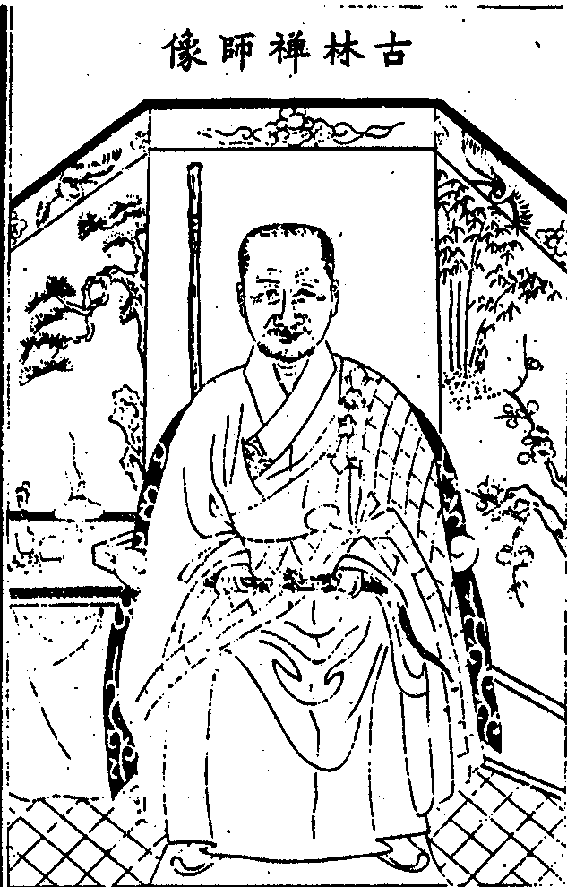
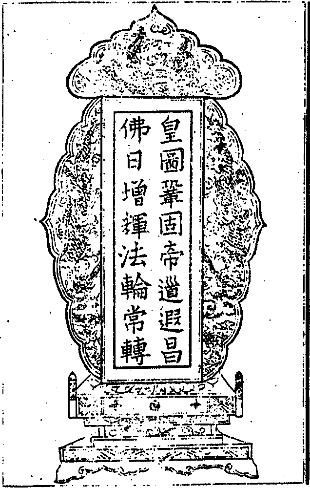
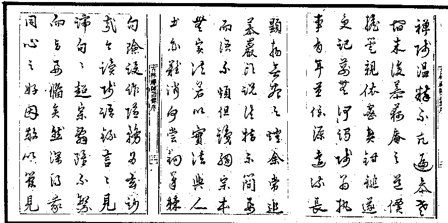
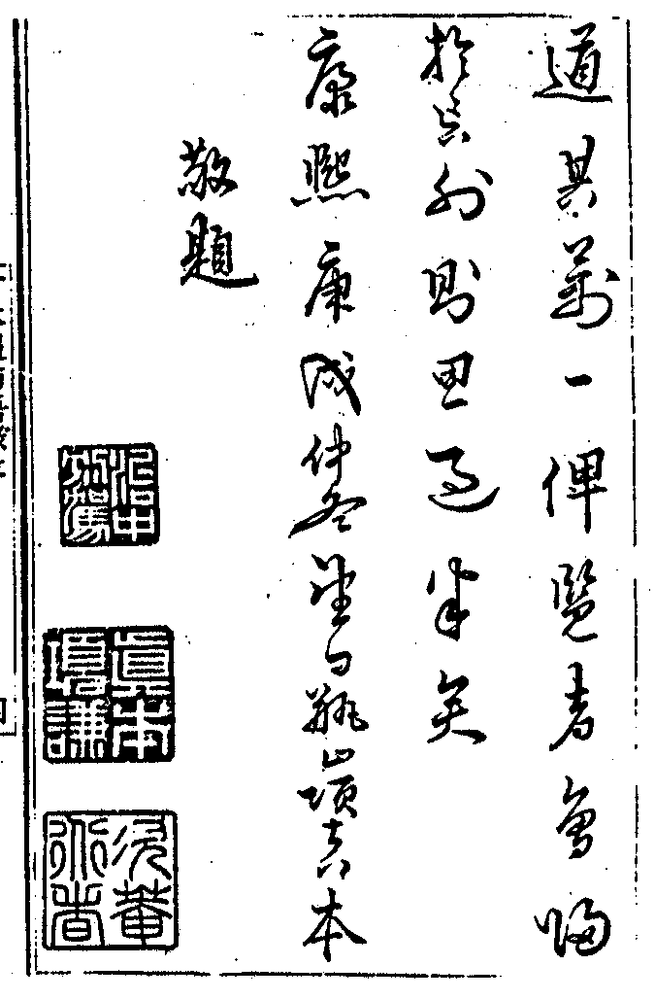

# 古林如禅师语录



> **藏经**：嘉兴大藏经（新文丰版）（嘉兴藏）　**册次** 第 36 册（J36）　**编号** JB346　**部类** 诸宗部　**卷次** 4 卷　**篇幅** 24,339 字

> **作者（译者）**：侍者(全威、全涌)等记录、侍者(全胜、全荣)等记录、侍者(全圆全法)等记录、侍者(普观露芳)等记录

> **卷／品**：4 卷 · 3 品



---



## 目录



  - [古林禅师语录序](#古林禅师语录序)

  - [古林如禅师语录序](#古林如禅师语录序)

  - [序](#序)

- [古林如禅师语录卷一](#古林如禅师语录卷一)

- [古林如禅师语录卷二](#古林如禅师语录卷二)

- [古林如禅师语录卷三](#古林如禅师语录卷三)

- [古林如禅师语录卷四](#古林如禅师语录卷四)



---



古林禅师像







> 皇图巩固，帝道遐昌；  

> 佛日增辉，法轮常转。



------



### 古林禅师语录序



吾佛说法四十九年，未曾道只字，诸祖出广长舌，遍覆阎浮国土，语句如云，盖过量人建牙竖纛，各辟乾坤，不可以轨则求也。古林和尚秉吹毛剑，独步大方，一言半句，珠圆玉润，沾著毒气，足以断人命根。其纵横自在，悉从自己胸襟流出，不惟不效诸方簇锦攒花，并不向佛祖喉下取气，诚暗室之宝炬，迷津之慈航也。师为竹庵和尚真子，机契最湥，开法吴门之莲华寺，道眼圆明，钳锤妙密，洵足振兴车溪、金明之法道，而有光於断桥矣。门人集其语录，问序於余，余合掌曰：「何必矢上加尖，以涂糊吾师乎？」虽然，师之有语，师之已形者也；语之有录，语之已见者也。已形已见者，可以言知；未形未见者，不可以名求。则所谓语录者，果安在乎？学者不为语言文字所瞒，则酬恩有地矣。



康熙癸丑仲春，秀水罗真性敬书。



------



### 古林如禅师语录序















古林如禅师语录目次



像  

赞



------



### 序



启  

传  

卷一上堂



卷二小参  

示众



卷三拈古  

颂古



卷四机缘  

六问  

像赞  

行实  

杂著  

佛事



自题



者个村僧，神头鬼脸，手执白拂，遭他捡点。生平吐胆倾心，换却时人双眼。纵有丹青畫得来，舌上风雷如电卷。



附刻金明师翁赞



纵目皆诗谱，条条似古风。秋林看不厌，独坐小轩中。



辛亥秋蠡湖进老人手书。



永正老和尚赞



水心洛洛，铁骨苍苍。振娄东之新令，挽济北之颓纲。挥玉麈天魔胆丧，握金篦佛祖辉煌。大座道场九会，趋蹡龙象诸方。呜呼！莫道余舌头太短，实赞之玉出昆岗。



壬子春，濮溪元老僧书。



继老和尚赞



云彩正秋舒，琅签响石渠，名山富仙迹，太史待藏书。天马嘶偏壮，霜鍾韵有餘，平生霄汉志，应袛古人如。



> 为古侄禅师灵岩储稿。



素岩和尚赞



古寺碧天舒，湖山映水渠，莲开唐代瑞，石勒竺坟书。近睹芳丛振，重兴惠业餘，颓宗今有赖，法社自如如。



楚山真智草。



东崖和尚赞



范蠡湖头奕世雄，儿孙济济展家风，藕庵授受无多子，倒卓乌藤吼象龙。



龙崖真璨草。



山容和尚赞



至境难言物不迁，帝青珠网岂常县，幻花灭处檀风动，垢面清时佛眼旋。摩竭令行亲嫡骨，灵山话在旧因缘，刹竿今日重扶起，庆喜当年有法传。



大石法弟元升具。



自培尊宿赞



开疆辟土，五叶联镖，太湖波阔，纳百川潮。目视云汉，相国裔表，坐震颓纲，谁犯秋毫？咄！活泼泼如盘珠走，明历历亘赫光曒，孤迥迥如峰卓朔，峭巍巍志若凌霄。



香梵阁心德题。



古林如禅师传



师名机如，号古林，松江上海县　钦赐乐寿堂潘相国之裔孙也。父号济寰，笃行诚实，似上古人。母沈，贤德徽音，著於亲族闾里。奉长斋，信心佛果。崇祯壬申年午月之三日诞生。师临产，母夜梦手摘莲华一朵，顷之即结实，清香馥郁，自异，觉遂生师。师自为儿嬉戏时，性好念佛，恶食腥血之食。及延传训读，颖悟超群。年将冠，父母继丧，师奉柩合葬祖茔，遂矢志出家。亲族阻留者云集堂中，师志决不能强，乃将父遗赀悉散之贫族。临行而誓曰：「吾不得踪迹源头为善知识，不复寓形宇宙间矣。」遂飘然而去，略无回顾，若潜蛟之离幽壑，而鲸鳌之纵大海，洋洋自得也。族党咸叹曰：「异哉！若子母氏之梦，意在斯乎！」时顺治庚寅岁大士诞日，即拜投唯一禅师，取字道雄，晨夕苦行，参究焚修。越一载，自玉峰至流庆庵，参二隐和尚，遂披薙名机灵，亲炙久之。继往浙中，遍叩诸方尊宿，追寻话头，所至莫不敬契。壬寅岁，返鹿城选佛场，礼参性空和尚。乙巳，至法轮受具。后参娄东藕庵和尚，问荅间，水乳相合，遂付衣拂，更名机如，号古林，盖丁未年事也。师得法后，益兢兢守道，韫椟多年。戊申春，玉峰绅士请住华藏寺，师不受，退隐嘉禾之金明，纂刻《佛祖世谱》等录。於是嘉禾绅士以濮溪永正禅院请，师复辞。旋飞锡吴门，遇古灯和尚，谓师曰：「公得法藕庵多年，连不受请，甘踄历诸方，拄杖子无太劳耶？」师曰：「藕下儿孙，有莲自发，应节顺时，许多活泼。」迨庚戌小春，吴郡浒关西金墅镇莲华禅院席虚，山主赵居士子渐仰师高风，偕阖郡绅衿、本镇善士具书公请，师乃抚杖而笑曰：「栽藕多时始见莲耶？能无媿乎？」因就请。院本唐朝敕建古刹，岁久蔓荒，颓废殆尽，树干穿檐，藓苔生壁，见者莫不蹙额寒心，而师则情致悠然，了不介意，晨经暮课，琅琅钟磬声无少间也。且复躬耕陇亩，戴笠披蓑，刈草为炊，磨麸为食，又未尝以清澹为怀、勤作为劳也。如是者十年，大殿鼎新，佛像整容，前后金彩霞光灿然夺目，大非曩日境界，此可以徵师之高道隆德，有以格龙天而信檀那也。虽然，师生平所重正不徒是，夫固有独得至诣，足以绍佛祖而觉愚蒙者，又岂余小子寡闻肤见所能揄扬其万一哉？庚申春，师编刻本师藕庵老和尚语录，以酬嗣法志愿，余小子辈因亦恳师平日语编为四卷，同梓以传。师春秋方富，精思锐志，将来益广慈悲心，奋勇猛力，所以雨露寰区，甄陶学者，正无可量。敬述其已然者，为余小子辈之模范云。



时康熙十九年庚申岁仲春朔弟子全素



> 全威  

> 全学  

> 全荣等稽首拜撰



金墅镇文学檀越山主公启



伏以鹫峰直指，一灯普照於九垓；少室亲承，五叶流辉於亘古。肯堂肯构，代有哲人；尽善尽美，必推宗匠。恭惟古林大和尚座下，断桥正传，藕庵嫡子，鍾瑞气於娄东，蜚嘉声於浙右，揭开普明鸳老之生面，播扬金明介祖之徽猷。三千龙象随高躅，正合乘时；万里香云拥法幢，讵宜久晦？兹有莲华禅刹，实惟古宿道场，建立宗旨，压倒诸方。今兹大和尚丕振家风，扶起旧案，璧合珠连，绍箕裘於同室；超凡越格，震狮吼於遐方。某等夙向鸿仪，渴瞻猊旆，雷轰电掣，得尝九转之丹；草偃风行，顿脱三生之罥。用勒俚笺，伫延玉趾。伏愿高提祖印，威风凛而狐犴全消；丕展洪炉，手段辣而皮肤尽脱。将见大匠之门鲜曲木，三草二树而法雨均沾；震雷之下无蛰虫，此界彼疆而光风一片。某等临启，曷胜景切之至。



法末张　隽　赵士毅　赵士逵　凌安国



> 秦　美　赵士伟　黄日起　何一龙  

> 赵士弘　徐　章　赵士侠　苏宜生  

> 秦嘉斌　程学周　赵　羽　赵士选  

> 惠德敷　汪道忠　惠　和　赵瑾仝顿首拜



苏州阖郡大护法公启



伏以一华拈起，揭开古佛家风；只履携归，直示西来秘旨。五叶联镳於震旦，一宗杰峙於滹沱。时节既至，法道攸彰。恭惟古林大和尚座下，鍾英泖水，毓秀娄江，乘愿力以再来，历诸方而咸仰。亲承藕庵衍老之记莂，执侍蠡湖介祖之维虔。断桥调古风高，赤身担荷；车溪流长源远，独力仔肩。鹿城诸刹，每虚席以殷勤；檇李名蓝，咸捧幡而望切。师方力行古道，为法忘身，意将振起颓纲，潜踪苦志。顾祖印既已高提，而龙天自难盖覆。入廛垂方便，原系从上风规；宝筏渡迷津，未有长行不住。惟兹莲华禅院，吾吴首刹，尊宿古乡，领一郡关镇之瑞气，作诸方云水之津梁。烹佛炼祖於前，钦承古德；开法阐宗於后，端赖吾师。盖既烜赫於当时，尤望显扬於今日。某等久仪道范，佩切皈诚，怀瓣香而趋会下，勒谫语以表微忱。伏愿俯鉴凡情，慨驰法旆，运超方之手眼，驱犴勦狐；用本分之钳锤，利生接物。天龙窥伺无门，圣凡乞命有分。将见鸳湖嫡派，道风遍播寰区；蠡水真传，法乳长流永古。某等临启，可胜翘切之至。谨启。



　法弟李　模　范　周　缪　彤



> 彭　珑　尤　侗　沈世奕  

> 徐乾学　徐秉义　徐元文  

> 申　穟　李　楷　朱　云  

> 周茂兰　蒋　埴　陆在新等仝顿首拜



------



## 古林如禅师语录卷一



**译者**：侍者(全威、全涌)等记录



住苏州府金墅镇莲华禅寺



康熙庚戌仲冬朔旦入院。



山门。「重整人天路，打开方便门，欲明安乐处，须向这里入。」拽拄杖竟进。



佛殿。「古来不著求，心光净无碍，两眼对两眼，常礼如自在。」展大具拜。



伽蓝。「灵聪显赫，辅国护僧，一呼百诺，速报分明。」插香。祖堂。「四七二三，口带雌黄。何故？」插香云：「昔从五凤楼前过，不解思惟坐太平。」



据室。拈拄杖，云：「竖穷三际，横遍十方，圣凡相见，吃棒有分。何故？」卓一卓，云：「律令森严。」



诸大檀护、山主、耆宿众等寻恳上堂。师至座前拈疏云：「人天眼目，佛祖纲维，檀护金汤，衲僧法标，汝等普闻，也须剖露。」宣毕，指法座云：「这曲木录床，巍巍堂堂，龙天推出，贵在承当。」喝一喝，便升座，遂拈香云：「此一瓣香，乾坤至大，万德以仁，炳向宝炉，端为祝延今上皇帝圣寿无疆万万岁，钦愿垂裳治国，海晏河清，八方共沐尧风，四表同遵舜化。」次拈香云：「此一瓣香，调和鼎鼐，位列三台，炳向宝炉，奉为满朝文武、合国勋戚、当道尊官、绅衿文学、远近檀那、护法山主、合寺耆宿，伏愿生生受灵山记莂，世世端秉帝心。」复拈香云：「此一瓣香，忒煞分明，天然贵胤，把住关津，不通凡圣，炳向宝炉，专为供养传临济正宗三十二世住娄江藕庵堂上法华老人本师和尚，用酬法乳。」敛衣就座。永宁白椎云：「法筵龙象众，当观第一义。」师云：「若论第一义谛，非言句所及。还有向山僧未出方丈时荐得者，出众相见。」僧问：「水壶影鉴，旧日风规；癖扫烟霞，还成窠臼。即今条令斩新一句如何举唱？」师云：「太湖三万六千顷。」进云：「恁麼风前不露彩，句后绝踪由。」师云：「叠叠青山插远村。」进云：「心心相对，眼眼相觑。云门道：『庵内人不知庵外事。』因甚乾峰呵呵大笑？」师云：「快便难逢。」进云：「莲华堂上果与不同。」师云：「合取口好。」乃云：「古殿洞开，明辉杲日，坐振颓纲，承谁妙力？」蓦竖拂子，云：「者便是佛佛授手、祖祖相传底一段大事。山僧自丁未年间劈头撞著这老汉一拶，直得脱体无私，一肩担荷。今因业风吹至莲华，承诸檀护延请住持，奈何时不可缓、义弗敢辞，对众分明举扬去也。把住也，灵光独耀；放行也，头正尾正。且问大众：即今还是放行耶？把住耶？」遂挥拂，云：「寒焰发𪸩充宇宙，从教匝地涌莲华。」(谢辞，不录。)



复举：「净慈断桥伦祖上堂，云：『德山低头，夹山点头，俱胝竖起手指头，玄妙𡎺破脚指头。』」拈拄杖，云：「都来不出山僧拄杖头。何以见得？」卓一卓，云：「一叶落，天下秋。」师云：「当堂不正坐，那赴两头机？若非具透关眼，焉能辨其缁素？」呈拂子，云：「者一队老古锥，今日被莲华一串穿却了也。为甚如是？一朝权在手，便把令来行。」卓拄杖一下。复结椎，云：「谛观法王法，法王法如是。」便下座。



当晚，小参。「娑婆世界以音声为佛事，香积世界以香饭为佛事，金明师翁以破院为佛事，莲华则不然，以行门为佛事。何故？拈香择火，堂前解打禾山鼓；紧峭草鞋，大家同入云门普。搬石运土，发机须用千钧弩。阿呵呵！大地原来无寸土。」便归方丈。



新春，上堂。挥拂，云：「春山青叠叠，春水缘滔滔。灵禽解语，万物同条。才子佳人休作景会，松冈苔径且漫峥嵘。莲花一向内不放出、外不放入，坐断乾坤又作麼生解嘲？」良久，云：「浮云散尽红轮曜，古木参天月挂梢。」拽拄杖，下座。



元旦，上堂。祝圣毕，拈拂子作吹笙势，云：「一曲翻来格调新，梅花枝上报先春，莲华有句超群象，历日无私降紫宸。」拂一拂，云：「挥断七十二峰倾秋倒。」喝一喝，云：「喝退三万六千水逆流。何故？丈夫各有冲霄志，岂向他人行处行？」便下座。



四月八日，上堂。举：「世尊降生时，一手指天，一手指地，周行七步，目顾四方，乃曰：『天上天下，唯我独尊。』古今批判者，竟不顾世尊性命，祇要各出手眼，殊不知救得虾蟆死了蛇。大众！且喜旧案新翻，还识释迦老祖娘生面目麼？」竖拂子，云：「钩头有饵，惯钓鲲鲸；把住封疆，浑身卖悄。」复挥，下座。



中秋，修建大殿落成，华严经期圆满，众信胜集，请上堂。师云：「法无定相，遇缘即宗，古迹重光，亦须时节。此寺自唐朝刘公夫妇舍宅以来千有餘年，复得赵居士合家善眷捐资修葺，兹当圆成之日，众善信恭命山僧举扬大法以为庆贺，直得森罗起舞、万象点头、虚空合掌、大地和南，三世诸佛神通自在，以智慧光明、威德充满，而令青莲华藏菩萨住佛无畏、入佛法界，一一庄严、一一具足。汝等诸人还信得及麼？若信得及，此处於青莲华藏世界无二无别，现前诸善男子、善女人与彼土诸大菩萨无二无别，昔日刘公、今时赵老亦无二无别。其或未然，更听一偈：莲华复现度人舟，尽入如来性海游，天香到处秋光好，直蹈毘卢最上头。」卓拄杖，喝一喝，下座。



上堂。举：「雪峰因僧来参，峰问：『甚处来？』僧云：『浙中。』峰云：『船来？陆来？』僧云：『二途俱不涉。』峰云：『怎得到这里？』僧云：『有甚麼隔碍？』峰即打趁出。僧后十年再来，峰云：『从甚处来？』僧云：『湖南。』峰云：『湖南与此间相去多少？』僧云：『不隔。』峰举拂，云：『还隔这个麼？』僧云：『若隔，怎得到这里？』峰亦打出。僧住庵后，每见人必骂雪峰，同行闻，特去相访，遂问：『你因甚骂雪峰？』这僧举前两段因缘，同行痛骂，与伊点破，这僧遂悲泣，每於中夜焚香望雪峰礼拜。」师云：「雪峰与麼为人，但有杀人剑，无活人刀。那同行点破，矢上加尖，漏逗不少。这僧当时骂、而今哭，两头三面，自起自倒。莲花今日据款结案，各与三十拄杖。何故𫆏？剑为不平离宝匣，药因救病出金缾。」便下座。



佛诞日，开光，赵山主室人吴氏，法名全元，请上堂。「扑面熏风四月天，黄莺啼出柳枝烟，座下若有英灵客，何必山僧费口涎？」竖拂子，云：「今朝初八圣诞节，我佛出头便饶舌，叵耐旁观恶水浇，这点光明无间歇。赵氏全元请举扬，拔尽诸人眼中楔，时雨纷纷正令提，个事明明难辨别。休辨别，香烟堆里金凤飞，红炬光中玉龙抉。」高声召众，云：「诸人还见麼？」遂掷下拂子。复举：「南泉和尚云：『王老师自小养一头水牯牛，拟向溪东牧，未免犯他国王水草；拟向溪西牧，未免犯他国王水草，不如随分纳些些。』」师云：「王老师恁般提唱固是可嘉，未免犯他国王水草。争如莲华日用拖犁耙拽，将松冈下、八角井边、一片田地翻来覆去，夏种秋收，脱粟香糜，快乐自在，岂不胜他王老师一头地？众中倘有个汉出来道：『和尚是甚麼心行？』」卓拄杖，云：「你也出者圈缋不得。」呵呵大笑，下座。



上堂。举：「凌行婆问浮杯：『尽力道不得底句分付阿谁？』杯云：『浮杯无剩语。』婆云：『未到浮杯，不妨疑著。』杯云：『更有长处，不妨拈出。』婆敛手哭云：『苍天中更添怨苦。』杯无语，婆云：『语不知偏正，理不识倒邪，为人则祸生。』后僧举南泉，泉云：『苦哉！浮杯被这老婆推折一上。』婆闻得，笑云：『王老师犹少机关在。』时有幽州澄一禅客诣婆，乃问：『南泉为甚少机关？』婆哭云：『可悲！可痛！』澄罔措，婆云：『会麼？』澄合掌而立。婆云：『伎死禅和，如麻似粟。』后澄一举似赵州，州云：『我若见这臭老婆，问教伊口哑。』一云：『未审和尚作麼生问伊？』州便打，一云：『为甚却打某甲？』州云：『似这般伎死禅和，不打更待何时？』婆闻，云：『赵州合吃婆手中棒。』州闻，哭云：『可悲！可痛！』婆闻，叹云：『赵州眼光烁破四天下。』州闻，令人去问：『如何是赵州眼？』婆竖起拳。僧回，举似赵州，州乃有颂与婆云：『当机觌面提，觌面当机疾，报尔凌行婆，哭声何得失？』婆有颂答云：『哭声师已晓，已晓复谁知？当时摩竭令，几丧目前机。』」师云：「这婆子将此一问直得放火烧山，总成妖怪。浮杯虽则谦恭益逊，不无闭门种火，南泉一语也似火上添油。赵州救火，看楼打楼，若无澄一焦头烂额，如何圆得此案？还有息火者麼？」良久，云：「轮得自己，赢得他人。」掷拄杖，下座。



因吴氏全元送法衣，上堂。师举衣云：「华顶家声远，车溪法脉长，鸳湖流此地，莲花遍界香。昔者龙女献珠，世尊纳受即证菩提；今日全元供衣，山僧承受。且道是同？是别？」良久，搭衣云：「体段分爻象，罗纹挂福田。」便下座。



上堂。拈拄杖，云：「有物先天地，无形本寂寥，能为万象主，不逐四时凋。」复卓一卓，云：「唤则拄杖子则触，不唤作拄杖子则背，诸人试捡点看。若是随阴阳消长、寒暑变迁，总属枝上牵枝、蔓上引蔓，莫为汝等打葛藤去也。」蓦卓杖，云：「鸳鸯绣出从君看，不把金针度与人。」下座。



端阳，上堂。「今朝五月五，便是端阳节，咒水与书符，赤口尽消灭。别，别，艾虎龙舟最亲切，莲华更有一句子不向诸人说。且道那一句？」良久，云：「角黍大如锥，榴花红映月。」下座。



观音圣诞，众设供，请上堂。「雀噪鸦鸣，尽入观音妙里；水流风动，无非佛祖真机。若将耳听，瞎却诸人眼；若将眼觑，塞却诸人耳。不见云门道：『闻声悟道，见色明心。观音菩萨将钱买胡饼，放下手来却是馒头。』又作麼生庆赞？」击拂子，云：「普门示现神通力，海晏河清一并收。」下座。



上金明寺介庵先老和尚供。师云：「范蠡湖头建法幢、立宗旨，四海之内无不共闻，到今撒手，敢献香糜？仰企师翁先老和尚本无生灭，岂有去来？祗如末后垂恩一句又作麼生？」遂插香，云：「大法痛心难话会，儿孙到此亦观瞻。」展具礼拜。



------



## 古林如禅师语录卷二



**译者**：侍者(全胜、全荣)等记录



住苏州府金墅镇莲华禅寺



晚参。举：「一初老和尚永正开法时，昔断大师为侍者，问：『灵云「自从一见桃花后，直到如今更不疑。」为甚玄沙道敢保老兄未彻在？』尚曰：『直不藏曲。』断云：『未审彻底人分上如何受用？』尚曰：『饥来吃饭，倦时打眠。』」师云：「问得也当，答得也奇。诸兄弟！且道他父子有何长处？」众下语俱不契，师自代云：「敲唱风流闲卖弄，调龙驭象镇东溪。」



小参。竖拄杖，云：「亘古亘今恒不昧，一回举起一回新。诸兄弟！欲识佛性义，当观时节因缘。时节若至，其理自彰。如何是自彰底道理𫆏？九九八十一，犁耙一齐出。於此会得，便能高超物外，独步大方；其或未然，急将本参话头在三条椽下、七尺单前猛力参究，刻刻提撕，直须究到无可奈何处，忽然打失鼻孔。㘞！元来在这里，信知方丈为众助喜。何故？鸳鸯绣出丁香结，珍重诸君著眼看。」便起。



小参，举：「金明师翁，径山雪峤大师上堂，翁白推竟，雪喝一喝，下座。有僧请益翁，翁乃拈偈示之。」师云：「这两个老汉直教人疑著，检点将来，也是焦砖打著连底冻。设有问莲花，只向他道：『吕望六韬、黄公三略。』诸仁者！於此会得，同一鼻孔出气；若未委，更听一偈：椎喝雄雄势已彰，诸方知有绝商量，彼此和盘亲掷出，至今馥馥有餘香。」



因事小参。挥拂子云：「大凡僧家赤心片片、见义勇为，须要法法上明、头头上显，刚柔相济、权实相应，出语不虚发、发则中的，不中的是语渗漏。更若话过头，大难收拾。抱道高流贵在默然，即此一默可证无诤三昧、一行三昧、自受用三昧，不妨於此土他方不论是幻非幻、智慧无明，随机方便拔济群迷。不见永嘉大师道：『无明实性即佛性，幻化空身即法身。』金明师翁云：『诸佛出世入世皆得无诤三昧，引导众生。诸祖以心印心，尽契无生之旨，接续慧命。若总与麼，彼此人我商量，佛祖正脉岂到今日耶？』诸兄弟！以此观之，大须仔细，贵要真操实履到这田地，方得自由有分，以警将来。各各珍重。」



祈晴，小参。师以拂子打圆相，召众，云：「会麼？万里不挂片云，日面月面皎洁，林间光明顿现，大地山河气自苏，莲华不必多饶舌。」挥拂子，下座。



小参。举：「保宁勇上堂：『风鸣条，雨破块，晚来枕上莺声碎，虾蟆蚯蚓一时鸣，妙德空生都不会。都不会，三个成群，四个作队，窈窈窕窕，飘飘飖飖，向前村、后村，折得梨花、李花，一佩、两佩。』」师云：「保宁老汉提唱宗旨，大有风流儒雅，意句尖新，未免落在声色情见，衲僧向上巴鼻未可得在。众中若有透声色情见衲僧出来，山僧拄杖相见。」一僧才出礼拜，师云：「三十棒且待别时来。」便下座。



本寺护法徐文儒居士生忌，孝子志宁请师对灵小参，师云：「夫子行道，齐家治国，理贯古今；吾佛说法，广度众生，转凡成圣。惟文儒檀护生耶？榴火炎炎，猿啼由顶，胸藏锦绣，目极群书，正在山僧丈室和泥合水，有话未终，谁知撩起便行，熏风拂拂，鹤唳吴山？惜乎！你五十六年一场好梦，即今到此还醒麼？若也醒得，闹市红尘无非极乐，天涯海角尽是莲邦。且道他后嗣一句如何话会？」以拂子打○相，云：「日照长流千涧水，风调果熟万山红。」



元旦千佛忏期，小参。问：「慢提向上，且道三千诸佛居何国土？」师云：「展两手琉璃殿内。」进云：「恁麼则个个沾恩去，人人脚下稳。」师云：「布心胆玛瑙街前。」进云：「祝圣裕民一句又作麼生？」师云：「干戈永息邦家乐，豆麦禾苗胜旧年。」僧礼拜，云：「谢师荅话。」师云：「逢人切莫错举。」乃云：「问荅须知玄要，临机显发，纵擒料拣，照用齐施，方能光扬佛祖，超脱死生。即今四众临筵，各各归家活计，如何施设？」以拄杖作[○@牛]，云：「若在山僧拄杖头边得者消息去，不惟衲僧了悟心宗，邦家亦且镇治。儒生及第，农植全收，工艺精良，经商倍利，丝毫功不浪施。」卓一卓，云：「八十翁翁入场屋，真诚不是小儿嬉。」



示众。「个事分明，要说便说；触著磕著，要歇便歇。黄鹂上树一枝花，白鹭下田千点雪。别，别，大地山河太饶舌。」顾左右，云：「且道说个甚麼？」喝一喝，遂起身归丈室。



因事示众：「继迹名蓝八载餘，龙天神护赖相栖。殿堂佛像檀那力，山主虔心众尽依。莫谓山僧重举示，调达苗裔伥瞋痴。平地风波还自悉，百般技量总成虚。八万四千他自造，病眼空花见魈鬾。即今据证万别，坐断千差一句又作麼生？」遂作此



相云：「明得个中玄要处，神通妙法不思议。」



示众。举：「孚上座因鼓山赴大王请，雪峰门送，回至法堂，曰：『一只圣箭直射九重城里去也。』孚云：『是伊未在。』峰曰：『渠是彻底人。』孚云：『若不信，待某甲去勘过。』遂至中路，便问：『师兄向甚麼处去？』山云：『九重城里去。』孚云：『遇三军围绕时如何？』山云：『他家自有通霄路。』孚云：『恁麼则离宫失殿去也。』山云：『何处不称尊？』孚拂袖便回。峰问：『如何？』孚云：『好只圣箭，中路折却了也。』遂举前话，峰乃曰：『奴渠语在。』孚云：『老冻侬犹有乡情在。』」师云：「雪峰畫蛇添足，孚上座平地兴波，鼓山虽是小勇大敌，正眼观来略较一筹。若问莲华：『三军围绕时如何？』声未绝，劈脊便打。何故？圣箭话行。」便下座。



示众。举：「普明和尚时将永明偈问云峰钧和尚云：『化人问幻士，谷响答泉声，欲达吾宗旨，泥牛水上行。意旨如何？』钧云：『梦眼见空花。』明云：『空花事作麼生？』钧云：『莫将耳听。』明又问：『临济祖翁有一句子，你作麼生道？』钧便喝，明便打，钧又喝，明又打，钧礼拜，明云：『元来是瞎驴子。』钧拂袖便出。」师云：「普明有拔山举鼎手段，云峰具定乾坤底眼目，只是话作两端，各与三十拄杖。何故？棒头敲出虚空髓，遍界英风吹脑疼。珍重！」下座。



示众。举：「金明进和尚问藕庵衍和尚：『殃崛产难因缘你作麼生？』庵作呱呱声。明云：『是男？是女？』庵珍重作礼。明便打。」师云：「金明意兴未阑，抛纶掷钓；藕庵脑门著地，河汉星辉。」顾左右，拍几，云：「会麼？从空放出擒犀手，蓦地掀翻海岳来。」竟下座。



示众。举：「藕庵和尚因雷雨夜坐，僧问：『如何是真法？』庵云：『檐声未断连宵雨，电影还催后夜雷。』僧有省。」师云：「若道者僧悟去，入地狱如箭射；若道者僧不悟去，亦入地狱如箭射。何故𫆏？滴破髑髅，浸烂鼻孔。」便起。



上三塔主峰老和尚供。师云：「一泓蠡水，派接龙渊，波扬四海，白浪滔天。挽颓风於旧日，雷奔电闪；整条令於金明，攫雾拏烟。即今端坐窣堵波一句如何为人直截？」良久，云：「忆昔当年留别意，痛肠寸裂为谁宣？」展具礼拜。



上藕庵先老和尚供。师拈香云：「朔风括耳度寒江，一片水心叩影堂，法幢倾落霜天月，难把衷肠家丑扬。堪羡生平书藏典，见多宝塔自安藏，今日炉中方见胆，焦螟眼里绣鸳鸯。」展具拜。



除夕示众。云：「诸方热闹，摘叶寻枝，高搭松棚，围炉柮榾。争如得者里冷澹直截，薄披明月，细切清风，任汝横咬竖嚼，忽然咬著，始信莲华太为人，一时肝胆尽皆倾。」



示众。「春色纷纷花满枝，黄莺啼切柳垂丝，见义勇为豪气爽，方名出格丈夫儿。」



示众。「汾阳纸陌散闲神，叶县泼水验新到，二老如斯振祖纲，拍盲向汝痴禅道。莲华炊饭待高流，活煮清泉款新到，你不我兮主即宾，博饭栽田声浩浩。」



示众。云：「出家切须真心学道，莫先躲懒偷闲，事事实行到底，件件方便周旋，弄巧定然成拙，虚头诈诡，觑破何颜？硬强不能迁善，噬脐那值半钱？诸人若还不信，请看果报昭然。」



重阳，示众。「九月九日重阳节，金风飒飒飞红叶，篱菊凌霜吐晚馨，林下禅和甘抱拙。笑他世俗插茱萸，何似莲华更饶舌？别，别，太湖波底捞明月。」



小参。举：「僧问云峰：『如何是心地法门？』峰云：『不从人得。』僧云：『不从人得时如何？』峰云：『此去衡阳不远。』大慧云：『云门即不然，如何是心地法门？不从人得。不从人得时如何？看脚下。』」师云：「二老汉恁麼提持，大似之乎者也，未为直截在。若问莲华：『如何是心地法门？』『不从人得。』『不从人得时如何？』劈脊便棒，免教伊随处著倒。」



端午，小参。僧问：「如何是莲华境？」师云：「湖光山色秀，闹市接溪桥。」进云：「如何是境中人？」师云：「丫角健儿骑艾虎，破蓑渔子网鲜鳞。」进云：「人境已蒙师指示，向上宗乘事若何？」师竖拄杖，云：「会麼？」僧礼拜，师便打，乃云：「年年五月五，处处贴灵符，健儿骑艾虎，醽醁泛菖蒲，当门书大吉，随例斩妖魔，妖魔风愈炽，狂见总懡㦬。」召众，云：「且道具甚麼作略得妖魔平复去？」喝一喝，云：「若有个汉出来道：『不书大吉、不贴灵符，百怪殄灭，白舌消磨。』百草头信手拈来是药，便能兴波作浪，不向死水浸杀，似三闾大夫是即是，争奈莲华门下正好吃棒在。何故𫆏？」复喝，云：「座中自有江南客，休向尊前唱鹧鸪。」便下座。



小参。举：「马祖因僧问：『离四句，绝百非，请师直指西来意。』祖云：『吾今日劳倦，不能为汝说，问取智藏去。』僧问藏，藏曰：『何不问和尚？』僧曰：『和尚教来问。』藏曰：『我今日头痛，不能为汝说，问取海兄去。』僧问海，海曰：『我到者里却不会。』僧乃举似祖，祖曰：『藏头白，海头黑。』」师云：「马祖父父子子虽然逼到水尽山穷，各各原有转身吐气，争奈者僧将登九仞，止欠一步，却被他哄得东走西奔，又添说白道黑，换却眼睛，要且西来意总未会在。若有人问莲华：『离四句，绝百非，请师直指西来意。』但云：『今日不荅话。』免使劳倦头痛。」



至节，示众。「小春才过又隆冬，时序频催岂定踪？诸仁欲觅根源处，霜飞叶落在其中。」



------



## 古林如禅师语录卷三



**译者**：侍者(全圆全法)等记录



拈古



般若多罗尊者路行次，或有人问：「汝行何急？」尊者曰：「汝行何慢？」又问：「汝姓甚麼？」尊者曰：「与汝同姓，或凡或圣，人莫可知。」



师云：「可怪尊者大路不行，却向草窠里辊。」



玄沙因镜清问：「学人乍入丛林，乞师指个入路。」沙曰：「还闻偃溪水声麼？」曰：「闻。」沙曰：「从这里入。」清有省。径山杲云：「若要得个入路，直须离却者里。」



师云：「得个入路，许他镜清；更进一程，还须妙喜。然望堂奥，总未得在。」



杭州径山无幻性冲禅师因编无趣录归，趣云：「子一向做得个甚麼？」山云：「性冲买得一段田，收得原本契书，请和尚佥押。」乃将录呈上，趣接得，云：「者个是我底。你底𫆏？」山云：「和尚莫挽夺行市。」趣掷下录本，山便出。



师云：「我若作径山，待他道：『者个是我底。你底𫆏？』便与作礼，云：『今日念和尚老大。』」



慈明和尚每室中以水一盆，上一口剑，下著一緉草鞋，膝上按拄杖，凡有僧入门便指，才拟议便棒。



师云：「作家勘辨，互逞机权，其间一著，另有可观。莲华若见这老汉，仗剑挥盆便出。还有不甘者麼？试甄别看。」



雪峰敲老观和尚门，观云：「谁？」峰云：「凤皇儿。」观云：「作什麼？」峰云：「来啗老观。」观开门扭住云：「道！道！」峰拟议，观托开闭门。峰后住庵，示众云：「我当时若入得老观门，你者一队噇酒糟汉向甚麼处摸索？」



师云：「大小老观据令而行，雪峰乃东边失利，西边拔本，也是贫儿思旧债。」遂喝云：「当时雪峰下得这一喝，免教递相钝置。」



药山因庞居士辞，山命十禅客相送至门首，士指空中雪云：「好雪片片，不落在别处。」时有全禅客云：「落在什麼处？」士打一掌，全云：「居士也不得草草。」士云：「汝恁麼称禅客，阎老子不放汝在。」全云：「居士作麼生？」士又一掌，云：「眼见如盲，口说如哑。」雪窦云：「初问处，但握雪团便打。」



师云：「雪窦虽然勦绝，争奈犹涉泥水？莲华见处则不然，待问和声推倒雪中，祇教他庞公通身手眼也分疏不下。」



殃崛摩罗尊者，持钵至一长者家，值产难未分，长者云：「佛之弟子，殊为至圣，师有何法，能免产难？」殃曰：「我乍入道，未知此法，待问佛来相报。」遽返白佛，佛告曰：「汝速去说：『我从贤圣劫来，未曾杀生。』」殃持此语告长者，妇闻之，即时分娩，母子平安。



师云：「殃崛摩罗被长者一问，送语传言，怜儿不觉丑。佛云：『我从贤圣劫来不曾杀生。』其妇闻当时分娩，又作麼生？春色满园关不住，一枝红杏出墙来。」



兴化问克宾维那曰：「汝不久为唱道之师。」宾云：「不入者保社。」化云：「会了不入？不会不入？」宾云：「总不与麼。」化便打云：「克宾维那法战不胜，罚钱五贯，设赞饭一堂。」至来日斋时，化自白椎云：「克宾维那法战不胜，不得吃饭。」即便赶出院。



师云：「克宾维那当言不避截舌，兴化大似倚势欺人。」召众云：「尔诸人作麼生与他分雪？」卓拄杖云：「鹤有九皋难翥翼，马无千里慢追风。」



宝华侍者看雪窦，窦问：「宝华多少众？」者云：「不劳和尚如此。」窦云：「我好好问，尔𨁝跳作麼？」者云：「也不得放过。」窦云：「真狮子儿。」吃茶了，窦把住云：「适来得甚麼无礼？」者拟议，被窦一掌云：「归去分明举似宝华。」



师云：「雪窦当轩畫鼓，气急杀人；侍者龙头蛇尾，暗得便宜。莲华侍者拟议，托开云：『败将不斩。』何故？反思仁义胜刚强。」



一僧於马祖前作四畫，上一畫长，下三畫短，云：「不得道长，不得道短，离四句答某甲始得。」祖乃畫一畫，云：「不得道长，不得道短，答汝了也。」后僧举似忠国师，国师云：「何不问我？」



师云：「这僧只解据虎头，不解收虎尾。马祖虽然坐断舌头，捡点将来不无漏逗。忠国师略较些子，争奈阵后兴兵？若问莲华：『不得道长，不得道短，离四句答某甲始得。』遂劈口便打。且道与古人相较几许？」



云门因僧问：「如何是异类中行？」门曰：「轻打我，轻打我。」僧曰：「我会也。」门曰：「作麼生会？」僧遂作驴鸣。



师云：「云门披毛戴角，太煞慈悲，要且坐断这僧舌头未得在。待问莲华：『如何是异类中行？』但云：『一回入草去，蓦鼻拽将来。』」



杭州净慈断桥妙伦禅师，参无准。准以狗子因缘何有业识？令下语，凡三十转，不契。伦云：「可无方便乎？」准乃举真净颂示之。伦悚然良久，忽闻板声，大悟。



师云：「大小径山父子，啐啄同时，一等播扬家丑。」



天台华顶无见先睹禅师，白雪度问：「西来密意未审如何？」睹云：「待娑罗峰点头即向汝道。」度以手摇拽拟答，睹便喝，度云：「娑罗峰顶白浪滔天，花开芒种后，叶落立秋前。」睹云：「我家无残羹剩饭也。」度云：「此非残羹剩饭而何？」睹颔之。



师云：「华顶验人端的，白云叶落花开。就路还家则且置，残羹剩饭毕竟教谁拈出？」乃顾众云：「登山须到顶，方知宇宙宽。」



月溪澄和尚凡见僧请益，皆云：「佛法不是鲜鱼，那怕烂却？」即趁出。



师云：「不怕烂却，早已臭气熏天。」



无际悟禅师参古拙俊和尚，问：「还我照用来。」际云：「若有照用，即成障碍。」拙云：「者厮著空，佛也救你不得。」际云：「有无俱寂灭，空佛悉皆非。」



师云：「具眼者照用齐施，颟顸底是非得失。」顾左右云：「惺惺著，担板黑似漆。」



僧问无幻和尚：「如何是提婆宗？」幻云：「一字不著畫。」僧云：「某甲不问者个。」幻云：「圆相不著圈。」



师云：「者般酬答，吐胆倾心，争奈知恩者少？设有问莲华提婆宗，向他道：『点畫分明。』具眼者辨取。」



嘉兴东塔野翁晓禅师，无趣参，每呈见解，师尽与扫辟昔日所负，直使索然。一日，师谓趣云：「我有一言，要与你说。」趣便问，师但笑而不语。趣又问，师又笑。趣不谙旨，遂礼拜恳求师不已，乃云：「达磨西来，直指人心，见性成佛，唯在直下体取。子若信得及，可放下万缘，参个万法归一。」趣领旨，后闻鸡鸣，有省。



师云：「东塔老汉垂手不同，只是不肯一刀两段。若非敬畏委曲玉成，至今言犹在耳。」



兴善广禅师掩关皋亭诸处，普明用不离左右一十三载。值广病笃，一日举香严独脚颂问用，用才开口，广便喝，用复拟开口，广又喝，用乃点首，广遂付嘱。



师云：「兴善老汉把住放行，具超方之作，普明钝置，闹里称尊。何以见得？当阳抛出金刚剑，八臂那咤正令威。」



普明用和尚同雪峤和尚上弦玩月次，雪指云：「者半个那里去了？」明良久，云：「会麼？」雪云：「也只得半个。」明云：「者半个那里去了？」雪亦良久，明云：「也只得半个。」雪相与大笑。



师云：「二大老互换呈机，也是按图索马，话他甚麼？」



金明和尚问僧：「如何是探竿影草？」僧云：「情知和尚出某甲手脚不得。」明云：「是你答得底那？」僧云：「是。」明便打，云：「却是你出我手脚不得。」



师云：「金明按款结案，者僧行迹难逃，一状领过。还有别出手眼底，试定当看。」



三塔主峰法禅师，有僧参，问：「甚麼处来？」僧云：「杭州。」塔云：「船来？陆来？」僧云：「二途俱不涉。」塔云：「作麼生到得者里？」僧云：「有甚隔碍？」峰便打，僧拟议，峰云：「还道无隔碍？」又打。



师云：「三塔独踞重围，显发大用；者僧夺角冲关，伤锋犯手。莲华待道：『争到得者里？』拂袖便出，管取老汉点首归方丈。」



金明进和尚拈香坠问缾山曰：「无情如何说法？」缾山云：「和尚拄杖子𨁝跳去也。」明复勘问，缾山拈香坠掷地，叉手而立，明拾坠置於几，缾山云：「无情说法竟。」明休去。



师云：「金明钳锤在手，纵夺全施；缾山觌面相呈，曲高和峻。无情说法即且置，如何拍拍是令？」喝一喝，云：「人逢喜事精神爽，火里真金色更鲜。」



祇园修和尚因僧问：「如何是祖意？」修云：「双凤西瓜。」僧云：「如何是教意？」修云：「茜径芋头。」僧礼拜。



师云：「祇园要捩转者僧鼻孔，殊不知被者僧塞却眼睛。有问莲华：『如何是祖意？』『太湖水阔。』『如何是教意？』『玉井莲华。』且道是同是别？」



剖石和尚圆墓上堂，具德和尚出，礼拜起，石便喝，德云：「法筵初起，四众云从，祖令当行，请兄拈出。」石云：「邓峰头上云舒卷。」德云：「一句顿开摩醯目，万峰法道又重光。」石云：「渔洋出没碧波中。」德云：「纵料拣於当阳、施主宾於格外则且置，只如新圣恩为人一句作麼生道？」石云：「礼拜著。」德云：「分明垂手处，仔细好生观。」石便打。



师云：「你看二大老箭锋相注、针芥相投，然虽意分两路，却也珠璧争辉。」拍膝，云：「若无举鼎拔山力，千里乌骓不易骑。」



颂古



世尊初生时，一手指天，一手指地，周行七步，目顾四方，天上天下，惟我独尊。云门云：「我当时若见，一棒打杀与狗子吃，贵图天下太平。」



颂云：



「才出娘胎甚奇怪，对人偏要风流卖。惹得云门正令行，分明两彩并一赛。」



世尊於腊月八日明星出时，忽云：「奇哉！众生具有如来智慧德相，但以妄想执著而不能证得。」



颂云：



「腊尽阳回作麼生？一天星斗绕檐楹。瞿昙蓦地抬头看，打失娘生双眼睛。」



世尊一日升座，大众集定，文殊白椎云：「谛观法王法，法王法如是。」世尊便下座。



颂云：



「觌露当阳正令施，电光石火较犹迟，一椎敲落中天月，万里清光若个知。」



世尊昔在灵山会上，拈花示众，众皆默然，唯迦叶破颜微笑。世尊乃云：「吾有正法眼藏，涅槃妙心，付嘱摩诃迦叶。」



颂云：



「四十餘年话未行，末梢拈出觅知音。青蛾一笑藏春色，续焰联芳亘古今。」



玉泉皓禅师，一日众集，师云：「作甚麼？」众云：「入室。」师云：「待我抽解来。」及上厕来，见僧亦不去，以拄杖趁散。



(颂云：)



「作家手眼定乾坤，不动干戈妙有神。直得雄风遍寰宇，一回举似一回新。」



南泉坐次，一僧又手而立，泉云：「太俗生！」僧合掌，泉云：「太僧生！」僧无对。



颂云：



「劈面金锤验正邪，茫然进退实堪嗟。令人深忆南泉老，严法无民丧尽家。」



僧问古德云：「如何是不动尊？」德云：「朝到西天，暮归东土。」僧云：「既是不动尊，因甚朝东暮西？」



颂云：



「一镞穿杨不露锋，吹毛拈起绝雷同。知音休向东西觅，不动尊兮在句中。」



沩山问仰山曰：「子今夏庵中曾作甚麼来？」仰曰：「开得一片畬，种得三箩粟。」沩曰：「今夏可为不空过也。」仰亦问沩曰：「和尚今夏曾作甚麼？」沩曰：「饥来吃饭，困来打眠。」仰曰：「和尚今夏亦不空过。」



颂云：



「开畬种粟尽玄关，吃饭安眠岂等闲？父子相将浑不奈，抑扬今古绝跻攀。」



赵州到一庵主，问：「有麼？有麼？」主竖起拳头。州曰：「水浅不是泊船处。」便行。又到一庵主，问：「有麼？有麼？」主亦竖起拳头。州曰：「能纵能夺，能杀能活。」便礼拜。



颂云：



「两竖拳头正令提，何分胜负动狐疑。作家言外通岐路，果信超方老古锥。」



僧新到，参赵州，州问：「曾到此间麼？」曰：「曾到。」师曰：「吃茶去。」又问僧，僧曰：「不曾到。」州曰：「吃茶去。」后院主问曰：「为甚麼曾到也云吃茶去，不曾到也云吃茶去？」州召院主，主应诺，州云：「吃茶去。」



颂云：



「祭鬼神茶不易消，宁教渴死亦名高。呼来唤去因贪嘴，未免当头恶水浇。」



僧问赵州：「学人乍入丛林，乞师指示。」州云：「吃粥也未？」僧云：「吃粥了也。」州云：「洗钵盂去。」其僧因此大悟。



颂云：



「寻常日用与君酬，一法才通万法周，脑后不堪重著楔，纵横妙舞逞风流。」



镇州金牛和尚，每日做饭供众僧。至斋时，舁饭桶到堂前作舞，呵呵大笑曰：「菩萨子吃饭来。」



颂云：



「金牛特地显全韬，杓柄掀翻笑里刀，相唤几多菩萨子，不知若个是英豪。」



僧问云门：「如何是超佛越祖之谈？」师曰：「胡饼。」



颂云：



「超越之谈话最深，云门胡饼播丛林，拈来塞断衲僧口，莫负平生一片心。」



僧问云门：「如何是佛？」曰：「乾屎橛。」



颂云：



「是佛乾屎橛，弹指为君诀。堪笑老云门，掉棒要打月。」



灵云志勤禅师因见桃花悟道，有偈曰：「三十年来寻剑客，几回落叶又抽枝。自从一见桃花后，直至如今更不疑。」有僧举似玄沙，沙云：「谛当甚谛当，敢保老兄未彻在。」



颂云：



「枝头春色伴匀红，换却灵云眼底空。人面不知何处去，桃花依旧笑东风。」



僧问赵州：「承闻和尚亲见南泉，是否？」州云：「镇州出大萝卜头。」



颂云：



「南泉亲见问来由，向道镇州萝卜头，千手大悲提不起，风吹日炙许谁收？」



佛果举：「僧问云门：『如何是诸佛出身处？』门云：『东山水上行。』天宁即不然，熏风自南来，殿角生微凉。」



颂云：



「出身何处展毫头，滚滚乾坤水上流。殿角凉风生八凯，六韬三略一时收。」



芭蕉禅师因僧问：「如何是透法身句？」师云：「一不得问，二不得休。」曰：「学人不会。」师曰：「第三度来与汝相见。」



(颂云：)



「从来底事不相瞒，急水打毬君自看。坐断淆讹千里外，团团珠绕玉阑干。」



赵州因僧问：「万法归一，一归何处？」州曰：「我在青州做领布衫，重七斤。」



颂云：



「衫出青州漫剪裁，庭前古柏壮胸怀。通身骨𩪸云难护，赢得虚空笑满腮。」



云门因僧问：「如何是云门一曲？」师云：「腊月二十五。」



(颂云：)



「冻梅枝上嘴卢都，玉板轻敲格调和。短笛无腔忘六律，春回万物悉皆苏。」



风穴因僧问：「如何是佛？」师云：「杖林山下竹筋鞭。」



颂云：



「杖林山下竹筋鞭，打著南边动北边。击碎波心千丈月，断桥流出渡头船。」



昔有婆子临斋入赵州法堂，云：「者一堂师僧总是婆婆生底，惟有大底孩儿忤逆不孝。」州才顾视，婆便出去。



颂云：



「著甚来由入法堂，出言吐气不惭惶。当时若作今时会，忤逆儿孙满太唐。」



香严垂语云：「如人上树，口衔树枝，脚不踏枝，手不攀枝。树下忽有人问：『如何是祖师西来意？』不对他，又违所问；若答他，丧身失命。正当恁麼时作麼生？」即有虎头招上座出云：「上树即不问，未上树请和尚道。」师乃呵呵大笑。



颂云：



「要津把断验英才，栈道明修兵暗埋。谁道白拈刚撞著，干戈从此遍天涯。」



魏府大觉和尚因僧问：「如何是本来身？」觉云：「头枕衡山，脚踏北岳。」



颂云：



「潦倒年来任性情，仙都踏遍又蓬瀛。有名不载籍天府，剩得声传四海清。」



玄沙见僧来礼拜，乃曰：「礼拜著，因我得礼你。」



颂云：



「因我得礼你，平地波涛起。就手捉鲲鲸，须弥翻海底。」



同安常察禅师因僧问：「如何是天人师？」安云：「头上角未全，身上毛不出。」僧曰：「如何是头上角未全？」安云：「不擎戴。」僧曰：「如何身上毛不出？」安云：「寸丝不挂。」



颂云：



「土面灰头不计秋，懒将人事得优游。三皇自此称尊贵，百辟从教抱杞忧。」



玄沙因僧问：「如何是清净法身？」师云：「脓滴滴地。」



颂云：



「秋江吹起白苹风，欸乃渔歌曲调中。好肉剜疮脓滴滴，五湖流出蓼花红。」



断桥和尚悟道因缘颂。



「一不做，二不休，醍醐毒药一时投。敲出红轮辉宇宙，山青水绿自悠悠。」



白云度参无见和尚，问：「西来密意，未审如何？」见云：「待娑罗峰点头，即向汝道。」



颂云：



「此处无银两，俗人酤数钟。漫云沧海变，终不与君通。」普明和尚与雪峤大师玩月颂。



「不同生死亦同条，拍拍输他善唱敲。虽不当阳夸胜负，孤明一鉴露全韬。」



兴善广和尚在径山看雪次，侍僧云：「满山都是雪。」广云：「随声逐色汉。」僧云：「乞师离声道一句。」广云：「满山都是雪。」



颂云：



「雪满峰头仔细看，和赃捉败太无端，直饶离却声前句，树上油麻摊大难。」



无趣和尚与无幻和尚佥押因缘颂。



「双径峰前置得来，契书呈上绝疑猜。那知纵夺超群手，父子宗风遍九垓。」



无趣和尚问一讲主：「经前一句逼塞虚空，经后一句充满大地，抱括一句函盖乾坤，作麼生？」主无对。趣云：「善来法师。」



颂云：



「明暗齐抛觌露锋，咽喉塞断气难通，若不当机全杀活，纷纷义学尽迷踪。」



无幻和尚因僧问：「如何是西来密传心印？」幻呵呵大笑。僧云：「密传个甚麼？」幻打云：「开门渔笛近，明月在沧浪。」



颂云：



「密传心印意如何，纵使仙陀莫测他。骏马见鞭飞迅去，韩卢逐块落前坡。」



普明用和尚访湛然，和尚云：「目前无法，意在目前，是如何？」湛云：「闻得令师出关那？」明云：「不是目前法，非耳目之所到，又作麼生？」湛云：「请出，我要止静。」明拂袖便出。



颂云：



「快便难逢为举扬，目前无法意全彰，两彩刚然成一赛，脚尖踢碎月华香。」



普明因介庵参，才跨门便云：「是甚麼？」庵拟对，明震威一喝，庵豁然契悟，便掩耳而出。



颂云：



「拂拂春风上苑香，游人不禁醉壶觞。等闲觑破东君面，勒马归来月转廊。」



普明上堂，僧问：「如何是古佛心？」明便打。僧云：「如何学人心？」明云：「欲攫游龙，蝘蜒竞上。」僧云：「毕竟如何？」明连棒打出。



颂云：



「今古绝言诠，游龙浪泼天。郎当遭白棒，忍痛欲成颠。」



德山托钵颂。



「无端撞遇死怨家，堪笑堪悲毒鼓挝。正好一场春梦破，令人转忆转咨嗟。」



女子出定颂。



「闻者闻兮见者见，春风吹落桃花片。寂寥深径布红霞，谁荐堂前飞乳燕。」



丹霞烧木佛颂。



「寒逼方将木佛烧，须眉脱落得丰饶。一片白云横谷口，几多归鸟尽迷巢。」



月溪鲜鱼颂。



「胶盆掇出自施张，罕遇知音不热忙。过量英灵言外荐，谩开臭口道平常。」



金明探竿影草颂。



「据令先行验作家，当机谁敢纳些些。不施煮凤烹麟手，难踞寰中辨正邪。」



追和宋大川禅师蜘蛛颂。



「风前巇险立乾坤，布网张罗为养生，打尽游蜂虫蝶类，一丝收放去来行。」



> (信士徐志宁室戴氏，上侍  

> 母亲汪氏，男吉生、女旺姐，  

> 发心敬梓，保荐先父文儒  

> 朝奉早登莲界，阳眷安宁，  

> 俱家有庆，道心永固，吉祥  

> 如意者。)



------



## 古林如禅师语录卷四



**译者**：侍者(普观露芳)等记录



机缘



僧问：「无梦无想，主人公在甚麼处安身立命？」师云：「抛纶横卧柳溪边。」僧云：「不会。」师云：「夜静水寒休著饵，扁舟载月洞庭西。」遂掩圆光。



数僧撞入方丈，师云：「请坐吃茶。」一僧云：「大用现前，何得说礼？」师拈棒便打。又一僧喝云：「休要弄巧落节。」师云：「且道过在那里？」众拟议，师云：「一队掠虚汉。」尽打出。



僧问：「如何是清净法身？」师云：「鲶鱼上竹竿。」僧云：「意旨如何？」师云：「一日一千里。」僧礼拜，师便打。



僧问：「吸尽西江水，师今难下钩。」师打，云：「洞庭太湖心，巨浪涌峰头。」僧云：「好手不张名。」师又打，云：「重赏之下。」



师至弥陀寺，有居士求开示，师云：「俗士何不礼拜𫆏？」士云：「还作儒礼？佛礼？」师云：「俱用不著。」士拟议，师便喝，士云：「请师别通个消息。」师便打。



师牧牛，僧问：「和尚是善知识，为甚随水牯牛脚跟转？」师云：「住持不易。」僧回首，师云：「吽！吽！」



一僧外入唤师，师应诺，僧云：「著贼了也。」师云：「甚麼时节？」僧拟开口，师掌云：「原来不是。」



师阅经题[米-木+八]字，问淳庵：「汝作麼生？」淳云：「昔有僧请益地藏：『以字不成，八字不是，未审是什麼字？』藏云：『看取下文注脚。』未审和尚如何指示？」师举绝岸颂云：「汝因缘却在者里。」淳潜思少顷，复问云：「还有别通底消息麼？」师乃唤淳庵，淳欲应，师振威一喝，淳汗流颊背，拜云：「原来者个。」师拦胸把住云：「你见甚麼？速道！速道！」淳喝，师托开云：「是即是，是即不是。」淳忽有省，便出。



僧问：「不思善，不思恶，如何是父母未生前本来面目？」师云：「眼观月色。」僧云：「如何是已生面目？」师云：「耳听风声。」僧有省。



圆墓僧参，正值春雪风雨，师与众茶筵，问僧：「汝名甚麼？」僧云：「法弘。」师云：「法作麼生弘？道！道！」僧拟礼拜，云：「求和尚慈悲。」师云：「风吹柳絮毛毬走，雨打梨花蛱蝶飞。」淳庵在旁云：「人人自有，个个不无，因甚要代？」师云：「好与三十棒。」淳云：「慈悲太煞。」师云：「何不近前领话？」淳云：「某甲礼拜去也。」师云：「放汝一顿。」



二僧新到，师问：「一向在甚麼处？」僧云：「兴化。」师云：「到者里作麼？」僧拟议，师便打，顾旁僧云：「第二位道看。」僧云：「师唱谁家曲？宗风嗣阿谁？」师云：「藕花香遍界，翠色满林梢。」僧进语，师便喝，僧云：「既阐济上宗，四境作麼说？」师云：「一一问将来。」僧云：「如何夺人不夺境？」师云：「忆昔王孙久不归。」「如何是夺境不夺人？」师云：「春风芳草曷胜悲？」「如何是人境两俱夺？」师云：「吹残玉笛人千里。」僧云：「如何是人境俱不夺？」师云：「今日衷肠倾向伊。」僧云：「向上宗乘蒙指示，觌面相呈句若何？」师云：「花雨缤纷飘满座，天风时送御炉香。」僧礼拜，师云：「放汝三十棒。」



莲华六问



太湖三万六千顷，且道源头在那里？



七十二高峰，毕竟那峰为主？



五音拍板，匝地普闻，琵琶桥按调，谁个知音？



莲华地涌，香彻古今，何故无人嗅著？



柏树子庭前耸翠，还有人觑著者麼？



浒墅关把断，要津因甚得到者里？



僧问：「准提菩萨通身是手，因甚被人偷去毘卢帽？」师云：「且放一线。」僧礼拜，师便打。僧云：「何故打某甲？」师复打，云：「来说是非者，便是是非人。」



师呼行者抬梯来，者云：「和尚有法，为甚要某甲取？」师云：「无小人不成君子。」者喝，师云：「我宗有四喝，汝是第几喝？」者拟议，师连棒。



像赞



初祖像赞



登山涉水寻知己，一到梁邦便失利。指望魏土去拔本，寥寥冷坐难出气。翻思恐赚后儿孙，存何面目归西去。咦！若无雪中人断臂，争得血脉流此地。



观音大士赞



妙辨圆融，应化无量。手眼通身，现真实相。或示男女，作人榜样。洛阳桥下卖风流，金沙滩上身命放。紫竹林间别一枝，水月光中悉相向。稽首大士，持蠡捉蚌。



普贤大士赞



行愿洪深，毛端示现。华藏重重，髑髅前见。跨象云霄任去来，峨眉峰顶驱雷电。



金明老人赞



兀坐蠡湖，慈威并摄。未跨船舷，雷轰电掣。不嗔唐土二三，却笑西天四七。正法眼藏，瞎驴边灭。逆顺纵横，金明师翁，曲中有直。



藕庵法华老人赞



惯作白拈得自由，眼光烁破碧天秋，踏翻娄上江心月，凛凛神威播四洲。



水香院唯一尊宿赞



骨瘦崚嶒，一幅铁面，及第心空，阿谁敢羡？水香院里布旗鎗，一喝分流如缾泻，高坐巍然，闻名见面。咦！



自题



者个村僧，神头鬼脸，手执白拂，遭他捡点。生平吐胆倾心，换却时人双眼。纵有丹青畫得来，舌上风雷如电卷。



又赞



一向藏身稳密，何期夙债难酬？几番放下，土面灰头，逢人话到关心处，不觉哆啝较一筹。任从衲子趣向，也须拶透根由，栽田博饭寻常事，令人转见亦风流。



流庆隐如老宿赞



他道自居安乐，我观夙债现酬。望修文殊智慧山高，谁知普贤行海洪深。仔细沉吟，假作痴呆。钵盂懒去安柄，直示英灵情性。好翻贝叶，广度群迷。咄！



一花五叶图赞



法脉传流以贯通，道行寰宇悉昌隆。一天星斗咸瞻仰，万古须教彻[(壴*皮)/耳]聋。



玉峰自培叔赞



龆龀入空门，行波离规道。浮屠翡点翠，祖业家声浩。相见还他宾主句，玉峰巅上立高标。



行实



庚戌，师住莲华方丈，众请所述行由，师云：「自惭鲜德，不堪挂齿，岂可今日播扬家丑乎？奈事不获已，强以应命。余乃上海钦赐乐寿堂潘相国裔孙，父号济寰，母沈氏，因父目疾，移居昆山县祖茔为业，时生余於崇祯壬申年五月初三日卯时也。自幼敬佛，游山礼塔，拟欲脱尘，奈何父母年老，长兄先丧，志期奉养亲闱，终日忧怀，未决所向。至十六岁父亡，悲哀伤戚之情未敢忘也。俄经岁月，悠悠漾漾，忽有双人过舍，促余观剧，因而感发，遂出家，礼本县唯一禅师，取字道雄，落发流庆庵，年方二十四岁。顷又遭母丧，余即号天大哭，恨不能报答劬劳，如之奈何？及久，往浙遍参，乃受戒法轮，朝夕参究：『不思善，不思恶，阿那个是父母未生前本来面目？』忽一日，搬椅子触发有省，遂入方丈请益，轮云：『不是心，不是佛，不是物，是个甚麼？』余曰：『杭州雷峰塔。』轮云：『又是物了也。』余曰：『莫错会好。』轮云：『惟恐上座认奴作郎。』余曰：『明眼人前安敢造次？』轮云：『知即得。』余珍重而出，偈曰：『透出娘生铁面中，纵横无处不藏锋，拳破虚空挥佛祖，山河大地一轮红。』忽值沙汰时，乃参藕庵老人。一日饭罢，余问：『摇唇鼓舌时如何？』老人将口水蓦面一泼，余始得脱。然复至法轮执事，追念法门未可报亲恩於万一，居复何益？因事绝退，再参藕庵老人，即充维那。一日，命入室，才礼拜，老人云：『释迦老子因甚打失半边鼻孔？』余云：『和尚与麼道那？』老人云：『真狮子儿。』余便喝，老人云：『善能哮吼。』余又喝，老人亦喝，余礼拜，老人说偈云：『当阳觌面提，觌面当阳吼，付於狮子儿，不前亦不后。』遂付衣拂源流拄杖，更名机如，号古林，时丁未年事也。次命秉拂机缘，不及尽述。至戊申，有师叔自培同诸绅衿请住玉峰华藏寺，余念福薄，退隐林下操道，待龙天推出可耳。即往禾之金明省觐师翁，相见人事毕，留住客寮匝月，师翁特命监院事，往返两载，不敢离於左右也。庚戌秋，承一老和尚及诸绅衿请住永正禅院，余媿无能，再拜恳辞，复归吴门谒莲华古灯和尚，一见命为西堂。未及半载，和尚因事意欲往浙，率诸大檀将院事交托不慧，余想法门道义断不可辞，勉力承任，盖庚戌冬也。是时，余住百物一空，只得拖犁拽耙，守拙待时，已经八载，殿堂佛像、众檀山主同心赞成，不敢效古人土面灰头澹泊，自甘余之常分耳。汝辈出家道流，安可坐视丛林，偷闲怠惰？盖不得已，正是黄叶止啼之说，诸人更须矢志向前，真操实履，毋效余之菲才未能出类拔萃也。久立众烦，各自珍重。」众礼谢而退。



修净业十偈



有个扶桑金弹子，光流悬鼓射西林。几多出格英灵士，谁肯忙中惜寸阴。



终日阿弥意若何，八功德水泛波罗。六度之中齐合辙，脱体风流转更多。



倒腹倾肠为指迷，悟迷切勿此中疑。迷悟两忘开正眼，镬汤炉焰是莲池。



一句弥陀撇万缘，威仪寂静体安然。太虚寥廓穷三际，九品莲台早现前。



乐邦元不在西东，百忆分身掌握中。声色踢翻真绝唱，天花摇散满虚空。



昼夜弥陀十万餘，须知觌体见真如。就中底事全收放，卍字标胸定不移。



莲花国土无关锁，欢乐场中有铁围。透得目前情见过，遥垂金臂愿同归。



托化莲台最胜缘，髑髅抛去岂留连。金波度过难遭想，登岸休回般若船。



迥脱娑婆莫妄求，菩提果证总无忧。绝言诠处雷音震，接引舒光上玉楼。



念佛如狮吼一声，群魔胆丧鬼神惊。六时能把乾坤转，直践西方路坦平。



和宋天封佛慈禅师蜜蜂颂



匝地风和日暖时，千红万紫采芳归。从今识得根源后，更不随行逐队飞。



满身香染别生涯，夺得花魁旋入衙。妙用纵横浑足快，儿孙济济自成家。



觉苑花敷正此时，横身直入绝支离。看他赤手成家业，不负重恩始畅脾。



闹里翻身逗晓光，惊群出众几曾忙？百花丛里全提令，毒尾锋前孰敢当？



一枝春信透枯桐，左右逢源处处通。占尽风流无限意，归来衣锦带花红。



和宋金明一击轩韵



檐前指出莫惊持，积翠丛中绝所知。澹荡高标清节操，凉风劈面凛然吹。



疏疏密密数千竿，抹雨冲烟彻骨寒。自从击著心空后，直透威音那畔观。



筛风拂月孰知音，扑落清奇物外闻。独许香严明此意，倩伊高节自怀君。



解箨清阴正此时，披云弄石动风微。一声划破挥空令，也助从前格外机。



己酉岁余在金明师翁处监院翁命到庄夜坐见月华而成偈



碧空涵净一轮明，宝色光华夺两睛。匝地普天成片锦，时人那见月中精。



火爆颂



顶门一窍不通风，恶性无明满肚中。快便相逢轻按著，怒雷声震耳双聋。



风筝颂



养成羽翮舞翩跹，就下高飞奏碧天。不律工商歌一曲，夜来烟火灼云颠。



窈窕风流彻体空，虚凝一片白云中。生来俊骨冲霄汉，岂逐旁观别调功。



和缾山兰花颂



空庭树底久藏身，忽尔花开劫外春。秀挺一枝香遍界，悠然不负古今真。



一自深埋已有年，枝枝叶叶赛青莲。惊群别有清香质，夺得熏风一著先。



幽香不是浪传名，曳杖来看种现成。馥馥风流无限意，何妨从此乐生平。



答问梅舜日法兄



高标独占上元时，铁骨棱棱只自知。历尽严寒丰韵别，冰心犹笑万花迟。



示尤淳庵居士偈



桂馥兰馨每共兼，当人底事气森然。维摩今古门无别，俊哉拶透火中莲。



偈赠徐文儒居士



多方相识意偏深，一晤莲华契妙音。闻听松风与鸟语，大家来抚没弦琴。



赠程从先居士



访道也曾偕野叟，乘闲时亦话多难。君今不负灵山嘱，扶起门前旧刹竿。



赠凌君祯居士



百非关透气如王，铁骨豪雄孝义双。彭老已经超岁月，期君寿量共天长。



赠方顺宇居士



知君仗义更疏财，八福良田任意栽。始信灵根原有得，真风一段自天来。



赠汪行可居士



无弦琴细响孤清，喜有流泉夜和鸣。桥下琵琶弹不彻，几人能著眼中听。



赠心目姪



日诵千言万句真，就中一著最为亲。若还此处明机变，报答师恩好立身。



示灵峰徒



参学随师继古人，莫生我慢起贪嗔。庭前翠柏枝枝秀，异日高撑绝比邻。



示贯实徒



学道始终无异心，镢头日用要亲临，莲华佛法无多子，自是高流意独森。



示静轨徒



汝今年少入空门，著意朝参与暮昏。要见本来真面目，依然明月照前村。



示梨园偈



风流年少如花窈，歌向人前声更巧。百怪千奇演出场，唤回几个知分晓。



径山即事



楼阁三千耸翠微，五峰高卓显全机。横担竹杖凌霄顶，喝石岩前骤步归。



住天平山林觉寺



常掩柴扉人罕知，时闻幽鸟话多奇，门缘塔卓灵岩近，户耸天平险峻支。苔径落花牵客兴，野桥曲涧动神思，疏狂入世情难尽，好辟青山更不违。



金明千佛阁上梯



宝阁巍然日影低，流莺相顾去来啼，一泓蠡水连天碧，几树幽林带鸟栖。南望鸳湖源浩渺，北窥檇李路跷蹊，门前车马纷纷过，乔木森森绕座齐。



玉峰塔



直上凌霄势，巍峨插汉标。清风来匝地，远送铎声高。



访白云寺



澹宕山云高复低，万峰端肃拱天齐。清泉一派流香咽，满目松篁送鸟啼。



访吴庵



九龙环翠绕檐楹，怅望苏台旧盛名。迢递路穷人不到，门萝缘径话难频。



初住莲华



疏篱破屋实堪愁，喜有深林鸟语幽。湖上有山虽未隔，夜来渔艇近沧洲。



灯油偈



续焰联辉不夜天，光吞万象胜庄严。渠能莫若亲垂手，百福弥增寿愈坚。



一点孤悬琉璃殿，亘古不磨示方便。万象森罗影现中，重重烁破瞿昙面。



村居六偈



平生心性出余痴，任意随缘总是宜。临风一曲阳春调，试问男儿知未知。



古德居山我隐村，镢头终日有高论。及时莫使荒多技，布种嘉苗到眼跟。



垢面生嫌百结衣，糠团麦粥疗余饥。片片雪花飞满室，绳床冷坐忆杨岐。



乡居谁不渐担忧，世事生平懒应酬。冷热门庭夸自得，从他唤马亦呼牛。



高堂庭敞似云深，万朵晴峦匝座阴。风送好帆归远岫，一轮皎皎印湖心。



荒郊何处子规啼，门径残红砌落晖。举步回廊香脉脉，几多佳景点苔飞。



佛事



藕庵先老和尚灵骨至寺入塔



师拈香云：「此瓣香难以提，不可放，今日虔𦶟炉中供养昔年曾过此山本师藕庵大和尚，送入多子净宝幢内，万汇吉祥，长安长乐，四隅熙宁，十方庆泰，新缘青溪绕殿阁，晴光瑞气布寰区。且道我先师复来一句又作麼生？」遂焚香云：「者段风流迈今古，巍然端坐视莲花。」



为道生禅师起龛



卓拄杖，云：「出门一句为君通，剔起眉毛不见踪，珍重此时须快便，从教步步驾清风。」



举火



师拈火炬，云：「恭惟道生本公世寿三十餘年，僧腊已经八载，林下水边不受罗龙，玉峰顶上啸月吟风，莲华虽与同条生，不与同条死。即今诸尊宿辈命吾为公茶毘一句又作麼生？」掷火炬，云：「红炉焰上翻身去，叆叇云中笑点头。」



入塔



「二月东风嶚峭寒，冻梅乍吐玉珊珊。多子塔前分瑞色，春光占断白龙潭。」遂送入，云：「珍重！」



为月池老宿火



「榴花红映娘生面，竞渡流中吊屈原。今日踏翻重举出，更餘高步为君宣。且道那一步？」掷炬，喝一喝。



入塔



举灵骨云：「火灭灰飞月落池，光吞万象正相宜。从空放下君须委，稳步前行更不移。且道路头在甚麼处？」随送入云：「流水下山非有意，片云归洞本无期。」



为本寺文源行者火



拈火炬，云：「桂花香里传消息，梧叶飘飘送晚秋，且道此行何处著？白苹红蓼两悠悠。」便掷下。



为方顺宇居士童男



「千波万状出头来，十载餘春又入胎。劬劳未报时当蹇，乳哺空酬命运乖。莫谓莲华多饶舌，为伊显示绝疑猜。亦感系珠还可否？化城切勿意徘徊。」



埋义犬语



「异类其形，掉尾狰狞。风霜不避，二八餘春。若见不良，舍命忘身。此时正好得力，何其债足竟行。我若不藏土，你凌辱难禁。咄！即今脱尽皮毛去，换来面目证无生。」



(山主赵士逵室人吴氏法名全元敬梓。愿成证觉。  

板存楞严藏流通。)

