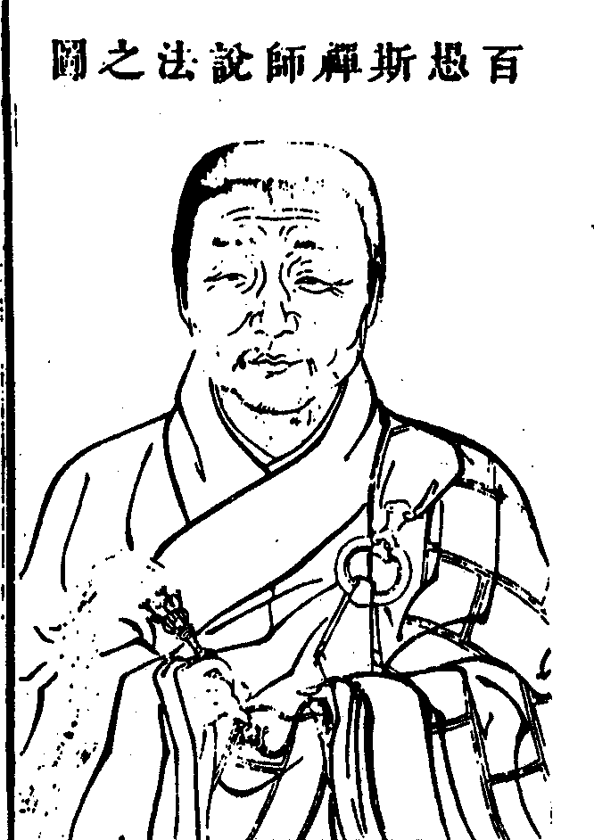
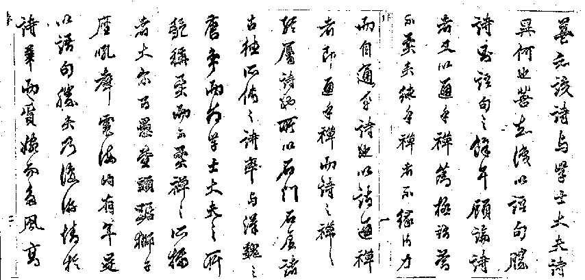
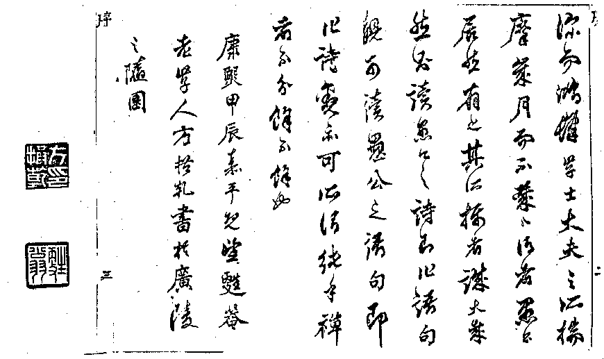

# 百愚禅师语录



> **藏经**：嘉兴大藏经（新文丰版）（嘉兴藏）　**册次** 第 36 册（J36）　**编号** JB359　**部类** 诸宗部　**卷次** 20 卷　**篇幅** 213,559 字

> **作者（译者）**：嗣法门人智　朴编

> **卷／品**：25 卷 · 3 品



---



## 目录



  - [百愚斯禅师语录序](#百愚斯禅师语录序)

  - [百愚斯禅师语录序](#百愚斯禅师语录序-1)

- [蔓堂集附(四卷六十四](#蔓堂集附四卷六十四)

- [百愚斯禅师语录卷第一](#百愚斯禅师语录卷第一)

- [百愚斯禅师语录卷第二](#百愚斯禅师语录卷第二)

- [百愚斯禅师语录卷第三](#百愚斯禅师语录卷第三)

- [百愚斯禅师语录卷第四](#百愚斯禅师语录卷第四)

- [百愚斯禅师语录卷第五](#百愚斯禅师语录卷第五)

- [百愚斯禅师语录卷第六](#百愚斯禅师语录卷第六)

- [百愚斯禅师语录卷第七](#百愚斯禅师语录卷第七)

- [百愚斯禅师语录卷第八](#百愚斯禅师语录卷第八)

- [百愚斯禅师语录卷第九](#百愚斯禅师语录卷第九)

- [百愚斯禅师语录卷第十](#百愚斯禅师语录卷第十)

- [百愚斯禅师语录卷第十一](#百愚斯禅师语录卷第十一)

- [百愚斯禅师语录卷第十二](#百愚斯禅师语录卷第十二)

- [百愚斯禅师语录卷第十三](#百愚斯禅师语录卷第十三)

- [百愚斯禅师语录卷第十四](#百愚斯禅师语录卷第十四)

- [百愚斯禅师语录卷第十五](#百愚斯禅师语录卷第十五)

- [百愚斯禅师语录卷第十六](#百愚斯禅师语录卷第十六)

- [百愚斯禅师语录卷第十七](#百愚斯禅师语录卷第十七)

- [百愚斯禅师语录卷第十八](#百愚斯禅师语录卷第十八)

- [百愚斯禅师语录卷第十九](#百愚斯禅师语录卷第十九)

  - [与青龙两序](#与青龙两序)

- [百愚斯禅师语录卷第二十](#百愚斯禅师语录卷第二十)

- [百愚禅师蔓堂集卷一](#百愚禅师蔓堂集卷一)

- [百愚斯禅师蔓堂集卷第二](#百愚斯禅师蔓堂集卷第二)

- [百愚斯禅师蔓堂集卷第三](#百愚斯禅师蔓堂集卷第三)

- [百愚斯禅师蔓堂集卷第四](#百愚斯禅师蔓堂集卷第四)



---



百愚斯禅师说法之图







师讳净斯，号百愚，南阳桐柏谷氏子。生万历庚戌，廿一脱白，明年圆具。参瑞白雪老人，闻钟声大悟，记莂时年已四八矣。后五载，开法疁之昭庆。壬寅，主善权，升维扬之善庆。乙巳中秋，尽散衣钵。越旬二日，上堂辞众。翌晨书偈，掷笔而逝，顶煖彻日夜。寿元七八，腊终五七，嗣法四十有二。遗命塔造善权，茶毘，获大小舍利不可胜数。锁子灵骨，五色斓斑，齿牙目睛全如故。辛亥，建塔寺东北万松岭后，坤艮向。铭为方学士拱乾所撰。乙卯，筑礼庵，守护塔左八坐，名蓝九会。说法语录廿卷，梓送楞严，随藏流通。



门人智操拜记



------



### 百愚斯禅师语录序



一千七百则之先有公案否？前此矣。前此则何以一千七百则？独传发端焉耳。发端则有广之者矣，诸家语录是也。语录者，语言文字之属也。前此举语言文字而扫之矣，以为佛法之障也。继此可得而扫之否？曰：存之，则语言文字为佛法之障；扫之，则佛法又为语言文字之障矣。然而扫与存果何居？则贵乎其人焉尔。其人存，则其政举，语言文字皆神奇也；其人亡，则其政熄，语言文字皆臭腐也。以臭腐之语而出於佛祖之口，则佛祖之矣；以神奇之句而出於野狐之口，则野狐之矣。吾故曰：贵乎其人也。然而其人则难言之矣，求其人於佛法之季，则益难之矣。吾则以仰百愚大师，足以当之。大师开悟最早，操履至醇，譬之帷灯匣剑，其光锷以韬敛为奇，及其苦心为人，而宝珠肆应，全体大用，有不可得而掩者，其嗣存焉。睿公以语录见示，余曰：吾将求大师之人，则大师之语言文字举此矣。夫大师之人，诸方所共仰，或以为泰山乔岳、或以为威凤祥麟、或以为光风霁月、或以为烈日秋霜，而要其感人以诚、遇物以恕，律己以孤峻、处事以平等，不离真实者近是。经云：「惟此一真实，餘二则非真。」以大师之实，求大师之人，以云传也；以大师之人，存大师之语言文字，以云救也。



山阴云隐弟子祁熊佳顿首拜题



------



### 百愚斯禅师语录序



禅师俗姓谷氏，河南南阳桐柏县人。自出世后，以向上钳锤学者，凡八主道场，始畅於昭庆，圆寂於善庆，建塔於善权。善权者，吾邑溪山最胜处，历代祖师僊灵窟宅也。先是，邑中蒋晦斋先生以宰官为释氏护法，念兹山自洊更兵燹来，榛莽之所丛生，獾豕之所嗥啸，法席非得人不可，於是不徇名、不慑势，特迎师主是山。师至，则攘幽剔薉，复故拓新，寺大治。继师者，即师法嗣寒松公。公神明警秀，威音肃然，其语录、诗文亦久为世重。师没后，寒公手辑其语录为二十餘卷，藏寺中。寒公尝为余言：「师为人清冲简劭，是支道林、竺法深一流人。」及读龙眠先生所为师塔铭，条分缕柝，寒公之言益信。既又读师语录，龙驹蹙蹋、天马脱羁，时而说法炽然、时而拈花微笑。窃叹自一花五叶以还，青原、南岳而下，提唱兼行，然未有飒爽森张，单提直入，如禅师之踸踸者也，则吾於寒公之言益大信。噫！吾见今之执拂而踞上座者矣。其上者，剽窃古德传灯单文只字，支离挦撦，嚼蜡捕风，辄扬扬然诩於人曰：「我某宗嫡传也。」是与王、谢家不慧子弟专以门阅上人者何异？甚或牵缀权势，凭藉贵游，攫人之田庐而鱼肉之，犹曰：「我为祖塔司粪除也，五宗严支派也。」识与不识，无不从而呕哕之。闻禅师之风，亦庶几自媿矣。余涉秋行国山道中，憩善权寺门松巷，屈指畴昔，则禅师既寂，晦斋继歾，即寒公亦席不暇暖他徙。问其寺，则已为豪有力者主之矣。惊飙所及，林无静柯，俛仰之闲，能无慨然於中乎？因至师塔下，汲涧水一盂而饮之，风霜刻轹，泉香而石瘦，则犹能想见师之为人。



荆溪法弟子陈维崧顿首谨拜撰



百愚斯禅师语录目次



像传  

序文  

第一卷住嘉定古昭庆禅寺语录



第二卷住云间青龙隆福寺语录



第三卷住湖州弁山龙华寺语录



第四卷住湖州弁山龙华寺语录



第五卷载住青龙隆福禅寺语录



第六卷载住青龙隆福禅寺语录



第七卷住越州大能仁禅寺语录



第八卷住越州云门显圣寺语录



第九卷住越州云门显圣寺语录



第十卷住杭州皋亭佛日寺语录



第十一卷住宜兴国山善权寺语录



第十二卷住维扬江都善庆院语录



第十三卷示众  

小参



第十四卷晚参



第十五卷普说  

拈古



第十六卷颂古



第十七卷源流颂  

经旨颂



第十八卷机缘  

问荅  

垂问  

垂代  

法语  

题赞



第十九卷书复  

杂著



第二十卷佛事  

塔铭



------



## 蔓堂集附(四卷六十四



## 百愚斯禅师语录卷第一



住国山善权寺嗣法门人智操　住青龙隆福寺嗣法门人智湛　编次



住苏州嘉定昭庆寺语录



顺治丙戌冬，在云间青龙隆福寺受请入院。



三门。「者个大解脱门，今为诸人八字打开了也。且作麼生入？」喝一喝。「狮子窟中无异兽，象王行处绝狐踪。弥勒殿尽道当来下生，缘何却在者里便好？夺却布袋，趁出山门。」顾左右，云：「今且放过一著。」遂礼三拜。



方丈。「玄关把断，搜空罔象之珠；宝镜高悬，照破野狐之胆。直饶释迦、维摩到来，也要按过。何故？」卓拄杖，云：「假鸡声韵难瞒我，未肯糢糊放过关。」



开堂拈疏。「字字铁酸馅，句句木札羹，还委悉麼？其或未委，仰烦宣过。」



法座。「此是宝华王座，未审须弥登王在甚麼处？且看斯上座指模畫样去也。」升座，拈香。「此一瓣香，明如舜日、旷若尧天，祝延圣躬万岁万岁万万岁，伏愿金轮永镇、玉烛常调，寿逾百亿须弥、化洽大千沙界。此一瓣香，经天纬地、贯古通今，奉为满朝文武、阖国公卿、府县尊官、远近檀护，惟冀永作生民怙恃，恒为佛法金汤。此一瓣香，非正非偏，非玄非要，穿却诸佛鼻孔，换却衲僧眼睛，供养前住越州云门显圣堂上传曹洞正宗二十八世瑞白雪大和尚，用酬法乳之恩。」就座。维那白椎，云：「法筵龙象众，当观第一义。」师云：「若论者个第一义，黄面瞿昙插觜无分，碧眼胡僧退身有地。纵饶德山有棒，只堪打猪打狗；临济有口，只好喝驴喝马。虽然威音那畔休话，如何曲为今时繇人施设？」举拂子，云：「者里会去，不妨竿木随身，逢场作戏，饥餐无米饭、渴饮不湿羹，打秋千於猛虎颔下、翻筋斗於毒蛇口中，磅礡虚空、纷纭宇宙，横抽宝剑，截诸见之稠林；玅协弘通，翦异端之穿凿。世谛道谛随处周圆，佛恩皇恩一时酬足，正眼看来，未是衲僧行履处。且作麼生是衲僧行履处？隐身不必须嵒谷，阛阓堆堆睹者稀。」维那结椎，云：「谛观法王法，法王法如是。」下座。



元旦，上堂。「柳眼垂青，窥破江心红日冷；梅腮发笑，惊回塔畔晓风高。冰河发燄以腾辉，枯木生花而散彩。迁乔黄鸟，弄格外之真机；出谷白云，呈现前之玅用。烟光溢目，淑气盈空，可谓应时纳佑，庆无不宜。正恁麼时，父子团𪢮，君臣会合，又且如何？」良久，云：「干戈偃处狼烟息，万里歌谣贺太平。」



至南翔白鹤寺，请上堂。「世尊拈花，老不识羞；迦叶微笑，承虚接响。致使后代儿孙向曲录床上指东话西，正法眼藏未曾有一人动著。山僧路见不平，傍为铲削。」卓拄杖，云：「正法眼藏被昭庆百杂碎了也，一时化作无量无边清净摩尼宝珠。凡在会者，不论僧俗、男女、贫富、贵贱、贤愚、老幼，一齐布施，直下咸知此珠在凡不减、在圣不增，人人具足、个个圆成，济人施物，应用无亏。敢问诸人：即今珠在甚麼处？」喝一喝，云：「罔象到时光灿烂，离娄行处浪滔天。」问：「接物利生即不问，如何是第一句？」师云：「当空杲日人皆见。」「如何是第二句？」师云：「白云片片过前川。」「如何是第三句？」师云：「鸳鸯飞过洞庭湖。」进云：「日丽风和莺语细，天空云淡水声清。」师云：「休来者里念篇章。」



上堂。「昨夜三更澍大雨，今朝觌面为相举，依依柳色吐黄金，片片梅花流玉乳，大地群萌尽获恩，森罗万象皆欢舞。莫沉吟，急荐取，若能於此绝狐疑，直下翻身超佛祖。」



上堂。喝一喝，云：「大众！还识者金刚宝剑麼？拟则伤锋犯手，触则丧身失命，三世诸佛不敢正眼觑著，历代祖师那容伫足傍观？若是个汉，信手拈来，纤毫不犯，直下划开情尘见网，当阳击碎金锁玄关，予夺纵横，杀活自在，随处作主，遇缘即宗，正好挽祖风於末运、捧佛日於天心，世、出世间一大丈夫，然犹是建化门中事。且不落功勋一句作麼生道？手指空时天地转，回途石马出纱笼。」



结制，上堂。「十五日已前，卒风暴雨；十五日已后，朗月晴空。所以道：把住则黄金失色，放行则瓦砾生光。放行、把住即不问，汝诸人正当十五日又且如何话会？○於此洞彻，不妨做个洒洒落落衲僧去。否则，且向三条椽下、七尺单前高挂钵囊，壁立万仞，内脱身心、外遗世界，一念万年、万年一念，不以程途为限，直须以悟为期。诚能如是，上不负於诸圣、下不辜於己灵，然后於祖师门下扶竖宗乘、接待往来，未为分外。虽然，若到昭庆门前打拆脚胫，何故？不见道：清光照眼似迷家，明白转身还堕位。」



说戒，上堂。「祖印高悬，凡圣绝迹，楼阁门开，别峰相见。若是恁麼事，须是者般人。昔法眼问永明潜云：『古人道：「隔壁闻钗钏声即名破戒。现睹金银合杂、朱紫骈阗，且道是破戒？不是破戒？」』潜云：『好个入处。』眼云：『子向后有五百毳徒为王侯所重在。』」乃云：「即今香花罗列、钟鼓交参，海众云臻、人天普集。众中有得个入处者，不妨攒眉便去、掩耳即行，花街柳巷任意逍遥，歌管楼台随缘放旷，掷大千於界外，纳劫火於腹中。若到者个田地，名真持戒；苟或迟疑，应须谛听。」



弁山先老和尚忌日，上堂。「维那未白椎已前，先师向诸人眉毛尖上转大根本法轮，说甚深修多罗，使未信者信、未解者解、未安者安、未悟者悟、未得涅槃者得涅槃，一音演唱，随类各解，所谓一切智智清净，无二无二分、无别无断故，然后又向诸人眉毛尖上复入寂光三昧。大众见麼？纵饶见得，更有末后句子未曾道在。昭庆今日要与诸人道破去也。」良久，云：「宁可截舌，不犯国讳。」



上堂。「云门饼、赵州茶，打发闲神野鬼；秘魔叉、石巩箭，惊骇泥猪癞狗。五位三玄是甚破艸鞋？六义圆相是甚系驴橛？正眼看来，总是一场笑具。昭庆曾无一法与人，无禅道可参、无佛法可学，亦不教你明心见性、亦不教你超佛越祖，只要饥来吃饭、困来打眠，热时乘凉、寒时向火。者里会得，人人鼻孔撩天；设或未然，个个脚跟点地。」



诞日，上堂。举韩文公参大颠因缘，乃云：「大颠老汉虽有拨乱之谋，且无定安之策。有问昭庆：『春秋多少？』但道：『庚戌生的。』待他曰：『不会。』更道：『今年三十八。』当时大颠若下得者两语，不惟免得首座受屈，亦不教者俗汉看破。山僧如此举扬，与古人是同？是别？」良久，云：「青山只解磨今古，流水何曾洗是非？」



解制，上堂。「雨霁云收，处处青山呈旧面；凉生暑退，纷纷黄叶坠新机。秋水澂玻璃之色，银蟾吐宝镜之辉，物物全彰，头头独露，会得前是结制，不会今又解制。其结也，鱼跃鸢飞，星驰电卷，疾燄过风，奔流度刃，临济、德山到来只得吞声饮气；其解也，龙吟雾起，虎啸风生，凡圣交参，人天普会，情与无情同圆种智。虽然，有结有解犹是今世门头事，只如无解无结又作麼生？疁城垒垒超今古，练水滔滔绝去来。」问：「百二十期今已解，临筵朢日事如何？」师云：「海阔从鱼跃。」进云：「一轮扑落须弥倒，透出虚空甚麼人？」师云：「天空任鸟飞。」进云：「圆缺缺圆空界月，再三吞吐始应知。」师云：「只恐不是玉。」进云：「得力须忘饱，休粮更不饥。」师云：「是玉也大奇。」



至青浦县，众缙绅请上堂。「秋风拂拂送轻舟，昨泛青溪浪里游，撒个漫天无缝网，鱼龙虾蟹一齐收。」顾左右，云：「还有翀霄彩凤、透网金鳞麼？有则今日功不浪施，无则不免拨转船头别行一路去也。」拈拄杖，云：「只如教中道：『若能转物，即同如来。』者个拄杖是物，作麼生转得同如来去？者个是如来，作麼生转得同物去？如能转得，不妨於拄杖头上现百亿须弥、百亿日月、百亿四天下、百亿释迦；若转不得……」卓拄杖，云：「城市不堪留锡久，恐惊莺啭畫楼前。」问：「世尊分卫化导众生，和尚入城化个甚麼？」师云：「芦花两岸雪。」进云：「还有承当得的麼？」师云：「江水一天秋。」进云：「当空红日照昆仑。」师云：「莫向言中觅，须从句外求。」一僧才礼拜，师云：「好生问话。」僧一喝，师便打，僧又喝，师亦打，僧竖起拳，云：「长安大道向者里去也。」师云：「教休不肯休。」进云：「悄然黄叶落，不独一天秋。」师又打，云：「直待雨淋头。」



至上海县龙华寺，请上堂。「黄浦波浪，浴日滔天，窣堵簷牙，拏云攫雾，转轮殿觌面全提，藏经楼横空独露。会得者，一任转天关、捩地轴，施一机地震山摇，行一令神惊鬼惧，非惟报佛恩德，亦不辜负方丈主人打凤罗龙一片婆心。忽有人曰：『和尚者般说话，亦是担水河头卖。』昭庆向他道：『不因渔父引，怎得见波涛？』」问：「十五已前缺了圆，十五已后圆了缺，正当十五，是圆？是缺？」师云：「一任钻龟打瓦。」进云：「万吉碧潭空捞摝，未曾惊觉莫能知。」师云：「且喜没交涉。」问：「正偏回互即不问，宾主交参事若何？」师云：「昨日雨，今日风。」进云：「如是则寒山逢拾得，鼓掌笑欣欣。」师云：「也不辜负阇黎。」



至周浦镇永定寺，请上堂。「永定寺中，考钟伐鼓；周浦市上，卖狗悬羊。歌管楼台，总是衲僧境界；花街柳巷，无非慈氏家风。盘山睹割肉而明心，楼子闻唱歌而悟道。普化摇铃铎，全提向上机关；善慧贩鱼羹，直指当阳玅用。所以，人能弘道，非道弘人。到者里，谁分城市山林？那管魔宫佛国？任运逍遥，随缘放旷，舒卷不落功勋，去来了无变易。虽然如是，须知更有转身一路始得。还知转身一路麼？」良久，云：「知音不用频频举，达者须知暗里惊。」问：「大行普贤超格外，凝然苦行事如何？」师云：「古井含新月。」进云：「树凋叶落金风露，衲破衣穿作麼生？」师云：「残枝带晚霞。」进云：「髼头林下为闲客，跣足人闲作野僧。」师云：「再道一句看。」进云：「石人头上插金花。」师云：「相随来也。」



结制，上堂。拈拄杖，云：「把住六门关，拨开大火聚，圣凡无处逃，佛祖岂能避？直得大地平沉，千差路绝，海水逆流，须弥倒卓，鹘眼龙睛不敢觑著，铜头铁额那容近前？正恁麼时，便乃点铁成金，转凡为圣，变娑婆为极乐，翻荆棘为栴檀，驴乳、牛乳尽为无上醍醐，有情、无情共证不二真觉，个个如狮子儿哮吼一声，惊天动地，纵饶到此，正好吃棒。」复卓一卓，云：「权威黑帝令尤切，那许东风弄柳狂？」问：「一雨均施，三根普润，如何是类堕？」师云：「何处不称尊？」「如何是随堕？」师云：「步步不沾尘。」「如何是尊贵堕？」师云：「觌面无相识。」进云：「恁麼则迥迥雪山千古秀，滔滔洞水万年流。」师云：「三堕外更道一句看。」僧礼拜，师便打。



冬至，上堂。「天得一以清，地得一以宁，神得一以灵，君王得一以治天下。」拈拄杖云：「只如木上座能杀能活，能纵能夺，或时现大，充满法界，或时现小，在一微尘，纵横自在，变化无拘。且道他得个甚麼却能如是？千寻海底泥牛舞，万仞峰头玉凤鸣。」问：「琉璃界外不知踪，娑婆国内无名姓。且道此人具甚麼手眼？」师云：「步步冰花结。」进云：「还许他参学也无？」师云：「言言彻骨寒。」进云：「仲冬严寒，伏惟和尚珍重。」师云：「放你三十棒。」



上堂。「第一义，为君决。面赤不如语直，巧言不如实说。秤锤软似绵团，灯心硬似铁橛。石女歌，木童拍，万象森罗笑不歇。弥勒惺惺总不知，释迦依然犹未瞥。洞山五位那能该，临济三玄收不得。若信得及，师恩亲恩一时酬毕。如信不及，雨过晓风清，月明秋水白。」



上堂。「凛凛朔风遍界寒，千林叶落水成斑，透肌彻骨谁能委？惟有梅花笑破颜。明举似，莫瞒盰，剔起眉毛仔细看。」竖拂子，云：「大众见麼？冻鸡啼处家园晓，隐隐行人过雪山。」



佛成道日，上堂。「世尊腊八於正觉山前夜睹明星悟道，喟然叹曰：『奇哉！一切众生具有如来智慧德相，但以妄想执著而不证得。』」喝一喝，云：「是何言欤？大小世尊眼空四海、傍若无人，者等说话，只好欺压流俗、诳惑愚人，二千年后难免简点。只如离兜率、降王宫，岂不是妄想执著耶？入胎降生、大惊小怪、指天指地，岂不是妄想执著耶？弃金轮之位、舍万乘之国，岂不是妄想执著耶？诣雪山、餐麻麦、睹星悟道，岂不是妄想执著耶？乃至说顿、说渐，说偏、说圆，说空、说有，灵山会上拈一枝花，谓之教外别传，岂不是妄想执著耶？正眼看来，何异好肉穵疮？总不如昭庆肚饥吃饭、身冷加衣，任运腾腾、洒洒落落，亦无明星可睹、亦无禅道可悟，复何妄想执著之有哉？山僧如是告报大众，直下无疑，不妨与释迦老子同证、同悟、同时成道。更或拟议，沧江波动因风起，瓦灶无薪火不然。」



祈嗣，请上堂。「乾坤之内，宇宙之间，中有一宝，秘在形山。」卓拄杖，云：「形山粉碎了也。若能见得，世、出世间靡有过於此者。轮王得之以御天下，龙女献之而获授记。以此忏罪，无罪不灭；以此祈福，无福不臻。随心所欲，无不具足，天人群生类皆承此恩力。更有承绍家业又如何道？庭前玉树花开早，世世芬芳亘古今。」



荐严慈请上堂。竖拂云：「只者个圆陀陀、光烁烁、净裸裸、赤洒洒，虚空包不住、大地载不起，无去无来，冥通三际，亘古亘今，体遍十方，二听莫闻其响，五目安睹其容，不可得而亲、不可得而疏，举心即错、动念即乖，还有承当领略者麼？若能如是，处生死流若骊珠独耀於沧海，踞涅槃岸似桂轮孤朗於碧天，三代祖祢以此而超生，累世亲缘仗此而度脱，可忏不忏之咎，以报不报之恩，苟非其人，未免重说偈言。」遂合掌云：「惟愿无限胜良因，回向法界真实际，一念无私证无生，直入如来不退地。八德池中任遨游，九莲台上恣嬉戏，如此了知三世法，於诸如来无有异。无去无来亘古今，不生不灭无沦坠，一尘普现一切刹，一切刹在一尘内，种种方便度众生，尽未来际作佛事。过去菩萨如是学，现在菩萨得授记，未来菩萨亦复然，共证如来平等智，回向法界诸有情，是则名为不思议。」问：「如何是正中偏？」师云：「腊月藕花鲜。」「如何是偏中正？」师云：「残云笼古径。」「如何是正中来？」师云：「泥猿啸月台。」「如何是兼中至？」师云：「针来与线去。」「如何是兼中到？」师云：「虚空开口笑。」僧礼拜，师便打。



上堂。「仰之弥高，钻之弥坚，瞻之在前，忽焉在后。昭庆如是举扬，大众作麼商量？谓是佛法，却是颜子道底；谓是儒书，又在山僧口里说出。於此分析明白，不妨奇特。有者便谓儒教不殊於禅教，世法无异於佛法，天地一指，万物一马，凡圣一体，三界一心，彼此一致。恁麼解会，料掉没交涉。若是大丈夫，直下截断葛藤，掀翻情识，孤迥迥、露堂堂，高超三界、独步大方，无可不可、无在不在，不动等觉而建立诸法。还有恁麼人麼？山僧不妨下个注脚：仰之弥高，不隔纤毫，大鹏展翅，廓尔冲霄；钻之弥坚，亘古如然，白云片片，皓月娟娟；瞻之在前，迥脱言诠，扬眉瞬目，如隔天渊；忽焉在后，忒煞漏逗，腊月梅花，馨香依旧。」



元旦，上堂。「翡翠帘前，九夏霜花满地；琉璃殿上，三更旭日盈门。木鸡啼而千林晓，玉犬吠而万户春。藏香象於不萌草里，盛活蛇於无底篮中。燕尾船儿日越清风，羊头车子夜推明月。不容那畔，宁落今时？所以道：灵苗瑞草，野父愁耘；露地白牛，道人懒牧。太平岂有象，何妨麟集凤翔？造化本无私，一任龙吟虎啸。正恁麼时，且道承谁恩力？野老不知黄屋贵，六街慵听静鞭声。」



至弁山，蕃光和尚请上堂。「云封弁岳，人天景仰无门；月照华林，龙象参寻有路。花石涧恒演长舌之音，弥勒峰独现大人之相，尘尘祖意盈眸，刹刹真风觌面。」竖拂子，云：「大众！者里会得，一任胸藏武库、肘佩灵符，浑融正偏、迭为宾主，验龙蛇於杖头、分玉石於言下，掀翻日月、别立乾坤，十地闻之魂惊、三贤见之胆战，不是神通玅用，亦非法尔如然。虽则如是，若在衲僧分中未为奇特，须知我洞山门下别有尊贵一路始得。作麼生是尊贵一路？」良久，云：「不须此外寻堂奥，诸向华林问主人。」问：「昨日设供报师恩，今朝说法利群生，说法利生则且置，报恩一句请师宣。」师云：「青龙冈上云霭霭。」进云：「和尚设供，先老人还来受供也无？」师云：「象王峰畔雾腾腾。」进云：「与麼则和尚未离昭庆，先老人早已受供了也。」师云：「切忌妄通消息。」



上堂，举：「实性大师因芙蓉训禅师至，上堂，以右手拈拄杖倚左边，良久，曰：『此事若非芙蓉师兄，也大难委悉。』便下座。」乃云：「实大师虽则人情佛法一时周备，检点将来，大似向福建人前卖荔枝，未免傍观者哂。」



至玉峰，请上堂。「玉峰突兀，独露万象之中；宝塔玲珑，势出层霄之外。弥勒阁无殊兜率，昙华亭迥异人间。梵宇参差，影沉碧水；松杉错落，韵奏笙簧。处处车马骈阗，时时朱紫合杂。云封雉堞，偏正何分？月照闾阎，主宾莫辨。於斯会得，无边刹海自他不隔於毫端；於斯不会，十世古今始终不离於当念。」举拂子，云：「分明月在梅花上，看到梅花早已迟。」



至云间贝多庵，请上堂。「只者第一义以太虚为纸、大地为砚、九峰为毫、三泖为墨，直教宋石门、赵文度、董玄宰、陈眉公竭其心力、殚其精巧，写到弥勒下生，以至尽未来际，不能加一毫於其间。须知语言文字之所未及、世智辨聪之所未穷，故曰：口欲谭而辞丧，心欲缘而虑亡。贵在言前领荷、格外翻身，四五百条花柳巷正好调心、二三千处管弦楼一任放浪，乃吾人之固有，非性分之强为。不然，明朝五月端阳节，看取龙舟夺锦标。」



诞日，上堂。「年年此日，此日年年，见有流动，物无变迁。天外白云兮，乍来乍去；江心明月兮，或缺或圆。松自直，棘自曲；鹄自白，乌自黑。弥勒、释迦，谁后？谁先？」竖拂子，云：「只者个，三世诸佛不敢谭著，历代祖师不敢觑著，迎之不见其首，随之不见其后。大众会麼？一种风流人不识，新妇骑驴阿家牵。」



上堂。「今朝六月十九，普门大士垂手，尽谓降伏群魔，也是拏棒唤狗。昭庆却不然。」拈拄杖，云：「不见道：见怪不怪，其怪自坏。」



上堂。「床头蟋蟀，举古验今；槛外芭蕉，敲风弄月。所以道：真机无隐，大道全该，不待睹影逢渠，玅见无情说法。虽然，还有究竟者麼？秋色满园人不荐，哀哀孤鴈又南飞。」



上堂。「疁城磊落磨今古，练水潆洄绝往还。荐得目前无别法，迥然直透祖师关。」



至化城庵，请上堂。「化城虽设，策进驽骀；宝所非遥，翻腾龙象。到者里，言方便而了无方便，立程途而迥绝程途，直欲人人同登毘卢楼阁，其人如来觉场。果是知有的人，时时奉重。毕竟如何是奉重的事？夜半庭前红日冷，不萌花下舞春风。」



至娄塘西资庵，请上堂。「法无定相，道绝方隅，赴感随机，由人施设。大众还委悉麼？落木萧萧练水寒，扁舟随处且垂竿，杨柳岸，蓼花滩，得盘桓处且盘桓，等闲唱个渔家乐，钩尽沧浪月一湾。」



荐亡，请上堂。「欲识无生旨，分明在目前，芙蓉含露笑，枫叶醉霜眠。刹刹光明藏，头头极乐天，不须向外觅。」喝一喝，云：「拟议隔三千。」



至狮子林，请上堂。「郁密狮林深可藏，横溪一室俨如航，梳风细柳千条碧，洒雪残梅几片香。东阁观潮知水信，西林坐月觉天凉，即心即佛谁相委？▆▆波中荡夕阳。」



上堂。举：「归宗因僧问：『如何是佛？』宗曰：『欲向汝道，恐汝不信。』僧曰：『和尚重言，焉敢不信？』宗曰：『即汝便是。』僧曰：『如何保任？』宗曰：『一翳在目，空花乱坠。』」乃云：「赤眼归宗，虽则机辨纵横、卷舒自在，仔细较量，犹涉唇吻。当时若问昭庆：『如何是佛？』即向他道：『你是抱赃叫屈汉。』再问：『如何保任？』和声便打。非唯使者僧别有机关，亦不教他闺阁中作活计。大众！毕竟归宗道的是？昭庆道的是？傥若踌躇，君向潇湘我向秦。」



荐亡，请上堂。「满林秋色正芬芳，带醉芙蓉笑夕阳。识得严亲真面目，分明格外好风光。好风光，端的别，弥陀不在安养国。既不在安养国，即今在甚麼处？」畫○云：「长空云散家家月。」



上堂。「佛法本来无可说，何须特地更饶舌？今朝恰遇小阳春，也要山僧应时节。」击拂，云：「大众！者是甚麼时节？香严击竹也不离者时节、灵云见桃花也不离者时节、洞山睹影也不离者时节、玄沙𡎺指也不离者时节，乃至见色明心、闻声悟道，触著、磕著，一念相应、心华发现，总不离者时节。只如不落因缘时节又作麼生？」击拂，云：「不离当处常湛然，觅即知君不可见。」



至芦庵，请上堂。「法离见闻觉知，若求见闻觉知，是见闻觉知，非求法也。直饶过去古佛犹不免抱桥柱洗脚，山僧则不然。」竖拂，云：「大众！看看！只者个不落见闻觉知，迥超情识意想，三世诸佛、历代祖师以及一切众生，莫不承此恩光作诸佛事。大众！还见麼？见与不见，拈过一边。只如昨夜陕府铁牛与嘉州大象厮扑，吓得无边身菩萨走向三千里外，躲入藕丝孔中。且道是个甚麼意旨？」良久，云：「识法者惧。」



至广福镇，请上堂。「纷纷细雨，偏丽乳酪於长空；冽冽霜风，密布寒夙於大地。水流云兴，共演不二之法门；猿啼鹤唳，竞谈一乘之玅旨。到者里，人人是佛、个个是祖，本来现成阿谁无分？又那管城市山林、乡村野店？正好拖泥带水，随处为人。虽然，当知我衲僧家有超佛越祖一大奇特事在。如何是奇特事？」顾左右，云：「因甚针眼鱼，吞却占波国？」



至江湾保宁寺，请上堂。「古殿崔嵬，昔日之真风不坠；层楼突兀，今时之气象弥新。路接云衢而车马络绎，门连江浦而歌棹频闻。左之、右之，无殊玅庄严海；举足、下足，何异菩提觉场？到者里，正好全身担荷、竭力提持，转自己归山河大地、将山河大地转归自己，自己与山河大地无别、无二。大众！还委悉麼？知音不必轻弹指，千里同风始是奇。」复举：「昔世尊一日因食时命阿难入城持钵，复云：『当依七佛仪式。』阿难云：『如何是七佛仪式？』世尊遂唤阿难，阿难即应诺，世尊云：『持钵去。』」乃云：「大小瞿昙也是无风起浪，庆喜尊者无端被人点破面门，正眼看来二俱狼籍，山僧与他据款结案。」挥拂子，云：「轻舠箬笠晓风寒，深浅何妨便下竿？一曲沧浪人不荐，且随白鹭过江湾。」



至南翔弥陀殿，请上堂。「当阳一句，迥绝遮拦；格外真机，了无背向。到者里，通身是口，谈之不及；浑身是眼，见之不到。所以，释迦掩室於摩竭、净名杜口於毘耶，须菩提无说而显道、释梵王绝听而散花。若是个超群拔萃汉，不妨掩耳即行。有甚麼事？有麼？有麼？若无，更向葛藤里荐取。」举：「昔王荆公谓同僚曰：『我得雪峰和尚一句子，直至而今为宰相。』同僚请益，公竖起拳，云：『者个是甚麼？』同僚罔测。」乃云：「荆公之器小哉！若论者一句子，辉天鉴地、括古囊今，诸佛得之而成正觉、菩萨得之而行六度、声闻得之而证四谛、君得之而为尧舜禹汤、臣得之而为皋陶伊尹、父得之而慈、子得之而孝、朋友得之而信，世、出世间之事无有不从者一句而得，岂止为宰相而已？大众且道：毕竟是那一句子？」顾左右，云：「宁可截舌，不犯国讳。」



至清风庵上堂。卓拄杖云：「只者个有眼不可睹，睹之如盲；有耳不可闻，闻之如聋。乃至不可嗅、不可谈、不可触、不可思，从本已来，离言说相、离名字相、离心缘相，离非有相、非无相、非非无相、非非有相、非有无俱相、非一相、非异相、非一异俱相，可谓言语道断，心行处灭。虽然，只如泥牛衔月、木马嘶风，露柱骂灯笼、山门骑佛殿，且道是甚麼人境界？」复卓拄杖云：「孤舟棹出娄江月，下载清风付与谁？」



至茜泾福林庵，上堂。「薰风至而殿阁凉生，柳阴浓而池塘绿暗，茜水舒诸佛之长舌，福林彰衲僧之巴鼻，明明独露，卓卓全该，迥绝言诠，安容穿凿？直得生佛一体、愚智一如，无高无下、无古无今，正好於祖师门下各出只手，扶竖正教，共挽颓风，光我法幢。且道谁是其人？若真狮子儿，哮吼也惊群。」



重九，上堂。「萧萧落木逐风飞，鸿鴈衔芦塞外归，借问而今何节届？东篱黄菊逗新机。大众！若道今是重阳，不免随境逐物；若道不是重阳，亦是违时失候。直须坐断两途，出人一头地，始得不随时变、不逐境迁，处富贵而不为乐、居患难而不为忧，坐卧声色差排古今，於一切法而得自在，然后可以为明、为导、为纲、为领，於此门中共出只手，建大法幢，互兴佛事，岂不谓世、出世间第一胜事？於中还有其人麼？大风吹落石人帽，拾得寒山笑不休。」



> (安乐院智安，备资敬刻  

> 百老和尚语录第一卷。)



------



## 百愚斯禅师语录卷第二



住国山善权寺嗣法门人智操　住青龙隆福寺嗣法门人智湛　编次



住云间青龙隆福寺语录



顺治戊子春，在古昭庆寺受请入院。



上堂。拈疏云：「大众见麼？字字达磨眼珠，言言孔圣心髓，一时抖擞了也。其或未见，更须谛听。」指法座云：「者个所在，高而无上、广而无际，且道如何攀跻？」卓拄杖云：「等闲蹋著无回互，铁额闻风也皱眉。」登座，拈香祝圣毕，「此一瓣香，一味毒气薰成，钳锤煆就，次第二回供养浙江绍兴延庆堂上传曹洞正宗第二十八世瑞白雪大和尚，用酬法乳之恩。」就座，白椎竟，师云：「泼天门户，迥绝遮拦，个段风光，阿谁不具？纵饶通身是眼，觑之不见；浑身是口，说之不及。到此须是有力大人一肩担荷，所以现前檀护夙植德本、久种善根，严饰浮屠、恢复梵宇，更请山僧举扬个事，开凿人天眼目，阐扬佛祖门庭，若非乘大愿力现身再来，决不能也。山僧不敢瞒盰，只得两手分付，且道分付个甚麼？普愿大家齐著力，辟开古路任纵横。」问：「青龙古刹中兴，洞上宗风广播，如何是向？」师云：「海潮涌百川。」「如何是奉？」师云：「殷勤千里来。」「如何是功？」师云：「杏芳红不艳。」「如何是共功？」师云：「玉花金蝶两翻飞。」「如何是功功？」师云：「泥牛石虎同相吼。」进云：「五位功勋蒙指示，利生一句又如何？」师云：「一片菜花黄似金。」进云：「杲日当空照，恩光何处无？」师云：「切莫乱卜度。」居士问：「昔日性空，今朝和尚，是一？是二？」师云：「仙人台畔水长流。」「如何是祖师关？」师云：「眉毛上荐取。」「如何是透关底事？」师云：「待你到者个时节著。」



诞日，上堂。靠拄杖，良久，云：「者里会得，可煞现成；傥或踟蹰，勿怪青龙指鹿为马。」卓拄杖，云：「还知者木上座落处麼？直饶玅德空生不敢谈著、黄头碧眼不敢觑著，觑著眼睛瞎、谈著口皮穿。何故？数量拘他不得、春秋摄他不得，因果收他不得、生死迷他不得，是非圣凡名他不得、青黄赤白描邈他不得，不可以智知、不可以识识，三际平等、一道清虚，本自不生，亦无寂灭。若承当理会得，始知天地与我同根、万物与我一体，长於上古而不为老、在於九困而不为下，彭祖非寿、殇子非夭，法界非大、微尘非小。且道：他有甚长处便能如是？莫怪从前多意气，他家曾蹋上头关。」问：「法王出世，天花应瑞；大圣示现，麟凤降生。如何是诞生王子？」师云：「禁苑无相识。」「如何是朝生王子？」师云：「从容步玉堂。」「如何是末生王子？」师云：「舌上起风雷。」「如何是化生王子？」师云：「一箭破天山。」「如何是内生王子？」师云：「金殿不知尊。」进云：「王子已蒙师指示，今逢诞日事如何？」师云：「南山竹，北地木。」进云：「恁麼则不同於诸圣。」师云：「青者青兮绿者绿。」进云：「恩从上古，法演弥纶。」师云：「认著依然还不是。」僧喝，师打，云：「休要弄虚头。」



上堂。「昨夜青龙塔怒发，与升仙台厮扑，不觉撞破东海娑伽老龙脑壳，忍痛不禁，只得扬声大叫。山僧唤来，各与六十拄杖。於是天明，各各住於本位。傥或不见不闻，莫怪搕𢶍堆头更添搕𢶍。」召众，云：「青龙家法异诸方，到者方知别有长，折脚绳床麻布帐，短簷茅屋土垣墙。霜花满地如银砌，丹叶盈溪似锦装，一一为君频举似，逢人切忌乱商量。」



结制，上堂。「青龙今日以天地为炉鞲、须弥作钳锤，扇三昧火、烧二乘炭，不论是佛是祖、是凡是圣，森罗万象、蝼蚁蠛蠓、人我是非、贪嗔痴爱、无始住地无明，一并拈向大炉鞲中，只教内不放出、外不放入，东西不辨、南北不分，识不能识、智不能知，鍊成一块、打作一团，直待虚空粉碎、大地平沉、冰河发燄、枯木糁花，方是个好消息。虽然，犹未是到家时节。如何是到家晓节？鲸吞海水尽，露出珊瑚枝。」



求嗣，请上堂。「一阳初动，万物含萌，岸柳依依，渐放黄金之干；汀梅郁郁，久怀白玉之胎。者里会得，头头独露，法法圆成，觌体无私，无劳别觅，可以抚育群生，提携万有，绍隆佛祖弘基，克振人天胜业。虽然，人天胜业如何承当？」举如意，云：「堂前露柱夜怀胎，生下孩儿颇俊哉，未解语言先作赋，一超直取状元来。」



上堂。「见色明心，闻声悟道，观音菩萨将钱买糊饼，放下手元来却是馒头。纵饶云门与麼道，未免打作两橛。青龙者里心不用明、道不须悟，馒头亦不用买。今日居士设斋，现成油煎荳腐、白面点心，只要诸人吃得饱齁齁地，挑水底挑水、净菜底净菜、运土掘地底运土掘地、搬砖弄瓦底搬砖弄瓦，一动一静、一欠一伸，折旋俯仰任意施为，不敢与诸人添个元字脚。何故𫆏？本自无疮，勿伤之也。」



上堂。「霜花散彩，煦日舒光。万木影寒，千山体露。佛祖真机觌面，衲僧巴鼻俨然。本无盖覆，奚有囊藏？到此须是过量大人、出格汉子始得。信心坚若须弥，行愿深如沧海。八风撼之不动，群魔搅之不浑。犹如宝剑精金，愈淬愈锐，愈炼愈新。如来禅、祖师禅，随处圆成；今时事、那畔事，当时了办。且如何是山格事？雪后始知松柏操，事难方见丈夫心。」



上堂。「仲尼曰：『吾道一以贯之。』老聃云：『抱一而为天下式。』瞿昙道：『唯此一事实，餘二则非真。』大众！者三个老汉与麼道，且道：是三耶？是一耶？若道是一，却又分门列户；若谓是三，奈何同道是一？到者里作麼生会？」拈拄杖，云：「仲尼、老聃、瞿昙总被山僧拄杖子穿却鼻孔了也。且道：拄杖子凭何节目却能如是？」卓一卓，云：「磊磊落落，炜炜煌煌，竖穷三际，横遍十方，神通叵测，玅用难量，才涉拟议，打出脑浆。」僧才出，师云：「狮子咬人，韩卢逐块。」便下座。



上堂。「阵阵朔风揭户开，纷纷冻雨打窗破，满堂禅客暗嗟吁，衲破蒙头床上坐。床上坐，休错过，金毛狮子解翻身，癞狗泥猪草里卧。莫有金毛狮子出来抖擞爪牙看？」问：「牛头未见四祖，为甚百鸟衔花？」师云：「时来易借金千两。」「见后因甚不衔花？」师云：「运退难赊酒半壶。」进云：「千峰势到岳边止，万派声归海上消。」师云：「切忌随语生解。」



上堂。「本无奇特，亦无巧玅，古之乾坤即今之乾坤、古之日月即今之日月、古之山河即今之山河、古之人物即今之人物，乃至松直棘曲、鹤白鸦乌、风动尘起、云腾鸟飞，尘尘尔、刹刹尔，莫不全彰者个消息。所谓：道远乎哉？触事而真；圣远乎哉？体之即神。」举拂子，云：「纵饶会处分明、见处清楚，犹是如来禅；若是祖师禅，未梦见在。且道祖师禅又作麼生？江上泥牛频鼓舞，云间石虎正咆哮。」问：「如何是正位一色？」师云：「午夜黑漫漫。」「如何是大功一色？」师云：「白牛露地眠。」「如何是今时一色？」师云：「眉毛八字分。」



元旦，上堂。「天大、地大、道大、王亦大，年新、月新、日新、时亦新，如是可作三十六旬之始、七十二候之初。」拈拄杖，云：「者个无大、无小，无新、无旧，无始、无终，历万古而不磨、超百劫而怕新，放之则弥六合、卷之则退藏於密，三世诸佛得之说法利生、历代祖师得之传佛心印、天下老和尚得之全提正令，今日正在山僧手里，堪作何用？点开日月为天眼，指出须弥作寿山。」



上堂。「雷鼓初鸣，彻群生之蒙聩；珠玑遍撒，催万卉之萌芽。柳垂绿野桥边，风鼓通波塘上，祖师意处处全彰，古佛机尘尘独露。大众！正恁麼时如何承当？青龙塔畔泥牛舞，白鹤江中木马嘶。」



解制，上堂。举拂，云：「只者个无尘不具、无刹不彰，巍巍乎总法界以为体、荡荡乎等太虚而为量，本无生佛之名，岂有自他之相？无修、无证，绝是、绝非。者里会得，说甚长期、短期，结制、解制？一任诸人紧捎草鞋、横担楖栗，或向孤峰顶上啸月眠云、或向十字街头呵佛骂祖。有时恁麼，电卷星驰、山崩海竭。有时不恁麼，龙吟虎啸、玉转珠回。却恁麼中不恁麼，拈头作尾、拏两道三。不恁麼中却恁麼，冰河发燄、枯木生花。恁麼、不恁麼且置，祇如夜明帘外转身一句作麼生道？有道得相应者，出来道看。」一僧才出，师便下座。



上堂。「乍雨乍晴三二月，桃花欲放柳含烟，现前佛法如能委，始信壶中别有天。」挥拂，云：「若也会得，不求神通而神通自至、不求玅用而玅用现前，可以酬罔极之深恩、可以增无边之寿考，百千三昧、恒沙解脱、无量玅义总在里许，自利利他无不具足。」复举拂，云：「大众还见麼？云外九峰青更青。」



诞前一日，请上堂。举拂子云：「虚空包不住，大地载不起，直透威音那畔，横超象帝之先，迥绝言论，不拘数量。大众！明日是者龟毛拂子，四秩初度，众请山僧为他祝寿，到者里将过去寿、现前寿、未来寿拈向一边，毕竟与他祝个甚麼寿？若能道得，不妨延一刹那为无量阿僧祇劫、促无量阿僧祇劫为一刹那，乃至无量为一、一为无量，小中现大、大中现小，含容国土、吐纳十虚。虽然，且道鸿蒙未判、世界未成，者一著子落在甚麼处？水晶帘动微风起，满架蔷薇一院香。」



吴淞总戎沈清介请上堂。横拄杖云：「若要承当此事，须是杀人不眨眼底汉子始得，威威凛凛、卓卓荦荦，向剑刃上走马、虚空里行船，拏云攫雾、挟山蹈海，逢佛杀佛、逢祖杀祖，两头把断，不通凡圣。正恁麼时，风行草偃、海晏河清，释迦不前、弥勒不后，便好同生同杀、同放同收，可谓不犯锋铓，坐致太平。」卓拄杖云：「还有其人麼？当年尝忆李将军，万里天边射一鹗。」



上堂。「一番起，一番倒，休怪重重打之遶。现前公案有谁知？祇要诸人当下了。且道作麼生了？」喝一喝，云：「也是按牛头吃草。」



结制，上堂。「震法雷，击法鼓，牢关把定谁能睹？撮来大地作红炉，直要活烹佛与祖。」卓拄杖，云：「还有临危不变者麼？」僧才出，师打，云：「速道，速道。」僧喝，师又打，进云：「粉骨碎身实难酬。」师云：「拖出去。」乃云：「山僧适来明明向汝道，尚且不会，那堪盖覆将来？若是个汉，才见青龙塔尖掉臂而去犹较些子，何必蹋步向前刺脑人胶盆？又有般汉，闻山僧恁麼道，便向白鹤江头死堆堆的坐著，那见青龙者里浮图错落、绀宇玲珑，九峰拱翠、三泖环碧，绿野桥畔常露格外风光、杏花村中别有一般春色，雕栏璇玑、堂奥之事？大众！要会堂奥中事麼？梅花虽有先春意，且待寒崖腊后看。」



云板至，上堂。「若论此事，如半臞禅德募铸云板相似，务要匠手精敏、模范端正，向大冶炉中化其渣滓、镕其钝顽，煆炼得乾乾净净，一点夹杂也无，一火铸成方为大器。悬於青龙香积梁上，使见者耸观、闻者骇异，大地俱震、二听莫分，直教人人证耳根圆通、个个获现前三昧。且如何是现前三昧？」作击板势，云：「善哉三下板，知识尽来参。既善知时节，何劳我再三？」



上堂。「心外无法而法可明，法外无心而心可通，可通可明，心法全宗，全其宗而法法皆宗，全其心而心心无心，心既无心，直造其源。」喝一喝，云：「古人者般见解，正是夜半放乌鸡，有甚交涉？青龙者里无心教你明、无法教你通，有个没皮恶辣拄杖子，大有迳庭，不近人情。你欲行奇体玅，即截断行奇体玅的脚跟；你欲逐气寻香，即穿却逐气寻香的鼻孔。更与一切人解其黏、去其缚，直教各各做个洒洒落落的闲道人去。且道拄杖子有何长处？撑门拄户全凭渠力。」



上堂。「山僧连日疲惫，非但佛法，气力也无一星。虽然，犹记得马大师一日不安，院主问：『和尚尊候如何？』曰：『日面佛，月面佛。』」师云：「马师病里竭力提持，全身为人，叵耐不遇知音。当时待他与麼道，但云：『也知大师善病。』管教那卖簸箕汉满面惭惶，无地容身。傥有僧曰：『青龙者般说话，也是同病相怜。』祇向他道：『金乌急，玉兔速，拟思一箭过天竺。』咄！咄！咄！三十年来弄马骑，等闲那怕驴儿扑。」



爱愚宗居士八旬，请上堂。「有物先天地，是个甚麼物？无形本寂寥……」畫○云：「者个𫆏？能为万象主。溢目昭然，那个是主？不逐四时凋。因甚春至花开，秋回叶落？古人者样说话，好似杭州人撑船。」卓拄杖，云：「青龙只有者个，攀跻莫及，钻仰弥坚，放之周遍法界，敛之在一毫端。夫子不识，达磨茫然，说甚鍾离、洞宾、鬼谷、神仙？毕竟如何？从来不假壶公术，袖里乾坤别有天。」



上堂。「潺潺流水，时奏素琴於耳根；矗矗青螺，常悬古畫於天际。片云共野鹤以投巢，明月随轻舟而到岸。离披竹影，频筛十亩之金；灿烂霜花，遍布千林之彩。正恁麼时，若作佛法商量，却是山僧孤负阇黎；若作寻常境会，则是阇黎孤负山僧。一总不与麼，又如何委悉？」良久，云：「礼云礼云，玉帛云乎哉？乐云乐云，钟鼓云乎哉？」问：「世尊拈花，饮光微笑，未审笑个甚麼？」师云：「青酒红人面。」进云：「和尚不惜慈悲，还许转一语麼？」师云：「有甚长处？」进云：「犬吠三更枝上月，乌啼夜半岭头春。」师云：「不是者个消息。」



至日，上堂。以拄杖畫㊀：「阴退阳生，◎否极泰现，○穷则通，㊀通则变[○@│]，聊为诸人通一线。且道是那一线？」掷拄杖，云：「荐。」便下座。



上堂。「今朝十五日，有个好消息，觌面为宣扬，大家共委悉。」卓拄杖，云：「适来虾蟆背大象，蚯蚓拽须弥，从诸人鼻孔里过，因甚不知？」喝一喝，云：「若知，打破你头。」



饭僧，请上堂。「经中道：『供养百千诸佛，不如供养一个无心道人。』青龙者里供养百千无心道人，不如供养一个了事衲僧。且道：无心道人与了事衲僧优劣在甚麼处？检点得出，任你一时应尽四天下供养不为分外；其或未委，勿怪饶舌。三冬天气暖如春，溢目风光越样新，寄语游人休外觅，陇头梅月正精神。」



上堂。卓拄杖，云：「拄杖子化作转轮圣王，七宝随身，千子围绕，一时游遍三千大千世界，然后还复本形，依旧是个拄杖子。若唤他作拄杖子，又是转轮圣王；若唤他作转轮圣王，却又是拄杖子。诸禅德！果然分析得出，许你变大地作黄金、搅长河为酥酪，移古易今、转凡成圣，有甚麼难？如无，大家吃个饱，鼓腹乐其中，搬砖与弄瓦，各自显神通。」



上堂。「万法是心光，诸缘惟性晓。本无迷悟人，祇要今日了。了不了，直须识取衣中宝。毕竟将甚麼唤作衣中宝？昨日蟭螟虫在蚊子眼睫上作窠，然后向十字街头扬声大叫云：『土广人稀，相逢者少。』」



报本，请上堂。「神光不昧，亘古微猷，荡荡乎为万物之帡幪、巍巍乎作群生之怙恃，不落三贤阶级，岂容诸圣安排？」竖拂子，云：「以此龟毛拂，恒转无上轮，普遍微尘刹，一一刹亦然。能以一音说，随类各得▆，俱▆无上觉，迥超三乘法。昊天罔极恩，是恩无不报，冤亲悉平等，存亡蒙利益，同游华藏界，共入萨婆若。」



上堂。「今有三件奇特事：第一、昨夜泥牛产犊，木马生驹；第二、青龙塔善谈实相，升仙台亲为证明；第三、堂前露柱不觉手舞足蹈，云：『也大奇，也大奇，财法二施不思议，是男是女尽成佛，大地山河笑展眉。』大众！还信者三件奇特事麼？若信不及，且待当来问弥勒。」



上堂。举：「洞山云：『近时人多乾慧，若要明辨真伪，有三种渗漏：一曰见渗漏、二曰情渗漏、三曰语渗漏。』」喝一喝，云：「大众！若唤作一喝，正是机不离位，堕在毒海，即见渗漏也；若不唤作一喝，正是智常向背，见处偏枯，即情渗漏也；若总不恁麼，正是体玅失宗，机昧始终，即语渗漏也。」复喝一喝，云：「且道者一喝还是见渗漏耶？情渗漏耶？语渗漏耶？若明辨得出，洞山只在阇黎脚跟下；若明辨不出，阇黎却在洞山脚跟下。」举手，云：「洞山与阇黎总在山僧者里，不消一捏，直得粉碎。」问：「当阳一喝即且止，三种渗漏请师宣。」师云：「逐一问将来。」「如何是见渗漏？」师云：「去时不蹋来时路，满目青山绝点埃。」「如何是情渗漏？」师云：「千年松下无人到，挂角羺羊不可寻。」「如何是语渗漏？」师云：「夜半石人无影像，纵横那辨往来机？」进云：「手执夜明符，几个知天晓？」师云：「如何是不涉渗漏一句？」进云：「满目青山绝点埃。」师打，云：「也是旋蒸热卖汉。」



荐亲，请上堂。「尽大地是个解脱门，尽大地是个光明藏，尽大地是个庄严海，尽大地是个莲花国。於此会得，非但今生父母，纵是多生父母、累劫冤亲以及草木丛林、情与无情都在其中，可谓四恩总报、三有均资。虽然，更有不涉迷悟、迥超凡圣又作麼生？泥牛耕破无生国，木马冲开劫外天。」



圆满华严经请上堂。「若人欲识佛境界，当净其意如虚空，远离妄想及诸取，令心所向皆无碍。」拈拄杖，云：「适来拄杖子於阿兰若法菩提场成最正觉，现千丈卢舍那佛，放阿僧祇佛刹微尘数光明、具阿僧祇佛刹微尘数庄严、出阿僧祇佛刹微尘数楼阁、统阿僧祇佛刹微尘数菩萨、说阿僧祇佛刹微尘数教海、有阿僧祇佛刹微尘数众生，皆入毘卢境界。大众若见得、闻得，始知咳唾、掉臂、折旋、俯仰，时时与卢舍那如来磕头撞额，步步不离华藏庄严世界海，可谓世界无尽，主伴重重，圆融行布，因果交彻，乃至成相、坏相，同相、异相，总相、别相，理法界、事法界，理事无碍法界、事事无碍法界，都在者拄杖头上。所以道：刹尘心念可数知，大海中水可饮尽，虚空可量风可系，无能尽说佛功德。」复卓拄杖，云：「大众！者是拄杖子，且道卢舍那如来即今在甚麼处？」抴杖，下座。



上堂。「月皎霜清鹤梦痴，一溪寒碧锁烟丝，分明都是拈花旨，两手而今付阿谁？须领略，莫狐疑，朔风劈面急如箭。」喝一喝，云：「穿过髑髅几个知？」



腊八，解制，上堂。「黄龙有三关，青龙只一关。」拈拂子畫一。「於此透得，许诸人与释迦老子同行、同坐、同修、同证、同成正觉，任你烈烈轰轰、咤咤沙沙，针锋上走马、芥子内藏山，然者些伎俩到衲僧门下大似粪艸堆头一敝屣耳。须知更有向上一著子在，且道是那一著？」挥拂，云：「殷勤为解丁香结，放出枝头自在春。」



诞日，请上堂。「惭愧今朝母难日，多年祖道无成立。街头拾得一明珠，接物利生用不讫。无隐匿，天上人间称第一。」



上堂。「雨过垂杨淡锁，烟流水夕阳边。生涯丰俭且随缘，饥餐与倦眠。佛懒做，说甚仙？风光满目前。铁笛横吹云外，天明月下晴川。」



上堂。「俯仰折旋，不离菩提觉场；语默施为，总是般若玅用。翠竹恒露法身，黄花全彰祖意。络纬篱边，夜织无丝之绢；蟾蜍天际，常转不退之轮。石女挑蜀锦，不藉功勋；木童唱吴歌，浑超音律。非见闻之可到，岂意解之能通？天然尊贵，迥出常情。大众还会麼？礼之用，和为贵，先王之道斯为美。」



至狮子林，请上堂。「目前无法，意在目前，不是目前法，非耳目之所到。夹山大似拈一放一。怎如青龙渡练州涉罗溪。昨在卧石庵中，今到狮子林里。沿途而来，只见白云澹泞、秋水澂渟，芦花与明月交辉、丹枫共落霞争锦，木樨香透山谷鼻孔、芙蓉笑破迦叶容颜。若是个汉，正好骑声盖色，罩古笼今，倾湫倒岳，雨施云兴。直下似个狮子儿，咤沙哮吼一声，野兽潜迹、飞禽乱坠。正恁麼时，直饶佛祖，不敢近傍，更有何物而能当情？且道谁是其人？」畫○：「昨夜三更月到窗。」



至万善庵，请上堂。「向上一著，千圣茫然，贵乎当人眼疾手快，掠得便行，乃可斥雷逐电，撼荡乾坤，驱耕夫之牛、夺饥人之食，始称丈夫意气。若是畏刀避箭之流，成得个甚麼事？」遂召众云：「还会麼？只要人人脚跟点地、个个鼻孔撩天，壁立万仞，气宇如王，孰不丈夫？何必自生退屈？若论山僧者般说话，也好与三十棒。何故？大似与蛇添足。」



至月浦净信寺，请上堂。「明明百艸头，明明祖师意。」竖拂子，云：「於此见得，无边华藏世界、无边浮幢王刹、无边庄严、无边佛土，总向拂子头上一时显现，不劳旋踵而遍历无量世界、不须弹指而圆成无量法门、不拈一花而庄严无量佛土、不动一尘而教化无量众生，是以终日行而无所行、终朝作而无所作。到者般田地，方知净信寺始也殿阁玲珑、金碧灿烂，如是观之未足为盛；今也瓦砾盈虚、荒榛触目，如是观之未足为衰。何故？良由者片田地无始以来无盛无衰、无增无减，一切人於其中间行住坐卧、折旋俯仰、咳唾屈伸，只是未曾有人蹋著在。大众！毕竟将甚麼唤作者片田地？雨过疁城山色瞑，潮回月浦浪花新。」



上堂。「古人道：『一切声是佛声，一切形是佛形。』适来驴鸣马嘶、水流风动，且道是佛声形耶？非佛声形耶？纵饶见得、闻得，则不免随境飘流；若也不见、不闻，亦不免被形声埋却。若是个丈夫儿，直下透过，正好竿木随身、逢场作戏，纷纭万象、磐礡大千，将彼玅喜世界掇置於此娑婆世界，其玅喜世界中一切众生不觉不知、不惊不怖；将此娑婆世界掇置於彼玅喜世界，其娑婆世界中一切众生亦不觉不知、不惊不怖。不是神通所使，岂因法尔如然？正眼观来，此犹是尘垢秕糠、雕虫末技，须知更有迥超功勋一著子在。」顾左右，云：「驾铁船，泛峻岭，倒骑佛殿穿市井，波中玉兔嚼寒冰，舜若多神毛骨冷。」



上堂。「佛身充满於法界，笑煞明州憨布袋，普现一切群生前，张颠骑马似乘船。随缘赴感靡不周，夕阳西去水东流，而恒处此菩提座，南海波斯鼻孔大。若到者个境界，自然七通八达、千了百当，藏身炭里、混迹尘中，或於佛国魔宫撒沙播土、或於市井巷陌打凤罗龙。大众！且道此人具何手眼？翻著袈裟离宝所，倒携拄杖出长安。」



观察赵公请上堂。「空澂水碧淡函烟，风卷芦花眼雪天，露滴芙蓉秋梦醒，数声渔笛过长川。山僧自来冲风冒雨、掷钓抛钩，欲图几个赤尾曝腮以了不了之旧案，奈何虾蟹也无一个，只得收丝罢钓，别行一路。」拈拄杖，云：「大众！看看！适来者水上座化作无边身菩萨，於一无边身复化百千万亿无边身，一一无边身各有无量无边眷属围绕，放无量光明、现无边神通、呈无边玅用，深入无边三昧、成就无边解脱，复令无量无边国土众生乃至山河大地、艸木丛林、有情无情各各获无生法忍，证金刚不坏之身。且道：即今无边身菩萨在甚麼处？」卓拄杖，云：「在天非高、在地非厚，居目前而非今、处尘劫而非旧，迥超威音之前，那落释迦之后？离形离相、无声无臭，恼煞那顾虎头、李龙眠、王摩诘、吴道子，直至而今畫不就。」



赵夫人请上堂。「经中云：『开方便门，示真实相。』方便门开也，作麼生说个真实相底道理？」畫○「於斯会得，无三界可出、无群生可度、无涅槃可证、无解脱可悟，人与非人性相平等，然犹是二乘之见、羊鹿等机。顶门具眼者，直须掀翻化城、踢倒宝所，截断威音古佛脚胫、拈却释迦老子舌头，入廛垂手，随类现身。随类现身即不问汝，且如何是转功就位底事？」挥拂，云：「畫堂翠竹摇风处，凤产麒麟天外来。」



荐亡，请上堂。「晓雨飘飘，莺啭乍开千树锦；和风拂拂，渔歌远彻五湖烟。无一物不阐遮那之相，无一名不布如来之号。会得者，通身受用；不会者，觌体全真。」举拂，云：「会麼？蹋翻九品无高下，尽是莲花国里人。」



上堂。「若论此事，譬如杲日当空，有眼皆见；亦如轰雷震地，有耳悉闻。而盲者不见，非日光之愆；聋者不闻，非雷声之咎。见与不见，难逃日光之外；闻与不闻，都在雷声之中。所谓百姓日用而不知者，此也。傥有个汉出来道：『今日开导缁素，普利人天，恁麼说话，达磨一宗扫地而尽。』山僧向他道：『阇黎若信得及，撒手便行，归家稳坐；如信不及，更有一偈应须谛听：忆得三月三，又逢九月九，篱边黄菊兮半合半开，陇头白云兮乍无乍有，雨过九峰兮山色如蓝，风生三泖兮涛声如吼。』」良久，云：「翻忆陶渊明，攒眉便回首。」



上堂。「上无佛道可成，下无众生可度。在天堂不为乐，在地狱不为苦。日月不能譬其明，江海无以喻其深。辉天鉴地，耀古腾今。本自圆成，不假造作。者里会去，无圣无凡，无僧无俗，无贵无贱，人与非人，同入平等无碍法门。只如无碍法门作麼生入？自是不归归便得，五湖烟景有谁争？」复举：「张拙秀才参石霜，霜问：『何姓？』曰：『姓张名拙。』霜云：『觅巧尚不可得，拙自何来？』才豁然大悟，述偈曰：『光明寂照遍河沙，凡圣含灵共我家。一念不生全体现，六根才动被云遮。断除妄想重增病，趋向真如亦是邪。随顺世缘无罣碍，涅槃生死等空花。』」乃云：「此偈可谓调高和寡，千载无人酬唱。山僧不与他斗富，要与他斗贫也。有一偈举似大众：有愿逢人不撒沙，随缘到处是吾家。饥来托钵入廛市，寒去裁云补衲遮。截断玄途无异辙，击空宝鉴隐群邪。圣凡总是没交涉，石上闲栽菡萏花。」



> (德贤法孙恭，备资敬刻  

> 百老和尚语录第二卷。)



------



## 百愚斯禅师语录卷第三



住国山善权寺嗣法门人智操　住青龙隆福寺嗣法门人智湛　编次



住湖州弁山龙华寺语录



顺治己丑秋，在青龙隆福寺受请入院。



三门。「门墙岸岸，关锁重重，当阳一路，谁敢通风？」以拄杖畫一畫，云：「坐断十方犹点额，密移一步看飞龙。」



佛殿。「黄阁帘启，紫罗帐开。正恁麼时，如何相见？撒手归来无一物，借婆衫子拜婆年。」遂礼三拜。



祖堂。「先觉后觉，以心印心，祖弥不了，殃及儿孙。如何是不了的事？团𪢮共坐忘尊贵，递代相传无尽灯。」



方丈。「先老人在此大开炉鞲，密运钳锤，敲骨打髓，烹煆佛祖，抽钉拔楔，陶铸圣凡，於是家声远播，慧命永继。不肖到来又如何施设？」卓拄杖，云：「看取令行时。」



上堂。拈疏，云：「见麼？魔外以之肃清，正法以之久住。其或未见，仰烦宣出。」指法座，云：「坐断毘卢顶，不禀释迦文。且如何行履？」拈拄杖，云：「竿木随身，逢场作戏去也。」遂升座。拈香，云：「此一瓣香，包罗今古，充塞乾坤，祝延圣躬，尧日与佛日增辉，金轮共法轮常转。此一瓣香，为云、为盖、为翰、为屏，专为文武尊官、护法居士同证现前般若，共明向上真宗。此一瓣香，味似伊兰，恶如鸠毒，贱则分文不值，贵则倾国难酬。今第三回供养前住弁山白雀本寺开山传曹洞正宗第二十八世瑞白雪大和尚，用酬法乳之恩。」就座。镜大师白椎竟，乃云：「青松夹道，全彰本地风光；翠竹摇空，独露当入境界。象王峰鼻孔撩天，狮子崖爪牙踞地。向者里会得，说甚向上、向下？第一、第二？一任驱雷掣电，棒月呵云，贬斥释迦、弥勒，指挥文殊、普贤，或时尘中混迹，或时炭里藏身，坐彻威音那畔，澂澂满目烟光，默照空劫已前，湛湛一壶风月，自然皇风浩荡，佛日腾辉，踹拱无为，垂衣自治，高低岳渎共转根本法轮，鳞甲羽毛同现色身三昧。虽然，只如开堂祝圣一句作麼生道？月笼丹桂远，星拱北辰高。」结椎，下座。



荐师，请上堂。「青萝夤缘，直上寒松之顶；白云淡泞，出没太虚之中。万法本闲，惟人自闹。大众！既尔万法本闲，只如太虚上人去世一周，甚处安身立命？者里曾得无凡无圣、无来无去，从佛界而入魔界、转薉邦而入净邦，了生死於不相干之地、明佛祖於觑不破之机，无德不酬、无恩不报。更有超群越格，如何举似？梦破玉人天乍晓，芙蓉江上笑秋风。」



上堂。「今朝九月九，端的从头剖。桂蕊暗飘香，菊花笑破口。万象悉腾欢，森罗咸稽首。玉凤岭头鸣，泥牛浪里走。拟欲问如何，翻身藏北斗。」



上堂。「秋风冷，落叶寒，江上渔翁把钓竿，金鳞不现空垂饵，且唱别腔菩萨蛮。昔有尼问赵州：『如何是密密意？』州於腕上一捏，尼云：『和尚犹有者个在。』州云：『却是你有者个在。』」乃云：「赵州古佛不免被者尼僧勘破，尼虽具眼，又被赵州将个屎弹子换却，检点将来，二俱龙头蛇尾，总不如东明庵主到山也不问密密意、也不作者个会，特为设斋供众，却有些好处。且道好在甚麼处？大家吃得彭脝饱，运水搬柴绝是非。」



至乐平寺，请上堂。拈香，云：「此一瓣香，同生弁岳，共产苕溪，金锤击之无痕，玉斧劈之不破，供养圆寂乐平堂上淑安法兄大和尚，伏愿甘露垂滋於大地，弘音再震於群蒙。」就座，白椎竟，乃云：「谈道谈禅，大似白日说梦；论偏论正，亦是开眼尿床。勿容展事投机，那许承言滞句？所以，弁山到者里不敢加个元字脚。何故？屋里人只好说屋里事，不可向外打野榸去也。大众且道：如何是屋里事？」良久，云：「夜明帘外家风古，宝镜堂前瑞气新。」



结制，上堂。「掀翻弥勒楼，三际平等；折却威音殿，一道清虚。了无那畔，今时谁立凡名圣号？尽大地是个解脱门，遍虚空是个光明藏，经行掉臂不离其中，謦咳屈伸总在里许，说个三月安居、九旬禁足，大似无绳自缚。若也未到恁麼田地，不如歇却驴脚、合取狗口，拗折拄杖、放下蒲团，且向弁山堂中三七日内大死一番，然后苏醒过来，始知不汝欺也。若是诈明头、掠虚汉，今日决不放过。莫有格外英灵不入者个保社者麼？出来，木上座为汝证据。」问：「高悬钵袋，宴坐华林，如何是真机独露？」师云：「弥勒峰高千万丈。」进云：「为甚星分溪涧白，露洒竹松明？」师云：「狮嵒哮吼惊天地。」进云：「只为权衡密运，佛祖罔窥，作麼生是正令当行句？」师云：「石女胸中拔楔。」进云：「一言包括乾坤外，佛祖齐教立下风。」师云：「木人眼里抽筋。」



上堂。「今朝仲冬初一，现前好个消息，漫空冻雨霏霏，遍野松烟幕幕，突出无翼蟭螟，撞倒千层铁壁，吓得帝释宫中日月无光，惹得空生嵒畔天花狼藉。大众！且道是甚麼人境界？出来试说看。」问：「济下宗风师已露，洞上真机又若何？」师云：「雪里梅花遍界香。」进云：「恁麼则洞宗密旨当阳举，古路还家得意多。」师云：「大虫看水磨。」进云：「看破龙华亲切句，始知弥勒更幽深。」师云：「夜半放乌鸡。」又僧问，师云：「且住。大凡问答，譬如舞剑相似，剑剑之下须有出身之路；若无出身之路，毕竟丧於剑下。若是具眼作家，句句之中须有超脱之机；如无超脱之机，决定死於句中。所以道：机不离位，堕在毒海；情存背向，见有偏枯。到者里，直须机绝廉纤、语无渗漏，自然金声玉振、电卷星驰，示一机千峰落色，吐一语万派朝宗，可为佛祖爪牙、人天标帜，克绍真乘，提持向上。大众！还会向上事麼？」卓拄杖，云：「佛祖未生空劫外，正偏不落有无机。」



上堂。「诸佛心内众生，新新作佛；众生心中诸佛，念念证真。」竖拂，云：「昨夜无舌人厮骂，无手人交拳，劈面一挥，把舜若多神鼻孔打落半边，弥勒峰呵呵大笑。且道笑个甚麼？座中亦有江南客，休向樽前唱鹧鸪。」



上堂。举拂，云：「龟毛上座为诸人说了也，何必弁山沸唇鼓舌？说黄论黑，堪作甚麼？是以风柯月渚咸提玅旨，烟岛云林共演真常，墙壁瓦砾悉皆发机，蚯蚓虾蟆犹可助道，尘说、刹说、炽然说无间歇。若也未委，更听伽陀。今朝有信士，特请为敷宣，山僧舌头短，唯凭拂子力，出广长舌相，遍覆三千界，转无上法轮，说甚深般若，普令见闻者，悉发菩提心，人人知本有，个个悟真常，艸木及昆虫，无不获利益，欲说斯因缘，穷劫莫能尽。」喝一喝，云：「若无者一喝，几乎葛藤遍地。」



元旦，上堂。「旭日初晴，云霞散彩；晓风乍暖，梅柳生辉。直得野老讴歌，樵人舞蹈。宝珠池畔，臣退位以朝君；花石涧边，子转身而就父。蜎飞蝡动，咸承化育之恩；卉木丛林，均赖帡幪之德。一入有庆，兆民赖之。且道是那一人？昨从闹市头边过，处处文明贺圣朝。」



上堂。「至道无难，惟嫌拣择，但莫憎爱，洞然明白。尧舜令人闻之而皆喜，桀纣令人闻之而皆怒，此拣择也。释迦布发掩泥而供然灯，调达推山驱象而害瞿昙，此憎爱也。如何得不拣择、不憎爱去？今吴兴潘居士饭僧，攒菜每人一碗，嚫钱每人一分，可谓财法二施等无差别。既无差别，於中还有拣择、憎爱也无？更听一偈：梅萼嫩，柳芽长，昨夜东风度短墙，叵耐枝头老百舌，声声漏泄好春光。」打喷嚏，云：「今日有人说我。」



上堂。举拂，云：「者一句子甚是爽快，甚是直捷，傥或回头转脑，莫怪弁山牵枝引蔓去也。」举：「仰山梦入兜率内院，居第二座，众请第二座说法，山自白椎云：『摩诃衍法离四句，绝百非，谛听！谛听！』昨夜山僧亦作一梦，梦见阿耨达池龙王请我赴斋，斋毕，复问：『威音王的父名甚麼？』者个问头甚是奇特，山僧不敢孤负他。遂震威一喝，龙王作礼而退。忽然觉来，只见遍地好雪。大众！且道山僧梦的与仰山梦的是同？是别？」



解制，上堂。横按杖，云：「恁麼时，象王攒眉，狮子结舌，黄头碧眼兀堆堆胆慴魂惊。」靠杖，云：「恁麼时，盲龟踊跃，跛鳖腾欢，狸奴白牯一个个放光动地。正谓把住也在我、放行也在我，放行、把住且置，山门外正中亭子要与诸人索九十日饭钱。若酬对得，一任虎穴龙宫横行直撞；如酬对不得，弁山为你别通一路。」卓拄杖，云：「牢关击碎坦然平，祖道何曾涉战争？风月担头新活计，不妨城市玩花灯。」掷拄杖，云：「看脚下。」



上堂。「天命之谓性，清净法身也；率性之谓道，圆满报身也；修道之谓教，千百亿化身也。」乃云：「玅喜者般说话，大似截鹤续凫、夷山盈壑，简点将来犹未尽善。弁山又不然。」挥拂，云：「风娜娜兮，柳展修眉；雨蒙蒙兮，花开笑口。常把瑶琴月下弹，子期不是我真友。」



上堂。「弁山无作造，一味信口道，曾不论正偏，那复话玄要？毁之而不瞋，誉之而不笑，倦则放身眠，兴来唱个调，生平肯为人，好心无好报。」举拂，云：「大众！者个唤作甚麼？果是杨修见幼妇，方能一览便知妙。」



刺史姚公请上堂。「大象隐於无形，故不见而见；大音匿於希声，故不闻而闻。」拈拄杖，云：「者个是形象，作麼生见？」卓拄杖，云：「者个是音声，作麼生闻？纵饶骑声盖色，括古囊今，犹是光影门头事；直须捩转机关，别通消息。」复高声云：「大众！看看！拄杖子化作无量寿如来，具无量相好，统领无量眷属，充满无量国土，宣说无量法门，教化无量众生，一时同得阿耨多罗三藐三菩提。」喝一喝，云：「且道无量寿如来又向甚处去也？今日护法请山僧及大众斋。」



保病，上堂。「连日雨何多？今朝晴且霁。风回柳岸兮，绿线轻飞；春入桃源兮，红霞乱坠。黄鸟缗蛮兮，山色空蒙；白云缥缈兮，谿光艳丽。寄语游人归去来，莫教狼藉祖师意。既曰狼藉，祖师意在何处？」拈香，云：「揭谛揭谛，波罗揭谛，普愿灾障悉消除，现前施主增福慧。」



比丘尼、优婆夷请上堂。「澂江清浅时，白鹭和烟岛，良哉观世音，全身入荒艸。」竖拂，云：「观世音菩萨出荒艸来也。应以比丘尼身得度者，即现比丘尼身而为说法；应以优婆夷身得度者，即现优婆夷身而为说法。」挥拂，云：「观世音菩萨又入荒艸去也。来去且置，只如观音大士有三十二应，普利群机，今日独现两身者，何也？」拊案，云：「近水楼台先得月，向阳花木易逢春。」



佛川克归和尚请上堂。「喜鹊簷前噪，知有好吉兆，特地启双扉，佛川法姪到。头角势棱棱，英风声浩浩，殷勤请敷宣，教我如何道？胡乱说些儿，任凭明眼笑。大众！且道笑个甚麼？咄！好似大虫戴纸帽。」



东禅憨石和尚请上堂。「判义分科，座主见解；拈椎竖拂，衲子常情；花言巧语，乞丐生涯；掩室杜口，鬼家活计。虽则国有宪章，叵耐家无常礼。今是东禅法姪特请弁山为众说法，大似逼石女生儿，教雄鸡下蛋，不免杜譔一偈，聊塞众听：无孔笛中吹折柳，离腔曲里落梅花，个般音韵阿谁晓？体态风流出当家。」



祈寿，请上堂。「目前无法，意在目前；不是目前法，非耳目之所。到今天气晴明，鸟声和畅，群芳斗丽，万卉争奇，是目前法？不是目前法？道是目前法，埋没夹山；道不是目前法，孤负弁山。如体悉得出，管教变顽石作真金，转关煞为吉曜，不祈福而百福骈臻，不迎祥而千祥并集，自然响和声顺，老怀少安。更有子承父业作麼生道？水向石边流出冷，风从花衷过来香。」



上堂。「踢翻琉璃缾，阿谁宝惜？击碎珊瑚树，遍地光生。撒珍珠於紫罗帐里，砌玛瑙於碧玉阶前，不守功勋，浑忘尊贵。所以道：夜明帘外快便翻身，荆棘林中那容住足？直须作而无作、为而无为，世法、佛法并做一团，者边、那边混融一致。」竖拂，云：「正与麼时，且道是阿谁分上事？玉兔月中生彩凤，金鸡架上产祥麟。」



圆摄五七，请上堂。「诸佛诸祖递代出兴，授受相承，○也只为者个；天下老冻侬兴慈运悲，接物利生，○也只为者个；山僧今於人天众前花擘一上，○也只为者个；以及我圆摄遍公全身放下，不动声色，入寂光三昧，唱无腔曲调，○也只为者个。若是眼内有筋、皮下有血的，两头截断，中间不立，左之右之，头头合辙，生也死也，处处逢缘，万机普赴而不挠其神，千难殊对而不干其虑，此犹是阶级边事，作麼生得不落阶级去？铁牛撞倒无生国，透出虚空外面行。」



清明，上堂。「古云：尽大地是个解脱门。既是解脱门，或佛、或祖，或凡、或圣，或士、农、工、商，总是一家。既是一家，经行坐卧、吃饭穿衣、迎宾待客，总在里许。既在里许，岂有缁素之分？既无缁素之分，正好挺身竭力，各出手眼撑持门户。大众，门在何处？」畫一畫，云：「年年最喜春三月，嫩绿新红看不彻，只知社舞与村歌，那管尧仁与舜德？昨日烟分寒食时，今朝雨洒清明节，知不知？瞥不瞥？血泪染成红杜鹃，纸灰飞作白蝴蝶。」



送法衣，请上堂。提起袈裟角，云：「者个不是大庾岭头得的，亦非鸡足山中捧的。」顾左右，云：「还知来处麼？」放下袈裟角，云：「玉尺量就，金剪裁成，明明结角难寻，密密针锋不露。展则包罗法界，盖覆乾坤，百千万亿人天咸皆稽首；收则须弥倒卓，日月潜辉，九十六种外道悉不知名。只如不收不展又如何？」复提起袈裟角，云：「宝印当空玅，重重锦缝开。」



上堂。「桃红李白，山青水绿，总是遮那境界；樵歌牧唱，燕语莺啼，无非真实圆通。处处堆山积岳，时时塞壑填沟。会得者，途中受用；不会者，世谛流布。诸公傥更迟疑，弁山更有奇特句子。达磨不会，仲尼罔闻。今日入天众前一齐布施，未审有甚奇特？」以衣袖掩口，云：「且待明日来，今朝牙齿痛。」



上堂。举拂，云：「者个不从天降，不属地生，不因人与。若是个▆▆▆▆底，举起便知，拈起便晓，南赡部洲打鼓，北俱卢洲上堂，东胜神洲持钵，西牛贺洲应供，须弥顶上打眠，金刚际下洗脚，二听莫闻，五目安睹？土山焦，金石流而不热；疾雷破，山风震海而不惊。诸禅德！毕竟者个拂子修何功德、获何三昧，有如是机变，如是神通？」拂一拂，云：「容颜甚奇玅，光明照十方。」



保童男，请上堂。「梅子生香，新篁解箨，燕正呢喃，薰风满阁。弁山与麼举扬，还有为人处麼？若有，道是那一句？若无，治世语言、资生业等，皆於实相不相违背。如检点不出，山僧曾记得个希有句子？切须谛听：白马紫金鞍，骑出万人看。问道谁家子？读书人做官。」



佛诞日，上堂。卓拄杖，云：「黄面瞿昙向山僧拄杖头上降生，放大光明，照十方界，地涌金莲，自然捧足作狮子吼声，天上天下唯吾独尊。山僧向他道：『住，住，少卖弄。即今我龙华寺里现前缁素壁立万仞，气宇如王，以及鳞甲、羽毛、艸木、纤芥莫不皆具，者段光明弥纶宇宙、烜赫古今，无始无终，无有欠少。』黄面瞿昙闻如是说，只得满面惭惶，藏窜无地。」喝一喝，云：「且道黄面瞿昙向甚麼处去也？」掷拄杖，下座。



结夏，上堂。「结夏安居，丛林旧制；护生禁足，古佛恒规。勿容动念生心，那许静沉死水？纵是释迦、弥勒，只好打扇焚香；文殊、普贤，也须负薪扫地。不是压良为贱，本来法尔如然。且道：华林主人还有事作也无？堪对暮云归未合，远山无限碧层层。」问：「把住乾坤失色，放行海晏河清。正与麼时，还是放行？还是把住？」师云：「石笋晓抽千丈碧。」进云：「只如两头不立、中间不住，又向甚处行藏？」师云：「泥牛夜产一双寅。」进云：「恁麼则夜半凉风梳竹户，天明晓日丽中堂。」师云：「且莫错举似。」



至云门显圣扫塔，请上堂。「若论第一义，如石伞峰相似，可仰而不可攀；亦如鉴湖水，可见而不可测。三世诸佛、历代祖师，直得口挂壁上，竖拂拈椎，讵可得哉？今众勤旧再三屈逼升座，弁山不免与兔安唇去也。」竖拂，云：「释迦得之，说法四十九年，末后拈花，迦叶微笑，唤作正法眼藏；达磨得之，至我东土，分皮分髓，唤作无上心印；青原得之，唤作庐陵米价；云嵒得之，唤作宝镜三昧；洞山得之，权设五位，普利三根；我云门师翁得之，广播少室之风，中兴洞山之旨；以至先师瑞老和尚得之，十处说法，九坐道场，丕振佛祖真风，揭示人天正眼。今朝正委在斯上座手里，又作麼生提持？」挥拂，云：「击碎须弥挥界外，掀翻大海纳毫端。」



上堂。举：「百丈惟政禅师一日谓众曰：『尔等为我开田，我为尔等说大义。』众开田了，却请说大义，丈展两手示之。白云端曰：『百丈说大义只止於此，当初再参马祖的向甚麼处去也？若言更有，未免与蛇畫足。』」师云：「几乎错举。又云：『作麼生见得百丈老人立地处？』」师云：「路上说话，艸里有人。乃良久，云：『客来无茶点，蒿汤当礼仪。』」师云：「只恐遭人检点。天童华云：『白云要见百丈再参马祖的麼？直是好笑，笑须三十年。』」师云：「果然，果然。又云：『作麼生见得百丈老人立地处也与笑三十年？』」师云：「惯得其便。又云：『客来无茶点，蒿汤当礼仪，也与笑三十年，三笑而九十年。』」师云：「说甚麼九十年？直至而今笑未休。且道：还是笑白云批判未当？为复别有道理？诸人若检点得出，山僧拄杖子两手分付；苟或未然，几度醉归明月夜，歌声引出畫堂前。」师云：「明眼宗师，天然犹在。」乃云：「白云端公大似字经三写，乌焉成马；天童华老正是其父攘羊，而子证之。仔细较量将来，总是家丑外扬，未免傍观者哂。弁山则不然，白云要见百丈再参马祖的麼？」摇手云：「低声，低声。」又云：「作麼生见得百丈老人立地处？」摇手云：「低声，低声。客来无茶点，蒿汤当礼仪。」摇手云：「低声，低声。大众会麼？弁山摇手与古人笑的，且道是同是别？若检点得出，与你二两粉；检点不出，也与你二两粉；一总不恁麼，也与你二两粉。因甚如此？而今宇宙清如镜，等闲莫把路为雠。」



上堂。举：「匡化禅师因僧问：『如何是佛法大意？』曰：『贫儿抱子渡，恩爱逐波流。』」乃云：「古人吐一言半句，如金刚屑、栗棘蓬，嚼之则口破、吞之则喉碎，只要机前领略、言外知归，那许逐境飘流、随语生解？似者僧与麼问、匡化与麼荅，者里端的得出，不惟亲见匡化，亦不辜负山僧。若也迟疑，更为点破：贫儿抱子为君酬，一句当阳截众流；若向句中求解会，白云万里朢崖州。」



解制，上堂。「江枫乱落清秋老，体露金风凉月皎，满堂衲子促行装，顶笠腰包过别岛。者山又朢那山高，路债区区何日了？若是金毛狮子儿，焉肯随群入荒艸？快翻身，舒牙爪，一声哮吼震乾坤，野干狐狼踪迹杳。」喝一喝，云：「还有不随群逐队者，出来道看。」问：「昨日车马横行，为甚今朝水泄不通？」师云：「生铁铸成金毛吼。」进云：「忽然捩转天关、掀翻地轴又作麼生？」师云：「泥牛变作玉波斯。」进云：「气吞宇宙非臣种，敌胜还他狮子儿。」师云：「谩谓青山行欲尽，面前更有一重关。」



上堂。「一念普观无量劫，无去无来亦无住。」卓拄杖，云：「三千大千世界一时震动，所谓动、遍动、等遍动，起、遍起、等遍起，涌、遍涌、等遍涌，震、遍震、等遍震，吼、遍吼、等遍吼，击、遍击、等遍击，乃至娑婆世界一切山陵、溪涧、沟壑、坑坎、堆阜、瓦砾、荆棘，悉皆变作金银、琉璃、砗磲、玛瑙，黄金布地，金绳界道，水鸟树林皆演无生，蠢动含灵入不退地。大众！正恁麼时，且道是谁行履？」卓一卓，云：「许多境界何来去，万里天边一鴈飞。」



上堂。「山僧连日伤风咳嗽，抖搂得肚里要个元字脚也无。今是抱拙设斋俵嚫，兼请为众说法，弁山到者里直得措手不及。虽然如是，也有少许。大众愿闻麼？」良久，咳嗽，云：「没气力。」下座。



结制，送法衣，请上堂。「劫前关捩，五眼难窥；格外真机，六通那晓？任使板齿生毛，莫教眼睛觑著，觑著则空花乱坠，言之则语路参差。纵饶智过鹙子、辩逾满慈，有超佛越祖之机、具掀天揭地之用，未至正中亭好与三十棒，更到华林园堪作甚麼？虽然，山僧今日只得将死马医。」竖拂，云：「会麼？大炉鞲中须亲炼，始识真金价不同。」举：「阿难问迦叶尊者云：『世尊传金襕袈裟外复传何物？』尊者召阿难，阿难应诺，尊者云：『倒却门前刹竿著。』」乃云：「迦叶尊者虽则随机应变，看来犹未尽善。有问弁山：『世尊传金襕袈裟外复传何物？』向道：『者件僧伽黎是湖城卢居士供养山僧的。』大众！且道者一语是扶起刹竿耶？是倒却刹竿耶？具眼者辩看。」问：「虚空悬彩，平地兴波，奇特相逢，如何开导？」师云：「呆日正当空。」进云：「陷虎之机须毒手，活人眼目贵藏锋。如何是藏锋句？」师云：「白云笼弁岳。」进云：「花石轩中意，灵枝劫外春。」师云：「紫气带朝曛。」进云：「谢和尚答话。」师云：「此地无金三十两。」进云：「和尚也须放过一著。」师打，云：「放过即不可。」



上堂。「今有三种好事：天气晴明，家家刈禾登场；堂中七满，个个眉横鼻直。碧如禅人设供，大众有斋吃。第一荐得，位超诸圣；第二荐得，福备恒沙；第三荐得，拖犁拽杷。且道利害在甚麼处？荷尽已无擎雨盖，菊残犹有傲霜枝。」



上堂。「事存函盖合，理应箭锋拄，承言须会宗，勿自立规矩。」卓拄杖，云：「拄杖子化作宾头卢尊者，一时应遍四天下供，然后结跏趺坐而说偈言：『昨日晴兮今日阴，殷勤举似莫沉吟，修篁雨洗竿竿玉，落叶风吹片片金。月映碧苕诸佛印，云笼苍弁祖师心，机前一句谁能委？弥勒峰高亘古今。』弁山震威一喝，云：『也是闲言语。』尊者被喝，走向诸人鼻孔里去也。若能见得，行脚事毕；傥或未然，各自归单，摸取鼻孔看。」



圆颅受戒，请上堂。「金刀举起，削尽无明之艸；缁服披时，便登解脱之门。本来离相离名，到此孰修孰证？直得五眼顿开、一心朗彻，弹指顷点铁成金，刹那间转凡为圣。所以道：浩浩尘中体一如，纵横交互印毘卢，全波是水波非水，全水成波水自殊。大众！还信得及麼？」顾左右，喝一喝，云：「莫教坏人家男女。」



上堂。「香阁沉沉冷绣帏，佳人倚户泪沾衣。堪怜异国伶俜子，岁暮如何不见归？归不归，真懊恼。庭前残雪日轮消，室内红尘教谁扫？」



冬至，值雪，上堂。「群阴剥尽，一阳复生，弱线工添於绣纹，密室灰飞於律管，柳眼舒而冰河发燄，梅萼笑而枯木回春，直得物物含新、人人纳泰，千家楼阁气腾珂贝之辉，万叠林峦光灿琼瑶之色，普贤境界塞壑盈渠，少室真机普天匝地。」召众，云：「惟有华林拄杖子，风光不藉四时催。」



化主至，上堂。举：「黄龙南禅师上堂云：『世间有五种不易：第一、化者不易；第二、施者不易；第三、变生为熟者不易；第四、端坐受供者不易。且道第五种不易是甚麼人𫆏？』便下座。」乃云：「弁山不似黄龙小胆子，今日要与诸人觌面拈出。」顾左右，云：「且道第五种不易是甚麼人𫆏？」良久，云：「舌短三寸，觜长二尺。」



腊八，上堂。举：「世尊曰：『我初成正觉时，普见身中一切众生成正觉。』」喝云：「者般说话，大似拽人落水，癞儿牵伴，狼籍不少，以致后代儿孙个个依艸附木。当时若遇杀人不眨眼的汉子，管教者老瞿昙瓦解冰消。何故？茫茫宇宙人无数，那个男儿不丈夫？」



祈晴，上堂。「冻雨霏霏连夜坠，千峰雾锁波涛沸，庐陵米价势撩天，投子油钱腾踊贵，圣僧堂内皱双眉，默坐无言常嘘气。休嘘气，弁山有个解愁方，说与诸人仔细记。」挥拂，云：「拨出云中日一轮，依然宇宙光风霁。」



上堂。举拂，云：「在天成象，在地成形，在日月为晦为朔，在四时为寒为暑。今在弁山手里成个甚麼？五位君臣耶？三要宾主耶？三句关键耶？六义圆相耶？者里剖析得出，不妨背负须弥、胸纳沧海，剑树刀山喝使摧，镬汤炉炭吹教灭。若能如是，始称衲僧意气。还有麼？」良久，云：「且莫钻龟打瓦。」



上堂。「侵早分明剖露，而今特又重宣，莫怪婆婆觜碎，多因媳妇耳顽。大众！还识弁山真实为人处麼？」卓拄杖，下座。



元旦，上堂。「昨日旧年尾，家家换郁垒，弄狮子，装小鬼，不用世尊拈花，笑破许多人觜；今朝新岁头，各各卖风流，掷骰子，蹴气毬，一一真常独露，何须断臂别求？祇如拈却头尾，不涉新旧，又作麼生话会？」举拂，云：「皇图巩固，帝道遐昌，佛日增辉，法轮常转。伏惟大众各各万福，不劳久立。」



湖州府杨都督请上堂。震威一喝，云：「大众会麼？果能会得，正法眼藏、涅槃玅心以及五家门庭、百千公案无不了了，正好明展龙韬、暗藏虎略，剑戟丛中高提祖印、弓矢弦上玅运灵机，直得释迦、弥勒倒退三千，波旬、魔党伏尸万里。正恁麼时，拨乱为治、移俗易风，使皇风与祖风而并扇，俾佛日共舜日以常明。且道向上还有事也无？」复喝一喝，云：「回途复玅持金印，正令曾无一字传。」



解制，上堂。「今朝正月十五，大施门开无阻，人人眼盖乾坤，个个气吞佛祖，肩头拄杖如龙，脚下艸鞋似虎。虽然，只如古人道：有佛处不得住，无佛处急走过，三千里外逢人不得错举。作麼生商量？若商量不出，且看者木上座为诸人展演去也。」拈拄杖一齐打散。



> (清净庵德隆，备资敬刻  

> 百老和尚语录第三卷。)



------



## 百愚斯禅师语录卷第四



住国山善权寺嗣法门人智操　住青龙隆福寺嗣法门人智湛　编次



住湖州弁山龙华寺语录



开山瑞和尚十周，上堂。「○先师来也，普为现前大众示此满月轮相，令入无碍解脱法门。为悭贪众生说檀波罗蜜、为犯戒众生说毘黎耶波罗蜜、为瞋恚众生说羼提波罗蜜、为懈怠众生说精进波罗蜜、为散乱众生说禅定波罗蜜、为愚痴众生说智慧波罗蜜、为著邪解者说正见、为狂妄者说修证、为执语句者扫除语句、为谬认棒喝者呵斥棒喝。或有格外人来，不立根机，直提向上，使瞽者明、聋者听、跛者行、凡者圣，悉究竟於一切智地。大众果能见得闻得，则知先师虽去世十周而未曾去、今日来而未曾来，净法界身本无出没，大悲愿力示现受生。众中还有知恩报恩者麼？」良久云：「镂骨铭肌未足酬。」



上堂。「承言者丧，滞句者迷，还有不承言滞句者，出来试道看。」问：「善信设斋，请师升座，有何利益？」师云：「孟春犹寒。」进云：「一言透出青霄外，石牛掉尾说无生。」师云：「泥里洗土块。」乃云：「春雨潇骚，峰添嫩翠；春风游漾，柳夹新烟。花石含长春之色，宝珠灿不夜之光，鸟奏无生，竹鸣般若，历历见闻不昧，明明声色难该。大众！正恁麼时，且道是阿谁分上事？○分明一样窗前月，才到梅花便不同。」



上堂。「弁岳峰头浪滔天，太湖波底大火发，乌鸦变作白鹭鸶，醯鸡吞却黄毛獭，碓觜笑咍咍，秤锤闹聒聒，吓得湖州城里、十字街头石敢当手之舞之、足之蹈之，云：『阿喇喇，阿喇喇。』」便下座。



埭谿石钵大师请上堂。「目击道存，犹为钝置；指掌意喻，已涉廉纤。去此二途，还有相见者麼？」问：「师登猊座，法战当阳，敌胜惊群，请师举唱。」师云：「雨过青山翠，花开流水香。」进云：「庭前柏树枝枝秀，续叶联芳事若何？」师云：「水晶瓮里浸波斯。」进云：「觑破慈颜归故里，两株丹桂永昌昌。」师云：「闲言语。」乃云：「空里挂擂锤，眉端悬宝剑。其把断也，海岳昏迷；其放开也，春光灿烂。敲唱双行，主宾互换，拟思鹞子过新罗，禅客徒劳著眼看。」卓拄杖，下座。



上堂。「昔盘山道：『向上一路，千圣不传。』慈明道：『向上一路，千圣不然。』」乃云：「二尊宿大似假借豪门，虚彰声势。若是向上一路，依旧拈掇不出。弁山今日要与诸人觌面拈出。」掷下拄杖，云：「看！看！」便下座。



佛川克归和尚请上堂。「野山光射弁山头，花石回春香气浮，可笑昔年宣老语，至今平地两条沟。大众！今是佛川法姪率众光临兼请说法，到者里说甚麼即得？」竖拂，云：「青艸渡头开正眼，紫罗帐里合知音。」



上堂。「云山崱屴，处处展畫图於眉端；谿涧潺湲，时时奏箫韶於耳畔。野花发头陀之笑，幽禽泄少室之机。亘古亘今，弥纶不坠；彻头彻尾，迥绝遮拦。诸禅德还会麼？自古春风无厚薄，贫家桃李也成阴。」



东禅憨石和尚请上堂。举：「蛤溪相见洛浦，浦问曰：『自从梨溪别后，今得几载？』溪曰：『和尚犹记得昔时事。』浦曰：『见说道者，总忘却年月也。』溪曰：『和尚住持事繁，且容仔细。』浦曰：『打则打会禅汉。』溪曰：『某甲消得。』浦曰：『道者住山事繁。』」乃云：「二老可谓有宾有主、有放有收，检点将来，总是互扬家丑。弁山今日将条龟毛索子缚作一团，抛向山门外宝珠池浸杀了也，还有相救者麼？如无，且请东禅法姪为伊解交。」



上堂。「弁山一句子，端的要人委。香炉一张口，桌子四只腿。」摇手云：「低声，低声。因甚如此？若在明眼人前，管教笑破驴觜。」



上堂。「一番晴，一番雨，连日重重为伊举，莫教亿劫受伶俜，剔起双眉急荐取。急荐取，燕子喃喃梁上语。大众！昔归宗会下一僧，夜半忽大叫云：『我悟也！我悟也！』一众骇然。天明，归宗上堂云：『唤昨夜大悟的僧出来。』僧出，宗云：『你昨夜见个甚麼道理便云大悟？』僧曰：『尼姑元是女人做。』宗休去。」乃云：「归宗老汉虽有封侯之功，而无夺符之作，者僧大似贫儿得馊饭，论量将来，俱是凤头鸡尾。弁山若见者僧与麼道，痛与三十拄杖赶出山门。何故？重赏之下必有勇夫。」



悉檀大师请上堂。「柴林一只箭，久隐同安院，无敢撄其锋，狐狼闻胆战。昨日亲到来，也须仔细看，诸禅德见麼？」顾左右云：「远则隔三千，近之在觌面。」



龙泉玄素大师请上堂。举拂子云：「无偏无正，无主无宾，门外刹竿一任踢倒，扶起匣中宝剑，何妨竖弄横拈？叶续花联於不萌枝上，凤舞鸾翔於无影林中，不涉功勋，得大自在。大众！且道是甚麼人？」良久，云：「手握金鞭问归客，夜深谁共御阶行？」



道林镜愚大师请上堂。「春满华林月满溪，子规枝上向人啼，新丰一曲谁同调？幸喜今朝和得齐。」作抚琴势，云：「不是知音徒侧耳，悲风流水夕阳西。」



资福伴我和尚请上堂。「宝珠池外，象驾遥临；花石轩中，风云际会。直得枯桐发响，怪石腾辉，闻所未闻，睹所未睹，会得公案圆成。若也踌躇，不妨举似。昔道吾禅师迁化后，石霜为住持。一日，渐源持锹上法堂，从东过西，从西过东，霜云：『作甚麼？』源云：『觅先师灵骨。』霜云：『洪波浩渺，白浪滔天，觅甚麼先师灵骨？』源云：『正好著力。』霜云：『者里针劄不入，著什麼力？』源持锹肩上便出。」乃云：「石霜、渐源可谓同条共贯，收放临时，仔细看来，犹未勦绝。要得勦绝麼？先师灵骨谩劳寻，溢目烟光亘古今，堪笑持锹徒著力，何如抚掌共披襟？」



上堂。拈拄杖，左卓云：「者里会得，山僧性命在诸人手里。」右卓云：「者里会得，诸人性命在山僧手里。」横按膝云：「截断众流，不通凡圣，又如何话会？」以拄杖指云：「山门骑佛殿，灯笼拽露柱，从诸人面前过，还见麼？傥或未见，且听山僧自歌去也。云淡风轻近午天，傍花随柳过前川，时人不识予心乐。」维那才出，师云：「将谓偷闲学少年。」



上堂。「夜明帘外，木马嘶风；古镜台前，泥牛吼月。穿开碧落，不涉途程；蹋碎澂潭，那留朕迹？思量莫测，情识安通？果能委悉，百千法门同归方寸，河沙玅德总在心源，永息驰求复有何事？虽然，祇如转功就位又如何？归家月冷琴声静，畫阁腾腾宝篆斜。」问：「古镜台前即不问，泥牛吼月时如何？」师云：「豪家偏觉贵。」进云：「还有奇特事也无？」师云：「黄屋不知尊。」进云：「新罗国里打鼓，南赡部洲说法，未审甚麼人境界？」师云：「非阇黎境界。」僧一喝，师便打。



上堂。「溢目好风光，不须更别讨，槛外鸟关关，峰头云缈缈。诸禅德！晓不晓？人皆爱月夜眠迟，我独惜花春起早。」拈拄杖云：「会得也与三十拄杖，不会得也与三十拄杖。何故？不见道：负恩者多，知恩者少。」



佛诞日，祈嗣，请上堂。「金鸡生彩凤，玉兔产麒麟，透出威音外，风光遍界新。」竖拂，云：「悉达太子来也。於斯见得，未离兜率，已降皇宫；於斯不见，未出母胎，度人已毕。见与不见且拈放一边，祇如露柱怀胎、灯笼发笑，明个甚麼事？好大哥，三个孩儿抱花鼓，莫来拦我毬门路。」掷拂子，下座。



披剃，请上堂。「天何言哉？四时行焉，百物生焉。」良久，云：「昨夜太湖波底火发，燎却帝释天主眉毛，吓得陕府铁牛走向新罗国里去也。果能见得，不越户庭而出家事毕。」喝一喝，云：「大似赵婆酤酢。」



上堂。举拂，云：「大众！者拂子也甚奇怪，适来玅用神通，大作佛事，现观音三十二应，说维摩不二法门，然后还复本形，却被山僧按下了也。如信不及，更有一偈不妨谛听：松陵有信士，登山请说法，山僧口门窄，拂子为叨呾。万象森罗侧耳听，寒山拾得活笑杀，唯有弥勒暗点头，云：『恰恰恰，胡饼无汁不劳呷。』」



上堂。拈拄杖云：「云腾致雨，露结为霜，用之则行，舍之则藏。大众！只如不舍不用又如何？」卓一卓云：「石女歌残明月冷，木童笑指野云忙。」



至湖州永丰庵，请上堂。「江城二月柳烟新，幽鸟枝头笑语频，好个圆通门大启，知音不必更叮咛。到者里，不许思量，那容计较？若是顶门眼开、脚下线断，自然翻身北斗、转步南辰，眉毛挂剑、银汉乘槎，处处兴无缘之慈、时时作不请之友，奇特中现大奇特、殊胜里为大殊胜，直教佛祖无处摸索，凡情岂能测度？虽然，更有一人常在途中不离家舍，不离家舍常在途中，且道谁是其人？」顾左右，喝一喝，下座。



至晟溪利济寺，请上堂。「大道悬旷，体绝修证。性海湛寂，不立纤尘。那畔承当，守株待兔。言前领荷，缘木求鱼。直须掀翻鸟道，迥绝阶梯。截断要津，不通凡圣。正谓别人行处我不行，别人住处我不住。到与麼田地，一任夺猛虎食，抉骊龙珠。黑暗狱中，敲枷打锁。饿鬼队里，放火倾浆。正眼看来，总非分外。众中还有其人麼？晟溪浪暖春雷动，无限鱼龙透禹门。」



至乌镇法眼庵，请上堂。「大众还会第一义麼？适来云松大师为诸人一椎粉碎了也。具眼作家，向者里一见不须再见、一闻勿劳再闻，不唯大家幸甚，亦免递相钝置。傥或犹豫，有个补阙真言为众拈出。木童拍手忙歌舞，石女徘徊笑不休，正眼看来成底事，无端屋里贩扬州。」



至密印寺，上堂。「门迎缘水，翻性海之波澜；阁耸青霄，朗义天之气象。性空铁笛，响过白云；高峰泥牛，夜衔明月。果能言外知归，何劳分明剖析？虽然，也要据款结案。」竖拂，云：「夹路桃花风雨后，马蹄何处避残红？」



至雨新庵，请上堂。「初兴兰若地，花雨满新林，屋后幽禽语，门前流水音。头头正法眼，物物涅槃心，端的如亲荐，风光贯古今。」



至喜宥寺，请上堂。「昔日，世尊在楞严会上语阿难言：『晦昧为空，空晦暗中；结暗为色，色杂妄想。想相为身，聚缘内摇；趋外奔逸，昏扰扰相。以为心性，一迷为心，决定惑为色身之内。不知色身外洎山河、虚空、大地，咸是玅明真心中物。』」喝一喝，云：「大小世尊好似扶鸭上壁、牵驴过桥，不唯傍观掩鼻，亦乃徒废精神。今彻上人请扬佛法如何施展？」竖拂，云：「黄金自有黄金价，终不和沙卖与人。」



立监院，上堂。「股肱社稷，唯凭赤胆忠心；黼黻丛林，务要铜头铁额。能如是也，直得风行艸偃，玉转珠回，宾主交参，君臣会合，肃肃雍雍，熙熙穆穆，自然阴阳燮而鼎鼐调，祖道兴而宗风振。若是恁麼事，方得恁麼人；若是恁麼人，方得恁麼事。」竖拂，云：「见麼？三脚驴儿今又出，华林园里弄蹄行。」



结夏，上堂。「今朝四月半，千差都一贯，坐断主人公，不落第二见。果能脱体无依，何须蜡人为验？纵有个口似血盆、牙如剑树、用若轰雷、机犹掣电的，到者里，华林主人脚汗气还未梦见在。且道淆讹在甚麼处？」良久，云：「且待秋风起，为伊通一线。」



上堂。「鹫岭拈花，净地撒沙；少室面壁，忒煞狼藉；负石春碓，失钱遭罪；磨砖作镜，平地掘井；庐陵米价，一场话杷；雪峰辊毬，附赘悬疣；道吾舞笏，刻鹤类鹄；洞山五位，白璧增颣；临济三玄，掘地觅天。从头检点将来，都该吃山僧手中棒。忽有长老出众，高声曰：『和尚者般为人也不得无过。』山僧向他道：『行人更在青山外。』」问：「动则遍界生光，寂则乾坤失色。除此二途，如何是尊贵一路？」师云：「幽鸟林端语，好风池上来。」进云：「当堂嬾坐桐阴翠，阶下慵行草色深。」师云：「举目犹错过。」进云：「错。」师云：「抬头万八千。」



诞日，上堂。「若是父母未生已前以至那畔更那畔一著子，纵是云兴百问、缾泻千酬，到者里祇教目瞪口哑，分疏不下，除非是格外英灵开得只眼一觑，觑透从本以来无凡无圣、无修无证，参天地、育万物，体包法界、数越河沙，从古迄今灵然不昧。」竖拂，云：「祇如者个又作麼生庆赞？火中开菡萏，香不藉薰风。」



立监院，上堂。拈拄杖，云：「纲纪以此而振，祖道以此而彰，直得上下交参、内外和睦，扬岐灯盏重明於室内，性空铁笛再响於云间，触目荒榛化作千重宝树，遍地瓦砾翻为百尺琼楼，不是神通所使，亦非法尔如然。到者里毕竟如何承当？」卓一卓，云：「从前汗马无人识，只要重论盖代功。」



上堂。「一念无为，千差坐断，大地平沉，魔佛一贯。流水滔滔，白云片片，无去无来，非迁非变。本无老幼，奚云贵贱？肚饥加餐，热时打扇，一种平怀，觌体成现。如斯告报，决不相赚。」喝一喝，云：「任从俊鹘突青霄，莫学渴鹿奔阳燄。」



结制，送法衣，请上堂。举衣，云：「金针密密，锦缝层层，映日月之光华，夺山川之秀丽。大众见麼？昔日岭头提不起，今朝檀越送将来。」搭衣，升座，白椎竟，乃云：「封却拄杖头，牢结布袋口，宇宙不通风，山河颠倒走。千眼大悲祇好傍观，八臂那咤安敢措手？纵是陕府铁牛、嘉州石象，也祇得魄散魂飞，毛骨抖擞。众中还有不在里许者麼？」卓拄杖，云：「虾跳不出斗。」



上堂。「经中道：『或有世界以光明为佛事、或有世界以音声为佛事、或有世界以庄严为佛事、或有世界以饮食为佛事、或有世界以衣服卧具为佛事。』且道弁山者里以何为佛事？」挥拂，云：「山上松，门前竹，青者青兮绿者绿，昨宵蓦地起狂风，七长八短各弯曲。咄！明眼衲僧莫轻忽。」



冬至，上堂。「云凝大野，明暗奚分？雪覆层峦，正偏莫辩。当此时也，直得地冻天寒，鳞潜羽隐，行人绝迹於道路，渔翁罢钓於江干。虽然，也不得一向滴水滴冻、冷冰冰地去。今日放开一线，只教寒谷阳回、冷灰发燄，全彰佛性玅义，不落时节因缘。正恁麼时，是甚麼人受用？仰劳大众同到殿前，普礼三拜。」



本空禅德请上堂。「一心本空，万物奚有？不有而有，是为玅有；不空而空，是为真空。」竖拂，云：「诸昆仲！且道者个是有耶？是空耶？若谓之有，不同有见、常见之有；若谓之空，不共邪见、断见之空；若谓之不有、不空，此又殊矫乱相违之说；若谓之亦有、亦空，而迥异颠倒戏论之谤。到者里，纵饶四句齐驱、百非并遣，此犹是知解宗徒；若到弁山门下，正好吃棒。众中还有道得出类拔萃的句麼？」喝一喝，云：「青林有雀安知鹄，碧海非鲲不化鹏。」



荐亲，请上堂。「有情之本，依智海以为源；含识之流，总法身而为体。」挥拂，云：「昨夜三更，冻得南泉水牯牛变作云嵒狮子，蓦地哮吼一声，直得地狱天堂、魔宫佛国一时瓦解冰消了也。正恁麼时，向甚处著眼？一轮明月家家有，九品莲花处处开。」



上堂。「峰峦秀丽，鹤不停机；灵木迢然，凤无依倚。正恁麼时，如何凑泊？众中莫有凑泊者麼？」问：「法战当阳即不问，安邦定国事如何？」师便打。进云：「恁麼则一人有庆，个个沾恩去也。」师云：「日下孤灯，切忌失照。」进云：「今朝若不蒙师指，焉知化外有春风？」师云：「更须吃棒始得。」乃云：「一拶一挨，一扬一播，诸佛顶𩕳宽，波斯鼻孔大，分明不覆藏，轩眉犹错过。不错过，左转右转随后来，子湖要打刘铁磨。」



德丰披剃，请上堂。「白衣脱却换缁衣，一念无为入圣时，自利利他绝等匹，是名出世丈夫儿。果能如是，便乃了生脱死、超佛越祖，转尘劳以成正觉、化热恼而作清凉，以及四恩三有无不酬毕。虽然，又古人道：『出家乃大丈夫事，非将相之所能为。』且道出家有何奇特？」良久，云：「万古碧潭空界日，再三捞摝始应知。」



腊八，上堂。「释迦老子於腊月八日夜睹明星而悟道。」拈拄杖，云：「山僧拄杖子昨夜亦睹明星而见道，不料释迦老子於二千年后幸获同参。忽有衲僧出众，高声云：『释迦老子三祇果满，六度行圆，所谓天上天下，唯我独尊。且道拄杖子有甚长处，敢与释迦老子认为同参？』山僧但向他道：『你要见拄杖子长处麼？等闲拈出无回互，千圣齐教立下风。』」



上堂。「腊尽春回，万里湖山呈旧面；雪消日暖，几村梅柳泄真机。明明声色难该，历历见闻不昧。果能会得，可以同尘异类，游刃万机，随缘潇洒，放浪无拘。虽然，更有格外一关又作麼生透？」挥拂，云：「夜半金乌穿海底，天明玉兔上松梢。」



元旦，上堂。「自有佛祖以来，其说法者，鼓▆舌海口之谈，纵云兴缾泻之辩，横说竖说而不胜枚举，唯有新年头佛法未曾有人说著。山僧今日直得倒腹倾肠，彻底掀翻，总教诸人直下搆去。」挥拂，云：「胜日寻芳泗水滨，无边光景一时新，等闲识得东风面，万紫千红总是春。」顾左右，云：「一任诸人贬剥。」



元宵，解制，上堂。「柳陌花街，该彻威音那畔；星桥灯市，全明迦叶门头。」拈拄杖，云：「今日揭却封皮、打开栏圈，放出水牯牛，一任溪东、溪西；横携木上座，从教江南、江北。或啸傲於没阴树下、或徘徊於无影峰头，举足、下足，莫非玄路；左之、右之，无殊鸟道。是则是，又古云：『清光照眼似迷家，明白转身还堕位。』且道：利害在甚麼处？」卓拄杖，云：「莫守寒嵒异草青。」问：「结制已前则不问，今朝解制事如何？」师云：「艸鞋暗咬脚。」进云：「人人犹角虎，个个若飞龙。」师云：「拄杖惯磨肩。」进云：「弁岳一枝光灿烂，直教千古永流芳。」师云：「剑峡放木鹅。」



上堂。「圆同太虚，明若杲日，金刚无以喻其固，劫石无以譬其坚。寂兮寥兮，周行而不殆，独立而不改，迥超象外，恒露机先。大众会麼？今日是东明庵主七秩之辰，请山野为众敷扬第一义。只如第一义作麼生敷扬？」掷拂子，云：「堂前抛出大家看。」



密闻禅师请上堂。「春风何太恶？吹坼百花萼。幽蕙吐新芳，夭桃红灼灼。喜气动眉梢，华林不寂寞。报尔诸禅人，於中须领略。急领略，莫把右军鹅，认作支遁鹤。大众会麼？今是密闻法姪，不惮跋涉，远抵弁峰，为众请法。若道有法可说，埋没先圣；若道无法可说，孤负诸昆。毕竟如何道得恰好去？○看取梅山山上月，剡▆常照万家春。」



荐亲，上堂。「佛真法身犹若虚空，应物现形如水中月。」拈拄杖，云：「山河国土、明暗色空，适被拄杖子搅作一团、混成一块，无净薉可分、无凡圣可辩。正恁麼时，总教鳞甲羽毛、醯鸡蠛蠓、艸木丛林、沙碛瓦砾，一个个放大光明、作大佛事、获大自在、证大解脱，以此尽孝，无孝不尽；以此酬恩，无恩不酬。虽则如是，大众还见顾君先慈行藏处麼？」卓一卓，云：「花开碧岫山装面，月印寒潭水畫眉。」



启建大悲忏期，上堂。「相逢不拈出，举意便知有。且道知有个甚麼？试说看。」问：「德山棒、临济喝，总是门庭施设。祇如棒喝不到处，和尚如何垂示？」师云：「分明看取。」进云：「一片湖光封素练，珊瑚撑破沧江月。」师云：「腊月扇子。」乃举拂，云：「大众见麼？观音大士来也，从闻、思、修入三摩地，超越世、出世间，十方圆明，获二殊胜、三十二应、十四无畏，於中或现一首、三首、五首、七首、九首、十一首，乃至一百八首、千首、万首、八万四千烁迦罗首；二臂、四臂、六臂、八臂、十二臂、十四、十六、十八、二十，至二十四臂，乃至一百八臂、千臂、万臂、八万四千母陀罗臂；二目、三目、四目、九目，乃至一百八目、千目、万目、八万四千清净宝目。现一一形、诵一一咒，其形、其咒能以无畏施诸众生。大众！若见大士来处，则知先兄久和尚去处；若知久和尚去处，亦知丁公苍舒、姚公大雅落处；若知他二人落处，便知三界、九有、十二类生，莫不一一皆具如幻，闻薰、闻修金刚三昧，共入无碍圆满大陀罗尼门。大众，还信得及麼？如信不及，观音大士入隐身三昧去也。」喝一喝，下座。



上堂。「《肇论》云：『夫至人空洞无象，而万物无非我造。会万物以为自己者，其唯圣人乎？』弁山不然，有时恁麼，将一茎艸作丈六金身用；有时不恁麼，将丈六金身作一茎艸用。」竖拂，云：「大众！者是一茎艸，丈六金身在甚麼处？门外碧桃千树锦，分明畫出武陵溪。」



披剃，请上堂。「薙却无明草，体挂福田衣，弹指离尘俗，瞥然入圣基。本自绝修证，那复涉阶梯？头头怕不昧，念念莫相亏。明珠含蚌腹，菡萏生淤泥，世间於出世，有为及无为，拈来俱截断，撒手了无依。然此犹是衣线下事，更有向上一机。大众！要会向上一机麼？由来佛法无多子，松柏经霜始见奇。」



久默和尚十周请上堂。「五台山上云蒸饭，佛殿阶前狗尿天，刹竿头上煎锤子，三个猢狲夜簸钱。者里著得只眼，不唯觑透古人落处，亦知我先兄出世六年，独踞猊床、高悬宝镜，舒长舌、泻悬河，而未曾说著一字；示寂十载，不动唇吻、匪现威仪，坐断十方、不留朕迹，而未曾离一字。非但十载为然，乃至过去、现在、未来无量劫亦如是，去来坐立常演斯事而无懈倦。所谓说时默、默时说，直欲人人披迦叶上行之衣、个个坐如来法空之座，同登弥勒之阁、共入普贤之境。正恁麼时，直得功成而不处、名遂而身退。及尽今时，宁居那畔？呼回石女，打秋千於牡丹花下；唤转木童，歌雪曲於明月堂前。且道知恩报恩者是甚麼人？华林园里为灵瑞，破暗室中第一灯。」



上堂。「运斤去垩，徒夸技能；炼石补天，转见缝罅。若是英烈丈夫，直须向劫前转步、那畔摇头，一任吐雾腾云、兴波作浪。其道有也，纤尘不立；其道无也，万象纵横。是以毘目仙人执善财童子手时，善财自见其身往十方十佛刹微尘数世界中，到十佛刹微尘数诸佛所，见彼佛刹及其众会诸佛相好种种庄严，或经百千亿劫、或经不可说不可说佛刹微尘数劫。时彼仙人放善财手，即时善财自见其身还在本处。果到者般田地，不展眉睫而洞察秋毫、不假音声而谈超四辩。虽然，若到弁山，犹在正中亭外，未见华林堂奥在。要见华林堂奥麼？隔墙花影动，疑是玉人来。」



佛诞日，德麒披剃，请上堂。「今朝四月八，咄哉小悉达，才出娘肚皮，便尔口叨呾。」竖拂，云：「云门老汉来也。吓得黄面瞿昙战战竞竞，躲身不及，走向诸人眼睛里。大众若摸索得他著，不除须发而出家事毕，不搭袈裟而尸罗圆满；傥或机思迟钝，山僧与诸人摸索看。」以两手掩面，良久，放手，云：「猫。」



上堂。「释迦老子云：『我於三七日，思惟如是事。』诸上座！进堂已三七日，且道释迦老子思惟甚麼事？者里缁素得出，可谓峻峭、可谓英特；若缁素不出，前面是山门、后头是佛殿，身冷即加衣、肚饥便吃饭，不用细思量，胡为更打算？自家咬著舌尖头，大事方知已了辨。见不见？嘉州石象吃生姜，陕府铁牛出白汗。参！」



上堂。「垄上木童吹觱筑，闺中石女绣花冠，韩卢咬杀子湖狗，舜若多神笑破颜。此四句偈，有一句是正中偏、有一句是偏中正、有一句是正偏兼带、有一句是正偏不立。餘即不问，汝诸人且道：那一句是正偏不立？者里倜傥分明，三七日内亦不虚弃。许上座顶门具眼，可谓选佛场中一状元也。有麼？有麼？」一僧便出，师云：「禹门浪急难栖泊，几许鱼龙点额归。」



上堂。「欲识当阳句，分明觌面提，白云随出没，流水任高低。铁马追风远，泥猿傍月啼，目前如荐得，无物可堪齐。虽然，此正是闺阁中针线工夫，须知有大丈夫出格之事。还知大丈夫出格之事麼？」喝一喝，云：「向者里荐取。」



长兴世珍魏封翁为子公锡会试，闻捷音至，请上堂。「祖师门下，不涉功勋；选佛场中，高标圣境。高标圣境且置，只如心空及第者是甚麼人？试出说看。」问：「龙骧雨骤，虎啸风生，正与麼时，请师接待。」师云：「扶摇浪激三千丈。」进云：「幽鸟一声朝雨霁，猿啼高树晚风清。」师云：「看取鹏腾万里云。」进云：「且喜今朝有庆。」师云：「有赖证明。」乃云：「离匣宝剑，紫气腾霄；出袖金锤，寒光炫目。其把住也，风云变色；其放行也，宇宙回春。所以道：大机必得大用生，大人必具大智到。者里正好入廛垂手，随类现身，经纬天地，纷纭古今，发一机而顿落群峰，露一境而横吞万派，可作三宝之屏翰，为大川之舟楫。大众！只如出类拔萃一句又作麼生？」卓拄杖，云：「桃花已透三层浪，月桂还攀第一枝。」



弁山退院，上堂。卓拄杖，云：「有时雷鍧电激、云行雨施，但知进而忘其退；有时月霁空澂、风恬浪静，但知退而忘其进。是以，机贵回互，玅在转功，不得一向死堆堆的住在者里。虽不住在者里，亦未曾离却者里，从上诸圣不敢独居此位。昔曹山辞洞山，洞问：『汝向甚处去？』曰：『不变易处去。』洞曰：『不变易处岂有去也？』曰：『去亦不变易。』所谓舒卷不落功勋，去来了无背向，此是洞山父子行藏处。只如今日退院一句又如何？」卓拄杖，云：「紫燕鶵成辞旧垒，午鸡啼罢啄阴阶。」



> (无尘贞道人，捐资敬刻  

> 百老和尚语录第四卷。)



------



## 百愚斯禅师语录卷第五



住国山善权寺嗣法门人智操　住青龙隆福寺嗣法门人智湛　编次



载住青龙隆福禅寺语录



顺治壬辰夏，在弁山龙华寺受请，上堂。「曹家女子爱风流，惹得东邻西舍求，悔不当初不嫁好，一场未了一场羞。」竖拂，云：「者是曹家女，且道他丈夫是甚麼人？」良久，云：「自古上贤犹不识，造次凡流岂可明？」



结制，上堂。拈香白椎竟，乃云：「运钳锤，开炉鞲，把定牢关无内外，虚空击出髓常流，大地山河成一块。好大哥，且休怪，直饶铁额与铜头，拟议不来百杂碎。众中还有不假钳锤者麼？」问：「法筵龙象众，当观第一义。如何是第一义？」师便打。进云：「棒下分身原不隔，刹尘随处共悠悠。」师云：「且过一边。」乃云：「青龙今日正是棒打石人头，嚗嚗论实事，也不与你论人境、说宾主，也不与你分正偏、明渗漏，只要卒地折、爆地断，息凡情、离圣解，悬崖撒手自肯承当，绝后再苏，欺君不得。到者田地，一任烹佛祖作羹汤、拈鸩毒为乳酪，杀活无碍，擒纵自由，岂不畅快生平？虽然，直饶及尽今时，三世诸佛口挂壁上，更有一人犹不肯在。大众！还识此人麼？」喝一喝，下座。



举寒松操首座，立僧上堂。「举一不得举二，放过一著落在第二，盘山老汉忒煞劳攘。」拈拄杖，云：「青龙则不然，举也在我、放也在我、不举不放也在我，所谓我为法王，於法自在。到者境界，一任符悬肘后、剑挂眉间，为纲为纪、为准为绳，与一切人分忧解难、举直错枉，为法门之梁梀、作僧众之盐梅，眼目人天、钳锤佛祖。且道谁是其人？」卓拄杖，云：「雪后始知松柏操，事难方见丈夫心。」



上堂。「浃旬阴雨飞，今日晴方好，倚楹负暄霜，寒枝上频啼鸟。锦霞似散未散，杨柳欲青不青，野水涵天表春信，梅花知此情复谁晓？赵老茶、云门饼、青州枣，信手拈来，滋味非关舌上讨，堪怜逐气寻香客。蹉跎好光阴，笑煞西邻王大嫂，良哉观世音，全身入荒艸。」



上堂。「心月孤圆，光吞万象，光非照境，境亦非存，光境俱忘，复是何物？盘山老汉恰似囫囵吞个枣。青龙今日不免翻案去也。」拈拄杖，云：「拄杖子昨夜恶发，踊於虚空，现十八变，即时将百亿须弥卢、百亿日月宫、百亿四天下搅作一块、混作一团，於其中间了无生佛之名，复有何物可得？正恁麼时，诸昆仲向甚处回避？若回避不及，各人照顾自己钵盂好。」



鍾道人诞日，请上堂。「野老家风兴不孤，茅簷竹径晓霜铺，等闲懒话朝堂事，醉里何妨笑语麤？仙慵做，佛奚图？得丧胸中一物无，彭祖奇年高八百，怎如壁上挂葫芦？」



上堂。举：「水潦和尚问马祖曰：『如何是西来的的大意？』被祖拦胸一蹋，豁然有悟，遂起大笑，云：『也大奇！也大奇！无量法门、百千玅义，总向一毫头上识得根源去也。』」竖拂，云：「者是一毫头上，大众还识麼？」喝一喝，云：「猛虎不餐几上肉，红炉岂炼囊中锥？」



岫云披剃，请上堂。卓拄杖，云：「者个在天而天，在人而人，在僧而僧，在俗而俗。」复卓一下，云：「在天而非天，在人而非人，在僧而非僧，在俗而非俗。若果如是，不窥户牖而遍见天下，不越庭际而出家事毕，然犹未是极则事。如何是极则事？金刚宝剑蓦头挥，识断红尘透祖机，应物还如云出岫，金乌夜半灿光辉。」



重建大殿，上堂。「虚空结彩，平地兴云，拈须弥於蜗牛角上，掇世界於醯鸡眼中，是何三昧所致？具眼者辨看。」寒松首座问：「梁升宝殿，彩结虚空，鼎新句子如何酬唱？」师云：「匝地红轮照。」进云：「匝地红轮正是升梁，毕竟何为鼎新？」师云：「虚空紫气腾。」进云：「与麼则蜗牛角上堆山岳，醯鸡眼里纳须弥。」师云：「一任赞叹。」进云：「是何言欤？」师便休去，乃云：「玄黄未判，偏正未分，早已有者大宝王刹，非狭非广、无成无坏，本自庄严，不假造作。过去诸佛於此中间究竟圆满，入般涅槃；未来诸佛於此中闲成等正觉，递相出兴；现在诸佛於此中闲舒广长舌，转大法轮；东西列祖於此中闲互相授受，提持正印；天下老冻侬於此中间建宗立旨，竖大法幢；后来性空禅师於此中闲别展家风，泛木盆於浩渺，吹铁笛於云闲，迨宋及今六百餘年，音容犹在。山僧数载以来，於此中闲开疆辟土，架木锄云，虽不敢媲美先哲，聊尔追步后贤，只要大众亲证亲悟到大宝王刹。若是有力大人於此继往开来、起坠兴废，搬砖弄瓦，各显神通，运水挑泥，无非佛事，一任竖者为柱，横者为梁，巨者为栋，细者为椽，一多无碍，小大相容，簷牙参差，遶挹九峰之翠，榱角错落，横吞三泖之汶，龙江旋绕，鹤渚潆洄，说甚人间兜率、洞府仙宫？只教遍大地是圆觉伽蓝，尽虚空是普光明殿，五湖衲子杖笠云奔，十方檀那轮蹄辐辏，人人悟般若真宗，各各助无为之化。且道如何是古路重扬一句？皇风浩荡乾坤阔，佛日增辉宇宙新。」



上堂。「昨夜雨何来？乒乓打窗纸，惊开柳眼青，滴破梅花觜。湿却舜若眉，法身冷如水，天晓开门看，浪花桥畔起。若是恁麼人，拈头便知尾。还有恁麼人麼？昔甘贽行者至南泉设斋，时黄檗为首座，行者请黄檗散嚫，檗云：『财法二施，等无差别。』者云：『若恁麼，如何消得？』遂将去。少顷，复请黄檗散嚫，檗云：『财法二施，等无差别。』者便散嚫。」乃云：「黄檗大似停囚长智，行者亦是贫儿卖富。虽然，二俱作家，检点将来，不无渗漏。若是青龙作黄檗，待行者请施财，信手拈来，劈面便掷，行者虽通身是眼，管教措手不及。」



荐亲，请上堂。「知幻即离，不作方便；离幻即觉，亦无渐次。此是黄面老子将差珍异宝一时撒向诸人面前了也，设或机思迟钝，勿怪重宣偈言。」卓拄杖，云：「唯有者个力，超出一切法，不落於无漏，安属於有为？远离三乘道，迥超圣凡位，罔极劬劳恩，一念皆酬毕，有情与无情，普令登彼岸。」喝一喝，云：「者些络索从甚处得来？不因梅放早，怎见隔年春？」



上堂。「鴈过长空，影沉寒水，鴈无遗踪之心，水无留影之意。古人与麼道，也是鬼窟里作活计，青龙从来不会捏怪。」顾左右，云：「昨夜三更，文殊与普贤相殴。一人云：『根本智内勿容纤尘。』一人云：『万行门中不舍一法。』递相争论不已，却被山僧拄杖子听见，云：『你者一对担板汉，来者里惊群动众。』即便趁出了也。大众！曾梦见者消息麼？为人不作亏心事，半夜敲门不吃惊。」



西源禅德七秩，请上堂。「骑骏马，骤高楼，万里银河辊玉毬，百岁翁翁著五彩，不风流处也风流。唯有衲僧家不教而能、不言而喻，说甚天地同根、万物一体？壶中日月、袖里乾坤，正好与无量寿如来眉毛厮结、把臂偕行，作个同参。○无量寿如来於中出现，大众看看。」挥拂，云：「黄鹤楼前鹦鹉洲。」



元旦，上堂。「一年好景今为最，莫当等闲空自弃。梅嫩雪香月影肥，云晴日暖莺声细。白头婆子把花簪，丫角老儿骑竹戏。众兄弟会也未？不会，但看东村王大伯，烧钱稽首祝尧天，一曲升平遍大地。」



上堂。「今日是元宵佳节，正值灯明如来出现於世，一灯然百千灯，灯灯相续，燄燄无穷，尽未来际，无有休息，直得天花缭绕，缯彩缤纷，江村烟火光腾紫陌，城市笙歌响彻云衢，水流般若之音，鸟弄无生之曲。」拈拄杖，云：「诸昆仲！还见灯明如来麼？若也未见，拄杖子聊作个通事舍人。云缥缈，碧崔嵬，满目风光绝点埃，柳放三千金世界，梅开十二玉楼台。」



解制，上堂。「石门崄巇铁关牢，举目重重万仞高，无角铁牛冲得破，毘卢海内鼓波涛。」乃云：「泐潬英老可谓门风峻峭，住处孤危，仔细较量，只会把住，不解放行，总不如青龙者里前无崄巇之铁关、后无壁立之万仞，唯有茅檐竹椽、纸幔绳床，门开八字，路径坦平，来者任来、去者任去，东者自东、西者自西，任运腾腾，了无羁绊。於此荐得，行脚事毕。」顾左右，云：「众兄弟！今日因甚向平地吃交？」拈拄杖，一时打散。



上堂。「道也者，不可须臾离也，可离非道也。」挥拂，云：「龙江浪暖，鹤渚春奢，柳飘金缕，梅吐红霞。流水光中，犬吠明月；白云影里，鸟衔落花。於斯会得，日消黄金万两；若也踟蹰，切忌饭里有砂。」



观音圣诞，上堂。竖拂，云：「今日观音大士於此拂子头上诞生，者里著得只眼，正好兴无缘之慈、起同体之悲，和泥合水、散影分形，处处为明为道、时时为瑞为祥，净法界身本无出没，大悲愿力示现受生。○只如大士有三十二应，且道者个是那一应？春到上林多意气，庭前玉树长新枝。」



上堂。「三月春光富贵天，子规叫煞有谁怜？好花无限成狼藉，片片随流过碧川。一法若有，毘卢堕於凡夫；万法若无，普贤失其境界。」竖拂，云：「者个有不得、无不得，亲不得、疏不得。」挥拂，云：「不如一齐划断葛藤，直使僧俗男女、山河大地、明暗色空总教成佛去。正与麼时，阿谁证明？东园公、夏黄公、绮里季、角里先生。」



祈嗣，请上堂。举：「僧问投子云：『初生孩子还具六识也无？』投云：『急水滩头打毬子。』僧不荐，又问赵州：『急水滩头打毬子意旨如何？』州云：『念念不停流。』」乃云：「一人有雕冰镂玉之巧，一人具凿影析尘之能，虽则各遑玅手、互相激扬，怎奈鹬蚌相持、渔翁得利？如问青龙：『初生孩子还具六识也无？』但道：『好个消息。』者里见得，一任参天地、育万物、绍宗祧、承祖业，可谓室内真子不同门外游人。有麼？」挥拂，云：「春未去，夏又回，参差绿影渐成堆，庭前不种梧桐树，也有丸苞天外来。」



上堂。「山僧昔日得一句子，至今受用不尽，几欲拈出，只是罕遇其人，卷而怀之二十餘年。大众！且道是那一句子？」良久，云：「金生丽水，玉出昆冈。」



元旦，上堂。「天无私盖，地无私载，日月任流迁，春风无向背。有者道：衲僧家一味饥餐渴饮、目视云霄，倦则向折脚绳床曲肱打眠，总饶乾坤覆坠而不惊、洪波滔天而非觉，说甚月之大小、年之新旧？看来犹是徐六担板。那知青龙者里有三种好事：一则元旦祝延圣寿、二则大众各各万福、三则同胁禅德年届古稀。更有一种好事，大众还知麼？逢人但与麼举。」



结制，送法被，请上堂。「华簇簇，锦簇簇，描不成兮畫不足，蓦地展开覆大千，灿然五彩耀人目。」拈拄杖，云：「还有不被盖覆者麼？出来道看。」问：「昔日世尊拈花示众，今日和尚将何指南？」师云：「当空杲日照人寒。」进云：「殿阁风生来法席，一湾溪水遶青龙。」师云：「闲言语。」乃云：「今日青龙，不图诸人高标胜境、别竖慧幢，但能一念无为、万机寝削，坐断报化佛头，不落圣凡等见。若如是也，一任横身那畔、独步丹霄，捏扁虚空、搓圆世界，掀翻沧海、喝碎白云，不为分外。苟非其人，饶是生成释迦、长就弥勒；稍有迟疑，管教髑髅粉碎。何故？当轩秦镜分明甚，野干无繇匿本形。」



礼千佛忏，上堂。「昔有一秀才看《千佛名经》，问长沙云：『经中只见诸佛名号，未审诸佛居何国土？』沙云：『黄鹤楼崔颢题诗后，还有人题也未？』才云：『未曾。』沙云：『秀才若暇，题取一篇好。』」乃云：「长沙诸方号为岑大虫，被者措大一问，不免指东撦西，推出一座黄鹤楼来唐塞。青龙则不然。」竖拂，云：「千佛国土在拂子头上，小大相容，一多无碍，主伴重重，作大佛事了也。」放下拂子，复召众云：「且道诸佛国土又向何处去也？龟毛直透三千界，瑞霭朱门十二楼。」



上堂。「具足凡夫法，凡夫不知；具足圣人法，圣人不会。圣人若会，即同凡夫；凡夫若知，即是圣人。大众，要识凡夫法麼？」拍右膝，云：「者里荐取。要识圣人法麼？」拍左膝，云：「者里荐取。者里且置，只如凡之与圣相去几何？」良久，云：「桃花红，李花白，年年何曾有异色？举似诸人尚不知，问取东村王大伯，寻常肝胆向人倾，恼乱春风犹未歇。」



上堂。「第一义，好生观，倚天长剑逼人寒。」卓拄杖，云：「髑髅击碎阿谁晓？南赡部洲北郁单。」便下座。



上堂。「气棱层，光突兀，异中来也是何物？」竖拂子，云：「觌面施为不见形。」击香几，云：「分明打破精灵窟。豹披雾而变文，龙乘雷而换骨，莫轻忽。咄！」抛拂，云：「冲霄须看撩天鹘。」



上堂。「麦浪千层碧，菜花一片金，可怜枝上鸟，啼破祖师心。将甚麼唤作祖师心？莫是鹫岭拈花、少室面壁唤作祖师心麼？莫是黄梅付衣、曹溪竖拂唤作祖师心麼？莫是升堂入室、鸣鼓白椎唤作祖师心麼？乃至雨落地湿、日出天晴、星驰电卷、鱼跃鸢飞、水流风动、鸦鸣鹊噪唤作祖师心麼？若与麼会，大似向驴鞍桥上觅阿爷下颔、破木杓边认祖宗脑盖，料掉没交涉。既都不是，毕竟如何？」卓拄杖，云：「填沟塞壑无人会，石烂松枯几个知？」



上堂。「金佛不度炉，木佛不度火，泥佛不度水，唯有真佛屋里坐。赵州老汉与麼说话，大似将心肝五脏两手捧出，只要人亲见。叵耐漆桶不快，反成狼藉。青龙今日要与他拾遗补缺去也。金佛不度炉，十八女儿满面胡；木佛不度火，金毛狮子纸包裹；泥佛不度水，笙歌满载潇湘里，唯有真佛屋里坐。」喝一喝，云：「堪笑牵牛去拽磨。」



上堂。「青草池塘，蛙鸣夜月；芳园花榭，鸟唤香风。白鹤江头，东渔歌而西牧唱；青龙寺里，晨击鼓而暮敲钟。昨夜蓦地里风吹动宝塔上铃铎儿，冬冬丁丁，丁丁冬冬，直到大天晓，惊出东方一轮红。大众且道：是何意旨？」以拂击香几，云：「此方真教体，清净在音闻。」



上堂。「庞公道：『难难，十担油麻树上摊。』庞婆云：『易易，下得床来脚著地。』灵昭云：『也不难，也不易，百艸头边祖师意。』当时山僧若在，唤来各与三十拄杖。何也？大小庞公只解屋里贩，扬州祖师意犹未梦见在。诸昆仲！毕竟如何是祖师意？」喝一喝，云：「曹溪波浪如相似，无限平人被陆沉。」



佛诞，上堂。「○大众看看！今日释迦老子特为诸人示满月轮、说佛性义，即时大地震动、天雨宝花，直得厕坑头乾矢橛现大人之相、粪堆上破草鞋作狮子吼声，尘尘独露、刹刹斯彰，人与非人性相平等，未离兜率已降皇宫、未出母胎度人已毕，又岂待毘岚园里、无忧树下指天指地？」复畫○○云：「谁把玉环敲两段？半沉沧海半浮空。」



上堂。「青龙家风澹薄，接待不似诸方，差脱老椽破屋，摧残折脚柴床，个个胸襟廓落，人人鼻孔昂藏，一味种田博饭，有甚佛法商量？既不商量，只如杨岐三脚驴子𨁝跳上三十三天，善法堂里打个转身，将帝释头上宝华冠一踢粉碎。且道：是个甚麼道理？」击拂子，云：「大风吹倒梧桐树，自有傍人话短长。」



上堂。「今朝四月十五，一言迥出今古。昨夜犬吠韩卢，天晓大虫趁虎。惊起露柱摇头，吓得灯笼作舞。会得者掉臂即行，不会者更听重举。」下座。



解制，上堂。「泥牛拽断黄金索，彩凤冲开碧玉关，蝴蝶扑翻花底月，波斯倒卷水晶帘。此四句，有一句接上根人、有一句接中根人、有一句接下根人、有一句格外提持不立根器。诸禅德！且道那是格外提持不立根器的句？若检点得出，一任七纵八横、东抛西掷，活吞佛祖、倒卓乾坤，向万里无寸艸处去亦得、青黯黯处去亦得、三处度夏亦得、一处安居亦得，谁敢正眼觑著？觑著则瞎却渠眼。若也未到者般出地，刀尖有蜜君休舔，蛊毒之家水莫尝。」



诞日，上堂。举：「法眼因僧问云：『承教有言：「从无住本建立一切法。」如何是无住本？』眼云：『形兴未质，名起无名。』雪窦拈拄杖，云：『拄杖是形名双举，形即无形，名即无名。有等无见识瞎汉，只认得个无形段、无名姓的便为极则，不唯孤负法眼，抑且违背古人。』」乃云：「法眼教人向无形名上荐取有形名底，雪窦教人向有形名上领略无形名的，二老好似杭州人撑船。青龙即不然。」竖拂，云：「者个是名不可呼，者个是形不可睹，不立阶级，迥超今古，惯向毒蛇腮边揩痒，偏去太岁头上掘土，惹得共工氏怒发，将头触碎不周山，女娲氏炼五色石以补大众。会麼？五九元来四十五。」



上堂。「秋雨弥漫，洒醍醐於大地；丹枫错落，布锦绣於千江。芙蓉呈笑面，月桂吐真机，步步无非宝藏，头头总是家珍。怎奈怀宝迷邦，不解转身就父？若是具眼豪杰，全身担荷、觌体承当，所谓我本无心有所希求，今此宝藏自然而至，正好驾无底船、撒漫天网，钓吞舟之巨鳌、打冲霄之彩凤。虽然，更有一人在千人万人之中，不背一人、不向一人，且道此人具何面目？」卓拄杖，云：「长忆明州憨布袋，逢人乞我一文钱。」



结制，上堂。卓拄杖，云：「青龙者里无法可说、无禅可参，无金刚圈教诸人透、无栗棘蓬教诸人吞、无玄要宾主句教诸人会，一味要你搜空业识、镕尽偷心，向威音那畔更那畔打个无底筋斗，却来者里方堪凑泊，眉毛罅里藏海水、拄杖头上著须弥，总不分外。苟或未然，饶有暴虎冯河之勇、驱山塞海之能，运斤成风、炼石补天，具百千神通、无量玅用，若到青龙，一点也用不著。且道青龙有甚麼过人处？」掷拄杖，云：「惯将折箸搅禹门，只要鱼龙知性命。」



沤和侍者为业师周忌，请上堂。「道远乎哉？触事而真；圣远乎哉？体之即神。」竖拂，云：「者里见得尽法界是金刚正体，遍虚空是自己光明。生本无生，彩凤那栖寒木？灭亦无灭，蛟龙安卧深渊。来无所来，犹孤月耀乎沧海；去无所去，若浮云散乎太虚。所谓生灭去来，本如来藏。虽然，只如从素凝公去世一周，毕竟向甚处行履？」以拂子指空中雪，云：「一片与两片，俄然无不遍。九峰玉镂成，三泖银砌岸。白鹤隐无形，乌藤正出现。杨柳眼里，文殊大士卖风光；梅花影中，普贤菩萨逞神变。塞壑填沟无不是，普天匝地休分辨。休分辨，急须荐，莫待明朝红日升，依然露出本来面。大众，如何是本来面？」喝一喝，下座。



上堂。「一九二九三四九，相逢尽道难出手，夜深玉兔嚼寒冰，冻得金乌藏北斗，寒山拾得笑欣欣，露柱灯笼忙点首。」竖拂，云：「高著眼，见也否？白云天外变苍狗。」复举：「末山尼因灌溪问：『如何是末山？』尼曰：『不露顶。』溪云：『如何是末山主？』尼云：『非男女相。』溪喝，云：『何不变去？』尼云：『不是神、不是鬼，变个甚麼？』」乃云：「灌溪竿木随身，末山符悬肘后，虽则宾主互换、各露风规，犹不免山僧拂子将他二人鼻孔一时穿却。且道者个拂子有甚奇特？冲开碧落松千尺，截断红尘水一溪。」



腊八，上堂。「风寒月冷鸟惊栖，雪里梅花香满溪，梦破玉人消息断，邻家▆夜一声鸡。昔世尊在雪山六年苦行，於腊月八夜睹明星悟道，惹得个个撑眉努目，承虚接响，青龙与他掀翻窠臼，免得后来儿孙去鬼窟里作活计，直教一切人向诸佛见不到处见、行不到处行、说不到处说。」竖拂，云：「者是诸佛见不到的，还见得麼？」击拂，云：「者是诸佛行不到的，还行得麼？」挥拂，云：「者是诸佛说不到的，还说得麼？」良久，云：「始作翕如也，从之纯如也，皦如也，绎如也。」掷拂，云：「以成。」



上堂。「钵里饭，桶里水，好个尘尘三昧；德山歌，禾山鼓，亦非小小神通。破艸鞋，放光动地；乾矢橛，耀古腾今。论正论偏，何异掉棒打月？说玄说要，好似掘地觅天。所以道：通人犹寡，局士偏多。纵饶迦叶门前掉臂、威音那畔摇头，以佛祖作冤家、将魔王为眷属，亦未是衲僧活计。且如何是衲僧活计？」以拂召众，云：「了了了，与君指出形山宝；玄玄玄，打破乾坤别有天。殷勤举似参玄客，剔起双眉千嶂隔。」竖拂，云：「隔不隔？眼中童子惯吹箫，井底虾蟆吞却月。」良久，云：「瞥。」



元旦，湖州府尊张公请上堂。「律入青阳，寅回斗柄，正颛琐禅位之初，幸勾芒交印之始。人人脑后，豁开锦绣乾坤；个个眉尖，迸出斩新气象。木马蹋翻波底月，不假时节因缘；泥牛耕转垄头春，说甚佛性玅义？正恁麼时，直得宝印高悬、金鞭远震，国运与佛运齐兴、皇风共祖风并扇。虽然，只如垂衣端拱一句又作麼生？村歌社舞人皆委，舜德尧仁孰可知？」



监院独朗五旬请上堂。「杨岐三脚驴子昨夜𨁝跳上玅喜世界，将不动智如来吓了一惊，却被张果老倒跨回来，欲赴西王母瑶池大会，行至赵州桥，不觉打个颠蹶，连果老仙人一齐掀翻在地，然后掉转尾直走到青龙寺里，山僧不免将他收下了也。虽然随高就下，出入得力，只有些习气未除。大众！且道毕竟如何除得？吸乾沧海红轮现，独朗乾坤耀太虚。」



解制日，求嗣，请上堂。左卓拄杖，云：「十五日已前，天寒地冻，水冷艸枯，飞鸟息影於深林，游鱼潜踪於大壑，直饶三世诸佛、历代祖师也不得动著。」右卓拄杖，云：「十五日已后，东风解冻，万卉萌芽，梅花孕白玉之胎，兰房协熊罴之兆，於一毛头现百亿毛头狮子亦不为分外。正当十五又作麼生凑泊？」连卓拄杖，云：「打开赵州关，拈却云门普，拍手唱阳春，倒跨丰干虎。或西秦、或东鲁，天上人间无所阻。呵呵呵，休莽卤，归家得力是儿孙，祖父从来不出户。」



诞日，上堂。「潦倒行年四十九，罪深如海胆如斗，何须更觉昔年非？鞭起须弥颠倒走，寒山拾得笑呵呵，释迦弥勒忙摇手。诸昆仲，知也否？不知，问取当年老赵州，逢人便道苏州有、常州有。大众，且道有个甚麼？不是白拈，便是翦绺。」



至法界寺，请上堂。「月华孕彩，全彰满目风光；桂蕊喷香，别是一般气象。历祖之真机宛尔，衲僧之巴鼻分明，不落言诠，迥超数量，诸佛从此而出生，群灵从此而养育，为天地之根，作万物之本。」竖拂，云：「者个又向甚麼处得来？不假壶公术，谁知别有天？」



上堂。「今朝三月十六，一句明明叮嘱，不须向外驰求，浩浩春光满目。一溪流水鸣琴，两岸垂杨乍缘，不羡灵云见桃，谩夸香严击竹。若能一念无为，犹胜百倍天福。天福终是不常，无为毕竟成佛，河沙玅德周圆，百千三昧具足。」以拂作圆相，云：「且道是那一三昧？」复放开拂，云：「大千沙界海中沤，一切圣贤如电拂。」



上堂。「大众！今是崇明县众檀越得得而来，恳升此座，举扬佛法。若是佛法，孔子不敢措辞，瞿昙默然有分。虽然，事无一向，不免别通消息。」竖拂，云：「看！看！昨宵露柱与灯笼厮扑，不觉撞倒山门外石幢子，吓得升仙台上王可交躲向天台去也。大众！见麼？三级浪高鱼化龙，痴人犹戽夜塘水。」



诞日，上堂。拈拄杖，云：「者个木上座，通身无面目，到处撒风颠，超然离背触。不居偏正位，不受人天福，放去遍刹尘，收来在一粟。数量莫能该，春秋安可局？象帝不知名，空王作眷属。」卓拄杖，云：「戴角披毛混众流，夜深不向芦湾宿。」



结制，友松居士请上堂。「此事不是说了便休，须亲证、亲悟、亲到者田地始得。今选佛场开、云水毕聚，务要人人收摄心猿、牢拴意马，勦绝凡情、除却圣解，更要痛出一身白汗，始知不欺汝也。苟或未能，饶你眼飞闪电、舌卷风雷，挥霍成云、咳唾如雨，毛孔藏百千香海、胸中有万亿机筹，乃至身上出火、身下出水，现十八变、具无量神通，若到青龙者里向你道个未在。何也？些些伎俩休开口，行到须弥始见高。」



冬至，上堂。「一生二，二生三，三生万物。」畫一畫，云：「者是一，若辨得出，则知个个脚下有一片无阴阳地，寒暑不能到、造化不能移，折旋俯仰、欬唾屈伸、掉臂经行常在其中。诸人还曾蹋著也无？」喝一喝，云：「寒槁园林看变态，春风吹动律筒灰。」



元旦，上堂。「冻日初开，万里溪山呈旧面；晓云乍起，一腔风月展新机。化母施无作之功，东君行不言之令，当此时也，直得珠帘倒卷而六户灵通、宝镜高悬而万象不昧，江河淮济时时激浊扬清、日月星辰处处联珠合璧，又岂待河出图、洛出书、甘露降、凤来仪，然后为祥瑞者哉？虽然，在衲僧分上将何酬答？携笻独立千峰外，愿把南山祝帝尧。」



上堂。举：「昔赵州因僧问：『学人乍入丛林，乞师指示。』州曰：『吃粥了也未？』僧云：『吃粥了。』州曰：『洗钵去。』其僧有省。」乃云：「大众！会麼？吃粥了，洗钵去，一饱能忘千载虑，至今大地没饥人，笑看儿童捉柳絮。」



解制，上堂。「敲开金锁绝囊藏，拄杖腰包各自忙，谩谓长安风月好，脚头烟水正茫茫。青龙今日解制，别无佛法可说，只有三件事分付诸人：第一、净地上不得著脚；第二、热闹处切忌称尊；第三、古庙里休去挂搭。若透得此三件事过，不妨眼空四海、背负须弥，一任天下横行。」召众，云：「有麼？唤来，好与三十拄杖。」



> (无相修道人，备资敬刻  

> 百老和尚语录第五卷。)



------



## 百愚斯禅师语录卷第六



住国山善权寺嗣法门人智操　住青龙隆福寺嗣法门人智湛　编次



载住青龙隆福禅寺语录



己亥夏，师五秩初度，树法幢处，咸思法乳，各争迎锡，预祝大年。师念青龙，始诛茅地，先期允请，从云门归。



结制，上堂。「击碎涂毒鼓，犹是莽卤狂见；掀翻向上关，依然钝置煞人。众中有不犯锋铓而坐进此道者麼？」问：「岁岁元宵，布袋解开；今朝十五，绳头把住。还是旧店新开？为复别展家风？」师云：「金刚际下翻筋斗。」进云：「世尊未出母胎，度人已毕。和尚年当知命，说法五会，还有优劣也无？」师云：「阎浮提畔笑呵呵。」进云：「昔日世尊，今朝和尚。」师云：「他不入者队里。」进云：「诞生本是无修证，历劫能为主法王。」师云：「更须翻身北斗藏。」乃云：「佛法不是细事，无际天云涛，难容吞舟之鱼；有九万里风，乃负垂天之翼。更须识休咎、知进退，方有说话分。所谓一处明，千处万处一时明；一机透，千机万机一时透。迩来有般兄弟将衣线下事置之高阁，只管问宾主、问玄要，饶你智超鹙子、辨逾满慈，问到弥勒下生至楼至佛时有甚交涉？不见药山云：『十成的事也须飏却，掷地作金声，不得回头顾著；闺阁中物，舍不得终成渗漏。』若要此事相应，直须敲开识锁、截断情关，拈却衲僧巴鼻、搜空佛祖窠臼，净裸裸、赤洒洒、无可把，一任包含万有、吞吐十虚，不是神通亦非法尔。大众会麼？设或犹豫，更饶葛藤一上，炉鞲弘开、钳锤密设，八面牢关、六门杜塞，不管你铁额铜头、释迦弥勒，到者里钵囊也要高悬、拄杖直须拗折，勦除圣见凡情、顿教心行处灭，大地俄尔平沉、虚空忽然迸裂，更待那㘞地一声恶，始知瓮里原来不走鳖。」



弁山玄素和尚至，引座。「竹影扫苔径，幽禽傍柳啼，香风来满阁，毕竟有跷蹊。」召众，云：「今是弁山和尚，金锡遥临，华幢远降，直得云霞散彩，泉石腾辉，毘卢楼阁不劳弹指而开，慈氏家风勿容敛念而证。傥或漆桶不快，更为打鼓普请看。」卓拄杖，云：「玅舞还应夸遍拍，三台须是大家催。」



诞期，寒松首座请上堂。举：「太原孚问鼓山晏曰：『父母未生前，鼻孔在甚麼处？』晏曰：『即今生也，在甚麼处？』孚不肯，遂云：『你问我答。』晏云：『父母未生前，鼻孔在甚麼处？』孚以手中扇子摇两摇。」乃云：「若据父母未生前鼻孔，非但孚上座、晏国师不知落处，直饶八臂那咤、千眼大悲也摸索他不著。」竖拂子，云：「大众！且道者个还是已生耶？还是未生耶？设或狐疑，不妨别通一线。青溪春入水溶溶，柳吐金兮花吐容，更有一般高著眼，三更煦日上寒松。」下座。



江西虔州谷山和尚至，引座。卓拄杖，云：「适来青龙踊跃，白鹤翱翔，艸木丛林咸皆作舞，山河大地俱为琴声，说甚伯雪见孔子、寒山逢拾得？正好全宾即主、全主即宾，明暗交参，敲唱双举。虽然，更有佛祖不能明、鬼神不能测，格外全提一著子在。大众！少选，请金峰和尚为众说破。」



请上堂。「昨夜雨何急？和风撼竹篱，法身睡不著，混沌湿双眉，幻人忙拊掌，弥勒笑嘻嘻。大众且道：弥勒笑个甚麼？等闲莫负东君意，岁岁花开却为谁？」



大休静主请上堂。「古云：行年五十，方知四十九年之非。」屈指云：「青龙今当半百，寻常但只寒则围炉、热则摇扇，或时绿野桥边招云弄柳、或时青溪岸畔啸月吟风，挈挈波波恁麼过日，并不知老之将至，又谁觉今是而昨非？直饶过去古佛犹是我儿孙在，且道山僧有何长处？而今世事多华藻，且染髭须学后生。」



请上堂。「无法可说，是名说法，九峰浪飞，三泖火发，吓得青龙拄杖子走向忉利天宫，将憍尸迦蓦面一掴，惟有那明州憨布袋抚掌大笑云：『快活不煞，快活不煞。』大众！且道他快活个甚麼？梵志当年反著袜。」



弁山元洁和尚至，引座。「月照荒林，云封古殿，足音罕至，鸟道犹迷，只缘土旷人稀，所以相逢者少。而今有般兄弟家，只认得前是山门、后是佛殿、右是客堂、左是厨库，碗子大小、杓柄短长，便为了事，正是醯鸡井蛙见解。唯我弁山和尚胸函宝镜、肘佩灵符，有针砭佛祖膏肓之玅术、具剔刮人天翳膜之金𫔇，幸尔象驾遥临，光我泉石，更冀大众殷勤启请，甚勿错过。何也？法王法力超群生，能以法财施一切。」



圣源禅德请上堂。「至圣无知，真源莫测。以其莫测，非情识之可通；以其无知，岂言思之所及？故曰：是法非思量分别之所能解。」拈拄杖，云：「者个年多少？若道是五十则触，若道非五十则背。离却背触，甄别得出，三际平等，一道清虚，迥超机先，不堕诸数。毕竟因何所致？」卓拄杖，云：「离相离名，毋必毋固，行则同行，住则同住，或度水穿云，或撑门拄户。」顾左右，云：「一生参学事无成，殷勤抱得栴檀树。」



维新，请上堂。「今朝正月廿六，纷纷好景盈目，不须更问如何，试看新红嫩绿。若据父母未生前一著子，从本以来无成无坏、无修无证，长短方圆形容他不得、青黄赤白涂污他不得，可谓万物之祖、诸佛之师。大众还会麼？会与不会且置，只如因斋庆赞一句作麼生道？」卓拄杖，云：「菩萨子吃饭来。」



巨浪静主请上堂。竖拂云：「黑白未分，此个先有；世界未成，此个已具。劫火互天而不坏，旋岚偃岳而常宁，迥超释迦之先，不落弥勒之后。大众！只如者个还涉春秋数量也无？放荡天涯五十年，而今賸得一双拳，半空云里兴楼阁，万仞峰头泛铁船，戴角披毛混异类，和泥合水且同躔。愧薄福，又无缘，慈悲多是惹冤愆，风流独羡曹家女，爱捉杨花不是颠。」



请上堂。「久雨不晴，春风作乱。杨柳寒而腰伛，梅花瘦而魄散。毘卢顶𩕳浑打湿，衲僧鼻孔都浸澜。灶里柴也无，仓中米又断。普贤菩萨带水拖泥，文殊大士默然嗟怨。今日檀越设斋，何似雪里送炭！堂中圣僧喜之不胜，山野只得合掌赞叹。赞叹且置，未审今辰斋主得福几何？碧眼胡僧也不知，留得明朝重打算。」



请上堂。「烟光明媚，鸟弄笙簧；景物殊佳，花铺锦绣。九峰露长春之色，三泖腾无尽之波，不是人间气象，迥超格外家风。[※-((鬯-匕)-凶)+○]唯有者个，虚空无以包其体，须弥无以并其高，居於上古而不为老，在於九渊而不为下。正当此际，诸昆仲又作麼生庆赞？堪笑老彭寿八百，值甚庞公破箍篱？」



请上堂。「佛法原无多子，分明只在目前，数点青山畫里悬，一溪寒碧清浅。堪笑安心断臂，何如掘地寻天？怪杀枝头老杜鹃，啼落残红满院。」



朗如不缁，请上堂。「古德谓：『老僧二十年前有老婆心，二十年后无老婆心。』僧问：『为何二十年前有老婆心？』曰：『问凡答凡，问圣答圣。』『为何二十年后无老婆心？』曰：『问凡不答凡，问圣不答圣。』」乃云：「青龙道：『二十五年前无老婆心，二十五年后有老婆心。』或问：『为何二十五年前无老婆心？』但云：『逢佛杀佛，逢祖杀祖。』『二十五年后为何有老婆心？』但云：『提携赤子，抚奖婴儿。』大众！只如山僧年当五十，且道有老婆心即是？无老婆心即是？」良久，云：「今当年五十，前后一时休，不打禾山鼓，安辊雪峰毬？任潇洒，且优游，铁马倒骑入凤楼，有意气时添意气。」喝一喝，云：「不风流处且风流。」



玄符知客请上堂。「昔物自在昔，不从今以至昔；今物自在今，不从昔以至今。」竖拂，云：「且道者个是昔物耶？今物耶？谓是昔物，现在青龙手中，众目所睹，决非昔物；谓是今物，本自圆成，非新造作，决非今物。除此两途，向甚麼处著眼？纵饶倜傥分明，正是猢狲吃𫗰子；若到祖师门下，又不啻万里朢乡关。」挥拂，云：「适来者个𨁝跳上非非想天，撞落舜若多神鼻孔，惹得驴唇先生忍俊不禁，扬声大叫云：『痛哉！快哉！』诸禅德！且道是个甚麼意旨？」良久，云：「今日大众吃饭，不得嚼著一粒米。」



北冥西堂请上堂。「释迦老子道：『我实成佛已来甚大久远，寿命无量阿僧祇劫，常住不灭。』」以拂左击，云：「恁麼也不得，不恁麼也不得，恁麼、不恁麼总不得。又道：如来以是方便教化众生。」以拂右击，云：「恁麼也得，不恁麼也得，恁麼、不恁麼总得。」复畫一畫，云：「恁麼、不恁麼，且拈向一边。」举拂子，云：「大众！还知者个生缘出处麼？北冥有鱼，其名曰鲲，鲲之大不知其几千里也；化而为鸟，其名为鹏，鹏之背不知其几千里也；怒而飞，其翼若垂天之云。是鸟也，海运则将徒於南冥。南冥者，天池也。」喝一喝，云：「今日为诸人错下注脚。」



请上堂。「乌飞兔走急如箭，弹指春光二月半，燕来燕去却为谁，花开花落真堪羡。真堪羡，荐不荐，只须珍重好儿郎，陌上红尘正扑面。○真如佛性，菩提涅槃，三贤十地，及诸佛阿耨多罗三藐三菩提法，皆从此中出。大众见麼？」喝一喝。便下座。



德成薙发，请上堂。「金刀动处尘缘断，缁服才披入圣时，一念顿超无量劫，何劳修证立阶梯？」



道心、德馨请上堂。「有道青龙今年是五旬，名为之谤；有道青龙今年非五旬，名为之诳。纵饶不涉是非两关，到来更须吃棒。何故如是？敲断兔头角一双，刮来龟背毛千丈。」



请上堂。「山僧连日搜索得肚肠里乾乾净净，要个元字脚也无，记得现成公案，勿怪唐突。昔僧问少室俱空斌祖云：『如何是空劫已前自己？』斌云：『乌龟向火。』大众！只者一转语是明空劫已前事、是明今时事？古人一句子如金刚屑、栗棘蓬，你才拟议，塞断你咽喉，还有转身吐气者麼？乌龟向火甚希奇，也是虚空强畫眉，怎似山窗无事客，春来闲听鹧鸪啼？」



请上堂。拈拄杖，云：「不可以眼见，眼见如盲。」卓拄杖，云：「不可以耳闻，耳闻若聋。乃至不可嗅、不可谈、不可触、不可思，虚空不能包其形、大地莫能载其质。有人提掇得起，青龙今日两手分付；脱或眼目定动，试看幻直为曲去也。杨岐驴子三只脚，蹋折赵州石略㣘，露柱堂前吃一惊。恶！昨夜三更一个白乌鸦，天晓起来生得一双黑老鹤。」顾左右，云：「会即便会，切忌卜度。」



请上堂。「神光不昧，万古徽猷，入此门来，莫存知解。既不存知解，还有道得入门句子麼？」问：「耀地光天即不问，逸格风规请举扬。」师云：「三泖风回波荡漾，九峰云散碧嵯峨。」进云：「有一人高厚不能覆载，未审此人还有寿也无？」师云：「泥牛耕月浑忘倦，木马游春俊不羁。」进云：「开天别展拏云手，指出须弥第一山。」师云：「非公境界。」乃云：「十世古今，始终不离於当念；无边刹海，自他不隔於毫端。说甚五十而知天命？」拈拄杖，云：「大众且道：此个上座甲子有多少？」良久，云：「百年三万六千朝，翻覆元来是者汉。」



卤庵知藏请上堂。「连日出队，未暇升座与诸昆仲说些佛法，兹乃卤庵知藏不远千里而来，特为山僧上寿，兼请为众举扬父母未生前一句子，今日到者，襄只得一彩两赛去也。」卓拄杖，云：「万缘丛中红一点，动人春色不须多。」



请上堂。「欲识佛性义，当观时节因缘。大众！且道是甚麼时节？」击香案，云：「昔日瞿昙一手指天、一手指地，正是者时节；西乾二十八代递相授受，传佛心印，亦是者时节；天下老冻侬建宗立旨，接物利生，也是者时节。今日青浦众居士特请升座说法，山野无法可说、大众无法可闻，现前一众，若僧、若俗，若老、若少，鼻孔相触、眉毛厮结，各各皆获宝觉真心，亦不出者个时节。时节且置，将甚麼唤作佛性义？一番风又一番雨，隔树人家啼杜宇，满地残红蹋作泥。还有续得末后句者麼？」顾左右，云：「可惜许。」



巨霖书记请上堂。「秋老江澂杨柳衰，更残月瘦影萧索，又只见风吹荷叶破似袈裟，篱边黄菊露冷香落，一对鹭鸶晓入芦花，倏尔变成乌老鹤活，疑煞黄面瞿昙、云门𨍏轹。好兄弟！快领略，莫向言中去咬嚼。巨霖书记河南来，送我一緉鞋、一双袜、蕲州箪、金坛葛，为请从头安注脚。」竖拂，云：「诸禅德！且道是甚麼注脚？」掷拂，云：「好一似鸾凤冲霄、羺羊挂角。」



请上堂。「南泉道：『王老师自小养得一头水牯牛，拟向溪东牧，不免食他国王水艸；拟向溪西牧，亦不免食他国王水艸。而今随分纳些些，总不见得。』」乃云：「王老师虽则收放随宜、和光混俗，较量将来，犹是时人功干。山僧自幼养得一只犬，夜则防贼、昼则守门，不假呼唤，出入自由，直至而今变作一个金毛狮子，等闲[髟/吒]沙哮吼一声，飞禽乱坠，群狐脑裂。大众且道：与王老师相去几何？」喝一喝，云：「行人更在青山外。」



杲目静主请上堂。「有物先天地，无形本寂寥，能为万象主，不逐四时凋。」竖拂，云：「者是万象主，见得彻去，则知天下莫大乎秋毫之末，而泰山为小；莫寿乎殇子，而彭祖为夭。天地与我并生，万物与我为一，正如杲日当空，醯目亚竖，无遮无障，非纵非横，佛祖犹不敢正眼觑著[○@(○/(○*○))]。只如生佛未有、二仪未分已前，还有者消息也无？」良久，云：「百姓日用而不知。」



请上堂。举：「庞居士问马祖曰：『不昧本来人，请师高著眼。』祖直下觑，士曰：『一种没弦琴，唯师弹得玅。』祖直上觑，士便礼拜，祖归方丈，士随后曰：『适来弄巧成拙。』」乃云：「一人偷天换日，一人镂雪雕冰，虽则各呈好手，大似罗公照镜。昨日居士到来，只是捐资设供，他也不问本来人、今时人，青龙亦没甚闲工夫上觑下觑。且道：还有佛法也无？石女三更吹玉管，木童天晓弄琵琶，一般音韵从来别，六月江城放雪花。」



监院请上堂。「金乌急，玉兔速；牛头出，马头没。」卓拄杖，云：「独有者个在国而国治、在家而家齐，杨岐得之而灯明千古、宝寿得之而姜辣万年，用舍有时、退藏合度，以至世、出世间皆由此而成立。今是监院谢职兼为山僧庆诞，祇如一举两全又作麼生？且喜移花兼蝶至，那知买石得云饶？」



请上堂。「履渊、履真二禅德，特与山僧庆半百。宝掌不是我同流，弥勒亦非吾眷属。寻常兀兀复痴痴，逐日波波并挈挈。阿呵呵！瞥未瞥？好笑当年老赵州，逢人惯指庭前柏。」



请上堂。「是法住法位，世间相常住。」拈拄杖云：「昨夜三更，青龙塔与升仙台论义，一曰：『生而无生是无生义。』一曰：『无生而生是无生义。』如是翻覆争论不已，山僧唤来向他道：『两个负门汉说道理即得，若是无生义，都未梦见在。』各与二十乌藤，不觉天晓。青龙塔依旧是青龙塔，升仙台依旧是升仙台，汝等还知者个消息麼？如不知，却是怀州牛吃禾，益州马腹胀。」



众请上堂。「生死交谢，寒暑迭迁，有物流动，人之常情。」竖拂，云：「惟有者个不被生死所变、不受寒暑所侵，旋岚偃岳而常静，江河竞注而不流，野马飘鼓而不动，日月历天而不周，过去、未来、现在无量劫亦如是，乃至不可数、不可算、不可称、不可量，百千万亿那由他劫亦如是。」复举拂，云：「世、出世间还有超过此物者麼？松风吹，江月照，闲来唱个无腔调，惊起滩边白鹭鸶，刷然飞过烟霞嶴。阿呵呵！也好笑。」击香案，云：「毘婆尸佛早留心，直至而今不得玅。」



解制，上堂。「今朝三月十五，集众撞钟擂鼓，栏圈一时打开，放出沩山水牯，不让雪峰鳖鼻，说甚长沙老虎？一任河北河南，何妨西秦东鲁？虽然，又古人道：『此事如牛过窗櫺，头角四蹄俱过了，惟有尾巴过不得。』众中还有过得者麼？如无，山僧有个真言极灵。」乃卓拄杖，云：「急急如律令。」便下座。



上堂。「诸法不自生，亦不从他生，不共不无因，是故说无生。」竖拂，云：「唯有者个亦能自生，则不同有见、常见之增益；亦能他生，而迥超无见、断见之相违；亦能共生，宛殊非有非无之矫乱；亦无因生，远离亦有亦无之戏论。乃至不可以识识，不可以智知，言语道断，心行处灭。大众！到者里又作麼生委悉？」挥拂，云：「暗中树影谁能见？水底鱼踪我惯寻。」



薙发，请上堂。「经中道：『一人发，真归原，十方虚空悉皆消殒。』大众！只如目前山河大地、森罗万象、楼台殿阁、鸟兽人物，又从甚麼处得来？若向顶门开得只眼，可谓不凡戒而梵行具足，不薙发而出家事毕。因甚如此？不见道：朗州山，澧州水，四海五湖王化里。」



结制，上堂。卓拄杖，云：「者里搆得，一任掉臂而行，说甚开炉结制、入室升堂？所以，青龙门下一向淡薄，素无佛法与人啄啖，只教你休去、歇去、一念纯真去、澂清绝点去，直待冰河发燄、枯木糁花，始与此事合。苟不如斯，纵饶辨似悬河、智若流水，功满僧祇之数、位越调御之尊，正好唤来吃棒。且道：利害在甚麼处？盐梅本是生知得，金榜何劳显至勋？」



上堂。「若欲求佛，即心是佛；若欲求道，无心是道。古人者样说话甚是迂阔。」拈拄杖，云：「看！看！拄杖子化作百千万亿无边身菩萨，一时云集於蜗牛角上，异口同音而作是言：彼既丈夫我亦尔，匆得自轻而退屈。」喝一喝，云：「适来一喝，吓得无边身菩萨走向缘野桥边、柳眼里去也。若也见得，来年更有新条在；苟或未然，恼乱春风卒未休。」



弥陀佛开光，请上堂。「今佛放光明助发实相义即不问，汝诸人且道：佛放甚麼光？」良久，云：「青色青光、黄色黄光、赤色赤光、白色白光、玻璃色光、玛瑙色光、琥珀色光、珍珠色光、紫磨金色光、摩尼宝色光、一切宝庄严具色光，复有无量光明而为眷属，一一光中各有诸佛如来出兴於世，转大法轮，现大神变，示教利喜一切众生。○大众见麼？唯有者个非青、非黄、非赤、非白、非种种色。若也荐得，不惟今日装佛檀越获无量福，乃至人人皆获无量神通、无量玅用、无量辨才、无量解脱、无量三昧、无量最上庄严。其或伫思停机……」复以拂子空中点一点，云：「绀目豁开千日并，光明灿烂遍河沙。」



释迦佛开光，请上堂。「百宝光中功德聚，玅莲台上紫金容，重重映彻恒无尽，万象森罗影现中。」竖拂，云：「适来玅普性空禅师於拂子头上一时出现，显神通、吹铁笛，一切天龙八部、人与非人，凡闻其声者靡不毕集，异口同音而作是言：『善哉！善哉！』果尔见得，一茎艸可作丈六金身；苟或未信，请问华亭船子和尚。」



药师佛开光，请上堂。「昔长髭到石头，头问：『甚处来？』曰：『岭南来。』头云：『大庾岭头一铺功德成就否？』曰：『成就久矣，只欠点眼。』头云：『子莫要点眼麼？』曰：『便请。』头即垂一足，髭便作礼。」乃云：「石头、长髭父子二人只会点眼，不解放光。今辰青龙亦不垂足，更不别有指点，祇欲指出人人顶门上一尊古佛、三身、四智、五眼、六通、三十二相、八十种好以及无量恒沙功德，常在六根门头辉天鉴地。」竖拂，云：「见麼？容颜甚奇玅，光明照十方。」



上堂。「元正启祚，大簇告辰，人物呈祥，风云集庆。恭逢天子称至极之尊、大臣颂无疆之寿，直得龙吟虎啸、麟趾鸾翔，肃肃雍雍、熙熙穆穆，含灵抱识，共沐恩波，履地载天，均叨至化。虽然，且道衲僧门下将何报答？搘笻独立千峰外，更把南山祝帝尧。」



解制，上堂。「烟笼绿树，月映晴霞，风送客船而到岸，鸟唤游子以归家，千峰吐翠，百卉萌芽。有佛处不得住，铁锤无孔被虫蛀；无佛处急走过，澂潭那许苍龙卧？三千里外逢人不得错举，一阵风兮一阵雨，与麼则不去也，勿劳钻龟并打瓦。摘杨花，摘杨花。」喝一喝，云：「休向风前乱撒沙。」



上堂。「即心即佛，卖刀买犊；非心非佛，宋人献璞。不是心，不是佛，不是物，凫颈短，鹤颈长，蚯蚓曲。阿呵呵，会也麼？丰干骑虎唱巴歌。云门因僧问：『如何是尘尘三昧？』门云：『钵里饭，桶里水。』」乃云：「者跛脚阿师寻常气宇如王，眼盖诸方，被者僧一拶，只得钵里桶里狼藉不少。当时问青龙：『如何是尘尘三昧？』但道：『钵里饭，桶里水。』犹较些子。忽有禅客云：『和尚恁麼答，却与古人相同了也。』山僧分付典座：『与他一双大馒头。』」



结制，上堂。「钟鸣鼓响，凡圣交参；艸偃风行，人天际会。直得青龙现瑞，三泖腾万顷之波澜；白鹤呈祥，九峰拥千层之秀色。数百年真风再振，弹指顷古路重扬。而今有般杜撰长老，只解道：长期四个月，短期九十日，麦里定有面，麻里岂无油？鸟倦飞而知还，云无心而出岫。者等说话大似赤土涂牛奶，他日吃阎老子铁棒有分在。毕竟如何免得？」良久，云：「只待子规啼夜后，桃花浪里看飞龙。」



圆摄忌日，请上堂。「敲开金锁，放还劫外春风；劈碎牢关，拈出寰中日月。珠回玉转，不涉偏圆；声顺响和，随缘自在。此是圆摄长老亲到境界。所以，三年前不来相而来，三年后不见相而见。不见相而见，羺羊挂角於松梢；不来相而来，彩凤翱翔於碧汉。南辰跨步，何妨借位明功？北斗藏身，岂碍转功就位？只如功位不立又如何？常忆江南三月里，鹧鸪啼处百花香。」



上堂。「适来问：文殊为七佛之师，因甚出女子定不得？青山影里如蓝泼。罔明乃初地菩萨，为甚出得女子定？宝塔高吟撼晓风。大众！青龙还是答他文殊出定耶？罔明出定耶？检点得出，用备河沙、机超调御，可以高悬宝镜、肘佩灵符，敲唱双行、杀活自在，於一尘中互兴无边之佛事、於一念顷圆证无量之法门，法随法行，法幢随处建立。」顾左右，云：「有麼？巨灵抬手无多子，劈破华山千万重。」



上堂。「净智玅圆，体自空寂，如是功德，不与世求。」召众，曰：「适来绿野桥边柳眼里，走出一位驴唇仙人，手舞足蹈，云：『也大奇，也大奇，财法二施不思议，庭前柏子解成佛，万象森罗展笑眉。』驴唇仙人且置，只如柏树子成佛，大众还见麼？傥或未见，少选持钵入斋堂，切忌露柱磕著鼻孔。」珍重。



元旦，上堂。「凤历初颁，蛰户乍启，珍珠帘外揭开满目烟光，宝镜堂前别露一腔风月，不属阴阳造化，迥超时节因缘。大众！顷来殴傩神一时游遍一四天下、南阎浮提，然后踊身虚空，高声叫云：『即今海晏河清，民康物阜，正熙穆承平之际，亦丰稔大有之年。』野老▆得欣然鼓腹而歌曰：『风雨时，蚕麦熟，仓廪盈兮衣▆足，帝力於我何有哉？冬冬打鼓还神福。』会麼？经有经师，论有论师，若是佛法，不干山僧事。」



解制，上堂。「机轮转处，智眼犹迷；大用现前，那存轨则？所以道：衲僧行处，如火消冰；箭既离弦，无返回势。有时高高山顶行，却在深深海底立；在深深海底立，却向高高山顶行。佛祖觅之无踪，鬼神觑之不破。正恁麼时，青黯黯处，樵子不借路以还家；绵密密时，机妇罢金梭而夜织。香销万阁，月照琴堂。驾宝筏於银河，东西不犯；泛玉艇於陆地，明暗何分？又古人云：荆棘林中下脚易，夜明帘外转身难。且道：利害在甚麼处？」击拂，云：「出门三里路，别是一家风。」



荐亡，上堂。「孤明湛寂，互古真常。灵然不昧，觌体全彰。一念相契，即此莲邦。五障八难，如雪沃汤。金绳界道，宝树芬芳。珍禽演法，天乐铿锵。逍遥快乐，母子情忘。金针不露，巧绣鸳鸯。言语道断，不可思量。○曹氏亡者，汝还会麼？夜静梅梢明月冷，风吹影动乱飘香。」



上堂。「柳爆黄金，梅飞白玉，前溪冰解，时时奏管弦之音；碧嶂云开，处处悬水墨之畫。清风谈般若，翠竹弄真如，所谓尘说、刹说、炽然说，无间歇，新年头佛法也如是、旧年头佛法也如是。会得者，逢缘得玅；不会者，随境飘流。莫有不随境飘流者麼？」数僧竞出，拈拄杖，云：「惯钓鲸鲵沉巨浸，却嗟蛙步辗泥沙。」



荐亲，请上堂。「心性无染，本自圆成，但离妄缘，即如如佛。者里若也委悉古今一致、凡圣同源，虚空无以为其量、日月无以并其明，其来也来无来相、其去也去无去相、其生也而无生相、其灭也而无灭相，始知生灭去来如水中月、空里花，了无形迹可得，说甚天上人间？只教尽虚空、遍大地是一个大寂光土，八德池中随缘放旷、九莲台畔任意逍遥。虽然，只如迥脱根尘、不留观听，且道陆氏双亲又向甚麼处行履？鸟啼花笑曾无间，步步恒游华藏天。」



退院兼谢两序，上堂。「动若行云，止若谷神，随机赴感，靡所不周。到者境界，不妨竿木随身，逢场作戏，来如月映千江，去若风鼓万窍，既无心於彼此，岂系情於动静？所以山僧忝住青龙，虽经多载，叵耐出入不常，始念铁笛音绝，胜迹蓁埋，欲图恢复，自愧凉德，於中多赖两序交为肘臂、互作主宾，共相戮力而成胜举。虽然未备，聊尔粗观，幸今丛林有托、大众有依，山僧鄙愿至此毕矣。今更有个末后句子，直得对众分付：去去来来十六年，葛藤今喜断无牵，青山许我堪藏拙，放棹随流过碧川。」



> (圆通庵德龙、德云，备资敬刻  

> 百老和尚语录第六卷。)



------



## 百愚斯禅师语录卷第七



住国山善权寺嗣法门人智操　住青龙隆福寺嗣法门人智湛　编次



住越州大能仁禅寺语录



顺治壬辰秋，在青龙隆福寺受请入院。



三门。「弥勒楼阁，弹指方开；大解脱门，互古如斯。」顾左右云：「雾涌霞蒸无窒碍，龙骧凤翥一时来。」



佛殿。「碧玉阶前，黄金殿上，觌面相逢，当仁不让。」喝一喝，作礼三拜。



伽蓝。「内护外护，互相佐助。更有一言，聊为露布。若要佛法兴隆，四事先须完具。」



祖师。「西乾一花，震旦现瑞，惹得儿孙鼓粥饭气。毕竟以何为验？」𦶟香，云：「揭谛揭谛，波罗揭谛。」



方丈。「据斯室也，权衡佛祖、陶诱人天；行斯令也，活捉狞龙、生擒虎兕。直饶分金鋀於言下、辨邪正於棒头，较量将来犹是寻常事。且如何是格外提持？」横按拄杖，云：「天下衲僧跳不出。」



开堂。拈疏云：「大众见麼？五车莫能载，三藏安可收？百千三昧、无量玅义，总向者一毫头上漏泄了也。」



法座。「者个所在，三世诸佛不敢正坐，历代祖师只可傍居，且道是甚麼人行履处？」喝一喝，便升座。拈香祝圣毕，怀中出香云：「此一瓣香，类不齐，混不得，嗅著则鼻穿，触之则脑裂，第五回供养本府蕺山戒珠堂上瑞白雪老和尚，用酬法乳之恩。」就座，白椎竟，师云：「架养由箭，垂任氏钩，中则穿杨破的，得则修鲸巨鳌。」拈拄杖云：「新能仁无此闲家具，唯有木上座要与诸人相见。」问：「弁岳峰移秦朢前，铁轮一线碧云牵，未审两峰相见说甚麼？」师云：「鉴湖波底火云飞。」进云：「万仞峰前句，不与白云齐。」师云：「你道甚麼？」进云：「一言迥出青霄外，直得昆仑颠倒走。」师打云：「情知不是弄潮人。」乃云：「峨峨宝殿，八面玲珑，晃晃珠帘，千光掩映，钟声彻闾阎之梦，佛火腾斗牛之墟，头头共阐宗乘，物物全彰祖令，门风广大，迥绝遮拦。苟能直下承当，正好全身担荷，闹市丛中不碍安禅，嵯峨峰顶何妨鼓櫂？拈茎艸涌出琼楼玉殿，施滴水化作乳酪醍醐，直教蝼蚁醯鸡共现遮那之玅相，艸木纤芥同转不退之法轮，速证无为，敷扬圣化。」良久，云：「会麼？掀翻玅解求知己，拨转机关见太平。」复举：「僧问投子：『如何是诸佛出世一大事因缘？』投云：『今日尹司空请老僧开堂。』」乃云：「诸方号投子有逸群之辩，被者僧一拶，直得七花八裂了也。今日有问能仁：『如何是诸佛出世一大事因缘？』但道：『石女三更挑蜀锦，木童日午剔金灯。』大众！且道与古人是同？是别？」结椎，下座。



结制，上堂。「秦朢峰撑天拄地，清凉塔摩古荡今，白云并而莫齐，明月照而无影，不落功勋，浑超向背，说甚身心安居、平等性智？便可高揖释迦、不拜弥勒，一任长连床上舒脚横眠，作个洒洒落落闲道人去。傥或半信半疑，能仁别开一副新炉𫖔，只教诸人按下云头，通身煆炼一番始得。何故？不见道：世念一毫镕不尽，功名捷径在烟霞。」



启建水陆道场，请上堂。「震法雷，击法鼓，布慈云兮洒甘露，龙象蹴蹋润无边，三乘五性皆惺悟。」卓拄杖，云：「法雷已震，法鼓已击，诸人还彻也未？果能彻去，华藏界中不妨游戏，毘卢顶上一任纵横，拈一花而供养无量如来、施一尘而包含无量世界，作空华之佛事、兴水月之道场，於一毫端现宝王刹、坐微尘里转大法轮，普令在会男女缁素、诸天魔梵、水陆空行、毛群羽族共悟真常、同臻觉岸，灵山一会今日犹在。虽然，唯有能仁拄杖子不在里许。因甚如此？」卓一卓，云：「他家自有通霄路。」



上堂。「藏舟於壑，藏山於泽，乃至藏天下於天下。」卓拄杖，云：「适来拄杖子变作娑竭大龙，一时搅动三千大千世界，上至有顶、下及水际，其中所有山河国土、诸佛众生，一口吞尽了也。诸禅德！还觉也未？若也不觉不知，不如归堂去，莫被雨打湿眉毛好。」



水陆道场圆满，上堂。「实际理地不立纤尘，功德林中那舍一法？那舍一法处而千机俱寝，不立纤尘时而六度齐彰。苟能如是，朝往西天、暮归东土，终日行而无所行，喝碎虚空、踢翻大海；终日作而无所作，以法界为伽蓝、尽虚空作宝所，宏开大施之门、共建无遮之会，择火拈香总在里许、献花酌水不离其中，步步无非玅用、头头独露神通，摄刹海於毫端、融圣凡於一念，直得河沙含识共悟无生、法界有情同圆种智。虽然，只如功德圆满、佛事周隆又如何道？金鸡抱子归霄汉，玉兔怀胎入紫微。」



至显圣，请上堂。「王令稍严，谁敢犯禁？祖师门下，密不通风。适承方丈和尚慈命，固不获辞，暂为诸兄聊露一线，有激扬者不妨请出。」问：「逢强即弱，遇柔即刚，未是好手。忽遇作家，不犯锋铓，又作麼生？」师云：「你像似个作家。」进云：「知心有几人？」师云：「又恁麼去。」进云：「若不蓝田射石虎，几乎误杀李将军。」师云：「看老和尚分上。」乃云：「栴檀林里郁密森森，狮子窟中爪牙凛凛，耶水千寻而莫测，炉峰万仞而奚攀？不唯门风高峻，抑且殊特非常，踯躅影响不劳向前，异目超宗方堪承绍。若如是也，一任横拈宝剑、倒握金锤，纵横逆顺，鬼神莫知其踪；潇洒风流，佛祖罔测其源。可以作尊中之尊、主中之主，发一言而千峰落色，露一机而万派朝宗，四众闻之魂飞，诸方见之胆丧。正恁麼时如何委悉？」挥拂，云：「但能不触当今讳，也胜前朝断舌才。」



至蜀阜，启明和尚请上堂。「垂浸月钩，惯钓鲸鲵，张恢天网，罗笼凤𬸦，琢磨良玉，煆炼精金，曲成万物而不为其巧，化溢天地而不伐其功，更与一切人挫其锐、解其纷，虚而往、实而归，此是蜀阜和尚土苴绪餘，能仁到来作何去就？所谓代大匠斲者，希有不伤手矣。」拈拄杖，云：「幸有个木上座在，且道木上座说个甚麼即得？」卓一卓，云：「不会作客，难为主人。」



冬至，上堂。「密室灰飞，寒江解冻，岸柳回青，陇梅破梦。此是小往大来，否极泰兴，阴阳消长，自然之理。唯有衲僧家见处不然，鹄不自白、乌不自黑，松不自直、棘不自曲，热则各自热，寒则各自寒。昨夜冷灰里一粒豆爆，惊得堂中圣僧浃背汗流，鼻孔里飞出个蠮螉子，鼓翼徘徊，似我似我，然后变作个冲天俊鹞，飞过新罗国去了也。尔等孟八郎还见麼？此言如不信，更请问庖羲。」



显圣三老和尚至，引座。卓拄杖云：「大众！还知者消息麼？今日地摇六震，天雨四花，所谓曼陀罗华、摩诃曼陀罗华、曼殊沙华、摩诃曼殊沙华，复有楼阁云、宝盖云、幢幡云、帝青云、光明云、大光明云，即时无量国土为一国土、无量光明为一光明、无量庄严为一庄严，如宝丝网交光相罗，直得蕺山亭踊跃欢喜，不觉𨁝跳上兜率内院，撞著弥勒菩萨鼻孔。弥勒问曰：『仁者！有何因缘而来至此？』蕺山亭答曰：『今日是显圣老和尚枉顾能仁，非独人天获庆，亦乃缁素沾恩。』弥勒合掌曰：『善哉，善哉！』大众！如信不及，即今老人现在方丈，特为请出说西来大意。」



蜀阜启明和尚至，引座。「倒捋猛虎须，谩夸好手；活截骊龙角，犹乃伤锋。指石为玉，亦涉功能；驱佛使魔，不名奇特。须知别有尊贵一路始得。而今兄弟家将一个乾萝卜头禅以为奇货，逢人卖弄，到处矜夸，此乃病在膏肓，不堪医治，非但山僧无如之何，纵饶卢医扁鹊，只得拱手而退。今日幸有蜀阜法兄不吝玉趾，光降蓬门，却是诸人莫大造化。何也？药逢善见方为玅，病遇耆婆始是奇。」



腊八，上堂。「经中道：『身、口、意清净，名为佛出世；三业不清净，名为佛灭度。』能仁道：『身、口、意清净，名为佛灭度；三业不清净，名为佛出世。』且道：经中道的是？能仁道的是？者里分析得出，可与释迦老子同行、同住、同坐、同卧、同成正觉；分析不出，莫怪能仁换却诸人眼睛。大众！风冽冽，雾漫漫，隆冬滴水便成团，冻得乌龟爬上壁，变为白鹤舞林端，忽逢铁拐李，倒跨入长安，▆曲沧浪犹未罢，不知已过汨罗湾。」喝一喝，下座。



上堂。「梅开腊尽，寒谷气暖，化主进山，厨库生色，此乃丛林第一幸事也。又经中道：『供养汝者，不名福田，生心受施，堕三恶道。』众兄弟！毕竟作麼生合煞？」挥拂，云：「令人堪忆老金牛，饭桶堂前舞不休。急著眼，谩回头，锦鳞钓尽不须钩。」顾左右，击拂子，云：「收。」



立都寺监院，上堂。「世出世间，唯有力者担荷；为众为己，乃过量人承当。所以泰山不让土壤，故能成其人；沧海不择细流，故能就其深。只要挺身向前，那堪逡巡退后？向无措足处，正好行履；於无下手处，不妨提持。说甚杨岐灯盏、宝寿生姜？便乃同竖法幢，共扬祖道，翻蒺藜为甘露之园，化伊兰作栴檀之树。因甚如此？两人共一心，黄土也成金。」



上堂。「昨夜枕子上作得一偈，不惟尖新，抑且绝玅。山僧不敢秘藏，今日拈出，要使一切人见者、闻者成佛无疑。」挥拂，云：「一个乌梅似本形，蜘蛛结网打蜻蜓，蜻蜓摘了两片翼，却笑乌梅咬铁钉。傥有个汉出众，云：『者是前三十年街头巷尾儿童口里掉下的，何得宝华座上拈来唐塞？』能仁道：『咄！饭袋子，句到重吟始见工。』」问：「如来禅与祖师禅是同？是别？」师云：「今日天气寒，冻得龟成鳖。」进云：「云门寺里无剩言，和尚今日说甚麼？」师云：「你见山僧说甚麼？」僧一喝，师便打。



元旦，上堂。左佛，云：「云从龙。」右拂，云：「风从虎。」举拂，云：「圣人作而万物睹。於此见得，夜明帘垂，君臣穆穆；紫罗帐合，宾主雍雍。四海乐无虞，人人安羲皇之枕；八方欣有道，处处闻击壤之歌。直得物阜民丰，雨旸时若，石女吹笙，木童作舞。正恁麼时，且道功归何所？刹尘心念可数知，大海中水可饮尽，虚空可量风可系，无能尽说佛功德。」问：「拈椎竖拂，尽落今时，格外真机，请师直指。」师云：「越王城畔越山多。」进云：「秦朢峰前禽弄舌，卧龙山上石低头。」师云：「你那里得者个消息来？」进云：「绿柳机生齐著眼，红桃微笑尽开容。」师打，云：「拄杖今日也要发市。」



祈嗣，请上堂。举拂，云：「大哉拂子！万物资始乃统天。」挥拂，云：「取不得，舍不得，不可得中只麼得。诸禅德！还委悉麼？怀中至宝从来不迷，掌上明珠今古犹在，堪作人天之苗裔，亦为佛祖之胚胎，自是箕裘远绍，瓜瓞绵延。堂前露柱拊掌大笑，又是个甚麼消息？咦！昨夜梅花贪结子，令人错恨五更风。」



解制，上堂。「未有常行而不住。」卓拄杖，云：「不得动著，动著则埋根千丈。未有常住而不行。」卓拄杖，云：「不得住著，住著即当处生苗。」横按拄杖，云：「你要去，又去不得；你要住，又住不得。诸禅德！正恁麼时，且如何商量？於中纵有个转得身、吐得气、唤不转、呼不回的能仁，更要问你：钱塘江洪波浩渺、白浪滔天，不假舟楫，你作麼生过？若也过得，一任进虎跑、入云栖，随喜灵隐、游玩径山，不妨自由自在；如过不得，脚跟下大有淆讹在，莫言不道。」复卓拄杖一下。问：「九旬期满，圣制圆成，布袋开口笑，放去事如何？」师云：「脚跟下红线断也未？」进云：「收来事如何？」师云：「舌头上十字穿也未？」进云：「齐收齐放事如何？」师打，云：「正好吃棒。」进云：「碧潭处处浮明月，绿树山山翠影浓。」师云：「也是弄影汉。」问：「如何是转功就位？」师云：「白云片片入幽谷。」「如何是转位就功？」师云：「幽谷白云片片飞。」「如何是功位齐彰？」师云：「幽谷与白云，从来无背向。」「如何是功位齐隐？」师云：「云飞幽谷静，徒劳著眼看。」进云：「家家露出元宵月，木童拍掌笑呵呵。」师云：「放汝三十棒。」



上堂。「山僧自能仁至青龙，一往不觉三个月餘，未曾与众兄弟商量个事。虽然，山僧前到青龙时，能仁不少一人、青龙亦不多一人；山僧昨到能仁，青龙亦不少一人、能仁亦不多一人。所谓法无动转、法无定相，者里著得一只眼，一任言满天下无口过、行遍天下无辙迹，岂有彼此之念、往来之情？众兄弟且道：山僧即今还在青龙耶？还在能仁耶？月舟不犯东西岸，须信篙人用意良。」



诞日，请上堂。「今朝五月廿一，恰值能仁生日。」拈拄杖，云：「唯有者个得力，行则同行，立则同立，世界殒而独存，沧海枯而不息。有时恁麼，皎月晴空；有时不恁麼，青天霹雳。玅用无拘，神通罔测。」召众，云：「只如者个甲子有多少？」复卓拄杖，云：「透出威音不假修，风光遍界有何极？」



上堂。「昔黄龙道：『老僧今夏向黄龙潭内下三百六十个钩，不曾遇著一个锦鳞红尾。』可惜黄龙劳而无功。能仁今夏亦向八百里鉴湖之上撒个漫天网子，祥麟鸾𬸦无所不有，岂但锦麟红尾而已？诸昆仲且道：用钩的是？用网的是？」竖拂，云：「且喜秋风云外至，蟾宫桂子带香飘。」寒松上座问：「黄龙掷钓於澂潭水底，和尚张网於鉴湖波上，忽遇透网金鳞，如何相待？」师云：「三更红日朗。」进云：「多载垂钩知老手，因斋庆赞事如何？」师云：「照破漆灯笼。」进云：「日筛竹影山添翠，风过崖花香满林。」师云：「蝉声不在绿杨里，分付行人仔细听。」进云：「一句迥超千圣外，松萝不与月轮齐。」师云：「也是葛藤里翻觔斗。」松一喝，师下座。



结制，上堂。「闻声悟道，何异台盘乞儿？见色明心，大似尿床鬼子。若是杰出丈夫，不受囊藏被盖，便乃掀翻世界、别立乾坤，击涂毒鼓於毘卢顶上、舞太阿剑於摩醯眼中，直饶德山、临济闻风则倒退三千，其餘之流安足话会？诸禅德还承当得麼？能仁今日结制，莫怪拄杖令严。珍重！」问：「弘开炉鞲，乌藤点铁成金；选佛场开，白拂转凡为圣。此是和尚本分钳锤，如何是直指向上一路？」师云：「拔楔抽钉犹不信，洗肠换骨始方知。」进云：「一句明明该万象，出群消息几人知？」师云：「阇黎还知麼？」进云：「若不透龙门，焉知沧海阔？」师打，云：「向者里透过始得。」



上堂。「失其旨也，徒修因於旷劫；得其门也，等诸佛於一朝。」卓拄杖，云：「者里搆去，无得、无失，无修、无证，直教蜣蜋、蛆虫同现三十二相，沙碛、荆棘共放百千毫光，是凡、是圣，一体无差，情与无情，混融不二。正恁麼时，又不妨一拳拳倒黄鹤楼，一踢踢翻鹦鹉洲，有意气时增意气，不风流处也风流。虽然，脚跟下好与三十棒。何故？只知云月是同，那识溪山各异？」二僧竞出，一僧问：「二龙争珠，谁是得者？」师打，云：「一箭落双雕。」进云：「恩大难酬。」师云：「没交涉。」



上堂。拈拄杖，云：「金锤影动，宝镜光寒，急须荐取，勿劳眼看。诸公果能会去，说甚目击道存、指掌意喻？便乃声色堆头玅运神机、热闹场中大兴佛事，处处为雨为霖、时时作舟作楫，不离世间而常作出世间事、不舍有为而常行无为法，正谓非常之事必有非常之人、非常之人必有非常之功。且如何是非常之人？」卓一卓，云：「禹门浪急非为急，秦朢峰高始是高。」



冬至，上堂。「黑帝权威，黄钟气转，君子道长，小人道消。当此际也，夜明帘外澂澂满目烟光，宝镜堂前湛湛一壶风月，玉犬吠而枯干花开，木鸡啼而冰河燄发。未审诸人脚下有辉天鉴地、耀古腾今莫大之事？且道还假因缘时节也无？能为万象主，不逐四时凋。」



上堂。「风萧萧兮红日淡，山寂寂兮冷云堆。天欲雪而不雪，梅似开而未开。可怜羁旅客，愁听夜猿哀。相逢若得渊明士，携手长吟归去来。」



上堂。「患聋者，不可与之论琴瑟钟鼓之音；患盲者，不可与之道黼黻文章之美。」拈拄杖，云：「见麼？」复卓一卓，云：「闻麼？若见、若闻，又被声色转却；不见、不闻，复与聋盲何异？到者里作麼生折合大众照顾钵盂？」



德琪诞日，请上堂。「说时默，默时说，大施门开无壅塞。永嘉大师只会发踪示迹，不解当面拈出。能仁今日别舒手眼，要使一切人脱体受用。」卓拄杖，云：「大施门开也，大众看看，尽虚空、遍大地均是个心源宝藏，一一天真、一一现成，於其中间流出一切真如玅性、菩提涅槃、三昧解脱，本自具足，不假修证。且道因何所致？是处是弥勒？无门无善财？」



上堂。竖拂，云：「者个非色，不可以眼见，眼见如盲。」击拂，云：「者个非声，不可以耳闻，耳闻如聋。者里转得一机、施得一境，说甚位越三贤、功超十地？只教蚯蚓、虾蟆、墙壁、瓦砾放大光明、作大佛事，毘卢玅相转不退法轮，人与非人性相平等，情与无情一体无殊。若乃沉吟，不免重宣此义。」喝一喝，云：「美食不中饱人餐。」



上堂。「非心非佛亦非物，掉棒青天去打月。不居内外与中间，漆桶争来也是闲。是风动，是幡动，哑子向人惯说梦。对一说，倒一说，波斯夜半嚼生铁。灵云叟，洞山翁，至今犹在半途中。怎如野老浑无事，睡起阶前扫落红。诸仁者！只如能仁与麼道，毕竟意在於何？二十四番花信息，一回雨过一回风。」



上堂。「向上一路，千圣不传；学者劳形，如猿捉影。古人者等说话，正是赤土涂牛奶。若论向上一路，如天普盖、似地普擎，尘尘刹刹无处不周，说甚传与不传？」顾左右，云：「适来能仁大似将枚荔枝连壳剥了，置於诸人一心，只是不解吞却。众中还有解吞者麼？」良久，喝一喝，云：「气急杀人。」



上堂。「夫谈真则逆俗，顺俗则违真。违真故，迷性而莫返；逆俗故，言淡而无味。」竖拂，云：「诸昆弟！此是真耶？是俗耶？是真俗不二耶？者里洞彻无疑，翛然绝虑，一任你东涌西没、南涌北没、中涌边没，移斗换星，倾山泻海，鞭叱雷电，罗笼古今，所谓在天而能天、在人而能人、在鬼神而能鬼神，此非天人鬼神之所能为。然此犹是世谛流布，衲僧分上又作麼生？金毛跳入野狐群，吓得大虫戴纸帽。」



至周浦永定寺，上堂。「一叶翩跹过浦东，金钩直欲钓狞龙。可怜未遇拏云手，且趁潮头快转蓬。」



华严经圆满，请上堂。竖拂，云：「若也会去，免得递相钝置；设或疑而不决，纵以须弥聚笔、大海量墨、虚空为纸，尽未来际书此法门，一品、一义、一句、一字犹不得其少分，何况沸唇摇舌、拈椎竖拂而能尽哉？虽然，以要言之，无边刹海、无边世界、无边诸佛国土、无边楼阁庄严、无边宝树宝网，交彻互映，行布圆融，重重主伴，理事无碍。」竖拂，云：「总不出於者个。毕竟如何领会？桃花红，李花白，红白枝枝不著色，可恨年年老子规，无端啼落三更月。」



上堂。「人人有尊天真古佛，不劳修证，迥绝染污，常在六根门头放光动地。你才拟议，却不是了也。」拈拄杖，云：「山僧者般说话，其中有两负门。简点得出，山僧吃棒与阇黎无干；简点不出，阇黎吃棒与山僧无干。且道淆讹在甚麼处？」卓拄杖，云：「洗耳溪边不饮牛。」



半臞禅德荐亲，请上堂。举：「九祖伏驮密多云：『父母非我亲，谁是最亲者？诸佛非我道，谁是最道者？』八祖答曰：『汝言与心亲，父母非可比；汝行与道合，诸佛心即是。外求有相佛，与汝不相似，欲识汝本心，非合亦非离。』遂与落发出家。」乃云：「大小祖师只会说是说非、论心论佛，若是生身父母，总未梦见在。大众！要见生身父母麼？」竖拂，云：「看！看！只者个迥脱亲疏、浑忘彼此，无去无来、不生不灭，上与三世诸佛共一慈力、下与六道众生同一悲仰，不动步而遍历刹尘、不扬眉而圆证菩提，非但今生父母，乃至尘沙劫来舍身受身、无量父母罔极之恩一时酬毕。虽然，只如亡者又在何所？虚空击碎不成团，丹桂香风飘月殿。」



至菁山庵，众请上堂。「能仁日昨棹经苕溪，借路径过，不期遇著一班善友强迫升座，更教山僧说个甚麼即得？若欲说心，心本清净，离诸染污；若欲说性，性自玅明，迥绝对待；若欲说佛，一切众生各各圆满，无所欠缺，本来是佛；若欲说祖，唯我祖师门下不立阶级、不涉修证，一念相应，名之曰祖。乃至山河大地、日月星辰、楼台殿阁、花木鸟兽、蝡蠢之物，一吸一呼、一动一静，无非提持向上，共助诸人发机，岂待清白地上撒沙撒土，污薉诸人心田？如此告报，普请悟入。」以拂击香案，云：「但识琴中趣，何须弦上声？」



上堂。「衲僧家须於言外知归，勿向句中穿凿，直下如鸾凤冲霄，不留朕迹；大鹏擘海，惟取龙吞。若乃思而知、虑而解，正是意下丹青，鬼家活计，须知别有生机一路始得。」拈拄杖，云：「看！看！」便下座。



上堂。举：「世尊一日升座，众才集定，文殊白椎云：『谛观法王法，法王法如是。』世尊便下座。」乃云：「一人掩鼻偷香，一人与贼过梯，检点将来，忒煞漏逗。当时待世尊正据座时，拂袖便行，不惟自己有出身之路，直教黄面老子坐得骨臀上胝生，未有下座分在。何故？贼无脚，无处摸。更听一颂：八十婆婆鬓抹油，巧搽红粉卖风流，可怜一阵催花雨，满而渐惶下翠楼。」



上堂。举：「昔城东老母与佛同生，不欲见佛，佛至其家，母即避之，佛遂放光，东西南北总皆是佛，母以手掩面仆地，十指罅里亦皆是佛。」乃云：「世尊大似向裸形国里夸其服饰，者个老母虽有些丈夫意气，叵耐犹少机关在。当时直须点一把火，向伊面上照一照，云：『你是佛麼？』管教黄面瞿昙羞煞有分。」拈拄杖，云：「还有为世尊出气者麼？马无千里谩追风。」



荐亡，请上堂。「一句截流，万机寝削，不容朕迹，那涉功勋？直得尽虚空、遍法界都卢是一个金刚体，与三世诸佛无二无别。且道那个是泰宁上座本来面目？石女三更吹玉管，晓来满地落梅花。」



上堂。举：「世尊因普眼菩萨欲见普贤不能得见，乃至三度入定遍观三千大千世界亦不能得见，而来白佛，佛云：『汝但於静三昧中起一念即见普贤。』普眼才起一念便见普贤。」乃云：「普眼似掌心里觅指，瞿昙去鼻孔里安牙，正眼观来只好一笑。众中有欲见普贤者，亦不劳汝三度入定、亦不教汝起一念，觌露堂堂，要见便见。」拈拄杖，云：「普贤菩萨在者拄杖头上乘六牙白象，放光动地。」掷拄杖，云：「见之不取，思之千里。」



上堂。「天晴日出，雨下地湿，秋来叶落，春至花开，饥则食，渴则饮，倦则眠，觉则起，山中石头大的大、小的小，棚上瓠子曲的曲、直的直，大尽三十日、小尽二十九，问著未有不知、未有不会，只如山门骑佛殿、泥人骂金刚，峰头浪滚、海底火发，燎却越州东廓门外姓张的老李一觜胡须，毕竟是个甚麼道理？」良久，合掌，云：「上来祝赞功德无限良因，和南圣众勿劳久立。」



上堂。「第一义，觌面酬，祖意明明百艸头，堪笑庞婆无伎俩，木梳倒插卖风流。」



上堂。举：「迦叶尊者蹋泥次，有沙弥问：『尊者何得自为？』者曰：『我若不为，谁为我为？』」乃云：「可惜沙弥不济事。若是吃生米的，见尊者与麼道，便好和身捺在泥里，非唯免得尊者说道理，亦不使后人钻龟打瓦。」



上堂。「○诚能会去，直教三世诸佛、历代祖师以及天下老冻侬到者里不消一捏粉碎；苟或未然，不免放开一线，别露个消息。」挥拂，云：「云淡淡，浪悠悠，沧江万里一轻舟，等闲撒个漫天网。还有不在里许者麼？」一僧才出，师云：「收。」便下座。



上堂。以拄杖靠右肩，云：「者里荐得，释迦老子只在诸人脚跟下；诸人若动，则绊煞释迦。」复靠左肩，云：「者里荐得，诸人却在释迦老子脚跟下；释迦若动，则绊煞诸人。」横按膝，云：「者边、那边，二俱拈过；释迦、诸人，镕作一团。正恁麼时，如何委悉？」顾众，云：「适来子湖狗咬杀玄沙老虎、鳖鼻蛇吞却沩山牯牛，吓得那主山神、主风神、主昼夜神、主宫殿神通身毛竖，浃背汗流。你者些噇酒糟汉还知者消息麼？剑去久矣，尔方刻舟。」



上堂。举：「大颠禅师因韩文公问：和尚春秋多少因缘。」乃云：「诸方或曰：『首座不合答是。是乃十成死语、逐块语，所以摈出。』或曰：『首座亦是作家。大颠令不单行，要借首座鼻孔出气。』恁麼见解，何异群盲摸象？有甚谛当处？大众！既都不是，毕竟淆讹在甚麼处？」卓拄杖，云：「不因尽法无民，怎得山河一统？」



上堂。「觉即冰生，动则影现，不动不觉，犹是病鸟栖芦、困鱼止泺，总饶划断千差、别行一路。更要问你：云门扇子𨁝跳上三十三天，触著帝释鼻孔；东海鲤鱼打一棒，雨似盆倾。是何道理？检点得出，今日众檀设供，许你随例赴斋；检点不出，且看金刚与泥人揩背。」



解制，值雪，上堂。拈拄杖，云：「虚空包不住，大地莫能收，还有人提掇得麼？若也如是，一任随流得玅，左右逢源，予夺纵横，杀活自在。其把住也，乾坤失色，日月潜辉，人天绝参寻之路；其放行也，枯木回春，冰河发燄，鱼龙得游泳之方。正恁麼时，还是放行好？把住好？」卓一卓，云：「雪漫漫，风𩖼𩖼，满眼满耳莫轻忽，杳然万里绝狐踪，正是狮儿争出窟。咄！」



> (▆▆▆德　照禅、德辉、张灯荣，备资敬刻  

> 百老和尚语录第七卷。)



------



## 百愚斯禅师语录卷第八



住国山善权寺嗣法门人智操　住青龙隆福寺嗣法门人智湛　编次



住越州云门显圣寺语录



顺治丙申春，在青龙隆福寺受请，上堂。「晓风律管动飞灰，鹊噪南枝玉破腮。正好寒炉煨榾拙，使符无奈苦频催。众兄弟！此是显圣法兄率众檀护屡请山僧承乏祖庭，看来恰似将一百二十斤铜枷铁锁，不管人担得起担不起，勉强安在颈项上。正是：假饶百千劫，所作业不忘。因缘会遇时，果报还自受。敢问众兄弟，去则荒却破院，不去有孤显圣。毕竟如何？前溪浪接后溪浪，越岭云联秦岭云。」



三门。「峰峦峻丽，涧水潺湲，飞鸟难度，游鱼莫栖。到此如何进步？蹋著故乡田地稳，方知祖父旧门庭。」



佛殿。「巍巍堂堂、𪸩𪸩煌煌且置，今日韶阳到来作麼生回避？」良久，云：「不痴不聋，作不得阿家翁。」



方丈。「菱花互照，金锁双敲，生擒铜头铁额，活捉狂象狞龙，纵饶你是释迦示现、毘耶再来，到者里也要与他顶门一锥。」卓拄杖，云：「放过即不可。」



开堂。拈疏，云：「不是黄卷赤轴，亦非鸟篆虫文，三藏十二部、一切修多罗皆从此中流出。傥或未见，且请宣看。」指法座，云：「此座高广，独许有神通者可登。」顾左右，云：「且看新云门为诸人显神通去也。」升座，拈香，云：「此一瓣香，凡有血气者莫不尊亲，端为祝延今上皇帝睿智天纵，寿域无疆。此一瓣香，专为满朝文武、护法檀那，天毂齐推，法轮并转，勿忘鹫峰之嘱，示现坏佉之身。此一瓣香，数年以来东抛西掷，到处狼藉，六回供养天台护国堂上传曹洞正宗二十八世瑞白雪老和尚，用酬法乳之恩。」就坐。清化唯和尚白椎竟，乃云：「只者第一义，亘古以来未曾有一人动著，今日被我法兄一椎粉碎，直得遍天遍地、满眼满耳无处不是。设或踟蹰，一任请问。」问：「龙吟雾起，虎啸风生，宾主相逢，作麼酬唱？」师云：「龙吟雾起，虎啸风生。」进云：「旧堂头退院，新和尚到来，又如何施设？」师云：「看取令行时。」进云：「雨过山添色，风来水皱纹。」师云：「且过一边。」乃云：「适来疏中道：诸佛为一大事因缘故出现於世。大众还知大事因缘麼？昔世尊在灵山会上拈花示众，金色头陀破颜微笑，世尊将正法眼藏、涅槃玅心付嘱与彼。自是之后，展转相传，二十八祖菩提达磨泛海而来，面壁少林，始逢二祖神光断臂安心，五传而至曹溪六祖，祖得青原思、南岳让，思下有曹洞、云门、法眼，让下有沩仰、临济，自尔一花灿烂、五叶芬芳，千灯互照、万派竞流，立君臣、明正偏，透过三种渗漏、超越五位功勋，设宾设主、夺境夺人，或全主全宾、全宾全主，或主宾互换、宾主双泯，九十七种圆相、一十九门施设，罗笼八表英灵、搜尽十方衲子，三句可辨、一镞辽空，红旗闪烁而智眼犹迷、白日看山而作者难搆，眼听溪声、耳观山色，不落有无之机、迥超情识之见，乃至种种展演、种种门庭、种种三昧，究竟将来总不过为此一大事因缘而已。若能明得，复有何事？管教艸木纤芥皆作狮子吼声、鳞甲羽毛齐现毘卢玅相，无一门而非法门、无一事而非佛事，只如今日祝圣开堂又作麼生？」挥拂，云：「山河明圣德，日月壮皇图。」复举：「湛师翁一日升座，弁山先师问：『石伞峰头即不问，万竹林中事若何？』翁曰：『三茎四茎曲。』曰：『只如石伞峰头是同是别？』翁曰：『三茎四茎曲，七茎八茎斜。』曰：『还有向上事也无？』翁曰：『有。』曰：『如何是向上事？』翁曰：『七茎八茎斜，三茎四茎曲。』曰：『向上佛法蒙指示，正偏不落有无机。』翁曰：『如何是不落正偏一句？』先师礼拜归众。」乃云：「一人善射百步穿杨之箭、一人能透九曲蚁穴之珠，可谓有偏正、有回互，宛转虚灵，玅协兼到，然於洞上宗风大可观光，正眼看来怯似屋里贩扬州。当时斯上座若在，好与震声一喝。因甚如此？不见道：狮儿哮吼，祖父俱丧。」清化和尚结椎，师下座。



曹山浃水和尚至，引座。「山著翠，水腾波，南枝梅放鸟争歌，香风何处频来户？知有峥嵘象驾过。众兄弟！若也委悉，则时时坐参弥勒，处处撞著释迦，可谓不出户庭而行脚事毕，又岂待负笈担簦、梯山航海、广见知识？检点将来，也是残羹馊饭。若要新鲜奇特，更须鸣钟伐鼓，请我曹山和尚始得。」



元旦，上堂。「鸟语初调，山光明媚，昨日送残年，今朝迎新岁。好兄弟！会也未？张三吃酒李四醉。唯有衲僧则不然，倦眠竹榻，渴饮瓠瓢，那管他春回腊尽，阳和雪消？或向万竹林中闲行掉臂，或去石伞峰顶歌咏青霄，说甚葛天氏之民欤？无怀氏之民欤？得逍遥处且逍遥。为什麼𫆏？国清才子贵，家富小儿娇。」



至清化，唯岑和尚请上堂。「若论祖师门下事，动步吃交，扬眉错过。」竖拂，云：「诸公各各擎头戴角，俱是宿学饱参，必也委悉，正好截天根、塞尾闾、析邻虚、搏宇宙，互为宾主，不落正偏，重整数百年已坠之颓纲，再新十餘世老古锥之旧案，直教一艸一木咸成宝阁花宫，一毛一尘尽现琼楼玉殿，此犹是堂头和尚尘垢弥勒、秕糠释迦之末技耳。或有人出来道：『将谓云门多少奇特，却似辽人进豕，滥竿齐门。』山僧云：『也不妨，也不妨，昨来觅火和烟得，今又担泉带月归。』」



至曹山，浃水和尚请上堂。「蹋断羊肠百折路，拨开鸟道万重烟，抠衣为访同门友，到此方知别有天。所以古云：入海不到底，不知沧溟之浅深；登山不到顶，不知宇宙之宽广。而今皆是贵耳贱目，徒有登峰造极之名，及乎发心动步，才至肇家桥便生到家想，十个有五双朢崖而退，那见者里门风峻峭、住处孤危，石壁玲珑、松筠错落，不是人间气象，迥殊兜率家风，直得荷玉峰突兀於层霄、曹源水弥漫於大地？饶你会得个通玄峰顶不是人间，心外无法，满目青山，此正是半山腰里活计，须知万仞峰头别有生机始得。且道：如何是万仞峰头事？」喝一喝，「达者方知暗里惊。」



道林山镜愚和尚至，引座。「春风度耶溪，烟浪飞晴雨，兰芽争吐香，梅萼流红乳。鸟啼有客来，林木悉欢舞，好个目前机，目前不可睹。诸昆仲！不但你会得一机、一境、一知、一见以为奇特，饶你具撼乾坤之作略、吞佛祖之神通，正是系驴橛子，陈年葛藤，绊杀生平，有甚用处？今幸道林和尚光降荒山，必也不吝慈悲，别震洪音，说希有法。唯祈大众殷勤伸请，慎勿错过。」



监院请上堂。「法离高下，由人施设；事无大小，贵乎担当。况我衲僧门下为而无为、作而无作，更有击碎须弥的钳锤、联补虚空的针线，不种一茎菜接待往来、不蓄一粒米聚集龙象，云门一味饥餐渴饮、晏起早眠，目送斜阳、坐听流水，或倚松槛而笑指烟霞、或眄庭柯而闲吟风月，并不知米价之贵贱、厨库之有无。且道凭个甚麼节目？」顾左右，云：「问取新监院。」



至道林，镜愚和尚请上堂。「敲唱双举，没弦琴上觅知音；宾主交参，无影枝头看春色。若是奔逸绝尘，何必挥鞭见影？与麼会得，则知道林和尚翦薉鉏荒，开天辟地，别露家风，斩新气象，转法轮於微尘，现宝刹於毫端，和泥合水，破格为人。傥滞见闻，勿怪劳攘。山岌崿，路窈窕，虎啸月，涧飞涛，片片白云足下飘，道林崄峻人难到，到此方知高更高。」顾左右云：「看脚下。」



至弁山，玄素和尚请上堂。「箭锋相拄，徒劳话会；啐啄同时，唯凭作者。还有啐啄同时底麼？请出相见。」问：「昨朝海晏可青，今日山摇岳震，未审明甚麼边事？」师云：「人前懒去撒珠玑。」进云：「玉笥山畔风光好，弥勒峰头气象新。」师云：「更道始得。」僧喝，师云：「放汝三十棒。」乃云：「华石轩中意，不落有无之机；灵枝劫外春，迥超群象之表。非情识所到，岂言论可通？适来主人道：握佛祖机权，具衲僧正眼，运筹帷幄，决胜千里。於此荐得，正好道合君臣，灯传今古，胸悬宝镜，肘佩灵符，握百尺龟毛缚不肖之魔子，拈千寻兔角趁古冢之精灵，奠安法门，坐振祖域。若以正眼观来，云门也须吃棒。因甚如此？孙膑门前不合卖卜。」



结夏，上堂。「朱夏已临，祝融司柄。清阴错落，枇杷坠叶底之金；翠影婆娑，石榴喷墙头之火。唯我云门者里，景致颇异，生涯自新。或山前搬石，屋后澹云；或冒雨耕田，披蓑耨艸。头头合辙，处处逢渠，勿容逐色寻声，那许沉空滞寂？纵饶七佛祖师到此，也要教他挑粪泼地。何故？乡村四月闲人少，老幼安排学种瓜。」



弁山玄素和尚至，引座。「也大奇，也大奇，无情说法不思议。大众！适才铁壁生光，花宫发艳，明月向寒崖而照，薰风随畫舫而来，且道是甚麼人境界？」举法华举到瑯琊觉处因缘，乃云：「你看他一宾一主、一抬一搦，发明临济家风则不无，怎奈都来是个小家子禅？何似弁山到来，云门既不问他船来、陆来，他亦不道在河下、步下，但只唤侍者汲耶溪水、烹炉峰茶，一味促膝抵掌、谈笑寒暄而已。且道还是世谛流匝，别有佛法？」良久，云：「须知烟浪里，更有好商量。」



宝寿梵则和尚至，引座。「八月秋风何处来？纷纷红紫满庭堆，冰壶帘外遥相照，桂影流金扫不开。且道是何奇特？饶你未兆先知、未明先晓，胸中蕴百千玅策、舌端涌万斛珠玑，又不翅以管窥天、以蠡测海，未免见笑大方，须知有佛祖之所未证、古今之所罕闻一著子在。毕竟是那一著子？」卓拄杖，云：「须臾别有新条令，打鼓报君君自看。」



监院请上堂。举：「临济问监院云：『甚麼处去来？』曰：『州中粜米来。』济以拄杖畫一畫，云：『还粜得者个麼？』院喝，济便打。次见典座，举前话，座曰：『监院不会和尚意。』济云：『你作麼生？』座礼拜，济亦打。者小厮儿将谓有多少奇特，不免鼻孔落在两个驴汉手里。云门今日不打者破鼓笛，且道如何施设？」挥拂，云：「静坐山窗听水流，笑看船子下扬州。月满载，桂正秋，万里江天飞白鸥。」



震南侍者请上堂。「菊残荷尽影萧条，且喜今逢十月朝，犬吠寒嵒云觅洞，猿啼老树鹤归巢。风淡淡，叶飘飘，江边渔父持竿立，何处楼头弄玉箫？」顾左右，云：「大众会麼？昨日有人从江西来，忽得个淮南信。且道甚麼信？无角铁牛眠少室，黄梅石女夜生儿。」喝一喝，云：「也是妄通消息。」



开炉，上堂。「砂锅里活煮佛吞，铁鏊上生煎祖噉，眼空宇宙，情绝圣凡。且道是甚麼人作略？试说看。」问：「结制开炉，丛林旧案，不落今时，请师垂示。」师云：「鉴湖水急舟难渡。」进云：「也是矢上加尖。」师云：「秦朢峰高鸟畏飞。」乃云：「云门今日开炉，不袭诸方旧套，将禅道佛法系缀诸人，只要你净裸裸、赤洒洒，向猛燄里藏身、剑刃上进步，果尔绝后再苏，自然欺汝不得。正谓得者不轻微、明者不贱用、识者不咨嗟、解者不厌恶，到者地位始有问话分。不见适来僧问：『不落今时，请师垂示。』云门云：『鉴湖水急舟难渡。』曰：『也是矢上加尖。』云门又云：『秦朢峰高鸟畏飞。』众兄弟！者里缁素分晓，不妨同生同杀、同收同放，施一机塞断千圣咽喉、露一境换却衲僧眼睛，总非分外。若据诸方，似者等汉必向明窗下安排，待为上宾，惟有云门者里正好唤来与山僧洗脚。何故？未曾向你紫罗帐里撒珍珠在。」



寒松首座请上堂。「驴事犹未去，马事忽到来，大抵业缘重，重重拨不开。诸禅德！今是寒松首座自青龙来，屈逼云门为众敷扬，所谓家里人只好说家常话，不可向外打之遶去也。且如何是家常话？由来父子不相传，切忌逢人更说破。」



上堂。「今日天气晴明，景物舒畅，且喜堂中七满水牯牛，个个水足艸足，安然无虞，更有檀信办斋，大众受供。」拈拄杖云：「适来惹得堂中憍陈如尊者忍俊不禁，走向玉笥峰头，不觉扬声拊掌云：『越州好，越州好，佳山佳水看不了，野老咸歌大有年，家家谷米满栲栳。』山僧道：『浙中清水白米饭许你吃。若是佛法，未梦见在。』尊者直得满面惭惶，走入诸入袈裟角里去也。大众！还见也未？如不见，且请归堂抖擞看。」



上堂。「释迦掩室於摩竭，宝八布衫；净名杜口於毘耶，布袋里锥子；须菩提唱无说而显道，掩鼻偷香；释梵天绝视听而散花，矮子看戏。者些𨍏轹钻有甚用处？总不如云门者里秦峰万仞、鉴水千寻、飞鸟不度，别有尊贵一著在。诸昆仲！要知尊贵一著麼？苔封玉殿珠帘隔，不种梧桐免凤来。」



鼓山永和尚讣至，上堂。拈讣云：「此是永觉和尚一生用不尽的，今日彻底露布了也。者老汉文武兼才，宗说两备，架晏师之圣箭，不露锋铓；续寿昌之心灯，迥超今古。横抽宝剑，魔魅潜踪；高照菱华，野狐丧胆。由是芳声腾乎八闽，道价重於诸方。俄而转步南辰，蹋翻北斗，何期末后一段光明，不觉三千里外射入玉笥峰头。大众会麼？法苑柱倾，禅河樯倒，弱丧了无归，长夜何日晓？真堪哀，亦懊恼，大事分明须趁早，不用区区向外寻。」喝一喝，云：「大家照顾衣中宾。」



元旦，上堂。「第一义且置，新年佛法有人道得，云门拄杖子两手分付去也。」问：「当阳显露，物物全彰，如何是应时及节句？」师云：「爆竹惊山鬼。」进云：「东风知此意，艸木泄天机。」师云：「菱花照野狐。」僧喝，师便打。问：「残腊已尽春回首，万汇滋荣事若何？」师云：「雨歇千江静。」进云：「恁麼则物物尽沾恩。」师云：「风回万籁号。」乃拈拄杖，云：「天得之高，地得之厚，日月得之以常明，江海得之以不竭，君得之为尧舜，臣得之为皋陶，巍巍乎，荡荡乎，不可得而名焉。者里搆去，自然上无攀仰、下绝己躬，坐断报化佛头，不落去来现在，可以易今换古、旋乾干坤，岂待麦秀双岐、禾登九穗、凤凰来仪、麒麟出现，然后为祥为瑞？虽然，只今升座祝圣又作麼生？」卓一卓，云：「皇风一片无高下，万里山河锦绣中。」



解制，上堂。「春风似剪，春雨如膏，柳眼初开，耶溪浪▆；梅腮乍笑，越岭香飞。化母献无作之工，东君行不言之令，列祖真机宛尔，衲僧活计现成。正当此时，直得芒鞋得志，徐行蹋断流水声；拄杖争雄，纵观写出飞禽迹。说甚南天台、北五台，有佛处、无佛处，一任你推到须弥、填却大海，倒去颠来、横行直撞，谁奈渠何？又，古人道：『末后一句，始到牢关；把断要津，不通凡圣。』诸人作麼生转身吐气？山僧别有一个方便，逢人不得错举。」拈拄杖，一时打散。



元宵，上堂。「今日好个时节，特为诸人饶舌，星桥与火树联辉，宝炬与灯毬映彻，家家箫鼓顿催，处处笙歌相接，观音菩萨大启圆通，迦叶尊者舞不歇，知不知，瞥不瞥，不是门庭图闹热。○大众看看，唯有者个非明非暗、无古无今，修罗不能障其光，八风不能动其体，寂历孤圆，包含万象，诸人又作麼生赏鉴？去年云掩中秋月，今岁元宵雨打灯。」



求嗣，请上堂。「梅花初结子，幽蕙孕香胎，是处灵苗秀，金刀翦不开。」举：「曹山因僧问：『子归就父，因甚父全不顾？』山云：『理合如是。』僧云：『父子之恩何在？』山云：『始成父子之恩。』僧云：『如何是父子之恩？』山云：『刀斧劈不开。』可惜曹山放过者僧，若到云门正好吃棒。果是父子之恩，旷大劫来未曾违背，说甚顾与不顾？大众！於此委悉，自然头头奉重、念念无亏，道合君臣、机投父子，克绍人天圣种、相承佛祖徽猷，所谓儿孙得力，室内不知。且道室内是麼人？多栽无影竹，昼夜引清风。」



上堂。「春山叠乱青，春水漾虚碧，寥寥宇宙间，独立朢何极？雪窦老人恁麼道，也是将常住果子私作人情，未免傍观者哂。云门今日有件好事，曾不相瞒，唯要大家共委。」挥拂，云：「云间有信到江南，千里持来几个谙？独喜梅花知此意，且道是甚麼意？」喝一喝，云：「参。」



次贤法师木主入先觉堂，请上堂。「法不孤起，仗境方生。」卓拄杖，云：「适来三千大千世界十八相一时震动，所谓动、遍动、等遍动，起、遍起、等遍起，踊、遍踊、等遍踊，震、偏震、等遍震，吼、遍吼、等遍吼，击、遍击、等遍击，乃至山河大地、艸木昆虫一一放大光明、现大神变、证大三昧。若也见得、闻得，则知次法主时时为诸人说摩诃衍法，离四句、绝百非，生而无生、灭而无灭，来如羺羊挂角、去似鸾凤冲霄。又古人道：『怀州牛吃禾，益州马腹胀，天下觅医人，炙猪左膊上。』毕竟是何教所摄？」卓一卓，云：「堪忆当年陆大夫，只合笑兮不合哭。」



金仙蕃光和尚讣音至，上堂。「云漠漠，雨凄凄，鸟兽哀鸣艸带悲，可恨春风何太恶？忽吹明月落前溪。大众！且道金仙和尚果去世耶？果不去世耶？若谓去世，又经中道：『涅槃生死，犹如作梦。』既尔是梦，安可为实？若谓不去世，即今金仙和尚甚处行履？者里端的一回，则见此方化毕，他土缘兴，在在分形、时时垂手，去来坐立常演斯事而无懈倦，又安有生灭去来之相？若未端的，更须谛听。」以拂击案，云：「哀哉，哀哉！已矣，已矣！兄在吴山，我居越水，虽则同条生，却不同条死。休思量，急须委，分付行人仔细听，鹧鸪啼出深花里。」



兰溪文峰樵之和尚至，引座。「雨濯崔嵬碧，风摇菡萏香，分明无限意，何必待商量？诸昆仲！还委悉麼？山僧寻常恰如个蚱蜢子相似，等闲捏著，便有点子汁水；若不捏著，要一星也无，又安有禅道佛法挂人唇齿？若乃指顾风云，舌翻雷电，蕴骇众惊群之作略，怀滔天浴日之波澜，山僧直得退身三舍，袖手旁观。今日幸有文峰和尚在，仰劳大众，请试说看。」



结制，上堂。「云门今日开炉，家法由来迥异，任是铁额铜头，也须一击粉碎。众中有不假钳锤者，出来验看。」问：「单明偏正，即为儱侗；执著玄要，又成瞒盰。去此二途，如何折合？」师云：「句里掀翻钩锁意，脚头不被葛藤缠。」进云：「慈云普覆三千界，法雨均沾万亿洲。」师云：「识取钩头意，莫认定盘星。」乃拈拄杖，云：「果能会去，一任磅礡虚空、虀粉万象，针锋头上走马辊毬、万仞崖前挥戈舞剑，三百六十骨节，节节现无边玅身；八万四千毛孔，孔孔涌无尽刹海。若也疑而不信、信而不决，山僧与你敲其骨、剔其髓、洗其肠、涤其胃，只教露柱开花、灯笼结子，正恁麼时㘞地一声，始知成佛其来久矣。虽然，若到云门犹是阶下汉，如何得不落阶级？」卓一卓，云：「欲透禹门三级浪，更听平地一声雷。」



冰石禅师为母入塔，请上堂。「欲超生死路，须透祖师关，众中莫有透关者麼？出来相见。」问：「那咤太子析肉还母、析骨还父，意旨如何？」师云：「红日照粉墙。」进云：「然后现本身、运神通，为父母说个甚麼法？」师云：「清霜横谷口。」僧礼拜，师打，云：「切忌向者里转却。」乃云：「大功不宰，至道忘言，善法堂前不谈仁义，选佛场内那论孝道？今是冰石法姪送母入塔，兼请说法以严报土。大众！若说身体发肤不敢毁伤，此世间之孝；若说修寂灭、证真常、升忉利、入泥犁而说法救亲，此出世间之孝。须知更有超过世、出世间一著子。如何是超过世、出世间一著子？」挥拂，云：「聊凭龟毛拂，舒此长舌相，於一微尘里，广演摩诃衍，不常复不断，不有亦不无，四句与百非，一切皆俱遣。善哉正心尼，而证如是法，持戒如皎月，其行似严霜，广行利益事，不作福德想，撒手任纵横，往来不变易，抹过上头关，方名大解脱。作麼生是上头关？」挥拂，云：「唤起无舌人，问取天边月。」



履元乾禅师入塔，请上堂。「玅用纵横，不拘逆顺；灵机廓落，那滞偏圆？○大众！若也见得，则知我履元法姪不动威仪而入诸正受、不假声色而现大神通，横身於三界之外、独步於万象之先，鞭起泥牛，耕破鉴湖月色；趁回木马，冲开越岭烟霞。或此土为瑞、为霖，或他方为明、为导，来也类中混迹、去也炭里藏身。然此犹是勋劳边事，作麼生是全超不借？」击拂，云：「佛祖位中留不住，夜深怎肯宿芦花？」



顾护法诞日，请上堂。「若人识得心，大地无寸土，满耳不可闻，满目不可睹。若更问如何？不妨从头举。昔赵州因僧问：『柏树子还有佛性否？』州云：『有。』曰：『既有佛性，未审几时成佛？』州云：『待虚空落地。』曰：『虚空几时落地？』州云：『待柏树子成佛。』」师竖拂云：「大众！还见柏树子成佛麼？一时普令十方国土山河大地，其中所有楼台殿阁、园林池沼、花木鸟兽，一一放大光明，现大神通，舒广长舌，说无量寿佛法门，无量众生得金刚不坏三昧。大众！只如柏树子成佛是阿谁授记？」复挥拂云：「山之高，海之阔，珊瑚枝枝撑著月，堂前露柱笑灯笼，南极老人吃一掴。阿呵呵！真玅绝，彭祖奇寿八百春，有话不向妻儿说。」



至周浦善庆庵，请上堂。「翦翦西风黄叶天，霜舠惊起鹭鸶眠，生涯拙，且随缘，月明满载泛溪烟。所以道：森罗万象，古佛家风；碧落青霄，道人活计。到者里，既不分廛市山林，又那管城隍聚落？头头法法，总是自己光明；刹刹尘尘，无非当人玅用。於斯荐得，正好随缘作主，遇处即宗，扇祖风於末运、舒化日於中天，四众瞻依，人天有庆。云门如此告报，还有共相委悉者麼？」喝一喝，云：「长安风月贯今古，那个男儿摸壁行？」



上堂。「若论此事，大不容易，到此也须是个人始得。不然，纵使劳瞎眼睛、坐断脊梁，游遍百城、参遍知识，枉受伶俜，终无所获。昔世尊在灵山会上拈花示众，惟有饮光破颜微笑，当时可谓无人。盖人天百万常闻世尊有法可说、有佛可成、有生可度，把作实法会，殊不知世尊蓦地里将个驴屎弹子换却眼睛，然而小根劣解讵可得哉？」竖拂，云：「大众会麼？世尊拈花、山僧竖拂，且道是同？是别？若谓是同，诸人何不悟去？若谓是别，别在甚处？者里分析得出，参学事毕；设或未然，更有一偈：九十春光今欲暮，殷勤努力莫虚度，风和日暖晒花天，柳绿莺啼醉客处，一段真机绝覆藏，满前好景分明露。参禅人，急须悟，拟去千寻不可攀，肯来两手相分付。且道分付个甚麼？」遂喝一喝，下座。



荐亡，请上堂。「秋林黄叶战寒声，隔垄疏钟扣月明，惊破玉人霜夜梦，不劳弹指证无生。」



上堂。「第一义，会也未？无孔铁锤百杂碎，堆山积岳不须寻，塞壑填沟值甚屁？灵山拈花，少室断臂，直至而今成特地，与蛇添足不知惭，白璧无瑕徒点类，当台觌面为君抛。」掷拂，云：「咄！莫学韩卢去逐块。」



至日，上堂。「书云节届，亚岁忻逢，正四方纳泰之初，亦万汇昭苏之始。岸柳扬眉而待腊，垄梅含笑以迎春，此时此景，庆无不宜。到者里还受用得著麼？迩来有般孟八郎便道：『衲僧家但知身冷加衣、肚饥持钵，倦向长连床上伸脚打睡、健去积玉桥边掉臂经行，又那管晷运推迁、寒暑代谢、阴阳之消长、否泰之去来？所谓衲被幪头万事休，复有何事？』诸昆仲莫错会好。者个说话，正是那古庙里香炉、蹄涔中死水，有甚用处？须知人人脚跟下别有一条生机活路始得。」喝一喝，云：「也是赵婆沽酢。」



荐夫，请上堂。「量等虚空界，示同虚空法，证得虚空时，无是无非法。」竖拂，云：「唯有者个量包虚空、体周法界，修证不能该、是非不能到，者里见得，便见敬仁潘君从本以来无生无灭、无迷无悟，直下与三世诸佛同一心性、同一见闻、同一住处、同一天真，说甚莲邦薉土？尽大地总是当人本来面目。设或沉吟，莫怪山僧涂糊一上。白云去复还，且喜青山依旧夜静烟消、柳寒晓晴、雪霁梅瘦，冰壶影浸、水晶帘巧，丹青描不就，可怜无限风光。」复挥拂，云：「聊凭者些儿尽情漏逗。」震声一喝，云：「是何言欤？」便下座。



上堂。举：「昔净居无相尼一日上堂，卓拄杖曰：『观音入，普贤出，文殊穿靴水上立，抬眸鹞子过新罗，石火电光追不入。』」乃云：「者般说话，大似只会抱不哭的孩子，若是向上提持，衲僧巴鼻总欠悟在。云门则不然。」竖拂云：「看看，观音、普贤、文殊都被者个穿却鼻孔了也。大众！且道拂子有何神通、具何三昧便尔如是？」击拂云：「戴角披毛混异类，惯同佛祖结冤家。」问：「如何是正中偏？」师云：「哑子吃黄连。」「如何是偏中正？」师云：「猿猴佩古镜。」「如何是正中来？」师云：「炉中菡萏开。」「如何是兼中至？」师云：「风月两相契。」「如何是兼中到？」师云：「石虎戴纸帽。」进云：「五位已蒙师指出，向上宗乘示阿谁？」师卓拄杖云：「向者里会取。」进云：「自从舞得三台后，拍拍元来总是歌。」师云：「只恐不是玉。」



上堂。「释迦老子道：『若能转物，即同如来。』殿后是玉笥峰，门前是芙蓉岸，作麼生转？」以拂击案，云：「风猎猎兮冷云天，鸟啾啾兮寒林薄，梅欲开兮犹未开，雪欲落兮不肯落。寄语游人及早归，家山勿使空萧索。」



解制，上堂。「今朝腊月八，特地为叨呾，不用睹明星，更有好机筈。」卓拄杖，云：「独有者个上座，楞楞层层，藞藞苴苴，不与佛祖同俦，安容万法为侣？拈起也，地坼天崩，山摇海沸，象王失截流之势；放下也，云收雾敛，月皎风清，野干纵奋迅之威。诸昆仲！今日放下即是？拈越即是？」以拄杖畫一畫，云：「划开鉴水漫天网，看取冲霄俊鹘飞。」



> (栴檀庵德▆▆孙，备资敬刻  

> 百老和尚语录第八卷。)



------



## 百愚斯禅师语录卷第九



住国山善权寺嗣法门人智操　住青龙隆福寺嗣法门人智湛　编次



住越州云门显圣寺语录



己亥四月，从青龙回，预祝师寿，启大悲期，请上堂。「一言迥脱，独拔今时，才涉思惟，白云万里。还有不动唇吻道得相应句者麼？」竖拂，云：「且看观世音菩萨向者一毫端上现百千手眼、放百千光明，於光明中宣说大悲心陀罗尼神玅章句，即时三千大千世界忽然震动，皆变金色，一切艸木丛林化作宝云、宝树、宝幢、宝衣、宝楼阁、宝宫殿并一切种种宝庄严具，无边天花纷纷而下，无边玅乐自然而鸣。大众！正恁麼时，见闻不昧，则与观世音菩萨同一慈力、同一悲仰、同一神通、同一庄严、同一国土、同一寿量，亦令无量无边众生各各成就、各各圆满、各各证入耳根第一圆通、各各皆获无碍大陀罗尼门。大众！既能委悉，只如观世音菩萨将钱买胡饼，放下手来依然却是馒头，毕竟明甚麼边事？」良久，云：「今日云门寺里有斋。」



请上堂。「秦峰落落，其高峻也，而非古非今；鉴水洋洋，其浩渺也，而无涯无际。芙蓉岸横关万派，积玉桥截断千岐，翠竹筛满地之金，珍禽奏诸天之乐，不是目前境界，亦非格外风光，尘点劫以难穷，河沙数而莫尽，可谓尊贵中之尊贵、非常中之非常。且道是阿谁受用处？紫罗帐合天初晓，翡翠帘垂月未央。」



存焉首座请上堂。「大通智胜佛，十劫坐道场，佛法不现前，不得成佛道。」拈拄杖云：「看！看！者木上座不假修证、不历劫数，於弹指顷便成正觉，南无拄杖如来、应供、正遍知、明行足、善逝、世间解、无上士、调御丈夫、天人师、佛、世尊。诸仁者！果尔见得，可以齐彭殇、可以变古今，说甚蹋遍支那四百州的老比丘？直饶无量寿佛到来，也要他与山僧携缾挈杖始得。何故？云门者里斗劣不斗胜。」



请上堂。「若据父母未生前一著子，三世诸佛直教口挂壁上。何故？过去已过去，未来犹未至，现在亦不住。如是三际推穷，了无处所；既无处所，则无生灭来去；既无生灭来去，则无迷悟圣凡；既无迷悟圣凡，则知尽虚空是自己、遍法界是自己光明。纵说未离兜率，已降皇宫；未出母胎，度人已毕。是甚破艸鞋？」击香案，云：「大众！会麼？狮弦不属鸾胶续，落落徽音亘古今。」



请上堂。「日升月坠，春徂夏往，处处山花烂熳，森森绿荫扶疏，此是目前消息。山僧更有一句，子未出母胎时，早已向诸人道过了也。大众！毕竟是那一句？检点得出，云门拂子两手分付；检点不出，亦两手分付。何故？我不敢轻於汝等，汝等皆当作佛。」



自明永修请上堂。举：「赵州因僧问曰：『和尚何姓？』州云：『常州有。』曰：『甲子多少？』州曰：『苏州有。』」乃云：「人谓赵州古佛再来，得应机三昧，被者僧一问，直得碍口怕羞，东撦西拽一上。今日有问：『云门何姓？』向他道：『谷。』『甲子多少？』向他道：『五十。』当时若下得者两转语，不唯此话大行，抑且截断天下人舌头去在。」顾左右云：「刘伶问到谁家好，此处莫嫌酒价高。」



资福伴我和尚请上堂。「炉峰卓朔，耶水竞流，森罗万象咸皆腾舞，艸木丛林悉作狮子吼声。正恁麼时，直饶你如庆喜见阿閦佛国，一见更不再见。此是抱桥柱洗脚、坐井观天汉，你那里得知有寰中日月、化外乾坤？所以道：不经郢手，终成废器。今幸夹山和尚到来，尔等诸人各各生难遭想，起恭敬心，一齐启请，必为诸人转大法轮。」



不淄、如璞二禅德请上堂。拈拄杖云：「大众见麼？迥超造化，那步功勋？不萌枝上生成，无影林中突出，或敲风打雨、或拄地撑天，穿却三世诸佛鼻孔，直教尽大地人出气不得。正与麼时，且道还有为人处也无？」卓一卓，云：「未分黑白谁能委？疑煞当年老达磨。」



柴也后堂、震南监院请上堂。「波翻阳燄镜中尘，扰扰浮光五十春，闲倚阑干频发笑，少年半作白头人。」



紫谷参头请上堂。「昔孔子道：『十五而志於学，三十而立，四十而不惑，五十而知天命。』云门却不然，十五而志於○，三十而[○@、]，四十而不[○@(ㄙ/二)]，五十而知[○@卅]。诸昆仲！会得则事同一家，不会则理有千差。会不会且置，只如未㘞地已前一句又作麼生？」良久，云：「威音王未晓，弥勒岂惺惺？」



万寿为则和尚请上堂。「运斤成风，唯凭巧匠；轮扁得手，更有其人。衲僧家欬唾成雨、挥霍如云，悬灵符於肘后、挂宝剑於眉间，纵横不犯、应用无伤，正眼观来亦是波斯吃胡椒。若不陟远登高，安能见广识大？而今有般少丛林，略有所得便以为足，何异宝燕石而为玉、认鱼目以为珠？明眼人前徒增其丑。不见道：直教及尽今时去，三世诸佛口挂壁上，更有一人呵呵大笑在。大众！且道利害在甚麼处？」顾左右云：「少选万寿和尚为诸人道破。」



沤和侍者请上堂。「若论此事，如天普盖、似地普擎，晃晃焉透出思议之表、巍巍乎迥超象帝之先，冈陵不足以为固、江汉不足以为深、鹤龄不足以为算、海筹不足以为多，所谓不可量、不可称、不可思、不可说，乃至言语道断、心行处灭，直教释迦、弥勒顶戴有分，玅德、空生赞叹不及，因甚得与麼尊贵？」喝一喝，云：「自从舞得三台后，拍拍元来总是歌。」



半壑上座请上堂。「无法可说，是名说法。释迦老子一生撒谎，摩醯首罗将帝释天蓦面一掴，舜若多满头血流，吓得山门倒跨佛殿，一时走过八百里。鉴湖惊起堂前露柱，拍手大笑云：『快煞，快煞。』正恁麼时，还是因斋庆赞？为复别有机关？南无朱顶王菩萨。」



玄溟监收请上堂。「昔年拽杖走诸方，蹋破芒鞋恨路长，赢得浮生刚半百，倚楼闲笑白云忙。大众！适来云门与麼道，还有为人处也无？拈却珊瑚枝上月，壶中别有一禅天。」



请上堂。「黄花翠竹，古佛家风；绿水白云，道人活计。会得，触目现成；不会，对面千里。昔楞严会上世尊向波斯匿王道：『汝此肉身即同金刚，常住不朽。』大众！还会者说话麼？直须打个返观看看。即今山河大地、世界众生，一切诸有为相皆是代谢之法，有生、有灭，终归败坏，乃至此身念念迁变、新新不住，如幻、如梦，如影、如响，自从无量劫来舍身受身，积骨如毘富罗山、所饮母乳如四大海水、所经父母如恒河沙数，故曰：我生生无不从之受生。作麼生说个不朽的道理？者里瞥地去，不被释迦老子舌头热瞒，可谓一切地水是我先身、一切火风是我本体，说个八千岁为春、八千岁为秋，正是蟪蛄朝菌，犹未知祖师门下事在。且道：祖师门下复有何事？」挥拂，云：「狂歌散发浑无忌，好饮曹山酒不醉，击碎瑶琴抱月眠，自有清风动天地。好大哥！会也未？八十翁翁辊绣毬，真诚不是小儿戏。」



子庵西堂请上堂。举：「夹山因僧问：『拨尘见佛时如何？』山曰：『直须挥剑。若不挥剑，渔父栖巢。』僧又问石霜，霜云：『渠无国土，何处逢渠？』夹山闻得，上堂谓众曰：『门庭施设不如老僧，入理深谈犹较石霜百步。』此二大老虽则各出手眼、共展风规，不免分疆列界。云门者里一味随家丰俭，任运过日，米多则饭、米少则羹，健即曳杖闲步、倦则和衣打眠，说甚天荒地老、石烂松枯？又那管甲子之周流、岁月之迁变？衲被幪头万事休，此时山僧都不会。大众！者般说话还是门庭施设耶？入理深谈耶？缁素得出，不唯行脚事毕，亦乃亲见古人。脱或未然，今日设斋直须努力饱餐。珍重！」



太史鲁公请上堂。「偏不坐偏，天晓白云笼岳顶；正不居正，不萌枝上玉鸾飞。玅协兼带，薰风影里芰荷香；偏正俱隐，月明夜半坠澂潭。所谓虚玄大道，无著真宗，最玄最玅，最尊最贵。更有一人不居尊贵、不堕偏正又作麼生？昔陆亘大夫谓南泉曰：『肇法师也甚奇怪，解道：天地与我同根，万物与我一体。』南泉指庭前牡丹花曰：『时人见此一株花如梦相似。』」乃云：「陆亘大夫与王老师尽力提持，也只道得一半。且如何是那底之金？翠影婆娑，石榴喷墙头之火。唯我云门者里景致颇异、生涯自新，或山前搬石、屋后担云，或冒雨耕田、披蓑耨艸，头头合辙、处处逢渠，勿容逐色寻声，那许沉空滞寂？纵饶七佛祖师到此，也要教他挑粪泼地。何故？乡村四月闲人少，老幼安排学种瓜。」



弁山玄素和尚至，引座。「也大奇，也大奇，无情说法不思议。大众！适才铁壁生光，花宫发艳，明月向寒崖而照，薰风随畫舫而来，且道是甚麼人境界？」举法华举到瑯琊觉处因缘，乃云：「你看他一宝一主、一抬一搦，发明临济家风则不无，怎奈都来是个小家子禅？何似弁山到来，云门既不问他船来陆来，他亦不道在河下步下，但只唤侍者汲耶溪水、烹炉峰茶，一味促膝抵掌、谈笑寒暄而已。且道还是世谛流布，别有佛法？」良久，云：「须知烟浪里，更有好商量。」



宝寿梵则和尚至，引座。「八月秋风何处来？纷纷红紫满庭堆，冰壶帘外遥相照，桂影流金扫不开。且道是何奇特？饶你未兆先知、未明先晓，胸中蕴百千玅策、舌踹涌万斛珠玑，又不翅以管窥天、以蠡测海，未免见笑大方，须知有佛祖之所未证、古今之所罕闻一著子在。毕竟是那一著子？」卓拄杖，云：「须臾别有新条山道的与云门道的还有优劣也无？」挥拂，云：「少年一段风流事，那许旁人话短长？」



请上堂。「榴花吐燄出高墙，箨解薰风夏日长，此景此时谁会得？莫教孤负好儿郎。兹乃四月八日，巨霖、映明二禅德设供，且道还是为山僧祝寿耶？为释迦庆生耶？若道为山僧祝寿，则违背释迦老子；若道为释迦庆生，又违背山僧；若道总不恁麼，则又违背来意。毕竟如何恰好去？」以拂子击香案，云：「跨鹤上扬州。」



弁山元洁和尚请上堂。「玉笥峰头，风云杂遝；芙蓉岸畔，麟角峥嵘。象驭临而山川增秀，芳舟至而艸木皆馨。所以道：优昙钵花，千生罕遇；大善知识，万劫难逢。此非小绿，当生庆幸。大众还委悉麼？」顾左右，云：「弁山和尚来也，大众好看。」



请上堂。「黄面瞿昙在母腹中作诸佛事，文殊师利在母腹中现十大吉祥，迦叶在母腹中便见识藏皆空，善财在母腹中便见无量宝藏悉皆充满。惟有山僧昔在母腹中了无一法可得，只有一句子，於兹已五十年矣，未曾说似与人。今日正值母难之辰，一时拈出布施大众去。」卓拄杖，云：「谛听！谛听！」



五月廿一师诞日，两序请上堂。「牛头马面到成行，小鬼夜叉排立遍，济济打鼓弄琵琶，都与阎王来庆诞。阿呵呵，真堪羡，一种风流出当家，者场曲调少人见。且道是甚曲调？」喝一喝，云：「也是猫儿洗面。」便下座。



结夏，上堂。「根尘不碍，物我一如，针眼鱼吸乾大海水，蚊虻子吞却须弥卢。若是个汉，到者里便好高枕越岭，卧看天外之白云；濯足鉴湖，笑弄波中之明月。花街柳巷，一任调心；酒肆婬房，何妨入定？又那管你三处度夏、一处安居？苟非其人……」拈拄杖，云：「唯有者个无面目汉，九十日内与你打算饭钱在。毫有欠缺，敲折你那骨拐，莫言不道。」



啸云和尚木主入祖堂，古风大师请上堂。「白云渺渺，随舒卷而无拘；流水涓涓，任纵横而不碍。」竖拂，云：「啸云和尚向此一毫端上现大人相、演第一义，使未见者见、未闻者闻、未信者信、未证者证，此是十年前未了最后之佛事，云门今日为他据款结案。大众！者里见得彻，其来也，枯木开花，人天共仰；其去也，芳丛不艳，佛祖罔窥。只如不去、不来又作麼生？仰劳大众里同安位。」下座。至祖堂，云：「阶级不立，偏正何分？团𪢮共坐，迥绝言论。递代相传无底钵，花开偏界起香尘。」



至秀水资圣寺，为则和尚请上堂。「门连城市，殿接云衢。时时龙象骈臻，日日轮蹄辐辏。钟鼓沉而管弦互答，梵呗歇而款乃频催。鸳湖浪平，夜浸一天之星斗；烟雨楼高，晓际万里之风云。不是目前境，亦非目前意，非耳目之所到。饶你见得彻、窥得透，依然是资圣门外境界，犹未梦见堂奥中事在。诸昆仲！要知堂奥中事麼？更须请问方丈和尚。」



上堂。「瞿昙面黄，达磨齿缺，至道无难，唯嫌拣择。一双石虎斗风前，两个泥猿弄水月，了知法法自圆通，试看指南唤作北。」拈拄杖，云：「昨宵夜半寒，山子不见了手中笤帚，却埋怨拾得。拾得摇手，云：『低声低声，适值曹山和尚到在，者▆切忌多说。』大众！还知者个消息麼？」卓拄杖，云：「也是普州人送贼。」



金仙蕃光和尚木主入祖堂，请上堂。「叶落知秋，木鸡啼出云边月；花开界起，土犬吠穿水底天。扫除那畔，今时岂许傍参回互？大众！还见我金仙和尚特为诸人向无身中现身，於无法处说法，来如华糁枯木，去似鹤出银笼，处处兴水月道场，尘尘作空花佛事。暗度金针，绣出鸳鸯成对对；密穿玉线，挑来锦缝自重重。折却珠帘，浑忘尊贵；掀翻宝殿，那居大功？正恁麼时，直得名遂而身退，业罢而勋泯。大众！既是金仙和尚，为甚却向云门出现？片月影分千涧水，孤松声任四时风。」



上堂。「石伞峰头好风景，且道是甚麼风景？云门寺里无剩言，为甚终日口喃喃的？者里荐得，不唯一餐消得万两黄金，亦可一时受尽四天人供养。其或犹豫，勿怪疮瘢上重加艾爝。」挥拂，云：「十月逢春是小阳，垄头梅月逗风光，分明无限真消息。更有个末后句，还有人道得麼？若道不得，旦待山僧自道看。」良久，云：「多日不曾上堂，亦忘记了也。」便下座。



荐亲，请上堂。「大方无外，含裹十虚；至道忘言，圆融三际。」竖拂，云：「只者个，过去也不可得、现在也不可得、未来也不可得，恁麼会去，与天地合其德、日月合其明、四时合其次序、鬼神合其吉凶，尘尘独露、刹刹全彰，为云、为雨，为瑞、为祥，处处为群生之先导、在在作幻海之舟航。虽然，未审石梁陶公、张氏夫人只今得何受用？」良久，云：「双手拨开云外路，倒骑箕尾出阎浮。」



结制，上堂。「拈花发笑，杓卜听虚，睹影逢渠，追风捕响。云门者里未至朢，仙桥好与三十棒，利害在甚麼处？试辨看。」问：「大开炉𫖔，佛祖攒眉，四众临筵，如何相为？」师云：「拶得泥牛吼，鞭回木马嘶。」进云：「目前有路通霄汉，脚下无私任往还。」师云：「清波无透路。」进云：「玉笥峰跳入藕丝孔里，还假煆炼也无？」师云：「重叠关山路。」乃云：「今朝十月半，要津都把断，密室不通风，大地成一片。陕府铁牛生痈疽，嘉州石象遭涂炭，空生玅德杜口忘言，弥勒、释迦长吁短叹，独有山门前大肚汉呵呵大笑。且道他笑个甚麼？咄！好似秦时𨍏轹钻。」



三祖破暗和尚讣至，上堂。「洞山设斋，邻儿不觉丑；隐峰到化，瘿上涂臙脂；大梅闻鼯鼠声，索隐行怪；普化乞木直裰，惑世诬民。正眼看来，一场笑具，总不如破和尚踞曲录一十五年了无变异、坐道场一十三处不犯功勋，及至临末梢头道一句子，不妨惊天动地、绝后光先。大众！且道是那一句？不见道：明月一团天柱外，摩空老鹤出银笼。」



上堂。「扑落非他物，纵横不是尘，山河及大地，全露法王身。有般汉便道：明暗色空、山河世界、艸木丛林、人物鸟兽、青青翠竹、郁郁黄花，皆认为玅明真性、自己法身。正是依艸附木，魍魉魑魅见解，有甚交涉？既不恁麼，毕竟如何？」拈拄杖云：「适来拄杖子，东方入定西方起，西方入定东方起，南方入定北方起，北方入定南方起。於法尘中入正定，从意起定心不乱，说意无生无有起，性空寂灭无所作。譬如幻师知幻法，能现种种无量事，须臾示作日月岁，城邑丰饶大安乐。住！住！只如今日众檀设斋，将甚酬谢？财、法二施等无差别，檀波罗蜜具足圆满。」



请上堂。「南赡部洲持钵，北郁单越应供，千峰顶上打眠，大洋海底濯足。若识此人，管教有漏而成无漏、凡心而为圣心，改禾茎为粟柄、易短寿作长年。所以道：性海不可思议、法海不可思议、智海不可思议、福海不可思议、解脱海不可思议、三昧海不可思议、色相海不可思议、道汤海不可思议，乃至算数譬喻亦不可思议。虽然，此犹是依报庄严边事，作麼生迥超一句？」挥拂，云：「龟毛影里风光异，兔角杖头日月长。」



天界觉浪和尚讣至，上堂。举讣示众云：「者老汉生平以三寸舌纵横舒卷，凡圣佛祖、宣尼达磨、诸子百家总被他簧鼓一上，天下人不奈伊何。於是名喧宇宙、道播寰区，可谓出世一大事因缘至此毕矣。到此只得和身放倒，唱个还乡曲子去也。」复举讣云：「大众！还见此老涅槃后相麼？山空夜冷沉霜月，大海波狂倾法船。珍重诸人急荐取，莫教搥手哭苍天。」



端实禅师木主入祖堂，请上堂。「夜冷霜钟动晓天，木人舞袖出庭前，转身蹋碎波心月，直透威音那畔边。惟端和尚一向孤鲠，卓荦不群，具陷虎之机，有批鳞之手。七年已前，虽佛祖近傍不得；七年已后，纵人天景仰无门。来则凤舞丹霄，去则龙归大海。只如不涉去来，迥超观听，又向甚麼处著眼？撒手无依全体现，夜来仍旧宿芦花。」安位，云：「先觉堂中本无位次，大圆镜里那有正偏？且道者位甚处安置？真珠帘外排班早，道合君臣意气新。」



冬至，上堂。卓拄杖，云：「者里搆取去，始知阴阳虽有迁变，天心原无改移，寒则普天匝地寒，热则普天匝地热，在诸佛分上不添一丝，在众生分上不减一线。虽然，在衲僧分上又作麼生？」卓一卓，云：「不随老木同寒瘠，且逐春风入烧瘢。」



清一禅师木主入祖堂，请上堂。「梅山一片月，天际照人寒，我今重拈出，○分明仔细看。大众，还见我清一法姪麼？山僧昔住能仁时，纲维内外，眼目人天，敲唱双行，独角泥牛耕白月，正偏互举，九苞金凤舞丹霄，作大众之盐梅，乃吾家之良骥也。今到者里，不假声色，非现威仪，夜明帘外速退位以朝君，宝镜堂前暗转身而就父。转身退位且置，到家乐业又作麼生？金鞭击碎珊瑚月，一段风光分外奇。」



弥陀诞日，上堂。「动容扬古路，不堕悄然机。」卓拄杖，云：「天雨四华，地摇六震，弥陀如来今日向山僧拄杖头上降生，即以娑婆薉土一时变作西方极乐世界，七重罗网、八功德水处处盈满，迦陵、频伽皆演玅法。正恁麼时，大众还见麼？钝置杀人。」



宝寿梵则和尚请上堂。「日月出矣，而爝火不息，不亦难乎？时雨降矣，而犹浸灌，不亦劳乎？」卓拄杖，云：「诸昆弟！还委悉麼？昨宝寿和尚金锡枉顾，象驭遥临，直待耶水迂洄，伞峰蹈舞，枯蕉流韵於寰中，顽石腾辉於象表，山河大地、云林殿阁、艸木纤芥、情与无情，异口同音而作唱言：『善哉，善哉！知识难遇，佛法难逢。』饶你者里委悉得去，犹是渗漏边事，明眼人前只好取笑，须知我洞山门下别有不堕尊贵一路在。且道：如何是不堕尊贵一路？欲穷千里目，更上一层楼。」



至东山，自若和尚请上堂。「适来堂头和尚将镇海明珠倾出几栲栳了也，使一切人瞻顾不暇，更教云门说个甚麼即得？所谓波斯国里安敢斗宝？今借主人威光，也有少许聊为塞责。诸公还愿见麼？」掷拂子，云：「一任明眼人检点。」



南峰来云和尚至，引座。「道旷无涯，逢人不尽。福城南询五十三位知识，一生果办；汾阳历参七十餘员尊宿，大事方休。岂似今人才见一两个杜拗阿师，便道：我见作家。以为参学事毕。若是者般行径，非敢朢你高竖法幢，直使达磨一宗扫地。不料云门寺里也有几个奊奊𡔣𡔣顽皮禅和，正堕此病。山僧不奈渠何，幸借作家炉𫖔、格外钳锤煆炼一番，然后使其行佛祖之所未行、说佛祖之所未说、见人之所罕见、闻人之所罕闻，岂不庆快生平？大众！毕竟如何是罕见罕闻的事？」良久，云：「谛听南峰和尚为众说法。」



至景山庵，请上堂。「峰峦磊磊，白云罩而常存；涧水涓涓，清风拂而无损。迥超劫外，独拔今时。正恁麼时是阿谁分上事？昔九峰因僧问：『深山崄崖中还有佛法也无？』峰云：『有。』僧云：『如何是深山崄崖中的佛法？』峰云：『石头大的大，小的小。』」乃云：「九峰老汉虽则善赴来机，要且不会格外提持。当时若问云门：『深山崄崖中还有佛法也无？』只向他曰：『无。』待他道：『因甚麼无？』但云：『罕遇其人。』且道九峰荅的是？云门荅的是？堪怜春去人难挽，流水落花各自忙。」



至双林镇灵瑞庵，请上堂。「今朝二月十九，观音大士出丑，香烟堆里诞生，灵瑞庵中垂手，普现三十二应，度尽四生九有。诸禅德，会麼？柳媚花娇，无非自在家风；燕语莺啼，总是圆通境界。虎穴魔宫，奚碍随缘而化物？山林市井，不妨即处以利生。诚能如是，不蓄一粒米、不种一茎菜，十字街头接待往来，与一切人拈却炙脂帽子、脱却鹘臭布衫，总教伊做个洒洒落落衲僧去，始称丈夫意气。诸禅德，要识丈夫意气麼？一劈华山分两路，万年流水不知春。」



上堂。举：「庞居士偈云：『日用事无别，唯吾自偶谐，头头非取舍，处处勿张乖。朱紫谁为号？丘山绝点埃，神通及玅用，运水与搬柴。』大众！检点将来，庞老正好吃棒。何也？若论神通、玅用，生佛同伦、贤愚共禀，阿谁不具？良繇迷悟两途，趣向有异，是以头出头没，轮转三界，无有休息。如能一念无为，千差坐断，掀翻生死窟，击碎利名关，自然体露堂堂，不假庄严，一段风光本来具足，始与庞老眉毛厮结，并烈争辉，不为分外。」竖拂，云：「且道：者个还是神通耶？玅用耶？无边落木萧萧下，不尽长江滚滚来。」



荐亡，请上堂。「心随万境转，转处实能幽，随流认得性，无喜亦无忧。」竖拂，云：「只者个是境？那个是性？诚能荐得，方可任性逍遥、随缘放旷；脱或未然，不免重说偈言：心境本来无，皆因妄缘有，妄缘如空花，起灭时不停。花灭空本净，真性亦复尔，达得真性空，罪福无所住。镬汤清凉地，刀山莲花聚，净薉二俱亡，东西无隔碍。此是真实说，不须生疑虑，头头总安养，步步蹋金莲，撒手登彼岸，是为究竟地。虽然，但有言说，都无实义。毕竟如何是实义？」遂击案，云：「珍重。」



青龙两序迎师归，请上堂。「理无二致，事有多端。口上月下，云冷天寒。夜光投人以剑待，卞和献璞而形残。只知瓠子曲，孰料冬瓜弯？难复易，易复难，难易分明君自看。且道如何得不落难易？」以拂子搭肩，云：「收拾丝纶归旧隐，龙江深处再垂竿。」



万仞和尚木主入祖堂，请上堂。「湖北江南，万里长天一色；楚山秦岭，千家明月同辉。会得，今古无殊；不会，霄壤悬隔。大众！还知我万仞和尚昔於五位山前失脚、七星桥畔吃交，翻身拾得一颗夜明珠，忍俊不禁，走到紫荆峰头卖弄一上，将谓无人酬价。幸尔付嘱有在，直得撒手玄途，别行一路，万人挽不住、千圣唤不回，忒煞迳庭，不近人情。」竖拂，云：「今在云门拂子头上别舒手眼，大展全机，要使闻名见相者悉获无生法忍，然后入於普庄严王自在三昧。大众！还见也无？撒手到家人不识，一轮明月上花梢。」



至杭州长明寺，请上堂。「家家萧鼓，大启圆通之门；处处灯毬，全彰毘卢之境。无非发明向上、提揭真宗，岂待断臂安心、拈花微笑？热闹市里玅显神通，应时及节又作麼生？轻轻拨出云中月，万古长明不夜天。」



佛成道日，上堂。「世尊於腊月八日被个明星打失了一只眼睛，至今二千餘年，累及后代儿孙依艸附木、摸壁扶篱，未有了期在。云门有个海外仙方，世所罕闻，今日直得舍手传名，要使现前一会，豁开顶门正眼，放出清净宝光，照天照地去也。○大众！见麼？负恩者多，知恩者少。」



元旦，上堂。「淑气盈空，祯祥溢目，龙吟虎啸，君圣臣贤，野老以之讴歌，樵人以之舞蹈，荡荡乎尧风与慈风并扇，巍巍乎舜日与佛日长明，总教尽大地人皆添一岁。」拈拄杖，云：「只如者个还有增添也无？劈开华岳连天秀，放出乾坤烂熳春。」



解制，上堂。「今朝正月初九，特地打开袋口，放出云门狮儿，一任到处哮吼。」喝一喝，云：「狐狼野干尽潜踪，吓得山河颠倒走。」



退院兼谢两序职事，上堂。卓拄杖云：「若也委悉，一任随处作主，遇缘即宗，既无心於去来，安留情於彼此？理绝百非，事无一向。山僧忝居云门，自惭疏拙，祖席无补，多承两序兄弟戮力劻勷，佐助法化，可谓搏虎还须父子，淘金全凭众手。只如今日事又作麼生话会？咄咄咄，休休休，枷锁三年今始丢，铁笛横吹云外去，不风流处也风流。」



> (问津庵德超，备资敬刻  

> 百老和尚语录第九卷。)



------



## 百愚斯禅师语录卷第十



住国山善权寺嗣法门人智操　住青龙隆福寺嗣法门人智湛　编次



住皋亭山佛日禅寺语录



顺治庚子春，就资福寺受请，上堂。「耶溪解缆到苕溪，又被使符半路追，大抵业缘偿未尽，不妨随处且拖犁。」拈启云：「此是武林、吴兴诸护法不忘灵山付嘱，唯念佛日荒凉、丛林乏主，特请山僧主持兹席。窃惟德微福尟，无所堪任，正是狭路相逢，诚难回避，如何免得者场钝置？将此身心奉尘刹，是则名为报佛恩。」



三门。「八字打开，了无回互。水赴云奔，龙骧虎骤。」喝一喝，云：「普愿春风齐著力，一时吹入我门来。」



观音殿。「溪声山色处处圆通，白牯黧奴时时自在。今日相逢又作麼生？大家共了慈悲债。」



佛殿。「若谓是佛，如牛无角；若道非佛，如马有角。欲得不落是非，权且将错就错。」遂展具三拜。



伽蓝。「威灵显赫，殊特森严，为一寺之权衡，作众僧之保障。如何见得？不闻道：恼乱说法者，头破作七分。」



祖师。「一人传虚，万人传实。东土西天，忒煞狼藉。以何为验？」拈香云：「唵嚩日啰斛。」



方丈。「从上先德在此竖法幢、建宗旨，列五位君臣、分三种渗漏，论宾主、立玄要，拈一字、破三关，勘验天下学者，正眼看来总是闲家具。且道佛日有甚长处？」卓拄杖，云：「任是銕额铜头，不消一击粉碎。」



开堂。拈疏，云：「字字花攒锦布，行行玉转珠回，展开则光明灿烂，拈来则文彩纵横。其或停思，且听宣读。」



法座。「者个所在，高莫见其顶，广莫测其际，还有不假阶梯能履践者麼？」便升座，拈香云：「此一瓣香，祝严金轮衍御，皇图固如劫石；玉烛常调，睿算等於芥城。此一瓣香，专为满朝文武、阖郡檀那寿基永固，禄位高增；此一瓣香，不假栽培，宁滋雨露？今当第七回拈出，供养前住江西南云山传曹洞正宗第二十八世瑞白雪老和尚，用酬法乳之恩。」就座。资福伴我和尚白椎竟，乃云：「者第一义，包含万象，容纳百川，五目无睹，二听莫闻，适来被我法兄一椎，直得七花八裂了也。众中还有亲见亲闻者麼？出来道看。」问：「烹佛炼祖，旧时作略，生擒活捉，总属寻常，未审今日如何施设？」师云：「绿水青山增意气。」进云：「斩新条令即不无，格外提持作麼生？」师云：「花开鸟语转光辉。」进云：「迷云扫荡乾坤静，佛日重新万古明。」师云：「不为分外。」乃云：「一言独脱，千圣攒眉，迥超那畔，宁落今时？亦如春回大地，月映千江，无一物不沾其恩，无一人不蒙其照，直得洼池波涌，石鼓喧阗，黄鹤冲霄，别开一天气象，白龙攫浪，际会四海风云，万派朝宗，千山奔拱，祖意全彰，灵机独露，皇图丕振，佛日增辉，已圆未圆之公案，堪报不报之深恩。虽然，作麼生委悉？」卓拄杖，云：「雕弓已挂狼烟息，万里歌谣贺太平。」结椎，下座。



结夏，上堂。「残春已去，孟夏俄临，麦黄蚕老，绿暗红稀。透声透色，迥绝囊藏；彻古彻今，了无盖覆。如此境界，阿谁无分？若说身心安居平等性智，正是好肉剜疮，无风起浪。果是个汉，不妨闭门打睡，接上上机，岂为分外？大众还识此人麼？日午打三更，面南看北斗。」



荐亡，请上堂。「冻云霭霭，独露真常；幽鸟喃喃，恒谈般若。柳眼里突出无位真人，梅腮边迸开本来面目，无一物不阐遮那之相，无一名不播如来之号。於斯荐得，冤亲普利，幽显均资，情与无情同成正觉。」竖拂，云：「大众见麼？急须著眼看仙人，莫看仙人手中扇。」



上堂。「柳烟绿，杏雨红，新来燕子骂春风，春风闻得忽生恼，吹落残花满院东，端的休嫌狼藉甚，头头尽是主人公。主人公，见不见？鹭鸶飞入碧波心，抖擞一团银绣线。」竖拂，云：「看，看。」下座。



祈龄，请上堂。举拂，云：「只者个离背、离触，绝是、绝非，寿等太虚、量周沙界，荡荡乎赴群机而不倦，巍巍乎包万有而不遗，鹤算无以齐其龄，海筹安可较其数？苟能契神於即物，斯不远而可知矣。」复挥拂，云：「大众会麼？谩道壶中多日月，须知劫外有乾坤。」



上堂。「当阳一句无遮，机用超然自异。不羡目连神通，谁夸鹙子智慧。劈破临济三玄，混融洞山五位。灯笼速证法身，露柱顿获三昧。今朝觌面拈出，直要诸人瞥地。大众！毕竟是那一句？」喝一喝，下座。



上堂。举：「文殊师利问庵提遮女曰：『明知生为不生性，因甚又被生死之所流转？』荅曰：『其力未充。』」乃云：「者般说话大似泥里洗土块，有甚分晓？论量将来都好吃棒。如何得不落生死？三月春光烂熳天，满山红紫乱如烟，分明好个无生句，不信从教问杜鹃。」



上堂。「第一义兮说似汝，不须舌上觅言语。大丈夫儿唯自许，急看取，落花满眼飞红雨。数声铁笛隔江渚，韵出青霄绝律吕。知音那待重相举，且归与，月上三更听杜宇。」



上堂。「祖师西来，不立文字，直指人心，见性成佛。古人与麼道，大似宋客献璞，辽人进豕。殊不知佛祖未出世已前，好不资一毫，丑不资一毫，无男无女，无真无俗，人人壁立万仞，个个常光现前，孰不为雄雄大丈夫？佛日与麼举扬，未审诸人作麼生会？」拈拄杖云：「若作佛法会，打折汝驴腰。」



上堂。「顶门一窍，八面玲珑。格外风光，阿谁欠少？日月不能掩其辉，虚空无以包其体。历劫孤明，昭然不昧。是以善财童子一生取办，娑竭龙女直下成佛。迥超修证之功，了无圣凡之隔。然此犹是寻常事，如何出格一句？霜风吹破梅花梦，惊起鱼龙跃海门。」



上堂。「摩竭掩室，雉鸡藏山，毘耶杜词，篰篮贮蟹。空生宴坐，趁狗跳墙，少林面壁，洋澜左蠡。」拈拄杖，云：「当时木上座若见，管教者夥龙鍾老儿无地容身。因甚如此？不见道：满头白发干时政，谁道商山四皓高？」



上堂。「今是众信请佛日向者曲录床上对众饶舌，山僧不敢节外生枝，唯自受用三昧，诸圣未悟，古今罕闻，直得人天众前两手分付去也。穿衣身不寒，吃饭肚中饱，一觉到天明，不知跳蚤咬。诸禅德！晓不晓？」顾左右，云：「笑杀东村王大嫂。」



上堂。「若人欲识佛境界，当净其意如虚空，远离妄想及诸取，令心所向皆无碍。诸禅德！还委悉麼？天之高、地之厚，山之青、水之绿，日升月坠、鱼跃鸢飞，云生岭头、花发嵒畔，尘尘尔、刹刹尔，莫不各居本位。只如拈却目前些子，将甚麼唤作佛境界？太湖三万六千顷，月在波心几个知？」紫谷参头才出，师云：「如何是庭前柏树子？」进云：「赵州当时错下名言。」师云：「你又作麼生？」进云：「竹虾蟆也解吸苍蝇。」师下座。



铁山上座请上堂。「末后一句始到牢关。」拈拄杖，云：「奯上座一生不肯德山老汉，跛足师直欲打杀黄面瞿昙。到者里，且道利害在甚麼？若检点得出，一任你欺圣瞒凡、呵佛骂祖，有甚麼难？」顾左右，云：「有麼？有麼？果是金毛狮子子，三千里外见淆讹。」



上堂。问：「枯木龙吟事更奇，嵒前花发许谁窥？请师别转超方手，拈起灵山第一枝。」师云：「雨落阶前滑，行人尽吃交。」进云：「叠叠巫山峰耸翠，法筵龙象尽英灵。」师云：「箨解新篁龙蜕骨，云笼怪石虎生威。」进云：「恁麼则眉底神光吞日月，当人随处可称尊。」师打，云：「也须吃棒。」乃云：「大凡问荅，如钩、如钳，如环、如锁，相续不断，所谓语带玄而无路，舌头谈而不谈。若能如是，方可激扬法化，承绍真宗，共报佛恩，有何不可？苟非其人，不免重说偈言：将此般若殊胜勋，回施檀度获圆满，施者受者三轮空，而亦不作空轮想。一念顿悟超诸圣，直入如来玅境界，如来境界不思议，我今为汝说少分。法界虚空皆有尽，我此法施无有涯，一切有情及无情，同证如来无碍智。」喝一喝，云：「说到驴年去。」



上堂。「夫求法者，离见闻觉知。若行见闻觉知是，则见闻觉知非求法也。」竖拂，云：「只者个思惟分别所不能到，见闻觉知所不能及，正恁麼时又如何荐取？」挥拂，云：「薰风昨夜过林隈，吹落残红撩乱堆，畫阁无人香篆冷，倚栏石女泪盈腮。真堪笑，亦可哀，莫怪春归情太薄，庭前芍药为谁开？」



上堂。「昨夜蜉蝣虫，吞却黄鹤峰，走向蚊子眼睫上，横身高眠，鼓腹而歌曰：种麻得麻，种豆得豆，斋僧布施兮，因果无漏。」遂顾众云：「尔等黄瓜茄子，还曾梦见者个消息也未？」复喝一喝，下座。



上堂。「是法住法位，世间相常住。天自高，地自厚。桃自红，李自白。山自青，水自绿。凫胫虽短不用续，续之则悲；鹤胫虽长不必断，断之则忧。长者长法身，短者短法身。且道是何意旨？最喜春来多富贵，莺啼花笑满林间。」



荐父母师长请上堂。竖拳召众，云：「菩提涅槃、真如佛性总在里许。」良久，云：「菩提涅槃、真如佛性被佛日一捏粉碎，撒向太虚之中，一时变作山河国土、日月星辰、艸木丛林。正恁麼时，你欲唤作菩提涅槃，又是山河国土；你欲唤作山河国土，又是菩提涅槃。者里著得只眼，不须析肉还母、析骨还父，管教劬劳之恩、披剃之德顷尔酬毕。」竖拂，云：「只者个不从天降、不从地生，且道还有报恩分也无？粉骨碎身未足酬，一句了然超百亿。」



解制，上堂。卓拄杖，云：「佛日今朝，拆空栈道，斩断牢关，总教诸人脚下无私去、洒洒落落去、闽川湖地去、天台南岳去。虽则如是，傥或走到关津隘口处，有人讨公验、索勘合，果能抵对分明，一任高超物外、独步寰中；脱或未然，更有个护身符子普施诸人。」复卓拄杖，云：「急急如律令。」



上堂。「塞北不闻万斛舟，江南那见千人帐？临济觌面喝如雷，德峤入门劈脊棒，悟来佛法了无殊，拟去依然成两样。君不见？杏花雨打碎红霞，柳絮风吹飞雪片，祖意都云不可传，堪笑而今稀烂贱，扑头扑面满天涯。」喝一喝，云：「此时不荐何时荐？」



至慧心庵，上堂。「兰若初兴，斩新气象；金田乍辟，格外风光。麦浪翩翩，帘卷千层之秀色；香烟缈缈，窗函万顷之白云。樵歌罢而牧歌扬，头头圆通境界；杏花开而桃花谢，处处毘卢现身。所谓知一切法即心自性，成就慧身不由他悟。大众！只如截断圣凡、掀翻迷悟又作麼生？黄莺织就春园锦，文彩纵横不假梭。」



至无极庵，请上堂。「旦起迟，夜眠早，朝市怎如村落好？茅艸屋里蒸饭香，珍珠絮裹阿谁晓？蛙鼓池塘两部喧，落花乱砌红玛瑙，一任他沧海桑田几变更，又那管琼楼佛国与仙岛？兴来唱个插田歌，倦来和蓑便放倒。阿呵呵，休外讨，曩劫於今用不了，郁单千岁有何奇？笑杀长汀布袋老。」



上堂。竖拂云：「四月江城花事稀，赏心浪子竟忘归。佳人有语凭谁诉？独倚阑干对落晖。」



佛诞日，上堂。「无影枝头花乱开，丹霄玉凤正徘徊，分明好个真消息，笑破金刚脑后腮。今日释迦老子向诸人眉毛罅里降生，九龙吐水，金盆浴躯，放大光明，现大神变，转大法轮，击大法鼓，吹大法螺，演大法义。有求佛道者，为说最上一乘；有求菩萨乘者，为说六度万行；有求缘觉乘者，为说十二因缘；有求声闻乘者，为说苦、集、灭、道四谛之法；有求人天福报者，为说五戒、十善。种种言辞、种种方便，普令无量、无边、无数众生证不退地，以致现前缁素若见、若闻，悉成佛道。众中或有个汉曰：『怎奈金屑虽贵，落眼成尘。』山僧道：『适来拂子𨁝跳上三十三天，触著帝释鼻孔，东海鲤鱼打一棒，雨似盆倾孟八郎。你还梦见麼？』」挥拂，云：「黄鹤楼中吹玉笛，江城五月落梅花。」



上堂。挥拂，云：「五月薰风江上多，平田时听插秧歌。缘云漠漠和烟卷，白鸟飞飞穿柳过。夜半木童吹玉管，天明石女织金梭。诸禅德会也麼？」喝一喝，云：「抬眸鹞子过新罗。」



上堂。「今日仲冬十五，特地升堂击鼓，檀那为请敷宣，直得倾肠倒腑。释迦不产於西乾，夫子岂生於东鲁？蚊虫昨夜撼倒须弥，螘子天明掀翻海宇。好大哥，休莽卤，苟能个里识端倪，任伊倒跨丰干虎。」



上堂。「无影堂前，珠帘倒卷；不萌枝上，玉凤争飞。石女讴歌而响遏行云，木童把盏而倒倾明月，公输无以施其巧、师旷无以辨其音，能为万化之源，安逐四时之变？说甚善财一生果圆、龙女八岁成佛，以及无量解脱、无量玅用、无量功德、无量三昧，不假外求，本自具足殊胜中之殊胜、尊贵中之尊贵。虽然，如何是不堕尊贵一句？花缾击碎无依倚，曙色三更满翠萝。」



上堂。「步空寻鸟迹，拨火觅浮沤，著靴立水上，骑马骤高楼。非是生平多意气，男儿谁不愿封侯？适来者般说话是第一义，第二义是如来禅、祖师禅，试简点看。」喝一喝，云：「清风月下守株人，凉兔渐遥芳艸绿。」



上堂。「日暖风和，春山窈窕；水流花放，鸟语尖新。於此会得，一一现成、一一明玅、一一天真、一一自在。所以，紫陌游人提最上之机，金色头陀无容身之地。到者里，若是伶俐衲僧，拂衣便行，更觅甚麼碗？虽然，只如昨夜露柱伤风、灯笼欬嗽，忽尔惊起东海鲤鱼、吞却南山老虎。且道：者个还是涅槃心耶？差别智耶？孟春犹寒，各自珍重。」



上堂。「只个心心心是佛，十方世界最灵物。」卓拄杖，云：「看，看！拄杖子化作个大力阿修罗王，踊身虚空，现十八变，吸乾四大海、踢倒五须弥，吓得释迦老子躲向诸人脚跟下，大家各自摸索看。若也摸索得著，不妨转凡成圣、移古易今，世、出世间莫不由此建立。」以拄杖畫一畫，云：「适来许多葛藤向甚麼处去也？且喜山中春信早，梅花影里鸟声香。」



上堂。「柳媚花娇，大阐微笑之玅旨；鸠呼莺唤，弘扬壁观之家风。亘古弥今，普天匝地，直得人人口似血盆、个个牙如利剑，气吞日月、眼盖乾坤，不舍尘劳而成正觉、不离烦恼而证菩提，常居有为而作无为法、恒在世间而行出世事，所谓彼既丈夫我亦尔，何得高推先圣而自生退屈？不见昔日涅槃会上广额屠儿放下刀云：『我是千佛一数。』看他何等撇脱、何等庆快？虽然，当时佛日若在，也好与他三十乌藤。且道：利害在甚麼处？」卓拄杖，云：「不见道：大功不宰。」



上堂。「九十春光今已半，双眉剔起分明荐，连宵风雨似盆倾。」喝一喝，云：「莫使残红落满院。」



上堂。竖拂，云：「今日释迦老子向龟毛头上放眉间白毫相光，照东方万八千国土靡不周遍，然后入无量义定、说无量义法。大众！果如是见、如是闻，不待开示悟入而本来是佛，始知诸佛出世为一大事，因缘至此毕矣。苟或依稀彷佛，山僧更为开方便门、示真实相。」拂一拂，云：「字经三写，乌焉成马？」



禳灾，请上堂。「今朝三月初七，无限春光狼藉。桃花著雨红娇，柳线和烟翠滴。燕子衔泥砌巢，蜂蝶寻香酿蜜。但能莫外驰求，分明好个消息。大众，且道是个什麼消息？施主灾除福寿增，摩诃般若波罗蜜。」



至弁山，值元洁和尚华诞，请上堂。「当阳一句，迥绝古今；向上一机，了无朕兆。直透层霄之外，高超万象之先。正恁麼时，是方丈法兄五旬之期，人天际会，龙象交驰。诸位知识或纵无碍辩才，转无上法轮而为寿者；或以须弥沧海而为寿者；或以日月光恒沙数而为寿者。佛日到此，如游华藏海、登众宝山，左顾右盼，应接不暇，又作甚麼即得？」拈拄杖，云：「幸赖者个木上座作得一偈，举似大众：须弥高兮有崩颓，日月明兮有圆缺，沧海深兮有枯竭，唯有虚空之寿兮，吾不得而知焉。」喝一喝，云：「也是担水河头卖。」



上堂。「红渐稀，绿将暗，枝头梅子大如弹，春徂夏往几时休？珍重游人仔细看。」竖拂，云：「唯有者个触不得、背不得、疏亲不得，放之穿却非非想天底鼻孔，收之换了摩醯首罗眼睛。诸人若搆取得，可出释迦老子一头地。还有麼？」良久，云：「从门入者，不是家珍。」



上堂。「大哉真源，生物资始。统法界以无遗，等太虚而为量。自古自今，无成无坏。悟之者当处解脱，迷之者永劫沉沦。一切众生背觉合尘，迷己逐物，匐匍三界之中、伶俜四生之内，头出头没，无有休息。若是有血性汉子，才闻此语，即便掀翻世网，击碎情关，横身宇宙，独步大方，然犹是我衲僧家糟粕之餘。且道衲僧家别有甚奇特？烟村四月正梅黄，雨过溪桥流水香。野老家风真可羡，逢人慵去话羲皇。」



至周浦，请上堂。「佛法一事，正如阿耨达池之水不择地而流，一切江河、湖海、溪涧、沟壑无不充满、无不具足，於其中间鼋鼍、蛟龙、鲲鹏、虾蟹各各适其游泳、承其变化，鱼跃鸢飞、星驰电卷，明暗代谢、寒暑迭迁，总是当人一段光明之所显现，故云：森罗及万象，一法之所印。於此一念回光，直下瞥地，便与过、现、未来三世诸佛同一国土、同一庄严、同一体性、同一受用，无少无賸、无二无别，有何彼此之殊？若是特达丈夫，才闻此说，便去溪边洗耳三日。何故？怎如野客忘情，谓毁桀誉尧总不干？」



上堂。举：「夹山见船子后，再住京口，僧问：『如何是法身？』山曰：『法身无相。』『如何是法眼？』山曰：『法眼无瑕。』僧举似道吾，吾曰：『者汉此回方彻。』」乃云：「夹山荅话，前来也恁麼道，后头也恁麼道，为甚道吾前头失笑，后却满口肯他？毕竟节目在甚麼处？」竖拂子，云：「寻常一样窗前月，才有梅花……」喝一喝，云：「不得者一喝，几乎道个便不同去也。」



至宝山，请上堂。「昔圆悟住天宁，上堂，举僧问云门：『如何是诸佛出身处？』门曰：『东山水上行。』悟云：『天宁则不然。有问：「如何是诸佛出身处？」但道：「薰风自南来，殿阁生微凉。」』时大慧在座，豁然有悟。大众！即今薰风扑面，殿阁凉生，物物法身独露，头头玅用全彰。於斯会得，正如登宝山、入巨海，金银、琉璃、砗磲、玛瑙、珍珠、摩尼，靡所不有，可谓取之不穷、用之不竭。祇如露柱怀胎、灯笼发笑，还是诸佛出身处？为复别有道理？杨柳低垂轻著水，荷花撩乱暗飞香。」



上堂。「白云冉冉，任舒卷以无拘；缘水滔滔，随往还而不碍。无偏无正，圆裹十虚；离即离非，浑融三际。是以，张子韶因蛙声即了明大事，赵献公闻雷震则洞彻心源，又岂待竖拂、拈椎、升堂、入室？所以，佛日不敢向兔头栽角、龟背拔毛。记得水潦和尚问马祖曰：『如何是西来大意？』被祖拦胸一蹋，水潦豁然有省，遂呵呵大笑，曰：『无量法门、百千玅义，只向一毫头上识得根源去也。』大众且道：唤甚麼作一毫头？」拈拄杖，云：「者里见得，则知三世诸佛成等正觉、转大法轮不离者一毫头；西天四七、东土二三，递相授受，传此秘密法门，亦不离者一毫头；天下诸大知识建法幢、立宗旨，一切时中折旋俯仰、掉臂咳唾、举措云为，总不离者一毫头。故云：十世古今，始终不离於当念；无边刹海，自他不隔於毫端。虽然，只如拈却者一毫端，大众毕竟如何行履？」良久，云：「飞帆一叶浪中行，不动纶竿只钓鲸，得意浓时须早返，绿杨深处听流莺。」



至青浦优昙庵，请上堂。「大人具大智，大机发大用。」拈拄杖，左卓，云：「者是大智。」右卓，云：「者是大机。若也委悉，如狮子游行不假伴侣，壮士展臂不借他力，不舍一法、不取一法，虽行有为而不弃无为，虽在世谛而不离道谛，在在垂手、处处现身，亦可为祥、为瑞，为雨、为霖，为舟、为楫，现优昙於陆地、建宝刹於毫端，如是神通、如是三昧，无量劫来本自具足，不假外求，外求而得终非得也。大众！还信得及麼？」挥拂，云：「秋老江城玉兔肥，木樨香里露天机，夜深石女凭栏朢，叵耐游人不肯归。」



上堂。「律转阳回，岸柳舒颜而待腊；星移物换，垄梅含笑以迎新。腾腾格外风光，荡荡目前境界。」拈拄杖，云：「者个木上座，统法界以为躯，总太虚而为量，不属阴阳造化，迥超过去来今，无为无漏，无圣无凡，非算数之能穷，岂名言而可述？然犹未是他长处，且道更有甚麼奇特？」卓拄杖，云：「阎浮树畔笑呵呵，觌面还曾见也麼？一句分明该万象，玅高峰顶碧嵯峨。」



上堂。「阳春有脚，遍敷大地之光辉；造化无私，丕显当阳之玅用。此时此际，何自何他？直得豁开人人脑后，乾坤突出个个斩新，日月花开不萌，枝上凤舞无影，林中蠢动含灵悉蒙润泽，艸木纤芥皆获沾濡。故云：欲识佛性义，当观时节因缘。时节若至，其理自彰。大众！即今时节至也，且道佛性义在甚麼处？木马嘶开波底月，泥牛耕断垄头烟。」



上堂。「正法眼藏，塞壑填沟；涅槃玅心，堆山积岳。左之右之，触著磕著。有等坐在饭箩边，只管忍饥；立在大海中，无端叫渴。怎怪得他断臂安心，推门折脚？阿呵呵！又好笑。不见黄面瞿昙拖泥带水也道：『我昔於然灯佛所，实无一法可得而获授记。』仔细看来，何异续凫截鹤？大众！作麼生折合？一声长啸出人间，月明云散江天阔。」



酬愿，请上堂。「今是元宵佳节，过去然灯古佛在一毫端上出现，一时充满虚空，周遍法界，山林市井、村营聚落、都城国邑、花街柳陌，头头物物无尘不彰、无刹不露，现大神变、放大光明，无去无来、无古无今，尽未来际亦复如是。设或迟疑，更有一言：庞老笊篱，清平木杓，潘阆倒骑驴，王乔爱跨鹤，铁笛横吹宇宙宽，三更红日上阑干。」



上堂。「春色盈眸，禽声聒耳。嫩绿争奇，新红斗紫。云片片而渐飞，泉涓涓而流始。换却灵云眼，笑破饮光觜。文殊境界，宛尔现成。观音圆通，不劳弹指。大众还会麼？」喝一喝，「白云万里。」



上堂。竖拂，云：「檀越殷勤请举扬，全凭○个荐萱堂。」良久，云：「超然顿入毘卢海，坐断莲台九品香。」下座。



至嘉定县昭庆寺，请上堂。「好雨盆倾劈面来，无云半地起风雷，忽然惊碎虚空胆，弥勒呵呵笑破腮。笑破腮兮见不见？剔起眉毛看转变，木鸡啼彻水中天，天晓山门骑佛殿。所以道：法不孤起，仗境方生；道不虚行，遇缘即建。山僧昨到练川，本欲借路经过，不期冤家路窄，撞著一班无情居士，要与山僧打算旧帐，到者里无计可施，直得将个拂子向面前横两横，一时支吾过了也。大众！且道佛日欠个甚麼帐？」良久，云：「分明一段风流事，谩把亲疏较短长。」



上堂。「鸟语和，春景媚，昨夜风吹花满地，等闲莫被燕衔飞，明明都是祖师意。祖师意，绝易难，寄语游人仔细看，泥牛触折珊瑚树，玉鼠掀翻玛瑙盘。大众！还委悉麼？」举拂，云：「参。」



上堂。「十方佛土中，唯有一乘法，无二亦无三，除佛方便说。」召众，云：「鹫岭拈花也是方便，少室面壁也是方便，雪峰辊毬也是方便，道吾舞笏也是方便，拈椎竖拂、棒喝交驰、一动一静无非方便。诸昆仲！毕竟将甚麼唤作一乘法？」喝一喝，云：「不须停囚长智。」



上堂。「鳖鼻蛇，子湖狗，看来总是扬家丑。何似佛日不恁麼，等闲唯爱曹山酒。醉里纵横不是狂，敲风打雨胆如斗。好大哥，会也否？一微尘里显神通，百亿毛头狮子吼。」喝一喝，下座。



维新六表请上堂。「○如天普盖，○似地普擎，○量同太虚，[○@、]体包万象，无古无今，不迁不变。假使有人将三千大千世界磨以为墨，过东方千国上乃下一点，复过东方千国土又下一点，如是展转，尽地种墨犹不得其边际，岂况大椿冥灵而能较其数量？虽然，只如不涉春秋又如何？」挥拂，云：「灵苗不假东风力，石笋抽条劫外新。」



上堂。「道可道，非常道，荷叶团团团似镜；名可名，非常名，菱角尖尖尖似锥。无名天地之始，风吹柳絮毛毬走；有名万物之母，雨打梨花蛱蝶飞。诸禅德诚能委悉，一任以瓦砾作黄金，将砒霜为甘露，掇百亿须弥於芥孔，拈一微尘包含无边刹海，予夺纵横，随缘自在，可谓不假外求，万物皆备於我矣。会麼？有相福田终成坏，斋僧功德不思议。眼不住色眼布施，耳不著声耳檀度，鼻舌身意亦复然，一一不住名无漏。见闻觉知真解脱，色香味触皆三昧，施受不住三轮空，恒河沙劫算不尽。虽然，只如有个无眼耳鼻舌身意的人来又作麼生？」掷拂子，下座。



上堂。「经中道：『佛子！如来以一切譬喻说种种事，无有譬喻能喻此法。何故？心智路绝，不思议故。』古木阴中系短蓬，杖藜扶我过桥东。沾衣欲湿杏花雨，吹面不寒杨柳风。适来佛日与麼举，若作诗会，也与二十拄杖；若作佛法会，也与二十拄杖；纵饶你不作诗会，亦不作佛法会，也与二十拄杖。因甚如此？不见道：任是深山最深处，也应无地避徵徭。」



> (大悲庵德昙，备资敬刻  

> 百老和尚语录第十卷。)



------



## 百愚斯禅师语录卷第十一



住国山善权寺嗣法门人智操　住京兆荐福寺嗣法门人智觉　编次



住宜兴国山善权禅寺语录



顺治庚子秋，在佛日寺受请，上堂。拈疏云：「山僧脚跟一向佛祖摇撼不动，今日为甚被者个转却？」喝一喝，云：「大人境界普贤知。」升座。「一叶落，天下秋；一尘起，大地收。白发翁翁著绣履，不妨随处卖风流。众中还有共相委悉者麼？」问：「刹刹分身，本无来去，即今升座又作麼生？」师云：「明月影分千涧水。」进云：「与麼则云从龙、风从虎去也。」师云：「孤松声任四时风。」进云：「善权示现随机叩，处处元来是一家。」师云：「不为分外。」乃云：「有时不择地而安，佛界魔界浑融一团；有时检所在而住，者边那边本无二致。能如是，正好壁立万仞、坐断千差，忘物我、绝能所，泯是非、息迷悟，权开五位、善接三根，翻身鸟道、撒手玄途，骤铁马於云端，了无变异；放乌鸡於雪里，不涉功勋。头头廓示人天正眼，在在阐扬佛祖真宗。大众且道：是甚麼人行履？」卓拄杖，云：「蜗牛角上三千界，云月溪山总一家。」



壬寅春，入院。「三门苍烟匝地，古木参天，青山列锦屏而互拱，绿水分玉带以重围，且作麼生道个跨门句子？」卓拄杖，云：「千年古径今重辟，龙象憧憧任往来。」



佛殿。「凡名圣号，总是虚声；劣相殊形，皆为幻色。只如拈却声色，又向甚处见瞿昙面目？」以坐具搭肩，作女人拜云：「颠倒颠，新妇骑驴阿家牵。」



伽蓝。「神灵显赫，气宇威严，掌一寺之权衡，为众僧之捍卫。何以见得？护惜常住物，犹如眼中珠。」



祖师。「震旦西乾，成群作队，派列枝分，叶联花缀。」拈香，云：「者个还是酬恩耶？雪屈耶？鸳鸯枕上两行泪。」



方丈。「摩竭掩室，罅缝披离。毘耶杜词，漏逗不少。擎杈舞笏，已是好肉剜疮。架箭张弓，不免伤锋犯手。善权一总不恁麼，且道有甚奇特？○当轩宝镜无回互，照彻佛魔心胆寒。」



开堂，拈疏：「字挟风霜，篇联月露，非文言之所及，岂耳目之能穷？驱逐魔外波旬，阐扬正法眼藏，苟或停思，更听宣读。」指法座：「向上一路，千圣不传，众中还有把手同行者麼？莫怪山僧独自称尊去也。」升座，拈香，云：「此一瓣香，不假功勋，天然尊贵，祝延圣躬，明喻日月，德合乾坤；此一瓣香，调和鼎鼐，燮理阴阳，专为阖朝文武、府县檀那，永为风后、力牧，恒作稷、契、夔、皋，世谛、道谛以周圆，国恩、佛恩而并报；此一瓣香，产於中原，长在江右，不受雨露滋培，宁容钳锤煆炼？今八回拈出，供养前住江西崆峒山子仙堂上瑞白雪老和尚，用酬法乳之恩。」就座，白椎竟，师云：「尽大地是个第一义，遍虚空是个正法眼，若具如是眼，方观如是义。众中还有具如是眼者麼？」问：「高提祖印，古刹重辉，时至理彰即且止，弘扬法化事如何？」师云：「▆蛟胆壮宜忘水。」进云：「群芳斗丽，百鸟争歌，还是神通耶？法尔耶？」师云：「逐鹿心狂不见山。」进云：「人天仰赖，荆水腾波，共相踊跃去也。」师云：「与阇黎无涉。」问：「如何是善权境？」师云：「数堆怪石如蹲虎，一径苍松似老龙。」「如何是境中人？」师云：「短发婆娑人不识，手拈拄杖示全提。」进云：「释迦未现西乾，达磨未来东震，向上还有佛法也无？」师便打。进云：「有意气时添意气，不风流处也风流。」师云：「更要吃棒在。」乃云：「殿阁玲珑，峰峦磊落。墀中偃柏，形犹投壑之神蛟；柱上雷书，势若冲霄之彩凤。几片白云横洞口，夜半正明；一轮皓月照峰头，天晓不露。尘尘刹刹，全彰列祖真机；荡荡巍巍，总是当人境界。我本无心有所希求，今此宝藏自然而至，直得皇风浩荡、祖运昌隆，抱识含灵齐现大人之玅相，依艸附木共转不退之法轮。虽然，只如祝圣开堂又作麼生？五湖四海归王化，万亿斯年贺圣朝。」复举：「善权法智禅师上堂云：『明月高悬未照前，雪眉人倚玉阑干，夜深雨过风雷息，客散云楼酒碗乾。』智祖可谓理事兼带、玅协宏通，非独光前耀后，亦乃唱高和寡，数百年来幸获观光新善权也。有一偈不敢关富竞奢，但要据款结案：一句迥超空劫前，三更曙色满阑干，回途木马追风急，折角泥牛饮海乾。」下座。



佛诞日，上堂。「满堂灯烛影辉煌，花雨缤纷遍界香，珍重诸人高著眼，莫教错过好风光。大众！还委悉麼？若是特达英灵、出群豪杰，如庆喜见阿閦佛，一见不劳再见，直得个个眼盖乾坤、人人口吞佛祖，壁立万仞，气宇如王，一切戒门、定门、慧门、三昧福德门、解脱玅义门、百千万亿陀罗尼门一时现前，无不具足、无不现成，不假外求，本来是佛，故曰：彼既丈夫我亦尔。又岂待毘岚园中、无忧树下周行目顾，指天指地为哉？大众！还有承当者麼？止止不须说，我法玅难思。」



贯慈大师请上堂。「野寺连云接断桥，满床风雨冷萧萧，不须缩颈频嗟怨，幸有人来破寂寥。而今有般兄弟家，才见山僧与麼道，不将佛法商量，便作世谛流布，到者里须是家里人方谙得个中事。且道那是家里人？看取佛川狮子子，不须哮吼也惊群。」



汝总戎荐祖考，请上堂。「一句无私，千差截断；大用现前，随处自在。诚能如是，一任翻身北斗、转步南辰，挂宝剑於眉端、悬灵符於肘后，发一令而撼荡乾坤、施一机而奠安家国，非神通所致，岂法尔如然？」卓拄杖，云：「者里荐得，古之天地即今之天地、古之日月即今之日月、古之人物即今之人物，无始无终、无成无坏、无迷无悟，亘古今以常存、历尘劫而不朽，尽虚空界都卢是个大庄严海，说甚化热恼作清凉、转泥犁为净域？直得三代祖考、累世宗亲而获超生、俱登极果，乃至诸天魔梵、水陆空行，凡有血气者悉悟无生，永不退转。大众见麼？」喝一喝，云：「一叶落，天下秋；一尘起，大地收。击碎虚空无内外，倒骑箕尾出阎浮。」



荐亡，请上堂。「诸佛未出世，亦无有涅槃；祖师不西来，佛法遍天下。水鸟树林，咸提玅旨；月柯风渚，皆演真常。向此瞥地，自然眼盖乾坤、气吞万象，无生死可断、无轮回可出，三际平等，浩然大均。所谓：弹指圆成八万门，刹那灭却三祇劫。且道：德裕禅人去世一周，向甚麼处觅他踪迹？满目飞尘无影相，黄金世界桂花秋。」问：「如何是正位一色？」师云：「历劫鸟栖无影树。」「如何是大功一色？」师云：「雪花影里鹭鸶飞。」「如何是今时一色？」师云：「玉带桥边水自流。」进云：「人人意气冲霄汉，个个威光射斗牛。」师打，云：「更要吃棒。」



结制，上堂。「善权今日开炉，不将佛法挂人齿牙，唯有者个木上座大有迳庭，不近人情，大众切须好看。」问：「越格超群即不问，今日开炉事若何？」师云：「劈碎铜头，击破铁额。」进云：「或有描不成、畫不就的来，如何相为？」师云：「脚下好与三十棒。」进云：「一种没弦琴，唯师弹得玅。」师云：「波斯读梵书。」问：「冲开碧落松千尺，截断红尘水一溪，未审承谁恩力？」师云：「一句无私语，令人毛骨寒。」进云：「今日亲见作家。」师云：「倭国文章。」乃云：「山僧始自三吴，次之两浙，迨今七处住持十有六载，也曾撒布网於漫天，罗龙打凤；也曾垂月钩於巨浸，捞蟹摝虾。欲图一个半个续佛慧命，奈何风移俗易，法久弊生？今日只得机行别路，令斩新条，不劳肯綮，克日取证。」卓拄杖，云：「者里荐得，直教功满三祇，位超诸圣，化蒺藜为甘露，变伊兰作栴檀，共整数百载已颓之古刹，亦圆三千年不了之旧案。然此犹是衲僧门下雕虫末技，须知更有把断牢关一句子在。大众还知者一句子麼？」顾众，云：「待玉带山点头，却向你道。」



上堂。「风吹细雨似飞尘，十月山城见早春，陇上梅花开笑口，少林心印付何人？禅家者流，正如俊鹰搏兔、狮子咬人，入水不动波、入林不动艸，蜗牛角上开辟乾坤、藕丝孔中倒藏山岳，呵佛骂祖、斥电鞭雷，总非分外，因甚到此停思伫机，返生钝置？盖因情生智隔、想变体殊，心心如念水之龟、处处似奔燄之鹿，所以百姓日用而不知者，此也。」竖拂，云：「大众知麼？二三子以我为隐乎？吾无隐乎尔。」喝一喝，云：「是何言欤？」



上堂。「积之者厚，其量也宽；培之者深，其力也大。若然者，可以乘万里之长风，破千寻之巨浪，驱役鬼神，撼荡乾坤，乃理之当然，亦性分之固有。况衲僧家口似血盆，牙如利剑，顶门具眼，肘后有符，验凡圣於机先，辨龙蛇於格外。大众！你道是谁行履？」喝一喝，下座。



上堂。「用之则行，舍之则藏，唯我与尔有是夫。昨夜蚯蚓穿过香水海，蝼螘拽倒须弥卢，直得天地覆坠、日月潜辉，三千大千世界悉皆震动。正恁麼时，众兄弟还觉脑门痛也未？若也不觉，少选入堂，谢居士斋。」



冬至，上堂。「阳极则阴生，阴尽则阳复，一生二，二生三，三生万物。」竖拂，云：「只者个，晷运所不能移，否泰所不能至，无寒无暑，无古无今，拈来则冰冱云凝，裂肤堕指，处处闭龙蛇之户；放开则律转灰飞，风和日暖，人人见天地之心。只如不拈不放，未审承谁恩力？」挥拂，云：「九天阊阖开宫殿，万国衣冠拜冕旒。」



青龙寒松操长老请上堂。「高超物外，还他出格英灵；荫覆寰中，须是凌霄巨木。到者里，一任用险崖句、施陷虎机，列君臣、明渗漏，分玉石、验龙蛇，说甚见过於师、智迈於古？正好佩诸佛不凋之心印、续列祖无尽之慧灯。不见云门直欲打杀瞿昙、嵒头一生不肯德峤？且道谁是知恩者？自有青龙长老在。」



上堂。「纵灭一切见闻觉知，内守幽闲，犹为法尘分别影事。」乃云：「将谓瞿昙多少奇特，犹作者个见解。善权则不然，古洞巉岏，苍松叆叇，叠嶂如屏，湍流映带，钟韵共鸟韵争先，雪花与梅花并赛，纸窗破而清风频来，茅屋穿而明月常会，无始无终，何罣何碍？不起一念修学心，无相光中常自在。」



杲目静主请上堂。「霜寒月苦正隆冬，拥毳蒲团睡正浓，日上三竿惊犬吠，云厨午后打斋钟。世尊三昧，迦叶不知；迦叶三昧，阿难不知；阿难三昧，商那阿修不知；山僧三昧，诸人不知。所以，法法不相到，各各不相知。既不相知，因甚大众听板声齐赴齐堂、闻钟响俱集佛殿？通方达士一任掩鼻而笑，孟浪之流不免重费盐酱。今是杲目静主为众请法，山僧只得别展家风，聊通一线。」顾左右，云：「大众看看。」掷拂子，下座。



紫峰大师请上堂。「今是腊月初八，乃世尊成道之时。○诸昆仲！且道者个与明星是同？是别？若分析得出，与世尊同一修证、同一庄严、同一受用、同一三昧，功流万世而不磨，名垂千古而常在，岂不庆幸？设或狐疑，更添络索一上：衍庆室中一宝镜，云埋雾锁紫峰头，等闲突出无人识，夜静寒光射斗牛。」



杨状元洎众缙绅就寂光庵请上堂。「风蝉咽咽，弘开不二法门；绿树森森，全彰第一义谛。见闻不昧，今古历然。於斯会得，一任掩耳攒眉；若也未会，只得聊通一线。○大众见麼？只者个，五车莫能载、三藏不可收，仲尼默而识之、瞿昙茫然无措。果能透彻，直下无疑，始知尽大地是个寂光殿、遍法界是个菩提场，语默施为不离其中、折旋俯仰常在里许。其出也，云行雨施，救生民於水火；其入也，风清月霁，潜刹海於毫芒。指麾佛祖、罗笼古今，总不分外。古云：非常之事，必有非常之人。若是非常之人，则建非常之功。此犹是建立门庭边事。祇如人境不涉、功业俱泯又作麼生？夜半玉人巧畫眉，惯从镜里摘花枝，堪怜无限真消息。」喝一喝，云：「觌面相呈付阿谁？」



至弁山，元洁和尚请上堂。「森围翠绕，烟水重重；虎踞龙蟠，风云匝匝。千灯以此而发燄，万派以此而分流，尊贵殊常，嘉声远布。若是慷慨丈夫、英灵豪杰，勿劳移步踌蹰，正好全身担荷，同绍广大门风，共行泼天活路。所以，方丈和尚在此脱珍著弊，激浊扬清，经天纬地，烁古凌今。正恁麼时，如何委悉？神驹那待挥鞭影，千里追风唤不回。」



上堂。「雨澌澌兮风淡淡，鸟寂寂兮云片片，曼殊室利跨狮子向藕丝孔里藏身，普贤菩萨骑象王从杨柳眼中出现。好大哥！见不见？堪笑当年老睦州，逢人惯道𨍏轹钻。」



上堂。竖拂，云：「者是诸佛列祖无量劫来生生世世受用不尽的，果能见得，两手分付；设或迟疑，不妨重宣。」挥拂，云：「惟此龟毛拂，真实不思议，亘古亦亘今，不常复不断，寿命等虚空，福慧如大海，具恒沙三昧，解脱亦复尔，譬喻与言辞，穷劫说不尽。大众会麼？春到园林花似锦，世间无物不沾恩。」



至宝积寺，升座。「春风浩荡，万卉争奇，岸柳萧骚，群芳斗丽，流水奏伯牙之琴，青山开摩诘之畫，时时敷第一义，物物发向上机。正恁麼时，若更说心、说性，论玅、论玄，即俗明真，即心是佛，早与通人达士了无交涉。还有其人麼？幽禽啼罢斜阳外，一櫂随流过霅溪。」



元旦，上堂。「节届孟春，时维元旦，淑气弥空，天花撩乱。弹指顿成琪树瑶台，瞬目尽是琼楼玉殿。文殊师利巧卖风流，普贤菩萨大逞神变。若作新年头佛法会也好，作旧年头佛法会也好，若一总不恁麼会也好。因甚如此？不知何处是封疆，但愿皇风成一片。」



解制，上堂。竖拂，云：「举不顾，即差互；拟恩量，何劫悟？众中有不思量者麼？」问：「把住，海晏河清；放行，龙吟雾起。今日把住是？放行是？」师云：「梅花岭上频含笑，杨柳溪边未展眉。」进云：「有佛处不得住，无佛处急走过又如何？」师云：「须知更有春寒甚，珍重行人漫解衣。」进云：「水流东海去，云定觅山归。」师云：「错认定盘星。」乃拈拄杖，左卓，云：「者里荐得，常在途中，不离家舍。」右卓，云：「者里荐得，常在家舍，不离途中。」畫一畫，云：「掀翻鸟道，截断玄途，迥超阶级，不立功勋。向此转得身、吐得气，一任穿虎穴、碎魔宫、拔天根、塞尾闾，花柳巷不妨游戏神通，管弦楼正好大作佛事。若从善权门下过，拄杖不在手，笤帚柄好与三十。且道淆讹在甚麼处？山僧未曾向你紫罗帐里撒珍珠在。」



送化士，上堂。「今朝二月十六，嫩碧娇红眩目，声声▆鸟迁乔，片片白云出谷。」卓拄杖，云：「衲僧家不妨擎头戴角，攫雾拏云，带水拖泥，入廛垂手，孤峰顶上密张网罗，十字街头打开布袋，化滴水作长河，拈茎艸为玉殿，岂不为奇特中之奇特、希有中之希有？祇如山僧不出户庭又作麼生商量？」卓一卓，云：「明窗净几闲终日，坐倚春风听鸟歌。」



总营请上堂。卓拄杖云：「者著子正如军中密令，鬼神莫测、人天罔闻，须是披三玄甲胄、布五位旗鎗的手段，正好发大机、施大用、建大业、立大功，冲锋拔帜、克敌破围，列土分茅、安邦定国，者边那边了无二致，祖意教意融作一团，世出世间莫不由此而建立。且道谁是其人？佛祖位中留不住，倒骑铁马出长安。」



诞日，天华存焉睿长老请上堂。「虚空无变异，日月自流迁，惟有山中客，疏慵不记年。」拈拄杖云：「此事离娄无以睹其形，师旷无以辨其响，君不能授之与臣，父不能传之与子，释迦不得而先，弥勒不得而后，不堕诸数，迥绝名言。虽然，只如赵州道：『常州有，苏州有。』是个甚麼道理？昔日磻溪垂钓叟，须知意不在深渊。」



至法界庵，上堂。「春回夏入，荷叶浮水面之青钱；绿暗红稀，杨花舞空中之白雪。燕语雕梁，善谭实相；风生殿阁，独露法身。到者里，勿论魔宫佛国，那分城市山林？正好带水拖泥，入廛垂手，或向孤峰顶上棒月敲云、或於十字街头罗龙打凤，所谓恁麼也得、不恁麼也得、恁麼不恁麼总得。又，古人道：『闹市丛中识取天子，百艸头上荐取老僧。』闹市丛中则且置，还识百艸头上老僧麼？」击拂子，下座。



上堂。「神光不昧，万古徽猷，入此门来，莫存知解。」喝一喝，云：「适来一喝，不觉虚空粉碎、大地平沉，释迦、弥勒叫苦连声，临济、德山逃窜无地。大众还见麼？闻麼？若道不见不闻，当面错过；若见若闻，又向甚处蹲立？」喝一喝，云：「泥牛走入新罗国，达者须知暗里惊。」



上堂。「顶有异峰云冉冉，源无别派水泠泠，游山未到山穷处，终被青山碍眼睛。古人恁麼道，务使一切人向万仞崖前撒手、百尺竿头进步。若不如斯，尽是把缆放舟、抱桥柱洗脚汉，有甚用处？须知祖师门下玅在转机，机不离位，堕在毒海。故曹山曰：『学道先须识自宗，莫将真际杂顽空，玅明体尽知伤触，大在逢缘不借中。出语直教烧不著，潜行须与古人同，无身有事超岐路，无事无身落始终。』到者般地位，能所浑忘、情识莫及，掀翻佛国、击碎魔宫，猛虎口中敲牙、骊龙头上截角。」拈拄杖，云：「众中还有其人麼？如无，山僧不免倒行此令去也。」拈拄杖，一时打散。



上堂。举：「初祖达磨一日命门人曰：『时节至矣，尔等盍各言其所得？』最后慧可大师礼三拜，依位而立。祖曰：『汝得吾髓。』遂付衣。荐福怀曰：『祖师与麼说话，无计较中却成计较，无途辙中翻成途辙。当时教伊蹋著德山、临济门，免见九年冷坐，被人唤作壁观胡僧。直饶如是，也未免殃及儿孙。』善权道：『曾受雪霜苦，杨花落也惊。』太阳玄曰：『祇如更有一人出来道，又得个甚麼？』自曰：『不得，不得。』又曰：『意况不到。』善权道：大似把髻投衙。翠嵒芝曰：『二祖被他当面糢糊，说甚得髓？皮也未曾摸著，因甚麼却绍祖位？』善权道：多少人疑著。五祖演曰：『当时若见他四人与麼说，好与三十棒。虽然，白云也合吃二十九棒，留一棒与你诸人吃。其间若有个知痛痒的，不唯不辜先圣，亦乃得见白云。傥或未然，堂里吃粥吃饭，也须烂嚼多见，囫囵吞却。』善权道：也是以己方人。正眼看来，荐福、太阳、翠嵒、五祖总是些氀㲣无意智汉，一味虚张声势，浑无个咬猪狗的手脚。何故？祖师西来，贵乎教外别传，不立文字，直指人心，见性成佛。若恁麼说话，何处有祖师来？当时善权若见他与麼道，也不用棒、也不用喝，直将条龟毛索子把他五人缚作一团，轻轻抛向东西氿里，萎鱼萎鳖都不为分外，亦免后来说皮说髓。」顾左右云：「大众！还知善权用处麼？」以手拍香，凡云：「珊瑚枕上两行泪，半是思君半恨君。」



上堂。「大道只在目前，流水落花满川；要且目前难睹，南山大虫咬虎。欲识大道真体，云散长空如洗；不离声色言语，逢人切忌错举。若乃停思，白云万里。大众！今是琴川禹舟陆居士，不惮跋涉，入山设供，结般若缘，冀无漏果。般若缘且置，将甚麼唤作无漏果？庞公箍篱、清平木杓一齐拈来。」喝一喝，云：「勿劳卜度。」



上堂。「大功不宰，至化无为，迥超名言，浑绝对待。百艸头边，全彰无位真人；万象光中，独露本来面目。不问本来面目，还识无位真人麼？」竖拂，云：「看，看！适来龟毛上座化作阿修罗王，足蹋海底，身高须弥，撼荡乾坤，扪摩日月，统无量眷属与帝释天共战，不觉败衄而退，走向诸人鼻孔里去也。正恁麼时，若摸索得著，始知簷声不断前宵雨；摸索不著，电影还连后夜雷。」



上堂。「半阴半晴，不寒不热，文殊普贤无地容身，弥勒释迦亡锋结舌。」拈拄杖云：「只如云门放洞山三顿痛棒，临济吃黄檗六十乌藤，且道是同是别？春风吹落碧桃花，满地残红满地血。」



道林和尚讣至，上堂。「佛真法身，犹若虚空；应物现形，如水中月。者里见得，始知镜愚和尚三十年前开辟道峰、阐扬弁岳，於一微尘现宝王刹，不见有一毫生相；三十年后不假声色、不动威仪，入三摩地、示大涅槃，不见有一毫灭相。既无生灭，安有去来？且道他即今在甚麼处？烦恼海中为雨露，无明山上作云雷。」



蒋太史请上堂。「宣尼不识字，可知礼也；达磨不会禅，犹较些子。」竖拂，云：「大众！者个如何荐取？莫是第一义谛麼？莫是向上提持麼？莫是言发非声、色前不物麼？莫是直指人心、见性成佛麼？与麼商量，安知我祖师门下事在？果是通方达士、格外英灵，正好掉臂而去，柝大地作邻虚而邻虚不为细，将滴水化沧海而沧海不为宽，极大同小不见边表，极小同大浑忘境界，无古无今、无成无坏，尽虚空界都卢是个清净广大伽蓝。昔年三李丞相共出手眼，今日诸大护法重整家风，龙吟雾起、虎啸风生，千载一时，世尊在灵山会上将佛法付嘱国王、大臣、有力檀那共相护持，正当今日又如何？全凭格外经纶手，拨转如来正法轮。」



上堂。「风飘飘，雨潇潇，梅吐馨香柳弄条。隔岸数声吹牧笛，恰逢黄鸟正迁乔。」卓拄杖，下座。



祈雨，上堂。「若论此事，正如杲日当空，轰雷震地，无一人而不睹，无一人而不闻。」竖拂，云：「者个迥超声色，不落见闻，如何话会？」良久，云：「绿暗红稀四月天，池塘荷叶放青钱，不知山雨来何处，滚滚珠玑万颗圆。」



荐亲，请上堂。「鸟语风声，总是慈音玅旨；深红浅绿，无非极乐家风。步步则势至随身，头头则观音撞额，直得罪山瓦解、业海冰消，转薉邦而为净域、化热恼而作清凉，息轮回、绝生死，了去来、穷古今，尽大地是个平等无碍解脱法门，岂有自他之相、男女之形？虽然，且道德宏优婆夷在甚麼处？春眠不觉晓，处处闻啼鸟，面目甚分明。」顾众，云：「不必打之遶。」



荐慈，请上堂。「今朝三月初九，端的与君细剖，菜麦半青半黄，溪烟乍无乍有，声声幽鸟啼花，阵阵狂风弄柳，分明触目西方，何必弥陀垂手？」竖拂，云：「一毫端涌玉楼台，艸木尽成狮子吼。」喝一喝，下座。



保童男，请上堂。「三月暮春天，游人看不了，风来树有声，雨过山转好。池畔燕泥香，水面花飞绕，一一尽天真，何须向外讨？若是个有本领的，一任你括古囊今、骑声盖色，正如春回大地，无一物不获其濡；月朗中天，无一人不蒙其照。有求皆遂，无愿不从。○只如者重关，还有人透得过者麼？试看荆溪千古月，乱云擎出国山高。」



上堂。「满园桑柘绿含烟，兰若新开傍水边，雨后蛙喧芳艸岸，月明渔唱落花天。教外旨，鼻祖禅，看破从来值甚钱？神驹何待挥鞭影？千里追风去不还。」



上堂。「北牖凉生夏月天，闲来移榻且高眠。红石榴开花似火，绿荷叶放影如烟。好消息，有谁怜？梦破玉人时乍起，月随流水过前川。」



结制，上堂。「衲僧家须向格外翻身、机先运步，呼唤不回、罗笼不住，等闲不飞，飞则冲天；等闲不鸣，鸣则惊人。岂可守一知一解、会一机一境以当平生？直须行佛祖之所未行、说佛祖之所未说、证佛祖之所未证、发佛祖之所未发。若也如是，方入得善权炉鞲、受得善权钳锤；苟或未然，饶具六臂三头、千变万化，挥霍成云、咳吐如雨，看来犹是金州路上客，巨道淆讹在甚麼处？未经大海休夸水，行到须弥始见高。」



上梁，蒋豸史请上堂。「开疆展土，全凭大力维持；兴废起坠，必藉金汤作略。行一令而魔外惊心，发一言而波旬落胆，所以大人必有大智，大机必有大用。若也目击道存，正好建立法幢，玉转珠回，鸾翔凤舞，化伊兰为栴檀之树，变蒺藜作甘露之园，千餘年古刹重光，数百载宗风再振，不是神通，亦非法尔。然此犹是建立门庭边事，须知有向上一著。大众！要见向上一著麼？」挥拂，云：「扶起刹竿凭众力，国山气象喜重新。」



上堂。「至道无难，唯嫌拣择，智不如愚，巧不若拙。慈悲佛家冤，乡愿德之贼，达磨老野狐，释迦乾矢橛，善权不覆藏，此是真实说。者里荐去，直教现前一会，曰缁、曰素，曰耆、曰艾，见者、闻者，赞者、毁者，波旬、阐提一时成佛而无遗孑。且道以何为验？饮大海了无殊味，到须弥皆同一色。」



上堂。「连朝头痛脑热，肚肠几欲断绝，气力全没些儿，那有佛法可说？」拈拄杖，云：「幸有木上座，却乃体悉善权，行则同行、坐则同坐，入水不动波、入林不动艸，万机普赴而不乱其神、千难殊对而不劳其虑，撑门拄户全得渠力。大众！还信得及麼？如信不及……」掷拄杖，云：「向者里辨取。」



至日，上堂。「烧瘢青，溪解冻，五云书物阳初动，说甚麼刺绣工添一线长？试看那窗前明月梅花弄，不萌枝上晓啼莺，无影林中飞彩凤。好大哥，休打哄，此情不与寻常共。众兄弟！正恁麼时，还有佛性义也无？」击香案，云：「痴人面前不得说梦。」



上堂。「一九与二九，相逢不出手，朔风彻骨寒，冻杀紫胡狗，碧眼黄头犹未惺，黧奴白牯却知有。阿呵呵！会也否？」喝一喝，云：「卖鞋婆子赤脚走。」



解制，上堂。「向上一著，佛祖罔窥；末后牢关，人天莫测。非情识所到，岂言思可通？其捏聚也，电卷星驰，山崩海沸，直得释迦掩室於摩竭、净名杜词於毘耶；其展演也，雨霁云收，风恬浪静，一任定光招手於金地、智者点头於江陵，可谓把住也在我、放行也在我。大众！只如二俱不涉又作麼生？云漠漠，浪悠悠，大家跨▆上扬州，他年八月金风起，再到荆溪下钓钩。」



> (茹珍、德坤、仪凤、孙氏、陈氏、行▆、衍常，敬刻  

> 百老和尚语录第十一卷。)



------



## 百愚斯禅师语录卷第十二



住国山善权寺嗣法门人智操　住京兆荐福寺嗣法门人智觉　编次



住维扬江都善庆禅院语录



康熙癸卯夏，在国山善权寺受请，上堂。拈疏云：「灵鹫峰前亲承面命，双林树下最后遗言，三千年事尽在里许，於此会得，千里同风。」升座。「百尺之竿，岂因纤鳞以垂饵？千钧之弩，不为鼷鼠而发机。众中莫有冲霄负汉不受罗笼者麼？」问：「世尊说法四十九年，演教三百餘会，未审意在於何？」师云：「跨蛟鞭紫电，骑虎唱巴歌。」进云：「和尚七坐道场，又受维扬之请，与世尊是同是别？」师云：「白云腾碧汉，赤日正流金。」进云：「灵山付嘱今犹在，万古金汤一片心。」师云：「相随来也。」拈拄杖云：「唯有者个独脱无依，获大自在，为法身主、作毘卢师，或针锋头上韬光敛彩、或摩醯眼中扬尘播土，行无所行、住无所住，尽虚空是浮幢王刹、遍法界是圆觉伽蓝，无彼无此、何去何来？正好定纲纪、齐物我、建法幢、立宗旨，未为分外。只如泗州大圣向扬州出现，毕竟是何意旨？八十婆婆花满鬓，不风流处也风流。」



三门。「门门一切境，回互不回互？」喝一喝，云：「狮子嚬呻，象王独步。」



韦驮。「童真示迹，楼至现身。显威灵而护持正法，擎宝杵而扫荡魔氛。今来无别事，不必更叮咛。」



伽蓝。「内护是我，外护是你。灶里要柴，仓里要米。大家出手共殷勤，折脚铛儿同扶起。」



佛殿。「报化非真佛，亦非说法者。且道者位是真不是真？」展坐具，云：「两彩一赛。」



方丈。「尽法界是维摩丈室，遍大地是曲录木床，说甚当门按剑，水碗投针？正好闭门打睡，接上上机。且道新善庆凭何节目？」掷拄杖，云：「穿却天下衲僧鼻孔。」



开堂拈疏。「在天成象，在地成形。珠玉不足喻其珍，锦绣无以夺其丽。世出世间，莫不由此而建立。苟或迟疑，试听宣读。」



法座。「者里要登便登，说甚麼借座灯王？」卓拄杖，云：「我为法王，於法自在。」升座，拈香，云：「此一瓣香，端为祝延金轮衍御，睿算等於弥卢；凤历常新，皇图固於磐石。此一瓣香，乃文乃武，维屏维翰，满朝勋贵、远近檀那同明第一义谛，共入不二法门。此一瓣香，不从葱岭带来，亦非少室传得。今第九会拈出，专申供养前住洪都百丈山圣寿寺堂上传曹洞正宗第二十八世瑞白雪老和尚，用酬法乳之恩。」就座。白椎竟，乃云：「者第一义，山僧未离善权寺、未渡杨子江，早已狼藉了也。莫有目击道存、告往知来者麼？通个消息看。」问：「四众云臻即不问，斩新条令事如何？」师云：「匝地红轮秀，满空瑞气来。」进云：「泗州大圣为甚麼在扬州出现？」师云：「无孔铁锤当面掷。」进云：「与麼则是处是慈氏，无门无善财。」师云：「金刚宝剑逼人寒。」进云：「慈云普覆三千界，法雨均沾万国中。」师便打，乃云：「此个广大门户，威德自在，腾今耀古，阿谁无分？贵乎直下承当，全身担荷。不见世尊在灵山会上觌面分付，广令流布，勿使断绝，自后祖祖授受，以及三千年来，花分五叶，派列千岐，月烛慧灯，星排道树，可谓盛矣。迩来去圣时遥，魔强法弱，善庆到此，事不获已，只得脱珍御服，著敝垢衣，入廛垂手，带水拖泥，欲觅一个半个，上报佛恩，下化众生，务使正法流通。正恁麼时如何庆祝？日月两轮明圣德，山河百亿壮皇图。」复举：「法灯禅师云：『山僧本欲潜栖嵒壑，养拙过时，无奈清凉老人有件不了公案，今日出来，特为了却。』时有僧问：『未审有甚麼不了？』灯便打，曰：『过在甚麼处？』灯云：『过在我，殃及汝。』」乃云：「法灯老汉虽则胸藏武库、肘佩灵符，擒纵自由，犹欠勦绝。山僧素志亦尔，本欲栖影荆溪，埋头度时，无奈先师亦有个不了公案，今赴维扬，特为了却。傥问：『有甚麼不了？』但道：『死猫头无人著价。』曰：『过在甚麼处？』更云：『罕逢作者。』大众！且道善庆的是？古人的是？」卓拄杖，云：「慈舟不櫂清波上，剑峡徒劳放木鹅。」下座。



立两序，上堂。「建宗旨，竖法幢，还他作者；整丛林，齐规矩，须是其人。故曰：人能弘道，非道弘人。昔青原首众於曹溪，克宾纲维於兴化，宝寿之生姜至今犹辣，杨岐之灯盏千载常明，净缾踢倒输他沩山，篾箍爆断庆快悦老，从上先德莫不皆然。所以道：你若立时我便坐，我若坐时你须立。互为肘臂，迭为主宾。正恁麼时，正好使无手人打禾山鼓，无舌人唱德山歌。」拈拄杖，云：「大众且道：者个无面目汉教他作个甚麼？」顾左右，云：「自有廊幕在。」



元旦，上堂。「星移物换，律转阳回，琉璃殿前天晓不露，翡翠帘外夜半正明。当此时也，朝野协和，贤能在位，垂衣自治，端拱无为，四海讴击壤之歌，万民乐羲皇之世。大众！今是元旦，佛法如何举扬？」击香案，云：「梅萼初开柳线长，翩翩蝴蝶竞寻香，东君有意谁能委？问取游心白面郎。」



上堂。举：「丹霞淳禅师上堂：『宝月流辉，澂潭布影，水无蘸月之意，月无分照之心，水月两忘，方可称断。所以道：升天事直须飏却，十成事直须去却，掷地金声不须回顾。若能如是，始解向异类中行。诸人还委悉麼？』良久，曰：『常行不举人间步，戴角披毛入水泥。』」师颂云：「鹰觜鱼腮丈六身，花街紫陌共游春，掀翻宇宙不惊尘，疑杀黄头碧眼人。」



上堂。「山河大地，常演圆音；万象森罗，恒谈实相。」拈拄杖，云：「者是甚麼相？」卓一卓，云：「者是甚麼音？於此见得、闻得，则知观音大士常在诸人耳朵里、文殊菩萨常在诸人眼睛里，二六时中出出入入，放大光明、现大神变、作诸佛事，从无量劫来未曾间断。大众还委悉麼？一道灵光曾不昧，千差万别尽圆融。」



结制，上堂。「习定坐禅，大似按图索马；息妄求真，正是依样畫猫。行棒、行喝，乃盗跖之党餘；说玅、说玄，实张仪之流亚。若在明眼人前，总成笑具。唯有善庆总不如是，莫有超宗异目者出来相见？」问：「向上关捩即不问，开炉结制事如何？」师云：「浑吞蒺藜犹闲事，倒握吹毛不露锋。」进云：「劈开华岳连天秀，放出黄河彻底清。」师云：「直教棒下成龙去，莫学韩卢逐块来。」进云：「云散青天出，山高众岫归。」师打，云：「更须吃棒。」乃云：「据实而论，问也没交涉、荅也没交涉。何故？禅道不可以语言通、圣智不可以有心知、真谛不可以存我会、至功不可以营事求，故曰：凡有所得，非真得也。善庆今日结制，亦不要你学佛、学法，但要你终日吃饭不嚼一粒米、终日穿衣不挂一缕丝，悬崖撒手、绝后再苏，一念回机便同本得，车马丛里广显神通、金紫行中大作佛事，纳须弥於芥孔、拈世界於毫端，无是、无不是，无非、无不非，得亦无所得、失亦无所失。果到者个田地，方许吃山僧手中热棒。大众！还委悉麼？」卓拄杖，云：「莫言春日行冬令，只要心空及第归。」



上堂。举：「天童玨禅师上堂：『劫前运步，世外横身，玅契不可以意到，真证不可以言传。直得虚静敛氛，白云向寒嵒而断；灵光破暗，明月随夜船而来。正恁麼时，如何履践？偏正不曾离本位，纵横那涉语因缘？』」师颂云：「指石为玉，点铁成金，拙人自逸，智者劳心。流水长舌，清风素琴，尘刹无间，非去来今。」



上堂。「日暖晓莺啼，蝶迷芳草岸，桃花李花撩乱开，此景真堪羡。流光急似梭，瞬息春将半，游子天涯何不归？柳眉愁欲断。经中道：『治世语言、资生产业，皆於实相不相违背。』只如今日居士设斋，馒头每人两个、嚫钱每入一分，且道於实相还有差别也无？」喝一喝，云：「剑去久矣。」



平山堂道弘禅师请上堂。「世间所贵者，卞氏之璧、隋侯之珠，金山唤作驴尿马粪；出世间所贵者，真如解脱、菩提涅槃，金山唤作𡱰沸碗鸣。古人与麼道，虽则剔膜刮瞖、拔楔抽钉，大似舍重从轻、以贵为贱，不免见处偏枯。善庆则不然。」挥拂，云：「前面是山门，后头是佛殿；寒则围炉，热则挥扇。不用六臂三头，岂羡千化万变？坐断主人公，不落第二见。大众！作麼生是第一见？幽鸟一声两声，落花七片八片。」



大士诞日，上堂。「今朝二月十九，试问诸人见否？普门大士生辰，阎浮界内垂手，或时簸土扬尘、或时攀花弄柳，堂堂觌面绝遮拦，拟议金毛变作狗。」遂举手，曰：「观世音菩萨将钱买胡饼。放下手，曰：『原来祇是馒头。』毕竟是何意旨？」顾众，云：「勒玉辔，上彩楼，赤红毬打紫红毬，堪笑当年马郎妇，恼乱春风卒未休。」问：「一真界内元无凡圣之名，实际地中宁有去来之迹？观音大士今日降生，还是神通耶？法尔耶？」师云：「夜半木童吹铁笛。」进云：「广陵涛映千山月，杨子桥连两岸云。」师云：「天明石女弄丝桐。」进云：「黄鸟一声云外出，园林艸木尽知春。」师云：「依稀似曲才堪听，又被风吹别调中。」



大士诞日，载上堂。「高超名相，玅体全彰；迥出古今，真机独露。握骊珠而鉴物，物物流辉；掷宝剑以挥空，空空绝迹。正恁麼时，且道是阿谁境界？」拈拄杖，云：「早晨观音降诞，今又大士现身，从闻、思、修入三摩地，获二殊胜、十四无畏，兴无缘之慈、起同体之悲。应以佛身得度者，即现佛身而为说法；应以菩萨身得度者，即现菩萨身而为说法。有求皆应，无愿不从。然此犹是大士现身边事，且道说底是甚麼法？」卓拄杖，云：「勿劳别觅圆通旨，只在鸦鸣鹊噪间。」



独园玄素和尚讣至，上堂。「心同虚空界，示等虚空法，证得虚空时，无是无非法。」拈讣云：「此是玄素和尚照天照地末后一段光明，不意今日射至维扬，欲使未安者安、未解者解、未悟者悟、未证者证，说甚娑罗树下椁示双趺、熊耳峰前棺遗只履？直教卷舒不涉纤尘，来去了无变异。既无变异，还知独园和尚为人处麼？泰山颓兮梁木摧，哲人萎兮真风坠。已矣乎！已矣乎！子规啼落月三更，泪染山花血满地。」



上堂。举：「天童净禅师参雪窦，看柏树子话有省，呈偈曰：『西来祖意庭前柏，鼻孔寥寥对眼睛，落地枯枝才𨁝跳，松萝亮鬲笑掀腾。』雪颔之。屡迁名刹，后奉敕升天童，捧敕黄示众曰：『云开九天，呈起时看，彩凤衔出，且如何委悉？急急如律令敕。』」师云：「沧溟窟中挨身而入，骊龙颔下抉珠而归，其光耀也远射乎牛斗，其声价也丕震乎帝畿，及尽今时兮玉凤高翥，拈却那畔兮冰壶夜辉，玲珑嵒峻摩霄汉，春色十洲花正肥。」



方学士请上堂。「大丈夫，秉慧剑，金刚锋兮般若燄，非但空摧外道心，早曾落却天魔胆。」卓拄杖，云：「者里全身担荷，一任秕糠佛祖、陶铸人天，家国以之奠安、魔氛以之肃静，视富贵如浮云、弃功名如敝屣，岂不谓世、出世间一大丈夫？且道孰是其人？不见崔赵公问径山钦曰：『弟子欲出家，得否？』曰：『出家乃大丈夫事，非将相之所能为。』赵公於言下有省。大众！赵公与麼问、钦师与麼荅，因甚便有省？一语唤醒鹦鹉梦，九天夺得凤雏归。」问：「如何是夺人不夺境？」师云：「文峰塔上紫霞生。」「如何是夺境不夺人？」师云：「门外了无车马迹。」「如何是人境两俱夺？」师云：「收得安南并塞北。」「如何是人境俱不夺？」师云：「电光影里翻身去，裂石声中撒手归。」进云：「千溪万派总归沧海去也。」师云：「礼拜了退。」



供木中现天然大士像，上堂。「燕语莺啼，总是圆通境界；水流月运，无非自在家风。於此会得，一任入廛垂手、合水和泥，处处兴无缘之慈、时时作不请之友，或现身於鱼肆街里、或示形於蛤蜊类中。像显木间，若摩尼映乎五色；龛成殿上，如皓魄散於长川。」竖拂，云：「观音大士向者里出现，大众见麼？」拂一拂，云：「分明月在梅花上，看到梅花早已迟。」



善权众职事迎师回山，请上堂。「国山顶上云，杨子江心月，云月本无殊，千里何曾隔？隔不隔，波斯夜半嚼生铁。山僧住善权时，只见苍松错落，怪石棱层，流水奏叔夜之琴，青山展王维之畫，晓随芳艸去，晚逐落花回，此是山林境界。今在善庆时，唯见门连车马，路接云衢，窈窕佳人处处清歌玅舞，风流公子时时走马试剑，人语喧阗，朱紫合杂，此是城市境界。城市本非山林，山林亦非城市，作麼生说个不隔的道理？者里缁素得出，以一佛世界为千佛世界，千佛世界为万亿诸佛世界，万亿诸佛世界总为一佛世界，了无彼此之殊，安有去来之念？不是神通，亦非法尔。大众会麼？须知烟浪里，别有好商量。」



居士诞日，请上堂。「宝镜高悬未照前，畫堂石女打秋千，超然直透威音外，楼阁门开别一天。」竖拂，云：「大众见麼？先天地莫知其始，后天地莫知其终，为万化之源、作群灵之祖，日月得之而常明、江海得之而不竭、山岳得之而永固、松柏得之而常春，以及无量世界、无量三昧、无量解脱、无量玅用，莫不一一尽向此中流出，乃至尽未来际受用不尽，故曰大总持海也。直饶大椿之寿、老彭之年，又乌足并语？只如居士寿诞，山僧如何庆赞？」挥拂，云：「欲知庞老无生句，父子虽亲不可传。」



解制，上堂。「有一人能说而不能行，有一人能行而不能说，有一人说亦说得、行亦行得，有一人说亦说不得、行亦行不得。且道此四种人，那一种人却有长处？若识得此人，一任腰包顶笠，北往南来，拄杖芒鞋，横行直撞，闹市丛中簸土扬尘，万仞崖前吟风啸月。虽然，只如杨子江洪波浩渺、白浪滔天，正当此时，不假舟楫作麼生过？若也过得，不孤负在善庆结制来；若过不得，切忌打湿袈裟角。」



上堂。「夏日苦天长，闭门昼打睡，无言接上机，有语终非契。晓雨隔江来，薰风扑面至，何劳更举鞭？千里羡良骥。」竖拂，云：「体包虚空，量周沙界，华岳不足为其俦，沧溟无以为其喻，威音不知其所始，释迦不知其所终，迥超名言，不堕诸数，故曰：吾不知谁之子，象帝之先。大众且道：是阿谁境界？」顾众，云：「阎浮树下呵呵笑，地老天荒总不知。」



诞日，请上堂。「山僧今年五十有五，发欲白而齿半颓，面已皱而目渐昏，可谓老矣，幸有个道伴在。」拈拄杖，云：「行则同行，坐则同坐，忧则同忧，乐则同乐。或时敲云棒月，打艸惊蛇；或时扶过断桥水，不堕悄然机。伴归明月村，动容扬古路，徘徊乎广漠之野，啸傲乎何有之乡，相视而笑，莫逆於心。且道：此人还落春秋数量也无？」卓一卓，云：「好大哥！会也麼？风流不在著衣多，自从舞得三台后，拍拍原来总是歌。」



请上堂。「香云叆叇，紫气氤氲，钟鼓交参，人天际会，山河大地悉共腾欢，艸木丛林咸皆作舞。大众！且道是个甚麼祥瑞？」举拂，云：「看看！适来大觉仙人、毘目仙人、长眉仙人、忍辱仙人、无量无边诸仙人众，或腾云驾雾而来者、或跨鹤乘鸾而至者、有献冰桃雪藕者、或奏步虚之词、有供金丹火枣者、或咏南飞之曲，种种形相、种种神变、种种处所，各各不同，一时集於蟭螟眉睫之上。善庆拂子忍俊不禁，向前问曰：『诸位大仙有何因缘而来至此？』众仙荅曰：『今维扬许仲容眉寿八旬，阐扬佛事，广作利益，我等特来共为庆寿。』拂子曰：『汝欲庆过去寿耶？庆现在寿耶？庆未来寿耶？过去不可思议，今已过去；未来不可思议，尚且未至；现在不可思议，而无住相。三寿之中，汝欲庆那一寿？』於是，众仙递相顾视，不能加荅，被拂子一喝，各各腾空而去。还有荅得此一语者麼？」拂一拂，云：「欲知劫外真消息，夜半金乌海上红。」



结制，上堂。「善庆今日以乾坤为橐籥、须弥作钳锤，是佛、是祖，或凡、或圣，银、汞、铜、铁，缾、盘、钗、钏，总教打成一块、镕作一团，然后方名宝器，堪作胜用。还有跃冶精金不受煆炼者麼？」问：「大开炉𫖔，煆炼佛祖，嘉州石像、陕府铁牛如何相为？」师打云：「棒头有眼须亲荐。」进云：「犀因玩月纹生角，象被雷惊花入牙。」师云：「句里无私不用寻。」乃云：「机轮转处，智眼犹迷，宝镜高悬，狐踪远匿。直饶问若云兴，酬似缾泻，挥霍如雨，咳唾成珠，到者里总没交涉。三世诸佛有口只堪挂壁，灵利汉子未过九龙桥、未睹文峰塔，便恁麼掣肘而去，早已吃善庆痛棒了也。且道利害在甚麼处？若是金毛狮子子，三千里外透重关。」



夹山唯岑和尚讣至，上堂。「金飙拂槛，清秋月转霜轮；玉露侵帘，银汉星垂斗柄。既不居於尊贵，安能住於大功？且道是谁境界？」拈讣云：「大众看看！此是唯岑和尚於数十年来七座道场、六会说法最后一著，莫大光明远照邗关、普覆虚空，山河国土、日月星辰、楼台殿阁、花木池沼、人物鸟兽以至情与无情，莫不承此光明作大佛事、显玅神通、悟无生忍、获不退地，究竟至於一切萨婆若海。正恁麼时，还有知恩报恩者麼？」击香案，云：「昨有人从越地来，忽闻夹岭玉山颓，人天无限失依怙，惹得空生泪满腮。」



上堂。举：「沩山问仰山云：『玅净明心作麼生会？』仰曰：『山河大地，日月星辰。』沩曰：『汝只得其事。』仰曰：『适来和尚问甚麼？』沩曰：『玅净明心。』仰曰：『唤作事得麼？』沩曰：『如是，如是。』」乃云：「弦歌相和，节拍相随，须让他沩仰父子。若是玅净明心，直饶圆古佛、小释迦三生六十劫也未梦见在。虽然，要会玅净明心也不难。」良久，云：「看看！适来山门骑佛殿走向玅喜世界，将不动智如来蓦头一撞，直得鼻孔去了半边。舜若多神，忍痛不禁，扬声大叫云：『苦哉，屈哉！』大众！还惊觉也未？咄！莫瞌睡好。」



上堂。「眉端挂剑，血溅梵天；句里藏锋，气贯斗牛。敲唱双行，明暗并举。吹无孔笛，响遏行云；抚没弦琴，韵和流水。於此会得，一任同放、同收，同生、同杀，糟粕西乾四七，陶铸东土二三，作佛祖向上之爪牙，为人天现前之眼目。众中还有其人麼？」卓拄杖，下座。



腊八，上堂。「法筵龙象众，猫儿吃彩凤；当观第一义，猢狲骑鳖背。纵饶与麼承当，也是鬼家活计。可怜黄面老子於腊月八日被个明星换了一双眼睛，带累后代儿孙个个扶篱摸壁。善庆今日要与他开却一只眼，使一切人光明遍天遍地。」以手拨眉，云：「猫。」



上堂。「寒云水面，乍敛乍舒；冻日峰头，半红半紫。普贤横跨象王，文殊倒骑狮子，良哉观世音，走入荒艸里。大众见麼？昔日法华会上有娑竭龙女，年始八岁，梵行具足，有一宝珠价值三千大千世界，一时献佛，佛便纳受，忽然之间变成男子，坐宝莲华，往南方无垢世界成等正觉。黄面瞿昙也是乞儿见小利，可惜放过，当时若到善庆脚跟下，好与一顿热棒。何故？金鳞不得风雷送，怎透龙门万丈高？」



上堂。「三界无法，何处求心？四大本空，佛依何住？盘山老汉大似见处偏枯，怎如善庆者里一味本分生涯、随缘粥饭？或时对宾酬醋、或时曳杖徘徊，风敲翠竹而韵入笙簧、日照幽溪而寒光潋滟，岸柳爆黄金之色、梅花吐白玉之香。正恁麼时，唤甚作三界？将谁为四大？何物是心？何者是佛？德山有棒，只堪烧火；临济有口，正好挂壁。善庆恁麼道，还有为人处也无？」喝一喝，云：「也是牵牛拽磨。」



上堂。「地冻天寒，艸枯冰绿，一段风光，塞耳盈目，不用即物明心，亦非见性成佛。班超投笔而觅封侯，夷齐首阳以辞周粟，真不掩伪，直不藏曲。且道：守清高者是？立功业者是？」卓拄杖，云：「我为法王，於法自在。」



上堂。「陇梅初绽柳含青，个段风光畫不成，梦破玉人霜月冷，横吹芦管度江城。昔舍利弗问天女曰：『你何不转女身？』女曰：『我从十二年来求女相了不可得，当何所转？』即时天女以神通力变舍利弗为天女相，天女自化作舍利弗而问曰：『舍利弗何不转女身？』舍利弗以天女相荅曰：『我今不知何为变为女身？』大众会麼？若是据令而行，舍利弗与天女正好一棒打杀，抛向邗江波底，免得后人作野狐精见解。何故？男儿志气冲牛斗，谁不雄雄大丈夫？」



上堂。「霜花遍野，呈格外之真机；旭日腾辉，露威音之消息。无尘不透，无刹不彰，祖意勿劳别觅，佛法只在目前。诸昆仲！高者是天，厚者是地，青者是山，绿者是水，森罗万象，明暗色空，艸芥人畜，蜎飞蠕动，毕竟那个是目前的佛法？」拈拄杖，云：「看看！拄杖子化作无位真人，倒骑杨岐三脚驴子，一时游遍三千大千世界以及无量诸佛国土，走向康山绝顶，高声唱言：『所谓布施者，必获其利益；若为乐布施，后必得安乐。』然后还复本形，依旧是个拄杖子。」卓一卓，云：「且道无位真人又向甚处去也？曲终人不见，江上数峰青。」



上堂。「腊已残，岁云暮，天寒月冷猿啼树，寄言游子早归家，莫使白头人倚户。傥有个长老出众高声云：『将谓者老汉有多少奇特，今日到者里只解说老婆禅。』但向他道：『善庆住持事繁。』」



上堂。举：「石头希迁禅师示众云：『语言动用即没交涉。』药山出众云：『非语言动用亦没交涉。』头云：『我者里针劄不入。』山云：『我者里石上栽花。』」乃云：「诸昆仲还知此二大老恁般说话麼？祇如一人道针劄不入、一人道石上栽花，且道是语言动用、非语言动用？若道是语言动用，落在石头圈缋里；若道非语言动用，落在药山圈缋里。直饶二俱不涉，又落在善庆圈缋里。毕竟如何不落此圈缋去？」畫一畫，云：「劈开华岳连天秀，放出黄河彻底清。」



佛成道日，上堂。「从来夜夜明星现，惟有瞿昙见不同，今日与君重指出。」竖拂，云：「金乌飞过海门东。」



云松和尚讣至，上堂。「扑碎鳌山，两手高攀百丈月；吸乾苕水，一身横卧半间云。自尔灭圣欺凡、擒龙捉象，续五灯之慧燄，燄燄无穷；溯列祖之本源，源源不尽。泽施既普，功莫大焉。何期宝镜潜辉、珠帘倒卷，倦津梁於此界、洒甘露於他方？大众！还见圆通和尚最后为人处麼？金鞭击碎珊瑚月，散作光明照大千。」



元旦，上堂。「佳节逢元旦，金炉𦶟瓣香，云霞凝瑞彩，花鸟献文章。舜日辉三界，尧风扇八方，吾皇何以报？愿祝寿无疆。适来香已拈罢，圣已祝毕，唯有新年头佛法未向诸人道在。大众！将甚麼唤作新年头佛法？试说看。」问：「凤历遥颁，晓风乍暖，今日升座如何为人？」师云：「长江流不尽，明月去还来。」进云：「万物咸新又作麼生？」师云：「柳摇残腊去，梅放早春回。」进云：「溪头杨柳拖烟翠，洞口梅花带雪香。」师云：「且莫随境漂流。」拈拄杖，云：「善庆拄杖，不怒而威，不言而信，不令而行，无为而治，化满天下而不居其功，刻雕众象而不为其巧，迥超佛性玅义，不落时节因缘。且道他有甚奇特？大用纵横无轨则，一回拈弄一回新。」



上堂。「教中道：『若以色见我，以音声求我，是人行邪道，不能见如来。』」拈拄杖云：「者个非声非色，果能见得，蛾蛘蚁子本无欠少，沙碛瓦砾放光动地，阿谁非佛？阿谁非祖？不妨撒手归家，端然稳坐。等闲不归归便得，五湖烟景有谁争？是则是，为何流支三藏打落达磨大师当门牙齿？且道过在甚麼处？巩县茶瓶。」



上堂。「麤言及细语，皆归第一义。昨夜无手人行拳，无舌人相骂。且道是第几义？检点得出，今分半座与你；检点不出，莫怪山僧独占去也。呵呵呵，啰啰哩，北山雨落，南山雾起。略彴不是赵州桥，明月清风安可比？」喝一喝，云：「白云万里。」



解制，上堂。「九十日期今已满，从前警策一时休，峥嵘头角无回互，放出沩山水牯牛。大众还见麼？争奈鼻头绳索犹在善庆手中，教你往东不敢往西，教你往西不敢往东，欲去去不得、欲住住不得，杀活临时，收放在我。只如不落收放又作麼生？」击香案，云：「一声羌笛离亭晚，君向潇湘我向秦。」



乙巳八月廿七，辞众，上堂。「人之生死，皆有分定，实风烛晓霜，不过待时而已。老僧开堂二十餘年，素无长物可蓄，虽有香资，即入常住应用，人所共知。惟餘书籍、衣履等物，中秋鸣鼓集众，皆已散去。凡我门人，争无遗物者非吾弟子？老僧去后，不得披麻带孝，悲恸号泣，有类世俗。塔造善权，毋议他处。前有书接青龙寒松堂头来，老僧不过廿七八，今正是时，还有末后激扬者麼？」问：「理彰时至今姑置，末后一机作麼生？」师云：「且待明朝来，尽情向汝道。」天宁和尚问：「师为海内一人，天下衲僧归仰，还当久住世间？」师云：「起动罣念。」福缘和尚问：「和尚开堂多年，儿孙得力，可以放得下。」师云：「道人家来去自由，有甚放不下？」曰：「不妨再来奉看。」师云：「只好别峰相会。」问：「古人预知时至，师又如何？」师云：「年年是好年，日日是好日。」问：「某欲住山，求师一偈。」师云：「只要拏得镢头柄牢。」僧喝，师云：「除却喝，更道看。」僧无语，师打云：「镢头柄拏不牢在。」卓拄杖，下座。



廿八黎明，师索笔大书偈云：「生年五十复零六，大事因缘今已足，钓罢金鳞归去休，渔翁不向芦湾宿。」掷笔而逝。(石刻亲笔，现存礼庵青龙。)



> (心奥、心护、法智、心荣、心和、心朵、心易、宗祥、  

> 湛秀、万善、乐然、大念、李文芳，备资敬刻  

> 百老和尚语录第十二卷。)



------



## 百愚斯禅师语录卷第十三



住国山善权寺嗣法门人智操　住京兆荐福寺嗣法门人智觉　编次



示众



住嘉定古昭庆寺，示众。「春光已去夏初临，绿暗红稀匝地阴，夜雨滴开顽石眼，幽禽啼破落花心。头头独露真三昧，处处恒谈不二音，若拟个中玄会得，依然犹是隔千岑。大众！既是会得，为甚麼犹隔千岑？莫有跳出重关者麼？出来试道看。」



示众。「云门饼，赵州茶，觌面拈来验作家，若是饱参禅和子，须知别有好生涯。生涯别，有谁彻？问取中天一轮月，灯笼拍手笑呵呵，露柱低头哭未歇。灯笼笑且置，未审露柱哭个甚麼？」众无语，师云：「苍天，苍天。」



戒期，示众。「乍雨乍晴麦正秋，薰风暗度柳梢头，许多好景无人会，空使残红满地愁。不须愁，急抬眸，看取青山水上浮。」拈尺，云：「见麼？非来、非去、非今，即戒、即定、即慧，磨而不磷、涅而不淄，百千法门、无量玅用总在里许，直饶说个止持作犯、轻重开遮，三千威仪、八万细行，亦是升高步远之方便。如何是不假方便，迥超阶级？」抚尺，云：「蹋破铁鞋无觅处，得来全不费工夫。」



住青龙隆福寺，示众。「昔云居云：『尔等直饶学得佛边事，早是错用心了也。何况从朝至夕，妄想纷飞，杂念搅扰，无明烦恼，人我是非？』近来有等见人之贡高，不知自己之贡高；见人之长短，不知自己之长短。盖谓明於责人，昧於责己。若是真正衲子，自识好恶，眼不被色惑，耳不被声诱，鼻不为香塞，舌不被味瞒，身不被触恼，意不被法乱，百花丛里过，一叶不沾身。上古为道之士，废寝忘餐，不惜身命，释迦舍全身而求半偈，神光断一臂以乞安心，浮山远、天衣怀，不以撒灰泼水而动其离师之念。如上俱载方册，兹不繁引。今时行脚，若遇恶辣钳锤本分宗师，便云：难为人事，与我无缘，不如他去。或撞儱侗长老，菽麦不分，雌雄不辨，即谓有些子慈悲方便，打哄过日，虚消信施。如此参学，有何利益？不见玄沙道：『纵似澂潭月影，静夜钟声，随扣击以无亏，触波澜而不散，犹是生死岸头事。』到此必须忘名利，无人我，大死一番，始於个事稍有相应分。不然，皆是错用心。如何得不错用心？」良久，云：「不起一念修学心，无相光中常自在。」



示众。「若论此事，直饶万里无片云，青天也须吃棒，不容低眉侧耳，安用进前退后？青龙不得已，聊露一线，如能搆得，一任入廛垂手，接物利生；不然，直须坐断两头，中间放下，掀翻世网，打彻情关，在天堂不为乐、处地狱不为苦，虽在世间而常行出世问事、行出世间事而不离世间、教化众生而无一众生可化、虽则净佛国土而无一国土可净，然后吹劫火、吸风轮，一为无量、无量为一，於一微尘包裹十虚，正眼看来大似隔靴搔痒，犹未亲得受用在。大众！如何是亲得受用的事？」良久，云：「井底螺蛳吞大象。」



住弁山龙华寺，示众。「夫道绝方所，非趣向之所能到；禅离视听，非耳目之所能及。晃晃焉迥出思议之表，历历然永超是非之端，直饶荆轲、聂政莫能施其勇，乌获、孟贲不能加其力，苟能直下承当，始知本来是佛。是以洞山睹水影而悟彻，太原孚闻鼓声而了明，灵云见桃、香严击竹，莫不於六根门头了此一段大事。然此大事，不拘贤愚不肖、蠢动含灵，无所欠少，若是个决烈汉子，只教一念无为、千差坐断，不须结制而一期圆满，勿劳敛念而万行具足。其或未然，以今日为始，发大精进、奋大勇猛，不顾危亡、不计年月，以悟为期，傥或一旦豁然，始知本来现成，可以报父母养育之恩、可以酬师长提携之德，岂不庆快平生？若也迟疑，山僧曾记云门师翁有一偈，今晚拈出举似诸兄：挺起脊梁生铁铸，放下面皮莫回顾，犹如香象脱金锁，若不如是何劫悟？」



示众。「九层之台，起於垒土；千里之行，在於初步。今晚是结制之初，不拘堂内、堂外，务要个个起大精进、发大勇猛、愤大信力、立大势愿，痛念生死，彻法源底，直至於不疑之地而后已。或在诸方学得尖新语句、巧玅知见，乃至宾主玄要句、偏正回互句、有句无句、是句非句、死句活句、一百八句，尽情收来，束作一团，抛向太湖波底，更莫回顾，打扫得胸中乾乾净净、虚虚廓廓，然后提起个本参话头，如秉吹毛宝剑相似，佛来也挥、魔来也挥，只教心心无间、念念无亏，纤尘不立、前后际断，此是放身命处、此是罢参处，尤不可认著一机一境、一拳一喝以当平生，须知有古人无量差别因缘、无边差别门庭一一透过始得。所以，释迦老子从无量劫来难行能行、难忍能忍，乃至三千大千世界无有芥子许不是舍身命处，是以福足、慧足，故云两足尊也。大众！如是行到、如是见到，则不负梯山航海、寻师择友一片苦心，堪报不报之恩、共助无为之化。珍重。」



示众。「古人道：『祖师西来，只是要觅一个不受惑的人。』者般说话，早已剖腹剜心，倾肠倒肺，只要诸人当面会取，不须他求。何也？你欲求佛求祖，则被佛祖所惑；穷玄体玅，则被玄玅所惑；至於菩萨，被六度万行所惑；缘觉、声闻，被十二因缘、四谛所惑；天、人、阿修罗，被福报瞋恚所惑；地狱三途，被苦恼业障所惑。所谓贪他一粒米，失却半年粮是也。有等人才闻与麼道，即便经也不看，佛也不礼，行也不行，福也不作，话头也不参，一味死堆堆地，谓之一切不著。若恁麼，纵是佛祖，也惑乱不动我。殊不知，不是者个道理，早已错会了也。大众！毕竟如何是不受惑的人？」良久，云：「相逢目说三分话，未可全抛一片心。」



至天医禅院，请示众。「昔年曾向此中过，今日重逢话更多，欲识目前端的意，数株古柏挂烟萝。大众！还会麼？果是顶门具眼、脑后见腮的，自然未举先知、未言已晓；傥是个[目*麻][目*麻]瞇瞇、懵懵懂懂的，只得从头注破。此天医兰若，山僧昔年曾到，绀宇巍峨，僧众济济，诚为湖城一梵刹也。自兵燹之后，云厨倾颓，清众寥落，虽则废之有时，实乃兴之在人。古云：『为众如为己身，彼此事办；情念若同道念，成佛久矣。』为己者，贪图口腹，滋养四大，为子孙计是也；为众者，纲维内外，黼黻丛林，接待往来，招贤纳众是也；情念者，日营於声色货利，时逐於妻财子禄，不知厌足，孳孳於念是也；道念者，痛念生死，回心向道，悲佛法之难期，惜光阴之迅速，绍隆正宗，续佛慧命是也。大众！若将为己反於为众之切，情念移於道念之中，如是则无事不办、无愿不遂，何患法门之不兴、道业之不成？」竖拂，云：「只如者个，还是情念耶？道念耶？剑为不平离宝匣，药因救病出金瓶。」



示众。「十方世界诸众生，念念皆证善逝果，彼既丈夫我亦尔，何得自轻而退屈？此事人人本具、个个不无，良由一切众生随境飘流、迷己逐物，所以闻不出声、见不越色，处处牵缠、时时罣碍，又如春蚕作茧自萦自缚、秋蛾赴火自烧自烂，皆是自生轻贱、自生退屈。若是夙有灵骨，一闻此说，直下摆脱尘劳、掀翻世网，一念无为、十方坐断，孤迥迥、峭巍巍、净裸裸、赤洒洒，随处逍遥、任运放旷，富不为乐、贫不为忧，贵不为荣、贱不为辱，人我是非不能动其心、好恶长短不为夺其志，达则兼济天下、不达则独善其身，彼既丈夫我亦尔，何差别之有？虽然，犹是途路中事。大众还知到家受用处麼？霜月云开千户晓，木樨风送满城香。」



示众。举：「洞山云：『堪叹今时学道流，千千万万认门头，恰似入京朝帝主，祇到潼关即便休。』古人与麼道，大似胸纳须弥、眼空四海，但知有己，不知有人。弁山也有四句，不唯与洞山相见，亦要与诸人出气。堪羡满堂学道流，英雄怎肯认门头？玄途鸟道俱掀却，北斗藏身笑不休。」喝一喝，云：「还有不甘者麼？」问：「格外提持即不问，如何是堂奥中事？」师云：「言前无的旨，句后绝追寻。」进云：「既是鸳鸯绣出从君看，因甚不把金针度与人？」师云：「当阳未得机先手，恐向人前乱举扬。」僧一喝，师直打出。



除夕，示众。「昔北禅烹露地白牛，唱村田乐，与众分岁。弁山亦无露地白牛可烹，亦无村田乐可唱，今晚聊请几位无情上座为诸人发明现前一著子。大众会麼？龙冈蜿蜒，奔腾起伏，有时敛爪藏牙，拏云攫雾；狮崖磊落，气势棱层，风生则哮吼惊人，日出则绣毬辊地；宝珠池澂澂湛湛，触目生辉，夜浸满天之星斗，朝映花里之楼台，离娄莫能窥，罔象安可得？花石涧玲玲珑珑，涵光灿丽，波翻烂熳之春，鱼戏萍藻之影，王维徒羡其巧，僧繇莫加其工，牧唱樵歌於天井岭上，鸟啼花发於啸月台边，象王峰敛鼻高眠，弥勒峰披襟默坐，松竹风敲时戛笙簧之韵，云霞晓散空悬锦绣之图，物物阐明向上，头头揭示全提，於斯会得，一任痛饮曹山酒、饥餐云门饼，可谓无来无去、无故无新，自昔至今未曾动著。虽不曾动著，又不妨应个时节。大众且道：是甚麼时节？烛灿金花炉篆烟，团𪢮共话兴忘眠，今宵莫当寻常过，弹指韶光又一年。」



住大能仁寺入院，当晚示众。「学道先须有悟由，还如争斗快龙舟。虽然旧阁闲田地，一度赢来方始休。诸禅德！只如者片田地，自从威音那畔以至今日，本自圆成，了无欠缺。盖缘此事不明，争人竞我，说是论非，妄立疆界，不惟荒了田园，亦乃失却祖券。能仁今晚要与诸人拆去藩篱，不留墙堑，都卢共为一个大圆觉伽蓝，使一切人经行坐卧、吃饭穿衣、迎宾待客、周旋动容总在里许，了无尔我之迹，安有彼此之情？如大能仁相似，昔年失人，废为俗舍；今日得人，顷作丛林。所谓消长有数，克复在人。诚能如是，非独自己道业成办，且不负德公长者、无量老宿一番捐金之诚、肯綮之力。诸禅德！且道如何是安家立业一句？相交若似初相识，到老终无怨恨心。珍重！」



住云门显圣寺，收稻毕，示众。「者一著子正如种稻相似，若也种子夹杂、人力怠惰，耕种不深、风雨不时，兼之操三歇五、一暴十寒，非唯焦芽败种，亦乃荒却祖父田园，正所谓空守荒田朢有收。若是成家立业汉子，先要种子真实、工力勤健，耕也宜深、种也以时，鼓之以雷霆、润之以风雨，除其荒薉、耘其稊稗，然而未有苗而不秀、秀而不实者矣。是以今日收获到家，不唯大众𫗴粥有继、仓廪生色，可谓工不浪施。昔百丈展两手而说大义、仰山插锹而人数分明，地藏道：『任他诸方商量浩浩地，不如我者里种田博饭吃。』大众！只如种田博饭吃，还有为人处也无？」良久，云：「不是饱参人不知。」



住善权寺，起偃柏，示众。「积代尘埋久，今朝特地开，理彰时节至，腊尽喜春回。其偃也，雷𫐒电击，云行雨施，盖揭当阳之玅用；其起也，诛茅辟土，舞镢挥锹，尽显格外之真机。如是，则昔日因地而倒亦未曾倒，今日因地而起亦未曾起，可谓无倒、无起，无动、无静，非故、非新，非变、非迁，佛祖以之而退位，鬼神以之而潜踪，万化随施，百无禁忌。大众且道：凭个甚麼？」以镢头锄地三下，云：「千年偃柏今朝起，万古徽猷绝覆藏。」



小参



住嘉定昭庆寺周护法荐室，请小参。「金风乍起，玉露初垂，黄叶飘而真机露，白云散而面目彰。性若虚空，不生不灭；体似金刚，无变无异。本自圆成，不假庄严。所以道：一念回光，即同本得。岂待献珠而成佛、闻忏以生天？直得浑忘尊贵，红轮那坠於澂潭？不守功勋，金凤安栖於灵木？虽然，如何是超凡入圣一句？」击拂，云：「闺阁掀翻绝渗漏，金莲随处任徘徊。」



洞庭山席启兆荐考，请小参。「身从无相中受生，犹如幻出诸形像，幻人心识本来无，罪福皆空无所住。」竖拂，云：「今日过去古佛特为太仆少卿亚中大夫宁侯席公现大神变、放大光明、转大法轮、作大佛事，即将娑婆世界山林、谿涧、沟壑、瓦砾、荆棘、坑坎、堆阜、便利、不净，一时变为金、银、琉璃、砗磲、玛瑙、珊瑚、琥珀、金绳界道、金沙布地、七宝行树、八功德水、宝网交罗、天乐自响、鹦鹉、舍利、迦陵频伽、白鹤、孔雀、情与无情一时共演无生法忍。何谓无生法忍？不见一法生相、不见一法灭相、不见一法去来相、不见空相、有相、烦恼相、无明相、诸佛相、众生相、菩提涅槃相，三际平等，一道情虚。正恁麼时，直得尽虚空、遍法界都卢是个当人正体、自己光明，於中所有无量香水海、无量华藏界、无量佛刹、无量楼阁、无量庄严、无量宝聚、无量眷属总在一毛孔中，一切毛孔亦复如是，所谓十世古今始终不离於当念、无边刹海自他不隔於毫端，然后回观三万六千顷之浩渺、七十二峰头之巍峨，又不啻艸头一滴、毛端一尘，於其广狭、高低乌得较量？岂不为奇特中奇特、殊胜中殊胜？虽然，须知更有转身一路始得。」挥拂，云：「斫却月中桂，清光转更多。」



住青龙隆福寺，小参。「佛法祇在日用处、在迎宾待客处、在吃茶吃饭处、在语言动问处、所作所为处，你才举心动念又不是了也。古人恁麼慈悲与你分明说破，你若於二六时中不起一念，自然常光现前，无一丝毫遮障、无一丝毫盖覆，尽大地无一处不是佛法，岂待山僧鼓两片皮方名说法？即今目前青松奏瑟、修竹鸣弦、嫩柳抽丝、梅花吐玉，门外群峰露清净之法身、屋后流水舒广长之舌相，以及樵歌牧唱、燕语莺啼、风柯月渚、墙壁瓦砾，情与无情共转法轮，可谓尘说、刹说、炽然说、无间歇。者里一念瞥地，正好休去、歇去、放身命去，有何禅道可学、工夫可做、佛可成？但只随缘放旷、任性自适，复有何事？虽然，正眼看来，犹是那寒蝉抱枯木的活计，直须头头上了，物物上通，只唤作了事的人，终不唤作尊贵，尊贵一路自别。是以曹山立三种堕：一曰类堕，二曰随堕，三曰尊贵堕。何谓类堕？了却那边，还来者里行履，虽作畜生行，不行畜生事，故曰类堕。颂云：负鞍衔铁久亡疲，拖水何妨又带泥？正恁麼时原不昧，青黄满目却云谁。何为随堕？了道人於一切时中超情离见，骑声盖色，不滞一隅，故曰随堕。颂云：阛阓堆头好避秦，笙歌丛里且安身，了知声色非声色，声色从来不碍人。何谓尊贵堕？不居正位，宁守大功，取正命为食，故曰尊贵堕。颂云：等闲慵坐黄金殿，那复低垂翡翠帘？六国遍游人不识，夜深倒著破蓝衫。三堕且置，即今曹山却在甚麼处？」顾左右云：「看看。」掷拂子，归方丈。



吴太史建道场，请小参。「钟鼓交参，大启圆通之户；香云缭绕，豁开华藏之门。左之、右之，全归宝所；举足、下足，无非觉场。圆音落落而无穷，玅境重重而不尽。於斯会得，不妨掉臂即行；若也未然，试看钵盂安柄。○大众！看看过去无量诸佛、现在无量诸佛、未来无量诸佛，尽於此中一时出现，复有无量声闻、罗汉、诸大菩萨而为眷属。尔时，诸佛各各坐宝莲花，放大光明，作大佛事，出广长舌相，遍覆三千大千世界，异口同音而作是言：『善男子！谛听！今是吴护法发希有心，作大佛事，冤亲普利，幽显均资，所获功德不可思议、智慧不可思议、庄严不可思议、眷属不可思议、利益不可思议，复有如是不可思议因缘，特来至此而作证明。』说是语已，於弹指顷还归本土。大众！还见麼？还闻麼？既见、既闻，现前有何祥瑞？」挥拂，云：「千指回环绕法筵，真风觌面不劳宣，桂开地布黄金粟，芦拥江飞白雪天。五彩祥麟来日下，千年银鹤舞庭前，今朝喜遇清秋节，歌舞楼台月正圆。」



住弁山龙华寺，小参。「六门把定绝追攀，昼夜炉锤炼圣凡，纵向个中能透得，○须知更有者重关。结制不觉七日，众中有透关者麼？诚能来历清楚、公验分明，一任掉臂而行；若是鸡鸣狗盗妄通消息，不免罪犯逻人之手。今日弁山不惜眉毛为众协力，直得八字打开，总教已过关者、未过关者一齐纵横去也。大众！且道关在甚麼处？」拈拄杖一时打散。



至平政院，请小参。「本是弁山山里人，暂为宝筏堂中客，清风明月两悠悠，城市山林总不隔。隔不隔，拟议重添眼里屑。」竖拂，云：「诸仁者！者里彻去，正好入廛垂手，接物利生。虽在十字街头，不离於孤峰顶上；虽在孤峰顶上，不离於十字街头。只如截断两头，中间不立，又如何话会？须知远烟浪，别有好商量。」



住大能仁寺，除夕，小参。「去岁华林辞旧腊，今宵越国送残年，现前佛法如亲荐，日月何曾有变迁？所以，古人道：『深山崄崖有深山崄崖中佛法，红尘闹市有红尘闹市里佛法。』向住弁山时，只见碧峤云生、寒潭月印，鱼游水面穿花石而徘徊，猿啸松梢戏紫藤而跳踯，芒鞋拖幽蕙之香，袈裟染烟岚之色，晓随芳艸去，晚逐落花回，野鸟关关善谈实相，流泉咽咽恒演真常，浑忘岁月，并不知有人问世。今住能仁时，只见越城垒垒、楼阁层层，钟鼓杂管弦之声、灯火连车马之道，锦衣公子鸣銮佩玉於花街，红粉佳人玅舞清歌於畫馆，酒楼上不碍明心，肉案头何妨见道？所谓：浩浩红尘里，头头是故人。大众！且道：深山崄崖中佛法与闹市红尘里佛法还有差别也无？若道有，动静未忘；若道无，菽麦不分。於此荐得，今晚一任诸人打禾山鼓、辊雪峰毬、唱新丰曲、弄云嵒师子，亦不虚度一年。山僧分付典座细切清风、薄㓟明月，烂煮泥牛、活剥玉兔，满盘托出与诸人分岁，还有其人麼？若也未然，但知事逐眼前过，不觉老从头上来。」



居士诞日，请小参。「鉴水澂渟，涵万象而靡渗；越山峻峙，历尘劫而不磨。高超有顶之天，迥出威音之外，巍巍乎！荡荡乎！不可得而思议焉。大众！委悉麼？今是居士华诞，叵耐能仁淡薄，无物为寿，权借须弥为舌、虚空为口，宣说维摩不二法门，即时十方世界、山河国土、艸木丛林、有情无情，异口同音赞言：『善哉！善哉！希有！希有！』大众！何谓希有？上大人，丘乙己，化三千，七十士，尒小生，八九子。」击拂，云：「佳作仁，可知礼也。」



小参。「眉间挂剑，须是其人；肘后悬符，还他作者。苟能如是，𨱄斧子正好磨砻，折脚铛信手提挈。鸡足分灯，乃万人之榜样；景纯夜梦，实千载之嘉猷。纲纪以此而明，规绳以此而整，可以和融内外，燮理阴阳，共鉴人天眼目，同阐佛祖风规。又古云：『若立一尘，家国兴盛；不立一尘，家国丧亡。』且道：立者是？不立者是？从前汗马无人识，只要重论盖代功。」



住云门显圣寺，入院当晚，小参。「大厦之材，非一丘之木；千金之裘，非一狐之腋；锦绣之美，非一缕所成；箫韶之乐，非一音能和。到者里，正好同其心、协其力，黼黻丛林、纲维大众，彼此无殊、动静一致，扇祖风於界外、耀佛日於天心，讵不为法社之股肱、宗门之良弼者哉？更有慧命永继一句又如何道？惟祈此际同舒力，共挈当年折脚铛。」



小参。「蜾蠃负螟蛉而为子，蜘蛛网蜻蜓以充食，猫狸惯爱捉鼠，鹦鹉生就能言，鸡以报晓，犬以司夜，至於蠢蠢肖翘，不教而能，悉具无师自然之智。唯有衲僧家，隔山见烟便知是火，隔墙见角便知是牛，及乎问著衣线下事，十个有五双目瞪口哑。且道病在於何？只为情关深闭，识锁难开，时时似念水之龟，处处若奔燄之鹿，如来说为可怜悯者此也。到此只须脑后开只眼，一觑觑破，始知世界未有之先、诸佛未出之际、达磨未来之时，早有者个消息。大众！毕竟是个甚麼消息？」蓦竖拂，云：「只者是。」



住皋亭山佛日寺，当晚小参。「为众如为己身，彼此事办；道念若同情念，成佛久矣。古人者般说话，正是棒打石人头，嚗嚗论实事。诸兄弟！固肯将为己切於为众、道念易於情念，管教禅不待参而自悟、道不待修而自成，可以转凡成圣、点铁为金，何患法门不振、祖道不扬？然此犹是衲僧寻常活计，须知衣线下别有事在。如何是衣线下事？佛法无多子，久长难得人。」复举：「同安丕禅师因僧问：『如何是和尚家风？』丕云：『金鸡抱子归霄汉，玉兔怀胎入紫微。』『忽遇客来，将何祗待？』丕云：『金果早朝猿摘去，玉花晚后凤衔来。』」乃云：「同安丕祖大似转轮圣王，百宝随身、千子围遶，忒煞卖富。今有问：『如何是新佛日家风？』『山田脱粟饭，野菜澹黄虀。』再问：『客来将何祗待？』『吃则从君吃，不吃任东西。』众兄弟！且道富贵家风好？清俭家风好？竿头丝线从君弄，不犯清波意自殊。」



住国山善权寺，当晚小参。「山前一片闲田地，叉手叮咛问祖翁，几度卖来还自买，为怜松竹引清风。大众！者片田地从本以来无古无今、无成无坏，了无疆界之分，亦无彼此之辨，良由一切众生迷己逐物、背觉合尘，无明之艸随识浪而滋生、般若之苗逐境风而凋悴，是以三世诸佛、历代祖师以及天下老古锥兴慈运悲、建宗立旨，种种方便、种种施设，用尽许多婆心，无非发明者片田地而已。若要搆取者片田，须共出手眼，戮力精勤，浑忘人我，泯绝是非，内不见有根尘意想，外不见有大地山河，孜孜矻矻，年深月久，㘞地一声，始知者片田地本来现成，不从人得。虽然，也要收得祖翁原本契书始得。大众！将甚唤作原本契书？路遥知马力，日久见人心。」



小参。「众兄弟连日发愤打七，欲明生死大事，不觉瞬息之间七日已竟。今且同你衣线下还曾相应麼？脚跟下还曾稳当麼？涅槃心、差别智还曾明得麼？一切佛祖言句还曾不疑麼？一切逆顺境界还曾过得麼？人我、是非、生死、去来、利衰、毁誉、称讥、苦乐还曾不动心麼？乃至於一切时中举措施为还曾寤寐一如、动静不二麼？直饶你到者般田地，此名尘劳暂息，少得轻安，未是到家活计。所以经中道：『纵灭一切见闻觉知，内守幽闲，犹为法尘分别影事。』何况人我山高、是非海深，雌黄交战於胸中、妄念纷飞於意地？直须绝名利、忘人我，大死一番方堪凑泊。不见黄面老子弃金轮之宝位、舍万乘之尊荣，入雪山修苦行，六年睹星，始成正觉神光。参初祖於少林，夜跪雪中，利刀断臂，遂获印可。浮山远，不以撒灰泼水而动念；五祖演，不以毁辱诋訾乃二其心。从上先德为法忘躯，十折九剉，其道念愈固；千锤百鍊，其光彩弥新，可谓人天模范、今古标榜。岂似而今才入丛林，戴高簷帽，穿厚底鞋，击丝绦，曳长裙，以房舍稳便为安逸，饮食次第为快活，到处作模作样，便道我是禅师，被人顶门一锤，不觉直下粉碎。此乃是磁器禅、琉璃禅，有甚用处？是为真可怜愍者。如此修行，正是蒸沙作饭，纵经尘劫，终不能得现前。兄弟欲要急切相应，慎勿效颦此辈，只须按下云头，痛著精彩，勿论年月，以悟为期。况我善权山水颇佳，风景不俗，古洞幽深，长松偃盖。喜清韵之悠扬，珍禽弄舌；乐佳味之恬淡，幽蕙生香。头头则迦叶门风，步步则文殊智地，实为初机之方便，亦乃助道之因缘。山僧者般说话，正是嚼饭萎婴儿，明眼人前不免一笑。到者里，直须壁立万仞，截断千差，上无攀仰，下绝己躬，八风吹不动，群魔搅不浑，鞭起泥牛，回途复玅，唤醒石女，转位施功，大用现前，不存轨则，以尘劳为伴侣，将魔外作眷属，是非海里高建法幢，人我山头弘扬祖道，所谓我为法王，於法自在。大众还委悉麼？」良久，云：「孟春犹寒，各自归堂。」



住维扬善庆禅院，当晚小参。「寒梅破玉，放开劫外春风；岸柳舒金，漏泄当人境界。会得者，理无二致；不会者，事有千差。诸昆仲！於此会得，可以总法界为一家、促尘劫为一念，直得无我无人、何彼何此，尽虚空都卢是个圆觉大伽蓝，无量法门以之而透脱、百千三昧以之而现前、恒沙解脱以之而无碍。到恁麼时，正好向我祖师门下共出只手，煮无米饭、炊不湿羹，接待十方往来，然后与他拈却炙脂帽子、脱却鹘臭布衫，使一切人作个洒洒落落的衲僧，如是功德岂不博哉？然此犹是功行边事，须知更有佛祖不传向上一著子始得。诸昆仲！要知向上一著子麼？」良久，云：「佛法无多子，久长难得人。」



荐师，请小参。「古云：『生则毕竟生，死则实不死。』既云不死，未审盘谷去世半月，大众还知他的落处麼？果能知得，方许你说一切诸佛皆如幻化、一切国土皆犹影响、一切众生亦是假名、一切涅槃悉如昨梦。到者田地，不离烦恼而证菩提、不断尘劳而成正觉、不出魔界而入佛界、不离薉邦而即净邦，驴胎马腹皆为道场、柳巷花街任作佛事，所谓诸佛众生皆为賸语，有何生死去来之相、尘劳烦恼之缠？今因自警请法荐师，适来善庆如是说、大众如是听，坐立俨然，见闻不昧，毕竟盘谷得何受用？」喝一喝，云：「撒手无依千圣外，银河影里泛慈航。」



> (吴士林、谷泽、孙耀、龙心泰、行真、行满、行雄、  

> 庆玅、寂定、彬雅，备资敬刻  

> 百老和尚语录第十三卷。)



------



## 百愚斯禅师语录卷第十四



住国山善权寺嗣法门人智操　住京兆荐福寺嗣法门人智觉　编次



晚参



晚参。举：「世尊才生，一手指天、一手指地，周行七步，目顾四方，云：『天上、天下，惟吾独尊。』云门道：『当时若见，一棒打杀与狗子吃，贵图天下太平。』」乃云：「黄面瞿昙逞气吞六合之雄，跛脚阿师施博浪一椎之勇，二者可谓人杰矣。论量将来，未是太平风运。诸公要见太平风运麼？」卓拄杖，云：「一箭落双雕。」



晚参。举：「世尊拈花因缘，白云端曰：『迦叶善观风云、别气色，虽然如是，还觉顶门重麼？』」师云：「同道方知黄龙心。曰：『直下穿过髑髅，换却眼睛，临危不在悚人，向甚处见释迦老子？』」师云：「也是世情偏向有钱家。僧问云峰：『世尊拈花意旨如何？』曰：『一言既出，驷马难追。』『迦叶微笑又作麼生？』曰：『口似祸门。』」师云：「孟八郎汉又恁麼去也。者夥老汉总是随人起倒，未有了期。青龙若见世尊拈花时，劈手夺却，抛向地下，以脚蹋两蹋，不独迦叶一人破颜微笑，管教百万人天一齐拊掌大笑，岂不快哉？还有为世尊作主者麼？青龙今晚失利。」



晚参。举：「青原思和尚问六祖曰：『当何所务即不落阶级？』祖曰：『汝曾作甚麼来？』思曰：『圣谛亦不为。』祖曰：『落何阶级？』思曰：『圣谛尚不为，何阶级之有？』祖曰：『如是，如是，善自护持。』遂付偈曰：『心地含诸种，普雨悉皆萌，顿悟花情已，菩提果自成。』」乃云：「大众！还知我青原老祖麼？悟不由师，慧乃天纵，一到曹溪便蒙付嘱，可谓龙吟雾骤、虎啸风生，翼乎犹鸿毛遇於顺风、沛乎似巨鱼纵於大壑，此是君圣臣贤、师资道合，千载一时也，讵可视为等闲？青龙昔年行脚曾见一颂，贬青原为情存两头，兼有卧龙滞死水之譬，不审此老何所为而作也？请试论之：青原既不落阶级，复何情存之有？圣谛尚不为，又安肯卧龙滞死水，然后为翻身者哉？苍天，苍天！大似以管窥天、用蠡测海，多见其不知量也。山僧亦有一颂，不惟与青原雪屈，亦要诸人共委。了无圣谛落何阶？突出威音类莫该，夜半月明千嶂外，韩卢空吠影徘徊。」



晚参。举：「药山和尚示众云：『我有一句子，待特牛生儿即向你道。』一僧出，云：『特牛生儿也，只是和尚不道。』山云：『侍者点灯来。』其僧抽身入众。」乃云：「药山恁般为人，恰似将隋珠弹雀；者僧抽身入众，正是著锦衣夜行。虽则二俱作家，不免递相钝置。当时待者僧道了，即云：『我识得汝也。』饶他纵有隐身三昧，也直得藏窜无地。青龙若作者僧，待药山道：『侍者点灯来。』即便推倒禅床，更与一喝。药山虽是通身手眼，不免一场气闷，岂不光前耀后？」拈拄杖，云：「青龙者里还有此僧麼？」一僧抛出坐具，师云：「不是弄潮人，休入洪波里。」



晚参。举：「云嵒禅师因药山问：『闻汝会弄狮子，是否？』嵒云：『是。』山云：『弄得几出？』嵒云：『某甲弄得六出。』山云：『老僧也会弄。』嵒云：『和尚弄得几出？』山云：『弄得一出。』嵒云：『一即六，六即一。』泐潭准云：『药山、云嵒钝置杀人，两父子弄个狮子也弄不出。当时准上座只消自弄，拽得来拈头作尾、拈尾作头，转两个金睛、攫几钩铁爪，吼一声，直教百里内猛兽潜踪，满虚空飞禽乱坠。准上座未弄狮子，诸人高著眼先做定场。』掷拄杖，云：『个中消息子，能有几人知？』」乃云：「者个狮子非但云嵒、药山两父子弄不出，就是泐潭老人手忙脚乱，用尽许多伎俩，只好唬神唬鬼，总是一场虚捏怪，几曾弄得个狮子出来？青龙今晚不惜劳倦亦弄个狮子，只要诸人亲见一回，或时嚬呻惊天动地、或时返掷教儿迷子、或时奋迅倾湫倒岳，如是变化、如是威狞，分付大众切忌害怕。」遂以拄杖横肩，云：「看！看！」一时打散。



晚参。举：「昔洞山问僧：『汝名甚麼？』僧云：『某甲。』山曰：『那个是你主人翁？』僧曰：『见祗对次。』山曰：『苦哉！苦哉！今时人例皆如此，只认得个驴前马后的当为自己，乃是佛法平沉之兆也。宾中主尚未明，如何辨得主中主？』僧问：『如何是主中主？』山曰：『阇黎自道取。』僧曰：『某甲道的直是宾中主，请和尚道主中主。』山曰：『与麼道即易，相续也大难。』」乃云：「洞山老汉慈悲之故，有落艸之谈，与者僧葛藤一上，看来忒煞老婆。者僧若问青龙：『如何是主中主？』便与三十拄杖趁出山门，不唯使者僧别有生机活路，亦不教他认著驴前马后的。诸仁者！且道青龙道的是？洞山道的是？剑去久矣，无劳刻舟。」



晚参。举：「云居膺禅师示众：『如人将三贯钱买得一只猎犬相似，只解寻那个有踪迹的、有气息的？忽遇羺羊挂角，莫道踪迹，气息也无。』僧问：『羺羊挂角时如何？』居云：『六六三十六。』『挂角后时如何？』居云：『六六三十六。』又云：『会麼？』曰：『不会。』居云：『不见道无踪迹？』僧后举似赵州，州云：『云居师兄犹在。』僧问：『羺羊挂角时如何？』州云：『九九八十一。』『挂角后如何？』州云：『九九八十一。』」乃云：「六六三十六，碧眼胡僧数不足；九九八十一，胡饼里向唼甚汁？云居师，赵州老，羺羊挂角何处讨？阿呵呵，了不了，一曲阳春犹未终，落花满地无人扫。」



晚参。举：「临济谓众曰：『老僧於黄檗先师处三度问佛法，三度被打如蒿枝拂相似，而今更思一顿，谁为下手？』时有僧曰：『某甲下手。』济度棒，僧拟接，济便打。」乃云：「者僧也解向饥鹰爪下夺食、猛虎口里争餐，但惜有勇而无谋，却被临济倒行此令。青龙若见临济道：『而今更思一顿，谁为下手？』即向他道：『者汉犹不识痛痒在。』拂袖便行。纵使临济有韬略之能、经纬之才，三玄甲备、七事随身，也直得一场懡㦬。」拈拄杖，云：「众中还有为临济出气的麼？」卓拄杖，云：「且放过一著。」



晚参。举：「兴化禅师因僧问云：『四方八面来时如何？』化云：『打中间的。』僧便礼拜。化云：『昨日老僧赴个村斋，半途遇阵卒风暴雨，却向古庙里躲得过。』天童华云：『众中商量道：「古庙里躲得过，是空劫已前自己。」又道：「是他安身立命处。」殊不知？腰缠十万贯，骑鹤上扬州。』」乃云：「天童与麼说话，大似靴里动指，不顾傍观者哂。若要做他兴化儿孙，太远在。青龙若见恁麼道，便与拆却古庙，看他兴化向甚麼处躲跟？」拈拄杖，云：「兴化老汉来也，大众见麼？」掷拄杖，云：「退后，退后。」



晚参。举：「台山路上有一婆子，凡有僧来问：『台山路向甚麼处去？』婆云：『蓦直去。』僧才行，婆云：『好个师僧又恁麼去也。』其僧举似赵州，州云：『待我为汝勘过。』遂去问：『台山路向甚麼处去？』婆云：『蓦直去。』州才行，婆云：『好个师僧又恁麼去也。』州归院，谓众曰：『老僧为汝勘破者婆子了也。』」乃云：「有道：『婆不具眼，僧来也恁麼道、赵州来也恁麼道，所以被赵州勘破了也。』有道：『赵州老老大大，不合作者个去就，即被婆子勘破。』有道：『赵州与婆子同一鼻孔出气，直是弄鬼眼睛，有甚勘破处？』苦哉！苦哉！恁麼会，正是矮子看戏、群盲摸象，非但深屈古人，抑且埋没自己。青龙不惜眉毛，分明判断，婆子也好与三十拄杖、赵州也好与三十拄杖。何故𫆏？国霸孙吴谋略展，才高屈贾是非生。」



晚参。举：「云门曰：『见色明心，闻声悟道。作麼生是见色明心、闻声悟道？』举手，曰：『观世音菩萨将钱买胡饼，放下手，曰：「元来却是馒头。」』大慧拈拄杖，云：『者个是色。』卓拄杖，云：『者个是声。诸人总见、总闻，且道：那个是明的心？那个是悟的道？』喝一喝，云：『贪他一粒米，失却半年粮。』」乃云：「可笑大慧一向开大口、说大话，惯好贬剥诸方，见解也只如此。青龙要向毒蛇口里敲牙、骊龙头上截角。」拈拄杖，云：「者个不是色。」卓一卓，云：「者个不是声，诸人作麼生见？作麼生闻？若见、若闻，拄杖穿却你髑髅、换却你眼睛；若不见、不闻，明的心、悟的道又向甚处去也？如缁素不出，青龙别有个方便，分明记取：是大神咒、是大明咒、是无上咒、是无等等咒，能除一切苦，真实不虚。」复喝一喝。



晚参。举：「洞山与泰首座吃果子次，山云：『有一物，黑似漆，上拄天，下拄地，常在动用中，动用中收不得，未审过在甚麼处？』泰曰：『过在动用中。』山令侍者掇退果桌。瑯琊觉曰：『若非洞山老人，不能明辨於此。虽然，洞山犹欠一著在。』」师云：「识法者惧。沩山哲曰：『者果子非但首座不得吃，纵是尽大地人来，不敢正眼觑著。』」师云：「灼然。云盖本曰：『洞山只有打破虚空的钳锤，而无补缀的针线。当时待首座道过在动用中，但道请首座吃果子。首座若是个衲僧，吃了也须吐却。』」师云：「扶鸭上壁。圆悟勤曰：『宗师家正令当行，十方坐断，具定乾坤句，辨龙蛇眼，不妨难趁。若是英灵解捋虎须的，待他道过在甚麼处，即便拈起果子云：「和尚者个唤作甚麼？」他若拟议，劈面便掷。何故？有意气时添意气，不风流处也风流。』」师云：「儿时做处老知羞。」乃云：「洞山者枚果子酬价甚多，竞噉不少，只是罕遇其人。直饶瑯琊、沩山、云盖、圆悟四大老恁麼道，都只好做他临济儿孙。若要想洞山老人果子吃，也大难在。何故？不见道：出门三里路，别是一家风。」



晚参。举：「镜清禅师问灵云曰：『行脚事大，乞师指南。』云曰：『浙中米作麼价？』清曰：『若不是某甲，洎作米价会。』」乃云：「可惜放过。青龙若在，好与三十拄杖。诸上座且道：者三十拄杖还该镜清分上吃？还该灵云分上吃？若分析得出，可谓不动步而行脚事毕；如分析不出，者三十拄杖上座领出山门外自吃始得。何故？」卓拄杖，云：「青龙门下，令不虚行。」



晚参。举：「天平从漪禅师因到西院，居常自言：『非但会佛法，觅个举话的人也难得。』院知，一日遥见，遂召云：『从漪。』平乃举首，院云：『错。』平才行三两步，院又云：『错。』平近前，院云：『适来者两错，是西院错？是上座错？』平云：『是某甲错。』院云：『错，错。』西院又云：『且在者里过夏，与上座商量者两错。』平即辞去。住后，谓众曰：『我当初行脚时，被业风吹到西院思明长老处，连下两错，更留我过夏商量。我不道当时错，发足向南方去，早知错了也。』」乃云：「青龙今晚也要与诸人商量者两错。若商量得出，送你一緉艸鞋，一任天下横行；如商量不出，切莫钻龟打瓦。有般拍盲莽卤汉才闻与麼道，便云：『有甚麼难？西院召时，平即举首，岂不是一错？平无对，又行三两步，岂不是一错？前一错、后一错，岂不是两错？』青龙道：『正是赤土涂牛奶。果举首行步是错，你只合瞑目裹足、闭户而坐，终不可见天日矣。非但天平错，乃至尽大地人无有不错者。若恁麼会，有甚交涉？』大众！既不如是，且道：毕竟如何会得西院者两错𫆏？」喝一喝，云：「若是金毛狮子子，三千里外见淆讹。」



晚参。举：「保福问长庆云：『盘山道：「光境俱忘，复是何物？」洞山道：「光境未忘，复是何物？」据此，二老总未勦绝，如何得勦绝去？』庆良久，福云：『情知你向鬼窟里作活计。』庆云：『你又作麼生？』福云：『两手扶犁水过膝。』」乃云：「盘山、洞山犹未勦绝，祗如保福、长庆与麼道，还勦绝也未？如未勦绝，青龙为伊勦绝去。两手扶犁水过膝，通身不觉带黄泥，怎如无事贪眠客，晓听春禽傍柳啼？」



晚参。举守廓侍者因值华严和尚上堂因缘，乃云：「华严却似光武，临战不惧大敌；守廓亦如李靖，父子久惯行兵。可谓一主一宾，彼此作家，但不解同生同死，全锋敌胜，以致二俱露布，未足观光。若是青龙，待他礼拜时便云：『旧日艸本，不劳相呈。』他更拟议，唤职事拽出。纵饶守廓机如掣电、喝似奔雷，也只得瓦解冰消，一点用他不著。就中或有个出众云：『他是临济儿孙，本分与麼作用。』但向他道：『非惟临济儿孙，纵是达磨老子到来，也无他插觜处，直须向门外立始得。』何故？」拈拄杖，云：「不睹皇居壮，焉知天子尊？」



晚参。举：「归宗和尚因僧辞，宗云：『甚麼处去？』僧云：『诸方学五味禅去。』宗云：『我者里只有一味禅。』僧云：『如何是和尚一味禅？』宗便打。僧云：『会也，会也。』宗云：『道道看。』僧拟议，宗又打。黄檗运云：『马大师出八十四员善知识，个个口里水漉漉地，唯有归宗犹较些子。』」师云：「黄檗当时失却一只眼。雪窦显云：『以强欺弱，有甚麼难？我者里也有一味禅，何不学去？但向伊道收，待伊拈起，有般没眼汉只管吃。吽，吽！雪窦门下谁敢？』」师云：「再犯不容。昭觉勤云：『若非黄檗深辨端倪，几乎劳而无功。』」师云：「也是错下名言。荐福先云：『归宗幸是好一味禅，无端伤盐伤酢，却成五味了也。』」师云：「何止五味？百味也有。」拈拄杖云：「黄檗、雪窦、昭觉、荐福一并检点将来，大似矮子看戏，且拈放一边。青龙若见赤眼老汉，好与三十拄杖。何故？一颗老鼠屎，坏却满锅羹。」



晚参。举：「汾阳因北地苦寒，罢晚参。一夕，有梵僧持锡谓曰：『会中有六大士成道，奈何不说法？』即腾空而去。汾阳次日升座，云：『胡僧金锡光，为法到汾阳，六人成大器，劝请为敷扬。』六人者，即慈明、瑯琊、大愚芝等是也。青龙昨夜亦有土地神稽首谓曰：『承和尚连日晚参，为众说法，虽则诲人无倦，怎奈听者生懈，令人返招慢法之愆。』言讫不见。大众！且道：说即是？不说即是？不说，违上古法式；欲说，恐令人招愆。毕竟作麼生商量？」良久，云：「心不负人，面无惭色。」



晚参。举：「高沙弥出庵值雨，药山见云：『子来也。』沙弥云：『是。』山云：『可煞湿。』沙弥云：『不打者破鼓笛。』云嵒云：『鼓也无，打甚麼皮？』道吾云：『皮也无，打甚麼鼓？』山云：『今日一场好曲调。』」乃云：「者夥懵懂汉只解卖盐，不顾看秤。当时云门若在，只向他道：大好不打破鼓笛，更说甚麼好曲调？管教者棚傀儡一时收场不及。」



晚参。举：「洞山因僧问：『寒暑到来，向甚麼处回避？』山云：『何不向无寒暑处去？』曰：『甚麼处是无寒暑处？』山云：『寒时寒煞阇黎，热时热煞阇黎。』」乃云：「善行者，行遍天下无辙迹；善言者，言满天下无口过。衲僧家贵乎言外知归，勿向句中取则。有般抱桥柱洗脚汉曰：『者僧问：「寒暑到来，向甚麼处回避？」此是正中偏。洞山云：「何不向无寒暑处去？」此是偏中正。曰：「甚麼处是无寒暑处？」山云：「寒时寒煞阇黎，热时热煞阇黎。」此是偏正回互，玅协兼带。』者般商量讨甚好？洞山早已佛法扫地，所谓：欲得不招无间业，莫谤如来正法轮。虽然，洞山者样荅话惹人易生情见，转多穿凿，山僧虽是他儿孙，终不作者般去就。如有问：『寒暑到来，向甚麼处回避？』但云：『何不向无寒暑处去？』曰：『甚麼处是无寒暑处？』向他道：『寒时寒煞阇黎，热时热煞阇黎。』大众！且道：山僧道的与洞山道的是同？是别？具眼者检点得出，方知春色无高下；检点不出，莫怪花枝有短长。」



晚参。举：「三平义忠禅师一日升座，有道士从东过西，又一僧从西过东，平曰：『道士却有见处，师僧未在。』道士作礼，云：『谢师接引。』平便打。僧作礼，云：『乞师指示。』平亦打。复谓众，曰：『者两个公案还有人断得麼？』如是三问，众无对。平曰：『既无人断得，老僧自断去也。』掷拄杖，归方丈。」乃云：「三平老汉收放临时，予夺自在，可谓作家宗师。叵耐棒头无眼，被者两个尿床鬼子看破，末后一场懡㦬犹欠勦绝。云门今晚与他据款结案，亦使识法者惧。」拈拄杖，云：「者个公案还有人断得麼？如无，云门自断去也。」以拄杖一时打散。



晚参。举：「白水本仁禅师：『我寻常不欲向声前句后鼓弄人家男女。何故？且声不是声、色不是色。』时有僧问：『如何是声不是声？』仁曰：『唤作色得麼？』曰：『如何是色不是色？』仁曰：『唤作声得麼？』僧作礼，仁曰：『且道是为汝说、荅汝话？辨得出有个入处。』雪窦显云：『本仁也甚奇怪，要且贪观天上。既非声前句后，作麼生入？』」乃云：「斩蛟者忘其水，逐鹿者不见山。怎怪得雪窦检点。云门寻常不欲向声前句后鼓弄人家男女，傥有问：『如何是声不是声？』当头一喝。『如何是色不是色？』劈脊便棒。或云：『和尚莫向声色里惑乱人家男女好。』云门直得礼他三拜。何故？末法时代求个伶俐衲僧也难得，还有麼？」顾左右云：「仲冬严寒，不劳久立。」



晚参。举：「赵州问婆子：『向甚麼处去？』婆曰：『偷赵州笋去。』州曰：『忽遇赵州，你作麼生？』婆打州两掌，州便休去。」乃云：「者则公案，有道：『鸡不与狗斗，男不与女斗。赵州见他是个妇人家，所以放过。』又有道：『者个婆子机锋迅捷，手脚恶辣，赵州不敢惹他，故尔休去。』者般商量总是流俗见解，要称衲僧太远在。诸仁者！除此二途如何委悉？阿呵呵！见也麼？低头休处有淆讹，切忌人前夸好手，陷虎机关知未否？可惜浑身被陆沉。还有相救者麼？虾跳不出斗。」



晚参。举：「庞居士因辞药山，山命十禅客送至门首，士指空中雪，云：『好雪片片，不落别处。』有全禅客，云：『不落别处，落在甚麼处？』士打一掌，全云：『居士也不得草艸。』士云：『恁麼称禅客，阎家老子未放你在。』全云：『居士又作麼生？』士又打一掌，云：『眼见如盲，口说似哑。』」乃云：「锦上添花，人之常情；雪里送炭，世之罕闻。山僧要向冷灶里著把火。何则？尽谓全禅客是个孟八郎不济事，被他庞居士折挫一上。殊不知庞老儿却被全禅客生陷入雪坑里，至今无出头处。」拈拄杖，云：「众中还有不甘者麼？」顾左右，云：「云门者里谁敢？」



晚参。举：「雪峰因僧问：『古涧寒泉时如何？』峰云：『瞪目不见底。』曰：『饮者如何？』峰云：『不从口入。』僧举似赵州，州云：『不从口入，莫从鼻孔里入？』僧问：『古涧寒泉时如何？』州云：『苦。』曰：『饮者如何？』州云：『死。』雪峰闻得，遥空礼拜，云：『赵州古佛出世。』雪峰从此不荅话。」乃云：「雪峰舌拄梵天，赵州眉毛拖地，虽则二员古佛出世，殊不知鼻孔都落在者僧手里。大众且道：利害在甚麼处？三山半落青天外，二水中分白鹭洲。」



晚参。举：「睦州和尚一日唤僧云：『大德！』僧回首，州云：『担板汉。』雪窦显云：『睦州只具一只眼，何故？者僧唤既回首，因甚却成担板汉？』黄龙心云：『雪窦亦只具一只眼，者僧唤既回首，因甚不成担板汉？』」乃云：「雪窦只解瞻前，不能顾后；黄龙明於责人，暗於责己。各见一边，正是担板汉。今晚或云：『云门与麼道，也是担板汉。』云门却礼他三拜，且道是赏伊？罚伊？具眼者试辨看。」良久，喝一喝，云：「担板汉。」



晚参，举：「芭蕉慧清禅师示众曰：『你有拄杖子，我与你拄杖子；你无拄杖子，我夺却你拄杖子。』沩山哲云：『你有拄杖子，我夺却你拄杖子；你无拄杖子，我与你拄杖子。』」乃云：「大众！会麼？一人贵买贱卖，一人贱买贵卖，虽则贵贱不同，争奈二俱失利？云门即不然，你有拄杖子，我也不夺你拄杖子；你无拄杖子，我也不与你拄杖子。何故？」卓拄杖，云：「黄金自有黄金价，终不和沙卖与人。」



因事，晚参。举：「蒙山道明禅师因趁卢行者至大庾岭头。」师云：「初生犊儿不怕虎。者将衣钵置之石上，云：『衣钵表信，可力争耶？任君将去。』」师云：「未必心头似口头。明举如山，不动踟蹰，悚栗作礼，云：『某为法来，非为衣也，愿求行者开示。』」师云：「也是好肉上剜疮。祖云：『不思善，不思恶，正恁麼时，那个是明上座本来面目？』」师云：「蓦头一杓尿粪泼了也。明当下大悟，遍体汗流，涕泣礼拜，云：『上来密语密意外，更别有旨乎？』」师云：「犹嫌少在。祖云：『我与汝说者非密也，汝但返观，密在汝边。』」师云：「雪上加霜。明云：『向在黄梅实未了，今蒙开示，如人饮水，冷暖自知。今行者即某甲师也。』」师云：「知恩始是报恩人。祖云：『汝既如是，与汝同师黄梅，善自护持。』」师云：「癞儿牵伴。」乃云：「寒暑、阴阳、吉凶、悔吝，实天地变化自然之气数；君臣、父子、兄弟、朋友、夫妇，乃世间纲常不易之名分。阴阳悖，则天地否塞；上下乱，则国家丧亡。故孔子曰：『必也正名乎！』是知上下尊卑不可紊乱者明矣。如阿难乃佛堂弟，出家以佛为师，未闻有昆弟之称；罗睺罗以舍利弗为和尚，未始有同参之说。昔人有父名石，父亡而终身不履石，避父讳故。蒙山道明禅师初名慧明，因六祖开示，当下发明大事，遂易道明，亦避六祖同派也。出世圣贤尚不违世间之理，又况其餘者乎？近有杜撰长老嗣其法、秉其拂，不肯改名与本师同派。夫师者，人之模范也，上下不分、尊卑无别，腼然踞曲录称善知识，吾不知何以为善知识也？若是之辈，不足挂齿，亦恐初学递相效颦，误赚后来取笑诸方。是事且置，只如六祖与麼开示、蒙山恁麼悟去，悟则不无，毕竟那是本来面目？山僧不惜唇吻，露个消息。」挥拂，云：「蕉芭蕉芭，有叶无了，忽然一阵狂风起，却似东京城相国寺三十六院东廊下壁角头王长老破袈裟。还会麼？且去吃茶。」



晚参。举：「三圣道：『我逢人即出，出则不为人。』兴化道：『我逢人即不出，出则便为人。』真净云：『看者两个汉窃得临济些子活计，各自分疆列界，气翀牛斗，明眼衲僧直得好笑。且道：笑甚麼？若也知得，一任七颠八倒；傥或未然，且向三圣、兴化葛藤里咬嚼。』」乃云：「真净恁般说话，也是不奈船何，打破戽斗。云门即不然。」遂竖拂子，云：「看看！适来被者个龟毛上座一时穿却三圣、兴化鼻孔了也，教伊出也由我、教伊不出也由我，毕竟凭何节目？」挥拂子，云：「一语唤回鹦鹉梦，九霄夺得凤儿归。」



晚参。举：「百丈因普请鉏地次，有僧才举鉏头，闻鼓声有省，作舞大笑而归。丈曰：『俊哉！此是观音入理之门。』归院，问僧：『你适来见甚麼道理便与麼？』僧曰：『某甲肚饥，闻鼓声吃饭来。』」乃拈拄杖，云：「云门若见，劈脊痛与一顿，趁出山门，不唯使者僧黄金生色，亦见汗马功高。者里莫有闻鼓声悟道的？出来试说看。」卓一卓，云：「欲钓鲸鲵澂巨浸，嗟无蛙步辗泥沙。」



晚参。举：「南泉因东西两堂争猫儿，泉提起猫曰：『道得即救取猫儿，道不得即斩却也。』众无语，泉斩之。至晚，赵州从外归，泉举前话，州脱艸履顶头上而出，泉曰：『子若在，救得猫儿。』」乃云：「入水不惧蛟龙，渔父之勇也；入山不避虎兕，猎人之勇也。衲僧家须有拆佛殿、毁魔宫的手段始较些子。者则公案，诸方浩浩商量，道南泉斩猫是大用现前、赵州戴艸履是见义勇为，两堂无语，谓之不唧溜汉。者般说话正是田库奴、客作儿的见解，要称衲僧，三生六十劫未梦见在。何故？却不知王老师恁麼为人，大似乱世英雄，谂古佛亦是助桀行虐，唯有两堂高贤却有些上古淳风，深为可羡。大众！云门者样批判，还是拔富怜贫耶？为复抑强扶弱耶？汉家自有制度。」



晚参。举：「赵州到云居，居云：『老老大大也不觅个住处。』州云：『甚处是某甲住处？』居云：『前面有个古寺基。』州云：『恁麼则和尚自住始得。』州又到茱萸，萸亦云：『老老大大也不觅个住处。』州云：『甚处是某甲住处？』萸云：『老老大大住处也不识。』州云：『三十年弄马骑，今日被驴子扑。』」乃云：「大众！那里是赵州被驴子扑处？还是前面被扑、后面被扑？检点得出，不唯勘破赵州，亦许亲见云居、茱萸二大老。不然，且听葛藤一上：三老同乘没底船，中途蓦地遇风颠，撦的撦，牵的牵，牵牵撦撦到天晓。」喝一喝，云：「依旧芦花浅水边。」



晚参。举：「仰山因沩山问云：『大地众生业识茫茫，无本可据，子作麼生知他有之与无？』仰云：『某甲有个验处。』时有僧从面前过，仰召云：『阇黎！』僧回首，仰云：『和尚！者个便是业识茫茫，无本可据。』沩云：『寂子！正是狮子一滴乳，迸散十斛驴乳。』」乃云：「沩仰家风，唯贵父子投机，节拍相应，苟非具窟中牙爪、阃外机权，卒难搆他语脉。若以云门看来，沩仰父子犹不知向者僧面前各失却一只眼了也。大众！还见狮子一滴乳，迸散十斛驴乳麼？」拈拄杖一时打散。



晚参。举：「洞山因僧问：『三身中那一身说法？』山云：『吾常於此切。』僧问曹山：『洞山道：「吾常於此切。」意旨如何？』曰：『要头截取去。』僧问雪峰，峰拈拄杖劈口打，曰：『我也曾到洞山来。』」乃云：「三个老汉虽同鼻孔出气，大似夜半放乌鸡，有甚分晓？善庆为诸人分明道破：吾常於此切，螺蛳吞却天边月；要头截取去，绣出鸳鸯针不露。我也曾到洞山来，藕丝牵转象王回。说也说了、注也注了，毕竟三身中是那一身说法？但能不触当今讳，也胜前朝断舌才。」



晚参，举香严上堂，因僧问不慕诸圣、不重己灵因缘，乃云：「诸方多作得失理论，那知古人机轮互换，鼓吹并行？如虎有角，同生同死；如龙无角，双放双收。胜则全胜，负则全负，龙象蹴蹋，非驴所堪。虽然如是，为甚疏山倒屙三十年？还是被他授记？为复如虫御木？欲得不招无间业，莫谤如来正法轮。」



晚参。举：「赵州问新到：『曾到此间麼？』曰：『曾到。』曰：『吃茶去。』又问一僧：『曾到此间麼？』曰：『不曾到。』曰：『吃茶去。』院主问：『为甚曾到也吃茶去？不曾到也吃茶去？』州唤院主，主应诺，曰：『吃茶去。』赵州通身为人，早被院主看破。山僧则不然，曾到此间也不许吃茶、不曾到此间也不许吃茶。或问：『和尚为甚曾到也不许吃茶？不曾到也不许吃茶？』但云：『去年云掩中秋月，今岁元宵雨打灯。』」



> (海珠、寂明、性慧、心章、祖域、定元、等心、德洪、  

> 行诚、行研、行志，备资敬刻  

> 百老和尚语录第十四卷。)



------



## 百愚斯禅师语录卷第十五



住国山善权寺嗣法门人智操　住京兆荐福寺嗣法门人智觉　编次



普说



告香普说。「具大机者，不拘於高下；施大用者，不囿於轨则。自结制以来，不觉三七，大机大用即不问，你诸人只如即今一句作麼生道？」僧才出，师便打；僧喝，师又打。进云：「恩大难酬。」师云：「不是弄潮人。」进云：「不得压良为贱。」师云：「还向潮中死。」乃云：「问在荅处，荅在问处，如连环不断，语脉相通，方称善问。不然，纵问似云兴、荅如缾泻，有何交涉？不见道：『饶君学得千经论，一句临机下口难？』傥信之不及，待山僧引几个古锥作标榜。昔周金刚未出蜀时，何等气概，闻南方禅席大盛，气颇不平，担青龙疏钞出蜀，至澧阳路上，向婆子买饼点心，婆指担曰：『甚麼文字？』曰：『青龙疏钞。』婆曰：『注何经？』曰：『《金刚经》。』婆曰：『我有一问，你若荅得，施与点心；若荅不得，且别处去。经云：「过去心不可得，现在心不可得，未来心不可得。」未审上座点那个心？』师无语。婆指往龙潭，至法堂曰：『久向龙潭，及乎到来，潭又不见，龙又不见。』覃引身曰：『子亲到龙潭。』师无语，遂栖止。一日，侍潭抵夜，潭曰：『更深何不下去？』师珍重便出，却回曰：『外面黑。』潭点纸灯度与师，师拟接，潭复吹灭，师大悟，将疏钞堆法堂前，举火炬曰：『穷诸玄辨，若一毫置於太虚；竭世枢机，似一滴投於巨壑。』遂焚之，辞去。山僧聊为颂出：气宇雄雄老德山，婆婆一拶便焦乾，不因吸尽龙潭水，怎见波涛遍界宽？此是第一个样子也。亮座主因参马祖，祖问：『讲甚麼经？』曰：『《心经》。』祖云：『将甚麼讲？』曰：『将心讲。』祖云：『心如工伎儿，意如和伎者，六识为伴侣，怎解讲得经？』曰：『心既讲不得，莫是虚空讲得麼？』祖云：『却是虚空讲得。』座出，将下阶，祖召座主，座回首，祖云：『从生至死，只是者个。』座有省，隐西山，终身不出。亦为颂出：瞥然一唤便回头，惹得虚空笑不休，云卷西山明月上，章江千古水长流。此是第二个样子也。又太原孚上座，初在扬州光孝寺讲《涅槃经》，有禅者阻雪，因往听讲，至三因佛性、三德法身，广谈法身玅理，者失笑。孚讲罢，请者吃茶，白曰：『某甲素志狭劣，依文解义，适蒙见笑，且朢赐教。』者曰：『实笑座主不识法身。』孚曰：『如此解说，何处不是？』者曰：『请座主更说一遍。』孚曰：『法身之理，犹若太虚，竖穷三际，横遍十方，弥纶八极，包括二义，随缘赴感，靡不周遍。』者曰：『不道座主说得不是，只是说得法身量边事，实未识法身在。』孚曰：『禅德当为我说。』者曰：『座主还信麼？』孚曰：『焉敢不信？』者曰：『座主辍讲旬日，室内端然静虑，收心摄念，善恶诸缘一时放却。』孚如所教，从初夜至五鼓，闻鼓角声，忽然契悟，便去扣门，者曰：『阿谁？』孚曰：『某甲。』者咄曰：『教汝传持大教，代佛说法，夜来为甚麼醉酒卧街？』孚曰：『某甲自来讲经，将生身父母鼻孔扭捏，从今已去，更不敢如是。』者曰：『且去，来日相见。』孚罢讲，遍历诸方。后嗣雪峰。亦有一颂：鼓角频催一梦回，从前知解便成灰，不缘明月来窗外，那得梅花雪里开？此是第三个样子也。洛浦禅师久为临济侍者，济常称美云：『临济门下一只箭，谁敢当锋？』浦一日辞济，济问：『什麼处去？』浦云：『南方去。』济以拄杖畫一畫云：『过得者个便去。』浦乃喝，济便打，浦作礼。济明日上堂云：『好一条赤梢鲤鱼，摇头摆尾向南方去，不知向谁家齑瓮里淹杀？』浦游历罢，直抵夹山顶，卓庵经年，山乃知，修书令僧驰到，浦接得便坐，却再展手索，僧无对，浦打云：『归去举似和尚。』僧回举似夹山，山云：『者僧开书，三日内必来；若不开书，斯人救不得也。』果三日后至，见山不礼拜，当面叉手而立，山云：『鸡栖凤巢，非其同类。出去！』浦问云：『自远趋风，请师一接。』山云：『目前无阇黎，此间无老僧。』浦便喝，山云：『住！住！且莫艸艸匆匆，云月是同，溪山各别，截断天下人舌头则不无，怎教无舌人解语？』浦伫思，山便打，浦从此服膺。亦有一颂：当年洛浦称圣箭，来到夹山折一半；解语还须无舌人，忽惊玉凤翀霄汉。此是第四个样子也。大众！此乃略言，不及枚举，要做祖师门下儿孙，必须亲到德山亮座主、太原孚洛浦诸大老者般田地，始称道眼圆明、行解超然，不被邪师所惑，自成一家种艸。不然，终成杜撰，向葛藤窠里过日子，见人说长便谓之长、见人说短便谓之短，随人起倒，全无主张，必是离师太早，未尽其玅。山僧曾见大慧普说中曰：『有一种将临济三玄、云门三句逐句解说，以传灯、广灯、祖师言句各分门类。不见汾阳曰：「三玄三要事难分，得意忘言道易亲。一句明明该万象，重阳九日菊花新。」此老明明为你指出临济骨髓，却来逐句注解，谓三玄三要事难分是总颂，得意忘言道易亲是体中玄，函盖乾坤句；一句明明该万象是句中玄，截断众流句；重阳九日菊花新是玄中玄，随波逐浪句。此乃前辈中负大名朢者，犹且杜撰如是，其餘不足言也。莫道你负大名朢、具大辩才、有大智慧，便是达磨出来作者般去就，正好捉来活埋，免得教坏人家男女。一盲引众盲，问著三要即注解不得，便将德山托钵、嵒头末后句、南泉斩猫、百丈野狐、归宗斩蛇、大隋烧畬、赵州勘婆子、勘庵主、睦州担板、陈操尚书勘僧、玄沙敢保老兄未彻在。洞山道即太煞，只道得八成、达磨只履西归，如此之类，皆谓之末后句。便引洛浦云：「末后一句始到牢关，把断要津，不通凡圣，任从天下乐欣欣，我独不肯，谓之我为法王，於法自在；任你学者逞尽神通，呈尽伎俩，我只一向把住，不许你，谓之牢关。」直待立僧住院，密室口耳传授，如斯之类，自毁正因，返行魔说。又有一种道：「南泉斩猫、百丈野狐、归宗斩蛇、大隋烧畬、赵州勘婆子、勘庵主之类，谓之建立门庭，本无恁麼事，贵要罗笼学者。」更有一种以偏正回互为宗旨，如洞山与云居过水次，洞山问：「水深多少？」云：「不湿。」山云：「麤人。」云居却问：「水深多少？」云：「不乾。」谓水讳湿，而当头道湿，不能回互，谓之麤人。云居却云不湿，是触讳而不能回互。洞山道不乾，乃有语中无语。何谓有语？不湿是。何谓无语？不乾是。不乾乃是湿，是活语，能回互不触讳故也。又以黑白圈儿作五位形相，以全黑圈儿为威音那畔，父母未生，空劫已前，混沌未分事，谓之正位。以二分黑一分白圈儿为正中偏，却来白处说黑底，不得犯著黑字，即触讳矣。又谓曹山有言：「正位者，即空界也，一向无物。偏位者，即色界也，内有种种诸杂万象。兼中至者，舍事入理。正中来者，背理就事。兼带者，即冥应众缘，不随诸有，非染非净，无正无偏，故云虚玄玅道，无著真宗。从上先德推此一位，最玅最玄，须是审详辩明当体。」又说五位三字成句，偏正上下回互而不犯中，中即正位也。说理说事，教有明文，教外单传直指之道，果如是否？若果如是，讨甚好曹山耶？又引浮山作太阳真赞曰：「黑狗烂银蹄。」自注云：「此语正位中有偏位，黑狗是正位，烂银蹄是偏位。」「白象昆仑骑。」自注云：「此语偏位中有正位。」「於斯二无碍。」自注云：「此语不堕有无二边，所以洞山云：不落有无谁敢和？」「木马火中嘶。」自注云：「玅挟。然虽玅挟，而虚玄唱道也。」似者般说话，须教你烧顶炼臂，发誓愿不得妄传，然后分付，亦谓之末后句。』」师举了，遂弹指云：「好掩彩底禅。若是皮下有点血底，还肯吃者茶饭麼？以上种种辟判，皆是大慧概而言之，不但说临济有此之弊，即曹洞、云门亦复不免，痛斥当时注解三玄、穿凿五位之病，故极力挽回，恐愈流愈下而不可救也。大慧运斤成风，左之右之，总不伤锋犯手，可谓千古宗匠，谁敢议论？昨见一册，将大慧示众普说，有贬驳注解云门三句、临济三玄以及洞山五位，黑处说白，白处说黑，更有烧顶炼臂，不得妄授与人邪谬等语。不知何等秃丁，遂将云门、临济说话尽情删去，单单独存洞宗五位注解配合一篇，谓洞上宗旨有如此之义解，有如此之穿凿，用心如此，诚乃含血喷天，先污其口。不见大慧说了，便云：『古人意只如此乎？若果如此，何处讨好曹山耶？』大凡古人言句，前后照应，首尾相联，始成一家说话。今将首尾删去，独留中间一节，诬蔑先贤，鼓惑后学，若子若孙不知其过，每每大本刻出，不顾取笑大方，所谓家丑自扬是也。夫为善知识者，唯要眼目精明，见地圆活，出一言，发一句，如盘中走珠，使人遏捺不住，摸索不著。又如经中道：『资生产业，治世语言，皆与实相不相违背。』到此须是白拈手段，方可为人。山僧昔见《列子篇》中有云：『齐之国氏大富。宋之向氏大贫，自宋之齐，请其术。国氏告之曰：「吾善为盗。始吾为盗也，一年而给，二年而足，三年大穰，自此以往，施及州闾。」向氏大喜，喻其为盗之言，未喻其为盗之道，遂逾垣凿室，手之所及，无不探也。未及时，以赃获罪，没其先居之财。向氏以为国氏之谬己也，往而怨之。国氏曰：「若为盗若何？」向氏言其状。国氏曰：「嘻！夫为盗之道至此乎？吾与若言矣。吾闻天有时，地有利。吾盗天地之时利，云雨之滂润，山泽之产育，遂生吾禾，植吾稼，筑吾垣，建吾舍。吾陆盗禽兽，水盗鱼鳖，土木未稼，禽兽鱼鳖乃天之所生，非人之所有，故吾盗天而无殃。夫金玉珍宝，谷帛财货，皆人之所聚，非天之所与，故若盗之获罪，孰怨哉？」向氏以为国氏之重罔己也，过东郭先生问焉。先生曰：「若一身庸非盗乎？若盗阴阳之和，以成若生，载若形，况外物而非盗乎？诚然，天地之不相离也，认而有之，大惑也。国氏之盗，公道也，故无殃；若之盗，私心也，故获罪。有公私亦盗也，无公私亦盗也。公公私私，乃天地之德。知天地之德，孰为盗耶？孰为不盗耶？」』斯意虽浅，可以喻深；此言虽细，可以喻大。国氏之盗，可谓肘后有符，惯会白拈手段是也；向氏之盗，正谓豁达空拨因果，莽莽荡荡招殃祸是也。东郭先生可谓是贼识贼是也。昔紫胡一夜擒住一僧，曰：『捉得贼也，捉得贼也。』僧曰：『不是某甲。』紫胡曰：『是即是，只是你不肯承当。』或曰：『既为善知识，当使人忘情识死偷心，提佛祖向上之令，拈人天格外之机，乌得教人做贼？』」遂拊掌三下，云：「捉杨花，捉杨花，个样风流羡作家。十字街头廖胡子，教得孩儿会骂爷。」



普说。「登山须到顶，入海须到底。登山不到顶，不见字宙之宽广；入海不到底，不知沧溟之渊深。结制已经三七，试问诸人：於中工夫果能到顶到底，可谓功不浪施，不妨饥餐渴饮、早起晏眠，随缘放旷、任意逍遥；若也未到者般田地，正好於此发大精进、奋大勇猛、立大誓愿，以悟为期，不可因循放过。经云：『壮色不停，犹如奔马；人命无常，速於川流。』岂可视为等闲？所以，古人四十年打成一片、二十年不杂用心，三登投子、九上洞山，然后发明大事，所谓佛法无多子，久长难得人。岂似今人才入丛林即便妆大老，把生死一著子置於度外，话头不审来由、工夫不知深浅，到处作诗、作偈，徵古、代古、别古、颂古。拟小参，示众。大似百舌学禽语，全无自己声，殊可怜悯。古人道：『毫厘系念，三途业因；瞥尔情生，万劫羁锁。凡名圣号，总是虚声；劣相殊形，皆为幻色。』汝欲求之，得无累乎？急须截断情关、掀翻识窟，大死一番，始堪凑拍。故云：『悬崖撒手，自肯承当；绝后再苏，欺伊不得。』又云：『凡圣情尽，体露真常；理事不二，即如如佛。』诸公还信得及、担当得麼？在凡不减一毫、在圣不加一毫，亘古弥今、明明不昧而不透脱者，病在於何？盖缘二六时中随境飘流、迷己逐物，虽终日行而不自觉。不自觉者，乃无始住地无明也。何谓无明？《华严经》云：『不了第一义谛，故曰无明。』无明包裹谓之胎生，烦恼缠绕谓之卵生，爱水浸润谓之湿生，欻起妄想谓之化生。即此一念无明，具足十二类生，是以汩没三界，轮转四生，头出头没，亦如阳燄翻波，无有了期。若是英烈汉，一闻此语，即便坐断两头，中间不立，赤洒洒、净裸裸，向威音那畔更那畔打个筋斗，却来者里行履。又不可认著一机一境、一棒一喝，以当平生活计。到者里，直要参须实参、悟须实悟，说得到、行得到、见得到、用得到，方与道人分中有少许相应。虽然，更须向深山穷谷中盘结艸庵，折脚铛里煮饭，吃过三二十年，财宝不为念、名利不干怀，君王命而不来、诸侯请而不赴。若也说在飞龙之前、行在跛鳖之后，纵是文殊金毛狮子被你骑得、普贤六牙象王被你跨来，顶上放万道金光、足下蹋千叶宝莲，正眼看来，总是寻声逐色光影边事，与我衲僧门下了无交涉。须知别有生计，迥出常流，千圣唤不回、万人挽不转，堂堂自在，独步大方，花柳巷正好调心，管弦楼何妨掉臂？虽然，更有一人不肯在。大众！且道不肯的甚麼人？」良久，云：「不劳久立。珍重。」



普说。「譬如暗室中，无灯不可见；佛法无人说，虽慧莫能了。山僧连日傍敲正打，或慈或威、或喜或怒，要且不为别事，只欲诸人端的得一回汗出，於一茎艸上现琼楼玉殿；若未端的得一回汗出，总有玉殿琼楼被一茎艸覆却。前日发愤打七，要明个事，至今七日已过，还知端的也未？果能端的，自然净裸裸绝承当、赤洒洒没可把，别有生机活路，总不蹋人旧辙、吃他残唾。古人逴得些子，如虎附嵎、似龙得水，即能兴波作浪、东涌西没，便为人抽钉拔楔、解黏去缚，遇处即宗、随缘建旨，只教枯木回春、冰河发燄，攀镜里之空花、捞波中之明月，声色丛里玅运神机、是非场中大作佛事，不动纤尘，那留朕迹？驱木马高骤於云霄、鞭泥牛深耕於海月，密度金针、夜挑蜀锦，暗穿玉线、巧绣鸳鸯，暗去明来、锋铓不露，勦凡绝圣、弃智忘功，蠲除那畔尘中混迹、不落今时炭里藏身，於一语具三玄门，於一玄门具三要，有权有实，有照有用，或现全身，或露半形，或乘狮子，或乘象王，或全宾即主，或即主全宾，或全宾全主，或全主全宾，杀活纵横，收放自在，拈三句机锋，弄一字关键，铜心铁胆犹且亡魂，碧眼黄头那知来处？父慈子孝，声顺响和，或向空中书字，或向胁下安名，九十七种圆相，验尽天下衲僧，一十九门施设，搜遍寰中英俊，铲声削迹，屏识离情，或论三界惟心、万法惟识，耳观山色、眼听水声，所谓种种音声相貌，种种变化神通，种种佛事，种种建立，百千三昧，无量玅义，总不出者些子。如上所举，皆是古人兴慈运悲，接物利生之方便，土苴绪餘耳。若是真实相为处，山僧今晚未曾吐著一字。大众！要会真实相为处麼？」良久，云：「霜寒月冷，各须珍重。」



普说。「三七光阴弹指过，衲衣下事更如何？直饶到得无心处，须识无心事转多。大众！既到无心，因甚麼事转多？莫是涅槃心易晓、差别智难明麼？莫是道旷无涯、逢人不尽麼？莫是法因顿悟、事次第除麼？莫是修证即不无、染污即不得麼？若与麼商量，尽是义学知解，有甚共语处？众中有出类拔萃者，出来说看。」问：「今朝廿一，三七已毕，特请吾师通个消息。」师云：「剔起眉毛犹错过。」进云：「善庆堂前金凤舞，九龙桥畔绝知音。」师云：「拟思一箭髑髅穿。」进云：「蹋翻沧海波心月，独露乾坤任所之。」师打，云：「脚下红线未断在。」乃云：「披褐服毳者，不可与论䌷帛之丽密；茹藿含糗者，不可与道太牢之滋味；止艸庵者，不知有宝所；行小径者，不知有大道。此是朝菌、蟪蛄之类，殊不知我衲僧门下见处不然。故德山云：『我者里无祖、无佛，达磨是老臊胡，释迦是乾矢橛，文殊、普贤是担屎汉，等觉、玅觉是破执凡夫，三乘、十二分教是鬼神簿、拭疮纸，四果、三贤、十地初心是守古冢的鬼，自救不了。』唯此一著子，言思路绝、心行处灭，识不能识、智不能知，亲无可亲、疏无可疏，是无可是、非无可非，修无可修、证无可证，迷无可迷、悟无可悟，经尘劫而不磨、历万古而不朽。到与麼地，三世诸佛不敢正眼觑著，觑著则瞎却渠眼。故灵山拈花、饮光微笑，亦是一犬吠虚、众猱啀实，西乾四七、东土二三，总是杓卜听声、承虚接响。天下老冻侬尽是将错就错、以讹传讹，其奈去圣时遥、愈流愈下，纵使佛祖再出，莫之能挽。更有妄认正偏君臣、渗漏功勋为洞上堂奥者，有认玄要宾主、料简四喝为临济宗旨者，有认韶阳三句、顾鉴一字为云门要玅者，有认三界惟心、万法惟识、华严六相义为法眼秘诀者，有认一十九门、施设九十七种圆相为沩仰密传者，有认种种门庭、种种言辞、种种方便以为向上提持者，此是认指为月、弃本逐末，总属世谛流布，非唯五宗断灭，达磨一枝佛法早已扫地。有般杜撰长老，或结一期、打一七，即便大书於丈室：某已悟道、某得见识、某堪付法，设斋办供以求印证。或法语小参，作颂作偈，唤作操履佛法，以此罗笼学者、簧鼓天下。嗟嗟！佛法果如是乎？非造地狱业因，即为魔家眷属，我佛法中实无是事。山僧自到维扬，不敢妄生节目，一味本分艸料，不教你参禅悟道、不教你成佛作祖，但教你，削人我、去是非，息尘劳、脱生死，打扫得胸中乾乾净净，无有纤毫渣滓、无有纤毫知见，作个洒洒落落无依道人，然后举措施为，咳唾掉臂，无非祖师西来意。苟能如是，复有何事？所以，古人道：『明明无悟法，悟法却迷人。』到者里，说个悟字，不惟自欺，亦乃欺人。傥有长老出众高声云：『我悟也！我悟也！』山僧更要问你：『身如椰子大，扪顶至踵，毫毛孔窍一一推寻，看你悟的佛法向甚麼处安著？是何形状？试拈出看。』若拈不出，更有三十拄杖亲领出门外自打始得。何故？」卓拄杖，云：「选佛若无如是眼，假饶千载亦奚为？」



拈古



举：「鹿门自觉禅师示众曰：『尽大地是学人一卷经，尽乾坤是学人一只眼。以者个眼读如是经，千万亿劫常无间断。』报恩秀曰：『看读不易。』」



师云：「尽大地是一卷经，向甚麼处著眼？尽乾坤是一只眼，向甚麼处著经？既都不然，且道鹿门意在於何？报恩曰『看读不易』，此语是褒耶？是贬耶？鹅王择乳，素非鸭类。」



举：「青州希辨禅师尝垂百问勘验学者，一曰：『声前荐得，落在今时；句后承当，迷头认影。作麼生是空劫已前自己？』」



师云：「古人垂一言半句，如湛卢莫耶相似，凝则伤锋犯手，触则丧身失命，安有你卜度分？有班楞争鬼，认著个驴前马后汉为空劫已前自己，所谓可怜愍者。毕竟如何是空劫已前自己？」良久，云：「宁可截舌，不犯国讳。」



举：「雪窦智鉴禅师儿时，母与洗手疡，问曰：『是什麼？』雪云：『我手是佛手。』后依真歇於长芦天童，首众又遯象山，深夜百怪俱作，乃大悟。后上堂：『世尊有密语，迦叶不覆藏。一夜落花雨，满城流水香。』」



师云：「金翅生来势不群，乍飞便解取龙吞。摇地轴，拔天根，直至而今海岳昏。」



举：「天童岫禅师上堂：『闹市红尘里，有闹市红尘里佛法；深山嵒崖中，有深山嵒崖中佛法。山僧昨日出城，闹市红尘里佛法一时忘却了也。行到二十里松云，便见深山嵒崖中佛法。大众，如何是深山嵒崖中佛法？白云淡泞，出没太虚之中；青萝夤缘，直上寒松之顶。』」



师云：「云外老汉大似将祖翁田地强自分疆立界。我者里也无闹市红尘佛法，也无深山嵒崖佛法，只有个荒村破院，衲子数百，随家丰俭，随缘饮啄而已。有人道著佛法二字，三十拄杖打折驴腰，且道其中还有为人处也无？」



举：「天童净禅师六坐道场，未言禀承，众由是请，童曰：『我待涅槃堂里拈出。』果临终拈香云：『如净行脚四十餘年，首到乳峰，失脚堕於陷阱，此香今不免拈出，钝置我住雪窦足庵大和尚。』」



师云：「长翁者般说话，还是出陷阱的语？未出陷阱的语？若出得，怎肯恁麼道？若出不得，怎解恁麼道？具眼者试辨看。」



举：「雪窦证禅师入云外室，云曰：『天童今日大死去也，你作麼生救？』雪曰：『请和尚吃饭。』云曰：『天童今日大死去也，你不要相救。』雪曰：『救他作麼？』云曰：『天童今日大死去也，阿谁与我词行？』雪曰：『和尚先行，某甲随后。』云呵呵大笑。」



师云：「大死去也，作麼生救？『和尚先行，某甲随后。』呵呵大笑有谁知，一段春光弥宇宙。」



举：「大明宝禅师示众：『若论此事，如人作针线，幸然针针相似，忽见人来，不觉失却针，只见线，者边寻也不见，那边寻也不见，却自云：「近处尚不见，远处那里得来？」多时寻不得，心烦不好，昏闷打睡，拽衣就枕。方就枕时，蓦然一劄，曰：「元来只在者里。」』」



师云：「者个譬喻说得无不了了，奈何皮下无血者多？当时云门若在，但只抚掌大笑。且道笑个甚麼？参！」



举：「雪嵒满禅师初参普照宝，照曰：『兄弟年俊，正宜叩参。老僧当年念念常以佛法为事。』雪避席，进曰：『和尚而今如何也？』照曰：『如生冤家相似。』雪曰：『若不得此语，几乎枉行千里。』照下禅床，握雪手曰：『作家那。』」



师云：「一人以老卖老，一人粧聋作哑，及至后来，大似皮匠失火，二俱露出楥头。且道甚麼处是楥头？若检点得出，许你参学事毕。」



举：「报恩秀禅师问僧：『洞山道：「龙吟枯木，异响难闻。」如何是异响？』僧曰：『不会。』恩曰：『善解龙吟。』」



师云：「只如者僧，若是作家，为甚麼却不会？若是个孟八郎，为甚麼报恩道『善解龙吟』？如甄别不出，莫道不疑好。」



举：「报恩伦禅师，僧问：『法眼道：「我二十年只作境会。」既不作境会，合作麼生会？』曰：『猿抱子归青嶂里，鸟衔花落碧嵒前。』」



师云：「伦禅师只会就窝打兔，不解仰箭射雕。当时若问云门『既不作境话会，合作麼生会？』亦向他道：『猿抱子归青嶂里，鸟衔花落碧嵒前。』且道与古人是同是别？」



举：「王山体禅师示众曰：『既有尊贵之位，须明尊贵底人；既知尊贵底人，不处尊贵之位，方明尊贵。』」



师云：「总饶明得尊贵，犹未是尊贵。作麼生是尊贵？」良久，云：「要头，割取去。」



举：「雪嵒满禅师因僧问高邮定和尚：『透网金鳞，以何为食？』定曰：『乾矢橛。』雪闻之曰：『谢供养。』」



师云：「此二老与麼荅话，还有优劣也无？若云无，不啻天地悬殊；若云有，差别在甚麼处？云门不惜眉毛，为诸人点破：咄！尿床鬼子，待别时来。」



举：「雪庭裕禅师因僧问：『如何是祖师西来意？』雪曰：『待乳峰点头即向汝道。』」



师云：「此个乳峰，不独塞却者僧咽喉，亦乃塞却天下衲僧的咽喉，至今无出气。云门要与诸人出气去也。」遂喝一喝。



举：「灵隐文泰禅师上堂：『尘劫来事，只在於今；河沙玅德，总在心源。试教伊觌面相呈，便不解当风拈出。且道过在甚麼处？』卓拄杖，曰：『只为分明极，翻令所得迟。』」



师云：「若论此事，普天匝地，塞壑填沟，说甚麼有过无过？灵隐老汉大似倚势欺人，当时云门若见他恁麼道，点一把火向他面上照一照，看他作麼生折合？」



举：「还源遇禅师因僧问：『如何是西来的的大意？』还曰：『风送泉声来枕畔，月移花影到窗前。』」



师云：「者则公案，见则易见，会即难会。何也？若道是西来意，又是目前境；若谓是目前境，又荅西来意。果向者里剖析分晓，云门与伊个钵袋子。」



举：「香严文才禅师因僧问：『如何是理法界？』严曰：『虚空扑落地，粉碎不成文。』曰：『如何是事法界？』严曰：『到来家荡尽，免作屋中愚。』曰：『如何是事理无碍法界？』严曰：『三冬枯木秀，九夏雪花飞。』曰：『如何是事事无碍法界？』严曰：『清风伴明月，野老笑相亲。』」



师云：「香严者般说话，还是单明法界道理耶？还是别有向上提持耶？若是单明法界，与座主何异？果别有向上，亦是节外生枝。去此二途，作麼生商量？直饶商量得出，更买艸鞋行脚，三十年始得。」



举：「疑然了改禅师上堂：『莫向言中取则，直须句外明宗。若能如是会，彻古彻今，自由自在。知麼？』」



师云：「者等说话，大似扶鸭上壁，牵驴过桥，不顾傍观者哂。虽然，也是为怜三尺子，不惜两茎眉。」



举：「俱空斌禅师因僧问：『如何是空劫已前底事？』空曰：『乌龟向火。』」



师云：「宗师家等闲吐露一言半句，如大火聚，使人触不得、背不得，只要你直下翻身，当阳瞥地，岂有他哉？只者一句子大难委悉。有者道：是荅空劫已前底事。有者道：此是格外提持。若恁麼会，总是屙屎见解，有甚交涉？毕竟如何？脑后见腮，莫与往来。」



举：「慈舟念禅师参幻休，休问：『甚处来？』慈曰：『北方来。』休曰：『北方道法与此方何如？』慈曰：『水分千派，流出一源。』」



师云：「焦砖打著连底冻。」



举：「湛然澂禅师参慈舟，舟问：『止风涂向青山近，越王城畔沧海遥时如何？』湛曰：『月穿沧海破，波斯不展眉。』」



师云：「言有宗，事有君，宛转偏圆，虚玄不犯，须让他二大老始得。若是觌面向上一路，犹隔山海在。虽然，只如云门与麼道，别有甚长处？百丑千拙，跛跛挈挈。」



> (德玄、寂▆、行悟、续个、明才、明朗、明判、  

> 李花秀、李馥，备资敬刻  

> 百老和尚语录第十五卷。)



------



## 百愚斯禅师语录卷第十六



住国山善权寺嗣法门人智操　住京兆荐福寺嗣法门人智觉　编次



颂古



世尊初生。



出窟金毛威可惊，眼空四海太孤生，那知更有强中手，十字街头报不平。



升座



洞启重门坐正轩，无弦琴弄月明前，依稀似曲才堪听，又被风吹别调间。



拈花。



枷锁多年苦逼身，临行欲把累儿孙，当时争似默然好，一笑轻轻祸到门。



女子出定。



春暖阳和景色肥，江城花放柳垂隄，家家梁上呢喃语，处处林中杜宇啼。



殃崛救产。



觌面相逢觌面呈，何劳往返问来音？一锤敲落天边月，万古碧潭彻底澂。



洞山掇果桌



夜深门外倒垂帘，一句聊将验正偏，谩谓芦湾停櫂稳，回途玅展万机圆。



德山托钵



才展没弦琴，风吹别调音。子期如不遇，谁识伯牙心？咦！昨夜梅开深雪里，天明寻杀几多人？



船子得夹山。



家园荡尽贫如洗，活计惟凭落照里，一曲沧浪聊自喜。韵无比，遥惊两岸芦花起，忽有长鲸来噉饵。兰桡直下偷心死，蹋翻船子重相委。休拟议！夜深皓月澂江水。



云门因僧罢经论来参因缘。



不惜浑身入虎穴，腮边只欲将须捋。拟思回首隔云泥，谩道恰似初生月。初生月，曲弯弯，一重金锁两重关。脑后双瞳何得失，寒光直射斗牛间。



云居舜如武昌行乞



公子骄人意气多，作家开口见淆讹。钉铰曾吃子湖棒，陷虎牢关几透过。几透过，晓不晓，令人特忆洞山老。为儿不惜两行眉，堪笑而今更有谁。



丹霞访庞居士，见灵照洗菜次。



提起篮兮放下篮，看来也是贩私盐，虽然博得他人利，家里难防老白拈。



法华举到瑯琊。



云从龙，风从虎；北山晴，南山雨。放行也皓魄腾空，擒住也须弥倒拄。明暗交参，敲唱双举。无限鱼虾努眼睛，扶摇万里播寰宇。



云居膺令侍者送裤与道者。



赤心片片为谁酬，剑峡徒劳去放舟，千古唯餘遗恨在，冯唐至老未封侯。



南泉斩猫。



提起猫儿验两堂，个中那许费商量，吹毛直下狼烟息，一段春风满大唐。



赵州戴艸鞋。



独羡雄雄老作家，艸鞋头戴逞风奢，看来也是扬家丑，扰得丛林乱似麻。



勘破婆子



赵州老，赵州老，勘破归来休艸艸。世事而今更不然，未曾开口人先晓。



大颠摈首座。



莫谓禅家太不容，个中端的为谁通？不因出院明纲纪，路上行人口似风。



国师摈侍者。



佛眼无窥犹易可，龙生凤养实难饶，当时若不行斯令，那识南阳手段高？



兴化摈维那。



当阳一句验来机，雾骤云腾触处威，蓦地捧头轰霹雳，金鳞冲破碧天飞。



玄沙三种病。



盲聋瘖哑病多般，莫教玄沙被热瞒，若是金毛狮子子，三千里外透重关。



百丈再参。



一喝当阳彻斗牛，电光影里阵云收，顶门迸出摩醯眼，烁破乾坤水倒流。



打破酱缸。



江城五夜角声早，韵递东风穿户晓，帐内佳人睡正浓，和云流水过峰岛。



一僧哭上法堂。



电光影里问端倪，句内藏锋意更奇，堪笑当年摩竭令，几多丧尽目前机。



僧问宝月禅师：「师唱谁家曲，宗风嗣阿谁？」宝云：「窣堵那咤掌上擎。」



个里从来别有腔，不干六律与宫商，真风淡荡超今古，一任东君到处扬。



百丈维古禅师，上堂，众才集定，丈云：「多虚不如少实。」卓拄杖一下，便下座。



多虚不如少实，那堪捏目生花？卓杖即便下座，早已净地撒沙。咦！当时若有龙门客，推倒禅床笑转奢。



僧问百丈超禅师：「某今辞去，有问：『和尚说甚麼法？』向他道甚麼？」丈云：「大雄峰顶上，虎生狮子儿。」



一句虎生狮子儿，迥然透出有无机，三冬枯木花偏秀，六月寒梅香满衣。



百丈中靖肃禅师有塔存焉，无机缘语录。



巍巍独占大雄山，拂拂清风八面寒，流水炽然无间说，曾无一字落人间。



百丈开田说大义。



开出普请向君说，大义明明都漏泄。雄峰老，太周折，展开两手重饶舌。休饶舌，饥餐渴饮倦时歇。



麻三斤。



凿头方，锥头利，於中切忌求玄会，噉龙玅翅快腾空，逐弹蜣螂不离地。溪声和，鸟语碎，至今千载忆南泉，未识何人知此意？



丹霞烧木佛。



拈来木佛向炉煨，一段真机觌面挥，院主殷勤重举似，莫教辜负两行眉。



婆子烧庵。



举意来时已不投，枯桩那许系鱼舟？轰雷拶破澂潭月，无限风光彻底流。



慈明问显英：「上座近离甚处？」曰：「金銮。」



硬似绵团，软犹铁橛。曲之不弯，挠之岂折？虚玄不犯兮，龙得水而兴波；左右逢源兮，虎插翼而出穴。笑作悲，巧成拙，话尽云山无限情，依然露出珊瑚月。



长庆拽僧。



半蓑烟雨晓风寒，浅水何劳下钓竿？捉得盲龟空作饵，翻然笑入蓼花滩。



龙牙参翠微、临济。



拨艸入龙宫，瞻风探虎穴，放行也电卷星驰，把住也山崩海竭，多少行人被陆沉，至今几个眼无屑？



麻谷持锡



是不是，太郎当，切忌人前话短长。若肯回头言外荐，始知倒腹与倾肠。真堪笑，又可伤，鸳鸯枕上梦初觉，空惹相思泪两行。



五位正偏。



正中偏，无目山人夜入廛，杖头有眼明如日，照破三千及大千。



偏中正，竖弄横拈佛祖令，任运随缘总不殊，浑然常在那伽定。



正中来，昆仑骑象到天台，总然不涉途程限，火内优昙五色开。



兼中至，龙吟虎啸看威势，大用堂堂意自殊，电光石火绝回避。



兼中到，个里休分白与皂，一队泥龟下洞庭，杳然今古绝音耗。



五位功勋。



碧水沉沉一色秋，芦湾深处泛轻舟，篙师不住烟波兴，犹向汹汹浪里游。(向)



心心殷重绝离微，念念无私岂背违？长乐宫前更漏永，夜明帘外晓霜飞。(奉)



呆郎闲抚没弦琴，不落宫商调更新，架上木鸡夜抱卵，天明生下玉麒麟。(功)



金针玉线意幽玄，用去拈来理事全，两岸芦花翻野色，一双白鹭戏晴川。(共功)



击碎重关海岳沉，今时劫外总非真，长安路绝鸿音断，莫向虚空觅四垠。(功功)



五位王子。



生成睿智更殊伦，瞬目开颜语出纶，虽是天然身至贵，须知更有一人尊。(诞生)



经纶腹内世难裁，岂类当年覆御杯？更有一双调鼎手，从来不假旧盐梅。(朝生)



陋巷蓬门志愈勤，五车览尽语惊群，不因窗下多年苦，争得鹏抟六合云？(末生)



威权阃外任施为，铁额闻风也皱眉，不动干戈沙界静，就中密令许谁知？(化生)



久隐深宫不出门，等闲那肯混常伦？欲知个里行藏处，夜静长廊挂月痕。(内生)



翠竹风敲弄晚弦，巉嵒瀑布浪掀天，个中不必重饶舌，落落圆音刹海宣。(玅唱不干舌)



死蛇艸里暗当途，试问禅人见也无？触著依然腥气发，直教蓦地丧全躯。(死蛇惊出艸)



沉沉秋色暗疏林，日暮寒江万籁沉，夜半一声石虎啸，惊回潭底水龙吟。(解针枯骨吟)



铁牛横卧气豪雄，觌面堂堂不见踪，佛祖位中宁肯住，至今到处舞西风。(铁锯舞三台)



三渗漏。



二月新林花正芳，扁舟活计水云乡，夜深不向芦湾宿，别有平湖照眼光。(见)



碧岫峰头借问人，白云嵒下笑抽身，相逢莫怪无知己，只为而今家更贫。(情)



独角泥牛夜出海，木童背上跨将回，一声铁笛和云冷，吹散江城五月梅。(语)



三堕(类　随　尊贵)。



明月峰头卧，清溪岸上游，虽然蹄角共，不与众同流。四五笙歌巷，二三花柳街，纵横历遍处，曾不带纤埃。金殿莓苔古，玉墀秋艸盈，烟霞随玩赏，到处不知名。



三种狮子。



未出窟时势已昂，等闲牙爪不轻张，蓦然触著无回互，大地生灵尽受殃。



出窟金猊迥异群，纵横无处不为尊，一声哮吼虚空外，铁怪铜精顿堕魂。



欲出未出太奇哉，不动声音震九垓，那畔今时无觅处，直教千圣也疑猜。



四转位。



月钩云饵泛烟波，钓罢沧浪返碧萝，风景寂寥刚夜半，星移斗柄挂银河。(转功)



脱下珍衣著敝衫，更深密步出长安，多年忘却来时道，几见春风度柳寒？(转位)



权实纵横一道施，明来暗去绝参差，白云影里青山动，绿水光中碧汉移。(齐施)



生佛才云眼内尘，勿劳开口较疏亲，藤枯树倒无依倚，挂角羺羊没处寻。(俱隐)



三句。



秋风昨夜过园林，吹绽黄花色似金，石女天明轻摘去，惹他蝴蝶暗飞寻。(平常无生)



兰房化母展家风，机杼频投施巧工，织就空花五色锦，丝毫浑不堕青红。(玄玅无私)



当台宝鉴绝纤瑕，历历分明验正邪，万象森罗交互现，腾今耀古迥无差。(体玅无尽)



三种功勋。



无影堂空鸟道沉，寒嵒荒艸不知春，就中那属阴阳管，万籁寥寥没古今。(正位一色)



夜深玉鼠卧银盘，鹤立冰轮照影寒，两岸芦花风翦碎，江天万里雪漫漫。(大功一色)



物物全彰最上机，低眉早已涉离微，风摇红杏娇堪挹，露滴苍梧翠欲飞。(今时一色)



四料拣。



禁院春深景愈荣，新红嫩绿舞轻盈，个中不是寻常处，动著些儿祸便生。(夺人)



谩道江南景物鲜，於今犹是孟春天，游人郊外闲寻遍，那有新红到眼边？(夺境)



七星横按气豪殊，孰敢当风问有无？一劈浑教华岳碎，人亡马丧血淋途。(俱夺)



宾主相逢意更深，高山流水共知音，忘机话尽楼头月，君向潇湘我向秦。(俱不夺)



四宾主。



终朝孑孑走烟尘，江北江南遍问津，蹋破芒鞋双脚露，何须向外苦因循？(宾中宾)



横拈拄杖任逍遥，十字街头立锦标，相见勿劳开狗口，思量打折你驴腰。(宾中主)



通身手眼通身用，格外提持辨作家，若是蓝田射虎客，相逢且吃赵州茶。(主中宾)



独坐巍峨眼界空，全提正令振寰中，其间那论凡和圣，到此齐教立下风。(主中主)



四喝。



一喝金刚宝剑，腾腾光彻霄汉，个中谁敢当头，触著通身血溅。



一喝金毛踞地，威狞迥绝回避，多年古怪潜踪，万里江湖倒沸。



一喝探竿影艸，勿用张良计巧，若欲扬眉动睛，教伊性命难保。



一喝不作喝用，从来千圣难共，灯笼夜半伤风，露柱天明脑痛。



三玄要。



第一玄，有无俱尽蠲，黄面都卢觜，维摩总默然。



第二玄，机锋似电旋，才涉思惟处，迢然万八千。



第三玄，腊尽又新年，黄莺枝上叫，处处百花鲜。



第一要，勿论玄与奥，虚空被陆沉，日月失光耀。



第二要，棒喝俱齐到，一点不来时，髑髅遍地爆。



第三要，长风鼓万窍，玅应总无私，何曾有作造？



黄龙三关。



我手何似佛手，试问君能识否？拈来当下无情，到处惯打疯狗。



我脚何似驴脚，东西南北寥廓，纵饶千手大悲，至今那曾摸著？



人人有个生缘，山僧怎敢瞒盰？欲问拦腮便掌，不会更与三拳。



仰山一十九门施设。



炉鞲宏开手段高，钳锤不动火星抛，直饶生就金刚体，也要重新煆一遭。(垂示三昧)



龙吟虎啸震山川，风搅长空浪拍天，大用纵横无轨则，忽惊虾蟹入深渊。(问荅互换)



夜深移履下瑶阶，暗把丝桐操一回，韵出青霄非律吕，应教师旷也疑猜。(性起无作)



竿木相将下碧层，百花丛里任纵横，转身蹋破澂潭月，一片秋光万派明。(缘起无碍)



拈来觌面绝思惟，用去如飞孰可追？蚊蚋腹中藏劫火，蟭螟眼里著须弥。(明机普互)



雾锁青山路不通，个中别是一家风，象王蹴蹋谁能委，狐兔才闻远匿踪。(暗合宾主)



没孔铁锤直下抛，髑髅喜识尽乾消，花开铁树常春色，翠叶无风影自摇。(三生不隔)



一茎举起现全身，大地纯彰劫外春，拟剔眉毛犹蹉过，白云万里谩因循。(即约明真)



吹毛用处莫容情，佛国魔宫一道平，撒手归来风月静，木童夜半奏新声。(用了生缘)



灰头短发破䰐𩭹，声色堆中任往还，犹忆当年蚬子老，神前推出酒台盘。(就生显法)



镬汤炉炭正交加，剑树刀山乱似麻，识得其中真快乐，不妨随处逞风奢。(冥府生缘)



千般施设总非亲，只要当人达本真，宝所掀翻须转步，莫教海底起蓬尘。(三境顺真)



借尔聊将展化门，权披敝垢混同伦，面皮翻转无情谓，直教浑家断命根。(随机识生)



一滴曹源遍九垓，光含生佛体全该，众流截断无多子，万派都归者里来。(印海收生)



机关捩转别端倪，暗里抽筋若个知？非但天魔闻胆落，直饶佛祖也攒眉。(密用灵机)



啐啄之风作者机，电光石火烁难追，任从举鼎拔山力，拟议将来失却威。(啐啄同时)



左手拈锥右手钩，钩锥在手用难酬，收来放去全无碍，放去收来总自由。(随时收放)



一条楖栗活如龙，头角峥嵘气象雄，舒卷圣凡浑莫测，至今变化更无穷。(卷舒无任)



十九门悬帝网重，尘尘刹刹影圆融，欲知仰峤真消息，开合全归掌握中。(一多自在)



法华经序品第一。



赤脚波斯入大唐，粧憨卖俏逞颠狂，堪怜慈氏徒遭惑，冷笑文殊暗著忙。天雨四花成底事，地摇六震太郎当，尔时若有仙陀客，打破傀儡作散场。



方便品第二。



潦倒瞿昙兴不孤，春光别贮一金壶，空花且莫争浓淡，兔角徒劳较有无。知觉圆明尤缺半，见闻悟彻总名污，何如野衲浑忘虑，静坐山窗听鹧鸪。



譬喻品第三。



曲垂巧喻委相陈，祇要当机荐处真，步步白牛休外觅，头头宝藏尽家珍。圣凡垢净机方契，父子情忘意始亲，击碎丝桐别转调，一腔风月劫前春。



信解品第四。



承言早已涉离微，何必重重话是非？回首明珠元不失，转身他国自相违。春风扑破桃花面，夜雨倾翻荷叶衣，纵与个中全会得，须知更有祖师机。



药艸喻品第五。



本分钳锤觌面施，管教当下绝狐疑，隔江便去犹为钝，掩耳先行已是迟。二木分时眸著屑，三根论处路多岐，那堪更欲资谈柄，笑杀东村王老儿。



授记品第六。



祖翁田地旧皇都，且莫从人向外图，空劫国名何处起，威音佛号是谁呼？溪山在在虽云异，云月家家岂有殊？宁可无鞋赤脚走，丈夫怎肯受糊涂。



化城喻品第七。



墨劫分明只目今，拟思量处隔遥岑，化城历过须前进，宝所掀翻更别寻。石女能擎无底钵，木童惯弄没弦琴，长安虽好君休恋，物外风清月满林。



五百弟子受记品第八。



渠无国土谩相呈，记莂由来亦妄名，衣里明珠谁不有，台边古镜自分明。花拈鹫岭淆讹出，法到曹溪搅扰生，趁入沩山水牯队，拖犁拽杷任纵横。



授学无学人记品第九。



庆喜殷勤请举扬，世尊觌面不囊藏，一瓢恶水蓦头泼，两眼空花遍界狂。鼓浪金鳞多变化，辗沙跛鳖乱承当，白衣拜相奚为贵，野老门前歌未央。



法师品第十。



滞货多年不值钱，无端乱撒向人前，偈时那待临穿井，触著方知便是泉。雨过幽林山翠湿，风翻野岸浪花鲜，纵饶会得分明去，犹隔迢迢万八千。



见宝塔品第十一。



从空涌出太奇哉，端的唯凭一指开，移土他方情未已，还身此界体全该。星衡那许容毫发，藻鉴分明绝点埃，正眼看来成底事，堪怜平地起孤堆。



提婆达多品第十二。



大用无拘体绝伦，於中切忌妄疏亲，驴胎马腹随游戏，地狱天堂好寄身。十圣闻时犹丧胆，二乘见处亦伤神，机关拨转凭谁手，疑杀阎浮几许人？



持品第十三。



如来慧命任非轻，俯就机宜与麼行，劣相殊形皆幻色，鼠肝虫臂总虚名。罽宾已受挥锋谶，嵩岳亲聆裂石声，为法求人能有几，况兹叔世难多生？



安乐行品第十四。



证道非难弘道难，道弘无恙可为安，坚持四法环中照，始获一珠顶上看。柳巷花街随步舞，楼台歌馆且盘桓，飞尘满目何曾染，笑傲春风入烧瘢。



从地涌出品第十五。



从门入者岂家珍，争似胸中流出亲？众愈恒沙超数量，座克法界绝言论。波心明月谁能捉，镜里金乌谩可陈，叵耐东君轻漏泄，晓风吹绽满园春。



如来寿量品第十六。



倒腹倾肠忍不禁，堪怜忒煞老婆心，虚空漫把分边际，大海徒劳较浅深。夜半木鸡啼月冷，天明石犬吠花阴，舌头坐断忘言路，一片冰壶自古今。



分别功德品第十七。



别露生涯展化门，暂相投处叙寒温，磻溪直钓心非饵，任氏垂竿意在鲲。两岸芦花天正晓，一江明月碧无痕，沧浪歌罢归来晚，梳雨斜风度远村。



随喜功德品第十八。



堪哂叨叨阿逸多，瞿昙荅处亦须诃，拟将一字留心地，唯恐千生作障魔。月满真如摇岸柳，风翻般若响庭柯，虚空无耳时常听，功德於今较几何。



法师功德品第十九。



解义依经即佛冤，离经亦复是魔言，如能一念知端的，始彻六根见本源。芥纳须弥层岌岌，毛吞巨海浪翻翻，葛藤截断千差隐，折角泥牛出故园。



常不轻菩萨品第二十。



吃水何须用捺牛，唯人曰肯乃方休，珍呈楚国遭刑宪，珠献隋庭按剑投。抛却云门乾矢橛，枯来洞老死猫头，纵饶碧眼难分辨，千古令人价莫酬。



如来神力品第二十一。



腾腾运用本如然，触处灵通不假宣，个个脚跟皆点地，人人鼻孔自撩天。云凝大野忘回互，雪覆层峦绝正偏，今日分明重指注，相逢且莫乱流传。



嘱累品第二十二。



求人落艸话匆匆，尽把家私彻底空，就父转身方是孝，辅君退位始为忠。夜明帘外音回早，古镜堂前路别通，累及儿孙何日了，波涛遍界鼓春风。



药王菩萨本事品第二十三。



宿王大士启前因，只欲时人悟本真，喜见焚身烟未息，神光断臂血尤新。晓风度水频敲户，夜雨穿云远叩津，举目无非求道者，不知谁是报恩人。



玅音菩萨品第二十四。



游遍山高与水深，相逢弹指几知心，烟明花笑真三昧，犬吠驴号不二音。意外拟将生一念，目前早已隔千岑，分明日用头头事，多少随流被境沉。



观世音菩萨普门品第二十五。



普门境界玅难穷，触处逢源那滞功？三十二形随类现，百千亿相任机通。无心恰似春回谷，有意还如月印空，正与麼时堪吃棒，由来个里不同风。



陀罗尼品第二十六。



諮询为众广传持，抛出陈年一古锥，触著应须头脑裂，觑时只教眼睛眵。释迦挈挈尤难会，弥勒惺惺怎得知？可惜韩卢逐块者，至今尚自苦奔驰。



玅庄严王本事品第二十七。



鬼面神头见未耶，玅严睹影眼生花，念兴自是分妍丑，机泯谁能验正邪？转步南辰空挂剑，藏身北斗谩浮槎，知音不在频频举，千古风流出当家。



普贤菩萨劝发品第二十八。



最后因缘仗普贤，还凭密护果方圆，一心不动群魔隐，四法才持万虑蠲。步步目前乘白象，行行舌上吐青莲，欲知向上通霄路，抛却筌蹄意始玄。



总颂。



并来武库尽销镕，阵后何劳更犯锋？海岳趯翻休觅迹，圣凡抹杀谩留踪。夜深古殿银缸灭，秋老荒阶玉露浓，万籁沉沉谁辨的，一轮皓月照孤峰。



> (德溥、张应宿、张龙、程良德，敬刻  

> 百老和尚语录第十六卷。)



------



## 百愚斯禅师语录卷第十七



住国山善权寺嗣法门人智操　住京兆荐福寺嗣法门人智觉　编次



源流颂



第一祖菩提达磨大师，至金陵，武帝问曰：「如何是圣谛第一义？」祖曰：「廓然无圣。」曰：「对朕者谁？」祖曰：「不识。」帝不契，遂渡江至少林。一日，命诸门人曰：「汝等各言所得。」最后慧可礼三拜，依位而立曰：「汝得我髓。」



廓然无圣箭锋机，不契徒劳入禁帏，拂袖江头乘苇去，蹋翻明月乱流辉。风凛冽，雪纷飞，禅林从此始多非，谩云皮髓都分尽，剩有芒鞋遮面归。



第二祖慧可大师，参初祖，立雪断臂，悲泪求法。祖曰：「诸佛最初求道，为法忘形。汝今断臂我前，求亦可在，易名慧可。」师曰：「诸佛法印，可得闻乎？」曰：「诸佛法印，非从人得。」师曰：「我心未宁，乞师与安。」曰：「将心来，与汝安。」师曰：「觅心了不可得。」曰：「与汝安心竟。」



梅枝孕玉少林春，立雪空阶太苦辛，佛法若从断臂得，西天东土没全人。



第三祖鉴智僧璨大师，以居士参二祖，曰：「弟子身缠风恙，请和尚忏罪。」曰：「将罪来，与汝忏。」士良久曰：「觅罪了不可得。」曰：「与汝忏罪竟，宜依佛法僧。」士曰：「今见和尚，已知是僧，何名佛、法？」曰：「是心是佛，是心是法，法、佛无二，僧宝亦然。」士曰：「今日始知罪性不在内、外、中间，如其心然，佛法无二也。」即为薙发。



丹砂九转，璇玑一拨。食牛之气，自尔天生；迦陵之音，迥然蕴壳。顿空罪性兮霜月沉空，至道无难兮薰风解箨。莫莫莫，须斟酌，谩将风恙累儿孙，病差何假驴驮药？



第四祖大医道信大师。沙弥时，年十四，礼三祖曰：「愿和尚慈悲，乞与解脱法门。」曰：「谁缚汝？」师曰：「无人缚。」曰：「何更求解脱乎？」师言下大悟，服劳九载，屡试玄微。



腊尽寒初散，春来雪自融，雾深知变豹，浪暖看飞龙。月落江眉暗，雨添花泪红，玉关人去后，千古动悲风。



第五祖大满弘忍大师。儿时造四祖，祖曰：「汝何姓？」师曰：「姓即有，非常姓。」曰：「是何姓？」师曰：「是佛性。」曰：「汝无姓耶？」师曰：「性空故无。」祖识是法器。



河出图，洛出书，丹山之凤，蚌腹之珠。其翱翔也，纵横而莫遏；其圆润也，宛转而无拘。黄梅老，黄梅老，栽得青松惹烦恼。至今六月尚餘寒，千古万古月皎皎。



第六祖大鉴慧能大师。参五祖，问：「汝从何来？」师曰：「岭南。」曰：「欲须何事？」师曰：「唯求作佛。」曰：「岭南人无佛性，若为得佛？」师曰：「人即有南北，佛性岂然？」祖异之，乃曰：「著槽厂去。」师遂服劳於杵臼间。因祖索偈，欲付衣法，师和偈曰：「菩提本无树，明镜亦非台。本来无一物，何处惹尘埃？」祖呼入室，密授心宗衣钵，令渡江。



相逢狭路难避，脑后一锤见腮。落落玄关顿断，重重金锁双开。霜寒鹤唳，露冷猿哀。传衣夜半成何事，南北纷纷起祸胎。



第七祖青原行思大师。参六祖，问：「当何所务，不落阶级？」曰：「汝曾作什麼来？」师曰：「圣谛亦不为。」曰：「落何阶级？」师曰：「圣谛尚不为，何阶级之有？」祖深器之，即令首众。



跣足披蓑度别岑，相逢切忌话威音，掀翻麟阁勋劳泯，击碎菱花影象沉。霭霭寒云笼岳顶，团团皓月荡波心，金牛不吃凡间艸，晓入沧溟无处寻。



第八祖南岳石头希迁大师。参青原，原问曰：「子何方来？」师曰：「曹溪。」曰：「将得甚麼来？」师曰：「未到曹溪亦不失。」曰：「若恁麼，用去曹溪作甚麼？」师曰：「若不到曹溪，争知不失？」师又曰：「曹溪大师还识和尚否？」曰：「女今识我否？」师曰：「识又争能识得？」曰：「众角虽多，一麟足矣。」



入门一句辨疏亲，识宝还他碧眼人，众角虽多何足贵，彩云端里产麒麟。



第九祖药山惟俨大师。参石头，问：「直指人心，见性成佛，伏望指示。」曰：「恁麼也不得，不恁麼也不得，恁麼不恁麼总不得，子作麼生会？」师罔措。复至马祖，仍伸前问，於扬眉瞬目处契悟，便礼拜。曰：「你见甚麼道理便礼拜？」师曰：「某甲在石头处，如蚊子上铁牛。」曰：「汝既如是，善自护持。」后返石头，头曰：「言语动用没交涉。」师曰：「非言语动用亦没交涉。」曰：「我者里针劄不入。」师曰：「我者里石上栽花。」头然之。



南海瞎波斯，撞入罗刹鬼国，把家珍尽倾，鼻孔刚刚舍得，午夜特牛生个儿，五彩黄金额。看他蹋断沧溟，撑出那珊瑚枝上月。



第十祖云嵒昙晟大师。参药山，山问：「甚处来？」师曰：「百丈。」曰：「百丈有何言句？」师举百味具足话，曰：「咸则咸味，淡则淡味，不咸不淡是常味。作麼生是百味具足？」师无对。又问：「更说甚麼法？」师曰：「有时道，三句外省去，六句内会取。」曰：「三千里外，且喜没交涉。」又问：「更说甚麼法？」师曰：「有时上堂，大众立定，以拄杖一时趁散，复召曰：『大众』，众回首，丈曰：『是什麼？』」曰：「何不早恁麼道？今日因子，得见海兄。」师於言下顿省。



冻锁幽人眠雪屋，金鞭击碎苍龙窟，爻象动而悔吝生，鸟篆成而鬼神哭。续鸾胶，截鼇足，环枢玅转无拘束，狮子教儿迷子方，六即一兮一即六。



第十一祖洞山良价大师。参云嵒，问「无情说法」有省，乃曰：「也大奇，也大奇！无情说法不思议。若将耳听终难会，眼里闻声始得知。」后因过水睹影大悟，有偈曰：「切忌从他觅，迢迢与我疏。我今独自往，处处得逢渠。渠今正是我，我今不是渠。应须恁麼会，方得契如如。」



睹影逢渠不是渠，到家何必鴈传书？晓风吹破梅花梦，香雾轻沾粉蝶须。月上珠帘刚夜半，天明玉漏催更箭，当轩秦镜绝狐踪，禁殿无人谁敢犯？



第十二祖云居道膺大师。参洞山，山问：「甚处来？」师曰：「翠微。」曰：「翠微有何言句？」师曰：「微供罗汉，某问：『供养罗汉还来否？』曰：『每日你噇个甚麼？』」曰：「实有此语否？」师曰：「有。」曰：「不虚参见作家来。」山又曰：「吾闻思大和尚生倭国作王，是否？」师曰：「若是，思大和尚，佛亦不作。」山然之。



险处连推不倒，直须出手相扶，一枝别露春色，风月犹殊帝都。



第十三祖凤栖同安道丕大师，僧问：「如何是和尚家风？」师曰：「金鸡抱子归霄汉，玉兔怀胎入紫微。」曰：「忽遇客来，将何祗待？」师曰：「金果早朝猿摘去，玉花晚后凤衔来。」



彻底打开宝藏，倾来满地奇珍。就中那复择疏亲？博施逢人不吝。家风凛凛，无比尊贵，堂堂绝伦。凡流切莫妄评论，此个门墙万仞。



第十四祖凤栖同安志大师，参先同安，将示寂，上堂曰：「多子塔前宗子秀，五老峰前事若何？」如是三举，众无对，师曰：「夜明帘外排班立，万里歌谣道太平。」安曰：「须是者驴汉始得。」



老不休心更可嗟，教儿汲汲做人家。恁麼举，太周遮，遗来枯井填难满，日后方知怨恨爷。



第十五祖梁山缘观大师，上堂曰：「垂丝千尺，意在深潭。一句横空，白云自异。孤舟独棹，不犯清波。海上横行，罕逢明鉴。」僧问：「师唱谁家曲，宗风嗣阿谁？」师曰：「龙生龙子，凤生凤儿。」



芦花碎翦补羊裘，鹤影悠悠，云影悠悠。七里滩边独放舟，深也抛钩，浅也抛钩。盲龟钓尽始方休，雨又将收，风又将收。水天虚碧看飞鸥，月满枝头，霜满枝头。



第十六祖太阳警玄大师。参梁山，问：「如何是无相道场？」山指观音像曰：「者是吴处士畫底。」师拟进语，山急索曰：「者是有相底，如何是无相底？」师遂有省，便礼拜曰：「何不道取一句？」师曰：「道即不辞，恐上纸笔。」曰：「此语上碑去在。」师献偈曰：「我昔初机学道迷，万水千山觅见知，明今辨古终难会，直说无心转更疑。蒙师点出秦时镜，照见父母未生时，如今觉了何所得？夜放乌鸡带雪飞。」山谓：「洞上之宗可倚。」一时声价藉甚。



有相无相，重加盐酱。镜愈磨而痕生，工多巧而璞丧。拟寻思，莫轻放，到此还须吃痛棒。且道利害在甚麼处？咄！不用担枷过状。



第十七祖投子义青大师，僧问：「师唱谁家曲，宗风嗣阿谁？」师曰：「威音前一箭，射透两重山。」曰：「如何是相传底事？」师曰：「全因淮地月，得照郢阳春。」曰：「恁麼则入水见长人也。」师曰：「祇知荆玉异，那辨楚王心？」僧礼拜，师随以拂子击香几一下。



重关觌面势崔巍，一蹋鸿门两扇开，香象截流无阻隔，鲲鹏展翼任徘徊。任徘徊，看变态，等闲直透威音外，桐谿从此显家声，一夜春风敷万卉。



第十八祖芙蓉道楷大师，谒投子，问：「佛祖言教，如家常茶饭，离此之外，别有为人处麼？」曰：「汝道寰中天子敕，还假尧舜禹汤也无？」师欲进语，子以拂摵师口曰：「汝发意来，早有三十棒也。」师大悟，再拜便行。曰：「且来，阇黎。」师不顾。曰：「汝到不疑之地耶？」师掩耳而出。



家宝不须外寻，衣珠岂向他索？虽然掩耳便行，面目被人换却。面目换来见也无，一条楖栗两相扶，只解扶兮不解倒，可怜父子入荒艸。



第十九祖鹿门自觉大师，参芙蓉，问：「胡家曲子，不堕五音。韵出青霄，请师吹唱。」曰：「木鸡啼夜半，铁凤叫天明。」师曰：「恁麼则一句曲含千古韵，满堂云水尽知音。」曰：「无舌童儿能解和。」师曰：「作家宗师，人天眼目。」曰：「禁取两片皮。」师从此悟入，遂承印记。



绿暗园林春欲暮，长安烟景仍如故，五陵公子问归路。遥指顾，花开何事风偏妒。泣血子规啼不住，穷愁无限向谁诉，回首家山月满户。急转步，度水休教湿却裤。



第二十祖青州希辨大师，参鹿门，得言外旨，出住中都万寿，尝设百问，曰：「声前荐得，落在今时；句后承当，迷头认影。作麼生是空劫已前自己？」又曰：「有口赞不尽，无言心自明。是则裂破虚空，不是则鬼家活计。上入端的处，道将一句来。」



剑按当门，针投水碗。象骨辊毬，紫湖看犬。直饶费尽精神，也是徐六担板。担板流，没来由，却把真金唤作鋀。令人翻忆青州老，恩大难将雨露酬。



第二十一祖大明宝大师，参青州，问：「离四句，绝百非，请师直指西来意？」曰：「昨日有人问，打出去也。」师曰：「今日又如何？」曰：「你恁麼不识痛痒。」师礼拜，曰：「可惜许棒折也。」师直得汗下。后上堂：「轮王宝藏，如赤穷底人，酒店腰带，如大富底事。掉转身来，撞著没面目汉，要拳便拳，要踢便踢。谁知我洞上家风，别有擒虎头、收虎尾底宗旨。会麼？玉犬彻夜行，不知天已晓。」



芙蓉影落澂江水，冷笑刻舟子。底事披霜晓夜行，浪荡天涯，兴尽狂心死。死后重苏却为谁？新月澹蛾眉，醉卧花阴浑不管，好饮无钱，酒债何时满？



第二十二祖王山体大师，侍大明於生台，见雀拾食，乃拍手，雀飞去。明抚师背，师惊顾曰：「若是雀子，我孤负你；不是雀子，你孤负我。」师罔措。曰：「幸是可怜生，互相孤负去。」师豁然。后上堂：「还有冲流度刃者麼？」僧从东过西、从西过东。师曰：「未得一场荣，先刖两胫足。」曰：「也知和尚惯用此机。」师曰：「罪不重科。」僧拟议，师便打。



我负你，你负我，麻缠不住纸重裹，狻猊争肯被罗笼，迸断黄金无缝锁。白日昏兮雾漫漫，浮云散兮山朵朵，一声哮吼陨空花，柳魅山魈没处躲。



第二十三祖雪岩满大师，初参普照，照曰：「兄弟年俊，正宜叩参，我当年念念以佛法为事。」师避席，进曰：「和尚而今如何也？」曰：「如生冤家相似。」师曰：「若不得此语，几乎枉行千里。」照下禅床，握师手曰：「作家那。」后造王山，山举洞山睹影因缘，师疑之，阅颂至「折合终归炭里坐」大悟，曰：「今日方知病即药也。」呈山，山曰：「料掉没交涉。」师曰：「和尚此回瞒我不得。」



胸积经纶，舌藏利剑，不露锋铓，埋兵索战。好作家，犹未善，平地可怜亲被陷。翻得身来是几时，花开二月春将半。也大奇，也大奇，男儿志在青云上，投笔封侯更有谁？



第二十四祖万松行秀大师，参胜默有省，复看玄沙未彻语，请益雪岩，岩曰：「待你头生角、脚手生爪牙，然后讨棒吃。」师偶见鸡飞鸣，大悟，曰：「今日不惟捉败沙老虎，亦乃捉败岑大虫也。」曰：「不怕我笑你那。」



忽闻架上一声鸡，蝶梦惊回月坠西，谩道山河归至德，首阳千古话夷齐。



第二十五祖雪庭福裕大师，参万松，松问：「何处得个消息来？」师曰：「老老大大，向学人纳败阙。」曰：「老僧过在何处？」师曰：「学人且礼拜，暂为和尚盖覆却。」松大喜，遂印可。后问僧：「面壁石有人看见达磨影者麼？」曰：「今日幸遇和尚。」师曰：「拄杖子今日幸遇上座，乞供养他一顿。」遂打三棒，曰：「恩大难酬。」师掷下杖，曰：「胀杀怀州牛。」



恁麼来，看变动，谩张兔网去罗凤，偏圆回互两无伤，捩转机关全玅用。杜禅流，休卖弄，纵时擒，擒时纵，棒头有眼须珍重，怀州胀杀一条牛，吓得虾蟆跳入瓮。



第二十六祖灵隐文泰大师，参雪庭，庭曰：「当机一句，试拈出看？」师拟开口，曰：「家产被人籍没了也，还在者里叫屈？」师抚掌，曰：「谁奈我何？」曰：「者风颠汉。」后上堂：「尘劫来事，只在於今；河沙玅德，总在心源。试教伊觌面相呈，便不解当风拈出。且道过在何处？」卓拄杖，曰：「只为分明极，翻令所得迟。」



脑后张弓，就地弹雀。放去收回，死蛇弄活。活来毒气便伤人，说甚南山鳖鼻恶？老苍天，老苍天，白头婆子搽脂粉，却向人前卖少年。



第二十七祖还源福遇大师，参灵隐，闻举「切忌从他觅，迢迢与我疏」语，即领悟，曰：「今日捉败老贼也。」隐喝出。后僧问：「如何是祖师西来意？」师曰：「风送泉声来枕畔，月移花影到窗前。」



得意谩将说向人，畫龙点眼未为真，揭开翡翠帘初晓，拂却鸾台镜上尘。风送泉声休逐响，月移花影别家春，重重指出何劳问，少室庭前双桂新。



第二十八祖香严文才大师，读《证道歌》，至「幻化空身」契悟，乃谒源求证，源曰：「祇如道『君不见』，是指阿谁？」师曰：「觌面亲呈，更无回互。」曰：「堕坑落堑汉，作恁麼语。」师曰：「和尚作麼生？」曰：「汝口𫆏？」师曰：「勘破了也。」源休去。



老鼠偷油打破灯，邻家日午骂三更。可怜笑杀人无数，月里嫦娥梦不成。勘破了，且低声，鹭鸶脚上蚂蝗钉。



第二十九祖万安子嵒大师，初参息庵有省，复参香严，呈解，严曰：「子不闻蛊毒之家水莫尝否？」师曰：「也须吞得去、吐得出，始是肚皮。」曰：「苍天中更添冤苦。」师曰：「谢和尚印可。」曰：「未在。」复阅《宝镜三昧》，大豁疑碍。后上堂：「我不学诸方，说禅浩浩地，魔魅人家男女。」僧问：「达磨面壁时如何？」师曰：「正是浩浩祸胎。」曰：「如何得勦绝去？」师曰：「倒槎芒绳缚鬼子，须是其人。」



独眼狞龙，夜生角虎。反掌为云，覆掌为雨。焚劫之火，不碍吸嘘。蛊毒之水，何妨吞吐？鹤翥翼而难留，箭离弦而莫阻。橐籥乾坤，纷纭宇宙。扑碎虚空万象沉，离娄有目还如瞽。



第三十祖凝然了改大师，参万安，安曰：「路逢死蛇莫打杀，无底篮子盛将归。此是洞上宗旨，若是莽卤禅和，如何透得？」师曰：「莫是背触不得底麼？」曰：「笑破山僧口。」师罔措。曰：「你在鬼窟里讨甚麼碗？」师愈不安。一日，严上堂曰：「一言迥脱，独拔当时。」师当下释然。



一言迥脱，掀翻鬼窟。独拔当时，放出俊鹘。阿喇喇，阿喇喇，五乳峰头路更滑。寄语游人仔细行，谩将竿木强支撑。



第三十一祖俱空契斌大师，参凝然，然曰：「达磨未来，你作麼生参？」师疑之。偶睹秦封槐有省，回侍次，身甚战栗，然曰：「契斌参得禅也，何惊疑之有？」师豁然省曰：「某今日到此，如在红炉中拾得一片冰相似。」然颔之。



咄哉！没智老翁，白日青天见鬼。达磨未必东来，神光何曾得髓？烂泥有刺须防，卞璧无暇休指。红炉燄里拾冰，敲落舜若多齿。



第三十二祖定国可从大师，参俱空，空曰：「曾参何人来？」师曰：「少室山前风悄然。」曰：「因甚一华开五叶？」师曰：「没孔铁锤百杂碎。」曰：「掠虚作麼？」师曰：「天下人只解掠实，无一人掠虚。」曰：「不打自招。」师曰：「惯用底不妨勘破。」



家富小儿娇，乱把珠玑满地抛。阑干斜倚，凭谁语，两岸芙蕖，露滴晚香飘。任公钓锦鳌，钓得锦鳌透碧霄。翻忆西湖，月下弄笙箫，柳锁长隄十二桥。



第三十三祖月舟文载大师掩关，阅《万松机缘》有省，叹曰：「洞上宗风大播天下，有织锦回文之功，非针线细密，盘旋回互，不触当头者，不能与伊作主也。」既而幡然出关，参无方从公，发明己见，抚而印之。



春雨山花灿锦，秋风落叶飞金。夜静幽人得意，猿啼旅客伤心。等闲若不登高朢，争见东流海漾深？



第三十四祖宗镜宗书大师，闻月舟法席之盛，入室请益，密践八载，蒙付嘱。后少室请师，师慨曰：「先师化后三十餘年，洞上宗风迨乎湮没。」遂主之，临终，索笔书偈曰：「宗镜宗镜，心法成行。即日圆觉，镜破宗正。」



招手悟犹钝，那堪八载周？无唇不是兔，有角亦非牛。春信梅花晓，琴声月下悠。华亭谁更委，翻却钓鱼舟。



第三十五祖西京幻休常润大师参宗镜，问：「镜中现像时如何？」曰：「何不打破？」师曰：「其奈镜像何？」曰：「镜像安在？」师有省。一日，举「我今不是渠」，诘之曰：「既不是渠，毕竟是何人？」师曰：「若要识此人，有个真消息。无相满虚空，有形没踪迹。曾为佛祖师，常作乾坤则。龟毛拂子清风生，兔角杖头明月出。」镜复徵之，师曰：「彩凤翻飞身自在，铁牛奔吼意常闲。」曰：「善哉。」



水潺潺，山叠叠，蹭蹬天涯老剑客。江北江南遍问津，芒鞋蹋绽路头绝。风吹柳絮走毛毬，雨打梨花飞蛱蝶。乳酪醍醐味不殊，瓶盘钗钏金非别。休休休，直一橛，转盼家山云外月。他家父子好机关，说甚临济白拈贼。



第三十六祖大觉方念大师，参幻休，休问：「甚处来？」师曰：「北方。」曰：「北方道法与此方何如？」师曰：「水分千派，流出一源。」一日，游初祖面壁处，契悟，乃曰：「五乳峰前，好个消息，大小石头，块块著地。」诣室呈休，休嘱曰：「无上涅槃心，佛祖相传付。吾今授受时，云净峰头露。」



乳峰崄巇人难到，到者应须胆也销，紫电光中鸣布鼓，桃花浪里看腾蛟。头角昂而机用别，风云际而意气豪，递相承授兮水向源浊，体佛祖心兮霜妒花娇。众生末法真堪叹，艸木皆兵何处逃？



第三十七祖云门圆澂大师掩关，看乾峰「举一不得举二」话发明，诣云栖，栖举「海底泥牛」，师推出傍僧，曰：「大众证明。」后参大觉，觉曰：「止风涂向青山近，越王城畔沧海遥时如何？」师曰：「月穿沧海破，波斯不展眉。」复呈偈，觉曰：「语句绵密，不落始终，真当家种艸。向后开两片皮，截断天下人舌头有分在。」



一锤奋力碎重关，直透雷门万仞山。江练静，暮云闲，夺得灵符肘后还。转步乾坤外，横身宇宙闲。忘依倚，绝跻攀，洞帘倒卷水潺湲，诞生王子天然贵，金阙春风扣玉环。



第三十八祖百丈明雪大师，参云门，门举斩猫话，师於言下知有，将蒲团抛出，门曰：「一语下徐州，会从桥上过。」曰：「溪水潺潺，汝等道看。」师曰：「敲空有响，击木无声。」门颔之。阅六日，闻钟声大悟。九坐道场，临终说偈：「来也无一物，去也无一物，欲知端的意，百丈花梢月。」



五色书徵，九苞应瑞。迥脱樊笼，不堕圈缋。蒲团抛出，骏蹄空群。击木相酬，灵禽折翨。忽闻钟声，世界殒而生佛平沉；廓落身心，朕兆泯而虚空粉碎。杨老师，真奇异，令人千古仰高踪，百丈花梢风月霁。



经旨颂



楞严经七处徵心。



徵心七处遍推求，堪笑骑牛更觅牛，回首西山残照近，一声鴈叫又清秋。



若见是物，则汝亦可见吾之见，乃至自然非物、云何非汝？



浮云散尽碧天开，一片冰轮耀御阶，花下相逢须急转，莫教衣袖惹尘埃。



见见之时，见非是见；见犹离见，见不能及。



休夸投笔戎轩贵，谩谓采薇义士高，怎似幽人忘宠辱，䰐𩭹随处混渔樵。



二十五圆通。



奇哉诸圣说圆通，不觉和身堕艸中，阴处三科捞井月，火风七大捕鱼踪。秋深菊蕊喷香远，春暮桃花斗色浓，剖破藩篱元一统，谁分南北与西东？



五十五位菩提路。



重重单复立阶差，畫足从来不是蛇，行满三祇汤里雪，功成刹海眼中沙。通衢处处乘车马，古岸湾湾渡艇槎，掉臂经行皆祖意，胡为特地费周遮？



涅槃经生生。



拂地春风至，山花遍野开，游人兴不尽，又上一崔巍。



不生生。



龟毛牵玉象，兔角趁麒麟，吓得虚空走，须弥也起瞋。



生不生。



吃饭不开口，穿衣没寸丝，阎浮都蹋遍，两足未曾移。



不生不生。



踢翻香水海，拈却蕊光幢，万籁悉沉寂，圣凡两俱忘。



佛牙颂。



伟哉婆伽梵，果极名调御。曩劫积殊勋，万德体圆具。法身本无为，而不堕诸数。无形示有形，无住显常住。处洁以非净，居染而不污。大小阿毘昙，一切文身句。频伽微玅音，悉从齿端注。不可以耳闻，不可以目睹。耳目不可近，近之大火聚。愚昧自疑惑，阐提见嫉妒。我祖获斯瑞，千载罕一遇。永为福德城，广辟人天路。我今作斯颂，大海一滴助。并冀垂不朽，尽未来如故。



浮山十六题。



堂前不挂夜明帘，花下闲闲懒去眠，散发齐眉谁作伴，泥牛鞭起晓耕烟。(识自宗)



句中有响辨来机，迥脱玄关绝是非，上苑春回莺语巧，落花流水自依依。(死中活)



春园游罢且休夸，烟景依稀未是家，玉笛一声何处去，纷纷天际落梅花。(活中死)



夜静银河泛铁船，兰桡拨破玉壶天，惊回石女鸳鸯梦，倒跨金鸾入广寒。(不落生死)



兔老冰盘夜倍明，几家砧杵动秋声，殷勤寄语婵娟子，莫负乘槎万里情。(背舍)



历代簪缨与麼来，何妨落魄混尘埃？薰风到处幽阶静，带笑葵花向日开。(不背舍)



当阳突出迅如风，铁壁铜墙一贯通，夜半髑髅频发笑，骤惊木马出纱笼。(活人剑)



高轩毒鼓谩劳挝，触著应须尽丧家，圣解凡情齐扫荡，老胡依旧度流沙。(杀人刀)



不将奇特向人施，遮莫行藏只自知，夜静一帘明月上，微风吹动影离离。(平常)



莫道垂慈语带柔，异中来也为谁酬？不从胁下安名字，笑杀沩山水牯牛。(利道拔生)



金锤觌面向君抛，道火何曾口被烧？不会逢人休错举，春来依旧鸟声娇。(言无过失)



历然藻鉴用无偏，透脱离微始得玄，秋水长天谁辨别，鹭鸶飞出荻芦边。(透脱)



翀霄鸾凤萦金锁，挂角羺羊犹滞踪，子夜木人刚转侧，碧潭云外看飞龙。(透脱不透脱)



辊毬舞笏几多般，玅阐当年教外传，熊耳真机千古秀，松声皓月永娟娟。(称扬)



一句明明盖古今，超声越色卒难寻，云封绝顶谁能到，回首斜阳烟水深。(降句)



卷舒杀活不同伦，大用何曾涉点尘？蜗角尖头藏宇宙，螺蛳眼里定乾坤。(方入圆)



瑞老和尚住百丈，一日，垂问：「佛殿簷前为何堕落一花？」师云：「诗向梅中得，琴从月下弹。」颂：「诗向梅中得，琴从月下弹，明明频举似，切忌妄生端。古涧潺潺兮歌咏新韵，和风荡荡兮花开笑颜。」



问：「野狐既脱皮毛，因甚虚名千古不昧？」师云：「敲空有响，击木无声。」颂：「敲空有响，击木无声，雨过山翠，云收日晴。石笋抽条兮长春艳艳，冰河发燄兮互古腾腾。」



问：「冬闲日色为何寒冷？」师云：「大雄峰高。」颂：「大雄峰高，觌面全抛，拟议开眼，已犯吹毛。不犯吹毛，意句迥超，木童腔外歌舞，石女云中品箫。」



> (大悲庵行慧，备资敬刻  

> 百老和尚语录第十七卷。)



------



## 百愚斯禅师语录卷第十八



住国山善权寺嗣法门人智操　住京兆荐福寺嗣法门人智觉　编次



机缘



僧问：「拜即是，不拜即是？」师云：「颠倒作麼？」僧曰：「金翅劈开沧海去，青山低首笑相迎。」师云：「脚跟下好与三十棒。」曰：「作家宗师。」师云：「不劳赞叹。」僧礼拜，师复云：「从何处来？」曰：「西天目。」师云：「曾见高峰大师麼？」曰：「和尚大似不曾到天目。」师云：「莫乱统。」曰：「和尚一向在那里？」师云：「要向你说，上座不曾到。」曰：「同是家里人，何消与麼？」师云：「三千里外。」曰：「争奈脚头脚底？」师云：「脚底尚不知，说甚麼脚头？」



问：「如何是无位真人？」师云：「两瓶好花红似锦。」曰：「家贼难防时如何？」师云：「即今贼在甚麼处？」僧拟议，师云：「捉败了也。」曰：「说甚麼？」师云：「你耳聋，我亦耳聩。」



僧参，师云：「号甚麼？」曰：「牧牛。」师云：「牛在甚麼处？」僧礼拜，师云：「牛既如是，你作麼生牧？」僧拂袖一下，师云：「犹𨁝跳在。」曰：「师作麼生牧？」师云：「穿却你鼻孔。」



众善信设斋次，师云：「今日多谢厚意。」曰：「上门买卖好做。」师云：「争奈居士折本？」曰：「食到口边，被人夺却。」师云：「何处得者消息来？」曰：「和尚请斋。」师云：「果然被山僧夺却。」士无语，师大笑。



居士参，师云：「你一向做甚麼工夫？」曰：「持准提咒。」师云：「曾见准提菩萨麼？」曰：「曾见。」师云：「是何面目？」士拟议，师打一数珠，云：「准提菩萨过去久矣。」



僧问：「觌面相逢作麼生道？」师云：「只恐你错会。」曰：「门门一切境，回互不回互？如何回互？」师抚桌子云：「不得唤作桌子。」曰：「如何不回互？」师云：「者个是桌子。」曰：「学人即不然。」师云：「你又作麼生？」曰：「出户不偏行，各赴两头机。」师云：「莫乱统。」



僧请益，师问：「如何是你本来面目？」曰：「胡来胡现，汉来汉现。」师云：「胡汉不来时如何？」曰：「照天照地。」师云：「打破镜时作麼生？」曰：「海阔从鱼跃，天高任鸟飞。」师云：「更有漫天网子在。」僧拟议，师掌云：「又向鬼窟里作活计。」



居士问：「曹洞、临济还有别也无？」师云：「虚空无背面。」曰：「者是无别也？」师云：「青嶂有高低。」曰：「者是有别也？」师云：「那里是别？」曰：「有高低。」师云：「仁者自生分别。」



师命寒松首座落堂，考工毕，上方丈问讯，师云：「今日堂中几人悟道？」曰：「若不是某，几错祗对和尚。」师云：「座元大似不曾落堂。」曰：「将谓无人证明。」师云：「既然落堂，因甚容他圣僧瞌睡？」曰：「且喜今日放参。」师为击节。



僧问：「涅槃心易晓，差别智难明。如何是涅槃心？」师云：「簷前雨滴滴。」曰：「差别智又作麼生？」师云：「秋色满庭芳。」曰：「恁麼则言言见谛，句句朝宗。」师云：「莫错会好。」



问：「初祖对梁武帝云『廓然无圣』，因甚云门祖庭寺名『显圣』？」师云：「君子喻於义，小人喻於利。」



师问独立维那：「月到中秋分外明，因甚被片云遮却？还是隐显不同？为复别有长处？」曰：「待月落后与和尚相见。」



僧送茶至，师云：「是甚麼茶？」曰：「太白峰茶。」师云：「太白峰崄峻，如何到得？」僧无对，师云：「不是太白峰茶。」



师畫此▆问：「北冥西堂，不是圆相，亦非月轮。去此二途，试道一语看。」曰：「帝释宫中放赦书。」师云：「未在，更道。」曰：「王令已行天下遍，身荣何用更封侯？」



师问时一侍者：「山僧连日有病，大众俱来看。有一人不来，且道为甚不来？」曰：「东宫虽至嫡，不面圣尧颜。」



僧问：「如何是青龙境？」师云：「宝塔冲霄汉。」「如何是境中人？」师云：「金𫔇指月看。」曰：「人境不立，何处相见？」师云：「当面错过。」曰：「芳艸渡头寻不见，夜深依旧宿芦花。」师云：「那里学来的？」僧礼拜，师便打。



厂峰入方丈，师云：「那个是你本来面目？」曰：「和尚还见学人麼？」师云：「何曾会在？」曰：「从来不迷。」师云：「既不迷，到弁山做甚麼？」曰：「不到争知不迷？」



震南参，问：「作何方便，得本分相应去？」师搊住云：「速道，速道。」南愕然，师便托开。



灵机参，师问：「甚处来？」曰：「河北。」师云：「少林主人为谁？」曰：「涵宇和尚。」师云：「如何知是涵宇？」曰：「一点瞒他不得。」师云：「背后的是甚麼？」机作礼，师云：「大好瞒他不得。」



印白参，师云：「今日事如何？」曰：「天不能盖，地不能载。」师云：「你在甚麼处？」白喝，师云：「再道。」曰：「不敢妄生节目。」



九一居士参，师举大颠摈首座话诘之，曰：「好事不如无。」师云：「与麼大颠亦多事？」曰：「和尚著甚死急？」师云：「当日首座会不会？」曰：「不妨举似诸方。」师云：「有人举数珠问你，又作麼生？」士拂袖出，师云：「放汝三十棒。」



福建居士问：「七佛已前是何人说法？」师云：「居士莫打乡谈。」曰：「七佛已后又是何人说法？」师云：「山僧只会官话。」



剑机尼入室，师云：「一归何处？」曰：「金不博金，水不洗水。」师云：「南泉斩猫，赵州顶履，又作麼生？」曰：「故乡蹋断来时路。」师云：「麻三斤𫆏？」曰：「白日无闲人。」



问荅



问：「乾为盖，坤为轴，将甚唤作关捩子？」



荅：「拄杖在山僧手里。」



问：「乡村四月闲人少，因甚容得水牯牛横眠四野？」



荅：「农家不管兴亡事，一任和云占洞庭。」



问：「翀天俊鹘，为何撞入网中？」



荅：「怪得阿谁？」



问：「一个雷声天下响，古路边石狮子为甚不闻？」



荅：「不受惊吓。」



问：「血滴滴地是何意旨？」



荅：「照顾眉毛。」



问：「如何是子觉母壳？」



荅：「错过了也。」



问：「九峰不肯首座，意在於何？」



荅：「雪屋梦犹寒。」



问：「孤峰独宿，未是衲僧活计，那是衲僧活计？」



荅：「眼里童人吹玉笛。」



问：「两手扶犁水过膝，明什麼边事？」



荅：「知恩者少。」



问：「心花发现，为何脚下不明？」



荅：「但恁麼举。」



问：「法身充满沙界，因甚无字关透不过？」



荅：「一箭射双雕。」



问：「威音王那畔更那畔，如何透过法身？」



荅：「波斯水上翻筋斗。」



问：「洞山睹水影，悟个甚麼？」



荅：「乡谈不一般。」



问：「从贤圣中来，不曾杀生，是何意旨？」



荅：「云消山谷冷。」



问：「既是放生池，为何淹死人？」



荅：「路不拾遗，君子称美。」



问：「一切众生本无生灭，因甚又放生？」



荅：「抛砖引玉。」



问：「一切众生本来是佛，且道复礼何佛？」



荅：「天上天下，唯我独尊。」



问：「既是咸井泾，因甚麼静室中吃淡水？」



荅：「莫被舌头瞒。」



问：「佛未出世，祖不西来，者著子阿谁传授？」



荅：「春至鸟声碎。」



问：「洞山君臣，临济宾主，是同是别？」



荅：「疁城古练川。」



「如何是宾中主？」



荅：「茅屋安金吻。」



「如何是主中宾？」



荅：「拄杖半肩横。」



「如何是宾中宾？」



荅：「满面是埃尘。」



「如何是主中主？」



荅：「佛祖莫能窥。」



「如何是宾主相见的事？」



荅：「当面休错过。」



问：「宾主相见，有何奇特？」



荅：「六耳不同谋。」



问：「宾主相去几何？」



荅：「两眼对两眼。」



「如何是体？」



荅：「虚空吞皓魄。」



「如何是用？」



荅：「虾蟆飞上天。」



「如何是体用俱到？」



荅：「清风拂明月。」



「如何是体用俱不到？」



荅：「抱赃叫苍天。」



问：「师是洞山嫡裔，洞山祖师今在何处？」



荅：「遍界不曾藏。」



问：「莲花出水，根从何来？」



荅：「好个消息。」



问：「朝朝同佛起，夜夜抱佛眠，为何佛又不见？」



荅：「只为太近。」



问：「一灯普照，因甚殿后不亮？」



荅：「自生障碍。」



问：「鼙鼓震惊，四方俱动，未审法地动不动？」



荅：「木马游春俊不羁。」



问：「龙华大士化身千亿，师今补处，能化几身？」



荅：「云月虽无异，谿山不一般。」



问：「袈裟角里无藏风地，风从何有？」



荅：「好个问头。」



问：「诸供养中，法供养最。今无法、无供养，作麼为最？」



荅：「谢子殷勤。」



问：「华林古木，阳春竞发，敢问枯木开花也无？」



荅：「堪怜几许寻香客，穿却鼻头总不知。」



垂问



问：「有一人读尽五车书，胸中无一元字；有一人不见书木，博尽古今；有一人读尽五车书，博尽古今；有一人不读五车书，亦不博古今。此四人中，且道那一人作得人天师？」



问：「月到中秋分外明，因甚被片云遮却？还是隐显不同？为复别有长处？」



问：「弁山顶上为何白不住？」



问：「洞山门下，永绝渗漏，为何花石涧内，流水滔滔？」



问：「菊花九月开，因甚华林园里却无？」



问：「雾锁千峰，为甚行人不断？」



问：「畫此[○@丁]云：『不是圆相，亦非月轮。去此二途，试道一语看。』」



问：「洞山云：『青山白云父，白云青山儿，白云终日倚，青山总不知。』既是父子，为甚不知？」



问：「乌鸦生个白鹭鸶，且道是何祥瑞？」



问：「善权古刹，历代名蓝，法堂前为何艸漫漫地？」



问：「轮藏殿与钟楼每日斗额，且道他为个甚麼？」



问：「德山入门便棒，临济入门便喝，且道山僧总不与麼，还有为人处也无？」



垂代



问：「圣僧打瞌睡，因甚麼不巡他香？」师代云：「官不容针，私通车马。」



问：「适来经行，何缘故蹋杀个祖师？」师代云：「何不道某甲罪过？」又云：「赖和尚证明。」



问：「在眼曰见，在耳曰闻，在鼻曰嗅，在舌谭论。祇如在眉毛，唤作甚麼？」师代云：「天子不刈茅。」



问：「衲僧家气吞佛祖，眼盖乾坤，胡为乎透一字关不过？」颂：「气吞佛祖未为雄，末后牢关不易通，脚底若教红线断，倒骑石马出纱笼。」



问：「高揖释迦、不拜弥勒的人，为甚麼朝打三千、暮打八百？」颂：「不羡首阳清饿士，谩夸渭水老垂纶，高名勋业双忘处，始是太平无事人。」



问：「山青水绿，桃红李白。若道是色，瞎却渠眼；若道不是色，又被活埋。且道如何得透脱二途去？」颂：「朱紫满堂岂是色，管弦彻耳亦非声，试看桥畔酣眠客，宠辱无心两不惊。」



问：「疑团未破，脚跟下浮逼逼地。疑团已破，为何脚跟下亦浮逼逼地？」颂：「三月年年啼子规，声声泣血染花枝，穷途无限伤心事，不是愁人也泪垂。」



法语



示景纯张居士



昔慈明禅师好诃骂，诸方指为邪说；大慧老人好贬剥，丛林名为禅病。以此观之，古今皆然。迩来，参禅者如麻似粟，真得见地者曾几何人？要而言之，有认耳目为禅，到处侧耳扬眉、摇头点额；有认手足为禅，遇人竖指擎拳、点胸顿足；有认意识为禅，一味穷玄索玅、博古论今；有认狂妄为禅，饮酒食肉，自称为逆行菩萨；有认儱侗为禅，盲枷瞎棒、乱诃乱说，便为格外提持。如此者，非邪病而何？皆由不肯亲近名宿、妄自尊大故耳。今足下欲明此事，须将平日所学所见尽情放下，把个本参挂在眉尖，如一柄金刚宝剑，更有何物敢撄其锋？有时㘞地一声，元来只是者个！犹如哑子得梦，只可自知。到者个田地，一任横行竖行，无非佛事；弄子抱孙，总是寻常，所谓大家团𪢮头，共说无生话是也。否则，急就作家炉鞲，受向上钳锤，庶免堕如上诸病耳。勉旃，勉旃！



示蕴空知客



昔年相见不相识，今日相识不相见，练川一路平如砥，脚头脚尾光显现。掀翻底蕴绝囊藏，喝碎虚空始成片，回头笑看楚山云，转步还蹋吴岭霰。关外更有一重关，且莫归家便住院，不信但问无舌人，洛浦当年曾亲荐。昭庆无物可赠君，临行聊为通一线，春风拂破碧桃腮，晓日揭开青嶂面。



示暗然禅人



秋风瑟瑟浮云薄，秋雨蒙蒙木叶脱，青山骨瘦溪毛长，江天一色澂寥廓。堪怜一片祖师心，万古凝然成寂寞，禅流於此识端倪，何必担囊费驴脚？吴山楚水两悠悠，湖北江南翠如削，若是金毛狮子儿，安肯随流混众角？一声哮吼隐狐群，乾坤粉碎空花落，勿怪青龙把舌饶，就中几个能斟酌？三更迸出一轮红，珊瑚枝上光闪烁。



示默符书记



机前有语未为奇，默契安知向上机？语默两途俱坐断，灵符肘后示全提。



示悟如阇黎



悟本由心勿外求，如来藏里已全周，打开方识无穷尽，信意施为用不休。



示大休禅人



大休须到大休时，到得休时正好为，任意为来无一事，三更红日上梅枝。



示钱君求医士



医到末年老愈精，拈来茎艸尽回生，须知更有超方术，一念无为圣可成。



示古言知藏



一藏原来是故纸，五千餘轴总闲言，知君彻底掀翻也，撒手归家月满轩。



示子庵书记



一字难将海墨书，个中那许涉踌躇？分明祇在毫端上，满目烟光彻太虚。



示杲目禅人



杲日三更当户照，彻开亚目顶门宽，今时那畔俱拈却，铁马嘶风鸟道还。



送独立书记之楚



禅客飘然归楚乡，清风两岸送行装，一曲新丰宜郑重，由来此曲异宫商。今古知音能有几，洞庭月在波心里，耐得秋霜果自馨，争看声价撩天起。金锤袖里复谁知，等闲击出虚空髓，弁山华发少林春，千载曹源流不止。蹋遍烟峦何处好，回雁峰前消息早，觅得佳山勿自栖，他时待我来投老。



题赞



释迦佛



惟我大雄，一切究竟，包括太虚，远离修证。一尘不动，普接群机，遍界全彰，恒然在定。玅相不可以色求，洪音不可以耳听。至矣哉！凡有觉知者，莫不稽首皈命。



雪山像



皇宫弃却亦何呆，六载饥寒骨似柴，个事而今谁不会，逢人谩道睹星来。



观音大士(四首)



婆娑其发，袒露其襟，默然独坐，声似雷音。咦！欲识洛伽真面目，端的休从纸上寻。



一毫端上玅相现，一切毫端靡不遍，恍如秋月著珊瑚，枝枝撑出慈悲面。僧繇虽巧畫难成，慈禅笔底显神变，神变纵横不滞功，如幻三昧体皆同。见闻获益无空过，风号松吼启圆通。



袒裼露胸，潦倒叵耐，跣足垂眉，似甚体态？道是过去正法明，却云现前观自在。咄！认著依然不是渠，黄莺啼出柳阴外。



坐对银瓶一味闲，秋空皓月露慈颜，圆音落落超今古，祇在鸦鸣鹊噪闲。



木理观音(有序)



辛丑岁，江南造战舰御海，工师解木，忽得木理作大士像者，眉发精细，衣袂飘举，虽吴道子得意笔未能过之，亦奇事也。一送如皋，一供善庆禅院，因作赞以志不朽。



月之在水，火之传薪。不去不来，非幻非真。头头物物，刹刹尘尘。舍亦弗得，取愈劳神。无取无舍，何疏何亲？大士亦尔，如是现身。有感斯应，靡福不臻。



鱼篮观音(二首)



巧扮风流何太奇，鱼篮默自手中提，而今不比当时事，索价撩天卖与谁？



慈风满面兮若春辉，玲珑通身兮悉璎珞。足蹑白云兮影重重，篮提赪尾兮活鱍鱍。只为其人罕遇，到今滞货难脱。莫莫莫，须斟酌。从来者个不寻常，六月何曾怕烂却？



普贤大士



酬机玅辨似瓴悬，潦倒无端号普贤，舒卷犹凭吾掌握，象王鼻孔谩撩天。



达磨



蹋翻波底明月，坐断岭头白云。堪笑者场漏逗，强将皮骨空分。将谓许多奇特事，至今千载赚儿孙。



寒山拾得



者对髼头，似甚模样。携帚搭肩，纵情放荡。有时向国清寺里混迹和光，有时在寒山岭头扬歌作唱。直饶你文殊普贤，到者里正好吃棒。



罗汉(四首)



者夥老秃奴，看来甚古怪。做出许多般，卖尽家丑态。爱静而离喧，唯知贪自在。当时趁入牯牛群，免得丹青还笔债。



个些尊慈大衲，浑然没点来由，到处逢场作戏，见人惯弄虚头。或捐笠而直渡，或掷杖而截流，降龙兮欺神瞒鬼，伏虎兮诳惑愚俦。若到昭庆门下，竹篦打破髑髅。何故？腾云驾雾不如你，说法还须老比丘。



拥衲蒲团只默默，无心翻贝叶，满腮须发绀螺旋，秋浸双眸，万顷碧波天，彷佛空生嵒下坐，却又似达磨，觌面分明别不别。不别，殷勤问取天边月。



老大无端，不自尊重，交臂摩肩，聚头说梦，幙天席地而横眠，跨海驾虹而应供，德动鬼神兮有何奇，道伏龙虎兮徒打哄，不如一念回机，彻见本来玅用。且道如何是玅用？咄！好与三十老乌藤，免教人前更卖弄。



观音经塔



层层彰自在，字字露圆通，为了慈悲债，分身遍刹中。



金刚经塔



团团任描邈，落落绝追攀，欲识金刚体，祇在一毫端。



梵网经(有序)



予寒松首座於率众之暇，敷楮援毫，书成《梵网经》四卷，冀广流通，使见闻读诵者皆证如来心地法门。故作一偈，聊为赞助。



毫端别露玉壶春，写出琅𪻱无价珍，一叶一茎交互现，一华一佛递相邻。百千世界犹珠网，万亿光明遍刹尘，句下揭开心地藏，尽虚空是舍那身。



云门湛老和尚



大启云门，中疏洞水，挽回既倒之狂澜，重整将颓之纲纪。机如掣电兮，龙睛鹘眼犹迷；辩似悬河兮，墅潦牛涔莫比。高挥宝剑兮，扫空魔迹狐踪；横抛月钩兮，钓尽爆腮赤尾。师翁师翁，我知之矣。天下人不奈你何，故号之曰湛铁觜。



弁山瑞老和尚(五首)



顶垂鹤发，目夺秋江，温同煦日，凛若严霜。施金錍兮刮人天之瞖膜，舒毒手兮抉佛祖之膏肓。分一灯於石伞，阐五位於龙冈。名闻异域，声震遐方。有人欲问是何叟，九坐道场大法王。



坐穿铁壁显家风，九辟天荒老冻侬，拈出花梢一片月，等闲压倒大雄峰。



稽首吾师，人天标格。沧溟为口，霹雳为舌。坐断十方，孰能可测？唤回石虎啸春风，鞭起泥牛耕海月。



高撑石伞，坐大雄峰，翻天转地，捉象屠龙。呵斥邪说，扶树纲宗，是谁作略，号杨木公。



若道是先师，如井觑驴；若道非先师，如驴觑井。是非并拈却，截鹤续凫胫。既都不是，毕竟向何处见先师𫆏？分明觌面更无私，切莫迷头犹认影。



莲池大师



貌古棱层，炽然无语。性相兼通，权实并举。才涉思惟，未敢相许。且道是谁？莲宗教主。



闻谷大师



动若行云，止若谷神，勿劳耳听，祇须眼闻。咦！禹门浪里翻身转，高剔莲灯慧燄新。



茂林和尚(得戒师)



金襕独拥倚藤床，不倦毘尼为举扬，他日愿为莲社主，共携诸子上慈航。



三昧律师



碧水澂渟绝点尘，风光满贮玉壶新，阿师面目分明在，谩道优波最后身。



道明律师



坐倚屏风，家声独占。干蛊先猷，毘尼城堑。愿力弥勒，慈诲无倦。洁若冰壶，净似江练。一钵云仍，泽流溥遍。



若庵律师



长松之下，颓然一老，戒若冰清，行犹月皎。七轴莲经，一默而了，且道是谁？问取文表。(文表请)



见月律师



绛衣斜搭半横身，高竖光幢启后尘，道继南山知有在，千华台上再来人。



洞山孤崖和尚



目绀眉修，神丰貌冷。巍巍乎峭壁之凌虚，凛凛然孤松之秀挺。锄明月而调继新丰，辟白云而刹兴洞岭。玄关丕阐兮济济龙象交参，藻鉴高悬兮历历圣凡绝影。春雨桃花泛锦溪，秋风梧叶飘金井。



衍庆石鼓和尚



貌臞似鹄，目湛如秋；奇伟逸群，玅辨罕酬。绝攀缘兮，惟道自乐，嗜恬澹兮，以德为侔。指云月而传心兮，机无不被；借松风而演法兮，泽及何休？吾兄乎，吾兄乎，是之谓嬾残、大梅、船子、铁篴之流也欤？



金仙蕃光和尚



咄哉！老兄，气宇豪迈，结佛祖冤，放慈悲债。横拈麈尾验龙蛇，默倚乌藤震聋聩。分明觌面更无他，金仙堂上第一代。



大休法姪



象田出厩迥常途，此是吾家天马驹，更向曹溪波浪里，蹋翻明月满珊瑚。



道珍阇黎



丛林柱石羡耆年，一片身心似铁坚，赢得满头垂白发，性天云静月初圆。



半壑上座



眼界澂渟，胸襟廓落。以德为邻，於世无缚。一味潇然，生平行乐。流水潺潺，白云漠漠。此之为谁？号曰半壑。



廓凡耆德



艸褥褐衣，唯尚俭素。秉云栖尸罗，饮真寂甘露。闻《金刚》以出尘，阅《圆觉》而契悟。了无异念，兼利於自他；不滞一边，并修於禅土。诚缁门之表仪，尚高世之风度。思其人也，维敬维钦，见斯容兮，如偈如慕。



自题



偶尔相逢渠是我，渠今是我我非渠，婆娑凛若寒松操，傲雪凌霜气自如。(寒松操首座请)



尔貌不扬，作事且大。灭少室之真宗，破优波之净戒。剔骨刮髓兮罪犯弥天，铸圣销凡兮恶盈法界。三年居弁峰，百世招讥怪。噫！唯有一点为人心，纵使僧繇难邈畫。(弁山常住请)



我相真个丑，谁能描得渠？纵有十分像，何如井觑驴？咦！山而晓来凭雨洗，柳丝春暖倩风梳。(九芝侍者请)



生平无福住云门，多结冤家少结恩。直欲人人穷彻骨，恶名那怕遍乾坤。



有眼不解观色，有耳不会闻声。虽则如聋如瞆，却又似聪似明。咄哉斯汉真奇怪，恼杀丹青畫不成。



僻性生成不自由，寻常多为别人愁，些须活计真堪笑，无底船儿载月游。(载月禅人请)



若道是我，返成两个。若谓非我，依然话堕。拈却是非，二俱有过。毕竟是谁？雪压梅花肥，风吹明月破。



斯人面目畫难全，纵有十分也枉然，怎似浑囵活打杀，免教污却一张笺。(天髻禅德请)



潦倒疏狂不自禁，白云流水共谈心。生平面目难描畫，认著依然又隔岑。



萧疏人笑尔樗形，巧设施为总不能，对客惭无三寸舌，酬机唯有一条藤。俗不俗，僧不僧，个样如何续祖灯？折箸惯将搅大海，北冥浪激看飞鹏。(北冥西堂请)



者个褦襶子，从来没正经，衲僧眼里著楔，佛魔脑后抽钉。或谓是凡，睹之叵测；或云是圣，呼之不灵，不若以火烧却。咦！且莫孤负丹青。(灵枝知客请)



个样矮头陀，看来真好笑，毘尼浑不持，佛法安通窍？供养他，图个甚麼？死虾蟆，捏出尿。(大休静主请)



者汉生来骨董，佛祖见也毛耸，独许紫谷参头，描得半边鼻孔。(紫谷参头请)



僧不僧兮俗不俗，婆娑短发齐眉目，尽情灭却洞山宗，疑杀诸方老贼秃。(韫之知藏请)



者汉无端，忒煞奇特，座敷青莲，身裹绯叠。若谓是震旦之僧，却又似西番之客，翻覆细看来，我也识你不得。呵呵呵，咄咄咄，不如付与子西堂，一任逢人去花擘。(子庵西堂请)



垒垂鼻孔，拥耸昂肩，福薄如纸，心高似天。其为人也，落落魄魄；其作事也，痴痴颠颠。唤回石女兮，暗穿玉线；策起泥牛兮，晓耕秋烟。欲知个汉行藏处，端的还须问雪田。(雪田禅人请)



凡百莽卤，真杜拗禅，截兔角而为杖，搓龟毛而作鞭。戒德了无毫发，罪过高似华巅，时闻书记不嫌丑，描得形容壁上悬。(时闻书记请)



垒垒堆堆，骨骨董董。夺罔象之珠，绝老胡之种。拶得秤锤汗流，逼教石女毛耸。且道是阿谁？此乃南阳谷老师的面孔。(杲目静主请)



打雨敲风，多瞋少喜。虚空畫眉，钵盂安耳。咄！似者般杜拗阿师，谁不识你？



䰐䰐𩭹𩭹，潇潇洒洒。或时走电驱雷，或时粧聋作哑。祇将个麤棒热拳，便唤做慈悲喜舍。恁麼为人，报恩者寡。欲知渠是谁？端的问柴也。(柴也后堂请)



髼髼松松，落落魄魄。幼少丛林，长复失学。教无舌人解唱兮响遏风云，使无手者行拳兮掀翻海岳。爱截麒麟之角兮扶弱抑强，惯拔鸾凤之毛兮解黏去缚。似者般汉，只好打煞活埋，又那堪焚香描邈？莫，莫！且留与云水方来持将去，一任他江南塞北天下人贬剥。



> (白雪、智吟，备资敬刻  

> 百老和尚语录第十八卷。)



------



## 百愚斯禅师语录卷第十九



住国山善权寺嗣法门人智操　住京兆荐福寺嗣法门人智觉　编次



书复



复汝允肃总戎



前接芳函，「有一念未绝，到处紏缠」云云，何其智哉？嗟乎！世出世间，实不越此一念。不识此一念，未免被功名声色之所蛊惑。达此一念，则功名声色皆如梦幻不实。既知不实，则万机普赴而不挠其神，众音交响而不乱其听，五色互眩而不混其观，所谓随顺世缘无罣碍，涅槃生死等空花是也。诚能如是，何紏缠之有哉？



复赵完之御史



屡见佳作，言高意深，若是本分一著，子，实未梦见在。昔佛印与东坡书云：「子瞻胸中有万卷书，笔下无一点尘，奈何脚跟下事黑漫漫地？」今观足下，何以异此？亟将平日所习学的束作一团，抛向吴淞江里，如弃敝屣，更莫回顾，单单看个本命元辰落处。傥一旦豁然，则又吾法门一庞老也。



复方坦庵学士



禅不在於坐化超脱，若以坐化超脱为禅，非禅也；道不在於留形住世，若以留形住世为道，非道也。昔九峰不肯首座，黄龙痛叱纯阳，良有深意，岂止坐化超脱、留形住世而已哉？愚见如是，高明详之。



与杨静山太史



闻居士有慷慨志，真火宅中莲花也。不见昔崔赵公问钦国师曰：「弟子欲出家得否？」曰：「出家乃大丈夫事，非将相之所能为。」公於是有省。者里著得只眼，看他是何道理？傥或豁然觑破，非惟亲见国师，亦与赵公把臂共行。脱或未然，更有偈作个注脚：修行岂必著缁衣？唯要明心透祖机。昔日庞公曾戴发，传灯千载许同归。



------



### 与青龙两序



山僧自甲申蒙众檀逗留挂瓢，迨今十有五年矣。虽不能广辟大刹、光耀法门，然而远近檀护已知归向三宝，此第一胜事。次则大殿虽未竣，亦稍可观。其三，寒座元为人真率梗直、见识超卓，可作二代主人，代山僧说法也。纵佛祖出世，不过化人向善，绍续慧命。今也信心已熟，丛林得人，可谓能事毕矣。昨山僧曾受佛日之请，不可脚踏两船，遗笑诸方，冀两序送首座入方丈，如渠不允，须善调理，方丈不可一日无主。至嘱，至嘱！



与青溪众檀护



山僧出云门，本欲抵青龙与诸公笑谈一上，不期虎林檀护邀住佛日，直得应允。今隆福尽付寒座元掌管，祈送入方丈。虽佛祖出世，不过为法求人。山僧既有首座，青龙一派始不断绝，亦见护法之心始终不异矣。



与青龙寒松操长老



初七，接来书云「收成略胜去岁，国税纳已过半。」复阅新刻语录，山僧不禁蹈舞，居然一佛出世矣！兼之青龙一片荒地，曩承远近檀护及前执事人一腔血汗所成，幸尔大众有依、丛林有托，山僧纵老死丘壑，复何憾焉？吾子既踞座披衣，为一方知识，必也匡时挽弊，体从上佛祖之淳风，以众心为心、以众耳为耳、以众目为目。夫以众心为心者，其量普而无物不容；众耳为耳者，其听聪而好恶之声无不辩；众目为目者，其明远而秋毫之末可察。是以，大海不择细流，泰山不让土壤，世、出世间，其理一也。凡接待衲子，唯以本分钳锤，使彼透脱生死，机无大小，施之以平等法门，丛林之兴可卜，佛祖慧命可继，为知识者，能事毕矣。



又



自维扬返荆溪，半年以来，身如破车、脚似飞蓬，曾无片晷之暇，奈何！奈何！昨见来书云「岁有丰色，众有和声，国税、丛林亦有内托、外护。」山僧不胜庆慰，乃子福德所致，亦丛林厚幸，复何他虑焉？至於进退之节、分忧之劳，此太早计生。然青龙一坐具地，已曾两度鸣鼓上堂，人天众前分付与子，并无年月期限之说，亦非衙署传舍之所，何乃妄生许多葛藤？山僧独虑普同塔及重兴隆福碑，赖子协力为我图成，待山僧死后，不用作供，亦不必下语，以此二事酬恩足矣！外和偈曰：闻说昔人曾有言，养儿多为启家门，须知不奉原非辅，古道无如慧命存。



又



前六月与子书中甚是明白，毫无隐匿，何故徒劳跋涉，枉废人力？子既担当佛祖重任，升座说法，开示后来，可谓人天师范矣！夫为人天师范者，人莫行而行之，人莫忍而忍之，人难能而能之，唯慧命为念、弘道是怀，以至功流百世，名垂不朽。雪后始知松柏操，此之谓欤？今青龙虽不大备，足蔽风雨；远近檀护皆知向佛，亦可化度；地僻景幽，尽可行道。欲舍此而他往，我不知子是何意也？不及尽言，惟子勉之。



又



青龙一刹，悉属檀护脂膏所为，与山僧何预焉？况山僧於人天众前两次委付与你，无不知者，故尔放浪烟霞，息影嵒壑，以待残喘而已。且维扬、荆溪二处，葛藤尚未剖断，何暇复顾虑於青龙哉？今而后，更以琐末事烦乱山僧者，作不孝论。至嘱！至嘱！



与青龙众护法



窃惟迩来佛法浇薄，无甚今日！每见拖笻曳裾、苞苴投刺、交结权势，靡所不至！唯图门庭热闹，不顾取笑傍观，滔滔皆是。若欲匡时援溺、易风移俗、求其一二者，又乌可得？兴念及此，未尝不疾首蹙额者也。近有人从青龙来，谓新方丈杜门不出、一味高尚，弗忧门庭冷落、法堂艸深，较之诸方新出世者，可谓劣矣。山野谓，果如是，则古风稍挽、泾渭可分，何患丛林不兴、祖道不振？古云「作家自有通人爱」，是也。虽新方丈不谙时务，抑且尚在老诚，比前之拖笻曳裾者，不可概而目之。未审何日枉驾邗关？悬榻以待？



与汝允肃总戎



别后瞬息四月矣，光阴逼人若是，窃惟今时不为功名禄位所绊、知进退者，能有几人？唯足下抽身於金紫丛中，撒手於麒麟阁外，可谓名成身退，古来明哲何以过是？山野前见足下国事纷纭，颇似忘情吾道，迩来知有精进心，故以本分事相告。欲明此事，慎勿外求，只将一个本来面目话头孜孜矻矻，顿在目前，不可须臾放过，正如畴昔统领百万雄兵援抱对垒，必以胜敌为主，稍有一毫畏缩，则为败将矣。诚能勇猛无懈，於不知不觉处豁然，㘞地一声，彻见自家本来面目，始知不动干戈而恒沙国土一时归降，所云克己复礼、天下归仁是也。勉旃！



与大休禅人



掩关一事，上古未闻，后因居曲录木者苦於应酬，故设一关，绝攀缘、免迎送，是以，远公不过虎溪、汾阳不逾阃阈，非孟八郎淘汰知见、渔猎学问之所为也。今人往往不达其意，辄为效颦，封锁一室，端坐其中，见地无所决择、道力无因进益，雌黄莫辨、菽麦不分，但有几个斋公道婆送供礼拜，便生欢喜，此乃虚消信施，何益之有？果欲琢磨知见，勿得离师左右，殷殷恳恳，朝咨暮问，得臻堂奥，始成一家儿孙。不然，纵有所得，终成杜撰，决非法门种艸也。思之，审之。



复吴淞沈镇台



来论云：「在帆影马蹄中做工夫，当如何下手？」贫衲已酬之。上堂语中「向刀刃上走马，虚空里行船」，若从者里具得只眼，一任横拈倒弄，无处不是本地风光。如或未然，且向十二时中，无论忙闲、动静，我者本命元辰，毕竟落在甚处？至於工夫成片，忽然撞破本来消息，自有一段真受用处也。谨复。



辞太平庵监院



去岁腊底，不敢固却众命，𫏐领春制，今欲一担交出，窃惟螳臂，大难承命，统祈上座与众檀护再议，须延道全德备、有力者主之，非独宝刹中兴，亦可作娄江万世之津梁矣。原谅是荷。



复越州众护法



衲近辞弁峰，归憩隆福，志图钓明月於龙江、揽清风於鹤渚，一味守拙过活，何期鼎翰遥颁，招主能仁？开函捧读，词意殷殷，非乘夙愿来者，何能若是？只得暂领一期，聊应众诚。若据本分一著，即贵境奇峦佳水、修竹茂林早已漏泄了也！岂待贫衲饶舌，然后为说法哉？



杂著



一花现瑞赋(有序)



甲午夏，偶阅《传灯》，凡於中有关乎统系者，辄撮其机缘语句，笔而综之。始於释迦拈花，卒至弁山瑞老人，故题曰「一花现瑞」。虽文采不足，而吾家历代渊源，灼如亲炙矣。



嘉称眼藏，极号玅心，横目前而莫睹，处劫外而恒今。无修无证，任去来而弗变；非愚非智，随运用而不禁。自尔，目眴青莲，颐开金色，权小觌面而生疑，人天对扬而罔测。竺乾四七授受而法记西东，震旦二三相承而道朢南北。於是曹水分流，青原拔萃，紫荆茂而参天，米价腾而遍地。书信不通，𨱄斧密记。石头路滑，竿木而随身莫支；药峤风高，特牛而生子迥异。奁开宝鉴，活弄金毛，吼时则山岳俱震，照处则狐魅难逃。故知五位权分，语脉浑无渗漏；一音大阐，宫商不犯纤毫。询名探语，问水盘桓，明月湖畔抛筌而夜擒玉兔，凤栖岭头撒网而日打金鸾。多子塔前，机契同安之志，白鹿松古，浪惊益水之寒。遂乃秦镜重悬，太阳洞照，乌鸡带雪而高飞，石马回途而复玅，青鹰托梦而先徵，皮履手书而远绍。燄里芙蓉，湖心灿烂，了无宠辱之惊，复何荣枯之变？铁凤叫而天欲明，木鸡啼而夜将半。希辩云兴，百问瓶泻。电光影里而煆炼玄徒，裂石声中而钳锤作者。欲验阿魏之真，细勘黄金之假。宝明续燄，奕世流芳。古镜台前，万象临而互照；寒梅雪里，千枝并而交辉。超宗异目兮，堪为种艸，齐眉共躅兮，切忌承当。雪嵒凛冽，邃洞嶙峋。拈初秋艸，赛腊月之菡萏；夺乾矢橛，饵透网之金鳞。寒宵正昶，日午移轮。一株向荣，万卉增秀。垂吕朢之钩兮，钓尽江湖；展成汤之网兮，搜空宇宙。纶音降而雾涌霞蒸，圣驾临而龙骧虎骤。是以，少室一枝，乳峰千古，声闻紫垣，名动海宇。语不带玄，汀鹭而飞回荻花；机须转位，渔歌而惊起沙渚。其寂也恒灵，其动也安泰。当面拈出，纤毫不涉。觌体相呈，玅协兼带。返本还源，遇缘无碍。风送泉声而夜来枕边，月移花影而晓到窗外。大巧若拙，玄羹不脍。作禹门之砥柱，为嵩岳之炉𫖔。炎日与霜花乱飞，清风共明月常在。高悬藻镜，廓彻心源。力田给众，披蓑自耘。肠断秋风而击柝，目窥夜月而消魂。或嵩阳鍾秀，金店茂族。松庭针契而芥投，少室香飘而果熟。撒手威音，流泽周蜀。或睹秦槐而得旨，或览《传灯》而明玅，或载月舟而入廛，或朗宗镜而普耀。复有为佛祖师，作乾坤则，龟毛拂而凉飙生，兔角杖而明月出。彩凤翱翔，铁牛奔咋。更乃大觉兴慈，清凉示现。穷性相而知非，究缘生而了幻。驱木偶，提化外之机；遣石女，弄无针之线。云门大启，石伞高撑。驾航舌，倒悬瓴，而宗说兼到；舒岸眉，开河目，而权实并行。瘖复语，瞽重明；病得瘥，聩者听。仁慈煦蔚，德沛云礽。灵鹫之真风，因兹再扇，新丰之古调，赖是重赓。幸而桐溪产瑞，弁岳增辉。列君臣而野干碎胆，论偏正而罔象失威。九坐道场兮轮蹄辐辏，十处说法兮雷电纷飞。变荆榛而俄成宝所，化瓦砾而顷作珠玑。所以，二千餘年，六十五世，叶叶联芳，花花并蒂。虚空烂而弥新，天地朽而不坠。伟哉！不可言思，确乎！尽未来际。



募造佛像疏



夫法身无为，不堕诸数，岂云三十二相，然后为佛？盍缘众生迷於声色，汩於轮回；外逐妄境，内惑真性，自无量劫来，人人有尊，天真古佛，久被尘埋。故我世尊为三界师，作四生父，兴慈运悲，拯焚援溺，向无身中现身，无法处说法，正如春风甘雨，万卉得之，无不发生。故曰：「物无虚应，应必有由。」兹某上座发心募造香像，请归嵩山，欲使人礼其相而契无相之法身，瞻其形而获无形之玅用，不假修证，始知本来是佛。如斯福德，乌可为喻？请诸大檀，幸勿错过。



募礼大悲忏



原夫悲心溥运，慈力广周。拯群迷而登彼岸，缘起无缘；携弱丧而达方舟，化超大化。尘尘独映，若凉月影散千溪；刹刹斯彰，犹摩尼光腾五色。实菩提最上之经，乃圆通第一之门。兹启敝寺，欲建普门道场，顶礼大悲忏法。谨告大檀，递结殊勋。一香一华，总是庄严自家之佛土；一旛一盍，无非显露本地之风光。声声则古佛现身，念念则大悲出世。期满三七之限，果克僧祇之功。以及法界有情，共游萨婆若海；普令河沙含识，同入陀罗尼门。



化知浴



安禅结制，列圣规绳；选佛开炉，后贤模范。彻证唯凭於自肯，助道须赖於檀门。兹启大能仁寺，晋时古刹，近代名蓝，乃人天际会之场，实龙象交参之地。克复日浅，故尔一室屡空；启构工繁，盍缘四事莫办。於是，某禅德发为众心，肩知浴职，登门踵户而遍叩知音，冒雨冲风而恳祈长者。惟冀掀翻无尽藏，同结良缘；运出自家珍，共成胜举。了明大事，只消一个衲僧；忽悟水因，岂羡十六开士？无垢之家风再振，古灵之公案重新，功德难思，笔舌莫罄矣。



环翠庵募修造



苕溪之南，去治二十里，云林藻岸，烟水浮空，俯而临之，若万顷玻璃，昔人所称冰壶鲛室，宁是过乎？中有庵，名「环翠」，椽不盈三十根，地不过一丸许，盍是允贤上座所建，经营再岁，未获落成。予过其处，乞一言为引，予曰：「图难於其易，图大於其细，会必有如顾虎头之金粟，引四方投钱争施者矣，岂待予以因果福利为哓哓哉？」



募建静室小引



古吴兴，旧称为山水窟，而栖贤南山坞尤为最佳。古涧潺湲，奇峰嵂崒；琅玕百亩，烟霞满阿，诚为高人卓锡地。然久蔽榛萃，识者颇稀。兹世奇禅德，来自鼓山，艸鞋半天下，而欲栖心於此，可谓名山待人，信不诬矣！昨过弁峰，为述其胜，因乞余言，为缚茅计。予谓：「既有其地，必有其人；既有其人，必有檀越。於一茎艸上现出玉殿琳宫，况十笏茅斋，何虑不指日而成就哉？」



化知殿



夫真净界内，不假纤尘，庄严海中，奚弃一法？是以，大圣因地，布发掩泥而为供养，焚身炼臂而作光明，盍功不浪施，良有以也。兹某禅德为众发心，职任知殿，谨募香烛旛华种种供具，虽曰衲子行门，必赖檀那克就。打开帑钥，从教个个毛孔齐现金色如来；速破悭封，直使人人顶门放出然灯古佛。如此奇缘，甚於抢宝，利益无量，请著芳名。



化知浴



若耶溪畔，久号禅林；玉笥峰前，代称法窟。头角以之而蹴蹋，云涛以之而奔流。所以，铸圣镕凡，必然开炉设浴。惟冀大家乐助，何忧独力难成？拈起玄沙荔枝，触破衲僧鼻孔；掇来洞山果子，塞却禅者咽喉。宝寿姜，滋味恶辣；云门饼，式样新鲜。若也尘不染尘，揩背则重逢古佛；水不洗水，脱衣则入水见长人。特启高明，速道一语。



化禅帐



枯木堂前，家声自异；长连床上，活计偏殊。纸帐梅花，霜风揉而易碎；鹑衣荷衲，烟雨妒而难禁。穷禅和，一囊彻底；破落户，寸缕无存。虽则麈尾频挥，怎奈豹脚尤甚？聊藉管城子之饶舌，全仗毘耶老之神通，直使文彩纵横而机丝不犯，任从寒炎代谢而密室谁知？夜半轻垂，寂寂深潜浑不露；天明卷起，堂堂现出本来人。此非小缘，幸朢慷慨。



化施茶



紫云堆里，味得春先；兔毫盏中，香浮北苑。昏魔闻之而远退，热恼触之而清凉。信手倾来，曷用朢梅止渴；满盘托出，不须凿井求源。广开甘露之门，普济尘劳之众。仰冀大檀，成此胜举。



化斋僧田



圣贤家券，若个无名？佛祖田园，阿谁少分？威音那畔，何自何他？今世门头，立疆立界。欲得现成受用，须凭本分生涯。百丈始兴，展两手而敷扬大义；仰山再起，插一锹而远播宗风。苟非其人，於此中依然蹉过；若是个汉，到者里自肯承当。



化修大殿



隆福禅寺，乃性空玅普禅师乐道之地也，群流带绕，九峰奔拱，龙蟠鹤翔，风景超然。刱始於唐，再兴於宋，距今千有餘龄，风雨淋漓，荒蓁霾翳，绀宇梵像，久已隳颓。予自戊子春退谢昭庆，归憩青龙，意图结茅，作容膝计，不期方来弥众，皆是为道纳子，窃虑安禅无所，好事者请营殿宇，恢廓云厨。予曰：「昔杨岐不事丰屋，务要人道眼明白，脚跟稳当，何暇修为？吾不欲干人，且止。」佥曰：「不然。杨岐虽有『乍住屋壁疏』之句，非无栖身挂囊之所。奈青龙上无片瓦，下无卓锥，胡以敷具集众？今幸熙世之时，正檀那植福之际，如愿鼎新，一旦轮奂，俾法轮再转於末运，佛日重耀於中天，利益莫大！」予曰：「汝既尔尔，吾复何言？」因乞数语为引，谨叙颠末，告诸长者。



化知浴



法轮转处，唯凭龙象以交参；炉𫖔开时，一任风云而际会。虽则三常不足，要须回事堪周。是故，耆婆施方，只欲人通身庆快；无垢设浴，令者汉彻体宣明。悦老炭，赵老茶，孰知端的？郑州梨，青州枣，自有来由。一香一花，总是个中玅用；一尘一芥，无非格外神通。打开昔日之悭囊，共为佛事，运出自己家宝，同结奇缘。觌面相呈，幸无错过。



化重建隆福寺木料



窃闻贤于插艸，建梵刹於当时；须达布金，树法幢於顷尔。虽曰兴衰有数，要且克复由人。兹者青龙隆福古寺，实为积代选佛之场，亦为历朝祝厘之地，浮屠耸峙，层阁崔巍。帘控九峰青，远挹云闲秀色；座联三泖碧，时聆月下渔歌。海众高流，或因声而入道；骚人侠士，抑抚景以抽思。第缘目迈月征，触目殿台圮坼，遂乃星移物换，满堂风雨飘摇。苔藓侵而门封蛛网，烟尘妒而像垒燕泥，梵音竟日寂寥，祖意论年狼藉。檀越闻者，无不寒心；苾刍见之，安能袖手？於是特持短疏，蹑峻岭而鸠材；遍告诸公，乘危波而化木。长者梁，矮者柱，惟凭绳墨施工；鉅为栋，细为椽，一任斧斤运用。异时功备，共瞻华藏之殊；他日果圆，齐睹祗桓之胜。福德利益，谅必熟闻；依正庄严，奚敢重举？



化造安闲堂并药石



古立丛林，为老病设，尊耆年而怜疾苦也。彼少壮者，一钵千家，孤云万里，奚足为虑？惟兹摧残朽质，举目无亲，尪羸病躯，方外谁顾？第今诸方所重，无非英隽茂龄，其老病人，罕预其数。每观是辈，不胜太息，虽萌斯愿，未遂其志。今某发念，欲募僧舍药饵，俾老者安，病者瘥，各办於道，故曰「安闲堂」也。惟冀上体释迦看病之嘱，远追先王养老之仁，如斯胜利，曷可道哉？



化大殿



古佛堂，尘尘透露；空王殿，物物全彰，虽云本自圆成，奚碍随缘建立？有为必藉无为而显，道谛惟凭世谛而周，肯来直下承当，自是一肩担荷。竖琼楼於茎艸，均瞻个里慈尊；现宝刹於毫端，共步人闲兜率。可谓自他俱利，福慧两严。



化麦



深耕浅种，久蒙雨露之滋；朝耨夕鉏，屡受风霜之苦。兹乃时至登场，始获功成就廪。云门胡饼，全凭个里得来；观音馒首，惟向此中拈出。随缘随分，勿拘指撮非量；奚少奚多，那论驴驮车载？欲冀无漏因果，快植第一福田。



化修月塘寺偈



有漏即无漏，有相名实相。万行六度先，檀波最第一。忆昔插标者，布金复有谁？羡兹不昧人，千古成希觏。施者无所施，受者亦复尔。施受二俱空，空亦不住空。但能果如是，究竟号坚固。世界虚空尽，无住功不朽。



化结制斋



选佛场开，云水毕集。楗槌欲鸣，惟凭檀力。大家堪笑老金牛，饭桶堂前舞不及。



化禅帐



刹古荒凉久，禅房艸色深，席穿敷蔼具，幔破卧松阴。吹面风难避，囓肤蚋易侵，长连床上事，今特报知音。



化大殿



古殿摧颓艸木封，鳌椽鸳瓦半飞空，唯祈四众同舒手，扶起当年旧祖风。



化装佛



丹霞炉内曾烧却，灵瑞庵中欲复新，若是仙陀言外委，一茎艸上现金身。



化米



弁山深处古龙华，钳圣锤凡为活计，虽然四事且随缘，钵盂难免湿两次。庐陵端的复谁晓，举似檀那勿外讨，悭囊打破始方亲，粒粒尽成无价宝。



化茶



入门一句有谁谙，不似诸方乱指南。到口始知滋味别，赵州公案勿劳参。



化姜



生成辣性类难俦，端的由来出汉州，吃著通身流白汗，功成不让死猫头。



化萝卜



赵州曾道镇州有，借问檀那会也否？镢底翻身活鱍机，拈来塞破虚空口。



化衣单



昔年堪笑老疏山，千里迢迢卖布单。后代儿孙贫彻骨，冬来无物可遮寒。



化碗



陶家轮上功成，大冶炉中行满。文殊觌面相呈，善权岂可省简？知音不必沉吟，咦，且道是甚麼碗？



化知浴



一番澡垢一番新，脱体无依不染尘。告与知音言外荐，何须入水见长人？



化礼大悲忏



法筵珠网影玲珑，胜会奇缘不易逢，一礼一瞻镕宿业，一声一号悟圆通。云幢霭霭腾香雾，花雨纷纷散晓风，以及见闻随喜者，河沙福利算难穷。



斋单引



无底钵，无手人能擎；无米饭，无口人能吃。易牙莫辩，纯陀罔知，直得人人沾天厨之供，个个饱法喜之味。不须向外驰求，唯凭此中拈出。毕竟是何意旨？金牛道底。



职事单引



夫丛林之创，盍为接物利生设也。从上诸祖，莫不隐胜现劣，用摄同事。或负舂挨磨而传心，或执爨樵薪而得旨，戮力匡勷，互扬法化。如是，则弄瓦搬砖，步步登文殊之智地；担柴运水，头头入普贤之行门。福慧二严，自他俱利。作龟鉴於斯时，垂准绳於后世，庶丛林永永不朁矣。



退弁山嘱托两序略规



国家之有法度，丛林之有清规，所以警无良、一众心也。无法度，何以治民？无清规，难以肃众，是二者不可一日而缺也。山僧前允檀护请，主华林，迄今三年，惭无寸补，宜退兹位，以选有德者尸之。然主人虽有新旧之殊，规绳岂以进退而弛？凡大小执事，不得乘山僧退院，妄生衅端，擅自行事。傥有过犯，著知众鸣鼓公议，量其轻重而与罚。如奸顽梗法不服，即行烧衣摈出，庶使清规不乱，大众安心。待新堂头入院后，即将常住帐目、文契交割分明，山场、田地、界至踏勘清楚，以便后人照管。或欲他往，须预前三日告别，然后起行，各尽乃职，以荅佛恩。若不遵行，非佛弟子。



> (源朗、道昌、然贵、  

> 寂秀、从德，备资敬刻  

> 百老和尚语录第十九卷。)



------



## 百愚斯禅师语录卷第二十



住国山善权寺嗣法门人智操　住京兆荐福寺嗣法门人智觉　编次



佛事



挂钟板。「佛祖家风，迥出权衡之外；人天号令，全凭掌握之中。有时动，地震山摇；有时静，海晏河清。只如不动不静，如何施设？」击钟板，云：「恒为选佛场中主，个个心空及第归。」



挂钟板。「丛林矩矱，列圣规模，狂象以之而牢笼，狞龙以之而关锁。一动一静，佛祖莫知；一放一收，人天罔测。今挂隆福堂中又作麼生？一击当阳全正令，十方闻处悟圆通。」



埽云门湛祖塔。「昔年未睹师翁面，今日归来无可酬，自恨一身贫彻骨，聊将矢橛当珍馐。是以二十年前，祖祢不了，殃及儿孙；二十年后，儿孙不了，殃及祖祢。到者里悲欢莫辨，恩怨难分，只得撮土为香，以笑作哭。且道师翁今日还来受供也无？陋巷不骑金色马，回途却著破蓝衫。」



埽云门湛祖塔。「松竹森森，烟云叠叠，山色亦非清净身，溪声不是广长舌。既然离却声色，大众又向甚麼处见先师翁面貌？」拈香，云：「一片栴檀海底焚，金鸡啄碎珊瑚月。」



埽弁山瑞老和尚塔。「临风回忆昔年事，几度亲遭丧胆魂，绝后苏来空懊恼，恩冤数载未曾分。今日此举，且道是雪冤耶？报恩耶？」良久，云：「珊瑚枕上两行泪，半是思君半恨君。」



开山瑞老和尚忌日。「环目云山，无非先师面孔；穿林溪涧，总是老婆心肠。去世九载而为人愈切，不觉至今而触处难忘。大众且道：难忘个甚麼？」拈香，云：「不敢逢人轻举似，年年此日一炉香。」



埽久默和尚塔。「昔年相识不相见，今日相见不相识。六年心事有谁知，无缝塔前露消息。且道是甚麼消息？满山松柏影苍苍，尽是吾兄亲手植。」



久默和尚十周。「而瘦岂无茶饭致？鬓霜还有法门愁。古风行得些儿去，不惬时人意也休。大众！此是先兄久和尚十年前为人的面目，脱或未见，更为指出。」拈香，云：「芍药花开菩萨面，棕榈叶长夜叉头。」



埽龙山和尚塔。「棱层石塔藓苔肥，夜雨和烟度翠微。欲识龙山真面目，落花流水两依依。」



衍庆石鼓和尚讣至。「忽尔黑风翻海岸，吹折华林一枝干，人天失怙痛无依，叵耐中流砥柱断。珍重诸人紧著鞭，光阴莫把等闲玩，瞥然㘞地一声时，大事分明须了办。荐不荐？剔起眉毛仔细看。大众！还知衍庆和尚落处麼？两岸芦花展旧容，一湖秋水澂新练。」



疏庵和尚木主入祖堂。「云散银河静，秋高玉露多，一轮淮地月，光透鉴河波。惟疏庵和尚，法门砥柱，祖苑光幢，始吃跌於万竹林中，披褐怀玉，匿迹同尘，或舒光发燄，叱电驱雷；后结果於七峰寺里，桂子飘香於雪谷，玉兔藏影於冰盘。虽然，只如转功就位又作麼生？公孙父子团𪢮坐，共笑优昙遍地开。」



次贤法主封龛。「松涛落落，夜寒而木马嘶风；山色沉沉，天晓而泥牛耕月。卷舒不落朕兆，来去那觅行踪？惟次贤法主，讲肆义虎、法苑神驹，落拓无羁，掀翻良遂翁之鼻孔；潇疏自适，拈却太原孚之鼓声。方期慧日长悬，何意慈音遽寂？所谓树高千丈，叶落归根。今而后，大众又向甚处相见？竹依依，云霭霭，落花流水曾无碍，独坐长吟修雅歌，夜深明月来窗外。」　入塔。「细而无内，大而无外，拨之不开，抟不成块，皎月无以喻其明，冰霜难以同其类。此是法主半世清操，磨而不磷，一具黄金骨，到此也不得宝惜，直须尽情放下，始得。」入骨。云：「无影林中随放旷，夜深长啸月明前。」



兰山苇渡大师讣至。「前月曾将今月期，我来不意君先往，虽云来往任翛然，特地令人生渴仰。休渴仰，绝思想，一团明月上花梢，明暗双双谁共赏？苇渡大师来也，大众见麼？」以手搥胸云：「苍天！苍天！呜呼！尚飨。」



深山啸云和尚讣至，指灵位云：「此是我啸云和尚把断要津，不通凡圣，最后为人一著子，今日当阳露布了也。傥不见不知，再与注破。智灯沉，法栋折，人天哀慕波旬悦，如来慧命若悬丝，只要诸人亲了彻。彻未彻，春林夜夜子规啼，泪染山花遍地血。」



金仙蕃光和尚讣至。「祖庭秋晚，雁影空沉，末运浇漓，花梢月没。苦海茫茫兮，孰作济川之舟？长夜冥冥兮，若为光明之烛？狮虫交互而相食，野干昼行而踯躅，实法门之不祥，乃苍生之薄福。猗欤哀哉！君何遽逝？谁息我黥？谁补我劓？山川为之改容，艸木为之流涕。幸有肖子，克绍箕裘，头角森森而拔萃，羽翼济济而绝俦。夫既如是，吾复何忧？聊设苹藻，以代珍馐。大众且道：伊还肯纳受也未？石湖三月莺花市，满载笙歌逐水流。」　木主安位。「日出连山，天晓阴晦；月圆当户，夜半正明。祇如不居正偏、迥超明暗的人来，如何安置？佛祖位中留不住，紫罗帐里且盘桓。」



清一彻禅师，封龛。「雾锁千峰暗，天空斗柄垂，三更月落后，霜冷雁声悲。唯我清一法姪，一生鲠洁，半世高韬，惟期匿迹藏形，不欲舒光耀彩，远追杉庵之遗烈，实有煨芋之餘香。目视云霄，佛祖推之不出；因行掉臂，人天挽之难回。越山增凄惨之色，耶水添哽咽之声。虽然，更有末梢为人一句又作麼生？夜半曦轮当户照，珠帘倒挂影玲珑。」　入塔。「影叠叠兮，非昔非今；碧重重兮，无成无坏。星月绕兮，经千古而弥新；烟霞生兮，历百劫而常在。此是我彻姪最后为人处，今日全身独露。大众见麼？」掩塔，云：「梅梢月上恰三更，岭外风生号万籁。」



道和穆禅师设供。「云寒山蹙额，冻断溪声咽，夜静老猿啼，令人添惨切。兄弟们！瞥未瞥？正是魔强法弱时，参天玉笋风吹折。唯我道和法姪，乃龙塘远兄之子，远兄一世殷勤，半生克苦，纂诸祖未纂之鸿庥，续五灯未续之烈燄。嗟乎！时浇世浊，无奈玉石遭焚，幸穆姪涉危冒险，为法忘躯，越梁魏，走少林，以继其志，可谓父缵子述，真克家肖子，法苑功臣。不期月明帘外，半途抽身，古镜台前，别行一路。大众！还知我穆姪去处麼？金凤不栖无影树，红轮怎肯坠澂潭？」



西凡禅师木主安位。「楚天空阔月光辉，鉴水澂渟鸟不飞，截断千差无异路，回途木马蹋云归。此是西凡觉姪，屡经炉𫖔，久受钳锤，金粟击碎疑团，灵峰拽脱鼻孔，自尔解作活计，别立生涯，掷钓钩於黄梅山上，收因果於孝宣寺中，正如片月行空，来去浑无凝滞，春秋在树，往还那觅形踪？到此已忘彼此，不立正偏，又如何安置？递代相传无底钵，不萌枝上玉花开。」



履元乾禅师火。「华顶风高鹤梦惊，远峰木落晓霜清，石鲸吸尽沧溟水，突出青天天外行。此是我乾姪，始受心印於护国，屡登猊座於洞庭，眉带七十二峰青，纤尘不染；襟藏三万六千顷，滴水无遗。诚法门之赤帜，为祖域之长城，何乃蓦地回途而别行一路，遽然撒手而直入千峰？龙象难留，人天莫挽，直使云山蹙额、艸木失颜，木童因尔兴悲、石女以之殒涕，然犹未是他长处。大众！要见他长处麼？兔角挑开大火聚，层层烈燄现优昙。」　入塔。「不居正也不居偏，凡圣和融触处圆，别有风光弥宇宙，三更那借夜明帘？」



灵泽维那火。「栽树朢成阴，养儿为待老，我今尚未衰，子去因何早？哀哀哀，复谁晓？艸木含悲生懊恼，撒手急须归去来，克宾公案要渠了。」　入塔。「赤洒洒，净裸裸，提起也宛转玲珑，放下也连环钩锁，有时包裹虚空，有时虚空包裹，无在不在，无可不可。泽维那，泽维那，更深不借夜明帘，照彻山河千万朵。」



真参火。「二月烟凝柳乍肥，莺啼花笑弄真机，此时处处风光媚，正好飘然撒手归。撒手到家须自委，分明不必更拟议，掀翻薉土与莲邦，闲看青山浮绿水。」　入塔。「迥绝中边，了无广狭，一而恒殊，混而不杂，勿劳更觅真参，须知心外无法。」提骨，云：「且道者个唤作甚麼？」入骨，云：「劄。」



圆摄知客火。「将谓我孤汝，却是汝负我。若得不孤负，还须者把火。咄！晓风吹散白云天，露出青山千万朵。」



九嶷火。「梅香日冷，无非触目菩提；霜落乌啼，尽是当人境界。只饶脱体承当，全身担荷，犹欠一著在。且道是那一著？火光三昧须亲证，透出威音那畔行。」　入塔。「九嶷公，真撇脱，去住翛然离把捉。多年行脚累芒鞋，今日藏身於弁岳。休动著，万古长空云漠漠。」



眴目火。「我有一机，瞬目视伊，若还不荐，更为重提。咄！直须照顾两茎眉。」　入塔。「九莲台畔不许安身，五浊界中那容措足？正恁麼时，忽遇一阵卒风暴雨。眴目！你向甚处回避？若回避不及，山僧有个方便。」入骨。云：「者里恰好。」



彻先禅德火。「打彻牢关，了无先后。更有者重，○还须亲透。」掷炬云：「天外白云任去来，松梢明月只仍旧。」



玉笥火。「涅槃生死镜中花，劣相殊形空里电，坐断千差绝去来，东西无路且休恋。玉禅人，急须荐，我今为汝通一线，个里翻身看是谁，金毛百亿毫端现。」



瞿宗火。「生死若浮沤，涅槃亦梦幻。沤梦总非真，二俱不可恋。宗禅人，看转变。回途木马不须鞭，荡荡无依鸟道玄。」



天壁火。「风飘飘，雨浙浙，带水拖泥送天壁。丙丁童子显神通。」掷炬云：「八臂那咤追莫及。」



雪林火。「一灵玅体绝追寻，尘不染兮物不侵，历劫分明常自在，迥然坐断去来今。只者是，谩沉吟，看取红炉飞片雪，金乌子夜照高林。」



圆通火。「生则毕竟生，死则实不死，透过两重关，始知无彼此。无彼此，休拟议，目前无物不圆通，燄里优昙结玉蕊。」



举火。「尽知禅德，别有机筹，善知时节，去住自由。虽然，祇如末后一句你作麼生会？」掷炬，云：「不肯随人度旧岁，翻身极乐逞风流。」



举火。「正念正念，且喜了办。在日挈挈波波，去时快快便便。静处急须走过，闹处亦莫留恋。祇如静闹两忘又作麼生？」掷炬，云：「大火聚中看转变。」



德一火。「斫尽青山额，缚云肩上还，蓦然撒手处，功业两俱全。只如功忘业罢，复归何所？烈燄光中辞旧岁，金莲台上度新年。」



慈中火。「全身与麼来，白云流水任徘徊；全身与麼去，明月清风常显露。去来浑不涉关津，满目烟光绝点尘，烧却无明皮袋子，嵒头花发劫前春。」



举火。「嵩野嵩野，言行非假。汝惠我个黄庭，我赠汝个火把。且道者火把有甚麼用处？赫赫无情劈面来，风光遍界任潇洒。」



值牲融哲火。「紧把绳头，不犯他人苗稼；牢牵鼻孔，从教随分纳些。溪东溪西，往还自在；山前山后，水艸无拘。其放也，清风四蹄；其收也，明月两角。日久不觉变作个孤迥迥的露地白牛，趁亦不去。融哲禅客可谓真牧牛矣！只如今日绳头断、鼻孔穿，你又牧个甚麼[○@火]？者里直须亲透过，百千刹海一毛吞。」



预修火。「蹋遍江湖走破鞋，始朝南岳又天台。袈裟碎把烟云补，拄杖横挑日月回。截断溪声频啸傲，踢翻鸟道绝尘埃。正眼看来，犹是程途边事。只如不涉程途，又作麼生？数声铁笛秋江外，黄叶西风撩乱堆。」



隐明火。「风瑟瑟，艸萧萧，万木秋声叶乱飘，与汝脱却娘生裤，得逍遥处好逍遥。最初句即不问你，如何是末后一著？」掷炬，云：「烧。」



从慧火。「楚山历尽到江南，为问福城五十三，胜热婆罗亲指示，现成句子不须参。瑞雪浑成银世界，红炉燄里绽优昙。」



举火。「盘谷盘谷，听我叮嘱。三千里外而来，来者阿谁？一刹那闲而去，去者何物？了知无去无来，岂碍任出任没？今时那畔本自逍遥，薉土莲邦有何拘束？虽然，祇如凡圣两忘，东西俱泯，你又向甚处安身？」掷炬云：「雨洗蓼花两岸红，月澂秋水一江绿。」



如意入塔。「落叶黄，秋水绿，尽是当人旧面目，亘古亘今绝覆藏，勿劳向外更驰逐。如禅人，你还识得者旧面目麼？髑髅里面好风光，夜静龙吟海底水。」



难胜入塔。「势嵯峨，离向背，无限轮锤击不碎。难胜尼，会不会？皓月轻摇绿水寒，白云飞去青山在。」



正心入塔。「四面绝壁落，中闲亦无门，日月照不到，别是一乾坤。正心尼，你道是个甚麼乾坤？了知心外元无法，满目青山不是尘。」



心莲耆德入塔。「门门一切境，雪压青松冷，回互不回互，云绽峰头露。回而更相涉，螺蛳吞皓月，不尔依位住，金鸡啼玉树。虽然，只如者个又向甚麼处著？」入骨，云：「无缝塔中频啸傲，不萌枝上辨春秋。」



完心、玉宗入塔。「本自完全，了无欠缺，硬似绵团，软似生铁，岚风吹不摇，劫火焚不热，非修证之可成，岂心识之所测？二禅客！我今为汝重饶舌。」入骨，云：「不须此外觅根源，流水松风无畏说。」



入塔。「广莫广莫，羡尔撇脱。打彻牢关，掀翻海岳。圣见凡情，一时抛却。须识其中，更有一著。你道是那一著？」入骨，云：「寒暑莫能侵，潇然任洒落。」



圆觉尼入塔。「毘岚虽恶，撼之而莫摇；劫火虽热，烧之而不著。不与凡圣同居，超然古今独脱。莫狐疑，须领略，我今为汝都抛却。」掷骨，云：「湖水澂莹似镜明，秋空万里大圆觉。」



智康尼入塔。「风吹不入，雨洒不湿。亘古今而长存，历尘劫而独立。智康尼，须委悉。」入骨，云：「冻开碧涧响潺潺，雾锁巉嵒层岌岌。」



日轮入塔。「者个上座生平操履与人不同，炼成一块、并作一团，坚似金刚而不坏、莹若白玉而无瑕，仔细看来，犹有些渣滓在。山僧今日为汝一齐飏却，始获个安乐法门。」入骨，云：「珍重，珍重。」



灵鉴入塔。「其来也，万象莫能逃其影；其去也，一尘无以留其质。用而虚，寂而照，真可谓灵鉴者也。只如拈却照用，不涉离微，又作麼生鉴？」提骨，云：「只者个一点，瞒他不得。」



入塔。「寂光土里，了无圣凡之殊；无缝塔中，奚有男女之别？可谓身外无餘，身心一如。成礼，你还知身心一如麼？」入骨，云：「春园绣遍花如锦，不假金针玉线功。」



松涛入塔。「通身脱尽没丝毫，岂著娘生旧布袍。坐断烟霞无背面，从今休恋楚山高。坐断后，又如何。双耳晓开观碧汉，两眸夜静听松涛。」



六亡僧入塔。「鹿野苑中，五比丘而证真常；龙华会里，六禅人而入寂灭。入寂灭者，无殊真常之道；证真常者，奚异寂灭之理？祇饶真寂不立，人法销镕，犹有者个在。且道者个作麼安置？」入骨，云：「无缝塔中闲岁月，团𪢮聚首话无生。」



源朴入塔。「万派穷而流自还源，千差泯而理应返朴，踢翻化城方堪进步，拈转宝所始可忘功。只如前后截断，中闲不立，源朴你又向甚麼处安身？」掷骨，云：「薰风影里春初去，流水声中月乍还。」



入塔。「金风飒飒，玉露飘飘，云散千峰气象高。无缝塔，好逍遥，夜半木人刚转侧，玄关金锁手慵敲。」



入塔。「透出光明藏，迥绝纤尘；打开解脱门，莫留朕迹。不可以色见，安可以声求？秋风吹断浮云梦，放出青山万朵莲。」



入塔。「其生也，不因三缘和合而成；其灭也，不为四大离散而坏。本无来去，安有内外？煆之愈精，炼之成块，念禅人，会不会？」入骨，云：「碧苕波底月团团，苍弁峰头云霭霭。」



入塔。「泥牛穿海底，石虎啸风前，涅槃与生死，二俱莫留连。个中会得安身法，石上频开上品莲。」



弥纶、圣圆入塔。「弥满清净，纶贯十虚，圣凡两忘，圆融不二。出入不居於阴界，动静那涉於众缘？既然如是，为何又落在山僧手里？类之弗齐，混则知处。」



入塔。「鍊得通身绝瑕，玲珑了无比况，虽然脱尽根尘，看来犹未稳当。法乳禅德还知稳当处麼？」入骨，云：「无影林中任放旷。」



入塔。「幻影灭兮五障销，浮云散兮一真露。无男女之别任去来，泯圣凡之号何迷悟。德伦优婆夷，听我亲分付。无阴阳地不同春，火内优昙香遍布。」



入塔。「春雨蒙蒙山色丽，春风荡荡鸟声碎。就中端的绝囊藏，勿用别寻安养地。」



宝成入塔。「由来至宝甚分明，任运头头总现成，彻底掀翻无尽藏，从今放下一身轻。急荐取，更叮咛，不须向外觅无生，若耶溪畔春风早，细听黄鹂织柳声。」



慧昙入塔。「藏身处，无踪迹，千眼大悲不可觅。无踪迹处莫藏身，脱缰木马正游春。昙禅德，荐也无，更听重重唱鹧鸪。昨宵玉女笛三弄，吹落梅花满鉴湖。」



水生尼入塔。「灵木异凡丛，生自本条直，幼小脱尘埃，兼秉闻慧力。知幻与离幻，非二亦非一，觑破有漏身，撒手归莲宅。迥然了无依，唯有此真实。」入骨云：「秋风落叶天，大地黄金国。」



入塔。「寂寥非内，宽阔非外，劫火洞然，者个不坏。」举骨，云：「信之！信之！你道者个是坏的？是不坏的？」入骨，云：「从兹放下万缘空，无相光中常自在。」



密音入塔。「白云自异，流水自深，桂轮如镜，松风似琴，触目无非般若，经耳总是密音，截断千差兮了无背向，浑融一致兮不落古今。且如何是不落古今一句？无影林中闲岁月，泥猿夜半啸孤岑。」



黄见山居士入塔。「见山是山，见水是水，处处相逢，无不是你。只如山崩水竭，你又见个甚麼？」入骨云：「山顶莲开十丈蕊。」



严土禅德入塔。「四大本空，白云飞而青山露；五蕴非有，秋风起而梧叶飘。脱尽廉纤，迥绝染污，非情识之可到，岂根境之能容？严土禅德！只如者个，你又作麼生凑泊？」入骨，云：「万派声归海上消。」



一光入塔。「一道常光，了无向背，内脱根尘，外遗世界。在凡而凡不知，在圣而圣不会，个中别有一般春，石上莲开香复媚。」



慧勤、隐明入塔。「慧勤公，隐禅德，来不同途，去共一辙，白云嵒下且莫贪眠，流水声中听演玅诀。且道是甚麼玅诀？无言童子为尔说。」



入塔。「遍明遍明，为尔相呈，勿劳修证，本自圆成。孤孤卓卓，叠叠层层，无背无面，非色非声。」举骨，云：「且道者个唤作甚麼？乾坤就里别，水底剔金灯。」



映虚、法真入塔。「旭日流金，风光匝地，霜花爆蕊，玅用全彰。於斯会得，蚊蚋蹋翻四大海；若也不会，蟭螟触倒五须弥。会与不会，拈向一边。映虚、法真二禅德，毕竟是何意旨？」入骨，云：「放下著。」



入塔。「卓午金星悬越岭，三更红日落耶溪，个般境界天然异，描不成兮畫不齐。慈容禅德！你还识者个境界麼？」入骨，云：「流水光中石犬吠，落霞影里木鸡啼。」



入塔。「云生不离山，沤灭还同水。生灭本无踪，皆从妄念起。识得妄元空，究竟归者里。起元禅德，你道者里是甚麼所在？」入骨，云：「枯木里龙吟。」



万如入塔。「离背离触，非实非虚，随方自在，任性无拘。烦恼与菩提不二，生死与涅槃奚殊？急领略，莫踌蹰，从此万缘俱放下，管教彻体自如如。」



入塔。「千差截断，撒手於红炉燄中；一念无私，藏身於寂寞界里。绝见离闻，超然独露，弥今亘古，卓尔全彰。道融！你还知者里受用麼？花开花落浑闲事，云去云来只在山。」



德元入塔。「雨过艸生香，月明山更悄，此处好安身，何须向外讨？德元会麼？寒暑莫能侵，八风吹不倒。」



入塔。「晓雾湿梨花，春风吹柳絮，会得目前机，即此安身处。自诚，你还识安身处麼？」入骨，云：「试看大千俱坏时，巍然只个常坚固。」



百愚斯大禅师塔志铭(铭碑高六裁尺，阔三尺，分二十六行，每行六十四字)



盍闻拈花枝叶，派演儿孙；竖艸因缘，光弥震旦？天每欲耀一代知觉於光明，必生一人焉。主持慧灯，敷施灵燄，自大鉴照彻天下，而后五宗并峙法席於海内，虽盛衰不同，历唐宋同斯文於未坠。我百愚大师乃洞上嫡传正宗主也。师法讳净斯，别号百愚，姓谷氏，生於河南南阳之桐柏。幼见绘畫佛像，辄下拜。母夫人常曰：「是殆一比丘乎？」十岁闻邻家哭，问：「哭何事？」曰：「哭死。」师云：「人孰无死？我亦有死，将如何？」或曰：「学长生乃不死。」师遂有方外志矣。十三业儒，十九娶妇，忽决志离家室，题诗以谢其堂上，飘然随所之。至邓州东寺，见老僧螺发有异相，曰：「将往终南。」师随之至道林寺，老僧曰：「是子薙发地矣。」师遂礼寺僧应宗，具出家相，老僧终不言姓名而别。时为庚午岁，年二十一矣。居寺中，作务如常，僧独礼诵不倦，然不知有向上事。一日，有僧自南方来，问师：「在此何为？」师云：「为生死出家耳。」僧曰：「如此那能了生死？南方有宗门一路。急往寻之。」师遂勇决而行。出山，陟九华，渡南海，历闽越。辛未冬，圆具报国寺，习毘尼，期年无所得。闻弁山瑞白雪和尚宗风大振，乃往白雀参之。初见机诎▆，痛自振励，又历天童，游秣陵，已而曰：「吾机缘终在弁山也。」时弁山隐崆峒，相见，问：「如何是未生前面目？」山便棒，师云：「除却棒又作麼生？」山曰：「日落西山近。」师礼谢。一日，上方丈，未开口便棒，行数步，唤米头，师回首，山曰：「是甚麼？」师遂豁然有省。一日，闻山激励，乃纠伴打七。第三日，闻报钟声，师遂将疑滞尽入琉璃矣。山知之，乃问曰：「如何是你主人公？」师云：「有眼不见，有耳不闻。」山曰：「只恁麼便是耶？」师云：「正要和尚疑著。」山笑归室，随充执事。越两年，为岁庚辰，山应建安王百丈之请，问：「佛殿簷前为何堕落一花？」师云：「诗向梅中得，琴从月下弹。」「野狐既脱皮毛，因甚虚名千古不昧？」师云：「敲空有响，击木无声。」「冬间日色为何寒冷？」师云：「大雄峰高。」山曰：「此子有大人之作。」辛巳三月，唤入室，付杖拂源流，师时年三十二。迨山化去，守龛后，乃掩关杨湖。甲申，住青龙隆福寺。丙戌，住嘉定昭庆寺。己丑，住弁山龙华寺。壬辰，住越州大能仁寺。丙申，住云门显圣寺。庚子，住皋亭佛日寺。壬寅，住国山善权寺。癸卯，住维扬善庆庵。海内卓锡知识如麻粟，谁乏因缘？师则卓然恬然，不事攀援。每主法席，必士大夫敦礼再拜而始应。每至一刹，大众恋如慈母。凡所至地，数千衲子而糗粮自充。师名振珠林，人朢之如山斗。忆其人当魁梧崖岸，高自标榜，严霜绝𪩘，不示人攀跻路，师则和蔼，必委曲慰所怀来。到喝断众流时，又复一丝不漏。宗师之刻苦以诲人者，惟师独也。余观操公称师出世二十餘年，提唱宗风，机辨纵横，深拶钳锤，无问饱参显贵，周金刚、秀銕面之孤风也；传舍殿堂，翛然一衲，不惊荣辱利养，芙蓉楷、黄龙心之芳规也；随机说法，适兴挥毫，不落语言神思，洪觉范、明教嵩之玅用也。法幢所贲，即成宝坊，办真实心，行真实行，悟真实道，说真实法，化真实众，一动一静，无事而非真实法门。大矣哉！一切众生中之平等寂灭光明幢也。操公，师之嫡嗣，其言足徵。师尝谓予曰：「万物有万物之性，顺其性，性乃归；万物有万物之情，印其情，情乃惬。夫宗门本孤高，而师特出之以坦易；洞上门庭本绵密，而师又出之以奇特。所谓无性不归，无情不得也。」师忽於乙巳八月遣僧报予曰：「和尚将别，尽散衣钵。」越数日，上堂辞众。翌晨，书偈掷笔而逝，顶煖彻日夜，有「渔翁不向芦湾宿」之句，为其别刻以传。师生万历庚戌五月廿一寅时，终康熙乙巳八月廿八卯时，世寿五十六，僧腊三十五。语录廿卷，诗集四卷，得法四十二人。其上首寒松操、北冥湛、紫谷觉、圆摄遍、卤庵鼎等，适侍师而襄大事，操作状属予以志师遗命。塔善权，是冬归厝涧左，众延操公继其席，请茶毘，获舍利不可胜数，锁子灵骨五色斓斑，齿牙目睛全如故。建塔寺东北万松岭后，坤山艮向，乃为铭。铭曰：



曹溪一滴，酌古流今。一花衍蒂，大树垂阴。灵毓嵩高，笃生英杰。攀璨提能，吞川喝月。不著槽厂，未断芒鞋。披荆蒙棘，踏破川崖。忽遇弁山，根甜瓜熟。入室三更，如蜂得蜜。出林猛虎，摩空俊雕。百兽率避，片云共飘。卓锡白椎，膺荷大事。一口西江，如如了义。海边龙象，石上楩枬。尽归陶冶，曲受雕刊。得髓得骨，如雨如云。鳞依羽附，凤起虬兴。晚节广陵，得末后句。去来日月，寺即不住。茶毘舍利，灿若珠繁。不淄不磷，万古长存。是善权峰，即星宿海。上摩斗垣，心惊目骇。大机大智，全体全用。无位真人，塔归无缝。



前进士出身、通议大夫、詹事府协理府事、少詹事兼翰林院侍读学士加一级、龙眠法弟子方拱乾顿首拜撰。



> (报国寺普达，备资敬刻  

> 百老和尚语录第二十卷。)











------



## 百愚禅师蔓堂集卷一



桐城方拱乾选



歌



怀梅拟古四首



雨过兮窗暗，溪漠漠兮烟淡淡。烟浓兮春归，庾岭遥兮雁断，雪飞兮魂乱。



漏滴兮梦寒，水溶溶兮月团团。月落兮鹊鹜，忆和靖兮夜阑，诗成兮灯残。



林空兮香窅，人寂寂兮霜皎皎。霜冷兮钟沉，问消息兮谁晓？南枝兮啼鸟。



帘动兮月上，风戛戛兮波荡荡。波澄兮天空，独搔首兮惆怅，芳心兮无恙。



送柴也归闽



昨从浙江来，今又入岭去。千里何迢遥，索我归山句。闽海多奇峰，飞猿常啸树。道人活计新，自有天然趣。君不见，他人行处我不行，他人住处我不住。又不见，昔年潦倒隐山翁，烧却芊庵入深处。风吹日炙荔枝红，一段馨香任远布。



庚子春厂峰堂主邀余过瞿昙庵踏月抵初▆而至



落日啣山半昏黄，抱笻躞蹀复趋跄。十里松花扑衣香，飞涛滚滚下涧旁。行尽溪声到草堂，月上层峦影微茫。中有厂子憩瓢囊，四壁潇然书满床。缀荷餐霞岁月忘，婆娑短发歌徜徉。铿金戛玉弄修篁，坐辟乾坤天一方。轮蹄安得至岩房，石上苔踪多虎狼。偶来二月柳初狂，春风相约牵我裳。等闲笑里声何长，惊散冥鸿返故乡。诗成潦草挥数行，落花流水各自忙。



久慕上洋王氏梅园，辛丑仲春，日丽风和，景舒物畅，偕诸子泛小舟，遂获盘桓信宿，以偿夙愿



柳线娜娜谷风微，紫陌行人踏朝晞。隔树烟迷莺语嫩，晴江霞翻锦浪肥。小舟行惯谙水脉，晓期寻梅问钓矶。望中千家屋晒月，郊外百顷雪沾衣。梦入罗浮春窈窕，香惊蝴蝶影纷飞。相呼相唤二三子，共坐临流竟忘归。王家池上天欲无，桂亭兰榭疑洞府。仙葩异卉百千般，铁干虬枝互撑拄。俄讶卧龙攫浪起，转盼白凤翔空舞。乍似玉人月下，依稀臞鹤栖玄圃。伯美费尽腕头力，只可看兮不可谱。我今来扣花主人，几度问花花不语。一片冰心说向谁，对客半吞复半吐。循环不倦徙阑杆，楼头笛罢珮珊珊。羞煞几多妖冶态，肯同桃李话岁寒。君不见，孤山翁，冷澹生涯趣不同。放鹤亭边春常在，千古万古仰其风。又不见，灞桥客，寻香冻断蹇驴脊。皎皎清光远尘氛，秋月芦花难并迹。东君为我一何好，十里横铺粉玛瑙。徘徊别是一壶天，不羡十洲与琼岛。回首总成醯鸡梦，寄语游人须珍重。



送紫谷后堂之五台紫霞谷



多年烟水询堂奥，越国燕京无不到；捞得耶溪月一钩，而今欲返台山道。台山道上春更奢，担月囊云客如麻；自古新丰和者寡，无腔笛里落梅花。谩说高山与流水，不属寻常律吕家；临行赠尔𨱄斧子，此去阙蓁住紫霞。紫霞谷深多灵迹，昔有尊宿号紫柏；壁上犹存翰墨痕，留与后人作标格。君不见？洞源一派旧来长，滔滔不断入清凉；千溪万壑阻莫住，弥漫大地滋群芳。又不见？台山胜境名第一，宝树珍禽人不识；石上遍开金芙蕖，欲见无缘空相忆。为我致意文殊叟，跨下青狮无恙否？何时骑得到云间？试向风前一哮吼。



歌剪绒白辊马



昔日曾观子昂畫，畫中骐骥妙入神，旷然令人动▆想，此畫世间称奇珍。有客惠我剪绒马，斯马古今罕见者，极精殚巧不可言，双眸炯炯寒光洒。鼓鬣扬蹄尘不起，追风蹑电未为比，王良善御技已穷，伯乐顾之徒惊喜。玉骨争肯著雪埋，神驹不产渥洼里，久辞征战汗劳勋，懒嘶清风卧香几。雕鞍已卸利名缰，岂贪芝草恋琼浆，雄心歇处忘踢啮，逸尘何足夸乘黄。得意谩将诘牝牡，麟趾龙媒讵寻常，畫马奚如绒马好，霜毛凛凛生辉煌。支公有言良可信，我今亦复爱神骏，若教当今天子知，诏购千金价不吝。分付围人紧相从，等闲莫放出纱笼，只恐秋深明月夜，走入芦花不见踪。



送灵谷之五台(有序)



灵谷昔自五台来，历参久，发大誓愿，饭僧十万八千，诵《法华》千部，燃二指作回向。今欲五台，余嘉其行而作歌送之。



晓霁天开鸿初度，春风吹起花无数，极目烟波正茫茫，堪怜谁问福城路？有客矍铄老不颓，赤脚踏水下五台，看遍江南梅似雪，袈裟曾不著点埃。不著点埃真潇洒，翻笑无端甘行者，十万八千无漏因，胜似𫗪牛与𫗪马。道人行履未足夸，肯逐儿童捉杨花，披襟坐月闲活计，胡跪焚香诵三车。诸法本来寂灭相，黄莺枝上语偏赊，琅琅句满七千轴，岂似循行学筭沙？君不见药王当年焚两臂，为法捐躯志何锐？精进之中精进幢，供养之中供养最。又不见，涂膏代烛把指燃，燃灯因地修忍僊，光明耿耿长不夜，千古万古火中莲。而今欲返清凉去，得来索我临行句，金刚窟前有一言，均提觌面曾指注。前三后三意若何？舌头捩转说向他，文殊不居金色界，千峰云散碧嵯峨。



五言古诗



莲沼



灵沼凿何年？经始先人手，郁郁无凡卉，芙蕖依岸柳。风回香湿衣，露坠珠交走，性赋廉且贞，根潜悠复久。试问看花人，几能心似否？若教心似花，证圣何难有？珍域即目前，胡为列品九？徘徊堪独赏，莫问濂溪▆。



冷窗吟



子月正隆寒，况兼苦霜雪，松巢鹤共语，日中乌足折。野客吟不成，品字煨榾柮，翻思持节人，冷齿和毡啮。衡门有高士，僵卧身不层，更怜忘躯者，安心将臂截。锐志不可磨，千载风凛冽，此道今何遐，堪悲不堪说。



登弁峰顶



偶登苍弁巅，纡目千里外，天地一胸襟，长江飘素带。謦欬发清风，万壑鸣幽籁，浮云倏变更，令人增感慨。



晓望



曙色荡帘▆，珍禽鸣鼓翮，畏寒卧起迟，披襟聊斫额。云敛望乡关，烟树千重隔，宇宙半微茫，霜风正萧索。劳生苦何烦，谁能解自适，堪羡海鸥闲，尝狎无事客。



夜坐览坡僊集得黠字



夜寂漏声稀，风雨骤然聒。打我窗纸穿，倒弄帘钩戛。篆销幌影寒，雁叫羽横刷。偶读苏子▆，忽笑灵鼠黠。人为物最灵，奚焉弗觉察？良由情断牵，古今不可拔。智愚无灵凡，天地恣管辖。



春宵遣怀



夜寒不成眠，振衣聊复起。搔首弄残灯，微风生竹里。谁招月来窗，勾引梅放蕊。梅月两交辉，万籁静沉水。有客万缘空，身心亦如洗。歌罢独徘徊，此情难共委。▆寥宇宙间，长啸声不已。



送谷山和尚返古虔



梧阴滴翠浓，菱芡香波窍。正好恣高谭，奚为动还棹？月满十八滩，迢递三千里。愧斯守株人，无能附骥尾。各怀天一涯，悠梦托流水。祖灯多岭南，古虔复振起。千载泽群蒙，章贡流不已。他日抱笻经，遥寻咏鹡鸽。空拳作人事，相见莫掩扃。



哭曹山启元大师



去年八月里，排闼樛园中，谈心笑明月，啜茗话秋风。杖黎踏歌去，辟云搆梵宫，此宫还未竣，别我何匆匆。吴山落暮色，鉴水正微茫，砥柱中流断，畴乃作慈航。泉石争哽咽，猿鸟竞哀伤，我哭天垂泪，万里倾滂沛。不是思慕情，亦非手足义，痛哉末世时，真风将恐坠。



丙申夏月，重晤任运法兄，承惠墨，詶酢月餘，遂欲别复订云门之约



忆昔聚雄峰，瞬息十六载，彼此两鬓丝，相笑复相骇。挑灯话忘眠，乡谭喜未改，遥惠以客卿，满室飞光彩。笔底生云烟，金笺结蓓蕾，缕缕郁陶思，𩖼𩖼南薰解。听雨坐茅堂，烹泉沸玉蟹，大贾贵深藏，鸿鹄志高恺。千里一帆轻，别我去潇洒，莫负会稽盟，垂虹钓东海。



秋夜



水烟萦荇丝，微凉生素发，露滴桂花根，帘卷玲珑月。瓦铛然桂枝，香雾霭林樾，银河搆羽桥，乘槎兴莫阏。虫泣怀宋玉，秋声叶底发，逝者叹如斯，好景成倏忽。



宿梅园



秋色烂如春，幽香乍可掬，深坞有梅园，烟霞生竹屋。红日半崦嵫，白云留我宿，麻糍饱不饥，柴床梦易熟。流水亦堪琴，青山好游目，何日偷餘闲，再享茗香福。



过竹香居兼赠巨浪主人



百亩水云乡，窈窕抱幽独，沙暖凫鴈多，林明生海旭。有客爱隐沦，数椽聊自足，板桥通流水，半梅兼半竹。春回香满室，风摇疑戛玉，落花自成诗，好鸟赓相续。曾闻到者稀，我来极游目，篱菊解笑人，秋风倒牵服。信宿几逗留，为唱新丰曲，曲罢复长啸，万里江天绿。



鹊营巢



羡尔珍禽灵，择木托高志。拮据自营为，聊作目前计。春深带雏飞，曷有眷巢意。曾闻北海鹏，背负垂天翅。崩腾六合云，变化形无寄。矧兹达道人，无闷而遯世。造物莫能拘，胸襟罗天地。嗟彼恋窟蛇，弹丸不可弃。劳生亦复尔，宁免桎梏累。



观海



薄暮临高台，凭虚一登跳，千里何茫茫，沧溟正浩浩。白浪如山颓，火云波底照，鱼龙影纷飞，乾坤忽颠倒。还疑起鶤鹏，天风吼万窍，令我骨毛寒，倏尔动怀抱。人生良可悲，兴废总幻泡，欲写莫能言，徘徊发长啸。



再过吴淞寓普贤庵



买棹远寻钟，一庵负城郭。绿水自萦回，白云抱树脚。佛灯映海霞，茶熟惊野鹤。我来正清秋，诸景未寂寞。芙蓉撩乱开，红叶刚乍脱。屈指十餘霜，顾盼犹如昨。相逢尽少年，相识半凋落。隙驹诚难挽，世事浮云薄。诗成将寄谁，明月可常托。



月浦野步



漠漠天涯外，悠悠东海渎。晴烟浮蜃阁，芳树霭红尘。依岸暂维舟，极目旷无垠。林鸡啼午后，村犬吠花津。凉飙刺短袖，细露湿青巾。片云孤野鹤，万里一闲身。野老乡谈异，解笑语未真。江山几改变，流水不知春。惟有浦上月，千秋独照人。



挑柴途中口号



山家何所事，生涯寄野樵，带叶斫青干，担云归路遥。缓步下危岭，横肩过小桥，悠哉忘帝力，忽听南山▆。



其二



一曲声未已，夕阳澹流水，乱石响松涛，寒花爆霜蕊。忆昔烂柯人，一去不知春，令我增怀抱，千古共谁论。



涌金亭看秋色



郊外雨初晴，风烟敛亭际；我来试策游，秋色胜春媚。野棠数里红，长江一锦庇；石壁流丹霞，乱山叠▆▆。黄花暗窥人，蝶翅挟香腻；竹根迸细泉，鹭鹚傍午▆。行吟过涧东，叶响惊犬吠；不羡米家图，别在一天地。



偶修善权佛殿月台，适有谤者，瑞鲁毛居士赠以诗，依韵酬之



慨兹黍离离，鼷鼠昼行蔓。佛灯久尘霾，芳规去年这。茎草昔人标，布金长者愿。於义苟无私，当仁何必逊。经始号灵台，千古曰成宪。幸尔有知音，立言发高论。称誉亦非荣，诋訾胡为困。何以报琼瑶，自惭多委顿。月下细披之，助我穷愁健。



山中苦雨



一秋九十日，两月苦淋漓，滴穿顽石眼，愁断案山眉。老农咸在望，收藏赖此时，高低田尽没，禾黍刈何期。新饷无可办，旧赋更难支，有客朝炊玉，瓦铛爨琼枝。常怀杞人忧，寒花为我悲，凭虚天外看，城郭浸玻璃。



夜读弘秀集



有唐三百年，人文盛且优。骚坛推李杜，缁林擅齐休。上人五十二，雪曲递唱酬。戛金争播玉，截锦缀貂裘。雄有拔山力，势能障海流。逮兹千餘载，冷然韵不改。片片析琼枝，字字成珠垒。咏之以忘忧，▆目生光彩。光彩耀古今，几得古人心。夜深屋梁月，独▆▆寒▆。拥衾复长叹，霜花盈衣襟。



五月二十一是余初度，诸子各以诗偈为寿，予亦不禁鄙怀，遂依韵和之



搔首雪花飞，惊看寒碧映，晴峦入畫图，风铎向天咏。荷动水烝烟，江澄鸥泛镜，孰能为解嘲，笑傲生平庆。



其二



菡萏笑风狂，凭栏光揜映，晚霞织锦天，幽籁雅歌咏。萍迹浪生愁，蒲姿霜落镜，空惭马齿增，鱼鸟为喧▆。



其三



蕉窗傍小池，潋滟递摇映，箨粉欲成团，翠雏拟学咏。厨空愁见宾，发短羞窥镜，一纪又虚添，自敲诗自庆。



游八公洞



行入深深处，幽旷隐逸多。松老前人句，▆▆▆▆歌。看花敲竹户，坐石挽藤萝。山泉分古韵，春色乱庭▆。欲归归未得，爱此风月窝。



行泊河桥



行行一百里，日暮到河桥。舟舣河桥畔，遥闻吹洞箫。箫罢人何处，落花随水去。偶逢白鹭鹚，与我同心绪。心绪有何凭，东风飏柳絮。絮飞二月天，细雨乱如烟。最是不堪听，声声啼杜鹃。



------



## 百愚斯禅师蔓堂集卷第二



**译者**：嗣法门人智　朴编



桐城方拱乾苏庵阅



七言古诗



灵松



轮囷古干凝寒翠，气盖森森雄拔类，错落虬枝摩太青，髼松偃仰空尘世。弄月嘲风不自禁，凌霜傲物得人畏，夜深疑是奏瑶琴，影动云涛频乱坠。挂冠久谢大夫名，身退非虑小人忌，我亦逃禅何有乡，与君共话岁寒志。群芳雪后始知惭，独立无能夺其萃，饱饫烟霞老益坚，挺然亘古撑天地。



游洞岩



抠衣扶策蹑奇踪，执炬攀危探仙窟。棱层匍匐笑老猿，委蛇崱屴频颠蹶。石罅玲珑夺神工，万窍腾辉嵌宝月。晨风𩖼𩖼散天香，玉液琼浆流不竭。灵葩不卸自长春，彩云叆叇笼林樾。幽深处处架虹桥，壶天别自开宫阙。藤萝倒挂挽鳌须，苍藓轮囷披绀发。徘徊踯躅兴何胜，偶出洞门笑不歇。浑身带露湿淋漓，回首看山眼突兀。



游五泄



削出嵯峨奇更奇，惊看号叫走冯夷，银河谁将忽决断，飘飖千尺倒悬眉。𡬡耐天孙剪为五，玉练飞飞随风舞，激湍触石溅银涛，万斛珠玑喷如雨。灵湫莫测通蛟宫，掣电轰雷震聋瞽，攀藤更上一重巅，足下日轮刚欲午。七十二峰看不厌，峰峰争吐青莲瓣，昔有开山灵默翁，驱神役鬼垒天堑。愧我来时何太迟，不得追随空眷恋，徜徉月下竟忘归，催归回首云烟变。逶迤十里出青口，倚杖溪边笑拍手，此景非独人间稀，只应天上亦希有。



题墨兰



挥霍淋漓轻煤扫，图成幽蕙看转好，影落银笺淡复浓，纤叶横斜和烟袅。不藉春风花自开，花开不逐春风老，无人静里暗浮香，肯与群芳斗花藻。锦心独抱乐天真，德不孤兮石为邻，堪羡气味同君子，彻尽风霜不染尘。



登国山览东吴封禅碑



一步一歇临高顶，青天渐近毛发冷。惊看叠嶂不知重，笑指白云千万顷。劳生扰扰隙中尘，浮世茫茫眼里青。孙家封禅载殊祥，天玺龙图谶其永。吴国花宫安在哉，空负流泉作悲哽。皇天无亲不可期，曾闻在德不在鼎。塞海𡎺城何太痴，今古英雄几个醒。回首忽听下方钟，断送斜阳过西岭。春风暗里醉游人，拄杖归来深酩酊。



咏菊



乞得邻家一盆菊，扶向斋头伴幽独。幸尔客到不忧贫，丰姿爽气清人目。静看翩翩蛱蝶飞，寒香馥馥袭轻衣。对风解笑不解语，喜占秋光弄素辉。错落蓓蕾笼烟紫，参差露蕊倾珠玑。不与春葩争艳丽，欲同白石老松扉。此花一开众花歇，自古号为霜中杰。试问相知更有谁，脉脉无言忆靖节。



游张公洞



闻说张公洞最好，秉烛特来寻幽窅，云梯崄巇路百盘，下临蛟宫万丈岛。仙踪怪迹不知名，鬼工神斧弄奇巧，琼浆倒泻灌芝田，丹灶无烟生碧草。细听珍禽杂管弦，转盼灵葩砌玛瑙，欣逢八月木犀天，香风不断频缭绕。徘徊花藏界里游，顿使尘襟除热恼，谁知此地非人间，我欲诛茅来送老。



送𠁼庵、▆石二禅人还义山



秋风萧索暮山紫，楚云吴树几千里，禅客南询不惮劳，远涉荆溪扣玄旨。潦倒从来一字无，那有佛法挂人齿，生平多被业风吹，越国扬州无定止。说妙谈玄愧不能，一片身心付流水，君今别去返衡阳，湖天烟浪正茫茫。路途草鞋须珍重，拈却语句勘诸方，唯有义山真可羡，钳锤恶辣多机变。与我最是好弟兄，廿载相识不相见，到彼若复问行藏，莫谓善权住破院。



月夜同古樵卤庵诸子登润州双峰顶



夜静霜风摵疏竹，欢游何必羡金谷？买屐寻幽兼秉烛，相呼相唤共踯躅。云磴纡回起复仆，攀萝扪壁绕山腹。欲穷绝顶豁双目，划然一啸惊林麓。涌出银▆似推谷，万里烟光浮白玉。仰观星斗亦堪掬，细听波底龙吟曲。更向峰头觅华屋，屋中主人淳且朴。烹茗同盘餐黄独，诗成句里山鬼哭。试问焦公今在不？空餘丹井卧麋鹿。人生何苦不知足？富贵总归碁一局。归去来兮更漏促，聊借松顶鹤巢宿。



过与可沈居士旧隐



满架诗书一草堂，紫藤百尺▆鱼梁，春禽门外噪斜阳，我来不见梅源主，泉石唯餘翰墨香。



望雨(辛丑岁大旱，故有此作。)



五月六月天不雨，老圃老农咸叫苦。每年播种在黄悔，此际禾茎未插上。深溪陡然成浅溪，小暑酷来胜大暑。桔槔远近尽停声，怪底商羊胡不舞。空里一片乌云来，勃然隐隐动𫐒雷。转盼好似雨将至，倏尔又被风吹开。今日挨过看明早，依旧晴空如帚扫。沟壑绝涓流，林木皆枯槁。再经三日五日不降霖，管教老幼苍生无可保。安得乌藤长百丈，捣穿银河彻底放。浸杀旱魃不较多，好看平田三尺浪。



五言律诗



赋得树影中流见



谁把图横展，还疑笔走烟，无根枝倒出，有叶影分先。云散丹青地，鱼游水墨天，群流虽锁断，不碍往来船。



咏法界寺银杏树



气郁凌霄汉，婆娑接地阴，夜栖禅月皎，日引怪禽吟。九夏果含玉，三秋叶落金，浑忘年代远，一柱砥丛林。



野望



孤烟林外迥，野色望中收，影绿梅初熟，云黄麦欲秋。闲心随鹤止，逸兴寄波流，得句谁同赏，斜阳满树头。



夏夜



爱凉开竹牖，孤坐对南薰，雉堞月初上，嗣阶影乍分。徘徊萤散彩，摇映水梭纹，野思沈虚籁，钟声逐断云。



寄汉融朱居士



闻君曾两顾，媿未启荆扉，无壁安题凤，有亭堪寄衣。道交千里契，念异寸心违，勿谓不相值，月明树树辉。



煮茶



坐倦犹思茗，分薪向小铛，初看疑雾起，更听若蛩鸣。味战昏魔远，香撩诗兴清，赵州无限意，珍重向人倾。



咏萤



丹鸟名传久，冷然体自轻，浮沉随处度，隐显顺时行。伴读欣幽室，全生远禁城，夜来蒲上宿，疑是七星横。



病起



自愧身萦癖，春光已半过，试行凭杖力，见客怯言多。梦暇常同鹤，形臞懒盼柯，幸期得小健，聊作一吟哦。



元旦登山



探奇聊仗策，攀磴蹑危巅，怪石云千簇，晴湖镜一圆。村闲听好鸟，冻断看飞泉，小憩崖台上，春风软似绵。



梅径



傍水春何好，南枝蕊竞肥，色分鹤背冷，影碎蝶魂飞。看月疑堆雪，穿风乱点衣，聊因送客处，门外踏香归。



夏日游銕壁居



拨云寻鸟道，危磴碧萝攀，逸韵仙桥古，香风樵径还。鉴湖分海口，石壁接天关，绝顶舒长啸，乾坤一掌间。



除夕前一日



腊尽惊梅放，香风暗动帘，半生方外客，一岁梦中添。积雪烹新茗，裁云补旧缣，何时完笔债，免惹野鸥嫌。



咏秋蝉



素志多高尚，清吟足一枝，外形欣自得，忘味乐天倪。露薄伤时变，风微寄远思，秋来无限意，堪惜几人知。



重阳日访龙潜玄素法兄途中作



为寻白社友，迢递入深阿，佳节途中赏，幽情客里多。菊香烝野径，鴈影蘸江波，高隐知何处，夕阳清磬过。



偕行秋色里



沓嶂含苍翠，寻幽竹径斜，霜花侵短鬓，丹叶落晴霞。问鴈情何阔，穿云兴更奢，笑谈明月里，石上且烹茶。



雨窗即事



柿酣秋渐老，小砚足生涯，蕉响来山雨，风狂集暮鸦。人情随所适，世事亦何嗟，落叶催砧急，御寒且续麻。



岁暮遣怀



年尽事何尽，得休且便休，新诗寄故友，往迹付东流。日晒荷衣暖，雪香草阁幽，潇然忘蝶梦，酌茗笑庄周。



夏日访丹溟法兄



为访金襕友，飞帆两度游，新荷香乱渚，疏竹影侵楼。客久怜多病，年高喜白头，此心谁共晓，携手肃芳洲。



重过练川昭庆寺



疁城烟景好，带雨远扬舲，岸柳因谁绿，庭兰为我馨。榻餘昔日梦，镜异旧时形，𡬡耐薰风急，催丹不肯停。



暮冬即事



雪霁园林好，幽情岁底奢，洗铛频煮月，留客共餐霞。冻解溪肠咽，烟凝谷口遮，老藤闲不住，隔水探梅花。



咏雪



拥毳独闻钟，参差倒压松，山高形易老，梅瘦蕊偏重。少室今犹冽，程门久不逢，偶疑人世变，楼外失千峰。



秋日过化山访位中法兄



烟寒秋欲老，山乱影犹迷，清磬云门寺，晨歌耶水溪。昔年怀胜隐，今日见真栖，话久情忘处，高轩桂月低。



隆福寺



流霞磨殿角，额古见遗踪，辟径通三泖，开门对九峰。月移鹤梦稳，花衬马蹄重，千载名蓝地，云闲夜半钟。



升仙台(王可交成仙处)



榭老餘荒砌，至今思可交，水流空有月，鹤去独遗巢。丹灶和烟冷，碁盘任雨敲，蓬莱知在迩，秋色满芦幻。



酒缶山(昔韩世忠劳军处。《通鉴》云：「世忠后军屯青龙」，即此也。)



积垒成高阜，年深事可伤，残虹沉剑气，夜雨荡壶浆。勋业埋荒草，雄心寄北邙，何时开醉眼，共笑白云忙。



白鹤江



岸树联沙觜，霜翎影蘸波，时闻清唳远，乍见片云过。细雨侵红蓼，白萍照绿莎，子乔乘去后，幽梦逐渔歌。



会龙庵



云深开白社，远水递重围，玉齿经声朗，金龛佛火微。禽闲频入定，月上不关扉，夜夜群龙聚，闻钟带雨归。



狮子桥



烟锁关津断，金猊隔岸通，风生闻夜吼，草偃见毛丰。荻白溪眉老，霞酬水面红，久忘狐兔迹，险处架长虹。



戒衣亭



昔日曾分付，谁将挂此亭，条衣流水样，色染远山青。锦绽烟生蔼，光飞夜聚萤，寄言鸡足老，莫使乱飘零。



除夕



打扫阶前雪，留诗且补窗，年增空自惜，齿缺不成双。剪烛留金蕊，烹泉泻玉缸，坐深因送腊，铃语落吴江。



初夏怀谷山和尚



章江分棹处，十载愧离居，春去难留梦，鴈回犹见书。参差烟树杳，迢递水云疏，一榻高悬久，何时过我庐。



酬朱汉融居士



晴烟笼鹤渚，一棹夕阳回，梅老香涵雪，春深花恋台。月依流水活，山傍畫图开，莫讶幽斋冷，乘闲且再来。



檇李道中



残晖笼远树，锦缆系春风，波响鱼吞影，花惊鸟啄红。人家榆柳隔，乡国梦魂通，烟雨楼何处，苍茫在望中。



过水月庵赠竺宾



薄暮投香刹，苔深一杖通；桥横明月▆，厨傍落花红。涤钵鱼心悦，敲诗鸟定空；主人情不已，连日对春风。



雨后登玉峰弥勒阁



雨餘山色好，牵袂蹑云梯，啸里江天隐，望中楼阁低。花频留客坐，鸟独向风啼，兜率疑何近，苍苍烟树迷。



闵浦晓望



曙色分茅店，人家近渡头，烟描云外树，雪点浪中鸥。短笛催乡梦，飞丝系客愁，徘徊搔首望，隔岸唤渔舟。



宿亭林宝云寺雪朗上人房



雨过亭林暮，偶来借榻眠，窗寒花弄月，池静露生莲。坐久因情洽，谈深识王贤，忽闻流水外，钟打五更天。



花承莲座



列岫自天削，芙渠瓣瓣开，凉风生碧沼，丹叶点金台。影乱流云度，香飞骤雨来，双趺聊一坐，身世远尘埃。



秀屏春树



云开飞翠羽，怪石淡烟笼，春蔼铺鲜锦，岩花著嫩红。四时风雨易，一色古今同，眼饱浑忘倦，犹疑在畫中。



秋夜客中闲咏



海棠眠正稳，振策独吟时，风定萤喧竹，水香花落池。幽情孤屿远，客梦片云知，此际真堪惜，冰壶满贮诗。



嘲梅



二月春将半，南枝尚未开，朦胧因雾褁，冷淡怯风催。瘦影摇帘幕，香魂落茗杯，欲言犹不吐，试问待谁来？



送象先返楚



客路春山杳，新青陌上看，疏钟敲暮雨，好月下晴滩。柳放龙江暗，霜惊云梦残，归帆千里外，珍重晓风寒。



南桥明行寺阻雨



问宿南桥寺，寺门卷浪头，无人为下榻，识我是飞鸥。夜冷花贪睡，烟深柳带愁，情知风雨挽，不肯放行舟。



舟中限韵



西风吹梦急，作客不吾嫌，柿叶飞红鸟，霜花糁白盐。钟沉吴岭外，鴈度楚云尖，堪惜秋将莫，吟成独燃髯。



雨窗夜坐



一榻和云冷，坐深篆缕斜，山空多夜雨，树老独栖鸦。贫病胡为虑，世情亦可嗟，秋风知我意，吹梦过天涯。



过长青岭



十里长青岭，迢迢到紫郎，竹桥霜易滑，茅屋草生香。路细因苔合，林深悦鸟藏，幽栖知在迩，小犬吠斜阳。



指石峰



崄巇绝行迹，畴将一指伸，划开江眼碧，点出岭头春。几见梅花笑，数番杨柳新，何年舒到此，唯待问津人。



碁墅



年深柯已烂，细雨草生悲，世事空流水，人情一局碁。月晴萤火瘦，秋爽石毛披，此著谁先得，白云独自知。



琵琶洲



地灵多复巧，芳渚类琵琶，逸韵含千古，流商别一家。春风吹不断，幽濑奏无涯，不作关山恨，东风草自花。



乍霁



晓开天放眼，试策踏新晞，粉蝶探花径，群鸥䀶缟衣。犬声随客往，云影逐帆归，堪惜春将半，寻诗问钓矶。



游大山庵



路狭难容足，徘徊只见山，攀巢惊鹤唳，啸月倚松关。钟向云端发，客从天外还，倦来眠石上，梦不到人间。



宝月庵坐雨



一室更初漏，灯残客思沉，凉风生短发，细雨湿孤襟。鴈过沧江杳，虫悲落叶深，几家人不寐，城外击寒砧。



托钵



昔年分卫事，鸡足继芳尘，檀度千门广，生涯一钵新。除贪为正命，趣味但支身，从上真仪式，惜哉愧古人。



拾棉花



荒村生计拙，农事待秋看，遍垄敷琼蕊，压枝尽雪团。和云逐日捡，带露向风摊，好似兜罗物，隆冬不怕寒。



罗汉夜泊



市散人烟寂，移舟傍石矶，夜沉渔火断，霜冷鴈声稀。旅客吟残月，寒砧捣素衣，古疁临海近，梦带晚潮归。



▆中夜雨



寒雨西风夜，孤襟自拥舟，钟沉黄叶寺，浪卷白苹洲。世事贫中断，家山梦里游，谩言为客易，霜色忽惊秋。



月浦夜发



渡口潮初涨，一篙逆上流，转湾惊睡鸮，移浪动飞鸥。村远人烟断，风高畫角悠，更知前路好，芦月满江洲。



看云



一片来何处，行藏颇自闲，有心随野鹤，无意出青山。练曳溪边度，影分洞口还，偶然檀杖立，疑在畫图间。



登玉峰



雪霁山何好，徘徊一杖通，锦帆流水外，清磬隔城东。华雨迷幽径，笙歌逐晚风，我来频眺望，春色满吴中。



登龙池山



路细沉苍蔼，逡巡半入峰，烟林幽涧隔，野寺白云封。谷暗疑飞雨，池澄起卧龙，归樵遥指处，金碧影重重。



秋日山行



隔津频问路，穿石度危桥，落叶秋风战，残花细雨飘。踏歌寻谷口，策蹇下山腰，行尽白云处，相逢半是樵。



割稻



畚插勤秋望，登场见获功，翻云和碧倒，刈浪带烟空。餘粒滋肥蟹，闲田下晚鸿，羡兹农事毕，击壤咏年丰。



冬日晓发



岁暮征途远，江烟晓似烝，殷勤望北固，指点说毘陵。杨柳含春思，梅花笑老僧，谩言为客苦，此际兴何胜。



游平山堂(即炀帝建宫处)



昔日繁华地，今来倍惨伤，草餘昏夜雨，碑剩断文章。老兔栖荒冢，寒鸦噪夕阳，琼台何处是，千古说雷塘。



其二



肩舆盘曲磴，为讯上林春，粉黛悲流水，笙歌逐远尘。江山仍似旧，风月几番新，驻跸当年事，黄鹂苦诉人。



------



## 百愚斯禅师蔓堂集卷第三



**译者**：嗣法门人智　朴编



桐城方拱乾苏庵阅



七言律诗



冬日村居即事用古韵



暂隐萍踪傍小谿，爱暄扪虱倚楹西，出笼谩谓如银鹤，养气谁能似木鸡。雪压苍松形愈健，风敲野籁韵傜齐，梅花为报春消息，惹得寒林鹊乱啼。



其二



冻云横锁玉盈谿，风抱钟声过垄西，沙渚霜惊浓睡鴈，竹篱午过乱鸣鸡。悬瓢自昔怀巢父，食粟於今愧叔齐，居僻不知年欲尽，惟闻深树老猿啼。



其三



烟消石冷影潜谿，煮茗敲冰响度西，梅放诗成千朵月，香残定起一声鸡。谩夸北秀谈玄喻，堪笑南华论物齐，爱日裁云聊补衲，傍簷花鸟尽情啼。



其四



黄叶纷纷堆满谿，寻梅误入石桥西，牧童牛背歌残照，婆子村头骂攘鸡。寒逼泉声琴欲断，云开山色畫鸡齐，谁云冬日无佳景，玉树山家鸟竞啼。



幽居



为卜山居伴夕曛，喜无尘事可相分，开池掘出半轮月，种石招来几片云。雨滴茅堂声细细，烟笼竹径影纷纷，虚怀独坐忘诸虑，鸡犬时从岭外闻。



留别居士



夜深月满畫楼南，共话维摩茗半酣，世出世间虽有二，教传教外本无三。遗衣亭畔思韩愈，留带山门忆子瞻，几度盘桓应未尽，别峰相见再相谈。



雨后散步



瀑云初散淡烟凝，遥望山山似泼青，乍到▆人惊犬吠，重来飞棹惹鸥憎。菜花雨剪金盈地，麦浪风翻碧乱汀，乘兴偶探新涨水，老藤引过石桥亭。



寓法界寺



烟树苍茫拥翠台，溪光摇映绝尘埃，门连岫色和云度，风送钟声带雨催。古额高悬新梵宇，断碑横卧旧荒苔，偶因携杖闲游此，底事天花动地来。



述怀



野寺荒烟缀碧萝，䰐𩭹古貌一头陀，道穷已绝羚羊迹，梦破空餘蝴蝶过。茶熟风来清笔债，灯残月下遗诗魔，幽人谩谓忘机好，谁识忘机事更多。



春雾



万象朦胧看不清，依稀萝月未分明，似云似雨漫空布，如榖如绵遍界横。梅坞香飞无觅处，板桥人过只闻声，拭眸复上高台望，儵忽乾坤几变更。



九日值雨



半风半雨妒重阳，坐起无聊兴自狂，拟去囊萸羞混俗，试将探菊诣何方。声沉寒水鸿初度，金糁苍苔叶乍黄，烂煮浮沤谁共赏，倚楼笑指野云忙。



遣怀



疏竹风敲寐不成，披襟偶坐到钟声，穷情半向闲中遣，好景多因句里倾。雨著梨花香欲滴，烟寒芳草梦初惊，子规为惜春光媚，叫落江楼月几更。



初秋即景



凉生古殿动新秋，枫叶成丹落案头，万虑澄莹犹湛水，一身放浪寄虚舟。层层萝月分诗兴，片片江云曳练流，无事细听蝉竞噪，疏风远递暗香浮。



秋夜同浃水大师话别



水际凉生万户秋，高楼香茗话同游，江边落叶惊凫梦，天外飞鸿送客舟。月色初分今夜兴，云情尤向别峰投，青谿亦有留君意，两岸芙蓉带露浮。



赋得漠漠水田飞白鹭



绿野沺沺敛素文，遥连浦树浪初分，烟迷高翥疑逃隐，雨霁空翻识旧群。影影波心云黯黯，行行天际雪纷纷，数声短笛沧浪外，乱逐斜风度晚曛。



春日送拙庵朴侍者之徐州省亲



数年林下扣禅扉，暂别邗沟一拂衣，谩把金盆为母寿，唯将蒲履事亲稀。黄楼春暖多佳景，泗水花飞满钓矶，记取临行曾有语，薰风江上望帆归。



舟中限韵



两岸蒹葭雪拥江，喜留秋色入蓬窗，溪边菊绽金千朵，天外鸿飞影几双。有意骚人频得句，无心野籁自成腔，停桡回首云间望，落落风旛绕法幢。



夏日得谈字



折脚藤床一草龛，四维无壁任风探，棹沉朱水怀船子，牛去两关忆老聃。袅袅蝉声吟细柳，翩翩云影洗晴潭，新丰有曲谁同调，独与青松作笑谈。



咏珠帘水



潺湲白浪泻层巅，化作珠玑几许年，璨璨光摇烟缕织，离离影乱月钩牵。珠丝雨度千条结，蛟泪风翻万斛圆，帝释宫中寻不见，谁将倒挂碧岩前。



阅百丈石涧和尚偃草遗稿有感



昔年挥手别松门，此话而今畴与论？师表高悬容似旧，歌云室锁语犹温。鴈行半落惊霜晓，花萼才敷逐雨魂，遗草那堪重读处，猿啼月冷正黄昏。



次一唯姚居士重游怪石坞韵



残霞碎踏满谿流，两度徘徊未尽幽，野鸟随筇啼不住，岩花傍水笑相留。尘封莲漏何人听，晓霁华林有客游，莫讶云厨多冷淡，一杯春茗解新愁。



秋咏



谿风阁外雨花香，计拙无聊且学狂，忆得梅梢曾摘月，笑看镜里又逢霜。晓天虚碧於诗淡，野径秋声入夜长，瘦影自怜为客久，五湖梦老水云乡。



其二



芙蓉秋水梦魂香，午后茶酣笑语狂，短笛楼台频弄月，隔林砧杵乱敲霜。云消怪见山形瘦，漏永愁添客思长，放浪一身天地外，萧萧芦荻冷家乡。



其三



秋老林泉水气香，兴来难禁草鞋狂，澄澄皓月平分练，落落丹枫碎剪霜。梦绕天涯怀莫定，鸿归塞外信何长，乾坤输我疏慵甚，高枕秦峰望海乡。



其四



鸠声隔雨唤风香，一味生涯老愈狂，丛菊满园惊蝶梦，蒹葭两岸堕琼霜。波心月畫蛾眉细，天际云排鸟阵长，楖栗几时寻旧壑，临风一曲唱还乡。



其五



氛敛秋山桂魄香，乱云堆畔放歌狂，锦江钓尽三更月，晓径樵归满担霜。树老不知形影健，风高唯觉啸声长，扁舟物外忘拘系，万里烟波万里乡。



其六



屋角风吹橘柚香，晓来鹤避茗烟狂，寺鍾云外敲残雨，村犬篱门吠落霜。柳按三眠栖鹭冷，花分九曲引杯长，间情一片秋山月，独照空林寂莫乡。



其七



幽阶蜗蚀藓痕香，竹老龙鍾似我狂，寒瀑千寻飞白练，野棠数里下红霜。窗昏无月吟诗苦，肩瘦耽风带发长，秋色满庭今古畫，归鸦雨后乱投乡。



其八



残花和露酿秋香，赢得风流物外狂，满架诗书凭𫗪蠹，多年琴剑任堆霜。风光影散炉峰袅，野岸潮回镜水长，江海浮沉何足计，玉壶别有一江乡。



古寺春回



萝壁金灯慰寂寥，婆娑老桧话前朝，细看佛顶青犹湿，俄讶僧眉雪未消。槛外烟浓春入柳，溪边梅破玉浮桥，晓来独对东风立，飞鸟争啣香乱飘。



浮图秋月



净扫银河淡抹烟，波晴塔影入溪眠，层层星斗平分彩，面面蟾光各样天。铃语风吹沉树杪，桂香露冷落阶前，夜深不倦徘徊兴，万籁萧骚奏管弦。



竹院晚凉



寒碧阴森抱小楼，袒襟更羡北窗幽，绿云冉冉畫犹夕，水气霏霏夏似秋。几树新蝉音入律，半帘斜月影垂钓，迩来活计惟高枕，梦逐白云天外游。



平田烟雨



一带苍茫望里昏，隔林不见旧芳村，人家浑著轻纱掩，聚树唯餘澹墨痕。杳杳农歌浮水面，依依鸥梦隐云根，堪怜侧笠垂纶处，撩乱鸠声唤雨魂。



桥畔僧归



雨霁金莺傍客啼，柳湾直隔小桥西；桃花流出红铺岸，白鹭飞来雪▆漫。斜挂片云穿聚落，半肩明月问招提；相逢已识来方远，衣带烟霞足带泥。



松林雪霁



帘卷春风乍晓时，谁遗素练缀高枝，梅花香滴寒初散，蝴蝶魂飘睡正痴。瀑断崖头飞片玉，绿开波眼漾新诗，负暄背坐茆簷外，藤泛银涛影乱垂。



静夜闻鍾



烟涵寺冷漏初沉，一榻憨眠梦不禁，抱月狂猿栖老树，啣芦征鴈过遥岑。希声阵阵窗前度，餘响悠悠枕畔侵，坐起乍聆刚夜半，霜钟风送出云林。



龙江夕照



白苹荷渚乱秋烟，孤艇斜依落照边，枫醉江头波织锦，鸿排天外影挥笺。参差云树眉端迥，远近溪山畫里悬，沙上遥看人竞渡，几株暮柳响风蝉。



水坞樵风



夏木阴深雨欲飞，滑滑碧涧曳斜晖，风寒六月松琴细，花落三春藓迳肥。采药仙人乘月往，负薪樵子踏歌归，偶来策杖因逃暑，惊起烟霞乱扑衣。



游西湖



崔嵬一榭绕潺湲，四顾凭栏面面山，雨霁湖光分素练，烟浓荷渚度飞鹇。断桥箫鼓花边出，夕照渔歌月下还，万顷玻璃浮碧汉，偶疑身世隔人间。



秋日偶成



飒飒凉风扑面生，出门乍喜葛衣轻，木樨香爆金钿砌，匾荳花开月满棚。云散吴山舒老眼，雨餘练水挹孤城，凭高为问飞鸿信，万树秋烟一抹平。



秋日泛湖



菱荇参差碧浪横，满蓬秋色不胜情，纷纷浓淡霜中树，隐隐高低云外城。荷叶影枯香欲褪，芙蓉霜冷梦初惊，殷勤借问沙鸥路，午后招提磬几声。



中秋后二日舟次即景



秋老芦花雪半蔫，寻诗先乞买舟钱，晴晴淡淡湖中畫，敛敛飞飞水上烟。皓魄初残辉尚满，梧桐乍落影犹圆，今宵不减前宵兴，野色波光共一天。



次寒松首座清明值雨韵



杏烟浓淡雨丝红，爱妒清明杨柳风，野墓春销芳草合，北邙云锁梦魂空。莺啼紫陌行人外，棹出青村流水中，抚景伤心多此际，飞花无限逐西东。



春日同静公拙庵诸子游平山堂



日暖芳林鹊搆巢，买舟城外泛西郊，浓分鸭绿浮江面，淡著鹅黄湿柳梢。隔水闻钟知有寺，寻春留客愧无肴，老来莫禁闲游兴，却偝东风为解嘲。



和寒松首座咏断端砚韵



贞玟耿介压群豪，志久隳形羡雅操，损益无心堪拭剑，琢磨不磷任挥毫。文驱神鬼凭伊力，字走龙蛇仗尔曹，勿谓吾今成过誉，端溪声价旧来高。



雨中遣兴



云涵野寺客来稀，静对瓶花发笑机，生意半随秋意老，钟声常逐雨声飞。傍簷寒鹊窥禅叟，贴岸丹枫醉钓矶，数里平桥烟锁断，茫茫蓑笠未曾归。



焦山晚眺



瘗鹤岩前独倚笻，斜晖浪掩锦重重，人吹铁瓮城头笛，僧打金山寺里钟。万里乡关归梦远，千家楼阁瞑烟封，临风吊古多惆怅，只有沙鸥睡正浓。



红叶



樵迳云酣夹雨浮，望中烧眼晚棠秋，无心不作寻香蝶，有兴偏能狎野鸥。零落枝头诗片片，空餘堤畔梦悠悠，堪怜几许丹青意，恼乱西风舞未休。



初夏游娄东王氏园



竹迳藤桥傍小津，偶偕短杖讯芳神，池塘倒浸山林影，亭阁平分阆苑春。簇簇玲珑争怪丽，层层点缀▆奇新，循环遍倚栏杆立，鸟惯啣花不避人。



望海



海国谁分西与东，潮回天地见鸿蒙，千层骇浪飞奔马，万派惊湍怒吼风。雾敛蜃楼连碧汉，晓开陆市杂蛟宫，谩夸浩渺无涯际，收拾还归一目中。



题市隐图



大隐何劳远世尘，不妨在处且陶真，横拖嫩绿池边柳，乱吐娇红洞口春。客梦半随残局破，歌声乍入晓风新，目前识得皆行乐，争肯桃源去问津。



再游銕壁居(有序)



銕壁居者，乃吾先师瑞老人之所搆也。以其层峦环抱，叠▆嶙峋，独有北面一峰最高，峭峙如屏，色犹泼黛，故以銕壁名之，亦为豺豹虎狼出入之薮，苟非有道者不堪憩焉。惟吾老人禅栖三载，然后拂衣而往，於是缁素高其德、响其风，遐迩彰名，迨今不朽。庚寅岁，余渡钱塘扫祖塔，遂登顶造庐，披襟远眺，令人忘返，故有「鉴湖分海口，石壁接天关」之句。及今丁酉春，余承乏云门，一日偕诸子复蹑其巅，不▆椽颓屋老，几榻尘埋。惜哉！自吾老人去后，鲜有能继其踵者，因尔怆然有感，聊为志此。



崚𡾓石磴影重重，拨草来寻旧虎踪，壁上有诗餘淡墨，池边无鹤冷青松。落花争向藤床卧，老蔓频将瓦鼎封，谁道慈音今已寂，夜深幽籁撼群峰。



不流泉(有序)



寺门巽首有泉无名，不知出自何时，其味甘温鲜泽，其色绀碧若玻璃然，久供庖厨，人皆乐之。罗酷暑大旱尝溶溶焉，或淫雨弥月亦湛▆焉。一日，余携笻徘徊其间，谓侍者曰：「夫水之为物也，盈则荡之，洼则泄之，是泉亦有和而不流、满而不溢之谓。兹以不流为名，岂不为山门一佳致也耶？」因忘固陋，聊以拙句志之，并作后来高人骚士引玉云尔。



何年凿出一潺湲，倒浸星河碧汉颜，澹泞忻同君子志，澄渟静比道人闲。唯留好月常相伴，肯逐落花去不还，香积频供同沆瀣，至今无复到人间。



其二



一泬幽深鉴者稀，参差萍藻荡晴晖，香浮绿绽残花堕，影乱沤空断鴈飞。灿灿霞光凝浩气，澄澄夜魄活天机，唯期野衲清诗兴，懒与人间洗是非。



宿五泄寺有感



日暮秋林杖倦行，为寻古寺入山城，池中不睹危楼影，沈畔唯餘落瀑声。隐隐孤灯光欲堕，依依宿鸟梦频惊，堪怜祖意无人问，隔岭霜钟扣月明。



秋草吟



瘦影离披老砌傍，夜深帘外扑萤光，逢秋何事形偏瘁，泣露缘谁色渐黄。细雨凄凄蛩韵切，西风猎猎马蹄狂，伤心只为时多变，一鴈声中万里霜。



其二



水浅莎横野渡傍，时逢摇落慨流光，晓风碎剪溪毛冷，夜雨频惊石面黄。旅客天涯羁梦远，王孙陌上罢歌狂，无情也解同人老，惭愧衰容满镜霜。



游东山



白云影绽碧重重，不倦崎岖问晓钟，洞古蔷薇香气杳，局残碁墅藓苔封。三江月冷梁朝寺，万壑龙吟晋代松，携茗东西频眺望，山山色染紫芙蓉。



夜坐远明上人房



小阁高悬落涧傍，夜深寒翠滴幽篁；澹云水墨诗中畫，素壁梅花梦里香。殿古钟沉声远▆，林空月瘦影微茫；寥寥此际凭谁语？万里江天一鴈行。



己亥元旦竖方丈



选得年新时也新，重开白石辟荒榛，雕梁横架风烟丽，彩栋高悬海国春。三泖月澄天镜朗，九峰雪霁晓云屯，谩云十笏难容膝，百亿金毛现一尘。



游古吴兴何山废寺有感



为访招提步落梅，乱云深处几徘徊，残碑蜗蚀埋荒冢，断础尘封卧绿苔。风冷忍闻臞鹤唳，月沉不禁夜猿哀，堪怜祖道寥寥甚，底事无人问劫灰。



登霞雾山礼石屋祖师塔



逡巡几度挽枯藤，直到巉岩最上层，野鸟随笻常僼客，山花笑我作游僧。摇摇白练飞泉下，簇簇青峦宿雾烝，窣堵深藏风韵古，千年萝月一龛灯。



同元洁和尚游怪石坞分韵得山字



踏断羊肠路几弯，偶来乘兴共跻攀，流泉暗写琴中调，怪石惊看畫里山。日暖蜂衙香袭袭，春晴花市鸟关关，不须更问桃源胜，笑指松云学我闲。



十僧咏



山僧



一自诛茆居乱峰，镢头活计意偏浓，频删梅圃堪留月，细补荷衣可御冬。路僻曾无马车迹，苔深唯见虎狼踪，客来休问年多少，石老松枯欲化龙。



禅僧



始从言外契三玄，不惮跏趺坐一毡，针碗投时明底事，风幡话处许谁传？秋深雾敛禅河净，霜冷鸿归心月圆，只个蒲团忘昼夜，法堂一任草芊芊。



讲僧



舌翻教海浪涓涓，如意挥空代佛宣，一字初分开半满，五时巧设定偏圆。香云缈缈飞缯彩，花雨纷纷绕法筵，欲止儿啼黄叶好，谩将黄叶作金钱。



诗僧



一度敲推一度新，重吟句里喜惊人，练成锦绣犹多富，清似冰霜不染尘。雨歇风前频眺望，曙晴花下独逡巡，生涯最苦雕虫技，日日寻芳去问春。



老僧



霜眉皓首褐氍毵，世事荣枯总不谙，齿缺多风羞见客，眼花无力懒开函。爱眠每起三竿日，怕冷时煨一草龛，自忆当年行脚事，万机休罢不须谈。



病僧



袈裟羸弱不胜支，学佛心灰说向谁？枕伏藤床强自起，手携药铫未尝离。堪嗟病骨如梅瘦，▆▆▆形▆鹤痴，妄念销镕无一点，独餘明月照清池。



孤僧



自入幽岑只一丁，铛儿脚折苦支撑，襟开宇宙凭潇洒，目视云霄任迳庭。清梦不随流水去，闲情唯与野鸥盟，独怜形影常相吊，坐起无聊啸月明。



游僧



不辞寒暑涉江滨，箬笠芒鞋紧著身，踏碎峨眉千丈雪，带来少室一枝春。衣穿半是风烟妒，藤老多缘瘴雾频，路债多年还得否，相逢满面尽埃尘。



贫僧



四壁寥寥只自知，穷无穷处始为奇，甑中愧乏聚蝇糁，囊底久空系曦丝。拾翠充枵遭两逐，裁云补衲被风吹，分明说向人难信，举世贫来更有谁。



懒僧



形骸疏散不堪论，对客无心叙语温，涕坠从人言是懒，发长任尔笑非髡。爱看凉月犹眠石，慵拨寒炉只负暄，寂寞浑忘身世老，那知剥啄到蓬门。



初春



晓起冲寒试步行，喜逢乔木乍迁莺，人情冷淡殊前辈，世态骄奢让后生。古驿春晴衰草活，远村风暖落梅轻，徘徊更蹑烟堆望，万里云霞海面横。



秋日病中遣怀



病来偷得片时闲，伏枕窗前把句删，万事无心惭白业，多年有梦在青山。影沉野渚鸿初度，声乱寒蕉雨乍还，闭户不知秋已老，芙蓉笑我鬓毛斑。



咏舟室



临溪一阁影空浮，似艇高悬不著流，柳细烟寒低蘸水，雪枯荻瘦淡涵秋。无边风月诗中老，几许乾坤梦里游，试问主人聊借我，闲来海上狎轻鸥。



其二



数椽倒浸一溪横，彷佛兰舟浪不惊，两霁帆收云影乱，风回缆系柳丝轻。每怀鄂渚千年韵，谁羡银河万里情，近日生涯随分足，月钩天外钓长鲸。



春日漫兴



二月三月春风狂，桃花李花争出墙，萍喧游鳞掷浪急，雨过紫燕啣泥忙。闲荷小锄耘细草，独披短褐理修篁，堪怜世事今非昔，日暮烟波望渺茫。



春日登云间大观楼



春风无恙鸟啼花，花里登楼兴更奢，浩浩歌钟沉野籁，层层梅柳隔人家。数堆螺髻青撩乱，百里虹桥影倒斜，遥望潮回知海近，城头落日奏胡笳。



再过古疁化城庵



去年我来八月天，今又舟泊重阳前，乍出乍没江边石，半晴半阴陇上烟。枫落红霞诗片片，菊开黄蝶影翩翩，此回且喜生涯好，满载秋风过练川。



赋得随意岭头云



澹澹和风过翠岑，遥看时复弄晴阴，忽南忽北情无倦，频去频来意不禁。晓逐轻帆归远岫，晚随清磬度长林，等闲懒上丹青谱，踪迹惟容野鹤寻。



善权洞



乱云深贮玉壶天，胜境方知不浪传，石乳潜通流凤髓，灵根倒拄透龙困。玲珑翠宝明兼暗，窈窕丹梯断复连，到此顿忘尘世界，相逢且莫说三禅。



咏善权寺有感



离墨山高压众峰，红霞碧树绕重重，六朝香火千年寺，十里亭桥一迳松。水接灵源分洞脉，灯传慧燄续南宗，看来此地今犹昔，夜半惭闻架上钟。



新秋



西风昨夜入帘钩，一叶俄惊海国秋，雨过几家人弄笛，月明千里客登楼。池荷露滴香初散，院竹凉生暑渐收，落日亭边倚杖立，渔歌唱出蓼花洲。



中秋赏月



湖天一色满楼西，极目清辉杖可携，箫管声从云外断，星河影向盏中低。漫嗟秋草经时变，已识人情转眼迷，好景不妨连夜赏，莫教明月落前溪。



闲步



秋林落叶满天涯，撩乱浮云阵阵鸦，杨柳暗伤流水外，芙蓉醉倚夕阳斜。一团风月恣吟兴，万叠烟峦入望赊，时序易惊衰鬓改，萧萧野岸老蒹葭。



九日登离墨峰顶



重阳抱病强登高，身入层云兴亦豪，弹指江山归幻梦，堪嗟名利逐波涛。白鸥荡漾狎仙客，黄菊离披类我曹，欲把新诗留石上，恐惊野籁晚萧骚。



其二



风晴沙白袅秋烟，携茗凭高共笑巅，病眼懒看浮世态，孤笻唯爱老山川。樵歌互答长林外，鴈影横分夕照边，望里乡关何处是？丹枫摇落满江天。



咏醉松



错节盘根擅八区，饱酣霜雪鼓虬须，乾坤独立声光冷，今古浑忘气概殊。夜静有情招鹤唳，晓来无力著风扶，渠侬不食官家俸，月挂峰头倾玉壶。



春日咏雪



看似无情却有情，飞来片片使人惊，暗侵柳色寒犹甚，低压梅花梦不成。枕上吟残诗五字，窗前疑是月三更，兴酣惯与东风战，尽把溪山一抹平。



登楼



竹里楼台取次通，遥看孤鹤下晴空，短歌隐隐畫溪外，清磬声声烟寺中。千里风尘随处异，百年人事与今同，栏杆倚罢斜阳尽，撩乱荷花水面风。



芟草次拙庵朴侍者韵



门迳荒凉客屐疏，殷勤还自细删锄，目前荆棘知无剩，帘外风光尽有餘。晴晒落霞堪作供，夜留明月且看书，漫言道者多分别，兰蕙薰莸不共居。



游金山



谁向江心竖一拳？棱层怪势欲擎天，绳床借坐东坡话，玉带曾输佛印禅。瓜渚烟寒迷楚树，瓮城浪急泊吴船，今朝始获登临兴，收拾峰峦畫里悬。



五言排律



暮秋积雨



山深寒更苦，屋老畫常昏，况复秋多雨，仍兼首戴盆。栖禽愁不寐，篱菊暗消魂，罕见僧寻句，唯闻犬吠门。



晓风生远浦，落木下孤村，鹤避茶烟湿，衣添水墨痕。沉沉清梦断，漠漠野云奔，萤火摇帘暮，游鱼弄沼浑。



聊荷补毳衲，拾翠才饔飧，蜗蚀绳床脚，藓侵犊鼻禅。问天何日霁，启户望朝瞰，有客来相吊，无人细共论。



咏维扬善庆禅院



四水萦金界，九龙护座雄，栏楯珙树绕，亭阁篆烟笼。鸳瓦翻缯彩，鳌椽缔锦虹，飞花随客至，远翠隔帘通。



磬寂僧方定，林幽鸟唤风，渔歌和梵响，佛火射潮红。蛟室胡为丽，蜃楼未足崇，广陵真胜地，千古一琳宫。



------



## 百愚斯禅师蔓堂集卷第四



**译者**：嗣法门人智　朴编



桐城方拱乾苏庵阅



五言绝句



寿圣寺



云壑招提古，迥然气象宽，灯明千嶂外，钟彻九天寒。



大雄峰



一峰高且奇，突出群峦上，机峻鹤难栖，古今绝比况。



灵景亭



景胜空尘远，亭高野况多，落花遥衬步，龙象日频过。



七星桥



北斗接云根，横溪惯锁月，惟怜迷渡人，古岸通津阙。



石笋



不假雷声震，讵蒙雨露新，卓然峰顶外，占断劫前春。



钵盂峰



崒嵂团团秀，宛如应量看，清风时作馔，堪笑几人餐。



莲花峰



白云擎雨盖，青岫仰莲心，不藉薰风力，芬芳逾古今。



凤凰窝



修竹摇轻尾，山花壮九苞，天然殊异类，那许雉同巢。



蟠龙石



久谓蟠龙隐，几回空羡闻，想是为霖去，惟餘石上云。



丫髻峰



双髻巫云绾，髼松意懒梳，任从风雨妒，亘古黛如初。



木人墓



一片闲田地，耕来不记秋，欲知翁隐处，花雨满荒丘。



秋日偶占



日寒草影枯，溪浅石头露，独立何寥寥，猿啼云外树。



雨中偶成



犊角晓擎泥，雨丝密织柳，东风来问禅，笑破梅花口。



其二



雾压茅堂矮，风推竹径斜，野浦新添浪，渔翁捕落花。



其三



石梦傍云飞，松涛和月卷，老因诗渐狂，花为风偷剪。



春寒



山贫赊雾著，藤老倩风扶，勿怪梅花晚，多因春信孤。



冬夜



夜寒灯欲语，砚冷笔收花，隐几虚生白，推窗月半斜。



春日漫兴



闲吟竹径边，一杖春风里，倦即枕清流，从来不洗耳。



老人池



碧沼何人开，谓言白发叟，欲知白发人，莲生十丈藕。



碁磐石



云根犹斧平，棋布星交磋，输赢总一般，古今谁看破。



一岸居



▆带翠眉横，双流寒碧绕；中有酣眠人，不知天地老。



虞姬庙



夜闻楚歌声，一剑寒千古，遗祠耶水滨，猿啼霜月苦。



▆鸡石



无情化有情，日淡朱冠瘦，不解五更啼，却向风前▆。



三茅庵



花落晓风香，松高鹤梦冷，游人仔细看，不是人间景。



晓起



山深鸟唤人，曙色盈花朵，起搆佛前灯，邻家来乞火。



六言绝句



秋吟



一带清流曳练，满庭秋色成堆，炉头火▆茶熟，门外犬迎客来。



七言绝句



冬日偶成



榾柮频烧燄正红，畏寒忘打五更钟，晓来雪霁登楼望，突出云间数朵峰。



其二



剪剪朔风透破襦，匡床独坐暗嗟吁，去冬炉内拨星火，谁识今冬炉也无。



槎溪道中



为踏新青一杖藜，春风送我泛槎溪，昔年仙子迹何在，绿树参差鸟乱啼。



巢燕



几度啣泥去复还，巢成兰若彩楣间，似知野衲慵开口，独自喃喃语不闲。



其二



不向华堂旧处飞，营来新垒傍禅屏，时宣实相知音少，欲逐秋风带子归。



舟中漫兴



春江雨霁水初平，兰棹依稀镜里行，谩谓途中知己少，桃花两岸笑相迎。



偶成



烟雨空蒙柳线低，隔林遥听子规啼，春光无限谁能委，两岸残红踏作泥。



夏日鹿城夜泊



轻舠日暮泊江烟，斜枕孤城对月眠，苹末风生惊客梦，鸡声茆屋五更天。



秋日偶吟



短策惊飞叶底香，疏风野壑散清凉，云消乍怪山撑眼，带醉芙蓉笑夕阳。



候潮口占



水涸江边沙觜露，潮回渡口浪花浮，双双白鹭晴飞雪，片片黄云麦正秋。



再过永生庵雨中偶作



屐齿苍苔旧日痕，隔林烟雨半黄昏，重来五月薰风里，梅子生香竹有孙。



登洞庭峰顶



拨云天外笑长风，落日秋高浪卷空，七十二峰浮足下，乾坤宛在渺茫中。



舟中值雪



纷纷春色斗风狂，落似梅花淡不香，清兴满船吟未了，半随流水下潇湘。



春日即景



磬声远度云间寺，月色横铺溪上桥，满树梅花和雪眼，翩翩蝴蝶冷魂飘。



妒花风



二月春风半是狂，娇红妒落满池塘，杜鹃啼出声声血，燕子啣来口口香。



柳堤新水涨



夜雨平林过院西，忽听茆舍乱鸣鸡，无端滚水桃花浪，打破人家杨柳堤。



秋日杂咏



客去偷闲聊鼓腹，过桥频唤杖为仆，丹枫黄叶乱堆诗，明月沧江寒浸目。



夜泊



断桥野寺晚炊烟，暂系孤舟枕月眠，梦里溪声疑作雨，霜钟敲断五更天。



浪港



水际无风柳不寒，荻花影动皱波澜，细看疑是米家畫，月冷渔翁垂钓竿。



白鹤山



松老烟霞石亦斑，巢餘鹤梦伴云闲，不知羽化归何处，瘦影凝人月下还。



石帆山



岧峣望里郁蒙丛，一片飞帆挂碧空，自古不随风力转，日斜影落鉴湖中。



耶溪夜棹



樵风夜冷起鸥眠，籁寂仙桥水漾烟，幸遇多情溪上月，同舟直话到门前。



问溪山寺



一重山又一重溪，山色溪声望转迷，行尽溪山还问路，溪山深处是招提。



秋夜



水面风微夜漏迟，草堂人正坐禅时，疏钟数点声飘寺，瘦月一钩影浸池。



其二



黄昏风雨闹床头，摇落梧桐片片秋，何处胡笳哀更切，长江千里浪生愁。



卤庵鼎首座一日别余之吴兴，行未数里值雨，因尔怀之偶占一绝



西风吹雨过苕溪，之子途中半带泥，今夜芒鞋何处宿，黄花历乱草凄凄。



青谿道上



野桥茆店向溪开，黄叶西风撩乱堆，三泖钟声随棹去，九峰月色逐人来。



山居五十咏



十得荆溪老国山，茆堂剩有两三间，高悬楖栗堪藏拙，更羡春风为掩关。



百亩云林闲放旷，一溪风月淡优游，谩云佛法无人会，花鸟殷勤共唱酬。



乱云堆里搆禅栖，狭路无因著马蹄，富贵易消花上露，乾坤不尽瓮中虀。



松花十里晚风香，信步携笻看夕阳，径僻苔深无客到，峰头唯觉啸声长。



青林雨过乱啼鸠，倚杖悬崖看瀑流，得失总归蕉鹿梦，是谁更与赤松游。



山城好景乱如麻，洞口人归蜂放衙，夜雨细牵书带草，晓风吹绽绣毬花。



半园春笋半园蔬，带雨披蓑漫漫鉏，今日不为明日计，得闲且看古人书。



流水光中人面绿，杏花丛里犬声红，山家一种天真趣，不羡丹青笔墨工。



选佛选官成底事，是凡是圣总虚名，夜来枕上留新梦，春到窗前听晓莺。



世上谁无尘事累，山中独有道人闲，瞥然觑破阎浮梦，镜里空花不用攀。



竹笕引来岩下水，藤筐摘得岭头春，饭餘石上披襟坐，鸥鸟相将话主宾。



春归烟树浓如墨，夏入岩房冷似冰，沙上白鸥千点雪，室中明月一溪灯。



荔枝一架绕蔷薇，昼掩禅关扣者稀，阅罢琅函焚柏子，云间老鹤觅巢归。



一林烟火隔桥东，雨过苍苔砌落红，岩下有僧敲月户，人间无客卖松风。



荷衣碎补几经秋，布幔绳床月一钩，夜雨惊翻蝴蝶梦，却令人笑老庄周。



一声两声花外鸟，三片四片岭头云，最是幽人亲切句，石池新水漾斜曛。



一泓嫩碧浸垂杨，薝卜花开满院香，世燄燎人真可畏，几能回首觅清凉？



雨挂层峦接断虹，伫看人在锦屏中，沈沈月醉酴醾影，细细香飘菡萏风。



当门好竹百千个，近水垂杨三四株，路远红尘飞不到，碧天长啸玉轮孤。



粝食休嫌滋味淡，苔茵独卧梦魂凉，懒残不解煨香芋，惹得丹书下草堂。



祖庭秋晚事如麻，细镢荒田好种瓜，胸次了无名利念，何妨锢疾老烟霞。



寺门明月桥边过，洞口闲云雨后还，活计些须随分足，从来无梦到人间。



性僻不宜廛市住，机忘却与野鹤同，秋深帘挂千山雨，夜静松号万壑风。



数点青山畫里横，松弦落落写幽情，勿教黄叶随流去，恐有人来问姓名。



青灯素壁道人家，水接山根竹径斜，睡起划然长发笑，夕阳影里数归鸦。



束腰不用三条篾，遮眼全凭一卷经，烟抹溪头残腊紫，雨餘云外乱峰青。



展开纸被云千片，放下蒲团月一轮，独坐浑忘尘世外，老天许我做闲人。



空庭滴沥寒蕉雨，白昼氤氲古鼎烟，幽鸟不来常寂寂，数声短笛夕阳天。



依依影动风生竹，澹澹光摇月上帘，松菊而今谁作主，翻然令我忆陶潜。



半壑半丘聊自适，一囊一笠可资身，孤灯夜雨添新韵，黄叶秋风来故人。



雨歇竹梢风袅袅，绿开水面月溶溶，分明好个西来意，漏泄林间几点钟。



尽把喧嚣细扫除，年来自喜乐贫居，不须笔砚添文彩，鴈影空翻贝叶书。



一室寥寥对乱峰，闲吟台畔步从容，孤云有意常留石，野鹤无家只恋松。



风回谷口惊云卧，鹿过溪头见水浑，炉内香消人在定，疏钟斜月半黄昏。



桂老烟寒香细细，山空鴈过影双双，偶然濯足沧浪里，天外人歌白雪腔。



葛藤截断入深林，踪迹安容野鹿寻，芳草落花游子兴，白云流水老禅心。



布袍半染烟霞色，草履遥沾石径霜，端的不劳频借问，几株疏柳淡斜阳。



寺古松高孤鹤唳，月明山悄一僧行，云深鸟道无寻处，踏断一溪流水声。



石齿粼粼寒漱玉，竹帘寂寂影筛金，客来休问拈花事，万古冰壶一片心。



荷淡烟消枕簟凉，雨餘帘外海棠香，闲情漠漠同江练，一带秋声入梦长。



一念未镕终是碍，万机休罢始相应，打开日月笼中鸟，笑指乾坤水上萍。



十笏茆斋百结衣，胡麻脱粟好充饥，芒鞋幸尔多强健，日日登山看落晖。



垄头雪霁梅方瘦，水畔烟浓柳正肥，此景目前谁共赏，莫教孤负祖师机。



夜静溪光侵户白，云开山色上眉青，明明尽把家私露，分付禅流谩扣扃。



傍石依松好缚茆，万缘一笔尽勾销，夜寒钟打双溪寺，天晓人过独木桥。



垄上耕云开白石，雨中移竹补青山，谁能到此忘喧寂，万境无心胜闭关。



鸡鹤而今孰辨群，从他人世自纷纭，开窗独对幽岑坐，日暮钟声岭外闻。



树里人家树外山，断桥野寺隔溪湾，深深更有深深处，独许闲云自往还。



寻得把茅聊盖顶，何妨斗室且容身，孤峦夜寂那伽定，枯木花开别苑春。



碎剪残霞补旧蓑，金鳞钓罢意无他，善权洞古堪投老，弄月嘲风卧薜萝。



> 居士蔚小庄，法名智钦，  

> 同妻，法名智恭，捐刻。

