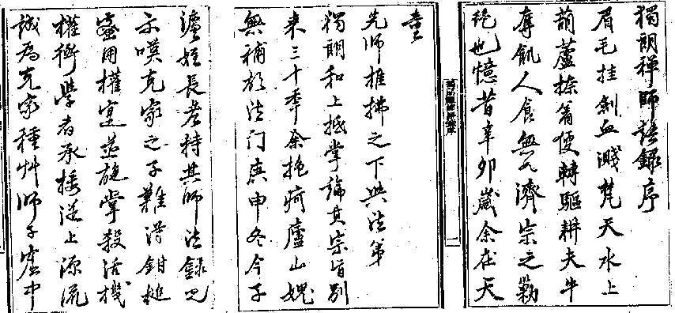
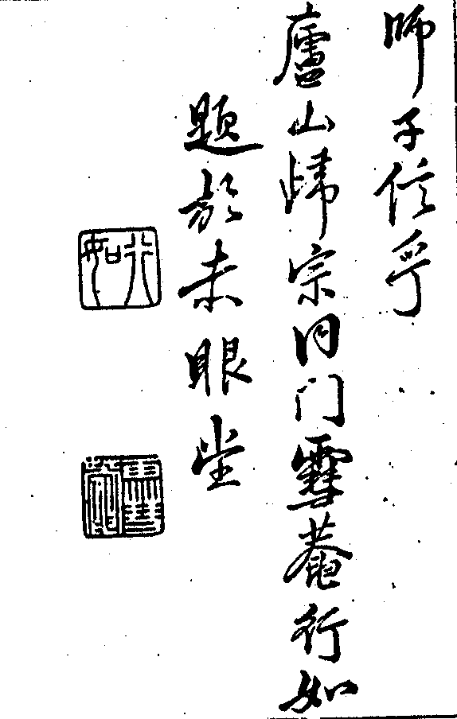

# 天台通玄寺独朗禅师语录



> **藏经**：嘉兴大藏经（新文丰版）（嘉兴藏）　**册次** 第 36 册（J36）　**编号** JB368　**部类** 诸宗部　**卷次** 2 卷　**篇幅** 17,336 字

> **卷／品**：0 卷 · 1 品



---



## 目录



  - [独朗禅师语录序](#独朗禅师语录序)



---



### 独朗禅师语录序











天台通玄寺独朗禅师语录目次



卷上住天台通玄上堂  

住姚江积庆上堂  

小参  

晚参  

示众



卷下机缘问答  

拈颂  

像赞  

诗偈  

佛事  

塔铭



天台通玄寺独朗禅师语录卷上



嗣法弟子　超心　超香　等编



师於顺治甲午年七月二十一日受当山檀护、耆宿请。



师指法座云：「灯王宝座，历历相承，山僧蓦地无端，蹴踏毘卢顶上。」



上堂。拈香云：「此一瓣香，信手拈来，端为祝延圣寿无疆，伏愿舜日尧天，法轮常转，八极共称尊，永乐无为化。」次拈香云：「此一瓣香，奉为东宫殿下、皇后、储君、阖国公卿及省郡邑缙绅文学、诸大檀护，伏愿慧日高悬，菩提顿悟。」复拈香云：「此一瓣香，昔年通玄裂破，太白堂中不敢囊藏，今向人天众前特地拈出，端申供养天童景德堂上临济第三十一代林野奇先师大和尚，用酬法乳。」敛衣就座。天封定空和尚白椎云：「法筵龙象众，当观第一义。」师云：「好个第一义，被天封和尚一椎击碎，汝等诸人还委悉麼？超群龙象，共相激扬。」僧问：「洪钟轻振，大众云臻，请问和尚如何施设？」师竖拂云：「何不会取？」进云：「恁麼则千秋无异色、万古一同春。」师云：「不劳庆赞。」进云：「学人礼拜有分。」师便喝，僧亦喝，师便棒，僧礼拜。天封和尚问：「云涌玄峰五度秋，佛祖君亲当地酬，一声哮吼喷霞雾，法雨滔滔润部洲。是何境界？」师云：「虹霓蕴盖千峰顶，一道天封万国恩。」进云：「狮子游行今伴侣，大家均唱太平歌。」师云：「千江有水千江月，万里无云万里天。」乃云：「韶光满目、杲日当空，云覆青山，秋声到耳，直得南极拱手，庆贺山僧学易之年。」挥拂召众云：「释迦文佛偕诸净侣、六道四生、昆虫草木、无情有情等时生也，向拂子头上放光，六种震动，善狮子吼，㘞地一声，惊起须弥峰、妙高峰比相斗额，富楼那道个：『清净本然，云何忽生山河大地？』通玄元是紫凝峰，所以香炉峰和合宾主历然，香柏莲华列成佳供，华顶五老孤峻雄然，坐断千差不通凡圣，德山棒、临济喝拈向一边，惟我先师这条白棒尽尽受用。若值佛魔、山川、草木、有无二情，都卢一棒血溅梵天，直得抱赃叫屈。道个恩大难酬且置，棒不作棒用又作麼生？」卓拄杖云：「看取南山鳖鼻蛇。」天封和尚云：「谛观法王法，法王法如是！」



姚江积庆檀护暨诸耆宿请上堂。僧问：「临机一著，迥绝无私，英灵衲子，顶门具眼，即今开佛祖印，未审和尚如何指示？」师竖拂，进云：「恁麼则千谿万壑归沧海，四塞八蛮朝帝都。」师云：「因斋庆赞。」进云：「十方同聚会，古佛家风。」师云：「雨洗青山碧。」进云：「龙归沧海稳、虎啸岳山威。」师云：「休向死水里，莫恋旧峦头。」进云：「水涨船高。」师便打，进云：「大众证明！」便礼拜，师云：「切忌乱统。」乃云：「乍离胜峰紫凝室，回临寺址箭锋机，钵盂漏泄陈烂货，诸方鬻售新鲜的。陈烂货且置，突出新鲜的，相似青州布衫、镇州萝卜、金刚圈、栗棘蓬、乾屎橛、麻三觔、云门饼、赵州茶、金牛饭、俞婆糍、婆子偷笋、投子卖油。」喝云：「若非霹雳轰耳，几乎读到来年。」蓦拈棒云：「者死猫头抛向面前作何意会？」一众默然，师云：「市头知价不知贵，海神知贵不知价，赤日番天通一线，和泥合水遍天下。既踏者里，还委悉也未？如其不然，山僧自沽自卖去也。」遂卓拄杖云：「山深藏白额、海阔任苍龙。」



重九日上堂。师拂云：「秋绽篱边菊，踞顶更须登，瓶插野花满，炉香柏子焚。石榻跏趺坐，山鸡化凤腾，天然真意趣，共赏问知音。」召众云：「还委悉麼？是悬崖撒手处？是三玄三要麼？虽是祖翁舌长拖地，扫起野马腾空，固是一片慈心，又隔万里障碍。何故？不见道：『三玄三要事难分』，舌头裂破似莲华，『得意忘言道易亲』，白云横谷口，飞鸟莫知归，『一句明明该万象』，白▆贼眼带弥麻，『重阳九日菊花新』，赤须胡子胡须赤。节令当时且置，即今事作麼生？」遂喝云：「秋黄不落春华艳，勘破诗人仔细吟。珍重！」



孟冬望日上堂。问：「当阳一句即不问，的的西来意若何？」师便打，僧便喝，师随声复棒云：「喝后事作麼生？」进云：「恩大难酬。」便礼拜，师云：「记取三十棒。」乃曰：「当阳句子新拈出，积庆重兴古道场，土沙撒向狮峰下，毒鼓蟭螟眼角扬。诸方攒单结制，此中五蕴空山，莫谓终朝闲庭，英灵眉横鼻竖。大众委悉麼？若向者里信得及，怪石边摸窦、烂泥里揣针，钝斧好斫柴、犁锄力耕种，行住坐卧、吃饭穿衣、屙屎放尿不是分外，直得青山映目、绿水迎眸，十字街心横卧、孤峰绝顶高歌，纵横无碍、杀活自由，固是与麼提持，犹未是衲僧巴鼻且置，即今一句作麼生道？龙隐澄潭清活水，蟾辉林壑弗空山。向者里荐取。」



上堂。师云：「山居寂静，境象幽深，松涛刮耳、涧浪嘘吟。佩佛祖心印、秉本分钳锤，向妙峰顶开炉，烹镕愚智、煆炼圣凡，令教各具通身手眼。所以道：『草鞋狞似虎，拄杖活如龙，铜头铁额汉，尽在我山中。』汝等诸人还委悉麼？若与麼会得，正好三根椽下、七尺单前，横伸竖展，绵密成团，朝骑白象、夕跨青狮，然后与观自在贴体商量，随机应现。虽然如是，犹欠山僧一椎在。正当恁麼时，如何凑泊？三冬梅欲绽，霜雪浸馨香。」维那问：「自忆灵山别，流浪莫知归。即今般若堂中炉焰交辉如何指示？」师竖起拂子。进云：「拨开凡圣眼，烁破太虚空。」师击拂子，下座。



积庆穿枋，上堂。师云：「垣城六相，至理圆融，四棱著地，威镇西东。雕梁虽则经师匠，自性天然迥不同。虽然如是，穿枋一句作麼生道？绵绵奕叶金轮子，密密相承亘古今。」竖拂云：「大众看孔著楔。」



大殿上梁，上堂。师云：「圣贤忻集，龙象云臻，良辰吉宿，积庆重兴。檀越、耆旧虔请山僧登曲录床，祝厘圣恩，光风舜日，建立门庭，英灵衲子，共相证明。」问：「建法幢於积庆，播宗风於通玄，是同？是别？」师云：「问得恰好。」进云：「恁麼则一彩两赛。」师云：「休唱帝乡歌。」进云：「大众证明。」礼拜归众，师云：「切莫错承当。」乃云：「若论鼎新祝贺，明明公案现成，梅龙古基不昧，敕赐断碑犹存。所以人能弘道，非道弘人，然虽如是，也须吃拳。分明这里荐得，无文铁印，印空泥水，历历明明，不费而成。是故古人道：『法本无法，无法亦法也。』者犹是寒潭秋月、静夜钟声。汝等诸人委悉麼？其或未然，向孤峰顶上筑著、磕著讨取下落且置，即今上梁一句又作麼生道？」卓拄杖云：「盖覆承渠力，纵横遍十虚。」



华山雨华庵结制，监院扬古等请



上堂。师云：「大众！若论此事，人人本具，本无限量亦无程途，无程途中假设程途、无限量处权说限量，故为七期之定略也。元与诸昆仲结一大事因缘，各各承七期之内努力精进，将无量劫来无明业识、圣凡鼻孔挤他粉碎，扬向东洋海底作个脱落丈夫，以成世出世间之光明幢，岂不快哉？来日进堂，照顾眉毛，若办肯心，必不相赚。珍重！」



上堂。师云：「屯溪胜地水环遶，祥云炉鞴生秀草，且道秀草作麼生？出众𨁝跳看！」僧问：「展开两手，般若光生，大地乾坤一口吞，三世诸佛谁出气？」师嘘一声，僧礼拜退，师云：「掠虚头汉！」问：「和尚未登宝座时在什麼处？」师便打；进云：「下座时向什麼处？」师又打；进云：「现升宝座，未审说个什麼？」师复打。僧问：「徽郡从来未闻宗门佛法，兹幸和尚降临，可谓众生有庆。乞垂旨要，洞明祖意。」师云：「老胡自西来，东土雪埋处，要会个中意，总在者里许。会麼？」僧复请益，师示云：「鼻祖西来无字脚，云何东土生连络？」遂竖拂云：「诸公亚目上头看，元归一默成正觉。」众礼退，师云：「也是大虫看水磨。」



佛慧山结制，上堂。僧问：「金钟震动，法王登座，如何是佛慧住持？」师以拂拂云：「经行及坐卧，常在於其中。」进云：「竖立光明台，横开选佛场。」师云：「顶门只眼耀乾坤。」僧拟议，师便喝，僧礼拜退。监院问：「古佛放光，孤峰独露，因什麼又被风云雷雨劈开？」师云：「金毛狮子子，步入野狐群。」进云：「两手拨开生死路。」师云：「野犴鸣。」僧礼退，师云：「脑门裂也。」乃云：「甚奇哉！孤峰绝顶，紫雾开、风雷集，英雄力竖光明台，佛慧山中今结制，诸人眉结心豁开。齐展目，莫疑猜，直待心空及第归。」喝一喝，下座。



上堂。问：「梅龙开炉，煆凡炼圣，如其不受钳锤的，作麼煆炼？」师云：「放子三十棒。」进云：「片云遮海岳，大地尽沾恩。」师云：「彷佛扬州。」进云：「恁麼则恩归有地。」师云：「劄！」乃以拂作钩势云：「还有上钩者麼？」众默然，师云：「阳和小春节，炉鞴正当令，钳锤虽在手，眉锋利似针。劄著眼，太精明，惟经那事特相亲？且向炉边打瞌睡，自须珍重本来人。」



上堂。僧问：「如何是溪山境？」师云：「炉喷祥烟起。」进云：「如何是梅龙境？」师云：「终不向汝道。」进云：「如何是积庆安禅处？」师云：「三十棒。」乃云：「仲冬朔日原无事，挝鼓升堂为甚因？塞外几经霜雪冷，山居安向火炉存。所以，高峰妙祖道：『谈玄谈妙、说性说心，虽是他家种草，必不向者里藏身。』山僧今日不然，一会谈玄谈妙，那许说性说心？固是他家种草，且喜者里安身。」遂喝云：「剑挥千里血，静息万家砧。」



师诞辰，上堂。师云：「弗攀阿利树枝、喜登忉利天界，劄得山色五云结盖、海水万派潮声。且道父母未生前报恩一句作麼生道？击竹顿然忘所知，焚香那堕悄然机？」喝一喝，下座。



上堂。师震威一喝，竖拂，左右顾视云：「昨夜三更打杀无毛铁鹞，今朝晨起蓦然扑地高飞，冲破碧琉璃殿、煽乾四阿耨水，直得山河大地半提全提且没交涉。固然如是，不是过量人，难说过量话。」复一喝，下座。



冬至，上堂。僧问：「一阳剥尽，万物发生，如何是冬至？」师竖拂云：「会麼？」进云：「如何是积庆家风？」师云：「拄杖活如龙。」问：「天寒地冻即不问，瓦解冰消事若何？」师云：「当阳呈露。」进云：「梅龙看浒眼，特地一场愁。」师乃云：「一阳复生处，万物沾恩；当念信诚时，诸罪消殒。点水滴冻，朔风吹面，劄著真人。若论生死涅槃，般若场中原无个事；如言成佛作祖，那许立地安身？惊杀露柱灯笼扬声大叫，向妙高峰顶、闹市街头商量浩浩，灯笼呈瑞彩，露柱已怀胎。虽然如是，即今西生大德偕诸檀护设斋，敦请山僧升座举扬般若。大众！且道般若一句作麼生？」挥拂云：「道人整顿闲家具，天地歌谣乐太平。」



上堂。师云：「空寂寂、静寥寥，山中无事可边表。无边表已向诸人道过了。大众！且道过个什麼𫆏？餘姚市上、十字街头道过了也；寿山峰下道过了也；僧堂前、煖室里道过了也。秪如未道的毕竟作麼生？风吹帘外茶花动，水育瓶梅朵朵新。」



除夕，上堂。僧问：「分岁已毕，如何是末后一句？」师云：「今朝腊月三十。」进云：「炉烟祥瑞。」师云：「切忌错会。」乃云：「响爆如雷，击醒世间迷梦汉；烛开优钵，看来都是帝乡人。年穷腊尽，无物可供。诸大士！白牛露地，剥来新岁尽伊餐，清水白米、竹叶蒿汤，随时茶饭，一味寻常。林下道人将兹供养，固守清贫，聊成榜样。」师抬手云：「伸出一双穷相手，总把新桃换旧符。唵　钵啰曩　钵啰曩。」



元旦，上堂。僧问：「新岁即不问，如何是最尊一句？」师云：「杲日无私照。」进云：「香烟缭绕。」师云：「大有人笑尔在。」问：「老者点首添一岁，孩童拍手贺新年，如何是学人边事？」师云：「老僧用不著。」进云：「有意气时添意气，不风流处也风流。」师云：「莫作风流会。」乃云：「新年头，喜优悠，中间无事得自由，风扫竹边梅放萼，山居老叟今白头，镇日焚香祝圣寿，高歌共享太平春。」遂卓拄杖云：「出海苍龙头带角，虎逢山势长威狞。」



为今子心上座上堂。问：「龙吟雾起、虎啸风生且置，水月皈真事若何？」师一喝，进云：「天关地轴，各承恩力去也。」师云：「异日增辉。」问：「明镜当台即不问，未容拟议主宾分，如何是先照后用？」师竖拂子，进云：「恁麼梅龙亲荐得，方知随处立乾坤，如何是照用同时？」师点拂云：「者个大家有分。」进云：「昔日通玄、今朝梅龙，如何是照用不同时？」师又一喝，进云：「照用已蒙师指示，末后一句事如何？」师云：「担将去。」进云：「大众证明，学人礼拜。」师云：「如是如是！」乃震威一喝云：「苍龙窟里金龙子，狮子林中狮子儿，祖印当轩全正令，纵横绵密古今传即置，且道先师公案担荷多时，今得英灵心上座作略超群、倾心符盟，汝等诸昆仲委悉麼？」遂与拂子源流云：「授受不无今饶舌，大家珍重在知音。西堂参寮去！」



结制，上堂。师云：「数年行脚未甘休，赫日雄峰展笑眸，曾忆雪山居六载，钓竿收拾鼻尖头。所以，一人处万人之中而知不闹，万人削一人独立而知不孤。结制与时，岂曰众寡？禅蕴动静，何远尘嚣？凡设施为，即非正务。今山僧特为通个消息。梅龙盘结无餘叶，直待春来牧海鸥。」



结制，上堂。师云：「枝枯情尚焰，春亦透尘寰，相聚炉边语，敲破几重关？众中有过量汉，请为酬唱！」良久云：「卷起罗龙网，放出贴天飞。」以拂击几，下座。



师诞辰，上堂。师云：「金炉喷焰，烟篆充塞於太虚；玉烛交辉，光腾十方於世界。山僧本乃林闲枯木，赖一雨而润生，且喜干木随身，逢场作戏。古人云：『夜半钟声、寒潭秋月，不因境而生、非因境而灭。境灭则心灭、境生则心生，生灭本无生，无生岂有说？』境既无生，心从何有且置，即今无生一句作麼生道？」挥拂云：「烟雨有丝开锦嶂，一团清兴乐泉餘。」



上堂。僧问：「日月高悬宝极光，秋来不比旧春芳，长青不断归松柏，寿过南山积庆堂。如何是积庆堂前一句？」师云：「恰好问话。」进云：「问后如何？」师云：「更要棒吃那？」僧礼拜，师云：「不得乱拜。」问：「人人有母难日，不知将何报答？」师云：「琉璃高挂碧堂中。」进云：「琉璃未挂时如何？」师云：「杲日当空。」僧礼拜，师乃拂一拂云：「也大奇，也大奇！九龙喷水沐婴儿，同条结秀无生脉，大地山河尽共知。好共知，个事明明说向伊，说默不堪因庆赏，谁将钟鼓震离微？且道正当恁麼时，释迦老汉降迹皇宫，四生六道今日今时一齐生也。山僧不觉同堕窝中，忽然右胁出来指天指地，目顾四方、周行七步云：『天上天下，唯我独尊。』道人到此，为什麼观四门、越宫城、六载雪山马麦难、三转十二行？说了许多葛藤，末后拈花，幸得迦叶微笑。仔细观来，总是平地起孤堆。彼时迦叶老子若具正令，向释迦未拈华之前劈头一棒，只教世尊懡㦬而退，免得殃及儿孙。且道即今棒落山僧手里，安置却向何处？」良久云：「石人头吃楔，铁女眼流血。」



上堂。师云：「学道为大事者，当破疑执为急务。昔五百尊者禅定中得夙命智，通观无量劫中淫杀之业顿生恶怖，即堕疑网，不得生死根断。彼时文殊以他心通观请疑事，而握利剑持逼如来，时世尊云：『文殊！住住！不应作逆，汝勿害吾。文殊师利！尔从本已来无有我、人，但以内心见我、人。内心起时，我必被害，即名为害。』时五百尊者得闻是语，豁然解悟，透脱疑网。若论此事，皆是漏逗。如若真实衲僧，诸佛尚无著眼处，说什麼仗剑疑业？到者里，须是具眼衲僧方知冷暖。众中有知冷暖者麼？不妨露个消息，与山僧拄杖子相见。」众皆罔措，师云：「孤灯一盏，烁破千重暗室；头颅五百，个个鼻孔朝天。」下座。



龙山福庆寺上堂。师云：「香烟缭绕满乾坤，水秀山明事理真，云恋峰峦无倦意，松鸣竹应鹧鸪声。宝篆新坊，总於自在囊中捐出；指挥如意，皆从大悲心里拈来。朗上座横按莫邪，杀活自由。诸昆仲！若於未升座已前会得，不向沙里淘金。然虽如是，不无创建之劳，必须共出手眼，翻瓦砾以成梵刹，刈荆棘而为丛林。万古传祖庭、千秋彰胜迹，其如玉碑文露、其如金简清明。」卓拄杖云：「会麼？祥云遍覆无生地，兰桂森森荫子孙。」下座。



上堂。师云：「大众！百千三昧、无量玅义尽在诸人脚跟下，各请自家回互取。会麼？回互不回互，认取归家路，智慧为桥梁，柔和作依怙。安居则虑危，在乐须知苦。君不见？庞居士！抛却黄金如粪土，父子团𪢮头，共说无生话。仍计取，九夏雪花飞，三冬汗如雨。」



小参



黄山慈光寺，小参。僧问：「坐断十方犹点额，密移一步且置，坐断十方时如何？」师云：「自由自在。」进云：「正法眼藏向瞎驴边灭却，秪如作家相见时如何？」师云：「也须吃棒。」僧拊掌三下，师便喝云：「瞎驴乱跳。」僧喝，归位。问：「姚江一滴，黄海掀翻，不犯清波，乞师一接。」师云：「死水不藏龙。」僧便喝，师云：「没头浸煞。」进云：「作家相见，不劳重举。」师便打。乃云：「囊藏不得，露布大千，朱砂海子，白玉阶前慈光，(炉鞴)煆炼愚贤，堂头老汉怡怡蔼然，命朗上座演般若缘。若论般若，未离当地早已漏逗了也，何待迢迢千里迳穿三海，登法座而谓说法耶？所以岩中晏坐散天华，金轮遶座遭呵责。然虽如是，且道即今以何酬答？」遂竖拂云：「雪冻珊瑚枝上月，冷看朱顶一轮明。」



观音圣诞，小参。师云：「龙吟虎啸、地裂山崩，威音那畔是谁生？威音者畔伪安名。道是什麼人境界？莫非观世音诞辰麼？固然如是，毕竟观音即今在什麼处？」遂竖拂云：「在这里放光动地，向诸人六根门头翻筋斗，汝等还见麼？若是慧眼精明，不妨出群敲唱。」一众默然，师以拂作圆相云：「观音大士来也，作什麼？将钱买胡饼。」掷下拂云：「元来却是馒头。」震威一喝，「向伊道：『既具圆通手眼，因甚被时人换却眼睛？』待他拟议，劈胸与掌。汝若向未喝已前荐得，尘说刹说，与汝同死同生；闻喝不疑，同死不同生；闻喝有疑，同生不同死。且道生死不同途，毕竟作麼生会？咦！芍药花开菩萨面，粽榈树长夜又头。」



小参。师云：「正恁麼时，三世诸佛、历代古锥、明眼俗汉口挂壁上，又请山僧说个什麼？虽然如是，未免矢上加尖、红炉添炭。何以故？有处增些子、无处减些子未是好手，究竟本分衲僧皆成剩语。且道如何得免斯过？」师仰目良久云：「乘玅青山和绿水，大家赓唱太平歌。」



晚参



晚参。师顾左右，拂云：「不入惊人浪，难逢称意鱼，即今三十夜，省力者须臾。与过量人说过量话，汝等还会也无？其或未然，应发精进，登初地界，住佛信位，蹈最上关，而证无为，了脱尘缘，然后发勇猛之力，如入沧波擘浪乘风，倘得巨鳞岂不庆快？」遂竖拂召众云：「巨鳞虽得，毕竟作麼生？」僧拟出，师云：「漫天网子多捞摝，值个虾儿𨁝跳来。」



晚参。师云：「大丈夫儿全烈志，倚天长剑逼人寒，万境撄之即了然，左右逢源无剩迹，当阳句子对谁拈？问诸人，识未识？大众！幻觉今晚设茶供众，为求脱尘故请开示。山僧年来秉师命，持拂湖海之间、奔逐𪩘岩之上，胸无元字脚，教我说个甚麼？若是离尘汉，整顿金刚脊，瞥地脱牢笼，烁迦罗固密。如我释迦文，自断发苦行，三转法轮，鹿苑启半满，说四十九年，直至末后拈优昙波华，殃及后代儿孙。」蓦竖拂云：「会麼？青霄少女音堪听，白月冰人水照西。」



晚参。师云：「银钩抛向钵盂池，金鞭提起狮峰打，今宵蓦地大炉开，一任钻龟并卜瓦。」僧问：「如何是梅龙境？」师云：「殿后开泉圆似镜，门前花雨润苔新。」进云：「如何是境中人？」师云：「禅关闭目谢来客，白云弥覆草堂深。」进云：「人境已蒙师指示，向上宗乘事若何？」师云：「眉毛隙迸流鲜血，释梵诸天满面红。」进云：「谢师答话。」师震威一喝云：「还有问话底麼？」众默然，师乃云：「大观晚暑炤山前，椒署增光接紫烟，绿玉冲霄新箨解，古松影露指头禅。扶笻踏转玄关路，轻卓梅龙涌活泉，放目那分红日坠？钟声已过别峰巅。大众！且道如何是别峰一句？」良久云：「弹指元无事，闻声眼里花。错！」



中秋，晚参。师云：「春生物物总幽幽，夏至荷香也出头，秋来黄菊增颜色，冬老梅花伴雪浮。何故𫆏？所谓事理循环，各有时节。即今学道之士最初发心，因怖生死事大，生来死去不了，发足超方参诸知识，及至了明个事，说法利生，莫非是个时节？今时禅者扢个死话头，朝暮刻苦而不悟者，病在钉桩摇橹，费尽许多伎俩，不能出其窠臼，终日与流俗阿师打哄度日，枉费油盐。不如趁此同行同坐、同住同卧，相伴白云，知心几个；如若不然，山僧抱钓矶头高卧，就里相逢，特酬庆贺。即今一句作麼生道？拄杖头增光灿烂，大家懽饮赵州茶。」



晚参。师举：「岩头、雪峰、钦山同过江西，到一茶肆，钦山云：『不会转身通气者，今日不得吃茶。』岩云：『若与麼，我定不得茶吃。』雪云：『某甲亦然！』钦云：『两个老汉不识语在。』岩云：『什麼处去也？』山云：『布袋里老鸦，虽活如死。』岩头退后，山云：『奯兄且置，存公作麼生？』峰以手畫一圆相，钦云：『不得不问。』奯公呵呵笑云：『太远生！』山云：『有口不得，茶吃人多。』今夜大家懽集，众中有道得转身句子者麼？请吃茶！」时西堂进云：「吃过了也。」师云：「不得儱侗，更道看！」进云：「什麼儱侗？」师云：「今晚答话不恰，罚七碗不许吃。」进云：「有口也不得吃？」师云：「恁麼答话，岩头不如你，再与罚茶。」师云：「三个老钝锥，岂料凿头利？弄尽鬼眼睛，至今没滋味。『道得吃茶』，却没茶吃；『某甲亦然』，吞声忍气；『有口不得，茶吃人多』，空费许些闲力。山僧恁麼说话，木查羹里美味，检点将来，挖疮无异。今古明眼衲僧，开眸同打瞌睡。且道毕竟作何话会？阿呵呵！烂嚼老赵州，骨髓可腥气。」良久云：「月照庭阶树影斜，山云片片落谁家？雪花不会秋黄菊，烂饮蒿汤且当茶。」



示众。师云：「天得一以清、地得一以宁、衲僧得一任自纵横。所以迷则法华转、悟则转法华，迷悟俱拽脱，碓嘴忽生花。」



堂中示众。师云：「大丈夫，秉慧剑，般若锋兮金刚焰，非但空摧外道心，早曾落却天魔胆，陕府铁牛承相见。诸昆仲！入此炉鞴要辨端倪，所谓生死事大，非但五蕴本空。汝等今发向上志，必须将从前学解佛法、世法、耳闻、眼见、意识博度尽收拾，抛向东洋大海，如悬轩辕宝鉴相似。究竟父母未生前，唤什麼是本来面目？」



天台通玄寺独朗禅师语录卷下



嗣法弟子　超心　超香　等编



机缘



师问扬古云：「眉开八字，且道长多少？速道将来！」古云：「和尚请看如意。」师云：「一句合头语，万劫系驴橛。」进云：「莫瞒人好。」师云：「好个消息从甚处得来？」古礼拜退，师云：「掠虚头汉！还有𨁝跳者麼？」师乃云：「内不放出、外不放入，心如墙壁，乃可入道。古德虽然舌头拖地，未免傍观者哂。何故？惟知挖出心肝，失却纵横自在。且道如何是纵横自在底境界？」喝云：「收得南蛮归故里，放出无翎铁鹞儿。」



又晚落堂。师问云：「七中消二日，休得自瞒顸，若见真面目，和盘托出看。」扬古云：「早起脚跟先点地。」师云：「脚跟未点地时汝作麼生？」进云：「祖师门庭从此立，普贤万行由他行。」师云：「向时且置，背时作麼生？」进云：「峰顶上有明月照，山川草木尽清凉。」师乃云：「诸昆仲！共聚团𪢮，彼此逼拶，莫使昏散得便，岂容妄想交加？到者里，捏紧拳头、竖起脊梁，提则话头，生与同生、死与同死，明取不明底，方谓出格丈夫儿。莫循名分、休使偷心，直求无上菩提，勦绝贪嗔妄念，超生死之捷径也。珍重！」



问答。有僧请益「女子出定」因缘云：「未审权柄在女子手里？在瞿昙手里？请师指示！」师云：「在梅龙手里。」僧云：「和尚还出得他定麼？」师云：「早与三十棒，贬入无生国。」



僧呈四宾主颂，接得便云：「汝偷方丈纸那？」僧云：「未也。」师云：「颂则且置，你道一喝还有宾主也无？」僧云：「正要和尚疑著。」师云：「老僧是疑，你又作麼生？」僧便喝，师云：「者个未在。」僧拂袖便出。



僧问：「就窝打劫，乃一时之好手；单刀直入，实千古之英雄。只如劫杀后，性命、赃物在什麼处？」师和声打云：「速道速道！」僧拟议，师直打出方丈。



僧问：「不是心、不是佛、不是物即不问，如何是百草头上祖师意？」师打云：「露！」



僧问：「江南无限好，犹道不如归。好即不问，如何是归？」师云：「众鸟高飞尽，孤云独去闲。」僧礼云：「谢和尚答话！」师劈脊便捧。



僧问：「方以类聚、物以群分，为什麼伯牙抚琴而牧马仰抹，瓠巴鼓瑟而游鱼出听？」师云：「曾经霜雪苦，然后始知寒。」



僧问：「军中号令以金为耳目，衲僧号令将什麼为耳目？」师和声打。



僧问：「鼻祖西来，直指人心，见性成佛。只如心作麼生指？性作麼生见？」师云：「一枝红杏出墙来。」



僧问：「结制也，无风起浪；解制也，掘地觅天；不结不解，又在死水浸杀。毕竟如何得相应去？」师云：「者问亲切，恁麼疑去。」进云：「结也？」师云：「炎炎三尺雪。」进云：「解也？」师云：「燕语雕梁上，佳人愁更深。」进云：「谢和尚指示！」师云：「堕！」进云：「在什麼处？」师云：「堕堕！」



僧问：「但得本，不愁末。本即不问，如何是末？」师云：「美女梳粧下翠楼。」



僧问：「师家垂范，电掣雷轰，未审如何凑泊？」师云：「刀山剑树打秋千。」僧拟伸语，师即打出。



超香入室，师问：「除却目前境，毕竟事作麼生？」香云：「杲日当空。」师云：「闲言语，毕竟事作麼生？」进云：「再道不堪。」师云：「放汝三十棒。」进云：「龙生金凤子，冲破碧琉璃。」便礼拜退。



师升座，香出问：「鼓不打不鸣、钟不敲不响即不问，觌面一句作麼生？」师云：「瞎！」香便喝，师拈棒打出方丈。



安裕法兄举牧云老和尚七问答语



问云：「一人发真归元，十方虚空悉皆消殒，古今悟道者莫计其数，因什太白峰巍然犹在？」



师云：「识得不为冤。」



问：「大修行人合知因果，草鞋乃是常住物，为什一例踏穿？」



师云：「谁是恁般？」



问：「铜头铁额汉，上岭为甚气急？」



师云：「钝置杀人。」



问：「泉眼不通被沙碍，西涧沙石上下堆塞，为什清关桥水昼夜长流？」



师云：「把关人失利。」



问：「水滴虽微，渐盈大溪，许多时雨水，为什万工池不满？」



师云：「老冻侬终日噇饭作麼？」



问：「十处敲梆，十处皆闻，日日普请，为什有人不随众？」



师云：「於法自在。」



问：「毕陵伽因毒伤足，搬柴见血，为什叫苦告假？」



师云：「恐汝不识。」



拈古



举洛浦见夹山。



师拈云：「气吐虹霓、眼空宇宙，及于闯入夹山毛头许，也吞吐不得。彼时夹山阿喃喃地劈口与他三拳，可使济河增光，即免当场漏败。」拈拄杖召众云：「且道败漏在什麼处？」良久云：「悄立断桥明月下，细听织女玉梭声。」



举雪峰两度趁僧。



拈云：「雪老拄杖子，赏罚甚分明，觌体提持去，自隔万重云。得遇知音后，曾沾花雨恩。知恩且置，如何报德？」乃喝一喝。



举雪峰示众。



拈云：「者汉惯掣晴空霹雳，平常不似虚头，开自宝藏，运出家珍。然虽如是，撞个突眼波斯，原来半分不直。」



举女子出定。



拈云：「诸佛各还本位，智敬齐彰，若非根本圆明，几乎打破蔡州城。会麼？分明月挂梅梢上，看到梅枝早已迟。」



举赵州勘婆子。



拈云：「赵州婆子虽则战将，各具通方作略。虽然如是，却被者僧勘破。何故𫆏？秋波未转情先露，只要檀郎认得声。」



举：「五祖翁夜深无灯时，圆悟、佛鉴、佛眼侍侧，祖云：『各下一语看！』鉴云：『彩凤舞丹霄。』眼云：『铁蛇横古路。』悟云：『看脚下！』」



「者个三语中，一语眼空四海、一语踞地杀人、一语纵横自在。五祖老汉秉剑前施，便道灭吾宗旨，也是推三拽四；梅龙今日灯明烛灿，不妨道：『石虎御羊吼上林。』」



举：「昔婆子供养庵主，经念餘载，常令二八幼女侍奉。一日，婆令女抱定庵主云：『正当恁麼时如何？』庵主云：『枯木倚寒岩，三冬无暖气。』女举似婆，婆云：『供养二十年，只供养得个俗汉。』」



「梅龙则不然，待他抱定，正当恁麼时向他道：『年深离别处他乡，父子觌面不相识。』」



颂古



大事未明，如丧考妣；大事已明，如丧考妣。颂：



无依独立好孤单，寂寞空山突眼看，扑碎鼻头知痛痒，鲶鱼尽力上高竿。



三圣上堂。



九里山前展纛旗，乌江自愧剑锋摧，空教举鼎拔山力，千里乌锥不易骑。



女子出定。



瞿昙鼻头无窍，容了婆子一身，狼藉胭粉多少？疑杀伶俐衲僧。



南泉云：「昔住庵时，遇个伶俐衲僧，至今不见。」



绝顶诛茆巧设施，含羞放过若憨痴，而今宝剑迎空劈，贼过张弓后几时？



僧问云门：「杀父杀母向佛祖忏悔，杀佛杀祖向什麼忏悔？」门云：「露！」



空空何物敢遮拦？拟议遭他一字关，跛足阿师张阔口，惯将餘唾塞饥肠。



无字。



月照沙滩水不来，明明者个何曾动？纸姑嚎嚎哭穹苍，木马泥牛吽吽吽！



赵州狗子佛性有无。



赵老没来由，牵牛作马酬，牛追千里马，马犁万重丘。有意气时添意气，无风流处也风流。



世尊初生。



不从门户胁开生，指出分明独我尊，㘞地蛇儿重畫足，至今称讶大能仁。



世尊拈花。



打起黄莺儿，莫教枝上啼，啼时惊妾梦，不得到辽西。



迦叶微笑。



停针无语忆襄王，云雨巫山空断肠，子规枝上传消息，佳音巧绣出鸳鸯。



九年面壁。



知他无别事，从事怕智人，冷地祥烟爆，欢呼任一真。



兜率悦禅师住龙安，设三问以验学者，曰：「拨草参玄只图见性，即今上人性在什麼处？」



方出梅龙窟，相逢野岸头，红旗掩白日，风劲竹声搜。



识得自性，方脱生死，眼光落地时作麼生？



耳听不如无耳听，眼光何逐水光流？脱即莫如无脱利，大家相聚唤沙鸥。



脱得生死，便知去处，四大分离，向什麼处去？



者个白拈贼，抛钩拽鼻头，了知花发意，何所不优游？



鲁祖面壁。



不识老胡旨，直破鼻流血，浸杀大唐人，六月飞霜雪。



断臂。



挥金肯惜向谁云？错会璇玑万里云，若不蓝田射石虎，几乎误杀李将军。



和梁山牧牛十颂



寻牛



急急参寻莫待迟，登山涉水路崎岖，何时得个真消息？好下棱层铁面皮。



见迹



出门举步便生疑，脚影些些俨似伊，料想此回无别走，只在前头也未知。



见牛



踏遍溪山始获焉！旧情顽烈自堪怜，一声呼唤抬头觑，面目从前竟宛然。



得牛



已把芒绳摸鼻穿，山童今喜得安然，祖翁田地荒芜久，犁耙从头又上肩。



牧牛



雨散云收山更青，春光明媚乐闲情，牛儿不犯人苗稼，一任东西两岸行。



骑牛归家



春山叠叠暮云笼，铁笛声传出岭东，脊上横眠忘顾盻，乐然归去自匆匆。



忘牛存人



一座青山一个侬，无牛得看独从容，月明林下忘怀处，抚掌高歌乐事浓。



人牛俱忘



人牛不见杳无踪，彼此浑忘彻底空，剩有天真常显露，春来花发茂丛丛。



返本还元



现成公案不须疑，触处全彰最上机，鼻孔昂藏吞世界；眉毛卓朔覆须弥。



入廛垂手



花街柳巷全身入，酒肆鱼行绝覆藏，带水拖泥浑不顾，了然一片赤心肠。



像赞



题大悲像赞



坐断空王命根，显露通身手眼，毡拍弹唱巴欹，新腔别调高演。藏不得兮八面玲珑，巧安排兮阿谁舒展？衲僧捉败几多般？半抬半捺惟尔阐。



达摩像赞



碧眼胡僧，弄假成真，九年面壁，诳谑世人。梁皇不识，疑到如今，宝志舌利，道是观音。笑倒大唐国里禅客，难免殃及儿孙。



普贤像赞



真痴汉，没来由，象王自在，信步遨游。降伏不循奋迅吼，善射解把末稍头。



天童密师翁赞



者个老汉，发白面红，生缘宜兴，灭禹门宗。金粟分化，黄檗道通，玄峰圆寂，窣堵天童。惯拈白棒，杀活纵横，杲日霹雳，佛祖不容。虽然儿孙大地，个个忤逆成风，惭愧日孙多口，图出与麼形容。且道是谁？原来吾祖密师翁。



又赞



燕都露出驴蹄，铜棺踢翻觔斗，大唐几坐道场？杀活难容佛祖。谁识独坐当轩？且勘龙蛇奔走。咄！师翁默默难张口。



天童林野奇先老和尚赞



稽首慈容，眉绀胡赤，与麼神光，圣凡莫测。自西蜀来，主兹法席，十二座中，末后最一。坐断太白雄峰，玲珑埣堵常寂，传嗣五十金猊，生吾四十之一。朝夕觌面恨转深，梦寐相逢恣荆棘，山华簪满破磁瓶，鸡香恰好熏师鼻。



题自小像



者汉面冷似铁、情空若月，生缘郎川，宛陵枝叶。海口朱唇，默然无说；卷发师头，恬静如橛。具金刚眼，转物作则，且道阿谁？独朗秃贼。



又自题小像



金刚赤眼者个贼，象王狮子是同俦，手拈白棒，杀活自由。打失於通玄峰顶，丧命在太白山头。时看云雾暖，闲听水东流，铁脊不妨今坐断，已逢半百茂春秋。



又于望上座请赞



描既不成，畫亦何就？个是阿谁？我亦不识。于望阇黎，请归楚国，一任天下人取则。



诗偈



大善寺访慧日大师



清关桥别念餘春，笑指相看两鬓新，踏断故乡尘世冷，到来仍复验疏亲。楼台烟雨争桃艳，殿角熏风遶法身，闹市头开生药舖，蒿枝横拨几多人？



题万参居士小影图



翛然物外静舒怀，拨尽尘氛见雅裁，世路成灰通正眼，真机脱颖绝良媒。随时遣兴骚庄趣，即景题诗李杜才，踪迹绳阳堪彷佛，一回相见一徘徊。



高道宪登太白



叶落梧桐玉露肥，冲霄灵翮夜知归，苍龙秪解倾湫岳，睡虎何当省是非？岸帻云幢钦仰止，法堂猊座幸瞻依，亭亭独立惊鸿鹄，月上千峰启翠微。



登玄园亭感怀



半生幻寄物华新，此日登楼思故人，鸟息绿阴惊莫定，花舒紫陌虑长沦。阳春漫唱巴州调，白雪惭赓下里身，箕踞那能循世谛？抬眸始觉日西沉。



除夕和云将法兄韵



嗟今吾道更难行，握手何堪辨浊清？打雨敲风君著便，挐云喝月我缘生。象龙蹴踏无多子，桑海升沉有变更，不会诸方禅五味，唯将露地白牛烹。



寓万年寺藏阁，次宗元禅师韵



万年峰峻应机先，势逼穹窿傍海边，风素自堪延岁月，楼空犹爱接霞烟。野梅数树含春笑，修竹千竿带雨妍，此境若非予独赏，东君辛苦向谁传？



石马



三界为牢夜不收，昂藏独立几千秋？生成玉辔谁能勒，自就雕鞍孰解蹂？云影细铺泥锦障，雨丝微湿汗珠流，骅骝空具追风力，难及痴憨占上头。



石桥雪瀑



潺潺雪瀑响如轮，槁木连云一问津，可是横身为物则，翻疑垂手应真人。惊心蹑足搴裳度，绝侣飞笻带月巡，打湿袈裟浑不惜，苔痕踏破去来频。



赤城栖霞



山城一带见仙标，四野流霞伴寂寥，宿火未寒留鹤梦，丹炉尚煖泛云瓢。赤砂乱点青山面，煦日光生渤海潮，匹似绛罗笼远岫，脱然身世有王乔。



华顶归云



万丈高高华顶山，白云飞去复飞还，从龙下界铺千顷，带雨孤峰锁半间。舒卷平明天共晓，栖迟永夜月相开，翛然虽是云闲极，不道老僧心更闲。



寒岩夕照



薄暮微阳照古松，晴光掩映入寒空，影随花发山容媚，色借霜催木叶红。野叟凭栏斜点笔，林翁抱膝快吟风，秋原萧寺钟初动，灯火交荧接梵宫。



桃源春晓



欹枕憨眠拥翠萝，支笻偶亦探仙阿，春游倦倚溪边石，晓发幽寻水际窝。老树猿啼惊鹤梦，苍山鸟语和樵歌，桃源数里烟花熳，晨肇淹留胜迹多。



琼台夜月



层台窈窕势凌霄，清夜堪眠近雀桥，明月露华空翠滴，步虚仙韵暗飘飖。别峰境界殊难并，此地风光总见超，谩道骑牛翁不在，玻璃时举蓦相招。



送浩然法兄住昭隐岩



参罢潜昭隐，灵岩心境空，染山枫叶赤，映水蓼花红。好音歌野鸟，古调响秋蛩，轻劈乾坤眼，翛然迥异同。



荻江访友



寄迹烟霞外，飞舸渡荻河，到门呈古意，把臂颂玄歌。隔岸人烟少，比邻鸟道多，觉弘名幻翳，掩面笑南柯。



喜值嵩枝徐居士



长卧岩前石，寥寥谁见寻？时来新鸟语，忽到故人吟。弁岭樵歌杳，苕溪树影深，此中多逸兴，携手向高岑。



雨阻广教寺，次忍可兄韵



草堂久冷碧苔肥，寂寞禅关谁扣机？拈起一茎能委悉，通方幽鸟共相依。



青藤密锁晋遗碑，兴废无恒自有时，龙象不辞轻蹴踏，宗风重振定相期。



吴中甫居士



故里观光若改颜，儿童霜鬓笑当年，医王彼此灵山嘱，济世冰壶别有天。



偕友避暑四果洞



相偕云水践千峰，欲探寒岩翠霭中，扣问应真何所事？报言四果洞堪容。



烛湖双镜



磨砻古镜纳闲云，当鉴寒蟾二水分，宝剑是谁挥破后？圆明处处尽知君。



象峰回顾



六牙奋迅妙高峰，撩住虚空称独雄，回首千峰钦拜伏，湖光射日映山红。



寿山积庆



圣公摹得寿山书，耀后光前学有餘，积庆淳风松拂韵，翛然清况一如如。



寿松鹤唳



竹友霜情雪作宫，青山不计几逢冬？坚持洁白忠心赤，野鹤飞来韵古风。



舍利塔基



康僧礼出紫金光，基上无踪难隐藏，灵鹫亲宣无别嘱，惟将舍利福诸方。



示观海王居士



闲步溪沙戏海鸥，飞鹏垂翼拂山头，啸看尽作潇湘伴，半落沙滩半驻洲。



赠狮林禅宿



远尘百里步云窝，探取深山云几多？梅峰惟有花欺雪，又听松涛竭爱河。



漫吟



渡江吴地好生涯，潜步秋林玩晚霞，游客到门无所供，玻璃盏内注蒿茶。



示梵行禅人



披云拨雾讯玄峰，歇息尘缘已事融，为伴寒山新涧水，逢春放目玩华容。



访天臣潘居士



得得夕阳策杖藜，浴湖枫叶点诗题，神清犹下陈蕃榻，静听溪声杂鸟啼。



嘱今子西堂



得个瞎驴真种草，曾经踏断祖师关，纵横杀活全机用，手握吹毛岂等闲？



嘱越圣侍者



栴檀林内无异木，狮子窟中有金猊，余今放汝出群去，爪牙锋利过师眉。



紫凝峰除夕



新𡎺幽瓢深谷藏，春枝含笑烛奇光，东风换得桃符信，野衲围炉胜畫堂。



为捷机侍者掩关偈



六根才染乱丝麻，门外何堪更觅车？暂把高峰关一掩，钵盂两度赖谁家？



题畫牛图



牧断烟霞称意游，清香嫩蕊却相投，一回入草将绳拽，蓦鼻牵来者一头。



募衣单



隆学参来本分禅，钵盂无底口吞天，袈裟零落谁缝绽？持向维摩了夙缘。



登赤城



雨洗赤城石磴滑，扪萝深处强跻攀，上方知有凌云客，分付山童莫掩关。



赤城雨日



兀坐山椒雨足斜，何曾飞出别人家？自怜老衲闲无赖，洗手簷前弄雨花。



乞盐



素爱孤峰长绿萝，清风轻送白云多，老僧受用甘如是，挂锡高流淡奈何！



守愚禅人化被



万仞峰头六月霜，衲僧赤骨自甘当，鹑衣岁暮寒山卧，须索花棉被一床。



化戒衣



精穷释子赤条条，要挂三衣表佛标，同体高人忻出手，一丝万缕福根苗。



示朱慕溪居士



提起话头浑似铁，咬著全然没交涉，纵横嚼破铁昆仑，拈个秤锤劈面楔。



赠度石禅宿



月临千涧水无痕，风洗孤峰上几层？动静莫教空寂守，放开轻啸数声吟。



赠憨牧法姪



吞尽江南山海境，踢翻吴越梵王城，频施地藏乡关钥；倒捋虎须慕俊英。



示明慎行者



生缘识得放憨歌，竖起空拳意若何？当下了然渠是我，倒骑白鹤和巴歌。



示张完修居士



捏聚空生四大成，解开不值半分文，明知幻化无常物，究竟归元识本人。



嘱觐尊监院



未到通玄顶，先意问平田，谁知正法眼？灭却瞎驴边。



与不会侍者



虽然汝不会，彷佛岭南能，碓嘴花开日，风幡话始行。



赠甸尊居士



居士无别业，坐石看青松，指点云归岫，莲台讯远公。



示藏密深禅人



行深自藏密，扶桑旭日晓，烁破太虚空，无始生死了。



佛事



天童扫塔



「泪滴南山恸窣丘，波和烟雨逞风流，棒头杀尽无餘事，唯许雄峰展笑眸。」



上供



师拈香云：「自从吃得师翁棒，直至於今恨未休，恨到水穷山尽处，无根树子一炉酬。」



结制开板



师云：「声如狮吼、音似龙吟，上古龟鉴，人天正令。即今权衡已属山僧，正令当行一句作麼生道？」秉椎云：「一击通身快，三椎五眼明。」遂击板开静。



南岳慧六智禅师山居闲咏跋



脱落不分市野，幽▆岂论低昂？乱云重叠，长卧於无何有之乡；得意歌吟，聊拈个木札羹之句。深入龙巢、潜踞虎穴，优游七十二峰头，坐断大千闲世界。肩横竹杖，拨草惊蛇；目视云霄，呵佛骂祖。且道者是那个阿师？咦！原来慧六师叔之话杷。



为传文徒举火



「一人传虚，万人传实，文不加点，好生瞥地。毕竟以何为据？」掷火炬云：「急著眼觑。」



天台山通玄寺独朗日禅师塔铭



师名行日，字独朗，宣城建平许氏子。生而颖异，气宇不群；长以侠闻，襟怀磊落。交游尽属少年，傲秦嘲楚；谈吐善伤先辈，骂柳夸张。放荡不羁，行藏莫测。牢骚满腹，似乎赤手可屠龙；困顿名场，始觉此生空按剑。依栖姑母，执侍三秋；游侠都门，淹留二载。因见世途危险，沾名莫若埋名；还思释海汪洋，出士无如隐士。更途易辙，舍妄归真，跻南岳以遨游，礼恒师而披剃。闽宗受具，戒腊冰霜；太白究心，交驰棒喝。风柯月渚，恒和尚慈悲太煞，个事日可商量；凤翥鸾翔，密老人炉鞴森严，到此无容拟议。随机应答，法法天然；信手拈来，头头是道。遂尔飞锡姚江，伫看白云迷谷口；阐扬积庆，只将黄叶止儿啼。切念大事未明，瞒人岂能瞒己；疑情未断，误己而且误人。慕船子之风、散夹山之席，飘然一笠，直入千山。一到通玄，不觉全身放下；几遭辣手，从前伎俩俱消。是以草偃风行、渠成水到，应机接物，益己利人。仍泛姚江之棹，掩室千朝；再登太白之堂，荷肩大法。欲行过量事，还他出格人。继席玄峰，若释若儒齐侧耳；触翻乳窦，是魔是佛悉攒眉。说妙谈玄，洗荡五家宗旨；吟诗作偈，扫除李杜风规。交友一味平常，未肯频频下榻；处已自甘枯淡，何妨日日在陈？目中不见王侯、胸次毫无得失，一生潇洒、半世清闲。偶因四大违和，唱起还乡曲调；渐见六门紧闭，帆飏西渡慈航。撒手逍遥、临行自在。当是时也，鹤唳长空、猿啼远岫，香焚鼎内、泪滴松梢，草木自此解颜、山林从此退色。世寿六十六，僧腊四十三，塔瘗本寺之西，予亲封其门户。其门人今子心公，乞予铭其塔。予虽不敏，敢曰交深？忝在桑梓，知师最悉。兼以同门之谊，安得无辞？取其大概，序而铭之。铭曰：



通玄峰顶，不是人间，心外无法，满目青山。德韶斯语，流布人寰，密祖闲出，众山崒嵂。剪棘芟荆，营经据拮，金粟花香，通玄果实。回首七夕，四山变易，枚卜三番，先师继席。克振纲宗，嘉声奕奕，慈祥恺悌，温厚谦恭。遐迩尚德，衲子趋风，应请东塔，其道益隆。传之威凤，继之狞龙，末年有嗣，独朗日公。奇哉男子！伟哉丈夫！生而颖异，长与侠符。胸藏六艺，气欲吞吴，受具闽宗，究心太白。得窥一班，便解反掷，飞锡姚江，藏踪敛迹。阐扬积庆，师名赫赫，一遇先师，鼎新易格。毒鼓声闻，破家散宅，受嘱天童，继住玄峰。逢魔即扫，遇佛宁容？壁立万仞，孰敢撄锋？上无攀仰、下绝己躬，自甘枯淡，懒去迎逢。日没日没，四大归空；湘南潭北，全体於中。嗣法六人，以凤以麟，如灯续焰、如火继薪。



住平田万年报恩寺同门行彻无碍撰

