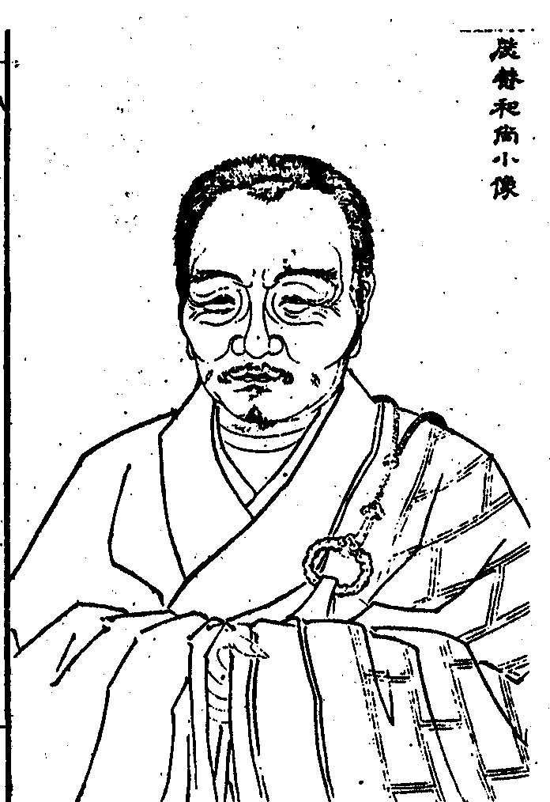
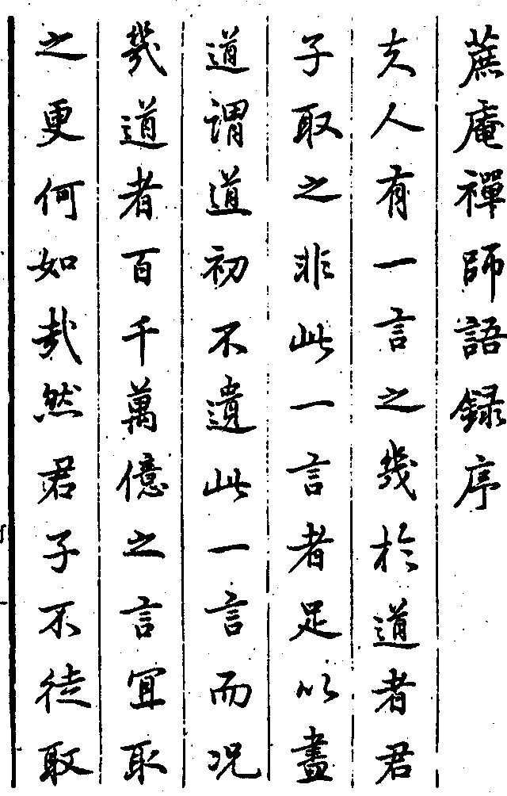
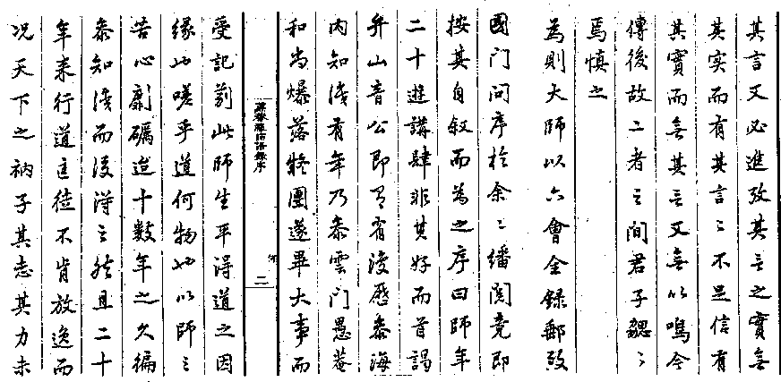
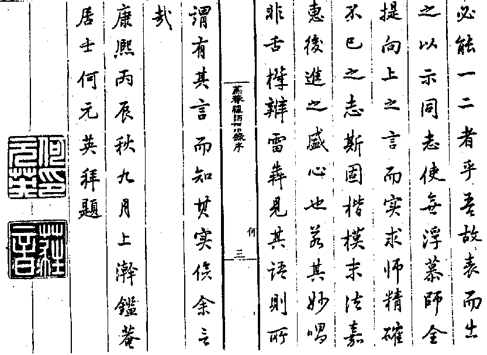
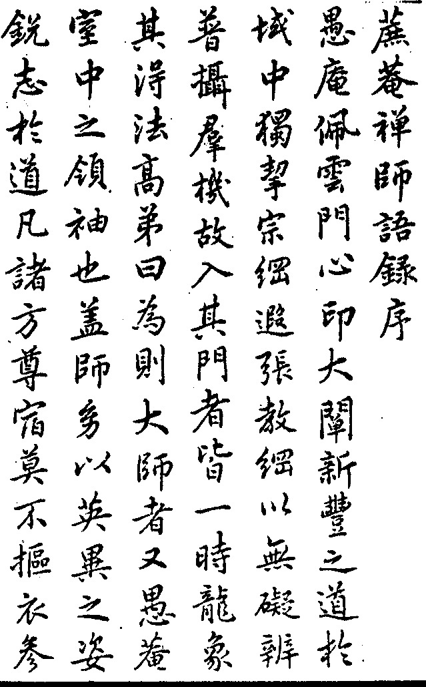
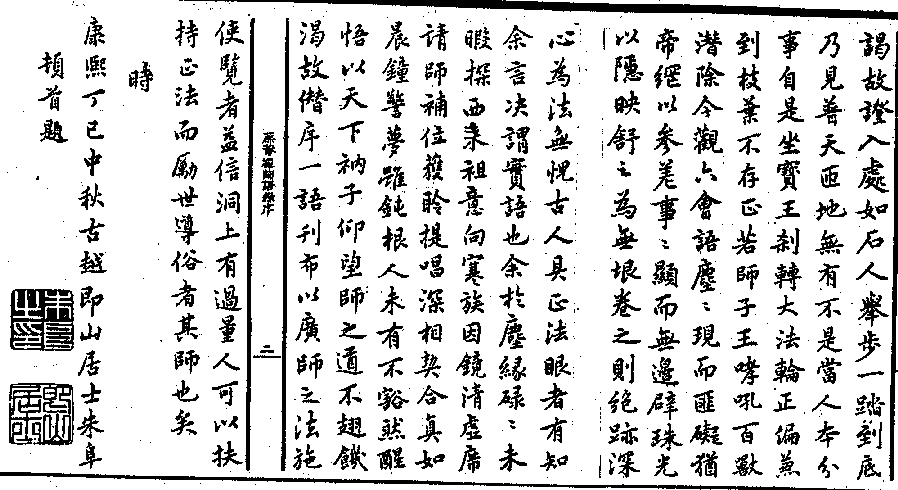
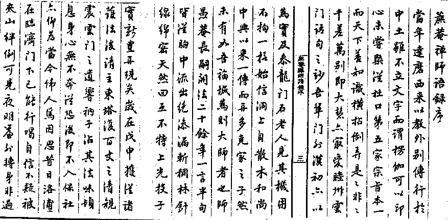
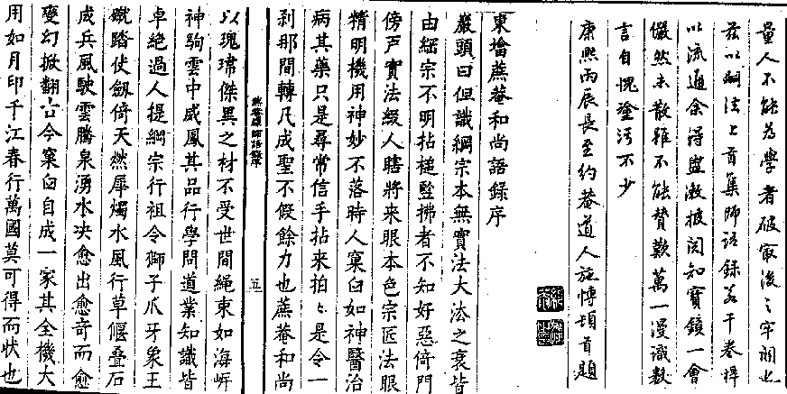

# 蔗庵范禅师语录



> **藏经**：嘉兴大藏经（新文丰版）（嘉兴藏）　**册次** 第 36 册（J36）　**编号** JB369　**部类** 诸宗部　**卷次** 30 卷　**篇幅** 294,830 字

> **作者（译者）**：侍者智璋录、侍者智应录、侍者智愃录、侍者智炅录、侍者智忍录、侍者超卓录、侍者本孝录、侍者元隆录、侍者行恪录、侍者道存录、侍者行恂录、侍者智宸录、侍者本玉录、侍者超标录

> **卷／品**：31 卷 · 9 品



---



## 目录



  - [蔗庵禅师语录序](#蔗庵禅师语录序)

  - [蔗庵禅师语录序](#蔗庵禅师语录序-1)

  - [蔗庵禅师语录序](#蔗庵禅师语录序-2)

  - [东塔蔗庵和尚语录序](#东塔蔗庵和尚语录序)

- [第二十卷一](#第二十卷一)

  - [自序](#自序)

- [蔗庵范禅师语录卷一](#蔗庵范禅师语录卷一)

- [蔗庵范禅师语录卷二](#蔗庵范禅师语录卷二)

- [蔗庵范禅师语录卷三](#蔗庵范禅师语录卷三)

- [蔗庵范禅师语录卷四](#蔗庵范禅师语录卷四)

- [蔗庵范禅师语录卷五](#蔗庵范禅师语录卷五)

- [蔗庵范禅师语录卷六](#蔗庵范禅师语录卷六)

- [蔗庵范禅师语录卷七](#蔗庵范禅师语录卷七)

- [蔗庵范禅师语录卷八](#蔗庵范禅师语录卷八)

- [蔗庵范禅师语录卷九](#蔗庵范禅师语录卷九)

- [蔗庵范禅师语录卷十](#蔗庵范禅师语录卷十)

- [蔗庵范禅师语录卷十一](#蔗庵范禅师语录卷十一)

- [蔗庵范禅师语录卷十二](#蔗庵范禅师语录卷十二)

- [蔗庵范禅师语录卷十三](#蔗庵范禅师语录卷十三)

- [蔗庵范禅师语录卷十四](#蔗庵范禅师语录卷十四)

- [蔗庵范禅师语录卷十五](#蔗庵范禅师语录卷十五)

- [蔗庵范禅师语录卷十六](#蔗庵范禅师语录卷十六)

- [蔗庵范禅师语录卷十七](#蔗庵范禅师语录卷十七)

- [蔗庵范禅师语录卷十八](#蔗庵范禅师语录卷十八)

- [蔗庵范禅师语录卷十九](#蔗庵范禅师语录卷十九)

- [蔗庵范禅师语录卷二十](#蔗庵范禅师语录卷二十)

- [蔗庵范禅师语录卷二十一](#蔗庵范禅师语录卷二十一)

- [蔗庵范禅师语录卷二十二](#蔗庵范禅师语录卷二十二)

- [蔗庵范禅师语录卷二十三](#蔗庵范禅师语录卷二十三)

- [蔗庵范禅师语录卷二十四](#蔗庵范禅师语录卷二十四)

- [蔗庵范禅师语录卷二十五](#蔗庵范禅师语录卷二十五)

- [蔗庵范禅师语录卷二十六](#蔗庵范禅师语录卷二十六)

- [蔗庵范禅师语录卷二十七](#蔗庵范禅师语录卷二十七)

- [蔗庵范禅师语录卷二十八](#蔗庵范禅师语录卷二十八)

  - [职事序](#职事序)

  - [堂规序](#堂规序)

  - [共住规约序](#共住规约序)

- [蔗庵范禅师语录卷二十九](#蔗庵范禅师语录卷二十九)

- [蔗庵范禅师语录卷三十](#蔗庵范禅师语录卷三十)

  - [自序](#自序-1)



---



蔗庵和尚小像







自赞



形类枯桩，发同徵雪。参访二十年，不悟西来大意。开堂七八处，焉知向上妙诀。无能乐育英才，但可放憨守拙。夙夜溉植，咸谓假情。切寔提撕，俱成冤结。既然误赚当时，何以激昂晚节。未免玷达磨门风，宁止滥洞山谱牒。



弟子砚民褚廷琯书



------



### 蔗庵禅师语录序















------



### 蔗庵禅师语录序











------



### 蔗庵禅师语录序











------



### 东塔蔗庵和尚语录序



岩头曰：「但识纲宗，本无实法。」大法之衰，皆由纲宗不明，拈槌竖拂者不知好恶，倚门傍户，实法缀人，瞎将来眼。本色宗匠法眼精明，机用神妙，不落时人窠臼，如神医治病，其药只是寻常，信手拈来，拍▆是令，一刹那间转凡成圣，不假餘力也。蔗庵和尚以瑰玮杰异之材，不受世间绳束，如海岸神驹、云中威凤，其品行、学问、道业、知识皆卓绝过人，提纲宗、行祖令，狮子爪牙、象王蹴踏，仗剑倚天、燃犀烛水，风行草偃、叠石成兵，风驶云腾、泉涌水决，愈出愈奇而愈变幻，掀翻古今窠臼自成一家，其全机大用如月印千江、春行万国，莫可得而状也。愚庵门下亲依最久，入室甚早，始终周旋，兢兢二十餘载如一日，即出世禾之资圣、东塔，越之云门、天华，亦殷勤无倦，余甚愧之。西湖风月、葛井丹泉，深得　老人之心髓，何其说法绝不相似耶？云居云：「莫怪不相似，恐同学者太多。」价祖、寂祖建立正偏君臣五位，而膺祖别出手眼，自是作家，故昌大久远，岂似赵括之子读父书而不知变通哉？余忝同门，知之最深，读其上堂垂示等语，回以数言弁其首。



岁在康熙屠维作噩月维应鍾望旦，住苕谿凤山同门净启顿首拜撰。



(旌邑弟子刘毅农仝天渠敬刻)



叙



菩提萨埵之道，莫大乎度生，度生莫先乎观时。法无一向，乘其敝而救之，因势利导。是故缚於义律，则摧荡者以逸格为尊；流於纵任，则清严者以端本为上。居今之时，欲救今之人，必垂悯於拨无因果者乎？世尊昔於《楞伽》，预指其害曰：「受贪瞋痴性已。」然后曰：「贪瞋痴性非性。」夫性非性者，性之正也。贪瞋痴性非性，论性之正也，彼已受之矣。无性而有妄受，即受而有妄性，则有妄业、有妄报，究竟不出於性无性之外。然使一切众生，相率而入於涂炭，则今之宗门，等为那落迦门。此世尊之所悲，菩提萨埵之耻也。於是今释以请藏至嘉禾，谒东塔为翁大和尚。和尚於吾洞上一家，犹父行也，直心直行，无一毫发矫饰，对之泠然意消，信有所为目击道存者矣。既读其语录，双眼圆明，四辩注射，知见正而不落知见，波澜阔而不混波澜，盖长夜之慧灯，横流之砥柱，救时之法主也。今释於斯道晚进，顾尝窃窃私忧，以为三灾之起，先兆於法苑。古之作家，了事之餘，涵泳大乘，以资内卫，旁通世典，以破外坚。今则一知半解，划地指天，害辞别字，题牋染翰，疏於本谓之谷饥，匮於支谓之菜馑，此一灾也。二障犹存，贼深藏腑，八风相扇，祸侵肌骨，遂昭灵而转者狂阳，守嘿照而滞者锢阴，疾起一夫，疫传万宇，此一灾也。争利功强，盗名益诈，操戈於同室，则住持即是战场，按剑於异己，则邂逅无非陷阱，白拂在手，黑烟蔽空，洗兵难於借雨，握刀捷於折草，此一灾也。慧命既断，器界将空，使据法席、传宝印，悉如和尚，猎夫之黐，可不戒而远，师子之虫，庶勿药而消乎？沩山之语仰山：「秪贵眼正，不说行履。」良以失足之咎，非盲即醉，不属冥行，则遭鬼摄，世未有白日青天，双眸炯炯而堕坑落堑者。和尚以真参寻，得大机用，一言一行，不走时蹊，此眼正之力，非藉行履为淘汰。而或失沩山之妙指，恣情颠倒，诬沩山以流弊，刻意操持，各见迷源，全成两截，则乘度生之愿，出救时之手，见其所见，闻其所闻，亦可以忘言而自得矣。



洞上三十五传住丹霞后学武林今释稽首撰



蔗庵范禅师语录目次



像  

序文  

第一卷住檇李资圣寺语录



第二卷住檇李资圣寺语录



第三卷住越州云门显圣寺语录



第四卷住越州云门显圣寺语录



第五卷住越州云门显圣寺语录



第六卷住越州云门显圣寺语录



第七卷住越州会稽曹山护生禅院语录



第八卷住嘉兴东塔广福寺语录



第九卷住嘉兴东塔广福寺语录



第十卷住嘉兴东塔广福寺语录



第十一卷住越州东关天华寺语录



第十二卷住越州东关天华寺语录



第十三卷住越州东关天华寺语录



第十四卷住越州东关天华寺语录  

示众上



第十五卷示众下  

小参



第十六卷垂问  

勘辨问答机缘上



第十七卷勘辨问答机缘下



第十八卷拈古



第十九卷颂古



------



## 第二十卷一



第二十一卷佛菩萨赞  

古今尊宿赞  

愚庵老和尚赞上



第二十二卷愚庵老和尚赞下  

禅人请自赞上



第二十三卷禅人请自赞下



第二十四卷佛祖源流颂上



第二十五卷佛祖源流颂下



第二十六卷佛事上



第二十七卷佛事下



第二十八卷杂著上



第二十九卷杂著下



第三十卷攷定宗本说



------



### 自序



跋



------



## 蔗庵范禅师语录卷一



**译者**：侍者智璋录



住檇李古资圣寺语录



顺治戊戌九月十七日入院。



山门。「一一法界，重重楼阁，户牖豁开了也。於斯信步趋入，卧龙奋迅；若或踌躇，钝鸟栖芦。」拽杖便入。



佛殿。「赵州不喜闻，云门不愿见。今朝觌面拈香，也是雪里吞冰，风前摇扇。」



伽蓝。「拻规千佛鸿基，丕振丛林纲纪。你肯为头，我能作尾。千古一知音，伯牙逢鍾子。」



祖师。「赤心觅大乘根器，白眼逢卞急梁萧。嵩少分皮髓，腥风刮地飘，殃害儿孙难雪恨，秪将鸩毒当香烧。」据室。「此是我老人捏泥弹子当济世至宝，拈老鼠药作活命灵丹，刳除佛祖心胸，断送衲僧性命底所在。且道新长老作麼生？」卓拄杖，「明珠在掌，有功者赏。」



即日上堂。拈法衣曰：「脱珍挂弊，灰尘满面，利生接物，泥水通身，者是先圣不得已底事。今日范上座也走入此群队里，且道又图个甚麼？虽知祖父门风大，光彩须添锦上花。」



缙绅疏。「句句班林玉屑，言言宋苑琼枝。白云以之出岫，正法以此维持。若要达委知源，更请从头宣过。」



文学疏。「渊才秋朗，雅思春浓。拈花奥旨，面壁家风。个里不容夹带，当阳拣勘始得。」



宗刹疏。「异响同风，千波一水。谊重如山，言丰似绮。唤归明月人千里。」



山门疏。「栅堰桥头，爽溪岸畔。就中一句绝商量，应藉傍人通一线。」



指法座曰：「须弥灯王如来出广长舌，发海潮音，为大众转根本法轮了也，便好归家，省得涂污。若信不及，撒灰泼水，莫嫌麤糙。」遂升座，拈王臣▆护香竟，乃复取怀中香，曰：「此一瓣香先於正中亭畔拾来，陈烂枯桩，秘作返魂香、不死药，到处呈奇衒耀。后於玉笥峰前投入大炉鞴里，猛火一锻，直得臭烟蓬𡋯四面充塞，十餘年抛撒不开、遮藏不住。今日人天众前拈出，端为传曹洞正宗二十八世，即此堂上本师愚庵老和尚，以酬法乳之恩。」遂敛衣趺坐。上首白椎讫，师曰：「诸佛诸祖为一大事因缘出兴於世，要使尽大地人个个知得眉不竖长、鼻不横生，能事毕矣。其如欲速则不达，欲近转成迂，只得向第二门头重加粉饰。所以灵鹫花前，唯头陀破颜冷笑；嵩庭雪里，独神光断臂休心。从此西乾四七、东震二三，花联叶缀、列干分枝，各随施设，别展家风。或验龙蛇于主宾玄要，或显尊贵于偏正君臣，或寄声脱象骨枷锁，或原梦彰鹙子神通，以至天下老和尚逞尽伎俩、竭尽机思，总秖是应病与药、悯物施权。就是我愚庵老人握太阿锋，佛来也斩、魔来也斩，悬照妖镜，胡来也现、汉来也现，收则齐收、放则俱放，也秖是曲顺机宜、抚循后进。有者犹道门庭高峻、家法森严，往往抱望洋之叹。今日新长老不妨别开方便，聊副个时节因缘。」竖拂子。「竹篱外，古城隈，黄花满径，红叶渐成堆。雨旸时若，村童野老对斜晖，讴歌醉醁醅。」置拂子，曰：「垂衣裳而治者，非尧舜而谁哉？」



复举：「投子因僧问：『诸佛出世为一大事因缘，和尚出世当为何事？』投子曰：『尹司空请老僧开堂。』」师曰：「投子大似老将临场，毫无惧怯，出一令，应一机，风驰八极，名贯十虚，世出世法无不周备。脱有人问山僧：『和尚出世为个甚麼？』但向他道：『石女生儿多爽拔，木童庆奏万年欢。』」结椎，下座。



小参。「瑞坞峰前未穿艸履，谷风传响；鸳鸯湖畔才解腰包，流水无声。深知动不如静、出不若处也。盖缘本山耆旧执事咸谓：『此一坐具地，昔为丘墟狐穴，今成金谷宝坊，实由老人沃以弘慈、被以化育。』今老人既恬退湖山，宁不虑法堂前艸绿苔青？故向南高峰顶撒个漫天网子，令人进既无策、退亦无谋，推逼到者里，不免打葛藤去也。」喝一喝。



复举：「法灯开堂曰：『本欲跧栖嵒窦，隐遯过时，奈缘清凉老人有未了公案，出来为他了却。』时有僧问：『如何是未了公案？』灯便打，曰：『祖祢不了，殃及儿孙。』僧曰：『过在甚麼处？』灯曰：『过在我，殃及你。』」师曰：「法灯可谓卑以自牧，谦以待人。但我老人鹤发盈头，狮王步履，正欲以法印利益世间，无甚公案未了。卷舒出没，不堕功勋，西去东来，了无变异，亦不殃害儿孙。既然如是，又在者里东扯西拽作甚麼？」卓拄杖：「莫道灯前一夕话，胜读寒窗十载书。」



上堂。「能了此宗者，可为明、为导、为师、为匠，普救群迷，不生拣择。所以，资圣者里如开个生药舖子，要参苓、白术、甘草、黄连、细辛、姜桂，种种诸药者皆能与之，但有下顾者，明让不赊。」顾大众，曰：「有麼？有麼？若无，则山僧今日失利。」便下座。



东山玅觉尔衡和尚讣至，上堂，竖拂子，曰：「还见麼？东山尔衡法兄在山僧拂子头上，将末后一著而告大众，曰：『共本同条膝未促，别峰相见颜如玉，嵒桂香飞韵最深，物外清芬如可掬。』狂飙忽地动林皋，拔我擎霄一巨木，不但人天失所依，几多归鸟凄无宿。慧命丝悬实可哀，波旬心快欢相睦，湖海禅客知不知？己躬下事宜自勗。千金难买寸光阴，头白一朝无再黑。」击拂子，下座。



双林受业法眷至，上堂。「日影射窗櫺，纤疑冰释。故旧会一室，喜气津生。若是大丈夫得此个消息，便可勇往直前，志无退转。向上一事，两肩担荷。其或廉纤不断，未免重布葛藤。山僧自落发之后，就挂腰包二十餘年。跨百城烟水，历万叠云山。危亡不顾，逆顺无论。祇望向粪埽堆头寻颗明珠，营个小歇场。上可以报佛祖鸿恩，下可以酬师友厚德。」拍禅床一下。「及乎究到此座上，谁知席帽下元是昔时人。眉毛不增一茎，鼻孔不减一窍。一身贫彻骨，两手但擎空。且如今日既蒙诸师高德远来惠顾，毕竟将何遮掩？听一偈曰：水源木本最鍾情，细雨扁舟到秀城。不用援毫文彩露，清茶一盏话深更。」



上堂。「明暗交参，正偏回互，异类中行，不堕诸数。虾蟆跳入梵王宫，白螘钻空生铁树，有般底尽向空劫已前商量，却与自己不曾动著一步。为甚如此？唱罢金鸡天未晓，斜飞玉鹭过横塘。」



请同门两序，上堂。「一绣之裳，未为美观；孤弦之瑟，恶可耸听？须得同气相求，同声相应，屈尊就卑，鼓扬法化，亲疏一致，新旧两忘，内外雍肃，号令森严。用睦州心行，激励滹沱受棒；挺高庵气岸，呵斥佛鉴咸虀。挝杨岐之鼓，逼慈明晚参；纵雪窦之辩，款太阳佳宾。宝寿生姜，到老辛辣；沩山菜刀，杀活自繇。纵有英杰到来，也知此间门庭高峻，仅可向侍者边领个消息。如此，可以廓人天正眼，播佛祖玄机，成丛林不磨之业，砥长江趋下之澜。敢保威音王未见者般韪𪟝，毘卢师焉知此等风规？」召众，曰：「且道据个甚麼有如是奇特？更听一偈：翻云覆雨世纷纷，雅奏埙篪喜再闻；掌上一丝能系鼎，胸中五岳自生云。」



结制，小参。「圣制咸尊十月半，龙蛇好向红炉锻，内莫放出外莫入，门外霜风利如箭，二时丰约总随缘，大事剋期要了办，此时若不痛加鞭，更待何年寻倒断？是非黑白任枞然，昼短夜长不须算，云门普一击粉碎，赵州关一刀两段，好看日面月面，莫管东院西院，别有清风动地来，刹竿头上将身换。资圣如此报君知，诸兄不觉通身汗。且道为甚如此？」良久，曰：「巴峡猿从月下啼，多情决定深招怨。」



结制，上堂。拈拄杖，曰：「山僧携个乌藤子到秀州来，尽谓是善知识降临，必为迷途宝筏作险道津梁，谁知是个青山白云堆里吃黄虀澹饭底长老？既无一点墨水可倾，也无一句佛法可说，聊为应酬，秪道得个天晴日头出、雨落地下湿，六六三十六、九九八十一，乌是玄、鹄是白。虽然如此，莫见山僧恁麼道便艸艸承当。殊不知，於此荐得，止可门外艸庵里受用些米面盐醋、苏肩息担，未知我门内浅深在。若要知门里句子，且到僧堂内高挺脊骨、紧绾眉毛，长连床上、经行路里，辊做一团、打成一片，迸开娘生面目、褫剥鹘臭布衫，来方丈里打算饭钱了，细细为汝剖析。」卓拄杖，下座。



上堂。「久雨得晴人尽喜，出门行路脚头轻。衲僧偏自生烦恼，个个攒眉努眼睛。事则如是，理上又作麼生？」良久，顾左右曰：「东村王大分明说，一定来年米价平。」喝一喝。



上堂。举：「洞山到北嵒，嵒问：『什麼处来？』山曰：『湖南来。』嵒曰：『观察使姓什麼？』山曰：『不得姓。』嵒曰：『名什麼？』山曰：『不得名。』嵒曰：『还理事也无？』山曰：『自有廊幕在。』嵒曰：『还出入不？』山曰：『不出入。』嵒曰：『岂不出入？』山拂袖便出。嵒来日侵蚤入堂，召洞山曰：『昨日问上座话，不称老僧意，一夜不安。今请别下一转语，若惬老僧意，便开粥相伴过夏。』山曰：『却请和尚问。』嵒曰：『不出入事如何？』山曰：『太尊贵生！』嵒乃开粥同过夏。」师曰：「敢问大众：且如何是尊贵底事？有下得一语惬山僧意者，与你个拄杖子。」众无语。师良久曰：「金轮懒向当堂坐，何用丹墀击静鞭？」



上堂。左边击拂子曰：「者里明得，猛风可系。」右边击拂子曰：「者里明得，虚空可量。诸佛出世，祖师西来，皆明斯旨，不为别事。子若不信，听我再歌。」又击拂子曰：「人生若有志，欢乐当及时。」



上堂，请晴云大师立僧。「干将之剑匣以深藏，不敢轻试，宝之至也；南山之豹雾而久伏，不敢躁动，养之至也。惟我衲僧门下则不然，横孤峰而独宿，献花野鸟追寻无路；混阛阓而同廛，城东老姥遁迹无门。栽培宝镜堂前覆荫之树，全在金锄得力；运出无明海里滔溺之流，还他兰桨通神。奋临济喝，虚空震裂；拈德山棒，山岳崩颓。蜀道久登者，自知趋平避险；茅庐初出者，难免吃吓担惊。山僧为汝诸人通个方便。」卓拄杖，曰：「金翅鸟王擘海底，鱼龙休复困重渊。」



上堂：「世间道，譬如隘路，不受二人并行。资圣者里，犹八达通衢，上至诸佛圣人，下及蜎飞蠕动，圣凡愚智，苦乐逆顺，辊做一团，打成一片，只有一人不在其中。且道是甚麼人？」良久曰：「少间来与你相见。」



上堂，请指源大师为众小参，兼谢众檀越斋。拈拄杖，曰：「秪者个虚空绝量，真俗离名，居正而不称尊，垂偏而不混物，在尘作人伦蓍蔡，出世为佛祖权衡，花柳巷中竖立横眠，一一展向上机，管弦楼下高挥大抹，各各谈不二法。汝等闻钟响便上法堂，遇天寒便衣重裘，伸手观见掌，拭面摸著鼻，托钵吃著盐酱椒姜，便觉甘辛咸澹，究其元由，一一皆承此恩力，但无人点破，便自论年放旷，积劫沉沦。所以道：譬如琴瑟箜篌，虽有妙音，若无妙指，终不能发。」蓦擎拄杖，曰：「此是妙指。」卓一下，曰：「此是妙音，且道所弹是何曲调？」以手作弹琴势，曰：「皮肤脱尽玉珊珊，峻拔孤风孰敢攀？扶翊法幢翰赤胆，砥回世运出青山，机前陷虎餘游刃，言下擒龙一字关，最险云门无镞箭，休遭射破面门斑。」



上堂。「今朝仲冬初一日，从天降下真消息。疾风卷却屋上茅，细雨打湿阶前石。乌鸦栖殿角，逐队飞鸣。黄叶坠空庭，成堆狼藉。不知领略是何人，莫教过后重相忆。」良久，「休相忆，风静黑云消，红轮自迸出。」



真如文法师请上堂。问：「如何是类堕？」师曰：「芦花月下鹭鸶眠。」「如何是随堕？」师曰：「乘春醉舞百花园。」「如何是尊贵堕？」师曰：「深宫有敕不须传。」曰：「曹山三堕蒙师指，因斋庆赞事如何？」师曰：「好音在耳人皆慕。」曰：「恁麼则施受无心人莫及，虚空点首赞无休。」师乃曰：「睹星悟道，千古笑端。断臂安心，一场话杷。」竖拂子曰：「总不如长水滩头个白拂老翁。言而为天下经，行而为天下法。应现无拘，化机莫测。妙高峰一摵粉碎，大海水一蘸枯乾。和四维上下为一隅，抟此界他方为一土。於中若圣若凡，有情无情，各各不相知，彼彼不相到。无动移之相，绝去来之形。应以王臣身得度者，即现王臣身而为说法。应以比丘比丘尼优婆塞优婆夷身得度者，即皆现之而为说法。」击拂子曰：「还有此语重相告。世事万般，何日能抛掉。天边白日不移辉，江上青山依旧峭。最无情，霜花糁鬓，医方难得其妙。个事茫茫无信音，把光阴暗里消耗，那个人知道。大众！不须疑，真好笑。且道笑个甚麼？」良久曰：「笑他妙法莲华经，是诸佛之秘要。」



上堂，请道晓大师为众小参。「天地与我同根，万物与我一体。脚踏五须弥，口吸四溟水。不是东城见石张，亦非北丽襄泉李。骑铁马冲破云头，鞭泥牛耕翻海底。直钩钓鲸钓鲵，紫栗敲皮敲髓。腾焕宗猷，互为宾主。斯人焉，吾不知其所以。大众还知麼？」竖拂子曰：「见之不取，思之千里。」



解制，上堂。「长安大道，紫陌春风，出门便是，莫问西东。秖有一句子，不可不玲珑，行从十字街头过，又手丁宁问祖翁。」喝一喝。



上堂。「政黄牛，橘皮汤止渴；懒残老，粪火芋克饥。天子诏不理，公侯门不登，千古追思，家声尤烈。盖操道之士，非淡薄无以明志；佛祖之风，非清素无以致远。」竖拂子，曰：「大众！麤饭饱腹，新艸铺床，半夜吴歈来枕畔，侵晨红日射僧堂。灯笼露柱，争放宝光？既无背面，亦绝覆藏。此其富称敌国，贵比侯王。」竖拂子，曰：「者个不必细商略，瑞嵒主人翁自唤还自诺。佛法不是鲜鱼，隔宿便怕烂却，万事随缘是　乐法。」耸身，曰：「且道那个是你主人公？」掷下拂子，曰：「惺惺著。」



上堂。「个个奴呼释迦，人人婢视达磨，固然许汝是出群豪杰、拔萃英灵。秖如僧问赵州：『学人乍入丛林，乞师指示。』州曰：『吃粥了未？』曰：『吃粥了也。』州曰：『洗钵盂去。』其僧因此悟去。且还有佛法道理也无？试出来甄别看。若无，资圣自断去也。赵州也无洗钵盂，者僧曾无吃粥了也。若因此悟去，正好朝打三千、暮打八百。后来云门道：『有指示？无指示？若道有，赵州向他道个甚麼？若道无，者僧为甚麼悟去？』恁麼语话，也似虚空里著彩、墨迹上填煤。」良久，顾左右曰：「珍重！大众归堂吃茶。」



上堂。「资圣有一句子，今古无人搆得。舒之则弥满太虚，卷之则退藏於密。诘瞿昙而心惊，问达磨而面赤。若问木上座，决然知端的。」卓拄杖曰：「不识，不识。」



檀越请上堂。居士问：「鹫岭拈花次，迦叶解双颐，请问如何是拈花意旨？」师曰：「杓卜听声。」曰：「老子悟真常，青牛出函谷，如何是青牛意旨？」师曰：「漆瓮里𨁝跳。」曰：「宣尼通大化，一贯示曾参，如何是一贯意旨？」师曰：「可知礼也。」曰：「恁麼则从来三教分优劣，资圣公然一指收。」师曰：「不可向者里乱统。」乃曰：「冬至前后，洒水不走，寒风扑面，白醭堆口，兔角不须无，牛角何用有？八万四千法门，何人同入？无量劫来宝藏，谁与分剖？还他倜傥丈夫儿，撒出骊珠千百斗。者是福田下种子，集众善以为水耕火耨，秋来谷稼成熟，不惟自饱，亦能饱友金牛老、庞蕴叟，佛祖相传而不朽。且道传个甚麼？」良久，顾左右曰：「无知疑悔，则为永失；有智若闻，则能信受。」



上堂。「烟雨楼前好风月，多少英雄无处觅。独让芦丛一钓翁，鼓枻中流念子曰：不是心，不是佛，不是物。举世皆浊我独清，焕古腾今心不别。梅花曲调要翻新，更听山僧吟一绝。」遂击拂子一下。



上堂。「深绎云门老祖恩，一声放下定乾坤，儿孙后代无思算，终日漫漫草里蹲。者也是事不获已，入水求人。诸仁者！结制来半期已过，堂外执事筋骨已断、堂内执事精神已枯，山僧在室中日日延颈而望，或有个擎头戴角底闯入方丈来酬还饭钱、报答执事，到如今绝无影响，不妨将云门老祖賸下馊残拈来与大众结个般若缘。」遂擎起拄杖，复掷下，曰：「脑后见腮，莫与往来。」



上堂。竖拂子曰：「者里甄别得去，狭路相逢时，自有万化千变。所谓大丈夫能为大丈夫事，其宏纲鉅典，绵长攸久，而无纪极。不然，我与你下个注脚。」顾左右曰：「天上天下，三指七马。若更不会，问取东村王大姐。」掷拂子，下座。



至节，上堂。问：「向上机关即不问，一阳消息是如何？」师曰：「鸿祯不必登台望，转眼芳丛紫翠浓。」曰：「一阳消息超群象，向上机关是若何？」师曰：「小人道消，君子道长。」乃竖拂子，曰：「祇者著子，乾坤无以定其位，两曜无以状其明，贯三际而不迁，历四时而不背。有般汉耽卧荒陂，久沉寒水，问渡无船，推车撞壁，冷湫湫地无一点活泼生涯，堪作甚麼？」以拂子一点，曰：「向者里见得亲、信得及，便见飞灰添线，天机圆转，小往大来，天下归仁。忽尔万邦凯乐，说甚就路还家？就是三艸二木，咸含歆艳之机；土宿泥蟠，尽动翀霄之志。正当恁麼时，凡有云物，鲁史必书。且道书什麼云？」良久，曰：「伏惟三世诸佛、白牯黧奴起居万福。」



上堂。一僧出，师便打。僧礼拜，师曰：「适才一棒，此僧虽恁麼点胸，实未知来历。如有明眼道流出来，决得端倪。一任御苑酣歌，长安行乐。若也大家淈淈𣸩𣸩，山僧只好打退鼓去也。」卓拄杖一下。



上堂。「城上鼓鞞撩乱，城下烟波拍岸。渡头人望不归来，深埋怨。」顾左右曰：「几乎错埋怨。缘来是鼠啮枯藤，暗把韶华换。孤负了间竹梅花，清香满亭院。空教他霜雪堆中，一番寒战。大众！你朝朝顺跨山门，日日倒骑佛殿，总未曾亲见一回，难把衷肠剖判。要此段公案团圆，有个人儿堪与合伴。且道是甚麼人？」掷拄杖曰，「无声无臭，切莫东觅西觅。造次颠沛，不离者畔那畔。」



上堂。问：「一阳初展，万物重辉。向上玄机即不问，如何是句到意不到？」师曰：「百川流水本无韵，一至桥门便有声。」曰：「如何是意到句不到？」师曰：「青山冠珮堪依约，白雪歌谣总不闻。」曰：「如何是意句俱到？」师曰：「空心烛点三官庙，断节香烧五圣堂。」曰：「如何是意句俱不到？」师曰：「床头一旦黄金尽，户外诸亲绝往还。」曰：「四句已承师指示，资圣一句意如何？」师曰：「莫妄想。」乃拈拄杖曰：「无固无必，有放有收。虽是一期拈弄，实衍万古徽猷。放行处，撼山岳而摇动，搅海水而奔腾。事事圆摄，法法全周。把住时，深宫藏尾，密室垂头。宝阁香残，谁能摸索？瑶阶月冷，孰敢追寻？若是收放双行，直得佛祖胆丧，正偏绝迹，宾主忘形。说甚句到意不到，意到句不到。」遂卓拄杖曰：「雄图霸业人何在，踏月敲门我独留。」



上堂，僧问：「向上一路如何进步？」师曰：「天左旋，地右转。」曰：「得力处乞师指示。」师曰：「一日三飧，从朝至暮。」曰：「学人不会。」师曰：「日里看牛，夜间推磨。」乃曰：「向上路，欲进步，天左旋，地右转。得力处乞指示，一日三飧，从朝至暮。者里若有个汉出来赤身担荷，我当觌面分付。且分付个甚麼？日里看牛，夜间推磨。」



佛成道，上堂。「受尽饥寒五六年，宸宫不假鴈书传，星光照眼乘机变，步转青萝下雪巅。识时务，达权宜，在世尊固得之矣。若说曩时於黑夜睹星，有道可悟，幸与周金刚隔远，设或比邻共住，定遭伊恶骂嗔拳，喜得连忙矢口叹曰：『奇哉，奇哉！一切众生皆具智慧德相。』有此一句甜话，庶免栖皇斥逐之患。资圣今日门风迥异，也不受六年饥冻，也不消远上雪山，也不待星光露耀，现些小神通，要与释迦老人同腔合调，唱个太平歌。」竖拂子，曰：「奇哉，奇哉！一切众生皆具者个。敢问大众：且道者个是甚麼？」良久，曰：「摸鱼儿。」



上堂。「兽之在山，山为窟宅；鱼之在水，水是家乡。设使山崩水竭，必将蹄陨鳞枯。欲际於天，无翎可翥；拟盘於地，无沫可濡。今时人认系驴橛为窟宅，以妄想窝当家乡。忽系驴橛倒，妄想窝坍，上无攀仰，下绝己躬，前无村可托，后无店可依。到此时节，毕竟向甚处栖泊？若道得，共向青天夸笑口；若道不得，各留明月照愁眉。」



上堂。「人人有两只眼睛，个个有一对鼻孔。他能视物，我亦视物；他能闻香，我亦闻香。及乎问著，因甚麼都不理会？」良久，曰：「情事成委曲，只为太丁宁。」



上堂。举：「先资圣盛勤禅师因僧问：『四威仪中如何履践？』勤曰：『鹭鸶立雪。』曰：『恁麼则闻钟持钵，日上栏杆。』勤曰：『鱼跃千江水，龙腾万里云。』曰：『毕竟如何？』勤曰：『山中逢猛虎，天上见文星。』」师曰：「勤大师承青原为九世之祖，绍云门乃四叶之孙。概见其声光秩秩，规步绵绵。若论建立世界，奠安家邦，循方琢圆，随风转柁，固是大人作略。其奈使者僧葛藤绊脚，不得自由。山僧则不然，设有问：『四威仪中如何履践？』但道：『佳人言语好，不愿求新巧。』」



诞日，值雪，上堂。「诸佛非我道，父母非我亲，蒸砂欲成嘉馔，劈竹拟作绣针，水底捉蜻蜓，山头摘凫藻，谁知肯綮徒劳，到底事无成办？虽欣知识开示，一是一、二是二，麒麟四只蹄、凤凰两个翼，也总理会不来。到今日，功无分寸，过有丈餘，蓼莪致咏，罔极难酬，短发频摩，昊天有媿，在世谛论量，淆讹不免。若据祖令施行，敢借别人鼻孔出气去也？」蓦竖拂子，曰：「腊月十五，贫汉凄楚，富家告苦，万般潇洒无如我，琪花联片空中舞，道是丰年有瑞徵，试看空花结空果。」以拂子打一圆相，下座。



谢同门翼赞，上堂。「云嵒路径，调直无迂；石伞家声，弥纶昭著。增一丝不得，减一点不能，撞著个没转智大王，徐版高担，蛇头死捏，鉴貌於流波，窥形於顽铁，岂惟妍媸莫辨？抑且异见横生。是以激扬此一段事，必资大人具大见、大智得大用，种种现形，尘尘混迹，损己神功，弼斯玄化。发言举令，理包振古之奇；移步转身，事有匡今之美。宝殿舞瑶光，君臣道合；珠帘来晓曙，兄弟克谐。佛祖真风，顷刻可挽；丛林标帜，久远欣崇。拄杖子闻与麼事，心怀踊跃，忍俊不禁，即起合掌而证之曰：『华光佛所为，其事皆如是。』」



上堂。「人人有通霄大路，不向牛角尖里翻过身来。要进也不得，欲退也不得。说甚麼生死悠悠，尘缘扰扰。积劫以来，曾无休歇。我道要休歇也不难。」良久，召众曰：「仲冬严寒，伏惟珍重。」



除夜，小参。「弥龄驰荡於尘情之海，若能换櫂更帆，登时到岸；积纪飘零於嗔恚之乡，便肯回心转意，即刻归家。今则年尽、月尽、日尽、时尽，岂不是岸已到耶？家已归耶？且什麼处与主人翁相见？」竖拂子，曰：「拟思依旧隔天涯。」



复举：「僧问赵州：『万法归一，一归何处？』州曰：『我在青州做领布衫，重七斤。』」师曰：「赵州似乎年高力弱，轻轻拶著便心慌意乱，将陈年故物抵其所负。好则甚好，未副来机。资圣则不然，万法归一，一归何处？鲸音吼破三更梦，陌上行人尽畫图。不但有旋乾转坤底气象，亦使者僧驰求永息，坐致太平。今夜还有恁麼问底麼？」良久，曰：「岁云暮矣，且收起葛藤。」



元旦，上堂。「紫云盘结秀城头，淑气森铺满翠楼。愿得烽烟消斥堠，家家高枕叹无忧。」喝一喝。



上堂。拈拄杖，曰：「有时正里垂偏，和风催岸柳争妍；有时偏中居正，夜月湛银河共皎；有时偏正两忘，千嵒寒气洇然；有时正偏兼到，万壑阳春燠若。」卓拄杖，曰：「且道：是正耶？是偏耶？是偏正两忘耶？是正偏兼到耶？者里若分疏得出，洞山老祖在汝背后叉手而立；其或未然，无穷芳艸色，何处故山青？」



上堂。「才过元朝，又经人日。抹额摸著眉毛，漱口打湿牙齿。与道伴交肩过，踢翻漆桶。堂司行者，懒堕异常。致使壁边檐下，尘堆垢积。若恁麼蹉跎将去，荡荡一条官驿路，转见窒塞不通。资圣别行条令，为诸兄整理一番。」遂掷下拄杖。



解制，小参。「长连床上织成锦绣，经行路里拾得珠玑，东街贵买贱卖，西巷斗丽争奇，忽被明眼人觑见，元来是搕𢶍堆头之唾餘，不值半文钱。直须脚下红线断，顶门正眼开，打开秘密宝藏，运出自己家珍，不妨观山是山、看水是水，住则坦然、行则潇洒。资圣者里无禅可参、无法可说，秖有个酸馅胡饼，当期满功圆，聊作饯行薄供。」良久，以拂子畫○相，云：「时世荒歉，莫怪空疏。」



解制，上堂，兼谢檀越斋。「一向眉头紧皱，诸佛历祖总是冤家；今朝脚板放开，鱼跃鸢飞尽为道侣。如来禅，青山路阔；祖师意，绿水桥平。杉青闸上，远唤归舟；殿基湾里，高呼便櫂。」竖拂子，曰：「诸仁听著，惊起树头莺，转作春山杜宇声。报与欲归客，好趁天晴。一弹指顷，十方佛刹遍游行，众檀越与山僧助汝清风一阵，芒鞋底赠汝浩气千层。前途或有问资圣定乾坤句子，莫教眼直面皮青。」乃掷拂子。



上堂。举：「盘山曰：『向上一路，千圣不传。』慈明曰：『向上一路，千圣不然。』」师曰：「二尊宿大似自塞其耳，高声大叫，求人不闻。资圣则不然，向上一路，不传不然。白鹤踏翻松顶月，黄莺啼破树头烟。」



显圣百和尚至，上堂。「无上妙道，海口莫宣，在过量人自能开演。所以资圣向来秖有一副石心铁胆，吃饭嫌其碗响，欬嗽不许高声。虽然，闹市里有个天子、百草头有个祖意，置在无事甲里，未曾确实指陈，致使路绝人荒、门衰祚薄。今则法王大宝自然而至，以平等慈施无畏法，便见山门头清风满路、蓬壁下紫气冲霄，穿心盘子放出摩尼光耀、折腰笤帚尽逞无碍神通，躄者能履、瘖者能言、聩者能听、盲者能视，但有饭箩里坐底欲饿杀、海水中坐底欲渴杀。此二般病，世医拱手、扁鹊攒眉。」召众曰：「汝等宜各克已丹诚，请显圣和尚诊候厥疾，庶或有瘳。」



上堂。「汝先厌离诸小乘法，发心勤求无上菩提，故我今日为汝开示第一义谛。释迦老子为怜最小之弟，不惜老婆舌头。然第一义何曾动著？资圣者里，粥时有粥，饭时有饭，上下交欢，往来相悦。第一义谛，实不相谩。」乃拍膝一下，曰：「春水船如天上坐，老人花似雾中看。」



埽显圣祖塔，兼庆百愚和尚寿，请上堂。「祖翁田地，界畔分明，其真文券约在我法兄掌中握著。若捏聚，则十圣三贤无憩歇之路；若放开，则祥麟彩凤得腾翥之方。担山之鬼无能动一微尘，吐电之魔不敢乱其畛域，纵一切分人到来，唯唯悉听指挥，所谓义之实，从兄是也。但山僧笻离鸳渚、櫂抵云门，有一则因缘欲与现前大众商量，以秦望山为笔、以鉴湖水为墨、以太虚空为笺，要写寿量品三字。若写得，与堂头和尚是真祝寿；若写不得，佛法无甚奇特。」顾众曰：「还有写得者麼？若无，试为涂抹一上看。」以拂子作书字势，曰：「薰风凉，夏日长，榴花缀丽，松柏青苍，更有万竹林群英济济而歌曰：『雪山老子成佛以来甚大久远，寿命无量，穷未来际行菩萨道，所化众生亦复无量。』恁麼则资圣到此虽有通身之口，难以称扬，权借张公铁笛，依前吹过钱塘。」遂以拂子作吹笛势。



------



## 蔗庵范禅师语录卷二



**译者**：侍者智璋录



住檇李古资圣寺语录



上堂。「鼻孔眼睛不在别处，清晨起来摸著便是。若谓便是，转没意智。茶斟兰雪白瓯香，窗前竹老多寒翠。山僧已借诸人鼻孔出气了也。你道山僧鼻孔在那里？」喝一喝。



天界浪和尚讣至，上堂。「秋风吼原野，晓日澹扶桑，千峰寒色，万木颓苍。密室不堪漏泄，遍界岂得覆藏？切忌佛法凑泊，莫作世谛商量。」举讣帖云：「此是石头城天界杖人浪和尚最后彻困为人底句子，千里外特地持来。大众还知麼？者老汉道弥宇宙，尊而勿居；化溢阎浮，功而不宰。慈摄众生，冰融春日；力扶祖道，气肃秋霜。智愚沐其泻瓴之训，闻所未闻；真俗佩其染叠之恩，得未曾得？高寿昌灯焰，波旬扑而愈明；峻东苑家声，后叶趋承有准。惟师现迹如风，奋迅其久，堪为末世光幢，且忽猒乎世矣。其餘碌碌者，亦何足算？参玄人，急须荐，哲人萎兮，狂澜且无砥捍；古道寥兮，苍天曾不我眷。时光莫轻玩，各各究取本来面，浮利浮名谁复羡？诚可哀，深可叹。」良久，顾左右曰：「不须叹。」遂竖拂子曰：「大众！天界和尚来也，随我诣彼灵筵，香𦶟一炉，茶倾三奠。」



结制，小参。「欲将虚空雕绘，诸方大有不甘；搀掇石女生儿，我亦无此途辙。嵩少分皮髓，家丑外扬；洞山立偏正，陷坑自掘。有宾主可分，无非野狐唾涎；有秘密可传，总是鬼神家活资。圣者里不施掣电之机、不走奔雷之舌，水云齐入僧堂，直教狂心顿歇。秪有一事不易商量，预为诸仁尽底倾泄。」良久，曰：「趯翻黑漆灯笼，切莫证龟成鳖。」



结制，上堂。「向因兵冲人散，店面久关。到寒冬来，毫无出息，只得将死猫头儿当街出卖。还有下顾者麼？」良久，乃曰：「霜花蔟蔟，木叶萧萧。路狭偏逢独木桥，行行休要心焦。云水人好悬藤笠，烟波叟且系轻舠。长汀布袋高挂，普化铃铎漫摇。歇却无明担子，放下我慢腰包。试看今日是何日？莫问明朝与后朝。」竖拂子，曰：「者是人人有分底，秖不许动著。动著，打折你驴腰。何故？待到严寒消腊树，自飞香雪点春袍。」



上堂。「山僧畴昔自没思算，撞入玉笥峰前，遇著个恶性老和尚，将我命根一捏粉碎，计较万千，饮恨无极。二十年来云中擂辊、月下颠狂，到今日不三不四、非短非长，有甚好处？已对诸人说了也。若是灵利道流，切忌扶篱摸壁。」顾视大众。「斟酌，斟酌。」



皖山破暗和尚讣至，上堂。「停棹欢颜曾话别，一年鸿鴈隔天涯，此来遗我真消息，翻作行人堕泪碑。」召众曰：「诸人还知此个消息麼？𡷗山和尚於八月十三日造銕船入海去也，致使法城震恐、魔垒扬威，时习日移、风规愈下，是深绎而不可已者。其道称於人，人所必服；言通於世，世所必经。分苍弁之焰，森罗并耀；得鉴水之源，大地兴波。孤硬险若崩崖，锋芒利如劈箭，纵是古佛出头来，也要遭他贬剥。山僧与伊虽然同气，脉络相连，却是同床寝卧，做梦各异。今则炊无米饭、煮不湿羹，以表微谌，致情於二千里外，有伴、无伴，或来、不来，铁蛇横古路，彩凤舞丹霄。」



上堂。举南泉斩猫话，云：「南泉有弥纶造化之机，赵州有戡定乾坤之手。一步一趋，为纲为纪。佳气郁长安，清风扬帝里。云水两堂，谔谔如矢。谏必听，说必行，尽是苏张之利齿。休休休，已已已，活的自活，死的自死。张颠颠后更无人，此道而今弃如土。」拈拄杖曰：「大众！南泉斩猫儿与山僧拈拄杖相去几何？」良久曰：「多逢白眼人，罕见赤心子。」掷拄杖



上堂。「此极明白，不必狐疑。混古今而无变，随偏正而不移。有一个半个赤身担荷，譬如大日轮当天，能破一切幽暗。设使思前虑后，不妨多买草鞋，向四大部洲走百千遭，却来依旧不离者里。为甚麼如此？」卓拄杖，下座。



上堂。「隔岸吠红尘之犬，深村啼白昼之鸡，是向上句；祖师曲唱，知识傍提，是向下句。离此二途，如何是衲僧得力句？若道得，同步溪津看晚霞；道不得，各自归堂吃茶去。」



上堂。举：「香严道：『去年贫，未是贫；今年贫，始是贫。去年贫，有卓锥之地；今年贫，锥也无。』又有古宿道：『去年富，未是富；今年富，始是富。去年富，做得领黑黪褊衫；今年富，添得一条百衲裤。』」师曰：「二古锥，一个说贫、一个说富，总不是大人气概。资圣门下，也不诉贫、也不夸富，过饭以咸虀、遮身以麤布，寒时临窗曝背、倦来欹枕高卧，一任唤作无星秤陈年滞货。」



上堂。「非思量处，识情难测。以短为长，将南作北。荳遇电而褪花，龙乘雷而换骨。你道是情识不是情识？」喝一喝。



上堂。举：「镜清有僧问：『祖师歌如何唱？』清曰：『拖送醉人酒。』曰：『恁麼辜负和尚也。』清曰：『猛虎不食伏肉。』」师曰：「大众！古人恁麼说话，还是未问已前，辨他是铿金之韵？还是对机之后，定他是戛玉之声？如定当得出，可谓伯牙快鍾子之遇。其或不然，再来白云里，好听紫芝歌。」



上堂。「诸仁者！出一丛林，入一保社。者边教你看话头，做功夫，明大小法。那边与你商量古今，论说玄妙。总是枷上添杻，诱人犯法底古锥。资圣今日与汝等参个真善知识。」以拄杖打趁。



上堂。「中而不可不高者，德也；一而不可不易者，道也。漆园老吏虽是奇怪，秖识得地肥笳子大，那知脚瘦草鞋宽？到我祖师门下，无站足处在。何故？不见道：契心平等，所作俱息。」



冬至，上堂。「面壁峰前一段事，流传日久多生弊，儿孙各自峻门墙，搅得乾坤如鼎沸。当此时也，群阴剥尽，四方泰来，旧辙改除，新纶式听，劫前消息既通，格外风猷可睹。」乃以拂子击香案，「搏扶摇而上者，九万里大鹏也。」遂下座。



上堂。「谨白参玄人，光阴莫虚度。祖师恁麼道，大似禹居人上，栗栗如不满日。敢问大众，如何得光阴不虚度？」良久，「金莺啼柳陌，玉犬吠花村。」



长至，上堂。「大丈夫英灵汉，具择法眼，有轶群气概，向一毫头上识得根元去，则成就百千三昧、建立无量法门，那畔无拘、者边脱洒，能使一阳复而万汇昭苏、君子进而小人革退，露一机有转凡成圣底芳声、垂一语有立懦起顽底美绩，造化聿纾掌上、贞元并鬯毫端，律转葭灰、寒回黍谷，克壮宗猷、辉联法胤。若是孤峰坐住、寸步不移，认得个系驴橛子，唤作行家奇货，与本分事有甚麼干涉？此是无他，秖为个关捩子不曾拨得转，山僧为汝拨去也。」遂拍禅床一下，曰：「千尺冰河齐发焰，万年枝上尽含葩。」



上堂。举：「同安丕和尚因僧问：『如何是和尚家风？』安曰：『金鸡抱子归霄汉，玉兔怀胎入紫微。』曰：『忽遇客来，将何秖待？』安曰：『金果蚤朝猿摘去，玉花晚后凤衔来。』」师曰：「揄扬祖上家私，卖弄壶中风月，琉璃殿上和气同歌，翡翠帘前争欢共舞，正中妙挟，文彩纵横，称意施为，随缘酬醋，乃是同安老祖寻常款段。或有问资圣：『如何是和尚家风？』但曰：『布袍与艸履，丑拙不堪言。』『忽遇客来，将何秖待？』『酽茶淘冷饭，吃者尽攒眉。』且与古人还有同异也无？若甄别得出，三家村里不妨说黄道白；若甄别不出，长连床上吃粥吃饭。」



上堂。「乾坤之内，宇宙之间，中有一宝，秘在形山。见青黄底是眼，听音声底是耳，闻香臭底是鼻，说言语底是舌。且道宝在什麼所在？」良久，顾左右曰：「你者一队漆桶，向后莫被人谩好。」



上堂。举：「云门道：『尽十方世界，乾坤大地，天下老和尚。』以拄杖畫一畫，曰：『百杂碎。』」师曰：「韶阳老子秖解瞻前，不解顾后，至今不得出头。」以拄杖横按膝上，曰：「十方世界，乾坤大地，天下老和尚，依位而住。」卓一下。



上堂，良久，顾左右曰：「正恁麼时，如何商量？若商量得下，不妨快畅。其或踌躇，山僧挐三道五去也。尽喜一身担宠辱，孰遗万卷卧烟霞？」



诞日，璋侍者请上堂。「国师三唤，侍者三应，言不及义，上下欺谩。鸟窠吹布毛，龟玉毁於椟中，是谁之过？与盐官扇破索犀牛，至今不曾倒断，千古下犹挂人唇齿。资圣者里家风浩大，门户宽舒，不蹈古人旧辙，贵乎不昧当机。彼擎茶来，我以手接；彼若作礼，我即合掌；彼以怠弛，我以怒詈。彼此不相辜负，恩怨乌得分疏？所以揄扬其道，琢磨其器，如圭如璋，齐圣凡而无异途，畅尊贵而为一致。均尝甘苦，不惮勤劳，乐则同欢，忧则并戚。是则是，秖如僧问赵州：『和尚年多少？』州曰：『苏州有。』此又如何筹算？」良久曰：「青松不独坚於操，绿萼常闻腊候香。」



上堂。举：「云门曰：『你若不相当，且觅个入头处。微尘诸佛在你舌头上，三藏圣教在你脚根底，不如悟去好。还有人悟得麼？出来对众道看。』」师曰：「曲顺初机，抚循末学，直将一段天机锦，裂碎人间作小裳。其时若有个勇不顾身底，出来把云门捏住咽喉，使他无处转气，岂不是倜傥英灵？虽然，且道据个甚麼而能如是？」以拄杖卓一下，曰：「波斯仰面观星斗。」



上堂。「威音那畔，洗脚上床，和衣倒卧，秖得一橛。资圣门前，朝闻市语，暮听渔歌，秖得一橛。有个汉出来道：『长老恁麼提持，虽谓乾坤旋转、河海晏清，看来也秖得一橛。』山僧向他道：『上座拣点极是明白，争奈有一人在背后呵呵大笑。』你道笑个甚麼？」良久，拍案一下，「也秖得一橛。」



水云应侍者同其祖蕴微诸道侣请上堂。「石头路上歌，云门家里曲。唱弥高，和弥寡。若是蕴素精微、培养博厚底人，自然节拍相谐，气言适合，百唤百应，千呼千诺。折冲量外之机，一毫不爽；运转室中之意，万法全彰。会异派而同源，映千光於一镜。成所未成，备所未备。克扬劫外真宗，维畅今时懿矩。烂枯桩自解生花，死骷髅也能吐气。虽然如是，忽被明眼衲僧检点将来，犹是建化门中寻常施设。应知向上关头，更有奇特事在。大众！且如何是奇特事？」竖拂子，曰：「寒云密布，冻雨交侵。孤舟远棹，不惜水泥深过溪。风来耳畔，觌面相逢，群公雅惬旧知音。兴化赴村斋，道存于古；德山不荅话，事到于今。说与南询士，不必细沉吟。此宗难得其妙，莫教向外追寻。饭里有砂嚼得著，休忘一片水云心。」击拂子，喝一喝。



上堂。「万种浮言，不如一句妙理。千般鱼目，莫若径寸明珠。」拈拄杖卓一下，曰：「不是妙理。」复呈拄杖，曰：「不是明珠，是千圣秘密之藏，乃吾人本有之物。便恁麼搆得，可谓穷子还家，一场富贵。脱或转生惶怖，而复驰逐，资圣别有个道理。」遂掷下拄杖。



上堂。「昨日有人从四明来，却往台山去，得个越州信，说道云门胡饼极美，日铸兰雪最佳。贵贱尽在临时，机巧毫无用处。若信得及，得入如风奋迅大三昧自在海。如不然者，十二月初一，资圣寺里击鼓升堂，大众蔟蔟上来，与汝个入处。」良久曰：「歇。」



上堂。「石巩室内张弓，子湖嵒前看狗，惟图暖热门庭大事，不虞掣肘误赚后代儿孙波荡风靡，个个痴狂外边走。究到生死岸头，转身不得，畏怯不前，计较不及，十人有九。资圣独异，不为野干鸣、不作狮子吼，露些风规处，如大火聚、如太阿锋，近傍则丧躯、婴触则殒首，说甚一期彻证、七日悟明，屹屹不休、孜孜而守？亦安用牛皮鼓、马尾拂，撩乱激扬，互相纷纽？所以，人人若金毛狮子，摆断铁索而跨青霄之步，一任将南辰唤作北斗。事到如斯，不妨高之与下，随物方圆，岂复缄唇而箝口？」拈拄杖，曰：「解弄者，大家出只手。」



谢两序，上堂。横按拄杖，曰：「资圣者里门道与城𬮱相接，钟声同市语交闻，总藉伊毘赞有方，持筹甚力。道枢绵密，一法莫能移其位；智域渊深，万物不得易其形。尘埋保社，祖令更新；云水高人，鼻孔如旧。臣退位以朝君，夜明帘外侃谔飞声；子转身而就父，宝镜堂前辉融旭日。云龙之美，共睹斯时；雾豹之奇，适逢此日。虽然恁麼事，道则容易，相续也大难。何故？绮罗一日娇行路，花草千年恨逸人。」卓拄杖，下座。



上堂。「黄花三径，红叶千堤。月明古渡，渔醉芦湾。顽童跌宕，游客萧骚。为人则不负前机，自究则克成大事。」喝一喝，曰：「日后遇人时，切莫道资圣以官物私作人情。」



解制，小参。「山僧刚硬如顽石，疏拙似鸣鸠，有事不敢商量，有言不敢轻泄，风凛凛、水𠘌𠘌，宁使法堂前荆棘参天，不欲将馊残恶臭秽污於人者，深知汝等胸中有一疑团结成痼疾，生而复死、死而复苏，秖为无始以来被三家村里、十字街头轮木患珠念消灾咒底祖师妄授药剂，至於累生不得消化。今则艸鞋欲穿未穿之际、脚步将动未动之时，与你个良方，可作前途调心之张本。若善服者，不惟病去药除，亦许你具一只眼。」召众，曰：「还有恁麼汉也无？安神求远志，补血问当归。」



佛成道，解制，上堂。「曹山三种堕，云门一字关，雪峰辊毬，道吾舞笏，以至千七百个老古锥，巧说异端，纳尽败阙。争似瞿昙老汉於午夜明星出现时，睹一回威音王脑盖一掀掀开，舜若多骨髓一挤挤出。虽如哑子得梦，不能说似与人，却解剑挂眉间、符悬肘后，尘尘混迹、刹刹流形，将黄叶当金钱，尽止儿啼；以石砂为至宝，全周贫馁。功业成于一时，芳猷播于千古。岂似诸仁向一色边坐住，必欲到腊尽见梅开、待雪消候春至？此非汝等之咎，有个绳头被山僧捏紧，欲前不得、退后不能。今则时节既至，自当放松，任尔横行直撞。」良久，曰：「出门尽是家山水，不必临行问路头。」



上堂。「嵩庭立雪，费神若此；黄梅舂碓，为想徒劳。以讹传讹、将错就错，流分千派、门埒五家，不惟孤负先圣，亦且埋没己灵。资圣今日正其讹、举其错，直指向上一窍。」以拂子击禅床，下座。



诸化士归，上堂。「古道寂寥，真宗淡薄，弃本逐末，万别千差。坚空生忍辱，始能化邪归正；大满慈辩才，才好说无为有。若遇个中人，全施牙爪；播扬家里事，不惜眉毛。有时即宾是主，有时即主是宾，长街短巷，古庙深村，神头鬼脸，出没非常。是知一粒米、一茎菜、一钵饭、一碗羹，诘其根元，不是虚妄，而至人莫不饮食。有望知味者，奋狮子威，踞地哮吼一声，以图酬恩报德，岂复冰清水冷，影响毫无，带累山僧拖泥落艸？只得烦木上座出来振作一番，管取如雷如霆、如旦如晓，非道弘人，人能弘道。」卓拄杖一下。



诞日，上堂。「跳出娘胎著甚由？天边云鹤水边鸥，大悲手眼通身是，难掩崚嶒面上羞。大众！且道有甚麼羞？祖鞭不能提策，世道无力弥缝，盗饮化鹿痴泉，误中云门毒矢，狂心鼓炽，驰走四方，与无手人行拳、共无舌人相骂，到底自己吃亏其志，将鴈过长空、云归远岫，皆因脚跟不稳，未免起倒随人，趯翻狮子窟，闯入野狐群，把柄破木杓，谓是曹家女，要配洞山主中尊贵。调无弦琴，拟奏太古之韵；架蓬蒿箭，欲当八面之锋。陆地上捞鱼、大海中捉兔，不惟勤苦多而见功少，其柰兜破半边铁网，甚为懊悔。既到不惑之地，从前打一算盘，总消归在五八得四十。」喝一喝。



上堂。竖拂子：「若恁麼，畫楼人不见。不恁麼，花下鸟先知。恁麼不恁麼，凭君子细看。日用寻常，不可造次。山僧分明说了也。」击拂子：「石马痛加鞭，铁牛常叫屈。」



上堂。举：「昔日那咤太子析肉还母、析骨还父，然后现身而为父母说法。大众！秖如骨肉尽情析还父母，身又如何现？法又如何说？」蓦竖拂子，曰：「那咤太子现身也，且道说个甚麼法？微尘大，须弥小，谁不知，谁不晓？风清陌上暗香浮，梅花吐玉成瑶岛。」掷下，曰：「恁麼会是恰好。」



立春，上堂。「六九头，五九尾，春到人间，童歌陌上，风和日霁，鱼跃鸢飞，土牛鞭背，石马试蹄，空劫事头头露现，最上机处处彰明，彻骨彻髓，无獘无私，非圣量所知，岂凡情可测？不著佛求，不著法求，不著僧求，然资圣不避截舌而作此委靡态度，贵要大家知有。」召众，曰：「如何是知有底事？狐怕踏冰行，蛰喜望雷动，衲僧高枕眠，不得做春梦。」喝一喝。



元旦，上堂。「昨日旧年去，今朝新岁来，新旧有迁讹，诸法无变异。所以，山川不移其位，日月不改其明，佛殿元居正位，僧堂不离偏方，人物形貌一切如常，壮者自壮、瘦者自瘦，长者元长、短者元短，鸟翔於空、兽行於地，是法住法位，世间相常住。然而，淑气先盈劫外，晴光溥散域中，不妨以旧为新、以短为长、以正为偏、以先为后，能令法界情与无情一切众生同入旋陀罗尼大三昧门。」蓦举拂子，招众，曰：「来！来！吃金牛饭，饮洞山茶，穿睦州艸履，擎秘魔木杈，巷陌聚落随意玩烟霞，东一群、西一队，商量浩浩地，不过要茂宗支於鸡岫、殿盘石於汉家，玉笛一声来凤曲，竹篱茅舍尽梅花。诸仁者！得此活泼天机，且道承谁恩力？春光无向背，品物自亨嘉。」



上堂。「黄梅时节，雨水得宜。村庄野老，心目开明。贫富不用费力，高低尽好栽秧。黄瓜连夜开花，笳子登时蕃茂。泥中蜿蟺歌扬第一义，水里青蛙展演向上机。尘沙世界，凡圣含灵，便得无量安隐快乐。是汝诸仁且如何理会？偈曰：攀缘易断世间情，憎爱难除是衲僧。打湿眉毛无处晒，终朝斫额望天晴。」



上堂。「按牛头吃艸，我无能焉；扶胡狲上树，人所耻也。方丈里苔花绣壁，法堂前草色盈阶，释迦有足插不入，达磨有口开不得。或有出众道：『资圣长老伎俩也只如此。』许你是个人，重赏三十乌藤。」良久，卓拄杖。



上堂。举：「天皇因龙潭问曰：『某自到来，不蒙和尚指示心要。』皇曰：『自汝到来，吾未常不指示汝心要。』潭曰：『何处指示？』皇曰：『汝擎茶来，我与汝接。汝行食来，我与汝受。汝和南时，我便低首。何处不示汝心要？』潭伫思间，皇曰：『见则直下便见，拟思则差。』潭当下有省。」师曰：「龙潭所问，实是由衷。天皇所畣，直披肝胆。会天性於斯时，原非异种；定父子於此日，岂是无根？其柰将石头基业瓜分割据，至於后世递相鼎沸不已，姑置勿论。且那里是龙潭悟处？」良久，顾左右曰：「汗血无人识，雄心两鬓知。」



上堂。「疏顽不善阳春曲，爱唱吴歈闹市来。青嶂白云浑没有，酒楼肉案语全该。还有同腔合调者麼？」良久曰：「渔舟泛泛秋江上，风笛悠悠听落梅。」



解夏，上堂。举：「洞山示众：『初秋夏末，兄弟或东或西，直须向万里无寸艸处去。』」师曰：「洞山指个去处，可谓安隐无忧，尚在遥远，险绝难到。石霜闻，曰：『出门便是草。』岂非心存共济，契比断金？明安曰：『直饶不出门，亦是草漫漫地。』多因留别意，得写送行诗。三个老子寻常气陵今古，门墙峭峻，一切人攀揽不及。到此时节，为甚大家向草窝里东倒西擂？资圣则不然，秋风在野，白露横江，天地始肃，自恣日临，兄弟或东或西。」乃卓拄杖，曰：「切不得离却者里。」



达磨忌，上堂。「嵩山面壁，神逃鬼避；葱岭归欤，风清月霁。秪缘遗下一只皮鞋，致使乾坤烟波鼎沸。今日不肖远孙将条龟毛绳子穿却鼻孔，绳头在山僧手里，要他生也得、要他死也得，且道有甚凭据？」喝一喝。



上堂。「细入无间，不言其小；大包乾象，匪谓其深。蟭螟眼里放夜市，虚空背上辊灯毬。释迦、弥勒、文殊、普贤，直得望崖而退。何故如此？不当於时，不足以立事。」顾左右：「还容得山僧麼？」便下座。



结冬，小参。「无常老病，不与人期，唐弃光阴，宁无太息？诸兄既来聚会，山僧敢不输诚？先若约法不严，后必研核无实。后进初登，念念攀缘不定，活猴子且教潜伏；久参宿学，心心恪守无功，死蛇头一任放开。资圣虽丰薄於诸方不一，而致化於上世则齐。勤虑求索，勉整家筵，藜藿作羹，粝粢为饭，量腹而受，随意而飧，既无内顾以乖其志，亦无外缘而成放逸，黑漆桶底未曾脱落，彼此男儿莫生退屈，坚确精神讨个分晓。勿谓今日不会而有来日，勿谓今年不悟而有来年，须知洞山道：『有一人在千人万人之中，不背一人，不向一人。且道是甚麼人？』若识得此人面目，则诸佛诸祖面目也见，父母未生前本来面目也见，长安世界坐致太平，一切处自在无系，一切时无所过患。其或迟疑不决，图远希功。」拍禅床，曰：「深夜剔银釭，细把家书读。」



结制，上堂。「『止止不须说，我法妙难思。』释迦老子作此语话，犹是狂奴故态。资圣寺里适结制之日，不妨将微妙广大法门尽情宣说，明生死之本，达利害之源。当知出没四生，飘流六道，孤露伶俜，备常艰苦。今若不省，更待何时？此是有志者之所能为，要与本分事相应太远在。」举拂子，曰：「一切事向者里及尽去，始为不负青春，高卧不嫌屋陋。」喝一喝。



上堂。「至富不在多财，至贵不待高爵，惟在爱见习漏潜消、贪妄情关顿启，自然捏聚也在我、放开也在我。波之以水，离合自如；拳之以掌，屈伸由己。终日语，不落筌蹄；终日默，不居阴界。我为法王，於法自在；富则异矣，贵亦可知。且与父母未生前底消息相去几何？掀髯独立丹霄外，远数芦汀白鹭飞。」



上堂。「佛说一大藏教，是拭疮痏底故纸，取之则染污。祖师千七百则葛藤，是祭鬼神底器具，用之则祸生。古人恁麼提持，也觉大有径庭，不近人情。资圣者里底事，一切寻常。会得教意即是祖意，楚璧隋珠增大光彩。会得祖意即是教意，泥猪癞狗逞大威雄。昨日雨，今日晴。饭罢簷前立，看取铁船水上行。」以拄杖一畫，曰：「闲愁遗恨，一笔勾清。」



上堂。「赵州眼光烁破四天下，从古至今皆以古佛尊之。看其僧问狗子佛性，一个无字酬之，不知断送多少人命根，瞎却多少人眼睛。英灵汉识得者般利害，一切事如将利刀劈竹，节节应手而开。更拟奇妙揣测、差别商量，敢保驴年梦见。」召众曰：「佛性有无且置，唤甚麼作狗子？」一僧作狗吠声，曰：「嗥！嗥！」师曰：「者畜生人却不会，咬在者里觅甚矢橛？」良久，掷拄杖：「看！看！」便归方丈。



上堂。举：「洞山曰：『体得佛向上事，方有些子语话分。』僧问：『如何是佛向上人？』山曰：『非佛。』云门曰：『名不得，状不得，所以言非。』」师曰：「二大老气味虽殊肝胆相，若要提持佛向上事，且缓缓地。资圣者里向上向下总没交涉，佛是雪山冻馁饿夫。试听一颂：世上浮名不足图，山头高卧亦知迂。风流乐事追元亮，玉马金貂换酒沽。」



上堂。「南天台，北五台，踏破多少草鞋，历过无穷烟水。听人所说底，尽情呕出。自己肯重底，飏在一边。如何是诸仁亲切句？」良久，顾左右曰：「六六元来三十六。」



腊八，上堂。师辴然而笑，顾左右曰：「大众！你道何故好笑？为笑悉达太子是痴呆汉，青宫正乐，年尚幼冲，胸中包含一个天大的妄想，靡假毫力，要趯翻生老病死陷阱；不加寸刃，欲勦除根尘结使魔军。是以弃捐万乘尊荣，深蹈千寻雪顶，冲寒冒暑，啮檗吞麻，受辛苦，经险难，智竭心枯，乾瘪赢瘦，六载陶鍊，秖成得一个心中无事底凡夫。三有界中如何为冶为型？四生海里如何作舟作楫？况处处台边有月，家家灶里生烟，古今不异，愚智皆知，尽谓伊夜睹明星悟道，不识悟个甚麼？是所以笑而忍俊不禁。虽然，勉说一偈为世尊解嘲：趺坐深山夜正寒，长庚一见偶成欢，奇哉一语传人耳，万古提撕作话端。」



除夜，小参。「释迦不曾出世，壶中自有乾坤；达磨不曾西来，瓮里何尝走鳖？盖谓人人有一段大事因缘，便与佛祖无别，匪藉勤劳肯綮修证，自是汝见不真、信不及，突然生得许多头角，是非纷然向外求索，千乡万里徒困水云。及至诸大祖师递相出兴，多方勉谕、百计揄扬，不过欲诸人立地搆去，免得受屈。正如卢生欲起膏肓必死之疾，药以灵丹，其柰不善服者执药成病，反怪良医。所以，资圣从来行平坦之路、高简素之风，一法不敢盖覆、一事无以隐藏，故从年头至年尾，靡不以此段大事因缘深相委托，自是汝等认一机当稳密田地、守一境为极乐家乡，怠玩拘留，不肯克绍，到腊月三十夜，开口便错、动步即乖，痛棒无功、热喝无益，不免道个梅花多耐冷，信有远香飞。」



元旦，上堂。「柏子香烧瓦鼎烟，人人彩服意陶然，一心诚对青天祝，还我丰饶大有年。惟祖师门下无许多闲事，饡饭饱飧，酽茶酣饮。殿上磕倒黄面老释迦，门外喝退长汀憨布袋。内不知有自己出入，外不见有世境迁移。新年有佛法，墨上添煤、雪中加粉；新年无佛法，送往迎来、无处回避。到者里，新旧有无不消提起，世法佛法放过一边。」遂拍案顾左右，曰：「且喜天下太平，法王自在。」



受显圣请上堂。拈疏曰：「黄面叟剩下花枝，石头翁存留𨱄斧，就云门天法兄手里持来，要范上座道个无端。」呈疏曰：「此不诳语者。」指法座：「尽大地是个曲录木床，坐则触犯、不坐违背，且从随例看潇湘。」遂升座，拈香毕，乃横按拄杖：「秖者个扶危正令、捄弊典型，统一心源、贯通三际，藏锋人事、互主为宾，进退有礼、揖让无私，应一机如疾雷动地、蛰户俱开，垂一句如杲日当天、覆盆悉照，诸佛不能说底竭力播扬、祖师不能传底尽情交付。盖云门一席乃从上公器，含摄一切刹土、总持一切法海，须是大力量人得无量智力、具无量神通方堪克任，岂似范者力惭螳臂、道乏鸿毛，砥砺未遑，何云撑拄？斯衔老人严命，深荷檀护恂忱，天愚法兄谬推挽注，既然躲避无能，只得餘光借照。」卓拄杖：「胡饼相携饱春色，葛陂变化看游龙。」



解制，小参。举：「云门曰：『有一则语教汝直下承当，早是撒屎著你头上也。直饶拈一毛头，尽大地一时明得，也是剜肉作疮。虽然如此，也须实到者个田地始得。』」师曰：「云门如此提持，巍然王猛扪虱而谈当世之务，傍若无人。资圣事不获已，寻常犹风狂人相似，手中捏著屎橛，逢人劈面抛撒。汝等不知香臭、不识好恶，看见结制又是解制。一期事毕，明日东者东去、西者西行。若脚跟有分晓，实到者个田地，举足如骥逸空群，鼓翅类鹏飞摩汉。或不然，者好光阴甘自轻掷，草鞋钱亦不顾惜。山僧也只得有语送君行，无计留君住。若道繁红一样春，何似休归去。」喝一喝。



解制，上堂。「节届欣逢正月半，然灯古佛分身现，衲僧久静解随流，我为说个异方便。有佛处，不得住；无佛处，急走过。赵州老子大似见贫人夸金谷繁华，对富翁说措大寒酸，机教既不相投，规模亦非宏远。若是大丈夫汉，别有翀霄志气。有佛处，当互为主宾，广化有情；无佛处，须把断玄津，不遗涓滴。但是有一句子，千圣未尝道著。山僧怀蕴久之，今在临行之际，愿为仁者宣布。」乃掷下拄杖。



上堂。「门连城市流清泚，更有吴歈来聒耳，不须特地展家风，此道而今弃如矢。」竖拂子，「秖者个是王谢家旧物，识得也好？不识也好？」乃掷拂子。



过东山妙觉院，请上堂。「坐不居正，行不垂偏，化母织成锦绣，机丝不挂梭肠。密室森严，有信不敢傍通；风规略露，欬唾尽为珠玉。瞻仰所不到，趋向亦无从。若搆得上、识得此人，管取如龙入海，头角峥嵘；似虎依山，爪牙便利。积劫疑根顿时圆拔，无量法门即同本得，始谓登东山而小鲁、登泰山而小天下。其柰有般汉才到得大洪阬，便乃退屈心生、坐住不前，要见妙觉门下宗庙之美、百官之富也大难在。所以山僧白手空身、孤笻晋谒，有兄弟之情、恃至亲之爱，指望要长即长、要短即短，谁知反被诸公索我秀州新鲜物色、搜我格外奇珍，施设不来、躲避不得，秖好借堂头和尚威光为大众揄扬。」竖拂子，曰：「苍松云拥虬龙舞，绿竹风梳鸾凤鸣。」



上堂，举：「睦州问武陵长老：『了则毛端吞巨海，始知大地一微尘。作麼生？』陵曰：『和尚问谁？』州曰：『问长老。』陵曰：『何不领话？』州曰：『我不领话？你不领话？』」师曰：「睦州、武陵俱恁麼道，可谓惠而好我携手同行，其柰得失之途开，议论之端起。山僧恁麼道，如有领话者，不惟穿睦州、武陵鼻孔，亦可以增衲僧气概。」



上堂。「三藏玄微，含吐於齿颊；百家秘密，渔猎於襟怀。无非障道籓篱，未是出身径路。须把上牢漆桶一拳打碎，然后入真入俗，便可通身利剑，无一法可当情。山僧如此告报，恰似与门外游人说旅中情况要相续。主中主，大远在。」喝一喝：「逐水看花任意行，不须更问桃源老。」



退院，上堂。「普现色身，为如来使，操化育权，达去就理，随其种性而施甘霖，等其愚智而见济度。一言一行，事事全向上机；或动或静，步步有出身路。遂后世援而为天下式者，若櫂兰舟而浩歌於水之中央，一人唱而千人和之，岂似山僧尟德微躬，齐竽滥奏？秖解瞻前，不能顾后，百千妙境转变无由，致使土旷人稀，相逢者少。要得始终不谬，头尾相应，有藉船子和尚出来赓和一曲，庶可解嘲。」遂谩咏曰：「水急风骄难拨櫂，三年鸳渚忘昏晓，古岸滩遥撑不到。真堪笑，枯藤鼠囓谁知道？缁素谊高山与峭，直钩自叹非时调，休想金鳞来上钓。才得妙，黄鹂约我归云峤。」乃喝一喝，拽杖便行。



------



## 蔗庵范禅师语录卷三



**译者**：侍者智璋录



住越州云门显圣寺语录



康熙癸卯正月初十日入院。



三门。「阁门洞开，刹境无际。东边与麼来，西边与麼去，金鸡飞上珊瑚树。」



佛殿。「当年我鼻孔任你横拖，此日你鼻孔随我倒拽。何故？经一事，长一智。」



伽蓝。「渊穆内醇，威雄外饬。觉苑籓垣，祖庭盘石。炉峰雨过连天碧。」



祖师。「视东说西，观南指北，煮石笋为羹，采沤花酿蜜，似者般没意智汉，且看一款收下。」遂炷香作礼。



据室。「从上大老，尽向者里设陷虎阱，树看狗牌，万举而无遗筹失策者，未免缺王道之仪。新长老不用此等器具，何也？待得雪消暖自来，庭前何必齐腰立。」



上堂。拈护法疏：「句高郢上阳春，彩布法中灵瑞。通融东鲁真传，开演西来大意。或有未得深知，再听重宣此义。」



同门疏。「衫袖长短，被底破穿。家里敢论家里事，外人未许擅流传。」



指法座。「未有世界，先有此座。佛亦不拘，祖亦不管。踏著路头不厌高，自然开口惊天下。」遂升座，拈王臣檀护香毕，次拈曰：「此一瓣香，根埋尘点劫前，叶布恒沙界内，专为本师释迦文佛。伏愿身云现处，普覆高低；法雨施时，均滋小大。」次拈曰：「此一瓣香，论长养，谿山各异；概投机，水乳攸同。灵峰贵买，嵩山贱卖，庐陵撺行，新丰夺市，以至云门殊形众彩，一线贯穿，遍地生烟，互相熏𦶟，专为迦叶尊者以至散木师翁六十三代老祖大和尚，伏愿尘尘为调御之尊，刹刹续心灯之焰。」取怀中香曰：「此一瓣香，百城外搜寻，一毛头迸出，形匪栴檀，坚於顽石，斧劈不开，锤击不碎，鸳水滩头曾已暴扬，石伞峰前重为拈出，专为传曹洞正宗第二十八代前住此山愚庵和尚，以酬法乳。」遂敛衣趺坐。东堂和尚白椎竟，师云：「狮子窟中不容异兽，真狮子儿出来哮吼看。」问：「如何是君？」师曰：「山僧不戴宝花冠。」「如何是臣？」师曰：「上座应须衣锦袍。」「如何是臣奉君？」师曰：「鸡鸣听玉漏，谁不解山呼？」「如何是君视臣？」师曰：「天垂新雨露，艸木尽沾恩。」「如何是君臣道合？」师曰：「室中与汝商量事，门外游人那得知？」「君臣五位蒙师指，斩新条令又如何？」师曰：「三日后看。」乃曰：「峰峦秀异，无非祖父田园；松竹阴森，尽是人天榜样。化育尽庐陵之美，家声擅玉笥之雄，从上佛祖靡不在此，如云笼月，直畅本怀。一音震吼，响应万山；一灯发焰，辉联尘刹。黄阁帘中，显示特尊妙旨；紫罗帐里，恢扬至贵宏谟。运不思议辨才智慧之力，开无所畏诸佛秘要之藏，随其品类，悉能惠施。母论圣智圆明，凡愚昧劣，艸木昆虫，情无情等，个个入遍知海，人人获本妙心。所以新长老到来，一筹不展，坐致太平；宝印不彰，垂成至化。且如何得恁麼自在？」举拂子，曰：「一人懋德，万方以宁。」起立，云：「净范缁行荒疏，福缘浅薄，钝若跛驴，不堪驱策；拙同尺鷃，岂羡高飞？盖为愚庵老人诲敕难违，南山法兄谬推莫逭，护法檀越瑶光攒照，勤旧执事青眼特加，滥膺斯命，实玷宗风，不敢当祖庭之任，窃愿勤洒埽之缘。所冀合山檀护、现前知识，各运金刚种智，同扶般若光幢，不尽谢私，统惟慈谅。」



复举：「开山澄和尚一日上堂说法竟，曰：『还有问话者麼？若有，出来，秖要打艸惊蛇。』僧才出，澄曰：『真是一场业地。』卓拄杖便下座。愚庵老人曰：『者老汉只图一时俊快，不顾日后风波，者片地从古至今何曾清净得来？偶然一时打艸，却被者僧靠倒。』」师曰：「二老子一步一趋，式金式玉，父作子述，各剖襟怀，本欲清理从上祖业，谁知重增一堆污秽，致令有血性底动便踏著，纷然叫屈。范上座忝为后裔，当应出手整治，今日说法已竟，若有问话者，出来，不求撒珠撒玉，秖要头正尾正。或有僧出，但曰：『我识得你也。』何故？为挹暗香来旧谷，竟随野步入深村。」



当晚，小参。「才脱鸳鸯湖上钩，重投石伞峰前网，自知业债不能逃，焉敢向人说冤枉？既到者里，事不容己，只得挺其脊梁，壮其筋骨。所喜家法现成，不用更新换旧，秖将糊饼舖子略加简点一上，造作或得不传之妙，滋味自有出格之奇，大家吃得饱齁齁地。若能情无背向，见谢偏枯，佛殿里狼藉矢尿，不为过患；东厮头恣纵笑谈，悉称全提。我今为汝保任此事，终不虚也。否则，莫嫌服事不到。」



复举：「僧问百丈：『如何是奇特事？』百丈曰：『独坐大雄峰。』天童净曰：『大众不得动著，且教坐杀者汉。今日忽有人问净上座：「如何是奇特事？」秖向他道：「有甚奇特？」毕竟如何？净慈钵盂移过天童吃饭。』」师曰：「长翁老祖要倒百丈令旗，欲树石头赤帜，可谓无畏大光明幢也，其奈奇特事提掇不出。今夜或有人问新云门：『如何是奇特事？』但向伊道：『有眼皆见，有耳皆闻。』其意如何？灯前夜语忘宾主，席上春吟空古今。」



圣节，上堂。「河若带，山若砺。龙为吟，虎为啸。九重静谧，八表安宁。尧年之化日舒长，舜祚之鸿基永固。前圣后圣，人王法王。千枝万叶，共本同根。黎庶熙熙，群生穆穆。世主降诞，骈萃千祥。衲子倾诚，流通一句。仰看杲日恒垂照，常见黄河彻底清。」



果园、吼山诸道侣请上堂。「手携七尺杖子，腰悬无底钵盂，趋入百法门中，要理多般事业。东也𫍢𫍢，西也啧啧，头上青灰转拭转多，口边白醭忽起忽灭。谛审沉思，深知摩兜，坚三缄其喙，省却无穷气力。其奈有於法无厌足者，惯能踢破虚空，亦解炼石可补，尽谓狮子出窟应有震山之吼，嘉果出园必闻异样之馨。遍於震旦国中打个合同，转到云门，一时同声说道：『上妙无垢智，无边分别辨，宣扬深美言，第一义相应。』范上座听之，不觉大笑曰：『若论第一义，不动舌根可以言满天下，费许多周遮作什麼？』」遂卓拄杖曰：「他时后日不得辜负者个。」



元宵，自慧五十，请上堂。「十五日前放过一边，十五日后且莫论量，正当十五日，杷柄在云门手里，明眼汉搆得来，不但履五十之途而知四十九之非，亦能险处布筏、冷灶添柴，穿心碗子显现神通，无底篮儿腾身起舞，引得然灯佛忍俊不禁，特出众前高声唱曰：『春风拂柳条，莺语初调，山路非遥，隔岸行人把手招，两两三三度版桥，咸来寺里庆元宵，茶一瓯，饭一瓢。』遂合掌曰：『难消。』」



请上堂。「踏开万里云头，历尽千家门户。忽朝战马收缰，便乃干戈永息。五蕴浮云不吹而散，三途炽焰不扑而灭。死生去来无非游戏，迷悟真妄悉是假名。所以得此事底，犹如妙翅搏风，猛虎戴角。吃饱饭了，东聒西喿，敢开大口道：『师姑元是女人做。』其或茫然，难把游丝系白日，莫教冉冉过青春。」



上堂。「秋风遍野，蟋蟀在庭。青山叠叠，白石粼粼。境上有无尽之心，心上有无尽之境。无一法可同，无一法可异。若与麼去，都是肯信。忽然道个不是境不是心，便人人不知罔措。」喝一喝曰：「口吃饭，鼻出气，阿谁不会。」



上堂。举：「僧问云门：『死向甚麼处去？』云门对曰：『在甚麼处？』」师曰：「韶阳老汉望尊寰宇，气挺神州，具定古今之眼，有定古今之辨。被人问个去处，总属茫然。或有问显圣：『死向甚麼处去？』秖对他道：『门前流水潺湲绿，屋后春山叠乱青。』」



上堂。「有一人春游万国，秋泛五湖，问他途路生涯，烟波浩渺，一总不会。有一人静对青山独坐，爱闲白昼高眠，咨决人物性情，世界广狭，悉能了知。且道此二人还是舒卷不同耶？为复迷悟有殊耶？具眼底出来定夺看。」拈拄杖曰：「贵不可求，从吾所好，大圣之操也。」卓一下。



上堂。「大尽三十日，小尽二十九。屋里黑漫漫，眼前乌漆漆。灵利底踏著，总是自家活路。痴呆汉动步，须防平地吃跌。与诸仁注破了也，道将一句来。」良久，卓拄杖曰：「归堂吃茶。」



应凡禅德送师粹瞻入塔，请上堂。竖拂子，曰：「痴意逃空，怖头狂走，秖为迷了者个。」击拂子，曰：「出生诸缘不借其力，建立万法不宰其功，秪为悟了者个。若谓迷悟不存，尘垢销落，犹在半途，未为究竟。山僧要个迷不碍悟、悟不碍迷，到处恰好随缘铺设，水投於海咸同一味，薪入於火烧同一燄，方是到家人，名为真实住。」顾左右，曰：「有麼？有麼？春行不得看花伴，独唱仙谣归去休。」掷拂子。



上堂。「一切贤圣皆以无为法而有差别，释迦老子秖循其名而未纯於实也。云门也有些技术，试为一用：一切贤圣皆以无为法而有差别，三餐饱腹，一枕高眠，三月采茶，四月栽田，懒堕退后，勤谨争先。东边底冷笑，谓临济原是小厮儿；西边底阔论，薄德山不值半分钱。」拈柱杖曰：「秖者个也不徒然，小桥阅遍晚山霁，敲得新诗谱旧弦。」



望日，上堂。「天上月圆，人间半月。从古到今，同口一舌。山僧今日要与和盘翻转。」以拂子打圆相，曰：「向者里清楚得去，说甚麼一月半月？万象森罗，一法所印。尘尘独朗，刹刹分辉。无孔笛，一音吹出，万籁消声。太平歌，一人高唱，多人应和。云门有个旧时曲本，也要效颦一上。」拈拄杖，曰：「蟠桃动是千秋，优昙花岂常有？阆苑先生知否？知否？」卓一下。



到栖真，为宗莲大师入塔，请上堂。「夏日初长，薰风乍扇，苍筠迳杳，皓月驰光，白鹿峰高，清风飞价。牛背牧儿哑哑言言，畅诸佛本元；梁间燕子喃喃句句，标祖师心印。」竖拂子，曰：「总向者里剖断得明，或律己谓精进幢、或利人名解脱道，潜行密用，换斗移星，事存函盖、理拄箭锋，确有可观者焉。若是畏难怕险、避议持疑，那边去底有眼不肯视著、者边来底有足未曾踏著，遂将此事沉埋荒艸堆头，狼藉绿阴地上。云门到此，不妨指其实、证其真，要使现前诸人出来承绍管业，孝者倾心於顺、奉者竭力於辅，方见克家有子，可谓知恩报恩。」击一下，曰：「三十年后，此话大行。」



上堂。「有禅可参是妄，有道可悟是诳。说禅说道底，也与他一顿拄杖。要参要悟底，也与他一顿拄杖。云门恁麼道，还有过也无？」良久曰：「轻恕！轻恕！」便下座。



上堂。「半月晚参，为循旧例；二时普请，盖是常规。若论正经佛法，丝毫不曾提起。近喜久晴得雨，栽田已毕，内外安和，山僧闲暇与大众倾倒去也。新芽蚕荳，家制乾糕，听鼓鸣，一齐赴堂吃茶。」



上堂。举梁山因僧问家贼难防因缘毕，曰：「梁山老汉小题大做，为个艸贼作乱，乃点起十八界雄兵，排空结阵，桴鼓迎敌。虽不损兵折将，然则秖解当锋交战，不能使贼伏诛。或有问云门：『家贼难防时如何？』但曰：『贼在甚处？』待伊拟议，便与本分作略。」良久，曰：「大众！贼子我为擒下了也，一任推勘。」



立监寺，上堂。「用灯盏两个，却似拂迹生尘。能上下一心，才是随缘得旨。张五赵六，鬼面神头。不拘美恶，饱得便休。仁者莫自疑难，智者勿复忧虑。声色里跋扈，应知道出常情。宾主中攒簇，大敞祖翁门户。始信石头路上腾步，乃千里驹；万竹林内和鸣，真九苞凤也。於是憨布袋呵呵笑曰：『贤首明哉，股肱良哉。从此后大家端坐，看白云片片飞来。』」蓦拈拄杖曰：「且道拄杖子还全肯诺也无。」卓一下曰：「吾从众」



上堂。举香严上树因缘毕，颂曰：「炎光闪烁，丽景萧条。一番经眼，一度心焦。树上兮易道，树下兮难标。玉液金杯倾畫阁，月明谁复夜吹箫。」



浮庵和尚至，上堂，竖拂子，曰：「秖者些子，总是自家屋里事。云门寻常曾为罄底倾出，要你知、要你会，其奈诸仁似盲、似聋、如痴、如呆，只管道饥来吃饭、困来打眠，惟图钩奇雕巧，不善慎始虑终，究到罗纹结角处，正是大夜之梦无由唤醒，膏肓之疾似难救疗。所幸者，有大知识触热到山，行敲唱於机前、明主宾於量外，揭痴盲暗蔽，不资餘力；起必死沈疴，匪藉他方。光腾祖苑，利益人天。然则但闻其名，未见其人。大众要见其人麼？」良久，曰：「请浮庵和尚出来敷演看。」



上堂。举：「云门到乾峰曰：『请师答话。』峰曰：『到老僧也未？』门曰：『恁麼那？恁麼那？』峰曰：『将谓侯白，更有侯黑。』」师曰：「二大老蓦路相逢，一锥一劄，斯道灿然，真是令人可爱。是故圣人之治天下也，必以百姓心为心，河海自然晏清，士民得以乐业。显圣今日也要与诸仁共之。」良久曰：「莫嫌好景眼前过，殊快清风竹里来。」



上堂。「石伞峰下，犬吠鸡鸣，说古人之未说；宝镜堂前，月冷风高，行古人之未行。从此彻底悟去，犹是艸庵里眠熟底醉汉。若是逸群英特之士，要作洒落丈夫，须识得云门拄杖子。苟未识得，出来与汝个方便。」一僧出，师连棒打趁，复视左右曰：「君子哉！尹绰面訾不誉。」



解夏，上堂。「梧桐叶落雁南飞，燕子思量衣锦归，尽日徊翔微细语，来年还我旧檐扉。此是世谛情量，说个有来有去、有春有夏。惟我衲僧门下则不然，本位不动，远近之刹历然；一念靡移，延促之时宛尔。住则三根椽下坐卧自如，有甚麼过？去则万里天边云霄只尺，有甚麼难？试看洞山问僧曰：『世间甚麼物最苦？』僧曰：『地狱最苦。』山曰：『不然，向此衣线下不明大事始是苦。』」师召众曰：「且衣线下有甚麼事？若辨得出，不枉在云门度夏；若辨不出，道人何处不悲秋？」



上堂。「云门向来佛殿前相见，僧堂里唤汝，皆成戏论，都无实义。今日与诸仁说些真话。昨夜东村王大捉著西天贼货，天明点灯看时，却是一篮破布。」竖起拂子曰：「尽情交付。」



谢收稻，上堂。「稻子登场，家计麤足，吃饱菜羹新米饭，忘饥从此不怀忧。山楼坐啸，喝散四野妖狐；木枕推翻，惊起三更红日。总是大小首领不以心劳而有欺怠，内外禅流不以事烦而生嗔恨。盖有如是厉力精勤，故有如是自在受用。」蓦拈拂子，曰：「拂子亦不违本誓，以平等慈与诸仁弘阐大猷。」击一下，曰：「秋风渐肃，伏惟珍重。」



到南山，请上堂。「垂百尺游丝，钓山上鲤鱼；张千重铁网，捉水中乌兔。红旗闪烁，灏归无限英雄；宝印当风，收摄几多豪杰。有时謦欬，尘尘缀锦；有时掉臂，刹刹流珠。有时恁麼也得、不恁麼也得，木鸡刍狗肆志扬威；有时恁麼也不得、不恁麼也不得，玉凤金鸾停飞敛翅。者是我堂头法兄寻常惯用底家私。云门自谓也有截断天下人舌头底谋略，及乎到此，一筹也展不来，亦不容假借一毫，所以客情步步随人转，有大威光不能现。既辱同风高谊，岂可詌口无言？试为凿壁偷光，望空挂彩去也。红蓼满滩，秋声在树。晋谒到苕溪寺，在白云深处，竹柏影妍，桂花香细，孤鸿天际飞来琐聒，畫楼人横三竖四，为有些子尽情说与知音，免得带愁归去。」乃掷拂子，下座。



上堂。拈拄杖曰：「秖者个出生诸缘、成就万德。盖为秋雨连绵，溪深路滑，佛祖观望无门，人天仰瞻莫及。独许饱参之士，若探囊中之宝，循顺机宜，取与俱当。虽然，乃知兵者是凶器，圣人不得已而用之也。」遂卓拄杖一下。



请同门翼赞上堂。击拂子曰：「者个门中极广博、最坦平，尽天下英灵到此皆茫然无所措其手足，须是本来尊贵底人不处尊贵之位，施巧方便力，现全体作用，有同体之深知，为无私之大业，栽培大树，扶救颓纲，正如百千杲日丽中天，十方刹海一切物象形影相罗，光光交映，如此演扬，直与从上诸佛诸祖同一鼻孔出气，更说甚麼风清劫外、誉播今时？」顾左右曰：「休林尽是参方士，明日报恩知是谁？」



上堂。举：「僧问青原：『如何是佛法大意？』原曰：『庐陵米作麼价？』」师曰：「青原老祖恁麼酬对，大似垂衣裳而治天下，九洲宾服、万国晏安，不知有化与不化。后人皆是身存魏阙、心在江湖，尟有追其恩以报之者。今日或有问：『如何是佛法大意？』对曰：『君子有旷达，枕底是严滩。』何谓？若待成功挂冠去，洞口白云应笑人。」



结制，上堂，谢知浴檀越斋。「闹浩浩时，碾出达磨骨髓；静悄悄处，豁开自己眼睛。见山是山、见水是水，入一切国土、知一切差别，其行坦坦、其乐陶陶，总是雍熙太平景象。若是三头两绪落后搀前，纵使游历微尘世界、承事恒沙诸佛，稍不著，便被人将丈二长龟毛索子紧紧缚住，要入也不得入、要出也不得出。更有个无情汉，呼朋引类，拏些洋铜铁丸，加以蚖蛇蝮蝎脍炙将来，谓是盐梅大羹、谓是珍馐美味，不管嚼得碎、嚼不碎，吞得下、吞不下，满钵盛来、大碗吃去，性命之忧一总不顾。山僧冷眼视之，虽为不甘，分说无由，只得随例喝彩道：虚空边际或可量，此心功德莫能测。」喝一喝。



上堂。「圣人说不到，凡夫说到。圣人行不到，凡夫行到。是圣是凡，到与不到，总向壁边立著。」拈起拄杖曰：「一切人唤作拄杖，云门道不是，你还甘麼？」掷下曰：「恁麼去一句，有甚麼难？」



谷虚、兆君二静主请上堂。「拔断祖师关捩，冲破魔军营寨，屏除妙见生涯，扫尽圆闻活计，秖将一点血心劈开一条生路，电光里勒回战马，虚空里稳泛铁船，以正遍知随缘铺设，言堂满堂、言谷满谷，帘卷畫楼，清风徐至，苔生古殿，野老讴歌，离一切相不躲根于形名未兆之前，即一切法不滞迹于文彩纵横之后，皆于往昔无数劫中为大愿王，谓有善知识所住之处，恒愿亲近供养，当勤守护，至尽未来际无有退屈。」拈起拄杖曰：「君不见？霜飞瓦上层层，叶落枝头片片，惟有此个痴肠，亘古亘今不变。知不知、荐不荐，少顷钵盂内、匙箸上谠言唐突，切莫生猒，得得为君通一线。」卓拄杖，下座。



上堂。「有一句子，精超四句，妙绝百非。上塞诸佛鼻孔，下锁列祖咽喉。不会且休，有向经行路里踏得著底，出来举看。」良久曰：「你者一队瞌睡汉，得恁麼不识好恶？」遂以拄杖打趁。



上堂。「衣里有明珠，怀中有至宝。不逢亲友，苦切指示。所以游行他国，艰难求索，甚为痴也。今日若有醉酒已醒、驱驰顿息底，出来踊跃承任。云门当以尽情交付。」一僧出，礼拜归位。师曰：「倚遍栏杆天已暮，恨杀贫夫不忆家。」



上堂。「青原垂足，异端竞起；南岳磨砖，大块已凿。玄要三关，正宗陵灭；君臣五位，邪法难扶。者些不守分底老古锥，引得后代儿孙於艸窝里辊出辊入，今日被云门推勘过了，贬向他方世界外去也。大众还知麼？」乃竖拂子，曰：「鴈影好看秋色里，牧歌徐听夕阳边。」击拂子，下座。



请同门信和尚，立僧上堂。「调烈马为神驹，全藉孙阳鞭策；斲凡材成美器，必希郢匠斧斤。此是世间献奇暴异之小技也。当知衲僧家有没量大人，胸襟含裹太虚，眼光烁破天下。有时紧闭门墙，霜风凛冽，佛来魔来莫能窥测；有时豁开户牖，和气蔼然，若愚若智尽属奖提。以此劻勷祖道，祖道愈光；以此化育人天，人天钦仰。所以欲振祖父赫奕宗猷，须得兄弟同心努力。秖如山门骑却佛殿、厨库闯入僧堂，是何节目？」顾左右，曰：「劝君莫只空搔首，细问知音当自知。」



上堂。「天下知识，作用不同。或说玄要主宾，或说正偏回互。有者尽底播扬，有者丝毫不露。云门这里，总不恁麼。」拈起拄杖曰：「道即浑身大错，不道如何即是？」卓一下曰：「峭寒风急夜偏长。」



上堂。「彻骨穷汉，能使偷钱奴。战马将军，惯骑啮人马。建功者还他无赖顽贼，败业者偏是本分儿孙。且道妄想里经行，声色里坐卧，是什麼人？」良久曰：「轮王不坐琉璃殿，隐显无私类莫齐。」



上堂。「诸佛遍世演妙音，因甚道商量则有，不商量则无？」蓦拈拄杖卓一下：「释迦老子钻入诸人耳里了也。家有白泽之图，故有如是妖怪。」



上堂，请道晓大师为众小参。竖拂子曰：「大众看看，三祖大师在拂子头上说道：『将心用心，岂非大错？』且道将底是甚麼心？用底是甚麼心？那里是错处？若检点得出，知你是英特上士；其或央详仰羡，劈面撒沙去也。游历山川、参寻诸识是大错，要出生死、欲求悟道是大错，穿衣吃饭、屙屎送尿是大错，为做工夫、勤劳肯綮是大错，告往知来、评今论古是大错，有佛处不肯住、无佛处急走过是大错，动静一源、出入无二是大错。只有一处不错，山僧不能说得。稍停，有个汉牙如剑树、口似血盆，自为诸仁注破。」



上堂。以拄杖畫一畫，曰：「向者里拌得身、舍得命，免使耳里灌水、眼里撒沙。」良久，曰：「古路深幽行客稀，不知明月为谁好。」



上虞檀越请上堂。「天际望白云冉冉，楼头看绿竹珊珊。一日三度打眠，究竟闲消不去。与一队顽皮邋遢禅和，造无穷恶业，搆莫大冤雠。棒得手酸，说得口燥。有不识痛痒汉，犹道风猛可系，恩大难酬，令人惭惶无著处。忽闻半夜敲门，忙忙问他：『你是阿谁？』彼即酬对道：『我是千佛数中人。不图游山玩景，特地为法而来。虽有些零碎东西，施者不求利益，受者莫叫难消。秖要人人得知，饭是米做则已也。』云门听之，如放下千觔担子，便教伊应东者东边坐，应西者西边坐。始知不思议境界，非妄想驰求之所能到。」顾左右曰：「此段葛藤，为是向上提持？为是因斋庆赞？听取偈曰：簇簇霜花缀满身，烟波一櫂小阳春。上虞主作云门客，此是分明莫问人。」



上堂。举台山婆子公案毕，乃曰：「婆子胆大心雄，赵州理直气壮。勘破归来说向人，分明月在梅枝上含娇含笑。若有多情，仔细看来，仙家棋局可是世间同样？」良久曰：「参！」



上堂。「甲子晴，乙丑明。」拍案一下曰：「大欢喜，无作无坏解脱门，尽情打开了也。有力量底，便好踊身直入。一了一切了，一证一切证。权衡悉在于我，杀活总不由人。端坐则得坚固行妙庄严，动步则入不可测功德海。一滴水一粒米不曾靡费，一块香一枝花皆归著实。等闲流出一句子，与佛祖为师也得，与人天为师也得。纵使心生退屈，自救不了者，到者里也随他王膳饱餐。云门特为捶钟击鼓以告诸人，并不敢截鹿角栽上马头。但有一事，大家要知。且道是什麼事？」良久曰：「闭户莫嫌天气暖，出门知道朔风寒。」



上堂。「汝等当知，一切众生从无始来生死相续，皆由不知常住真心，性净明体，用诸妄想。此想不真，故有轮转。且道念底是甚麼？秖恨释迦老子不见吾狂耳。」拈拄杖曰：「惟这个真相识，赖以破愁寂。臭味同今昔，说不尽衷情。茫茫三界伤行客，无计传消息。我道要传也不难。」卓拄杖曰：「东方甲乙。」



祈晴，上堂。「屋后斑鸠鸣，簷前雨滴声，石人从定起，斫额望天晴。大根利器，一闻千悟，向背同途，阴晴一致。其有一种胶柱鼓瑟底衲僧，陈年布裰，点臭不堪，啾啾唧唧，饮气吞声，知他有甚麼趣向？」以拂子望空指曰：「日轮升天也，大家晒㫰去。」



上堂。举：「乾峰示众曰：『举一不得举二，放过一著，落在第二。』云门出众曰：『昨日有人从天台来，却往径山去。』峰曰：『明日不得普请。』」师曰：「乾峰大似饮水防噎，乘舆怕趺。显圣则不然，举一正好举二，放过一著，朝暾彩旭，温暖庭除，泥猪癞狗，翱翔天路。昨日有人从天台来，却往径山去。」唤维那曰：「结制三七已过，明日应当普请。一任冰花杂遝，山径嵯峨，莫管天坍，不忧地裂。劈头撞著自家底，速教披衣上方丈，待山僧为伊检勘。何谓？要做惊群大丈夫，莫把乌龟唤作鳖。」



上堂。「如来大音常演畅，开示离忧真实法。若坐若卧，吃粥吃饭，日日恁麼，时时恁麼，都是识情浊垢边事。且真实法在甚麼处？」拈拄杖打一僧曰：「你何故不出来证明？」便下座。



请上堂。「船来、陆来，前到、后到，盘过几多水曲山湾，历遍无穷危坡险道，不肯重诺於古人、不肯藐视於自己，三三两两团聚到云门，是谓夙缘罕遘，甘受麤拳辣棒，端望有一个半个向层云重雾里雷震一声，不但苍龙换骨、雾豹披文，亦见法眼圆明、真风不坠。其奈怀疑不信、固穷守困，且看借长者家私与诸仁结般若缘去也。冻雨天，霜风冷，鲸音吼彻五更头，梦中人，俱唤醒，闲者少，忙者多，迢遥同泛潇湘艇，重重涉入云门境，一一精勤发誓心，世间最上无可与并，汝等皆当作佛，我不敢轻於汝等。」喝一喝。



山言法师入塔，上堂。「僧伦懒堕无如我，自来怕听升堂鼓，今朝特地𢿥唇皮，有句真言对人吐。黑夜山公冒雨归，为是世间说法主，点铁成金一粒丹，转麤为妙何须数？祖父从来不出门，还家尽是儿孙旨，从兹稳坐看家山，任他一二三四五。」卓拄杖，曰：「要合古辙，请观前古。」



上堂。举：「米胡令僧问仰山：『今时人还假悟也无？』仰曰：『悟则不无，争奈落在第二头。』其僧回举似米胡，胡深肯之。」师曰：「米胡传檄定鼎，仰山汗马功高。二尊宿虽同死同生，仔细检点将来，皆应吃棒趁出。云门恁麼道，利害在甚麼处？」顾左右曰：「你者一队漆桶，总是玄沙道底。」



上堂。举香严上树话毕，乃曰：「当时有个虎头上座出曰：『上树即不问，未上树请和尚道。』可谓惯游巴峡山前路，引出青猿助客啼。盖香严昔日曾为断肠客，见如此，争不教他呵呵大笑？后人都道马家父子贼手贼脚，那知香严恶心恶行尤甚。而今有人识得他底蕴，出来道得一句相应，我当终身供给走使而承事之。若恁麼不识好恶，豪家莫笑此中事，曾见此中人笑人。」



上堂。「仲冬严寒，滴水滴冻。山门头两个汉，各执己见，互为持论，曰：『热时热杀阇黎，寒时寒杀阇黎。』流布诸方，尽谓展偏正宏猷，成主宾佳话。岂知云门会下，热时不道热，岭上高松风声价；寒时不道寒，炉中煨品字柴头。得其旨趣，普顺众生心，而无分别想。刹等志愿等，一切皆究竟。昧其根元，裂知见网，游知慧门，而於志愿心不喜乐。」拈起拄杖，曰：「看！看！青眸阅遍人间事，此个惟知不世情。」卓一下。



(绍兴府山阴县弟子智授，劝吴门张氏信女  

福姐法名行懿，助刻  

蔗庵和尚语录第三卷。所愿寿命等南山耸  

翠，福源同东海汪洋者。)



------



## 蔗庵范禅师语录卷四



**译者**：侍者智璋录



住越州云门显圣寺语录



请上堂。「诸佛无边妙法藏，随顺观察皆能入。众生根行靡不知，到如是处如是尊。况我衲僧家，一尘入正受，诸尘三昧起。吐金石之句，意绝偏枯；驰闪电之机，心无雕绘。山曲吠白云之犬，咸唱玄音；水湾啼清昼之鸡，全提妙旨。谓是当人情畦畫界，识陇分疆。一毫黏染，万境纷纭。壅舒卷之途，局浅深之量。以致沈酣梦宅，结缚幻乡。徒经旷劫，枉用工夫。今日山僧被檀越抑逼到此，自知箝口不来。且说个广大方便平等陀罗尼门，普愿大家同证同入。」良久曰：「菩萨子，少顷听板鸣，一齐赴堂吃饭。」



弥陀诞日，请上堂。「门外飕飕荐朔风，此中事事类征鸿，伶俜浪子迷南北，唤不归来恨莫穷。然无他故，盖不知极乐家乡、无忧国土，金铺阶道、玉砌楼台，重重珠网张施其上，种种宝莲围绕其中，涂香散花芬莹崇丽，树林水鸟各演妙音，说一切众生往劫所行广大善根、说一切诸佛畴昔所行广大利益，有如是庄严、有如是境界，弥陀未降生也不曾缺一隅、弥陀既出世也不曾增一角，十分坦荡、八面玲珑，人人到此踌躇顾虑，把手拽伊不入，以至终身沦弃。」蓦竖拂子，曰：「无量寿尊坐视不安。向拂子头上口喃喃，曰：『善男子会也麼？曾有志，莫蹉跎，两丸抛掷如梭，旧路多岐不可恋，前贤捷径好横趋，要作堂堂美丈夫，诚孚一念妄情枯，何必在隔江招手，重畫麒麟阁上图？』」乃击拂子一下。



上堂。「山僧昔年胡行乱撞，毒刺伤足，痛入骨髓，便矢愿不做者般虫豸，拟缩在茅茨土窟里，发长貌丑，一任时人检点。不期逼上俳场，终日忙忙碌碌，夜里脱袜子，忽然抓著旧时痛处，惶恐无地。特将此段因缘普告大众，不得作佛法揣摩、不得作世谛计较，若有痛痒相关底，不妨出来商量。」良久，曰：「可惜盖世金章，写作寻常闲话。」



祈雨，上堂。「扇子𨁝跳上天，筑著帝释鼻孔；东海鲤鱼打一棒，雨似盆倾。云门老子费力太多，见功实少。显圣者里，人人奋不退转心、个个立决定志，佛殿里烧香、山门头合掌，梵音响处雷震晴空，法语宣时雨倾大地，便见三艸二木意气扬扬，败种焦芽生机勃勃。山僧声气不动，但喝彩有分。」良久，曰：「应节慈云看叆叇，丰年全得雨滂沱。」



上堂。横按拄杖，曰：「在古非先，居今不后。三相勿得推迁，二鼠无因攒啮。提持千圣，千圣类他不齐；出生诸佛，诸佛混他不得。水国烟村，将空王如来鼻孔横穿；花街柳巷，把弥勒大士面门剺破。挥慧日以当天，响真风於遍界。所以令一切众生断除障碍、令一切众生坚固善根、令一切众生裂破悭囊、令一切众生勤种福田、令一切众生舍边邪路、令一切众生入正觉门，同真俗、彻始终，穷源极流，莫一与二，浩然大均，名曰拄杖。更说甚麼禾山鼓、雪峰毬，尘扰扰、闹啾啾，不若一齐放下休。」遂掷拄杖。



长至，上堂。「迷悟不异，动静一源。进不上前，退不落后。坐万年床，斟无为酒。随心饮啄，适意弦歌。人人道曲肱高枕，乐在其中。岂知正是生死岸头事。」拈拂子畫一畫，曰：「向者里推坍铁壁，趯倒银山。直升堂奥，别展化机。一阳飞葭管之灰，四海济成平之运。小人从兹革面，君子得以畅怀。或现尊特身，慈御万方。或现异类身，悲援群有。陇上寒梅，皆含霁色；溪边古木，尽酿和光。是则是，若达磨门下儿孙，决不肯随时消长，与物转移。何故？自有家声高宇宙，可同红紫问东君。」



请上堂。「若论此事，如千日并出，硕大光明照曜无际，上至诸佛圣人，下至蜎蜚蠕动，咸受照临。有一种在千年暗室里坐守底人，闻此胜妙境界，自己不生信乐，而反障碍他行，可谓自无目而废天下之视。有能入其门者，出没卷舒，逢缘不借，与尊与卑，入泥入水，将西山白云填东岭之穴，以女娲彩石补缺陷之天，致使无底钵盂雍雍揖让，穿心碗子个个称雄，三世诸佛莫测其由，十地高人罔知其绪。且是甚麼人合知端的？」喝一喝，曰：「今日山西村檀越设斋。」



樗里维新法姪领众请上堂。「云门家风，从来孤峭。室中闲话底，齐之严刑；殿前欬唾底，正其峻法。是知家里人，便可从中新其条令，维持祖道。为师为法，报德报恩。盖为初来后到，未能立地搆去，且看放一线道。」竖拂子曰：「樗里相呼趁晓行，纷纭踏落板桥霜。方舟进棹，烟水微茫。到彼岸聚首商量，总有千金难买好时光。殷勤三请升堂……」击一下曰：「此法微妙不可量。」



上堂。「一切诸法，随缘幻生。若恁麼去，理事互彰。不恁麼时，体用俱泯。如是激扬，唱教门中可称极则。若衲僧门下，正好吃棒。」拈拄杖曰：「唤作拄杖，至德无可名。不唤作拄杖，大义不可掩。」靠拄杖曰：「三以天下让，民无得而称焉。秖如衲僧分上又作麼生？顶门具有金刚眼，倒拽横拖总不妨。」



悬屿禅师木主入祖堂，请上堂。击拂子曰：「千圣灵源，列祖正脉，尽从者里流出。但为根苗有异，脉络匪同，低佪留恋，风雨寥落，山南水北，论劫迁延，终无到家自在分。果是符信可徵，勘合不谬，高骑玉马，疾届长安，含元殿里得拱密威严之旨，月明帘外有转功就位之机，信步行来，全身排入，踏一微尘，拈一茎艸，皆是祖翁家里物事，合君臣尊贵为一致，聚祖孙兄弟为一团，同一受用，同一作息。且道其中事作麼生？少室调分千古韵，云门山锁万重青。」



上堂。「不为善，不避丑，不求所无，不失所得。」喝曰：「担板汉岂可同尘。不为生死所染，不为涅槃所净。」喝曰：「活落汉那堪共语。争似云门者里，美恶也如是，得失也如是，生死也如是，涅槃也如是。或有逸群禅客出来道，和尚恁麼举扬，也是虾跳不出斗。」亦喝曰：「从来拏空塞空，不碍将错就错。」



萧山杨悾庵居士追严，请上堂。「父母非我亲，谁是最亲者？诸佛非我道，谁是至道者？从者里得路知归，无论平坦高低、杂染清净，苟能大步跨入，沤生幻灭应现无拘，天上人间随流得妙，四生九有、有色非色、有想非想，我皆令入无餘涅槃，有何山河国土、艸木瓦石而不证金刚三昧？然后掉转头来，晴时则晴、雨时则雨，为人亲者止於慈、为人子者笃於孝，闹市丛中垂手畅演仁风、百艸头上横身发明祖意，或从源循流，法胤与人伦合彩；或摄末归本，世脉同慧命无疆。麟趾凤毛争奇繁祉，宗枝昙萼簇锦联芳，可谓灵山一会俨然未散。但是云门手拙口钝，欲描描不成、欲说说不尽，敢问大众：且道悾庵居士之尊慈即今在甚麼处？」乃卓拄杖曰：「天边白日来犹往，门外青山古到今。」



明因三辰请上堂。「日日钟鸣而起，夜夜更尽而眠，饥不论食，寒不加衣，是也一半，非也一半。所赖者，露柱彻底婆心，始终谨厚；灯笼横开笑口，全副热肠。饼舖中商量浩浩，人境俱亡；茶堂里计较纷纷，正偏兼到。力大者，戴负须弥非为重；量宽者，吸乾沧溟不谓多。功非我功，名非我名，成非我成，德非我德，此段实情本不当轻心吐露，贵要与家里人作个证据。腊月朔日，寒风淅沥，霜花浓似芦花，白雁声嘹喨，说尽真消息。客至明因夏履桥，信是法者甚难得。」乃击拂子，曰：「於诸功德中，此为最第一。」



大庆珍庵主请上堂。「落尽树头黄叶，不致唤雨招风；绽开岭上寒梅，乃见飞香耸价。有鼻孔底，略闻著一点气息，不待远游刹海，便能成就慧身。分皮得髓，咸归直指之门；大器小根，并入总持之苑。更拟趼足千山，求言以美；轻身万里，望道斯彰。何异弃慈室飘零绝岛，持至宝循乞穷途？有过无过，莫问别人；或是不是，惟询自己。所谓真参上士，秖要识得自己变变化化而不自知也。竺土大仙心，便好捏成齑粉。佛法无多子，有甚麼商量不下？若必要分其内绍外绍，决其孰胜孰负，未免遭人简责道：『犹是三家村里说老婆禅底局量。』既到显圣门下，不管你承当不承当、得知不得知，各与三十拄杖。者里委悉得来，庶可移风易俗。」卓拄杖曰：「天寒日短，且与一状领过。」



开山湛祖忌日，请上堂。竖拂子，曰：「此一著子，山海不足比其高深、日月无能方其明耀，类虚空而包含群有、等霖雨而泽霈四时，但为轻僄卤莽之夫纷驰物我根尘、违背圆同大旨，故我师翁乘愿出生、慈力应化，发达磨悱愤、肃悟本旖旎，塞千差岐路、开一味要门，火宅里捄其焚烧、识浪中拔其沉溺，黄童皓叟咸承等视之恩、家种异苗共仰平分之德。有者道：『血盆其口、剑树其牙，儿孙满天下、法幢遍域中。』有者道：『如日之恒、如月之升，如天之高、如地之厚，岂止疏曹源壅滞、决洞水逆流？』据实论之，大似群盲摸象，是在一边、非在一边，总不如州山檀信今日致一瓣香、献一碗饭，洋洋乎如在其上、如在其左右，永兮！戴兮！终不可谖兮！」



佛成道日，上堂。「亘古今，穷法界，人人皆谓今朝是黄面老汉挚断鼻绳、拔出眼刺，轻快平生底时节，那知项上三百斤铁枷从此日才担起？若不信，但看他挂弊脱珍，饥寒百万亿国；凄风冷雨，颠沛四十九年。深入众生之性，不以人废言；善知逆顺之机，不以己妨物。资生业里济济成群，利益门中纷纷作队，佳山佳水看不上眼，好言好语说不离口，两管鼻孔吞尽馊酸臭气，一个肚皮包尽恶毒垢秽，到如今几三千年沸諠不已，嫚骂者多、叹誉者少，也总为此一点明星是大祸根。众中有旁不甘底出来道：『长老是他脚下儿孙，不为渠报雠雪耻，反将伊积劫行过底事业尽情讦露。何也？』」击拂子，曰：「一声玉笛梅花外，几个相知暮霭中？」



上堂。「欲说惟恐诸仁简点，不说犹怕诸仁怨怅。枕头上想得一句，看来已是诸仁嚼过底渣滓。要得彼此不相辜负，须知别有些子。」蓦拈拂子乱抖，曰：「一时抖不下来，且到明日看取。」



诞日，上堂。「未离母腹，鳖缩龟藏。已出娘胎，鹅愁鸭叫。惊起泥牛耕月，惟知奋力，罔解高眠；策驰木马追风，但识进前，不能退后。欲作欲息，短绠汲深泉。一动一静，方木投圆窍。实意不合其时，巧言非益其道。是故四十四年来，将舜若多面上重抹轻描，向海龙王宫里东捞西摸。名不成名，益无所益。一根鼻绳被人横牵竖掣，不得自在。」蓦拈拄杖，曰：「争如者个机轮圆活，不逆寡，不雄成。有时左旋，包括两仪；有时右转，化通万类。声香味触，非异非同；见闻觉知，孰偏孰正。随沟洫而印祖心，如千江月；任尘劳而鸣佛性，似万窍风。法法周流，事事准则。奈一切人识渠深浅不得。」乃卓一下，曰：「我自理会不来，以待明眼人断。」



除夜，小参。「岁云暮矣冽风寒，密室蒙头坐不安，人未归来劳望眼，碧天一日几回看。大众！释迦已过去，弥勒犹未生，且未归底是甚麼人？或有出来道：『若论此人，坐不当堂，行不出户，心心不触物，步步无处所，岂有去来耶？』许他是个明眼高流。秖如洞山曰：『有一人在千人万人中，不背一人，不向一人。且道此人具何面目？』」良久，曰：「不知庭际梅开早，香气氤氲扑绣帘。」



复举：「僧问古德：『年穷岁尽事如何？』古德曰：『东村王老夜烧钱。』」师曰：「古德如此酬对，虽谓行一令而天下尊、出一言而天下服，不违时、不爽节，只可遣发闲神野鬼，衲僧分上毫无交涉。今夜或有问：『年穷岁尽事如何？』但曰：『洒埽佛殿，大敞法堂。东边煎茶响，西边炒荳香。煖室里济济多士，竖指擎拳较短长。佛也莫希望，祖也不思量。只愿心空及第，做个状元郎。』免得来年相见，东村王老笑我道：『依然是旧时面孔，空过一生忙。』」喝一喝。



元日，上堂。竖拂子，曰：「者个本是陈年滞货，盖为今朝甲辰元旦，是三百六旬开元之日，乃二十四气正始之辰，将作第一等贵重宝物。果是行家说得时价相应，自当尽情交付，然后以平等心周给不匮，任彼广狭器量，成就种种法门。所谓：君王得而化周蛮貊，玉烛耀光；臣宰得而燮理阴阳，灵枢密运；庶民得而安于衽席；衲僧得而乐于林泉；艸木得而畅繁衍之怀；禽鱼得而遂飞潜之志。或谓：过去也如是，未来也如是，现在也如是。谨守旧时格式，一些不肯松动，不妨贮在无尽藏里，为自受用三昧也。」遂收拂子，下座。



上堂。「无尽宗趣，恒沙义门，不拘时分，宁落后先？衲僧家寻常皆说我知有、我无拣择，因甚麼经冬则怕寒冷、过夏则苦炎热？三十年后决断淆讹，切莫埋怨云门不肯为人说破。」拍禅床，下座。



道林镜和尚耑使请上堂。「密旨宣传出道林，溪山艸木戴春阴，踏开雪色云门路，四壁寒香话祖心。大众！且道祖师心从甚处话起？」拈拄杖曰：「古人行不得底他能行，古人说不到底他能说。暗里绣无文之锦，金针密密；忙中托自远之鸿，玉屑霏霏。荡涤今时猥弊，发扬古佛风猷，总要壮根本、固籓篱、敦同调、障狂澜，所以一切心平等、一切愿平等、一切法平等、一切刹平等、一切调伏众生平等、一切扶持慧命平等。其奈把大钵盂吃饭者，不知庐陵米价高低；坐长连床做梦者，罔识天时昼夜长短。乾矢橛上要摸释迦鼻孔，烂泥坑里欲寻达磨眼睛，於如来大圆觉海不能测度丝毫。山僧既与同根共蒂，不妨以巧方便说其因缘。」乃卓一下曰：「最切婆心惟此汉，牧歌难上伯牙弦。」



慧修祝母寿，请上堂。「宝镜堂前，春风浩荡。望仙桥畔，暖日融和。柳丝拖万井之烟，梅花糁千林之玉。最好一幅天然古锦，不是丹青彩绘所就，亦非化工巧思安排。有向此间著得只眼，於弹指顷悉获如来所有智慧，何待旷劫勤劳修证始知。敬事父母，当竭其力。庄严佛土，能致其身。出生诸法，无有边涯。广演寿命，无有数量。但是时人妄想歇不下，疑情拨不破。都从景致上推敲，色声中理论。要个如是知恩，如是报恩。不道全无，只是罕有。正恁麼时，说甚洞府仙班，瑶池燕集。不若将云门曲子高声唱出。」击拂子一下曰：「九九从来八十一。」



解制，上堂。以拂子东边击，曰：「者里是一团火聚，当时要扑扑不入。」以拂子西边击，曰：「者里是千寻铁壁，今日要跳跳不出。虽谓各各自有丹霄独步之路，云门若不开一面之网，要扬鬐远骋、挺翼高飞，未见其可也。须是英杰汉子具渊深不测之量，有出入变化之机，山僧亦无一定之制，当歌咏以送之。高挂钵囊三个月，灰头土面忘形，依旧眉毛眼上横，还家远近算归程，春风催客梦，好句送君行。」遂掷拂子。



上堂。「三春淑景，百卉争妍，古树莺啼，空山虎啸。谿边石女，云鬓巧梳；谷口慵樵，艸鞋踏破。或将佛法商量，未免识情驰鹜；若作世谛解会，犹为生死沈沦。有者道：『也不作佛法商量、也不作世谛解会，但只蚤眠晏起、饭熟羹香，吃饱了，朝悠悠、暮悠悠，有亦不管、无亦不愁，识得自己便休。』」击拂子，曰：「如是，如是。」复击一下，曰：「不是，不是。何谓？相劝以礼、相让以义，是为古之大猷。」



上堂。良久，问维那：「堂里今日作甚麼？」曰：「轮牌舂米。」问直岁：「堂外今日作甚麼？」曰：「抬粪浇菜。」问侍者：「山僧今日作甚麼？」曰：「和尚要艸鞋，某甲讨一双来。」师乃高声唤曰：「大众！今秋幸少丰，无厌𫗴与粥。」便下座。



法祥寺复礼长老清明埽塔，请上堂。「节届清明，天时和畅，隄畔柳垂青眼，看破古佛心胸；谿边桃映红腮，显现真人面目。俗士彬彬，醴酒浇墓前之土；衲僧济济，楮钱蜚塔上之灰。明于此，则知世、出世间法平等具足，各各无差别，一一难思议，可为达其源委，奉重不违，得其旨趣，行说兼到。虽然，此犹是公事公行之谓也。须知更有一著子，任高低而不变，穷今古而靡移，上齐诸圣，下同含识，多少人欲见见不及、欲求求不得？法祥长老肃恭致敬，口震雷鸣，要云门特地为众举扬，若能担荷得去，是为英灵第一。大众！还知者一著子麼？可爱故人头似雪，祖山一顾胜千金。」



请上堂。卓拄杖，曰：「佛之心源、祖之骨髓，尽情倾泄了也。果是有血性底，略沾少分，便可随类现形、顺缘施设，以规应圆、以矩应方，转麤成妙不为谄、析理布事不为嫌，高居清泰无久恋之心、混入娑婆有优游之乐，大士兴悲真谓不必、弥陀垂手亦复何劳？若是同异难忘、疑信未决，再听重说偈言。」复卓拄杖，下座。



谢岑伯荐严，请上堂。「诸法无生亦无灭，亦复无来无有去，不於此死而生彼，是人悟解诸佛法。所以有力量者，从者里承当得去，自然信益坚强，心无退转，高佩灵峰宝印，克扬尼岫家声，护持诸佛种性，出生诸佛方便。住尘劳家，尘劳无所侵；入生死流，生死不能染。亲不为尊，怨不为雠。其生也，视等花丛春苑；其死也，悟同叶落秋林。则知庶康文学生实不生、死实不死，以如幻三昧游戏自在。大众！悟与不悟置而勿论，且道诸佛之法在甚麼处？」拈拂子击一下，曰：「吾无隐乎？人焉廋哉？」



上堂。「细雨落花吟最好，乱山啼鸟韵偏长，般般都是眼前事，镜里寻头枉自狂。大丈夫抛来掷去尽是自己，何论是与不是？虽然，还识云门拄杖子麼？东拖西拽浑无事，总要消磨十二时。」卓拄杖，下座。



上堂。举：「睦州示众：『你诸人还得个入头也未？若未得个入头，须得个入头；若得个入头，不得孤负老僧。』」师曰：「睦州虽则施门大开，尽底倾出，其奈用心愈劳，求合於时甚难。」击拂子：「者里得个入处，庶不孤负自己。倘或不然，熟梅五月山前路，一阵风来一阵香。」



峡山嶾和尚讣至，上堂。「烈日歊蒸，炎风鼓扇。鉴水停流，炉峰减翠。药树焦枯，慧花凋谢。露滴青松，潸潸堕泪。雾埋白石，个个攒眉。失宝炬於旷途，落慈颿於识海。波旬快心赞善，佛祖扼腕叹伤。」拈讣帖召众曰：「此是峡山和尚末后所放身光，遍照微尘刹土。如有触著一毫，知一切法如幻，信一切法如梦，证一切金刚不坏之智，得一切解脱无碍之慧。更说甚麼旷劫无明不消，己躬大事不办。倘若怀疑恋慕，再听云门为诸仁下个注脚。」良久曰：「浩浩狂澜无砥遏，子规啼血染花枝。」



省觐愚庵老和尚归，上堂。「曾去西陵渡，从来不出户。试问人不知，大虫吞石虎。者些事说便容易，会则实难。适才记得愚庵老人垂训底句，可令人净尽狐疑，放身舍命。所以千圣仰之，为母为师；群贤归之，如王如导。今日归家，举似大众。」卓拄杖，「要识人间好时节，莫安闲事在心头。」



中秋，上堂。「欲识佛性义，当观时节因缘，应知此个时节与寻常不同。秋色平分，蟾光独耀，金风飘桂子之香，玉露滴松梢之翠。孤峰顶上幽人嚼云门饼，任意徜徉；万竹林中野老饮赵州茶，恣情啸傲。灵山话底不离目前，曹溪指底秖在脚下。若是个中人，荷负个中事，欲明直指之宗，要行出格之令，更知别有透脱一路，庶免得道：清光照眼似迷家，明白转身还堕位。且如何是透脱一路？渔舟载月移孤屿，宿鹭惊人过别滩。」



达磨忌日，上堂。「远泛重溟，不辞辛苦，唐突世主，大似痴呆。踏芦过江，乘机面壁，一脉相承，千灯续焰，直得支那国里毒气蒸天、腥风括地，有甚麼奇特而可追思？然有信者，有不信者。」乃竖拂子，曰：「大众见麼？祖师来也，看把闲恨闲愁待总烧𦶟，好记年年今日。」卓拄杖，喝一喝，下座。



上堂。「山僧自入云门，一年有半，曾未主道称尊，总以家常打算。墙坍教徙筑，屋漏要翻盖。问疾核劳，较长论短。此事不曾说著，今夜略得空闲，不妨拈出。」竖拂子曰：「是月也，鸿雁来，玄鸟归，群鸟养羞，雷始收声，蛰虫坯户水始涸。」良久，复击一下曰：「逢人肯说三分，可不全抛一片？」



上堂。「古者道，三乘学道人，是向外驰求汉，总名运粪入。显圣今朝运粪出，固知诸人是不向外驰求。且毕竟是粪抬人，人抬粪？」一僧曰：「和尚莫话作两橛。」师曰：「瞌睡汉，惺惺著。」



上堂。举药山久不升堂因缘，曰：「药山是间世明良，被院主带累；院主是式时英，又遭药山热谩。今古纷纭，莫可究诘。敢问大众作麼生定夺？听取一颂：巴峡重游忆旧情，断肠何必听猿声？西风一阵秋江暮，黄叶纷纷遮路行。」



上堂。举：「华严静禅师在洞山作维那，一日普请，静白椎曰：『上间锄地，下间搬柴。』首座问曰：『圣僧作甚麼？』静曰：『当堂不正坐，那赴两头机。』」师曰：「式扬此道，扶树宗乘。不以尊大骄人，不以卑小自畫。提奖有方，行说无愧，莫若古人也。山僧昨日问维那：『普请作甚麼？』维那曰：『上昼挑柴，下午出肥。』昭昭风烈，此与古人规模无异。秖是『当堂不正坐，那赴两头机。』此语如何理会？若也理会得来，则知证入幽深，言行相顾，不是衒耀聪明，驰骋狂见，以当平生。或不能理会，归到堂中问圣僧。」



上堂。按拄杖曰：「尘沙法门，都从者里流出；无量妙义，皆向此中显现。若恁麼会去，犹是野狐涎唾。如何是衲僧分上事？」卓一下曰：「枫酣千树锦，菊散一丛金。」



上堂。「清晨起来，听板吃粥罢，有客相见，略叙寒温，说几句淡话。午饭又临赴堂后，拽拄杖向谿边徐步经行，东边一转、西边一转，竹阴下稍坐片时，归来则看残阳一树两树、听黄鸟一声两声，政务如此之烦、庶事如此之杂，有些要紧佛法，今日无暇说得，且待别时开演。」一僧出，师便打，曰：「忙作甚麼？」便下座。



结制，小参。击拂子，曰：「此处见得真实，石头路上放意横趋、云门关里轻身直过，烟汀月渚头头洞爽心怀，险嶂平坡步步踏著自己，秉诸佛秘韬、佩列祖异略，为如来使作将来眼，纵有铁锥锥你不去、金锁锁你不住，若秖认个昭昭灵灵为窠臼、莽莽荡荡当风光，那边不能忘功罢业、者边不能随缘得玅，蓦地被人抑逼，无所措其手足。山僧非计较中生计较、无方便中设方便，总要诸仁向者里拌舍身命，绝后苏来作个逸群汉。秖如道：勇猛智慧无能胜，决定修行真实法。唤甚麼作真实法？」掷拂子，曰：「收取。」



结制，上堂。「云门胡饼舖子，从来宽爽洞开，广狭自在皆宜，一多相容无碍。无论踏碓老翁、卖柴俗汉，似智若愚，三头六臂，胸有班马之富、身为统御之尊，入此门来，纯以一味之款，曾无溢美之规。伟哉！此风可称高唱。其奈有傍不肯者絮絮叨叨，谓立大业者必运大智、播遐声者协畅玄音，若恁麼过时，祖庭无雍雍揖让之猷、密室少济济趋跄之盛。山僧只得随例餐𫗰、观机定制，内不放出、外不放入，上下兼醇、小大总锐，且在诸仁分上将何作则？好把眼开星夜里，不妨蘸雪洗愁颜。」



上堂。「畫堂青眼频频看，曲栏大语声声唤。为甚麼殿前石幢子不肯转头？」良久，曰：「归耕不羡长安宴。」



远尘尼生日，请上堂。「岭头霜叶飞红，谿上烟霞斗彩，葱葱古柏转生赵老精神，郁郁长松俨著空王面目，泥牛耕海底月，石虎啸嵒畔风，的的从金刚体上流出不可思议句音。所以，譬如算数法，增一至无量，数法无体性，边际不可得。」竖拂子，曰：「释迦老子来也，在拂子头上殷勤称叹，曰：『此法非思量分别之所能解。』有底只向陈年历上算计春秋、审问长短，殊不知鹏鷃莫齐九万，椿菌难并八千。」复击一下，曰：「释迦老子又向甚处去也？壶中梦醒心无事，饭后茶浓鼻有香。」



上堂。竖拂子曰：「若正信坚固者，谛了无疑，即入难解难入之门。其或智力麤浮，遇境自退者，则沈无为无事之卿。呵呵！鼻孔从来在口边，莫道相逢不相识。」



谢化士，上堂。「游遍街坊，飘零风雨，言中有飨，句里藏锋。悟后斯门极易，迷时此事实难。所以，紫陌红尘拖破长汀布袋，荒村闹市喝开逐块韩卢。问著知有底汉，声声道天明未晓；相逢旧识主翁，个个说暂时不在。思量欲话因缘，惟恐雪冤无据。寻得些砒霜鸩毒回来，见山僧有躲闪处，不敢下手侦探。诸仁！拈匙把箸时劈面撒来，杀人活人在刹那顷。若善隄防，可为无事。不然，秘书院里多才子，切莫闲吟富贵诗。」



上堂。「薰风殿阁生凉，明月庭除散彩。想畫楼人满酌金樽，如何得目前了了分明而见？」以手斫额，顾众曰：「原来相隔不远。」



上堂，请信和尚立僧。竖拂子，曰：「黄面老人为一大事因缘故出现於世，未曾说著者个。达磨大师及天下知识异路同趋，神功妙力，摄受四生，传佛心印，也未曾传著者个。散木师翁昔在此山，尊特一人，权分诸道，车运指南，灯县四照，普导一切，迩服遐归，也未曾举著者个。山僧不是吝惜，进前与个无端，退后赠个珍重，皆好塞白。盖谓天寒日短，无暇说得。毕竟如何？」乃击拂子，曰：「元来有人说在。」



上堂。「寻常东说西说，较量此事，总是欺诳诸人。要知真实相为处麼？」遂以拄杖打趁，归方丈。



心月老宿注祖牌，请上堂。「宝所来归出化城，风帆月櫂剡溪行，到门徐人无疑虑，深密元知是祖庭。如此揄扬，心月老宿在背后乐意点头曰：『我生平行底时人尽见，说底时人尽知，好处未闻感戴，恶处不肯相忘，置於深山穷谷里，风吹雨洒、东掷西抛，总没个人将此公案实情判断。今日虽谓儿孙得力，实藉显圣长老一段厚情竭力提撕，才有著落。』」乃摇手曰：「以元老著元勋，随诸人忻乐，吾何有力哉？」遂下座。



晚参。「肆悬河之辨，驰石火之机，但可益其见刺，未能豁其迷云。诸人既为生死相聚，岂可迁延过时？有则古因缘，至现成极精妙。如有下得一语相应，管保桶底子脱落得大受用。僧问赵州：『万法归一，一归何处？』州曰：『老僧在青州做领布衫重七觔。』是何意旨？」良久，颂曰：「倒地翻天谂老夫，五陵豪侠尽卑呼，郦生谒帝狂无比，只说高阳一酒徒。」



上堂。「从上佛祖秖可传言送语，十圣是撮马粪底汉、三贤是守古冢底人，总无接物利生手段。山僧今日垂一句，要使个个放身舍命去。且道是那一句？」遂掷拄杖，下座。



兆君庵主五十生辰，请上堂。「正法眼藏，巧说徒劳；涅槃妙心，深思无益。惟是有智者自到知非田地，脚不跨船舷，头尾皆正；语不烦齿颊，纵夺可观。以尘点劫前种植德本，於百亿刹内启悟同流。须弥山王踊跃不禁，跳在虚空背上，将郢上阳春互相唱和，道：『君不见，冉冉流年，忙忙飞箭，佛祖从来不轻玩。云门饼坊，赵州茶店，相斟相劝，猛风可系，劫石可销，此事难算。夜半金鸡叫一声，何愁不遂生平愿？』」喝一喝。



　(绍兴府肖山县嗣法弟子智成，助刻  

　蔗庵和尚语录第四卷。伏愿  

　祖风茂衍，法运洪昌。洞源远而流长，玉  

　笥蕃而永润。)



------



## 蔗庵范禅师语录卷五



**译者**：侍者智璋录



住越州云门显圣寺语录



上堂。「大尽三十，小尽廿九，水绿山青，天高地厚，总是眼前脚下事。旷劫至今，未曾移易丝毫，为甚问著一个个分疏不下？」蓦竖拂子曰：「秖者个也是现成底，有能出来承当，尽情交付。」良久，顾左右曰：「即今不见取，过后莫思量。」



上堂。「山中人自正，路险心亦平。恁麼去较些子，必要看人觜面，倚他墙壁。」击拂子曰：「杵声不为客，客闻发自白。」



请上堂。「道吾舞笏，异论纷然；石巩张弓，礼乐废矣。欲揭中天之日而致斯道之全者，云门到者里，心莫可矢，技为之穷。诸仁有大智底，出来挥鲁阳之戈看。」良久，曰：「山花艳艳，岸柳依依，翻思昨梦总成非，空山杜宇声声啼。向人知道，春风虽好不如归。」喝一喝。



城中檀越请上堂。「尘缘扰扰，旅馆悠悠，朱紫骈阗，妍媸交错，马骄四坦之蹄，鸡唤五更之梦，於诸境界无所分别，随入尘尘三昧，头头应用无亏，在世谛法中足可观光，到我祖师门下未是称心得意底事。所以，须是出东郭门、泛耶溪櫂、进显圣门，登其堂、入其室，主宾相见一回，始谓面上无尘、胸中无垢，才可钵盂里也好看人大小、杓柄上也好验人短长。山僧亦藏拙无能，只得随他葛藤一上。」卓拄杖一下，「具诸佛法，所作皆办。」



冬至，小参。「定乾坤於掌上，未为大力量人；运日月於怀中，岂是真英雄汉？寒则穿衣，饥来吃饭，无为床上竖坐横眠，正是膏肓重疾不堪救疗。」拈拂子一畫，曰：「向者里推倒垣墙，别开路径，阴霾消尽，阳气复来，不留劫外，匪住今时，同彼如来随机致化，如大医王应病与药，贤愚均益，艸木滋荣，弱丧知归，久迷识路。虽然，究到衲僧门下犹未是向上事。如何即是？」击拂子，曰：「一片皇风皆瑞霭，不劳鲁史更书云。」



复举：「僧问白马儒禅师：『如何是法身向上事？』儒曰：『井底虾蟆吞却月。』」师曰：「雾锁重帏，烟封秘殿。尊贵难名，纶音绝听。恁麼看来，白马犹未知向上事在。若要提当风宝印，施阃外威权，燮和万国，缉惠八方，有藉作家出来擎展始得。」



上堂。举：「赵州曰：『把定乾坤眼，绵绵不漏丝毫。我要你会，你又作麼生会？』天童觉曰：『还端的也未？直饶从者里会得，七穿八穴，我也知你出赵州棬缋不得。』」师曰：「去偏捄弊，赵州可以谓之精；消融浑化，天童可以谓之确。直饶从者里端的得去，我也知你出赵州棬缋则易，出天童棬缋则难；出天童棬缋则易，出云门棬缋则难。何故？金鞍白马入长安，乐事告终忧事始。」



上堂。举：「法眼因二僧参次，眼以手指帘，时二僧同去卷帘，眼曰：『一得一失。』」师曰：「此则公案，评量者极多，担荷者不少。要个辨明倒断者，甚为罕遇。若有鉴在机先底，出来道一句，免向得失窠臼里坐杀。」良久，嘘一声，曰：「一夜桂花香满院，各存密意对秋风。」



上堂。「寒风飒飒鸣荒径，皓月溶溶照古梅，好句尽情狼藉了，诸仁何事转疑猜？赵州道：『无我不知也。』云门道：『普人焉廋哉？』释迦老子以智方便而演说之。瞌睡汉！甜如蜜、甘如饴，明眼道流又作麼生？」掷拄杖，「不直街头破艸鞋。」



上堂。「今朝十一月十五，逢逢打起禾山鼓，曾知活计本天成，不劳开口般般妥。诸佛不能说者，塞壑填沟；列祖不能传底，扬尘簸土。」举拂子，曰：「向者里结搆得去，高清白之门，显纯孝之旨，世间出世，同源共谱。理会不来，云门一句报君知，切忌依稀成莽卤。大众且道：是什麼句？」击拂子：「大虫咬杀南山虎。」



请上堂。举：「赵州因秀才问：『佛不违众生所愿，是否？』州曰：『是。』才曰：『某甲要和尚手中拄杖，还得麼？』州曰：『君子不夺人之所好。』才曰：『某甲不是君子。』州曰：『老僧亦不是佛。』」师曰：「博大鸿儒，一副锦心绣口，荒烟断艸做成盖世文章，片石孤云写就惊人句子，其才绰绰然有餘，拟向百战场中取胜、万人丛里夺标，靡不卷甲抛戈而退怯。若有大业不论功底识量，莫说赵州是弹丸之地，衔杯啸月可以得之，即使百亿山河咸在掌握，被他道个君子不夺人之所好，便乃纳款归降，无所不服。今日上虞檀信营供入山，檀信既无希求，云门亦不违愿。」卓拄杖：「匝野清光同一赏，高低若个不相宜？」



佛成道日，上堂。「皇宫里有甚麼不好不肯住？雪山上有甚麼相当偏爱来？坐乱艸窝，吃麻麦粥，六载於斯，刚道快乐，半夜里看见明星，始悔从前大错。错不错？三千年后免不得云门远孙拊掌大笑道：『千嵒雪白万家寒，不识今日是何日？』」乃拊掌大笑，下座。



请上堂。「雨雪交飞，泥途泞滑。迅河水急，智櫂难操。广莫风高，慧灯易暗。跨脚不开底，依语生解道：古释迦不前，今弥勒不后。现成茶饭，不知滋味。本分家风，罔测浅深。开口恐落於迷悟，动步怕堕於陷坑。顾前虑后，欲行还止。要到安乐田地，实谓千里万里。故知有胆量无怖畏者，寒暖不辞，远近莫辨。融真俗之异，销本迹之殊。心心念念，切切思思。只要移船到岸，赤脚上山。相见旧识主人，大笑一声。管取生平事业，自然明了。且明了底人，向甚麼处行履？」良久曰：「重云崖畔青狮吼，积玉桥边白鹭飞。」



请上堂。「面前路径最宽，达磨冷坐九年，未得转步通途。家中典籍甚广，神光斩断一臂，那晓安心要旨？从古至今，金鋀混杂，江西济北，讹谬相传。可怪衲僧家，身同踏雪之鸿，循历穷乡极县；蹄健追风之马，遍游紫陌芳郊。有一语，修证无劳，阶差不立，圣量莫能知，凡情不可识。见人说道是，从之於是；见人说道非，从之於非。总不见有，明明剔将出来。故我云嵒老祖深切垂谕曰：『随其颠倒，以缁为素；颠倒想灭，肯心自许。』山僧谓：『此说无窍，何更求妙？』吃施主饱斋，屙自己矢尿，疑也疑不来，想也想不到。拄杖子忍俊不禁，高声大笑。笑个甚麼？踏著麻绳两头𪜎。」



上堂。举：「药山谓云嵒曰：『与我唤沙弥来。』嵒曰：『和尚唤他作甚麼？』山曰：『我有个折脚铛子，要伊提上挈下。』嵒曰：『与麼则与和尚出一只手去也。』」师曰：「圣君之治天下也，使万物各当其理，庶民各安其分，然后君能逸豫无为而端拱其上，亦必有贤臣为辅其下。因知药山微云嵒振刷，则折脚铛子几将尘封土埋矣。云门也有个折脚铛子，亦要人提上挈下，若有出来，出一只手看顾左右，见义不为，是无勇也。」



请上堂。「万瓦霜清，野水生冰。运筹决胜，昼夜靡宁。本来面目，几番白了几番青。」拈拄杖曰：「独有者个，不畏天寒日短，岂愁路远山遥。穿过东村西埭，敲开秘阁重门。导背流归如来大海，引穷子入诸佛宝坊。贵要摄受一切众生，成就一切众生，利益一切众生，安乐一切众生。」乃卓一下曰：「且住且住。何故？鼻孔人人齐向下，思量不必口喃喃。」



上堂：「大颠打趁首座，兴化摈黜维那。叫屈者缕缕，称赏者寥寥。设有出来道得恰好，云门会下显见有人。有麼？」良久：「谪官无愠，我思古人。」



腊月四日，开山澄和尚忌，上堂。「大天壤开凿之恩，弘浊世先来之誓。油然慈云，覆弥六合；沛然法雨，润等三根。震旷劫之圆音，露今时之风彩。将宝位直授凡庸，所望铁骨冰心者，可能承基绍业。其奈时人恋著嬉戏，不生忻乐，致成世谛流布。范上座顽钝无知，虽为脚下儿孙，不敢轻易狼藉。今朝是师翁遗履，证真之日，还借伊一分威光，说个本怀。」良久，曰：「今古谁能识此心？」



请上堂。「屠儿放下鑯刀，立证菩提，已烦唇吻；龙女献出宝珠，疾成正觉，转见纷纭。须从念未起处、步不移时，识得谿山虽异、云月不殊，方可居尘不染、在梦常醒，入真入俗、妙展灵机，即假即空、全提本分，统恒沙世界归一微尘，於一毫端现宝王刹。设若弓悬壁上、影落杯中，致惑生疑、攒忧积闷，是自己迷顽、非他人过咎。山僧今日以大悲心授记一切，而使获无漏自在。」良久，曰：「领。」



腊八，岊庵知茶请上堂。竖拂子曰：「诸人见不见？此是无量功德圆满海智光明藏，出生一切法聚平等自在三昧门。若有入得此门者，赵州关一趯趯碎，云门普一裂裂开，为人忘己，摄俗归真，天长地久，奉不违时，日往月来，炤不失候。尊贵天然，何必王登宝殿？声光浩大，任从野老讴歌。乃知黄面老子昔日在正觉山头睹见星辰，叹曰：『奇哉！奇哉！一切众生皆有如来智慧德相。』虽言位居其上者誉播美名、褒称实事，则天下之士皆悦，未免将娘生鼻孔扭捏。山僧今朝於石伞峰前睹见日轮，且道说个甚麼？」击拂子曰：「隔坞梅花飘暗香，南窗曝背吃茶去。」



解制，小参。「若论生死大事，全超天地之先，高出虚空之外，与森罗并印，等凡圣同源，自本无缚，谁论有解？参学道流，如有杀手拌得性命者，将黑漆桶底一拳打脱，七穿八穴，千牢百稳，心猿休息、意马罢驰，住也如是、去也如是，信口说、信步行，总无纤毫过患。其或业识纷飞，见闻惑乱，任毁誉之风飘鼓，随逆顺之境转移，喜则爱水沃心，怒则嗔火满面，精勤日少，懈怠日多，寒时谓寒、热时谓热，静处嫌静、闹处嫌闹，积劫漂沦、长年旷隔，虚掷光阴，究竟不了，开口便成渗漏，动步顿见乖张，逼到牛角尖里不得转身处，便生退屈。诸仁既没奈何，山僧也没奈何，只得将个古话头唐塞一上。」复举：「赵州因僧辞，州曰：『甚处去？』僧曰：『诸方学佛法去。』州乃竖起拂子曰：『有佛处不得住，无佛处急走过，三千里外逢人不得错举。』僧曰：『恁麼则不去也。』州曰：『摘杨花，摘杨花。』」师乃颂曰：「雪色梅开古径幽，青春误我忆归休，翻思昔日同窗友，几个金貂在御楼？」



上堂。「玉不琢不成器。」喝！「雕琢而成，那堪大用？人不学不知道。」喝！「学解而知，岂是大根？释迦皇皇，宛同说客；达磨汲汲，不异游人。」拈拄杖：「总不如云门拄杖子，龙腾凤翥，标格天生。」卓一下，「透石穿云，无往不克。」



诞日，解制，上堂。「长庆七破蒲团，系鸟无繇展翼；临济三遭痛棒，蓼虫枉耐苦心。果是英特之士，神机莫测、变化无穷，静犹羚羊挂树、动如妙翅抟风，移那边钵盂、过者边吃饭，曾无两副肚皮；穿玉笥艸鞋、问钱塘野渡，只有一双脚版。我能转换一切境界，一切境界不能转换于我。若必要向父母未生前、已生后讨个符信，辊入异类中，东触、西触，当休、不休？山僧虽将四十五年来所酝酿底一时倾出了，情知诸人点头者有一半、摇手者有一半。何谓？虽嫌此处菜根淡，未必他山客意浓。」



谢檀越请上堂。按拄杖，曰：「秖者个，譬如随意珠，成满众生心；此法亦如是，成就一切愿。盖为情尘封蔽、识网莹缠，闻见麤浮、訾诽愈力，江西、湖南，千里、万里，总要相头买帽、见货成交，碍膺之物不得消镕，惟许一口吸尽西江水底汉，轻轻跨入、步步圆融，钻仰无厌、笃信弥深，般柴运水尽为无碍神通，删诗定礼无非百千三昧，探个生死遗音，犹枕边蝶梦、水面月痕，任去任来、无固无必，指个绍隆要旨，桂馥秋墀、兰芳春圃，渊才峻业、仁寿巍基，青黄映色、长短随形，世系绳绳、宗猷秩秩。大众！且道者个具什麼眼目得如是灵通？花繁子盛声光远，拄地擎天妙力多。」卓拄杖。



上堂。举：「梁山观曰：『南来者与三十棒，北来者与三十棒。虽然如是，不当宗乘。』瑯琊觉曰：『梁山好一片真金，将作顽铁卖却。瑯琊者里即不然，南来者与三十棒，北来者与三十棒，从教天下衲僧贬剥。』」师曰：「履至尊而调御六合，梁山切於上治求贤；振长策而宰制八纮，瑯琊深於宽厚待士。二大老操心垂手，可为神矣。欲使万方归往，未能一也。云门者里即不然，南来者与三十棒，北来者与三十棒。丹诏忽从金殿出，雕鞍尽向御街行。」



施主舍法衣，上堂。「金刀剪就，玉线联成，前佛后佛唱和欣欣，西土东土家声浩浩，佛心以之开显，祖意以之宣明，鸡足峰前交付未得，大庾岭上争取不能？今日檀越亲呈，山僧一肩允荷，披坐曲录木床，向人天众前不惜东语西话，秖图大家知有。且知有个甚麼？」举衣角，曰：「挂弊昔嫌黄面叟，遗殃千古累儿孙。」



上堂。「二六时若履轻冰，如蹈白刃，与他一顿拄杖。一切处优游无事，坦荡有容，也与一顿拄杖。直饶总不恁麼者，放过即不可。毕竟如何？」良久曰：「夜寒缩脚睡，山好举头看。」



请上堂。「谿烟泛紫，莫非劫外家私；山雨滴青，悉是怀中至宝。所贵信手拈来，自解分岐共济，观各类之根机，施诸佛之善巧，行一事则千事万事归元，说一言则千言万言应旨，统恒沙众生为一真法友，总微尘刹土是无际觉场。若必欲昼废其食、夜忘其寝，孜孜究妙、汲汲研穷，然后谓到岸不须船筏、入门放下瓢囊，始可随心取用，方能满足菩提，犹是望梅止渴、想酢生津，未为十分庆快。要得宾主交融、情礼兼到，向上更有事在。」拈拂子：「禅悦六味、法喜三德，当供无数万亿诸佛。」击一下：「如上所言，并是真实。」



除夜，小参。「金鳞冲五湖之浪，玉蹄追万里之风，想要明心见性，拟思荷负宗乘。生死未空，境风益大，驰求不息，习漏愈深，此等唤作痴狂外走。到腊月三十日，诸缘交逼将来，难免攒眉蹙额，盖为寻常见摇白尘、卓乌藤，便将佛法解会，此名毒刺入心，不可捄拔也。秖如龙潭吹灭纸烛、雪峰辊出木毬、南泉斩却猫儿、赵州顶却艸屦，此又是何道理？据云门从年头至年尾，将从上古锥一一推勘过来，皆是背实蹈虚、挐三道五。若要正令全提，尽十方世界所有圆觉伽蓝只可倩人看守，所以未免随顺一切众类心，说其一切真实事，灯宜清话消残夜，晓入丹墀贺大年。」



复举：「洞山问云居曰：『汝名什麼？』居曰：『道膺。』山曰：『向上更道。』居曰：『向上即不名道膺。』山肯之。」师曰：「垂问极临下之盛节，酬对肃事上之精诚，在洞曰父子有是家声，然则揣其本究其末，犹是寰中塞外施设威容。大众要识禁殿重帏尊贵的旨麼？」良久，度拂子与侍者：「今夜收起葛藤，且待新年相见。」



上堂。「诸佛出身之路，列祖证道之门。檀越游解脱场，衲僧断命根处。」喝一喝，曰：「者里是。」僧问：「学人横身直入时如何？」师曰：「须防铁门限。」曰：「和尚岂无方便？」师曰：「不副前言，徒闻后语。」僧拟议，师便打。



元旦上堂。举拂子曰：「释迦老子来也，大众还见麼？既见已，且道他来为甚麼说道？今朝是九重元会之辰、万国同春之日、百物咸新之始、四时扬化之端，事事转劫外祥光，尘尘布域中彩色，独我正法眼藏、涅槃妙心冷阁在灵鹫山前，三千年餘风吹雨洒、艸里苔封，未见有人潜心清理、出手提撕，遇此佳时美节，敢借无作妙力，不图矜奇夸丽，唯愿整旧如新。山僧曰：『若论正法眼藏、涅槃妙心，虚空有消殒，此涅槃心亘古不坏；日月有晦冥，此正法眼历劫尝明。上至圣人、下及凡夫，穷昆虫、极艸木，物物圆成、个个本具，谓欲整旧，是甚规模？为要更新，作何式样？』释迦老子直得惭惶无措，向炭库里躲根去也。现前大众如何转得一语，不但庆赞元辰、繁昌祖道，庶可与黄面老子出气？」良久，击拂子曰：「恩波泼地春光远，慧照弥天蜡炬高。」



上堂。「溪头枫枝老，篱下菊花开。行人叹希有，日看几回来。可惜英俊道流，十个有五双，都作境会。既不作境会，别有个甚麼道理？」良久曰：「云影秋刚好，蛩声夜已长。」



肃众，上堂。「过年才经三日，做尽千态万状。放无线花爆，溪边石女吃惊；唱脱腔山歌，岭上木人发笑。斯可严饬常规，好把狂心歇下。」拈拄杖，曰：「须知拄杖子有时放，则方圆任器，长短随宜；有时收，则风静波恬，时清道泰；不收不放时，殊形异制从新岁，打雨敲风仍旧时。」卓一下。



上堂。「世尊拈花大事，达磨面壁因缘，后代儿孙各各雄倚马之才，个个擅白眉之誉，都道是正法眼藏、涅槃妙心，只可自知，匪从人得。正谓顽迷一旦，望绝多生。云门今日重整家风，如有担荷斯大事因缘者，出来承绍看。」乃竖拂子，高声唤曰：「大众见麼？」众举首，师便下座。



上堂。「要提佛法向上，舌头短了三寸；欲畅世谛极谈，口门阔了一尺。二边俱不相当，其中如何展演？」竖拂子曰：「元朝才过，元宵已到。梅花正开，灯花鲜妙。惜花情绪少人知，只好料掉。」乃掷拂子。



元宵，施主送法鼓入山，上堂。「盐官以虚空为鼓、须弥为椎，枉费腕头气力。王老师不打者破鼓，未具作家手段，争如云门者鼓蔟新成，现不假思惟，全凭一段真实心中流出？须知此个真实心为妙、为微妙？为上、为无上？空其心也，随扣击而响应无亏；妙其体也，任宛转而偏圆罔测。示形于淮阴岸畔，垂迹于石伞峰前，布一言则引穷子入门，传一令则惊师子出窟，晴空闪电无以夺其机，旱地疾雷不能比其用，秖在一音震吼、十界圆闻，纵使三贤十圣悉听指呼，大知小见咸承教诏，居廛之士证入如大梦得醒，研道之人触著则偷心死尽，其餘隳耳塞聪、眇目矬陋、无威德者何足道哉？可怪然灯佛在背地里闲言冷语、㖿声叹气，大似不甘。何故？深心不欲扬家丑，却被伊人泄我机。」



上堂。「袅袅春风一个月，梅花落尽枝头雪。甚深无碍大法门，特为诸仁我今说。」击拂子，曰：「还闻麼？」良久，曰：「耿耿山园杜宇心，劳劳自笑空啼血。」



上堂。「白云堆里，放憨卖痴。紫翠丛中，横三竖四。莫分好恶高低，不须钻腋插翅。秖要打破虚空，片片自然落地。」以拄杖望空打一下，曰：「山僧与汝打破了也。还有知得落处者麼？」良久，掷拄杖，曰：「拾取去。」



复明知浴请上堂。「步步踏佛祖阶梯，不为擅美；事事循圣贤绳墨，未可称雄。纵使一切不留，若危叶卷于暴风；狐疑净尽，犹坚冰化于春日。只唤作离过绝非、太平无事底好人，直如具文殊深智、有普贤大胆，种种施为时一丝不露，尘尘绝迹处万法全彰，句句交参、机机互换。所以，能以眼处作耳处佛事、能以耳处作鼻处佛事、能以鼻处作舌处佛事、能以舌处作身处佛事、能以身处作意处佛事、能以意处作一切处佛事，搆得来者无言绝韵之调愈唱愈高，忘己利人之心最光最大。其或疑而勿信、唯而复否，云门不妨将祖翁遗下训谟可与诸仁教诏。」击拂子，曰：「一饱自然忘百饥，百城何用寻知识？」



上堂。「悟之即升，迷之自堕。合则双美，离则两伤。者般说话，正是胸中之疑未曾爆散，脚跟下生死命根子不曾截断，作他座主也未得在。若是正眼大开底，其生与死、易与难一串穿过，便好月下高眠、矶头垂钓。虽然，我则异於是。」卓拄杖曰：「无可无不可。」



商净珺五十生辰，舍法衣，请上堂。「三春淑景，百卉争妍，紫燕呢喃于畫梁，说尽不传秘密；黄鸟嘤鸣于深树，咸垂向上机轮。红桃吐艳，绿柳垂丝，墅艇渔舠随波上下，山光云影任日转移，皆是大愿坚固无漏三昧门，实同金刚常住不朽，总为若耶溪上路径甚阔、云门山中景致太多，自古自今、人来人往看得惯常，都不在意。」提起袈裟角，曰：「秖者一片金针密密、锦缝重重，前佛后佛慧命相联，一丝一缕纪纲所系，乃人人本来具足底事，不肯一肩荷负，致使普贤王坐视不安。」突出众前高声大唤，曰：「劫石固所坚也，此事传不朽焉。」卓拄杖，下座。



清明荐亡，上堂。竖拂子曰：「者个是平等自在无变易三昧，一切人皆因正眼未开、自心不了，情尘壅蔽、识纲萦缠，真如境上起种种思惟，寂灭法中生种种颠倒，积劫累生，流荡忘返。若是猛烈丈夫，当下一刀两段，管取安帖家邦。是故於中求涅槃不可得、求生死不可得、求男子形不可得、求女人相不可得，无净土可生、无娑婆可出。既然如此，今日欲荐亡者向甚麼处去？火烧寒食一堆楮，红满春山二月花。」



石门月溪禅师请上堂。「语溪月耶，溪月混成一片；云门境石，门境曾无两般。黄面瞿昙随高就下，分理不清；缺齿达磨东去西来，究竟不识。所谓般若是金刚焰，个个莫能凑泊；般若是清凉池，人人可以染渍。得之于心，一处圆融，十虚充满；应之于手，转麤为妙，刓圆为方。移劫前高轨，扬格外权猷，直与佛祖同证、同入、同作、同息，忘情、忘见，不疲、不猒，岂复分迷、分悟，较得、较失，说正、说偏，论玄、论要？是则固是，大似蒸砂作饭，诓骗饥人；若是饱参明眼，一场笑具。何谓？自有芬芳任狼藉，野花何用鸟衔来？」



上堂。「但恁麼去，神驹无追日之能；不恁麼来，妙翅失抟风之志；总不恁麼时，犹为鬼家活计。若约衲僧分上，合作麼生？闲来驰想千条路，饭饱长伸两脚眠。」掷拂子，曰：「参！」



道林镜和尚讣至，上堂。「春雨连绵，春风狂骤，树鸟咽凄凉之韵，山光带惨澹之容。盖先哲彬彬，后英济济，唯道林法兄素风辽廓，景行弥高，行说相符，慈威并现，祖苑得以壮猷，人天被其盛化，所谓浊世津梁，昏衢宝炬也。忽而化缘已毕，四众未免悲号。」蓦拈讣帖曰：「若见得者个谛当，不必恸哀，须知善知识者是虚空身相悉皆平等，普为众生而能示现来实不来、去实不去，如是则知道林和尚生气俨然。大众且向甚处与他相见？云行大野曾无迹，月印长川自有辉。」



追严，上堂。「斗转星移，风驰电掣。称生未曾生，谓灭实不灭。扁舟棹向五湖看，昔时风景今无别。」



松陵蕴微老师请上堂。「无上法印，不假雕镌。佛佛授受，此不能授。祖祖相传，此不能传。惟有志担负者，临场必勇，得手无疑。不消究理测微，自能随方显妙。一步阔一步，深入如来所行境界。一机应一机，成就如来无量法门。然检点将来，犹与梦中人说梦中事。若对明眼者，更有施设在。」拈拄杖曰：「拄杖如龙，从西过东。人在绿杨隄岸，最相识不相逢。可惜春残雨润，叮咛江上渔翁卓一下，莫使花飞水面红。」



上堂。「花落残红，鸟啼深碧，达磨西来，分毫不直。大众！若内若外，闻鼓声俱赴堂吃茶。且道不在内外中间底人作甚麼？」良久，「天上孤蟾水底圆。」



上堂。「非风动，非旛动，祖师舌头拖地了也。仁者心动，潦倒渔翁搔白首，爱鱼犹有巧心情。」



石门鼎悟禅请上堂。「道在墙外，禅是㼾砖。悟既不存，迷从何起？巧说不益其事，驰求枉役其神。纵然言前得旨，已落情尘；量外转机，犹萦识纲。有从千里百里来者，欲与生平契合。」拈拄杖曰：「秖要此个杷柄入手，探毘卢藏海，不假思惟；入总持园苑，匪资餘力。一纵一横，为佛祖权衡；一动一止，穿衲僧鼻孔。指点祖翁家业，分明无惑。闹市门头、深山堆里，处处是当人出身捷径。或半信半疑，终是落七落八。要佛种不断，慧命悠长。山僧岂可吝惜？」遂掷下拄杖。



上堂。「汉世成平，贾谊恒为流恸；魏室雍熙，杨阜犹谓可悲。衲僧家境风日斗，心地未宁，无一点顾虑，还是得优游处且自优游耶？为复生死岸头别有生涯耶？各人出来道看。不然，山僧道去也。翻身开梦眼，得意看花颜。」



上堂。「时雨霈然，农夫相庆。梅子熟矣，牧竖交欢。衲僧家必有得意处，出来吐露一句看。」乃嘘一声，下座。



上堂。举：「大梅因夹山与定山同行语话次，定山曰：『生死中无佛，即无生死。』夹山曰：『生死中有佛，即不迷生死。』二人互相不肯，同上大梅质之。夹山问曰：『不知那个亲？那个疏？』梅曰：『一亲一疏。』夹山曰：『未审那个亲？』梅曰：『且去，明日来。』夹山明日再问，梅曰：『亲者不问，问者不亲。』夹山住院后曰：『我当初在大梅失却一只眼。』云峰悦曰：『夹山只知失却一只眼，殊不知换得一只眼。』雪窦显曰：『夹山毕竟不知换得一只眼。大梅老汉当时闻举，以棒打出，不惟畫断二人葛藤，亦迺为天下宗匠。』」师曰：「大梅坐变穷荒之旧习，雪窦特颁全盛之新条，二老葛藤早已截断了也。夹山道：『失却一只眼。』可谓曾从山下过，方识路高低。云峰道：『换得一只眼。』乃是天心报施，实非偶然。云门如斯判断，也有亲、也有疏，若有人简点得出，许你具一只眼。其或不信，须听重布葛藤：水亭山院石榴红，鲁酒一卮醉两翁，醒后不知天早晚，玉颜非昔怨东风。」



受曹山请，上堂。「云门业债未清，曹山冤家已到。顺人情则云从龙起，违法性则花共鸟飞。若谓劫前有路、句里无私，公案现成，不劳斟酌。虽然，更有一句，无处不通，无机不应，阿谁道得？」良久，乃拍手三下。



上堂。「少室门广大，石头路坦平。绝凡圣之异，无彼此之殊。婉步由人，妙用在己。但是未得谓得、未至谓至、未满谓满、未休谓休，所以遮障既深，见惑尤重。」拈起拄杖曰：「诸仁鼻孔一齐穿却了也。」卓一下曰：「剡溪访戴聊乘兴，雪艇旋归夜未央。」



上堂。举：「黄龙南和尚曰：『有一人朝看华严，暮观般若，日夜精勤，无有𫏐暇。有一人不参禅，不论义，把个破席日里睡。如是二人同到黄龙，一人有为，一人无为。且安下那个即是？』良久曰：『功德天，黑暗女，有智主人，二俱不受。』」师曰：「将谓黄龙有容纳太虚之量，经纬天地之权，原来襟度如此狭隘。山僧则不然，如是二人同到云门，均以至礼款下。因甚如此？」卓拄杖曰：「惟大人者，位天地，育万物，其心不苟。」



灵骨入塔，上堂。「耶水溯洄，泛者不易；云门深邃，入者固希。若非符悬肘后、鉴在机先，不在闹浩浩中交辊，即向静悄悄处沈湮，未免错过一生。所以，要与此事相应，须是见得了了分明、踏得步步真实，道果飘香于性地、灵苗櫂秀于心田，则入廛、出廛，冠冕真俗；此岸、彼岸，领袖凡愚。一切土皆往、一切处咸安，百匝千重，回互不犯；七穿八穴，舒卷随宜。更说甚麼生死去来、见闻知觉，不是自己一段风光？大众！还知道安尼立地处麼？九夏薰风来北牖，百年大梦醒南柯。」



上堂。「佛法无人说，虽慧莫能了。山僧今夜不惜身命，为诸仁说去也。」良久，曰：「暑天炎热，伏惟珍重。」



上堂。拈拄杖一畫，曰：「者条石头路径，自古到今，来者万千，去者无限。其中狐疑不决底，欲左之，恐沈下劣之坑；欲右之，虑堕无为之阱。还他恢恢大丈夫，别有出人标致，到者里始不踌躇顾盻。」遂卓拄杖，曰：「我爱高山曲，知音是子期。」



------



## 蔗庵范禅师语录卷六



**译者**：侍者智璋录



住越州云门显圣寺语录



唯岑嶾和尚木主入祖堂，上堂。「鼓无生櫂于五浊，湍流逆顺皆为方便。御大宝车于四衢，广路高低等示宗途。使个个证得妙乐妙常，人人洞明正知正见。须是尊贵之人不处尊贵之位，乃可去来无碍，雁过长空，宛转偏圆，船归古岸。所以有时转位就功，四溟腾春水之波。有时转功就位，万壑锁晴峦之翠。有时功位齐施，脱珍持粪器，挂獘惜金瓯。有时功位俱隐，苍龙阁上闲云合，彩凤楼头晓雾攒。大众！此是慧花和尚末后为人一段本怀，向山僧舌尖上尽情吐露了。知恩报恩固已森稠，祇如尊贵底人毕竟向甚麼处行履？」良久：「桂花飘馥丹墀煖，蟾影入帘白日长。」



上堂。举：「云居膺和尚因僧问：『僧家毕竟如何？』居曰：『居山好。』僧礼拜，居曰：『你作麼生会？』曰：『僧家毕竟于善恶生死逆顺境界，其心如山不动。』居打曰：『孤负先圣，丧我儿孙。』又问傍僧：『你作麼生会？』僧礼拜曰：『僧家毕竟眼不观青黄之色，耳不听丝竹之声。』居曰：『孤负先圣，丧我儿孙。』」师曰：「我显圣门下英贤，济济有藉，出来下一语，免得孤负先圣，丧我儿孙。」良久：「困来高枕石头眠，不管三更日卓午。」



南山天愚和尚至，上堂。天愚和尚白椎曰：「法筵龙象众，当观第一义。」师顾左右曰：「大众！南山和尚已为诸人说法了，教山僧说个甚麼？」良久：「谛观法王法，法王法如是。」便下座。



上堂。「热处尽爱乘凉，寒时俱愿向火。嚼饭个个充饥，吃茶人人止渴。从上佛祖递代相承，究竟到极则处，莫不是日用寻常活计？祇如雪峰将三个木毬辊出又作麼生？井畔梧桐飘一叶，山头数片是秋云。」



百愚和尚讣至，上堂。「为法王者如日普照，是处非处咸被光临，有情无情皆承辉焕，朗长夜昏衢，破千年暗室。况复挺拔俗高标，有绝尘步骤，总化权于掌上，患难不移；蕴祖道于胸中，是非莫顾。矢心偕铁石齐坚，惠利与春风共仰，明月洲前斜飞玉鹭，珊瑚树下惯唱金鸡。何期善庆和尚忽将无孔铁笛吹出广陵古调，二十四桥分疏不下，大千世界震动靡宁。云门得个消息也忍俊不禁，特为举似大众：哀哀！红树雨餘多惨澹，青山云重转糢糊。」



上堂。「世尊睹明星而成正觉，洞山涉流水乃证真常。显圣寺里曾不究妙穷玄，亦不麤言细语，连日刈禾割稻，与诸人的的提持个事了也。且那里是为人彻困处？一声天暖教停手，个个欢然点首行。」



上堂。举：「长庆示众曰：『净洁打叠了。近前就我索，劈脊与你一棒。有者一棒到你。你须具大惭愧。若无者一棒到你。你向甚麼处会？』」师曰：「长庆秖要将人淹杀虀瓮里，不顾自己堕在尿坑。云门者里虽无长处，似不如此。孟秋小尽，蚤禾已登。大小执事，内外禅流，身心泰然，得无罣碍。麤茶淡饭，率意忘怀，曲肱高枕，伸脚打眠。莫管孰是孰非，不起佛见法见。山河不离大地，自己不是别人。虽然若是，头脑清楚，惭愧道人无一事，只此随缘过便休。其或皂白未分，边方尚有令，未是太平年。他时行旅愁叹，莫嫌山僧不曾与你道破。」喝一喝。



上堂。「说玄说妙，分大分小。大似朝三暮四，暮四朝三。致使众狙喜怒纷纭，无有了期。云门有个一味平等法门，上中下根皆可证入。今日说与诸人。」良久，顾视大众曰：「饭后普请上山挑柴。」



先师盂和尚讣至，上堂。「昔年出去游化称尊，今日归来砥浇为念，一向人皆谓我老人出现于世也。为大事因缘故，所以船横古渡，运载群迷，泽布阳春，恩覃万汇。道谐而唱，艸木俱吼狮子音；时蹇而休，烟云尽合主宾调。鸿慈溥被，刀尺均施，器就方圆，根随利钝，玉线暗穿，金针密度，得无碍轮三昧而游行自在，非小心浅见可能思议。忽焉示灭也，慧日潜辉，真风绝响，佛祖心中怀隐隐之忧，人天眼里堕潸潸之泪。耶溪实云流恸，刹海亦叹凄凉，是则固是也，只说得万牛身中一毛头许。诸仁若要悉知悉见，当随我烧香作礼，再听耳提面命。」



上堂。「云起龙吟，风从虎啸。」拈拄杖畫一畫曰：「前释迦，后弥勒，从上祖师、天下知识，尽向者里归降纳款了也。衲僧家别有趣向，试出来道看。」乃顾左右曰：「但知李广封侯事，谁识张良辟谷心。」



结制，小参。「三春不换一冬，寸金不易丈铁，潜心矢志如斯，大事何愁不彻？所以，云门殷勤祷告于现前大众：愿为出类超群之丈夫，须是旋乾转坤之手段。更听约法三章：第一、不得聚缘内摇，趣外奔逸；第二、不得将心待悟，怠玩因循；第三、共住不许知名，相逢不容相识。然后，将僧问赵州：『万法归一，一归何处？』州曰：『我在青州做领布衫，重七斤。』细审参详，毫无差错，山僧与汝证据。且道：证据个什麼？」以拂子畫一畫，「括囊无咎。」



结制，上堂，就谢车智望斋。「人人有此一片田地，虽是寒暑推迁，历来无敢侵损，何待重分疆界？」竖拂子，曰：「明见斯事无有错谬，无一处不是汝诸人放舍身命处、无一时不是汝诸人出离生死时，云门关里横身而入、任意而为，杀活纵夺一切自由，世胤、道胤争繁，食轮、法轮并转，异日儿孙遍天下，其起根发脉莫不从者里去，盖为未是其人，望之如天阔远、穷之似海洪深，欲进惧临大敌、欲退恐蹈轻冰，不进、不退正是滞寂沉空，终非究竟，山僧与汝诸人说个捷径法门。」屈指，曰：「今朝十月十五，五五二十五、九九八十一，数到正月半，恰好是长安路上春光媚，司马桥边看旧题。」击拂子。



上堂。「云门有一句，标的无向背。若作主宾论，有无俱不是。如何即是？和罗饭，骨董羹，随家丰俭，何忧何虑？铺个破席日里睡。」喝一喝。



上堂。「郢上阳春，遇诗人方堪合调；匣中宝剑，逢烈士乃可赠贻。秖如广额屠儿，才放下刀便成正觉；黄梅行者，未曾脱曰即擅传灯。莫非尊卑倒置耶？还是授受滥觞耶？为复别有道理耶？」良久，击拂子：「知恩须是报恩人。」



萧山谢门智利等请上堂。「如来大智慧，希有无等伦，一切诸世间，思惟莫能及。胜慧大士如此语话，在释迦老子分上为尽美矣，衲僧根前则未尽善也。殊不知，如来智慧无一尘不包、无一刹不遍、无一人不具、无一物不彰，说甚希有难伦、思惟莫及？即今萧山檀越一舟直泛修途，万境尽归眼底，明明更不生疑，念念无非真实，岂非有大智慧人能行大智慧事？」拈拂子曰：「而今拂子但唤作拂子、僧但唤作僧、俗但唤作俗，且道如来智慧在甚麼处？」乃掷拂子。



上堂。「少室门风广大，曹溪路径宽舒。果是个真英雄，便好一脚跨入。」拈拄杖曰：「识得云门拄杖子，变化如龙，威狞似虎。揭贫女藏中之宝，取力士镜里之珠。迷悟生死，圣凡异同，一切平等。其或庸愚根器，留系强生。」卓拄杖：「济涉赖伊人，及时应努力。」



上堂。「黄花篱畔开金盏，红树嵒前列锦屏。野老畅忘忧之饮，逸兴飞扬；牧童高无味之谈，偏圆宛转。一切人都作景致商量，未审衲僧如何领会？」良久，顾左右：「夹山面目犹在。」



上堂。「诸佛心印，文彩非关；历祖宪章，条目何与？柏树子豁开赵州眼睛，乾矢橛露出云门心胆，不必辨他孰是孰非，惟要当人自信自肯，从胸襟流出一言半句，自然惊天动地，千差万别，似空合空。到此个境界了，子细检点将来，正是无边无岸险僻之途。大众！要知究竟安隐底事麼？昔年去，今复来，敲我衡门两扇开，主宾好话无人省，夜炉拨尽寒灰，其中事莫疑猜。」拈拂子掷下，曰：「礼云礼云，玉帛云乎哉？」



上堂。举：「金峰志和尚因僧侍立次，乃谓曰：『举一则因缘，汝等一不得乱会。』僧曰：『请和尚举。』峰竖起拂子，僧良久，峰曰：『知道阇黎乱会。』僧以目视东西，峰曰：『雪上更加霜。』」师曰：「金峰以先王之道轻施于民，者僧不量能度德、窃位苟荣，岂止雪上加霜，而事将有不胜其弊者。云门举一则因缘，汝等要会便会。或曰：『请和尚举。』但向他道：『且缓缓著。』何故？」乃掷拂子。「服食求神仙，都为药所误。」



上堂。「人行印窄径霜踪，见者不生餘惑；犬吠排深村夜色，听而永绝狐疑。及至问著父母未生前本来面目，十人有九个不识端倪。盖矢志不蹈於妙门，倾心自甘于秽术，所以应缘而错，触事尤乖。大众！而今要识本来面目麼？问取东村王廿八。」



上堂。「山僧因先师愚庵老人示寂一月，途路奔忙，心以痛、身以倦，佛法无得商量，世谛岂容计较？盖有个现成句子，昼明夜暗，斯无晦冥；暑往寒来，此不变易，秖在诸人脚跟下。有信得及者麼？许由洗耳成多事，巢父饮牛赚杀人。」



上堂。「若论此事，何待劳苦多生、辛勤累劫而能成办？云门今日要诸仁一时悟去，汝等还肯麼？」良久曰：「屈！屈！」遂打趁，下座。



王启甫求嗣，请上堂。竖拂子曰：「如是之法，觉王祖胤亲传，先圣后贤同禀。若要自心明妙受用，须是当人信得悟得便好。十方刹海，任意经游。一切法门，无不深入。重重智境，悉共庄严。种种愿轮，随心运转。」复竖拂子曰：「观世音菩萨在拂子头上现大人相，发海潮音，普告大众曰：『设欲求男，便生福德智慧之男。设欲求女，便生端正有相之女。』然遇见明眼衲僧，未免笑他捏怪。何故？但看家园春日暖，新篁随地长儿孙。」



上堂。「酒楼下既可明心，肉案头亦能悟道。诸仁在僧堂里三七日了，自己底主人公认他不得，过在甚麼处？」顾左右曰：「个个是盲人。」



上堂。举：「香林远和尚普请锄地次，一僧曰：『看俗家失火。』远曰：『那里？』僧曰：『不见那？』远曰：『不见。』僧曰：『瞎汉。』是时一众皆谓远上座败缺。后明教宽曰：『须是我远兄始得。』」师曰：「大哉！香林之心，包括天地，陶冶古今，惟务其实，不顾其迹。者僧道个瞎汉，可谓依日月之光以行其志，自遵其度，未免但逐其迹，不究其实。然则明教曰：『须是我远兄始得。』其意如何？慷慨千秋见孟尝。」



上堂。拈起拄杖曰：「真俗万缘，无不於中显现。今日有人从明州来，却道憨布袋在长汀市上横行直撞，贸易所需，不买山珍，非求海错。毕竟图个甚麼？没柄笊篱，无底木杓。」



章叔懋请上堂。竖拂子曰：「千机万机，莫若识此一机。」击拂子曰：「千句万句，莫若识此一句。或者道：『和尚放下拂子，别通个消息来。』我也知你逐境驰求、循声流转。殊不知云门者里偏圆宛转、变化无穷，有时出现，于时桂艳秋深，播庭前之馥馥；兰芳春暖，朗砌下之英英。麟趾是以歌繁，宗猷斯焉弥永。有时退藏于密，纵使汝诸根颖脱、不与万法为侣者，亦不能窥见一斑。若是全身出现时，丝毫不露；退藏于密处，文彩全彰，固已罔测端倪。秖如今日檀越办供入山，且道何所饶益？蓝田产玉非凡种，堪作圭璋捧至尊。」



上堂。「佛法甚多，只因连日事烦，身子劳倦，无暇说得。今则乘片刻之闲，身子略已泰然，无甚佛法可说。忽有个灵利衲子出来道：『云门长老说话太煞不顾傍观。若论佛法遍在一切处，岂在闲忙说时有、不说时无耶？』山僧既受禅士一段深心，借五峰各位檀越物事精治盛斋，请吃饱后，更献日铸兰雪香茗一杯。为何如斯？但得人人自信得、自肯承当，省却山僧多少气力。不然，隙驹疾、霜风急，颜貌看看非旧日，大事茫茫无了毕，堪笑嵩山缺齿翁，九年面壁。」竖拂子，曰：「究竟者个不识。」



上虞何檀越请上堂。「极简极易之道，无相无作之门，惟要步骤不差，当人金刚眼正，师子随时哮吼，不顾惊群骇众，动容则尽扬古路，敛念而不堕悄然，化日是以舒长，慧命从兹绵亘，何待云山漠漠、烟水茫茫，积年累月、冒暑经寒？若迷方者一唤回头，始道个从此不被天下老和尚舌头谩了。子细看来，犹如梦中人遍历无边刹境，醒来原在床上。」蓦顾左右曰：「我所得智慧，微妙最第一。」



至日，上堂。「寻常总道，正法眼藏转求转生遥远，转说转不相应。认著个圣谛，不为一物不中底以当生平，不肯移易丝毫，要为诸佛之师、群贤之首，也大难在。」以拂子畫一畫，曰：「能向者里识得根元，信知一阳才动葭灰，万卉俱开生面，瑞霭天扉，祥符祖苑，尘尘显妙、刹刹圆融，个个凛维新榜样、人人弘起弊规模。既逢此个时节，云门拂子岂可不倾诚祝赞？」复以拂子击一下，曰：「云书鲁史千秋事，歌永尧风万国心。」问：「如何是正中偏？」师曰：「龙楼高揭翠华帘。」「如何是偏中正？」师曰：「樵子宅中传号令。」「如何是正中来？」师曰：「玉人踏月下瑶台。」「如何是兼中至？」师曰：「钟鸣长乐千门曙。」「如何是兼中到？」师曰：「横趋直步看圆妙。」



杨悾庵居士请上堂。拈拄杖曰：「此个见得彻底无疑，等闲露一机、垂一句，自然权实双彰、杀活全备，终不肯坐在死水里，与蚌蛤鱼虾同一趣向。是故知有底人随缘宛转、妙用无方，有时佛心儒雅皆依真实而现相，有时摧魔殄异悉从示应以立名，知一切人根性、解一切人黏缚，俾一人安隐则人人安隐，使一处清净则处处清净。大众！秖如维摩榻上尘埃、东厮壁边杂秽，且道又从何处得来？」良久曰：「今日重添上一堆。」



开炉，上堂。「地炉深掘，榾柮高堆，闲时向火，好事相商。可中冷煖，唯自能知；世上纷哗，由他莫管。秖如火炉头有个无宾主话，从老赵州撩乱激扬，以至诸方互相抛掷，岂谓逗到今日依旧清白不分？云门缄口，要且不甘。」乃高声唤侍者，曰：「将帘子垂下，不可漏泄了煖气。」拍禅床，下座。



真如文法师扫塔，请上堂。「先师翁道不尽底句子，处空满空，在壑盈壑，无底船盛载不漏，断贯索系缚有餘，舒之光逾日月，卷之包括乾坤，自长水而溯耶溪，腾遍地波澜；任先哲以及后贤，行石头正路。三艸二木皆在里许含英育秀，诸佛列祖尽向此中出世利生，有智无智并触慈光，先心后心咸归陶冶，况复现大人相，垂格外机，弘赞宗猷，光扬祖道者哉？范上座到者里，钻仰无门，计较无路。敢问大众：先师翁道不尽底句子，毕竟阿谁担荷？有指陈得出，不妨随缘自在，到处称尊；若明辨不来，问取真如文老人。」



请能仁启和尚继席，发专使，上堂。「雍容阐悟本真宗，雪曲响云门古调，峨峨为浊世幢王，切切作迷生导主。须得其人，威音那边移步；必有其位，夜明帘外转机。如是，则身云与法云共彩，本自无心；化日与慧日同辉，何尝有意？竦听鸾音彻天，积玉桥跃然起舞；将见妙吼震地，香炉峰却也快心。但是移山门入佛殿里，将灯笼来山门上，佛祖莫测其端，人天孰窥其际？」蓦召专使，曰：「去问能仁和尚，自然定当。何故？欲明家里事，须是个中人。」



王檀越诞辰，请上堂。举：「教中道：『菩萨以一音，一切皆能演，决定分别说，一切诸佛法。』老瞿昙固是富而且骄，争奈事无实据？」拈起拄杖，曰：「不若云门拄杖子打开福德藏门，运出无价至宝，碗大碗小盛来，随丰随俭受用，一饱既已忘饥，诸念自然销落，指南山作寿，掬东海为卮。有者道：『山僧将常住物私做人情。』连忙想得个父母未生前面目，老也如是、少也如是、往古也如是、来今也如是，只有一处不如是，释迦老子敷演不出。且道甚麼人可能定当得来？」卓拄杖，「铁笛吹瑶岛，金灯照绮筵。」



上堂。举：「黄檗一日捏拳，曰：『天下老和尚总在者里，我若放一线道，从伊七纵八横；若不放过，不消一捏。』僧便问：『放一线道时如何？』檗曰：『七纵八横。』曰：『不放过、不消一捏时如何？』檗曰：『普。』」师曰：「黄檗既能人境俱夺，亦解敲唱双行，其奈捏聚放开，未免太伤心力。者僧虽然变通有道，却也朕兆难明，皆为不了。山僧不用捏拳舒掌，可以移风易俗。」竖拂子，曰：「从上大老、天下英灵，尽向者里正去偏来、明投暗合，如宝丝网重重涉入。如有人出来道：『云门与麼太煞简略。』固许汝是个出格英俊，也须再参三十年。」



请上堂。白椎竟，师随声一喝曰：「若是第一义，但向己求，莫从他觅。岂待山僧鼓两片皮，掉三寸舌，竖捏乌藤，横摇白尘，然后为得。所以鉴湖远棹，水月交光。徐入云门，烟霞斗彩。过积玉桥，听潺湲之响，知洞水流长；到芙蓉岸，望叠嶂之高，识门风浩大。从浅至深，次第循历。由大佛殿登宝镜堂，致礼雍雍，发言穆穆。始解道，觉悟生死如梦，一切求心自息。时时奉重无违，事事报恩有据。本末须要归宗，尊卑当用其语。」顾众曰：「且道是甚麼语？门头严饰儿孙力，室内悠悠总不知。」复喝一喝。



开山澄祖四十忌，上堂。「腊月四日，乃先师翁示方便门，说最实事时节。盖有威德自在，如彼山王，安忍不动，利益含生。舌相等刹尘遍覆，身光与日月恒明。赤白青黄混之不得，方圆长短类之莫齐。不惟利根钝根、正见邪见，求个入头愈加深远，寻个出路转见壅淤。即使四十年来儿孙遍地，各各现三头六臂，个个张马嘴驴唇，以种种因缘譬喻言辞纷纭指注，究竟摸他头脑不著。」竖拂子，曰：「此是师翁杀人活人底杷柄，今朝恰好落在孙子手里。竖抹横该，皆吾常分。」遂顾众，曰：「还有搆得者麼？黄阁昼帘垂紫气，不彰宝印自然尊。」



解制，小参。「上来道个不审，尽是古人唾餘，甚为不必；下去道个珍重，莫非时流恒事，可以勿提。人人本来具足一段大事，头头显露、物物彰明，悟不加增、迷亦不减，聚时不有、散时不无，惟桶底不曾脱落、正眼不曾洞开，不从父母未生前、青天白日下披襟一笑，未免被苦乐逆顺转移、暑往寒来拘绊，生死海里风吹浪荡，不得自在。纵使道得个静则同源、动无异致，犹是憎爱不忘、情封未启，举意乖违、触途成滞，要得独步大方、游行自在，山僧与你畫一策。」以拂子畫



相曰：「者里知得落处，唤释迦达磨，挈钵提瓶，未尝不可。或甄别不来，且游遍云山，千重万重，挨过春光，一度两度，再来与你说破。」



腊八，解制，上堂。「见明谓昼，遇暗为夜，山本嵯峨，水自流动，东西南北不移一丝，上下高低莫错一点，一向立定脚跟，最怕辊入异类，子细检点来，正是偏枯见解、不达权变之笨汉。忽若月明昼午、日彩夜央，山头滚浪、海底飞尘，十个有五双不知头绪，唯有雪岭老瞿昙多年卧冰囓蘗，忘形於冻馁，到此便得转身活路以快平生。果是本分衲僧、气概逸群，若休歇其心，放下便稳；能勇猛其志，撩起便行。折腰匾担，尊贵一时；断鼻艸鞋，威雄百倍。垂手横身，自由自在，谁能拘束得你？但前途去与故人相见，细说生平，切莫道在云门者里。何故？惟恐传事不真，将作世谛流布。」



上堂。举：「金峰因僧问：『金杯满酌时如何？』峰曰：『金峰不胜酩酊。』」师曰：「展演宗猷，提持祖印，和光顺物，与世同尘，浑融彼此，包括始终。金峰有宽洪之量，洵不可及。正眼观来，未免一场败阙。如有僧问云门：『金杯满酌时如何？』但向道：『酒中不语真君子。』」



先和尚木主入祖堂，上堂。「不重先师道德，秪贵先师不为我说破。古人恁麼道，虽谓情封不立，其如分别犹存。既曰道德无可为重，更有何事不曾说破？我先师非身现身，身满域中；无说示说，说遍天下。奋自在慈力，犹淳旭丽天，若愚、若智尽睹其光；畅无畏玄音，如迅雷骇地，是圣、是凡悉聆其响。绍洞山尊贵之宗，斩断群邪蔓刺；荷玉笥大成之业，弘开一味玅门。横身空劫已前，跨脚今时路上，不许月白夜行，唯要鸡鸣晓到。奉重固不必，违背则不可，故我亲近他、承嗣他，三十年间一切时中厉色时多、和颜日少，其道大德备，实情不知，说破、不说破也不拣择，甘为情忘义，断不孝阐提，争奈拄杖子当仁不让？」蓦拈拄杖，曰：「一不做，二不休，莫道纵横无忌讳，只要推爷向里头。」卓拄杖，下座。



谢两序勤旧，上堂。「提振纲宗，传持慧命，印印当风，机机圆应，显万法总一根源，融十方归一刹境。盖知正色持衡，深赖祖庭元老；输诚赞弼，实资法苑祥麟。和同水乳以标奇，节比松筠而播美，千圣有口无说处底同一音演，万人有力无作处底同一心行，如斯主伴交罗，乃见始终贯彻。所以，山僧自来五位旗鎗高县壁上，三玄甲胄弃置路傍，到今日秖好唱个自来腔、清平乐，谓我福轻有愧，累君忍垢无涯。大事既已了毕，一齐归堂吃茶。」



觉初庆悟禅本师寿，请上堂。「云门倒腹倾肠，说个最初方便。休将禅道商量，莫作迷悟判断。为从僧祇劫来，随汝所求无厌。好看大梦觉时，始快平生志愿。」拈拄杖曰：「百千三昧，无量义门，皆从者里流出。无量寿如来，竭尽神机，思也不可思、算也不可算。岭梅腊后最先开，吹动春风香满院。」卓拄杖一下。



除夜，小参。「静地筹思，闹丛观望，锅边分饭，碗上添羹。冬残岁暮，无非丰俭随家；事绝理融，总要函盖相应。盖循途守辙底，自谓生铁铸成脊梁，纯钢鍊就骨力，彼此不敢是非，今昔莫能移易，事事仍旧规，法法住本位，各各不相知，彼彼不相到。殊不知到得者般境界，正恐诸事煎逼，不得安闲。惟有奔逸绝尘底汉，腊月三十日到来，一切人说不来者，好肆县河之辨；一切人行不去者，独跨通霄之步。不妨挐三道五，一味竖抹横该。欲知达磨於普通年间十万里来，心上为著何事？是人眼里有珠，那个口中无舌？喝！」



复举：「香林因僧问：『如何是衲衣下事？』林曰：『腊月火烧山。』」师曰：「香林惟将寻常活计任意施为，大似推车撞壁，将无作有，以致天下尊宿互相激扬，纷纭酬醋，简点将来，譬如饮大海中水，随量而止，衲衣下事何曾梦见？今夜如有僧问云门：『如何是衲衣下事？』但向他道：『火炉边坐成佳话，玉烛歌清听野樵。』」



元旦，上堂。「威音那畔嘉猷，古佛堂前景致。冠古冠今无异，彻头彻尾常新。」乃击拂子一下，曰：「山僧今日尽情托出了也。有力大人能担荷得去，将旧时窠臼一脚趯翻，别转机轮，全体作用。熙然布劫外祥光，廓尔转域中泰运。国治邦宁，民安物阜。祖园春燠，法海冰融。万汇俱遂欣荣，四生均陶化日。世界一时平等，圣凡曾不异同。衲僧家己事未得发明，他缘不能凑合，不必深忧重虑。何谓？皇风一片浑无畛，春色千奇在绣楹。」



肃众，上堂。「细吹无孔笛，乱打宽皮鼓，酽茶八九杯，戏笑三五日。观音大士从傍破颜拊掌，大声喝彩道：『佛之心兮不覆藏，祖之髓兮都挤出，境界风所高，般若力愈大。』文殊、普贤正言厉色曰：『汝等以思惟心测度如来大圆觉海，如人以手撮摩虚空，秖益自劳，无济于事。』三个老古锥互相争论不已，拄杖子听见，乃以直判断曰：『观音大士固然和以优贤，不应以冬瓜印子妄搭。文殊、普贤虽是肃以莅众，未免法令过严，各与三十棒趁出。』且道利害在甚麼处？不见道：执之失度，必入邪路。」



退院，小参。「钝牯轮耕祖父田，茫茫业识已三年，苔路滑蹄恒自忖，芒绳缠鼻任人牵。盘旋泥水真堪笑，憔悴风霜孰可怜？上下人情慵浃洽，纷纭毁誉理当然。利生接物同春梦，捄弊扶危叹力绵，正法凋残心耿耿，祖园仍复艸芊芊。定策筹时勤旧智，搪风抵露股肱贤，梵宫雍肃帡幪德，龙象饱参檀信缘。惟我羞惭深细想，曾无一得好流传，庆快犁耙离项背，轻身至乐胜三禅。此去优游无变异，垂杨芳草看云眠，更问渠侬端的处，月在青天水在川。」



复举：「金峰和尚上堂曰：『事存函盖合，理应箭锋拄。还有人道得麼？若有，出来道得相应，金峰分半院与他住。』时有僧才出，峰曰：『相见易得好，共住难为人。』便下座。」师曰：「稽功必以事为的，论赏必以言为符。者僧不谅才度能，将强据而骤夺之；金峰不攷功审𪟝，既许与而复吝惜。从古到今，不能清楚。山僧不似金峰有口无心，有一句子，千圣莫分彼此，万人难辨去留。有人道得恰好，云门院子尽情分付。设有人出，但曰：『且缓缓著。今日天晚，总到明朝交代。』」



退院，上堂。僧问：「久亲猊座，未敢轻扣玄音；末后当阳，要闻法王狮奏。」师曰：「仙子持金碗，佳人罢锦梭。」曰：「果然涂山鉴水非同调，别有惊天动地声。」师曰：「上座固乐矣，山僧也快哉！」曰：「只如双凤凌巢、一龙出海又作麼生？」师曰：「日后再来，有人与你道。」乃曰：「三载滥竽，惭色既多面上；寸功匪立，恢崇徒切心中。一言有乖于度，大违上祖典谟；一行不蹈于常，知辱先师化轨。所以高低普应，莫非合水和泥；毁誉不移，正是将南作北。田头也到，地上也到，闲时也说，忙处也说，可谓彻骨彻髓、尽心尽力了也。若据明眼证验将来，却道怠玩过时，陶铸洪规弛废，不以佛法为事，有失龙象所望，不觉抓著山僧痛处，只得向法堂前高声唱道：『大众，大众！如是，如是！要识他家全意气，飞鸿踏雪思优游。』」(叙谢不录。)



复举：「长庆棱和尚拈拄杖示众曰：『识得者个，一生参学事毕。』云门偃曰：『识得者个，为甚不肯住？』」师曰：「一个得少为足，一个贪多无厌，二大老终非大人作略。山僧则不然。」蓦拈拄杖曰：「识得者个，青山养拙不为晚，绿水盟心未是迟。」



------



## 蔗庵范禅师语录卷七



**译者**：侍者智应录



住会稽曹山护生禅院语录



康熙丙午年正月十一日入院。



结制，上堂。「本图闲散爱高眠，不谓西东已一年，此事分明无揜蔽，青山绿水在门前。所以，游客讴吟、村人𫍷诨，动唇有响、开口成音，著著与诸人提持此事，省了山僧多少气力。盖终日于中受用而有不知者，舍诸而他求，诚为颠倒。此等说话，大似向空里抛一块石子，打著得一个半个彻底知音，可谓一生事毕。既无其人，山僧不得已再向空里抛块石子，如有触得著，敢保如贫得宝、如暗得灯、如病得差、如梦得醒。若也错过，诸人性命还在山僧手里。」乃击拂子，顾左右：「日欤？月欤？不深省，定应倏忽成蹉跎。」



过石门，檀护建普利忏会，请上堂。「有一句，绝思算，闹市波斯赤脚走。无一句，好商量，枯桩开出白莲花。有与无，俱埽除，格外明宗犹未了。须是本色道流，一见而决定无疑。则知大解脱门不离脚下，妙菩提路尽在目前。亘古亘今，无迁无坏。莫论是圣是凡，便能入净入秽，入真入俗。现种种身形，示种种方便。以一遍一切，无尘不异；以一切含一，有法皆同。万境纷纭，千机参互。所以市客争欢、旅人呼啸，灵羽翀霄、祥麟游野，黄花满径、红蓼盈滩，鸡啼茅舍之烟、鹭点村田之雪，头头是本有风光，物物是自己受用。当恁麼时，谁为诸佛？谁为众生？谁为天堂？谁为地狱？谁为同伦？谁为异类？谁为四生？谁为六道？谁为迷悟？谁为净秽？谁为善恶？谁为是非？盖有一等无转智汉，情分畛畔，识昧圆常，认草庵为极乐无畏之乡，以途路当究竟安隐之地，总道西方是严净自在一边，娑婆是险恶自在一边。不唯循声流转，未得庆快平生，亦带累无量寿大医王受屈无伸。如今因缘会遇，时节相应，不妨据款结案。」击拂子曰：「金臂遥垂求好友，尽将肝胆向人倾。」



萧山吴门智恺五十生辰，请上堂。「尽大地是个真实道体，谁分是圣是凡、是男是女？尽大地是个微妙法门，孰谓有短有长、有广有狭？」竖拂子，曰：「向者里见得透、信得及，得其浅者，可以孝敬事上、可以慈仁训下，金兰之室和气蔼然、玉树之庭春风燠若；证入深者，成就一切世界、庄严一切刹境，各各不相知、彼彼不相借。如是，则知世裔与道裔争繁、寿命与慧命共衍。复以宝花满掬，亲到曹山殷勤三请，欲说个知命因由、提个出世纲要。山僧既已愿赴来机，不妨重添注脚：不是心、不是佛、不是物，山山列翠自多奇，岁岁相看元不别。」



显圣深谷和尚至，上堂。「云门家里白雪之歌，新丰路上阳春之曲。象王有撩天鼻孔，不易唱酬；师子有踞地威雄，实难赓和。所以山僧性同野鹿，迹类飞鸿。有时爱月眠迟，有时惜花起蚤。苟非情忘彼此，理绝正偏，未免遭他简点道：应机谬乱，行径异常，不顾石头一枝，埽土而尽。赖有显圣师兄韵高绝俗，响彻惊群，振聩提蒙，是其餘事。特到曹山，要寻个节拍相谐底敌手。故我妄通消息，光辉祖道垂秋日，一体同仁好弟兄。」



上堂。「天下知识，门庭繁盛。仓实如陵，庾充如坻。此时大开筵席以招贤者，两班雍肃，万指森严。有者锅子上索羹索饭，有者火炉边说主说宾。有者道我目空佛祖，不立纤尘。有者道我胸藏万有，繁兴大用。曹山者里冷清清地，缁田易匮，檀舍难求。随家丰俭，任意相将。虽有四五十个穷酸衲子，要坐要行，总无拘束。或来或去，不用钩锥。所谓彼我皆忘而无向背。」蓦拈拄杖曰：「释迦老子来也。且道来为个什麼？」卓一下曰：「我法妙难思，止止不须说。」



陶门弟子徐智晖四十初度，追严请上堂。竖拂子曰：「大众！看看！如来在曹山拂子头上放种种音，庄严微尘世界光明，开悟一切众生，入于闻熏闻修金刚大三昧海。是故遇斯光者，显发正知正见，险道中廓圆融之路，尘劳内施回互之机，向一念未生以前看见本来面目，千门万户尽底豁开，罔极深恩从兹报荅，迺知蜗牛角上世界最宽，蚊蚋眉间风光迥异，万法不离心印，好山都在屋头，便能圆无量行、满无量愿、得无量乐、证无量寿，何待出离母胎㘞地一声，到了不疑不惑田地，然后点头自许曰：『此段光明原不分贤愚贵贱、缁素男女，但有心者皆可证得。』老释迦闻曹山如此阐扬，不觉手舞足蹈，大声庆赞。大众！且道庆赞个甚麼？世间出世同途事，松老南山见岁寒。」



上堂。「三冬无雨无雪，天气不寒不热。西风一阵吹来，落尽树头黄叶。诸仁眼里也是、耳里也是，面前也是、背后也是，惟恐心里不是。心里若是，好卷起疏帘看。一泓清水，半钩新月，莫孤负此个时节。喝！」



大庆院，请上堂。「残山之麓，大路通霄，多少人到者里无由进步；賸水之湾，圆音震吼，多少人到者里有耳绝闻。盖此个事本无渗漏，岂落正偏？在家里人分上，秖要忘得失于生佛已前、究根元于威音那畔，不必深思巧摸，随手把将过来，可以陶圣铸凡、可以匡时救弊、可以开拓人天正路、可以阐扬佛祖鸿猷，所以一度施为，一度光鲜，一番敲磕，一番庆快。拄杖子见如此激扬，不禁踊跃，乃高声唤曰：『长老向谓有个奇特事，要说无因，欲默不得。今日大庆院设斋，趁此时好说了也。』山僧道：『有甚奇特？』」卓拄杖，曰：「白云出峡晴堪畫，流水盈门焕至文。」



上堂。「有者六门悄悄，万境寥寥，恒与诸尘作对。有者日里纷纷，夜间扰扰，深得无诤三昧。简点将来，一个有头无尾，一个有尾无头。如何得头尾相应去？天晓玉八方破梦，夜寒石女懒抛梭。」



陶门众善人请上堂。「烟云绚彩，石壁玲珑，鱼闲翻浪，鸟逸翀霄，款乃渔歌流韵，扶疏古木成章，此是人人自在受用之无尽藏也。但队进队出，总以麤心测度、浅见揣摩，粪埽堆头拣得一星以当大事，正是认一浮沤，目为全潮。果具大根大器者，闻著便悟彻根元、举著便直探底蕴，则知大道无相，不以男女分；至化无垠，不以真俗异。所以，过去诸如来、现在诸菩萨、未来修学人尽在其中，同一受用、同一作息，体离断常，心无异致。」以拂子击案一下，曰：「无尽藏已打开了，七珍八宝已撒向诸仁钵盂里了，如有嚼得著者，便好因斋庆赞，山僧敢不成褫你？」掷拂子，下座。



上堂。举：「云盖智和尚曰：『昨日登山看钓鱼，步行骑马失却驴。有人拣得骆驼去，重赏千金一也无。若向者里荐得，不著还草鞋钱。』」师曰：「云盖恁麼道，草鞋钱固不著还，未免倏南倏北，徙运无常。欲得金轮不御，至化远孚，有藉诸仁道取一句。」乃良久曰：「绝境当年不厌寻，平田此日媿行吟。山堂懒听浮沉事，高卧轩窗月自临。」



上堂。良久曰：「有无量妙法要与诸仁说，一时想不起来。」复良久曰：「是了是了，十一月十五，劈面寒风无处躲，两两三三曝背向火。可笑释迦一生枉受辛苦，达磨九年钉桩摇橹，天下诸大老个个麻缠纸裹，总不如樊江市上、相公庙里、壁角落头、张三李四一队伴夥，不论有无，互为宾主，吃得醉醺醺、饱齁齁，地上铺个破席子，两脚长伸自在眠，趯破虚空不用补。」顾左右曰：「好不好？」便下座。



上堂。「人人有个本来面目，信与不信皆在自己，何待谬说是非、较量长短，然后谓之见得谛当？远之远矣。大众！那个是你本来面目？霜叶红于二月花。」



上堂。举：「雪峰因僧问：『学人大事未明，乞师指示。』峰曰：『是甚麼？』僧于言下大悟。」师曰：「我为君子，欲天下人为君子，雪峰之心无不至矣。其僧于言下悟去，可谓志以时成，名因势立。若到曹山门下，拄杖未肯放过在。何故？凤萦金网尤为碍，鹤出银笼始是奇。」



上堂。蓦唤曰：「拄杖子。」自曰：「长老有何分付？」复曰：「此时你应出来，高提祖印，大阐宗猷，终日倚墙靠壁，东躲西穴，是何道理？」自曰：「长老言之过矣。若是高提祖印，大阐宗猷，自有一千五百人过堂吃清水白米饭底大和尚！我才学得个乌龟法，得缩头且缩头，又刺头在荆棘中，岂不自讨苦吃？」复曰：「恁麼则现前许多龙象莫不孤负他去？」自曰：「长老若不吝慈悲，我当出来毘赞。」复曰：「山僧说底恐不合时宜。」自曰：「敢问其所以不合？」拈拄杖曰：「拄杖子𨁝跳上天，触折舜若多神脊梁，蹎将下来，打破常住方砖。」卓一下。



上堂。举：「德山因临济侍立次，山曰：『今日困那？』济曰：『者老汉寐语作麼？』山便打，济掀倒禅床，山休去。」师曰：「两个汉饭饱弄箸，家丑自扬，不顾傍人拣点，古今商量，都道棋逢敌手，琴遇知音。恁麼见解，要见临济、德山太远在。且道曹山意作麼生？狂歌思阮籍，长啸傲孙登。」



上堂。举：「龙牙问翠微曰：『某到和尚法席，每每上参，未蒙一言示诲，意在于何？』微曰：『你嫌个甚麼？』牙又问洞山，山曰：『争怪得老僧？』」师曰：「翠微、洞山虽不错足随时，未免矜名而混俗。设问曹山：『每每上参，未蒙一言示诲，意在于何？』拈起拄杖曰：『在他豪与富，唯我赤穷身。』」乃掷下。



上堂。举：「南泉上堂曰：『王老师卖身去也，还有人买麼？』一僧出曰：『某甲买。』泉曰：『不作贵，不作贱，汝作麼生买？』僧无对。」师曰：「王老师只要出脱滞货，岂知时价不等。其僧固有交易之心，且无酬价之意。天下宗匠判断甚多，总非当行斟酌，所以彼此钝置。若是曹山当时待他道：『不作贵，不作贱，汝作麼生买？』但向他道：『知心不在多言语，凭据何须纸半张。』」



上堂。「莫谈古德家猷，不说今人枢要。与其立正立偏，总是梦中礼乐。若也分宾分主，无非醉里乾坤。应知有一句子，缵佛祖渊源之绪，畅衲僧本分之怀。且道是那一句？」良久，「腊月二十五。」



除夜，小参。「劫前风韵，二听绝闻；格外徽猷，五眼莫睹。世尊拈花，万古式俎豆之事；达磨面壁，千秋徵文献之宜。德山棒头，开筵待士；临济喝下，辟路求贤。循名可美，攷实未嘉，总须按过一边，可以置之不论。曹山除夜，盖是平常，不比东村王老烧钱哄鬼，非效北禅烹露地白牛，多费唇舌。现前诸仁既然相聚，不妨同为庆颂，来年还我丰隆，人人坐笑春风。切为己躬下事，高兴无穷，莫把光阴虚度，羞见江东，但愿鼻孔仍在口边、眉毛不离眼上，可消忧闷几千重。」



复举：「睦州因僧问：『一言道尽时如何？』州曰：『老僧在你钵囊里。』」师曰：「陈尊宿被者僧一问，大似欠了千万贯钱，到腊月三十日，被人抑逼将来，无地藏身，却向钵囊里躲闪。若是有胆量底，将钵囊裂破，看他是何面觜。设问曹山：『一言道尽时如何？』『今宵归旧腊，明日贺新年。』」



上堂。「新年头佛法有，镜清道了也。新年头佛法无，明教道了也。虽则声调一般，看来二俱失利。曹山佛法，不说有，不说无。元朝已过十日，骚人韵士、醉汉村夫，连袂来游，载欢载歌，或嘲或笑。若是硕学饱参，顶门眼正，自能言气相合，机感相孚。倘不然者……」卓拄杖曰：「曹山今日失利。」



上堂。问：「德山棒、临济喝总置不论，忽遇向上人来，如何接待？」师曰：「八面玲珑无缝罅。」曰：「秖如掀倒禅床、喝散大众又作麼生？」师曰：「恐上座不是其人。」僧便喝，师亦喝，乃曰：「诸方能为雅调新声，山僧只说陈年旧话。僧问赵州曰：『承闻和尚亲见南泉，是否？』州曰：『镇州出大萝卜。』赵州被此僧一逼，将心肝五脏一齐倾出，至今收拾不来。阿呵呵，好大哥！今人作人多自私，我心不说那得知。喝！」



上堂。举：「云门因僧问：『如何是和尚家风？』门曰：『久雨不晴。』僧曰：『如何是久雨不晴？』门曰：『晒㫰著。』」师曰：「前无古往，后无将来。缉正大之业，云门尝自诩之。及乎扣击，乃草率应酬，顿见家风萧瑟。曹山虽然冷澹，不致如此荒疏。或有问：『如何是和尚家风？』『漏笊篱捞无米饭，破砂盆捣烂生姜。』」



上堂。以拄杖左边卓一下曰：「此是释迦秘藏。」右边卓一下曰：「此是达磨家私。若有克家之子，两肩荷负。」乃掷拄杖曰：「向者里会取。」



上堂。举：「国一禅师因马祖遣智藏来问曰：『十二时中以何为境？』一曰：『侍汝回去时有信。』藏曰：『即今便回去。』一曰：『传语马祖道：「却须问取曹溪。」』」师曰：「马祖推心而任，所以其命维新；智藏竭力无嫌，可谓使不辱命。国一帘垂黄阁，化驰如神，至亲无文，宪章有在。子细看来，总属虚词，都无实义。山僧有同门亦遣问曰：『十二时中以何为境？』对他道：『山好登楼看，渔歌隔岸闻。』且道古人底是？山僧底是？具眼者甄别看。」



上堂。「陌上春风𩖼𩖼，阶前微雨䨛䨛。随缘放旷者，未知就里根元；任性逍遥者，罔测其中消息。须与那一人步亦步、趋亦趋，成办平生，合知端的。若也踌躇，不劳久立。」



上堂。「野鸟鸣于高树，声声是威音那畔阳春；村童歌于平畴，句句是熊耳峰前雪曲。天下明眼宗匠，到此罔解分疏。」竖拂子，「秖如者个是何腔调？」击一下，「桃源忆故人。」



出队归，上堂。「洞山接人，雅分三路；云门应机，一字相酬。可见二大老但有制猢狲底器械，无归龙象之体裁。曹山者里也无三路语、也无一字关，从春徂夏，草鞋踏武林夜月，游笻探五泄灵踪，自西自东、或出或入，且道还有为人处也无？」击拂子，曰：「清论固云多，美话信非一。」



结制上堂，就谢陶檀越斋。问：「风规凛肃，龙象临筵，结制升堂，有何方便？」师曰：「自肯狂心歇，何嗟行路难？」进曰：「可谓一句截流，万机寝削。」师曰：「切莫草草。」僧礼拜，师便打。陶长文问：「十五日前用钩，十五日后用锥，正当十五日，请和尚道一句。」师曰：「少顷请居士吃茶。」乃曰：「冬月坐禅，先佛遗制，故天下知识坐宝王刹者，此日大开东阁，盛设法筵，贤主雍雍，嘉宾楚楚，吃了清水白米饭，更饮甘香兰雪茶，瞬目是向上全提，扬眉阐西来祖意，门庭浩浩亦大哉！曹山堂舍陜隘，诸事麤疏，自来团聚一班[虛*元]𠿻人物，高处不肯攀，低处不肯就，心里平平稳稳，各各自谓有个恰好底道理，无敢移易他一丝毫许。所以山僧隐遯过时，随缘度日，却被傍人抑逼将来，只得拆东篱补西壁，以培嵝作高山，而欲汝等更上一层，乃见宇宙之宽广，因有头角峥嵘者，千般献巧，万态夸奇，也须向草窝里辊出几身白汗，然后到山僧根前与你道个不是不是。何谓？劫壶空处乾坤别，陶谢风醇日月长。」



结制，小参。「无能为法，残山甘守钝之愚；闲适有餘，村亩窃耕云之乐。四时游客，不辨西东；喜者任赞，怒者由毁。一钵高人，无分远近；有志则留，无心则去。无为而无不为，事事准的；不说而无不说，法法全彰。所以，诸佛于此间咸称自在，列祖到者里俱悦现成。同一机用，离正离偏；共一境照，忘宾忘主。已是平地起堆、空中畫彩。更欲劳心苦志，剋日定时，霜清面皮，铁硬脊骨，究竟己躬大事因缘。譬如长者诸子，志意下劣，不信是父有大家业，乞食贫里，流落穷途，是为可鄙，何堪持论？秖如龙门高启，依然涓滴不遗；十方聚首，不碍尘沙刹土。者里著得只眼，可谓坐致太平，无拘无束。其或别有商量，切莫唤昼作夜。喝！」



上堂。「达磨与神光安心，马祖谓即心即佛。又有古宿道：『寻牛须访迹，学道贵无心。』者些古锥，说心说性、说有说无，惑乱人不少。曹山无许多事，自有真实相为处。若承当得，可以丹霄独步，庆快生平。大众！要知真实相为处麼？」乃掷拄杖，下座。



上堂。「朝来日色温和，夜间天气寒冷。灯笼露柱商量，瞌睡汉如何不醒？」高声唤众，众举首。师曰：「明眼人落井。」



上堂。举：「台山婆子因僧问：『台山路向甚处去？』婆曰：『蓦直去。』僧便行，婆曰：『好个师僧，又恁麼去也。』僧举似赵州，州曰：『待老僧勘破伊。』亦问：『台山路向甚处去？』婆曰：『蓦直去。』州便行，婆曰：『好个师僧，又恁麼去也。』州归，示众曰：『台山婆子，我为汝勘破了也。』」师曰：「台山一条坦荡之路，游历往来不可胜数，无一人不受伊稽查抑逼，咸商客贩夫莫以为意，独赵州抗步劫前、轩眉霞外，然未免向婆子门前鹰头鹘脑，终非堂堂之敌，拄杖子岂肯放过？大众！若知得赵州步骤，则不被人关防管辖，如或上或下、可南可北，前面去大有人勘破你在。」



上堂。举：「石头迁禅师因僧问：『如何是禅？』头曰：『㼾砖。』又问：『如何是道？』头曰：『木头。』」师曰：「石头老祖吐称心，谈说无味话。从古到今，不知惊动多少人。盘错交加，究竟不能诘其根源。若有问曹山：『如何是禅？』『玉琢麒麟水底眠。』『如何是道？』『纸糊鹞子空中叫。』且道石头底是？曹山底是？有人分疏得下，步步踏著实地，事事彻见根源。如曰不然。」竖拂子曰：「来哲可鉴。」



上堂。「门对远山青，闲看流水绿，谿边石女歌，不是寻常曲。既不是寻常曲，且道是何格调？若是其中人，具向上眼，终日吃饭不嚼粒米、终日穿衣不挂寸丝，影现身云、澜翻口海，便能移宫换羽、响激惊群，登峰啸月、坐地豪吟，头头露空劫已前面目，上可以媲美先觉、下可以奖掖后昆，於一切时、一切处，恁麼也是、不恁麼也是，恁麼中不恁麼也是、不恁麼中恁麼也是。其或倦思卧、渴须茶，前村远、后路赊，敲门试问葛洪家。」



上堂。「看子湖狗，似觉劳心；弄雪峰蛇，终为费手。卖曹山死猫头，无人敢说价；贩镇州大萝卜，近时不直钱。室中高卧，却言信息难通；量外酬机，犹道水泥太煞。山僧今夜要与诸人相见，以何为验」？良久，顾众曰：「仲尼温伯雪，倾盖成相知。」



商门净珺请上堂。「雪岭老瞿昙从始至终将法付法，面壁胡达磨自西徂东以心印心，疑误后人，谓成就无量劫来莫大之事，所以唱者成群、和者作队，擎梦里空拳、撮空中闪电，为黑夜灯烛、照旷道昏迷，看来像三家村里老学究教稚小顽童读上大人相似，成何模样？曹山总不用其韬略，若欲繁衍家猷，有八万四千陀罗尼门一时开演，自肯深信，随汝详择其可入者。」拈拂子一吹，曰：「摩尼果中如是说。」



石门悟禅为徒出关，请上堂。「特櫂语谿船，远跨钱江水，不辞霜露寒，求说一句子。应知此一句子，方圆任器，长短随宜，包天地非为大、混微尘不谓小，佛祖难寻缝罅、人天莫辨端倪。山僧到者里也加一毫文彩不得，除是出格道流，照物眼正，淆讹任他淆讹，判断由我判断。即此离此，破涉世之藩篱；无住而住，树箴时之标的。自然祖师关、生死关应时豁开，曹溪路、石头路蹙踏无碍，不妨南山油然作云、北山霈然下雨，如水上捺葫芦，旋转圆活，岂肯守在一隅？今以多种方便，已将此句搓圆捏扁，精分细缕，撒向诸人怀里了也。大众！且道是甚麼句？伶俜游子还故乡，其乐陶陶安可比？」



长至，上堂。「语无二种，事无一向。阴极阳生，大来小往。猛虎钻入闹市，鲤鱼跳出高山。荆棘林不妨转步，平坦地正好移身。森罗万象，提本分钳锤；土宿泥蟠，碎情解窠窟。三家村里醉翁，全彰大用；十字街头浪子，卖尽风流。却忆当时达磨与梁武帝相见，意不相合，口悱悱、心愤愤。山僧思量，忍俊不禁，直得呵呵大笑。且道笑个甚麼？我笑达磨梯山航海而来，不能以一言悟主，惶恐杀人。今日若有进得一策，不但与达磨雪愤声冤，亦见天无言，四时行；地无言，百物生。增一些不得，减一些不得。是汝诸仁还有借筹而畫者麼？」卓拄杖，「迪一人，使四方如卜筮。」



复举：「僧问长庆：『如何是合圣之言？』庆曰：『老僧被阇黎一问，直得口似扁担。』」师曰：「长庆恁麼应机，虽谓不矜不伐，其奈法海中茫无津梁。设有问曹山：『如何是合圣之言？』但对他道：『史笔书云徵有信，气蒸葭管动飞灰。』」



上堂。举：「南泉因僧问：『父母未生前，鼻孔在甚麼处？』泉曰：『父母已生后，鼻孔在甚麼处？』」师曰：「南泉朗天表日月，者僧惜寰中风雨，且一状领过。父母未生前已生后，不必繁言。汝诸仁各各有个鼻孔，摸得著底，通个消息来。」良久：「山老樵歌远，松高鹤梦长。」



俞伯英请上堂。举：「陆亘大夫谓南泉曰：『肇法师也大奇解道：天地与我同根，万物与我一体。』泉指牡丹召大夫曰：『时人见此一株花如梦相似。』」师曰：「陆大夫触事兴怀，文人雅思；王老师白日昭昭，爱说梦话。最好一株花离披狼藉，从古以来无人料理，是为可惜。争如今日俞伯英居士特诣山头，也不夸尼山礼、易、诗、书，也不问竺土偏、圆、顿、渐，惟以家田米办清净饭，不管细嚼麤餐，秖向稠人广众之中要觅个知味者，心如墙壁、迹似风轮，眉横眼上、鼻在口边，各安其位、不乱其常，愿已毕矣，致令陆大夫、王老师在背后拊掌称赞曰：『善哉，善哉！此是高远旷达之见，吾何可比例？』设到曹山门下，还要勘其力量果大，然后以千斤担子放在他肩上，不知大众如何相许？」卓拄杖，「须知岁寒操，惟有古松枝。」



上堂。「鸟窠吹布毛，侍者便悟去。」拈起拄杖曰：「拄杖子随根随时，如应而说。汝诸人作麼生承当？」遂以拄杖打趁。



晚参。举：「真歇了和尚上堂：『道得第一句，不被拄杖子谩。识得拄杖子，犹是途路中事。作麼生是到地头一句？』」师曰：「歇祖恁麼道，观机逗教，应病与药。曹山要且不然，道得第一句，却被拄杖子谩。识得拄杖子，正是千里万里。如何是到头一句？此去绍兴城不远。」



上堂。「一九二九，相唤不出手。山僧冷暖，山僧自知。诸人好恶，诸人自剖。秖如眼耳鼻舌身意，摈却色声香味触法。有过咎？无过咎？」良久：「且放过一著。」



空明庵兆君灵木请上堂。横按拄杖，曰：「秖者个挺特不群，刚大难并，具清净海眼，有不思议手，碎圣凡窠臼，总一玅门，摄无边世界，归一刹境，击灵树开劫外之花，剪稠林示正中之路，所以深浅随宜，高下共适。朕垂未分时，却也通身显现；君臣道合处，依然文彩不彰。其奈有时横古路铁蛇踏著底，从古难逢；有时为翀霄彩凤睹见者，至今罕遇。既要佛种不断，须得现无尽身云，以广长舌出妙音声，充遍十方，令情无情等自然明达，不由他悟。」拈拄杖，空中旋转，乃掷下，曰：「大众！换却匙箸。拈钵盂，赴堂吃斋。」



上堂。「释迦为大事因缘故，出现于世，浑身泥水总堪愁。达磨欲觅大乘根器，自远而来，抗步风尘终是癖。曹山有个施为恰好句，有道得底，可谓同心，斯焉把臂。」良久，曰：「诸人既不灵利，且教拄杖子出来道看。」蓦拈拄杖打一僧，曰：「分明记取。」



大庆谷虚静主、祖机监院同请上堂。「从上的的相承底事，曾无畦畔分疆，不以西东列界。惟有志者，心量广大等虚空，肝胆皎洁如白月。变化千奇，玲珑八面。心相体信，出入无难。自然临事不落偏枯，应机不昧终始。行一令百谷朝宗，说一言千山仰止。不独峻厥家声，亦能绵延祖胄。其或坚执未融，怠慵飘忽，日月逝于上，颜貌改于下，斯抱道高流之所深虑，安得到大庆快时节？我道要得庆快，有甚麼难？」喝曰：「菩萨闻此音，其心大欢喜。」



上堂。「冬行春令，寒暑不正，此为世上常谈。舍妄从真，契证无因，斯为法中大病。纵使中道勿居，犹是随声逐色。离却中道二边，且向甚麼处著？黑膝昆仑踏雪行。」



上堂。良久，唤一僧，僧出礼拜。师曰：「闻声见色寻常事，切莫逢人说短长。」下座。



上堂。竖拂子曰：「恁麼者，相识不须多语。不恁麼者，一雄可当万夫。设使恁麼时却不恁麼，不恁麼时却恁麼，彼此不分，迥超向背，犹被虚空开口笑。郢曲自来白雪多，熨斗煎茶不同铫。」掷拂子。



晚参。举：「黄檗示众曰：『汝等尽是噇酒糟汉，与麼行脚何处有今日？还知大唐国里无禅师麼？』时有僧曰：『只如诸方匡徒领众又作麼生？』檗曰：『不道无禅，只是无师。』」师曰：「阿顺以为荣，拂逆以为患，事固常情，此则因缘，实是难辨。从古以来，判断者多，尽是噇饱酒糟，酩酊过日。且道黄檗恁麼道，为复阿人之意耶？拂人之心耶？有辨得的，许他有参学眼。」拈拄杖曰：「辨得辨不得，有杀有活，不可作野狐精见解。」



餘姚檀越诞辰，请上堂。「须弥山高大，未足为高；香水海深广，岂得曰深？」竖拂子，曰：「惟有此个法门，穷之莫竟其巅、探之罔测其底，果是信心广大者深入其中，便好改禾茎为粟柄、以小寿为长年，一切世界因他建立、一切功德依此圆成，处处显本有家风、头头是通方活路，七纵八横，随流得妙。然今日檀越生辰，自姚江而到曹山，要向曲录木上如法赞颂，更说个甚麼可以随顺机宜？」良久，「木鸡夜半啼云麓，刍狗天明吠远村。」



请上堂。「夜吟茅店月，晓踏板桥霜，於本分事未得彻头彻尾、不明不暗，终是孤负己灵。直饶真正道流，利剑其牙、血盆其口，一日三餐粒粒咬破，不取一物、不舍一尘，忽然境风藉起、识海腾波，在生死岸头视沉若浮，有甚麼气息？山僧向来口门紧闭、渗漏全无，兹以因斋庆赞为说佛慧，故今正是其时。」竖拂子，曰：「释迦老子来也，还见麼？」击一下，曰：「水穷山尽逢来客，鸿雁归时免寄书。」



上堂。「阶前雨滴声，窗中红日影。此句最相应，不但无人省，三世诸佛劈不零星，历代祖师捏不成饼。山僧可作传语人，不敢轻于汝等。梅花竹里暗生香，渔父芦湾移夜艇。」卓拄杖曰：「领。」



解制，上堂。「拭去钵囊尘，穿起草鞋鼻，跨霄汉以低昂，任西东而出没。放行无位真人，开眼不觉晓；坐断空劫自己，不卧万年床。静时凡不能寻、圣不能觅，动则神驹逐日、妙翅搏风。自己有如是威光不能运转，靠著蒲团做长夜大梦，吃饱粥饭说太平清话，蜗牛角上论世界广狭，蚊蚋眉间较尺寸短长，只嫌山僧吝惜家私，不容假借。既到此个时节，敢不倾心分付？」欬嗽一声，曰：「秖者些儿抵万金。」



华严期俞伯英请上堂。「欲知佛性义，当观时节因缘，时节若至，其理自彰。所以金风清四野炎氛，玉露爽三秋天气。寒碪流韵万家，丹桂飘香满路。可谓时节已至，妙理全彰。能向此个时节大开正眼、洞彻真元，者边那边自应独步、是处非处信是无双，快斯文而璀璨，培慧脉于灵长。如是则未登普光明殿，古佛本怀已畅；不游烟水百城，当人功行早圆。心中有何疑义，而不冰消瓦解。虽然，契证则不无，要得淋漓放旷，两不相伤。更听山僧授记。」乃顾左右曰：「汝等有智者，勿於此生疑。」



------



## 蔗庵范禅师语录卷八



**译者**：侍者智愃录



住嘉兴东塔广福寺语录



康熙戊申六月八日入院。



山门。「福城东际，大塔庙中。一门深入，千圣从风。」拽杖便入。



佛殿。「东舍抛梭，西家织锦。是假非真，有铨无准。若欲亲见如来，不消一哂。」



伽蓝。「毘赞化元，枢衡中外，所赖同心。钩帘归燕，穴纸出蝇，不劳著力。」



祖师。「灵峰家业、鸡岫根基，总被者一队汉播徙迁流，如不改弦易辙，何由再见熙时？」



据室。「从上大老向者里商量有句、无句，传授大法、小法，皆为互相欺诳。新长老且不然。」卓拄杖：「知止致质彻，方访放勿非。」



檀护疏。「孔夫子锦心绣口，胡达磨玉髓金精，尽在其中，却有些淆讹处，有烦对众宣明。」



山门疏。「催倦鸟出幽谷，逼生鱼入闹篮。不是家亲作祟，敢将丑拙播扬。」



指法座，曰：「阳春高唱，和者寥寥；巴里兴歌，同声济济。山僧今日也是随风转调去也。」乃升座，拈王臣檀护香毕，复拈曰：「春风里未许生根，烈日中不容长蔓。秘藏则市客惊疑，衒耀则时人怪笑。第三回拈出，专为传曹洞正宗二十八世前住武林报恩寺愚庵老和尚，以酬法乳。」遂敛衣趺坐。天宁和尚白椎曰：「法筵龙象众，当观第一义。」师曰：「好个第一义，被天宁和尚一椎击得粉碎。如有补缀虚空底妙手，出来相见看。」(问荅不录)乃云：「五十年前，我云门师翁於福城东大塔庙处说一切佛光明照耀法门时，有一句子狼藉在鸳鸯湖畔、角里街头，光逾日月、声盖古今，未见有尽心捞摸、竭力丕承，致使风磨云拭、艸蔽苔封。山僧操山阴夜棹、拽檇李孤笻，受命而赴、触热而来，秖要求一个向石头路上踏得著时，虽在热熝熝时，自然遍体清凉；或到冷冰冰地，管取通身和暖。自然皇风一片、道合君臣、泽被万方、情无背向，当为称庆道：『云门犹有好儿孙在。』如其所止，犹在本处。此时天气炎热，姑待后五日看。」



复举：「青原思和尚因僧问：『如何是佛法大意？』原云：庐『陵米作麼价？』」师云：「转大人劫前之步，弘先民格外之怀，青原老祖可谓垂衣裳而治，千载一时。争奈者僧志在窃禄，犹然门外趑趄，要知庐陵米价太远在。今日设有问新东塔：『如何是佛法大意？』但向他道：『暑澹东皋三伏雨，凉生北牖一天风。』」结椎，下座。



当晚，小参。「秦山镜水个闲人，白鸟青猿意始亲，彤管忽传天外命，重来闹市强横身。固知高提祖印、弘阐宗猷，须积功於微尘数劫，能应身於恒河沙界，动静去来等皓月流空、光分众水，卷舒出没同白云出岫、影遍千山，或住嚣尘大刹、或居葑蔀茅堂，事事廓劫外真机、法法扬个中妙旨，要他类也类他不齐、混也混他不得，所以家声浩大，门庭不致寂寥。山僧道德既乏纯全、施为绝无巧妙，秖学得个雕虫小技，将对大众试之。」遂竖拂子，「新玉板、旧犀椎，木人拍手、野老掀眉，短长任意，纵横吹卓一下，此般风韵少人知。」



复举：「石霜因僧问：『真身还出世也无？』霜曰：『不出世。』僧曰：『争奈真身何？』霜曰：『琉璃瓶子口。』」师曰：「石霜玉壶中高歌夜月，阆苑里坐啸春风，被者僧轻轻一拶，便乃逐烟火於人间，望僊山若天上。虽然，要见石霜也大难。何故？石女惊回梦，月明在畫楼。」



上堂。「烁石流金，通身白汗。短巷长街，周行踏遍。接官亭深为攒眉，奚家桥甚生忧患。福城宝塔诚，迷津兰櫂实。暗室明灯，肯作蹶泥委蚹。山僧今晚提持向上风规，要与诸仁同一心眼，同一受用。大家策起眉毛看。」遂击拂子，「以此得入。乘云不用觅丹梯。」



上堂。「默无为以养志，堕在孤峰顶上；语大畅而随流，落在闹市街头。若谓语默双遣，神龙困於寒潭；如曰语默全彰，彩凤萦於金网。山僧有个倜傥句，举似大众。」拍禅床，「世间乐事千般美，争似清闲一味高？」



上堂。举：「盘山曰：『诸禅德可中学道，似地擎山，不知山之孤峻；如石含玉，不知玉之无瑕。若如此者，是真出家。』」师曰：「盘山恁麼道，有过秦山者，或顾瞻於留连；有怀楚壁者，或矜持於利害。其或如是出家，诚谓生死流浪。大众！且道盘山是？东塔是？有检点得出，实不枉披法服；如辩不得，浮云知逆旅，白日莫蹉跎。」



上堂，谢众檀护斋。竖拂子曰：「此是世出世间一切圣人所证底三昧，已抛向诸仁面前了也。惟能达本穷源，则知从上门风如杲日升天，同一照临；众流入海，同一咸味。不分贵贱贤愚，说甚泾渭清浊？若也得其全体，闹市红尘，主宾互换，和光混俗，偏正得宜。整治东鲁家风，不借别人手脚；斟酌西来大意，肯惜自己眉毛。有时帝命傍分，化才密运；有时全真养素，文彩不彰。若也显其大用，把天关捩转，将大海趯翻，荡边邪异径，示中正坦途，纵横绝迹无私，逆顺皆成方便。奇特果然奇特，淆讹太煞淆讹，待山僧勘破伊。」击拂子曰：「受嘱允在当年，秉衡实惟今日。」



白洋朱檀越同自由、洞明、雪照、复古，镜清寺请上堂。「於一毛端现宝王刹，坐微尘里转大法轮，我佛世尊固是一多无碍、舒卷自由，终於功勋边著倒。须知尽乾坤大地无一物不现宝王刹，尽十方世界无一时不转妙法轮，称古不必有，论今不必无，所以恂兴者里水清似镜、山翠如屏，芦花飏白、枫叶成丹，妙宝刹境不属变迁，晚村人语、野艇渔歌，鸡鸣月下、犬吠烟中，大法轮音曾无生灭。若当人正眼洞明、岸眉照雪，分晓无惑，不疑佛、不疑祖，不疑古、不疑今，不疑成、不疑坏，能如是，奚待檀那深思远虑、筹畫经营，然后谓轮奂重新、法轮再转耶？可令释迦老子满面惭惶，山僧亦通身白汗，敢将餘事谩汝诸仁。」拈柱杖，「宝刹现也，还见麼？」卓一下，「法轮转也，还闻麼？纵使闻见无有错谬，犹是诸仁自谩。何谓？往来成今古，日月自常新。」



显圣埽塔，众请上堂。「若耶溪把断要津，涓滴不流；香炉峰横亘太虚，群山落翠。行如来慈，摧怨破敌，以平等慧陶圣铸凡，喝水成冰，法法森严，蒸砂作饭，人人可饱，非堂头法兄，安能大畅宗猷、光斯盛业？惟我愚庵先老人有一段真实事，诚切醒人，掉在云门路上，未见有据实商量，今到祖翁家里，对家里人才好分析。」竖拂子，「从上推此最为尊贵，几多人纷错如织，扬古路兮匪遥，倾素怀兮促膝。」击拂子，「此事分明试甄别。」



上堂。「入院才方半年，出门忽经四月，归来细问短长，靡不眉毛撕结。所需日用艰难，债负连催累逼，偏爱相聚过冬，要合旧规古辙。般般手里撮空，事事水中捞月，因斯彻底思量，露尽生平丑拙。惟有大段关心，可对诸仁直说，翻身脱落枕头，切莫惊人叫屈。喝！」



上堂。「昨日雨，今日晴，不容计较，秖要识得自己。饥即餐，倦即卧，我当为汝保任此事，终不虚也。」蓦竖拂子：「者个是山僧分上底，如何是诸人自己之事？」良久，击拂子，「风冷天寒，不劳久立。」



上堂。「商量打七，七期已毕。蚤起晏眠，费尽劳力。人人有个本来面，究竟不识。其实要识也不难。」掷拂子，「惭愧不堪言，宋人遇周客。」



请监寺、知事、知浴、侍者，上堂。「祖胤繁时，能长能久；宗猷奕世，无塞无壅。所赖同心一德者，堪任其重，克耐其艰，上下谦和，高低响应。譬如宝印当空，重重显妙；金梭夜织，文彩纵横。不循名，则名飞刹海；无求誉，则誉蔼江湖。岂似赵州在东厮头，呼唤文远，臭气薰蒸？设要褫剥一切人鹘臭布衫，俾伊襟期裂破，脱体风流，必须入水，乃见长人。有者道：『此个事业，谈则容易，行实烦难。』据山僧看来，也无易，也无难，弟兄努力忘疲猒，自有春风上畫栏。」



除夜，小参。「三三一九，四四十六，恁麼道，人人谓从旷劫来底事极是分明，毫无错谬，见闻觉知，天真而妙，穿衣吃饭，不用思惟，坐无为床，饮太平酒，其为欢喜无量。及乎道三三不是一九，四四亦非十六，个个手脚忙乱，意识纷驰，盖因瓢笠孤征，云山万里，艸鞋底不曾踏著正脉，见人说是亦以为是，见人说非亦以为非，故到腊月三十日，颠倒迷昧，触绪忧愁，向来贪得小利，如今大事不成也。然则山僧有个方便，是也无欢喜，不是也无忧愁，又恐诸人不肯听信，看拄杖出来，善能和会。」拈拄杖卓一下，曰：「一言以蔽。」



复举：「长芦真歇了和尚曰：『处处觅不得，只有一处不觅自得。且道是那一处？』良久曰：『贼身已露。』」师曰：「长芦老祖揄扬劫外家风，可谓举逸民欲使天下归心。然究竟那一处犹属茫然，不能指示。大众！要知那一处麼？鲸音一吼惊回梦，墙角梅花总是春。」



上元，上堂。「才见贺新年，倏忽元宵节，多时不说禅，舌头硬似铁。可怪然灯佛，诱人向光影中鹰头鹘脑东涌西没，长者探头太过，短者视之不及。山僧素所酝藉底，被伊尽情漏泄。且道漏泄个甚麼？闹市笙歌夜，畫堂月一檐，若是知音者，吾今不再三。」喝一喝。



结制，小参。「一向嫌富贵态度，今夜逞冷澹家风，所谓内空、外空、仓廪空、盐酱空，惟有诸人心地不空；心地若空，敢保及第而归，一场富贵。一向说广大境界，今夜谈狭小规模，所谓人少、事少、寮舍少、受用少，惟有诸人妄想不少；妄想若少，管取驰求顿息，庆快平生。」拈拄杖，曰：「拄杖子道：『既为长老，当说佛法，提振纲宗。因甚只说闲话？』」卓拄杖，曰：「山僧被拄杖子勘破。」



结制，上堂。「日暖芳郊，风和紫陌，福城道岸柳眼垂青，村巷竹篱梅花似雪，万年公子醉舞狂歌，百岁童儿快骑竹马。据实而论，正是穷子未归，风尘落魄。所以东塔灶无传火之薪、罂无鼠耗之粒，欲开个陈年冷饭舖面，不拘是凡是圣、神来鬼来，总教他高悬钵袋、脱卸艸鞋，永歇驰求，头本不失。虽曰风冷一堂，却也意明千古，其奈东厮头三三两两，浴锅里扰扰纷纷，讪笑者多，相知者少。试问大众：笑者笑其何事？知者知个甚麼？」卓拄杖，曰：「惊蛰时到，雷乃发声。」



上堂。「灵云睹桃花，眼中有眚；香严闻击竹，耳里无窍。东塔游人作队，翔翰成群，或夕或朝，自相喧聒。如何得恰好去？亭午日高春色暖，衡门笑指畫图看。」



上堂。「天地日月，万物性情，古无变异，今亦不差。可怪当年胡达摩，万里重溟，九年面壁，好与三十棒。且道过在甚麼处？」良久曰：「雨息天无际，风高树有声。」



上堂。「杂花林里，日闹青鸡；明月汀前，斜飞白鹭。大家识取本来面目，若到一口气不来，道个春光无向背，花枝任短长，堪作甚麼？」竖拂子，「三世诸佛在拂子头上奋无碍神力，出妙宝音声，道：『一法诸法宗，诸法一法摄，法本不相碍，三际亦复然。既是万法归一，究竟一归何处？』」以拂子划一划，「苟违斯义，则同衾以疑。」



上堂。「二月十五，春光过半。风雨洗天，村歌动地。花明曲岸，鸟语深林。机玄晓径，迥绝今时。句入寒梅，全该劫外。率此而知，标格可见。犹有在背地里冷言冷语道：『东塔长老钳锤不妙、锻鍊不精，无法为人说，无禅与人参，未尝见其施疾雷闪电之用以启蒙瞆。何也？』」喝一喝，曰：「非旷达宏识，不能明见若此。」



上堂。举：「玉泉皓禅师因僧入室次，有狗子在傍，泉叱一声，狗子便去。泉曰：『狗子却会，你却不会。』」师曰：「玉泉大权柄在掌握，纳英灵入彀中，可谓竭尽机思，未免无事生事。者僧恰似饱参底人，虽逢御膳而不愿餐，终是不尴不尬，拣点来总与三十棒。其中利害，三十年后有人知在。」



上堂。举：「仰山因僧问：『法身还解说法也无？』仰曰：『我说不得，别有一人说得。』僧曰：『说得底人在甚麼处？』仰推出枕子。沩山曰：『寂子用剑刃上事。』」师曰：「调高韵古，流出胸襟，洋洋之美，无可为喻。若是剑刃上事，仰山直是未在。或有问山僧：『法身还解说法否？』亦曰：『我说不得，别有一人说得。』『说得底人在甚麼处？』但曰：『五以天下让，汉风所以高世。』」



上堂。「正直舍方便，但说无上道。」卓拄杖，「菩萨闻是法，疑网皆已除。秖如角里街头红尘四合，双溪桥下绿水长流，酒楼上歌声宛转，肉店中笑语从容。既无委曲，自不疑惑。现前大众，如何堪任？」掷拄杖，「达人大观，驰骤合度。」



晚参。拈拄杖，曰：「者个说有，执筌失旨；者个言无，怀宝迷邦。若要众德以之繁广，诸门由是圆通，有藉大众出来道一句。」良久，曰：「道广逢人少，村醪见客多。」



尼道真、恒修祝师寿，请上堂。「如今者世尊，从生及出家，得道转法轮，亦以方便说。者些艸料非图造次，羊鹿情性大小不同，愚智程途短长有异，我看黄面老汉注意设心如是而已。山僧则不然，从生至出家令年五十，水际山巅烟云开敛，春寒夏热时令不违，饥来吃饭、倦则高眠，虽示种种大垂平等，别无长处，何可庆？何可赞？独有发愤奋起者，一櫂修途，不惮惊涛险阻，直抵福城，要观格外繁华、劫前黼黻，岂可以佛法当人情？」遂竖拂子，曰：「唯此一事实，餘二则非真。」



尼智闻荐母，请上堂。「绿暗红稀，鸟啼深树，堂阁洞开，曾无障碍。利根猛达之人横身直入，则眼所见、足所履，种种诸法悉是本有。处众生而业海迁流，生死相续，也不曾遗失一毫；在诸佛而法身圆满，妙用无穷，也不曾增益一厘。东塔寻常有一张大口，也解谈天说地、谩汉欺胡，如今秖堪挂壁，敢复有所指示？有个尼智闻适才问曰：『我母死了烧了，还在里许受用也无？』山僧但拊掌大笑曰：『真人面前莫说假话。』」



师诞日，尼净鼎请上堂。「畫梁上紫燕喃喃，好音在耳；丛薄间黄莺碌碌，实意分明。极灵利汉子都作境会，却言禅可参也、道可悟也，忽春忽夏、或雨或风，长年意识纷飞，终日眉头攒簇，被诸方肯重时，酌东海以称尊、极南山而为敬，谓庆无不宜、始终不改，正眼视之，大似无底砂盆，且拈过一边。山僧父母未生前有则奇特，因缘久秘而不轻意告人，今因石门鼎禅精勤不舍，再三咨决，是事云何？岂得不尽情说与诸仁？」良久，曰：「午上有斋吃，不须叫肚饥。」



蔡彼度请上堂。举：「教中道：『有大智慧人，一念发道心，必成无上尊。』不生疑惑者……」竖拂子，曰：「莫不依凭者个。所以三世诸佛凭著者个，尘刹现身，浅深类应；历代祖师凭著者个，叶叶传芳，灯灯相续；天下善知识凭著者个，抽钉拔楔，逆顺皆可；衲子凭著者个，放舍身命，随处得宜；现前居士凭著者个，安住善根，心无退转；山僧凭著者个，意不在言，来机亦赴。」击拂子：「果是具大智慧、疑惑不生者，即者个也无著处。」掷拂子。



佛诞，解制，上堂。卓拄杖曰：「其音和雅，众响克谐。要迭唱迭和，悠悠古今。肯向者边那边，甘受馊馂气息。即使释迦老子，不避丧身失命，钻出头来说道：『静而莫动纤尘，动则任穷法界。』恐诸仁未必相信。我有微妙伽陀，於动於静无所分别，与你说了。言上天台去，行须过五台。」复卓一下。



出队归，上堂。「鸳鸯湖边，无心呼艇去；山阴道上，有伴唤舟还。两月之中，风雨观人事之幻，跋涉忘苦身之劳，说个生死无常、光阴迅速，汝等已是猒听。忆过钱塘江时，有则奇特因缘举似大众：潮平两岸阔，风正一帆悬。」



上堂。举：「曹山因僧侍立，山曰：『今日可杀热。』曰：『是。秖如恁麼热，向甚麼处回避？』山曰：『向镬汤炉炭里回避。』曰：『镬汤炉炭里作麼生回避？』山曰：『众苦不能到。』」师曰：「不以世界炎凉易其行止，非因境物迁推违其时候，曹山家法固可经天纬地、贯彻古今，然就中犹有渗漏在。东塔门下又且不然，有问：『镬汤炉炭里作麼生回避？』但向他道：『适意自能忘好丑，从来真率见英雄。』」



解夏，上堂。「飒飒秋风撼塔铃，飘飘梧叶堕空庭，试问参玄湖海客，由来本分可相应？若相应也，日月不离藤笠上，溪山总在艸鞋边，二六时潇洒无拘，一切处风流自在；其或未得相应，寺桥话别，旅馆寻思，途路波咤，精神浪费。山僧不惜眉毛为汝注破：生平难就绪，两鬓易成丝。」



师诞日，众弟子送法衣，请上堂。「人人有个本命元辰，各各有片袈裟地面，皆由自己不知下落，迷正信路、失妙慧门，故嫌短算者谓时速电光、爱长年者欲寿同劫石，简点来尽属妄缘，终成隔碍。果有头脑清楚、洞彻源底，春往秋来、饥餐渴饮，动不违时、静不失候，举措消归自己、纵横不堕前尘，乃能金刀细剪裁成诸佛乾坤、玉线暗穿缉就列祖榜样，舒则机机互应、法法该罗，卷则千佛无以传授、群魔不得闻名。若也舒卷绝迹、彼此忘形，延促均归一旨、始终匪越刹那。到者里说个未离兜率、已降皇宫，未出母胎、度人已毕，犹为賸语。」顾左右，曰：「汝等还信得及麼？若信得及，我观久远犹若今日；如不信，杷柄在山僧手里再听处分。」竖拂子，曰：「此个明明无向背，大家俱是舍那身。」



受越州东关天华寺请，上堂。「放旷於威音那畔，重自己如泰山，太杀尊贵；淋漓於今世门头，轻诸圣若鸿毛，犹为狼藉。据实而论，无非村帘醉客规模，未是衲僧全该妙挟。故要担荷过量事，须得过量人，正偏兼到，情谓俱忘，说中无说路、行中无行迹，总千岐而得旨、摄一切以归根。一处明，千处万处腾辉；一机转，千机万机相应。如是，则居五山宛在天华，明月在天，随波影现；住天华不异五山，白云出岫，无意去来。庶使祖父家声绵绵不坠，浮幢刹海面面常新。岂可愚顽似某者，言行未出庸流，名实不孚上下？承耆旧檀越谬加推奖，恐令明眼以作笑端。既不容辞谢，感与愧并，敢向真实人说句真实话。」召专使，曰：「还知真实话麼？欲衍嘉猷千载事，同坚铁石万年心。」



上堂。「夫为长老者，应说些佛法、谈些禅道，与诸仁究竟大事因缘，岂可长年碌碌、终日皇皇？非孤笻触热而往，则扁舟载月而归，不惟孤负诸仁，亦乃埋没自己。当此时也，鸿鴈来宾，豺乃祭兽，菊有黄花，蛰虫咸俯，世出世间法法成就。山僧今夜少闲，因有旧日风格，特与诸仁说了。」良久，击拂子，曰：「斯言不渝。」



上堂。「萧萧黄叶满庭，飒飒秋风一阵。触著毛骨俱寒，说与诸人不信。时常冷地思量，实是心焦气闷。此事久不提持，今朝岂复悭吝。」良久，蓦唤大众，众回首。师曰：「汝等若勿生疑，决定自知少分。」



结制，小参。「五山无语向人倾，听说先宗旧典型，生死路遥无定止，从今驴脚好消停。所以，过量汉胸中自有文武隆平之制，江南塞北无非本地风光，春热秋寒总是现成受用，岂肯观强弱之形、听三军之令，向别人面上看气色冷暖？其或意识奔驰、情缘纷扰，我知你到一口气不来时，一毫不能假借，不若如今七尺单头有个真实名号，各自记取。」



复举：「德山因雪峰问：『从上宗乘，学人还有分也无？』山打一棒曰：『道甚麼？』峰曰：『不会。』明日复上请益，山曰：『我宗无语句，实无一法与人。』峰於此有省。丹霞淳和尚曰：『德山恁麼道，只知入草求人，不觉通身泥水，只具一只眼。丹霞则不然，我宗有语句，金刀剪不开，深深玄妙旨，石女夜怀胎。』」师曰：「仁恕首途，威雄载道，在德山无以过也。手握王纲，口含天宪，惟丹霞所能当之。然则二大老，一个说有，一个说无，终被后人检点。设有问五山：『从上宗乘，学人还有分也无？』但道：『得意当年堪一笑，安心此日在三椽。』」



结制，上堂。良久，曰：「踏过万叠云山，看遍五湖烟景。旅亭草店，独宿高眠；闹市红尘，酣歌醉舞。心里不为是非惑乱，境上不为逆顺迁移。究竟论之，正是在人家屋簷下、墙壁边，东钻西撞底功干。堂奥中有天晓不露底风规，未曾窥见。既不辞风雨到五山来，可谓入门矣、升堂矣。要见堂奥中事，有何难哉？」卓拄杖，曰：「九旬三个月，放胆好安心。」



上堂。「悟底人，好恶长短，一一分明；迷底人，高低上下，头头不昧。语不相违，句无向背。此二种人到面前，如何分他是迷是悟？分别得出，许你参学眼正。若分别不来，山僧谩汝去也。」以如意击案一下，曰：「樊哙闯鸿门。」



上堂。「树密鸟声和，夜清月色好。达磨会不来，面壁空懊恼。诸人如会得，随意村醪饮一杯。若理会不来，谪僊去后相知少。」喝一喝。



上堂。「一口气不来，向甚麼处去？极是十分好语，听者如风过耳。秖问你：即今在甚麼处？或有承当底，出来将错就错，其奈五山未肯点头在。何故？千里未雄鸿鹄志，一枝喜托是鹪鹩。」



上堂。举：「投子青禅师因僧问：『师唱谁家曲？宗风嗣阿谁？』子曰：『威音前一箭，射透两重山。』僧曰：『相传底事如何？』子曰：『全因淮地月，得照郢阳春。』僧曰：『恁麼则入水见长人也。』子曰：『只知荆玉异，那辨楚王心？』僧礼拜，子以拂击之。」师曰：「展托先猷，恢彰旧业，投子和尚当不后达摩开疆少室、衍祚新丰，绵绵若此。但相传底事，恐者僧卤莽承当，似无转变。山僧今夜分疏不来，明日为众说破。」



上堂。「风霜操其常柄，毁誉任其众言，笑古人之未能，忘自己之无猒。此山僧三十年前亲证法门，今日举似大众。」拍案一下，曰：「但自歇狂，莫从他觅。」



上堂。「释迦已过去也，何必追思？弥勒犹未来也，不消预慕。正当今日，汝等有智者，切勿生餘疑。且道不疑个甚麼？我是英雄大丈夫。」



上堂。「终日穿衣，不曾挂著寸丝，是冻不杀底样子；终日吃饭，不曾嚼著粒米，是饿不死底规模。大丈夫不由也。试问诸人：如何是大丈夫事？乐意风尘似故园，江鸿不必传消息。」



上堂。举：「僧问云门：『学人正在迷途，请师一接。』门曰：『道甚麼？』」师曰：「云门披篱撤棘，示以坦途，可谓为人彻困，看来犹欠一著在。者僧识路茫茫，虽受恩，恐未能存心於必报。设问山僧：『学人正在迷途，请师一接。』向他道：『不接。』『为甚麼不接？』『我若接汝，则东西南北去也。』者僧果是个知恩达本底，自然平步康庄。山僧恁麼道，也欠一著在。有人简点得出，许他参学眼正；若简点不出，朔风正寒，不劳久立。」



上堂。「山门头事，我先分付了也；僧堂里事，汝已知有了也。十二时中事若何？如商量不下，待山僧为汝指出。」横拄杖，以手度，曰：「恰好七尺。」



上堂。举：「曹山因僧问：『学人通身是病，请师医。』山曰：『不医。』僧曰：『为甚麼不医？』山曰：『教汝求生不得、求死不得。』」师曰：「曹山固有惊人之术，且无绝病之丹。若是山僧，待他问：『学人通身是病，请师医。』不妨道：『近前来与汝诊候。』看他动静，便好与本分汤头。敢保者僧出身白汗，轻快生平。虽然，山僧恁麼道，也是对证施方、应病与药。要见极灵捷效者……」卓拄杖，曰：「庶几其人欤！」



上堂。「锦绣缠於胸中，丝纶舒於掌上。奉重一人，高低应制；权分多士，上下和平。宝镜堂前，调无弦之瑟；福城道上，响白雪之歌。到者里，见得世尊拈起底分明无惑，达摩直指底彻底不疑，也只许汝一半。若是那一半，明日看。」



上堂。「三世诸佛，顺水行船。历代祖师，随风转舵。天下老和尚，沙里寻油，水中取火。五山门下，描不成，畫不就，勿妄宣传。诸人必有摩天之气，动地之雄。出来试个手段。」良久，顾左右曰：「三千去后今谁是？」



上堂。举：「庐山化城鉴禅师因僧问：『如何是和尚家风？』鉴曰：『不欲说似人。』僧曰：『为甚却如此？』鉴曰：『家丑不外扬。』」师曰：「有事不言，贪荣恶辱。盖化城器量未广大也。五山家风，设遇其人，好丑尽情播扬，丝毫不敢隐覆。为甚却如此？总要一切人知有。且道化城是？五山是？出来说得有来由，拄杖子自有赏罚。」



上堂。「锦袍玉食时人所好，垢面髼头时人所恶，是世间人背寒向暖底意况。致身闹市不为喧，纵步孤峰不为静，乃林下人随腔换调底情怀。衲僧家都道：『我行履处一切是了。』山僧却言：『不是。』」拈拄杖：「君不见，邻炊暮烟歇，霜月四檐清。」卓一下。



上堂。「棒头上，天回地转；一喝下，电卷星驰。德山、临济惭皇杀人，向棒喝未施已前开得只眼，不独四方决择之志以酬，亦见少室高风未至寂寥。然则五山门下放过则不可。」卓拄杖，喝一喝，下座。



上堂。「中人以上，可以语上也。英俊若闻，便应洗耳。中人以下，不可以语上也。老婆舌头，好说上下。孔夫子且请过一边。五山者里，中人以上者也，与三十棒。中人以下者也，与三十棒。何故？欲宽待人之礼，必无是己之心。」



上堂。「严师之教，诲敕丁宁；善友之仁，爱助深厚。无非口传秘诀，耳度清风。其或东舍抛梭，西邻织锦，不露丝头，全彰文彩，尤是幻色虚声，济得何事？要生死根前真实受用，惟有一句子最亲切。且道是那一句？」以拄杖打趁。



上堂。「耕织不失其时，温饱有望。为学能决其志，妙道可臻。据明眼衲僧看来，正是迷悟分疆、雨晴列界，俱堕功勋。如欲大方独步，变化无穷，须知更有尊贵一路。大众！要知尊贵一路麼？」良久，竖拂子曰：「木童吹笛慵开口，石女临风懒畫眉。」



上堂。「从上家猷，昭烈千古。类之不齐，混之不得。谁肯钩章棘句，献巧争奇，刓方为圆，将高就下，丧自己心，瞎将来眼。然而三七功成，无可给赏。我记黄面老人做底古风诗中间一联最好，借来赠诸仁作犒劳人事。」竖拂子，「愿以此功德，普及於一切。」遂掷拂子。



上堂。「有口谈何事，闲多瞌睡浓。黄虀饭饱后，茶吃两三鍾。若是个人，在者里具得只眼。」良久曰：「笑杀当年缺齿翁。」



上堂。「是法甚深奥，少有能信者。老释迦所谈，傲睨天下，轻视后人，全不知日照中天，孰能蔽之？五山从来不作幽隐不耀之事。」蓦拈拄杖曰：「是法本现成，那个不信者？」卓一下曰：「英谟尚在。」



上堂。以拂子打○相，曰：「彷佛簸箕，依俙木杓。若谓菱花，都来是错。无底钵盂形不同，穿心碗子名难著。分明与麼道，会得会不得？再听下个注脚：人贪玉兔捞沧海，谁信银蟾在碧天？」复打○相，下座。



------



## 蔗庵范禅师语录卷九



**译者**：侍者智愃录



住嘉兴东塔广福寺语录



上堂。举：「雪峰在洞山作饭头，淘米次，山问曰：『淘米去沙？淘沙去米？』峰曰：『沙米一齐去。』山曰：『大众吃个甚麼？』峰覆却盆子。山曰：『据子因缘，合在德山。』」师曰：「雪峰覆却盆子，洞山不肯其意，激扬者辞无所异，明断者理有不同。山僧实情告报，胆大者大如须弥，心小者小如芥子。如信不及，再为颂出：卖药修琴归去迟，山风吹尽桂花枝，世间甲子须臾事，逢著仙人莫看棋。」



上堂。「向来指东说西，秖益戏论。今日与诸人说些佛法大意，宣公桥上水仙花极多盛开，不曾见者，可买一两盆来看看。」顾视大众曰：「咦！」



上堂。「此著子立地搆去，似鹘捉鸠，不资餘力，已是惊群动众，变态多端。那堪立阶级、分贵贱，半前半后、不进不退，向人手里讨活路？」卓拄杖曰：「而今辟开一条活路了也，作麼生造诣？迢遥皆客梦，只尺是仙家。」



上堂。「一向缄唇结吻，却蹈净名覆辙。若还随波逐浪，已仍释迦陋规。有者任缘无作，动寂常真，正是循墙模壁底瞎汉。且道如何是本分衲僧出身要径？」良久曰：「月满御街骑玉马，霜清纶阁听金鸡。」



上堂。「十五日以前已为人所弃，何用高谈？十五日以后未为众所知，不必发议。正当十五日，我观一切普皆平等，以一妙音而可畅演者也。投子卖油、雪峰辊毬，老不识羞，话杷传来知几秋？赚后人，天外寻天著甚由？看山僧掉转船头，将返黄河天上流。」高声唤曰：「大众！风飂飂、冷湫湫，归堂去了罢休。」



上堂。「就下平高身泛泛，麤言细语口喃喃，大似扶猢狲上树、祝癞狗生天，不但人憎，自亦可怨，山僧已纳败阙了也。若是真个衲僧，直是好笑。且道笑个甚麼？应识故人已凋谢，鴈传书札与谁看？」



弥陀诞日，上堂。卓拄杖，曰：「者个住处，楼台玉砌，阶道金铺。行树有浓阴遮蔽，幽禽唱和雅梵音。池泓八德之水，莲开不谢之花。乃一切人共有田园，却被弥陀老子僭住其中，受用於此，多劫以来，不肯转动。今朝是伊降生之日，与他说三句，为诸人拔本。」拈起拄杖，曰：「家业现在，劝君莫疑猜，归去来。」复卓拄杖，下座。



上堂。「客从远方来，遗我一书札。书中无一言，事事说得著。既无言说，著个甚麼？」良久曰：「近火彻骨寒，履冰要热杀。」



上堂。「古人举不起底。」竖拂子，曰：「山僧举了。古人说不来底。」喝一喝，曰：「山僧说了。少室峰前句，石头路上歌，风外钟声，烟中树影，尽入畫图，皆堪提唱。山僧语钝，不敢浪传，十字街头等个人说去。」击拂子一下。



上堂。「省缘务道作规绳，芙蓉之家法；小参普说为供养，高庵之门风。东塔道场旷谧，路径闲清，茶饭麤疏，食饮便利。如欲标榜宗猷，可援旧例。」伸手，曰：「因甚唤作手握拳？」曰：「何故却成拳？」拍案一下，曰：「人心若好，吃水也甜。」



上堂。「不会巧言令色，有事直头说出。是处非处，诸人自知；祖意教意，山僧不识。而今抑逼将来，秖得拆篱补壁。」遂欬嗽一声，曰：「还当得麼？」便下座。



上堂。「长连床上悟得底，终是狐疑；草鞋头边踏著底，未为洁净。张飞喝断霸陵桥，人人道我晓得；观音菩萨将钱买胡饼，放下手时却是馒头。因甚个个商量不来？高桐爨下有，鍾子世间无。」



上堂。「山僧在五山已多时，非因常住，缓急踌躇，便与客人会晤清谈。然达磨到我东土，心上一段景况，无人描畫得来。而今空闲，不妨一笔写成。」遂以拂子畫[十○]曰：「世间无拌命人，焉得有此奇观？」



上堂。举：「同安志和尚因僧问：『凡有言句，尽落今时。学人上来，请师直指。』志曰：『目前不现，句后不迷。』僧曰：『向上事如何？』志曰：『迥然不换，标的即乖。』」师曰：「向空劫以前奋藻舒怀，这僧虽为吟想之至，若不是同安老人运自然之妙，有以爱才成务，争见悟本家风、大体高贵？是则固是，要见向上事，不异隔罗望月，山僧岂可再得颟顸？」良久，云：「天晓石人闲说梦，夜深生得白头儿。」



上堂。众集，师连扣齿曰：「正要说佛法，牙齿痛起来了，总被你者些温六公带累。」叱之令去。众退，师唤曰：「且来！且来！」众回首，师曰：「为听一言误，重添万斛愁。」



上堂。「子湖嵒前树看狗牌，到者心胆鹯惊；东塔门前无物留碍，来者襟怀开爽。虽然，要见子湖则易，要见东塔则难。汝等若不信，试问福城东际人。」



上堂。拈拄杖曰：「释迦老子来也，欲令汝等智慧明了，所闻诸法悉自开解，不由他悟。」卓拄杖：「此虽好言，秖信一半。何谓？论交世上重黄金，那得英雄甘𫖯首？」



上堂。拈拄杖曰：「乌藤子有大誓愿，能断一切人疑惑，有疑者出来。」蓦唤一僧出，曰：「说你有疑。」僧曰：「水急游鱼不敢栖。」师曰：「你赊常住浆粉，为甚不还钱？」僧罔措，师连棒打趁。



至日，上堂。「人人道尽大地是自己光，光未发时，离圣凡名、绝彼此相，非属死生变异，岂随时令推移？但我眼正作得主、把得定便休，何异睦州道底？设使劫前转步，格外翻身，本怀蚤畅，吾道潜亨，小往大来，神机莫测。岸头枯柳，青眼将舒；墙角寒梅，红腮欲放。过客盛谈繁祉，逢人加额休祺。如斯展演，在建化门中固可称尊。要明向上一窍，有个关捩子须拨转始得。」遂竖拂子：「大众！看山僧拂子头上放百宝无畏光明了也。」乃击一下：「律灰葭管动，何处不春台？」



晚参。举：「杨岐会禅师上堂云：『薄福住杨岐，年来气力衰，寒风凋败叶，犹喜故人归。啰啰哩，拈却死柴头，且向无烟火。』」师曰：「老杨岐欲高大声价，务自标誉，固然卖弄不少，终有些寒酸气味。山僧窃响猜音，亦效讴吟一颂：梦手携笻住五山，肃疏风味异人间，簷前炙背身尝暖，旧日知交绝往还。然则大行祖令毕竟如何？纶钩不向烟波下，傲杀朱泾一艇闲。」



上堂。「有时放开白屋多新贵，有时把断青山少故人。策其进也，众人皆疲倦；保其退也，此辈甚可悯。不进不退，正是困风霜於多劫，徒勤苦於穷年。试问诸人：如何得高枕无忧去？沙汀寒雨歇，不用制渔蓑。」



上堂。掷拂子：「者个要他何用？翰飞戾天，发言可咏，尚无一个半个放在眼上。祖令不以行，宗猷如何阐？莫若弃置为佳。有谓恁麼实是简径，或中下根来将何引诱？」喝一喝，「不可谓无慈心三昧。」



上堂。「山僧昨夜梦升普光明殿，开示如来秘要之藏，欲令一切人获难思智、入无疑地。文殊、普贤背地冷笑曰：『莫！莫！』善财童子面前大叫道：『好！好！』触著拄杖子，各与三十棒。文殊、普贤自知过犯，善财童子心不悦服，突出众前高声曰：『我向南方参五十餘员善知识，靡不赞我：「善男子！善哉，善哉！」我因此契悟，特呈所解，不望和尚印证，反将痛棒乱打。当今为长老者，若不斟酌时宜，做好好先生，鬼也没得来、饭也无处讨。』山僧被者小孩子唐突一上，惊醒转来，心愤愤、闷悠悠，尽思度量解释不来，有劳大众转一语。」良久，呵呵大笑：「到底难谩明眼人。」



湛祖忌日，上堂。「先师翁万历丙辰曾在此山佩大鉴灵符，行悟本战阵，阬陷无数英雄豪杰。屈指春秋忽有五十四载，冤声未歇，怨气犹存。山僧忝为后裔，承乏此山，本要理白分清，媲隆专美，言澈肺肠之言、事舒眉目之事。有者道：『既是脚下儿孙种草，如是家风、如是气质、如是作略、如是仍复搅乱世界、诳惑愚夫，焉得柄绾激扬、慈哀旷济？』虽然，不可恁麼便休。」蓦竖拂子：「散木老人面目现前，烧一炉香、荐一杯茗，雠恨未消，正宜报雪。」乃击拂子：



上堂。「用本现成，体无边表。圣不可传，贤不能晓。拟商量，远千里。将开口，隔万山。有人道得恪好句，大功不宰。其或不然，还凭吹笛听梅花。」



谷鸣、雪峨送法衣，请上堂。「从上家猷，不在强分条目，广设筌蹄，多筹深测，断断乎循文礼始，可祖胤绵长也。即一丝一缕，禀受刚大，经纬精详，丝头不露。今时文彩，全彰劫外。提其纲，千机并赴；挈其领，众目齐张。弘振古之心，大匡今之志。出以平怀，用之不苟。其不闻天下而传后世者，人孰信哉？故夫西天四七、东土二三，乃至石头路上一队寐语汉，枝枝叶叶、披披搭搭，绮互交错，相续不断。吾不敢欺，特申告诫。」举衣示之，曰：「识尊卑，明贵贱，观其所由。」



上堂。良久曰：「用志不分，乃凝於神。」喝一喝曰：「厥明伊向，靡妙不研。」拈拄杖曰：「物不震不发，人不激不勇。」卓一下曰：「柔还能迩，孔淑不逆。」召大众曰：「夜里捉得乌龟，天明看是白炭。」



上堂。「恁麼上来，近事多忧患。恁麼下去，羁心转更愁。总不恁麼，狭路相逢。杀人不偿命底汉，如何回避？」顾左右曰：「夜深明月到丹墀。」



上堂。「老聃读丹经，孔子点周易，释迦但无为，所以乖名实。输我衲僧家，渴则饮，饥则食，昼而作，夜而息，一觉睡到天明，问道：更鸡啼未啼？日头出未出？是故於世能为益。大众！莫秖者便是麼？」良久，曰：「错。」



佛成道日，上堂。「雪岭六年，思而可知，虑而可解。明星一现，眼不能见，口不能言。从此四十九年，三百餘会，彷彷佛佛，淈淈𣸩𣸩，未曾说个清楚，致使鬼怪成群，充塞世界；妖精作队，遍满刹尘。五山势孤力弱，难以抵敌，不敢褒其可褒、贬其可贬，祇循家礼而尽其心，其餘不足谓也。何以故？春来紫陌上，莺出畫桥啼。」



上堂。「山僧适到园里，问园头曰：『地上栽得些甚麼菜蔬？』头曰：『那边是白菜，者边是芥菜。』山僧道：『无阴阳地上栽些甚麼？』头曰：『且到临时看。』山僧道：『即今事作麼生？』头罔测，请各为园头下一转语。」众下语皆不契，师代曰：「不因和尚问，几乎忘却。」



上堂。举：「迦叶尊者踏泥次，有沙弥乃问：『尊者何得自为？』者曰：『我若不为，谁为我为？』」师曰：「君嫌我不得闲，我谓君怅忘归。迦叶与沙弥虽为实语无欺，不顾隔墙有耳。山僧恁麼道，有个淆讹处，不妨为诸人说破。」乃嘘一声，下座。



师诞日，众护法请上堂。「教中道：『所有三世诸佛法，如来一句能演说。』若论者一句，日月并其照临，海山同其坚固，草木以之春生夏长，禽鱼以之游泳飞腾。净名老得而能谈不二妙旨，庞道玄得而一口吸尽西江。即我福城东际，仁厚兴歌；角里街头，斯文惬望。高低不辨，风月平分；彼此无拘，主宾和唱。亦由者一句子。」拈拄杖曰：「拄杖子在傍，见如是型模，忍俊不禁，极口赞叹道：『诸佛降生，拔济有情。历祖出世，行希有事。所说千句万句，不如者一句好。』大众！且道是甚麼句？」卓拄杖曰：「能知世外风猷远，不觉人间日月忙。」



天宁道旧舆庵，及恭尔、慧犀二侍者祝师寿，同请上堂。「髻绾双鬟，欢逾格外，是稚小无知之态度；年始半百，发白齿疏，乃老大无成之过咎。遇物情之得失，当行事之是非，明以责人，昧以恕己，在友能知，非贤莫辨。是故天下人皆唾骂者，谓出群傲种，坏法班头。今朝狭路相逢，要问我父母未生前是甚形貌？作何事业？无言可对，无理可伸，秖可道个玉蟾跳入广寒宫，好笑乌龟钻破壁。」



立首座、监收、知客、侍者，上堂。「栽培大树，盖覆人天，全在金锄得力。客来须看，贼来须打，总之仍旧家谟。吹一微尘遍十方界，不是目前法；摄大海水入涓滴中，亦非向上事。扇子虽破，犀牛儿在，可笑盐官外扬家丑，上下和融，称美不难。其人风雷欬唾皆宜，始为多士。寻常道：佛法在迎宾待客处，在日用施为处。且道即今佛法在甚麼处？同心努力无餘事，扬起真灯照寂寥。」



上堂。举：「云门良久曰：『秖者个带累杀人。』」师曰：「云门寻常气概，如大将统百万师，虚实纵横，皆有家法，智不可测，势莫能犯。说此语话，著甚死急？五山则不然，秖者个快活杀人。且道云门是？五山是？」良久：「弭乱可宜千日酒，消贫不用五车书。」



上堂。举：「唐肃宗皇帝问南阳忠国师曰：『师在曹溪得何法。』忠曰：『陛下还见空中一片云麼？』帝曰：『见。』忠曰：『钉钉著，悬挂著。』」师曰：「国师酬对，轻重有衡，语绝渗漏，今古自无等匹，堪为帝者师也。或肃宗皇帝能施返踯之机，敢保国师隐身无地。然则者一片云，毕竟是曹溪得？不是曹溪得？」良久曰：「石女簪花火里眠。」



除夜，小参。「此欢谓可终，外物始难毕。摇荡箕濮情，穷年迫忧栗。此是世谛中人，为旅情宦况、世务尘缘所累，不能如箕山濮水高遯幽栖，适时欢乐，终老餘年，未遂所志，故有如斯感咏。然我参玄上士，远弃父母，瓢笠天涯，风霜切体，险阻惊心，将生死大事视作等闲，妄想纷驰，我人鼓噪，聚而谑笑，游说无根，论年不省，终岁无惭，把好日子悠悠送过去了，到腊月三十日，不审何以兴歌也？有般强项禅流，却道我自别有风流体段，不随世节改移。殊不知，正是深村古庙里，泥塑木雕无转智大王，有甚用处？若是卷舒自在、逸格变通底汉，便从腊尽开心眼，自见梅花一段情。」喝一喝。



复举：「三平问大颠：『不用指东话西，请师直指。』颠曰：『幽州江口石人蹲，平日犹是指东话西。』颠曰：『若是凤皇儿，不向那边讨。』平礼拜。颠曰：『若不是前语，后话也难圆。』」师曰：「大颠被三平一逼，几乎塞断咽喉，不得转气。及至思算将来，大似人家欠债多了，到腊月三十日，东边也来讨、西边也来讨，无计遣发，只管撩天。傍观听了，直是好笑。今夜设有问五山：『不用指东话西，请师直指。』但道：『秖凭寒漏催残腊，试听春风引话长。』」



元日，上堂。竖拂子，曰：「此谓普诣一切如来所修具足功德庄严境界，有生爱乐能证入者，妙展不从时节，施为岂藉因缘？敬其所尊，酬其所本。九重殿上，视世主无疆之寿；微尘刹内，称僧园震肃之歌。抑见山僧同诸人登普光明殿，无量法门一音为说，令彼见闻咸生欢喜。更有一事，虽极现成，体绝偏圆，用无向背，对知有人，不妨重举。庚戌年正月朔旦，恭惟两班头首、合山道侣，眉毛常横眼上，鼻孔不离口边。」击拂子。



解制，上堂。「九十日用心，狂猿羁露柱。二六时努力，烈马系枯桩。那里晓得，村语吴泾月下，渔歌鸳水波中，句句全超劫外，声声不落今时。若是个善达机宜，便合乘时奋迅，如大鹏展翅，搏扶摇而上者九万里。岂肯拘出入，较阴晴，攒眉合眼，作脓包样子？」喝一喝，曰：「今日风流是不传。」



立春，上堂。「条风始布，泰运方跻。芒神不辞辛苦，土牛正好拖犁。惟我云水高流，来者如是来、去者如是去，游行自在，坦荡无拘，可称无事道人。五山寂寥，无物可以庆赏。做得些无米汤团，莫论大小偏圆，如咬嚼得破，百味自然具足。」以拂子划⊙曰：「岁时荒歉，莫怪空疏。」



元宵，上堂。「畫阁理丝桐，高堂设广䜩，火树开银花，男女竞头看。真大丈夫却道：『我处处洞明，一一分晓，已到十成绝渗漏处，究竟向上事犹为未了。』致累燃灯佛分身千百亿，在长街短巷、闹市丛中高声唱曰：『万法是心光，诸缘惟性晓，本无迷悟人，秖要今日了。』」良久，顾左右曰：「了个甚麼？佳节元宵正月半，为看人物爱看灯。」



鼎悟、禅闻、智因，同请上堂。「身在缠中，志惟向上，无甚难事，秖将无始时识路冲开、情封裂破，大千刹境原在毫端，一切圣贤咸归掌握，蓦地相逢，者边那畔遐龄永享、弘愿克成。设使或东或西、不疑不信，依旧於情封识路累劫迁延，未有出离。唤甚麼作情封识路？执男女相是、分缁素名是，欲参禅是、求悟道是，从上佛祖、天下知识立正偏、说人境总是向下。五山者里搪风抵露、任暑经寒，向上向下何暇分疏？为受弟子鼎悟、禅闻、智因殷勤三请，尘劫来事要决择正在今时。」卓拄杖，曰：「梅花夹竹开多树，香雪飘来风满庭。」



资福伴我和尚讣至，上堂。「自达磨来，震旦踏出一条石头大路，昼而月朗、夜而日明，所贵有人葺理整治。一切人到者里，放手踏歌，咸知玉笥深苍，会见华林掩映。是故资福伴兄和尚，弃儒冠，佩祖印，道行天下，胤布寰中，为法门增气而有光赫耀。今已往矣，情量未泯者，怀忧恋慕，合有悲号。正眼看来，善知识现身说法处也。刹尘普遍，隐显全该，来实不生，去时无灭。大众若信得及，可谓知恩有地；如或不然，呜呼哀哉！梅花开雨后，香带泪痕流。」



文法师小祥，一尔请上堂。「若论教外别传之道，真如青天白日之下开发陈年秘藏，一一明了，无得而疑。有等参随禅子，以神机巧思计较商量，强分有漏无漏、木杓笊篱、大乘小乘、钱贯井索，无同异中炽然成异，固时俗之从流，亦当人少变化。惟文老人为说法主，肘后悬云门古佛之印，舌上有慈恩杀活之锋，有时垂手接人，赤脚波斯入闹市；有时转功就位，夜深白鸟入芦花。上不负先哲，下不昧己灵，五山口最大，赞之莫能；眼极宽，睹之不及。汝等诸人作麼生钻仰？风静矶头闲钓艇，一天明月万家辉。」



赴天华，辞众，上堂。「欲明今日事，须识古人心；既得古人心，何愁今日事？要识古人心麼？」东边击拂子，曰：「者里是。要明今日事麼？」西边击拂子，曰：「者里是。果能於此克绍得来，居上勤夙夜之心、群下凛奉重之志，恁麼则一动一静，事事合辙；一语一默，句句超宗。贵贱尊卑，呼来喝去；天人群生，提上挈下。不用多少气力，若饥便吃饭、渴即饮茶，汝则爽快、我则怀忧，说个住无住相、行无行名，我诚实语，汝不肯信。更有一句子，日往月来，心不异缘；此之彼之，理无向背。」复击拂子，曰：「他日归来向汝道。」



显圣自和尚讣至，上堂。「夜来狂风忽起，万竹林中散木上吹折一枝，主林神惊惶震恐而告于四天下曰：『我尝守护，不妄开示，今正是时。为汝等说，见诸如来出世降生、成最正觉、如法化世、入般涅槃，皆如梦中，非凡庸所能测也。』恁麼则我显圣法兄自和尚出生成道、坐刹树幢六十餘年，利生事毕，翛然脱化，如返故庐，亦如梦幻，岂常流可以识哉？其寻常行底在诸人眼里、说底在诸人耳里，不复再言。但末后个消息来，东塔不妨举似诸人。」竖拂子曰：「会麼？识得春光真面目，落红遍野任纷纷。」



至自天华，上堂。「昔去腰装诚未暇，今归顶笠可随缘。本怀实意无藏覆，踏雪飞鸿是偶然。虽谓风回千里，事共一家，未免所到劳劳，随处碌碌。但有一事，不可不知。且道是甚麼事？」良久，顾左右曰：「堆堆十笏轩中坐，旧友相看语笑多。」



晚参。「夹竹梅开，寒香远播。隔林莺啭，春信密传。灵利汉已知有了，秖是衲僧本分一著，不可认鋀作金。」拈起拂子曰，「者个可是麼？」击一下曰：「错。」



结春，上堂。「春来古殿，苔自开花。树老闲庭，鸟无过迹。乃一般尊贵家风，偏生受人怨怅。诸方此时放行驴脚，五山今日紧捏蛇头。虽是宛转随机，未免谓我扯淡。然则道不可以一时展演，法不可以一义宣传。怨怅任人怨怅，扯淡凭我扯淡。既肯相伴寂寥，自合同锅吃饭。锋芒未兆之事，与诸仁传个消息。」卓拄杖，曰：「草鞋不踏红尘路，省得驰求多苦辛。」



上堂。「风暖歌谣，月明啸傲，醉吃官酒，憨卧官街，乃是天下太平底景象，通人达士不言可知。秖如无脚铁牛，半夜里游行，撞倒前村土地。何故问著十个，有五双不知？」良久，曰：「野老不知黄屋贵，爱闲岂为古今愁？」



上堂。举：「教中道：『佛身充满於法界。』诸人行住坐卧，还出得释迦老子鼻孔麼？」众无语。师代曰：「朝朝夜夜，上上下下。」



上堂。「若有担负向上宗乘底出来，我当两手分付。」良久曰：「虽无堪任者，亦不可孤负。」遂以拄杖打趁，归方丈。



上堂。「欲明本分一著，须是本分衲僧有浩浩落落底心量，自知饥餐渴饮、昼长夜短、愚智如是、古今如是，无疑惑也。於一切处无系缚、无住著、无所求，於一切时中无一法可得，始与本分相应。虽然恁麼道，又落边际。毕竟如何？」良久，喝一喝。



上堂。「灵云睹桃，认贼为子。香严击竹，唤奴作郎。青原垂足，浑忘大礼尊。俱胝竖指，不道拥书乐。不是心，不是佛，不是物，英雄鼎沸长於世，输却渔翁一钓竿。」击拂子曰：「若是大丈夫汉，休！休！佛法不在者里。」



佛涅槃日，上堂。「二月十五，日暖风和，梅散千林之玉，柳垂两岸之丝。离家游子向巷陌村田里肆意狂歌，黄面老人於娑罗双树间摩胸告众。衲僧在长连床上穷研极究，千思万虑，未得出身之路。大众！要见世尊紫磨金色之身麼？山僧有个方便可与诸人揭示：浩荡春光无觅处，花枝浓澹自年年。」



上堂。「向之则触，背之则离，决无相应之日。若谓一切处不分别，有茶吃茶、有饭吃饭，犹是儱侗颟顸。毕竟如何是本分一著？」良久，喝曰：「若逢百丈海禅，定是耳聋眼黑。」



上堂。「所益唯人，能约唯己；一事有违，万言无当。黄面老子以有说摄归无说、无味捏出有味，四十九年德惠如饴，究竟昨日定、今日不定，误人不少。山僧随处、随时、随人、随意说个一定之法，眉横眼上、鼻在口边，知有底人，晓窗红日伸脚打眠；若不信，大家再摸摸看。」



上堂。「吃粥了也，洗钵盂去。赵州爱客自多忙，活猫儿斩为两段，南泉论时援故典。东塔者里，忘形者不嫌枯淡，相爱者如亲手足，三餐薄粥，一枕高眠。你道是为人不为人？」拈拄杖曰：「山僧有三十棒自领了，与诸人无分，各请归堂。」



请上堂。「有大法庄严，无为福德之门，全无壁落，不属浅深。向此中跨脚得入，举步便能动众，开口自然惊群，真俗无处分别，圣凡安可亲疏？譬如日到中天，高山平地咸受照临，大器小根同承光霁。然此事惟佛与佛乃能究尽，寻常人实难凑泊。今日众居士陈列如幻之香馐，供养影响之大众，山僧於无说处有一句说向诸人。」卓拄杖，曰：「如是之事，难中更难。」



上堂。「峻极之山，无所不上。莫测之渊，无所不入。视不见色，听不闻声。逆顺是非，辊作一块。虽有其事，如同梦中之事。忽然梦醒了，不可错认定盘星。」卓拄杖曰：「庭花秾艳年年发，堪笑南泉对大夫。」



清明，上堂。「日暖风和寒食天，人家祭埽各纷然。村垆野店多沽酒，烂醉归来月满船。惟有衲僧无所事，清茶淡饭，倒卧横眠。」拈拂子曰：「上根一见，自不在疑。中下之机，尚有方便。」掷拂子曰：「人无害虎心，虎无伤人意。」



晚参。举：「同安丕和尚看经次，见僧来参，安以衣袖遮却头，僧近前作吊慰势，安放下衣袖，提起经曰：『会麼？』僧以衣袖遮却头，安曰：『苍天，苍天。』」师曰：「此则因缘，商量者皆言刚肠相若、铁胆攸同，盖不知一个偷营、一个劫寨，设心处地都是不良，尽向毬场夸好手，面皮尺厚不知羞。」



上堂：「好景频移晷，良晨已暮春。野外情无极，此中意转新。祇者里见得彻，不用一些子本分草料，自然解黏去缚。若道大尽三十，小尽二十九，扰扰纷纷，啾啾唧唧，忽地撞见达磨时如何？三更红日上，赤脚唱山歌。」



解制，上堂。「有时把断关津，诸人性命在山僧手里；有时大开门路，山僧性命在诸人手里。而今把住也不言、放行也莫论，但时光流电、万境纷纭，薪无填灶、米不充锅，安危顾虑、缓急持筹，总是门庭边活计，向上事未曾举著。大众！要知向上事麼？心殷去路春难挽，绿暗深丛鸟唤人。」



------



## 蔗庵范禅师语录卷十



**译者**：侍者智炅录



住东塔广福寺语录



上堂。维那白椎竟，师曰：「先哲得以表章，后贤赖以模范。只恐当世衲子视之惑於流俗，再劳维那注破。」结椎曰：「谛观法王法，法王法如是。」便下座。



上堂。「昨日定，今日不定，黄面老子已曾道过了。而今更为钉桩摇橹，岂有是哉？」喝一喝。



晚参。「一向不为事繁，便是出路。如来禅、祖师意皆弃置而不提，无益而深思，枉劳而日怅，岂不惭惶煞人？秖如碧芦湾里白鹭齐飞，黄叶树头流莺其语，作境会者领过一边，有不将境会底，作个甚麼眼目？」良久，顾左右：设有，也是官驿里撮马粪汉。



万佛忏会，程美如檀越请上堂。「薰风乍动，夏日初长，绿遍荒郊，红飞原野。竹引新儿，尽展擎霄之手；梅多青子，各怀调鼎之心。明明是大解脱门、妙庄严路，几多人把手拽伊不肯入？若是知有底，於无量千万佛所种诸善根者，发一言，千门交应；施一机，万法咸归。或瞻或礼，无非劫外远猷；一赞一扬，尽是目前要务。无所不投，无所不契。就中秖有一端，释迦曾拈拈不出，达磨直指指不清。从上大老穷玄极妙，未称全提。今日美如檀越特请山僧举扬，说个甚麼即得？」卓拄杖曰：「福城有路原非远，信入何曾隔一尘？」



弁山且拙和尚讣至，上堂。「为达磨儿孙者，适太平时，受清闲福，坐安乐窝，说自在话，靡不爽心快意。及乎迷惑海中翻却济度兰舟，无明路上失却光明宝炬，有几人担忧顾虑？惟我弁山且和尚，百丈克家子也，云门超逸孙也。义山辟草，隐显全该；苍弁扬旗，正偏兼到。顽铁成金，大烦陶铸；三草二木，总属化机。原从上正大之宗，风驰雷震；辨此中欺罔之谬，日丽星明。垂一令，必存同体之念；行一事，深抱法门之忧。山僧以平日所见所闻、或谈或论，莫不以法道为身心、以祖宗为性命，所作已办，更为诸人末后全提了也，可谓吴江楚水钓尽金鳞，收拾纶竿应去而去，尚肯循情留念。然则东塔今日长叹兴哀又为个甚麼？」良久，顾众曰：「时当祖道临秋晚，相对无人话寂寥。」



俞伯英追远，请上堂。「枫垂丹叶，菊绽黄花，烟浮隔树，鹭起邻汀。此一段事，灵山密付底、少林直指底，事同一家，理无二致，人人有分，法法无遗。所以，三世诸佛以之成道利生、历代祖师以之全机大用、一切众生以之受生变灭、一切异类以之托化超沦，以至昆虫草木、品类有情靡不承此尊贵之力，无处不乐太平之音。然则，在诸佛为正遍知、在众生号性颠倒，其故何也？只缘妄情忽起，迷失本源，生不知来、死不知去，枉受轮转，无休息时。」竖拂子，「向者里搆去，人人脚跟下有一条通霄大路从此踏开，天上天下、自西自东，不怖不疑、无拘无束，伶俜莫作天涯客，大梦醒来心自安。」



上堂。「诸佛大猷，随机应现。黄叶止啼，一时方便。老胡心性欠融通，九载少林向壁看。」喝一喝：「饶君做造千般，到底无过是面。」



隐道晴云和尚讣至，上堂。「妙觉两三载，滴水成冰；凤山二十年，坐听啼鸟。溪深杓柄长，不行今时路；锄头三斤铁，自得古人心。月排夜景，宾主历然；烟锁层峦，正偏不立。秋林有语，读者攒眉；出岫无心，孰不仰羡？忽传个消息来，谓已唱还乡曲子，虽是公案已完、能事毕矣，然未免鴈行落落、清泪潸潸也。大众！到者里说个全放全收，不异哑人猜谜；若言幻生幻灭，还同客梦频迁。且凤山和尚端的在甚麼处？」良久，曰：「羚羊踪迹难寻觅，枉使波旬笑一场。」



上堂。竖拂子：「恁麼来者，清响协沧浪之调；不恁麼者，高明朗太虚之辉。恁麼不恁麼，两头截断，正是朝而不莫，寐者未觉。如何道得恰好句？」击拂子，「也胜普化摇铃铎。」



上堂。「人人为生死大事不了，冰怀雪意，越国扬州，千山啼鸟不敢听著，一路明霞无暇看著，向无门户处拌命挨入。若不从者里讨个明白，终为世笑，是以气愤愤。东塔虽则开门，七事一无所有，勉设筵席，荡青原酒、点赵州茶，大家饮一杯、吃两醆，听石女高歌、看木人起舞，忽地摸著眉毛，不可大惊小怪。何故？原是自家本有底。」



上堂。举：「九峰因僧问：『如何是学人自己？』峰曰：『更问阿谁？』僧曰：『便恁麼承当时如何？』峰曰：『须弥头更戴须弥。』」师颂曰：「天涯作客未常闲，白首宁亲此日还？攒蔟家筵销旅梦，相看尽是旧容颜。」



上堂：「客身尽向愁中老，人事都从梦里看。在世谛固有此事，我衲僧家青菜白饭吃饱了，长连床上伸脚打眠，极是快活，有甚麼愁？佛殿前踞坐，僧堂里闲话，逢熟识底殷勤意况，见面生者平淡情怀，天翻地覆一总不管，千真万真何尝是梦？但悠悠之徒未可与言。」拈拄杖：「是此等人则能信解。」



上堂。「父母未生前，月中兔子拜南辰；父母已生后，水底獭儿祭北斗。大众！要识本来面目麼？波斯骑马夜吹箫。」



上堂。「无始时来，一贫如洗，六为贼媒，劫其家宝，撞著石敢当，连赃拏获。前村土地闻得，不胜欢喜，急忙到东塔堂中，高声叫曰：『你者一队禅和子，不用愁，何必恼？贼已拏了，赃已获了，知得便了。』拄杖子听见，劈头打曰：『知个甚麼？』他无语，懡㦬而退。大众！毕竟知个甚麼？贼是亲家。」



上堂。「尽大地是衲僧行径，因甚出身无路？旷劫来事不隔纤尘，何故摸不著？达磨西来，别无意思，唯要人了却自己。且道自己作麼生了？此三句，有人透得者，铁壁银山，七穿八穴，寤寐风云，唯资英杰。」



上堂。「剑刃上行，八面玲珑。针眼里坐，十分俊俏。看来也是平常伎俩，衲僧亲切处道将来。」良久，顾左右：「有眼如盲，有耳如聋。」



上堂。举：「九峰因僧问：『十二时中如何合道？』峰曰：『无心合道。』僧曰：『毕竟如何？』峰曰：『土上觅泥犹自可，波中求水实堪怜。』」师颂曰：「轻言合道贵无心，饷午茶烟透竹林。切讶故人深在望，野云风雨到如今。」



上堂。「见鞭影而行，未为良马；一拨便转，岂是伶俐人？黄梅卢行者，勤劳踏碓，到底不会。诸人点胸点肋，自谓是了，恐是玄沙道底。山僧为他闲事，动起无明，不是不揣身退，堪怜老未能喝。」



上堂。「读古人未见之书，闻古人希有之事，不自知手舞足蹈，技痒难忍。山僧敢为诸人通之：不是心，不是佛，不是物，是个甚麼？」卓拄杖，「夜来吹玉笛，晓径落梅花。」



上堂。「有时垂一言，是非竞起；有时施一默，好恶不分。总在葛藤窝里弄伎俩，坑陷人。山僧有个出格句子与诸人道了。」乃掷拄杖，下座。



上堂。「识得一，万事齐休。达其源，本怀大畅。」拈拄杖曰：「刍狗一吠，野店先开。金鸡三号，夜船到岸。」卓拄杖，「故家风景原无变。」



上堂。「不会禅道，罔知祖意。听板吃饭，闭门憨睡。若要此事相应，须到者般田地。喝！真诚不是小儿戏。」



上堂。「仙人洞口唤，好随岩上行。隔花闻凤吹，此意几人明。到者里忘物我，无得丧，分不得，类不齐，始可言得闲便是乐，何必问长生。」



上堂。「多方驰求，绝无形迹。忽然放下，触处相逢。破草鞋不著最快活，十文钱买一升白米煮饭，吃饱了高枕无忧。山僧要问你：卧单子下失却针筒帽样，寻见也未？」拍案一下。



上堂。「从上佛祖臂酸手软，天下大老胆小心寒，未曾动著此事。今日山僧全身拌舍，要与诸人说个清楚。」蓦伸手曰：「还我二七日饭钱来。」良久，以竹篦打趁。



上堂。「好事未必多成，好话不在多说。山僧有一句子最为紧要，大家听了。」喝一喝，「大事替你不得，小事各自料理。」



上堂。「本分一著极是省要，岂可卜度猜疑、零碎攒凑以为正经？如十月时大雨连绵，簷声不断，村庄人不得稻子登场，切实愁闷；富贵人不得租米到家，为之兴叹，卧不安枕、食不下咽。或一日清晨起来开门，举头看见红日，怀抱疑情豁然脱落，遂跃然喜曰：『是了，是了。』虽则恁麼，与本分事尚隔远，未有吃拄杖子分在。何故？仙子相携一路行，大还丹在三山外。」



上堂。「尊不在圣，卑不在凡。远不在旷劫，近不在今时。」喝一喝：「且道是尊是卑？是劫外是今时？若不会，故人相见少，应简旧来书。」复喝一喝：



上堂。「鲁祖面壁，拙里衒奇；俱胝竖指，险中弄巧。胡达磨望我震旦有大乘人，跋涉远来，本欲撺行夺市，岂知此土牙家不容插入，打落当门齿。东塔从来不理旧事，现前事毕竟如何？」顾左右曰：「你们都是在行人，不必说了。归堂吃茶。」



上堂。「东塔一味平常过日，无有佛法与人说得，众中大有不甘者。秪如春雨连宵，簷声不断，还有趣向也无？若有，雨点子与你道个甚麼？若无，古人犹道：『一切声是佛声。』有人道得谛当，吃粥、吃饭，易地皆然。」良久：「不然，则山僧罪过。」



上堂。「我若举扬向上宗乘，法堂前草深一丈。古人与麼说话，秖管畅自本怀，不顾傍人冷笑。山僧不惜眉毛，别露个消息。」卓拄杖，「谷底春雷轻吼动，莫愁天下不闻声。」



尼悟禅五十生日，徒智觉请上堂。尼问：「知有底，穿衣吃饭；不知有也，穿衣吃饭。未审如何甄别？」师曰：「退后缓缓斟酌。」进曰：「如此转见淆讹。」师一喝，尼拟议，师曰：「翻却闲棋局，笑倒烂柯人。」乃曰：「千圣顶𩕳上一著，刀劈不开、风吹不坏，直下便是，拟议不堪。东塔拄杖子箝口多时，智者相谙，餘者罔测。因太平觉上人为本师初度开筵，要发明诸佛秘藏，不惜露个消息。」卓拄杖：「者里搆得去，父母未生前，固知乾坤难老；父母既生后，更看岁月长春。施一机，正偏无异路；垂一句，隐显非别时。犹天鼓声，悉随诸天所知之量一一遍应。秖如子湖要打刘铁磨，诸人知否？闲将仙曲和云奏，太古希音满世间。」



上堂。「释迦未解髻珠，咸知照明日月。达磨未传心印，朔望亦自有时。日用头边有一句语不落功勋，道得著时，如天马横行，佛祖不让，非止踏杀天下英雄而已。你道是甚麼句？」良久：「四月清和，好生记取。嫩绿成阴，繁红如绮，又是一番桃李。参！」



上堂。「夏日已尽，秋风徐来。光阴荏苒，大事未明。得失驰情，是非留念。默则沈埋劫外，说则流浪今时。衲僧家如何称得生平意？」拈拄杖曰：「总不如拄杖子，静不沈埋那畔，动不流浪今时。横遍一切处，竖该一切时。要默即默，要说即说。譬如大海，乃至蚊虻及阿修罗，饮其水者，皆得充满。若英特之士，沾著些子，和心呕出。以要言之……」横拄杖曰：「如是恰好。」



晚参。举：「黄龙赞禅师问僧：『甚处来？』曰：『香林。』龙曰：『在彼住几时？』曰：『六年。』龙曰：『世尊在雪山六年成无上道，汝在香林六年成个甚麼？』僧无语，龙曰：『移厨吃饭汉。』」师曰：「者僧一味本分，故受黄龙笼罩；黄龙百般妙用，却被者僧勘破。当时者僧若是个汉，待道：『在彼六年成个甚麼？』但曰：『刍狗吠时天未晓，铁牛奔吼意常闲。』不然，以坐具劈面便摵。乃见衲僧家捋虎须也是本分，敢保黄龙拄杖子定有分付。东塔如此批判，还得麼？喝！」



上堂。「击动竹子香严，合郢调以阳春；开著桃花灵云，快太平之风日。东塔门前鸦鸣鹊噪，从朝至暮无有间歇，可谓为人彻矣，不见有个塞断耳根意在。何也？不饮从他酒价高。」



南山天愚和尚讣至，上堂。「夫宗师家提唱宗乘，激扬大事，彼乎？此乎？无异、无同；钻之、仰之，有偏、有正。若参学道流无参学眼，逢甜唇美舌，群然趋附；见严声厉色，恝然舍离。要个知好恶、明去就，全身荷负而不愧者，难得也。须知南山和尚与山僧参同百城、道同石头、调同云门、住同西浙，间有不同处者，其恢张古刹，老而益坚，为法求贤，炉锤神妙，道光德色驰耀域中，嗣胤化筹弥盈室内，掀翻劫外条章，屏叠今时龌龊，一副实心冷面，正堪时流榜样。岂料先我著鞭，调孤韵寡，后进初登，何栖何泊？所以幽衷耿耿，泪下霏霏。哀哀！芦汀月皎舟横渡，再棹知来是几时？」



能休和尚同屠鼎臣、包望兰、三牌楼众檀越请上堂。竖拂子，「即此老释迦横说竖说，不曾说得清楚；胡达磨直指曲指，不曾指得著落；天下宗匠全提半提，不曾提得妥当；衲僧家东访西访，不曾访得端正。惟许当人夙有光明种子，一旦焕然发现，即同本得，便向红尘堆里显妙神通，闹市头边作大佛事，宝印不彰，文彩全露，方圆任器，宛转随机，古来已是称尊，今时亦以为贵，故如众河水流入海中，尽同一味，顿亡异相。盖我一指法姪能公不爱亲情，只爱大丈夫汉，为大丈夫事跨入门来，要一弹指顷大事了毕，致东塔庆赞不及，但做得个无面饼子，略见主宾，礼云穆穆。」以拂子畫○曰：「佛之心，儒之髓，安於家，出於世，莫言此个非凭据。」



先愚庵和尚十周忌日，高闲大师恭尔知客，请上堂。「随缘应用，犹珠在掌；顺机出没，如月印川。惟尊贵人行奇特事，若坐守寒严，不动本位，吃现成饭，说自在话，何以仰模慈烈？所谓欲激扬斯大事者，须是超情绝谓之人，唱和同风，尊卑一体，针锋头上开无边世界，藕丝孔里立百亿乾坤，元气赖於滋培，正宗得以丕显，法乳可酬，知恩有在。虽然，此是东塔家常礼数，且拈过一边。何故？或亲见老人过底，不待叮咛自点头。」



法华忏满，谢众。胡飞涛居士、白莲止饰师、元在知藏，同请上堂。「种得善根深，逢尘尘不侵，非因尘不染，自是我无心。古人恁麼道，大是富厚有餘，受用无匮，适当升平之时，故有纯禧之象。若祖师意未梦见，在东塔门下道流藉藉、檀越彬彬，到福城者尽是有心，所以得披君子之风，兼被众师之德，念念无滞，皆是法华三昧；步步超踪，莫非普贤行径。横三竖四，机机相副，撞头𢾩额，法法全该，虽则隙驹电影，却也浪静风恬。道本弥近弥亲，谊在无穷无尽，要见始终贯彻，敢不输情一缕？」遂竖拂子，「木童拍手唱高山，石女含笙和流水，知音若问意如何，鹭鸶飞入芦花里。」



上堂。「人醉春风，渔憨朗月。养家一般，生意各别。黄梅五百人，卢行者不会佛法，可得衣钵。」良久，拈拄杖：「自从相识以来，未尝敢忘畴昔。」



上堂。僧问：「诸方知识皆有妙用，故能风动一时，名喧八表。和尚冷湫湫地有甚长处？」师云：「久参宿衲，果然高鉴。」僧曰：「某甲今日不著便。」师曰：「闹处正好插觜。」乃良久，召众曰：「还识五山钝叟麼？庭前柏子青青在，世上何人共岁寒？」



上堂。拈拄杖曰：「者个事，大有人不识端倪在。且识得作麼道？」良久，卓一下：「闹市总无痴梦到，闲情却与暮年投。」



上堂。举：「赵州在东司上唤文远，远应诺，州曰：『东司上不可与汝说佛法。』」师云：「臭气薰人犹不知。颂曰：内逼连忙趋后架，尚有工夫说闲话，春深花事已阑珊，不知多少在亭榭。」



上堂。「我说三乘十二分教，如将空拳诳小儿。老释迦虽有父训母怜之道，未免出尽家丑，好与三十棒。今日且放过。何谓？萍水天涯客，冤雠不可深。」



出队归，上堂。「旧岁出门底不必再提，今年归来底已极分明。知有者，顿拔疑根，通身庆快。据明眼看来，虽则庆快，已涉程途。有一句无出入、无去来，在衲僧分上如何即是？」顾左右，「春光相共惜，无恙故人颜。」



上堂。「入夏来，顷刻间一月过矣。然黄瓜生，苦菜秀，老树多阴，凉风在牖，者里好个消息，只是无人肯信，所以老赵州一生不杂用心。云岩在药山二十年，秪明此事，有谓水牯牛已调驯了，鼻孔不须穿，切忌将错就错。你道东塔离离披披有甚利益？」良久：「北窗高卧处，却有上皇风。」



端阳，上堂。「当午令节，世俗风规，读骚兴感，采艾怀人。炊角黍，处处烟清；泛蒲尊，家家沈醉。我东塔门下，桃印灵符用他不著，雄黄蒲酒亦非所宜。无柴少米，粽子不曾裹得；手头扁短，盛斋不曾整得。若两眼相看，一味省事，门头户底已见寥寥，堂奥中间谁肯跨脚？再斯计较，将无作有，做得一个铁酸馅，虽非佳品，咬嚼得破，滋味实是不同。」以拂子畫○相托呈，曰：「请。」



悬宇禅人病中耑使请上堂。「西子湖头脱白，已知松柏耐寒；南屏山下栖迟，直以须弥靠稳。惓惓於山僧，远近无间；切切於自己，饥渴是怀。二十餘年平坦崎岖，苦心劳力，生死海遥，尚未到岸。今在沉疴，自知风前烛影、川上月痕，岂能长久？循思水源木本，亦谓恩大难酬，特耑使赍香致敬，要於生死交结处讨个出身活路。古者有言：『大事替你不得，小事你自抵当。』虽是一片婆心，未免舌头拖地。山僧口门窄隘，烦大众为他转一语。」良久，卓拄杖：「但把万缘俱放下，何愁不到太平时？」



灵峰拙嵒和尚讣闻，上堂。「太白峰前，同时作息，独性傲别，互相不肯。后来溪南山北，相见甚难，知在五磊扬化，闻得以临济七事加砒霜、鸩毒和合为药。凡学者入门，不问为佛法来、为游山来，俱与一服，要他个个废寝忘餐、放身舍命，绝后再苏，复与痛棒，谓之活命灵丹。诸方沸喧，山僧疑著，每欲诣山头细说今时利害，略倾契阔之悰，隙驹闪电，遂堕因循，倏焉老大，彼此萦思。适闻个老汉以法社凋伤之状，耳不欲闻、眼不耐看，西风一阵秋江起，散手翛然还故乡，四众凄怆，山僧惊愕。盖法门衰落、祖道荒凉，此诚为忧也。若是本色道流，向者里开正眼，志复勇健，好好看方便。珍重。光阴莫轻玩。」



上堂。拈拄杖：「者个不动著时，放在青苔壁边，寒暑相陵，塳尘封裹，未曾将眼看他。忽提起来，白苹岸上，红树溪头，百丈偕之玩月，赵州携之探水，惊蛇出草，打凤冲霄，隐显全该，神化莫测。虽然，若是个中人，决定道个不必。」卓一下。



结制，上堂。「金鸡唱午夜，刍狗吠天明，识路里奔驰底，定言正偏兼到；霜飞枫叶下，风静鹭鸶眠，情尘里交辊底，决谓人境俱夺。恁麼领略，正是心无一定，事有千差。若有志者，向父母未生前猛著精彩，忽地打破漆桶，可曰：是大丈夫为大丈夫事。喝！」



复举：「雪峰示众曰：『尽大地是解脱门，把手拽伊不肯入。』一僧曰：『怪某甲不得。』又僧曰：『用入作麼？』峰便打。」师曰：「二僧标格实是可观，雪峰拄杖犹不放过。有来由，没来由，一片刚肠何处求？」



鲁存知藏、方德茂居士请上堂。「法昌在昔开炉日，行脚僧无一个来；东塔今朝援旧例，禅人百数尽英才。既是英才，必合知机识变，语默不落始终、出入自忘表里，大藏、小藏已知来处，或长、或短一切随缘，处处是出身活路、头头是自己神通，斯则己躬可办、信施可消。若更问如何……」竖拂子，「者里恐难测，此外欲何为？」上堂。「千圣顶𩕳上一著子，非世智辨聪所能求，岂愚痴暗钝可以得？还他英特之士，旨得言前、机转量外，光阴固是难驻、寒暑不必惊心。赵州无云门普打得彻，即是诸人眼睛头一著子。虽然，不得唤昼作夜。」



大庆院智侣、智眉受戒，请上堂。「一切法门，千般万种。」拈拄杖，「秪要者里信得极切、悟得彻头，已知有、未知有，到我根前，如菱花在照，妍丑自分。所以，垂一句可以权衡佛祖，转一机可以引跂后贤。有时向背情忘，穆若清飙扇物；有时君臣道合，蔼如温旭被人。境风虽大，不能动摇；时节到来，生平志办。喜大庆有是家传，同末山腾其路沸，庶不负释迦老大德苦口叮咛。」卓拄杖，「此但躬行追闪电，更无餘事论单传。」



印山大悲忏檀越张、姜、龚同请上堂。「翠撷炉峰，澜增鉴水，渔歌远浦，鸡唱邻家，明明是大士慈化要津、的的是当人出身正路，但未曾有个入处，惊疑者十有八、九，信入者百无二、三。若是当人，从无量劫中於大光明藏里与普门大士眉毛撕结过来，到今世门头，随自己之信乐、任自己之施为，应机发用，各得其宜，所谓佛法、世法也在里许，祖意、教意也在里许，慧命、寿命也在里许，确承先德风裁，实展后人榜样。」竖拂子，「能行是者，斯文有在，可为释迦后裔。」击拂子。



除夜，小参。「千方共治一病，是甚麼病？万机同显一心，是甚麼心？如识得病根、知得心源，随俭随丰，一任年来年去；立志立业，可为有始有终。便知洞山道：『体得佛向上人，方有语话分。』若是本色道流，岂肯倚他门户、傍他墙壁？德山入门便棒，精神未改於常；临济入门便喝，力量不过如旧。山僧从年头至年尾，横瞠白眼，高视青霄，疏慵闲放，乐在其中。忽有个汉出来道：『和尚恁麼过时，正是蹉跎餐素，潦倒无成。』许是大了当人。或徇情转换，随境飘流，到水穷山尽处，能踏出一条通天大路，始称骏步不羁。」喝一喝。



复举：「玄沙因僧问：『如何是学人自己？』沙曰：『用自己作麼？』」师曰：「玄沙如此酬对，可为风恬浪静。至治大观爆竹笙歌太平乐事，云门道：『没量大人向语脉里转却醍醐毒药，不可不知。』东塔虽到年穷岁尽，不可便与麼休去。罢业忘功无异路，不知今夜几人归。」



讲法华经毕，书记邃龙河荐祖、澄泉行可、中和老宿、孙瓒琳侍者请上堂。竖拂子：「没量人以此妙慧开悟众生，直如丽日当天、春风鼓物，枯梅结子、石笋抽条，一云所雨随类均滋，大小根茎扶疏梦就，晴翻麦浪绿遍千畦，风送落花红铺满地，一一明了、个个无疑，可谓郢匠登筵、巴人卷舌矣。山僧到者里不是重扣瓦缶而乱宫商，但有一著也要得知：娑罗塔前箭锋不让，半叶舫内肋下还拳。有时气似冤家，胶粘不上；有时情深父子，刀劈不开。轩腾无忌，见一时龙象之英；逸韵流传，为五山耆旧之表。此是澄泉尊宿亲见清凉老祖底杷柄，中和、行可继踵接武，家声规步，奕叶源长，入灭已三十年。今日邃公志切佩其提训，心甚殷於追思，恐年深日久，山中若绝闻云门古调，则人间焉得知尊贵宗猷？故要山僧添个注脚，使后之学者知得古人之心如见古人之面。大众！秪如道：是生无灭，真灭无生。向甚麼处与诸尊宿相见？」良久：「古路迎阳青霭合，新篁拔地绿阴多。」



当湖陆鹤田侍御迎大铜佛入天宁，请就本处，上堂。「水曲村湾，苔封古殿，绿暗红稀，风光溢目。人人道：老释迦向者里六门不掩，四衢绝踪，月升夜户，燕语空梁，双足跏趺，古今坐断。殊不知者老汉於诸国土平等随入，刹刹尘尘无不是他安身立命处。所以，应机出没，随智卷舒，二边不涉，中道不居，千差万别，逸格变通。有时高低俯视，多士从风；有时宾主抑扬，一言定旨。入天宁极称尊贵，在檀越大属福基。秪如道：去来不以相，动静不以言。如何道得恰好句？」卓拄杖，「虽云步转威音外，慧照仍分秀水边。」



------



## 蔗庵范禅师语录卷十一



**译者**：侍者智忍录



住越州东关天华寺语录



康熙庚戌四月十七日入院。



山门。「独此一门，广狭无碍，是甚麼人出入自在？夜深石马过丹墀，天晓玉人步天岸。」



佛殿。「尊称乾矢橛，绰号麻三斤。人皆巧言令色，我则谠言不讳。」以手加额曰：「贼！」



伽蓝。「门前绿水长流，室内红尘不到。欲斩新而壮猷，赖仍旧为枢要。」



祖师。「途修十万，来抗天威。九年面壁，决策收餘。儿孙作息无凭据，南斗东移北斗西。」



据室。「黑夜里吹灭纸烛，烈日下灌溉瓜田。先哲固是应物无方，而直指之道废矣。山僧自有本分一著。」卓拄杖曰：「神龙奋迅，震以雷霆。」



拈疏。「彩生梦笔之花，语切灵峰之嘱，大阐从上宗猷，现前孰不欲听？」



指法座曰：「摩尼光幢，师子座上。三千年前释迦文，爱月夜沽邻舍酒。三千年后范上座，当风坐笑野人家。」遂升座，拈王臣檀护香毕，次拈曰：「此一瓣香，文彩不露，至体全彰，声逾百卉，价耸八纮。云门散木老祖见一切人玩而索之，总教放下。愚庵先师盂和尚犹不许人谄谀势态、妄窃苟求，纵使诸佛列祖舌现广长、说雄无畏，无由窥见一斑。山僧执事巾瓶二十餘载，昼思夜绎，智竭情枯，不能▆其少分，因知他是为洞上真传、云门嫡子，故第四回烧来供养，以表法乳渊源所自。」乃敛衣趺坐。龙田柏和尚白椎竟，师曰：「第一义适才龙田和尚已为诸仁道了也，若有承恩得旨者，出来通个消息看。」(问答不录)师乃云：「人烟堆里、闹市头边，有妙宝刹，号是天华，微尘数善知识高踞其中，跨象王步、吼师子音，阐无量义、化无量众，俾人人如桶底脱到大休歇、大安乐田地。昔我云门师翁抑以示现其中，重开甘露、载肃条章，将石头一枝无孔笛纵横吹出，近者谐谐而和、远者缉缉而来，石女从兹怀孕、木人由是生儿，故知天华门下济济多士，如龙、如象、如麟、如凤、若夜叉心肝、若菩萨头面，遍天下也。山僧本无一隙之明，曷副群情之望？既已置身此个门中，错落金声、铿锵玉韵，大抵不能好唱个千秋乐、万年欢可以塞责。」击拂子：「玉烛万方喧不夜，东关市上月明多。」结椎，下座。



当晚，小参。「秦山镜水之东、蒿坝曹江之西，有一古刹位在其中，天下传闻咸知是云门湛和尚为重兴之元祖也。然欲识得其中青山拱峙、绿水汇流，松舞虬鳞、竹拖凤尾，佛灯偕碧落争辉、法鼓与潮音交响，必须亲到俯视仰瞻，则自然一一明了，不是道听途言以当生平。果是亲履实践过来底，则诸人己躬大事因缘圆证无疑，山僧跋涉艰辛，销归有地。若是芳草天涯、伶俜海角，悠悠泛泛，志无决定者。」蓦竖拂子，曰：「若人於现前能信如是法，亦即成正觉，为说无畏法，予福、予缘俱所不逮，仰护法檀越推奖以诚、勤旧执事翊赞以力，四众咸集法筵、诸山适临嘉会，山僧敢复蕴藉而不阐扬，特为诸人宣泄去也。」乃击拂子一下。复举：「云门示众曰：『佛法大杀有，只是舌头短。』复自曰：『长也。』」师曰：「云门徒夸口舌短长以为宏略，非有确然不易之理。天童觉曰：『云门大师自起自倒，要且车不横推、理无曲断。』此亦循理以全其制、厉俗以敦旧风，不必取焉。山僧近离鸳渚以赴天华，身虽劳倦、舌不短长，佛法毫无半点，但有一偈举似大众：祖翁旧业昭天下，古佛鸿猷播域中，欲唱阳春高曲调，大家手眼放玲珑。」



上堂。「远山雨过青如滴，石桥空外看何极？一声幽鸟落亭花，可惜游人归未得。」竖拂子：「游人归也，我今为汝传消息。」击拂子，曰：「达磨大师缺当门齿。」



上堂。「冰霜千里犯，风雨四时经。不向板桥顾望，即从茅店徘徊。没量大人到者里，未免抑志狐疑，不得畅怀庆快。有奋迅自在底作麼生？」良久，顾左右曰：「若无射虎力，徒说李将军。」



上堂。「药不必以参苓为贵，治病者佳；言不必以嘉言称尊，适时者善。」拈起拄杖，曰：「穷东极西，知深识浅，立起膏肓，能超生死，以此为天下式。其痼疾未瘳者出来，我为汝分晓。」良久，卓拄杖：「吾技穷矣，听汝所长。」



白云邻木和尚至，上堂。拈拄杖曰：「此个门中，离言说相。离名字相，无有变异，不可破坏。在知有者，视之如开藏取宝、剖蚌得珠，光彩陆离，如意自在，大畅尊贵之猷、永离贫穷之苦。若不知此事之人，无明熏染，生死飘沉，随缘流转，无断绝时。那知有大知识，心量广博、深妙难测，施平等慈、作不请友。汝等诸人，若心有餘疑，当乘时咨决。」卓拄杖曰：「莫言见了浑无事，自古怀思别后多。」



上堂。「赵州有四门，曾无障碍，天下人深入者最少。天华惟一路，本绝高低，天下人亲到者不多。且道深入赵州门，亲到天华路，毕竟是甚麼人？」拍案一下，曰：「至言无渗漏，高坐看浮沉。」



上堂。「三飧粥饭，公案现成；二时普请，文彩全彰。到诸人根前，要你向父母未生前道来，大似白鸟下滩，平沙有迹。闭门接上上机，其柰空怀千古意，欲赠竟无因。」卓拄杖一下，曰：「拄杖子为通事了也，知音底出来露个消息。」良久，复卓拄杖，曰：「上下攸同，父子不借。」



结制，小参。「头戴篛笠，脚系草鞋，阴晴变异而非惊，寒暑推迁而不顾。周游吴地，春色盈眸；循历越山，秋光溢目。但随好景淹留，不觉霜花染鬓。路逢达道者逼拶将来，诸子奇言、百家异说一点也用不著，大似贩私盐汉撞见巡盐官捕，露出阐提形状，拈起异类淆讹，进前无能、退后不得，大家相聚到天华，要寻个和事头儿。汝等果是奋志不同、心相体信，山僧自有个方便可以解交，故沽些曹山酒、煮些金牛饭、做些云门饼、烹些赵州茶，发头一发头已说明了。」顾左右曰：「若是那个事，过些日子与汝斟酌。」



复举：「黄龙机禅师偈：『萧然独处意沉吟，谁信无弦发妙音。终日法堂唯静坐，更无人问本来心。』」师曰：「黄龙欲砥江流将洗，时习冷面冰心，知音者少。虽因艰难致感，尚有富家骄态。天华这里八字无[必-心]，两手撮空，权分诸道，机应千差。非是将死猫头急以求售，窃愿与诸仁共乐太平。亦有偈曰：听厌寒蛩秋夜吟，敢将一曲唱威音。放开捏聚浑无事，秪要深知此日心。」



结制，上堂，兼谢商净、珺尼智授法衣斋。「有一人在千人万人中，不背一人、不向一人，你道此人具何面目？大众！洞山老祖将九重密旨特为宣传了也，唤醒诸子沈酣大梦，令入圣贤所由正门，驰求顿歇，皆使知归，转换由人，独尊在我，这边那畔施设随缘，商音羽韵唱和克谐，台山婆展石火之机，鸟道一千里；刘铁磨闪电光之眼，白云几万重。更说甚麼玉线暗穿、金针密度，联络将来始成片段？如未到者般田地，且从圣僧前问个讯，向长连床上昼三夜三、东辊西辊，辊到圣凡情尽处、白汗通身时，那个人纵不能见，识得自己面目也好。」卓拄杖，下座。



晚参。举：「青原思和尚问六祖：『当何所务即不落阶级？』祖曰：『曾作甚麼来？』思曰：『圣谛亦不为。』祖曰：『落何阶级？』思曰：『圣谛尚不为，何阶级之有？』祖深器之。」师曰：「行劫前礼乐，振向上纪纲，眷意实隆，许身甚切。此是青原轻车熟路，但惜六祖欠了一著。山僧若在，待道：『圣谛尚不为，何阶级之有？』但曰：『有一人未全肯诺在。』如下得此一语，管取青原别有机轮，自然七祖门风愈加广大。当时既已因循，今日岂可潦草？」良久，曰：「大众珍重。归堂吃茶。」



上堂。「正直舍方便，但说无上道，自其异者而视之，千途尽异。以一法入一切法，以一切法入一法，自其同者而视之，万物皆同。我者里不如是。」拈起拄杖曰：「你有拄杖子，与你拄杖子。你无拄杖子，夺你拄杖子。且道恁麼是？不恁麼是？」良久曰：「无人知此意，令我忆芭蕉。」遂掷下拄杖。



上堂。拈拄杖曰：「一大藏教不诠，除此更无方便。悟此成圣，迷此为凡。正偏无异，开合皆宜。山僧不得此，无以穿佛祖鼻孔。诸人不得此，未能庆快生平。然则此个唤作甚麼。」卓一下曰：「石女腰边裁兔角，万事无过此事真。」



上堂。举：「石头迁禅师因道悟问：『如何是佛法大意？』头曰：『不得不知。』悟曰：『向上更有转处也无？』头曰：『长空不碍白云飞。』」师曰：「道悟与麼问，石头与麼答，可谓宫中令肃、阃外威严，父子机投、君臣道合。龙潭师之而有餘，德山祖之而无慊。若是佛法大意，何曾动著。山僧平居无事，大众倾诚渴慕，岂可不尽心力？」竖拂子曰：「向后去，切莫道秖者个便是。」



上堂。问：「万法归一，一归何处？」师曰：「此心耿耿谁能道？」曰：「赵州道我在青州做领布衫重七斤，又作麼生？」师曰：「自古知音不易知。」乃曰：「拖死尸底自不玲珑，生生埋怨父母未生前，人人有个本来面，处处逢渠都言不见。万法归一，一归何处？眼大心雄者知其方便。堪笑老赵州齿不关风，眼花撩乱，却道我在青州做领布衫重七斤。寥寥天地放不著边岸，无梦无想处躲根，东抵西挨，全无转变，不是心、不是佛、不是物，我知你愤极智穷，终是难辨，一口气不来，死了烧了一个主人公，本无位次，岂落阶渐？更嫌太杀尊贵。是者老汉因想吃饭穿衣，日用现成公案。试问诸人荐不荐？荐，金乌飞上玉阑干，虾蟆跳入广寒殿。」



上堂。「七日以前，要你近前来，你又不肯。七日以后，要你退后去，你又不甘。到今日不前不后，奋激不已者，进之虑无新功，退之恐失故步。正如病人患隔日疟，寒一回、热一回，未得轻安。山僧有一转语，要锁从上佛祖咽喉，使天下衲僧活脱自在。你道是那一转语？」良久曰：「沙里无油，麦中有面。」



上堂。举：「僧问玄沙：『如何是学人自己？』沙曰：『是你自己。』云门曰：『没量大人向语脉里转却。』有僧问：『如何是学人自己？』即曰：『忽然路上有人唤衲僧斋，你也随例得饭吃。』」师曰：「玄沙、云门垂手接人，极省气力，最为神妙。只恐者僧两脚未曾踏著实地，仍被生死波浪之所飘流，无有了日。有僧问山僧：『如何是学人自己？』但曰：『入海泥牛奔似电。』者里悟去，始好开大口、说大话。不然，日边路宜振步，年少场任相羊。喝！」



上堂。「头头得妙，法法无差。」蓦顾左右，曰：「今朝有一乡人赶东关市，左顾右盻，并无好货。看得个三脚猫中意，买将归去。放下来一看，恰是泰戏之山。有兽曰䍶，其状如羊，一角一目，目在耳后。遂高声大叫，曰：『阿㖿！阿㖿！』被山僧拄杖子听见，劈头一棒，曰：『你是乡下村人，见个甚麼也敢大惊小怪？他有个出身句子，倒也道得好。举似大众。』」卓拄杖，曰：「茫茫天下虚寻觅，此物元来本现成。」



上堂。「但了本觉一心，步步入圆常之路。若逐无明散意，尘尘成生死之轮。」竖拂子曰：「此是本觉一心，那个是无明散意？」击拂子曰：「此是无明散意，那个是本觉一心？渭水不逢垂钓叟，首阳应笑采薇人。」



上堂。举：「云门问僧：『甚处来？』曰：『江西。』门曰：『江西一队老汉寐语住也未？』僧无对。」师曰：「云门秪要垂衣禁殿、息鼓边庭，折冲妙算未为十全，喜得者僧无侵疆略地之意，乃使韶阳邦国宁泰。大众且道：山僧恁麼道，意在何处？彼过研穷留念切，自知长短旧来无。」



上堂。「市声浩浩，风冷飕飕。鸡啼白昼，犬吠黄昏。一一与诸人示向上路了也。得个入处底，有三十棒领去山门外自打。未得入头者，二六时中上来下去，有回避无回避。」喝一喝曰：「参。」



上堂。「事到二七，推车撞壁。无忧寻忧，平地掘沟。佛殿与山门计较来，没得说。僧堂与厨库商量底，碗脱丘。露柱言其实不会，灯笼则满肚虚浮。四天王多分擎拳竖指，憨布袋一味笑不断头。独有天华拄杖子，不识时务，心心要截断众流，乃犯众而出曰：『你者一队瞌睡汉，攒眉合眼，著甚来繇。』」卓拄杖曰：「者回去也，放下还将放下休。」



俞伯英请上堂。「世间有刚正路头，唯真本雄才最易履践；出世有省力法门，唯大器上根不难信入。」以拂子畫一畫，「秖要於中分析得来，正偏兼到、杀活并行，横也、竖也，经之、纬之，该今彻古，遍界盈空，利益於人孜孜无倦，克究於己切切不忘，既销真俗之名，岂存彼此之相？是知一切圣贤原无板定底格式，所谓礼之用，和为贵，先王之道斯为美。然则向上秘诀不消一捏，为甚如此？霜染多红树，山藏秖白云。」



上堂。举：「愚庵盂和尚晚参次，有僧出礼拜，曰：『求和尚开示。』愚庵曰：『与我移灯台过来。』僧移过，愚庵便喝。」师曰：「愚庵老人禀直方刚大之气，向云门路上唱出新丰曲调，惊得聪者聩、明者盲、语者瘖、行者跛，故往往为醉人所推骂。即如者僧，江西、湖南走得倦了，欲讨个安逸所在将养身心，转使得他手忙脚乱，无所适从，可不吞声而含恨？设有求天华开示，又作麼生？」良久，曰：「今朝天晚了，来日来与你说。」



上堂。「南泉斩猫儿，天之未丧斯文也。赵州戴草鞋，我知安刘者必勃矣。有般孟浪汉，眼里未辨青黄，路头不知远近，便道此心即尧舜之心，所事乃圣贤之事。秖可半信是言，半疑是迹。」拈起拄杖曰：「苟得此意，贯古今而不失。」



因雪，上堂。举：「洛浦问青峰：『甚处去来？』峰曰：『扫雪来。』浦曰：『雪深多少？』峰曰：『树上总是。』浦曰：『得即得，向后去住个雪窟定矣。』」师曰：「洛浦精神满腹，到者里憨来憨杀人；青峰锦绣撑肠，到者里朴来朴杀人。总向雪窟里坐著。如今雪漫漫地，有者谓丰年呈瑞、有者言好境成吟，也不见人扫、也不问深多少，但听得人互相叹扬、迭为褒美，道：『好雪片片，不落别处。』你道落在甚麼处？」良久，以拂子指雪日看。



上堂。「愿一切众生与我无异。释迦老子作如是言。者要结识天下好汉，为相骂底对头、作相打底敌手。争柰罕遇其人？山僧连日来气闷，也要寻个闹头燥皮。一燥皮，不知谁是好手？」良久，顾左右，曰：「量你者些顽皮，到者里也不敢出手。」拽拄杖打趁，下座。



上堂。举：「沩山侍百丈入山作务次，丈曰：『将得火来麼？』山曰：『将得来。』丈曰：『在甚麼处？』山於地上拈一茎柴，吹两吹度与丈，丈曰：『如虫御木。』」师曰：「但凡天下事，视之难见，不敢谈论。百丈以后语有漏逗，故天下人得而议之，致累沩山，臧否逆顺无从定矣。天华结制来已三七日，内外安泰，上下交欢，并无餘事相累。」高声曰：「大众久立，伏惟珍重。」



上堂。「同共一法中，而不得此事。释迦老子既说是同，又言不得，惑乱人不少，好与三十棒。要会一法麼？」竖拂子曰：「者里是。欲知此事麼？」击拂子曰：「者里是。若是通人分上，眼里也是，耳里也是，寤时也是，寐时也是。不然，更资一路去也。」乃掷拂子曰：「汝若不取，后必忧悔。」



冬至，小参。「阴极阳生，枯木上花枝挺秀；否极泰来，死水里虾蟆活跳。空劫以前转身，不坐千年床榻；今世路头移步，踏开万丈门庭。村北村南，欢言相庆；人来人往，和气蔼然。虽则如是，消长任时，精粗由己。故我衲僧家脚下无私、眼中无翳，甚麼处不是分明？甚麼处不是自己？岂肯以势推移，随他调度？更须知老释迦道：『我昔所誓愿，今者已满足，化一切众生，皆令入佛道。』恁麼，则诸人冰霜苦志、烟水劳心，成佛利生从此成就。如有不信，也不得怨怅别人。喝！」



复举：「僧问黄龙：『晦机和尚急切相投，请师通信。』龙曰：『火烧裙带香。』」师曰：「问者若饥渴之思饮嚼，答者凭霄汉以待攀跻。纵使没量大底，到者里甚处凑泊，何以解忧？果要者边那畔放旷随缘，山僧不妨通个音信。」良久曰：「歌舞自来忘帝力，精神无限在梅花。」



长至，上堂。「化日迎长，庆云纪瑞，从古至今流布世谛，及未来际无有尽时，总不如山僧煮青菜、吃白饭，酽茶四五盏、瞌睡两三回，庭前曝背宜咏清闲，室内垂头不烦絮聒，静以待阴阳之定，小人自退，复其见天地之心，君子可登，也不问荣枯变异、也不管得失淆讹，向父母未生前说个暗号，安排不得处打个合同，表示诸人己躬下一段大事因缘。」以拂子畫一畫，曰：「自今以始，靡祉不臻。」



上堂。举：「雪峰在洞山作饭头，每晨晓色未分便吃粥，山问：『作麼生常候得此时吃粥？』峰曰：『瞻星望月。』山曰：『忽遇云雾叆叇又作麼生？』峰不对。」师曰：「洞山极视下之盛节，雪峰凛奉上之大经，盖承胤石头，其遗风餘烈有如是也。后人不解寻流讨源，哓哓然雄争夺之路、窃自广之名，亦已大惑，不必较量。秖如洞山舌头被雪峰坐断，还辨得麼？」良久，曰：「日头出夜半，照耀珊瑚枝。」



雪照、洞明送法衣，请上堂。「雪覆万年松径，云遮一带峰峦，到者里要个知去就、识高低，其实难逢。果是洞然明白底，智照无偏，语绝渗漏，一眼看来，原是一分本有家私，曾无始终过患。有般参格子禅底，东摸西摸，枉劳功用，纷纭交错，如醉若狂，有甚麼气息？」提起法衣，曰：「秖者固鸡足山中放不下，大庾岭头提不起，被山僧轻轻提接过来，卷舒自在，长短随机，簇锦联翩，纪纲佛祖，条目刚大，号令人天。尘尘契旨，无一尘不是自己威光；法法归宗，无一法不是自己地面。凡情莫能测度，圣量岂可思惟？不知明眼衲僧云何分析？」卓拄杖，曰：「迢迢劫外封疆远，黑漆昆仑踏雪行。」



檀越陶祁音、同室施氏请上堂。「如是妙法，诸佛如来过无量劫时乃说之。山僧今日受檀越殷勤之请，可以攀条引例。」遂拈起拄杖曰：「以此能含万有，万有不出於此。若眼里有珠、耳中有窍底，此处彼处全该，世出世间独得，不用举一步，遍参法界友，出语盖天盖地，吐气为雨为霖，乃见斯文有在，正法可维，慧命绵长，子孙保之，更说甚麼陆修静吃茶、陶渊明爱酒？此段风猷传不朽，那知琴理在无弦？最好是无生曲子，得意弹时须妙手。」以手作弹琴势，顾左右曰：「大众还知否？」



大庆院谷虚、祐仪、师宗、祖机，请上堂。拈拄杖曰：「人人有张口，横说竖说，不曾说著此事。」卓一下曰：「人人有双脚，东踏西踏，不曾踏著斯门。刘铁磨推倒沩山，日丽中天明杲杲；末山尼钝置灌谿，烟埋古路意悠悠。众中若有人言：『无固无必，有杀有活。』我也知你是矮子观场，随人欢笑，有甚麼准的。其有坚固大志者，无往而不得也。所以寒风紧切，路次迢遥。朝离大庆，暮抵天华。难解难入之门，一踏而入；难识难知之法，一目而知。无有一毫隔碍，无有一点狐疑。即徐徐谓吾曰：『祖翁家业已属绍隆，向上门风如何展演？』山僧到此分疏不来，巧言不如直道。」遂喝一喝曰：「今日有斋不吃，定是杭州阿呆。」



上堂。「树道者以人，积道者以信。山僧谬为树道之人，也非是家常筹策，则因坐客长谈，与道相违，於信何立？今朝稍觉空闲，与诸人动地惊天，说一回胡达磨气苦梁王殿、卢行者跳脱黄梅山。毕竟大闹曹溪路又是甚麼人？」拍案一下，曰：「且听下回分解。」



上堂。「如来一代时教已有人指注了也，祖师千七百则机缘已有人批判了也，诸人本分去处已是头头显露了也，山僧岂敢相谩？时当深冬，天气和暖如春，大抵冬行春令，寒暑不正，有一事恐不说不知。大众听著：世事任他颠倒换，蒙头衲被照常时。」



荐一德庵主，其徒灵如请上堂。「生死涅槃，菩提烦恼。」击拂子曰：「一击百杂碎，小家子未识。木中有火，矿里有金，固是放不开，捏不聚。若出格丈夫领得少分，就在凡庸，即登宝位。身前身后，无不风光；自西自东，随处安乐。可见此个门中，求其生死染净，迷悟去来，原不可得。那论机感即生，缘尽即灭。扰扰纷纷，全无定止。且一德庵主生前标致，一味清奇。末后常光，了然顿现。其灵如转从山僧边觅，一似山头采藻，海底寻针。虽然，不可孤其来意，与汝说个谛当。」竖拂子曰：「雪飘未减山头翠，雨过重添竹上青。」



一灯出关，请上堂。「大地是玄关，虚空为锁钥，开合不违时，出入何定法？有本领底衲僧到者里，昼见日、夜见星，奋勇作为、劳倦休息，人境交加、好恶兼到，举心即错、动念即乖，纵使盖覆，盖覆不来，虽欲显现，显现不得。如今打破关、掣开锁，袈裟裹乱云、草鞋入闹市，东西南北自在优游，上下四维谁敢等匹？若到天华门下勘过了，且向一边立地。何故？渔舟野渡吹横笛，雪曲芦湾几个闻？」



晚参。举：「赵州问僧：『曾到此间麼？』僧曰：『曾到。』州曰：『吃茶去。』又问一僧：『曾到此间麼？』僧曰：『不曾到。』州曰：『吃茶去。』院主曰：『和尚为甚麼曾到也吃茶去？不曾到也吃茶去？』州唤院主，主应诺，州曰：『吃茶去。』」师曰：「赵州古佛展拓家务，游刃成风，尊卑一致，彼此同欢，本欲弘相见亲厚之道，却被院主捉了破绽。」乃呵呵大笑，曰：「大众！你道笑个甚麼？我笑百二十岁老赵州，因人碌碌不得安闲，故遗话柄在人间。」



开山湛和尚忌日，上堂。「大圣人为向上不传之秘密而出现於世也，若天地之量化育万物而无所不行，犹日月之光洞照十虚而无所不到。及乎化事告终，人甚深大，定以海印三昧印众生心，观根大小，应机而说，深远悠长，无有间歇。恁麼，则我师翁示灭以来已四十六年，其动静寒温、兴居食息，未常与诸人须臾离也。设使信不坚强、疑不消化，山僧担出师翁旧时拍板、唱出师翁旧时曲谱，令未闻者皆悉得闻。」卓拄杖，喝一喝。



上堂。举拂子曰：「者一著子，释迦老子拈起后，未曾有人拈著；达磨大师直指后，未曾有人指著。山僧岂是不欲分付？总要待个时节。今朝腊月初五日，与诸人揭示去也。」掷拂子曰：「斟酌万殊底，自无错谬。」



腊八，解制，兼谢文慧众道侣斋，上堂。「有修有证，捏目生花；无作无为，迷宗失旨。天南孤客，地北畸人；拨草瞻风，劳筋苦骨。口不乱言，身不苟动；坐断诸缘而坚执，泯忘一切而守愚。极思虑而未闻获益，费日月而不见成功。譬如大富长者家子，抛弃本有如意受用，甘自飘零，沿门乞丐。有般汉闻著如此语言，心愤愤、口悱悱，却道：『净饭王太子舍王宫往雪山，夜里睹见明星。还算得麼？』山僧但曰：『错。』且道：是世尊错？是山僧错？是诸人错？若简点得出，表里如一，动静无二；有马骑马，有船坐船。大辂山文慧禅士领一队善信道侣，谨设伊蒲，竭诚祖饯。如清楚不来，住底住兮去底去，极分明事莫生疑。」



上堂。「乌鸦闹乱寒烟，白鹭斜飞细雨。三三两两行人，去去来来游子。若能和会，事同一家。如不了知，对面千里。」击拂子曰：「此是山僧真实语。」



上堂。「勾践破吴之节制，燔台而鼓之，使民赴火者，赏在火也；临江而鼓之，使民赴水者，赏在水也。祖师策人之号令，为生死而鼓之，使人经危冒险而无顾心者，赏在道也。其说如伊三点，不无优劣。有人捡点得出者，赏一柄龟毛拂子。」良久，无人出。「若然，则山僧打退鼓去也。」卓拄杖，下座。



除夜，小参。「波波汲汲成狼藉，销算分明在今日，若有丝毫理不清，来朝触绪仍啾唧。道流聚首益关情，大事因缘未了毕，孤身瓢笠百城游，寒暑推迁任南北。最亲父母远抛离，於师恩厚论年隔，卓异英风漠不闻，情波识浪几时息？死生若梦路漫漫，不顾雪飞头上白，生平究竟欲何为？东讨西寻徒费力。密意当知在汝边，放下痴狂本不失，一声㘞地眼睛开，知灯是火无疑惑。法苑摧残实可伤，说著石人也泪滴，敢望空群汗血驹，奋威共挽曹溪脉。我惭弱骨不堪支，拊躬循省面常赤，适临除夜叹浮沉，好是推车撞著壁。赖有先宗标格存，随家丰俭可凭式，萧疏风味与君倾，靠倒虚空烦久立。决是诸仁入耳难，珍重归堂吃茶歇。」



复举：「禾山师阴禅师因僧问：『王子未来登，何人当治化？』山曰：『阃外不行边塞令，将军不致太平年。』僧曰：『恁麼则治化之功不当。』山曰：『亦有当。』僧曰：『如何是当？』山曰：『十方国土尽属於王。』」师曰：「惟上意可能品位群僚，非群僚无以宣传上意。上下和融，正偏兼到，固宜推重於禾山。欲阐明尊贵一路，终非容易。天华门下，饭香脱粟，羹厌黄虀。举事无异同之事，用心乃佛祖之心。非大猷不陈於前，有正令必行於外。从年头至年尾，家风如此。要显示尊贵一路，极是不难。」良久，顾左右曰：「炉边话彻生平事，天上遥分晓色来。」



元旦，上堂。「般若海阔，入之者方悟无边；法性山高，升之者乃知弥进。兹逢元旦首祚，泰运当𬯀，宝炉香散，瑞霭腾天，黄阁帘垂，嵩呼震地，妙挟全该，浑忘尊贵，万机普应，岂坐今时？正恁麼时，十方国土玉烛风高，一切人民光明遂业，我衲僧家放憨林下悦豫时常，水土恩深，檀扉德曼，合酬本愿之怀，共助无为之化。而今大众已入般若海、升法性山，秖如道睿算无疆，如何仰祝？野老一杯复一笑，村童相乐太平年。」



刘子庄保安请上堂。「是法甚深奥，夹竹梅花浮暗香；少有能信者，隔树黄鹂报好音。及乎道个现成公案，不假思惟，便将日用寻常底点胸点胁，如获髻珠，都无实义。大丈夫汉胸襟广大，机略神奇，向佛未出世、祖不西来时，一拳拳倒百亿须弥、一趯趯翻大千刹海，则知造诸恶业是幻、起诸善法是幻，然后入真入俗、无异无同，丹霄独步、砥柱中流，开示一切、拔济群生，可令病者瘥、聩者聪，如迷忽悟、如暗得灯，惟此一门最为尊贵。虽然，更有一句子道得来，身心悦豫，慧算无穷。山僧不能言，待拄杖子转一语。」卓拄杖，曰：「锦绣春如许，凭君子细看。」



上堂。「尝之而无味，视之而无形，不可传於人。赵州亲见南泉镇州出大萝卜，端的将来，犹如马上看山色、梦中把酒卮，有什麼意味？佛殿前立，僧堂里行，谁敢谩汝？大家在者里寻常底如何道？」良久，顾众曰：「日不知夜，月不知昼。」



据新室，晚参。「继文之业，立武之功。道吾舞笏，石巩张弓。若能如是信解，不生法相。」卓拄杖曰：「飞阁卷帘图畫里，青山无限白云中。」



上堂。「乌衣梁上口喃喃，已极分明岂用参？但见春光欲归去，残红遍野问谁谙？老释迦为大事因缘而出、胡达磨以单传密印而来，将谓有多少奇特？山僧有一句，只是不举向诸人。何故？时清自古厌谈兵。」



------



## 蔗庵范禅师语录卷十二



**译者**：侍者超卓录



住越州东关天华寺语录



上堂。「秋风歇篱下，冬日到阶前，其中有一句搆得者，暑往寒来，横七竖八，端拱无为，自在受用，可为无事人。否则，拄杖子穿了鼻孔。」拈拄杖，卓一下：「张颠醉后此尤颠。」



上堂。横按拄杖：「大众！若恁麼去，好跨青云之步；若不恁麼，枉劳白首之心；或总不恁麼，声光蔼著，大典未申。其间有一个半个别有转身一路，可谓机不堕位，气概惊群，天华泯权迹而开宝藏，定父子而付家珍。」良久，乃掷下拄杖。



一灯关主五十初度，请上堂。「此事如康庄大路，一切人履践於中而无障碍。以未透玄关者，动辄情境上驰求、识路里奔逸，思量何门可以进修？揣度何门可以证入？不堕功勋，便落渗漏。须得如猛虎插翅，向末山顶上飞腾、百草头边坐卧，顺逆高低，无拘无束；圣凡愚智，谁后谁先？有时捏聚，促无量劫归瞬息时；有时放开，延刹那顷为无量劫。格外风光，从容可玩；壶中岁月，历数难该。风仪挺挺，领袖堂堂，自绝偏枯之患，岂有向背之咎？天华有口，说不清楚。设有俊迈衲僧，勘验得十分谛当，一点不差。」竖拂子，曰：「犹欠者一著。」



上堂。举：「福州牛头微和尚因僧问：『如何是和尚家风？』微曰：『山畬脱粟饭，野菜澹黄齑。』曰：『忽有上客来，又作麼生？』曰：『吃则从君吃，不吃任东西。』」师曰：「从上远猷，时人难搆。阳春高唱，罕遇知音。牛头虽是家礼，是称款贤有致。在上士或以成欢，中下之根终於难信。设问天华：『如何是和尚家风？』曰：『入世皆因拙，逢人只皱眉。』『忽遇上客来，将何秖待？』『苦茗资三碗，佳言让十分。』」



谢栽禾，上堂。「同共一法中而不得此事，释迦老子见解偏枯。天华寺里本有祖父田园，塍畦清楚，界畔分明，含十方土，并无亏盈。近来雨水及时，内外同心，努力栽种已毕，所获秋成之利，人人可得而知。夜来石女唱出巴歌，惊起木人，大声笑道：『既然皆是，可得用鼓者片唇皮作甚麼？』」卓拄杖，曰：「谓我无能说大义，劳君辛苦愿加飧。」



上堂。「张弓架箭，难酬向日之殷。叠石般泥，未惬披云之素。穷玄丧本，体妙失宗，可以废而不恤。设问诸人自己底事，若道穿衣吃饭，有甚麼难？恁麼会，错了也。」喝一喝。



弁山且拙和尚至，上堂。竖拂子，曰：「者是先师翁用不尽底，至大无垠，不可以测其深广；最高无上，不可以察其指踪。但山僧心虽望古、力不从时，致使路盈丰草、殿厚青苔，滥竽承乏，未能恢大宗猷。有般顽赖汉子攒蔟将来，个个挺风云之豪气、人人坚铁石之雄心，都道劫外家私咸归掌握、壶中风月独畅本怀。及乎轻轻向他道个未在，情知怨我者多、谅我者少，所喜有大知识忽从苕上触热而来，施尘刹之光明、为万途之津筏，愿与诸人洗除情垢、拔断疑根，於深法中普能利益。只恐根浮力浅者到此沉吟，故我为汝等作个通事舍人。」乃击拂子，曰：「遐想多年真手足，云门一曲奏埙篪。」



上堂。「大堤杨柳，隔岸桃花。相看不厌，傲杀渔家。喝！恁麼会去，云岩一路草枯烟断。」



显圣元洁和尚至，上堂。「烈日炎炎，境风浩浩，万卉焦枯，群生渴注。天华虽有些乾爆爆底，不作麤妙，丰俭随时。据明眼看来，大似六月獘絮提向十字街头出卖，孰肯顾著？惟我显圣和尚元老师兄妙挟全该、正偏兼到，具莫测之鸿慈、有捄时之大力，如一日光千山并照、犹一云雨大地普滋，枯木被之立见开花、败种遇之登时擢秀，谓唱新丰而振聩、溯耶水而逆流，此其餘事也。虽然，当知本来尊贵之人不坐尊贵之位始为尊贵，既尊贵之人不历位次，甚处与他相见？」良久，顾左右曰：「请显圣和尚能示演说。」



解夏，上堂。举：「清化讷和尚因僧问：『十二时中如何得不疑惑去？』化曰：『好。』僧曰：『恁麼则得遇於师去也。』化曰：『珍重！』」师曰：「好好先生还他清化，者僧要到无疑惑田地，待三十年后。虽然，用三十年作甚麼？」良久，喝！「半夜蜡人惊破梦，秋烟随挂水云瓢。」



上堂。举：「曹山霞禅师因僧侍立，山曰：『道者可煞热。』曰：『是。』乃问：『秪如恁麼热，向甚麼处回避？』山曰：『镬汤炉炭里回避。』曰：『镬汤炉炭里作麼生回避？』山曰：『众苦不能到。』」师曰：「清如秋爽，和若阳春，人情流鬯，今古攸同。曹山道个镬汤炉炭里，众苦不能到。天下人孰肯信？设有达其源委者，虽谓者边那边阐扬无滞、热处寒处所向皆宜，然要与曹山相见，犹隔远在。何故？」拍案一下，曰：「此曲秖应天上有，人间能得几回闻？」



上堂。举：「雪窦显和尚示众曰：『诸人要知真实相为麼？上无攀仰、下绝己躬，自然常光现前，个个壁立千仞。』」师曰：「此事非雪窦主张，几於濩落。子细看来，也秖是嚼饭萎婴孩。天华则不然，诸人要知真实相为麼？」乃掷拂子，下座。



祁季超讣至，上堂。「七十八年能事毕，世缘长揖意无干，没弦琴上知音少，转觉秋深祖道寒。诸人还知麼？此我法兄季超居士，先师爱重之子也、法门有力之人也、山僧最契之友也，盖以金粟身示维摩相，道传东鲁，印佩西来，风高简素，警悟嚣浮，心存温雅，提奖后贤。立言捄獘，中书君不厌疲劳；摄化随宜，拄杖子纵横无碍。有时转入俗之机，父慈子孝，玉线金针；有时高出世之韵，白鸟烟波，东涌西没。曾行长老之令，密庵自号久落人间，欲明洞上之灯，嗣胤有人，可徵日后。盖伊生平诸圣不慕己灵、不重世间，出世一道齐平，故於启手足时谈笑自如，跏趺而逝。到者里，始知西遯翁昔日虽生，本不曾生；今日虽灭，本不曾灭。」召众，曰：「既不生，亦不灭，且道居士即今在甚麼处？」良久，曰：「有脚不随来去转，铁牛奔吼意常闲。」



上堂。举：「仰山寂和尚携拄杖行次，僧问：『和尚手中是甚麼？』仰拈向背后曰：『见麼？』僧无语。」师曰：「仰山寻常动有宜、静有则，是故天下无不同之人、无不同之心。忽被者僧路次一逼，便前遮后揜，极是好笑。天华即不然，待问：『和尚手中是甚麼？』乃拈起拄杖曰：『试辨看。』僧或别有生涯，不妨痛与三十。自当无闲事，相伴老云根。」



檀越诞辰，请上堂。「红树山山列畫屏，庭前柏子日青青，真人寿量本无数，赵老何拘百二龄？」拈拄杖，「秖要者个清头得去，上至诸佛圣人尽所圆满，下及蜎飞蠕动无不具周，父母未生前不曾增一丝毫，父母已生后不曾减一些子，垂髫之时穿衣吃饭也是者个境界，从心之年教子弄孙不逾此段规模，若分白栴檀片片而本香无异，犹布青阳令处处而春色皆同，惟善巧智之所知，有广大心之所信，是则名曰金刚不坏善巧种智。然於一切诸法种种所缘，求其一相悉不可得，今日张门智广，古稀庆诞，要说法身慧命两得绵长，佛事人情一法咸备，山僧到此分剖不来，且阿谁道得？」卓拄杖，「万年一念已如是，尘劫春秋不再思。」



上堂。「要去西关过西，欲到东关向东。市上买卖好做，更无一个相逢。」拍禅床，「春深满径是残红。」



萧山弟子智利诞辰，请上堂。竖拂子：「大众见麼？好幅长生畫图，不假丹青描绘，天然尊贵，道出常情。但是一类人，眼中惑翳、脚下疑迷，例同花甲谱上摹勘工拙、较计春秋，东看则西、南观成北，无所定旨。设使有大智底深入此门，进一步踏著向上，一路肯回头看时，其间峰峦秀异、松柏争妍，鹤鸣子和、桂馥兰馨，流长源远，境界玲珑，一览知妙。於是山僧拂子喜跃，不禁𨁝跳上天，招呼南极老人，同声称赞：『天普盖，地普载，劫石有销，此个不坏。入世形仪出世心，绿水青山长自在。』」击拂子。



上堂。「释迦一瞬，家风以扬。泰伯三让，周道以昌。从上来事，固有样子。须知天华，行径自别。」良久，顾左右：「风寒雨冷天犹晚，不识行人归未归？」



结制，小参。「栽耕数十亩荒田，半属秋登半枉然，衲子竞头倚空室，各言访道为参禅。既到者里，计无所施，只有个海上仙方、壶中秘诀，若肯深信佩服，长年不吃饭可以不饥、终日不穿衣可以不冷，将腰包顶笠高挂壁上，迷悟生死尽情放下，敢保夜梦醒时伸手摸著鼻孔？㘞！原来不在别处。喝！在甚麼处？」



复举：「天童咸启禅师因大德问：『学人卓卓上来，请师的的。』启曰：『我者里一屙便了，有甚麼卓卓的的？』简曰：『和尚与麼答话，更买草鞋行脚使得。』启曰：『近前来。』简近前，启曰：『老僧如此秖对，过在甚麼处？』简无对，启便打。」师曰：「启和尚高飞霞之调，世寡和矣；简大德弄明月之珠，人皆仰之。山僧看来，都有些矢尿臭气。有辨得底，杰异英标於斯可见。更或如何若何，且向矢尿里辊出来，与你道个毕竟此中无委曲，时人都是错商量。」



结制，上堂。「热闹法筵，四事丰美；富贵丛席，万样精奇。或一千五百结冬过夏，粹然鸾凤和声，可鸣诸方冠冕之盛。惟我天华家风冷淡一般，穷酸不屈之士偏爱团聚三飧冷粥，吃者攒眉，空争饿气，与此事那得相应？然而事不能已，略将旧日条章可以重申告诫：一者、不得虚空钉橛，平地起堆；二者、不得聚缘内摇，趣外奔逸；三者、不得东司上吐唾，佛殿前欬嗽；四者、不得吃饭嚼破米，饮茶湿却口。其中有个消息，为汝略通一线，闲是闲非俱莫管，留些煖气养丹田。」



上堂。「全提向上，独畅本怀，尽大地苔深草茂，偏门别启，东阁大开，统十方欢歌乐舞，者般器具我用不惯。山僧今日要与诸人相见，说个甚麼即得？」以拂子击香案：「若不得此一句，谑浪风流未有时。」



上堂。举：「教中道：『於一物中，各随其意，所见差别。』」拈拄杖：「山僧唤作拄杖，诸人唤作甚麼？」良久：「不要碍我行路。」遂以拄杖打趁。



上堂。「远从旷劫以至今生，转加沉坠，愈见昏迷，如衣弊絮入荆棘林，处处留碍。者般说话，傍边听了太屈辱生。殊不知大丈夫无固无必，旷劫今生随缘放浪，生死大事不用安排，漆桶趯穿绝无忌讳。但其中有个窍，不可不知。你道是甚麼窍？喝！离此别无方便。」



上堂。举：「石头迁和尚因僧问：『如何是祖师西来意？』头曰：『问取露柱。』曰：『某甲不会。』头曰：『我更不会。』」师曰：「石头老祖揄扬万古微猷，雍容三代礼乐，为人既竭苦心，无不蒙其级引。及被者僧问著，草率应酬，其少室旧章、曹溪遗美於是乎阙焉。设有问天华：『如何是祖师西来意？』但曰：『玉人梦破临风懒，石马惊回背月明。』且道石头底、天华底为复是同？是别？若言同，争柰语有差殊；若言别，未免情存向背。有辨得出，二六时中任运东西；不然，问取堂中第一座。」



上堂。「坐禅一七，夙与夜寐，问及己躬，都言不会。东村王老闻之，笑辊在地。且道笑个甚麼？笑我天华一队禅和子，好似东关街上白撞底，上来下去、东掏西摸，遇见者皆是些诡貌异形、杀猪剥狗、隅目高眶、威狞虎兕，所贵惟鸡鹅、所宝惟米荳，取之以道、用之以时，伸头缩项无处下手，从朝至暮毫无出息，犹自口喃喃曰：『枉自多辛苦，此事不相应。』山僧拄杖子听见了，恼将起来，劈头打曰：『你是个俗汉，敢向我祖师门下乱说是非、妄谈长短那？』王老儿疾走无边方去也。大众！从今底事休相问，珍重归堂且吃茶。」



谢秉拂，上堂。竖拂子：「者个如大海波澜，虽摄波入水，波浪不损；或波澜纷纷而起，湛水无亏，是为一味平等法门，昨日首座已说了也。若欲大小总归此门，本末咸居正位，山僧敢不为之喝彩？」击拂子：「合胶续断弦，须是孤鸾髓。」



上堂。「善哉膏梁子，营生浩且博。富贵之家但讲底奢华款段，衲僧家未吃饭先嫌淡、未呷酢先苦酸，只说底寂寞情怀。极而论之，总未到真实田地。有云门胡饼、曹山老酒，还尝著滋味也未？不然，天华今日作一分供养。」以拂子畫圆相，两手托呈，曰：「时势荒歉，略表其意。」



上堂。「雪峰辊三个木毬，子湖养一只㹿狗，说尊贵则并九重深密，论贱用则同草店家风，可惜二大老不明那一窍。如何是那一窍？一石米，一千钱，无所疑惑，莫问南边与北边。」击拂子曰：「参。」



上堂。喝曰：「当时释迦老子下得者一喝，不致四十九年霜露凄其、风尘落莫；胡达磨下得者一喝，不致毒药灌心、寒岩冷坐；从上知识、天下大老下得者一喝，不致梦中说梦、谩人自谩；衲僧家下得者一喝，不致生平望空启告、掘地觅天。或有人出曰：『和尚过患，谁为哀怜？』」复喝曰：「合取狗口。」



上堂。举：「雪峰在洞山时，山问：『甚处来？』峰曰：『斫槽来。』山曰：『几斧斫成？』峰曰：『一斧斫成。』山曰：『此是者边事，那边事作麼生？』峰曰：『直得无下手处。』山曰：『犹是者边事，如何是那边事？』峰休去。」师曰：「汇川流於吐纳，洞山之旷度也；矢曲折以朝宗，雪峰之精忱也。虽一家和气，成千古美谈。若论那边事犹未在，山僧可念个补阙真言。」良久，「玉鸡晓唱黄金殿，仙子云端扣齿牙。」



上堂。「朕兆未分以前，庭中日色无边暖；文彩全彰之后，望里山光不断青。云门道个乾矢橛，莫是者便是麼？若是夷齐饿首阳，生平誓不食周粟。」



上堂。「求仁本自我，舒卷岂由人？巧拙乌容辨？主宾亦不论。」以拂子东边击，曰：「者里明得，绝寻头痴狂之见。」西边击，曰：「者里明得，舍草庵下劣之心。」中间击，曰：「者里明得，遇饭吃饭、逢茶吃茶，要坐便坐、欲行便行。阿那个是圣人凡夫？唤甚麼作生死迷悟？鸾锦织成霏五彩，夜阑石女懒登机。」



上堂。举：「赵州在东司上唤侍者曰：『文远。』远应诺。州曰：『东司上不可与汝说佛法。』」师曰：「老赵州大似吃饭饱了，闲坐不过，切念箕裘之重，不顾门户之羞。东司上虽不说佛法，已是臭气薰人。天华者里侍者十餘个，朝暮出入、动静寒暄，也不琐屑干劳、也不无因相唤，也不畫地为饼、也不点铁成金，和气甘言，彼此无愠。然要见赵州则易，见天华则难；见天华则易，要见侍者则难。何故？但知松挺擎霄势，不道根头有伏苓。」



上堂。「一踏直到底者，未许人前乱开口；三搭不回头者，荆棘林中无出路。纵是师王翻踯、壮士屈伸，门门可以盘礡、句句合於宫商，正好吃棒，那堪向镜里攀花、水中捞月？竭兹筋力忘寒暑，笑倒泥堆老相公。」



上堂。「圣非诸佛，凡非众生，无比之德，无作之功。卢行者到黄梅，碓坊舂米；周金刚访龙潭，吹灭纸烛。闻名莫若见面，潜通不如明说。文殊普贤，贬向铁围；癞狗泥猪，直升兜率。喝！」



上堂。「照不离体，用不失机。有时出一言，高古细密。有时垂一句，平淡麤疏。上下交彻，麤细俱融。蜉蝣踏断金刚脊，白蚁钻空铁壁心。」拍案一下。「是法非思量分别之所能解。久参上士，端的端的。」



上堂。「霜风触处到，辄动故人思。」拈拄杖：「看！看！如来所有甚深秘密拄杖子，已为诸人说了也。理会也好？不理会也好？何故？刚肠时所忌，心热世言痴。」



上堂。「屈指光阴归已快，三七功程，半点无在。镇州萝卜囫囵吞，滋味谁相爱？青州布衫抛向阑干外，本来面目见无因。一口气不来，如何理会？我欲诉衷情，又恐诸人怪。听南来寒鴈一声。」击拂子，「要作大英雄，莫自谩昧。」



晚参。举：「金峰一日拈起枕子谓僧曰：『一切人唤作枕子，金峰道不是。』僧曰：『和尚唤作甚麼？』峰拈起枕子，僧曰：『恁麼则依而行之。』峰曰：『你唤作甚麼？』僧曰：『枕子。』峰曰：『落在金峰窠里。』」师曰：「大抵世间事皆谈笑而成，其襟度岂浮沉可测？衲僧家到者里，说之容易、行之实难，唤作枕子、不唤枕子，俱堕金峰窠里。下得个甚麼语出得金峰窠臼？」良久：「时闲随意过，日久见情长。」



弥陀诞日，上堂。「境风浩大，世路高低。伶俜游子，何处依栖？留不住，绿水东流；最迅速，白驹过隙。寻思路绝，计无所施。」竖拂子：「弥陀降生也，却道有个极乐地方，清幽胜概。水鸟谈玄，树林成盖。饭食经行自在，碧沼花开如有待。」以拂子招曰：「善男子，回心好，归去来。」



上堂。「白日楼头憨睡，野鸟窗前唤起。寻思都遍无踪，直是懊闷不已。诸人拣得著时，切莫藏在怀里。将来呈似山僧，三十乌藤赏你。」顾左右：「我看你也是新罗人吃冷水。」



长至，上堂。「以不二相彻见十方，惟一心门统收万汇。要识不二相麼？」竖拂子：「此个是。要知一心门麼？」击拂子：「者里是。灵利衲僧入得此门、见得谛当，轻轻拨动关捩子，灵机变化，宛转偏圆，渊猷早畅，祖道大享。一阳动处，先来劫外春光；万汇苏时，尽改今时陋辙。更有底向虚空背上翻个觔斗过来，却道：『佛未生时，祖不西来。』别有一句子，山僧岂可不与斟酌定当？」复击拂子：「灰片飞葭管，流莺沸满枝。」



上堂。良久：「如斯典则，不落名言。情生即一体成异，理融而万化必彰。能十二时不向凡圣位里立地，或卷或舒，可尊可贵。」喝一喝：「东关桥下水，依旧向西流。」



到显圣，请上堂。「古佛家风、祖宗事业，从本以来巍峨浩大，犹如杲日当天、疾雷震地，十方刹土莫不承此光明、一切异生莫不赖此恩力，况我元兄堂头宝镜高悬、妖怪俱遁，灵锋在握、杀活并行，一语一默咸培根本、一动一静尽阐大猷，已将此段光明尽情揭示了也。有般汉到者里，坐守大功、力穷进退，若问路而不行，家乡转远；见至宝而不取，还受贫穷。天华瞻风晋谒，不敢客行主令，秖藉古佛威光与大众略通一线。」卓拄杖，「化裁妙密天然贵，礼乐还知格外尊。」



西莲化士请上堂。「密室紧闭，三三两两，欲言不言，东觑西觑，实是无可柰何。一日，中门洞开，济济楚楚，孟夏渐热，仲冬严寒，总不违时失候，惟倔强底自道：『随他恁麼，我手段出奇、乐说无碍，晓听鸡鸣、暮归犬吠，狭路上亲见作家，被伊翻转面皮一拶得个入处，风以如是、雨以如是，始谓不空过一生。』究竟来，有者是一边、无者是一边，设使解绝偏枯、言无渗漏，玉线暗穿、金针密度，才得个到家消息。者个那个既已知有，山僧何用喃喃喝？好歹都包在里边。」



上堂：「天华者里有一物，恰是人人少不得。上口轻轻咬嚼时，紧皱眉头急吐出。不吐出，丧身失命有何极？若吐出，未免过后重相忆。你道是甚麼物？」良久：「橄揽点茶无趣向，甘回齿颊有清香。」



上堂。举：「沩山问仰山：『即今事且置，古来事作麼生？』仰叉手进前，沩曰：『犹是即今事，古来事作麼生？』仰退后立，沩曰：『汝屈我？我屈汝？』仰便礼拜。」师曰：「激扬此道，意无不同，父子酬唱，何者非贤？秖如沩山曰：『汝屈我？我屈汝？』仰山和身倒地，又是甚麼节目？听取一颂：父子心肠铁铸成，进前退后岂柔情？老胡家训分明在，今古悠悠读不清。」



请上堂。「霜白皑皑，朔风凛凛。发心不易，进棹尤难。就中一句，冷煖自知。向上一机，有谁辨得？所以要得此事立成，匪由他术。唯自信而无疑，终不起於餘念。诸人若肯恁麼信得及去，取舍难易，得失有无，一道坦然，万事了毕。」卓拄杖，「檀波浩大算无涯，究竟皆因此真实。」



解制，小参。「灵峰正意，少室本怀，因缘未遇，不敢宣传，时节到来，方堪阐发。天华者里明朝解制，今夜与诸人说了，脚跟稳当底，长短高低自会料理；碍膺未泮底，旅馆烟扉、玄途风景视为泛常，轻心暴弃，恐非是随缘作主之盛业。若知得，达磨不是祖。」遂击拂子：「即此亦不必。」



腊八，解制，上堂。「雨势弥漫，风头紧峭，万水冰坚，千山寒色。受饿瞿昙被星光刺破眼睛，罢参衲子趁此时放开怀抱。路近路远，妙翅搏风；峰北峰南，神蹄逐日。万境以之互换，多门由是圆通。但山僧僧堂里痛骂底，切勿记心；佛殿前恶詈底，愿无留念。前面若逢旧识人，只将一句分明举。你道那一句？」喝一喝。



除夜，小参。「空令日月逝，愧无古人度，功名惜未立，青鬓已改素。世间为功名爵位之士，以时光易过，老大无成，其感叹如斯也。我林下人，辞亲割爱，依师学道，光阴冉冉，岁月悠悠，行业未纯，证悟尚缺，佛祖因缘置之罔问，古今枢要茫乎不知，无明墙岸转高，识海波涛愈大，将自己一分本有田园染污於贪嗔境上、荒芜於声色堆边，不曾简点清楚，开眼受人埋没，临到年穷月尽，岐路多端，那得事事无碍？愁忧万绪，安能法法无差？山僧若仍缄口杜词，敢道化权未周、事仪不备？」置拂子，「得失是非一时放却。」



复举：「大阳玄和尚因僧问：『如何是和尚家风？』玄曰：『满瓶倾不出，大地没饥人。』」师曰：「玄祖七事丰盈，四缘具足，略露家风，人皆仰止。然虽情理兼到，其柰俭而不奢。天华愁柴少米，移东补西，年年如式，事事随常，实非受用自在，秖是贫而无谄。今夜或有问：『如何是和尚家风？』『夜坐山堂无一事，春来庭树听莺啼。』」



元日，上堂。「尧阶昼永，天子令新。诸佛开大自在门，列祖示妙庄严路。东村王老猿臂长伸，西舍张婆蛾眉淡扫。山门前合掌，佛殿里烧香，殷勤祷祝曰：『身躬康泰，家业兴隆。顺时无累，养德怡神。年芳石女生个白头儿子，潦倒木人再娶无舌大娘，团𪢮到老。』其说无生，妙则甚妙，到底有些俗气。衲僧家莫别有长处麼？秖笑张公吃私酒，李翁醉倒在街头。」



肃众，上堂。「一器中水，淡性恒然，若投黄连则苦，如下甘草则甜。古人恁麼道：『甜时甜杀，苦时苦杀。』那得有平和日子？天华者里如一器水，黄连、甘草尽在其中，淡性亦不外，总要他喜甜底知些苦味、吃苦底知些甜味。如是，则十二时中自然风恬浪静，要与本分相应，向上更有事在。喝！寒暑迭迁，光阴不借。」



出队，上堂。「门千户万，细语麤言，秖要个不受惑底人，知得无量劫来不异今日。且道今日事如何？」拈拄杖：「佛法无多斯可托，松筠不为岁寒移。」



过弁山，请上堂。竖拂子：「此一著子绝无向背、不落正偏，若非金刚眼正、銕石心坚，要使曹溪脉远、洞水流长，大不容易。所以，华林园个老汉气陵今古、度渺沧溟，宗通、说通，力大、用大，奋勇无畏，摧诸异见，迷妄由他，抉真在我。有时尊贵未形，青龙冈上月皎风清；有时主宾互换，花石轩中雷惊电扫；有时劫前运步，垂师表於百城；有时量外施机，振宗猷於三楚。但严从立令，格调太高，拨草瞻风，凑泊不上。天华到者里，适听大夏之声已是妙超，情谓扣缶徒劳，恐众中有未了者，不妨再通个消息。」击拂子：「深心祖道扶秋晚，得见真风古不殊。」



上堂。竖拂子：「者些子不是本地风光，亦非衲僧巴鼻，向之即背，近之即离，取而复失，急而复迟。到者里，千圣拱手无可设施，诸人劳形如何凑泊？」掷拂子，「一凭脚下摸取。」



显圣元和尚讣至，上堂。「法道垂秋，正宗淡薄，狂惑丧心，冥顽鼓翅。佩佛心印、扬化利生者，不啻一丝九鼎，须得大力量人乘誓愿来入险恶世，悲心浩大，相与扶持，庶俾洞上之道光大显著，绵远悠长。故元和尚愿力大，法眼正，为道真，利生切，多利布影，一体分光，摧诸异见，开辟正途。其良工苦心，如大医王之奇方妙药尽入手籍，凡一切人秘密之证与不可捄之病，视诸指掌，已畅本怀，不复遗恨。但参学人情谓未超、地位未到，向背犹存、杀活未备，总道生死海未渡、无明山愈高，生疑悔心。有孺子慕。击拂子者，是元和尚末后为人句子，知恩者善自保任。」



上堂。拈拄杖：「好景无限，人人爱著，还看见者个麼？古今如梦，人人可晓，还梦见者个麼？」卓一下，「不满诸人一笑。」



上堂。「言满天下无口过，终非衲子本怀。行满天下无怨恶，不是道人步骤。直饶出不由户，坐不当堂，正眼看来，有甚气息？毕竟如何？退后！退后！」



上堂，良久，高声唤曰：「大众！」众回首。师曰：「诸人适才作礼，山僧大唤一声，若进前未为拔萃，若退后不是超群。或不进前、不退后，正堕在无为必死之地。如何是出身一路？」良久，喝曰：「去！」



上堂。「睹桃悟道，灵云常式。击竹明心，香严陋规。衲僧分上，总用不著。秖如不循规，不蹈式，衲僧分上又作麼生？」良久曰：「口挂壁上。」



上堂。「衣穿骨露，脚瘦鞋宽，夜楼霜重，晓径风寒。谷口云横，迷巢多鸟，萝门雪拥，去路尤难。细语麤言，全超不借，有年无德，未许偷安。光阴箭急好生看。喝！」



因事，上堂。「法苑春深，时鸟千枝响韵；祖庭秋晚，寒蛩四野繁音。然则正法无偏，时同人异。究竟出家儿作麼生行履？」竖拂子：「好省多闻苦，看他彼上人。」



结制，小参。拈拄杖：「登危陟险，万水千山，朝离村巷，暮宿芦湾，也只是者个；高悬斗笠，脱下草鞋，掀翻漆桶，满面灰尘，推倒须弥，风清八极，也只是者个；机前著眼，格外翻身，纵星流电卷之威，行陶铸圣凡之令，也只是者个。上根利器，欲克明己事，者里见得谛当，便能高而可援，深而可测，无所不周，无事不毕。」卓拄杖：「是则是，我者里未敢相许。」



上堂。「纸撚无油，一点便著。好个洞山，露出马脚。多少好汉子，到者里循墙摸壁，不知天晓日暗。倘若有人问天华，只道五更钟后听鸡鸣。」



七夕，上堂。「四时光景，不得一时玩赏。寒蛩声中，消息既通。梧桐叶上，好语多同。七月七日鹊桥头，夜半无人相与立。」拈拄杖，曰：「拄杖子闻得恁麼事，不觉大笑。机不离位，堕在毒海。」乃掷拄杖。



上堂。「乡村水近多青草，尖觜蚊虫乱来咬。扑得手酸倦欲眠，撞动晨钟要起早。参何禅，学何道，不烦恼，却言好。绍兴城里五文钱，买得柄芭蕉扇打破了。」



结制，休心禅人请上堂。「黄叶纷纷落满溪，白云横谷路高低，十方智者咸相聚，捏得头齐脚不齐。」竖拂子。「若论者些子，极是现成，正去偏来，明投暗合，从来不属修证，岂可受人抑逼？诸人信得及，身为放舍，志决生平，烽烟永息，天下太平，管取执金鞭而上马、入御苑而唱歌，有甚麼不风流？有甚麼不自在？若也能方而不能圆、能高而不能下、能出而不能入、能动而不能静，山僧为诸人再下楔中之楔。今年去年，冥鸿天杪，不觉光阴虚度了，误赚生平多少？到此时，努力还嫌不早，实情一语报君知，用心不若休心好。」击拂子一下。



上堂。「至宝自在内衣里，枉著驰求受苦辛。」遂起身抖擞曰：「狼藉不少。」



上堂。「一张口挂在东壁上。尘封烟锁。自春徂夏，再三要开开不来。若秖道无佛无众生为宗旨，无能化所化为绍隆，如何敢称老胡后裔。」遂以手作摇船势。「大众来，芦花渔父艇，同泛月明前。」喝。「到了请上岸。」



------



## 蔗庵范禅师语录卷十三



**译者**：侍者本孝录



住越州东关天华寺语录



上堂。举：「僧问古德：『万境来侵时如何？』德曰：『且坐著。』」师曰：「莫动著，且教坐杀者汉。或有问天华：『万境来侵时如何？』『野鸟一声花自落，绿阴高卧北窗幽。』」



上堂。「不用求真，惟须息见。以甚麼为真？唤甚麼作见？花老蜂王逸，春深燕子新。门前逢故客，笑问是何人？忽有个衲僧出曰：『和尚恁麼道，天下人未肯在。』『是我同流。』」



坦然知浴，请上堂。「古路坦然，如何履践？霜重风严，夜船到岸。为输一点赤心，说了许多方便。既是自肯承当，不昧丝毫，全无渗漏，理合归家稳坐，不复思惟筹算。桶里水、钵里饭，一任细嚼麤飧，好生无猒。浴锅头两两三三，总是时人功干；缁缁素素、辛辛苦苦，不离者边那畔。迦叶亲闻底、达磨不识底，辊作一团，混成一片。如斯之事，无有错谬，如来明见。山僧看来，秖得一半，还有那一半？」良久：「今年田稻不登，只好随家丰俭。」



上堂。「夜来则眠，睡觉便起。无位真人，多嗔少喜。床头击碎唾壶，是个甚麼道理？咄！猫儿捉老鼠。」



上堂。「深宫月锁，人静烛残。宝印懒提，全彰至化。直饶恁麼来者，犹是功勋边事。尊贵一路，如何行履？金乌啼夜半，玉鹭宿芦湾。」



上堂。「崇虚非徵，积实莫尚。东廊下左边底，西廊下右边底。」拍案一下：「者里用得著，敢保千愁万愁一时埽荡。」便下座。



上堂。「道无可道，禅无可传。秖有一事，说与高贤。见人吃著青梅子，纵不酸心也皱眉。」



上堂。「是与不是，知与不知，倚墙靠壁汉不堪共语。笃志真参，死心研究，非大丈夫之气概。请过一边，秖如师子儿哮吼时如何？」顾左右，「几乎惊杀人。」



上堂。「虚空可销殒，无明无断时。如实而言，若是个人，且不如是。春暖张公子，村垆醉不休。」



客至，上堂。「即宾即主，非短非长。远山叠翠，流水增澜。儒者读《春秋》，善能甄别贤否；道士鍊丹液，自可忘情绝解。衲僧与道伴，交肩过合作麼生？莫言相见易，此欢是最难。」



上堂。举：「僧问赵州：『万法归一，一归何处？』州曰：『我在青州做领布衫，重七斤。』」师曰：「老赵州如此答话，图快眼下风棱，不顾日后盘错。非唯使者僧脱体道应难，亦令人钻头无缝罅。有问天华：『万法归一，一归何处？』『东关桥下水西流。』」



上堂。拈拄杖：「见得谛当，捏目生花。未识玄旨，动步便差。恁麼不恁麼，相去非遐，白云深处有人家。」



上堂。「云门一曲，调高无上。伯牙匪谐，子期莫识。奇怪冷水湾头，老渔拍手小渔唱。唱出个东风第一枝，不知月在梧桐上。喝。」一僧出，师便打。僧曰：「某甲不是恁麼人。」师曰：「不是恁麼人，自不殃及你。」



上堂。「过去事闲思已远，未来事深想无据。现在事瞻之在前，忽焉在后。日长风静倚阑干，时闻花外莺啼畫。」良久，「古今洞彻无藏覆。」



上堂。「眼上无一尘为碍，何故青黄莫辨，好恶不分？脚下无一丝为绊，因甚高低罔识，上下难知？到者里作麼生倒断？」拍禅床，「且出一身白汗来。」



上堂。「胡达磨面壁，是少斟酌；卢行者踏碓，千殃并起。致使后代儿孙携俦结侣，低昂𫖯仰，百样行藏，要天下人勿住空劫，尽却今时结死冤雠。山僧不妨与天下人雪屈。恶！好笑而今事，转觉当初错。」



上堂。「自己冷暖，别人不知；他家长短，我亦不管。不是心、不是佛、不是物，者里知得分晓，浆粉钱，山僧与你还；草鞋钱，自去料理。不然，得失纷然、是非交互，折腰犹被浮名误。」



上堂。「池畔蛙鸣，的的是诸人得力处；檐前鹊噪，确确是诸人亲切处。只要自肯，一切人不柰你何。简点来，正有事在。何谓？阆苑虽高卧，传烽愁更多。」



道和化主领周巷檀越请上堂。「斯门洞开，曾无扃𫔎，要个信脚跨入者千难万难，惟孟八郎心无异缘、用无向背，行无近远、到无先后，饱风霜而不猒、任逆顺而无辞，化尘劳侣入归信门，使闻声者开怀、见面者解脱，无私无曲、彻始彻终，有甚麼斟酌？有甚麼限量？但要诸人於一切时中不挂本来衣、不行心处路，则杓大碗小、有盐无酱，随意所需，全无吝惜。喝！我住於此，家法若斯。」



上堂。「人人己躬下，有则因缘，多不增一毫、少不减一点。古人说个七日不悟，截取老僧头去。大似一盲引众盲。」竖拂子，「和盘托出了也。麤茶留客意，村酒古人心。」击一下，「天寒简亵，不劳久立。」



上堂。「霏烟生远浦，皓月满庭除。相看总不猒，日复转踌躇。」蓦唤侍者，者应诺。师曰：「长见何劳问起居？」



上堂。举：「金峰示众曰：『老僧二十年前有老婆心，二十年后无老婆心。』时有僧问：『如何是二十年前有老婆心？』峰曰：『问凡答凡，问圣答圣。』曰：『如何是二十年后无老婆心？』峰曰：『问凡不答凡，问圣不答圣。』」师曰：「金峰与麼答话，正是载驰车尘马足之道无休歇时。天华当时若在，点把火，照看面皮厚多少。金峰从此移身转步，敢保如入桃源，见白云青嶂、鸡犬桑麻，使人澹然忘情，不乐故处。」



上堂。「雪峰蛇，赵州狗，毒气薰蒸冲牛斗。山僧昔年亲遭一口，如今搔著旧时痛处，自难歇手。你者队死虾蟆向甚麼处走？」遂以拄杖打趁。



上堂。「月馆霜桥，水村烟市。试问诸人，你故家田地在甚麼处？」以拂子畫一畫：「莫不是？」



上堂。「诸人大事不克成就，山僧日夜坐卧不宁，想得一句要紧佛法与汝说了，不可不听。」良久：「门外好大风，出入要谨慎。」



请化士，上堂。「此一著子，逆顺向背，千变万化，传授不得，指示不得，惟大丈夫汉堪任大丈夫事。大众！要识大丈夫事麼？」竖拂子，「泥水通身不惮劳，撞见知音便举似。」



上堂。「释迦老子怕是未知，达磨祖师曾言不识。天下大和尚愁兼旅食，面扑风尘，说也说不著，看也看不见。天华掉老婆舌头，尽情与诸人说了。」良久，欬嗽一声：「是甚麼？」



上堂。「奋大机，发大用，既非古佛徽猷；知好恶，识休咎，岂是衲僧枢要？理随事变，事逐理融，随波逐浪汉，乌足道哉？今日三，明日四，冷湫湫地休去歇去，是深村古庙里无转智大王，有甚气息？衲僧分上合作麼生道？百篇诗就惟耽酒，从古风流傲谪仙。」



上堂。「嘉州大象吃酒，陕府铁牛醉倒。乃同张五搆冤，要与赵六相闹。到我天华者里，一齐抹过便了。何故？此事不可草草。」



上堂。「世上知予拙，此中托汝深，老胡曾面壁，究竟是何心？既非明悟知见而揣摩，岂是世智辨聪可彷佛？透底人，出来通个消息。」靠拄杖，下座。



上堂。「为法施主，匪吝家风，有问必从，无疑不决。诸人问讯，山僧合掌，倒腹倾肠，未常吝惜。昨日晴，今日雨，明明百草头，明明祖师意。有何疑可以决？」击拂子，「其言足以豁人人之迷闷。」



上堂。「天华曾无岐路与人乱走，亦无一途要人坐守。惟要诸人入门来，知得锅是铁铸、饭是米做，然后我与你道个面皮尺厚。若也朝三莫四，疑惑转生。」拈拄杖曰：「拄杖子只好打狗。」



上堂。「不从请益得出路，应知在家好，悟了须遇人。嗔时多，喜时少，夜里熟睡，一觉起来，觌面相逢，更无回互。吃粥了也，洗钵盂去。众生日用而不知，自成颠倒。」喝！「去！去！不复道。」



上堂。「入山既不深，莫若在尘市。大丈夫儿去就无固无必，且道尘市中有甚好处？和罗饭、骨董羹吃饱了，好趁船，省走路。」高声唤曰：「菩萨子但恁麼去。」



上堂。「寒时自寒，热时自热。道无横径，说甚直捷。驴脚马脚，行止无拘。我手佛手，取舍自决。固是诸人之能事，且道蟭螟眼里放夜市做甚买卖？咄！」



上堂。问：「跋涉关山，不遑休息。未了生平，愿垂指示。」师曰：「倾盖在须臾，投分逾畴昔。」曰：「即今事又如何？」师曰：「三五月圆，四五兔缺。」僧罔措。师曰：「天寒日短，且去。」乃曰：「白日里有个老鼠子，东跳西跳。万指丛中，人人视物命如己命，宜乎不能一刀两段。且猫儿突出时如何？」良久，「无人知此意，令我忆南泉。」



祈雨，上堂。「久晴不雨，河竭泉枯。根本坚强底未闻改志，焦芽败种者退屈无疑。」拈拄杖：「好看拄杖子化龙去也，却道你辈茄子瓠子且莫著忙。我有一云一雨，普澍大千，种类若干，名色各异。承受得者，改头换面，转见精神，乃我常分，不借餘力。不知谁是知恩者？」卓拄杖：「举世皆迷闷，襟怀此日开。」



上堂。「千说万说，秖是一句亲切。若明得此一句，可以锁佛祖咽喉，开人天眼目。大众！你道是那一句？」良久，掷拄杖。



上堂。「今我不乐，日月如驰，此古有天下者忧天下之忧而发此语也。天华寺里，山田脱粟饭，野菜淡黄虀，天寒日短，两人共一碗，日日如是，不致缺少。诸人久聚，甘苦同之，眉毛横底、鼻孔竖底我皆识得，量诸人决不错怪山僧，我亦安心。不然，人生如寄，多忧何为？」喝一喝。



上堂。「欬唾掉臂，总是祖师意；横七竖八，莫非古佛心？到天华者里，碾得你骨出，未肯放在。何谓？不见道：新诗贮得满奚囊，古来尽是穷途客。」



上堂。举：「僧问龙光：『如何是极则为人处？』光曰：『殷勤嘱付后来人。』」师曰：「无文铁印，没鼻金针。龙光急要出脱，争柰分付不著。当时设问天华：『如何是极则为人处？』『舌上青苔三五寸，口边棘刺两三重。』」



上堂。「见农夫则说田畴阔狭，耕力细微；逢渔父则谈烟波浩渺，出没神奇。达磨门下儿孙，胸中无一点尘，脚下无五色线。佛不是心，心不是佛，那里有者般事？可笑云门乾矢橛，梗人齿颊。山僧已道了也，汝等又觅个甚麼？」遂下座。



长至，上堂。「正不居正时，偏不坐偏处，有个关捩子拨得转，无量义门一齐开演，老梅传馥，枯木向荣，天时与人事和融，祖意偕物情胥庆，黧奴白牯体候自佳，跛鳖盲龟心神仍畅。衲僧家便道：『阳从鼻孔里长，阴从脚跟下消，出入无疾，朋来无咎，事无可虞，利有攸往。』作者般见解讨甚好衲僧？」以拂子畫一畫，「通得此窍，始谓饱参。」



上堂。「教中道：『若有所求者，不能师子吼。』诸人昼废飧，夜忘寝，孜孜不倦，汲汲不休，转求转远，转不相应。望为师子吼，大抵不能出来作金鸡报晓一声看。」拍膝一下，「萧萧落叶满阶砌，多半行人在路中。」



上堂。「眼睛头底，横亘十方，觑他不著。舌尖上底，竖穷三际，道他不著。天南天北，尽力驰求。冒暑冲寒，潜心寻讨。大似欲往长安去，趁了福建船，纵经尘劫，无到家日子。」卓拄杖：「者里歇得下，好不省力。」



上堂。「兔角不用无，牛角不用有。」一僧出曰：「描也描不成，畫也畫不就。」师曰：「不是，不是。」曰：「请和尚端的。」师曰：「汝既头角不成，我肯将错就错。」便下座。



上堂。「因风吹火，用力不多。」竖拂子，「从上大老，天下道流，总要发明者个。」忽一僧出曰：「残羹馊饭谁肯吃？」师连棒打趁。僧曰：「和尚伎俩已尽，带累别人受屈。」师曰：「不见道：因风吹火，用力不多。」



上堂。「世尊密付，达磨单传。循山采藻，掘地觅天。可惜赤脚波斯，在十字街头，说五位、论三玄，分秦别楚、显实开权。只成担板汉。此事如何举得全？」拍案一下：「维摩有病孰堪怜？」



上堂。举：「雪峰与嵒头、钦山聚话次，蓦指一碗水，山曰：『水清月现。』峰曰：『水清月不现。』嵒头踢却水碗而去。」师曰：「三个汉自谓统裕石头，流辉天壤，看来也是饭饱弄箸，不知羞耻。若相委悉，不妨作个脱洒衲僧。虽然，龙楼千里隔，凤阁五云多。」



上堂。「头戴是天，脚踏是地，智士愚夫，那个不会？若论本分事，不可拏三道五，桶底脱时方始是。」喝一喝：「认著依然还不是。」



上堂。「雪峰谓玄沙曰：『备头陀何不遍参去？』沙曰：『达磨不来东土，二祖不往西天。』」师曰：「良骥嘶风，昂首思奋，被当头一按，仍跛然伏枥矣。就中有个淆讹处，市客误为垂钓子，唯予知是谢三郎。」



立秋，上堂。良久：「肯恁麼去，极是省力。待说个未入门时，与汝相见了也。堪作甚麼？」拈拄杖：「梧桐叶落尽知秋，莫道参方无所益。」



上堂，谢正修、黄九围、李馥初斋。「路途极尽处转一机，机无不神；尘劳梦醒时发一用，用无不妙。若要显扬祖意、密阐宗猷，再借檀越新条，行个古皇旧令。」竖拂子：「此一些子弥满虚空，诸佛以之开方便门、众生以之到不退地，其丰功无不包、美德无不备，独有今辰檀越不堕诸数。何谓也？百官江上夜潮来，过水不曾两脚湿。」



上堂。「会佛法底人，如恒河沙数，拄杖头上不曾拨著一个半个。」一僧出曰：「和尚拄杖子得恁麼短？」师曰：「道者莫非从天台来麼？」曰：「是。」师曰：「踏破几緉草鞋？」曰：「侍者记得分明。」师曰：「背后底是甚麼？」僧拟议，师便打。曰：「到诸方不可错举。」



上堂。「金鸡唱彻，时尚五更。玉犬吠来，天犹未晓。正恁麼时，王未登殿，万国来朝时如何？金门青霭合，玉阙紫烟封。」



上堂。「日里闲游，夜间高卧，万两黄金，不为浪费。矢志坐禅，深心看教，一滴清水，实是难消。设总不恁麼底，叉手向前，且请过一边。何故？檀越面前不可谩汝。」



上堂。「志归一处，万法攸宗。」拈拄杖：「者个是一，唤甚麼作万法？者个是万法，唤甚麼作一？者里辨得，无明黑暗不击而开，烦恼湍流不遏而止，威凤高翥云霄，长鲸吸乾大海。或踌蹰不决，不得动著丝毫；若动著，敲得你头破脑裂。为甚如此？」卓拄杖：「家无二主。」



上堂。「龙潭吹灭纸烛，德山烧却骨董，败坏从上家风，总道伊人作俑。自古到今，是非纷纭，无敢定夺。据山僧看来，其情可原，天皇老汉好与三十棒。大众知麼？子孙不贤，过由家长。」



上堂。「一饮一啄，无推无托。很若砒霜，烈如酖毒。人皆知有，下口则难。纵使吞得吐得，略无一些过患，犹是逐妄流转，不识好恶。山僧执持粪器往到子所，诸人作个甚麼趣向？」喝一喝。



上堂。僧问：「如何是宗门中事？」师曰：「佳客来到下尘榻。」曰：「学人不会。」师曰：「只因思慕久，相见多欢言。」僧喝，师曰：「尊客在筵，不可无礼。」乃曰：「宗门中事，古今一贯，凡圣同途。动步踏著，开口道著。庞道玄钝置於马祖，李刺史折节於药山。今日檀越到山，是何意旨？青山梦好浑忘世，苦茗杯深不愿官。」



晚参。举：「洞山因雪峰问讯次，山曰：『入门须有语，不得道早个入了也。』峰曰：『某甲无口。』山曰：『无口且从，还我眼来。』峰无语。」师曰：「洞山畫堂高玉食，雪峰密室泛金卮。云居别前语曰：『待某甲有口即道却，有口道不得。』长庆别前语曰：『某甲谨退却，有脚进不得。总为诸人勘过了也。』秖如雪峰无语，且道：是门内？是门外？」良久，曰：「问取雪峰去。」



上堂。举深、明二上座淮河岸上行，见鱼从网中跳出因缘，颂曰：「途中好景正宜秋，忽讶朋情说旧游；出网金鳞去不返，敢将艸率报同俦。」



上堂。良久：「到者里说个甚麼即得？」顾左右：「青苔石路虽滑，黄菊篱边最幽。」便下座。



上堂。举：「德山曰：『问则有过，不问犹乖。』有僧才出礼拜，山便打。僧曰：『某甲才礼拜，何故便打？』山曰：『待汝开口，堪作甚麼？』」师曰：「临阶一叱，悍臣落胆，敢道德山号令不严？铁骑孤征，霜戈进敌，敢道者僧气概不勇？然则检点来，总是戎马生郊，未到河清海晏。毕竟作麼生识得汉家制度？自不轻笑子卿。」



湛和尚忌日，上堂。「最尊最贵，非正非偏，碧玉楼中睹容不易，黄金殿上望影尤难。果若办得，副海大胸襟、太虚心量，绝无背向，有甚易难？」竖拂子。「大众！先师翁在山僧拂子头上现无边身、说无量义，有忧深虑远之心，承祖业绵延之厚，从者里略得少分豁，多生疑闷，获本有妙明，虽千百世后而旦暮遇之也。其悠悠泛泛、得失在怀者，欲亲承告诲，须到彼根前更下一分人事始得。」



上堂。问：「不落阶级，敢求指示。」师曰：「畫楼春畫永，高卧不垂帘。」僧沉吟。师曰：「要会就会，想个甚麼？」曰：「不会。」师喝。乃曰：「与你辟一条广阔大路，你不肯走。与你开一个省力法门，你不肯入。你参过天下知识，一切差别君臣五位、宾主三玄，有背有向、有纵有夺。出来露个消息，知你犹是游州猎县，虚著草鞋底人。休休，纵然道得倜傥，有何用处。」喝。



祁文载居士讣至，上堂。「知有此事之人，生死见病既已断除，权实法药自合废弃。故文载居士为国为民，秖有一个心肠；为法为道，曾无两样面孔。浊恶世中平高就下，已称无我；愚庵室内同声相应，可为得人。黄粱煮熟，天明刍狗吠云边；奕罢仙棋，樵子已归青嶂外。不独醯鸡蠛蠓无处寻踪迹，恐天下大老未辨端倪在。山僧与麼举扬、大众与麼拱听，且道明甚麼边事？生死魔军俱杀退，此回不负老瞿昙。」



上堂。「晨时粥，午时饭。早一刻不得，迟一刻不得。钵盂里尽有生机，匙箸上绝无回互。求个知得，饭是米做，四顾寥寥。」一僧曰：「忽若知得时如何？」师曰：「不是馊酸，便是雪淡。」曰：「今日得遇和尚。」师曰：「六窗虽洞开，猕猴唤不醒。」



上堂。「牛过窗棂，头角四蹄都过了，因甚尾巴过不得？天外白云淡，篱边黄菊开。无钱沽美酒，唱个醉蓬莱。」击拂子：「常住事烦，各请珍重。」



上堂。「此道虽朴小，天下不能臣。侯王若能守，万象将自宾。李伯阳恁麼道，虽谓有权有实，终为自起自倒。天华杜撰得四句，可与诸人点眼：山上波涛涌，虚空驾铁船。无舌人稳坐，高唱太平年。」



上堂。「佛头边恣意欢歌，魔宫里攒眉相向。能说不能行，有何用处？趯翻佛界，震裂魔宫。能做不能当，未为豪杰，总被拄杖子穿却鼻孔了也。你道拄杖子有何长处？」卓一下，「风凉同缓步，月好共披襟。」



觉初同幻如、梦生二戒子请上堂。「入总持妙湛之门，流般若光明之耀，秖贵当人自肯决定，奋大志力，整顿本有，同乎日月，照彻前后。所以入得此门者，把住则文彩不露，放行则大用全彰，孝事父母，抚训子孙，知身如幻，醒世是梦，弃俗爱家，成佛子住，艰辛不动，毁誉不摇，世出世间宛转偏圆，千般万种无不合宜，其至性风标不肯混於常流。然则要合从上大旨，山僧唯笑而已。你道笑个甚麼？正气可孚刘铁磨，目前大路几人行？」



上堂。「田里要车水，地上要浇菜，米头要春碓，屋漏要翻盖。诸人底事，山僧尽知；山僧底事，诸人不会。」良久：「夜来得个高枕，一觉睡到天明。」



上堂。「湖海交情，天涯旅况。夜月千里，秋风万家。秖快凉生肘腋，不知叶落梧桐。若是过量人，胸中物净尽。或彼或此，以空合空。倘不如是，卓拄杖，要作脱洒衲僧，切忌坐在者里。」



上堂。僧问：「新丰一曲天下人唱，和尚一曲甚麼人唱？」师曰：「无鼻针儿穿玉线，佳人黑夜绣鸳鸯。」曰：「还许学人和也无？」师曰：「子期去不返，知音复是谁？」僧喝，师曰：「不是腔也。」便下座。



上堂。「春光已过，夏日方长。饥时吃饭，热处乘凉。或说惟心所现，或说幻有即空。恁麼道，笑杀傍观。」喝一喝，「落花满地无人埽，燕子喃喃遶畫梁。」



上堂。「瘦竹亸烟，山楼隔市，梅放疏篱，含香依旧。人人有鼻孔，那个言无分？释迦老子道：『汝今可以此宝贸易所须，常可如意，无所乏短。』好与三十棒。为甚如此？不合将常住物私作人情。」



上堂。「诸人也恁麼，山僧也恁麼，以凡眼观则凡土有餘，以佛眼观则佛界无外，天华一多无碍、小大无亏，上白米八十钱一斗，黄瓜茄子十文钱十五斤。虽然，饭箩边坐底饿杀无数，海水里浸底渴杀无数，诸人不可不知。」拍禅床，下座。



解制，上堂。「正觉山头，世尊悟道，胡言乱语不堪听。天华寺里，衲子罢参，逆行顺行天莫测。虽则云腾鸟飞，所向无碍。据实看来，犹是枉涉百城，徒劳千里。山僧有个秘密法门，从来不敢轻授。今日临行之际，传与诸人。步行骑马上天台，眼望东南过西北。」



上堂。问：「如何是衲僧本分事？」师曰：「山上挑柴，田头车水。」曰：「学人不会。」师曰：「少顷普请，自然有分。」乃曰：「高不在绝顶，低不在平原。说个普请，大家有分。便去壁边摸得双断鼻草鞋，欢喜不煞。未过石桥，踏断略彴，被东村王老大笑曰：『你者一队汉，说得也亲切，行得也快便，本分事未梦见在。』」



上堂。「囊中有至宝，历劫无遗。不逢亲友指示，千万年秖成穷子。山僧或东或西，忽出忽入，外边遑遑，劳虑不已。家中七事，一无所有，全不提起。然则色色要用，事事省不来底。当孟秋大尽之日，暑气渐减，天时微凉，与诸人略为举示。」以拂子东指曰：「那边也是。」西指曰：「者边也是。」放拂子曰：「元来如此现成。」



上堂。举：「僧问曹山寂和尚：『如何是曹山眷属？』山曰：『白发连头戴，顶上一枝花。』」师曰：「得此三昧者，如神龙行雨，电闪雷鸣，千奇百变。然曹山虽是风流卖俏，未免笑倒傍观。有问：『天华和尚眷属多少？』『浮云岭上三秋幻，明月堂前一笑新。』」



上堂。「百丈遭马祖一喝，耳聋三日；临济受黄檗三顿痛棒，冤屈一生。天下有本领底衲僧，遇著有眼睛底知识，只教你休心好，退步好。意在於何？」良久，「山父不贪天下之乐，曾参不慕晋楚之富。」拍禅床，下座。



上堂。「长安大道，处处可通。惟在自肯，莫问我侬。其志不果者，深思仰羡，觅他路头不著。」卓拄杖：「直截荷负，何以过此？」



上堂。「倾出秘密藏，取用者稀。抛撒如意珠，信受者少。若道犬吠客来，鸡鸣天晓，十个有五双，不见省动。须是本分道流，死货自然弄活。」竖拂子，「毕竟其中意若何？」掷下曰：「莫道山僧谩你。」



上堂。问：「如何是向去底人？」师曰：「田翁不问姓。」曰：「如何是却来底人？」师曰：「野鸟尽呼名。」乃曰：「入廛寻闹，退步养恬。中无迷谬，何用指南？所以向去底人，田翁不问姓。却来底人，野鸟尽呼名。」卓拄杖：「三十棒山僧自领了，与诸人无干，不劳久立。」



上堂。举守廓到华严因缘，师曰：「华严申无敌之威，守廓奏有常之捷。灼见石头风景不殊，济北江山如旧。却被风穴妄传军令，泄漏兵机。千载以来，烽烟未息。还有辨得者麼？但知边塞近，不道马蹄长。」



结制，小参。「天宽地阔道人家，飘忽时光是可嗟，有志生平宜勇决，霜浓风急到天华。然未过关东桥一句子道著，便合转步昼绣故乡，荣耀无比，庆快生平。若也五步一观、十步一望，风雨奔腾、安危顾虑，倚彼门墙看人冷煖，那有相应时节？天华事不获已，依旧时格式畫个地圈，入佛入魔也在里许、可凡可圣也在里许、若内若外也在里许、不尴不尬也在里许，信与不信、知与不知，但恁麼去，不得动著。」以拂子畫



相曰：「老马簸箕略异，云岩宝镜相同。」



结制，知浴坦然、道和，请上堂。「趯倒五须弥，踏翻四大海，中心无所为，呼唤总不采。世间过患，不知为障碍之法；出世胜妙，不肯生好乐之心。过东则岿其束，从西则屹其西，正是三家村里泥塑大王，有甚巴鼻？若谓青山高卧，不嫌冷静；尘市横身，不猒热闹。劫外优游，风前历落，固是英异道流，出群气概。然则到浴锅头，被他唤道吃茶去，不受谩者，能有几人？古来之说，秖有一句稍有相应。你道是那一句？」良久，「有书不向寒窗读，到老空吟恨白头。」



上堂。「威音王是我侍者，昨夜与人争论佛法甚闹，山僧与三十棒趁出了，还有人申救者麼？」有僧出礼拜，师便打。僧曰：「若不上来，几被谩过此生。」师曰：「追思往事始茫然。」



上堂。「山僧禅不曾参、道不曾悟，住五六个破所在，做十六七年长老，大似牵牛上磨。昨夜檀越请说法，夜里子细思量，无一事可开示、无一字可说得。大众久立，岂不惭愧？」良久：「肚饥了，吃饭去。」



白云邻木和尚讣至，上堂。「石繖峰前，聚头作息；白云堆里，空手行拳。草鞋底踏出千圣骨髓，镢头边阐明万古徽猷。新丰曲子，唱弥高，和弥寡；云门家法，进以礼，退以义。其祖道壮观，法门光大，咸谓愚庵有真子也。今白云和尚撒手而去，同门知己之望既绝，后贤怀慕之心犹深，然不必引古证今，分三别六。」卓拄杖，「法道寂寥，感伤抑郁者，此也。」



上堂。「纷纷事不省，闷闷终日眠。达磨不来东土，二祖不往西天。」卓拄杖：「退后进前无向背，何劳枉费许多钱。」



上堂。「不知有者，看见不易。若知有也，取用犹难。不是山僧不肯指示，自是诸人无个入处。」拈拄杖：「知有也，看见也，山僧注破也，那里是诸人入处？虽然本无门限，用入作麼？」卓拄杖。



上堂。「若恁麼去，倾盖自同胶漆。不恁麼者，对面已隔云泥。设使恁麼时不恁麼，不恁麼时却恁麼，灵利衲僧何处摸索。」击拂子，「门前多古木，晓夕乱鸦鸣。」



请清凉友和尚，立僧上堂。「薝卜花间，夜眠玉狗；珊瑚树下，晓唱金鸡。一一全该，机机相应，那个不曾备足？那个不堪荷负？争柰寸心多起灭，十指有短长，未免截长补短、移高就低，随资禀之厚薄、任力量之浅深，绝不以上中下根定其品位。山僧伎俩已尽，无计可施，堂中第一座清凉和尚培风积厚、雅量宽洪，真人天眼目也。若从咨决心疑，必然彻困为你。」



上堂。「明了底人，看来无有不真实、无有不现成，非因得失而有殊、非为迷悟而致异。若有丝毫许、有错谬、有矫强，我誓不说向诸人。如有明得底，出来决择看；未明得也，乘时当自勉，慎勿再蹉跎。」喝一喝。



粥后，普请，上堂。「佛法无人说，虽慧莫能了。吃粥了，洗钵盂去，古人说了也。佛法在甚麼处？趁此天气好，荳麦宜种早。」



上堂。「极是现成，最为费力。日参夜究，七颠八倒。脚根下有分晓底，自然金针晓贯，玉线暗通，头头恰好。若是开眼坐睡者，待我举示看。」拈拄杖：「还识者个麼？」良久，掷下，曰：「拄杖子也不识。」



------



## 蔗庵范禅师语录卷十四



**译者**：侍者元隆录



住越州东关天华寺语录



洞明、雪照请上堂。「刘铁磨闯入大沩堂奥，然末山捺下灌谿云头，得从上纯全，提今时纲要。近来一等大老唤作弃地馊残、离醇糟粕，有眼不敢觑著、有口不敢谈著；岂知鸡岫精华、熊峰骨髓，醒人甘露、活命饔飧，无过此也。若能细细尝之，则见非咸、非淡，非苦、非甜，非酸、非辣，是为雪山真正美味。到此田地，可称饱参衲子、绝学高人。据山僧看来，正好吃棒在。何故？要为达磨真苗裔，须是千锤百鍊刚。」



上堂。「三十年前，见愚庵老人扯下半边鼻孔，痛恨不休。三十年后，被天下衲子扭落两茎眉毛，懊悔无已。如今触著旧时痛处，不觉高声大喊。你道喊个甚麼？三伏暑中细嚼冰，十二月里冷心痛。」



青峰庵尼道真请上堂。举：「净居尼玄机禅师到雪峰，峰曰：『汝名甚麼？』曰：『玄机。』峰曰：『日织多少？』曰：『寸丝不挂。』遂礼拜，退，才行三五步，峰召曰：『袈裟角拖地也。』尼回首，峰曰：『大好寸丝不挂。』」师曰：「雪峰传持石头正脉，仰重者如众星拱北，归往者如万水朝东，到者里把不住，一味顺风撒沙，和羹送饭。净居个尼，理直气壮，心大志刚，只有进前之谋，且无善后之策，总领过一边。今日道真上人涉江过水而来，盖是旧时熟识，不复细问踪由，但其艰苦备尝，倾心吐胆，言言见旨，句句明宗，秖要一念未生时踢倒界墙，好说终日穿衣，寸丝不挂，终日劳碌，那事无妨？要与净居同个辙，青峰珍重旧家山。」



上堂。「天上天下，或尊或贵。何吕施张，朱秦尤许。十方国土中，大千世界里，啾啾乱鸣鼓发狂闹，总是者棚傀儡。」举拂子：「当初不可得，而今贱如土。」乃掷下。



上堂。良久：「於焉得把臂，山犬喜人归。若有流水诗成，落花梦醒者，出来呈似老僧看。」僧问：「如何是同行不同意？」师曰：「黄金铸就伍员心。」



上堂。「百岁老翁头不白，个个无疑；十八女儿不系裙，人人不信。观音菩萨将钱买胡饼，放下手却是馒头，疑也不疑？云门道：『扇子𨁝跳上天，触著帝释鼻孔；东海鲤鱼打一棒，雨似盆倾。』信也不信？」卓拄杖：「三十年年后，悟去不可知。」



上堂。「欲识天华境，分明尽在目。门前几个山，屋后一丛竹。中有一联诗，非关文字语言，不属平上去入。有人读得来，曹溪文献可徵，云门韵谱可续。读不来，问取东邻田入叔。」喝！



李馥初檀越请上堂。「大豪杰人做大豪杰事，必有待而后发，则大机绝回互、大用无忌讳，将龟毛绳子穿却一切人鼻孔，傍观者悚然，一切是非毁誉俱著不得。」拈拄杖：「山僧拄杖子，有时为春风和气，皆可追从；有时为石火电光，无敢凑泊；有时作风流儒者，渊才雅思，振刷纲常；有时作出格道流，顾鉴频申，挥斥佛祖。」蓦打一僧，曰：「者一棒清楚得来、商量得下，入世而无拘、安行而自得。若未得恁麼，乘闲且靠壁，有与定思君。」



上堂。「木狗司夜，乌鸡踏雪，达人到此，千奇百怪。懵懂禅流，无绳自缚，随处乐太平，为汝再斟酌。」竖拂子，「葵花向日分千态，菊蕊迎霜共一姿。」



上堂。举：「黄檗见赵州来，便闭却方丈门。州将把火於法堂内，叫曰：『救火！救火！』檗开门扭住，曰：『道！道！』州曰：『贼过后张弓。』」师曰：「此道赖以宗主，黄檗独慎其重；明鉴极以秋毫，赵州无出其右。可为纵夺可观，回互得妙。然一个主令太严，一个客情过纵，未免缝罅难齐。要诸人自去检点，山僧不敢说破。何故？信知君日后，开口骂应多。」



道源都寺请上堂。问：「情无向背底，妙密难言。斧劈不开底，请垂方便。」师曰：「深雠厚怨，不共戴天。」进曰：「日居月诸，已见端倪。」师曰：「山僧眉毛长多少。」进曰：「大似无人知。」师曰：「一拶便出。」进曰：「秖如妙密难言，还可借得一转也无？」师曰：「我拖犁，汝拽耙。」乃曰：「处处田禾熟，家家稻梁肥。独我天华寺仓廪元旧精空，库司仍复告匮。一堂禅子甘静悠悠，两班头首劳心碌碌。山僧素性愚钝，不解借花插戴，假装好汉。所喜有个家里人，具得副真心热肠。庶事旁午，躬吐握之劳。祖业分明，藉股肱之重。庐陵米价，镇州萝卜，总不论量。秖要碗头丰盛，席面光鲜，少室真猷不坠，洞山血脉相通。虽则如是，不昧当机，全身奉重一句作麼生道？白发满头稚子态，丹心一点照无私。」



上堂：「远方无处寻，近边不用觅。打破无字关，事事谩不得。」顾左右：「老赵州甚麼处去也？」良久：「休！休！捉贼不如赶贼。」



尼智林生日，请上堂。「通身是手提不起底，竖拂子如今提起；通身是口道不尽底，击拂子如今道尽。者里领得些子，如从母胎里跳出时，㘞地一声，将无量劫来郁勃之气一口叹出，始信道：『头顶青天，脚踏片地，年登耳顺，景在桑榆，空中布彩，镜里飞花，莫不皆吾本分风光，随缘应用。』如是，则父母未生前一句不再生疑，父母已生后一句无复有惑，正当生日一句不可不知。时值小阳天气好，无影树头纯是花。」



上堂。「二七已过，面上尘埃未洗洁净；三七到来，路头逼窄转见淆讹。向被位里坐守，待悟有志之士不为也。」卓拄杖：「者里拌得命、忘得身，卷舒朝暮，纸窗一任风吹破。」



上堂。「君臣道合，五凤楼头展脚眠。向背不存，万年床子无心忆。清贫自乐，浊富多忧。生平傲岸，其志不可测。释迦弥勒，四七二三。」以手握拳曰：「不消一捏。」



上堂。「为访道，道是假名；谓参禅，禅是何物？两头俱坐断，倾尽岁寒心。根性卑劣底，到者里自生退屈；气质刚暴底，到者里头角太露。要与黄面老人同一受用，山僧为诸人决一策。」良久，「大开正眼仍多累，打失眉毛万事休。」



淑安、淡如同胡善人请上堂。「楼头闲卷疏帘，但有寒风飒飒；天际客来远棹，闻知喜气津津。始相见，若屏息停机及取茗饮讫，问些家常、说些淡话，如大海水，人方圆器；犹太虚空，随大小瓶。旨无二极，趣必同归。明明畅自己本怀，历历是劫前风景。虽然如此，外麤易鉴，不用他疑；内密难穷，惟应亲证。且亲证个甚麼？施主有斋，谁敢不饱？」



大庆院智耀、德松、德培等受戒，请上堂。「妙道非遐，潜心体之而目击；至趣不远，有志得之则甚深。若与麼去，恐有物碍膺，未得消化，是为生死根本。直饶劫外春光徘徊自得，今时风月潇洒无拘，悟迷俱绝，事理双融，只可饱食终日，逐色随声，要达从上正脉，几时能搆？」拈起拄杖：「者个诸佛传之为大智慧灯，烁破幽暗；历祖禀之为大海舟楫，普捄沉迷；现前诸人受之为如意宝珠，周济贫乏。既然如是，没底钵盂人人自有，无相田衣个个具足，是为大庆幸了，山僧敢不为之喝彩？」卓拄杖：「细尝冰雪能无猒？开到梅花香自多。」



上堂。「行脚高人，究此大事。南奔北走，阔狭短长，无不明了。孤村红树，三径寒云，莫不触我目也。松鸣幽籁，渔送清歌，莫不快吾心也。行脚事不问你，闹市里相见时作麼生？」良久，击拂子：「千里持来，一击粉碎。」



上堂。「睡来合眼，醒来搔首。试问诸人，汝还会否？会得，横七竖八正相应。不会，屋后门前休乱走。」喝一喝。



上堂：「威音那畔若知高下，日用门头识得浅深。才好忘功罢业，稳坐家山。一任云笼孤岫，雾锁千岩。胸中已绝是非，悉听风鸣万籁。眼底不存彼此，何妨浪卷长江。正恁麼时，宾主两忘，正偏不立，如何举似？僚佐不令拘礼数，时闲徐步月明前。」



上堂。「柯韵悠扬，市声隐约。朝去暮来，接响互答。小桥流水，悄然如话。谓是拈花微笑之宗，谓是面壁安心之旨，谓是衲僧亲切之谈。有道得，恰好与你一柄龟毛拂子，差排佛祖。若无人道得，只好留在自用。」拈拂子，下座。



弥陀诞日，即达虚老宿生忌，兼荐十周讳日，法柱监院率众请上堂。拈起拄杖：「大众见麼？弥陀如来、达虚老师在山僧拄杖头上坐，千叶宝莲，眉毛撕结，各说本因也。弥陀如来道：『我是今朝生日后，以出家修行成道，住净土，发许多大愿，一愿不圆满，不取菩提，故有黄金阶道、碧玉楼台、树林水鸟尽演真常，提携一切人出离苦趣、同受极乐，住来经无量亿劫，家风如旧，尊卑贵贱皆吾眷属。你那里坑坎堆阜、杂秽充遍，聚集的是尽十方强汉，以五浊心为究竟，有甚麼好处？』达虚老师道：『我也是今朝生日后，以出家修行访道，住天华，做许多事业，一事不冠冕，不肯放心，故能佐治道路、式廓禅丛，祥麟彩凤均获依栖，开导一切人拔断贪根、培养福种，别来已有十餘年，条令斩新，缁素大小皆吾子孙。你者里清净幽寂、忘怀无事，收录底是尽大地贫儿，以一佛号为资本，有甚麼奇特？』拄杖子听见，忍俊不禁，突出众前曰：『二位尊慈费此唇舌，著甚来由？你弥陀如来开净土之门极是正当，人人归仰，也不必再称尊贵；你达虚老师坐香严之舍极是自在，个个信服，也不必更夸富丽。其中有个情节，听我说明罢了。』」卓拄杖：「盘珠宛转无痕迹，红日朝升暮在西。」



上堂。「山上行船，垣头走马。哑子唱歌，知音实寡。细说与君转不明，好问东村王大姐。」喝一喝：「此一著近来不直半文，何用之乎者也？放下！放下！」



上堂。「口吻未开，全机败露。若说个汝莫搜求，我不孤负达磨门风，有甚好处？离四句，绝百非，太虚空里凿个孔窍。」拍案一下：「功归萧相国，气尽戚夫人。」



上堂，良久，顾左右：「是事为云何？」复良久，拈拄杖：「知是般事便休，免得外边寻讨。」卓一下。



上堂。举：「德山密和尚曰：『僧堂前事时人知有，佛殿后事作麼生？』」师曰：「德山老汉半吞半吐，不明不暗，若是天华，乃曰：『僧堂前事所不能知，佛殿后事且不必顾。』怀州牛吃禾，因甚益州马腹胀？者里知得，师子掣断黄金索。不然，江水滔滔，山云叠叠。」



上堂。「不愿成佛，莫求作祖。说妙谈玄，麻缠纸裹。若有本分，急须呕吐。曝背簷前，或起或坐。」喝一喝：「男子汉志在四方，岂肯绸缪恋乡土？」



上堂。举：「投子因芙蓉楷问：『祖师言句如家常茶饭，离此之外别有为人处麼？』子曰：『汝道寰中天子还假尧舜禹汤也无？』蓉拟进语，子以拂子蓦口摵曰：『汝发意来早有三十棒也。』蓉忽开悟，礼拜便行。子曰：『且来，阇黎。』蓉不顾。子曰：『汝到不疑之地耶？』蓉掩耳而出。」师曰：「天下之事当与天下共之。芙蓉当时见投子道：『寰中天子还假尧舜禹汤也无？』便掩耳而去。可令天下人复闻白雪之高，再睹清风之穆。投子纵有神机，技痒无益。芙蓉既落他彀中，被他调度，欲聚十方世界为铁，铸不得一个错字。」



上堂。「四五日不与诸人说著此事，拄杖子皮肤燥痒。此事近来不是难说，要个分剖底人千中尟一。然山僧岂敢以人废言？」卓拄杖，喝一喝。



上堂。举：「梁山观和尚因僧问：『如何是从上传来底事？』山曰：『渡水胡僧无膝裤，背驮梵䇲不持经。』」师曰：「先达转位就功、入泥涉水，要人向者里全身担荷，非麤心大胆见得、会得以为是了。且梁山老祖恁麼道，还是明从上底事？为复答者僧话辨别得来？宗本得以劲气天华，喜其有人检点不出，冬天寒冷，参退吃茶。」



上堂。拈拄杖：「有花必同寻，有月必同赏。衲僧面前来，一点用不著。虽然无用处，且留他在者里。何谓家无滞货不富？」



上堂。「事碍即种种成异，理融即法法必均。」拈拄杖：「若唤作拄杖，有头无尾，虽饱无力。不唤作拄杖，有尾无头，动便费手。道得事理兼到，头尾相称，好与拄杖子相见。不然，须臾俱自老，虑几能闲？」



上堂。「三七廿一，倚墙靠壁，总恁麼去，有甚气息？不若翻转面皮、放开怀抱，一挑土、二般柴，语语默默，尽达磨胸中欲吐底，恐负心衲子顾了者边、失了那边，要与佛祖为师，岂是容易？」竖拂子：「君不见？无数行人古路头，造次经过几相让。」击拂子一下。



上堂。拈拂子，「尽大地人从者里消愁解闷，切忌世谛流布。」放拂子，「尽大地人从者里情断路绝，莫作佛法商量。不拈不放时道得相应，东阁门前揖上客，西市街头称莫逆。不然，山僧为汝通个消息。」击拂子，「者里便是通途，此外别无捷径。」



徐友章居士请上堂。「尊贵天然，不假造作。迷失底一脉相承，如同陌路；悟得底千途运转，不暂分岐。所以者，一著子贵乎自肯信、自肯承当，生处熟、熟处自生。有时掷去抛来，正好了梦中活计；有时山头岭尾，不妨作世外闲人。木樨花发，不可无山谷之笑声；溺器踏翻，自当有无尽之叫唤。因有如是回互旁参、纵横不犯之妙密，故有如是八面冲锋、万机普应之玲珑。然则衲僧门下犹有事在，你道有甚麼事？」良久，曰：「家常茶饭。」



复举：「庞蕴居士先谒石头，问：『不与万法为侣者是甚麼人？』石头以手掩其口，士豁然有省。后参马祖，亦如前问，祖曰：『待汝一口吸尽西江水即向你道。』士浩然大彻。」师曰：「二大老酝灵鹫之醇、秉少林之直，鞭笞凡圣、陵铄古今，此其餘事，但可惜将个庞老断送在西江水里，至今不得出头。友章居士夜深而到、茗碗而坐，道谊蔼然，诚如夙契，不消摇唇动手，自然意气相投。不与万法为侣底人，甚麼处不是？」竖拂子：「大众见麼？前有青山后有竹，相携同步且陶然。」



上堂。「河鲀羹，鸩毒饭，无上醍醐不肯换。拌身舍命莫生疑，死去活来始解随机应变。」呈拂子，「和盘托出了也。爱者任君餐，不吃亦从便。」



上堂。举：「雪峰在洞山时，山问：『作甚麼来？』峰曰：『斫槽来。』山曰：『几斧斫成？』峰曰：『一斧斫成。』山曰：『此是者边事，那边事作麼生？』峰曰：『直得无下手处。』山曰：『犹是者边事，那边事作麼生？』峰休去。」师曰：「与家里人说家里事，鉅细分明，是非净尽。洞山、雪峰，千里芙蓉、一樽竹叶，实为知己难逢。若是那边事，来朝更问故人看。」



上堂。举：「僧问慈明：『己事未明，以何为验？』明曰：『玄沙曾见雪峰来。』曰：『意旨如何？』明曰：『一生不出岭。』」师曰：「慈明不以家规开发后人，惟借别人鼻孔出气，使者僧有九万里之程，仍为淹滞，不能奋飞。且天华恁麼道，还有长处也无？雪中王子棹，月下谪仙杯。」



上堂。「坐丰美筵席，唱太平曲子，无不爽心称快，也是担板汉。住荆棘丛林，入虎狼群队，无不战惊受惧，也是担板汉。有个人有时恁麼也是，不恁麼也是，有时恁麼也不是，不恁麼也不是，我知你也是担板汉。」喝一喝。



上堂。「穷子忽归家，入门尽看见。欲识故园春，桃花开烂熳。更问本来父母面。」良久，「两重公案。」



上堂。「主伴兼明，上下交彻，我不嫌汝不知，汝莫怪我不说，免使后人论得失。」拍禅床：「若是其中人知得，临济在黄檗吃三顿棒，大似蒿枝拂。」



冬至，上堂。「真实人说底话，出圣凡情量；大丈夫行底事，与日月驰辉。是故，有时截断千差，寒威凛凛；有时放开一路，煖气炯炯。便见玉墀春度，缇室灰飞，阴霾消去，阳德复来。顾物情积怀斯畅，庆祖道秘密攸宣。天华者里，洞山果桌懒得掇出掇进，云门胡饼免得搓圆捏扁，只好吃杯赵州清茶，与真实人说些真实话。」卓拄杖，「花开铁树十分妍，焰发寒冰四壁烟，石女晓将云鬓整，向天长揖祝尧年。」



上堂。维那白椎曰：「法筵龙象众，当观第一义。」师曰：「灼然达磨不曾道著者一句，维那尽力已提持。堪笑老瞿昙，昨日定，今日不定。」便下座。



上堂。「真歇老祖道：『我於丹霞先师一掌下伎俩俱尽，觅个开口处不可得。』此话说来都是肯信。山僧侍愚庵先师二十餘年，提金刚锤击碎窠臼，将黑豆子换却眼睛，痛恨难消，讨个住手时不可得。此事说来孰能辨别？如今信与不信、辨与不辨？霜重风寒，珍重归堂，各宜自爱。」



上堂。「临济宾主句，在当时皆谓美谈；赵州吃茶去，到今日乃为旷典。不知古人垂一机、吐一句，杀活并行、事理俱备，是为少室家风、曹溪正脉，柰天下人觅他来处不著。天华恁麼道，也是腊月扇子只好高阁。何故？有眼不识宾主者最多，有口不得茶吃者不少。」



达磨忌，上堂。「皮髓分了，賸下只履，殃及儿孙，无所砥止。南北东西，上下彼此，抛明月珠，弄泥弹子。十个五双，努目切齿，心不汝欺，言都逆耳。范蠡五湖，庄周一指。」击拂子，「一曲胡笳，如斯而已。」



上堂。「有一句谩天谩地，有一句彻头彻尾。大悲千手摸不著，净名一默岂能传？山僧最不喜人向野狐窟里蹲踞，不许人向佛祖头边坐卧，安肯教坏人家男女？」掷拂子：「此事而今只好抛在垃圾堆头。」



上堂。「佛之与祖，请出门外。玄之奥妙，放在壁边。既不可主宾相穆，有甚麼敲唱？同时诸人尽是高明，山僧一味疏懒。自五更闻钟而起，洗面烧香，作礼吃滚水，日中三餐，夜里一息，曾不知时节换寒暑，迁头飞雪。」喝一喝。



上堂。「杀人刀下，留得性命。活人剑下，鲜血横流。花街柳巷，机机逸格。肉案酒楼，处处精神。一切法是佛法，一切心是佛心。喝！不信道：合有恁麼说话。」



上堂。僧问：「无味之谈，塞断人口。某甲不问，师还答否？」师曰：「言清行浊事，君子所不为。」曰：「千圣所由，无逾於此。」师曰：「三十棒。」曰：「天人群生类，皆承此恩力。」师曰：「未有参学眼在。」乃拈拄杖卓一下：「莫效张生辨龙鲊，须知郑子试鼋羹。」



上堂。「寒风刺骨，严霜切肌。知冷煖者，自不蹉过。千圣近傍不得底，山僧无开口处。诸人如何理会？」良久曰：「退身三步。」



湛祖忌日，上堂。「无生示生，无灭示灭，逸群上士端不从者里追思；昔年不去，今日不来，本色英流定不向此间仰止。若道诲敕严明，家风浩大，慧焰亘天，支胤繁盛，正是矮子观场，盲人摸象。要识祖翁真实所在……」喝！「垂手懒提无相印，当风妙挟隐全该。」



上堂。「山僧事事不如人，乱道生平丧本真；骨肉谤疑是雠寇，敢期一曲和阳春？若是本分作家，自不作佛法解会。毕竟如何？」喝！「大虫不吃生人胆。」



上堂。「我无口不能道，汝有耳不须听。适有人从西江来，却说襄州庞居士领著灵照女，在村头巷尾高声叫曰：『生意不济，不如归去。』大众！你道是甚麼生意？有漏笊篱，无漏木杓。」



上堂。「言语道断，心行处灭。迦叶亲闻，和心呕出。无迂而谈，无阔而行。悟了底须遇人，若披浮云而睹青天。不然，且看虚空里钉个橛子。」卓拄杖：「天下不可一日无此。」



上堂。举：「曹山辞洞山：『静久思动。』忙不及闲。洞山曰：『甚麼处去？』晓色东原，夜寒南浦。曹山曰：『不变异处去。』寸心千里，一札十行。洞山曰：『不变异处岂有去耶？』英雄肝胆，尽露酒边。曹山曰：『去亦不变异。』去就分明，古今榜样。」师曰：「洞山老婆心切，曹山小儿气骄。视功名犹绪餘之事，显尊贵乃久远之条。有人於此知得源头，如放下千斤担子，住无住相，正好盘桓；行无行迹，不妨游戏。不然，再为你下个注脚：转步踏翻空劫地，纵横不离脚根头。」



解制，上堂。「脊梁挺起，参黄杨木禅；口门大开，吃白米饭。雍雍美盛一朝，济济称为多士，宛然太平光景，可以坐啸乾坤。所恨黄面老汉，半夜里被星光换了眼睛，大惊小怪，带累儿孙，处处争喧，家家竞闹，执定死法，无有活变，多少人受他罗笼，不得自在。诸人要跳出窠臼，山僧有个暗号子传授你。」以拂子畫⊙云：「如是，如是。」



示众上



除夜，示众。「若论此事，犹世间做生意底人相似。其富商大贾，本自宽餘，利能倍入。到近年煞节，从前细细结算将来，一一清楚得去，秖有人负我，曾无我负人，才好丰肴美酒，红炉炽炭，合家老小欢娱达旦，批评张长李短，论说古今得失，呼卢喝彩，醉舞狂歌，童仆满前，颐指如意，谓之守岁。若是做经纪生意之人，又折了本，冬残岁暮，事事不能消缴，色色不能周全，罂无鼠耗之粟，灶无传火之薪，索逋连催屡逼，妻孥啼饥号寒，颦眉蹙额，长嗟浩叹，盖本微利薄一至此也。吾出世学道人亦复如是，最初担参方行脚之本志，要博悟明己事之利息，涉山川，冒寒暑，弃父母，亲知识，行门广大，法海汪洋，作事必诚，履操务实，白汗出过几身，桶底脱落一番，洞见释迦心肝，深彻达磨骨髓，孤峰独宿也得，闹市横趋也得，刀山里匿迹也得，剑树上安身也得，无丝毫黏染，无一点牵缠，到生死交接之际，谓之腊月三十日，自然彻底风流，无穷变化。或有般汉，半青半黄，似真似假，既不奋决烈远大之志，不肯受真正宗匠钳锤，随流滚滚，业识茫茫，情识冤家，步步不离，境缘债主，重重围绕，驱逐无方，躲避无路，逮至腊月三十夜算帐时，头头不了，债债不清，庐陵米价，不知高低，镇州萝卜，不知贵贱，青州布衫，不知轻重，大乘井索，小乘钱索，不知长短，乾矢橛堆塞胸次，须弥山耸峙面前。更可怨者，阎罗老子，需索饭钱，缩手无措，噬脐莫及，饮食无味，坐卧不安，东也啧啧，西也嚣嚣，直逼拶到万仞崖前，荆棘林里，诸佛无计可援，历祖无术可捄，喜得狭路上遇著资圣长老，善慰他道，不要忙，不妨事，我有大慈悲，有大方便，解汝忧愁，排汝疑闷，长汝锐志，助汝峻机。」以如意畫一⊕相曰：「向者里搆得旧时缺欠，一笔勾消，来年枉顾，刮目相待，苟或踌躇，父子上山，各自努力。」



端午，示众。「蒲酒三杯下翠楼，石榴花插满人头，湘江两岸烟波阔，看斗龙舟归去休。堪笑楚屈原向死水里浸杀，致成话柄，亘古流传，惟我林下人自有本色家风，终不肯逐世谛移情、随时节改步，他方狂闹、此土晏然，艾虎桃符不必高挂，维虺维蛇无处开口，况且三角粽无米可裹，雄黄酒非其所宜。」以拂子畫一○，曰：「秖将个云门胡饼供养大众，当要奋发大志、鼓起精勤，任你横咬、竖咬，直咬到计穷力尽、想竭情枯，忽然咬破，不但人人饱腹、个个充饥，即旷大劫来事悉在其中，则知三闾大夫不曾浸杀面目，现在汨罗湾里清风愈烈，设使溺於闻见、坐於心识、拘於取舍、胶於是非，未免被妄情所转，更听石头老祖道：『谨白参玄人，光阴莫虚度。』」



示众。「气宇擅文武豹略，嘉声扬佛祖鸿猷，必须顶门有眼，语下无私。不然，十个有五双，辊向得失是非里去。古人面目现在，不知谁是同俦？」遂举：「钦山、雪峰、嵒头同到德山，钦乃问：『天皇也与麼道，龙潭也与麼道，未审德山如何道？』德曰：『汝试举天皇、龙潭底看。』钦拟议，德便打。钦被打，归延寿堂，曰：『是则是，打我太煞。』嵒头曰：『汝与麼，他后不得道见德山。』雪窦曰：『诸禅德！钦山置个问端，甚是奇特，争柰龙头蛇尾？「汝试举天皇、龙潭底看。」以坐具便摵。大丈夫汉捋虎须，也是本分。他既不能，德山只得令行一半；令若尽行，嵒头、雪峰总是涅槃堂里汉。』」师曰：「德山一向如俊鹰攫兔，不假餘思，及被钦山一逼，进退两难。若是见机知变，见伊才跨入门，便与本分草料连棒打趁，不惟作古今榜样，法社足可观光，何更待举天皇、龙潭底看？拟议便打，岂非銕鹞已过新罗，重布缦天网子？雪窦如此激扬，也是世情看冷暖，人面逐高低。资圣虽也与麼道，众中也有不甘者，要为古人作主底出来简点看。」



大庆院安期示众：「祖道凋零，人心懈怠，欲究生死大事者，总要因地端正，办一片真实心，立一个决定志。所起之因若正，所剋之果必大；所操之志若真，所到之地自实。试看释迦老子舍宝位而高飞，弃尊荣而远举，六载雪山忍饥受冻，黑夜里忽睹明星而悟，乃叹曰：『奇哉，奇哉！一切众生皆有如来智慧德相，但以妄想执著，不能证得。』在如来谓之智慧德相，在众生即人人本具圆常之道也。所谓凡圣一道，僧俗一致，贵贱一途，男女一辙。然圣凡、僧俗、贵贱、男女则必有分，谓迷与悟也。其悟底人如远客还家，如大梦醒，眼所见、耳所闻皆是我本有之物，无纤毫疑惑，是为因地正而获果大也；其迷底人以妄习覆蔽，埋於爱见坑中，堕於无明网里，无量劫来流转生死，改头换面，以尊易卑，於升於降，以苦以乐，是为因地不正而招果迂曲也。即此一地，昔是花果之园，今为菩提之苑，当家执事，孜孜不舍，念念不休，搆禅堂，立规矩，鸠道侣，起禅期，希望从中有人识得自己面目，了当生死大事，以酬出家之志，以报莫大之恩也。而欲感果大，有三种心：一者信心，谓信得自己一段大事，与佛祖同一受用，同一出没，洞无餘欠；二者了生死心，谓既知此事与佛祖无别，当要镕爱见习，裂无明网，趁此时节，决欲讨个明白；三者精进不退转心，谓学道人危险莫忧，逆顺不顾，如逆水撑船，稍不努力，则退下去矣。如此做工夫，二六时中，一切境上，朝夕也如是，难易也如是，闲忙也如是，寝食也如是，言谈也如是，或到思虑不及处，用力不得时，连前三种心一齐打脱也。秖消叹一声曰：『奇哉！奇哉！此事如此现成，何必涉远驰求？』到者里，是谓生死窠臼掀翻，大事因缘了毕，历劫远客还家，经年大梦忽醒，不必计较思量，问其是与不是，可谓五更钟响多惊起，一旦心空始罢参。」



结制，示众。「世界有迁变，日月有晦明，寒暑有往来，草木有荣枯，惟我祖师门下不如是。」竖拂子。「此是无碍大光明藏也。世界於此建立，日月於此运行，寒暑於此和顺，草木於此繁茂，诸佛於此转大法轮，众生於此成等正觉，衲僧於此放舍身命，是谓人人本具，匪从外得也。盖谓识情驰骛，妄虑纷飞，耕空言而恣纵矜夸，不痛心於生死流浪，时光甘於唐丧，人心日以退堕，生死根尘益重，轮回坑阱转深。诸仁一笠天涯，孤身海角，艰险备尝，欲办生平，既来者里相从，决是有志之士。云门不敢孤负，但要坚实根基，吐尽杂毒，如单鎗独马向百万军中取胜，方为猛勇丈夫。所以古德见学者稍不相契，则深切告诫曰：『父母生汝身，师友成汝志，无饥寒之逼，无征役之劳。若不坚确精勤成办道业，他日何面目见父母师友乎？』山僧自幼阅此语，即知有出生死大事，逮剃染披缁，东游西荡，参叩尊宿，摸得些影响，自谓已足，不复进求，病患关头抵敌不过，逆顺境上消遣不来。后来见愚庵老人，略知羞耻，不致虚过一生，信知此事非积劫来薰陶纯熟，要跳出娘胎，不聆音、不费力，一触便了，不易得也。」喝一喝。



------



## 蔗庵范禅师语录卷十五



**译者**：侍者元隆录



示众下



示众。「欲研究己躬大事因缘，当在缺限。世界事事虚浮，要知虚浮不实，境上或好或恶，皆可以触发灵机。但令胸次坦荡，心地洁净，世间应为者为之，应弃者弃之，七纵八横，左右逢源，於话头上切切提撕，办一片久长心，以悟为期，不得多忧多虑，求其速悟。盖多忧多虑之念，乃窒塞心地，障蔽道眼，转求转远也。惟在话头上拌命挨拶，意识途穷，生死路绝，是谓归家之时，是为稳坐之处。到此时节，胸中种种疑滞，如赫日烁轻冰；古人种种差别，如暴风卷危叶。所以解心上执缚，洗心上浊垢，斩心上稠林，断心上生死。果然恁麼去，亦无执缚底道理，头头本地风光，处处自己面目，日用施为，如水上葫芦，不捺而圆活也。到者个境界，犹哑子得梦，说与人不得，举似人不得，好恶自知。若更有所重，则为鬼窟生涯，野狐涎唾。况此事如白日里遇物，一见便知真实，别人惑我不得。或谓有奇特事商量，有秘密传授，将他捶得烂熟，深深掘个窖坑埋之，免得在世间造妖捏怪，鼓惑后人也。衲子家圆颅方服，世间极为尊贵，出世间最为正气。若不以生死大事讨个分晓，枉向阎浮国里行一转，到末稍头欠下许多业债，不知到何劫中才得清楚。是故学此道者，立个决定志。志若不决定，如听杓卜声相似，见人说指东则走过东，见人说指西则走过西。如有决定志，则虚浮不实境上立定脚跟，拏定主宰，自不与之为冤为对，辊出辊入也。愿诸仁发精进力，坚猛烈志，必到桶箍断、大事明为期限。纵有八万四千魔王在汝六根门头俟候，佥来恼汝不得其便。抑且般若上无孤负人底道理，能留心在上边做得纯熟，或今生不能成就种子，下得深远，眼光落地时，不致被恶缘流入异趣，翻个身转来，换个壳漏子，触著鼓著，自然省力，定是成办，亦不是别人。努力，珍重。」



岊庵知茶，请示众。「若论向上一事，圣人不增一丝，凡夫不减一点。及至问著，十人有五双不知下落。且道过在甚麼处？譬如人人屋簷下有一片田，四至亩步，元是清楚底。只为年代深远，世界变迁，从无始劫来，业主每更，佃户频换，虚文空约，以讹传讹，以致同业相缠，合离成化，无有了日。释迦老子道：『我是开天辟地第一个圣帝明皇。』既欲教育四生，师范三界，则遥鄙穷陬，肥田瘠地，莫非皇土，岂可随他边疆混乱，虚实相欺？必须丈量一番，然后豪贵不致隐匿，细民免当空役，才好多寡分明，贫富均溥。即便颁一道诏书，遍告於天下曰：『汝等当知，一切众生，从无始来，生死相续，皆由不知常住真心，性净明体，用诸妄想。此想不真，故有轮转。汝今欲研无上菩提，真发明性，应当直心，酬我所问。十方如来，同一道故，出离生死，皆以直心。心言直故，如是乃至终始地位，中间永无诸委曲相。』钦命西天四七、东土二三诸祖为量田弓手。诸祖道：『我既遵奉慈旨量田，自然至公无私，不敢作弊。但你们若有匿名虚号、隐田漏税，当要详明上司，严查深究。』故达磨曰：『我观东土有大乘根器，堪传法印，特地航海而来，埽除知解，洗荡残妖，不立文字，直指人心，见性成佛也。从上老宿乃是造册小书，唯把量讫之田，依亩数字号编造一个弓口册，亦不敢增减厘毫丝忽。此一片田辊圆底应著，其土名谓大圆镜，南至五阴山，北至六贼田，东至无明大路，西至烦恼官河。故曰：我宗无语句，亦无一法与人。此事原是本有底，盖为久远劫来迷失了，不肯认真照管。如今四至亩步已清楚了，土名田样已分明了，虚名差号已改正了，寄田躲役已推出了，纵有种种麤恶境界现前，心不怕怖；种种胜妙境界现前，亦不惊异。』即动疏覆旨云：『如是大解脱法，与佛说一大藏教无异无别，无前无后，无古无今，无少无剩。』所以释迦老子准其奏，批旨下曰：『吾今为汝保任此事，终不虚也。』大众！且毕竟那个是业主？」良久，曰：「今夜是知茶设茶。」



示众。「做工夫看个话头，如发兵讨贼，既已知贼所在，当要急急追上，不可逗留迟缓。行住坐卧、穿衣吃饭处、屙矢放尿处、语言酬对处，潜缉密捕，忽然获著也。且道贼是那个？」蓦扭住一僧：「莫是你麼？」僧罔措，师将一推，曰：「却是瞌睡汉。」



结制，知浴请示众。「望仙桥把断要津，南来也不得、北往也不得；芙蓉岸高张銕网，进前亦无能、退后亦无能。果是作得主宰、立定脚跟底汉，去住也如是、寒暑也如是、安危也如是、苦乐也如是，乃至上天堂、入地狱、吃辣棒、受恶骂，一切皆如是。行一事，则扬劫外嘉猷；出一言，则凛寰中风致。斯为参学事毕，到家时节也。设或碍膺物不消、己躬事未办，趁色力强壮、事业可为之际，不必别求方便，秖要放下身心真为生死，将个话头置於胸次、横在目前，如千寻銕壁，东也撞、西也撞，不管春去秋来、不论昼长夜短、不分是非得失、不计枯淡丰盈、不较迷悟迟速，忽然将铁壁撞穿，敢保驰求永息，坐享太平。到此田地，虽谓向浴锅里全身独露，入水已见长人，究竟将来只可博些瓜子炒豆、枣子腐乾、条糕烧饼吃吃。要与向上一事相应，须如僧问药山曰：『学人有疑，请师决。』山曰：『待上堂时来与你决。』至晚，上堂，众集，山曰：『今日要决疑底僧在甚麼处？』僧出众而立，山下禅床把住，曰：『大众！者僧有疑。』便与一推，却归方丈。」师曰：「药山老汉将墙壁户牖一齐打开了也，能向里许拌命挨入，便是大光明藏、便是大解脱场。如若正信不坚、纤疑未尽，岁月送迎无了日，莫教孤负好春光。」



小参



小参。举：「药山久不升堂，院主白曰：『大众久思示诲。』山曰：『打钟著。』众才集，山便下座归方丈，主随后曰：『和尚既许为众说法，为甚一言不措？』山曰：『经有经师、论有论师，争怪得老僧？』」师曰：「药山老子骏步不拘、鹰扬无匹，庐陵米上高腾时价、石头路里独擅风流，其尊特称雄可谓无敌於天下，被个院主轻轻一言怂恿，便尔随他调度、和泥合水，究竟院主不满其欲、大众有失其望。资圣则不如是，或院主白曰：『大众久思示诲。』也不论根之大小，一雨普润；也不定法之半满，珠玉齐倾。直令个个习漏顿除、全身荷负，院主自无絮语憎嫌。然复有随后曰：『和尚今日所说是甚麼法？』又将何酬对？」良久：「山僧今日劳倦，请西堂为汝说罢。」



小参。「激扬诸佛说不到底事，提持诸祖行不尽底令，须是君臣道合、宾主气和，敲唱双行更无回互，且什麼人而明如是事？不见昔日洞山与密师伯游山次，忽见白兔从艸中跳过，密曰：『俊哉！』山曰：『作麼生？』密曰：『大似白衣拜相。』山曰：『老老大大作者个语话。』密曰：『你又作麼生？』山曰：『积代簪缨，暂时落魄。』」师曰：「者个公案是何意旨？作何理论？田地稳密底见恁麼举，便知无量劫来事悉在掌握之中，毫无隐晦；流浪日久底闻恁麼事，繁疑窒塞、迷闷重增，岂能凑泊得来？若白衣拜相处会得，即与古人音容相接、律吕相谐，提封九有、抚育四生；若积代簪缨处会得，独辟继往开来之要路，伫观地平天成之雍熙。虽然如是，分明晓了，衲僧分上秖得一半，那一半到明日为汝注破。」



请刈禾，小参。「若论此事到相应处，验於田事自无差谬，先要般若种子剔拣洁净，无明稗草不容混杂，御大白牛将祖翁田地深耕浅耖，以待心苗培养，春就群栽、秋来等获，中间根本未壮、欲习初乾，诸子纷哗，三车并运，才与如来法流水接，加功机务分任得宜，智力耘耡勤劳不猒，真如茎干挺特标奇，智慧英华开敷擢秀，蓦地境风摇荡，惟恐嘉穗揉伤，忽朝法雨所滋，且喜焦芽载茂，有如是操持、有如是保任，成熟有望、损益无忧，更藉大众勇猛争先、艰辛莫避，个个奋求珠之心、人人怀得宝之念，不动而运，颗颗登妙觉之场，不行斯到，粒粒入真空之藏，者边那畔斩断淆讹，山前屋后不致狼藉，到此时节，万行高流才好忘功罢业，五湖衲子须凭任意饱参。虽然恁麼提撕，犹是化门展演，毕竟如何得与此事相应？」良久，曰：「明朝田阪里，子细好商量。」



谢刈禾，小参。举：「地藏问修山主曰：『从甚处来？』主曰：『南方来。』藏曰：『南方近日佛法如何？』主曰：『商量浩浩。』地藏曰：『争如我者里栽田博饭？』主曰：『争柰三界何？』藏曰：『唤甚麼作三界？』」师曰：「地藏虽则行上治之政，弘至醇之风，犹未达於民情也。殊不知人人为此一片田地，从旷劫来备尝辛苦，布种不洁、杂秽充繁，农务不时、荒芜遍野，吃饭不知饭香、饮茶不知茶味，脚板为之走穿、筋骨为之磨断，雨多恐其沉沦、水少忧其乾燥，太寒则虑根株矬小、过热则愁茎叶焦枯，至於青黄未决之际，其将有成，若不宽心蓄养，速要暴富登场，终与秀而不实者同一患也。斯藉众力，尽勿猒劳，时候不违，秋收已毕，不待商量浩浩，自然大事圆成，秖有一人常在田头地后，不离禁殿重闱。大众！还识得他麼？」良久，「几乎错下名言。」



愚庵老宿大椿尼对灵，小参。「生而无生，天龙伸出瘦指；灭而不灭，庵主竖起空拳。玉笛横吹彩凤鸣，铁船同泛明湖月。恁麼语话，已是齿不关风，情存向背。」击拂子。「殊不知，此一片田地常住妙明，周圆不变，求其去来、生死、迷悟了无所得，不谓烦恼是垢浊、不谓菩提惟清净、不谓生死有分别、不谓涅槃恒寂静。若是过量人，能在翻身一掷抹过大千，逆顺境上莫可迁流，憎爱关头不为障蔽，随缘作主到处称尊。惟大椿老宿夙具金刚正眼，解脱法门处处开拓，操持般若灵锋，轮转根株尘尘斩断，盖有大慈摄化同事之愿，现於柔顺如幻色相之身，抚育明俊如瑾之瑛，唯德有邻如兰之馥，入世间法如莲花在水而於一切皆无染著，励出世道如松柏擎霄而於一切无所疲猒，以不思议力故、以不可坏力故，若威严、若慈蔼、若熙怡、若爱语，令乐见者发深信心，以如是行而作佛事，搅澄不异、磨涅不痕，是故将欲与世长揖之时，奋然超然、是去非去，政不待假力於无手之人也。因有如是风标，故有如是奇特，诚非世间言语而叹所尽，皆我老人於有为界中示无为法而不灭坏有为之性、於无为界中示有为法而不分别无为之相，能以善巧方便演出无量差别音声，为一切众生之母说慈善之法、为一切众生之子说至孝之道、与一切痴翳众生作大智慧导师、与一切穷露众生作宝庄严楼阁。范上座到者里意想不得、分疏不下，拟将一滴之水欲增大海波澜，非谓不知量也，贵要大家知有。且如何是知有底事？秋林一夜雨生凉，黛抹千山倩晓妆，珍重归源时节好，风飘锦带藕花香。」



杨旨音居士对灵小参。「大道体宽，无易无难，菊芳共赏，山好同看，无生无灭，不去不来，烟笼古径，月锁瑶台。者些子乃从上佛祖出离生死之真三昧，亦无一含灵而不具足，但器识麤浮，根性陋劣，当机罔措，觌面犹迷。若是没量大人，於无量佛所种诸善根、生净信者，自然证入无疑也。恭惟悾庵居士旨音杨公，人今而心古，气正而颜和，得泗水真传，受灵峰至嘱，视荣名同梦鹿，知身世等沤花，醇风厚德，雍穆闾阎，孝友勤俭，启训后英。处尘劳不为累，宛如林下闲人；历险难不为摇，何异山中老衲？人境淆讹，多方摄护，世情错综，一致混融，头头活泼，种种施为，总不出他一个善权方便也。昔公於己丑夏归依先师，问道周旋，山僧得与投契交游，屈指已二十三年，情忘水乳，淡雅悠长，忧吾法道，念我艰辛，切於同源，彻於心髓，凡一聚会，书牍往来，靡不以己躬大事未得了悟而为咨诀。盖自信得人人本来具足之道，不假指陈劝示而后能，故其临终为道之心切切孜孜，益加绵密，剃发披缁以毕其志，佛声浩浩，脱化超然，非夙生培植般若种子踏实做将来，焉能有如是操略？且玉树已见争奇、宗祊凭其阐奕，信仁人之有后以为喜也。我因知公生於无生中受生、死於无死中受死，於大解脱三昧海中优游自在，不为一法之所留碍，恁麼则世裔道胤绮互延长，净土娑婆无容拘束。山僧世外友也，不无知己之感，故秋深一棹远抵萧山，欲证明居士末后一段公案，到者里说个甚麼即得？」举：「庞居士问马祖：『不与万法为侣者是甚麼人？』祖曰：『待汝一口吸尽西江水即向汝道。』居士於此开悟。杨悾庵居士问先师：『不与万法为侣者是甚麼人？』师曰：『骑牛童子赤脚走。』居士於此深省。据实看来，一个失却一张口、一个开得一只眼，总无倒断在。诸人或摸索不著，更听山僧注破：吸尽西江消一口，骑牛童子赤脚走，不知谁是得便宜？醉卧花街看北斗。」



沧溟和尚请为母对灵小参。「劫外渊猷，无二无别；新丰家法，至极至尊。织蒲屦於水边，无人酬价；提宏纲於闹市，有法归宗。将五位以铺张，随三根而阐妙，清流遶槛，红树当门，机机回互，法法交罗，调不相合，非我知音，刀劈不开，始称母子。东塔受法姪满公之请，为徐母智日安人要说个蜜齐中边之甜、火等古今之热，但安人金刚种子夙已结成、般若灵苗今亦增秀，世间、出世事理兼到，身前、身后彻底光辉，详而验之，其满公孝意深衷、敦本扶末可为证矣，更要山僧说个甚麼？若谓一切法不生、一切法不灭，者边、那边随缘饮啄，天宫、净土任意逍遥，犹是世谛仪文，总不若生也不道、死也不道。且道安人在甚麼处？雨餘远浦归渔艇，月映芦汀白鹭眠。」



陈雷生荐室，请小参。「万里长空独鴈鸣，千嵒落木动秋声，涅槃堂奥无门限，一任优游自在行。是故，灵光不昧，万古徽猷，入此门来，莫存知解。此虽是信口说、信步行，总要人亲到自己故家田地。」竖拂子。「秖者个是谓一味平等法门，佛祖谓之寂静妙常、众生谓之生死根尘、东方谓之妙喜世界、西方谓之极乐家乡，三界万法靡不圆摄。所以，张孺人据此法门，事姑嫜以孝、穆邻里以敬，抚怜赤子，逆顺施为，慈仁播美，懿德标奇，醒大梦於长夜、消无明於旷劫。当知五漏幻躯即是金刚正体，於中求其圣凡、男女、生死、去来了不可得。既然如是，还见他立地处麼？金地花铺青霭合，宝池月映碧天高。」



大庆院具之尼对灵小参。「生从何来？千寻井底飞尘埃；死从何去？十字街头猛虎踞。者里见得谛当，无量劫来根深固蒂，生死轮回一翻翻转，乃知诸缘未遇之先来实不来、四大分离之后去实不去，修绝异同、证无差别，摧坏一切憎爱大山、安住平等真常妙乐。正眼未开者，喜怒哀乐异端竞起，僧俗男女各立门庭，苦猒娑婆欣乐安养，念虑迁流纷然无绪，取舍变化奔逸不休，使自家一片洁白田地上荆棘丛生、葛藤缠绕，转见昏迷，愈加沉坠。惟具之庵主於诸法性通达明了，成就广大总持三昧，故到末梢头上如象王摆脱枷锁，自在游行。虽然，若到祖师门下，犹欠一著在。」竖拂子：「谁是生？谁是死？四壁寒香雪色浓，心知不在喃喃语。」



空明庵德章尼对灵小参。「风生碧落，雨滴青松，好鸟和鸣，圆音无尽。谿边石女塞断耳根，岭上铁牛拽回鼻孔，威音那畔风光尘尘显露，空劫已前面目历历全彰。者里悟去，髻中宝元是现成，衣里珠从来具足，不起思惟，精操万行，匪移跬步，参遍百城，一切处放光动地，一切处妙用神通，入生死流不被生死之所沦没，踞涅槃岸不为涅槃之所留连。虽然，检点将来犹未是向上一路。」以拂子畫○相曰：「此名金刚圈，亦谓大圆镜，冥万化真机，显千门德相，微细包容，广大悉备，所以净土娑婆、诸佛众生、僧俗男女、尊卑贵贱、有情无情、人非人等总在里许，若帝网垂珠重重交映，犹秋空片月处处腾辉，恁麼则净土秽土乃是一途，男身女身会无二相，又何必往无垢世界转换形貌，正觉始成，强生节目？」喝！「夜半海门红日上，碧莲池畔访知音。」



秦龙山对灵小参。「闹市丛中惊人句子，大家有分；醉翁衣里照世明珠，靡不现成。待寂静时方能理会，到酒醒时才可寻思，是埋没己灵，非达观人世之谓也。果是生铁铸成汉子，冰霜练就心肠，游於世间如入空聚，为一切事远离诸相，随缘本分生涯，到处寻常活计。既为一切事、离一切相，则戴发者非为俗士、圆颅者不是僧伦，红尘堆里即是菩提寂场、维摩室中不异如来宝所；既随缘活计、到处生涯，则诸佛与众生一体、涅槃与生死同源，东土与西方无别、清净与浊垢不殊。惟我龙山居士以此得不坏信、修无垢因，示虚幻家、说真实法，教子以孝、敦友以仁，德孚异类、道蔼同人，知生是无生眼，与碧天开霁；识死是不死襟，同梦宅宣猷。推此因地，般若种性宿培深厚，故能委蜕怡然，随愿而往，不言可知。但是临行掉臂时高唱惊人句子，乱抛照世明珠，见者惊疑、闻者怖惧，孝子殷勤申请，山僧破格入城，特与证明。」竖拂子，「大众还见麼？」击一下，「还闻麼？既已闻见分明，则知生是无生、死是不死，且道龙山居士即今在甚麼处？推倒须弥百念休，世间出世更何求？安心稳坐莲舟上，玉树流芳看聚头。」



莫顺之对灵小参。「夜雨催花韵广长，溪山到处水流香，目前尽是归元路，不用思惟达本乡。盖一切众生到者里皆一念之迷，沦溺生死海中，恣纵贪、嗔、痴，随逐身、口、意，起种种攀缘、造种种结业，所以轮回六道、流转四生，自从旷劫以至今生，头出头没无有已时，然不知起诸善法本是幻、造诸恶业亦是幻，身如聚沫心如风，幻出诸根无实性。恁麼，则关山万里、忧虑千重，以为功名利禄也是幻，内而见闻觉知、外而根身器界也是幻，离怖畏地到极乐家也是幻，山僧为居士说法也是幻，居士听山僧说法也是幻。」竖拂子，「惟者个是金刚，常住不朽。者世界变迁，彼无移易；虚空销殒，此不沮坏。若也未审端详，试听幻人通个消息，桃红柳绿皆春色，总在东君自主张。」



念庵尼对灵小参。「鹭刷前汀羽，莲开白藕香，雨餘山色好，风细水亭凉。现成家法，不假思惟，触处分明，原无背向。」拈拂子一畫，曰：「十方薄伽梵，一路涅槃门，秖要当人入得此门，一一事存函盖，头头理应箭锋，普摄群情，圆应万有，偏圆宛转，活泼无拘，可以覆载天地、可以贯彻古今、可以出离生死、可以坐断去来、可以融圣凡之名、可以销男女之相、可以证妙乐之常、可以到无为之地。是故，念庵庵主般若夙培，灵根早鬯，名门托迹，阀阅呈祥，知身世空中电影，视富贵水面沤花，垂老披缁，志愿匪懈，求善知识不生猒足，但在畴昔妄念忽生，一真妙体五漏标形，逆顺境上青白纷然，憎爱路边是非交错，而今世事已周、攀缘已断、四大幻缘已散、五蕴浮云已空，父母未生前一段风光正好识取。」击拂子：「斯门极乐超餘彼，孰谓西方别有津？」



张门杨孺人对灵小参。「诸佛秘密，列祖渊猷，无论圣凡智愚、缁白男女、草木昆虫、情无情类，皆应有分而不能证得者，为无始以来至於今生，妄情厚如万叠冰崖，疑根深於千年暗室，致使生死迁讹，升沉莫测也。有者道：『生必有死，聚必有散，昼必有夜，梦必有觉，舍生趣生而无有灭。』此世人之常见也。有者道：『生则五欲欢娱，万般适意，命终身坏，气化清风，肉化为泥，一灭永灭而无有生。』此凡庸之断见也。殊不知生无生相，故虽生而不常；灭无灭性，故虽灭而不断。是故释迦世尊降王宫、往雪山，幻也；成正觉、转法轮，幻也；坐尘刹、度众生，幻也；示生死、入涅槃，幻也。是故杨孺人报躯有漏，至性无移，生尊贵家，培彝伦种，厚德成邻，深仁育物，事上则穆穆恂恂，抚下则谆谆切切，兼能修习善法以求佛道，极其志力，随所堪任，如斯等事亦皆於梦幻中成办也。大众！一切诸法既皆是幻，秖如杨孺人脂粉态除、儿女情断，如何是金刚常住不朽底？森森玉树枝枝秀，也胜金沙坐宝莲。」



莫门智日对灵小参。「远山叠叠含青，流水村村映碧，风光尽在目前，何用纷驰求觅？若是得底人，达去来，如春燕赴时、秋鸿适候；了生死，犹昼而夜、自梦而醒，八面玲珑，绝无向背。所以，诸佛以此风光出世利生、诸人以此风光远尘离垢、诸人於诸佛光中展其妙用、诸佛於诸人光里奋其全提，各各无差，彼彼无杂。恁麼，则朱孺人亦据此段风光为男子相也得、作女人身也得、生安养也得、入娑婆也得，逆顺施为俱得自在。其或纤疑未遣、餘惑尚存，不妨听山僧重说偈言：生从何来死何去？金毛师子草里擂，翻转虚空背面看，有意气时添意气。」



自由尼对灵小参。竖拂子。「上至诸佛，下及群生，皆有此事，原无修证，本绝悟迷，圣凡量泯，男女相镕，极天地而久长，亘古今而辉鉴，但得时中受用，自扬劫外家风。所以自由永庵主夙具金刚不坏之性，示现恬和柔顺之身，端本伦常，究心出世，鸿慈导物，至德维时。训於家，言言药石；律於己，凛凛冰霜。有时白发盈头，与烧庵人赓谐古调；有时田衣挂体，同刘銕磨互唱阳春；有时人境俱忘，千机不借；有时正偏兼到，一切现成。红尘浩浩，恒奋全提；梦宅悠悠，常说正法。六字洪名，毕生不改，报谢怡然，得大自在。此谓得底人於生死海里逆顺总宜，烦恼场中作大佛事。山僧到者里，通身是眼也看他不见，通身是口也说他不著。虽然，欲识桃源别有乾坤，须看渔翁通个消息。」良久，「半夜石人憨睡起，一场好梦与谁言？」



祁门朱孺人对灵小参。「春风和畅，花柳争妍，红尘人语，绿树莺啼，言言悉具圆常，句句皆谈真实，明明标向上机，处处廓归元路，迷之为生死元首，悟之谓菩提正因。」拈拄杖：「者里会得，悟迷无异，生死同岐，始终交彻，净秽该罗，圣凡之相虚无，男女之名寂灭。恁麼则孺人淑顺持身，慈仁启后，梦幻自知，坚心出世，说个不生不灭、无去无来也得，说个即心即佛、即妄即真也得。故知孺人六十年前生则未尝生也，六十年后死亦未尝死也。正当今日，是生耶？是死耶？百年大梦醒槐阴，就路还家始得妙。」



何母赵恭人对灵小参。「尽大地是妙菩提路，无有差别境界；尽十方是大解脱门，无有大小户牖。诸佛圣人不多一点，蜎飞蝡动不少一丝，无量劫来亦无间隔，秖为一切人根性不等、智识昏迷，有眼不曾觑著、有足不曾踏著，三途六道逐队沦形、九有四生随群转步，以至千万劫流变迁延无有了期。若是个信力坚固、正眼洞开者，一眼觑透、一脚跨入，纵横逆顺各得其宜，方为了事汉，乃名到家人。」竖拂子，「还见麼？」击一下，「还闻麼？若从者里见得分明、听得清楚，四圣尊荣梦里非真，六凡名号镜中何有？所以，何母赵恭人灵根夙具、淑顺维身，向者里觑得透彻、踏得稳当，随顺世缘、成就世事，上以奉重、下以抚训，机用千奇、玲珑八面，到今日尘缘永谢、情境已忘，所有灵光独耀、本来面目全彰，有个现成受用底三昧。还知麼？乐邦好景知多少？水满金沙月满汀。」



瓒林奕侍者对灵小参。出「离生死一著，中无委曲，最为简要，非因假借，不堕功勋，须是识量高古。参学眼正向此中有语话分，与尊贵人有相见分，便识自己本地风光，从来不曾丝毫欠阙。故瓒林侍者夙缘有在，本志未忘，知此一著已极明了，惟人自肯，不由提掖。所以，尊卑爱敬，穆穆可观，昼夜辛勤，孜孜匪懈。知家中分明古意，细究根源；爱堂里淡泊真风，浑忘彼此。将谓整饰门头，支撑户底，五山竞秀，十笏争奇，责任在尔躬。不道急流转棹，忙里抽身，致使尊长为此怀忧，路人因而太息。大众！到者个田地，若作有聚有散商量，闪电光中莫非旧识；若作无生无灭理论，杜鹃声里尽是生涯。若谓生死涅槃，捏作一块，遍野花飞，春光有辨；若谓修龄短算，缝罅难齐，冰壶月映，夜色无分。此时若有个人出来大笑一声，可使瓒林侍者截断生死根株，跳出圣凡窠臼。如其不然，待山僧再唤之。」遂高声曰：「瓒林，瓒林，与君说尽十分话，莫负平生一片心。」



德璋、德长荐母，请对灵小参。「空中鸟迹，水底鱼踪，觅即知君不可得。麦中有面，沙里无油，自古至今，几人肯信？说个旅泊三界，示一往还，如将极乐意，说与正愁人。」拊案一下，曰：「此是从上不传之秘密，佛祖未曾开示、从今开示，众生未曾悟入、从今悟入。所以赵母王孺人亦从者里信入，於声色丛中坐卧不留观听，红尘堆里游行毫无沾染，生则应物而来，死则随缘而去，此界他方不隔一尘，男身女相彼此无分。山僧武林转棹、语水停舟，孝眷慇懃申请为孺人说个到家消息，银蟾散彩三秋夜，桂子风吹满路香。」



朱弦庵居士对灵小参。「真三昧海本无出没，大解脱门岂有去来？不以染净而有差别，不以真俗而为分岐，所以真人无位，机应普现。相无定相，似宝镜之对妍媸；形无定形，如光影之任短长。虽如是，普现无边自在，恒於三昧不起念、不作意也。故弦庵居士大雄叮嘱：过来洙泗，渊源流出，为国为民，入泥入水。世境迁讹，历患难而不变；澄怀有素，随舒卷而自如。一切不思议事、一切处普现，依幻出生也，花攒上苑；随幻而灭也，叶落归根。亦惟常在三昧，不假思惟，无造作也。到者里，佛法、世法尽情飏下，西方、东方无可拘留，圣位、凡位莫测其端。有傍不甘底出来，为居士指个品位看。」良久，曰：「铁马嘶开空劫梦，金牛踏破故园春，施为不用重斟酌，月上珊瑚树树新。」



悟禅尼荐徒觉初，请对灵小参。「末山顶上，芳草离离；铁磨堂前，秋风飒飒。你道只待㘞地一声，管取肃清门径。故周旋丛林，是非不顾；把关密练，寒暑浑忘。可惜本志未酬，草鞋根断。」拈拄杖：「者里一刀两段便同本得，何虑向上一路千圣不传？」卓一下。「此曲调最古，可以继先祖。」



尼洞明成庵主对灵小参。竖拂子。「者是光明摩尼宝王，但要人认得真、用得好，无有一法不从者里出生、无有纤疑不从者里除断，圣凡迷悟不能隔碍、生死虚妄无所拘迟，一一顺时、一一合妙。所以，洞明成公心志铁石、贞操松筠，知身梦宅、视世邮亭，裂情爱网、出烦恼家，寻师为道、克敬惟勤，求友同参寸阴宝惜，说真实言、行真实事，闲向修多罗中细细咀嚼，已知黄面老人生平不曾说著一字，后於山僧棒下爆散疑团，将使总持规步绵绵、末山门墙岸岸，说必行到、行必说到，也是最初认得清彻、用得恰好，以不负生平之志，故能临岐撒手，翛然而逝，不歌行路难也。」以拂子击案，曰：「山僧今日将他参底、证底、说底、行底一击粉碎了也，诸仁眼里看著、耳里听著、脚下踏著，惟恐轻心取用秪在皮肤，其真实处还辨得麼？无生番出新丰调，彻见清音正始来。」



为朱四可对灵小参。「一口汲尽西江，半夜踏翻溺器，无毛銕鹞撞破天罗，焦尾大虫冲开地网。此个如幻大解脱法门，人人皆能究竟，个个可以悟入，秪要生死岸头立得脚稳，向此门中出没无拘、游戏自在也。恭惟四可居士建功立业，为国成家，栽培异类，暖日融融，摄受同人，春风𩖼𩖼，冰霜凛冽处不以为难，水月分明时自以为得，所以再造梵宫，受嘱不忘畴昔，归重知识，倾心已擅当年，有时当机显露，事绝今时，有时觌面施呈，理超格外，生死为念，垂老不衰，以道为怀，干城有颂，故於启手启足之时，笑谈自若，委蜕怡然。盖八十餘年来，宛转偏圆，纵横施设，世间出世，能事所毕，如一珠中万形俱现，如一尘内诸法全彰，亦於此大解脱法中显大机、发大用也。而此中圣凡迷悟、生死去来、是非得丧、荣辱升沈总著不得。山僧到者里，纵有十方虚空之口，能吼无边法界之音，说其根源，也无交涉。虽然，於著不得处不妨敲𢾩，没交涉时正好商量，空中石虎从风啸，水底金乌遶树飞，金碧畫堂春梦醒，长安虽好不如归。」



------



## 蔗庵范禅师语录卷十六



**译者**：侍者行恪录



垂问



堂外开田掘地，堂内担粪挑柴。堂中圣僧作甚麼？



古人道：「学得佛边事，早是错用心。」如何得不错用心？



缅离乡党，访道参禅，自家一片祖业，倩谁照管？



晏眠早起，总是为人忙。如何是你本分事？



雨润苔生，石头路滑。脚踏实地，者道一句来。



知有底人，始解奉重，何故谓自己亦是冤家？



从上古德，横说竖说，总是谩人。如何是不谩人底句？



霜叶红於二月花，毕竟意在何处？



鸟窠吹布毛，侍者便悟去。秖如汝作礼，我合掌，作麼生会？



南泉道：「我十八上解作活计。」赵州道：「我十八上破家荡产。」二尊宿那个有长处？



白鹭沙中立，青猿月下啼。且道为著谁来？



寒则普天普地寒。因甚塞北河冰冻断，江南涧水长流。



一人悟道，大地销殒。云门者里悟底不胜其数，何故？石伞峰巍峭如故。



那畔承当话作两橛，者边行履未是十全。纵横不犯底句，试道看。



乱红花作锦，深绿草如裀，甚麼人合住其中？



春去秋来，中间事作麼生？



历过境界，陈说无差。问著行脚事，何故茫然无措？



櫂转芦湾则不问，笛声唤月下沧洲时如何？



望仙桥，石伞峰，已相见了。踏步入门来，又为个甚麼？



藤笠下，草鞋底，且置。路边华表柱，道将一句来。



香炉峰尽日举头望，且道顾恋阿谁？



春树花妍，秋林叶落，其中作主底是什麼人？



头头上明，物物上显，阶前雨滴声作麼生会？



黑夜里铁牛生下玉麒麟，僧堂厨库为甚不知？



烟笼碧岫，月锁丹墀。主宾欲相见时，甚麼人通信？



百不可取，一无所堪底，佛祖无柰伊何，因甚尊贵位中少他不得？



南货道贵，北货言贱，庐陵米如何定价？



一切智通无障碍，何故堂内不知堂外事？



玉兔将沉，金鸡未唱，是甚麼人境界？



妄想消灭，随处安闲。何故山中人，只说山中好。



空舟载夜月，隔岸送飞鸿。是者边句？是那边句？



长年不出户，合国尽知名。此是什麼人？



冲风冒雨，九上三登。无非驰求情况，到家事如何。



红蓼滩头白鹭飞，总是当人亲切句。沧江风月，分付谁来？



山游明月，城听笙歌，固是衲僧造诣，街头石敢当与你道个甚麼？



振策履长冰，莫非游子意。忽焉到家，如何话会？



成佛作祖，病眼生花。谈悟说迷，觜头卖俏。去此二途，如何是衲僧亲切事？



入得门，便知有。且道金刚脚下铁昆仑，是何意旨？



一向合水和泥，总道随家丰俭。因甚腊月三十到来，攒眉者多，畅怀者少。



福城东际，为访知音。酒楼上唱歌底，还相识也无？



时光冉冉，岁月悠悠，世间人靡不兴嗟抱感。且衲僧分上，如何话会？



邮亭过客不知返，津树啼莺为阿谁？



天台南岳，不必商量。东关市上，笑相逢时如何。



笻携明月，笠戴寒烟，无非羁旅情怀，到家底意作麼生？



不落阶级底人，本无位次，甚处与他相见？



三百五百，浩浩说禅，此是诸方大用。我此间汤瓶火里煨，粥足饭亦足，饥则噇，倦则眠，且道是为人不为人？



法无异法，何故他方此土语音不同？



勘辨问答机缘上



问僧：「甚处来？」曰：「姑苏来。」师曰：「将得顾墅巷里烧饼来麼？」曰：「不曾。」师曰：「你不从姑苏来。」僧拟议，师便喝出。



问：「国师三唤侍者，意旨如何？」师曰：「年老畏寒，要袜著。」僧罔措。师唤曰：「某甲。」僧应诺。师曰：「进堂去。」



问：「如何是祖师西来意？」师曰：「夜来烘被煖，一觉到天明。」曰：「学人不会。」师曰：「山僧从来不诳语。」



居士问：「久慕和尚说禅，是否？」师曰：「是。」士曰：「未审禅作麼说？」师指傍僧曰：「他是苏州人，吹得好笛。」士曰：「莫便是说禅耶？」师嘘一声曰：「一身俗气。」



问：「生死到来，如何回避？」师曰：「无端捏棒狗先惊。」曰：「不会。」师曰：「者死畜生，出去！」



问：「宝剑未出匣时如何」？师曰：「光芒射斗牛。」曰：「出匣后如何？」师曰：「切菜犹嫌钝。」



问：「如何是学人亲切处？」师曰：「手里捏冰，口中吐火。」曰：「毕竟如何？」师曰：「要寒不得寒，要热不得热。」僧拟议，师便打。



问：「如何是道？」师曰：「石版横铺。」曰：「意旨如何？」师曰：「往来踏著。」曰：「踏著时如何？」师曰：「放手徐行。」僧无语，师喝。



问：「如何是接初机句？」师曰：「你屈膝，我叉手。」曰：「如何是辨衲僧句？」师曰：「一唤回头，已成孤负。」曰：「如何是正令行句？」师曰：「揭开脑盖，敲碎髑髅。」曰：「如何是定乾坤句？」师曰：「野老门前读赦书。」



问：「看个是谁，总无下落，乞师指示。」师曰：「今日风大，汝觉寒否？」曰：「寒。」师高声曰：「谁？」僧拟议，师即推出。



问：「如何是诸佛出身处？」师曰：「乾坤坦荡。」曰：「便恁麼去时如何？」师曰：「天地暗黑。」



问：「如何是正中偏？」师曰：「虚堂深夜月高悬。」「如何是偏中正？」师曰：「晓阁淡烟笼古镜。」「如何是正中来？」师曰：「石人起舞笑颜开。」「如何是兼中至？」师曰：「相逢狭路无回避。」「如何是兼中到？」师曰：「宝印当风无巧妙。」



应侍者归，侍立次，师问曰：「闻溪到秀州有两路，是否？」者曰：「是。」师曰：「汝从那一路来？」者曰：「从者边路来。」师曰：「那边一路如何？」者曰：「今日路上来劳倦，容别日秖对和尚。」师颔之。



问僧：「甚处来？」曰：「杭州。」师曰：「曾到愚庵麼？」曰：「曾到。」师曰：「见老和尚否？」曰：「见。」师曰：「老和尚有何言句指示汝来？」曰：「夜踏虎林月，晨烹龙井茶。」师曰：「恁麼则老和尚辜负你也。」僧拟议，师曰：「却是你辜负老和尚也。」



问：「如何是正中偏？」师曰：「畫阁灯残午夜天。」「如何是偏中正？」师曰：「凤栖梧树秋烟静。」「如何是正中来？」师曰：「折冲须假卧龙才。」「如何是兼中至？」师曰：「出匣太阿无巧智。」「如何是兼中到？」师曰：「龙吟枯木春风浩。」曰：「正偏五位承师指，向上全提事若何？」师曰：「句好谁开口，诗佳自点头。」



问：「如何是夺人不夺境？」师曰：「家远书难得，秋高月倍明。」「如何是夺境不夺人？」师曰：「宠渥辞炎汉，纶竿钓富春。」「如何是人境两俱夺？」师曰：「霸主到乌江，云散鸟飞绝。」「如何是人境俱不夺？」师曰：「春入百花园，金樽酌明月。」



搬柴次，僧问曰：「般柴还有佛法也无？」师放下柴，曰：「此是上柏山里柴，一钱二分一担。」曰：「向上事又作麼生？」师曰：「乾者自轻，湿者自重。」曰：「忽遇柴空人散时如何？」师曰：「双足高趺好吃茶。」



问：「如何是和尚为人处？」师曰：「口边堆白醭，舌上长青苔。」曰：「此是接上上机，秖如中下人来，向甚处安排？」师曰：「教伊作驴作马。」



问：「途穷万里，迥无人烟时如何？」师曰：「且向三家村里宿。」曰：「究竟如何？」师曰：「归计身为主，生涯莫问人。」曰：「忽逢家信通时又作麼生？」师曰：「不许夜行，投明须到。」



僧参，师问：「甚处来？」曰：「天童。」师曰：「天使赍诏入山召和尚时，闻玲珑嵒大声喝彩，真否？」曰：「好事从来不出门，和尚焉知？」师曰：「适与上座相见。」曰：「若某甲，争肯管伊闲事？」师曰：「你更嫌甚麼？」曰：「总是赵州道底。」师便打一拄杖，曰：「和尚不得草草打人。」师曰：「资圣门下，赏罚分明。」僧便作礼。



问：「格外风规，如何演唱？」师曰：「村人跪礼石狮子。」曰：「恁麼则一句无私曲，天下尽知音。」师曰：「上座却不是。」曰：「和尚也不得压良为贱。」



问：「如何是君？」师曰：「丹诏不须啣彩凤，万方悉已戴尧恩。」「如何是臣？」师曰：「金马高骑离禁殿，霜锋不动斩痴顽。」「如何是臣向君？」师曰：「赤心常抱调羹梦，白首纶音候九重。」「如何是君视臣？」师曰：「杲日丽天光彩耀，绵绵万象照无私。」「如何是君臣道合？」师曰：「虎啸龙吟无异致，帘垂黄阁奏箫韶。」



问：「某参万法归一，如何得大彻大悟？」师曰：「袜破无根。」僧拟议，师一喝。



问：「如何是西来的的大意？」师端躬而立，僧罔措。师曰：「你适才问甚麼？」僧理前话，师曰：「剑去久矣。」



问僧：「甚处来？」曰：「江西。」师曰：「乱走作麼？」曰：「特来亲近和尚。」师曰：「近前来，与你道。」僧近前，师曰：「还识山僧麼？」僧罔措，师便打趁。



问：「如何是得力底句？」师曰：「耳聋眼瞎。」曰：「便恁麼去时如何？」师曰：「堕阬落堑。」



师入城次，僧问曰：「如何是城中境？」师曰：「长街短巷。」曰：「如何是境中人？」师曰：「上南过北。」曰：「如何是人中意？」师曰：「高唱酒楼曲，精分肉店腥。」



问：「如何是直截一路？」师曰：「北丽桥北。」曰：「谢和尚指示。」师曰：「错。」



问：「向上一路，千圣不传。如何是和尚为人一句？」师曰：「三三一九。」曰：「还许学人荷负也无？」师曰：「驴年。」



问：「如何是学人自己？」师曰：「闹市里花砖。」曰：「某甲不会。」师曰：「看。」僧拟议，师便打。



问：「如何是密室中宝？」师曰：「有眼不能辨。」曰：「有眼不能辨时如何？」师曰：「密室中宝。」曰：「某甲欲用时如何？」师拈起拂子曰：「还辨得麼？」僧伫思，师一喝。



问：「万机休罢时如何？」师曰：「鸳鸯湖上钓鱼船。」曰：「岂无尊贵？」师曰：「明月洲前排夜色。」



问：「百不知百不会底人来，和尚如何款待？」师曰：「不嫌自品俗，何用绝交书？」



问：「某甲做功夫多年，可谓锐志劳心矣。不得个入路，乞和尚指示。」师与一掌曰：「向者里入。」曰：「如何趣向？」师遂起身曰：「莫妨我东行西行。」僧无语，师拽杖趁出。



问：「三藏言诠，尽是教意。如何是祖意？」师曰：「你不问，山僧几乎忘却也。」曰：「乞师垂示。」师曰：「不慎其前，必悔於后。」僧不领旨，师便打。



问：「勿居空劫，不落今时。请师直指西来意。」师曰：「瞎眼老婆挑锦绣。」



问：「曹溪的旨即不问，洞上家风请师指示。」师曰：「岂是偶然？」曰：「为甚麼如此？」师曰：「酒逢知己饮，花插美人头。」僧礼拜，师打曰：「不得艸艸。」



问：「自到资圣，未闻示诲。今请和尚曲垂方便。」师曰：「早上粥，午间饭，何曾少你来？」曰：「争柰学人群疑未息。」师曰：「三德六味，秖怕你不念。」僧沉吟，师便打。曰：「想个甚麼？」



问：「师子吼且止，如何是无畏说？」师曰：「无畏说且止，你作师子吼看。」僧一喝，师曰：「恰是野鸡啼。」



问：「维摩默然，还有道理也无？」师曰：「是大神咒，是大明咒？」曰：「恁麼则葛藤去也。」师曰：「你向那里见维摩？」僧默然。师曰：「放你三十棒。」



问：「死中得活时如何？」师曰：「连日大雨，秀州城坍去一角，你为何不知？」僧罔测。师唤侍者曰：「拖出者死汉。」



道士问：「道可道，非常道，是甚麼道？」师曰：「青牛去后无人到。」曰：「名可名，非常名，是甚麼名？」师曰：「白鹤骑归趁月明。」曰：「和尚宗旨，特请举扬。」师弹指一声曰：「太上老君急急如律令敕。」



问僧：「甚处来？」曰：「江西吉安。」师曰：「庐陵米价若何？」曰：「古人道了也。」师曰：「如今作麼生？」僧无语。师曰：「脱空妄语汉。」直打出。



僧参，师问：「甚处来？」曰：「苏州。」师竖拂子曰：「彼中还有者个麼？」曰：「虽有，不堪呈似。」师曰：「若有，不妨将来。」僧作呈物势，师便打曰：「滞货不堪语话，出去！」



问：「如何是学人自己？」师厉声曰：「你者样青头白脸底后生，不思量学好，终日三三两两，说长道短作甚麼？」僧面赤无措。师曰：「你适来问甚麼？」僧拟开口，师便与一掌推出。



师因众集次，曰：「菩萨了法从缘有，不违一切所行道。」拈拄杖：「者个是法作麼了？」复畫地一下：「者个是道作麼生行？」良久，起身顾众曰：「退后些，不得拦人走路。」



僧参，师问：「桑梓何处？」曰：「陕西。」师曰：「几时离彼中？」曰：「三年。」师曰：「许多艸鞋钱，甚麼人与你还？」僧无语。



师在河边，见一僧过，问曰：「向甚处去？」曰：「入城去。」师曰：师曰「城门紧闭时如何？」曰：「和尚有何方便？」师一喝曰：「去！」僧便行。师曰：「直饶与麼，秖在半途。」



僧入室请益，曰：「某甲做功夫，如在睡梦中过底一般。」师曰：「即今醒也未？」曰：「不敢造次秖对。」师打一拄杖，曰：「向者里醒去。」



问：「如何是祖师西来意？」师曰：「苍苔匝径青春老。」曰：「某甲不会。」师曰：「紫燕翻帘白日长。」



问：「知有底人与甚麼人对谈？」师曰：「闹市里一个两个。」曰：「所谈何事？」师曰：「炎天似烈火，难烁鬓边霜。」



居士问：「总是一派曹源，何故有临济曹洞之别？」师曰：「居士昆仲几位？」士曰：「同胞三人。」师曰：「总是一母所生，何故有兄大弟小之分？」士无语。师曰：「取茶来与居士吃。」士曰：「不消得。」师曰：「随心玉馔知多少，争是山泉滋味长？」士恍然而别。



僧参，师问：「甚处来？」曰：「灵嵒山。」师曰：「披云台下即不问你，响屣廊前道一句看。」曰：「某甲乍入丛林。」师曰：「你在彼中住几时？」曰：「一年。」师打曰：「大好乍入丛林。」



僧问：「学人千里远来，只为大事不明，乞和尚垂慈指示。」师指扁额曰：「者样大字，你那里可有人写得麼？」僧曰：「有。」师曰：「既有，又到者里讨个甚麼？」僧茫然。师曰：「空将双凤管，吹与老聋听。」



问：「古镜未磨时如何？」师曰：「人人所爱。」曰：「磨后如何？」师曰：「个个憎嫌。」曰：「磨与未磨时如何？」师曰：「且莫承虚接响。」



问：「如何是资圣境？」师曰：「绿杨春水岸边渔。」曰：「如何是境中人？」师曰：「纶竿无错饵，终不钓阳鱎。」



问：「到家底人如何将养？」师曰：「饮洋铜，吞銕丸。」曰：「恁麼则鼓腹讴歌去也。」师曰：「快乐应知患更多。」



问：「万法归一，一归何处？」师曰：「北丽桥头。」曰：「不会。」师曰：「过东便是。」僧礼拜，师以拄杖挃曰：「不得忘却者里。」



僧问：「看本来面目，毫无入处，乞师开示。」师引僧出丹墀，曰：「者菊花今年种底，倒也有些意思。」僧曰：「我会也。」师曰：「那个是本来面目？」曰：「秋来黄菊绽东篱。」师曰：「逐块汉。」僧一喝而出。



问：「如何是日用事？」师曰：「两粥一饭。」曰：「其柰虽饱无力。」师咄曰：「者有头无尾汉，出去！」



问：「做工夫不得亲切，求和尚开示。」师度刀与僧曰：「我要你头割取来。」僧惶怖无措。师曰：「作麼不亲切？」



问：「万法归一，一归何处？」师曰：「你在那一寮里住？」曰：「行堂寮。」师曰：「行堂去。」僧便行。师召僧，僧回首。师曰：「青州布衫重七斤，你如何会？」僧无语，师直打出。



问：「知有底人向甚处行履？」师曰：「紧峭芒鞋入帝乡。」曰：「其意如何？」师曰：「自古名高累不轻。」



问：「祖意西来即不问，如何是道出常情一句？」师曰：「猛虎入闹市。」



问：「某甲一向牧牛，只是不得驯伏。」师曰：「近前来，与你道。」僧近前，师扭鼻曰：「者畜生为甚犯人苗稼？」僧无语。师曰：「原来是头死牛。」



问僧：「甚处来？」曰：「黄檗来。」师曰：「临济吃棒的意作麼生？」曰：「未入门时已对和尚道了也。」师曰：「即今又如何？」僧无语，师直打出。



问：「掘土得金时如何？」师曰：「终是不贵。」曰：「何故？」师曰：「为是从门入者。」



问：「如何是一喝如金刚王宝剑？」师曰：「拟心一丝，伏尸万里。」「如何是一喝如踞地狮子？」师曰：「不动爪牙，野狐丧胆。」「如何是一喝如探竿影艸？」师曰：「菱花在掌，妍丑何逃？」「如何是一喝不作一喝用？」师曰：「白日街头，哑子说梦。」



问：「如何是第一玄？」师曰：「满慈有口莫能宣。」「如何是第二玄？」师曰：「石火穿针句未全。」「如何是第三玄？」师曰：「碧湖秋月向人妍。」「如何是第一要？」师曰：「扬眉早已成颠倒。」「如何是第二要？」师曰：「龙泉出匣寒光耀。」「如何是第三要？」师曰：「丰干骑虎寒山笑。」



问：「如何是第一句？」师曰：「有理不在高声。」「如何是第二句？」师曰：「秋风动处鴈南飞。」「如何是第三句？」师曰：「金乌飞上玉阑杆。」



问：「要出生死，不得个杷柄，乞和尚指示。」师拈拂子曰：「你要担将去。」曰：「不敢承当。」师曰：「生死如何得出？」



师一日在园里行，僧问：「不是心，不是佛，不是物，毕竟是个甚麼？」师曰：「挂树是茄子，倒地是东瓜。」曰：「究竟如何？」师曰：「费我多少盐酱？」僧不会，师便与一掌。



问：「如何是本来面目？」师曰：「烟雨楼上唱山歌。」曰：「某甲还闻也无？」师曰：「你不闻。」曰：「为甚不闻？」师曰：「为你不识本来面目。」



问：「学人几千里远来，专为大事因缘。到此多时，毫无影响。」师曰：「莫是山僧孤负你麼？」曰：「如何是和尚为人处？」师打一棒，僧便作礼。师曰：「你见甚麼道理，便额角著地？」曰：「感恩岂在赐金多？」师曰：「者茅广汉参堂去。」



问：「和尚未见愚庵时如何？」师曰：「金樽有佳客。」曰：「见后如何？」师曰：「秋山无故人。」



师入城，有僧拦街问曰：「闹市里还有佛法也无？」师曰：「酒店清虚肉店忙。」曰：「恁麼则头头是弥勒也。」师曰：「非汝境界。」



问：「如何是和尚自受用三昧？」师曰：「日里游山倦，夜来高枕眠。」曰：「如何是为人亲切处？」师曰：「舌上生荆棘。」曰：「恁麼则学人失望也。」师曰：「近前来，与你商量。」僧应诺，师便打趁。曰：「不堪语话。」



师栽田次，问僧：「者一片田有来多少时也？」曰：「常住底，某甲不知。」师曰：「赖你不知，若知则卖与人也。」傍僧曰：「昔年百丈，今日云门。」师曰：「多口作麼？」随与一掌。



问僧：「名甚麼？」僧曰：「普照。」师曰：「覆盆之下，为甚黑漫漫地？」曰：「怪某甲不得。」师随声打曰：「道甚麼？」



师游山次，问僧：「东边去，西边去？」曰：「一任纵横。」师曰：「忽遇大虫时如何？」曰：「和尚莫恐吓人。」师打曰：「原来是个死虎。」



僧参，师问：「甚处来？」曰：「弁山。」师曰：「弁山有何言句示人？」曰：「教学人一念万年去。」师连棒打曰：「话也不会举。」僧罔措。



僧参，师问：「那里人？」曰：「毘陵。」师曰：「赵州道：『常州有。』有个甚麼？」曰：「不知。」师曰：「疑是丹山凤，原来是野鸡。」



僧参，师曰：「望仙桥与汝说了也，试道看。」僧曰：「适才犹记得。」师曰：「忘前失后汉，出去！」



一僧侍立次，师谓曰：「你日后切莫道山僧在者里。」曰：「和尚著甚麼死急？」师竖拂子曰：「其如者个何？」曰：「离却者个又作麼生？」师以拂子蓦口打。



问众曰：「更深夜静事如何？」众下语，皆不契。代曰：「老鼠翻灯盏。」



一日，入僧堂，良久，顾左右曰：「实是无事，惊动了，莫怪。」便归方丈。



问：「如何是君？」师曰：「位登九五不称尊。」「如何是臣？」师曰：「夜深骑马谒金门。」「如何是君视臣？」师曰：「一轮杲日照山河。」「如何是臣奉君？」师曰：「天上星辰皆拱北。」「如何是君臣道合？」师曰：「龙楼欢笑语声高。」



问：「如何是云门境？」师曰：「烟抹千山黛，风高万竹声。」曰：「如何是境中人？」师曰：「好句无人和，撚须自许长。」



师一晚在山门前坐次，问僧曰：「如何是云门境？」曰：「青山片片，绿水潺潺。」师曰：「如何是境中人？」曰：「礼拜和尚。」师曰：「如何是人中意？」曰：「明月堂堂。」师曰：「山僧则不然。」僧问：「如何是云门境？」师曰：「溪深流水静，山老白云多。」曰：「如何是境中人？」师曰：「长啸起清风，高谈惊宿鸟。」曰：「如何是人中意？」师曰：「四海谁人知此心？」



一日，普请抬灰次，僧问：「昔日百丈开田说大义，云门今日出坡，还有道理也无？」师曰：「一箩灰，两人抬。」



问：「如何是显圣境？」师曰：「环山流水响潺湲。」曰：「如何是境中人？」师曰：「面貌可憎，语言无味。」



问：「如何是类堕？」师曰：「垂杨荒草岸，高卧不忧天。」「如何是随堕？」师曰：「深村沽美酒，不怕知音多。」「如何是尊贵堕？」师曰：「龙楼烧野火，散发听朝官。」



问：「如何是曹洞宗？」师曰：「金鸡啼晓月朦胧。」「如何是临济宗？」师曰：「波斯上庙手擎空。」「如何是云门宗？」师曰：「路逢狭处电飞红。」「如何是法眼宗？」师曰：「御街勒马问樵翁。」「如何是沩仰宗？」师曰：「净瓶一踢丧家风。」



问：「二六时中向甚处行履？」师曰：「玉笥峰前。」曰：「意旨如何？」师曰：「东风急，披蓑衣。」



问：「不落正偏，请师指示。」师曰：「上座何得不顾傍观？」曰：「恁麼则有口不能道也。」师曰：「片语可敌千金，一杯自轻七尺。」



问：「如何是和尚受用三昧？」师曰：「清风竹里度日。」「还惠学人少分也无？」师曰：「愁云石上生。」



问：「学人通身是病，请师灵药一剂。」师曰：「试说病源看。」僧一喝，师曰：「虚损发狂，不堪医治。」直打出。



问：「如何是学人亲切处？」师曰：「十字街头读赦书。」曰：「意旨如何？」师曰：「总要大家知。」



问僧：「你脚上为甚有黄泥？」僧曰：「却被和尚带累。」师曰：「那里是带累处？」僧翘一足，师曰：「念汝远来，三十棒且待别时。」



问：「如何是接初机句？」师曰：「北牖清风透骨凉。」曰：「如何是辨衲僧句？」师曰：「越王台畔鹧鸪啼。」曰：「如何是正令行句？」师曰：「放开捏聚无回互。」曰：「如何是定乾坤句？」师曰：「上是青天下是地。」



师一日普请，回头见僧随后，乃曰：「你空手作什麼？」曰：「前面有在。」师曰：「近前来，有句佛法与你说。」僧近前，师竖起扁担曰：「秖者个带累杀人。」曰：「某甲幸无事。」师将扁担度与。僧拟接，师便打曰：「莫道无事好！」



问维那：「堂中人今日作甚麼？」那曰：「上昼担肥，下午挑柴。」师曰：「圣僧作甚麼？」那无对。



问：「王未登殿时如何？」师曰：「五朝门外嘶金马。」曰：「登后如何？」师曰：「野老讴歌贺太平。」



问：「如何是和尚家风？」师曰：「面上无好颜，室内不张灯。」曰：「忽遇客来，将何秖待？」师曰：「金盘盛皓月，玉碗贮浮沤。」



问：「如何是和尚深深处？」师曰：「好风摇绿树，终日不关门。」曰：「还许人插足也无？」师曰：「知时识务，可为俊杰。」



师一日巡视稻田次，一僧问曰：「如何是和尚为人一句？」师曰：「待无人处与你道。」曰：「此处无人也。」师指曰：「者片田肥苗黑，那片田瘦禾黄。」曰：「学人不会。」师曰：「秋后再商量。」



问：「如何是向上一路？」师曰：「秋风吹断鹭鸶行。」僧礼拜，师便打。



问：「某甲参叩多年，未得入处，乞师指示。」师曰：「你曾到香炉峰顶麼？」曰：「不曾。」师曰：「得空去走一遭。」



问：「学人有疑，请和尚一决。」师曰：「钟不扣不鸣。」曰：「不会。」师曰：「鼓不敲不响。」曰：「意旨如何？」师曰：「饱吃饭了，东语西话作甚麼？」



问僧：「甚处来？」曰：「江西。」师拈拄杖曰：「者个你那里唤作什麼？」曰：「和尚合知。」师便打。曰：「念汝远来。」



问僧：「甚处来？」曰：「明州。」师曰：「布袋和尚近日如何？」曰：「学人不见。」师曰：「在闹市里瞌睡，为甚不见？」僧罔措。



僧辞出山，师曰：「甚处去？」曰：「湖广。」师曰：「将得山僧去麼？」曰：「趁船钱须和尚还始得。」师竖起拄杖曰：「者个还当得麼？」僧拟议，师打曰：「去！你不是我同流。」



问：「如何是头？」师曰：「白日无行路。」「如何是尾？」师曰：「归家著弊貂。」「有头无尾时如何？」师曰：「虽然是骏骨，尤复困盐车。」「有尾无头时如何？」师曰：「锦瑟奏珠宫，不入愁人耳。」「直得头尾相称时如何？」师曰：「玉骢驰晓日，金殿卧清风。」



问僧：「甚处人？」曰：「福建。」师曰：「未过仙霞岭，山僧与你相见了也，更来作甚麼？」曰：「事不猒精。」师竖拂子曰：「者个作麼商量？」僧无语。师曰：「掠虚汉。」



问僧：「甚处来？」曰：「虎丘。」师曰：「曾到千人石上坐麼？」曰：「终日此盘桓。」师曰：「可中亭对你道什麼？」曰：「和尚者里不敢造次。」师曰：「作家！作家！」僧一喝，师曰：「依旧！依旧！」



僧参，礼拜起，师拈拂子一吹，曰：「你还知此事麼？」曰：「已知和尚婆心彻困。」师曰：「切莫乱道。」僧无语，师遂以拂子劈口打。



问：「学人特为此事，千里远来。紧要法门，乞垂指示。」师拈竹篦曰：「你识得者个麼？」僧曰：「不敢错对和尚。」师打一下曰：「饥逢王膳不能飧。」



师埽地次，僧问：「如何是学人自己？」师曰：「与我将粪箕过来。」僧将至，师曰：「如何是你自己？」僧便礼拜。师曰：「见个甚麼道理？」僧曰：「酬恩有分。」



师一日到僧堂，问曰：「许多人向甚处去了？」一僧曰：「普请挑柴。」师拈起拄杖曰：「秖者个无处安置，你为我拗折。」僧曰：「某甲也无著处。」师曰：「一钓便上。」



问僧：「甚麼处去？」曰：「上山挑柴去。」师曰：「将甚麼挑？」僧竖起柴担。师曰：「者边有人麼？」曰：「无。」师曰：「那边有人麼？」曰：「无。」师召僧，僧应诺。师曰：「挑柴去。」



问：「在者里多时，未闻和尚示诲，乞垂开示。」师曰：「你欠少个甚麼？」僧不审，师与一掌。



问僧：「甚处来？」曰：「苏州。」师曰：「我正要问苏州信，城隍庙里火发，判官手中失却笔，还寻得见麼？」僧无语。师曰：「汝不是苏州人。」



僧参，将展具，师曰：「我已知汝来处，也不必粧腔作势。」曰：「便恁麼去时如何？」师曰：「逢人切莫错举。」曰：「虽然，到者里不施三拜，要且不甘。」师曰：「同心对面三千里。」



因久雨，垂问：一曰：「连日大雨，海满河盈，因甚破沙盆里一点也无？」鼎尼畣曰：「中不容他。」二曰：「一雨降时，三根普润，何故道黄瓜茄子栽种不得？」曰：「时至根苗自生。」三日：「雨久嫌雨，晴久怨晴，平怀一句作麼生道？」曰：「热即言热，寒即言寒。」四曰：「一夜落花雨，满城流水香，是甚麼人明得恁麼事？」曰：「钓渔船上谢三郎。」



师因新到茶次，问曰：「向在甚处？」曰：「灵隐。」师曰：「大殿盖完也未？」曰：「毕工了也。」师曰：「其餘作甚麼？」曰：「还有几处要改造。」师曰：「飞来峰几时转向？」僧无语。师曰：「实头人难得，且吃茶。」



问：「不落言诠，请师直指西来意。」师曰：「谁教你恁麼问？」僧无语。师连棒打曰：「者话堕阿师！」



僧参，礼拜起，师曰：「过者边来。」曰：「某甲不是者边人。」师曰：「那边句，试道看。」曰：「分疏不下。」师曰：「满口嚼黄连，犹言不是苦。」



------



## 蔗庵范禅师语录卷十七



**译者**：侍者行恪录



勘辨问答机缘下



问：「如何是祖师西来意？」师曰：「玉笥峰前望，归云晚更多。」曰：「此去如何举似人？」师唤僧，僧应诺。师曰：「但恁麼去。」



问僧：「生龄多少？」曰：「二十七。」师曰：「真个二十七那？」曰：「是。」师拊掌大笑。曰：「和尚笑个甚麼？」师曰：「酒肴席上称知己，未必君心似我心。」



师在谿边坐，僧问曰：「和尚在者里思量个甚麼？」师曰：「为你漆桶不快。」曰：「某甲酬恩无地。」师曰：「罗公照镜。」



师闲行次，僧曰：「平坦路上，和尚要者拄杖作什麼？」师曰：「打狗。」曰：「忽遇佛来时如何？」师曰：「放过则不可。」曰：「某甲来时如何？」师曰：「请过一边。」曰：「何故？」师曰：「为汝非其同类。」



问僧：「甚处来？」曰：「杭州。」师曰：「钱塘江里渡船载你过底人，还具眼麼？」曰：「今日被和尚勘破。」师休去。



师一日趺坐，行者将小食至，曰：「和尚还吃不？」师曰：「有甚麼馒头𫗰子，一时下将来。」者以碗合取食，便行。师叱曰：「弄虚头作麼？」



僧拟作礼，师约住曰：「且莫礼拜，不涉程途，道一句看。」僧喝，师顾左右：「我秖问他一句，他便说上一络索。」



问：「未识本来面目，请师方便。」师曰：「天左旋，地右转。」曰：「不会。」师曰：「面赤耳红。」



问僧：「汝名甚麼？」曰：「剖玉。」师拈拄杖曰：「试为剖看。」曰：「好手不张名。」师曰：「出去。」僧才行，师曰：「失却斧凿也。」僧回头，师便打。



问：「看来无不了了，只是开口不得，过在甚处？」师展两手曰：「是甚麼？」僧无对，师便打。曰：「好个了了汉！」



问僧：「甚处来？」曰：「灵岩。」师曰：「夏在甚处？」曰：「径山。」师曰：「己躬下事作麼生？」曰：「和尚归方丈，待某甲说。」师便打。曰：「何得艸艸打人？」师曰：「惟恐停囚长智。」



师因普请次，问僧曰：「甚麼处去？」僧曰：「栽田去。」师曰：「我不问你栽田，问你本分事。」僧曰：「若问本分事，某甲实是栽田去。」师曰：「显圣者里那有者样强东西？」曰：「谢和尚授记。」



僧参，才入门，师展手曰：「是甚麼？」僧转身便行。师唤僧，僧回头。师曰：「疑杀人。」便打趁。



问僧：「甚处来？」曰：「楚中。」师曰：「到者里多少程途？」曰：「三千里。」师曰：「恁麼来者是甚麼人？」曰：「伏惟和尚起居万福。」师曰：「好与三十棒。」



僧问：「如何是函盖乾坤句？」师曰：「云深竹径幽。」「如何是截断众流句？」师曰：「秋江横艇无人唤。」「如何是随波逐浪句？」师曰：「万卉春同色，千家月共明。」



问：「达磨面壁，意旨如何？」师曰：「十分孤峭。」曰：「便恁麼去时如何？」师曰：「一败堕地。」曰：「神光断臂，又为个甚麼？」师曰：「碧岫闪红霞。」曰：「秖如达磨道：『与汝安心竟。』如何是安底心？」师曰：「胥江八月潮。」



问：「和尚法体安否？」师曰：「法体有甚不安？」曰：「山中事缠，不得时时亲近。」师曰：「山僧时时在你家里。」曰：「某甲不信。」师曰：「怪山僧不得。」



问：「如何是道？」师曰：「若耶溪。」曰：「某甲不会。」师曰：「此去绍兴二十里。」僧拟议，师喝曰：「思量个甚麼？」



师一日山门外行，侍者问：「某甲参本来面目多年，毫无入处，求和尚指示。」师指曰：「者些树我看种、看长底。」者曰：「不会。」师曰：「再过几年，阴森郁密。」



僧问：「如何是密室中人？」师曰：「长行不举步。」曰：「如何是密室中事？」师曰：「推窗看远山。」



问：「此事人人本具，何故问著不识？」师曰：「谁恁麼问？」僧无语。师咄曰：「好个人人本具。」



问：「如何是直截一路？」师曰：「偏门一櫂到西兴。」曰：「不会。」师曰：「青布包雨伞，上岸似云飞。」



问：「如何是空劫已前自己？」师以手拭面曰：「还会麼？」僧作礼，师打一拄杖。又僧如前问，师曰：「不辞向汝道，恐打入鬼窟里去。」



问：「乍入丛林，乞师指示。」师曰：「香炉峰柴挑过几转来？」曰：「不曾。」师曰：「普请时挑两转来。」曰：「某甲不会。」师曰：「随众去。」



问：「二六时中，业识茫茫，无本可据，求和尚指个安身立命处。」师曰：「田寮里种田，柴寮里砍柴。」曰：「不会。」师曰：「问取过来人。」



问：「如何是显圣境？」师曰：「松老擎寒翠，山高入暮青。」曰：「如何是境中人？」师曰：「一点赤心机不息，满头白发气犹豪。」



问：「离心一著如何参？」师曰：「绣针眼里打秋千。」僧拟议，师与一掌。



一日，侍者请吃放参饭，师曰：「山僧参也不曾参，吃甚麼饭？」者曰：「虽然，也少和尚一分不得。」



问：「未过关底来，如何相接？」师曰：「古冢路边烧野火。」曰：「已过关底来，如何通信？」师曰：「博山炉内𦶟枫香。」



问：「如何是学人本分事？」师曰：「踏破艸鞋赤脚走。」曰：「某甲不会。」师曰：「明日来与汝道。」



山上挑柴次，一僧曰：「者里有虎，速去！」师曰：「不是虎，却是你。」僧无语。师喝曰：「死畜生，去！」



师一日同居士游山次，士曰：「我在山里行，闻风吹树有历落声，疑是虎，心生怕怖。」师曰：「是你家里事，怕个甚麼？」士拟议，师拊其背曰：「只在者里思量作麼？」



侍者侍侧，师竖起拳曰：「是甚麼？」者忽有契入，便作礼。师曰：「你作佛法会耶？」者曰：「何佛法之有？」师复竖拳曰：「是甚麼？」者曰：「拳头。」师深喜之。



问：「某甲到者里，总无个入处，求和尚指示。」师曰：「绍兴城里，柴贵米贱。」曰：「不会。」师曰：「此是实语。」僧拟议，师唤侍者曰：「拽出者死汉。」



问：「路逢达道人，不将语默对。未审将甚麼对？」师曰：「你今日那里起身？」曰：「枫桥。」师曰：「来路远，且安单去。」



师看雪次，谓僧曰：「好雪。」曰：「好在甚处？」师捏雪团与之。僧拟议，师曰：「饭箩边饿死者无限。」



师因座主来参，问曰：「讲何经论？」主曰：「《金刚经》。」师曰：「经中道：『若见诸相非相，即见如来。』」蓦竖拳曰：「者个是拳头，如来在甚麼处？」主曰：「某甲不会。」师曰：你甚处人？主曰：「生缘建业，住静匡庐。」师曰：「五老峰高多少？」主无语。师曰：「远来辛苦，且将息著。」



问僧：「甚处来？」曰：「宜兴善权。」师曰：「善权近日作甚麼事？」曰：「某甲暂寓，但见人数不多，钱粮淡薄，不作甚麼事。」师曰：「云门者里人众不多，一日三飧，亦不作甚麼事，你来为个甚麼？」曰：「学人不会。」师曰：「喜得你不会，若会则事生也。」



问知客：「今日多少新到？」曰：「十数人。」师曰：「好好款待著。」曰：「诺。」师曰：「谁知白日有闲人？」



监院侍立次，师曰：「今日甚处去来？」院曰：「城中买货来。」师曰：「买些何物？」院曰：「但简要紧底买些。」师竖拂子曰：「还买得者个麼？」院曰：「王令稍严，不敢搀行夺市。」师便打。乃顾谓侍者曰：「你作麼生道？」者曰：「和尚要他何用？」师亦打。



问僧：「甚处人？」曰：「江西南昌。」师曰：「汝名甚麼？」曰：「真晓。」师曰：「滕王阁上扁额是甚麼人写？」曰：「不知。」师遂打一下，曰：「好个真晓。」



问僧：「近离甚处？」曰：「金粟。」师曰：「住持为谁？」曰：「弘觉和尚。」师曰：「出门时有甚麼语诫勗汝来？」僧喝，师打。曰：「不得艸艸打人。」师曰：「我要话行。」乃连棒打出。



问：「有一至宝，特将奉献，未审师还纳否？」师曰：「须知云门家风，不似旅亭活计。」僧拟议，师曰：「失却了也。」



问：「竺土大仙心，东西密相付。如何是密付底心？」师曰：「汝争得知？」僧无对。师曰：「不识羞耻汉。」遂以棒趁出。



师一日致茶次，问僧曰：「向在甚处？」曰：「湖广神鼎。」师曰：「有多少众？」曰：「二三百」。师曰：「寻常将何示人？」曰：「某甲不敢妄谈时事。」师拈起果子曰：「秖如者个作麼商量？」曰：「有利无利，不离行市。」师曰：「放你三十棒。」僧曰：「谢和尚慈悲。」



僧辞，问：「某甲出山去，前途有问云门法道，如何酬对？」师曰：「有粥吃粥，有饭吃饭。」曰：「或有不肯，又作麼生？」师曰：「谁是其人？」僧拟议，师打曰：「几乎放过。」



问：「用工已久，未得相应。省心力处，乞示一言。」师弹指一下。曰：「恁麼则忘和尚不得也。」师曰：「你为甚罔谈彼短？」僧弹指一下，师以棒趁出。



问：「暂时不在时如何？」师曰：「我不曾教你挑柴担粪。」僧罔措。师曰：「不是你分上事，出去！」



居士问：「弟子尘缘系缚，难得亲依，径截处乞指示。」师曰：「曾到荒山过麼？」士曰：「不曾到。」师曰：「请吃茶。」



师到僧堂，曰：「许多人甚处去了？」一僧曰：「上山挑柴。」师曰：「你为甚不去？」僧曰：「直日。」师度拄杖与僧，曰：「我亦要去挑柴，者个你收著。」僧拟接，师便打，曰：「莫妄想。」



师在田中归，僧问曰：「和尚栽田辛苦麼？」师曰：「随人起倒，有甚辛苦？」曰：「虽然千人努力，不如一人垂拱。」师曰：「汝则如是，争柰别人不肯。」曰：「不肯的是谁？」师休去。



问：「如何是和尚家风？」师曰：「吃饭长擎无底钵，蔽寒好制旧衣裳。」



问：「如何是和尚为人一句？」师曰：「长廊白日拣榆钱。」曰：「谢师指示。」师曰：「囊砂谓饭耍孩儿。」



问众曰：「古人道，到处去来，不如者里。且道者里有甚好处？」参头曰：「也知和尚不是好心。」又一僧曰：「家丑不可外扬。」师曰：「原来总不出者里。」



僧参次，问曰：「向来跋涉水云，如何是到家一句？」师曰：「眼里观风景，堂前脱艸鞋。」曰：「此外更有事也无？」师曰：「不会作客，烦劳主人。」僧无对，师拈棒打出。



师访一庵主，问曰：「在此住几时也？」主曰：「不记得。」师曰：「日用事如何？」主曰：「天晓荷锄出，更深抱枕眠。」师曰：「大好不记得。」主便作礼。



师一日早粥次，蓦唤曰：「大众！」众皆举首。师曰：「且吃粥著。」



入堂，问曰：「厨库山门不问汝，僧堂里事作麼生？」一僧曰：「某甲经行去。」师曰：「除却行住坐卧，更道看。」僧一喝，师曰：「又在鬼窟里作活计。」



问僧：「甚处来？」曰：「某甲楚黄人，因看和尚语录，有个入处，特来亲近求印证。」师曰：「你曾到此山麼？」曰：「不曾。」师曰：「焉得到者里？」僧曰：「一路问来。」师曰：「何不求他印证？」僧无语，师便打趁。



因米头作礼次，师曰：「汝在者里住多时了，我有一段事为甚不知？」头曰：「和尚有甚麼事？」师遂将一只鞋趯出。头曰：「若与麼，不如某甲舂米去。」师曰：「你作麼生会？」头将鞋安於旧处。师曰：「犹未可在。」拈棒打出。



问僧：「你一向作甚麼？」曰：「专为此事。」师拈拄杖曰：「此事不可以有心求，不可以无心得。你如何著力？」僧拟议，师打曰：「石中有火不深信，空向行人问丙丁。」



若侍者侍侧，师举起拂子，者微笑。师曰：「我乃赶苍蝇，你莫作佛法会。」者无语。师代曰：「作贼人心虚。」



问：「波浪滔滔，一朝便息时如何？」师曰：「沧洲明月夜，转櫂听渔歌。」又：「一任妄想。」



问：「一门深入即不问，万机休罢时如何？」师曰：「明月堂前辊绣毬。」又：「日月易流。」



问：「内不放出，外不放入，中间事如何？」师曰：「金鸡啼上玉阑干。」又：「早间粥，午间饭。」



问：「十二时中如何用心，不致光阴虚度？」师曰：「万事不入耳，北牖听莺啼。」又：「行但行，坐但坐。」



问：「举了便会，犹存窠臼。如何得脱洒自由去？」师曰：「金毛师子草里辊。」又：「三十拄杖。」



问：「四大本空，五蕴非有。未审妄念从何而起？」师曰：「虚空背上金牛舞。」



僧参，师问曰：「向在那里住？」僧曰：「绍兴城里。」师曰：「越王台上鹧鸪啼，明甚麼边事？」僧拟议，师曰：「思量得起麼？」僧亦无语。师曰：「可惜！」



居士问：「特来亲近，将何指教？」师曰：「吃早饭也未？」士云：「已吃。」师曰：「近日米价如何？」士曰：「如常。」师曰：「适才入门，见有师僧麼？」士曰：「有。」师曰：「他曾说甚麼？」士曰：「不曾。」师曰：「承指教。」士曰：「莫便是否？」师曰：「错。」



僧问：「和尚寻常极是脱洒，今日何故捏根拄杖？」师曰：「见文王施礼乐，遇桀纣动干戈。」僧曰：「某甲与和尚相见时如何？」师曰：「降将不斩。」



僧诣室曰：「和尚不许人胡喝乱喝，某甲作个和事人。」师曰：「得。」僧一喝便出。师曰：「输官司底，挥金如土。」



僧问：「曹洞家风即不问，临济宗旨请师道。」师曰：「你要我道临济宗旨麼？」曰：「是。」师曰：「临济有甚麼宗旨？」僧拟议，师拈棒便打。僧曰：「打则打，争柰有人不肯。」师曰：「我只要打得畅快，那个要他肯？」复打出。



居士问：「和尚淡薄，如何过日？」师拈拄杖曰：「赖有者个。」士曰：「应时及节，请道一句。」师便打。士曰：「恁麼则与古人共出一只手也。」师云：「虽如胶漆，莫知寸心。」



僧问：「牛头未见四祖时如何？」师曰：「赤心一片。」曰：「见后如何？」师曰：「青灰满头。」曰：「见与未见时如何？」师曰：「鼻在口边，手在袖里。」



吴医士问：「如何是佛法大意？」师曰：「左脉候左，右脉候右。」士曰：「恁麼便是否？」师曰：「伤风当解肌，欬嗽宜利气。」士一喝。师曰：「上焦有火，渴饮冷水。」



僧参，师问：「甚处来？」曰：「宁波。」师曰：「在天童？在雪窦？」曰：「不敢草鞋轻踏破。」师曰：「争得到者里？」曰：「天华老汉，不勘自败。」师曰：「未信你在。」曰：「真个那？」师曰：「来路远，三十棒且待别时。」



僧问：「向上事即不问，行脚事求指示。」师曰：「普请挑柴，与我穿双草鞋来。」曰：「不会。」师曰：「多年行脚，穿草鞋也不会。」



问：「凡有言句，尽落今时。如何是不落今时句？」师曰：「去吾帽，向君笑。」曰：「和尚岂无方便？」师曰：「昔何勇锐，今何离▆？」



师随众刈禾次，浴头请浴，师曰：「不浴。」头再请，师展手曰：「抑逼人作麼？」头曰：「某甲日后不敢造次。」师以禾镰便打。



僧参，才跨门，师曰：「竹兔杉鸡，何因到此？」僧曰：「和尚道甚麼？」师便喝。僧曰：「名闻千里，不如一见。」师曰：「道甚麼？」僧便喝，师便打。



园头作礼次，师曰：「近日作甚麼？」头曰：「东园种白菜，西园种萝卜。」师曰：「无阴阳地上种甚麼？」头曰：「正要请问和尚。」师曰：「不可狼藉常住种子。」头曰：「诺！诺！珍重！」便出。师顾左右曰：「菜园里有虫了。」



知客侍立次，师曰：「今日有几新到？」客曰：「俱款待过了。」师曰：「独坐无尊卑底，何处安置？」客曰：「莫是和尚同参麼？」师曰：「虽然同住，曾不知名。」客一喝，师曰：「好吃二十棒。」



侍者报：「有僧参。」师曰：「山僧劳倦，教明日来。」者曰：「不可孤负来意。」师笑曰：「僧已相见了，侍者还不知。」



一僧到，才放行李，便入室问曰：「向上一关，未敢轻扣。到家一事，愿请垂示。」师曰：「脱了草鞋好洗脚。」曰：「便恁麼去时如何？」师曰：「客寮自在东楼上。」僧便出，师唤曰：「阇黎！」僧回首，师曰：「照顾行李著。」



新到数人参，师问：「甚处来？」曰：「天童。」师曰：「真是天童来底麼？」曰：「是。」师曰：「欲借问天童事，得麼？」曰：「天童有甚麼事？」师曰：「错。」曰：「学人欲借问和尚事，得麼？」师曰：「山僧有甚麼事？」曰：「错。」师曰：「一拶便招。」曰：「谢和尚婆心。」



僧问：「如何是学人本分事？」师曰：「今日天冷，你知麼？」曰：「知。」师曰：「但知冷，不知煖。」曰：「和尚还知冷麼？」师曰：「不知。」曰：「为甚不知？」师提起火炉曰：「有者个在。」



问：「天皇也恁麼道，龙潭也恁麼道，未审和尚作麼生道？」师曰：「樵夫骑玉马，拍手御街行。」曰：「谢师答话。」师曰：「三千里外听家音。」



师在山门前，僧问：「向上一著，如何示人？」师曰：「树头鸟雀闹啾啾。」曰：「不会。」师曰：「声声合著迦叶舞。」



僧问：「如何是和尚家风？」师曰：「好歹总随缘。」曰：「忽遇客来，将何秖待？」师曰：「有粥吃粥，有饭吃饭。」



问：「和尚是愚庵真子否？」师曰：「你见甚麼人道？」曰：「诸方都是恁麼说。」师曰：「道听涂言大可怜。」曰：「毕竟如何？」师曰：「夜半日红正当午。」



师於山门前立，遇一僧问曰：「和尚在者里作甚麼？」师曰：「等个人。」僧曰：「某甲可是麼？」师曰：「冒名窃禄，国有宪章。」僧曰：「相见不相识，千里是同风。」师曰：「请到里边吃茶去。」僧喝，师曰：「更与你三文钱买草鞋。」



哉知藏一日诣室中作礼，师竖拂子。哉问：「鹫岭拈花，头陀冷笑。福城竖拂，学人不肯。还得麼？」师曰：「新丰未到，寂寥赖此也。」哉曰：「若是有血性底出来，和尚还是别展家猷，为复与他平分风月？」师曰：「尽底掀翻大劫前，好看石头行路滑。」哉曰：「不是和尚，难为端的。」师喝曰：「端的个甚麼？」



卜士问：「尘缘扰扰，生死未明，乞垂开示。」师曰：「远推年月，近看日时。」士曰：「祖师门下，再求通个消息。」师曰：「逢冲莫去朝天子，遇合应来奏帝王。」士曰：「弟子今日如暗得灯。」师曰：「子兴才旺，本利无亏。」士一喝。师曰：「出得白虎，又遇螣蛇。」



维那一日入室侍立次，师拈拄杖曰：「山僧全得他力，汝作麼生？」那曰：「某甲直是冤家。」师曰：「忽然失脚堕坑时如何？」那曰：「报恩者固当粉骨碎身。」师曰：「跳出死路，撞入深村。」



尼洞明问：「依教修行，如臻其极，犹是佛祖边事。如何是佛祖向上事？」师曰：「石人头戴宝花冠。」曰：「某甲不会。」师曰：「恰好。」曰：「便恁麼去时如何？」师曰：「龙头蛇尾。」又问：「祖意教意，俱是闲名。日用亲切句，请师指示。」师曰：「好恶随众，冷煖自知。」曰：「莫者便是否？」师曰：「是何言欤？」曰：「毕竟如何？」师起身立曰：「知客请吃斋了，少停来说。」



------



## 蔗庵范禅师语录卷十八



**译者**：侍者智应录



拈古



举：「世尊初降生日，便乃一手指天，一手指地，周行七步，目顾四方曰：『天上天下，唯我独尊。』后来云门偃曰：『我当时若见，一棒打死与狗子吃，贵图天下太平。』」



拈曰：「黄面老子固已夸大而涉险，跛足阿师岂非忠耿而蹈讥？子细检点将来，二俱皆为不了。何故？不见道：天下有道，则庶人不议。」



举：「世尊一日升座，大众集定，文殊白椎曰：『谛观法王法，法王法如是。』世尊便下座。」



拈曰：「世尊大排阵势，文殊疋马成功，可谓文王为吕望而生，傅说为高宗而出。然哉！然哉！」



举：「世尊拈花示众，迦叶微笑。」



拈曰：「诸葛武侯造八阵图於鱼复平沙之上，文武皆莫能识，唯桓温一见而乃知其为常山蛇势也，其犹迦叶尊者睹拈花而笑破颜面。虽然，且道释迦老子底里在甚麼处？」



举：「世尊因自恣日，迦叶欲摈文殊。」



拈曰：「有令不行，天下之公患也。迦叶能纵其盛威、行其峻法，说甚百千万亿文殊，连老瞿昙也不许存身。若此，不唯为千古丛林增色，亦免得后人拣点，道能说不能行。」



举：「世尊一日坐，见二人舁猪过，问曰：『者个是甚麼？』人曰：『佛具一切智，猪子也不识。』世尊曰：『也须问过。』」



拈曰：「世尊不是知而故问，惯欲平地生波。设使此二人果是雄杰，待问时即进前叉手而立曰：『老瞿昙！你是甚麼心行？』敢保有口如哑。」



举：「睦州示众曰：『裂开也在我，捏聚也在我。』时有僧问：『如何是裂开？』州曰：『三九二十七，菩提涅槃，真如解脱，即心即佛。我且与麼道，你又作麼生？』僧曰：『某甲不与麼道。』州曰：『盏子扑落地，楪子成七片。』」



拈曰：「将缵先王之旧绩，拟收天下之逸民，睦州可谓才醇杰异。其柰者僧即将民事以试之，便乃法令宽弛，流而为琐屑之獘，虽欲捄之无术矣。」



举：「睦州因云门敲门，州问：『是谁？』门曰：『某甲。』州开擒住，曰：『道！道！』门拟议，州便推出，曰：『秦时轹𨍏钻。』遂拶折云门一足。」



拈曰：「睦州忍心害理，云门雪屈无地。天涯知己情原我，鸿鴈来时满地秋。」



举：「南泉、归宗、麻谷同去礼拜忠国师。泉於路上划一圆相曰：『道得即去。』宗於圆相中坐，谷作女人拜。泉曰：『恁麼则不去也。』宗曰：『是何心行？』」



拈曰：「同行不得好伴，未免中道而废。云门当时若见，便於圆相中划一十字，不唯南泉恶心恶行一点也用不著，免使归宗向里许蹲坐。麻谷纵有骄佚之态，无处变现。泉曰：『恁麼则不去也。』斯亦自怨，人非与雠。」



举：「天童长翁净禅师上堂曰：『眼见黄叶落，耳闻孤鴈鸣。且道是甚麼物得与麼灵？咦！溪上秋光分外清。』」



拈曰：「黄叶自落，孤鴈自鸣，各各不相知，彼彼不相到。者老汉特地作此语话，引得后人逐境飘流，无由止遏。」



举：「法灯开堂谓众曰：『山僧本欲跧栖嵒窦，为缘清凉老人有不了底公案，今日出来为他分析。』僧曰：『如何是不了底公案？』灯便打，曰：『祖祢不了，殃及儿孙。』僧曰：『过在甚麼处？』灯曰：『过在我，殃及你。』」



拈曰：「法灯口里冰冷，心头火热清凉，有甚不了底公案？此僧或是个识端倪底汉，出来只消嘘一声归位，自然气概惊群。既已随他呼唤，争免得道祖祢不了，殃及儿孙？」



举：「香严上树。」



拈曰：「上有狼跋之行，下有不逊之名，虽有履德行仁之君子，到此亦安能默乎？要知香严弄巧底所在麼？飞觞推逸少，流水叹钟期。」



举：「玄沙问镜清曰：『古人道：「不见一法是大过患。」你且道不见甚麼法？』清指露柱曰：『莫是者个法麼？』沙云：『浙中清水白米从你吃，佛法未梦见在。』」



拈曰：「管生得行其道，鲍子之力也。今镜清与麼酬，玄沙与麼道，如何与同气连枝，得水乳谐合去？镜清固然佛法未梦见，不知玄沙佛法会梦见也无？」



举：「鹿门自觉禅师从芙蓉落发，久之，一日问曰：『胡家曲子不堕五音，韵出青霄，请师吹唱。』蓉曰：『木鸡啼夜半，铁凤叫天明。』师曰：『恁麼则一句曲含千古韵，满堂云水尽知音。』蓉曰：『无舌童儿能继和。』师曰：『作家宗师，人天眼目。』蓉曰：『禁取两片皮。』师从此契悟，受嘱出世，住大乘。崇宁诏住净因，后迁鹿门，遂终焉。」



拈曰：「父子投机，同心共畅。君臣道合，千载一时。可令铁凤翔於千仞，木鸡啼出五更。已见制度森然，彝章灿矣。然则胡家曲子，直是罕遇知音。」



举：「僧问智门：『莲花未出水时如何？』门曰：『莲花。』僧曰：『出水后如何？』门曰：『荷叶。』」



拈曰：「桎梏於旧术者，尽将莲花与荷叶，出水未出水，定夺智门底枢纽。殊不知凤阙人骑金色马，御街冲突事寻常。」



举：「世尊因外道问：『昨日说何法？』世尊曰：『说定法。』外道曰：『今日说何法？』世尊曰：『说不定法。』外道曰：『昨日说定法，今日何说不定法？』世尊曰：『昨日定，今日不定。』」



拈曰：「世尊偶然被外道一逼，若櫂轻舠泛江海而遭大风，东漂则西、西激则东，总无倒断。有人决得他动止者，可谓既见君子，我心则休。」



举：「青州辨禅师示众曰：『有口赞不尽，无言心自明。是则裂破虚空，不是则鬼家活计。上人端的处，道将一句来。』」



拈曰：「一等是撒土撒沙，青州犹较奇特。烟霞生口吻，遗世可为箴。」



举：「雪峰问僧：『什处去？』僧曰：『普请去。』峰曰：『去。』」



拈曰：「雪峰泥水通身，此僧烟尘满面，辊做一堆，贫而寡耻，末后道个去，至德废矣，矜小善亦何益？」



举：「世尊因外道问：『不问有言，不问无言。』世尊据坐，外道赞叹曰：『世尊大慈大悲，开我迷云，令我得入。』乃作礼而去。阿难白佛曰：『外道得何道理，称赞而去？』世尊曰：『如世良马，见鞭影而行。』」



拈曰：「统十方世界中，风动尘起，云腾鸟飞，青黄间错，艸木郁葱。尽说世尊据坐，外道悟去，有甚麼交涉？庆喜不得其情，世尊重激其议。」蓦拈拄杖卓一下，曰：「清官难断家法。」



举：「大名宝禅师示众曰：『若论此事，如人作针线，幸然针针相似，忽见人来，不觉失却针，者边寻也不见，那边寻也不见。自曰：「近处尚不见，远处那里得来？」多时寻不得，心烦不好昏闷，打睡拽衣。方就枕时，蓦然一劄，曰：「元来在者里。」』」



拈曰：「大名老祖恁麼提持，谓尽美矣，未尽善也。诱人务於针线，困於绳墨，不能如师子王游行自在。纵使枕头边摸得些子，何异认鋀作金？虽然，要向麒麟阁上游，记取丹宸心一片。」



举：「世尊临入涅槃，文殊请佛再转法轮。」



拈曰：「文殊敦请，为己亦如为众；世尊临岐，劳心不若休心。恁麼则百万人天莫失望否？」咄曰：「眼里无筋骨，到老一孤贫。」



举：「达磨初至，见梁武帝，问：『如何是圣谛第一义？』磨曰：『廓然无圣。』帝曰：『对朕者谁？』磨曰：『不识。』帝不契，磨遂渡江，至魏少林居焉。」



拈曰：「碧眼老胡将半边铁网要获尽人间猛兽，此计之拙矣。被武帝轻轻趁出个乳虎，向面前一跳，亏杀连忙道个不识，得以自全。」



举：「王山体禅师示众曰：『既有尊贵之位，须明尊贵之人。须知尊贵底人不处尊贵之位，方明尊贵不落阶级。』」



拈曰：「苍梧月冷，丹凤不栖。古殿苔深，纶音绝听。且尊贵底事如何委悉？」良久曰：「月夜金鸡报五更。」



举：「沩山问仰山曰：『子一夏不上来，在下面作何所务？』仰曰：『某甲锄得一片畬，下得一箩种。』沩曰：『子今夏不虚过。』仰曰：『和尚今夏作甚麼？』沩曰：『日中一饭，夜后一寝。』仰曰：『和尚今夏也不虚过。』仰山道了吐舌。沩曰：『寂子何得自伤己命？』」



拈曰：「父不谈子德，子不稽父功，沩仰父子将过夏事特地较量，其贤者之所必嫌也。秖如仰山道了吐舌，沩山谓：『寂子何得自伤己命？』又是甚麼节目？若有知得，许他一夏也不虚过。」



举：「赵州勘二庵主。」



拈曰：「老赵州风仪，实当诸方武略文雄之备，被庵主竖个拳头，便乃俯躬受伊驱使。如有辨得好恶底，出来与赵州相见。」



举：「雪嵒满禅师参普照，宝照曰：『兄弟年俊，正宜参叩。老僧当年念念常以佛法为事。』嵒曰：『若不得此语，几乎枉行千里。』照下禅床，握手曰：『作家那！』」



拈曰：「普照一副杀猪剥狗底手段，到者里毫芒力量也用不出，乃低声下气道：『作家那？』或待雪嵒恁麼问，便好翻转面皮，更拟如何痛棒趁出？不惟核人眼正，抑见石头路滑。云门与麼道，也有为人处、也有误人处，有检得出许他是作家。」



举：「临济因两堂首座一日相顾，各下一喝。僧问济曰：『未审还有宾主也无？』济曰：『宾主历然。』」



拈曰：「临济七事随身，控制八极。到此能施本分，爪牙便见多士。嘉宾日开东阁，当时既不行，今日杀活权柄落在云门手里。」遂一喝，「是宾是主，具眼者试端的看。」



举：「石巩藏禅师昔为猎人，趁鹿从马祖庵前过，问祖：『还见鹿不？』祖曰：『汝是何人？』师曰：『射猎人。』祖曰：『汝一箭射几个？』师曰：『一箭射一个。』祖曰：『汝不善射。』师曰：『和尚善射不？』祖曰：『我一箭射一群。』师曰：『彼此是生命，何射他一群？』祖曰：『既知如是，何不自射？』师曰：『若教某甲自射，即无下手处。』祖曰：『者汉旷劫无明，今日顿息。』师当时掷下弓箭，投祖出家。」



拈曰：「一箭一个，石巩之艺精矣；一箭一群，马驹之技未也。云门能发一箭，要使大地生灵尽入我彀中。」蓦作挽弓势，曰：「看箭。」复曰：「中的了也。」



举：「云门曰：『佛法大煞有，秖是舌头短。』复自曰：『长也。』天童曰：『云门虽然自起自倒，要且车不横推，理无曲断。』」



拈曰：「素有贤洁之行，必受垢污之累，云门之谓欤？后来天童道自起自倒，可见忠言致患，高行招尤也。」



举：「鲁祖云禅师因僧问：『如何是不言言？』师曰：『汝口在什麼处？』僧曰：『无口。』师曰：『将什麼吃饭？』僧无对。」



拈曰：「死水里捞虾，纷然皆是；活路上攫兔，漠不相闻。此僧果是个识休咎底汉，待问：『你口在什麼处？』便将禅床掀倒而去。鲁祖纵有全副器械，也无用处。」



举：「报恩秀禅师示众曰：『动则埋身千丈，不动则当处生苗。直须两头撒开，中间放下，更买艸鞋行脚始得。』」



拈曰：「法无固必，转变在人；路不崎岖，履践由己。既然万松老人重拖泥水，又为什麼总知？碧水东流红日暮，古来豪杰尽堪悲。」



举：「赵州勘破台山婆子。」



拈曰：「赵州平昔一条脊梁骨生銕铸就，为甚向者婆子咽喉下取气？要知大贵不以威使也，其柰人多於此茫然。」



举：「沩山与仰山摘茶。」



拈曰：「龙眸不瞬，凤彩躬承，沩仰门墙，声誉赫奕。可惜后人都向体用上钻研，遂使话作担板。且如放子三十棒，其意如何？青醉御园柳，红簪上苑花。」



举：「赵州因僧问：『狗子还有佛性也无？』州曰：『无。』」



拈曰：「佛性无，孺子唱歌；佛性有，仙人酌酒。我当时若在，要问赵州老子，唤甚麼作狗子？」随后喝曰：「休寐语。」



举：「雪庭裕禅师因僧问：『如何是祖师西来意？』师曰：『待乳峰点头即向汝道。』僧曰：『如何是尊贵一路？』师曰：『渔歌惊起沙汀鹭，飞出芦花不见踪。』」



拈曰：「者僧雄心见於眉间，当机失於捷疾；裕祖杀活在於掌内，临事甘於滥觞。」乃良久，顾众曰：「道了也。还见乳峰点头麼？」



举：「青原思禅师问石头：『尔从甚处来？』头曰：『曹溪。』师拈拂子曰：『曹溪还有者个麼？』头曰：『非但曹溪，西天亦无。』师曰：『子莫会到西天不？』头曰：『若到则有也。』师曰：『未在，更道。』头曰：『和尚也须道一半，莫全靠某甲？』师曰：『不辞向汝道，恐以后无人承当。』」



拈曰：「二大老宪章三代、礼制百王，及乎师资相见，语路交驰，要曹溪一点人事也将不出。且看云门与祖先庄个体面。」遂以拂子掷下，曰：「侍者收取。」



举：「石头迁禅师示众曰：『言语动用没交涉。』时药山在会，乃出曰：『直得非言语动用亦没交涉。』师曰：『者里针劄不入。』山曰：『者里如石上栽花。』」



拈曰：「玉女抛夜里金梭，仙子弄云中銕笛，丝来线去，调古韵高，千载以来，真风肃秩。」顾众曰：「还端的也未？皓月知心少，春酺拙宦多。」



举：「药山久不升座。」



拈曰：「药山操其要、治其本，欲有以振刷古今，若利斧析薪，自谓必克也。逮院主疑而纷纭其议，不唯薪不能破，而斧将缺矣。」



举：「药山因僧问：『学人有疑，请师决疑。』山曰：『待晚间为汝决。』至晚参，山曰：『今日要决疑底僧何在？』僧便出，山下座把住曰：『大众！者僧有疑。』便与一推，却归方丈。」



拈曰：「无功而赏，无罪而罚，使后人不能无议。然则者僧不戴药山之恩者，是为弃民。」



举：「灵隐文泰禅师上堂：『尘劫来事，只在於今。河沙妙德，总在心源。试教伊觌面相呈，便不解当风拈出。且道过在甚麼处？』卓拄杖：『秖为分明极，翻令所得迟。』」



拈曰：「灵隐老祖如是举扬，秖可谩他无眼汉子。设遇有伎俩者出曰：『请和尚试拈出看。』管取一场败阙。虽然，卷帷对月搔霜鬓，仙子不来空倚楼。」



举：「宝应遇禅师因僧问：『如何是西来的的大意？』师曰：『风送泉声来枕畔，月移花影到窗前。』」



拈曰：「龙楼上酣歌，马厩中颁诏，盖是宝应惯常底政令。但可惜者僧挂在声色网里，积劫无翻身日子。」



举：「天皇道悟禅师问石头曰：『离却定慧，以何法示人？』头曰：『我者里无奴婢，离个甚麼？』悟曰：『如何明得？』头曰：『汝还撮得虚空麼？』悟曰：『与麼则不从今日去也。』头曰：『未审汝早晚从那边来？』悟曰：『某甲不是那边人。』头曰：『早知汝来处。』悟曰：『和尚何以赃诬於人？』头曰：『汝身现在。』悟曰：『虽然，如何示於后人？』头曰：『汝道阿谁是后人？』悟从此有省。」



拈曰：「不有飞笔之能，焉起斯文之坠？石头、天皇蓦地相逢，和乐品题，千载一遇，岂非笔端神妙而斯文有在耶？子细看来，天皇有个落节处，为成一席欢，窃受终身累。」



举：「国师三唤，侍者三应。国师曰：『将谓吾辜负汝，谁知汝辜负吾。』」



拈曰：「上视下以爱，下事上以敬。有唤有应，无党无偏。且那里是辜负处？为爱白苹风，摵碎碧波月。」



举：「韶山因僧问：『是非不到处，还有句也无？』山曰：『有。』僧曰：『是甚麼句？』山曰：『一片孤云不露丑。』」



拈曰：「宫中密旨，孰敢宣传？阃外政机，自精经纬。盖谓韶山得之於心，应之於手，绰然有餘裕也。还知得麼？百岁翁儿头似雪，三更深话月明前。」



举：「洞山垂语曰：『体得佛向上人，方有语话分。』僧问：『如何是佛向上人？』山曰：『非佛。』法眼曰：『方便呼为佛。』」



拈曰：「荷负重担，据位为人，语不知贵贱，礼不别尊卑者，多於稻麻竹苇。要得那畔优游，者边阔步，宝镜临台，妍丑立辨，灵锋在握，杀活自由，其二尊宿非苟然也，争柰知恩者少。」



举：「睦州问僧：『近离甚麼处？』僧便喝。州曰：『老僧被你一喝。』僧又喝。州曰：『三喝四喝后作麼生？』僧无语。州便打曰：『者掠虚汉。』」



拈曰：「睦州丰采，犹大将用兵，有折冲万里之勇，被个掌鞭底指虚道实，惜乎不以军法正之。」



举：「香严淳拙文才禅师，一日读永嘉《证道歌》，豁然契悟，遂入还源之室。」



拈曰：「从此摸得鼻孔，未免唤钟作瓮。何谓？拘礼宦游多寂寞，弃官还家亦不恶。」



举：「石梯问侍者：『什麼处去？』者曰：『上堂斋去。』梯曰：『我岂不知汝上堂斋去？』者曰：『除此之外，别道什麼？』梯曰：『我秖问汝本分事。』者曰：『若问本分事，某甲实是上堂斋去。』梯曰：『不谬为吾侍者。』」



拈曰：「石梯散怀疏恶，侍者顽性悍坚，当时翻转面皮，不致陷身清议。虽然，若是本分事，更参三十年。」



举：「云嵒晟禅师谓众曰：『有个人家儿子，问著无有道不得底。』洞山乃问：『他屋里有多少典籍？』师曰：『一字也无。』山曰：『争得与麼多知？』师曰：『日夜不曾眠。』山曰：『问一段事还得麼？』师曰：『道得却不道。』」



拈曰：「心相体信，入出无难，云嵒固是大人作略。若要高名导世，清白传家，须是洞山始得。」



举：「龙潭崇信禅师家为饼舖，日以十饼馈天皇，皇每受毕，留一饼返之，曰：『吾惠汝以荫子孙。』师一日自念曰：『饼是我持来，何以返惠於我？别有旨乎？』於是请问，皇曰：『是汝持来，复汝何咎？』师闻之，稍悟厥旨，因投出家。」



拈曰：「人奢示之以俭，人俭示之以礼。天皇节用爱人之心非不博大也，然为一个饼子累及龙潭，破家荡产，亦有不仁者焉。」



举：「松庭子严禅师参息庵有省，呈所得於才和尚。才曰：『蛊毒之家水莫尝。』师曰：『也须吞得吐得，始是好肚皮。』才曰：『苍天中更添冤苦在。』师曰：『某甲礼谢和尚。』才曰：『未在。』复以种种差别反覆徵诘，大豁疑碍。」



拈曰：「万庵老人虽是吞得入、吐得出，其柰毒气深入骨髓了也。后边又沾一滴，便见毒发闷乱，宛转於地，致累后人不少。」



举：「僧问曹山：『子归就父，为甚父全不顾？』山曰：『理合如斯。』僧曰：『父子之恩何在？』山曰：『始成父子之恩。』僧曰：『如何是父子之恩？』山曰：『刀斧斫不开。』」



拈曰：「黄阁浮烟，鞭声至止；丹宸浸月，天语难闻。金锁掣开，始得君臣同契；灵枢密运，方能父子一心。到者里，灵利衲僧作何去就？功大多忧应退让，身轻有道可归耕。」



举：「龙潭因德山问：『久向龙潭，到来潭又不见，龙又不现。』潭曰：『子亲到龙潭。』德山遂作礼而退。」



拈曰：「周金刚有一拳拳倒黄鹤楼底气概，何故？一个笤帚柄向在面前一飏，便乃屈膝归降，疑杀天下人。」



举：「韩愈文公白大颠曰：『弟子军州事烦，省要处乞师一句。』颠良久，文公罔措。时三平为侍者，乃敲禅床三下。颠曰：『作麼？』平曰：『先以定动，后以智拔。』公乃礼谢。三平曰：『和尚门风高峻，弟子於侍者边得个入处。』」



拈曰：「大颠惧危而修政，三平好勇而弄兵，韩公非理冒荣，是为欺上。且云门凭何如此判断？」良久，敲禅床曰：「并是实据。」



举：「凝然了改禅师上堂曰：『莫向言中取则，直须句外明宗。若能如是会，彻古彻今，自由自在。还知麼？』」



拈曰：「善操舟者，惊涛万状，骇浪千奇，荡漾悠然，不触两岸，匪住中流，谓得自在无比三昧，唯凝然老汉以之。」



举：「桐峰庵主，僧问：『和尚者里忽遇大虫来时如何？』主便作大虫吼，僧作怖势，主大笑。僧曰：『者老贼。』主曰：『争柰老僧何？』」



拈曰：「通身武艺，一点不形，桐峰是作家；满腹文章，一毫不露，者僧是好汉。然则子细看来，你也笑、我也笑，饮酒以醉为娱，彼此不论钱钞。」



举：「洞山因请泰首座吃果子次，乃问：『有一物上拄天，下拄地，黑似漆，常在动用中，动用中收不得，你道过在甚处？』首座曰：『过在动用中。』山便喝，遂令掇退果桌。」



拈曰：「职任然后禄之，功树然后赏之，昭信也。今洞山恁麼道，还是许而不与耶？泰首座恁麼休，还是口欲言而词丧耶？若有检点得出，吃果子去。」



举：「洞山因僧问：『寒暑到来，如何回避？』山曰：『何不向无寒暑处去？』僧曰：『如何是无寒暑处？』山曰：『寒时寒杀阇黎，热时热杀阇黎。』」



拈曰：「寒暑难分，正偏混合。月妍昼午，日彩夜央。且向甚麼处与洞山相见？霜重板桥人独步，风高野渡钓船横。」



举：「夹山因僧问：『拨尘见佛时如何？』山曰：『直须挥剑。若不挥剑，渔父栖巢。』僧后问石霜曰：『拨尘见佛时如何？』霜曰：『渠无国土，何处逢渠？』僧回举似夹山，山曰：『门庭施设，不如老僧。入理深谈，犹较石霜百步。』」



拈曰：「夫为此事者，须从空劫以前趯倒系马桩儿，却来今时门头好辊活泼毬子。若有一丝连纤不尽，岂唯自欺诳，亦欺诳他人。果然夹山有拨乱之谋，石霜有戡定之策。设问云门时如何？梧桐树大碧森森，虽有凤凰不肯顾。」



举：「俱空契斌禅师因僧问：『如何是空劫已前底事？』师曰：『乌龟向火。』」



拈曰：「此僧恁麼问，稽古之荣也。斌祖恁麼答，敦时之盛也。虽然主宾和畅，兼带协通，要知空劫已前底事，犹隔津在。」



举：「云居膺禅师因僧问：『如何是诸佛师？』师喝曰：『者田库奴。』僧礼拜，师曰：『你作麼生会？』僧喝曰：『者老和尚。』师曰：『元来不会。』僧作舞而出，师曰：『沿台槃乞儿。』」



拈曰：「将长续短，移尊就卑，宾中作主，物外转机，世皆称美，事可概见。何以唤为沿台槃乞儿？含啼送游子，相逢在帝乡。」



举：「云门偃禅师因僧问：『秋初夏末，前程忽有问，作麼生祇对？』师曰：『大众退后。』僧曰：『未审过在甚处？』师曰：『还我九十日饭钱来。』」



拈曰：「疋马能驰远道，者僧固然爽气；单鎗欲荡穷陬，云门却有雄心。显圣恁麼检点，未免使人毛竖。何故？日破月忌，出行不利。」



举：「洞山初禅师参云门，门问：『近离甚处？』师曰：『查渡。』门曰：『夏在甚麼处？』师曰：『湖南报慈。』门曰：『甚时离彼中？』师曰：『八月二十五。』门曰：『放汝三顿棒。』师明日却上问讯：『昨日蒙和尚放三顿棒，不知过在甚处？』门曰：『饭袋子，江西湖南便与麼去。』师於言下有省。」



拈曰：「云门大师衡古今、笼俊杰，直是师王奋迅。及受洞山一逼，便乃敛爪藏牙，殊不顾石头家风，顿然萧瑟。惜哉！」



举：「定国无方从禅师，初参龙潭超化有省，后见少室俱空，重加煆炼。一日阅天衣以行者五人俱召实上座因缘，当下大悟，密契五位奥旨。」



拈曰：「定国老人过龙潭，吃上一趺，后被俱空者汉捺入烂泥里，至今爬不起。试看云门扶他起来。」以拂子击一下，曰：「相逢一语倾肝胆，何必知音羡子期？」



举：「德山托钵因缘。」



拈曰：「家裕而气骄，养尊而志伐，嵒头不能逃其讥也。苟非德山纳忠之量、知人之明，则大事去矣。那里是昨日与今日不同处？试道看。」



举：「南泉一日两堂争猫，泉提起猫曰：『道得即不斩。』众无对，泉即斩却猫儿。晚举问赵州，州戴艸鞋而出，泉曰：『子若在，救得猫儿。』」



拈曰：「平日谈兵有万人之勇，临时上阵无一箭之能，两堂僧空言不足恃可知矣。南泉固有制天下之全才，而事不为乱，然一尘不动，共挽三代之淳风，吾以谓赵州之力大也。」



举：「阿难问迦叶：『世尊传金襕外，别传何物？』叶召阿难，难应诺。叶曰：『倒却门前刹竿著。』」



拈曰：「决河放水，不顾有冲突可畏之患，一呼一应，倒却刹竿，果见波浪滔天，不惟垫溺后人，连自己亦无出身之路。还有捄得者麼？」乃掷下拄杖，曰：「大众扶起拄杖。」



举：「月舟文载禅师因僧问：『从上法印匪假人传，秖如神光礼达磨三拜，且道为个什麼？』师曰：『老僧也理会不出。』僧曰：『和尚是他家里人，何故理会不出？』师曰：『我若理会得出，与你传去也。』」



拈曰：「月祖舌覆大千界，说远不能说近；者僧眉盖五须弥，见近不能见远。由是展转使人猜疑道：从来交态尊前美，自古情深别后多。」



举：「高沙弥住庵，雨中来看药山，山曰：『你来了。』高曰：『是。』山曰：『可煞湿。』高曰：『不打者鼓笛。』云嵒曰：『皮也无，打甚麼鼓？』道吾曰：『鼓也无，打甚麼皮？』山曰：『今日大好曲调。』」



拈曰：「要见家门雍肃，须还至礼全彰。药山老汉为子多情，云嵒、道吾善能通事，确乎大好曲调。若遇知音，未免一场笑具。」



举：「深、明二上座偕行到淮河，见人牵网，忽有鲤鱼於网中跳出。深曰：『俊哉明兄！一似个衲僧。』明曰：『虽然如此，争似当初不撞入者网罗好？』深曰：『明兄欠悟在。』明行三十里方省。」



拈曰：「深公同行，贵求益我者以为友，岂料翻成话柄？明上座若能奋师子全威，不致风尘落魄，行三十里方省。也知薄宦心才冷，始信浮名误一生。」



举：「真歇了禅师一日入厨看煮面次，行人才举，忽桶底脱，面泼於地。众皆失声曰：『可惜许！』师曰：『桶底脱，自合欢喜，为甚却烦恼？』典座曰：『和尚即得。』师曰：『灼然，可惜许一桶面。』」



拈曰：「狼藉常住物，心有所不忍，其僧却是贤者。见桶底脱，不为补起，反欲赃诬於人，了祖狠毒最深。云门恁麼判断，也有人在背后咬齿曰：『可惜许！』」



举：「龙潭问天皇曰：『某自到来，不蒙和尚指示心要。』皇曰：『自汝到来，吾未尝不指示汝心要。』潭曰：『何处是指示？』皇曰：『汝擎茶来，吾与汝接；汝行食来，吾与汝受；汝礼拜时，吾与汝合掌。汝更疑何处不示汝心要？』潭忽然大悟。」



拈曰：「问者既倾幽素，畣者亦披惠风。秖恁麼瞥地，打失空劫眉毛；不恁麼相应，扭脱今时鼻孔。」顾众曰：「还知龙潭与天皇合觜处麼？最好双龙镜，扑碎御棂前。」



举：「宗镜大章书禅师受少室请，叹曰：『先师化后三十餘年，洞上宗风几乎湮没。前辈有言：「丛林下衰，弘法者多。假我偷安，不急撑拄之，其崩𬯎跬可须也。」余虽惭薄德，其柰付嘱何？』遂住持八载。临入灭，书偈曰：『宗镜宗镜，心法成行。即日圆觉，镜破宗正。』」



拈曰：「大章老子生平将石头一柄𨱄斧子东砍西斫，世上良材靡不受伤。临末，梢头一面古镜不欲留与后人，扑得粉碎。吁！是可忍也，孰不可忍也？」



举：「僧问智门：『如何是佛？』门曰：『踏破草鞋赤脚走。』僧曰：『如何是佛向上事？』门曰：『拄杖头上挑日月。』雪窦拈曰：『千兵易得，一将难求。』」



拈曰：「智门恁麼应酬，犹帝珠在宝丝网中，交光相罗，重重影现。雪窦更加点缀，便见青黄赤白，间错纷糅。」



举：「马祖一日坐次，见南泉行食过，祖问曰：『桶里是甚麼？』泉曰：『合取口。』」



拈曰：「天下治平，故发难端，使民起好战之心，马大师有是政也。虽然，要个知宫中府中为一体者也难得。」



举：「四祖道信大师问三祖曰：『愿和尚慈悲，乞与解脱法门。』祖曰：『谁缚汝？』师曰：『无人缚。』祖曰：『何更求解脱乎？』师於言下大悟。」



拈曰：「心里欲高素节，脚头踏入红尘，寒堞遥听吹畫角，清歌忽见落梅花。向者里入解脱法门，好与一顿棒吃。何也？为是他家常茶饭。」



举：「幻休润和尚参小山，山举洞山『我今不是渠』话诘之曰：『既不是渠，毕竟是何人？』休於言下大彻，以偈呈曰：『若要识此人，有个真消息。无相满虚空，有形没踪迹。曾为佛祖师，常作乾坤则。龟毛拂子清风生，兔角杖头明月出。』山曰：『子母勦说，更须自入悟门。』休曰：『尚不借缘，从何门入？』山曰：『既不借缘，何为至此？』休曰：『因不借缘，所以至此。』山曰：『就不借缘，於意云何？』休曰：『彩凤翻飞身自在，銕牛奔吼意常闲。』山乃称善，遂与记莂。」



拈曰：「逢缘不借，识得便休，固是大人造诣，其柰於渠我交加处挨脱半边鼻孔，不得称为全美。且如何得十成？三月春风鸣古路，万年公子踏花行。」



举：「大觉念禅师游达磨面壁石处，忽焉悟入，曰：『五乳峰头好个消息，大小石头块块著地。』乃入室，陈所得，润和尚以从上法印嘱累，曰：『无上涅槃心，佛祖相分付。吾今授受时，云净峰头露。』」



拈曰：「好个潇洒无事人，向面壁石上磕破顶门。无穷忧患，任在一身，此犹小事。带累脚下儿孙，东也苏𠰷㗭唎，西也㗭唎苏𠰷，总无了日。」蓦卓拄杖曰：「还知麼？大觉老人无恙，全凭者道真言。」



举：「西院勘天平两错。」



拈曰：「负高世之才，失进取之志，天平尤有累也。信於人素深，而举事无功，西院岂无憾哉！苟知此，莫将归老意，重叹少年行。」



举：「云门澄和尚因僧问：『祖师禅，如来禅，是同是别？』门曰：『古越是杭州。』僧曰：『与麼则同也。』门曰：『长江分彼此。』」



拈曰：「运斤成风者，还他郢匠；动步绝尘者，可蹈大方。云门老祖具此手脚，若有辨得底，出来好领一顿棒，更参三十年。」



举：「乌臼和尚因玄、绍二上座来参，问曰：『二禅伯发足什麼处？』玄曰：『江西。』臼拈拄杖便打。玄曰：『久知和尚有此机要。』臼曰：『你既不会，后面个僧秖对看。』绍拟近前，臼亦打。『信知同坑无异土。参堂去！』」



拈曰：「乌臼心力，犹大禹导横流赴海，使人悉登熙台也。其后有窃议者，谓权柄在乌臼掌中，以势压人，屈哉！」



举：「鄂州茱萸禅师示众曰：『你等诸人，莫向虚空里钉橛。』时有灵虚上座出曰：『虚空是橛。』师便打。灵曰：『莫错打某甲。』师便归方丈。」



拈曰：「一个任法不任情，一个任情不任法。若欲从公处断，各与三十竹篦。如有推勘得出，大慰天下之心。」



举：「愚庵盂和尚上堂：『人人有一坐具地，四至界限分明，无敢侵者。但书券在山僧者里，今日不妨两手分付。』竖拂子：『恐后无凭，立此为照。』乃掷下。」



拈曰：「强卖别家祖产，不顾功令森严，虽或事有所恃，未免轻犯人心。据理判断，与者受者各与三十拄杖。何也？云门者里，赏罚分明。」



举：「长庆棱禅师拈拄杖曰：『识得者个，一生参学事毕。』云门偃曰：『识得者个，为甚不住？』」



拈曰：「识得者个便休，有抱火措积薪之忧；识得者个不住，有断事乖枉直之效。揣其根元，总未是十全之美。」卓拄杖，「识得者个，不但好登山，亦可打颠狗。」



举：「乾峰和尚示众曰：『举一不得举二，放过一著，落在第二。』云门出曰：『昨日有人从天台来，却往径山去。』乾峰曰：『明日不得普请。』」



拈曰：「视大地如户庭，乾峰特展嘉猷；恤庶民如一家，云门固非小补。虽是气分相符，然秖可以理推，不可以智测。」



举：「鸟窠吹布毛。侍者便悟去。后大沩秀曰：『可惜者僧认他口头声色以当平生，不知自己光明盖天盖地。』」



拈曰：「不任於物，不囿於器，大丈夫能事也。当时会通，闻得佛法，我者里亦有少许。遂一喝便行。不惟鸟窠智终天地，辨解连环，无用於世，千载下亦免人检点。虽然，云门恁麼道，可谓美人已去伤我心。」



举：「兴化摈克宾维那。」



拈曰：「兴化凛其威、严其令，家欲之齐、子欲之孝，天下不敢议也。克宾屈於心、全於节，担负正法眼藏、丕显临济宗风，天下人莫能过也。然只可与有智者知，不可与无智者说。」



举：「玄沙与天龙入山见虎，龙曰：『面前是虎。』沙曰：『是汝阿虎。』归院乃问：『适来山中和尚尊意如何？』沙曰：『阎浮世界有四种重障，若人透得，许出阴界。』」



拈曰：「步步超过佛祖，法法透出声色。圣见不存，凡情不系。无为无事，自由自在。其柰面前，端的是虎。秖如和泥合水，随声逐色底，毕竟唤作甚麼？」拈拄杖曰：「虎。」



------



## 蔗庵范禅师语录卷十九



**译者**：侍者智应录



颂古



世尊初生。



颂曰：「堕地声雄摇帝阙，冲入气焰撼乾坤。云门精艺虽无敌，到底难消斧凿痕。」



世尊睹星悟道。



颂曰：「雪岭六年，蛛丝缠额。霜天半夜，寒清入骨。若说睹明星，诳人犹未歇。吞吐江山尽伟哉，阿谁肯受眼中楔。」



世尊升座，文殊白椎。



颂曰：「纶綍封章出御楼，克谋借箸有留侯。不因铸印复销印，六国烽烟正未休。」



世尊拈花，迦叶微笑。



颂曰：「瞿昙刚把沙含口，迦叶连忙毒刺心。有理只因无雪处，青天白日鬼敲门。」



女子出定。



颂曰：「腊尽孤山飞玉蝶，春回两岸碧桃森。湖心夜月无人共，独把纶竿钓柳阴。」



阿难问迦叶曰：「世尊传金襕袈裟外，别传个甚麼？」迦叶召阿难，难应诺。迦叶曰：「倒却门前刹竿著。」



颂曰：「饮光簪缨，庆喜衣绣。鹡令相呼，埙篪迭奏。门前倒却刹竿，家里凿开蚁窦。天伦从此隔云泥，翻转面皮不是旧。殃害儿孙，无术可捄。路头阔狭，东西驰骤。」



青原参六祖，问曰：「当何所务即不落阶级？」祖曰：「汝曾作甚麼来？」曰：「圣谛亦不为。」祖曰：「落何阶级？」曰：「圣谛尚不为，何阶级之有？」祖深器。



颂曰：「不登旷劫黄金殿，岂坐今时白玉床。帘外转身明月夜，瑶琴独自理宫商。」



广德延禅师因僧问：「如何是透法身句？」德曰：「无力登山水，茅户绝知音。」



颂曰：「汉臣封事猒长安，遥谢金扉已挂冠。清啸一声茅屋下，五更无梦倚朱阑。」



天平从漪到西院，思明以两错勘之，留过夏平当时便行因缘。



颂曰：「骋掣电机，肆悬河辨。当局运筹，鲜能不乱。难雪文人刻鹄讥，岂磨壮士屠龙悍。天平老兴已翩，西院心灰落得眠。错错，一任春风叫杜鹃。」



石头因青原曰：「有人道岭南有消息。」曰：「有人不道岭南有消息。」原曰：「若恁麼，大藏小藏从何而来？」曰：「尽从者里去。」



颂曰：「有消息，秦主割城；无消息，相如献璧。大藏小藏何处来？敢问达磨道不识。白石粼粼，青山历历。趯得龙宫尽底翻，陈年糟瓮齐搬出。」



青原因石头问出岭因缘。



颂曰：「隐隐飞桥隔野烟，石矶西畔问渔船。桃花尽日随流水，洞在清溪何处边。」



石头因僧问：「如何是解脱？」曰：「谁缚汝？」



颂曰：「羁宦夜长眠不稳，高堂日暮意难忘。鸡声唤醒乡关梦，陶令归来菊正黄。」



石头迁禅师参青原，原问：「子何方来？」师曰：「曹谿。」曰：「将得甚麼来？」师曰：「未到曹谿亦不失。」曰：「若恁麼，用去曹谿作甚麼？」师曰：「若不到曹谿，争知不失？」师曰：「曹谿大师还识和尚否？」原曰：「汝今识我否？」师曰：「识又争能识得？」曰：「众角虽多，一麟足矣。」



颂曰：「方朔偷将一颗桃，自言仙种锦来包。今时尽被行人踏，合水和泥作燕巢。」



梁山观禅师因僧问：「如何是空劫已前底事？」山曰：「击动乾坤鼓，时人听不闻。」



颂曰：「虚空鼓响日阗阗，听者犹风过耳边。春色尽行花下路，几时得遂鴈归年。」



达磨见梁武帝。



颂曰：「廓然无圣，第一义谛。万里深情，一谈丧气。慷慨捐沉璧之虞，严猛割断金之义。驾长江兮凫怨鸥惊，适嵩少兮风清月霁。断弦更续待鸾胶，叶布芬披有丹桂。」



达磨九年面壁，二祖断臂安心。



颂曰：「一触龙颜离禁殿，九年銕脊竖嵩山；雪中不得神光信，归兴难同野鹤闲。」



药山惟俨禅师在石头会下坐次，石头曰：「汝在者里作个甚麼？」师曰：「一物也不为。」曰：「恁麼即闲坐也。」师曰：「闲坐即为也。」曰：「子道不为，又不为个甚麼？」师曰：「千圣亦不识。」头乃作偈赞曰：「从来共住不知名，任运相将秖麼行。自古上贤犹不识，造次凡流岂可明？」



颂曰：「闲是闲非俱不理，坐来坐去几时休？报秋一片青梧叶，飞入深宫起暮愁。」



赵州因婆子请转藏。



颂曰：「赵州肝胆方朱赤，婆子眼睛比电光，五轴五千消一转，满倾山院菊花觞。」



三圣问雪峰透网金鳞。



颂曰：「老渔坐倚啸乾坤，跃浪金鳞出海门。天畔一声归去笛，解衣磐礡共倾樽。」



天皇道悟禅师谒石头，问：「离却定慧，以何法示人？」头曰：「我者里无奴婢，离个甚麼？」师曰：「如何明得？」曰：「汝还撮得虚空麼？」师曰：「恁麼则不从今日去也。」曰：「未审汝早晚从那边来？」师曰：「道悟不是那边人。」曰：「我早知汝来处也。」师曰：「师何以赃诬於人？」曰：「汝身现在。」师曰：「虽然如是，毕竟如何示於后人？」曰：「汝道谁是后人？」师从此顿悟。



颂曰：「不从今日去，岂是那边人。街头石老虎，产下玉麒麟。说与波斯浑不信，昆仑认得是前身。」



鸟窠禅师吹布毛。



颂曰：「鸟窠吹起布毛，侍者解下腰包，但见梅花斗雪，谁知松柏擎霄。」



「流年冉▆叹长更，泥首深言去住情。吹落布毛成底事，当时便不向南行。」



龙潭因投出家。天皇曰：「汝昔崇福善，今信吾言，可名崇信，至别无圣解」止。



颂曰：「莹笼羁身旅梦奢，禁园莺唤便思家。鸣珂宝马归来日，二月春山尽是花。」



法眼因僧来参次，遂以手指帘，寻有二僧同去卷帘，眼云：「一得一失。」



颂曰：「青桐一叶堕明楼，双鴈南飞海上游。得失惟论千古事，何人能识汉宫秋。」



药山久不升座。



颂曰：「水云渴望入深山，听得钟鸣空复还；艸本尽情拈出了，颠痫犹道药翁悭。」



药山造石头问：「三乘十二分教，某甲麤知因缘。」



颂曰：「箕山高枕看浮云，千古清标独让君。秖为溪边多洗耳，是非到底不能分。」



舍利弗问天女转身因缘。



颂曰：「逸志飞腾拥玉扉，改形犹落箭锋机。锦灯御苑风吹灭，五凤楼前踏月归。」



云岩晟禅师因僧问：「和尚在百丈二十年，为甚麼不续心灯？」师曰：「头上宝华冠。」曰：「头上宝花冠意旨如何？」师曰：「大唐天子及冥王。」后僧举问九峰：「大唐天子及冥王意旨如何？」峰曰：「却忆洞上之言。」



颂曰：「玉阶青暖碧苔封，宝阁帘垂礼数慵。多见凤皇池上客，醉歌辇路步从容。」



疏山造寿塔。



颂曰：「窣堵凌云古路边，松声月色共争妍。岂知坐穴非真脉，纷惹行人叹可怜。」



僧问赵州：「万法归一，一归何处？」州曰：「我在青州做领布衫，重七斤。」



颂曰：「一曲凉州金石清，边风萧飒动江城。坐中有老沙场客，横笛休吹塞上声。」



鹿门自觉禅师问芙蓉曰：「胡家曲子不堕五音，韵出青霄，请师吹唱。」蓉曰：「木鸡啼夜半，铁凤叫天明。」师曰：「恁麼则一句曲含千古韵，满堂云水尽知音。」蓉曰：「无舌童儿能继和。」师曰：「作家宗师，人天眼目。」蓉曰：「禁取两片皮。」



颂曰：「秋山红树满溪津，犹向秋风别故人。一曲离歌天欲晓，芦湾月好白鸥亲。」



湖南秖林和尚每叱文殊、普贤皆为精魅，手持木剑，自谓降魔。才见僧来参，便曰：「魔来也。」以剑乱挥，归方丈。如是十二年后，置剑无言。僧问：「十二年前为甚麼降魔？」师曰：「贼不打贫儿家。」曰：「十二年后为甚麼不降魔？」师曰：「贼不打贫儿家。」



颂曰：「潜心克复古皇猷，豪侠飞扬十二秋。高鸟良弓俱不见，边邪无计瞰神州。」



澧州龙潭崇信禅师，未出家时，住寺前为饼舖，每日供饼十枚上天皇。皇受已，却留一饼与之，曰：「惠汝以荫子孙。」师曰：「是某将来，何以返曰惠汝？」皇曰：「是汝将来，复汝何咎？」师因悟入，遂投出家。



颂曰：「金翅搏风，玉蹄绝绊。平地抛家，长空撮电。欲天皇呕尽血心，逼德山匆折扁担。众多之吻，无谓而断。扯过东邻，拽上西岸。不识是何觜面？子细看，恰是当年卖饼汉。」



渐源侍道吾往檀越家吊慰云云。



颂曰：「怨深细意实难忘，特地持锹到石霜。灵骨依然无觅处，悔迟不作好儿郎。」



洞山良价悟本禅师，因供云岩真次，僧问：「先师道秖者是，莫便是否？」师曰：「是。」曰：「意旨如何？」师曰：「当时几错会先师意。」曰：「未审先师还知有也无？」师曰：「若不知有，争解恁麼道？若知有，争肯恁麼道？」



颂曰：「层闱禁殿紫云攒，孰敢凝眸揽辔看。夜半木人传密旨，御堤花蔟拥朝官。」



洞山守初禅师参云门。



颂曰：「细说行藏意正投，乌藤三顿事何由？云门饭袋成遗恨，报得雠来鬓已秋。」



洞山辞云嵒，嵒曰：「自此一别，难得与汝相见。」山曰：「不然，自此一别，难得与和尚不相见。」



颂曰：「畫阁森沈霜月冷，缄书无路到丹墀。论交欲泄生平意，岂在秋风鴈度时。」



赵州勘台山婆子话。



颂曰：「婆子弄兵当大路，赵州敌胜见天心。春深尽是桃花水，不辨仙源何处寻。」



「烈女乘春倚畫屏，胡笳吹起动秋声。汉宫更说明妃事，不是情人也泪盈。」



洞山因僧问：「寒暑到来，如何回避？」师曰：「何不向无寒暑处去？」曰：「如何是无寒暑处？」师曰：「寒时寒杀阇黎，热时热杀阇黎。」



颂曰：「芦湾碧水钓船横，独酌潇湘看月明。露滴芙蓉人迹杳，吹箫夜半不知名。」



洞山解夏上堂曰：「初秋夏末，兄弟或东或西，直须向万里无寸艸处去。」良久曰：「秖如万里无寸艸处又作麼生？」顾左右曰：「欲知此事，直须枯木花开始与他合。」有僧举似石霜，霜曰：「出门便是艸。」师曰：「大唐国里能有几人？」



颂曰：「室内秋初苔蔟蔟，门前夏末艸茸茸，欲行海阔天空路，雾锁层峦暮霭中。」



云居膺禅师因洞山问：「甚处去来？」师曰：「蹋山来。」曰：「那个山堪住？」师曰：「那个山不堪住？」曰：「恁麼则国内总被阇黎占却。」师曰：「不然。」曰：「恁麼子得个入路？」师曰：「无路。」曰：「若无路，争得与老僧相见？」师曰：「若有路，即与和尚隔山也。」山乃曰：「此子已后千万人把不住去在。」



颂曰：「陶令北窗卧，谁有不思慕。赤手挽银河，丹心生铁铸。虽然坐遍刹尘，究竟不移寸步。狭路欣逢旧识人，青眼相看还如故。」



仰山插锹。



颂曰：「仙子无家野兴便，金台菊放粉墙边，鸟飞云散天如洗，相对青山夜月圆。」



黄檗一日捧钵向南泉位里坐，泉曰：「长老甚年中行道？」檗曰：「威音王已前。」泉曰：「犹是王老师儿孙。下去！」檗遂过本位。



颂曰：「作客愁多似转篷，春残始叹落花红。刘黄下第还乡去，羞见家中旧主翁。」



洞山因过水睹影大悟，有偈曰：「切忌从他觅，迢迢与我疏。我今独自往，处处得逢渠。渠今正是我，我今不是渠。应须恁麼会，方得契如如。」



颂曰：「多年蓬累卧深云，金管银箫醉里闻。秋色重游山下路，白苹岸渚得逢君。」



雪峰存禅师参德山，问：「从上宗乘，学人还有分也无？」山打一棒，曰：「道甚麼？」师曰：「不会。」至明日请益，山曰：「我宗无语句，实无一法与人。」



颂曰：「当年壮志记无违，老大方知前事非。载上鼇山看飞雪，去时骑马步行归。」



僧问赵州：「四山相逼时如何？」州曰：「无路是赵州。」



颂曰：「赵州无路是通津，紫陌莺啼杨柳春。身在畫楼拚独醉，肯令塞外有烟尘。」



槃山一日出门，见人舁丧，歌郎振铃曰：「红轮决定沉西去，未委灵魂往那方？」幕下孝子哭曰：「哀！哀！」师睹之，忽然省悟。



颂曰：「听得街头楚些悲，生涯丧尽有谁知。灵魂去住无消息，日日红轮照两眉。」



同安道丕禅师因僧问：「佛未出世时如何？」师曰：「藕丝牵大象。」曰：「出世后如何？」师曰：「铁锁锁石牛。」



颂曰：「青山流水遶东西，绿树青猿款款啼。两岸桃花逢故老，分明畫出武陵溪。」



槃山示众曰：「心月孤圆，光吞万象。光非照境，境亦非存。光境俱忘，复是何物？」洞山曰：「光境未忘，复是何物？」



颂曰：「嵒上青猿心太热，肠断声声啼不歇，后夜山僧入定深，闻若不闻山有月。」



韶州云门文偃禅师示众云：「古佛与露柱相交，是第几机？」僧无语。曰：「你问我，与你道。」僧遂问，师曰：「一条绦三十文。」曰：「如何是一条绦三十文？」师曰：「打与。」自代前语云：「南山起云，北山下雨。」



颂曰：「草阁旧庐风上古，花枝长短弥春户。行人欲识老夫心，日出海门夜将午。南山云，北山雨，此去烦君细细吐。」



大梅因僧问：「如何是祖师西来意？」梅曰：「西来无意。」盐官闻之，乃曰：「一个棺材，两个死汉。」玄沙曰：「盐官是作家。」雪窦曰：「三个也有。」



颂曰：「舌上龙泉劈面挥，尸横遍野曝斜晖。只知榇狭难藏掩，愁看征人泪湿衣。」



曹山因僧问：「朗月当空时如何？」山曰：「犹是阶下汉。」曰：「请师接上阶。」山曰：「月落后相见。」



颂曰：「炯炯秋蟾映碧空，行人到此尚从容。孤峰月落时相见，始信云嵒路路通。」



洪州同安志禅师，因丕和尚将示寂，上堂曰：「多子塔前宗子秀，五老峰前事若何？」如是三举，无有对者。师曰：「夜明帘外排班立，万里歌谣道太平。」丕曰：「须是者驴汉始得。」



颂曰：「红树山山入暮秋，纶竿收拾锦江头。樽前与子丁宁杀，只说渔蓑胜白裘。」



神山把针次，洞山问曰：「作甚麼？」师曰：「把针。」洞曰：「把针事作麼生？」师曰：「针针相似。」洞曰：「二十年同行，作者个语话，岂有与麼功夫？」师曰：「长老又作麼生？」洞曰：「如大地火发底道理。」



颂曰：「畫楼人独按金针，疏密傍观眼最亲。大地火烧无二说，浊醪鸡黍惠同心。」



南泉斩猫儿，赵州戴草鞋。



颂曰：「长安路出汉江边，风卷黄沙蔽远天。渐听仙人吹凤笛，掀髯重贺太平年。」



香林远禅师，▆僧问：「如何是衲衣下事？」师曰：「腊月火烧山。」



颂曰：「水饮溪流独爱清，是非怕见少同盟。南来使客青霄下，野烧相看慰远情。」



临济问院主：「甚处来？」曰：「州中籴黄米来。」济曰：「籴得尽麼？」曰：「籴得尽。」济以拄杖划一划，曰：「还籴得者个麼？」主便喝，济便打。典座至，济举前话，座曰：「院主不会和尚意。」济曰：「你又作麼生？」座礼拜，济亦打。



颂曰：「黄粱籴尽语分明，临济犹嫌价不平，搅得浑家心落落，致今说著恨添声。」



仰山随沩山游山，到磐石上坐。仰侍立次，忽鸦街一红柿落在面前。仰取柿拭过，呈似沩。沩曰：「子甚处得来？」仰曰：「此是和尚道德所感。」沩曰：「汝也不得无分。」即分半与仰。



颂曰：「深山里游，盘石上坐。鸦衔红柿来，细问得何所。剖而分食，甜如蜜果。父子绸缪一段情，秋生玉树青烟锁。」



罗汉院桂琛禅师。一日，玄沙问：「三界唯心，汝作麼生会？」师指椅子曰：「和尚唤者个作甚麼？」曰：「椅子。」师曰：「和尚不会三界唯心？」曰：「我唤者个作竹木，汝唤作甚麼？」师曰：「桂琛亦唤作竹木。」曰：「尽大地觅一个会佛法底人不可得。」师自尔愈加激励。



颂曰：「竹木佳，椅子好，两个汉，自纷扰。既惜山君劳，当知工输巧。石头路滑古今同，从来佛法何曾晓？」



梁山缘观禅师因僧问：「家贼难防时如何？」师曰：「识得不为冤。」曰：「识后如何？」师曰：「贬向无生国里。」曰：「莫是他安身立命处也无？」师曰：「死水不藏龙。」曰：「如何是活水龙？」师曰：「兴波不作浪。」曰：「忽遇倾湫倒岳时如何？」师下座，把住曰：「莫教打湿老僧袈裟角。」



颂曰：「贼是家亲，理绝回互。要见太平，更须勘过。应知活水龙，奋迅乃常度。堪笑老梁山，上堂成破句。」



南泉曰：「三世诸佛不知有，黧奴白牯却知有。」



颂曰：「偶随鸥鸟恣闲行，踏月因过翡翠亭。寂寂禁垣人不语，金钟玉殿响丁丁。」



仰山住东平时，沩山令僧送书并镜与师。师上堂，提起示众曰：「且道是沩山镜？东平镜？若道是东平镜，又是沩山送来；若道是沩山镜，又在东平手里。道得即留取，道不得则扑破去也。」众无语，师扑破，便下座。



颂曰：「沩山古镜，东平巧手。一扑粉碎，百怪惊走。师资水乳，有理难分。龙象跻跄，无缘启口。人间扰扰是非生，纷纷逐队争妍丑。」



刺史陈操尚书问睦州：「看甚麼经？」州曰：「《金刚般若经》。」操曰：「六朝翻译师看底是第几朝？」师拈起曰：「一切有为法，如梦幻泡影。」



颂曰：「六朝景物夸奇妙，宦梦难消空倚笑。皓月扁舟让老渔，雪歌翻作沧浪调。」



药山惟俨禅师因道吾、云嵒侍立次，师指案山上枯荣二树问吾曰：「枯者是？荣者是？」曰：「荣者是。」师曰：「灼然一切处，光明灿烂去。」又问嵒：「枯者是？荣者是？」曰：「枯者是。」师曰：「灼然一切处，放教枯淡去。」高沙弥忽至，师曰：「枯者是？荣者是？」曰：「枯者从他枯，荣者从他荣。」师顾道吾、云嵒曰：「不是，不是。」



颂曰：「三鸟翩翩海上来，一双飞去入瑶台。可怜杀羽空山里，独立寒枝怨野梅。」



南阳万安松庭严禅师，首参息庵有省，复於淳拙处举所得质之，拙曰：「子不闻蛊毒之家水莫尝否？」师曰：「也须吞得去，吐得出，始是肚皮。」拙曰：「苍天中更添冤苦。」师曰：「谢和尚记莂。」拙复以宝镜三昧徵之，大豁疑碍。



颂曰：「於彼於此，金针玉线。海岳夷平，鶤鹏化变。荐不荐，但见花开满洛阳，不道春风在梁苑。」



严阳尊者问赵州：「一物不将来时如何？」州曰：「放下著。」曰：「一物不将来，放下个甚麼？」州曰：「放不下，担取去。」



颂曰：「灶冷无烟寻野火，夜寒没被盖蓑衣。浑家寂寞难消遣，更买穷愁一担归。」



药山一日因遵布衲浴佛，乃曰：「者个从汝浴，还浴得那个麼？」曰：「把将那个来。」师乃休去。



颂曰：「昨夜星光照湿泥，五更依旧雨凄凄，人心懊恼难窥测，说道东方却在西。」



凝然改禅师。一日，严举月印示众曰：「路逢死蛇莫打杀，无底篮儿盛将归。此是深明洞上宗旨。若是个卤莽禅和，到者里如何透得？」师曰：「者个莫是背触不得底意麼？」严曰：「笑破山僧口。」师罔措。严曰：「你在鬼窟里讨甚碗那？」师愈不安。一日，严上堂，大悟。



颂曰：「霜染枫林铺蜀锦，月明仙子快秋筵。当风一曲华胥引，惊动玉人夜不眠。」



赵州勘二庵主。



颂曰：「舍项依刘心一片，光昭竹帛事何疑。将军别有奇韬略，不是其中人不知。」



雪峰一日登座，召众曰：「看看东边底。」又曰：「看看西边底。汝若要会……」拈拄杖掷下曰：「向者里会取。」



颂曰：「看遍东西兴欲穷，乌藤犹赖与争雄。花残洞口春阴暮，仙子何劳降玉宫。」



药山首谒石头后到马祖因缘。



颂曰：「万事无心一钓竿，三公不换此江山。当初误识刘文叔，惹起虚名满世间。」



俱空斌禅师参凝然，求示心要。然曰：「达磨未来时，你作麼生参？」师甚疑之。一日，睹秦封槐，豁然大悟，径回侍立次，身甚战栗。然曰：「契斌参得禅也，何惊疑之有？」师曰：「某甲今日到此，如在红炉中拾得一片冰相似。」然曰：「洞山一宗，密在尔躬矣。」



颂曰：「旷劫绸缪一段情，相逢蓦地语难倾。不堪离恨重携手，竹叶村酤送我行。」



洛浦因庞居士礼拜，起曰：「仲夏毒热，孟冬薄寒。」师曰：「莫错。」曰：「庞公年老。」师曰：「何不寒时道寒，热时道热？」曰：「患聋作麼？」师曰：「放你三十棒。」曰：「哑却我口，塞却你眼。」



颂曰：「寒热逼人容易老，风流宜法晋仪形。世情偏似西风恶，触著登时百病生。」



兴化在三圣会里为首座，后於大觉言下顿悟。至开堂日，拈香曰：「此一炷香，本为三圣师兄，於我太孤；本为大觉师兄，於我太赊。不如供养临济先师。」



颂曰：「春残花落锦千层，白昼黄鹂隔树鸣，只恐行人听未足，凭栏犹说故园情。」



无方从禅师参俱空，空曰：「子曾参何人来？」师曰：「少室山前风悄然。」曰：「因甚一花开五叶？」师曰：「没孔铁锤百杂碎。」曰：「掠虚头作麼？」师曰：「某甲见尽天下人秖解掠实，无一人掠虚者。」曰：「不打自招。」师曰：「老和尚惯用底，不妨勘破。」



颂曰：「青天激电，红焰翻波，不乐清徵，爱唱山歌。扰扰是新丰，劳劳予如何？所恨悄然风韵一以变，所望五乳峰高横嵯峨。」



无业示众曰：「若有一毫头圣凡情念未尽，未免入驴胎马腹里去。」白云端曰：「直饶一毫头圣凡情念顿尽，亦未免入驴胎马腹里去。瞎汉但恁麼会。」



颂曰：「孤山腊尽白皑皑，映水梅花两岸开。处士当年怡乐日，黄昏燕罢去还来。」



婆子烧庵。



颂曰：「寒嵒春暖路头分，巷陌歌谣异白云。日暮醉归人渐少，残霞满树锦成文。」



月舟载禅师掩关，阅《万松录》有省，乃曰：「洞上宗风，有织锦回文之功，非针线细密，盘旋回互，不犯当头者，断不敢主之。」既而幡然出关，参无方，得大了悟。



颂曰：「路边拾得松毛刺，叫卖江西好琢针，不是绣工能辨别，一生误赚此身心。」



德山见龙潭。



颂曰：「侍立更深门外黑，纸灯吹灭晓光赤，烈燄堆将瞢董烧，沧海抒乾无一滴。浩气凛然，刚毅不失，龙潭涨起秋涛，好看千峰寒色。」



德山见僧入门便棒。



颂曰：「一生侠气最难平，垂老犹堪作宦行，不惜黄金曾结客，几人肝胆论交情。」



宝寿石雨方禅师，初阅《楞严》，至如汝文殊更有文殊处，身心世界打成一片。后因病，值云门上堂曰：「放下著。」师通身庆快，呈偈有：「会得竿头舒卷意，放生原是钓来鱼。」门痛加呵斥，后闻僧举大慧剥荔枝话，遽豁然轩渠一笑。



颂曰：「世界身心辊一团，微吟爱客上危滩。钓来放去清风远，庆喜徒劳倒刹竿。」



愚庵三宜盂和尚参云门，闻上堂，高声曰：「放下著！」师不觉掀眉一笑。门问：「怀州牛吃禾，为甚麼益州马腹胀？」师曰：「问取露柱。」曰：「秖如树倒藤枯，毕竟句归何处？」师曰：「长江翻白浪。」曰：「尚疑你在。」师遂呈偈曰：「石伞峰前玉一溪，逢源那说动舟迷？落花无限春山暮，得路还家听鸟啼。」



颂曰：「玉尺冰壶世莫俦，更何餘物显家猷？秖将一片炉峰雪，洗尽烟岚入海流。」



瀛山雪关訚禅师，参博山，事槽厂，因见磨鼻拽脱，忽有省。呈偈曰：「直下相逢处，由来绝覆藏。舌头元是肉，嚼碎也无妨。」一日，山令首众问：「如何是人天眼目？」师曰：「顶门上。」曰：「还假照鉴也无？」师曰：「君不见。」山曰：「不虚参见作家来。」师掩耳而出。



颂曰：「卢生卖药，悔气撞著。磨鼻拽开，舌头碎嚼。君不见博山炉内火星飞，大海鱼龙尽烧杀。」



为霖霈禅师，一日，鼓山落堂，举马祖一口吸尽西江话曰：「此语即道得八成，还有道得十成者麼？」师进曰：「某尽力只道得八成。」山乃呵出。师一夜不安，至四鼓方卷帘，豁然大彻。次早，上方丈曰：「某今日有个十成语举似和尚。」山曰：「汝作麼生？」师乃背身叉手向前曰：「请和尚鉴。」山曰：「好与七藤条。」师礼谢，山曰：「吾之法眼尽在汝躬，善自护持。」



颂曰：「好语十成道不难，伤心事在卷帘看。闲敲石鼓消遗恨，铁汉闻风亦胆寒。」



玄沙遣僧送书上雪峰，峰开缄，唯白纸三张，问僧曰：「会麼？」曰：「不会。」峰曰：「不见君子千里同风？」僧回，举似玄沙，沙曰：「者老和尚错过也不知。」



颂曰：「玄沙白纸三张，雪峰恶心一片。傍观焉得亲疏，骨肉自相扰乱。茫然江上游鳞，蹉过山头老汉。晓日射危巅，秋光媚断岸。」



洞山与泰首座冬节吃果子次，乃曰：「有一物，上拄天，下拄地，黑似漆，常在动用中，动用中收不得。且道过在甚麼处？」座曰：「过在动用中。」洞唤侍者掇退果桌。



颂曰：「掇退茶筵战一头，洞山谋略暗输筹。果珍虽未沾牙齿，自古青蓑胜墨裘。」



玄沙与天龙入山见虎，龙曰：「前面是虎。」沙曰：「是汝阿虎。」归院，龙乃问：「适来山中和尚尊意如何？」沙曰：「阎浮世界有四种重障，若人透得，许出阴界。」



颂曰：「白额当途利爪牙，善降深爱老玄沙。风声秋色山前路，行客纷纷乱晚霞。」



西园昙藏禅师自烧浴。



颂曰：「卜得仙嵒隐兴长，芳辰忽已换春光。秋风红叶飘无尽，游子深寻话夕阳。」



龙潭未出家时，为饼舖，住在寺前。每日将饼上天皇，皇受已，却留一饼与之，曰：「惠汝以荫子孙。」曰：「是某将来，何以返言惠汝？」皇曰：「是汝将来，复汝何咎？」潭因有悟入，遂投出家。



颂曰：「餽饼十枚，返惠一个，过后思量，转成滞货。天皇老，已勘破，博得伽黎搭半肩，看来原是遮羞布。」



沩山与仰山摘茶。



颂曰：「百花三月上林开，花里相逢醉一杯。彼此含情说不尽，塞鸿飞去又飞来。」



赵州因僧辞，州曰：「甚处去？」曰：「诸方学佛法去。」州竖起拂子曰：「有佛处不得住，无佛处急走过。三千里外，逢人不得错举。」曰：「与麼则不去也。」州曰：「摘杨花，摘杨花。」



颂曰：「桃花开遍柳成阴，误我春光转忆深。不识西泠旧知己，畫船几个在湖心。」



傅大士顶冠见武帝因缘。



颂曰：「一无成，三不就，面对君王，事难遮覆。笑端从此落人间，得到驴年也依旧。」



僧问赵州曰：「承闻和尚亲见南泉，是否？」州曰：「镇州出大萝卜头。」



颂曰：「昼明夜暗人人晓，触著舌头胡乱扫。镇州萝卜太夸张，何曾见得南泉老。」



鴈过长空，影沉寒水话。



颂曰：「一声秋鴈过长空，惊起憨眠蓑笠翁。目送残云归远岫，高飞玉兔上梧桐。」



僧问叶县：「如何是学人密用心处？」县曰：「闹市辊毬子。」曰：「意旨如何？」县曰：「普请众人看。」



颂曰：「闹市丛中辊绣毬，红尘不顾扑人头。热时何必真甘露，止得渴来即便休。」



僧问正法眼，密庵答破沙盆。



颂曰：「正法眼曾无此语，破沙盆岂有斯言？一生酖酒难消恨，踏月穿花过远村。」



唐太宗吃蛤蜊因缘。



颂曰：「已拌客梦冲泥水，误逐人情上御筵。契合君王虽宠冠，难逃沸釜一番煎。」



陆大夫问南泉镌佛因缘。



颂曰：「一边持送一边酬，贵显寻常礼数周。浓睡不知春已去，残红落在钓鱼舟。」



黄梅传衣与六祖。



颂曰：「樵斧丢开来踏碓，倩题不避鴈行高。急筛熟米将南返，秉烛三更话寂寥。」



灵云见桃花悟道。



颂曰：「岁岁桃花开烂熳，个个抬头能看见。恼杀灵云气不豪，愁中错认佳人面。」



大颠摈首座。



颂曰：「一同扣齿，异样风生。首座真英雄，临难不苟免。韩公固壮士，当锋尤战惊。欺心做尽千般计，到底春秋说不清。」



沩山谓仰山曰：「终日与子商量，成得个甚麼边事？」仰空中畫一畫，沩曰：「若不是吾，终被子惑。」



颂曰：「天壤至亲惟父子，相逢动辄有机心。果能畫断无餘罅，不致烟波沸到今。」



僧问南泉：「师归丈室将何指？」南泉曰：「昨夜三更失却牛，天明起来失却火。」



颂曰：「相逢月下是瑶台，藉艸清樽连夜开；明日酒醒应满地，空令饥鹤啄莓苔。」



洞山不安



颂曰：「玉阙金扉卧病人，纶音尤降九重门。老医火急求丹药，谁道砒霜是返魂。」



迦叶摈文殊。



颂曰：「风流公子衣貂裘，寂寞佳人坐翠楼。有酒不辞千日醉，无钱常带一身愁。」



俱胝竖指。



颂曰：「俱胝竖指，大鹏展翼。背负青天，声扬八极。至尊不以九五为荣，至勇不以血气为得。」



外道问：「那一通？」



颂曰：「醉游畫舫伤春暮，梦入蟾宫语夜深。醉醒梦回无一事，碧天皓月在湖心。」



婆生七子。



颂曰：「鄂渚萧条风雨秋，扣舷舞櫂搅眠鸥。好心救得婆儿子，敢保长江水逆流。」



四宾主。



金殿月明传密旨，玉骢曙跨已千官，山河百亿皆归化，嵒穴欣沾雨露宽。(主中宾)



浮世功名不足凭，莼鲈味美正秋清此身虽在家园里，治乱难忘北阙情。(宾中主)



宝印不彰全至化，丹墀人静月朦胧九重深密无纶旨，孰敢凝眸望圣容。(主中主)



衣獘年深动客尘，霜毛雪鬓不由人，相逢莫说穷途事，风雨萧萧梦里身。(宾中宾)



君臣五位。



𬘡缊瑞气霭金门，不动龙颜仰至尊一片皇风歌万国，雍熙休复问尧恩。(君)



授简分符五凤前，威名荡寇更加鞭论功不羡宸台跃，大树风标奕世传。(臣)



吁食长悬鉅鹿心，后宫每诵百官箴缉熙治业高逾舜，野老风淳只笑吟。(君视臣)



丹心耀日倾葵素，白首依时拱圣明月夜纷驰朝帝阙，嵩呼尽听晓鸡鸣。(臣向君)



水天一碧御河秋，凤舞鸾歌燕玉楼门掩六宫清昼永，枫林独有紫烟浮。(君臣道合)



曹山三堕。



半衫半履混尘沙，春暖花飞玩岁华，尽日优游芳艸地，长安虽好不思家。(类堕)



戴角擎头入市廛，纳些随分此生缘，溪山不辨东西路，柳陌花街露地眠。(披毛戴角，随类自在。)



五夜相携登畫阁，一樽同饮看浮云渔阳烽火家亡后，候鴈音书久不闻。(随堕)



细转金莺寒翠里，晴飞玉蝶晚香中，从容循历长春苑，尽是风流旧主翁。(见色闻声，随处自在。)



生降王宫原贵异，何须御极更称尊，锦衣玉食寻常事，绝品佳名不要论。(尊贵堕)



紫禁黄扉日洞开，外人岂敢上瑶阶？自来懒坐琉璃殿，免得尊卑强接陪。(礼绝百僚，尊贵自在。)



三种渗漏。



功就心犹恋帝京，羽书古塞又徵兵，黄沙漠漠鸣刁斗，未动先忧路不平。(见)



自负珠玑富有身，世间眼底总无人，最酖玄石浓芬酒，只爱长眠不顾春。(机不离位)



鉅野莫闻神骏踏，污池宁有活龙蟠？欲行绝壁围千仞，空把愁眉暗里攒。(堕在毒海)



天下英才沦草野，域中无术展经纶，高腾纵有青云路，未肯虚心蹈古人。(情)



每事称情然重诺，片言拂意竟寒盟，胸中不化炎凉态，世上难消毁誉情。(滞在向背)



远岫层阴白月天，空明坐守认青毡，不知犀枕皆方正，秖解临墙见一边。(见处偏枯)



倚墙靠壁作规模，空里行拳便欲输，劫外家私不解使，千般宝石总非瑜。(语)



秖知撷翠秘书囊，不识东君面短长，别有灵机花外转，春风自古到嵒房。(究妙失宗)



不擅周旋阁两边，枯桩系马实堪怜，毬场活泼有餘态，偏逐玄途问劫前。(机昧终始)



一点名心销未得，经年宦迹老风霜，三春淑景还留住，神燕何时到故乡。(浊智流转)



洞山正偏五位。



正中偏，紫殿重帏锁翠烟。桂毂丹墀留素影，玉人梦破五更前。



偏中正，雨过远山明似镜。烟艇芦湾夜未央，渔歌归去江天净。



正中来，石女停机下玉阶。不向劫前夸独步，穿云卧月任徘徊。



兼中至，秋迳马嘶红叶醉。子贡相逢老仲尼，吐尽甘言无一字。



兼中到，雪屋萝门俱不蹈，銕马挥鞭骤碧霄，灵踪电激看圆妙。



------



## 蔗庵范禅师语录卷二十



**译者**：侍者道存录



一花五叶图像赞



释迦文佛



蹝步出言无转变，青宫恶得长留恋？子夜逾城寻不见。雪山畔，六年冰檗吞将猒，银河星灿头才按。挂弊遄来游鹿苑，分形尘刹空筹算。拈花倩，迦叶门前荆棘缠。



始祖迦叶尊者



摩竭国中产英秀，毘婆会里寒香透，饮光身是金珠甃。袈裟覆，步武绳绳接灵鹫。鹑衣陶钵形枯瘦，正法眼藏讹传谬，多子塔前尤漏逗。鸡足岫，谡谡松风戛清昼。



阿难尊者



玉笋崇班胤刹帝，莹然妙相佛无异，阅鍊巾瓶心不媿。奇特事，拾得蚊眉大火聚。刹干倒却烟波沸，博达多闻还钝置，传持法藏水投器。腾身逝，天边挨落鶤鹏翅。



商那和修尊者



洁净地生灵瑞艸，圣人降迹符斯兆，青林枝挂日轮杲。火龙讨，梵宫建出擎云表。我但发白心非晶，箕裘密印传家宝，象白山中躲得好。莺啼晓，折摧憍慢慈风浩。



优波鞠多尊者



虎穴逃身夸骏骨，桓桓正气鍾摩突，三尸抛向波旬窟。神力竭，讴歌同玩玉壶月。化机契洽筹盈室，香众挟复遭颠蹶，临行句子尤直截。山河说，昼夜炽然无间歇。



提遮迦尊者



苍鹏翼展青霄外，真量慧闻金日佩，披缁岂为恋皮袋。法无碍，寒泉玉迸溟瀛派。同学细陈畴昔话，步趋响接梵天籁，弘猷叶叶峥衡岱。八千辈，支离累劫徒憎悔。



弥遮迦尊者



巨壑虬藏霞蔚影，千钧祖道丝悬鼎，雉堞云蒸金色炯。商飙冷，藻鉴逸人闹市等。我心自来往无境，触器倾翻犹不肯，寐言贤劫重追省。孤峰顶，大地撮来做胡饼。



婆须密尊者



里闬声华感凤翔，踏红吟啸若为狂，误窃弥遮钩饵香。谩珍藏，砒霜活命竞传方。义无论处电飞光，逼得虚空插翅忙。慈心出，定短曹墙整纪纲，毘耶城里旧宫商。



佛陀难提尊者



慧锋铦捷人无敌，甘露味沾绎畴音，化风耸被提伽国。毘舍宅，白光徵有大乘客，心亲道合言何直？步移蹋断金牛脊，秋高叶落万山赤。最相惜，一偈蘸乾沧海滴。



伏驮密多尊者



渊默春光过五十，飞鸣便尔雷惊蛰，亲爱顿忘休再忆。道非得，一拳打倒空王壁。中印遥临垂化迹，青山绿水皆相识，香盖子来登峻秩。还乡笛，梅花吹落江天碧。



胁尊者



胎周花甲号难生，白象驮珠到艸楹，僊翁曾识器连城。逸气峥，惊起春眠柳底莺。贞操棱棱无睡程，尘埃榻上走苍蝇，华氏偶临颂德星。不留情，掉臂依还旧处行。



富那夜奢尊者



碧嶂雾深玄豹隐，胸中绣织天孙锦，电走神机诚克允。风致敏，来住非心曾发哂。地变黄金法标准，马头截角吹毛凛，化弦迭奏清江引。济群品，花敷觉苑春无尽。



马鸣大士



佛既不识履先瘦，木头锯解驹方骤，腾踏独超山泽狖。愿无谬，裸国翩翩尽衣绣。九鼎声名未写售，波罗柰已龙蛇凑，法雨滂沱拔英秀。归时候，夜半日轮红泼岫。



迦毘摩罗尊者



移星换斗夸神术，玉麈轻挥便屈膝，三千眷属齐逃出。异论毕，幻海乾枯性海碧。权势门墙嬾驻跸，石窟老人来谢益。奇杰为，探危不恤谁同陟？龙树森森瞻旭日。



龙树尊者



叠嶂潜踪大树阴，至尊徽渥契传心，绿野逍遥空古今。印度临，法施先挑我慢针。龙𪻱焕发响琅琳，立论搜穷外道襟，月轮尘刹炯高岑。惠泽深，震旦清辉满目森。



迦那提婆尊者



佛性虚明还自缚，销空福业虎生角，幻术銕鞭俱打落，门跨脚针投钵水。欣然诺，巴连异教深民瘼，掣起长幡尽错愕，雄辨风高动铃阁。身光焯，狮行岂带黄金索？



罗睺罗多尊者



树耳园生谈般若，未明理验不虚假，桥梓丰肴八十夏。尘鞅舍，道成无我何渊雅。梵宫香饭手擎下，凡圣同飧众复讶，森罗重煆红炉冶。甘露洒，难提昭代知音者。



僧伽难提尊者



定无动相金埋井，我欲师仁冠再整，青闱玉叶增尧景。囊锥颖，天光烛破无明阱。坦路徐行霜月冷，悬嵒石堀文彪炳，嗣续祖灯联骨鲠。群迷拯，娑罗王复呼归艇。



伽耶舍多尊者



矞云盘结青螺际，金毛跳踯野狐队，机利剑锋擅百岁。诸佛慧，宝镜晶莹绝瑕翳。殿角铃扬第一义，銕眼铜睛都不会，化雨霏霏洒枯柢。起衰弊，心地花香垂后裔。



鸠摩罗多尊者



贞操玉立道斯存，扣户无人解躲根，启扉方得叙寒温。酌灵源，月邦经纬又乾坤。高握金鞭万象奔，天阶奚止导师尊，灼灼红莲绽面门。古调翻，老婆嚼饭与谁吞。



阇夜多尊者



襟怀宇阔秋蟾朗，慧韵风梳空劫响，无生话到穷途上。豪气爽，凤雏不恋梧阴广。慈月呈辉罗阅壤，嘉声海印恒斯仰，金翅烟横来撞网。回头想，天岸云飞一拍掌。



婆修盘头尊者



慧日怀藏熙世杰，应真竦避法身佛，光度及门维辅哲。双珠熠，刍尼踏落灵峰雪。式衡梵行秋霜烈，月净端仪遭七劫，责躬始证甘露灭。联谱牒，断弦恰得鸾胶接。



摩那罗尊者



萼连自在抛麟玺，得度鸾坡迎倒屣，铿铿剖析浮图理。焚香语，勒那宝印遥空礼。潜龙聪慧咨终始，五百劫来生玅喜，栴檀槌扣蒲牢齿。蓬蒿矢，射中林间白鹤羽。



鹤勒那尊者



须弥拆却旧山瓢，聚落游行幻惑消，深林郁密九霜翘。别峰招，紫宸出没雨花飘。无畏海中纵法桡，参临绯素示同条，师子腾骧格调超。听鸣皋，钝翎脱赚半千嗷。



师子尊者



无上滩头见鹤师，非心求道搆何奇？五众情枯便解颐。毒手施，夺得珠还奠鼎彝。生死涅槃碎一锤，箭锋岂肯让魔厮？臂落王旋悔亦迟。慰吾私，婆舍男儿最白眉。



婆舍斯多尊者



孕灵丰骨逼人寒，照世明珠展自拳，雅逢嘉胜每优贤，竹筋鞭搅空默论，暗流涎。汪洋化冶启南天，嫉炽靡伤毒药鲜，金襕火试愈新妍，号子传密多肩重，强争先。



不如密多尊者



龙墀肇胤玉珊珊，慧眼天空降圣銮，殆扶祖道受拘挛。梦初残，羯磨震动古仙坛。坚固宫墙瑞气𩆓，山还梵志顶头安，嗣继童寻璎珞冠。往事看弘法，於今较更难。



般若多罗尊者



远劫萍分闾里茕，丐求招得不轻名，世隘惟多啸傲声。相倒倾，光芒神物起丰城。殷勤香至宝珠呈，智者随拈鉴硕英，菩提果树两边荣。吾道峥，一对黄鹂各自鸣。



菩提达磨大师(东土初祖)



斩尽南天烂葛藤，指麾东震泛重溟，誉浃金章达帝庭。圣谛徵，廓然不识便零星。一苇长江届雒城，賸栽嫩桂奕仙枰，雪鼎宁馨志可铭。避烟腥，只鞋脱落话邮亭。



慧可大师



大道薪传系灵瑞，五峰秀拔头中刺，家产荡空有腹笥。银花坠，少林葩发香初媚。弼化方思购良骥，俟酬宿累我何避，淫肆韬光年晚事。无心治，始悔从前落一臂。



僧灿大师



不言名姓混人间，风恙缠绵鬓已斑，埽空罪性忏无端。法僧娴，挺身任重背擎山。祖运骈繁百六艰，低回十载皖公跧，学翥驱乌度珮环。罗浮还，浩歌一曲绿萝湾。



道信大师



稚风卓卓擅心宗，缚汝无人驶电踪，纤毫不尽尚磨砻。道斯忡，枕榻高悬六十冬。拔断黄梅路口松，诏书三却白云丛，惊飞花鸟破头峰。兴未穷，卧后翻身又打恭。



弘忍大师



戛汉松栽梅岭麓，空群骥产周家腹，皓首能为苍鬓录。浊港浴肌体，鲜明道所属。再到破山梅子熟，仁儿又种曹溪玉，麟角咸推神秀独。碓坊续畫得，东山图一幅。



慧能大师



莹姿爽拔采樵人，听读金刚便弃亲，黄梅负石但书绅。一偈陈，糠中筛熟米如银。半夜撩衣竟脱身，风幡犹去惹烟尘，落䰂重描法性真。毒鼓新，晦冥赤县尽阳春。



青原静居行思禅师



曹溪伟步推先觉，圣谛无为阶不落。诞生焉，坐空王阁东风恶。金凤肯耽梧翠泊，壁底篱根有麟角。须凭𨱄斧开南岳，越格儿孙任腾踏。镇浮薄，庐陵米价辽天索。



南岳怀让禅师



甚麼物，恁麼来。八年气闷，一旦豁开。谓不染污，酿成祸胎。曹溪翻地轴，南岳震天雷。山腾海沸无时已，若个男儿不受灾。



南岳石头希迁禅师



弱龄然诺气吞牛，消息领南藏里收，衡山盘石著鸿猷。肇论休，圣人无己道方优。梦跃乘龟性海浮，俨鱼匍匐上金钩，悟得心宗是木头。㼾砖投，稽天洪浪衍龙湫。



马祖道一禅师



日面月面，是佛非佛，谶应金鸡，灯照暗室。轮蹄踏杀人，英雄俱负屈。噫！藏头白，海头黑，千古万古深相忆。澧州药山弘道惟俨禅师。



畫饼三乘不疗饥，扬眉撞破銕牛机，脱尽皮肤山可依。绕嵒扉，石上花栽春自肥。荣枯何碍白云飞？至宝埋藏谄曲闱，休粮方子送僧归。药峤巍，一声清啸动京畿。



百丈怀海禅师



扭痛鼻头，喝聋耳窍。适来堪哭，如今好笑。踢翻野狐窟，日丽於宵；活陷赤须胡，怨声载道。制礼乐兮，追三代之雍容；坐雄峰兮，竦万山之巍峭。



天皇道悟禅师



棱棱古貌，肃肃神丰。谓己脚跟不稳，中人毒气尤凶。触著石头，和心呕出。据坐天皇，尽力折冲。除暗之宝炬，破夜之霜钟。从上相承无底事，潮腾汐沸起蟠龙。



潭州云岩昙晟禅师



雄峰吃尽淡咸味，药岫高翔犹俗气，凤团自煮从人嗜。屋里事，日夜不劳闲算计。大悲手眼通身是，古佛添香居何处？金毛翻踯爪牙利。一月霁，长空影落千江曙。



沩山大圆灵祐禅师



寒灰里拨火，死柴头发亮。傲然趯到净瓶，赢得好山放浪。撼门而大用斯彰，原梦而秃鹙尤当。吃饭奉羹，父谦子让。转暗机兮娇鸟啼花，唱圆相兮佳人猒酿。



黄檗希运禅师



胸吞云梦，舌控神锋。噬彼百丈，惟此大虫。名呼裴相，其视犹龙。八十餘人，皆已推让。噇酒糟汉，何处寻踪。咄！你是谁侬？



龙潭崇信禅师



一饼携归，千殃随至。割须弃袍，抛戈偃帜。已到力尽计穷，方解保任此事。格外句有口莫宣，髻中珠无功赏赐。颠倒英雄，灭裂仪制。如斯劣别，争怪得纷然欲强你。辞却石头坟，插入马驹队。



瑞州洞山悟本良价禅师



鸟鸣枝上声听眼，粪壤走盘珠自转，师真睹水逢渠展。玅协阐，万端穿凿冰消煖。宝鉴高悬偏正显，稠林横捏金刀剪，粟干禾茎弄清婉。相续勉，乳盛师子琉璃碗。



临济义玄禅师



痛受乌藤，事嗟掣肘。造谓大愚，过疑有否。筑三拳欲明负屈之心，还一掌出尽风颠之丑。更言佛法无多，不顾面皮尺厚。济河水激浪滔天，陷溺平人无路走。



仰山慧寂禅师



瞠眉无佛，盖胆有毛。传家板籍，点火便烧。木枕推时，剑刃用事。金锤击处，师子折腰。小释迦莫可定款，大沩路灼见諠嚣。



德山宣鉴禅师



气同项羽拔山之力，威等商鞅立法之严。买饼点心，黏住唇吻。纸烛吹灭，磕碎额尖。多嗔少喜，有酱无盐。佛祖漫遭诟骂，人天乌得窥瞻。恶习相传难洗濯，世间无有不憎嫌。



云居弘觉道膺禅师



运徙南溟英独迈，风培九万程摩背。亲见作家有语在，把茆盖思大果然。佛不爱天神，无路擎香餲。蜀锦铺花云叆叇，新丰领袖表尊贵。渗漏诫五叶，仪刑瞻泰岱。



兴化存奖禅师



遭大觉一锥，纳尽败缺；见滹沱片语，结就相知。严克宾之刑，冤声动地；别君王之宝，价踊惊时。自知行说两难得，木拐丢开步玉墀。



雪峰义存禅师



师德山为冶为型，友岩头以直以谅。舌底驰旱地疾雷，胸中卷际天洪浪。辊木毬子儿戏出奇，弄鳖鼻蛇毒流异样。败坏庐陵家风，总是者厮无状。



凤栖山同安道丕禅师



云居踏落艸鞋翼，古路坦夷行不得，儿孙后代多荆棘。凤山崱，乱丝石女抛梭织。花槛璇玑春熠熠，孤峰那挂烟萝幅？短贩徒夸书剑客。动江国，无弦琴上宫商别。



南院慧颙禅师



头不梳，面不洗。吐赤诚，流清泚。投崖饥虎，孰辨其踪。无觜老鸦，莫测其底。为富不仁矣，为仁不富矣。十字街头吹尺八，悄悄佳人心万里。



云门文偃禅师



拓开睦州门，拶折自家足，忍痛无处雪冤，枉把眉头攒蔟。一语脱象骨，项上銕枷；千古瞻韶阳，路边清旭。胡饼价高，神机掌握，款将屎橛当珍羞，契合主宾三尺竹。



同安志禅师



胸藏绣谷春恒绚，肘挂灵符气雄悍，声腾物外雕虫惮。者驴汉，多子塔前曾法战。夜明帘卷空王殿，环珮讴歌恣舞抃，逢渠岂在今时岸。恢祖案，风辊金毬翻水面。



风穴延沼禅师



跳出镜清弥天之网，误入宝应烈焰之炉。就锻六年，忘寒忘暑；单丁八载，自卷自舒。施讶人机，銕马骤青霄之路；唱无韵曲，木鸡啼深夜之衢。大风忧止频垂泪，倾尽家私标懿孤。



鼎州梁山缘观禅师



脚尖踢破同安顶，鼻孔掀开栖凤岭，悬机鹤嬾翘松冷。家贼刭，玉鞭击碎无生阱。正法眼藏南华景，胡僧徒泛流沙艇，曲高须和难逢郢。相重肯，灰里邈真红焰炯。



首山省念禅师



佩经而诵，逸鸟衔花；拂袖而出，野鬼飞沙。密练韬光，闲心懒拨炉中火；擒下艸贼，好手肯从世上夸？日轮难并照，重来小释迦。调高济北，独贤克家。



郢州大阳警玄禅师



奋迹误镌碑上语，丛林谟烈纷无已，秦镜胸嵌照邪诡。宗可倚，谷应猿啼暮烟紫。鹭鸶惊起芦花里，宝印当风锦缝启，托远囿麟传法乳。一皮履，儿孙踏出盈寰宇。



汾阳善昭禅师



计穷卷席，放舍身命，鼎丝任重，岂久安眠？严整三玄甲胄，纵挥十智戈鋋。大器堪成，俛受胡僧激劝；闲神远送，秖烧几陌纸钱。呵呵呵！停鉏倾麦饭，知音少，负恩多。



清凉法眼文益禅师



销落碍膺片石，原知一切现成。敞甘露之门庭，清凉溥挹；大唯心之炉鞲，猛焰高腾。道宣御殿，化被金陵。泥鳅并上瑶台舞，法眼恒悬杲日明。



舒州投子义青禅师



路远三祗不足恋，凯歌唱罢忠肠断，梦协青鹰炳圆鉴。云头按，玄机吐尽吞酸馅。嗜卧圆通疏侣伴，须弥卓立虚空颤，缾盂莫挂孤村店。威音箭，射透重围风八面。



石霜慈明禅师



泼水匪惊心，诟詈不挂目。荷负等海鳌，俊逸同野鹿。略伸白拈手脚，踏开杨李之门；忽露师子爪牙，推倒神鼎之屋。横吹笛兮鸟散云飞，闲按剑兮神号鬼哭。因谓之世间无比倔强尊宿。



东京天宁芙蓉道楷禅师



伊阳道隐辞仙牍，海会横冲曾囓镞，提鞋挈杖夸英独。胡家曲，木鸡夜半啼云麓。绳床剥烂门风矗，谢紫致招天子歜，翻头作尾何拘束。临行嘱，冰河焰起乾坤肃。



杨岐方会禅师



弼石霜枣心愈赤，枢法苑葵悃尤丹。语下知得此事，胸中爆散疑团。路长骑马，政大崇宽。惟爱噇眠禅不会，儿孙满地闹无端。



襄州鹿门自觉禅师



口梭锦织天孙绚，眉剑当锋鲜血溅，木鸡夜半啼天岸。深遐睠，靴头踢绽蜘蛛线。济时銕钵盛猫饭，门户豁开图短贩，净因鹿苑何妨碍？狂澜扞，红炉雪舞金灯灿。



白云守端禅师



无价明珠一笑休，茎茆何复现琼楼，此心耿耿惜金瓯。媲先哲，励下秋，白云高调响沧洲。



青州希辨禅师



钓头脱饵便收纶，恪素风高韵绝邻，滔天见浪砥燕秦。诳谑人，鋀石佯为无价珍。荡除魔孽转精神，品类俱输肺腑春，到头采汲自相循。揽回轮，夜明帘挂月钩银。



海会法演禅师



骥群空北，鹏翼图南，扣浮山碍膺未散，见白云槽厂始甘。亚两只眼，遇物似瞎；开一张口，无事可谈。独木桥横春水阔，銕旗銕鼓惹人嫌。



磁州大名宝禅师



额头汗出鸿秋断，竹阁梦回莺晓唤，从前丑拙通身现。逞神变，磁州饼打青州面。轮王宝藏轻售衒，穴鼻针忙穿玉线，超超步武联嵩𪩘。春风烂，灵枝秀出擎天干。



昭觉圆悟克勤禅师



金鸡啼破午烟，锦帐唤回春梦。冷煖惟自深知，悲乐孰与相共。允标西川藞苴之名，掩蔽柬山赫奕之诵。灭正法，看大用。倒骑佛殿出山门，独唱巴歌来彩凤。



太原王山体禅师



律己玉山光照曜，事师冰履心危峭，懿绩香林班厥蹈。云鹤调，刷羽高飞惊海峤。一拳捏碎虚空窍，师子花丛恣𨁝跳，机轮不触今时道。家声浩，当途坐断寒猿啸。



虎丘绍隆禅师



铦利于舌，柔易於躬。谒长芦衔杯啸月，遇昭觉解带吟风。睡虎转侧，逸兽敛容。腥膻才露，蝇螘攒丛。维今曰古，独踞称雄。



磁州雪岩慧满禅师



舌走风雷眼界空，跨陵佛祖气如虹，药病相攻伎已穷。愧狮虫，令猷穆穆凛维躬。罏鞴弘施励下风，英灵纳款笑谈中，坐看莲花腊月红。素秋恫，洞上卑丝负鼎翁。



天童应庵昙华禅师



虎丘山上倒戈卸甲，伸手秖堪曳白；金轮峰顶吃饭著衣，开口只好谈空。甘露门惟其藉重，狗肉舖抑以增崇？穿艸鞋住院，何碍乎踢踏？愧蚖蛇恋窟，提策乎瞆蒙。



报恩万松行秀禅师



一嘘直醒捐豪素，胜默凄凄犹蹇步，大明一睹消凝冱。声驰骛，徘徊紫殿知无度。跨驴索卖闲家具，截断重重偏正路，鞭笞万象俱惊仆。洞云布，从容终古松涛怒。



密庵咸杰禅师



胆量出群，声容差异，密里砒霜，饭中毒刺。一经明果汰淘，好恶毫无隐避，正法眼视作泥丸，破沙盆证成美器。七刹宣猷，九重阐秘，銕船无底要人撑，世上杜蛮有此事。



雪庭福裕禅师



迁乔黄鸟翀霄劲，古佛谶为师子竞，翻腔调转长松径。小儿圣，不移跬步烽烟静。对禁欢腾崇辨正，斯煌石火青天迸，后俊琢磨绳祖令。渔歌听，芦花雪皎眉梢映。



卧龙破庵祖先禅师



懒事丰屋，雅惬破庵。落花堆砌，皓月临檐。鼎彝济北，旷道司南。冤家相遇，趋入闹篮。风吹水上，纹绚自纤。非心非佛，前三后三。欲识渠面，普请仰瞻。



西京灵隐文泰禅师



山藤艸履大行迈，义海铄乾保未在，整衣重向云峰拜。雪师会，家私籍没犹厮赖。脚尖一趯须弥坏，尘劫事都轻发卖，高眠锡阁观成败。人见怪，歍伊超过毘卢界。



径山无准师范禅师



坐底是谁？禅是何物？缚住胡狲，六窗静谧。要知秋热春寒，重拣陈年历日。金缕之衣特赐，弘宣凤阙黄麻；禁庭之诏骈膺，实出龙楼丹笔。石梁桥上说归期，御爱峰前吹觱篥。



宝应还源福遇禅师



琳碧丰神藻绣腑，金刀口角裁春谱，捉败文公桴凯鼓。嗤畫虎，嵩岫彬彬山豹舞。道丰德洽弥宸户，致出纶音无处躲，退藏白马方先古。的的旨，花扶月影松窗午。



雪岩祖钦禅师



威棱夙具，刚骨生成。拌痴呆罔知鼻直，触古柏识得眼横。向九阍放泼天秽气，踞六刹引逐臭青蝇。纷纷狂闹，隐隐雷鸣，毘卢界内几时清？



邓州香严淳拙文才禅师



鹭瞵蟾沬神斯差，逼得法身成幻化，抗棱弘辨如瓴泻。龙门暇，钻研故纸饶三夏。恬莫终南世拟谢，祖庭荷负催星驾，杰阁吞云重搆架。担轻卸，清风明月香严舍。



高峰原妙禅师



气歕如虹蜺，心硬似銕石。既离密印，半人之处必游；未奏禹功，三过其门不入。深夜推落枕头，边塞烽烟永息。门风孤峭，孰敢探历？江南江北听遗谣，嵯峨尽道西峰岌。



南阳松庭子严禅师



蕴真扬烈脱樊笼，博辨锋摧内外宗，雕镂万物转玲珑。罢折冲，超群师子话憧憧。烟扉撞动法王钟，无翼名飞达九重，朝臣不礼类耕农。睹雍容，乳嶂春繁桃李秾。



天目中峰明本禅师



观流泉，丧失影子；扣死关，痛棒自取。一肩担古佛之名，寸舌卷银河之水。竹篦莅事，鬼怕神愁；幻住随缘，烟村月渚。大功著而弗居，天书聘而不起。咦！都道本中峰，元来却是你。



嵩山凝然了改禅师



濯足嵩滩机辘辘，龆龄遐奋己躬勗，鬼窟掀翻离背触。还相续，松膏焰接神光烛。取则言中不我录，明宗格外谈心曲，花看洛阳人似玉。挂羚足，瑶阶月晒层苔绿。



千岩元长禅师



鹊噪旅亭，壅塞耳窍。猫饭鼠偷，碗子𨁝跳。无明之焰方高，大夜之梦始觉。龟尾曳泥，龙峰坐啸。一味砒霜药杀人，尤道医王来捄疗。



俱空契斌禅师



垣山矫迹踏秋岭，瑞艸削除无相顶，碧潭搅碎蟾蜍影。愁襟整，疑氛一触秦槐省。荡平空劫风头猛，独拔当时神益颖，乌龟向火言途梗。推匠郢，麒麟玉琢从驰骋。



万峰时蔚禅师



扫除佛迹，擒下南泉。明珠匪贵，深跃龙渊。邓尉现琼楼，藏尽吴天之月；泽湖鼓兰櫂，浩归坰野之贤。赫兮喧兮，庶不愧杨岐之正传。



定国无方可从禅师



旋风飘逐入龙潭，翻浪腾沙气未甘，迢遥复困水云酣。少室参，低头各自打乡谈。掠虚滞货满肩担，郏鄏纷纭陷好男，虎穴狐窝尽意探。绝连纤，金鸡楼上鼓声严。



宝藏持禅师



悬玉符，鸣金鼓，劫寨毁营，阬佛陷祖。振古猷与世抗衡，抟香雪逼人咽吐。貌斯恭，步斯武，雍雍续得滹沱谱。



嵩阳月舟文载禅师



冥鸿每壮长天翅，脱白万安仍掉臂，问津明圣莹三聚。门还闭，回文锦织春冈丽。比来方遂题桥志，九鼎一丝诚尔系，云龙风虎浑闲事。烟霞寄，三十六峰常泼翠。



东明慧旵禅师



萝卜会切，杀人何难。虚空扑落地，旭日上雕栏。跧伏安谿，心形枯槁。沸腾域内，墙岸巑岏。曾知炎路寻头客，谁解翘思慕广寒。



燕京宗镜大章宗书禅师



拔心儒圃挟云孤，厥谓空门有宝符，室投虚白幻情枯。任横趋，碧落冲开四壁无。展拓嵩山旧畫图，饱人毒药当醍醐，不断冤声匝地呼。镜破乎，烂熳春风唱鹧鸪。



海舟普慈禅师



深受万峰踢踏，重讨东明滋味。琉璃灯下，睡眼揭开。巧说异端，知无实义。愿海泛慈舟，歉岁挺嘉穗。一碧洞庭秋，千载凛高致。



西京幻休常润禅师



锦帐梦残衣一振，翘烟宿雾千山进，欲捺胡卢死水浸。心头闷，菱花扑碎蚩尤遁。铁牛奔吼须弥震，滹沱玄要俱排摈，高撑门户挽秋运。不本分，按指声光随海印。



金陵宝峰瑄禅师



面如刀刈，眉似火烧。菱花一睹，妍丑难逃。堪笑鱼肠最利，倒持刮剔英豪。玄武湖边闲震吼，高峰顶上起波涛。



大觉慈舟方念禅师



绝侣孤鸾翔古道，乳峰错足行荒草，顽石峥嵘俱靠倒。便宜讨，金钱换得酸梨枣。慧眼揭开红日杲，流辉於越稽山晓，仍云叶叶擎天表。匡庐老，狭路残红胡乱扫。



天奇瑞禅师



瀛渤口门，剑锋龈齿。啮除狐穴之藤，吸尽蹄涔之水。驱石虎乱啸嵒前，鞭泥牛深耕海底。惠之清兮未闻，跖之孽兮有此。地北与天南，叫屈纷无已。



越州云门显圣散木圆澄禅师



面带烟霞沧海度，无明焰发天荒破，雪曲调高畴敢和。全不顾，飓风浪卷孤舟渡。箭锋毒向云门吐，妙喜鼠粘横指注，笃躬重整石头路。逞家富，玉笥峰前风满树。



无闻明聪禅师



野嘶金勒马，梦破玉楼人。无闻从兹腾沸，华山望转嶙峋。出匣龙泉飞雪刃，剜心劈腹太无因。



秀州资圣愚庵明盂禅师



轩昂独步云门路，高唱鹧鸪绝回互，秤锤落井无私顾。春弥露，理锄化鹿川争赴。樵径风清留不住，鸳湖月皎恢家务，砥捍狂流鹰攫兔。织屦暮，六桥闲适随鸥鹭。



笑嵒月心德宝禅师



襄阳阔步，鲲化一朝；关岭梳翎，乌啼半夜。单丝系鼎，允荷厥躬；八面当锋，坐膺柳榭。仰见红炉彩凤翔，沙盆无底重增价。



龙池幻有正传禅师



夺得化龙杖子，放行捕鼠猫儿。接千嵒命脉，恢列祖纲维。炉以大哉，糠秕皆为陶铸；霖其作矣，艸木尽有荣施。禹门独踞兮浪高春水，金鳞烧尾兮雷送天池。



天童密云圆悟禅师



银丝兮短发，銕橛兮硬肩，铜棺山一声秖可自叹，卖柴汉千圣谁敢争先？弄黄檗之旗鼓，惊时骇俗；大荆溪之家业，赤手空拳。夜昧而复旦，月缺而重圆，真丹多气焰，太白一灯悬。



------



## 蔗庵范禅师语录卷二十一



**译者**：侍者智炅录



佛菩萨赞



世尊



出身处语言古怪，云门跛师要捶你，危亡莫测。歇手时作事跷蹊，迦叶老儿要笑你，是非难明。以此两段，概见生平。那更堪尘刹内卧不安枕，风雨中衣不蔽形。含尤忍垢，激浊扬清。谓提劫前慧命，能衍向上宗乘。致使四天王心心不舍、眼眼相睁，却道我多年未曾说著一字。难陀自有通人爱，翻转钵盂尽底倾。(二尊者侍侧，四天王立於后，阿难以钵作倾水势。)



雪山睹星未真，鹫岭拈花不实。正法眼既已讹传，涅槃心有谁辨的？竺国徽音振古今，震旦家声响金石。异无两，同非一，明明是个白拈贼。



一极悲心恣意游，时逢五浊皱眉头，生涯钵里无麤细，随分些些过也休。



正觉山前愁入骨，明星夜里笑惊人，瘦形肯复埋青嶂，弊垢何消挂著身。(出山相)



带雪披霜五六年，面如黄蜡骨如椽，不从星夜翻花眼，那得羞惭卸半肩。



弃金轮同弊屣，视身世犹飞埃。雪巅有路，岂惮崔嵬。枯坐六年，巧技穷矣。明星一见，连叹奇哉。衷情无处说，乘与下山来。历遍刹海，倾尽心怀。不得然灯些子物，深知空口向人开。



掌上乾坤，壶中日月，今古不移，孰敢批窃？花下撩人，瓮里取蝎，遇杜多翁，微笑而诀。将谓流通正法眼，谁知殃祸无休歇？更谓伊是传灯之始祖，定类乎献璞者双足遭刖。(迦叶侍侧)



尘刹担将滞货游，临街若个肯抬眸？白云路口逢迦叶，只得微微一笑休。身为床座，天帝何求？茶香竹屋深相忆，月在松梢烟在楼。



跳出皇宫，远上雪岭，星光刺眼，大梦忽醒。不肯含忍，搅得世界翻去覆来；爱说是非，致使众生离乡背井。到处话柄流传，尊贵自道无并，所以要打杀与狗子吃，争得老云门性气麤犷。



放下屠刀成佛图



业累虽多，道不恒一。不常不住，非今非昔。十世屠牛，心不动恻。一朝飏刀，位齐千佛。愚者迷茫，狂者轻忽。我作赞辞，长空杲日。式昭后人，永尊无惑。



栴檀像



步辞玉阙，荣谢金轮。山花庄面，陆藕成裀。为四生父，现十界身。慈云叆叆，法雨津津。欣欣草木，郁郁同春。肩随武接，化普刹尘。方天譬地，恩泽无垠。



弥陀佛



无技能将岁月留，殷勤垂手导迷流。诚言说尽西方乐，若个欣然肯转头。



人见异同，我愿端正。语默商量，彼此相称。以最圆融神妙之方，起担板汉必死之病。罔分多智多愚，莫论是凡是圣。不惮修途自肯来，遥垂金臂开三径。



素愿弘深匪惮劳，唤人不去可心焦。茫茫浊世情难已，终日临风把手招。



药师佛



晴雨骑牛闹市行，愿门十二语倾囊。欲求种种皆能与，不独仁高大药王。



尊称不踞广严城，风雨骑牛到处行，妙药现前人不信，愿门二六苦叮咛。



迹现广严城，慈仁遍五浊。众生病痛多，梦寐思救拔。牛背横身说妙方，真药现前都不觉。



文殊



大雄良弼，古佛型模，毘耶问疾，钝置维摩。拈玻璃盏，文喜遭诬，人其愚蔽，我以智敷。赤心用尽，知恩谁与？惟师子儿，为法忘躯。



我真文殊，万里白云；无是文殊，寸钉入木。至尊无上，可为七佛范模；大智非名，堪作众生眼目。前三后三数已彰，雪歌唱罢何人续？



以月印晴川为大智，以水泻慧瓶为辨才。入市垂钩，携含生随心鼓铸；助佛扬化，将春风任意剪裁。青天闪电，旱地奔雷。杂毒搅成无上味，流芳一种是平怀。



普贤



一毛孔里称雄，万行门中班首。经危涉险匪辞，水次山边乱走。晓风吹上峨嵋，是非落在人口。掀翻海岳无知音，看你何时得歇手。



大地春铺锦绣，长空月印江湖。自道万行严饰，谁知一法原无。青眸无处用，玉轴有深娱。要向微尘里说到行到，且就象王身畫样起模。



行同云普，形若月临。履危蹈险，山高水深。佛以作则，祖以为箴。象非湔拭，体润逾琛。水既不洗，垢亦不侵。大士所乘，而适化随类；惟凡愚罔测，而睹影醉心。



愿海先锋，行门领袖。东去西去，好恶自知。明来暗来，高低普就。霜摧万木兮体用双忘，黛抹千山兮龙蛇奔凑。十方界内奋雄机，一毛孔中恢宇宙。噫，宜其头斯髼，面斯垢。



准提



天高可瞻，地厚非藐，惟菩萨心，是莫能晓。手臂纵横，施为恰好，矢志攸深，恒忘饥饱。悯彼众生，情想颠倒，一旦昏迷，万状奇巧。患难疾呼，应念斧藻，虚空有边，我愿未了。日上珊瑚，清辉杲杲。



观音



为有慈悲债未还，遍将形影落人间，众生业海方腾沸，散发颦眉梦不闲。(披发)



以石为座，以慈为家，思拔众苦，风雨横斜。纷驰失路，数等恒沙，痴狂不醒，打艸惊蛇。善财未回，匪陈枣瓜，曾见未见，均坐吃茶。任毁任誉，我无怨嗟。



愿逐秋风千种韵，影随皓月百川驰。婆心忆子行吟处，此段情怀说向谁。



拔济迷流愿无懈，刹尘露现百千态。涉险逢艰亦耐烦，为缘少了慈悲债。



誓愿重重，婆心片片。众生苦深，我何闲玩。趺坐白莲，示以方便。匪冤匪雠，任欣任怨。



云山烟岛任横身，寒暑俱忘扑面尘，此物新鲜难著价，长街高唤不逢人。(鱼篮)



坐宝莲花，低眉深想。人有智愚，我无偏党。慈力或穷，悲心犹广。海印发光，青天月朗。可笑善财，隔靴抓痒。是与不是，遥空合掌。



智体湛如宝月，赴机影落长川。莫问西洋南海，须知垣隔声传。酬愿随普门而适化，众生听一钵以谈玄。一一根妙，一一功圆。想是阎浮债欠重，弹指称名总现前。



尘尘匿迹，刹刹现形。毁誉不移，宠辱非惊。操慈悲之柄，悬救苦之旌。是以佛祖随其俯仰，昆虫悉受含育。若冠天履地者，焉得不承其化而畅快生平？



补陀嵒上闻名，常向人间游戏，天边有月流辉，水面无风自丽。欲将夙愿深酬，若个真心相契，要空世界众生，且待虚空落地。



罗刹风高，众生心劣。多般好意，结成切骨冤雠；一副慈容，耐尽时人冷热。自谓言满天下，迹遍寰区，而度尽有情；谁想道将尊就卑，与世茫茫，纳尽生平之败缺。



风神雄毅，应现非常。一钵生意，历遍潇湘。阐提之家，偏解乱闯。险恶之处，如蹈康庄。引得人若油入面，取舍难忘。明明是个活贼觜脸，更说甚麼慈悲肺肠。



悲愿重重，慈心片片，好恶短长，随机影现。寥寥知音，纷纷雠怨，俨坐思惟，双眸闪电。此段深情说向谁，滩头红蓼秋云绚。



六用门风互换，众生气分相投；虎穴魔宫俱往，穷陬绝岛皆游。偿己身中旧债，将人诱上慈舟；到处遍寻知己，独伊童子点头。(有善财作礼)



选圆通处，个个欣闻；入浊世时，人人喜见。高明而溥应，一月千江；博大而均和，神头鬼面。肝肠冷暖要深知，试问童真有方便。(有韦驮立於后)



慈力等山，威雄若电。除贪嗔痴爱之的胤，匪假霜锋；为自在无畏之法檀，岂资巧辨。於心既无为，於法同梦幻。此话刹海流行，闻名不如见面。(降贪嗔痴爱)



百艸头边，示圆通境；万花丛里，现自在身。运大悲轮，指五浊沈迷之路；以如意宝，遂群生所愿之亲。杲日丽天，无幽不照；慈风遍野，有物皆春。升之深信油入面，自古求仁而得仁。(手执如意宝轮。沈升之请。)



普赴群机，长空秋月。慈容悲容，尘说刹说。一钵生涯济大千，随心自在度人诀。(手中持钵)



妙应分身得自由，大悲有愿导迷流。异途同辙忘回互，更爱春风一钵收。



垂手非偏，处尊非正。如月之临，若川之映。隔垣而听，随机而应。拔济为心，慈悲成性。卖尽家风，扑碎古镜。五浊扬声，一场话柄。



时风最薄，古道难论，澄思深想，若个知恩。慈流云影，悲现月痕，高下赴感，故号普门。



五浊世中，慈风习习；千江波上，月影重重。虽险途之多历，实粹器之难逢。欲似善财常觌面，须从格外辨来风。



金针密度，玉线暗穿，慈容幻出，胜妙现圆。瞳澄绀海，足䠍宝莲，随机赴感，皓月临川。非留非碍，而愚而贤，有求皆遂，正等无偏。(绣)



布袋和尚



不重你春风笑面，与俗同尘；不重你靠著布袋，横街长卧。不重你舍天宫快乐，而受浊世之煎酸；不重你随呼随应，任凡愚而悲欢唱和。惟其是非错误，毁谤纷然，毫不惊心，无所怨恶。我秖重你者个肚皮宽大，非醉非痴，罔测行止；是凡是圣，孰辨端倪？履险道，蹑波涛，露尽丑态；卧长街，枕布袋，逞尽家私。逢人一味咍咍笑，欲返天宫知几时？



寥寥天地，蒙蒙烟雨。乐既无穷，笑何有止。是痴是狂皆已知，或圣或凡莫可指。闻说兜率宫中走却夜不收，寻逐将来不知是你不是你。



寄身非家，卓锥无地。自笑为欢，世嫌谓醉。归期未约，且轻尘劫之忧；旅梦正赊，难免三界之累。其尊忘大人形骸，所诣等小儿嬉戏。得乐处，且零碎乐些；莫到龙华，懊闷时追想不寐。



昔号求名，今谥布袋；闹市深村，放憨假聩。闻誉而大笑即休，受毁而片言不对；些小一个肚皮，好恶包容无外。背后揩开眼睛，看者道人叵耐。咦！只恐将来轮你到龙华会上饮淡吞酸，未必有如今之优游自在。(蒋道人揩背图)



三教图



界墙推倒绝无形，尽日溪山把臂行，究到情忘谈骨内，眉毛原是一般横。



达磨



九重殿上，猜谜不著；五乳峰前，懊闷非常。绝知绝解，冤雠易结；分皮分髓，家丑难藏。东风不为吹愁去，春日偏能惹恨长。



白眼视人，素性忤物。梁主对酬，总道不识。折芦江上定行踪，五乳峰头恋层碧。一双皮履尽携归，焉得儿孙受冤屈。



远涉海涛，觅大乘器。闯入皇宫，一场笑具。踏芦过江，长风斯济。默坐嵩山，诱人断臂。毒流儿孙，刹尘无际。东游倾慕大乘客，才见萧梁道不识。过江涉魏意徬徨，挨到嵩山便面壁。毒药频遭不肯休，抑逼神光立深雪。刚分皮髓即思归，剩得旧皮鞋一只。



傅大士



迹降婺州，身游帝里。三法不成，一义何取。孰谓妙辨无穷，醒尺一鸣而已。搅得世间，鼎沸波腾。贝锦飞流，如风过耳。非从庄严劫内，混合主宾。争向他光影中，自倒自起。(有七佛放光，接引大士，影现其中。)



古今尊宿赞



达观真可大师



气将烈火并炎，骨与金刚同坏。法王家里功臣，痴爱门中屠狯。脱空语泻飞涛，嫚骂声高叵耐。德山耿赤匪渝，师子爪牙利快。福堂卖尽风流，二十竹篦还债。



幻休润和尚



独行御街，畅怀金阙。甘露流长，石头路阔。陵灭偏正宏规，拍翻玄要古穴。欬唾掉臂，共碧眼翁较其步趋；细语麤言，与黄面汉合其符节。龙楼集耀，洞上灯兮济下灯；蟾窟增光，云门月兮嵩庭月。争柰撞著没智村夫，詾詾諀諀，只得轻轻向伊道：熨斗煎茶铫不同，簸箕量米升无别。



貌若蟾丰，声为鲸吼。打破宗镜相见，何处更分妍丑。目从霄汉视，懒闻报午金鸡。手向御街垂，惊起夜眠玉狗。肃达磨电卷风猷，致英俊离窠脱臼。咦，威音那畔访知音，有曾亲见此翁否。



大觉慈舟念禅师



遍游教海，知非实义，迺见幻师，水乳投契。面壁嵒前，石头著地，慧命在躬，钦仰遗制。惔怕无为，夷险明志，援捄沈迷，宁容假寐？化轨密移，大鹏展翅，扬洞上舲，树法中帜。虚空可销，日月易位，吾祖俨然，终无变异。



莲池宏大师



愿纶著昔，慈誉弥纮。禅河作楫，净土主盟。听谯鼓於东昌，魔佛空争一笑。操化权於西浙，钝顽咸受磨莹。笃温恭而厉轻佻，美规制而严盗名。慧命以祚，世道以祯。俨容可仰，遗韵谁赓。



云门散木澄和尚



貌和易识，心事难评。诱人穿窬，齐之严刑。临济德山，不挂眼上；醯鸡蠛蠓，岂与争衡。推红日夜里出，驱白月昼中明。雕凡材而藻饰，绳曲辕而直行。不有感德之美，惟闻谤詈之声。呜呼！不动声气而起大阳之道者三千年，始见黄河一度清。(中明庵请)



得法自在，为道司盟。骋捷疾之机，空山雷震；弘无畏之辨，清昼籁鸣。奖穷子还家，宝聚揭开而珍奇委积；励困鱼翀举，禹门挚断而波浪掀腾。搆得著底，闻风屈膝；搆不著底，异见横生。总知门户如天阔，好恶相驰万古情。



鉴水汪洋，秦峰屴崱。欲标其体貌，犹大海之一滴。触机则鸟道绝踪，举步则魔宫震圻。切於捄獘，谈吐诜诜。峻於德形，声光秩秩。彼以毒攻，我以慈迪。以不争为金刚幢，是故天下也无敌。



诞生匪混尝流，颖悟犹能卓异。受记於隐峰，谓至道是以可徵；佩印於大觉，为慧命斯焉有继。一灯破长夜之冥冥，四众起沈酣之昧昧。然则惟知其一，不知其二。尽说优昙花再蕃，我言荆棘重栽世。



舌快如矢，肠直如弦。讥孔子不识字，贬达磨不会禅。有出息门头，遣石人塞路。无阴阳地上，栽铁树参天。卷舒愈巧，神宇尤渊。虚空可烂坏，山海可变迁。信夫！祖乎！道乎！逮百千万亿劫，向炉峰斫额而望餘光者，面目俨然。



丰貌堂堂，谦躬穆穆，道契慈舟，花开药木。风行两浙，殄杂种之残妖；草偃八方，荡化城之陋屋。盖为从然灯世说过头话，乃欲於后五百岁时，将老洞山混不得，类不齐之家法，横以指注，竖以恢张，子子相承，孙孙相续，使南蛮北狄，东鲁西竺，戴日戴星，靡不来归，无思不服。咄！莫便是此汉能事麼？嘘一声曰：六六依然三十六。



面如尘土合成，心似太虚宽廓，佛祖不敢傍观，魔孽闻名惊愕。一物不将来，总教放下；寸丝不挂者，尽情披剥。结得冤多无处藏，猊林庵好长担阁。(猊林庵请)



降生越国，大愿斯乘。直畅本怀，小知难信。非语非默，将洞山正脉宣传；不动不摇，以鹫岭真宗自任。金针挑夜里无绣之文，玉笛吹劫前离闻之韵。分偏分正，一总荡除；立异立同，二俱排摈。闲豁双眸闪电光，四方八面皆归顺。



风操简素，领众峤归须弥为一山；宇量宽洪，导支流入大海为同味。忧深法道，高先哲痛哭之声；竭尽苦心，受后人馊酸之气。然微师翁出现於世，震狮子无畏之音，则三界茫茫，四生愦愦，亦安得知夫向上不传之秘要，有如是之尊贵？



形容有差，鼻孔无异。匪凭绮榭雕栏，惟惯撮空捏喻。争庐陵米价，声震於天；鼓鉴水波涛，流遍於地。处处为雨为霖，事事同心同志。荻洲烟渚，响洽成音；大器小根，泽均溥被。法胤斯蕃，鼎足而峙。聚首团𪢮，既谓是夙世冤家；惹祸招殃，终不肯违其本誓。(百丈雪独园体同帧，法聚洲姪请。)



体正而刚，气雄而壮，愿以夙承，深於酝酿。触之豁若嵒崩，见之销其迷妄，坏达磨直指之宗，揭释迦秘要之藏。盖天盖地，流出胸中；冠古冠今，不求纸上。路逢达道者，闪电疾驰；室遇负恩人，春风浩荡。若夫化高日朗，德重山王，人无得而名焉，但称之曰恢弘洞上嘉猷，而为云门鼻祖能说能行、已尊已蹈之散木大和尚。



目有圣凡等视之广，心有太虚容纳之宽。见隐峰时，便知噇饭能饱；入清凉室，已识蹈火非寒。誓愿大释迦三千年慧灯之焰，笑谈砥洞山数百载流逸之澜。所以波旬触之胆丧，神鬼闻之眉攒。阿呵呵！若逢拔萃真豪杰，恩怨将分总不难。



心量广大等虚空，齿牙刚利逾剑锋，不会禅道孰肯信？但云放下耻雕虫。巨辟昏衢瞻朗霁，古佛重来日再中，云嵒路次剪荆棘，悠悠坐笑起新丰。欲人春入千花坞，掀翻海岳示圆同，致使闻见皆惊异，世间无比谁为雄？话柄流传绝意味，玉狗高眠薝卜丛，散木枝繁多挺特，尽未来际摩苍穹。(戊申元日题存东塔)



舌头压杀人，脚尖踢破地。欲挽东去清流，不管西来祖意。挟带挟路，肃大鉴百世之宏纲；通宗通途，凛悟本千秋之正气。礼制尊前，旷慈起獘。浙水闽山，龙游云际。只因无法与人传，到处儿孙如鼎沸。



云门恢洞山家业，咸瞻朗夜之辉；愚庵增鉴水波澜，尽偃风行之草。予何人焉？亦滥统绍，唱巴谣而乱郢歌，流闲名而喧世表。伊兮不疑，品兮恰好，概性气若雷同，顾门庭无善巧。既影落幻场，则一任我说我长，尔愁尔恼。咦！祖父不将秘诀传，团𪢮冤结知谁晓？(愚庵、蔗庵同帧)



面上斑斓，心中宽广，绝迹埽踪，举直措枉。延慧祚於新丰，唱雪歌於越壤。廓石头路，鍾奕叶之绵；奖金粟山，归四方之仰。曾无佛法当人情，故多毁谤为供养。因而子子孙孙，纷纷攘攘。啸野英奇果轶群，卷舒珍重成标榜。



越州夏邮卒，口似血盆；阳羡蒋樵夫，胆如天大。排五位阵图，扎三玄营寨。佛祖不敢出头，魔邪全家受害。与虚空同函盖，出言不离寻常中。将日月为真灯，转步便超空劫外。其劣解小知，焉能和会。若不是沈大伯顾一哥为王前驱，争见得隐显俱该，尘尘三昧。(天童悟同帧，有达勤旧、道源孝公侍侧)。



心同太虚，目无凡圣，示幻而居，随缘而应。起悟本法幢，行少林正令，自玉笥而过福城，辟清凉久荒之路径。鸿慈摄化在忘机，千古流传成话柄。(幻居庵请)



天童弘觉和尚



机轮捷疾，辞翰纵横。雨霖方润，山岳逾峥。缉禹门相承之业，传太白无畏之灯。金毛狮子，随地而吼；玉牙香象，截流而行。身非身，烛慈光於衢室；相非相，霏甘露於宸庭。峨峨莫睹，荡荡难名。儗是岭南獦獠，倚为济北长城。



百丈瑞和尚



太湖水浩渺，大雄峰嶙峋。比此老汉机用胆量，犹十方界之一微尘。王侯诚服兮百川赴壑，龙象归心兮万物乘春。垂偏即正，入俗全真。佛祖未容窥一半，凡庸昧劣见何因。



佛日石和尚



钓鱼放生，烧山觅虎。闽水钱江，夜深日午。抚废器蔼蔼春风，接大根桓桓威武。龙门大启，雷动一时；佛日洗清，辉腾千古。此非独是洞上金𫔇，实为法中之神弩。



东山尔和尚



力可拔山，气能盖世。里巷锣鸣，耳根虫蠹。夜半捉得金乌，日中勘时玉兔。张国庆自响之琴，作云门无言之赋。夺食驱耕，雄毅不顾。要知伊面目短长，斫额看江流逆溯。



愚庵盂和尚赞(上)



天高可以星纬知，地远可以山川畫，维此阿师，莫能端的。行云门令，忘至尊之形；卖投子油，夺时价之席。适化非适化，泽被三根；为人不为人，原无一物。有谓其德之彰兮，春风浩浩；道之大兮，杲日昭昭。总是常情妄测，毕竟如何见他真实？莲向火中生，石从空里立。(吼山德彰静主请)



心雄胆壮，气悍骨刚。奋迅具游龙之自在，出没有猛虎之超骧。恒谓私窟，耻蚖留恋；数居大刹，狎鹭翱翔。甘露倾四海五湖之泽，滋充腾三草二木之芳；与邪外血战於野，恢域中佛日以光。虽为仇雠载道、怨恨弥疆，可无憾为法门之魁将，而配享乎列祖之堂也。(存於显圣祖堂)



虎胆狼心，神头鬼面。能好能恶，虽佛祖不少容；维德维仁，倾人天所仰羡。辟先哲中正之途，销后昆边邪之见。大根利器，信之不惊；浅见寡知，定骂之为。药山路上，有此异常强汉。



辨似悬河，牙如利剑。二十而志道不疑，四十而化光斯烂。俎豆式少室之元规，陶铸劳云门於宵旰。擢獘帚上瑶坛，策醯鸡翔天岸。方其织屦尽恭，抑以砥顽砺懦。忘机鸥鹜同群，濯足沧浪何惋。



贩砂盆於苕溪岸畔，投针芥於宝镜堂中。狠毒声名，可碎山竭海；生机神变，能嘘气成虹。般般差异，段段不同。得旨未超言象外，见闻毁誉总无穷。



直方有太阳严重，豪爽禀慈明操持。逼杀赵州狗子，救活南泉猫儿。愚为罔测，圣所未知。既不循情蹈俗，岂容高枕垂帷。从玉笥而赴胥江鸳水，肯以势位胶固而优游系羁。我谓是荡空魔孽冤家主，不识诸仁唤作谁。



一派曹溪，千波是水，古道绝闻，时习日诡。有谓临济以棒喝明宗，有谓洞山以语句定旨，惟独此汉愤怨不平，努目切齿，力填塞憎爱之坑，乃冲开我慢之垒，握灵锋杀活随宜，示盘珠转圆皆美，是故惹得丛林扰扰纷纷，谓绝羁绊於者边那畔揖让中礼。子细看来，伎俩也只如此。



急性若疾雷，震惊四野；深衷犹巨海，容受百川。大善继善述之猷，不假餘力；缵乃祖乃父之绪，允於自便。咸谓厚载惟地，溥覆为天。孰知夫师出而匡时，入而救弊，推诚以循其本，人无得而称焉。



挽如来十力之弓，发云门无镞之箭。侯王睹影意销，龙象闻名胆战。至性与千圣冥符，恭俭乃一生所愿。有心无心，曾见未见，触著通身是方便。



义断情忘，风磨云荡。批其鳞骨髓俱枯，中其毒魂胆皆丧。挺一身高唱巴歌，翻七祖旧时波浪。黄叶曾为止啼，白日挑灯照亮。无可名，无可状，个是洞山价祖二十八世惯战魔军之法将，乃净范本师，即姑苏朱明寺开山和尚。



眉毛原在眼边，鼻孔匪离口畔。惟坦一种平怀，肯作万般方便。自化山而入云门，峻炉冶於汞禅巧伪之秋；从西浙而过东吴，提要旨於嫉焰交飞之岸。绝迹处不容佛祖闲窥，和光时却与凫鹥同玩。识不识，见非见，肃穆彤墀散紫烟，彩生日月悬青汉。



道实难名，狠恶无上。断人命根，襟怀愈畅。重重施设，总忘形貌短长。历历开张，何有是非得丧。背舍茫茫不识渠，焉知浊世优昙放。



云门山，金师吼；胥江岸，玉鹭翔。烈性如疾雷震击，忘怀若秋水汪洋；不蹈佛祖绳墨，惯拆人我篱墙。轻视美玗，谓是怪石；敦琢诡木，可作栋梁。是者枚淈𣸩阿师，供养不拘烧柏子，免教沉速买诸方。(盛泽柏子庵若水禅人请)



气概相同胡碧眼，心情不异老云门。平高就下人无识，潇洒风流道益尊。悲济自忘霜雪鬓，慈临宁惜水泥村。永庵莫负深深意，畫策如何可报恩。



匪尊先觉，藐视后英。白眼唯两个，黑须无一茎。初不相识，谓其恶毒。若焉见面，极是坦平。顾法门十分紧峭，撑石伞百倍峥嵘。然如此看来，狂澜赖砥。便恁麼休去，至道难名。曾知佛祖无由测，独许丹青畫得成。(觉初尼请)



至道难名，大言无当。尽自刚强，伐人冢圹。是圣是凡，不放眼中；呼马呼牛，岂在心上。闲时劈二作三，忙时指朔为望。毫没一点面情，焉逃百世讥谤。珍馐美味，无可献陈。洋洞铁丸，有得供养。非是云门小厮，孰敢如斯冲撞。



出化鹿，入云门。雷惊蛰户，雨润苗根。唯肯人吞旃啮雪，不许人向煖就温。纵闪电机，不容眨眼；施险崖句，截断脚根。苦口之药谁饮？逆耳之语自言。世间共疾，天下同冤。何谷虚因而独以戴恩？(谷虚尼请)



眼兮日月高悬，心兮太虚宽广。缵真歇浩荡之猷，撒长翁弥天之网。要墙壁瓦砾，悉奋全提；逼蚯蚓虾蟆，并谈向上。逸乐非假为，至性无伴党。尽谓伊四维八方，微尘刹海，其德之流行，若置邮而传命。殊不知所见秖得一斑，其餘未容钻仰。



缾匋破沙盆，云门乾矢橛，遇贵则价莫敢酬，逢贱则名不可说。问佛祖秘要，总言寐语尤未醒；咨大统纲宗，秖道吾常於此切。餽珍馐，叫怨苦；饮洋铜，称欢悦。人皆谓渠有德山横行之本事，孰知纳尽生平之败阙？其中亦有可爱可亲、可优可劣，恐有察秋毫之明者，自难以细审甄别。咄！瓦鼎烧香，银碗盛雪，与麼供养，庶几吾人瞻仰而不怕瓮中走鳖也。



貌有慈严，言无遮障。胸中藏高峰百万仞之烟峦，舌底涌明湖三千顷之波浪。露腥膻兮蝇螘纷趋，启炉鞲兮神鬼惆怅。既不受乎尊卑之拘，是岂免乎愚顽之谤？依稀是丁二官，彷佛愚庵和尚。皓月横空著眼看，寒光不在花枝上。



烟蒸不坏，风刮益明。步趋阔绰，缁白沸腾。佛祖罔测，凡圣难名。峻机一触，石裂千层。往古稀有，间世出兴。吴山之翠，钱江之澄。以鉴以式，亿万斯龄。



面绚丹霞，发飘白雪。任龙任蛇，横说竖说。开合无常，谷响不竭。锋利剑牙，德山等埒。



心不谄曲，面无惭色。不近人情，宁与物饰。明湖水澄，凫鹥自适。大道斯彰，昭然杲日。睹见莫别生疑，即是愚庵老贼。



照世杲日，济海兰舟，派疏鸡岫，道统石头。畅云门之本怀，弘辨匪涉於口；有芙蓉之远调，得丧奚挂於眸？悯焦种之日弛，注甘露而擢其挺秀；愪逸鳞之涔陷，震怒雷而激以天游。翻瓦砾而为宝所，弃之直土苴尘垢。岂玩蛇之恋窟，营营以谋？故其退身刚烈，御物温柔。豁开正眼者，自识渠是优昙现瑞；毒螫於心者，嗟而为不解之冤雠。斯固至人出而道弥高、嫉益炽，理所恒然，不与较筹。小子薰沐而赞，虽大海中之一滴，庶几乎后进之英。瞻仰腾奋，以勗下秋。欲问是何家宗匠？秀州万寿开山祖，清飙撼动满阎浮。(存於檇李万寿，即古资圣寺。)



片舌神锋，通身利剑，动手便乃伤人，出言无容转变。行吾之正令，任群情好恶而莫辞；振古之大纲，虽百倍艰危而无倦。孰不深雠？谁不致怨？秖应埋向山无重数、水无重数，朝想不逢、暮思不见，如何倩奇巧丹青，畫出者团𪢮觜面？



舌根涌四溟波浪，口门响入辨洪音。施丹霞劈佛之手，甘达磨受毒之心。枯木嵒前问路底，一状领过；电光影里翻身底，百计搜寻。者边也不住，那边也不住，走杀纳僧无数；祖意也扫荡，教意也扫荡，轻弃先圣遗箴。种种恶端藏不得，且留话柄在丛林。



高无畏幢，示光明藏。善巧方便击迷妄，梦醒眼开辨捷机。思诱正因，魂飞胆丧。为缘蕴藉全无，致使腾疑生谤。若有一点人情，龙潭送饼供养。(天皇寺请)



山里木樨香，湖中秋月好，堤上看浮云，树边听啼鸟。有问祖师意，无事生烦恼，抑逼强惺惺，开口便艸艸。爱月故眠迟，惜花长起早，谓此见得愚庵，脱赚平生未了。



德山骂祖，心肠不足为狠；丹霞劈佛，手段未可称强。唯此老汉，烈性难当，驱蚊蚋将百亿须弥推倒，遣螔蝓撮大千世界收藏。如是言行奇怪，英禅者反珍敬之，谓能孝於亲，慈於人，砥障狂澜，恢弘祖道，五浊恶世希有之法王。



碧落晴空，赞师之真，毫无一些意思；白雪阳春，赞师之道，全没半点滋味。赞叹枉劳，讪谤不必，正是不分泾渭。岂言传达磨心宗，佩洞山宝印，化之广，德之备，天普盖，地普擎，海普涵，春普育，大似瞎驴趁队。究竟如何？篾篮盛水网兜风，此事古今无异致。



响震似吼鲸音，顾盻如耽虎视。未脱白舒卷绝伦，既披缁纵横无忌。神千圣杀活之锋，洗五宗塳𡋯之气。八树法幢，群魔偃帜。声光直射古皇前，孰谓西来更有意。



垂手闹丛，横身宇宙。搏雾塞空，绾云补窦。一言一句，听者发狂。或怒或嗔，见者惊仆。杂毒熏蒸，人固不知。罪犯弥天，佛亦难捄。如何有志丈夫，追随不肯去，感慕而不休，纷纷落在他窠臼。



道不可名，德无所表。吃二时粥饭，逐队随群；结累世冤雠，只多不少。人人谓其赋性太刚强，而作为劣别，确是云门种艸，也是囫囵吞个枣。



固自封疆，犹顽石之摩空；断人情见，如沸汤之浇雪。化周东西南北，身边不蓄一文；包含好恶是非，心里常怀寸热。呜呼！实究竟到此个时节。信乎！白鹭滩，清宵月，三三两两步从容，深服本师之妙诀。



心等虚空而无遮障，身同鱼鸟而不系留。笑蜣蜋转丸，以随缘明志；惜金瓯美器，乃窃为悲秋。狭路相逢陶刺史，却携手高声唱言：风飕飕，意悠悠，官路飘零何日休？试问功名甚处，年年惟见水边鸥。



> (捐赀助刻弟子芳名  

> 　智䚮银捌钱　智煚银参两智宸银贰两  

> 　智仑钱壹千　智𫖯银伍两智昂银贰两  

> 　行让银壹两　扶朗银壹两芳林银伍钱  

> 　觉球钱伍百　悟玄银贰两伍钱续奕银壹两伍钱  

> 　智愃银贰两　智源银参钱参分道轸性𣎗海碧共  

> 　钱参千净因钱壹千净鼎银贰十两  

> 　智成钱贰千　智眉钱伍千智林银壹两  

> 　智润银伍两　智明银贰拾两　智闻银拾贰两  

> 　智授领弟子行懿钱伍千智得钱三百  

> 　宗佩银肆钱　微远米壹石屠鼎臣居士银伍钱  

> 　王门陆氏银▆两　陶门史氏钱一千寂成银壹两  

> 　鍾门王氏银参两)



------



## 蔗庵范禅师语录卷二十二



**译者**：侍者智忍录



愚庵老和尚赞下



旷劫今时，全家籍没。五位三玄，不存毫忽。人天犹大旱之望云雷，龙象若迷津之触船筏。的的胸襟流出，往往不将为事。宜尔子孙具大海之口，无繇分析。咄！一任长年挂东壁。



如来行处不行，时人作底不作。见经常美器，无半句好言。擢刍狗弃材，则多方相顾。未出门先勘破，谓赵州是笨货。似者般无赖阿师，与道既不相应，定入生死轮回。辊到尽未来际，其恶声尤然流布。



见青山，随客去；临绿水，唤人来。现成公案，不须寻讨；生机圆妙，何用安排？南山鳖鼻蛇，横拈倒弄；东海赤梢鲤，饮气曝腮。笑雪峰甘心担项上銕枷，当年能不俊哉？咦！自身陷入不深省，偏说杭州是阿呆。



谓渠忤时绝物，相见却也和融；道他弘慈摄化，触著则如大虫。纵格外神机，唯随宜而厉俗；操从上法柄，不挟势以鼓聋。謦欬笑谈，活埋龙象；扬眉瞬目，赚杀英雄。无绳无墨人难测，佛祖从来立下风。



古怪心胸，蹊跷面貌，无股肱而到处称尊，任潇洒而随腔换调，点野狐涎成无上醍醐，撮狂狗粪当格外香料，致令后代儿孙个个头摇尾髚，道此便是竺土大仙东西密付的祖意，教意同灯相照，白日里将人欺，黑山下作鬼叫，如今早见狼藉，久后去刹刹争雄、尘尘鼓闹，七花八裂之殃，免不得谓愚庵老子所出之恶少，敢复对两峰长叹，付之一笑。



万不为多，一不嫌少。分析参差，受用恰好。天地依之转旋，昼夜由之明晓。致使四方龙象，闻风而惊，睹影而服者，处处不相舍离，若螣蛇之缠绕。



亲近二十年，想起实可懊。西来大意，不教我参；北斗藏身，不向我道。说不来底，要我说来；行不到底，要我行到。及问纲宗旨趣，不是热骂，便是冷笑。今日要人撑泼天门户，搜穷枵腹枯肠，只得直言相告：鸾皇种性多仁，枭獍生成不孝。



口里喃喃，心中惴惴。欲炉峰叠翠，望耸一时。使洞水长清，美流万世。唱白雪歌，可以高，可以低；喝庐陵米，不作贱，不作贵。试问圆禅，你如何会？仁者见之谓仁，智者见之谓智。



此个山翁，诚为异差。天崩无忧，地裂不怕。纸上描来却似真，眼中看去浑非假。高挂虚堂莫隐藏，繇人赞叹繇人骂。乃拊掌曰：「当年性气不容情，今日流传成话杷。」



宝镜堂中，分妍析丑。夜明帘外，从西过东。惟自己将水洗水，要别人拏空塞空。但看一桩错谬，莫问万事玲珑。说不像，畫难工。虽然不得已，尊为达磨三十八世匡扶大法之祖翁。



随无明流，住妄想境。射云门之毒，有意无意尽遭殃；说脱空之言，千人万人俱弗醒。不将上古为猷，偏与今时作梗。所以撞著恶冤家，鼻绳受制苦求饶，世出世间那个肯？



犊子新生不怕虎，事事争先欲跨古，鞭笞佛祖总无惭，垂老恶形没处躲。淡抹轻描宛似真，细看仰瞻犹未妥，渠侬面目要全窥，日上扶桑夜当午。



不事事，贤者谓其刚大；惟恂恂，智者谓其中和。有时放旷不拘，肘后悬当风之印；有时坚密不动，口边掷织锦之梭。到者里我却不能测度，敢问昭公辨看是甚麼？乃弹指一下曰：「唵苏噜唏唎娑婆诃。」



七颠八倒，断巷绝邻。洞山三斤麻，绞乾见浪。曹源一滴水，洗尽情尘。斥涅槃妙心，祭闲神残物。以山河大地，为自己家珍。夸道施恩无极，那知爱人不亲。若谓愚庵老汉，只消如此赞叹，认著依前犹隔津。



问此事，无指示。燕坐为著实提持，痛骂当慈悲法施。讦露释迦丑拙，千古未闻；暴扬弥勒过愆，无所不至。其世智辨聪，大胆庸夫，到渠根前，靡不藏锋敛翅。如今撞著对头，拖过南岳，拽上天台，敢曰真人无位。



资圣开山，明湖织屦，将黑豆换人眼睛，以无求定吾宗旨。红蓼滩，白鸥渚，盟在於心；悬羊头，卖狗肉，风来过耳。若夫东西密付，脉脉相承，以至千七百个老钝汉底家私，不直一唾而已。



法门以驰竞称尊，师独爱退休为上。时贤以广陜分岐，师则示平等心量。慈楫櫂於中流，獘病救於道丧。使德山气质犹雄，将云门家风破荡。断人命根，凡圣莫遗。畅自本怀，佛祖不让。宜若差异众生，闻者惊疑，见者嫌谤。丹青粉绘转淆讹，窃比虚空略相当。



续洞上宗，佩云门印，忽卷忽舒，半疑半信。荡野狐窟而唯炯双眸，树金刚幢而不摇三寸，神见神惊鬼亦愁，独许悟禅敢亲近。(悟禅尼请)



玉笥峰前，呵佛骂祖；金牛湖上，作哑妆聋。排群邪，无谦让；摧众辨，少含容。深信者，高山仰止；浅见者，毁谤成风。吁！种种淆讹难定夺，且同杲日挂长空。(止谦禅人请)



舌上奔雷，目中闪电；一句截流，万机回换。散而六合慈云，卷而独行无伴。恶口骂人，谓我誓愿：宇宙虽宽，甚处著得你来？秖宜松间石上，俯而视、坐而倚，徜徉玩月语溪畔。(月溪禅人请)



当散木垂阴之时，而生此倔疆枝干，负悬丝慧命，式俎豆於鹫岭熊峰。其洞山祖翁，面目俨在，古圣今贤，类之莫齐，万别千差，毁之不采。云门室中五六年，明圣湖头十七载，问祖意教意，辗得骨露皮穿。若谓以心印心，尽是谩神阋鬼，至今隐恨填胸，深冤难解。向之则厌，背之则馁，所以行踪南北西东，形影不相离舍。忽然磕著旧时痛处，禁不得高声叫云：「悔！悔！」



青原授石头住山𨱄斧，黄檗容临济倒捋虎须，偏渠一生执拗，不与千圣同途。平川不肯利涉，险路最爱横趋，器识自雄者叱为眼里刺，机智毫无者视作髻中珠，直欲人人荡空家业、脱尽皮肤，奚翅诸佛俱遭抑逼、列祖咸被擨揄？犹自吴地寻思、越山坐想，不知衔恩者孰也？受冤者谁乎？噫嘻！莫怪我褊浅狭劣，立处孤危，负悬丝之命脉，忧深虑远，恒扼腕而痛呼。



两个痴呆，全无拘束，指火为冰，拗直作曲，事事异乎常流，著著变於棋局。化鹿山中见面日，恶气冲人；金牛湖上聚首时，和光混俗。说甚父子投机，大似冤家攒簇，江北江南，任怨任讟。师惟去住本翛然，我则孤危免相续，临风坐石听叮咛，得休来伴居嵒谷。(并师同帧)



至性不移，忘怀自适。日中一餐，夜后一息。高洞上最耀之灯，厚世间先春之德。祖道藉以坦平，纲宗赖而整饰。正法门倒置之伦，荡庸流浅隘之习。晓莺啼在绿杨烟，陌路悠悠人未识。(道晓悦禅师请)



化鹿山里栽田叟，强项古来所未有；砥浇情分不容辞，当风宝印悬於肘。正法垂秋悲痛深，掞藻时贤空双手；家声赫奕盖诸方，云笼皓月狮子吼。短策孤舟随处尊，铁铸心肝血盆口；明明遍界不曾藏，谓此是也成窠臼。疑杀滔滔天下人，殃及子孙最难剖(时也霖禅师请)



蝎口伤人，不将为事；慈心育物，博尔难名。贵买瓶匋破沙盆，行行夺价；贱卖云门乾矢橛，步步争衡。郢上阳春，从来寡和；世间彩凤，咸式以鸣。君不见二三四七俱惊讶，九曲黄河此日清。



曲唱新丰，调翻旧案，韵高烟雨楼前，响彻石头城畔。敢退让则迹远尘嚣，汇异同则力能砥捍，统万化谓至道之尊，形群品称鸿慈之曼，此皆被恩承训者妄测涯岸。其惟狮虫自囓，法社堪虞，面以憔悴，发以白皑，乃是伊苦心一片。(金陵衍乘禅人请)



面非远人情而冷，忧实因祖道而深，从来无禅说得，惟将诸毒含心。毒气现时，一味冤亲平等；怨声起处，浑家异口同音。师风欲行古法，运薄在今，犹望岁寒竹里坐，石床倚作水龙吟。(竹林行乐)



过金沙，断除髑髅前妄想；入玉笥，拣得火聚里眉毛。谓天上天下，独尊惟我；乃提纲挈领，肃若霜标。因坚忍在躬，冲开一切迷顽之烟岛；以鸿慈遇物，腾涌大千刹海之波涛。决憍慢墙垣，毫力不借；撤正偏户牖，八臂匪劳。故吴山倾慕、越地兴谣，实犹争本圆照而为之师者。扰扰纷纷无砥止，顺风听响浙江潮。



性情特达，怀抱宽洪。丹青巧思，描畫难工。抚愚顽多般安忍，攫龙象独擅称雄。痛古道封於耿介，乃至德溢而浑融。任毁誉遍界，犹云月行。空善示迷，方归正辙。惟千古之上有如是知识，然未闻沸諠若此之憧憧。愿其未歇，兴亦未终。更将碧眼藏眉底，闽地佳山看不穷。



身惟任重，凛芙蓉弘法之谟；力为砥浇，销诸方分河之见。扬新丰遍地之家声，高云门极天之墙岸。晴空响霹雳，直令胆丧妖狐；黑夜绣鸳鸯，岂用针穿玉线？恒追昔慨今，未尝不扼腕攒眉。乃伤夫假我贩沽，时衰道变，故至亲骨肉嫉恶若仇雠，矧佛祖人天敢测其涯畔？𫍻！寰中独据自如如，恣尔后贤谁觌面？



一种平怀，诸缘绝绊。舌上有杀活之锋，眼中无圣凡之见。高太阳之照，碧落争辉；壮云门之猷，赤心独擅。十刹春风白发年，六桥秋月孤舟岸。差排佛祖，令肃严霜。为法心雄，语如劈箭。人天爱而亲，波旬憎而怨。是故秪好闻名，不可见面。



捄时多热心，为法无情面。千圣睹影而惊，群贤闻名而颤。我所师，若有违；君久事，诚不厌。犹谓优昙瑞世开，调转胡笳响碧汉。



吼野金毛，啸风石虎。雄利生心，炽无明火。誓扶正法，人皆为寇雠；欲砥狂澜，孰不称怨苦。乐山乐水，畅尽本怀；是亲是疏，倾以肺腑。继武云门有克家，须识个愚庵老祖。



近代知识禅师赞



离愚志和尚



捄时妙药，活命灵符。细以应细，麤以应麤。分崆峒之明灯，照彻幽奥；增鉴水之波浪，普润焦枯。踏翻圣凡深窟，趯倒魔孽红炉。飘飘若孤舟不系，耿耿以法道为㥚。举世间俦疏侣绝，兜率院弟应兄呼。



接弁山脉，续洞上灯，爪牙捷疾，行解精莹。驰求冰冷，贵势羽轻，九逵布誉，一片热情。色养尽礼，至性天成，埙箎雅奏，难弟难兄。道林郁郁，后彦铮铮，不待描畫，面目分明。(以揆法姪请)



清凉三疾和尚



严霜面孔，皓月丰神。未测其端，谓难凑泊；若窥其奥，如饮醪醇。金粟山中，横机不让；云门室内，受屈无伸。慕嬾瓒之遗芳，万缘不顾；效龙山之远遯，一钵随身。见时习日移，握拳透掌；痛古风绝响，囓齿穿断。三十年后，为兄雪愤声冤者，赖有昶公邈得其真。(晓㟶昶姪请)



福胜一机和尚



体润昆冈之玉，骨坚丽水之金。承愚庵之记莂，见佛日已披襟。悬肘后灵符，千妖斯遁；朗胸中宝镜，诸累无侵。出为春雨，处作时箴。三伏卖松风，少能酬价；九秋邀明月，堪与盟心。若欲识渠休再问，石头路上指南针。



龙田柏子和尚



抛撇楚山云，捞摝吴水月，参宝寿而气高，见愚庵而心折。遇物披杲雪之怀，赴机掉灵锋之舌，直将诸圣揶揄，岂畏千魔冲突？噫！世衰矣！道獘矣！何假端详而细说？斯人也，乃吾同门，是法中之杰，维犹子灵公，宜珍重秘韬，切忌等闲轻泄。(灵岳统姪请)



莲华龙门大师



太白峰前分路，鸳鸯湖畔重逢，挹其丰骨，俨乎旧容。卖八闽松风，无人酬价；劫三山营寨，自喜冲锋。入天界室，歌谣相续；连大好山，脉络疏通。乐澹忘水边破屋，慎潜跃云外孤节。是所以溪深杓柄长，来机亦赴；镢头三斤銕，尽显纲宗。抑何必登曲录、摇麈尾、图热闹，谓之礼乐雍雍？临行翻𨁝跳，踵躅有英雄。



天华达虚耆旧



生缘蒿坝，脱白云门，望之则厉，即之也温。扶天华之古刹，同德同心；整石头之大路，忘晓忘昏。为众无欺，安危独任，治身有法，冰檗自吞。是故被其慈风者，山高而仰；戴其至德者，人杰而尊。有此昭昭功业，秩秩儿孙，千载而后，孰曰非丛林之柱石，溯耶水之渊源者哉？



德音老宿



身无长物，手握明珠。谦光照人，澹漠自娱。此道不忘研究，出语脱尽皮肤。松贞而交友，秋霜而诲徒。不愧云栖裔，家声正不殊。十五年前看道貌，从心还是旧规模。



生缘东浙，遯迹西湖。踵云栖之后尘，香清莲沼；笃愚庵之最契，操挟松孤。三十年，双眸炯盱碧汉；二六时，片雪飞向红炉。参方者临门，脱其拖泥之屦；情封者扣户，示以走盘之珠。慈惠等济，真俗咸孚。韶阳言普，赵州道无。争如我贝多，不顾湛寂，跏趺坐断白鹤峰，纵横如意而声满寰区。识不识？莫踌躇！这是南山老尊宿，抑以规持末学之良模。(慈渡济禅人请)



静闻关主



怪哉此汉，莫测端倪。世有险峻，渠无高低。受业天宁，纤毫不顾。情投云水，双手提携。有宝寿之慈和，一旦抛撇；遭愚庵之恶辣，偏欲攀跻。白地上诱人犯法，凭空里与贼过梯。拟赞则增颣，加毁则无稽。别有些儿好处，堪佩服而品题。笠挂杖头横膝上，爱闲日日听朝鸡。



香萃妙明禅师



德丰者岂藉於位重，道粹者不湎於时求。昔者云栖真寂，以简素之道，化斯末叶，犹惊蛰之雷响，遏阎浮欹哉。妙明禅师能振其猷，不媿为莲沼之的胤，乃运载惑海之兰舟。水边活计，林下优游，心同皓月，身若轻鸥。平生标致略相似，香萃风飘满秀州。



蕴微禅师



慈蔼同春风而布大野，万物以此育焉；道义并高山而耸层霄，四方莫不睹者。若其操纵得宜，贤愚等视，触虚舟不怒，经[番*風]瓦不怨，以柔和善顺而入於游戏大解脱门。咦！匪夷所思也。



大舆禅师



眉挂晴霞，襟怀秋水。偭白眼俦，听黄莺语。藐声誉而动若鸿飞，鼓逸志而怒犹鹏徙。道如谋合，搜寻百草头边；谊以均持，突出万人丛里。赏流泉之韵，调与谁邻；短骈巧之风，蔼同花墅。彭蠡湾头，响彻夜涛；野鹜林禽，毅然惊起。



禅人请自赞上



苔生舌上，茆塞胸次；德𬨎鸿毛，智穷鼠技。三唤三应，青白不分；半吞半吐，语言无味。生同里，不近乡情；扣祖关，惟深诟詈。逆其性，谷吼雷鸣；适其意，风清月霁。以之为人天师，则深毁；以之为乾矢橛，则过誉。者样人如何做得？玉笥亲孙，愚庵后裔，应侍者担取去，悬向盛泽滩头，好听烟波鼎沸。(谷鸣应侍者请)



林木池沼，能演法音。墙壁瓦砾，皆生光耀。独有者厮，全无孔窍。抟撮土欲障撼地之澜，捏寸绳拟放翀天之鹞。仰先哲则多惭，抚后昆则致诮。诜公绘之，何所欣乐。异时若展开，大虫戴纸帽，惊人亦好笑。



寸阴不贵，尺璧非宝。参禅不悟，听教不晓。涓滴不泄处，贫恨一身多；和光同尘时，富嫌千口少。逼佛祖活陷泥犁，诱黧奴成无上道。此话传播诸方，天下人尽笑倒。玉笥处处皆英才，独你如丧家之狗，东吠西嗥，仇而疾之者，纷纷扰扰。



操道无变通，禀资亦椎鲁；坳堂上行舟，螫瓮里蹲坐。眼如达磨见梁皇，气似将军射石虎。真实相为，谓其少谦和；脱略商量，谓其太刚果。明明薄福形仪，人人怕来合火。益公请图，何以取我？或有些子，毁赞皆可。默时蜀锦花铺，语时灯心銕裹；更有一句好流传，五五原来二十五。(果谦益副寺请)



舌头无骨，耳朵无窍。佛法不知，只会乱道。谤云门谓是乾矢橛，薄愚庵唤作无毛鹞。到闽山，遇见谢三郎，定骂言：「不奉非辅，不顺非孝。」以庄侍者，你当为我证之。曰：「云门儿孙，独此不肖。」(以庄侍者归闽请)



弄雪峰蛇，开云门口。或说定法，甲乙丙丁；有说不定，子午卯酉。趁起石虎横行，喝住金乌倒走，看看星散云飞，唠唠指槐骂柳，自道一副热肠，傍观百般露丑。璋侍者！不必细沉吟，书诸绅，悬於肘，他日逢人为举扬，秪言个两两不成双，三三亦非九，庶几汝我不相孤负。(璋侍者侍侧)



曾诣弁山，泥中踏著毒刺；后到玉笥，火里拣得寒冰。廿载将白云冷看，一身同红叶秋腾。呕出祖师心，绝无惭耿；剔瞎人天眼，何有哀矜。作事机先败露，谋为阵后兴兵。善善恶恶，脉脉绳绳。敢问你是为谁？非大鉴之真种，即弘觉之云仍。



凿山透海，炼石补天。别个皆夸巧妙，此汉独抱愚颛。虹桥上诱人拍鞠，蹄涔里惯自行船。因入深村，敲碎乞儿饭碗；蓦行闹市，闯散狂客酒筵。岫云飞白，岩桂奏妍。难辨析，无背面。咦！见了更参三十年。



酖酒杀人，砒霜殒命。以此较量，很恶尤劲。放白鹤出银笼，擒猛虎入锦阱。观其默平地浪翻，听其语青天火迸。不坐尊贵之楼，勿行正偏之令。便担去尘埋鼠咬里臭秽，拭疮脓有甚杷柄。



道德全亏，行解总缺。任重福轻，露尽丑拙。佳话不曾世上传，麤言频在口头说。篾篮盛水，笊篱捞月。志不休，意不歇，终日奔忙。此一片屈曲衷肠，看你到几时对人决绝。



山路闻雷惊碎胆，云门遭𨈀丧家珍。远翥潜踪，情尤不可。拌命摄级，所恃无邻。为人转生迂拙，鬓丝日觉增新。百年过半不深省，是你痴呆无比伦。



耳如新卷叶，眼如葡萄朵。佛到不为情，魔来反合火。无心言语断人肠，实意操持与道左。花巧崇时，胶漆非古。舐蜜厌甜，食茶嫌苦。谋略既不足以周身，敢谓撑祖父泼天之门户。



寐则梦驰，寤则心想。时好乃违，虚名徒攘。履至难坦然不惊，遇无事悒乎抱怏。自己尚是冤家，岂望后人思仰。慰我者多深埋粪壤，羽短毛长任磨荡。



有问西来大意，向道东方日出。推究从上古锥，如此瞎驴无匹。肃彼千官，舞其八佾。德有所惭，志不可必，弃置路傍亦何惜。



匡庐梦，做已深。云门债，还未了。求人心念是肫肫，谓我礼仪非皎皎。奖借无古松，传譒惟小草。莫忧愁，休烦恼。当过差徭三载时，春风随路听啼鸟。



顽无以制，愚不可及。言里伤人，暗中抽骨。提祖印，将方木投圆窍；操化权，掬沧海入涓滴。门前山深水寒，天际日升月没。啐啄同时，古今不易。偏要排老达磨，听而不闻，视而不识。若如此为人，未免道个呆头，枉费劳力。



出世背道，匪忠也；弃亲远师，非孝也；偕时躁竞，无节也；盗名窃位，不义也。灰冷意智，耻当车以怒蜋；捩转面皮，判先觉为野马。好不见扬，罪亦难写。且挂长隄绿树枝，一任风吹雨打。



愚庵会下人，尽是法中杰。唯此媿野谋，踽凉类跛鳖。捏糊饼转作馒头，指精金化为顽铁。卧冰匪谓寒，蹈火不言热。一朝相见阎罗王，两同心奏西江月。



发飘秋雪，面染暮霞。茫茫业识，滚滚尘沙。麈尾轻摇明祖意，马蹄乱踏恼人家。只恐世间容不得，好从万山堆里忘缘兀坐，且消受些天皇饼、赵州茶。



石头能说法，土块解放光，唯有蔗庵老，作事尽脱腔。乍喜乍嗔，仙露抹春山之黛；忽彼忽此，和风联野鹭之行。喜嗔情绝，彼此形忘，中九下七，如何赞扬？几处随人乾打哄，曾无片语到诸方。



貌不惊人，才式诵帚。却步上危坡，面南观北斗。欲大嵩少之门，气竦双眸；拟决当今之滞，患惟只手。然则要蕃衍宗猷，琢磨琼玖，且待三十年后。



礼绝尊卑易，情均上下难，不能东掣西掣，岂得言端语端？相偕爱踏月华白，独啸宁怕风色寒？此日自为无检束，过后谁将冷眼看？阿呵呵！者样滞货秪合抛向千寻浊水，听渠落魄五湖滩。



谓此是蔗庵，云里远山不露；谓此非蔗庵，水上闲鸥相顾。闹市楼头听管弦，自哂多生始遭遇。有问：夫子之道为忠恕，云门之道如何指注？大洋海底火烧天，盘陀石上无根树。



尊之非为荣，毁之不谓耻。相见万仞崖前，推人一踏到底。玄要总不商量，偏正何曾说起。诋佛祖为飞埃，视蛇虺如赤子。若此而欲提封九有、控制八纮，岂有此理。



作事迟疑，发言鄙陋。心非因少盐酱而愁，面不为无茶饭而瘦。续慧命固负热肠，竞浇风自知妄谬。种种如幻出生，著著受人指诟。地炉边话彻，主宾峻厥祖。胄子细看来，依旧依旧。



逆顺中做好生涯，色声里扩充眼耳。入魔宫，抉魔籓，探虎穴，获虎子。自谓其志不欺，孰信其言如矢？欲闲祖父之道，复玷辱於祖父；欲敦兄弟之情，反遗猜疑於兄弟。皇皇一生，滔滔奚砥？故反求诸己而已矣。



识不通方，语无可听。生缘松陵，曾负德於劬劳；受业双林，终孤恩於规正。欲跳出险恶墙垣，反坠入是非坑阱。救己无门，利人何径？踽踽凉凉，蹭蹭蹬蹬。越艇吴歈一片心，秋水明蟾两相映。



入廛意勤勤，见人水漉漉。知识有此洪规，不肯依他条目。栽田博饭，甘地藏清寥；谢事省缘，佩天宁教育。独怡石上看蜚鸿，更爱溪边结茅屋。丹桂风摇万树金，青山月皎一团玉。呵呵！让之有餘，争之不足。



星坐驿马，宫在磨蝎。水碧山青，东冲西突。主宾互换，拉樵子於古路秋烟；唱和同时，环渔翁於平湖夜月。涅槃心既荡除，正法眼亦丧灭。云迹未能，泥形不屑。纵使衍慧命於尘刹无疆，有甚奇特？



严身行寡，应世缘微，驱象龙致雨，抟畫饼充饥。事碌碌而纷然，罔解恢弘法印；力兢兢而竭矣，不能拨正化机。谓有绳墨，强石人受敕；最无分晓，要浪子赋归。将排上列祖之席，恐难免千载之讥。争如洒落无拘，绿树中听黄鹂细语，清溪外随白鹭低飞。(存显圣祖堂)



钝鸟翻风，狂猿捉月。役役不休，栖栖不歇。白地上掘窖埋人，黑夜里开门引贼。即今已是神见神惊，鬼遭鬼蹶。又何待日后怨切於心，恨入於骨。



色界非霸，声疆何保。衣取御寒，食无求饱。逐念纷飞，随缘颠倒。游太虚中不为宽，坐微尘里匪谓小。一毫佛法没相干，天岂容伊世上搅。



山间风色，溪上月华，逢缘不借，怡悦无差。但不应冒住持之任，排神鬼之衙，吐德山口中怨气，担雪峰项上銕枷。虽是自作自受，不敢短叹长嗟，终使人道：当斯世而有斯人出，踏得乾坤如乱麻。



我山嵯峨，慢幢高竖。绝无悟本豪雄，偏合风颠队夥。大树大皮缠，小树小皮裹。琼花园里，策马长驱。恶趣门前，结庐深躲。紫燕语娇，黄鹂韵妩。饱噇闲听，无可不可。



硬似兜罗绵，软如纯钢銕，向上机莫能知，末后句无可说，一味顺风撒沙，多见受冤难雪。业兮山翠层层，累兮江波滑滑，是与非、失与得，且到阎老面前一并归结。



红炉里可出没，白刃上能撮摩。唯此活落汉，亲近转淆讹。两手提得起底，轻心按过。一毫说不上底，巨力刮磨。卞璧喝成燕石，巴音翻作郢歌。眼中刺，法中魔，岂独谓成人者少，败人者多。



掴须弥粉碎，吸大海枯乾，未进思退，一曝十寒。谓有准绳，春风酡面；为没定据，生銕铸肝。成佛作祖，自知无分；呼牛唤马，孰可著衔？毕竟是个甚麼？十字街头活贼，三更月下巡官。



移山塞海，背实蹈虚。不食空王爵禄，安假鸿雁传书。唤十方作驴，谓龙门有心无胆；配万物为马，笑庄生少智多愚。及至问著你，有何伎俩。强撦赵州来盖覆，为言东壁挂胡芦。



缘木求鱼，提篮取水。无句是单传，有言非直指。摇白拂谓是鹫岭花，垂清涎当作熊峰髓。月下敲不二之门，灯前论一贯之旨。冷煖惟自所知，话柄挂人唇齿。毁决定深，誉未必美。三界混融，一生知己。蔼蔼悾庵翁，翩翩鸿迹子。(悾庵即杨旨音居士请)



奔名若磨盘空里走，竞誉如云中狮子吼。四生慧命不顾目前，历祖宪章抛向脑后。在资圣指白说黄来，云门捉襟露肘开。罪古人谓蛇钻入竹筒，焉知自己虾跳何曾出斗。



面多寒色，窍不玲珑。归功无至大之业，悦时少阿顺之容。俊哲排肩，见犹未见；英乂接踵，逢若不逢。胼拇之誉，太虚充满；噬脐之叹，沧海难穷。始谓埋没自己，终以带累先宗。



瞠开两个看云眼，生就一条啮檗心，险恶道途行遍了，无才苦硬住丛林。骂雨骂风，情怀倍很；耐寒耐热，旨趣难寻。流水静，落花深，危坐终朝闲屈指，没韵诗成孰共吟？



为道未能精操密练，厉行未能雪杲冰莹，对机未能雷挥电埽，出言未能玉振金声。兔角杖也勿捏，龟毛拂也勿横。冷冷落落，峥峥嵘嵘。云门麟凤充寰宇，不信顽嚚有此僧。



东西南北之人，浮定有无之迹。或时与恶趣对门，或时与天宫隔壁。发群生愿，不逗群生机；穿如来衣，不入如来室。赞之徒劳，毁之何必。冤家处处得逢渠，莫问亲疏成两立。



杨岐、左慈明劳役一生，汝亦辅山僧驰求三载。饱众多之腹，用谷量云；遂无厌之心，授卮酌海。理与事越，风集窍鸣；言与行符，日久话在。云门曲和换新腔，打鼓当阳齐喝彩。(应监寺请)



身若繁蕉，发同衰柳。人善力扬，己过弗剖。思退检则抚物外疏，欲进求则循省内负。不顾无常，符到便走。岂非为五浊恶世，而生此刚强之叟。



形兀枯椿，心炎炽火。谈忠孝於大舜为未侔，竞势利在庸夫实不数。挺立每争曹溪之正传，高标欲跨洞山之英武。遗玷於师，沽名於祖。呜呼！俨吏曹窃法，以络天下之货财。焉得谓云从龙，风从虎，圣人出而万物睹。



闻名慈祥，见面嫚侮，无端乃发长吁，有语不肯轻吐。辨核古今，剪除情想稠林；咨决大事，荡尽是非城府。嫉者多、毁者普，别处容你不得，秪可与文殊堂里万菩萨欢则同欢、苦则同苦，庶几长年好合火。



------



## 蔗庵范禅师语录卷二十三



**译者**：侍者行恂录



禅人请自赞下



形质未生，圣凡谁号？爆裂龟文，吉凶斯兆。臣奉君以忠，子顺父为孝。声声叹人事之非，切切闲师资之道。如天之高，如日之照。曾知此个法门，虽列祖传持，诸佛说到，亦乃绍洞山二十九世云门净范为则之秘要也。



空里摘狂花，水中捉沤泡，绝非虚妄生涯，实是本分艸料。金刚剑倒捏横挥，銕围山摧嵬落峭，量体裁衣，相头卖帽，面貌易描，真假难肖。若耶溪上秋风高，转使行人悚毛窍。



庸常僧，倔强汉，蹈轻冰，临大战。珠能照乘，悉把撒开；路可通霄，尽将塞断。归仁之士，望影而休；负笈之徒，闻风而倦。纵使巧其机，神其算，敞其筵，丰其宴，也只得一半。



有知识说禅圆活，有宗师行道灵变。独此没智村夫，万牛拖拽不转。及时而办，竹竿捞水底月痕；称意所需，纸撚取石中火焰。至劳无功，至神莫断。后朝相见阎王，毫发难逃业案。



受愚庵师嘱，踞云门祖庭。乌藤趁颠狗，白拂赶苍蝇。毒害伤人，非是不知，知而故犯；慈悲育物，非是不晓，晓而勿能。先贤凋谢，后俊无凭。若以此作规式，唯多错谬；不以此为准的，转不相应。坐看南北竞头争。



不自励倩人辅勉，作住持於事无补。心心欲与后昆为型，步步欲与前哲继武。迺知沧海浩瀚，匪资涓滴增波；曾谓泰山嶙峋，不待一尘崇土。愿如是弘深，言如是莽卤。或面壁任冰霜，或住山冒风雨。堪为道中盟，法中主。



躯止六尺，想逐千途。愿空憍慢垒，而振礼为怃；愿高揖让门，而弘道远孚。愿执龟毛绳，制追风铁马；愿张兔丝网，捉泛海玉凫。但恐老将至，鬓将皤，力斯匮，行斯芜。堪埋泉石蚤为计，何掇鄙庸上畫图。



扭脱达磨鼻孔，踏开古佛顶门。红紫纷纭，随眼而过；是非错综，肆口而言。未跨船舷底，断其性命；已升堂奥底，截其脚跟。或谓仇敌，或谓至恩。尘世茫茫皆罔测，从头分析在儿孙。



谓我是渠，遭他惑乱；谓渠是我，还是欺谩。即我即渠，口中说食终不饱；非渠非我，身上穿衣方免寒。四边门路皆关杀，一个闲名何处安。有处安，风静鹭眠春水屿，夜深月照玉栏干。



儗凤无翅，比龙无鳞。求今不求古，宜假不宜真。不与三贤同轨，不与十地为邻。脚根未牢时，被仲尼丧家之诮；脊梁靠稳处，缄鲁祖面壁之唇。夕以自惕，日以自珍。我昔险成担版汉，劝君莫作守株人。



蚩蚩如眠蚕，闲闲如立鹭。懒示赵州无，不作云门顾。千人万人说不到处，说一句天清地宁；千人万人行不来时，行一端神惊鬼仆。所以听於爱憎之途，而考其正意，如怨如诉，如泣如慕。



揣行乏普贤之至纯，垂慈微观音之恳恻。安上无坦坦卑容，惠下少颙颙悦色。素所爱育者，临事则高蜚；未受陶镕者，随缘而凑集。善莫称扬，恶不叹惜。盖谓从旷大劫来，点牛油烛，烧狗粪香，修好供养。如斯狭路相逢，应以冤报冤，直报直。此段深情惟自知，岂是丹青畫得出。



至道昭於目前，灵符悬於肘后。不彰万古徽猷，惟弄半片瓦缶。人忧慧命，有层台累卵之危；自视法门，有炼石补天之手。咦，心量细於芥子，缘位轻於弊帚。敢开如许大口，非酌痴泉，定饮狂酒。



山崔巍，水清浅。视青霄，瞠白眼。不会禅，担片版。即是渠，休更辨。拟追思，千里远。毅禅人，应自勉。谋事忠，发言简。心莫欺，行莫舛。神出没，妙舒卷。要久长，当含缓。遇蔗庵，讨甚碗。形相忘，道斯显。洞上宗，此蕃衍。



抚人不苟，而恩孰可衔？立身无私，而事多脱纽。和合则水乳之盟，乖违则嫌谤之首。盖滔滔世波，惟誙誙自守。恐如此差异匪才，欲望其道之大，德之行，物之亲，位之久，虽为劳神办志，终是虚文掣肘。



时常喝散流云迹，夜深唤出扶桑日，花落嵒前鸟不衔，劳倦则眠饥即食。唯要识范为则麼？法中罪魁，世上恶贼。



堂堂幻躯，明明梦宅，结习纷纶，津心荒逸。深衷久伫，可疏万派壅河；时轨难齐，强逐四衢长陌。是欲秉智炬，破暗室，櫂慧舟，拯沦溺。信之若人，妄想无益。



无玉立珠辉之行，尟文经武纬之才，师吼谬推於法席，惊时徒击於狂雷。观机逗教，泼水撒灰，个个怨入骨矣，人人语叹奇哉。因长想，拽孤笻，穿草屦，春风秋月，南岳天台。



刍狗司夜，木鸡报晓。蚯蚓唱歌，虾蟆谈道。何者顽皮，虚游世表。有佛无佛，不许人住。即心非心，莫与我扰。谓救病调剂无灵，谓赈饥说食不饱。或问向上全提，酬对於中潦草。三片四片白云，一声两声黄鸟。



疏鸡岫之脉以畅怀，决洞水之流以盈壑，非无愿也；销近时之媢嫉以协恭，振古世之熙皞以和衷，非无心也；弘祖道於雍雍，大师门於济济，非无志也；育英才而诱成业，斲美材以资股肱，非无意也。其如风靡人谲，所以心灰意冷。故世之谥吾曰椎鲁朴钝呆老痴子为实录也。



形容憔悴，志气灰颓，不是钵中少饭，亦非灶里无柴。枉披先佛田衣，乏弘济之功业；忝为云门苗裔，成凶暴之祸胎。仰而戴天，俛而履地，负罪深矣！宁不恧然惭、愕然畏之哉？



石繖峰争嵩少之雄，大而狮子象王，小而蜎蜚蝡动，皆所出也；鉴湖水翻曹溪之浪，巨而蛟龙鼋鼍，细而鱼虾蚌蚬，尽从育焉。极圣凡而普摄，亘古今而不迁。可怪吴下阿蒙，心戚戚，口喃喃，谓祖庭寥落，法道仆颠，无力挥戈回白日，长思春水伴鸥眠。



法中僭称法王，人中妄号人杰，闲少忙多，缘寡谋拙，伤时嗔毒，纵行迷俗，麤言横说。然则与世不殊，类庸无别，何故闻见惊异，畏之如蝎？



指爪剺破虚空，脚尖趯翻大地。逃踪匿影无能，降祸生灾罔喻。针枯骨作龙吟，吹布毛为法施。三世如来授职提缾，历代祖师分司埽厕。独许侍者参得禅，日与麤拳长骂詈。



是真是假，非威非慈。未知往行前言，而欲砥浇息诤；不识典章制度，尝思救獘匡时。或席天幕地，搓绳缚野鬼；或逞欢适性，嚼饭𫗪婴儿。以此行止，焉得法侣明贤，倾服膺之礼；豕心兽面，洗矫抗之姿。所以闻而多惑，见者生疑。



气等恶神，骨非彦圣。视职以耳，匪纳忠言；听司以目，不远谄佞。观其语默，皆为颠狂失心；揆其本迹，俱乃惊怖殒命。既自堕落深坑，诱人坠入险阱。噫！禅德至孝颇轶群，何复随流事枭獍？



托迹幻场，实隙驹难驻；蹈时应物，同系鸟暂留。三令五申，滥厕云门之化统；一呼百诺，孰窥悟本之家猷？秪可吃饱饭，上高楼，倦来欲睡，摸个枕头。若问向上的事，休休休！



凭累茫茫，过时默默。事上无畏敬之条，抚下少楷训之则。誓危垫而力援，笑蜉蝣以耸翼。窃服滥吹，盗名背实。其犹沿山野梨，编篱枸橘。纵尔取之嗜之，敢保一场酸涩。



教海未游，禅河妄櫂。外德不圆，内行匪峭。取之于心，千牢万稳。即之於事，七颠八倒。忘恩忘义，不悌不孝。曹洞生此杜蛮，云门有是恶少。自将罪款供呈，免得阎罗考校。



祖道不忧，唇牙似铁。终日偷安，谓为人切。逼石虎，过虹桥。策木马，追电辙。六尘交辊，犹言提向上之纲；八苦循环，强辨是随缘之诀。狮子吼，野干鸣。有所谈，无畏说。歇歇曾知，巧未能胜拙。



胸襟愈冷，话柄转长。难於语默，听於闲忙。非绝尘之骏逸，徒蹩躠於康庄。等其横竖，和泥合水；极其小大，刓圆为方。是所以时惭而刻愧者，於法自在，我为法王。



无牙老虎，泄香陈麝。见面则怡，闻名若怕。既忘饥馁，宁舍昼夜。恬惔守中，平等御下。事涉玲珑，语绝缝罅。临功不宰，遇过惟赦。吃浙江米，还庐陵价。眼前受冤，日后痛骂。我是无嗔，汝莫生讶。



至性不存，侮嫚作俑。坏先佛化门，伐空王古冢。证临济是忤逆班头，揭洞山为少林傲种。毁不为忡，赞不为宠。者等汉应埋於千丈深坑，其必待以自尽。何复染貌图形，许伊在万物熙然之世，搅得山摇地动。



漏瓢取水泼野火，蘸唾粘尘筑墙堵。长年疏散没遮拦，只说家风跨前古。阿呵呵，甘草甜，黄连苦。怨兮慕兮两俱忘，白云影里青山朵。



开大口，吃死饭，耕空言，何利益？济世匪才，守土非职，总忘法道替隆，不管祖庭得失，谢遥羡於熊蹯，受餘讪于鸡肋。若将撑无底船，迎万人敌，汝应当自展神通，莫被者痴呆所惑。



渠即是我，绳上添蛇。我不是渠，波外求水。从古天覆地擎，如今昼行夜止。一朝聒噪，踏杀木羊儿。六户悄然，放出纸鹞子。孰辨端倪，谁定的旨。且唤作蔗庵秃丁，人面桃花略相似。



幼知向方，长无成业。心违重爱，虚掷寸阴。足蹈空门，累增永劫。维世道无一篑之功，为己躬赢半头之雪。晴适闲鸥，春翻梦蝶。信若不行，莫如弗说。



瞥喜瞥嗔，炎天飞雹。或语或默，寒谷奔雷。笑释迦是已灰之木，谓弥勒乃未烧之坏。咄，你有甚长处，渔唱芦湾秋雁来。



妙境在眼非见，佳音属耳无闻。每从北山下雨，长向南山起云。搜尽碓坊獘病，埽除玉笥功勋。三尺游丝，强石女织成蜀锦；一枝蒿矢，遣土兵射退秦军。总道伎俩止此，其如胜负难分。便恁麼去，驴丛驴队，马爱马群。



此汉本无根基，焉可形容比赛。既落梦幻戏场，妍丑搏量何碍。行藏淡漠，俨同燕子低飞；胆气粗豪，不异屠儿魁狯。莫教理白分清，自见时和道泰。怀中若更有疑，问取东村王大。



譬石非坚，喻绵非软，比水非清，例火非煖。舍此四条活路，若道如何舒卷？千般委曲周旋，犹谓贤愚不辨。德大则怡，福微斯赧，所以长合掌低头，细把髭须来撚。



说头忘尾，指西遗东。闭门救火，穴土出空。尊贵位中，不肯住脚。闹市丛里，懒与曲躬。一个泥丸，要打尽蜚天俊鸟；半边破网，欲兜尽过树猛风。唤犬吠驴鸣，桃红柳绿，总是佛法大意。恐如此杜撰行事，不惟劳而无益，深叹迂人败乃公。



六道邮吏，三界佣民，未完宿债，莫问艰辛。撑祖父门庭，少止沸殄魔之威德；为人天眼目，无大权化物之慈仁。欲描我拙传我真，则增汝累塞如津。后来悬挂重思想，撦碎烧灰任尔侁。



生松陵，不识吴地乡谈；住云门，不谙越山风景。死猫儿，当街卖；破草鞋，头上顶。有时须长发短，不异摸鱼李四翁；有时辣手麤拳，宛同剥狗张三省。欲思道之维时、德之伏懭、众之森严、礼之齐整，待到驴年，寐语未醒。



笠泽湖一吸吸乾，玉笥山一踏踏倒，为怜无地可埋藏，特来资圣寻烦恼。贬虚空不大，褒微尘不小，接绝群之骏，恒把面皮翻转；见没尾之狐，惟将牙齿紧咬。摘瑕多，怀惠少，错思量，欠老到，有充饥渴望纤毫，倾出明珠一栲栳。



心麤类田舍翁，气浮同市井客。死句活句，罔辨根元。全提半提，焉知准则。四海禅流，不谬参寻。脚未跨门，咸遭诳惑。道真不真，是即非即。举世无人识得渠，少室老胡空觑壁。



山静春和白昼长，绿阴独坐细思量，石头路上风犹古，祖父园中艸欲荒。利己勤心非勇锐，为人气力少强梁，化门虽启惭甘露，家法严明可不妨。



拙于机筹，隘于见量。无解黏去缚之功能，有丧本失真之狂妄。娓娓诱其后昆，纷纷奖其宗尚。分明是诸方雠人，如何为一代郢匠。相逢狭路不相饶，恶名万古垂霄壤。



青山层层，白云片片。地厚天高，昼明夜暗。有形有相，一笔可描；无影无踪，千眼难见。若还格外丈夫，决不看他觜面。骁果败秦，元首隆汉。



开眼见明，闭眼见暗。公案千差，吾道一贯。若恁麼解会，深窖埋人；不恁麼商量，晴沙落雁；恁麼不恁麼，二边俱截断，平怀亦铲除。且如何批判？玉鹭低翔夜月高，金乌飞入上林苑。



弃实求名，离形索影。思虑未周，耻辱已等。住持缺三种力，千圣莫能扶；操道存一点私，万夫推不醒。何似幻住浮踪，朱泾泛艇。相呼相诺日悠悠，我肯只嫌你不肯。



无亲无疏，不嗔不喜，变化俄生，恶毒无比。情识路禁止不通，聪明资刮削到底。悟佛知见，总谓假名；荷负宗乘，皆为剩语。苟以为传曹溪药峤之命灯，而号云门治化之孙子，恐其非也，乃为起祸生灾，十字街头白昼攫金之活贼，庶不谬矣。



贱比珍奇，贵逾土块。与人断尽命根，自未洞明心地。如来无禅，祖师无意。月西俱西，日丽则丽。随病受药之权，循器定空之喻。试问英贤，会也不会。要期妙翅搏风，切莫瞎驴趁队。



有卖油老子之肮脏，无射虎将军之铦锋。都谓作唱道知识，孰料是乱世元凶。路逢王彦博，决不肯相容。要问西来旨诀，烧香作礼至恭。笑杀嵩山缺齿翁。



绝町畦，离背面，听不闻，觑不见。心怨则推瞿昙入火坑，情怡则扶胡狲上金殿。论罚无郑声之淫，据赏有周雅之乱。明眼高流，如何定案？呵呵！吾无谄曲，此道一贯。



媚夤缘一味萧条，提正令十分雄壮。筹室充繁人所欣，门庭巧设我多让。既总不相当，别有何酝酿。懒施临济喝，慵捏德山棒。爱摇木铎紫陌风尘，喜放轻舠白苹烟浪。寥寥莫谓无知音。华亭尊宿普化和尚。



纷拏同野马，奋踯类猿狙。未识胡达磨之道，罔读孔仲尼之书。力不费而毁六群墙堑，口不言而换七众门闾。惟难测者眉毛翦翦，最易明者心境如如。一片闲情无处著，高山来钓放生鱼。



衡石定轻重，古镜分妍丑，一法若参差，万物失纲纽。惟此生白强，长年颠倒走，碾须弥为微尘，唤驴脚作佛手，纵使虚空消殒时，无底合盘传不朽。圣莫能识，汝曾知否？咄！



通身是眼见犹难，通身是口赞不及，丹青绝不假思惟，阔狭短长齐畫出。逞公子风流，费老婆唇舌，銕枷才脱秀州，粪器重担越国。真与不真，识与不识，看鹭水边飞，得来花底立。



绵绵缠缠，鄙鄙啬啬。玩弄三毒蛇，窝藏六门贼。欲动欲静似雷奔，或散或聚如电掣。带累祖父，狼藉本分家私；殃害儿孙，搅乱现成途辙。有问者汉实情，未到中年齿缺。大嚼虚空呕出些，炎天飞作千嵒雪。



斗并木鸡，鸣非金凤。缚鬼芒绳，出蛆糟瓮。不能机外转机，惟向梦中说梦。丹桂从云门而飘馥，浮誉空驰；白手撑石繖以垂阴，虚名幻动。未曾正眼视人，敢望佳肴进贡。负粪蜣蜋无厌情，怒骂家风坏曹洞。



砂锅煮饭，木杓舀泉。饥餐渴饮，兀坐横眠。深山有如是宽舒，钻头无缝罅。闹篮有如是逼窄，插足甚蹁跹。不是自己颠倒，亦非别人抽牵。浪荡野牛偿宿债，落花风雨总相便。



寻油沙里，听水炉中。朱砂畫月，度尺量空。方且争步趋於奇诡，坚好恶於异同。心则洞明无方，恢廓家业。义虽激切，弗能延揽。英雄眼突，穴头髼松。可温可厉，作哑作聋。拍檀板，歌雪曲，日出西方夜落东。



向上事，二听绝闻；格外机，五眼莫睹。参遍世间知识，靡不指东话西；多见天下英灵，尽是钉桩摇橹。因此，于秀州路，怨气直冲；在石繖峰，恶声乱吐。出师门，嫚骂师；踞祖室，反蔑祖。秪望山水里称其豪雄、渔樵中肆其威武，谁想不义丹青将面貌短长畫出，无处藏、无处躲？



说行不行，欲止不止。无一法与人，唯杜蛮作主。云门乾矢橛毕竟非伊，晴沙白鹭鸶完全是你。鞭铁牛耕空劫田园，牵石虎入长安闹市。心兮日劳，功兮日弛。开眼明明落陷阬，千手大悲扶不起。



鸟窠吹布毛，可断会通妄想；龙潭度纸烛，即烧德峤葛藤。何尔笨汉，一无可凭。既荒出世之道，竟无涉俗之能。利路多方，畏而缩手；豪门大敞，懒以鞠躬。逢蠢蠢迷生，颜温冬旭；见棱棱英士，气肃寒冰。致怨如食中砒鸩，贻讥犹席上臭蝇。匪求爱不须憎，但将埋向粪埽堆里，到虚空销殒时，缓缓放他出来，随类赴机，吃些馊酸冷热。窃敢当仁不让，始谓相应。



参数员知识，曾经九上三登；饱廿载风霜，知得眼横鼻直。绝无饰己体裁，非有为人奇术。炽无明焰，处处相炎；入生死流，尘尘混迹。冒如是虚名，负如是实累。己我心痗，而悔恨靡及。何有志之士，自远而至，忘年而依，种种认之，为模作则。



六度非严，四缘式准。未饿而餐，不宵而寝。时张马觜，或咨向上旨诀，惟道罢休；日𢿥驴唇，有问格外风规，总言不审。隘於含容，恣於刚很。活突眼珠，掀昂鼻枕。千般丑陋已生成，何必涂脂重抹粉。



短发垂垂，痴肠缕缕。独立乾坤，不求伴侣。弘道则忽慢不勤，操志则冥顽无比。妄欲徵曹溪文献，而发米颠之狂。窃思大云门谱灯，而直明教之矢。取悦非鸾凤和鸣，所适唯虎狼行履。疾毁愈多，咒骂不死。闲名已著乎北燕南越，贤禅犹不知，而更问其底里。此是曹洞家里罪人，愚庵室中败子。



恶不足稽，美无可譒。惟吃惟屙，随坐随卧。远呈盖世奇珍，喝作陈年滞货。唤木童吹云外之箫，要石女拽磎边之磨。问西来意，咄咄书空。遇脱腔歌，欣欣唱和。祖父有广博门风，不能彻底施为。偏爱踏月寻秋，惊起东村王大。所以比较推穷，天上天下最没傝𠎷者，是你第一个。



形为业系，起灭同沤。南柯蚁穴，入梦来游。前丑后妍，镜镜相照。者边那畔，法法全周。放之山嵒，春和而蔼；置之最祉，秋晚而愁。尊贵不处，颠倒随流。活计赤贫无渗漏，真为芙蓉大祖二十二叶之孙子，亦乃败云门祖胄之魁头。



路穷海角，迹遍天涯。自知无道可悟，即便退步还家。盟心一泓秋水，惬意万树晴霞。谓非法苑祥麟，斯言不谬；谓是云门种草，此说无差。拟欲居正位，显宗猷，超时调口巴巴。欸单丝难绣锦，两鬓糁霜花。



盛气革囊，受辛捣臼。大旱空雷，瑶筵瓦缶。好处不见褒扬，恶物惟闻詈敺。平地趁狗跳墙，悬崖逼人撒手。意悠悠若出谷之云，心落落如断丝之藕。已经万怨千憎，说甚提衡四生九有。此是你自取之祸，而不必涤瑕洗垢。



发有点雪之斑，面带寒霞之色。为云门嫡胤，无化行天下之道；称愚庵真子，缺春到人间之德。将扶持法运，而气或自雄；欲振祖纲，而志与谁匹？实愧虚名已浪传，奚辞再语为凭轼？一任谞子持归，和雾悬空，堆尘挂壁。有问渠是阿谁？秪消道个不识。(语浪谞知客请)



云门翼赞三春，曹山亲依两夏，好语不见褒扬，恶棒无因乱打，直钩终不钓虾蟆，义断情忘真亦假。碧公既自有英声，抑以超逸绝尘，何复将陋形浓抹淡写？别有高标继祖翁，此心非我能知也。(碧空曙监寺请)



眼里有碧天之空旷，圣阶凡级谁分？脚下无红线之系留，吴地越山莫问。调御龙象，其道德全亏；劳事巾瓶，而寒暑不愠。将北斗换南辰，严冷颜为慈训，固宜竺土大仙心，密付联芳待神骏。(竺仙宸侍者请)



著著为人，不惬人意；步步退已，靡益己躬。有长处者，激以雷电；忘恩义者，穆以春风。般般颠倒，种种朦胧，陵灭愚庵家猷，话已行遍天下。重将渠淡妆浓抹，岂再想门庭热闹？风从虎，云从龙。(靡已禅人请)



楚山头，越山尾，坏衲破瓢，冲寒▆暑，同住已多时，不容吐一语。思归畫此陋形，切莫当阳挂起，恐被傍观诟骂，连你也在里许。(湖广当阳楚容一禅人请)



非金马神蹄，向诸方傲倪冲突；无玉堂俊骨，与列祖夺席抗衡。传洞上灯，不恢张石头基业；衍云门派，恒藐忽古佛宗猷。负须弥，莫嫌重；肩蝇翼，匪为轻。拨虚空，寻针缝罅；将黑豆，换人眼睛。般般悖理，种种违情。祖父家私俱丧尽，敢称弘道利群生？(配入祖帧)



身不能青云矫矫，口不能白雪霏霏，劳寸心夙夜不寐，怀先哲与道自违。既已随群而逐队，敢言今是而昨非？布毛吹起成何事？流落人间遍地飞。(雪峨侍者请)



性直谓刚很，情和嫌柔软。好恶既由人，是非不须辨。无盐无酱，我惟薄福住云门；任怨任劳，汝亦悔气来合伴。已欣青松亭亭，白云冉冉。山高曰岊，绝嚣而绝尘；草舍为庵，自居亦自勉。庶几云清不加澂，浊不能染。(岊庵副寺侍侧)



高兮不扳，低兮匪即。祖意教意，有口说不来；好言恶言，有耳听不入。技浅涉而愧心，担重负而惭德。白云堆里，庐问懒残；黄菊篱边，句吟彭泽。莲禅检点自生平，定应笑我无出息。(莲生俱禅人请)



要说禅，禅不曾参；欲行道，道不曾悟。属耳猒是非之声，举足乱圣贤之步；猜疑者谤詈横生，深信者雅爱相顾。被人逼到五山，生平丑拙俱露；因道谊蔼然者，穆穆来峰。致我频过，坐谈其故；实意全机向上酬，一笻天外无回互。(圣机侍者请)



痴顽署号，迟笨成名。从曹山而至五山，脚跟不稳；欲省事而转多事，懊恼徒增。琅玕下等人不来，举步过环碧，坐谈吃茗，长啸一声，遂唤曰：「瓒林瓒林，善自保护，不待三十年后，此话大行。」(瓒林侍者请)



气硬心高，眼深鼻大。道德总荒芜，言行岂相顾。问家常缓急，半合半开；论时事安危，不隐不露。我尔皆苦辛，好恶免告诉。既同业报自难逃，要咬陈姜呷酸酢。(不露印副寺请)



发稠霜茎，形同孤鹜，操道茫茫，随时碌碌。资圣云门八九载，虚担为法之名；福城天华六七年，实负代庖之恧。恩多者尽作冤雠，情忘者皆成骨肉，遥羡懒残煨芋香，徘徊月下清吟独。者般愚钝汉，合向白云深处埋，如何谬传洞上之宗，而窃位五山，妄称尊宿？(存於东塔)



栽田博饭，曹山平陆。电室蜃楼，幻居梦宿。陵灭面壁宗风，倒置愚庵机轴。我在云门万事艰，汝现大悲千手目。头也正，尾也正，何须格外觅知音。恩于斯，怨于斯，伊兰秀茝同芬馥。莫问心灯是几多，花前一笑堪相续。



矢直为怀，太虚比量。以之事师求友，必敬必诚；以之律己诲徒，不欺不诳。师则深信无疑，友则憎嫌匪谅。思法门振纲肃纪，有志无能；痛伦理反古异常，识时都让。酒颠发于曹山，气分绝于龙象。因兹鹭浦趁晴，鸥滩放浪，坐听流言过耳边，丑陋端严皆幻妄。



松陵弃亲，苕溪薙染，烟水浪游，光阴荏苒。悟本灯传，愚庵绪缵，法会数陈，名实一款。卖狗悬羊，虚空钉扁，跂古德惭，媲今道赧。定力轻微，业风旋转，舌上苔生，鬓边霜糁。简点平生，弥天过犯。



年未半百，发白齿摇，身似野鸥，心灰意冷。是庐陵后裔，不能大庐陵之门户；为愚庵先锋，无力奠愚庵之彝鼎。罗张旗猷，拟勗下秋，犹以短绠而汲深井。简点生平，惟多惭耿。密意明明在汝边，宜自爱，宜自警。



天有时而宁，地有时而息。此汉何茫茫，论年无定迹。谓欲陶圣铸凡，不愿得寸为尺。生平志趣，惟任直钩。幻影随身，忽南转北。智明禅者，以我历尽艰辛，将办己躬，倩人绘斯陋质。真与不真，总挂东壁。有问题言在几时，正是戊申元旦日。



说有机轴，行无准绳。燕默时，不入那伽大定；挥霍处，非图热闹门庭。逼五障人，疾得成佛；勒千里骥，未许奔腾。一般淡漠，别开时路；三间茆屋，堪大祖灯。其不欺心，故无罪过；以质直性，致有嫌憎。扶何法运？扯甚葛藤？数峰明月夜当午，输与山僧总不能。



满面愁，半头雪，谓行道，徒苦辛，欲为人，空呕血。天不高，地不厚，诳惑后贤；风可系，海可乾，平欺先哲。非怨逢五浊恶世，而叹正法陵迟，秪恼不义之丹青，将丑陋形容畫出，而与天下英彦争衡，使我无由分说。



山斯明，水斯浏；松可盟，石可友。欲隐遯，少羚羊挂角之缘；谓利生，无老虎攫人之手。虽云有语向谁倾，只好攒眉而低首。西泠路，甚寂寥；新丰吟，孰勤口？痛哭法门种种情，谷鸣亲近还知否？



东驰西逐，月移云驶。抚训徒子，而徒子视为寇雠；周旋同俦，而同俦恨入骨髓。有时缩在三家村里，指摘纷纭；有时放在十字街头，猜疑并起。至亲骨肉尚如此，陌路人那有好颜待你？(月俦禅人请)



出言不善委曲，开口撞倒泰山。烦恼路边裁，三毒荆棘；无明场上放，一味痴顽。若将打杀了，狗也不要吃，说甚人天罔测，佛祖难攀？(三山禅人请)



心已灰寒，形渐衰老；夜嫌睡迟，朝怕起早。斗劣不斗胜，傲杀古人；贪懒复贪闲，岂知祖道？千斤担子阁谁肩？堂前日见生青草。(古堂禅人请)



饥怨饭迟，卧嫌夜迫。虚妄之媒，散乱之贼。居静室，春去秋来；住丛林，有名无实。或者道：如行空之月，处处分辉；辊盘之珠，尘尘绝迹。也是念佛一声，漱口三日。(日辉禅人请)



------



## 蔗庵范禅师语录卷二十四



**译者**：侍者智忍录



佛祖源流颂上



始祖释迦牟尼佛，姓刹利，父净饭王，母摩耶。周昭王甲寅四月八日生时，一手指天，一手指地，周行目顾曰：「天上天下，惟吾独尊。」十九岁，逾城往雪山。六年十二月八日，睹明星，悟道说法。四十九年后，以拈花示众，惟迦叶微笑。佛曰：「吾有正法眼藏，涅槃妙心，实相▆▆，微妙法门，不立文字，教外别传。付嘱摩诃迦共汝，当护持传化，无令断绝。」偈曰：「法本法无法，无法法亦法。今付无法时，法法何曾法。」



降生日，语太直，天上天下无等匹。黄屋青宫那肯住，雪𪩘高寒何怨恶。忽见明星失眼睛，皇皇七七无寻处。生平心事刹尘中，能得知音理丝桐。我适拈花，饮光一笑。已扬家丑累儿孙，敢谓法门称微妙。



第一祖摩诃迦叶尊者，摩竭陀国人。出家修杜多行，佛於众中称叹第一。后因拈花因缘付法焉。一日，因阿难问：「师兄！世尊传金襕袈裟外，别传个甚麼？」祖召阿难，阿难应诺。祖曰：「倒却门前刹干著。」自念衰老，欲入定於鸡足山，乃召阿难言：「我今不久世间将正法付嘱於汝，汝善守护。」付法偈曰：「法法本来法，无法无非法。何於一法中，有法有不法？」



祖印首佩，夙兴夜寐。行笃杜多，於古尤愧。更问别传，倒却刹干。翼翼济济，流化五天。君不见鸡足山头一碗灯，四照毫光日月恒。



二祖阿难尊者，如来从弟也。多闻博达，智慧无碍。於恒河中流，将入寂灭。念先所度脱五百弟子，悉皆来集。中有弟子，一名商那和修，二名末田底迦。祖告之曰：「如来以正法眼付迦叶，迦叶付我。我今将灭，用传於汝。当听偈曰：本来付有法，付了言无法。各各须自悟，悟了无无法。」复以正法眼嘱累商那和修，而谓末田底迦曰：「昔佛有记，汝当罽宾敷宣大法。」言已，入风轮奋迅三昧，而分身四分，各造塔而供养。



智海深无底，我是如来弟。负重长相思，转托须同体。殃及故无穷，有口不轻启。忆子子应知，谅我我无私。酬恩时，一歌一舞何差池。



三祖商那和修尊者，姓毘舍多，摩突罗国人。在胎六年而生，出家证道。化缘既久，思付正法，於咤利国得优波鞠多，以为给侍。祖因问曰：「汝年几耶？」曰：「我年十七。」祖曰：「汝身十七耶？性十七耶？」曰：「师发已白，为发白耶？心白耶？」祖曰：「我但发白，非心白。」鞠多曰：「我身十七，性非十七。」祖知是法器，而以法眼付嘱之。付法偈曰：「非法亦非心，无心亦无法，说是心法时，是法非心法。」



发自可白心不白，半夜翻身看日出。身是十七，性非十七。俊鹘捎空，肖翘罔测。言有多少，道无古今。六载娘胎中毒深，不识时人知不知，威音那畔即如斯。



四祖优波鞠多尊者，咤利国人，姓首陀。十七出家，二十证果。在世化导，证果最多。每度一人，以一▆▆室。其室纵十八肘，广十二肘，充满其间。最后有一长者子，名香众，礼祖求出家。祖曰：「汝身出家？心出家？」曰：「我来出家，非为身心。」祖曰：「不为身心，复谁出家？」曰：「夫出家者，无我我故。无我我故，即心不生灭。心不生灭，即是常道，诸佛亦常。心无形相，其体亦然。」祖曰：「汝当大悟，心自通达。宜依佛法僧，绍隆圣种。」因为剃度受具，名提多迦。且告曰：「昔如来以正法眼藏，次第传授，以至於我。今复付汝。」付法偈曰：「心自本来心，本心非有法。有法有本心，非心非本法。」



化度最繁筹满室，龙象奔腾非一一。东君爱客不告疲，金樽酌醴成相知。金刀才断青丝髻，圣种将隆乌容辞。汝面前无我，我面前无汝，拍拍高山与流水。



五祖提多迦尊者，摩伽陀国人，初名香众。生时，父梦金日自屋而出，照耀天地，遇鞠多传法。后行化中印度。彼有僊名弥遮迦，昔与祖同生梵天。遮迦遇阿私陀僊，授僊法。祖则修习禅那，报分六劫。以夙缘故，舍邪归正，率众求解脱。祖即度之，其众亦俱发心出家。祖以正法付之。偈曰：「通达本法心，无法无非法，悟了同未悟，无心亦无法。」



金日流光照一切，信是至人以出世。长安古路直如弦，何谓同参南北天？缅想旧时言固在，脱白彬彬形不改。夺得锦标气自若，要月携樽花下酌。大僊心，心已了，一曲高歌归去好。



六祖弥遮迦尊者既得法已，游化至北天竺国，於阛阓间遇一人，手持酒器，逆而问曰：「师何方来？欲往何所？」祖曰：「从自心来，欲往无处。」曰：「识我手中物否？」祖曰：「此是触器而负净者。」曰：「师识我否？」祖曰：「我即不识，识▆非我。」彼即置器礼祖，自称名婆须密，愿加度脱。祖即与披剃，授具付法。偈曰：「无心无可得，说得不名法。若了心非心，始解心心法。」



法受也，累将始。沽酒人，逢闹市。曰往曰来劳寸心，触净交锋难为音。莫言云汉冥鸿杳，天竺清风冠古今。西东竞者，芳烈存也。



七祖婆须密尊者，北天竺国人。常服净衣，执酒器，游行里闬。或吟或啸，人谓之狂。遇遮迦受法，行化至摩罗国。有智者佛陀难提，索祖论义。祖曰：「仁者论即不义，义即不论。若拟论义，终非义论。」难提知祖义胜，心钦服，愿求道沾甘露。祖付法说偈曰：「心同虚空界，示等虚空法。证得虚空时，无是无非法。」



里闬吟啸，阳春古调。人皆谓狂，我梦斯觉。杀人活人不用刀，舌上龙泉利吹毛。虚空背上横身卧，看云眼睛方始高。撷蓼花，酿蜜果，食以甘，噉以苦，无可不可。



八祖佛驮难提尊者，迦摩罗国人，姓瞿昙。适提伽国毘舍罗长者家，见舍上有白光上腾，知有至人。长者作礼，问：「何所须？」祖曰：「我求侍者。」长者曰：「我有一子，名伏驮密多，年已五十，口未曾言，足未曾履。」祖曰：「如汝所说，真我弟子。」伏驮闻之，遽起礼拜，而说偈曰：「父母非我亲，谁是最亲者？诸佛非我道，谁是最道者？」祖以偈答曰：「汝言与心亲，父母非可比；汝行与道合，诸佛心即是。外求有相佛，与汝不相似；欲识汝本心，非合与非离。」伏驮闻偈，便行七步，投佛出家。付法偈曰：「虚空无内外，心法亦如此；若了虚空故，是达真如理。」



年貌非稚小，为法不惜老，风尘漠漠提伽走，惊动金毛狮子吼，试看谁续牟尼后？口不语，足不履，五十年昂昂默默个呆子。



九祖伏驮密多尊者，提伽国人，姓毗舍罗。受嘱已，至中印度。有长者香盖，携一子，以处胎六十年，因名难生。礼祖曰：「曾有一僊，谓此儿骨相非常，当为法器，今命出家。」祖与剃发授戒，羯磨之际，祥光烛座，舍利现前，自此精进忘疲。祖付法偈曰：「真理本无名，因名显真理。受得真实法，非真亦非伪。」



中印度，香盖高风真可慕，有儿难生堪作务。忆▆子，尚有记，骨相非常真法器，克绍家猷谓有人，踏翻大地无纤尘。君不见，灵峰四十九年未曾说著一字。



十祖胁尊者，本名难生，投九祖，执侍左右，胁不至席，因号焉。至华氐国，憩一树下，有长者子富那夜奢合掌前立，祖问曰：「汝从何来？」曰：「我心非往。」祖曰：「汝何处住？」曰：「我心非止。」祖曰：「汝不定耶？」曰：「诸佛亦然。」祖曰：「汝非诸佛。」曰：「诸佛亦非。」祖乃付法焉。偈曰：「真体自然真，因真说有理，领得真实法，无行亦无止。」



欲明大事餘不顾，一任春光换几度，精进幢高不可攀，六师怖走无门▆。树下相逢话一片，借手行拳自惯便，延睇长林心且劳，秋叶纷纷落亭院。诸佛既非是，何以梦破玉人而不洗？



十一祖富那夜奢尊者，华氐国人，姓瞿昙。得法已，寻诣波罗奈国。有马鸣大士作礼而问曰：「我欲识佛，何者即是？」祖曰：「汝欲识佛，不识者是。」曰：「佛既不识，焉知是乎？」祖曰：「既不识佛，焉知不是？」曰：「此是锯义。」祖曰：「彼是木义。」祖问曰：「锯义者何？」曰：「与师平出。」马鸣却问：「木义者何？」祖曰：「汝被我解。」马鸣豁然省悟。祖因付法偈曰：「迷悟如隐显，明暗不相离。今付隐显法，非一亦非二。」



欲识佛是不识者，万顷波涛舌上泻。锯义木义涉间关，一篇无韵诗繇写。向上事非难易见，谿群疑一二三四。



十二祖马鸣尊者，波罗奈国人，以有作无作诸功德最为殊胜，故亦名功胜。受法已，於华氐国宣化，忽有魔来与祖较力，即震伏之，魔遂现形忏悔。祖问：「汝名谁耶？眷属多少？」曰：「我名迦毘摩罗，眷属三千。」祖曰：「尽汝神力变化若何？」曰：「我化巨海极为小事。」祖曰：「汝化性海得否？」曰：「何为性海？我未常知。」祖曰：「山河大地皆依建立，三昧六通由兹发现。」迦毘闻已，遂发信心。祖付法偈曰：「隐显即本法，明暗元不二，今付悟了法，非取亦非离。」



力回天，转地毂。魔焰销，祖灯续。千门万户春风吹，此心可以报先师。先师知，宽怀抱。一花荣，千枝好。性海汝还化得无。拾取流云上，畫图争得似。移家住在海门东，三更先看日头红。



十三祖迦毘摩罗尊者，华氐国人，入西印度北山之中。山有大树，荫覆五百大龙，其树王名龙树，常为龙众说法。祖访之，龙树出迎曰：「深山孤寂，龙蟒所居，大德至尊，何枉神足？」祖曰：「我非至尊，来访贤者。」龙树默▆▆：「此师得决定性明道眼否？是大圣继真乘否？」祖曰：「汝虽心语，我已意知，但办出家，何虑我之不圣？」龙树闻已悔谢，祖为剃度而付法。偈曰：「非隐非显法，说是真实际，悟此隐显法，非愚亦非智。」



山南山北取次行，有大树王来前迎。谁堪龙蟒入深处，秖望贤者继真乘。心头事以泄，面上火以热。隐显法既传，芧檐坐秋月。回头试间马鸣老，大鹏岂是寻常。



十四祖龙树尊者，旺化南印度，彼国人多信福业，祖为说法，递相谓曰：「人有福业，世间第一，徒言佛性，谁能睹之？」时有迦那提婆来谒，将及门，祖先遣侍者以满钵水置於座前，提婆见之，即以一针投之而进。祖后造智度等论垂世，以法眼付提婆，偈曰：「为明隐显法，方说解脱理，於法心不证，无嗔亦无喜。」



福海洪深，慢山耸峭，佛性咨疑广狭焉。到明蟾影里听追风，神骏原非凡格调。针芥投，水乳合，天下纷纷徒嗑𧪦。胡家曲子琴无弦，白雪声高遍尘刹。



十五祖迦那提婆尊者，南天竺国人，姓毘舍罗。得法后，至迦毘罗国。彼有长者名梵摩，净德园树生耳如菌，味甚美，与子罗睺罗多取食，经八十年。盖昔供养一比丘，以道眼不明，虚沾信施，今为树菌以酬报。祖为说其因缘，长者叹服，以其子罗睺罗多随祖出家。祖曰：「昔如来有记，第二五百年，此子当为大教主。」即与剃度。至巴连弗城，闻诸外道欲障佛法，祖乃执长幡入彼众中。彼问曰：「汝何不前？」祖曰：「汝何不后？」彼曰：「汝似贱人。」祖曰：「汝似良人。」彼曰：「汝解何法？」祖曰：「汝百不解。」彼曰：「我欲得佛。」祖曰：「我灼然得。」彼曰：「汝不合得。」祖曰：「元道我得，汝实不得。」彼曰：「汝既不得，云何言得？」祖曰：「汝有我故，所以不得。我无我我，故自当得。」彼辞既屈，乃问祖曰：「汝名何等？」祖曰：「我名迦那提婆。」彼众夙闻祖名，咸悔过归伏。祖随告罗睺罗多而付法眼。偈曰：「本对传法人，为说解脱理。於法实无证，无终亦无始。」



彼有良贱心，我无前后步。一旦绝干戈，枯瘁洒甘露。园中菌子不生时，此回入室可勿疑。林有阴，树有叶。行路人，不苦热。



十六祖罗睺罗多尊者，迦毘罗国人。行化至室罗筏城，有河名金水宝庄严，王之子号僧伽难提者，居河之源，安坐入定。祖领徒溯流而上，伺之三七日，难提从定起，祖问曰：「汝身定耶？心定耶？」曰：「身心俱定。」祖曰：「身心俱定，何有出入？」曰：「虽有出入，不失定相，如金在井，金体常寂。」祖曰：「若金在井，若金出井，金无动静，何物出入？」曰：「言金动静，何物出入？言金出入，金非动静。」祖曰：「若金在井，出者何金？若金出井，在者何物？」曰：「金若出井，在者非金；金若在井，出者非物。」祖曰：「此义不然。」曰：「彼义非著。」祖曰：「此义当堕。」曰：「彼义不成。」祖曰：「彼义不成，我义成矣。」曰：「我义虽成，法非我故。」祖曰：「我义已成，我无我故。」曰：「我无我故，复成何义？」祖曰：「我无我故，故成汝义。」曰：「仁者师谁得是无我？」祖曰：「我师迦那提婆，证是无我。」难提以偈赞曰：「稽首提婆师，而出於仁者，仁者无我故，我欲师仁者。」祖以偈答曰：「我已无我故，汝须见我我，汝若师我故，知我非我我。」难提心意豁然，即求度脱。祖曰：「汝心自在，非我所系。」言已，即以大法嘱付。偈曰：「於法实无证，不取亦不离，法非有无相，内外云何起？」



溯河源，圣者出。伺定起，三七日。金井滔滔论不穷，风动落花红满室。仁者无我故，我欲师仁者。孙阳若不逢，孰能御良马。岂不见，一光照，弟所诔。或不知，有禅史，天长地久无终始。



十七祖僧伽难提尊者，室罗筏城宝庄严王子也。行化摩提国，历山谷间，至一峰下。时山舍有一童子，持圆鉴直造祖前。祖问：「汝几岁耶？」曰：「百岁。」祖曰：「汝年尚幼，何言百岁？」曰：「我不会理，正百岁耳。」祖曰：「汝善机耶？」曰：「佛言：『若人生百岁，不会诸佛机，不如生一日，而得决了之。』」祖曰：「汝手中者，当何所表？」曰：「诸佛大圆鉴，内外无瑕翳，两人同得见，心眼皆相似。」其父令随祖出家，祖为名伽耶舍多。后复因风吹殿铃声，祖问曰：「铃鸣耶？风鸣耶？」舍多曰：「非风铃鸣，我心鸣耳。」祖曰：「心复谁乎？」舍多曰：「俱寂静故。」祖曰：「善哉，善哉！继我道者，非子而谁？」即付法眼。偈曰：「心地本无生，因地从缘起，缘种不相妨，花果亦复尔。」



弃王宫，若弊屣，十年燕坐深山里。水入水，空合空，法乳未酬心忡忡。适摩提，始行化。百岁童，出茅舍。掣电机，不少借。风吹殿角铃，重来布葛藤。大圆镜本绝瑕翳，佛祖闲名安何处。花芳春苑，果熟秋枝。继我道者，非子而谁。



十八祖伽耶舍多尊者。摩提国人。经大月氐国鸠摩罗多之舍，祖将入，罗多问曰：「是何徒众？」祖曰：「是佛弟子。」罗多一闻佛号，心神悚然，即时闭户。祖良久扣其门，罗多曰：「此舍无人。」祖曰：「答无者谁？」罗多闻已，遂发宿智。祖以付法眼，偈曰：「有种有心地，因缘能发萌，於缘不相碍，当生生不生。」



荷负大事，金瓯自视。小试轻售，非我所志。道路悠悠秋复春，饫饱风烟谁苦辛。一闻如来种，心神甚惊恐。转身闭却门，丈夫亦刚勇。室内对人梦中语，不想邻家听有耳。得意失意何疑哉，报雠报恩皆在此。



十九祖鸠摩罗多尊者，大月氐国婆罗门之子也。适中天竺国，有大士名阇夜多，问仁夭暴寿，逆吉义凶之故。祖答以善恶有三时报。夜多顿释所疑。祖曰：「汝虽已信三业，而未闻业从惑生，惑依识有，识依不觉，不觉依心。心本清净，无生灭，无造作，无报应，无胜负，寂寂然，灵灵然。汝若入此法门，可与诸佛同矣。一切善恶，有为无为，皆如梦幻。」夜多领旨，即发宿慧。祖为剃染，而告之曰：「吾今寂灭时至，汝当绍行化迹。」付法眼偈曰：「性上本无生，为对求人说。於法既无得，何怀决不决。」



绍祖位，肯耽名与利。为道惜，不愁天地窄。绿水迢迢，青山宛宛，吾来岂是夸游衍。相逢奇男子，自号阇夜多。幽怀舒以畅，大梦醒南柯。眼上眉横如旧日，深夜不须良久立。



二十祖阇夜多尊者，至罗阅城，敷扬顿教。彼有学者，惟尚辨论。首者名婆修盘头，此云遍行，常一食不卧，六时礼佛，清净无为，为众所归。祖欲度之，问彼众曰：「此遍行头陀，能修梵行，可得佛道乎？」众曰：「我师精进，何故不可？」祖曰：「汝师与道远矣，设苦行历於尘劫，皆虚妄之本。」众曰：「尊者蕴何德行，而讥我师？」祖曰：「我不求道，亦不颠倒；我不礼佛，亦不轻慢；我不长坐，亦不懈怠；我不一食，亦不杂食；我不知足，亦不贪欲。心无所希，名之曰道。」时遍行闻已，发无漏智。祖告曰：「汝久植众德，当继吾宗。」遂付法眼。偈曰：「言下合无生，同於法界性，若能如是解，通达事理竟。」



税驾罗阅城，法雨滂沱倾。未得者得，未闻者闻，三艸二木俱欣欣。示苦行，出谿径，言下无生弹指证。君不见，时鸟候虫，繁音成阵，神骏追风，千里一瞬。



二十一祖婆修槃头尊者，罗阅城人。行化至那提国，王常自在问曰：「罗阅土风与此何异？」祖曰：「彼土会三佛出世，今王国有二师化导。」王曰：「二师者谁？」祖曰：「即王之次子，摩挐罗乃其一。吾虽德薄，敢当其一。」时王方同祖语，忽使者报：「有象巨万逼城。」祖曰：「挐罗出，患解矣。」王遂命之。挐罗出城，向象大喝，城为震动，象皆颠仆驰散。於是王大惊信，命挐罗投祖出家。祖授付法偈曰：「泡幻同无碍，如何不了悟？达法在其中，非今亦非古。」



君王问土风，山僧说真实，三佛出兴汝未知，二师化导我当一。而子英明世无样，震威喝下驯狂象，绣幕锦帏非所留，秖愿心灯亘古亮。心灯续，光四烛，同唱乡歌品丝竹。



二十二祖摩挐罗尊者，姓刹帝利，常自在王之子也。弘化月氐国，有鹤勒那堪为法器，躬往化之，迎祖而问曰：「我昔何缘而感鹤众？」祖曰：「汝第五劫中为比丘，赴龙宫会，诸弟子欲随汝，观众中无堪任供养者。时诸弟子曰：『师常说法，於食等者，於法亦等。今既不然，何圣之有？』汝即会同赴，坐是滥食，报为羽族，以故至今相随。」遂问祖：「以何方便令彼解脱？」祖曰：「我有无上法宝，汝当听受，化未来际。」乃付法偈曰：「心随万境转，转处实能幽，随流认得性，无喜亦无忧。」



劫外真丹传已久，僊子不逢频搔首。羽客联翩来白云，者番出脱陈窠臼。当年同赴龙王燕，今日追随不胜眷。肘后既将组绶悬，拔生敢说有疲猒。尊贵以谟苔满庭除，生平以符雪飞红炉。



二十三祖鹤勒那尊者，月支国人。中印度师子比丘问：「我欲求道，当何用心？」祖曰：「汝欲求道，无所用心。」曰：「既无用心，谁作佛事？」祖曰：「若有用心，即非功德。汝若无作，即是佛事。经云：『我所作功德，而无我所故。』」师子闻已，即入佛慧。祖告曰：「我灭后五十年，北天竺国当有难起。婴在汝身，今以法眼付嘱於汝，善自护持。」说付法偈曰：「认得心性时，可说不思议。了了无可得，得时不说知。」乃密示婴难之由而归。



主伴参随，若形与影。诘其根元，始发深省。寒暑於日驰，艰心故勿辞。问为谁家事，中印师子儿。师子儿，既相值。荒草里，全身入。连忙斩断葛藤，已是参天荆棘。的的意，莫轻玩。五十年，请再看。



二十四祖师子尊者，中印度人。求法嗣於罽宾国，遇一长者，引一子问祖曰：「此子名斯多，当生便拳左手，今二十年，终未能舒。」祖即以手接曰：「可还我珠。」童子遽开手奉珠，众皆惊异。长者令之出家，以前缘故，复名婆舍斯多。祖即告之曰：「吾师密有悬记，罹难非久，如来正法眼藏，今付嘱汝，汝应保护，普润来际。偈曰：正说知见时，知见即是心。当生即知见，知见即於今。」祖说偈已，复以僧伽黎密付斯多，俾之他国。斯多受教，乃抵南天。



灵符肘悬，勿妄宣傅。悠悠适广莫，四望无火烟。颇忆宁馨不可得，入眼忧虞常恻恻。有子持珠曾不露，一逢知己便亲付。尊兮贵兮不知价，古兮今兮光照夜。承前谢鹤师，劲后赖婆舍。



二十五祖婆舍斯多尊者，受师子祖嘱，独迈南天，潜隐山谷，天德王迎供。王有二子，长曰德胜，次曰不如密多。密多和柔，德胜凶暴。及即位，惑外道说，欲抑祖。密多谏，德胜囚之，乃诘祖曰：「师子尊者已遇罽宾国王难，何缘付法？」祖出尊者先所付僧伽黎示胜，胜命焚之，衣出五色光，薪尽如故。胜乃追悔礼祖，立出密多。密多遂求祖出家，祖问曰：「汝欲出家，当为何事？」密多曰：「我若出家，不为其事。」祖曰：「不为何事？」密多曰：「不为俗事。」祖曰：「当为何事？」密多曰：「当为佛事。」祖曰：「王子智慧天生。」即度出家，侍祖六年，乃付法偈曰：「圣人说知见，当境无是非，我今悟真性，无道亦无理。」



钦师临难不苟免，繄我岩跧脉可衍。才音嫉韵动黄扉，金襕火试弥光辉。魔外风波有销歇，慧日明明无圆缺。求贤既得贤，祖胤以绵绵为惜。下秋抱深耿盘桓，敢说桂花冷。



二十六祖不如密多尊者，南印度之王子也。行化至东印度，王坚固敬信於祖，祖曰：「王国有圣，当继我法。」时国中有婆罗门子，年二十，幼失父母，不知名氏，或自称璎珞，人遂呼为璎珞童子。丐行闾里，有问：「汝行何急？」即曰：「汝行何缓？」问：「何姓？」即曰：「与汝同姓。」人莫测之。一日，祖与王同车而出，璎珞稽首於前，祖曰：「汝忆往事否？」曰：「我於往劫与师同居，师演摩诃般若，我演甚深修多罗。」祖即以昔因，乃名般若修多罗。付法眼偈曰：「真性心地藏，无头亦无尾，应缘而化物，方便呼为智。」



天路长，规步详。矫逸翅，摩穹苍。邪气从兹短，正法於是昌。丰城吐耀有神物，不遇张华那能识。无头无尾错流传，尽大地人俱受屈。屈不受，何处走。玉蝶火中飞，金牛云外吼。



二十七祖般若多罗尊者，东印度人。因南印度香至王供以宝珠，祖即取试三王子曰：「此珠圆明，有能及否？」二王子曰：「此珠七宝中尊，固无逾也。」第三王子菩提多罗曰：「此是世宝，未足为上；於诸宝中，法宝为上。此是世光，未足为上；於诸光中，智光为上。此是世明，未足为明；於诸明中，心明为上。此珠光明，不能自照，要假智光，光辨於此。既辨此已，即知是珠；既知是珠，即明其宝。若明其宝，宝不自宝；若辨其珠，珠不自珠。珠不自珠，要假智珠而辨世珠；宝不自宝，要假智宝以明法宝。然则师有其道，其宝即现；众生有道，心宝亦然。」祖叹其辨慧，乃复问曰：「於诸物中，何物无相？」曰：「於诸物中，不起无相。」又问：「於诸物中，何物最高？」曰：「於诸物中，人我最高。」又问：「於诸物中，何物最大？」曰：「於诸物中，法性最大。」祖时知是法器，默而混之。香至猒世，遂依祖出家。祖以其通达大法，乃名菩提达摩，而告之曰：「如来以正法眼付大迦叶，如是展转，乃至於我。我今嘱汝。听我偈曰：心地生诸种，因事复生理，果满菩提圆，花开世界起。」



混世无知名，负重赖有盟。香至示诚以珠献，直为照世逾长庚。般若富千官，故多克家子，东西留清辉，雅志无彼此，千圣不能传，一句在汝边。



二十八祖菩提达摩大师，南天竺国香至王之子，受般若多罗嘱谶。行化时，至观此土有大乘器，远泛重溟，三周寒暑，於梁普通七年庚子达南海。广州刺史表闻武帝，帝遣使赍诏迎至金陵。帝问：「如何是圣谛第一义？」祖曰：「廓然无圣。」帝曰：「对朕者谁？」祖曰：「不识。」帝机不契，遂渡江，北至少林，面壁而坐，人莫之测。慧可问：「诸佛法印可得闻乎？」祖曰：「诸佛法印匪从人得。」可曰：「我心未宁，乞师与安。」祖曰：「将心来，与汝安。」可良久曰：「觅心了不可得。」祖曰：「与汝安心竟。」可悟入。越九年，命门人曰：「汝等各言所得。」有道副对曰：「如我所见，不执文字，不离文字，而为道用。」祖曰：「汝得我皮。」尼总持曰：「我今所解，如庆喜见阿閦佛国，一见更不再见。」祖曰：「汝得我肉。」道育曰：「四大本空，五阴非有，而我见处无一法可得。」祖曰：「汝得我骨。」慧可出，礼三拜，依位而立。祖曰：「汝得我髓。」遂告之曰：「昔如来以正法眼付迦叶尊者，展转嘱累而至於我。我今付汝，汝当护持。」并授袈裟以表信。付法偈曰：「吾本来兹土，传法救迷情，一花开五叶，结果自然成。」



驰远途，涉寒暑。抵震旦，见君王。不相契，便过岸。少室风，坐九年，神光一臂擎青天。齿缺语不谐，整理旧皮鞋。好循来者路，可明去矣怀。



二十九祖。大祖慧可大师，武牢人，姬氏子。从初祖得法，遍求法嗣。三祖为居士时，年逾四十，不言名氏，礼祖问曰：「弟子身缠风恙，请和尚忏罪。」祖曰：「将罪来，与汝忏。」士良久曰：「觅罪了不可得。」祖曰：「与汝忏罪竟，宜依佛法僧住。」士曰：「今见和尚，已知是僧，未审何名佛法？」祖曰：「是心是佛，是心是法，法佛无二，僧宝亦然。」士曰：「今日始知罪性不在内、不在外、不在中间，如其心然，佛法无二也。」祖深器之，遂为剃发，名曰僧璨。付法偈曰：「本来缘有地，因地种花生；本来无有种，花亦不曾生。」



胸中广博如渊海，笔上开花生五彩。觅心无得始安心，勤苦多闻乃自悔。穷罪性，无所定。伽陀药，匪治病。草头方，恰对证。居士好，落发应该蚤。璀璨琳球姿，实是吾家宝。辨和事，射工利。翟邑侯，何意思。君不见唱罢生平快活歌，长安风月还如旧。



三十祖鉴智僧璨大师，不知何许人。以白衣从二祖得法，隐𤾂公山，深自韬晦，居无常处，积十餘载，人无知。有道信沙弥，年始十四，礼祖曰：「愿和尚慈悲，乞与解脱法门。」祖曰：「谁缚汝？」曰：「无人缚。」祖曰：「何更求解脱乎？」信於言下大悟。服劳九载，屡试玄微，知其缘熟，乃付法。偈曰：「花种虽因地，从地种花生，若无人下种，花地尽无生。」



𤾂公巉岩诚不恶，遯世无忧然自诺。利生标致镢头边，肯为短贩入城郭。将求正器无乃迟，气同鸿鹄有沙弥。时哲纷纷尽棋局，孰堪向上行风俗。司空山绰有餘闲，白云流水非人间。



三十一祖大医道信大师，姓司马氏。受法已，胁不至席者六十年。后住蕲春破头山，学侣云臻。一日，往黄梅县，路逢一小儿，骨相奇秀，异乎常童。祖问曰：「子何姓？」曰：「姓即有，不是常姓。」祖曰：「是何姓？」曰：「是佛姓。」祖曰：「汝无姓耶？」曰：「姓空故无。」祖默识是法器，即遣侍者从其母乞出家。后付法，偈曰：「花种有生性，因地花生生。大缘与性合，当生生不生。」



无人缚，当年不道酬机错，有累受，今日才知事掣肘。破头山峭，黄梅路浩。龙象望崖不敢登，小儿饶舌非常调。我不知𬣡不知贤，但听夜半日高奏管弦，御路飞声彻九天。



三十二祖大满弘忍大师，蕲州黄梅人。前身为栽松道者，转遇四祖，得法嗣，化於破头山。六祖时为居士，姓卢，名慧能。闻读《金刚经》有省，自新州来参。祖问曰：「汝自何来？」曰：「岭南。」祖曰：「欲须何事？」曰：「惟求作佛。」祖曰：「岭南人无佛性，若为得佛？」曰：「人即有南北，佛性岂然？」祖令随众作务，曰：「弟子自心常生智慧，不离自性，即是福田。未审和尚教作何务？」祖曰：「者獦獠性太利，著槽厂去。」卢便礼拜，入碓坊。经八月，祖一日令众述偈，意符则授衣法。会下七百餘僧，上座神秀者，於廊壁书偈曰：「身似菩提树，心如明镜台；时时勤拂拭，莫使惹尘埃。」祖见，知秀所作，乃赞叹曰：「后人依此修行，亦得胜果。」各令念诵。卢在碓坊闻之，至夜，倩人於秀偈侧，亦书一偈曰：「菩提本无树，明镜亦非台；本来无一物，何处惹尘埃？」祖见曰：「此是谁作？亦未见性。」众闻祖语，遂不之顾。逮夜，祖潜诣碓坊，问曰：「米白也未？」曰：「白也，未有筛。」祖以杖击碓三下而去。卢即三鼓入室，祖密付衣法，嘱善保护，无令断绝。付法偈曰：「有情来下种，因地果还生；无情既无种，无性亦无生。」



山上种松竹，水边求托宿，致使周家浑不睦。将知秘密不可传，惟奏无弦琴一曲。续续弹，切切思，如激碓坊舂米志，似说威音那畔事。无姓儿，老樵夫，两心相对意相符，不识众人还知无？



三十三祖大鉴惠能大师。岭南姓卢，负薪过市中，闻客读《金刚经》而感悟。后谒黄梅，佩其法印，弘化曹溪。因青原思来参，问曰：「当何所务，不落阶级？」祖曰：「汝曾作什麼来？」思曰：「圣谛亦不为。」祖曰：「落何阶级？」思曰：「圣谛尚不为，何阶级之有？」祖深器之，令首众。祖为众说付法偈曰：「心地含诸种，普雨悉皆萌。顿悟花情已，菩提果自成。」



根性太利，槽厂安置。片语倩人题壁上，攸行攸止情何状。米白尚未筛，皓月在丹墀。胡笳忽吹动，问艇长江湄。曹溪有路只管去，波翻浪倒不须虑。幽暗途，丽清旭。枯槁株，法雨沐。相思歌，有人续。



------



## 蔗庵范禅师语录卷二十五



**译者**：侍者智忍录



佛祖源流颂下



三十四祖青原弘济行思禅师，吉州安城刘氏子，得法於曹溪。石头迁来参，师问曰：「子何方来？」曰：「曹溪来。」师曰：「将得甚麼来？」曰：「未到曹溪亦不失。」师曰：「若恁麼，用去曹溪作什麼？」曰：「若不到曹溪，争知不失？」又问：「曹溪大师还识和尚否？」师曰：「汝今识我否？」曰：「识又争能识得？」师曰：「众角虽多，一麟足矣。」问：「如何是佛法大意？」师曰：「庐陵米作麼价？」



懒坐琉璃殿，肯复落阶渐。不挂夜明帘，孰敢来相见。追风直向曹溪入，法战开疆推第一。归心寻到曹溪湾，吾道大行青原山。俎豆森严承少室，胄胤棋布联星班。石头路，无迂曲。有所思，将安属。众角多，一麟足。



青原第二世，南岳石头无际希迁禅师。端州高安陈氏子。谒青原得法，后住南岳之石头庵。道悟问：「曹溪意旨谁人得？」师曰：「会佛法人得。」曰：「师还得否？」师曰：「不得。」曰：「为甚麼不得？」师曰：「我不会佛法。」惟俨问：「三乘十二分教，某甲麤知，尝闻直指人心，见性成佛，实未明了，伏望和尚慈悲指示。」师曰：「恁麼也不得，不恁麼也不得，恁麼不恁麼总不得，子作麼生？」俨罔措。后参马祖，於言下契悟，遂返石头。一日在石上坐，师问曰：「汝在者里作麼？」曰：「一物不为。」师曰：「恁麼则闲坐也。」曰：「若闲坐则有为也。」师曰：「汝道不为个甚麼？」曰：「千圣亦不识。」师以偈赞曰：「从来共住不知名，任运相将秖麼行，自古上贤犹未识，造次凡流岂可明。」



然灯既无授，能仁岂得受。嵩庭分皮髓，枉自扬家丑。畴昔知交称无恙，豪华意气不相让。相见开襟说往年，不觉身游在蓬阆。天皇以无愠，馈饼有崇信。药峤以刚正，芳烈有昙晟。石头路滑还知麼，石女临风为尔歌。



青原第三世，澧州药山弘道惟俨禅师。绛州，姓韩。云岩侍立次，师指案山上枯荣二树问曰：「枯者是，荣者是？」岩曰：「枯者是。」师曰：「灼然一切处，放教枯澹去。」又问道吾：「枯者是，荣者是？」吾曰：「荣者是。」师曰：「灼然一切处，光明灿烂去。」高沙弥忽至，师曰：「枯者是，荣者是？」弥曰：「枯者从他枯，荣者从他荣。」师顾道吾、云岩曰：「不是，不是。」又一日，谓云岩曰：「与我唤沙弥来。」岩曰：「唤他来作甚麼？」师曰：「我有个折脚铛子，要他提上挈下。」岩曰：「恁麼则与和尚出一只手去也。」师休去。临顺世，叫曰：「法堂倒，法堂倒。」众皆持柱撑之，师举手曰：「子不会我意。」遂告寂。



桂郁石头阶，天香马祖室。清醑倾杯秋月高，酣歌一曲太平客。好花石上栽，寒冰火里结。自得展生平，难与时流说。君不见蚊子上铁牛，夜半玉人独倚楼，欲语不语兮其意悠悠。



青原第四世，潭州云岩无住昙晟禅师。鍾陵建昌人。作草鞋次，洞山近前曰：「乞师眼睛得麼？」师曰：「汝底与阿谁去也？」曰：「良价无。」师曰：「设有，向甚麼处著？」山无语。师曰：「乞眼底是眼否？」山曰：「非眼。」师喝出，於无情说法，言下有省。欲辞去，临行问曰：「百年后忽有人问：还邈得真否？如何抵对？」师曰：「秖者是。」山良久，师曰：「价阇黎承当个事，大须审细。」山犹涉疑，后因过水，睹影大悟。有偈曰：「切忌从他觅，迢迢与我疏；我今独自往，处处得逢渠。渠今正是我，我今不是渠；应须恁麼会，方得契如如。」



久事雄峰，一身俗气。俄登药山，风搏妙翅。怀中有宝镜，蚩尤无遯径。生平自负伯牙徽，天下茫茫和者稀。百堵斯作，之子於垣。维日维月，维芷维兰。



青原第五世，瑞州洞山悟本良价禅师。因云岩▆▆营斋，僧问：「和尚於云岩处得何指示？」师曰：「虽在彼中，不蒙指示。」曰：「既不蒙指示，又用设斋作甚麼？」师曰：「争敢违背他？」曰：「和尚初见南泉，为甚麼却与云岩设斋？」师曰：「我不重先师道德佛法，秖重他不为我说破。」曰：「和尚为先师设斋，还肯先师也无？」师曰：「半肯半不肯。」曰：「为甚麼不全肯？」师曰：「若全肯，即孤负先师也。」云居侍立次，师问：「汝名甚麼？」曰：「道膺。」师曰：「向上更道。」曰：「向上即不名道膺。」师曰：「与老僧秖对道吾底语一般。」又问：「大阐提人作五逆罪，孝养何在？」曰：「始成孝养。」自尔许为室中领袖。



始登南泉堂，玉蹄试踏碎冰霜；载叩沩山室，逸骏骄嘶芳艸碧。无情说法将焉剖？洗心还向云岩走，流水潺湲邈得真，正偏宛转环枢纽。半肯半不肯，密语人不知，虽为至尊羡，终以负先师。新丰辟野土，家猷衍千古，禁殿锁青苔，当途啸石虎。



青原第六世，洪州弘觉道膺禅师。随洞山渡水次，山问：「水深多少？」师曰：「不湿。」山曰：「麤人。」师曰：「请师道。」山曰：「不乾。」僧问：「有人衣锦绣入来见和尚后，为甚寸丝不挂？」师曰：「直得琉璃殿上行，扑倒也须粉碎。」上堂：「如人将三贯钱买个猎狗，秖解寻得有踪迹底。忽遇羚羊挂角，莫道踪迹，气息也无。」僧曰：「羚羊挂角时如何？」师曰：「六六三十六。」曰：「挂角后如何？」师曰：「六六三十六。」僧礼拜，师曰：「会麼？」曰：「不会。」师曰：「不见道：无踪迹？」



从上克家非一定。五逆心，阐提性，垂竿古岸自东西，万顷芦花类不齐。一诺重，千金贱，琉璃殿上行，故人情不见。挂角羚羊无气息，猎犬寻踪徒费力。岂不知劫外横身吹玉笛，六六元来三十六。



青原第七世，洪州凤栖山同安道丕禅师。新到参，师问：「甚处来？」曰：「湖南。」师曰：「还知同安者里风云体道、花槛璇玑麼？」曰：「知。」师曰：「非公境界。」僧便喝。师曰：「短贩樵人，徒夸书剑。」僧拟进语，师曰：「剑甲未施，贼身已露。」将示寂，上堂曰：「多子塔前宗子秀，五老峰前事若何？」如是三举，未有对者。志首座出曰：「夜明帘外排班立，万里歌谣道太平。」师曰：「须是者驴汉始得。」



佳人醉，朱颜酡。激郢调，唱吴歌。龙虎风云在此日，瑶台竹榭花狼藉。甲胄未施露贼身，樵父徒夸书剑客。多子塔边，五乳峰前，乡谈满口，示彼别传。丕显哉，文王谟。丕承哉，武王烈。



青原第八世，洪州同安志禅师。僧参，问：「二机不到处如何举唱？」师曰：「偏处不逢，玄中不失。」问：「凡有言句，尽落今时。学人上来，请师直指。」师曰：「目前不现，句后不迷。」曰：「向上事如何？」师曰：「迥然不换，标的即乖。」



黄阁帘前月当午，太平一曲千官舞。今时何时愿不违，驴汉原来白额虎。向上酬机屈己躬，偏处逢渠渠不逢。夜半御街骑玉马，金鞭指顾皆春风。



青原第九世，鼎州梁山缘观禅师。僧问：「如何是和尚家风？」师曰：「益阳水急鱼行涩，白鹿松高鸟泊难。」又问：「如何是学人自己？」师曰：「寰中天子，塞外将军。」曰：「便恁麼去时如何？」师曰：「朗月当空，室中暗坐。」将灭，示偈曰：「红焰藏我身，何须塔用新？有人相肯重，灰里邈全真。」



我家风，绝偏正，木童呼，石女应。钝鸟怨松高，逸鳞嫌水急，此意无覆藏，孰能说得出？便恁麼去也，一二三四五，甘艸性本甜，黄连味元苦。



青原第十世，郢州太阳警玄禅师。初到梁山，问：「如何是无相道场？」山指观音曰：「者个是吴处士畫的。」师拟进语，山急索曰：「者个是有相底，那个是无相底？」师有省，遂作礼。山曰：「何不道取一句？」师曰：「道则不辞，恐上纸笔。」山笑曰：「此语上碑去在。」师呈偈曰：「我昔初机学道迷，万水千山觅见知；明今辩古终难会，直说无心转更疑。蒙师点出秦时镜，照见父母未生时；如今觉了何所得？夜放乌鸡带雪飞。」山即以洞上法印记莂焉。师念先德付授之重，足不越阃、胁不至席者八十年，法嗣已十四人，恐无可继其道者，遂作偈并皮履、直裰，托浮山远公使为求法胤，后即投子青继其统。偈曰：「杨广山头艸，凭君待价焞；异苗翻茂处，深密固灵根。」



负笈到梁山，咨叩无相底。千山万水心，好传碑上语。挺身利涉排云出，撒手那边人不识。慧命丝悬九鼎时，垂涕拊膺恒悒悒。胁不触床，足不逾阃。八十春秋，克家思忖。君不见浮山承旨剔真灯，天长地久腾青鹰。



青原第十一世，投子义青禅师。稚龄颖异，往妙相寺试经得度，弃讲肆游禅席。圆鉴令看外道问佛：「不问有言、不问无言。」经三载，一日问曰：「汝记得话头麼？」师拟对，鉴掩其口，师即开悟，遂礼拜。鉴曰：「汝妙悟玄机耶？」师曰：「设有，也须吐却。」时资侍者在旁曰：「青华严今日如病得汗。」师回顾曰：「合取狗口，若更忉忉，我即便呕。」复经三载，鉴时出洞上宗旨示之，悉皆妙契，付以太阳顶相皮履直▆，嘱曰：「代我▆▆▆风，无久滞此，宜善护持。」遂书偈送曰：「须弥立太虚，日月辅而▆▆峰渐倚他，白云方改变。少林风起藂，曹溪洞帘卷，金凤宿龙巢，宸苔岂车碾。令依圆通秀，后初住白云。」次投子而终焉。



有玅悟，急须吐，多士眼中空佛祖。入圆通，秖瞌睡，不顾堂头爪牙利。握手相欢傀儡场，郢阳脉脉引流长。生机一路谁能睹？铁牛对对临风舞。谢白云，驻投子，久谣吟，无终始。



青原第十二世，东京天宁芙蓉道楷禅师。沂州沂水人，性刚劲孤硬。谒投子，问曰：「佛祖言句，如家常茶饭。离此之外，别有为人处也无？」子曰：「汝道寰中敕，还假尧舜禹汤也无？」师欲进语，子以拂子摵师口曰：「汝发意来时，早有三十棒也。」师即开悟，礼拜便行。子曰：「且来。」师亦不顾。子曰：「汝到不疑之地耶？」师以手掩耳。说法九会，大振洞上之风。徽宗崇宁三年，有诏住东京净因。大观元年冬，移住天宁。以不受恩牒，受罚遣责。明年，敕放令自便，庵於芙蓉湖中。政和八年五月十四日，无疾而化。预书偈付侍者曰：「吾年七十六，世缘今已足。生不爱天堂，死不怕地狱。撒手横身三界外，腾腾任运何拘束。」



束发盛年，孤硬无敌，才到投子，便屈两膝。未发意时先吃棒，免得草鞋费几緉，家尝茶饭正堪餐，一轮秋月梧桐上。窃冒宠荣恩固深，我违重誓愧古今，被逮远行无不可，尘尘刹刹尽知音。芙蓉有庵，虚空边岸，和尚家风，众人皆见。



青原第十三世，襄州鹿门自觉禅师。从芙蓉楷和尚落发，亲依久之。一日，问曰：「胡家曲子，不堕五音，韵出青霄，请师吹唱。」芙蓉曰：「木鸡啼夜半，銕凤叫天明。」师曰：「恁麼则一句曲含千古韵，满堂云水尽知音。」蓉曰：「无舌童儿能继和。」师曰：「作家宗师，人天眼目。」蓉曰：「禁取两片皮。」师从此契悟，承印可。出世住大乘崇宁，诏住净因，后迁鹿门。上堂曰：「牛角不用有，有也不妨；兔角不用无，无也不得。何故？天下事但得其情可恕，何妨其理难容？」示众曰：「尽大地是学人一卷经，尽乾坤是学人一只眼，以者个眼读如是经，千万亿劫尝无间断。」



终日偷安，长年嬾散。撞见芙蓉，横担片板。牛角无，兔角有，惟自畅本怀，古佛难开口。至尊顾笑在丹墀。安邦定国长相思，更问苦心爱者谁。



青原第十四世，青州希辨禅师。参鹿门，问：「如何是尽乾坤是学人一只眼？」门曰：「汝被一卷经遮却也。」师拟对，门摇手曰：「不快漆桶去！」师于是悟入，受记莂后，门使见芙蓉。宣和间，出住青州天宁，次补万寿。上堂曰：「声前荐得，落在今时；句后承当，迷头认影。作麼生是空劫已前自己？」皇统戊辰年十二月十二日，亲书塔记，示寂。



伤心语，岂在多，一言入骨恨不磨。便宜事，须及蚤，容鬓蹉跎何处讨。句后声前，埽踪绝迹。窠臼踢翻空劫前，夜半扶桑吐红日。



青原第十五世，磁州大名宝禅师。参青州，问：「离四句，绝百非，请师直指西来意。」州曰：「昨日有人恁麼问，打出去也。」师曰：「今日又如何？」州曰：「你得恁麼不识痛痒？」师礼拜，州曰：「可惜许，棒折也！」师因水乳契合。住后，上堂曰：「轮王宝藏，如赤穷底人；酒店腰带，如大富底事。掉转身来，撞著没面目汉，要拳便拳，要踢便踢。还知我洞上家风，别有擒虎头、收虎尾底宗旨麼？」玉大彻，夜行，不知天已晓。



日月速若飞，襟怀抱耿耿。鸡鸣达四邻，客子梦方醒。说穷说富独何心，当时世出为雨霖。此道先贤谁不爱，令人轻视重黄金。我酒既旨，我菊既英，风流肯让陶渊明。



青原第十六世，太原王山体禅师。因侍大名次，见野雀於生台上啄食，乃拍手，雀飞去，名於师背上打一掌，师惊顾，名曰：「若是雀子，我负你；不是雀子，你负我。」师罔措，名曰：「幸是可怜生，互相孤负去。」师乃豁然证悟。住王山，上堂曰：「还有冲流度刃者麼？」一僧出，从东过西，从西过东，师曰：「未得一场荣，先刖两胫足。」曰：「也知和尚惯用此机。」师曰：「罪不重科。」僧拟议，师便打，僧吐舌，师曰：「棺材里瞠眼。」僧珍重，便出，师曰：「似者等行脚有甚麼交涉？」乃曰：「同安老祖道：『孤峰迥秀，不挂烟萝，片月行空，白云自异。』衲僧家到者里，剑甲未施，贼身已败，岂不屈辱先宗？王山今日若不捉败此僧，则我少室一宗几至扫地。」喝一喝：「逢人不得错举。」



野雀子，已飞举。你负我，我负你，不虞平地波涛起。始信严陵坐钓台，江阁垂纶应有以。何似有收有放，无背无向。一樽坐论尧时天，佛祖相将为榜样。



青原第十七世，磁州大名雪岩慧满禅师。先参普照有省，后谒王山大彻，受印可，即继踵住持。上堂，举洞山初秋夏末因缘毕，曰：「三个老汉虽然异口同音，未免撞头磕额。何也？一人大开口了合不得，一人高抬脚了放不下，一人紧闭门了出不去。王山即不然，遍十方界非外，全在一微尘；在一微尘非内，遍十方界。秖者一微尘许，也须及尽不可得，向那里安门入草？还会麼？休侵洞岭初秋艸，请看疏山腊月莲。」



谒普照十分紧峭，参王山一味痴顽。药病俱捐不我瞒，内外和融珠走盘。高我歌惟白雪，森我舞以八佾。莫问此心谁可传，明明杲日长在天。



青原第十八世，燕京万松行秀禅师。始参万寿胜默和尚，令看长沙转自己归山河大地话，半载全无由入。默曰：「我只愿你迟会。」师忽有省。复看玄沙未彻话，请益岩。岩曰：「待汝头生角脚，手生出爪牙来，然后讨棒吃。」一日，偶见鸡飞鸣，乃大悟曰：「今日不惟捉败玄沙老虎，亦捉败岑大虫也。」岩曰：「不怕我笑你那！」住中都万寿，示众曰：「踢翻沧海，大地尘飞；喝散白云，虚空粉碎。严从立令，犹是半提；大用全彰，如何施设？」问：「向道：莫去归来背父。如何得不背父去？」师曰：「切忌回头。」



壮游心，曾激烈。一听野人言，半载心路绝。琅玕树下金鸡舞，撞著冤家无处躲。玄沙老虎岑大虫，生擒活捉不须弩。大地踢翻，海水无滴。立我烝民，莫匪尔极。



青原第十九世，西京雪庭福裕禅师。其幼资英敏，乡里以圣小儿称之。参万松，松问：「从何处得个消息便恁麼来？」师曰：「老老大大向学人纳败阙作麼？」松曰：「老僧过在何处？」师曰：「学人且礼拜，暂为和尚盖覆却。」松大喜，遂为印可。屡膺诏为国开堂，乃赐光宗正辨之号。住万寿，问僧：「面壁石有人看见达磨影者麼？」曰：「今日幸遇和尚。」师曰：「拄杖子今日幸遇上座，乞供养他一顿。」遂打三棒。僧曰：「恩大难酬。」师掷拄杖曰：「胀杀怀州牛。」



捏不成团，放无餘賸。历劫难名，绰号曰圣。机投万松，讹言乱政。以心印心，芦汀月映。枕石无求，纶扉有命。摇撼乾坤，不落偏正。死人吃棒，怀牛作证。



青原第二十世，灵隐文泰禅师。器资卓异，颖悟过人。因雪庭问：「当机一句，试拈出看。」师拟开口，庭曰：「家产被人籍没了也，还在者里叫屈作麼？」师拊掌曰：「谁奈我何？」庭曰：「者风颠汉。」上堂曰：「尘劫来事，只在於今。河沙妙德，总在心源。试教伊觌面相呈，便不解当风拈出。且道过在甚麼处？」卓拄杖曰：「秖为分明极，翻令所得迟。」



寒穿衣，饥吃饭，朝朝暮暮不曾间。家资籍没欲恨谁，长歌御苑风颠汉。木人运步，玉女讴吟。天晓不露，夜半平沉。



青原第二十一世，宝应还源福遇禅师。遍参归，侍灵隐次，隐曰：「我举拂子，你便向拂子上会；我良久，你便向良久处会。如何透得本分事？」师面热汗下。一日，隐上堂，举切忌从他觅，迢迢与我疏语，遂大彻，曰：「今日捉败老贼也。」隐喝，师便出。后僧问：「如何是祖师西来意？」师曰：「风送泉声来枕畔，月移花影到帘前。」曰：「犹是声色门头事。」师喝曰：「卖私盐汉，到者里弄假引子。」僧礼退。



历遍门墙，便小天下，归迟灵隐，面赤惊讶，捉败老贼始心开，风和春暖好徘徊。大彻投机一句子，铁牛吐出玉麟来。滑滑泉声，溶溶月色。西来祖意，决择明白。扶桑依旧海东边，相逢何用话畴昔。



青原第二十二世，邓州香严淳拙文才禅师。尝读永嘉《证道歌》，至「幻化空身即法身」之句，因契悟。乃谒还源，呈所解。源曰：「秖如道『君不见』，是指阿谁？」师曰：「觌面相呈，更无回互。」源曰：「堕坑落堑汉作恁麼语话？」师曰：「和尚作麼生？」源曰：「汝口𫆏？」师曰：「勘破了也。」源休去。



皆说桃源非人境，甘静逃名若个肯。一朝深入无还心，石懒云痴俱唤醒。觌面事，绝回互。既勘破，不消顾。万年藤缠古树枝，百千亿劫同不移。



青原第二十三世，南阳万安松庭子严禅师。初参息庵有省，复以所得亲质香严，严曰：「子不闻蛊毒之家水莫尝耶？」师曰：「也须吞得去，吐得出，始是肚皮。」严曰：「苍天中更添冤苦。」师曰：「谢和尚印可。」严曰：「未在。」更以淆讹徵辨，大豁疑碍，遂付以洞上宗旨，有「五乳峰头师子子，光前耀后自超群」之句。住后，上堂曰：「我不学诸方说禅，浩浩魔魅人家男女。」僧问：「达磨面壁时如何？」师曰：「者便是浩浩底祸胎也。」曰：「如何得勦绝去？」师曰：「倒搓芒绳缚鬼子。」



始息庵，深自诺。叩香严，转惊愕。经游蛊毒家，有水便当茶。能吞复能吐，味美向人夸。且莫夸，却堪惜。双桂阴森忆少林，风高秋老花狼藉。



青原第二十四世，凝然了改禅师。侍松庭，闻举月印示众曰：「路逢死蛇莫打杀，无底篮子盛将归。此是深明洞上宗旨。若是卤莽禅和，到者里如何透得？」师曰：「者个莫是背触不得底意麼？」庭曰：「笑破山僧口。」师罔措。庭曰：「你在鬼窟里讨甚麼碗？」师愈不安。一日，闻庭上堂，浩然大彻。会祖庭虚席，合山敦请，师力辞，不得已而赴。上堂曰：「莫向言中取则，直须句外明宗。若能如是会，彻古彻今，自由自在。」



常萦羁旅怀，感遇非但一。鬼窟尽掀翻，傲睨藐今昔。看此时，是甚时，千钧祖道诚悬丝。赤班蛇横拈倒弄，青霄鹤东去西驰。分明格外神僊诀，若问庸人那得知。



青原第二十五世，俱空斌禅师。参凝然，求示心要。然曰：「达磨未来时，你作麼生参？」师甚疑之。一日，睹秦封槐有省，回侍立次，身甚战栗。然曰：「契斌参得禅也，洞上一宗密在尔躬，何以惊疑？」师豁然而悟，曰：「某甲今日如在红炉中拾得一片雪相似。」然颔之，遂授洞上法印。住后，僧问：「如何是空劫已前底事？」师曰：「乌龟向火。」



修途客久吁艰阻，相见苍茫问乡土。槐阴顾笑莫能俦，跌落虚空叫石虎。片雪红炉拣得时，散作霏霏天上雨。正脉疏通空劫前，好看乌龟来向火。



青原第二十六世，定国无方可从禅师。参俱空斌和尚，空问：「子曾见何人来？」曰：「少室山前风悄然。」空曰：「因甚一花开五叶？」师曰：「没孔铁锤百杂碎。」空曰：「掠虚头作麼？」师曰：「某甲见尽天下人只解掠实，无一人掠虚者。」空曰：「不打自招。」师曰：「老和尚惯用底，不妨勘破。」



左顾右盼，谓若无人。祖山风悄，宛转机轮。彼蹈实，我拉虚。柄杀活，任卷舒。矢心倾胆长如此，为报平安书一纸。



青原第二十七世，月舟文载禅师。於赵州柏树子话有契，入后掩关，阅古德机缘淆讹处，若面墙。久之，忽大悟而叹曰：「曹洞宗风大播天下，有织锦回文之工，非针线细密、盘旋回互、不触当头者，不能与伊作主也。」遂参无方，通所悟，受印记。



亲落落，友靡靡。赵州老，遘何奇。生平契合无更有，花边相劝一杯酒。踌躇古昔思愈深，推倒面墙随意走。君不见，石女登机，金梭密扣。暗去明来，纲珠锦绣。



青原第二十八世，宗镜大章宗书禅师。闻月舟道望，往依焉。一日侍立次，舟问：「文殊为甚出女子定不得？」师曰：「别意寸心违。」曰：「罔明何故便出得女子定？」师曰：「相知一诺重。」曰：「你见解秖如此那？」师拟对，舟便喝。师尤涉疑，入室请益，经八载始大悟，蒙付嘱。



一诺殷殷，寸心翼翼，或升之堂，或入之室。钝置八年曾不审，忽夜翻身摸著枕，隔壁敲床叫阿㖿，无尽虚空俱销殒。𬣙谟定命，扶捄自许，于时言言，于时语语。五乳峰前看月华，皇皇穆穆是谁家？



青原第二十九世，西京幻休大千常润禅师。始阅修多罗，有所警发，后参小山，闻举洞山「我今不是渠」，师於言下领悟，以偈呈小山曰：「若要识此人，有个真消息，无相满虚空，有形没踪迹。曾为佛祖师，常作乾坤则，龟毛拂子清风生，兔角杖头明月出。」山曰：「子母勦说，须自入悟门。」师曰：「当不借缘，从何门入？」山曰：「既不借缘，何为至此？」师曰：「因不借缘，所以至此。」山曰：「就不借缘，於意云何？」师曰：「彩凤翻飞身自在，铁牛奔吼意常闲。」山许是克家种艸，即以洞上法印付之，略曰：「定作人天主，当思少室秋。」



入海量沙，循山采藻，心志徒劳何日了。一朝扑碎古菱花，妍丑分明都自晓。横身闹市边，垂手抚八埏。杖头风月本无价，奋肆施为缘不借。少室始基永勿移，新丰振古洵如兹。



青原第三十世，燕京大觉寺慈舟方念禅师。参幻休和尚，一见便问：「甚处来？」师曰：「北方。」休曰：「北方道法与此方何如？」师曰：「水分千派，流出一源。」休见其语异，命充堂司。一日，游初祖面壁处，豁然契悟，曰：「五乳峰前好个消息，大小石头块块著地。」以偈呈休，遂印可付法。偈曰：「无上涅槃心，佛祖相传付。吾今授受时，云净峰头露。」



时感萧晨寻哲匠，机触箭锋不少让，乳峰石上连歌唱。错写伽陀误此生，改头换面任呼名。白云问我将何行，甘露门高启南北。非心非法情难测，但见山山添翠色。



青原第三十一世，云门显圣湛然圆澄禅师。白衣时见隐峰，令参念佛是谁话，三昼夜有省。投天荒山妙峰和尚薙发，后闻僧诵傅大士法身偈及乾峰举一不举二话，乃大悟。时大觉和尚寓止风涂，师往参，觉一见便问：「止风涂向青山近，越王城畔沧海遥时如何？」师曰：「月穿沧海破，波斯不展眉。」觉复以洞上宗旨诘之，师酬以偈曰：「五位君臣切要知，个中何必待思惟，石女惯弄无针线，木偶能提化外机。井底红尘腾霭霭，山头白浪滚飞飞，诞生本是无功用，不觉天然得帝畿。」大觉许为室中领袖，而印证曰：「汝后开两片皮，截断天下人舌头去在。」付法偈曰：「曹源一滴水，佛祖相分付，至今授受时，大地为甘露。咄！五乳峰头无镞箭，射得南方半个儿。」



大鹏鸟，展金翅，万里扶摇势必至。破天荒，翻地轴，杜宇声中春梦熟。细切云门饼，唤吃洞山茗。午夜雾气浓，孤峰不露顶。百世上收阙文，千载下流餘韵，岂谓森罗同一印？



青原第三十二世，秀州资圣三宜明盂禅师。弱冠即知有生死大事，遍参知识皆许可，惟不自肯。阅古德语，如获故物。憨山誉之於众曰：「新生犊子不怕虎。」一夕，旅中触香桌，有契悟。参云门澄和尚，闻上堂震声曰：「放下。」师为一惊，永息疑情。入室呈所悟，门问曰：「怀州牛吃禾，为甚益州马腹胀？」师曰：「问取露柱去。」门曰：「有句无句，如藤倚树。秖如树倒藤枯，句归何处？」师曰：「长江翻白浪。」门遂证之，以洞上法印嘱累。偈曰：「梦里参知识，休作幻字解。逢人莫问谁，磕碎虚空界。始开法云门十坐道场，筑愚庵於西湖，度母出世而为终养。」



目无今古，气陵英武。犊子新生，曾不怕虎。秋夜萧萧梁月照，迢迢旅梦蘧然觉。两手挐空伸出来，佛与众生埋一窖。登玉笥，谢化鹿。心十年，声一曲。人皆有母，我岂无遗。圣湖流远，孺慕口碑。



------



## 蔗庵范禅师语录卷二十六



**译者**：侍者智宸录



佛事



释迦文佛及二尊者开光。举笔曰：「秪者著子，乃我如来四十九年无因宣示，三百餘会曾未激扬，灵鹫山中将欲特拈卖弄，却被饮光破颜冷笑，累及庆喜刹竿倒地。由是借空托彩，据幻标真，任机立号，应物成名，法无定器，慈不以缘。色现紫金，五浊升中天杲日；化周群有，十虚横断岸孤舟。或隐或显，时止时行，芳流同鉴水悠长，灵胄与炉峰绵亘。其奈有者遮障既深，情封益厚，色相上分别好丑，形容间计较短长，不困於长途，则惑於岐路也。今日看黄面老人重整劫外风规，斩新寰中条令，要使尽大地人见而悉皆证悟。」复举笔曰：「大众见麼？」遂点眼曰：「海底珊瑚枝上月，清光万古照云门。」



善人智纲诞辰，塑释迦佛开光。「有一段无畏百宝光明，不独黄面老人富於德本、广大施为，即一切众生靡不周该而卷舒悉备，可与日月同一照临、可与天地同一久长。秪为时人贵耳贱目，未免微细揣摩、精详雕绘，然后道十身灵相遍界不藏、万德慈容全彰妙好，成就一切无上善根、圆满一切无漏智慧，寿算永衍、风采维新，已是眼中著屑了也。大众！还见释迦老子麼？不然，东塔再为点破。」点眼，曰：「五山刹境看无尽，一点清光照古今。」



观音三大士开光。「碧天月落，有水皆临；大地春来，无花不艳。上与诸佛如来同一慈力，下与六道众生同一悲仰。赴感尘刹不为劳，应接群生匪谓猒。求子者与子，求三昧者与三昧，求长寿者与长寿，求智慧者与智慧。因有如是大誓，故能如是输心。然则犹是随人欢爱，任物妍媸。当知形名未兆之前，彩畫不该之表。清净目中，本有宝光，亘古亘今，无欠无餘。大众还见麼？辉腾雄万古，日照正三更。」



普贤大士开光。「万紫千红，全彰相好。远山列岫，尽现眉棱。花街路广，处处畅为法襟怀。歌馆调高，曲曲成愿王韵度。有时以一毛孔里，显示无边刹海，要与人平分风月。有时将百亿须弥，含摄一毛孔内，总不知世事浮云。万行门中，惟推元首。杂花筵上，独让克家。子细看来，犹为旧时雨雨风风，弘济焦劳之面孔。」举笔曰：「大众！此是他腾焕古今，烁破天下一段眼光。时人虽如是信，如是见，大似隔罗望月，尽属朦胧。若欲亲见一回，待山僧簇新点出。」遂点睛曰：「珊瑚笼杲日，银汉炯长庚。」



韦驮开光。「炳灵天上，游戏人间，黄金铸面，远山作眉，为古佛先声，实法王良辅，量同海纳，匪倦经营，力等山擎，功高吾道，此犹是空谷之应声，太虚之现影。须知正法眼中无碍宝光，重重涉入，刹刹交罗，只为无人点出，所以疑是疑非，说难说易。今日杷柄既落山僧手里，秪凭一点真精彩，照顾丛林眼更青。」



曹山悬钟版。「施劫前未兆之机，纵横盖代；垂教外别传之句，格调超伦。刚大堪中流砥柱，醇全式后俊良模。所以，静则秋霜凛冽，径塞群邪；动则春日融和，路开众正。惟祖令当行，虽贵星移斗换；若家声克穆，必须浪静风恬。有谓匪行异类，不堕常途，也知尽落他彀中。因甚如此？」击钟版一下，「一声敲彻，响震千秋。」



东塔移钟版入新僧堂。「声前有句，杲日丽明，格外垂机，疾雷震响。为礼为乐，允作群生极轨；或动或静，式昭列圣洪模。以旧维新，风光本有；移前转后，家法现成。所以放行时万流仰镜，把住处五眼莫窥。若总不恁麼底，别有出身之路，许为龙腾象踏，放旷随缘。设或依倚将来，未免听他调度。」遂击版一下。



试钟。「铸顽钝於万煆炉中，融真妄於千差境上，故得妙体如如，声光秩秩，有口通身，无缘不应。相逢作者，大用才彰，遇著知音，洪音始唱。」遂击钟一下，云：「大众！还是声到耳边，为复耳往声处？者里决得端倪，长劫大梦直下唤醒，无始情尘应时销落，便见释迦老人、庆喜尊者饮气吞声，一场败阙。脱或疑念相持，且听鲸音再吼。」复击钟三下。



体如启关。「三载灰头土面，一切离闻绝见，窗前白日频移，门外青山非变。因缘时节到来，金锁玄关掣断，心墉推倒靡存，性地踏翻无限。者边那畔休论，佛手驴脚齐现，随语随默，种种神通，或卷或舒，头头方便，自己与万法混融，万法与自己互换。恐有人未能言外知归，试为汝放出关中主看。」遂以拄杖击开关户，「一蹋衡门两扇开，五色祥麟步天岸。」



一灯封关。「百城饱历风霜，枉劳自己身心；千里卖却布单，徒博他人冷笑。盖己躬下有一段大事因缘，天地不能覆载、日月不能并明、佛祖不能唱演、人天不能窥觑，惟在当人诸缘外息、所证内忘，使得十二时辰不被十二时辰使，黑夜里摸著枕头、寒灰里拨出火种，秪消开颜微笑。龙女不往南方，成佛多时；善财未参知识，功行早圆。可谓不费心力，坐致太平。是则是，有一人未全肯诺，淆讹在甚麼处？垢面剋成千日志，施为始得万机闲。」　开关。「昔从者里入，吃饭知为饱；今从者里出，著衣谓不寒。然则说个入、说个出，犹是旧时气息。要明今日事麼？四面无门不自便，寒灰枯木已三年，从今掣断无须锁，有路何妨遍天下？」



尔木揜关。「居孤峰顶恒沸腾腾，决无空过底日子；在闹市中常静悄悄，岂有虚弃底时光？尽大地是自己，出尚无门，入於何路？若能如是信、如是证，於一食时经五十小劫、於一梦顷历百亿春秋，更无纤尘而为障碍。如必要期限三年、时延千日，向瓮牖里翻个觔斗出来，始道从今不受人谩，直须是非毁誉不挂心头、得失有无抛在脑后，只消一句当天，自然千差绝迹。大众！且道是那一句？饥餐渴饮皆由己，春热秋寒莫问人。」



闻慧封关。「石室茅茨，真风壁立，水边林下，祖意分明。今时人秪解春路踏红，秋山践碧，不拘佛界，不滞魔宫，自以为能事毕矣。殊不知本色道流，正因出家、正因行脚、正因毘赞、正因退藏，须向者里明白一下，则百城烟水，一室全收，把住封疆，诸尘坐断，一切处自然尊贵，一切事自然圆成。我有一句与君斟酌：三年过后开门出，青眼还将识故人。」



祖机封关。「即俗即真，竹是旧年笋；无缚无脱，梅开今岁花。者个悟得谛当，刚大立身，正因出世，行惟自行、止惟自止，不由人排遣。如是，则銕磨家风卷舒无异，末山烟月凭骤原同，可以锁断佛祖咽喉，那怕无舌人不解语？既然世有良马，山僧不惜一鞭。」良久，曰：「三年传此令，千古妙高峰。」　开关。「当年坚仞门墙，不是埋踪绝迹；今朝豁开户牖，亦非逐浪随波。其中的旨，山僧已自道了。若是祖师格外之机，待关中主出，分明举示。」



埽大觉念祖塔。「乳峰嚆矢，云门射的。宿世冤家，同门出入。道个人有南北，法无彼此。水分千派，流出一源。重整鸡岫纲宗，荷负石头命脉。虽是冷面热肠，未免春行冬令。惹得儿孙闹不休，频来扰攘浑无忌。」



埽显圣开山湛祖塔。「道无可比，德无可名，法无恒轨，夜半日明，剑戟齿牙横吞佛祖，鸩砒心胆毒害诸方，致出一队儿孙，大宝王刹处处雄蟠，弘济要津头头把断，逢桥拆桥、遇路塞路，欲尽大地人不许夜行，投明须到。独有范孙冥顽不振、砥操无方，到者里也只得撮土为香、撩云作供，陈於无缝塔前，以尽追远之诚。大众！秖如山兮苍苍、水兮汤汤，不是净妙身、亦非广长舌，且向甚处见先师翁面目？」炷香。「月下金鸡报五更，石头路阔云门里。」



入院，埽澄祖塔。「畫图一幅云门里，礼乐千秋化育中。万籁炽谈无间歇，郢阳韵戛旧家风。」顾众曰：「开山和尚来也。鸟啼春树碧，花发映山红。」



退院，埽湛祖塔。「藏身北斗，坐啸南辰。四十年来，风清月朗。大千界内，天成地平。今朝烧一瓣香，奠一瓯茗，所贵此话大行。若说道大与环景长辉，德备同阳春布泽。难忘至意，图报私恩。切莫将太虚面上，畫彩增妍。」



湛祖忌日，东塔拈香。「昔年於此截断天下人舌头，今朝於此大开天下人笑口，盖我师翁将死猫头作奇货商量，纵经地久天长，无敢酬价。净范忝为后胤，寻思发落，其奈此事？而今陵贱如土，不若荐无米饭、献不湿羹，虽为情疏礼简，庶可见福城旧日家风。」



湛祖忌日，天华拈香。「正偏绝待，尊贵难名。本怀独畅，立枯纸上蠹鱼；调响新丰，惊杀草中狐兔。实为五宗万世之师表，岂曰天华再造之元祖。烧香奠茗年年事，冷淡门风是子孙。」



埽弁山瑞和尚塔。「赤手挽已坠纲宗，仁惟以博；素性拯痴顽魔孽，义不容辞。唱新丰曲子，大石繖家声。崆峒山上之云，荫覆无际；百丈花梢之月，照耀靡垠。所以高来高就，低处低平。惊宿鹭於芦汀，狎沙鸥於古岸。类之勿齐，混他不得。一切人到者里，攀揽不及。犹子今日且向甚处钻仰？龙冈千仞无回互，沉水一炉拜塔前。」



埽东山澓和尚塔。「锣声一响，网裂千重。撼摇山岳，出海金龙。云行雨施，振聩提蒙。音徽不隔，旦暮犹逢。寰中交丽春如许，洞口蔷薇花正秾。」



埽香雪有和尚塔。「塔样玲珑云锁密，风飘香雪遍南州。一杯山茗循家礼，芳躅应知仰未休。」



先愚庵和尚悬真。「寻常见底，牛头马面；平昔闻底，证龟成鳖。总是幻妄体貌，生灭声轮。若要真实闻见，圆拔疑根，遂展真向者里著眼始得。」



先愚庵和尚讣至，设供。「当年你逼我入地无门，今朝我教你上天无路，非为恩大难酬，却是冤家相对。然则不奉非辅，不顺非孝，如今恁麼揄扬，且道意在於何？岂不见向道：莫去归来背父。」



埽先愚庵和尚塔。「才掩虚空无缝户，廓开玉笥古明堂，无弦琴上轻弹指，流水高山韵转长。若是知音底，以此显正法眼，不须文彩重彰，恐有未闻者，白云青嶂里，再𦶟一炉香。」



先愚庵和尚木主入祖堂。「道统承先，风规启后，真性妙用，不假餘思。举足动地，展手擎天，猛虎当途，神龙出海。此犹是接物利生边事，还知先师真实处麼？石人半夜语，莫使外人知。」



埽先愚庵和尚塔。「酬恩三转语，称冤不已，肯诺不得，全尘埃亘天，未若银碗盛雪，玉鹭擎杯，贫而好礼者也。」炷香曰：「日彩夜央红海面，珊瑚树下唱金鸡。」



先愚庵和尚忌。「炯捄时之明诲，语激惊天；勒为法之苦辞，声雄震地。王大伯结怨在前，郑二哥讥评於后。曹山今日拟违背他，恐逐时趋；欲奉重他，却循旧例。若献洞山茶，奉云门饼，犹是寻常礼貌。毕竟如何？一盘酖毒甘香果，今古酬恩是此心。」



先愚庵和尚忌。「三年前烟波鼎沸，三年后天地清宁。正当今日，我老和尚舌现广长，说雄无畏。木鸡啼夜半，刍狗吠天明，都道是郢上歌、云门曲，唱弥高，和弥彻。争奈有肯诺不全，过在甚处？尽解正音，绍续到底，饮水思源。」



先愚庵和尚忌。「云门挝涂毒鼓，断我命根；福城烧无价香，熏你鼻孔。列祖本怀尽将败露，一生心事几个能知？既无知者，则无恩可报，无德可酬。今朝尽肃肃之仪，殚穆穆之礼，又图个甚麼？震海潮音同旧日，人天恸哭四年心。」



先愚庵和尚忌。「恃其所长者必败，乐其所安者必危。山僧在先师会下，无念尚虞滞迹，有佛亦不愿为，岂肯恃其所长，乐其所安？所以年年此日，烧香尽礼。有谓如是，则矜高而自伐，轻忽而孤恩，许他傍观眼正。何故？处处月圆排夜色，家家日照有天光。」



先愚庵和尚忌。「天维不高，地维不厚，从上没字碑会不难读，劫前太古曲自有知音，唯有愚庵个生查子，唱来全无缝罅，和者最难入头。山僧二十年来欲开口不可得，所以一年一度烧香，盖是家常茶饭，当时违背称焉敢，此日悠悠始恨长。」



先愚庵和尚忌。「机若投时，砒霜可以活命；心无合处，甘露亦能杀人。所以一切人恨入骨髓，怵然惊异。但八年前有则因缘，简易无疑，幽远莫测，多少人胡乱钻研，妄援矜式。今日天华借常住杯盘，说个太古深情，且道先师之意何似？」炷香曰：「循本而思，知尊可畏，孰敢外此？」



先愚庵和尚忌。「银碗盛雪，石女献歌，总非至尊家礼。陈其宗器，荐其时食，犹为世谛故常。天华不援故例，匪袭时条，心香一炷年年𦶟，若谓酬恩违背多。」



先愚庵和尚忌。「未离苕溪，眼里有筋。既入云门，鼻孔垂下。新丰吟唱，高而寡和。本分事日，用而不知。欺胡谩汉，讨尽便宜。载咏添愁，追思何必。今日不得已，向诸人披肝吐露。」卓拄杖。「霜落早红乌柏树，鴈来秋老白苹花。」



先愚庵和尚十周忌。「昔日无人识得渠，今朝翻覆忆何如？不传纶旨威音外，知向谁家作马驴？大众！还知得老人落处麼？有时一音普被，宝镜堂前云辏；有时功位不拘，夜明帘外霜浓。当法运拊髀之秋，安危注意之日，慨时习正嚣，爱云门放下，伎俩既尽，心事已休，东塔献茗烧香，自有冤对。别转一途，如何收拾？」卓拄杖，「一个闲名空作闹，十年渊默始全提。」



埽历然和尚塔。「虚空拔得无根树，栽向梅山袅烟雾，龙泉舌上斩痴顽，今古英雄能几个？若有同风合调者，皆随我道。」遂炷香。「初来人事，莫怪空疏。」



埽弁山久和尚塔。「啸月台边献策，面斥我谬；华林园里披芬，情厚天伦。虽同鴈阵惊秋，实愧渔歌唱晚，有蕴在中，敢此倾泄？谨备办香杯茗，致陈无缝塔前，不图以德报德，唯在以直报直。」卓拄杖，「伏惟尚飨。」



慧花唯岑和尚讣至，设奠。「峡山唱无声之曲，云门高自响之歌。非爱铿锵雅调，实为休戚相关。大众！峡山和尚来也。一天风色紧，四野稻花香。」



清凉三疾和尚设供。「越山毓润，骥逸空群；万竹凝华，凤鸣绝侣。庐陵米价涌连天，𨱄斧子光芒射斗。所以属望於吾兄者，典型斯存，老成有在。砥狂澜，起衰弊，挝涂毒鼓，胆丧妖狐，开甘露门，清凉遍地。何乃移步太忙，香水海顷刻踏翻；转身甚急，金刚山一时靠倒。致使白鹤吟风尽成愁韵，青松掩露总是泪痕。山僧今日掬三箬之水以为觞，撷五峰之翠以为奠，欲雪同条之恨，且又如何叫屈？」良久。「不惭嗣胤烈，深惜雁行疏。」



妙觉尔衡和尚设供。「挽云门弓，发化山箭，桐汭岸边射得半个圣人，大火聚里倒栽无影大树，荡除空劫家私，翻转今时铁案。有者道刚毅所鍾，或谓之利人方便，总是九重之阃未登，妄以尊贵之旨遥断。山僧今日亲历影堂，声容俨觌，山泉借酹表同门，莫道相逢不相识。」



埽蕃光和尚塔。「昔年相见，金鸡报邻家之晓；今日相逢，玉鹭宿芦湾之月。惟其祖庭薄蚀，事切捄焚，煦妪万物，不愧化工，是故缅想风神，描畫不就。若以苕溪水拟其波澜、苍弁峰比其高峙，岂不深相孤负？大众且道：毕竟向那里辨吾金仙和尚端倪？争爱优昙时一现，阴凉大树已擎霄。」



埽元木大师塔。「云门一曲，阳春白雪，调合声谐，兄惟伟杰。碓嘴花生，石头路阔，霜落钟鸣，梦回蝴蝶。既倦津梁，猿鸟凄绝，贻厥孙谋，灵骨昭晰。致奠必躬，黄梅时节，兰味宁忘，杯茗是设。挹湖之光，析檀之屑，欲报同风，我胸以泄。载咏载思，不禁呜咽。」顾左右：「休呜咽，堪笑悦，秋深山谷桂枝黄，遍野香风吹不歇。」



无量来云和尚讣至，设供。「克任大法，须是其人。得贤峰之符信、扬南剑之令猷，化迹萧然，似鸟行空；应身无量，如月入水。功勋不堕，明暗双彰，直得百花嵒起舞、灵源洞讴歌，何期最胜幢一朝倾仆、大树王忽地摧残？佛祖哀愁，群邪庆悦，且道资圣将何追悼？夏至前，端阳后，花落空山，猿啼白昼，一盏新泉千里情，莫言相见不如旧。」



夹山云松和尚讣至，设供。「吴山峻峭，鉴水汪洋，暑往寒来，鱼沉雁杳。适才夹山和尚特地传个消息来，乃谓济人舟已到岸了、还乡曲已唱了，其奈四众哀号无已、六群踊跃不胜，有个末后句子要云门为众举扬，使未闻者闻、未见者见、未证者证、未安者安。」卓拄杖，曰：「风急鸟啼千树月，夜寒猿叫一天霜。」



宗莲大师揜龛。「霜花一夜洒晴空，血染江枫处处红，谁道南山凋玉树，归鸦肠断唳秋风。呜呼！我栖真法兄宗莲大师，雍雍如天上祥鸾，逸志如水边野鹜，离受业冥鸿千里处，丛林寒谷皆春，唐公岭上临流洗耳，云门路里负屈搥胸，冰雪为心，追踪先哲，慈和是性，提奖后贤，利己而利人，全然包裹，出世不出世，无可无不可，今朝更拟问淆讹，截铁之言重为举。」遂掩龛曰：「烟锁丹墀独掩门，高楼一曲梅花谱。」　起龛。「满滩红蓼曙，两岸白苹风，有杖探深浅，宁论西复东，未有长行而不住，亦无长住而不行，既然舒啸无心，何妨因行掉臂，请向劫前行一步，天南天北许谁同。」



举火。「来也萧然，去也萧然，人情难凑泊，住处总随缘。有时捏聚，一毛头上能含刹境；有时挥洒，搕𢶍堆头尽撒骊珠。撮空花结成蜜果，邀阳燄烂煮浮沤。所以，若智、若愚，或闻、或见，个个心里窃有所疑。盖为者汉具大人相，不骄、不傲，不矜、不伐，平昔不肯轻泄，斯藉乌刍瑟摩之神力而为大众倾倒。」举火炬，曰：「大众看看，光前耀后无多子，一个柴头撼地红。」　入塔。「水落石头见，正体无回换，一一尘刹中，头头皆方便。唯此壶中世界非常，劫外风规迥异，寒暑总无干涉，坏成岂有变迁？万境森围，侵扰不得；一门深入，佛祖罔窥。龙楼玉磬停声，凤阁银箫止响，且甚麼人合住其中？」掩塔户，曰：「玉女年尊懒畫眉，悠然独坐广寒殿。」



唯岑和尚木主入祖堂。「释迦排上牛栏，达磨趁入马厩。绝非人拥人推，尽是自作自受。」捧木主曰：「惟有者汉，北斗里不喜藏身，东山上懒於驰骤。地不能载，天不能覆。且道归在那里？」喝一喝曰：「此中一句无私，日上三更依旧。」



百愚和尚讣至，设供。「撮电光照人妍丑，敲石火烂煮虚空。盖为作事蹊跷，所以神人怕怖。惟兄与弟，虽则同条生，却不同条死。有句实情语言，莫嫌当面唐突。一阵两阵寒风急，千山万山落叶声。」



迁大椿寿庵主龛，过云门封塔。「明圣湖头，事葬尽礼，先师至性，世已共知。云门山里，宅兆重卜，赤敷之心，人所同见。一去一就，两处绝淆讹；一开一闭，诸法无回互。所以大千同一真如，正体原无出没。如是则去来不以象，动静不以形。但是大椿庵主有个深深处，也要大家同知同见。」良久，「月影移央号令分，轮王不坐琉璃殿。」



真如文法师掩龛。「阳春唱彻本翛然，血染春花泣杜鹃，向上不传亲说破，芦汀月皎鹭鸶眠。恭惟文老法师诞毓嘉禾之秀，亲承古佛之猷，佩云门宝印，万有全彰；弘慈恩要津，三根并进。如说而如行，薝卜林中播其遐馥；隐此而显彼，真如塔上廓其浩心。或化不定方，纵横毁誉靡不由他；或道无不在，愚智亲疏俱承陶鍊。或应折伏者，刚正之言铦如利剑；或当摄受者，慈悲之气蔼若春风。固应慧照无穷，其奈化缘已毕？呜呼！哲人往矣，古道危矣，问津无地矣，叹恨无及矣。但老人生平有个道不尽底句子，今特分付大众当如是知。」掩龛曰：「帘垂黄阁尊无极，格外家声倍旧时。」　悬真。「镜里音容近而可见，空中相貌切而常知。其或道个若见诸相非相即见其真，都是茫茫过去，不敢抬头而与天下人为师为匠者……」遂展真曰：「敢道者个不是？」　举火。「当处出生，随处入灭，銕马嘶风，泥牛吼月，阐扬恁麼事，须是恁麼人。苟非盘根错节，岂能纬地经天？所以掖幼童出火宅，奖迷客蹈通衢，薝卜风遍界飘香，多宝塔从空显现，逢寒暑而必行，当雷霆而不避。自谓诸人知处，良遂总知；良遂知者，诸人不委。」举火炬曰：「此真如老人出世因缘、利生事业，已对诸人倾尽。或有未获亲闻，可再听最后开示。」掷下曰：「要与儿孙留好样，一堆火聚长优昙。」



宝寿梵则和尚讣至，设供。卓拄杖：「此是梵则法兄最后为人底句子，诸仁若信得及，永绝驰求，得大安隐；若也未达根元，天华为汝重布葛藤也。七十二贤峰俄颦翠黛，无边大法海忽下慈帆，人天兴失怙之悲，慧命深鼎丝之虑，闲林以秋风响动，雁阵则霜冷声飞，露流松槚潸潸泪，雨洒黄花点点愁。」



玛瑙云屏火。「多年相与最忘形，休戚攸同骨肉情，一种风规传不朽，岂搏幻影愧生平？况衣内明珠本有光耀，随上下现形，任青黄映色，门门独露圆常，处处全彰至体，今日可谓话头已圆，所作皆办。但临行时有一段事深相委托，要我举扬，且道是甚麼事？」举火炬，「一茎茅上飞红燄。」



德音老宿封龛。「三十年影不离山，十二时情不附物，锋芒不露，放旷随缘，天坠不以为忧，地倾不以为虑。无作而作，翻荒嵒成宝林；不言而言，化痴狂为纯粹。所以，声光蔼著，如旭日当轩；道味悠长，若寒泉彻骨。既知世缘已毕，便乃委蜕安然。此是德音老尊宿生平实据，一丝毫也动他不得，秪有个藏身底妙诀与大众略通一线。」遂掩龛，曰：「玉户垂帘排夜色，枫林霜染不知红。」



山言法师入塔。「玉笥山下祥麟，法苑林中猛虎，咆哮跳跃惊人，趯起须弥倒舞。抑且行儗冰莹，志存拔济，非化为化，将盈宇内，无说示说，已遍寰中。惜世缘早猒，乃津梁是疲，此言法师生平导利之涯略也。如今渔舟到岸，叶落归根，且道他立地在甚麼处？窄径霜浓人迹杳，芦汀风定鹭鸶眠。」



石佛畫空老师掩龛。「连夜雨消三径暑，碧梧风动一天凉，长鲸一吸海波尽，会见苍龙入异乡。恭惟畫空老师济河巨筏，照世菱花，芳轨踵於真寂，苕溪擅金鳞跃网之奇；佳声振於嘉禾，梅里耸野鹤翘松之望。其操也，胸襟冰雪；其和也，怀抱阳春。肃以秉躬，石佛尽为敛迹；慈以利物，路人靡不倾心。若夫摇木铎於柳巷花街，放纶竿於芦汀蓼渚，朝跨扬州俊鹤，暮骑陕府銕牛，拏空塞空，将错就错，非其不能，是不为也。斯则绳床高挂，拄杖横抛，启训之缘既毕，涅槃之岸已趋。秖有一句子，诸佛未曾诠显，历祖不能提持，老师六十八年秘而不扬，今日落在资圣手里，试为大众揭露去也。帘垂得坐平常地，百鸟衔花无路寻。」



香萃慈生禅师封龛。「三十七年鹿隐蕉，此番袖手看云高，玄沙不度飞鸢岭，万古清风匝地飘。此盖慈公平素驰骋有端，故同志之感有如此幽深；宽弘待物无私，故欣味之思有如是弥切。有忘情绝谓之襟怀，故有来去无拘之脱洒。正恁麼时，万机俱寝息，独坐无尊卑，此后且向甚处相见？夜明帘外风声悄，金殿谁焚柏子香？」　举火。「竹桥头，秋雨潇潇；杨柳岸，寒云漠漠。达其源，通身庆快；得其旨，满目生涯。唯其挺以秀姿、操以恬智，和蔼潜归春岫，根茎尽受其荣；寒蟾悬映长空，波水皆流其耀。日居月诸底事，将以刚猛加鞭，期载哲来翔，何斯人遽逝？所以村南溪北，维缁若素，发中之感，此是靡他。谓寒山子归太早，论年忘却来时道，留个末后句，我今为君了。」掷火炬。「无毛銕鹞火中飞，光彩十分看愈好。」



钱石谐童子火。举火炬曰：「大众看看，者是石谐童子惊人句也。於斯识得根源，全身担荷，便能志乐坚固，如金刚不可沮坏，与世相羊，随机应变，振古道，奖浇浮，入世可以治国齐家，出世可以成佛作祖。其或未尽端详，更看花铺锦上。昔日恁麼来，大地震谷底春雷；今朝恁麼去，遍地湛晴空秋霁。去来随分纳些些，好个西来活祖意。此惟石谐童子克性纯真，自天而纵，灵锋出匣，杀活随时，智鉴在躬，森罗无避。搉其稚龄，坐必跏趺，脊骨纯钢铸就；异其藻饰，语为拔萃，舌根锦绣堆成。取之於心，挽纲常可唾手；即之於事，视佛祖犹飞埃。所以邻里望之，是杲杲珠林；箕裘倚之，为珊珊玉树。岂谓酬机敏速，归辙难迟？显修短之时，原是梦中日月；标聚散之境，均同水上凫鹥。吉祥知止，报谢怡然，旅泊三界，示一往还。山僧亦复何言哉？但作短赋以送行，有期汝再来於爽溪岸畔，把臂听流水潺湲，吾当重宣试听之。抱麟阁之志兮攸关道裔，摧玉树之干兮忾焉哀些。寒风飗兮飘扬衣袂，红叶飞兮日辰妍丽。腾乐邦兮家莫久住，悯浊世兮昔曾有誓。不去不来兮真人无位，逆流顺流兮自在三昧。銕鹞翻身兮翱翔火聚，归去来兮好归去。」掷火炬，「切记切记。」　入塔。「历烟水无穷，遇知音有数。深入胜热公之堂奥，脱尽皮肤；敲开阿逸多之阁门，全彰刹境。毛孔中量容太虚之宽，骨节里响谐金石之韵。纵横得妙，体绝廉纤，方许汝亲到不疑之地，藏舟於壑、藏山於泽、藏天下於天下。」提起骨衬曰：「且道者个藏在何处？无缝团团晏坐时，银钩月挂珊瑚树。」



------



## 蔗庵范禅师语录卷二十七



**译者**：侍者智宸录



佛事



大休法姪衣钵入塔。「花前一笑始亲承，奕世传来继祖灯，魔外欣思曾未许，谓言名实要相应。唯我曹溪法姪大休禅师，宝寿真苗，象田嘉穗，气挺风云，有卷有舒，身为船筏，以津以济。平地上输机，天花散彩；荆棘中移步，密印全彰。方恂恂以接后贤，白莲之风播而匝地；乃兢兢以深远略，曹溪之水决而滔天。正宜应物如春，岂谓化弦改调？」呈起衣钵曰：「此是他一生来凭著者个，展千佛无作之机，启列祖不传之妙，争之不得，让之有餘。虽恁麼流传将去，至未来际而无已日，然难免其后人以为实法所缀。山僧今日有一言，且为大众盖覆去，不循鸡足高擎例，定隐安藏振古今。」



润凡霖耆旧掩龛。「雨洒不湿，风吹不入，操履总贵寻常；谷呼而应，钟扣而鸣，究竟验在今日。而况纯真务德，常乐无为，慈蔼为邻，智愚俱利。於是中间万境千殊，左旋右转，著著定在机先，事事不落人后，行说兼到，而能风标杰出者也。若尊贵不居，功勋不立，且又如何？丹楼凝晓色，碧殿锁春阴。」



狮崖禅师入塔。「嘉禾汇秀，烟水参寻，毘赞丛林，勤苦不惮，亲疏等视，行愿一如，道与道同谐，心与心相续。」提骨衬曰：「者个生死火中煆不销，涅槃海里浸不湿，不是心、不是佛、不是物，是个甚麼？气娇千个竹，香绽一枝梅。」



大庆具之尼封龛。「出世因缘成就了，金鸡三唱邻家晓，时节到来撒手归，銕蛇入海须弥倒。恭惟具之庵主，符灵肘后，镜朗胸中，尘鞅早断，法岸已登，戒香与旃檀等馥，安忍偕金石同坚，古佛心多方显露，祖师印六字铸成。得先师不传之秘诀，指后人出离之要津，纵横幻境不动不移，深达真源忘彼忘此，饥餐渴饮曾不达时，择火拈香皆能合调。所以，或遇惊波险浪，总须广大包容；有时路滑霜凝，全在精微履践。盖有如是虚空绝量之怀，故有如是委蜕安详之验，可谓事在行不在说，法由我不由人。末后有一转语，山僧举似诸仁：苔封古殿闲方好，花落嵒前鸟不衔。」



起龛。「大道在脚下，踏著处无可拘迟；好景在眼前，受用时有甚留碍？所以大人境界如珠辊盘，宛转偏圆，无往不适。」以拄杖击龛，曰：「密移一步超空劫，无限风光指顾中。」　入塔。「生年七十九，未曾劈二作三；日用本现成，亦不分长别短。平治自己田园，靡不从心运转。宝坊幻出，深期主伴相参；刹境庄严，所贵随家丰俭。律己，则秋霜凛冽；为人，则春日温和。兜率宫中既无梦想，极乐国中已猒驱驰。秖如泥牛吼海、銕鹞摩霄，且道不动尊端居何处？玉鸡侵晓啼花外，大庆徽音振古今。」



不讹知客起龛。以拄杖击龛，曰：「识得者个消息，寸步不移，行藏已定，一念未起，去就无私，截生死流，出烦恼海，事无三头两绪，用有千变万化。如或不然，一声大笑出门去，彻底风流在五湖。」　举火。「毕志倚丛林，深心佐法苑，有实则有名，任劳必任怨。舌头快似刀，触处命根断，刚柔略不均，好恶总相半。一个无明窝，旷劫不移换，今入大红炉，才脱始终患。更有一段事，为君通一线。」以火炬打圆相，「此是真人本来面。」　入塔。「火聚里锻炼不销，轮锤下敲击不碎，者边那畔不相应，更嫌懒入时流队。毕竟归著甚处？」喝一喝。



省愚老宿起棺。「大通智胜如来，迁坐始成正觉；妙峰顶上高流，转步方可赴机。而况深红遍野，浅绿盈郊，者边那畔，随处称尊。十方薄伽梵，一路涅槃门，路头在甚麼处？细草繁花香冉冉，桃溪柳陌晓融融。」▆举火。「福城东际，旭日憧憧；冷水湾头，春风蔼蔼。圣凡本是同途，迷悟原无异致，为施设格外门庭，遂打失娘生鼻孔。诸佛出身处虽为不错商量，东山水上行未是十分亲切。」举火炬。「者著子释迦辩析难明，达磨究竟不识，省愚老宿备而行已，周以及人，以平等慈力，随上下机宜，一生一死，皓月行空，身后身前，放光动地。山僧虽然经游假道，旅次匆忙，不妨借胜热翁广大辩才，说个无碍三昧。」乃掷火炬。「火中纸鹞翻身，月下金鸡报晓。」



德彰尼掩龛。拈拄杖：「此一著子，贯彻始终，迥超情谓，妙绝功勋，培养於旷大劫前，成熟於无量佛所，大千俱坏，本不动摇，诸相推迁，根无变异，故名般若旌幢，坚固宝藏。从上佛祖传授无门，一切众生希求不得，惟德彰庵主凭著此一著子，离生死宅，出烦恼家，乘正法船，到涅槃岸。是故七十七年来，弃舍世荣，栖迟林麓，俗尘早洗，知识遍参，追踪先哲，真智恒存，提训后贤，深慈密布。古柏庭前，究竟己躬大事；虬枝阁下，全彰本有家风。其如幻出生也，宾鸿来而应候；其随缘入灭也，玄鸟去不违时。所以道：真人离相，无去无来，以愿力故，游於世间。敢问大众：今则愿力已酬，世缘已谢，且道他端的在甚麼处？风冷秋山丹桂老，夜深吹绽月中枝。」



詹云法师掩龛。「年穷岁尽时，梅花飞白雪，向上不传机，囫囵都漏泄。我詹云法师，餘不溪边踏翻皓月，鸳鸯湖上占尽风光，慈肠爱物，温语如春，实意为人，直言如矢，所谓良遂知处诸人不知，诸人知处良遂总知，因其生平有如是造诣，故临行有如是快捷。生耶？死耶？俱不可道，但倒跨空中石虎，惊动海底泥牛，见者闻者未免怀疑，要东塔说个根元在甚麼处？门掩长春无住相，诸天何路散花来？」　起龛。「旅舍幽闲，无住而住，春光明媚，不行而行，去就固然不苟，到底要人证明。」以拄杖击龛，曰：「请起。」　举火。「一为无量，无量为一，演出梅花曲调；大中现小，小中现大，全彰无位真人。是僧？是俗？若智？若愚？或蒙授记，或得出缠，仔细看来，能开人眼，亦换人眼，要知他真实为人处，只在如今看取。」掷火炬：「胜热风高冠今昔，南湖水底火烧空。」



妙悟尼起龛。「多年钝置成窠臼，目前古路苔封厚，此云寻常异旧时，尘尘刹刹狮子吼。」　举火。「风吹树响，雨过天晴，高来高应，低处低平，究己躬之本有，接无著之真宗，功业著於生前，芳声遗於身后，言之则易，行之则难。汝徒鼎悟禅，有个无难无易底句，要山僧为你举扬。」掷火炬。「翻身火聚如冰煖，扑鼻梅花斗雪香。」



一德尼掩龛。「三吴人住浙东庵，万事沤花作指南，丧尽家私无半点，到头不改是乡谈。盖惟一德老庵主，诸佛正遍知海，自己可识浅深；六和真实家风，别人未知高下。肘后佩灵符，当是非错综而不动不移；用中悬宝镜，任妍丑纷纭而无留无碍。兹值仲冬严寒之际，适逢千差坐断之时，全身放下来，不管青苔生古殿；双足跏趺处，随他黄叶堕空庭。此又是极现成底佛法、最直捷底路径，现在大众已是亲见亲闻，他更有个安心法子，不可不知。棹转芦湾风月静，帘垂层阁鸟声闲。」



大觉尼掩龛。「一切诸法，悉如梦幻，妄想本空，尘境自寂。谓其生，雨过不妨花片片；道是死，春来好看燕飞飞。所以生身闺阁，踏脚名门，苦乐安危，靡不经历。著如来衣，成佛子住，既无缘起，不有缘灭。在大觉分中，可谓惊世霜钟，无尘完璧，始终操行，皆为正因。生平大事已了毕也，要到末后牢关，更有一转：昼掩衡门春阒寂，花飞一任满阶前。」　起龛。「旧时行径，已是分明，本有风光，不从人得。虽则要止便止，要行便行，若非山僧指南，终是惑南为北。」以拄杖击龛一下。　入塔。「最上一路，密不通风；此中一门，浑无缝罅。千圣莫能窥测，万灵不敢希求，是以想念於时，兴感於世。今日大觉既已到者里，安置向甚麼处？月圆当户垂帘子，坐断威音可自由。」



雪堂侍者火。「烟水参寻自远过，巾瓶半载病时多。命根子断还乡去，庆快生平事若何。」掷火炬。「烈焰堆中飞彩凤，鸟窠不用布毛吹。」



克念库头火。「我与汝剃除须发，汝为我出卖生姜。从人之情，是非兼到；克己之念，时候不违。今朝消算清楚，我和汝两不相亏。然到命根断处，尚有个口诀，我可传汝：大冶红炉雪片飞，生平庆快无如此。」



为正修禅师起龛。「生於歙，死於越，心已安，意已休，十方坦荡，一句截流，春光处处堪行乐，不必沉吟问路头。」　举火。「天都生枝，天华结果，种种修持，事事端正，增一点则失其真，减一丝则非其志，知君底事已分明，我亦不妨重指注。」掷火炬，曰：「看火。」　入塔。「火出木尽，灰飞烟灭，粉碎髑髅，银碗盛雪，得旨归根，是甚时节？红日三更照海门，是非莫听傍人说。」



道勤尼入塔。「人人有个安身处，从古到今，不动不移，同彼同此，尚无染净之殊，岂有男女之异？若是皮肤脱尽底，玉骨珊珊；髑髅粉碎时，春风浩浩。自然一到一切到，一成一切成。其奈时人不识，山僧特为提撕。」遂放下骨衬。「雨过花时候，春风满路香。」



普云尼入塔。「清风庵脱离壳漏子，天华寺居安乐家乡，其生平志略已谓无惭，所作事业人皆仰之。今日到者里更有甚麼事？重重红树珊珊竹，个里风光自不同。」



等观和尚起龛。「大道体宽，无易无难，神机宛转，万种千般，虽是后人想遗爱，相知不在久盘桓。」　举火。「我愚庵老人生平用不尽一著子，一切人攀陪莫及，钻仰徒然，惟等观法兄一肩担荷，掇出威音那畔，狼藉百草头边，纵横幻境，蔼若春风，尊贵勿居，闲同秋水，有时电闪晴空应机而发，有时慈云法雨随类而周，直得笠泽湖烟波鼎沸，妙宝塔舞蹈称奇，在急流中既已当头坐断，向火焰里正好大奋全提，克家有子，於中无愠。」举火炬。「此道神光贯牛斗，法门寒冷不须愁。」　入塔。「唱云门曲，白雪飞花，敞慈云门，清风偃草，向来总道施机先，妙用操从上𬬻锤，就锻者规模镕尽，入室者英器式传，正偏曾不安排，个般伎俩在等兄分上，只当餘事妙其间也，则能出处同源，必如是也，乃见儿孙得力。湘南潭北已极分明，叶落归根载容注脚，芦花月映当门处，无缝明窥是指南。」



凤山晴和尚举火。「没量大人者，立言如铁石，渗漏绝无；行事如日月，隐显全该。故我凤山法兄一生孤硬、四壁萧然，有时呕心彻骨，切切唯言毋自欺；有时截铁斩钉，谆谆只说住山好。化鹿山头放眼，千峰寒色；桐水岸边矢心，一味古风。栖凤山二十载，目瞠云汉、手撮虚空，石头𨱄斧转见锋芒，愚庵家法愈加严整。所以，儿孙得力，室内闲闲；锦织金梭，丝头井井。然则其道嵯峨，劳心梦寐如老人，几人不惭荷负？力砥嚣浮如吾兄，几兄津梁忽疲？后昆何倚？」举火炬。「尚遗者一著子，向大众面门上放大光明、耳根下震大雷音，总要诸仁个个知有去。且知有个甚麼？从前高调无人和，火后茎茆展大悲。」



为思以禅师起龛。「坐断古风十五年，源头来自乳峰前，从今移步思无倦，一道春光处处圆。」　同守庵举火。「二由一有，一亦莫守，金乌善飞，玉兔解走。当年同灯作息，有尊有卑；此日合火还乡，无先无后。明知个事，如开藏取宝，一切现成，却道陈年旧案全提不起。因未得转身，一路枯木岩前，致留观听；草庵门外，尚属踌躇。而今触处皆真，随缘便了，神光闪烁无回互，惊出双双彩凤飞。」



香萃妙明老宿掩龛。「修无相无愿三昧，而慈悲不舍众生，唯地上圣人得殊胜慧，曲垂方便，提奖一切者也。故我香萃妙明老师，生平也秪有一副慈悲利人之心肠，所以一动一静，愿轮运於怀中；一言一默，慈柄操於掌上。有时不许夜行，尘尘绝迹；有时投明而到，法法圆成。缁素因而感佩，法胤以此森严，与地上高流同一规步，可谓无憾矣。而今慈范已停，所作皆息，一门深掩无标的，晏坐优游老太平。」



金子乾州司马木主入功德林。「扶挽世风，垂其青眼；干城法苑，见其赤心。以不世出之哲，不碍随缘；事有可为之人，何妨正性？奋身博济时，犹花开锦上；平怀常实处，如月在长空。一周一切周，一用一切用。者般说话，尤是世情故常，非道人之相为也。且生也不道，死也不道，千差坐断，一句流芳。作麼生道？踏著此中田地稳，更无天上与人间。」遂安位。



来峰房振宗、慈霖、如石、中朗四亡僧火。「不变是体，随缘为用，示生示灭，百发百中。生平质朴，遇物温和，振宗老宿得其真体。应彼虽殊，我心恒一，慈霖禅师有其妙用。所以，或长或短，收归梦宅；是好是恶，屏叠幻场。得鹤林不传秘诀，堂前常挂水云包，扶清凉久破砂盆，脚下不辞风雪路。为人亦如为己，般般必仰先猷；受益全在受亏，谆谆乃梯后进。故春融秋肃之间，皆切磋琢磨之地，祖祖孙孙，趋趋步步，用底苦心，作底事业，于缁于素，共知共见。如石坚刚，一毫摇动不得；如镜中朗，一丝揜蔽不得。」举火炬，「独有个事未曾倒断，山僧乘时一一点明。」遂掷下。「一毛头上神光现，彻底施为在此时。」



一指庵履常禅师起龛。「法无定相，大道坦平，百般妙用，一句分明，千手大悲拦不住，铁牛无脚也须行。」　举火。「万物一马，天地一指，斗转星移，本不动此。故惟履常师兄，论年汲汲，披厥凄风，终日皇皇，挨其冷雨。有时亲疏绝迹，木人尽带愁颜；有时逆顺同归，虚空横开笑口。自谓如入海采宝，先求如意，可以到处称尊，随方受用。若必待脑后迸出神光，胸次始为开豁，则东塔有一转语。」掷火炬，「火到松根知煖意，坚冰厚冻也销融。」　入塔。「深冬残雪尽，村路早梅开，者里得个入处，虽则拈得来、放得下，犹是平田浅草、合水和泥，要作脱洒道人，直下全机截断。果尔脱尽皮肤，自然头正尾正，才好与家里人说家里话。」以杖击塔三下。「个里不须愁出入，云中犬吠是仙家。」



诞生法姪掩龛。「虚空背上，惯打秋千；梦幻场中，漫摇木铎。惟我诞生法姪，自有斟酌，不作者般行径。所以出象田门，水银无假；绝孤鸿侣，造诣皆真。有时放身林下，卢仝月蚀诗读到三更；有时偕友水边，云门太古曲唱高一调。若谓雨花堂青苔未埽，须弥座晓雾尚攒，何殊墨上添煤，可拈过也？宽怀此日且高坐，闲看秋林黄叶飞。」



幻居了蕴耆旧起龛。「一著既了，五蕴即空，头头无碍，法法圆通，如今移步出门去，一片秋光在眼中。」　举火。拈火炬：「者个杷柄，我了蕴师兄一生凭此和气待人，方春大地精严，立己片雪红炉，僧俗心悦而诚服，慈大可尊：远近感慕而不休，德纯为重，其志於至公之道，虽临终不敢轻忽。幻居屋数间，破蒲团一个，委托后贤已是极妥，今日众大檀越、诸山尊宿团𪢮聚会，共作证明，者个杷柄也要放个著处。」遂掷下。「大光明藏绝边涯，出没卷舒无不可。」　入塔。「本分事，闲时做得彻头彻尾，到临时受用才得省力，故放开时，目前指出千般有绝渗漏处，却道其中一也无，有句无句抹过一边，此中若了无餘事，门外苍苔任落花。」



石斋入塔。「山中或有事，即唤石斋来。平常心是道，说著便疑猜。从无量劫中，幻生幻灭，不知真际所诣。如今到了，不用疑，不用猜。碧天月满秋刚半，远浦云冲白鹭回。」



腊八日，密行尼请为母塔前法语。「恩思罔极，密行叵测，日煖冰融，山光水碧。老释迦夜里被明星刺破眼睛，却言一切众生皆具，以妄想执著不能证得。山僧道：既人人本具，要证便证，有甚麼执？」卓拄杖：「个中无背面，何处不玲珑？」



道目耆旧封龛。「大道无形，至诚可表，三十年风霜勿厌，一切事果决无疑。或逆或顺，心内如如；是短是长，目前了了。忧虑实为丛林，萧条乃见行李。自信得抱道之人，匡扶法社，毘赞宗猷，任劳任怨，有所不免，惟志愿坚固者能之。幻缘既尽，来去翛然，如君标格今时少，门掩春风且放闲。」



白莲嗣法门人弘持愿上座，请为先师太敬之瑸禅师对灵法语。云：「门前屋后稻花香，劫外风光已尽彰，一曲还乡秋日好，白莲风静水亭凉。若论此段风光，上至诸佛圣人，下及蜎飞蠕动，情无情等皆有分，非是佛向上人独得之家私也。恭惟敬之老宿之灵，素性淡如秋水，凝神屹若寒岩，戒肃如霜，德温似旭，培训后俊，不愧初心。一生得力处，世路纷纭莫问渠；万事自甘休，人情翻覆非关我。是非同异消归一念，冤亲憎爱脑合一心。有时小艇苕溪闲▆野鹜，有时一笻鸳水捷若飞鸿。真寂高耆旧之名，白莲重尊宿之望，以其卷舒与夺任意纵横，故於生死去来绝无拘碍。虽然，究竟到极则处更有商量在，且道商量个甚麼？」卓拄杖，云：「圣凡彼此无分别，把手同行一路。」



------



## 蔗庵范禅师语录卷二十八



**译者**：侍者本玉录



杂著



训门人十要



一、既得法印，必加精研差别，不得离师太早



古之学者，嘉言可以轨物、善行可以服人，故奋志於百城、置身於万里，饥寒不顾、毁誉不动，秪期悟明生死大事而后已。一旦穿透，投契师资，如空合空、如水入水，麾之不去、召之不来，有不可测度者。盖虑祖道恐不得人，则失其传，必须行解相应之士，俾绍厥统，庶可以唱道利生，而名誉势利不足以为籓也。今之学者则异焉，既不诚恳咨决心疑，亦无渊弘博雅之量足以服物，汲汲以嘱累虚名，挂眸长老或委曲裁成，学人竟居然承续，由是狂者妄行、巧者僭窃，既为高飞得志，遂尔远举畅怀，至核其差别因缘，十个有九个茫然。无稽之谈，饶舌大书於册，贻笑明眼，不可胜指，此非候虫乱鸣，槿花速萎之类乎？昔南岳让得法侍祖复十五年，青原思得法侍祖复数载，迄光千古，不殒其美，恒为䌷绎，不胜怀想也。属我门下，凡法门为重者，确到古人田地，法法无差、事事无碍，才听其天南地北，东触西触，否则面墙之讥、饮冰之疾，与市辈不同者鲜矣。



二、发明心地，当以报本为先，不得辜恩负德



孔曰无违，佛曰孝顺，谓至道之法。绎其旨趣，娓娓洋洋。盖世间出世，天性孝义，原无不恩不义之父母、之师友。吾辈圆颅方服，以至道为家务，不思报本，反加戕害，可乎？视今恶薄，入其室，操其戈者有之；受法乳，蒙提策，一言不合，飞谤书、腾怨语者有之；顽吝不神、习气不化，不能受钳锤，背楚投汉者有之；未得记莂而怨尤於人，或承记莂蛊诱凡愚，美食丰衣，高居燕享，其师龙鍾白首，屡年不一动省觐之思者有之；与同学论议参差，致挟雠於师者有之。是皆枭獍之所勿若，余甚不取也。既定师资之分，即有道义所属，休戚相关，患难相济，忍诟以塞嫌隙，致敬以崇法模。夫风愈趋下，诚在乎履至道、笃孝义之人自砺为要耳。彼死后向土馒头边曲躬祷鬼，何如生前面面相觑为得、时时相对为欢，上报师恩，下惇友谊，此古人所以必践於礼也。



三、欲为人师，广究内外典籍，不得疏慵自畫



握尘面南，称为知识，将行其道德，而训学者於未成。自有治己之术，而无开物之能，独善可也，利人则不可。何者？才不足故也。夫不究外书，人事罔谙；匪穷内籍，法性不弘。武帝犹问劫灰，罗汉不识赤盐，盖有验焉。历观上古尊宿，三藏教理，靡不精通；诸子典章，无不辩析。其人虽往，道德垂於后世，声名显著，而与日月争光不灭也。今之后生晚进，杂毒蒸心，即称参禅者，佛之一字，尚不喜闻，况说甚三藏百家？夫藉口自饰，不肯潜心搜括，体任力行，至於轻忽毘尼，增长贪嗔，如斯之谓败种蕉芽，不足齿颊。尔等既卓然有操道之心，或於水边林下，或於丛林众中，宜坚强志气，刻苦磨莹，不失寸阴，斯为英特。若安於慵惰，畫於自满，则犹脱缰之马，无楫之舟，而欲驰远道，泛重溟，其有济乎？虚负堂堂之貌，实同蠢蠢之流，粪土墙，担板汉，一肩负去，曷以无惧？请试思之，吾言果有当否欤？



四、出世行道，切思开拓古风，不得同异相埒



世尊说法三百餘会，王化恒河沙数刹土，廓善权之路，弘济益之津，比三界为一家，视四生为一子，曾不以牛羊眼观众生。噫嘻！眼界何其宽广？胸襟何其阔大也？后人不识大同无我之风，坚执井蛙浅隘之量，乃谓尔是临济，我是曹洞，邻比吴越，至亲仇雠，何以化世俗，去贡高，离我相乎？追思马祖炉中受煆，石头家里传灯，以洞山之敏学，为临济之克家，意谊和蔼，乃若是哉！夫世之矫枉是务，媢嫉自矜者，斯不可与交耳！况仁人具纯诚救弊之心，匪德全而量包之，加以赞美，不存尔汝，则争斗之风曷息？而同异之情曷捐？又何以启迪嗣良，标帜后劲耶？故处世当我礼於人，不责人礼於我，便是超群拔萃之俦。以此奖俗，俗无不淳；以此行道，道无不达。则无量法门擎在掌中，四海波涛吸入毛孔，诚为不难，尚有宗风而不大振者哉？在后之贤智眼明者力行，而质诸丛林之荷法大老其可。



五、清节孤标，应以甘贫恬守，不得谄谀趋热



长老行道，每不耐清苦而降志；学者为道，每不甘澹泊而易心。所以欲恋名固位者，谄媚驰求，无近名之善，遗远诮之悲，祖道由之陵夷，化门由之衰弱，古人恒为叹息而不能已者，此也。雪山老比丘弃万乘之尊，忍冻馁、囓冰檗，遂为三界师、四生父，无碍为用、无畏为尊，洪仁累德，迄兹不磨。曹溪踏碓翁本是樵夫，佩黄梅法印，衍达磨心宗，王臣不理，天书不采，而至道弥彰，美德弥备，历有然也。盖世远代崇，虽不能面承诲敕，试景遗休，犹洋洋乎如在几席。所以抱道之士，有力则毕殚为法之功，无缘则袭迹西山之趣，清风望重，本色誉高，何入不自得也？奴颜婢膝，徒供谀媚，已为有识者窃笑矣。吾家苗裔，其有门庭相胜，热闹效颦，纳诞贡欺，务得患失，汲汲营营，启坏法之端者，是为法门罪人。鸣鼓攻之，慎勿护惜。



六，崇事服食，宜以简素迈古，不得奢侈恣纵



赵州垂老不肯住院，隐山至死不欲见人，玄泰上座麤布终身，香林禅师纸袄挂体，扁担以橡栗为食，大梅制荷叶为衣，惟政橘皮汤止渴，懒瓒粪火芋充饥，真净以舒王斋嚫素缣，嫌其华丽却之终不用，投子令人办米同煮共餐。是数老於法社为千古榜样，盖欲使求脱生死者休心息念、断绝攀缘耳，岂今人不可以为鉴？每见近日长老既不能日中一食、树下一宿以博清虚之益，乃广求玩器、盛事服饰，出则扃𫔎、入则罗列，食必求精、器必寻美，左右仆仆如豪门之厮役，甚至光梳头发、紧峭红鞋，腰系鳝骨绦、手捏龙头杖，庄点江湖、衒耀耳目，从者则称此是某处大和尚、自矜则谓我是某宗正传，愚夫愚妇望而匍匐敬为古佛降临，不知遇明眼人唾为白日妖精出现矣。吾云门家法向惟真诚简素、流芳播美，其有前项循名背实之徒闯筵混谱，即时摈黜，免使箪瓢陋巷之君子谤我佛法中多此妖邪也，慎之慎之。



七、陶镕后进，所贵慈柔宽裕，不得任意驱役



四方衲子远离父母之侧，千里奔驰，问道知识之前，是知识即父母也。试观天地将欲栽成万物，先以春风和气鼓其姿胎，既以秋霜严威肃其成效，若寒暑违时，雨露爽节，则万物安能鬯茂乎？故衲子最先造就，须为异日法门正器，亦必春风以鼓之，秋霜以肃之，始得成材。不然，则经春随萎，望秋先零，何贵师长也哉？所以知识视衲子为真子，衲子敬知识犹父母，导以慈柔，厉以威严，智者策其成，钝者抚其进，老者恤其寒温，病者济其药饵，有一善为之揄扬，有一过令之洗濯，浅窄者宽仁以广之，暴戾者和顺以收之，如此提撕，如此涵育，其不成材者几希。昔黄龙南器量深厚，不为事物所迁，平生无矫饰，门弟子有终身不见喜怒者，虽走使致力之辈，一以诚待之，故能起临济之道於笑谈之顷。舜老夫室中，炙灯洒埽，躬自为之，谓寒暄不定，起止无常，不欲终劳於人也。奈何今之长老，视学者犹怨对，不问饥寒，莫省劳苦，驱使如奴隶，呵斥如狗彘，无故笞辱，称意嫚骂，应拂以春风者反降之秋霜，应厉以严威者复与之和气，憎而不详其善迹，爱而莫审其恶源，毋乃谬欤！惜乎近时衲子无真实心，习轻狂而多憯刻，尚猜忌而少节文，闻过不即改，见贤不思齐，佚逸纵横，切磋罔受，语忤则荆棘蔓於胸前，机违则剑戟鸣於脐上，又何其自甘心而陷於禽兽之伦，弃其始志也耶！故望有志入道者，当挺身拯獘，宽厚毓贤，庶几无愧古人也。



八、保身全德，惟在谦恭尽礼，不得倨傲招尤



我见得法者，自谓是大善知识矣。凡诣客馆、旅亭、神堂、鬼庙，坐必移向南，称必曰山僧。士大夫晋谒，不论其邪正高卑，强之稽首。师僧来见，不问其盛德高年，久参宿学，据位受礼，及与之盘桓者，识其知见偏僻，行业荒疏，竟庸流之勿若。由是被人驱逐而徂者有之，捶挞而遁者有之，不亦辱宗门而羞当世之大人耶？原其所由，盖谓心麤器劣，未能虚承师友之训，故至於斯。昔之高名尊宿，往往有不能谦下，及好讥议人短长，累婴大患者。虽其名高则累重，功大则嫉深，然所以致祸之由，皆起於倨傲也。今与士大夫及名德尊宿相见，何妨主宾昭穆，列坐晤谈？其或果具问道之诚，而有尊师之谊，再为转机，亦何不可？古云：尊莫尊乎道，美莫美乎德。岂必以南面之位为尊哉？理皎然也。吾宗有尊卑之定礼，上下名分，无可移易。或他宗名德尊宿，以道义枉顾相访，当从法门为重，致敬尽礼，莫胶门户，乖於大雄，则合於古人尊贤尚德之高致者也。



九、居位激扬，要在开豁正见，不得廉纤凑泊



先德以大事了达之后，孤峰绝顶、石室茆茨隐遯过时，曾无住持事。间有云水跂慕来咨询者，偶於石火电光里垂一机、露一句，稳实平坦，毫无造作，与学者拔尽贪钉、抽尽吝楔，直使脱皮换骨，顿悟佛之知见而后已也。逮百丈以后，始有丛林行住持事，而居位提持犹纯以向上一路示之直捷根源，不许人坐於识情坑子里作鬼家活计，如殿里底青州布衫、庐陵米价、曹山颠酒、雪峰辊毬、禾山打鼓、溪深杓柄长、锄头三斤銕。洞山曰：「我常於此切。」是数端者，所谓如涂毒鼓声，远近闻者皆丧；如清凉池，使人能除热恼；如大火聚，使人不得凑泊。盖上古法幢大半於深山穷谷，而尊宿亦刀耕火种无求於世，故为人激扬此事，长说短说、正按傍提，俱中律吕、尽合古辙，岂似今时城隍里趁热闹？其上堂小参，多人情修饰，丽言绮语周全世谛，未尝见为学者略一向上提持，古风其埽地也欤？后之登曲录木床欲代佛扬化者，当如师子吼作无畏说，惊散狐狼野干之群，挥金刚王宝剑，掀倒无明窠臼，把学者心识路头一时塞杀。彼或是个人，能於其间寻出一条通霄大路，当下直诣如来不动地位，此谓之彻悟见道，方敢曰移天转地、杀人活人，斯为长老者之作略出格也。然时难独异，免不得周全人情世谛，秖将一二语便带过去，无斧凿痕迹，是为善说法要。虽然，非彻法源底深蓄厚养，於干戈丛里血战一回，欲得大自在，恐难语哉！



十、详求嗣胤，从上慧命攸关，不得妄授非器



醍醐，上味也，非琉璃瓶贮之，则器为之裂，而醍醐亦终弃於地而为秽物。无上妙道，醍醐也，传非其人，是贮不以琉璃缾也，能不惧夫终弃於地乎？惟儆惟慎，毋容忽也。盖菩提达磨观我东土有大乘根器人，可以载道，航海而来，临危不惧、受毒不伤，直以鸡岫一脉委付神光，以至曹溪踏碓老翁衍而为二派：曰青原，曰南岳。青原得石头而正宗丕著，南岳得马祖而大用斯彰，其风规亦可概见矣。故大阳玄祖已嗣八人，而复托浮山远公为求法器，遂得投子青洞山一脉，迺绵亘繁衍，以至云门师翁示现，大振新丰之道，王化於浙东。时大江以南，人人耳里始闻得有少林直指之道，谓吾本有之一大事因缘也，则亲依者云龙风虎，皆一时英雄豪杰之士。然继其传者有数几人，尚多赤梢鲤鱼，宁听其摇头摆尾向南方去者为无限。今云门儿孙虽已偏地，犹未免金鋀相混，每恐衰夷犹是渐也，以故钦服先辈授受之际，法眼何其精哉！古人十年、二十年相依扣击，尚曰：「某甲何人，敢言住山？某甲何人，敢当此记莂？」然今时人心志陋劣，不重三学，匪勤六度，纵或聪明，虽可心术乖舛，非素经陶鍊不可。草草授非器而致累遗悔於后，莫若谨於先，以须琉璃瓶而宝此醍醐可也。



门榜



去圣时遥，人心日劣，挟复参寻之士，本为大事因缘，而梯山涉水、冒暑经寒，及乎到处，惟爱优容软款，不就本色炉鞴煆鍊，尽向断常阬子里埋过一生。纵得一知半见，从幻壳上捏怪、心识里抟量，忽朝拶到涅槃堂里，破床败篑、孤灯独照，才将平昔学得底微细揣摩，毫无用处。盖无他故，皆以沽名要誉，而野狐窠窟不曾击碎也。今特告诸贤：衲缅离乡党，远挈瓢囊，入丛林、亲知识，必以生死大事为怀，操銕石心、办真实志，端在自己推求，别人不能相代。二六时中、好恶境上，蓦然踏著自家要路，不妨沥胆披陈，是则与汝决择，非则与汝荡除。果到大休大歇之地，云门不待汝开口动舌，即为称贺曰：「且喜上座大事了毕。」那时一任孤峰顶上呵佛骂祖，不为分外。如斯而报父母抚育之恩、酬师友奖提之德，总不难也。苟未到此境界，务要踏实做去，命根自有断时。若谬生穿凿、妄意驰求，贴肉汗衫愈脱不下，无明习漏转见幽深。然此事在声色语言上不可求，离声色语言外不可得，贵乎自肯，不借他力，到此便超生死始终之患。或於差别机缘，相似配合，光影门头，牢牢认定，生灭居怀、喜怒著面。据实而论，总是弃舍金宝，担负瓦砾，究竟是自相欺诳，徒役身心，逆顺境上打叠不过，生死根前无可济事。是故切须厉志研穷、潜心体究，真实履践、审细参详，其正知见不生退屈，则久之自有彻透之日，与释迦老子作种草，岂可轻小结裹耶？如有擎拳竖指，胡言乱喝，拂袖便行，作种种恶态，或以猖狂而自恃，或以多语为尊贵，勘其见地茫然，视其起坐乖戾，如斯之类，是谓谤法乱群。若阿容纵意，则彼此造地狱业，皆无利益。欲草鞋生翼，扁担横肩，姑听之，我不敢强谓省事之为快也。间有打破漆桶，撞倒露柱，摸著鼻孔，拾得眉毛，却请不时入室，倾心吐露，拄杖子自能定其赏罚。



题古云门语录



宋云门偃为雪峰嗣，望石头乃五世孙也。其游行如狮子王，说法如云雨，酬机如疾雷闪电，出语如树凋叶落，体露金风，使人无处凑泊，死尽偷心。是故声誉赫奕，愈远而愈光者。抑有股肱若香林远、巴陵鉴、洞山初之辈，皆一时龙象。此所谓为法门得人，而其道大也。噫！观夫今之世，祖道陵迟，人心翻覆，上下媮安。为人师者，临事而改步；为人资者，恃情而忘义。以是卜法道之兴衰，见人情之厚薄，至此不觉掩卷长叹，涕泗横流，因援毫书之。



阅散木师翁语录



明神庙时，达磨一宗几泯灭无闻矣。散木师翁乘愿再来，实古佛行事，雅量宽宏，道大德全，於同源异派见一善一德，极口赞扬，而亦以谦卑退让。不如是，洞上一宗何由振乎？所以云门会下无禅道可传、无大法小法与人来者，只教放下，并不许栽他头角也。蓦地里搆得著，如昼锦还故乡，千万人中不过几人而已。有以得失相驰、识情测度、生灭填胸、是非挂口，知其终不可以为种草、不堪受钳锤者，益逊其言、卑其色以教诲之，尚有望乎成大器。吁！大人眼界、古佛心境，待人如此其广，谓可思议哉！



因事偶书



蔗庵二十时即行脚操方，参十餘员知识，历无数名山鉅刹，凡所到之处，如倚天长剑，八风吹不动，是非不能摇。研究之功，好学之笃，甘於惸独，能於忍诟。殆今四十有四龄，尚不敢丝毫改步，总以佛祖之道为怀也。是故有葛附者，恒以本分事深相策励，念其饥寒，问其疾苦，不翅如慈母之育其子，盖有望其为法门材器。然往往以事任之，皆纷纷以是非相击、猜忌相攻，师资之道罔闻、朋友之义不顾，以此卜祖道陵迟，知法门衰弱矣。或非其咎，则循本而言，莫不以予夙昔缘薄之所致也。自今而后，不可更作此累气虫豸，以玷法社，虚度光阴。将访亮公之迹於西山，埋髑髅於深云绝𪩘，此吾志焉，庶可以谢过於后贤，佩佛祖之遗训。癸卯五月十七日书。



南禅师尝曰：「我与翠岩悦在福昌时，适病寒，服药出汗。悦从禅侣遍借被，咸无焉。有纸衾者，皆以衰老亦可数。」悦太息曰：「善，公本色作家也。」夫今时壮盛者，皆丰其衣、美其食，而谋道之志浸荒。其老大而不之省，岂人之非古，而道之有獘也耶？



观学者之大，莫尚於气节心术，而气节尤本於心术。何则？有诚与伪也。诚则久而日臻其盛，伪则矫而日见其衰矣。昔暹道者，受雪窦奖训饰羽之惠最久，将举住金鹅，而暹公不欲赴，乃潜书二偈於室中遁去。后嗣德山远，山下婆子闻之即诟詈，气节之谓何？平侍者，承太阳玄栽培抚育之恩实深，乐为背恩负义之事，后竟填於虎口，心术之谓何？噫！二公之驰誉於禅丛法社，莫不以雄伟之器许之，然自恃而背恩，趋艳而改节，昭昭竹帛，殆不免明眼之讥，是以诚与伪可辨不妄欤！



读紫柏集



夫学者操心砺志，期证妙道，犹攷信於言行，学问虽浅，然品质之粹可知也。紫柏大师气岸高古，骨格纯钢，严门下人如疾雷闪电，难凑泊者。有英灵禅学，乃试之於位，履历既详，颠危不惧，然后许其入室，垂以训诲，佛祖正脉授於人若斯之慎也。三平为大颠侍者，因韩文公曰：「弟子军州事繁，佛法省要处乞一语。」颠良久，公罔措，三平乃敲禅床三下，颠曰：「作麼？」平曰：「先以定动，后以智拔。」公曰：「和尚门庭高峻，弟子於侍者边得个入处。」既见其侍者，亦知其和尚门庭。此二尊宿可谓德博而缘厚，师严而道尊，故下令如流水之原，悉顺众心，上下能相亲也。蔗庵见古道倾危，欲一意匡扶以效愚衷，然道惭德薄，力不从心，餘不暇论，即侍寮约数条以轮直日，乃怠玩不遵。会客时，召之不至，似谓立於左右有耻辱也；强其所不欲，则谓惨礉少恩而生怨恶矣。曾闻石屋云：「施为尽有不如意，只得消归自己休。」余恒事斯语，得省忧闷，不为无益也。



送亡僧



闻人迁故也，亲者号踊哭泣，疏者惊讶叹伤。然人於世间，生死亦常事，富贵贫贱，男女僧俗，从古到今，无能免者，其感伤叹息何哉？为虚生於世间，而不明於道，三途六趣，未测其往也。丛林中每见送亡僧者，肆志荡然，谈笑戏谑，恬然无忧戚，习以成风，欲佛法不湮没，乌可得耶？古德云：「亡僧面前，触目菩提。」此语绝无人举著，即举起，皆轻轻放过。悲夫！



------



### 职事序



道无污隆，世无醇薄，观其得人，则盛衰可见也。昔师翁弘道东南之时，纯以大同之心，广以等慈之化，鳞萃匡维，相与成褫，皆贤才硕德之士，嘘气为雾，喝水成冰，提衡列刹，弹压诸山，视为餘事。即唱灭以来，几四十年，奕叶相承，已数世矣。法灯与慧日并辉，而覆盆之下，尽睹其光耀也。范惟惭德，滥厕法门，无力益土巍山，不能增盐添酱，所望其有志於道者，同愿弘扬，各肩分任，恪承祖训，表率人天，高精进之幢，销人我之垢，则师翁之遗风餘烈，复见於今日矣。



------



### 堂规序



一大藏故纸，不是瞿昙说底；千七百葛藤，亦非祖师传底。以个些子，累得天下人横也不是、竖也不是，陜路上更被人推落万仞悬崖，直得筋断骨折，缓缓地苏醒将来，尤道我因此出一身白汗，庆快平生。到云门会下，犹是官驿里撮马粪底汉，未为奇也。欲绍此个大事，须硬著脊梁骨，把疑团子放在胸中，勇於自信、任於安危。有朝卷起帘来，看见屋头山色，秖有㘞地曰：「是吾本有之物。」岂复辨其是与不是耶？此谓之过关者，不必从关吏问可否。其或於坦途上自生窒碍，萌好恶之端、乖动静之相，非特受关吏盘讦，而自无出身之路，不见我云门关里妙密之事也。故预约法数章，以作攻玉之石，惟仁者慎诸。



------



### 共住规约序



夫先德出世利生，孜孜焉不怠于心，盖鹫岭大业之重，慎以御防、和以备礼，惟恐厕以不勤不志之人、养其无惭无愧之习，扰於群、乱於众，而欲建法幢、立宗旨为甚难者，故有丛林必有规矩，以清规之整肃，犹王法之森严，俾疏庸愚陋之人凛然惧而不敢犯也。所以开山师翁体先德教化之心，痛切至深，敦世厉俗、改薄从醇，知无不言、言无不行，皆勒於石，诸方向风莫不以为法，更加新条数款补于后，要人人笃励、事事整齐，则法社日以滋盛、化风日以悠长，道业易于成就也。



题愚庵老和尚语录



愚庵老人天资豪爽，风格凛然，机辨宏肆，造诣幽深，近代尊宿无可与并。其至性孝友，犹为古今之冠。遇猥媟不堪之士，对以容气穆然，琢磨英伟之器，不假辞色，往往闻风归就者，始依之视为甚难，而亲久不自知其意，消信之谓不可窥测也。盖眼高胸旷，锯牙电舌，呵佛骂祖，以身任之。其视门庭狂闹，得失交加，高尻低首，媚悦凡愚，以狙诈豕贪罗致学者，为之扼腕攒眉，喟然而流涕曰：「时移世异，真风埽地矣。」乃退云门之席，而筑室於明湖之上，以忘机潇洒为佛事。后虽摄化东吴、弘法檇李，悉如月印千江、风鸣万籁，事事随缘应之，而本无心，此谓大慈适化之轨，非今世栽名培誉所能及者。平时上堂示众等语，严峻高雅，有石头、德山之餘烈，尟能契其机者。有佩其语而为箴诲，老人闻见，必责之曰：「语言文字壅蔽正途，岂尔所以求道之志耶？」呜呼！此言真为药石，深可以治末世学者小知浅见之病，但揭宗门旨趣，启向上妙门，终不可去其语言也。予因辑之编之，复刊刻之，传於后世，俾览者其以是洞彻心源，发明性地，人人为至宝可也。或谓世尊说法四十九年，未曾道著一字，纷纷以此为不必亦可也，然不知谁是其人。甲辰六月日书。



题佛日石和尚语录



佛日石师伯者，天下之大人也，何得而知之？始吾於崇祯壬午秋往宝寿见之，睨其动止，翩翩欲仙，瞻其形仪，彬彬尚雅，世所未见者。逮阅其全录，妙唱非干於舌，全提不借於言，燎天灼地，铸圣镕凡，相与戮力而扶洞上将仆之宗。概其布事行令，严肃而宽餘，使一切人可亲而可畏，即吮毫挥纸，亦别有一种宕肆韵致，是为天下之大人谓不谬。盖若人逝矣，岂复有哉？因三复而置卷长叹。



读古南牧云和尚语录



今时尊宿提唱举扬，其言句遍满寰区，然非困於重迟，则务於轻巧，非涉于纤秾，则固於鄙俗，皆不能脱略窠臼，而游自在中道也。独夫古南语录，平淡而雅丽，简古而精到，无论久参初学，目之便晓，然非见道卓绝，纯素任真，其应机说法，不易到此田地。若谓其从事翰墨，工於诗文，则失却一只眼也。盖是天童真子，此其渊源所自明矣。因读其语，乃喟然曰：「不获亲依席末，躬听举扬，而为叹慕之不已。」故为譬曰：如旷劫饥人，将无沙米作清净饭，愈食而愈不猒，恐世人鲜有知味者。甲辰闰月日，云门某题。



因事记言



佛法全盛之世、祖道大兴之时，知识道德是务，势利罔趋；学者节义为怀，参扣为急。故衲子为大事因缘，千里天涯，孤踪海角，眼界宽广，胸次开阔，是非得丧无动其心、荣辱毁誉不摇其志，艰危不顾、饥冻不忧。所到丛林有可住之缘，遂放下瓢囊，十年、二十年撒灰不去、泼水怡然，若不悟明，誓不出山；若不可住者，宁可民间借宿，如过蛊毒之乡，水也不尝一滴，是为英灵豪杰。后或道成德粹，一旦唱道利生，事事法法颐指如意，乃见到行到，其利益弥於大千，光明亘於万劫也。今时衲子见昧而局，学之未至，不亲明眼尊宿而望势依违，盖终身望道而未之见者，有验於此。余於甲辰元宵期满，解制已，晚参时，谆谆开示，谓：「大事未明，得住且住，不宜浮游浪荡，虚玩岁月，徒役身心。」及乎诘朝粥罢，高担低揖，倾堂而去。后问侍者去之所以，侍者曰：「彼诸禅人愿各久随，谓和尚不似诸方卑躬，确意挽留，是以去之，无他故也。」余闻之，不觉涕零哽咽者累日。呜呼！古之学者撒灰泼水不肯去，今之学者优容婉语始能留，是知佛法之衰、祖道之替，人心矫诈一至於此，虽黄面复生、达磨再世，恐亦无能挽捄。噫！可不悲欤！



------



## 蔗庵范禅师语录卷二十九



**译者**：侍者超标录



杂著



云门室中座右铭



祖既有严训，师亦有良谟。世事甚浩博，智力难与俱。随缘是宗趣，矫饰非宏图。舍己以逐物，拾砾而抛瑜。营营愧青蝇，寥寥无白驹。运无百龄值，空怀万劫餘。法门最广大，无以同异区。服人惟至德，无以好恶拘。上下存谦厚，聪钝匪一途。劣机莫峻拒，韪器岂用呼。於心无谄曲，於道何疾徐。先辈渐凋落，后贤将焉趋。不弘二利心，何贵千金珠。拊躬而循省，孰谓非滥竽。疏慵而逸佚，何以慰头颅。朝思而夕惕，斯铭聊自书。



寓室东铭



芙蓉崇化，省缘严告。云门励贤，放下为要。振獘典谟，曦镜并照。标格嵒嵒，家声浩浩。半瓶若摇，识者致笑。夏虫乱鸣，听者增悼。紧自箴欤，宜端履操。法海汪洋，道山峻峭。约量而充，随力而到。美器珍筵，漏卮弃隩。慧命悬丝，冰雪惟劭。事带纤疑，风号万窍。羡巧沽誉，正人匪蹈。厚德殊恩，拟何酬报。若顽若愚，似矫似傲。与世茫茫，罪贻名教。



寓室西铭



高峰死关，终身韬晦。幻住活埋，珠保绝颣。扶颠劲志，积厚始迈。一语流传，千古无配。青蝇慕膻，唾溺则败。飞蛾赴焰，憔悴可待。故尔勗焉，夙夜靡懈。电影薄躯，空花世界。寒暑交攻，日月相代。瞬息不来，尊卑异态。先圣谆谆，后人愦愦。鹪鹩借枝，毋论仄隘。萍托云浮，踪迹何碍。守朴从真，释尊遗诲。于出于处，审利审害。略书概言，自警自佩。



座右铭(东塔)



资非英敏，气不豪雄。传灯滥冒，有玷祖翁。茫茫业识，寸阴谁惜。才得知非，齿摇发白。缘位忖量，轻於弊帚。住持福城，捉襟露肘。正因衲子，有志相亲。均尝甘苦，培养元真。隙驹电影，岂羡久长。荣枯成坏，一味家常。关心慧命，此中耿耿。身轻匪知，累重不省。同异封疆，好恶纷竞。伐木伤枝，法苑斯怲。轸念切思，世衰道弊。寥寥古人，滔滔时锐。随流於昔，老大惺惺。惊天动地，深愧无能。嫉忌风高，我慢山峭。无诤息嚣，吾宗纲要。



龛室铭



普化作贼，临济饶舌。心不负人，为巧成拙。须弥粉碎，虚空落地。迷悟浅深，是非毁誉。惟大死翁，纤芥投锋。日杲夜半，消息谁通。



自镜五约



身本浮沤，世维梦幻。秋叶待霜，夜船到岸。发白齿落，隙驹闪电。闲尝静思，谁之过患。虚弃光阴，循情流转。进德无勇，噬脐可叹。不加报勤，生平何办。(检身醒惕)



行同跛鳖，拙似山鸠，荷负绵力，窃位随流。人情非古，法苑凋秋，鹜名致累，蹈实招▆。恒发深省，有愧先猷，化城宝坊，咸谢为筹。老之将至，应以退休。(不赴别请)



法离同异，道绝是非，先哲雅量，千古流辉。焚香默坐，不负来机，主宾历然，别传是依。训言勗我，佩如渴饥，世谛聒喿，法属怨诽。登时揖退，情愿久违。(谨谢是非)



从上关心，慧命干系。英特堪任，匪器斯坠。入室分灯，酬恩为志。投子鹰扬，云门起弊。大道复彰，正宗有继。枭獍嚚嚚，凤皇翙翙。予莫能知，瞻彼所契。(授嘱可省)



先圣入廛，四生仰化。安乐贻谋，后贤斯藉。尼院不登，难寻谤罅。息世讥嫌，至宝无价。孰谓是法，本无高下。纵到平怀，自救不暇。佛事斋筵，概以辞谢。(不履尼寺)



示印山公九



鉴湖秋水是吾家，响接云门路不遐。信得岁寒松有操，铿然古调向人夸。



青山埋拙本初心，岂谓虚名累到今。鸳水担肩能脱卸，长廊风叶拣秋阴。



示曹山冰机



头颅堆雪渐龙鍾，蜃阁无能坐懒慵。业债此时还得尽，归来相对惜衰容。



眼前世境实淆讹，厨冷室空累汝多，从上我知无定法，化龙杖子纵横拖。



勉天花法柱监寺



门庭浩大让师翁，旗闪大华四面红。脚下儿孙皆杰出，惭余无力显家风。



两年坐笑旧乾坤，汗马多君实耐烦。说到法门心耿耿，写诗感谢不胜言。



闲时耆旧队中看，垂老丛林任事难。英气堪为东道主，唯公桢干可凌寒。



十二时歌(檇李资圣寺作)



平旦寅，语言动辄少机轮。微妙百千俱抹过，黧奴白牯尽生嗔。不求富，岂嫌贫，舖子临街逐日新，暗地思量真好笑，黑漆皮灯要照人。



日出卯，个样清闲无处讨。古路坦平过客希，室内红尘长不埽。听绿树，啼黄鸟，声声说与知音道。照乘明珠在眼前，免得区区问王老。



食时辰，笊篱木杓尽翻身。瓦钵香糜䭚个饱，家活从前说向人。利名路，佛祖嗔，青嶂白云是旧邻。公候门第慵趋谒，留取精神益自新。



禺中巳，此事贤愚定自委。钝𤜙无福守林泉，蓦鼻牵来入闹市。大官人，老居士，酬应稍迟便不喜。如斯抛掷好光阴，曷曾达得空门旨？



日南午，满堂云水鸣斋鼓。纷纭五味美诸方，冷饭咸虀难落肚。璎珞糜，橡栗脯，不识古人义何取？若问全提向上关，一个拳头当面竖。



日昳未，欲返神驹无巧计。多闻闾巷卖花声，不见丛林增道气。竞高低，立同异，岂是灵峰真苗裔？六窗虚静一瓯茶，谁管世波如鼎沸？



晡时申，魔佛同躔辊六尘。为怜积劫飘零客，未得归家问路频。纵相遇，若不仁，救焚手也无处伸。銕牛入海难寻迹，嗟怨时常骂四邻。



日入西，胸中冤恨难分剖。细简空囊一物无，使得山河颠倒走。善不扬，恶不朽，銕脊金毛唤作狗。象龙逐队进门来，相知岂在千杯酒？



黄昏戌，幻影浮光俱屏迹。壁根触著赤斑蛇，直欲咬人到见骨。枉施劳，空叹息，漫数疏钟送白日。味道英灵亦可知，少林堂奥生荆棘。



人定亥，精进不生多懈怠。深绎雪山老比丘，六年徒把冰霜耐。乐轻安，恣皮袋，纤暖高眠何罣碍。一语参差起怒雷，当时牢扎无明寨。



夜半子，万样无如熟睡美。隔壁人谈梦里情，唤醒许多闲道理。每扪怀，难启齿，从上祖风提不起。心念纷飞正未停，始悔披缁靡及矣。



鸡鸣丑，忽闻钟响忙搓手。不起绳床问阿谁？看来徒自扬家丑。一炉香，三稽首，世间礼法何曾有？绍续瞿昙后可惭，任从唤作痴呆叟。



出家纪迹



辞亲



髻绾头心揖北堂，诸邻指顾泪沾裳。老亲家里悲伤切，游子天边去路长。问学于时曾有志，谋生在世岂无方。欲将己事求明白，罔极深恩弃道傍。



礼师



问津涉险为多岐，明导深寻不可迟，秪望銕顽堪入冶，敢言米熟未经筛？狂猿心冷青山夜，烈马蹄神紫陌时，衔感岂同浮泛子？翻云覆雨口成碑。



薙发



世务尘缘冷似冰，更推因地果相应，披缁若不随流俗，落䰂何难作好僧？弊屣轻荣追悉达，风旛擅议想卢能，从兹体被柔和铠，矫猾波旬尽服膺。



择友



葛倚长松耸太清，人能弘道远求盟。伶俜秋雨惟三省，宛转春风慎百城。鲍叔情殷成管子，义存雪阻唤师兄。世间出世论功业，靡不承流藉友生。



苦行



天生古敏不辞劳，赋性愚顽惜我曹。出世每闻家业大，入廛多羡行门高。心灯谱上存冠冕，冰雪业中见节操。耽懒情悠当愤激，恐人讥虎类山猫。



学律



铸鲁成贤理自如，深知习气最难除。束身快入南山室，得意幽寻西竺闾。制度拟追三代礼，精微尤胜百王书。乘芦踏碓诸先觉，不识当年孰卷舒。



听讲



曾恋筌蹄秋复春，台贤席上有同伦。修途托迹元随俗，绝壁怡心似逼真。耳畔畏闻担板汉，言中怕说守株人。宽洪法性波澜阔，入海量沙枉沸唇。



参禅



花前一笑丧单传，得髓分皮更可怜。欲辨是非高壁垒，强分迷悟困风烟。诱人说有三乘旨，叩己行无一事便。大梦枕边时唤醒，畫楼终日骂青天。



悟道



水穷山尽担苏肩，趯破尘埋瓮里天。沙苑好随黄蝶舞，蓼汀闲逐白鸥眠。揭帘长庆空相语，上树香严亦自颠。景致现成无管带，与谁同乐太平年。



受嘱



路头踏过万千层，歇得狂心累转增。笛里应声微白凤，世间飞誉类青蝇。敲门深夜堪联谱，立雪终朝可继灯。谓我无斯雄略志，芥针投处也吞冰。



行脚



先贤老大扰烟波，天堑知予远亦过，落日投村青眼少，空山问路白云多。钟声一坞寻松径，秋色千嵒上竹坡，庵主此时无定迹，草鞋几緉暗消磨。



乞食



我自调心不借筹，省缘循乞古规猷。黄鹂语俏听书阁，白雪歌清辨酒楼。梦熟千家随物化，春浓一钵与天游。垂裳秉铎担餘累，肯把缁衣换绮裘。



住山



到处冲人若醉狂，此时甘分老山苍。爱闲已惬寒苔屋，阅世徒夸昼锦堂。土硬鉏头堪淬砺，溪深杓柄可能长。古砖磨拭堪成镜，待照婴儿两鬓霜。



开堂



抗迹嵒阿不自由，风骄水急强随流，身依南北同征鴈，心逐高低任拙鸠。顾我终惭摇玉麈，逢时深可惜金瓯，云门石路松阴里，怅望千山一片秋。



随众



丰筵荒席已同群，讵埒甘辛悚异闻！作息暑寒洵有致，精麤粥饭理无分。纯全两足尊调御，标帜诸仁载逸勤。后夜鸡鸣常自省，先贤版籍与谁云？



看病



孤踪百堞饱风霜，己事深求远故乡。抱疾到门询地主，悟言伏枕听医王。违和此日心宜冷，挺志他年道愈香。老鹤形臞清入骨，得闲拭目看斜阳。



恤老



庞眉清夜叹龙鍾，远托何能事宿舂。海上无方医白发，山中有眼看青松。冷情可信安心法，决意应高出世踪。电影沤花知不久，饥餐渴饮好相从。



训徒



欲办平生入此门，当思尽力整乾坤。负担莫猒肩头重，遇物还须笑语温。人到中年青鬓少，鹤归深树绿阴繁。休将侠骨同鸡肋，鸣世云何答至恩。



授记



昔从断臂败家私，难得门风似旧时。花绣石头妍御陌，叶联散木衍虬枝。鹰扬气概虽人禀，豹变文章不自欺。鸡岫一灯传汝去，情鍾慧命鼎悬丝。



退院



辊入毬场日已深，浮名无谓退为箴，法门欲砥非刚骨，世路将驰懒醉心。清论不闻一语当，摩头多见二毛侵，青山然诺从人往，瓒老投机可共吟。



牧牛颂



寻牛



溪山循历苦追寻，险道穷经路转深。莫问危亡与朝夕，时中泽畔且行吟。



见迹



冈峦重叠细思多，陌上蹄涔是也麼？尘劫到今惟此物，年来不必再疑他。



见牛



墙外俄听叫一声，愁云飞散晚山青。鲜妍毛色眼如漆，岂是戴嵩畫得成。



得牛



气顽性烈总由渠，鼻孔穿绳习自除。此后更休嫌异类，山南村北好同居。



牧牛



春畴处处可横身，不顾风麤扑面尘，噇饱夕阳坡下卧，高瞠碧眼看游人。



骑牛归家



程途不远即吾家，灌木阴森丽彩霞。牧笛吹归牛背上，故庐寒鹳正磨牙。



忘牛存人



绿树秾阴正满山，我无牛牧任清闲。周旋上下情难测，焉有浮名落世间。



人牛两忘



曾知颠倒梦元空，客路从今处处通。漆桶夜深连底脱，拟将何物播真宗。



返本还源



境界重重自立功，何消作哑与妆聋。年年好景此时节，树树桃花映面红。



入廛垂手



改头换面出场来，累及傍人笑满腮。说是说非成大错，金刚正眼几时开。



悼胡上林文学



素襟深怨贮红尘，特到云门一问真。松影月华相共语，亭亭不让谪仙人。



春催晴日过萧然，风约寒云上渡船。托问毘耶无恙否，尚迟山阁细谈禅。



域中清论猒尘劳，方外游心兴始高。俄泛仙槎银汉远，青松白昼响寒涛。



梦残槐国优场冷，愿入莲邦眼界清；安养亦知非久恋，转头法苑是干城。



萧曹事业冰三尺，陶谢风流月一天。取舍知君无固必，阎浮来往自翛然。



金徽玉韵世难磨，虚位浮荣水上波。野鸟临风歌楚些，绿筠雨洒泪痕多。



匡维世道赖宏才，曲罢悲风忽地来。慧业斯文当不朽，凝神无复听猿哀。



短策敲门正有期，忍将绮席散瑶墀。遗音耿耿成千古，渴爱难忘写作诗。



示田头



祖翁田地赖耕犁，莫畏春畴没胫泥。肥瘠高低明历历，先来后进要提携。



古德曾开百丈田，演扬大义至今传，山僧佛法虽无得，冷热闲忙总现前。



细简传灯标韪绩，作家多半种田翁。苟非决志操方客，定道云门会撮空。



示柴头



随心砍斫不由人，只要家山认得真，小寿当年曾破绽，一言错唤法王身。



利刀横按不抬眸，紧缚勤挑第一筹。最恐阴天风雨夕，零星狼藉在山头。



此事难分俗与僧，争先努力上高层。若逢狐魅潜踪处，斩尽缠人乱葛藤。



示园头



芳春万样皆勤谨，生銕三斤一把锄，古冢荒堆翻得转，盘中不怕少佳蔬。



荣枯论事时人调，损益由天古德标。去秽删芜非失候，自然恶种不生苗。



土瘠曾来茄子小，地肥从古菜苗长。己躬事不重饶舌，瓜熟疄头自有香。



关帝象



正气飞霜，青眸闪电。世道惟钦，君臣斯鉴。浮云卷舒，三界不恋。千古追思，如镜照面。



杨悾庵居士行乐



溯洙泗弥远之源，抱纲常倒地之忧。知鼎移而无箸可借，惟瑾户而密葆如鸠。义醇古道，韵度虚舟。荣名轻於脱屣，堕甑曾不回头。湘浦混渔樵之迹，萧然争风月之筹。适性时则藻饰万物，忘机处则狎玩群鸥。越格行藏，既精直指之究；踏翻泉钵，更寻方外之俦。君所谓与大年无尽，同途而合辙。若将西河狮子兜率老，我不敢侔。



丁谦之坐莲叶图



韵以纯美致响，麝以潜秘有香。谦以后为益，德以退为良。声色堆头转步，般若丛里翱翔。以道弥纶，横风月之笛；以时磅礡，披凫鹥之裳。视功名其沤蕊，玩秋水以蒙庄。幅巾叶艇，岸柳堤杨。听鸟啼清昼，翛然与世相忘。



具宗谟禅师行乐



教海中摸得半边鼻孔，禅河里失下两茎眉毛。青狮日吼，义虎夜号。为爱松间石上，埽除蚁穴蜂巢。语儿溪坐观成败，天台山淡抹轻描。道伴交肩过，略无情况。只平呼云：天均天均。酌水于暮，献花于朝，久之自见我风标。



僧臞禅师行乐



清臞类鹤，温妍似旭，僧中之英，石间之玉。搜古德脚根，不被他谩；观时人韵致，深以自勗。惟喜嵒穴而盘桓，肯受尊贵之拘束？山光青，水色绿，适时行，不时伏，含秋眼碧大於天，坐看纷纷笑逐鹿。



果谦副寺



性澹沙鸥，气挺霜竹。毘赞法王，匪辞烦燠。思追古灵，揩背遗风。相随鸿迹，尽瘁劳碌。要得矫步玲珑，且到人牛忘牧。青鬓将斑，白驹飞速。心事短长应自知，不消絮语重叮嘱。



圆章禅德



双眼炯如，心期黄鹄。无字贝多，日不猒读。以空揄扬，口吻俱肃。此中有句，大难相续。猗欤侍者，亦自拔俗。恣其喜悦，焚香致祝。履道乘时，万福万福。



粹瞻禅师



白石磷磷，松声谡谡。坐以盘桓，光飞清旭。以道粹躬，经不须读。高悬畫阁众同瞻，远山青兮流水绿。



宗一耆宿



身似浮云，发如白雪。随遇而安，顺缘而歇。坐石思惟，想有妙诀。明珠在掌，行不乱辙。谁是其人，宗一老衲。



颖锐禅德



粹美如珵，雄猛似虎。三十之龄，万事皆妥。教而入禅，可乎不可。看罢无字经，好著逍遥谱。饭熟既多时，已知灯是火。云月溪山即我家，青松白鹤相为伍。劫石春秋，不须细数。



水云庵三世宗图



同心则万事有准，共力则一法无遗。道人活计，别有权宜。力不曾费，心无所思。眉毛上横，鼻孔下垂。谈笑而树宗猷之本，晏坐而扩梵宇之基。或未见者，谁能信之。皓月星攒丽可掬，图畫高悬无尽时。



双林吴体庵居士古稀寿象赞



彝伦蓍鉴，寒际纤裀，经沧桑而风仪如旧，涉夷险而襟度恒新。世隘罔堪，惟临以德；物沦俾艳，允溢以仁。嵒桂香清，雅奏古稀之曲；秋蟾影丽，觞称诞育之辰。双溪之逸叟，山野之故人，援毫拟可祝，皆为有量。因谓数于瞿昙细末之尘，而是谓齐于庄生不凋之椿，而非听其秩秩之螽斯。仰瞻推取，任千古而无垠。



江皓生居士与箬庵和尚林下坐谈象



意有一钵高人之淡忘，韵有五柳先生之洪亮。世虽迁改而不移步趋，时所峥嵘而优以雅量。贵其道也，须发奚为？粹其志焉，浮荣岂望？白石青松，坐倚相向。茗有清香，物无得丧。祖师意，世谛义，激扬酬唱。东林之风，西竺之盟。江子皓生，南涧和尚。



悬屿禅师



骨若霜嵒之峭，气如春风之穆。和雅曲於明觉之庭，响清音於曹山之麓。正期神骏远驰，所怪收缰甚速。有馥餘馨，勤尔追逐。日午月圆时，是伊真面目。



心超关主



鬓在霜前自杲，神於雪后逾清。灨水滩头，惊回蝶梦；云门山里，听彻猿声。万事不求也，青苔布地；孤村坐断兮，白鸟忘情。宁使鲜鱼烂坏，不随短败同行。君不见，牛粪火里煨芋子，馨香滋味久传名。



碧空监院



青松作盖，白石可依。是非杳绝，兀坐忘机。只恐性情不长久，山头又约野云飞。



法柱监院



有金刚不坏之体性，经盘错而匪渝；拌丛林远大之身心，当逆顺而勿惧。闻时千奇百怪，似可惊疑；行处七高八低，曾无怨恶。个中的旨，已尽分明；格外风光，指挥如意。石边独坐意悠悠，闲看浮云朝与暮。



苕帚庵止饰禅师



秋月方颜，温醇入骨，厥量有容，其言无饰。披襟独坐，逞憨布袋之风流；淡漠怡情，俨住山翁之本色。打颠狗不捏乌藤，赶痴蝇安摇白拂？既无事业可为，欲赞如何下笔？写尽伽陀一字无，苕帚开花香馞馞。



省愚禅师



面带烟霞痕，骨有峰峦色。时光临暮年，豪兴犹未息。不耐学枯禅，懒与狎狂逸。一句妙伽陀，终身莫肯易。线断忽珠抛，生平志已得。以此遗后贤，瞻仰而取则。



松涛慧灯禅宿



福城之东，吴泾之北，有哲人焉，僧中模则。涛响彻其玄音，松高见其颜色。说实语必后生可规，挽颓风则先贤是式。志同道合者，谓真灯照世以咏歌。性气差异者，虽终日相逢，敢保道个不识。



来峰振宗禅宿



千寻石壁，一带溪流。独行无伴，舒卷自由。我笑渠便宜讨尽，人羡他乐以忘忧。八百珠偿口业债，西方好景不思求。



环碧龙河书记



深静若渊，温醇如旭。大有来由，本无拘束。世途孔隘，人竞而争。古道甚宽，我让而穆。花木幽清溪漾绿，乐在其中己自知。诗一卷，不须读。有问其谁，此是龙公真面目。



石门东寺梵孝禅宿



挺若山松，澄如清泚。语溪英标，缁林纲纪。法苑雍容，时流所倚。妙香开基，弃之獘屣。梵行霜飞，孝为宗旨。慈德洋溢，孰不仰止。遗烈餘芬，伟公继美。我作赞辞，可补僧史。



心纯老衲



心直如弦，德纯於绮。袈裟搭半肩，语默全规矩。如意手执，天花乱飞。无累神怡，至人宗旨。我到定阳，可述可传。尊宿之名，曾闻此矣。



璞庵禅人



勉於己躬，就劳舍逸。毁誉合宜，容以其默。和尔从时，法无固必。山路深幽，松阴覆石。纵意所如，月明秋色。咦，停眸天外想伊人，不知谁是真相识。



大庆院具之珍尼



冰雪为心，温慈成性。德量有容，柔和无诤。腊树弥高，戒珠莹净。坐而所思，梦幻自镜。道在何求，行解相应。恂恂训徒，法法严正。总持家声，垂芳大庆。面目俨然，更无餘咏。



念庵尼



丹桂香飘，青松影碧。兀尔忘缘，超然自得。参知识险难莫辞，念弥陀闲忙不易。看富贵是沤花，视身世等梦宅。盛德真风世已传，儿孙不用重镌石。



王公晓居士



襟度汪洋，眉棱朗霁。百埃涅而非渝，千砺磨而愈锐。不羡杯中醽醁，有至德可以醉心；不理弦上宫商，有逸韵可以响世。所立如有卓然，向道匪埒同异。智操般若之神，剑莹金刚之利。盖本乎白业元宾，风流俊彦。抑岂肯梦里营营，分蕉下之毙鹿，而以为得计哉？



冯尔赤居士



捷若鸿飞，臞同鹤瘦。面有烟霞，胸无应垢。即俗示真，记授灵鹫。萧萧野服，誉谢当途。落落襟怀，梦恬清畫。据石而谈，此意孰究。羽扇频摇，仁风裕后。阅变沧桑，目空宇宙。青水绿波，朝溶夕溜。独羡文凫，湜沚如旧。何人兮识君心，白云兮机相扣。



浦洵之与僧对谈



蕉下毙鹿，世所必诤。蝇头微利，人所必竞。洵之浦君，所趋独异。视富贵等浮云，罗丘壑於胸次。谓研道庞蕴家风，谓居尘陶潜逸志。不矜玉树之欢娱，高蹈林泉之幽致。拄杖有舌，说尽妙义。居士无闻，老衲无示。庶几乎方外深知，法中臭味。



正闻尼



般若园中，果熟飘香，实灵峰深下之种；烦恼海里，收帆转棹，盖出尘雅度之俦。慈容蔼蔼，至性悠悠，继祖续灯有贤子，颓澜将砥衍宗猷。(子以揆法姪请)



卫生尼



灵根夙植，标格轶伦，弦断云早，培孤苦辛。披缁禀志，雪柏霜筠，如饥嗜道，似幻视身。德辉流远，秋月一轮。(子大机禅人请)



吼山德章静主



炯也青眸，皤然皓首，不实所无，能空诸有，素位以自行，仁慈而启后。为愚庵裔，衍奕叶之宗猷；披古佛衣，提出尘之纲纽。借片石时可应机，倩高松日为震吼，妙语惊人浩且长，同俦更有知音否？



沈超宗



德厚於地，无物不载，风拂兰丛，香飞世界。自庆耆年，熏修匪懈，母子相忆，金仙遗诫。大夜梦醒，出尘劳外，绳绳仰瞻，虚空不坏。



沈超喜



以坚密身，示柔顺体。育物如春，禀心似矢。起后无惭，出尘有旨。世出世间事，尽善亦尽美。莫问春秋是几多，摩尼一贯无终始。



杨门丁善人莲开上品图



柔和禀志，淑顺持身。积慈导物，累德富邻。婉言悟俗，饰智研真。信心日益，挹道时珍。凡花有谢，优昙方新。独尊无比，亿劫常春。莲台上品，何足以论。



------



## 蔗庵范禅师语录卷三十



**译者**：侍者本玉录



攷定宗本说



先老人住云门时，范问及湛祖拈大觉香，谓传洞山二十六代。董玄宰撰少林无言塔铭，传曹洞二十六代，续略则云三十二世，何也？老人曰：「前人不谬，所谬者后人。以大觉、无言俱出润祖之门，故叙洞上源流，世代井然。老僧欲正之，而此书传久，若动则费手矣。姑存疑以待贤者。如天王古原无之，为好事者疑议妄捏，假碑传讹，千百世下纷纭沸腾不已，其立言岂轻易哉？」老人意如翔空老鹤，不染人情，唯痛心法门，恒切诫曰：「凡立言，思古人浑厚之风。」此系心祖道之远虑也。《传灯》所载，达磨六传而至曹谿，支分为二：曰青原，曰南岳。而南岳出沩仰、临济；青原出曹洞、云门、法眼。洞山祖达磨为十一世，鹿门祖洞山为九世。据鹿门塔铭曰：「鹿门自觉禅师，从芙容楷公落发亲依，久之契悟，出世住大乘。徽宗崇宁间，诏住净因。政和迁鹿门，遂终焉。」又青州辩祖自叙：「政和间，参鹿门自觉记莂。后觉使见芙容，道经邓州，得谒丹霞淳。宣和间，出住青州，次补华严。」此寔据也。而后之《续传灯》者，秪收丹霞至天童净一派，而不及鹿门、青州者，或世同地异，集其所闻见者，其遐辄绝域，虽或闻而未见，不敢擅收，非埒彼此可想而知。今丹霞淳至天童净之五代，为叠出之祖，为续略所误。盖远门禅师不知丹霞与鹿门寔同门昆季，而芙容嗣曰净因自觉，即鹿门觉，非天童净下别有一鹿门觉也。然远公为祖宗之苦心切矣，乃洞上功人，意在速成，或未能广搜，备细详攷。今白岩考历祖出处、世数、年代，真确无疑，且有鹿门塔铭、青州自叙可证。吾宗人应尊行以传后，庶宗本统系杲同日月，莫存疑案，载以传讹，否则终古不明矣。复考临济万峰之嗣曰海舟普慈、宝藏普持，寔同门伯仲，而海舟之嗣曰宝峰瑄。瑄出天奇瑞，则上下相安，尊卑礼顺。若以宝藏、东明插入二世，以海舟为东明之嗣，似乎尊卑倒置，世数混淆，然子孙繁，世代远，难於详究。若言有二海舟慈，则本宗知识自有论议，载籍甚详也。以宗祖谱牒，道脉攸关，为儿孙者恪仍旧章，且以缺疑，亦正理。予斟酌之至，不敢轻议，以启同异之猜疑。夫昔楚人亡弓，不能忘楚，孔子小之。矧达磨一家，法门一体，如彼此相争，是非交毁，恐同流俗，宜浑之，共扶末运。



------



### 自序



蔗庵，姑苏吴江人。族姓嵇，名净范，字为则，别号蔗庵。赋性愚朴，能忍诟，故父母爱之。七岁，入乡校，读孝经、小学，若获故物。遇禅书梵典，如逢旧识。九岁，祖母携我谒天竺普门大士，夜梦一老宿握手告我曰：「汝认得我麼？」范曰：「不认得。」老宿随口授一偈曰：「名山灵迹遍优游，赏胜心应近已休。好住新丰古洞里，共扬佛事老春秋。」受之而不解。后阅真净语录，载此偈。十三，凡遇梵苑庄肃，山水清幽处，回翔忘返。见行脚士草履田衣，负笈而过者，心辄慕之。十五，出家志决，父母听许於苕谿双林中庵为受业。以范稍有慧性，复读书三载，由是能依文剖义，略知大意。十七，阅大慧语录，以竹篦话有疑问人，无能知者。日月冉冉，俯仰窃叹而已。十八，剃发而母逝，中夜礼祷普门，将酬罔极，更冀延年，其生死大事茫然也。二十，听雪航法师讲《唯识论》，如嚼木屑。宿岘山苏庵，有僧曰慧幢者，至自弁山，说参禅为最上。范听之，喜跃奋志，趋弁山久。默音和尚见而问曰：「曾作甚麼来？」范曰：「念佛。」音曰：「念佛者谁？」范不能对，乃求挂搭。入堂，心中悒悒，昼不语，夜不瞑，誓悟为期。行倦，则倚柱而立，每仆地，不知也。一日，普请歇肩於正中亭，闻雷震，有省。偈曰：「百斤担歇正中亭，雷吼山川草木惊，唤弟呼兄谁荅应？白云推出旧山青。」呈音，音曰：「一口气不来时如何？」范曰：「霹雳打虚空。」音曰：「将谓你瞥地。」范曰：「不得压良为贱。」乃拂衣而出，自知是轻安非悟境，时崇祯己卯五月也。二十一受具於姑苏瑞光，适朝宗和尚至，问众曰：「许多人岂无一个高沙弥耶？」众无应者，范曰：「设有，向甚麼处著？」宗回顾曰：「后生头皮恁麼顽。」范曰：「临济当年见黄檗。」宗拊掌笑之。再谒弁山，茶次，音以古今淆讹商确，皆矢口不让，音曰：「得处无正偏顺逆，纵横处更加鞭策，踏破草鞋赤脚行去，前头自有知音。」二十二父没，不及奔赴，殊为痛心。秋诣宝寿，值石和尚团瓢下曝背，范趋前问曰：「如何是密室中事？」石曰：「不许外人知。」曰：「如何是密室中人？」石曰：「曝背通身暖。」曰：「向上还有事也无？」石曰：「你几时到者里？」曰：「一任一任。」石曰：「如何是向上事？」曰：「竹疏拖凤尾，松老长龙鳞。」石哂之，住两月即舍之。岐路西东悠悠，风尘有恨如何？二十三上径山听讲，休夏见雪峤大师於语风居，雪曰：「湛然和尚真是悟道底，却是好讲经。」范曰：「讲经有何过？」雪色厉，拟拈棒，范一喝曰：「秪得一橛。」二十四闻愚庵老人唱道云门，意欲往，犹踌躇，乃卜之，得易乾之九五，曰：「飞龙在天，利见大人。」意遂决，始到云门。入室，问：「自远趋风，乞师一接。」老人曰：「不接你者盲龟跛鳖。」范曰：「岂无方便？」老人便打，范拂袖而出，即进堂坐香。时忽无故而喜，自谓曰：「莫非魔境耶？」一夕，闻鼓声，疑情豁然，有偈曰：「云门毒鼓不容情，击著虚空粉碎崩；拈得鼻头失却口，秪看碓嘴百花生。」呈老人，惟痛叱，无肯语。范心愤愤，窃又疑焉。一日，普请上山，挑柴踢破，脚指流血，痛不已，碍膺忽泮，如梦忽觉，轻快无喻，曰：「石乱山青古路危，祸根今日遇何奇？指头鲜血横流处，不是亲遭痛不知。」入室，老人见之，即曰：「恭喜。」范曰：「血流满地，有甚恭喜？」老人曰：「分付维那，明日不得普请。」范推傍僧，曰：「记取和尚语。」自此徵诘古今，势如破竹，受苦口为之铭心，经逆耳为之痛哭。二十五，参天童，凡所有尊宿悉抠衣请益，则皆曰愿勉之而已，无所针砭。二十六，返云门，掌记室。盖斯时侪辈崇事侥薄，尚无敦厚，经眼入耳皆时嚣之态，背师恩、弃友谊，纷纭可慨，法运陵迟，祖道之替实有顾虑，故欲入天台寻贯首座之遗迹，活埋不出，是吾志也。以偈别老人，曰：「辣棒年来曾吃尽，怖头狂念已成灰；酬恩报德惭无日，且入天台去活埋。」而老人诲敕激烈，谓望西山傲亮公，想煨芋寻懒瓒，固高尚事，在汝非宜不可。范迟钝匪才，生平无他嗜好，为世人所弃，唯好学如贪餮，作事不欺，形可使辱，志不可陵，而顽鲁若斯，实佩老人之提训。二十八，老人退居化鹿山，范拉邻哲彦公入剡山结茆，壁落萧然，狼虎为伍，日用所需，为本恒定公济之。同居者不堪枯寂，皆逸去，亦不追。二十九，随老人赴吊龙门，遂亦淹滞武林，其剡山茆屋不复问矣。三十，当己丑十二月八日，老人授以洞上法印，偈曰：「剔瞎摩醯眼，斜悬肘后符。春雷一起蛰，东壁挂葫芦。」为洞山二十九世。初度日奠先人，偈曰：「娘生此日正悬弧，家业勋荣望有孚。坏衲既披云外客，竟违庭训意如何？」又：「北堂辞别意萧然，凫伴鸥盟三十年。恩大也知酬未及，遥筵聊奠一杯泉。」三十一，老人将搆愚庵养亲，以游人杂遝为不便，切谏不从。而诸公心由好恶，情任毁誉，有所议，则以范百喙攒囓，姑听之。然欲扶法幢，立宗旨，尽心事师，为法难於今日矣。三十五，有人变乱祖灯，诸方缁素攻击万端。范过维扬，候山翁和尚，转金陵，晤杖人，但有迂阔之论，无周急之用，人争笑之。此时也，或吊影云岫，或托迹愚庵，而无定轨。三十九、住秀州古资圣寺，始为老人烧香，志效古人，惔怕简素，为道常患不勤，律己惟恐有怠，不登谒总随缘，宁使草长法堂？然衰风炽盛，学者多轻浮无醇粹器，行道皆掣肘若探汤，不及三载，即挝鼓辞退。四十二、西湖南山之杨庵，德音老宿请掩关，以愚庵庶务𫐖轕，不终夏而谢之。四十四、住云门显圣寺，发斑齿摇矣。情诡日挠，事穷百变，受以恕、养以宽，夙兴夜寐，祖庭规模似为详整，而人境淆讹，得贤为难，所荷犹有憾也。四十六、愚庵老人示寂，请平阳弘觉禅师主后事，范自癸未冬始亲近老人，至乙巳冬计二十三年。范有过，老人必恕；老人有训，范必佩服。故恩不知戴、过不加责，虽久远若一日。四十七、陶檀越洎德璋庵主以曹山招为退居，丙午正月十一日退云门，即进曹山，远望青山，俯看流水，足堪养拙藏樗，其檀恩友思，穆若金兰，真世外知己也。复为雪照、洞明二禅士，谓「曹山固山明水秀，实可怡情，恐游人纷扰，非道人久居之地。我恂兴有小搆，实古镜清寺，在水湾村落，可避喧嚣，欲师往无疑也。」范喜，丁未腊月十一日赴之。四十九、应东塔。五十一、受天华，张登子刺史，又以龟山静室强欲受之，道路皇皇，惆怅怀抱，冷煖参差，是非翻覆，是为甚谬。今年五十又过五矣，神颓心懒，不复若平生之时，勇退天华，坏户东塔，可以远过矣。呜呼！昔从事南询时，其人我长短、是非错综，以生死为念，故不顾。既已老大，又不能眼看白云，身埋青嶂，仍复越屿吴滩，随波上下，诚业使然。发尽白，齿尽落，无力为法，时愧古贤。向来维持法道之心，自谓不难，观今日世风浇薄，法门衰极，拈椎竖拂，有何用处？且朽钝之年，守拙甘分，其架高养闲，趋声负势，素无心绪，以退藏为捄獘扶衰之宗旨，可免侪辈憎怨沸腾也。承先人付嘱之重，不敢作断佛种人，有提训久者，嫌恨益坚，受恩深者，疑谤亦烈，或宿缘所致，自心亦安，唯依依法道为太息耳。范滥厕僧伦，於道无补，唯有过不肯掩，非独於直心待物，有不知耻而以为知，非安於杜口攒眉也。有知我者曰：「蔗庵心性平易而少刚断，行事宽厚而无矫强。」可为我生平实录矣。授嘱有几人？爰潜爰跃，为龙为蛇，听其自定，故不书。范年已老大，窃位法社，有负素飧，追想前境，已成大梦，况身世沤花命脆，风灯光阴，知有几何？其后世事短长，幻化迁讹，惟不知，故亦不书。



甲寅十月十七日，蔗庵范道人自叙。

