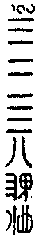

# 佛冤禅师语录



> **藏经**：嘉兴大藏经（新文丰版）（嘉兴藏）　**册次** 第 37 册（J37）　**编号** JB371　**部类** 诸宗部　**卷次** 12 卷　**篇幅** 108,222 字

> **作者（译者）**：嗣法门人性纯等编、嗣法门人德明等编、嗣法门人印乾等编、嗣法门人常炽编、嗣法门人性纪编、嗣法门人胜灿编、嗣法门人真一等编、嗣法门人智唫编、嗣法门人觉知编、嗣法门人联芳编、嗣法门人行延编、嗣法门人祖缘编

> **卷／品**：13 卷 · 7 品



---



## 目录



  - [序](#序)

  - [序](#序-1)

  - [序](#序-2)

  - [序](#序-3)

  - [序](#序-4)

  - [序](#序-5)

  - [序](#序-6)

- [佛冤纲禅师语录卷第一](#佛冤纲禅师语录卷第一)

- [佛冤纲禅师语录卷第二](#佛冤纲禅师语录卷第二)

- [佛冤纲禅师语录卷第三](#佛冤纲禅师语录卷第三)

- [佛冤纲禅师语录卷第四](#佛冤纲禅师语录卷第四)

- [佛冤纲禅师语录卷第五](#佛冤纲禅师语录卷第五)

- [佛冤纲禅师语录卷第六](#佛冤纲禅师语录卷第六)

- [佛冤纲禅师语录卷第七](#佛冤纲禅师语录卷第七)

- [佛冤纲禅师语录卷第八](#佛冤纲禅师语录卷第八)

- [师太行乐卷十](#师太行乐卷十)

- [佛冤纲禅师语录卷第九](#佛冤纲禅师语录卷第九)

- [佛冤纲禅师语录卷第十](#佛冤纲禅师语录卷第十)

- [佛冤纲禅师语录卷第十一](#佛冤纲禅师语录卷第十一)

- [佛冤纲禅师语录卷第十二](#佛冤纲禅师语录卷第十二)



---



### 序



无上妙道垂化於百千万劫，旷劫难比，且大法之旨无有体段，欲小而大，说内在外，视远而近，其妙密不及尽宣也。爰金鸡衔粟、马驹踏人，皆密契潜符，孤光绝向，列派相传，其大机大用直显纲宗，故有上堂、小参、入室等语，证入浅深。佛冤和尚得法於丈老人，初於福城东际横机弗让，丈以銕如意一击，头颅迸裂，当下脱洒，始知鼻孔下头垂巾缾，四十餘春侍役不坠，如庆喜侍瞿昙，片言只字如缾注水。昭觉落成，嘱师开法，古字山中并双流潮音，平展法要啧啧然。老人年登八旬，命回昭觉，为第二世真銕面，握黑漆拄杖，火中拨轮月，树头钓双鲤，青天轰霹雳，以验诸方。大阿一舞，狐狖潜踪，古镜高悬，妍丑皆现，当阳提唱，不减川藞苴奇伟之器。老人得冤公，如圆悟之有瞎堂也。狮子吼时，众兽潜伏，人天侧耳，缁素响从。尝与学者食则同其器，务则均其力，寻常指示衲子，不致死堆堆地，要伊是个透网金鳞，变化而奋飞摩云，纵横展演，无向无背，常在一切处，不为一切处之所碍。三据大刹，流出语言，实自胸襟，不事造作，感慨袭人。余于癸卯春　衔命守成都，得觐老人问韩子大颠公案，与余顶门一锥，不觉汗流浃背，脱去胶缠，授以一杖一笠，支风荷雨。余与师昆季也，行则同行，坐则同坐，不待尝鼎见脔而知其味矣。遂读师日录，得沾玄化，廓清五蕴，赞叹莫及，乃作序弁于简端。一法不立，即证菩提，须知此事不在语言上。炜一拳搋，破祖师关，看从上一夥汉从那里来见我？



时康熙岁在己酉孟夏，佛弟子彭文炜，法名彻嵒，沐手拜撰。



------



### 序



西来大意，自一祖至曹溪明明吐出，只为太明了，人多粉饬，故临济、云门列祖师以隐语机锋救之，使片言只句刹那间勘出犴鸣狮吼，拟议便乖，转盻即失。呜呼！至矣。乃传习既久，不能无弊，或勦袭机缘、或窃取窠臼、或答不副问而徒作囫囵之语、或未彻心地而漫为影响之谈，致令棒喝成故套、竖指皆虚文，挽回宗风赖有卓人。幸昭觉佛冤和尚自性中树光明幢，早岁费艸鞋钱遍参宿德，继而于丈老人禀承印记，掣电之机诸方畏惮，瞻风之力野狐潜消，奉老人命主昭觉。凡上堂小参、法语机缘，如巨灵劈山、涂鼓夺命，照用应宜、杀活咸妙，时而踏倒须弥、掀翻大海，时而藏身北斗、合掌南宸，炉鞲所锤，惺发者众。座下门人集其广录，而梓传之中饶舌于首，未免更添一重公案。



时康熙丁卯中秋日，同门法弟宋肄樟，法名彻中，题于玉垒山房。



------



### 序



蜀之昭觉，乃唐宋以来之祖席也。钟沉鼓寂，颓毁已久。本师丈老人目击心伤，慨然以兴复为己任，率众搆草棚，栖息於坏甓断础间。一时贤士大夫莫不趋响道风，焚香顶礼，乐为之助。未数年而万瓦鳞差，修梁虹举，蔚成宝坊。开堂日，登阶者万有餘指，猗欤盛哉！夫当大法衰残之际，而能承先起废，卒致光显若此，则宁仅仅亢济北之一宗而已耶？老人腊高八十，倦於接物，因就寺之西偏榕阴竹影中，苫茆屋，缚绳床，对篝灯以穿针，坐斜阳而扪虱，为佚老计。其继登曲录，使双桂天香飘满虚空界，则有我佛冤法兄也。法兄谒费隐和尚於天童，叩木陈和尚於道峰，参二隐和尚於龙渊，末后印证於本师丈老人，迄今凡四坐道场矣。杀活擒拏，机用叠发。为人处，心慈手辣，彻骨彻髓。出一言半句，如秉金刚剑，撄之者立死；如𦶟返魂香，嗅之者即苏。岂若今世之面墙担板汉，救已且不暇，辄敢据高座、称导师，悬羊卖狗、认龟作鳖，诳人以自诳也乎？知诸方必有顶𩕳上具眼者在，又无俟斯之哓哓饶舌已。所有上堂、小参、法语、佛事、拈提、颂古，门人性纯辈其汇次成帙，得如干卷，付之剞劂氏，而属鹧鸪庵头陀超斯以为之序。



------



### 序



禅家大旨，以不二为宗，圆明为本，学者实证实参，得犹不得，存也而发之不以为露，后也而先之不以为矜，唯是操履精严，笃实内守，应般若多罗之谶，以担承大事，砥柱末流，庶坐断诸方而无所憾。要之，授受必有渊源，虽体用兼施，总归常寂，此饮光所以契拈花之旨，而可祖独擅得髓之称也。余于佛冤禅师有深契焉。粤自天童密云老人提唱东海，为其子若孙者悉皆龙象，唯吾蜀当板荡之秋，独能倡教西南，人天皈仰，逞大法力，捄民水火之中，则破山禅师一人而已。破公门庭虽峻，衣钵浸广，至于行解相应，福德巍峨，创复昭觉禅院于荆棘艸莱之中，王侯宰官归心恐后，拔引下士至耋不衰，则丈雪禅师一人而已。丈公年逾八十，退院颐老，弟子率多散去，其继主昭觉，敷扬大法，上奉丈公，以无坠破老人之遗烈，则佛冤禅师一人而已。余归自江左，屡访丈公于锦官，因得与佛师共数晨夕。见师容止冲和，神情内毖，有儒者暗然之风。山居有面壁之榻，垦荒荷百丈之镢，开炉用巴陵之手，巾瓶践曾元之迹。其始负笈夜郎，苦心危行，契证最早，而师不以自信。继随丈公入秦、入吴、入越，印证于费隐，参请于木陈，皆荷许可，而师亦不以自信。迨至福城一击，顶门大破，金陵茗碗，遽契初心，而师犹以根行浅簿为辞。噫！何其谦让未遑也。所谓躬行君子者，非欤？今读所录法语，渊源有自，的乳无差，解人𫐖轕，纵夺自由，或震如雷霆，或解如风雨，可以张旗鼓而骇鲸鲵，可以泣神鬼而御魑魅，始信实证实参，得犹不得。其存也，乃所以为发也；其后也，乃所以为先也。视世之一知半解，逞智斗捷，辄自诩为宗门尊宿者，不大迳庭也哉！



时康熙丁卯阳月，遂宁吕潜顿首序。



------



### 序



按锦城为三都之一，山川奇秀，甲於天下，故其中丛林福地，碁置星列，名衲耆宿，代不乏人。然最著者，莫如昭觉，唐宋以来，号为宝地香城，其来益盛，圆悟禅师之真隐塔任焉。甲申岁，贼焰熛发，胥成灰烬。本朝定鼎后，至癸卯岁，得丈雪老人自吴越归来，毅然重建，不数年而绀殿琼楼，焕然一新。拮据兴复，虽出老人之志愿，其间赞勷周旋，成此无量功德者，佛冤大师之力居多焉。予因避难出蜀，筮仕京华，四十餘年而始归，与老人有同法意。往晤中，得面大师，见其气宇冲和，语言蕴藉，知为有道中人，故坐话间，出其语录一编，问序於予。因慨识浪障空，迷云锁月，茫茫宿海，渺无涯际，谁能如大师之脱纷华、耽禅寂，借语言文字，放大光明，普照河沙世界，俾群生见闻，祛迷剔障，瞩照本来面目？其为慈航宝筏，信不诬矣。乃谭者谓乾竺氏西来，大意不落言诠，若於无所有中妄立文字，是谓平地生波，从何得入净土？不知机有浅深，教有顿渐，大善知识悟般若真空，不袭声闻，不堕色相，洵无借兹赘疣。若初学小乘，不假舟楫，讵登彼岸，凭何悟入圆通哉？此大师语录之所吐露。至其中若登座说法，若颂若赞，若机若筈，阐发虽别，而性情一致，散华落藻，玉净珠明，总缘灵悟天成，非门外人所能窥其堂奥也。予生也钝，不能如无尽居士为石门点破金刚眼睛，东林搂碎子瞻骨髓，但反覆斯编，始觉大师为金粟再来，结峨嵋剑阁之秀、揽吴楚秦晋之奇，故能慧灯相照，克唱宗风，振南岳祖三十七世继起之薪传，结圆悟师五百餘年未了之公案，於十方界中开方便法门，使圣诲重明，迷涂复悟，是三乘教内真实行道者矣，又岂仅作语言文字观哉？予於是沐手焚香而乐为之序。



时康熙丁卯孟夏，成都张吾瑾沐手譔。



------



### 序



天地正大之气，含灵歙粹，随物赋予。道人者，行道之人也。说话皆佛法，无法可说，名为说法。所以道：未出方丈，说法已竟。故净名杜口，熊耳掩室，音如雷霆，掩耳者几希。由斯走杀赤县神州，衲子脚跟下犹有未点地者。幸简池周金刚跳出，硬如銕橛，痛与棒、热与喝，以机应机，如筈中筈，衲子们呼为向上事。僧问：「如何是向上事？」师云：「向下荐取。」故有得皮得髓之言。爰西蜀水山接连天竺，玉垒雪如鹫岭之白，锦江常泛恒河之波，叶广枝麤，凡剑客往来，憧憧不绝。古称西蜀乃七佛之地，竺国之咽喉也。迦叶佛时，蜀僧常于西耳河边造多宝佛像，故修多罗教由越巂晒经而来，磨砖之势被马簸箕觑破，一代纲宗让与马师矣。霖在窗下时，常闻蜀中人龙文虎多产于释门，如圆悟勤、雪窦显，称为染衣将相。霖自南之北，凡值三峡来者，询劫退之殷，便称昭觉，宗风大振。又荷冤和尚为昭觉第二世，师资相懽，商略古今，应机妙密，不减沩山之与寂子、赵州之与文远。且不说无事禅，又不落葛藤窠，抛无位真人于麻滓沤中，拈提向上，有跨灶之风。虽游刃于劫灰之上，性喜施中，随有随与，杖笠之外，不置一钱。行道说法四十餘稔，布衣坏衲，修然自守。常对客曰：「身如划水，随划随合，制敌胜怨，乃可为勇。」霖游宦海旋蜀，汗颜欠沫，径过昭觉，见庞眉老衲倚藤而出，视听不衰，麈谈终日。其布金庄严宝坊，比虚空而不坏；导扬茂实，同天地以永久。及别，冤和尚以日录示余，阅之再四，信手信笔，乱洒墨水于简端，聊作倾盖佛事。其衣线下，待浣洗过，再倾旨可也。



时康熙丁卯秋日，绣水徐嘉霖题于锦官之工部艸堂。



佛冤纲禅师语录目次



------



### 序



目次  

卷第一住内江古字山诸古禅院语录  

住成都府威凤山昭觉禅院语录



卷第二成都府威凤山昭觉禅院语录  

住双流洛伽山潮音禅院语录



卷第三再住威凤山昭觉禅院语录



卷第四再住古字山诸古禅院语录



卷第五住内江天池山般若禅院语录



卷第六再住威凤山昭觉禅院语录



卷第七昭觉首座寮秉拂  

机缘  

拈古



卷第八东土历传祖师像赞



卷第九源流拈颂



卷第十颂古  

分灯  

行繇



卷第十一法语  

杂著  

佛事  

第十二  

书问  

诗偈  

歌  

附跋



目次终



------



## 佛冤纲禅师语录卷第一



**译者**：嗣法门人性纯等编



住中川古字山诸古禅院



三门。「佛祖曾蹈，各露锋威。山僧到此，古路不栽荆棘，限门立设三关。」遂以杖作抬搦势，云：「纵横方撚镞，空中百鸟惊。」便入。



佛殿。「若得放过，要且未有衲僧习气；若不放过，新长老失却半边鼻孔。作麼生两得相称去？」展具，云：「世事但将公道断，月轮难较量包虚。」



方丈。据坐，蓦喝一喝：「蝎尾蛇头，谁当试之？」复喝一喝：「猛虎口里，飞活雀儿。」左右顾视。「若得个英灵衲子立地超越途辙，那向德山、临济棒头喝下觅踪寻迹？作麼生是出身一路？直将宝剑拈来用，不犯锋铓早丧机。」



康熙庚戌十一月十八日，众请上堂。拈香云：「此瓣香不须培土培块，生成弥满穹苍，𦶟向炉中，今上皇帝圣躬万岁万万岁。伏愿琼林灌沐，遵崇荡荡尧风；德雨高滋，不减熙熙舜日。此瓣香不同华木，岂类芝兰？𦶟向宝炉，奉为阖朝文武、概国公卿，惟愿於光明藏中亲闻金口，御楼彩里霭玉佳声。此瓣香巾瓶二十五载，翻翩几受折磨，烈焰红炉难为凑泊，末后於福城东际蓦头一拶，迸破顶门，当下得个小休歇，不敢唐突於大方。今日非特络索举扬根源，自知冷煖，此是第一回拈出，𦶟向炉中，供养现住昭觉堂上传临济正宗三十二世上丈下雪醉和尚，用酬法乳之恩。」白槌云：「法筵龙象众，当观第一义。」师云：「第一义自从世尊拈花、迦叶微笑以观了也，末后却被断臂阿师便礼三拜、依位而立以观了也，何得更观？若有不向声尘中出没，亦非光影里埋踪，试出相见。」僧问：「东弗于逮打鼓，为甚西瞿耶尼不闻？」师云：「尘刹是要津。」进云：「南赡部洲点灯，为甚北郁单越暗坐？」师云：「巨壑易填，漏卮难满。」进云：「遍界无觅处，分明剖露看。」师云：「宝剑拈来觌面陈。」进云：「眉毛剔起无回互，祖佛家风焕古今。」师云：「截断罗笼，别通一路。」进云：「前头犹似可，末后好愁人。」师云：「绳墨端宜明眼人。」僧以坐具摵一摵，师云：「夜行休踏白，踏白便是水。」僧礼拜，师乃云：「今日开炉鞲，铜头銕额镕，簇簇天昏黑，颠倒走虚空。」蓦竖拄杖，云：「者物曾经鍊，杀人不露锋，须弥倒该括，颔珠夺骊龙。」复划一划，云：「秖因恁麼恶辣，摵碎百匝千重。大众！似与麼匹配，有烜赫殊胜不经炉鞲者麼？石女把针深夜度，銕牛背上著蚊虻。」乃举：「三圣云：『我逢人则出，出则不为人。』兴化云：『我逢人则不出，出即便为人。』」师云：「一队无孔銕锤，臭得些子习气，向空中钉橛、水上著靴，岂料笑杀东村石土地？若是勇捷之士，不假徒劳寻路，何用更涉他门？还有理论处也无？」拂一拂，云：「幽斋夜夜云来往，灯笼露柱岂相瞒？」



上堂。问：「如何是渔台境？」师云：「下钓古今迎上钓。」进云：「如何是境中人？」师云：「笛声犹未歇，岭梅灿六花。」进云：「人境且置，还有向上事也无？」师云：「须当临水鉴，眉毛几许长？」进云：「切忌压良为贱。」师云：「公子放风筝。」遂拊掌云：「㗭哩㗭哩，苏噜苏噜，会则一曲两曲，不会落华春暮。鼻孔重是千斤，说甚双垂卓竖？吃粥了，洗钵盂，剖出向上一路。」举拄杖曰：「者个是向上路，且解撑门并拄户。」良久，曰：「无事立闲亭，日从东畔出。」



追严，请上堂。问：「施主迎请尊者，即今尊者在甚麼处？」师云：「虚空逼塞。」进云：「离了语默动静，将何应供？」师云：「灵利人难瞒。」进云：「应物现形如水中月一句作麼生道？」师云：「顶门上著眼。」乃云：「证第一义，异类潜踪，正印提持，众流截断，若存知见，如筭海沙。岂不见少室峰前低头难觅地，曹溪路上抬眸不见天？到此秪得上无攀仰，下绝己躬。今幸祥宇居士思绎先人遗爱，起报本之心，敦请登座，举向上机，显奇特事，升解脱堂，演解脱义，当聆法脉流通，以此阕思罔极，有为无为尽世间，死生善恶何拘系？凄清动静法王根，家住长安休更觅，亲收藏里摩尼珠，劫火洞然无变易。大众！且伊先慈还曾吃法味也无？一透龙门云外望，莫作黄河点额鱼。」



上堂。「全身佩剑，犹落群机；透过那边，素称敏手。风前一拍，和者应稀；妙理真宗，别无边表。识须好恶，以辨浅深；说道论禅，犹添脂粉。诸人且作麼生体悉？如当人分上，无不显露，何假盖覆？若有未觏者，更开方便。还会麼？」以拄杖一卓，云：「拾取城头吹畫角，休追那畔巧莺声。」



上堂。「寰中天子，塞外将军。栉风沐雨，片片赤心。此犹是令传道泰，治乱持危。簸土横山，飏尘截海。退身千尺，觌面相呈。此犹是圣凡异路，方便多门。只如天不能盖，地不能载，未审是甚麼人境界？」拈拄杖曰：「不管山头并岭尾，直须打草要蛇惊。」



诞日，升宇请上堂。「今朝八月十五，分明好事相举。木樨朴鼻飞来，月色地匝天普。莫是天然气概，也须特达丈夫。位育列时列候，力在箭锋相拄。大众！济济雍雍，毕竟有宾有主。直饶对此明机，未必将三作五。平田浅草，露赤斑蛇；太虚寥廓，突辽天鹘。若唤作山僧诞期，文殊急走千山；不唤作山僧诞期，弥勒拊掌欢喜。於斯荐得，触处周遮；其或未然，且作生辰相见。还有共山僧同生同灭、同起同卧者麼？」竖拂子，曰：「玉线金针须密度，我是我兮汝是汝。」



本生落䰂，小参。师云：「捞天摸地半生事，始识冰霜彻骨寒，险路架桥泥佛度，金装五彩面南看。今日大众云登，高悬烈日，是我本生薙染之期，山僧不惜唇吻，撮土成金，指石为玉，使伊绝妙绝玄，超情离见。」乃举：「石霜示众云：『昨日作婴儿，今朝年已老，未明三八九，难踏古皇道云云。』」师云：「石霜老汉宽处尽宽，窄处尚窄，大似富贵犹不足，贫穷骨格高，今日热如昨，石马出纱笼，透七透八了，喧轰宇宙中，秤锤浮水面，瓦犬过江东，云屏笼翠峤，雪岭吐清风，虾蟆趁鹞子，鱼跃万仞峰，大好一盆饭，不必著椒葱。」



静空大德忌，请小参。「欲行千里，一步为初，宝月高辉，光分沙界，知心体合，达本忘情。所以道：『心生种种法生，心灭种种法灭。』」竖拂子，曰：「者个是生？那个是灭？若人道得生灭句，许汝顶门亚一只；其或未然，云撼风生撩乱泼，枫林叶堕鸟栖惊。」



竖法堂，锋击监院请上堂。「陵夷祖席已多年，飘渺水云滞涧边，今日揄扬撑宇宙，好看法尔亦如然。诸古丛席近日维新，巧匠良工一时备美，水鸟树林悉见色身三昧，山河大地同证根本法轮，峰峦回合时谈般若妙音，竹木参差细染云霞艳质，为复神通耶？法尔耶？於此数百年来泯其炉鞲，钝置水云。」竖拄杖，云：「山僧拄杖子指出，唱九作十，世路多端，敢问大众：此犹是乾坤异色，枯木回春。」复卓一下。「百尺危楼峰顶踞，檐前伸手摘罗星。」



晚参。僧问：「某甲欲行未行时如何？」师云：「谁知冷灰里有粒豆爆？」僧拟进语，师以杖擢退，乃云：「才拈寸銕，遍地刀鎗，眉挂须弥，一真法界，如箭直锋，如函得盖。」以杖一划，云：「不贴鍾馗，家无异怪。衲僧分上若具，夺角冲关，十方通畅，山僧相许有自由分；其或未然，璇玑何必加文彩，峻峭门风也大难。」



上堂。师云：「万古雄雄坐钓台，烟波江上万重开，若有锦鳞腾碧汉，不妨摇曳舞三台。有问话者麼？」僧问：「父母未生前即不问，如何是古字山中清净身？」师云：「清流溪远平如镜，倒映长空冷逼人。」进云：「如何是报身边事？」师云：「霜花一夜作，莫待晓风吹。」进云：「未审化身事若何？」师云：「退后三步。」进云：「四大皆空，此身向甚麼处立命？」师震威一喝。进云：「和尚好喝。」师云：「不荐当阳句，徒跨十万程。」问：「古字山，狮子吼，如天普盖，似地普擎时如何？」师云：「尽大地人皆脑裂。」进云：「拄杖击碎生死海，还通言句也无？」师云：「秦不收，汉不管。」问：「今朝新建选佛场，前佛度生即不问，后佛出世是何如？」师云：「雨过有晴来。」进云：「还有为人处也无？」师云：「该括五须弥。」乃云：「未升此座，疑杀多人，及乎到来，舌原在口，攒花簇锦，剜肉作疮，鼻孔辽天，莫相辜负，鱼腾碧汉，阶级难升，若是龙行，九洲浪激，性海无风，金波自涌，明者即动而静，暗者迷西作东。若言即心即佛，来者莫拘；若言非心非佛，往者莫追。若是性懆之流，不向虚空掘洞，单能拨草瞻风，且把断要津一句如何委悉？古镜若无瑕，日月难追及。」



小参。师云：「十五日已前事，锦上铺花；十五日已后事，如海一沤发；正当十五日，大似一尺镜照千里之像。」师云：「观我远祖舌锋上摆定干戈，语言里衲僧▆▆，是则也是，大似养羽候秋风。十五日已前事，桃未红；十五日已后事，李先白；正当十五日，鱼穿碧浪，鸟悦长空。大众！与古人是优耶？劣耶？」良久，云：「萧萧不住南来鴈，一段音书附向谁？」



升宇王居士办斋，请上堂。「拄丈子，真烈挈，他年掷向冷堆头，今日依然拈提掇，狮儿臭著骨毛寒，触著人人鼻孔裂。诸禅师！且道利害在甚麼处？堂堂恁麼六不收，德山来也谁辩别？若辩别，昆仑走向蟭螟睫，黄海▆厮眼著橛，嘉州大像得一掴，陕府銕牛头发热。今日若有个汉便道：『拄丈子！彼丈夫，我丈夫。因甚目下无人，自尊自得？』拄丈子道：『孟八郎汉！为人须为彻，杀人须见血。』大众！拄丈子恁麼说话，还有风力也无？」卓一卓，云：「然虽不是猛虎，且有退衣之德。」



小参。「雷音普震，困蚁群苏，卷起帘来，青天白日。露柱笑呵呵，灯笼功不宰，白云本无心，常自露光彩。」竖拄丈，云：「辄不得动著者个。何故？听彼观音行，善应诸方所。」



住成都府威凤山昭觉禅院语录



癸丑十月十五日，师自中川归觐。



老人命主昭觉，即日开炉上堂。诣座前以杖指云：「此个威音王已前已据，威音王已后重登，且不前不后，登即是？不登即是？尨在盻云，落七落八。」遂升，拈香云：「此瓣香充遍千界，透彻玄关，𦶟向炉中，祝延当今皇帝万岁万万岁，伏愿万邦拱极於中天，瑞气霭腾於八秩。此瓣香奉为阖国文武、现任勋贵调羹补衮，柱石金汤，为伊周之德，颂伯叔之风，洪注八埏，寿登兆亿。此瓣香诸佛命脉，列祖渊源，今对人天众前，不敢囊藏被盖。此是第二回𦶟向宝炉，供养传临济正脉三十二世丈雪本师大和尚，用酬法乳之恩。」敛衣就座。白椎云：「法筵龙象众，当观第一义。」师云：「此第一义，冲破銕昆仑，掀翻大海水，有解当机腾踏，请出相见。」问答不录，乃云：「一句传天下，砖磨古佛心，揭示威音畔，彻古更明今。所以一举不复再说，冷笑非谓拈花，只会布鳞控凤，不解捞蟹摝虾。若唤作上上机，则灭却正法眼；若约祖宗基业，拄丈子有承当分。诸人还证据得麼？」卓一卓，云：「多年破砂盆，幸值赤手扶起，电光中主宾互换，锋刃上照用同施。含灵归心，象龙蹴踏中兴；滹沱大用，瑶阶整肃清奇。一旦命纲主席，自觉负荷难为。涂毒鼓一挝，青霄韵出；枪旗手再展，日月斩新。然虽如是，杀人须是杀人刀，活人须是活人剑。大众！要识杀人刀麼？」以杖过右边。「要识活人剑麼？」以杖过㔫边。云：「还知觌面提持也无？佛祖曾经须乞命，清机焉敢犯吹毛？」复举：「法灯和尚开堂日，云：『山僧本欲深栖崖窦，隐遯过时，秖缘先师有未了公案，今日出来与他了却。』时有僧问：『如何是未了公案？』法灯打云：『祖祢不了，殃及儿孙。』僧云：『过在甚麼处？』灯云：『过在我，殃及你。』」师云：「法灯老汉虽则玄关把断，争奈周匝不及？者僧拟犯封疆，岂知早陷枯阱？」卓拄丈，云：「拄丈子光放顶𩕳，符悬肘后，随机展演，坐断千差。现前若僧若俗不昧见闻，有甚公案不了？听取一颂：祖祢不了殃及人，一肩负荷振佳声，分明露出全机用，拄丈头边跃锦鳞。」



当晚，小参。「有节扣玄关，操戈须斩銕，重则一鸿毛，隘似青天阔，鼻孔任辽天，暑寒浸不得。诸禅兄！知不知？重城只箭已中锦水长竿饵，持笑渔翁沙岸上，风风雨雨清秋漾，归去来兮归去来，修鲸巨鼇深溟浪。还有同声相应、同气相求者麼？芭蕉叶上三更雨，静夜楼头钟一声。」



上堂。「山横狮子秀，月映在江心，本自无阶级，无阶级好寻。大众且道：寻个甚麼？南山鳖鼻虽然毒，争似子湖犬子狞？」



冬至，诸位法弟和尚请上堂。举：「古人道：寒，寒，风撼竹声乾，水冻鱼行涩，林疏鸟宿难。早是寒霜威重，那堪行客衣单？休思紫陌山千朵，且拥红炉火一攒。」师云：「古人恁麼说话，秖知输四，不会赢三。寒，寒，有甚相瞒？尖喻巧说，尽是多端。有火虽向，有衣即添，冷暖弗从他得，渐次岂假虚传？世界悠悠碧落，森罗万象交参，一夜寒霜风凛冽，多少途人受辛酸？忆得门前石狮子，堆堆不碍四时迁。於此荐得，复一阳生；若也不会，片雪严霜浸杀诸人鼻孔。」



晚参。「小尽二十九，大尽三十日，日日挨排过，光阴尽虚掷，去来动静殊，取舍是非异。诸禅德！全锋敌胜未是作家，遗剑刻舟岂堪持论？只可丁一卓二，滴水冰生，通上彻下，千机历落。所以古德云：『扰扰忽忽，晨鸡暮钟，唤冬作夏，唤夏作冬，一线短长谁管得？雪霜尽处是春风。』」师云：「可谓古人说在不行处，行在不说处。纲上座今晚说在行处，行在说处，忽忽扰扰，月夕日晓，望节才过，朔日又到，树动山风霜雪尽，石磷含润长芝草。」



说戒，上堂。「大丈夫，秉慧剑，般若锋兮金刚焰，非但能摧外道心，早曾落却天魔胆。先德与麼吐露，正是太阳门下日日三秋。纲上座也不免对众剖露：大丈夫，秉慧剑，大冶红炉经煆炼，拟犯锋铓万里尸，圣解凡情俱坐断。大众於斯领略，不假钳锤；其或未然，殷勤乞戒。」



除岁，小参。「雪峰覆饭桶，甘贽拜蒸笼，船子埋身水底，性空吹笛云中。临济喝，知音罕遇；德山棒，作者难逢。怎如昭觉者里别无计较？森罗万象齐来也，熨斗煎茶铫不同。」遂举：「僧问古德：『年穷岁尽时如何？』德云：『东村王老夜烧钱。』」师颂云：「烧钱王老在东村，不必安排潦倒倾，红杏碧桃惊憋破，须籍阶前爆竹声。」



元旦，上堂。问：「新年说法，譬如大海水，无筋骨能乘万斛舟时如何？」师云：「石虎昨夜生麒麟。」进云：「纵横无边际，彼岸已先登，如何是不涉烟波处？」师云：「面门早划破。」乃云：「新年头，何法说？春水渌，春花白，顿开千眼豁十方，涌出摩尼光赫赫，草木丝丝去岁凋，岭上松添千年色，乾坤特地新，至化谁能测？云里畫牡丹，水中捉皎月。露柱腮下悟圆通，灯笼脑后拔却楔。」蓦召大众去：「还识此时节麼？嘱咐瘦笻并麈尾，忙忙扫却门前雪。」遂举：「古人道：『除旧年，迎新岁，动用不离光影内，澄辉湛湛夜堂寒。借问诸人会不会？』」师云：「相看古人立地处，大似黄鹂鸣翠柳，白鹭下清汀。除旧年，迎新岁，一喜宁忘百念虑？去来摆手踏阶行，好颗明珠当面讳。与麼吐露，还有新旧也无？三寸原来不出口，拨转地轴与天关。」



解制，上堂。问：「旧年林中黄叶落，冰霜满地；今日元宵碧色沉，梅萼倾姿。冰霜满地即不问，梅萼倾姿意若何？」师云：「明月照行人，岂是他家事？」进云：「青山万里无瑕秽，为肃寰区端的因。」师云：「过头丈子轻抛出，总教黄河一派清。」乃云：「梅花开屋角，弱柳绿溪边，昆仑骑玉象，露柱著靴衫，鲤鱼头带角，峰顶浪泊天，銕人骑銕马，不动到长安，九旬期告毕，休将无事看。到者里，须是个个自达自证、人人无欠无餘，百鍊精金，光辉转炽，杀活同时，方称灵利，可以不动脚跟，周游国土，法音未演，遍界俱闻，直饶缀粘拘缚之士，拄丈子未肯放汝在。」遂划一划，云：「若向者里透得，许尔独步大方；脱或未然，莫道虎溪难踯跳，前途犹有路高低。昔者，地藏琛禅师问僧：『诸方近日佛法如何？』僧云：『浩浩地商量。』藏云：『诸方浩浩地商量，争如我这里种田博饭吃？』」师云：「地藏老汉随机应用，可谓露出心肝；师僧法栋久羁，岂啻炉边受冷？然虽如是，地藏正搔著昭觉痒处。何故？当家种子由来别，怠惰之时有异苗。」



祈雨，上堂。问：「今日祈甘露，处处闲云绕，愿施霹雳门，思波犹未少。如何是垂慈一句？」师云：「幸有随机雨，何堪特地雷？」进云：「百穗仰观功成日，因甚麼不降甘泽？」师云：「本无离位次，不用强安排。」僧喝，师云：「休将杓水转泼菠薐。」问：「一雨蒙润，大地沾恩，如何是沾恩一句？」师云：「刹竿头上风车子。」进云：「无阴阳地因甚麼不受？」师云：「且观立地处。」僧拂袖归位，师云：「切忌一场懡㦬。」乃云：「乾坤若有私，善恶必无报，五马不行春，万象生焦燥，铿锵钟鼓声，更觅说法要。东邻木马汗出，西舍泥牛乾暴，普贤端居高楼，文殊走入篮闹，山野尚无措词，一椎透顶门上，直须打破云关，识取向上一窍，扶起森罗万象，倒岳倾湫，统合国之欢心，风行草偃，要与天地共其德、日月合其明，无思焉、无为焉，寂然不动，感而遂通。」以拄丈向空中点，云：「於此一点，可以泽及万邦，周遍尘刹，无涯恢廓，妙用河沙。恁麼说话，穿透东海老龙王鼻孔，不须断贯索绳。既是老龙王鼻孔被昭觉穿却，向什麼处出气？忽地一声涎沫喷，为霖为雨倒盆倾。」



结制，兴吾王居士设斋，请上堂。问：「面壁九载即不问，漏泄家风事若何？」师云：「石羊吞石虎。」进云：「秪如二祖礼三拜，依位而立，为复掣转关捩？为复自显真机？」师云：「夜来月色好，今日是秋山。」进云：「祗园一脉传今古，四海佳声喜共闻。」师云：「眉毛不在眼下，鼻孔搭在上唇。」乃云：「住持一稔来，逢冬两结制，开口泄天机，举目露真智，不唱言前机，岂谈句后意？虚空筑著鼻孔头，銕眼铜睛觑不及。」遂竖起拄杖，云：「有定乱剑，四海晏清。」放下拄杖，云：「无白泽图，千魔敛迹。秪如结制开炉报恩一句作麼生道？轩昂宇宙当风挂，万里河山壮帝畿。」



小参。问：「举起则有，放下则无，过在甚麼处？」师云：「太湖三万顷，那去觅沤生？」进云：「古人道：『天得一以清，地得一以宁。』为是闻中透脱？为是格外之机？」师云：「切忌动著。」进云：「无情也解说法，为甚某甲不解？」师云：「青蛇才出匣，胡僧笑点头。」进云：「恁麼则自古自今去也。」师云：「异泉无涸溢，四众尽沾恩。」乃云：「当头举著没纤尘，天得清兮地得宁，自古自今同生死，无情说法亦有情。」卓拄丈，下座。



上堂。问：「如何是句到意不到？」师云：「任通天伎俩，不动亦奚为？」进云：「如何是意到句不到？」师云：「魍魉难支遣，洗剑也心惊。」进云：「如何是意句俱到？」师云：「谩挂参时镜，鉴人毛骨寒。」进云：「如何是意句俱不到？」师云：「横身三界外，独脱万机前。」僧礼拜，师乃云：「句到意不到，佛祖心肝被虫蚤，迢迢十万八千山，谁知错过虚玄妙？意到句不到，出窟狮儿任勃跳，古今多少英灵汉，撮来收拾得恰好。意句两俱到，马祖庞公尝问道，殷勤抱得旃檀林，便是祖师真奥妙。意句俱不到，唯证乃知默，斯要觅意，焉用泄天机？不到耳边难识窍。」遂高声云：「道，道。」卓拄杖，下座。



上堂。僧问：「如珠走盘时如何？」师蓦头一棒，云：「试走看。」僧礼拜，师云：「却是如盘走珠。」乃云：「象王顾，师子呻，文殊、普贤赤脚行，笑怪胡僧板齿落，儿孙谬赚缺双唇。即今还有为老胡接齿者麼？一夜雷声无雨点，黄河源水出昆仑。」



上堂。举：「乾峰示众云：『举一不得举二，放过一著，落在第二。』云门示众云：『昨日有人从天台来，却往径山去。』峰云：『典座来日不得普请。』」师曰：「举一不举二，天台与径山，莫言头白了，子胥过昭关。」



郑提督正寝，孝子品金、浑金建华严道场，请就衙内对灵小参。师云：「华严界里升高座，透出龙宫演法时，若为大人超净域，虚空昨夜一轮晞。大众！若向此透得明白，尘国转为佛国，福基翻作法基，瓦砾转生其光，草木愈瑞其色，搅长河为酥酪，变大地作黄金；脱或未然，宣出大人沙场，久战名遂。今朝去也，徽猷兆世，竖亚不磨之勋；育化坤维，展拓太虚之气。解龙沮之计，施韩信之功，联叨凤诏，屡对龙颜。论其功，高而无上，广不可及；量其德，渊而无下，深不可测。自莅蜀土残疆，烟尘荡尽，日月斩新，一旦寂尔宾天，令其四众悲伤。兹当五七之期，有孝子品金、浑金同阖衙官眷建兹无遮大会，追其遗爱，起报本之心，敦请山僧登座。」以拄杖指灵座，云：「且道大人还来受法会也无？」复卓一下，「临流锦水龙腾势，晴日天空鹤影高。」



晚参。问：「春秋已涉遍，冬至事如何？」师云：「大地一团撮。」进云：「百花开满地，寸草尽沾恩。如何是沾恩一句？」师云：「持来宇宙新。」问：「如何是向上事？」师云：「眼睛里出气。」僧礼拜，师蓦头一棒，云：「还知向上事也麼？」僧舞坐具，师云：「且得没交涉。」乃云：「大地一团撮，持来宇宙新，一般清异味，更看好愁人。既是清意味，何得好愁人？尽道眉端堆宇宙，谁知舌上起风雷？」卓拄丈。



大慈法兄懒和尚偕众位和尚设斋，请上堂。问：「达磨东土，无风起浪；世尊拈花，一场败阙。今日和尚升座以何示现？」师云：「眼里无筋汉，不荐亦奚为？」进云：「若不登楼望，焉知沧海深？」师云：「仰地叩天，徒劳射目。」进云：「说法已竟，大地沾恩。如何是沾恩一句？」师云：「驱云逐雾，尽在风前。」问：「冬至到来即不问，高提祖印事若何？」师蓦竖起拂子。进云：「春色满园关不住，一枝红杏出墙来。」师云：「阇黎恁麼闻香逐臭。」乃云：「芙蓉城里诸知识，一齐拥入我山来，一一威光照天地，为扶祖席共相培。」遂拈起拂子示众云：「从上诸圣以此传持祖印，挨至山僧手里示微妙音，诸人还信得及麼？若信得及，当於此示是何曲调？若信不及……」以拂子打圆相云：「流动摩尼须究取，风波才动溺舟轻。」复举：「龙门远禅师至蒋山上堂云：『一手不独拍，两手鸣掴掴，举意超情念，相看同路陌。摩云鍾阜高，遍界乌轮赫，妙机速雷电，神珠不在额。珍重人天大导师，衲僧一见丧魂魄。』」师云：「龙门蒋山受然灯记莂，握三印正宗，可谓光前裕后，烜赫现前。怎如我诸位和尚来山助扬法化，脚跟未动，法义周沙，通上彻下，无非道场。诸人有眼同见、有耳共闻，何更山僧忉怛？脱或未委，复有一偈普为颂出：一手不鸣，两手掴掴，举向上机，千圣莫测。宝月含空，交光廓彻，非中非外，神珠在额。」以拂子作吹笛势云：「顺风吹也逆风吹，压倒胡笳十八拍。」



腊八，上堂。问：「世尊雪山成道，令人说出许多。如何是拔众超群句？」师云：「千峰寒色凛。」进云：「和尚今日升座，为复是为古人示现？为复是自显真机？」师云：「万壑结霜威。」问：「百年三万六千朝，因甚正觉於腊八？」师云：「枯梅含蕊笑，春风递信来。」进云：「今日成道后，说法利群生。如何是普润一句？」师云：「一棒全提，古今不异。」进云：「学人礼谢和尚去也。」师云：「截断脚跟，露出巴鼻。」乃云：「未曾开口，遍地绣𬘡，急磨腰剑，屏祛番人，深山独虎，浅草蛇群，从教大地设玄辩，翠叠香风我国宁。」拈起拄丈，向上一卓，「尽道迦文老子昨夜悟明心地。且道：悟者个心地麼？若是悟明者个心地，怎奈笑杀旁观？即今莫有旁观者麼？」复卓一卓，云：「琉璃藏宝月，菡萏敷妙香。」



岁旦，上堂。「今朝初一，宇宙呼欢，凝然湛碧，腾踏机先，衲僧门下，一一成现。」卓拄丈，云：「唯有拄丈子，眉毛倒插天，可以发一机，千机万机历落；透一境，千境万境全彰。演无为之化，起不坠之宗，尘尘尔，刹刹尔，一机蓦露，独耀人天，直示根由，古今无异。所以僧问古德：『新年头还有佛法也无？』德云：『有。』僧云：『如何是新年头佛法？』德云：『元正启祚，万物咸新。』」师云：「据他古人吐露，撑起和风拂拂，放开旭日融融，卷则灯笼起舞，舒乃露柱扬眉。若是眼亲手快汉子，更不沉埋向上一窍。秖如斩新条、行新令一句作麼生道？毒鼓一声天地震，麒麟獬豸尽翻腾。」



解制，上堂。问：「结制解制姑休论，不动干戈请师分。」师云：「阳气渐舒无硬土。」进云：「黄金须假红炉炼，白玉还他自手磨。」师云：「正是风云会合时。」进云：「但得雪消春自至，桃园忘却渡头人。」师云：「低头休踏影，郊外听歌声。」问：「结制时，青霜含玉翠；解制时，碧水漫潺湲。如何是不变迁意？」师云：「跨过驷马水，便是芙蓉城。」进云：「恁麼则甘露普滋於法界，馨香满散於人间，学人还有分也无？」师云：「处处绿杨堪系马。」问：「解制上元即不问，春景到来时如何？」师云：「当阳吃得山僧棒，贴体风流亘古今。」进云：「匝地春雷天下晓，时而惊醒梦中人。」师一喝，乃云：「结则循途合辙，蚊子上銕牛；解是据本归宗，总教浃背汗下。芒鞋紧俏，还他出格风标；拄丈横空，是谓当阳超卓。所以道：去去实不去，途中好善为；来来实不来，路上莫亏危。且金刚妙体无处不周，如凤翥云霄不萦羁网，鱼跃龙门岂遭点额？还有不滞琼波、快游玉浪、鼓鬣相看者麼？如无，山僧有个句子为汝诸人拈出：妙性本来原不借，当人不荐自罗笼，棒头点出超方眼，銕壁银山当下通。」卓拄丈，下座。



------



## 佛冤纲禅师语录卷第二



**译者**：嗣法门人德明等编



成都府威凤山昭觉禅院语录



结制，上堂。问：「一切见闻俱不问，如何是自然性？」师云：「逢著渡头休捉影。」进云：「学人以何为见？」师云：「拟行狐穴勿追踪。」乃云：「诸佛不出世，人人鼻辽天，风高作寒色，生柴带叶添。长安满大雪，鸡足峰悄然，谁人知此意？令我忆南泉。所以道：炉鞲严整，佛祖弘规；封被参求，衲僧苦志。亦如狮子游行，神威返踯；象王回旋，不资餘力。若是昼三夜三，且向炉头炙杀。」复举：「高峰禅师上堂云：『门内有一人，用尽机谋，欲出出不得；门外有一人，作尽伎俩，欲入入不得。入不得、出不得且置，门内人与门外人相见时如何？愁人莫向愁人说，说与愁人愁杀人。』」师云：「高峰老汉用许多气力作麼？大似龟毛上较长短，兔角边论得失。今日昭觉若有出者直须出，若有入者直须入。门内人与门外人相见时如何？生平肝胆向人倾，相识犹如不相识。大众！山僧举注已毕，还有出入者麼？复有一偈，普为大众：伐鼓考钟龙象骈，三年重把断要津，掀翻海岳求知己，拨转乾坤见太平。」



上堂。问：「伐鼓考钟即不问，当阳一句请师宣。」师云：「霜叶浓原上。」进云：「无生佛法倩谁闻？」师云：「冰花结洞天。」进云：「学人再请指示。」师一喝，乃云：「通方上士，鉴在机先，灵机密运，情量超然，星持汉地，月落楚天，所以目前消息非口耳之所传。看他从上诸圣，千种喻，万般言，用尽机轮徒枉然，若要深深海底立，直须打破上头关。且道用何伎俩便乃打破？挨落须弥如辊芥，鞫来不碍刹那间。有资州常湛、常沚居士，於数百里之遥来山，倾赀破玉，设厚伊蒲，供佛表嚫，敦请山僧转法轮於尘刹。」蓦拈拄丈，云：「现微妙於毫端，梯航万有，津济群生，到此凡圣情尽，狐穴泯踪，迷悟两关，一椎粉碎，向者里犹未是佛法流布，亦非世谛商量，毕竟昭觉为人在甚麼处？门前不用栽荆棘，宽留直路透长安。」



冬至，上堂。问：「今朝冬至复一阳生，冬至佳节即不问，无面目汉若何论？」师云：「毛端藏宇宙。」进云：「棒喝分明全杀活，一句当锋孰敢窥？」师云：「碍眼是青山。」乃云：「灵山祖令，顿使人人顶门迸裂；昭觉权衡，总教个个舌叶覆天。可以一语分玄要、一句定纲宗，转天关、翻地轴。秪如西天人说话，东土人未委，又作麼生？」以拂子打圆相，云：「总出者个不得。既出不得，正值日南添一线，犹然彻骨时光阴。如荐得，眉毛八尺餘。向此透脱得去，始可显大机、发大用，纵横无碍，天上人间；其或未然，当阳不荐好风光，寒逼无由得解脱。有明耀大德揭露全身，行向上事，倾难舍能舍之金，请山僧转不生不灭之法。现前若僧、若俗，若凡、若圣，若智、若愚，两利均沾。只如施者、受者各得证据一句作麼生道？等闲折得珊瑚树，虚空廓落毛孔中。」



灿一大德请上堂。问：「法报化身即不问，如何是诸佛於微尘里转大法轮？」师云：「晓霜笼玉树。」进云：「未审说何法？」师云：「夜月破琼枝。」进云：「说法度何人？」师云：「为汝不唧溜。」乃云：「雪积寒威能逼塞，恰似当年断臂时，者场曲调非今昔，额上何须更畫眉？」以拄丈一卓，云：「昭觉恁麼举扬，非谓平地荆棘始可出入无拘，个个眉毛卓竖、人人鼻孔下垂，尽道二祖安心断臂亦是钵盂安柄，令后代儿孙向断臂边卜度，正是无端枉受屈。若要控佛祖机筹，当阳揭露。」蓦竖拂，云：「向者里一超直入，只如越古越今一句作麼生道？壶中日月忙推出，快把虚空缚一团。」复举：「秀才参长沙岑禅师，因看《千佛名经》次，遂问：『百千诸佛只闻其名，未审居何国土？』沙云：『黄鹤楼崔颢题诗后，秀才还曾题也未？』才云：『不曾。』沙云：『得闲题取一篇好。』」师云：「据长沙尊宿，滴水滴冻、玉洁冰清，顿令万法齐彰、头头瑞彩。争奈秀才孤危有路，未得归根？今日若有人问昭觉：『百千诸佛居何国土？』向他道：『长空何碍云来往？一夜霜天月色肥。』」



腊八，小参。问：「如何是透法身句？」师云：「万壑松涛惊滚滚，翻作长江浪泼声。」进云：「如何是动乾坤句？」师云：「深隐寒潭须点额，跃过龙门气象新。」乃云：「今朝腊月初八，尽道迦文悟道，孤明烁破太虚，大地山河勃跳，根源固是本如，空中何更凿窍？」以拂子打○，云：「者个是星，且那个是悟底人？若向此透得一机，机机普应；荐得一句，句句归宗。亦如遍界玄音，风鸣殿角，毫端若现，不异空花。所以经中道：『见见之时，见非是见，见犹离见，见不能及。』」复竖拂，云：「还见麼？玄圭白璧无瑕翳，何异微阳散大千？」



岁旦，上堂。「一年今日从头起，社舞村歌隔坞喧，无意气时增意气，百草头边消息传。且道传个甚麼？」竖杖，云：「青原酒，赵州茶，三杯两盏，醉卧烟霞，大底风流出当家，好个话端被先觉吐露了也。然虽如是，犹有个新鲜句子在。元正启祚，万物新佳，花矜木艳，风月堪夸。门外报，客来到，有酒须酒，有茶即茶，者般丰俭任随家。秪如新年头佛法，镜清道有，明教道无，合作麼生？不得心头空及第，垄畔桃花解笑人。」



解制，上堂。「九十日期结，大似空中棒掉月；九十日期解，布袋头子今日开。或东或西南北去，谁迷谁悟自欺埋？唯有灯笼与露柱，露头露面岂安排？分开百念观时节，笑月吟风无尽该。且道：灯笼、露柱鼻孔重多少？莫教阴阳移化外，朝悠哉又暮悠哉。所以，古人道：『秪要诸人瞥地去、不逐语言去、返本还源去、不涉岐路去、踏破化城去、截断两头去、归家端坐去。』昭觉则不然，秪要诸人入得昭觉室、出得昭觉门。」以拄丈一卓，云：「若向者里荐得，一恁天下横行。」



授子开、沧溟二禅人拂，上堂。「一拶一捺，略露锋规，总持权柄，密运大机，裂破今时窠臼，掀翻旧日章程。所以，龙吟雾起，虎啸风生，大地全该，十方历落。且昭觉门庭原无曲径，含元殿里觅甚长安？故尔乾坤把定顾伫，何烦正眼流通？当於此日透脱一句作麼生道？十里松杉含万籁，一溪流水足宫商。」复举：「僧问雪峰：『透网金鳞以何为食？』峰云：『待汝出网来向汝道。』僧云：『一千五百人善知识，话头也不识。』峰云：『老僧住持事繁。』」师云：「据此僧问话如木落一枝，雪峰答处似云开千嶂。今日昭觉也有两个透网者，亦不问以何为食，山僧亦不答待汝出网。」遂授拂子，云：「只要诸人证明者个。」



萧、王二寿官请上堂。「把定佛祖关，直教千圣路绝；拓开千圣宅，顿使祖佛难容。有时针眼里藏身，有时大海中走马，有时壁立万仞那容蹴足，有时一镞三关何许机停？纵或主宾若立，何在分妙分玄？贵在以机夺机、以的破的，电光石火奔追不及。」遂震威一喝，云：「案肉不经猛虎顾，囊锥岂假红炉烹？」



洞宇居士请上堂。问：「二龙争珠，谁是得者？」师随声打，云：「不唧溜汉。」进云：「折散眉毛，星分八字去也。」师云：「鼻孔落依稀。」进云：「大地学人一只眼，自他不隔於毫端。」师云：「秪恐不是玉。」进云：「和尚不得压良为贱。」师云：「展转逗漏。」乃云：「剑轮锋上走马，烈焰光中打毬，吞却金圈栗棘，单提格外宗猷，一透千门万户，四方八面皆周，传不传之妙旨，报不报之弘庥。所以，如大火聚，近之燎却面门；似太阿锋，触之丧身失命。机关贵乎妙手，神用不测之功，苟荷佛祖钳锤，方承宗门牙爪。山僧恁麼说话与诸人共知，还会麼？三五百条花柳巷，二三千处管弦楼。」



诞日，上堂。「五十四年箭破空，清机格外显家风，踏翻世界全身露，吾道由来一贯通。大众！此是没量人之境界，未是掠些腥臊便乃取足。山僧开个方便，令驴儿马子踢踏纵横，当风直截。然虽如是，不可向洁白地上撒屎撒尿，涂污闲田剩地，或恐遇著没面目汉子，拦腮扭著，验在锋前。若是透顶透底，密移一步，全彰那畔风光，显出威音境界。恁麼说话未就，㘞地一声，形名气质。」遂竖拂，云：「幸然不昧，与虚空同体，共日月并明，与草木同气，共法脉流行，有隐有显，任纵任横。设若直证本来面目，悠悠现前，绵绵觌体，千涂共辙，一道坦然，且也事理无碍，知命心通。今日因斋庆赞落草之谭，此乃藉众威德慨叙生平，只如一言共契，万古同春，如何委悉？凛凛灵锋横宝剑，冷光逼塞太虚空。」



岁旦，上堂。「高高瑞气霭山前，得意春风草木妍，醉梦昏昏惊炮醒，一声雪里迸梅颜。正值冰河解冻，大地咸春，可享泰来之福，堪含畅意之心，大好玉叶杯中谭星斗，宝珠盘里拨天毬，宫商曲调诚难和，万象森罗演未休，处处全提大用，头头竖抹横该，当阳卖俏底如龙得水，闲房噇酌者醉卧如呆。唯我林下禅和子，顶门放出金刚眼，烜赫光明彻大千，透出无宾主句，拶得心花开发，不觉手舞足蹈，能启天地盖载、日月照临、阴阳陶铸、寒暑迭迁。是则也是，似则未似，只如新旧风规元无间隔一句作麼生道？昨宵难昧鹤巢冷，今日易闻凤阁香。」



阅藏，上堂。「古佛心由玉轴彰，万年一念等如常，林泉恩泽重沾洽，明暗之机灿玉光。所以道：『摩尼珠，人不识，如来藏里亲收得。』」遂竖拄丈，云：「大众还识此珠麼？一大藏教即是拄丈子，拄丈子即是一大藏教，该括天地、逼塞虚空，於一毫端现宝王刹，坐微尘里转大法轮，以此掀翻公案、决断葛藤，拈一机则机机普应，建一法则法法周圆。幸值春连雉堞、烟水弥东，四来善信蹈佛阶梯，作殊胜佛事、开四生户门，使天下衲僧各兴神用、共展奇猷，从兹蛊垢重揩、琅函展演，不啻生公法喻、点石何堪？赵州遶匝禅床，便可入龙宫、游海藏，现毘卢顶后神光、开舜若身中正眼，其间大小、顿渐、半满、偏圆，尽在一毫头上识得根源去。且如何是根源的旨？无边妙义移星转，五千餘轴敛珠回。」复举：「古人道：『世、出世间法，立处皆相参，举天便有地，举北便知南，举僧便见俗，举圣便明凡。』」师云：「一大藏教尽被古人说得七零八碎。若是纲上座，不托轴里之莲经、未诵声中之渔父，展出机先句透顶透底，放一线道施设家风，异口同宣不消一劄，到此何功不周？何法不圆？纲上座如斯举唱，诸人还委悉麼？」拂一拂，云：「一把柳丝收不得，和烟搭在玉栏干。」



上堂。「佛祖之机廓顶门，纵横杀活莫逡巡，密机未透还难活，衣里藏珠甘受贫。」复举：「香严颂云：『去年贫，未是贫；今年贫，始是贫。去年贫，犹有卓锥地；今年贫，锥也无。』」师云：「老香严鼓粥饭气，大似年老心孤，与麼将匣里珍珠翻作豌豆籴粜，简点将来，一等是穿衣吃饭共日月山河，何得道贫道富？」卓拄丈，云：「正当与麼时，还据证祖师妙用也无？鱼乘大雾飞空去，虎傍阴山带▆过。」



上堂。「湛湛湖光镜面开，青青山色插云堆，扫清寰宇看红日，世界天边辊出来。大众！时而道泰时康，扬不扬之教化；天宁地肃，报不报之深恩。秪是禅和子有一件事，且道什麼事？金刚圈要汝透，栗棘蓬要汝吞，到者里作何计较即得？」以手拍禅床，云：「黄河清晏三千度，丹凤来仪出圣人。」



师过嘉州凌云寺，赞谟珀球取法名，请上堂。问：「一即二，二即一，还有轻重也无？」师云：「一齐踢倒。」进云：「佛祖顶𩕳一著显发，莫大威光，试请和尚拈出妙用底句。」师云：「听取大像念摩诃。」进云：「恁麼敲空有响，击木无声去也。」师云：「满目春光插碧霄。」乃云：「一即二，二即一，闲行踢倒案山去。也无一，也无二，轻重短长难比匹。忽然踏著佛祖𩕳，未免一场真祸事。更有一夥向上行，莫是灵山亲授记？昔庞居士问马祖：『不昧本来人，请师高著眼。』祖直下觑，士云：『一种没弦琴，唯师弹得妙。』祖直上觑。」师云：「居士问则千寻，马祖答亦万仞。若有问：『不昧本来人，请师高著眼。』向道：『脚跟下欠一顿。』又云：『一种没弦琴，唯师弹得妙。』答他：『知音能有几？』大众！山僧恁麼举答，大似搀行夺市，徒争胜负。未知诸人唱和如何？试道看。」一居士在旁抚手一下，师云：「选佛若无如是眼，洪炉终是费钳锤。」



上堂。「莺化为鸠眼未别，鱼化为龙不退鳞，衲僧直下明端的，休将鹤唳当啼莺。」遂卓拄丈，云：「拄丈子化为龙去也，大众仔细观瞻。」复卓一下：「一展飞腾山岳动，不须天外听雷鸣。」



元旦，静庵黄居士建华严会，请上堂。问：「华严会启，祖道增辉，衣线下事作麼生道？」师云：「切忌撞头磕额。」进云：「棒下翻身正是生死关头，如何得平贴贴去？」师云：「脚跟下七纵八横。」进云：「谢和尚法周沙界去也。」师云：「一番新宇宙，必是旧家风。」乃云：「万里河山秀色佳，琅函展出雨天花，倾赀那玉真堪羡，想是庞公一会家。即此真机不昧，超越情尘，乘此一音，透过威音那畔，功嘉万亿增逾，植福将来圆满。讵会之诚拟就多生之愿，以此勋猷趋临日月，幸逢元旦，敦请举扬正因。大众！且如何是正因？」以杖卓一卓，遂举：「庞居士自谕云：『难！难！十担油麻树上摊。』婆云：『易！易！侵早下床赤脚立。』女云：『也不难，也不易，明明白艸头，明明祖师意。』」师云：「据他庞公满门，正是无风起浪，好肉剜疮。今日静庵居士也不道难、也不说易，但於日用求个巴鼻。若有道：『长老恁麼说话，大似旁不肯底。』山僧道：『江头细细牵柔浪，一段真风壮帝畿。』」



诞日，上堂。「今朝八月十五，木樨开遍寰宇，触碎佛祖鼻端，普为诸人证据。且道证据个什麼？赵州茶，云门普。昔瞿昙降诞之日，呆庵禅师上堂云：『瞿昙降诞在斯辰，啜赚古今多少人？恨杀云门棒头短，虚空迸作一条痕。』」师云：「古人妙用全彰，无在不在，事无不周，理无不备。山僧应时应节，有个偈子颂出：光风霁月在斯辰，照彻阎浮多少人？若道吾今是生日，虚空著爝有瘢痕。」



竹浪和尚请上堂，问：「昨日今朝即不问，如何是宾中主？」师云：「天寒地也寒。」进云：「如何是主中宾？」师云：「霜严雪亦严。」进云：「人法双彰，宾主并行，且道和尚是宾？是主？」师云：「正要阇黎踏上关。」乃云：「法眼精明而顿渐不立，机锋捷疾而魔佛俱钦。适请启时，已谓诸人露布，何更山僧叨呾？秪若宗门妙句，纵夺可观，纵也珠回玉转，夺也瓦砾生辉。於斯荷众，施设随机，急水打毬，高楼骤马，精持煆炼，剑刃横施，截海横山，飏尘簸土，尽乾坤世界一时花擘了也，镕瓶盘钗钏，搅酥酪醍醐，所谓玉兔不栖蟾影，金龙岂卧寒潭？不慧趋陈省觐，访列同门，觌传请启，暗洒玑珠。若谓有法说，则释迦老子亡锋结舌；若谓无法说，则弥勒大上饮气吞声。正值日南添一线，番然漏泄祖师心。大众！祖师心作麼生漏泄？水冷潭空高照月，风惊叶堕总归根。」举：「古德云：『忌口多年诸病减，情多未免有时劳，贫居动便成违顺，落得清闲一味高。』」师云：「古人秪知季夏极热，未谙仲冬严寒，若约头头合辙、处处全彰，多虚不如少实。山僧亦偈颂出：瞬目扬眉频触境，经行坐卧不辞劳，端的一回浃汗出，一茎艸上玉楼高。」



结制，上堂。「年年制结在其中，古镜含光任磨砻，带水拖泥今且古，看来浑是浪无风。兼道吾师真寿域，一椎两当设炉红，锋铓略露些儿也，吞吐西江水一泓。」拈起拂子，云：「大众会麼？此是我昭觉老人三五十年前在万峰山顶拾得，今日委在山僧手里谕教谈宗，正值小阳春发，禁足方丛，使天地交泰、海岳齐丰，个个昂藏鼻孔，若虎如龙，眉间挂剑，杀活时同，符悬肘后，夺食驱农，纵横无忌讳，死水不盘龙，圆陀陀，赤骨穷，阿漉漉，淡且浓，百计光阴如撚指，流辉日月隙穿风。大众还知时节麼？休向门前打之遶，翠是竹兮苍是松。」喝一喝。



阅藏，上堂。「目前烜赫，不落知见。一字若有，当头坐断；一字若无，该注不及。若是过量大人，格外施机，全纵全夺，直下会去，扫却圣凡见解，一弹指顷搜尽佛祖心肝，堪堪白纸黑字，何得相欺自瞒？有个一腾便登千仞，一弩直破重关，始用金刚宝剑截銕如泥，不动丝毫方称灵利。敢问大众：秖如威音那畔、空劫已前，者一藏教从甚麼处来？曩者奯禅师云：『从门入者不是佳珍，一一从自己胸襟流出，始可盖天盖地。』者老汉大似猫有歃血之功、虎有起尸之德，犹有入者非宝、出者佳珍。只如焚烧疏钞意旨如何？」竖拂子，云：「一大藏教全故纸，离言一著有讹淆，拨开陕府銕牛机，万象森罗当下消。」卓拄丈一下。



小参。「古人云：『四十九年未曾谈著一字。』老瞿昙大似独足立於万仞峰头，摆手行於滔天浪里，蹶起於艸莽之间，开辟於垂绝之域，简点将来，灵龟拂尾，影迹难除。今日纲上座承诸大居士不识好恶，强请登堂。」遂咳嗽一声：「大众！有法说？无法说？若道有法说，亦是空中钉橛；无法说，又是埋没己灵。毕竟如何？叮咛损君德，无言真有功，恁从沧海变，终不与君通。」



解制，上堂。「十五日已前，谆谆参求著意；十五日已后，莫谓去住自由。正当十五日，威光赫奕，问答云流，一一骑声盖色，头头显示当阳。故我昭觉门庭孤峻，语脉锋铓，辉天鉴地，抛三放两，洞明佛祖关捩，碎破凡圣疑腔。把住也，向临济、德山鼻孔里出一口气；放开也，於释迦、弥勒眉睫上放大宝光。」遂竖拂，云：「大众还识此光麼？於此会去，亦如春风普吹，千葩顿发；於此不会，终是痴狂外走。即今圣制告圆，百期果满，敢问大众：穿衣吃饭、举足下足，仗谁恩力？个里荐得，大好全身放下。全身放下即不问，如何是出门一句？驷马桥头多过客，莫教失却无价珠。复颂一偈：结解丛林天下规，笛拈无孔向风吹。千林春色高吹起，掣电之机不易违。」喝一喝。



建中元会，真碧请上堂。问：「地官赦罪之日，人人报本之时，未审即今还报本也无？」师云：「红日天心正。」进云：「与麼则大地均沾恩力去也。」师云：「俊俏衲僧，一▆便转。」乃云：「一叶落，天下秋，南北东西竟悠悠，风鸣条，雨破块，隔林摇落莺声碎，乾坤世界露其形，声声唱出那伽定，长安暴暴闹哄哄，我国晏然天地顺。诸兄弟各各以天心为心，自然海晏河清。正值中元佳节、地官赦罪之辰，顿使大地众生有情无情一时同入清净法界，未安者安、未证者证。古人道：『天上月圆，人间月半，打鼓升堂，理旧公案。』是什麼公案？车不横推，理无屈断。」师云：「恁麼履践，理上也得、事上也得，简点将来，大似蛊毒之家，天上月圆，人间月半，大众忻忻，普请登殿。且道登殿说个甚麼？万别千差，当阳坐断。还会麼？个个眼耳甚分明，啾啾莫妄开打筭。」



康熙壬戌四月八日，请住潮音禅院，浪和尚同众请上堂。拈香。「此香光贲两仪，气吞八表，瑞彩以至明，氤氲而特地，𦶟向炉中，祝延圣寿万岁万万岁。伏愿尧眉八彩、舜目重瞳，以此为瑞为祥，在处乐邦乐业。复拈此香，一时显示了也。大众还知麼？奉为在筵勋贵、德备耇耆，顿收塞北安南，屏息千方万境。」敛衣就座，乃竖拂子，云：「快马追风影，灵鹤不停机，没弦琴一操，拍拍令相随。移昭觉，住潮音，石火光里安得家？钩头有饵。住潮音，移昭觉，闪电影中立得业？两彩一赛。下脚无私处，出门是草；一捺便转底，始歇讴歌。到者里，说心说性，如日行空；谈妙谈玄，似云腾野。若论佛法，三世诸佛觑则眼瞎，历代祖师闻则耳聋，大好开荒辟土创始之功，种竹栽松靡存其德。且立家立业一句作麼生道？」复竖拂子：「格外提撕笤帚柄，斩新日月振嘉声。」



诞日，上堂。「吾年五十七，作事难比匹，作揖怯腃腰，啜茶嘴先湿。听话要声高，行路要踏实，堪笑老瞿昙，指天复指地。诞吾正值木樨香，牵动诸人触碎鼻，难兄难弟聚头来，向道请我说法义。纽肝纽肺兼纽肠，本谓肚里无一滴，蒲团禅板将火来，杀活同时宾主立。雪峰毬子惹人看，普化摇铃响街市，哂将一夥老古锥，惹四兜三堪自适。有人问我意西来，一拳打倒案山去。」



老人诞日，众位和尚至，上堂。问：「诸大知识簇簇齐来，不动语言，请师一接。」师云：「活捉虚空细切磋。」进云：「恁麼则有宾有主去也。」师云：「庭前细雨微微喷，麓畔稠云翠翠香。」进云：「一众咸沾新宇宙，当风讶唱寿绫文。」师云：「重关万里谁言碍？奥室机丝莫错分。」僧礼拜，师乃云：「祖庭昭天下，雄耀镇乾坤，昨朝狮子吼，今日象王鸣，当轩悬毒鼓，格外振佳音，不动深深意，道个破砂盆。大众！既是破砂盆，用道作麼？」竖拂子，曰：「物碎▆须尽底去，岂留墙畔夜生光？」



上堂。「出匣灵光耀太空，仓忙谁敢乱婴锋？神机自若无荆棘，致使曹源祖道通。大众！只如高超物表，不堕见知，一放一收，有宾有主，有时生杀全威，有时佛祖莫辨，迥绝名模，露出消息，直使诸人有此机要，头头妙门，在在正体，了无朕迹，焕古腾今，日月斩新，风规逸格。岂不见道：尽乾坤大地无纤毫过患，犹是转句；不见一色，始是半提。须知更有全提时节。」师云：「云门老汉通上彻下，匝地普天，明过量机，演过量用。若遇毒手衲僧，向脚跟下一锥，秪教翻成辙迹。正与麼时，风恬浪静，世乐升平一句作麼生道？维摩掌中藏世界，普贤毛孔著程途。」



藩台刘大护法捐俸筑墉八百餘丈，请上堂。问：「围墙高筑，能方能圆，护法护僧，功归何所？」师云：「头头元是自家底。」进云：「祖席重辉，狐兔潜隐，可谓尽善尽美，全始全终去也。」师云：「紧俏草鞋趁不及。」乃云：「人能弘道，大海龙宫涌藏教；非道弘人，百丈大义遍开塍。昭觉把定牢关，不许别开蹊径，所谓一人集庆，法界河沙，要见全功，玲珑八面，脱体风流，一回汗出，摆拨金刚汉子，搅动无位真人，运畚底运畚，取土底取土，惊起土神呈妙机，绵密颙颙高举杵，八百餘围牢卫城，劫同天荒与地数。」



解制，值雪，上堂。问：「如何是曹溪一滴水？」师云：「浸杀天下人。」进云：「与麼大地均沾恩波去也。」师云：「不放源头常把住，林泉节俭展家风。」问：「学人末后来，请师最先句。」师云：「称锤捏出汁。」进云：「雪覆千山，因甚孤峰不白？」师云：「翻身明向上，莫逐有阴阳。」乃云：「雪覆千山，乾坤一色，玄机未兆，法还流通。佛祖真规，衲僧巴鼻，万人无位，觌体全彰。云门乾屎橛、洞山麻三斤，迸破诸人鼻孔，遍尔刹刹尘尘。三圣然折倒宾主，勤巴子卵翼同门，九十日已满布袋头，解开鼻孔辽天汉，举步踏千山；脱或未然，重经炉鞲重添炭，炼作金刚钻十成。」举：「古德云：『春山叠乱青，春水漾虚碧，寥寥天地间，独立望何极？』」师云：「古人转山河国土为自己则易，转自己为山河国土则难。大众！难易且置，展转一句作麼生道？芦花覆雪非同色，推倒银山銕壁时。」



------



## 佛冤纲禅师语录卷第三



**译者**：嗣法门人印乾等编



康熙丁卯二月八日，阖省护法并诸山耆德请再住昭觉，师太诞辰结制，藩台刘公躬临请上堂。拈香祝圣毕，维那问：「年来一度一番新，大地众生共此情，寒景冬交霜月冷，更餘何物赏方英？」师云：「土上加泥更一重。」进云：「即今老人仁寿高登，八十道德贯乎古今，还有报答也无？」师云：「倾腹倒肠注破了。」进云：「恁麼生成厚德一时报讫？」师云：「且得阇黎共证明。」问：「一十八天作一寿轴，四大部洲作一寿筵，即今和尚在什麼处说法？」师云：「碧霄悬日月，何地不光辉？」进云：「某甲还有分也无？」师云：「言中啐啄机丝密，蹴足峰头莫等闲。」僧拂坐具，师云：「一任探头。」乃云：「昔日谭禅登此座，堪堪退院十年餘，殊期业债难逃脱，却又牵耙并拽犁。」遂作拽势，云：「还有共相出力者麼？所以孤掌不自拍，独树成难得，大家扶起破砂盆，番然突出辽天翮。大众！若作克家之子，大好播黄檗吐舌之风、高安筑拳之用，秉吹毛剑、用杀活机，到处摇唇鼓舌、阔步大方，亦如蛟龙得水、在处兴波，凛凛威风，罗笼不住，放开捏聚，七纵八横於拄杖头上，谁敢犯其锋铓？」卓一卓，云：「南泉和尚道：『王老师不会禅道佛法，自小牧得一头水牯牛，拟向溪东牧，未免食他国王水艸；拟向溪西牧，亦未免食他国王水艸。不如随分纳些些，总不见得。』」师云：「诸禅德！世界如许宽广，山河无隔碍，何得指东划西、分南分北？山僧头头坐断、处处通津，觌面提持，只要诸人亲证实悟。一偈颂出：水牯牛儿触西东，随分些些烟雨中，山前山后苗禾穑，犯著牧童鞭打风。」



佛都削染，请上堂。「具摩醯眼，古今一瞩；怀迦陵音，四海皆闻。所以发於妙机，包含万象；出於妙句，逼塞虚空。打开宝藏，佳珍运芥，纳须弥於孔中。大众！只如不落玄妙机关一句如何剖露？缾盘钗钏愁金共，江淮河济有龙吟。」复举：「南岳思禅师示众云：『道源不远，性海非遥。但向己求，莫从他觅。觅即不得，得亦不真。』」师云：「古人吐露消息，大似莲花出水，开放新鲜。只麼但向己求，莫从他觅，也是夜里暗双陆。到者里还有觅意也无？」卓杖，云：「著衣吃饭本常事，万象森罗一体中。」喝一喝。



冬至，上堂。问：「炉鞲弘开，煆凡炼圣，不动钳锤机妙密，超凡越圣请师宣。」师云：「晓日灼开峰顶雪。」进云：「煆凡炼圣蒙师指，说法当阳事若何？」师云：「朔风吹灿腊梅花。」进云：「海底明珠非作造，天边皓月亦如然。」师云：「拈掇甚多，或恐不荐。」乃云：「推迁晷运合天时，玉转珠回挂柳丝，具眼衲僧难摸索，冻云下岭似愚痴。大众！拟举个时节，落叶满长安，始见一阳来，复又是腊月烧山，翊翊鹤摩霄汉，凛凛龙卧碧潭，恁麼举扬宗教，只道得个晷运推迁，秖如禅道佛法，法身向上还该注也无？官路任渠行阔步，荆山有宝急须登。」



上堂。举：「傅大士法身颂云：『空手把鉏头，步行骑牯牛，人从桥上过，桥流水不流。』云门大师道：『诸人东来、西来、南来、北来，个个骑一头来。然虽如是，千头万头秖要识取者一头。』」师云：「诸禅德！还识者一头麼？普为颂出：者一头，太风流，绿岸烟村任自由，识得自心无一物，夜半穿云过海沤。」



打七，小参。师云：「七日之期将毕，光阴切莫虚掷，诸人仔细参详，勿得自相孤负。只如长期短限，山悠水悠，打七打三，握鞭垂影，三登九上，途路难穷，半夜穿针，空中觅缝，一超直入，太速贪程，或则雷轰电击、或碎銕壁银山，七日之内必要得个相应；其或未然，切烦希听：得便宜处失便宜，脱略之夫刺有泥，荆棘林中浑赤膊，轻轻挨著血淋漓。」



元日，上堂。拈香祝圣毕，问：「法将登坛，作麼赏罚？」师云：「一言才露，千里春风。」进云：「九天日月开黄道，万里风云起壮图。」师云：「好观驷马桥头水，滔天滚浪揭春机。」进云：「家家烘兽炭，户户贴宜春，未审恩归何地？」师卓杖，云：「急须荐取。」问：「和尚拄丈探竿影艸，学人卧具影艸探竿，探竿影艸即不问，如何是机先句？」师云：「宗乘一唱，三藏绝诠。」进云：「如何是当机句？」师云：「拄杖放汝不过。」进云：「如何是末后句？」师云：「阇黎秖得七跳八跳。」问：「天肃地宁，河清海晏，元旦祝圣，化育天齐，一句无私，请师直指。」师云：「垂衣而治是唐陶。」进云：「还有新鲜佛法也无？」师云：「拄丈蓦头风锤子。」进云：「风和人似醉，日暖鸟思翔。」师云：「石笋抽条今古新。」乃云：「律令正行万物芳，春风如刮雨如浆，骑驴醉客花边立，谁道春来夜有霜？所以道：壁上安灯盏，堂前置酒台，闷来打三碗，何处得愁来？昭觉则不然，金鸡才报晓，石女遍游春，锋刃上勃跳，走马在微尘，一段外声色，突出无位真，伶俐禅和子，点胸复点筋，还有不落新旧者麼？好看游人著精彩，等闲落地作金声。」



还源大德为亡师，请对灵小参。「啼乌不歇客程愁，细雨霏霏湿上楼，几度思量江上月，伤嗟形影在心头。大众还知麼？篱边黄菊尽是金粧，树颈红叶悉为珠染。向此会去，上酬不报之德，下化非生之众。与麼，则死生元不隔，今古一毫端。若有问：『九十翁即今在甚麼处？』答他：『云凝树秀，月白峰寒。』」卓拄丈



解制，上堂。问：「无拄丈子夺却拄丈子，莫不是压良为贱？」师云：「百炼黄金铸銕牛。」进云：「有拄丈子与拄丈子，莫不是锦上添花？」师云：「或恐无言满面红。」进云：「昭觉堂上还有与夺也无？」师云：「分明记取。」进云：「如何是与夺事？」师云：「春风解冻，布袋头开。」乃云：「狻猊产狮窟，丹山出𬸚𬸦，为瑞遍为祥，昆虫尽忻伏。秖如黄梅席上海众千人，付法传衣碓房行者，昭觉祖席寥落多年，芟除瓦砾，日月昭然，勿谓门庭孤峻，总要裕后光前，不消金襕授去，何须玉偈来传？切不得东头买贵、西头卖贱，只要禅和子个个如龙若虎，一拳打倒门前案山。」



上堂。问：「祖师心印无今古，诸佛本源请师宣。」师云：「宝剑当轩吞万象，吹毛在握圣凡潜。」进云：「有佛处不得住，无佛处急走过，又作麼生？」师云：「正要汝恁麼道。」进云：「桃花一见明斯旨，击竹才闻正眼开。」师云：「拟心才觑捕，眨眼过新罗。」乃云：「辉腾今昔，四海晏清，推过须弥，平沉大地，未审诸人脚跟向什麼处立定？到者里，佛祖难窥，圣凡岂越？拨转向上一关，自然家邦安贴，如水投水，似空合空，正眼洞明，一一迥绝罗笼，纵横大用，头头现成解脱，便尔身心顿空，光明烜赫，离见超情，万缘顿歇，不踢雪峰毬，安嚼云门饼，不越赵州关，岂竖俱胝指？船子、沩山未足奇，德山、临济焉可比？堂堂稳坐诸法空，毕竟方名克家子。」



贡元赵君问为亡父青璧待赠，请对灵小参。问：「荐亲拔崒即不问，木本水源请师宣。」师云：「搆得源头无异处，优游佛国自功圆。」进云：「岩谷慈云飞一片，池头莲萼万枝鲜。」师云：「一念拈提全剖露，片言合道万机超。」乃云：「忆昔庞蕴吸西江，双林掩椁示趺双，翛脍觑破浮生面，睹史陀天达本乡。」竖拂子，云：「大众！生时秖生者个，死时秖死者个，迷时秖迷者个，悟时秖悟者个，迷悟两存，复是何物？一众咸知，何须滞缚？拈提最上一乘，演唱第一义谛，或有向剑刃上横身、火焰里出手，犹是阶下汉；若或浑身挨棘栗，独步跳金圈，到此履剑树刀山如步红莲，入镬汤炉炭似登宝所。故我青璧居士也无刀山剑树可登，亦无镬汤炉炭可入，一味孤光迥迥、赤日辉辉，向拂子头上识得根源去，生也与麼、死也与麼，生死中有佛处则不迷生死，生死中无佛处则无生死。何也？犹如寒潭月影、静夜钟声，随扣击以无亏、触波澜而不散，犹是生死岸头。到者里，才有所得便有所失，才有所是便有所非。大众！还知居士安身处麼？」拂一拂，云：「曩者盘山道：『向上一路，千圣不传。』慈明和尚道：『向上一路，千圣不然。』二尊宿各自分疆列界，向上一路，划破虚空频利剑，乐邦净域任施陈。」



结制，上堂。拈香祝圣毕，乃云：「大开炉鞲大晴明，揭却迷云露本心，指叶为金怜赤子，敲空作响要知音。大众！还委悉麼？炉鞲洪开，銕额铜头须煆炼；良工巧出，超宗异目达真方。所以，临济老汉坐筹帷幄之中，决胜千里之外。一句具三玄，圆融处处；一玄具三要，绵密重重。岂料儿孙不肖，劈玄劈要，摵碎无边刹海；铸圣镕凡，纳百万亿须弥。大包无外，细入非内，不可思议之境界，难尽举扬之全彰。十方衲子聚合于斯，即入威凤佳境，可是狮子游行？如是，则爪牙才开山岳动，狸奴白牯尽消潜。正当此际，收却布袋口，绾著两行眉，只要人人顶门眼开，个个脚跟点地。必也如斯合辙，自然啐啄同时，能隐能显，可刚可柔。山僧拈兔角杖，敲虚空骨髓，控佛祖心肝，倒说对说，显宗门妙句，象顾狮吼，挂眉睫剑端，烜赫孤明，天真一段。秖如百炼霜威凛冽，千磨愈见光辉一句作麼生道？清凝五蕴吞三界，鉴彻千祇万古心。」



艸堂耨和尚至，上堂。「一语才施，人天众前齐点眼；横开宝剑，三千里外绝淆讹。杀活擒纵，秉持权衡；佛祖门庭，一肩担荷。是谓真风普扇，皎月高悬；大机显发，在处沾滋。铲除邪种见，如火消冰；咬名嚼字底，格外斩新。有时放开也，料掉不少；有时把住也，望风敛衽。到者里，若觅此老端的，山僧普为诸人道破。」卓拄丈，云：「龟毛长数尺，虎口似磉盘。」下座。同至尘前，虔请敷扬法化。



上堂。「万指雍雍个祖庭，松杉围绕翠笼云。千载云间狮子座，昨日登来今又登。喧天钟鼓分玄要，揭地禅人问主宾。临济纲宗握在手，虚空也著棒头痕。」



小参。卓拄丈云：「木上座为汝诸人彻困，於此明得，譬如大海，千波万浪，浩浩无停，朝於斯，夕於斯，千江入而不溢，万派流而不渴。於此未会，坐在海中，终被渴杀。」遂举：「僧问风穴：『如何是佛？』穴云：『如何不是佛？』僧云：『未晓玄言，请师直指。』穴云：『家住海门州，榑桑最先照。』」师云：「古人答话，劈腹开心，颇奈师僧未得性燥。即今若有问昭觉：『如何是佛？』答伊：『何更觅佛？』又云：『未晓玄言，请师直指。』答云：『门前驷马桥，松杉四围绕。』委悉麼？长笛一声牵海浪，江风山月尽皆闻。」



藩台刘护法送扁对，请上堂。问：「正令当行，十方坐断，一言省要，请师直举。」师云：「摸著鼻头孤迥迥。」进云：「宗风建立，毫发无差，时节到来，如何酬唱？」师云：「踏破艸鞋峭巍巍。」进云：「济上宗旨，棒喝交驰，去此二途，还有指示也无？」师以杖卓一卓，喝一喝，云：「疑则别参。」乃云：「耳装沧海，眼盖须弥，口吞佛祖，不犯跷蹊。推将日月天旋转，佛殿顶门安额楣，满盘珠玉全抛出，大人作略更无疑。所以大人具大见、大智、得大用，在天从天，在人从人，随处得妙，岂假模名？」卓拄丈，云：「过去诸佛、现在诸佛、未来诸佛，尽在一念举时，各乘无量三昧，饥吞云门饼，渴饮赵州茶，者般清兴诚难偶，何异灵山一会家？」复举：「世尊因地布发，掩泥献华于然灯佛，灯见布发处，遂约退众，乃指地云：『此一方地宜建梵刹。』时有贤于长者持标于指处插云：『建梵刹已竟。』时诸天散花赞云：『庶子有大智矣。』」师云：「头头妙理，物物全机，不动斤斧，堪为招提。今日刘公秖如法界周足，亦不指东话西，高悬扁额，门对双排。敢问大众：昔日长者、今日刘公，是同？是别？一偈颂出：愿力论教空劫前，卷舒回互在机先，挨开星斗高悬著，直导摩醯天外天。」



冬至，上堂。问：「如何是心？」师云：「山山有玉。」进云：「如何是佛？」师云：「树树有风。」进云：「如何是物？」师云：「真假自家知。」进云：「不是心、不是佛、不是物，是个甚麼？」师云：「何须头上更安头？」问：「打破乾坤，当阳显露；击碎虚空，更不囊藏。即今孟冬严寒，如何回互？」师云：「自来不借他人力。」进云：「任运腾腾从此去，为云为雨遍大千。」师云：「难改旧时天地心。」问：「达磨西来，不传一字；释迦住世，一句了然。且道了个甚麼？」师云：「一声雷震三更梦。」进云：「恁麼则莲开水面香湛湛，沉潭皎月自娟娟。」师云：「见彻方知枉用功。」问：「斩新佳会即不问，凡圣交参事若何？」师云：寒梅冻雪，彻骨风骚。进云：如何是空如来藏？师云：「揭开丽日炙三千。」进云：「恁麼则一槌击碎祖师关。」师云：「汝试击看。」僧便喝，师云：「杓水休滋国土中。」乃云：「天地无二道，圣贤无两心，萌动推时节，泥苏万卉增，云生千嶂秀，水冻一溪清。暑是炎，寒是雪，旷劫秖今无变灭，握得乾坤气候迁，临济儿孙真烜赫。」复举：「洞山道：『有一物，黑似漆，上拄天，下拄地，常在动用中，动用中收不得。』」师云：「既在动用中，因甚收不得？又道：『传佛心印，上乘一心。』岂不自语相违？山僧为汝诸人指示去也。」遂竖拂子，云：「大众看看。」众举首，师云：「眨得眼来早错过，且随明月度沧洲。」



折宜李相公为严慈王氏，请对灵小参。问：「如何是生？」师云：「进前三步险。」进云：「如何是死？」师云：「退后一番新。」进云：「生死中因甚有荐与不荐？」师云：「千里闻名，不如一面。」乃云：「元来自性绝纤尘，善恶无由结正因，洗得地天霜月净，其如却放好风清。大众还委悉麼？人生寄世，流水奔忙，昨日街头，今朝市尾，立定撑天拄地底作略，几经磨历风霜，宇宙中彰为掀揭，产业里显而益昌，白眼看他，褴缕满地，青苍郁我，金珀齐箱，施为动转，显发威光，翻道东家舌头所短，便论西舍鼻孔有长，者边那畔，左之右之，不知自己著落处那之，淹杀英雄情识里，摆乾血肉髑髅枯，人生报本称贤哲，罔极恩酬子道殊，以此酬恩，何恩不报？以此雪业，何业不消？山僧承兹殷意，躬临柩前，且道还荐得王氏也无？若也荐得，刹那消诸妄，一念证圆常，沤生沤灭里，梦幻几沧桑？与麼荐去，死生坐断，电卷风清，家缘不系，恩波坦平，所以劫前不昧，亘古长明，秖因日用中究得根源，顶门上识取面目，胸次中顿忘其念，生死里没甚蹉跎。」遂竖拂云：「山僧举拂时，硕人还见麼？说法时还闻麼？若见若闻，优游已涉威音外，天上人间岂可模？」



元日，上堂。问：「如何是本然清净智？」师云：「隔江招手凭公荐。」进云：「因甚山头月白，海底日红？」师云：「野渡舟横任汝游。」进云：「恁麼则泥牛腾海岛，石女宿沙洲去也。」师云：「声色堆头，英雄埋却。」僧作鼓舞势，喝一喝，师云：「虾蟆努眼睛。」乃云：「一言道出，艸偃风行；一句透明，万机历落。人入赤洒洒，个个峭巍巍，十字街头增瑞彩，蕊宫灿烂骊珠杯，抽出傀儡面目，憋破衲僧颔腮，任尔风光勃跳，堪嗟返照本来，唯我山家风味别，冷灰豆爆笑颜开。」以杖空中一击，云：「东胜神州打鼓，西牛货州起舞，扇子勃跳上三十三天，筑著帝释鼻孔，忍痛不禁，便道：『独耀吾皇天地泰，日暖风和殿角生。』敢问大众：踢见底踢见、打毬底打毬，个个手忙脚乱，还当得新年头佛法也无？」拂一拂，云：「调高韵寡诚难和，怎似啼花鸟更新？」



灯节，小参。问：「虚空包万象，藏入藕丝中，为复法尔如故？为复妙用神通？」师云：「天涯无觅处，依旧宿芦花。」进云：「学人一足不践生艸，因甚南泉斩却猫儿？」师云：「吃得山僧棒，犹较半月程。」进云：「某甲一物也无，和尚葛藤遍地。」师云：「绊杀阇黎。」乃云：「轻心如羽堕，重法若须弥，虚空开口道，句句是良知。而我格外衲僧作麼举扬向上一著？若论向上一著，满腔灯烂熳，遍野鸟笙簧，百舌法门收摄秖在毫端，刹尘诸佛分指共相举赞。」卓拄丈，云：「拄丈子于一微尘里拨开线道，使风以时、雨以时，天心正、民安阜，尽虚空界类都在拄丈乌律律一串穿却，亦任头出头没，放伊不过。恁麼觌面提持，岂可宗风屈辱？一棒趁不回头底，别有出身之路。只如天地无私，覆载江河，岂止流注？不落宫商曲调，历历当阳揭露。」复卓一卓，云：「东廊西舍，灯月交辉；溪北溪南，桃花簇簇。」



解制，上堂。「出没卷舒无结解，枢机未透意还疑，花餘日暖堪行脚，飒飒春风一杖藜。大众会麼？春风来竹户，春鸟噪枝头，解却布袋口，放出一群牛。东触西也触，山悠水亦悠，凤雏卵啄破，飞过碧天头。还有解飞腾者麼？既有少分相应，亦如古镜当台照，水银堕地圆，言中啐啄，格外提持。若或头出头没，潦倒无思，不惟通身泥水，自是到处颟顸。衲僧行履，丹霄独步，不可滞在半途，甘为险隘活计。有向峰头卖月、海底挑灯，堪可绍续前贤，提新正令。秖如今日制解释疑，或则东去西去，快便难逢一句如何委悉？脚下分明一段事，功程错用混常流。」



建鼎请为严父三周，小参。师云：「一声昏寐破，银山銕壁通，独露机前旨，黄叶舞秋风。此是昌龄孙居士示生三秦，贸易三巴，行种种方便，成种种因缘，作有为事而不灭无为相，觅四海龙象，翻阅藏海，大用纵横，料拣玄要，直下了然，所谓千佛场中堪独步，百花丛叶不沾身，分开玉浪忙推浆，杰出威音那畔行，潦倒无私，踢脱世事，千途共辙，一道坦然。今则三周已忌，敦请山僧垂拂说法。」竖拂子，云：「以此步步莲界，以此处处净邦，统三界为一家，罗四生作一念，透声透色，八面玲珑，亘古亘今，十方通畅，全体解脱，全体妙心，无可起灭，无拘生死。到者里，山僧举荐以竟，只如归根得本，末后光扬一句如何剖露？金阁银楼不异奇，云开云合颇相宜，全机顿悟超三昧，水尽山穷是转时。」



中元，众姓追荐，请上堂。师云：「芦花两岸雪，江水一天秋，若识爹娘面，都在各心头。所以道：踢翻生死海，踏倒涅槃岸，世上无活人，黄泉无死汉。今日山僧生死海不消踢翻，涅槃岸何必踏倒？秖是万年一念、一念万年，历劫来事只在当然。敢问大众：秖如截断生死流，破却无明暗，度尽三有城，泛过无为海一句如何委悉？万别千差俱泯灭，何须水底觅鱼踪？」下座。



诞日，豁庵上座请上堂。「吾年六十有五，作事颠拈莽卤，有时渔台一曲，有时鉏云种雨，跨得杨岐驴儿，趁煞玄妙猛虎，撞倒銕壁银山，无位真人突出。大众！无位真人是甚麼面目？」卓杖，云：「拄丈倔僵，无风起浪。」遂举马祖同众玩月公案，师云：「马祖豁开胸襟，三人运出宝藏，虽然一拶一挨，要是具金刚眼睛汉方能甄别得出；其或未然，清晨洗脸，摸著鼻尖新语，句转淆讹。」



------



## 佛冤纲禅师语录卷第四



**译者**：嗣法门人常炽编



再住诸古，阅藏，上堂。拈香毕，乃云：「披如来衣，登狮子座，宣娑婆奥旨，阐众圣微言，贯通今古，显示当阳。於是庄严国界，广行利益，驱彼众生，同跻仁寿。」拈起拄丈，云：「此是第一义谛，密运金槌，佛祖乞命，放收杀活，大用凛然。山僧落隐于山，卑躬菲食，茨堂土阶，亦未阶于出世。仰众耆德，游心奥典，寓目词林，搜空藏海，无让波澜。只如龙宫逸宝、鹿苑遗芳一句如何剖析？金口毫芒须斟酌，玉屑难穷三复思。」卓拄丈，下座。



再三九十翁忌，偶庵上座请上堂。问：「般若风高即不问，当阳煆炼事如何？」师云：「切忌犯锋铓。」进云：「钳锤才举动，觑破生死关，还同趣向妙果也无？」师云：「眉毛隙里赢三际。」进云：「涅槃本自无生灭，生死还同梦里游，且道谁向谁背？」师云：「牡丹花下睡猫儿。」乃云：「来若升日，去如脱屣，备诸踊没，恒沙杳矣。淑气华妍，埃尘不起，妙法咸闻，钳锤高举。」以杖指灵座云：「九十翁挺慧悟于旷劫，体妙解于当年，屈此无为，眇尘劫之初，寂照所通，该六和之外，諮诹往事，观瞩方来，钻扣禅机，令人结舌，所利为人，所约为己，其迹同形，其源莫测，皆是本习所怀。只如清净于一切法，还有涅槃生死也无？觌体纯真须抖擞，翻身掷抹太虚空。」



授法嗣，上堂。竖拄杖，云：「渔台山上把竿，清龙河里钓鳖，落湛一天星斗，数来何日休歇？山河大地尽作狮子哮吼，艸木丛林自然家邦安贴，负汝负吾之机，何异针头削銕？分明据令提纲，不似止啼黄叶。」卓拄丈，云：「幸尔钓得南斗六、北斗七归来，且贵大家暖热。」喝一喝。



中元，阖姓荐资，请上堂。「不辍殷殷求荐拔，生死户门八字开，处处澹红黄叶坠，山山拥起白云堆。大众！满眼满耳以为当仁剖露，寝兴变化未尝暂歇，皆生死也。空里眼花、日中身影，妄想灭消、见闻执谢，只于无量劫中生死根本广而窥之，皆是染缘觉性中之轮转，动念积为之所笼罩，于此不昧见闻，脱然超悟。所以云：努力今生须了却，莫教永劫受餘殃。」遂抗声云：「大众！」众抬首，师云：「撇开情世，咫尺家山。」掷杖，下座。



上堂。「金针密处，玉线潜通。异彩云罗，难藏拙巧。春风一段，理事浑融。自显真机，逐意徒逞。且道梭头在谁手里？」卓拄丈曰：「艺高不在乖名闻，兀然方见把机人。」喝一喝。



小参。「眉毛剔起，宝剑拈来，一切截断，岂不快哉？大众！山僧恁麼说话，还有不避锋威者麼？」左右盻云：「要敌生死之关键，须是本色衲子始得。」卓拄丈曰：「且道放行好？把住好？古镜不磨含万象，犹胜当年面壁翁。」



般若野月和尚入塔，请上堂。问：「天地同根，根蒂幽固，还假觑向也无？」师云：「妙机不谓咸狼藉。」进云：「万物一体，体相虚凝，还同证据也无？」师云：「报本还从达帝畿。」进云：「即今荐拔筵开，当阳显现，犹是报答耶？证据耶？」师云：「一道光明匝地天。」进云：「遐迩缁流，雍雍肃肃，未谙谁是承当者？」师云：「脚跟下痛领一顿。」进云：「恁麼▆报恩已竟，拨转关头去也。」师云：「脑后依然欠一椎。」乃云：「败叶露枝条，大地冰霜结，一线得挨开，英风动漻泬。藕丝牵象入孔中，挨落珊瑚枝杪月，惊起清风河北神，乾闼王失安生穴。到者里，还有涅槃可证麼？还有烦恼可除麼？还有生死可了麼？总或不尔，恭惟般若和尚骑太虚空，游无生国，演无孔笛，吹彻森罗，万象直下发明，己躬一齐唱拍，便道戢玄机于未兆，藏冥运于莲邦，汲僧规范，震释宏纲，矧手真乘上智，抑其不紊毫芒，英声茂实，无昧古今，振耀激扬，乃至入微尘里，纵横放旷，玉转珠回，全彰觌体，直此唱拍已止，清净柄然。兹因法嗣谆谆在念，罄竭恩酬，备陈佛事，金函玉偈，遍演广宣，而有如是操略修山，安厝窣堵，与夫固念往复，山僧不获已，勉掀翻露布，以慰孝诚。只如当机廓尔，觌面施陈一句，还有真切相为也无？道超物表从多劫，颠沛孳孳永不忘。」



举嘱偶庵为二代主持，上堂。指座云：「则个宝华王座从上古锥，未登者登、未据者据，伊未特地则事事藏锋，今既临筵而著著迎刃。且如何是施戈展阵、普应群机一句？」卓杖云：「照用分明。」遂升，问答竟，乃云：「新堂头，新佛法，说不到处只须说，行不到处只须行。若要横身当宇宙，揭开脑盖万重云；若是克家之子，务要掀出八宝七珍。敢问大众：如何是宝？反覆依然在目前，不向穷厮煎处讨；如何是珍？一条拄丈乌律律，凭伊撑住任纵横。恁麼说话，须是其人，必有其用。山僧有个贴体句子，切为诸公拈出：遁停涂毒音，銕蛇咬石鳖，虑法不可谋，痛悼狮麟穴。既添为法裔，荷担法道脉，明晦不相瞒，掬把旃檀𦶟。勿使门庭冷峻风，巨挈纲维高蹈涉，先德典型表帅模，响其风者奔趋越，擘开呵佛骂祖机，咸赖一花有五叶。」



上堂。「龟毛才一拂，电影满空飞，研彻倒竿令，须明彻笑机。临济老汉蒿枝三拂，遍体江流；香严道者劲节一击，通身彻骨。潦倒疏山手握蛇，最恶还是玄沙虎，撞著[門@召]阎咬定牙，一拳打破害窝窟。」



上堂。举：「东山演和尚因僧问云：『一大藏教是个切脚，未审切个甚麼？』东山云：『钵罗娘。』」师云：「钵罗娘子出东山，皱额攒眉不好看，道也解拈毡拍板，等闲唱出万年欢。」



上堂。「金风璧月挂眉颜，世事纷纭莫等闲。禅子教知无系缀，徵科聚敛落民间。」



小参。举：「雪庵和尚上堂云：『乍住城隍寺，无东又缺西，汝才抬眼起，我便放头低。须发白如雪，身心烂似泥，本来无佛法，何处是全提？』」师云：「雪庵和尚将生平自己家私尽情露布，且道别有长处也无？猛虎口中撑玉箸，骊龙颔下夺明珠，不是神通与妙用，腾腾任运自如如。」



资州竖幢法嗣请上堂。「久未升堂说法周，珠帘百尺卷高楼，无端掣起滹沱浪，浸杀阎浮八百州。敢问大众：如何是滹沱浪？莫是位标独觉、迹涉三乘是滹沱浪麼？莫是圆修六度、万行庄严、大法广演、虚空靡宽是滹沱浪麼？莫是雷音宣布、玉偈普周、理极空阔、功全海深是滹沱浪麼？莫是道如杲日、觌体混融、教吐悬河、瓶泻逼、生蛇化龙是滹沱浪麼？莫是转山河归自己、总群机而共赴是滹沱浪麼？如或不尔……」竖拄丈，云：「横三竖四穷空劫，铸圣镕凡金锁关。」



上堂。举：「圆悟、佛灯同过溪，蓦将佛灯推向水中，问云：『牛头未见四祖时如何？』灯云：『潭深鱼聚。』『见后如何？』灯云：『树高招风。』『见与未见时如何？』灯云：『伸脚在缩脚里。』」师云：「一滴水，一滴冻，还他圆悟老人。佛灯浑身浸杀，犹作乾岸话会。一偈颂出：圆悟、佛灯同过溪，滔天白浪卷须弥，擘开窠臼忙伸足，踏著深潭称意鱼。」



示众。「当机俊俏是禅和，切忌工夫急紧磋，终日堆堆徒作佛，老僧不暇把砖磨。」



祈雨，上堂。「晓云横锁万峰沉，扭转龙王鼻与唇，晴久也须加一点，虚空打破一条痕。大众！作麼生打破？于此检点得出，庐陵米价无增减；若检点不出，顶𩕳抽出一枝横。其奈娑竭老龙王打湿眉毛，无处晒㫰，撞著道伴交肩，牛头安在马项？」



清宁乡阖姓然点七处光明灯满散，请升座。「赫赫心灯，光烂映发，日居月诸，穷上极下，若幽若显，咸脱苦轮，照开劫外幽昏，振曜将来瑕玼，其则功归一揆，履践殷勤，自尔可以上沾法化，普利群生，头头弥勒楼开，处处灵枢密运，平高就下，发明格外风光，竖拨横挑，开舜若身中活眼，修治中修治、殊胜中殊胜，所以心月孤悬，光吞万象，光非照境，境亦非存，光境俱忘，复是何物？」卓拄丈，云：「只者一段本自光明，一毫端上莫能逃影，且道从愿力中所发？从自性中流出？佛祖以百亿日月而为灯烛，能使一切众生所证光明清净微妙、佛法幽深，然此一灯、千灯、万灯从一灯起，只者一灯从甚麼处起？识得一灯、千灯、万灯，灯灯无疑，于此一灯不从天降、不从地涌，皆从我信心众檀越根本智中发辉，脱然繁兴大用，只得灯笼起舞、露柱交参，胜如多子塔前普放宝光，照开华藏海，八面尽玲珑，昭昭焉弥纶八极，晃晃焉混茫太虚，涧彻千圣顶𩕳，昭▆幽冥窠臼。所以玄沙云：『十方世界是摩诃般若光，光未发时尚无佛、无众生，山河大地、洪纤长短、一切形相何处有耶？』诸人还会麼？是汝顶门上迸出者一光，入泥、入水，入染、入净，入佛、入祖，不离此光中发现。诸人每尝在尘劳声色境界中、无明业识里埋没者一段大光明，从上来底了生脱死大事不出此光，此光如日普照、如风普吹，种种不可测底机轮、转转难昧底境界，一一须弥卢、一一香水海，无丝毫同相、无丝毫异相，全体是个华藏海、全体是个大解脱门。大众既至，事就功圆，要且显示众义。若也如斯告报，未免向虚空中重加彩畫。何也？轻心慢意，难挑暗室之灯；一念万年，夺得形山之宝。山僧恁麼提持，还曾挑拨也无？七处交光明慧日，普天匝地一轮孤。」复举：「梁武帝梦神僧告曰：『六道四生幽囚者众，何不建水陆大斋而济拔之？』帝既寤，诏十大高僧披寻大藏，撰集仪文，始于金山建此大会，于初夜分悉停灯烛，帝亲临筵祷曰：『若此仪文理协圣凡，愿我拜起，灯烛自明；如未符圣意，灯烛如故。』帝一拜，灯烛皆明；二拜，宫殿震动；三拜，天雨宝花。」师云：「化育之本，匝地普天，百艸头荐得圣凡，红尘中识取天子，只者一段婆心，明暗双双扶起。我观一切众生各具智慧德相，秖因妄想而不证得。幸逢佛日天子将三千大千世界一茎艸上现出琼楼玉殿，致令森罗万象、一切含灵悉禀仪文，咸归化育，皆与实相不相违背，受用不尽底三昧，惟一坚密心，一切尘中现，一一天真、一一明妙，海晏河清，今腾古耀，艸木昆虫均沾泽雿，日月星辰各归定位。正与麼时，恩归何所？复进一偈：宝刀出匣孰婴锋？明镜当台一鉴空。金席灼然悬佛日，玉龙瑞彩遍皇风。巍巍日月无私照，荡荡乾坤乐岁丰。已得佛心天子意，人间天上莫能穷。」下座。



犀浦玉泉其白和尚遗书至，上堂。「门庭高峻，展托青龙疏钞；语脉锋威，究明大事因缘。激扬后昆，如饮母乳；摇乾荡坤，龟鉴千古剧意。朕迹不留，灼然二谛失怗。」打○，云：「大众！只须向者里一觑觑破，说甚千生万殁？」复畫[十○]作掷地势，云：「增减丝毫，重处偏坠。」



古戎松斋和尚遗书至，上堂。拈起帖示众云：「者汉悉被昭觉老人蓦头一劄，通身粉碎，绝后再苏，不被人境瞒，不受情物碍，斩钉截銕机，长揖娑婆界。所以云：兄弟不须添十字，与君倾尽此时心，曹溪波浪如相似，无限平人被陆沉。」师云：「今之古之，真风特地，三搭四搭，已是不堪。不须兄弟恣唐突，一碗酽茶格外伸，生銕蒺藜当面掷，没弦抚起胜龙吟。」



受般若诸护法请上堂。拈帖示众，云：「大众！会麼？此是诸大护法心花上现瑞，笔锋头散彩，颇奈山僧未全道誉，或恐有负来机，所以三世诸佛时时演唱，历代祖师日日举扬。某忝年逾七秩，大好安家乐业，照管祖父田园，高枝攀不得，棒上不成龙，要得成人之美，必须恁麼提持。」竖拄丈，云：「于其中间卷舒出没，门户展开，纵擒杀活，呵佛权衡，升曲录于高广，露光铓于眉睫，恢张大用，显示当人。大众！只如流通正脉，百亿分身，还有共相周遍者麼？偃艸风声龙虎骤，凝光山色凤鸾翔。」



辞院，上堂。「山僧在诸古四载又半岁，昨日与今朝截兔角于木马首，今朝又昨日刮龟毛于銕牛背，重轻担荷，左右逢原，击拂子总出者个不得，住则孤明历历、渊默冲冲，去则黄梅衣钵付与卢公。是你诸人作麼生折合？」振禅床，「南北东西逼直路，一条拄丈活狞龙。」



上堂。「门户张开，异端各露。云门三句，热眼被瞒。临济三玄，全生全杀。沩山圆相，有搦有抬。洞山五位，宝剑横施。法眼玄机，痛处著锥。是汝诸人还有语话分也无？」良久曰：「空里采花红难赖，水中捉月烂携回。」



> 法眷捐赀刻录四卷。



------



## 佛冤纲禅师语录卷第五



**译者**：嗣法门人性纪编



康熙癸酉，受邑侯张公、阖郡护法文学、偶庵首座请，住般若禅院，於十月初四日入院。



三门。「乾坤大一统，门庭一统大，壁立个户庭，森严有家法。」喝一喝，云：「尚留此语作话杷。」



佛殿。「三世诸佛，托出骨髓，不是扬他，虽当抑己，佛法世法，共相知委。」遂展云：「普请诸人证据。」



方丈。「据坐正此，匡丛席之纲维，验衲子之窟穴，凛凛不设繁兴，历历彰明格外，且谁是俊俏者？」以杖引云：「遇者边著。」



昭觉老人遣使办斋，结制，上堂。诣座前，指云：「大众看看，恒沙诸佛於方广座上法周沙界，何更山僧起模畫样？」卓拄杖，云：「当锋灵利，八刻已迟。」遂升，拈香。「此瓣香，高匹逾天，厚匹逾地，高厚有兹，价重无极，壮丕圜而万世神庥，开寿域而亿兆宁谧，𦶟在炉中，端为祝延今上皇帝圣躬万岁万万岁，伏愿高低覆载，措海岳於均陶之内，大勋竖赏，跻僚庶於安养之中。复拈此香，攸同旷劫，拱卫百灵，诸佛出世，周匝无餘，奉为满朝文武、概国公孤、邑侯张公、在筵勋贵，惟愿於一印印中布护西天此土，於一毫端上超越圣解凡情，不问功归何所，居然盘石泰衡。再拈此香，能纵能擒，全杀全活，惯淹平地波涛，满撒晴空雨雹，孤迥峭巍，一盘托出，𦶟在炉中，供养昭觉八十五秩老和尚，用酬法乳。」敛衣敷坐。拍椎竟，师云：「大冶扇而赫奕，万象昭宣；涂毒震而雷轰，全身果丧。掇转作用，和盘当锋，出众展演。」问：「般若风高即不问，新开炉鞲事如何？」师云：「高提祖印，横按吹毛。」进云：「鼻孔辽天，脚跟点地，还假锻鍊也无？」师云：「向前更领一顿。」进云：「和尚说法如云，座下听法如雨，未谙谁是知音者？」师云：「可贵临场射石虎，不是轻易学得来。进云：恁麼则宇宙三千界，乾坤越样新。」师云：「贴体真机，风流一段。」问：「安期结制向上宗乘，试请酬唱。」师云：「八字打开。」进云：千「江有水千江月，万里孤舟万里明。」师云：「描也不成，畫也不就。」进云：「师太千秋，和尚升堂，两彩一赛，未审报答深恩，适当布法垂慈。」师云：「钟也鸣，鼓也向。」乃云：「证此法门，显扬法佛，当处圆成，随心具足，虚空为口，赞叹不出。惟兹向上宗乘，永保山河巩固，察民物之秋毫，荡阃外之钦服。今既对众敷扬花雨，新垂化育，正当结制安期。若是知恩报恩，不妨埙篪迭奏，展演机关，夺食驱耕，钳锤妙密，在处转大法轮，头头法尔等觉。所谓法随法行，法幢随处建立，深深海底拨火，高高山顶钓鱼，要作将来榜样，有诀必有灵符。秪如镕瓶盘钗钏共一金，搅长河酥酪为一味一句作麼生道？轩昂挂起眉间剑，拟落沉吟血溅天。」复举：「笑隐䜣禅师住乌回，上堂：『住院惭无福，冬来事事无，家贫羞见客，炭少未开炉。壁破添泥补，窗虚欠纸糊，西来无祖意，勘破老臊胡。』」师云：「新般若不似古人对客数家贫，赖得子渊监院向来备员柴足、水足、米足、炭足，语默所到，情解所及，山僧不负殷劳，辙效一偈：赤身频住院，不被贫所拘，搀夺饥人食，驱逐耕夫犁。窗虚蛛线补，壁破燕衔泥，要津从把断，露出本全提。」



当晚，小参。举：「五祖和尚结制，无可供养大众，设一家燕管顾诸人。乃举手，云：『啰逻招，啰逻摇，啰逻送，莫怪空疏，伏惟珍重。』」师云：「东山老祖是则固是，可谓伶俜辛苦，搬手弄脚，炉头热闹，佛事周隆，争奈劳生太煞般若？今则结制不是，不设家燕管顾诸人，或恐倒行此令。」拂一拂，云：「桶里有米，缸内注泉，非常馎饦，精进惟坚，千般滋味，预备在盐。且道：还畅意诸人也无？」击禅床：「千门万户俱推倒，旧日风规一斩新。」



请首座，上堂。西堂问：「黄河清处人人见，鹫岭拈时个个瞻，法将登坛行正令，当阳剖露请师拈。」师云：「纵夺可观。」进云：「龙鳞才响处，凤翮便翔空。」师云：「无孔銕锤，放出峻峭。」进云：「满庭尽是经纬客，跃浪冲波龙象才，未审谁是承恩最重者？」师云：「在天同天，在地同地。」进云：「法将登坛蒙指示，秪如一轭驾双车时如何？」师云：「打中间底。」进云：「任彼升高就下，曲折周旋，不涉水泥，作麼生履践？」师云：「袈裟角拖地也不知。」进云：「春风无高下，花枝有短长。」师云：「一任探头。」乃云：「冲霄九万鹏伸翼，出匣太阿湛若莹，夺食驱耕称敏手，堪为表率佐丛林。然则荷担大法全赖纲维逞其威，巨灵分开华岳，由基箭百步穿杨中的，豁开正眼，光耀乾坤，人间雨露，天上风雷，狮子筋琴，众弦皆绝，涂毒鼓响，普则俱闻，可以起河北不坠之风，振两堂并喝之用。只如正法眼藏向者瞎驴边灭却又作麼生？今古葛藤频扫荡，三千刹土一浮沤。」



小参。「大用才彰，诸人侧立，道得倜傥分明，便是透脱一句。若是五日风、十日雨，客路漫漫，脚头脚底，今日则有、明日则无，生机一路转见糢糊，当负冲天气概，自然响顺声和，如龙得水、似虎靠山，放去也天回地转，收来也海晏河清。」卓拄丈，「一声霹雳轰起，无端拶折云门。」



立两序，上堂。问：「整肃绳规，张严法令，般若用即不问，如何是般若体？」师云：「舌头才举动，遍地鼓波澜。」进云：「此犹是用，如何是体？」师云：「还要重下注脚那？」进云：「莫便是和尚为人亲切处也无？」师云：「风不来，树不动。」乃云：「法鼓雷轰，当阳选佛，炉冶钳锤，圣凡绝路。所以参差毫发，全赖纲维首座功勋表率、监寺家风荷担、维那当观迅捷、典座众口调𫗴、知客有筋眼里、直岁刀斧务坚、侍者肃规阃极、庄主山后坡前，诸人畫个样子，老僧不解说禅，大浪深渊鲸鲵聚，幽林英壑长高梴。昔日陈蒲鞋记临济一株大树荫覆天下人去，且道即今还荫覆得诸人麼？」卓拄丈，「灵锋宝剑常露现前，拟犯锋铓，横尸万里。」



小参。举：「东山五祖云：『如何是禅？阎浮树在海南边，近则不离方寸，远则十万八千。毕竟如何？禅禅。』」师云：「新般若也则随机辨的。如何是禅？阎浮树在海南边，天宽地辟，地辟天宽，一不费酱，二不伤盐。毕竟如何？威音王佛秪在目前。」



向总戎至，上堂。「此事如展阵相似，事无一向，收放纵横，有时踏步向前，有时退步就己。临场当辨来锋，是则袒肩担荷，要在硬纠纠地一直向前，不打退鼓，是真精进。若或回头转脑，必须落堑堕坑，任尔神出鬼没，敌弱称强，须弥山上走马，大洋海底扬兵。」卓拄丈，「总向者里施陈。何也？洞山排定五位君臣，临济擅用三玄戈甲，诸人坐地看杨州，老僧口里啊喇喇。」



示众。举婆子烧庵公案毕，颂云：「托出满盘差翅琛，关风稳密洞房深，门前不必栽荆棘，刺瞎许多人眼睛。」



上堂。「临济向高安筑拳，速返黄檗，电光闪烁迸眉颜，横按莫邪镇祖关，跳出龙门翻玉浪，虚空有口莫能宣。」卓拄杖，下座。



晚参。「即今不可与诸人说格外佛法，惟在诸人直下荐取。敢问大众：二六时中著衣吃饭承谁恩力？」时，维那礼一拜，拂袖归位，师打，云：「汝又来弄粥饭气。所以道：结制得十日也，寒山子作麼生？又有道：结制得十日也，水牯牛作麼生？般若者里则不然，结制得十日也，眼睛、鼻孔作麼生？汝诸人识得眼睛、鼻孔，便识得寒山子；识得寒山子，便识得水牯牛。」遂高声云：「还识水牯牛麼？」时，堂主一喝，师蓦头一棒，云：「意根下卜度，打教你头裂。」主以坐具一拂，师云：「莫将玄鹤唳，认作巧莺声。」



发化主，上堂。问：「参禅参性性参禅，还是禅参性、性参禅？」师云：「劈不开，捏不聚。」进云：「四大分张，眼眶落地，且道先去性？先去命？」师云：「一滴水，一滴冻。」乃云：「法无定相，就下平高；道出常情，瞻风拨草。折旋俯仰，转妙机於天关地轴；曲垂方便，破吝网於凤阁龙门。良由根机狭劣，枉踏程途，石密剖开，唼唼皆甜，琼枝折得，寸寸是玉。然则一斧斫不成象骨，一毛焉可凑成毬？清风舞袖罗笼著，网布缦天四塞收，赞固不喜，毁又何羞？重赏千金烦大义，要须还我草鞋头。秪如草鞋头，触处风光，头头宝所，无一尘不遍，无一刹不周，有无捉败赵州狗，东西南北谩驰求。」



小参。「幽壑孤崖千顷月，浅水芦湾一笛风，咄哉漆桶翻然快，秪麼消磨岁事中。」遂指一僧云：「汝参甚麼话头？」僧云：「谁字。」师云：「谁字。什麼面孔？什麼模样？从上诸佛诸祖眼横鼻直，汝诸人鼻直眼横，何殊异相？人人本有、个个圆成，尚可蝼蚁与释迦不别、傍生与弥勒皆同，惟在诸人直下领略、当下死心，秪为尔等眼里有物、耳里有声、鼻里有香、舌里有味、心中有绊、意上有牵，罕有上根学者来处谛当，眼有物不被物碍、耳有声不被声碍、鼻有香不被香碍、舌有味不被味碍、心有绊不被绊碍、意有牵不被牵碍，任尔通方作略、广大机筹，不敢违真弃本，欣心道业愈加激励，是非不到、名利两忘，尘尘普现、物物全彰，放开捏聚、倒用逆施，是他大禅匠居常日用中事。所以道：『一人常在途中，不离家舍；一人常在家舍，不离途中。』汝诸人作麼生折合？然虽如是，增一丝毫不得、减一丝毫不得，是他本分手段，下手时必须峻峭。又不见长沙和尚道：『学道之人不识真，秖为从前认识神。无量劫来生死海，痴人唤作本来人。』敢问大众：只如古人与麼道，与诸人梦幻㲉子里秖是踏不著，亦是往往恣情乱意，撞入葛藤窠里，忙忙然无本可据。若具正知正见，不肯容易。今正在般若僧堂里，不妨直截荡荡地、恁麼地，究竟根蔕下一著子，当下心空灼然彻证，以心契心、去迷入悟，如红炉上雪一点，更须知有从上祖师道的。然须恁麼：高拥云衣栖梵阁，展开胸次纳方来。珍重。」



五叶维那设斋，请上堂。问：「天水池头，荷花已敷於春色；白云岩畔，玉蕊再艳於秋光。只如渔台罢钓、般若垂钩，意旨如何？」师云：「千差坐断，直指踪由。」进云：「与麼兔角杖挑潭底月，龟毛绳缚树头风。」师云：「脚下泥深千百重。」进云：「闪电烁开千圣眼，好山多在太湖中。」师云：「秪可论实，不可论虚。」乃云：「云片片，水潺潺，举目千山复万山，山容寂寂，鸟语关关，门前古路平如砥，不与时人共往还。般若则不然，云片片，水潺潺，弥勒家风历历观，十方无碧落，四面绝遮拦，相懽共唱清平曲，玉容摇扇倚阑干。」



扫礼师太牙发塔，上堂。「西来密阐别资参，六户幽扃法界宽。向上徽猷当底定，虚玄活计尽披刊。遨游踏遍蛟龙路，履践常挨佛祖坛。赫赫声光传鹫岭，风标掇转一和盘。」



上堂。「悟了更须遇人始得，若不遇人，秖是个无尾底胡孙，才弄出，人便笑。」师云：「白云老祖与麼语话，犹是化门之说，说什麼遇人不遇人？他人底自己用，自己底他人为？」拈拂子：「万仞崖前凡圣绝，转身踏倒銕昆仑，莫教钝置摊禅版，打破胡孙窠窟门。」



小参。举：「法眼示众：『三通鼓罢，簇簇上来，人事佛事一时周毕。』般若也则随机效例。三通鼓罢，簇簇上来，迸破鼻孔，拄落颔腮，只得将错就错，道个空中风系著，海底乱花栽。」喝一喝。



保宁艸堂耨云和尚遗书至，上堂。「繖盖山前，显扬威音佛法；锦屏峰畔，揭示昭觉风规。委在大法凋零，有口秖堪挂壁，所以云：『如今傀儡线索断，五色祥麟步天岸，有伴何妨却再来，了却先师旧公案。』」师云：「我昭觉老人尽大地是个公案，向什麼处了？总虚空界是个公案，聆汝等窥觑无门，既然就路归家，且要肋喜还乡曲子。虬龙洒遍归沧海，凤子鸣餘入翠峰，惟有嘉陵江上月，夜夜如银印碧空。」



小参。「百日禅期，真参罕遇，推倒山河，雷轰霹雳。诸大众！长连床上参得底，要且瞒老僧一点不得；汝等逐浪随波、牵枝引蔓，要且瞒汝诸人一点不得。只於棒喝交驰、大机密运，还瞒得诸人麼？日照孤峰、月临溪水，还瞒得诸人麼？冻鱼入穴、枝鸟高鸣，还瞒得诸人麼？天地盖载、日月照临，还瞒得诸人麼？暮天沙上雁、春吐溪边柳，还瞒得诸人麼？火不待日而热、风不待月而凉，还瞒得诸人麼？既总瞒不得……」以拂子打○，云：「向者里道得一转语，通乎上、彻乎下，释迦口皮不宽、弥勒肚腹不大，两行八字、眉毛双眼横在额下；若道不得，山僧为诸人道去也。」击禅床。「扫却通身蓬垢面，心花谁道不萌时？」



示众。「胡儿十万特西来，浪起无风匝匝堆，眼下有疮医得快，心头剜却肉团哉。」



禹门不拙监院请上堂。问：「拨草瞻风，秖图见性，即今性在甚麼处？」师蓦竖拂子，云：「直下荐取。」进云：「自然见性，了脱生死，生死到来作麼生脱？」师云：「秤锤原是銕。」进云：「眼光落地，毕竟向什麼处去？」师云：「死水不藏龙。」乃云：「设限立期，沉埋鬼窟，横眠倒卧，发明心花，所以威音那畔别唱新条，百草头边全彰祖意。若是货值物当，岂在簇花攒锦？眼有瞳仁者，在天同天，在地同地，皮下无血汉，三拜得髓处，还端的也无？」击禅床，「李白沉江因捉月，张骞误入却乘槎。」



上堂。举：「僧问投子：『如何是一大事因缘？』子云：『尹司空与山僧开堂。』佛果老人拈云：『投子古佛，丛林中推其得逸群之辩、得朴实头道用，看其等闲拈掇，不妨佛法、世法打成一片。然虽如是，惜其不胜宽廓。若有问天宁：「如何是一大事因缘？」秖向他道：「手握金轮清四海，圣躬弥亿万斯年。」』」师云：「天宁老祖，大道攸归，千差坐断，等闲挥斥，法令触处，物外该通。然则斩新圭角，要且不及仰攀。般若不是抑他古人踪迹，且要拈示於人。若有问：『如何是一大事因缘？』向他道：『花芬玉树山河秀，月映金池天地清。』」



小参。「期会已得月半，诸人聚首於斯，才听梆声忽鸣，便去搬土拽石，可谓越古超今，不似摩竭掩室，说甚百丈开田、沩山耕地？佛法大义早能委悉，伶俐禅和何在？长期、短期、中期、下期，一超直入，更要知进知退。忽得峻峭衲僧悄身而出，便道：『长老说得恁麼洁白，早已带水拖泥。』山僧道：『若不如是，法堂前早生荆棘。』」喝一喝。



示众。举：「善财参遍处，步步登玄绝胜游，更疑何事在心头？光明一段无昏昧，吞烁乾坤法尔周。一日参弥勒，弥勒指归文殊，文殊指归佛处。且道佛指归什麼处？无常诸行是三乘，日夜忘疲丧考娉。千仞崖头无立处，红炉点雪岂飘零。」



冬至，上堂。问：「一阳来复后，万汇尽蒙滋，阴阳消长即不问，补天浴日事如何？」师云：「观山不似旧日青。」进云：「一句浑超今古格，万年长颂圣明君。」师云：「禹门翻玉浪，可谓碧潭龙。」进云：「只如不随日月推迁、不受阴阳交驳，唤作甚麼人？」师云：「汝即今在甚麼处？」进云：「蒙师捧出天心意，率土华夷拱卫去也。」师云：「不劳重赞叹。」乃云：「一九与二九，时令所司候，大似一线添，应时资纳祐。观山不似旧日青，玩水还同秋月后，鉴彻师僧起灭心，立雪齐腰早漏逗，老蚌怀胎孕不成，龟背刮毛理窠臼。诸大众！还有不受迁变者麼？銕牛勒鼻芒绳牵，石马乘驰衔月走。」



上堂。「山前一片闲田地，叉手叮咛问祖翁，几度卖来还自买？为怜松竹引清风。」师云：「东山家法，全身物外，孤运风前，安得我辈儿孙履践田土？虽贵地脉，焉有不传之妙诀？以此显大机、施大用，驱使无位真人挨拶搬弄。虽然如是，吩咐东风齐著力。」蓦拈拄杖。「户贴家平堪纵夺，祖翁田地深捞抹，徐引清风壮四维，抛沙撒土填沟壑。填沟壑，攧撑蹴杀黄幡绰。」



上堂。举：「牛过窗櫺，头角四蹄俱过了，惟尾巴过不得。朱楼百尺巧妆荣，跨犊翁翁绕畫屏。一孔一毛一世界，何须尾巴度窗櫺？」



资州竖幢西堂，请上堂。「庵外磨砖，真机早泄。高安筑拳，汝师黄檗。隔江招手较些些，横趋而去犹未瞥。若是烜赫儿孙，争敢违条起例？」卓拄杖：「既逢家里人，毕说家中话。一刀还一痕，一斧仍一劄。一掌复一拳，一脚就一踏。莫嫌老大力无筋，抹过金圈抛棘辣。诸昆仲！纲要提持，全身担荷。三千年黄河清，五百载圣人出。」复卓拄杖，下座。



上堂。「佛未出世，还有经可看麼？还有禅可参麼？还有道可学麼？既总没有，诸人作麼生履践？急要相投有意陈，知音何必更劳神？山河大地俱推倒，佛祖从何插脚行？」



上堂。「临济白拈贼，万里一条銕，东壁敲西篱，三界难拘测。与麼孤硬太煞，设有旁不肯者麼？拄杖子悄身而出，便道：『此老假佛衣，窃佛食，有来由，没巴鼻，舌头帝都钉，唇齿斑豹碧，曾受蒿枝拂，不涉廉纤句，一尘一佛国，一机中一的。』大众！秖如五天通汉地，梵语杂唐言一句作麼生道？」击拂子，「箭簇那容机返势，悬河岂惜辩相饶？」



上堂。「天晴盖却屋，乘时刈却禾，输纳王租了，鼓腹唱讴歌。」师云：「老洞山虽则倾肠倒腹，颇奈从朝至暮当下未得安乐。何故？二时粥饭不了，切忌顺唱哩啰。阿呵呵！陈年历日数来多。」拍膝一下。



小参。师横按拄杖云：「毛吞巨海，芥纳须弥，为复神通妙用？为复法尔如然？」一僧出问：「如何是毛吞巨海？」师云：「一二三四五。」僧云：「如何是芥纳须弥？」师云：「五四三二一。」复高声颂云：「白日青天寐语麼？向来便道雨风多，吹毛出匣无藏避，直截千江水逆波」。



元日，上堂。捧香。「万籁包括，十虚融摄，簇百花而竞春，分众水以涵月。𦶟在炉中，祝严圣天子衍唐虞之化，佩日月之光。伏愿风以时，天之道；五谷熟，地之利。于邦拱卫，四海同钦。」蓦拈拂子，「握吹毛剑，廓清四海之封疆，气象凛然；演说如来之密语，大好时光。峻鹘趁不及露出，全提香雪破梅腮。所以道：春雨如膏，春风如刀，春光似箭，断不相饶。」拂一拂，云：「匡持海峤玄风远，播得林泉化日长。」



上堂。举：「王常侍一日访临济，同至僧堂，侍云：『者一堂僧还看经麼？』济云：『不看经。』侍云：『还坐禅麼？』济云：『不坐禅。』侍云：『既不看经，又不坐禅，毕竟作个什麼？』济云：『总教伊成佛作祖去。』侍云：『金屑虽贵，落眼成翳。』济云：『将谓你是个俗汉。』侍休去。」师云：「当阳据令，迥绝跻攀，还我济祖啐啄之机。常侍须要丹霄独步，争敢挨敌吹毛？」以拂子击禅床，云：「扫尽浮云空碧落，密藏天地一尘中。」



除夕，小参。问：「般若期圆即不问，如何是天池山境？」师云：「横也在前，竖也在后。」进云：「眼前山水堪图畫，从头地步尽铺舒。」师云：「照顾脚下。」进云：「水中月出现，万象自昭宣，因甚学人捞抹不著？」师云：「秖能扶强，不能扶弱。」乃云：「年年除岁，岁岁除年，所以九峰分夜灯，北禅烹白牛。般若今晚无什麼款众熬煎，金乌玉兔与诸人分岁。敢问大众：金乌是飞的？玉兔是走的？是汝诸人作麼生摆拨？」西堂云：「头角分明。」藏主云：「放过即不可。」师云：「不免与诸人露个消息。晓日出海，闪闪中悬，泉喷百丈，洗涤腥膻，头头佛日光辉，处处天开楼阁。诸佛出世，荡荡熙熙，物阜地宁，共相悉委。」召大众，「直须向声色里睡眠、声色里坐卧，斩新日月风规，扫荡陈年露布。」卓拄杖，「广寻文义风摇树，镜里求形落叶声，道则九天垂化育，翻然别是一番新。」



解制，小参。问：「海底泥牛衔月走，平空凫雁带星飞，意旨如何？」师云：「眼中何必著泥沙？」进云：「在水之鱼因什麼渴死？」师云：「虚度浮生半百年。」进云：「父子至亲，为甚岐路各别？」师云：「贪头太重。」乃云：「山中九十日，启建禅期毕，因缘会遇时，古今无二致，有利不减添，无利休相议。诸大众！九旬禁足，还须穿透宝殿珠帘；三月安居，大好推倒银山銕壁。」卓拄杖，「一回拈出，便见宇宙光辉，八面玲珑，棒折云龙脑盖。」复卓一卓，「古今日月，古今山河，筑著磕著，塞壑填沟。」掷下拄杖，「不说负汝负吾，毕竟承谁恩力？」遂高声云：「从上根源要知，横钻乱讨切忌。」喝一喝。



佛书楼告竣，修忏满散，上堂。以拄杖敲禅床，「普贤威力大奋，文殊藏身缩首。」横按拄杖，「无孔笛解吹，上上机能凑，不假多劫勋修，弹指悉皆具足，可以光辉此日於一切人天众前明宗辩的，向五蕴浮沉海里一线挨开，拓起崄巇家风，放教银笼鹤出。秖如万象光中露身、普心印上彰彩又作麼生？楼阁高开晓色笼，祥光五色佩金容，密覆林泉悛莫极，牡丹开遍后园中。」



解制，上堂。「九十日期今日毕，试问诸人：打成一片也无？若打成一片，觑破未生前，不受阎家拷，死蛇弄得活，銕钉饭解饱，悛寻浪施功，滴水也难保。若叩诸方禅，此间亦不少，国师三呼应，鸟窠吹布毛，海底黑云生，山头白浪渺，石柱葩旋开，虚空艸缚倒。诸大众！花隄柳陌热瞒人，忙忙切忌寻钻讨，走至三十日到来，饭钱毕竟如何了？」



------



## 佛冤纲禅师语录卷第六



**译者**：嗣法门人胜灿编



再住昭觉，入院，上堂。问：「世尊拈花，迦叶微笑，笑个甚麼？」师云：「无孔銕锤当面掷。」进云：「新住昭觉，是同？是别？」师云：「吞却森罗，吐却万象。」乃云：「悉是旧时行履处，宛然八德竟池流，昔日威光今不减，可堪少室旧踪由？所以道：去来不以相，动静不以心。若有问：『既是旧时人，虽明旧时义。』山僧答他：『不是舟行岸移，岂堪云驶月运？』」拍膝一下。复举：「应庵再住归宗，有偈云：『去时冒雨连宵去，回时带水又拖泥，自恨一生无定力，寻常多被业风吹。』又愚庵及禅师再住径山，亦有偈云：『去日应须偿宿债，回时宿债本来空，山上鲤鱼打𨁝跳，一国之师展笑容。』」师云：「二老宿出没卷舒，珠回玉转，既尔要津把断，岂奈泥水通身？纲上座回诸古整顿五载，特又归来省觐殊期，仍命据席，此是三番主持，是则理随事变，事逐理融。亦有一偈举似大众：去日雨施云露遍，回时香𦶟祝唐尧，灰张祖席爷田地，威凤山头今古高。」



浴佛日，上堂。「金躯包括盖乾坤，轨辙融通曲艺伸，七步才施天地震，当阳据令有云门。诸大众尽道：今日是浴佛之日。」以拄杖指空，云：「虚空无相，且道浴个甚麼？若能见无见之色，十方坐断壁、立千仞，方能向无佛处浴佛、无祖处浴祖，海口莫能宣，千眼觑不及，机轮转轴，时节善观。敢问大众：即今释迦老子还曾觌面也无？」击禅床，云：「步步莲花香世界，金盘澡洗共流传。」



赵观察躬临拈香，请上堂。问答毕，乃云：「树人天幖帜，踏佛祖幽关。开大洪炉，倾悬河之辩；提持正印，阐金刚正眼。迥然妙机，端倪杳绝。诸昆仲！大好向脚跟下透脱去。所以，应机遍法界，著楔看孔宠。须是运斤人，方名运斤法。把定则无回无互，放开则有卷有舒。撮大地如粟粒，运大千向针锋。演过量机，展担荷用。譬如帝力不弃一民，天地无私，含蒙万物。到个里，通上彻下，无彼绝此，更向著眼不及处承当。今既喜逢明眼人，几作一场败露。只如全威阃外，正令寰中，斩断机境一句作麼生道？眼似雷霆机似电，当阳迅疾斩謷讹。」



高藩台送衣帽，请上堂。「诸佛说，祖师传，抛沙撒土，匝地普天。明头合，暗头合，龙象蹴踏，非驴所堪。大丈夫承当担荷，秉般若慧剑，胸中藏六合，方寸等乾坤，贵在当人跟脚下，知见迥绝，今古辉腾。如是则当阳直截，奥旨全彰。所以佛法付与国王大臣，尽十方界、穷虚空际，具如是金刚正眼，共建法幢，竖立宗旨，提向上钳锤，亘今亘古。到个里，天何所高？生天者是；地何所厚？育地者是；虚空何所宽？包括虚空者是。取之左右，触处逢原，此则谓之金刚王宝剑，令森罗万象、大地山河动著毛寒，佛界魔界一齐坐断。只如锋利从什麼处来？一偈颂出：云笼高岳紫芝香，时节因缘共举扬。不可重宣蒙惠意，雍容还我大金汤。」



上堂。问：「应时及节即不问，格外提持意若何？」师云：「一言绝迥出，万仞逼崔嵬。」进云：「秪如观音菩萨将钱买糊饼，放下手为甚却是馒头？」师云：「泥蛇咬石鳖，仔细好观瞻。」进云：「麟凤翻腾椎拂下，象龙蹴踏宝花前。」师云：「切莫向人夸伎俩。」乃呵呵大笑，云：「世上人，笑不了，盲者日餘读梵书，聩者啾听隔林鸟，无手行拳定输赢，无舌解语恣分晓。诸大众！此四种也有权、也有实、也有照、也有用，若人瞒昧个心头，文殊、鹙子不得妙。」喝一喝。



端节，上堂。举：「楚石和尚上堂：『今朝五月午，不打耨芸鼓，荒却自家田，昧却家中主。报诸人，休莽卤，赦口百舌尽消除，无位真人汗如雨。』」师云：「古人虽是千差扫荡，未能惊杀多人。且道今日事作麼生？」卓拄杖：「今朝五月望，黄莺啼柳上，明月与清风，谛当甚谛当？打动震天鼍，德山歌要唱。报诸人，休放况，苦雨酸风阵阵来，打湿陈年底宝藏。大众，既是各怀宝藏，因甚被他打湿？不挂浮囊巨海登，无位真人是什麼像状？」喝一喝，下座。



示众。「鹊来头上语諵諵，云向眼前叠翠三。关捩尽情如瞥落，不须灵利更加参。」



上堂。「雷门之下，布鼓难鸣。度刃奔流，过风疾焰。搆得搆不得，竖四横三。是境不是境，芦花雪月。只如无价大宝光中，唇锋不涉，散遍十方世界。应用无亏，吞吐五蕴山河。大众，若据法者，当如法说。且道递相告报是汝诸人，还会麼？」良久曰：「宁可清贫自乐，不作浊富多忧。」拍膝一下。



上堂。「威凤山前云出入，驷马桥头浪卷舒。更有龙门高万仞，是谁点额泊清虚。正当恁麼时，由兹发育，自此流通。理随事变，事逐理融。只如德山耀大法眼，临济轰大法雷，诸人不得蹉过。」以拄杖卓一卓，喝一喝。



上堂。「日日是好日，时时是好时，破镜不重照，落花难上枝。推迁四象，日月旋流，检点将来，自救不了。岂不见白莲池畔香映宛然，驷马桥头长安逼直？悟则事同一家，迷乃万别千差。即今还有迷悟者麼？」以拂子击禅床：「著甚来由？」



赵观察设斋，请上堂。「时维中元节，地官曾解结。空阔互相交，夜蝉鸣不歇。祖师西来意，诸人瞥不瞥？清净总持门，是甚系驴橛？棘曲嫌松直，乌玄笑鹄白。皎皎长空天地殊，熙熙万姓歌唐业。」击禅床，下座。



上堂。举：「系南禅师示众云：『禅不禅，道不道，三寸舌头胡乱扫，昨夜日轮飘桂花，今朝月窟生芝草。阿呵呵！万两黄金无处讨，一向绝思量，诸法不相到。』」师云：「古人恁麼提持，有甚麼实处？若据超佛越祖之机，莫作秋深长夜之境。昭觉不是乘时就便，岂假节目强生？」乃拈拄杖：「禅不禅，道不道，竖亚面门非作造，昨夜泥牛饮海乾，今朝木马追风跑。阿呵呵！祖师窟是野狐窖，蓦地唤将来，打个解𨁝跳。诸大众！不是埋没诸人，者里何尝易讨？」复卓拄杖：「毘婆尸佛早留心，直至而今不得妙。」



诞日，上堂。「桂蕊筛筛金落地，月华冉冉玉铺奇，若谓吾曹生面目，今朝觌面为提撕。诸大众，莫疑猜，粪扫堆头珠拾来，人人有分如荐得，无限劳生眼豁开。」复举：「金峰禅师云：『山僧二十年前有老婆心，二十年后无老婆心。』僧便问：『如何是二十年前有老婆心？』峰云：『问凡答凡，问圣答圣。』『如何是二十年后无老婆心？』峰云：『问凡不答凡，问圣不答圣。』昭觉不与麼道，山僧二十年前恁麼中不恁麼，二十年后不恁麼中却恁麼。今日若有问：『如何是二十年前恁麼中不恁麼？』答他：『描也不成，畫也不就。』『如何是二十年后不恁麼中却恁麼？』答他：『古今日月，古今山河。』大众！金峰是？昭觉是？披玩萝窗节序严，迷云散尽未遮瞒，笙歌醉饮高楼晏，容易为宾作主难。」



结制，藩台高护法请上堂。拈香。「此香阴阳特以秉其气，海天盘轴育其茎，𦶟在炉中，祝延圣寿皇帝万岁万万岁。伏愿宇宙虽宽，未能覆藏；日月虽明，光辉愈炽。复拈此香，鼎峙万国之金城，褒袭藩笼之玉叶，𦶟向满朝文武、概国公孤、现前高大护法，恭愿同乘般若，共注真常。」就座，问答竟，乃云：金「锤拈起，洞明机先，有宾有主，剑挂眉间，摩霄俊鹘，乘时便止，泺困鱼，浪激天，宝花座上心香𦶟，孰谓吾师是大年？彻纲忝为悟祖远孙，方广如斯屡践，若得知恩报恩，但见皇风一片。某惭无福，领据三番，俨存旧化，地覆天翻，灼尔风规，无孔韵出，愿现驺虞，沉清九曲，现前僧众，蜗步不劳，秪要桶箍忽爆，何假啜醨哺糟？所谓旃檀林中，荆棘不产，蜜果何生？黄檗树头，狮子游行，栏干踢倒，鲸鲵出滞，摆脱金钩。」卓拄杖，「志攀玄奥深严极，未泮疑情誓未休。」



当晚小参。举：「古人道：『是圣是凡，入门便见波斯鼻孔，开眼便见蚌蛤心肝，开口便见诸人两茎眉毛横在额上，因甚看不见？直人面前三尺暗。』昭觉则不然，是圣是凡，入门礼法，作揖打躬，人情周匝，相懽恰好，饮水也甜，说甚麼波斯鼻孔、蚌蛤心肝？秪要诸人眉毛厮结，无耳草鞋定要踏穿。若不如是，寸丝滴水、粒米茎虀定要酬还。有者道：『今正是灵山一会，俨然未散。长老何故？冷言冷语，欺胡瞒汉。』山僧道：『一把柳丝收不得，和烟搭在玉阑干。』」



上堂。举：「慧照禅师云：『进一步，践他国王水艸；退一步，踏他祖佛田园；不进不退，正是死水中。还有出身之路也无？萧骚晚籁松钗短，游漾春风柳线长。』」师云：「昭觉今日随机吐露，不教令人翻成特地。进一步，优游实际理地；退一步，宛尔大用全彰；不进不退，正是八字打开。还有谛当处也无？木人岭上歌款乃，石女云中唱锦梭。」



艸堂和尚请上堂。喝一喝，云：「临济喝。」拈拄杖，云：「德山棒，木人把板云中唱，添得南泉打破锅，临机应物无相让，煮茶须是白沸汤，尽味何尝少盐酱？」以拄杖打○，云：「临济、德山还出得者个圈缋麼？秪如者个复有何事？」良久，曰：「顶门斜日出，照破万重关。」



上堂。举：「严阳尊者访赵州，严云：『一物不将来时如何？』州云：『放下著。』严云：『一物不将来，放下个甚麼？』州云：『放不下，担取去。』」师云：「大好将此公案花擘一上，幸得南翥法兄证盟，严阳尊者赤身挨白刃，赵州古佛碧潭摝月痕。检点将来，锋驰诘辩则且置，颇奈二俱担夯一物，至今丢放不下，昭觉今日为伊放下去也。」击禅床，云：「池塘荷叶风吹破，垄上梅花雪压开，莫管龙门高广大，著些精彩舞三台。」



南翥法兄至，上堂。遂拊掌云：「踢碎须弥山，为寻知己；吸乾大海水，跃出锦鳞。吐倾湫倒岳之机，展掀天揭地之用，是谓真风不迈，道义常存。只得威凤山前霞披百道，驷马桥畔鹊噪群音，何冀吹大法螺、击大法鼓？正与麼时，主宾契合，纵夺可观，互相接拍，实逞其锋。信手指来有则没，弦琴久未逢知己，今既到山中，分出角徵羽。」以杖作拊势，云：「大众闻麼？如或未委，待我南翥法兄不消咳唾一声，伸出只手与现前大众拈出妙音。」



南翥丁居士入山谢老人法，请上堂。举：「龙图王萧居士字观复，一日过昭觉，闻开静板声有省，问南堂曰：『某有个见处，才被人问却开口不得，未审过在甚麼处？』堂曰：『过在有个见处。』堂又曰：『朝旆几时到任？』公曰：『去年八月四日。』堂曰：『自按察几时离衙？』公曰：『前月二十。』堂曰：『处处分明，为甚却道不出？』公於此契悟。」师云：「今日南翁法兄到山，亦未闻开静板声，却又不曾见个甚麼，未跨门来早已眉毛长数尺。即今若有个顶𩕳具眼衲子出来道：『此老还是悬岩撒手？还是绝后再苏？』山僧答：『百花丛里坐，婬房酒肆行。』正与麼时，切忌道著。道著时如何？」卓拄杖：「声光赫奕家风振，敲磕门庭眼有筋，大好当风能砥浪，蟭螟眼里任横行。」



中岩竺径和尚至，上堂。「兴化接同参，伤盐仍费醋；昭觉接同门，劈面秪一吐。抓又抓不开，捏又捏不聚，展开大用机，剜心而剖腹。观内亦悄然，观外如电拂，方便呼为智，应缘而化物。大道总现前，和盘亦托出。大众！且道托出底是个甚麼？烈焰岂容蚊蚋栖？香象过河直截渡。」



上堂。「威凤山顶，闲云出入。驷马桥头，水泄不通。心随境转，境逐心融。敢问大众，如何得心境相融一句？」击禅床，「须弥划碎虚空骨，明月挨开水底天。」



赵观察设斋，上堂。僧问：「南泉云：『不是心，不是佛，不是物。』」师随声击禅床云：「是个甚麼？」僧伫思，师云：「鹞过新罗。」遂举：「古人道：『来不来，去不去，脚下须弥山，脑后擎天柱，大藏不能宣，佛眼不能觑。』诸禅德！渐老逢春不惜春，昨夜飞花却无数。」师云：「昭觉今日不免开张大口，免使顿置诸人。来不来，去不去，一语却伤人，千刀频搅腹，四句绝百非，大千微尘佛。诸禅德！井底林檎向日栽，山头种月太无数。」



冬至，上堂。问：「寒来暑往即不问，冬至节令事如何？」师云：「机丝原不隔，特地露乖张。」乃云：「剥尽群英万事张，灰飞芦管动毫芒，清风环绕珊瑚树，碧落虚空无处藏。」乃卓拄杖一下。



上堂。「场开多选佛，一大事因缘，机扣箭锋触，用施电激鞭。黄金须鍊矿，碧玉种蓝田，触来当血溅，一剑挂门前。」



上堂。「潭深波浪静，学广语声低，尘劳缘未破，触境却成迷。到者里，始能卷舒出没，运用无亏。秪如无孔銕锤钻仰不及处，还有少分相应底麼？红炉点雪无栖泊，韫玉荆山暗有光。」



捐衣钵赀，修葺本师老人寿塔。工竣，上堂。「日月惟清江海色，锋芒不匣碧天中。大千世界转身处，踢倒微尘诸法空。惟我老和尚一生以来，剑刃上横身，镬汤中澡浴，一味天空地空，更冀呵祖骂佛，从教腾今焕古，曷能分髓分皮？始终一条棒，碎临济窝窟，千圣仰追不及。俄然数十载，展悟祖门庭，万灵依荫何穷？五蕴均沾，四生利济，遽尔停篙息楫，谓是浩浩真风，岂期破釜沉舟？故能新新削迹，游遍三十三天界畔，刹那之顷，踏翻八万四千尘嚣，弹指皆空，遂得一真法界，随导引以区分，散体十方，分众水以涵月，於中不作生想，不作没想。到者里，抽一机则光吞万象，示双趺则气绝诸尘，是则八荒风冷，三界垂灵，朵朵祥光，狱趣寰中遍布，莹莹舍利，人间天上安排。只如松风涧响，霁月光临一句作麼生道？𦶟得旃檀烟影遍，任从佛祖也攒眉。」



元旦，上堂。问：「解把一枝无孔笛，为师吹出太平歌，普天之下民乐业，五谷丰登祝圣多。如何是新年头佛法？」师云：「上上根机不假敲。」进云：「山前百鸟朝威凤，桥流驷马水鸣琴。如何是昭觉境？」师云：「满口道出。」进云：「评唱宗乘辉祖胄，喜逢悟祖又重来。如何是境中人？」师云：「阇黎早错过。」进云：「请师道个人中意。」师云：「棒头取证。」乃云：「元正佳节，青黄皂白，奔逐狂途，伶俜不歇。大唐打鼓，新罗捏诀，搊起释迦鼻孔，揭却观音耳穴。那讨者般人，眉目一齐彻，触动山僧机？细细观，密密阅，绿水响潺潺，青山重叠叠，石碣应节扬葩，蝼蚁苏而出穴。敢问大众：又怎生说个佛法道理？神顶朱砂多僻邪，新罗附子调辛热。」



上堂。举：「僧问古德：『今日和尚升座，未审有何祥瑞？』德云：『麒麟步骤丹霄外，优钵花开烈火中。』僧云：『如何是祖师西来意？』德云：『雪消山顶露，风过树头摇。』今日若有问：『和尚即此升座，未审有何祥瑞？』山僧答他：『萧萧玉鉴涵春色，炯炯冰壶浸月茎。』『如何是祖师西来意？』答他：『几番风雨过，寒暑未能浸。』大众！古德恁麼提持、昭觉恁麼履践，还有优劣也无？」卓拄杖：「金乌夜半忙忙去，玉兔天明上海东。」



解制，上堂。「昭觉今朝解制，牛儿马子蹋踢，奔走历历跑哮，切忌犯人苗稚，秪教耕遍虚空，莫荒祖翁田地。」召大众，云：「只如子承父业，凭何施设？」击禅床，「任他世上芊芊艸，紧守怀州牛吃禾。」



双桂破老和尚忌日，拈香。「醉佛楼头打不湿，双桂堂前纽不乾，山岳移而神鬼泣，一个鼻孔惯辽天。」插香，云：「倾杯何必须宜酒？但有清香也醉懽。昔吾祖翁扫荆棘而重新法苑，布沛滂而遍界流芳，不肖孙曾沾一滴，不受凄怆，势必放开线路，居然津济群苍，任是闲神野鬼到来，秪可避忌，谩莫开张，只如风规再著，宇宙名扬，振起祖翁命脉，法雨之广泽者麼？打面还他州土麦，唱曲须从旧帝乡。」



一句法弟和尚遗书至，上堂。「千里遗音展豁开，辙倾怀抱谩添▆，吹毛说甚锋铓利？曾向招提断舌来。恭惟法弟和尚，大法有准，群品津梁，虚空坐断，五蕴掀翻。是则船头拨开，面目捩转，向不生灭处浑无回互。只如擘开金锁玄关，廓示真如境界一句作麼生道？明月入帘星拱北，落花流水日朝东。」



本师老人忌日，拈香：「截断千差，壁立万仞，涂毒鼓丧，正法灭眼。」𦶟香，云：「象鼻分河海，鳌头戴丘山，子不谈父德，虎不食雕残。虽然，不是低头寻脚迹，更须仰面棒青天。」



结制，上堂。举：「法昌遇上堂云：『法昌今日开炉，行脚僧无一个，惟有十八高人，缄口围炉打坐，不是规矩严难，免见诸人话堕。』」师云：「法昌孤身物外，贫而有谄；昭觉结制开炉，万指雍雍，富而不骄。」乃拈拄杖：「昭觉今日开炉，也少不得则个，闲神抹向他方，须弥移来屋角，展开大用全机，佛祖向上一著。诸大众！有无不必分长短，务要诸人心眼活。」蓦喝一喝：「担板徐郎见一边，枇巴叶是马驴药。」



上堂。「大道之源，众流无混，穿云透石，不坠古今。妙语玄机，谁当履荐？秪饶进步冲锋，早是赤穷活计。所以，临济三遭痛棒，始彻根源；达磨九载面壁，心力枉劳。若或倒拽横拖，谓是欺胡瞒汉，不易和泥合水；便乃说黑道横，东棒西喝，不爽意气，徒增高唱低酬，早已宗风埋没。只如密运化机一句如何提唱？驷马不曾离径道，当天皓月却无私。」



上堂。「击鼓复槌钟，逼虑住山翁。不唱云门曲，便乃吟新丰。实法不孤起，关山路未通。筑著磕著也，执剑解屠龙。」



上堂。拈拄杖：「佛祖出兴，以此唱道。任运纵横，扑掷玄奥。捞笼万有，提拔四生。」蓦喝一喝：「狮子吼，无畏说。崄巇关山路未通，一条拄杖生按过。生按过，触倒无碍法门，虚空口皮笑破。」卓一卓，下座。



上堂。举灵云桃花公案毕：「春暖桃花树树开，天机漏泄叹奇哉。都缘露柱怀胎甚，岂止灯笼笑满腮。」



结制，上堂。「山光鸟语乱，晚岫白云归，者事从来近，何须巧弄机？」拂一拂，云：「六尘不恶，还同正觉，百城游遍到天渊，采藕忽然鱼踏著。」



上堂。「今日是先老人寿诞之期，不肖彻纲修葺寿塔工竣之日。大凡宗乘扶竖，呼为特达门庭，辉腾今古，迥绝见知，便能随机利物，应化无方，竖四横三，人间天上。昔僧问古德：『如何是无缝塔？』德云：『四棱著地。』僧云：『如何是塔中人？』德云：『香风吹萎花，更雨新好者。』」师云：「若有问昭觉：『如何是无缝塔？』答伊：『日月当空照，特地好乾坤。』『如何是塔中人？』亦答伊：『钟鸣鼓响宣真实，水绿山青谓举扬。』仰劳大众同至塔前烧香设供。」



至前，拈香。「三昧顶王化界游，概倾血泪染阎浮，迥然一句难轻触，析骨那咤未足酬。不肖彻纲，道惭荒薄，德届无堪，岂期事到如斯，宁容分雪？是以搅长河为酥酪，变大地作黄金，如斯布露，万事成辨。所以云：『冬至寒食一百五，家家冢上添新土，翻思拾得与寒山，南北东西太莽卤。』不肖冢上新土亦不添，毕竟如何奉重？」遂指塔，云：「四维无遮障，上下没可把，祖祢不了底，殃及儿孙也。」𦶟香，云：「秪用锥头力，不用凿头方。」展拜。



上堂。「纵横行古路，脚踏草鞋宽。直知翻领易，不觉渡水难。解展金刚手，能投帝释冠。见闻消息子，切莫自欺瞒。」



老人忌日，无染省觐，请上堂。「大好爷田地，番然一杖头，吾师逝一载，行径尚悠悠。稚笋依嶒塔，苍松挂月钩，天长和地永，模范几千秋。昔古德闻鼯鼠声，即此物，非他物，吾当逝矣。先老人预日告别，云：『来即恁来，去即恁去，不似古人临末稍头犹在声色里转。』」遂𦶟香，云：「且道老人在世耶？去世耶？若道去世，香烟匼匝，腾燿光辉；若道在世，且道是何相状？诸大众委悉麼？若未委悉，彻纲露形露相去也。」震威一喝，下座。



五叶维那省觐，请上堂。问答竟，师云：「驷马桥，昭觉寺，禅人耑叩己躬事，敏手淘金疾得金。悠悠之徒贪过日，恁麼孰肯自知非？圣道应宜急撇地，黄梅散席是老卢，坐折连床湖南𫆏？须知黄檗陷虎机，大地撮来如一粒，今古牓样作者知，免被山僧口鼓去。」复举：「六祖荷得衣钵至大庾岭头，被明上座趁上，祖放衣钵於石上，明提掇不起，遂悔过：『某为法来，非为衣耶？』祖示心要，遂唤：『上座！不思善、不思恶，正当恁麼时，阿那个是上座本来面目？』明当下彻悟。」师高声唤：「大众！且道悟个甚麼？悟心耶？心是何物？悟性耶？性是何形？若向此道得谛当，老僧衣钵两手吩咐；其或未然，与众颂出：凤凰不是凡间物，千里追风岂易常？一段天机真实事，端然为瑞复为祥。」下座。



------



## 佛冤纲禅师语录卷第七



**译者**：嗣法门人真一等编



昭觉首座寮秉拂



上堂。问：「第一义谛且置，三玄三要请师道。」师卓杖，云：「长剑倚天寒。」进云：「有物均同化，惟师独占魁。如何是第一玄？」师云：「煖室堆霜雪，井底火生烟。」进云：「如何是第二玄？」师云：「巨灵才伸出，虚空吃一鞭。」进云：「如何是第三玄？」师云：「低头无寸土，抬眸不见天。」进云：「如何是第一要？」师云：「红炉飞銕鹞。」进云：「如何是第二要？」师云：「武陵春已老。」进云：「如何是第三要？」师云：「金刀剪不破。」进云：「三玄三要蒙指示，收因结果事如何？」师云：「朝打三千，暮打八百。」进云：「知师有道无私覆，违者拈来觌面陈。」师云：「阇黎话堕也。」乃云：「一有多种，二无两般，非是桃红柳绿，早已月下芦湾，秪缘严冻冰霜冷，得到三更犹更寒，不是此番寒彻骨，乌能特达坐长安？所以道：尽谓居林下，何曾见休官？张帆解缆乘风送，若是良骥岂加鞭？但看山林并水鸟，忙者自忙闲者闲，谩言家家有长短，丝来线去是抽牵，一拶一挨除瓦砾，尽净方名古佛坛。大众且道：古佛放光也未？」蓦竖拂，云：「看来浑身活鱍鱍，非是人前解逞尖。」复举：「马祖同众玩月次，祖云：『向者里各下一转语。』一云：『正好修行。』一云：『正好供养。』一拂袖便出。祖云：『经归藏，禅归海，惟有普愿独超物外。』」师云：「一夥老古锥，绘畫虚空则不无，要且捞摸不著。今日昭觉诸兄也不乘情玩月，且无如是葛藤，但致朝粝三滋健，晚时一觉眠，与古人相较多少？是水东奔流不尽，谁人空肚呷寒泉？」



小参。举：「黄龙心禅师与夏公立剧谈《肇论》，论万物为自己，情与无情共一体。时狗子卧香桌下，龙拈压尺击狗子，又击香桌云：『狗子有情即去，香桌无情却住，情与无情如何得成一体去？』公立不能加对，龙云：『才涉思惟，便成剩法，何尝会万物为自己？』今请众公向者里下一转语。」众不能对，师云：「黄龙老汉大似夜闻鬼哭，笑里生悲。公立迥绝攀跻，力补不足，趁起有情，钝置无情。」击香桌云：「情与无情一体，也未秦时𨍏轹钻。」遂以手拍几云：「大众！若道是有情，争奈无人击时他却不响；若道是无情，今众公俱闻有声。然虽如是，不免为众颂出：情与无情共一体，夜半东方红日起，照彻门前残雪堆，四海均沾王化里。」



小参。举：「楚石和尚上堂：『今朝五月五，不打耨芸鼓，荒却自家田，昧却家中主。报诸人，休莽卤，赤口百舌尽消除，无位真人汗如雨。』」师云：「楚石虽是乘时应节，未免话作两橛。今朝五月五，打起鼍腰鼓，踏开南岸田，牵动北岸主。报诸人，休莽卤，看取龙舟相斗厮，笑杀石牛并石虎。今日若有人道：『大小长老亦是乘时击节，不免随人起倒。』但云：『向道金刀剪不破，一笔难教畫得成。』」



晚参。「一年十二月，一月三十日，一日十二时，热则炎蒸极，寒乃霜雪摧，于中要体贴，莫被凉暑欺。诸仁者！贴体也未？泥牛夜半吼如雷，天明依旧日朝西。」



晚参。「一切法不生，一切法不灭，咄哉老瞿昙，将金唤作銕。堪笑达磨无处藏身，更走东震旦国。今朝若有人椎杀二老，赏伊一文大光钱；若无如是作略，亦赏伊一文大光钱。何故𫆏？霜飞平地，雪压高山。」复举：「僧问云门：『如何是诸佛出身处？』门云：『东山水上行。』圆悟老人云：『若有人问天宁：「如何是诸佛出身处？」薰风自南来，殿阁生微凉。』」师云：「云门答话，峰头鼓浪；天宁拈语，海底扬尘。检点将来，佛祖田园被伊漏泄。即今若有人问纲上座：『如何是诸佛出身处？』向道：『松杉残夜月留影，鹤梦乔枝风唤回。』」



晚参。僧问：「掣电之机即不问，河北宗旨意如何？」师云：「当场齐惯战，声催鼙鼓寒。」进云：「杖头有眼明如日，要识真金火里看。」师云：「直须挥本有，特地一斩新。」进云：「雪拥庭前三尺浪，涓涓犹待子规啼。」师云：「腊煖山无雪，夜寒地有霜。」进云：「恁麼则如天普盖，似地普擎去也。」师云：「眼里瞳人吹木笛。」乃云：「风寒咳嗽多，开门幔卷起，日色照将来，心生大欢喜。山阴晚色多，寒风尚又起，木落鸟难栖，水寒鱼不饵。衲子本家私，赤穷兼到底，直须使得十二时，莫被十二时辰使。古人道：『寒时寒杀，热时热杀。』大众！且如何得不被寒暑转去？」遂高声呵呵大笑，云：「冷暖各自知，莫待山僧举。」



腊八，上堂。「昨夜庚星现，今朝威凤鸣，白云怪石露，碧水古木清。涅槃心易晓，差别智难明，头出头没汉，收拾得鼻孔，打失了眼睛。德山棒若雨点，临济喝似雷奔，大好一体观光，总是全提正令。纲上座则不然，德山棒斩手，临济喝截舌，即今若个顶𩕳具眼衲僧便道：『痴长老！你要做他家儿孙，因甚过桥拆桥？太煞无恩，自伤己命。』山僧便打个嗄嗄，青光白日被汝一问。然虽如是，也要剖露分明，尽大地高流也去行棒行喝，依他作解，障自悟门，何不各施本有，亦味傍墨而行？今日考钟伐鼓，命我秉拂，傥露柱出班问云：『除却棒喝时如何？』直道：『月似弯弓，少雨多风。』」拍膝一下。



元旦，上堂。「新年头佛法，春色暖融融，萌芽将出土，衲子展英雄。街头市尾底，手舞足蹈；深村幽壑边，李白桃红。此个时节，休将眼睛当作鼻，莫把怪石唤作虫，虽则手眼各露，要且无昧己躬。大众！且如何是己躬？百韵喧喧飞入耳，知音转作妙圆通，若要横身当宇宙，踢倒杨岐栗棘蓬。所以道：年新、月新、日新、时新，东邻拜贺，四舍罗彩，箫管偕无边之音，唯有拄丈子无新无旧、无古无今，非但孤光迥迥，自然大用繁兴，任他长安甚闹，须知我国宴然，能为万象主，不逐四时凋。」卓一卓，云：「且道不属新旧古今一句如何委悉？莫谓阴阳分造化，更有撑天拄地才。」



小参。举：「盘山道：『向上一路，千圣不传。』慈明道：『向上一路，千圣不然。』」师云：「二尊宿各露圭角，诸方检点不少，大似海里筭沙。向上一路，火里蠛蠓吞日月，蜗牛角上打秋千。」卓拄杖。



小参。「天肃地宁，河清海宴，峻若崄崖，平如镜面。衲子家私，切勿污染，睁定双眉，挨吹毛剑，逼教枯木花开，裂破冰河发燄。世事如击石火光，净秽似戈一齐斩，若到恁麼时节，大好纯清绝点。山僧遇茶吃茶、逢饭歇饭，若作佛法会，电光灿烂；不作佛法会，井底觅天。大众与麼说话，还有佛法道理也无？千树桃花春一色，门外青山山更山。」复举：「泉大道参慈明，明问：『片云横谷口，游人何得来？』泉左右顾视，云：『夜来何处火，烧出古人坟？』明云：『未在，更道。』泉遂作虎声，明以坐具打一下，泉遂推慈明就坐，明遂作虎声，泉云：『某参七十餘员善知识，今日始遇作家。』」师云：「二老汉临机敲唱，超迈古今，若约临济向上关捩，合吃山僧手中棒。何故？曾经历劫三千岁，却使黄河一度清。」



上堂。问：「高提祖令，重振炉鞲，钳锤略露，锋铓展托，人间天上一会俨然即且置，顿超法界是如何？」师云：「坐断古今人舌头。」进云：「恁麼则剑气逼人风凛凛，高出毘卢顶上行。」师云：「度刃奔流未足奇。」乃云：「天开日月朗，霜黑山川新，顿悟毫端许，圆明亘古今。苟能如是，法身向上一著，岂被风吹日炙？虽然，盖覆不得，必令众兄弟向雷轰电掣影里搆得星儿气息，可托千斤担子，包含万汇无餘。到者里还曾称意也无？」竖拂子，云：「太岁当头红一点，渌水青山一步移，格外衲僧明向上，落膊之夫醉卧泥。」喝一喝。



元旦，上堂。「新年新月新一日，儿童各各街头戏，獬豸狮狞辊绣毬，衲僧不必填胸臆。一即三，三即一，如何说个一底道理？天得一，斗柄回春光夺翳；地得一，艸木昆虫无共议；君得一，陶唐化育垂衣治；臣得一，三昧海心总俱备；百姓得一，鼓腹讴歌恣游戏；衲僧得一，十二时辰使将去。纲上座恁麼数将来，也是一场虚闲事。只如新年头佛法道有，寒暑不能侵其首；新年头佛法道无，几度年年上酒楼。不有不无一句作麼生道？恭贺大众兴居万福。」



机缘



僧问：「师唱谁家曲？宗风嗣阿谁？」师云：「关山拦不住，星月岂能窥？」进云：「恁麼则东承鹫岭去也。」师云：「业镜已临台。」僧罔措，师便打。



僧问：「达磨九载面壁，为甚不吐一语？」师云：「终日口滔滔地。」进云：「说个甚麼？」师云：「两个泥牛斗入海。」



师同常乐入佛殿，师云：「何不礼佛去？」乐云：「礼佛已竟。」师云：「谁为汝证明？」云：「常乐。」师云：「莫道礼佛已竟。」便掌。



一日，访鹿门居士，问云：「法兄！船来？陆来？」师云：「二俱不涉。」士云：「怎得到者里？」师云：「居士原来与我同条。」士呵呵大笑。



一日，访梓舟，舟云：「一别多年。」师云：「那得亡却？」舟云：「高隐何方？」师云：「山环常积翠，水遶却多纹。」舟云：「将谓大地平沉，犹有山水在。」师云：「今日钝置法兄。」



师问僧云：「此是甚麼桥？」僧云：「独木桥。」师搀前趋过。僧云：「是何意旨？」师云：「踏著方知。」



一僧卧，师云：「太自在生。」僧云：「谢师慈悲。」师云：「是纵是夺？」僧云：「不纵不夺。」师云：「不纵不夺中间事作麼生？」僧罔措，师云：「拖者死汉出去。」



僧问：「如何是昭觉境？」师云：「驷马桥头虹饮水，威凤山前鹿折花。」进云：「如何是境中人？」师云：「树下乘阴闲牧子，撩起松风一笛吹。」进云：「人境已蒙师指示，斩新条令事如何？」师云：「冲天气宇岂囊藏？」



僧问：「亡僧迁化向甚麼处去？」师云：「昨日雨过，今日晴来。」进云：「恁麼则与天地同根去也。」师云：「虚空里不可安耳朵。」



僧问：「如何是夺人不夺境？」师云：「拙语多年成话杷。」进云：「如何是夺境不夺人？」师云：「幸逢巧女夜穿针。」进云：「如何是人境两俱夺？」师云：「不向五门施巧妙，岂从云外唱新机？」进云：「如何是人境俱不夺？」师云：「云里牡丹图秀丽，游人折得一枝回。」进云：「人境且置，还有向上事也无？」师蓦面吐。



师鉏艸次，有客过访，问曰：「和尚在家麼？」师云：「在即在，秪是不见人。」客曰：「为甚不见人？」师云：「恐谈就中事。」客曰：「如何是就中事？」师云：「家肥生孝子，国霸有谋臣。」客作礼曰：「几乎错过。」师掷鉏归方丈。



僧问：「如何是道？」师云：「鱼游冻水，花发寒枝。」僧云：「学人不会。」师云：「汝若会，山僧在汝脚底。」



僧请益，师竖一拳，僧云：「者个人人本具。」师云：「何不早恁麼道？」



僧问：「怀州牛吃禾，为甚益州马腹胀？」师云：「不断客行早，惟恐月来迟。」



僧问：「横行直走，历历明明，为甚不知立命处？」师云：「不妨早疑著。」僧云：「愿师指示。」师云：「历历明明。」



僧问：「如何是学人本来面目？」师云：「春风吹露柱。」僧云：「学人不会。」师云：「夜雨湿岩花。」



僧礼辞，师问：「出门三步路，别是一家风。如何是一家风事？」僧拟议，师一掌云：「虚生浪死汉。」



拈古



举：「僧问鲁祖：『如何是不言言？』祖云：『作口在甚麼处？』僧云：『某甲无口。』祖云：『将甚麼吃饭？』僧无语。」



师拈云：「露泣千种艸，香喷一株兰。今日山僧路见不平，要与者僧开却口，与鲁祖合却嘴。」以拄丈一划，云：「且道是开是合？有口者道看。」



举：「钦山一日上堂，竖起拳，又开，云：『开即为掌，五指参差。』复握，云：『如今为拳必无高下，还有商量也无？』一僧出众，竖起拳，山云：『汝秪是个无开合汉。』」



师云：「为掌有五指，为拳无高下，若向此处商量，为复是云开岳绿？为复是雨过峰青？於此开也，出身犹可易；握也，脱体道应难。咦！切忌钻龟打瓦。」



举：「僧问睦州：『高揖释迦，不拜弥勒时如何？』州云：『昨日有人问，赶出了也。』僧云：『和尚恐某甲不实。』州云：『拄杖不在，笤帚柄聊与三十。』」



师云：「恩无重报，功不浪施，虽则者僧合吃笤帚柄，要且无受屈分。睦州须知：一时漏泄天机眼，难尽五湖禅客心。」



举：「保寿开堂日，三圣推出一僧，寿便打，圣云：『漝麼为人，瞎却镇州一城人眼去在。』寿便归方丈。」



师云：「保寿、三圣惯战沙场，岂料箭犹不中个僧？若是万夫不敌之勇，管教弓折箭尽。」



举：「僧问德山：『从上诸圣什麼处去？』山云：『作麼！作麼！』僧云：『敕点飞龙马，跛鳖出头来。』山便休去。至来日，山浴出，其僧过茶与山，山抚僧背一下，僧云：『者老汉方始瞥地。』」



师云：「宗师家然，七通八达，真实得坐披衣，须与本分艸料。德山然则光耀天地，个僧大似五陵公子。大众！还识从上诸圣麼？不得开眼说梦。」



举：「南泉示众云：『道非物外，物外非道。』赵州出问：『如何是物外道？』泉便打。州云：『和尚莫打某甲，向后错打人去在。』泉云：『龙蛇易辨，衲子难瞒。』」



师云：「南泉等闲抛出明珠一颗，且来分文不直；如今撒下蜣蜋弹子，万两黄金不换。赵州惯向蛇头揩痒，当时若非拄丈，未见勦绝处。」



举：「僧问长庆：『众手淘金，谁是得者？』庆云：『有伎俩者得。』僧云：『学人还得也无？』庆云：『太远在。』」



师云：「要真属真，求假归假。有伎俩者，得绝争竞之心；有伎俩者，不得无是非之论。学人还得也无？却将真金换作鋀。」



举：「本仁和尚示众云：『寻常不欲向声前句后鼓弄人家男女。何故？且声不是声，色不是色。』时有僧问：『如何是声不是声？』仁云：『唤作色得麼？』云：『如何是色不是色？』仁云：『唤作声得麼？』僧礼拜。仁云：『且道为汝说，答汝话，若人辨得，有个入处。』」



师云：「本仁平地行船、空里走马，须是过量人提持过量事。者僧不妨推门入臼，未具斩钉截銕手眼。如今还知声色句麼？切忌躲根。」



举：「僧礼拜雪峰，峰打五棒，僧云：『某甲有什麼过？』峰又打五棒。雪窦拈云：『雪窦不曾与人葛藤，前五棒日照天临，后五棒云腾致雨，你若辨得，也好与五棒。』」



师云：「印板上打将来，模子里脱将去，若人点检得出，也好与拄杖。」



举：「僧问云门：『如何是法身向上事？』门云：『向上与汝道即不难，作麼生会法身？』僧云：『请和尚鉴。』门云：『鉴即且致，作麼生会法身？』僧云：『与麼，与麼？』门云：『者个是长连床上学得底，我且问汝，法身还吃饭麼？』僧无语。」



师云：「悟得方寸，还他作者。若不赤心片片，怎显衲僧正令？还识法身麼？直饶识得，也是平地望高峰。」



举：「睦州唤僧大德，僧回首，州云：『担板汉。』」



师云：「四生无不照，一点任君看。当时者僧一唤更不回顾，管取睦州无出气分。」



举：「僧问雪峰：『声闻人见性如夜见月，菩萨人见性如昼见日，未审和尚见性如何？』峰打三下。其僧复问岩头，头打三掌。」



师云：「总是他乡之客，未具返本还源之意。设若二边不著，看于何处下手？」



举：「僧问智门和尚：『如何是般若体？』智云：『蚌含明月。』僧云：『如何是般若用？』智云：『兔子怀胎。』」



师云：「言中觅意，句下寻思，纵饶箭拔将来，翻成计较，更或针锥不入，大似雪满长空。」



举：「南泉示众云：『王老师卖身去也，还有人买麼？』一僧出云：『某甲买。』泉云：『不作贵，不作贱，作麼生买？』僧无语。卧龙代云：『和尚属专甲。』禾山云：『是何道理？』赵州云：『明年与和尚作领布衫。』雪窦云：『别处容和尚不得。』」



师云：「一夥汉虽解商贾骈阗，不识时丰道泰，又怎生说个佛法道理？王老师还甘麼？劝君不用镌顽石，路上行人口似碑。」



举：「茱萸把一橛竹，上堂云：『还有虚空里钉得橛麼？』时有灵虚上座出云：『虚空是橛。』茱萸便打，灵云：『莫错打某甲。』萸休去。」



师云：「更无奇特，虚空是橛。诸人别有长处，尽力道一句看。」



举：「僧问巴陵：『祖意教意同别？』陵云：『鸡寒上树，鸭寒下水。』僧问睦州：『祖意教意同别？』州云：『青山自青山，白云自白云。』」



师云：「大冶洪炉，一椎便就，虽则光耀乾坤，孰能分照分用？若检点得去，石火电光较之不及。」



举：「耽源辞国师归省觐马祖，于地上作一圆相，展坐具礼拜。祖云：『子欲作佛去？』源云：『某甲不解捏目。』祖云：『吾不如汝。』」



师云：「马祖如一轮赫日，照破四天之下，争奈耽源彻得孤危，秪知抑下不能抑上。诸人还识二老汉麼？直饶识得，也似杨广失橐驼。」



举：「僧问南院：『从上诸圣什麼处去？』院云：『不上天堂，即入地狱。』僧云：『和尚作麼生？』院云：『还知宝应老落处麼？』僧拟议，院以拂子蓦口打，复唤僧近前云：『令合是尔行。』又打一拂子。」



师云：「慧日宏开，慈云大布，透教南院玄微，者僧进前退后，且不知拂子落处。若是纲上座以拂子约退，且待别人来。」



举：「大梅闻鼯鼠声，谓众曰：『即此物，非他物，汝善护持，吾当逝矣。』」



师云：「老汉平生高躅大方，今日忙趋小径，即此物非他物，恁麼道有甚交涉？大似临危凑泊不及。何不道：『不用求心，唯须息见。』还有吩咐道理也无？」



举：「雪峰示众云：『望州亭与汝相见了也，乌石岭与汝相见了也，僧堂前与汝相见了也。』保福问鹅湖：『僧堂前且致，望州亭、乌石岭什麼处相见？』鹅湖骤步归方丈，保福便入僧堂。」



师云：「门庭施设，平展干戈，须还雪老。鹅湖、保福拗曲作直，未辨倜傥分明。有问纲上座：『望州亭、乌石岭且置，僧堂前作麼生相见？』拈拄丈戳退，曰：『不可向平地上吃交。』」



举：「三圣问雪峰：『透网金鳞以何为食？』峰云：『待汝出网来向汝道。』圣云：『一千五百人善知识，话头也不识。』峰云：『老僧住持事繁。』」



师云：「入林不动艸，入水不动波，天下宗师，一期方便。三圣虽然回避金钩，殊不知已吞红线，说甚话头不识？何故？三千剑客，耻见庄周。」



举：「玄沙问镜清：『我不见一法为大过患，你道不见甚麼法？』清指露柱云：『莫是不见者个法麼？』沙云：『浙中清水白米从尔吃，佛法则未在。』」



师云：「不见一法为大过患，但只向道：『早知如是，终不如是。』」



举：「报慈问僧：『近离甚处？』云：『卧龙。』慈云：『在彼多少时？』云：『经冬过夏。』慈云：『龙门无宿客，为什麼在彼许多时？』云：『狮子窟中无异兽。』慈云：『尔试作狮子吼看。』云：『若作狮子吼，即无和尚。』慈云：『念汝新到，且放三十棒。』」



师云：「灯笼上作舞，露柱里藏身，则彼此俏俊。若具透祖师关，踏人天路，还有斟酌处也无？」



举：「投子问巨荣禅客：『老僧未曾有一言半句挂诸方耳目，何用要见山僧？』僧云：『到者里不施三拜，要且不甘。』子云：『出家儿得恁麼没碑记？』僧遶禅床一匝而出，子云：『有眼无耳朵，六月火边坐。』」



师云：「玉尺未轻掷，金锤劈面来，可谓善行不移双足，善入不动双扉。投子若行正令，待遶匝而出，蓦地唤回，便施痛棒，一任天下人贬剥。」



举：「赵州到黄檗，檗见来，便关却方丈。州云：『救火！救火！』黄檗便出，擒住云：『道！道！』州云：『贼过后张弓。』」



师云：「一人重围百道，一人弹指便开，于中有捏土定千钧之作略，直道二老宿买銕得金去也，不可道者汉饶舌。」



举：「三角示众云：『若论此事，眨上眉毛早是蹉过。』麻谷出云：『蹉过即不问，如何是此事？』角云：『蹉过。』谷便掀倒禅床，三角便打。」



师云：「三角尺头有寸，秤尾无星，说甚眨上麻谷？秪有思食之意，且无伤胃之忧，若得风和响顺，直须锁却天下人舌头。」



举：「赵州访茱萸，才上法堂，萸云：『看箭。』州亦云：『看箭。』萸云：『过。』州云：『中。』」



师云：「茱萸、赵州秪知客发，当锋箭子何不抛出袖里金针？就中有全生全杀，轻打退鼓，一任天下禅流疑著。」



举：「晦堂和尚问僧：『甚处来？』曰：『南雄州。』堂曰：『出来作甚麼？』曰：『寻访尊宿。』堂曰：『不如归乡好。』曰：『未审和尚令某归乡意旨如何？』堂曰：『乡里三文钱买一片鲊鱼，如手掌大。』」



师云：「当阳花易发，阴背雪难消。晦堂老汉虽有乡情而无乡念，大似压良为贱。即今有道得同声相应、同气相求，也秪是个撮马粪汉。」



举：「睦州问武陵长老：『了即毛端吞巨海，始知大地一微尘。作麼生？』陵云：『和尚问谁？』州云：『问长老。』陵云：『何不领话头？』州云：『我领话，汝不领话。』」



师云：「索战无功，一场气闷，纲上座为汝担取一半。」以拄丈一划，云：「谁不领话？」



举：「乌臼有玄、绍二上座到，臼云：『二禅伯近离甚处？』云：『江西。』臼便打。僧云：『久闻和尚有此机要。』臼云：『尔既不会，第二个近前来。』僧拟议，臼亦打，云：『同坑无异土。参堂去！』」



师云：「相见易得，好共住难。乌臼似万丈悬岩，玄绍腾身直下，虽扑不碎，亦无著处。于中有人道：『险。』也要者话行。」



举：「云门问新罗僧：『汝是甚处人？』云：『新罗人。』门云：『将什麼过海？』云：『艸贼大败。』门云：『为甚麼在我手里？』云：『恰是。』门云：『一任勃跳。』」



师云：「漓淋滋翠，畅杀平生，云门大好定当却不定当，为甚麼在我手里？云：『恰是。』」拈丈云：「秖须英鉴。」



举：「北禅问僧：『近离甚处？』云：『黄州。』禅云：『夏在甚处？』云：『资福。』禅云：『福将何资？』云：『两重公案。』禅云：『争奈在我手里？』云：『在手里即收取。』禅便打。者僧不甘，禅随后趁出。」



师云：「好个话端，秖是未曾截断脚跟。在手里即收取，不消拄丈，便道秤头半斤、秤尾八两，直教瓦解冰消。」



举：「玄沙见鼓山来，作一圆相，山云：『人人出者个不得。』沙云：『情知汝向驴胎马腹里作活计。』山云：『和尚又作麼生？』沙云：『人人出者个不得。』山云：『和尚漝麼道得，某甲为什麼不得？』沙云：『我得尔不得。』」



师云：「横出竖没，惯是作家。我得尔不得，用钩即是？用锥即是？试检点看。」



------



## 佛冤纲禅师语录卷第八



**译者**：嗣法门人智唫编



东土历传祖师像赞



初祖菩提达磨大师



门庭壁立，家法森严。孤身十万，岳倒海翻。逾沙越漠，西竺南天。须要扪空而揣骨，岂知拨水以求泉。一句梁王不契，嵩山兀坐九年。情尘不在眼里，白𤾣堆上嘴边。想在竺乾，设尽剜肠活计；到我支那，终是做不完全。多为眼高气傲，弄得面黑齿残。秖缘重义，谩莫轻喧。得皮得髓得骨，牵枝牵蔓牵芊。熊耳山前埋藏鬼魅，葱岭路上只履蹁跹。不是宋云亲撞著，几乎做个大罗圈。



二祖慧可大师



大地雪漫漫，捐躯珍重站，文彩已全彰，更要涂糊面。空中以告言，骨髓终一换，峣然突五峰，神异光灿烂。混迹而韬光，仪相随斯变，道人何如是？调心非汝眩。辨和生愤嫉，偿债委受遍，历年一百七，堵波滏阳县。须未涉繁词，分明早落赚。



三祖僧灿大师



不谈其姓族，白衣悉受法。霜刃未拈弄，越格手段辣。荡然著心铭，现前违顺化。玄旨竟泯然，太虚无缝罅。天地易包容，法界难周遮。克荷震斯宗，未肯轻放下。若于一切俱忘缘，抹过情尘此话杷。



四祖道信大师



潇洒崖畔居，超卓如宿习。密意苦夜长，六载胁不席。群寇攘吉州，不解祖愍恤。窥堞有神机，弭兵隐隐去。掀天揭地奇，固兆在畴昔。命使瞻风彩，逊表前后憩。离言绝名相，千圣齐下立。



五祖弘忍大师



郁郁山头满种松，脱闻广化伎能穷，柄然率性行江上，寄宿聆㛺辄孕中。况尔窥侦抛浊港，由来典据宝僧龙，二株蔼蔼寰中遍，缔缉昌隆藉祖风。



六祖慧能大师



先法后薙削，合为体一入。天然法器周，过量曾超出。母乳不馋廉，甘浆而灌育。鬻薪荷戴深，奉母无倦役。负薪搀过市，闻经所感悟。乞客备岁储，志略结为固。尼执卷问字，请以为解注。字即曷不识，义会能剖露。避难猎队中，常以菜寄肉。暮夜风飏幡，对论经往复。应须体妙会，著处妄指顾。真谛三藏记，开法宛如宿。二宗忘彼我，徒侣爱憎故。怀刃入祖室，引颈三挥拂。斯乃不剑邪，负金命不负。说偈已端化，异香已满屋。所归指香烟，直贯曹溪路。新罗盗祖首，衰绖而伪服。忝侃捕得伊，释满不受狱。



南岳怀让禅师



一物不中，独露全提，精金耀冶，正要钳锤。山河无寸土，异路也须资，万里横该抹，扬眉早是迟。家邦已安贴，寸刃不多施。斩钉截銕，合水和泥。多罗曾记谶，一粟衔金鸡，十方频坐断，我面前无你。大丈夫汉，别有天地，眼如海，舌似锥，钓得溟溟沧海月，劈开南岳唱新机。



马祖道一禅师



足底二轮，舌叶覆面。罗汉寺僧，车牛踏遍。续照世心灯，破如来经卷。揭衲僧巴鼻，掀海岳荡散。少处不减，多处不添。虚空穵大洞，须弥裂两边。滴猊血而化驴乳，煎鸾胶而续断弦。须得真人好消息，盐酱不少三十年。孤峻西江机截銕，宝峰顶上浪参天。



百丈怀海禅师



精金百炼本钳锤，不惜命躯绝气息，鼻遭扭裂耳遭聋，升堂卷席力穷伎。奔流度刃焰过风，虚空体相而不拒，龟背鹤形貌且枞，黄河如带泰如砺。白日青天霹雳轰，新鲜韵出新丰笛，蟭虫蚊睫上巢窠，寒暄不用通来意。迅瀑千寻万仞崖，显出祖师真巴鼻。



黄檗希运禅师



唱无为大化，启妙用真机。闻举便吐舌，好掴不当时。清风匝匝，膏雨筛筛。莫大世界，为一浮区。大中天子，蓦挥光天气象；裴休丞相，一呼满壁端倪。大唐国里蓬尘起，莫道无禅是无师。



临济义玄禅师



佛法无玄妙，一语轻抛出。棒头如銕橛，怨气深入骨。是忍疼不彻，犹道蒿枝拂。露柱腹中产象儿，纸屏风上走於菟。穷荒之地无相识，不著闲身遭籍没。者场痛快，举似不出。他人鼻孔，各自气吐。志略机谋越格新，平空天大个门户。



兴化存奖禅师



前言犹不中，后语又颠倒。棒喝堆积多，那许穷厮讨。脱下衲衣来，浑身光杲杲。鸡卵敲出骨，虚空缝补了。再得绝后苏，不被移换好。贼眼明如灯，能见暗中宝。半贫半富底，酌量恣分晓。今古事分明，有何差异巧。仔细忖思来，赚杀知多少。犹如龙怒斗骊珠，搆著还他免争讨。



南院慧颙禅师



掇转话头来，如壁立千仞，石柱上生葩，春风吹摆醒。水底好打眠，火中好打辊，玉龙搅海逆千江，銕马嘶风尾乱骋，三寸舌头在口中，覆语翻言千万顷。重拣择行愿相资，向上机智悲双运，全提正令启重关，舞动太阿风凛凛。



风穴延沼禅师



好语不在多，所贵中得上，掀出电卷雷奔，临机谁肯相让？祖师心印銕牛机，万里不挂片云飞，地函天盖须弥碎，内外斩新无处依。七载单丁何措手？惓法淹沉泪满颐，眼开忽得眉厮结，百花香遍鹧鸪啼。



首山省念禅师



大法耽耽，发挥本有。犹恐染著，不能放手。一剑当锋，豁开户牖。横须弥卢于眉间，量大海水只用斗。滞货不存，短贩遭扭。生煞在前，收放在后。古路还源不堕机，功归塞破虚空口。



汾阳善昭禅师



拓开家风别，到处象王行。万古碧潭月，捞摝泄佳珍。交锋两刃，不惧死生。坐断野狐踪迹，抽出佛祖权衡。全彰大人境界，以此激浊扬清。迸出从上鼻孔，截断淆讹脚跟。彩凤一鸣声势遍，飏尘簸土火飞星。



石霜楚圆禅师



蝼蚁知雨封穴，石𧉧应节扬葩。拈起棒头取证，渠侬总不作家。如王秉剑由意，挥斥纵横自邪。黑云黯岫鼓动，龙蛇大用繁兴。是知济道，不劳花擘，穷则计拙。自然踏著，向上生涯。碧潭皎月，闹市梅花。一望高楼弦管遍，雨后江天醉落霞。



杨岐方会禅师



儿孙遍天下，何用忙为著？如日月行空，无起亦无落。金▆取龙吞，巨灵擘华岳。须弥踢翻，黄河手铄。跨得驴儿，犹添湿脚。佛祖位中，劈面连挥。猛虎口里，伸手谩摸。幽鸟语喃喃，辞云乱峰泼。满天珠玉倾，莫能窥项缩。个般作略提掇，方能担荷者稀。不惜带水拖泥，一任诸方贬剥。



白云守端禅师



岐笑而趋起，不寐到黎明。打敺傩者意，一筹不及渠。爱怕郎当阔，不劳红粉施。一沤生波澜，始善解量才。取能补职。世情看冷暖，人面逐高低。石泉窗下过，清音胜旧时。山花不费栽培力，自有春风管带伊。



五祖法演禅师



吐出摩斤珠，蔼遍四天下，突露千圣顶，𩕳须弥沧海。包纳打瓦鼓，锦织回纹普，东山一会人，发机何用千钧弩？直得鬼哭神愁，龙王起舞。何似浓磨烟墨，深蘸紫毫？当天一划，永镇孤标。骊珠争得再握？雷轰旱地波涛。大机普应，大用齐超，大法荷担吹不断，清风载得畫楼高。



昭觉克勤禅师



阑鸡鼓翅，如震空中霹雳；殿阁生凉，似栽石上蒺藜。碧若迷云忽散，皎如心月孤曦。要为人洗肠换骨，施辣手痛下针锥。彻万法根源，穷千圣心髓。虽然王令正严，岂可搀行夺市。鞭逼缁海而鲲鹏变化，屡承紫泥而龙象蹴踢。一段风流事，秖许独自知。赖得君王亲驻跸，驷马桥头龙凤池。



虎丘绍隆禅师



每叹再来人，大有人疑著。命脉上一锥，醉梦从兹觉。若非上上根，莫能担当荷。据虎头，收虎尾。一句定乾坤，一剑安华夏。自此与圆悟，形影相上下。气焰吞诸方，膻风遍地刮。酢液虽未浇肠，要且使人快畅。露胸何似村僧，切莫盲枷瞎棒。厮结广南蛮，一语甚谛当。抵掌轩渠若徉狂，却有衲僧底气象。



天童昙华禅师



根器远大，不少为足。诸佛列祖，罗笼不住。指见彰教，藞苴还蜀。子以代孙，户门雄出。提向上钳锤，而缁白歆慕云奔；操纵杀活机，而宿学一近槌拂。法说雷轰电卷，炉鞲烹祖炼佛。有僧传语梅杨，极口高称叹服。坐断金轮，千妖潜伏。而今青黄赤白之辈，谁许入瞎驴瞎马窠窟。



天童咸杰禅师



气宇卓荦，吞大乾坤。杲日当空，颁降丹书来凤阙；咸开武库，杀人刀剑活人衡。高提正令，虎啸龙吟；扣关击节，户限手脚不敢插伸。佛祖到来纳败，太煞不近人情；休道路头指错，险悔搀入深阬。破沙盆，盛海岳；大像吃盐多，銕牛添得渴。鼻孔眼睛，拂子穿却；一个半个蓦相逢，黑漆拄丈未放过。



卧龙祖先禅师



藞苴来万里，奔流度刃过，吐露目前消息，坐断今古淆讹。宝上座捷横机而迎锋取胜，拈竹篦被摧折而卸甲倒戈，著实处灵苗火里种，脱空时銕弹手中搓，摇唇鼓舌，殃害娑婆，痛快自然通手眼，高提祖印泻禅河。



径山师范禅师



争禅亦常事，吃饭闻版声。贫甚无资釜，乌头一剑伸。衣冠畴昔梦，迨院伽蓝神。撞著西川人，打乡谈，说乡话。检出些儿，里二外八。清风油炒，虚空煎煞。磁碗钵盂，满盛相呷。曾踏玉垒高岑，剑阁险门。石笋抽条花吐艳，风吹水面细生纹。



雪崖祖钦禅师



白棒示伊，亦无所入。触著古柏一株，飏下碍膺之物。佛祖头上屙臭气，塞遍天涯处。土广人稀，道不由路。郑音卫响，亦乃不闻。黄鍾大吕，寂而不露。恢恢然，浩浩然，一阵业风，吹到潭北湘南。改声换调，拄丈拂子，拍拍相欢。如来正体咸斯况，强生节目太无端。



高峰原妙禅师



电光影里穿针，金刚刃上卓立。急水滩头泊舟，咬定牙关著力。计较都忘，堕枕碎甓，徐十三郎，粗中有细。跃出万丈深坑，踏倒悬崖荆棘。吞底鸠毒砒霜，屙出制药煞气。三千世界得亲遭，百亿弥卢躲不避。更有顽很毒不杀底，西峰白棒打你驴脊。



中峰明本禅师



观流涌沸，浸煞眉颜。枢机阃奥，男女讹传。把定乾坤，那通海水漏油。抽开脑盖，见得鼻孔半边。但度竹篦，彻证法源。泥猪癞狗，还曾避忌。恒沙诸佛，杜口眉攒。天目山中霜雪重，茆堂月淡竹风天。



千嵒元长禅师



伏龙赫赫，独踞峰头，顶门正眼，烁破阎浮。銕笛横吹清宇宙，太阿舞起鬼神愁。芳兰生于幽谷而馨香远馥，苍璧韫于玄璞而光耀稽攸。内则齐、鲁、燕、赵，外而交趾、琉球，一雨悉获沾润，万指鞭笞不休。湍洄济北滹沱浪，直钓鱼龙不在钩。



万峰时蔚禅师



楮衾艸榻，杳若忘年，转举踢瓶公案，劈胸殴得完全，一味斩钉截銕，擅解叠妙裁玄，抖擞布袋，托出和盘，伏龙唱遍爷田地，三十垂居邓蔚山。



宝藏普持禅师



祖令当行阔十方，纲宗恢拓动矛长，交参谁犯锋铓利，断送命根无避藏。尽力挨持行实地，分明决择定封疆，关键踏遍新提唱，法度声光早激扬。



东明慧旵禅师



纪纲提掇，端如銕幢。拈起宝镜，露出形藏。不掩如来之号令，端秉济北之玄光。棒头领旨，格外敷扬。虚空打破，日▆▆桑。法源荷负无轻重，担上须弥撒一国。



海舟永慈禅师



悟处谛当，觌面挥掌。衣钵传持，西风点颡。卸禅源如湍竞，擘箭机似谷向。石上花栽，青水中月。拈上灯绳堕地增，辉露柱掀眉俛仰。踢碎瞿塘十二峰，东山越样立标榜。



宝峰智瑄禅师



鼻孔任运任腾，肘符有收有放。通身回避不及，焰燎眉毛快畅。挥空疾电之机，搅海狞龙白浪。者回不入洪波，争得骊珠额上。横拖倒拽起曹源，不二法门劈脊棒。



天奇本瑞禅师



天地莫遮，圣贤罔测，笼罩古今，灵通虚彻。潇洒历尽山川，境界何曾相隔？抽出昙花一枝，济宗早已漏泄。电卷雷轰，嵒崩石裂，高提祖印法界周，横按莫邪机直截。



绝学明聪禅师



一句丧却，覆水难留。真个马嘶栏厩，端然象渡江头。牢关不设平地，搏鹏岂假网收。广推华座，大振徽猷。架海栋梁天擘破，英名远射百神州。



月心德宝禅师



语言自有相通分，穿过从前佛祖门，伎俩尽时天欲黑，命根断处海翻浑。万里峰峦产巨兽，千重云雾起蛟屯，本来父母难窥觑，世界都卢一口吞。



龙池正传禅师



不落今时机，迥出那伽定。正令本全提，两浙亦何幸。灯花爆，演出脑后风光；蓦踢鞋，展开古佛心印。急流劄定脚跟，暴雨难经几阵。济道端然宝剑舒，禹门不禁苍龙困。



天童圆悟禅师



顶门眼正单提，向上生銕蒺藜。佛祖不让，震动五岳。三山纵擒，有收有放。移足踢碎桐官，旷大劫来没量。夺食驱耕，俾人人尽脱轮回；抽钉拔楔，使个个同归道况。吃饭不曾咬米，著衣何尝挂纩？露柱舞三台，灯笼解提唱，红炉焰上灿青莲，太白峰顶翻白浪。



双桂海明禅师



雷厉风飞，电挥雨走，只者扑落非他，方逾嵒限立久。行作象王行，吼作狮子吼，搅长河变为酥酪，舞太阿不伤其手。一气转一大藏教，全肩担宗门窠臼，饱法千龙象而较多，交接于人天而罕有。起堆平地添杯，醉后南山鳖鼻，毒餘鸠骊珠，便劈▆龙口。



昭觉通醉禅师



剑出红炉，天包海峤。鸠毒入于樽俎，戈矛挥于谈啸。拨动换斗移星，批判衲子朕兆。立万仞掷大地而粉碎，展全机泻天河而倾倒。活弄赤班蛇，解屙臭屎尿。走马上冰凌，辊毬于藕窍。携摩竭归山中，骑昆仑入市闹。古今融贯，情量越超。出没纵横任舒卷，天外抬眸飞一鹞。



世尊像赞(幻庵居士请)



双林示灭，兜率降生。通身伎俩，活埋一坑。罗网高布兮三百餘会，舌头拖地兮四十九春。直眼看来翻成拙，何更花言弄巧新。



临济祖师像



五蕴廓清吞世界，藕丝牵动五须弥。金针玉线难描畫，虎骤龙骧遍界施。吐露真机师烜赫，展开玄要电光㧑。大千搏取微尘里，却是白拈个小厮。



佛果勤祖像(偶庵上座请)



解立毛端，难写春色。南北东西，为一宿客。衲卷秋云，那堪素绘。断壑重泉，喷气生风。高蹈世表，话震九重。蜀国寥寥兮鹤冲寒影，龙函镞镞兮豹窥管中。指挥如意千溪月，独占蓬莱第一峰。



天童密师祖像(鹿门居士请)



云垂布野，岳势摩空，断崖巨壑，百匝千重。落毛飞鸟，尘起动风，神机扩发，略露规踪。銕门三更过，轨辙千车同，谓言金玉嚼，夜雨滋山松。桐官山洎被打破，泛銕船星月朦胧，浑身坐向伊兰室，临筌方觉取鱼龙。



双桂破师翁像(指白禅师请)



空劫错商量，定盘星少算。水面寒蟾生，碧光清且淡。杀人活入之机，怎肯丝毫谬赚。重叠关山不暮，万叶千枝缭乱。飘起随情风递香，鼻孔休将当眼看。



二(非所禅人请)



示等虚空法。心同虚空量，图绘甚分明，或谓无镜像，取舍两不得，诙谐多放旷。拄丈拂子放下，诈作败军之将，舌锋透髓透骨，八表拱手归降，纵去风和响顺，夺则排斥诸方，落来孤峰独宿，出则酒肆淫房，辩辟浮沉识深浅，据座但看别人忙。



昭觉本师像(竹径禅师请)



玉石不分，良工罔措，放之自然，执之失度。须弥掷向他方，石火电光密布。有时停桡把缆，且向深湾泊舣；有时看风飏帆，不犯清波一路。兵随印转兮将逐符行，形山别宝兮卞和之术。咄咄！生銕铸就脊梁骨。



二(铸颜师弟请)



五蕴山前，新开舖席。三界稽首，一时验毕。七处补丛林，作略难比匹。巨海波斯吞皓月，藕丝系著那咤鼻。天兮地兮，赫赫光曦。动兮寂兮，皎皎蟾蜍。日午吃盐止饥渴，盘陀石上下针锥。



------



## 师太行乐卷十



大矣哉！吾师之行乐也。非二乘所窥，人天冀轨。六度之业既深，十力之功逾远。植缘旷劫，而戒德内宏。委气之涂，肖天之质。两目如合璧，七痣如连珠。仪范明肃，动静殊分。单拈向上，驱逼众生。九有倾心，十方咸服。有时震一音，若弥楼影海；有时示五眼，譬众星拱月。行则香象渡河，坐则苍龙吐露。唱临济之正宗，瞩天地如跼躅。辟丛林犹风云之徵应，聚衲子若鱼龙之汇渊。游涉大方，敷扬大业。法资两谛，究识颓风。纲躬思岱泰，而眇睫敢焉。尽述于形容，乃作詻曰：



寻源讨流，经记繁广。穷发其端，咸载缅想。庶符皎日，莫能屈仰。凝理渊粹，深达无响。图容写状，威仪眩目。精解妙义，若斯之处。磊硌徵祥，氤氲四布。登仪宝地，忻容继晷。意兼在兹，俛仰诸古。自此乡人，闻风瞻睹。弗斥其名，称系关主。必资宿因，杜多行苦。无待逡巡，一随理悟。法御终朝，无劳行务。一笠遮天，双屝挂竹。露膊袒肩，撩裈去福。捏柄镢儿，鉏云种粟。大地众生，饶饥一粥。从容斯瞻，遐肃迩睦。所包游化，弘奖事出。三阵柳鸣，声震山谷。太白峰顶，竹签伤足。刺彼旁人，惟笑与哭。克绍斯须，不可悉数。代扫天童，荆棘林薮(时烽烟两地)。万里匪遥，吴蜀秦楚。法说频仍，填噎区宇。词河下倾，辩海横注。八解悠悠，四禅簇簇。普息泥犁，煎糍济狱。密救尘沙，慈向天域。譬彼膏茫，犹滋艸木。素侮白额，一喝弭伏。植苑周侔，齐功七住。昭觉中兴，复圆悟祖。工役无烦，崇楼广宇。悛集禅灯，搜扬圣轴。事业一生，徜徉指顾。弗在聿宣，天人眼目。十憩贻山，系为世谱。



高峰法兄懒和尚像(芥腹法姪请)



机能夺机，拙里藏拙，舌似利锥，眼如河泬。峰顶滔天白浪，莫谓无法可说。等闲把嘉州大像一掴，陕府銕牛头热。坐断乾坤世界，谁分东西南北？呵呵！非是吾兄该天括地，总要令人知时识节。



又(竹友法姪请)



光明烜赫，语脉迂曲，没甚安排，岂类成佛？胸中没闲货，秤头斤两足，虽无杨岐之丰颐，尚秉百丈之雄骨。口里滔滔，摆拨临济家私；肚内醒醒，抽出云门咦顾。咄！秖有颠拈一味长，拨动机轮转辘辘。



月幢和尚赞(雪基禅人请)



逆顺常驱济北符，不将蜜果换葫芦。宽兮性海波澜阔，包纳须弥于芥都。



雨树和尚赞(非止禅人请)



法兄悟心印于雪门语里，吾师付竹笻于福城东际，虽然各契机宜，赖得师资有据，没闲伎俩于诸方，且喜了备之大义，自有超宗异目生涯，不作太孤太赊话计。



自题小像(鹙一监院请)



不动是心王，荆棘林中坐。犹是金锁关，将谓无折合。离水紧俏靴，湖湘月踏破。高山钓鱼骑马，湿脚乱世之中。打锁敲枷垂手，沧桑瞑眩之药。直饶认得分明，未是衲僧作略。



又(屡生西堂请)



平生担版，从来骨格，等遍虚空，皎揭日月。折徵言而塞五湖，扬蓬尘而充海泬，唱出诸佛骨髓，扭转衲僧命脉。半生南北游，末后踞昭觉，不爱人谬语，直心与道合。看者古怪阿师，惯爱弄手弄脚，大千沙界移他方，须弥挂在蜗牛角。



行乐图(天恒侍者请)



白莲池畔青松岭，驷马桥边威凤山。日日闲行看不厌，短笻拨出毒花斑。



又(天湛后堂请)



言疏语拙，世无所长。云之杳杳，树之苍苍。有时净裸裸包含万汇，有时孤迥迥摄遍十方。亘天烈焰大炉鞲，威凤山前任举扬。



又(子开西堂请)



为如来种，学出世方。名无德称，语有铿锵。擅栽兔角于马首，不剥虎袜而鞔羊。滴水滴冻，透向上大机；能纵能夺，展格外锋铓。旷大劫来根自植，显赫皆圆长短方。



又(倚天维那请)



四座道场，三据昭觉，古今难藏，事掩不著。拟觅踪由，孤云野鹤，语脉难逗他，如銕山万仞。世智别缁素，似碧水清珠，纵横杀活，任运卷舒。一枝拂子为蹊径，高耸人天壁立殊。



又



唤起刹尘咸气象，三途六道息停酸。雨中穿市卖红日，遇著知音晒不乾。



登玩携笻分外新，随云天地一闲身。但于事上通无事，性智都缘平等均。



省文法师行乐图



拄笻行似歇，清拙瘦形古，秋色凝虚碧，夏云翻作雨。依依沧海月，滴滴少林乳，弹指楼阁开，风从何处舞？



魁星赞(王见亭请)



升天伎俩，掷地金声，鳌头独占，搅海天浑。掉身风光露遍，剑客一款招承，触处相逢喜杀，尊贵位中早登。隔岸花香村酒美，者样风流那得跟？等闲踏碎禹门浪，试问何人见得亲？便解拈头去作尾，眼睛鼻孔暗藏神。弄水月，卖痴村，赚杀许多人话杷，不到伤心情不伸。



寿星王寿官，请祝李居士



头如山岳，身似慧幢。匈平垂耷，目秀眉长。拟青松载雪之皎洁，譬碧月无云之映光。如斯理论，未出情常。来下一夥，无拘束之俦客；庆比天地，难彷佛之和康。论其寿也，千圣扪摸不著；届其量也，万灵景仰无方。供与李公咸亿兆，子桂孙兰叠茂昌。



八卷(终)



------



## 佛冤纲禅师语录卷第九



**译者**：嗣法门人觉知编



源流拈颂



第一世南岳让禅师，诣曹溪参六祖。祖问：「甚处来？」师曰：「嵩山来。」祖曰：「什麼物恁麼来？」师无语。遂经八载，忽然有省。乃白祖曰：「某甲有个会处。」祖曰：「作麼生会？」师曰：「说似一物即不中。」祖曰：「还假修证也无？」师曰：「修证即不无，污染即不得。」祖曰：「即此不污染，诸佛之所护念。汝既如是，吾亦如是。」



拈云：「什麼物恁麼来？贪他一粒米，失却半年粮。说似一物即不中，也是水里捺葫芦。直眼看来，一个嬴乖，一个卖俏。当时纲上座若遇，总与推倒。」颂曰：



「甚麼物也恁麼来？眼瞠瞠地梦初回，𪂶𪂶枝上痴懵懂，潭底游鱼鼓鬣腮。石火光中从觅步，空华影里著形骸，打动关键并阃奥，顶门眼迸彻天开。」



第二世马祖一禅师。衡岳山中习坐禅，让师知是法器，到山问曰：「坐禅图作甚麼？」师曰：「图作佛。」让乃取一砖于石上磨，师曰：「磨作甚麼？」让曰：「磨作镜。」师曰：「磨砖岂得成镜？」让曰：「磨砖既不成镜，坐禅岂得成佛？」师曰：「如何即是？」让曰：「如牛驾车，车若不行，打车即是？打牛即是？」师无对。让示偈曰：「心地含诸种，遇泽悉皆萌。三昧华无相，何坏复何成？」师蒙开示，心意豁然。



拈云：「南岳当时若是有斤两底，不消焦砖打冻，看他坐到何日休歇？马驹慎初是个性燥者，得举至打车即是、打牛即是，劈胸一踢，使他阿㖿阿㖿，急问云：『车牛𫆏？』纵有三首六臂，直教奔头无路。纲上座恁麼数他门户，眼里有筋麼？也秖是使长柄杓溪边舀水，便宜个不句腰。」颂曰：



「坐禅作佛几经秋，砖子才提漏半兜。若不长安跨战马，太平那得定戈矛。」



第三世百丈海禅师。参马祖，侍祖行次，见一群野鸭飞过，祖曰：「是什麼？」师曰：「野鸭子。」祖曰：「甚处去也？」师曰：「飞过去也。」祖遂搊师鼻，负痛作声。祖曰：「又道飞过去也。」师于言下有省。次日，祖升堂，众才集，师出卷却席，祖便下座。师随至方丈，祖曰：「我适来未曾说话，汝为甚便卷却席？」师曰：「昨日被和尚搊得鼻头痛。」祖曰：「汝昨日向甚处留心？」师曰：「鼻头今日又不痛也。」祖曰：「汝深明昨日事。」



拈云：「百丈一个完全底鼻孔，活活被马祖穿却，还道今日不疼。咄！」颂曰：



「无事闲来畅野情，举穿杨箭中飞禽。一回赢得忙收席，泥水忽忽转更深。」



第四世黄檗运禅师。参马祖，值祖迁化，时百丈庐于墓侧，师乃请问丈平日得力句，丈举再参因缘，言：「老僧被马祖一喝，直得三日耳聋。」师闻举，不觉吐舌。丈云：「子已后莫承嗣马祖去麼？」师曰：「不然。今日因师举，得见马祖大机大用，然且不识马祖；若嗣马祖，已后丧我儿孙。」丈云：「如是，如是。见与师齐，减师半德；见过于师，方堪传授。子甚有超师之见。」



拈云：「大似忤逆子闻雷，心苏胆碎。虽然如是，溪前浪大风生急，山畔寒多日送迟。」颂曰：



「卖俏阿郎买帽端，一竿打水彻鱼寒。家私不减儿孙丧，大海从教舌搅乾。」



第五世临济玄禅师。在黄檗会下时，睦州为首座，勉令问佛法的的大意，檗便打。如是三问，三度被打，遂辞檗。檗令参大愚，愚问：「甚处来？」师曰：「黄檗来。」愚曰：「黄檗有何言句？」师举前话，复曰：「不知某甲有过无过？」愚曰：「黄檗恁麼老婆心为汝彻困，犹觅过在。」师于言下大悟，云：「元来黄檗佛法无多子。」愚搊住曰：「者尿床鬼子！适来道有过无过，如今又道佛法无多子，见个甚麼道理？速道！速道！」师便向大愚肋下筑三拳，愚拓开曰：「汝师黄檗，非干我事。」师回黄檗，檗曰：「来来去去，有甚了期？」师曰：「秖为老婆心切。」檗曰：「大愚饶舌，待来痛与一顿。」师曰：「说甚待来？即今便打。」随后便掌，檗曰：「者风癫汉来者里捋虎须。」师便喝，檗曰：「侍者！引者风癫汉参堂去。」



拈云：「小厮儿向黄檗棒下悟去犹较些些，可恨向大愚老婆禅里筑杀，至今馊气难除。」颂曰：



「锋铓上将临场战，鼓助三通斩蔡阳。疾便归来重话会，翻然哭笑是衷肠。」



第六世兴化奖禅师。初为临济侍者，后在三圣会中为首座。常云：「我在南方行脚一遭，拄丈头不曾拨著一个会佛法的人。」三圣闻得，问曰：「汝具甚麼眼便恁麼道？」师便喝。圣曰：「须是汝始得。」又到大觉为院主。一日，觉曰：「闻汝道南方行脚一遭，拄丈头不曾拨著一个会佛法的人，凭个甚麼道理与麼道？」师便喝，觉便打；师又喝，觉又打。来日从法堂过，觉召：「院主！我直下疑汝昨日者两喝。」师复喝，觉复打；师又喝，觉又打。师曰：「某于三圣师兄处学得个宾主句，总被师兄折倒也。愿与某个安乐法门。」觉曰：「者瞎汉来者里纳败阙，脱下衲衣痛与一顿。」师于言下荐得临济先师于黄檗处吃棒的道理。



拈云：「兴化秖解走马，不擅收缰，却被白拈三尺丝绳绊倒了也。若不如是，怎得罢戈卸甲？」颂曰：



「绣花毬子惹人看，踢去句来有笑颜。折得一番情景好，到头休说是非关。」



第七世南院颙禅师。上堂云：「赤肉团上，壁立千仞。」时有僧问：「赤肉团上，壁立千仞，岂不是和尚语？」师曰：「是。」僧便掀倒禅床。师曰：「看者瞎驴乱做。」僧拟议，师便打趁出。



拈云：「大小祖师立门立户犹欠贴，神荼郁垒惹祸招殃，使灯笼露柱相磕。如何得不相磕去？但跨门者饮水妨噎。」颂曰：



「猪嫌狗欲个形骸，独露难闻死臭堆。短巷长街无客买，当门不必挂招牌。」



第八世风穴沼禅师。参南院，院问：「南方一棒作麼商量？」师云：「作奇特商量。」师却问：「此间一棒作麼商量？」院拈拄丈云：「棒下无生忍，临机不让师。」师于言下大彻玄旨。



拈云：「弄泥团汉，奔上趣下，筑满一肚，末后遇著个辣手，止用巴豆丸一粒，泻得乾乾净净。不然，长年作奇特会。」颂曰：



「当行买货惯逢迎，顺水行舟风浪平；赚得一番声价重，从前总谓不偷津」。



第九世首山念禅师。居风穴会中，一日侍立次，穴乃垂涕告之曰：「不幸临济之道至，吾将坠于地矣。」师曰：「观此一众，岂无人耶？」穴曰：「聪明者多，见性者少。」师曰：「如某者如何？」穴曰：「犹恐耽著此经，不能放下。」师曰：「此亦可事，愿闻其要。」穴遂上堂，举世尊以青莲目顾视大众，乃曰：「正当恁麼时，且道说个甚麼？」师拂袖下去，穴掷拄丈，归方丈。侍僧问穴云：「念法华因甚不秖对和尚？」穴曰：「念法华会也。」次日，念与真园头同来问讯，穴问：「如何是世尊不说说？」真云：「鹁鸠树上鸣，意在麻畬里。」穴云：「汝作许多痴福做甚麼？何不体究言句？」乃问师，师曰：「动容扬古路，不堕悄然机。」穴顾真云：「何不看念法华下语？」



拈云：「风穴上堂，屠儿卖臭肉，师拂袖下去，狗子得骨头。侍僧云：『因甚不秖对和尚？』矮子看戏。真园头同来问讯，气急杀人。今日纲上座一时按过，还有为渠侬雪曲者麼？月照楼台常不寂，钵盛肝胆向谁倾？」颂曰：



「医家统脉若悬丝，救得儿曹早是迟。不许差途行古路，转身壁立凤凰池。」



第十世汾阳昭禅师。游方参七十餘员善知识，末后到首山，问：「百丈卷席，意旨如何？」山曰：「龙袖拂开全体现。」师曰：「师意如何？」山曰：「象王行处绝狐踪。」师于言下大悟，云：「万古碧潭空界月，再三捞摝始应知。」首座问曰：「见何道理，便尔自肯？」师曰：「正是我放身命处。」



拈云：「恁麼悟去，也是风摇古柏。若到放身命处，且缓缓。」颂曰：



「象王行处绝狐踪，石虎南山咬大虫。路上行人须著眼，血流遍地染山红。」



第十一世石霜圆禅师。谒汾阳，经二十年，未许入室。每见，必诟骂。一日，诉曰：「自至法席，不蒙指示。念岁月飘忽，己事未明，有失出家之利。」语未卒，汾叱曰：「是恶知识，敢裨贩我！」怒，举杖逐之。师拟伸救，汾掩其口，乃大悟，曰：「是知临济道出常情。」



拈云：「咄！花劈了也。且道：是指示？不是指示？」颂曰：



「蜣蜋辊卵尾前行，春至莺啼事事明。哑子吃瓜难说苦，是知济道出常情。」



第十二世杨岐会禅师。久依慈明总院事，每咨参，明曰：「库司事繁，且去。」他日又问，明曰：「监院异日儿孙遍天下，何用忙为？」师俱罔然。一日明出，师侦之小径，搊住曰：「者老汉今日须与我说，不说打汝去。」明曰：「知恁般事便休。」语未卒，师大悟。一日明上堂，师问：「幽鸟语喃喃，辞云入乱峰时如何？」明曰：「我行荒艸里，汝又落深村。」师云：「官不容针，更借一问。」明便喝，师曰：「好喝。」明又喝，师亦喝，明连喝两喝，师礼拜，明曰：「此事是个人方能担荷。」师拂袖便行。



拈云：「杨岐放去较危，慈明收来太速。且道老汉从人得耶？自失便宜𫆏？岂不见云有出山势，水无投涧声？」颂曰：



「山崩海裂逼将来，不假针锋亦拨开。雪点红炉休性急，分明千古动人哀。」



第十三世白云端禅师。参杨岐，岐问：「受业师为谁？」师曰：「茶陵郁和尚。」岐曰：「闻渠过桥遭攧有省，作偈甚奇特，能记否？」师即颂曰：「我有明珠一颗，久被尘劳关锁。今朝尘尽光生，照见山河万朵。」岐笑而趋起，师愕然，通夕不寐。黎明咨决，适岁暮，岐曰：「汝见昨日打敺傩者麼？」师曰：「见。」岐曰：「汝一筹不及渠。」师复骇问：「意旨如何？」岐曰：「渠爱人笑，汝怕人笑。」师大悟。



拈云：「又得便宜，又失便宜。」颂曰：



「山猴见果通身喜，谁知咬著水鳖子。风送香来是春心，鹧鸪啼在深村里。」



第十四世五祖演禅师。参白云，问南泉摩尼珠话，云叱之，师领悟，献投机偈曰：「山前一片闲田地，叉手叮咛问祖翁。几度卖来还自买，为怜松竹引清风。」云为许可，令掌磨事。未几，语师曰：「有数禅客从庐山来，皆有悟入处，教伊说亦说得，举因缘问伊亦明得，教伊下语亦下得，秖是未在。」师疑，自计曰：「既悟了，说亦说得，明亦明得，如何却未在？」参究累日，忽省悟，从来宝惜一时放下，遂走见云，云为手舞足蹈，师一笑而已。后示众曰：「吾因此出一身白汗，明得下载清风。」



拈云：「白云船拖水载，五祖不用一文，却得相当。且道如何是他相当处？摘杨花，摘杨花。」颂曰：



「买来卖去个田庄，水冷泥深太郎当。尽把家私全抛却，赤条条地露风光。」



第十五世圆悟勤禅师。为五祖侍者，一日，部使诣祖问道，祖曰：「提刑少时曾读小艳诗否？有两句颇相似：频呼小玉元无事，秖要檀郎认得声。」提刑诺诺，祖曰：「且仔细。」师问：「提刑会否？」祖曰：「他秖认得声。」师曰：「秖要檀郎认得声。既认得声，为甚却不是？」祖曰：「如何是祖师西来意？庭前柏树子𫆏？」师忽有省，遽出，见鸡飞上栏干，鼓翅而鸣，乃曰：「此岂不是声？」遂呈偈曰：「宝鸭香消锦绣闱，笙歌丛里醉扶归。少年一段风流事，秖许佳人独自知。」祖遍谓耆宿曰：「吾侍者参得禅也。」



拈云：「勤师攀树采花，怎奈脚跟下春风卸尽？五祖锅中点水，何不灶里抽柴？」颂曰：



「艸里一通战鼓鸣，将军冲破凤凰城，安南塞北咸基业，楼阁重重坐得清。」



第十六世虎丘隆禅师。谒圆悟，悟问：「见见之时，见非是见，见犹离见，见不能及。」遂举拳云：「还见麼？」师云：「见。」悟云：「头上安头。」师闻，脱然契证。悟叱曰：「见个甚麼道理？」师曰：「竹密不妨流水过。」悟肯之。有问曰：「隆藏主柔易若此，何能为？」悟曰：「瞌睡虎耳。」



拈云：「瞌睡汉将谓露些腥臊气息，殊不知自己藏身无地。」颂曰：



「举起拳来还见麼？眉毛罅里展干戈，不妨竹密随流水，难越门前睡虎窝。」



第十七世应庵华禅师。依虎丘半载，顿明大事。隆忌日，师拈香云：「平生没兴，撞著者没意智老和尚，敛尽伎俩，凑泊不得。从此卸却干戈，随分著衣吃饭，二十年来坐曲录床，悬羊头、卖狗肉，知他有甚凭据？虽然，一年一度烧香日，千古令人恨转深。」



拈云：「死心老恰似偷嘴老婆，又要肚饱又是嘴硬，殊不知冷口难钳热汤。」颂曰：



「著衣吃饭寻常事，狗肉羊头卖不休，纵把干戈来卸却，烧香触著转生愁。」



第十八世密庵杰禅师。参应庵，一日，庵问曰：「如何是正法眼？」师曰：「破沙盆。」庵颔之。



拈云：「一人漫天说价，一人就地还钱，可惜各将家业一时抛在露地，至今风吹日炙。」颂曰：



「正法无如指顾中，祖基父业较还同，沙盆盛饭獹猫吃，咬人血滴丧家风。」



第十九世破庵先禅师。参密庵时，密住灵隐。师分座，有道者请益，曰：「猢狲子捉不著，愿垂开示。」师曰：「用捉作麼？如风吹水，自然成纹。」



拈云：「怎麼话会？也是畫饼充饥，却使傍观欲哭不成哭、欲笑不成笑。」颂曰：



「猢狲子，捉不住，风清明月寒潭浴。自古年年不变常，晚来仍在天边出。」



第二十世无准范禅师。初谒育王佛照，照问：「何处人？」师曰：「剑州。」照曰：「带得剑来麼？」师随声便喝，照笑曰：「者乌头子也乱做。」后至灵隐破庵为首座，同游石笋庵，有道者请益猢狲子话，师于侍傍大悟。



拈云：「观光撞彩即不无，且道以何为验？提起衣角，云：『瓮里何曾失却鳖？』」颂曰：



「乌头带剑出长安，一路锋铓舞得端。演武厅前看走马，桑林中箭柳林寒。」



第二十一世雪岩钦禅师。在无准会下，每遇入室，举主人公便可勃跳；举衲僧巴鼻、佛祖爪牙，更无下口处，此病碍在胸中。十年后，过浙东天童、育王两山佛殿前闲行，抬眸见一株古柏，触著向来所得境界，和底一时飏下，碍膺之物扑然而散，始见径山老人立地处，正好三十棒。



拈云：「銕枷安在项上了也。若道和底一时飏下，亦好三十棒。」颂曰：



「三月春多杜宇鸣，五更啼得十分清。未跨途路行人切，古柏青葱释碍膺。」



第二十二世高峰妙禅师。参雪岩，才问讯，便被打出。后入室，岩便问：「谁与你拖者死尸来？」声未绝，便打出。一日，偶睹五祖演真赞云：「百年三万六千日，反覆元来是者汉。」忽有省。后侍岩次，岩问：「日间浩浩，作得主麼？」师曰：「作得主。」又问：「睡梦中作得主麼？」师曰：「作得主。」又问：「正睡著时，无梦、无想、无见、无闻，主在什麼处？」师无对，奋志入龙须。越五载，同宿友推枕堕地作声，廓然大彻，如在网罗中跳出。元来秖是旧时人，不改旧时行履处。自此安邦定国，天下太平，一念无为，十方坐断。



拈云：「高峰海口大张，将谓网罗跃出，那知祸从天生？何不慎早？书几字粘壁，云：『夜来一梦投南极，天降伟人有吉昌。』」颂曰：



「龙须五载活难便，枕子俄然勃上天。不是夜来同共宿，焉知连底打焦砖。」



第二十三世中峰本禅师。因观流泉有省，诣高峰求正，峰打趁出。既而民间讹传官选童男女，师问：「忽有人来问和尚讨童男女时如何？」峰曰：「我但度竹篦子与他。」师于言下洞然彻法源底。峰付偈曰：「我相不思议，佛祖不能视；独许不肖儿，见得半边鼻。」



拈云：「中峰问头大险，高峰善舞太阿，可惜中峰向唾沫里浸杀，至今鼻孔不得辽天。」颂曰：



「转追蓦向讨童男，竹篦忙忙度得圆，话下有锋从打彻，都卢鼻孔未团𪢮。」



第二十四世千岩长禅师。参中峰，峰问：「日用事如何？」师云：「念佛。」峰曰：「佛今何在？」师拟议，峰厉声叱之。恳求法要，峰举狗子无佛性话。师参三年，闻雀声有省，峰复斥之，师愤然。夜半，忽鼠翻猫器，堕地作声，悦然开悟，觉身跃起数丈，如蟾脱污泥之中，浮游玄间，天地一时清朗。复往质峰，峰问：「赵州何故云无？」师曰：「鼠偷猫饭。」峰曰：「未在。」师曰：「饭器破矣。」峰曰：「破后如何？」师曰：「筑碎方甓。」峰乃微笑，嘱曰：「善自护持，时节若至，其理自彰。」



拈云：「老老大大，犹借老鼠鼻孔出气，便道觉身跃起数丈，寐语作麼？」颂曰：



「日用推寻岁月长，貍猫瞌睡鼠翻场。春时不籍村花落，那得瓴瓶尽放光。」



第二十五世万峰蔚禅师。谒千岩，岩问：「将什麼与老僧相见？」师竖拳云：「者里与和尚相见。」岩又问：「死了烧了，在何处安身立命？」师曰：「沤生沤灭水还在，风息波平月映潭。」岩又问：「不是心，不是佛，不是物，是个甚麼？」师以坐具打圆相，叉手而立。又斫松次，师拈圆石作献珠势，云：「请师酬价。」岩曰：「不值半文钱。」师曰：「瞎。」岩曰：「你也瞎，我也瞎。」师曰：「瞎！瞎！」岩命为首座而付嘱之。



拈云：「二老与麼酬唱，美则美矣，秖是不能与大地人开得只眼。」颂曰：



「斫松献石卖风流，谁把泥团作价酬？若遇飘洋从险客，瞎驴瞎马一齐收。」



第二十六世宝藏持禅师。参万峰，峰付法偈曰：「大愚肋下痛还拳，三要三玄绝正偏；临济窟中狮子子，灯灯续焰古今传。」



拈云：「还识窟中狮子麼？直饶识得，未免头大尾细。」颂曰：



「平阳满地霜消尽，正是桃花水涨时。瓦砾庭前曾失色，金鹅浴便射高枝。」



第二十七世东明旵禅师。参宝藏，藏问云：「心不是佛，智不是道，汝云何会？」师向前问讯，叉手而立。藏云：「汝在此许多时，还作者个见解。」师乃愤然。至第二日，蓦然彻法源底，呈偈云：「一拳打破太虚空，百亿须弥不露踪，借问个中谁是主？榑桑迸出一轮红。」



拈云：「夜来何处火？烧出古人坟。」颂曰：



「花下猫儿摆尾巴，虾蟆相并奏胡笳。看来两眼重添翳，日涌榑桑定不差。」



第二十八世海舟慈禅师。参万峰，举《楞严经》但有言说，终非实义话，再拜求明。峰劈头两棒，拦背一蹋，以脚趯云：「秖者是实义。」师觉有会，隐居洞庭山二十九载。一僧到，问：「当日有何所见，遂隐于此？」师曰：「吾昔问万峰：『但有言说，都无实义。』峰便打。从此有得，更不别参。」僧曰：「请言得之所已。」师曰：「但要人知痛痒的是实义、是妙心，言说尽是皮毛。」僧笑云：「若如此见解，生死尚未了，何得言悟？未在，未在。不见道：『心不是佛，智不是道耶？』」师遂弃庵诣东明，明问云：「见何人来？」师云：「万峰。」明云：「万峰即今在什麼处？」师罔然面赤。明云：「若如此，不曾见万峰。」师归客寮三昼夜，寝食俱废，忽香灯绳断堕地，顿然大悟。



拈云：「海舟黑夜悟去，也是鬼窟里活计，殊不知被个灯绳缚得紧紧里，至今不得脱洒。若是纲上座侍伊，问云：『万峰即今在甚麼处？』拦腮一掴。伊若动静，便云：『错过难逢。』亦显风规，不致将尊就卑，忍饥受饿，一场败阙。还有不肯底麼？」颂曰：



「自适人前逞嘴唇，浑身堕在断灯绳。平明酒醒除圭角，一笔难教畫得成。」



第二十九世宝峰瑄禅师。在俗为木匠，与海舟造塔，斧伤足，求为僧，充火头。一日，负柴舟见云：「将棘刺作麼？」师云：「是柴。」舟呵呵大笑云：「是柴，拿去烧却。」师遂起疑力参究，偶因火燄燎去眉毛，面如刀割，以镜照之，豁然大悟，呈偈云：「负柴和尚唤作棘，火燄烧眉面皮急，祖师妙旨镜中明，一鉴令人玄要得。」



拈云：「宝峰将谓面门突露，岂知远害全身？便道祖师妙旨镜中明，不但埋没先圣，亦是藕断丝牵。且如何明得祖师妙旨？便云：『镜不照镜。』」颂曰：



「缚得丹山栗棘蓬，令人拨著刺当胸，茎眉纵谙俱烧却，一镜全收火燄雄。」



第三十世天奇瑞禅师。参宝峰，问：「甚处来？」师曰：「北京。」峰曰：「秖在北京，别有去处。」师曰：「随方潇洒。」峰曰：「曾到四川麼？」师曰：「到。」峰曰：「四川境界与此间如何？」师曰：「江山虽异，风月一般。」峰竖拳云：「还有者个麼？」师曰：「无。」峰曰：「因甚却无？」师曰：「非我境界。」峰曰：「如何是你境界？」师曰：「诸佛不能识，谁敢强安名？」峰曰：「汝岂不是落空？」师曰：「终不向鬼窟里作活计。」峰曰：「西天九十六种外道，汝是第一。」师拂袖便行。峰付法偈曰：「济山棒喝如轻触，杀活从教手眼亲。圣解凡情俱坐断，昙花犹放一枝新。」



拈云：「天奇虽则竿木逢场，要且遭人赚杀。待问：『还有者个麼？』便云：『低声！低声！』岂不截断葛藤？」颂：



「客坐舳舻泛海门，大风小浪正当行。芦花载得虽经岸，静夜思量暗里惊。」



第三十一世无闻聪禅师。参天奇，奇问：「苦乐皆心，因何外取？」师曰：「秖为不了。」奇曰：「是非皆事，因何妄承？」师曰：「错认定盘星。」奇曰：「迷悟皆人，因何不懂？」师曰：「早知灯是火，岂向四方求？」奇付法偈曰：「道者心同慈妪心，争教赤子困群阴？辅成架海金梁栋，弗缺方知补浩任。」



拈云：「恁麼激扬宗旨，衲僧门下还有长处也无？但看雪消尽，自然春到来。」颂曰：



「踢碎空腔苦乐心，胸头打领胁抽襟，灯前有影频堪照，觌体何须向外寻。」



第三十二世笑岩宝禅师。参无闻，问云：「十圣三贤已全圣智，如何又道不明斯旨？」闻厉声曰：「十圣三贤尔已知，如何是斯旨？速道！速道！」师下语不契。一日，水边洗菜，适菜堕水，圜转捉不著，忽有省。携篮归见闻，闻问：「是什麼？」师曰：「是菜。」闻曰：「何不别道一句？」师曰：「请和尚别问来。」师一日与闻围炉次，闻曰：「人人有个本来父母，子之父母今在何处？」师曰：「一火焚之。」闻曰：「恁麼则子无父母耶？」师曰：「有则有，佛眼觑不见。」闻曰：「子还见否？」师曰：「某亦不见。」闻曰：「为什麼不见？」师曰：「若见即非真父母。」遂呈偈曰：「本来真父母，历劫不曾离，起坐承他力，寒温亦共知。相逢不相见，相见不相识，为问今何在？分明举似师。」闻曰：「即此偈语，堪绍吾宗。」



拈云：「笑岩有前无后，嘴短舌长，亦似探观天上月，失却手中桡。闻云：『何不别道一句？』虽是好心，醍醐转成毒药。若是纲上座，待闻云：『何不别道一句？』对云：『箭去久矣。』岂不百透重围？」颂曰：



「菜叶零星向水流，转飘转远转追求。肥围膏团从家里，十字街头卖不休。」



第三十三世幻有传禅师。闻灯花爆有省，直造北方参笑岩求证。岩曰：「汝将从前得力处一一说来，为汝印正。」师具实说，方至语平，岩蓦趯出鞋曰：「向者里道一句看。」遂把师话端打断，通夕不寐。明晨伫立檐下，岩见唤师，师回顾，岩翘一足作修罗障月势，师当下豁然。



拈云：「禹门虽则通身汗出，不能透骨清凉。待趯出鞋，云：『向者里道一句。』穿起便走，还他活鱍如龙虎。再翘一足，便云：『平地无劳起骨堆。』」颂曰：



「不滋富贵返求贫，旧话休提趯转新。雨过禹门龙斗舞，波心有月势难吞。」



第三十四世密云悟禅师。挑柴过山弯，见一堆柴突露面前，遂有省，弃家入龙池依幻有和尚脱白请益。幻曰：「汝若到者田地，须放身倒卧。」嗣后惟加骂詈，师惭闷交加。一日，城归，过桐官山顶，忽觉情与无情焕然等现，正是大地平沉的境界。时幻迁北京，师乃往觐，幻问：「汝有新会处麼？」师曰：「一人有庆，兆民赖之。」幻曰：「汝又作麼生？」师曰：「某甲得得来礼觐和尚。」幻曰：「念汝远来，放汝三十棒。」师抽身便出。一日，幻问：「忽有人问，汝如何秖对？」师蓦竖拳，幻曰：「老僧不晓得者是甚麼意思？」师曰：「莫怪和尚不晓得，三世诸佛也不晓得。」一日，幻举拂问师云：「诸方还有者个麼？」师震威一喝，幻曰：「好喝！」师连喝两喝，归位。幻嘱师扶佛法，师呈偈曰：「若据某甲扶佛法，任他○○○○○，都来总与三十棒，莫道分明为赏罚。」



拈云：「正是大地平沉，犹有桐官山顶在。若不是桐官山顶，怎得大地平沉？」颂曰：



「堆柴触著露风𩙫，大地山河无处高，炉内不教藏钝銕，倚天长剑逼青霄。」



第三十五世破山明禅师。十九游方，至讲席听《楞严》，至七处徵心、八还辨见，恍有入处。每看古人公案，如银山銕壁，自誓：「不明此事，终不放下。」如此住楚之破头山，艸衣木食三载，一生伎俩般尽打并不下。看高峰语，以七日为限，做了五日，两眼昏花，如有气死人。一日发极，到万丈悬崖上立定，自誓云：「悟不悟，性命在今日了。」辰时立到未时之际，眼前惟有一平世界，更无坑坎，举足经行，不觉堕落崖下，将足损了。夜半翻身，忽痛大悟，密举从前如获故物，高声叫云：「屈！屈！」一居士诣前问云：「脚痛麼？」师劈面一掌，云：「非公境界。」师足痊，遍历诸方，末到金粟，谒密和尚，密问：「那里来？」师曰：「云门。」密曰：「几时起身？」师曰：「东山红日出。」密曰：「东山红日出，与汝甚麼相干？」师曰：「老老大大，犹有者个语话。」密曰：「我既如此，你者许络索又是那来？」师震威一喝，便出。次日，进方丈，密命坐，师曰：「昨日走得，今日走不得了。」密曰：「做贼人心虚。」师曰：「是贼识贼。」密颔之。



拈云：「入水求珠，忘家弃国，但觉眼前一平世界。苟能冤家路窄，可惜者居士不谙锋铓，如盲人摸象，正好向前亦云屈屈，免致大地波涛。」颂曰：



「虚空突出斌炀銕，峰顶蹁跹浪卷波，扭转鼻头忙叫屈，牙如剑树口悬河。」



第三十六世昭觉醉禅师。参遍诸方，后至万峰处，问：「昔僧问云门：『如何是佛？』门云：『乾屎橛。』意旨如何？」峰曰：「胀坏了我，饿坏了你。」师曰：「疑杀天下人。」峰作卧势，云：「老僧不参禅，秖爱伸脚眠。」师复疑骇动静，似一个有气死人相似。一夜，因倒穿了鞋，脚套不上，拟伸手拔，忽然猛省。入方丈辞峰，参天童密和尚，一见，问：「万里趋风，乞师一接。」密便打，师一喝便行，密赶上，和行李打脱。一日，上太白顶拖柴，因竹签伤足，血迸污地，忽听梆鸣，声震山谷，忽然大悟。归堂浴后，进方丈作礼，云：「某甲有些快活。」密作听不清势，师便打两个喷嚏，密打云：「那里失利，来者里拔本。」师又两喝，密连打，云：「翻不快活了。」师拂袖出。复至蜀之大宁寺谒峰，问：「你从南方走一回，带得什麼宝物来？」师竖一拳，峰曰：「别我七八年，一点气息也没有。」师曰：「若有气息，则不归了。」峰肯之。



拈云：「山高水阔，到者罕希。无端脚指刺破，可笑者场漏逗。纵完先锋后殿，大好暗合班师。」颂曰：



「三三前与三三后，万里无云出匣阿。一触虚空曾迸裂，血流遍野染山河。」



「霹雳雷霆猛雨倾，黄河倒泻洚前津。封南塞北泼天浪，大地从教淹杀人。」



------



## 佛冤纲禅师语录卷第十



**译者**：嗣法门人联芳编



颂古



世尊初生。



打刀须是邠州銕，团团锦绣楚王城，将谓谯楼金鸡叫，高梧犹有凤凰鸣。韶阳老，实堪夸，西风吹雁落平沙，水天一色清于镜，好看孤云系日斜。



夜睹明星。



孤峰峭立寒风逼，残露微霜总结冰，突出星河悬北极，照开天地一泓清。



临济示众：「我于黄檗先师处，三度问佛法大意，三度被打，如蒿枝拂相似。而今更思一顿，谁为下手？」一僧云：「某甲下手。」济度拄丈与僧，僧拟接，济便打。



河里失钱河里漉，雪中遗玉雪中埋。一个门前天一个，不须嚼饭𫗪婴孩。



临济上堂次，两堂首座相见，同时下喝。僧问济：「还有宾主也无？」济云：「宾主历然。」复召众云：「要会临济宾主句，问取堂中二首座。」



南峰突屼北峰高，秦水无鱼蜀水骚，但看当阳风转律，不须跨鹤上青霄。



临济示众云：「有时夺人不夺境，有时夺境不夺人，有时人境俱夺，有时人境俱不夺。」



夺人不夺境，枯木似龙影，好个洛阳桥，赚杀风流逞。夺境不夺人，大地尽平沉，单刀匹马过，花鸟无一声。人境两俱夺，天倾倒海岳，一阵黑风来，更于何处著。人境俱不夺，石女花边过，日有袭香风，万邦齐唱和。



临济将入灭，谓众云：「吾灭后，不得灭却吾正法眼藏。」三圣云：「争敢灭却？」济云：「已后有人问你，向他道甚麼？」圣便喝，济云：「谁知吾正法眼藏向者瞎驴边灭却？」



剜心剜肺更剜肠，却买棺材葬活郎，正法瞎驴边灭却，一天淫雨洗沧江。



乳源和尚。仰山作沙弥时，念经高声。师咄曰：「者沙弥念经似哭。」曰：「慧寂秖恁麼，未审和尚如何？」源乃顾视。仰曰：「若恁麼，与哭何异？」源休去。



箭锋相拄，星月交轮。摩云俊鹘，透网金鳞。占断暮云摧五岳，方便垂慈鉴主宾。马踏弓弦休说险，咄哉似哭转经声。三尺剑，搅龙门，鸟啼花笑意深深。



陆州禅师唤僧，僧回首，州云：「担板汉。」



滴水月留光，无油空著撚。睦州跌一交，衲僧中一箭。看取红炉銕鹞飞，眨眼已过新罗畔。



僧问云门：「不起一念时如何？」门云：「须弥山。」



不起一念须弥山，銕牛稳卧在江边，风浩浩兮月𤾣𤾣，任从江海鼓波澜。



婆子烧庵。



不是丹垩难畫虎，春深深水有龙腾，披云无限长安客，往往将沙作饭蒸。



巉岩立定破烟萝，达者思寻异路多，迥迥孤光晴夜月，好看渔父钓清波。



台山婆子。



台山婆，台山婆，日把斧斤作剑磨，懦马摇铃羊擂鼓，谁知门外败军多？眼底自从遭劫后，直至而今艸满坡。赵州老，大淆讹，打拳还记吃拳麼？若个师僧生銕铸，一拳打碎旧山河。



百丈开田。



开遍山川尽属己，一天星月藏于里，三级浪高鱼化龙，痴人犹戽夜塘水。



四大分散，向甚麼处去？



昨日街头，今朝市尾。撞遇知音，勿分彼此。霜雪不欺叶不凋，一声雁过秋风起。



百丈扭鼻。



秋色满长空，犹加彻骨风。一声寒雁落，飘叶万山中。扑碎鼻，伎还穷，轩昂意气立威雄。将军收得乾坤肃，百战勋劳早定功。



临济入黄檗室中，三度问话，三度被打。



父子天然别，黄檗太心孤。敲出凤凰髓，击碎骊颔珠。冤业冤还报，债负债能除。白拈贼，欠剿绝，高安滩头婆心切。作麼证据较儿孙，三顿棒声犹未歇。



僧问重善禅师：「如何是正法眼藏？」善云：「夜观乾象。」僧云：「意旨如何？」善云：「日里看山。」



日里看山，夜观乾象。恁麼指陈，匙挑不上。明暗之机，翻臂覆掌。临急不施功，那容凑伎俩。漫惊簇簇桃花飞，漠漠岩前溪水涨。



临济与普化同往施主家斋，济问：「毛吞巨海，芥纳须弥，为复是神通妙用？为复是法尔如然？」化踢倒饭床，济云：「太麤生！」化云：「者里是甚麼所在，说麤说细？」济休去。来日又同一施主家斋，济复问：「今日供养何似昨日？」化又踢倒饭床，济云：「太麤生！」化云：「瞎汉！佛法说甚麤细？」济吐舌。



箭锋相拄，针芥相投。千里决胜，各展戈矛。饭床踢倒，裂破舌头。巨海毛吞兮芦花雪染，须弥芥纳兮天碧涵秋。电光石火重重击，阿家端上月明楼。



仰山夏末上问讯沩山，沩云：「子一夏都不上来，在下面做得个甚麼？」仰云：「鉏得一片畬，种得一箩粟。」沩云：「子可谓不虚过一夏。」仰却问沩山云：「和尚一夏作得个甚麼？」沩云：「日里一餐，夜后一寝。」仰云：「和尚亦不虚过一夏。」道了不觉吐舌。沩云：「寂子何得自伤己命？」



无风大浪起龙门，倒海翻波五岳昏，匝匝一天残雨过，秋空月色照高原。



僧问香林：「如何是衲衣下事？」林云：「腊月火烧山。」



腊月火烧山，万种并千般，象爻投六合，浅艸露花斑。何如搆得线衣下？富贵他乡夜锦还。



国师三唤侍者，侍者三诺。国师云：「将谓吾辜负汝，谁知汝辜负吾？」



虚空划破天昏黑，堕地裁量无半分。负汝负吾成特地，无端好恶尽归沄。



临济问院主：「甚处来？」主云：「州中粜黄米来。」济云：「粜得尽麼？」主云：「粜得尽。」济以拄丈一畫，云：「还粜得者个麼？」主方喝，济便打。次典座至，济举前话，座云：「院主不会和尚意。」济云：「汝又作麼生？」座便礼拜，济亦打。



双放双收，绝勋绝功，济北全机施大用。浪泼山高，鱼龙飞腾，阶级不立，杀活擒纵。巨灵手，恩光重，凛凛威风谁拨动。无事闲来江上立，竹竿打水鱼头痛。



玄沙在雪峰时，光侍者谓沙曰：「师叔若学得禅，某甲打銕船下海去。」沙住后，问光曰：「打得銕船也未？」光无对。



晴空浪泼雪峰头，望去滔天廓两眸，险恶道中津济岸，遍该沙界銕船浮。



庞居士问仰山：「久向仰山，到来为甚麼却覆？」仰竖起拂子，士曰：「恰是。」仰曰：「是仰？是覆？」士乃打露柱，曰：「虽然无人，也要露柱证明。」仰掷拂子，曰：「若到诸方，一任举似。」



威风凛凛孰能窥，仰面何如覆面时，灯笼拂子连勃跳，一任诸方举似伊。



匡一初到蟠龙，见僧问：「碧潭清似镜，蟠龙何处安？」龙曰：「沉沙不见底，浮浪足巑岏。」匡不肯。龙请道，匡曰：「金龙迥透青霄外，潭中岂滞玉轮机？」龙肯之。



勿虚采汲足沧浪，遍界风云势渺茫，不向碧潭深稳卧，天南海北岂能降。



世尊在摩竭陀国为众说法，是时将欲白夏，乃谓阿难曰：「诸大弟子、人天四众，我常说法，不生敬仰。我今入因沙曰室中，坐夏九旬，忽有人来问法之时，汝代为说：『一切法不生，一切法不灭。』」言讫，掩室而坐。



施设门庭事未乖，抽枝露干递形骸。法生法灭成何事，胡不当初早活埋。



天童普交禅师因为檀越修忏摩，有问曰：「公之所忏罪，为自忏耶？为他忏耶？若自忏罪，罪性何来？若忏他罪，他罪非汝，乌能忏之？」交不能对。



松窗逻月月笼𬮱，三月春多愁杀人。花飞满地香难著，却使飞香断送魂。



百丈再参马祖，侍立次，祖以目视禅床角拂子，丈云：「即此用？离此用？」祖云：「汝已后开两片皮，将何为人？」丈取拂子竖起，祖云：「即此用？离此用？」丈挂拂子于旧处，祖便喝，丈直得三日耳聋。



不拣荒田艸，衲僧眼定动，一言刚道出，驷马追莫穷。即此用，离此用，随风柳絮自西东，一吸洞庭湖水尽，更看何处著鱼龙？



则川与庞居士摘茶次，士云：「法界不容身，师还见我麼？」川云：「若不是老师，洎与庞公答话。」士云：「有问有答，盖是寻常。」川不管。士云：「适来莫怪相借问麼？」川亦不管。士喝云：「者无礼仪汉！待我一一举似明眼人去在。」川拈茶篮便归。



春风吹起半阴晴，只解贪途不解行。抑下色身容法界，封疆把定没纤尘。



僧问巴陵：「祖意教意，是同是别？」陵云：「鸡寒上树，鸭寒下水。」



枯椿影落若龙观，水母无虾求食难，伶俐衲僧须检点，一生端不受人瞒。



玄机尼往参雪峰，峰问：甚处来？曰：「大日山来。」峰曰：「日出也未？」机曰：「若出则镕却雪峰。」峰曰：「汝名甚麼？」机曰：「玄机。」峰曰：「日织多少？」机曰：「寸丝不挂。」遂礼拜退，才行三五步，峰召曰：「袈裟角拖地也。」机回首，峰曰：「大好寸丝不挂。」



圆珠三窍，放开捏聚。冷光闪烁，寝削万机。剑客藏锋，施呈有几。句定乾坤，一时验取。四溟无浪月轮孤，扑▆蓬莱烟雾起。



文殊一日令善财采药，曰：「是药者采将来。」善财遍观大地，无有不是药，却来白曰：「无有不是药者。」殊曰：「是药者采将来。」善财遂于地上拈一茎艸，度与文殊。文殊接得，呈起示众曰：「此药亦能杀人，亦能活人。」



解放解收，共起共坐。相敌不易，鞭影犹过。把定世界，不漏丝索。动静岂可知，云深冷松鹤。影质莫能逃，筛金把土握。采得来，即此药。大地茫茫病愈多，活命尽是阿加阤。



舍利弗问须菩提：「梦中说六波罗蜜，与觉时同异？」提曰：「此义深远，吾不能说。会中有弥勒大士，汝往彼问。」舍利弗问弥勒：弥勒云：「谁名弥勒？谁是弥勒？」



天地茫茫春复秋，寐时深远觉时幽，自家有酒自家醉，休忆高阳歌管楼。



殃崛摩罗因持钵入城，至一长者家，值其妇产难，子母未分。长者云：「瞿昙弟子！汝为至圣，当有何法，能免产难？」殃崛曰：「我乍入道，未知此法，当去问佛，却来相报。」遽返白佛，具呈上事。佛告曰：「汝速去说：『我自从贤圣法来，未曾杀生。』」殃崛往告，其妇人闻之，当时分娩，母子平安。



屼屼昆仑立万顷，源出黄河流不尽，有客忙忙过渡来，风帆不挂岸须登。



当何所法子母分，贤圣法来未杀生，打动此番闲骨董，至今道破未犹清。



慈明冬日牓僧堂作此字



，其下注曰：「若人识得，不离四威仪中。」首座见曰：「和尚今日放参。」明闻而笑。



赫赫胸头行日月，掌中纵夺握乾坤，一时化育风吹动，打破阎浮午梦醒。



大颠摈首座。



向早门迎千里客，莫教流落在烟村，危楼百尺参天迥，更要文公上一层。



长老死，学士死，烧作两堆灰，向甚麼处相见？



谛当之言如目睹，江边柳絮随风舞，江北江南唱子规，声声啼血似红雨。



风穴郢州公案。



彗气妖氛驱汉外，当阳杲日正中天，銕牛心印随施设，徒把虚空著一鞭。



婆子烧庵。



不三不四两安闲，烧却庵儿值甚钱？拽尾灵龟除却迹，招牌早已挂阶前。



分灯



大痴性纯



春融水涨桃花浪，一个雷轰天下知，烧尾金鳞头戴角，升腾电激雨风驰。



云彻德明



关头触背当机验，宾主端然一喝分，虎穴由来生虎子，不妨随处带风云。



子开印乾



救得山川田地稳，一声忽震动天雷，步行水牯骑将去，济北家私要子开。



天湛常炽



曹源滴滴滔天浪，少室花开滋味香，从上事来今荷负，堪为宗门立纪纲。



屡生觉知



挈挈拈提七尺笻，横三竖四活鱼龙，师资妙契针投芥，剔起祖灯一片红。



竹峰真续



举扬宗教法堂前，沙里无油事事便，水阔山高未是险，好将公案去流传。



筹室胜灿



坐断孤峰正令行，光明非小古今腾，浑囵栗棘俱吞却，銕笛横吹江海清。



豁庵真一



宗风吐露耸曹源，华萼枝枝秀且鲜，明月孤岑堪落影，头陀含笑众人前。



鹙一常敏



执役丛林二十年，莫将公案秖如然，葛藤绊杀三千客，踢倒葛藤硬一肩。



偶庵性纪



昔曾的的遭三顿，始信顶门有楔抽，万指人前亲付嘱，伸冤不共戴天雠。



竖幢智吟



祖翁基业不寻常，棒喝分明要子当，掣电机前酬法乳，从兹担荷任敷扬。



五叶联芳



威凤山前六合云，虬儿鼓舞解飞腾，天南地北东风张，掣起沧溟散作淜。



无染真莲



实心实行老头陀，瓶不敲残已出鹅，赠汝乌藤七尺杖，撑持法苑行多门。



古眉行延



记取当年秖个事，埋藏鸡足旧袈裟，阇黎得得知轻重，百万人天盖覆他。



遂庵祖缘



祖师心印作麼传？打动禾山鼓响圆，判得銕蛇横古路，神光宝剑焰当天。



行繇



康熙壬子正月十六日，监院锋击、耆旧夹山净空等请师述行实。师良久云：「若据行脚，千古之下遭人检点。衲僧家本无是事，求其实性皆不可得。从上诸祖有此殊胜因，成此殊胜事，余未具殊胜愿，敢冒殊胜福，悉不负殷意。眉毛不惜，好丑难藏，概略大端。余本内江人也，父李、母徐，于丙寅八月十五丑时现幻质。不幸双慈早背，被寇大乱，浑家荡散，孤身奔至夜郎，诸难无不所历。一夕，梦霞披万道，诸树浓载雪花。次旦，叙其朋辈，朋辈云：『此瑞兆也，子宜出尘。』余即辞诸邻，至桐梓牛山，礼本师上丈下雪和尚薙染，命名彻纲，此戊子岁也，时年二十三。巾瓶一载，本师受督台张公请，开禹门法席，命溪声和尚立僧接衲，余依止焉。一日，溪上堂，众师踊跃问话，余触壁未晓，时素怀静主在座：『汝何不去问：如何是日用寻常事？』至晚，余即去问，溪正值陪客，答云：『山僧正吃茶。』余云：『吃茶后作麼生？』溪云：『还我茶盏来。』余不领，即束装过禹门。一日，问：『如何是本来面目？』本师云：『汝礼拜了，向汝道。』余拜起，如前问，本师云：『鹞子过新罗。』余以作具摵一摵，本师蓦头一棒，恍忽之间似有所得，每则拳拳服膺，便作个见闻觉知解会。才恁麼时，便不知有话头，于此自惕，何日明此事？尝闻本师开示：『学者寻常莫只认声认色，一切截断，极是省要，直下彻去，始有参学分。』余侍旁，一闻契证，扑迭掀豁，依依六载。于甲午春，本师省觐双桂师，翁命余往侍，至翁座前，余问：『冒雨冲风即不问，觌面提持事若何？』翁一掌云：『通身去泥水，始可踏高梁。』余一喝，翁云：『犹带泥水在。』余礼拜出，翁命本师上天童代扫塔，余亦随侍至汉上，藩下众都统坚留本师开法静明，余职衣钵寮。一日，问：『结制解制姑休论，匹马单刀事若何？』本师一棒云：『死活也不知。』余拟进语，本师连打数棒，余云：『老和尚手困，且放下著。』本师云：『正要汝漝麼道。』丙申春，本师上堂辞众下东瓯，是年费和尚开法尧峰，本师命余往参，费间：『汝是真四川？假四川？』余云：『和尚犹有真假在？』费云：『汝为甚袈裟角拖地？』余云：『和尚为甚话堕也？』费云：『参堂去。』一日，召云：『汝来，我与尔商量四川话。』余趋前作礼，费云：『嘉州大像多少大？』余叉手向前云：『且道大多少？』费云：『者小四川也解说川话。』余云：『乡音从不改。』解制后，费受福严请，余过苕溪道峰礼木和尚，值解夏荐严，余问：『实际理地原无生死，今时门头假有去来，生死去来即不问，荐严一句愿师宣。』木云：『秋风吹八极，木落露千山。』余云：『宝觉光中蒙法旨，金莲界内悟圆音。』木云：『且喜上座领话。』时木再主天童，余越往至密祖塔前，礼毕，遂偈云：『半开紫菊经秋老，万里南来礼祖翁，金钵泛杯波自涌，凌空宝月照山松。』自觉违师已久，归福城省觐，本师云：『汝参诸方来，如何是你到家一句？』余云：『适才礼拜和尚那？』本师云：『从门入者不是佳珍，上古尊宿未明此事，历遍诸方，近日泛滥者众，唯费和尚一代宗匠，汝宜速往，切勿虚度。』余即往。人事，费问：『汝号佛冤，为甚与佛为冤？』余云：『放过即不可。』费云：『为甚如此？』余云：『和尚也须疑著。』费云：『好与一棒。』余云：『过在甚麼处？』费云：『佛冤，佛冤。』余礼拜出。时年丁酉，于座下顿圆戒法，每每机击繁浩，不及广举。一日，费召云：『闻汝令师再受平西藩请，汝勿去，老僧决不辜负。』余云：『深蒙和尚婆心，秖为某受本师提携恩重，叶染根深，俟送汉上，再来亲近。』费云：『禅师家正要不忘木本。』遂视旁僧云：『观此子以实心实行，古人惟此一实，于二非真。』即写送行偈：『佛是冤家汝自知，威风凛凛孰能窥？因思昔日韶阳老，白棒拈来要打伊。』余礼谢出。时二隐和尚主三塔龙渊寺，余往参，职侍者寮。一日，上堂，余问：『隐峰倒卓脱化，德山疏钞焚烧，船子埋身水底，性空吹笛云霄，者一夥亚郎当汉还可共话也无？』隐云：『打面还他州土麦，唱歌须是帝乡人。』余云：『和尚秖有杀人刀，且无活人剑。』隐云：『汝试道看。』余云：『雪后始知松柏操，事难方见丈夫心。』隐云：『也是恁麼话。』余拂袖归位。日机繁碎，弗记广载。余辞出，隐即赠以偈：『佛是生冤家，知是甚面目？看三十年后，孤峰结茆屋。』仍返福城。本师云：『吾有一问，汝若答得亲切，许尔从诸方来。』余云：『试请举出。』本师云：『鹞子过新罗。』余云：『和尚惯得其便。』一喝即出。一日，问：『全杀舌手，夺却骊龙颔珠；秉金刚剑，截断生死关头。骊龙颔珠即不问，生死关头意若何？』本师执起如意，云：『手中如意生銕铸。』余云：『秖如罗笼不住，呼唤不回，还落生死也无？』本师一击，云：『正要汝脱洒洒去。』不觉顶门大破，遍体血污，陡踣于地，半昼方苏，通身汗下，不见有一丝毫佛法见解，始觉歇得身心百无知解，把断世界不漏丝索之境界耶？即颂一偈：『生死关头俱截断，丝毫那许著情尘？一回迸出头颅裂，雪拥红炉未是冰。』本师接得阅毕，微笑，云：『未在，未在。』余再呈颂：『生死关头，岂容巴鼻？云散雨收，遭颠失利。直饶锦绣得高荣，也是卞和三献玉。』本师颔之。余复呈一偈：『碧潭深处龙难隐，峻岭松高鹤自鸣。拨动天关珠宛转，日用如何不现成？』本师深肯之，即买舟上金陵，寓茗粥居。本师一日唤余近前，云：『汝侍老僧多载，将手卷来，老僧写一偈与汝住山去。』余云：『某根茎浅薄，莽卤多端，何言住山？』余拜辞，随藏经前抵汉上。本师上庐山终老，藩下众都统发启，耑使迎归汉上净明结制，制中五千餘指。越明年庚子解制，本师出源流拂子当众吩咐，余坚辞不已，受之。只于纲之初愿，定无许多络索，但以鞭逼生死为大，亦非再来之人，兼以根识浮浅，况不能超群越世？若论向上行履，唯自知之。秖若求明师择知识，必须亲近直截斩豁之手，方能了此大事。山僧再要饶舌，又是公案几重。珍重！」



------



## 佛冤纲禅师语录卷第十一



**译者**：嗣法门人行延编



法语



洗墨禅人



超方禅客游天下，荷负清机如中筈。桐梧树上栖凤凰，清秋明月涌高冈。孤影江干寒照水，交驰初逼海蟾乡。庭前花笑风吹落，究竟依然空突兀。卓卓曾谓见根由，睦州拶折云门脚。再参一喝三日聋，淹他虀瓮里埋踪。须弥芥纳毛吞海，眨上眉毛千万重。拔龟毛，栽兔角，胸里乾坤横倒握。便是羚羊挂角时，拄剑眉间生杀活。是亦铲，非亦铲，四句百非从何展？囊藏日月天地宽，纵横捺著如珠转。



天湛禅人



生死之始，起灭之初，欲究妄源，须明起处，遂得心境融通，应须进修策发，责躬省己，只在最初一念，直悟本心，自然言思道断，堪作真归，岂假功成，本来如是。苟能深持祖佛大意，故得智炬增辉，照之如镜，何法不明？归之如海，何川不入？局方隅之远近，定器量之浅深，约以大根，如日出高山，驶见鞭影，豁尔真心自露，无起即起，起即无起，非起不起，是不思议之境界也。



示尼心止



昔隐峰倒立而化，其衣顺体，远近瞻睹，互惊叹异。有妹为尼，乃唾之曰：「老兄畴昔不循法律，死更荣惑于人。」以手推之，偾然而踣也。又实际尼顶笠直造金华室中，遶座曰：「道得即下笠。」如是三问，华无对，尼疾去。看他得底人，著著有出身路，不唯宗眼分明，亦显师承有据。若未踏著，操禀不确，不但行径峻绝，两返退屈，流入生灭法中，背悟从迷，何有湛然凝寂之函盖？予几过江城，有心止尼索法语，每见参究真诚，予不吝忉怛，举上古锋捷宗匠，似囊锥始露，刺著令人血淋淋地，如挥宝剑，万𫄫千丝刹那便断，去却虚谬知见，要植般若之因。幸值色身安健，不逢诸难相煎，逆顺卷舒，直超格量。到此还识逆顺麼？闲人须是忙中得，急水滩头好下钩。



彻堂黄居士



从上禀承无不指示，向去外求不能内省，于六根之中逐境界之所流，枉功多劫，违背己灵。彻堂居士！汝近八旬蹈我禅阃，乞我所示。观汝之形质，如长波东逝，残照西垂，风里徵灯，艸头悬露，电光烁目，朽树临崖，乃至出息入息之顷，迫于衰耄，不觉寒暑迁流，渐至于此，故知此身终从变灭。古云：「无物从缘起，无物从缘灭，起唯诸缘起，灭唯诸缘灭。」到此还知起灭处麼？万象自分麤易辨，一灵含性密难明。



倚天禅人



乙木架舆梁，青狮能踞迹，当年行脚苦，今日非容易。为法尚三登，海波无寸尺，珍重绝短长，学海勤朝夕。我樨得师家，青天轰霹雳，古人遗有言，病问维摩诘。作佛学坐禅，磨砖岂一觑？车牛踏杀时，长空横銕笛。本不假他求，那许更再觅？移足似登梯，出言须中的。学道勿忧贫，亲师看顺逆，携镢植青松，击竹芟瓦砾。笑指老臊胡，杨子江心立，休将世法看，精进要瞥地。



珂木禅人



灵利汉，机前领荷，无愧古人，如掷剑挥空，勿论及之不及，傥能逐句寻言，一生甘受埋没也已。若是高尚之士，小径不趋，大方不蹈，当下超越，是知搅不浑，扑不碎，所谓门庭差别，照用齐行，道眼殊分，峭拔孤俊，皆谓从前师家钳锤妙密，点著学者命根，造虽逸格，今之诸方所说，无不美丽，过在有时破二作三，有时分五作七，不与学者勦绝，令伊迥无入处。若要不落数量，唯在离一切相，心无异缘，六根屏净，朝暮自究，尽力行之，做到贫恨身多，心法双忘，如水投渊，自然七通八达。到此水月齐观，风云一致，已彰蹊径，亦能高耸人天，壁立千仞，方称为英俊汉子。



不二禅座



顺旨归宗，千差涉入，随用圆融，自谙深浅。然而此识懵昧，总为今时禅学不圆法眼，皆是理事成碍，顿违本愿。一旦虚掷寸阴，乌能甄别？直须达理通事，境界不能拘，见闻莫能惑。若了无知，触途无滞，故知理事双明，方通圆旨。欲深达法旨，非上智莫及，岂下机能通？直教万行熏修，转加光洁，斯乃随日磨炼，谓之逆法。所行削繁简要，去伪存真，皆令一切含生尽入一针锋许，一切时中不忘其照，刺破无明根坻，万行垣墙坚固，到此逆顺何生？使其万机顿赴，或认有觉是真佛之形，或傚无知同木石之类，斯为解脱之门，似不拨波求水也。勉之！



天恒禅者



用畅深极，万象含于一字；采撮幽机，千训备于一言。括众经之秘，包群圣之旨。宁为净法之所治，不为垢习之所染。乃为旦夕所熏，更无玄解义路。唯本识之含藏，同太虚之广纳。或见或闻，而作利益。盖为法源谛当，彻证本心。若未到过量稳密处，不可将瓯盛水，拟比大洋也。至切至嘱。



尔充禅人



印心之旨，一丝悬于九鼎；法要之纲，五叶芬为万卉。既而撑天拄地，悉被其荫，百匝千重，毫芒不隔。凡夫圣人，其一体也，殊相劣形，无非幻色。从上古德出，其名振当时，流芳后世，皆谓艰苦精进中得来，每于无间断里做去。挨至理极情穷，或于喝下领略，或可棒头翻身，把无量劫来诸般妄想，思善思恶，一拶百碎。亦如日月当空，照彻世间无黯昧；似山川展注，阔周沙界有踪由。遍野祯祥，隐显莫测。苟能把住放开，著著有据，恁麼也得，不恁麼也得，恁麼不恁麼总得。试问大德还得麼？本怀露遍情还惬，驷马桥头展笑颜。



不羁禅人



凡举念参禅，无有不彻底道理，最怕形容可观，肚内虚头。若遇真正宗匠，指伊放下人我担子，脱去是非窠臼，迥然殊绝，硬纠纠地契合从上诸佛诸祖深旨，徵酬古今阃奥枢要，终不坐于死水潭中，而大机现前，四棱榻地，诚能具衲僧气概。至嘱。



筹室维那



担囊负橐，蹈迹宗门，安忍与金石同固，戒行共宝珠等色。区区怀抱，融然靡执，创究识于倒情，策净心于妄境。所以自古英哲各采其志，不在篆籀异文，单梯向上蹊径，明心尘之显晦，晓业报之浅深。束修履道，言行无伤苦乐；翻回妙智，人我转为畅心。而初悟始学，滞惑者多。室维那直心、直行侍吾数稔，递相扶奖，虑法忘形，不苟求于人，自守足于己。每究耳提面命之悃，所积老僧日录，不惮风波之险，合朋辈陟至嘉禾，请匠灾梨，三月工竣，板送楞严紫柏院，倩彼流通。返棹西还，推三峡之磼礏，犹灵若之观井，牵巫峰之十二，泯云梦之在胸，莫见乎隐，莫显乎微，苦辛藏于日用，饥饿昧乎理缘，暑寒莫能窥其机，辩譬不可宣其实，拟书数语，以旌其劳。噫！俯窥心似江天远，怀抱情同岁月深。



倚天书记



佛法渊奥，一真常湛，万圣乘机，事广文殷，言高旨远，依依法座，恋恋禅门，不失寸阴，堪为学者。凡入丛林，依蹈祖席，见明眼师匠，请释所疑，以祛其惑，行不负于所知，言不伤乎物类，智慧之光犹初日照，忍辱之力如明月珠，校其诚实，匹其圣哲，方当觑破古人关键，翻思甃磨庵外，扭鼻负疼。上堂卷席，胁下筑拳，推门拶足，吹灭纸灯，栏干鼓翅，堕枕碎甓，或显其远，或徵其近，如此比类，不可称述。倚书状侍，吾念稔朴朴素素，受余熏习，砥砺仲昆，敷究幽微，酬方文翰，择善友以论文锋，效先觉而生智慧。殷事老僧日用，资其残篇，贮其剩简，汇成三帙，刊入楞严，万里一柁，咫尺风帆，怡然不倦，夺彼前心。稽上古之斯盛，事佛法之至尊，尽善尽美，如金复冶，似玉更雕，香城之瑞，千载再逢。至此可以持身济世，以佛祖之心为心，卓尔不群耶？嘱嘱。



叶云法姪



为人朴素，未兆之间，从根本中来。而诚敬之重，秉自宿因，幖帜之心，实惟素蓄。意蕴千载，念缠一身，则于内无心，于外有志。所以古人纳履则两踵井穿，敛襟则双肘皆现。董生百结，颜子一箪，悲夫！受辛剋苦，请益无倦，随机密用，犹无德而称焉。至于守道顺理，或著行成于己躬，福流于后世，匪力须穷于三思，不可贻谬于四海。谛当操履之士，则知天地玄远，佛法广大，受于熏习，成于缮剋，然后鉴镜三明，雄飞七辩，由尺鷃而比大鹏，凡夫而窥圣哲者哉！云维那不易研几请法，余亦书而略摵，虽雅趣佳词，而指喻难极。若要持身济世，须观渤澥之广，莫保涓流之渶，藏德业于胸中，弃繁与于大壑，譬犹溪派归海，气量泓深，雁鹤搏空，任性无碍，岂不卓卓然哉！



竖幢西堂



教外之旨，犹若虚空，包含万汇，横亘竖穷，两仪周遍，靡所不被。盖载物我增长之全体，大用繁兴之生机，尽三千大千之刹海，始知教外义理，亦如日月照临，雨露沛泽，而顺逆纵避，受其处分。今之学者，更不求其大手眼师匠整顿，自硬主宰，负性憎爱，记忆情识，充塞心田，所以昧明日月于晦泽，蒙未越宇宙之宽广，不慕佛法之极尊，少虑无常为重海，皆因差别多途，情尘不透，见处不高，检点不到，差排不受，递相汩没。所以古人开辟蹊径，要使大地众生，断息憎爱，超越苦轮，莫悛义路，惟在空闲寂寞之中，驰求意绝，攀缘心抛，情尘顿破，是非远涉，藤窝利斩，浑无世谛干怀，而色不异空，空不异色，方称为大般若中人也。



耀文禅人



学者门看话头，要在起疑情、了大事之心谆切，不在记多玄辩填塞于心，逢人强资谈柄，终不从门出之佳珍，亦非己躬之所悟入。上古英哲行参坐究，并无外法干怀，才起浮妄之念，蓦拶将来，觌体全彰，打成一片，当下廓然。若或猛利不切，拟待劝发诱引，逐理涉事，深虑拥念，更加第二种妄习。若要精通处分，必能择明师的的指点，渐渐趋进，逗到悬岩无汝蹴足境界，势忘身命，万难千艰，及乎无人无我，瞥转一机，乃可入道。终为保任此事，便将从上千七葛藤一刀倒断，祖师关捩负荷一肩，纵横无碍，俯仰折旋，具万亿种莫测之三昧，觑尽诸趣，方为归家稳坐之汉。



见我禅人



削染缁衣，必要知因识果。然因果与五道六趣众生，共有受知之分，相绪以能忽之。若今生陶炼之功，渐积当来果识之理。至于若佛若祖，途迳不异，一念之间，必有一因一果。然佛祖与大地众生，素具形骸，自是一物，一善一恶，各随念起。尔等既荷参究真心，兼佩慇懃趣旨，脱尽廉纤，不用多种狂解，不落有无情见，惟蹈选佛高场，遇德敦旧规款，依师慕道提策。汝宜寤寐无忘，抚躬慎重如矢，庶怀临深履薄之惧。山僧恁麼说话，早为多事了也。



耳海禅人



大机剔翳莫能拟，匡济末流如止水，旷荡乾坤一派归，实由洞达其源底。彻禅人生缘滇域，行脚锦江，杖头拨乱无限烟云，脚跟踏碎许多山水，善遇选佛场开，得见辣手师匠，不用开口、不用动念，早已抛家失业，但要击石火、闪电光，如奔流度刃，纤尘不立，放出陕府銕牛，挨倒嘉州大像。既至蹈我昭觉阀阅，将谓无人跨下，被山僧一针针著膏肓骨髓，只得两腋汗浃，稍喜苏来，欲要觅个安歇殊方。咦！若得秉受曹源的旨，大须到九辊十八跌上，不因地倒，还从地起。岂不见？而今诸方尽是麒麟獬豸，一一骑声盖色、一一超今迈古，所以大法传于立雪断臂而恣得髓，番为一花五叶之不坠。汝既挨拶得来，休贪目前些见，徒弄舌唇说食，岂能饱哉？



两太维那



前辈诸佛诸祖，高蹈九仞，孤露他方，涉尽径蹊，百千方便，启导开悟，幽踞大床，概临广众，岂待停思伫想？怠惰无劳，安有超越之分？然则参悟大事，资其勤苦，削其垢秽，捐舍饬荣，及至道备德隆，愈增种种三昧。于是裂开宝所，悠转法轮，沛泽普施，如药王起病，甘露济渴。于般若场中，示于机先，发于言外，聆其参扣，念念归于八识田中，顺境逆境，不动不摇，立定真实正念，世世不忘苦研深搆，以勋习般若哉！



文雅侍者



此一著子，若不遇直捷斩豁，斯人作计抟量，难于趣入，而乖风日扇，情云倏起，壅塞八识，障碍真心。所以古人道个离四句，绝百非。总之，远涉迷悟两途，豁开颠倒之域，而以休心歇意，革妄谬识情，即心是佛。然心有明昧，性孚气量，故圣贤之气量，观大千界如掌中，目无边海为微尘，皆明也。又有轻愠易喜之量，动或形于忿怒，辙于攘臂，皆昧也。惟是学者，每于未悟未彻之顷，切不得溺于毫怫郁艴之阱，焉有短绠而汲深泉乎？则人之才量，有涵养之说焉。言圣人之性，从无别法，唯是一心，不就憎爱之见明，而充扩太虚，无所碍矣。至若量之大小，古人淳全而易化，今人浇醨而难化。其道大之德备，淳全矣；人情之易迁，浇醨矣。然丛林仪范，规正学者之术，除爱憎，舍染习，结成一种日用工夫，精专实义，不起颠倒，把从上佛祖本有之性元、所证之三昧，归会一源，顿消迷妄，所谓向上机，在仁在道，易如展掌耳。切切！



五叶维那



古人禁足安居，曲垂方便，指教学者心无间断，念不弃离，参究怀抱，忽尔打破漆桶，四圣六凡本来具足，更无隐覆，洞明佛祖心肝，彻证本有五脏，情浪绞乾，尘埃洗净，信手拈来，信口道出，安有丝毫剩法？元来击石有火，拨灰有烟，蓦忽焰燎面皮，直下痛快，恶者一星儿，方知十方世界火炉阔。



宗旨禅人



适来为师为学，直要亲见本有原常，向去三根椽下，七尺单前，志愿资深，奋起勇猛，顺逆苦乐，纤芥不容，朝挨暮拶，而任性指陈，皎如白昼，莹若澄潭，发挥劫外威光，指点寰中根蔕，是谓纯一无杂，而拘绊不著，道亦相继，德亦相应，首尾相续，暑寒未尝易移，始知食蜜甜舌，嚼蘗苦口耳。



会六禅人



己躬大事，恣向操心取办，硬嚗嚗地定要厮挨打彻，超越先辈。较他威音那畔古锥，实以大事系缀于心，己躬立脚稳当。审如其谕，先辈所操之道，即是今人所学之道。前获之心不废，即今之念不休。信得及处，便是靠得稳时，要与前辈共证共入。纵或厮挨不到古人地位，只谓迷妄在眼，积为在念，故之识马易奔，情猿难制，所以笼罩沦溺者矣。惟向真实法中，卓卓地忘餐废寝，死尽偷心，抵敌生死，不拘三二十年冷灰豆爆。故知此段实真受用，大若虚空，阔如法界，不期然而然矣。



杂著



挂钟板。「整丛林，齐号令，椎下分斤，为汝彻困，昼鞭夜策，双眉剔起，看是甚麼？」遂击，云：「即此分明休卜度，返寻落处转千山。」



开炉，挂钟板。「觌面一著，今古该通，格外玄机，当阳正令。即今正令已行，头正尾正。」举椎，云：「霹雳耳边毛骨耸，拟思量落二三机。」便击。



天童密师祖帧前拈香。「劫前运足，世外横身，把定虚空，风高月冷，度刃奔流，机无少剩。即今为甚麼鼻孔在某甲手里？」𦶟香，云：「情识相牵罣唇齿，儿孙镝镝露锋铓。」



双桂破师翁帧前拈香。「若不究根源，触途便为碍。」𦶟香，云：「雪深三尺，不暇扫除，以强胜弱，见处偏枯。正恁麼时，天下人吃棒有分，且不肖儿孙合吃多少？红炉煆出真金色，妙手磨成白玉瑛。」



费隐容戒和尚帧前拈香。「电光石火驱寰宇，夺鼓搀旗岂假思？炉焰不堪酬戒法，当时一拶恨犹迟。」𦶟檀片，云：「吃盐吃酢知酸涩，霜满阶头月满池。」



本师醉老人帧前拈香。「三十年前，讨脚跟不著，富者饥寒。三十年后，担雪填井，牛头安尾上。正恁麼时，有冤没处伸，沉檀但借炉中放。」便𦶟下。



诞日，帧前拈香。云：「涓滴尚不肯遗，瓮头何曾失鳖？寻常一味恁麼，不敢倣伊途辙。」以足顿地，云：「生平被者老和尚夺得空无一物，户破家亡，直至而今一场败阙。虽然如是，秤锤搦出佛灯油，不合烧香酬旷劫。」



熊耳山礼初祖塔



众山不在目，比拟立云间，气势犹吞海，皮鞋挂杖端。雪深僧断臂，钵冷帝吟难，熊耳山前月，照人毛骨寒。



风穴礼沼祖塔



风高瓶浪分江国，寒色青青锁万峰，俯仰尘寰声价重，望州亭畔有吟龙。



首山礼念祖塔



口里法华香欲滴，影疏自绝石床凭，悄机不在闻啼鸟，欲究寒潭孤月澄。



天童礼密祖塔(二首)



半开紫菊经秋老，万里南来礼祖翁，金钵泛杯波自涌，凌空宝月照山松。



少室风悲咨石壁，乳香长夜滴犹浓，幽致谩窥红烂熳，榑桑镜挂海门东。



金粟礼石车和尚塔



大舶小江无可济，五湖巨浪演高帆，当年未尽龙门兴，风化何曾一触翻。



和普明禅师牧牛颂



未牧



走遍天涯日吼哮，空山往往历途遥，几回饮水连溪动，那得相将保稼苗。



初调



扭著鼻头急急穿，从教劣性紧追鞭，今朝归伏童儿手，处处行来步步牵。



受制



气志频频不疾驰，溪山云影转相随，朝风暮雨几多日，且得山童勿厌疲。



回首



清机拨著便回头，那得刚兮那得柔，触处不教忙歇下，时时趋逼岂停留。



驯伏



水齐艸足卧松边，人亦牛兮牛亦然，却把鞭绳俱放下，呼来喝去不须牵。



无碍



翛然得意体如如，万派千岐无系拘，坐对松阴轻演曲，清平处处乐无餘。



任运



一段风流宇宙中，烟山烟水艸茸茸，山深树密忘怀也，高枕无忧卧正浓。



相忘



廓落乾坤掌握中，光吞万象体和同，云烟一片终难别，一任西兮一任东。



独照



辉天鉴地日安闲，四野频分汉外间，跌宕轻烟留月色，当阳独自照幽关。



双泯



处处人牛无迹踪，一轮明月挂长空，归来意已多端的，一派风声壮古丛。



佛事



为雪子禅人起龛。以杖击云：「触不得，背不得，三伏多寒数九热；有不得，无不得，但看火烧海底裂。既触背不得、有无不得，合作麼生？」复以杖击龛云：「不许夜行，投明须到。」



举火。「略彴桥搀前踏折，形山取宝，乾坤陡黑，依然日午一天星，昆仑走向蟭螟睫，到此都卢畫不成，莫道山僧口门窄。雪禅师身离瞿塘，机活吴越，正与麼时，銕牛吞却石麒麟，烈焰光中捞得月。」



为千江老衲火。「是个甚麼？月映千江，峰头浪起，銕铸舟航。是生耶？红日东升；灭耶？明月西坠。不属生灭，犹涉阶级。且不落阶级𫆏？七十年来今坐断，五云影里銕昆仑。」



指南禅人火。「个事无笼罩，惟餘一著亲，日午金鸡叫，端入凤凰城。南方来者与他上载，北方来者与他下载，且道中间向什麼处载？细看风牵波浪动，休疑日影不停时。」



为丕元禅人火。「波沉是水，壁立是山，声色消尽，一重玄关，虚空包万象，大海纳百川。丕禅人！时节及至，触事悠然，且如何是独脱超然一句？昨夜寒光射牛斗，今朝芥纳须弥山。」



四哲禅人火。「踢倒生死关，只麼无回互，生前千种巧，临危一物无。哲禅士！四十餘年事，宛如一瞬盱，秖此一机透脱，任尔悠游阔步，彻底万丈寒潭，皎皎银蟾独露。正与麼时，须知入火不烧、入水不浴，毕竟以何为据？」掷炬，云：「若识渠侬真面目，快意追风天马驹。」



为拙禅师起龛。「楚水巴山，风霜历尽，入我门来，因邪打正。」左右顾，云：「大家相送上火场，烈焰烧空光喷喷，举火来去本无踪，透死透生登宝所。信知坚固身，是銕是铜铸。一火为拙禅师，黄龙之孙、白峰之子，数千里行脚，眼空四海；六十二春秋，修持无怠。即今高超物表，合日月之玄光；迥绝名模，显象龙之真用。且不涉奇门一句如何委悉？」撺炬，云：「凝露如珠花下落，江天何处不秋风？」



了玉禅人火。「金风扇叶，细艸含霜，菊篱合杀，拒退小阳，此犹是寒暑迭迁、推移四序之际，须知有不受寒暑摆拨底。」撺炬，云：「千溪云白如冰冷，万本乔松不碍青。」



为涵相大德起龛。「不住青霄内，突出关万重，纳定微尘里，放步藕丝中。正当恁麼时，要且车不横推，理无曲断，出门一句又作麼生？」以杖引，云：「蟭螟眼睫三千界，不动根由拄梵宫。」



举火。执起炬：「者里若是，似搆镜中花影；者里若非，总生佛之枢机。非中非外，妙密纵横；无去无来，二俱坐断。今既勋修事办，廓彻灵明，荆棘林中抽身，亦似翻波阳焰。生平警悟流俗，作将来之典型，以至奄尔真归，甚生光彩。正值宝月凌三际，碧萼吐千寻，犹未是我涵相大德转身处。如何是转身一句？」撺炬，云：「著。」



为瑞霭大德撒骨。提起骨榇云：「列其生耶？不落别处；究其灭耶？太阳溢目。怎如霭大德真实行藏，机宜峭绝，为瑞为祥，芦花覆雪？」遂撒云：「江头细浪生，𫗪鱼兼𫗪鳖。大众！若向此透得明白，始知天无第二月。」



为西竺法弟火。「弟别情何易？兄送语犹难，一炬刚执著，潸潸泪哽咽。」以火炬打○，云：「尔我风云聚会，清操无怠巾瓶，虽未升堂说法，且喜续偈传灯。孤芳峭拔，透脱死生，是谓形踪顿尽，影像殊分。大众！且如何是逸格超方一句？莫大虚空顷扑碎，銕船无底海中行。」便烧。



为清源水头火。「昭觉辛勤整八载，大都秖是行门坚，不谓此番重举似，拨转路头踏上关。且作麼生是上头关？云泼碧岩千仞翠，月含云翠万溪山。」



逵哲、彻机二法姪请为艸堂吼一和尚起龛。师云：「脚下无私皆净土，半是心空及第超，银山銕壁无遮障，曩劫根尘当下消。诸人还知麼？此个如幻、如梦、如影、如向，者段光明刀劈不开、火燎不上，鉴地辉天、光前裕后，以此脚跟证据去时，而艸艸含香洁、花花带春容、水水招日月、山山堆白云。秖若畫断牢关、劈破保社，顿超清净之域、不受风雨之怀一句作麼生道？」以杖指龛，云：「一片坦然登觉地，万机顿赴一机中。」



入塔。「者汉到处逞驴唇马嘴，开饭店于明水，使天下衲僧沾唇者，个个刺脑入胶盆。此是我法兄精持白炼，剑刃横施，眉毛插汉，鼻孔辽空，生銕铸就身心，金刚炼成眼目，卓立尘劳之中，永为古今标格。末后失脚于白花潭畔，收竿罢钓，竟尔趋归。到者里，敛万叠之波澜，含无量之妙义。且道：者一毫头从什麼处得来？还知安身处麼？」卓丈，云：「端表谩看悬日月，任从尘劫几沧桑。」



为大夏禅师火



「大夏大夏，悬岩散手，一丝不挂。山僧彻骨彻髓，痛为与汝说法。若或有愆尤，觅罪无缝罅。火里銕牛儿，要骑快便骑，要下即便下。佛国天堂任去游，地狱三途何惧怕？咦！放下许多闲念头，一弹指顷超尘刹。」



为王氏火



以炬打圆相，云：「墙畔髑髅冢，阶头笑语声，即此当机荐，踢脱涅槃城。王氏硕人，其为生也，谦和冰玉洁，素质表忠贞；其为灭也，净域频移步，火里莲花生。恁麼道，只道得个生灭句。只如不生不灭一句作麼生道？重山叠水连云翠，尽在绸缪里许中。」遂撺炬。



四位和尚总奠章



谨以苹蘩菲馔之奠，致祭于同门四位和尚觉灵前曰：「呜呼！师在高堂，子已先没，尤然日面，倏焉瞑目。且也一载未周，顷尔群狮殓伏，茫茫蓦地遗书，一一重为举出。布罗网，玉泉寺里打凤捞龙；把钓竿，嘉陵江上东抛西摝。弃妻孥而为法躯，忘替同门而温亲水菽，盖四位和尚之行径也。自合计较翻成，必须光铓吐露，萃然双凤辞巢，相忆苍龙出窟。怜孤月以随身，恸丹霄而独步，拭秋光而萤散金灯，排夜色而蟾鸣玉树，不化缁素而停毒沧桑，直跨烟云而游戏净土。吾师将登九秩，尚在领众匡徒；阿们尟及七旬，何其辜鲸负𬸦？大好引水浇蔬，相向抛砖引玉。昔同于八角亭上，叹悟祖三敕黄而三宣；再伴于驷马桥头，忆相如不高车而不复。自兹分袂，各排门户。大掷香钩而鲸𫚛振鬣，翻作五湖冲浪之俦；幸挝涂毒而龙象蹴腾，忝为十八高贤之数。倾法海而大肆汪洋，泻禅河而展转流布。高树垂衍兮，受英芳而覆荫；鹫岭遗来兮，秉单传之载嘱。机缘偶尔兮，碎三玄以济恩威；炉鞲高设兮，折四拣而施养育。永载禅灯兮，粉骨碎身未足酬；深入堂奥兮，越圣超贤以免辱。巨壑藏舟兮，射愁云而惨惨；幽林挂月兮，摆酸风而簇簇。等包囊以放下，思形影而相附。即此用托出虚空馔一盘，明头来拈起须弥香一炷。不知渠侬来不来，洗我心头者衷曲。咦！撒手分明两罢休，爷在高堂子在路。悲哉㥬惶，伏惟尚飨。」



为野月和尚设奠。「八风迥扇，万籁咸共其音；两曜升晖，千形不匿其影。一切如电，挥百岁于俄顷；积念真诚，种种树符般若。敞营阁之在兹，怀道守素；历历蕴同彼岸，逐耆年于今日。及到水穷山尽，向白云堆里，便好霁月光风，依俙形像，彷佛音容。正恁麼时，岩花雨洗，岳峙烟笼。且觌面一著，还有道谊相资也无？树因旷劫终微散，响报兹生托景中。」



起龛。「适才座上敷扬，得又龛前话会，恭惟法弟和尚还记得话头麼？」以杖打○，云：「若恁麼会去，始信生死之道总出者圈缋不得。既出不得，密移一步，廓开旷大门庭，裂碎死生窝窟，直如千差坐断，末后一句光扬。且用处得大自在，依然条令森严，再得佛事既周，不免从空放下。」



入塔。「石牛吼破真空外，木马嘶回碧玉楼，吹去白云咸摵粹，可堪风月满山头？所以，停思息念，有生有灭之机；识境识人，无起无作之相。昔僧问法真禅师：『如何是无缝塔？』真云：『高五尺。』僧云：『学人不会。』真云：『鹘囵砖。』」师云：「法真指高论低，匹其不足。者僧虽是骥见鞭影，其奈胸头抱砖。即今若有问山僧：『如何是无缝塔？』答他：『举世难镌巧。』进云：『学人不会。』亦答他：『秖可埋踪，不可泯迹。』更向湛寂光中略伸一偈：数峰屏列岫，当天辟一龛，休论端的旨，此地是牛眠。」



高梁含一八十翁入塔。「金河漉漉空捞月，入水入泥影自随，荷戴渊冲咸五百，莫教忘却路来时。恭惟含一禅翁随机开导，未尝懈怠，袒率硬纠纠，生平不捏怪。法身常扫，护波离之戒珠；妙相既衰，响长空之天籁。脚下无私，得大自在，可规末学之准绳，不涉虚头而梗概。始终以法纯身孤卓，英风不迈，转身处踢倒銕壁平沉，影光中烁破玄关遮碍，逗到八十年来，今日依然纳败。且道：即今含一翁向甚麼处去也？一踏当天百念消，永镇孤危堪表率。」



------



## 佛冤纲禅师语录卷第十二



**译者**：嗣法门人祖缘编



书问



柬河西圣铎和尚



昔驾破暑还山，即欲追随杖影，依蹈师家丛席，出入未敢自适，一味顺其世缘，日觉诸事冗冗，落于似闲未闲之际，弗及奔趋猊座，返辱瑶笺雅教，快目赏心，殷殷道谊，敢不深铭。弟自南还，观之吾蜀法道，不惟使人瞻仰有分，而且引鼻寒酸，真法运日衰，深可悼也。向谕中有兴肌骨古席，惟冀高挥白拂，幽整颓纲，弗致宗风委地，兼得不时过叙，罄慰于怀，何啻三生。即幸悉闻远走拜墓先人，想轝出于萌动之初，径游省会，又得把臂于荒山，细论武林风月，如涸鱼得润，洋洋在上矣。瞻溯之至。



柬太平牧雨和尚



春首晤对，夏又秋矣，自觉日月之如驶。观兄落于千岩万壑之中，林泉竹石之胜，放情适意，取必悠然，盖寻常人而不能乐此境界耶？弟数年前，有念瞻拜马祖遗像，方过宝山，以叙别久之谊。恂恂表帅，日觉冗冗，阻其兴也。弗能领此深意，则又蹉过时光耶？渴慕道范，想聆教言在即，悉承存念。遣使问候本师，趋高梁扫塔，游渝城，尚未还山。虽竭力长途，斩新祖席，足下闻之，起坐相安，亦必愉悦。奉复，深祷照察。不备。



复湖州府尹鹿门居士



弟自南还，未尝少刻不怀思也，虽深企慕，天各一方。顷接遐范，阅至耽病，古人无病祷祈求之所云：此病因四大，亦不因四大。可谓深得病之病趣，则不病在膏肓也。然未病已病，拈向一边，日面月面，一串穿却，致令不作病会、不作不病会，全体是光明藏，满目是大歇场，转使维摩欲觅起处不得，此真病耶？既为临济烜赫儿孙，揄扬佛祖之大机，弗在登曲录，挥麈尾，展拓手脚，以当宗乘，贵乎语径流芳，则将来耳目多闻多见矣。曩者弟锡雍州时，吾兄有语注意缵续指月之裔，或得尊宿之机缘，或得诸方之偈颂，勒成数卷，可谓搅长河为酥酪，变瓦砾为珠琳，截庞老之机，起尼山之脉，合符本师兴矩五百岁之丛席，而吾兄焰续五百年之传灯，不惟泉石光贲，亦使天龙呵护，庶千古不磨矣。惟祈道体康胜，为法保衽，不宣。



复振公翁护法



久暌道范，少慰悠然，如隔三生石耳。忽止镜禅师南来，得接手札，恍若双溪晤对，开豁眉颜，刺于肝膈。忖思八千里外，翻虑情怀，非多生之缘，弗能持此念也。所云主丛席者，隆替非常，为各闹门庭故也。然鼓唱于东南，未必争光于西北。足下如明镜当台，魔佛各露其本端，逆之古规荡废，云水逸群，狮麒隐僻，纵毘耶老人复出，难唤醒其一二也。又云：行见将来击楫下江，有几道神光变现？然此般若之因，非小小因缘，不可目之于时，又不免动我山林之思。衲经今随侍本师，转以院事逼勒动止，未必取适显密，木获自安。少聆玄诲，俟知命之年，泛一小艇，长歌东下。阔别数年，道谊兼谢，隆护正法，临颖弗悉。



复易修施护法



自别足下，屈指四秋，回意于烟雨楼头、双溪桥畔，饱眺湖光山色，楫之洒然，今即不能得也。承札招主东南法席，但衲数年以来，每侍本师剪荆芟棘，兼以两下江南，往还数载，屡欠芒鞋债负，苦迫时光，于法无补，愧不能领命。昔我法兄懒和尚有意南游，至今念弗能灰，异日拖笻东下，方领遐诲，慨承将我双桂一脉，意注恩深，想于鹫峰头而顷袂矣。临颖祷切。



复汉阳千峰大师



舟移汉镇，四载少申，得读手教，如晴雁排空，羽翼自是舒畅也。浪想锦江禅侣，各探本领，竞奔吴越，莫不游于门下，伫望加殷，得滋槁木。近闻梵刹重新大搆，使往来商旅瞻之服膺，倾竭向意，有安期集众广种般若之因。傥护法就粮钱充，可趁水和泥而了此一段好事也。幸幸。



复嘉禾清白师



揖别双溪，忽忽四载，遥注雅仪，必快情况。今秋止镜禅师归，言及庵中碧桃修竹，岁岁参天，蔆花池水，香映宛然，以快生平之耳目也。予苦逼时光，走半天下，恨处之情世仓然，惟昭觉祖庭廊庑辽廓，非一人两人可就，只得推前拽后，紧挽时光，故尔情悃欠申，想弗咎耳。



上昭觉老人启



客岁归中川，似为他人落水，以湿自衣也。此乃二俱脱略，惜哉！陷虎之机，每每秖自讨论，向阿谁告语？即欲还山省觐，恨日已多。忽灵木叔至，拜读珍言，恩至渥也。殊忆春首轻言戏剧，兴造未符夙因，正谓饥腹未屙，艸已践倒，良工未搆，以唱他方。幸瑞霭静空，遗衣钵之餘，议同多姓，翕胥从之，秖得拖前拽后，以倡施者。欲终其志，惟愿老人视古字如宝峰之有罗汉、天童之有龙池也，激其檀信钦崇、行人佐助，剪除三十年荆蔓、剔起数百载残灯，开方便门以复其初。瞻拜依依，不尽缕缕。



复中川钱邑侯(讳交叟)



日前舆盖临山，适契咨询，徵诘往哲，不减裴、庞扇美。令衲闻之，获大利益，日尤趋慕，想护法盖从佛祖位中来矣。夫政旁午，又能为众竭力，可谓含光育德，湛湛恩辉。兼又往往训其民切，大约残黎少沐苍恩，镂之无尽，诸古常住，荷蒙孚祐。但秖荆棘塞路，瓦败椽毁，山野不忍瞻其木本水源，暂尔修补。稍迟数月，方得过阛阓，饫领香斋。承惠珍贶，附谢不尽。



诗偈



送灵水和尚归益州



冠乎明月情，遐想冰霜素。十影疾追风，动止云生布。㗼㗼竞香城，漫把胸怀吐。岂止虚白生，云天亦高寓。法演润禽鱼，品格标月树。过量因广寒，刹那心未住。雨花犹滞形，魔佛尚稽足。云心鹤貌翁，洒然江海渡。龙光揭太虚，麟趾非麋步。根静无波尘，天心怜众孺。繁光洗乍清，影同沙界赴。悠悠去别情，岛屿相羁慕。



赠武夷张副戎还闽



闽蜀由来风色高，云浓树密接天腰。白龙千尺喷飞瀌，万壑千崖秀峙描。驷马桥头车马邀，浣花溪水墨花饶。支机石上篆烟飘，滟滪堆堆作锦标。今古怡然一日昭，山如海峤去尘嚣。轩房情逐冷潇潇，何其别我买孤舠。大江东下尘麾刁，回眸一笑溯天潮。一联花发莺啼娇，几度令人恨未消。光摇海旭映山椒，有梦飞来万里桥。紫府玄廷不去招，笔书万卷酒一瓢。鍾王字划龙蛇猋，秦汉文章气贯霄。奇才莫向乡音瑶，片怀常听日翘翘。



赠瞿斋里翁



西峰新度曲，莫拟白苹乡，清音窥鹿苑，飞出洞云房。



飞来峰



彼峰孤立外，危径细幽分，流出桃花浪，招回洞口云。树啼连复断，艸泣绿犹芬，相向山形冷，海涛中夜闻。



送大痴后堂还雅州



郁郁穹苍雨，泠泠德士风，家林归梦简，祖域给炉洪。象渡分开浪，鹏腾列远空，情持高步切，秋色澹从容。



般若寺



迢迢遮万木，何似慰双眉？岸艸如烟合，汀花似浪驰。赋题残叶恨，共望远山悲，伫听飞泉下，幽情去复思。



访逸隐居主人



千里忽相对，霜笻不惮劳，漫吟栽柳节，频躅听松高。远水明孤洁，从容辨杂嚣，深深烟入坞，清影若秋涛。



宿高梁寺含一丈中



高林相语杂，云寄暮山城，步入祥麟稳，栖来白鹿情。寺灵迁峻陌，僧静卧高闳，慰客希寥落，珠光照夜清。



苦雨



雨零新叶堕，频梦寄青荷，七夕星犹寐，百重云又迤。石寒苔锁遍，花冷露欺多，去客行无侣，天清何日过。



同灵端二和尚游圣水寺



秀起山连髻，孤禅锡石丛，推敲由我赋，冷澹论泉功。云树诸邻别，江花一色同，先闻登眺意，断处见归鸿。



寄竹浪和尚



柳丝垂影拂微阳，皎洁天涯鹤梦长，溢目云霞浓又澹，相依未必是韬藏。



幽居自若听松泉，靖节谁夸五柳边，入眼江山频百越，孤光摇影绿萝前。



山家只讶相资义，去去难留客意删，啼鸟吹晴惊欲断，万重云势锁幽关。



几多程去旧岩房，应发阴晴动地忙，路截危峰轻易过，瘦藤聊拂露孤光。



寄懒生和尚



梦频何事役深栖，成盖松阴覆远溪，新雨淡分春列岫，未曾隔断子规啼。



风翻林叶烟消坞，高访柴扃未许关，几射山光春艸绿，梦频那得到尘寰？



消得山家多祖偈，拄笻行罢又思君，过鸿不急应天阔，碧落迢迢飞片云。



碧水漪门宛似霜，抱怀重席趾麟床，庭前双桂分青翠，郁我山房午梦香。



石桥云浸藓苔痕，向去机忘更度村，夜月穷来相似别，情多不碍远同门。



天童偕大咸和尚观曼陀罗花



风惊窗外连云湿，漫究头陀冷笑时，欲折一枝分段去，不能留得覆杨岐。



钓鱼台



气势雄雄天地阔，岁移何怯雨霜寒，丝纶不用盈千尺，钓得波澜一夜乾。



耨艸



青山万朵寓侬渠，立劫劳劳把艸除，莺语一声情世外，风规千古转名谟。



过资州重龙山



胜游机不绝，异域畫难持，钵浪池头月，瓶花山外枝。天空孤鹤远，磬杳一峰支，西听河声日，悠悠十二时。



二



古台敧碧嶂，引望四缥弥，春静涵空冷，云闲去不羁。松阴分鹤态，石窦卓龙奇，相照孤城外，登游莫厌思。



次上公唐文学登鱼台韵(二首)



风高似下五云天，俯仰尘寰无并巅，孤月远光清有兴，希声千古遍山川。



向来孤洁坐洪荒，拟欲维舟恐浪泱，靖节尚遥非险密，翠峰闲列拱诗章。



端阳



汩潭水色化龙开，鼍鼓声声月色哀，血染一江徵客恨，忠遗千古见君才。离云皎洁遥冲鹤，归梦沉吟独举杯，秖许幽人高访逸，逡巡莫逐海滨来。



次见真居士韵



襟怀写罢数来无，万里山河用枉徒，龙钵汲泉分浪阔，虎溪含笑一声孤。酒羁意绊生机促，诗触情寒勒肺枯，云影山光吹欲断，悠悠冷翠列冰壶。



悼宝峰和尚



应怜法窟起蚕丛，讵忍停机道路穷，渊脉滔滔犹未遘，真风袭袭尚弥隆。灭生刹海波澜别，今古阎浮身世同，明月清霜飞晚翠，却遗寒影写晴空。



瀑布



轩昂不畏雨风折，好是飞琼夺日曛，自古劈开千丈壁，每从冲破一溪云。卷弥天际冰心吐，流去江干玉浪分，情正当峰同世老，相看岂滞六龙吟。



赠眉雪和尚主金绳



诸方多是赠诗林，难写天涯一片心，梅熟幽村香遍舌，云笼高树悉垂阴。芙蓉城畔青天落，威凤山前白鹿吟，相看去来浓淡客，惟滋一雨洗尘襟。



二



千机百折此头陀，缾不敲残已出鹅，门对小山常近月，寺当池岸早香荷。语清业白终难抹，兴密情幽冒晓过，众把银笺粘素壁，恨余瘦腹苦无多。



三



那堪祖席语音疏，能得纲维法社扶，白拂引山依仄径，青天摘月放平湖。芦花隔岸经霜染，云毂离峰向日铺，指点龙蛇心眼活，悠然全在一笻孤。



紫荆王老先生过昭觉惠诗绫即韵以酬



门对堪图远近山，情江下有几回还，小桥落影寒浸骨，玉露粘天冷照颜。雨过朝游忙拾翠，珠投夜梦急窥斑，藤萝不削非僧懒，鹫岭传来地脉闲。



望峨眉



新晴缥缈一山升，遥望令人兴转增，倦鸟带来花事晚，白龙归去石池澄。溪烟著日荒城翠，林叶飘空古寺灯，飞尽乱云天咫尺，诗题不歇意先登。



次韵贺懒和尚重搆大圣慈寺工竣



浮图高出古蚕丛，一路连阴碧玉宫，此日巍峨咸大野，恁他风雨洗长空。山容翠色参天白，树影霞光映水红，欲勒诗魂粘素壁，恐惊明月醉山翁。



并头莲次韵



清风桥上玩池荷，清影时时划薜萝，二穗蕊侵残蝶梦，满池叶动尽鱼波。沤行日月东西绕，艳喷云霞上下拖，水堑堪题环乐处，远山映去夕阳多。



次韵西山雪意(二首)



日晴斜抱霭苍山，玉浪盘空势洗天，冷翠欲浮惊楚汉，凝光不动射秦川。尚传素练南台正，断送流霞北极巅，独对远峰情乍起，写来幽思在机先。



二



烟开亭阁倚晴窗，削壁千寻鉴壑苍，断处上侵明月窟，淹留下压白云乡。翠微贯日常铺锦，阴极撑梅暗袭香，风卷半帘山雨过，岭头却是一番霜。



夏杪懒和尚过文殊庵留韵附和



一联烟雨风吹断，赢得高轩尽日晖，洗剑浮盆威气重，散花掩席入玄微。瑶台慰梦还挥麈，玉浪迎秋预著衣，几度隔江酬白业，故园山色洞玄机。



吊月幢和尚



踢碎虚空还捏聚，青天斫却却无伤，我来欲觏幢公面，明月满庭似冷霜。



赠耨和尚主艸堂



客岁烟尘外，须臾锦绣间，惜蛟还渤海，放鹤入丹山。一曲频高节，三车眴刻删，好莺啼上苑，情事一声关。



山居



山自青青水自流，道人计活在峰头；攒成艸阁能容膝，定起霜钟远发洲。花好围墙风夺艳，鸟乖当槛兴消愁；莫辞上界还沉小，眼里星河且下钩。



二



千峰玉立接阎浮，缚个茆茨在上头；一派斜阳风送晚，满怀林壑叶惊秋。山窗漏月慈明牓，艸履生云范蠡舟；那韵久思朋未至，闲将凤笛拨风流。



三



紫盖罗围禁不胜，乾坤在眼日为凭，花飞满地金沙涌，菌长枯茎贝叶增。种竹招云长短畫，开池引月一团冰，不时吐露真趺坐，顽石区区点未曾。



四



茆亭近水洞清隈，总谓逃名意念灰，异艸三年成碧剑，落霞几日长苍苔？红尘不到花无梦，浊酒情多月自来，一镜天青频四望，赏心何用再登台？



五



柴一肩来水一肩，高荣谁谓向林泉？峰头一啸含清浊，杖底分明启后先。浅碧盆泓当镜照，抽青蕉叶作书笺，香销钟寂朝来晚，隔坞鸡鸣又一天。



六



从容一色翠徵茫，罗列天庭愈更长，泉活石门寒喷雨，月筛萝牖晚飞霜。懒逢世语犹痴钝，漫惜山光有寸方，壑转松涛荫万里，晴云带露送幽香。



七



林泉砌玉快山家，一合乾坤浑不遮，礡险泉鸣迟客语，天低云过湿窗纱。纵横石迳无惊鹿，聚散峰头有暮鸦，谁谓居山多寂寞，野曛常照石门斜。



八



茆茨小小近微丛，豹变貔文竟未逢，意足凉生淹夏日，依思寒禁动秋风。好分碧剑能浮水，休拟金卮早挂弓，山月隔窗情不倦，生香飞入梦魂中。



九



香凝万壑小开扃，宽窄无过虎势形，立涧双分情若畫，小峰齐插翠为屏。巢梁喜燕能陪客，卓树娇莺亦转经，不若清思忘世事，何劳翻出几千层。



十



前言吐下彻毛寒，莫遣情尘勒肺肝，万壑烟浓迷鸟道，一泓湫碧驻龙蟠。艸侵石佛青螺盖，花络蛛丝白玉盘，为立主宾还疾便，投机未许泛波澜。



十一



山幽频筑室，一榻在天垠，浅艸龙姻子，高松鹤唳群。药肥常小雨，溪断接重云，意下无新句，庵邻久已分。



十二



空阔曾无厌，孤云去又来，青山常绕梦，碧沼可容杯。石径吹尘少，枯茎逐念灰，幽花频献佛，无问几时开。



十三



天际涵空籁，吹山转结螺，翠寒疑小雨，近泛是天河。只讶僧规约，那容俗语呵，鸡声同涧响，听去在烟萝。



十四



向来生气别，有院息庵前，峰隔传清磬，涧幽吐暝烟。深云如度水，新月似投筌，忽遇僧形古，相谈不夜天。



十五



天壤孤峰接，门投野水分，风惊松子落，春化鸟声勤。未厌三冬雪，难摧九夏云，知音无再举，犬吠隔溪闻。



十六



幽居宜逸世，寒色晚稍多，越格台山路，长流鄂渚波。石滋含玉润，僧古丽𩭹蟠，取首扣机犬，柴门未易过。



十七



艸阁依岩北，长虹万里桥，数杉蓬冉冉，一径入迢迢。竹坞阴非雨，天河梵是潮，挂冠投石壁，伶俐不须招。



十八



却难违四序，山冷夜含秋，败叶风前扫，琅函月下抽。碧空悬皎皎，清梦入悠悠，欲得思今昔，多从此界游。



十九



壁立岩千尺，由来未著尘，窗阴寒露下，山阔晚云屯。爱月长餘漉，钦才别作甄，芬芳同意洁，雨后看峰青。



二十



一锡凭年逐，孤清且活埋，磬安宜磊石，灯挂在重崖。不谓趋行径，何拘著意怀，依溪常近月，客至有安排。



留别筏海禅兄



艸阁招云隐，斜阳夜雨收，寒声幽涧逼，曙色小窗留。欲别难投笔，方行拟见舟，好山看不尽，或恐对江流。



次韵艸堂怀古兼答王刺史(二首)



风景悠悠逼艸庐，拟回犹恨此幽居，欲歌残赋频惊马，试钓寒江休问渔。睡足龙蛇通楮墨，接天山水冷琴书，更看何代春声壮？他日招云未许躇。



二



墨香不畏江云隔，知是他年旧艸堂，去鹤移苔怜失韵，惜花踏影喜留香。高林半带悲烟落，倦客多从逐赋忙，何日买舟先过我？载将晴色共徜徉。



青羊宫次韵



碧走湍飞情事尽，古今丹迹未淹留，空经庭际苍苔湿，杳霭云间野鹤幽。怀抱此山逢路入，欲探情水向溪游，过桥取剩村花好，十里钟声尚带秋。



春兴回文



春含淡柳傍阴花，笛塞吹明漾浅沙，情露远霞红染醇，倾杯小岸雨惊斜。



隐耕(十首)



不读南华帙，耕餘得慰便，青山看雨后，碧沼浣春前。给食家添钵，传经鸟集筵，花飘从不语，数数是流年。



二



野钓闲朝夕，耘鉏事业勋，雾凝多湿袖，风定细飘云。半榻鸣书剑，幽心散戟文，绿阴迟客倦，暑色日纷纷。



三



处处探幽适，江天何啻遥，含声归隐卧，觅句待情飘。畦垄禾堪熟，山城雪未消，鹃啼常在耳，明月下河桥。



四



优游牵耳目，事静不为分，雨霁山初醒，江潮声近闻。高言从世厌，长咏在吾云，未得农家寂，桃园鸟吠群。



五



适来频送景，斜照映松关，寒种诗书乐，轻飞花鸟闲。忘忧虽赤子，入眼是佳山，恼恨门前水，长流不肯还。



六



地势从人肃，鹃啼听五更，淡吟非是赋，长梦正当晴。沙暖鸥如醉，春深花似倾，家荣须自意，莫问岁时耕。



七



解意原非偶，闲情却是宽，春云频放翠，夜月忽生寒。性晦因难巧，村遥岂易观，天遮惟一笠，平淡可中安。



八



日丽涵容瘦，情过动目悠，参差朋不逆，上下影相浮。歠茗吟成律，屠茅抛作钩，赏心犹未歇，扶月听高秋。



九



百丈宜为圃，高林得济阴，花声疑客近，池测不秋深。叶落虫惊散，霞生鸟接吟，半竿频送影，斜照怨无侵。



十



飘歌晴日咽，乘兴寄愁颜，有食乌排下，伤机鼠乱间。一竿投渭水，鍾粟走阳山，相忆依前士，迢迢向此关。



悼广安屡生维那(四章)



宝城消息计来陈，忽讶干将锋溺沦，隔岁瓶盂仍对梦，荒庭雨雪未胜春。深窥法社忧非细，渐夺禅灯焰不均，白拂当年曾莂子，嗟予此日亦伤神。



白云一片覆山深，隐几撚髭悲甚吟，恼恨秋光常过眼，痛悲祖席漫漓淋。烛花剪尽成难句，琴案敲残拟绝音，已到贫来锥少卓，再磨更露剑光镡。



剧怜负学苦偏长，那识亏途坠铗铓？拉履幽思仍意堕，扶笻远望暗神伤。怕荒祖社图湮缀，愁叹禅灯脉落匡，西日云遮嫌怪杀，峰头夜月照山窗。



短偈搜肠括棘钩，周旋少作泪难收，一庭红药蝶翻雨，万事机谋树过飕。常带空心孤杖寂，秖添老眼百年愁，芦花两岸溪摇白，憾慨悠思淡墨流。



梦游峨眉寤成一律寄可闻和尚



一自维舟晤别君，梦中恍若到山宭，桥通三径分流水，门对千岩吐秀云。寤寐触情犹未是，沧波荡月岂纷纭？室中续印筹难满，听法还来觐可闻。



再住昭觉为懒和尚并同门话旧



春风一棹别江城，转觉翻思数载情，勤祖塔前重露布，相如桥上更来行。村墟不异莺花坞，砌下常留霁月衡，故旧坐吟书榻上，关关不住是流莺。



建南王道台过昭觉玩芍药留题赋和



药园千本每凭栏，占断东风兴未残，巧琢瑶台浑越俗，清含珠馆果应宽。冰容云湿筛金粉，素艳烟消篆玉团，好是仙源无减却，将心何必觅心安。



赠伏虎和尚悬水陆



结搆精蓝五十年，清名贻记古今传，奇诠拨尽多番秀，异迹情思百折鲜。短偈机关随笔托，千颜形像傍灯悬，天涯一气还经遍，惯把峨眉白象牵。



次韵王道台游凌云寺



看山东阁遶城兴，曲径悬梯万客登，怪煞阶前蹲翼虎，奇哉象外展神鹏。吹开汀雾天然像(嘉州大像浑然江岸)，挂就银河石室灯，满眼风云回首处，一联清兴我何能？



再次游中岩韵



欲向中岩万木阴，法筵可是积年深，路经蓬壑依仙迹，月映瑶池渗客心。远底峥嵘缠玉壁，千层危磴过云林，伫听松韵春风老，探迹资游汗漫襟。



悼升宇张居士



犀浦村前烟雾蒙，维摩榻冷对长空，吾门犹惜嗟勋业，少室雄吹五叶风。



示西乐水头



滔滔汲著古源头，息汝安平得自由，炎暑令人无懊恼，篙竿亭畔碧芬幽。



寿鹿苑侍者



头颅削染勿多虚，摸著娘生面目奇，露柱齐年无少剩，不知挨到几何时。



喜赵观察复建青羊宫二仙庵是日营斋普啜感赋一律



琪园叠𪩘近城边，深极晴开翠接天，密值繁华唐代阁，清廉不减晋时贤。公餘赤手频栽竹，素过徵心漫引泉，江月楼台谈未尽，桫罗桥上看飞仙。



寿大慈法兄懒石和尚八秩



鬓在沧浪八十年，以餘花甲赵州全，生平傀儡金圈跳，日用郎当棘栗𫗴。世外无劳奎璧焕，云中赖有祖灯肩，况兼髫髻相随到，香篆幢高拥座筵。



次韵吸嵩丁道台过访兼谢



蚕丛曲径苦能行，跳越峨眉岂偶生？拄丈锋铓那让佛？埙篪还我鹧鸪兄。三拳筑碎高安肋，一掌逢人热血倾，谓是当年餘愿早，频将栗棘煮沙铛。



吸嵩居士寄箑诗复原韵



既气同门晤别抽，薛涛井畔送归舟，马驹庵外磨砖镜，船子江头下钓钩。一半去心常共语，三千藤葛划然掊，寄来箑上中岩韵，犹在题诗黄鹤楼。



次于抚军来董堂韵



杖藜何处问烟村，歌得清风擅美论，幔卷花泾常落影，句敲情洽每忘言。芭蕉叶上千秋韵，㼾甓砖中无发痕，好种高梧三十本，留云集鹤肃乾坤。



又



公署清斋向远材，池开八面积贤论，南来书案薰风涤，北眺松阴伯舌言。窗外名花宁有种，烟中翠色醉餘痕，堆山削壁蓬莱接，政是藏天写艮坤。



又



重重亭阁胜幽村，崦翠朱阑更可论，坐听𩾷鸠谈未歇，闲观花竹静无言。山川新就高低境，日月常悬来去痕，赖得诗成如梦觉，援毫拟著一乾坤。



赠月峰和尚还里



几番留弗住，负笈与担簦，笔扫笺难尽，情怀梦易胜。一觞泉当酒，幽赏鹿为朋，不抹深深意，重来打葛藤。



歌



和船子和尚拨棹歌



一片孤帆落影斜，天空不尽水无涯。披白月，引红霞，洪波浩渺是吾家。



傍烟红蓼好抽竿，卷雾和云逆上滩。湍衍秀，渌吟欢，森罗万象在眉端。



单丝不钓一渔翁，宇宙之间无个同。忙点棹，急牢笼，金鳞罕遇在其中。



本来端不向他求，惆怅无餘思恨愁。月影薄，水色悠，卷起云帘搭一钩。



平沙浅水绿芙蓉，处处花声逐晚风。香馥郁，露含红，一曲清音度暮空。



弗住山根傍水旋，分明直指在当然。稍拟议，落言诠，不遇知音不覆船。



四望云分露野情，江天微雨洒蓬尘。蓑笠破，浪花平，高挂长帆始放行。



展出经纶拨转船，江枫萧瑟冷烟边。风动树，月华天，几点星稀意自然。



若北若南转更新，上无片瓦下无尘。或时没，或时伸，独露乾坤无异人。



晚舟溯水上烟滩，忽遇鳞翻浪影漫。啖云饵，吐腥膻，掣转芦头下一竿。



轻桴短櫂漾溪间，祇树纷纷露远山。乌石畔，荻芦湾，且歌且曲意闲闲。



断谷徜徉吐露机，桃花落尽柳花飞。云挂树，雾沾衣，白正蓬风载月归。



风满蓬兮月满船，隔芦渔火斗秋烟。日飘泊，夜忘筌，归来那用软丝牵。



时辰十二觉舒情。汉外云深色转轻。疏钟落，已天明，月去日来伴我行。



萧条何事复何嗔，友宇朋天独一身。饥便歇，困即茵，绳头稍得月陪人。



终朝萧洒水云间，风雨樵苏透此关。看花落，听水潺，乾坤容我一生闲。



叶剪千波下一钩，藻移掩映旧宗由。有时放，有时收，几度赢来意气悠。



水光山色是相知，出入临机用处宜。逢俊杰，遇婴儿，尽把家私说向伊。



披烟带雨日求鱼，彻骨贫来一物无。腰戢篾，料掉夫，櫂前天地一蒲芦。



渔台石歌(有序)



古字山卓峙于清流江之上，唐宋元明之代，版图旷胜，规制纡郁，层叠翠屏，一池益垒于殿后，冽若龙泉，世罕有也。青龙之冈，参天一石，高可数餘丈，周阔数围，顶可容百人，孤立如覃，高矗于位。人或乍来乍往，登眺徘徊，而四玩诸峰，俱拱其下，周彻百数由旬，无远弗届。旦晨危夕，皆覆梵云，非泛然气象，而比拟相向。凡登眺者，不可不工于笔扎。昔赵文肃公兴题数偈，恪镌贞玟。大德壬寅，成都尹应熊冀公慨书钓渔台三大字，真刊在上。懋学文才，不胜广纪，名碣敏篆，未能搜罗博采。而当日如鳞梵院，时以荒烟蔓艸，予于癸卯春归来整葺，略成丛席，历历寓目，遐迩瞻仰，亦当颇获于心矣。尤斯石与梵院肩比而接踵，实在中川安宁乡，乃予水源木本之地。予往往攀跻凭眺，远望诸峰，罗列在目，故有《渔台散集》行世。此则中川之异境，古今由来，共见共闻，诚天地之景运。而民生盛衰，陵谷迁变，事业颓废，惟乔木怪石，恒托于社稷。夫有宇宙而即有斯石，石在盘陀，石不步武，赫奕立峙，蕴之孤卓，亦增山川之辉媚，岂如兆瑞于一时？则渔台之硕矹，上突霄汉，高视院宇，而往来瞻拜丛席者，此石历先眩目，大意不可不登。爽然天地之大观，固胜迹之所以传也。予乐为之歌，登斯石者观如是。作歌曰：



渔台石，峥嵘啸傲倚南极，气吞千仞贯星河，兀兀峰头耸标砐。凭伊浩劫任消磨，良由坐待天扑地，阳焰空花撒向人，溪山云月醉相识。尽有机丝裹十虚，万年一等常如是，坐来地老与天荒，嗟叹桑田变沧江。起诸倒见溺生死，不解随情逐队忙，等属阴阳腰系著，不牵寒暑迭相当。几人登，几人眺，登者忙然气喷天，眺者依俙谁识[高*元]？登眺无如图快心，兢兢业业魂消耗，夥起从容登眺来，彼此脚跟宜自照。渔台石，相依著你，钓尽烟波，金鳞始遇。偶乖风雨多多筛，触动些些名利机，看他善恶全两种，使尽施为虚用力。万象堆，森罗窟，雨风浸烂虚空骨，变灭无时因世时，坏空成住从无住。十方世界目前包，四圣六凡空碌碌。任他闹，任他闲，闲闹与吾不相干。闲闹无时宜自决，生灭不休眨眼看；憎爱都缘成鬼戏，名利无劳一指弹。百日月，绕阎浮，返覆不停我何求？呆叹古今高突兀，敢保奔忙一世休？混沌壳儿丝系著，影光压倒百神州。奔雷怒电晴空激，晏然添得鬼神愁；分明眼底乾坤小，不安排处世界周。歌还石，石还歌，怪云万态任逶迤；忙忙弄巧翻成拙，悠悠世界本蹉跎。无生国，谁继踵？临济德山入艸孔，佛祖也曾踏上肩，四顾回旋毛骨耸。坐看烟霞朝夕飞，摆落藤花千万种；团团秋月任追随，瑟瑟西风吹不动。怪黄鹂，频伽鸟，啼得血流何日了？溪上桃花涧底红，空里清风偃山艸；徒有骈阗喧又喧，争似阿侬悄更悄？



浣花溪歌为玉辂和尚作



稽古文光射斗宫，丹枫碧落翠微中，得访当年杜甫绩，娟娟盘轴气如虹。熟视吁嗟流不改，从游渐积嘉丰采，把酒亭亭酣畅兹，闲濯沧浪听款乃。不减风流思少年，浣花溪在艸堂前，素闻子美啼鹃集，摇落幽林竹里烟。拨尽枯肠空八万，踏来亭阁客三千，溪头夜夜侵明月，月下花前思李白。酒酣但作阳春歌，拔地波澜吞八泽，箫管春风聒耳边，竹坞平原纷未歇。红蕖苑，白花潭，琼波玉浪日鸥翻，几番晴过几番雨，归来但扫落花篇。徒闻车马急追梭，相望情尘如逝波，春融羡舴堪娱目，暮听渔父远吟哦。放艇分流相似鸟，阻关险绝直透过，莫使钉桩摇橹汉，心空及第伴禅那。掉破虚空鲜流血，腥风两岸染森罗。云开合，竹交加，细向襟怀尟不差。点缀溪光摇渌翠，优游野色抱晴霞，洗石矶头僧浣衲，扭乾捏聚不逢他。阴晴照彻波心漾，看来浑是浪翻花，眼底娇风乖世事，树头莺语巧诗家。芙蓉城畔溪环绕，渔父洲头喧未了，台榭禁弛有变迁，松涛暖沸无昏晓。平原洲渚几何长？晴逐纷纷度雁行，云雨趁花弥湿艳，风流壮客类殊方。艸堂概古经寰宇，遥天繁盛境如此，检点春风桃叶开，沧浪送酒无朝夕。多士从兹追旧游，题诗动作蛟龙气。



花篾歌



渔台山人去花篾，拨艸寻幽踏凹凸，踢碎青山朵朵云，错落星飞痛恨彻。莫测千机急早忙，眨得眼来天地隔，刀柄尽在我手中，不由彷佛依俙同。猛著精神掸大抹，葛藤一扫探笼籦，随高就下陟幽林，幽林取竹高下截。似乎混沌一剖开，直派条条无断缺，收拾不全，东抛西勒，紧俏底工夫有进，解怠者临危摸月。多福茎茎有曲斜，谁道灵云悟桃花？香严不假安排定，芟除瓦砾击著他。大展机，且非惑，脚头脚底乾坤阔，马祖庵前把镜磨，高安滩头把曲雪。莫道山中无佛法，度过篾头思古哲，缠裹十虚，无欠无餘，牵犁拽耙，少伊不得。直逼金乌将已黑，极赴艸庐求宿歇，主人何事向邻庵？不顾烹煎蹈阀阅。便把柴门推半开，未来心儿不可得。逆顺不自由，东西无辩别。脚指踢去皮，头颅撞出血，仔细思量来，弄巧翻成拙。自家珍习任安排，求人事业难宽阔；炉中深拨无一星，拾取枯枝钻燧革。忙去担泉带月归，却来觅火和烟得；桶内无米缸乏泉，厨头不见破木杓。佛祖当年丑拙陈，纸撚无油难照黑；簷前摘个大冬瓜，水煮无盐呷得悦。前人说得恰相当，肚饥元来好吃麦；说甚酥酪与肥甘？百味惟思一饱歇。自家事业自家忙，良由一念肯丢撇；伎俩现尽添得欢，西风一笛横拈銕。不解衣裳取性眠，梦里何尝生怪捏？邻鸡不听鼓栏干，缝罅微微明漏泄。须臾平旦主人归，只教呵呵把手拍；憎爱都缘一撒开，莫恼心头横皱额。者茎篾，诚难得，疲劳向外更驰求，的的端然不肯休；况是丛林当用著，敢保工夫不自由？百丈开畬说大义，沩山耕遍水牯牛；耕遍虚空种明月，大千沙界一粟周。归来重把家私说，天外岚光几点落；蛮烟瘴雨一杖携，弹指八万空消索。



简阳九曲舖茶庵记



原夫迦文圣人谓：三界无别法，惟是一心作。所以弃甘就苦，冒暑冲寒，旷劫迨今，无顷刻不周遍法界，向真实地上大圆觉场，由之而建立，依之而运行，散为种种佛事。於是三百餘会之玄谈，千七百祖之雄唱，皆是一切智智清净诸色相等，靡不依而沾注者，总谓展鹫峰无作之机，启嵩少不传之妙。余于己巳秋谢事昭觉，自焦沙买舟而下，抵简池，昔周金刚故里也。舟寄大江之岸，少憩四圣庙，庙乃州主刘公笃信重创，延嗣云禅师席焉。已而询其下院，在九曲、赤水二舖接壤，昔居民遗址，屋庐既坠，石木俨存，殆四山交肃，而上下互相冲击。主者不惮尘虑，结庵道傍，剪荆芟棘，共议以耕，顿成膏腴，樵山蔬圃而悉备焉。饫膳以充往来禅悦，煮茗以济远近旅商。大德乙丑，广募信众，新严栋宇，精效禅林体制，从无陜隘，内塑关夫子仪像，方获瞻睹，弗生慢意，惟超然於名相之表，廓尔於神悟之际，总作是观，遂扣记於余。或不广其颠末，而心目为之一贯，拟涉念虑，洞彻源底。故之菩萨人，操真实事，具真实心，发深誓愿，顺逆无怯，与一切慨布，欢喜心聆，渴思注想者，谁无此庵？不休登陟者，谁没此庵？上契诸佛心，普息恒沙念，皆公普施之行力，则未免粘情带窒，而结成伽蓝胜概，时与真际相符。略述短记，以例无穷之证焉。



跋



了，以不惑之龄，晤我法弟佛冤和尚于牂牁禹门之精舍，参随补处，又不觉二十三载。佛侍本师巾瓶之南，凡四十餘稔，历尽清要，深得九渊骊龙颔下之珠，赤帜一悬，小大折中。曰慈曰俭，不敢为天下先；或抑或扬，都卢是大旗手。其机峻捷，互换主宾，不以系驴橛章程，务以死猫头卖弄。捏由基箭，荷云长刀，如衔烛之龙，行而破暗；落机之锦，濯以增妍。故全提半提，另是一番作用；翻手覆手，令人直下承当。寻常示众曰：「山僧无隔夜禅与人参，而我自家屋里底货尚使不尽，讵借古人鼻孔出气耶？」爰以六九之龄，主持三刹，汉安古字、昭觉祖庭、双流潮音，说法勦绝，如刀截齐，了无痕翳。侍者记以灾枣，余从云顶双剑归来，见剞视之，尚未终纸，曰：「此土桑门，含章秀发，群英间出，迭有其人。俾黄河牵一带之清，青史载千年之应，所以通感适化，则强暴以绥；靖念安禅，则功德森茂。敢以不才，汗漫书此，副我四十餘年前同襟共社之奇遘也，非谓为跋。」



丙辰暮春住安龙石宝禅院同门愚兄彻了譔。



> 康熙岁次丁丑中秋吉旦。(板存楞严寺藏房，檇李倪尔绳刻。)

