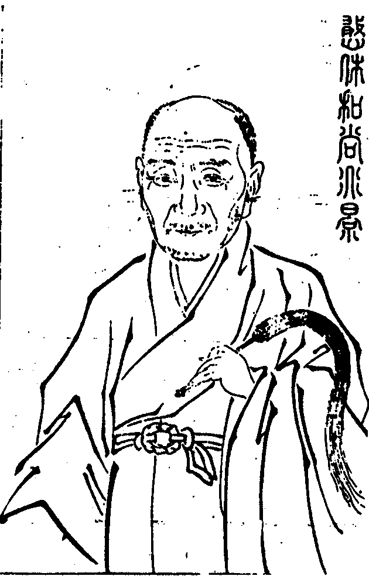

# 憨休禅师语录



> **藏经**：嘉兴大藏经（新文丰版）（嘉兴藏）　**册次** 第 37 册（J37）　**编号** JB383　**部类** 诸宗部　**卷次** 12 卷　**篇幅** 86,568 字

> **作者（译者）**：嗣法门人　继尧　等编

> **卷／品**：12 卷 · 2 品



---



## 目录



  - [序](#序)

  - [序](#序-1)

- [憨休乾禅师语录卷第一](#憨休乾禅师语录卷第一)

- [憨休禅师语录卷第二](#憨休禅师语录卷第二)

- [憨休禅师语录卷第三](#憨休禅师语录卷第三)

- [憨休禅师语录卷第四](#憨休禅师语录卷第四)

- [憨休禅师语录卷第五](#憨休禅师语录卷第五)

- [憨休禅师语录卷第六](#憨休禅师语录卷第六)

- [憨休禅师语录卷第七](#憨休禅师语录卷第七)

- [憨休禅师语录卷第八](#憨休禅师语录卷第八)

- [憨休禅师语录卷第九](#憨休禅师语录卷第九)

- [憨休禅师语录卷第十](#憨休禅师语录卷第十)

- [憨休禅师语录卷第十一](#憨休禅师语录卷第十一)

- [憨休禅师语录卷第十二](#憨休禅师语录卷第十二)



---







师讳如乾，号憨休，蜀西龙安人，胡姓。十九岁出家，二十二岁圆具，遂行脚江浙，遍参诸大宗匠之门，随处皆有悟入。丁未游少林，过风穴，参云峨和尚，机缘相契，亲炙六载，乃授记莂。於康熙壬子入秦，开法泾阳兴福禅寺，后迁广教、清福、炖煌、金粟诸刹。甲子住兴善，戊辰住风穴。师为人厚重，声清气雄，胸次磊落，不立崖岸，机锋峻利，说法如云，兼博通文翰，士大夫见者咸悦服焉。九坐道场，开堂七刹，门人录其要语十二卷，附集《敲空遗响》十二卷，并行於世。



金城弟子弘善谨识



------



### 序



曩余侍经筵，日讲之暇，探讨竺坟，获《传灯录》读之，载临济吃黄蘗三顿痛棒，悟得达磨西来的的大意。后住河北，建立宗旨，凡见僧入门便棒，入门便喝，不容情解，痛快直截，如俊鹰快鹞，一味生擒活捉，虽五宗并列，惟临济独盛。憨休和尚乃临济下第三十三世之孙，风穴云峨老人之嫡嗣也，具顶门正眼，光烁天下，随机应荅，如轰雷掣电，靡测端倪，利刃吹毛，干犯不可，有黄蘗大机之用，得临济格外全提，真狮子王哮吼，不啻裂碎野狐心胆，纵是铁额铜头，直教命根顿断矣。信夫山堂淳之言，宗祖高明，子孙光大，良有以也。读斯录者，不得以语言文字求之，当相忘於语言文字之外而后可。



时康熙庚申岁嘉平朔有三日，赐进士及第、嘉议大夫、礼部右侍郎兼翰林院侍读学士、中阳何瑞徵敬题。



------



### 序



瞿昙氏之教微妙甚深，令人难解难入，读之者如河伯望洋，莫测涯际。其后达磨来梁，不立文字，直指人心，见性成佛，谓之教外别传。至曹谿卢能大师，枝分二派，禅列五宗，电掣雷轰，日滋月盛。考亭常曰：「达磨西来，尽翻窠臼，犹为高妙。故吾儒往往多心向而逃禅者，盖必有所取也。」余事理学，未究禅宗。乙酉、丙戌之际，与吾友陈旻昭侍御游。侍御深於逃禅者也，因得参宗门尊宿，见其寓直指於痛棒，示神妙於微拈，庶几灵山一会俨然未散哉！诸方异尚道岸咸登，独华河上乘未闻，有心人西向而悲，非一日矣。庚子岁，风穴云峨老人始卓杖入关，开堂振响，秦之缁素如睡梦觉，天龙人鬼焕然改观，拨云雾而睹白日也。憨休和尚荷风穴正法眼藏，不惮远涉，更弘宗旨，杖履所至，风飙雷动，匪但匹夫匹妇之所皈向，即吾缙绅士夫，凡有志夫性命之学者，虑无不舍身向道，腰忘带、足忘履矣。观其隐心救世，善诱接人，钳锤即以指心、问答即以见性，棒吃百顿、机契片言，斯诚释氏之雄，拔乎其萃者，庸讵出黄面瞿昙之下？师壬子住兴福，杖过嘉庆，与余一见，如旧相识。其后七坐道场，随处说法，门人集语录若干卷，梓以播世，欲使世间得与於斯录者，认本来面目，悬崖万丈，可以撒手游行，顾进退勇怯何如耳，道岂远人哉？若夫钝根自闭之夫，绝不知有向上一路，虽铁船可渡、木马可鸣，悟此者其谁与？余虽从昔者吾友之后，於至道稍有知识，要亦门外汉，不足语入室心印。世不乏个中人，必将有会於斯编。



时康熙丙寅岁七月望有一日，赐进士第内府中书科中书舍人泾阳张恂拜撰。



憨休乾禅师语录目录



序文(二首)  

卷第一住陕西西安府泾阳县兴福禅寺语录



卷第二住西安府咸阳县广教禅寺语录



卷第三住西安府泾阳县清禅禅寺语录



卷第四住西安府长安县青门炖煌禅寺语录



卷第五住河南汝宁府新蔡县金粟禅寺语录



卷第六住河南汝宁府新蔡县金粟禅诗语录



卷第七住西安府咸宁县大兴善寺语录



卷第八住河南汝州风穴白云禅寺语录



卷第九小参



卷第十示众  

机缘  

垂问



卷第十一拈颂古



卷第十二拈颂古  

后跋



------



## 憨休乾禅师语录卷第一



**译者**：嗣法门人　继尧　等编



住陕西西安府泾阳县兴福禅寺语录



康熙十二年癸丑二月初三日，师在华州甘露寺受请，於初七日入院。至山门云：「触处洞然，目前无异路；当阳直截，格外有灵机。分明八字打开，未免指南一上。」曳杖便入。



佛殿。「金沙滩头马郎妇，跣足露胸；杖林山下竹筋鞭，撑天拄地。新兴福今日别行一路。」遂撒开坐具，云：「看。」大展三拜。



祖堂。「西天四七，东土二三，移星换斗，互相热瞒。不肖儿孙今到此，全身回避最为难。」乃以坐具打圆相，云：「交。」



韦驮。「普眼圆明，现威容而等慈品汇；作家手段，宣甲胄以振肃魔林。」遂竖拂子，云：「欲得这个流通，须仗极力匡助。」



伽蓝。「其为气也，至大至刚；式彼灵兮，不生不灭。忠勤汉室而大义参天，呵护法门而卫严金地，兴福攸赖於今日，玉泉记莂於当年，且以何为验？」遂插香，云：「愿将归帝擎天手，剔起灵山照世灯。」



方丈。「室掩摩竭，塞耳偷铃；杜口毘耶，扬声止响。新长老也无如许伎俩，惟据一条白棒，朝打三千，暮打八百。何故？兴福门下，令不虚行。」



开堂。师至法座前，拈疏云：「发明妙觉真心，流通正法眼藏，须凭这个。如其会得，不消锦上铺花；脱或滞壳迷封，更烦表白宣过。」读毕，以拄杖指法座云：「此大宝华王座，从上老古锥据之，倒弄颠拈，生陷无间地狱。即今乾上座业债相牵，推免不下，只得随队亦向其中撒土撒沙去也。还见麼？」便升座，告香云：「此瓣香，体元居正，开帝网於三千；建极立中，衍龙图於万亿。信手拈来，𦶟向宝炉，端为祝延皇帝圣躬万岁万万岁，钦愿常光佛日，将雨曜以齐明；永御金轮，等二仪而远大。」次拈云：「此瓣香，得尼山精一之真传，盐梅鼎鼐；协飞龙九五之治化，霖雨苍生。奉为满朝文武、天下官僚、本县邑侯及诸衙勋贵，伏愿福源洪注，如日月之升恒；禄位崇迁，似河山之带砺。」复拈云：「此瓣香，兆形始地，灵根早固於劫前；判气先天，枝叶繁茂乎今世。奉为今辰请主护法檀那、绅衿文学并及在筵耆德，伏愿寸心不昧，常开般若之花；一念圆明，当结菩提之果。」又向怀中拈出一瓣香，示众云：「诸人还知麼？二十餘年楚水吴山辛苦受尽，后至汝海山中，遇著个无面目老尊宿，被他蓦与一锤漆桶打破，於今冷地光生，不敢囊藏被盖，恭对人天众前拈出，𦶟向宝炉。奉为现住河南汝州风穴山白云禅寺传临济正宗第三十二世本师云峨大和尚，不为酬恩报德，要使大众咸知。」遂摄衣敷坐。上首白椎云：「法筵龙象众，当观第一义。」师云：「拨草瞻风二十秋，全机不动信优游。无端扶上华王座，擘破三元接上流。人天既集，法令当行。杀活临时，全体独露。只如第一义谛，还有解观者麼？出来相见。」僧问：「少室安心，断臂得髓。风穴待谶，铁牛呈机。向上一著则不问，如何是五家宗旨？」师云：「西风吹渭水，落叶满长安。」进云：「如何是临济宗？」师云：「生铁昆仑颠倒舞，金乌玉兔绝光辉。」进云：「如何是曹洞宗？」师云：「银犀海外弘离坎，木马云中判午寅。」进云：「如何是云门宗？」师云：「川乌根下生甘草，芍药花中结柘榴。」进云：「如何是沩仰宗？」师云：「云笼古洞连山罩，月出长湾带水明。」进云：「如何是法眼宗？」师云：「会得唯心万法空，头头尽露真消息。」进云：「五宗已蒙师指示，出身一句事若何？」师云：「石安原下，泾水东流。」进云：「恁麼则学人礼拜去也。」师云：「切忌躲跟。」僧作礼，师打云：「放过则不可。」问：「斩新日月，特地乾坤。祖印高提，壁立万仞。逢人即出则不问，如何是斩新日月？」师云：「未离汝海千山暗，才上中天万国明。」进云：「如何为人？」师云：「一棒一条痕。」进云：「恁麼则遍界潜消狐犴迹，狞狮出现爪牙雄。」师云：「汝且吃棒。」便打。乃云：「宗乘一唱，三藏绝诠；至道恢弘，千途合辙。众流截断，遍尘刹而任运全该；妙转元枢，括有无而凭垂指注。光超日月，智出圣凡；动静无私，隐显不昧。髑髅常干世界，鼻孔摩触家风。绵密安详，权开洞山五位；暗机圆合，要出沩仰三生。一字关大云门之高古，六相义摄法眼之现成。夺境、夺人，直捷痛快；立宾、立主，大用天旋。印水、印泥、印空，匪作家难辨；非心、非佛、非物，唯证者乃知。似地普擎，如天普盖；真机剖露，万法全彰。正恁麼时，文殊、普贤起佛见、法见，兴福各与二十棒，贬向二铁围山则且止，且道即今开堂祝圣一句作麼生道？击壤歌扬忘帝力，由庚诗咏乐时雍。」(谢词不录)复举：「宝寿开堂日，三圣推出一僧，宝寿便打，三圣云：『恁麼为人，瞎却镇州一城人眼去在。』宝寿掷拄杖，便归方丈。」师云：「无勘验龙蛇眼目，难以荷负宗乘；有超情越量机权，方能钳锤佛祖。宝寿、三圣二大老虽则拳踢相应、酬唱无亏，要做临济下烜赫儿孙犹未可在。且道如何是临济儿孙？」以拄杖捺膝，云：「横按莫邪全正令，太平寰宇斩痴顽。」上首复结椎，云：「谛观法王法，法王法如是。」下座。



请执事上堂。僧问：「如何是先照后用？」师云：「汝问甚麼？」进云：「如何是先用后照？」师云：「答汝了也。」进云：「如何是照用同时？」师云：「铁轮天子寰中敕。」进云：「如何是照用不同时？」师云：「帝释宫中放赦书。」僧礼拜，乃云：「法不孤起，仗境方生；独掌不鸣，两手斯应。华王缀叶，方播绝世奇馨；鹦鹉乘风，得展凌云妙翅。所以宗旨欲建，成褫固是耆年；法社新开，变理在於昆弟。漫言皮肤脱尽，脑后更欠一椎，只饶明暗两忘，元中犹有三要。威音王前行道，未免移过钵盂，知是般事便休，早已脑门著地。文不加点，讳处结搆，藏锋两年，一春好生修事，供养赃物现在刈得，三百个祖师食已先馋，何曾不入这保社兴福？今日量才补职，高下得宜，都来向无阴阳地上安排，藏身之处没踪迹；於无生国内桢干，没踪迹处莫藏身。匪但毘赞宗猷，要使爪牙俱备，挐云攫雾，人人夺狮子之狞威；浴日光风，个个展凤鸾之健翮。然虽如是，且高竖法幢，共相建立一句又作麼生道？妙舞应知夸遍拍，三台须是大家催。」



结制，上堂。僧问：「实际理地不受一尘，佛事门中缺一不可，今辰法筵初建，四料拣还许学人问否？」师云：「乌龟三眼红如火，一角麒麟快似锥。」进云：「如何是夺人不夺境？」师云：「你是个不唧溜汉。」进云：「如何是夺境不夺人？」师云：「金刚杵打铁山摧。」进云：「如何是人境俱夺？」师云：「长剑倚天寒。」进云：「如何是人境俱不夺？」师云：「尔问我答。」进云：「料拣已蒙师指示，向上单提事若何？」师便打，乃云：「今朝十五结制，天下丛林古式，先圣既有规模，未免随条攀例。考钟伐鼓升堂，衲子眼眼相觑，人人头顶青天，个个脚踏实地，大事彻底无私，何用思量拟议？高举向上钳锤，顶门一击粉碎，虚空笑口忽开，刹尘任恣游戏，大斧斫却山门，倒骑佛殿出去，直饶尽思度量，不能测其佛智。诸禅德且道：如何是佛智？不见道：庭前种莴苣，莴苣生火箸，火箸长莲花，莲花结木瓜，木瓜才剖破，一颗大芝麻。若向这里会得，许你荐取佛智；脱或未然，好於三冬向煖火，不妨冷地拾枯薪。」



上堂。僧问：「如何是第一义谛？」师云：「骑驴踏镫，不如步行。」进云：「如何是个中人？」师云：「高据猊床行正令。」进云：「如何是人中意？」师便打。问：「八百狮子吼秦川，即今和尚座下有多少？」师云：「只汝一个不唧溜。」乃云：「有问有答，塞壑填沟；无说无闻，息掠补劓。假饶问到穷劫，与已了无相干；纵使答到尽头，其道愈为转远。何故？盖为诸人本来自性圆满十方，常住真心贯通三世，随缘无作，动寂常真，亘古亘今，无餘无欠。所以棘柏论云：『有情之本，依智海以为源；含识之流，总法身而为体。只为情生智隔，相变体殊，达本情忘，知心体合。』诸禅德！秪如本作麼生达？心作麼生知？不见道：其为本也，不可以功成；其为源也，不可以行得。功忘本就，行尽源成，源本无功，任缘自在。然虽如是，这由是三家村里座主见解。若约衲僧门下，机先领略，犹滞半途；句下承当，早已蹉过。且不涉离微，独脱无依一句又作麼生？」蓦拈拄杖，卓，云：「岳边顿落千山势，海上溟收万派声。」



上堂。僧问：「知时频到香积国底人，为甚麼拄杖头上失却眼？」师云：「手执夜明符，几个知天晓？」乃云：「法身无相，凡触目以皆形；般若无知，对夤缘而悉照。圆古今於一念，宗三世於毫端，显明则海印光澄，冥昧则情迷自惑。所以道：森罗万象，是善财之宗师；业识尘劳，乃普贤之境界。真空绝迹，法相离名，了无正偏，随机应现。微言若滞，尚为缘虑之场；实际若居，翻成名相之境。苟非通元上士、逸格英贤，又何能於诸尘中发明格外真宗，揭示当人之巴鼻也哉？须知诸法所生，唯心所现。既是法随心现，只如山头鼓浪，井底扬尘，碓嘴生花，磨盘结子。诸禅德！还委悉得麼？若也委悉，一生参学事毕；如或未委，莫将闲学解，埋没祖师心。」



冬至，上堂。僧问：「大彻底人本脱生死，因甚麼命根不断？」师云：「瞎驴趁大队。」进云：「佛祖公案只是一个道理，因甚麼有明与不明？」师云：「暑往寒来𫆏？」进云：「大修行人当遵佛行，因甚不守毘尼？」师云：「鸭卵何曾抱出鸡？」进云：「杲日当空，无所不照，因甚麼被片云遮却？」师云：「莫眼花。」进云：「人人有个影子，寸步不曾离，因甚麼踏不著？」师云：「看脚下。」进云：「尽大地是个火坑，得何三昧免被烧却？」师云：「洞铁须还刘曜手。」乃云：「一阳来复，万物资始；君子道长，汉线初添。当此之际，岭上寒梅将吐玉，庭前古柏翠凝霜。境物萧萧，佛祖之真心独露；朔风凛凛，西来之大意全彰。若能於斯会去，始知万别千差，吾道一贯。道既一贯，便见天得一以清、地得一以宁、人得一以灵、王侯得一天下和平、日月得一以照临、四时得一以运行、鸟兽得一以飞鸣、草木得一以发萌、衲僧得一钳锤在手，一切临时与夺自在、杀活纵横，把住则滴水滴冻、水泄不通，放行则冰河发燄、铁树生花。然虽如是，即今庆节纳祜一句又作麼生道？万方有道归皇化，玉叶联芳亘古今。」



复举：「洞山禅师冬至日请泰首座吃果子，云：『有一物，上拄天，下拄地，黑似漆，常在动用中，动用中收不得。且道过在甚麼处？』座云：『过在动用中。』山叫行者掇退果棹。」师云：「洞山老汉虽恃权衡之威猛，杀活临机之大用，然泰首座亦有添兵减灶之谋、诈败佯输之计，仔细点检将来，大似空入沙场，徒劳索战。当时山僧若作泰首座，待问：『过在甚麼处？』便举杯躬身云：『多谢和尚赐茶。』不惟使洞山无处措手，更见佛事人情一齐周备。」



上堂。「壁日晒光，卿云舒彩。六合开朗，八水澄莹。霜林之落叶堆黄，村落之炊烟飏白。全机显现，法性昭然。十方刹海露堂堂，万象森罗明历历。胜妙岂容意况，性相不可拟思。了悟唯心，境智不二。所以释迦老子云：『诸法无法体，我说唯是心。不现於无心，而见於分别。』於斯荐得，便知如理即事，体俗全真。遇缘即宗，随方潇洒。且道不落夤缘一句又作麼生？莫怪从前多义气，他家曾踏上头关。」



复举：「障蔽魔王领诸眷属，一千年随金刚齐菩萨觅起处不得。忽因一日得见，乃问曰：『汝当何住？我一千年觅汝起处不得。』金刚齐菩萨云：『我不依有住而住，不依无住而住，如是而住。』」师云：「金刚齐菩萨被障蔽魔王一拶，只得七穿八穴，几乎无个容身之处。然虽如是，不因紫陌花开早，争得黄莺下柳条？」



上堂。「灵山打草，黄面老奔波一世；少林面壁，碧眼胡瞌睡九年。百城历遍而虚费草鞋，九上三登而徒劳钝置，只得隔墙见角便知是牛，隔山见烟便知是火，不出户而知天下，不动步而历恒沙，正所谓散於气者乃道之漓，适於变者为法之弊。灵机不动，妙体何依？历历孤明，尘尘光彩，不属世谛流布，岂容佛法商量？直饶总不恁麼，犹未是衲僧分上事。如何是衲僧分上事？闲持经卷倚松立，笑问客从何处来？」



复举：「德山禅师因僧问：『从上佛祖向甚麼处去？』山云：『作麼？作麼？』僧云：『敕点飞龙马，跛鳖出头来。』山便休去。次日，德山浴出，僧度茶次，山拊僧背一掌，云：『昨日公案汝作麼生？』僧云：『这老汉今日方始瞥地。』山又休去。」师云：「德山陷虎机深，神妙莫测；这僧批鳞手辣，白浪滔天。秪如德山两度休去，汝诸人还知落处麼？水归大海波涛静，云到苍梧气象闲。」



上堂。「道本无言，天地位而万物育；灵源绝朕，心思尽而万行空。廓彻灵通，孤圆活鱍，迥脱是非之表，杜绝形名之端。不勉而中，不思而得。不离当处，贯古今而洞达十虚；只在目前，该隐显而冥通三际。本来具足，一切现成，但能正眼豁开，纵步随方无碍。所以道：处处真，处处真，头头尽是本来人。真实说时声不现，正体堂堂没却身。」遂以拂子击一下，云：「这个是声？那个是本来人？」又击一下，云：「这个是本来人，那个是声？若向这里缁素，分明许你与达磨老子相见；如或眼里迷哩，麻啰兴福重为注脚。」乃以拂子打圆相，复划破，掷拂子。



上堂。「真妄一源，本无迷悟。理事无碍，迥脱是非。疑虑纷纭，而观有大小之别。异见竞起，而执定有无之偏。心月孤圆，自生违背。灵光朗耀，不肯承当。家中舍父，而他国伶俜；衣内忘珠，而四方佣赁。致使迷云密布，障蔽性天。荆棘丛生，菩提路隔。适有胜妙义菩萨，闻兴福与麼告报，领百千眷属，从北方成就世界而来。以无量幢幡云，无量宝盖云，无量香花云，无量光明云，无量音乐云，种种供养，恭敬围绕，勤求大法。仍以上方香饭，普熏兴福禅林。未免因斋庆赞，随分葛藤。向无说处通说，无法处演法，应时应节去也。还会麼？要听少林无孔笛，从来多是逆风吹。」



佛成道日，上堂。「声钟不住催，狼忙出方丈，纵步便升堂，僧俗齐翘望。报道老释迦，今日道成办，星现眼皮穿，奇哉乃发叹。一切诸众生，如来等一样，因妄想执著，不能证德相。兴福重举扬，麤硬一条棒，用处不换机，当仁总不让。佛祖齐到来，总与三十棒，打破生死关，究竟到彼岸。骑鹤上杨州，腰缠十万贯，输他老瞿昙，意气多调畅。比邻有檀那，设斋来供养，面做好馒头，米炊香稻饭，勤种大福田，嚫钱随手散。南无佛陀耶，因斋喜庆赞，大家饱膨脝，水牯勤收放。且普利一句又作麼生？一念圆修福慧隆，三心无得消诸障。」



唐泾湄昆仲请上堂。「欲识佛性义，当观时节因缘，时节若至，其理自彰。於斯时也，庭柏含苍翠，墙梅绽早芳，腊暖天无雪，风寒夜有霜，欲识佛性义，不必更商量。诸人於此桶底脱去，伯氏吹埙、仲氏吹箎，同气相求、同声相应，若也把断要津，三世诸佛只得口挂壁上。然虽如是，心佛生从来一体，儒释道本自无差，但办肯心，无事不就。兴福小时於书堂中记得首古诗。」遂歌云：「朝为田舍郎，暮登天子堂，将相本无种，男儿当自强。且如何是自强底句？桃花先透三重浪，月桂高攀第一枝。」



上堂。「一二三四五六七，数到今朝是人日，新年佛法总现成，只是时人自不识。何也？突出难辨，久参未免踌蹰；信手拈来，后学那知端的？东风拽柳线，淑气破花颜，明明百草头边，一一天真漏泄，何必行棒行喝，勿论照用同时。若肯直下承当，不妨现随类身，作奇特事。且道如何是奇特事？」良久，云：「普天和煦春光蔼，火内优昙绽一枝。」复举：「郑十三娘同师姑至大沩，才礼拜起，沩问师姑：『甚麼处住？』师姑云：『南台江边。』沩便喝。又问：『背后娘子甚麼处住？』郑放身进前，叉手而立。沩再问，郑云：『早个呈似和尚了也。』师云：『娘子做次，大似掩耳偷铃。』诸人还知他放身进前意麼？住处分明意自殊，天师门里卖桃符，茫茫宇宙人无数，几个男儿是丈夫？」



解制，上堂。「九旬解制始收功，灿烂星桥火树红，紧峭草鞋狞似虎，横担拄杖活如龙，生涯到处随缘分，圣谛无为契己躬，牢寨踢翻浑不管，从教八面自玲珑。是则是，诸禅德！若是路头熟惯、脚下无私底，蓦直便去，归到自己家中，一一现成，稳坐受用；倘或路头未辨、脚下生疏底，不见道：春草碧色，春水绿波，送君南浦，伤如之何？」卓拄杖。



过熊耳山，扫达磨初祖塔。拈香上供毕，乃云：「航海西来，早成滞货，少林面壁，已涉廉纤，平欺赤县神州，马驹踏杀天下。梁王殿上一恁簸土飏尘，元魏国中何妨滴水滴冻？虽输神光一臂，嬴得五叶花开，末后只履西归，那知活埋熊耳？今日不肖远孙如乾向这里借路经过，就此披拨烟岚，特拈一瓣枯木，非为追远报本，大都饮水思源。虽然如是，且道我初祖面目即今在甚麼处？」蓦竖拂子，云：「两轮日月双环眼，万卉春风筛络胡。」



退院，上堂。僧问：「妙义元言春细雨，莫教污我本来心。如何是本来心？」师云：「鸡声茅店月。」进云：「要提无相毘卢印，须踏千峰顶上行。如何是毘卢印？」师云：「人迹板桥霜。」进云：「恁麼则春畴麦秀含苍翠，遍界分明不覆藏。」师云：「切莫认著。」进云：「争奈即今何？」师云：「汝即今在甚麼处？」僧便礼拜，师云：「错。」乃云：「法无定相，遇缘即宗；时无异缘，随处作主。元机妙密，神应无方。揭示本来心，鸡声叫落茅店月；高提毘卢印，人迹踏碎板桥霜。遍界不曾藏，春畴麦绿含苍翠；汝今在甚处？倒身三拜错承当。竿木逢场，随缘放旷，所以客冬安期於此，蒙众檀越信力资培，法道光扬，始终全美。今者应缘广教，杖笠移西，特为升座辞谢，虽则咫尺相违，大都本地不隔。如何是不隔底句？墙内竹抽墙外笋，涧东花发涧西红。」



------



## 憨休禅师语录卷第二



**译者**：嗣法门人　继尧　等编



住西安府咸阳县广教禅寺语录



康熙癸丑季冬，师在兴福受请，拈疏云：「本是无事人，门外客偶至，火蛇忽缠身，狭路难回避。既难回避，只得道破个中消息始得。」遂度与维那读毕。



升座。云：「囊锥始脱颖尖新，驴事方归马事临，一度业缘犹未了，催符又逼过眭村。一不做，二不休，还有共相扶竖底麼？试出来看。」僧问：「佛身充满於法界，普现一切群生前，随缘赴感靡不周，而恒处此菩提座。如何是赴感底句？」师云：「入水见长人。」进云：「去来不以象，动静不以心，既不以心象，去来动静毕竟是何物？」师云：「描不成，畫不就。」进云：「恁麼则竹影扫阶尘不起，月穿潭底水无痕。」师云：「好个消息。」问：「古人三请不允，和尚今日默然，还是应广教？应此处？」师云：「一点水墨，两处成龙。」进云：「恁麼则草鞋到处皆云水，拄杖随缘任去留。」师云：「却被阇黎道著。」乃云：「鹏翮翩翻，惊破长风千里浪；金锤影动，击开祖域万重关。独露方外乾坤，斩新寰中日月，光辉溢目，遍界欢腾，倏尔金地招手，只得江陵点头，元非有待，偶尔成文，正所谓我本无心有所希求，法王宝藏自然而至，尘尘普利，刹刹咸资，赴感随缘，不离本座。既不离於本座，须知广教即是兴福，兴福即是广教，既无分於彼此，岂有象於去来？正好拨转向上机轮，开凿人天正眼，恁麼也得、不恁麼也得，东涧水流西涧水，恁麼、不恁麼总得，南山云起北山云。且水到渠成、风行草偃一句又作麼生？密移一步六门晓，无限风光大地春。」



甲寅二月初七日，进院。至山门。「欲达普光明殿，须由大解脱门，但能脚下无私，信步任渠出入。」遂左右顾视，云：「还有把手共行底麼？但愿东风齐著力，一时吹入此中来。」



接引佛殿。「巍巍相好，三界独尊，四十八愿而津济众生，九品莲胎而果因一致，长年垂只手，端的待知音。即今来也，且作麼生相见？」乃上香，云：「一瓣兜楼烟篆袅，普天杲日丽晴光。」



祖堂。「异苗蕃茂，五叶花开；深固灵根，二株挺秀。马驹踏杀天下百丈，千古典型堆堆冷坐。遇同人……」遂烧香，云：「一回拈起一回新。」



韦驮。「奋狮子威，现童真体。革故鼎新，权衡在己。门前倒刹竿，借力须扶起。」



伽蓝。「鬼神之为德也，其至矣乎！民鲜能久矣。吾今到此，振复颓纲，唯有一事相嘱。是那一事？三个孩儿抱花鼓，莫教拦我毬门路。」



方丈。「九年面壁，落赚人天；一默当机，洗清魔佛。新广教这里若有奔流度刃、具通天作略底到来，也须倒退三千。为甚麼如此？」以拄杖卓一卓，喝一喝。



即日，绅衿缁素请师开堂。拈疏云：「拈花奥旨，少室真宗，尽从这里漏逗了也。如向未举已前荐得，犹较些子；倘或尚留观听，却请维那宣过。」宣毕，指法座，云：「这曲录床子，千圣共登，於中转法轮、提心印，机如掣电、口似血盆，广教今日有条攀条、无条攀例去也。」喝一喝，便升。告香，云：「此瓣香分种於威音那畔，馨腾於震旦国中，散而为瑞为祥、结而为云为盖，拈来𦶟向宝炉端，为祝延今上皇帝万岁！万万岁！陛下钦愿统御万方，皇极永建於九域；覃敷五福，讴歌胥庆於八埏。」次拈云：「此瓣香渊源洙泗，授受杏坛，放之则弥六合，卷之则退藏於密。奉为满朝文武、天下宰官、本县邑候、诸衙勋贵暨缙绅文学、诸大护法，伏愿不忘佛记，司文衡而城堑吾宗；奕世甘棠，沛霖雨而资平治化。以及今辰请主、在筵耆宿等，普愿心花开朗，种智圆明。」又拈云：「此瓣香包罗万象，含褁十虚，得处甚是孤危，用时何妨毒烈？今次第二回拈出，奉为现住汝州风穴白云堂上本师云峨老和尚，𦶟向宝炉，用酬法乳之恩。」敛衣就座。维那白椎云：「法筵龙象众，当观第一义。」师云：「垂万里钩，牵骐挽骥；撒缦天网，打凤罗龙。入彀始见英雄，超方须是作者。有麼？有麼？」僧问：「新整炉鞲，选佛场开，衲子到来，如何煆炼？」师云：「石鸽穿云连斗戏。」进云：「今日广教开堂，与昔日灵山会上是同是别？」师云：「金骝度海带山嘶。」进云：「恁麼则法王座上全身露，觌面承当非古今。」师云：「礼拜了退。」又问：「昔日世尊初於波罗奈三转四谛法轮，即今广教转何法轮？」师云：「渭水晴光摇绿树。」进云：「达磨只履西归，何不两只都将去？」师云：「要假儿孙脚下行。」僧作礼，乃云：「诸佛慧命，列祖纲宗，令不虚行，风行草偃；缘不虚应，谷响声传。一言含万象以无私，一句逗群机而迥出，混融万有，包括古今，达根尘而不隔纤毫，透声色而岂留朕迹？真光朗耀，廓尔虚明，法印高提，宏机密运。所以道：法随法行，法幢随处建立。有时於四衢道中开权显实，慰谕诸子而三车等赐；有时於十字路口分宾列主，聚集众缘而立业成家。况此广教禅林，嬴秦遗迹，毕郢名蓝，雄赡关中，绘巧殊称三绝；大观海内，名闻更逾七金。逢圣世以重兴，赖得人而复刱，场开选佛，克振前徽，弘扬济上宗风，流通正法眼藏。当恁麼时，正令全提，隐显该通一句又作麼生道？十二处忘闲影响，三千界放净光明。」(谢辞不录)复举：「临济初住河北，谓普化、克符二上座曰：『我欲於此建立黄蘗宗旨，汝可成褫我。』二人珍重下去。三日后，普化却上来问：『和尚三日前说甚麼？』济便打。三日后，克符又上来问：『和尚昨日打普化，为甚麼？』济亦打？」师云：「如击石火，似闪电光，搆得搆不得，未免丧身失命。普化、克符虽善成褫激扬宗旨，点检将来，也是贼过张弓。山僧今日欲於此建立风穴宗旨，若有珍重出去，便好劈脊便棒。或有僧问：『和尚打者僧，为甚麼山僧亦与劈脊打出？』」召大众云：「秪如临济也打，山僧也打，且道是同是别？若缁素得出，许你具衲僧眼；其或未然，新出红炉金弹子，簉破诸方铁面门。」维那复结椎云：「谛观法正法，法工法如是。」下座。



上堂。问：「搥击妙喜世界百拶碎底人，为甚麼处处解持钵？」师云：「随流得妙。」僧礼拜，师云：「杜撰禅和，如麻似粟。」乃云：「虚玄湛寂，廓尔无垠，藏百亿须弥於藕丝孔中，置大千刹土於蟭螟睫上，卷舒自在，任运何拘？触处洞然，随缘不变，纵令离娄、师旷之闻见难施，苏秦、张仪之智辨叵测。虽然，牢关把定，密不通风，机梭放行，丝轮活脱。」遂蓦竖拂子，云：「若向者里领略，且喜穷子归家；如或拟议思量，枉受伶俜辛苦。」



解夏，上堂。僧问：「如何是宾主句？」师云：「研锤撩馎饦。」进云：「浩浩尘中，如何辨主？」师云：「向未开口已前荐取。」僧作礼。乃云：「日躔鹑尾，大火西流。露下疏桐，叶卷庭柯之翠；凉生幽砌，虫吟促织之声。绿阴之槐国梦回，碧落之清秋气爽。元枢密运，四序推迁，节换时移，个中不变。心外无法，头头显示，而法在目前；法外无心，物物全彰，而心即前境。若是明眼汉、没窠臼，於斯连得便行，直下如千日并照、万镜临台，坐断毘卢顶𩕳、竖亚摩醯正眼，横吞宇宙、倒卓须弥，独步丹霄、超然物外。然虽如是，今日一期告满、九夏功圆，且不涉途程，家堂稳坐一句作麼生道？云在岭头闲不彻，水流涧底太忙生。」



复举：「翠岩禅师夏末示众云：『一夏为诸兄弟说话，看翠岩眉毛还在麼？』保福云：『做贼人心虚。』长庆云：『生也。』云门云：『关。』」师拈云：「翠岩大似藏头露面，未免笑杀傍观。三老虽则极力劻勷，也是随邪逐恶。且道优劣在甚麼处？人义尽从贫处断，世情偏向有钱家。」



师诞日，缁素请上堂。僧问：「如何是生前句？」师云：「梳影草莱翻白昼。」进云：「如何是生后句？」师云：「泼空烟雨冷青莎。」进云：「生前生后蒙师指，向上一句事若何？」师便打，僧礼拜，乃云：「形气未彰，那有生灭去来之相？鸿蒙既判，便分色空明暗之殊。虚融万法，即假即真；不立纤尘，绝彼绝此。生佛不异，凡圣同源。透声色以齐该，离见闻而迥脱。纵横得妙，圆应无亏。所以古德云：『若人见幻本来真，是则名为见佛人。圆通法法无生灭，无灭无生是佛身。』诸人还荐佛身麼？」卓拄杖，云：「青萝夤缘，直上寒松之顶；白云澹泞，出没太虚之中。」



结冬，上堂。僧问：「高竖法幢即不问，当阳直指事若何？」师云：「满地绿苔乘宿雨，一林红叶醉新霜。」进云：「即今选佛场开，四众云集，未审选甚麼人成佛？」师云：「少汝一个不得。」僧礼拜，师云：「一钓便上。」乃云：「昨日结制，今朝开炉，霜花点白，随雁阵以排空，已是天寒人寒，将见滴水滴冻。当此之际，方外衲子荐在机先，行脚高人腰包放下，聚首於毕郢原上，安期於广教禅林，人入鼻孔昂藏，个个眉毛厮结，拶碎祖师关捩，豁开妙净明心。」蓦拈拄杖，云：「这个是妙净明心，那个是祖师关捩？」卓一卓，云：「这个是祖师关捩，那个是妙净明心？若向这里会得，一段大事因缘直下了毕；脱或未然，红炉燄里重添火，烜赫金刚眼自开。」



上堂。僧问：「敲空击木尚落筌蹄，瞬目扬眉即成窠臼。向上宗乘则不问，女子入定意如何？」师云：「石牛拦古路。」进云：「假饶百千文殊亦出此女子定不得，未审世尊恁麼道，是好心？不是好心？」师云：「一马生三寅。」进云：「罔明因甚却出得？」师云：「杓卜听虚声。」进云：「恁麼则两个驼子相逢著，世上於今无直人。」师云：「鼻孔漫撩天。」乃卓拄杖云：「只者一著子，在天而天、在人而人，弥满法界、逼塞乾坤，处凡不减、在圣不增，超今越古、盖色骑声，三世诸佛以之一雨普施、润泽三根，历代祖师及天下善知识以之全提正令、坐断要津，三贤十圣并诸大菩萨及大阿罗汉以之等修六度、妙果咸臻，天下衲僧以之渡生死海、竭烦恼河、高超尘表、取证无生，今日性悟居士以之具决定信、发殊胜心、广行檀施、请转法轮，顿令心花开朗、道眼圆明，山僧以之据曲录床、提木上座，与诸人敲枷打锁、拔楔抽钉，且道拄杖子以之又作麼生？烦恼海中为雨露，无明山上作云雷。」



宗南法侄请上堂。「法身红烂，鲜血滴滴，路上行人尽都不识，唯有超方作者举起便知端的。知端的，劈箭急，真不掩伪，曲不藏直，绣花针眼度金鹏，万里晴空轰霹雳。东土二三，西天四七，捏不成团擘不开，扭不乾兮打不湿，喝下无私照用全，棒头有眼明如日。没弦琴，无孔笛，相将卖弄胡须赤，拈花微笑暗传来，儿孙递代相沿袭，虚空背上刮龟毛，西河狮子咬人急。且道：有何本据便得与麼自在？不见道：龙生龙，凤生凤，生铁秤锤无罅缝，大唐国里没禅师，猫儿上树乾打开。」以拂子连击，云：「吽！吽！趁得老鼠，打破油瓮。」



上堂。「雪风凛凛透心寒，个直分明彻底看，拶碎祖师关捩子，圆明寂照绝遮拦。诸仁者！若向这里领略得去，正好於三条椽下、七尺单前，眉毛厮结、鼻孔昂藏，蜡人向火薄处先穿，见闻不昧，一味平常；如其不会，问取金刚，瞋拳怒目，太煞郎当。谁知李四元是张三，霜花点点、雪片团团，好个消息，特地风光。」蓦竖拂子，云：「高著眼，莫颟顸，拟议思量总不堪，绣出鸳鸯从赏玩，金针难把度萧郎。」击拂子。



冬至，上堂。「群阴剥尽，一阳来复，消息分明，谁人能觉？寒威凛冽，朔风觱发，条抽石笋，燄发冰河。若是眼里有筋的，举一明三；假饶舌头无骨的，总跳不出。五眼辟支莫能窥，千手大悲难摸索。堪笑意下丹青，背地纷纷卜度。休卜度，杨岐驴子三只脚。」喝一喝。



上堂。「簷前喜鹊噪声频，忽报檀那驾到门，挝鼓升堂无法说，一天晴日丽光明。全机显露，极切披陈，面面相对，鼻直眉横。要会西来祖意，只须手办眼亲，从来佛法无多子，自古久长难得人。山僧如此举扬，拄杖子听得忍俊不禁，蓦地𨁝跳上须弥卢，不觉磕著娑竭龙王脑盖，只得巨灵神恶发，将华山一擘分为两路，放出黄河，泼天雄浪，普润一匝，归来向广教寺里扬声大叫，而说偈曰：『不退当年大道心，相邀共聚饭丛林，优昙花绽三冬蕊，福海源长寿量深。』」



解制，上堂。「自昨冬十月十五结制，於广教寺里挨拶，至今朝上元佳节，圣制告圆云堂，衲子人人打点腰包、个个紧峭草鞋，将欲独步大方、昂藏气宇，吞佛祖瞻风拨草，撑开天汉泻玄流。诸兄弟！去则恁去，若是前途有人问：『如何是广教为人底句？』汝若道得，不惟与山僧添个光彩，亦显得自己一冬不空过矣。脱或未然，处分随人甘自屈，难辞拄杖送头颅。」



檀越供法衣，请上堂。师拈起袈裟角，云：「鸡足峰前，迦叶捧去；黄梅夜半，卢老传来。从上佛祖的的相承，莫不以此流通正法眼藏，所以人如来室，披如来衣，坐如来座。今日山僧既据此座，必披此衣，不假强求，自然而至。拈来恰好，非长非短，畦相宛然，本地之风光独露；金针暗度，当人之正眼圆明。直下现成，通身光彩，承先启后，永远传持，继往开来，获大利益。如何是利益的句？福寿云臻归善信，禅灯祖印永流辉。」



师诞辰，缁素请上堂。「当阳突出，迥绝囊藏，觌面提持，全无忌讳。孤迥迥坐断千差，峭巍巍壁立万仞，辉腾今古，超越圣凡，先天地而不生，后天地而不老，灵然独耀，洞底无私，造化不得而拘，阴阳岂能陶铸？所以道：五行不待书中验，八字那从掌上推？得失荣枯人莫测，毘卢顶坐笑嘻嘻。如何是毘卢顶？」挥拂子，云：「若向这里荐得，便知山僧寿日即是诸人生辰，诸人生辰即是山僧寿日，彼此无二，真俗浑融，天地同根，万物一体。即今因斋庆赞，福利有情一句又作麼生道？愿将无量虚空寿，散与寰瀛庆瑞祥。」



------



## 憨休禅师语录卷第三



**译者**：嗣法门人　继尧　等编



住泾阳清福禅院语录



康熙乙卯季秋，师在兴福受请，拈疏示众云：「这是清福众檀越从真实心中流出一道宝光，辉煌法社，扶竖纲宗。要知其中端的，须借维那剖露。」宣毕，指法座云：「毘耶借座，今古弘规，高广庄严，尊居无上。今幸觌面相逢，须知放过不可。」



升座。云：「年餘罢抚没弦琴，院草青长一丈深，露柱蓦然开口笑，喜逢云外有知音。知音既至，敲唱当行，竿木随身，逢场作戏。还有接拍相和者麼？」僧问：「古殿声钟，大扣云堂之响；当轩畫鼓，忽轰震地之雷。四众临筵即不问，西来大意请师的旨。」师云：「黄花香满径，红叶醉新霜。」进云：「恁麼则风行草偃人皆仰，水到渠成在处通去也。」师云：「不劳赞叹。」问：「如何是出生脱死一句？」师云：「兴福寺前平野阔，纵观极处白云飞。」僧礼拜，乃云：「道贵乘时，须是应缘济物；远方来慕，何妨疾切敷扬？跨出杨岐三脚驴，流通祖师正法眼，金刚王宝剑喝下全彰，山形拄杖子觌面分付。任渠长安正阑，信知我国宴然，杲杲赫日耀三秦；灼然大智圆明，体无向背，飒飒金风嘘四野。果尔声和响顺，理绝差殊，说甚麼去来不以象、动静不以心？去来不以象，波斯鼻孔长三丈；动静不以心，空生岩畔雨花生。本自无为，当人元具，兵随印转，将逐符行。应时应节一句又作麼生道？大鹏只展摩霄翼，谁顾奔腾六合云？」於十月初一日进院，次日开堂。拈疏，云：「毫端未动，文彩全彰，迷封打开，光辉遍界。若也见得彻去，不劳重说偈言；设或踌蹰，更请作家一回宣过。」指法座，云：「尽大地是个宝华王座，诸人尽在里许，又何须特地？虽然，要提无相毘卢印，须踏千峰顶上行。」喝一喝，遂升座，拈香祝圣毕，复拈云：「这瓣香名不得、状不得，虚而灵、寂而妙，昔在风穴酬价，向於兴福曾拈，今次第三回拈出，专为现住汝宁慧文禅院本师云峨老和尚，𦶟向宝罏，用酬法乳。」遂敛衣就座，维那白椎云：「法筵龙象众，当观第一义。」师云：「声前荐得，已涉廉纤；椎下承当，崖州万里。有超宗越格者麼？试出来展演看。」僧问：「灵山会上，迦叶传心；五乳峰前，神光得髓。的的亲承一句即不问，如何是斩新日月、特地乾坤？」师云：「两行古柏参天翠，一片闲云贴地飞。」进云：「放出铁牛耕夜月，展开木马恁嘶风。」师云：「金刚脑后三斤铁。」进云：「恁麼则宝华座上家风展，大地咸沾雨露恩去也。」师云：「阇黎赞叹即得。」乃云：「向上一著，统摄圣凡；末后一机，该通今古。根源直截而在处全彰，珠网交光而随方影现，迥绝见闻知觉，了无回互正偏，出没卷舒，得大自在。所以能於一切处建大法幢、吹大法螺、击大法鼓、演大法义、雨大法雨，握金刚宝剑，剪邪见之稠林；运本分钳锤，对人天之眼目。直教古佛眉间放光，那管脚下拖泥带水？况兹池阳胜地、清福道场，浮渭据泾、屏嵕案郢，唐一行禅师之开建、明彦庵率众以重修，阅世已来，香火几废，钟[木*魚]虽具，大道无闻。幸兹众檀护念洞彻，因地圆修，敦请山僧弘扬正法。即今正令全提，主宾契合，共相庆赞一句又作麼生道？雕弓愿挂无多事，率土歌谣贺太平。」(谢辞不录)



复举：「三圣云：『我逢人则不出，出则便为人。』兴化云：『我逢人则出，出则不为人。』」师云：「二尊宿文经武纬、三略六韬，扶竖济北纲宗则不无，若在清福门下，各与三十痛棒。且道甚麼处是他吃棒处？三尺龙泉光照胆，万人丛里夺高标。」维那复结椎，云：「谛观法王法，法王法如是。」下座。



上堂。僧问：「那咤太子析骨还父、析肉还母，然后现本身为父母说法。骨肉既还父母，又向甚麼处现身？」师云：「云卷青天露。」进云：「还有报恩分也无？」师云：「竹筛日影斜。」僧便喝，师云：「你这一喝未有主在。」僧伫思，师云：「果然。」乃云：「萨陀波仑卖心肝而求般若，怛答阿羯为半偈而舍全身，少室断臂安心，云门推门折足。这一队不唧溜汉，虽是医得眼前疮、剜却心头肉，殊不知朔风凛冽、紫柏凝霜，翠舞晴轩，竹响千竿之玉；云连村墅，寒炊万井之烟。一一天真、一一明妙，若作境致解会，觌面错过当人；若作佛法商量，管入地狱如箭；若道境法双忘，犹是堕坑落堑。到这里，汝等诸人作麼生会？直饶倜傥分明，正好吃山僧拄杖子在。何故？假鸡声韵难瞒我，未肯糢糊放过关。」



立两序，上堂。「烹金琢玉，须凭作者之钳锤；荷教扶宗，全赖弟昆之协力。所以道：单丝不成线，独木不成林，欲行恁麼事，须得恁麼人。恁麼人既得，有令必须遵，相将同出手，扶起破砂盆。且如何是尽心竭力一句？岁寒始知松柏操，事难方见丈夫心。」遂左右顾，高声云：「大众！一一记取分明。」



结制，上堂。举：「法昌遇禅师云：『法昌今日开炉，行脚僧无一个，唯有十八高人，缄口围炉打坐。不是规矩严难，免见诸人话堕，直饶口似秤锤，未免灯笼勘破。不知道绝功勋，妄自修因证果。』乃喝一喝，云：『但能一念回光，迥脱三乘羁锁。』」师云：「清福今日开炉，僧有百十餘个，堂中色色现成，昼夜经行打坐。不图热闹门庭，贵要穷神灶堕，竖起生铁脊梁，直待疑团打破。虚空笑口豁开，更不招因带果。何故？海底折角泥牛，扯断玄关玉锁。大众！山僧与麼道，且道与法昌相去多少？具眼者试辨看。」



澹然、义真诸禅德请上堂。「智鉴圆明，尽诸相而照瞩；真空湛寂，摄体性以凝然。乾坤函盖而妙绝名言，理事双忘而包括今古，往复无际、动静一如，含有德以还空、越无私而迥出，纵横变化、左右逢原，本自现成，无容造作。虽则铸锹徒凿，利不能到於风轮；架梯至高，升不能达於银汉。殊不知其器者费劳、其谋者益妄，所以令行摩竭抱薪救焚、杜口毘耶吃盐止渴，德山入门便棒乌龟骑石台、临济入门便喝猢狲人布袋，这一队老冻脓总未是宗乘极则在。且如何是宗乘极则？」蓦竖拂子，云：「白牛上树从君觅，乌鸡入水大家知。」



复举：「香严独脚颂云：『子啐母啄，子觉母壳。子母俱忘，应缘不错。同道唱和，妙云独脚。』」师云：「能近取譬，香严可谓格外宗师。若论啐啄同时，远之远矣。何故？但得个中忘知解，户外青山自点头。」



上堂。「大道平平信坦然，七通八达露堂堂，脚下无私亲荐取，家家门首透长安。须领略，莫颟顸，拟议思量总不堪，古庙香炉烟燄发，圆明寂照绝遮拦。男也得，女也得，何必当来问弥勒？六般神用空不空？一颗圆光色非色。凡也可，圣也可，妙体本来无处所，通身何更有踪由？大千沙界含包褁。然虽如是，其中一点最淆讹，丙丁离壬不属火。」



冬至，上堂。「六阴穷亥，至极复归其本；一阳生起，天地聿见其心。天心既见，万卉春回，山意冲寒而欲放江梅，岸容待腊而将苏柳眼。当此之际，冰河发燄，豆爆冷灰，世法、佛法打成一片，直得玉泉布裈烜赫赤，卖弄风骚；洞山果棹掇筵间，郎当忒甚。须知我衲僧门下通权达变之方、化育裁成之妙，一一应时及节，头头转地旋天。所以，把住则不留朕迹，河图、洛书早为多事；放行则书云添线，亦任随波。虽然，这犹落时流旧套，秪如天地未分、阴阳未判、生佛未形之先，这一著子毕竟落在甚麼处？」以拂子击香几一下。



复举：「慈明禅师冬日榜僧堂前作此字







，其下注曰：『若人识得，不离四威仪中。』首座见曰：『和尚今日放参。』慈明闻而笑之。」师云：「慈明一期施设，固是黄绢幼妇，要且难谩识者。首座顶门具眼，虽则觑破元机，早已堕他圈𪢮。点检将来，二俱不了。何故？一气不言含有象，万灵何处谢无私？」



上堂。「一日两上堂，肚空莫得说，两眼似流星，诸人须领略。」遂左右顾视，云：「还会麼？义海渊深，全归顾鉴；品类幽杳，尽入照临。头圆象天，足方履地，眉毛横八字，鼻孔大头垂，人人瑰伟丈夫儿，个个英灵禅衲子。佛法通身露布，大事彻底无私，若能直下承当，始悟不从他得。鸢飞岭畔，何消踢破方归？招手江边，岂待横趋而去？然虽如是，相席打令，曲徇时宜，买帽相头，固难恰好。所以道：天地为红炉，煆炼强与弱，大道本无元，卷舒由橐籥，凡圣路坦然，各自看谋略。只如山门倒骑佛殿，露柱吞却灯笼，还有佛法也无？」蓦竖拂子，云：「鸳鸯绣出从君看，不把金针度与人。」



上堂。蓦拈拄杖，卓云：「金刚宝剑当阳，截断情尘；正眼摩醯闪烁，光通今古。门门合辙，路路朝宗，若僧若俗而别无原由，乃佛乃祖而同一正见。伶俐道者举一明三，淈𣸩之流目瞪口呿，纵使棒如雨点、喝似雷崩，列千圣下风，踏毘卢顶上，俊鹰快鹞趁不及，石火电光莫能追，到此田地正是玄沙道底。所以鹅湖禅师问诸硕德曰：『行住坐卧以何为道？』有对：『知者是。』湖云：『不可以知知，不可以识识。焉得知者是乎？』有对：『不分别是。』湖云：『善能分别诸法相，於第一义而不动。焉得不分别者是乎？』有对：『四禅八定是。』湖云：『法身无为，不堕诸数。焉得四禅八定是乎？』众皆杜口。清福今日特与诸人颂出，颂曰：『无滞自然随水去，有声都为不平来，五更鸡唱琼楼梦，万户千门晓自开。』」



上堂。「灵光朗耀，洞瞩生死根源；智体幽玄，坐断圣凡窠窟。随缘不变，迥绝罗笼。会一真而普应群机，总万法而全体大用。透顶透底，离见离名。放行也，瓦砾生光，风行草偃，寒山、拾得抚掌点头；把住也，山河失色，截断众流，临济、德山吞声饮气。只如放行、埋住二俱不涉，汝诸人又作麼生？竹密不妨流水过，山高岂碍白云飞？」



上堂。「冰鉴澄莹，惊起泥牛离海底；玉壶璀璨，乍看琼萼绽梅梢。雪锁千山而寒威沉沉，云封万壑而朔风凛凛。当恁麼时，打开如来多宝法藏，物色鲜明；透脱当人自己心源，境界殊胜。头头合辙，处处现成，匝地普天，全体即用。有时慈悲落草，黄叶止啼；有时尽令提纲，壁立万仞。所以道：大人行履不寻常，触著眉棱解放光，万别千差都烁破，明如杲日照虚堂。此是我衲僧家寻常施设，且拈放一边。只如今日居士设斋，未审将何酬答？」遂挥拂子，云：「石麟愿早来天上，福自绵延寿自长。」



上堂。僧问：「向上一著统摄圣凡，如何是向上一著？」师云：「铁牛吞华岳。」进云：「末后一机该通今古，如何是末后一机？」师云：「木女产婴儿。」进云：「恁麼则动容扬古路，不碍往来行。」师云：「三千里外绝淆讹。」乃云：「禅非意想，道绝功勋，动念则乖，修证即错，直须脚跟下廓尔现前、顶门上灵然独耀，到这里犹是兔子怀胎、蚌含明月。若是真实履践，没量大人正眼洞明、全机显现，然后山是山、水是水、僧是僧、俗是俗，万象森罗了无向背，七穿八穴、五达四通，一处透、千处万处齐透，一句明、千句万句齐明。只如离却妄想、忘却功勋，威音以前一句又作麼生？火里优昙朝绽蕊，云中石笋夜抽条。」



上堂。「三度与棒，黄檗老彻底婆心；胁下还拳，小厮儿事急则变。显大用，发大机，明头合，暗头合，擒纵互换，照用齐彰，北斗里藏身，针锋上走马。到这里，释迦老子口似磉盘，达磨大师眼如木𣔻，十圣三贤赞叹无门，众生魔外疑谤不息。独许超方作者、伶俐衲僧，直下了知端倪，不用明椎玉鼓、暗展铁旗，在处草偃风行，所向无思不服。正所谓：鍾馗醉里唱凉州，小妹门前暗点头，巡海夜叉相见后，大家拍手上高楼。相见且勿理论，只如庞居士道：『日用事无别，唯吾自偶谐。』汝等如何话会？二六时中能返观，永言配命定多福。」



元旦，上堂。拈香祝圣毕，僧问：「个里不须元解会，新年佛法总现成。如何是现成底句？」师云：「元正初一，万事大吉。」乃拈拄杖，云：「地天交泰，招摇指寅，千祥毕集，万物咸新。只得山门佛殿欢声起舞，露柱灯笼放大宝光，柱杖子忍俊不禁，𨁝跳上三十三天，撞破帝释面门。要使国泰民安，处处乐无为之化；年丰物阜，家家开有庆之门。佛日高辉，法雷大震，一众如狮如象，分方为雨为霖。乘时庆赞则且止，如何是新年头佛法？」遂卓拄杖，云：「当阳一句无私覆，觌面离披孰敢窥？」



祁夫人设斋，请上堂。「淑气氤氲，茁灵芽於性地；碧霄空洞，昶慧日於心天。江梅破玉以竞春，岸柳垂金而呼燕。当此之际，朱帘绣户，无非世外风光；金谷罗帏，尽是劫前烟月。若向这里荐得彻去，便可以转尘劳为佛事，化荆棘作栴檀。履险若夷，骑声盖色，不消弹指，楼阁门开。所以道：万法是心光，诸缘唯性晓。本无迷悟人，只要今时了。既无迷悟，诸人聚头向这里又讨甚麼碗？只要今时了，且今时作麼生了？」卓拄杖，喝一喝。



解制，上堂。「红炉燄里翻身，万里搏风方有分；荆棘林中得路，虚空住脚始无疑。大道只在目前，一任横三竖四，神通妙用，游戏自如，动静去来，何忧何喜？摄十方世界於一微尘里，促百千亿劫於一刹那间，解脱门日日打开，安乐神时时应现，又何必南天台、北五台，礼文殊、参达磨，明明百草头，历历无藏覆？只如今日九旬告满，圣制功圆，布袋解开，逍遥物外一句又作麼生道？掣断凤楼金锁钥，放归天上玉麒麟。」



风穴云老和尚迁化讣音至，师集众，乃捧帧举起，云：「当阳捧出，觌露全真，向上一机，卷舒自在。要识当人面目，须向这里荐取。」遂挂真，云：「还会麼？分明眼在眉毛上，珍重渠侬仔细看。」



次日上供，拈香云：「天上月无双，中天独朗；人间僧只一，艺压当行。阐扬临济纲宗，十二处打雨敲风；全提正令，坐断白云峰顶。三十年呵佛骂祖，法道重光，毫无佛法与人，一味拦腮劈脊。钳锤恶辣，炉鞲通红，销尽钝铁顽铜，铸成祥麟威凤。这是我本师云老和尚平常作略，正宜群情依怙，遽闻於昨岁四月十三日於金粟禅林示现涅槃。不肖某久侍巾瓶，滥叨法嗣，亲承入室，不同门外之游人；已届小祥，难雪终天之抱恨。追慕莫及，哀恸何穷？今日恭就广教寺里，茶倾三奠，香𦶟一炉，大都恩大难酬，岂为慎终追远？然虽如是，即今香花罗列，菽水蒸尝，且道我本师和尚还来受供也无？若来，即今在甚麼处？」遂顾左右，插香云：「香焚实鼎云千片，月上青山玉一团。」



云老和尚大祥。拈香云：「曾遭痛棒送头颅，续燄联灯道不孤，恩大难酬无著处，栴檀一瓣𦶟枯株。」乃插香，召大众云：「还见先师麼？鼻孔擂搥端的在，夜半乌鸡雪上行。」



------



## 憨休禅师语录卷第四



**译者**：嗣法门人　继尧　等编



住长安青门炖煌禅院语录



康熙戊午九月，师在兴福受请，拈疏云：「个中一句子，要使众人知，诸佛现於世，总只应个时。」遂度与维那，宣毕。



升座，云：「黄菊凌秋，无意吹香而香风自远；白云澹荡，无心出岫而岫捧出头。万法本闲，唯人自闹，时节若至，其理自彰。不必截鹤续凫，自然移岳盈壑，渠成水到，草偃风行。拈提向上宗猷，有义气时添义气；展演衲僧巴鼻，不风流处也风流。正好扬化日於中天，露针锋於遍界，直须竿头进步，何用俯首踌蹰？既然如是，且如何是出门一句？看取仰高云势远，搏风九万过南州。」



十月初一日进院。据室。「据此室，行此令，发大钳锤，烹麟煆象，任是生铁铸就底，到这里也须头破脑裂。何以？既入虎穴，要得虎子。」



当日绅衿缁素请开堂。师至座前拈疏云：「言言见谛，句句超宗。赞助向上宗乘，流通人天正眼。应须未举已前荐取，文彩之外承当。苟或未然，却请维那宣过。」宣毕，以拄杖指法座，云：「大座当轩孰敢窥？灯王结就五须弥，高高直踏毘卢顶，听取晴空走怒雷。」喝一喝，便升座。告香祝圣毕，复向怀中拈出，云：「此瓣香，光吞万象，气绝诸尘，嗅之则鼻孔穿，触著则脑门裂。当年向风穴第一句下翻身，今次第四回奉为前住风穴白云禅院云峨先师喜老和尚，𦶟向宝炉，用酬法乳。」敛衣就座。维那白椎，云：「法筵龙象众，当观第一义。」师云：「金锤影动，宝剑光寒，把断要津，不通凡圣，放开一线，塞壑填沟。还有锯解不开的麼？出来相见。」僧问：「一片荒凉地，俄成狮子林，森罗齐点首，万象悉欢腾。如何是彻底为人一句？」师云：「长空有月家家照。」进云：「满院蒿莱腾瑞气，一庭瓦砾放光明。」师云：「谁不瞻仰？」进云：「恁麼则暂携瓶去沽村酒，却著衫来作主人。」师云：「翻手把马笼。」进云：「意旨如何？」师云：「背鞭打不著。」进云：「且莫压良为贱。」师云：「伤鳖恕龟，杀活出我。」僧以坐具摵一摵归众，师云：「假鸡声韵难瞒我。」问：「拈槌竖拂，尽属葛藤；棒喝交驰，廉纤不少。去此二途，请师急切处道一句。」师云：「肚饥要吃，里急要屙。」僧礼拜，乃云：「祖印高提，万别千差无异路；宗乘举唱，千差万别总同源。一切处，任我提持无碍辨；随方展演，全身担荷一条穷性命。东掷西抛，彻底掀翻万丈冷门庭；横开竖辟，放出焦尾巴石虎。趁起无鼻孔铁牛，倒骑无位真人。行时无辙迹，蹴蹋威音面孔；用处绝思惟，任是释迦弥勒。总教拱手归降妙德，空生到此钳口结舌。然虽如是，且即今据方就位一句又作麼生道？」卓拄杖，云：「一花开五叶，结果自然成。」结椎，下座。



云老和尚三周拈香。指真云：「这个潦倒，狞恶天生，眼空宇宙，气压乾坤，呵佛骂祖，凌灭宗乘，一味生擒活捉，惯能拔楔拙钉，整颓纲於像季，为风穴之中兴，棒头落处，忒煞无情。不肖当年遭毒手，而今痛彻恨难伸，前年今日归家去，今日前年曲又陈。光阴迅速兮俄经三载，水源木本兮祭敬其诚，不蹈巴陵三转语，岂学普化更描真？毕竟如何？」遂烧香云：「一回饮水一回噎，日日香烟夜夜灯。」



林我和尚入塔，法嗣愚参请上堂。「掀翻窠曰，放出无位真人，坐断见闻，显现常寂光土，不生不灭，亘古亘今，千圣从不同廛，万象都无所覆。有时一毫端上现宝王刹，露出佛祖莫穷的机关；有时坐微尘里转大法轮，演出宾主互换的文彩。经天纬地，玉转珠回。所以道：众生心地藏，无头亦无尾，应缘而化物，方便呼为智。既是应缘化物，作麼生是方便？不见南泉为马祖作斋，问大众云：『今日为先师设斋，且道先师来麼？』有者道：『合取钵盂。』有者道：『真堂前添一分食。』南泉虽则达孝不匮，众僧可谓善应来机，若论扶竖门庭，须还作家始得。只如今日愚公长老为林我和尚设斋，敢问大众：『林我和尚还来麼？』有道得的，试出众道道看；如无，炖煌借龟毛拂子与诸人通个消息。」遂蓦竖拂子，召众云：「看看，林我和尚来也。在炖煌拂子头上，以龙奋迅三昧作大狮子吼，而说偈曰：『此身报尽化他方，他方示现此身藏，虚空正体元无尽，石火生缘漫较量。滴滴相承簷溜在，绵绵不断慧灯长，连城著彩虽多事，锦上添花也不妨。』说毕，向晴空里轰个霹雳，拂袖而去。是汝诸人还见麼？出头天外看，须是个中人。」



奠林我和尚。以拂子向真点，云：「生缘共处出三巴，异目超宗老作家，觌面分明谁荐得？东风吹绽碧桃花。恭惟林兄和尚，德超寰宇，道冠神州，惯弄狮子爪牙，平地惊翻三世佛；擉瞎金刚正眼，等闲赚杀一船人。据五冈严行祖令，打雨敲风，声光烜赫愈双桂；数十载大阐秦川，烹麟煆象，手段迥迈乎万峰。裂石崩崖，炉鞲通红开大冶；辨魔拣异，钳锤恶辣压诸方。整末运之颓纲，擎中流之砥柱，宗坛目瞻获主，后学咸钦有师。正睹光天慧日，胡为半路抽身？木马夜呜，不甚哀呼哽恸；西方日出，难禁雾惨云愁。不肖弟谊切连枝，情缘共本，杓柄东西虽异，闻雷忤逆则同。薄荐苹蘩，聊陈刍奠，不是世谛流布，亦非卖水河头。尽情揭露当阳，敢道全身出现？既是全身出现，且道毕竟向甚麼处与我林兄的的相见？」蓦竖拂子，云：「火里鹡鹩吞却月，乾坤暗黑少人知。」



师诞辰，檀越请上堂。「吾年四十九，衣穿露出肘，住院作村僧，赤穷空只手。敢云德不孤？果然邻必有。远近诸檀那，焚香来稽首，击鼓请升堂，要我出个丑。狼忙赴来机，问著劈脊搂，踏倒岑大虫，咬杀子湖狗。那咤失却威，须弥颠倒走，好幅祝寿图，不比函关叟。献冰桃，呈雪藕，岂能长生坚固久？禅悦珍馐尚不餐，谁能更饮无明酒？报诸人，须自剖，天地坏时渠不朽，信道无生无不生，草木丛林狮子吼。堪嗟黄梅石女儿，日日面南看北斗，只管用尽自己心，不知笑破他人口。设有个衲僧出来道：『和尚今日庆诞好事，为甚说个人笑？』直向他道：『其奈禾黍不阳艳，竞栽桃李春，翻令力耕者，半作卖花人。』」



结冬，上堂。「炖煌结制太空疏，米贵柴荒事事无，龙象四来相聚首，不嫌枯淡要开炉。炖煌到这里抑不得已，只得强打精神，移贫作富，将尽十方世界统为一个火炉，其中四圣六凡、森罗万象、草木丛林尽化为柴炭，只将一把无名火撒向其中，直得亘天烈燄，勿论瓶盘钗钏当下迹化形销，钝铁顽铜铸成钝钢利器。大众！且道炖煌有甚凭据便得与麼作略？还委悉麼？」卓拄杖，云：「不辞宝惜重拈出，珍重禅人照顾眉。」时有诸文学在筵，复举：「赵州因秀才问：『佛不违众生愿，是否？』州云：『是。』秀才云：『某甲欲取和尚手中拄杖，得否？』州云：『君子不夺人之好。』秀才云：『某甲不是君子。』州云：『我亦不是佛。』」师云：「秀才智譬则巧，斐然成章；赵州善应来机，不落圈缋。炖煌分明道破，还有知他落处的麼？脱或未委，更听一颂：胡须赤更赤须胡，具眼还他大丈夫，勘破释儒元不二，大家水上按葫芦。」



上堂。「夫妇之愚，可以与知，饥则吃饭，寒则添衣，霜风扑面，毛竖肤肌，雪封万壑，冻锁千溪。现成公案，不假寻思，全机显露，觌体无依。然虽如是，只须一回白汗出，看取心空及第归。且道及第后又如何？」蓦拈拄杖，云：「脱壳神龟火里走，无毛鹞子拍天飞。」



上堂。「终日忙忙，那事无妨。檀那敦请，击鼓升堂。衲子齐集，排立两行。眼眼相觑，鼻孔昂藏。人人头上，辉大宝光。只得乡里佛、城里佛、村里佛，露头露面，清净身、圆满身、应化身，觌体全彰。若向这里荐去，终日拈香择火，无非道场。脱或未委，更为举扬。应化随机等现身，士农商贾各经营。菩提道种深培厚，元是灵山会上人。」



檀越送米到院，上堂。「三秋霪雨多，墙屋俱坏烂；届冬雪又霏，和泥补不办。不料诸禅和，都来共合伴；室内少单床，钵中无斋饭。愁杀老金牛，空桶难呼唤；锦上有添花，雪中谁送炭？思量尘世中，岂无具眼汉？果尔诸檀那，来圆此公案。信手破悭囊，籴米数十石；满载白牛车，专心为供养。粒粒须弥山，颗颗黄金灿；香积始流通，道业易成办。一饱忘百饥，水牯觔力壮；这样大功德，如何不庆赞？福海愿增深，寿山高莫量；更有一著子，超越难比况。世间、出世间，诸相即非相；但能办肯心，决定不相赚。苦海虽无边，回头便是岸。且道如何是那一著子？」蓦拈拄杖，指云：「看！看！分明月在梅梢上。」



上堂。数僧出问，师约住，云：「住！住！问既无尽，答亦无穷，直饶问似云兴、答如缾泻，箭锋相拄、针芥相投，明眼人前不值抚掌一笑。然虽如是，事无一向。炖煌破寺极是淡薄，承众兄弟远来相依结冬，又承檀越来此设供，不惟广行檀施，更是为众竭力。今日值此胜缘，不敢囊藏被盖，略借炖煌菩萨鼻孔为诸人出气。」拈拄杖，云：「看！看！炖煌菩萨在山僧拄杖头上现大威光，道：『如来如实知见三界之相，无有生死、若退若出，亦无在世及灭度者，非实非虚、非如非异，不如三界见於三界。如斯之事，如来明见，无有错谬。』」以拄杖卓一卓，云：「从上这些络索，被山僧一拶，只得瓦解冰消。是汝诸人还会麼？若也会得，达磨不来东土、二祖不往西天；若也不会，炖煌菩萨向汝诸人脚跟下蹉过了也。」喝一喝。



上堂。僧问：「如何是父母未生前本来面目？」师云：「佛殿台前铁香炉。」僧礼拜归众。乃云：「喜鹊簷前噪，果尔檀那到，击鼓请升堂，令我举元要，衲子上前来，当阳恁𨁝跳，纵夺有机关，向上无孔窍，棒喝在临时，杲日当空照，石人脊背汗长流，须弥脚下乌龟叫，伶俐的腊月火烧山，懵懂汉冰冻火神庙，莫守寒岩异草青，坐著白云宗不妙。炖煌如此告报，如将珍宝大车等赐诸子，直至道场安隐快乐。如何是稳密受用的句？矮榻朝阳寒气少，疏梅带月夜香多。」



若愚法主请上堂。以拂子点空，云：「个一著子，统天统地，尽物尽人，精莹灵明，了无滞著，洋溢乎宇宙之内，平铺於日用之间，运靡不通，观无不透。譬如宝珠映色，因青黄赤白以成，昧者指为实相；水银堕地，随小大斜圆以散，迷者谓为殊方。不知应化随时，元无实体。若是英灵汉子，向这里一觑觑透，全身负荷，直下承当，不拘格式，不蹑前踪，道一句，塞破虚空；垂一机，平欺佛祖。只如路逢达道人，不将语默对，又且如何？山林尘世元无异，正眼当阳共密弘。」



冬至，上堂。「谁言困穷是山家，满地银铺衬玉华，打破虚空无尽藏，光明寂照遍河沙。今日冬至令节，诸方说禅说道，闹浩浩地，炖煌寺里清寥寥、白滴滴，无禅可参、无法可说，只是冷冰冰地，唯有庭前柏树子，傲雪凌霜增义气，终日蒙头衲被中，图教雪花堆满砌。柏精神，雪清趣，一一宣明西祖意，楼阁门开镇日闲，善财不受菩提记，倒骑佛殿出山门，蓦然撞著东陵侯、邵平士，又且如何向他道？一阳来复正斯时，吾道光亨从此利。」



董斗垣文学送米到院，上堂。「积雪久不消，大地尚弥漫，袁安闭门僵卧，浩然无处寻梅，天寒人寒，滴水滴冻。炖煌正值柴荒米贵，日日如夫子在陈，只得山门头两个大汉穷厮煎、饿厮炒，煎煎炒炒，惊动雍州城里董大居士，以上方香积粳米数石来饭僧众，仍请升座，举扬个事，只是一时仓卒，肚内不曾打点。且道说个甚麼即得？记得孔子云：『君子谋道不谋食。学也，禄在其中矣；耕也，馁在其中矣；君子忧道不忧贫。』栖贤舜和尚云：『勿谓栖贤穷，身穷道不穷，草鞋狞似虎，拄杖活如龙，渴饮曹溪水，饥吞栗棘蓬，铜头铁额汉，尽在我山中。』二大老，一人大成至圣，一人宗门耆宿，虽然各露风规，不无自扬家丑。山僧不敢比类先德，亦有一偈：『自惭寡福住炖煌，僻壤穷陬水一方，幸有维摩相赞助，不知身在寂寥乡。』大众！山僧如此提唱，且道是揭露风规耶？是自扬家丑耶？」遂卓拄杖，云：「擘开华岳连天碧，放出黄河彻底清。」



上堂。问：「如何是祖师西来大意？」师云：「霜深台殿古。」进云：「教外别传，不立文字，直指人心，见性成佛。且道性作麼生见？」师云：「石浸水云寒。」僧礼拜，云：「谢师答话。」▆云：「且莫乱针锥。」乃云：「祖师西来意，教外问单传，直下如见性，成佛有何难？霜深台殿古，石浸水云寒，一段真风迥，人多向外看。心与境会，理逐事彰，明明百草头边，历历荣枯不易。有眼共见，有耳共闻，既是共见共闻，为甚麼到这里十个有五双不会？」遂蓦竖拂子，云：「夜来何处火？烧出古人坟。」



上堂。僧问：「如何是新年头佛法？」师云：「龙文远水吞平岸，羊角轻风旋细尘。」僧礼拜，云：「谢师指示。」师云：「三千里外绝淆讹。」乃云：「春日融和，乍见东风回暖律；时清道泰，喜逢天地一家春。农间村歌社舞，枝头鸟语花敷，向上真机尽情揭露，衲僧巴鼻彻底掀翻，漏泄百草头边，显现当人分上。会得当下安贴，荐去光彩常新，不借傍资光辉朗曜，不假三寸洞瞩十方，直饶千佛出世也移易他一丝毫不得，历祖代兴也动著他一丝毫不得。到这里，始可披三元戈甲、提二要正印，阐扬济上宗风，烜赫一时保社。脱或廉纤不断，钉钉胶粘，取笑傍观，岂堪入作？所以道：他人住处我不住，他人行处我不行，不是与人难共处，大都缁素要分明。且超宗越格、直截指陈一句又作麼生？」以拂子拂一拂，云：「一条界破青山色，万古长如白练飞。」



上堂。「青门道口，赤帝城边，有一句子，贯通佛祖，该括人天，利生接物，时无异缘，亘今亘古，不变不迁，威音那畔，象帝之先，非心所测，非口所宣，男女共禀，凡圣同源，当阳揭示，无党无偏，直得尽大地情与无情各各发菩提心，同驾般若慈航。且道是那一句得恁麼有力？」卓拄杖，云：「一擘华山分两路，万年流水不知春。」



上堂。「蜗角蝇头，过客竞劳尘世；辉天鉴地，至宝秘在形山。若能梦眼豁开，便见头头显露。拈香择火，无非宝志道场；击缶抛锹，尽是普门境界。触目菩提咸具足，现前三昧已圆成。所以云：未出门时一句，于已为诸人道破了也。若待兴问兴答，线去丝来，舌头被人掇转，眼脑被人换却，要见直截根源，远之远矣。然虽如是，炖煌今日为诸人别行一路。」蓦竖拂子，云：「还见麼？」击禅床，云：「还闻麼？只此见闻非见闻，无餘声色可呈君，个中若了无他事，体用何妨分不分？」以拂子连击。



解制，上堂。「三冬结制，无端畫地为牢；百日安禅，大似开眼作梦。看看！逗到今日上元佳节，圣事告圆，打开布袋，恁尔东去西去。去则恁去，只要具个咬猪狗的手段，逢渠即便咬杀，切莫畏刀避箭，鼻孔被人乱穿，他时异日也道向炖煌这里结冬来。虽然，更听一偈：处处春光物色新，相逢各自奔前程，草鞋跟断归来也，铁树花开别是春。」



冲涵和尚讣音至，师为设灵致奠。云：「昔年聚首在鲖阳，其后联灯各一方，君自中州行祖令，我从关内整颓纲。狂澜正赖中流柱，传讣俄惊折栋梁，个里情知元不灭，为怜手足痛悲伤。悲伤痛悼则不无，且甚麼处见得渠侬不灭𫆏？」蓦召大众，云：「还委悉麼？茶倾三盏世情外，香𦶟一炉岂偶然？呜呼哀哉！伏惟尚飨。」



吼林和尚为师庆祝，请上堂。「瑞气盈空，轻云泼远山之黛；晴霞开旭，薄雾描近渚之烟。上下鱼跃鸢飞，村落驴鸣犬吠，明明空劫事，一一祖师机。诸人若能於斯会去，始知红尘堆里，人人鼻孔撩天；赤肉团上，个个壁立万仞。灵灵於交接之际，历历於声色之间，魔佛齐该，圣凡平等，卷舒出没，任运纵横，恒在大道光中。」竖拂子，云：「究竟不离这里。然虽如是，且即今庆祝一句又作麼生？方外乾坤阔，壶中日月长。」



师生辰，董斗垣文学仝念佛社众居士请上堂。「今日中元佳节，乃山僧出母胎的日子，承众檀越设斋庆诞。但山僧自住炖煌已来，虽不能撑持法门，却也诸事繁冗，每日较量锅眼大小、杓柄短长，西来祖意不知向甚麼处去也。今日被诸人抑逼升座，思来筭去，只是开口不得。忽尔南极老人在长生宫中，闻下方世界有此殊胜奇特因缘，邀西王母乘云跨鹤而至座前，曲躬合掌而说偈曰：『要知佛法在平尝，举似诸人漫度量，吃饭穿衣须荐取，低头合掌好承当。营为动用凭谁力？彻体风光已自彰，为报在筵垂护者，大家唯愿寿而康。』」



炖煌菩萨塔前拈香。云：「途遥十万八千，翻译海藏於东震；学究三十六国，兼通道术於西乾。昔日闻风，今朝相见。且如何是相见的句？」遂烧香，曰：「面目现在。」



风穴沼祖塔前上供。云：「洞底无私，万柏环山呈翠霭；当阳揭示，一溪流水响潺湲。神情毕露，面目分明。当时待谶而来，七载松脂燃夜火；果然遇风即止，青莲目瞬丧全机。亦恁家国丧亡，鲸鲵钓高光日月；贵图野老安贴，铁牛机峻振乾坤。续临济四世之灯，衍曹溪将坠之脉。昔也全身无缝，今则窣堵流辉，单传赫奕於千峰，慧叶联芳於此地。今日不肖远孙到这里，为甚麼家丑外扬？」遂上香，云：「他年有叟言犹在，一瓣难酬嫡骨恩。」



------



## 憨休禅师语录卷第五



**译者**：嗣法门人　继尧　等编



住河南汝宁府新蔡县金粟禅院语录



康熙十九年庚申季夏，师在长安青门炖煌寺，受汝宁郡伯熊公仲龙、新蔡邑侯朱公承命，及缙绅文学、建寺山主、郡丞宋公敏学，并诸山耆宿远致书币，请住金粟禅林。於九月十五日入院。至山门，云：「无上法门，廓通内外，当阳直截，往来无碍。何以见得？」卓拄杖云：「看脚下。」便入。



弥勒殿。「尔憨我憨，趁队打夥。城市山林，无可不可。终日笑嘻嘻，布袋常包裹。今日当阳捉败渠，路逢窄处难避躲。」



佛殿。「佛之一字，吾不喜闻。水不洗水，金不博金。新长老则不然，将此深心奉尘刹，是则名为报佛恩。」遂展拜。



祖师。「花笑庭前，鸟啼松际，满眼满耳，早已多事。」



伽蓝。「既是护法，特为相嘱，一草一叶，皆常住物。」



韦驮。「示童真体，现将军身，降伏魔外，卫护丛林。吾今到来，烦著精彩，看取令行。」



方丈。「这个所在，先老人昔年於此建法幢，立宗旨，辨验龙蛇。不肖今日继席，不敢违条越例，亦要於此觅取一个半个，续佛慧命，以报先老人之恩。且道又如何施设？」以拄杖卓一卓，喝一喝，便据座。



即日，邑侯朱护法暨阖邑绅衿、山主宋郡丞请就当寺开堂。至座前拈疏云：「绣口锦心，错落珠玑光日月；祥麟威凤，连编藻翰耀乾坤。扶竖佛祖纲宗，流通正法眼藏，尽在里许。如其荐得，不必重宣；脱或未然，再为表白。」宣毕，以拄杖指法座云：「此个宝华王座，高而无上，广不可及，三乘於此胆战，十地於此魂惊。今日乾上座远来，要上便上，要坐便坐，且道凭个甚麼便乃如斯？请看分明举似去也。」便升座，祝香云：



「此瓣香，根培先劫，叶茂今时，能为万象之主，不逐四时而凋，拈来𦶟向宝炉，端为祝延皇帝万岁万万岁，钦愿尧仁广运，萝图弥亿万年，舜德逾新，宝祚亘河沙劫。」次拈云：「此瓣香，集义所生，衍尼山之道脉；学而不厌，得一贯之心传。拈来端为供养满朝文武、天下官僚、汝宁府主、新蔡县尊，伏愿迺忠迺孝，常为帝室之股肱；为雨为霖，永作生民之父母。以暨绅衿护法、建寺檀那、诸山耆宿、在筵善信，伏愿心花闲朗，常明般若之因，道念坚隆，永结菩提之果。」复向怀中取香云：「此瓣香，根元有据，应用无私，前已数番道破，今次第五回拈出，奉为前住风穴白云堂上云峨先师，𦶟向宝炉，用酬法乳之恩。」遂敛衣就座。维那白椎云：「法筵龙象众，当观第一义。」师云：「若论第一义谛，白椎前观早已错过，白椎后观崖州万里，还有不涉二途、中道不立的麼？出来激扬看。」僧问：「千里途程即不问，归家稳坐事如何？」师云：「皇天无亲，惟德是辅。」进云：「恭惟和尚万福。」师云：「不劳赞叹。」问：「天垂宝盖笼法座，地涌金莲捧狮猊，为是神通妙用？为是法尔如然？」师云：「赤红崖打白红崖。」进云：「恁麼则高悬日月乾坤廓，大震雷音唱祖机。」师云：「孟八郎汉。」问：「世尊未离兜率，已降王宫；未出母胎，度人已毕。本来现成正觉山头又悟个甚麼？」师云：「眉毛在额上。」进云：「恁麼则竿木随身，逢场作戏去也。」师云：「耕夫制玉漏。」僧礼拜。乃云：「钳锤佛祖，龟鉴人天，须是胸中豁荡荡、脚下硬紏紏，方能用陷虎机关、弄白拈手段，发棒头燄，续无尽灯。所以，有时主中作宾，周游寰宇，要且不离家舍；有时宾中作主，坐断乾坤，何妨遇缘即宗？如大雨普施，咸回一切灵苗枯稿；似千日并照，洞彻当人本地风光。虽然，这犹是建化门头事。秪如不涉化门，开堂祝圣一句又作麼生道？皇风一片封疆远，万国来王贺太平。」遂起，躬身叙谢，云：「如乾二严全缺、三学荒芜，无补法门，滥膺僧数，况乃金粟巨刹，名卿徽猷，实愧匪材，继此芳躅。但以先师迁化於前，坤兄示寂於后，丛林虚席，禅社寂寥，蒙府县贤侯、缙绅文学之雅爱，建寺山主、阖山耆德之高怀，合璧联词，远为敦请，顾此严命，不敢拒辞，千里而来，勉徇此举。但愿皇风浩荡，化目流辉，朝市山林共契无生之旨，檀那护法常转正法之轮。」



复举：「投子青禅师因僧问：『如何是一大事因缘？』投子云：『尹司空请老僧开堂。』」师云：「投子古佛平常具逸群之令、越格之机，及至被人问著，未免仓忙失措。今日邑侯、乡绅、文学、诸大护法请山僧开堂，若有人问：『如何是一大事因缘？』直向他道：『风行草偃人皆见，水到渠成在处通。』」结椎，下座。



山主宋子勉郡丞请上堂。僧问：「建寺檀那福海深，拈香祝愿已圆成，向上请师重指示，一番提起一番新。学人有问：和尚还许否？」师云：「汝试问来。」进云：「如何是宾中主？」师云：「来机劲挺。」进云：「如何是主中宾？」师云：「下水拖人。」进云：「宾主相逢，合谈何事？」师云：「天高群象正，海阔百川朝。」问：「昔日长者布金，请世尊说法於秪围；今日山主建寺，请和尚开堂於金粟。是同？是别？」师云：「一彩两赛。」进云：「恁麼则有义气时添义气，不风流处也风流。」师云：「谁不恁麼道？」僧礼拜归众。乃云：「不改当年故旧心，区区千里为相寻，驰书不惮关出远，护法惟凭愿力深。入院已吹无孔笛，升堂再抚没弦琴，当阳拈出无藏覆，一句分明贯古今。古今共贯，历历分明，在天同天，在人同人，超越情谓，脱略见闻。十方薄伽梵，一路涅槃门，赤身能担荷，全在大力人。须领略，莫沉吟，一回拈出一回新，频呼小玉元无事，只要檀郎认得声。然虽如是，且真切为人一句又作麼生道？不住本来无相貌，外求知识也非真。」



到风穴，雪兆和尚引座，两序大众请上堂。「千峰顶上坐断淆讹，大慈泉中沿流不止，虽是沼祖开刱道场，争知其后令行吴越，七百餘年狮弦绝响？幸我先师昔年於此重兴法社，祖道恢弘，不肖亦曾於此亲沾法乳，今日借路经过，特为入山相讯，堂搆愈见岿然，门庭更是烜赫，可谓继志述事，在吾堂头法兄和尚矣！承众兄弟抑逼升座，不无客听主裁，只得宾主互换，敲唱双行。正恁麼时，玩月台忻然起舞，旋风垛大笑点头，弟应兄呼，埙箎迭奏，如何道得个恰好句？只把一枝无孔笛，大家吹彻万年欢。」



到汝宁，广慧纯哲和尚引座，两序大众请上堂。「鼻孔相揩，岂可过门不入？孔怀兄弟谊切，同气连枝，一杖度秋风，全机露布；千里呈旧面，目击道存。诸人若能於此荐得，便知一亘晴空即性之相而湛然常住，千波竞起即相之性而奔逐迁移，直下洞彻渊源，举措了无间隔，一念融通三世，刹那现於一毫，声色齐该、见闻不昧，何异中天杲日独运无私，盘里明珠纵横无碍，五千餘卷诠之不尽，三世诸佛赞之不及。到这里，诸兄弟毕竟作麼生即得？木童把板云中拍，石女含笙木底吹。」



结制，宋郡丞请上堂。僧问：「炉鞲弘开，煆凡炼圣，只如坐断报化佛头、掀翻得失窠臼底，到来又作麼生煆炼？」师云：「一举四十九。」进云：「恁麼则水归大海波涛静，云到苍梧气象闲。」师云：「且莫乱道。」问：「尽大地是个禅堂，未审谁是禅堂里面人？」师云：「卖扇老儿手遮日。」进云：「内不放出、外不放入时如何？」师云：「死水不藏龙。」进云：「只如纯清绝点又作麼生？」师云：「正好吃棒。」进云：「纯清绝点为甚麼还吃棒？」师云：「随语生解。」进云：「那里是随语生解处？」师云：「转见不堪。」僧礼拜，乃云：「阎浮世界多秽浊，菩萨潜身多缩脚，独有维摩愿力坚，降迹鲖阳能度脱，儒林示现宰官身，喜舍名园为金粟，相承二世心愈坚，光前裕后齐芳躅。所以有大狮子王，不辞泥水全身入，等闲哮吼百兽惊，外道天魔皆胆落。今朝结制请升堂，要假人人归本觉，不是心、不是佛、不是物，正令全提虚豁豁，十字街头铺碌砖，行人那个踏不著？衣内珠，休失却，希世难逢龟值木，要得梅花扑鼻香，除是一番寒彻骨，因思九年面壁人，到头还输那一著？且道是那一著？」卓拄杖，云：「池面水澄天一色，帘前风疾鴈行高。」



上堂。僧问：「昭昭於心目之间，其相不可睹；恍恍於色尘之内，其貌不可观。毕竟如何指示？」师云：「晦日霜天暗，阴云匝地飞。」乃云：「雁叫长空，片片白云垂玉露；秋林木落，飘飘黄叶坠金风。时节不相饶，分明全体露。所以，法无别法，凭我信手拈来；道无别道，恁我随口说去。纵横自在，圆应无差，人人常光现前，个个灵台不昧，穿衣吃饭，坐卧经行，时时逢见释迦，处处撞著达磨，动步则交肩，开口便咬著。既然如是，为甚麼百姓日用而不知？把手相牵行不得，惟人自肯乃方亲。」上堂。「向上一著，机轮活脱，历历明明，活活鱍鱍，截鹤续凫，夷岳盈壑，大用现前，全机杀活，电击雷轰，倾湫倒岳。金刚与泥人揩背，一擦骨出，不容筭后思前，岂容安排造作？拈来便用，信口说出。诸禅人，须领略，南地竹兮北地本，教人常忆李将军，万里天边飞一鹗。」



上堂。「落叶飘飘战朔风，声声寒雁唳长空，刹那不涉离微旨，谁信元关有路通？且道路头在甚麼处？」以拂子击禅床一下。复举：「僧问马祖：『离四句，绝百非，请师直指西来意。』祖云：『我今日劳倦，不能为你说，问取智藏去。』僧问藏，藏云：『何不问取和尚？』僧云：『和尚教来问。』藏云：『我今日头痛，不能为你说，问取海兄去。』僧问海，海云：『我到这里却不会。』僧回，举似马祖，祖云：『藏头白，海头黑。』马祖父子虽则风行草偃，共辙同途，鼻孔不无被这僧穿却了也。只如藏头白，海头黑，诸人还会麼？生铁郓针挑蜀锦，古松琼叶落珠盘。」



山主宋宅请上堂。「一道坦然平，鱼轩出蔡城。市喧人到郭，树密鸟啼声。黄叶经霜落，池塘湛水清。俯察头头妙，近观物物明。何须求至理，更要说无生。不见道，人人本具，个个现成。大道不分男女相，修心无论富和贫。但能一念回光照，便证金刚不坏身。如何是金刚不坏身？昨夜近三更，月在梅花上。」拍禅床。



佛成道日，上堂。僧问：「击碎虚空，一一山河归自己，因甚当阳一路智者犹迷？」师云：「过了陈州便到汴州。」进云：「掀翻沙界，明明慧日照群生，因甚现成公案漆桶不快？」师云：「蟭螟眼里放夜市。」进云：「与麼则迷悟两头俱坐断，一个闲人天地间。」师云：「且过这边立。」乃云：「瞿昙昨夜眼睁开，说睹明星悟道来，不是梦中发寱语，分明舌上起风雷。钵盂安柄重翻样，膝上畫眉任体裁，堪笑儿孙空落赚，年年此日叹奇哉。诸禅德！若道有道可悟，头上安头；若道无佛可成，弃波求水。作麼生免得此过？」良久，云：「空将未归意，说向欲行人。」



元旦，汝宁太守熊大护法请上堂。拈香祝圣毕，乃云：「九天雨露洽方新，惠泽覃敷远荷临，鲖水光生泉石美，会看龙虎际风云。云龙风虎，坐爱僧兮游方之外；食功食志，果然道也乐在其中。当此万物维新之际、三元正始之时，君子道长，地泰天清，祝一人无穷之寿、纳兆庶有庆之祥，至理幽微、元机密运，会千差於物表、脱性相於筌蹄，一即一切、一切即一，拈来则头头不昧、用去则法法圆成，可以修身而克己复礼、可以治国而泽济斯民、可以见性而顿超佛祖、可以植福而鼎铉台衡，如是则群机顿息、众望独尊，扬化日於天中、乐雍熙於圣世。正恁麼时，宗风大阐、祖道恢弘则且置，即今熊大护法挥金饭众、因斋庆赞一句又作麼生道？看取沙堤归内阁，调和鼎鼐属盐梅。」



解制，上堂。「日暖风和，冰消鱼跃。上元灯节之候，丛林解制之期。栏圈打开，放出泥牛连夜吼；金锁掣断，竞驰木马逐风嘶。个中毋固毋必，脚下东去西去。步步踏著实地，心心妙契平常。不妨朝游东土，暮到西天。倘或未尔，更须拨转路头，切莫离了这里。何故？须知远烟浪，别有好商量。」



风穴雪兆和尚遣坤首座至，请上堂。僧问：「如何是金粟境？」师云：「云霞落水红生浪，草树依冈绿到天。」进云：「如何是境中人？」师云：「黄金狮子呈高座，白玉麈尾谈重元。」进云：「如何是人中意？」师云：「铁牛昨夜腾霄汉，踏碎春光遍界新。」进云：「谢师答话。」师云：「吃棒且待别时。」僧礼拜，归众。乃云：「鹫岭一枝花，少林开五叶，东震与西乾，芬芳互韡叠。历祖递相承，滹沱最烜赫，石火闪电光，当机难凑泊。一喝主宾分，照用同时节，宝剑金刚王，魔佛齐勦绝。立尘家国兴，野老频蹙额，不立家国亡，野老常安贴。南塘春日辉，汝海含秋月，彼此互相呈，究竟元不别。秪如那咤顶上起蒺藜，金刚脚下流鲜血，且道是何宗旨？」喝一喝。



师诞辰，宋郡丞请上堂。「十五日以前，乌龟向火；十五日以后，锯解秤锤；正当十五日，露柱怀耽。毕生个关提儿，孤穷赤骨力。四众喜临筵，都来庆生日。打鼓请升堂，眼眼觑相及。既升此座……」连击拂子云：「不免打起豆子山头瓦鼓，吹起无孔铁笛，唱个绵州巴歌，哩啰啰哩韵协，听之者偏头侧耳，望之者脚底𫎱趚。再撒羊平山一阵白雨，汝诸人眉毛个个打湿，看取龙女归来，织得绢二丈五尺，任他属罗江，任他属平武，其间有个端的。且道端的在甚麼处？横塘宿鹭斜飞起，几只银瓶挂树腰。」



上堂。「久默斯要，不务速说，释迦老子口门窄。面壁安心，断臂得髓，也是解缆放船，看孔著楔。殊不知离色求观，似取音安置於箧中；离声求听，如吹气欲满诸网孔。守寂栖喧，坐地折本，经行打坐，平地吃交，争如秋风清、秋月明、秋云淡荡、秋水澄渟，落叶千林满，寒鸦几树鸣？到这里，纵是大智鹙子测之不能，妙德空生解之不得。且如何得相应去？」良久，云：「脱体顿超声色外，方为出格自由人。」



供水陆，上堂。「实际理地不受一尘，建化门中缺一不可，取用期乎活变，施设妙在从权。所以有时於孤峰顶上孤迥迥、峭巍巍，坐断佛祖顶𩕳，十圣三贤瞻仰不及，众生魔外觑捕无门；有时於闹市城边脱洒洒、豁荡荡，打开弥勒布袋，应无缘慈纵横自在，四生普利、三有齐资。故居有为界、示无为法，而不住有为之相；契无为心、修有为事，而不坐无为之床。若向这里荐去，可以植福而福海增深、可以忏罪而罪山殄灭，若僧、若俗同住道场，若见、若闻均沾利益，人人悟毘卢性海、个个圆八万行门。脱或未委，更听一偈：了契无为大道心，圆修彻证在当人，福缘寿量同天地，万亿斯年乐太平。」



嘱净音西堂、古云书记，上堂。「少林源脉，流来五派分岐；济北纲宗，燄续千灯炳焕。钩锥深密，玉锁金圈，要在脱略见闻，始能克家担荷。所以百丈耳聋三日，黄檗吐舌惊群，智过於师，方堪传授。兹者净音、古云二子久经炉鞲，正眼圆明，今日时至义彰，特对人天众前嘱付。虽则深蓄厚养，贵乎把茅盖头，一朝果熟香飘，也须露个牙爪。看取一出林来，踞地哮吼，不惟狐兔心胆俱裂，直教释迦、弥勒齐列下风矣。且佛佛授受、祖祖相传一句又作麼生？金粟堂前花蕊绽，二株嫩桂首昌昌。」遂付衣拂。



上堂。「目前无法，法在目前。格外灵机，机先领略。通天作用，一回拈出一回新；匝地风光，一度用著一度快。百草头上漏泄天机，闹市城边剖露真智。汝诸人若向这里荐得去，亦恁欺胡谩汉，道四拿三。倘未荐得，未免推车向壁。还有荐得底麼？觌面若无宗正眼，抬眸鹞子过新罗。」



------



## 憨休禅师语录卷第六



**译者**：嗣法门人　继尧　等编



住新蔡金粟禅寺语录



结制，上堂。举法昌遇开炉偈毕，师云：「法昌老汉背地里开个冷饭店，接这一夥泥团汉，著甚麼死急？佛法不是鲜鱼，岂怕烂却？金粟今日结制，承迎仙店众位檀越远来敦请升座，未免嫫母效颦，亦有一偈，非徒压倒元白，只要与古人相见。金粟今日开炉，僧有三百餘个，广严大座当轩，横按莫邪据座，放出杨岐驴子，那管诸人话堕？本来一物也无，分明为渠道破，直指见性明心，那更循因滞果？为甚如此？专与拔楔抽钉，特为敲枷打锁。大众！敲枷打锁则不无，且道甚麼句中与古人相见？还会麼？一把柳丝藏不得，和烟搭上玉阑干。」



关中云松远法姪至，上堂。僧问：「向上一路，千圣不传，如何是不传底句？」师云：「薄暮钟初动，开帘喜见君。」进云：「官不容针，私通车马。」师云：「不快漆桶。」僧礼拜。乃云：「冰锁双池彻骨寒，西风落木正凋残，炉头拨火煨山芋，忽报心知到草堂。故人远至，喜溢眉端，倒履相迎，那顾灯笼发笑？开怀款叙，何妨抵掌谈心？正恁麼时，庭盈瑞气，座绕祥烟，直得此君亭条抽石笋，第五桥燄发冰河，历历孤明，尘尘光彩，即境唯心，理事不二，净圆超证，秘密妙严，十成八字打开，遍界全彰殊胜，又何须高升此座，鼓舌摇唇也哉？其或未然，山僧将第二杓恶水泼汝诸人去也。」拈拄杖，云：「道远乎哉？触事而真，著衣吃饭，坐卧经行。圣远乎哉？体之即神，灵明绝待，盖色骑声。契心平等，离相离名，不落凡圣，迥绝功勋。今日故人远至，开方便门，不敢囊藏被盖，尽情揭示诸人，直得禅堂里憍陈如尊者忍俊不禁，鼓掌呵呵大笑。且道他笑个甚麼？相逢不在千杯酒，一盏清茶也醉人。」



献云、心一二禅德持长安当道众护法书币远至，上堂。「六辔在乎，骏马异於机先；一诊瘳疾，灵方悬於肘后。破家荡宅，颇副奇英；劈腹剜心，犹未性燥。一弹指，顿开千门万户；一謦欬，拶透铁壁银山。犬吠驴鸣，圆通大启；鸦鸣鹊噪，正义弘宣。只得尽大地，若远若近、若僧若俗，一一现千百亿身，异口同音，慇懃伸请金粟，未免将常住物当作己用，一时布施诸人了也。是汝诸人还领略也无？若领略去，不消一捏；脱或未委，复引缘喻。昔雪窦云：『客从远方来，遗我径寸璧，中有四个字，只是无人识。』雪窦老汉虽则单提向上，独露风规，美则美矣，只是不会道破，不知於中是四个甚麼字？千载之下未免令人疑著。山僧幼时读《玉台新咏》，记得几句古诗，略较些子：『客从远方来，遗我一书札，上言长相思，下言久离别。』大众！字句甚分明，依他会不得。既是字句分明，为甚麼依他不得？长疑即见面，翻致久无书。」



解制，上堂。「下元结制，上元解制，人人尽知。金刚圈，栗棘蓬，释迦老子亦难吞跳。因个甚麼？烟水云山意渺茫，参询衲子路头长。草鞋跟断知端的，始信南塘不覆藏。」



佛诞，上堂。「今日四月初八，乃我释迦文佛於毘蓝园内无忧树下降生底时节，天下丛林处处浴佛，莫不考钟伐鼓、说禅说道。金粟寺里坡事稍繁，每日大喊小叫，不是车水便是抬砖，总无纤毫佛法与人。倘或有个伶俐道者，脚下蓦地蹋翻石子、磕著鼻孔，元来只在这里，便与释迦老子无二无别。既然如是，因甚麼教中道：『久受勤苦乃可得成？』还会麼？踏破铁鞋无觅处，得来全不费工夫。」复举：「世尊初生下，便一手指天、一手指地，周行七步，目顾四方，云：『天上天下，唯我独尊。』山僧有个平实颂，举似大众：『才出娘胎便学行，周旋七步可怜生，指天指地称尊大，笑杀阎浮世上人。』」卓拄杖，下座。



风穴沧涵和尚至，上堂。「火伞张空，静掩松门人迹少；薰风拂径，奔腾象驾暑犹来。直得蔡州城畔瑞霭连天、金粟堂前风光匝地，个个欣沾法利、人人快睹光仪，拈提向上宗猷、大震中原祖道，一时奇遇，胜会难逢。手足殷勤，几度南塘桥上望；宾主互换，一炉香锁白云峰。直下识取纲宗，切莫当面错过。大众！秪如弟应兄呼、埙箎迭奏一句又作麼生道？多生觉悟非干衲，一点分明不在灯。」



解夏，上堂。「小暑南收，大火西流；林塘改夏，万物凝秋。打开袋口，亦恁自由。脱洒洒，绝情尘；净裸裸，莫可把。寒暑不能迁，随缘任去住。胡笳曲子，韵出青霄；宝镜当台，光含万象。古今无盖覆，现在绝遮拦。元本自家境界，从来不受拘牵。所以道：心等虚空界，示等虚空法。识得虚空时，无是无非法。何必灵山问佛、少林问祖？还会麼？欲放枝头自在春，殷勤为解丁香结。」



师诞辰，宋山主请上堂。「梧飘金井，叶坠银床，古殿风清，秋空气爽。父母未生已前，不离这个时节；父母既生已后，亦不离这个时节。若识这个时节，便见毘卢正体触处全真，般若灵光随机普应，坐断是非路，扫除凡圣情，洞彻空澄，圆明朗耀。诸人还委悉麼？」击拂子，云：「唤起窗全曙，催归日未西，无心花里鸟，更与尽情啼。」以拂子连击。



宋郡丞供水陆，请上堂。「祥云结盖，瑞气盘空，凡圣交参，人天普集。乃知金粟寺里转无碍之法轮，善法堂中作殊胜之佛事，尘尘混入，刹刹圆明，二谛融通，理事无碍。所以道：三转法轮於大千，其轮本来常清净；天人得道此为证，三宝於是现世间。今日山主宋郡丞修建无遮大会，法施门开，金粟不无大展宗猷，令彼水陆飞空一切有情咸登正觉之场，现前僧俗男女圆明般若之因，共证菩提之果去也。」遂蓦竖拂子，云：「仰之弥高，俯察非遥，即理即事，亦孔之昭。以此福国，则时清道泰，兵革潜消；以此佑民，则年丰岁稔，雨顺风调；以此普利群生，则四恩总报，三有齐超；以此福荫后裔，则绵绵瓜瓞，麟趾凤毛，直得森罗显焕，万象回昭，长光佛日，永协甄陶。正恁麼时，因斋庆赞，福利无穷一句又作麼生道？花开金谷春常暖，香喷玉墀桂早芳。」



结制，上堂。「金粟旧火炉，深广莫可测，一道本平等，圣凡元不别，拨出火星时，虚空齐迸裂。所以，寒则普天普地寒，热则普天普地热，三世诸佛於火燄中转大法轮，总不相违越。汝等诸人今日於中坐卧经行，亦恁麻三觔、乾屎橛都来抛向一边，总没干涉，只是不许昏沉瞌睡。若也瞌睡，眉毛被火燎却，也怪金粟不得。何故？不见道：拨开星火亘天红，凡圣销镕烈燄中，非是渠侬夸好手，都缘妙契本来宗。且道：如何是本来宷？」卓拄杖，云：「一举四十九。」



上堂。「诸佛出世，为一大事因缘；祖师西来，亦不离见性成佛。金粟这里方开炉鞲，高竖钳锤，海众云临，龙象毕集，直得明今卓古，曲应时宜。适有主根地菩萨闻金粟有此殊胜因缘，同诸上善人聚会一处，恭敬围绕，勤求大法。金粟不敢囊藏，尽情分付，只要当人一念回光，顿超诸有，彻证无生。」遂举起拄杖，云：「这个是色，不得以眼见。」卓一卓，云：「这个是声，不得以耳闻。直饶离却见闻，尽大地无纤毫渗漏，犹在半途。且到家一句又如何展演？义气不从天地得，英雄岂借四时催？」



上堂。「抛纶掷钓久忘怀，一枕松云足快哉，海岳掀翻谁是侣？出头天外有人来。高贤远至，泉石辉腾，鼻孔相触，道义为亲，殷勤三请，猊座高升。正恁麼时，宾主契合，水乳和同，雁叫长空，霜明远渚，毕竟如何庆赞？」击拂子，云：「打面还他州主麦，唱歌须是帝乡人。」复举：「邓隐峰到南泉，泉指净瓶，云：『此是境，瓶中有水，不得动著境，与老僧过净瓶来。』峰拈瓶向南泉面前泻，泉便休去。南泉指瓶索水，早已打湿眉毛；隐峰觌面拈出，要且涓滴全无。只如南泉休去，汝诸人还知他落处麼？照胆蟾光沉碧汉，拍天沧海浸须弥。」



上堂。僧问：「昨日高提法印，今朝宏唱祖机，向上一句请师指示。」师云：「鸟啄珊瑚树，鲸吞离水犀。」进云：「既是人人本具、个个不无，为甚麼学人到这里开口不得？」师云：「脑后欠一槌。」进云：「只如南泉道：『不是心，不是佛，不是物。』」师和声便打，云：「是甚麼？」僧礼拜，师云：「猢狲戴席帽。」乃云：「昨日才升座，今朝又上堂，针无两头快，人有世谛忙，盘根知斧利，入水见人长，手亲并眼辨，那用更商量？譬如雁过长空，影沉寒水，雁无留踪之意，水无顾影之心，宏机密运，正令全提，打开向上牢关，流通佛祖正眼。且道如何是佛祖正眼？木人拍手空中唱，石女畫眉月下歌。」



上堂。僧问：「瞬目扬眉，拈椎竖拂，一切屏去，请师直指西来意。」师云：「参差竹树笼烟薄，远近楼台月上迟。」进云：「马祖既云即心即佛，如何又道非心非佛？」师云：「馒头面做人皆信，秤锤是铁我无疑。」进云：「学人则不然。」师云：「怀州牛膝青州枣，到底输他出处精。」进云：「恁麼则一对鹭鸶无觅处，夜来依旧宿芦花去也。」师云：「赤土畫簸箕。」僧礼拜归众。乃云：「诸人未到金粟，须到金粟；既到金粟，不识金粟。敢问：金粟既到了，因甚麼却不识？善财别后谁相忆？楼阁门开镇日闲。」



葆光、绍真、福缘三尼请上堂。举拄杖云：「白棒频拈，风驰电卷；青虹在握，截铁斩钉。飞星爆竹，十地魂惊；裂石崩岩，三乘胆落。洞灼当人本体，照彻生死根源，随机应现，利物兴慈。所以道：应以佛身得度者，即现佛身而为说法；应以菩萨身得度者，即现菩萨身而为说法；应以比丘身得度者，即现比丘身而为说法；应以比丘尼身得度者，即现比丘尼身而为说法。现比丘尼身说法则且置，秪如实际尼勘俱胝、末山主服灌溪、刘铁磨契沩山，且道他三人具个甚麼眼目，便得与麼英特自在？诸人还知落处麼？红粉易成端正女，无钱难作好儿郎。」



解制，上堂。僧问：「结制安期，贵图悟彻本来面目；剜心劈腹，元为发明本地风光。如何是本来面目？」师云：「青松林内泼岚起，宝塔高吟撼晓风。」进云：「如何是本地风光？」师云：「铁牛爱吃无根草，眼里无筋莫乱传。」进云：「只如水潦云：『百千三昧、无量妙义，向一毛头上识得根源去。』且道是那一毛头？」师云：「速礼三拜。」进云：「恁麼则请师为解丁香结，放出枝头自在春去也。」师云：「闭目吃蜗牛。」僧作礼，乃云：「今朝正月半，大雨落霄汉，不见灯明佛，世间减瑞相。云堂众衲僧，日久要晒眼，包笠缚现成，袋口只得放。南北恁腾腾，东西随放旷，行则恁尔行，好生脚下看。且道脚下作麼生看？若善参详底，总不离我这里；如或不尔，直饶走遍四天下，何日归家罢问程？」



复举：「临济示众云：『有一人在孤峰顶上，无出身之路；一人在十字街头，亦无背面。且道那个在前？那个在后？』」师云：「定龙蛇作略，陷虎兕机关，临济远祖不无险峻。若遇饱参衲僧，一些也瞒他眼睛不过。何以？历劫迥超无向背，展开春色共依依。」



在旭、苍雅二法姪请上堂。「德山棒，八角磨盘空里转；临济喝，瘥病不假驴驮药。拈却棒，去却喝，顶门放出辽天鹘，大地尽是解脱门，把手相牵拽不入。」蓦竖拂子，云：「入与不入，总在金粟手里。还见麼？竹树烟笼桥畔石，池塘水映殿前松。」



广慧纯哲和尚至，上堂。「石径松阴迥绝尘，林花香喷满园春，草堂趺坐闲清昼，忽报同门象驾临。同门远至，象驾峥嵘，瑞气盈庭，惊起泥牛吼夜月；风光遍界，奔腾木马奋嘶风。直得此君亭欠躬揖让、第五桥抚掌欢呼，倒跨铁牛，人人瞻大方独步；普施鲸钓，个个冀利物垂慈。展大机、发大用，共振中原祖道；斩新条、行新令，弘扬济上纲宗。直饶佛祖不敢当锋、圣凡无处凑泊，有如是威光、有如是作略，方能为人天主、作龙象王。然虽如是，水乳相投、同气连枝一句又如何举似？」遂展两手，云：「非口所宣，非心所测。大众！切莫如虫御木。」



宋郡丞荣任叙州，请上堂。「九重恩命宠殊深，特拜黄堂佐治新。僰道荡平瞻化日，会看考绩转枢衡。香林呈瑞，法海凝祥。正令全提，得副大机之用；筹谋独运，能树盖世之勋。正所谓大人行大事，大智得大见。以出世心行世间法，不坏世间法，能成出世心。此心行於身，则功成名遂，禄位崇高；此心行於家，则起敬起孝，嗣续繁昌；此心行於天下，则裕国泽民，甘棠永茂；此心行於今日，则现前缁素永赖金汤，结一时殊胜之缘，造万世无穷之福。不劳重话，举起便知。脱手相呈，一超直入。兹者公车就道，隼旗遄飞，转功就位，激切披陈一句又作麼生道？虞渊取日归黄阁，凤沼乘云上玉墀。」



雪兆和尚讣音至，师为设灵致奠。云：「阴浓绿树夏初长，撒手人归去太忙，独露全身谁委悉？薰风殿阁生微凉。恭惟法兄，宗坛狮象、法窟爪牙，纵铁牛机，坐断白云光祖席；垂鲸鲵钓，掀翻汝海振家声。十餘年轮无孔锤，击碎妖狐心胆；四五刹握金刚剑，断尽衲子命根。具名文句身，得无碍三昧，道播湖海，德振寰中，具瞻叶缀花联，正赖光前裕后。兹闻忽於四月十九日在风穴堂上化缘已毕，半路抽身。不肖弟同条共本，一道传宗，遥聆讣音，曷胜痛绝？今就金粟寺里倾三盏茶、𦶟一炉香，非为佛事人情，且要两得相见。作麼生是相见的句？」以拂子拂一拂，云：「一泓烟水澄空碧，无数愁云贴地飞。」



------



## 憨休禅师语录卷第七



**译者**：嗣法门人　继尧　等编



住长安大兴善寺语录



康熙甲子春王正月，师在河南汝宁府新蔡县金粟禅林受请，於二月二十五日进院。



即日，绅衿缁素请开堂。师至座前拈请疏云：「言言锦绣，字字珠玑，发明向上真宗，流通正法眼藏。要识其中端的，须仗维那宣过。」宣毕，以拄杖指法座云：「这条活路，千圣同游，坐断毘卢顶𩕳，直踏孤峰顶上。如何是最初一步？」卓往杖云：「看脚下。」便升座，告香云：「此瓣香开萌五始，肇形二仪，熏之则瑞霭娑婆，舒之则云腾法界，望朝金阙，𦶟向宝炉，端为祝延，今上皇帝万岁万岁万万岁，钦愿皇基永固，万方戴雍穆之庥；帝道遐昌，八表乐熙皞之治。」次拈云：「此瓣香，根盘尼岳，叶茂杏坛，吐花灿锦绣文章，腾光射霄汉牛斗。𦶟向炉中，奉为满朝宰辅、阐国公卿、本省当宁文武尊官、百辟诸衙勋贵，伏愿调和鼎鼐，协甄陶而永佐尧天；黼黻皇猷，运韬略而肃清海宇。以暨绅衿护法、请主檀那，咸增百福，共纳千祥。」再拈云：「此瓣香，灵山毓秀，少室芬芳，绵绵继续无穷，祖祖传来有据。今次第六回拈出，奉为前住汝州风穴禅寺云峨先师喜老和尚，𦶟向宝炉，用酬法乳。」维那白椎竟，师云：「出关还又入关中，一墨水成两处龙，无位真人随驾驭，三千里外会同风。风云际会，龙象交参，敲唱当行，斩新条令。就中还有接拍相和者麼？出众相见。」僧问：「昔去中原法久埋，喜逢旧店又重开，西来大意凭师指，无数香云绕座台。请问如何是西来大意？」师云：「晴日春光丽，庭松翠色新。」进云：「今日升堂垂弘范，越格超宗世罕闻，未审与世尊祗园说法是同是别？」师云：「今之古之。」进云：「恁麼则先后一揆浑不异，弘通妙协任纵横。」师云：「且过一边著。」进云：「只如桥流水不流，意旨如何？」师云：「所供诣实。」进云：「了知佛法无多子，踏破乾坤万事休。」师云：「那里见得？」僧礼拜，师云：「赤土涂牛奶。」乃云：「向上一路，智者由迷；末后一机，突出难辨。所以机前荐得，尚落筌蹄；句后承当，白云万里。故释迦文佛拈花於灵山会上，人天百万，独迦叶尊者破颜微笑，却道：『吾有正法眼藏、涅槃妙心，付嘱摩诃迦叶广宣流布，勿令断绝。』递代相承，二十八传而至达磨大师，来兹东土，直指人心，见性成佛，不立文字，谓之教外别传，一花五叶。六代传衣而至曹溪六祖慧能大师，能传南岳让，让传马祖一，一传百丈海，海传黄蘗运，运打临济六十拄杖，如蒿枝拂，直下翻身，如狮子王哮吼自在，如金翅擘海直取龙吞，凡见僧入门便棒、入门便喝。临济又三十传而至天童密云悟，悟传林野奇，奇传我风穴云峨先师，迄今儿孙几遍海内，通都大邑、遐陬僻壤莫不知有此个宗风。况兹兴善古刹、关内名蓝，乃省会灵奥之区，为龙象栖迟之地。先师昔年於此建立法幢，破西极之天荒，斩新日月；山僧今复於此振复颓纲，提佛祖之正令，特地乾坤。道起中衰，木归有本。即今入院升座，不二门闲，现前缁素，法法本然，心心本佛，僧也、俗也，男也、女也，智也、愚也，凡也、圣也，悟则事同一家，迷则万别千差。所以，古人云：道无不在，触事而真；心若不邪，所为自正。个事且止，只如开堂祝圣、应时应节一句又作麼生道？允恭克让文明化，垂拱端然致太平。」复举：「唐兴善惟宽禅师，僧问：『如何是道？』宽云：『道在目前。』僧云：『我何不见？』宽云：『汝有汝故，所以不见。』僧云：『我有我故，所以不见。和尚还见否？』宽云：『有汝有我，展转不见。』僧云：『无我无汝，还见否？』宽云：『无我无汝，阿谁求见？』」师云：「惟宽虽慈悲之故，有落草之谈，只是令人落在葛藤窠里，绊到驴年未有出头分。新兴善又则不然，若有人问：『如何是道？』但云：『游蜂入洞排金闼，蛱蝶穿花斗锦翎。』待伊眼孔定动，劈脊便棒。何故？选佛若无如是眼，假饶千载亦奚为？」结椎，下座。



结夏，上堂。「从上圣制，三月一结，除热恼以获清凉，息狂妄到寂灭地，示诸佛慈悲之方便，显衲僧正令之全提，佛来也打、祖来也打，廓神机於未兆；明头也合、暗头也合，悬智照於无私。人人壁立万仞，一一玉转珠回。所以云：十方同聚会，个个学无为，此是选佛场，心空及第归。既是心空，又归向甚麼处？既是无为，又作麼生学？」遂高声顾大众云：「各各归堂参详去。」



解夏，上堂。「九夏光阴瞬息过，期圆百日竟如何？山门大启随缘去，只是山僧不恁麼。为甚却不恁麼？还家尽是儿孙事，祖父元来不出门。」



开炉，上堂。「打开炉鞲煽通红，圣解凡情当下镕，休避钳锤生恶辣，要伊及第悟心空。」遂拈拄杖，云：「诸人者，若向这里荐得，目前万象森罗，理事无碍，同是一真法界，彼此何分？随处建立法幢，应时为祥为瑞，横行天下，唯吾独尊，又何必僧堂添火、节外生枝，讨许多生受吃耶？诸人还委悉麼？寒猿叫落关山月，客路由来不易行。」喝一喝。



上堂。「锦上添花，十有八九；雪中送炭，百无二三。兴善久缺斋粮，又值雪雨连宵，瞎驴儿苦困饥赢，老金牛空难作舞。正此困厄之际，幸有诸大檀越各输宝藏，籴来米色如金；满载象囊，驼出面光似玉。饭我大众，济此时艰，黄头碧眼笑咍咍，白牯黧奴齐𨁝跳，真为雪中送炭，斯世罕觏之奇缘也。山僧出队归来，见斯功德浩大，特与作一家䜩，管顾诸人。」遂展两手，左右顾视，云：「且道是百味具足耶？一味全无耶？还辨得麼？若也辨得，将此深心奉尘刹，是则名为报佛恩；若辨不出，切忌食饱伤心。」卓拄杖，下座。



托钵回，上堂。「托钵归来事无多，翛然趺坐乐清和，瞿昙昔日深深意，试问诸人会也麼？诸仁者！若向托钵处会去，长街短巷无非弥勒戏场，歌馆酒楼尽是普门境界，何妨拉终南山来兴善佛殿里，移山门向祖师鼻孔中？尔若不会，祖师向汝脚跟下过去了也。还会麼？浪高三汲龙化去，犹有𫘤人戽夜塘。」



上堂。举拄杖云：「新正举笔，万事大吉，向上关键，略通消息。有时唤钟作瓮，湿纸裹金毛狮子；有时拿三道四，单丝控玉角麒麟。手眼浑身，通途合辙，声色不到处，触背俱非；当阳拓起时，一切成现。非具夙根利智，焉能格外超宗？若也彻见锋铓，自然机先领旨，风飞雷厉，迥异常流，剖露佛祖胸襟，揭示人天巴鼻。人天巴鼻则且置，佛祖胸襟又作麼生剖露？」卓拄杖云：「要知立业成家事，须见撑天拄地时。」



解制，上堂。「梅腮绽玉，柳眼含金。野马飘空，春风匝地。心外无法，更无别道。若了目前，复有何事？所以九旬之内，坐卧经行，无纤毫虚弃之功。一切智智清净，无二无二分，无灭无断故。兹当解制，亦恁诸人撩起衲衣，暂息春天之树；横担竹杖，斜穿日暮之云。江西湖南，随月潇洒；河南河北，称性优游。只是兴善，还有一事未与诸人商量在。且道是那一事？」良久，喝一喝。



上堂。以拂子打圆相，云：「个一著子，在男不增，在女不减，超凡越圣，耀古腾今，先天地而不生，后天地而不老。不生不老，皆从性聪善人信心中流露将来，所以四十餘年安富尊荣，琴瑟时闻静好，兰芳桂秀，宝树日渐盈庭，大业承一人福泽覆荫之无穷，瑶池享千岁蟠桃期颐之弗尽，灵根迥异，智种天然，颂祝华封，快须听取。」蓦竖拂子，云：「性水汇成福海阔，须弥突出寿山高。」



师诞辰，缁素请上堂。「枕簟凉生已觉秋，蝉嘶乱呐柳梢头，未生生后真消息，觌面分明莫外求。既莫外求，则露冷蛩吟砌，潭清潦尽流，数十年来闲岁月，忽迁忽变任渠休。唯有松筠青不改，长年相得共优游，今朝故是余生日，远劳仁者共唱酬。檀越既来恭请，不免借花献佛，普为诸人庆祝去也。」乃卓拄杖，云：「还会麼？丹桂人人生月窟，蟠桃个个熟瑶池。」



结制，驻防众护法请上堂。「时值下元十月半，举则陈年旧公案，饶他铁额并铜头，也须再入红炉煆。众中忽有个不受人煆炼的衲僧出来道：『和尚且莫寐语，人人眉毛横八字，个个鼻孔大头垂，一一分明、一一成现，又何劳更用炉锤？费者许多柴炭作麼？』山僧痒处不妨被他爬著，不觉手之舞之、足之蹈之，而说偈曰：撮得髻根牢即休，何须一日两梳头？大抵还他肌骨好，不搽红粉也风流。」



梓郢法姪请上堂。僧问：「考钟伐鼓，大震雷音，今日升座，未审说何法要？」师云：「蛇蝎性灵生便毒，芝兰气味老终香。」进云：「如何是向上句？」师云：「一天霜露冷。」进云：「如何是末后句？」师云：「衣单彻骨寒。」进云：「如何是亲切为人句？」师云：「不遇攀花手，徒劳造化心。」僧礼拜。乃云：「钟鼓频催入阵来，分明觌露莫疑猜，顶门一击虚空碎，只要诸人眼自开。山僧久不升堂，承梓公法姪远来敦请，未免虾为子曲。既升此座，正令全提，万有全归，一念智光，洞照十方，尘消觉圆，磨尽空中幻翳，纯清绝点，放出无位真人，物物头头全彰，尘尘刹刹大用，举头会意，在圣犹亏，眨上眉毛，白云万里，直饶离微迥脱，机境全无，总要吃兴善手中棒在。何故？篱头落底千千药，不是神农人不知。」以拄杖卓一卓，喝一喝。



驻防众护法请上堂。「若论此事，如大将出师，纪律严明，行伍有序，击首则尾应，击尾则首应，击腹心则首尾俱应。所以，有时把住，水泄不通，神鬼莫测；有时放行，天魔胆落，外道归降。若是李靖三兄久经行阵的，不妨向者里夺角冲关，斩将搴旗，掀倒禅床，喝散大众，亦未为分外。众中还有恁麼人麼？」良久，高声云：「当阳不决龙蛇阵，纵得封侯也是闲。」



解制，上堂。「大雪落连宵，衲僧要解制，击鼓便升堂，再与论个事。且道是甚麼事？不见古德云：『末后一句始到牢关。』秪如末后一句，诸人还委悉麼？若也委悉，许你横担拄杖，独步大方；若也未委，总是水中捉月、镜里寻头汉，只管趁队打夥，出一丛林、入一保社，有甚麼了期？山僧有个巴于谣，今日拈出为汝尽礼津遣去也。」乃歌云：「不寒不暖正春天，客里风光亦可怜，此去潇湘知近远，莫教空费草鞋钱。」



佛诞日，熊护法为子扫寺，请上堂。僧问：「如何是西来的的大意？」师云：「莺声来柳陌，槐色落庭阴。」进云：「恁麼则不离目前去也。」师云：「切忌眼花。」僧礼拜。乃云：「种得多生般若根，心源不昧护丛林，佛天已遂生平志，麟子振振庆善门。所以道：皇天无亲，惟德是辅，作如是因，获如是果。兹者熊大护法三千里外远寄信斋为子扫寺，可谓父母爱子，心无不至，寄以金田，借佛佑庇。今年十二已冲龄，特为脱自归祧，讣教诗书培礼义，竭力君亲忠孝备，他年鼎鼐资调元，还忆灵山亲授▆。且道灵山授记个甚麼？桂秀兰芳恒远远，金章紫诰永绵绵。」



到嘉庆寺，中翰张稚恭暨诸文学请上堂。师云：「道由心悟，岂假言传？体之不在於聪明，即之迥超乎闻见。儒释不二，凡圣同源，正令提持，机用各别。何以见得？昔鲁哀公问性命之道於孔子，孔子对曰：『分於道谓之命，赋於一谓之性，▆於阴阳象形而发谓之生，他穷数尽谓之死。命者，性之始也；死者，生之终也。有始必有终矣。』诸禅德！性命生死、阴阳变化之理，孔夫子固分析得甚详，若是无始无终、不生不灭者一著子，毕竟不曾与他点破。为甚麼不点破？急则治其标。我祖师门下谈性命之理又则不然，西天国王问於波罗提尊者曰：『性在甚麼处？』者曰：『性在作用。』王曰：『是何作用？我今不见。』者曰：『住在作用，王自不见。』王曰：『当作用时，几处出现？』者曰：『当出现时，其处有八。』王曰：『其八出现，当为我说。』尊者即说偈曰：『在胎为身，处世名人，在眼曰见，在耳曰闻，在鼻嗅香，在舌谈论，在手执捉，在足运奔。遍现俱该沙界，收摄在一微尘，识者知是佛性，不识唤作精魂。』王闻斯言，心即开悟。诸禅德！山僧今日承诸大护法抑逼升座，不觉将儒释生死性命之理尽情吐露了也。还委悉得麼？若也委悉，儒教、释教殊途同归；脱或未然，山僧重为指注去也。」击拂子，云：「会麼？尽骇新张禄，谁知旧范睢？」



师诞辰，众请上堂。「今日我娘生我时，肝肠痛断几人知？触境常怀风木恨，抚躬每忆蓼莪诗。编蒲睦老曾遗迹，侍奉黄梅独有儿，愧我劬劳恩莫报，向人岁岁露家私。家私既露，大众咸知，脱体分明，毫无隐讳。直如娘未生时，那一著子毕竟落在甚麼处？」以如意连击禅床，云：「一片槐榆木，敲来响杀人。」



川陕督标书式马护法寄褐小童，请上堂。「玉燕投怀，光已昭於盛世；明珠入掌，天唯与於善人。虽宝树之盈庭，全赖根荄稳固；欲兰枝之挺秀，须凭雨露滋培。所以威凤九苞，羽毛成於丹穴；祥麟一角，绣绂应於尼山。惟在当人念念之恳诚，故兹麟趾振振而协庆。诗云：『木支百世。』雅颂『君子万年在。』世谛尚尔如然，况佛法岂无徵验？故六祖大师云：『心地含诸种，普雨悉皆萌。顿悟花情已，菩提果自成。』即今马大护法请升此座，专为寄褐幼童，一以增延童寿，一以福禄咸康，可谓心种含生，菩提果结矣。兴善如此提唱，不觉惊动长安东方曼倩先生从金马门而来，欣欣然有喜色而相贺曰：『兰桂森森誉早彰，袛林寄荫一枝香。宁馨今日夸王衍，克振他年赛马良。蔼蔼慈仁多益善，绵绵瓜瓞永传芳。殷勤不用频多祝，福佑绵延寿自长。』」



结制，上堂。「大雪满空飘，万机俱休罢。总是家里人，只说家里话。炉鞲煽通红，钳锤休惊讶。勿论云门胡饼，那管庐陵米价。不称洞山贴秤麻，亦恁镇州萝葡大。三脚驴子弄蹄行，生铁秤锤没缝罅。窜出南山鳖鼻蛇，陕府铁牛生害怕。唯有兴善拄杖子，一齐擒来都按下。且道拄杖子有甚麼长处便乃如是？乾坤扑落须弥倒，透出虚空相外行。」



念佛社众居士请上堂。「兴善连来话隐沦，随缘作梦恁他人，梦中拄杖能奇怪，化作弥陀佛世尊。尔时，阿弥陀佛命阿逸多菩萨往他方世界，吹大法螺、击大法鼓、演大法义、雨大法雨，教化尘中无量无数诸众生一时成等正觉。作是事已，忽然惊寤，拄杖子依然在兴善手里，不曾动著丝毫。诸人还识拄杖子麼？有时闲把出门去，扶我归来靠壁东。」



佛成道日，上堂。「寒翠千枝，霜凝庭砌之柏；虚明一色，雪覆终南之山。至道全彰，真机显露。若是皮下有血的，向者里撞倒琉璃瓶子，迸破黑漆桶箍，便解石上栽花，自能眉间积岳。戒珠闪烁，慧镜常明，一道神光，贯彻今古。甚深希有，腊月莲花火内开；笑杀傍观，赤脚乌龟钻破壁。明明不昧，寂寂无私，本自现成，阿谁无分？所以释迦世尊於正觉山前夜半睹星，豁然大悟，叹云：『奇哉！一切众生皆有如来智慧德相，皆因妄想执著而不能证得。』汝等现前诸人都具有智慧德相，何不将妄想执著一齐放下，做员洒洒脱脱无事道人，岂不快哉？那容释迦老子於净洁地上撒屎撒尿、说迷说悟耶？众中还有恁麼人麼？」良久，云：「曾经巴峡猿啼处，不待三声已断肠。」



解制，上堂。「诸方解制尽今朝，鹏翅摩空万里遥，不动脚跟乘快便，万人丛里夺高标。」遂蓦竖拂子，召众，云：「诸仁者！此岂不是标？还有夺得的麼？若有个汉踏步向前，踢倒须弥、吸乾大海，直教鱼龙虾蟹尽向手中乞命；脱或未能兴善，只得随例从权。且道是如何从权一句？大启牢关腾虎豹，抽开金锁走蛟龙。」



结制，上堂。「厥躬长抱病，炉锤已休歇，云水聚头来，圣制固当结。天龙展笑容，檀信生欣悦，今日始开炉，岂徒为虚设？息尔狂妄心，除尔烦恼贼，到智慧彼岸，出生死途辙，获胜妙菩提，能证大寂灭。中下少见闻，上士便须瞥，衲僧伎俩多，圈缋出不得，开眼便尿床，梦中还梦说。既到兴善来，当放下一切，九旬禅期内，讨个最妙诀。且道：如何是最妙诀？」卓拄杖，云：「急急如律令。」



驻防众护法请上堂。僧问：「如何是兴善境？」师云：「城头夜静冬冬鼓，日里云开淡淡山。」进云：「如何是境中人？」师云：「黄金缀顶攒文羽，白鋈翻风舞纛旗。」进云：「如何是人中意？」师云：「脑后一寻光，脚下三尺土。」进云：「人境已蒙师指示，向上宗乘事若何？」师云：青「松堕影庭碑暗，黑石铺苔雨砌新。」僧礼拜归众。乃云：「若论此事，如击石火、似闪电光，极难凑泊，唯许有力大人以大知大见具超方眼、明格外机，向未举以前一觑，觑透千圣罗笼不住、大棒打不回头，到者里始有少分相应。故灵山会上广额屠儿放下屠刀云：『我是千佛一数。』大集会中大力魔王云：『待世间一切众生尽皆成佛了，然后我乃发菩提心。』此岂不是大人具大见、大智得大用？正所谓：杀人不眨眼底，立地成佛；立地成佛底，杀人不眨眼。提持过量事，还他过量人。然虽如是，只如过量中超脱应机一句又作麼生道？还知麼？但愿雨抛金锁甲，河清海宴乐升平。」



解制，上堂。「一冬九十日，今朝事方毕，报尔参元人，流光如箭急。年光既如箭急，汝等诸人各各添了一岁，试问本分事还彻也未？若也彻去，不妨朝游西天、暮归东土，神通游戏不为分外；若也未彻，兴善与诸人通个消息。」蓦竖拂子，云：「一切禅与道，触目无非妙，杀活在临时，不用生机巧。」掷拂子。



大佛殿落成，满汉当道大护法悬字额，请上堂。「殿宇重新，全凭檀施信力；琳宫革故，曾下实地功夫。横一梁，竖一柱，根根骨骨愈精奇；铺一砖，盖一瓦，鳞鳞密密甚坚固。黄坤满载，拽来门外三车；朱漆流丹，胜铺阶前七宝。累杀追风木马，困极吸月泥牛，见义勇为，当仁不让，只要追回先圣宝所，重兴兴善道场，令随喜者如登华藏春台，瞻敬者便识唯心净土。漫说华严经中之富贵，不减须达长者之布金，虽然道绝功勋，自是恩归有地。此乃满汉众护法信心财施之所成，亦乃督修诸▆人经营筹畫之成就，因植三世，果获二严，功德甚深，赞莫能尽。即今字额高悬，垂姓名於千古；举扬向上，示福利於人天。兴善推免不下，只得举个古人公案。昔涅槃会上广额屠儿放下屠刀，立地成佛，便云：『我是千佛一数。』」召大众，曰：「者个屠儿甚生挺特，诚英雄中之真英雄、丈夫中之大丈夫也。只如放下屠刀，见个甚麼道理便乃立地成佛？还会麼？放下屠刀便识真，承当自肯脱红尘，眼前无限英雄士，尽是千佛数里人。」



师诞辰，慈航、献云二禅德请上堂。「今朝七月十五，行者考钟伐鼓，长老曳杖升堂，诸人面面相睹。高歌一曲无生，大地山▆起舞，惊起编蒲睦州，终日侍奉慈母。今日幸是余生，思念劬劳无补，有惭跪乳羊羔，那得慈鸦反哺？罔极痛切终身，风木常怀凄楚。出家幸嗣法门，报恩惟凭佛祖，拈来对众举扬，多感慈航献云。请主人人本有爷娘，切须各自照顾。」遂左右顾视，云：「大众！还识本有爷娘麼？无姓无名无相貌，动静营为是阿谁？」以拂子击禅床。



结制，金如琏居士请上堂。「今朝冬月初一，十方龙象云集，都来结制开炉，休嫌钳锤紧密，不是规矩严难，要使诸人心息。假饶跳出金圈，者里难吞栗棘，直待髑髅识乾，大事方才了毕。只如三脚驴子弄蹄行，木人穿靴水上立，且道是何意旨？」掷下拂子，云：「各各归堂参取去。」



马林顺居士受戒，请上堂。云：「昨宵滕六下瑶台，大地虚明一色开，想是檀那诚念切，诸天预感散花来。千山覆玉，人迷一色之功；满地铺银，宝积千庄之景。珠光映梵网之门，尸罗阐冰霜之戒。如其会得，戒、定、慧三德圆修；脱或未然，西来意聊通一线。有时一尘不立，万派收声；有时楼阁门开，森罗应现。直饶𡎺指便去，犹滞半途；隔江而趋，尚未梦见。所以道：向上一路，千圣不传。」遂左右顾视，云：「既是向上一路，千圣不传，为甚麼又少林立雪，南岳磨砖？」蓦竖拂，云：「还会麼？万籁有心闻不得，孤崖无耳却知音。」



解制，上堂。「十五日已前，畫地为牢，路从平处险；十五日已后，打开布袋，大道直如弦；正当十五日，笠子翻身，袖拂白云归故里；草鞋𨁝跳，肩担明月绕天涯。诸禅德！亦恁自东、自西、自南、自北，前途若遇猛虎当路，又如何回避？若回避得，不枉在兴善者里过冬；若回避不得，未免丧身失命。还有回避得底麼？参禅须是英灵子，敌胜还他狮子儿。」



马林顺居士出家，上堂。云：「须发未落名为居士，信心已具十分；须发既除相列僧伽，猛力须增百倍。以百倍猛力披忍辱铠、秉智慧刀，去愚痴病、除烦恼魔，直与从上佛祖共躅齐眉，於三界火宅之中转大法轮、雨大法雨、作利益事，教化尘中无量无数诸善善人，一时成就阿耨多罗三藐三菩提，这才是大丈夫汉。所以道：善哉大丈夫！能了世无常，弃俗入泥洹，希有难思议。背丹霞和尚於马祖处投机，逴得便行，此乃过量人，能行过量事。要行过量事，须是过量人。今既剃落，可谓能行过量事矣。且即今离尘剃落一句又作麼生道？铲却无名顶上草，放出神光照大千。」



正蓝旗驻防众大护法请上堂。云：「向上一路，格外提持，机用迥别，不落文字名言，岂存圣凡轨则？如大将登坛，权柄在手，杀活自由。所以德山入门便棒，临济入门便喝。若是个汉，不顾危亡，单刀直入，函盖相合，箭锋相拄，始有衲僧气息。倘或拟议思量，性命早属他人了也。且不存知解，纵横自在。诸人还委悉麼？穿杨箭与惊人句，不是临时学得来。」



------



## 憨休禅师语录卷第八



**译者**：嗣法门人　继尧　等编



住汝州风穴白云禅寺语录



康熙丁卯，师在长安大兴善寺，受河南汝州明使君罗公大美、贰牧罗公守疆、签判王公国璜，暨缙绅文学，及本山耆德了悟、从智、缁素等书币，请住风穴白云禅寺，於戊辰十月廿二日进院。



次日，州牧罗公仝阖州绅衿缁素诣山，请师开堂。师至座前，拈启示众云：「灵山佛法付嘱国王大臣、有力檀越，令其灯灯相续，长明不断。且那里见得相续意？分明听取。」遂度与维那。宣毕，师乃云：「曙色未分，人皆尽望，及乎到来，四众欣瞻，山僧不免应时击节去也。」遂指法座，召众云：「欲穷千里目，更上一层楼。」遂升座，告香祝圣毕，复拈云：「此瓣香恶声早播，辛苦难禁，东掷西抛，已成滞货，岂料业缘未了，依旧天纲难逃。今次第七回拈出，专为前住本山先师云峨老和尚，𦶟向宝炉，用酬法乳。」遂敛衣就座。维那白椎竟，师云：「铁牛鲸钓久希声，千里招寻觅故人，旧店今朝重整顿，一番拆洗一番新。扬须奋鬣，须是跃浪金鳞；夺角冲关，还他作家战士。昂藏义气，颇副奇英，场局已圆，出众相见。」僧问：「未出潼关，千峰失翠；既到风穴，万象辉腾。佛法既云无二，为甚又却如此？」师云：「千兵易得，一将难求。」进云：「柏承瑞气偏增秀，水落寒潭到底清。」师云：「不易念得来。」进云：「争奈云封幽壑静，石逗涧声长？」师云：「多虚不如少实。」问：「祖印高提，风穴之家声不坠；法轮常转，铁牛之曲调更新。为甚麼鲸𫠐沉浸，蛙步𩨍泥？」师云：「春色无高下，花枝有短长。」进云：「凭师一滴曹溪水，到处为霖润八荒。」师云：「切忌打湿眉毛。」进云：「祗园久熟菩提果，亦恁风吹遍界香。」师云：「阿谁欠少？」进云：「可谓义气不从天地得，英雄岂借四时催？」师云：「重言不当吃。」进云：「不因樵子径，争到葛洪家？」师云：「脑后见腮。」一僧出，礼拜归众。师云：「留神出海将无事，脚底谁知已畫沙？」乃云：「直截单提，千差坐断；电光石火，一句洞明。到即不点时，金声玉振；分明剖露处，锦上铺花。何妨换斗移星，亦恁经天纬地，卷舒出没，自在自由？况此风穴胜境，乃先师中兴道场，不肖今日远来继席，幸值皇风荡荡，帝道平平，台旆临筵，明眼作证，只得向普光殿上抛出杨岐金圈，玩月台前窜出南山鳖鼻，宾主互换，照用同时，阐扬少室真猷，揭示滹沱正令，使未见者见、未闻者闻，密契佛祖不传妙心，顿悟父母未生面目。正恁麼时，转功就位则且置，只如兄终弟及、续燄联灯一句又作麼生道？万里江山无异路，一天风月尽吾家。」(谢词繁，不录。)



复举：「当山沼祖云：『若立一尘，家国兴盛，野老颦蹙；不立一尘，家国丧亡，野老安贴。於此明得，阇黎无分，全是老僧；於此不明，老僧即是阇黎。阇黎与老僧亦能悟却天下人，亦能迷却天下人。要识阇黎麼？』左边拍一拍，云：『者里即是。要识老僧麼？』右边拍一拍，云：『者里即是。』」师云：「当山沼祖握王库刀，提振纲宗，可谓拔见刺於舜若多身，出金尘於烁迦罗眼。若是伶俐衲僧，一举便知落处。只如左右者两拍，大众还委悉得麼？金镞惯调曾百战，铁鞭多力恨无酬。」复结椎，下座。



知还、元默二耆宿请上堂。僧问：「远离兴善丈室，已坐风穴道场，斩令新条，请师举唱。」师云：「天无私盖，地无私载。」进云：「恁麼则含生有赖去也。」师云：「知恩者少。」进云：「今日一言垂轨范，清声千古落人间。」师云：「伶俐衲僧。」乃云：「忆昔在山时，彼此各年少，而今归山来，各各已衰老，不话短与长，把手呵呵笑，林下任逍遥，自合无为道。」遂左右顾视，召大众云：「如何是无为道？怪柏引云盘古岫，桂轮似镜落前溪。」



汝州众檀越请上堂。僧问：「风穴胜刹，古佛道场，州牧请师，愿垂法要。」师云：「今日晴似昨日。」进云：「此莫是和尚为人处也无？」师云：「不妨疑著。」进云：「恁麼则千峰境色重添翠，沼祖家风复振清。」师云：「点即不到。」问：「不居凡圣是甚麼人？」师云：「明州憨布袋。」进云：「意旨如何？」师云：「西秦武安君。」乃云：「智镜莹然，灵机妙密，全宾即主，即相明心。如是则把住放行，迥无向背；舍彼取此，何有去来？施格外之权衡，阐妙明之心印，扶起风穴法道，挽回济北宗风，振颓纲於今时，续祖灯於无尽，作无所作而正眼流通，为无所为而辉腾今古。只如人法双忘、当阳独露一句又且如何？」以拂子击一击，云：「翠岚亭畔云千丈，玩月台前水一溪。」



静波禅德领众请，上堂。僧问：「长安城畔，大展佛祖家风；拄杖东来，未审如何指示？」师云：「千峰顶上云霭霭，大慈泉下水潺潺。」进云：「如何是西来的的大意？」师云：「此去汝州二十里。」进云：「虚堂对远峰时如何？」师云：「番人头戴冠。」进云：「若然者，祖道重光於此日，家风克振於汝坟。」师云：「闲言语。」进云：「施主殷勤伸三请，毕竟当筵事若何？」师云：「路逢死蛇休打杀，无底篮子盛将归。」进云：「大众证明，学人礼拜。」师云：「瞎。」乃云：「影草随身，纵夺皆由自己；神锋在手，杀活尽在当人。法外无心，芒鞋随方设化；心外无法，楖栗到处成家。理随事变而有实有权，事逐理融而有照有用，通今贯古，越量超情，救俗匡时，反常合道，要使人人打开顶门正眼，个个拶碎生死牢关，壮祖域之辉光，补皇朝之化育。是则固是，只如重整家风，高底普应一句又作麼生？冻云飞尽孤轮迥，彻底无私遍界辉。」



结制，上堂。僧问：「禅非意想，道绝功勋，眨上眉毛，早已蹉过。西来大意，请师指示。」师云：「六六三十六。」进云：「若然者，棘栗迸开天地眼，其中密意少人知。」师云：「未信你在。」问：「两边不立，中道不居时如何？」师云：「卖油婆子水梳头。」进云：「还当得也未？」师云：「吃饭咬著沙。」问：「钳锤初竖，炉鞴新开，假饶千圣罗笼不住、大棒打不回头的，到来又如何煆炼？」师云：「朝三千，暮八百。」进云：「为甚麼如此？」师云：「炉鞴之所多钝铁，良医之门足病人。」进云：「莫谓无仙陀。」师云：「勘破了也。」僧礼拜，师云：「不消一拶。」乃云：「诸方结制十月十五，风穴结制冬月初一，时自虽有差殊，大都理无二致。长期短限，曲为中下之机；炉鞴钳锤，皆为顽钝而设。若是通方上士，不消畫地为牢；出格高贤，安用剋期取证？倘或桶底未脱、情识未枯，正好向风穴者里剔起眉毛，直教路从平处险；闭门作活，须要人向静中忙。蓦地豆爆冷灰，管取通身庆快。虽然如是，月头初一、月尾三十，释迦老子拈弄不出。是甚麼？觱发初经透体寒，山家那用费盘桓？暖帘放下围炉火，一念圆明彻底看。」



沧涵和尚塔前拈香上供毕，乃云：「鹤鸽声断实堪哀，满地愁云拨不开，将谓弟兄情义尽，风吹黄叶打头来。恭惟涵兄和尚，宗门绣础，法海香幢，道冠神州，竖亚顶门一只，气吞海宇，流通格外三玄，爪牙能陷虎於机先，料拣惯擒龙於句下，纵横无碍，辘辘似辊盘之珠，杀活自由，凛凛如吹毛利剑，十餘年弘扬法化，丽杲日於中天，两三处建立法幢，振颓纲於末运，大功不宰，何期就路还家，能事已终，全身翛然窣堵。不肖弟素忝知已，幸获同门，远承遗命，来继兹席，未能摅诚於万一，聊陈薄奠以申词。」遂召众云：「即今香花罗列，清供满前，且道我涵兄和尚还来摄受否？若道不受，却成虚设；若道摄受，蒸尝现住，毕竟如何即得？」以拂子点云：「夜深不向芦湾宿，迥出中间与两头。」



静持禅德设斋，请上堂。僧问：「处处绿杨堪系马，为甚麼有佛处不得住？」师云：「棒打石人头。」进云：「家家门首透长安，为甚麼无佛处急走过？」师云：「嚗嚗论实事。」进云：「学人不会，乞师指示。」师云：「东海东畔是新罗。」进云：「若不得流水，还应过别山。」师云：「沼祖来也。」僧礼拜。乃云：「杲日当天，光辉万象，璇玑运转天关，金鳌统该地轴。空中木马，长淅沥以嘶风；海底泥牛，时滂湃以驾浪。吞月虾蟆居井底，抱儿石虎卧岩前。於斯明得向上一路别有家风，格外提持，灵机迥异。且作麼是向上一路？还委悉麼？古殿西风寒飒飒，一声鸿唯过辽天。」



解制，上堂。僧问：「师未升座时，还有佛法也无？」师云：「有。」进云：「如何是未升座时佛法？」师云：「高低古柏沿山翠，长短幽篁满涧青。」进云：「升座后又如何？」师云：「一片白云横谷口，几多归鸟自迷巢。」问：「学人得得到五台，因甚麼不见文殊？」师云：「望嵩楼畔阳人聚。」进云：「学人不会，请师直指。」师云：「此去汝州不远。」僧礼拜。乃云：「一向把住，今日放行。其把住也，壁立万仞，水泄不通，白云寺里高挂钵囊，眉毛厮结，一个个扫踪绝迹，直至千江浪息，大地平沉；其放行也，阳和气转，暖律初回，风穴山中横担拄杖，紧峭草鞋，一个个放光动地，只得冰河发燄，枯木生花。正恁麼时，还是把住好？放行好？且随老木同寒瘠，将逐春风入烧瘢。」



金粟虎堂和尚专使至，请上堂。僧问：「世尊雪山睹明星大悟，又悟个甚麼？」师云：「鼻孔大头垂。」进云：「分明成现事，何用受辛勤？」师云：「若不如是，焉知如是？」进云：「只如殃崛救产，还是佛法灵验？还是果熟自落？」师云：「佛法灵验，果熟自落。」进云：「古人不见今时月，今月曾经照古人。」师云：「引不著。」僧礼拜，师云：「切忌躲跟。」乃云：「连枝同气，共阐向上宗猷；正令全提，各自随机应变。洒汝海之一雨，万卉欣荣；继金粟之遗踪，真灯昺耀。光扬先师法道，提奖后进弟昆，在吾金粟虎兄堂头和尚矣，不任欢庆。似仆无识之夫，谬主斯席，恒愧素餐，何期实念松麓二上座远从金粟、深入白云，得得远驰书币来此设斋，仍请升座为众举扬向上宗乘，过沐周勤，仰荷不已，风穴只得应时击节，为诸人举扬去也。」遂蓦竖拂子，召大众云：「看看，沼祖来也。在风穴拂子头上道：『祖师心印，状似铁牛之机，去即印住，住即印破，向上牢关，急须照顾，眼孔定动，早已蹉过。』遂震威一喝。」复举：「僧问古德云：『深山中还有佛法也无？』德云：『有。』僧云：『如何是深山里佛法？』德云：『石头大底大，小底小。』」师云：「风穴又则不然，今日若有人问：『如何是深山里佛法？』只向道：『冲开碧落松千尺，截断红尘水一溪。』风穴恁麼道，与古人是同是别？若分辨得出，许你具衲僧眼；若分辨不出，各各归堂，向衣线下穷理好。」



上堂。举：「沩山问仰山云：『即今事且止，自古事作麼生？』仰叉手进前。沩云：『者犹是即今事，自古事作麼生？』仰叉手退后。沩云：『汝屈我？我屈汝？』明投暗合，玉转珠回，退后进前，洞明今古，沩仰父子可谓尽善尽美。秪如屈汝屈我，诸人还知他落处麼？」卓拄杖，云：「穿过髑髅消息尽，争教大地黑漫漫？」



上堂。僧问：「高提祖印，正令当行，向上一机，如何举唱？」师云：「石虎空中吞皓月。」进云：「十五日已前镜中明洁，十五日已后眼里著沙，未审淆讹在甚麼处？」师云：「多少人疑著？」进云：「不因樵子径，争到葛洪家？」师云：「过。」僧礼拜，师云：「何不再问？」乃卓拄杖，云：「佛祖纲宗，正法眼藏，脱出情尘意想，不立元要功勋，凡圣一源，是法平等。有时把住，则壁立万仞，千圣消声；有时放行，则合水和泥，铺花锦上。所以，恁麼也得，不恁麼也得，恁麼不恁麼总得，家堂稳坐，受用现成；恁麼也不得，不恁麼也不得，恁麼不恁麼总不得，十方坐断，万善同归。且激切敷陈一句又如何举？簷声不断前旬雨，电影长连后夜雷。」



上堂。「今日请升座，有口却如哑，拨动上头关，笑他明眼者。明眼既遇，不免向眉毛罅里放出无位真人，十指爪间剔出杨岐驴子，真机迥脱，万法全彰，一弹指普应群机，一刹那顿超佛祖。只如虾蟆跳上梵天，蚯蚓抹过东海，汝等诸人作麼生商量？」良久，云：「九十春光犹未尽，流莺啼在落花枝。」



上堂。举杜顺和尚偈云：「怀州牛吃禾，是真语者；益州马腹胀，是实语者；天下觅医人，是不异语者；炙猪左䏝上，是不诳语者。风穴今日将梵语唐言一串穿却了也。」遂卓拄杖，云：「杜顺和尚鼻孔尽在者里，诸人还见麼？鸳鸯绣出无向背，夜深谁识把针人？」



上堂。「眼若不睡，诸梦自除；心若不异，万法一如。诸禅德！伶俐的忒煞伶俐，淈𣸩的忒煞淈𣸩，三十年后有人悟去也不定。风穴者里有个见处，不免举似诸人。」遂竖拂子，云：「薰风入户时侵阁，高树春云日啸台。」



冬至，上堂。僧问：「群阴剥尽，一阳来复，如何是斩新条令？」师云：「寒松一色千枝秀，宝座拈花万国春。」进云：「者由是建化门头事，如何是向上事？」师云：「蚁子踏断铁牛脊。」乃云：「日日日东出，日日日西没，堪笑老杨岐，驴子三只脚。庞公卖笊篱，清平持木杓，亦等露家私，究竟难摸索。直如今日群阴剥尽、一阳来复之时，无阴阳地上还受剥复也无？」良久，云：「衲被蒙头万事休，此时山僧都不会。」下座。



天童扫祖塔，方丈慰弘和尚引座，两序大众诸师请上堂。「太白深处，天眼难窥，峭拔孤危，壁立万仞。深固幽远，到者须是其人；煆象烹麟，自有当代宗匠。所以，清关桥下，源远流长；太白峰高，声光烜赫。盖缘狮子窟中尽皆狮子、栴檀林内悉是栴檀，又岂容瓦鼓乱韶、薰莸杂糅？兹者，如乾远来拜扫，爰为乌鸟之私，敢向班门弄斧？乃蒙方丈法兄和尚之弘慈、两序大众诸兄之雅爱，命升此座演唱祖机，大似卖水河头、挑灯日下，抑不得已，只得借龟毛拂子与众兄弟商量个眉毛落处。且那里是眉毛落处？」遂蓦竖拂子，云：「雨散云收山岳静，一轮月印海天宽。」



扫密祖塔。拈香，指塔云：「此瓣香根元有据，出处分明，根蟠於太白山中，枝分於栖真室内，香飘汝海，叶茂天中。不肖曾孙如乾得得拈来，专为供养我密老祖翁太和尚，非为酬恩报德，盖思木本水源。今日亲见祖翁，只者面目现在，且道以何为验？」遂插香云：「以此为验。」便展拜。



扫林祖塔。拈香上供毕，乃云：「拂拂薰风透体凉，阴森万竹动晴光，祖翁面目分明处，啼鸟山花为举扬。恭惟曾祖林老师翁太和尚，道光四海，德播九州，坐断太白山头，轮无孔锤，开凿人天正眼；高据通元峰顶，握生铁棒，劈破佛祖顶𩕳。回既倒之狂澜，援已溺之含识，典型犹在，窣堵翛然。今日不肖孙如乾得得远来，就此天童山中聊呈菽水，恪尽雏情，爰为恩大难酬，非徒世谛流布。且即今拜扫一句又且如何？心灯烈燄传芳远，万古乾坤覆载隆。」



扫山晓老和尚塔。拈香上供毕，乃云：「缘同锦水出巴川，道继神驹谶古传，仰止生平欣有慕，今来一塔已岿然。恭惟法伯晓翁老和尚，宗坛香象，法窟狮王，棒下擒龙，涨起滹沱千尺浪；机先陷虎，推开太白万重云。驾法海之津梁，挺中流之砥柱。大机大用，铁棒频敲青琐闼；列宾列主，衲衣曾惹御炉香。机契宸衷，道光尘劫。兹者不肖姪如乾，情关犹子，私淑有年，秦浙虽异於东西，鼻孔难分於彼此，今就荅前，聊呈刍奠，俯竭葵诚，惟冀心灯炳燿，祖道恢弘，竖法幢於千秋，振宗风於万祀，人天永赖，寰海具瞻。只如全机剖露，显发当阳一句又作麼生？塔前宗子千株秀，慧叶昌荣遍界芳。」



------



## 憨休禅师语录卷第九



**译者**：嗣法门人　继尧　等编



小参



当晚，小参。「一句全提，千差坐断，当阳显赫，迥绝离微，盖色骑声而罔测端倪，贯古通今而了无缝罅，灵机卓尔，万法枞然，鸟道虚元，十方通透，觌面无向背，当处绝遮拦，活鱍鱍触处现成，圆陀陀纵横自在。所以云：有物混成，先天地生，寂兮寥兮，独立而不改，周行而不殆，可以为天下母，吾不知其名。」遂蓦召大众，云：「既不知其名，毕竟是个甚麼？参！」



结制，小参。举：「芭蕉清禅师云：『若论此事，如人行次，忽遇前面万丈深坑，背后野火来逼，两畔是荆棘丛林。若也向前，则堕在坑堑；若也退后，则野火烧身；若也转侧，则被荆棘林碍。当与麼时作麼生免得？若也免得，合有出身之路；若免不得，堕身死汉。』」师云：「这个公案大似鱼腹滩头八阵图，休、生、伤、杜、景、死、惊、开，一一布列分明，可谓杀中透脱，活处藏机，神情莫测，妙绝古今。若是久惯奇门、熟谙遁甲底作家战将，说甚麼免得免不得？只管於中左冲右突、七纵八横，门门有出身之路，著著有先见之机。到者里，汝诸人须知有武侯妙诀始得。且如何是武侯妙诀？」挥拂子，云：「不因指点黄承彦，到底难苏陆逊迷。」



晚参。「顶相巍峨，千圣莫窥其极；威光赫奕，万灵叵测其端。包空有而绝形绝名，入言象而无朕无兆。凡情极尽，圣解岂居？净智觉圆，真常独露。凡名圣号，悉是虚声；殊相劣形，皆为幻色。行棒行喝，乃乱世之英雄；说妙谈元，为太平之奸贼。」遂左右顾视，云：「棒喝英雄元妙，且拈放一边，阿那个是贼？门户隄防须谨慎，莫教偷去怨爷娘。」



打七，小参。「立限起期，大似虚空穵窟宠；炼三打七，还如牵牛上壁头。求真去妄，而枉役心神；益行加工，而谩劳觔骨。心心无间，已涉廉纤；念念纯真，还迷智眼。泾河水清，渭河水浊，犹未脱常人情见，直须放出南山鳖鼻，吞却东海鲤鱼，趁起陕府铁牛，踏倒嘉州大像，方能毫端上建立世界，火燄里转大法轮，妙契冥符，声和响顺。何故𫆏？者回不入惊人浪，到底难逢称意鱼。」



圆七，小参。「仲冬严寒，言端语的，且喜衲僧七已打毕。七既毕已，山僧又说个甚麼？既无可说，却举个古人公案。记得赵州谂禅师示众云：『山僧今夜答话去也，有问话者出来。』时有僧出礼拜，州云：『适来抛砖引玉，只引得个土墼子。』」师云：「赵州奇兵协合，首尾一如，者僧见义勇为，单刀直入。既然如是，为甚麼道只引得个土墼子？的卢不跃檀溪过，争见真龙水上飞？」



除夕，小参。「一年十二月，月月有三十，如何到今宵，人人都忙逼？贫富理旧堂，丰肥置绮席，爆竹吼如雷，欢声闹不息。东舍唤西邻，男歌女笑极，李公劝张公，醉酒胡乱吃。打鼓祭江神，不知尧舜力，唯我林下人，当体常湛寂。无故亦无新，无意亦无必，不烹露地牛，只炊粟米粒。云水喜团𪢮，家晏时供给，唯有末后机，时时常请益。好时节因缘，错过真可惜，直此报诸人，流光如箭急。急！急！急！触境逢缘休外觅。」复举：「僧问古德：『腊月三十日到来时如何？』古德云：『门前无索债底。』」师云：「古德只知开口，不觉舌头拖地。今夜若有僧问兴福：『腊月三十日到来时如何？』向道：『须弥脚下乌龟子。』且道还有索债底人麼？腊月三十日，门前无索债，忙杀田厍奴，笑倒憨布袋。布袋逢人便打开，都是寻常旧卖买。」击拂子。



当晚，小参。「灵源绝朕，法相离名，赤条条不挂寸丝，净裸裸全无忌讳，露呈万象，该括十虚，取之无踪，舍之不得，贵乎心饫神会，妙在领略机先。譬彼茅庐未出，已知鼎足三分；王气潜符，早定真人消息。况复衲僧家眼光烁破四天下，鼻孔中藏狮子儿，直须坐断舌头，切莫拈𫗰舐指。故袭灯云：『语是谤，默是诳，语默向上有事在。老僧口门窄，不能为伊说。』汝等诸人归堂各自摸索看。」



晚参。举：「龙牙密禅师云：『休把庭花类此身，庭花落后更逢春，此身一往知何处？三界茫茫愁杀人。』」师云：「山僧则不然，花开花落示全身，劫外灵枝不犯春，昔亦不来今不往，个中须识本来人。」



小参。「三世诸佛说不到，开口道著；历代祖师行不到，动步踏著。既开口道著、动步踏著，汝等诸人为甚麼不会？」众下语不契，师卓拄杖云：「秪为分明极，翻令所得迟。」



解夏，小参。「今夏广教住，时缘两乖助，羽檄飞不停，▆▆催科日到户，旱魃更为灾，千里焦赤土，檀信无所施，化士难纳疏，且喜数衲僧，道念恒坚固。沩山水牯牛，时时勤牧护，鞭索既忘疲，廊下东西步。东踏西踏，忽然踏著云门扇子，𨁝跳上三十三天，磕著帝释鼻孔，东海鲤鱼打一棒，雨似盆倾，三草二木，一雨普润，各得增长。水牯牛此时硬著蹄角，将南村北舍、前冈后原，不管墙内墙外，祖翁田地一齐耕转，不觉通身泥水。适柳毅先生从洞庭而来，蓦地撞著，欣欣然有喜色而相告曰：『只是寻常者一头，随缘放旷复何求？打开栏圈无拘东，南北东西任意游。』」



当晚，小参。「多年四海觅冤雠，不得冤雠誓不休。芍药花开菩萨面，棕榈叶长夜叉头。神光不昧，万古徽猷；一句全提，千差坐断。纤尘绝医，杲日丽於中天；烜赫无私，灵锋当乎宇宙。辉天鉴地，耀古腾今。若是大丈夫、伶俐汉，脚跟下硬纠纠地，万灵笼罩不住、千圣呼唤不回，如狮子儿踞地咤沙，返掷自在；如金翅擘海，直取龙吞；如插翼虎，飞取物食。不见当时大雄山下，百丈亲遭一口；高安滩头，大愚痛吃三拳？若也金鋀罔辨、煤墨不分，未免上人机境，性命早属他人了也。还委悉麼？男儿自有冲天志，不向他人行处行。」



结冬，小参。「正眼豁开，古镜台前列万象；淆讹坐断，太阿锋下截群机。拈提向上钳锤，弘开作家炉鞴，亘天烈燄佛祖齐烹，匝地火星圣凡俱殒，直饶胜热婆罗到者里管取手忙脚乱。大众！且道具甚麼手段底人则不被烧却？」竖拂子，云：「顾影须为良善马，跃炉都是不祥金。」



因事，小参。「赫日当天起寸云，看来枉自费辛勤，何须别用求元旨？记得儿时千字文。天地玄黄，分明个事露堂堂；宇宙洪荒，烁烁圆明一颗光。若能直下荐取，管教云腾致雨、露结为霜，只要遐迩壹体，勿论周、吴、郑、王，但得知过必改，向后器欲难量，切莫罔谈彼短、靡恃己长。大众！清福如此说话，大有人在背地里笑，似三家村里教顺朱底措大。虽然如是，大鹏展翅盖十洲，篱雀徒自闹啾啾。」复举：「玉泉皓禅师因苏东坡来参，问：『尊官高姓？』坡云：『姓秤，是称天下长老的秤。』泉喝一喝，云：『重多少？』坡无对。」师拈云：「苏学士乃宋朝大儒，平常具一干秤，到处夸经卖纪，因甚向玉泉便折却？是汝诸人还会麼？听取一颂：秤头卖弄却光新，一喝当机便折衡，不足文章穷伎俩，知君错认定盘星。」



晚参。「千佛出世，直指心源；达磨西来，不为别事。所以圆通讷禅师云：『圆通不开生药舖，单单只卖死猫头，不知那个无思筭，吃著通身冷汗流。』清福这里也无生药舖可开、也无死猫头可卖，惟据一条楋栗拄杖，朝打三十、暮打八百。何谓如此？棒头有眼明如日，要识真金火里看。」



檀越到山请小参。以拂子点云：「雪覆千山玉，冰河冻断流，分明西祖意，何用更驰求？诸仁者！若能於此铲地会去，始知佛祖之道出自平常大解脱门，毫无隔碍，弥纶宇宙，逼塞太虚，头头显露真机，处处全彰妙体，不可以语言造，不可以寂默通，独脱无依，灵然绝待。所以世尊拈花微笑，契於迦叶，口是祸门；达磨面壁三拜，累於神光，脚跟不稳。一人傅虚，万人传实，递代相承，沿流不止。其后雪峰辊毬，道吾舞笏，秘魔擎杈，普化振铎，黄檗打临济六十拄杖，如蒿枝拂相似。者一队没意智汉，扯风扯颠，造妖捏怪，知他有甚凭据？虽然，克家种草自肯承当，上上之流闻而生信。不见昔日陆游居士问松源云：『心传之学可得闻乎？』源曰：『既是心传，岂从闻得？』士即领悟，呈偈曰：『几度驱车入帝城，逢僧一例眼双青，今朝始觉禅家别，说有谈空要眼听。』且道他当时见个甚麼道理便解与麼道？还委悉麼？要得梅花香扑鼻，除非彻骨一番寒。」



晚参。举：「天亲菩萨从弥勒内院下，无著菩萨问：『经云：「人间四百年，彼天为一昼夜。」弥勒一时成就五百天子，证无生法忍。未审说何法？』一任钻龟打瓦。天亲云：『只说者个法。』妄通消息，只是梵音清雅，令人乐闻，依稀似曲才堪听，又被风吹别调中。天亲、无著二菩萨虽似暗藏春色、明露秋光，大都未识者个在。还会麼？」乃抚掌呵呵大笑而退。



晚参。云：「不是心，不是佛，不是物，不是物兮是甚麼？南泉王老师尽力道不出。道得出，舌头拶碎虚空骨，南山猛虎咬大虫，古墓虾蟆头戴角，输他潘阆倒骑驴，却令笑倒黄旛绰。」喝一喝。



晚参。举：「《法华经》云：『十方佛土中，唯有一乘法，无二亦无三，除佛方便说。』如何是方便说？寒野凝朝雾，霜天散夕霞。」



除夕，小参。「一年三百六十日，今日是个尽头的日子，诸方尽向者里说禅说道、举古举今，当作家常，筵䜩清福，行不列市，思来筭去，只是无有说的。记得有首唐诗，不免借来完个局面。『旅馆寒灯独不眠，客心何事转凄然？故乡今夜思千里，霜鬓明朝又一年。』诗人之意，大约客久他乡，长栖旅邸，贪著名闻利养，抛别故园，荡而忘返，忽遇大年夜到来，猛地思起故乡远在千里之外，不觉凄然太息。大众等是南州北县水云义聚安禅於斯，人人都有个故乡，不知今夜还思念及麼？纵能思念，更问：那个是你故乡？莫是毕郢原上清福寺中是汝故乡麼？争奈者里无你插脚之处。莫是江南塞北、楚地燕邦是汝故乡麼？法堂内大有人不肯在。毕竟如何？爆竹数声消雪态，梅花几点壮春颜。」



复举：「古德僧问：『年穷岁尽时如何？』德云：『东村王老夜烧钱。』」师云：「古德者般荅话，大似泗州人见大圣，还委悉麼？东村王老夜烧钱，上树猢狲尾倒颠，岁尽年穷如会得，随家丰俭乐尧天。」



解冬，小参。「牢关把定，绵密不通风；布袋解开，随方任潇洒。衲僧家，住无住相，行无行踪。要住即住，一条拄杖子无束无拘；要行便行，两只破草鞋如云如鹤。行解相应，去住自由。所以，终日行，未曾踏著一片地；终日吃饭，未曾咬著一粒米；终日著衣，未曾挂著一寸丝。如是，则常在途中，不离家舍；常在家舍，不离途中。清福今日十字纵横，与诸人直截指呈了也。还知麼？长安风月贯今昔，那个男儿摸壁行？」



小参。「极尽筌蹄，没意白云封岳麓；大功不宰，无心明月印寒潭。杀活纵横而露布门庭，与夺自在而显彰妙理。言前荐得，犹滞半途；觌面酬机，早已错过。若是追风良骥，岂在加鞭？冲浪金鳞，自知时节。所以，衲衣未脱，兴化之道眼圆明；布毛才吹，侍者之狂心顿歇。众中还有恁麼人知恁麼事麼？」良久，云：「惊群须是英灵汉，敌胜还他狮子儿。」



结冬，小参。蓦拈拄杖，云：「灵锋在握，坐断十方；宝鉴当轩，难逃影现。」复卓一卓，云：「者是烹佛烹祖大炉鞴，煆生炼死恶钳锤。若是个伶俐汉，斩钉截铁，又何须七十三、八十四？者里经冬，那里过夏？蒲团坐破，甚麼相干？殊不知，此事极是现成，才涉思惟，千里万里不见。僧问赵州和尚云：『如何是祖师西来意？』州云：『庭前柏树子。』僧云：『和尚莫将境示人。』州云：『老僧不将境示人。』僧又问：『如何是祖师西来意？』州云：『庭前柏树子。』诸兄弟！看赵州如此提唱，可谓宝鉴当轩，争奈者僧漆桶不快，翻成钝置，犹欠光新。若是广教，待问：『如何是祖师西来意？』和声便棒，不惟令者僧直下知归，亦免得后人寻枝摘叶。」



晚参。举：「僧问岩头：『古帆未挂时如何？』头云：『后园驴吃草。』」师云：「岩头恁麼荅话，不妨光前绝后，若遇明眼衲僧，未免一场笑具。且道笑个甚麼？」一僧出云：「舌头无骨。」师云：「瞎。」僧云：「且莫压良为贱。」师云：「太乙西边紫阁东。」僧礼拜，师云：「败阙，败阙。」便归方丈。



宁文伯文学请小参。「人之初，性本善，性相近，习相远。此四句山僧孩提时於书堂中念过的，如今猛地思量起来，正是为圣为贤之大纲领、超生越死之最捷径也。此语直示吾人有生之初性体本善，乾乾净净，无纤毫染污，元相近的；及其壮也，为世欲所牵，积习深厚，便与之相远了。所以轮转於三界之中，汩没乎四生之内，改头换面，懵然无知，良可悲也。若是有血气丈夫，闻山僧与麼告报，便知自性本近，唯因习而远，猛地回光返照，念念在兹，用力之久，一旦豁然贯通，始知造化在我，道不远人。口之於味也、目之於色也、耳之於声也、四肢之於安佚也，非汝而谁？立则见其参於前也，在舆则见其倚於衡也，瞻之在前也，忽焉在后也，取之左右逢其原也，道岂远乎哉？当日宋时有个邵尧夫，於此事却较些子，著《皇极经世书》咏诗云：『月到天心处，风来水面时，一般清意味，料得少人知。』然在儒门足可观光，若是祖师门下又则不然。何也？盖为此事离文字相、离语言相，故世尊拈花、迦叶微笑，鸟窠吹布、侍者契机，香严击竹而礼拜沩山、长庆卷帘而彻见天下，岂是心思拟议、寻章摘句、簇锦攒花、弄识神影子而可成办者耶？不见山谷黄太史同诸鉅儒造黄龙心禅师，问：『佛法捷要处，请指示。』黄龙曰：『只如仲尼道：「二三子以我为隐乎？吾无隐乎尔。」居士寻常如何理论？』山谷拟对，心曰：『不是，不是。』山谷迷闷不已。一日，复造侍心山，行次，时木樨盛开，心问曰：『居士闻木樨花香否？』山谷曰：『闻。』心曰：『吾无隐乎尔。』山谷遂有省，不觉礼拜於地，曰：『和尚得恁麼老婆心切？』心曰：『只要公到家耳。』当时黄太史若在语言文字上作活计，争能於黄龙处嚗地断、啐地折？此便是离文字相、离语言相的样子。所以道：道在目前，不是目前法，亦不离目前，非耳目之所能到。」遂蓦竖拂子，云：「居士还会麼？要识上大人，便是丘乙己。久立，珍重。」



结制，小参。「若论此事，别无奇特，只要当人死尽，无量劫来偷心向三条椽下、七尺单前竖起生铁脊梁、咬定牙关，孤迥迥、峭巍巍，一直挨拶将去，蓦地撞倒铁壁银山，管取通身白汗，庆快生平。倘有纤毫情念未尽，尽属生死根本。所以道：灵源不昧，万古徽猷；入此门来，莫存知解。即今炉鞴弘开之际、钳锤高举之时，人人收拾阑残、个个猛著精彩，若是十赤精金，愈炼愈精，自然光燄溢目、遍界辉腾；其或胸臆夹杂、志念不纯，更须向炖煌炉鞴里煆过始得。何故？不经敏手重烹炼，到底终归是假银。」



晚参。「明明历历，历历明明，当阳疾荐，莫向外寻。昨夜三更霜月冷，冰河发燄寂无声。」卓拄杖，云：「唯人自肯乃方亲。」



小参。「参须真参，悟须实悟。踢倒牢关，大方独步。心期满处即知，不比寻常做处。所以长庆卷帘，鸟窠吹布，香岩击竹，东明触树。彻体一段风流，不属修证染污。只须一回亲证，肯受他人指注。那个男儿不丈夫，剔起眉毛须照顾。」卓拄杖。



小参。「秋水横按，用处绝思惟；眨上眉毛，早是已错过。独超物外，遍满十方；迥脱是非，不落顾鉴。全照全用，截断衲子命根；离相离名，铲除圣凡窠臼。直饶德山、临济立在下风，文殊、普贤全没伎俩。正恁麼时，东村白额咬杀南山大虫。汝诸兄弟还知落处麼？赤膊金刚阶下蹲，脱壳神龟火里走。」以拄杖卓一卓，喝一喝。



结制，小参。「大抵丛林小参，谓之家教。昔山僧未至金粟，汝诸人分上不曾少个甚麼；山僧及到此间，汝诸人分上亦不曾添个甚麼。今既不添，昔亦不减，穿衣吃饭，坐卧经行，一切仍旧，何等现成？又何须九旬结制、三月安期？大似好肉剜疮，无绳自缚。殊不知钳锤未举，早已打破牢关；炉鞴停煽，尽属纯刚利器。庭前柏树子成佛多时，槛外木樨花触碎鼻孔，灯笼露柱喜气盈眉，厨库僧堂欢声庆赞，只得屋角上鸱吻忍俊不禁，咬杀殿脊；虚空里磨盘，手舞足蹈，踏碎蟾光。若有个汉於斯承当得去，不妨坐断报化佛头，掀翻是非窠臼，横身宇宙，独步丹霄，不拜释迦，高揖弥勒，不为分外；脱或未然，正好於三条椽下、七尺单前高挂钵囊，全身放下，竖起生铁脊梁，务要剋期取证，蓦地冷灰豆爆，裂破面门，究竟不离者里。只如火燄为三世诸佛说法，三世诸佛立地听，且道是甚麼意旨？」遂挥拂子，云：「三叉路口石人蹲。」



除夕，小参。「捏不成团拨不开，何须南岳又天台？六根门首无人用，空守寒炉拨死灰。殊不知，有句无句，如藤倚树；日面月面，空中闪电。海底起红尘，灵机透脱；山头飞白浪，至理高明。若向者里洞达得去，理事双彰，权实并显；脱或未然，葛藤窝里绊倒一生，得失海中没头浸杀。只如岁尽年穷一句又作麼生道？爆竹一声催腊去，梅花几点送春来。」



解制，小参。「九旬已过，解制斯临，堤畔梅花迎东风而解笑，枝上啼鸟向暖日以争喧，只此见闻，更有何事？众兄弟！一冬已来，时无虚弃，功不浪施，历劫无明当下消殒，所以有时当门按剑，独露狮子爪牙，句里藏机，突出向上一窍，今虽打开布袋，亦任去住自由。只是金粟者里还有一事，正要共诸兄弟商量，且道是那一事？三分光阴二早过，灵台一点不揩磨，贪生逐日区区走，唤不回头奈若何？」



结制，小参。「承言须会宗，勿自立规矩。衲僧家等闲拶著，如奔流度刃，疾燄过风，斩钉截铁，举一明三。所以陷虎机关，难瞒识者；穿杨中的，作者方知。竖帜夺标，须是英灵汉子；囓镞之机，还他敌胜狮儿。撩起便行，犹为钝置；廉纤不断，岂能克家？金粟今夜结制，未免抱关击柝去也。还有恁麼人知恁麼事麼？」卓拄杖，云：「一镞破三关，分明前后路。」



解冬，小参。「结冬九十日，明朝欲解制，今夜为小参，重与论个事。且道是甚麼事？不见五祖演禅师云：『一即三，三即七，牧羊海畔女贞花，拒马河边望夫石，石击赤，赤土畫，簸箕从教眼𥉌眵。』五祖老人虽则暗藏春色，不无明露秋光，若论个事，犹太远在。金粟三冬已来，与众兄弟眉毛厮结、鼻孔相揩，深锥痛劄，透骨彻髓，极力相为，明朝圣制告终，布袋打开，东去西去，只是不得孤负金粟。何故？频窥红烂处，畅煞子平生。」喝一喝，便起。



结夏，小参。「安期结制，先圣弘规，递代遵行，理无二致。是则也是，金粟犹且不然。何故？圆明不动体如如，凡圣同源岂有殊？不用将心求解会，大千沙界总毘卢。於此明去，正所谓以大圆觉为我伽蓝，身心安居平等性智，何妨揭却炙脂帽子、脱却鹘臭布衫，洒洒地做一个无事汉，岂不庆快？那更受人畫地为牢、循规蹈矩也哉？脱或脚跟下红丝线未断，正在圈缋里总跳不出，好於金粟门下九十日内讨个活路始得。且如何是活路？」遂起身归方丈。



解夏，小参。「初住兴善，岁值饥荒，堂中三百餘众不免结夏安居，常住空虚，盐荒米贵，移贫作富不能、将无作有不得，只是牵来补去，随分度时，逗到今朝是个解制日子，更要问你诸人：前日结又结个甚麼？今日解又解个甚麼？直饶道得结解分明，由是途路边事在。殊不知：前日结，到底不曾结；今日解，到底不曾解。你要去，只管步步登高，我也无锥锥你；你要住，只管从空放下，我也无钩钩你。来去自由，本法常寂，灵台不昧，智鉴常辉。」蓦竖拂子，云：「还会麼？金风昨夜从西度，梧叶惊飞四海秋。」



乏粮，小参。「大雪连宵五六日，脚下水泥二三尺，面壁岩前绝行踪，僵卧高人扫无迹，只知白狗烂银蹄，谁解乌鸡雪上立？兴善常住久空虚，米麦忝豆无一粒，可怜云堂众衲僧，身上衣寒饥又逼，馒头馎饦个也无，糠饼糢糊也无吃。忆昔孔子在陈时，绝粮未似我今日，虽然护法有天龙，这里不能相助力。清寥寥，白滴滴，闭门死守欲打七，如何更得有心情？思量念个波罗密。大众！波罗密作麼生念？」乃合掌，云：「南无一元和、二佛陀、三达摩，其餘是甚麼碗脱丘？果然灵验。今日幸尔天晴，两廊师德相济，麦豆以赒其急，衲僧个个饥疮充塞、道业愈增，只有方丈长老坐食无功、虚消信施，未免作一头水牯牛偿债去也。诸人还知头角峥嵘麼？」以拄杖卓一卓，喝一喝。



结冬，小参。「大事未明为之结，活捉虚空敲出血，倒跨杨岐三脚驴，等闲踏翻波底月。大众还会麼？若会得，也是眼中一粒黄金屑；若会不得，正好於兴善这里三条椽下、七尺单前，全身放下眉毛厮结。但能歇尽狂心，那怕瓮中走鳖？真实言，无畏说，打刀须是并州铁，疏山突出曹家女，东董端儿木一橛。」喝一喝。



结制，小参。「多日不说禅，青草覆却舌。结制请小参，只得应时节。曳杖上堂来，早著眼中屑。那更鼓唇皮，又要强分别。谤佛兼骂祖，听造阐提业。释迦老臊胡，达磨齿门缺。断臂赚神光，皮髓尽漏泄。睦州担板汉，云门乾屎橛。洞山麻三觔，玄沙保未彻。临济与德山，一夥白拈贼。递代相承来，儿孙更颠劣。惯驱耕夫牛，惯夺饥人食。猫有歃血功，虎有起尸德。彼此丈夫儿，岂受他人惑。切莫弄泥团，抵死守途辙。眼前黑漫漫，胸中似漆墨。终日求利养，狂心不肯歇。暂时入丛林，又不依轨则。菩萨与夜叉，只在一线隔。直下肯承当，成佛最直截。更有一句子，真实为汝说。那咤顶上起蒺藜，金刚脚下流鲜血。且道明甚麼边事？参！」



圆七，小参。「本来成现，迥绝思惟，无端畫地为牢，至使群疑不息。诸人发向上志、起精进心，定要打七炼三，直得七日七夜，亘天烈燄，炉鞴通红，妙密斯严，钳锤恶辣，恁是胜热婆罗门无处躲避，假饶赤身火金刚倒退三千，勿论顽铜钝铁当下销镕，只教祥麟威凤一火铸就，虽未迸裂虚空，且喜打成一片，於今七日功圆，未免收因结果。且道：如何是收功一句？若不蓝田射石虎，谁人识得李将军？」



张复恭檀越为孺人王氏，请对灵小参。「六十年来奉佛勤，临行至再嘱夫君，请吾欲觅归家路，特向灵前为指陈。王氏孺人谛听，谛听。灵光独耀，迥脱根尘，体露真常，纵横自在，个中本无生灭，就里宁有去来？净智妙圆，体自空寂，殊不知其来也如月印天心，其去也似波澄水面。所以道：生以不生生，死以不死死，生死两重关，究竟何彼此？若向这里勘破，又何有生死去来之所碍耶？即今四大各归，根尘永谢，还知安身立命处麼？」以拂子打圆相，云：「这里不住无生灭，佛国莲胎恁意行。」



结制，小参。「明朝结制，今夜小参。四海禅流向此兴善寺里眉毛厮结，人人纯钢打就、个个生铁铸成。后进初机未证据者，如猿付杙，念念不停。久参先德已彻无功，百尺竿头更须进步。假饶乾坤坐断，逸格超宗，明投暗合，玉转珠回的，也是把缆放船，抱桥柱浴。若是通方上士、出格高人，自有生机一路，终不守他窠窟。现前大众善冀参详，九十日内便与麼去，无纤毫过患，自然坐治太平。其或未然……」击拂子一下，云：「三日后看。」



起七，小参。「兴善今日起七，话头要知端的，坐断凡圣二途；又要离心意识，放下一念万年。譬如银山铁壁，虚空揣见骨髓，秤锤捏出金汁，顶门正眼豁开，参学事才了毕。若是情关未破、识锁难开，汝等诸人正好於七日七夜之内讨个本命元辰落处。且如何是本命元辰落处？」击拂子，云：「雪消大野乾坤静，风卷残云世界宽。」



------



## 憨休禅师语录卷第十



**译者**：嗣法门人　继尧　等编



示众



示众。「学佛徒空坐，参禅与道违，两边俱不立，中间总亦非。双忘人境绝，觌体无所依，报尔英灵士，切忌乱针锥。毕竟如何？路逢死蛇休打杀，无底篮子盛将归。」



示众。举：「马祖因僧参次，畫一圆相云：『入得也打，入不得也打。』僧才入，祖便打，僧云：『和尚打某甲不得。』祖便靠拄杖休去。」师云：「奇怪，诸禅德！马祖等闲举扬个事，如金翅擘海，直取龙石，因甚被个布衲拶著便乃瓦解冰消？且道马祖意在於何？」卓拄杖一下，云：「三盏酒粧公子面，一枝花插美人头。」



示众。「向上一路，千圣不传。灵机绝朕，智者由迷。暗合明投，端倪孰辨。放行把住，有谁通晓？直饶空生悟解，不敢当风；释迦弥勒，退身有分。何故？机关不是韩光作，莫把胸襟当等闲。」



上元，示众。「今朝上元正月半，火树银花开烂熳。渭水搊琴枣树听，终南拍手黄莺唱。惊起杨岐三脚驴，长鸣踢踏腾街巷。撞倒帝释平天冠，东海鲤鱼打一棒。连宵大雨似倾盆，露柱灯笼尽闲放。忍俊不禁老鸱吻，看看殿脊欲咬断。山门抚掌笑呵呵，厨库僧堂偷眼看。且道他看个甚麼？熨斗煎茶铫不同，簸箕打米升别样。」喝一喝。



示众。举：「赵州云：『今夜荅话去也，解问话的出来。』时僧出礼拜，州云：『适来抛砖引玉，却引得个上墼子。』」师云：「诸人还知赵州用处麼？听取一颂：垂鼻欺唇老赵州，抛砖引玉有来由，长安道上人无数，几个亲行到地头？」



示众。以拄杖划一划，云：「十方薄伽梵，一路涅槃门。上士游山水，中人坐竹林。」复卓拄杖，云：「还会麼？水流黄叶来何处？牛带寒鸦过远村。」



示众。「柳叶舒眉桃破腮，衔泥燕子日飞来，分明鼻祖西来意，若个禅流眼自开。」



示众。举：「浮山远禅师与王质待制论道，远畫一圆相，问云：『一不得匹马单鎗，二不得衣锦还乡，鹊不得喜，鸦不得殃。速道！速道！』王罔措，远云：『勘破了也。』」师云：「浮山当道掘井，痛处著锥，不无好手。点检将来，未免互相钝置。诸人还会麼？抛出通红一团铁，待制两眼黑似墨，冷地思量愁杀人，浮山真个白拈贼。贼！贼！猛将雄兵收不得，疑杀天下杜禅和，笑倒街头古弥勒。」



示众。「驱耕夫之牛，夺饥人之食，冰棱上行，剑刃上走，这是衲僧家寻常作略。直饶拨转天关、掀翻地轴，由未是向上人行履处在。如何是向上人行履处？」良久，云：「月不破五。」



示众。「向上一路滑，壁立千仞险，石火电光迟，诸人各具眼。」举拄杖，云：「看！看！」便归方丈。



示众。「千花竞秀发高枝，百鸟啼春正及时，声色两途俱坐断，顶门出气是男儿。还有恁麼人知恁般事麼？」左右顾视，云：「下坡不走，快便难逢。」



示众。举：「沩山问仰山云：『即今事且止，自古事如何？』仰山叉手进前，沩曰：『此犹是即今事，自古事作麼生？』仰叉手退后，沩曰：『汝屈我？我屈汝？』」遂召众云：「动弦别曲，叶落知秋，还他沩仰父子始得。只如屈我屈汝，汝等诸人还委悉麼？汝屈我，我屈汝，三头六臂谁能睹？教人常忆李将军，笑倒卢龙射石虎。」



示众。「欲识西来意，明明百草头。临济金刚剑，截断众波流。」喝一喝。



示众。「契理亦非悟，执事元是迷。云尽日头出，乾坤照无私。眼中如无翳，空花那有依？报汝参元士，莫滞砾中泥。」卓拄杖，云：「若到诸方，分明举似。」



示众。「古德云：『才涉唇吻，便落意思，尽是死门，终非活路。』且作麼生是活路？」有僧才出，师高声云：「归堂吃茶去。」便起。



示众。云：「示众一节，无非要诸人发大勇猛、起大疑情，疑到无可疑处，向百尺竿头更进一步，直於悬崖撒手，舍命承当，死中得活过来，自然千圣罗笼不住一棒、打不回头，有时掷大千於方外、有时纳须弥於芥中。若到与麼田地，犹未是衲僧行履处在。且如何是衲僧行履处？」卓拄杖，云：「一二三四五六七，斗牛女虚危室壁，霹雳一声顶门开，木人穿靴水上立。」喝一喝。



示众。举：「德山禅师云：『汝但无心於事、无事於心，自然虚而灵、寂而妙。若有毫端许言於本末者，皆为自欺。何故？毫厘系念，三途业因；瞥尔情生，万劫羁锁。凡名圣号，尽是虚声；殊相劣形，皆为幻色。汝欲求之，得勿劳乎？如其厌之，终成大患，始终无益。』」师云：「德山恁般说话，可谓吐胆倾心。只如毫端不立、本末都捐，心佛众生境智俱泯，还成得自欺否？若到这里，毕竟又作麼生？具眼者试辨看。」



除夕，示众。「三十六旬尽今朝，雪瑞年丰乐事饶，唯有禅家生计别，虚空背上刮龟毛。诸仁者！且道龟毛作麼生刮？」良久，云：「来年更有新条在，恼乱东风卒未休。」



示众。「仁者见之谓之仁，智者见之谓之智，只如衲僧见之谓之甚麼？」以拄杖畫一畫，喝一喝。



示众。「炖煌作用别，一切最平常，饮啄随缘分，瓜蔬足道粮。饥时频吃饭，困眠即上床，放旷如痴兀，通人自有长。蛇头上揩痒、剑刃里藏身即不问，且道鲁祖见僧来便面壁，意在於何？汝诸人还会麼？」良久，云：「寒松青有千年色，亦任风吹满径香。」



示众。「电光影里事如何？尽令全提举似他，若待眉毛才眨上，抬眸鹞子过新罗。」拈拄杖，云：「看！看！拄杖子钻入汝诸人鼻孔里去也，切忌喷嚏恶发。」



中秋，示众。「灵山话月，曹溪指月，寒山比月，马祖玩月，毕竟如何是真月？」良久，云：「长空有路还须透，水底无踪不用寻。」



示众。「六瓣三棱，七凸八凹。眼见如盲，口说如哑。咤咤沙沙，藞藞苴苴。且道是个甚麼？竟日觅不得，有时常自来。」



示众。「南塘锦树霭重重，触目无非是此宗，石女穿靴临水面，踏开烟浪起鱼龙。」



示众。「井底虾蟆吞却月，南海波斯眼子黑，文殊脑后拔出钉，普贤口内吐却铁。」拈拄杖，云：「临济大师来也。」卓一下，云：「久日桦来唇。」



示众。「十字街头，衣穿骨露；孤峰顶上，屋漏看星。直饶反著草鞋、倒骑佛殿，朝到西天、暮归东土，由未具顶门正眼在。如何是顶门正眼？」卓拄杖，云：「云笼碧汉连宵暗，月在清池透底明。」



因学者学书，示众。「若论此事，如人书字，点畫可效者工，否者拙，盖未能忘法耳，当笔忘手、手忘心乃可也。有般的闻说虚圆正紧，便乃执之失度，不会放之自然，焉能纵横得妙？若要鸾飞凤舞、虎啸龙腾，岂可得哉？到这里休夸逸少、谩说张颠，挥云扫雾则不无，只如纸墨未呈……」以指点空云：「且道者一点落在甚麼处？从来八法子，赚杀几多人。」



示众。「林花烂熳，文殊刺瞎眼睛；鸟语缗蛮，观音塞聋耳孔。说甚麼天台普请、南岳游山？若据衲僧门下，天地悬隔。且道衲僧有甚麼长处？」良久，云：「内外推寻觅总无，境上施为浑大有。」



示众。「若论此事，如空中鸟道，无迹可寻；水底鱼游，无踪可觅。设使吹毛悟去，犹在半途；隔江横趋，互相钝置。所以道：向上一路，千圣不传；学者劳形，如猿捉影。既是千圣不传，为甚麼拄杖子穿却释迦老子鼻孔？作麼生道得个脱身句？」良久，云：「曾经巴峡猿啼处，不是愁人亦断肠。」



示众。「纤尘极尽，智鉴圆明。举用千差，灵光朗耀。圣凡坐断，今古两忘。始能高提祖令，横按莫邪。出没往还，人间天上。直教须弥粉碎，大海乾枯。把住要津，纤毫不立。放开一线，塞壑填沟。正恁麼时，汝诸人还会麼？雨后始知山色翠，事难方见丈夫心。」



示众。「南塘春水碧沉沉，柳色青青绕万寻，四海禅流同共住，莫教空过好光阴。」



示众。举：「沩山睡起次，仰山来，沩云：『老僧适才做得一梦，子试为我圆看。』仰应诺，下去端一盆水来。沩山洗面毕，香严从外来，沩云：『我适才做一梦寂，子为我圆了也，子再圆看。』严亦应诺，下去端一碗茶来。沩云：『二子神通过於目连、鹙子。』」师云：「沩山大似怜儿不觉丑，二子虽是承虚接响、弄假成真，神通妙用则不无；若是佛法，总未梦见在。诸人还知麼？犀因玩月纹生角，象被雷惊花入牙。」



示众。「把定牢关，不通凡圣；放开一线，塞壑填沟。亦恁倒弄颠拈，在处全体大用，钳锤妙密，神应无方。还有具恁般手眼的麼？」良久，云：「直饶威音更那畔，已落吾家第二机。」



示众。拈拄杖云：「全提兔角杖，击碎虚空骨；倒握吹毛剑，勦除生死窟。华山图上倒骑驴，始解无人亦无佛，笑杀西来老臊胡。」卓柱杖一下，「不消弹指超无学。」复卓一卓。



示众。「寒时向火热乘凉，渴饮饥餐孰较量？拈椎竖拂无他事，只要诸人达本乡。且道如何是本乡？」以拄杖卓一卓，云：「子丑寅卯辰巳午，甲乙丙丁莫莽卤。」



示众。举：「灵云见桃花悟道偈云：『三十年来寻剑客，几回落叶又抽枝。自从一见桃花后，直至如今更不疑。』玄沙云：『谛当甚谛当，敢保老兄未彻在。』」师云：「灵云忽睹桃花，不觉打失娘生两眼。若谓从缘而入，谁知丧却自己全身。元沙虽则极力相扶，也只救得一半。大众还委悉麼？桃花争放故园春，灼灼枝头不是尘。堪笑灵云打失眼，至今多少断肠人。」喝一喝便起。



示众。拈拄杖云：「归根得旨，随照失宗。」复喝一喝，云：「一句截流，千差坐断。是以金刚宝剑不露锋铓，踞地狞狮爪牙铦利，虽然如是，犹是照用同时。且道人境俱不夺时作麼生委悉？」卓拄杖一下，云：「古岸渔翁垂钓处，芦花红蓼满沧洲。」



示众。举：「沩山坐次，仰山从方丈前过，沩云：『若是百丈先师见子，须吃痛棒始得。』仰云：『今日事作麼生？』沩云：『合取两片皮。』仰云：『此恩难报。』沩云：『非子不才，老僧年迈。』仰云：『今日亲见百丈师翁。』沩云：『子向甚麼处见得？』仰云：『不道见，只是无别。』沩云：『始终作家。』」师云：「师资酬唱，啐啄同时，意气相投，机轮互换，独许沩山父子。然虽如是，只如仰山道：『只是无别。』汝诸人作麼生会？」良久，云：「知音不在频频举，达者须知暗里惊。」便起。



示众。「弥勒真弥勒，分身千百亿，时时示时人，时人自不识。」拈拄杖云：「还识麼？若识得去，处处绿杨堪系马；若也不识，依然日午打三更。」良久，云：「笑煞傍观。」



示众。「兴善有时壁立万仞，发大机、显大用，人人惊怖逃逝；有时一味平常，和其光、同其尘，个个赞叹欢喜。诸禅德！信知我所得智慧微妙第一。你若拟心，早是不微妙了也。何故？此事非思量分别之所能。还相委麼？」以拂子击禅床一下，归方丈。



示众。「钟楼上念赞，床脚下种菜，东司里烧香，山门前礼拜。且道是甚麼人得与麼行竟？」良久，云：「西风卷尽秋休叶，露出枝头一点红。」



机缘



僧参次，师问：「甚麼处来？」僧云：「那边。」师云：「那边事作麼生？」僧便礼拜，师蓦踏云：「没地头汉。」



二僧参次，师问：「近离甚麼处？」僧云：「宁夏。」师云：「宁夏到者里多少路？」僧云：「一千八百。」师云：「踏破几緉草鞋？」僧无语，师问第二位：「者上座不的秪对，汝又作麼生？」僧亦无语，师云：「一队无孔铁锤。」便打出。



僧参次，便问：「猛虎当路坐时如何？」师云：「耕夫制玉漏，不是行家作。」僧云：「和尚摇头，学人摆尾。」师云：「馊饭泥茶炉。」僧无语，师便掌云：「者掠虚汉。」



僧问：「《肇论》云：『天地与我同根，万物与我一体。』既是一体，为甚麼众生不成佛去？」师云：「但恨枝无叶，莫怨太阳偏。」僧云：「开眼见一切物，合眼又作麼生见？」师云：「驴屎似马粪。」僧无语。师云：「将谓！将谓！」便打。



有儒士投刺称道学，谒师，师云：「学即不问，如何是道？」士云：「这何必问？」师云：「且莫诈明头。」士罔措，师云：「贵教戒慎乎其所不睹，恐惧乎其所不闻。居士向不睹不闻处试道一句看。」士拟开口，师云：「不是，不是。」士茫然，云：「和尚还道得否？」师云：「居士问将来。」士如前问，师云：「山花开似锦，幽鸟语如簧。」士云：「如是则有睹有闻也。」师云：「不睹不闻，是非入也。视听昭昭而不起闻见者，斯可矣。」士叹服，作礼而退。



僧问：「如何是生死二字？」师云：「待太华峰点头即向汝道。」僧云：「为甚麼不道？」师云：「直教汝求生不得，求死不得。」



道士罗冲虚参次，师问：「平常看甚麼经？」士云：「《南华》、《道德》。」师弹指云：「者在甚麼句中收？」士云：「不知。」师云：「不知最亲切。」士罔措。次目复来请益，师见便云：「恍恍惚惚，其中有物，且道是甚麼物？」士云：「特来求和尚慈悲指示。」师拈起扇子云：「会麼？」士云：「不会。」师云：「白纸扇子足风凉。」士云：「是何意旨？」师云：「神仙妙诀，父子不传。」



僧参次，才展坐具，师云：「道即便道，展炊单作麼？」僧云：「特来礼拜和尚。」师云：「目前无阇黎，此间无老僧，汝又作麼生？」僧喝，师云：「乱喝。」僧拟议，师便打。



僧参次，师问上座：「仙乡何处？」僧云：「用南。」师云：「川北事作麼生？」僧云：「剑阁从来险。」师云：「汝作麼生过来？」僧云：「樊哙当鸿门。」师云：「正值项庄舞剑时如何？」僧拟议，师云：「学语之流。」便打。



僧问：「如何是金刚圈？」师云：「汝试跳看。」「如何是栗棘蓬？」师云：「汝试吞看。」僧云：「毕竟如何吞跳？」师云：「马便搭鞍，驴便推磨。」僧云：「学人不会。」师云：「终南山色碧嶙嶒。」



僧参次，师问：「甚麼处来？」僧云：「兴善。」师云：「兴善有何言句？」僧云：「前日开示，忘却了也。」师云：「汝是甚麼处人？」僧云：「平凉。」师云：「大好忘却了。」便打。



因鸡鸣午，师云：「好一声，只是无人会得。」时有僧便问：「和尚还会麼？」师云：「远水明沙白，深秋落叶黄。」僧云：「便恁麼会去时如何？」师云：「依稀似曲才堪听，又被风吹别调中。」



僧问：「如何是庄严佛土？」师云：「葡萄满架垂珠网，石笋抽条竖宝幢。」僧云：「即非庄严，是名庄严。」师云：「《金刚经》到念得熟。」僧礼拜，师云：「韩卢逐块。」



僧云：「久雨不晴时如何？」师云：「滴穿眼睛，浸烂鼻孔。」僧云：「忽遇杲日当空时如何？」师云：「乾尽髑髅，迸破龟壳。」



儒士问：「三界之外，更有何物？」师云：「三界之外，更有何物？」又问：「三教圣人灭后，还归一处否？」师云：「别面不如花有笑，离情难似竹无心。」士云：「学生不会。」师云：「会则事同一家，不会则各自称尊。」



师锄地次，有客到相请，僧便问：「有客到门时如何？」师云：「荷锄归家。」进云：「如何管待？」师云：「打水煎茶。」进云：「和尚太煞现成。」师云：「举头天外看，谁是我般人？」



问僧：「甚麼处来？」僧云：「秦州。」师云：「来时踏断草鞋绳否？」僧云：「不会。」师云：「礼拜著。」僧作礼。师云：「恰好不会。」少间茶次，师又问：「曾见甚麼人来？」僧云：「如是和尚。」师云：「是洞下尊宿。」僧云：「是。」师云：「银碗盛雪，明月藏鹭，汝作麼生会？」僧无语。师云：「却不如是。」便掌。



问僧：「路逢剑客须呈剑，那个是汝的剑？」僧喝，师云：「好喝。」僧拟议，师便喝，僧作礼，师云：「铅刀徒逞，不若龙泉。」便打出。



问僧：「甚处来？」僧云：「平凉。」师云：「有一人论劫在途中，不离家舍，汝还见否？」僧便喝，师云：「好一喝，只是汝不知落处。」僧礼拜，师云：「果然。」便打。



问僧：「风动心摇树，云生性起尘。若明今日事，昧却本来人。如何是本来人？」僧便喝，师云：「昧却了也。」僧又喝，师云：「汝恶发作麼？」僧伫思，师便打。



问：「兴福结制十一日，汝诸人本分事作麼生？」僧云：「早晨吃白粥，到晚又觉饥。」师云：「只恐不是玉。」僧作礼，师云：「汝见个甚麼道理？」僧无语，师云：「者掠虚汉。」连棒打出。



僧问：「世尊雪山六年苦行，明星出时悟得个甚麼？」师云：「脚不离地走。」进云：「和尚是？释迦是？」师云：「汝试定当看。」



僧问：「一口气不来，向甚麼处安身立命？」师云：「你即今在甚麼处？」僧伫思，师云：「不遇攀花手，徒劳造化心。」便打。



僧问：「离微通不犯的是甚麼人？」师云：「眼生三角，头峭五岳。」僧一喝，师云：「早个犯了也。」僧拟议，师便打。



僧问：「一口气不来，向甚麼处安身立命？」师云：「天阴地润。」僧云：「学人初机，请和尚慈悲直指。」师云：「春到园林千点翠，水和明月一天秋。」



问僧：「从那里来？」僧云：「峨嵋来。」师云：「普贤骑的白象还在麼？」僧云：「在。」师云：「在甚麼处？」僧拟对，师与蓦面一掌。



僧参次，师云：「从缘入者不是家珍，汝为甚麼上人门？」僧云：「特来礼拜和尚。」师云：「脚下草鞋何不脱却？」僧作礼，师云：「兔子吃牛奶。」便打。



问僧：「汝昨日吃棒，还知棒头落处麼？」僧云：「不知。」师示以偈云：「棒头落处谁藏覆？天眼龙睛觑不破。蓦地翻身狮子儿，人人鼻孔下头大。」



问：「衲僧家二六时中一丝不挂，为甚麼这边拖犁、那里拽耙？」众下语不契，请师代云：「穷坑难满。」



问：「诸佛未出世已前，人人鼻孔撩天；既出世已后，为甚麼杳无踪迹？」众下语不契，师代云：「见面不如闻名。」



问：「时正严冬，天寒地冷，为甚麼石笋抽条？」代云：「时节不相饶。」



问：「无神通菩萨因甚觅他踪迹不得？」代云：「好个入头。」



问：「竖穷三际、横遍十方的，因甚麼到者里抬脚不起？」众请，师代云：「何不道金粟门下？」



问：「不到广寒宫殿里，扇头能有几多风？只如广寒宫作麼生到？」一僧从东过西，一僧从西过东，师云：「却较些子。」二僧齐礼拜，师云：「一骨哄二狗。」便打。



僧问：「如何是法、报、化三身？」师云：「木杓头边镰切菜。」「如何是法身？」师云：「华山一块石。」「如何是报身？」师云：「铁索挂天梯。」「如何是化身？」师云：「黄河正东流。」



僧问：「经行及坐卧，常在於其中，为甚麼百姓日用而不知？」师云：「汝自颟顸。」僧云：「通身无影像，遍界不曾藏，仁者见之谓之仁，智者见之谓之智，不涉二途，请师直指。」师云：「刹竿头上仰莲心。」僧云：「意旨如何？」师云：「蹉过也不知。」僧拟议，师便打。



僧问：「大事已明的人，为甚麼棒下翻身不得？」师云：「莫守寒岩异草青。」僧云：「恁麼则龙游千江水，虎走万里山去也。」师云：「谢三娘称金。」



僧问：「七尺单前明祖意，如何是祖意？」师云：「终南拍手黄莺唱。」僧云：「三条椽下悟元机，如何是元机？」师云：「渭水搊琴枣树听。」僧云：「西来大意明千古，大地掀翻总是心。」师云：「脑后见腮。」僧云：「谢师证明。」师云：「一钓便上。」僧礼拜，师便打。



僧问：「济上宗旨，棒喝交驰，离此二途，还有指示也无？」师云：「不是化龙鱼，徒劳遭点额。」僧云：「龙卧碧潭时如何？」师云：「可惜没头浸杀。」僧云：「一声霹雳又如何？」师云：「且漫腾腾。」僧便作鼓翅势，师云：「野狐精。」连棒打出。



僧问：「即心即佛时如何？」师云：「铁牛生石卵。」僧云：「非心非佛又如何？」师云：「抱出玉麒麟。」僧云：「既不是心、不是佛、不是物，毕竟作麼生？」师云：「妇摇机轧轧，儿弄口㖞㖞。」僧云：「恁麼会去时如何？」师云：「坐著白云宗不妙。」僧云：「恁麼则义气不从天地得，英雄岂藉四时催？」师云：「伶俐衲僧。」僧云：「莫谤他好。」师云：「识甚好恶？」



僧问：「尽大地是个解脱门，把手拽不入，过在甚麼处？」师云：「汝即今还入麼？」僧云：「雪曲逢春吟夜月，芒鞋踏断古家乡。」师云：「案山子未肯点头在。」



僧问：「『怀州牛吃禾，益州马腹胀，天下觅医人，炙猪左膊上。』岂不是杜顺偈麼？」师云：「是。」僧云：「为是神通妙用？为是法尔如然？」师云：「亦非神通妙用，亦非法尔如然。」僧云：「毕竟作麼？」师云：「晴空杲日当天照。」僧云：「唯此一是实，餘二则非真。」师打一棒，云：「不信道。」



僧问：「卢陂既有铁牛之机，因甚被沼祖三问道不得？」师云：「有眼盲人脚踏空。」僧云：「学人有个见处。」师云：「试举看。」僧便喝，师云：「湖南长老。」僧拟议，师云：「果然。」便打。



僧问：「百千法门，无量妙义，总向一毛头上识得根源去。如何是一毛头？」师云：「初三十一，不用择日。」僧云：「只如麻三觔，乾屎橛，新妇骑驴阿家牵，毕竟是甚麼意旨？」师云：「石火光中飞彩凤。」僧云：「某甲不会。」师云：「逢人但恁麼举。」



打七。郃阳进士王莘发入堂随喜，问师云：「万法归一，一归何处？」师云：「满堂云水客，一位老先生。」士云：「毕竟一归何处？」师云：「剑去久矣。」士云：「学生不会。」师云：「请过者边来。」士从东过西，师云：「居士元来却会。」士乃欣然首肯，作礼云：「弟子若不问过，几同谤佛之流。」



僧问：「达磨西来，不立文字，直指人心，见性成佛，为甚麼又向少林面壁九年？」师云：「家无滞货不富。」僧云：「只如二祖立雪，意旨如何？」师云：「掘地讨天。」僧云：「不是一番寒彻骨，争得梅花扑鼻香？」师云：「此心能有几人知？」僧礼拜，云：「谢师荅话。」师云：「一翳在眼，空花乱坠。」



图抚毫到寺，指佛问师云：「是个甚麼佛？」师云：「释迦佛。」图云：「释迦佛是个甚麼人？」师云：「只是个放得下的汉子。」图云：「莫是放下名利二字麼？」师云：「早被檀越勘破。」图云：「佛只一也，为甚却塑三位？」师云：「檀越不妨具眼。」图云：「我们不会禅机，要明白说才晓得。」师乃为开导三身四智之旨，图欢喜赞叹云：「今闻慈诲，甚释前疑。」乃拱揖而去。



西安董府尊请师斋，问云：「都说参禅悟道，不知如何是道？」师云：「春明门外灞桥东。」董云：「尘劳爱网，争麼得打脱了去？」师云：「除是脚下无丝方可。」董云：「梅花漏泄先春信，无限游蜂尽逐香。」师云：「那里见得？」董云：「居官居佛，诚为不二。」师云：「郑州出曹门。」董云：「不会。」师云：「本有之性，为甚麼不会？」董云：「如何是本有之性？」师云：「护法问从何来？」董忻然首肯。



垂问



「潼关天险，华岳齐云，人人知有，为甚麼巨灵神向者里失却一只眼？」



「柳毅传书得到洞庭，为甚麼泾河龙王日日脚跟不点地？」



「八百狮子吼，秦川若草若木，大小悉皆震动，为甚麼终南山只是不肯点头？」



------



## 憨休禅师语录卷第十一



**译者**：嗣法门人　继尧　等编



拈颂古上



举：「世尊才升座，文殊便白椎云：『谛观法王法，法王法如是。』世尊便下座。」



拈云：「世尊好一本上大人，被文殊涂抹了也。还有知他世尊下座处麼？」



颂：「银床叶落已惊秋，故作深宫一段愁。野老不知天子醉，谁将携手御街游。」



举：「世尊将诸圣往第六天说大集经，敕他方此上人间天上一切狞恶鬼神悉皆集会，受佛付嘱，拥护正法。设有不赴者，四天门王飞热铁轮追之令集。既集会已，无有不顺佛敕者，各发弘誓，拥护正法。唯有一魔王谓世尊云：『瞿昙！我待一切众生成佛，尽众生界空，无有众生名字，我乃发菩提心。』」



拈云：「贼是小人，智过君子。」



颂：「相将魔佛论同条，春到寒岩雪自消。多义气，谩相招，九天云净鹤飞高。」



举：「殃崛摩罗尊者因持钵至一长者门，其家妇人正值产难，长者曰：『瞿昙弟子！汝为至圣，当有何法能免产难？』殃崛语长者曰：『我乍入道，未知此法，待我回问世尊，却来相报。』及返，具事白佛，佛告殃崛：『汝速去报言：「我从贤圣法来，未曾杀生。」』殃崛奉佛语，疾往告之，其妇得闻，当时分娩。」



拈云：「长者据实而问，事出尔时；殃崛乞诸其邻，劳心费力。世尊恁麼道，大似弄假像真，妇闻当下分娩，疑杀天下人。」



颂：「产难惊闻事异常，劳他殃崛走郎当。偶然生下孩儿了，尽道灵符肘后方。」



举：「世尊因文殊至诸佛集处，值诸佛各还本处，唯有一女子近於佛座而入三昧。文殊乃白佛：『云何此人得近佛，而我不得？』佛告文殊：『汝但觉此女，令从三昧起，汝自问之。』文殊绕女子三匝，鸣指一下，乃托至梵天，尽其神力而不能出。世尊曰：『假使百千文殊，亦出此女子定不得。下方过四十二恒河沙国土，有罔明菩萨，能出此女子定。』须臾，罔明大士从地涌出，作礼世尊。世尊敕罔明出，罔明至女子前，鸣指一下，女子於是从定而出。」



拈云：「者场曲调虽是宫商节奏、金石铿锵，明眼人前一场笑具。」



颂：「翠拥华裾坐绣床，雨餘芳草照斜阳。一声柳陌娇莺语，掩面含羞出畫堂。」



举：「百丈大师凡参次，有一老人常随众听法，众退，老人亦退。忽一日独留，丈遂问：『前面立者复是何人？』老人云：『某非人也，於过去迦叶佛时曾住此。由因学人问：「大修行底人还落因果也无？」对云：「不落因果。」遂五百生堕野狐身。今请和尚代一转语，贵脱野狐身。』老人遂问：『大修行底人还落因果也无？』丈云：『不昧因果。』老人於言下大悟，便脱野狐身化去。」



拈云：「大凡语不离位，堕在毒海，只饶脱尽廉纤，犹欠悟在。百丈老汉虽与打锁敲枷、抽钉拔楔，仔细检点将来，也不免随群逐队。脱或如今有个出格衲僧超方作者，道得纵横十字、圆转一机，总未脱野狐身在。且道利害在甚麼处？」良久，云：「三生六十劫。」



颂：「五百生前个野狐，可怜堕脱自涂糊。饶君直下超三界，试问阇黎悟也无。」



「不昧不落，谁堕谁脱。百丈野狐，一坑埋却。」



举：「德山一日饭迟，托钵下堂。时雪峰作饭，头见便云：『者老汉！钟未鸣，鼓未响，托钵向甚麼处去？』山便归方丈。峰举似岩头，头云：『大小德山未会末后句在。』山闻，令侍者唤来问：『汝不肯老僧那？』头密启其意，山乃休去。至明日升堂，果与寻常不同。头至僧堂前，抚掌大笑云：『且喜老汉会得末后句。虽然如是，只得三年。』」



拈云：「德山踏翻射垛，却被雪峰中的；岩头纵解抽矢扣轮，也是随邪逐恶。父父子子虽则敲唱双行，纵夺可观，若遇明眼衲僧，未免一场败阙。只如岩头密启，其意又作麼生？从前汗马无人识，只要重论盖代功。」



颂：「铁锯舞三台，死蛇惊出草。水和明月流，天其白云晓。新罗打铁火星飞，嘉州大像惊绝倒。话杷三年满道途，张郎何似李郎巧。休弄巧，一马生三寅，恶物也不少。」



举：「古德一日不赴堂，侍者请赴堂，德云：『我在庄上吃油糍饱。』者云：『和尚不曾出入。』德云：『汝去问庄主。』侍者方出门，忽见庄主归谢和尚到庄吃油糍。」



拈云：「侍者如虫御木，古德偶尔成文，因甚庄主来作谢？路远夜长休把火，大家吹灭暗中行。」



颂：「门未出时已到庄，油糍吃饱不升堂，五湖四海英灵士，几个而今有眼光？」



举：「兴化谓克宾维那曰：『汝不久为唱导之师。』宾曰：『不入这保社。』师曰：『会了不入？不会不入？』宾曰：『总不与麼。』师便打。曰：『克宾维那法战不胜，罚钱五贯，设饡饭一堂。』次日，师自白椎曰：『克宾维那法战不胜，不得吃饭。即便出院。』」



拈云：「兴化正令虽行，大似以强凌弱，克宾临危不变，还如有理难伸。且道罚钱趁出克宾还甘麼？去路一身轻似叶，高名千古重如山。」



颂：「罚钱趁出事何当，恶辣钳锤验大方。情深相送时分手，千古令人意莫量。」



举：「沩山在百丈为典座，百丈将选大沩主人，乃请师同首座对众下语：『出格者可住。』百丈遂拈起净瓶置地上，设问：『不得唤作净瓶，汝唤作甚麼？』首座云：『不可唤作木𣔻也。』百丈复问於师，师乃趯倒净瓶而去。百丈笑云：『第一座输却山子也。』因命师住持。」



拈云：「百丈埋兵挑斗，典座大胆冲锋，虽然嬴得沩山，犹较华林百步。何以故？不因霜雪寒，焉知松柏操？」



颂：「锦袍高挂绿杨烟，选将须还韬略全。一发千钧齐喝采，英风千古落人间。」



举：「疏山到沩山，便问：『承师有言：有句无句，如藤倚树。忽然树倒藤枯，句归何处？』沩山呵呵大笑。疏山云：『某甲四千里卖布单来，和尚何得相弄？』沩山唤侍者：『取钱还这上座。』遂嘱云：『向后有独眼龙为汝点破在。』后到明招，举前话，招云：『沩山可谓头正尾正，只是不遇知音。』疏复问：『树倒藤枯，句归何处？』招云：『更使沩山笑转新。』疏於言下有省，乃云：『沩山笑里有刀。』」



拈云：「沩山打开通红炉鞴，百炼精金；明招拈出恶辣钳锤，一火铸就。还知他疏山悟处麼？笑里有刀谁解会？翻身剖破太虚空。」



颂：「有无二句问藤枯，夜半黄梅送老卢。笑倒东风天地古，十分春色落江湖。」



举：「守廓侍者因华严上堂云：『大众！今日赐卿无畏，若是临济、德山、高亭、大愚、鸟窠、船子儿孙，不用如何若何，便请单刀直入，华严为你证据。』廓侍者便出，礼拜起便喝，严亦喝，廓又喝，严又喝，廓礼拜起曰：『大众！看者老汉一场败阙。』又喝一喝，拍手归众。华严归方丈时，风穴为维那，上去问讯，严云：『浙客叵耐，守廓今日把老僧扭㔃一上，侍集众打一顿趁出。』穴曰：『趁他迟了，况是和尚言过，道单刀直入，岂不言过？他是临济下儿孙，本分与麼作用。』严方息怒。穴下来与师说前来事意，师曰：『你著甚来由劝者老汉？我未问已前，早要棒吃，得我话行；如今不打我，搨却我，者话不行。』穴云：『此话已遍行天下也。』」



拈云：「大小华严当断不断，返招其乱。当时待守廓才礼拜起便喝，即痛打一顿趁出，不惟契他守廓，亦免风穴传言送语不了。」



颂：「偃月长蛇阵势威，将军疋马破重围。如今四海清如镜，一任行人说是非。」



举：「睦州因秀才相看，云：『会二十四家书。』师以拄杖空中点一点，云：『会麼？』秀才罔措。师云：『又道会二十四家书，永字八法也不识。』」



拈云：「秀才善二十四家书，只者一点也不识，杆自徒劳传摹移写，有甚用处？当时若待伊才点空，便云：『草本不劳拈出。』匪但截断睦州葛藤，且要与孔夫子增气。」



颂：「睦州一点问来端，封后先生眼自瞒。既到班门休弄斧，被他八法累尼山。」



举：「沩山问仰山：『承闻子在百丈问一答十，是否？』仰云：『不敢。』沩云：『佛法向上事作麼道？』仰拟开口，沩便喝。如是三问，仰山拟答，皆被喝。仰垂泪云：『先师道：「教我更遇人始得。」今日便是遇人也。』便发心看牛三年。一日，沩入山，见在树下坐禅，沩以拄杖点背一下，仰回首，沩云：『寂子道得也未？』仰云：『虽道不得，且不就别人借口。』沩云：『寂子会也。』」



拈云：「沩山轻轻借问，寂子草草承当，若非坐断舌头，争得一条活路？既是不就别人借口，毕竟如何话会？常忆江南三月里，鹧鸪啼处百花香。」



颂：「冲浪锦鳞始上钩，一声霹雳便抬头。蓦然翻转成龙去，吐雾吞云得自由。」



举：「黄蘗因普请次，南泉云：『如许大身材，戴个些儿小笠。』蘗云：『三千大千世界总在里许。』泉云：『王老师𫆏？』蘗戴笠便行。」



拈云：「南泉老汉惹火烧身，若不是放出斩猫手段，几乎燎却面门；黄蘗若无个笠子盖却髑髅，未免藏身无地。」



颂：「笠子拈来显大机，乾坤函盖电光辉。不因六月扶摇力，争见鶤鹏万里飞。」



举：「兴化见同参来，才上堂便喝，僧亦喝；师又喝，僧亦喝；师近前拈棒，僧又喝。师云：『你看者瞎汉犹作主在。』僧拟议，师直打下法堂。侍者请问：『适来者僧有甚触忤和尚？』师云：『他适来也有权有实、有照有用，及乎将手向伊面前横两横，到者里他却去不得。似者般瞎汉，不打更待何时？』」



拈云：「兴化有入地之谋，者僧具冲天之作，只得横吞巨海，背负须弥，杀活全彰，纵夺自在。且道甚麼是兴化将手向伊面前横两横处？若检点得出，许你具衲僧眼；脱或未然，三秦席卷非无计，忠义何劳忆蒯通？」



颂：「单旗疋马入沙场，拈出莫邪照雪霜。只见锥头施快利，岂知犹有鉴头方。」



举：「陆亘大夫问南泉：『肇法师也甚奇怪，解道：天地与我同根，万物与我一体。』师指庭前牡丹花云：『大夫！时人见此一株花，如梦相似。』大夫罔措。」



拈云：「大夫恁麼举问，奇则固奇，要且坐在葛藤窠里。若不是南泉拈一把吹毛剑当头截断，绊到驴年未得自由在。」



颂：「觌面拈来个最亲，可怜穷子眼无筋。须知天地同根处，瞌睡何曾得梦醒。」



举：「香严僧问：『不慕诸圣，不重己灵时如何？』严云：『万机休罢，千圣不携。』当时疏山在众作呕声云：『是何言欤？』严问：『阿谁？』众云：『师叔。』严云：『不肯山僧那？』山出众云：『是。』严云：『师叔莫道得麼？』山云：『道得。』严云：『试道看。』山云：『若教某甲道，须还师资礼始得。』严乃下座礼拜，准前话问山云：『万机休罢犹有事在，千圣不携亦从人得。』严云：『却请师叔道。』山云：『何不道肯诺不得全？』严云：『肯又肯甚麼？诺又诺阿谁？』山云：『肯即肯他诸圣，诺即诺自己灵。』严云：『饶你与麼，也须三十年倒屙去在。设使住山无柴烧，近水无水吃，分明记取。』后住疏山，果如严记。至二十七年病愈，自云：『香严师兄记我三十年倒屙，今少三年。』每至食毕，以手抉而吐之，以应前记。山后问镜清长老：『肯诺不得全，你作麼生会？』清云：『全归肯诺。』山云：『不得全又作麼生？』清云：『个中无肯路。』山云：『方惬病僧意。』」



拈云：「看他二尊宿一拶一捺，各露风规。虽然如是，疏山后若无镜清瞑眩之药，厥疾不瘳。」



颂：「照雪横戈彻晓行，偶逢剑客便相呈。当初将谓茅长短，烧了方知地不平。」



举：「赵州僧问：『万法归一，一归何处？』州云：『我在青州做领布衫，重七觔。』」



拈云：「此话不妨坐断天下人舌头。若是兴福更问：『毕竟一归何处？』只饶赵州古佛，管教口挂壁上。」



颂：「七觔衫子播寰中，逐块韩卢失却踪。万法一归何处也，木人拍手笑春风。」



举：「子湖利踪禅师於门下立牌云：『子湖有一只狗，上取人头，中取人心，下取人足，拟议则丧身失命。』临济下有二僧来参，方揭帘，师喝曰：『看狗！』僧回顾，师便归方丈。」



拈云：「子湖狗子爪牙甚是锋利，致使恶名远彰，可惜天下衲僧个个不顾身命。当时待道：『看狗。』便作犬咬。云：『嗷嗷！』管取子湖冰消瓦解。」



颂：「当机觌面提，觌面当机疾，拟议不将来，从教血滴滴。」



举：「百丈侍马祖游山次，见野鸭，祖指云：『前边是甚麼？』丈云：『野鸭子。』祖云：『甚处去也？』丈云：『飞过去也。』祖扭百丈鼻，负痛失声。祖云：『又道飞过去也。』丈有省。」



拈云：「马祖扭转鼻头，推门落臼；百丈失声有省，认鳖为龟。若作佛法商量，入地狱如箭射。」



颂：「侍从闲行看鸭飞，万里晴空有路归。鼻头扭著连心痛，哭笑从他说是非。」



举：「临济访平田，於路见一嫂使牛，济问云：『平田路向甚麼处去？』嫂将牛打云：『者畜生诸处走，到者里不知路。』济云：『我问你平田路向甚麼处去？』嫂云：『者畜生养来五载尚使不得。』济云：『欲观前人，先观所使。便有抽钉拔楔之意。』」



拈云：「者婆子虽然气燄猛炽，逼塞乾坤，要且不解指路。临济大师却也善验端倪，可惜放过。还会麼？鬼怕恶人难展掌，贼凭赃物易承头。」



颂：「穷途问路指端由，信手挥鞭只打牛。五载养来多义气，不风流处也风流。」



举：「沩山示众云：『汝等诸人各呈所悟看。』时有志和上座出作礼，沩云：『不思善，不思恶，正与麼时，还我志和上座本来面目。』志云：『正与麼时，是某甲放身命处。』沩云：『子莫落空否？』志云：『某甲若见有空可落，何曾是放身命处？』沩云：『到者里何不问去？』志云：『某甲到者里，亦不见有和尚可问。』沩云：『汝福薄，扶吾宗不起。』」



拈云：「不启龙门，焉知三汲之化？不迷鱼腹，安伏八阵之神？沩山与者僧蓦路相逢，未免七花八裂了也。何故？平芜尽处是青山，行人更在青山外。」



颂：「等闲垂钓向官津，柳外从来觅故人。话尽收纶天欲暮，君之东鲁我西秦。」



举：「风穴僧问：『如何是佛？』穴云：『杖林山下竹筋鞭。』」



拈云：「出巧新行，能做会卖。」



颂：「杖林山下竹筋鞭，遥望灵山眼底穿，若是龙驹才顾影，翻腾踏破水中天。」



举：「黄蘗问百丈：『从上宗乘如何指示於人？』丈据坐。蘗云：『后代儿孙将何传授？』丈云：『我将谓你是个人。』便归方丈。」



拈云：「百丈鼻孔昂藏，黄蘗眼睛突出，毕竟将何传授？驴年向汝道。」



颂：「闲寻幽涧入危峰，万仞岩头百尺松，风韵日长千古调，谁人更打上方钟？」



举：「沩山因资国来参，乃指月示之，国以手拨三下，师云：『不道汝不见，只是见处太麤。』」



拈云：「沩山寒光万里，者僧皓魄一轮，既然见处同明，因甚麼又道太麤？璞逢敏手方增价，诗到重吟始见工。」



颂：「孤光迥迥映长空，一道清辉万古同。自是姮娥情未瞥，犹怜身在广寒宫。」



举：「黄蘗示众云：『汝等诸人尽是噇酒糟汉，与麼行脚，何处有今日？还知大唐国里无禅师麼？』时有一僧云：『如诸方匡徒领众又作麼生？』师云：『不道无禅，只是无师。』」



拈云：「秉金刚剑，全杀活机，须是黄蘗老汉。其奈者僧路见不平，若非元关深锁，洎被打破蔡州。」



颂：「不道无禅是无师，噇酒糟汉复谁知。行人莫怪花狼藉，春入山河岂有私。」



举：「南院颙禅师上堂云：『诸方只具啐啄同时眼，不具啐啄同时用。』时有僧便问：『如何是啐啄同时用？』师云：『作家不啐啄，啐啄同时失。』僧云：『此犹未是某甲问处。』师云：『汝问处作麼生？』僧云：『失。』师便打，其僧不肯。后於云门会下闻二僧举此话，一僧云：『当时南院棒折那。』其僧忽然契悟，遂奔回省觐，师已圆寂，乃谒风穴。穴一见便问：『上座莫是当年问先师啐啄同时话底麼？』僧云：『是。』穴云：『汝当时作麼生会？』僧云：『某甲当时如在灯影里行相似。』风穴云：『汝会也。』」



拈云：「南院全机电卷，令不虚行；者僧祸出私门，吃棒有分。后向云门悟去，且道又悟个甚麼？斫倒那边无影树，却来火里又抽枝。」



颂：「弘开炉鞴钳锤恶，烈燄翻腾便不禁，灯影如今都灭却，方知彻底老婆心。」



举：「南阳忠国禅师一日三唤侍者，侍者三应。师曰：『将谓吾孤负汝，却是汝孤负吾。』」



拈云：「国师三唤，侍者三应，作麼生是他孤负处？子期去不返，浩浩良可悲，不知天地间，知音复是谁？」



颂：「龙吟雾起，虎啸风生。弥漫六合，振荡乾坤。无孔笛和毡拍板，拍拍是令少知音。三汲浪高烧尾去，免使桃花宿禹门。」



举：「风穴在郢州衙内升座云：『祖师心印，状似铁牛之机，去即印住，住即印破。只如不去不住，印即是？不印即是？』时有庐陂长老出问：『某甲有铁牛之机，请师不搭印。』穴云：『惯钓鲸鲵沉巨浸，却嗟蛙步𩨍泥沙。』陂伫思，穴喝云：『长老何不进语？』陂拟议，穴打一拂子云：『还记得话头麼？试举看。』陂拟开口，穴又打一拂子。牧主云：『佛法元来与王法一般。』穴云：『太守见个甚麼道理？』牧主云：『当断不断，返招其乱。』穴便下座。」



拈云：「七纵七擒，方显出将入相；八遇八克，便能勍敌万人。卢陂虽能勇敢当先，其奈龙头蛇尾，风穴全机电卷，杀活纵横，若不是李牧主，几乎落赚重围，直饶急急抽身，也只救得一半。」



颂：「祖师心印铁牛机，戴角擎头牧古墟。几度拽回还放去，青山无处不逢渠。」



------



## 憨休禅师语录卷第十二



**译者**：嗣法门人　继尧　等编



拈颂古下



举：「定上座初参临济，问：『如何是佛法大意？』济下床擒住，师拟议，济与一掌拓开，师伫思，傍僧云：『定上座何不礼拜？』师便礼拜，起，浃背汗流，忽然大悟。」



拈云：「千钧之弩不为鼷鼠而发机，万斛之舟岂从坳堂而刱设？临济固是全体大用，杀活当机，若非定上座具坐筹帷幄之谋，决胜千里之外，争显得汗马功高？」



颂：「击石火，闪电光，玉楼金殿锁鸳鸯。游人不解春归去，犹向桃花忆阮郎。」



举：「益州大随真禅师庵外有一龟，僧问：『一切众生皮裹骨，者个众生为甚麼骨裹皮？』师拈草鞋覆龟背上，僧无语。」



拈云：「得人一牛，还人一马。」



颂：「草鞋覆龟，不妨奇特。明眼衲僧，如何会得？一句了然如未委，留待当来问弥勒。」



举：「芭蕉云：『我年二十八，到仰山参南塔，上堂云：「汝诸人若是个汉，从阿娘肚里出，便作狮子吼解。好麼？」』我於言下歇得身心，便住经五载。」



拈云：「芭蕉大似假途，灭虢还复灭虞，殊不知计较虽成，早丧垂棘屈产之义理也。如今有解作狮子吼底麼？出来吃棒。」



颂：「张公吃酒李公醉，鼻息如雷瓮里睡。而今酒醒忆张公，十个五双都不会。」



举：「韶山因遵布衲访师，在山下相见，遵问：『韶山路向甚麼处去？』师以手指云：『鸣那青青黯黯处去。』遵近前把住云：『久向韶山，莫便是否？』师曰：『是即是，阇黎有甚麼事？』遵曰：『拟伸一问，师还答否？』师云：『看君不是金牙作，争解弯弓射尉迟？』遵曰：『凤凰直入丹霄去，谁怕林间野雀儿？』师曰：『当轩畫鼓从君击，试展家风似老僧。』遵曰：『一句迥超千圣外，松萝难与月轮齐。』师曰：『饶君直出威音外，犹较韶山半月程。』遵曰：『过在甚麼处？』师曰：『倜傥之辞，时人知有。』遵曰：『恁麼则真玉泥中异，不拨万机尘。』师曰：『鲁班门下徒施巧。』遵曰：『学人则恁麼，未审师意如何？』师曰：『玉女夜抛梭，织锦於西舍。』遵曰：『莫便是和尚家风也无？』师曰：『耕夫制玉漏，不是行家作。』遵曰：『此犹是文言，如何是和尚家风？』师曰：『横身当宇宙，谁是出头人？』遵无语，遂同归山。才人事了，师召曰：『近前！』曰：『阇黎有冲天之气，老僧有入地之谋。阇黎横吞巨海，老僧背负须弥。阇黎按剑上来，老僧挜鎗相待。向上一路，速道！速道！』遵曰：『明镜当台，请师一鉴。』师曰：『不鉴。』遵曰：『为甚麼不鉴？』师曰：『水浅无鱼，徒劳下钓。』遵无语，师便打。」



拈云：「遵布衲向虎口里横身、鹰爪下分兔，固是好手，可惜被韶山驱而纳诸罟获陷阱之中而莫知之避也。还知利害麼？莫谓韶阳山险峻，前头更有最高峰。」



颂：「韶山壁立耸千寻，蓦劄相逢个里人。射虎不真……」



原书阙



「『史寻常如何理论？』史拟对，心云：『不是，不是。』史迷闷不已。一日，侍心山行，木樨盛开，心云：『闻木樨花香麼？』史云：『闻。』心云：『吾无隐乎尔。』史遂有省。」



拈云：「坐断元关，不容之乎者也；铲除知解，岂落窠臼名言？理虽共辙同途，向上元来各别，太史纵然悟去，要见黄龙太远在。」



颂：「骑贼马，捉贼赃，木樨香处太郎当。山堂虚寂何人识，一度风来一度香。」



举：「南泉、归宗、麻谷往南阳礼觐国师，到半路，南泉於地上畫一圆相云：『道得即去。』归宗入内坐，麻谷作女人拜。泉云：『与麼则不去也。』宗云：『是何心行？』泉便唤回。」



拈云：「者几尊宿恰如无弦琴遇著毡拍板，虽是五音调畅、六律和谐，点检将来未免半涂而废。兴福当时若见，每人好与三十拄杖一时赶散，使他直下个个亲见国师。」



颂：「三老元来不丈夫，各将鼠伎谩搘捂。国师面目今何在，话杷传流满道涂。」



「隔墙见角未为良，牛影徒猜共较量，坐拜呈机归去也，不知眉竖古苍苍。」



举：「雪峰问僧：『甚麼处来？』僧云：『浙中来。』师云：『船来？陆来？』僧云：『二途俱不涉。』师云：『争得到者里？』僧云：『有甚麼隔碍？』师打趁出。僧过十年后再来，师又问：『甚麼处来？』僧云：『湖南。』师云：『湖南与者里相去多少？』僧云：『不隔。』师竖起拂子云：『还隔者个麼？』僧云：『若隔即不到也。』师又打趁出。此僧住后，凡见人便骂。师一日同行闻，特去访问：『兄到雪峰，有何言句便如是骂他？』遂举前话，被同行吼叱，与他说破。者僧当时悲泣，常向中夜焚香，望雪峰遥礼。」



拈云：「驱耕夫之牛，夺饥人之食，须是雪峰老汉始得。者僧棒虽吃了，可惜不知落处，叫屈啣冤，却被同行说破，终朝痛恨难忘。且道与他说破个甚麼？」以手打杖鼓势，云：「棚叭啰札。」



颂：「平生肝胆向人倾，两度相逢怨恨深。多口阿师能说破，谁知千古意分明。」



举：「青原思禅师因僧问：『如何是佛法大意？』师云：『庐陵米作麼价？』」



拈云：「青原大似无孔铁锤，却也令人针劄不入。若论佛法大意，总未梦见在。或问兴福：『如何是佛法大意？』劈脊便棒，免使千载之下妄作米价商量。」



颂：「庐陵米，作麼价，万古风闻传话杷。碓嘴生花绝较量，谁向鬼门重贴卦。」



举：「昔有一老宿访临济，才相见，提起坐具云：『礼拜即是？不礼拜即是？』临济便喝，宿便礼拜。济云：『者贼！』宿云：『贼！贼！』便出。济云：『莫道无事好。』首座侍立次，济回问云：『还有过也无？』座云：『有。』济云：『宾家有过？主家有过？』座云：『二俱有过。』济云：『过在甚麼处？』座便出。济云：『莫道无事好。』」



拈云：「老宿打失眉毛，首座眼睛突出，若非临济老人有妙密钳锤，几乎一场狼籍。」



颂：「偷驴贩私盐，强盗撞著贼。天明对面看，底事如何说？咄！临济未是白拈贼。」



举：「麻谷同归宗、南泉谒径山，路逢一婆子，乃问：『径山路向甚麼处去？』婆云：『蓦直去。』师云：『前头水深，过得否？』婆云：『不湿脚。』师又问：『上岸稻得与麼好，下岸稻得与麼怯。』婆云：『总被螃蟹吃了也。』师云：『禾好香。』婆云：『没气息。』师又问婆：『在甚麼处住？』婆云：『在者里。』三人至店，婆煎茶一瓶，携盏三只至，谓曰：『和尚有神通者即吃茶。』三人相顾间，婆云：『看老朽自逞神通去也。』於是拈盏倾茶便行。」



拈云：「者三个汉到处行脚，向者婆子手中纳败阙。当时好与踢倒茶瓶、扑破盏子，管教者臭老婆羞惭无地。」



颂：「域中背面轻翻转，阃外威权谩激扬，浅草群蛇头角露，等闲勘破老婆禅。」



举：「南院颙禅师，僧问：『从上诸圣向甚麼处去？』师云：『不上天堂，即入地狱。』僧云：『和尚又作麼生？』师云：『还知宝应老汉落处麼？』僧拟议，师以拂子蓦口打，复唤近前云：『令合是汝行。』又打一拂子。」



拈云：「者僧先锋有作，争奈殿后无功？宝应虽则照用同时，大似欲隐弥露。若是兴福，待问：『从上诸圣向甚麼处去？』向伊道：『甚麼处去不得？』非独者僧蹑迹无从，管教尽大地人追仰不及。」



颂：「去处何如问处亲，天堂地狱总无凭。衲僧直下如相委，免作区区问路人。」



举：「太原孚上座参雪峰，才至法堂，顾视雪峰，便下看知事。至明日，入方丈作礼，云：『昨日触忤和尚。』峰云：『知是般事便休。』」



拈云：「孚上座只见锥头利，殊不知雪峰寸刃不施，即便收伏江南塞北。且作麼生是他触忤处？一任诸人钻龟打瓦。」



颂：「偃旗息鼓入场来，眉底双瞳便豁开。明日又来重验过，相将铁锯舞三台。」



举：「赵州僧问：『如何是赵州？』州云：『东门南门西门北门。』」



拈云：「好座赵州城子被者僧打破了也。兴福则不然。『如何是赵州？』便荅：『楼台影里家家月，砧杵声中处处秋。』看伊从那一门而入？」



颂：「脚下无私信步行，晨昏不禁坦然平。城头歌鼓如相委，南北东西任纵横。」



举：「赵州因僧问：『学人乍入丛林，乞师指示。』师曰：『吃粥了也未？』僧云：『吃粥了也。』师曰：『洗钵盂去。』其僧忽然有省。」



拈云：「盐车困马，见伯乐而长鸣；鞭影才窥，便乃追风千里。者僧只饶悟去，更买草鞋行脚始得。」



颂：「粥饭於人日用长，钵盂洗处绝承当。钻天鹞子穿云过，谩向穷途哭阮郎。」



举：「盐官一日唤侍者曰：『将犀牛扇子来。』者曰：『破也。』师曰：『扇子既破，还我犀牛儿来。』者无对。」



拈云：「盐官好一个犀牛儿，其疾如风，争奈侍者不解收放？若是兴福，待云：『还我犀牛儿来。』便近前躬身云：『仲夏毒热，恭惟和尚起居万福。』不惟头角峥嵘，更见四楞踏地。」



颂：「盐官犀牛扇子，遍界清风未已。蓦鼻牵回无他，更索还成钝滞。休钝滞，当阳踢踏昂藏气。」



举：「南泉示众云：『唤作如如，早是变了也。如今师僧须向异类中行。』归宗云：『虽行畜生行，不得畜生报。』师云：『孟八郎汉又与麼去也。』」



拈云：「南泉垂香饵以钓巨鳌，归宗设锦阱以陷猛虎，二老足可称奇。若是衲僧门下，总是吃棒的汉。」



颂：「锦衣脱却愈光新，戴角披毛草里行。撞著东村王上社，依然两眼黑睁睁。」



举：「丹霞访庞居士，儿女子灵照洗菜次，师云：『居士在否？』女子放下篮，叉手而立。师又问：『居士在否？』女子提篮便行，师遂回。须臾，居士归，女子乃举前话，士云：『丹霞在麼？』女云：『去也。』士云：『赤土涂牛奶。』」



拈云：「丹霞向夜壑藏舟，灵照於澄源著櫂，虽则咿哑唱和，逐浪随波，点检将来不▆▆露。若非庞老具末后牢关，门风洎合扫地矣。」



颂：「老大羊头不识羞，人前一味逞风流。阿爷归后重勘过，嬴得声光振九州。」



举：「普化尝振铎云：『明头来，明头打；暗头来，暗头打；四方八面来，旋风打；虚空来，连架打。』一日，临济令一僧捉住，云：『总不恁麼来时如何？』师拓开，云：『明日大悲院里有斋。』僧回，举似临济，济云：『我从来疑著者汉。』」



拈云：「普化与麼提唱，也是把火偷猪；临济因事长智，还如普州人送贼。何故𫆏？单雄解弄枣木槊，尉迟随后唱番歌。」



颂：「终日佯狂未是颠，声声宝铎彻天源。瞎驴一踏全机丧，月皎长空印碧潭。」



举：「天平从漪禅师到西院，常自曰：『莫道会佛法，觅个举话的人也无？』院闻而默之。异日，上法堂次，遥见，遂召：『从漪！』师抬头，院云：『错！』师进两三步，院又云：『错！』师近前，院云：『适来者两错，是上座错？是思明错？』师云：是从漪错。院云：『错！错！』师休去，院乃云：『上座且留过夏，共汝商量者两错。』师当下便去。后住相州天平山，举前话示众云：『我行脚时，被恶风吹到汝州，有西院长老勘过，连下两错，更留我过夏，共我商量。我不道恁时错，我发足向南方去时，早知错了也。』」



拈云：「三搭不回，天平犹未是聱头汉；重重勘验，西院大类缘木求鱼。秪如者两错，还有商量也无？当阳不解穿扬箭，过后思量愁杀人。」



颂：「战鼓频催入阵来，层层戈戟尽冲开。沙场一决英雄士，雨过犹怜晚角哀。」



举：「百丈禅师再参马祖，祖见来，乃指禅床角拂子，师云：『即此用？离此用？』祖云：『你已后开两片皮，将何为人？』师取拂子竖起，祖云：『即此用？离此用？』师挂拂子於旧处，祖震威一喝，师直得三日耳聋。」



拈云：「百丈再参，事不厌细；马祖一喝，脍不厌精。还知三日耳聋处麼？八十翁翁入场屋。」



颂：「一喝传心印，当机绝见闻，大雄峰顶月，千古曜乾坤。」



举：「麻谷持锡到章敬，遶禅床三匝，振锡一下，卓然而立。敬云：『是！是！』谷又到南泉，亦遶禅床三匝，振锡一下，卓然而立。泉云：『不是！不是！』谷云：『章敬道是，和尚为甚道不是？』泉云：『章敬即是，是汝不是。此乃风力所转，终成败坏。』」



拈云：「章敬明用红绵套索，南泉暗设碧玉阱坑，二老虽则陷虎机深，却被麻谷一箭射倒了也。何故？是非一入时人耳，洗到驴年也不清。」



颂：「鸳鸯绣出自金针，宜称何堪举似人。端的辨来重赏鉴，还须亲见武陵春。」



举：「沩山与仰山行次，指前头枯树问：『前头是甚麼？』仰云：『只是枯树子。』师指背后耘田公子云：『者公子他后亦有五百众。』」



拈云：「沩山指处分明，寂子满口道出。若论激扬此事，郑州出曹门。」



颂：「耘田公子日辛勤，得失荣枯似不闻。东涧水流西涧水，南山云起北山云。」



举：「盘山示众云：『三界无法，何处求心？四大本空，佛依何住？璇玑不动，寂尔无言，觌面相呈，更无餘事。珍重！』」



拈云：「盘山恁麼道，大似紫罗帐里撒珍珠。虽然，后代云：『仍且不得草草。何也？鹤有九皋难翥翼，马无千里谩追风。』」



颂：「绿阴何处抚瑶琴，花落残红几许深。日暮曲终人不见，江头霭霭数峰青。」



举：「黄蘗运禅师在南泉会下为首座，一日捧钵向南泉位中坐，泉入堂见，乃问：『长老甚年中行道？』蘗云：『威音王已前。』泉云：『犹是王老师儿孙，下去。』蘗遂过第二位坐，泉休去。」



拈云：「黄蘗陷虎机深，南泉抽身计稳，可谓宾主互换，照用同时，点检将来，不无失利。当时待伊问：『甚年中行道？』但把匙吃饭，直饶王老师全机大用，管教措手脚不及。」



颂：「天生伎俩出群英，惯踏毘卢顶上行，若谓主宾互换也，寻城日午打三更。」



举：「临济会下有同学二人相问，一云：『离却中下二机，请兄道一句子。』一云：『拟问则失。』一云：『恁麼则礼拜老兄去也。』一云：『者贼。』临济闻，升堂云：『要会临济宾主句，问取堂中二禅客。』便下座。」



拈云：「者一夥随搂搜汉，有甚麼了期？不见道：拟问则失。」



颂：「宾主互换较无差，孤鹭齐飞共落霞。人义尽从贫处断，世情偏向有钱家。」



举：「沩山一日见香严、仰山作饼次，师云：『当时百丈先师亲得者个道理。』仰与香严相顾视云：『甚麼人答得此话？』师云：『有一人答得。』仰云：『是阿谁？』师指水牯牛云：『道！道！』仰取一束草来，香严取一桶水来，放牛前，牛才吃，师云：『与麼！与麼！不与麼！不与麼！』二人俱作礼。师云：『或时明，或时暗。』」



拈云：「动弦别曲，叶落知秋，还他沩山父子，若是衲僧门下，犹欠悟在。何也？不是僧繇手，徒劳话丹青。」



颂：「馒头水牯示纲宗，觌面相承道愈隆，化外来宾端的别，莫将附子当天雄。」



举：「风穴沼禅师因僧问：『语默涉离微，如何通不犯？』师云：『常忆江南三月里，鹧鸪啼处百花香。』」



拈云：「绝天维，立地纪，未足称奇；擘太华，逗河源，岂是敏手？只如风穴恁麼答话，还惬者僧意也无？世间无限丹青手，到底都卢畫不成。」



颂：「重重春色翠成堆，雨洗孤峰向晓开，满径杳然清昼永，夜深谁共扫苍苔？」



举：「雪峰僧问：『古涧寒泉时如何？』峰云：『瞪目不见底。』僧云：『饮者何如？』峰云：『不从口入。』赵州闻僧举，乃云：『终不从鼻孔里入。』僧却问：『古涧寒泉时如何？』州云：『苦。』『饮者如何？』州云：『死。』师闻得，乃云：『赵州古佛。』遥望作礼，从此不答话。」



拈云：「雪峰胸藏日月，赵州眼盖乾坤，然而应机似同，大都垂手更别。且如何是别的道理？云笼树色枝偏翠，月淡星河斗柄高。」



颂：「古涧寒泉，彻鉴源底，不从口入，饮者即死。赵州古佛放毫光，射入雪峰遥作礼。不答话，事堪耻，海阔云闲知几几？」



举：「首山念禅师因僧问：『如何是佛？』师云：『新妇骑驴阿家牵。』」



拈云：「藏尽楚天月，犹存汉地星。」



颂：「新妇骑驴阿家牵，踏碎春光柳带烟。当体风流谁会得，落霞孤鹜共长天。」



举：「沩山一日问仰山曰：『大地众生业识茫茫，无本可据，子作麼生知他有之与无？』仰云：『某甲有验处。』时有一僧从面前过，仰召云：『阇黎！』其僧回首，仰云：『和尚！者个便是业识茫茫，无本可据。』沩山云：『此是狮子一滴乳，迸散六斛驴乳。』」



拈云：「寂子卖弄家私，沩山翻成钝置，若非金毛狮子，争解翻身跳掷？只如道：『此是狮子一滴乳，迸散六斛驴乳。』意作麼生？擘开华岳连天碧，放出黄河到海声。」



颂：「茫茫业识若为凭？蓦地当阳唤一声，珍重阇黎何处是？回头真个可怜生。」



「养子不及父，家门一世衰。相逢皆醉客，青眼为谁开。」



举：「鲁祖凡见僧来便面壁，南泉闻，云：『我寻常向师僧道：向佛未出世时会取，尚不得一个半个。他恁麼，驴年去。』」



拈云：「鲁祖玄关深锁，南泉八字打开，二老汉一抑一扬，不无洞达，要且未会向上事在。且如何是向上事？那边不住空王殿，争肯耘田向日轮？」



颂：「坐断千差古路头，铁船倒驾意悠悠。数声渔笛来何处，吹落洞庭一片秋。」



举：「则川与庞居士摘茶次，士云：『法界不容身，师还见我否？』川云：『若不是老僧，洎与庞公答话。』士云：『有问有答是寻常。』川不管。士云：『适来莫怪相借问麼？』川亦不管。士喝云：『无礼仪汉！待我一一举似明眼人去在。』川拈茶篮便归。」



拈云：「得处稳密，何妨八面风吹？见地固明，岂惧四山来合？庞老一任伎俩有尽，其奈则川不采无穷。然虽如是，也须到退三千里。」



颂：「一条瀑布岩前落，两扇柴扉掩薜萝。道泰不传天子令，时清休唱太平歌。」



举：「仰山一日见香严，乃问：『师兄近日见处何如？』严曰：『据某甲见处，无一法可当情。』仰曰：『你解犹在境。』严曰：『某甲只如此，师兄又作麼生？』仰曰：『你岂无能知无一法可当情者？』沩山闻举，云：『寂子已后疑杀天下人去在。』」



拈云：「香严恰似个大力白牛稳眠露地，若非仰山，几乎唤不回头。若据兴福，待问：『师兄又作麼生？』劈面便掌，不惟免致带累沩山，管教香严知恩有地。」



颂：「借婆衫子拜婆年，淡抹春山越样鲜。可怪流莺相送意，一声啼破柳梢烟。」



举：「德山到沩山，挟复子於法堂上，从东过西，从西过东，顾视云：『无！无！』便出至门首，却云：『也不得草草！』便具威仪，再入相见。沩山坐次，德山提起坐具云：『和尚！』沩山拟取拂子，德山便喝，拂袖而出，背却法堂，著草鞋便行。沩山至晚间问首座：『适来新到在甚麼处？』首座云：『当时背却法堂，著草鞋出去也。』沩山云：『此子已后向孤峰顶上盘结草庵，呵佛骂祖去在。』」



拈云：「逢场作戏，须是具眼衲僧；善别机宜，还他作家宗匠。德山负冲天意气，出格超群，争奈沩山善用不战屈人兵底手段即时收伏？还知二老作用处麼？好手手中呈好手，红心心里中红心。」



颂：「卒风暴雨涨前滩，渔父扁舟总若闲。浪里倒拈无孔笛，夜深吹过汨罗湾。」



举：「南泉因东西两堂争猫儿，师遂提起云：『道得即不斩，道不得即斩却。』众无语，泉便斩之。赵州晚自外归，泉举前话示之，州脱草鞋戴头上而出，泉云：『子适来若在，救得猫儿。』」



拈云：「南泉据令而行，赵州依款结案，虽似逐恶随邪，大都子为父隐、父为子隐。」



颂：「猫儿斩却不知休，话语重将似赵州，纵使草鞋头戴出，至今老鼠闹啾啾。」



举：「赵州问南泉云：『道非物外，物外非道，如何是物外道？』泉便打，州捉住棒云：『已后莫错打人。』泉云：『龙蛇易辨，衲子难瞒。』」



拈云：「赵州骑虎头、据虎尾，不妨崄峻；南泉正令虽行，惜乎未曾勦绝。当时若是兴福棒折，也未肯放过在。」



颂：「纬地经天帙世伦，南泉父子意惺惺。畫龙不是僧繇手，徒说闻雷破壁行。」



举：「安国师问僧云：『得之於心，伊兰作旃檀之树；失之於旨，甘露乃蒺藜之园。我要个语，具得失两意。』僧竖拳云：『不可唤作拳头。』师云：『只为唤作拳头。』」



拈云：「国师一等垂问，可谓平实商量，者僧虽则露出家珍，惜乎未为全璧。如今若有识心悟旨底衲僧，拈却得失二途，试道看。」



颂：「得之不失，失之不得。毫厘有差，天地悬隔。眉毛两道绝疏亲，日可冷兮月可热。」



后跋



吾师憨老人，住西安城南大兴善寺，道眼精明，孤▆超绝，机锋铦利，钳锤恶辣，学者最难凑泊。余始见於炖煌室中，瞻其丰采，如腊雪严冰，令人毛骨俱寒，棒喝未施而尘心已自灰矣。遂皈依座下，虽须发犹然，而额上眉毛已知在自己面孔上也。老人自出世以来，七主名蓝，随机导物，因事举扬，故有上堂、小参、示众、入室机缘。门人录其最要者若干卷，欲刊於嘉兴楞严寺大藏经坊，乃谋於余。余欢喜踊跃，争先首倡，鈘梓流通，愿与有血性奇男子打开金刚正眼，同跨佛祖顶𩕳，於老人禅床不无震动而倾倒矣。



时康熙庚午仲春，汉醇儒广川伯裔世袭生员弟子董文昌法名性佛，焚香沐手谨跋。



> 参学弟子　同智　明心　性悟　性元  

> 佛慈　寂行　明庆　寂贤　仝校刻



> 嘉兴倪尔绳敬梓



> 海盐王楚珍拜书



> 板存浙江嘉兴府楞严寺大藏经坊



功刻题名



> 钦命总督河道提督军务兵部左侍郎兼都察院右  

> 副都御史加一级潼川王新命  

> 　镶盐旗汉军营驻防陕西西安府协领  

> 曹士琦　男曹元芳　圆哥  

> 　镶黄旗汉军营驻防西安府拖沙喇哈番  

> 李木强　男李世禄　孙　智聪　海琛  

> 　川陕总督部院衙门笔帖式  

> 马尔泰　男韩瑞海珠  

> 　文林郎同知乾州事阆中李世杰  

> 　文林郎知湖州府归安县事长安冯云龙  

> 　汉醇儒广川伯裔世袭生员董文昌  

> 　咸长两邑庠生蔺毓秀　李文蔚　冯云骧  

> 信善张自顺　刘元升　吕　友　乌礼巴  

> 杨志胜　金如琏　彭兆生　白蕴玉  

> 倪五桂　王应魁　朱有谅　周文极  

> 陈之信　徐得胜　刘国斌　王　霖  

> 林应凤　周继武　张弘仁　杨毓忠  

> 丘全德　徐得福　王喜圆　张集义  

> 吴国祐　孙承业　尤士贵　王显志  

> 金有禄　姚元鼎　金海珍　焦文才  

> 马之骐　王　彪　赵　二　马　能  

> 云松远　梓郢林　觉　真　牧　雨  

> 永　敖　道　觉　献　云　德　诚  

> 恒　崖　同　葆　觉　道　紫　衣  

> 德　宗　发　暹　海　岸　觉　宗  

> 慧　明　心　安　性　智　照　俊  

> 明　还　了　后　续　宗　了　虚  

> 显　光　宗　显　体　法　恒　祥  

> 广　居　觉　之　如　髻　清　玉  

> 寂　定　清　潮　照　祥　瑞　一  

> 海　定　净　域　心　诚　实　弘  

> 心　一　海　清　真　学　照　慧  

> 照　福　清　霄　真　净　明　体  

> 照　兴　行　善　祥　照　灵　修  

> 闻　修　隆　智　明　洁　性　瑜  

> 性　聪　性　懿　性　玉



> 右暨满汉绅衿缁素众善人等，发心捐资助刻  

> 　憨休禅师语录一部，上祝  

> 皇图巩固，帝道遐昌，海宇清平，万邦宁谧，四恩总报，  

> 三有齐资，凡向时中吉祥如意者。



> 康熙二十九年岁次庚午九月日谨述。

