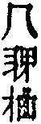

# 远庵僼禅师语录



> **藏经**：嘉兴大藏经（新文丰版）（嘉兴藏）　**册次** 第 37 册（J37）　**编号** JB386　**部类** 诸宗部　**卷次** 16 卷　**篇幅** 151,407 字

> **作者（译者）**：嗣法门人元视等编

> **卷／品**：16 卷 · 1 品



---



## 目录



  - [卷首序](#卷首序)

- [远庵僼禅师语录卷第一](#远庵僼禅师语录卷第一)

- [远庵僼禅师语录卷第二](#远庵僼禅师语录卷第二)

- [远庵僼禅师语录卷第三](#远庵僼禅师语录卷第三)

- [远庵僼禅师语录卷第四](#远庵僼禅师语录卷第四)

- [远庵僼禅师语录卷第五](#远庵僼禅师语录卷第五)

- [远庵僼禅师语录卷第六](#远庵僼禅师语录卷第六)

- [远庵僼禅师语录卷第七](#远庵僼禅师语录卷第七)

- [远庵僼禅师语录卷第八](#远庵僼禅师语录卷第八)

- [远庵僼禅师语录卷第九](#远庵僼禅师语录卷第九)

- [远庵僼禅师语录卷第十](#远庵僼禅师语录卷第十)

- [远庵僼禅师语录卷第十一](#远庵僼禅师语录卷第十一)

- [远庵僼禅师语录卷第十二](#远庵僼禅师语录卷第十二)

- [远庵僼禅师语录卷第十三](#远庵僼禅师语录卷第十三)

- [远庵僼禅师语录卷第十四](#远庵僼禅师语录卷第十四)

- [远庵僼禅师语录卷第十五](#远庵僼禅师语录卷第十五)

- [远庵僼禅师语录卷第十六](#远庵僼禅师语录卷第十六)



---



西天二十八祖秉教外别传之旨，远自迦维东来震旦，六传至曹溪，后分二枝，而临济独盛。临济后又分二枝，而杨岐独盛。盖监寺受慈明遥记，与黄檗之记临济正同，故禅道独冠天下。今之所称临济宗者，则皆系出於圆悟勤也。勤传虎丘隆，隆传应庵华，华传密庵杰，杰传破庵先，先传无准范，范传雪岩钦，钦传高峰玅，玅传中峰本，本传千岩长，长传万峰蔚，蔚传宝藏持，持传东明旵，旵传海舟慈，慈传宝峰瑄，瑄传天奇瑞，瑞传无闻聪，聪传笑岩宝，宝传幻有传，传传密云悟，悟传弘觉忞，弘觉嫡子，是为瑞岩远庵大师。大师之望前圆悟勤凡二十二世，其望临济则三十二世，而望达磨则四十二世也。大师昆山陆氏子，髫龄亲炙，弘觉从芟染，提耳训育，挈囊烟水，见老人直道示徒，九会之中，骨剂毛孔抛向人怀。大师蚤岁分灯，业已升堂入室，三拜得髓矣。故老人阐法天童，首以师为继席；肇造平阳，复以师为承计。神鼎来请，挽师南渡；瑞岩湮废，藉师中兴。邗水、白云之间，莫不有师托迹焉。然师五坐道场，独天童十一载为最久。盖以天童居大海之东，山川环拥，当年说法此山者八十餘员，大率临济居多焉。大师省觐平阳，老人以年力衰迈，退休别室，谓非师莫能肩任，坚留主席。干戈甫息，旋遭魔孽之难。若非大师行解相应，天人昭格，恶能使临济宗风至今不坠也哉？大师说法，如云如雨，其见诸上堂、小参、普说等录，无虑若干卷，卷几万言。至若撰著，其书牍则情而赡也，其赞铭则庄而逸也，其规条则雅而畅也，其疏启则典而致也，其序记则直而有体也，其说词则通而有则也。乃其所为诗，则又工秀绝伦，如东谷、四灵、石菌诸刻，恍若中峰、雪峤所作，骚人词客望崖而返也。余同门铎庵默兄集师全录梓成，谬委余弁其首。余不惠，敬撮其大略如此。



康熙甲子秋八月朔旦，弟子本嵩吴道会稽首和南譔。



远庵僼禅师语录目录



------



### 卷首序



目录



卷第一住潭州神鼎山资圣禅寺语录



卷第二住潭州神鼎山资圣禅寺语录



卷第三住潭州神鼎山资圣禅寺语录



卷第四住明州太白山天童弘法禅寺语录



卷第五住明州太白山天童弘法禅寺语录



卷第六住明州太白山天童弘法禅寺语录



卷第七住明州瑞岩山开善禅寺语录



卷第八住明州瑞岩山开善禅寺语录  

住越州平阳山兴福禅寺语录  

住明州白云山延祥禅寺语录



卷第九小参



卷第十小参  

秉拂



卷第十一秉拂  

普说



卷第十二举古  

颂古  

机缘



卷第十三法语  

偈



卷第十四像赞



卷第十五佛事



卷第十六书启  

杂著  

附塔铭



远庵僼禅师语录目录



------



## 远庵僼禅师语录卷第一



**译者**：嗣法门人元视等编



住潭州神鼎资圣禅寺语录



师於顺治十二年冬，就维扬宝积院首座寮受请，越明年四月二十九日入院。



山门。「有门可入，百匝千重；无路可行，四达五通。几多人到此，因甚插脚不入？象王行处绝狐踪。」



佛殿。「德山撤却殿，云门要打杀。新神鼎大展三拜，且道是抬是搦？」



伽蓝。「君自衡山昔至，我从淮甸新来。不惜一回敲唱，相催再舞三台。」



祖堂。「者队不唧溜汉，坐处未脱见闻，列下圆伊三点，却成川字籀文。」



据室。「三种接人，一棒打趁。从上风规，今时蹊径。直下坐断千差，不落坦夷险峻。铜睛铁眼觑无门，八臂三头伎俩尽。」



诸山禅德率众檀护请示众。指法座云：「百千诸佛於此只解靠倒扶起，设或尤而效之，不若齐之以礼，坐断凡圣要津，直得透顶透底。」便升。「倒骑鹤背出邗城，万项洪波过洞庭，拄杖未曾拈动处，分明点破九疑青。顶门具眼，合自知归，稍涉疑情，出众决择。」问：「宝印初开，十方齐畅，向上一机如何举唱？」师云：「一雨普滋。」进云：「袖里金锤光灿烂，倚天长剑逼人寒。」师云：「切忌承虚。」问：「曲调新翻续起，𬤇祖远年遗唱，如何是不落时机一句？」师云：「雨过青山翠欲流。」进云：「直下知归时如何？」师云：「剑去久矣，尔方刻舟。」进云：「自是不归归便得，五湖烟景有谁争？」师云：「直饶归得去，犹未是君家。」僧拟议，师便打，乃云：「孤峰顶上眠云，未是衲僧活计；十字街头垂手，全非本分生涯。所以奏绝听之希声，不落古今曲调；行逸群之号令，岂死佛祖规绳？展拓乾坤於毫发之端，呼叱风雷於謦欬之项。况乎法无定相，舒卷由人；道绝方隅，纵横无碍。」蓦拈拄杖，云：「秖如新长老拄杖子到此洞庭之野、潇湘之滨，棱棱嶒嶒、列列挈挈，不打禾山鼓，直是动地惊天；不抛象骨毬，要且逢场作戏。如吹毛之刃，无不剋之锋；如破壁之龙，无可留之影。且道：是入泥入水耶？是目视云霄耶？是超出格量耶？是别行一路耶？还会麼？」卓一下，云：「出头天外看，谁是我同条？」复举：「黄檗示众云：『汝等诸人尽是噇酒糟汉，与麼行脚，何处有今日？还知大唐国里无禅师麼？』时有僧出众，云：『秖如诸方匡徒领众又作麼生？』檗云：『不道无禅，只是无师。』」师云：「气吞佛祖，眼盖乾坤，不无黄檗老祖检点将来，争奈龙头蛇尾，本分艸料因甚不与者僧？然虽如是，秖如道：『不道无禅，只是无师。』毕竟作麼生？曹溪波浪如相似，无限平人被陆沉。」



示众。问：「教中道：『诸佛寂灭相，不可以言宣。』和尚今日如何举唱？」师云：「有耳者闻。」进云：「秖如恁麼道，落言宣？不落言宣？」师云：「你那里去来？」问：「熏风自南来，殿阁生微凉，意旨如何？」师云：「直不藏曲。」进云：「鸟道不通，更借一问。」师云：「道什麼？」僧再举，师打，云：「箭去久矣。」乃云：「时当初夏，绿暗红稀，山中杜宇，泣血歔欷，唤人不去，却唤春归，争似野田黄雀，时中啧啧飞飞？大众！若论神鼎山中，春亦得、夏亦得，春有碧桃红杏、夏有清泉白石，只是未审诸人於中如何过日？若生一念欢喜，便是罗刹鬼国；若生一念厌离，又是天涯孤客；若也一念不生，前有万丈深阬、后有千峰崒嵂，东阁下南岳神听得出来道：『僼长老何故将净严国土翻作参天荆棘？』山僧道：『只为你微妙法身未脱根尘声色。』」嘘一嘘，下座。



示众。「连月不雨数日雨，大地普滋无硬土，艸木青青尽展眉，虚空拍掌森罗舞。连日不晴今日晴，十虚忽地放光明，山河赤体无遮覆，红日团团烁太清。诸禅德！雨亦分明雨得好，晴亦分明晴得巧，信手拈来俱是宝，唯有神峰不点头，依然突兀云霄表。且道他具何眼脑？」一僧云：「如今点头也。」师云：「他作麼生点𫆏？」僧拟议，师便打。良久，复云：「阿呵呵！堪绝倒。好大哥！荐取好善财手里一茎艸。」



示众。问：「大慧云：『杨岐一头驴，只有三只脚，潘阆倒骑归，攧杀黄番绰。』三脚驴子即不问，既是潘阆倒骑归，为什麼攧杀黄番绰？」师云：「石羊头子向东看。」僧拟议，师便喝，乃举：「玄沙示众云：『诸方老宿尽道接物利生，忽遇三种病人来，作麼生接？患盲者，拈槌竖拂他又不见；患聋者，语言三昧他又不闻；患哑者，教伊说又说不得。且作麼生接？若接此人不得，佛法无灵验。』」师云：「大小玄沙只知赶老鼠，不觉打破瓮，恁麼检责诸方，殊不知有眼底被他瞎却、有耳底被他聋却、有口底被他哑却。神鼎者里固是不比诸方佛法别无灵验，若遇此三种病人来，且喜出世功终。何也？岂不见古有一老宿不蓄沙弥，有僧问：『和尚年尊，何不蓄一沙弥？』老宿云：『有瞽聩者与吾寻一个来。』虽然，山僧要问诸人：有眼有耳底汉因甚反不如瞽聩之人？且道过在什麼处？出来道道看。」良久，云：「既无人道，山僧不免重说道理去也。彻见非眼，眼见即瞎；洞闻非耳，耳闻即聋；真说非口，口说即哑。秖如无眼又作麼生见？无耳又作麼生闻？无口又作麼生说？还会麼？十二处亡闲影响，三千界放净光明，空生岩下悠然坐，华雨缤纷满太清。」



示众。「劄，久雨不晴，浸烂释迦鼻孔，滴穿达磨眼睛，昨夜临济口边无端更轰个霹雳，今日德山棒下愈见雨点倾盆，说甚麼打倒了玉泉山里皓布裈底葡萄棚、湿却了那梁山观和尚底袈裟角？直教神鼎山中数十间破屋漏如鱼网、漫似春潮，诸人也无处安身，山僧也只得立地，而今无可合杀，不如苦中取乐，唱个渔父辞与诸人排闷。」乃漫咏云：「爱作潇湘一钓客，宁论东西南与北？丝纶千尺横抛掷，谁知得？月在竿头天在侧，烟波钓尽仍独立，盲龟跛鳖休窥测，六鼇直共三山掣。忘欣戚，从教风雨穿蓑笠。」拍手呵呵大笑，下座。



示众。问：「发明过量事，须是过量人。过量人则不问，作麼生是过量事？」师云：「奚仲造车一百辐。」进云：「此犹是寻常事。」师云：「拈却两头除却轴。」进云：「秖如盖色骑声，包天匝地，将来和尚又如何施设？」师打云：「为君击碎精灵窟。」进云：「一种没弦琴，果然弹得妙。」师云：「切莫错下名言。」进云：「昔日德山托钵低头归方丈时如何？」师云：「怜儿不觉丑。」进云：「秖如岩头道：『者老汉未会末后句在。』又作麼生？」师云：「家富小儿娇。」进云：「德山唤岩头云：『你不肯老僧那？』头密启其意。未审密启什麼意？」师云：「方木逗圆窍。」进云：「僧堂前拍手大笑，又是甚麼心行？」师云：「十字街头著一楔。」僧伫思，师喝云：「且退后著。」问：「雪峰三登投子，九上洞山，为什麼向鼇山成道？」师云：「华落华开信有时。」进云：「住后有僧敲门，雪峰放身出云：『是什麼？』僧亦云：『是什麼？』未审还有优劣也无？」师云：「六只骰子满盘红。」进云：「雪峰为什麼低头归庵？」师云：「直教大地眼麻瞇。」进云：「僧举似岩头，头云：『我当时若向伊道末后句，天下人不奈雪老何。』如何是末后句？」师云：「月里放金乌。」进云：「雪峰虽与我同条生，不与我同条死，又作麼生？」师云：「日中藏玉兔。」进云：「万仞峰头横行，十字街头垂手，即不无二老人。秖如不涉二途，又在什麼处著倒？」师云：「楚山入汉水，衡岳出湘江。」进云：「恁麼则等闲一句无私语，千古闻之尽胆寒。」师云：「莫教错认一天星。」乃云：「大众！百千三昧、无量妙门尽在我者里，罗汉崖前、钵盂峰畔，历历绝边表，明明不覆藏。绿染百亩春畴，鸡足之衣撩乱；青列千行嘉穗，鹫峰之帙纵横。用该大仰金锹，白云坞中竖插；艸足嬾安水牯，夕阳坡上横眠。披蓑侧笠，千峰也胜时人著锦；引水浇蔬，叠嶂全超从上拈槌。风来麦陇之香，机凑韶阳糊饼；曲唱村田之乐，调翻皖伯巴谣。飞来白鹭翩翩，点破连天之碧；唤出黄鹂对对，平铺满壑之春。九峰正好拖犁，有甚同参可得？百丈谩劳展手，须知大义炳然。然虽如是，犹是时人蹊径，未及向上牢关；者里脱落全机，方知衲僧孔窍。且如何是衲僧孔窍？」良久，云：「春不耕，秋无获。参！」



示众。问：「世界与麼热，且向什麼处回避？」师云：「不见道：热则普天匝地热。」进云：「秖如古德云：『向镬汤炉炭里回避。』镬汤炉炭里作麼生回避？」师云：「非公境界。」进云：「四大离散，万缘一空，还有寒暑之分也无？」师云：「正觅缝罅不得。」进云：「回首碧天云敛处，一轮明月照层巅。」师云：「脑后要须拔却楔。」乃举扇子云：「诸方举起拂子，山僧举起扇子，无甚作略，超方一切，临时而已。诸禅德！还知时麼？今乃九夏方中之时，祝融当令之候，烈日流光而炙地，火云接燄以烧空，凡在六宇之中、八纮之内，无论山林城市、僧俗女男，者柄扇子阿谁缺得他？阿谁离得他？阿谁用他不著？然既人人要用，缺离不可，岂非当此之时最为紧要者乎？窃见而今诸方往往拈提，罕有个举著他者，设或举著又不当时，却在寒天腊月。然而腊月扇子又有什麼用处？则与不曾举著者不相远矣。而今山僧既是举得恰当，且道作何佛事？」蓦竖起云：「云门大师来也，盐官大师来也，汾阳大师来也，都在扇子头上相推序次，登座而为说法。一师云：『𨁝跳曾升帝释天，尸迦鼻孔筑教穿，鲤鱼东海时遭棒，雨似盆倾遍大千。』一师云：『当年老汉曾亲索，破也谁知未便休，无奈侍僧频错过，至今到处觅犀牛。』一师云：『青绢扇子足风凉，触著通身毛孔张，火里木人寒不彻，却教石女脱罗裳。』三大师说是法已，见诸人不会，却向火燄光中入灭去也。虽然如是，锦上铺华也不劳得，扇子从来自有长处，不用者也之乎牵文引义，要且直截痛快，全体举扬。」遂挥一挥，良久，复云：「还会麼？还知得扇子所作佛事麼？名为驱炎自如旋陀罗尼三昧，后世应当作佛，号曰掣风胜王多陀阿伽度、阿罗诃、三藐三佛陀。端知渠侬自来发心，行诸菩萨愿行，骨劲凌霜之节，胸搏妙翅之风，起灵燄於冰炭之炉，散玄飙於郁蒸之薮，全身奉重，极力输诚，除热恼而得清凉，障炎威而作嘉荫，挥毫洒墨方寸间，巧尽翰苑之风骚，吐雾吞云掌握内，目穷江山之美丽，纵横收放，开合卷舒，恒随一切含生，不分与抬金紫，承事十方诸圣，那知时日昏朝，不云厌劳，常作佛事。诸禅德！山僧虽则冷地里拈来，元是你诸人寻常所用底，然有如是神通，得如是三昧，演如是妙义，作如是佛事，希有极是希有，亲切更为亲切，受用得大受用，自在真个自在，可谓一人人有个善知识相随著也，那在朝参暮请别处寻求？只在你二六时中东摇西扇，忽然一下触发，管教毛骨俱苏，直与大地众生一时共离火宅；其或未然，拈来直下挥蚊蚋，也胜诸方狗尾巴。」



示众。「俱胝竖起一指，千峰势到岳边止；鸟窠吹落布毛，万派声归海上消。恁麼会去，大似虚空钉橛。有般汉道：『争如独坐虚窗下，华落华开自有时？』然则曹溪浪里未许停舟，韶石渡头那容系缆？不见道：『平地上死人无数，过得荆棘林是好手。』要须驱出长沙大虫、咬杀大雄猛虎、拔却罗山一寨、收下临济白拈，然后打动关南鼓、唱起德山歌、披著湖山袄、抛出雪峰毬、弄云岩狮子、跳中邑猕猴，直得迦叶起舞、阿难合掌、寒山拍手、拾得摇头，可谓有意气时添意气，不风流处更风流。大众！冷眼觑来，虽则一场笑具，几人於此知休？设或准前，朝不进步、暮不回眸，莫谓而今方溽暑，霎时霜雪到君头。」



示众。举：「古德上堂，良久，云：『山僧今日与诸人同参一个真善知识。』便下座。」师云：「直截真个直截，省要不妨省要。而今敢问诸人：如何是他参底真善知识？若说胡张三、黑李四，秖是一句合头语；若说罕逢穿耳、各多见刻舟人，者里不是你躲跟处；若说含元殿上休觅长安、慈氏宫中更寻内院，知你在鬼窟里作活；更若说个香几拂子、露柱灯笼，莫颠倒驴鞍桥，岂是你阿爷下颔？其餘竖一指、下一喝，礼拜出堂，拂袖而去。此皆是风力所转，逐块韩卢。纵饶你总不恁麼，全在死水里没头没脑。还有出得者些窠窟底汉麼？出来与山僧分明道一句看。」众默然，师蓦唤云：「吃茶去。」



立秋，示众。「物外安居碧嶂高，寺门幽抱白云饶，松风万壑秋长在，谁感庭柯片叶飘？大众！炎凉倏忽，任他人世推迁；岩窦幽深，坐断古今一致。所以道：长安自闹，我国晏然。四山色变青黄，迥出孤峰独秀；一道虚凝湛寂，悠然万法本闲。是知惜日短而志士吁嗟，妄自痴狂外走；知夜长而愁人不寐，只缘未达家乡。然则水石光中，云驶月运；烟岚影里，斗转星移。不动本际即且置，踏翻关捩一句作麼生道？寒雁一声闲梦断，始知身世卧南柯。」



示众。问：「夜静水寒鱼不饵，透网金鳞事若何？」师云：「更有一重关在。」进云：「毕竟如何？」师云：「死汉。」进云：「宁可永劫沉沦，不求诸圣解脱。」师云：「梦里强惺惺。」乃云：「心生种种法生，日午便打三更；心灭种种法灭，芥孔须弥直纳。我无一法与人，少室那来妙诀？但能无欲无依，凡圣一时路绝，泥牛吼出澄潭，石女梦回明月。不著妙德空生，谩劳遍吉相寻，万境从他回换，浑忘旦暮古今。白云为盖，流水作琴，一曲两曲无人会，雨过夜塘秋水深。」喝一喝，下座。



天童密祖忌，示众。问：「天童堂上，棒喝交驰，铲除邪妄根株，敲出祖师心髓。神鼎峰头，未审和尚将何为人？」师云：「断贯索穿你鼻孔，乌豆子换人眼睛。」进云：「三界无别法，唯是一心作。秖如离却心意识，又作麼生作？」师云：「东西十万，南北八千。」进云：「是心是？非心是？」师云：「一任钻龟打瓦。」乃卓拄杖一下，云：「铜棺山顶，地陷天崩；太白峰前，龙翔凤翥。起临济欲湮之旨，扫除异见稠林；振达磨已坠之宗，剔出当家种岬。一往观去，满目生光；仔细看来，一场败阙。何况论其棒头光燄，拟为德峤重来；喝下冰生，谓是滹沱再世？大似唤龙须作破布，将鱼目混明珠。殊不知伊出头於威音王前、展脚於楼至佛后，引手过越一百一十城，未及半臂；开口演说五千四十餘轴，未尽一言。此犹是应物现形光影边事，正体上未曾道著毫毛在，说什麼日月未足喻其明、虚空未足喻其大？生耶？灭耶？不生耶？不灭耶？天上耶？人间耶？来耶？不来耶？合却钵盂耶？真前更下一分耶？何异众盲摸象，未见全身；寸管窥斑，宁知豹体？然虽如是，秖如今日脚下儿孙，尽江南、极塞北，无不饮水知源，烧栴檀香，设伊蒲供。且道又成得什麼边事？若有道得一句子相应，拄杖子两手分付；其或未然」，复卓拄杖一下，云：「共诣真前，拈香上食。」



中秋，示众。「月圆秋半，云扫长空。枯木岩前，发天香而绝艳；芦花滩畔，觅渔艇之无踪。蚌腹希光，珠呈寒水；兔胎仰照，子孕秋郊。正恁麼时，还有不被眼瞒者麼？到者里，夜明帘，琉璃地，虚玄鸟道，皎洁澄潭，若不解换步移身，争免得堕阬落堑？不见僧问古德：『廓然无云，如何是中秋月？』古德云：『最好是无云。』僧云：『恁麼则一轮高挂，万国同观去也。』德云：『捏目之子难与言。』大众！灼然千寻止水，龙畏难蟠；万载乔松，鹤迷幽梦。所以道：珠光月魄不是出头时，此间无老僧，五路头无阇黎。还委悉麼？月中仙桂和根拔，海底泥牛把角牵。」



云外和尚塔院上梁，示众。「插茅成梵刹，至人能事之秕糠；筑室守先茔，前哲苦心之极致。然而头头应用无差，法法施为有自，但得超情离见，不妨规步矩行。恁麼见得彻，岂止烟岚起色、泉石增光？无缝塔头，忽地玲珑八面；没阴阳地，凭空涌出千楹。擎天柱、架海梁，正在而今著力；起家声、大门户，自然久后光辉。所以道：源深而流长，功多而用远，一一看孔穿楔，恰恰落臼推门。庭前松竹交加，早见斩新头角；屋后峰峦排叠，从来壁立层霄。固是云厂松椽，野色更无山隔断；月钩霞幙，天光直与水相通。正当恁麼时，且道如何分付？架屋须凭础，成家要在人，日轮正卓午，趁此好时辰。」



示众。问：「十虚无片翳，长空月色新，正恁麼时，未审明什麼边事？」师云：「西风一阵来，落叶两三月。」进云：「秖如高峰睹赞虚空粉碎，大地平沉，因什麼被雪岩一拶便去不得？」师云：「透过禹门，风浪更险。」进云：「正睡著时，无梦无想主人公在什麼处？」师召云：「丽宗惺惺著。」进云：「五年后枕子扑落，又是何消息？」师云：「依旧摸索不著。」乃云：「昨夜月穿虚牖，床前一片如银，一往观去，好似玄沙白纸；仔细看来，又像广教手巾。依依稀稀，南岳嬾瓒枕头之石；彷彷佛佛，天台寒山煮茗之冰。欲拈不得，欲扫无痕，风吹帖然不动，转眼抹过东楹。山僧不觉满肚疑情，千思万想，直到天明，元来住持事繁，两眼花昏。而今白日青天，轩轩豁豁，现前大众各各有对，乌黑眼睛，山僧有件事要问你诸人。」蓦掷拂子，云：「是个什麼？」众无语。师复云：「欲得不招无间罪，莫谤如来正法轮。」



开炉，示众。「神鼎火种虽无，却有冲天气燄，嬾拈向上钳锤，拨置作家炉扇。钝铁顽铜任伊，璞玉浑金不羡，聊将万象森罗，活把虚空烹炼。不许月白风清，那爱轰雷掣电？直得大地通红，凡圣都卢不见，十虚无欠无餘，浑似金刚宝剑。假饶锋利如斯，犹要重锤百遍，更得分身出身，好与罗山相见。然虽如是，要见罗山则得，要见神鼎还隔一线好。诸禅德！且道是那一线？若也荐，直下翻身，推开手面；若不荐，一任九十日内横拖倒拽，牵驴入阱。少间刘居士设斋，且去随例咽，要山僧说，也待来年正月半。」



邹深实为僧，请示众。「知幻即离，不作方便；离幻即觉，亦无渐次。摩霄俊鹞，便合乘时；止泺困鱼，徒劳激浪。不见昔日李都尉访谷隐聪，问出家事，聪即举：『崔赵公问径山钦：「弟子出得家否？」钦云：「出家乃大丈夫事，非将相之所能为。」都尉便於此放却身命，裂破鼻孔，遂云：「学道须是铁汉，著手心头便判，直取无上菩提，一切是非莫管。」如斯标致，差较些子。』所以道：出群须是英灵汉，敌胜还他狮子儿。你看他是个血性汉子，直下便乃一刀两段，佛也不奈他何，说什麼蕴魔、烦恼魔、生死魔？若待披忍辱铠、操智慧刀、运上品心、发殊胜志，与他共战一场，然后灭三毒、破魔网、离火宅、超断岸，不特贼过后张弓，抑且眼花不少。虽然，若不蓝田射石虎，几乎误杀李将军。」卓拄杖，下座。



至节，示众。问：「时临亚岁即不问，一阳来复时如何？」师云：「汉女宫中添一线。」进云：「阳气发生无硬土，天涯艸木尽皆春，因甚麼一重霜后一重冰？」师云：「杀人须是活人刀。」乃云：「否极泰来，阴消阳复，燄发寒冰，花开枯木。慈明揭牓，洞山掇桌，两彩一赛，云天自廓。建化门中放一线道，冷地里便见一场热闹，衲僧拄杖子把断咽喉，依然眼目定动。要知麼？一阳生后正严寒，一点水，一点冻。」



示众。拈拄杖云：「拄杖口门窄，说禅秖一半，山僧不得已，全体施方便。土上弗加泥，直截要人荐，不举古因缘，不据目前见。若据目前见，错过威音箭；若举古因缘，昧却本来面。要识本来面，照顾威音箭；要见威音箭，了却目前见。了却目前见，骑牛入佛殿，觑透威音箭，还如腊月扇。识得本来面，堕阬更落堑，三关俱透脱，一处不留恋。山僧虽放行，拄杖重来验，如何道得通方句？免被渠侬把要津。」众屏息，师左右顾视，卓拄杖云：「击碎珊瑚铺地锦，转身犹带玉华新。」



示众。「打鼓升堂，人天交接，诸人侧聆，山僧掉舌。掉舌侧聆，大相悬涉，岂不见道：是法非思量分别之所能解，亦非见闻觉知之所能及。诸仁者！到者里合作麼生？莫是离见绝闻、无说无示当得麼？殊不知，出林依旧入蓬蒿。直饶目前无法已见周遮，心外无机犹成途辙，说什麼似地擎山，不知山之孤峻；如石含玉，不知玉之无瑕？还委悉麼？行人听尽唱梁州，错过胡笳十八拍。」



岁朝，示众。「昨宵送旧，今日迎新，驴事未完，马事又到，张公吃酒李公醉，著甚来由？借婆衫子拜婆年，无事生事。」拈拄杖，云：「争似者条拄杖子，心不妄取过去法，亦不贪著未来事，不於现处有所住，了达三世悉空寂。三世既空寂，新旧何鼎革？年年是好年，日日是好日，万物生光辉，阳春布德泽。阿呵呵，啰啰哩，哩啰啰，大家齐唱万年欢，一句了然超百亿。」卓拄杖，下座。



解冬，示众。「结却布袋头，铁蛇钻不入；解开布袋口，彩凤舞丹霄。恁麼见得，未出常情，至真非内，大千非外，表里一如，圆融法界。虽然透出尘情，未免犹存窠窟。衲僧家须向千圣插脚不入处进步游履，万机该括不到处展拓全机，乃可较佛祖短长、定古今轻重，放行把住，照用同时，夺食驱耕，纵横无碍，头头出见闻之外，一一超思议之表。虽与一切人同行，不与一切人共步；虽与一切人共住，不与一切人同廛。说什麼？住也，浮云凝於幽谷；去也，虚舟泛乎长江。」拈拄杖，顾众，云：「众中还有与麼衲僧麼？有，则许你骑驴蹋破洞庭波；如无，莫道神峰山势险，前头更有最高峰。」卓拄杖，下座。



浴佛，示众。举：「世尊初生，一手指天，一手指地，目顾四方，周行七步，作大狮子吼曰：『天上天下，唯我独尊。』后来云门大师道：『老僧若见，一棒打杀与狗子吃，贵图天下太平。』」师云：「云门一棒打杀，搔著世尊痒处，贵图天下太平，其奈刀枪遍地。虽然如是，还见古人麼？掀翻海岳求知己，拨乱乾坤见太平。神鼎今朝不用如何若何，但随例与他一杓香水，不洗垢，不洗净，不洗净边垢，不洗垢边净，不可道落在无事甲里。」



端午，示众。「屈原事楚，忠言不用，则投身湘水；达磨来梁，真机不契，则面壁嵩山。一则为国而丧躯，作世儒之龟镜；一则度迷而尽瘁，为吾宗之祖祢。世、出世间，易地皆然。即今莫有不然者麼？不妨出手，与我回天转地，斩新立方外乾坤；耀古腾今，纵横挂域中日月。不特三闾大夫孤魂不滞於清波，顿使壁观婆罗门门风未至於扫地。有麼？有麼？」良久，左右顾视，云：「为国沉渊为法亡，丹心如日照天荒，当人不喻空劳力，徒盼葵榴饮恨长。」嘘一嘘，下座。



------



## 远庵僼禅师语录卷第二



**译者**：嗣法门人元视等编



示众。「你者一队汉，个个如了事人相似，总道饥来吃饭，困来打眠，撒手撒脚，且恁麼过时也不易，到此只恐未在。不见昔日僧问大珠和尚：『修道还用功否？』珠云：『用功。』僧云：『如何用功？』珠云：『饥来吃饭，困来即眠。』僧云：『一切人总如是，同师用功否？』珠云：『不同。』僧云：『何故不同？』珠云：『他吃饭时不肯吃饭，百种须索；睡时不肯睡，万般计较，所以不同也。』你者一队汉，请自检点看，还曾实到与麼田地也未？秖如者般语话，且道如何还检点得麼？若唤作自受用三昧，未免孤负古人；若唤作拖泥带水说老婆禅，未具参学眼在。汝若不落情尘意想，便领得去，不妨畅快，所谓如将梵位直授凡庸，遂乃不惊不怖，所谓只是旧时人，只改旧时行履处。如若意根下稍涉狐疑，敢保他时异日大有事在。神鼎而今却又不然，设有人问：『和尚修道还用功否？』亦云：『用功。』『作麼生用𫆏？』但云：『饥时忘吃饭，困时忘打眠。』或云：『一切人同和尚如是用功，得否？』遂云：『得。但办肯心，决不相赚。』」



示众。问：「春风吹大野，万物尽光新，为复法尔如然？为复神通妙用？」师云：「脱㲉乌龟飞上天。」进云：「一声幽鸟云天外，霭霭山光翠欲流。」师云：「却被风吹别调中。」乃云：「十方聚会，臭肉来蝇；选佛场开，悬羊卖狗；闭门打睡，接上上机；落艸求人，示种种说。要而言之，不出好肉剜疮、钵盂安柄。所以道：说心说性是太平奸贼，行棒行喝乃乱世英雄。秖如神鼎，有时与你诸人作生冤家；有时与你诸人如陌路人；有时与你诸人开山掘土，则人境俱忘、主宾不立；有时与你诸人拈椎竖拂，则海水腾波、须弥岌崿。且道巴鼻寻常又落在什麼处？而今禅和家爱向人口边觅佛、觅祖、觅禅、觅道，觅真如解脱、菩提涅槃，抛却了自家现成家业，失头狂走，见人鼓动唇皮、敲床竖拂便作胜解，及乎山禽聚集、牛动尾巴，却将作等闲，日间掘土开山作一边、夜间收足打坐作一边，动静二相、逆缘顺境尚打不过，说甚左右逢源、十方通畅？坐一炷香便云工夫，作一回务便谓空过，山僧说一句便道慈悲，打一棒便拟恶发，殊不知顶底是天、立底是地，一向饭箩边坐了忍饥、大海里浸了叫渴，又争知得终日穿衣吃饭，不曾挂一缕丝、不曾咬一粒米？然则毕竟如何相为即得？」良久，云：「心不负人，面无惭色。」



示众。「千种喻，万般说，只是要君早休歇。不见道：如何是禅？莫向外边传；如何是道？莫向外边讨；如何是心？莫向外边寻；如何是佛？莫向外边觅。古人与麼老婆心，分明八字打开、两手分付，争奈禅和家转转错会，见说道莫向外边传觅，便去黑山下、鬼窟里闭眉合眼向内寻讨，殊不知内外中间不可得，教中已是道过了也。所以佛眼和尚云：『山僧畫方成圆，指南成北。何故如此？盖为诸人唱还乡曲子，曲调不圆，熟路难忘，乡谈未改，非指南之不妙也。』诸仁者！而今合作麼生话会？毕竟向什麼处归宿？」一僧云：「大地齐超越。」师起身云：「啼得血流无用处，不如缄口过残春。」



示众。「二月中春，万象光生，好华三树五树，幽鸟一声两声，渔父漾舟而钓，农夫驱犊而耕，青转山头千螺矗黛，绿回波面一镜澄明，说甚麼广长舌、清净身，大似眼中著楔、耳里添钉。无端更有香严者汉，与夫潦倒灵云，见桃华而悟道、闻击竹以明心，分明两颗老鼠粪，可怜污却一釜羹，赚他无限痴男女，多向根境上觅、声色里寻。且道毕竟作麼生？」良久，展拂子，云：「七十二峰遥接目，好山都向洞庭春。」



示众。「天寒人寒，梅花香浸月栏干；滴水滴冻，岳面风来林影动。无位真人不挂丝，纸裹麻缠无罅缝。所以道：会得也，目前包裹；不会也，目前包裹。若有人道得独脱句，热炙盏子点茶与你湿口。」



佛诞，黄寿昌居士请示众。「身是光明幢，心是神通藏。大众！周昭王二十六年前，人人眼横鼻直，可谓文不加点；二十六年后，个个履地戴天，何须矢上加尖？黄金相，看来那个不无？紫磨身，脱出谁非本具？然则正当二十六年，释迦老子爰於此日无风起浪，下兜率、降皇宫，指天指地云：『唯我独尊。』大似旁若无人。云门大师忍俊不禁，一棒打杀与狗子吃，有什麼罪过？虽然，不因渔父引，争得见波涛？」复云：「兹者寿昌居士欣此嘉会难逢，捐赀设供，请法饭僧，又以三业门中翻前十邪，禀受五戒，所谓一身清净则多身清净，多身清净则世界清净，世界清净则现前一会若僧若俗无不清净。既总清净，则无罪可忏而罪垢消亡，无冤可释而冤家解脱，无灾可弭而灾消如雪荡，无福可增而福至若云臻。乘此奇特因，作此殊胜事，虚空坏而不灭，劫石化而弥存。然虽如是，犹是止啼之说。毕竟如何？十丈火中开菡萏，千年石上现优昙。」



示众。「直截省要，点即不到，合水和泥，不道不道。一任云箫缭乱吹，熨斗煎茶不同铫。且道还出得摩竭掩室麼？试举看。」举：「药山久不上堂，院主请升座，药山云：『打钟著。』大众才集，药山便归方丈，院主随后白云：『大众久思清诲，因甚一言不措？』药山云：『经有经师，论有论师。』」师云：「药山自谓得格外之机、行逸群之令，检点将来，未免藏头露尾，要得去离泥水，活人眼目犹较百步在。虽然，虽是死蛇，解弄也活，且看神鼎出手拈弄。药山久不上堂，曾为浪子偏怜客；院主请升座，自是贪杯惜醉人。药山云：『打钟著。』是何心行？大众才集，药山便归方丈，荷叶团团团似镜，菱角尖尖尖似锥。院主随入方丈，犹待第二杓恶水那？白云：『大众久思清诲，和尚因甚一言不措？』疏田不贮水，悲龙争奈何？药山云：切莫碗鸣声。『经有经师，论有论师。』虾跳何曾出得斗？且作麼生道得出斗句？」良久，云：「打睡关门接上流，通身泥水未曾收，翻思清白传家者，洗耳溪头不饮牛。」



端午，示众。「龙牙道：『学道先须有悟由，还如争斗快龙舟。虽然旧阁闲田地，一度赢来方始休。』大众！旧阁闲田地则且置，作麼生说个斗龙舟底道理？今日山僧聊应个时节，不惜为你诸人葛藤一上。当人本分者一著子，日用现前，不从人得，而今不得安闲，只为驰求心不歇。驰求心不歇，便乃争强取胜，业识茫茫。是故，宗师家垂下一言半句、点出一机一境，正如个锦标儿相似，掷向波间，东看成西、南观成北，活泼泼地、转辘辘地，无你近傍处、无你捉摸处。既近傍捉摸不得，即将你平昔争胜负、驰求心尽情移向者里著力。正如今日，世间人在龙舟上，千般伎俩、万般智巧，一时抖擞将来，奋力向前，危亡不顾、身命俱捐，那问江湖之深浅？谁管波浪之险恶？横冲直撞，▆▆右转，首击尾应，心眼相资，千人合其力、万人同其志，单单只在一个锦标上著脚，忽然眼亲手到，一逴逴得哄然，赢得一场大笑，然后方肯归家，帖帖地依旧做本营生。若不恁麼，一回教他歇，如何肯歇？纵然肯歇，其心亦未歇在。所以道：虽然旧阁闲田地，一度赢来方始休。诸人还曾恁麼一回也未？设或未曾，山僧今日向山头上驾只龙舟、虚空里挂个标儿，也要诸人著力一番，知个休歇。」良久，挥拂子，云：「见之不取，思之千里。」



示众。「天童师翁道：『为爱中秋夜月清，与人同乐称人情，万亿州都皆普照，一人举首一轮明。』可谓圆同太虚，无欠无餘。然而检点将来，未免贪观天上，失却手桡。今晚不肖顽孙亦有一偈，不图别出光芒，秖要流通正眼。」乃云：「此月何曾分外清？世人自是异人情，光吞万象孤圆处，不用抬头历历明。」良久，云：「还见麼？休从天上觅，莫向水中寻。」



示众。「不以耳听，将什麼闻声？香严悟处，不在击竹边。不以眼见，将什麼观色？俱胝得处，不在指头上。到者里，直得心境绝、机智亡，万缘寝、丝不缀，上无诸佛可仰、下无己灵可重，净裸裸、赤洒洒，没可把说什麼？师旷虽聪，无处著耳；离娄虽辨，无处著眼。直饶鹙子、目连，也只得望崖而退。虽然如是，若人达得者般境界，好个不自在汉。何故？不见道：你若随缘得似风，飞沙走石不关空，但於事上通无事，见色闻声不用聋。」



示众。「孟冬十月旦，落木萧萧散。千古意分明，一堂风冷澹。好诸禅德，一堂风冷澹，验在目前。千古意分明，切须端的。且道是什麼意？祖师意耶？玄妙意耶？作麼生分明？还是见得分明？还是会得分明？若道会得分明，正是识情边事。若道见得分明，又是见刺未除。若道是祖师意，则埋没己灵。若道是玄妙意，则孤负诸圣。不见夹山老汉道：『目前无法，意在目前。不是目前法，非耳目之所到。』虽然如是，切忌向鬼窟里作活计。要知麼？仙人端不坐蓬壶，闹市尝居见也无。三醉岳阳人不识，朗然飞过洞庭湖。」



开炉，示众。问：「开炉结制则不问，五家宗派请师宣。」师云：「逐家问将来。」进云：「如何是临济宗？」师云：「晴空霹雳。」进云：「如何是沩仰宗？」师云：「古锦含春。」进云：「如何是云门宗？」师云：「电光莫搆。」进云：「如何是法眼宗？」师云：「千山仰岳。」僧又问临济宗，师云：「因甚不问曹洞宗？」僧拟议，师打，云：「不劳纳败。」乃云：「如如向上，没可安排，大火聚中，不容蚊蚋。」拈拄杖，卓一卓，云：「然则神鼎今日当炉不避火，要且镕缾盘钗钏为一金、搅酥酪醍醐为一味，且道是向上、不是向上？无论世界阔一丈、火炉阔一丈，直得竖穷三际、横亘十虚，一切是圣、是凡？是魔、是佛？有学、无学？有情、无情？乃至千七百则烂葛藤、五千餘轴破故纸都卢向此中一时销铄，无有纤毫透漏，且道是安排、不是安排？设有纯钢打就、生铁铸成、不顾危亡底汉来，正好朝与三千、暮与八百，且道容蚊蚋、不容蚊蚋？还委悉麼？」复卓拄杖，云：「换骨洗肠重整顿，通身手眼更须参。」



示众。「金刚圈，栗棘蓬，陈烂骨董，不用拈出。秘魔叉，石巩弓，多年滞货，拨置一边。至於佛法二字，久矣不复梦见。一条拄杖子，没些意智，终朝与木头土块敲磕。且道还有知痛痒者麼？如无，山僧引一古颂为你说破：菜园墙倒晴方筑，房店篱穿雨过修。院宇漏时随分整，儿孙大小尽风流。」



示众。「终日搬砖运瓦，挨破释迦老子鼻孔；彻夜经行打坐，打失达磨大师眼睛。就中有一个汉，也不打坐经行、也不运瓦搬砖，释迦老子与他水米无交，达磨大师亦任东来西去。且道他据何道理便恁麼作得主、坐得断？」良久，云：「还乡尽是儿孙事，祖父从来不出门。」



弟子成锷脱白，请示众。问：「转凡成圣即不问，秖如朕兆未分已前如何缁素？」师云：「狮子窟中无异兽。」进云：「与麼则一人有赖乾坤阔，四海无餘日月高。」师云：「才方搓弹子，便要捏金刚。」问：「向上一著，千圣不传。如何是千圣不传底旨？」师云：「尽大地人不欠缺。」进云：「末后一机，佛祖难测。如何是佛祖难测底事？」师云：「只为太分明。」乃云：「头颅本是十分圆，挂弊由来显妙传，须信威音那畔事，非僧非俗亦非仙。所以，香至出家，非为身心；丹霞说戒，掩耳而趋。无人缚汝，安用解脱？莫外驰求，不从人得。只者，如今灵灵不昧、了了常知，见闻不到、言诠不及，透声透色、绝迹绝尘，一段光明未尝昏晦。且道：还有圣凡差别、迷悟染净也无？」良久，云：「脱白已非当日相，端然不改旧时人。」



示众。凡有僧问，师一概打退，乃云：「开炉已经一月，小参五日一说，禅和瞌睡不惺，长老徒费唇舌。所以维摩卧疾於毘耶，释迦掩室於摩竭，须菩提唱无说而显道，梵释绝视听而证龟成鳖。看来虽出一头，也则未离窠窟，总然抖尽屎肠，料掉了无交涉。不如信意施为，随分三七廿八，那管方木圆窍，一味横该直抹？虽然打不著你心下事，不妨疑得不休歇。何故？大洋海底扬蓬尘，山上鲤鱼身出血。」



冬节，示众。问：「群阴方剥尽，律管乍回阳，时节因缘事，请师为举扬。」师云：「昨夜冰河齐发燄。」进云：「恁麼则化日舒长去也。」师云：「不劳重说偈言。」进云：「昔日净名手抟香饭，供养十方诸大菩萨，大作佛事，未审意旨如何？」师云：「因斋不妨庆赞。」进云：「即今居士设斋，供养三四百无面目底衲僧，且道还有优劣也无？」师云：「优则总优，劣则总劣。」进云：「大似浑囵吞个枣。」师云：「你试分析看。」进云：「泣露千般草，吟风一样松。」师云：「将谓本分道流，元来座主家奴。」乃云：「群阴尽，一阳生，否极则泰复；心路绝，疑团破，穷变则融通。是知天地造化，有阴有阳，有消有长；日月照临，有晦有明，有盈有昃；圣王治化，有君有臣，有礼有乐；佛法治世，有顿有渐，有权有实；衲僧作略，有生有杀，有照有用。所谓论其污漫则千差，掬其旨趣则一致也。兹辰乃大礼令节，适远近沙弥於此纳戒，施主四众於此植福，坚请山僧说法，贵图功不浪施，可谓好日多同，事非偶然。事非偶然则且置，作麼生说个好日多同底道理？」挥拂子，云：「新戒奉持鹅护雪，檀那忏罪日融霜，洪钧气转无多子，万象欣欣尽向阳。」



元旦，示众。问：「岁尽年穷即不问，斩新条令事如何？」师云：「山门依旧向南开。」进云：「春风一动，万物咸新，还有不涉春缘者麼？」师云：「长见寒冰三尺厚。」进云：「春色满园关不住，一枝红杏出墙来。」师云：「布袋里盛锥子，不出头是好手。」僧喝，师蓦头一棒，云：「向你道缩头去。」僧礼拜，师乃云：「诸方过岁，色色斩新，神鼎度年，般般仍旧，天仍旧、地仍旧、山仍旧、水仍旧、人情仍旧、物色仍旧，去年松色郁葱葱，今日相看依然茂，山门一向向南开，不改寒冰三尺厚，又谁管他斗富夸靡、东攒西凑、社舞村歌、南前北后，笑倒灶前王大娘，羞杀街头李阿秀，假饶弄得十全来，也是一场空漏逗。好诸禅德，白玉白无逾，黄金黄自就，日月本无言，光明弥宇宙。阿呵呵，摩挲两眼看青山，虽不新鲜，只是经旧。」卓拄杖，下座。



解冬，示众。问：「一期结制已圆满，请师拈示末后句。」师云：「透网金鳞犹滞水。」进云：「毕竟如何保任？」师云：「回途石马出沙笼。」乃云：「上无攀仰，天不能盖；下绝己躬，地不能载。人人常光现前，日月不能照临；个个壁立千仞，万象不能覆藏。竖穷三际，横亘十虚，来无所从，去无所至。所以道：二祖不往西天，达磨不来东土。如是，则诸人昔日来本不曾来，山僧结又何曾结？今日去本不曾去，山僧解又何曾解？解不曾解，风吹不动天边月；结不曾结，雪厌难摧涧底松；去不曾去，野色更无山隔断；来不曾来，天光直与水相通。山僧到者里，结也如是、解也如是；诸人到者里，来也如是、去也如是。虽然，秖如九十日内因甚水泄不通？正当今日因什麼玄关大启？」良久，云：「还委悉麼？晦夜明宵无二月，花开花落总春风。」



晚参。举：「僧问香严：『如何是道？』严云：『枯木里龙吟。』云：『如何是道中人？』严云：『髑髅里眼睛。』僧又问石霜：『如何是枯木里龙吟？』霜云：『犹带喜在。』云：『如何是髑髅里眼睛？』霜云：『犹带识在。』又问曹山：『如何是枯木里龙吟？』山云：『血脉不断。』云：『如何是髑髅里眼睛？』山云：『乾不尽。』遂有颂云：『枯木龙吟真见道，髑髅无识眼初明，喜识尽时消息尽，当人那辨浊中清？』圆悟老人云：『一人透语渗漏，一人透情渗漏，一人透见渗漏。』大慧云：『诸人还拣得出麼？若拣不出，不惜眉毛为诸人说破：香严透语渗漏，被语言缚杀；石霜透情渗漏，被情识使杀；曹山透见渗漏，被见闻觉知惑杀。分明说了，具眼者辨取。』」师云：「若据神鼎看来则又不然，语渗漏、情渗漏、见渗漏，此三人犹未透在，然而不妨与天下人解却粘、去却缚，脱却贴肉布衫、拈却炙脂帽子。何故？不见道：垂丝百尺钩还曲，利物多方语带悲。」



示众。「十方同聚会，玄沙不出岭，保寿不渡河；个个学无为，日图三顿饱，夜图一觉眠；此是选佛场，塞北冰霜地，安南瘴疠天；心空及第归，不贪香饵味，始是碧潭龙。疏也疏也，钞也钞也，还契得老庞意麼？若契，老庞好与三十拄杖；不契，山僧自吃三十拄杖。何故？不妨疑著。」



示众。问：「人间五百年，天上一昼夜，天上与人间，光阴犹箭射。且道还有不涉春秋者麼？」师云：「有。」进云：「如何是不涉春秋底？」师云：「春至花开，秋来叶落。」乃云：「鼓无当於五音，五音不得不和；水无当於五色，五色不得不彰；棒无当於五宗，五宗不得不用；喝无当於五教，五教不得不显。」拈拄杖，喝一喝，云：「若向者里荐得，即此见闻非见闻，无餘声色可呈君；若也不荐，有眼不见华藏界、有耳不闻遮那音。然虽如是，犹属教乘网底游鱼、龙门难跃，直饶於一毫端现宝王刹、坐微尘里转大法轮，纳须弥於芥子、大中现小，掷大千於方外、小中现大，搅长河为酥酪、人人饱足，变大地作黄金、处处光辉，犹未是我宗向上事在。如何是向上事？临朕碪，井底种林檎，今年桃李贵，一颗直千金。」



示众。「赵州口不关风，道个无字；云门鼓粥饭气，道个响字；初祖万里西来，只道得个不识；六祖满口含霜，只道得个不会；云居三十年，始道得个何必；兴化尽力提持，也只道得个不必。恁麼看来，古人露个风彩大非容易，岂是不解忉忉怛怛？所以道：宗乘一唱，三藏绝诠；祖令当行，十方坐断。然虽如是，事无一向，未免曲顺时机，放开一线去也。」良久，云：「选佛若无如是眼，宗乘那得到而今？」



示众。「朝朝树响，夕夕风鸣，昼有日照，夜有月明，谓之无情说法，知你深屈古人。秖如云门吃胡饼，因甚咬著帝释鼻孔？」一僧云：「恁麼不恁麼，总在当人。」师云：「万里崖州君自去，关山重叠怨何人？」一僧云：「默默无言去，明明带日归。」师云：「同阬无异土。」一僧云：「恁麼话头阿谁肯举？」师云：「恋他山鬼窟，必定是精灵。所以黄鹤楼前鹦鹉洲，尽向古镜上揩磨；君山点破洞庭湖，又在祖意边卜度。殊不知潇湘江上月、南岳岭头云，几多欢喜几多瞋？直饶掴碎须弥山、拈却佛殿脊，犹未免在钵盂匙箸边量柴而爨、数米而炊，恁麼汉有什麼气息？若要独脱无依，出他无病求药句、药病对治句，不如直下无事，归堂吃茶去。」



示众。「口门未开时，已是第二句；齿牙才敲磕，正是第四机。若待鼓一回，粥饭气落七落八了也。而今事不获已，且向落七落八处与你诸人傍瞥。」良久，云：「江南地煖冬抽笋，塞北风寒夏结冰。」便下座。



晚参。「古者道：『千人排门，不如一人拔关；一人拔关，千人万人得过。』过则且止，关捩子在什麼处？」一僧云：「对面不识。」师云：「假鸡声韵虽相似，未肯糢糊放过关。」便归方丈。行者请益，师云：「三尺浪高鱼化龙，痴人犹戽夜塘水。」



因雪，示众。「六华历乱散长空，谁信看看事不同？一带好山成玉象，万林古木化银龙。遥天忽去浑无影，大地平沉不见踪，更有一般堪笑处，琉璃殿作水晶宫。大众！若是诸方，便谓兄弟们做工夫急切有此境界，所谓东西不辨、南北不分，见山不是山、见水不是水，大地山河打成一片纯净洁白田地了也。等待朔风一起，扫尽寒云，海日高升，照开碧落，光生大野，气转洪钧，阴崖之沍冻全消，幽壑之层冰顿释，然后见山依旧是山、见水依旧是水，谓之洞明劫外风光，彻证本来面目。呵呵！与麼匹配，正是陷人阬堑，埋没人家男女。神鼎门下天地悬殊。岂不见道：道人行处如火消冰，箭既离弦无反回势。那有许多之遶？直得尽乾坤大地无有纤毫过患尤是转句，不见一色始为半提，更须知有全提时节。若欲做个洒脱汉子，须是恁麼一回，方始寒暑推迁不到，日月照耀无门。然虽如是，只如雪覆千山，孤峰不白，毕竟是何道理？」良久，云：「堪羡一堂无事客，卧云深处不朝天。」



示众。「戒之一字，诸佛分中用他不著，众生分中用他不著。何故？众生日用无非贪瞋痴妄，戒从何用？诸佛心地无有贪瞋痴妄，用戒作麼？虽然，若有戒可持，众生即非众生；若无戒可持，诸佛即非诸佛。所以道：戒如渡海浮囊，运载众生，不著此岸，不著彼岸，不住中流。且道向何处去？」良久，云：「坐断十方犹点额，密移一步见飞龙。」



晚参。举：「舜老夫参洞山，一日如武昌行乞，首谒刘居士，士曰：『老汉有一问，若相契，即请开疏；若不相契，即请还山。』遂问：『古镜未磨时如何？』舜云：『黑似漆。』『磨后如何？』舜云：『照天照地。』士长揖，曰：『且请上人还山。』舜懡㦬而归，洞山问其故，舜述前话，山曰：『汝问我。』舜理前问，山曰：『此去汉阳不远。』进后语，山曰：『黄鹤楼前鹦鹉洲。』舜於言下大悟。」师云：「丛林商量，尽谓舜老夫座主见解，所以刘公不肯。洞山因风吹火，用力不多。殊不知，下涧水流上涧水，南山云起北山阴。」



------



## 远庵僼禅师语录卷第三



**译者**：嗣法门人元视等编



师受内翰陶公汝鼐、阖郡众护法、当山勤旧请，主院事。越四年己亥冬十月望日，沩山慧姪禅师率众请开堂。



护法疏。「夫子门墙，祖师堂奥。韵出青霄，不落凡调。我无你不来，你无我不到。」



沩山疏。「不是玄言，妙谛全非者也。周由同声相应，同气相求。」



法座。「此座高广，不可思议。寻常要登便登，今日何须特地。竿木随身，逢场作戏。」



拈香。「此一瓣香，尊中之尊，贵中之贵，𦶟向炉中，奉为今上皇帝祝延圣寿万岁万万岁，伏愿道齐尧舜，俗返成康，海晏河清，马归牛放。」次拈香云：「此一瓣香，举则为祥为瑞，用则为雨为霖，奉为满朝勋贵、合国公卿、明哲台籓、仁贤宰牧，乃至在筵檀护、合郡绅衿，伏愿政成八元伟绩，功高十乱嘉谟，调金鼎於邦家，转法轮于梵苑。」复拈香云：「此一瓣香，怀来久矣，不从葱岭传来，非是灵山所得，十圣闻之脑裂，三贤嗅著魂惊，打头恶似冤家，末后凶如债主，一十五年锻鍊，直得彻骨彻髓，三回九转钳锤，且喜头正尾正，今朝痛恨难忘，对此人天拈出，专诚供养两住天童现坐万善杨岐正脉二十四世弘觉禅师山翁老和尚，用酬法乳之恩。」敛衣趺坐。沩山和尚白槌云：「法筵龙象众，当观第一义。」师云：「当观第一义，五眼莫能觑，开口落二三，无言是第四。若也狮子儿，决不依资次，掷下便翻身，出来相比试。」问：「曲奏广陵之调，早著声光；门开𬤇老之庭，愈彰风彩。正当今日，人天辐辏，龙象骈阗，请师大启玄关，拈出向上巴鼻。」师云：「直据孤峰行正令，助扬且喜有同条。」进云：「法轮拨转人钦仰，玄要重开佛祖惊。秖如昔日保寿开堂，三圣推出一僧，保寿便打。未审明什麼边事？」师云：「恶龙出水，白虎牚牙。」进云：「三圣道：『恁麼为人，瞎却镇州一城人眼去在。』保寿掷下拄杖便归方丈，不知是何意旨？」师云：「两彩不妨一赛。」进云：「可谓打面还他州土麦，唱歌须是帝乡人。且道是何曲调？」师云：「知音不用频频举，达者须知暗里惊。」进云：「恁麼则灯分太白千秋月，光照潇湘万里清。」师云：「重言不当吃。」问：「高提祖印，祝延睿算无疆；大展宗风，永祈皇图巩固。如何是高提祖印？」师云：「百亿山河齐合掌，三千刹海共扬眉。」进云：「高提祖印蒙师指，永固皇图又若何？」师云：「万年松在祝融峰。」乃云：「天无私覆，风雨露雷无非是教；地无私载，江淮河渎无非是泽；圣贤无二心，礼乐刑政无非是仁；佛祖无二念，权实偏圆无非为一大事因缘；天下老和尚无两个舌头，三玄五位把住放行，无非发明向上一著子。大众！作麼生是向上一著子？且如何发明？」拈拄杖云：「阐诸佛秘密要门，而诸佛说不到；佩列祖妙明心印，而列祖提不起；廓人天顶门正眼，而人天觑不见；揭衲僧肘后灵符，而衲僧用不著；超阴阳造化之端，天地不能覆载，日月不能照临；出声色威仪之表，礼乐刑政不能措，五至三无不能加。所谓正目而视之，不可得而见也；倾耳而听之，不可得而闻也。然虽如是，若恁麼便休，守死善道，败兵之兆。」遂卓拄杖云：「一向诸佛说不到而今说，列祖提不起而今提，正目而不见而今见，倾耳而不闻而今闻。不见道：即此见闻非见闻，无餘声色可呈君。个中若了全无事，体用何妨分不分？所以拄杖子横，山河大地一齐横；拄杖子竖，山河大地一齐竖；拄杖子不横不竖，山河自山河，大地自大地，上则有君，下则有臣，尊卑异其位，真俗别其伦，父子亲其居，国土安其界，人物部其家，是法住法位，世间相常住。秖如今日大启玄关，流通正眼，毕竟结角罗纹在什麼处？」复卓拄杖云：「万派皆归海，千山尽仰宗。某本粥饭常行，山林朽栎，道既惭於先哲，德复媿于时贤，是以四载以来虽领名蓝，常居学地，只知栽田博饭，竟忘竖拂拈椎。兹承法姪慧公屈临虔请、同门世弟著力成褫，勤旧两序之同诚、檀越诸山之合德，自知业缘既就，回避无门，推出人天众前，只得将错就错，掇上曲录床上，随例撒土撒沙。适才世楷大师互相出手举保寿因缘，山僧一时应机便恁麼荅，可谓不逢杨意，谁知司马之长？既遇鍾郎，宁惜高山之韵？虽然，若作与麼商量，未免瞎却天下人眼；不作与麼商量，亦未免瞎却天下人眼。毕竟如何？真金自有真金价，别宝还他碧眼胡。」复白椎云：「谛观法王法，法王法如是。」



请维那、书记、藏主、知客、侍者上堂。问：「量才补职即不问，定国安邦事若何？」师云：「肐膊不外曲。」进云：「定国安邦即且置，量才补职作麼生？」师云：「打鼓弄琵琶。」进云：「恁麼则秖奉一人天地贵，从他诸道自分权。」师云：「出群须是英灵汉。」僧礼拜。师乃云：「黄龙跃出死水，立三关而验人；一字不著畫，香林错污纸衣。毛锥未举以前，文彩已全彰；白椎时绝对待，声光直透威音外。一代教，钵罗娘，随色摩尼耀八荒，主宾互换，敲唱铿锵。」喝一喝，云：「九万里鹏才展翼，百千年鹤便翱翔。」



请世楷大师为座元，上堂。「普化成褫临济，建立黄檗宗旨，谲而不正；懒安佐助沩山，发明百丈家风，比而不周。若要楷模一世、法式千秋，成佛祖嘉谟、作人天眼目，须是没量大人孤危不立、曲屈垂慈，提纲挈领处无党无偏、横身为物时无彼无我，内举不遗戚、外举不避仇，自然表率得人、纪纲得所，皇皇穆穆、跻跻跄跄，激扬向上宗猷、成就不思议事，何心不契？何法不周？苟不如然，直饶文殊、普贤交光相罗，未免即聋从昧；观音、弥勒合掌擎拳，不出与顽用嚣。成得什麼边事？还委悉麼？更听一偈：独掌从来不浪鸣，互相出手有同声；青蛇脱匣云雷吼，艸偃风行令正行。」



开炉，上堂。「炉鞴灵通，钝銕一烹成大器；钳锤妙密，精金百炼转光新。固是让诸方好手以天地为炉、阴阳为炭，熬清风、炙明月，未免徒张施设。神鼎随分尺八五分掘个地炉，凡来一切诸餘，无论銕额铜头、凡情圣解，悉向此中冰消瓦解，说什麼金裹头、银裹脚、药汞禅、木刻鹞？任是金刚圈、栗棘蓬、陕府銕牛、嘉州大象，直教毫末不存，单单只有个华阳洞口石乌龟不曾动著。何故？留取诸人九十日内证他成鳖。」



华严庵怡谷静主请上堂。展拂子云：「大众见麼？一处透脱，千处万处光辉；一机洞明，千机万机圆转。此座不离华藏海，大千不出菩提场。然而妙峰孤顶岂容伫足？大洋海里正好扬帆。岂不见道：学凭入室，知乃通方；道旷无涯，逢人不尽。云月是同，溪山各异。千波竞起，妙德家风；一亘晴空，普贤境界。所以，云兴百问底不辞水漉漉，要且离言说相；七日不见底不妨峭巍巍，要且离心缘相。如是，则一毛孔中游履无边香水海，如金鳞透网，游泳波澜；一指弹项，顿开百亿楼阁门，似俊鸟离笼，翱翔碧落。无胜妙床腾瑞色，天回地转；遮那文藏显灵光，电卷星驰。重重无尽，一一交罗。圆融不碍行布，行布不碍圆融。纳须弥於芥孔，掷大千於方外。皆自心之常分，非有假于他术。说到者里，忽有个禅和子道：『与麼展演，犹是教乘极则。秖如威音那畔、空劫已前又作麼生？』暂时自肯绝追寻，历劫何曾异今日？」



师母老孺人讣音至，上堂。问：「向上宗乘则不问，荐亲报本事如何？」师云：「无影树头金凤舞，不萌枝上玉华开。」进云：「只凭此句无私语，拔出人间不老萱。」师云：「大似寸管窥天。」进云：「旷劫恩情今已报，何须更读蓼莪章？」师便打，乃云：「深深闺阁丈夫胸，语割秋霜气薄虹，半世北堂萱艸色，凛然雪后一孤松。大众！此乃吾母六十五年之贤媛、三十四年之凛烈之一班耳。其他四教能闲妇德、三迁不愧母仪，且置之而勿论，只此一段刚方决烈、金石莫逾之气，在世间则可风、可观、可为没世规绳，而世教不泯；於出世间则能激、能励、可作金刚种子，而佛法有赖。苟能矢志而靡他，直下情枯智竭、意谢识消，一念万年、万年一念，便能坐断主人公、不起第二见，天为之包、地为之括，透出威音那畔、全超空劫已前，处处达本忘情、著著知元识委，璨优昙于火聚，那来荣落之殊？转耀灵于宵深，宁有暗明之隔？然则触指头而苦脱、振金锡而霄升，亦何异扪空追电、捏目生华者哉？正当恁麼时，且道吾母即今居何觉地？」展拂子，云：「妙喜界中藏不得，莲华国里现全身。」



岁朝，上堂。「一人纳庆，万物维新。天若不新，品汇失其雨露；地若不新，庶物无以发生。所以无怪乎其年年变，簇簇新，家家悬郁垒，处处换荼神。十字街头陈学录送旧迎新，七家村尾醉翁子话故谈新，玄都观里宋清风吐故纳新，游侠场中孟花臂改过自新。六宇内，八弦表，在朝在野，居村居郭，若贵若贱，若富若贫，无不厌旧悦新，脱旧翻新，各新其新。且道衲僧家新个什麼？万缘迁变浑闲事，一道常光自古新。」



晚参。「默沉阴界，维摩老子破颜；语落深阬，文殊师利发笑。拟著则天地悬殊，大通智胜鼓掌；弃之则万劫千生，大集魔王起舞。青华严如虫御木，无端畫个十字，将太虚空分作四片，片片打著人脑门。僼长老偶尔成文，就手拈来铸作无文印子，一印印空、一印印水、一印印泥，十方诸佛无敢违者，诸代祖师、一切贤圣无敢越者，无量法门、一切妙义、天下老和尚舌头始终一印无敢异者。且道还有该不著处也无？」良久，云：「任你深山最深处，也应无计避王傜。」



解冬，上堂。问：「昔问云门：『如何是诸佛出身处？』门云：『东山水上行。』意旨如何？」师云：「南湖火里坐。」进云：「后来圆悟禅师云：『天宁则不然，有问：「如何是诸佛出身处？」但云：「熏风自南来，殿阁生微凉。」』又作麼生？」师云：「车不横推，理无曲断。」进云：「即今满堂龙象，个个壁立千仞，还有出身处也无？」师云：「长者长法身，短者短法身。」进云：「恁麼则处处绿杨堪系马，家家有路透长安。」师云：「鼻孔谩辽天。」乃举：「天童密老和尚云：『诸人尽道解制，殊不知天童制之，结解、不结解总不必论，秖如老僧终日赶著大众，不是挑砖便搬瓦、不运土便抬石，见你们稍迟缩，则不是喊、便是骂，汝诸人意作麼生会？还知天童老汉为人处麼？三生六十劫。』」师云：「天童老汉可谓心不负人、面无惭色，出格钳锤彻骨彻髓，然而太杀点胸点肋。神鼎不肖从来不为人，诸人尽知，不必拟议思量，只是开炉以来不曾在火炉边蹲坐，你们终日赶著搬砖运瓦、抬料拽木，亦略与师翁相似，你们迟缩躲跟、喊喊骂骂，亦是一般。若论制之解结，不妨分明说破，直待你们脚跟下艸鞋𦄍子嚗地断、肩头上千斤担子啐地折，便是解制时也。即今还有与麼衲僧麼？设有，一日两个普请也放你不过。」



僧堂上梁。「良材秀拔万山中，大厦横担一力雄，扶出虚空无向背，五湖龙象尽归宗。」



式多禅人请上堂。「法无定相，一番提起一番新；道不虚行，一度到来一度妙。兹来式多老衲，万水千山不惮，昔到而今又到，年越古稀，三年两度请法，一说不妨再说。尔既老当益壮，浑忘是命是身；我固穷则益坚，岂吝入泥入水？纯钢打就底，确然已进不退；生銕铸成底，毕竟已展不收。然而洞庭渡口，白浪滔天，江湖无碍人之心；资圣堂前，清风匝地，佛祖无谩人之意。长沙道：『我若举扬宗教，法堂前艸深一丈。』开口见胆了也。德山道：『我宗无语句，亦无一法与人。』全身漏逗了也。雪峰道：『尽大地是个解脱门，把手拽不入。』八字打开了也。达磨道：『诸佛法印不从人得。』两手分付了也。长庆道：『唯人自肯乃方亲。』分明证据了也。」蓦拈拄杖云：「赵州和尚突出拄杖边，与千岁老宝掌密地里赞叹道：『奇哉！奇哉！神鼎小长老善说法，要我辈真个是老不歇心，浪费艸鞋。』却被山僧拄杖喝云：『咄！孟八郎汉又恁麼去也。作此解会，未出常情，更买艸鞋行脚始得。』」遂摩拄杖顶云：「好拄杖子！希有！希有！真我眷属，是我同流，后世应当作佛。」呵呵大笑，下座。



晚参。「久雨不晴，云门道个劄，将谓截断众流，谁知依旧水辘辘地。而今连阴累月又作麼生？山僧不避诸方检责，也要露个消息，点点不离杨柳外，声声只在芭蕉里。」



晚参。「金牛饭，云门饼，一任时流，旋蒸热卖。秖如石巩三十年张弓，只射得半个圣人；死心一夏下三十六个钓筒，虾亦不遇。且道钩头不妙，还是香饵难寻？」良久，云：「射落青云非为鹄，钓来明月却忘鱼。」



上堂。「顺俗则违真，谭真即逆俗，医得眼前疮，剜却心头肉。归元性无二，方便有多门，翻令力耕者，半作卖花人。所以，神鼎风规不减琛老家法，说禅浩浩固是，但听诸方兀坐堆堆，山僧亦不相许。一日两个普请，只要汝诸人镢头不脱手、担子不离肩，水牯牛勒加鞭策、𨱄斧子著力提撕，朝耕坡上云，划断家山秀色；暮种陇头月，触发本地风光。烟蓑雨笠裹袈裟，艸菌石磴杂床座，直得是非心尽、凡圣情忘，方知动静闲忙、灵然不昧，出作入息宛尔天真，说甚上皇时世、物外乾坤？便是空劫以前威音，那畔也出不得者个时节。诸仁者！且道者个是什麼时节？屋头春色将辞老，殿角熏风入奏长。」



佛诞，上堂。举拂子云：「大地山河普现色身三昧，羽毛鳞甲共转根本法轮。所以道：未离兜率，已降王宫；未出母胎，度人已毕。」复云：「昨夜睡梦中，不觉拄杖子𨁝跳，触翻香水海。八部龙神飞报帝释，帝释云：『触翻香水海，不妨好个消息，只是明朝四月八日将什麼浴佛？』遂同诸龙神来问山僧，山僧直是好笑。帝释云：『和尚不要颟顸，毕竟将什麼浴佛？』山僧道：『将什麼浴佛且置，秖如佛真法身犹若虚空，应物现形如水中月。既如水月，复若虚空，且道浴个什麼？』於是帝释默然，龙神杜口。拄杖子云：『浴佛已竟。』大众！梦境之中大好一场佛事，秖如今日魏居士设斋浴佛，毕竟还有佛浴也无？」良久，云：「乍可违条，不可越例，各各照顾，杓柄短长。」



上堂。问：「昨晚承和尚举：四员道人住四种丛林。可谓得闻於未闻。今朝再乞指陈，未审师还许否？」师云：「不许。」进云：「因甚不许？」师云：「刻舟求剑几时休？」进云：「若不登楼望，安知沧海深？如何是旃檀丛林、旃檀围绕？」师云：「琉璃阬，銕围山。」进云：「如何是荆棘丛林、荆棘围绕？」师云：「黄金为壁，白玉为阶。」进云：「如何是旃檀丛林、荆棘围绕？」师云：「干戈元是太平基。」进云：「如何是荆棘丛林、旃檀围绕？」师云：「堂奥之中居虎豹。」进云：「如何是无事道人？」师云：「夜半出函关。」进云：「什麼道人住恁麼丛林？」师云：「看取令行时。」进云：「化度何等人？」师云：「饱餐无米饭，大会不来人。」乃云：「四种丛林四种住，云归碧岫月浮空，蛮夷貊狄分诸国，总在吾皇化育中。」



晚参。「一春水辘辘，不是无端婆心太热；一夏乾剥剥，不是伤慈太杀孤硬。临济入门便喝、德山入门便棒，后人判作第一等拖泥带水老婆禅，不妨具眼。而今事不获已，且与汝等拖泥带水一上。」拈拄杖，云：「云门扇子𨁝跳上三十三天，筑著帝释鼻孔则且置，东海鲤鱼打一棒，雨似盆倾。众中什麼人出手？」良久，云：「如无，山僧倒行此令去也。」拽拄杖，一时打散。



立秋，上堂。问：「如何是太阳门下日日三秋？」师云：「烁石流金而不热。」进云：「作麼生明月堂前时时九夏？」师云：「折▆堕指而不寒。」进云：「因甚又道一叶落时天下秋？」师云：「换却你眼睛。」乃云：「有春有秋，天地化裁之妙；能杀能活，衲僧作用之殊。作用既殊，嬉笑怒骂皆合其宜；化裁果妙，飞潜动植各随其性。随其性也，则松直不见其直，棘曲不见其曲，朝菌不见其夭，灵椿不怪其寿，凫不续而不蹇，鹤不截而不碍，雨泽降而华发生，霜露至而果成熟；合其宜也，则机不堕位，意不停玄，太阳门下日日三秋，明月堂前时时九夏，随波逐浪处正好摆柁扬帆，截断众流时何妨倾湫倒岳？正恁麼时，且如何是依时及节底句？」良久，云：「不因片叶飘庭际，争见归根得旨时？」



九日，病起，晚参。「伏枕匡床一月悠，浑忘时序易迁流，今朝起坐聊舒眼，不觉黄华笑冷秋。记得大珠和尚云：『青青翠竹总是法身，郁郁黄华无非般若。』忠国师且不然，云：『黄华若是般若，般若即同无情；翠竹若是法身，如人吃笋即吃法身也。』大慧收入《正法眼藏》，并列在一处，更不拈提一字，不妨令人疑著。虽然，面赤不如语直，山僧不惜眉毛，因此病起，且要露个消息。夫宗师出世，愍世垂慈，无非应病与药，针灼一时病痛，令人做个洒落落汉，所以病瘥即药除。有般痴汉反执药成病，此是极难疗治，故虽人参、附子亦能杀人。神鼎者里一向不用按方索药，著著要在诊候临时。不见文殊令善财采药，善财遍观大地无不是药，就手拈一枝艸似文殊，文殊云：『亦能杀人，亦能活人。』今人不善斯旨，或遽得一知半解，便河伯自封；或各守师说，互相诋訿，醍醐上味翻成毒药。然而茗谿和尚云：『吾有大病，非世所医。又且如何？』既非世所医，且道教什麼人医？秖如山僧有病，教王医生金明贞下药，且道与古人是同？是别？若向者里具得只眼，前段葛藤一时勦绝；其或未然，点石化为金玉易，劝人除却是非难。」



晚参。「昔优填国王思慕世尊，命工刻旃檀为世尊相，诸相毕具，唯梵音相刻不得，霹雳过头犹瞌睡。谁知我神鼎今日刻圣像，才动斧凿，诸相未成，梵音先具。且道具在什麼处？登登冯冯，阁阁橐橐。」



僧堂落成，上堂。问：「望州乌石与僧堂，旧案新翻别启疆，卓卓斩新条令事，请师直截为宣扬。」师云：「大施门开无壅塞。」进云：「如何是接初机句？」师云：「渡河须用筏。」进云：「如何是辨衲僧句？」师云：「到岸不须舟。」进云：「如何是行正令句？」师云：「天高群象正。」进云：「如何是定乾坤句？」师云：「海阔百川朝。」进云：「秖如离四句问来，和尚又如何荅？」师云：「未问已前先吐露。」乃云：「大匠无绳墨，灼然见处透脱；良材无曲直，端的用处精明。所以，茎茅插处，建刹已成；弹指声中，入门已竟。等闲拈一机，不妨为衲僧归宿之地；就地点一境，可以作人天选佛之场。头头露顶门正眼，著著显格外真规，是以合千差、并万有，甄陶佛祖、镕铸古今，建立无边刹海，一如不作相似，全在个中发现，不从别处流转。」蓦竖拂子，云：「大众！若向者里见得，则神鼎此个僧堂便知善财童子道是解空、无相、无愿者之所住处，是於一切法而不分别者之所住处，是以一劫入一切劫、以一切劫入一劫而不坏其相者之所住处，是以一佛入一切佛、一切佛入一佛而不坏其相者之所住处，乃至不著世间一切窟宅者之所住处。诸人今日进此僧堂，复如善财童子於普贤毛孔刹中行一步过去不可说不可说佛刹微尘数世界，如是而行，尽未来劫犹复不知刹海次第、刹海藏、刹海差别、刹海普入、刹海成、刹海坏、刹海庄严所有边际。虽然，男儿自有通霄路，不向如来行处行。更听一偈：云堂重搆古仙都，条令森然别有谟，煆出英灵新手眼，不存佛祖旧规模。」掷拂子，下座。



开炉，上堂。「煖室里商量，风头犹硬；火炉边话会，蹲坐不容。大海不宿死尸，洪炉岂铸囊锥？放去活卓卓，收来峭巍巍。是知有转变、识机宜，到者里如鹰脱绊；骨碌锥、守窠窟，於个中似鸟投笼。要知恁麼事，须是恁麼人。变大地作黄金，而黄金如粪土；搅长河为酥酪，而酥酪同毒药。直得全杀、全活，同死、同生，绝尘、绝迹，透色、透声，塞除佛祖窟，打破玄妙门，跳出断常坑，不居清净界，都无一物，独奋双拳，海上横行，建家立国。然虽如是，也是事不获已，抑而为之，神鼎者里总用不著。何故？虚空不用金锤鍊，日月何曾待照人？」



冬至，上堂。问：「有物先天地，无形本寂寥，能为万象主，不逐四时凋。如何是万象主？」师云：「高著眼。」进云：「谢师指示。」师云：「空随媒鸽走，虚丧网中身。」进云：「意气不从天地得，英灵岂藉四时推？」师云：「鹪鹩虽脱壳，不免抱寒枝。」乃云：「月白风清扫得去，群阴剥尽；冰枯雪老打得彻，一阳复生。与麼说话，聊拘时机，赴个程限。若论此事，散冰片於炎天、撒琪华於枯木，犹未是出格提持在。把驴唇先生一掴，直得天回地转、海立山奔。正恁麼时，且道与阴阳未判、天地未分之际相去多少？若向者里缁素得出，不妨能为万象主，不逐四时凋；其或未然，有寒暑兮促君寿，有鬼神兮妒君福。」



晚参。「耳里观音打鼓，眼里文殊作舞，胸中有个普贤王，骑象亦来相合夥，大好一场曲调，不知出在何谱？诸人若也觑得破，不妨声色里坐、声色里卧；若也觑不破，未免眼里被他撒沙、耳里被他筑上，有时引上天堂、有时牵入地府，虽是慈悲王菩萨，沾著些子恶如猛虎。」



初祖开光，上堂。「若论达磨眼睛，日月未足喻其明，虚空未足喻其大，直饶说竖穷三际、横亘十虚，亦未足摹写其影像。恁麼话可谓真实告报，争奈湖南地面眼界狭窄，未免信不及，抑不得已曲顺时机，只得将洞庭湖为眼眶、君山为眼珠、银波万项为眼光。如是譬喻，似则似，其奈深屈达磨老子。虽然，一毫端上三千界，何处相将较广纤？」



上堂。问：「单刀直入，夺鼓抢旗，且道是什麼人？」师云：「退后著。」进云：「因甚久战沙场，功名不就？」师云：「怪得阿谁？」进云：「恁麼则别展机谋，敌胜去也。」师云：「作麼生别展机谋？」僧喝，师云：「何不再喝？」进云：「不劳锦上铺华。」师便打。乃云：「诸佛心髓、历祖命脉，尽在山僧拄杖头上，指东则东边打失眉毛，指西则西边触破鼻孔，指山则山崩，指海则海竭，横也挑括乾坤，竖也贯通今古，放行则波腾海涌，把住则水肃霜清，敲风打雨，有意气时添意气，渡水穿云，不风流处也风流，十方诸佛且列下风，历代祖师无敢违者，天下老和尚无敢异者。然虽如是，检点将来，曲为时机，展演化门，不无奇特。若是向上关捩子，犹未动著在。」靠拄杖，下座。



------



## 远庵僼禅师语录卷第四



**译者**：嗣法门人元视等编



住明州天童弘法禅寺语录



顺治辛丑夏六月，师从神鼎入觐天童，适当山和尚退休西岩，籓侯田护法、洎阖郡绅士挽师继席，于七月初二日受请主院事。



佛殿。「佛之一字，吾不喜闻，耳不著水，眼不受尘。新长老则不然，若不入水，争见长人？」



伽蓝。「江上清风，山间明月，取用不竭，皆常住物。」



祖堂。「虎啸岩前，猿啼木末。竖拂拈槌，打作两橛。」



据室。拈拄杖，云：「猛虎口中夺雀，狮子项下解铃，新长老不作者般伎俩，只要断人命根。」卓一卓。



拈疏。「真谛俗谛，一状领过。毛锥未拈，文彩全露。必欲重宣，劳烦佐助。」



法座。「大座当轩，孰敢窥觑？新长老到来时如何？雷送游龙，风搏妙翅。」



拈香。「此一瓣香，至尊无对，至贵难名，𦶟向炉中，耑为今上皇帝祝延圣躬万岁万万岁，伏愿道光寰海，德朗太虚，睿算等於芥城，金瓯固乎磐石。」次拈香。「此一瓣香，奉为满朝勋贵、阖国公孤、今辰请主在筵檀护，伏愿致君泽民，永沛邦家霖雨，辅宗护教，常涌菩萨身云。」又拈香。「此一瓣香，得处辛酸，用时毒烈，当年一椎下翻身，今朝第二回拈出，𦶟向炉中，供养即此堂上弘觉禅师、山翁老和尚，用酬法乳之恩。」敛衣趺坐。五磊和尚白椎，云：「法筵龙象众，当观第一义。」师云：「若论第一义，白椎前观略差一线，白椎后观已迟八刻，还有二途不涉、中道不存者麼？出来互相激扬。」问：「风行艸偃，水到渠成，师资契合则不问，斩新条令事如何？」师云：「天无私盖。」进云：「当轩宝鉴辉今古，袖里金锤验正邪。」师打，云：「少你者棒不得。」问：「高提祖印则不问，人天交接事如何？」师云：「虚空齐合掌，大地尽扬眉。」进云：「如何是宾中宾？」师云：「逢人青眼少，问路白云多。」进云：「如何是宾中主？」师云：「一剑霜寒十四州。」进云：「如何是主中宾？」师云：「汉高赴会在鸿门。」进云：「如何是主中主？」师云：「千辐金轮运四天。」进云：「宾主已蒙师指示，三台须是大家催。」师云：「且款款。」乃云：「池悬双镜，真照无方；桥锁清关，沿流不止。所以，佛佛授手，祖祖相传，莫不於此丁一、卓二、放两、抛三，用陷虎机关，弄白拈手脚，提破沙盆，灭正法眼，发棒头燄，续不尽灯，直得如日普照、如雨普滋，顿使三艸二木发劫前春色，十虚三际露本地风光。不见道：一毫现神变，一切佛同说，经於无量时，不得其边际。有时现宾，则周游湖海，要且不离家舍；有时示主，则坐断乾坤，何妨混迹类中？正当符到令行，不涉化门一句作麼生道？但见皇风成一片，不知何处是封疆？」(谢词不录。)复举：「僧问投子：『如何是一大事因缘？』子云：『尹司空请老僧开堂。』佛果拈云：『投子古佛丛林，推其得逸群之令，朴实头道用，看其等闲拈掇，不妨世法佛法打成一片，惜乎不甚宽廓。有问天宁：「如何是一大事因缘？」但向他道：「手握金轮清四海，圣躬弥亿万斯年。」』堂上老人云：『佛果老汉眼盖五天、胸罗万有，究其生平施设，出一言、行一令，直得上穷圆盖、下彻风轮。山僧不是抑他威光，细简此语，未免碌碌因人成事。设有问道峰：「如何是一大事因缘？」但向道：「数声黄鸟青山外，占断风光作主人。」』」师云：「三大老相席打令，各展家风，可谓一步高一步、一浪阔一浪。若是新长老又不然，有问：『如何是一大事因缘？』但向他道：『云开日现人人见，水到渠成处处通。』」复白椎云：「谛观法王法，法王法如是。」师卓拄杖，下座。



当晚，小参。问：「神锋在握，不碍析事析理；宝鉴当轩，何妨说境说心？皇风成一片，何处别封疆？如何是天童境？」师云：「玲珑岩秀名垂世，太白峰高翠插天。」进云：「孤光吞万象，照尽体无依。如何是境中人？」师云：「凤舞龙翔林下士，铜头銕额野盘僧。」进云：「个里绝消息，一味总成真。如何是人中意？」师云：「举目顿令三界静，振铃还使八荒归。」乃云：「湘南犁耙未辞肩，浙左芒绳又被牵，既尔业缘无避处，摇头摆脑也徒然。事到如此，宁容推托？只得打起脊项、硬著蹄角，先将东山下左边底一犁翻转，南山北岭松、北岭南山艸次第耕来，无论祖翁家业、自己田园、墙外底、屋角头，便是大地虚空、日月星辰、艸木丛林也要一齐翻遍，直得上无可遮、下无可障，自然处处发生、般般成熟，管取三十年后粥足饭足，谁问庐陵米价、山前麦熟？或有个禅和子道：『僼长老！千年田、八百主，要你著许多死力作麼？』山僧不觉呵呵大笑。且道笑个什麼？古今无限痴呆子，惟有我侬呆得亲。」



师省天童，途次长沙万福院，上堂。问：「远辞青嶂，乍出长沙，未审此处彼处佛法的的事如何？」师云：「有水皆含月，无山不带云。」进云：「可谓处处绿杨堪系马，家家门首透长安。」师云：「相随来也。」进云：「古者道：『我向南方行脚一遭，拄杖头不曾拨著一个。』为复当机放过？还是太杀孤高？」师云：「一状领过。」进云：「今日和尚道遍湖南，拄杖头还曾拨著一个也无？」师云：「单不打死汉。」僧礼拜，云：「不因蹑足龙门过，争得清风动地生？」师打，云：「吃得棒也。」乃以拂子打圆相，云：「三世诸佛向者里钻不入，一切众生向者里跳不出。若也跳得出，众生即非众生，未免心外有法；若也钻得入，诸佛即非诸佛，要且心法不周。既跳不出，又钻不入，所以诸佛不加增、众生不加减，一道平等，浩然大均，不必续凫截鹤、夷岳盈壑，自然处谷满谷、在阬满阬，长者长法身、短者短法身。然虽如是，未出教乘，网底游鱼，龙门难跃。」拈拄杖，云：「争似者条拄杖子，峭巍巍、活卓卓，入则不居阴界、出则不涉众缘，随处作主，遇缘即宗，於法自在，得大安乐。有时向銕壁银山拨开一线、有时向平田浅艸把断要津，今日卓向闹市场中，虽则拖泥带水，要且艸偃风行，普令一切人见所未见、闻所未闻。」卓一下，云：「还委悉麼？万福光中圆圣智，一毫头上定淆讹。」



大通禅院修定禅人请上堂。问：「四众临筵即不问，大启玄关事若何？」师云：「鹧鸪啼处百花香。」进云：「古者通『逢人则不出，出则便为人。』意旨如何？」师云：「波斯不戴帽。」进云：「又有道：『逢人即便出，出则不为人。』又作麼生？」师云：「小儿不著鞋。」乃云：「若论举扬宗教，第一句下荐得，堪与佛祖为师；第二句下荐得，堪与人天为师；第三句下荐得，自救不了。猿啼岳麓，渔唱潇湘，嫩柳摇金，寒梅吐玉，是第二句；风宣万偈非干舌，月写千身不用媒，是第三句。若待挝动法鼓，鼓动唇皮，道个红尘闹市，古佛家风，柳巷花街，衲僧活计，是多少节文了也。且道毕竟如何是第一句？」良久，云：「岂不见鹿苑和尚云：『我欲举扬宗教，法堂前艸深一丈。抑不得已，向你道：「尽大地是般若光。」光未发时，无佛无众生消息，山河大地甚处得来？要知麼？不离当处常湛然，觅则知君不可见。』」



师到沩山，慧山和尚请上堂。展拂子云：「秖者个父子激扬，建沩仰宗旨；主宾敲唱，展临济家风；叔姪酬酢，启二甘露门；作家相见，振三玄戈甲。是以在佛祖则为标为准，立机用则全放全收。发明恁麼事，须是恁麼人，交为肘臂，别转旗鎗，戈挥佛日於将暗之秋，力震法雷於绝响之际。牛头没，马头回，恰恰暗机旋合；左手抬，右手搦，堂堂大用当前。撒开优钵华泉，普使三艸二木咸发劫前春色；坐断毘卢峰月，顿令六欲四禅悉耀个里辉光。一一阐佛祖大猷，头头作人天正眼。所谓法不孤起，仗境方生；道不虚行，乘时济物。遇其人则拈出，逢其机则提持。正恁麼时，且道提持个甚麼？当阳已睹真消息，不必重宣正脉通。」



师到德山，竹帆和尚请上堂。问：「德山棒、临济喝，拨置一边；云门饼、赵州茶，不须拈出。即今弟兄敲唱、叔姪激扬，成得什麼边事？」师云：「碁逢敌手著方妙，琴遇知音正好弹。」进云：「恁麼则八十七灯重剔起，家声从此布暗浮。」师云：「赞叹有分。」进云：「昔日杨岐和尚升座，九峰禅师把住云：『且喜今日得个同参。』未审是抬？是搦？」师云：「一状领过。」进云：「岐便问：『作麼生是同参事？』峰云：『杨岐拖犁，九峰拽耙。』意旨如何？」师云：「焦砖打著连底冻。」进云：「岐云：『正恁麼时，杨岐在前？九峰在前？』峰无语，岐拓开云：『将谓同参，元来不是。』且道得失在什麼处？」师云：「赤眼撞著火柴头。」进云：「今日有人问和尚：『作麼生是同参事？』又且如何？」师云：「寒山拍手拾得笑。」乃横按拄杖云：「者条拄杖子，当年见性老人拈来，於此敲骨打髓、挥霍自由，说甚五谿风月、三楚烟云？直得九州四海、五岳三山、艸木昆虫同转根本法轮，乃至百亿浮幢王刹，乃佛、乃祖，若圣、若凡，无不望风乞命，迄至於今，威灵赫赫，谁敢当前？今日不肖远来，特瞻遗范，荷蒙竹帆法兄之命，升於此座，摇唇鼓舌，说黄道黑，大似布鼓雷门、耀萤日下。虽然，一番提起，一度增新；一度用来，一番光燄。不必别彰风彩，略露就里机权。」蓦竖拄杖，云：「大众！若向者里荐得，管取如龙得水、似虎靠山，处处斩钉截銕、著著迈古超今。与麼直截痛快，好与三十棒。」复亚拄杖，云：「若向者里翻身，一似俊鹰脱绊、良骥追风，处处有出身之路、头头得自在之机。有如是作略，也好与三十棒。」放下拄杖，良久，云：「若向者里知归，如壮士展臂，不假他力；师子游行，不求伴侣。有如是标格，也好与三十棒。大众！神鼎峰前一向针拶不入，今於德山堂上因甚与麼狼籍？」呵呵大笑，云：「酒逢知己饮，诗向会人吟。」



德山语嵩和尚就本山追严，请上堂。「母囓指，子伤心，天雨而础润，日晕而风生。且道相去多少？子筑脚，父生天，葵花向日而倾，芭蕉闻雷而长。且道还有同别也无？即今座前当山禅师身为知识，且道从本爷娘居何报土？诸仁者！若也知得落处，不妨道个南斗七、北斗八；其或未然，打葛藤谩汝诸人去也。岂不见教中道：轮转三界中，恩爱不能舍，弃恩入无为，真是报恩者。此我语，嵩法姪是其人也。所以裂世网於青年、受钳锤於作者，乃至入廛垂手、接物利生，一一离见超情、著著知源识委，可谓水银堕地，点点皆圆；杲日当天，尘尘普照。岂止今生父母？纵饶历劫双亲一时报复。然既有如是奇特，因甚却要山僧饶舌？更听一偈：天地同根本合芳，一家有事百家忙，连城著彩虽多事，锦上添花又不妨。」



中秋，上堂。问：「万里无云，一轮如洗，还有过也无？」师云：「有。」进云：「过在什麼处？」师云：「澄潭不许苍龙蟠。」乃云：「月圆当户，无心照物而物色自明；桂放高嵒，无意吹香而香风自远。所以道：万法本闲，惟人自闹；时节若至，其理自彰。无奈江西父子避影逃形、山谷师资承虚接响，致使鼻孔失却半边、脚跟不得点地，未免辜负嫦娥十分光彩、蹉跎林主百倍精神。众中还有超宗越格为古人雪屈者麼？」良久，拍禅床，云：「但能仙桂和根拔，谁怕清光盖眼睛？」



开炉，上堂。问：「但有言说，都无实义，屏却之乎者也，请师暗机圆合。」师云：「屏却咽喉唇吻问将来。」僧左畫一圆相，云：「且道是什麼意旨？」师拂却。僧右畫一圆相，云：「且道是什麼意旨？」师以拂子横畫十字。进云：「恁麼则左右逢源，前后际断，向上还有事也无？」师云：「有。」进云：「若不出来伸此问，争识天童上上机？」师打，云：「莫涂污好。」问：「向上宗乘即不问，开炉一句请师宣。」师云：「烈燄光中飞彩凤。」进云：「开炉一句蒙师指，向上宗乘事若何？」师云：「华针眼里度金鹏。」乃云：「天童旧家火炉，深广不可名模，说甚一尺一丈、九州四海五湖、十虚三际无欠，圣凡一道齐敷，死灰拨出光燄，燎却百亿弥卢。所以道：寒则普天匝地寒，热则普天匝地热。三世诸佛忍俊不禁，向此火燄中转大法轮，直得地旷人稀，相逢者少，火燄却为三世诸佛说法，三世诸佛立地听，示现广长舌相，迥绝边表，却与僼长老拄杖高而无上。」拈拄杖，卓一卓，云：「且道说个甚麼？若将耳听终难会，眼里闻来始是亲。虽然，末后一机犹未道著。要知麼？换骨洗肠重整顿，一回入水见长人。」



上堂。问：「群阴剥尽一阳还，化日新添一线长。化日添长则且置……」提起坐具云：「且道者个长多少？」师云：「十万八千。」进云：「昔有僧问古德，古德云：『长一线。』是同？是别？」师云：「江南地煖，塞北天寒。」进云：「又有古德道：『一线长。』又作麼生？」师云：「两口无一舌。」乃云：「七日来复，各归至尽之本；一阳生起，聿见天地之心。天心既见，万物资始，岸容待腊，柳眼将苏，山意冲寒，梅腮欲吐，律管飞灰已动，帘栊化日舒长。当是时也，玉泉布裈赫赤赤，不风流处也风流；慈明揭榜笑呵呵，有意气时添意气。当知衲僧门下通变之方、化裁之玅，一一应时及节，头头转地旋天。所以木禅头把住，能为万象主，不逐四时凋；宗上座放开，随流认得性，无喜亦无忧。」



晚参。「如来无二种语。二种语者：一名离间、二名和合。无此二者，名如来语。何名离间语？能听法者虽愿乐听受，而所说法者不为开示，是名离间语。秖如药山久不上堂，才请升座，便归方丈。且道：为开示？不为开示？若道为开示，开示个什麼？若道不为开示，参学眼在什麼处？能说法者虽乐开示，而听法者不乐听受，亦名离间语。秖如丹霞铲艸，石头欲为说戒，丹霞掩耳而去。且道：乐听受？不乐听受？若道乐听受，因甚掩耳？若道不乐听受，参学眼在什麼处？虽说，无有能说可说；虽听，无有能听可听得。如是者，方名和合语。和合语则且置，秖如二尊宿与麼激扬，作何判断？道是离间语，则深屈二尊宿；不是离间语，则教有明文。如何销缴？和合又和合不得，莫是祖师门下教排不到，三贤未晓、十圣罔知，五眼莫能睹、二听莫能闻麼？素非此理。既非此理，毕竟如何？不见道：无此二者，名如来语。然则天童者里又且不然，有时离间也得、有时和合也得，只是不许如来语。何也？有时离间，要且风云际会、水乳同源，木人把板云中拍，石女衔笙水底吹；有时和合，要且南山起云、北山下雨，灵苗瑞艸和根拔，遍界从教荆棘生。恁麼看来，和合又不成和合、离间又不是离间，二边俱不立，中道亦不存。阿呵呵！从教疑杀天下人。」



上堂。问：「和尚昨晚所示，某甲不无疑著。」师云：「不妨疑著。」进云：「药山不上堂，固非离间语，便归方丈，意旨如何？」师云：「疏田不贮水，龙王争奈何？」进云：「恁麼却成离间语也。」师云：「听事不真，唤钟作瓮。」进云：「丹霞掩耳又作麼生？」师云：「不贪香饵味，可谓碧潭龙。」进云：「与麼则是和合语也。」师云：「罕逢穿耳客，多见刻舟人。」进云：「毕竟如何是如来语？」师云：「松嶴出苔菜，丘隘好米块。」进云：「秖如和尚今日乐上堂，大众乐听受，名什麼语？」师云：「二般皆可口，一顿便忘饥。」进云：「明眼宗师，天然不同。」师云：「我与你有甚冤雠？」乃竖拂子，云：「大众看看，舜若多神於此拂子头上现身说法，不动咽喉唇吻，其声如雷，道：『心同虚空界，示等虚空法，证得虚空时，无是无非法。』跋难陀龙王於叫不应山中得闻此音，身心踊跃，把东海鲤鱼打一棒，雨似盆倾，无根树子忽地华开，阿律那尊者忍俊不禁，呵呵大笑。且道笑个什麼？临朕碪，井底种林檎，今年桃李贵，一颗值千金。大众！是什麼语话？」掷拂子，呵呵大笑，下座。



弘觉老和尚得树根香炉赐供法座，上堂。「秖者个不从模子里脱出，亦非古庙里得来，心空而不假雕镌，体妙而天然成现，班输无以运其巧，郢匠无以试其能，造化莫测其端倪，圣贤莫知其神变，云埋雾隐，残朽何殊？雪拉霜摧，坚贞自异，皮肤脱落尽，枝叶总不存，净裸裸、赤洒洒，通身觌露，屈盘盘、轮菌菌，文彩纵横，询知格外之全材，实非人间之小器。虽然，中郎未遇，还同野舍之薪；张华不逢，谁识拂牛之气？一旦亲承明眼，十分无地囊藏，起之於岩崖云壑之间、置之於人天广座之上，精华焕发，灵妙天生，九鼎失其尊、三台失其贵，黄鍾不能拟其用、大吕不能当其机，直饶棒如龙、拂如电且不能搀其前，言如槊、语如锋且不能越其后，只消得紫檀三片、一缕青烟，任是黄面老子、碧眼胡僧总被伊穿却鼻孔，自餘之辈何足论量？大众，一切人鼻孔被伊穿却，且道他底鼻孔什麼人穿？」良久，作拈香势，云：「放过不可。」



说戒，上堂。「奇怪学般若诸菩萨不愤不启、不悱不发，昨晚梦阅《传灯》，见一尊宿云：『一二三四五，任君颠倒举，露柱与灯笼，何曾成佛祖？』忽见灯笼、露柱在傍，不甘道：『情与无情皆可入无餘涅槃，因甚我辈独无分？可谓皮下无血。』灯笼便乃发心参禅，而心华顿发；露柱即时发心持戒，而戒体亲证。两下无著欢喜处，拟欲各据师席求印可於拄杖，拄杖云：『善哉！灯笼从来有窍，不妨参得禅；露柱一向条直，不妨持得戒，只是相离不得。露柱若无灯笼，未免暗地里撞头磕额；灯笼若无露柱，未免冷地里东抛西掷。不见道：戒是佛行，禅是佛心。戒缓乘急，有眼无足；戒急乘缓，有足无眼。乘戒俱备，方可绍隆佛种、仪范人天。』说到者里，俄然天雨四华、地摇六震，拂子觑见，不觉失口道：『阿㖿！㖿！阿㖿㖿！漏泄天机无觅处，只缘露柱挂灯笼。』又动地雨华，遂尔惊觉。於今青天白日，露柱、灯笼无著惭惶，拄杖、拂子亦无著惭惶，现前诸菩萨众亦无著惭惶。诸菩萨众若肯惭惶，却有个好处。且道：好在什麼处？梦觉觉非，复有何事？」



高发庵居士为母太夫人六旬寿诞，请上堂。问：「如何是不坏金刚之身？」师云：「腊月莲花火里生。」进云：「庭柏苍苍千古秀，岭梅昨夜灿新枝。」师云：「且喜领话。」进云：「今朝庆寿，斋家未审如何祝赞？」师云：「连城不用重加彩。」乃云：「三佛地头人再来，莲花腊月火中开，千年谩说优昙瑞，劫外春光映九垓。火中莲萼、劫外春光，非圣量之所知，岂凡情之可测？所以，一双孤雁扑地高飞，两只鸳鸯池边独立，作为丈夫之事，不越香阁之间，虽居华膴之家，脱略尘劳之外，铅华洗尽三春色，本来面目元真，霜磬敲残万壑冰，物外烟岚迥秀，春秋不涉、甲子难推，说甚大寿三千、小寿八百，直与虚空同算、大地齐年。」以拂子畫一畫，云：「秖如黄龙问空室道人：『一雨普滋，根茎有异，无阴阳地上生个什麼？』空室云：『一花五叶。』大众！既无阴阳，一华五叶又如何生？还委悉麼？仙家不会论冬夏，石烂松枯当一年。」



元旦，上堂。「熙熙化日自成康，海晏河清大吉昌，何幸又逢斯盛世，炉烟应祝到无疆。」复云：「新年头还有佛法麼？镜清道有，三阳开泰家家偶；明教道无，万物咸亨处处苏。圆悟老人道：『不在者两头，冰花发艳枝枝秀，石笋抽条节节高。总道今日失利，目前已脱常流见，格外须知作者机。』设有人问天童：『新年头佛法时如何？』『也有、也不有。』因甚如此？春风影里乾坤大，宝铎声中岁月长。」



世祖章皇帝小祥，上堂。问：「一周龙去荆山远，万姓乌号玉阙长。借问法中龙象主，欲将何法荐先皇？」师卓拄杖，云：「棒头有眼明如日，指出千邦统御尊。」进云：「恁麼则内院不居兜率界，人间长现帝王身。」师云：「龙蛇易辨。」进云：「荐严一句蒙师指，五位王子请更宣。如何是诞生王子？」师云：「忘尊忘贵。」「如何是朝生王子？」师云：「有令有条。」「如何是末生王子？」师云：「无高无下。」「如何是化生王子？」师云：「能杀能活。」「如何是内生王子？」师云：「不即不离。」进云：「当今天子那一位中来？」师云：「六宫分宅不他宗。」进云：「天生贵胤天然别，德合乾坤化日长。」师云：「且喜普天同庆赞。」进云：「先皇功业垂无极，圣子神孙亿万年。」师云：「重重锦上又铺华。」乃云：「廓清沙界振仁威，手握金轮应万机。大用炜煌彰至化，全机脱落示真归。紫罗帐合彤云散，玉殿苔生宝月辉。一载遗弓人共泣，春风花柳又依依。大众！还委悉麼？世祖先皇昔从佛地而示现王宫，生本无生；奄弃金轮而还归觉位，灭本不灭。虽示人间有来有去，极其本体不动不迁。所以，手抟香海，掌置金瓯，八表归仁，万邦乐业，天地同覆载之德，夷夏无区别之心，荡荡巍巍，无为无作，皇皇穆穆，无臭无声，乃至忘尊贵、绝正偏、混尘埃、齐物我，掀翻义海，踢破玄关，智普应於十方，寂然不动；化已同於千界，廓尔无私。正恁麼时，秖如道：如民之王，王外无民，民外无王。王在民外，民不受赐；民在王外，王道不广。如何曰民？无知曰民。如何曰王？圣神曰王。且道王在什麼处？」良久，云：「含元殿上休觅长安，慈氏宫中更寻内院。」卓拄杖，下座。



晚参。「你有拄杖子，我与你拄杖子；你无拄杖子，我夺却你拄杖子。芭蕉与麼道，大似仁义尽从贫处断，世情偏向有钱家。天童拄杖子则不然，你有也与你、无也与你，只是要你识得拄杖子来处。你若识得伊来处，有则锦上铺华、无则雪中送炭，寻常应用如龙得水、似虎靠山；你若不识得来处，二六时中要横不得横、要竖不得竖，未免被伊碍却。设有个汉道：『我有也不要、无也不要。和尚又作麼生？』我也要问你底来处。你有也不要，你底从何而有？识得你自己底即是山僧底，要且推不去；若无也不要，我且问你：寻常拨艸瞻风、穿云渡水，全承谁力？与麼豁豁达达、莽莽荡荡，近年来如稻麻竹苇。大众！知来处不思议、不知处无本据，毕竟拄杖子从甚处来？」良久，云：「休从林下觅，莫向涧边寻。」



元宵，上堂。「十五日前然灯前，灵然不借夜明帘。十五日后然灯后，眉毛眼上还依旧。正当十五正然灯，接影联辉遍刹尘。笙歌沸月宣和气，圆通门百亿舒张，灯火烧空夺夜寒，弥勒境千身化现。好个时也，衲僧门下布袋打开，九衢城中金吾不禁。上无所阻，下无所障。六宇同欢，十方通畅。人物嬉游陆海中，玉皇端拱彤云上。还会麼？三更不闭户，白日没闲人。」



上堂。「百斛香粳来鹿城，金牛旧案又翻新，满盂饭是米炊就，粒粒当知解饱人。大众！天垂庆云，孰若雨露之沾濡？地涌澧泉，宁如稻梁之适用？所以，天童者里佛法寻常一味朴头，不用拗直作曲、唤钟作瓮，寒但言寒、热但言热，寒则穿衣、饥则吃饭，一饱便休、一屙便了，任他棘句钩章、重玄叠妙。不见道：珍馐虽美，只是饱人不得。即今松涛化士还山，送来鹿城白米、琴水云鞋，现前一众肚里也饱足、脚下也稳当，不妨饱齁齁地、洒洒落落，令人疑著。你道疑个什麼？只恐不是玉，是玉也大奇。」



佛诞，籓侯田护法祈嗣，请上堂。「如来者，无所从来，亦无所至，故名如来。」竖起拂子，云：「大众！看看！释迦如来来也，不用九龙吐水，不劳诸天捧足。当知无所从来，不从兜率而降生；亦无所至，不在王宫而示迹。如是见得彻，则二六时中咳唾、掉臂、折旋、俯仰，无非释迦如来示诞之时。所以道：夜夜抱佛眠，朝朝还共起，起坐镇相随，语默同居止。欲知佛出处，秖者语言是。是则是，傅大士也只认得个昭昭灵灵、驴前马后底。若是佛出处，又则不然。要知麼？昔降迦维今震旦，王宫何碍入侯门？珪璋百代联绵继，始解千身化现尊。」



晚参。「熏风拂拂送微凉，莫负山庭夏日长。嫩竹娟娟初解箨，新荷袅袅正含香。池蛙鼓吹，梁燕笙簧。更有松琴，一曲悠扬。填沟塞壑，无处遮藏。不得用眼耳采听，使心意抟量。十二处亡闲影响，三千界放净毫光。」



晚参。「狗走抖擞口，猴愁搂搜头，禾山解打鼓，雪峰爱辊毬，葵华随日转，芭蕉闻雷抽，一一天真妙，不用思惟修。有时因好月，不觉过沧洲，翻忆酒楼歌艳曲，你若无心我也休。」



晚参。「昔有一老宿住庵，於门上书心字、於窗上书心字、於壁上书心字。法眼云：『门上但书门字、窗上但书窗字、壁上但书壁字。』玄觉云：『门上不要书门字、窗上不要书窗字、壁上不要书壁字。何故？字义炳然。』」师云：「三分鼎足，不无诸老机筹；混一华区，试看天童出手。於门上书窗字、於窗上书壁字、於壁上书门字，何故？掀翻海岳求知己，拨乱乾坤见太平。」



送径山费和尚牌位入祖堂，上堂。「行解相应，名之曰祖。如是祖堂，十方无壁落，四面无门户，且道从何而入？不见道：譬如雁过长空，影沉寒水，雁无遗影之意，水无留影之心。是知法伯大和尚风驰九刹，道遍十虚，烈燄红炉，烹佛炼祖，星衡玉鉴，较古量今，本自无心，何曾有作？所以，有时倾湫倒岳，有时白日青天，放行瓦砾生辉，把住骊珠失耀。正恁麼时，且道把住好？放行好？六十七灯添一照，光光相烛到无休。」



上堂。「物我同源，圣凡不二，在天同天，在地同地。譬如百川异流，同归大海，都名海水。住於一味，即摄众味；住於大海，即混诸流。」以拂子打圆相，云：「大众！秖如道：从上佛祖莫不於此法性海中游戏神通，入净、入秽，入圣、入凡，东涌、西没，南涌、北没，从净入秽、从秽入净，小中现大、大中现小，天也、人也，凡也、圣也，真也、俗也，劣形也、殊相也，百福也、万德也。且道：还出得者个圈缋也无？即今现前，若僧、若俗，若男、若女，且道：在者个圈缋里？在者个圈缋外？」良久，击香几，云：「若也知得，日消万两黄金；如或未然，应供堂中，切须仔细。」



晚参。「大众！天童门下不畜西河狮子、不畜子湖狗子，前无黄龙三关、后无曹山四禁，左无长沙大虫、右无雪峰鳖鼻，山门八字打开，路径一条平直，来者不拒、往者不追，金刚圈不用你跳、栗棘蓬不用你吞，秖要你大坐当轩绍将去，因甚十个有五双退屈？且道利害在什麼处？不见道：如将梵位直授凡庸，便乃不惊不怖，须是恁麼人荷担恁麼事。众中还有恁麼人麼？出来绍将去。」良久，卓拄杖，云：「夜静水寒鱼不饵，满船空载月明归。」



九日，上堂。「大众！登山须拄杖。昨晚山僧睡至五更时分，忽见十法界中四圣、六凡，咸以今日重九各欲登高赏胜，而圣界诸圣便登清净山、智慧山、涅槃山及慈悲、忍辱诸山，其下凡登底便是五蕴山、无明山、人我山、贪痴山，乃至銕围、火燄、刀剑等山，各各目视云霄、眼空四海，以为高之又高、妙之又玅。惟有无依道人无山可登，忍俊不禁，却来山僧手中借拄杖。山僧拄杖子从来孤迥迥地，不与凡圣同途、不与万法为侣。且道：登那个山好？虽然，依时及节，不妨赴个程限。於是，无依道人遂凭拄杖子神力不离当处，便登五蕴山；而不离五蕴山，便登清净山；不离清净山，便登无明山；不离无明山，便登智慧山；不离智慧山，便登人我山；不离人我山，便登涅槃山；不离涅槃山，如是诸山不觉一时登遍，莫不造极，周游历览，凡一刹境、圣一刹境，诸般种种刹境不出乎山僧一拄杖。所以道：无边刹境，自他不离於拄杖头上。」蓦拈拄杖，召众，云：「还见麼？」卓一卓，下座。



开炉，上堂。「十月开炉攀旧条，随家柴炭俭丰烧，别无煖室延龙象，莫怕风头硬且高。不见道：如如向上，没可安排；大火聚中，不容蚊蚋。铜头銕额，正好翻身；快鹞俊鹰，不蹲窠窟。冷灰豆爆，庆幸非常；烈燄冰生，卜度不得。当头坐断，千圣亡锋；绝后再苏，十方通畅。傍敲正打，钝銕成金；倒弄横拈，死蛇解活。莫道一条白练古庙香炉，便是万仞崖前清风朗月，争如剑刃上横身、异类中戴角？何故？试玉须经火，求珠不离泥。」



------



## 远庵僼禅师语录卷第五



**译者**：嗣法门人元视等编



上堂。问：「绍佛绍祖，唤作向上心不除，未审和尚教人绍个什麼？」师云：「领取钩头意，莫认定盘星。」进云：「热谩大众即得。」师云：「秖有你一个不受谩。」进云：「窥鞭良骥追风去，挂角羚羊不可寻。」师云：「茫茫宇宙人无数，几个男儿带眼睛？」乃云：「如鸡抱卵、如猫捕鼠、如鼠咬棺，咬得破，一场漏逗；捕得著，蹉过久矣；抱得出，有甚用处？殊不知：贪观芳艸渡，蹉过杏花村。岂不见道：少室无私句，曹溪绝学禅，古今最成现，随处任方圆。窥鞭良骥追风去，逐块韩卢遶树旋，父子不传真玅诀，端然不在药炉边。」



因雪，上堂。「白滴滴，清寥寥，旧日山河没处捞，万里浑成银色界，千林结就玉枝条。纯净世，洁白朝，谁信空华翳眼梢？把玩几多迷岐路，扫除转见骨堆高，等待而今红日出，一场懡㦬各归寮。」鼓掌，呵呵，下座。



至日，上堂。问：「晷运推移即不问，阴阳未判事如何？」师云：「季夏酷热，仲冬严寒。」进云：「阴阳未判承师指，晷运推移又若何？」师云：「昨朝冬夜，今日书云。」进云：「仰山近前叉手又作麼生？」师云：「伯氏吹埙。」进云：「香严叉手近前，还有同别也无？」师云：「仲氏吹箎。」进云：「恁麼则玅舞应知夸遍拍，三台须是大家推。」师云：「知音不必频频举。」进云：「天关拨转当人手，斗柄潜回几个知？」师云：「作者须知暗里惊。」乃云：「空劫已前通一气，不萌枝上华飞蛱蝶；威音那畔转一机，无影树头凤舞云霓。如是则日月推迁不到，阴阳消长何来？然而通人分上又且不然，一阴一阳正是作家权变，一通一塞更好本分提撕，万汇发生，直历于身化境，群萌悉动，广开众玅之门，不妨天畔祥云直与身云而合彩，帘前化日时共慧日而舒长。正恁麼时，慧日舒长则且止，如何是众玅之门？刺绣五纹添弱线，鸳鸯绣出从君看，吹葭六管动飞灰，不把金针与人见。」卓拄杖，云：「还会麼？」便下座。



上堂。问：「天童大炉扇，恶辣多方便，三种病人来，作麼生煆炼？」师云：「痛处要加锥。」进云：「患盲底人来时如何？」师云：「正好撒把沙。」进云：「患聋底来时又作麼生？」师云：「更好灌瓯水。」进云：「患哑底来𫆏？」师云：「蓦口即便筑。」进云：「久向天童手段别，果然发药不寻常。」师云：「莫把黄连作甘艸。」乃云：「吾宗语句如珠走盘，无你捉摸处。有底不识好恶，见说碓嘴生华、乌龟脱壳便作胜解；说著锦包特石、铁裹泥团便作奇解；说著钓丝绞水、锯解秤锤便作异解；说著珠钻九曲、玉解连环便作玅解；说著麦中有面、饭是米做便作实解；说著山上鲤鱼、井底蓬尘便作虚解；说著空中鸟迹、水底鱼踪便作无解；说著冰中咸味、色里胶青，便作有解；说著天台普请、南岳游山，便作同解；说著驴头向北、马头向南，便作别解；说著饥来吃饭、困来打眠，便作常解；说著虚空粉碎、大地平沉，便作空解。如斯见解，不出九十六种、四见八倒，还曾梦见吾宗门下脚跟毫毛麼？岂不是无上醍醐，遇斯等人反成毒药。所以天童寻常向人道：参学须具参学眼，见地须得见地句。有底问著他：『如何是参学眼？』不道眉毛下，便说鼻梁边，有甚交涉？更问他：『如何是见地句？』不是踏步向前，便是擎拳竖指，有甚交涉？语不离窠臼，焉能出盖缠？且道病在於何？病在𥻿胶性不脱，逢有粘著有、逢无粘著无、逢奇特粘著奇特、逢玄玅粘著玄玅。到者里，须是六根不具、七识不还底略较些子。何故？不妨疑著。」



晚参。「白额无端咬大虫，南山血溅北山红，分明一段真消息，撞著张公唤李翁。你道因甚如此？」玉侍者云：「惑乱人不少。」师云：「且喜惑乱得一个。」便下座。



岁朝化士还山，上堂。「三阳开泰不寻常，万物咸亨化日长，脱落旧时陈烂货，斩新披露好春光。大众！三十六旬之始，光耀旬旬光耀；七十二候之初，饱足候候饱足。领取最初一句，元旦原来是岁朝；荐得向上一机，化主必定是禅客。搅长河为酥酪，钵盂峰跃然起舞；变大地作黄金，太白山蓦地点头。何故？但愿春风齐著力，一时吹入我门来。」卓拄杖，下座。



解冬，上堂。「岩雪消残，涧声弄潺湲之碧；春风披拂，溪花散烂熳之香。日暖天和，休向炉边蹲坐；山明水秀，须知杖底风光。可谓衲子行藏，十方通畅；祖师门户，八字打开。虽然，门里出身易，身里出门难，直须断除佛祖窟，打破玄玅门，跳出断常阬，不依清净界，都无一物，独奋双拳，海上横行，於法自在，把住也由我，放行也由我。把住则且置，如何是放行一句？要知麼？初三十一，不用拣日。」



姚江胡氏众信请上堂。问：「庞公原是在家人，口吸西江话已陈，善信今朝来请法，愿师一句露尖新。」师云：「虚空拍掌笑呵呵。」进云：「恁麼则打面还他州土麦，唱歌须是帝乡人。秖如庞公道：『难！难！十石油麻树上摊。』意旨如何？」师云：「望空启告。」进云：「庞婆道：『易！易！百艸头边祖师意。』还有优劣也无？」师云：「夫唱妇随。」进云：「灵照道：『也不难，也不易，饥来吃饭困来睡。』又作麼生？」师云：「鹤鸣子和。」进云：「无生曲子当年别，今日翻来韵更新。」师云：「又被风吹别调中。」乃云：「昔日庞公说易难，而今指注更无端，谁知一一拈来玅，不是知音不与弹。大众！十石油麻树上摊，看来一点不为难，若是白拈轻巧手，须弥顶上撮波澜。百艸头边祖师意，仔细思量也不易，相逢未透赵州关，认著依然还不是。饥来吃饭困来睡，也有难时也有易，无米难将篾束腰，有斋不用多思虑，放开穷汉肚皮来，一饱齁齁唱啰哩。唱则任唱，且道什麼人还饭钱？石麟生出凤凰儿，东行热闹西行利。」



授丽宗视丆山岩昼轮明衣拂，上堂。举：「世尊初生，一手指天，一手指地，周行七步，目顾四方，乃云：『天上天下，惟我独尊。』云门云：『我当时若见，一棒打杀与狗子吃，贵图天下太平。』」师云：「丛林商量，尽道知恩报恩，殊不知落在驴前马后。若是天童，便与摩顶授记。善哉，善哉！如是，如是！不妨递代相传。」便下座。



谢翠岩和尚斋，上堂。「昔日翠岩饥冻不暇，逼云峰而化米化炭，俭生不孝；今朝天童枯澹不堪，因翠岩而饱肚饱肠，义出丰年。不怕烂底佛法，一番提起一番新；难恰好底人情，一度用来一度玅。东家杓柄长、西家杓柄短，张公吃酒李公醉，盏子扑落地、碟子成七片，一家有事百家忙，得人一牛、还人一马即且置，秖如同声相应、同气相求一句作麼生道？须知洪井千寻浪，总是清关一脉流。」



开炉，上堂。问：「如何是祖师西来意？」师云：「嘉州大象。」进云：「如何是佛？」师云：「陕府銕牛。」进云：「如何是道？」师云：「脚下荐取。」进云：「九旬结制，畫地为牢，还许学人出身处也无？」师云：「你即今在甚麼处？」僧喝，师便打。进云：「谢师指示。」师云：「错会不少。」乃云：「近来诸方开炉有两种说话：热闹底说热闹话，寂莫底说寂莫话。热闹底便道：『火炉盖世，烈燄轰天』，以门庭阔大为胜；寂莫底便道：『冷湫湫地去，清寥寥地去，白滴滴地去，忽然寒灰发燄去』，以门庭孤峻为胜。惟有天童开炉总不在者两边，孤峻任他孤峻，阔大任他阔大。不见道：他人住处我不住，他人行处我不行，不是与人难一样，大都缁素要分明。且道：九十日内将甚麼为人？」卓拄杖，下座。



上堂。问：「人人口吞佛祖，个个眼盖乾坤，老汉连日东打西打，胡饼里讨什麼汁？」师云：「为怜三尺子，宁惜两茎眉。」进云：「与麼则将此身心奉尘刹，是则名为报佛恩。」师云：「何处有恁麼人？」乃云：「莫怪天童潦倒翁，畫蛇添足却成龙，忽然破壁飞腾去，白两无端撒碧空。沾其润者，三冬枯木秀；得其力者，九夏雪华红。何故？有意气时添意气，不相逢处也相逢，昨夜后围挑野菜，天明掘个大川芎。」



晚参。问：「临济在黄檗手中吃棒，因甚向大愚肋下还拳？」师云：「桑树上著箭，柳树上出汁。」进云：「还是得黄檗力？得大愚力？」师云：「总得总不得。」进云：「和尚与麼荅话，有甚巴鼻？」师云：「三十年后悟去在。」乃举：「无文禅师道：『上士闻道，勤而行之，著甚死急？中士闻道，如存若亡，犹较些子？下士闻道，大笑之，却有衲僧气概。』」师云：「无文老子具逸群之辨，提格外之机，不妨是个俊俏衲僧。检点将来，只知其一，不知其二。天童即不然，上士闻道，勤而行之，好与三十棒；中士闻道，如存若亡，好与三十棒；下士闻道，大笑之，好与三十棒。何故？剑为不平离宝匣，药因救病出金瓶。」



上堂。问：「古人道：『一棒作漫天网，打凤张麟；一棒作布丝网，捞虾摝蚬。』和尚一棒作什麼网？」师云：「亦作漫天网，亦作布丝网。」进云：「因甚亦作漫天网，亦作布丝网？」师云：「麟凤也要，虾蚬也要。」进云：「恁麼则被和尚一网打尽也。」师云：「却被你道著。」进云：「秖如不是麟凤、不是虾蚬又作麼生？」师云：「一任𨁝跳。」乃云：「天无私故常覆，地无私故常载，日月无私故常明，佛法无私故贤愚无间，人心无私故高低无诤。」拈拄杖，云：「秖如拄杖子无私又作麼生？击碎骊龙明月珠，敲出凤凰五色髓。」解冬，上堂。问：「把住放行则不问，三玄三要请师宣。」师云：「逐一问将来。」进云：「一鉴晴空星斗悬，如何是第一玄？」师云：「洗脚上床眠。」进云：「嫦娥月里打秋千，如何是第二玄？」师云：「火里长青莲。」进云：「阎浮树在海南边，如何是第三玄？」师云：「无云月一天。」进云：「清音不落宫商调，如何是第一要？」师云：「男儿跨灶。」进云：「当台宝镜无私照，如何是第二要？」师云：「点即不到。」进云：「无端钻入藕丝窍，如何是第三要？」师云：「春寒料峭。」进云：「秖如除却玄要，和尚还有出格为人句麼？」师云：「何不出格问将来？」进云：「即今已问了。」师打，云：「还要第二杓恶水麼？」进云：「棒下翻身，惟凭好手；箭锋相拄，贵遇作家。秖如学人别转旗鎗，单刀直入，和尚又作麼生？」师云：「且缓缓。」进云：「明知和尚有陷虎之机。」师云：「如何是你出身之路？」僧便喝，师云：「再喝看。」进云：「和尚还嫌少麼？」师云：「放汝三十棒。」乃云：「结却布袋口，长河无涓滴之流；打开布袋头，寒谷转阳和之色。所谓衲僧阃奥之内，有天地化裁之机；作家炉鞴之间，得纵横收放之玅。如是，不妨一寻寒木，三事轻装，朝游檀特之云，暮宿罗浮之月，方知无边刹境，自他不隔於毫端。抑且，数树梅花，半堤柳色，烟散劫前之景，香流物外之春，不出十世古今，始终不离於当念。所以，十二时辰不须转，便可延短寿作长年；万物自己弗用归，便可移南箕为北斗。还委悉麼？」拈拄杖，卓一卓，云：「七星斜映风生处，解粘天下任横行。」



施主禳灾，上堂。举高峰四句云：「者一道真言驱神役鬼，其来久矣，只是未有人道得是何秘诀。山僧今日不惜口业，分明道破：海底泥牛啣月走，是大神咒；岩前石虎抱儿眠，是大明咒；铁蛇钻入金刚眼，是无上咒；昆仑骑象鹭鸶牵，是无等等咒。此四句中有一句能杀、能活、能纵、能夺，若人检点得出，许伊参学事毕，能除一切苦厄，真实不虚。然虽如是，若是天童门下，总用不著。何故？家无白泽之图，必无如是妖怪。」



华严期满，散巨唯都监缘化回山，上堂。「四载风霜饱衲衣，迢迢万里片云飞，相逢幸遇同人力，赢得香粳千石归。所以道：同声相应，同气相求，同道相知，同舟相济。此一佛刹，彼一佛刹，佛佛道同，灯灯相照。正如华藏世界海，一佛刹中无量刹，无量刹中无量众，所有身云等尘刹。作不请友共宣扬，宛如摩尼帝网珠，交光相罗互为主，接影联辉照大千。咸坐如来法王座，散作天香微玅网，捞摝人间法海鱼，或示曼殊千波起、或为遍吉一亘空，乃至法界诸高流，春风摇荡千华丽，一尘一佛一莲华，不可称量微尘数，充满十虚无空缺，雨大法雨不思议。天人龙鬼及修罗，六欲天王梵天众，罗睺罗与紧那罗，各执香花宝璎珞，阁浮檀金随色珠。种种床座并幔盖，翘勤合掌作供养，劫初直至未来际，人与非人皆作佛。作佛即不无，只是遭人笑怪。何故？钵盂安柄浑闲事，锦上铺花又几重？」



独峰禅德请上堂。「庭柯一叶飘，万里秋容瘦，就中一个峰，不改四时秀。春来不加新，夏来不加茂，所以秋到来，郁郁不加旧。纵至岁寒天，翠色依然透，古今无背向，面面清风吼。良哉参学人，此个如何搆？一念万年同，万年一念就，覆去与翻来，无前亦无后。生亦只麼看，死亦只麼究，智识莫能知，情枯难泊凑。忽地豁双眸，原自不唧溜。」蓦竖拂子，云：「还见麼？不挂烟霞色，任君嫌丑陋。」



开炉，上堂。「烹佛、烹祖大炉鞴，煆凡、煆圣恶钳锤，算来总是闲家具，诸人分上一些子加不得。何故？彼自无疮，勿伤之也。虽然，争奈拄杖子把不定，佛来与一顿、祖来与一顿、凡来与一顿、圣来与一顿，直得尽大地风飒飒地。设有个知痛痒底汉出来道：『也是无事生事。』山僧更教伊坐破七个蒲团。大众！既知痛痒，因甚又要与麼钝置？」良久，云：「千钧之弩，岂为鼷鼠而发机？」



晚参。「一向乾剥剥，全无些子滋味；连日水漉漉，便有几许咂噉。若向有咂噉处得些滋味，珍馐虽美，只是饱人不得；若向无滋味处一下咬著，饥虚顿忘，自然永绝驰求。到者里，不是心、不是佛，梅花枝上三更月；正是心、正是佛，海底红尘飞不彻。报诸人，须猛烈，打开眼底时节，要透清关那畔关，直须万里一条铁。」



冬至，上堂。问：「一爻初拨动，万物尽光辉，昨晚小参已蒙指示，今朝升座更欲何为？」师云：「云书当日瑞，时卜隔年丰。」进云：「秖如山川河洛尽从一畫而生，未审者一畫又从何而生？」师云：「从来不覆藏。」进云：「恁麼则日照寒光澹，山摇翠色新。」师云：「且喜没交涉。」乃云：「有抑则有扬，一阳来复，化日舒长；有疑则有悟，一声㘞地，风光独露。虽然，有疑有悟，犹属化权；无悟无迷，未为究竟。衲僧家须是超卓大方，不存窠臼，自由独脱，别立生涯，掀翻地轴，拨转天关，颠阴倒阳，散冰华於火聚，移寒换暑，抽石笋於穷崖，等闲坐断万机头，到底不居空劫外，说甚麼能为万象主，不逐四时凋？」卓拄杖，云：「还委悉麼？」便下座。



上堂。问：「个事本离言说相，升堂不请意何为？」师云：「阿谁教你近前来？」进云：「大似冬行春号令，晴空白日鼓风雷。」师云：「西天斩头截臂，我者里自领出去。」进云：「昔日大慧老人道：『十五日前诸人道著，径山道不著。』意旨如何？」师云：「郑州梨。」进云：「『十五日后径山道著，诸人道不著。』又作麼生？」师云：「青州枣。」进云：「『正当十五日。』良久，云：『普。』又且如何？」师云：「到底无过出处好。」进云：「和尚今日升座，十五日前如何吐露？」师云：「过。」进云：「十五日后又作麼生举扬？」师云：「劄。」进云：「正当今日如何提掇？」师云：「露。」进云：「可谓昔日径山，今朝太白。」师云：「莫将鹤唳误作莺啼。」乃云：「太白峰点头也，清关桥放行也，玲珑岩在傍觑见，未免做眼做晴。东谷神从来肚皮宽大，好亦不问、歹亦不管，虽然，也不是好心。若据山僧拄杖子，好歹各与二十。何故？见事不平争忍得？衲僧正令自当行。」



追严，上堂。「木有本，水有源。饮水知源，人间之孝道；达本忘情，出世之津梁。所以诸佛出世，只教人返本还源；祖师西来，直指个本命元辰。」击香几，云：「若向者里荐得，便知一根既还源，六处互解脱。眼处作佛事，耳处得解脱；耳处作佛事，鼻处得解脱；鼻处作佛事，舌处得解脱；舌处作佛事，身处得解脱；身处作佛事，意处得解脱；意处作佛事，一切俱解脱。如是，则孝子作佛事，先君得解脱。既得解脱，且道即今在甚麼处？汉地不拘秦不管，倒骑驴子下扬州。」



上堂。「昨朝东郭恰迎春，今日檀那喜庆生，不特寒梅初破玉，又闻幽鸟试新声。圆通户启三千界，镜面容彰十二形，打鼓升堂重举示，分明五彩畫连城。虽然如是，秖如因斋庆赞又作麼生？优昙物外瑞，菡萏火中馨。」



大士开光起忏，提台张公同夫人陈氏入山祝弘觉老和尚寿，上堂。「未有此相，先具此眼；未有此眼，先具此光。所以道：光未发时，无佛、无众生。者里觑得破，千眼顿开，如杲日之丽於长空，无幽不照、无暗不明；千臂舒张，若春风之行於万国，无条不达、无树不新。如是，则森罗万象、大地山河全体具大悲心、全体具大悲行，无向、无背，无逆、无顺，无始、无终，无起、无灭，内无能礼、外无所礼，向甚处庄严？向甚处清净？向甚处求饶益？向甚处得解脱？虽然，实际理地不受一尘、佛事门头不舍一法，於无梯航处巧设梯航、无三昧处特修三昧、无身处现身、无相处现相，胚胎万有、化育群萌，为四生之父、作三界之母。且道是因权显实、就实行权？」良久，云：「还会麼？何处台无月？谁家树不春？」



姚江灵源道人同邵奉常夫人祝老和尚寿，上堂。问：「运大悲心，作殊胜事，一任施为。秖如两仪未兆之先、文彩未彰之际，又且如何展演？」师云：「有眼者见。」进云：「可谓古佛堂中无异说，流通句内有多谈。」师云：「如何是流通句？」进云：「座中尽有江南客，休向樽前唱鹧鸪。」师云：「话堕也不知。」进云：「既言无碍大悲，何故又分十智？」师云：「一雨普滋。」进云：「虽是百年陈烂葛，今朝也要大家知。十智同真，愿师华劈。」师云：「即今汾阳大师在什麼处？」进云：「功不浪施。」师云：「方木逗圆窍。」进云：「但有纤毫即是尘。如何一同一质？」师云：「佛面尽黄金。」进云：「坐断须弥不问山。如何二同大事？」师云：「内逼屙屎。」进云：「经有经师，论有论师。如何三总同参？」师云：「十方无异路。」进云：「不可以智知，不可以识识。如何四同真智？」师云：「狸奴多解捉老鼠。」进云：「天倾西北，地缺东南。如何五同遍普？」师云：「何处台无月？」进云：「海则咸，河则淡。如何六同具足？」师云：「谁家树不春？」进云：「瓮里何曾走却鳖？如何七同得失？」师云：「梦里拾黄金。」进云：「不动干戈建太平。如何八同生杀？」师打，云：「棒下分明。」进云：「鸦作鸦鸣，鹊作鹊噪。如何九同音吼？」师云：「莫乱分疏。」进云：「要津把断，水泄不通。如何十同得入？」师云：「大家在者里。」进云：「放开一线，曲为今时。与甚麼人同得入？」师云：「大地山河。」进云：「与谁同音吼？」师云：「不是知音，徒劳话会。」进云：「作麼生同生杀？」师云：「无脚仙人解双趯。」进云：「甚麼物同得失？」师云：「十字街头石敢当。」进云：「阿那个同具足？」师云：「泥猪癞狗。」进云：「是谁同遍普？」师云：「露柱灯笼。」进云：「何人同真智？」师云：「佛殿鸱吻。」进云：「孰与总同参？」师云：「满堂尽是十方僧。」进云：「那个同大事？」师云：「阇黎没干涉。」进云：「何物同一质？」师云：「高著眼。」进云：「雪曲阳春承唱出，显发还须过量人。」师云：「谁是过量人？」僧便喝，师便打。进云：「如斯唱酬，不特师报不报之恩，抑且四众得闻所未闻也。」师云：「阇黎分上又作麼生？」进云：「那堪黑漆屏风上，更写卢仝月蚀诗？」师云：「大众记取者一联。」乃云：「蟠桃三千岁始熟，优昙五百载发现，岂尽称扬日月为天眼、山河作寿龄？只道一半，直得尘尘刹刹咸开寿域、头头物物尽发殊祥，大似尘培巨岳、垣筑虚空，假使道身云普覆三千界、法雨均沾亿劫春，也则不劳涂污。秖如今日邵夫人进山修供，毕竟如何祝赞？虚空有口难宣说，大地无言更赞扬。」



陈阳亭、高敬萱居士祈嗣，上堂。举：「古德云：『接物利生极玅，外甥终是不肖，他家自有儿孙，将来应用恰好。』又有道：『菜园墙倒晴方筑，房店篱穿雨过修，院宇漏时随分整，儿孙大小尽风流。』」师云：「二大老与麼举扬，可谓抑扬有准，应用无私。检点将来，虽则尽美，未能尽善。何故？看取天童拈出：物我同源处处真，本来成现绝疏亲，石麟天上初移步，玉树阶前正发春。」卓拄杖，下座。



韦子寅郡侯、毛鹤舫司李二护法至，上堂。问：「垂丝千尺，意在深潭，忽遇狞龙来时如何？」师云：「不消三寸钩。」进云：「恁麼则倾湫倒岳去也。」师云：「一钓便上。」问：「昔日陈操尚书访资福，福见便畫圆相，尚书云：『弟子恁麼来，早已不著便，何堪更畫圆相？意旨如何？』」师云：「八华毬上绣红旗。」进云：「福归方丈又作麼生？」师云：「君向潇湘我向秦。」乃云：「二十年来故郡公，此同贤佐过岩丛，云泉叠喜增新胜，猿鸟相逢识旧容。社结香山追白老，机酬玉带笑苏翁，比来野况虽空寂，寒菊餐霜色正浓。」复举：「王常侍访临济，到僧堂，问云：『此一堂僧还看经否？』济云：『不看经。』侍云：『还习禅否？』济云：『不习禅。』侍云：『又不看经，又不习禅，作个甚麼？』济云：『总教伊成佛作祖去。』侍云：『金屑虽贵，落眼成翳。』济云：『将谓你是个俗汉。』」师云：「铿金枞玉，须是其人；打凤罗龙，还他作者。然虽如是，检点将来，未免得失相半。争如我二护法入山，见此一堂野衲，也不问看经，也不问习禅，山僧也不教伊成佛作祖去，也不道将谓你是个俗汉。何故？路逢达道者，相见不扬眉。」



启华严期供祖师，上堂。问：「法不孤起，仗境方生。即今杲日当空，正恁麼时，如何是华严境界？」师云：「庭前翠柏笑点头。」进云：「因甚声闻在座，有眼不见华藏界，有耳不闻遮那声？」师云：「覆盆之下，难怪日轮。」进云：「秖如善财末后弹指，楼阁门开，且道他还悟也未？」师云：「依然黑豆未生芽。」乃云：「佛佛授手，授个什麼？咀咀相传，传个什麼？正眼看来，者队老古锥欺胡瞒汉，递代相承，若遇明眼衲僧，三十棒从头打将去，有甚麼罪过？虽然，盖为无法可授、无法可得，无有纤毫系缀於人，所以正眼流通，慧命不绝，不妨以大地为盘、须弥为供、无边香水海为香花，尽虚空、遍法界，克满十方，尽未来际作一供养。且道还报得恩、酬得德麼？大似郑州出曹门，远之远矣。既总不得，且道如何？」卓拄杖，云：「打面还他州土麦，唱歌须是帝乡人。」



破籓首座领姚江众信请上堂。「一说不再说，一见不再见，古人与麼道，大似小家伎俩。天童近日则不然，前日说了，昨日又说；昨日说了，今日又说；今日说了，明日又说；明日说了，后日又说；乃至尽未来际，水漉漉地、屙漉漉地，说无穷尽。所以道：尘说、刹说、众生说、炽然说，无间歇。诸人未出门时与你相见了也，即今大座当轩又与你相见了也，乃至异方绝域、四维上下、尘劫累劫，无有不与你相见底时节。诸人要避，避不得；山僧要躲，躲不得。何故？不见道：无二无二分，无别无断故。既无断别，因甚文殊是文殊？文喜是文喜？」良久，云：「向下文长，付在来日。」



满慈道人七旬，弟子素晖请上堂。「孔子七十而从心所欲，赵州八十犹行脚。若以世谛观来，赵州不及孔子；若以道眼看来，孔子不及赵州。何故？不见道：学凭入室，智乃通方；道旷无涯，逢人不尽。落花台上，不妨更布金沙；玛瑙阶前，何碍重铺锦绣？一番提起一番新，一度用来一度玅。秖如春秋不涉、荣枯不变，山巍巍而不足比其高、水渊渊而不足拟其深，天地覆载不及、日月照临不到。且道是什麼人境界？莫言世上无仙客，须信壶中别有天。」



提台张少保六旬寿诞，修华严忏祈嗣，上堂。问：「禄齐大地、寿等虚空即不问，世尊在华严会上说重重法界。」举起坐具，云：「且道者个是第几重？」师云：「放下著。」进云：「张大护法修种种供养，请和尚升座说法，与华严会上相去多少？」师云：「一华开五叶。」进云：「秖如因斋庆赞一句又作麼生？」师云：「结果自馨香。」进云：「若不登高望，焉知山海宽？」师云：「贪观天上月，失却手中桡。」乃云：「菩提场广，华藏界宽，不可以智知、不可以识识，只在当人一念纯真，全是毘卢正体。所以道：无边刹境，自他不隔於毫端；十世古今，始终不离於当念。即此一念纯真，而释迦老子升兜率、到他化、住佛刹、现神变，说种种三昧；而善财童子入法界、登楼阁、参慈氏、觐文殊，得种种法门。而普贤诸大菩萨七处九会云兴海涌，诸愿行海皆悉满足，互为主伴，一一交罗，无不是毘卢遮那华藏广大境界。今辰少保张大护法发此一念纯真，即于不思议海中涌出种种宝殿、种种宝座、种种玅华、种种玅香、种种璎珞、种种宝网、种种天玅衣服云海、种种摩尼光明云海、种种幢幡宝盖云海、种种天玅音乐云海，殊胜中最殊胜、奇特中更奇特，普于诸佛菩萨众位等前广陈供养。当知大人具大见、大智得大用，即此发心便与华藏海中诸佛菩萨同一境界，何况翘勤合掌、礼拜瞻诵？正所谓雨华台上重铺锦绣，玛瑙阶前更布金沙，寿如山固、福若海深，熊罴早协于梦中、石麟忽降于天上，何止觞称三祝、人颂九如？顿使万象森罗同声庆赞、山河大地共口宣扬。是事且置，秖如父母未生时、一念不生处又作麼生？千岁蟠桃何足算？万年蓂荚未为奇。」



------



## 远庵僼禅师语录卷第六



**译者**：嗣法门人元视等编



杜子濂海宪请上堂。问：「昨日入理深谈，言言见谛；今朝斩钉截铁，句句归宗。如何是入理深谈句？」师云：「八角磨盘空里走。」进云：「如何是斩钉截铁句？」师云：「三脚驴子弄蹄行。」进云：「去此二途，如何指示？」师云：「不妨两彩一赛。」进云：「秖如道台杜大护法请和尚升座，还是入理深谈相为？还是斩钉截铁相为？」师云：「你试卜度看。」进云：「文殊与维摩不是闲相识。」师云：「只道得一半。」问：「楼阁顿开弹指内，善财拄杖别风霜，人天到此窥无路，大作波澜润八荒。今朝公案现成，请师别露消息。」师云：「昨日晴，今日雨。」进云：「倒却门前刹竿子，谁家灶里火无烟？昔日韩文公问大颠和尚：『春秋多少？』颠举数珠，云：『昼夜一百八。』意旨如何？」师云：「幽州江上石人蹲。」进云：「既是一般弄丑，因甚摈却首座？」师云：「无须锁子两头摇。」乃举：「无尽居士张相公初访东林印可，次谒兜率，语至更深，论及宗门事，兜率云：『运使既蒙东林印可，於佛祖言句少有疑否？』无尽云：『有。』兜率云：『疑何等语？』无尽云：『香严独脚颂、德山托钵话。』兜率云：『於此有疑，其餘安得无疑？秖如岩头道末后句，是有？是无？』无尽云：『有。』兜率大笑，便归方丈，闭却门。无尽一夜睡不稳，至五更下床，触翻溺器，乃大彻。」师云：「学凭入室，知乃通方；道旷无涯，逢人不尽。所以善财童子始於福城东际，后登楼阁门中，至於不离自所住处，入普贤毛孔刹中行一步，过不可说不可说佛刹微尘数，尽未来劫犹不能知一毛孔中刹海次第、刹海藏、刹海差别、刹海普入、刹海成、刹海坏、刹海庄严所有边际。当知无尽居士若不遇兜率老汉，怎知末后者段消息？座前密圆道人、杜大护法於个中参究，遍历诸方门户，不下善财童子南询五十三人，至於无尽末后句，未审若何？兹来谒堂上老人，垂一则无义味话，连下数语却不许诺，直得计穷力尽。山僧欲效三平与伊傍通一线，今日却於人天众前为伊代一转语，贵图大家知有。老人道：『髑髅无识，眼目精明汉，因甚仰面不见天，低头不见地？』要知麼？太平无象。」杜公出众礼拜，云：「昨日老人不肯语，今日幸和尚点破些子。」师云：「居士作麼生会？」公云：「两眼对两眼。」师云：「大众证明。」公便礼拜，师下座。



晚参。「第一句荐得，堪与佛祖为师；第二句荐得，堪与人天为师；第三句荐得，自救不了。是汝诸人第几句荐得？」恢知客云：「只者一句也不消得。」师云：「争奈者一句何？」岩副寺云：「意气不从天地得。」一僧便出，师云：「你道者僧为甚麼便去？还是荐得便去？还是荐不得便去？若荐不得，争解与麼去？若荐得，且道他荐个甚麼？」岩云：「衲子难瞒。」师休去。



大悲诞日修华严忏，期主张夫人请上堂。问：「一尘一刹总是毘卢道场，一华一香无非普贤境界，如何是毘卢师？」师云：「天上有星皆拱北。」进云：「人天交接，凡圣混融，如何是普贤身？」师云：「人间无水不朝东。」进云：「可谓是处是弥勒，无门无善财，如何是理法界？」师云：「有水皆含月。」进云：「诸法寂灭相，不可以言宣，如何是事法界？」师云：「无山不带云。」进云：「春至百花开，黄莺啼柳上，如何是理事无碍法界？」师云：「刹竿头上煎𫗰子。」进云：「四海五湖皇化里，不知何处有封疆？如何是事事无碍法界？」师云：「佛殿阶前狗尿天。」进云：「更有一界，弥勒尚无入头，善财岂容参请？今日人天众前请师点出。」师云：「未问已前先道破。」进云：「秖如张大夫人入山作大佛事，且道入何法界？」师云：「锦上更添华。」进云：「与麼则石麟童子殷勤报，弥勒楼前寿量身。」师云：「却被阇黎道著。」问：「圆通应现，顿开千手千眼；悲愿弘深，现出百亿化身。正当恁麼时，如何是极则一句？」师云：「迟日江山丽。」进云：「鸟啼春色里，花笑碧岩前。」师云：「重说偈言。」乃云：「莺啼绣谷，燕语雕梁，圆通门头头虚豁；花开碧嶂，柳弄春堤，大悲身处处降生。如是，岂止诞皇宫、生内院？垂手金沙滩畔，示迹补洛嵒前，现四面、八面、十二面、四臂、八臂、千臂、八万四千母陀罗臂、八万四千清净宝目，直得若天、若人、若僧、若俗、若男、若女、若龙鬼傍生、若山河大地，无不是尘沙刹海、华藏界中东涌西没，兴慈运悲，全体显现。所以道：应以佛身、菩萨身、国王身、宰官身、将军身、命妇身得度者，即现其身而为说法。秖如檀越主张大夫人现命妇身已，且道说甚麼法？」良久，云：「更听一偈：优昙为瑞现人间，大福德中最殊胜。种种淑美不可说，非诸凡小可比者。全凭解脱知见力，涌出无尽香华云。无尽庄严种种宝，摩尼光明旛盖幢。遍满十方诸刹海，普于法界十方前。陈设醍醐最上味，破一尘中出大经。河沙微尘品及偈，端延聪慧众高流。刹那参偏诸佛刹，恭敬翘勤净三业。一身清净多身净，十方国土琉璃洁。管教是处是弥勒，何患无门无善财？是身寿命无穷尽，叶叶流芳无间然。当来果满菩提圆，又见花开世界起。报道石牛拦古路，等闲一马生三寅。」挥拂，下座。



满散，上堂。问：「天地同根，万物一体，普眼因甚不见普贤？」师云：「金不博金。」进云：「秖如普眼处处寻觅普贤不见，为当坐断十方？为是密移一步？」师云：「不可妄生卜度。」进云：「世尊道：『汝但於静三昧中起一念，便见普贤。』还是正打傍敲？还是放开一线？」师云：「切忌随他舌头转。」进云：「普眼见底，是普贤？不是普贤？若道是，蹉过普贤；若道不是，辜负世尊。万指丛中，请师端的。」师云：「看你分疏不下。」进云：「曙色未分人尽望，及乎天晓也寻常。」师云：「你将谓有多少奇特？」进云：「经中道：『尘说、刹说、炽然说，无间歇。』作麼生是功圆果满一句？」师云：「万象森罗齐起舞。」进云：「昔人施佛七钱，果感金轮之报。现前张大护法、陈氏夫人作如是种种殊胜功德，未审得何果报？」师云：「不可说，难称量。」进云：「与麼则寿山与须弥并峙，福海共香水同深。」师云：「却被阇黎道著。」乃举拂子云：「大众！看看华藏庄严世界海、佛刹微尘数世界、佛刹微尘数佛、佛刹微尘数菩萨众位等众，尽在山僧拂子头上演说百千法门、无量玅义。诸人见麼？还闻麼？若见、若闻，可谓向一毫端上识得根源去，岂止不动一步，周遍十方，不资敛念，楼阁门开，法界高流，刹那参遍，直得与佛刹微尘数诸如来、佛刹微尘数菩萨众位等众，同一眼见、同一耳闻、同一口说、同一境界、同一受用、同一善巧、同一神变，小中现大、大中现小，真中现俗、俗中现真，同中现异、异中现同，偏中现圆、圆中现偏，掷大千於方外、纳须弥於芥中，搅长河为酥酪、变大地作黄金，三百六十骨节、八万四千毛窍同一放清净微玅宝光，遇斯光者悉证菩提。所以道：得之者，圆真智於一时；失之者，徒修行於旷劫。秖如今日行周愿满，且道功归何处？大福德人修，大福德人受。」复举：「黑氏梵志两手擎合欢梧桐华供养世尊，世尊云：『放下著。』梵志放下左手华，世尊复云：『放下著。』梵志放下右手华，世尊又云：『放下著。』梵志云：『两手皆空，又教放下甚麼？』世尊云：『我非教汝放下华，教汝外舍六尘、内舍六根、中舍六识，舍至无可舍处，是汝免生死处。』梵志於言下悟无生忍。」师云：「大小世尊彻底婆心只见一边，即今张大夫人一期之内持无数香华、珍宝、衣食来供养诸位知识，山僧但合掌称赞，何故不作舍想、不作非舍想？且道六根、六尘、六识向甚处著？」



陆英长居士请上堂。举：「黄山谷访晦堂禅师，乞指径捷处，晦堂云：『秖如仲尼道：「二三子以我为隐乎？吾无隐乎尔。」者，太史作麼生理论？』山谷拟对，晦堂云：『不是，不是。』山谷迷闷不已。一日，侍晦堂山行次，岩桂盛放，晦堂云：『还闻木樨华香麼？』山谷云：『闻。』晦堂云：『吾无隐乎尔。』山谷释然有省。」师云：「大众！人莫不饮食也，鲜能知味也，谁知晦堂鼻孔却被山谷觑破？惜乎！山谷脚跟却被晦堂惑乱。与麼发明无隐之旨，大似天地悬隔。何故？听取一颂：物外同人过艸堂，不劳特地错商量，年年岩桂秋将半，自有天风送晚香。」



前川张少保祈嗣得子，入山谢师，请上堂。问：「堂前露柱久怀胎，生下孩儿颇俊哉，未解语言先作赋，一操直取状元来。为复神通玅用？还是法尔如然？」师云：「西天梵语，东土唐言。」进云：「㘞地一声天地震，龙飞凤舞出人前。」师云：「喜而不寐。」进云：「秖如五位王子如何指示？」师云：「陈年茶饭不消拈出。」进云：「和尚岂无方便？」师云：「错过不少。」进云：「尊贵不堕，如何是诞生王子？」师云：「天高群象正。」进云：「阶级不历，如何是朝生王子？」师云：「海阔百川朝。」进云：「功勋不落，如何是末生王子？」师云：「万邦归至化。」进云：「化权不彰，如何是化生王子？」师云：「一气转洪钧。」进云：「禁庭不出，如何是内生王子？」师云：「佛眼觑不见。」乃云：「种豆得豆，种麻得麻，头头不爽，法法无差。是龙生龙，是凤生凤，种有将门，玉麟天送。所以道：但能怀疑孕信，何难㘞地一声？既然㘞地一声，定是见头见面。星眼随人转，神玅天生；朱唇向乳开，灵通本有。何况狮儿堕地便解返掷，虎生三日气已吞牛。本不寻常，事犹奇特，承先启后，奕世传芳，跨灶冲楼，超群越格。秖如父母未生前，且道是何面目？」良久，云：「好个凤凰儿，岂向那边讨？」



师谢本山院事，提台张少保、合郡荐绅袍衿诸护法挽留复住，请上堂。问：「寰中天子敕，塞外将军令，符到令行时如何？」师云：「看取令行时。」进云：「金锁玄关留不住，行於异类且轮回，还是定业难逃？为复婆心太热？」师云：「一任卜度。」进云：「恁麼则觉海波澜增浩渺，慧天日月转光辉。」师云：「赞叹即得。」问：「钟鼓喧阗，人天瞻仰，学人上来，箭锋不爽。如何是端的为人一句？」师云：「一棒一条痕。」进云：「再住天童，孤负神鼎，大众若上神鼎，有违天童护法，未审如何即是？」师云：「匝地红轮通一照，何人外此大威光？」进云：「与麼则施设纵横皆是玅，一个闲人天地间。」师云：「也则不劳。」问：「六载光扬法化，四众瞻依；一朝杖逐云行，群峦失色。今朝人天并集，乞师再整风规。」师云：「寒山依旧烧火，拾得依旧把帚。」僧顾左右，云：「大众分明记取。」师云：「你自会取好。」僧展两手，师云：「转见纳败。」进云：「瞒某甲不得。」师云：「阿谁瞒你？」乃云：「何德继祖风，幸住六年终，虚占林泉美，况乃五山雄？今已力辞退，遴选僧中龙，将返山麋性，得遂全愚蒙。不意诸檀护，宫保及台中，词垣与外宪，袍衿意佥同，连词共力挽，息肩不少容，谆谆谕大义，尚有白发翁，有知非木石，安不动微衷？角驮重整顿，浑身仍络笼，士为知己死，何以惜微躬？为告诸兄弟，努力展英锋，外护尚如此，吾徒宁不从？赤身齐荷担，庶不堕斯宗。且作麼生荷担能使斯宗不堕？」喝一喝，下座。



开炉，上堂。「赵州道：『我向行脚到南方，火炉头有个无宾主话，直至如今无人举著。』赵州老汉惯作空拳，诳吓小儿，漏逗不少。山僧住院十餘年来，火炉头边无义味话，话来话去转无义味。今日别有个商量，却堪咀嚼。举似诸人，不得忘却。」



上堂。问：「金峰三十年前有老婆心，问禅荅禅；三十年后无老婆心，问禅不荅禅。如何是三十年前有老婆心？」师云：「云开日出。」进云：「如何是三十年后无老婆心？」师云：「月落星残。」僧呈坐具，云：「且道者个还有老婆心也无？」师云：「大众看你呈漆器。」进云：「莫瞒某甲好。」师云：「却是你瞒我。」问：「觑破三心非是佛，若存一智即乖真。如何是如来禅？」师云：「世尊不说说。」进云：「猛虎口中拏活雀，蟭螟睫上绣鸳鸯。如何是祖师禅？」师云：「达磨犹不识。」进云：「千波竞起家风大，一亘晴空境界宽。如何是菩萨禅？」师云：「文殊骑狮子，普贤跨象王。」进云：「五解脱中施玅用，六神通里展风流。如何是声闻禅？」师云：「我者里无恁麼禅。」进云：「一片肝肠倾瀑雪，通身手眼露梅椒。独出一头，请师自道。」师云：「鹞子过新罗。」乃云：「佛以一音而演说，众生随类而得解。所以，菩萨得解，则六度万行；二乘得解，则四谛十二因缘；天人得解，则庄严获福；三途得解，则息苦停酸。然虽如是，总属教乘。」卓拄杖，云：「看取山僧拄杖子亦以一音而演说，直得森罗起舞、万象扬眉，虾蟆𨁝跳上天、蚯蚓蓦过东海。秖如现前诸人还得解也无？」良久，云：「我不敢轻於汝等，汝等皆当作佛。」



晚参。「金峰三十年前有老婆心，问禅荅禅；三十年后无老婆心，问禅不荅禅。昨日有人问山僧许多禅，山僧便荅许多禅，且道有老婆心也无？而今则不然，也有人问：『如何是如来禅？』则向他道：『破木杓。』『如何是祖师禅？』则向他道：『烂蒲鞋。』『如何是菩萨禅？』则向他道：『夜梦不祥。』『如何是声闻禅？』则向他道：『书破大吉。』『独出一头，请师自道。』则向他道：『年衰鬼弄人。』大众！山僧恁麼荅话，莫是问禅不荅禅，无老婆心麼？众中若有动弦别曲者，出来下一语看。」众下语不契，求代。师云：「何不道和尚大似雪上加霜？」



晚参。「山僧适才偶兴，携拄杖子向东谷看梅花，却被梅花换却眼睛；清香扑鼻，却被香气换却鼻孔；烹茗树底，却被茶味换却舌头；幽禽聒聒，却被鸟声换却耳朵；坐岩苔石，却被石头换却四大；即景题诗，却被诗句换却意识。山僧一时行乐，却被梅花换却眼、耳、鼻、舌、身、意。」拈拄杖，云：「诸人还见麼？若见拄杖子，即被拄杖子换却眼睛。」卓一卓，云：「还闻麼？若闻，即被拄杖子换却耳朵。」打僧一下，云：「还知痛痒麼？若知痛痒，即被拄杖子换却四大；若道不得，即被拄杖子换却舌头；若屏息思虑，即被拄杖子换却鼻孔、意识；诸人学禅、学道，却被拄杖子换却眼、耳、鼻、舌、身、意。呵呵！山僧诸根被梅花换却、诸人诸恨被拄杖子换却。既都换却了，正恁麼时，唤山僧作诸人也得、唤诸人作山僧也得、唤梅花作拄杖也得、唤拄杖作梅花也得，可谓无二无二分、无别无断故。因甚唤诸人向者床子上坐便不肯？道道看。」密侍者云：「正是某甲放身命处。」师云：「做侍者有分。」伟侍者云：「某甲不入者保社。」师云：「你因甚向者里拜？」弘侍者云：「识法者惧。」师云：「且立者一边。」谦侍者云：「直透万重关，不住青霄内。」师云：「我即不然。」谦云：「和尚又作麼生？」师云：「不贪香饵味，始是碧潭龙。」



解冬，上堂。「一冬之间，九十日内，霜风凛冽，冰雪凝寒。诸人聚首三条椽下，拘拘挛挛，同床各梦。有底豆爆冷灰，有底花开枯木，有底澄潭彻底万象俱寒，有底红炉片雪不留朕迹。一往观去，好个消息。仔细看来，捏目生花。若论而今，春回寒谷，柳条放纽，丁香解结。诸人分上，洒洒落落，如鸟出笼，翱翔碧汉；如鱼透网，游泳波澜。似可放行，且许一半。何故？不见道：透网金鳞犹滞水，回途石马出纱笼。」



上堂。「大众！还知无碍大陀罗尼神玅章句麼？」良久，云：「三世诸佛说不到，历代祖师提不起，十大论师注不及，天下衲僧搆不著。是以天地未足喻其大，虚空未足喻其广，日月未足喻其光辉，雨露未足喻其润泽，神机莫测，灵应无方，若幽若显，在圣在凡，莫不受其甄陶，被其化育，晦暝时为日月，险恶处作津梁，饥者得食，贫者得宝，疲癃残疾者咸得其正，贪嗔痴恚者悉去其邪，令人人虚来实往，使个个小出大遇，三涂化为康庄之路，六欲顿息环转之轮。然虽如是，犹属教权，曲为中下。更有一句，口门未开以前，荐得已迟八刻，若待而今，剑去久矣。」



大悲诞日，上堂。问：「人天共集，海众临筵，法座高升，合谈何事？」师云：「各自知机好。」进云：「唤作观世音菩萨，又是正法明如来；唤作正法明如来，又是观世音菩萨。正当恁麼时，唤作甚麼？」师云：「泥里洗土块。」时有婴儿忽啼，师乃云：「大众！还闻㘞地一声麼？大悲菩萨降生了也。若也荐得，便好散去；如或未然，且听山僧打葛藤。净法界身本无出没，床下破蒲鞋不劳拈出；大悲愿力示现受生，篱根秃扫帚有甚用处？争似而今风和日丽之时、水绿山青之候，春禽喉舌巧弄笙簧，晓嶂花枝争攒锦绣？可谓普现色身三昧，广辟圆通六门。正恁麼时，且道是大悲受生？不是大悲受生？还委悉麼？头头垂示处，仔细好生观。」



上堂。举：「古德道：『秋江清浅时，白露和烟岛。良哉观世音，全身入荒草。』」师云：「古人露个风彩，大似半开半合、或晦或明。天童者里则不然，巧言不如直道：春光雨过时，轻云敛芳岛。良哉大悲身，明明露百草。」



大悲期满散，上堂。居士问：「如何是现成公案不须参？」师云：「更问阿谁？」士云：「谢师指示。」师云：「你作麼生领略？」士礼拜，师便棒，乃云：「南无喝啰怛那。大众！教中谓之真言，又谓之神咒。既谓之真言，可不是假名；既唤作神咒，可不是虚声。不见僧问龙牙才：『德山棒，临济喝，今日请师为提掇。』才云：『苏噜苏噜。』僧云：『苏噜苏噜，远有西来意也无？』才云：『苏噜苏噜。』秖如龙牙与麼道，且道唤作甚麼？莫是唤作禅麼？有般孟八郎自无眼目，拾人涕唾，见人说是禅便认著是禅，见人唤作咒便认著是咒，无端向太虚空里分垣别堑，殊不知通人分上总无拘系，有时高高山顶立，有时深深水底行，有时斩钉截铁，有时合水和泥，活鱍鱍，转摝摝，不椿定一处，不落在一边。秖如而今一香一花、一瞻一礼，无不是全机显现，照用同时。所以道：有眼汉，绝罗笼，骨碌椎，守窠窟。还委悉麼？大鹏展翅盖十洲，篱边钝雀空啾啾，骑骏马，上高楼，万里银河辊玉毬，有意气时添意气，不风流处也风流。」



上堂。「不与物违真道广，偶随缘起自禅深，舌根已净谁能坏？足迹如空我得寻。古人和身放倒，贵图正眼流通，却被俗人觑破，未免傍观者晒。天童者里一向咬定牙关，无奈清关桥畔流水潺潺、太白峰前晴云霭霭，尽底家私早已漏泄，那堪更上曲录床上摇唇鼓舌、说黄道白，大似矢上加尖？虽然，为怜三尺子，不惜两行眉。更听一偈：露柱灯笼吃白饭，狸奴白牯饱齁齁，不期小出无多子，引得清风十二楼。」



赵毓凡居士六旬，请上堂。「昔岁观河今不异，何妨两鬓渐侵霜？从头花甲又重起，丹桂年年报晚芳。所以道：从教白鼠推迁，端的银台不变，金刚体当证於目前，坚密身非亘於尘外。黄发骀背，岂关九转还丹？碧嶂清溪，别有一般春色。但能万年一念、一念万年，刹那可以流衍永生，弹指可以全收旷劫，说甚上寿、中寿？大年、小年？嬉游於仁义之涂，处处无怀之国；偃息乎禅观之圃，头头不老之乡。然虽如是，秖如韩文公问大颠和尚：『春秋多少？』颠举数珠，云：『昼夜一百八。』且道意旨如何？」良久，举拂子，云：「会麼？烂柯樵子疑无路，挂树壶公玅有家。」



开炉，上堂。「烈燄炉中飞彩凤，不可以有心求；花针眼里度金鹏，不可以无心得；诸佛向火燄里转大法轮，不可以语言造；火燄向诸佛说法，诸佛立地听，不可以寂默通。到者里，恁麼也不得、不恁麼也不得、恁麼不恁麼总不得，可谓进前无路、退后无门，外无国土可依、内无心识可守。假饶千手大悲向者里提不起、八臂修罗向者里按不下，神通光明使不著、方便权巧用不得，直得前际后际一时断、冷处热处一时发，方见死柴头上通红，谁家灶里无火？东厕头边桶爆，何方用处不圆？还委悉麼？垢净两边齐一浴，须弥顶上更翻身。」



晚参。「欲为诸人道破，无奈口门窄、舌头短；不为诸人道破，无奈肚肠痒、心内热。仔细思量，直得计穷力尽，无法可施，权借释迦老子舌头用用则又不可，他道：『始从鹿野苑，终至跋提河，如是二中间，未尝说一字。』又借历代祖师口门更又不可，他道：『不识不会，说似一物即不中。』又道：『吾宗无语句，实无一法与人。』恁麼看来，佛祖底口门亦无用处。山僧底固是不堪，你等诸人到者里也须自知去就始得。虽然，不到乌江畔，知君未肯休。」



大悲诞辰，上堂。问：「莺啼柳上，广辟圆通之门；花笑林间，具现大悲之相。若云大悲今日生，未免头上又安头。」师云：「尔善知时节，我今不再三。」进云：「比来抛砖，只园引玉。」师云：「我王车内无如是刀。」乃云：「若谓大悲今日生，错过春山无限情；不谓大悲今日生，孤负黄鹂树上鸣。生不生？太虚空里觅途程，迷封滞壳人无数，空认山河当眼睛。」击拂子，云：「何处台无月？谁家树不春？」复举：「云门大师道：『闻声悟道，见色明心。观世音菩萨将钱买胡饼，放下手却是馒头。』」师云：「大众！闻声见色阿谁不会？胡饼馒头那个不知？就中些子淆讹，只因教下手来，当时有个汉一把捏住，免得疑误后昆。何故？假饶做造千般，究竟无非是面。」



说戒，上堂。「披佛之衣，行佛之行，是佛而已。是则是，其奈未是。昔有一沙门夜半经行，踏破老茄作声，疑是虾蟆，梦中遂有虾蟆索命，心生恐怖。及至天明视之，乃是老茄。既是老茄，虾蟆从甚处得来？昨日新戒沙弥打发常住一块砖，因甚不出众忏悔？有者道：『清净行者不入涅槃，破戒比丘不堕地狱。』山僧不觉失笑。何也？狮子咬人，韩卢逐块。」



兴化奉亲庵如化、同人二禅人送师祖鉴吾禅师入塔，请上堂。「宽廓非外，寂寥非内，举必全真，洞无遗照。所以行则日耀天临，止则渊清水肃，於毫端上建宝王刹，坐微尘里转大法轮。故尔大中现小、小中现大，偏中现正、正中现偏，位尊而不居、功大而不宰，入净入秽、居郭居村，无不於此光中纵横自在，不用抛毬打鼓、舞笏擎叉，自能真风落落，清素之烈可方；任运腾腾，二灵之美堪匹。其卖自宝之生姜、负渊禅之栲栳，皆行逸群之令、展格外之机，宗猷赖而光赞、祖道得此阴扶，此其餘事不可枚举。秖如末后风光，且道何如？萧然撒手临行际，遥寄同参一首诗。」



祈嗣，上堂。「祖师心印，落花片片随流水；诸佛秘要，幽鸟声声唤断崖。若向者里承当，钝鸟栖于枯芦，困鱼止于泺水；能於此处透脱，神鳌化于雷门，苍龙翔于碧汉。便乃风云布地，牙爪通身，小中现大，大中现小，隐显同时，权实并用，能杀能活，为雨为霖，施格外之机，行逸群之令，随处作主，遇缘即宗，分宾立主，七纵八横，把住放行，单拈独弄，全凭大用现前，不假纤毫造作。是事且止，秖如檀越祈嗣又作麼生？喝下飞来金凤子，棒头敲出玉麒麟。」



至日，祈嗣，上堂。「阴极阳回，天地发生之始；泰来否极，万物资始之时。占瑞书云，吹灰测影，事有可徵之道，物无虚设之名。若论你禅和家，心识久塞，疑团应破，不秉此际，更待何时？天童者里，一不要你铁树开花，二不要你冰河发燄，一声㘞地，只要石女生儿，庆快通身，产下胸中扢搭，自然兆协嘉祥，诞生麟凤，承家起运，继美传芳，报莫报之恩，显不显之德，那要预为杓卜，隔手猜谜？还委悉麼？万邦悬爱日，一气转洪钧。」



陈华若居士得子，请上堂。问：「雨细柳拖金线，风和花绽锦屏，云月溪山即不问，如何是到家一句？」师云：「验在目前。」进云：「今日陈居士得子，请师说法，如何是保任一句？」师云：「雨滋三秀艸，花发万年枝。」进云：「云到碧嵒千仞翠，月当青嶂万溪春。」师云：「不须锦上更铺花。」拈拄杖，云：「秖者个不是奯公妻，亦非曹家女，却解孕灵毓秀，一一麟翔凤举，忽见五云开，弄璋又报喜，为从天降来？还是地涌起？为复佛口生？从法化而乳。问之於先天，先天不知；问之於后天，后天无语。且道毕竟从甚处得来？」良久，卓拄杖，云：「听取一偈：孤根本是出常情，为瑞为祥莫可名，触处灵苗随地秀，不萌枝上玉花生。」



毛门包氏为男成平病中还愿祈安，请上堂。「世尊说法，如世百药能疗百病。病在於染，投以净药；病在於净，投以染药；病在於偏，投以圆药；病在於圆，投以偏药。莫不以毒攻毒，以楔出楔。所以道：即心即佛，无病求药句；非心非佛，药病对治句。攒簇不得底，通身是病通身药；药病俱捐时，一回汗下一回快。秖如病入膏肓，药力不到处又作麼生？不妨好个消息。记得昔日张天觉阅《维摩经》，至『此病非地大，亦不离地大』，有个会处。会处且止，既云非地大，因甚又云不离地大？既不离地大，因甚又非地大？到者里，岂不卢医无以用其力，扁鹊不能施其方？若向者里著力追穷，毕竟是地大？非地大？忽然识得病之根源落处，直下四体平复，百骸调适，并不见有根尘器界、苦乐情境，说甚麼染耶？净耶？业耶？身耶？地大耶？非地大耶？还委悉麼？岂惟宝箓长生诀，已证金刚不坏身。」



普明庵主请上堂。问：「华严会上童子南询，天童再会又作麼生？」师云：「石中有玉，沙里无油。」进云：「恁麼则是处是弥勒，无门无善财。」师云：「枯河道里觅鱼踪。」进云：「一点水墨，两处成龙。」师云：「如何兴波作浪？」僧拂坐具，云：「大众证明。」师打，云：「也少者一棒不得。」乃云：「昼则日明，夜则月明，暗则灯明。日能明昼而不能明夜，月能明夜而不能明昼，灯能明近而不能明远。」竖拂子，云：「若向者里明得，一明一切明、一见一切见，石壁山河本无遮障，风雨晦暝转更辉煌，透尘透色、亘古亘今，者段光明灵然不昧；如或未然，不解三更敲日午，直须北斗面南看。」



范九皋居士持斋报母，兼为祈嗣，请上堂。「圣凡不二，物我无殊。十方刹海日前观，大千同一真如性。山河土石共演真乘，鳞甲羽毛全彰妙体。苟能洞彻根源，自然不生异见。头头物物，了了明明。桑树上著箭，柳树上出汁，桃树上开花，李树上结果。虽则事有千差，毕竟理无二致。何愁寸草之心，莫报三春之德。既念堂萱之茂，必获庭工之荣。所以道：但须识取其头，其尾自至。秪如头尾相应一句又作麼生？合浦夜光珠灼烁，蓝田春色玉珑璁。」



------



## 远庵僼禅师语录卷第七



**译者**：嗣法门人元视等编



住明州瑞岩开善禅寺语录



康熙九年四月受请，於十一年三月入院。十二年十月，众请上堂。



拈疏。「毛锥未动，文彩已露。更若锦上铺华，未免互相涂污。分付维那，切莫话堕。」



法座。「作礼灯王相借，争如从地涌出。宽广不可思议，高登不陟阶级。龙得水时增意气，虎逢山势长威狞。」便升。



拈香。「此一瓣香，同天地，参化育，至圣至神，尽广大，极高明，难称难量，𦶟向炉中，端为祝延今上皇帝圣躬万岁万万岁，伏愿金轮统御，万国咸宁，玉烛常调，千邦齐泰，▆风并宗风共扇，佛日同舜日恒明。」次拈香。「此一瓣香，为瑞为祥，为霖为雨，𦶟向炉中，奉为满朝勋贵、阖国公卿、本山檀护、在筵居士，伏愿致君泽民，功侔十乱，经邦论道，位极三台，恒居黄阁开慈阁，世拥朱轮转法轮。」又拈香。「此一瓣香，得来威音王前流传，普通年外锯解不断、斧斫不开，第三回拈出𦶟向炉中，专诚供养现坐平阳堂上开山第一代祖弘觉禅师忞老和尚，用酬法乳之恩。」敛衣就座。上首白椎云：「法筵龙象众，当观第一义。」师云：「动弦别曲，须藉知音；竖教扶宗，还资作者。众中有恁麼人，出来互相激扬。」问：「击法鼓，建法幢，十二峰前令再彰，当年普化真消息，今日凭师为举扬。」师云：「三冬枯木秀。」进云：「恁麼则四十八员齐敛衽，山河土石尽扬眉。」师云：「赞叹即得。」进云：「三圣道：『逢人即出，出则不为人。』意旨如何？」师云：「塞北风寒。」进云：「兴化道：『逢人即不出，出则便为人。』又作麼生？」师云：「江南地煖。」进云：「秖如和尚三处开堂为人说法，未审如何？」师云：「知音不必频频举。」乃云：「恢弘祖道，不消竖起空拳；建立法幢，只在横拈一杖。不见道：拄杖子横，山河大地一时横；拄杖子竖，山河大地一时竖。一处透脱，千处万处穿通；一机洞明，千机万机圆转。不用天回玉垒，地转锦江，自合遇缘即宗，随处作主，著著建家立业，头头艸偃风行，石柱峰前重行正令，玉芝岩畔再秀灵苗。剪月亭空，冰轮夜涌；穿山渡绝，竹筏春浮。此日人天翕集，龙象交臻，光生蓬户茅簷，色起寒烟衰艸，直得溪山作舞，瓦砾翻身，梅舒扑鼻香，松霭盈眸翠。但能不将眼见，不将耳闻，不以智知，不以识识，便尔超步毘卢顶，顿开弥勒门，堪报不报之恩，共助无为之化。还委悉麼？域中星日斩新挂，方外乾坤如旧开。」复举：「赵州道：『有时拈一茎艸作丈六金身用，有时将丈六金身作一茎艸用。』端祖道：『若端的得一回汗出，一茎艸上现出玉殿琼楼；若端的不得一回汗出，琼楼玉殿被一茎艸覆却。』大众！玉殿琼楼之隐现，丈六金身之作用，总在一茎艸上。」拈拂子，云：「还知瑞岩者一茎艸麼？不从天降，不从地生，佛祖以之出兴，国王以之乘运，国土以之安宁，山林以之生色。在灵山则为优昙华，在安养则为九品莲，在少林则为三尺雪，在临济则为六十棒。且道在瑞岩又作麼生？风清三代上，香吐九茎新。」复白椎，云：「谛观法王法，法王法如是。」下座。



师至云间瑞应禅院，上堂。问：「三藏十二部无非权说，三千七百则总是葛藤。请和尚除却棒喝，格外提持。」师打，云：「唤作棒喝，入地狱如箭射。」乃云：「长庆道：『撞著道伴交肩，一生参学事毕。』大似乞儿见小利。我则不然，撞著道伴交肩，不妨逢场作戏。不见道：法无定相，著相乖宗；道不虚行，随行得路。山僧迩来卸却项上三百斤铁枷，随情放旷，任运逍遥，优游湖海，来到云间，吊船子遗风，求幻住往迹。杯浮三泖，泛万顷之弥漫；筇陟九峰，观千秋之胜概。幽寻曲讨，题石品泉，市走廛行，探朋访旧，浑忘佛法身心，那有玄言妙谛？此者同门法兄大渊和尚於此入廛垂手，建大法幢、击大法鼓、吹大法螺、雨大法雨，到来观光有分，何堪重上曲录？适逢请主虔诚，推免不下，未免矢上加尖、畫蛇添足去也。记得赵州访茱萸，携杖至法堂，从东过西、从西过东，茱萸云：『老老大大作甚麼？』州云：『探水。』萸云：『我者里一滴也无，探个甚麼？』赵州靠拄杖便出。二大老蓦劄相逢，将谓扶竖宗风、开发后学。简点将来，茱萸家风却被赵州看破，赵州手脚又被茱萸捉败。据令而行，各与三十拄杖。何故？打面还他州土麦，唱歌须是帝乡人。」



宫保张太夫人为男弘勋祈福延生，修大悲忏，请上堂。「众生有千种缠缚，菩萨有千只手眼。化众生之执碍，如春风之解冻；去众生之迷惑，如昼日之照昏。威慈折摄，权实照用，杀活纵夺，方便善巧，无非拔苦与乐，超情离见。且道即今出何手眼？」挥拂子，云：「大悲菩萨以清净杨枝水遍洒三千大千世界，所有一切尘劳秽恶无不荡除消灭，三艸二木、大根大茎、中根中茎、小根小茎，乘此化育，无不发萌条达，以至开花结子，悉成美材妙器，为梁为栋，为瑞为祥。虽然，雨滋三秀艸，片玉本来辉。」



满散，张太夫人请上堂。「佛祖以一音而演说，众生随类而得解。鹫岭拈花、嵩山面壁，岂不是以一音而演说？德山入门便棒、临济入门便喝，岂不是以一音而演说？石巩张弓、道吾舞笏，岂不是以一音而演说？丹霞烧木佛、翠微供罗汉，岂不是以一音而演说？瑞岩者里不解以一音而演说，一味遇缘即宗、逢场作戏，有时高高山顶立、有时深深海底行，迩来借大悲神力，直得竖穷三际、横贯十虚，天雨四花、地摇六震，惊动了石柱峰神出来道：『我住此山二千餘年，未闻有者个消息。』山僧不觉呵呵大笑，且道笑个甚麼？」便下座。



新戒付衣，上堂。「披佛之衣，行佛之行，似佛而已。所谓倚他门户傍他墙，却被时人唤作郎。有般汉闻与麼道，我则不然，直得赤条条地，无欲无依，上无攀仰，下绝己躬，嫌佛不做，嗔佛不为，宁使永劫受沉沦，不向诸圣求解脱。如是作得主宰、立得脚跟，不妨一员无事道人检点将来，自救不了在。如若开凿人天、陶铸凡圣，须是向异类中行始得。还委悉麼？不惜入泥并带水，从教戴角与披毛。」



了义悟知藏缘化归，纳疏，请上堂。「释迦老子，娑婆化主；阿弥陀佛，西方化主。昨晚梦见娑婆化主问讯西方化主云：『世事堪忍否？众生易度否？』西方化主荅云：『我此间名为极乐国土，水、鸟、树林皆悉念佛，七宝池内皆是金、银、琉璃、赤珠、玛瑙、砗磲所成，所生之人尽是莲花化生，无有世事堪忍不堪忍、众生易度不易度。』释迦老子道：『阿弥陀佛！你享现成福，忘却来处了也。你莲花化生之人皆是我苦娑婆众生、七宝莲花皆是随其福报而有。你说得一片好话，不知我在者里辛辛苦苦，多少方便权巧化来底？』阿弥陀佛云：『娑婆众生多生极乐，你因甚不归安养？』释迦老子被此一问，直得无言可荅，禅床震动，山僧不觉惊醒。今日适逢纳疏请法，不妨斗凑得恰好。设有人道：『宝华座上何得说梦？』山僧道：『痴人面前不得说梦。』汝等俱是灵利衲僧，道火何曾烧却舌？只如释迦老子因甚不归安养，长在娑婆？」一僧云：「请和尚归方丈。」师云：「不可得少为足。」悟知藏云：「但见皇风成一片，不知何处有封疆？」师云：「释迦老子即不然。何不道：业在其中，几时业尽？不到虚空扑落地，也须沧海化为尘。」



师到普雨禅院，上堂。「连日法师向者里讲得天雨四花、地摇六震，诸人还领略也未？若也领略，不可认奴作郎；若未领略，不可唤钟作瓮。秖如山僧到者里又作麼生？若也头上安头，未免埋没你诸人；若也别行一路，未免惑乱你诸人。若也诸人脚跟稳当，任你佛祖到来无伊插足分，何况其餘说黄道白，总是祭鬼神茶饭、拭疮疣故纸，与你诸人了无交涉。秖因脚跟未稳，未免见人说有便著有、见人说无便著无、说不有不无便著不有不无、说亦有亦无便著亦有亦无。不见道：离四句、绝百非，达磨老子来，只求个不受惑底人。如何是不受惑底人？」一僧才出，师便棒。僧拟问，师云：「眼目定动，白云万里。」复举：「一老宿一夏不说法，有一僧云：『不望佛法，得闻正因二字也罢。』老宿云：『若是正因，一字也无。』邻庵一老宿闻，云：『可惜一釜羹，却被两颗老鼠粪污却。』」师云：「二老可谓一著高一著、一步高一步，检点将来，大似商君立法、萧何制律。秖如山僧今日与麼屙碌碌地，且道是同？是别？富嫌千口少，贫恨一身多。」



上堂。「众生因贪、瞋、痴堕三恶道，诸佛以贪、瞋、痴成等正觉。何也？诸佛不贪，安能万德庄严？不瞋，岂能断除恶业？不痴，何以广度众生？既然万德庄严，则贪之一字息矣；既能断除恶业，则瞋之一字息矣。至如众生无量无边，也有可度者，也有不可度者，怎能度脱得尽？则痴之一字未有了日在。是事且置，秖如瑞岩拄杖子终日敲东击西，且道：害痴？不害痴？」良久，云：「曾为浪子偏怜客，自是贪杯惜醉人。」复举：「药山久不上堂，院主白云：『大众久思清诲，请和尚不吝慈悲。』药山上堂便下座，院主云：『因甚和尚不示一言？』药山云：『经有经师，论有论师，争怪得老僧？』药山幸自可怜生，被院主一拶，直得屎尿一齐来。山僧亦久不上堂，此因延寿证长老引尔隐禅人请法，山僧未免高升曲录，屙碌碌地。且道：经耶？论耶？落花台上重铺锦，玛瑙阶前布赤砂。」



华严期满散，上堂。「唯一坚密身，一切尘中现。所谓：现圣、现凡，而无有圣、凡之相；现男、现女，而无有男、女之相。乃至真中现俗、俗中现真，无中现有、有中现无，净中现染、染中现净，空中现色、色中现空，而无有诸相，再无真俗、净染、有无、空色互现之相。如是，一切相如梦、一切心如幻、一切法如响、一切佛如影，俱不可得。既不可得，坚密身亦不可得，则众生身即是佛身、法界即是众生界、此世界即是他世界、世间法即是出世间法。所以，东方入定西方起、男身入定女身起、女身入定天身起、天身入定凡身起、凡身入定声闻起、声闻入定菩萨起、菩萨入定世界起、世界入定刹那起、刹那入定一日起、一日入定千劫起、千劫入定以至不可说不可说劫起。大众！此以张老夫人六旬华诞之辰、华严道场圆满之日，山僧如是举扬，且道所生功德增寿量多少？」良久，竖拂子，云：「若向者里荐得，譬如以一切华云、香云、衣服鬘盖云乃至不可说雨众宝庄严云供养百千万亿佛刹微尘数诸佛，所生功德何啻千倍不及一、万倍不及一，以至算数、譬喻皆不能及一。如或未然，年年此月水亭畔，无数莲华敷满池。」



礼万佛忏，上堂。问：「古刹重兴，宗风大阐，四众临筵，有何指示？」师云：「霜叶红於二月花。」进云：「秖如庞居士道：『十方同聚会，个个学无为。』未审无为作麼生学？」师云：「放下著。」进云：「和尚也不得向虚空里钉橛。」师打，云：「更要头上安头。」乃云：「常不轻菩萨逢人便拜，且道拜个甚麼？德山、临济见人便棒、便喝，且道棒个甚麼？喝个甚麼？至於擎叉打地、舞笏张弓，毕竟是个甚麼？诸仁者！若向者里著眼，合掌低头总不空过；如或未然，古佛过去久矣。」复举：「昔有秀才看《千佛名经》，问长沙云：『百千诸佛秖闻其名，未审居何国土？还化物也无？』沙云：『黄鹤楼诗，崔颢题过，秀才还曾题也未？』云：『未曾。』沙云：『得闲题取一篇。』」师云：「长沙固是应机圆活、手眼通身，可惜者秀才只善攻文、未知武略。若是山僧作秀才，待他云：『得闲题取一篇。』便掀倒禅床。秖如今礼万佛洪名，设有人问：『居何国土？』便乃鞠躬问讯。何故？僧排夏腊，俗列耆年。更为颂出：寒窗终日只攻文，不见长安见白云，黄鹤楼诗千古话，晴川历历汉阳𣸣。」



开炉，上堂。问：「古刹中兴大有缘，刹竿重竖霭祥烟，煆凡炼圣即不问，一锤打就事如何？」师云：「费力不少。」进云：「昔日大通智胜佛十劫坐道场，因甚佛法不现前，不得成佛道？」师云：「文不加点。」问：「有疑有问，未审和尚还许否？」师云：「不许。」进云：「恁麼则夜静水寒鱼不饵，满船空载月明归。」师云：「苍天，苍天。」乃云：「天地未形之际、阴阳未判以前，早有者个炉鞴，圣不鼓铸、凡不煆炼，一道平等，浩然大均，纵有妙密钳锤也须缩手。诸仁还知者个时节麼？便好散去，将谓无合杀。」拈拄杖，云：「山僧今日於拄杖头上开个红炉，一切凡情圣解、一大藏破故纸、千七百烂葛藤总向者里销镕，铸一个铁橛子，抛向东，东方世界粉碎；抛向西，西方世界平沉；抛来掷去，南方、北方、四维、上下悉皆消殒。佛来摇动不得，祖来移易不能，塞在汝诸仁面前作何处置？」良久，云：「莫云老汉无方便，只要人参铁橛禅。」卓一卓，下座。



元旦，上堂。问：「一片皇风归有道，瓣香聊祝圣明君。如何是新年头佛法？」师竖起拂子。进云：「如何是新年佛法有？」师云：「也有，也不有。」进云：「如何是新年佛法无？」师云：「也无，也不无。」乃云：「新年头佛法，适才有人问过了，最初一句无人道著，山僧不可不道，诸人不可不知。不见道：识得一，万事毕；透得一，无阻隔。天得一以清，地得一以宁，君王得一天下太平。」良久，云：「山僧拟开口，已是第二句了；诸人才侧聆，已是第二头。还会麼？尔善知时节，我今不再三。」



龙牙云叟和尚语录编成付梓，龙牙监院奯雪侍者慈照请上堂。问：「龙牙山里龙，晴空澍大雨，推倒涅槃城，佛祖位不住。因甚今日在和尚拂子头上尘说刹说无间歇？」师云：「竿木随身，逢场作戏。」进云：「昔日雪峰三上投子、九到洞山，因甚麼向鼇山成道？」师云：「南山起云，北山下雨。」进云：「后来住庵，有僧敲门，雪峰放身出云：『是什麼？』僧亦云：『是什麼？』还有优劣也无？」师云：「焦砖打著连底冻。」进云：「为甚麼云峰低头归庵？」师云：「烂泥里有刺。」进云：「僧举似岩头，头云：『我当时若向伊道末后句，天下人不奈雪老何。』作麼生是末后句？」师云：「风前雪弹子。」进云：「头云：『我与雪峰同条生，不与雪峰同条死。要识末后句，只者是。』意旨如何？」师云：「若把是非来入耳，从前知己尽成仇。」进云：「秖如雪峰末后句岩头证明，今朝云叔末后句和尚证明，和尚末后句阿谁作证？」师云：「大众侧聆。」进云：「一堂风冷淡，千古意分明。」师云：「且莫错流传。」乃云：「黄面墨昙，大喻三十，小喻八百，说成一大藏，犹云『始从鹿野苑，终至跋提河，如是二中间，未曾说一字。』大似掩耳偷铃，抱赃叫屈。周金刚烧却青龙钞，拈条赤楖栗，佛来祖来也棒，犹较些子，及乎道个『吾宗无语句，亦无一法与人。』分明此处无银三十两。争似我龙牙和尚胸次不存元字脚，顶门却具摩醯眼，聊借洞庭湖为一张口，掇君山作个舌头，八百里之波澜，千万顷之空阔，默时说，说时默，大施门开无拥塞，一一从胸襟流出，与我盖天盖地去在。虽然如是举扬，也是谤他不少，何故？凤栖不在梧桐树，碧落寒潭写影长。」



解制，上堂。「霜凝水冻，当时结也；日暖风和，而今解也。所谓时节若至，其理自彰。秖如道：太阳门下，日日三秋；明月堂前，时时九夏。还知得者个消息麼？知得者个消息，常在途中，不离家舍；常居家舍，不离途中。三条椽下即是百城烟水，担囊负钵岂殊叠足蒲团？如是，则结也如是，解也亦如是。若不如是，云自帝乡去，水从江汉流。」



华严期满散，上堂。「一切菩萨初从有为法而入无为地，复不住无为地而示现诸神变，作诸种种如梦、如幻、如化、如影三昧，度脱梦、幻、化、影之众生，而实无灭度者。此龙牙云叟和尚生前举扬宗教，正令高提有云门、丹霞之作略，而末后遗赀乃谆谆嘱诸徒子广兴佛事，到处供佛、饭僧、忏礼、𮘗诵、转藏经、点塔灯、斋罗汉以至济贫、施茶、放生，凡诸功德无一不为，虽与菩萨前后次第互相激扬而有差别，实与诸菩萨同一见闻、同一行愿、同一化导、同一广大而不相差别者也。於此，瑞岩𮘗杂华大典，今逢满散之日，弟子奯雪、慈照请山僧升座，复为举扬。」竖拂，云：「华藏庄严世界海不可说佛刹微尘数诸佛、诸菩萨众尽向此一毫端上焕然显现，成就不可说不思议无量无边如实清净、同异差别神通光明，而此一毫端不加增、华藏世界海不加减，亦不宽博、亦不狭劣、亦无来去古今之相。诸人若也信得及，即此一毫端便是菩提场中普光明殿，亦便是兜率、夜摩、他化自在天之莲华藏狮子之座，等无有异，无有纤毫同相、亦无纤毫别相、亦无纤毫自他差别之相。然而，诸人信得及亦在里许、信不及亦在里许、信与不信总在里许。何故𫆏？不见道：譬如虚空无不包容，又如大地无不承载。虽然与麼境界，普贤象王鼻孔许汝摸著半边，文殊狮子爪牙且道在什麼处？」挥拂子，云：「生平不遇鍾郎听，谁识高山流水音？」



开炉，上堂。问：「大开炉鞴，煆圣炼凡，忽有不受钳锤底到来，如何煆炼？」师云：「堪作什麼？」进云：「掀翻海岳求知己，拨转乾坤见太平。」师云：「已迟八刻。」问：「结制即不问，如何是踢翻漆桶边事？」师云：「道什麼？」进云：「粧聋作哑，有甚了期？」师云：「识甚好恶？」进云：「和尚不得压良为贱。」师云：「没量大人。」乃云：「诸方旧例，十月开炉，瑞岩远出方还，蹉跎半月餘，便见冷湫湫地。若论炉头热闹，不过多几块顽铜钝铁，果要惊天动地，须是冷灰里豆爆一声，使天下人摸索不著。不见道：若能自解倒骑驴，一生不落他人后。」复云：「散以七净花，去却净边垢，布以八解水，除却垢边净，净垢一齐洗，犹是法身病，洗到无可洗，入水见长人。」



解冬，上堂。「古人道：『兄弟东去西去，直须向万里无寸艸处去。』我则不然，兄弟东去西去，不可向不毛之地处去。简点将来，也是徐六担板。须是恁麼也得、不恁麼也得、恁麼不恁麼总得。虽然，更有一著，若到诸方，不得错举。」



神鼎符长老省师辞院，请上堂。「端祖道：『端的得一回汗出，一茎草上现出玉殿琼楼。』大众！从上风规甚非细事。」拈拄杖，云：「瑞岩门下者里翻身去，续燄联芳，兴家立业，化荆棘为旃檀林，变瓦砾为释梵宫，直得山河大地同一口说，万象森罗同一体用。所以，进则有纲有纪，退则可尚可风，阐扬佛祖真机，开凿人天正眼。就路还家即不问，功成身退事如何？祖庭增色嘉声振，何处青山不带春？」



法华忏期，含大戎邑侯请上堂。「世尊说法，多宝证明；瑞岩说法，阿谁证明？」拈拄杖，云：「来也。大众！者尊上座何似多宝佛塔？但能荐得火宅当地清凉，穷子便承家安业，其间巧设方便、譬喻言词，龙女献珠已迟八刻、药王烧身未为精进；如或未然，更借释迦老子舌头水漉漉去也。」卓拄杖，云：「是法非思量分别之所能解，亦非见闻觉知之所能及，过去诸佛已为一大事因缘故出现於世、未来诸佛当为一大事因缘故出现於世、现在诸佛今为一大事因缘故出现於世，十方如来、河沙菩萨、山河大地、日月星辰、人畜艸芥、有情无情，总向者里大扣大鸣、小扣小鸣、大根大茎、小根小茎，唯此一事实，餘二即非真，是以无言词处曲为言词、无方便中特开方便。不见道：若人散乱心，乃至以一华举一手，或复但合掌、小低头，渐见无数佛，自成无上道，何况五体投诚而不成正觉？虽然，秖如祖意、教意，毕竟是同？是别？」挥拂子，云：「但见皇风成一片，不知何处有封疆。」



德生、履珍庵主等，请上堂。举拂子，云：「者朵优昙花，三千年一现，不可作希有想，亦不可作平常见。若作希有想，则埋没己灵；若作平常见，则孤负先圣。若能不昧己灵、不孤先圣，眼不著色，无色不辨；耳不著声，无声不明；鼻不著香，无香不知；舌不著味，无味不识；身不著触，无身不现；意不著想，无事不了。不是神通玅用，亦非法尔如然。所以，诸法如是相、如是性、如是体、如是力、如是因、如是缘、如是果、如是报。说到者里，若有个禅和道：『长老与麼屈曲垂慈，犹是化城边事。』山僧不觉呵呵大笑。何故？」掷拂子，云：「渡河须用筏，到岸不须舟。」



水隆揆长老请上堂。问：「十二峰高不记重，晴光烁破太虚空。如何是瑞岩境？」师云：「你也见，我也见。」进云：「如何是境中人？」师云：「者边也是，那边也是。」进云：「如何是人中意？」师云：「阿谁瞒你？」乃举：「马祖阐化江西南岳，让祖一日谓众曰：『道一为众说法否？』众曰：『为众说法也。』『总未有人持个消息来。』乃遣僧去，嘱曰：『待伊上堂，汝问：「作麼生？」伊有言句记取来。』其僧去，一依让祖旨，回曰：『马大师道：「自从湖乱后，三十年不少盐酱。」』让祖然之。」师曰：「让祖养子之缘则不无，然而知子莫若父，何必重新兜搭？瑞岩揆西堂一别十载，杳无消息，我亦不去问他，今朝忽然归省，乃知迁住两刹，为人说法了也。且道说个什麼？诸人不知，山僧不妨举似。」挥拂子，云：「若将耳听终难会，眼底闻来始得亲。」



六溪后堂领王献之居士祈子，请上堂。问：「请法拈槌即不问，子归就父是如何？」师云：「西风一阵来，落叶两三片。」进云：「恁麼则一回相见一回新。」师云：「且过一边。」进云：「秖如王居士因斋庆赞，未审功归何所？」师云：「种麻得麻。」进云：「恁麼则棒头点出石麟千，十二峰前散彩云。」师云：「阿谁不愿？」问：「止止不须说，我法玅难思，诸增上慢者，闻必不敬信。还信底是？不信底是？」师云：「信也得，不信也得。」进云：「坐断舌头。」师打，云：「吃棒有分。」乃云：「大士愿力不取正觉，常行六度，不为慈父而为慈母，从佛口生、从法化生、从因缘生，求男得男、求女得女，然而花根本艳、豹体元斑，蓝田孕玉，种自天然，合浦产珠，苗原有异。秖如於瑞岩生个什麼？雨滋三秀艸，花发万年枝。」



上堂。「止止不须说，我法玅难思。五千退席，却较些子；十劫坐道，佛法不现。设使现前，有何交涉？殊不知衣中之宝，安用远求？髻顶之珠，阿谁无分？常不轻与麼道，槌杀千个万个，有什麼罪过？然虽如是，妙舞也须夸遍拍，三台应是大家催。」



------



## 远庵僼禅师语录卷第八



**译者**：嗣法门人元视等编



上堂。「『假使满世间，皆如舍利弗，尽思共度量，不能测佛智。』不妨疑著。及乎道：『为求声闻乘者说应四谛法、为求辟支佛乘者说应十二因缘法、为诸菩萨说应六波罗蜜。』与麼有甚奇特？瑞岩者里将无上智、无师智、自然智、差别智、能知一切智、玅观察智、大圆镜智、成所作智、平等性智乃至世间之智，尽情抛向诸人怀里，使人人具足、个个圆明，秖如鸡解司晨、狗解防夜、蜂解采花、猫解捉鼠，且道与佛智相去多少？若也会得，一切智通无障碍，声香味触常三昧；其或未然，也怪释迦老子不得。」



上堂。问：「大通智胜佛，十劫坐道场，佛法不现前，不能成佛道。秖如诸法不受底又作麼生？」师云：「金不博金。」进云：「更有一句，请师速道。」师良久，云：「会麼？」进云：「一句迥然超法界，万灵何处谢无私？」师云：「切莫承虚。」乃举：「智者大师阅《法华经》至药王烧身处，诸佛同声赞叹：『是真精进，是名真法供养。』乃见灵山一会俨然未散。」师云：「智者大似眼见空华，落赚后人入海算沙。今日此会，人天交接，若男、若女，若僧、若俗，献花酌水、擎拳合掌，如水银堕地，点点皆圆；似杲日当空，尘尘普照。长者长法身、短者短法身，在坑满坑、在谷盈谷，岂有今古之间、自他之隔？但能觌体承当，管取流通正眼。其或尚留观听，贪观天上月，忘却室中灯。」



崇亮书记、昙彧侍者等请上堂。「阿难合掌，迦叶擎拳，松直棘曲，鹄白乌玄，蟠桃三千岁熟，优昙五百年现。若也片时圆旷劫之果，微尘含法界之量，不涉思议之境，迥超有无之相，便能朝礼檀特，暮宿罗浮，大唐打鼓，新罗作舞，直饶竖穷三际，横三十虚，东涌西没，南涌北没，也出不得者里。何故？毕竟水须朝海去，到头云定觅山归。」



了义知藏请上堂。「唯有一门而复狭小，尽谓释迦老子不宽旷。据瑞岩看来，只者一头也不消得。何故？不见道：十方无壁落，四面亦无门。尽大地是解脱场，遍虚空是清净地。红尘闹市，头头古佛家风；碧落青霄，处处道人活计。正当霜林似锦，寒月如银，苍松增岁寒之色，幽竹布晚节之阴。目前无法，意在目前；不是目前法，非耳目之所到。」举拂子，云：「还委悉麼？十二处亡闲影响，三千界放净光明。」



上堂。问：「前日上来问话，和尚不许，不得无疑。未审今日还许问否？」师云：「试乱统看。」僧拂袖归众云：「将谓者老汉有多少奇特？」师云：「转见不堪。」乃云：「教中以莲花为喻，随色摩尼珠为喻。以莲花为喻者，谓清净无染，不沾泥、不著水，此花未开，其果先具。摩尼珠为喻者，东方青色，摩尼珠亦青色；南方赤色，摩尼珠亦赤色；西方白色，摩尼珠亦白色；北方黑色，摩尼珠亦黑色；中央黄色，摩尼珠亦黄色。又道：佛身无为，不堕诸数。譬如虚空，体非群相，不拒诸相。发挥恁麼曲喻，只道得影子边事，正体上未曾道著毫毛在。毕竟如何是正体？」良久，顾视左右，云：「经有经师，论有论师，争怪得老僧？」



觉海续长老请上堂。「动弦别曲，叶落知秋，事是恁麼事，人须恁麼人。不见杨岐会祖问慈明和尚：『幽鸟语喃喃，辞云入乱峰时如何？』明云：『我行荒艸里，汝又入深村。』岐云：『官不容针，更借一问。』明便喝，岐云：『好喝。』明又喝，岐亦喝，明连喝两喝，岐便礼拜，明云：『此事是个人方能担荷。』岐拂袖便出。大众！一挨一拶，发明从上真风；一唱一酬，阐扬个中曲调。然而唱教门中足可观光，衲僧巴鼻犹亏一半。秖如道：杨岐一头驴，只有三只脚；潘阆倒骑归，颠杀黄番绰。又如何？烂柯樵子疑无路，桂树壶公别有家。」



上堂。问：「连日宝华座上问似云兴，荅如瓶泻，未审明甚麼边事？」师云：「疏田不贮水。」乃云：「久默斯要，不务速说。好事不瞒人，有智若闻则能信解，不可错会；无智疑悔则为永失，瓮里何曾走却鳖？瑞岩连日口劳舌沸，倾肠倒腹，那管有智无智？一任信也好、疑也好、不信也好、不疑也好。何故？不见道：我不敢轻於汝等，汝等皆当作佛。」



法华忏满散，贤如都监同范凯承、朱启行居士请上堂。「大喻三千，小喻八百，一期佛事云周，未曾说著一字。朝也拈槌，暮也竖拂，尽日举扬个事，何曾动著毫头？所以道：诸佛出世，无风起浪；祖师西来，唤钟作瓮。历劫至今，本无昏昧，天龙人鬼，随类现前。只为情存限量，意守幽玄，未免向外驰求，将南作北。山僧曲垂方便，也是随人颠倒；居士助扬发机，分明铺花锦上。然虽如是，毕竟如何合折？」挥拂，云：「千江有水千江月，万里无云万里天。」



冰轮知藏领姚江众信请上堂。「大通智胜佛因十六王子请法，放光照耀十大梵天宫，十大梵天王寻光而至，同声劝请，尽力而说，不过权示化城。宝所虽近，犹隔天渊。瑞岩因餘姚善信请法，且无放光现瑞，不说有，不说无，四谛因缘，六度万行，何足挂齿？一超直入，不历僧祇，那堪共语？直得诸佛说不到，祖师提不起，大藏该不著，宗师谈不及。且道是何章句？」挥拂子云：「萎花风扫去，香水雨飘来。」



开炉，重韬、子坚诸弟子请上堂。问：「五千指放下腰包，总向者里觅，未审作何方便？」师云：「投子道底。」进云：「斩钉截铁，本分手脚，就下平高，又作麼生？」师便打，乃云：「三世诸佛向火燄里转大法轮，癞马系枯桩；火燄为三世诸佛说法，三世诸佛立地听，黑牛卧死水。直饶尘说、刹说、炽然说、昼夜说，无间歇，说得也只一半，何况钉桩摇橹、刻舟求剑、好肉上剜疮、糊饼里讨汁，尽是咬人矢橛，不是好狗。瑞岩今日扑灭火燄，搥杀诸佛，使诸人赤骨立地，自作活计。不见道：男儿自有通霄路，不向他人行处行。」



腊八说戒，电观优婆夷请上堂。问：「未出母胎，度人已毕，因甚麼今日成道？」师云：「一番提起一番新。」进云：「《梵网经》云：『一切有命者不得故杀。』南泉因甚斩猫？」师云：「非公境界。」进云：「孝名为戒，德山何故呵佛骂祖？」师云：「是恁麼人使得。」进云：「佛子当遵佛行，丹霞因甚又烧佛？」师云：「渠侬得自由。」进云：「三大老还是大用现前？还是格外提持？」师打，云：「相识满天下。」乃云：「戒能生定，戒非是戒；定能生慧，慧非是慧。戒非是戒，理事俱遣；慧非是慧，体用不立。若也认名著相，大似求剑刻舟，未能越格超宗，终是守株待兔。不见道：大修行人不守毘尼、大解脱人不离生死？尽大地是眼光、遍十方是正体，黄面瞿昙不唧溜，分明错认一天星，灵云老汉没意智，桃花依旧笑春风。从上古锥，无非耳里著水、眼里添沙，落赚儿孙拨沤觅火，向东走西，远之远矣。毕竟如何？长安风月贯今昔，那个男儿摸壁行？」



师六旬诞辰，两序请上堂。问：「世尊初生，唯吾独尊，和尚大诞又作麼生？」师云：「山僧立在下风。」进云：「恁麼则一点水墨两处成龙去也。」师云：「已迟八刻。」乃云：「观河不改，若非释迦指出、匿王埋没，生平耳顺心通，不是夫子自知，世人那里晓得？据瑞岩看来，不知错过多少？秖如上床摸著枕、下床踏著鞋，昼见日、夜见星，朝闻钟、暮闻鼓，还涉迁变也无？虽然，犹是升子里𨁝跳、斗子里转身，直饶延刹那为旷劫、纳须弥於芥子，也是自心之常分。须知天不能盖、地不能载、日月不能照临、雨露不能沾濡。」蓦竖拂子，云：「且道者个从何发生？腊月莲华生石上，不知何处问荣枯？」



澹如知藏领上海徐元华、潘伯言居士，兼为霍星聚剃度，请上堂。「昔日吕纯阳投鍾离学仙，鍾离传其外丹，谓之点石成金法。纯阳云：『此金后还变易否？』鍾离云：『五百年后依旧是石。』纯阳云：『是则害五百年后人也。弟子不学此法。』鍾离赞云：『只此一念，远胜几百岁修行。』」师云：「纯阳此念可谓成佛作祖之根本，但瑞岩看来则又不然。殊不知金即是石、石即是金，金有何可贵？石有何可贱？有时黄金用不著，有时石头却用得著。所以道：至道无难，惟嫌拣择；但莫憎爱，洞然明白。既莫憎爱，又不拣择，秖如奴郎不辨、粟麦不分又作麼生？还委悉麼？众生度尽河沙佛，诸佛何曾度一人？」



晚参。举：「僧问云门：『久雨不晴时如何？』门云：『劄。』」师云：「云门鼓粥饭气即不无，要答者僧话未可。在瑞岩即不然，忽有人问：『久雨不晴时如何？』但向伊道：『础蒸常带润，衣焙复生霉。』」



赴白云请，晚参。「文殊三处度夏，竿木随身，逢场作戏；山僧两处过冬，如虫御木，偶尔成文。迦叶欲摈文殊，白椎时乃见百亿文殊，百亿迦叶椎不能下。诸人听山僧出入，十里一溪、廿里一岭，相随者相随、居守者居守，无有一点疑惑，不作一毫异见。试问诸人：即今山僧且道是瑞岩长老？白云长老？」隐崖云：「一点水墨，两处成龙。」楚岳云：「南山起云，北山下雨。」电玥云：「此心能有几人知？」师云：「诸人恁麼道，不道全无，秖得一半。」



住越州平阳兴福禅寺语录



康熙十三年五月初三日入院。



佛殿。「有佛处不得住，无佛处急走过。老赵州八十犹行脚，元来未稳当在。僼长老即不然，无佛处且放过一著，有佛处正要当头坐却。」



伽蓝。「者一片地，有你护持也得，无你护持也得。何故？真不掩伪，曲不藏直。」



祖堂。「开基创业，建规立矩，分皮析髓，看来鼎足三分，今日鼻孔总在僼长老手里。」拈香，云：「看你无处出气。」据室。「佛来插脚不入，魔来窥觑无门。新长老今日放开一线，你有半斤，还你八两。」



山门疏。「不是钩章辣句，全非者也。周由总是家里人，尽说家里话。」



法座。「虚空无有量，此座等虚空，坐断微尘刹，从不陟阶级。」



拈香祝圣毕，又拈香。「此一瓣香，煦之妪之，霜之雪之，愈晚愈烈，愈出愈奇。第四回拈出，𦶟向炉中，专诚供养本山堂上弘觉老和尚，用酬法乳。」敛衣趺坐。云门和尚白椎云：「法筵龙象众，当观第一义。」师云：「言前荐旨，格外明机，犹属第二头。若是别具眼脑，便请当阳出手。」问：「析要分玄数十春，三迁巨刹钓金鳞，欲恢祖道酬高厚，化鹿云兴令再新。云既兴已，请师布令。」师云：「大施门开无壅塞。」进云：「秖如少林五叶，遍界芬芳，因甚临济一枝，寰中独秀？」师云：「车不横推。」进云：「打面还他州土麦，唱歌须是帝乡人。」师云：「且喜领话。」乃云：「建法幢，立宗旨，竿木随身，逢场作戏；起家声，大门户，如虫御木，偶尔成文。是以从上以来，施机施用，行棒行喝，只贵正眼流通，不向别处循转。有时斩钉截铁、有时合水和泥，或乘象王、或骑狮子，或露半面、或示全身，或於一毫端上建宝王刹、坐微尘里转大法轮，阐一切法、离一切相，唤作父子投机也得、唤作君臣道合也得，总不作是见非见、彼见我见、佛见法见，一切诸见尽皆泯灭也得。何故？岛屿分诸国，星河共一天。」复举：「保宁勇上堂：『若说佛法供养大众，未免眉须堕落；若说世法供养大众，入地狱如箭射去。此二途且道作麼生好？三寸舌头无用处，一双空手不成拳。』大小保宁一向俊俏，元来胆小。僼长老则不然，若说佛法供养大众，锦上铺华；若说世法供养大众，黄金增色。不见道：我为法王，於法自在。」复白椎云：「谛观法王法，法王法如是。」



上堂。「双林唱灭，椁示双趺，葱岭归真，杖携只履，引得后代儿孙递相效学，诳惑闾阎，便乃坐脱立亡，行迁倒化，以至水葬火焚，踊身高七多罗树，造妖捏怪，纳尽败阙，争似我本师弘觉老人时节到来，泊然而逝？虽云一味平常，其奈六种震动。秖如者老汉七十九年同佛寿世，三十二载大吼狮音，十坐道场云蒸霞蔚，九重诏对凤翥龙翔，大用纵横，包天括地，神机莫测，络古笼今，析髓分皮，辨魔拣异，纤毫不爽，餘地不留，笔糁春花，夺天造化，刹标茎艸，蔽日光明，天子称师，诸王问道，神人景仰，门海云从。若论诸方，便谓纵虚空之口、假尘刹之舌而称扬不尽，罄徂徕之松、扫淇渭之竹而书写莫穷，因甚却道我事事平常，无甚奇特？还委悉麼？水归大海波涛静，云到苍梧气象闲。」



过姚江广济寺，净因和尚同黄景福居士请上堂。问：「自从太白分灯后，居然无处不称尊。今日鹤山请升座，如何是从上道不得底句？」师云：「黄河九曲，水出昆仑。」乃云：「山僧不是不爱说禅，说得底无非是闲言长语老婆舌头，与诸仁分中有何利益？此来没兴撞著我净因宗长老於此接待，方来和盘托出，咬底是铁钉饭、嚼底是木札羹、吞底是栗棘蓬、跳底是金刚圈，真切相为，有十二分底婆心，更要山僧矢上加尖，升此曲录木床，说黄道黑，推免不下，意欲打点一言半句向诸仁道道，及乎三通鼓罢，簇簇上来，一时计较不成、安排不就。设若举古举今，多方譬喻，曲为巧说，犹恐钝置。诸仁不见道：夫说法者当如法说，无说而说是为真说；其闻法者当如法闻，无闻而闻是为真闻。既无说又无闻，合作麼生？」举拂子顾视左右，云：「二三子以吾为隐乎？吾无隐乎尔。」



上堂。举：「雪峰老人道：『望州亭与汝相见了、乌石岭与汝相见了、僧堂前与汝相见了。』平阳寻常有一句子：『若耶溪为汝说破也、西渡口为汝说破也、山门头为汝说破也。』若能不落意想、不守幽玄，便乃一超直入、迥出常流，打破佛祖牢关、掀翻衲僧阃奥，较诸兴尽而返、空手而回者，何啻天渊哉？如或未然，去自一溪流水送，来时千嶂白云迎。」



陈瑞宇居士八旬请上堂。问：「学人自远趋风，请师一接。」师便打，进云：「此犹是德山棒，如何是临济喝？」师云：「且会者一棒著。」乃云：「人间五百岁，彼天一昼夜，仙家无历日，松枯当一年。如是较量，则人间之寿虽至百年，能复几何？朝菌不知晦朔，蟪蛄不知春秋，恁麼看来，则世间之人自艾而耆、自耆而耋、自耋而耋，久岂易哉？虽然，论延论促，总属局量自封；说短说修，尽是常情未瞥。秖如葛洪烹煆，药炉俱化；希夷高卧，岁月浑忘。且道其中还有优劣也无？」良久，云：「更听一颂：仙家海外有蓬瀛，闲看沧桑几变更，除却华山陈处士，何人不带是非行？」



请化主，晚参。「赤脚人趁兔，穿靴人吃肉，且道亏本？不亏本？骊龙颔下探珠，狮子项下解铃，且道是好手？不是好手？有一人常在途中、不离家舍，有一人常在家舍、不离途中，且道那个合受人天供养？此三椿公案，今晚山门请街坊，若众兄弟断得出，不妨入廛垂手，随缘化导；如断不出，十字街头大有人会断在。」



晚参。「明日中元节，世间人家各要追宗荐祖，大众须荐目家底祖宗，不可错认别家底先灵。何故？而今参学人不识好恶，不自扣己而参做实地工夫，一味倞虚好高，拾人涕唾以当己有，便是认别人家底先灵以当自己祖宗，都被近时邪师教坏，迷己逐物，所谓众生颠倒，有甚交涉？恁麼作为，譬如有等七家村里不知东斗好粧体面底人，姓张底便道：我家底祖宗是张果老、张子房、张翼德；姓李底便道：李老君、李世民、李太白。将者一夥人扯体面过目，竟把那自己没名没姓底亲祖宗甘自埋没，全不体究，岂非根本断绝，而自家底祖宗却作无主孤魂去也？如此扯空头，只吓得乡里人不顾傍人掩口，若被街上人看见，只消冷笑一声，则便著忙乱扯，愈扯愈远愈笑人，饶你扯尽之乎者也，秖增其一笑，决定要认自家底祖宗好。你若认自家祖宗，傍人谁敢说长道短？你道世间没有个晓得你家祖宗底麼？我向你道了：龙生龙，凤生凤，老鼠养儿沿屋栋。」



住明州白云延祥禅寺语录



师於康熙十八年九月受请，十一月十六日入院。



据室。「打断临济腰，拶折云门脚，尽谓作略超方，殊不知犹欠一著。且道那一著？」良久，云：「会麼？一字不著畫。」法座。「须弥为座，大地为床，人人可坐可登，个个缩手缩脚。何故？若无举鼎拔山力，千里乌骓不易骑。」



拈香祝圣毕，又拈香云：「此一瓣香得来不易，用出非轻，第五回拈出𦶟向炉中，专诚供养平阳堂上先师弘觉老和尚，用酬法乳之恩。」敛衣趺坐。上首白椎云：「法筵龙象众，当观第一义。」师云：「木落寒山万境空，相招来到白云中，寥寥一段真消息，试看何人共此风？还有同声相应者麼？出来互相激扬。」问答不录。乃云：「泗洲大圣杨州出现，事无一向；德云比丘别峰相见，理长则就。山僧又不然，物我同途，初无二致，自他不隔，岂有两般？况乎白云深处本是象王家，绿树丛中由来狮子窟，既是家里人，当说家里话，地涌塔依旧昂霄，佛言石犹然拔地，诸仁分中不减，山僧分中不增，但能上无攀仰、下绝己躬，人人常光现前，个个壁立千仞，尽大地是沙门一只眼，遍十方是衲僧一坐具，说甚朝游檀特、暮宿罗浮，鼓打新罗、舞作大唐，直得如天普盖、似地普擎，随处作主，建宗立旨。然虽如是，秖如不与万法为侣、不与千圣同廛又作麼生？行到水穷处，坐看云起时。」复举：「黄檗示众云：『汝等诸人尽是噇酒糟汉，恁麼行脚何处有今日？还知大唐国里无禅师麼？』时有僧出云：『诸方说禅浩浩，何谓无禅？』檗云：『不道无禅，秖是无师。』」师云：「黄檗老祖气吞海岳、眼盖乾坤则不无，简点将来只知其一、不知其二。而今诸方禅也不少、师亦甚多，座下行脚之士人人抱骊龙之珠、个个怀荆山之璧，只是若到白云，管教一齐放下，毫无所得。何故？只可自怡悦，不堪持赠君。」复白椎云：「谛观法王法，法王法如是。」下座。



上堂。「戒之一字，诸佛分中用他不著，众生分中用他不著。何故？众生日用无非贪嗔痴妄，戒从何用？诸佛心地无有贪嗔痴妄，用戒作麼？虽然，若有戒可持，众生即非众生；若无戒可持，诸佛即非诸佛。所以道：戒如渡海浮囊，运载众生，不著此岸，不著彼岸，不住中流。且道向何处去？」良久，云：「坐断十方犹点额，密移一步见飞龙。」



退院，举眉山眸首座继席，上堂。「天地有代谢，四时有消长，而我林下人应进退之机宜，作人天之瞻仰。所以道：我若坐时你须立，我若立时你须坐。若论锅子大小、杓柄短长，是家里人总瞒不得。而今须是拨转关头，行逸群之令；超宗异日，展格外之机。人天眼目，端的堂中首座；踢倒净瓶，分明袒肩独荷。事是恁麼事，人须恁麼人。秖如在眼曰见、在耳曰闻，在眉又作麼生？」挥拂子，云：「八字打开，两手分付。」



晚参。「山色雨蒙蒙，溪声活泼泼，隐却清净身，鼓弄广长舌，昼夜炽然谈，好个无生诀。诸人将耳听，耳中先著楔，若将眼底观，眼内落金屑，六根通不具，普请俱成佛。六根不具，因甚许伊成佛？」童学云：「只为老汉无面日。」师云：「也是将瓮唤为钟，乌龟证作鳖。」



过瑞岩，晚参。举：「古德出外回，云：『去自一溪流水送，来时满谷白云迎，一身去住非去住，二物无情却有情。』」师云：「先德略露些风彩，直得情与无情焕然顿现。虽然，也是官路当人情。山僧又不然，来时槲叶鞋边响，去则梅花杖底迎，岁月催人忙不彻，那堪去住动闲情？」



------



## 远庵僼禅师语录卷第九



**译者**：嗣法门人元视等编



小参



小参。「百丈开田说大义，神鼎栽秧说小参，不是生涯无别路，古今至理自条然。理既条然，事亦如是。不见南岳让祖云：『汝学心地法门如下种子，我说法要譬彼天泽，汝缘合故，方见其道。』是汝诸人聚首於空山寂寞之中，俱云：『学心地法门。』既学心地法门，则种子下也。山僧今夜不惜劳攘，𢿥两片唇皮说法要，则天泽降也。天泽既降，种子已下，汝诸人缘合也未？见道也未？出来通个消息看。」众无语。师复云：「若是恁麼顽土，山僧不免请出后海龙王，更与汝等下一阵黑天大雨去也。」拈拄杖一齐打散。



中元普度，小参。展拂子，云：「树凋叶落，明明体露金风；云净天空，处处月圆当户。好个复玅回途之句、归根得旨之时，若有个汉向者里转得身、吐得气、进得步、提得去，可谓廓清五蕴、吞尽十方，说甚一十八重地府俱空，直得三十三天一时退位，乃至若凡、若圣，若艸、若木，过、现、未来，有情、无情，同证如来究竟觉寂灭海；其或未然，更打葛藤去也。」以拂子打圆相，云：「生佛不二，物我同源。」复以拂子点，云：「悟之则轮回息，迷之则生死始。盖由情生智隔、想变体殊，认假成真、随声逐色，偏向空华梦里生取舍心、水月镜中现分别相，束龟毛为笔，於病眼睫上畫出地狱天堂，辄生喜惧；砺兔角为刀，於幻人手中雕成六亲眷属，卒起恩情。以如是因缘，起如是颠倒，烦恼海自此而深、无明山由兹而峻，痴云叆叆，多生险道昏迷；识浪津津，历劫苦芽滋润。纠缠四生，不觉其妄；辘轳三界，不知其非。所以，朝游天宫，暮投地狱；来为鬼趣，去作傍生；追逐前尘，无有休息。於是，劳诸大士分身散体於幽暗之中，无出日期；悲眷圣心，开权设教；启无遮之会，有度空愿。而今要得镬汤炉炭永不重然、剑树刀山立时摧灭，饱餐正命、停息苦轮，回六识为六神通、转三毒为三聚戒，不假丝发威光，奚用毫芒人力？正恁麼时，且道作何方便？」掷下拂子，云：「还会麼？觉路金绳如不羡，铁围幽暗悉皆明。」



除夕，小参。问：「新岁未来，旧年未去，正当不去不来，未审如何话会？」师云：「涅槃山侧畔，香烟满乾坤。」进云：「乾坤无改变，虚空本自然。」师云：「大众齐合掌，一时念弥陀。」僧作礼，云：「礼谢去也。」师云：「一送荒郊里，千峰永不回。」乃云：「腊月三十日，一年已过毕，个事问如何？莫教虚弃掷。光阴弹指过，俊鹞追不及，时节不相饶，岁旦且改革。一年又一年，一日又一日，可怜年少郎，红颜觉渐失。雪霜飞上头，春风消不得，逗到结交头，百事来煎逼。为报诸兄弟，此夕是何夕？未曾了办来，岂免生愁戚？夙昔负人债，一一要偿值，此际忙无措，闲时不努力。若欲得自由，了办须从昔，门户绝勾追，俯仰无所忆。风月永忘怀，谿山随意适，任运日腾腾，悠优聊岁卒。银台不变迁，从他乌兔急，寒梅一树香，又得春消息。」喝一喝，下座。



继远宥侍者入塔，小参。问：「怒则一言不纳，喜则万语全容，秖如一口气不来，者汉向什麼处去也？」师云：「常在你面门出入。」进云：「一轮孤月现，无处不光辉。」师打，云：「闲言语。」乃云：「打破生死关，本无出入；超脱涅槃岸，那有去来？大众！既无出入，向什麼处破生死关？既无去来，向什麼处超涅槃岸？」蓦地一喝，云：「者一喝如金刚王宝剑、亦如踞地狮子、亦是探竿影艸、亦是一喝不作一喝用，诸佛命根向此而断、意地狐疑向此而绝、本来面目向此而露、玅用神通向此而展。生死关、涅槃岸是什麼碗脱丘？更说甚麼生而不生，镜里之形；灭而不灭，水中之月？直饶十方空荡荡、沙界净裸裸，全体是个真实人，犹未踏著向上关捩子在。何故？不见道：坐断十方犹点额，密移一步见飞龙。此为继远宥侍者灵骨入塔庄严报土所说之法。若论者个兄弟，可惜是个真实学道底人，其奈尺头短了，山僧深痛之者，不为其能执劳服役、追随瓶锡，北齐、南楚困苦风霜，盖为其穷究己躬，虽有个入头处，未至大了手耳。然则，渠亦不负山僧有再来之愿，今乃对此人天众前亦不可不存个底案在此。山僧昔於甲午年在青州大觉院书记寮，渠在堂中坐禅，一日进方丈呈伎俩，被吾老人痛棒一顿，送入涅槃堂将息，山僧特去看他，他举似山僧，山僧道：『老汉棒折那？』渠问：『何故？』山僧云：『不见道：学道之人不识真，只为从前认识神。』渠自此相信。至明春即随山僧归吴，途次仪真，时桃花盛开，山僧指问云：『昔日灵云一见更不再疑，你今作麼生？』渠云：『某甲不眼花。』山僧道：『谛当谛当，敢保老兄未彻在。你又作麼生？』渠拟议，山僧劈面便掌，渠自谓於此有个入头处。山僧一日又问云：『你近日如何？』渠道：『某甲本分事明了，差别智未知。』山僧道：『既未明差别智，本分事亦未了在。』令他看个赵州勘婆子话，不意八月间一病不起，隔日沐浴，请山僧道：『常宥福薄，此身不能侍奉和尚了。』山僧道：『你往那里去？』渠云：『随缘任运。』山僧道：『毕竟向甚处安身立命？』渠云：『驴胎马腹里。』山僧道：『如何是你转身处？』渠无语，山僧道：『你还去未得在。』又隔一昼夜，闻渠欲去，山僧复去看他，渠举目，山僧云：『大丈夫洒洒落落，要去便去、要来便来，迟疑作麼？』渠遂掩息。」复喝一喝，云：「者段因缘，渠若於转身处下得者一喝，岂惟省了一昼夜辛苦？不妨随缘放旷、任运逍遥。记得破故纸上有则烂葛藤，一发引来一串穿却。昔日，文殊问庵提遮女云：『生以何为义？』女云：『生以不生生为生义。』殊云：『如何是生以不生生为生义？』女云：『若能明知地、水、火、风四大未尝自得，有所和合，而能随其所宜，是为生义。』殊云：『死以何为义？』女云：『死以不死死为死义。』殊云：『如何是死以不死死为死义？』女云：『若能明知地、水、火、风四大未尝自得，有所散离，而能随其所宜，是为死义。』庵提遮女问文殊云：『明知生是不生之理，为甚麼却被生死之所流转？』殊云：『其力未克。』」又喝一喝，云：「若不是山僧喝住者两个老古锥，一人摇头、一人摆尾，牵引人入葛藤窠里，未有了日在。后来又有个进山主问修山主云：『明知生是不生之理，为甚麼却被生死之所流转？』修云：『笋毕竟成竹去，如今作篾得麼？』进云：『老兄他日悟去在。』修云：『某甲只如此，兄又作麼生？』进云：『者里是监院房，那个是典座寮。』修便礼拜。大众！丛林商量，多道进山主有抽钉拔楔之用。据山僧看来，也是泥里洗土块，未为勦绝，犹欠一喝在，而今却又拨转天▆、掀翻地轴去也。」又喝一喝，云：「者一喝不是金刚王宝剑、亦非踞地狮子、亦非探竿影艸、亦非一喝不作一喝用，名不得、状不得，无你思惟处、无你凑泊处，有时弥满十虚、有时纤毫不立，小中现大、大中现小，东涌西没、南涌北没，处处显奇特、头头彰玅用，智不能知、识不能识。还委悉麼？威音王前活泼泼，直至而今没捉摸。」



除夕，小参。「茫茫尽说人分岁，忽忽那知岁换人？岁自往还人自老，白头谁见再青春？」拈拄杖，云：「若向者里荐得，始信道：『有物先天地，无形木寂寥，能为万象主，不逐四时凋。』虽然，於唱教门中即得，若在衲僧门下要且不然。不见僧问大随：『劫火洞然，大千俱坏，未审者个坏不坏？』随云：『坏。』者个藞苴口，似乞儿破席袋，活埋天下宗师，扫尽古今言教，不消者一个字。其奈者僧不识好恶，却云：『恁麼则随他去也。』然而要见本分宗师，也少者一劄不得。看他者老汉真个是生铁铸成老作家，不作一丝头伎俩，便云：『随他去。』幽州犹自可，最苦是新罗，所谓宁可碎身如微尘，终不瞎却一个师僧眼，大随始较些子。者僧不肯，亦是纯钢打就底汉，万里区区直到舒州投子，撞著个多口阿师道：『西川古佛出世。』败也！败也！惑乱人不少。令其僧速回忏悔，有甚麼巴鼻？者僧回到大随，随已迁化；再至投子，子亦迁化。见之不取，思之奚为？后来有个保宁勇，不惜矢上加尖，要与古人雪屈，作个颂云：『步步相随老大随，左边吹了右边吹，思量总是空簁气，何不留来煖肚皮？』检点将来，也是个丧车后药囊。大众！与麼拈提，且道衲僧门下还当得本分钳锤麼？若也当得，不妨拈头作尾，拈尾作头，合水和泥，且非分外；若也当不得，须向一念未生前一刀两断，腊月三十日，悬崖撒手时，其五欲八风摇撼无门，九有四生收摄无分，三世诸佛只可证明，历代祖师下风且立；如或未然，来年更有新条在，恼乱春风卒未休。」



慈慧禅人荐师，请小参。「一句当天，百万门永脱生死。还知者一句麼？山僧未出方丈、诸人未集已前，彼此相悉了也。大众！山僧未出方丈时，口门尚未动著，且道说个什麼？诸人未集此间，耳根未曾采听，且道闻个什麼？还委悉麼？若委悉，便好散去；如或未然，且听山僧打葛藤。岂不见道：夫说法者当如法说，而听法者当如法听，其说法者无说无示，其听法者无听无闻。无听无闻而历然常听，是谓之真听；无说无示而▆然常说，是谓之真说。如是，则言语道断、心行处灭，透出情尘、不落意想，於生无生、於死无死，入净入秽、在圣在凡，处处显奇特、头头彰玅用，此是慈慧禅人荐师请山僧所说底法。但能如是委悉，不动步而顿超三界、不资力而迥脱根尘，所以道：无边刹海，自他不隔於毫端；十世古今，始终不离於当念。是处是弥勒、无门无善财，出入游戏、东涌西没，皆自心之常分，初非假於他术。正当恁麼时，且道：洁中上人毕竟居何国土？」良久，云：「洎合重下注脚。」



除夕，小参。问：「东村王老夜烧钱，意旨如何？」师云：「无钱隔壁聋。」进云：「秖如古德道：『白日看星月。』又作麼生？」师云：「有钱千里通。」乃云：「岁尽年穷诸事毕，情枯智竭万机休，休机未到真休处，事到来朝又起头。者个说话唤作棒打石人头，嚗嚗论实事。若也不辨来风，未免向死水里浸杀，所以道：枯木岩前错路多。虽然，而今娑婆刹土缺陷世界，到岁尽年穷时，几家诸事毕辨？快活自由末法时，世人多懈怠，参学分中几人实到？智竭情枯，万机休罢。若论神鼎，今年赖你弟兄辈竭力，虽是山田瘦土，不怠火种刀耕、粟饭虀羹，且喜二时不缺，前廊后架、东歪西倒，编茆缚棘、苦盖麤完，上无官赋勾追、下无私债敦逼，各寮僧行处处平安，堂里禅和十分清泰，只有一椿闲非口舌，却化作奇异美谈。所以，今夜分岁不用宰露地白牛，只是家尝茶饭，且得人人欢乐，所谓人情若好，吃水也肥，此则输我林下人一著穷快活也。秪如你辈参学分中还曾到智竭情枯、万机休罢也无？若也到得，不妨日用头头总不徒然；其或未然，今晚腊月三十夜，比喻眼光落地之时，不可却作等闲。且道：如何履践出得五蕴身田，不被三界拘束？更听一偈：来既无从去无住，腾腾任运且随缘，本无一物为留碍，一任阎家算饭钱。须是实到即得。久立，归堂，吃茶安置。」



师至巴陵，嗣奯禅人，统四众就普济庵请小参。「不传之道，迥绝雕镌，松直棘曲，鹄白乌玄。山僧不是无玄可说、无玅可宣，不欲强生节目，诳惑闾阎，所以到此山青云碧之中，岂可扬沙𢿥土？诸人既於犬静鸡宁之处，一任昼作夜眠，至於耕田凿井、俯仰折旋，与夫鸟啼华笑，一一玉转珠圆。忽有个汉出来道：『长老恁麼说话，正是矢上加尖。』山僧不觉呵呵大笑，将谓无人证明，何期引玉抛砖？若也犹未瞥地，只得拗直作曲，三家村里更说一句老婆禅，切切记取父母未生前。」



中春担如禅人荐母，小参。「劳生虚幻事，端的许谁明？云影暮空没，沤华春浪生。归根须得旨，达本自忘情，一念空三际，金莲透火阬。」蓦竖拂子，云：「大众还见麼？释迦老子於此口喃喃地道：『诸行无常是生灭法，生灭灭已，寂灭为乐。』」又竖拂子，云：「且道是生灭法？是寂灭乐？若向者里一眼觑破，不妨生与释迦老子同生、灭与释迦老子同灭、寂与释迦老子同寂、乐与释迦老子同乐。既生、灭、寂、乐皆与释迦老子同，则生亦无生相、灭亦无灭缘、寂亦无寂体、乐亦无乐意。乐无乐意，疾雷破山而不惊；寂无寂体，旋岚偃岳而不动；灭无灭缘，江河竞注而不流；生无生相，日月历天而不周。如是，则希果比丘尼七十三年前本不曾生、七十三年后本不曾灭，秖如七十三年之内从少至老闺合周旋，乃至捐欲废情、出家求道，种种施为又是阿谁？只今四大分离、万缘一空，毕竟向什麼处去也？要知麼？脚头不动超沙界，上品莲台蹋一枝。」



小参。「今朝四月十四，禅子安居时至，诸方畫地为牢，神鼎不分他自，动静无拘，古今一致，山巍巍而不高，水渊渊而不坠，无党无偏，无宗无趣，不落凡愚，徒夸圣智，透过五眼六通，超出三贤十地，周游井邑随情，挂锡幽峦任意，琅玡点出五般病，西院商量两个错，劝你合取唇皮，不要放出屎气。何故𫆏？幸自无疮，伤之何事？」



至节，小参。「身中有生、老、病、死，念上有生、住、异、灭，国土有成、住、坏、空，岁时有春、夏、秋、冬，殊不知威音那畔空劫已前总无如是事。当此时节，上不见有诸圣、下不见有凡夫，外不见有山河国土、内不见有根尘心识，说甚麼天地覆载不得、日月照临不到、寒暑推迁不及、阴阳转变不著？只如今诸兄弟在此座前一段常光孤明历历，听僼上座鼓两片皮、说黄道黑底，还推迁得麼？还转变得麼？既推迁、转变不得，且道声到耳中、耳来声内？你若采听即塞却耳、你若观看即塞却眼、你若卜度即塞却心意识，不假耳试听看、不假眼试观看、不假心意识试解会看？解会不得，不妨情尘意想、记持分别、露布言诠、见闻觉知、得失是非一齐脱却，直下豁然瞥地，十方虚空一时消殒。正恁麼时，且道与威音那畔空劫已前相去多少？久立尊慈，伏惟珍重。」



除夕，小参。「年穷岁尽，家常动用毫无些子极不称意底境界，然我辈学道人清寥寥、白滴滴，莫可把大好消息，所以香严老子穷到无地无锥，始是放身命处。不意天童此际说个穷之一字也无启口处，所喜五七百高流个个壁立千仞，上无攀仰、下绝己躬，心思路绝、前后际断，楼上已吹新岁角，满耳本非声，窗前犹点旧时灯，满眼本非色，旧岁岁元新岁岁，新年年是旧年年，自无年之可除，亦无岁之可守。然虽如是，更须拨转天关、掀翻地轴，不被穷之所缚，岂为通之所转？自能转物，不为物转。正恁麼时，且道转个甚麼？爆竹声中催腊去，梅花香里送春来。」



小参。「琅玡点出五般病，其病尤甚；西院商量两个错，其错转多。然则天童一众於此度夏，且道作麼生？九旬鹅护雪，三月蜡人冰。者是多年历日不要提起，莫是一种平怀泯然自尽，逍遥清关桥畔，临水石以徜徉；纳凉景倩亭边，倚松筠而笑傲麼？似则似，▆奈太白峰不肯点头在。设或孜孜孑孑，摊书清案忘宵寝；堆堆危危，叠足寒蒲废昼餐。好也好，争奈拄杖子未肯放过在。」拈拄杖，云：「大众！太白峰、拄杖子，没人情、绝彼此，令当行、不容己，看来也是无端起。若是千钧弩，定不射鼷鼠。且道射什麼？」卓一卓，下座。



冬夜，小参。「若论此事，穷则变通，否尽泰来，疑团未破，直须千挨万拶，挨拶到万机寝削之地、诸缘荡尽之时，如大死人一般，一旦冰枯雪老、地转天回，疑团爆破、心眼豁开，始是群阴剥尽底时节、一阳来复底气候，枯木上华开朵朵、冰河里燄发层层，到者里管他一线长、长一线，捏聚也由我、放开也由我，依时及节也得、换斗移星也得，所以道：绝后再苏，欺君不得。然虽如是，犹属时人公干，若是出格道流，便向天地未分、阴阳未判、生佛未形之际直下当头坐断，且免得无事生事、说黄道黑。何故？一气不言含有象，万灵何处谢无私。」复举：「慈明冬日榜僧堂作此字







，其下注曰：『若人识得，不离四威仪中。』首座见曰：『和尚今日放参。』慈明闻而笑之。」师云：「一人肘后符灵，难瞒识者；一人顶门眼正，已堕圈挛。检点将来，各有差池。虽然，伯牙与子期不是闲相识，然而天童今晚不可空然。」拈拄杖空中打圆相云：「若有人跳得出，来朝与他一腰玉泉布裈。」



田副戎为兄籓侯明宇公礼千佛名经，请对灵小参。问：「破生死魔，贵在单刀直入；脱缠爱网，须是八面当风。此是田护法生平作略，向上宗乘如何举唱？」师云：「一超直入如来地。」进云：「恁麼则分茅裂土人间贵，弃世升霞天上尊。」师云：「却被阇黎道著。」乃云：「三转法轮於大千，其轮本来常清净；天人得道此为证，三宝於是现世间。天人得道且置，如何是其轮清净果？若法轮清净，天人得道无疑。今日山僧为我护法田籓台转清净法轮，超生死爱缠，得解脱安乐去也。云何清净法轮？口若不妄，是名口业清净；身若不妄，是名身业清净；意若不妄，是名意业清净。身、口、意业清净，是名佛出世；身、口、意业不净，是名佛涅槃。」拈拄杖，云：「大众！山僧拄杖子从来三业清净，三千诸佛一时现前。」卓一卓，云：「即此转无上清净微玅法轮，不但能令田护法便入千佛一数，亦能令现前若亲、若疏、若男、若女俱入千佛一数。既是千佛一数，行则与千佛同行、住则与千佛同住、坐则与千佛同坐、卧则与千佛同卧，乃至一香、一华、一瞻、一礼、一合指爪、一称佛号，三百六十骨节节节与三千诸佛相拄、八万四千毛窍窍窍与三千诸佛相通，不生彼此见、不生高下想，所谓一身清净则多身清净、多身清净则遍界清净、遍界清净休从他处觅，即此是西方。如是，则不忏罪而罪灭河沙、不超生而顿超十地，说甚麼通天谋略、盖世英雄？单刀直入，八面当风，打识锁情关、扫迷云爱雾，尽是外边之遶，殊非捷径路头。何故？九莲开合处，百宝自庄严。」



冬夜，小参。问：「日南长至则不问，洞山掇果意如何？」师云：「雪岭泥牛吼。」进云：「因甚食到口边被人夺却？」师云：「云间木马嘶。」进云：「忽有个人待洞山道动用中收不得，便与掀倒果桌，又作麼生？」师云：「猫儿强似虎。」乃云：「世间云：『冬至以前，阴长阳消；冬至以后，阴消阳长。』阴消阳长，万汇发生，风雨姁妪而育其本；阴长阳消，霜露摧残而成其果。教中道：『从色界向下，悭贪是病，布施是药；从色界向上，布施是病，悭贪是药。』了义教辨清，不了义教辨浊，说秽法边垢拣凡，说净法边垢拣圣。拣凡则除去五欲、八风，令其清净三业，所以入水不溺、入火不烧，要烧不得烧，被数量管摄；拣圣则脱去数量，除去佛障、魔障，所以入水要溺便溺、人火要烧便烧，要生便生、要死便死，与尘劳为俦、共贪瞋作伴，烦恼海中为雨露、无明山上起云雷，方得去住自由，是名脱尘缚人。是知圣人设教皆因其时，说法不当时是名非时语，犹若四时不正则不能生其万物也，是故天有四时以成其岁、佛有八教以成其果。虽然，若到衲僧门下总用不著，何故？意气不从天地得，▆罗岂藉四时推？」



除夕，小参。举：「北禅道：『岁尽年穷，无可与诸人分岁，烹一头露地白牛，炊黍米饭，煮野菜羹，烧榾柮火，大家吃了，唱村田乐。』」师云：「北禅虽是一期方便，争奈医得眼前疮，剜去心头肉？天童者一头露地白牛，正要渠朝拖犁、暮拽耙，东耕、西耕，秋成有望，殴窭满篝，污邪满车，年穷岁尽，将来虽无百般珍羞与人夸靡斗富，且喜磨不停轮、碓不停捣，横切东瓜、竖切菜，一味朴实头茶饭亦可与诸人分岁，且免得拆东篱、补西壁，南家乞醯、北家乞酱。上无官粮来逼、下无私债来催，如此度岁亦觉逍遥，又何必唱村田乐，啰啰哩哩为快哉？大众！北禅分岁烹露地白牛，天童分岁赖露地白牛，且道：那个在前？那个在后？具眼者甄别看。」



小参。「活而死不得底，水面按胡卢；死了不得活底，癞马系枯桩；有头无尾底，一跳虽活，再跳即死；有尾无头底，拟心即乖，举步便错；光不透脱底，扶篱摸壁；语不离窠底，倚门傍户；眼不带筋底，认影迷头；脚不点地底，堕阬落堑。更有一般死水里浸杀底、乾路上走杀底、牛迹里陷杀底、虀瓮里淹杀底、升子里𨁝跳底、斗子里藏身底、饭箩边饿死底、大海里渴死底、钵盂里涕唾底、净瓶里洗澡底、百尺竿头进步不得底、月明帘外转身不得底、把缆放船底、刻舟求剑底、畫蛇添足底、指鹿为马底、骑驴觅驴底、弃水求冰底、抱不哭孩儿底、打洁净毬子底、净地上撒沙底、无事甲里躲跟底、开眼作梦底、闭眼作夜底、见神见鬼底、东卜西卜底、在家疑是客底、别国却为亲底、护惜瑕疵底、病入膏肓底，如此种种人、如此种种病、种种见、种种解、种种知觉、种种偏枯、种种颠倒、种种昏迷、种种错谬，总无他说，皆由见处不透、学处不玄、参处不切、悟处不的、证处不实、得处不真，逗到结交，只成得个杜蛮禅、口头禅、知解禅、药汞禅、琉璃禅、儱侗禅、木头禅、小家子禅、死肐搭禅、海蠡儿禅、枯禅、痴禅、零零碎碎禅，有什麼交涉？不见道：从门入者，不是家珍；自己流来，还同瓦砾。假饶言前荐得，犹是滞㲉迷封；设使句下精通，未免触途狂见。毫厘系念，三途业因；瞥尔情生，万劫羁锁。悟处不泯，灵龟曳尾；超宗异目，方可为师。天童到者里，事不获已，只得捋下面皮，是处亦铲、非处亦铲，去即咬住、住即咬破，搆得、搆不得，总与伊丧身失命。何故𫆏？心不负人，面无惭色。」



谢为霖、为宪、为衡，为先祖冏卿象三护法，对灵小参。「春尽群芳销歇，夏初绿树阴森，时节虽云代谢，死生日暮古今。欲知常住不迁性，须向万物迁变处曾取。若向者里会得，当知太老先生生本不曾生、灭本不曾灭。生本不生，似浮云横於碧汉；灭本不灭，如片月落於寒潭。如是，则生平所作一切慧业、惑业皆同兔角，是处、非处复若龟毛。」举拂子，云：「唯有者著子，先天地而独存、亘古今而不没，天地不能覆载、阴阳不得推迁，富贵不被笼罩、声色不容蔽惑，上与诸佛同一清净、下与众生等一解脱，常在人间而不居世、虽生天上而不耽寂。所以道：身从无相中受生，亦如幻出诸形象，幻人心识本来无，罪福皆空无所住。虽然，且道：即今太老先生在甚麼处安身立命？莫言世上无仙客，须信壶中别有天。」



瑞岩入院，小参。举拂子，云：「大众！看看者座宝王刹现於毫端上，先天地而建立、后天地而不朽，於中处凡、处圣，入佛、入魔，虽经尘劫，千变万化，不曾移易一毫头。所以道：如来宫殿无有边，自然觉者处其中。即今现前大众三通鼓罢，簇簇上来，有眼皆见、有耳皆闻，且道是自然觉、不是自然觉？者里点著知归，横趋而去，则不须弹指，楼阁门开，不动脚头，法界普入，法随法行，法幢随处建立，尘尘尔、刹刹尔、念念尔，古之、今之，左之、右之，无论得念、失念，成法、坏法，总是华藏庄严，神机玅用。况乎此者，飞将军之创始、颠上座之真规，纵被迁移，何曾埋没？十二峰峦巍然不动，千三精舍宛尔现前，是知衲僧行处，独奋双拳，天外横行，通身手眼，白地成家，要且未为极则。虽然，玅舞应知夸遍拍，三台须是大家推。」



赵瑞芝为徒张思赞，请对灵小参，拈拄杖云：「秖者个在俗不减、处真不增，不分天上人间，岂论途中家舍？得之者，离生离灭、无寿无夭，涅槃生死等是空华，佛及众生俱为梦幻。就如你者把刀子，寻常未拈以前，求其圣凡影相了不可得、满月相好亦不可得、焦面身形亦不可得，乃至种种色、种种相俱不可得。当恁麼时，正与威音那畔、空劫已前净裸裸、赤洒洒本无丝毫间隔。及乎拈动之际，东刻西刻、横雕竖雕，便见劣形殊相、地狱天堂，或威或慈、或悲或喜、或大或小、或长或短，种种不同、种种差别，上而三贤十圣、下而九类四生，相好者竞生仰慕、形劣者竞生怕怖，殊不知元自你自己造就底，正眼观来总无是事。虽然……」击香几云：「若向者里荐得，雕亦得、不雕亦得、雕与不雕总得。何故？但看棚头弄傀儡，抽牵全是里头人。」



------



## 远庵僼禅师语录卷第十



**译者**：嗣法门人元视等编



冬夜小参。问：「德山小参不答话，赵州小参要答话，还有优劣也无？」师云：「八角磨盘空里走。」进云：「和尚今晚小参，未审如何施设？」师云：「你且卜度看。」进云：「一堂风冷淡，千古意分明。」师云：「莫向分明处著倒。」乃云：「冬至月头，卖被买牛；冬至月尾，卖牛买被。者个说话是古老传言，今年冬至恰值月头，山僧住山年深，无被可卖，且喜五百餘头牯牛不买而至，角蹄对对完周，毛色森森明洁，从头一看，山僧一一知其来处。今晚幸值无事，不妨说似汝诸人：东方来者是青牛，李老君家里来底；南方来者是骍牛，孔圣人门里来底；北方来者是水牛，沩山队里来底；西方来者是白牛，法华会里来底；中央来者是黄牛。你道是什麼所在来底？」维那云：「大家在者里。」师喝云：「黄牛臭口，不用开口。」便下座。



除夕，小参。「古人道：『小参谓之家教，对家里人说家里话。』既说家里话，不可不论量锅子大小、杓柄短长。秖如天童寺里锅子有几多大？有底道：『圆同太虚，无欠无餘。』有底道：『大底煮二十四担米饭，小底七八担。』如此二说，据山僧看来，好总与三十棒。何故？一则事上不足，一则理上有亏。天童虽然如是，亦未免遭人检点。腊月三十夜是什麼时节？尚有闲工夫说理说事。」左右顾视，良久，呵呵大笑，云：「幸是家里人，且无外来气。」



张弘勋为先考宫保前川公请对灵小参。问：「廿载分符镇此邦，一朝解印化他方，现化他方即且置，此邦功业请师扬。」师云：「山河永固。」进云：「此邦功业承师指，显化他方又若何？」师云：「日月齐明。」进云：「恁麼则放去任行三界外，收来只在一毫端。」师云：「且喜互相证明。」问：「雕弓已挂狼烟息，四海时清乐太平，此是张护法开国勋业，秖如世尊灭度足露金棺，今日临筵有何祥瑞？」师云：「适才向汝道过了。」进云：「神驹逝后无消息，毕竟终归在那方？」师云：「横身三界外。」问：「久镇边邦战马催，几番得胜凯歌回，末后一重关捩子，今日凭师为打开。」师云：「河清海晏。」进云：「恁麼则当阳拈出无私句，唤醒南柯梦里人。」师云：「如何是无私句？」进云：「日轮正卓午。」乃云：「世界有成住坏空，岁时有阴阳消长，人有古今代谢，念有生住异灭。者一念子生，则山河大地万境枞然；者一念子灭，则十方虚空一时消殒。老护法还知天地未形以前，先有一个宫保张公麼？及劫火洞然之际，者个宫保张公未曾动著一毫头麼？不见道：『诸行无常，是生灭法；生灭灭已，寂灭为乐。』六十六年生，浮云现於太虚；六十六年没，沤花散乎沧海。沤生沤灭，湿性恒存；云去云来，长空不动。如是则生本不生、灭本不灭，生灭既灭，任运逍遥安养国中，水鸟树林皆悉念佛，知足天上树相触摩演说苦空，正当群阴剥尽、一阳复生，花开枯木、燄发冰河，打开无尽藏、显发不二门。所以道：处处真，处处真，尘尘尽是本来人，真实说时声不见，正体堂堂没却身。者里见得彻，则分符握节、定乱安民无非佛事，辞荣谢宠、味道餐霞迥出常情，此是老护法生平受用得力处。即今且道：在甚麼处安身立命？」挥拂子，云：「九莲开合处，百宝自庄严。」



高迅居士为母冀氏请对灵小参。问：「野境萧条落木天，飘飘黄叶满庭前，头头尽是还乡路，何待花开五色莲？正恁麼时，如何是荐亲一句？」师云：「红日正当天。」进云：「恁麼则横身三界外，独脱万机前。」师云：「犹是法身边事。」进云：「净法界身本无出没，高母昔年恁麼来，如今恁麼去，如何又唤作生死？」师云：「云生碧嶂，月落寒潭。」乃云：「哀哀何以答劬劳？风木徒悲泪未消，谁信白云消散处，春晖依旧转芳郊。所以，古德云：『群灵一源，假名为物，金流朴散以常存，体竭形消而不灭。』如是，则知舍身、受身恍如穿衣脱袄，在世、去世俨如过客侨居，既无存没之殊，那有升沉之异？况乎高老孺人生平无论阃范修明、母仪可则，即其事佛专诚，早知清净，课经勤至，晚更精严，分明火里莲开，天生灵异，好似云中月现，不昧清光。虽然与麼说话，可慰孝子之心，未畅衲僧之意。何故𫆏？趯翻生死海，打破涅槃城，本来原解脱，何用苦劳形？」



张玠、璘、璟、瑛、璜，为先考恩赠副总将军道南府君，请对灵小参。「去岁八月与老护法於此叙阔，今年此日亦与老护法於此叙阔。何也？世间人乃见有生死、去来、荣枯、休咎、穷通、得丧之异之相，而我林下人正眼观来，生未尝生、死未尝死，则一切荣枯、休咎、穷通、得丧之相，复如梦、如幻、如泡、如影、如露、如电，凡所有相皆是虚妄。若作是观，名为正观；若作他观，则为邪观。所以，山僧道：去年於此叙阔，今年亦於此叙阔。即此叙阔，亦如梦、幻、泡、影、电、露，而梦、幻、泡、影、电、露之相亦不可得。如是，则净裸裸兮无依、赤洒洒兮全露，竖穷三际而不留不碍、横贯十方而无去无来，正体如如，湛然常住。如未委悉，更为重说偈言：去岁梅，今年柳，颜色馨香如旧。夜半玉鸡鸣，西方日出酉。」



为钱圣月居士对灵小参。竖拄杖云：「大众看看，圣月居士在山僧拄杖头上，竖起则八面生光，放下则四楞塌地，顺行全身奉重，逆行脱体风流。还识得者个法兄居士麼？者居士处身澹泊，传家清白，於理学中插一只脚，收得濂洛眼光；於禅学中插一只脚，摸著山谷鼻孔。而今两脚捎空，又向何处插脚？如未委悉，山僧藉拄杖神力，更为拨转天关去也。」击灵几云：「向者里透脱，成法坏法通名般若，得念失念总属真如，生也水月镜容，灭也电光石火，洒洒落落，啝啝哆哆。闲心开笑口，何妨北海盈樽？清气入诗牌，不碍东坡游戏。当头一句，贵要天下人尽知；末后一机，直使天下人疑杀。且道疑个甚麼？寥寥此意少人知，不知问取天边月。」



勗堂勤西堂五十请小参。「孔子道：『五十而知天命。』且道：如何是天命？莫是死生有命、富贵在天麼？莫是天地与我同根、万物与我一体麼？秖如鸿蒙未判、朕兆未分以前，天在甚麼处？命在甚麼处？作麼生知？作麼生会？者个时节莫道孔夫子，便是释迦老子也未梦见在。何故？无影树头金凤舞，不萌枝上玉华飞。」



李暾为先考杲堂居士请对灵小参。「高钱已去鄮山死，甬上风流犹未已，今日含凄哭杲堂，千古骚人泪不止。道人迁谢本忘怀，何事闲情动秋水？天上玉楼赋已成，不哭骚人哭知己。此杲堂居士生平清修好学、儒雅风流，与方外知交目击道存，相视而笑，忘情於山水、寄兴於篇章，独是不喜谈禅。然禅之一字，於居士分上大似头上安头。何也？其立身大节，不动不摇，若非得禅定之力，何能至此？其诗文著述贯通三教、精练百王，夺化母之工、赛天孙之巧，非得禅机之玅，岂易得哉？可谓知易不言易、能禅不说禅也。至於生死之际，萧然而去、泊然而逝，且道毕竟生耶？死耶？若谓生，音容笑貌何在？若谓死，一灵万古不迁。所以道：生而非生，灭而不灭，梦幻泡影，镜花水月，彼处穿衣，此处脱袄，东涌西没，云霄蓬岛。」振威一喝，云：「刚道青莲身再世，又从何处现优昙？」



问疾，小参。「贪生恶死，岂出凡情？逸死劳生，犹存圣量。争如愿世随缘，浑无罣碍；涅槃生死，总属空花？是以维摩老子因众生而示疾、黄面瞿昙为含识以谈真，安有叹逝之悲？何生变迁之念？此我天翁老法兄深明斯旨，大开不二法门，所谓生与死不二、梦与觉不二、病与安不二、真与俗不二，故能在儒胸罗万卷、笔落千言，不存元字脚；在释体究五宗、激扬诸刹，而无分别相。今乃示疾毘耶，诸方相问，不免指东畫西、说黄道白，各纳败阙，只合呵呵大笑。且道笑个甚麼？酱里著盐人不见，铺花锦上太堆生。」



秉拂



师於青州大觉寺书记寮秉拂。



秉拂。问：「欲行千里，一步为初，如何是最初一步？」师云：「利剑拂开天地静，金锤才动斗牛寒。」进云：「不涉程途一句又作麼生？」师云：「无毛铁鹞过新罗。」进云：「与麼则风行艸偃，水到渠成去也。」师云：「将蠡测海。」进云：「秖如一喝分宾主，照用一时行，欲明端的旨，日午打三更。意旨如何？」师云：「面南看北斗。」进云：「如何是先照后用？」师云：「机先鉴破难逃匿，脑后金锤直下挥。」「如何是先用后照？」师云：「一锤打落天边月，大地堂堂正眼开。」「如何是照用同时？」师云：「涂毒鼓一挝，远近闻皆丧。」「如何是照用不同时？」师云：「桑树上著箭，柳树上出汁。」进云：「照用已蒙师指示，格外提持事若何？」师云：「无孔铁锤。」进云：「恁麼说话只道得一半。」师云：「今日小出大遇。」乃云：「寒则普天匝地寒，热则普天匝地热，热时热杀阇黎，寒时寒杀阇黎，因甚又道太阳门下日日三秋，明月堂前时时九夏？若向者里著得只眼去，直透威音那畔撒手，空劫已前折胶堕指而不寒，烁石流金而不热，旋岚偃岳而常静，江河竞注而不流，便可拈东弗于逮与西瞿耶尼斗额，使南赡部洲与北郁单越交拳，大洋海底扬尘，山上鲤鱼出血，烈燄炉中鼓浪，天边白凤攒眉，坐断声色堆头，横身是非海里，包天括地，络古笼今，千圣出头不得，诸魔入作无门。诸兄弟！昨夜南山大虫咬杀东村猛虎即置，秖如陕府铁牛骑却嘉州大象，却来者里问道：『非非想天有几人坐夏？』且道作麼生对他？」良久，云：「僼上座秉拂事繁，泰山府君为你分明说破。」复举：「南泉大师道：『我十八上便解作活计。』赵州和尚云：『我十八上便解破家散宅。』」师云：「二大老大似福州人吃荔枝、山东人吃枣子，各说地头好处，盖因僻处一方，不解通途合辙。僼上座则不然，我十八上家宅早已破、活计亦解，作贫者与他锦绣、富底要伊赤膊，不是拔贫作富，亦非析有为无。何故如此？剑为不平离宝匣，药因救病出金瓶。」



秉拂。问：「眉间挂剑，横尸万里；肘后悬符，灵光独耀。如何是不展戈矛、端拱无为之化？」师云：「四海风清日月明。」进云：「或遇作者同途又作麼生？」师云：「此去苏州二千里。」进云：「新出红炉金弹子，簉破当阳铁面门。」师云：「照顾性命。」僧便喝，师云：「好喝。」进云：「到者里不得不施一拜去也。」师云：「看你更向甚处躲跟？」乃云：「九夏炎炎暑气蒸，一番雨过便凉生，夜来不用频挥扇，稳卧匡床到五更。诸兄弟！会则十分成现，不会受用天然。」复举：「琅玡上堂，云：『汝等诸人在我者里度夏，与你点出五般病：一、不得向万里无寸艸处去；二、不得孤峰独宿；三、不得张弓架箭；四、不得物外安居；五、不得滞於生杀。何故？一处有滞，自救难为；五处若通，方名导师。汝等诸人若到诸方，遇明眼作家为我通个消息，贵得宗风不坠；若是常徒，便须寝息。何故？裸形国里夸服饰，想君太煞不知时。』」师云：「琅玡与麼指病，虽则善别膏肓，未识疑难杂症。今夏现前，诸兄弟！幸无此等五般病，然而大觉院中却有五般奇遇，只恐诸兄弟不知，聊为一一说破：一、堂头老汉落尽眉毛；二、执事劻勷倾出心胆；三、堂里禅和瞌睡不醒；四、苕帚作怪，粪箕成精；五、弥勒、观音退己让人。若也一处不滞，越格超宗；五般若能，堕阬落堑。倘遇知音，不劳再举；或逢懵袋，彻骨指陈。何故？将此身心奉尘刹，是则名为报佛恩。」



秉拂。问：「万法归一，一归何处？」师云：「伸手原在缩手里。」僧拟议，师喝退，乃云：「新秋节令，古佛家风，北地风高，炎氛早退，西▆令肃，云物先凉，山光凝无限之清，月色吐十分之白，寒蛩声切切，个中消息全彰，何异春宵月下之蛙？白荳花蒙蒙，彻底风光漏泄，岂惟深谷岩前之桂？是以，金风瑟瑟，千山落叶悉归根；玉露溶溶，万木闲枝皆脱落。打破山窗岑寂，唤回白昼昏迷，火云净而白云飞，蝉声断而鴈声起，头头皆玅，物物俱灵，更说甚麼？罗汉院三日一上堂，王太傅二时相助发，不见道：清机历掌，衲子生涯；碧落青霄，道人活计。然虽如是，到者里更须拨转天关、掀翻地轴，撒手无依，别行一路。若也便尔著倒，正是龙蟠死水、鹤入银笼。秖如透脱一路、不涉廉纤，毕竟又作麼生吐露？千圣不知何处去？倚天长剑逼人寒。」



秉拂。「云门山顶，雨骤云臻；大觉堂前，龙骧凤翥。释迦老子舌覆三千，达磨大师身该一切。若也便恁麼去，纪信登九龙之辇；若也不恁麼去，项羽失千里之骓。直得二途不涉，中道不存，便见掌擎日月，背负须弥。所以道：取不得，舍不得，不可得中恁麼得。恁麼得，诸佛分中不增一丝头，众生分上不减一丝头。如是，则三家村里臭猢狲甚生标格，十字街头廖胡子脱体风流，何况现前诸仁，人人顶门上飞大宝光，个个脚跟下纵横历落？秖如僼上座到来又作麼生提掇？试玉须经火，求珠不离泥。」



秉拂。问：「如何是句到意不到？」师云：「鹦鹉唤人闲话会。」「如何是意到句不到？」师云：「蜘蛛结网打蜻蜓。」「如何是意句俱到？」师云：「黄鹤楼诗崔颢题。」「如何是意句俱不到？」师云：「初生孩子口喃喃。」乃云：「从眼根还源，名文殊为佛玅观察智；从耳根还源，名观音为佛无缘大慈；从心根还源，名普贤为佛无作玅行。古人与麼说话，大似割水觅刀痕，虚空安耳穴。秖如瞎却你眼，甚麼处见文殊？塞却你耳，甚麼处见观音？坐断你心意识，甚麼处见普贤？殊不知：岛屿分诸国，星河共一天。所以道：一处既还源，六处咸休复。于眼处现神通，即于耳处作佛事；于耳处现神通，即于鼻处作佛事；于鼻处现神通，即于舌处作佛事；于舌处现神通，即于身处作佛事；于身处现神通，即于意处作佛事；于意处现神通，即于一切处作佛事。如是，则不离文殊大智，时时救苦寻声而日照天临；不离观音大悲，时时万行庄严而云兴海涌；不离普贤大愿，时时辩才无碍而玉转珠回。若也恁麼荐得，尽十方世界过、现、未来都卢是个毘卢正体，如千日并出，日上无云，万镜临台，镜中无像，初不分真俗好丑，亦不带物我是非，蛾羊蚁子说一切法，墙壁瓦砾现无边身，不以眼见而文殊无处藏形，不以耳闻而观音无处避影，不以心思而普贤逼塞虚空。不以心思而普贤逼塞虚空，则知无别知而知不是知；不以耳闻而观音无处避影，则声无别声而声不是声；不以眼见而文殊无处藏形，则色无别色而色不是色。色不是色，更唤甚麼作玅观察智？声不是声，更唤甚麼作无缘大慈？知不是知，更唤甚麼作无作玅行？是知文殊、观音悉是虚声，毘卢、普贤皆为幻有。若也只管认名著相、色见声求，何异空里摘华、水中捞月？文殊即被眼谩，观音即被耳谩，普贤即被心谩，毘卢正体驴年未梦见在。然虽如是，恁麼中却不恁麼，不恁麼中却恁麼，不妨文殊自文殊，观音自观音，普贤自普贤，各各自住境界，各各自证解脱，各各自作佛事，各各自现神通，打鼓弄琵琶，还他一会家。且道毘卢遮那即今又在甚麼处出现？」良久，云：「白云断处见明月，黄叶落时闻捣衣。」



解夏，秉拂。问：「本无位次，不用安排，以何为解？」师云：「昂藏独鹤闲心远。」进云：「水泄不通，针锋不露，更有何结？」师云：「寂历秋华野意多。」进云：「泣露千般草，吟风一样松，如何是解结同时句？」师云：「平芜尽处是青山，行人更在青山外。」进云：「解结二途拈向一边，秖如帝释天与摩利支天合谭何事？」师云：「你那里得者消息来？」进云：「寒山逢拾得，拍手笑呵呵。」师云：「今日幸遇个同参。」问：「解结将来，书记师笔铁头还曾点著一个半个也无？」师打，云：「今日拄杖头却点著一个。」进云：「曲录床上何得代人说话？」师云：「不遇知音也是闲。」问：「连日法云蔽野，今朝慧日当空，慧日当空即不问，觌面相逢事若何？」师便打。进云：「狮子窟中狮子，旃檀林里旃檀。」师云：「彩鸡不是丹山凤。」进云：「大众眼在。」师云：「脚下漫漫。」问：「从上拈槌竖拂，尽是好肉剜疮，大觉连日小参，明得甚麼边事？」师拈拄杖，云：「知得拄杖子落处麼？」进云：「恁麼则放出当阳毒手，劈破泰岳千峰。」师云：「接竹点青天。」乃云：「秋初夏末，火伏金流，九旬制满之时，衲子自恣之日，不妨半瓢明月、一杖清风，阔步大方、横行天外，如云如鹤、自西自东，朝游天台、暮归南岳，洒洒落落、萧萧疏疏，天不能拘、地不能缚，好个时节，十分自由。只是渡头明月，影乱芦华，大有迷舟之处；岩前白云，斜横枯木，犹多错路之岐。若是眼目未曾清楚，路头未得熟便，宁免放下袱子，等个人来，叫声大哥，讨个分晓。众兄弟！淆讹杀人。何故？若遇得个通方达者，或东去、西去、南去、北去，自然指点分明，不赚人去；或逢个没眼村翁，未免被他惑乱，问东答西，指南作北，以穆陵关说是云门山，将白洋河唤作沂谿水，恁麼将如之何？拄杖子在傍，忍俊不禁，出来道：『僼上座！莫忧愁，衲僧家辨龙蛇，定古今，别机宜，识休咎，未举先知，开口见胆，三千里外辨淆讹，眼光烁破四天下。拄杖横也，挑括乾坤；钵盂覆也，盖却大地。进步抹过河沙世界海，退身蹋翻百亿大风轮，说甚麼芦华影里会迷舟，枯木岩前多错路？巍巍堂堂，炜炜煌煌，走出去自然惊天动地，那要你者般胆小？』」拈拄杖，呵呵大笑，云：「拄杖子！莫大话，休吓我，似也说得相似，是则直是未是。」蓦撺下，云：「咦！将谓你跳上三十三天，元来只在者里。」



秉拂。「德山棒，临济喝，空里磨盘旋八角；禾山鼓，雪峰毬，万水千江月一钩。」拈拂子云：「而今一串穿将来，收在龟毛拂子头。金刚圈，栗棘蓬，太平基在干戈丛；木札羹，铁酸馅，白日青天看闪电。」卓拄杖云：「从来千圣觑无门，兔角杖头特方便。奇怪！拄杖放行，拂子把住。拂子把住也，乾坤失色，日月无光，若圣若凡，若愚若智，一时忘锋结舌，任是释迦弥勒且立下风，德山临济无处凑泊。拄杖放行也，万象生辉，森罗发燄，有学无学，有情无情，各各凤舞龙翔，直得醯鸡蠛蠓鼓扬至化，貍奴白牯脱体风流。大众！拄杖、拂子从来合伴，出入同门，体段彷佛不同，鼻孔依俙相似，因甚今朝吴越天悬，水火器别？且道意在于何？还会麼？丁一卓二，横四竖三，愚公不愚，智伯不智，生蛇逼化狞龙，灯笼跳入露柱，寒山拾得笑呵呵，刹竿头上风车子。」



中秋，秉拂。「正好修行，水中捉月；正好供养，朱砂畫月；南泉拂袖便行，移舟趁月；长沙与仰山一踏，掉棒打月。者一队老古锥一时游玩，将谓各露风光，殊不知总是猢狲伎俩，弄他光影，孤负天边明月。今日被僼上座拈条断贯索，一齐穿却鼻孔，掷向他方世界去也。多年蓬㶿既尔廓清，而今不免揭露一天新鲜光彩，直得𪸩天鉴地，无晦无冥，耀古腾今，无昏无旦，广寒宫里桂魄增辉，水晶殿前骊珠添耀。」遂举拂子，云：「大众！看看！拂子头上涌出一轮来也。须知者轮明月，湛湛圆明，澄澄皎洁，金乌莫望，玉兔难居，烟雾不能蒙，珊瑚撑不著，历劫不曾亏欠，时时放大光明。鹫岭当年徒劳话会，曹溪昔日枉用指陈，四圣六凡通同一照，千差万别等一清凉，岂待蛾眉若畫，一线方明？玉镜新磨，孤明独朗，明明历历，迥出当阳，不用低头，思量难得。普请诸兄弟一任横观竖看，直得意足心休，莫待斗转参横，空去碧潭捞摝。」



秉拂。问：「宗乘一唱，三藏绝诠，祖令当行，十方坐断。秖如眉间挂剑又作麼生？」师云：「万里光寒。」进云：「忽然血溅梵天时如何？」师云：「九霄绝翳。」进云：「与麼则大慧再来也。」师云：「莫将支遁鹤，唤作右军鹅。」乃云：「天无私盖，地无私载，白牯穿靴，貍奴束带，恁麼会则易。风吹不入，雨打不湿，释迦攒眉，弥勒面黑，如是会则难。如是会则难，分明把手上高峦。恁麼会则易，鹘眼铜睛觑无地。易不易，难不难，四方八面绝遮拦。也无难，也无易，万象炽然无讳忌。拈却难，除却易，水乳同源，火风一气，就中些子淆讹依旧未曾瞥地。不见道：言无展事，语不投机，承言者丧，滞句者迷。到者里，直须通身剔脱，八面玲珑，烈燄炉中飞腾彩凤，华针眼里变化金鹏，更说甚麼凡？说甚麼圣？说甚麼心？说甚麼性？谈什麼心？论什麼道？卸下三玄戈甲，活埋五位君臣，古今日月，天地山川，凡夫不知，圣人不会，总属虚空中钉橛，平地上波澜。所以，达磨万里西来，只求个不受惑底人。你道不受甚麼惑？莫是不受三毒惑麼？莫是不受五蕴惑麼？莫是不受六入惑麼？莫是不受十二处、十八界、二十五有惑麼？莫是不受圣惑麼？不受凡惑麼？不受禅惑麼？不受道惑麼？不受古今言教。天下▆和尚云兴瓶泻、纵横博辩、神机玅用、七出八没惑麼？乃至山河大地、器界根身、灯笼露柱，一切总惑他不得麼？与麼论量，惑乱未有了日在。若论不受惑底人，在凡不妨现凡、在圣不妨现圣，说心说性也得、说玄说玅也得，三头八臂、八臂三头，东涌西没、南涌北没、中涌边没，於一毫端上现宝王刹、坐微尘里转大法轮，纳须弥於芥孔、掷大千於方外，皆吾心之常分，非有假於他术。是以恁麼人方知恁麼事，发明恁麼事须是恁麼人。众中还有恁麼人麼？」良久，云：「劄。」复举：「思大师问六祖云：『当何所务即不落阶级？』祖云：『汝曾作甚麼来？』思云：『圣谛亦不为。』祖云：『落何阶级？』思云：『圣谛尚不为，何阶级之有？』大慧云：『莫将闲话为闲话，往往事从闲话生。』」师云：「玅喜老人口吞佛祖也只道得一半，且作麼生圆得者话？不是闲人闲不得，闲人不是等闲人。」



重阳，秉拂。问：「处处寒砧薄暮催，风高木脱鴈飞来，渊明此日知何去？唯见东篱菊自开。棒喝交驰则且置，因缘时节事如何？」师云：「金风吹岳麓，黄菊绽庭前。」进云：「一句明明该万象，重阳九日菊花新。」师云：「酒逢知己饮，诗向会人吟。」进云：「时节既已激扬，何妨再展戈矛？如何是浮山九带？」师云：「枫丹菊紫芦花白，一片秋光大地分。」「如何是佛正法眼藏带？」师云：「日照天临。」「如何是佛法藏带？」师云：「珠回玉转。」「如何是理贯带？」师云：「倚天长剑逼人寒。」「如何是事贯带？」师云：「万象森罗明举示。」「如何是理事纵横带？」师云：「八角磨盘空里走。」「如何是屈曲垂带？」师云：「十字街头吹尺八。」「如何是玅协兼带？」师云：「须信移花兼蝶至。」「如何是金针双锁带？」师云：「福州橄榄两头尖。」「如何是平怀常实带？」师云：「瑞艸无根，农夫不贵。」进云：「如斯答话，美则美矣，善则未善。」师云：「许你具一只眼。」进云：「降将不斩。」师云：「想君不是金牙作，争解弯弓射尉迟？」进云：「再犯不容。」师云：「犹更刺脑入胶盆。」进云：「是。」师打，云：「晴乾不肯走，直待雨淋头。」进云：「自招得，自招得。」师云：「是何心行？」乃云：「智不是道，心不是佛，今朝九月九，不是重阳节，篱落黄花曾无媚客之心而含芳吐艳，天边云雁岂有愁人之意而振翮悲鸣？盖自当人心附於物、情动乎衷，则有他乡故井之分、喜乐忧愁之异，所以龙山有落帽之欢、浔阳有采菊之兴，至於茱萸醉看，来年谁健？人情已厌南中苦，鸿雁那从北地来？此皆所谓心违而境逆、情畅而物舒者也。若有个汉即向者里揭开梦眼，看他忧从何起？喜复何生？直下觑得透、见得彻，识锁情关，一锤粉碎，说甚麼即凡心而证佛性、就尘劳而得解脱？便见十世古今始终不离於当念，无边刹境自他不隔於毫端，逍逍遥遥，随缘放旷，洒洒落落，任运腾腾，到处登临无非故乡田地，欢呼笑谑悉是玅用神机，烟岛云林共谈般若，风柯月渚并可传心，谁顺？谁违？谁悲？谁乐？眼中无翳，那有空华？镜里无头，徒劳寻觅。虽然如是，也只成得个了事道人，若到衲僧门下，直须更参三十年。何故𫆏？欲穷千里目，更上一层楼。」



开山禅师忌日，其徒湛然上人领众檀越请秉拂。「开天辟地，宝王刹现一毫端；亘古亘今，一念普观无量劫。所以生也，云横碧汉而生无生相；灭也，月隐寒潭而灭无灭踪。正体如如，凝然湛寂，从无住本流出万端，故能於无生灭中示现生灭、於无佛事处示现佛事，斩新立方外乾坤、纵横挂域中日月，梯航万有、提挈四生，不可以智知、不可以识识，显大机、明大用，水肃沧溟、风生大野，布慈云、洒甘露，华生寒谷、雷动中天，是以不动舌头，万象炽然，常说得大自在，优游无相光中，万古徽猷旷劫莫异。若能如是辨明，则湛然上座於二周寒暑之中、折旋俯仰之际，与你本师和尚觌面亲承，不离寸步，心眼相照，师资犹昔。至於高苑众善信不用南询，远历百城烟水，而法界诸位知识一时参遍，於中更有甚麼圣凡差别、僧俗异同、生没存亡、悟迷好恶，大圆镜里同一光明、华藏海中等一出没？然虽如是，秖如今日特展孝忱，远来瞻拜，毕竟向甚麼处见你开山和尚？还会麼？山门佛殿常相对，翠柏松风满院寒。」



------



## 远庵僼禅师语录卷第十一



**译者**：嗣法门人元视等编



开炉秉拂。「无宾主句且从容，炭满炉头火自红，拨发死灰腾烈燄，春风不动雪霜融。所以道：须知衲僧阃奥之中有转地回天之用。大众！还知大觉门下有转地回天之用麼？向在江南地煖风和之处，而门庭壁立，动虽霞蔚云蒸，直下寒威凛凛；今於海北冰高雪冻之时，而炉鞴弘开，拶著星飞火迸，满前烈燄腾腾。冷地里有个汉出来道：『僼上座！汝既为大觉入室之子，必明大觉阃奥之用。既明阃奥之用，因甚今朝只说得门庭边事？』不妨被阇黎检点得著。只是僼上座要问你：甚麼处是大觉门限？」良久，云：「若也未知，更副一颂与你傍瞥：天无四壁地无疆，逼塞虚空舌广长，水激偃溪声落落，霜凌庭柏郁苍苍。银山迥处通霄路，烈燄堆头透体凉，打破牢关谁出入？空生大觉一沤彰。」



至节，秉拂。「群阴剥尽，一气潜回，洞山掇退果桌，鲁公台上书云；慈明揭牓僧堂，汉女宫中测日。今夜僼上座将世法、佛法打成一片了也，还有知时识节底麼？不妨出来击开关键，明辨古今。」问：「群阴剥尽，慈明揭堂上之牓文；一阳复生，洞山掇座元之果桌。正当阳阴未判，又作麼生施设？」师云：「岸容待腊将舒柳，山意冲寒欲放梅。」进云：「冻云弥四野，寒雨滴千峰。」师云：「岳顶峰高人不见，猿啼白日又黄昏。」进云：「满炉添炭犹嫌冷，路上行人只守寒。」师云：「省得一阳回此际，五九尽日定逢春。」进云：「秖如慈明揭堂上之牓文是何旨趣？」师云：「八角印文镌石上，一行梵字写空中。」进云：「洞山掇座元之果桌复且如何？」师云：「泥牛吼处天关转，木马嘶时地轴摇。」进云：「且道二大老与麼为人，孰胜？孰负？」师云：「塞北千人帐，江南万斛船。」进云：「可谓龙袖拂开全体现，象王行处绝狐踪。」师云：「蹋转天关并地轴，更须北斗面南看。」乃云：「才过重阳，又逢冬至，时节不相饶，炎凉倏改变，然於衲僧门下却也有些相应。不见道：欲知常住不迁义，须向万木凋残处会取；欲知诸佛寂灭性，须向众生心行中辨明。秖如众生心行中心心烦恼、念念无明，作麼生识得诸佛寂灭性？秖如暑退寒生、阴消阳长，作麼生明得常住不迁义？若向者里辨得明白，说甚麼往复无间、动静一源？」拈拄杖，云：「便如僼上座手中拄杖子相似，峭巍巍、活卓卓，运用手眼通身，不落见闻知觉，举必全真，纵横历落，转天关、回地轴，驱风雷、迻海岳，使铁树、发奇萼，击石笋、解新箨，疾如风、利如锷，魔自潜、佛自伏，阿剌剌、难扪摸，变化不随天地春，朕兆未分生头角。」卓一卓，下座。



秉拂。「诸佛不出世，四十九年说，刮地风来处处寒，遥天云净家家月。祖师不西来，少林有玅诀，崖崩打破石潭冰，车碾分开山路雪。报知音，瞥不瞥？秘密玅玄不挂唇舌，半千衲子、一队古佛，不须截鹤续凫，那更证龟成鳖？大地都卢解脱门，普请当人自休歇。不休歇，最波挈，红炉燄里受风寒，大洋海底遭火热。若休歇，无别说，天光直与水相通，野色更无山隔绝。岂不见？雪峰一日召玄沙云：『备头陀何不遍参去？』玄沙云：『达磨不来东土，二祖不往西天。』雪峰然之。诸兄弟！者个便是休歇底人，若不休歇，争解与麼道？还知落处麼？更听一颂：得休歇处便休歇，一叶渔舠旧家业，万丈寒潭彻底清，更於何处求明月？收纶罢，歌一阕，绿蓑不脱枕兰桡，无限清风动寥泬。」



秉拂。「折芦面壁，面黑牙疏，立雪安心，臂捐骨换。身转婴儿抛浊港，欲印心宗；影藏猎户混青林，为传衣钵。至於德山入门便棒，费力疲神；临济入门便喝，呕心吐胆。云门拶得脚跛，长庆坐得臀穿，架箭张弓，擎叉打地。从上老古锥，无一个不是冰棱上度过九曲，剑刃上拾得全身。只如陈抟洞里石人，高眠终日；弥勒殿中金像，欢笑永年。且道据何道理？青州牛无鼻索，范公泉有地头。参！」



除夕，秉拂。「旧岁今宵去，明年明日来，此际正在旧岁欲去未去之时、新年欲来未来之候。若是世间贫穷富贵、喜乐忧愁，固有户户不同、家家各别，且置之不必论也。若在山林学道之人，莫不念此时光易去、岁月难留，道业荒芜、祖关未透，日逐事随眼过，不觉老上头来，入息虽存、出息未保，况此腊月三十夜到来，岂可又作寻常看过也耶？争怪得他心戚戚、意茫茫，如痴、如兀，似醉、似狂，若负千金之重债，犹藏珍宝之忽忘，做模作样、顾虑思量，或对隙尘而孤坐、或翘圣像以低昂。呵呵！痴汉，痴汉！莫慌，莫慌！转凡成圣有甚麼难？只在你自己承当。今夜僼上座不免相席打令，有个方便法门，至简、至易，最玅、最神，可以顿然玅悟、可以大豁疑情、可以镕今铸古、可以吐故纳新、可以随机应变，倏尔箭去久矣；可以就地飞腾，蓦然鹞突重云；可以恢弘先作，一似狮子翻身，撩空一掷，大地皆惊；可以开凿后昆，宛若蛰龙出洞，奋迅来时，岳倒湫倾；可以除禅病之膏肓，不异春霜而见日；可以破法魔之执固，忽如爆竹之自分。引得灯笼发笑、露柱披襟，虚空起舞、万象弹筝，只要诸兄弟们高著眼睛，看得谛当、见得分明，不是宰牛分岁，浑非铁馅相呈，不可作道理解会、不可作佛法谭论、不可作神通三昧、不可作戏弄。诸仁且道：毕竟作麼生？」下座，打一觔斗便行。



元宵，秉拂。「古者道：『我心似秋月，碧潭光皎洁，无物堪比伦，教我如何说？』又有道：『我心似灯笼，点火内外红，有物堪比伊，明朝日出东。』者两个汉虽是一期施设，未免傍人简点。一个贪观天上月，忘却室中灯；一个闭户守孤灯，孤负天边月。争似而今元宵之夜、放灯之节，室中有灯，天上有月，灯月交辉，光光相接，一灯然出百千灯，一月影分千万月，灯也处处看得见，月也处处看得著，撞著两个醉张三，元是一双李大伯。然虽如是，若是将心比拟，则了无干涉。何故？听我重说偈言：我心不是物，休云灯与月，知君不能荐，我今尽情说。荐后如何？刹那游过百餘城，灯元是火，却与者里不别。」



解冬，秉拂。拈拂子，拂一拂，云：「东风披拂乾坤赫，雪老冰枯融化日，远山忽地展青眉，千溪飞舞泉争出。衲僧门户尽敲开，拄杖头边好春色，华枝历乱向人妍，处处园林香雾湿。鸟和钟声送白云，苔连薄翠上幽石，烟消野市绿杨疏，风飏酒旗红杏密。幅幅溪山锦乍铺，莺梭轧轧昏朝织，满耳听来声非声，满眼看去色非色。楼子情忘半曲歌，灵云疑破一枝赤，祖师莫向口边求，从缘入者永不失。瓢汲清江月半轮，衲卷高云千嶂碧，当时来本不曾来，今朝往亦何曾适？来往当知足不摇，家舍途中两不立，牯牛随分纳些些，东倒西歪芳艸侧。一一北斗面南看，观音院里有弥勒，朝游檀特暮阎浮，当人受用无穷极。秉拂上座没人情，大用现前无轨则，放行彩凤舞丹霄，把住铁蛇钻不入。谁是龙门一跃过？桃花浪里腾霹雳，脚跟线断出常流，屋上青天如箬笠。独有江南红杜鹃，催归絮絮深更泣。然虽泣，莫悲戚，丈夫岂受他言惑？五湖烟景有谁争？自是不归归便得。」掷拂子，下座。



扬州净慧院首座寮秉拂。



死心堂落成，秉拂。「倾湫倒岳，杏绝机宜；雪老冰枯，春光赫赤。所以，此事不可以有心求、不可以无心得、不可以语言造、不可以寂默通，眼似流星者直下承当、机如掣电者负之而趋，直得千圣罗笼不住、十方呼唤不回，有恁麼汉方可到此烹佛炼祖之场，更入红炉大冶之内，朝打三千、暮打八百，一一与他拔却钉、抽却楔、解却粘、去却缚，做个脱洒汉子；其或未然，万古碧潭空界月，再三捞摝始应知。众兄弟！迩来去圣时遥、人心懈怠，到处弟兄不务真参实悟，一味掠虚过日，故我堂上老人於斯建立此堂，一木欲支大厦将倾之室、一柱勒回千江既溃之流，不用钩章棘句、石裂崖崩，玅用神机、雷轰电掣，只要诸兄弟们上不慕诸圣、下不重己灵，四棱塌地死却偷心，所以云：死尽偷心，方堪学道。秖如者个心如何死得？莫是教他冷湫湫地、古庙香炉去麼？莫是教他一条白练、枯木寒崖去麼？莫是教他内不放出、外不放入去麼？莫是教他内心无喘、外息诸缘去麼？莫是教他一念万年、万年一念去麼？至於休去、歇去、放下著、莫妄想，总无交涉，只是诸兄弟二六时中折旋俯仰、穿衣吃饭、屙屎放尿、眠里梦里、无梦无想之时，所有疑处，所有看不透处，打不通处，用力不得处，绝无咬嚼处，浑无依倚处，横不得处，竖不得处，坐不得处，卧不得处，恁麼不得，不恁麼不得，恁麼不恁麼，总不得处，好像个狗看热油铛相似，舐又舐不得，舍又舍不得处，正好如是著力，如是参究，如是明了，如是打彻，忽然冰河发燄，豆爆冷灰，金刚圈至小而难跳，一跳跳过，栗棘蓬有刺而难吞，一吞吞下，方信道天下死不得底活人，以活法而死之，天下活不得底死汉，以死法而活之，不我欺也。然虽如是，也是好肉剜疮，无事生事。殊不知跨鹤城边有一句子，琼华台畔有一真机，千圣提不起，万灵尽知有，文峰塔点开碧落云霞，广陵涛吸尽江天风月，烟华幕幕，泗洲大圣分明出现，角韵悠悠，太原上座蓦地知归，不拨一尘，紫陌芳衢皆玅体，不立一境，婬房酒肆悉精蓝，那在架箭张弓，摇铃振铎，大中现小，小中现大，于一毫端上建宝王刹，坐微尘里转大法轮，何异虚空穵窟，宠靴里动指头哉？是则是……」拈拄杖云：「秖如僼上座拄杖子不肯恁麼道，又作麼生？」卓一卓云：「天上有星皆拱北，人间无水不朝东。」



冬至，秉拂。「剥尽群阴阳复来，衲僧活计一时该，簷头石笋和烟长，碓嘴琼华带雪开。果桌掇时天地转，云堂牓出鬼神哀，谁知更有新消息？露柱生儿颇俊哉。」复云：「㘞！是男？是女？诸兄弟！若论此事，正如妇人怀胎一般，直须㘞地一声，然后方知是男？是女？面目好丑，眉在眼上，口在鼻下，耳朵两片皮，牙齿一具骨，方是了当时也。只为你不了当，到处参寻尊宿，如何佛麻三斤？如何佛乾屎橛？体究不去，便如妇人交媾之后怀个胞胎，肚里上不得上、下不得下，饮食无味，腰疼脚软，坐眠行动俱不得自在，计较安排，别作别为，俱用不著，直待十月满足之候，㘞地一声，生下来也见头见面，好个孩儿，庆快杀人。而今弟兄体究不去，胸中有个獦狚疑团，耿耿地消不去、打不破，切忌妄生穿凿，巧觅知解，东卜西度，总无交涉。缓缓地工夫纯熟，时节到来，磕著撞著，那时㘞地一声，十方洞照，千眼顿开，方知本地风光不在别处，本来面目固无两般。参禅若不恁麼一回，终是隔靴搔痒，有甚痛快处？诸兄弟！还曾恁麼一回也未？若也未曾，不待久立归堂，看取露柱去。」



秉拂。「诸兄弟！僼上座欲说又恐走作诸兄弟、不说又恐孤负诸兄弟、不说而说又恐诸兄弟离波觅水、说而不说又恐诸兄弟弃海寻潮，到者里作麼生相为？诸兄弟好，且道：僼上座恁麼语话还有相为处也无？若道有相为，说又不得、不说又不得、不说而说、说而不说总不得；若道无相为，恁麼鼓唇摇舌、齿牙敲磕又争得无去？诸兄弟！还会麼？」良久，复云：「如今顾不得也、惜不得眉毛也，索性与你葛藤一上。不见昔日有僧问马祖：『离四句、绝百非，请师直指西来意。』祖云：『我今日劳倦，不能为汝说，问取智藏去。』」师便一喝。「其僧便问智藏，藏云：『我今日头痛，不能为汝说，问取海兄去。』」师又一喝。「其僧便问海，海云：『我到者里却不会。』」师又一喝。「僧乃举似马祖，祖云：『藏头白、海头黑。』」师又一喝。「诸兄弟！你看马师三父子恁麼说话，且道：意在于何？还是为者僧、不为者僧？还是与者僧说、不与者僧说？还是机用绵密？还是别有道理？众中尽谓者僧不唧溜，错过马师父子，殊不知马师父子被者僧一拶，纳尽败阙。所以，僼上座今日下者四喝，不是为者僧出气，要且救得马师父子。当时者僧若下得第一喝，不惟马师退身有分，免得葛藤遍野；当时者僧若下得第二喝，不惟截断葛藤，免得智藏东扯西拽；当时者僧若下得第三喝，不惟海祖无处转身，直教再参三十年；当时者僧若下得第四喝，岂止马师不敢口辘辘地说白道黑，免得后代儿孙递相钝置。诸兄弟！僼上座恁麼出脱，古人还知者四喝落处麼？若知得者四喝落处，说甚麼临济大师一喝如金刚王宝剑、一喝如踞地狮子、一喝如探竿影艸、一喝不作一喝用，是甚热碗鸣声？设或未然，莫道僼上座无相为好。」复喝一喝，下座。



佛成道日，秉拂。「大道绝遮栏，其谁趣向？虚空无背面，何处雕镌？昔日释迦老子于正觉山中夜睹明星，豁然大悟，便云：『奇哉！一切众生具有如来智慧德相，但以妄想执著而不证得。』者个老古锥、徐六担板只见一边，殊不知，一切诸佛皆以妄想执著而有如来智慧德相可证。若有如来智慧德相可证，则是众生妄想执著；若除众生妄想执著，则无如来智慧德相可证；既无如来智慧德相可证，则内无所证；既无众生妄想执著可除，则外无所修；外无所修，则无众生可度；内无所证，则无诸佛可成；既无诸佛可成，亦无众生可度，则一道平等，浩然大均。现前若僧、若俗，若男、若女，若艸木、若丛林，若山河大地、若日月星辰，无不同一眼见、同一耳闻、同一心知、同一受用，长者长法身、短者短法身，开眼也著、合眼也著，不必续凫截鹤、夷岳盈壑，自然在阬满阬、在谷满谷。岂不见古有僧问一老宿：『今时人还假悟也无？』老宿云：『悟即不无，争奈落在第二头。』敢问众兄弟：毕竟如何是第一头？」良久，云：「彼自无疮休用割，不如静处萨婆诃。更有一颂：奇哉午夜见明星，鼻孔依然搭上唇，正觉山前华满涧，几回错过劫前春。」



秉拂。「隔墙见角，便知是牛；隔山见烟，便知是火。秖如适才和尚将出一本书来，因甚十个有五双不知落处？且道利害在什麼处？盖为你一向情存圣量，知见未忘，逐句寻言，巧觅解会，所以见人开口动舌，便将禅道佛法会却。孟八郎汉！明明向汝道尚不会，何况盖覆将来？明明道：『我有一部书，两边俱钉却，不展文彩彰，请君试斟酌。』而今还有道得者麼？」众下语皆不契，师乃云：「我有一部书，两边俱钉却，堪衬打图章，餘皆用不著。」



秉拂。问：「百川异流，同归於海，因甚大海无鱼？」师云：「水无异味。」进云：「荒田不捡艸，信手拈来宝，因甚大地无土？」师云：「金不博鋀。」进云：「腰缠十万贯，骑鹤上扬州，因甚大富无粮？」师云：「赚杀几多人？」进云：「大彻底人，皎日当空，因甚大悟无道？」师云：「非公境界。」乃云：「雪拉霜摧万木枯，穷冬境界甚空疏，谁知大有生机处，月色横窗梅影孤。还见麼？会也无？茫茫宇宙人无数，几个男儿是丈夫？众兄弟！既是男儿，因甚却不丈夫？莫是蹋步向前求觅解会不丈夫麼？莫是受人处分随人起倒不丈夫麼？莫是眨上眉毛早已错过不丈夫麼？莫是语言上咬嚼、机境上承当不丈夫麼？莫是无决烈志、少特达怀，不向百尺竿头进步、万仞崖前撒手不丈夫麼？莫是退水藏鳞、避刀畏剑，不解单刀直入、夺角冲关不丈夫麼？呵呵！以上论量，如斯等辈总是丈夫，秉拂上座却不丈夫。何故？若是丈夫，争肯与麼忉怛？」



除夕，秉拂。「北禅分岁宰牛，家贫难办素食；东村烧钱王老，事忙不及草书。宝积者里，聚千圣于同堂、会十方於一室、镕今古于一时、超佛祖於一刻，虽则丰俭随家，不可将无作有，然要应个时节，岂惜破费家财？僼上座只得拆东篱、补西壁、移官路、当人情，有个四五百年前杨岐老祖传留下来人人有分底，一篮栗棘蓬、数个金刚圈，今夜一齐撒向诸兄弟面前，一任吞底自吞、跳底自跳、恼底自恼、笑底自笑，各各自作活计，不属安排；一一自逞神通，岂由造作？浑仑无罅处，好别机宜；拈提不及时，倍加精彩。直得天回地转，木鸡啼处无声；海晏河清，刍狗吠时绝听。不特万灵智竭，亦乃千圣情枯，说甚麼年也除、月也除，心也除、境也除，贪瞋嫉妒一时除？到者里，凡也尽、圣也尽，佛也尽、魔也尽，真如解脱一时尽，三际瞥然顿断、十界蓦地全消，净裸裸兮无遗、赤洒洒兮全露。诸人被十二时辰转，也不妨顺运阴阳；老僧转得十二时，也管取逆推甲子。翻年头、作岁尾，当日午、打三更，促三祇为一念而不短、延一念为三祗而不长。正恁麼时，莫说铁面大王那里算他饭钱，纵饶黄头老子何处摸他巴鼻？固然五眼莫睹、二听绝闻。」拈拄杖，云：「只是莫被拄杖子觑著，管教直头不点。何故？假使神通玅用百匝千重，争如息见忘机、家堂稳坐？还会麼？还乡尽是儿孙事，祖父从来不出门。」



岁朝秉拂。喝一喝，云：「千句万句，不出一句；千日万日，不出一日。识得一，万事毕；透得一，无阻隔。今日乃三百六十日打头一目，不可错过。此句是一千七百，则最初一句，那许颟顸？所以道：天得一以清，地得一以宁，君王得一以天下治，衲僧得一以勦绝佛祖命根。秖如新年头有佛法，也是老僧失利；新年头无佛法，也是老僧失利。且道：是一句？非一句？是一机？非一机？若向者里识得透、明得彻，一任张公吃酒李公醉，端的年年是好年；南洲踏到北洲头，还他日日是好日。山门头合掌，佛殿里烧香，有主有宾，有礼有乐；钟楼上念赞，床脚下种菜，无忌无讳，无党无偏。融万象於目前，处处玄机透脱；会千差於物表，头头至理高明。恭惟方丈起居，问讯云堂万福，一一应时纳祐，人人庆无不宜。肃肃雍雍，皇皇穆穆，华铺锦障，宝砌瑶台，五云散彩干天衢，千日舒光于玉宇。方信道：元旦启祚，万物咸亨。然虽如是，初终不立。贯古通今一句又作麼生？沙村白雪仍含冻，江郭红梅已放春。」



普说



开炉普说。「多说不如少说，少说不如不说。虽然，钟不撞不鸣，鼓不打不响，当炉不避猛火，当言不避截舌。近年来参学弟兄，者里经冬，那里过夏，出一丛林，入一保社，如作等闲，艸鞋钱则置，浆水钱什麼人还？不见汾阳大师道：『从上来行脚，不为游山玩水，看州府奢华，片衣口食，皆为圣心未通。所以驱驰行脚，闻一个因缘不明，中间直下饮食无味，睡卧未安，火急决择，莫将为小事。』者个说话，曾为浪子偏怜客，是他行到者里，说到者里，岂是而今空开大口？你看他参过七十一员善知识，末后到首山会下，问：『百丈卷席，意旨如何？』而今禅和家，才挟个袱子出来，社火中便谓：者个因缘，是单头公案，有甚淆讹？所要透底，是要紧大禅头，如女子出定，百丈野狐，德山托钵，殃崛产难，庄上吃油糍，牛过窗櫺话。者一落索，谓之末后牢关，用出心机意识，卜度得去，说得相似，以为参学事毕，安肯虚心与麼请问？殊不知未曾直下到啐地折、嚗地断，便是即心是佛，也有些子淆讹。若但与麼卜度得底，正是依他作解，障自悟门，古人决不如是。前所云：『只为道眼未开，圣心未通，不肯强作主宰，但有纤毫疑滞，到处火急决择。』如今法座上老师，见他问与麼因缘，定是不将在意，不是喝，便是棒，趁俊快，击石火，闪电光，盖覆将去，有甚巴鼻？你看他首山和尚，真是临济正传，却不用者些恶臭气，但缓缓地向他道：『龙袖拂开全体现。』直下十日并照，何等光明？到者里真是师资合处，啐啄同时，触著者些关捩。汾阳又狼忙问道：『师意如何？』首山更向金不博金处道一句云：『象王行处绝狐踪。』此时汾阳忽地桶底脱落，如哑子得梦，说似人不得，只说道：『万古碧潭空界月，再三捞摝始应知。』者般痛快处，岂似你一句来一句去，用些闲文野彩计较卜度得来底？此所谓临济道出常情，便是者个道理。你若者里不稳当，直饶你说得磨棱合缝、盛水不漏，总是阎罗王手中换铁棒吃底张本果。若是个上根利智，不假他力，古人教你坐地搆去、立地搆去，不待呵气便搆去。因甚不搆去？若与麼搆得去，岂不省却人多少心力？安用许多忉怛？设若没者样俊快底根性，索性铲地，不会底人倒好受人整顿，还打发得撇脱。不见当初俱胝道者结茅住庵，他那里知得什麼麻三斤、乾矢橛、狗子无佛性、庭前柏树子？只是胸次中无一个元字脚，忽地撞著个恶冤家，一拶直得四棱塌地。你道如何是恶冤家？看他从上风彩，岂不惭惶无地？而今禅客相逢，到处人情世谛，者个冤家却是个五漏身躯。临晚到俱胝庵中，俱胝见他不下笠子，便道：『何不卸下笠子？』如今名色禅和便打个问讯，卸下笠子只图稳便，唤作禅和得麼？你看者个尼僧虽是五漏之躯，却是銕橛相似，便与俱胝当头一拶道：『道得卸下笠子。』倒把个男子汉看一看，看有气息无气息？俱胝本不知东斗，却是实头人难得。又道：『天色渐晚，何不且住？』又被他第二杓恶水一泼道：『道得即住。』俱胝口似扁担，尼僧竟自去了。俱胝不觉触发狂心，欲烧庵行脚，忽逢天龙竖起一指，当下狂心便歇。所以道：『狂心若歇，歇即菩提。』便是者个道理。此不是铲地不会底，倒好整理，所以最忌杂毒入心。然古人凡到所在，见个村院主也须问过。又道：『若遇艸里有个汉，便与当头一拶。看他知气息，布袋盛米供养他。』是以佛法兴盛，良有以也。如今佛法下衰，到处不肯博问先知，一味颟顸过日，见说道：『诸佛法印，匪从人得。』不打在无事甲里，便是横生己见、强作主宰、胡说乱道，总是今日老胡绝望。你看二祖大师为法忘躯，他三乘五教岂不会得？只是者些疑情未破，不到情枯意竭、知见顿忘、能所并绝，万机寝、万缘削，争肯立雪齐腰、捐身断臂？道：『我心未安，乞师安心。』他又岂不闻：『诸佛法印，匪从人得。』因甚麼如此火急？所以黄檗和尚道：『大事本来如是。若不究到无心处，自见自肯，即埋没人也。』你看者老臊胡寻常说个直指到者里，果然手段各别，便就向伊身上割一块子与伊道：『将心来，与汝安。』此时断臂老子实究到无心处，口供是实，便道：『内外觅心了不可得。』岂不是自见自肯？那老臊胡便将无文印子一印印定道：『与汝安心竟。』直得无丝毫透漏，岂不是皆因激发中来？你索性要做个没意智汉，三十年、二十年口堆白醭，也没人唤作你是个哑汉，却又做不来、却又不甘心。既不甘心又做不来，便心里想道：『我在丛林里三二十年，不是个老参麼？某老知识亲近过、某职事又做过，而今头白齿黄，将何立在人前做模做样？』火急向册子上卜度得一句半句，又不知语言之次序、说话之反正，一般也要向人前放出者般屎臭气熏人，反不如三家村里无事汉却无者些颠倒。你看古人决不恁麼。古来有个香严道者，他在百丈会里一问十答如瓶沩水，岂似你者般艸包饭袋、寒酸不上眼底垃圾？一日，没兴撞到沩山水牯牛队里去，沩山是个老贼头，便唤一声：『师弟！你在百丈会下一问十答是否？』者孟八郎便道：『不敢。』著贼了也。沩山道：『此是汝聪明灵利、意解识想、生死根本。父母未生，试道一句看。』千钧之弩，果然不为鼷鼠而发机。香严被问，直得茫然归寮，将平日看过底文字从头要寻一句酬对，竟不可得，乃自叹云：『畫饼不可克饥。』一款招成。香严被此一拶，若不是死尽无始劫来底偷心，争肯恁麼道？所以道：死尽偷心，方堪学道。香严到者个时节，始有参学趣向分了，毕竟真不掩伪、曲不藏直。古人是个学道底人，如今底人莫说一问能十答，才到百丈会下住过几日，或当过职事走到沩山来，便要摇摇摆摆，向方丈里认同参攀弟兄，做出许多空腹高心、不知惭愧底样子出来。设若与伊当头一拶，不是喝一喝、竖一指、装体面架将去，便道：『我来不是亲近你佛法。』孰肯知非？如香严老子恁麼道畫饼不可克饥，者个真是古今师法好样子。世衰道降，一日不如一日，看到古人好不惭惶杀人也。当时香严屡乞沩山说破，沩山道：『我若说似汝，已后骂我在。我说底、是我底，总不干汝事。』真是个一千五百人善知识，毕竟不同。如今据曲录木床底更是不堪，若见他肯与麼低头，便将不中心行出来，甜唇美舌，多方笼笼络络，如何使得？他有真正眼开底时节，者般宗师拽下床来，椎杀他千个万个，有什麼罪过？所以天童门下一任路绝人荒，终不作者般不材不净底事。黄金自有黄金价，何事和沙卖与人？香严知是从前错路，遂将平昔所有底文字烧却，道：『此生不学佛法了也，且作个长行粥饭僧，免役心神。』岂不是以有所得心学无所得法，如何学得来？然则香严此时却也平帖帖地了，乃泣辞沩山，沩山更不留，可谓白玉琢成西子骨，黄金铸就伍员心，不妨千古师资、风云际会尽在此处。当时者两个老古锥，若非等是纯钢打就底脊项，莫道香严后来闻击竹声悟道，便是闻无限微玅梵音声、迦陵频伽声，也则是个随声逐色底人，安有『一击忘所知，更不假修持』之庆快平生也？此六祖所谓『若能一念自知非，自己灵光尝显现』，便是者个道理。所以古人宁使一生不悟，不肯半青半黄，依俙相似，得少为足。然古来亦有一个样子，唤作南扁头。者个扁头道人，胸罗三藏、学贯五车，其实有些子风彩，只是打头不遇得个咬猪狗底手脚，几乎一生错过。亏杀他结得个好道友，唤作云峰悦。一日，同游西山，知其不实，悦叹云：『南有道之器也，惜其未遇本分钳锤耳。』也是为他闲事长无明。然如今人结道友，人情意况或有之，求其如此相为者，直是万中无一。夜卧，话及云门法道，悦云：『澄公虽是云门之后，法道异矣。』钩头著饵。南诘其所以异，一钓便上，悦云：『再加线索。』云门如九转丹砂点銕成金，澄公药汞银徒可玩，入煆则流去，若药不瞑眩，其疾不瘳。南怒，以枕投之，犹更𨁝跳。悦明日谢过，不是好心。又云：『一不做，二不休。』云门气宇如王，甘死语下乎？澄公有法授人，死语也，死语其能活人乎？虽是死蛇，解弄也活。即背去，有甚交涉？如今底道友家说话不投，便发恶背去；分利不均，便发恶背去；争人争我，便发恶背去。求其如此佛法激励背去者，更是万中无一。更有一般底在社火中钩群结队，互相欺诳，或於老师前说一句好话，便唤作彻骨相为，此正是便辟之友。求其直谅如云峰之为道友者，其可得哉？那时南扁头被他打著，心中事便把不住，挽之云：『若如是，则谁可汝意？』果然药汞银悦。使见石霜，为人须为彻。南心里想道：『悦师翠严，使我见石霜，於他何干？』此老者一疑，正是命根不断处。即造石霜。中途闻慈明少丛林，不愿见，遂登衡岳。时来风送滕王阁，乃谒福严贤。贤卒，郡守以慈明补之。冤有头，债有主。既至，目其贬剥诸方，件件数为邪解。南为之气索，运退雷轰索靖碑。遂造其室，天网恢恢。明云：『书记领徒游方，借使有疑，可坐而商略。』看者老汉面如夹竹桃华，心里参天荆棘，者个甜唇美舌却用得好。『那扁头道人毕竟是个学道底人。』到者里不敢欺心。哀恳愈切。明云：『公学云门禅，必善其旨。如云：「放洞山三顿棒。」是有吃棒分？无吃棒分？』如此发药下刃，岂是你如今捏死蛇底老冻侬？不审机扣相当不相当，一味硬将死法，则魔魅人家男女。他见道稳实底人，自然有一段生机别路，活泼泼地煆炼人，使得他无地藏窜，手脚毕露。道：『有吃棒分。』果然入煆不得。那时慈明捋下面皮来也，不是前番底甜唇美舌了，面上便露几分恶颜色出来道：『若然，从朝至暮，鹊噪鸦鸣，皆应吃棒。』端著坐，受其炷香作礼。所以道：杀人刀，活人剑，上古之规模，今时之枢要。明又问道：『越州云：「台山婆子，我为汝勘破了也。」且道那里是他勘破处？』驴事未了，马事又到。扁头直得通身汗下，口似磉盘。殊不知勘破婆子处，便是放洞山棒处。者里不省得，那里如何知得？次日相见，慈明诟骂不已，南云：『骂岂慈悲法施耶？』明云：『你作骂会那？』咄！作什麼会？『直饶不作骂会，还梦见麼？』南於言下大悟。早知灯是火，饭熟几多时？遂作个颂云：『杰出丛林老赵州』，不劳赞叹。『老婆勘破没来出』，总使有来由，有甚干涉？『而今四海清如镜』，平地上死人无数。『行人莫与路为仇』，依旧参天荆棘。你看他恁麼吐露，岂不是胸襟流出，盖天盖地？如今人寻常开大口说，驱耕夫之牛，夺饥人之食，及至临机，全无巴鼻。你还知云门放洞山三顿棒底因缘麼？更是峭绝。所以慈明举来勘验黄龙，直得骨出，贼鎗贼弄，自然条直。今日不惜口业，索性引来一串穿却。者个洞山，是襄州洞山问佛答麻三斤底，不是新丰洞山。一日参云门，门问：『那里来？』答云：『查渡来。』门云：『夏在何处？』答云：『湖南报慈。』门又问：『几时离彼？』答云：『八月十五。』门云：『放汝三顿棒。』洞山大疑。你看大赏之下必有勇夫，金刚宝剑劈面一挥，者个手脚岂似你教人念死话头、起疑情、装模作样底瞎宗师，如何启发得人底真疑现前？者个学人是生銕铸就、有决定志底人，不是如今卖脚版、东走西走底人。听见恁麼道，使一夜睡不去，心里想道：『如此抵对，有甚错误？放我三顿棒，毕竟别有道理，与他理会去。』者个岂不是真疑现前？天明便问：『昨晚蒙和尚放某甲三顿棒，过在什麼处？』果然不虚发药。云门道：『饭袋子！江西、湖南便恁麼去也。』你寻常说许多活泼泼、转辘辘、解粘去缚处，还有者般手脚麼？此时洞山直下瓦解冰消。如今人要参禅，不具者般根性，如何参得禅来？所以道：参禅须是銕汉，著手心头便判。便是者个道理。如上所举、如上所判，不是天童贬剥诸方、诃骂兄弟，只因明日开炉，见你一班辈后生英俊，发好心来天童参禅，所以直举古人实证实悟、自见自肯处拈掇，贵图正眼流通、宗风不替，不惜忉怛以至於此。然切不得记持一字，又不可随著山僧舌头转，唯是把从前所学所得底，枝枝叶叶尽情向此无底炉中、不烟火内一并烧却，与我斩新条，令别立生涯，忽地冷灰里豆爆一声，也不虚到者里受劳受顿。久立，珍重。」



------



## 远庵僼禅师语录卷第十二



**译者**：嗣法门人元视等编



举古



举：「洞山云：『贪瞋痴，太无知，赖我今朝识得伊。行便打，坐便槌，分付心王仔细推。无量劫来不解脱，问汝三人知不知？』𬤇禅师道：『神鼎即不然。贪瞋痴，实无知，十二时中任从伊。行即往，坐即随，分付心王拟何为？无量劫来元解脱，何须更问知不知？』」



师云：「语渐也，返常合道；论顿也，不留朕迹。若人於𬤇祖句下明得，不历僧祇获法身，然自救即得；若於洞山句下明得，将此深心奉尘刹，带水拖泥有分。就中较量将来，一对无孔铁锤，两个生光漆桶。何故？不见道：直饶返其常，论其顿，也是抑而为之。秖如两头不涉，中道撒开底，又作麼生吐露？」良久，云：「既无其人，山僧吐露去也。贪瞋痴，阿谁知？识得元来不是伊。行不往，坐不随，分付心王好善为，解脱深阬如跳出，收放纵横知不知？」



举：「僧问长兴：『如何是古佛道场？』兴云：『行便踏著。』又僧问汾阳：『如何是古佛道场？』阳云：『下脚不得。』」



师云：「奇怪！诸禅德！古人一等恁麼问，为甚畣处不同？有等商量道：『行便踏著，岂不是经行及坐卧常在於其中？』似则似，要且认驴鞍桥作阿爷下颔。有等见说下脚不得，便谓拟向即乖，动步即错，却似老鼠入牛角。大抵识情未破，秖是意想卜度，未免累他古人须眉堕落。是汝诸人毕竟作麼生？要知麼？点石化为金玉易，劝人除却是非难。」



举：「僧问云门：『如何是云门一曲？』门云：『腊月二十五。』」



师云：「云门一曲可谓调高白雪，人世稀闻，韵出狮弦，众音绝响，其奈千古之下无人节拍？神鼎不惜狗尾续貂，贵图要圆此话。」拍香几，云：「还会麼？若将耳听终难会，眼底闻来始是亲。」



举：「千岩长祖云：『江月照，松风吹，面面青山展笑眉。经有经师，论有论师，莫怪老僧无法说，劳汝诸人立片时。』」



师云：「千岩老祖大似抱赃叫屈。神鼎要且不然，细雨下，冷风吹，青山远近锁愁眉。经有经师，论有论师，山僧不惜拖泥水，钝置诸人立片时。」喝一喝，下座。



举：「药山夜参不点灯，垂语云：『我有一句子，待牸牛生儿即向你道。』时有僧云：『牸牛生儿也只是和尚不道。』药山云：『侍者点灯来。』其僧抽身入众。」



师云：「药山与麼一场特地，大似龙头蛇尾。神鼎晚参，暗即点灯，无甚遮掩。有一句子，任从沧海变，终不为君通。何故？见之不取，思之千里。」



举：「南泉道：『牵牛拟向溪东牧，未免食他国王水艸；牵牛拟向溪西牧，亦未免食他国王水艸。不如随分纳些些，总不见得。』山僧要问南泉：『秖如随分纳些些，还出得他国王水艸也无？』众中有为南泉作主者麼？」



良久，云：「但见皇风成一片，不知何处是封疆？」



举：「盐官国师一日唤侍者：『将犀牛扇子来。』者云：『破也。』国师云：『还我犀牛儿来。』者无语。投子代云：『不辞将出，恐头角不全。』资福代畫一圆相，中心书牛字。石霜代云：『还和尚即无也？』保福代云：『和尚年尊，别请人好。』」



师云：「四大老来风深辨，各擅家声，简点将来，仁义道中则不无。若是临济儿孙，捋虎须且非分外，众中还有捋虎须者麼？」良久，众无对。师云：「山僧顺毛捋去也。」蓦拽一僧鼻孔，云：「者不是。」



举：「马祖不安，院主问云：『和尚尊候如何？』祖云：『日面佛，月面佛。』」



师云：「奇怪诸禅德！马驹踏杀天下人，谶不虚言。后来诸家拈颂，无不著五彩畫虚空，秖有雪窦较些子，解道：『日面佛，月面佛，五帝三皇是何物？』虽然，也是看锢鏴著生銕。山僧近日不安，设有人问：『尊候如何？』但向他道：『一回寒，一回热。』还有动弦别曲者麼？为山僧颂出。如无，自拈自弄去也。一回寒，一回热，佛法身心俱泯绝，枕头𨁝跳笑呵呵，憍梵钵提惊吐舌。休吐舌，春有百华秋有月，但无闲事挂心头，便是人间好时节。」



举：「赵州道：『我在南方行脚，火炉头有个无宾主句，直至而今，无人举著。』」



师云：「垂钩四海，为钓狞龙；格外玄谈，惟寻知识。检点将来，赵州老汉掩耳偷铃。山僧今日开炉，亦有个无宾主句，不妨与诸人道破。」良久，便归方丈。



举：「慈明问翠岩真：『如何是佛法大意？』真云：『无云生岭上，有月落波心。』明诃之云：『头白齿黄，作者般见解。』真问：『如何是佛法大意？』明云：『无云生岭上，有月落波心。』真於言下大悟。」



师云：「慈明虽解就窠打劫，争奈与贼过梯？翠岩悟则不无，管教有屈无叫处。何故？早知灯是火，饭熟已多时。」



举：「僧问曹山：『学人通身是病，请师医。』山云：『不医。』僧云：『为甚麼不医？』山云：『教伊求生不得，求死不得。』」



师云：「者则公案，且道曹山还有为人处也无？若道有，因甚不医？若道无，参学眼在什麼处？诸人试检点看。检点得出，通身是病通身药；检点不出，总是涅槃堂里客。」



举：「世尊因调达谤佛，生身入地狱，遂令阿难问：『你在地狱中安否？』曰：『我虽在地狱，如三禅天乐。』佛又令阿难问：『你还求出否？』曰：『我待世尊来便出。』阿难云：『佛是三界大师，岂有入地狱分？』曰：『佛既无入地狱分，我岂有出地狱分？』」



师云：「一人肝肠似雪，一人意气如云。虽然，若要作人天榜样，须是调达始得。」



举：「南阳忠国师因西天大耳三藏到京，自谓得他心通，肃宗皇帝命国师试验。三藏见，拜起，立于右。师问：『汝得他心通那？』藏云：『不敢。』师曰：『汝道老僧即今在甚麼处？』藏云：『和尚是一国之师，何得去西川看竞渡？』师良久，又问：『汝道老僧即今在甚麼处？』藏云：『和尚是一国之师，何得向天津桥上看弄猢狲？』师良久，又问：『汝道老僧即今在甚麼处？』藏罔知，师叱曰：『者野狐精！他心通在什麼处？』藏无对。」



师云：「国师良久，非但大耳三藏罔测，直饶大悲千手眼也摸索不著。虽然，曙色未分人尽望，及乎天晓也寻常。」



举：「青原思因荷泽神会参，乃问：『甚处来？』曰：『曹溪。』原曰：『曹溪意旨如何？』会振身而立。原曰：『犹带瓦砾在。』曰：『和尚此间莫有真金与人麼？』原曰：『设有，汝向甚麼处著？』」



师云：「者则公案，透得过，瓦砾尽是真金；透不过，真金还同瓦砾。秖如道：『设有，向何处著？』但云：『滞货，不劳拈出。』何故？从门入者，不是家珍。」



举：「僧问风穴：『干木奉文侯，知心能几人？』穴云：『少年曾决龙蛇阵，老大还听稚子歌。』」



师云：「贤君尚良佐，圣主贵劳谦。采葑之义，可谓得矣。较诸无为而治，何啻万里崖州。」



举：「长沙因三圣令秀上座问：『南泉迁化向甚麼处去？』沙云：『石头作沙弥时曾见六祖。』秀云：『不问石头见六祖，南泉迁化向甚处去？』沙云：『教伊寻思去。』秀云：『和尚虽有千尺寒松，且无抽条石笋。』沙默然。秀云：『谢和尚荅话。』沙亦默然。秀回举似三圣，圣云：『若恁麼，犹胜临济七步。然虽如是，待我更验看。』至明日，三圣上问：『承闻和尚昨日荅南泉迁化一则话，可谓光前绝后，今古罕闻。』沙亦默然。」



师云：「长沙虽善舒卷临时，若非三圣到来，几乎不得圆话。三圣固能舍己从人，若非长沙放过，岂能全璧而归？虽然，俱不是好心，好与二十拄杖。」



举：「良遂访麻谷，谷一见便去鉏艸。」师问众云：「且道麻谷还有为人处也无？良遂连三日敲门，至第三日才敲门，谷云：『阿谁？』遂云：『和尚莫谩良遂好，良遂若不来礼拜和尚，洎被经论赚过一生。』」师云：「良遂见个什麼道理便恁麼道？良遂归，谓学人云：『诸人知处，良遂总知；良遂知处，诸人不知。』」



师云：「如何是良遂知处？」众下语不契。师代麻谷鉏艸处云：「霹雳过头犹瞌睡。」代敲门省处云：「苦屈之词最难吐。」代良遂知处云：「踏著秤锤硬似铁。」



举：「云门道：『举不顾，即差互。拟思量，何劫悟。』」



师云：「者个跛脚阿师，尽道伊坐断报化佛头，元来从朝至暮，只在回头转脑处鼓弄人家男女。而今丛林撞头磕额，尽是动弦别曲、叶落知秋底灵利禅和，设使要个未举先知、未言先会底，亦如稻麻竹苇相似，打破大唐国，正讨个举不顾底不出。你道要他何用？」良久，云：「罔象到时珠灿烂，离娄行处浪滔天。」



颂古



世尊因波斯匿王问：「胜谛义中有世俗谛否？若言无，智不应二；若言有，智不应一。一二之义，其义云何？」佛言：「大王！汝於过去龙光佛时曾问此义，我今无说，汝亦无闻。无说、无闻，是名一义、二义。」



一枝浓艳露桃红，上苑春风处处同，堪叹梦随蝴蝶去，不知身在百花丛。



世尊因耆婆善别音响话。



手擎鱼目当明珠，遇见真珠却不知，打破髑髅前见解，世尊伎俩只如斯。



世尊因调达谤佛，生身入地狱。



白玉琢成西子骨，黄金铸就伍员心。山河翻覆如云雨，莫把兴亡论古今。



世尊因文殊忽起佛见、法见，被世尊威神摄向二铁围山。



佛法谁知是祸胎，铁围山里去安排。若将世事论公道，好把瞿昙一窖埋。



僧问古德：「如何是佛？」德云：「不辞向汝道，恐汝信不及。」云：「和尚诚言，焉敢不信？」德云：「即汝便是。」云：「如何保任？」德云：「一翳在眼，空华乱坠。」其僧言下大悟。



利刀有蜜不须舐，蛊毒之家水莫尝，不舐不尝通不犯，端然衣锦自还乡。



乌臼和尚问僧：「近离甚处？」曰：「定州。」师曰：「定州法道何似者里？」曰：「不别。」师曰：「若不别，更转彼中去。」便打，僧曰：「棒头有眼，不得艸艸打人。」师曰：「今日打著一个也。」又打三下，僧便出去，师曰：「屈棒元来有人吃在。」曰：「争奈杓柄在和尚手里。」师曰：「汝若要，山僧还与汝。」僧近前夺棒打师三下，师曰：「屈棒。」曰：「有人吃在。」师曰：「艸艸打著个汉。」僧礼拜，师曰：「却与麼去也。」僧大笑而出，师曰：「消得恁麼，消得恁麼。」



探贼劫贼，将机就机。天关拨转兮星辰互换，地轴掀翻兮海岳更移。顶门既能著楔，脑后亦解抽锤。拳踢相应，首尾完全。咦！蛟龙一斗乾坤动，鼎沸寒声彻大千。



南院颙禅师上堂曰：「赤肉团上，壁立千仞。」僧问：「赤肉团上，壁立千仞，是和尚语否？」师曰：「是。」僧便掀倒禅床。师曰：「者瞎驴乱做。」僧拟议，师便打。



对面白拈，就窠打劫。恶人须是恶人磨，翻身镞落胡天月。虽然南院复回春，也是女娲补天缺。



深、明二上座同行，见捕鱼，忽一鱼跳出网。深曰：「俊哉！一似个衲僧相似。」明曰：「争似当时不入他网？」深曰：「你犹欠悟在。」明行二十里方省。



明兄未悟，乘虚即破，真烈丈夫，鉏金不顾。者回吞下銕昆仑，杰出丛林二上座。



云门偃禅师因僧问：「父母不听，不得出家。如何得出家？」师曰：「浅。」曰：「学人不会。」师曰：「深。」



云开东岭，月在西峦。翻转清平十二调，阳春别入曲中弹。浅不会，深更难，句外之机海口乾。



云门偃因乾峰上堂，法身有三种病话。



三种病，二种光，透得依然死水藏。向上窍，呵呵笑，知机须是辽天鹞。明中剑去暗戈来，各各转身机善玅。电影分缁，潮音别调，弄蛇手段生来峭。



洞山价禅师因僧不安，欲见师，师遂往看。僧曰：「和尚何不救取人家男女？」师曰：「你是谁家男女？」曰：「我是大阐提人家男女。」师良久，僧曰：「四山相逼事如何？」师曰：「老僧日前曾在人家屋簷下过来。」曰：「还回互也无？」师曰：「不回互。」曰：「毕竟向甚麼处去？」师曰：「粟畬里去。」



四山相逼休捏怪，屋下过来曾无碍。金阙铁围未尽空，有一毫兮一毫在。粟畬里去现优昙，撒手那边千圣外。



百丈禅师因僧问：「抱璞投师，请师一决。」师曰：「昨夜南山虎咬大虫。」曰：「不谬真诠，为甚麼不垂方便？」师曰：「掩耳偷铃汉。」曰：「不得中郎鉴，还同野舍薪。」师便打。僧曰：「苍天！苍天！」师曰：「得与麼多口。」曰：「罕遇知音。」拂袖便出。师曰：「百丈今日输却一半。」至晚，侍者问：和尚被者僧不肯了便休。师便打。者曰：「苍天！苍天！」师曰：「罕遇知音。」者礼拜。师曰：「一状领过。」



全杀活，能纵夺。血烹红鼎中，放出辽天鹗。聊把玉竿垂，收归搅海鳄。地轴天关转握中，或明或暗许谁度。



谷隐聪禅师因达观颖问：「如何是夜半正明，天晓不露？」师曰：「牡丹华下睡猫儿。」



牡丹华下睡猫儿，石女菱华夜半窥。绝国风流浑不艳，倒拈秃帚畫蛾眉。



怀志上座问真净文禅师：「古人一喝不作一喝用，意旨如何？」师叱之。志趋出，师笑曰：「浙子斋后游山好。」



星驰电激，白日青天。放出大虫吞白额，无毛銕鹞舞风前。软如石，硬如绵，一口吞乾济北川。



襄州洞山初禅师因僧问：「目睹瞿昙，犹如黄叶，意旨如何？」师曰：「襄州土宜，不出别物。」



明逾日月兮弥昏，功高天地兮不仁。权挂垢衣云是佛，莫将黄叶认为金。襄州风土无殊物，啼鸟山华一样春。



云门偃禅师因僧问：「如何是途中受用？」师云：「七九六十三。」曰：「如何是世谛流布？」师曰：「江西湖南，新罗渤海。」



四五百条华柳巷，二三千处管弦楼。日日与君华下醉，更嫌何处不风流。



长庆暹禅师因僧问：「离上生之宝刹，登延圣之道场。如何是不动尊？」师曰：「孤舟载明月。」曰：「忽遇橹棹俱停时如何？」师曰：「渔人偏爱宿芦花。」



楚水吴山不系情，一身去住任飘萍。槎浮星汉秋空远，棹宿芦花雪练明。何处楼台非缥缈，谁家风月不幽清。闲云一片长空袅，苍狗白衣自变更。



九峰乾禅师因僧问：「古人云：『直得不恁麼来者，犹是儿孙。』意旨如何？」师曰：「古人不谩语。」曰：「如何是来底儿孙？」师曰：「犹守珍御在。」曰：「如何是父？」师曰：「无家可坐，无世可兴。」



不立孤危道始丕，才居尊贵落今时。劫前风月人谁荐，化外春光自不知。忘朕兆，绝机宜，寥寥金殿绿苔滋。洪钧一气从教转，那更重添眼上眉。



夹山会禅师因僧问：「十二分教及祖意为甚麼不许人问？」师曰：「是老僧坐具。」曰：「和尚以何法示人？」师曰：「虚空无挂针之路，子虚徒撚线之功。」又曰：「会麼？」曰：「不会。」师曰：「金粟之裔苗，舍利之真身，罔象之玄谭，是野狐之窟宅。」



风日熙熙鸡犬淳，孙吴谋略若施陈，五丁凿路先亡蜀，万里筑城早丧秦。尘净一盘珠湛湛，机生四海浪津津，廓清寰宇无瑕翳，花笑莺啼处处春。



笑岩宝月禅师因僧问：「一言道尽，更不容其言时如何？」师曰：「武陵溪畔杜鹃语，十里桃花血染红。」



武陵谿畔杜鹃鸣，万语千言无别声。回首若知归去好，天涯游子尽回程。



洛浦禅师因僧问：「诸圣恁麼来，将何供养？」师曰：「土宿虽持锡，不是婆罗门。」



一道神符一剑横，从他万圣与千灵。免教打鼓江边祭，四海妖氛尽廓清。



乌牙彦宾禅师因僧问：「䗖𬟽饮云根时如何？」师曰：「金轮天子下阎浮，銕缦头上金华异。」曰：「正当恁麼时如何？」师曰：「当今不坐灵明殿，畫鼓休停八佾音。」



䗖𬟽横空五彩新，碧天初霁绝纤尘，金轮千辐无私运，七宝光生大地春。头头异，处处尊，宸廷不御奏天钧，皇风荡荡无穷极，万国熙熙化自淳。



长水问琅玡：「清净本然，云何忽生山河大地？」琅玡应声云：「清净本然，云何忽生山河大地？」长水有省。



古老相传鬼叫阬，看来人鬼不多争。早知鬼即是人做，昨夜三更也可行。



云岩因僧问：「二十年在百丈侍巾瓶，为甚麼心灯不续？」岩云：「头上宝花冠。」僧云：「头上宝花冠，意旨如何？」岩云：「大唐天子及冥王。」



功勋不假一毫头，生长深宫坐凤楼，头戴花冠离少室，万年天子不封侯。



清泉守清禅师因僧问：「古人面壁为何事？」师曰：「屈。」曰：「恁麼即省心力。」师曰：「何处有恁麼人？」



离骚一曲最哀吟，肠断江干为国深。千古月明空逝水，贾生辞挽更伤心。



广德周禅师因僧问：「承教有言，阿逸多不断烦恼，不修禅定，佛记此人成佛无疑。此意如何？」师曰：「盐又尽，炭又无。」曰：「盐尽炭无时如何？」师曰：「愁人莫向愁人说，说向愁人愁杀人。」



兜率长街无去留，袒肩露膊逞风流。秦不管，汉不收，珍珠乱撒无人识，赤手空提破袋头。



洞山价禅师因僧问：「三身之中，阿那个身不堕诸数？」师曰：「吾常於此切。」僧后问曹山：「先师道：『吾常於此切。』意作麼生？」山曰：「要头便斫去。」又问雪峰，峰以拄杖趁出，云：「我亦到洞山来。」



吾常於此切，堪笑堪悲向君说。莺啼处处煖风生，愁客鬓边不消雪。柳眉细，花容悦，香飘云外同时节。



南阳忠国师验西天大耳三藏他心通。



三度相逢尽脱空，到头不识主人公，蛮夷貊狄分诸国，尽属吾王化育中。



大颠摈首座。



乌飞云尽月临空，那许澄潭卧毒龙，一曲离骚江上冷，悲风千古动英雄。



风穴沼禅师因僧问：「如何是一称南无佛？」师曰：「灯连凤翅当堂炤，月影娥眉䫌面看。」



春机初听掷莺梭，百幅溪山锦绣铺，是处楼台皆可寓，醉眠公子不须扶。



韶国师因僧问：「橹棹俱停，如何得到彼岸？」师曰：「庆汝平生。」



当下自能休歇去，大千那有一毫头？项王早肯咸阳立，一片皇风八百州。



地藏和尚问僧：「什麼处来？」曰：「秦州来。」师曰：「将得甚麼物来？」曰：「不将得物来。」师曰：「汝为甚麼对众谩语？」其僧无对。



东风花笑带春阳，蜂蝶枝头只逐香，杜宇一声垂缘暗，不知归路几多长。



陆亘大夫谓南泉曰：「弟子亦薄会佛法。」泉便问：「大夫十二时中作麼生？」陆曰：「寸丝不挂。」泉曰：「犹是阶下汉。」复云：「不见道，有道君王不纳有智之臣。」



击碎骊龙珠，踏破澄潭月，寻常日用中，佛祖难超越。走盘珠，活泼泼，万煆炉中銕蒺藜，轻轻拶出虚空骨。



机缘



师问僧：「并却咽喉唇吻，道将一句来。」僧云：「不会，请师道。」师云：「并却咽喉唇吻，问将来。」僧拟议，师便打。



问：「弟子初参，乞师开示。」师云：「麤餐易饱，细嚼难饥。」



方丈检漏次，僧请益云：「十二时作麼生用功？」师云：「屋破见青天。」云：「毕竟如何？」师云：「衣穿瘦骨露。」



僧礼拜次，师问云：「你行堂时，普贤菩萨常在你木杓边、饭桶里磕著撞著，今日因甚不与他同来？」僧云：「请和尚展出钵盂来。」师云：「道什麼？」僧拟议，师便喝。



师举：「韶山见多口白头，因问云：『莫是多口白头因麼？』因云：『不敢。』韶云：『有多少口？』因云：『通身是。』韶云：『大小二事向甚处屙？』因云：『向韶山口里屙。』韶云：『有韶山口即许你，无韶山口又作麼生？』因无语。」师命众代，不契，自代云：「犹待第二次那？」



师问僧：「不是心，不是佛，不是物，是个什麼？」僧云：「畫不就，描不来。」师云：「你者句从那里来？」僧无语，师便打。



居士问：「牛头未见四祖时如何？」师云：「石中有玉。」云：「见后如何？」师云：「沙里无油。」



恻侍者请垂示，师云：「山僧口哑。」恻便礼拜，师云：「你见个什麼道理便礼拜？」云：「某甲耳聋。」师云：「学语之流。」恻拟议，师便掌。



除夜茶次，师云：「赵州斗劣不斗胜，我者里相席打令。」蓦伸拳云：「拏三道三时如何？」一僧云：「惑乱人不少。」一僧云：「好手手中呈好手。」师不肯，代云：「贼赃已露。」



问：「赵州十八岁见南泉，因甚八十犹行脚？」师云：「毘婆尸佛早留心，直至而今不得玅。」



问：「玄沙未彻，意旨如何？」师云：「知音知后更谁知？」



师挑瓦次，僧问：「搬砖运瓦即不问，未审什麼人得力？」师云：「挑瓦去。」云：「恁麼某甲从便去也。」师云：「来！替我挑一肩。」僧近前，师挑担便走。



沩山慧山禅师请师开堂，辞别，问云：「灵山一会，验在此时；此时一别，验在何时？」师云：「却与今日不别。」师即把住云：「老姪又在何时再相见？」慧喝，师拓开云：「恶发作麼？」



师问众：「牛过窗櫺，头角四蹄俱过了，因甚尾巴过不得？」一僧云：「临崖看浒眼，特地一场愁。」师云：「那里学来底？」僧拟议，师便打。



有僧守云外禅师塔，作偈呈阅，师阅至「白棒当年惜太轻，於今下手更何人」处，便问：「汝还知痛痒麼？」僧无语，师劈面掌云：「莫道无人下手好。」



僧呈百丈野狐颂云：「不落与不昧，勿自妄分别，济水透新罗，北地用邠銕。」师云：「既不分别，毕竟淆讹在什麼处？」僧无语，师云：「你底『济水透新罗，北地用邠銕』那里去了？」



师问僧大车：「白牛𫆏？」车云：「高著眼。」师云：「黑底。」车无语，师打云：「者畜生三岁使不得。」



僧问：「如何是正法眼？」师云：「村田阪里牛脚迹。」



师问众，举：「《法句经》云：『若起精进心，是妄非精进。但能心不妄，精进无有涯。』如何是你不妄底心？」一僧云：「从来不向他人觅。」师云：「争如饥来吃饭困来眠？」



师问众：「三冬阳气盛，九夏雪华飞，且道明什麼边事？」一僧云：「意气不从天地得，英雄岂藉四时推？」师云：「我即不然，大用现前，不存规则。」



师举：「睦州凡见僧，便唤：『大德！』僧回首，州云：『担板汉！』后有尊宿云：『者僧既唤得回，为什麼却成担板汉？』」令众下语，不契。师自代云：「选佛若无如是眼，宗风那得到於今？」



师问僧：「你参个什麼？」僧云：「父母未生前面目。」师云：「你有几个面目？」僧无语。时悟堂司云：「一个也是多底。」师云：「与麼你是个无面目汉。」悟云：「却被和尚道著。」师打云：「也不可放过。」



师问众：「临济道：『一人在孤峰顶上无出身路，一人在十字街头亦无背向。且道那个在前？那个在后？』」悟堂司云：「太尊贵生。」师云：「十字街头亦无向背𫆏？」悟云：「随类现身。」师便休去。



师举：「玉泉皓布裈，因苏学士过访，泉云：『官人高姓？』苏云：『姓秤，称天下长老之秤。』泉便喝云：『重多少？』苏无语。」命众代。岩维那云：「不劳再验。」师云：「落在第二。」玉侍者云：「一钓便上。」师便休去。



师问众：「云尽归时，因甚青天也须吃棒？」学书记云：「放过即不可。」师便打。



师问众：「火燄里转大法轮，是何玅谛？」一僧云：「作者须知暗里惊。」师云：「恁麼道又争得？」自代云：「明破即不堪。」



小食次，师问众：「供养百千诸佛，不如供养一个无心道人。未审诸佛有何过？无心道人有何德？」众下语不契，师代云：「塞北千人帐，江南万斛船。」



师问众：「一闻千悟得大总持，多闻不悟又作麼生？」一僧云：「从门入者不是家珍。」师云：「如何是你底家珍？」僧喝，师便打。



师落堂，掷下拄杖云：「不得动著，动著三十棒。」唯侍者拈起作舞，师云：「向你道不得动著。」唯打师一拄杖云：「看者老汉吃棒。」师云：「你者一棒什麼意旨？」唯云：「正令当行。」师云：「正令须是山僧行始得。」夺过拄杖便打。



问：「文殊七佛之师，因甚出女子定不得？」师云：「金不博金。」云：「罔明初地菩萨，因甚却出得？」师云：「看孔穿楔。」云：「女子分上又作麼生？」师云：「不风流处也风流。」



杜子濂海宪、张词臣邑侯入山，茶次，观密老人所书新新堂，杜公云：「此密老和尚新之又新也。如何是和尚斩新条令句？」师举手云：「请护法吃果子。」杜公云：「昨日在育王吃果子，今日在天童吃果子，其中还有同别也无？」师云：「到口方知。」同到法堂，杜公云：「何谓白椎？」师云：「肃众听法。」杜公云：「世尊升座，文殊白椎，世尊便下座，此那说？」师云：「和盘托出了也。」杜公向张邑侯云：「只此一转语，便该礼拜随喜弘觉老人像。」张公云：「因甚只把如意，无有拄杖？」师云：「只此一著，受用不尽。」杜公云：「不须头上更安头。」师微笑。



毛鹤舫司李过访，问：「弟子亲到宝山，不可令我空手回去。」师云：「你欠个什麼？」司李拟议，师便喝。



僧问：「如何是老鼠多年变作牛？」师云：「升子里𨁝跳。」「如何是金毛狮子变作狗？」师云：「斗子里转身。」



师举：「太阳问僧：『甚处来？』云：『洪山。』阳云：『先师在麼？』云：『在。』阳云：『在即不无，请渠出来，我要相见。』僧云：『𫆏？』阳云：『者个犹是侍者。』僧无对。阳云：『吃茶去。』」命众代。曙侍者云：「无人识得渠。」贤知客云：「宁可截舌，不犯国讳。」师云：「一人洞下来底，一人济北来底。」



师落堂，问众：「善哉三下板，知识尽来参，尔既知时节，我今不再三。且道意旨如何？」一僧云：「知之一字，众祸之门。」一僧云：「瞒他一点不得。」一僧云：「从门入者，不是家珍。」一僧云：「请和尚归方丈。」师打僧一棒，归方丈。



结制，落堂，云：「参承虚接响禅底，固是不必论量；参水浸石头禅底，天童门下亦用不著。只要一语相应，便乃两手分付。今日山僧拄杖与你鼻孔相筑，拂子与你眉毛撕结，情知你回避不及。你若劈得破、解得开，山僧别甑炊香供养你。」见知客云：「不贪香饵味，始是碧潭龙。」师云：「山僧昨日道过底。」见云：「某甲今日用得著。」师便付拂一枚。



师问众：「黄檗大师云：『不道无禅，只是无师。』黄檗与麼道，打作两橛。既是无师，禅从甚处来？」昱侍者云：「选佛若无如是眼，宗风那得到如今？」师云：「略较些子。」



僧问：「空手把鉏头即不问，如何是步行骑水牛？」师云：「莫颠倒。」云：「人从桥上过，桥流水不流，又作麼生？」师云：「莫眼花。」



又僧问：「如何是空手把鉏头？」师云：「闲家具。」云：「如何是步行骑水牛？」师云：「破艸鞋。」



师问众：「直透万重关，不住青霄内，在什麼处？」智维那云：「遍界不曾藏。」师云：「虾跳不出斗。」那云：「不得压良为贱。」师云：「大众笑你。」那云：「解笑者，具只眼。」



师问众：「古人见人为甚麼面壁？」天石云：「此心能有几人知？」灵彻云：「不风流处也风流。」师代云：「也是怜儿不觉丑。」



师问众：「悬崖撒手，自肯承当，作麼生承当？」函侍者云：「终不敢孤负和尚。」师云：「绝后再苏，欺君不得𫆏？」者云：「不可打作两橛。」师休去。



师问众：「太阳门下，日日三秋；明月堂前，时时九夏。到此境界，门外艸庵秖可一宿，作麼生得大休大歇处？」一僧云：「长安多市上，只在酒家眠。」师云：「得恁麼落托，何不道饥来吃饭困来眠？」



师问众：「山僧昨晚使灯笼来问你诸人，你因甚不荅话？」宗侍者云：「知音不必频频举。」师云：「争奈露柱不点头。」者便喝。师云：「恶发作麼？」



僧问：「虎以肉为生，因甚不食其子？」师云：「金不博金。」云：「鱼以水为命，因甚死在水中？」师云：「伸脚原在缩脚里。」云：「是法平等，无有高下，因甚观音坐，善财立？」师云：「是法平等，无有高下。」云：「因甚观音坐，善财立𫆏？」师云：「问事即得。」



僧问：「文殊是七佛之师，因甚出女子定不得？」师云：「大海不劳杓子舀。」云：「罔明为什麼却出得？」师云：「虚空特地安耳穴。」又问：「赵州访二庵主，一样竖拳，为甚肯一不肯一？」师云：「一池渌水，两处洪波。」



师问众：「日里往来总不疑著，半夜里道将一句来。」一僧云：「窗外一天星。」一僧云：「千江有水千江月。」师不肯，自代云：「长伸两脚眠。」



师问众：「昔有一僧於经堂打坐不看经，藏主问云：『上座云何不看经？』僧云：『某甲不识字。』主云：『何不问人？』僧近前叉手鞠躬：『是什麼字？』藏主无对。」命众下语，不契，自代云：「切忌诈明头。」



师问众：「髑髅无识，道眼精明，因甚仰面不见天，低头不见地？」揆侍者云：「贼不打贫儿家。」师云：「依俙相似。」复自代云：「诸识尽时消息绝，十身圆处刹尘空。」



师问众：「枯木开花即不问，冷灰豆爆时如何？」定侍者云：「平地一声雷。」师云：「吓杀山僧。」



------



## 远庵僼禅师语录卷第十三



**译者**：嗣法门人元视等编



法语



对众开示



「前日有个知事进方丈，白云：『各寮行单虽是屡蒙开示，奈何后学初机根器顽钝，多说和尚佛法深奥，总不省得一些些。望和尚慈悲委曲开示，或有易得明晓底佛法与他们说说。』山僧不觉失笑。嘘！屈哉，屈哉！山僧自到者里来说底话，那一句子是不分明直截底？那一句子是谩昧你诸人底？莫道山僧，乃至从上古今言教，一千七百则烂葛藤、五千四十餘轴破故纸，那一句、那一言不是分明直截底？所以道：宁可说阿罗汉有三毒，不可说如来有二种语。如来实无二种语，祖师又道两口无一舌。山僧到者里直是分疏不下，正不知那一句是深、那一句是浅？那一则是难、那一则是易？教山僧如何拣得出来？嗄！有了。记得当初有个鸟窠和尚，因侍者告假，鸟窠云：『你那里去？』者云：『诸方学佛法去。』鸟窠云：『若是佛法，我者里也有些。』者云：『请和尚慈悲。』鸟窠便拈起布毛一吹，侍者当下便悟去。者便是易底了。」师亦拈起布毛吹一吹，云：「还有悟底麼？」众皆默然，师云：「恁麼总不见有悟底。若是者个说话不会，更有什麼说话是易底𫆏？即心即佛是易底，也不出者一吹；非心非佛是易底，也不出者一吹；放下著洗钵盂去是易底，也不出者一吹；天龙竖指、忻州打地是易底，也不出者一吹。至於德山棒、临济喝、乾屎橛、麻三斤，古今知识、天下老和尚横说竖说、千说万说、尘说刹说、昼夜说、炽然说，无间歇，还出得者一吹麼？既出不得，如今合当悟去，因甚不悟？嗄！莫是古来知识底佛法有灵验，而今山僧底佛法无灵验那？嗄！或者山僧底佛法无灵验也不可知。秖如古人见桃花悟去底𫆏？难道桃花也是古时底有灵验，而今底不灵验了？又有个闻击竹声悟去底𫆏？难道击竹声也是古时底有灵验，而今底不灵验了？还有个闻驴鸣悟去底𫆏？闻马叫悟去底𫆏？闻虾蟆声、畫角声悟去底𫆏？乃至闻种种声、见种种色悟去底𫆏？难道者些驴马畫角之类多是古来则灵验，而今都不灵验了？诸仁！素无此理，仔细参详看。若是而今底桃花依旧是古来底桃花，击竹声也是古来底击竹声，与夫驴鸣马叫、虾蟆畫角之类都不相异，依旧古来底一般。既是都不相异依旧一般，则适来山僧者一吹也与当时鸟窠底者一吹不相异也。若既不相异，则山僧底用处即是古人底用处，古人底用处即是山僧底用处。既然用处总是一般，古人若有灵验，则山僧亦有灵验；山僧若无灵验，则古人亦无灵验也。若是者样看来，你们向来所参底什麼话头？麻三斤、乾屎橛、狗子无佛性、庭前柏树子，万法归一，一归何处？父母未生前本来面目，乃至门口也打不开、口也打触不得、背不得，者一络索岂不都是古人底？既无灵验，都不灵验了也，枉用工夫，有什麼交涉？所以道：本是醍醐上味，遇此等人反成毒药。信矣！悲夫！灼然！灼然！如今莫道山僧，设使即便唤起从上古锥、德山、临济与夫鸟窠船子，运出无量神通、演出诸般玅义，在你者一班瞌睡汉面前又有什麼用处？诸仁！诸仁！你仔细反覆端详看，毕竟是什麼道理？淆讹又在什麼处？既是佛法本无两样，因甚古人便恁麼悟去？如斯快，便如斯瞥脱。你莫道他古人根机利，易得悟；我们根器浅，所以难。我劝你莫作如是话。我问你：你底为生死心，还如古人一般也未？精进决烈，还如古人一般也未？纯一无杂，还如古人一般也未？坚心死誓，还如古人一般也未？捍劳忍苦，还如古人一般也未？痛自鞭策，还如古人一般也未？既然不曾如是一番，便要如古人一般样悟去，也须直待驴年。诸仁！端知此个事，莫寻他觅，须是自寻门路始得，全不在他语言上。你如今胸次中凡有隔碍透不过处，便是你底生死根本、便是你底真善知识，便当时时请问他、时时与他挨拶，如生冤家一般，一些也不要放过他，久久纯熟，有些相应，逢时遇缘，触著磕著，便悟去也不可知。若是秖教山僧与你说、与你道，莫道赚误你去，山僧也要留取口吃饭。秖如你更教山僧说个什麼？道个什麼？若说禅、说道、说玄、说玅，者个是造地狱业；若是教山僧警策你一番，究竟你一上者个自有沩山警策文、怡山发愿文、大弥陀、小弥陀种种文，你难道朝暮不曾念那词句？极是宛转义理，又极悲切，教山僧说也说不出、做也做不来。嗄！莫是难道和尚自己岂无几句说话开发他们？只管引古引今，推托作麼？你若恁麼说话，一发错过山僧不少矣。你若要知山僧底委曲开示处麼？打版时共你斋堂里吃饭，内逼起来与你一般样后架上屙屎，闲时在绳床上打两个瞌睡，夜来伸长了两脚一𭔏，者个便是山僧底真实相为处、极新鲜底言句、极明白底佛法。若是开口掉舌、动手动脚，施底玅用、说底佛法，尽是从上老冻侬弃下底涕唾、抛落底草鞋，岂可只管将来秽污你们底心田？」拱手，云：「不要久立，吃茶去！吃茶去！」



示蔡石函居士



若论此事，实无工夫可做。然无工夫做处，正好做工夫，不可谓无工夫可做便休。若恁麼便休，则永无了手底时节。直须实做，到实无工夫做处，此亦谓之小歇场。然至此，则宝所在近也。参究时，正要在银山銕壁当面碍却进亦无门、退亦无路之处用力挨拶。须知银山銕壁中有通天路，不可向人口中求觅，亦不得册子上追寻，只在当人一挨拶透，始信者条活路元在自己脚跟下，一步不离、一步不即，用不得一毫头心机、用不得一毫头智巧。若用心机智巧，是则心机智巧非所以做工夫也。所以古人到者里，直得千般伎俩、万般施设，一时穷尽。故云：「去年贫，未是贫；今年贫，始是贫。去年贫，犹有卓锥之地；今年贫，锥也无。」到此贫无锥卓，方知自家宝藏一切具足，使用自在，不假外求，自己财宝随身受用，可谓快活。更有一句子，待你快活一上，与你道破。



示寰济慈侍者



拔济四生，出离苦海，莫作妇女之仁。衲僧家须具大丈夫作略，提起金刚王宝剑，一味当头直截，勦绝尽大地人命根，奋力向前，逢佛杀佛、逢祖杀祖、逢父母杀父母、逢自己杀自己。不见庞居士言：「护生须是杀，杀尽始安居，会得个中意，銕船水上浮。」你看他是个俗汉，拚得下此一刀，杀得乾净，直下得个大安乐田地，与一切人同一受用，故能说得者般语话。要知运四生出苦海，须是銕船水上浮即得。銕船既可浮，更有甚处不可济者欤？正如古王太子采宝一般，深入大海直至宝所，必得雨宝摩尼乃肯归国，然后尽四天下之困乏穷民均获其利益，岂非大慈悲愿王所作所为？若此，方可为寰济二字相称也。若以偏小之见、沟渠之量，所蓄既不丰，其用岂能博？济得甚事？参学人不有此等器量作略，何止济人不得？将恐累劫千生自救不了，可不勉诸？



示恻侍者易字梦帆



黄面老子兴慈运悲，出现於世；碧眼胡僧传法度迷，万里西来。五千餘轴破故纸，曲尽柔肠；千七百则烂葛藤，直摅衷血。若以正眼观来，正是好肉剜疮，无梦说梦。虽然，不可见恁麼说便休；若便休，不落在无事甲里，则堕解脱深阬中耳。不妨时时以梦中佛事作幻海舟航，不著此岸、不著彼岸、不住中流，度尽梦中劳侣，方信道如来所谓灭度者实无众生，而灭度之法如是，故非是强为。然则山僧更有一说，要得确实相应，即以大地为舟、拈一茎艸为帆，不必樯栽兔角、缆系龟毛，逆顺境风一任东来西来，亦不作梦想、亦不作非梦想，上至十方诸佛、下及蠢动含灵，好不资一毫、丑不资一毫，都卢尽在此中。且道看风把柁者是什麼人？毕竟要到什麼处归宿？试著眼看。



授吴霜崖居士



居士初问道於弘觉老人扬之净慧园，予时掌记室，与士始纳交焉。继而首众枯木堂，每讯及个事，闲有睦州之激发、三平之傍通。丙申春，予受湘阴神鼎之请，道过真州，士馆于别业，时相叩击，授以高峰无梦无想主人公话参之，虽未即能爆地断、碎地折，然潜参密究，孜孜孑孑，未尝以世务经心，婚嫁未毕，少怠於中耳。兹以阔别既久，积想攸深，乃航一苇西渡过访，而忻然良晤，复馆于书斋，未免追理葛藤旧案。举初祖游梁机语问云：「秖如道不识，还是达磨不识？为复武帝不识？」士云：「不落见闻。」即成一偈云：「欲识主人公，正在不识中，本来真面目，非色亦非空。」予笑云：居士二十餘年参禅，且喜知得饭是米做、锅是銕铸矣。随举女子出定因缘问之，士连下数语皆不契，坐至深夜，著语云：「风送滕王阁，雷轰荐福碑。」予云：「犹属儱侗，毕竟淆讹在何处？」士遂颂出：「十哲何须兼四科？因材器使不须多，鸳鸯绣出从君看，休把金针当玉梭。」予又徵以赵州勘婆子话，士云：「两个无孔銕锤。」予深喜此番可谓不虚渡江也。然古人云：「我禅如大海，愈入愈深。」居士亦不以得少为足，直欲与维摩老子、庞襄阳把手共行，始为休歇。兹以法物表信，所谓五祖老人云：「吾助汝喜。」他时更得移身换步，到佛祖摸索不著处，不胜加额。复说偈云：「二十年前曾种毒，而今痛处更加锥，始知绝后重苏处，不负生平两道眉。」(又)「金粟曾为居士身，居尘不染果超伦，维扬近日风光别，一朵优昙劫外春。」



偈



山堂夜咏



寒山



有客松门下，不知山寺寒，时来访拾得，常要骂丰干。千偈标林叶，一身眠石峦，邈然云汉外，赚杀闾尊官。



拾得



拾得来何处？从教疑更疑，无端常自笑，有语少人知。石径和云扫，松枝带雪炊，寒岩人不至，空负五峰奇。



大梅



即心无别佛，一句彻千源，梅熟飘香远，人难下口食。松华滋味别，荷叶绝寒暄，此话今从弃，予怀炯自存。



龙山



潇湘烟霭里，万境日幽清，茅屋从来住，此山无路行。一茎蔬误落，千壑水流声，穿凿劳生事，云峰又别耕。



普化



闹市无相识，风颠日几回，虚空连架打，凡圣任伊猜。一铎逢人振，千门送晓来，蘧蘧尘世梦，惺眼是谁开。



船子



卓锥无寸地，片瓦不遮头，千尺抛长钓，一桡截众流。红鳞掌上跃，雪曲浪边幽，除却蓑衣外，和船总不留。



嬾瓒



悠然丘壑里，块石卧麋群，但觉芋头美，安知天使勤。此身且不理，何物可为欣，北阙山河主，空教望岳云。



蚬子



神头鬼面处，谁得辨端由，不遇同根者，宁知出格流。纸灰光万丈，古庙丽千秋，江畔餘虾蚬，徒然怅晚洲。



酒仙



投河衣不润，吐口语难明，醉里千般调，风前一句清。官街随处卧，酒碗不时倾，笑杀闲糟粕，纷纷噇且争。



明教



镡津何浩瀚，雄势决天渠，一道平三教，中都战四隅。法源疏正脉，笔阵扫群儒，浅见诸禅子，宁知师绪餘。



怀志



斋后游山好，芒笻弗更劳；痴憨从此付，文彩不挥毫。白社谁能挽？绿萝梦已逃；祝融松顶月，千古照人高。



性空



华亭烟浪底，风韵旧来多，銕笛吹千曲，锋刀戏一过。大盆飘瀚海，雄胆慑群魔，生死闲游具，苍茫浩浩歌。



和觉范禅师竹尊者(崇胜寺后有竹干竿，一株秀出，以尊者名之。)



清颜玉立老难枯，半壁残阳吊影臞，身净莲花同社友，夜寒明月指迷夫。闲云片片袈裟幅，野鹤翩翩烟水徒，只许坡仙参玉版，那知陶令蹙眉无。



又



岂共蒲衰与柳枯，潇湘渭水并清臞，雨花台畔空心侣，面壁岩前立雪夫。郁郁黄华明旨趣，喃喃紫燕语参徒，降心谁复谈金偈，衣里明珠是有无。



甲寅秋日哭本师弘觉老人



三十餘年垂眼青，每思慈训俨过庭，惭无立雪求心法，愧有书绅记典型。化育恩深同雨露，裁成功浩若沧溟，嗟余蹇劣难酬德，徒抱心丧血泪零。



又



几处遗踪不忍看，几回延伫白云端，风前啸咏山犹动，石上跏趺藓未寒。鹤吊松梢青嶂晚，鸟啣花片碧溪残，灵光独耀岿然在，谁信峰头倒刹竿。



事释还山次倪文起居士见赠韵漫成志慨



禅社何堪入市寰？辱身终不屈清颜，一丝慧命殊堪惜，七尺残躯可付闲。秖道无人收白骨，岂期有日返青山？谁云世上无明眼？兰自芬芳艸自删。



又



雨苦风酸涉阓阛，溪流今掬洗尘颜，情依出岫云踪澹，身愧翘松鹤影闲。别去钱塘愁里月，归来宛委梦中山，万缘已若桑林叶，独有诗怀半未删。



寿吴尔承居士六秩



荆璧早知无别者，桑麻归老碧林隈，青云不羡登天阙，素发森然映玉台。一曲熏风回上古，三迁家业等飞埃，山高地远知何极，紫气遥遥接岛莱。



次戎戒庵韵



牛未淳兮假牧童，牛淳归踏夕阳红，尘埋古镜虽迷照，点绝澄潭犹翳空。一物不将须放下，万机寝削急还攻，别峰相见德云后，弥勒楼前又不同。



寿董无休居士



净名今现仲舒家，玅理清言若藕花；探尽五车轻玉帛，扫空一榻笑烟霞。青鞋布袜山逾静，紫艸琼柯春正华；手抚长松凌峻节，清姿何用驻丹砂？



和胡鹿亭雪弥勒韵



净洒天花非是尘，分明假合俨如真，未离真际元无相，来到人间尽化身。体映玉毫寒不夜，手携布袋暗藏春，须知笑口长开处，一片清凉本不湮。



挽吴尔承居士



一生纯粹玉无瑕，跨鹤遐归世共嗟，花雨飘残林外寺，春和思断里人家。几筵清寂琴书在，岩壑凄其猿鸟呀，叶落归根谁得旨，霜空碧月领仙槎。



送契先符子首众神鼎



湘南名刹旧神峰，博饭栽田继古风，此去堂中为眼目，直须眉际挂青锋。滋培昔日阴凉树，灭却当年向上宗，尔到一番先努力，我回投老白云丛。



五磊拙兄开法十餘年，唯得一天音上座，使承达兄之后。乙巳冬，天姪谒余天童，感而赠之



新丰曲子赓柴石，弦续鸾胶今又新，协梦青鹰重入彀，起家一角竟推人。相残骨肉当斯世，再造深情出至仁，自古异苗翻更茂，孤芳要见两枝春。



寄普济体长老



太白芝峰及若耶，追随缾锡老烟霞，雪残水寺人招隐，梅放江村信到家。社鼓喧阗春未暮，渔歌清绝月方斜，真风助汝宣玄旨，慰我衰年两鬓华。



庚申冬仲，定侍者营普同塔於芝岩之梅坞，余殁后之骨，瘗就此焉。道峰兀兄亦有同然，乃作诗纪其事，因次韵以示诸子，则余之肝膈已见於此诗矣



四十年来清众同，此心窃慕古人风，挂瓢不越三椽外，埋骨何分万化中？春至山光迎雨绿，秋来树色著霜红，变迁艸木身堪喻，贵贱无饶却至公。



又



自愧生前无寸补，何堪死后占崔嵬，身归黄土同云水，气结青山共竹梅。穴廓太虚为吉壤，地凭寒谷动春雷，秦陵汉冢知何处，笑把黄钱化白灰。



又



叶脱林梢岁晏来，流云聊寄碧崔嵬，一峰晴色招秋鹤，数点寒香送老梅。眼睹玉鱼浮出土，人嗤金谷发如雷，莫将苦本重添累，何事空门怕冷灰。



又



有山埋骨即佳城，江海同龛足慰情，不易高流营巨域，最难仝气共孤茔。先贤一偈符双树，此事千秋传四明，岂使后人重负约，青山已与我心盟。



又



千嶂纡回叠翠城，杖藜登眺动闲情，累生赁屋谁为主，历劫归空多此茔。流水无心临砌落，野花随意到春明，五湖几许英灵骨，向此收藏对孰盟。



山家十事



春耕



祖翁田地旧云丘，一度耕翻一度幽，堪叹比来林下客，竞栽桃李艳枝头。



栽松



日日南冈与北峦，深栽几度夕阳残，春风不倦山鉏力，为爱青青拂岁寒。



采茶



雀舌无声吐雨前，春风满握入云烟，馨香不在枝头上，别有生涯百艸颠。



插秧



灵苗虽带夙根来，要在当人退步栽，须信退来无退处，纵横匝地普天该。



理蔬



云圃堪栽世久忘，芳妍满镢绿成行，菜根莫谓无滋味，咬著方知分外长。



夏耘



骎骎秀色起东皋，稗种还他直下薅，到此若非亲具眼，等闲动手却伤苗。



删竹



不惜山刀日削披，竿竿剔出化龙枝，风雷他日知何处，劲节先看拂汉时。



割稻



嘉穗成秋要晚霜，陇头粒粒尽垂黄，一刀直截忘功用，方见收功力用长。



刈薪



长忆新州继祖灯，谁云活计不超能？刚刀拈起吹毛利，管甚诸方烂葛藤。



牧牛



足来水艸日怡然，不犯东西两岸边，拽脱鼻绳忘管带，绿杨影里任横眠。



题扇为揆侍者易字一揆



动著清风随手施，卷舒灵玅在临时，盐官昔索此吾赠，谁道古今非一揆？



示梵净宗庵主掩关



个里本无男女相，末山当日欠藏锋，要关坐断圣凡路，方许弘通济北宗。



新笋



裂穿大地出头来，浅艸其能覆得哉？初露一锥先不弱，末梢会看拂天开。



青梅



溅齿谁云味不堪，利人岂在口头甜？望中说著先消渴，不待调羹更点盐。



示蔡弼明居士



端的虚空无晦明，从教乌兔两交横，目前拈却闲机境，万里神光烁太清。



寿潘启祥居士



仲尼知命玉知非，此日难逢君可知，要得古今无间断，须明父母未生时。



因寺田豁役示张致乾居士



野客不谙人世事，数年累汝费支持，而今彼此相安也，方信天龙有鉴知。



赠德山语嵩禅师



嵩少峰前风凛凛，险崖句子截流机，德山堂上拈条棒，珍重年来慧命微。



示佛初信童



总角便知归大道，他年进步岂知渠，选官选佛从君意，只要当人不昧初。



送乾正老禅



山禽啼处花初笑，半笠春风路尚寒，翻忆八旬行脚事，莫将便作老来看。



出山述怀三首



养拙空山水石香，数年晚梦亦清凉，梅开雪屋春初到，▆意携笻入路长。



本是山人爱住山，那堪一日别林间？乱峰重叠不知数，个个峰头挂我颜。



石床一枕觉方闲，万里风霜又往还，不是与山缘分薄，闲名无奈落人间。



余嘱殁后入骨普同，有偈五章纪事，或者为言，复占示之



南阳塔样君王问，我是何人敢效颦？黄土不知人贵贱，莫将青艸论疏亲。



鹿头车后带鉏头，裸葬何曾达者羞。我辈形骸休再问，浮云之外是东流。



北邙山下艸离离，陵墓谁家总不知？不过片时遮世眼，免劳心力路人悲。



秋日闲吟五首



落叶风频扫，秋华霜促开，碧苔谁踏破，猿鸟引雏来。



果熟青猿富，溪寒白鸟穷，侧身天地外，吾道任污隆。



寒螀啼败壁，疏雨点残更，试问香严老，何如击竹声。



野菊无人采，幽篱尽日香，晚看花更好，搔首忆浔阳。



月色堆千嶂，寒涛响四山，世人将不去，竹户不须关。



------



## 远庵僼禅师语录卷第十四



**译者**：嗣法门人元视等编



赞



拈华始祖



四十九年齿欲寒，一时拈出与人看。春风在处华如织，岂只饮光解破颜。



观音大士



我闻大士，善应方所。天人群生，无不垂抚。拔苦与安，人之慈母。寒则为衣，饥则为哺。迷示津梁，暗作灯火。左提右挈，眼闻耳顾。通而互用，大千无阻。神而化物，物无不可。在天为日，在地为土。如车之轭，如舟之橹。稽首大士，吾心之祖。



水晶弥勒



太虚明彻照无身，何待龙华遇此人？终日憨憨开笑口，肚皮天大不留尘。咄！若向此中亲见得，分明犹是隔天真。



折芦初祖



眼角生秋虬结须，洪波万顷一枝芦，真机不契梁天子，卖个风流上畫图。



祖源世系图(有序)



粤自吾宗初祖来梁，折芦面壁，浸昌於陈隋，光显乎唐宋。逮至有明，中叶垂衰，几於洪音绝响矣。吾高祖笑岩和尚，承关岭一线之微，周游都邑，阐扬关键，方使真灯重耀。而禹门曾祖为之继起，孤风凛凛，奋大钳锤，得吾王父顿然丕显，如日月之经天，无幽不烛。及我弘觉老人，愈光愈大，不可得而称扬焉。予小子仰承先烈，嗣席祖山，缅想高曾之美，复思祖父之芳，皇皇矩度，赫赫洪模，自顾菲躬，实生惶惧，故绘斯图，朝夕景仰，庶几追踪祖武，弗坠家声，雕肝镂膈，痛为自警，将恐弗克世济斯美，非止岁时伏腊，虔祀蒸尝为敬而已。谨为赞曰：



一华拈起，千叶承芳。道无显晦，时有低昂。式生哲人，允为道光。皇皇笑祖，乘愿悲王。一丝九鼎，振兹弛纲。挥戈返照，重曜八荒。伟哉幻祖，高凿禹门。电砰雨射，变化鹏鲲。修罗起舞，日月为昏。毒鼓奋挝，闻者飘魂。赫矣王父，发迹荆溪。铜棺峰顶，地陷山齑。金粟扬眉，太白吐霓。力起滹沱，倒决天隄。云趋川赴，赤骥青猊。荆榛指顾，万础云齐。名重九重，风响四维。谁为克家，实维我师。我师烜赫，独步寰中。众星罗天，惟月不同。儒林若凤，缁海犹龙。机允囓镞，用特浑雄。法扬九刹，道阐皇宫。靡方不照，靡类弗从。僼也何人，忝附宗图。况承斯席，五山雄都。戒谨恐惧，颠覆是虞。若为捐躯，致效洪模。追此芳躅，策我罢驽。朝勤夕惕，景仰无斁。稽首飏言，雕肝镂膈。千秋万祀，为物作则。



天童悟祖



机稳密，用倜傥，示赤心，挥白棒。力起五家宗，单提只向上，不容佛祖当风，那许鲸鲵作浪？指顾则瓦砾生光，欠申则象龙缩项，故乃动人主之叹不同时，使重译而披风归响。若夫皇皇天地之襟，浩浩沧海之量，作高山之景仰，为云日之瞻望，芳声莫得尽称扬，百世人天真榜样。



平阳弘觉老和尚



一角殊姿，九苞异表。间生无佛之乡，瑞应有明之杪。拾卿相而不愿低头，荷宗教而不辞堕脑。语言灿若春华，机用疾於电扫。佛祖为之披靡，波旬为之懊恼。顾风行而艸偃，允法令之森严；何水赴而云奔，实象龙之浩渺。至於尊降九重，礼优三老，一语当天，宸衷洞晓。千古一时，风云缭绕，吾道之光，如日之杲。谁知被者不肖儿，一杓恶水顶𩕳倒。



破山和尚(师之孙，语嵩裔禅师，在德山时请)



眉疏眼碧，发综神全。拈德山棒，纵曹山颠。入虎穴而得子，探骊珠而到渊。藞藞苴苴，翩翩跹跹。少室峰前谁共语，枉川深处有人传。



御传弘觉老和尚像



令行吴越，济北之先有谶；道阐皇宫，南阳之后无畴。咳唾掉臂之间，九重龙凤之姿，愿列门墙之下；喜笑怒骂之顷，四海鶤鹏之属，自得变化之繇。增白峰万寻之赫燄，回关岭百载之垂秋。若赞以道大德备之言，绘太空而著五彩；复赘以金相玉式之句，沃沧溟而沥毛头。咦！宸翰挥张千界体，上林春色遍遐陬。



白云鹿门和尚



太白山中睡虎，白云深处象王。不用然灯受记，相投水乳难忘。道重山清水肃，德尊天拱龙翔。几片春云垂峭壁，一枝雪柏倚高冈。



石霜尔瞻和尚



严冷如冰，刚方似銕；意不停玄，语无枝叶。一坐霜华二十秋，清风凛凛生寥泬。钝镢边不贵瑞艸无根，拄杖头只打皮下有血。化瓦砾为宝坊，虽未若乎旧观；复上古之真规，实无忝于先哲。至於重宗图、敦风化，于师、于友，处己、处人，无不本於道谊而中乎美节。故身不蔽茆茨，而远祖已湮之灵藏特然光丽；力不假殊缘，而先人垂秋之门祚顿生辉烈。岂可与薄俗之流奉权贵若尊亲、视祖源如寇雠，朝秦暮楚、唯利是趋者之同年而说也哉？



大沩慧山禅师



丰颜厚质，伟度洪襟，纵象王步，吼狮子音。千二百斤担子，袒肩克荷，未数子湖之神力；万五千指禅丛，仆地再兴，不让空印之德林。椎拂下龙翔凤翥，增同庆之瑞气；镢头边父作子述，起大仰之餘音。咦！藉咸莫逆怜同病，华杲推怀殊有心，光大有君真烜赫，得闲痴叔任浮沉。



钱圣月居士荷鉏图



酒酿黄华而归去，瓜熟白云而罢鉏，清风徐来乎笠底，庶事尽付乎轩渠。昨非也，今是也，有何凭据？无怀与葛天，与梦亦蘧蘧。咦！我久向镢头边觅取一个半个，殊不知伊袒肩独荷，真个非欤？



退岩禅宿道影



清冷之姿，和霭之肠。秉心渊塞，高卧岩房。行粹美兮玉润，戒敷荣兮兰芳。体乾乾而精励，道隐隐而韬光。岂同今日之自衒，而奔竞乎茫茫者哉。



吴霜崖居士道影



咄！者道人坐维摩座，开不二门，谓之霜崖居士，又是弘觉法孙。三十年前得力处，花栽石上；三十年后转身时，月落松根。黄山露滴蟾光白，杨子风清银浪翻。曾到五云深处望，高从太白见真源。



梵净宗庵主道影



者个道流，巾帼固无，须眉罕有。若以名教而言，则节孝、友于，五伦之师表也；若以释教而言，则施、忍、戒、定、智慧、精进，六度之津梁也。至于仁慈被物，无彼此心；镜空万象，忘人我相。此缁素共知，口碑载道者，都人士称扬赞叹，歌咏而传写之矣。我又何说焉？然我所言者，人或未之道也。呜呼道流！六十八年前生不生，六十八年后没不没。花针眼里度鲲鹏，烈燄炉中飞𬸚𬸦。大千掷向他方外，千手大悲无处摸。咄咄！谁识是渠真面目？



自赞像藏神鼎



头如岳耸，眼似湘清，风前有韵，棒下无情。洞庭八百里，惊涛翻乎舌底；衡峰七十二，秀色插乎眉茎。斯乃依俙乎其影像，彷佛乎其容形。殊不知，相逢无面目，举措没冬丁，山头鼓白浪，火里驾飞鲸。从教天下人疑杀，任是僧繇描不成。咦！杜撰元来真不少，湖南长老不虚名。



视首座请



分座青州酬百问，住山湘岭厌千峰，而今太白传新令，佛祖齐教立下风。牙如剑，口如弓，破沙盆眼视云空，日丽风和春正早，不知谁解灭吾宗？



岩西堂请



影像非真，言说犹妄。毁誉由人，谩劳著相。诺诺得人欢，谔谔得人谤。嘘嗟乎！黄鍾毁弃兮瓦缶雷鸣，曾参杀人兮伯夷不让。今之世兮何也独行，古之人兮徒然惘怅。盼湘山之青青兮，湘水之漾漾。山兮水兮，将随吾放。分付岩西堂，坐断泼天浪。无明山上起云雷，切莫学伊者和尚。



眸西堂请



撩尽百城烟水而步不曾移，勘破诸方户门而眼不烦眨。禅不管而道不论，单提顶𩕳一著；功不累而德不积，便坐五山望刹。眉底虚虚闲闲而春山万重，胸次轩轩豁豁而天衢八达。嗔不畏修罗，慈不恋菩萨。一条白棒硬纠纠，三玄五位都抹杀。



符长老请



面也不臞，身也不腴，看来不过中材，谁知胸藏具区？张空拳而住名山，只条棒而扫边隅，坐潇湘兮竿投夜月，登太白兮钓拂珊瑚。生就眼高而旷，从讥志大而纡，是谁机契其先而玅合其符？噫！九苞彩凤从来有，十二金鼇不怕无。



学书记请



心无住著，情不附依。日月朗其衿抱，河岳廓其眼眉。疏通孔老畦畔，裂破宗教籓篱。横抹三玄戈甲，倒置五位鎗旗。净缾里洗澡，钵盂中放遗。说甚习学绝学，从教打鼓敲鼙。罔修边幅，没细威仪。动步踏翻四大海，回身靠倒五须弥。



证书记请



心直如弦，面冷似铁。不施善巧机，惟爱真实说。生平嬾卖死猫头，安肯将龟证作鳖。文彩处抛出粹玉纯金，孤硬时忽地枯柴铁橛。作略谁思不合时，冤家佛祖偏生结。离钩三寸钓狞龙，披蓑独泛千江雪。



揆书记请



者个模样，看来也像，蠢似陕府铁牛，黠如嘉州大象，合却两片皮，牢靠一条杖，左右得逢源，通下并彻上。释迦既解拖水泥，弥勒也能入艸莽，少林骨髓马驹心，临济拳头黄檗掌。只可近，不可倣，从来马粪类驴屎，今古一揆殊不爽。



珠书记请



面突百丑拙，骨硬如刚铁，僧繇夸玅手，下笔忙不彻。依俙南岳云，彷佛天台雪，明明六不收，著著倒一说。世人岂得知？佛眼不能别，虽不合时宜，慎勿轻抛撇。千年陈故纸，也好将药合。



谦侍者请



事师惟久机深契，爰有寂闲声远流。住院无能弘法化，抑何圆照竞攀留。食堂万指仓无粒，一生不尽空拳头。少不耽书长不学，眼底长年闲索索。一声撞动玉楼钟，胸中流出盖寥廓。谩言导物用谦光，十分阔略无著摸。咦！巉岩面目气森森，平坦襟怀洒落落。



密西堂请



者呆汉，性疏粗，苏州有，天下无。恶声流海内，虚形上祖图，活剥子湖狗，生烹川马驹。任是青原一角、长沙烟菟、中邑猕猴、百丈野狐，总教伊受绳缚、上刀俎，剖肝析髓，为酪为酥，一脔百味足，不待价求沽。引得闲神野鬼竞来咂噉，塞路克途，使他灯心皂角舖子不胜暗地嗟吁。看渠者个模样，焉有那般苾刍？请下一转语看。咦！不是前身作殃崛，定应夙世做胡屠。



范知客请



丹青描出，未是真仪。言说不到，俱为剩辞。作何楷范，与世为师？殊不知，模子里脱来诸方故套，印板上打出今时设施。等闲露些风彩，贵要人天共知。飞腾变化，不假强为。皇皇雅度，济济芳规。百丈以前人自律，并无系缀一丝丝。



睿维那请



提解纽之纲，匡不法之众，脱略从上规绳，丧却目前机用。貌离奇而不扬，性坦率而不动，轩轩豁豁，空空洞洞，好将佛祖讥诃，不爱俗流尊重。趁克宾罚钱而出院，判兴化一半令行，使云峰纳闷於东司，笑翠岩全无操纵。咄！贼无种，相鼓弄，千峰影里掷金锤，百尺竿头打白凤。



素都寺请



从无大碗效他颦，三脚驴儿跨得亲，栲栳负街穷活计，云泉烹鼎乐清贫。行荒艸，入深村，杓柄短长锅大小，瞒伊不过当家人。



恢知客请



客来须待，有主有宾。贼来须打，无党无亲。如此尽法，不怕无民。岂无方便？伪不掩真。任今之世，鱼目混珍。眉底双瞳，冏冏有神。咦！恢禅图此影像，切莫倣其为人。何以故？男儿自有通霄路，不向他人行处行。



勤知客请



者个形状，瘦而不枯，肥而不胖，崚崚𡾓𡾓，疏疏宕宕，云来春嶂前，月过秋江上，居常思退步，当仁亦不让，等闲撞著冤家，棒折打还不放，夙无慧业积胸中，文彩不知成片段。



通副寺请



国一同乡羞并芳，狄三陆四恰厮当。竖将脊起川方盛，直亚首罗目有光。冶父山头春烂熳，玲珑岩畔月辉煌。难盖覆，绝囊藏，共云玉出在昆冈。



清侍者请



远棹归湘兴更浓，秋深晚色看无穷。芦华吐雪汀汀白，枫叶堆霞岸岸红。独钓洞庭千顷月，高眠岳顶万年松。闲来倚杖随情坐，一段清幽畫不同。



玺知客请



甘露降，卿云集，紫芝生，醴泉出。屈产之乘，垂棘之璧，人之以为瑞也，我未之宝惜。夫稻梁之养人也以为适，雨露之以时也而为泽，所以不采春花而贵秋实。顶门具眼，肘后悬符，宁若不识不知，顺帝之则。



桴监院请



精舍千三留不住，却来空外结蘧庐。胸中实是无思算，两眼偏能盖十虚。惯犯逆鳞之怒，闲捋猛虎之须。阿呵呵！一苇秋江泛牛协，谁知倒跨三脚驴。



慧侍者请



五短身材，空图身外之身；半生作略，虚作梦中之梦。任他仰山解原，也是脱空取奉；设使僧繇玅手，管教描伊不动。那堪作赞自形容？大似凡鸟当头加个凤。呵呵呵！三应三呼唤国师，石巩张弓半个中。



英知藏请



列列挈挈，痴痴重重。熟路不行，生机不用。火里摸金针，天边打白凤。杀活原自由，纵夺谁能共？彼此情不生，炎凉心不动。丑模样，恶面孔。任人称颂任人嫌，任人撦破任人供。



奕侍者请



咄！者汉少不学，长多错，圣不求，佛不乐，清不耽，污偏纳，软不切，硬偏嚼，人好进，渠喜却，众尚奢，渠独约，身为说，口为阁，夜看日，昼击柝，但能步步不随人，便是渠侬先一著。



体知藏请



肚肠似无，肝胆实有。全体是用，通身是口。等闲收下石头麟，岂肯放过子湖狗。抖擞屎肠一字无，那羡他家才八斗。若云此是我模样，笑杀东村王十九。



见维那请



生缘何处苏州有？不是阿呆便是呆。十日始寻黄菊看，三冬便望碧桃开。得人笑，得人猜，大都不与时相合。独立乾坤外，谁是我同侪？



润山主请



炼成一副烟霞骨，赋就多生云水襟。情畅天台吟涧雪，梦幽南岳卧松阴。迭迁名刹傥来物，拈美宗纲偶尔心。祖业近将抛撇去，爱於空外辟荒岑。咄！如斯底模样，切莫去倣伊。分付润上座：古人曾有语，不肖乃佳儿。



皓书记请



闲吹无孔笛，常用破沙盆，作略天然别，行藏难摸扪。佛抬抬不起，魔障障何昏？一肚心肠热，十分面目村。掀倒多年颠普化，泼天重复起家门。



丕书记请



颜苍貌古，气澹神闲。迹随萍水，志在云山。湘江甬水，石畔松间。拥千众兮烟霏林杪，主五山兮雁宿芦湾。沤观兮刹海，电拂兮人寰。谁知业缘不了，春梦未阑。算来难效龟藏陆，十二峰前债欲还。



霄知客请



身无椰子大，看来貌不惊人；口乏悬河雄，有甚言能压众。愚者固是罔知，贤者亦何取重。痴痴憨憨，趋声誉而不能；萧萧疏疏，升兜率而无梦。胡为乎四海走英灵，千千而围绕；五山推巨刹，久久而尊奉。莫是陡险危而志不逾，耐枯澹而心不动。噫嘻！山上鲤鱼掠汉波，井底蓬尘扑白凤。



绪监院请



情疏似僻，性澹若傲，不合时宜，宁行古道？老知涉世维艰，一味忍之为要，餘得者副骨头，也是纯钢铸造。不守阳明古洞天，归卧芝峰自清啸，个般旨趣阿谁知？熨斗煎茶不同铫。



湛维那请



者汉素行直道，不解徇物随人。履险如夷，冰棱上度过九鞠；临危不悚，剑刃上拾得全身。那怪乎眉侵霜雪，面拂埃尘，声扬太白月，身隐石芝春。劈破一乘圆顿旨，独行格外一机新。



曹后堂请



梦幻身，泡影像，闪电光中现寿相。从来形段绝描摹，正体何曾有背向。以此看来总不真，将甚人天作榜样。



默西堂请



阿呆本是吴侬，却爱三湘烟月，消受万朵云山，一味深居渊默。有时电掣雷奔，放出铜唇銕舌，剿绝衲僧命根，掀翻佛祖窠窟。而今老倒无能，何人替你接纳？别！别！赖有楚之伧，辽天飞一鹘。



悟知藏请



人也土风土气，禅也杜拗杜田。一生只想古寺闲房，岂意俨临人天法筵。有时雪淡冰清，有时海涌云旋。宠辱不惊山野，万缘总付流泉。唯有衲僧冤不解，恶声赢得遍流传。



珍维那请



面门突兀，胸次坦平。神来不畏，鬼来不惊。生平最怪捏造，受用不想现成。浮踪岭云江鹜，幻影水月空明。收放全无巴鼻，杀活时有纵横。克宾摈出兴化，雪峰不肯镜清。普化打个觔斗，盘山从此话行。



空侍者请



瞌睡虎之柔易，质库牛之自强。真点胸之阔略，炳铁面之端方。看来虽有些儿相似，究竟殊非渠之行藏。不定不乱，非清非狂。不劳月旦，漫费雌黄。噫嘻！巧杀丹青描未似，从来眉眼不寻常。



彦书记请



不师三顿棒，扫荡五家宗。优昙觅火聚，陆地钓黄龙。胸无元字脚，舌鼓凌天风。动见惹灾殃，了即本来空。手握双拳居化鹿，还丹不用药炉功。



祥西堂请



生也鲁，学复拙。嚼木查，参铁橛。人见而笑，鬼见而慑。忽然豆爆冷灰，穿破虚空一穴。咦！金鸡啼上玉栏杆，留得闲名动贤哲。



智维那请



耳不厌逆，眼不认亲，茆茨同大厦，千人如一人。作密云之孙，推开堂构；为弘觉之子，不担父薪。赤手独撑天地，利人不藉家珍，一生倔强，少与为邻。说无师之智，智不是道；似经天之月，月固超伦。倒接无根闲树子，何如云汉种松筠？



澄书记请



面带春容，澄之不清；神含秋霁，挠之不浑。行入崇山峻岭，霄汉为怀；住喜松萝亮格，日月为门。老来未能袖手，年少那容躲跟？语言无味休咀嚼，喜怒不恒绝摸扪。阔却口门吞佛祖，横开眼界盖乾坤。



德副寺请



生性拙，意舒徐。抛瓦石，掷璠玙。半唱阳春半巴歈，懒窥鲁典并竺书。脱却宝华缨络兮那好万德庄严，缉就薜萝精舍兮不乐清净自居。藕丝牵大象，斤竹钓鼇鱼。一生闲活计，潘阆倒骑驴。



固侍者请



丹瑶彩凤绝言诠，一段光华固俨然。试看临机活泼泼，风抟霄汉出遥天。



觉庵主请



面不挂慈，语不带悲。掀翻有作，劈破无为。只解拗曲作直，那管知时识宜。截麒麟头角，削翡翠羽仪。逼生蛇而化狞龙，撒闺阁而出须眉。何游刃之恢恢，岂无功於陶铸者哉。



宗法孙请



丹青数笔，水墨几点。似像非像，似远非远。热肠无半星，冷气刚一脸。头前祖父玉玲珑，脚下儿孙珠宛转。喜应庵今见彰教，不烦佛果指端。住清禅而进卜汤，何用白云张眼。绳绳继继到驴年，不知殃害何时免。若将供养便痴呆，劈面一拳真不忝。



皇侍者请



热时不索犀牛扇，病起多餐萝卜汤。侍者只图禅入手，阿师无法授元皇。空老大，不成章，一坐明州十二霜。清关桥畔看流水，狼藉山花满涧香。



------



## 远庵僼禅师语录卷第十五



**译者**：嗣法门人元视等编



佛事



大佛开光。举笔云：「朕兆未分，者段光明灵然不昧；生佛既具，者段光明触处现前。一切圣凡、情与无情，莫不具此光明，莫不於此光明中视听言笑、俯仰折旋，如鸟之飞空、如鱼之在水，悠悠乎江湖相忘、漠漠然云天得志。今日更为开光，大似添灯日下、挖孔太虚。虽然，正法眼藏本是圆明，曲顺时机分明揭露。」以笔点云：「六种地摇千日曜，四花天雨一时新。」



伽蓝开光。「古者道：『尽大地是沙门，一只眼只见一边。』山僧道：『尽大地是伽蓝，一只眼也只见一边。』虽则各见一边，要且彼此相照，所以竖穷三际，横亘十方，所有之事瞒得我，瞒你不得；瞒得你，瞒我不得。然虽如是，尚未曾拨开顶门正眼在。今当吉日良时，为诸大众拨开顶门正眼去也。」以拄杖指云：「点。」



挂钟板。「人天号令，佛祖风规，抑扬有准，舒卷无亏。把住则霜清水肃，放行则电闪星驰。正当恁麼时，且道：把住好？放行好？」击一下，云：「三尺浪高鱼化去，一声霹雳震天涯。」



扫𬤇祖塔。「三十餘年一朽床，恶声流播满诸方，而今要识吾师面，烈日光中凛凛霜。山突兀，水汪洋，千古神峰峰顶月，孤圆历历照穹苍。」



扫大沩祐祖塔。「开天辟地，振领提纲，光扬寰宇，声震大唐。为五宗之首出，建冠世之宝坊，龙骧凤翥，玉振金锵。山川生面今犹在，父子真机谁道亡？提取断碑横古路，个中文彩暗然彰。」



扫德山鉴祖塔。「据孤峰顶，呵佛骂祖，拈条白棒，打雨敲风，人天莫测，神鬼皆[惇-子+几]。虽然简点将来，只知步步登高，不解从空放下，致使后代儿孙个个硬处著脚，抵死冲锋。若要具作家手眼，提格外纲宗，犹欠一著在。今朝不肖到来，又且如何出手？」展坐具，云：「且道与入门便棒相去多少？」



天童密祖忌日，拈香。「昔日欲瞻瞻不见，而今欲避避无门，旃檀一片荼三奠，恶水当头淋到跟，谩道知恩方解报，从来济北逆儿孙。」



扫五峰和尚塔。「电砰雨射机犹迅，玉转珠回语更藏。挽宗风再振於湖湘，不减折芦之韵；使法社重兴於沩岭，绝类拾栗之芳。霜清月皎，山高水长，不是我师先伏翼，而今争得大光扬？」



平阳弘觉老和尚忌日，拈香。「者老汉一生不近人情，面似百炼钢，心如绕指金，人知其热肠处，我知其冷肚处，人知其闹浩浩地处，我知其冷啾啾地处，人知其水漉漉地处，我知其乾剥剥地处，所以今日一任诸方盘如大地、馔似须弥、酥酪若长河、明灯及日月，烧七金山香而为供养，我只硬纠纠地不与伊夸靡斗富，但以木札羹、铁钉饭为供，从教者老汉吞亦得、吐亦得。何故？须知饮水要知源，得人一牛还一马。」



白云鹿门和尚起龛。「腊高望重孰堪俦？好把明州作赵州，一坐白云三十载，人天攀仰几时休？所以，真归虽示於多年，风范无更於当日。几筵明肃，咸睹光仪之犹在；华雨缤纷，共钦声教之俨存。晓猿夜鹤之凄清，深怅纯慈之被物；林影山光之黯澹，当知演畅之超伦。虽然，未有常行而不住，未有常住而不行。且道：如何是临行一句？玅喜界中留不住，莲华国里现全身。」



举火。「少林只履遗殃累，普化空棺诳闾暗，争似法依灵鹫好？光前绝后没廉纤。恭惟当山大和尚，教网逸鳞，禅关巨擘，机契师翁棒下，青龙之疏钞先焚；藏典太白山中，睡虎之英声早著。是以，香飘梅熟，法幢建立於甬东，湖海奔趋；艸偃风行，宗旨恢张乎济北，人天顶戴。椎拂下，凤舞麟翔；指顾间，雷轰电掣。一艸不动，变荆棘为释梵之宫；餘力不资，嘘寒谷转阳和之色。尽称三佛地中重来古佛，四明山外更仰高山，可谓出世功终，化仪事毕。正恁麼时，别转一机则且置，分身散体事如何？烈焰炉中飞彩凤，不萌枝上放优昙。」



入塔。「者一片地，气结威音，王外工成，空劫已先，非阴阳之造化，岂天地之陶甄？五眼觅之不见，三身近之不前。虽然，未有此地，先有其贤，本无方所，即宗遇缘。峭巍巍，浑囵无缝罅；层级级，八面自周圆。秖如归根得旨，合作麼生？北斗藏身明有据，青山常在白云边。」



扫养拙和尚塔。「热喝痛棒，天童家声不坠；开畬种粟，沩仰旧案斩新。孤风卓卓高天下，铁额铜头硬古人，众角虽多成底事，一麟足可大门庭。」



五磊拙岩和尚起龛。「辉潜双树动天人，末后全提一句新，真实说时声不见，正体堂堂没却身。恭惟当山堂头拙兄大和尚，宗门柱石，法海津梁，三事无亏，二严俱赡，惟重道以忘躯，独见义而舍己，倒却阿难刹竿，恩归有地，便嗣迦叶师兄，不用太阳皮履，绝继同门，岂让野人柴石？举止端如山岳，门庭肃若冰霜，棒下截铁斩钉，室中澄金汰玉，所以登其门者尽龙象，入其彀者皆凤麟，雍雍肃肃，跻跻跄跄，不起於座，变招提为夜摩之宫，不令而行，化浊世成莲花之域，湖海方赖慈舟而获济，人天忽失慧炬以迷方，然而万国春行，本无心於彼此，千江月印，宁有象於去来？腾腾任运则且置，秖如换步移身又作麼生？须知北斗身藏后，更看东山水上行。」



入塔。「湘南潭北话南阳，塔样何须问帝王？迥出烟霞无背面，层层级级转风光。大众！者一片地不属阴阳造化，元非川岳鍾灵，五行生剋无从，九曜安排不著。当知我长兄和尚於威音那畔、空劫以前早有者一片地，直至而今於此放光现瑞、竖教扶宗，头头有出身之机、著著有超方之作，不思议中流出不思议事、大解脱处显开大解脱门，天下宗师搆他不及、湖海英灵凑泊无由，逗到今朝却不在此处著倒。不见道：藏身之处没踪迹，没踪迹处不藏身。正恁麼时，且道何处安置？山头鼓白浪，海底扬蓬尘。」



龙牙云叟和尚设奠。「者一盏恶水，毒如鸩血，烈似砒霜。昔日赵州以此接纳方来，无不受其毒死者。今朝将此奠我龙牙云叟法兄和尚，金石相投，芝兰气合，俨然生也。法兄！你生平者一副铁脊梁，从来不肯放下，任是佛来也骂，魔来也怕，眼盖三湘，气吞诸夏，孤风绝侣，曲高和寡，没兴撞著瑞岩。三十年来，一献一酬，一斟一酌，你不亏我，我不负你，三千里外，目击道存。而今不惜殷勤，更与第二杓恶水者，何也？不见道：劝君更尽一杯酒，西出阳关无故人。」



沙弥剃落。「猛烈丈夫，吹毛之锷，圣盖凡缠。当头一割。」



付衣。「脱珍御衣，著弊垢服。似地擎山，如石含玉。」



月山和尚入塔。「同出师门同故乡，同条生死谩论量，如今打鼓还相送，到底冤家窄路长。恭惟法兄月山和尚，生缘昆峤，实同国一之桑梓；道访天童，竖起狄三之脊项。瞻风拨艸，极尽高深；垂手入廛，宁辞泥水？德山之白棒，刚欲横拈；鹤树之终谭，何期遽启？无端半路缩脚，生平惯用此机，所以十成到头，便尔全然不顾。黄金锁子骨，今朝且喜挑来；潭北合同船，於兹不妨便入。」放下骨衬，云：「白云不为青山掩，留取崚𡾓挂碧空。」



云门简庵和尚封龛。「初三、十一，不须选日，眉毛本横，鼻孔自直。恭惟云门堂上简庵法兄和尚，风标擅世，英气逼人，足称家驹，洵为逸翮。三唤得旨，为国师入室之嗣；一斑微露，作云门再新之席。龙象奔趋乎湖海，人天景仰其斗山，将恢济北真风，复造龙山高蹈。屈为堂中表率，迭奏以埙箎；善能格外激扬，共成乎曲调。正期大澍滂沱之雨，遍润群生；何乃遽收普覆之云，竟归双树？正恁麼时，且道韬光敛迹一句又作麼生？铜晴銕眼无窥处，玉式金相处处彰。」



白云古拙和尚起龛。「福泉山顶孤峰独擅，延祥堂上放开一线，花著春而忽开，月到天而自转，而今不动脚头，不妨天涯行遍。」



举火。「果熟香飘际，霜清叶落时，归源无别路，收放一齐施。恭惟当山堂上古兄和尚，释门威凤，禅苑祥麟，和霭若春风，清明如皎月。纲维乳窦，千峰影里掷金锤；首众庚山，万指丛中抛玉尺。要津把断，玉磊峰前；正令全提，白云深处。正尔风行艸偃，何期月落星残？预定行程，刻期告别，霜飞晓砌，鹤唳寒空，惨凄变人天之容，欢忭生波旬之色。虽然，拨出寒炉些子火，从教烈燄亘天红。」



德山语嵩禅师举火。「三千里外孤笻至，万指丛中撒手归，海岳一时齐惨淡，法门千古有光辉。恭惟德山堂上法姪语嵩禅师，打头不弱，末后犹强，得处纯真，用时的切，七刹光扬大法，一时风动炎荒。狮子山中，野狐屏迹；孤峰顶上，铁棒横拈。打雨敲风，呵佛骂祖，不虚天童之嫡裔，无违双桂之亲孙。远来祖塔瞻依，终不忘於源本；脱去真风弥露，始无忝乎先宗。方欲半座相分，剔出眉间挂剑，岂遽一朝决别，密移壁上飞龙？虽然语话未圆，要且声光遍布。秖如今日锦上铺华又作麼生？丹砂九转须经煆，岂似他家药汞银？」



镜池禅师起龛。「一声归去杜鹃鸣，梦断三更月正明，不动脚头超法界，迢迢终不涉途程。恭惟贯老禅师，眼明同古镜，襟净若秋池，但知树德耕仁，那顾倾家荡产？运起回天之手，和盘托出古伽蓝；罄输请法之诚，尽底掀翻旧院落。通玄活佛由此而得地，王化寰区；太白名山因之而再兴，光扬刹海。尤爱谦光导物，不居一物之先；惟能达识通方，不步诸方之后。所以心耽教海，不被教网之所笼罗；性乐禅天，不被禅关之所钝置。嬾理曹洞偏正，慵问临济主宾，佛祖位中留伊不住，声名队里早解抽身。正恁麼时，如何是临行一句？銕船无底踏翻后，依旧东山水上行。」



入塔。「不居正位不居偏，常在烟霞水石边，千圣安排俱不得，一人自有一方天。大众！还委悉麼？銕牛不吃栏边艸，直向须弥顶上眠。」



籓侯田太傅起棺。「慧剑单提日用中，天然元不犯磨砻。狼烟扫靖霞升去，万古英风动碧空。恭惟台籓太傅大护法，开国元勋，天朝首辅。嘉谋盖世，名藏大室之廷；功烈超伦，身畫凌烟之阁。白旄黄钺，平荡千邦；铁券金章，绵联百世。所以霜戈挥处，地转天旋；宝剑拈时，河清海晏。满望永作皇家柱石，长为法社金汤。岂期一朝捐馆，柳营色惨貔貅；六辔遐升，虎帐梦惊鸾鹤。虽然火传薪尽，金流朴散而常存；芳继美留，体竭形消而不灭。正恁麼时，兵随印转，将逐符行则且置，秖如不历阶级，超步大方一句作麼生道？令人长忆李将军，万里遥天飞一鹗。」



宫保前川张公起棺。「一剑东南三十霜，风尘扫靖解金章。赤松不学餐霞去，鸾鹤遄归极乐邦。恭惟宫保张公护法，开国元勋，专城大帅，星辰应世，河岳降灵。秉钺拥旄，到处风行艸偃；囊沙堰水，直得海晏河清。神武有不杀之威，只在止戈平乱；明哲知戒满之道，便能谢禄逃禅。所以柱石皇家，功高乎伏波之上；金汤法苑，芳浮于裴相之间。优渥天恩，颁祭葬之令典；遨游佛刹，超接引之觉场。即今云车已备，霞路将登，龙象导前，鸾鹤骖后。正当临行之际，更听山僧一偈：细柳营中产白莲，戈矛化作玉毫鞭。只将定国安邦手，拈起须弥掷大千。」



酆友芝孝廉举火。「火宅炎炎遍大千，更於何处得安然？就中直下忘机境，烈燄横抽十丈莲。然虽如是，犹在湿地上坐。更入红炉重煆过，龙光不射斗牛边。」



慈雨如上座起龛。「楚水吴山遥踏遍，甬江迢递又亲来，几番曾共双眉结，一旦相看只眼开。满望赤肩担荷去，岂期撒手便将回？而今八臂遮难住，一任驴胎及马胎。」



举火。「六载相依非等闲，寂寥时共不辞艰，生姜辣卖清湘寺，睡虎声呼太白山。玉转珠回抛活句，戈投刃接透重关，不妨更入红炉煆，火里优昙劫外颜。」



慈云祥西堂起龛。「玄沙不出岭，触破脚指头便休；保寿不渡河，识得本来面便歇。简点将来，落在半途。争如慈云祥上座，一向脚跟稳当，从来不入时流，当时要住便住，而今要行便行。何故？到头霜夜月，任运落前溪。」



入塔。「从上诸佛向者里起模畫样，作个标榜；历代祖师向者里横眠倒卧，作个端倪。者个端倪标榜，天下衲僧跳不出、一切知识越不得，自古及今移易一毫头不得，若圣、若凡总向者里瓜熟蒂落，四楞蹋地。且道：还有不落者圈缋者麼？渠侬无背面，好手不张名。」



卓林杰维那火。「茂林脱白独操方，历尽风尘与雪霜，末后清关遭毒手，乌藤拗折挂盂囊。此子於诸方得名、在天童得地，临机无滞，不爽箭锋；为法忘躯，何逾銕石？所以领堂司则有纲有纪、典宾客则无党无偏，堪称千里家驹，将作一株大树，满望遮天覆地，耀彩腾辉。岂期果熟香飘，早堕归根之叶？泽犹未降，遂敛出岫之云。正当换步移身，何必分皮析髓？红炉大冶曾经煆，再得翻身百炼精。」



文渊书记火。「者汉一生倔强，不近人情，平田浅艸不肯著脚，銕壁银山偏要打破，他人住处不住、他人行处不行，所以机不堕位、语不停玄，冰棱上渡过九曲，剑刃上拾得全躯，正期展足长途，谁谓抽身半路？使属目者望不见、在意者恨不过。如此作为，且道有甚长处？一副铁肠屙不尽，更看五热炙身时。」



坚固耆宿封龛。「不改家风三十年，死柴头上也光鲜，火叉放下翻身去，不意今朝话始圆。参横月落天旋转，何用藏身北斗边？」



举火。「者个老作家，生平只以火光三昧成就一切妙行，所谓如来行、普贤行、信行、解行、戒行、梵行，种种不可称量、不可思议，而他方菩萨咸来赞叹，将无边刹境隐在一尘。而今拈起须弥掷向方外，唯有僼长老放你不过，未免借婆衫子拜婆年去也。」撺下火炬便烧。



大众骨入普同。以拄杖指塔，云：「者一片地，在凡同凡、在圣同圣。所以，古人道：我者里龙蛇混杂，凡圣交参。然虽如是，胸藏太虚、囊括千界则不无，若是闪电光中分皂白、海潮声内别宫商，犹欠一著在。瑞岩者里又不然，狮子窟中无异兽，旃檀丛里放优昙。」



豁然禅人入塔。「虚空无背向，大道绝遮拦。你迎我进院，我送你归山。恁麼荐得，我与你平出。如或未然，无影树下合同船，烟霞只尺千山隔。」



冰水禅德入塔。「寒风激水成冰，杲日照冰成水，但能如是了知，何碍出生入死？藏身之处没踪由，卧看山头白浪起。」



印宣禅人火。「龙蛇阵上看谋略，闪电光中展大机者，是你二十年前未出家时曾恁麼来底，而今弓折箭尽，国破家残，且道作麼生？劫火洞然毫末尽，青山依旧白云中。」



雪中达乘禅人起龛。「对境无欣厌，随缘得自由，不因今日雪，争得玉阶游？」



入塔。「有乘可达，未脱羁锁；无地可容，逍遥物外。虽然，毕竟水须朝海去，到头云定觅山归。」



露牛禅师入塔。「入艸一回蓦鼻牵，几番痛处更加鞭，如今趁亦趁不去，却向无阴阳地眠。」



本具巡照火。「朝暮照人不自照，无端常被灯笼笑。今目火蛇劈面来，烈燄堆头飞铁鹞。」



隐文禅师起龛。「生来一似云浮嶂，死去还同月落峰，生死头头无取舍，去来步步绝行踪。情谓尽，古今空，透网金鳞犹滞水，回途石马出纱笼。」



入塔。「白峰殿前铲艸，鸳湖滩畔韬光，一种天然风致，十分清素行藏。隐玄雾以豹变，游青冥而鸿翔，思编蒲而终养，故策杖以还乡。庭无啣华之乌，路绝参踪之獐，人天固是罔测，佛祖亦难相望。六户清风奕奕，通身玉骨锵锵，到底归根叶落，当知达本情忘。藏身之处无迹，秋来鹭宿芦塘。」



心安禅德入塔。「自入松龛自手封，临行分付语从容，要还太白无他事，端的云归向碧峰。藏身处，不留踪，无影树头金凤舞，合同船子泛清风。」



德水禅人入骨。「七净华，八德水，个中难著些些子，假饶煆过后精金，也须送在荒郊里。何故？舍下浑身一物无，无可舍处犹不许。」



信禅德起龛。「一切有为法，如梦幻泡影，更持三十年，何似一回惺？若也惺，泥塑金刚行出井。」



举火。「过去心不可得，山头白浪高千尺；未来心不可得，海底红尘飞八极；现在心不可得，枯河道里寻鱼迹。」竖起火炬，云：「者个𫆏？笔描菩萨火中立。」



普照禅人火。「寂照与常照，心头未悄悄，管带忽然忘，是名为普照。今更报君知，还有向上窍，火里觅浮沤，电光分白皂。」



悟漪禅德入塔。「悟漪老禅哲，真参无间歇，荷笠走诸方，默契本无说。陆沉广众中，佛眼不能别，一朝委世缘，先自知时节。俵散诸道具，作偈与众决，脱去何优游？火里寒冰结。留供当伏暑，面颜犹香洁，惟有者著子，亘古离生灭。放下没行踪，直教心路绝。」



云舟禅人起龛。「生死海中屡浪游，白云渺渺水悠悠，今朝橹棹俱停却，好与波心拨转头。」喝一喝，云：「风力扶帆行不棹，笛声唤月下沧洲。」



西庄古禅人火。「大地耕翻已获秋，鼻无绳索得优游，出空谷，上高丘，撒手那边千圣外，回途堪作火中牛。」



体然比丘尼火。「镜华窥破玉楼前，一榻寒缸寝万缘，今日移身知换步，云收碧岫月临川。金刚体，自如然，烈火燄中人有路，不萌枝上透金莲。」



天山侍者火。「换禅不用煨萝菔，记法何须污纸衣？端的衲僧行履处，红炉燄上雪花飞。」



梵净宗庵主封龛。「金鸡啼彻五更寒，梦断人间电影看，叶落归根亲荐旨，十方刹海目前观。维尔梵净宗子，闺阁须眉，缁门祥瑞，心超云汉，志洁冰霜。镜花窥破於粧台，早知清净；水月观空於绣屋，独悟真常。所以偶失鸾俦，即空房而为禅室；灯传鹿苑，就苦海而作津梁。玉麈前光风霁日，蒲团上枯木朽株，优昙芳现尘寰，莲萼香开火聚，大千掷於方外，须弥纳於芥中。见越常情，圣贤莫测其涯际；慈垂出格，凡愚咸受其陶镕。解衣推食，忘身为物，家传僧伽再世，户说维卫重来。方子视含生，何春晖之遽敛？当照临尘刹，审桂影之无偏。坐脱归真，临行说偈。灵龛既入，瑶户宜扃，正恁麼时，身藏北斗人难见，华雨茫茫动地来。」



入塔。「一湾溪畔云，数点松梢雨，此是你归土时，亦是你受用处。何故？水流心外事，电拂世间身。」



自勤知殿起龛。「虚空为殿，日月为灯，此是什麼境界？勤知殿，你寻常知殿，还知得此麼？若也知得，择火拈香是道场，倒骑牛兮出佛殿。」



普明净庵主封龛。「出尘有志秋霜洁，入道无餘夜月孤，诸境寂时消息断，飘然撒手出常途。惟尔普明净子，妙龄失偶，矢志披缁，不乐狭小见闻，深入广大境界，寻常以解脱为佛事、以庄严为佛事、以禅寂为佛事、以施与为佛事，离男女相、离心缘相、离言语相、离彼我相，故能游太白之云、历乳峰之月、餐五磊之风、饱瑞岩之雪，门庭虽遍历诸方，得旨惟向上一著，堪作缁门标榜。何期橹棹俱停，凄惨失人天之容，欢忭起波旬之色？虽然，因沙掩室人难觑，餘得春风动柳条。」



入塔。以拄杖指塔窖，云：「者个虚窖子，三世诸佛被他埋却、历代祖师被他埋却、天下老和尚被他埋却，且道还有不被他埋却底麼？明月松间照，清风天外吹。」



------



## 远庵僼禅师语录卷第十六



**译者**：嗣法门人元视等编



书启



复宁郡诸绅衿护法启



恭惟诸大护法，琼枝叠秀，玉干联英；德迈四科，才优八凯。悟彰物格，掩横浦之芳踪；禅藻仙华，挹眉山之清韵。湛朝宗以万壑，鉴彻心源；总作镇以群情，衡县慧岳。诚圣代之伊吕，法苑之许王者也。某德愧𤦹玟，才惭铅钝；久承雅谊，滥膺前规。识乏先几之明，事多当局之昧。致令鼠牙雀角，置喙无容；惟念海阔天空，燃犀斯省。不谓台檀灵山秉记，浊世无忘；不逾毘耶，严持宝座。肯祖灯之堂搆，翰锡瑶函；缵佛日之徽猷，文扬玉札。金汤在望，知弘护之斯勤；绣涩难藏，愧继述之靡绪。勉从台命，忧詟弥深；临楮回惶，曷胜惭恧！



复定邑众绅衿护法启



侧闻成风妙斲，非全匠氏之能；流水清弦，须藉知音斯鉴。法非孤起而成，境必遇缘斯就。恭惟诸大檀护，玉韫山辉，珠藏川媚。选官得佛，高名自继西江；学释知儒，大业全传东洛。眷兹法席，思继往以开来；缅彼茎茆，因感今而念昔。飞来尺素，爰宠丹青。某萝薜长行，秖合一枝聊寄；抢榆匪逮，岂堪万里高抟？但同风之敷座方殷，矍然排闼；惟先哲之巨刹难却，勉尔登峰。敢云渊匠重兴？庶或荆州可识。三条篾，一茎虀，聊作往来接待；孤峰顶，闹蓝头，还期主伴交参。买山既逭金钱，入室凭留玉带。玲珑岩畔，蒙招手以相呼；华盖峰刖，莫攒眉而归去。云章遥复，无任神驰。



复湘南诸绅衿护法公启



伏以鹫峰大法，昔重托於王臣；熊峤宗传，亦丕扬于儒彦。况芝同臭味，兰共襟期，幸吾道之未衰，实同人之深眷也。恭惟诸位词宗护法，衡湘硕望，洙泗耆英，识探玄微，学臻渊奥。经纶在握，当轴而四海同文；锦绣缠肠，挥毫则五湖独步。天香秋桂，触翻无隐之宗；月夜春蛙，发明一贯之旨。挈百氏之纲领，统三教以总持。衲某山林朽栎，粥饭常行。谬登祖席，失绳尺於后昆；滥典名蓝，罔规模於宿衲。餐烟霞于神鼎，已增痼疾之多；卧泉石于清关，转惭懒癖之甚。夙生多幸，每邀支谢之交；不弃耑愚，益寻苏元之好。罢驽下驷，宁堪伯乐之枉观；轮囷樗材，徒劳郢匠之回盼。抢榆不逮，敢望扶摇；尺蠖无能，何当驰骤。既叨芰嗜，讵乏葵倾。书传青鸟之遥，光并紫泥之重。云里茆茨初搆，奚难瓶锡遄征；堂前耆耋垂登，岂合星河远泛。是用擅违台命，庶几宽假来期。望沅湘而徘徊，瞻衡嶷以延伫。怅千山之遥隔，时节未逢；冀一室之晤言，因缘有待。攀虎溪结社，须藉宗雷；期药峤传灯，还资裴李。风生玉麈，试看凿齿之酬；酒乏金罍，莫便攒眉而去。微忱谨布，高明赐原。



复湘南诸山法属公启



伏以家声不坠，惟资兰桂联芳；祖令维新，实赖象龙随步。从来膊无外曲，缘知掌不独鸣。恭惟同源法属诸山和尚，气吞湖海，眼盖乾坤，乳择鹅王，身翻狮子。凤毛麟角，等是太白真枝；巨刹名坊，总揽湘山秀色。同声相和兮，东唱则西敲；别调重翻兮，南呼而北应。擎叉打地，隐显随机，无非格外风流；舞笏张弓，行藏莫测，悉显个中消息。幸多瑞生优钵，何须锦上铺花；既方乐奏钧天，安用郢中夸曲。不慧识惭面壁，学未窥籓。祖席谬居，深有辜於同学；名坊滥典，毫无补乎法门。福凉德薄之躯，承推一日之长；璧合珠联之翰，不远千里而遐。然蒙金地遥招，可不江陵暗点。但老人龄垂望耋，居恒风烛可虞。又云兄谊莫能辞，是用星霜暂缓。盼沅江而莫渡，适时节之未逢；撷湘芷以遨游，审因缘之有在。若夫应庵举话，难克当其美言；设或宝寿推僧，须有假於神力。



复临封诸山名德启



伏以三台玅舞，合资作者频推；一曲新歌，须藉知音赓和。山崖水涘，盖有其人；石畔松边，岂无同调？恭惟诸山名德大师，学精三藏，戒鍊五篇；禅得髓心，道推山斗。烟霞之胜侣，出格饱参；湖海之英灵，逸群宿衲。芋煨品字火，绿萝深处眠云；麻连鹑结衣，紫箨丛中啸月。开畬种粟，镢头下电掣星驰；引水浇蔬，杓子边山寒涧肃。历历家风迈古，头头活计超方。重欲竖拂拈槌，大似将钵安柄；更须谈宗演义，分明添足畫蛇。不慧识学寡昧，滥厕僧伦；才略疏庸，谬尸禅席。乏煆圣炼凡之作，平澹遣时；无镕今铸古之能，委羸度日。生成慵劣，每蒙硕德相规；幸不弃遗，更辱多贤垂教。方拟龙山之访，缘菜叶以回源；岂虞马寺之言，飞鸿音而排闼？因缘固在，时节未然。以化鹿老人近垂登耋，而诸刹叟兄再至催程。毅然坚却，则负远地云山；恝尔便行，有孤高龄鹤发。延迟希谅，进退实难。泛洞庭於木兰，虽涉渺漭；揽湘川之芳杜，终不虚悬。雅抱幽襟，遥通盟谊；辉蓬照荜，当借邻光。



复古南牧老和尚



久阔玄诲，渴想殊深，忽蒙兴福法兄惠临，下颁慈教并及隆仪，载拜伏读，不觉汗流至踵也。某眇然小子，既愚且疏，尸席祖庭，实不堪任，仰荷慈光加被，庶免颠越。然数年以来，屡求解退，苦不获免，宁当慧齿生春，过与提奖？固老和尚之抚摩晚辈，至爱至深，无所不至，则某之赧颜当如何耶？然敢不捐躯，恐不副大人之所望耳。老和尚道大德备，法门总持，千秋师表，而寿藏一幢，允宜卓立祖山，不特祖孙、父子、伯仲同条道义之笃，宛於一堂之上，抑使后昆末学景仰无斁。其诸刹之佳城，宜分为爪发衣钵之藏，各使依光一方，高鉴之明无可言喻，某之愚见亦如是也。然徒有忻愿之心，实无纤毫之效，何乃反赐重言以及嘉贶？使某拜领，则何当辞谢？又不恭谨登二种，永志不忘，而合山清众又饫香积，皆赖眉间一分慈光，尚容趋谢，不胜瞻仰之至。



复仲调陶太史



耳熟大名久矣，不特接教入楚，始知苍梧、湘浦之间复有如昔日之人也。承命俨以神鼎虚席召不慧樽俎其间，固居士之误采风闻、过听人言耳。不慧自顾生平鲜德凉才若此者，讵堪当此鉅任？况𬤇祖之龙章凤质、云兄之大吕黄钟，而尟眇之躯岂能仍其堂搆而协其埙箎者哉？然金地遥招、江陵暗点，敢不勉从台命？又云兄一片血心於佛法平沉之处崛然兴起，幸同人之激扬，开盲警聩，将移其风俗矣。不幸天不惠吊，良导斯夺，将恐湘江一带又从冥而入冥，抑何吝犬马之劳、不任左右之鞭策乎？若曰举扬宗教，则吾岂敢？或听之以博饭栽田，庶可聊遂愚蒙，且得素心之人相与数晨夕，亦向往之愿焉。否则，不敢奉命。裁复不庄，统惟照察。不备。



复玉斋耿兵宪



雪上人回，接手教，备详近况种种。不谓晴空一镜，俄然万别千差。若非居士久於佛法陶镕，逆顺无惊，险夷一致，而一旦遭逢此境，则其情状抑何堪哉？然古之圣人以无灾为惧，公郎竟以廉直才能灾罹无妄，固其天道茫茫不可问也。若其量度过人，今造物抑之必有道矣，安得不知其为天下异时之福耶？拙录弁首，雅承推奖，恐不副实。然借宠光，庶获不朽。长沙之行，似不能免。三月初，将发棹邗关矣。至於祸福休咎，亦听之前缘而已。惟冀珍调自玉。不备。



复吴师半居士



披读来翰过誉，种种重言不当吃。承问：末后一句急切要紧，正搔著山僧痒处。山僧入楚以来虽曰未久，凡见究心此事者，无论在家、出家，略认得些门头影子边事，便以为极则，不思进步究竟到安乐无疑之地，佛所云可怜悯者，正此辈耳。而居士特於此要见个到底，岂非夙承愿力而来者乎？虽然，若论末后一句，未举最初一句以前，已是两手分付了也，而居士又在山僧者里捞天摸地。何也？盖只为居士荐得最初一句，未免史有末后一句，始到牢关之事耳。而今若要山僧说，则截却山僧舌；若道山僧不说，则哑却山僧口。居士向者里还分疏得下麼？分疏看。若分疏不下，直须仔细分疏；忽然分疏不及，啐地折、嚗地断，则非末后一句和者从前所得一时俱丧却也，方信道从前被眼瞒也。所以古人道：一见则一切见，一了则一切了。直下如红炉上飞点雪相似，金刚王宝剑上还吹得一些毛麼？到者里若有纤毫未尽，即是过重丘山。须知！须知！故云：悬崖撒手，自肯承当；绝后再苏，欺君不得。总无他说，只要当人啐地折、嚗地断耳。果若啐地折、嚗地断，岂有未尽之理？高峰堕枕时，便是者个消息也；百丈耳聋三日，亦不出者个消息也。至於岩头道：「大小德山未会末后句在。」又道：「悔不曾向伊道末后句。若向伊道末后句，天下人不奈雪老何。」者等葛藤，一一自知落处，不著问人耳。那时神鼎有三十棒要与居士吃，方知道如蒿枝拂相似。若此，岂特不可与近时流辈得少为足者同日而语，便与从上古人把臂共行矣。不特居士庆快生平，真林下胜事也。勉力。



复沩山慧山和尚



改正换旦，寻常节令，远劳专使跋涉，并及隆斋厚贶，深惭素受。无已，谢谢。然闻吾老人以五峰法伯千斤担子两手委付与公，此老人平昔一点公心海内共知者，今则老姪赤身担荷，可谓头正尾正，不胜欣慰之至。但惜不获躬过宝坊，再举三圣推僧旧案，奈何住持事繁，彼此同病，无以表意，卒拈数语，虽借大慧老人鼻孔，要且不在坐断金轮之下出气。老姪其勉诸。不尽。



复大年杨邑侯



苾刍孱弱，莫过斯时。若非檀阴是托，直枯槁无餘矣。复蒙台翰，又以似乎身居禄位，无缘问道，日恐汩没尘劳，而大生忧惧，有以前世恶果，故堕在茫茫苦海中云云。於此益见吾台檀之与常人不同也。佛不云乎：「信心难发，怖心难生。」今台檀身当荣显之际，人望之若青云之不可致。然台檀反生忧惧，非世儒所谓知安而虑危者欤？即此一念心，吾於台檀更不必别法，便是超三界、出生死之解脱路头，亦便是化民成俗、致君尧舜之根基也。吾祖达磨大师在南天竺国，观此东震旦中有大乘根器，故越漠渡沙，得得西来，直指人心，见性成佛，不立语言文字，谓之教外别传，又谓之向上一著子，又谓之圆顿最上上乘。何谓大乘根器？即於荣显富贵中，不被富贵尘劳之所笼罩，不假人开导引诱，猛欲出离者是。何谓直指人心、见性成佛者？不教人千劫学威仪、万劫修相好，只要人於善知识一言一句下，顿脱无始结使缠缚，当下明自本心、见自本性者是。在家士大夫中究明此心、具此大乘根器者，如李文和都尉、杨文公内翰与夫侍郎张子韶及子由、山谷等辈，皆不在去妻孥、休官罢职、避喧求静、咬菜根、苦形志，即在金紫行中、色声队里蓦地踢破生死关头，而横身三界中无有绊惹拘系得他者。正如涅槃会上广额屠儿放下屠刀，便言：「我是千佛一数。」佛云：「如是，如是。」又如法华会上七岁龙女疾往南方无垢世界成等正觉，便同是者般样人。是以不论男之与女、贵之与贱、僧之与俗，但能回心信得此及者，莫不直取无上菩提。所以都尉有言曰：「学道须是銕汉，著手心头便判，直趋无上菩提，一切是非莫管。」良有旨焉。以上此等大老皆是第一等会学道人，於世出世间所谓讨尽便宜者也。然初未闻此道时，亦不以出仕为极则，正如台檀来翰之所虑，常怀沦溺之恐，简点目前虚妄，於五浊世中无有一事一法可以为凭为仗者。爵禄固可贵，不能保无常；妻孥非不爱，有时而散离。由是访寻知识，折节问道，然后乃知此个法门如天普盖、似地普擎，不费纤毫气力，便得大解脱、得大自在，随处作主，遇缘即宗。返观目前一切虚妄，尽是一一真实相，更不必移易一丝头，公堂府署即是普光明殿，眷属妻孥无非清净法侣，处公判事，教子训孙，一一皆是微玅大解脱法，方省得释迦老子道：「治世语言，资生产业，皆顺正理，与实相不相违背。」金口玉言不是虚说。又亲证得庞居士所云：「日用事无别，惟吾自偶谐，头头非取舍，处处勿张乖，神通并玅用，运水及搬柴。」是真语者、如语者、不诳语者。所以道：示现宰官身，广弘悲愿深，为人重指处，棒下血淋淋。先德乃有如此广大门风，后人不信不尊，一似於己无分，甘心退堕，自作障难，反生诽谤，一味嗜色淫声，贪名冒宠，流连忘反，以苦为乐，又何暇乎暂时一念省察？求其如台檀之不昧夙心，反躬究己者，何止千万不得一，万万不得一，百千万万不得一，正如火里觅优昙华。故不慧於台檀不觉忉怛，敢以此言而进之也。唯台檀少有采择，傥一念相信，进步弗怠，直到以上诸老行履处，则秘传一灯照彻三千大千世界，又岂分外事耶？六尘果何物而能肆虐哉？冒渎钧听，敢祈照察。弗备。



复南淮林广文



承谕生平不佞佛，与夫释氏之徒，若水乳之不合也，自亦不解。唯顾不慧於萧寺，一见而心许之，且多溢美之词，不觉内媿不已。不审何德何缘，相契左右，乃受知如此，岂夙缘成熟乎？然又不觉为左右助喜。盖不慧闻之古人云：「欲识佛性义，当观时节因缘。」夫世出世间，其时节因缘四字，而飞腾变化，莫不由此耳。但不慧非其人，如左右之不佞佛者，古有数君子极相类，聊举一二，为左右助入道之缘。昔韩文公作俑不佞佛，后於岭南见大颠和尚，则心服焉。一日请益於颠曰：「弟子军州事繁，乞佛法省要处垂示。」颠默然良久，侍者三平击禅床三下，问其故，平曰：「先以定动，后以智拔。」文公乃忻然作礼曰：「和尚门庭高峻，弟子於侍者边得个入处。」后作书与亲友，何啻逢人说项。欧阳大参慕韩不佞佛者，因见明教禅师《原教论》，不觉叹服而师事之。朱紫阳左袒不佞佛者，於禅宗特曰达磨，尽翻窠曰倡为禅宗，视义学尤为高玅。张商英丞相根性不佞佛者，初见梵䇲庄严殊胜，欲作无佛论以辟之，其妻向氏曰：「既无佛，何论之有？」英心疑而已之。后於同列处阅《维摩经》，至「此病非地大，亦不离地大处」，叹曰：「胡人之言乃能尔耶？」即借归而阅。向氏复问曰：「相公读何书？」对曰：「《维摩诘所说经》。」向氏曰：「可熟读此经，然后好著无佛论。」英悚然异其语，由是深信佛乘，访诸名山有道之士，而契心於兜率，作护法论数万言，入诸龙藏。式观如斯，不佞佛者岂非正是吾门当家种艸，差有些子光景？故不慧唯恐人之佞，所以深幸左右之不佞。若乃口头禅、身相佛，直乡愿耳，何所取焉？窃观左右抱奇伟磊落之才，实邦家柱石，特乃高尚以教育天下，英才是乐。或者天假吾缘，傥能一念缘起无生，将来为儒释一贯之师，成就大业於世，肯以吾教与杨墨之道同日而语哉？所订必无爽。扫榻恭候，不备。



复闵渭璜居士



居士禀纯粹之资，究性命之学，不废邹鲁之教，而於此事留心之久，真火中莲也。欣羡！欣羡！承谕云：某自聆吾师笑语，追寻旧日所恃杳不可得，方知平时所得终无所得也。据山僧看来，不妨为居士助喜。何也？果若无所得，则通亦不可得，格亦不可得，生死不可得，梦幻不可得，世尊睹星亦不可得，高峰堕枕亦不可得，乃至㘞地一声思量卜度，銕壁铜墙转身亮处，者一络索皆不可得。山僧亦无法为人，居士又何曾问道也？所谓内无所证，外无所修矣。不见释迦老子於然灯佛所以悟无有法，即承受记得阿耨多罗三藐三菩提耶？只因居士不曾到此无所得处，故有许多梦幻生死之差别，皮肉隔断之牵缠，不得身外无餘，身心一如，半生半灭打作两橛耳。山僧至此又岂可别作别为，妄生节目？而居士亦只消将个但愿空诸所有，慎勿实诸所无二语体之究之，他时后日打失鼻孔，方知真无所得也。



复熊郢生朱岳连二明经



久阔德音，殊深渴想，忽专人至，接华翰，审知近况佳胜，嗜道情笃，慰甚！慰甚！但於此事无所趣入，不无愤愤。然人之不能见道，苦於自甘下劣，不信本有，上至诸圣、下至含灵，无不本具，故云：「诸佛不加增，群灵不加减，一道平等，浩然大均。」唯人之不信，故於己无分，但能信向，何愁不到？秖如来翰云：时过悔迟，填忧积愧，荒忽於大道，瞆瞆者终聩聩而已。居士既知聩，则不为聩也；既聩，又何能知？且知聩者何来？所聩者何物？至於悔过荒忽，又是什麼？居士请不用别寻玄玅旨趣，单单向者里高著眼看，忽然觑破，最省心力，方信吾宗别无奇特，只有者些子直截痛快、超胜一切处，夫子门墙也谩你不得、祖师堂奥也谩你不得，老庄鼻孔、濂洛舌头尽在里许，游章涉句皆非分外，抱子弄孙总不空过。如是，则居士不离汨罗江畔、山僧不越太白峰前，无时不与左右周旋，未尝须臾离也。否则，来岁桂放幽岩时，拽杖回湘，定与点破鼻孔。



复子濂杜海宪



日昨文旆光临，兼承台命升座举扬，不慧欲效三平上座为昌黎傍通一线，何幸左右即於言下知归，诚谓大根利器不同凡小，岂止太白增光，实为林下千秋盛事。左右今於数千人天众前当阳荐得，可不异於张天觉之夜半客房触翻溺器时耶？然古今士大夫留心斯道，所患不真切，不患不彻头，故於参访之际不止在一途、不守住一师，或先浅而后深、或东得而西失，如杨大年先与云门下尊宿谅监寺诸公游，后得法於广慧琏，而黄山谷初於晦堂处逴得些子，及於死心语下开口不得，非止张天觉印心于东林而向兜率手中纳款也。所以善财童子南询历遍方始罢参，而大慧亦悟处不一，晚见天宁则无疑焉。到此田地，方信吾老人及不慧於左右不吾欺也。故老人授以偈拂印证，而左右直下承当，可谓鹅王择乳，素非鸭类，真狮子儿悦闻吼音，餘兽闻之则脑裂矣。至如谕云：昔如来以正法眼藏付摩诃迦叶，而阿难於倒刹竿句下悟旨。此迦叶即为阿难之师矣，何独和尚不为弟之师耶？然吾宗机扣非一，发药不同，故临济种毒于黄檗，虽因高安点破，而终归恩于黄檗；其明上座启悟于卢行者，而同师五祖。当知佛祖出兴，手眼万端，机用千变，无非鼓舞后昆，发明大事因缘而已，不在名之大小、分之高下为事耳。至於睦州之与雪峰，马祖之与药山，清素之与兜率，皆同一个样子，殆不可枚举。唯冀左右善自护持，毋令断绝，於此门中广作佛事，大为标格，则不负老汉婆心，不慧踊跃不胜为荷之至。



复前川张少保督师



荒山托在弘覆光中二十餘载矣，及贫道谬当此席，分光借润，优渥尤深。然岂止荒山哉？东南一柱擎天，无一山一刹不藉金汤，真外护之大雄也。况阁台与贫道更有法门手足之亲，雅多方外骨肉之爱，种种受知受惠，深铭脏腑，难以言谢。惟愿多生长为法友，同居一会，互相激扬，何忍遽尔言别也？天童海内名山，首推巨刹，以贫道眇然之躯，德薄道凉，荷此重负承乏，六年以来，罔裨宗教，但藉宠光，得无颠蹶？此实贫道之多幸矣。故力自引退，乞遴请诸方有道宗师，使贫道得藉息肩，庶全愚拙。不意阁台赫然颁教，重委贵员入山谕留，至谊谆谆，岂容违命？诚恐弗克副望，不重累阁台所任耶？然既蒙台谅，敢不捐躯？谨於升座举扬，实深悚愧。先录拙语尘览，尚容登龙拜谢。不尽。



复宁郡缙绅袍衿诸护法



恭惟台檀诸大弘护，儒宗硕望，出为周召之经纶；禅苑网维，居作杨李之墙堑。得无隐旨於木樨香里，谈不二门於蛙鼓声中。会三教之无岐，归一贯之有自。古称四明佛地，首推两浙文邦，不舍有为法而证真实相者也。贫道生居何幸，得承方外之交；添乏名蓝，又辱金汤之护。道惭先哲，德愧时贤。寒暑迭更，毫无补于宗教；嘘培深至，殊有累於檀波。且野性山麋，长苦大牢之享；而倦飞林鸟，恒多宿树之思。故乞引退驽下菲材，耑祈别选僧中有德。不意诸台檀护过於至爱，璧合词联，重辱谕留，奖慰谆切，使衲汗颜尤甚，芒负转增。曲录再登，实惶恐而奉教；清温难继，觉求解以无辞。但赋性耑愚，恐难终于继述；天生疏拙，将何报乎知交耳？裁谢不庄，统祈台亮。



复道南胡侍御



久不奉教，渴想殊深。弘护光中，时多照拂。项昭、武邺嗣诸君子至山，不虞华翰叠颁，宠光隆被，谆谆勉以至谊，眷眷出乎深衷，不觉使人感愧交臻，而汗流夹背也。贫道樗朽无似，滥厕僧伦，寡识罔知，素餐尸位。况此煌煌堂构，株守以来，星霜屡阅，而继述无闻，岂不有负金汤之盛德哉！故切引退，别选高缁。而台檀过於鍾爱，不谅菲材，重玑复璧，左挈右提，人非木石，诚难恝然。暂解钵瓶，勉从台命，临颖悚愧，不胜主臣。



复李邺嗣居士



数年知交，极奇高尚，故不慧卸此束缚，将欲为秃头苏门，披缁吴市矣。不意受人毒算，复置之於緪索中，何物杲堂不许我追踪耶？一笑！一笑！诸君同行，诗俱玅绝，使此山殷殷留金石声，但自惭凉德，恐不堪受此耳。率复不尽。



与浮山与峰、芙容古梅二禅师



毘卢峰下别来数年，时切萦怀，每遇湘南使乎，即问三孙：云踪何寄？冽孙久闻继席於芙容，今嵩裔来，又知智孙於浮山卓锡，领众住山，皆称为长老矣。忻幸！忻幸！猥承俱呈示众之语，发幽阐微，激昂关要，其庶几乎青山白云开遮自在也。此五峰老伯蓄而未泄，啬之於昔，丰之於今，宜昌乎厥后焉耳。《芙容录》甚精练，不用更加点；《浮山录》波澜浩漫，不愁无说，故少节其太繁者，使知简要。然如此试手说禅，将来发越，必更有大过人处也。《东谷集》各一册，附览。



复陶五徽居士



衲菲薄无闻，荷蒙不弃，每承照拂，受施实多，便中偶致寸私，何足挂齿耶？客春谢事太白，思欲扁舟五湖，放怀山水，一访湘南故旧，而於贤乔梓昆仲诸檀尤深寤寐，庶获携手云泉，班荆话阔，已渡钱塘矣。乃以化鹿老人抱恙而还，往来云水，风传𫞚川，龙牙云老笃於友于，欲以法席见让。未几，飞书至越，词诚意切，推与过常，当之有愧，辞不获免，岂可藉口硁硁洗耳之操，有负骨肉至爱？故虽半诺，未许即行，时节因缘，当有待耳。不意重烦诸君子及缁若素，璧合词连，下颁荒远，感愧交集，芒负转增，敢不拽杖就途，趋承台命？然老人近日之衰，又非去春可比，若恝然而行，岂为弟子之道乎？台教既难有违，进退未免维谷，今喜云兄已著，巨唯监守，俟衲之来，衲即命以首众兼摄，庶几两全道义，未审高明以为何如？衲虽吴人，而於湘中风土殊觉相宜，他日之来，便作投老计耳。朝暮过从，幸勿为拒。笑笑不尽。



杂著



募修造疏



盖闻：扶宗竖教，夫岂一己之私？起废兴衰，必赖同人之集。时际天清而地肃，运当否极以泰来。惟兹瑞岩古刹，山开于晋，宗建于唐，带海襟湖，包罔络袖。背负危峰十二，固若河山；胸罗精舍千三，隆比祗树。普化创基於此，天雨之四华；佽飞主盟其间，地摇为六震。列祖继兴而龙翔凤举，群宗开法而雨布云施。岩蒸芝艸之香，珠璨文人之咏，洵非祥发一时之胜，而乃道光百祀之区也。式自侵衰元季，何期尽废明中？禅室丘墟，香台林莽。秋风禾黍，亦伤行路之心；落日崦嵫，爰奋挥戈之手。兹喜布金有地，审天道之好还；岂虞标插无人？惟时机之有待。水洗祖脚之谶，符合重兴；僧来佛面之看，另当括目。梵宇涌来，平地重瞻金碧之光；法轮复转，劫灰尽出吹嘘之力。



募朱氏复还瑞岩寺基疏



伏以四民有纪，不使杂居；三教攸同，岂宜偏废？宣圣之庙，祀典恒崇；释尊之祠，褒文永锡。斯非区区之臆说，诚皇皇之宪章也。兹启瑞岩禅席，山开唐晋，刹建王臣。佽飞地主主盟，普化宗禅禅席。四明夸三岩之秀，五山列十刹之奇。庚星效灵彼山，芝艸发祥此地。摩霄戛汉，峨峨十二崇峰；镂碧雕金，簇簇千三楼阁。累被仁王敕建，每多名士品题。考郡乘而事事不磨，载口碑则言言靡间。金莲地涌，此赤须白足之灵区；宝盖天垂，岂绣毂朱轮之别业？窃闻楚材晋用，智者或为；鹊垒鸠居，仁人不取。然而缁伦不竞，道业式微。金田没其阡陌，已越多年；香界沉於黍禾，亦非此日。但狐踪伤登临之目，盖祖脚有复发之谣。兹所募者，惟一袈裟地，乞还祝圣之坛；并半肘腋基，用仲吁天之恳。恭惟门下，奕世光华，传家清白。孝友闻于里闬，礼义达于国门。麦舟之济慨然，何敢望也？玉带之还不泯，固所愿焉。冀捐惟林莽之墟，其仁浮乎继绝；所归仅招提之址，而义溢夫存亡。功侔布地挥金，名勒云泉之表；德并舍宅成寺，声扬湖海之间。许元度之风流，王右军之标格。乐施不吝，见善勇为。临启无任仰望之至。



跋钱圣月居士源流卷末



居士家学渊源，累代簪缨，翩翩佳公子也。弱冠即慕宗乘，初谒先密祖於天童，嗣见东南诸大老，到处星飞电卷，不下杨李之迅捷也。独机契吾弘觉老人，蒙记莂焉。尝语予曰：「先大夫酷嗜相宗，惟识诸内典，至老手不释卷。某则生性喜禅，不能相强。盖父子天性，虽同好佛，其蹊径又有不同者。」所谓神仙秘诀，父子不传，良有以也。又以不茹素而世疑之，吾老人寻常慎重法道，不妄许可，五湖禅衲，点下千千，乃上至天子公卿，尚不少假，肯低手於一圣月哉？昔渊明受知於东林，佛印倾倒於子瞻，世人徒知传说之美，而岂真知之乎？噫！难言之已。



和陶渊明归去来辞



归去来兮，紫芝将老胡不归？既于时之不偶，复迟暮之堪悲。慨遗风之不坠，维古道之可追。审前修之去就，验今人之是非。发星星而垂白，云冉冉以侵衣。泛沧茫之野水，盼蜿蜒之翠微。花迎鸟送，舟趋岸奔。风清藓径，月挂松门。茆茨尚在，幽侣犹存。草菌敷座，瀑雪盈樽。仰松风而洗耳，俯溪流以照颜。昼葵餐而易饱，夕云卧以相安。万境虚闲而自若，劳生扰攘兮不关。物同霜叶之浮脆，世亦沤电之等观。代与人以迁谢，时无往而不还。日怡冥漠而酬酢，身惟阒寂以盘桓。归去来兮，薜萝深以堪游。鹿呦呦兮啣艸，鸟嘤嘤兮相求。披玉轴而对月，拾瑶艸以忘忧。嗟时芳之阳艳，栽白藕之盈畴。春风飏笠，秋水浮舟。情枯竭兮少室，心淡泊兮丹丘。坐无尘之白石，漱最洁之寒流。探清境以绝邻，亦吾生之甘休。已矣乎，息影空山忘岁时，身共浮萍何去住？茫茫江海拟安之？朝露不可玩，石火岂能期？憎爱心兮既尽，何稂莠而耘耔？倚太虚以啸傲，揽云霞而赋诗。洞古今而无间，悬日月以何疑？



戒惰



陶公运瓮，敬姜手绩，劳则以思，佚则多失。相彼华门，秉躬匪懈，既为释子，不勤奚赖？废寝忘餐，殚精尽力，於道尚亏，况或弗及？皇皇六度，精进居一，钢炼其心，銕铸其脊。英不宵眠(英邵武)，胁不至席(胁尊者)，百丈垂老，不作不食。晏安鸩毒，胡可染习？丧志隳功，迄无成立。缅想前贤，世出世间，苟树风规，身不敢闲。尔众不勤，实由我惰，不以身教，耳犹风过。种种其发，衰暮之日，钟鸣而起，鼓寂而息。此何为哉？首众之责，勉强支持，慎母予恤。



戒口



孔述金人，三缄其口，莫谓无妨，终成祸薮。佛诫十恶，口有其四，斧在口中，言不可肆。云居有言，十度九休，恐无利益，反招其尤。古圣与贤，岂不便便，何为於口，若此慎焉？兴邦丧邦，由於一言，祸福之枢，休咎之源。善逝说法，尚待其时，非时而说，皆为剩词。苟非其时，有口挂壁，何况訿议，发人隐慝。多言多失，慎口则吉，宁拙於言，毋浮於实。宰予子贡，四科优许，望诸颜曾，天渊相距。若鲁如愚，其德之腴，道传千古，光被万区。嗟嗟尔才，奕奕华美，口不容物，璧瑕珠颣。刮颣磨瑕，聿为至宝，鉴我刍荛，是究是讨。



戒性



箕陈洪范，五福六极。优柔不振，太刚则折。子路兼人，孔子恒抑。项羽叱咤，乌江自殛。强项使气，皆非美德。英才之累，贤者之疾。三毒之害，嗔火为贼。是用忍波，济以慈泽。忍之为美，其美无匹。不展一筹，能却怨敌。化暴为仁，转怒为怿。如其不忍，御火转烈。延野燎原，不可遏绝。功颓九仞，忽於一时。噬脐莫及，前好并遗。淑人君子，可不三思。劝尔高明，勉之戒之。



杖铭(为郑仪庭将军题)



维此灵根，惟坚惟贞，非雕非饰，异彩自生。相偕黄耇，丘壑怡情，受天之锡，与几并荣。



其二(为刘君赤左部题)



骨秀棱棱，耿介不群，敲风打雨，指点烟云。杖国杖乡，大椿同春，玅共蜡屐，安若蒲轮？



其三(为孙友金山人题)



溪山之下，幽赏闲心，相将偕老，啸傲古今。



瑞岩远庵僼禅师塔铭



瑞岩古道场，按古郡志，在县治东南九十里。唐会昌中，佽飞将军黄晟为普化禅师建立精舍。晋景福，始改为寺。至宋治平，赐额开善。祥符中，芝产石上，遂以名寺。代有尊宿，如义海、智才、有居、石窗、崇寿、苇堂、前山、谷源、断桥诸禅师，俱开法于兹，阐扬宗旨。岁久倾圮，法席寂然。明洪武三十一年，僧原皓重建法堂，仅以奉香火已耳。寺有田，久亦散诸民籍。康熙十一年，岁在壬子，远庵禅师始振锡兹山，乃披荆棘，辟瓦砾，卜基奠址，竭力营搆，不数年，几复旧观。又募金赎原田，俾刀耕火耨，食不仰给而具，而徒众乃有固志。二十一年四月，禅师谢世，其门人塔全身于寺左三秀峰下，而以铭来请。余惟禅师秉如来愿力，续诸祖慧命，操履精严，道力纯固，能使远近渴仰，缁素云归，荒芜寥寂之乡，重睹慧日，是不可以勿志也。禅师讳本僼，号远庵，昆山陆氏子。父早丧，母杨氏，苦志鞠养。甫幼，超然有世外志。因嫂殁而尸动，遂求出家。母欣然无难色，且诫之曰：「出家当求最上乘，若徒因循流辈，无成也。我昔年至天童，见行履不凡，是汝真出家处。」师如命往，时年二十有一也。为童子，行三年而受具戒。有老宿教以礼大士，遂通晓经义。初举大事因缘问牧云门，门伸手云：「开不是掌，合不是拳，是甚麼？」师参究五昼夜，目不交睫。又举问石奇云，云便掌之，疑愈甚。后弘觉忞公居方丈，师乃决志依焉。忞公尝举深、明二上座鱼跳网因缘，师八下转语皆不契，思维路绝。偶习务次，闻二僧辨论，遂释然呈颂曰：「明兄未悟，乘虚即破，真烈丈夫，鉏金不顾。者回吞下铁昆仑，杰出丛林二上座。」忞公颔之。又尝令师作大颠摈首座颂曰：「鸟飞云尽月临空，那许澄潭卧毒龙？一曲离骚江上冷，悲风千古动英雄。」从此师资契合，有若沩仰父子矣。忞公为密云雄子，振法东南，至承明诏，备顾问，一时望其门者，如泰山、龙门不可攀跻。而师为其法系追随十有餘年，亲见大机大用，自是雷轰电掣，蹴踏龙象，变化鲲鹏，参请入室者殆无虚日。顺治十三年，应楚湘阴神鼎之请。十八年，住天童。康熙十三年，忞公殁于绍之兴福，遂自瑞岩移住焉。十五年，复归瑞岩。世寿六十有一，僧腊四十，有语录行世。方师为僧未久，忞公即命居侍者寮，诸耆旧心勿厌也。忞公晓之曰：「勿轻视此子，异日必为法器。」盖如师之薙发本山，旋主法席者，指不数屈耳。啸堂皙尝为余言若此。余丁巳岁谒师，见其神如秋水，貌若死灰，肃然敛容。今师逝世已三载，其门人丆山岩犹守师遗规，厕床子龛侧，且云：「住匡庐十四年，不习人事，今勉彊应师命。」余虽不得尽见师之门人，然如兀山者，必能终师之志也。爰为之铭曰：



太虚无形，至道无垠。沿及法季，象教乃神。黄金一国，塔样聿新。禅师遗命，埋骨普同。春山雨绿，秋树霜红。浮沤等幻，万化归空。父作子述，罔敢勿举。永言厥初，功存启宇。震大雷音，普大法雨。山何高高，水何汤汤。惟师道德，并其久长。后人为之，於师何伤。履归西天，谛流东土。不有不无，兹理可悟。密密之藏，呵护终古。



赐进士出身掌河南道事山东道监察御史蛟川谢兆昌拜撰



> (助刻资名目  

> 定海县信士张敬吾法名元贞、男海旵银五两  

> 信士舒　超成银四两  

> 重禄银四两  

> 奉化县信士阮允卿、室王氏法名元智银三两  

> 法门湖广超缘银五钱　寂智银四两二钱  

> 照一银一两三钱　寂华银一两  

> 明顶银八钱　超源银一两  

> 照舒银二两九钱　海源银一两  

> 诸山湖广克莹银一两　常明银一两  

> 通耀银五钱　海韵银二钱　海客银二钱  

> 元宗银五钱　寂鉴银五钱　元林银八钱  

> 元一银五钱  

> 门弟子元符银五两　元学银▆两　元撰银五两  

> 元密银▆两　元通银▆两　元体银▆两  

> 续绪银一两　照悟银二两  

> 内法门诸山银共　十八两俱元见募  

> 元贞银一两六钱　元德银三两  

> 元固银五两　戒珠庵银共▆两  

> 居士吴兰根　▆　道会银三十两  

> 宫保张夫人陈氏银五两  

> ▆▆▆▆▆▆▆▆▆▆▆▆▆▆▆▆▆  

> ▆▆▆▆▆▆▆▆▆▆▆▆▆▆▆▆▆  

> 　戒子海智银五钱　海玉银四钱。  

> 　伏愿  

> 四恩总报，三有齐资，情与无情，回圆种智。)

