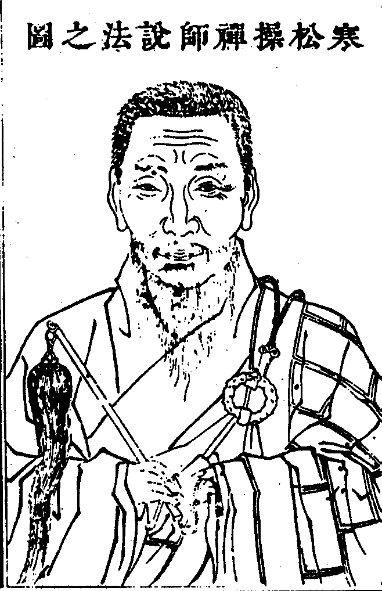
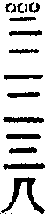
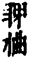

# 寒松操禅师语录



> **藏经**：嘉兴大藏经（新文丰版）（嘉兴藏）　**册次** 第 37 册（J37）　**编号** JB392　**部类** 诸宗部　**卷次** 20 卷　**篇幅** 175,382 字

> **作者（译者）**：嗣法门人德昊编录、嗣法门人德璨编录、嗣法门人德现编录、嗣法门人德麟编录、嗣法门人德圣编录、嗣法门人德▆编录、嗣法门人德泰编录、嗣法门人德润编录、嗣法门人德玉编录

> **卷／品**：20 卷 · 6 品



---



## 目录



  - [寒松操禅师语录序](#寒松操禅师语录序)

  - [寒松操禅师语录序](#寒松操禅师语录序-1)

  - [序](#序)

  - [自序](#自序)

- [第十九卷九](#第十九卷九)

- [寒松操禅师语录卷第一](#寒松操禅师语录卷第一)

- [寒松操禅师语录卷第二](#寒松操禅师语录卷第二)

- [寒松操禅师语录卷第三](#寒松操禅师语录卷第三)

- [寒松操禅师语录卷第四](#寒松操禅师语录卷第四)

- [寒松操禅师语录卷第五](#寒松操禅师语录卷第五)

- [寒松操禅师语录卷第六](#寒松操禅师语录卷第六)

- [寒松操禅师语录卷第七](#寒松操禅师语录卷第七)

- [寒松操禅师语录卷第八](#寒松操禅师语录卷第八)

- [寒松操禅师语录卷第十](#寒松操禅师语录卷第十)

- [寒松操禅师语录卷第十一](#寒松操禅师语录卷第十一)

- [寒松操禅师语录卷第十二](#寒松操禅师语录卷第十二)

- [寒松操禅师语录卷第十三](#寒松操禅师语录卷第十三)

- [寒松操禅师语录卷第十四](#寒松操禅师语录卷第十四)

- [寒松操禅师语录卷第十五](#寒松操禅师语录卷第十五)

- [寒松操禅师语录卷第十六](#寒松操禅师语录卷第十六)

- [寒松操禅师语录卷第十七](#寒松操禅师语录卷第十七)

  - [王孝子序](#王孝子序)

  - [自序](#自序-1)

- [方外英华(原版存吴江今收入全录卷第十八](#方外英华原版存吴江今收入全录卷第十八)

- [寒松操禅师九峰艸(原版藏吴江今收入全录卷第十九](#寒松操禅师九峰艸原版藏吴江今收入全录卷第十九)

- [寒松操禅师拈来艸(原版藏礼庵今收入全录卷第二十](#寒松操禅师拈来艸原版藏礼庵今收入全录卷第二十)



---



寒松操禅师说法之图







赞



鹫岭一华，嵩山五叶，代转金轮，递翻珠㲲。青原南岳，甘露扬镳，杖横兔角，拂竖龟毛。瑞百二翁，模范天降，乳滴曹谿，为时龙象。首得寒公，作大导师，酬机烁电，出语成词。开法青龙，宗风独唱，泖水波澂，昆峰月朗。锡飞国岫，大振全提，狼突鸱张，彼何人斯？师顾嗒焉，浮云敝屣，让而不户，古善卷子。虽隐安乐，守塔志坚，冒险筑室，孝义两全。苍弁屡邀，席继祖苑，尘垢金刚，秕糠铁面。乔松千丈，斗南一人，凛矣高秋，盎焉熙春。



荆溪法弟子陈维崧顿首赞



------



### 寒松操禅师语录序



方今教外别传之书，流为世间，何啻千万？识者忧其多而不可程也。余独以为不然。盖佳言玅句，并非文字，无丝毫意识之可寻，故古之今之，金声玉振，放之弥纶宇宙，收之不存涓滴，千灯千照，皆可以存其心、养其性，寒松大师盖其人矣。师神充气浩，眼正心空，系洞宗正传第三十世瑞老人之冢孙，百和尚之嫡嗣也。屡迁名刹，倒卓乌藤，启天下之聋聩。其垂手年深，机辨纵横，云蒸霞变，四方问道者接踵而至。其一言半句，如珠在渊、如宝在山，虽欲隐藏沉痼，讵可得耶？信乎！佳言玅句，照世明灯，开人心目，岂小补哉？



虞山钱谦益沐手拜撰



达磨西来，原无文字，厥后宗师曲垂方便，故有法宝流传，正谓道本无言，因言显道，棒头有眼，机用全超。寒松和尚出世多年，宗风大振，高悬宝镜，照彻十方，拈一条棒，尚无佛祖；开两片皮，岂有渗漏？是以横说竖说、正说倒说，如世宝翁信手拈来，取之不竭、用之不穷，俾大地人虚往实归，无不获益。虽然，毕竟家珍在於何处？读是录者，请下一语。



山阴祁熊佳拜手敬题



------



### 寒松操禅师语录序



今天下衣伽黎而坐曲录者，大江以南盈数百家，求其不坠前人风烈，为当世之所推许者，盖未可以仆数，今於寒松和尚屈一雄指焉。忆昔入就老人住百丈，自余与百兄数人扬历座下，於时象蹴龙踏，人人以古道自期，曾几何时，而诸兄皆作先哲矣。余以衰迈无似，闭户穷山，虽祖灯麤成，而邪说未息，思得英杰十餘辈与之并力撑拄，则亦可以上报先宗、下接后学慧命，而四顾寥寥，莫为之应，中夜抚膺，百感交集。幸斯道未丧，尔者寒公与一二同人振拔於吴、越、江、楚间，於是望玉笥峰头渐有喜色，而寒公七坐名蓝，炉火轰烁，犹为四方之所奔趋，有投子、大慧风烈，祖武箕裘，真堪不媿。其语录具在，读之者自能辨其机用也。寒公住善权时，遭法门大故，而一杖飘然，如弃传舍，至今义兴士大夫多其高风。昔人论文章必及其人品，余於兹录亦云。



庐陵偶道人净符题於钱塘之白嵒山中



寒松操禅师语录目录



像  

赞



------



### 序



开堂疏  

第一卷住松江青龙隆福禅寺语录



第二卷再住松江青龙隆福寺语录



第三卷再住松江青龙隆福寺语录



第四卷住常州国山善权禅寺语录  

住安庆白云山香炉寺语录



第五卷住安庆宝严山云际寺语录  

再住常州国山善权寺语录



第六卷住常州荆谿安乐禅院语录  

住常州洞山善卷礼庵语录



第七卷住湖州弁山龙华禅寺语录



第八卷再住安庆白云香炉寺语录



第九卷▆▆▆▆▆▆▆▆▆▆▆



第十卷座元寮秉拂语录  

机缘问荅



第十一卷普说



第十二卷拈颂古



第十三卷拈颂古



第十四卷源流宗旨颂



第十五卷佛事



第十六卷笔语



第十七卷题赞  

杂著



------



### 自序



第十八卷方外英萼



------



## 第十九卷九



第二十卷拈来艸



青龙开堂疏



伏以五叶花开，嵩岫并敷於鹫岭；千流派涌，洞源大演於龙江。后五百年而再逢，实千万载之希遘。恭惟寒翁大和尚猊座下，桐谿踵迹、梅坞韬光。道业深渊，探泗泓之正脉；机投直指，得弁岳之真宗。足福足慧足英才，峙泰衡於宇内；全彰全收全妙用，罗星斗於胸中。敬承奕世箕裘，振起传家衣钵。惟此青龙古刹，首称唐宋名蓝。性空师弄月吹云，铁笛之餘音犹在；百和尚敲风打雨，乌藤之正令森严。凤起蛟腾，才见禅林美盛；锡飞杯度，又闻主席空虚。若非入室白眉，莫整高贤之矩；必也超宗异目，能承前哲之风。悬宝镜而罔象失威，秉吹毛而野干碎胆。庚等儒门樗栎，凡世菲葑。蹭蹬宦途，已醒浮华之梦；优游法海，将求解脱之方。输玉带於无言，何妨机钝；呼瓶鹅而随出，尚荷慈深。惟冀俯念愚蒙，即垂久可。幢幡影动，一天花雨蔽空来；龙象声喧，满迳香尘随步涌。欣法轮而大转，喜佛道以兴隆。草木含辉，结彩云於越峤；湖山增色，布紫盖於吴天。异口同音，引领合掌。谨启。



顺治十七年三月十三日，云间(包尔庚　诸嗣郢)等疏。



国山开堂疏



伏以洞水汤汤，千古渊源开胜地；国山奕奕，三生功业刱名蓝。欲继志以光前，必丕承之有后。恭惟寒翁大和尚，克家麟趾，弘道马驹。一柱砥中流，挽颓波於叔季；十年撑法社，缵贻绪於艰危。试之彼而有然，施於此宜更效。兹善权禅寺，肇自唐朝；列祖风规，隳於近代。致使野狐山鬼，清昼跳梁；遂令偃柏雷书，终朝失色。乃明监院初开草昧，驱豺虎而剪荆蓁；迨百老人大振纲宗，坐狻猊而趋云水。擅东南一方之胜，增唐宋三李之光。辣掌狞拳，方破众生之梦；双林只履，倏归震旦之灵。虽继席再易其人，寸木难支大厦；而阐法久虚上座，两期已闭香厨。问鼎潜谋，辄垂涎於旦暮；彻桑良策，期御侮於高明。敢邀锡杖西飞，慰父心以承父业；试看铁轮高运，膺天眷以护天人。曜等赋性凡愚，皈心虔切。愧乏黄金布地，敢居护法之伦；幸有赤胆包身，愿执降魔之杵。伏愿俯从众志，式肯遄来。青龙兴而善权又兴，箕裘迭绍；子孝著而宗风益著，花叶重芳。殿阁千寻，腾宝光於午夜；松楸十里，分翠色於诸天。仰冀丙原，可胜寅肃。临启无任悚切翘勤之至。谨疏。



康熙十年四月十三日，荆溪蒋(曜　胤修)等疏。



白云宝严开堂疏



伏以天柱祥麟，趾遍江南而宝珠承足；桐谿威凤，羽仪塞北而珥笔生花。本来文苑奇英，洵是法门梁栋。恭惟寒松大和尚猊座下，子陵遐胤，珊珊丰骨清奇；弁岳正传，晔晔门庭高峻。才优班、马，曾别砚而还山；学富陈、刘，乃披衣而得座。绝六尘而超六相，真能承二桂家风；入三昧而达三明，尽得闹五宗堂奥。法开隆福，一人转亿万刹之规模；席继善权，尺土衍千百年之基业。惟此香炉胜境，元非近代名蓝；云际禅林，尽是唐朝古刹。久矣二山乏主，确乎多载思公。伫瞻道价为尊，启承后烈；遥企德音作范，光耀前庥。玄鹤归来，识得当年风月；青狮逸出，重开旧日云山。秉慧锋而破昏衢，施智烛而辉长夜。然等欲从竺国，若非颠老酬机，莫契忙中省要；有志香山，端赖晦公指示，方知格外真常。冀涉水而攀岩，亦披云而问渡。伏愿弘扬宗旨，祖灯共佛日长明；大展法轮，象力与狮弦并演。黄鹂枝上，龙舒三月皆春；白鹭田中，皖水一天流碧。甘雨时霖于纪极，法雷频响于寰区。化洽人天，功超贤圣。临颖神驰，翘企之至。谨疏。



康熙十一年二月初吉，龙眠(姚文然　程芳朝)等疏。



安乐院开堂疏



隐不择地，岂买山之可安；佛欲栖云，纵泛海而非远。托可中之钵，不必狮岩；结午夜之跏，何须牛首。恭惟寒松大和尚，人天法慧，云海弘慈。入次第之定，五色皆空；游解脱之门，一尘不染。处必争之地，而示以无争；舍罔觉之场，而归於有觉。洵孽海之慈航，乃迷津之宝筏，启嶲等情深顶礼，志切皈依。扫竹枝之舍，暂作旃林；剪罨畫之薇，权充优钵。虽非奈园之胜，亦称鹿苑之精。所朢惠然肯顾，不我遐遗。袈裟布处，顿令大地作黄金；宝锡飞时，俄使凡鸟瞻白凤。则花雨遄飞，法门有庆；祥云普被，善信知归。不胜翘企之至。



康熙十二年腊月十一日，荆溪(周启嶲　储振)等疏。



礼庵上梁开堂疏



恭惟寒大和尚，洞山独秀，岁寒知松柏之尊；龙树同荣，剥复见优昙之贵。被忍辱铠，作大道干城；吹大法螺，为降魔宝杵。当双林之回首，号泣呼天；矢端木之坚心，精诚动地。昆季实繁，独贤劳而建窣堵；折冲丕振，爰高举以避波旬。天道好还，人心思旧。辞百堵之重兴，愿十年而守塔。诛茅辟土，不烦缁素铢锱；筑室开场，尽变青毡基业。今者虹梁建极，凌虚彩结千重；惟祈狮吼震林，普施法音亿丽。合词虔请，众望允归。



康熙十四年四月二十七日，义兴(陈维崧、史惟圆)等疏。



弁山开堂疏



伏以事由律制，似有定而无移；道以时行，每理长而辄就。居恒遵度，犹须方矩圆规；济亟衡权，始克联珠合璧。恭惟寒松大和尚，客宿华宗，曹谿嫡乳。由桐江而傅桐邑，韡鹫岭之一花；自善庆以主善权，振嵩山之双桂。瑞翁奕叶，推弁𪩘之凤毛；百老蕃根，颂泖峰之麟趾。龙冈遥接青龙寺，无非道显龙华；国师谋占吴国山，其柰棋逢国手。虽尔雷书偃柏，名胜销亡；依然山鬼埜狐，诪张奄息。礼庵精舍，以无争而止争；安乐名蓝，悯大觉之罔觉。允矣魔难胜佛，信然正可挫邪。既七坐乎道场，宜一归夫祖苑。惟是龙华片席，实为大厦难支。无禄双林遄返，三年之案未圆；犹欣巨植久岿，一柱之擎有在。斯等敬遵公议，不敢私图。人惟求旧，既山主之心同；条聿维新，亦诸方之志一。虽复筑场念切，欲嗣端木之儒风；其如请法意诚，宜赴华林之大任。伏愿龙安飞锡，庶几祖业孙承；鸥适渡杯，咸使肯堂复构。得蒙俞允，实慰翘勤。谨启。



康熙十七年腊月初吉，吴兴(严我斯　丁珝)等疏。



------



## 寒松操禅师语录卷第一



**译者**：嗣法门人德昊编录



住松江青龙隆福禅寺语录



师於顺治庚子春，即座元寮，受请主院事。



佛殿。「黄阁帘垂，正不居正；紫罗帐启，偏不坐偏。正当恁麼时，还是正耶偏耶？虚空开口笑，子午不相冲。」



伽蓝。「正大光明绝覆藏，护持法席作金汤，昔年弘誓深如海，今日聊为𦶟炷香。」



祖堂。「者夥老古锥，何异绿林客？争怪后代人，捉尽伊败缺。未审以何为证？」喝一喝，云：「狮儿一吼祖翁尽。」



方丈。「宝镜高悬，活捉九苞之威凤；神锋倒握，生擒独角之祥麟。此是吾老人土苴绪餘，祇如山僧到来又如何施设？」卓拄杖，云：「看取令行时。」



老和尚命送衲衣法帔至，开堂。拈疏：「一点一畫，锦绣辉煌；一字一行，珠玑宛转。展开则魔魅潜消，收藏则正法久住。若作佛法商量，埋没自己；不作佛法商量，辜负现前。毕竟如何度疏？与维那试念念看。」



法座。「须弥灯王从空放下，新来长老特地升高，不是神通玅用，亦非法尔如然。」顾左右，云：「高著眼。」遂升。



拈香。「此一瓣香，在天同天，在人同人，𦶟向炉中，供养释迦文佛、历代祖师，惟冀法灯无尽，法雨恒飘。此一瓣香，秉天地之正气，惟德惟馨，萃日月之精华，乃圣乃神，端为祝延皇帝万岁万岁万万岁，钦愿永建皇极於域中，万邦效顺；覃敷五福於海外，兆姓讴歌。此一瓣香，运丝纶於掌上，治国兼以治心，敛法界於毫端，选官因而选佛，奉为满朝文武、府县宰官、遐迩绅衿、本山檀护，惟冀心广恒来留玉带，名高长得覆金瓯。」复怀中出香云：「此一瓣香，数千里外拨草瞻风，十餘年来霜侵雪冻，拶得通身骨露，犹遭暗地拳伤，满腹无明一朝拈出，端为疁城古昭庆寺堂上洞宗正传第二十九世百愚斯老和尚，用酬法乳之恩。」敛衣就座。紫谷大师白椎云：「法筵龙象众，当观第一义。」师云：「正令全提，十方坐断，大座当轩，了无回互，果是真龙象，不妨蹴踏看。」问：「曹源一滴，洞水分流，向上宗乘如何举唱？」师云：「九峰叠翠涌千江。」进云：「出格人来又作麼生？」师云：「痛与三十棒。」进云：「青龙现瑞金毛吼，佛日高辉万古传。」师云：「莫涂污他好。」乃展衣帔，云：「若论此事，本自现成，觌面拈来，丝毫不隔。辉增三泖之光，湛湛一壶风月；彩夺九峰之秀，澂澂满目云霞。打成一片时，针劄不入；罗纹结角处，线路难寻。古佛堂中曾无异说，流通句内却有多谈，百千年来绍续不易，直得异兽珍禽同现遮那之玅相，机丝文彩共转根本之法轮，乐助无为，咸扬至化。大众会麼？」良久，云：「一气不言含有象，万灵何处谢无私？」起身叙谢，云：「某愧薄福，自揣无能，忝居众首，实不知量。叵耐师命及诸檀那时相怂恿，屈升此座。伏念樗木庸材，奚堪大任？但因长者有命，只得欢喜奉行。今则开堂祝圣，一期佛事幸已云周，所冀尧风浩荡，舜日长明，在筵诸公世世证无生之旨，见前知识处处建最胜之幢。有烦久立，伏惟珍重。」复举：「世尊初成正觉，於鹿野苑中转四谛法轮，憍陈如比丘最初悟道。山僧初会开法，於青龙寺里祇转者个○法轮。还有最初悟道者麼？设有，也须痛棒趁出。」复白椎，云：「谛观法王法，法王法如是。」下座。



当晚，小参。「人人衣线下有片田地，旷大劫来曾未欠少，只因向声色门头逐物迷己，年深月久，不觉不知失却祖券了也。不见隆福旧基实乃唐宋古刹，性空铁笛韵响於云间，道者法华莲生於兜率，元明以来菽麦不分，变琼瑶而成顽石、化宝所而作荆榛，赖吾老人应时杰出，脱珍披敝、激浊扬清，拈起镢头顿使镢头起舞，抛开瓦砾直教瓦砾放光，种种玅用处处提撕，无非发明者片田地而已。汝等诸人要识者片田地，正好铲其声、削其迹、折其堑、去其篱，了无尔我之情、不留彼此之念，忽然踢破指头，元来只在者里。虽然，更须知守成不易始得。何故？雪后始知松柏操，事难方见丈夫心。」



立两序，上堂。「孤掌难鸣，众擎易举，矮师叔常听法於香严座下，老三圣曾推僧於宝寿堂前，典型在迩，景行可观，若古若今，事同一致，苟非公谨廉能之士难以承当，必也尊上爱下之心方堪委任，到者里说甚高庵出世、七人为辅、今古名闻者哉？」卓拄杖，云：「正恁麼时，毕竟如何话会？大家齐出手，扶起破砂盆。」



圣节，上堂。「大哉乾元，万物资始，钧陶有象，垂拱无为，是谓天中之天、圣中之圣。且道全身奉重如何举扬？」竖拂子，云：「长将日月为天眼，指出须弥作寿山。」



上堂。「祖意分明在目前，何须向外觅言诠。菜铺一片黄金地，麦涌千层碧玉天。香飞幽谷兰初放，丝拂长堤柳乍眠。六相迥然离向背，三玄裂破没中边。须领略，莫浪传，月出连山露半边。」



上堂。问：「荆棘丛生三二五，是谁行履处？」师云：「手执金鞭问归客，夜深谁共御街行？」进云：「烟云罩径孰能寻？寻即错过，不寻转失，如何免得？」师云：「将谓少林消息断，桃花依旧笑春风。」进云：「乌鸡冒雨冲阳燄，还是正耶？偏耶？」师云：「梅落珠帘寂，香销石鼎寒。」进云：「赤𬟽穿楼和哑音，明今时事那畔事？」师云：「木鸡啼子夜，铁凤叫天明。」进云：「广泽芦花藏雪密，不是一色边事，作麼生会？」师云：「雪覆万松径，游人仔细看。」进云：「收纶钓艇弄湾深，不犯清波如何抛掷？」师云：「谿边杨柳影，不碍钓舟行。」进云：「当轩黯黯无秦镜，正恁麼时如何辨的？」师云：「夜深方见把针人。」进云：「散发齐眉下翠岑，古人到此为何站脚不住？」师云：「坐却白云宗不玅。」进云：「谢师荅话。」师云：「投子道底。」乃云：「荆棘丛生三二五，手执灵符司正令，烟云罩径孰能寻？夜深几个知名姓？乌鸡冒雨冲阳燄，龙楼人醉凤楼春，赤𬟽穿楼和哑音，汉时客佩秦时镜。广泽芦花藏雪密，玉钩倒挂水晶帘，收纶钓艇弄湾深，白额转藏欹石磴。当轩黯黯无秦镜，一片雄风仔细看，散发齐眉下翠岑，异中来也谁深醒？诸昆仲！古人道底与青龙道底，其间还有优劣也无？少年一段风流事，祇许佳人独自知。」



佛诞日，众沙弥剃度，上堂。「今朝四月八，咄哉小悉达，脚根立不牢，弄巧反成拙。争如大地人，个个咸超越，愤志入无为，辞亲将爱割。飘然来青龙，恳求落须发，说甚度双亲，九族苦亦拔。更听吾一言，慎勿看轻忽，出家果如初，毕竟成上哲。」喝一喝，云：「放下著。」



上堂。竖拂子，云：「摩尼珠，人不识，如来藏里亲收得。大小永嘉分别不少，只此一珠，若凡、若圣，若俗、若僧，隐现青黄，从心所欲，阿谁无分？岂特如来藏而已哉？」复竖拂，云：「大众！还识摩尼珠麼？罔象到时光灿烂，离娄行处浪滔天。」



诞日，上堂。「潦倒行年三十五，法门惭愧毫无补，频开太岁头边土，气寰宇，惯把三更打日午，大众慇懃求法乳，无端请作主中主，好看放出玄沙虎，吞佛祖，谩道为人太莽卤。」喝一喝，下座。



开炉，上堂。「安居树下，何殊管见之流？面壁岩前，大似斗筲之辈。争如我以天地为炉鞴、日月为炭墼，拄杖化为文殊、普贤，拂子变作观音、势至，巡香底巡香、值日底值日、洒扫底洒扫、搬运底搬运，时刻在诸人眼里、耳里出出入入，你且看他图个甚麼？若简点得出，许你参学事毕。」复举：「法昌遇禅师云：『法昌今日开炉，行脚僧无一个，惟有十八高人缄口围炉打坐。』后福源琪长老云：『福源今日开炉，炭墼也无一个，五湖四海禅和衲被蒙头打坐。』怪哉！二冻侬半斤对八两。山僧则不然，青龙今日开炉，亲切无如者个，任从睡卧经行，何必拘拘打坐？」喝一喝，云：「看脚下。」



至法华庵，请上堂。「湖山高卧枕清流，目视云霄十有秋，天霁晓来风力便，一帆练水泛轻舟。云冉冉，水悠悠，满载云霞任去留，不似明州憨布袋，祇观风色下金钩。还有跃浪锦鳞麼？」挥拂，云：「收。」



上堂。「一心不生，万法无咎。真空绝迹，大智非明。至道无为，灵源独耀。向上一路，千圣不传。学者劳形，如猿捉影。若谓即心即佛，何殊畫饼充饥？更云非佛非心，不啻望梅止渴。毕竟如何即是？若不打从山下过，怎知鹤唳与猿啼？」



至日，上堂。「昨夜冷灰里一粒豆爆，将升僊台打失了半边，惊得王可交手舞足蹈，鼓腹而歌：『玅矣哉！玅矣哉！岸容待腊将舒柳，天气冲寒欲放梅。』忽被陈那尊者震威一喝，云：『此是甚麼所在，作者般语话？殊不知我衲僧家顶门上时时一阳来复，脚跟下日日万汇发生，似你者等呵寒向热、逐境生情者，岂可同日而语哉？』如是，可交僊人直得满面惭惶而退。是汝诸人还信得及麼？此言如不信，更请问庖羲。」



朱护法得子，请小参。「好个仲冬十五，消息现前谁睹？冉冉谿云半滩，羃羃松烟一坞，晓风散作七片、八片，细雨织成三缕、五缕，端是成家镃基，会得迥超今古。何须东鲁诗书？怡然气冠寰宇；何必西来旨趣？卓尔口吞佛祖。诚为跨灶之裔，谅必绳其祖武。且道：具甚威光便乃感应如许？皇天无私，惟德是辅。」



监寺请升座。「至道无难，惟嫌拣择。但莫憎爱，洞然明白。尧舜帅天下以仁，而民从之；桀纣帅天下以暴，而民从之。养老归吕夷，流言诛管蔡。齐女展两家之袒，纪妻变一国之俗。里名胜母而不入，邑号朝歌以回车。备头陀常取鱼於浩渺，则监寺独求火於丙丁。未审还是拣择耶？憎爱耶？试听一颂：日长闲打坐，夜静却经行。一阵西风起，满林落叶声。拣不拣，憎不憎，风光满目皆成现，奚待当年问丙丁。」



腊八，上堂。举：「古德云：『腊八吃鸡羹，才疑祸便生，谿边杨柳影，不碍钓舟行。』后杰峰和尚云：『古人与麼道，大悟不拘小节，未免与贼过梯，引邪入正。与国则不然，腊八吃红糟，丛林意气豪，酣酣沉醉倒，更不惹风骚。』看来两个无孔铁锤，何异普州人事青龙？也不吃鸡羹，也不吃红糟，亦无祸可生，亦无气可豪，惟有由拳善信，年年此日设斋表嚫，兼请举扬，也有少许。腊八吃香斋，禅和颇快哉，一饱无餘事，不用更安排。」



上堂。问：「祖意西来即不问，洞上宗风事若何？」师云：「宁可截舌，不犯国讳。」「如何是正中偏？」师云：「畫堂宝鼎起青烟。」「如何是偏中正？」师云：「玉案香销金鸭冷。」「如何是正中来？」师云：「赤脚波斯下钓台。」「如何是兼中至？」师云：「龙吟虎啸看雄势。」「如何是兼中到？」师云：「佛与众生一齐扫。」进云：「曾向龙门浪里过，今日方知沧海宽。」师云：「饶知浩渺无涯际，也须入水见长人。」遂竖拂，云：「只者个本来无名，天地以之而生，万物以之而育。」横按拂，云：「名可名，非常名，名既非实，体亦寂然。」击香几，云：「无中生有，有中生无，名言不滞，纤尘不染。」搭肩上，云：「杀活同时，照用齐彰，通宗通途，挟带挟路。」拂一拂，云：「有无不立，能所双忘，佛祖莫知其由，凡情罔测其际。」放下拂，云：「是正耶？偏耶？兼带耶？宁可截舌，不犯国讳。」



除夕，小参。问：「正恁麼时如何？」师云：「法鼓三通请除夕。」进云：「除夕后𫆏？」师云：「畫蛇何必重添足？」乃云：「正当恁麼时如何？法鼓三通请除夕，猛然特地起春雷，一众堂堂赤骨立。既尔大家知此时，畫蛇何必重添足？」



天成披剃，请上堂。「柳窥白日，堤边翠影婆娑；梅笑清风，云外暗香浮动。一溪流水，调鍾子之宫商；数亩幽篁，奏伶伦之律吕。历历真机独露，堂堂祖意分明。於此会得，不剃发而僧相周圆，不登坛而尸罗具足。说甚出家乃大丈夫事，非将相之所能为。无劳弹指，直下超凡入圣去也。且道因何所致？博尽世间黄金，难买主张自肯。」



解冬，上堂。「九旬把住咽喉，今日解开袋头，放出神晴鬼面，趁起沩山牯牛。潇洒峰前溪后，纵横柳巷花楼，踏翻百亿香海，踢倒四大部洲。忽遇庖丁游刃，如何免得其忧？若还无计可脱，不如直下且休。休不休？随缘水草消闲日，免被花灯换两眸。」



上堂。「万顷波澂三泖月，独照无私；千重翠锁九峰云，流光靡间。由是真风遍界，大用繁兴，刹刹全彰，头头显露。入廛垂手，变大地作黄金；返本还源，搅长河为酥酪。且道谁是其人？」喝一喝，云：「无限风流慵卖弄，闲乘一苇泛沧洲。」



晚参。「青龙家法，道出寻常，种田博饭，引水灌蔬，芦䕠夹壁，苇干垂帘，灯有月可待，地有风可扫，瓦有云可盖，席有草可眠，汤不嫌无酱，菜不嫌无油，上不慕於诸圣，下不重於己灵，胜他高梁大厦之家，何殊箪瓢陋巷之乐？贵客缁衣到此，一般如是安排。若还问若：西来大意，除却锄花种荳，更无别物可酬。未审还有为人处麼？少顷到斋堂应供，切忌将饭送在鼻孔里。珍重。」



上堂。问：「如何是金刚宝剑？」师云：「光含万象侵人面。」「如何是踞地狮子？」师云：「声摧海岳惊山鬼。」「如何是探竿影草？」师云：「一点不来命难保。」「如何是一喝不作一喝用？」师云：「白云牵得青山动。」进云：「四喝未彰已前，请师一接。」师打，云：「切忌错会。」乃云：「佛道闲旷，不涉程途；建立垂真，俱非本色。先圣事不获已，乃有四喝之设。上根利士，一举便知；中下之机，幸毋错会。」遂喝一喝。召众，云：「闻麼？即此一喝，世尊拈花也在里许、达磨西来也在里许、正偏功勋也在里许、圆相玄要也在里许、三句六义也在里许、金刚宝剑也在里许、踞地狮子也在里许、探竿影草也在里许、一喝不作一喝用也在里许，以至五车三藏、一切淆讹公案亦无不在里许。」复喝一喝，云：「还会麼？即此一喝，是拈花耶？西来意耶？偏正功勋耶？圆相玄要耶？三句六义耶？金刚宝剑耶？踞地狮子耶？探竿影草耶？一喝不作一喝用耶？五车三藏耶？一切淆讹公案耶？」又喝一喝，云：「即此一喝，拈花也不可得、西来意也不可得、偏正功勋也不可得、圆相玄要也不可得、三句六义也不可得、金刚宝剑也不可得、踞地狮子也不可得、探竿影草也不可得、一喝不作一喝用也不可得、五车三藏也不可得、一切淆讹公案也不可得，祇者不可得亦不可得。正恁麼时，诸人作麼生委悉？」喝一喝，云：「切忌错会。」



金陵王护法诞日，请上堂。竖拂，云：「大众见麼？河上老人坐古槎，合丹祇用青莲花。於此见得，莫道山僧措大相，在宝华王座上诵他好句；於此不见，而今八十犹四十，口道沧溟是我家。」



晚参。「我见瞒人汉，如篮提水走，急急走归家，篮里何曾有？」以拂左击，云：「寒山子！且立者边著。我见顽钝人，灯心柱须弥，蚁子囓大树，焉知气力微？」以拂右击，云：「拾得子！且立者边著。将谓你二人别有长处，遇此顽瞒人境便打不过，讨甚好文殊、普贤？青龙即不然，不受顽瞒不近情，是非荣辱岂相侵？夜深独把香台拍，只有长天识此心。」



大士圣诞，请上堂。「普门大士在杨柳眼中现八万四千烁迦罗首，能以无畏施诸众生，从闻、思、修入三摩地；复舒八万四千母陀罗臂，向空中大书今日诞生四字。大众！点畫既成，毕竟是何格局？既非邯郸楷法，岂是怀素草书？」



洞庭顾护法请上堂。拈拄杖云：「一卓如出水蛟龙，一卓如踞地狮子，一卓尊贵两忘，一卓理事兼备。大众！何为尊贵两忘？试道看。」问：「道即不无，如何是出水蛟龙？」师云：「满天云叆叇。」「如何是踞地狮子？」师云：「到处兽潜藏。」「如何是尊贵两忘？」师云：「当堂慵正坐。」「如何是理事兼备？」师云：「觌面却相逢。」进云：「谢师荅话。」师便打。



上堂。问：「如何是祖师西来意？」师云：「乌藤长七尺。」进云：「意旨如何？」师便打，乃云：「青龙直指祖师禅，不在文章锦绣边，棒下翻身能脱略，长鲸吞月浪滔天。」



晚参。「天欲人人与道谋，肯教佛面每搜求？一瓢道在高於禄，五斗名传贵似侯。生死总成花上露，是非谁识水中沤？寻常莫畜心田草，只恐将来苦未休。」



至集庆寺，众绅衿请上堂。「举一明三，目机铢两，十方坐断，大地全收，犹是钉桩摇橹、抱桥柱洗脚，况复言中取则、句里呈机，何异郑州出曹门，南辕而北辙？殊不知，当人脚跟下一著子，天地不能包其广、日月不能并其明，一言迥脱，独拔今时，尘中作主、化外来宾，虽在途中，不离家舍，是处是弥勒，无门无善财。」拈拄杖，云：「所以者汉，时或撑天拄地、时或带水拖泥，带水拖泥处不妨撑天拄地、撑天拄地时奚碍带水拖泥？一动一静，历无边刹；一语一默，现无边身。是汝诸人作麼生见伊行履处？」卓一卓，云：「城市不堪留锡久，恐惊莺啭畫楼前。」



王思受、李仁甫二居士请，上堂。「金佛不度炉，霜飞炎日满皇都；木佛不度火，陆地莲开千万朵；泥佛不度水，一声铁笛双凫起。惟有真佛屋里坐。」喝一喝，云：「切忌逢人更说破。」



结夏，上堂。「欲了生死大事，莫若参禅为最。宜乎发大信心，必也具大根器。内外迥绝诸缘，精进坚立其志。晨昏莫顾危亡，行坐须加猛利。不分南北东西，休管饱饥寤寐。却将妄想昏沉，并作话头参觑。忽朝扑落虚空，佛祖安敢近视？从教婢使云门，一任奴呼临济。击竹𡎺指拈花，都是眼中著刺。若也不曾恁麼，切忌未会称会。般若虽乃善因，开口莫当容易。八十翁翁入场，真诚非是儿戏。果然顶门豁开，自到古人地位。祇如到后又若何？闲眺飞云自往还，一声长啸惊天地。」下座。



天都胡朝奉为母祝寿，请上堂。竖拂，云：「无量寿佛在此放眉间白毫相光，遍照恒沙国土，演大般若、显大神通、作大佛事，能以方便智慧令诸有情所求皆遂。若也端的，不须动舌，一句圆该；不必求僊，双全福寿。大众！无量寿佛既有如是威德，青龙如何与他作证？」挥拂，云：「恒演重重功德聚，都来显现一毫端。」



上堂。问：「不立功勋机用，如何是曹洞宗？」师云：「金轮诏下紫泥封。」进云：「扫除玄要权衡，唤甚作临济宗？」师云：「铁鞭塞外打雷公。」进云：「打开一字关键，那个是云门宗？」师云：「碧油幢动起清风。」进云：「抛却多方施设，将谁成沩仰宗？」师云：「明星光耀挂苍穹。」进云：「拈去声之与色，以何为法眼宗？」师云：「万象收归一鉴中。」僧礼拜，师云：「还有一宗𫆏？」僧拟议，师便打，乃云：「山僧未出方丈，早已派演新丰，踏翻韶阳斗柄；源穷济水，扑灭大沩火星。骑声盖色，总为诸人漏泄了也。况复升座设问，又且茫然，只得再请几位无情上座为汝诸人发明本有。大众！淞涛滚滚，环古寺而报春回；宝殿巍巍，镇龙江而分夕照。浮图秋月，或暗或明，自是清辉不夜；静夜闻钟，似无似有，从教梦破幽人。鞭泥牛，耕平田之烟雨；驱木偶，乘竹院之晚凉。远望松林，雪霁而瀑泻崖头；近看桥畔，僧归而锡飞水面。所以，法法阐明个事，头头揭示五宗。明，则事同一家；不明，万别千差。差别且置。」竖拂，云：「祇如五宗还有者个麼？参。」



上堂。「即心即佛，九峰烟雨眉公畫；非心非佛，三泖人家玄宰诗。不是心，不是佛，不是物，人从占波来，却得新罗信。青龙与麼告报，也是金刚与泥人揩背。」



小参。「三分光阴二早过，瓮里何曾走却鳖？灵台一点不揩磨，本自圆成磨甚底？贪生逐日区区去，不风流处也风流，唤不回头争奈何？灵利衲僧有几个？雪窦与麼道、青龙恁麼判，者里担荷得去，便可转天关、回地轴，移南辰、易北斗，黑漆桶望空𨁝跳，黄金圈匝地腾骧，本自不迷，今复何悟？苦乐逆顺、得失是非皆为现行三昧，山河大地、明暗色空总是自己家珍，头头上明、物物上显，有甚禅道佛法之相而可分别者哉？如其未然，更有一偈聊资鞭影：三七工夫一七过，英灵莫与日消磨，迷时祖意东西隔，悟后佛难奈尔何。」问：「未打七时，人人鼻孔撩天；既打七后，为何杳无消息？」师云：「道泰不传天子令，时清休唱太平歌。」进云：「恁麼则澂潭无影像，片月自孤圆。」师云：「夜半一轮千嶂外，韩卢空对影徘徊。」僧拟议，师打出。



端午，上堂。「今日是何时？报道端阳节，文殊忍不禁，善财忙不彻。举头遍界观，弄巧都成拙，争似衲僧家，迥然用各别？鼻不染雄黄，手不捏符诀，笔借须弥卢，墨研沧海渤，一点落虚空，赤口尽消灭。大众道：他凭个甚麼便有如是奇特？」卓拄杖，云：「急急如律令敕。」



李洛文文学得男，福隆请上堂。举：「云门因僧问：『如何是和尚家风？』门云：『有读书人来报。』大慧曰：『读书人既到者里，且如何与伊相见？不是冤家不聚头。』」师云：「云门施格外之机，大慧有超宗之辨，可谓二俱敏手。祇如相见后又作麼生？收拾诗书归旧隐，鸟啼花笑一般春。」



上堂。「拂拂秋风遍九垓，晚香浮动遶僊台，空生无意岩中坐，引得天花动地来。若是玉老师便道：『修行无力，却被神鬼觑破。』须知青龙者里无修无证、无变无迁，拄杖靠壁、袈裟半肩，饥则加餐、倦则安眠，开门七件赖彼人天，不将闲事罣在心田。阿呵呵！但得时无憎爱，也胜平地登僊。」



自省荐慈德璠雪尢，请上堂。「昨夜青龙塔身涌虚空，白鹤江口吞沧溟，从教魔宫瓦解、恶道潜消，业海化为清凉、罪山变作净域。其间若凡若圣、若冤若亲、若男若女，觅福了不可得、觅罪了不可得，觅生了不可得、觅死了不可得，觅净了不可得、觅秽了不可得。只此了不可得，都卢是个大圆镜智，未审陈氏安人又在甚处行藏？」良久云：「金轮不隐的，遍界绝红尘。」



上堂。「世尊拈花，净地撒沙；迦叶微笑，转眼失照；香严击竹，妄通消息；灵云见桃，鱼鲁刁刀。者夥龙鍾老儿总是倚草附木，有甚交涉？」拈拄杖，云：「争似者个孤迥迥、峭巍巍？有时恁麼，贤愚并爱，愈老愈亲；有时不恁麼，扣人见血，又道慈悲；有时恁麼中不恁麼，放出南山鳖鼻，咬杀长沙大虫；有时不恁麼中却恁麼，青山绿水闲终日，明月清风富一生。大众！正恁麼时如何？」卓一卓，云：「手指空时天地转，回头石马出纱笼。」



晚参。举：「同安丕禅师因僧问：『如何是和尚家风？』安云：『金鸡抱子归霄汉，玉兔怀胎入紫微。』曰：『客来将何祗待？』安云：『金果朝来猿摘去，玉花晚后凤衔归。』」师云：「同安家风太煞尊贵。有问青龙：『如何是和尚家风？』但云：『漏笊篱捞无米饭，破砂盆捣烂生姜。』『客来将何祗待？』曰：『饥餐渴饮浑无事，听雨闻风倦打眠。』」



解夏，上堂。「荏苒韶光春复秋，伶俜何事屡闲游？家财无托谁堪惜？幸有清风为解愁。大众！祇如愁作麼生解？高楼曾听歌声好，你若无心我便休。」



诞日，上堂。「自出娘生皮袋，一杖翛然物外，悟得未生已前，触著虚空粉碎。不知诏笑逢迎，不解看经礼拜，须眉长带烟霞，袈裟深染沆瀣。有为翻作无为，贵买何妨贱卖？摊向十字街头，问有谁来话会？且喜宝塔僊台，共证此个三昧。且如何是此个三昧？参。」



上堂。「父母所生眼，悉见三千界。且道非非想天，几人坐卧？」代曰：「本来无位次，不用更安排。」



弥勒佛，开光，上堂。「今佛放光明，助发实相义。」以拂子畫○相，云：「拂放光矣。作麼生是实相义？」复畫⊙相，云：「发实相义矣。如何是放的光明？者里见得人人顶门上有尊古佛，三身、四智、五眼、六通、三十二相、八十种好，无量恒沙功德常在六门，放光动地，照古明今，转大法轮，作大佛事，示教利喜，一切天龙八部、人非人等异口同音而作言曰：弥勒真弥勒，分身千百亿，时时示时人。还有道得末后句者麼？」



> (弟子德费，备资敬刻  

> 　方丈和尚语录第一卷。普愿佛日增辉，  

> 法轮常转，般若智以现前，菩提心  

> 而不退。)



------



## 寒松操禅师语录卷第二



**译者**：嗣法门人德昊编录



再住松江青龙隆福寺语录



师於康熙壬寅春受请，至上元后六日，当道绅衿送入方丈。「旧主人登新丈室，重来新整旧生涯，不向言中分玉石，肯从棒下验龙蛇。」顾左右云：「你道毕竟有甚长处？辨的不须悬白泽，森罗何处避菱华？」



开堂拈疏。「大地研为墨，虚空打作笺，才写上大人，遂成丘乙己。若是化三千，便可知礼也。」



法座。「毘耶借居，干求分外；多宝分座，行履非然，何似我为法王，於法自在？」遂升座。



拈香。「此一瓣香，明同日月，德合乾坤，𦶟向炉中，端为皇上祝延圣寿。伏愿虹瑞兆祯祥之庆，箕翼长明；洛书锡中外之休，地天交泰。此一瓣香，为云为盖，为翰为屏，奉为莅省公侯、牧民宰执、本山檀护、阖郡绅衿，惟冀教家成国，学佛知儒。黄河再清，师圣人於百世；法幢高竖，标梵刹於诸方。此一瓣香，廓尔圆明，收来旷大劫远；灵知静玅，放去周遍恒沙。今对人天重为拈出，供养中兴隆福堂上传洞上正宗第二十九世百愚斯老和尚，不图报德酬恩，只贵知源识本。」就座，白椎竟，师云：「祇者第一义，适被卤同门一椎粉碎了也，直得普天匝地、满眼满耳。还有识得者消息者麼？出来道看。」问：「昔继龙江登此座，朝来复就事如何？」师云：「金钩再掷江湖阔。」进云：「此是门庭施设，如何是复就底事？」师云：「玉管仍吹日月长。」进云：「龙得水时添意气，虎逢山势长威狞。」师云：「知音不必频频举，达者须知暗里惊。」乃竖拂，云：「一番提起一番新，收放全凭个里人，不是渠侬重出令，祇为消息要分明。所以，黄面瞿昙於华严会上，双垂两相，布七处之慈云；二始同时，施九会之法雨。复於灵山一曲高唱阳春，金色头陀破颜微笑，也祇为者个消息。竺乾四七、震旦二三，器器相投、声声相和，奏绝听之希韵、发太古之清音，也祇为者个消息。由是青原派大、南岳风高，二传至於洞山，五位权分，语脉浑无渗漏；一音大阐，宫商不犯纤毫，也祇为者个消息。更乃调入云居，引来凤栖、凤岭；机契同安，端的龙生、龙儿。三世至於鹿门觉祖，万寿流芳、宝翁续燄；十四传於慈舟念公，大启云门、高撑石伞，重赓新丰古调、再扇灵鹫真风，也祇为者个消息。自此瑞产桐谿、绳其祖武，横拈铁笛而师旷失聪、倒握吹毛而野干碎胆，九坐道场、十会说法，也祇为者个消息。幸出吾师善继善述，黄钟大吕远彻寰区、卫响郑音遏绝云外，屡开法於巨刹、常垂钓於龙江，也祇为者个消息。」挥拂，云：「昔继龙江登此座，朝来复就怎敷扬？金钩再掷江湖阔，玉管仍吹日月长。」复举：「青原思禅师因僧问：『如何是佛法大意？』原顾僧，曰：『庐陵米作麼价？』」师云：「青原只解享太平家业，不能复上古淳风。有问山僧：『如何是佛法大意？』但云：『青龙载住圆前案。』且道与古人是同？是别？」复白椎，下座。



康熙改元，上堂。「宝位才登，千山拱秀；纶音时降，万派朝宗。正恁麼时，直得黄河清彻，臣退位以朝君；白日流辉，子转身而就父。山林泉石，共沐恩光；草木禽鱼，咸沾膏泽。然此犹是圣主御世边事，若夫就之如日、望之如云，尽大地人无启口处。」



立监院，上堂。「尊上敬下，理无二致；为人为己，事同一心。能如是也，正好作而无作、为而无为，捏双空手要与八大龙王斗富，令他虚而往、实而归。山僧落得半衫半履，或濯足於淀湖，坐看云流水逝；或弹冠於昆岫，闲吟月白风清。并不问庐陵米作麼价，亦不说三十年不少盐酱。毕竟如何？自有天成监院在。」复举：「龙牙云：『天下名山到因脚，辛苦年深与袜著，而今老大不能行，手里把柄破木杓。』惭愧！青龙却不与麼，自下桐城走赤脚，遍参皆为者一著，而今虽任住持劳，管甚笊篱与木杓？大众！且道其中意作麼生？端坐受供养，施主常安乐。」



韦驮圣诞，吴氏望檀护祈嗣，请上堂。竖拂，云：「韦驮菩萨来也，拂子头上诞生，香烟堆里垂手，童真示现，普眼遥观，转大根本法轮，说甚深修多罗，使未信解者令得信解、未承绍者令得承绍，一音演唱，随心所解，天人群生类皆承此恩力。大众见麼？纵饶见得，道他露柱怀胎，是男？是女？」掷拂，云：「大好消息。」



上堂。僧问：「现前佛法即不问，如何是转位就功？」师云：「无影枝头花烂熳。」「如何是转功就位？」师云：「百花丛里绝芬芳。」「如何是功位齐彰？」师云：「钟声古殿排班早。」「如何是功位俱隐？」师云：「月落苍梧彩凤翔。」进云：「青龙宝镜明如日，照彻威音那畔天。」师云：「莫涂污人好。」乃云：「无影枝头花烂熳，百花丛里绝芬芳，钟声古殿排班早，月落苍梧彩凤翔。个中事，好参详，威音那畔真消息，觌面分明绝覆藏。」



小参。「柴米油盐酱酢茶，般般俱在别人家。不消活计希求得，且看莲开数朵花。」



诞日，汪护法保男福慧请上堂。「法筵龙象众，当观第一义，时闲已举扬，今特重指示。」拈拄杖，云：「祇此顶天立地，迈古超今，不假功勋，宁容修证？巍巍乎冈陵，无以同其高；洋洋乎江汉，无以喻其广。尊贵中之尊贵，相承佛祖家风；异常中之异常，克绍人天种智。延一刹那而为无量，迥出机先，不堕诸数。」卓一卓，云：「大众会麼？不是渠侬多意气，他家曾踏上头关。」问：「时已龙象蹴踏，今又法雨天华，其间消息是同是别？」师云：「灵根已结千年瑞，玉树今开八月花。」进云：「恁麼则两彩一赛。」师云：「言前无的旨，句后莫追寻。」



开炉，上堂。问：「弘开炉鞴，煆凡炼圣，漫天布网，打凤罗龙。倘遇罗笼不得底，如何相接？」师云：「揭开万里神光，提出倚天长剑。」进云：「东西不住、南北不停者怎生款待？」师云：「维摩掌中安世界，普贤毛孔著程途。」进云：「总不恁麼来者又如何？」师云：「燄里好看轰霹雳，华飞片雪满乾坤。」乃云：「弘开炉鞴，是铁亦镕、非铁亦镕，揭开万里神光；煆炼圣凡，佛来也扫、魔来也扫，提出倚天长剑。维摩掌中拓开世界，普贤毛孔宽著程途。东方来者东方坐，分付颜子去墨埃饭供养伊；西方来者西方坐，分付易牙烹露葵羹供养伊；南方来者南方坐，分付纯陀炊无米饭供养伊；北方来者北方坐，分付牧女调不湿羹供养伊。总不恁麼来者又如何？燄里好看轰霹雳，花飞片雪满乾坤。」



冬至，上堂。问：「六阴充塞时姑置，万汇昭苏事若何？」师云：「冻云开大野。」进云：「前村深雪里，昨夜一枝开，是何消息？」师云：「春色露千峰。」进云：「不是一番寒彻骨，争得梅花扑鼻香？」师云：「逢人莫错举。」乃云：「云凝大野，明暗奚分？雪霁千峰，正偏互列。把住则六阴充塞，放行则万汇昭苏，以致东廊前、西廊后，灯笼发问，露柱酬机。一个道：一九二九，相逢不出手；一个道：天寒地寒，鸭儿冻得觜匾。双双各称己见，彼彼互相热瞒。不期撞著无位真人，蓦头一掴，直得焰发冰河、笋抽石宝，露柱转身朝禁殿，灯笼沿壁上天台。是汝诸人还识者时节麼？不是一番寒彻骨，争得梅花扑鼻香？」



荐亡，请上堂。「慇懃发愿往西方，为荐夫君请举扬，霞笼碧嶂如缨缀，日照青谿胜锦粧。网列七重为宝盖，莲开九品作慈航，常闻天乐鸣天鼓，静听法音绕法幢。水鸟时时谈玅义，山林处处演真常，本来势至休他觅，自性弥陀全体彰。直下踏翻生死路，不妨随处任行藏。」



小参。「过河须用筏，学道须立志。志不立，难以悟心宗；筏不用，无由登彼岸。看他释迦、弥勒初无他术，只是能笃信立志愿底凡夫耳。然此志此愿大不容易，虽不容易亦未为难，实在二六时中行住坐卧、折旋俯仰之时，一不宜驱昏遣散、二不宜趋静避喧、三不宜穷玄索玅、四不宜舍妄求真、五不宜执有著无、六不宜拣凡择圣、七不宜认奴作郎、八不宜将心待悟、九不宜钻故食涕、十不宜一暴十寒，如是种种难以枚举，不过在一志之坚、一愿之深，念念不忘、孜孜不舍，若人失如意之味相似，愤其志、发其愿、设其计、运其筹，铭之肺腑、刻之神思、形之梦寐、贯之见闻，一刻不获寻之以时、一时不获寻之以日、一日不获寻之以月、一月不获寻之以年，愈不见而愈加精进、益不闻而益加猛利，以至神疲力倦、废寝忘餐，累年积月，正於没下手处无奈何时，蓦然撞著元来在者里，则从前驰求之心不待歇而自歇、过河之筏不待弃而自弃，方知大悟不由人、到岸不须舟者，岂欺我哉？虽然，青龙要问你诸人：既已到岸，因甚却在平地上吃交？」拈拄杖，一齐打散。



佛成道，上堂。「琉璃殿上，宝镜含八表之辉煌；玛瑙阶前，珠帘卷一天之星斗。时时翠影侵人目，夜夜清光照客颜。此时此际，若道一齐悟去，未免落他释迦老子底圈缋。更云：总不恁麼。拄杖亦未肯放过在。到者里，必须苦其心志、劳其筋骨、饿其体肤、空乏其身，直待一旦豁然，方堪相应。正与麼时，要脱他释迦老子圈缋则易，要拄杖放过则难。且道：拄杖有甚长处？」卓一卓，云：「百姓日用而不知者，此也。」



璧苍化士归，请上堂。举：「黄龙禅师云：『世间有五种不易：一、化者不易；二、施者不易；三、转生为熟者不易；四、端坐受供者不易。更有一种不易是甚麼人？』良久，云：『𫆏。』便下座。青龙不似黄龙，虚彰声势，气概全无。世间亦有五种不难：一、化者不难；二、施者不难；三、转生为熟者不难；四、端坐受供者不难。更有一种不难是甚麼人？一犁翠旭蓝田煖，远散朝烟韫璧苍。」



除夕，小参。「诸仁者！即今旧末新交，前际属旧、后际属新，值此还是旧、是新？非旧、非新？若道是旧，则前际已去；若道是新，则后际未来；若道非旧，则后不至新；若道非新，则前不及旧。斯时鹘眼难窥、龙睛罔睹，果是机先明的、格外知归，便可统率三才、枢纽万化，付古今於流水、寄生死於浮云，那管他城上角、窗前灯，旧也得、新也得，孟春来、仲夏至，寒也好、热也好？且道凭甚节目？问取东村王老。」



立春，上堂。拈拂，左击，云：「打著春牛尾。」右击，云：「敲动春牛头。惊起南山鳖鼻，钻入东海蜃楼。寒山却谙此事，拾得大笑不休。且道他笑个甚麼？有意气时添意气，不风流处也风流。」



元旦，上堂。「第一义，面相呈，年新月新日又新。看取村翁歌击坏，太平何必在麒麟？」



解冬，上堂。「九十日内，雷轰电掣，地折天崩，任是释迦弥勒也只得亡锋结舌；九十日外，云开月霁，海晏河清，狸奴白牯一个个放光动地；正当九十日，圣制圆满。又且如何？龙江揭起漫天网，放出金鳞跃浪飞。」喝一喝，云：「看脚下。」



吴民望檀护得男福盈，请上堂：「信为道元功德母，长养一切诸善根。故大禹得帝启，嗣帝位，信帝道有人；逢磨得神光，嗣祖位，信祖道有人；鍾离得洞宾，嗣僊位，信僊道有人。到此果能信得及、见得明，迪世超宗，作当家之种草；绳先启后，续列祖之风规。且道谁是其人？昔日有情来下种，今朝因地果还生。」



雷子开护法诞日祈嗣，请上堂。问：「桂子浮香，松花结秀，此是向上一著，何为庆祝良辰？」师云：「宝掌算回尘点劫。」进云：「黄阁帘垂，文华弗露；紫罗帐合，音信谁通？」师云：「金针绣出玉麒麟。」进云：「长庚晓孕青谿上，丝发黄添畫阁中。」师云：「莫看格外乾坤大，须信寰中日月长。」僧一喝，师便打，乃云：「发明向上一著，方称慧命绵长；洞彻根本几微，始得箕裘克绍。」拈拄杖云：「诸昆仲！见麼？宝掌算回尘点劫，数量宁拘？」卓拄杖云：「闻麼？金针绣出玉麒麟，文华弗露。既而见闻不昧、视听分明，则格外乾坤、寰中日月、山河大地、卉木丛林，无不是自己元辰、当人眷属，奚待发泽而黄、庚孕而瑞，然后为冈为陵、为苗为裔者哉？祇此良辰美景，可谓一举两得，才见松华朝结秀，又逢桂子暗浮香。」



上堂。竖拂云：「凡夫为之有，二乘为之无，缘觉、声闻为之幻有，菩萨当体即空。青龙恁麼也得，不恁麼也得，恁麼不恁麼总得。因甚如此？」挥拂云：「从来泰岱包群岫，自古汪洋纳细流。」



穆堂大师周忌上堂。



「去年今日，坐断青山频点首，满腔心事对孤明。」



「今日去年。放出白云横谷口，几多野鸟尽迷巢。」⊙「穆老来也。霜刃火中全大用，神光脑后拂天开。」○「还识渠麼。两架菱华相映处，光重重又影重重。」●「甚处去也。别有风流弥宇宙，灵枢不易与君寻。」



圆藏经，上堂。「实际理地不受一尘，今世门中不舍一法。」卓拄杖，云：「破微尘，出经卷，三千大千一时震动，所谓动、遍动、等遍动，起、遍起、等遍起，踊、遍踊、等遍踊，震、遍震、等遍震，吼、遍吼、等遍吼，击、遍击、等遍击，乘时於其中间出广长舌、转大法轮，普令情与无情所求如愿。虽然，祇如功圆行满又作麼生？千峰秀色凭谁写？一带澂江古镜开。」



诞日，两序请上堂。「发再易，齿再更，毛三伐，髓三洗，此是维祺之祐，不老之休。禅和子问著，无一人而不洞彻，祇如夜半戒衣亭涌身起舞，升僊台接足欢呼，惊得灵山老衲、蓬岛僊人齐赴青龙，或献云香芝草求佛法者，或献冰桃雪藕供僧众者，尔等王瓜茄子还曾梦见也未？」顾左右云：「切忌错会。」



开炉，张水部诸豸史供法衣，请上堂。拈衣召众，云：「罗纹结角，锦缝联珠，展则龙象钦从，披则人天拥护。」遂搭衣，升座。问：「权司黑帝，令转新条，出格人来，如何相接？」师云：「看取斩新气象，何须格外安排？」进云：「三教临筵，谁是得者？」师云：「在天而天，在人而人。」进云：「个个豁开锦绣乾坤，人人迸出斩新气象。」师云：「学未到明德，莫言止至善。」进云：「蓬壶浪泼三千丈，泗水波腾遍界新。」师云：「慈俭未称玅，争为天下先？」问：「诸方结制，煆圣炼凡，青龙今日如何施设？」师云：「呼来壁上高僧，唤出瓶中鹅子。」进云：「与麼则同一大光明藏。」师打，云：「者个𫆏？」僧喝，师云：「没交涉。」乃云：「权司黑帝，令转新条，煖热丛林，光扬社火。」拈拄杖，云：「大哉！洋洋乎！峻极於天者也。是故，孔圣得之，在明明德、在亲民、在止於至善；文佛得之，在天而天、在人而人、在鬼神而鬼神，非天人、鬼神之所能为；老子得之，见素抱朴、少思寡欲，曰慈、曰俭、曰不敢为天下先；现前大檀得之，智印潜符，秀色夺山川之丽，明珠晃耀，文光射斗牛之墟；合堂清众得之，克期取证，了悟真常，呼来壁上高僧、唤出瓶中鹅子。然即总而别，别则天上人间；即异而同，同则一大光明藏。如是，儒也在里许、释也在里许、道也在里许、行也在里许、坐也在里许。」卓一卓，云：「者个因甚不在里许？一光直透威音外，三教从来续燄中。」



自省、一真二禅德荐父母师长，请上堂。「是法住法位，世间相常住，昨日山花红，今朝庭树绿，日随春去莺还在，景逐时粧葵又开，是常住相耶？非常住相耶？英灵衲子一看看破，不昧本来，百年尽付风吹柳；不违时候，一雨还随山入楼。无古无今、无凡无圣，朝游玅喜、暮觐弥陀，明佛祖觑不破之机、了生死於不干之地，无恩不报、无德不酬。虽然，更有不落阶级，如何举似？转身不踏来时路，撒手虚空外面行。」



冬至，上堂。拈拄杖，云：「德山老人信手拈来，便能壁立万仞，函盖乾坤。」喝一喝，云：「临济小厮信口吐出，亦能横亘十方，截断众流。青龙今日不妨倒行此令去也。」卓拄杖，云：「穿却德山鼻孔，从教枯木华芳。」喝一喝，云：「换却临济眼睛，直使冰河冻解。大众！要识二老麼？」卓拄杖，喝一喝，下座。



腊八，因雪，上堂。「今是佛成道日，纷纷好景盈目，乌盆变作白盆，铁壁顷成银壁，夜来不见满天星，鼻孔眼睛都打失。」喝一喝，云：「脚下痛棒，好与三十。」



元旦，上堂。「月生一，玉历已颁新岁日；一生二，春风还是旧天地；二生三，万象森罗许同参；三生万物，上下四维无等匹。是知天道不言，而品物亨、岁功成也；圣人不言，而百姓亲、万邦宁也。若作新年佛法，则违真；不作新年佛法，则逆俗。一向兀然，犹属儱侗。如何是即真即俗？恭惟两序头首，各各起居多福。」



立春，上堂。「大地阳回翠欲凝，时催春事报工兴，寒消紫塞千寻雪，冻解黄河九曲水。出谷和风声渐煖，丽天晴旭影初升，土牛也有翻身日，岂可为人自不矜？」



罢炉，上堂。「开炉时，眉横眼上；罢炉日，眼上横眉。谩云十地功圆，赢得一肚妄想。知有者，达磨不来东土、二祖不往西天；不知有者，头头觌面错过，迢迢十万餘程。纵向途中荐得，倘遇前关把住，要讨公验，如何解结？苟措手不及，青龙有个方便。」拈拄杖一齐打散。



德芳披剃，请上堂。「年年此日佛诞生，年年此日为升座，循环三百六十周，个事分明休错过。不错过，无影林中红燄飞，不萌枝上清香播，指天指地太郎当，七步周行成话堕。争似回头达本乡？梦幻空华先看破，未举金刀解脱超，未披法服功圆大，不羡当年空道人，绝胜古来刘铁磨。今古寥寥宇宙宽，能有几人知此个？且道如何是此个？僧尼元是女人做。」



诞日，行超披剃，请上堂。「露滴金茎八月凉，发除玉枕半生香，都来甲子浑忘管，别是壶中天一方。果到者般境界，不称觞而庆祝周隆，不越户而出家事毕。」喝一喝，云：「切莫教坏人家男女。」



结制，上堂。「无为至宝，本自圆成。大藏法财，从来具足。良由心王失照，以至识贼司权。撼惑真如，困劳觉性。境风浩浩，凋残功德之林；心火炎炎，烧尽菩提之种。法财遭劫，智宝遭偷。殆在刹那，危在旦夕。青龙不忍坐视，只得相助鼓声。尔等早奉敕於慈悲主，速传令於精进军。向寂灭场内安营，大乘门中训鍊。诚意除邪惑之乱，正心立见性之功。斧荷青原，刀持药峤。旌旗排五位，戈弩布三玄。驰云门之长驱，列沩山之队伍。打禾山鼓於三明岭上，张石巩弓於八正道中。眼不闻声，耳不见色。心心不退，念念向前。伐嗔恚，破三毒，除傲慢，碎悭贪。魔军擒到涅槃城，人我推开生死路。不求治而大地平沉，不求宁而十方安泰。自是惠风和畅，法雨清凉。堪报不报之恩，共助无为之化。然此犹是功勋边事，还有不涉功勋者麼？无劳久立。时寒，珍重。」



元旦，上堂。「龙章才布，家家爆竹庆尧年；凤历初颁，处处桃符迎舜日。夜明帘外，臣退位以朝君；古镜台前，子转身而就父。庭柏司东风之令，垄梅秉青帝之权。皎洁清冰，对乾坤而写鉴；飘飘餘雪，入箫管以成音。罢钓渔人，玅舞清歌於柳陌；市薪樵子，吟风醉月於花街。正恁麼时，毕竟承谁恩力？」良久，云：「一脉春阳回造化，万方民物赖生成。」



入日，上堂。「一二三四五六七，春光争玩灵辰日？七六五四三二一，人马数回鸡犬毕。此是风俗气习，世谛流布。唯青龙者里又且不然，一二三四五六七，当堂不正偏不立；七六五四三二一，时或驱耕时夺食。尔等参玄人，也须明得失。得又得个甚麼？失又失於何物？一年人事看阴晴，万里春风吹吕律。」



元宵，解制，上堂。「连年饥馑，连日滂沱，无美食以供养，无好灯以玩赏。」竖拂子，云：「青龙有一灯，不似鳌山走马，亦非簇锦穿珠，祇是一灯分为千灯、千灯互作一灯，灯灯续彩、燄燄联辉，在天则为日月、在地则为山川、在国则为宪章、在家则为礼乐，在名山大刹照耀檀林、光扬祖道，莫不以此灯而为佛事，一明一切明、一显一切显、一结一切结、一解一切解。明中暗、暗中明，明暗双彰用不二；光中境、境中光，光境俱忘体更圆。从来未许安排，祇贵现前受用，任是天之所覆、地之所载、日月所照、霜露所坠，凡有血气者瞒他一点不得。未审者一点从甚处得来？透出威音不假修，释迦那受然灯记。」



荐护，请上堂。「默时说，说时默，大施门开无壅塞。」卓拄杖，云：「大施门开也，左是金银琉璃，右是珊瑚玛瑙，前是七宝莲池，后是金绳界道，其中诸佛菩萨以及诸上善人同声唱曰：『一切法不生，一切法不灭，若能如是解，诸佛常现前。』大众！还识现前消息麼？雨过溪添浪，风回竹有声。」



结夏，兼为檀护寿诞，请上堂。「释迦老子道：『以大圆觉为我伽蓝，身心安居，平等性智。』又道：『我实成佛以来甚大久远，寿命无量阿僧祗劫，常住不灭。』大小瞿昙祇知有己，青龙者里却不与麼，无劳畫地作藩篱，佛不希求祖不为，但得胸中无罣碍，拈来瓦砾当金挥。瓦砾金挥仔细看，就中不用深思算，百年三万六千朝，反覆元来是者汉。」



佛诞，自省禅德请上堂。「佛是乾矢橛，祖是老臊胡，文殊、普贤、等玅、缘觉是担板汉，菩提、涅槃、真如、佛性是系驴桩，更说甚麼天上天下唯我独尊？须知青龙者里道无岐径、禅无玄玅，祇贵万机寝息，自然一念相应。且如何得相应去？」喝一喝，下座。



诞辰，上堂。问：「香烟霭霭熏猊座，四众遥临祝寿筵，未审须弥山王寿量多少？」师云：「问取拄杖子」。进云：「不落寿量又作麼生？」师云：「拄杖道甚麼？」进云：「寿量已蒙师指示，正偏五位请敷扬。」师云：「多年历日，何用重翻？」「如何是正中偏？」师云：「龙卧碧潭风凛凛，鹤鸣霄汉月娟娟。」「如何是偏中正？」师云：「紫金莲捧千轮足，白玉毫辉万德身。」「如何是正中来？」师云：「壁离楚岫寒光动，剑出丰城紫气横。」「如何是兼中至？」师云：「啐啄同时浑没迹，箭锋相拄了无痕。」「如何是兼中到？」师云：「寒山忘却来时路，拾得相将携手归。」进云：「正偏一决群疑破，向上宗乘事若何？」师云：「蓝水远从千涧落，玉山高并两峰寒。」进云：「不隔一尘通造化，顿超寿量显宗风。」师云：「轨持千里钞，林下道人孤。」问：「杲日当空，光照大千世界；昙华现瑞，香分百亿国中。不问个中寿量，如何是夺人不夺境？」师云：「金勒马嘶芳草地，玉楼人醉杏花天。」「如何是夺境不夺人？」师云：「华艳转睛随觉淡，英雄回首即成僊。」「如何是人境俱夺？」师云：「吴宫荒草埋幽径，晋代衣冠成古丘。」「如何是人境俱不夺？」师云：「云里帝城双凤阙，雨中春树万人家。」进云：「为祝华封明祖意，果然法道出常情。」师云：「直饶言下明宗旨，须向机前再转身。」进云：「宝镜当轩，符悬肘后。」师云：「也须照顾。」乃云：「洪蒙未判，个事全彰；黑白才分，真常独露。悬宝镜，虽佛祖莫逃其形；握灵符，纵人天罔测其迹。所以，洞山立正偏王子以定纲宗，临济设料拣主宾而明法印。总之，指出生前而目发明从上风光，一明一切明，刹那间转凡成圣；一证一切证，须臾顷点铁成金。如道来与麼问，青龙如是荅，诸人还端的也未？若也端的，不但与洞山、临济把手同行，共鼻出气，亦可与天地合其德、日月合其明、四时合其序。设或未然……」抚香几，云：「且向当阳荐取。」



张护法为母寿诞，请上堂。竖拂子，云：「量同太虚，明如杲日。者里会得，千足万足，金刚无以喻其固、劫石无以比其坚。处也，贤淑之邦；出也，孝义之宅。有如是根基，则有如是福德；有如是福德，则有如是寿量庄严；有如是寿量庄严，则有如是雍雍肃肃，总不离著者里。且道者是甚麼所在？」击香几，云：「世间甲子管不得，格外风光日正长。」



解夏，上堂。「花烂熳，景鲜妍，出门别是一般天。百草头边如荐得，西来值甚大光钱？」



> (弟子德贤，备资敬刻  

> 　方丈和尚语录第二卷。所翼四恩总报，  

> 得生净土莲池；三有均资，速至人  

> 天觉岸。)



------



## 寒松操禅师语录卷第三



**译者**：嗣法门人德璨编录



再住松江青龙隆福寺语录



大殿落成，上堂。拈拄杖左卓，云：「者里荐得，十五年前老人在此建法幢、立宗旨，展土开疆，高树宝坊於是处。」拈拄杖右卓，云：「者里荐得，十五年后山僧在此分玉石、验龙蛇，搬砖弄瓦，复恢金碧於当阳。」横按拄杖，云：「适来山门骑佛殿、厨库拽僧堂，从诸人鼻孔里过。还知麼？设或犹豫，青龙有道，补缺真言不妨为众拈出，财法二施等无差别，檀波罗密具足圆满。」喝一喝，云：「逢人不得错举。」



诞期，常舒副寺请上堂。「震法雷，鸣法鼓，布慈云兮洒甘露。南赡部洲上堂，北俱卢洲起舞，天台山顶拾得丰干，高声唱道：『汝等父母未生前，各各本有灵明玅智，与刹等、世界等、诸佛等、菩萨罗汉贤圣僧等、众生等、神通等、玅用等、说法寿量等、庄严功德等。』」喝一喝，云：「适来许多葛藤甚处去也？伸手原在缩手里。」



众职事请上堂。举：「金峰志禅师云：『老僧二十年前有老婆心，二十年后无老婆心。』僧问：『为何二十年前有老婆心？』曰：『问凡荅凡，问圣荅圣。』『为何二十年后无老婆心？』曰：『问凡不荅凡，问圣不荅圣。』」师云：「大小金峰虽然格外提持，未出圣凡窠窟。青龙则不然，二十年前有也不是老婆心，二十年后无也不是老婆心。毕竟如何？再迟四十年与诸公话会。」喝一喝，下座。



子青维那请上堂。「生平无事得攀缘，浪迹今逢不惑年，弗放慈悲多日债，结成佛祖一时冤。慵修道，嬾参禅，从来清白是家传，风流独跨玄沙虎，散发狂歌不是颠。」问：「济济称扬无量寿，乾乾愓若法中王，未审升僊台还涉春秋否？」师云：「水流东涧朝西涧，云起南山下北山。」进云：「优昙花发祥云霭，鹤韵长生不老年。」师云：「尚无心绪听啼鸟，那有闲情扫落花？」进云：「一带云山添瑞色，篱边黄菊满庭香。」师云：「切莫随境转。」



诞辰，李陈二护法祈嗣，请上堂。「天地与我同根，万物与我一体。香风满径木樨飘，报道金飙生桂子。白苹江上蓼华红，隔水人家如畫里。不应住色生心，不应住声香味触法生心。於此立地搆去，等虚空而不朽，超劫石以长龄。是则是，祇如悉达太子在母腹中作诸佛事，文殊师利在母腹中现大吉祥，善财童子在母腹中见诸宝藏悉皆充满。且道是何意旨？二三子以我为隐乎？吾无隐乎尔。」



上堂。「松直棘曲，鹄白乌玄，日出天晴，雨飞地湿，春至花开，秋来月白，是人知有。秖如夜半正明，天晓不露，又且如何判断？」掷拄杖，下座。



沙汰，上堂。举：「古德云：『敕命如雷下翠微，风前垂泪解禅衣。』青龙云：『著忙作麼？』『云中有寺不容住，尘里无家何处归？』青龙云：『著忙作麼？』大众！惟我祖师门下道出寻常，万法圆融，不离佛界，奚碍重居魔界？千差坐断，不舍僧形，何妨更作俗形？了无彼此之分，安有自他之相？然则三途如何趋向？」良久，云：「但得胸中无罣碍，不妨随处度时光。」



复僧，上堂。「复传一旨遍乾坤，三月连更事两番，僧相重圆承覆载，林泉何以报洪恩？」卓拄杖，云：「全凭一句无私语，仰祝吾皇亿万春。」



结制，王太史供衲衣，请上堂。「霜谿雾锁，冻壑云凝，朝霞与暮霭扬辉，青嶂共丹枫缀锦，西来大意全彰，本地风光独露，奚必剪天孙异彩、刺玉女神针？运须弥作钳锤，奇生千变；结宇宙为炉鞴，巧出百端。以有相庄严，鋾无形三昧，带累木上座，要闲闲不得，趁忙忙不过，终日如然，图个甚麼？不是苦心人不知。」



冬至维扬归，上堂。「八月廿五日，省师往江北。一程未渡江，超然回虎锡。扶龛入国山，归来一阳复。不觉弹指间，寒暑亦何促？报尔参玄人，光阴莫虚掷。慇懃快著鞭，身须白汗出。更得石抽笋，方许参学毕。参学既毕又如何？君子道长小人消，栴檀林里无荆棘。」



悬百老和尚相，上堂。「峻节霜明，启灵山之玅旨；芳标玉立，阐少室之玄机。横按莫邪，五宗俱演；高悬宝镜，三教齐弘。道声独著於乾坤，德望并高於日月。欲瞻化境，须睹慈容；觌面展开，真风犹在。大众见麼？潭潭禁殿尊严甚，寂寞无人夜未央。」



晚参。「知之一字，众玅之门；知之一字，众祸之门。未审二者谁是？芍药华开菩萨面，棕榈叶长夜叉头。」



腊八，百老和尚百日，上堂。「昔年黄面睹星时，今是先师百日期。个里若人玄会得，三更红日上梅枝。」畫○相，云：「二老来也，异口同音，互相作梵。为求佛道者，说无上菩提；为求菩萨道者，说六度万行；为求声闻道者，说十三因缘；为著我者，说无有我；为执空者，说悉皆空。如是所作，悉皆究竟於一切智地。」左拂，云：「要识雪山老子麼？本无迷悟人，祇要今日了。」右拂，云：「要识国山老人麼？净法界身，本无出没。正恁麼时，雪山、国山是一？是二？若谓是二，事不应一；若谓是一，理不应二。一二之义，其意云何？」喝一喝，云：「一劈华山成粉碎，万年流水不知春。」



元旦，上堂。「晓风乍暖，旭日初升，垄梅发笑，岸柳迎春。叵耐枝头老百舌，声声啼彻祖师心。」



解制，洞庭潘护法庆诞，请上堂。「春风来洞庭，春色洞庭好。和云过万山，带翠度三泖。花发不萌枝，云藏无缝袄。芒鞋去天台，竹杖游蓬岛。勿复问交梨，何须觅火枣。处处肯回光，尘尘无价宝。山中别有天，不其乾坤老。」卓拄杖，下座。



诞辰，两序请上堂。「日月如梭，物理变更，徒知年往，不觉形征。始也庚子，初继此席，咸谓履艾，一犁一杷。拽至丙午，面貌皱矣，鬓发星星。」拈拄杖，云：「惟此上座大有迳庭，春秋无改，心实根深。」卓一卓，云：「佛界、魔界、三千大千世界，腾腾无束，任运纵横，放行则雷轰电烁，收藏则雨霁风清。阿呵呵！毡拍版没，弦琴始作，翕如也；纵之，纯如也、皦如也、绎如也。」横按拄杖，云：「以成。」



上堂：「宁参活句，莫参死句。活耶？死耶？是一？是二？识得一二，方可无疑。死若临头，还疑也未？既不疑死，即不疑生。向未生前道一句看，直饶道得分明，案山犹未点头。且道过在何处？」



百老和尚小祥，上堂。「去年今日，相逢不拈出；今日今年，举意便知有。拨转上头关，一一为君剖。者老汉一生来驱佛使魔，廿餘年入廛垂手，法施财施，等珠玑而不辞；受恩受惠，忘反报而不吐。心如太虚，任浮云於去来；量似沧海，随阐提之妍丑。到今日一任伊狮虫相食，分门别牖，无撮土思前之报、无捐餐顾后之酬，将僧众受不危之危、欲丛林惊不朽之朽，虽赖护於上苍，又岂与之归咎？因甚如此？了知生死不相关，只因踏著曹谿路。」



结制，上堂。「岁登事事周圆，正好利秉龙泉，任他是佛是祖，毋容一物当前。个个壁立万仞，人人如解倒悬，刀劈不破，针劄不穿。正恁麼时，堂里禅与堂外禅一致，墙外道与长安道相连，顾盻之间，虚空销殒，咳唾之际，返本还源。美则美矣，祇如世尊睹星，神光断臂，灵云见桃，香严击竹，又作麼生？不须裂燄看霜雪，且待春雷听晓天。」



自肯薙发，请上堂。「大丈夫，秉慧剑，般若锋兮金刚燄，非但空催外道心，早曾落却天魔胆。大众！还识此剑麼？青萍莫比，紫电难齐。悉达秉此，子夜逾城，入青山而断发；提婆秉此，朝参龙树，向水碗以投针；卢行者碎金刚之奥旨，丹霞然铲草蔓於堂前，总为秉此慧剑。今日众中毕竟是谁？惟人自肯乃方亲。」



佛成道日，行莲请上堂。以拂子畫一畫，云：「圣凡齐铲，迷悟尽捐，出入荆棘林中，游戏芳花丛里，运阿修罗手拊摩日月，广舜若多身逼塞虚空，就是山川卉水也解放光动地、超佛越祖，奚必雪山六载然后始悟？是汝诸公知他悟个甚麼？金生丽水，玉出昆冈。」



元旦，上堂。问：「春王岁首物咸亨，斩新条令事如何？」师云：「棒头有眼明如日。」进云：「天道和平添吉庆，歌谣万里乐无为。」师云：「句下无私几个知？」问：「王登宝殿，野老欢呼，祝圣一句如何举扬？」师云：「行坐春风堆里，盘桓流水桥边。」进云：「惠风和蔼，舜日增辉，新年佛法，请师垂示。」师云：「杨柳欣逢知己，梅花犹是故人。」进云：「晓开柳眼窥晴旭，腊绽梅花占早春。」师云：「更道不堪。」乃云：「今有三般好事：一遇春王岁首，万物咸亨；二为天道和平，八方安泰；三是常舒斋嚫，大众欢呼。山僧自来棒头有眼，不妨行坐春风堆里；句下无私，何碍盘桓流水桥边？一问一荅，亦足以畅叙幽情；一歌一谣，更不知有人间世。你道凭何节目便尔如然？」挥拂，云：「日出海门东畔，山河灿烂一新；烟销谷口鸟啼，春漏泄风光。却甚杨柳欣逢知己，梅花犹是故人？新年佛法太分明，端的何须再问？」



解制，值雪，上堂。「大道只在目前，要且目前难睹。雪覆万年松径，明暗奚分？云遮一带峰峦，正偏孰辩？一色边坐住，固非本地风光；净白地安身，岂是到家消息？何况担囊顶笠、航海梯山，又成得个甚麼边事？大众！要识大道麼？」喝一喝，云：「切忌痴狂外边走。」



李护法华诞，祈嗣，请上堂。「山色蒙茸，春光明媚，惟有个事，迥超物外。庄严寿量，本乎天然，福慧苗裔，随身自在。无量寿佛，那共论乎劫尘？多子如来，不与方乎境界。等闲垂一机一境，立一事一法，皆可以添算今时，流芳后代。阿呵呵！会不会？好看清白传家计。」



结夏，昙瑞禅德请上堂。「一句了然，迥超百亿；一言解脱，顿悟真常。善财登楼阁而明心，留得虚窗前夜月，三更依旧照茆堂；龙女献宝珠以成佛，等闲识得东风面，万紫千红总是春。所以道：迷时迷却悟底，悟时悟却迷底。青龙者里直饶迷悟双忘、圣凡俱泯，犹是草庵止宿、门外周游。未审如何是到家消息？踏得故乡田地稳，不妨随处现优昙。」



雷护法得子，请上堂。竖拂云：「只此育圣生贤，超宗越祖，轮王得以御天下，四臣得以牧万民，父得以慈，子得以孝。以此修身，身无不正；以此齐家，家无不和；以此祈福，福无不臻。求智慧得智慧，求男女得男女，求长寿得长寿。你道拂子有甚奇特，如此神通广大？」击香几云：「水向石边流出冷，风从花里过来香。」



韦驮殿落成，上堂。「巍峨一殿耸云霄，风雨年深瓦半飘，幸遇大家齐出手，功圆行满在今朝。是故诸佛出兴，插标成刹，坐微尘里，转大法轮，始从鹿野苑，终至跋提河，祇为圆此未圆之案。列祖应世，普运慈心，展上开疆，现琼楼於当处，建宗立旨，悟性海於刹那，祇为圆此未圆之案。昔老人始建殿於辛丑，畫阁遥飞鹤渚云，今青龙得落成於丁未，珠帘高卷龙江雨，虽则事有先后，祇为圆此未圆之案。大众！祇如圆后又作麼生？四海衲僧明正化，十方檀信助无为。」



百老和尚大祥，上堂。「金棺示双趺，狼籍太多；嵩山遗只履，卖弄不少。隐峰倒化，素隐行怪，纸衣立亡，忒煞孤危，正眼看来，总成笑具。争似国山老人八坐名蓝，九会说法，末后广陵大书偈云：『生年五十复零六，大事因缘今已足，钓罢金鳞归去休，渔翁不向芦湾宿。』何等真实！何等稳密！大众！既不向芦湾宿，毕竟在甚麼处？苔封古殿无人侍，月锁苍梧凤不栖。」



普同塔落成，上堂。「九月初五日，有个好消息。遍界绝遮拦，藏身没踪迹。虚空烂弥新，天地朽不失。明得此根源，一生参学毕。」以拂子畫[○@∴]相，云：「咄！咄！咄！须委悉。无影树下合同船，琉璃殿上无知识。」



结制，上堂。「达磨不来东土，二祖不往西天，个个常光现前，人人壁立万仞。鼻本下垂，眉在眼上，左之右之，取之不竭，举足下足，无非道场。正恁麼时，谁不丈夫？何须那边过夏、者里经冬？虚费草鞋，堪作甚麼？」喝一喝，云：「火炉动也，照顾眉毛。」



腊八，湛庵供法衣，请上堂。问：「闻声悟道、见色明心，去此二途，请师别道。」师云：「夜夜明星当午现。」进云：「不作色见、不作声求，毕竟如何？」师云：「朝朝杲日丽三更。」进云：「一句含千古，声光处处闻。」师云：「早知灯是火，饭熟已多时。」乃云：「闻声悟道，屈我宗风；见色明心，沉埋佛祖。」展袈裟角，云：「者个是色，莫作色见。」击香几，云：「者个是声，莫作声求。果是其人，自然孤迥迥双眼圆明、峭巍巍寸丝不挂，夜夜明星当午现、朝朝杲日丽三更，一任岭头风雨烂，何须弟应与兄呼？到此正好作无边佛事、度无量众生，一一众生得无边智慧、得无边神通，微尘众生众由是成正觉。」喝一喝，云：「早知灯是火，饭熟已多时。」



竖重兴青龙隆福寺碑记，上堂。「世尊成道日，隆福竖碑时，黑白分明现，悟迷的是谁？须向言前荐，莫从句里思，两彩同一赛，万古总如斯。」



元旦，上堂。「天何言哉？四时行焉，百物生焉。」拈拄杖，云：「转天关，揭地轴，易寒暑，迭阴阳，贯古今，融理事。於此醒彻，古之天地即今之天地，古之日月即今之日月，古之山川即今之山川，促百千万亿劫为一念，依然只是旧时人。设或迟疑，天自高，地自厚，日自东，月自西，山自遥，川自阔，延一念作百千万亿劫，何妨人人添一岁？虽然，其中还有知恩报恩者麼？」卓一卓，云：「野老不知尧舜力，冬冬打鼓祭江神。」



吴护法得子福弘，请上堂。「今朝二月十九，一句分明为剖，柳叶乍卷乍舒，桃花半含半吐，层层宝盖天垂，簇簇金莲地涌，三千善士讴歌，百亿狮王哮吼，报道普门诞生，却向青龙垂手。」竖拂，云：「大士来也，应以童男身得度者，即现童男身而为说法；应以宰官身得度者，即现宰官身而为说法。大众！普门既现身矣，毕竟说甚麼法？近水楼台先得月，向阳花木易逢春。」



解制，九一文学同众檀请上堂。「昨宵白鹤江底烈燄腾辉，青龙塔尖洪波浩渺，以致鱼龙虾蟹、草木昆虫东涌西没、南飞北息，欲去不能、欲住不得，狮子桥忍俊不禁大吼一声，顿尔天清地宁、烟消浪静，黧奴白牯无限生涯。有底商量道：『入姑苏、泛太湖、游洞庭，七十二峰随缘放旷。』有底商量道：『去华亭、渡钱塘、上天台，三十六岩任意逍遥。』忽遇船子和尚拦胸把住，云：『觌面相逢即不问，脚下一句作麼生？』者里道得，花街柳巷正好调心；如道不得，身心莫把轻虚弃，再整精神入试场。」喝一喝，云：「也是妄通消息。」



百老和尚三周上堂。「昨为拈香到善权，而今特地又重宣，十朝两作三周忌，底事何曾有后先？所以，深山崄岩有深山崄岩中佛法，野墅平原有野墅平原上佛法。山僧昨到善权，祇见云生叠嶂、月印澂潭，离墨峰头晴霞晒日，善卷洞口石窦囊云，鸟语花香，风光满目。今返青龙，祇见僊台𡺴屼、宝塔玲珑，地压神洲、阁襟三泖，路通僊径、门对九峰，四水潆环、万竿苍翠，先人面目处处全彰。如此见得，青溪水洽荆溪水；如此不见，国岫云连佘岫云。见不见则且置……」竖拂云：「还识先老人麼？分明觌面更无私，休更迷头错认影。」



开炉，上堂。举：「宝峰和尚道：『洞山门下无佛法与人，只有一口剑，凡见来者，一一斩断，使伊性命不存、见闻俱泯，直向父母未生前与他相见，见伊才向前，便为斩断。』」师云：「青龙门下亦无佛法与人，只有一条楖栗，凡见来者，一一趁起，使伊四大勤劳、精神勇猛，直向大冶红炉上与他相见，见伊若不向前，便为趁起。大众！青龙、宝峰相去几何？」喝一喝，下座。



冬至，上堂。卓拄杖，云：「地雷复也，直得天左旋、地右转，龟毛长一线，兔角发新条，长街短巷递相庆贺，曰：『密室灰飞，大好消息。』甚消息？」卓一卓，云：「君子可入。」



元旦，上堂。问：「春风和霭时姑置，大海无鱼事若何？」师云：「狮子窟中无异兽。」「如何是大地无草？」师云：「象王行处绝狐踪。」「如何是大富无粮？」师云：「吃饭不嚼一粒米。」「如何是大悟无道？」师云：「穿衣不挂一缕丝。」进云：「恁麼则一句截流万机息，大千沙界悉增辉。」师云：「莫错会。」乃云：「真宗廓彻，妙道虚灵，一句截流，万机寝息。十字街头醉翁子高声唱道：『六龙已驾曦和辔，四海八荒光皎皎，昨日城边卖杏花，一年春事都来了。』说甚大海无鱼、大地无草、大富无粮、大悟无道？直得狮子窟中无异兽，象王行处绝狐踪，吃饭不嚼一粒米，穿衣不挂一缕丝。毕竟是何意思？非公境界。」



石鉴大师书至，上堂。「鸟啼微雨歇，帘卷好山重，时有云边鴈，传来信一封。大众！你道其中说些甚麼？」喝一喝，下座。



静圆禅德诞日，请上堂。「有国土以音声为佛事、有国土以庄严为佛事、有国土以饮食衣具为佛事、有国土以智慧眷属为佛事，且道青龙寻常以何为佛事？」击如意，云：「音声无量、庄严无量、饮食衣具无量、智慧眷属无量，无量为一、一为无量，尽未来际亦复无量。然此犹是限量边事，祇如不涉限量又作麼生？」掷如意，云：「看看！」



解冬，上堂。「圆觉伽蓝，豁开户牖；华严刹海，大座当轩。结则普天匝地一时结，解则普天匝地一时解。到者里，果於百廿日内克期取证，得大总持一任八字打开，凤凰岭舞翅翩跹、天马山轮蹄蹴踏，北五台、南天台，去者任去、来者任来。虽然，欲求沿路不相妨，先请各人转一语。若还拟议，青龙有个方便。」卓拄杖，云：「好将扶过断桥水，不碍伴归明月村。」



佛诞，自省禅德请上堂。拈拄杖，云：「悉达太子在拄杖头上指天指地，目顾四方，普令一切返本还源。」横按杖，云：「大众！云门大师来也。」卓一卓，云：「一箭落双雕。」



青苗会，上堂。喝一喝，云：「破微尘，出经卷，大小根机各充其量。」喝一喝，云：「开甘露，施法雨，三草二木尽遂其生，直得鸢飞鱼跃、牧唱渔歌，转盻之间，污邪满车、瓯窭满篝有日在。不审诸人心地几时发明？若也未明，青龙不惜眉毛，觌面直指去也。」蓦展两手，云：「今朝正是六月一。」



因事辞院，郡邑当道、宰官、护法等躬送入院，请上堂。「祖道垂秋，提婆再世，同室操戈，霜翎远举，得逍遥於物外，随饮啄於晴空，既阖国以追攀，理无坚而固拒。自是，回途复玅，就路还家。雨散强梁，天地尚留泰日月；云销嫉妒，山河不改汉君臣。人人可以入何有之乡，各各不妨处无争之地。正当剋殄魔氛，纪纲重整，又且如何论量？」良久，云：「且放过一著。」



诞辰，上堂。「神光不昧，万古岳猷，入此门来，莫存知解。」竖拂，云：「若道渠是，四十四则触；若道渠非，四十四则背。果能离却是非、不存触背，开得只眼、觑得渠透，不离世间而常行出世间事、不舍有为而常行无为，乘时於其中间转大法轮、作大佛事，普令见者、闻者无不咸知本有。且如何是本有？」掷拂，云：「今朝十八，明朝十九。」



重阳慧一静善禅德请上堂。「金飙袭袭来，报是九月九，真机不覆藏，觌面为君剖。桂蕊散黄金，菊花笑开口，风前飘晚香，阵阵出林薮。大地与山河，尽成狮子吼，沧海起龙吟，昆仑骑象走。偏正莫能该，玄要安可数？拟欲问如何？翻身藏北斗。」



结制，上堂。「少林面壁，一线不通，寰中天子敕，塞外将军令；曹谿演派，五叶流芳，宇宙重开拓，江淮永晏清。说甚遣迷求悟，爱圣憎凡？须知迷是悟之钳锤，凡是圣之炉鞴。直饶凡圣俱泯，迷悟两忘，正是澂潭月影，静夜钟声，随扣击以无亏，触波澜而不散，犹是生死岸头事。且如何出得生死？待到来年正月半，好听平地一声雷。」



说沙弥戒，静圆禅德请上堂。「青龙今日不说有法、不说无法、不说亦有亦无法、不说非有非无法，毕竟说些什麼法？一、不杀；二、不盗；三、不破梵行；四、不妄语；五、不饮酒。忽有个汉出来道：『弘演毘尼即不无，要且无衲僧巴鼻。』山僧以手约退，云：『住！住！住！登高必自卑，踄远先从迩。』」



佛成道，说菩萨戒，上堂。「机轮才转，迷悟全彰；宝镜方悬，胡汉俱现。觌面无向背，到处绝遮阑。绝遮阑时，掉背经行彰祖意；无向背处，搭衣持钵显单传。直得一华一佛国，一叶一释迦，各坐菩提树，一时成佛道。奚待睹星曰悟、持戒曰修？两耳原在肩上竖，双眉依传眼边横。有人缁素得出，许伊具只眼；缁素不出，亦许伊具只眼。为甚如此？今说菩萨戒，普施於一切。」



腊月十五日，百老和尚像成，开光上堂。竖拂云：「老人於今己酉年、丁丑月、甲戌日、癸酉时，在拂子头上现大人相，眼底深深含两曜，放白毫光；双眉炯炯覆须弥，出广长舌。恒演四谛十二因缘，普令情与无情回途复玅、就路还家，顿悟如来心地，共入不二法门。倘或见处不清，少选同到影堂，急须高著眼。」



除夕，小参。「三百六十日，逗到今宵毕，多少聪明人，几个知休息？空花镜里奔，阳燄光中觅，生死总不忧，忠孝毫无实。贪他一粒米，抛却半年栗，纷纷为人忙，自把天机失。一载又虚过，回首空衔血，争如贫道人，曾不惊荣辱？富贵等浮云，利名同逝濮，野鹤天外宽，新旧何拘束？不必巧安排，受用尽知足，烟篆一炉香，花开两架烛。满斟赵老茶，快唱云门曲，虽不倚他墙，敢道我随俗？齁齁一觉到天明，两眼豁开春满屋。」



元旦，上堂。「天得一以清，地得一以宁，君王得一天下太平。未审衲僧家得一又作麼生？」拈如意，云：「棱层无旧无新，离背向没疏亲，超凡越圣，辩主分宾，当阳才直指，当下即翻身，不是麤疏梗直，本来率性天真，赢得一双穷相手，未曾轻揖等闲人。」击如意，下座。



解制，上堂。横按杖，云：「用处不换机者是拄杖，不得唤作拄杖。且道唤作什麼？」众无对，拈拄杖一齐打散。



诞辰，上堂。「烟霞踏遍住谿山，赢得幽栖镇日开，五九年来何所事？倚松时看鹤飞还。大众！未审其中还有为人处也无？」良久，云：「到者方知。」



开炉，上堂。「十数年来，劳形苦骨，布网垂钩，欲图几个锦鳞赤尾，以了未完之案。不意水寒夜静，空载月明，到今只得别展生涯去也。」以拂畫○，「天地为炉，[○@│]造化为功。



日月为炭[○@卍]，万象为铜，你道铸个什麼？明破即不堪。」



冬至，上堂。举：「慈明冬日牓僧堂，作此字







，其下注云：『若人识得，不离四威仪中。』首座见曰：『和尚今日放参。』明闻而笑。」师云：「一人悬符咒水，拟赛书云；一人逐境随流，欲同应瑞。然虽注脚分明，怎奈不识文彩未彰已前消息。且如何是文彩未彰已前消息？玉凤晓来鸣，泥牛夜半走。试问参禅人：此中还会否？」良久云：「争似青龙陈衲被，蒙头赢得煖烘烘。」



示众。「传说高峰璎络粥，青龙璎络亦无缘，惟餘冰雪深三尺，寄语诸方莫浪传。」



除夕，晚参。举：「石门彻禅师因僧问：『年穷岁尽时如何？』门云：『东村王老夜烧钱。』」师云：「石门虽则不孤来意，未免指东话西。有问青龙：『年穷岁尽时如何？』但云：『爆竹一声催腊去，梅花几点送春来。』大众还委悉麼？更听一颂：东村王老夜烧钱，千圣从来不共传，云卷翠微深处寺，一声钟落碧岩前。」



元旦，上堂。「适来香已拈罢，圣已祝毕，喜得民欢物阜，天下太平。然则诸公分上又作麼生？晻摩诃迦波波咤㗭帝莎诃。」



解冬，上堂。「去冬十月半结，大家未曾住定者里；今春正月半解，大家未曾离却者里；乃至尽未来际，一结一解、一动一静、一语一默，又何曾大家不在者里？且道者是甚麼所在？」喝一喝，云：「动著三十棒。」



天成监院诞日，请上堂。「大众！还知今日事麼？适值监院年届古稀，颇得春日融和，垄梅发笑，以至升僊台称扬莫及，白鹤江喜不胜言，青龙也只得庆贺有分，终不能加一元字脚。何故？座中亦有江南客，休向樽前唱鹧鸪。」(时同门远至)



十八罗汉开光，上堂。举：「仰山梦入兜率内院，居第二座。众请第二座说法，山自白椎云：『摩诃演法，离四句，绝百非。谛听！谛听！』青龙昨夜亦作一梦，梦入大雄宝殿，见有十八高人，或敛眉持杖，贝叶题诗者；或降龙伏虎，坦腹大笑者；或禅定抱膝，一佛出世者；或了经补衲，金狮戏环者。现种种神通，作种种变化，咸至座前合掌而言曰：『我辈虽得阿罗汉体，犹欠一点，乞师慈悲相助。』山僧向他道：『若论者一点，人人本具，何用他求？』尔时，十八高人作礼而退。是汝诸公还见渠侬面目麼？」喝一喝，下座。



退院，上堂。「十年两住青龙寺，风雨奚辞一杷犁？佛法从来无一向，更乘流水泛荆谿。大众！你道伴侣是谁？」卓拄杖，云：「用之则行，舍之则藏，惟我与尔有是夫。」下座，抴杖便行。



> (弟子德　备资敬刻  

> 　方丈和尚语录第三卷。端为得戒本师，  

> 弄驾慈航於碧浪；圆颅耆宿，重开  

> 慧眼於青霄。)



------



## 寒松操禅师语录卷第四



**译者**：嗣法门人德璨编录



住常州国山善权禅寺语录



师於康熙辛亥春在青龙隆福寺受请。上堂，拈疏云：「空生弗解岩中坐，惹得天华动地来。宝镜不随春色转，缘何又被使符催？」喝一喝，云：「吾无隐乎尔。」



法座。「高不可测，广莫能量，要上便上，何借灯王？」遂升。「坐断千差，不遗涓滴，终成滞壳迷封；放开一线，暂应群机，未免触途狂解。」拈拄杖，云：「惟有者个独脱无依，获大自在，未有常行而不住、未有常住而不行，欲益无所益、欲为无所为，十方刹海目前观，本无心於彼此；大千同一真如性，岂有相於去来？闲携青龙钵盂，时往国山应供，於中不作此见、不作彼见，不作去相、不作住相，头头揭示人天眼目，处处阐扬佛祖真机。大众！你道者个有甚长处？」卓一卓，云：「蜗牛角上三千界，云月谿山共一家。」



四月十三进院。三门。「门墙峻且高，朢崖人莫揩，今朝一踏开，回互不回互？」顾左右云：「者里入得时，天下任独步。」



佛殿。「鹰觜鱼腮，黄金妙相，觌面相逢，如何酬唱？」喝一喝，云：「向。」



伽蓝。「你也官身难少我，我也官身难少你。主持佛法有山僧，干办金粮全在你。」



祖师。「终日说黄道黑，鼓簧多少人，弃家底弃家，断臂底断臂，未审者件事儿怎生解交？」插香云：「唵苏噜苏噜㗭唎㗭唎。」



方丈。「摩竭掩室，何异洋澜左蠡？毘耶杜词，无殊篰篮盛蟹。若到国山，别请相见。」卓拄杖，云：「是龙是象此中来，俊哉一齐跳不出。」



开堂，拈疏。「在天成象，在地成形。在国曰宪章，在臣曰符命。祇如在善权手里，成个甚麼？人天听卫护，魔外见归降。」



法座。「看看！须弥灯王倒骑山门入佛殿，走过法堂，穿却诸人眼睛，直下发明大事了也。必也视听分明，则举足下足无非道场，左之右之随缘得玅；设或未然，莫怪矢上加尖。」遂升。



拈香。「此一瓣香，至高无上，至厚无垠，𦶟向炉中，祝延帝道与佛道齐昌，金轮共法轮同转。此一瓣香，文章玅今古，风流不让子瞻；气概倚云霄，逸韵还同摩诘。奉为乃文乃武、曰士曰绅，世世流芳，咸为斯文之庆；生生振彩，式占吾道之亨。此一瓣香，长自不萌枝上，全彰无影峰头，既然没处遮藏，次第三回拈出，供养前住弁山龙华寺即此堂上洞宗正传第二十九世百愚斯老和尚，虽明自性宗通，亦显师承有据。」敛衣就座。呼岩大师白椎竟，乃云：「弓挽由基，群兽徒疑；钩垂任子，困鱼枉虑。还有擎头戴角、攫雾拏云者，出来腾踯看。」问：「苍松夹道，古路重扬，斩新条令，如何施设？」师云：「山曾封禅传孙氏。」进云：「此是格外风规，毕竟如何是忻新条令？」师云：「殿有雷书记谢僊。」进云：「千年古径重开辟，龙象憧憧任往还。」师云：「觌面更无私。」问：「人天普集，选佛场开，祖令当机，如何举唱？」师云：「有眼皆见。」进云：「少室峰前，神光得髓，即今座下，谁是知音？」师云：「有耳皆闻。」进云：「举古举今，埋没先圣，去此二途，如何即是？」师便打。进云：「坐断十方差别路，踏破威音那畔边？」师云：「看脚下。」乃云：「金幢灿灿，摩霄汉於阶前；宝殿峨峨，耸寰区於足下。缤纷花雨，抛镇海之明珠；磊落烟霞，布天孙之文彩。离娄未许窥其彷佛，鹙子那堪辩其端倪？异常中不觉其异常，尊贵中何惊其尊贵？功勋不涉，修证宁容？直教翠压关山，峰峰皈命；浪平湖海，派派朝宗。大众！当此际也，如何庆祝？惟凭一滴曹谿水，遍界为霖报我皇。」叙谢。云：「但某才疏学浅，凉德菲躬，十年承乏青龙，愧无寸补。今日滥膺国岫，得不惭惶？多蒙郡邑大檀、同门昆季力为推逊，勉以流传，岂云为国开堂，暂赴因缘时节？伏愿忠勤媚於天子，付嘱不忘灵山；道德简在帝心，宗风常演少室。」复举：「洞山价禅师因僧问：『和尚出世几人肯？』山云：『并无一人肯。』『为何并无一人肯？』山云：『个个气宇如王。』」师云：「价祖恁麼荅话，只知克己，不知复礼。今有人问：『善权和尚出世几人肯？』但曰：『并无一人不肯。』『为何并无一人不肯？』但曰：『天下归仁焉。』且道与洞山相去几何？」复白椎，下座。



当晚，小参。「山僧久闻湖山之交、阳羡之间，左有善卷避舜洞、右有吴主封禅碑，其中有一善权古刹，岧峣天外，错落群山，万木排青，一谿环碧，乃列祖唱道之地、亦先师说法之基，虽曾省觐暂过，未得穷玄索妙，莫若今日袈裟褁艸鞋、赤脚过由拳，破浪冲烟、披星戴月，别昆岫、入吴门，竟不问姑苏台在城东、城西；渡浒墅、经晋陵，亦不管铅锡山是有耶、无耶；泊河桥、泛荆谿，总不见南山白额、长桥巨蛟，单单只是勇猛向前，於不思议时瞥然便到，不待穷玄索妙，祖父田地溢目昭然。诸仁者！当知此事不可以有心求、不可以无心得、不可以语言造、不可以寂默通，须是亲到亲证，然后方知六朝香火千年寺、十里亭桥一径松，任尔说门庭宽广、殿宇幽深也得，说道路高低、峰峦峻峭也得，说理、说事、说玄、说玅也得。因甚如此？虽然旧阁闲田地，一度赢来方始休。」



立两序，上堂。「诸昆仲！你看先老人遗下一个折脚铛儿，日炙风吹，不觉六七年矣。今朝须是大家出手扶将起来，使未信者信、未见者见、未证者证，时或搬砖弄瓦，听无情而尘尘说法；时或开田种畬，插锹子而处处放光。任他风云有聚散，大家逢缘不变；虚空有成坏，大家处危即安。便与麼去，不独为先老人增色，则诸宗列祖亦赖之以有荣也。正恁麼时如何委悉？路遥知马力，事久见人心。」



结夏，示众。「举扬岐会禅师云：『杨岐乍住屋壁疏，满床尽撒雪珍珠，缩却项，暗嗟吁，翻忆古人树下居。』」师云：「将谓会公见过作家，准有通天伎俩，遇此境况，未免长吁短叹。山僧今住国山，惟有老屋败椽，虽则刀耕火种，不费结夏安居，效颦一偈，聊塞视听。辞别青龙住善权，满堂风月影涓涓，行无碍，坐悠然，别是人间一洞天。」



至弁山扫祖塔，且老和尚请上堂。「第一义谛，超出诸宗。至尊至贵，狮子窟中狮子；至纯至粹，栴檀林里栴檀。是以诸佛得之，不有而有，不空而空，弹指圆成八万门，刹那灭却三祇劫；东西列祖得之，毒以毒攻，楔以楔出，烦恼海中为雨露，无明山上作云雷；青原大师得之，斧子拈来，高腾米价，丹墀月满千峰色，衮衮衣冠万国朝；洞山老祖得之，偏不坐偏，正不居正，横抽宝剑翦诸见，玅协弘通截异端；至我弁山瑞师翁得之，大人具大见，大智得大用，放身佛祖顶𩕳头，运足万机不到处；现今方丈和尚得之，夺食驱耕，鞭雷叱电，高竖法幢幢远竖，洗清佛日日恒清。诸昆仲！然则善权分上又作麼生？」卓拄杖，云：「佛祖未生空劫外，正偏不落有无机。」



晚参。师垂三问，众荅不契，书记请代。问：「世间无永不朝东，因甚善权水向西流？」师云：「不向他人行处行。」进云：「日高三丈僧未起，缘何天晓便打普梆？」师云：「有意气时添意气。」进云：「天人送供不为喜，何故国山日日吃粥？」师云：「熨斗煎茶铫不同。」乃云：「不向他人行处行，无中有路出常情，藕穿平地为荷叶，笋过他家作竹林。有意气时添意气，寻常切忌分难易，薰风入户自生凉，湖水腾波非有意。熨斗煎茶铫不同，衲僧别是一家风，从来不食空王俸，怎肯栖身在泮宫？」



解夏，小参。举：「洞山价禅师云：『秋初夏末，兄弟东去西去，直须向万里无寸草处去。』良久，云：『祇如万里无寸艸作麼生去？』石霜曰：『出门便是草。』太阳玄曰：『直饶不出门，亦是草漫漫地。』」师云：「者夥古锥各见一边，何似善权者里万峰拱翠、远水呈蓝？一任东去西去，总教脚跟点地。祇如前头有人问：『今夏在甚麼处？』莫说亲从善权来。何故？不见道：向上一路，千圣不传。」



诞日，上堂。「虚度韶光四十六，年来林下多劳碌。业风吹住古善权，满坞白云堪寓目。却憾时逢大地荒，麸粥三餐犹不足。带累诸公同受铁，一切皆由我薄福。人人抖擞只空囊，始信衲僧无长物。惟有肚皮大似天，森罗万象俱包束。阿呵呵！莫轻忽。翻忆当年老释迦，曾餐马麦居山谷。」



开炉，上堂。「涌金亭树战霜酣，就路还家几个谙？世界阔同火炉阔，通身是眼更须参。」



百老和尚入塔，上堂。「辛亥年，己亥月，壬寅日，丙午时，泉石烟霞属师久，与交三十六峰知。一炉香，一瓯茗，一抔土，一片石，巍巍独镇柱乾坤，八面风光有何极？恁麼也成，不恁麼也成，恁麼不恁麼总成，知恩谁是报恩者？亭亭日午旧滩声。」



至节，上堂。「冬至月头，卖被买牛。冬至月尾，卖牛买被。惟有善权，没巴没鼻。破衲蒙头，浑无知识。谁管你麻三斤，乾矢橛，万法归一。咄！」



圣节，上堂。「日升宇宙现祯祥，统御金轮肃万方。林下缁衣何以报？一函贝叶一炉香。」



腊八，说戒，上堂。「声前一句，千圣莫传；格外一机，万灵罔措。直得顿彻玄关，别资一路，不待满天星现，有耳目者同见同闻；何须三聚戒圆，有身心者同修同证。」击香几，云：「大众会麼？但办肯心，决不相赚。」



元旦，上堂。「诸佛觑不见，祖师说不出，善权特举扬，直下须委悉。阿呵呵！识不识？蓦然省得大年朝，原是新正初一日。」



立春，上堂。「离墨山前善权古刹，刱自唐朝大中十年，玄觉禅师为开山祖，今复修整。康熙元年，百愚先师为中兴祖，时届新春节令，无影林中、不萌枝上，转盼之间花红叶绿，文殊笑不自禁、普贤忙无休歇，山僧见之也只得合掌称扬，道个不是心、不是佛、不是物。且道毕竟是个甚麼？参。」



解冬，常舒、湛庵二职事请上堂。「今朝正月十五，诸方旧例罢炉，善权不蹈故辙，务宜复妙回途。知有者，必然自知奉重；不知有者，也须绝后重苏方可。四五百条花柳巷，不碍调心；二三千处管弦楼，何妨垂手？掇香积於玅喜世界，不涉功勋；移沧溟於东西二氿，了无变易。与一切人为舟、为楫、为导、为师，总非分外。虽然，从来佛法无多子，自是久长难得人。」



佛涅槃，上堂。「四十九年，掘地觅天；二月十五，捶胸告苦。今日则有，自扬家丑；明日则无，一场懡㦬。你道释迦老子即今何在？」喝一喝，下座。



清明，上堂。「春满园林绿满扉，声声杜宇劝人归，好生记取春三月，岁岁清明却为谁？」



浴佛，上堂。「韶阳一棒，善权一杓，觌面相呈，两无差错。无明果自凋残，三毒花须零落，不图偃息干戈，祇要诸人摸索。未审摸索个甚麼？」喝一喝，云：「莫将无上醍醐，究竟翻成毒药。」



天中节，上堂。「德山入门便棒，欺神瞒鬼；临济入门便喝，造妖捏怪。俱胝只竖一指，桃神卖桃符；雪峰辊出三毬，艾人骑艾虎。到我善权，总用不著。朝来唤起无手人，打动禾山鼓；划开无底船，载著瑞岩主；拓来无底钵，满钉黄金黍；分付无舌人，滋味凭吞吐。报诸君，莫莽卤，玅用纵横得自由，临机不见佛与祖。」



上堂。「若人欲识佛境界，笑倒明州憨布袋，当净其意如虚空，呢喃燕子语春风。远离妄想及诸取，洞庭月在波心里，令心所向皆无碍，行人更在青山外。大众！於此荐得，红尘堆里应现观音，百草头边分身弥勒，可以一为无量、无量为一，大中现小、小中现大，世界无尽，主伴重重，圆融行布，因果交微，风柯月渚共演真常，烟岛云林咸提玅旨，尘说、刹说、炽然说无间歇。当此毕竟，功归何所？少选，到斋堂，谢护法供养。」



为百老和尚竖塔幢碑铭，上堂。「山僧自辛亥春应请善权，进院后为先师塔事未妥，寻山觅地，得穴鸠工，不觉神疲力倦，偶然打个瞌睡，忽主塔神报云：『南阳国师、洞宾僊子远来奉看。』相见人事礼毕，国师云：『烟漠漠，草萧萧，谁同建塔立清标？多情只有白云好，夜夜飞来伴寂寥。』僊子云：『老师去，几经秋，铭勒新碑竖陇头，满洞桃花人不见，一谿绿水为谁流？』正值朱文公讲道学过此，闻得亦高声和云：『杜鹃啼，杜鹃啼，啼得山花血满枝，此境此时谁领略？愈思愈想转凄其。』三人唱和不已，善权於中解嘲云：『昔年富，尽来亲，今日无亲祇为贪，自是老人行处别，非关弟子不知恩。』尔时颇得龟毛上座进前一揖，大家而退。是汝诸人终日在此开基掘土、砌石栽松，东边上来、西边下去，还知者个消息也未？」击香几，云：「无缝塔，没字碑，万松岭畔共维持，欲询洞口深深意，惟有清风明月知。」



结夏，上堂。举：「五祖演禅师示众：『今夏无可管顾，诸人近作一家䜩。』遂抬手，曰：『啰啰招，啰啰摇，啰啰送，莫怪空疏，伏惟珍重。』」师云：「老东山忙忙碌碌，惯将官物做人情。善权亦不作家䜩，亦不致空疏，但是饥则同餐、渴则同饮、倦则同眠，一味平常。汝等诸人只是不得动著，动著三十棒。」



晚参。举：「睦州示众：『大事未明，如丧考妣；大事已明，亦如丧考妣。』」师云：「明与未明且置，将甚麼唤作大事？」拈拄杖，云：「道道看！」众拟对，以拄杖一齐趁散。



晚参。举：「玄沙因镜清问：『学人乍入丛林，乞师指个入路。』沙云：『还闻偃谿水声麼？』曰：『闻。』沙云：『从者里入。』清有省。」师云：「此问一塔玲珑，万竿苍翠，簷牙高啄，铃铎和鸣，且道与偃谿水声还有差别也无？」喝一喝，云：「饶从者里入得，更买草鞋行脚。」



解夏，上堂。问：「如何是善权境？」师云：「前椽后瓦时时落。」「如何是境中人？」师云：「东倒西歪日日橕。」进云：「人境已蒙师指示，解夏一句作麼生？」师云：「才奏南薰秋又至，不知几个契无生？」乃拈拄杖，云：「者里见得亲切，始知善权人境迥异诸方，前椽后瓦时时落，东倒西歪日日橕。苟或迟疑，才奏南薰秋又至，不知几个契无生？」卓拄杖，下座。



穆堂大师十周，上堂。「秋风清，秋月明，山光水色远相迎。纷纷红紫如花缀，一笛金飙万里情。猛地愀然忆穆老，十年忘却来时道。木樨今又绽庭除，满地香云倩谁扫？」喝一喝，下座。



晚参。举：「保福因僧问：『雪峰平生有何言句得似羚羊挂角？』福曰：『我不可作雪峰弟子不得。』」师云：「保福祇知言中有响，不解句里藏锋。或问善权：『青龙平生有何言句得似羚羊挂角？』劈脊棒，云：『不可道者拄杖不是先师的。』」卓一卓，云：「会麼？雪窦、昭觉一串穿却。」



因事示众：「我本云门四代孙，单传直指主宗门，若容僧赴诸经忏，祖道如何启后昆？」



诞日，上堂。「连日出坡劳倦，又值善权诞辰，意欲说些佛法以结众缘，不觉思量半夜，只得一句。今早起来尚犹记得，及至座上，忽然忘却了也。」拈拄杖，云：「拄杖子！你还记得麼？」卓一卓，云：「切忌道著。」



晚参。举：「岩头因僧问：『浩浩尘中，如何辨主？』岩曰：『铜砂锣里满盛油。』」师云：「谛当。天童杰曰：『日轮正当午。』」师云：「谛当。弘觉忞曰：『白面郎敲金镫过，红妆人揭绣帘看。』」师云：「谛当。看他三人与麼道，谛当谛当又谛当。若是尘中辩主，善权敢保未彻在。」



都寺监院募修大殿，上堂。「巍巍剩有唐时殿，风雨多年势欲倾，不昧前缘同出手，三生功业又重新。是故，弥勒大师生平垂手，头头揭示本来人；懒融道者独力行廛，法法全彰玄玅意。缘化威音那畔，虎头虎尾齐收；道行闹市丛中，最后最初一贯。所以，人能弘道、非道弘人，古之、今之原无二致。事也、理也，岂有两般？果然舒卷不落功勋，去来了无变易，纪纲从今不坠，标格自此恒新。然则原始要终一句又且如何？两人同一心，黄土变成金。」



晚参。举：「勇禅师云：『保宁乍住不曾停，日日街头巷尾行，张三李四相逢著，剔起眉毛作麼生？』」师云：「山僧不似保宁，劳而无功，动人惊讶。善权才住万机停，一步何曾向外行？纵是樵柴推石老，相逢也庆是三生。」



为蒋晦斋护法西迈，上堂。「笏止石霜，不无将错就错；带留山寺，犹是以讹传讹。总不如蒋豸史胸藏圣贤武库、肘佩佛祖灵符，护法幢浑无洞济之分、婴患难不见自他之相，是以风生八极、名播诸方，六十六载无生而生，明月临沧海；九月十三非灭而灭，白云掩碧峰。虽然，祇如客岁来启云：『愧乏黄金布地，敢居护法之伦；幸有赤胆包身，愿执降魔之杵。』试问居士：如何得不虚前言去？」卓拄杖，云：「倒骑箕尾出阎浮，天下名蓝无不照。」



衍庆竹浪和尚至，引座，上堂。「金鞭手握，宝剑眉悬，独步神州，横行赤县。此是衍庆和尚寻常作略，到处为人，今特来山，不宜错过。要得悬崖撒手，绝后重苏；必须剑刃翻身，当仁不让。善权禅众虽在老成，怕死贪生谅亦不少，若非向上钳锤，总是畏刀避箭。诸禅德！委悉麼？惊群须是英灵汉，敌胜还他狮子儿。」



开炉，上堂。喝一喝，云：「若向其中会得，浑无一法当情，说甚如来把臂？直教列祖同行，不必开炉设浴，何须拨火添薪？寂寂直言寂寂，惺惺直言惺惺，揭示人天榜样，坐断报化顶𩕳。柳煖回而自秀，梅寒彻而遍馨，尽是自家事务，胡为更问他人？苟或停思伫意，善权再为指陈。」喝一喝，下座。



为百老和尚上塔顶，慧慈知藏请上堂。问：「长空日上峰含秀，老树云凝塔影闲，正恁麼时，先老和尚还来应供否？」师云：「烟霞生背面。」进云：「古佛全身随处现，栖真底事又如何？」师云：「星月遶簷楹。」进云：「塔前更有真消息，华放山头遍界香。」师云：「知音之后更谁知？」拈拄杖，左卓，云：「烟霞生背面。」右卓，云：「星月遶簷楹。」复中卓，云：「层落落，影团团，千古万古与人看。」喝一喝，卓拄杖，下座。



至衍庆，竹浪和尚请上堂。「少室峰前别无指示，曹谿路上岂有多传？在善权於法自在。到衍庆，客听主裁。」拈拄杖云：「就中须是顶门眼正，掌上机圆，格外明宗，言前定旨，方可蹈中兴之禅席，睹继起之芳规。自是主宾互换，敲唱双行，韵出青霄，风生满座，山河大地尽作琴声，草木丛林顺方低向。」卓一卓云：「正恁麼时，还是主宾互换耶？敲唱双行耶？不须此外求玄玅，请向堂中问主人。」



解冬，上堂。「去年公案，今日判明，草鞋放假，箬笠翻身。」蓦竖拳，云：「祇有者个无来无去，迥绝疏亲，入户当堂慵正坐，出门犹懒下阶行。」



住安庆白云山香炉寺语录



永澂、永彻二禅士同众护法请上堂。师升座，拈香祝圣毕，次拈香云：「此一瓣香产自桐谿，长成弁岳，十数年来业已东抛西掷，四回拈出，从教脑裂鼻穿，供养前住浙江绍兴府大能仁寺洞宗正传第二十九世百愚斯老和尚，虽然本自玲珑，也要大家委悉。」白椎竟，乃云：「白云本是无心物，自是无心出上方，侵晓横趋金殿过，满前散作御炉香。」拈拄杖云：「荡荡乎民无能名焉，是故临上苍则为日月，灵光独耀，迥脱根尘；处下界则为山河，心性无染，本自圆成；居三教则为圣贤，体露真常，不拘文字；成四众则为自己，但离妄缘，即如如佛。然在白云又为甚麼？」卓一卓云：「时若雨旸明盛世，禽鱼草木乐升平。」复白椎，下座。



中秋，示众。「客岁中秋玩善权，今宵又坐白云巅，重重光彩年年见，两地清辉一样天。各各须知真月现，曾无明暗岂推迁？诸人要识真月麼？莫辞达曙慇懃望，一堕西岩又隔年。」



诞日，示众。举：「那咤太子析肉还母、析骨还父，然后复现本身，运大神通为父母说法。大众！骨肉既然都还父母，毕竟是谁为伊说法？」击香几，云：「世间无限丹青手，一段风光畫不成。」



上堂。「庖丁子目无全牛，解心犹在。漆园叟蝶与俱棚，梦境未忘。衲僧门下独脱无依，又作麼生？阿剌剌！」



至西来庵，珂月书记请上堂。问：「有▆▆▆▆▆▆相，能杀能活，遇缘即宗，浮山九带，请师举扬。」师云：「逐一问将来。」进云：「少室峰前不容拟议，威音那畔杳无消息，作麼生是佛正法眼藏带？」师云：「木鸡啼子夜，石虎啸天明。」进云：「世尊三百餘会未曾谈著一字，那是佛法藏带？」师云：「云藏无缝袄，花发不萌枝。」进云：「声色不到，语话难诠，何为理贯带？」师云：「春风来大地，明月朗中天。」进云：「日月照临不到，天地覆载不及，何为事贯带？」师云：「潮来两岸阔，风正一帆悬。」进云：「截断众流，不通凡圣，如何是理事纵横带？」师云：「有水皆含月，无山不带云。」进云：「未离兜率，已降皇宫，未出母胎，度人已毕，作麼生是玅协兼带？」师云：「天共白云晓，水和明月流。」进云：「鸡足入定，嵩山面壁，那是金针双锁带？」师云：「一掌一握血，一棒一条痕。」进云：「直须旨外明宗，莫向言中取则。作麼生是平怀常实带？」师云：「云散家家月，春来树树华。」进云：「更有一带，请师拈出。」师便打。进云：「簷前不断连宵雨，殿后还闻半夜雷。」师云：「知音不必频频举，达者应须暗里惊。」乃云：「达磨西来，以一乘法直指人心，见性成佛。若是个汉，如春回大地、月朗中天，一处明，千处万处一时明；一处透，千处万处一齐透。任是洞山五位、临济三玄、法眼六相、浮山九带，信手拈来，一捏粉碎。虽然如是，且作麼生是西来旨趣？祖意分明总现前，慇懃不惜为重宣，目回万井烟如织，槛列平畴翠欲联。乍有乍无催麦雨，半明半晦㫰花天，时时虽把真机泄，千圣依然玅不传。」



吴护法得子福全供法帔，就大士诞日请上堂。以拂子畫○相，云：「大众会麼？万派千流同归性海，百千三昧总在心源，直须㘞地一声，点出普天春色。重重宝印，其间谁辩端倪？朵朵珠璎，个里潜通消息。其舒也，现宇宙於毫端，处处呈圆通之境界；其卷也，摄大千於方外，头头揭本地之风光。以此祈祷，则福寿双全；以此传家，则儿孙满目。不假他术，本自圆成，祇如觌面全彰，毕竟功归何处？父子有亲，君臣有义，夫妇有别，长幼有序，朋友有信。」喝一喝，云：「三十年后，莫道白云今日念四书。参。」



上堂。「远近谿山畫里悬，声声玉笛破寒烟，慇懃寄语诸仁者，须信壶中别有天。」以拂左击，云：「归元性无二。」复右击，云：「方便有多门，拈花微笑、水碗投针亦是方便，风动幡动、船来陆来亦是方便，舞笏擎叉、张弓架箭亦是方便，谈玄谈玅、论主论宾亦是方便，以至语默动静、三藏五车无往无非方便。大众！既然都是方便，如何是归元的旨？」击拂子，下座。



上堂。「具足凡夫法，凡夫不知；具足圣人法，圣人不会。圣人若会，即同凡夫；凡夫若知，即同圣人。」竖拂，云：「还是凡夫法耶？为复是圣人法耶？者里荐得，一一天真，处处自在，紫陌游人提向上之机，金色头陀无容身之地。虽然，且道凡之与圣毕竟相去几何？」复挥拂，云：「秋老东篱菊更鲜，幽禽啼破隔谿烟，却将底事分明泄，不会从教问碧天。」



启建楞严会，上堂。「见见之时，见非是见；见犹离见，见不能及。世祖功成三十六，云台怎似钓台高？诸可还者，自然非汝；不汝还者，非汝而谁？本欲逃名山里住，住山名反出人间。」喝一喝，云：「今日为人错下名言。」



> (弟子德璨，备资敬刻  

> 　方丈和尚语录第四卷。奉为生身父母，  

> 头头早证真常，过去宗亲，处处速  

> 成胜果。)



------



## 寒松操禅师语录卷第五



**译者**：嗣法门人德现编录



住安庆宝严山云际寺语录



阖山请上堂。拈香。「此一瓣香，造化三才，总持万象，祝一人之睿算，兆亿姓之讴歌。此一瓣香，道秉贤良，德存忠孝，奉为皇家柱石，永成佛国金汤。此一瓣香，非正非偏，一度焚来毒似鸠；离名离相，五番𦶟出烈如砒。供养越州云门显圣堂上洞宗正传第二十九世百愚斯老和尚，不惟出处分明，且贵本源有自。」敛衣就座。白椎竟，师云：「金鸡宿水，啼声声而石屋岚桥；石蚌含珠，光灿灿而考峰峙锡。人天承荫覆，远遗宋世槐阴；凡圣得交参，近现吴中石像。於此广大门风威德自在，时时为诸公发向上机、转第一义，更欲山僧摇唇鼓舌堪作甚麼？祇缘一向远游，到处提携，今日归来了无一字，敢借拂子威光别显神通去也。」挥拂，云：「一别宝严三十年，孤笻万里任翛然，祇知去日眉横眼，依旧回时耳坠肩。云散东林犹吐月，石环西涧尚鸣泉，风光似昔谁相委？祖意从来不变迁。」喝一喝。复举：「投子同禅师因僧问：『如何是一大事因缘？』子云：『尹司空请山僧开堂。』」师云：「投子虽则答处孤危、用处峻峭，人情佛事两得周全，简点将来不无渗漏。有问新云际：『如何是一大事因缘？』但云：『龙袖拂开千圣眼，金毛狮子奋全威。』」复白椎，下座。



圣节，上堂。「前佛后佛，佛心无量。不论顶天履地，祇宜玉出昆冈。人王法王，王道同彰。任他含齿戴发，尽是率宾归王。一人有庆，万寿无疆。一佛出现，千佛赞扬。未审赞扬甚麼？化被草木，赖及万方。」



回里扫墓，阖族请上堂。「无为至孝异常，未审诸人会否？欲酬罔极深恩，须识本来父母。灼然识得本来父母落处，则知自己落处；知得自己落处，则明佛祖落处；明得佛祖落处，便可横身宇宙、独步大方，提出格之机、行逸群之令，不动微尘坐宝王刹，不舒长舌转大法轮，俾人人达本生缘，使个个知恩有地。所以道：流转三界中，恩爱不能舍，弃恩入无为，真是报恩者。大众！祇如山僧别去三十餘载，今日自远回乡，作麼生与本来父母相见？」良久，云：「白云千里人回首，红叶一谿霜满天。」



父忌日，上堂。「父有出尘心，年深未得遂；儿无出世心，为觅父归地。遍寻不见踪，薙染代其志；今经三十年，晨夕未常易。处处得逢渠，头头得奉侍；春去与秋来，面目曾无二。昔救方家数十人，千金不受咸称义；年年九日菊花新，剩有东篱常作忌。」(甲戌之变，救方玉华等，厚报不受。)



古璞侍者荐亲，请上堂。「父母非我亲，谁是最亲者？诸佛非我道，谁是最道者？古人与麼说话，未免转涉多岐。」拈拄杖，云：「父母非我亲，者是最亲者；诸佛非我道，者是最道者。能从者里洞彻玄微，大海长河一任搅为酥酪，刀山剑树直教变作琼林，无净上可求、无娑婆可弃、无涅槃可证、无生死可了。其来也，月映沧海；其去也，云过太虚。虽然，若是不去不来又作麼生？」卓一卓，云：「鸾凤不栖无影树，峰峦一带海云遮。」



母忌日，上堂。「出家非是惜闲身，矢志空门报二亲，不向天宫为说法，岂从地府示前因？花开九夏萱初放，香绽三秋桂乍新，我母音容恒不改，何须问佛定莲生。」便下座。



示众。「鲲化而为鹏，鱼化而为龙，然而鲲之与鹏、鱼之与龙未始有二也，良由养性情、变气质故耳。性情不养，终成凡鸟；气质不变，卒为困鱼。安得有抟风激水、拏云攫雾之用哉？尔等既入空门，大不容易，必须削人我、屏是非、绝名利，五色无以昏其眸、五音无以乱其听、千机无以搅其神，出处行藏使人莫测。若是正眼看来，犹未是向上事。且作麼生是向上事？」喝一喝，云：「青林有雀安知鹄？碧海非鲲不化鹏。」



祈晴，上堂。「连朝风雨湿天关，浸烂衲僧鼻不乾。」喝一喝，云：「放教一轮红日现，乾坤无处不开颜。大众见麼？」卓拄杖，下座。



上堂。举：「瑞岩海禅师造云居，居问：『甚麼物恁麼来？』岩於言下大悟。有颂曰：『云居甚麼物？问若头恍惚，直下便承当，犹是生埋没。』」师云：「吃官酒，卧官街，当处死，当处埋。」击香几云：「他时后日，莫受人瞒。」



示众。「欲垒九层之台，一篑为始；欲行千里之路，一步为初。今晚是结制之初，人人正宜磨砻志气、抖擞精神，发大疑情、起大勇猛，无论一七二七、一期两期，办取一片铁石身心、拌取一条赤穷性命，将昔日在诸方所学所得尖新语句、锦绣文章一放放下，缚作一团，抛去东洋大海，置之莫顾，单从无义味话头上立定脚跟，与之抵挨将去，似铁壁银山一般，过不得要过、打不通要通，直待人境寂、心法空、是非尽、情识忘，久久纯熟，自然解脱。如洞山睹水、云门折足、临济还拳、沩仰拨火、法眼词穷，皆是偷心泯绝、知解脱落，能所俱尽、得失两忘，似空合空、如水投水，既非勉强，安用拍盲？到此纵饶识得古人领悟之易，亦当知古人未领悟时之难。苟知其难，则自至古人之易；苟不知其难，欲效古人之易，何异萤光拟附太阳，非其类也？是则是矣，大丈夫汉有冲天志气，肯被难易所束？且作麼生得不涉难易？到者方知。」



因事示众。「法门清净戒为先，却病缘何定假烟？若使膏肓烟可治，卢医不待古今传。急改过，莫留连，从此通身俱放下，僧规还可继前贤。」



上堂。问：「就语接人，随机利物。机语且置，如何是君？」师云：「化日山川丽，仁风雨露新。」「如何是臣？」师云：「舟楫当时望，盐梅命世才。」「如何是臣向君？」师云：「咫尺亲金殿，从容下玉堂。」「如何是君视臣？」师云：「凤展临花暖，龙炉到处香。」「如何是君臣道合？」师云：「山河天眼里，世界法身中。」进云：「五位已蒙师指示，同归化育又如何？」师打，云：「知恩者少。」乃云：「虚玄大道，无著真宗，就语接人，随机利物。夜明帘外，父子功齐；宝镜堂前，君臣道合。一机一境，宛转旁参；一唱一酬，协通兼带。通方上士举起，便知中下之机。更听一颂：驻跸青霄泛铁船，丝纶满载孰能传？夜深不泊东西岸，棹转珊瑚吐碧莲。」卓拄杖，下座。



除夕，小参。「晨早起来，大殿、僧堂各各和南圣众，为他一年将尽，夜梅似开而不开；中过已后，影堂、祖塔处处行香作供，为他万里未归，人天欲雪而不雪。后巷前街，蟭螟眼中放夜市；东村西舍，大虫舌上打秋千。碌碌与忙忙，看看日又夜。大众！云际与麼举扬，还有祖师意也无？来年更有新条在，恼乱春风卒未休。」



值雪，上堂。「大雪纷纷下，柴米都长价，葡萄架俱烧，吓得𥴻篱怕。休要怕，有安排，梁空正欲寻知己，一片白云谿上来。」



元宵，小参。畫此○相，云：「尽法界是一真灯，遍尘区是一云际，诸佛在此转大法轮，列祖於中建立宗旨。东是知事，琉璃满腹藏明月；西为头首，菡萏通身放宝光。后曰方丈，十分桂魄千门晓；前谓水云，万斛莲花一夜开。若是伶俐衲子，於中一拨便回，始信古今灯一碗，照天照地几人知？」



佛涅槃，上堂。「诸行无常，是生灭法。生灭灭已，寂灭为乐。大众！三文钱娶个黑老婆，头不梳、面不洗，知他是凡是圣？」喝一喝，下座。



清明，上堂。「冬至寒食一百五，桃红李白花无数。本来父母不曾藏，何必坟前闲诉苦？」



晚参。举：「首山念禅师示众云：『若唤作竹篦则触，不唤作竹篦则背。且道唤作甚麼？速道！速道！』」师云：「触不得，背不得，拿三道三，以楔出楔，洞在机先，间不容发。咄！莫轻忽，冲霄须是辽天鹘。」



辞众。「昨宵枕上作得一偈，非圆证古明今，抑且应时及节，诸公还愿闻麼？麻衣靸履皂通身，自号羲皇古上人，礼乐文风拘不得，倒骑驴子下桐城。」



至竹林庵，自恒禅士请上堂。「即心即佛，松直棘曲；非心非佛，填沟移岳。不是心，不是佛，不是物，龟毛拂子系清风，兔角杖头挑白日。非风动，非幡动，北俱卢州设斋，南赡部洲应供。是船行？是陆行？藕穿平地为荷叶，笋过高原作竹林。大众！於此明得，船子扁舟渡洙水；於此不明，性空铁笛响云间。有个汉出来道：『明又争得？不明又争得？』山僧向他云：『得与不得，只待九峰点头，然后却向汝道。』」



至广福禅院，珂月参头请上堂，问：「广福院中宣正法，青村谿畔水长流，如何是源远不竭？」师云：「一派千流演。」「如何是截断众流？」师云：「千流一派收。」进云：「达磨西来，○还有者个麼？」师打，云：「者是甚麼？」进云：「也要和尚证明。」师云：「不劳再验。」乃云：「山僧向在山中，祇见山中佛法云生叠嶂、雾锁层峦、虎啸清风、龙吟皓月，石头大底大、小底小，法身长者长、短者短，一一天真，非从人得。今来海畔，祇见海畔佛法一派千流演、千流一派收，气结蜃楼、潮飞骏骥，时或源远不竭、时或截断众流，一一明玅，不必外寻。○且道：者个是山中佛法耶？海畔佛法耶？只恐分疏不下。」



至玉山，众护法请上堂。「谈玄谈玅，无殊指鹿为马；行棒行喝，何异畫饼充饥？打地擎叉，瞒盰佛性；张弓架箭，儱个真如。」竖拂，云：「争如者个独脱无依，获大神变，常在家舍，不离途中；虽在途中，不离家舍。一语一默，无非直指单传；一放一收，自是全提大用。未审是甚麼物得与麼奇特？」击香几，云：「海神知贵不知价，留与人间光照夜。」



远归上堂。举：「黄龙南禅师出城归院，示众云：『去时一谿流水送，回来满谷白云迎，一身去住非去住，二物无情似有情。』」师云：「黄龙老汉虽然见有送迎，未免情存背向。山僧自别阳羡、渡芜阴、泛潜川、过桐谿，因酬生身、剃度、得戒三大事，事毕方回，亦有一偈：去日芒鞋狞似虎，归时拄杖活如龙，年来三事都酬毕，笑引风云入畫中。」



再住常州国山善权寺语录



师因陈氏彊竖旗竿於法堂右首，乃抴杖出山，郡邑当道同众绅衿护法革其敛、整其规，躬送入院，请上堂。拈香，云：「此一瓣香，至仁至圣、至贵至尊，端为祝延圣躬万安。此一瓣香，奉为朝野公卿以为己之心为人，人人自在；现前檀护以出世之心经事，事事圆融。此一瓣香，遇险则坚、逢彊则锐，曾已五回𦶟出，何妨六次拈来？供养皋亭山佛日寺洞宗正传二十九世百愚斯老和尚，舒卷固然在己，纵横原不由入。」敛衣就座。衍庆和尚白椎竟，师云：「飘然一杖出云端，为占官基竖帜竿，今日仍归常住地，山林不改旧时观。还有共相证明者麼？」问：「雪逞风威，白占山林能几日？」师云：「众眼难瞒。」进云：「云乘雨势，黑漫天地有多时。」师云：「殷鉴不远。」进云：「与麼则剑为不平离宝匣，药因救病出金瓶。」师云：「点石化为金玉易，劝人除却是非难。」拈拄杖，云：「者里看得透、识得破，任他雪逞风威、云乘雨势，千年圣迹顷作凡祠，咸云头上无天，要显真中有俗。幸得晴空日出，遍界光辉，郡邑檀那复归古刹，非谓大洋讵细？为明狮窟绝狸，虽则情理难容，何妨杀人可恕？要知道本无言，须识因言显道。所以，世尊将佛法付嘱国王、大臣，岂意二千年后善权堂上一会灵山俨然未散？大众！正与麼时如何委悉？」复卓一卓，云：「八千子弟今何在？一统江山属帝乾。」白椎，下座。



结制，上堂。「金刚圈，栗棘蓬，罗笼跛鳖盲龟。木札羹，铁馂馅，打发闲神野鬼。若是煆炼五湖衲子，钳锤四海英灵，善权又且不然。」喝一喝，云：「多虚不如少实。」



句容黄护法为母华诞，请上堂。「法无定相，遇缘即宗；道在寻常，由人施设。」竖拂，云：「者位尊慈顼，向瑶池王母一时游遍四天下，然后复还本处。矢口而吟，曰：『布云霞之澹荡兮，焕乎其有文章；鸣风月之肃清兮，飘陇梅之馨香。兹时也，有人焉，履冰雪而凌霜，出类兮，似川之媚；拔萃兮，如山之琅。登从心之地兮，出素筵以称觞；节松柏之操兮，独标杰而流芳。奏法乐兮，非笙而忽簧，孰知其寿域以造乎无疆？』是汝诸人还知善权者段因缘麼？今朝护法设斋，直须各各饱餐。」



佛成道，上堂。「六载劳形，赢得骨露皮穿；一夕星灿，便乃造妖捏怪。夸大口，多衒卖，累他僧僧俗俗，受利受害。不肖虽忝为远代儿孙，要且无喜无忧，无嗔无爱。端的缘何至如斯？行人更在青山外。」



元旦，灵一禅德领众请上堂。「帘卷东风拂晓天，幽鸟语谿边，声声鼓角远相连，咸歌大有年。说甚道？论甚禅？风光满目前，抚掌同来笑碧巅，无事小神僊。」复举甘贽行者入南泉设斋时，黄檗为首座因缘，师云：「首座钉桩摇橹，见处偏枯；行者通身卖富，情存背向。争似云间蔡居士设斋行嚫？毋固毋必，饱食诸人，年年相见，岁岁相逢。」



剖尘悦众为师祖周忌请上堂。「白云澹荡梅花瘦，碧涧深澂夜月明，此乃是你生平受用从来本有性灵。杖藜不住云间寺，转步南辰北斗看，此亦是汝去世三周放下全身消息。涧月禅德！你还会麼？」喝一喝，云：「僊彩笔端描不就，数声黄鸟更幽然。」



上元，解制，上堂。「揭天锦绣，压地楼台，风醉笙歌，香飘罗绮。进一步觑著时，祇恐不是玉；退一步踏著时，是玉也大奇。直饶七纵八横，东涌西没，草鞋似虎，拄杖如龙，离墨峰头未肯放过。且道利害在甚麼处？芳草寸心须努力，休教辜负好春光。」



上堂。「固穷守寂，衲子家风；附热趋喧，常人活计。却笑适千里者，三月褁粮；适百里者，宿春粮。争似此间日日绝粮，也不见有个愠色；食前方丈，亦不见有些动容。正是：随流认得性，无喜亦无忧。大众！除却喜忧，那个是性？咄！剑去久矣。」



祈雪，上堂。「一年时事今将毕，为问苍天何不雪？好覆千山与万山，片片飞来应时节。应时节，向谁说？金刚脑后三斤铁。」



普请老和尚塔上栽松，示众。「朝来二月旦，不用深思算，祖意甚分明，吾道只一贯。塔上请栽松，镢边仔细看，看破事如何？木鸡啼夜半。」



佛涅槃，上堂。「涅槃、生死等是空花，佛及众生皆为剩语。」喝一喝，云：「涅槃耶？生死耶？佛耶？众生耶？大众！设有一法过於此者，皆为剩法。」复喝一喝，下座。



南冈独立和尚至，引座，上堂。「为师垒塔累终朝，幸有同门远慰劳，蓦地相逢惟一笑，人情争似道情高？大众！还识者一笑麼？任是奔流度刃，罕搆其机；霹雳翻身，难逃点额。当知三世诸佛横说竖说，不曾道著一字；历代祖师全提半提，不曾接得一人。虽不接得一人，各各眉横鼻直；虽不道著一字，言言玉转珠回。玉转珠回，纵隔多程而舌同一音；眉横鼻直，纵离多载而心同一志。未审有何奇特，便能威德如然？慇懃请说其中意，打鼓报君君自看。」



浴佛，上堂。「天宫不住降王宫，平地无端鼓黑风；祇为当初多捏怪，年年恶水灌无穷。」



结夏，小参。「绿暗红稀日渐炎，无边好景逐时迁，慇懃莫与轻虚掷，一去风光不再还。须急荐，谩迟延，善权觌面为君宣，山家四月闲人少，才了桑麻又插田。」



天中节，上堂。「一抽三，二添四，黄牛角向天，八脚垂过鼻。」师云：「五祖固然逞尽神通，仔细看来，太竭力生。善权不比诸方，水绿山青道泰，千殃百忌无拘，放教人人潇洒。何故？家无白泽之图，必无如是妖怪。」



弁山且拙和尚讣至，上堂。「道被湘江，化行吴越，门庭高峻，机用超群。几微而振，五家直指之宗；自隐而彰，三藏欲湮之旨。贝成珠网，不时彩凤集山城；玉作金圈，无限锦鳞来泽国。千差一照，万化皆如，去住翛然，纵横无碍。然则法雨既停於此土，慈云又布於他方，现前诸公谅己不言而喻矣。祇如末后道：『弁峰撒手归，赤𬟽穿牛斗。』又如何论量？一把柳丝收不得，和烟搭在玉阑干。」



祈雨，上堂。「天时久不雨，忧动士民心，拄杖化龙众，油然起作霖。且道雨从何来？」卓一卓，云：「切莫打湿老僧袈裟角。」



上堂。问：「水泛莲华，风飘苹叶，不问个中消息，何为诞生王子？」师云：「天然真智处皇宫。」「如何是朝生王子？」师云：「出语惊群协古风。」「如何是末生王子？」师云：「十载柴门深履践。」「如何是化生王子？」师云：「一鞭霜雪定寰中。」「如何是内生王子？」师云：「九重深密孰知名？」进云：「江上一声吹玉笛，调高流水唱新丰。」师云：「不劳赞叹。」乃云：「天然真智处皇宫，出语惊群协古风，十载柴门深履践，一鞭霜雪定寰中，更有内生人不识，沉沉古殿莓苔封。」喝一喝，云：「他时后日切忌错举。」



谢雨，上堂。「昨朝乾爆爆，今日黑漫漫，还是神通妙用？为复法尔如然？」良久，云：「蚯蚓抹过东海，虾蟆跳上梵天。」



小参。「参禅无别诀，只要生死切。穿衣吃饭是生死，迎宾待客是生死，思善思恶是生死，修慧修福是生死，行住坐卧、一动一静，无事而非生死。」喝一喝，云：「是生死耶？非生死耶？於此亲切一番，自然旋岚偃岳而常静，江河竞注而不流，埜马飘鼓而不动，日月历天而不周，无修无证、无悟无迷，一切智智清净，无二无二分、无别无断故。欲觅生死解脱之相了不可得。毕竟如何？」喝一喝，云：「井底虾蟆吞却月。」



自省禅德荐亲，请上堂。「非法不说法，法说无非法，一法印森罗，宁有法不法？如是，则烟渚云林时吐广长舌相，霞峰雾沚常谈少室心宗，提挈四生直至菩提之岸，津梁万有为架六度之桥，今古恒如，孤明独运，来去既然绝迹，死生何处安排？」良久，云：「万绿丛中藏不得，清风影里露全身。」



解夏，上堂。「知是者般事便休，更嫌何处不风流？文殊三处过长夏，迦叶拈椎不自由。苟不超然物外，顿明本地风光，任尔蒲团竹几通宵坐，扫地焚香白昼眠，亦是系驹伏鼠。直饶心将流水自清净，身与浮云无是非，未许通宗趣极。祇因你被十二时辰使，不能使得十二时。且十二时如何使得？」乃屈指，云：「子丑寅卯，辰巳午未，为何末后不道？参。」



吴护法诞日，请上堂。「金风乍起，玉露垂珠，斗转银河，星临南极，古今大意历历圆融，佛祖真机明明显现，天以之高、地以之厚、山以之青、水以之秀、智以之乐、仁以之寿，於此明得庄严无量、智慧无量、寿命无量、眷属无量。」蓦竖拂，云：「大众！你道者个还有寿量也无？万年松在祝融峰。」



诞日，上堂。「未离兜率，已降皇宫，及其离也，出身犹可易；未出母胎，度人已毕，及其出也，脱体道应难。引得后人不曰是非海里横身入，则云狼虎群中自在行。莫若善权四十八年前天上无双月，四十八年后人间只一僧，恰值今日又且如何？」卓拄杖，云：「闲携一杖山前立，终日嘻嘻等个人。」



徐太夫人请上堂。问：「千里远来呈旧面，全提法要示新机，向上宗乘即不问，设斋请法事如何？」师云：「秋老月将华。」进云：「祇如财、法二施，阿谁分中消得？」师云：「风高日又出。」进云：「恁麼则端坐受供养，施主常安乐。」师云：「也须吞得下、吐得出始得。」问：「寂寂惺惺时且置，如何是父母未生前一句？」师云：「不得鴈来宾，焉知九月一？」进云：「不是心、不是佛、不是物，是个甚麼？」师云：「叶飘岭上枫，花绽篱边菊。」进云：「恁麼则当阳突出真面目。」师云：「耳听终难会。」乃云：「秋老月将华，风高日又出，叶飘岭上枫，花绽篱边菊。既知不是心，尽道亦非佛，识得此根源，万般事已毕。诸人要识根源麼？不是鴈来宾，焉知九月一？」



都寺诞日，请上堂。「明明百草头，明明祖师意，虎啸乃风生，龙吟便雾起。於此有人焉，股肱坚其志，风霜十五秋，素怀终不易。於今知命年，庆祝乏人事，想诸供养中，惟法供养最。供养即不无，如何是法味？」良久，云：「相逢自有知音知，何必清风动天地？」



蒋太史诞日，请上堂。问：「庆诞偶遇深秋，毕竟有甚佛法？」师云：「野枫映日而红。」进云：「相呈觌体，不隔毫端，父母未生，是何面目？」师云：「双瀑喷空而下。」进云：「恁麼则正眼豁开，全身独露。」师云：「好与一分馒头。」乃云：「诞遇深秋，有甚佛法？野枫映日而红，疏竹和烟而缘。父母未生，是何面目？双瀑喷空而下，千峰拔地而高。正眼豁开者，移花兼蝶至，好与一分馒头；机思迟钝者，买石得云铙，亦好与他一分馒头。因甚如此？佛法原来无两样。」



重九，上堂。「国山云净看晴期，洞口声寒橘绿时，香醉赤萸浮北海，英飞黄菊笑东篱。深林犬吠人行早，邃谷烟流鹤到迟，摘得一枝霜下杰，等闲莫使晓风吹。大众，会麼？会则两两不成双，不会则三三自成九，会与不会且过一边。」拍案，云：「相逢若是渊明士，把手高歌归去来。」



师因有僧倚势枉求当道，吞谋常住，上堂。「惟道惟微，帝推帝位於天下；惟心惟危，僧占僧居於世间。上古未闻，於今罕见。不是贪嗔出世，安能遍界纵横？所以从周录云：既得浙西之陇矣，又望荆谿之蜀焉。真如秦人之蚕食六国地，不尽不休也。今日看来，果然其事。任他诳求当道，约束有司，说是说非，分门分户，身佩三玄甲胄，口衔七事干戈。明合暗合，休言人不测；逆行顺行，自是己难瞒。直饶弄到帝王家，总是一场乾打哄。须识衲僧行处，如火销冰；狮子游行，不求伴侣。何必假豪贵之威权，坏法门之纲纪？大众！善权若与之，纵彼贪心逾炽；不与之，增他嗔念益多。毕竟如何？但将冷眼观螃蟹，看彼横行到几时？」(癸丑九月十九日)



退院，上堂。「善权继席已三年，辅弼丛林谢众贤，堪笑者僧丁倒甚，好因缘是恶因缘。所以世尊舍头目脑髓，化彼贪恚众生；菩萨舍国城妻子，化彼爱欲众生；圆觉声闻舍贡高我慢，化彼人我众生。善权今舍名山大刹，还是化贪恚爱欲耶？为复化人我谋占耶？者里定当得出，动若行云，止犹谷神，去是住时因，住是去时果。设或未然……」卓拄杖，云：「且看去路，一身轻似叶；不为高名，千古重如山。」抴杖便行。(癸丑十一月十三日)



> (弟子德　备资敬刻  

> 　方丈和尚语录第五卷。伏愿匡襄祖道，  

> 同明般若正因；扶树宗风，共植金  

> 刚种智。)



------



## 寒松操禅师语录卷第六



**译者**：嗣法门人德现编录



住常州荆谿安乐禅院语录



师於康熙癸丑冬在衍庆寺受请，上堂。拈疏云：「行行字挟风霜，句句篇连锦绣。要知锦上添花，须向人前剖露。」



法座。「豁开户牖，大座当轩，且道是谁行履？」喝一喝，便升。问：「狮子吼时芳草绿，象王行处百花红，狮吼象行即不问，随缘赴请事如何？」师云：「寒谷石抽云外笋。」进云：「谢师指示。」师云：「层崖花发劫前春。」僧礼拜，师云：「窣堵遵师建善权，幽深颇洽隐山缘，徵书无奈相催逼，出世何妨入市廛？还有同行共步者麼？」喝一喝，云：「狮子吼时芳草绿，象王行处百花鲜。」



十二月十一进院。三门。「二氿洄澜，万山拱翠。雾涌霞烝，龙骧虎骤。门开八字迥无遮，踏著便归安乐地。」



佛殿。「佛省觉义，觉者是谁？」喝一喝，便作礼。



韦驮。「童心秉赤日，大愿作金汤。多年都借重，今不再商量。」



伽蓝。「虚而灵，寂而玅，千载丛林，时刻相照。」



方丈。「棒领德峤，关透云门。到来者里，好与乌藤。祖师门下，令不虚行。」



开堂，拈疏。「衲僧家罗笼不住，呼唤不回，因甚被他钩引到此？顺是菩提。」



法座。「情知山曲峻，却爱履平夷，不识今何事，朝来踄崄𪩘。」遂升座。



拈香。「此一瓣香，本非沉速，价重娑婆，𦶟向炉中，丕赞皇图，光扬佛日。此一瓣香，奉为在野在朝，处处咸歌有道；同堂同社，人人尽乐无为。此一瓣香，多年行脚，遍参二十餘人；七处拈香，只为临悄三拜，供养前狂荆谿中兴国山善权寺堂上洞宗正传第二十九世百愚斯老和尚，一任熏天炙地，有耳朵者辩取。」白椎竟，师云：「一即不观，观即不一，正法眼藏委在今日，若有作者好来证明。」问：「天垂宝盖时姑置，地涌金莲作麼生？」师云：「日里看山非自己。」进云：「丹凤舞时呈瑞气，象王吼处又如何？」师云：「庭前指柏岂西来？」进云：「谢师指示。」师云：「逢人不得错举。」问：「龙到水到即不论，全提祖印事如何？」师云：「机先无的旨。」进云：「寒彻一园千干老，梅花从此更添馨。」师云：「句后莫追寻。」进云：「好向林间伴明月，拨开冰泮得珠玑。」师打，云：「非公境界。」乃云：「孤峰顶上盘结草庵，未为究竟；十字街头解开布袋，转见周遮。日里看山，谩认学人自己；庭前指柏，休云祖意西来。当知百千法门中殊胜法门、无量玅义中真实玅义，禅外无净，惟宜直下承当；净外无禅，只贵随心具足。」拈拄杖，云：「禅耶？净耶？是一？是二？」卓一卓，云：「逢人不得错举。」白椎，下座。



当晚，小参。「从上古家风，超然迥异同，一片闲田地，慇懃问主翁。正偏兼料拣，日临光皎洁，三句六相义，月上影玲珑。撩起便行者，白衣堪拜相，三登九到者，滞壳又迷封。要得现成就，日用自磨砻，经行及坐卧，常在於其中。云冉冉，水溶溶，无背向，没西东，几度买来还自卖，为怜松竹引清风。」



元旦，上堂。「新岁值三寅，万物各咸新，欢声闻宇宙，瑞气满乾坤。」竖拂，云：「惟此安乐主人，不逐四时迁，不从新旧易，与夺不能移其心，圣凡不能混其迹，从来鼻孔自撩天，到底无人识面目。咄！咄！咄！万年童子鬓如丝，千岁老儿颜似玉。」



浴佛，上堂。「麻三斤，乾矢橛，投木桃，报琼瑶。若作奇特商量，武陵春已老；不作奇特商量，台榭绿阴多。毕竟如何？可惜一盆汤。」



圣节，上堂。「景星辉，彩凤舞，云从龙兮风从虎。沧溟有口莫能宣，楖栗无心犹善举。」卓拄杖，云：「大众还会麼？圣人作而万物睹。」



结夏，上堂。「年来安乐胜诸方，八面薰风共一堂，底事无因费度量。甚寻常，木童笑指野云忙。」



端午，上堂。「五月五日天中节，机呈百草重重泄，雄黄不用点朱砂，赤口白舌尽消灭。有个符使却来报道：『近有一等号假银禅，念念贪嗔、新新倚势，占人寺业、夺人家山，病入膏肓、魔深谵语，针不能救、药不能投，欲就和尚觅道真言安乐。』即差符使前往少林，仰白达磨挝涂毒鼓、桃人握桃符、艾人骑艾虎，蒲剑一挥踪迹无，纵横玅用绝方所，翻身趁出鬼门关，大地山河无寸上。假银禅，悟也否？咄！此番须识主中主。」



中夏，小参。「半夏前，无角铁牛少室眠；半夏后，戴铃石虎悬岩吼。正中夏，荷香一片真潇洒，满怀倾出夜明珠，献宝波斯难著价。」



建盂兰盆会，示众。「目连尊者游狱，救母则易，识未生前父母则难；识未生前父母则易，看彻父母未生前面目则难。有一丈篷，可以使八面风；无三尺鞭，莫能控千里马。若人看彻本来面目，我当刎颈而谢之。」



解夏，上堂。「入夏始安禅，经秋饯别筵，山中九十日，云外几千年。怪石顽能语，闲花老更鲜，来朝归旧隐，不必向人传。」



开炉，上堂。拈拄杖云：「者火种分付来多少时也？你若触他则烧杀，你若背他则冻杀，直饶不触不背，又是临崖看浒眼，特地一场愁。忽有个汉出来道：『合作麼生？』」吹一吹，云：「急须照顾。」



冬至，上堂。竖拂，云：「鲁公台上书的不是者个消息，慈明堂前揭的不是者个消息，惟我安乐者里别有一番风致。」左拂，云：「水归大海波涛静。」右拂，云：「云到苍悟气象闲。」击香几，云：「依前日午打三更。」



腊八，说戒，上堂。「雪山六载，受尽饥寒，虚消岁月。」卓拄杖云：「劄！忽睹明星，拾得鼻孔，失却眼睛。」卓拄杖云：「劄！走出山来，满袖清风，一场懡㦬。」卓拄杖云：「劄！适来木上座将释迦老子一串穿却，汝等新戒菩萨还觉顶门重麼？」卓拄杖云：「劄！」



除夕，小参。「踏翻生死关头，一任风云变易；踢碎圣凡窠臼，从他节令迁移。二六时随处作主，一切处遇缘即宗。或隐而弥彰，戏郁垒於是非场里；或显而不露，换桃符於声色丛中。拨转机轮，拈无丝之玉线；迥超事理，穿没鼻之金针。一纵一横，彻见万家春象；一收一放，毕彰大地风光。大众！正当此际，还有不涉新旧者麼？满头白发离岩谷，半夜穿云入市廛。」



乙卯岁旦，拈香，上堂。问：「龙楼排仗御街，处处山呼祝圣，还是端拱而治？还是新年佛法？」师云：「晓云和日起，晴鹤带霜飞。」进云：「与麼则知天知命，圣与师同。」师云：「道他拄杖年多少？」进云：「不令遍行微玅旨，直教大地布阳春。」师云：「不劳赞叹。」乃云：「龙楼排仗御街前，处处山呼祝帝乾，玅协群机齐入贡，从教诸道自分权。此是万化不渝、四臣不昧，端拱而治、不令而行。秖如林下禅和又作麼生仰祝？庆遇臣僧刚五十，黄河清见万斯年。」



立春，上堂。「春草醉春烟，春云霭春天，春牛才露地，春事又承肩。」蓦竖拂，云：「看看！牛在者里，且作麼生放牧？」击香几，云：「一回入草去，莫惜痛加鞭。」



元宵，罢炉，上堂。「晴光透幕，淑气经簷，十二都城锦绣中，三千世界笙歌里。明中有暗，处处星桥开铁锁；暗中有明，家家火树合银花。直饶明暗双彰、体用俱寂，烈燄炉中捞得月，大洋海底剔金灯。便与麼去，法堂前何止草深一丈？更须知闹市里辩取天子、百草头荐取老僧，当处可以圆成、随机可以解脱。若还逐境生情，只得别通消息。」喝一喝，云：「慇懃为解丁香结，放出枝头自在春。」



福严昊长老通嗣书至，上堂。「秀劈嵩山，玅在香飘果熟；派分洞水，贵图源远流长。信息通兮，清风江上乘时舞棹扬波；梅子熟也，明月村前正好垂纶掷钓。作而无作，卷舒不落功勋；为而无为，予夺了无背触。既是儿孙得力，何妨室内不知？」拈拄杖，召专使，云：「归时传语诸人，照顾南山白额。」



佛涅槃，上堂。「四十九年，顿说渐说，李有时红，桃有时白；二月十五，点胸点筋，山如是峻，水如是深。者段风光，辉天鉴地，耀古腾今，阿谁欠少？说甚今日则有，脚跟下好与三十棒；明日则无，脚跟下好与三十棒。诸人向前棒下透彻，堪与佛祖为师；向后棒下透彻，堪与人天为师。若也未然，自救不了。」



清明，上堂。「时节届清明，莫言无供养，风和竹叶新，日煖桃花放。灵云一见，刺瞎双眸；香严一击，顿空两耳。诸人到此，眼里也饱、耳里也饱，因甚自家鼻孔依然摸索不著？」良久，云：「只为分明极，翻令所得迟。」



佛诞日，上堂。「四月深山花始芳，佳人难禁理残装。风流不是言传得，堪笑游人枉自忙。」



结夏，上堂。「安居之意，意在息妄归真；禁足之期，期在护生进道。谁知安乐者里，目前无法，心外无机，不动步而廓周沙界，不起念而周遍十虚，有何真之可归？有何生之可护？尽无边香水海，越不可说世界，都卢是自己安居处。且道谁是其人？三尺龙泉光照胆，万人丛里夺高标。」



闰端午，上堂。「一年两遇天中节，竞渡江头歌不歇，安乐谁知无法说？端的别，榴花日照红如血。」



解夏，上堂。「一夏已来，佛法二字束之高阁，今遇自恣事无，一向思之思之，重复思之，胸中要个元字脚也无，毕竟作何计较方得解围？」击香几，云：「莫怪空疏，伏惟珍重。」



诞期，孔文学等请上堂。「○玄黄未剖，[○@佛]此个先形[○@卍]；黑白既分，▆个是甚麼？任他十五而志於学、三十而立、四十而不惑、五十而知天命，自古至今、自凡至圣、自缁至素，总不出乎◎此个。众中还有鉴在机先者麼？」喝一喝，云：「洎合重下注脚。」



弁山寄庵和尚至，引座，上堂。「当前有句，函盖乾坤；直下无私，高明日月。一言谛当，大开云雾见青霄；一著相宜，深卷洪涛归碧海。弁山和尚盖其人也。幸垂光贲，一众同瞻，愿震雷音，启兹蒙昧。大众！要识未生前面目，须知酬醋向当阳。何故？若不入水，争见长人？」



福严子青长老请上堂。「事存函盖，合尘点劫以难穷；理应箭锋，拄河沙数而莫尽。正恁麼时，如何辩的？君不见，大颠叟，太劳生，数珠提罢齿三声；又不见，赵州师，少分剖，常州苏州尽道有个般事。若为传，壶中别有一禅天。询安乐，弗如此，不著羊裘已五旬，桐江忘却钓烟水。」



阖山请上堂。「才过知非又一秋，只缘天放作禅流，任他日月自沉浮。斜倚阑干频发笑，闲趺曲几半舒眸，那知白却少年头？」



青龙北溟和尚至，引座，上堂。「秋山倒影满江红，千里帆随一水通，朝来共笑乾坤小，响彻荆谿十二峰。只此事，甚奇逢，彼此而今俱五秩，当门有齿不关风。是则是，又古云：『撞著道伴交肩过，一生参学事已毕。』是汝诸公如何透脱？」下座。「劝请青龙和尚委曲指示。」



诞辰，众护法请上堂。「多时不见木樨香，谁识山中岁月长？忽报今秋逢半百，看来人事总相忘。大众！既然人事相忘，则心同木石；既心同木石，则华藏界内香云、花云、幡幢云、音乐云、宝盖云，尽现八万四千诸佛国土，广设八万四千狮子宝座，供养八万四千诸佛，演说八万四千玅法，以至情与无情同一尘刹、同一诞生、同一行愿、同一修持，同证坚固身心，共悟无生法忍。当此之时又作麼生委悉？」良久，云：「青山不锁长飞势，沧海合知来处高。」



开炉，上堂。「秋尽复冬初，寒光乍有无。霜前同结制，雪后共开炉。破衲留云补，虚窗待月糊。明明西祖意，洞彻是良图。」



小参。「参禅无别诀，只要生死切。生死若切，一信永信，不疑自疑，二六时中通身话头，行、住、坐、卧如秉吹毛，不见有第二人、不见有第二念，无下手处正好下手、无挨身处正好挨身，如临万仞悬崖之上、如敌万人白刃之中，不可心生怕怖、不可念起退回，当知一步失脚处即是放身舍命处。昔玅喜在洋屿庵，众不满五十餘人，得省悟者一十三位，固是师家炉锤严密，亦为学者生死心真、法门风彩，千古一时安乐。者里众虽不广，建精进幢者犹胜古人多矣。所以，山僧不惜手脚，昼夜逼拶，没转身处要汝转身、没著力处要汝著力，个个眼如铁弹、人人面带霜颜，然犹未是就中移步。汝辈要识就中移步麼？」高声云：「放下著。」



因雪，上堂。「石叠银盘，与月交光争洁白；峰排玉笋，为梅添色伴清臞。直得寒山无处藏身，憍边驴子将诗载；拾得遗却笤帚，帐下羔儿对酒烹。正与麼时，佛法何在？」喝一喝，下座。



佛成道，说戒，上堂。「世尊於周穆王三年腊八夜，睹明星共诸众生成等正觉；安乐於康熙十四年腊八日，升高座与诸比丘圆菩萨戒。敢问诸公：悟又悟个甚麼？受实受者是谁？伶俐汉子，一举便知。星不待睹而悟，戒不待受而圆。抉了义於微芒，迥无朕兆；廓大千於方寸，不涉功能。汝若如是，吾亦如是。我不敢轻於汝等，汝等皆当作佛。」



元旦，上堂。「春初回，冻欲去，枝上惟闻鸟语。报节候，泄风光，相逢话更长。钟声邃，谿声媚，好个归元旨趣。本没旧，亦无新，何须向外寻？」蓦召众，云：「分明记取。」



元宵罢炉，上堂。「适来然灯古佛闹哄哄地，不觉撞开弥勒楼阁，放出药师琉璃光佛，踏折达磨脊梁，筑碎志公火炉，引得蚬子和尚提金刚圈点飞龙马走遍天下，扬声大叫：『土旷人稀，相逢者少。』且道是何消息？出门三里路，别是一家风。」



建华严会，吴弓武居士同众庆诞，请上堂。「春和日暖，重重华藏庄严；花笑鸟啼，一一阿僧祗品。安乐院中一举阿字法门，其因普顺十方国土、其身充满一切世间，因该果海、果彻因源，涉入重重、融通隐隐。若佛、若祖，同见、同生，鱼椎下敲出善财童子；若圣、若凡，同修、同住，句读边分剖无厌足王。各各信解行证、头头理事圆融，者段风光谁为证据？一语了然超亿劫，青山万里展修眉。」



建法华会，上堂。「止止不须说，我法玅难思，诸憎上慢者，闻必不敬信。为是说法？为是不说？万籁无心闻不得，孤崖有耳谩知音。若人散乱心，入於塔庙中，一称南无佛，皆已成佛道。潦倒瞿昙，分别不少，时人只见朱门好，谁识幽居价倍高？咄！向下文长，付在来日。」



永静请上堂。「穿云寻虎穴，芒鞋拖幽蕙之香；拾翠过龙门，人面带烟霞之色。当阳荐得，未是全提；直下知归，不名向上。」蓦竖拂，云：「是伊不觉耸身虚空，高七多罗树，东涌、西没、南涌、北没、中涌、边没，或时现大、为复现小？或时现诸佛、为复现列祖？所谓一毛现神变，一切佛同说，尽於未来劫，不得其边际。及乎安乐，倒转拂来，其大无外、其小无内，佛佛祖祖要且摸索头脑不著。现前一众还曾洞彻也未？但得本，不愁末。」



结制，上堂。「今朝十月一，岁晏朔风疾，解脱法门开，圣凡时毕集。船来陆来、远来近来，明窗下如法安排；是经是论、是律是禅，拄杖头等与勘验。双放双收、全体全用，不到大休大歇、大安乐地，总是半青半黄、半信不及。且道谁是见义勇为者？」喝一喝，云：「八万四千非凤羽，三十三人入虎穴。」



月朢，上堂。「十五日已前，林光漠漠烟中澹；十五日已后，山骨棱棱水外青；正当十五日，梅一两花春尚小，鴈三五字日初斜。惟我方外衲子不知时分之延促、不知日月之大小，灰头土面且与麼过，若有不肯底，是我同参。」



上堂。「法本无说，随事应机；心本无形，遇缘即现。山僧顷在蛟桥宜春台上，见东氿、西氿交口赞叹，国山、荆山鞠躬稽首，自有禅道、佛法以至於今，未见如此之盛者也。不觉惊动山门头两个大汉，手舞足蹈，一曰：『一切法不生，一切法不灭，若能如是解，诸佛常现前。』一曰：『非法亦非心，无心亦无法，说是心法时，是法非心法。』彼此较计，互相不已，被拄杖进前约开，云：『连朝微雪消寒，又是新正初八，各须照顾本参，庶免临流叫渴。』」



解制，上堂。拈拄杖，云：「当阳彻去，一切现成。擒虎头，收虎尾，逍遥行鸟道，摆手出玄途。既然收放随时，今又何须特地？」卓一卓，云：「不因樵子径，争到曹洪家？」



出队归，上堂。「忆自春闲买棹，顺流而下，有孺子歌曰：『艸芽随意缘，柳眼向人青。』及至秋后归来，行到中途，亦有孺子歌曰：『暑退三更雨，凉生一夜风。』不觉搔著安乐痒处，得个口号，用作入门供养。『帆悬一棹饱风清，回首千山落叶深。』才咏至此，只见风从地起、雨自天来，平地高如山、谿流关似海。未审诸公还曾打湿眉毛麼？忽有个汉出来道：『和尚者般说话，却将官物当人情，未是西来大意。』山僧向他云：『好大哥！花谢花开浑不管，从教烂却祖师心。』」



叙谢两序，上堂。「久思法诲，鹞过新罗，罚钱出院，快便难逢。踢倒净瓶，弄假成真。扇索犀牛，剑去久矣。教是切脚，唤金作鋀。玅触宣明，指鹿为马。盏子扑落地，碟子成七片。𡬡耐饭，饱弄箸，东胜神州打槌，西瞿耶尼普请，判断尿急尿床。争如安乐院中，一进一退，互为主宾；一旧一新，交为肘臂。个个云龙风虎，人人玉转珠回。扶竖丛林，流通正法，千了百当，滴水冰生。汝等还曾见麼？举头天外看，谁是我般人？」



住常州洞山善卷礼庵语录



立柱石。「拈来片石固犹坚，不属阴阳造化迁，拄地擎天承此力，清风高节古今传。」



礼庵，上梁，升座。拈香。「此一瓣香，刀斧斫不开，恩深父子；耳目视不及，道合君臣。八次拈来，一炉焚却，端为去世十周，归山五载，前住善权堂上洞宗二十九世百愚斯老和尚，纵有伯牙琴，应难写心曲。」白椎竟，乃云：「当阳一著，迥出寻常；向上一机，全超今古。万松岭畔，从教彩结虚空；九斗坛前，一任风生大地。长者柱，短者椽，郢人不假功勋；细者桁，巨者栋，巧手合乎至理。塔内老师安享善卷洞古，庵中衲子静看离墨峰高。同德、同心、同坐、同行，尽乐无疆之祚；自西、自东、自南、自北，咸归有截之区。弗用安排，头头得玅；何须造作，处处逢缘。大众见麼？玉殿琼楼茎草现，梵音千载祝皇恩。」复白椎，下座。



结灶，示众。「山僧久矣觅得叫不应谷一所、无阴阳地一片，五年前曾为先师造无缝塔，五年后於中得构无尘礼庵、支折脚铛、进无烟火、炊无米饭，供养无面目汉，使一切人虚往实归，自然永绝饥虚，不入诸方五味。」拈火吹一吹，云：「照顾眉毛。」



中夏病起，小参。「夏初为造礼庵，通身骨节并作一团，劳不知、饥不知，总不见有身心世界，纵佛祖到来亦无启口处。及至夏中，通身骨节不觉违和，寒一阵、热一阵，总不见有身心世界，纵佛祖到来亦觅起处不得。夏初所作与夏中不同，夏中所受与夏初不别，谁知露柱患伤风，却是灯笼曾受热。」



礼庵落成，升座。「塔建三年尚未终，无端魔魅肆彊风，天将魔灭风消尽，还我山头旧主翁。」遂屈指云：「辛壬癸甲，至今乙卯孟夏之廿七，善卷礼庵立石登梁，会见六窗炯炯，洞一色之虚明，首尾功成不过两月，顿教万瓦鳞鳞，绝三种之渗漏，则从前追慕之心不待圆而自足，於中守护之愿不待就而自成。筑室独居，休从人觅；生事死葬，莫向他求。只此良辰，谁同结局？报德不须三寸舌，为人只尽一生心。」



中秋，小参。「圆时不见缺，缺夜弗干圆，圆缺全无碍，清光遍大千。」遂指月，云：「看看！饶向此间悟去，更要问你诸人：长沙与仰山一踏，南泉拂袖便行，又作麼生话会？」良久，云：「且待更深，再向汝道。」



诞辰，衍庆竹浪和尚请上堂。「南泉道：『王老师自小养一头水牯牛，拟向谿东牧，不免犯他国王水草；拟向谿西牧，不免犯他国王水草。不如随分纳些些，总不见得。』」师云：「愿公可谓瞻前顾后，只是不能易俗移风，较量将来犹未尽善。今逢明眼宗师，特为诸人拈出：善权自小养一只虎，东游西荡已五十年矣，两空莫比、二青难并，威时则狐兔潜藏、啸时则风云际会，定省晨昏，全得渠力。且道即今何在？」卓拄杖，下座。



供百老和尚像，升座。「八坐名蓝，无相满虚空；九会说法，有形没踪迹。以其相满虚空，现光辉於日面月面；以其形没踪迹，显全机於尘说刹说。然此犹是老人寻常作略，须知世界未成、生佛未具，早已与诸公相见了也。祇如相见后又作麼生？双眸展处千山晓，一像遗时万古传。」



普请栽松，上堂。「此事如种树相似，其本欲舒、其培欲平、其土欲故、其筑欲密，然后鼓之以雷霆、润之以风雨，小根小茎、小枝小叶，大根大茎、大枝大叶，繇拱把以至合抱、繇合抱以至荫覆人天。虽然，有根树子从汝种，未审无根树子又如何下手？」以镢头筑地，作嘘嘘声，云：「临济大师来也。」



百老和尚十周，上堂。「十年前去未必去，家家门外长安路。十年后归未必归，处处窟中狮子儿。今既不来昔不往，白云流水空瞻仰。末后一句甚稀奇，从他佛眼莫能窥。拈来觌面谁深省，古渡无人霜月冷。端的而今孰可传，芦华风静鹭鸶眠。休休休，住住住，一年一度西风凉，凤栖不在梧桐树。」



供百老和尚牌位，升座。「心同虚空界，示等虚空法，证得虚空时，无是无非法。既无是法，从教南辰转步，承兹愿力而受生；亦无非法，何妨北斗藏身，顺此化仪而趋寂？是以，帘垂黄阁，无由正照旁临；帐合紫罗，不受森阐翠绕。从上诸圣，独推此位，最玄最玅，非正非偏。大众会麼？善权中兴第一代，佛祖堂中称独尊。」



上堂。问：「不扣玄关深的旨，何为句到意不到？」师云：「夜半归来不系船。」「何为意到句不到？」师云：「江村月落正堪眠。」「何为意句俱到？」师云：「纵然一夜风吹去。」「何为意句俱不到？」师云：「只在芦花浅水边。」进云：「四句已蒙师指示，玄关的旨几深知？」师云：「罕逢穿耳士，多遇刻舟人。」乃拈拄杖云：「有时句到意不到，居正而不称尊；有时意到句不到，垂偏而不混物；有时意句俱到，喝使虚空荅响；有时意句俱不到，棒教山岳崩颓。」卓一卓，云：「到此直得佛魔胆器，意句全销，宝阁香残，瑶阶月冷。玄关的旨，谁是深知？罕逢穿耳士，多遇刻舟人。」



马抚台送扁额入山，升座。「向来野跳深藏，不放茶烟出谷；俗尘远谢，休教菜叶随流。何期有过量人，具金刚眼，翻身一掷，抹过大千，以须弥山为笔、沧溟水为墨、太虚空为纸，上书大鉴重光四字，远远持来，高悬礼庵，祥麟彩凤得腾翥之方，渴骥怒猊奋扬威之势，大包无外，担山之鬼无能动一微尘，细入无闲，吐电之魔不敢乱其疆界，百灵拱护，万福攸同，觌面真机，放一线道，盘屈蛟龙彰大意，高踪千古振名蓝。」



举京口灵机大师住善权寺，引座，上堂。「三载离居两鬓秋，归时不见旧重楼。雄图霸业人何在？敝屣浮云我独留。杖笠从今闲白日，殿堂又得构丹丘。天将祖位摧贤哲，顽石朝来亦点头。大众当知：白满重圆之月，霜宇何高？青还不翳之天，丘陵自出。改禾茎为栗柄，翻瓦砾作黄金。由来恁麼事，须得恁麼人。既是恁麼人，何愁恁麼事？诸公要识恁麼人麼？看取新善权，分明为举似。」



至福严，子青昊长老请上堂。「为到福严寺，移笻出上林，山如仁者寿，江似圣之清，高山流水意，相寄在瑶琴。」横按拂子作抚琴势，云：「汝等会麼？但识琴中趣，何劳弦上音？」



中秋，上堂。问：「法雷久隐，祖印重提，惟心净土又作麼生？」师云：「昨夜日轮吐桂花。」进云：「恁麼则禅月与莲灯并照。」师云：「今朝月窟生芝艸。」进云：「人人亲证去也。」师云：「知恩者少。」乃云：「山僧久不升座，口生白醭，檀越拈香，躬请说法，令见者、闻者知恩、报恩。○於中洞彻玄微，正好修行、正好供养，各各亲证惟心净土大欢喜解脱法门，三十年后不得孤负灵山老衲如是憨布袋。」呵呵笑，云：「禅月辉，莲灯皎，个机关，谁得晓？昨夜日轮吐桂花，今朝月窟生芝艸。大众！恁麼会是恰好。」



受弁山龙华寺请，辞众，上堂。「辛亥住善权，为造先人塔，於中多障魔，死生终不怯。今经将十年，培植心方惬，胡为弁山兄，星夜飞书帖？理数不能逃，选邀承祖业，摩挲绕塔幢，洒扫谁相接？就祖而去师，衷情犹不恰；守师而却祖，官差符更捷。进退两俱难，法门关系切，暂假且三秋，携笻聊一涉。清净祖田园，载充洒扫职，珍重尔高流，光阴莫虚掷。去来的是谁？彼此元无迹，苕水风回夹岸青，洞山雨过连天碧。」



黎文宗、徐学士、徐豸史送寒松节操、孝义可风、礼庵三扁额入山，升座。「寂寞高嵒客，林深忘岁穷，银钩来岭外，玉箸入云中。三额时同挂，千秋振古风，要知端的意，夜半日轮红。」



诞期至弁山，睿凡和尚送师前住龙华第十六位木主入祖堂，请上堂。「宝镜堂前，澂澂光彩；祖灯室内，凛凛神威。透脱玄机，先后自然合序；高明至理，埙篪端不越伦。直下无私，良由返照；当阳晓示，只贵知归。赖有同门，机活盘珠恢祖道；谓余耳顺，位遵昭穆序堂规。礼庵向曰：『不必。』者汉参学十餘年，依旧罔知禅道；开堂七八处，未能普振真风。岂期罪犯弥天？何又预居祖席？正好脱除珍御，著起襕衫，分付乌藤，趁游芳艸。主人又谓：『自是善行无辙迹，更须就位本天然。』大众！记取者一转语，莫待二十年后方才道个何必。」



诞期，狮子庵大奇禅士请上堂。「一即六，六即一，眉毛罅里堆山岳，鼻孔中藏狮子儿。信得及，切须疑，珠圆有脚走晶盘，月午无心当桂殿。疑得大，悟方深，掀翻麟阁功勋泯，击碎菱华影象沉。超疑悟，越玄关，只有清风来几上，更无片语落人间。然而疑悟两忘又作麼生？世间甲子管不得，劫外风光合自由。」



诞期，德贞弟子请上堂。「若人生百岁，不善诸佛机；未若生一日，而得决了之。」拈拄杖，云：「识得者个千足、万足，后天地生而知天地之始、先天地老而知天地之终，知终、知始，随处作主。女子身中入正定，男子身中从定出；比丘身中入正定，居士身中从定出；诸佛身中入正定，众生身中从定出。」卓拄杖，云：「为复是定耶？非定耶？礼庵六秩，全得渠力。」



诞期，示应庵剖尘上座请上堂。问：「紫金莲捧千轮足，白玉毫挥万德身。如何是示应境？」师云：「护龙分水环金井。」进云：「经翻畫阁香初才，定入花宫月正圆。如何是境中人？」师云：「彩凤乘仙下碧云。」进云：「人境已蒙师指示，朝来请法怎敷扬？」师云：「楖栗头边开正眼。」进云：「曹溪一滴收三泖，法雨千秋润九峰。」师云：「知音之后更谁知？」乃云：「一句当天，万机寝削，护龙分水环城郭。一尘透脱，千界光辉，彩凤乘仙下翠微。笑他碧眼远涉流沙，来东震旦国，无法向人说，将心与汝安。西王母特降瑶池，庆献桃实，指东方朔已三偷矣。说甚黄梅逢小儿，王乔引凤箫，薄彭祖而卑陈抟，等虚空而并华岳。赖有礼庵，◉，明露秋光，理应箭锋，事存函盖。红尘紫陌，何妨见性明心；城市山林，正好入廛垂手。与一切人为师为导，为冈为陵，德润群机，道弘万品。正与麼时，是谁端的？频添花甲子，数到劫云初。」



诞期，静澂、含辉二禅德请上堂。「云门胡饼，超佛越祖，辊出雪峰毬，打动禾山鼓，方壶圜峤，蓬莱洞府，汉鍾离张果老领著一斑仙人耸身起舞，有唱道：『一声野鹤仙涛起，白昼天风送宝花。』有唱道：『不因海颂潮生日，争见山歌耳顺年？』有唱道：『佛儒自是元同辙，释道从来共一家。』」喝一喝，云：「被礼庵一喝，各各腾云驾雾去也。诸公於此洞彻，揣虚空出骨、捏蒺藜成灰，前际、后际不相逾越，任是谢三郎，只在渔船王老师解打破鼓、和泥合水，要觅他本命元辰日子了不可得。且道他具甚长处？有名闲富贵，无事小神仙。」



诞辰，众请上堂。「智度菩萨母，方便以为父，一切大导师，无不由是生。」遂屈指云：「天启丙寅是此日，康熙乙丑是此日，数到尽未来际亦是此日；天启丙寅是此人，康熙乙丑是此人，数到尽未来际亦是此人。诸公还识此人麼？」良久，云：「生来慎厥初，守正以自全，贫贱不改乐，富贵不违天，逃禅不学佛，好道不求仙，六旬披一衲，浑忘涉世缘。」



无相修道人请上堂。「闻声悟道，接响承虚，见色明心，倚艸附木，谈玄谈玅，转见淆讹，问主问宾，自生分别。者片田地分付来多少时也？天是天，地是地，山是山，水是水，一念不落诸缘，证取自家境界。诸公会麼？不起纤毫修学心，无相光中常自在。」



百老和尚二十周，上堂。「二十周前，济济英贤，他方此土，一会俨然；二十周后，茫茫宇宙，日往月来，几人知有？二十周时，墓木拱矣，双径深矣，弃其本者，荣华稿矣。适有僧问：『老师去世廿周，从无来者，孝思何在？』礼庵答云：『贵人多忘。』大众会麼？知我者，其惟春秋乎？」



编梓百老和尚全录入楞严大藏，上堂。「示寂广陵廿二年，人求法录渴如然。礼庵守塔因编次，隆福剞犁结胜缘。练水月高樛木月，云门烟接弁山烟。明同佛日千秋丽，藏入楞严万古传。识圣谛，悟真诠，法檀九会利人天。师真欲写知何处，一塔干霄镇善权。」



再受白云香炉寺请，辞众，上堂。「我年二九，立志遍参，后到弁山，被老人痛棒，前得七珍八宝，一时瓦解冰消。随住一十三年，自是龙宫虎穴任意逍遥，赴善权建法塔，筑室独居十有六载。今来六十有一，犹在礼庵塔上砌石栽培，镢头镢底不曾遇著一个半个，如狮子儿咤呀地哮吼一声，壁立千仞，直得玄沙船子罢钓收纶，寒山拾得呵呵大笑。且道笑个什麼？儿孙各自成家业，若个慇懃问岁寒？」



------



## 寒松操禅师语录卷第七



**译者**：嗣法门人德麟编录



住湖州弁山龙华禅寺语录



师於康熙戊午年在洞山礼庵受请，上堂。拈疏云：「此是浙江护法向毛锥子头上转大法轮了也。然虽文彩已彰，莫若当阳拈示。」



法座。「一著高一著，一步阔一步，分明在目前，今古无回互。」遂升。「适来钟未鸣、鼓未响，还是礼庵主人；而今衣才搭、座才登，便谓龙华长老。大道无背向，何妨两刹一人？真机有卷舒，从教一身两号。既然回避不及，只可信受奉行。居方则方一处通，千处万处一时通；遇圆则圆一机透，千机万机一时透。他山不离此处，摄大千於毫端；此处不离他山，容芥尘於刹海。衔花鸟过，抱子猿归，在彼在此，理无间然。於此因缘，是谁端的？华林枝上千花秀，一度芬芳一度春。」



三门。「天下名山，寰中梵刹，万古乾坤，同时风月。」顾左右云：「到此方知。」



佛殿。「喝退麻三斤，打开乾矢橛。释迦自释迦，弥勒自弥勒。因我得礼你，觌面休分别。」



伽蓝。「客来迎，贼来送，常住大小事，般般要借重。」(侵损常住者，当日败露而去。)



祖师。「四七相承，石女腰边截兔角；二三密记，铁牛背上拔龟毛。大小祖师，当门无齿。」



方丈。「者是从上尊宿据虎头、收虎尾之处所，山僧自远而来，如何施设？」卓拄杖，云：「既入虎穴，必得虎子。」



开堂，拈护法疏。「不是秦书汉篆，亦非鸟迹龙文。直饶举起，便知千闻不如一见。」



山主疏。「一宾一主，全始全终。瞿昙给孤，地藏闵公。」



同门疏。「本是家里人，须说家里话。千里却同风，联辉不借借。」



法座。「向上一路，千圣不传，弁山见得，只是寻常。」遂升。拈香。「此一瓣香，如云如盖，包罗群象，长养万灵，恭为北闽之至尊，上祝南山之圣寿。此一瓣香，光明合浦，润出昆冈，奉为阖国公卿、本山檀护展丝纶之才，凌风云而丽宇宙，成刚大之器，配道义以护林泉。此一瓣香，根连桐岫，派续云门，端为开山瑞祖重悬慧日於中天，前住伯叔昆季再驾慈航於巨浸。」怀中出香。「此一瓣香，昔在龙华堂里一棒销镕，今从弁岳山中九回拈出，供养维扬善庆，即此堂上洞宗二十九世百愚斯老和尚，杲日破重昏，高明恒独运。」敛衣就座。白椎竟，师云：「金锤影动，遍界全彰，历历圆音，声光不昧。还有知音善和者麼？」问：「祖父门庭即不问，重整家风事若何？」师云：「尊贵自来有种。」进云：「大用现前，不存轨则，更借一问又如何？」师云：「规模原不同途。」进云：「千秋模范从今立，万叠青山展笑颜。」师云：「切忌随他转。」乃云：「从上来事，迥绝名模；列祖出兴，卒难启口。迫不得已，傍通一线。前日礼庵塔上砌石栽培，大地绕青霞，尊贵自来有种；今日龙华寺中开堂说法，长空盈瑞雪，规模原不同途。直得狮岩哮吼，艸长吴山；象岭回观，花飞苕水。正中亭外，虎咬大虫；华石涧边，蛇吞鳖鼻。但得横身万类，於事无心；盘翠千峰，於心无事。便见天清地宁，民康物阜。全身担荷，续无尽之灯；阔步大方，放不欺之燄。法随法行，法幢随处建立。正与麼时，如何委悉？浙东山，浙西水，四海五湖王化里。」复白椎，下座。



当晚，小参。「佛法遍在一切处，更向一切处觅一丝毫隔碍底道理了不可得。山僧近离礼庵，晓泛太湖，冲风载雨，激电敲空，香象金鹏，吞龙截浪，如是境界可以明自本心、见自本性，当处安家立业，恢张祖父田园，其餘立墙立堑、分界分疆有甚共语处？不见开山师翁因僧问：『若人识得心，大地无寸土。现前山河大地是有是无？』翁曰：『镜里莫攀花。』开山可谓扫除朕迹，迥绝功勋，奈何土旷人稀，相逢者少？弁山固无长处，务要知源识本，使现前一众与我老祖两得相见。秦明初拂晓玲珑，万里山河一鉴中，寄语游人急回首，春光不在畫桥东。」



立两序，本照禅士请上堂。「梦入天宫说法，演出龙函海藏。展大机，施大用，东边底东边立；成大智，奋大义，西边底西边立。入泥入水，寻常手眼通身；辨主辨宾，动静机轮合辙。说甚金刚圈，栗棘蓬，总是闲家贝。」蓦唤侍者云：「分明记取，三十年后，此话大行。」



圣节，上堂。以拂子左拂，云：「云从龙。」右拂，云：「风从虎。」竖拂，云：「圣人作而万物睹。无孔笛，一音吹出，万籁消声；太平歌，一人高唱，多人应和。辉联玉叶，克壮金枝，万国晏安，群生穆穆，九洲宾服，黎庶熙熙。仰看呆日恒垂照，常见黄河彻底清。」



郡邑众护法请上堂，问：「三玄的旨时姑置，八棒真机作麼生？」师云：「灵龟无朕兆，空壳不劳钻。」进云：「但形文彩即属染污，何须触令支玄棒？」师云：「劈破鸿蒙全在我。」进云：「两头坐断，八面风生，安用接机从正棒？」师云：「纵横妙用要临时。」进云：「举一明三，目机铢两，因甚辨机提正棒？」师云：「高挥大抹俱超绝。」进云：「是法平等，无有高下，为何靠玄伤正棒？」师云：「照用齐施尽按过。」进云：「运斤成风，雕文丧德，怎生印顺宗旨棒？」师云：「电光影里分缁素。」进云：「在圣不增，在凡不减，谁又盲枷瞎炼棒？」师云：「石火声中辩佛魔。」进云：「既然考验虚实，那更苦责愚痴？」师云：「当下直教开醉眼。」进云：「至道无难，惟嫌拣择，作麼扫除凡圣棒？」师云：「吹毛用了急须磨。」进云：「棒头点出无私旨，言下锽然亘古今。」师云：「棒下翻身能几个？许多人向外边寻。」乃拈拄杖，云：「至道无难，惟嫌拣择，但形文彩，即属染污。须是俊杰鸿儒、英灵衲子举一明三，目机铢两，两头坐断，八面风生，有如是作略、如是威光，方可运斤成风，端不雕文丧德。倘以言锋展演、智识抟量，劈破鸿蒙未为究竟，纵横妙用亦是驰驱，当下不开醉眼，吹毛返成钝置。众中还有独脱无依者麼？」卓拄杖，云：「高挥大抹俱超绝，照用齐施尽按过。」



开山瑞祖同继席龙华诸位和尚木主入祖堂，升座。「苍弁山前辟蓁莽，道重王臣百神仰，水赴云归纳万方，泉卓六和惟一杖。祖孙父子始三传，掀翻处处开穹壤，伯叔昆季十数人，蹴踏千千亿龙象。宝镜高悬五十年，灵锷光腾几万丈，眼空佛祖不近情，埽荡魔氛穷伎俩。十方世界现全身，觌面维彰大人相。」



撄宁和尚木主入祖堂，止姪请上堂。「万圣灵源，合仁义道德为一致；列祖正派，聚公孙父子为一堂。展千灯互照之机，启诸佛不传之秘，精微履践，广大包容。应物如春，倒跨山头石虎；转功就位，唤回雪里金乌。一生於此足矣，万事於我何哉？且向甚处与伊相见？夜明帘外家声远，禁殿惟闻柏子香。」下座。至祖堂，云：「行不出户，坐不当堂，东山不立，北斗不藏，团𪢮共坐忘尊贵，递代相传无尽灯。」



建大悲期，请上堂。问：「子啐母啄，子觉母壳，犹是隔靴搔痒，何为啐啄同时句？」师云：「千手大悲摸不著。」进云：「相逢不啐啄，啐啄同时失又如何？」师云：「八臂那咤擎不起。」进云：「正当父子投机，不居偏正，凭谁立岸？」师云：「虚空开口笑。」进云：「功勋不落人间调，放去收来亦自如。」师云：「逢人莫错举。」乃畫⊙云：「若恁麼，子啐母啄，千手大悲摸不著；㊀，不恁麼，子觉母壳，八臂那咤擎不起。



，恁麼不恁麼，啐啄同时，普令法界情与无情，同入旋陀罗尼大三昧门。[○@∴]，适来善财童子道：『观世音菩萨将钱买胡饼，放下手云：「原来却是馒首。」』又作麼生？自携饼汲清凉水，却著衫来作主人。」



月旦寒食，上堂。「青山青，绿水绿，春风影里歌一曲。翻忆当年陆大夫，只解笑兮不解哭。你道笑个什麼？冬至寒食一百五，晨朝又是三月一。」



自迦叶至云门，湛祖六十四世木主入宗堂，升座。「尽大地是个宗堂，从上佛祖莫不由此。法流东震，续无尽之灯，遍界高辉远燄；道合西乾，弘别传之旨，满前异目超宗。昔日灵山，佛佛授受；今朝弁岳，祖祖相承。直得太湖、渚湖交口赞叹，岘山、雉山鞠躬稽首。问：『自威音那畔、空劫已前，未有佛祖之时，谁安名号？』但云：『六十四灯齐剔起，嘉声赫赫振阎浮。』」



净智二辈木主入宗堂，升座。「宗堂一设，纲纪分明，自迦叶至湛祖六十四世居中，以未住弁山净智列为昭穆。由是风生大野，日丽中天，龙冈起舞，狮岩𨁝跳。三十三天扑帝钟，森罗万象咸欢悦，威音王佛莫安排，留与丛林作轨则。」



密闻和尚同宜姪木主入宗堂，岳、章二法孙等请上堂。「宗镜堂前，风规凛冽；祖灯室内，家法森严。照用则正眼洞明，放行则真机卓迈，须是师强资胜，方能入室升堂，辉联从上宏猷，大小团𪢮一处。虽然，更有一人在千人万人中，不背一人、不向一人，且道此人具何面目？下座与你相见。」至宗堂，云：「玲珑八面，坦荡十分，金铺阶道，玉砌乾坤，归家尽是儿孙事，祖父从来不出门。」



周护法荐母，请对灵小参。「最初机，龙吟玉树天将晓；末后句，凤舞丹霄夜转深。沈氏安人於此彻头彻尾，了生死去来之如幻，视涅槃寂灭之现前。转步燕京，青山未老；笑归苕水，白首言旋。高简素之风，行坦平之路。既来此处，毕竟如何？莲邦极乐头头现，仙岛蓬莱处处安。」



白于和尚木主入宗堂，远、光、圆三法姪请上堂。「弁岳峰高，凌虚插汉；太湖水阔，源远流长。境上有无尽之心，心上有无尽之境，此处著得只眼，悉知白于和尚出生诸缘不借其力、建立万法不宰其功，独步大方，克家有子，高超物表，转位有人。大众见麼？要合古辄，请观前古。」下座。至宗堂，云：「风和云白眼花天，踏翠归来月正圆，共坐一轩山欲晓，香焚宝鼎话忘年。」



月望，上堂。「朔日才方过，月望又来著，流水自滔滔，白云闲漠漠，好鸟鸣芳枝，好花开篱落，觌面露真机，如何人不觉？返照莫他求，回光向己索，飞尘绝点埃，大道甚寥廓，屡唤不归来，枉费称行脚。莫莫莫，莫知逆耳忠言，孤负苦口良药。」



道林睿凡和尚请上堂。问：「琴弦具韵，必须指点分明；今古罕闻，全赖良师决断。十智同真，敢祈垂示。」师云：「剩饭残羹，不须拈出。」进云：「一同一质。」师云：「乌藤横兔角。」「二同大事。」师云：「白拂竖龟毛。」「三总同参。」师云：「我不轻汝等。」「四同真智。」师云：「切忌又错会。」「五同遍普。」师云：「三更打日午。」「六同具足。」师云：「从来不欠少。」「七同得失。」师云：「不值半文钱。」「八同生杀。」师云：「一棒一条痕。」「九同音吼。」师云：「一喝分宾主。」「十同得入。」师云：「照用一齐行。」「与什麼人同得入？」师云：「龙骧凤翥承谁力？」「阿谁同音吼？」师云：「八角磨盘空里走。」「作麼同生杀？」师云：「啐啄相逢无缝罅。」「何物同得失？」师云：「一言勘破维摩诘。」「那个同具足？」师云：「瓮里何曾走却鳖？」「什麼同遍普？」师云：「敕下传闻六国清。」「何人同真智？」师云：「见得分明又不是。」「孰与总同参？」师云：「寒山拾得语喃喃。」「那个同大事？」师云：「披毛戴角恣游戏。」「何物同一质？」师云：「江北成枳江南橘。」进云：「十智已蒙师指示，其中一智是根源。如何是根源一智？」师云：「见之不取，思之千里。」进云：「若不上来伸此问，人人尽作等闲看。」师云：「劝君莫只空搔首，细问知音便得知。」乃云：「适来一问一荅，总是自家屋里事，弁山寻常要你如鸟飞空、如箭射的，其奈诸人翼折故空不能飞、弦断故射不中的，究到罗纹结角处，正是同生不同杀、同得不同失，幸有知识自远来山，行敲唱於机先、明主宾於量外，同音同吼不资餘力、同普同遍匪藉他能，利益人天、光腾祖苑，然则只闻远播家声，未见同真面目。」顾左右云：「劝君莫只空搔首，细问知音便得知。」



小参。「弁山连日为众打七，疲惫极矣，忽忆志公升座，寒山出问：『南阎浮提是病可疗，因甚禅和子瞌睡最难医治？』志公云：『非但仁者，就使四天王、八金刚尽其神力驱亦不去。』拾得云：『古有良方，只将一归何处？是个什麼为药，通身放下、不缓不急为法制，一口吸尽西江水，翻转身来，脚头脚底踢出石头瓦砾，也解放光动地，说甚佛病、祖病、瞌睡毛病？觅一星儿了不可得。』拄杖喝云：『菩萨子！惺惺著，你看选佛场中个个如龙如虎，一念万年、万年一念，坐断主人不落第二见。』时，彼三人各还本位。」竖拂子，云：「主人公！见不见？鹭鸶飞入碧波心，抖擞一团银绣线。」抛拂，云：「荐。」



挂祖堂、宗堂二扁额，升座。「才三春，又十一，壮大观，胜旧日。展碧汉，染云笺，拈须弥，不择笔。昭回玉篆金章，竞秀蜂腰鹤膝。两彩一赛，法法圆融；向上一机，心心虚寂。弁山尊贵本天然，不用题名并立石。高高挂向两堂前，四面清风生八极。」喝一喝，下座。



结夏，上堂。「诸方禁足，弁山者里夜短睡不足；诸方羡餘，弁山者里日长饥有餘。▆须点出五病，何必商量两错？九十日内如何消遣？但将饭向无心碗，自有人提折脚铛。」



天中节，上堂。「文殊令善财采药，高山头起浪；善财拈一茎草度与文殊，陆地上划船；文殊接得，示众云：『此药亦能杀人，亦能活人。』正是随邪逐恶。弁山一众，灵锋凛凛，宝镜沉沉，直下见闻不埽自除，那边消息不照自彻，移来北郁单越与南阎浮提斗额，高标夺得灵山锦，方信男儿当自强。」



晒藏经，上堂。「当空杲日启琅函，蝌蚪灵文不易谙，未展卷时先领略，黄金字字绽优昙。大小顿渐，半满偏圆，一时显现了也。只如以字不成，八字不是，未审是什麼字？唐言梵语难翻译，题目分明正好看。」



郡邑祈雨，请就六和泉示众。「苗烁骄阳半欲枯，嘘云应早起清渠，飞腾直卷沧溟水，一雨人间万物苏。」



郡邑谢雨，请就六和泉示众。「昨驱旱魃休为祟，今降甘霖诚应瑞，欲报秋收雨露恩，万年香𦶟神龙第。」



解夏兼建盂兰盆会，上堂。「地官赦罪日，手铄黄河乾；弁岳自恣时，脚踢须弥倒。露柱称神通，气吞云梦泽；灯笼呈妙用，光射斗牛墟。一个道尽底掀翻，风高韵远；一个道同时放出，鼻直眼横。拄杖闻得，一齐唤来与他据款结案。大众会麼？」卓拄杖，下座。



中秋，上堂。「十五月，最明白。十八潮，更清切。一月普现一切水，一切水月一月摄。十二楼开八面窗，万千人看中秋月。好供养，描不成。好修行，畫不彻。五十四年来，清光常皎洁。蟾宫第一枝，毕竟谁攀得。」



上堂。「三年一闰，九日重阳，通方上士，举起便知。且如何是应时及节一句？」代云：「重阳无雨一冬晴。」



严太史请上堂。「今朝十月一，有个好消息，岭上浮云乍卷乍舒，谿边落叶半黄半赤，方便门、解脱门、毘卢宝阁门八字打开，有照有用、有权有实，於斯一踏穿，万事已周毕，更拟问如何，扶桑日又出。」



佛开光，请上堂。举：「世尊在忉利天为母说法，优填王思佛，命匠雕栴檀像，及至世尊下来，像亦出迎。」师云：「优填王弄假成真，黄面老相逢不识，正眼看来，并须吃棒。弁山与麼批判又且如何？云在岭头闲不彻，水流涧底太忙生。」



超凡剃度，请上堂。「三界无安，犹如火宅，众苦充满，甚可怖畏。大小瞿昙二见不除，那知弁峰峻异、灵木迢然？未出家时，即心即佛，数声清磬是非外；既出家已，非心非佛，一个闲人天地间。未审凭何节目便能迥出寻常？欲露娘生旧顶门，须知毫发不容存，堂前铲却无明草，便是超凡越圣人。」



结制，小参。「诸方今日尽道弘开炉鞴，烹调倔强，禅和密运，钳锤煆炼，影响知识，总是九虚不敌一实。偶逢岁俭，是处闭厨，龙华虽则事事俱无，不必诸公罣念，务将平日所得所学尖新语句、锦绣文章束作一团，抛去东洋大海，更莫回顾，单从无意味话头上逼拶将去，忽然桶底脱落，始知成佛其来旧矣，到此正好吃山僧手中痛棒。何故？重赏之下必有勇夫。」



开炉，颜护法请上堂。问：「我宗无语句，亦无一法与人，今日弘开炉鞴，未知何法垂慈？」师云：「粉壁畫鍾馗。」进云：「无法可求，无心可得，又作麼生？」师云：「水中抱鹙子。」进云：「心法皆空，人境俱泯，如何趋向？」师云：「月里弄婵娟。」进云：「虚空挺立无涯际，始是超宗越格流。」师云：「莫作者般去就。」乃举：「赵州道：『老僧三十年前在南方火炉头有个无宾主话，直至而今无人举著。山僧三十年前在兹山选佛场，直得虚空粉碎、大地平沉，至今亦无一法与人。』你道无人举著与亦无一法与人相去多少？纵饶无法可求、无心可得，心法皆空、人境俱泯，要见赵州则易，见弁山则难。未审弁山有何长处？烂研巴豆三千颗，泻却诸方五味禅。」



冬至，沈太史请上堂。问：「昔日献珠成正觉，今朝请法得何功？」师云：花开铁树含朝露。进云：请法献珠相去多少？师云：「果结琼林带晓风。」进云：「向上一著又作麼生？」师云：「看取脚下。」进云：「千差踏断圣凡路，格外真机独自知。」师云：「切忌随他转。」乃云：「智鉴洞明，十虚无间；灵机廓彻，万法无私。格外真机，羊头车子推明月；劫前消息，没底船儿载晓风。正令才行，又见花开铁树；化工密运，俄惊果结琼林。天不言转，凶星为吉曜；地不言变，顷刻作长年。直得一阳来复，万类沾恩，晷运推移，日南长至。且道：佛法长多少？」卓拄杖，下座。



腊八，上堂。「适来无舌童子与无目仙人玄论，一曰：『九乌尽而一翳存，谁甘受屈？』一曰：『七窍凿而混沌死，转处能幽。』三回九转，返复不已，却被无手大士蓦面一挥，打落了两个半边鼻孔。幸逢弁山拄杖从中约住，各与一顿，为结案曰：『本是逍遥物外人，陶然一枕乐天真。自从仗剑风尘后，却被儒冠误此身。』」



除夕，示众。「岁云暮矣，竖牧交欣；尽夜欢然，贤愚共庆。衲僧家不随境变、不逐时迁，因甚也要过年？」



元旦，雪大师木主入宗堂，旭姪请上堂。「峰峦峻秀，显示特尊；松竹阴森，恢扬至贵。晓来无位真人以太虚为纸、苍弁为笔、太湖为墨，要山僧於庚申元旦大书雪苇禅师数字配入宗堂。才运腕时，清风两袖，紫气腾霄，迎新不负来机，就位已成大事。是汝诸公还知者段因缘麼？」喝一喝，云：「他时遇人，莫道龙华以官物作人情。」下座。至宗堂，云：「本无位次，岂用安排？一念回机，全身奉重，混然无内外，和融上下平。」



立春，上堂。「三界无法，可处求心，日暖风和，鴈回莺啭。泥牛𨁝跳，撞倒昆仑，惊起虚空，入藕丝孔。全机全用，双放双收。作麼作麼？眉横眼上；不借不借，舌在口中。透此两关，花开碓觜。」



元宵，上堂。「管弦坐月沸更深，处处灯悬古佛心，烂熳晴空犹不识，无端却向外边寻。」



解制，小参。问：「如何是第一玄？」师云：「猢狲上树尾连颠。」「如何是第二玄？」师云：「两头白牯手拿烟。」「如何是第三玄？」师云：「月印长江水印天。」「如何是第一要？」师云：「乌藤七尺通身窍。」「如何是第二要？」师云：「雷电机先施奥妙。」「如何是第三要？」师云：「格外真机无作造。」进云：「恁麼则明月芦花收拾去。」师云：「切忌迷头认影。」问：「掀翻大地方始彻，只如大地作麼生彻？」师云：「腊月火烧山。」进云：「既是古佛，因甚受人差排？」师云：「过在阿谁？」进云：「谢师指示。」师云：「看脚下。」乃云：「参学高人贵乎志气猛烈，志气若烈则生死心切，生死一切则择法眼明，择法果明，出一丛林、入一保社，必遇良师大导，时刻提携，一经炉鞴，自然透顶、透底、彻骨、彻髓，成就百千三昧，建立无量法门。露一机，有转凡成圣底芳声；示一境，有立懦起顽底美迹。若是门外周游、艸庵止宿，认著昭昭灵灵以为行家奇货，到处问玄问要，措合机锋、钩联语句，与本分事有甚交涉？此亦无他，只为志气不烈、生死不切、择法不明，最初行脚苦不遇人，者里经冬教你明大法、识小法，那边过夏教你论古今、呈巧妙，总是盐中著酱，虚浮生死无有了期，弁山今日直截分付。」抚香几，云：「搏扶摇而上者，九万里大鹏也。」



解制，上堂。问：「圣制圆满，龙象奔腾。如何是无慧方便缚？」师云：「狮子岩前苔褁石。」「如何是有慧方便解？」师云：「象王峰畔水铺云。」进云：「已识从前无实法，桃花岁岁笑春风。」师打，云：「又恁麼去也。」乃云：「无慧方便缚，狮子岩前苔褁石；有慧方便解，象王峰畔水铺云；无方便慧缚，金锁千寻凤羽萦；有方便慧解，乌藤七尺龙睛转。弁山今日开方便门、示真实相，普令见者、闻者一齐悟入去也。」拈拄杖，旋风打散。



寓三大师木主入宗堂，顾、陆二士请上堂。「白莲寺与青草坞斗额，顾景怡赤脚过罨畫溪，陆修静踏翻了祐圣宫，引得苍云岭、玉磬山抚掌呵呵，称扬莫及。弁山闻得，问：『汝等激扬此事，不无因斋庆赞，毕竟将多宝寺如来安置何所？』此去宗堂不远。」遂安位，云：「倒捋虎须，生裁龙角，衲僧家寻常活计。然而衣锦还乡又作麼生？起居万福。」



存焉和尚木主入宗堂，伟持监院请上堂。「白社今犹在，高风古未磨，东君行正令，春色满烟萝。存兄和尚名标鹙子之前、道占盐官之右，罗汉琛种田博饭，仅可拜其下风；法昌遇围炉说法，何能冀其万一？直得灯灯相续，龙华寺里散天华；祖祖相承，宗镜堂前悬宝镜。正恁麼时如何委悉？万派终归海，千山必仰宗。」下座，安位，云：「虚空不作安乐场，大地频开解脱门，香风遶座天光迥，花雨飘簷梱奥深。」



清明穆堂大师木主入宗堂，常舒、自省、圣宗供法衣，请上堂。「东风不住送流年，春事忙忙泣杜鹃，去客泪成红杏雨，故山梦断碧桃天。林下衲僧无个事，都缘看彻未生前，是以弁岳山中时节，莫该衣珠自至。顷接远来知识，再世新州百姓，前身烂柯山樵，不询迦叶金襕衣，独得机先一著，不趁卢公消瘦服，单传向上一宗。今就藏烟节届，安坐四七二三之左右，瞬目与扬眉，尽是无生话，虽未说一字，人天咸瞻仰。大众！既未说一字，又瞻仰个甚麼？宝殿苔生尊贵重，三更红日黑漫漫。」遂安位，云：「入宗门，升宗堂，象王回顾，彩凤翱翔，一龛灯火明千古，风月依稀任主张。」



端午，因事示众。「我从南方来，路逢一池水，水内一尊龙，九头十八尾，不吃凡间食，耑吃是非鬼。汝等要见龙麼？」蓦拈拄杖一齐打散。



诞日，小参。「弁山是月十八生，大潮是月十八生，未审拄杖几时生？千岁老儿颜似玉。弁山年来五十五，大潮年来五十五，未审拄杖年多少？万年童子鬓如丝。」卓拄杖，下座。



晚参。举：「吉州宝禅师因僧问：『贼来须打，客来须看，客贼俱来时如何？』州曰：『屋里有緉破艸鞋。』曰：『只如破草鞋还堪受用也无？』州曰：『汝若将去，前凶后不吉。』」师云：「双双豪客远相过，倒著芒鞋踏绿莎，莫谓家贫无厚赠，风流元不在衣多。」



结制，上堂。「本来面目，卖刀买犊。是个甚麼？丙丁求火。一归何处？点鬼帐簿。毕竟是谁？骑驴觅驴。者些残羹剩饭，逗到开罏时节总用不著。」卓拄杖，云：「单单一握龙泉，付与诸公亲试，时时抖擞精神，刻刻磨砻志气，纵横不露锋铓，予夺了无变易，任他六臂三头，一击从教粉碎，果能直下知归，管取心空及第。」



上堂。问：「七日已前，紧即是缓；七日已后，缓即是紧。正当七日又如何？」师云：「塞除佛祖窟。」进云：「威音那畔还有个消息也无？」师云：「打破玄妙门。」进云：「向上一路，请师指示。」师便打。进云：「碁逢敌手难藏拙，琴遇知音正好弹。」师云：「若不慇懃重努力，依前孤负好时光。」乃云：「参禅无奇特，所贵在当人。七日已前事，直下命根断，当处脱疑情；七日已后事，冰棱边侧立，剑刃上横行。正当在七日，塞除佛祖窟，打破玄妙门，莫依清净界，跳出断常坑。了不涉迷悟，自镜本常明，无是无不是，无非无不非。得亦无所得，失亦无所失，彻底搅不浑，通身浸不湿。莫负好时光，慇懃重努力。」



上堂。「面皮放下莫回互，一句话头牢把住。地覆天翻做一场，此时不悟何时悟？」



解制，上堂。「少室门风自来广大，弁山路径一向宽舒，参学高人放下即稳，英灵上士撮得便回。假如憎爱不忘、情封未启，触途成滞、举意乖违，纵得神机莫测，静似羚羊挂树，与他一顿乌藤；变化无穷，动如妙翅搏风，也与一顿乌藤。忽逢龟毛上座云：『和尚恁麼为人，点头者只得一半，摇手者亦有一半。』山僧向他道：『莫嫌此处菜根淡，未必他山客意浓。』」



退院兼谢两序，上堂。左卓拄杖，云：「进则雷轰电激。」右卓拄杖，云：「退则月霁风清。」横按拄杖，云：「进也由我，退也由我，我为法王，於法自在，功成不处，复妙回途。大众须知：佛法禅林，惟遵延选；人天祖位，岂许营求？吕、莽机谋，徒施巧妙；讷、琏行止，尽可追攀。珍重！诸公别酬一偈：遴嗣苍弁倚苍穹，多赖高人赞助功，今得翛然无罣碍，杖头八面起清风。」下座，抴杖便行。



------



## 寒松操禅师语录卷第八



**译者**：嗣法门人德麟编录



再住安庆白云香炉寺语录



出队归，值中秋，本山众护法请上堂。遂升座，拈香祝圣毕，复怀中出香云：「此一瓣香，臭同乾矢橛，贵等死猫头，为他酬价无人，累我十回拈出，供养八处九会洞宗正传二十九世百愚斯老和尚，不图热闹门庭，要了现前公案。」白椎竟，乃云：「师塔期成古善权，一身培植十餘年，尔来将得全卑愿，又被白云召我还。大众！流光迅速，不与人期，佛法无多，久长难得。山僧昔未久住兹山，只因塔上松楸无主，别去则苔生古殿、露冷岩头，今来各各须是心如秋月，皎洁无尘，独露乾坤，光吞万象，朗清辉於大地，高竖法幢，揭普照於中天，弘扬祖道，如斯标格，足可观光。正与麼时，怎生委悉？再理旧词连韵唱，村歌社舞又重新。」



上堂。「白云老汉无端变作一条万岁藤，微尘诸佛总在里许。」卓一卓，云：「放过即不可。」



上堂。「过玉带溪，见出水莲。转遶佛径，到白云山。一生参学事毕，虚费草鞋，堪作什麼？不是知音徒侧耳。」



种竹，示众。「有志参禅，惟动惟慎；无心合道，载节载贞。个里端倪，如同种竹。欲得阴繁色翠，应须土厚根深。冷淡扶疏，莫使焦芽败种；精神劲直，方堪傲雪凌霜。戛玉筛金，清风有待；化龙栖凤，明月相寻。历尽岁寒，了无变易。何由高节人相重？只在虚心自不欺。」



栽松，示众。「为惜童山植翠妍，镢头犹带垄头烟，人生欲奋凌云志，遮莫从他岁月迁。须早办，莫迟延，但假深根常得地，何忧直干不扶天？」



白岩位和尚讣闻，上堂。「话别钱塘数载违，祖庭各住谢同时，朝来闻得江头信，竟作人天堕泪碑。唯白岩老和尚素风辽廓，景行弥高，铸古烹今，翻转近时銕案；调龙洗象，荡除空劫家私。摘法海难摘之珠，见未曾见；汇宗门莫汇之集，闻所未闻。挽坠辩讹传，惊杀草中狐兔；捄焚成大统，立枯纸上蠹鱼。诚为末世光幢，且忽厌乎世矣！致使法城震恐，魔垒扬威，后进初登，何栖何泊？白云特为烧香举似大众，或来、不来，有伴、无伴，三冬枯木秀，九夏雪花飞。」



启窑，示众。「暂借龙山土一丘，窑成六合白云收，不萌枝发深窑燄，火浴泥龙笑点头。」



因事告神。「窑蓬晓构借邻斧，为学陶滨成梵宇；斧窃何人杳不回，伽蓝弗察胡为主？」(窃者，是夜投斧殿侧。)



中秋，上堂。问：「不讯平分秋色，如何是上大人？」师云：「头不梳，面不洗。」「如何是丘乙己？」师云：「用则行，舍则藏。」「如何是化三千？」师云：「云从龙，风从虎。」「如何是七十士？」师云：「出其类，拔其萃。」「如何是尒小生？」师云：「居处恭，执事敬。」「如何是八九子？」师云：「唯不诺，走不趋。」「如何是佳作仁？」师云：「学之则，圣之模。」「如何是可知礼也？」师云：「入太庙，每事问。」进云：「不因秋月朗，争见碧天高？」师云：「谩云侵早起，更有夜行人。」乃云：「山僧上在大人膝下学得乙偈，卷而怀之已有年矣，任是三千客问、七十子求，未常吐一元字脚。今遇平分秋色，欲拈供尒小生，天瑞侍者先露八九，只贵发挥佳作，不问可知礼也。是汝诸公还委悉麼？谩云侵早起，更有夜行人。」



挂木鱼。「不向禹门跃浪深，惟从香积吼清音。金牛公案分明举，能有几人识此心。那是此心？」击梆四下。



龙门浪平和尚讣至，上堂。「茗水溪边，踏翻皓月；道林山上，别展家风。不堕功勋，双彰明暗。惟其古道犹存，得以阉拈弁岳；任彼𬯎型易调，嗒然亦似浮云。於素於缁，共闻共见。何期大法海顷下慈帆，罗汉峰俄颦翠黛？龙吟晓雾成愁韵，瀑泻悬岩总泪痕。莫谓相逢不相识，清流一掬表同门。」



上堂。「山川绕槛，宛如水墨屏风；塔石凌霄，丽若神仙洞府。霞生谷口，樵子斫云边；月满谿头，牧童歌陇外。谓是佛法，眼中著屑；谓是世谛，滴水难消。阿呵呵！罢罢罢！饶他吴道子、顾虎头，有笔也难描畫。」



上堂。「三世诸佛，无中说有，青山常运步；六代祖师，有里寻无，白日不移轮。净名杜口，早涉繁词；摩竭掩关，己扬家丑。象骨禾山，玩弄神变，脚跟下好与三十棒。如斯告报，普请承当。拟议之间，白云万里。」



应供，示众。「一段真机不覆藏，通身有口谩宣扬，擎来满钵云千片，香积何须羡上方？」



大殿僧堂落成，升座。「一、拽石山门骑佛殿；二、搬土露柱拽僧堂。长短方圆本自然，发机不用千钧弩。所以白云殿堂，迥别人间天上。诸佛处此殿，是故此殿最吉祥；诸佛入此堂，是故此堂最严净。当知此殿此堂，不属阴阳摄受，不拘年月推移，尽从诸公玅明性中流出，直得十方诸佛异口同音宣说。偈曰：两彩功成喜有期，玲珑八面镇坤维。白云吞却太虚了，正是心空及第时。」



穿井，示众。「灵泉深隐白云隈，海眼沙封久不开，卓锡弗辞甘醴出，梵玟有待故人来。」



原书阙



------



## 寒松操禅师语录卷第十



**译者**：嗣法门人德圣编录



座元寮秉拂语录



受法衣，秉拂。拈衣示众云：「个事由来彻底穷，寻常嬾得向人通，今朝授受亲承旨，千圣从教立下风。下风且置，个中事作麼生？宝印当空玅，重重锦缝开。」披衣就座，拈拄杖云：「欲识佛性义，当观时节因缘，时节若至，其理自彰。」复按拄杖云：「时节至矣。」卓一卓云：「理已彰矣，向此转得身、吐得气，如龙得水、似虎靠山，孤迥迥横亘十方，峭巍巍摩荡今古，示一机而千峰落色，发一境而万派朝宗，说甚高揖释迦、不拜弥勒？便乃披师衣、就师座，悬宝镜於夜明帘外，秉师拂、行师令，撒珍珠於紫罗帐中，当面拈出，纤毫不涉，觌体相呈，玅协兼带。正恁麼时如何委悉？」良久云：「但能不触当今讳，也胜前朝断舌才。」问：「熊耳峰前事，千古无人见，幸师登法筵，礼请通一线。」师振威一喝。进云：「慈云普覆三千界，情与无情俱沾恩。」师云：「月照楼头人梦杳，云横谷口鸟迷巢。」进云：「群狐胆丧从今日，大阐宗风在此时。」师云：「逢人但恁麼举。」进云：「谢师荅话。」师云：「须识钩头意，莫认定盘星。」



结夏，秉拂。问：「朱明已届，圣制当遵，天目四关，愿垂指示。」师云：「一人传虚，万人传实。」「如何是大海无鱼？」师云：「春到禹门无宿客。」「如何是大地无草？」师云：「年来边塞少莺花。」「如何是大富无粮？」师云：「美食难中饱人餐。」「如何是大悟无道？」师云：「位居九五不知尊。」进云：「等闲抛出金刚圈，到底难吞栗棘蓬。」师云：「怪得阿谁？」乃云：「朱明已届，圣制当遵，以大圆觉为我伽蓝，身心安居平等性智，饱以金牛饭、饮以赵老茶，栗棘蓬朝朝与汝唼噉、金刚圈时时与汝提撕，直下荐得，任他云门关、天目关、赵州关、黄龙关，重重关锁一踏全开，始信大海无鱼、大悟无道。若更犹豫，必须朝参、暮参、行参、坐参，绝后重苏，方识禹门无宿客、九五不知尊，然犹未是极则事。且如何是极则事？钵囊高挂禅床角，待到秋来再问津。」



秉拂。竖拂子，云：「诸昆仲！会麼？只者个耀古腾今，了无朕兆，毘岚未撼之初而不增、劫火洞然之后而不燥，日月不能夺其光、圣贤无以穷其奥，展开则万谷传芳、收藏则纤毫俱扫，二听莫闻其声、五目安睹其貌？阿呵呵！离玄要，毘婆尸佛早留心，直至而今不得玅。」问：「现前消息即不问，洞山五位请敷扬。」师云：「洞山无此语，莫谤洞山好。」「如何是正中偏？」师云：「三更月色到窗前。」「如何是偏中正？」师云：「桃李芬芳笑古镜。」「如何是正中来？」师云：「六月梅花带雪开。」「如何是兼中至？」师云：「萍水相逢多意气。」「如何是兼中到？」师云：「泥牛入海无消耗。」进云：「新丰一曲千年普，洞上宗风万古辉。」师云：「转功就位人皆见，句里藏锋几个知？」



秉拂。「有句无句，荷叶团团团似镜；如藤倚树，菱角尖尖尖似锥。树倒藤枯，风吹柳絮毛毬走；句归何处？雨打梨花蛱蝶飞。到此果是杨修见幼妇而知玅者，任他棒如雨点、喝似雷轰，握剑辊毬、张弓架箭，佛祖言教、诸子百家不用如何若何，信手拈来一捏粉碎，有甚禅可参、七可打？便做个洒洒落落无事闲道人也。假若惜破甑於回头、惊蜂虿於掉臂，直饶举手攀南斗、转身倚北辰，鹦鹉洲和岸趯翻、黄鹤楼蓦头拳倒，正眼看来，犹隔玄关在。就中莫有透得的麼？」一僧才出，师云：「莫学假鸡啼。」



秉拂。「西来祖意莫参详，觌面分明绝覆藏，雾影环山分夕照，松涛隔岸堕幽香。溪边露冷浮云淡，岭上风高逝水长，几树桃花红灼灼，数竿修竹碧苍苍。知有者，庭前柏枯生果；不知有者，庐陵米烂成秧。知与不知，拈向一边著。何故𫆏？有事出众相见，无事各自归堂。」问：「西来祖意即不问，欲将宾主请师分。」师打，云：「且道是宾？是主？」「如何是宾？」师云：「终日走白云。」「如何是主？」师云：「当堂不正坐。」「如何是宾中宾？」师云：「眼底无筋一世贫。」「如何是宾中主？」师云：「历尽青山没伴侣。」进云：「谢师指示。」师云：「且礼拜著。」僧作礼，师便打。



解夏，秉拂。「尽大地是个青龙寺，其间烟云出没、鸟道纡回，同行共止，了无遮障。因甚问著境况遐迩、楼阁高低？十个五双，茫然不知。今朝不惜眉毛，八字打开。」竖拂，云：「看看！九峰崒嵂，叠翠成阴；三泖潆回，交光潋滟。月临古渡，疏影微分；烟锁重楼，寒光独耀。橹声款乃，穿石样之梭；山色微茫，布天孙之锦。於此会得，途中受用；於此不会，世谛流布。途中世谛且置，祇如不涉程途又作麼生？」挥拂，云：「脚下无私尘不隔，胸中有字路偏遥。」



秉拂。「者著子，最难测，智莫能知，识不可识。道其明，黑如漆；道其暗，昭如日。卷则包含万有，了无渗漏；放▆该括十虚，迥绝纤尘。大阐一音，广弘万品。若是个眼底有筋、皮下有血的汉子，一闻此举，承当得去，不妨渴饮饥餐，倦眠闲步，啸傲林泉，坐消岁月。设或尚留观听，更须清耳虚襟，晨昏匪懈，似鸡抱卵，昼夜不离；如猫捕鼠，首尾一贯。直得天翻地覆，海沸波腾，东西莫辩，南北不分，忽然㘞地一声，方知成佛其来旧矣。虽然，若到祖师门下，正好朝打三千，暮打八百。因甚如此？」拍案，云：「不到最高处，安知沧海深？」



秉拂。「六七年来访道参禅，问法皆言无说，问道皆云无传。且喜无说，踏穿草履没丝隔；幸也无传，扑落虚空绝正偏。自此不羡佛与祖，披襟常啸碧云边，谁知遇著无情汉，逼我垂钩钓晓烟？飘然舞起岩头棹，莞尔放开船子舟，片帆直入惊人浪，裂破波心两道流，悠悠频把丝纶展，试看华鲸逆浪游。」将拂子作抛钩势，云：「有麼？有麼？」良久，云：「罢罢罢，休休休，水澂不见鱼儿现，摇出芦湾别下钩。」以拂子搭肩上，云：「收。」



冬至，秉拂。「书云节至，老梅垄上破香腮；添线日长，古柏庭前呈翠色。酒瓶山上云北起，晓来仍际会龙庵；升僊台畔水东流，夜深却绕戒衣亭。头头法法，直指徽猷；佛性玅义，宛尔全彰。若乃更涉思惟，自是落七落八。诸兄到此，如何合折？」卓拄杖，下座。



除夕，秉拂。「去年人度今年节，今年人送去年年，去年光景还依旧，今年人事不同前。既是光景依旧，因甚人事不同？乾坤老我一身拙，日月催人两鬓斑。」复举：「僧问古德：『年穷岁尽事如何？』德云：『孟春犹寒。』」师云：「古德虽则句里藏锋、言中有响，未免使人坐在冷冰冰地。有问我：『年穷岁尽事如何？』但云：『石女夜深煨榾柮，木童天晓舞春风。』者里搆得去，说甚曲唱新丰、酒颠曹山、牛烹露地、狮弄云岩，一任轮天转地、换古移今，细切清风、薄㓟明月，食前方丈共度残年，非为分外。苟或机迷，始终且去巡寮吃茶。」



岁旦，秉拂。问：「满目风光频漏泄，新年一句请师宣。」师云：「张公吃酒李公醉。」进云：「祇如僧问镜清：『新年头还有佛法也无？』清云：『有。』怎生是有？」师云：「横拈白棒打颠狗。」「明教云：『无。』如何是无？」师云：「踢翻东壁笑胡卢。」进云：「未审二老还有为人处麼？」师云：「有。」进云：「那是他为人处？」师云：「梅雪争春展笑颜。」乃云：「新年头佛法有，横拈白棒打颠狗；新年头佛法无，踢翻东壁笑胡卢。有无迥出两重关，梅雪争春展笑颜。好大哥，仔细看，旭日初升光朗耀，鸿钧才转景多般。」



秉拂。「大道虚灵，曾无方隅。本来成现，不用安排。言下知归，阶前客作。棒头领荷，抱树寒蝉。饶似天由杲日，江上清风。冲汉无形，过流绝影。正是生死交关，不无大患。须知英灵汉子，慷慨丈夫，撒手威音，不留阶级。遇茶吃茶，遇饭吃饭，闲对风前几片云，倦来高枕无拘束。且道此人得何三昧，乃有如是受用？」喝一喝云：「不是知音不与谈。」



结夏，秉拂。「参玄人，莫轻忽，寻师访道非容易，涉水登山苦万千，饿其体肤劳筋骨，既到宝山休浪回，必须讨得个端的。个端的，无他术，不学西天验蜡人，话头贵在时绵密，放下面皮剔起眉，铸就一条生铁脊，牢把绳头紧著鞭，拶得通身白汗出，咬定牙关捏紧拳，是魔是佛一齐掷，横排竖遣著精神，看他毕竟是何物，看到水穷山尽时，那时自有好消息。咄！」



祈雨，秉拂。拈拄杖，云：「拄杖化作娑竭龙王，一时游遍大千世界，曹谿路上波浪滔天，少室山前烟云匝地，大野横身风飒飒，油然遍界冷飕飕，去来不出一毫端，含吐十虚无背向。既有如是神通，且看如是玅用。」卓一卓，云：「东海鲤鱼打一棒，茫茫宇宙便为霖。」



秉拂。「道念若同情念，成佛有餘；为众一似为己，彼此事办。诸昆仲！迩来坐禅还同平日之情念、寻常之为己也未？情知你被麻三斤、乾矢橛，三不是，一何归？父母未生前，庭前柏树子，碍在胸中，要生生不得、要死死不得，触著、磕著，好赚杀人。我有个方便，直下若能搆去，岂不庆快平生？」以拂左拂，云：「麻三斤、乾矢橛，父母未生前尽在者里。」右拂，云：「三不是，一何归？庭前柏树子尽在者里。」畫○相，云：「莫若打成一片、镕作一团，方是到家消息。」复击香案，云：「一时百杂碎了也，更说甚道念、情念、为众、为己？欲觅个生死之相了不可得。是则是，更有一言：智有所不知、神有所不明，到今不得不说。」摇手，云：「且谩说，且谩说，三七完来犹未迟，瓮里那怕走却鳖？」



解夏，秉拂。「鉏一片畬，种一箩栗，佛法犹海，愈入愈深。日中一食，夜后一寝，道业如山，渐登渐高。果是住同野鹤，去则孤云，纵横在我，收放自由，逢佛杀佛、逢祖杀祖，便可建大功，立大业，挟宇宙，乘云气，御飞龙，选佛场中可谓第一状元也。假若利名在念，山水牵连……」遂扣齿作噀水书符势，云：「万灵千圣，千圣万灵，金钱宝马，火速登程。急急如律令敕。」



冬至，秉拂。「敲唱双行，龟毛倒缚清风影；照用齐施，兔角横穿佛祖腮。树灵鼍之鼓，攻魔族於千山；仗太阿之剑，扫狐踪於万里。或乘狮子现全身，或骑象王现半形，或拈一字关键作多种圆相，或指三界惟心、万法惟识，使瘖复语、瞽重明、病得瘥、瞆者听，此是诸佛诸祖尘点劫来应时施设土苴绪餘耳。祇如秉拂上座又如何话会？」卓拄杖，云：「孤根自有天然秀，不假阳和分外奇。」



众檀送抱拙大师灵骨入山，请秉拂。「远客归故乡，相逢话更长，恐人听不见，特举向当阳。」以拂子畫○相，云：「诸昆仲见麼？适来抱大师向大圆镜中入无量无边不可思议禅定，一一定中发无量无边不可思议智慧，一一慧中放无量无边不可思议光明，一一光中现无量无边不可思议国土，一一国中兴无量无边不可思议莲舟，一一舟中载无量无边不可思议诸佛，一一诸佛演无量无边不可思议玅法，复领无量无边不可思议微尘数世界，若圣若凡、若冤若亲，乃至一切山川草木、瓦砾荆棘、水陆空行、情与无情，异口同音演第一义，乘此宝筏共到彼岸，成等正觉。」拂一拂，云：「是伊又向甚处去也？树高低，山突兀，柳半伸腰梅半发，洗清天地一林霜，印破虚空千嶂月。此时识得者根源，何俟当来问弥勒？」



除夕，秉拂。「云归壑，水朝宗，二十四气昨日尽，三十六旬此际穷。穷则变，变则通，寻常一样窗前月，才有梅花便不同。试问湖山参学士，个中谁是主人公？即如携囊盛种遗乡里，羯鼓催花赛上工，此是春意，尚未是主人公；若谓粉成角食弯弓射，木造龙舟淡抹红，此是夏意，犹未是主人公；更道乌鹊填桥会织女，凉风落帽笑嘉翁，此是秋意，又未是主人公；乃至访友乘槎来玉岸，寻梅策蹇上瑶峰，此是冬意，亦未是主人公。诸兄弟！现今三十到来，毕竟如何是主人公？」喝一喝，云：「爆竹腾空飞腊雪，江村野烧放新红。」



元旦，秉拂。「今年年是去年年，年去年来是好年；昨日日是今日日，日移日换是好日。柏叶泛三春之醑，梅花开两岁之琼，酒瓶山前别露一壶春色，醉眠亭畔依然无限风光。牧童见以讴歌，野老闻而舞袖，说甚葛天氏之民欤？无怀氏之民欤？直得天和、地和、人和，情与无情一样和；年新、月新、日新，大地山河一色新。」竖拂，云：「者个还有新旧也无？乍卷乍舒烟聚散，无高无下日光辉，风流一段难收拾，迥别人间绝是非。」



祈晴，秉拂。以拂子畫一畫，云：「云开碧落。」复竖拂，云：「日丽中天。烟消遥见山形瘦，花枝上突出无位真人；日煖频收谷口寒，石洞边迸开本来面目。隐向此间隐，现向此间现，隐现既无私，急须高著眼。」畫○相，云：「看看！漆桶都来齐打破，顶门迸出一轮红。」



老和尚诞日，众请秉拂。「迦陵僊音，遍周沙界；烁迦罗眼，洞彻十虚。揭示格外枢机，夜半正明；提持向上玄关，天晓不露。此是我老人尘点劫来，乘大愿力，普运慈心。降迹中州，北地照来南地月；垂饵会稽，吴山飞去越山云。当此际也，节届蕤宾，年方知命。丹葩燿日，幽禽调叔夜之琴；天籁杂歌，芳草入谢公之句。叵耐现前昆仲却向虚空结彩，尽谓师长之年不可不知；既已知矣，不可不祝。众中或以宝掌千二百岁而为祝者、或以庄老八千桩而为祝者、或以智胜尘点劫数而为祝者、或以弥陀无量寿而为祝者，上来祝寿即不无。」竖拂子，云：「祇如者个不落数量作麼生祝？无见顶露云攒急，劫外灵枝不带春。」



结制，秉拂。「牢关把住不通津，验辩龙蛇心胆惊，未具超方云汉眼，碧油幢令那虚行。舍生弃死诛巢穴，步月巡风守禁城，二六时中加力练，刻刻还将魁首擒。刀鎗须得龟毛就，弓矢还从兔角成，清平世界休留恋，白刃峰头好转身。转得身来直下看，看渠毕竟是何人？忽然看破自家底，风光溢目露天真，不必梯山并航海，西来祖意甚分明。」遂喝一喝，下座。



除夕，秉拂。「寒暑迭运，乌兔迁流，逗到今宵，如何合折？若是性燥汉子，向新旧未交之际、岁次未至之初，洞开只眼，一觑觑破，任他日征月迈、岁改时迁，寒辞腊雪、煖入春风，自然不被明暗晦朔之所转变，从教殴傩戏舞，无非个里神通；桃符换彩，尽是当人玅用。不然，谩谓寸阴无可惜，等闲抛却实难追。」



秉拂，畫○相，云：「宝镜当轩翠影珊，龟毛指出好生观，纵饶当处知端的。」复畫[○@卍]相，云：「拟议依然隔此关。」



元旦，秉拂。问：「打七起三即不问，应时一句事如何？」师云：「翠飞嫩柳堤边影。」进云：「恁麼则第二句了也。」师云：「且向第一句荐取。」乃云：「我有一句子，从来未举似，了无古与今，迥绝向和背，捷径又寻常，现成更容易，不用问人寻，胡为向己会？头顶一样天，脚踏无二地，梅开雪里香，柳拂堤边翠。野色晓来青，岚光晴更媚，霜浓谷口寒，风澹谿声碎。柏酒饮椒觞，银花灿火树，笛韵起孤城，钟声沉野寺。头头与法法，空劫已前事，直下解承当，应时无不利。」一僧出礼，云：「将谓新正有几许佛法？若然，阿谁不会？」师喝云：「非公境界。」



解制，秉拂。「籁发千山，天外涛声淅淅；金筛百亩，云中翠影珊珊。一段真机觌面，何须别觅心安？笑他百城烟水，千里布单，四藤条称天下佛，三顿棒往大愚滩，抛却自家宝藏，希图大树皮宽，纵饶拾得半个鼻孔，不是儱侗，便是瞒盰。惟我青龙济济多士，不狂、不獧、不懦、不顽，发愤要明此事，直透铁壁银山，拶得赤肉团上走出无位真人，扬声大叫云：『诸兄弟！九旬制满，足峭芒鞋，猛思去路，倘遇洪波浩渺、白浪滔天，如何过得？若也出身有路，一任天南塞北，去住自由；其或未然，他时后日铁面阎君索取饭钱，莫言不道。』」



秉拂。「时间隐几，梦骑须弥卢、泛香水海，入蟭螟眼中，透迆而行，不觉走到蜗牛角上，见两个石幢子，口里喃喃，谈天论地，举古明今，梅萼三冬发，菊花九月开，犬子解咬人，驴儿便拽磨。方作此梦，忽然一惊，元是众请秉拂，而今挝动法鼓，上了法座，说些甚麼即得？莫是谈玄谈玅、说心说性得麼？莫是判古批今、拈宗引教得麼？莫是警策工夫、标月垂示得麼？殊不知，谈玄谈玅、说心说性也是作梦，判古批今、拈宗引教也是作梦，警策工夫、标月垂示也是作梦，乃至世间贵贱荣辱、是非人我、无明妄想、成佛做祖也只是作梦。所以道：真如佛性等是空花，涅槃生死犹如作梦。诸兄弟！既然都是作梦，可中有识得梦破的麼？」喝一喝，云：「痴人面前不得说梦。」



中秋，秉拂。「天上月圆，人间月半，一有多种，二无两般。桂灿冰壶，兔飞银汉，人月双融，水天一贯。识得其中，了无思算。如何是无思算的道理？○分付堂前人，打鼓普请看。」



筛金庵巨大师开关，请秉拂。「晴湖一鉴浪花鲜，为访同人泛练川，只道此来观法战，那知金锁启关前？」拈拄杖，云：「向此端的一回，始知自己脚下一段光明辉天鉴地、荡古摩今，纳大海於毫端而毫端非细，置须弥於芥子而芥子有餘，亦知我巨兄三年前捏聚虚空为斗室，搓圆大地作蒲团，到今日铁船独驾泛青霄，横身直入惊人浪。所以，时或在无缝室中髼头垢面而玄机隐密，时或在芳花丛里啸月吟风而古韵铿锵，正恁麼时，还在无缝室中？还在芳花丛里？」卓拄杖，云：「浩渺龙升光吐碧，离披月出影筛金。」



除夕，秉拂。「廿九日已前，梅寒透而香飘，道穷则变；廿九日已后，柳煖回而色胜，理至自彰。正当廿九日，旧岁欲去、未去，新岁欲来、未来，旧不以旧为旧，新不以新为新，天不以天为天，地不以地为地，山不以山为山，水不以水为水，三百六十甲子一时打散了也。没计较处，发从今日白；无奈何时，花是去年红。拶到梢头，放一线道：寒随一夜尽，春逐五更回。旧依旧是旧，新依旧是新，天依旧是天，地依旧是地，山依旧是山，水依旧是水，是法住法位，世间相常住。虽然，如老人适来道：『腊尽春回，万物发生。』因甚衲僧鼻孔依旧垂下？」喝一喝，云：「大抵还他肌骨好，不搽红粉也风流。」



荐严，请秉拂。「假借四大以为身，春煖桃花雨后新，心本无生因境有，风吹柳絮毛毬走。前境若无心亦无，一片冰心在玉壶，罪福如幻起亦灭，子规枝上向人说。大众！者里荐得，处人间世，骊珠独耀於沧海；居涅槃岸，桂轮孤朗於碧天。如此，则净裸裸遍大地是真实人体，清寥寥总刹海为大解脱场，可以往复无间、可以动静一如，以至一子出尘、冤亲超拔，不是神通玅用、本来法尔如然。正恁麼时，如何委悉？西方国土毫端现，极目全彰清净身。」



秉拂。举：「天童净禅师屡迁名刹，后奉敕升天童，捧敕黄示众曰：『云开九天呈起，曰看彩凤衔出。且道如何委悉？急急如律令敕。』」师云：「身入天湖，光抉骊龙珠，太白峰前来逞俊，一霎时日现云敷，声价殊震皇都，无奈云端飞彩凤，通身畫出老君符。」



机缘问答



老和尚命送竹篦至座元寮为众考工，师即拈竹篦落堂，问众云：「唤作竹篦则触，不唤作竹篦则背，毕竟唤作甚麼？道得也拗折，道不得也拗折。」众无对，师便拗折，归寮。



师一日落堂考工毕，上方丈问讯。老和尚曰：「今日堂中有几人悟道？」师云：「若不是智操，几错祗对和尚。」尚曰：「座元大似不曾落堂。」师云：「将谓无人证明。」尚曰：「既然落堂，因甚容他圣僧瞌睡？」师云：「且喜今日放参。」



僧问：「如何是无为国？」师云：「千秋歌舜日，万里乐尧天。」「如何是无星秤？」师云：「权衡浑不落，轻重自分明。」「如何是无根树？」师云：「常开花五色，不逐四时凋。」「如何是无底钵？」师云：「擎出吞天地，展开制毒龙。」「如何是无弦琴？」师云：「子期如不遇，辜负伯牙心。」「如何是无底船？」师云：「不犯东西岸，篙人用意良。」「如何是无生曲？」师云：「曲终人不会，江上数峰青。」「如何是无孔笛？」师云：「拈来高阁上，吹出凤凰游。」「如何是无须锁？」师云：「放行风不露，把住手难开。」「如何是无底篮？」师云：「死蛇莫打杀，好好盛将归。」进云：「为呗玄关明祖意，果然法道异寻常。」师打，云：「识甚好恶？」



问：「既是蛇师，因甚被蛇吞却？」师云：「尽力推爷向里头。」又云：「疑杀天下人。」



问：「万瓦鳞鳞，势冲霄汉，为何唤作无梁殿？」师云：「别是一乾坤。」



问：「佛祖塔庙因甚却被雷霹？」师云：「通上彻下。」



问：「时人有病医王医，医王有病何人医？」师云：「山僧解忌口。」又有如前问，师云：「人参、附子下将来。」



问：「有一室女，未曾嫁娉，生得一子，姓个什麼？」师云：「不得姓。」又云：「三玄收不得，四句岂能该？」



问：「泉眼不通被沙碍，道眼不通被甚麼碍？」师云：「切忌捏目生花。」复有如前问，师云：「祸不入慎家之门。」



问：「如何是杀人刀？」师云：「长空不匣锋铓色。」「如何是活人剑？」师云：「四海唯清日月明。」「如何是凡？」师云：「华顶峰头客。」「如何是圣？」师云：「平田庄里人。」曰：「凡之与圣，相去几何？」师云：「古松连翠竹，秋水对红莲。」



问：「佛不化本国，和尚因甚旋里说法？」师云：「尽大地是山僧，你向何处见他？」曰：「是处是弥勒，无门无善财。」师云：「说甚麼法？」僧拟议，师便打。



师游投子，僧问：「父不投，为何投子？」师云：「同时不识祖。」曰：「寺以伽蓝护法，正毁葬时，胡不显应？」师云：「见怪不怪，其怪自坏。」曰：「法雨因时离寂住，慈云何日再还山？」师云：「劫火洞然毫末尽，青山依旧白云中。」



问：「知有底人因甚道不得？」师云：「子讳爷名。」「不知有底人因甚道得？」师云：「汝却灵利。」曰：「自后如何行履？」师云：「奈河桥畔嘶声切，剑树林中去复还。」



问：「如何是祖师西来意？」师云：「石从空里立，水向火边焚。」曰：「不会。」师云：「有工惟种竹，无暇不栽松。」



问：「既为佛弟子，何得又还俗？」师云：「易割千茎发，难空一片心。」曰：「反反复复，有甚了期？」师云：「金刚倒地一堆泥。」



师据新室，问众云：「知识晏居，名曰方丈。白云坐处，因甚仅成八尺？」天瑞曰：「他人住处师不住。」师云：「更道。」僧理前问，师云：「横身三界外，独脱万机前。」



问：「一切众生皆尽孝道，因甚土枭食母？」师云：「狮儿一吼，祖父俱尽。」复有如前问，师云：「换骨洗肠重整顿，通身是眼更须参。」



问：「鱼以水为命，为何死在水中？」师云：「道旷无涯，逢人不尽。」复有如前问，师云：「专为流通。」



问：「猛虎以肉为食，为何不食其子？」师曰：「无下口处。」又云：「从门入者，不是家珍。」



僧参，师问：「那里来？」曰：「少林来。」师云：「还见达磨祖师麼？」曰：「见。」师云：「是何面目？」曰：「同和尚一般。」师云：「莫眼花。」僧拟对，师喝出。



僧问：「无梦无想主人公在甚麼处？」师云：「踏断草鞋四条筋。」僧礼拜，师云：「会麼？」曰：「不会。」师打云：「莫妄想。」



问：「大地焦枯，作麼生救？」师云：「自有源头活水来。」



僧问：「尽大地是沙门一张口，诸人向甚麼处屙？」师云：「把将锹子来。」「许多时雨水，为何青龙江不满？」师云：「渠无增减。」「百花斗艳，万卉争奇，且道明甚麼边事？」师云：「千古意分明。」



问：「既是狮子儿，为何却被犬咬？」师云：「许者畜生具眼。」



僧问：「万法归一，一归何处？」师云：「此去青浦二十五里。」曰：「意旨如何？」师云：「看脚下。」



居士问：「如何是弟子本来面目？」师指庭前牡丹云：「会麼？」曰：「不会。」师云：「一年一度开。」



僧问：「如何是先照后用？」师云：「筠袁赣吉，头上插笔。」「如何是先用后照？」师云：「石城乾化，说话厮骂。」「如何是照用同时？」师云：「漳泉福建，头匾如扇。」「如何是照用不同时？」师云：「嘉眉果▆，怀里有状。」



问：「如何是佛？」师云：「乌鸡雪里啼。」僧作礼，师便打。



僧问：「如何是一印印空？」师云：「三更红日上高峰。」「如何是一印印水？」师云：「天晓银蟾浮浪里。」「如何是一印印泥？」师云：「释迦布发然灯记。」



问：「如何是青龙境？」师云：「辟径通三泖，开门对九峰。」「如何是境中人？」师云：「相逢却不识，不识却相逢。」



僧参，师云：「发足何方？」曰：「楚中。」师云：「船来？陆来？」曰：「遇船则船，遇陆则陆。」师云：「如何是二俱不涉？」僧一喝，师云：「用喝作麼？」僧拟议，师打出。



僧问：「祖意、教意是同是别？」师云：「一条拄杖万年藤。」「洞山、临济是一是二？」师云：「半臂袈裟千佛衣。」曰：「与麼则一月普现一切水。」师云：「莫向者里躲跟。」僧喝，师便打。



僧问：「如何是佛？」师云：「莫妄想。」「如何是法？」师云：「莫眼花。」「如何是僧？」师云：「莫寐语。」曰：「谢师指示。」师打云：「又恁麼去也。」



僧问：「如何是道？」师云：「江山留胜迹。」曰：「不问者个道。」师云：「你问那个道？」曰：「大道。」师云：「我辈得登临。」



问：「不求棒喝交驰，请示镜清六刮。」师云：「目前无异路，何必泣多岐？」「如何是就毛刮尘？」师云：「三顿不异蒿枝拂。」「如何是就皮刮毛？」师云：「两吹正是虫御木。」「如何是就肉刮皮？」师云：「心头片石且休安。」「如何是就骨刮肉？」师云：「项上铁枷须脱却。」「如何是就髓刮骨？」师云：「摈出侍者忠国师。」「祇如髓又如何刮？」师云：「问杀首座价尊宿。」进云：「六刮已蒙师指示，向上宗乘事若何？」师打，云：「手执夜明符，几个知天晓？」



僧参，师竖拂子，僧拟议，师便打。



僧问：「如何是有拄杖子与拄杖子？」师云：「富嫌千口少。」「如何是无拄杖子夺却拄杖子？」师云：「贫恨一身多。」



僧参，师拈拄杖，僧一喝，师便打。



官人参，师云：「汝是官人，怎解参禅？」进云：「莫以相貌取人。」师云：「山僧造次。」



众秀才参，师云：「十目所视，十手所指，且道指视个甚麼？」咸云：「不会。」师云：「赖遇措大不会。」



僧问：「有拄杖子，为何又与拄杖子？」师云：「甜瓜彻蒂甜。」「无拄杖子，因甚夺却拄杖子？」师云：「苦瓠连根苦。」



僧问：「未见青龙时如何？」师云：「夫子不识字。」曰：「见后如何？」师云：「达磨不会禅。」曰：「见与不见作麼生？」师云：「金鸡生彩凤，玉兔产麒麟。」



僧问：「鸟道不逢时如何？」师云：「泥牛吼水面。」曰：「逢后又如何？」师云：「木马逐风嘶。」



僧问：「如何是和尚家风？」师云：「每日三餐食，常年一衲衣。」进云：「忽遇客来，将何祗待？」师云：「鹊来头上语，云向眼前飞。」



僧问：「如何是塔院家风？」师云：「一坞白云，三间茆屋。」进云：「忽遇客来，将何祗待？」师云：「宁可清贫快乐，不求浊富多忧。」



僧问：「师唱谁家曲？宗风嗣阿谁？」师云：「弁岳峰头月，龙江波底明。」



问：「如何是祖师西来意？」师云：「木马走如烟，石人趁不及。」进云：「不与万法为侣是甚麼人？」师云：「城中青史楼，云外高僧塔。」



问：「如何是安乐境？」师云：「山外龙吟瀑布水，涧边云起翠微峰。」「如何是境中人？」师云：「送客不离三步内，邀宾只在一庭中。」



一僧字山夫，师云：「山夫即不问，如何是山妻？」一苇云：「绿杨芳草地，何处不风流？」师云：「未在。」进云：「山夫即不问，如何是山妻？」师云：「自古上贤犹不识，造次凡流岂可明？」



> (弟子　▆德润备资敬刻  

> 　方丈和尚语录第十卷。惟冀觉了自心，  

> 超步毘卢宝顶；义成一切，顿圆调  

> 御十身。)



------



## 寒松操禅师语录卷第十一



**译者**：嗣法门人德▆编录



普说



立僧，秉拂普说。「佛法非法，贵在悟达；禅道非道，胡为体玅？击石火、闪电光，终成卤莽；驱耕牛、夺饥食，不名向上。纵似赵常山向百万军中取胜、淮阴侯背水阵上建功，自是虚彰声势，由来枉费神机，更乃运筹於帷幄之中、决胜於千里之外，正眼看来，堪作甚麼？一切奇言玅句，掷地作金声，掉头勿顾，自然知解坑阱一时摆脱，迥超威音那畔，顿越象帝之先，返南为北、易东作西，细中移步，鹤出银笼；位里转身，月铺金地。是恁麼人，随分拈来，可以塞断咽喉。不见释迦老子道：『我於三七日，思惟如是事。』结制已来三七日矣，且道他思惟个甚麼事？其间果能透得他意、看得他破，则释迦不前、当人不后，昔年之三七何异今日之三七耶？假若眼里无筋、皮下无血，则释迦自释迦、当人自当人，昔年自昔年、今日自今日。所以道：选佛若无如是眼，纵饶千载亦奚为？听取一颂：三七思惟因底事，於中切忌妄追寻。须领略，谩沉吟，满腹相思一曲琴。一曲两曲无人会，雨过夜塘秋水深。会得者个便知，洞山与神山路次，见白兔走过，神曰：『俊哉！』洞曰：『作麼生？』神曰：『大似白衣拜相。』洞曰：『老老大大，作者个说话。』神曰：『你作麼生？』洞曰：『积代簪缨，暂时落魄。』你看古人二六时中，折旋俯仰，切切以此事为念，始知佛法在行住坐卧处、穿衣吃饭处，更向行住坐卧、穿衣吃饭处动著些儿，便不是了也。正谓毫厘有差，天地悬隔，瞥尔情生，万劫羁锁。复听一颂：恁麼来时会也麼？霜眉雪鬓出烟萝。二非两，一有多，尊贵何妨混缘蓑？换步转身人不见，疲深惟有月明过。会得者个便知，僧问谷隐聪禅师：『如何是夜半正明，天晓不露？』隐云：『牡丹花下睡猫儿。』看他从上先圣开口动舌，初不著意。发一机，直使乾坤失色；示一境，从教江汉朝宗。尽却你平生咬嚼他不破，知有底人一举便知落处。若乃宗眼不明、菽麦不分，岂可同日而语哉？故曰：恁麼相续也大难。亦听一颂：禁殿沉沉夜色鲜，金鸡啼唱五更天。离玄要，没正偏，露柱怀胎面目全。是男是女难分别，月出连山露半边。会得者个便知，南泉因两堂争猫，泉提起云：『道得即不斩，道不得即斩却去也。』众无对，泉便斩却。赵州从外归，泉举示之，州脱草鞋於头上而出，泉云：『子在，却救得猫儿。』祇如者段公案淆讹在甚麼处？众中商量：『者两堂是苏秦、张仪，只麼投秦入赵，岂知天然王道。赵州善辩来机，向骊龙颔下取珠、阿修罗手中夺印。』苦哉！屈哉！与麼称禅客，阎罗大王未放汝在，正是韩卢逐块者无异也。再听一颂：凛凛霜颜手里藏，两堂珍重好儿郎。提起也，绝商量，一阵腥风满大唐。谩云戴履猫能救，戴履何曾异两堂？会得者个便知，昔有婆子供养一僧，常令二八女子给侍。一日，令女抱住，云：『正当恁麼时如何？』僧云：『枯木倚寒岩，三冬无煖气。』女回，举似婆，婆云：『我二十年只供养个俗汉。』便烧庵趁出。若论此事，无分僧俗贵贱，惟有真参实悟底掉得些子，滴水可以兴波，空手便能行拳。你看者二人一拶一挨，毕竟意在於何？更听一颂：运筹早已不心良，觌面何堪著意忙？休卖弄，少郎当，烂麻怎作系驴缰？流莺带晓催春急，一树花开满径香。诸昆仲！适来所举一二公案，如湛卢、似火聚，不许差落顾伫，那容踏步向前？任是普慧云兴百问、普贤缾泻千酬，将三藏十二部从头注过，总是门外打之遶。果能卒地折、爆地断，直下知归而尘尘解脱，当处明了而法法圆融，入水求人，善行天下无车迹，烧山觅虎，高卧江天不露踪，然后可以指挥八极、陵烁古今、陶铸圣凡、融化愚智，更与三世诸佛、历代古锥同一眼观、同一耳听、同一意触、同一舌尝，把臂同行，共鼻出气，非为分外。是事且置，而今众中还有共鼻出气者麼？」打喷嚏，云：「气急杀人。」



退院，普说。「今宵还是山中主，明日翛然化外宾。」竖拂，云：「百年三万六千朝，反复元来是此人。所以释迦老子识得此人，便云：『天上天下，惟我独尊。』达磨大师识得此人，亦曰：『吾本来兹土，传法度迷津。』竺乾诸祖建宗立旨，莫不皆由识得此人，然后发言吐气，自是行解相应。至於山僧两住青龙，於中冒雨披星，出作入息，左提右挈，正打傍敲，莫不咸愿诸公识得此人而后已。又承诸公股肱之劳、赞助之力，始终条理，内外肃然。故我才居丈室，欲效古人体例，不下山、不赴斋、不攀豪贵檀越名，随缘动用号知足，只将本寺庄课谅人多寡，以作粥饭。虽举此念、虽行此事，未敢轻於言、出於口。何也？靡不有初，鲜克有终，不期数百里之外已被老人慧眼遥见、慧耳遥闻。与檀越书云：『窃惟迩来佛法浇薄之极，每见拖笻曳裾、苞苴投刺、交结权势，靡所不至，唯图门庭热闹，不顾取笑傍观。方今之时，滔滔皆是，欲匡时援溺、易风移俗，求其一二，又鸟可得哉？』兴念及此，未常不疾首蹙额者也。有人从青龙来，谓新方丈杜门不出，一味高尚，弗忧门庭冷落、法堂草深，较之诸方新出世者，可谓劣矣。山野谓：『果如是乎？若果如是，则古风稍挽，泾渭可分，何患丛林之不兴、祖道之不振？古云：「作家自有通人爱」是耳。』虽新方丈不谙时务，抑且尚在老成，比前拖笻曳裾者，又不可概而目之也。大众！一念才兴，便有知识；一事将行，便有远鉴。汝等只愁不识此人，莫虑外无知者，祇恐行之不速，莫求言之太迟。言行乃君子之枢机、治身之大本，动天地、感鬼神，得不敬乎？然先圣教人，但尽今时，更有何事？能尽今时，自然行到言到。要识此人别无奇特，务宜信得及、看得破、把得住、下得手，自是工夫成片、妄想消除，对世间一切爱欲境界，心如木石、形类死灰，昼不足继之以夜，夜不足继之以日，日不足继之以月，月不足继之以年，翻来覆去、提去提来，不觉不知忽然拶透，如贫得宝、如暗得灯、如云开见日、如水底火发，尽十方世界是个大圆镜、尽十方世界是个自己，谓之心空及第，见彻父母未生前本来面目，不妨安居於水边林下，保养圣胎名利，不于大忘人世，直待龙天推出、四众钦从，吐一机则千机万机齐剖、道一句则千句万句合辙，步步行有、言言谈实，自然不被业力所牵，更不教人拨无因果。今日不是不向现前吐露，因住青龙今已十载，未常一日与前念间隔一期。诸公寻常行事，须是言顾行、行顾言，发言必虑其所终、立行必务其所蔽，二显知几知微，将启百世之蒙，不伤先鉴之明；三冀他时后日竖法幢、建法社，看从上药山之牛栏、风穴之白丁，供办投子家风、禅坐石霜枯木、沩山食橡栗、大梅衣荷叶，凡为住持，三请而赴、一辞便行，有缘则住、无缘则往。从上诸圣如是标格，莫学今时裨贩之徒，将常住物私做人情资用，俗家假贷而暗献、将新而先供，永固祖席，如蚖恋窟，现前戴角披毛偿所负者多此等流，先佛明言可不惧哉？故曰：应观法界性，一切惟心造。」又云：「今时人虽从缘得一念顿悟自理，犹有无始习气未能顿尽，须教渠顿除现业流识，即是修也，不是别有行门令渠趣向。故山僧或出或处，未常不以此介意，犹恐有所未至，因退院述偈以互相警策：学道容易行道难，休将知解自瞒盰，开言饶与诸贤契，行履须将古圣观。一寸光阴忙若电，十方信施重如山，失多只为贪他少，莫把人身当等闲。」



指迷普说。问：「衲僧行履断绝攀缘，因甚王林长老倚势并吞？」师云：「水母原无眼，求食须赖虾。」进云：「尊莫尊乎道，美莫美乎德。占人丛席，还具道德也未？」师云：「甜瓜彻蒂甜，苦瓠连根苦。」进云：「与麼则长言大义何曾义？自谓孤忠却不忠。」师云：「盗名岂是为人盗？欺世从来只自欺。」进云：「究竟一文偷不得，至今空作不良人。」师云：「不到乌江畔，知伊未肯休。」乃云：「适才与麼酬醋，诸公无不委知。若是个汉，向山僧未出方丈已前道得一句，作个洒洒落落无事人去，岂不快哉？倘或玉石不分，魔佛不辨，未免向第二义门为诸人通一线去。不见黄面瞿昙十九始悟修行，三十足成佛祖，演藏经五千餘卷，住尘世七十九年，其间坐无量宝刹，度无量众生，难行能行、难忍能忍，三千大千世界无有芥子许而不是舍身命处，故得三十二相、八十种好，万德庄严，十号具足，神龙为之拥护，四众为之皈依，天上天下称为独尊。曾闻有假借威权，屡屡以并吞为事而得成佛耶？非惟我佛如然，即西天二十八祖递代相传，各化一方，或主人以自刱园林坚请而不就者，或檀越以世袭家业力施而不受者，或不吝衣食而济度世人者，或不惜身命而广化众生者，种种解脱、种种慈悲、种种方便、种种因缘，不胜枚举。曾闻有假借威权，屡屡以并吞为事，而得作祖耶？非惟西天诸祖如然，即我东土贞观向道，欲瞻风彩，上表逊谢，往返三四，引颈就刃，神色自若，使以状闻，帝逾钦慕，吾是以敬道信大师也。茅茨石室，累烦圣主，且请前行，我从别道，澡身净发，结跏趺逝，吾是以尊无业禅师也。休心息念，断绝攀缘，赐紫及号，力陈昔誓，收付有司，恬然受刑，及抵淄州，道俗用凑，吾是以重芙蓉楷祖也。皇祐初年，遣使持书，称疾不起，表荐怀琏，幸安林下，饭蔬饮水，佛祖不为，况其他耶？吾是以仰圆通讷翁也。赴京未久，屡乞还山，钵赐龙脑，即付丙丁，大小庵院，敕随意住，得旨深密，后出敝笥，吾是以慕大觉琏公也。乃至隐山至死不肯见人，赵州至死不肯告人，匾担拾橡栗为食，大梅以荷叶为衣，纸衣道者只披纸，玄泰上座只著布，石霜置枯木堂与人坐卧，祇要死了你心，投子使人办米同煮共餐，要得省取你事，古之今之，或出或处，立一事，行一法，无不与人抽钉拔楔，解黏去缚，时常以损己利人为念。曾闻有假借威权，屡屡以并吞为事，而得称为人天师范耶？非惟出世诸祖如然，即在世高人，如许由闻尧将让天下於己，以为污耳之言，从清流而洗之。巢父饮牛其下，以为此水足活牛口，复踞上流而饮之。子陵微时，友於光武，及帝登位，屡请不屈，钓烟波於桐江之上。东坡将已置之宅，夜闻老妪出不忍弃之声，即取其券而焚之。是皆尘劳中人，尚能轻利重义。曾闻有假借威权，屡屡以并吞为事，而得称为高人逸士耶？非惟高人逸士如然，即善权一刹，刱於南齐之建元，毁於大唐之会昌。咸通八年，节度使李𧏖奏复之，请玄觉禅师为开山祖，已而彻公始得蹈其后迹。建炎初，李忠定公纲重严像设，请主嗣宗禅师上堂曰：『涧底泥牛金贴面，山头石女著真红。系驴橛上生芝草，不是云霭香炉峰。』此四句中，内有一句能杀能活，能纵能夺。若人简点得出，不惟一生参学事毕，亦明得法智禅师继席上堂云：『明月高悬未照前，雪眉人倚玉阑干。夜深雨过风雷息，客散云楼酒碗乾。』其中有一句是正偏蒹带，一句是宾主互换，一句是六义深藏，一句是照用齐施。且道那一句是宾主互换？於此分析得出，方见得慧泰禅师所曰：『微云淡河汉，疏雨滴梧桐』之意旨也。见得者个意旨，始识咸淳二年大学士李曾伯加宏拓焉，遂延福岩禅师德珍、首座悟空济、无学文、善权通，暨西印、玉山、宗恺等，是皆唐、宋、元、明以来洞济、法云诸大知识赴坚请而惠然肯来者。曾闻有假借威权，屡屡以并吞为事，而得称为先辈大善知识耶？非惟先辈知识如然，即鼎革以来，寺废僧逃十有餘载，众延浮石和尚，居不堪忧，经旬辞去。郡邑士绅不忘付嘱，於康熙壬寅春恭请先师百愚老人辟草开荒，中兴此寺。乙巳秋，老人逝后，继以存焉和尚，又继以贯慈和尚，前后五载，重重修理，渐渐圆成。至辛亥春，众至青龙，延山僧以继其席，得建老人塔於万松岭北。今经三载，尚未告竣，海内缁素无不闻知，曾未有假借威权，以并吞为事，而得主法此山也。非惟诸佛诸祖如然，即汝诸人辞别父母，拜离师长，餐霞宿露，访道寻师，莫不欲改恶从善，了明自心本性，以报父母生身之德、师长提携之恩。故大觉琏曰：『玉不琢，不成器；人不学，不知道。』今之所以知古，后之所以知先，善者可以为法，恶者可以为戒。历观前辈立身扬名於当世者，鲜不学问而成之矣。曾闻有假借威权，以并吞为事，得模范於人天耶？又曰：『见贤思齐焉，见不贤而内自省也。』如此切磋琢磨，久久用心，动转施为，纵得一知半解，须学古人乐闻己过，喜於为善，长於包荒，厚於隐德，谦以交友，勤以济众，不以得器二其心，所以光明硕大，照映今昔者也。莫习狐假虎威之辈、欺世盗名之流，苞苴投刺，广结豪贵，贪美食以适其口，占大厦以快其居，夺人之寺曰我祖寺也，夺人之居曰我祖居也，我宜继之尸之，凌之烁之。殊不思自齐迄今，朝凡几易？代凡几更？祖则祖於何人之祖？继则继於何人之后？况此并吞为事，世之人亦未见之，安忍同为圆顶方袍，尽行驱占？一时僧道告诉无门，叩阍无计，相与转沟壑而死道路者，不知几何焉？更可笑者，假借修乐庵塔以为入门之计，岂非谬之大谬者乎？然乐庵，明季人也，生居显亲，去世显亲，非善权之僧也明矣。其友吉庵而让塔得入，善权之由也又明矣。何得欺心欺世，无所不至？谋占天目，而天目缁素有揭；盗葬虞山，而虞山远近有檄；彊僭龙池，而龙池护法出书以责之，平阳和尚刻从周录以罪之。今又并吞善权，山僧上堂鸣鼓而攻之，普说以指其迷而救之，道房出王林吞谋善权说以诛之，是不约而同者也。至於十载不拈香，贰心待帝主，不认剃度之敏然，勒行九拜之朝仪，此数事者，更有公论，不必细述。看来此等正是戒律不必持、定慧不必习、道德不必修、嗜欲不必去，岂特起丛林之害，真法门万世之害也欤。诸公将来若得把茅盖头，当以此为终身之警戒。看他只为无始劫来妄想浓厚，只在诸尘境界中作活计，元不曾踏著本地风光，明见本来面目。终朝业识，忙忙向外驰求，孳孳为利。那知各各怀中有一个无价大宝，人人脚下有一片祖翁田地。不须他觅，本自现成。阴阳未判之先，不能增他一毫。寒暑既分之后，不能减他一丝。不与八风移其志，不随荣辱二其心。可以证古明今，可以了生脱死，可以随处作主，可以遇缘即宗。何必假有穷之气势，污无尽之心田。更不知何者为行，何者为解，何者为相应。看他异日狼藉，噬脐莫及。此则非魔，即魔所使。盖假我衣裳，阴以破坏我法者，非但为名教之罪人，亦法门之罪人矣。一旦生死到来，将何抵敌。舍此报身，难逃沦坠。古人谓牢狱未是苦，袈娑下失却人身，是为苦也。药石之言，可不铭佩。诸兄弟还委悉麼。倘或迟疑，更听一偈：王林却继绿林风，惯占丛林伐己功，天目虞山为别业，善权地藏作行宫。长言大义何曾义，自谓孤忠却不忠，冒宠欺君人不识，法门也有此奸雄。」(癸丑十一月十二日)



中夏，告香普说。「达磨西来，直指人心，见性成佛。且道性作麼生见？」击香几，召众，云：「会麼？果能直下知归，圣凡情尽，能所障空，觌体无依，当机绝待，则知四十五日前曲不藏直，四十五日后真不掩伪，三际平等，一道虚闲，过去未来觅一丝毫隔碍底道理了不可得。若是乘虚接响，声前领旨，犹迷顾鉴之端；句后精通，尚昧识情之表。诸公最初行脚要为生死大事，不是说了便休，务须立定脚跟，不顾危亡，决定志气，不顾得失，提个所参话头，拍盲举起，拍盲打挨，尽却今生不彻不休、不明不歇、寒不知、热不知、饥不知、饱不知，任他说是说非、论长论短，只将从前人我无明、昏沉散乱、菩提涅槃、真如解脱并作一团，放教身心荡荡地、闲闲地，胸中不留一个元字脚，久久不变，忽朝洗面，摸著鼻孔，未可知也。假若疑而不信、信而不真，人我山高，是非锋起，为五欲八风之所动摇，求到大安乐、大休歇之地，不亦难乎？所以释迦老子在灵山会上拈一枝花，尔时百万人天咸具大智大慧，尚且目瞪口哑，纵彼饮光破颜微笑，也是眼中著屑。自后碧眼胡僧得得西来，九年面壁，神光立雪，断臂安心，亦是好肉剜疮。其餘德山、洞山、云门、临济、沩仰、法眼，古今宗匠，千变万化，用尽自己心，笑破他人口，都来好与一顿痛棒，免得弄巧成拙。不见云居道：『得者不轻微，明者不贱用，识者不咨嗟，解者无厌恶。从天降下则贫穷，从地涌出则富贵。门里出身易，身里出门难。动则埋身千丈，不动则当处生苗。一言迥脱，独拔当时。』云居可谓照用齐施，敲唱双举。奈他脑后见腮，面前无齿。叵耐畫地为牢，无绳自缚。既是门里出身易，为何身里出门难？昨夜南山来石虎，天明生个玉麒麟。向此看得彻，方看得道吾问僧：『甚处来？』曰：『僧堂里来。』吾曰：『圣僧道甚麼？』僧近前不审。吾曰：『东家作驴，西家作马。』曰：『过在何处？』吾曰：『万里崖州。』道吾拈得个猢狲圈圚，东扯西拽，到底劳而无功。者驴汉极欲摆脱缰绳，几曾出他罗网？呵呵！向此见得透，方见得僧问巴陵：『如何是提婆宗？』陵曰：『银碗里盛雪。』巴陵一向水泄不通，偶被者僧一拶，将七珍八宝狼藉殆尽，赚他倚草附木者不少。有能别开一线云门，儿孙许他犹在。向此转得身，方知僧问汾阳：『真正修道人，不见世间过，未审不见个甚麼过？』阳曰：『雪埋夜月深三尺，陆地行舟万里程。』曰：『和尚是何心行？』阳曰：『是你心行。』汾阳者汉，超情离见则不无，抽钉拔楔未梦见在。待问：『真正修道人，不见世间过。未审不见个什麼过？』『高祖殿前樊哙怒，须知万里绝烟尘。』『和尚是何心行？』『留得五湖明月在，不愁无处下金钩。』不见百丈云：『并却咽喉唇吻，速道将来。』沩山曰：『却请和尚道。』丈曰：『不辞向汝道，恐已后丧我儿孙。』百丈、沩山一般弄巧成拙，不觉家声丧尽。时有僧问：『并却咽喉唇吻，请道将来。』但云：『宁可截舌，不向汝道。』又不见德山密云：『但参活句，莫参死句。活句下荐得，永劫无滞。一尘一佛国，一叶一释迦，是死句；扬眉瞬目，举指竖拂，是死句；山河大地，更无淆讹，是死句。』问：『如何是活句？』山曰：『波斯仰面看。』大小德山费尽娘生气力，说到三生六十劫，正是鬼窟活计，直饶道个波斯仰面看，大似赤土涂牛奶。且作麼生是活句？灯笼𨁝跳上青天，露柱魂惊头脑裂。只如诸公每日闻板声则赴斋堂，闻报钟则赴功课，闻普梆则搬柴运米、莳青刈绿，你道是活句？是死句？是不死不活句？者里倜傥分明，方许道罗笼不肯住，呼唤不回头。你看古来尊宿担荷此事大不容易，三登投子，九上洞山，长庆坐破七个蒲团，赵州二十年不杂用心，不知费尽多少艰难，方得了明心地。即如山僧二九脱白，知有此事，独住孤峰，力参四载，出山圆具，打七三日，才得省发。遍叩知识二十餘员，尽皆印可，具大眼目，不过一二。后参百老人於此弁山，被他痛棒，连灯堕地，释然大彻。随呈偈云：『探遍诸方最上机，何如直下绝离微？若非一击连灯落，那得心空及第归？』辅弼老人一十三载，然后继席青龙，至今二十年来，七坐名蓝，回思从前，如同一日。果是真正道流，要明生死，弃著十年甘载，忘人忘我，全身放下，靠著本色宗师，与之决择。如磨古镜，昼三夜三，尽其神力，去其尘垢，光明发现，自是照天照地。如秉宝剑，以寡敌众，心无退怯，孰敢撄锋？佛来也扫，魔来也扫，扫得乾乾净净，自然洒洒落落。而此镜此剑，乃吾人本有之体，非假外求，外求而得，终非得也。大凡参学，要得彻头彻尾，直须丧尽目前机，去却胸中物，末后一著，始到牢关，绝后再苏，欺君不得。到此境界，则全心是佛，全佛是心，一人发真归元，十方虚空悉皆销殒。诸公既不远千里相寻而来，聚会龙华，皆是诸方抱道之士。二六时中，切切穷究，佛法如海，愈入愈深，只要实证实悟。於实证实悟处，靠定一著子，自然百了千当，透顶透底，则成佛作祖，如壮士展臂，岂假他力？否则，且待七月十五，却来露个消息。」



原书阙。



------



## 寒松操禅师语录卷第十二



**译者**：嗣法门人德泰编录



拈颂古(七十九则)



世尊初生，一手指天，一手指地，周行七步，目顾四方云：「天上天下，惟我独尊。」云门曰：「我当时若见，一棒打杀，𫗪狗子吃，贵图天下太平。」



彊中称胜，招焚六合之尤；阵后兴兵，徒奋一椎之勇。若据青龙看来，彼此不无其咎。何故？天下有道，则礼乐征伐自天子出。



自言自语自徘徊，自动芳心自作媒。不是自家亲骨肉，谁将炭送雪中来。



开天辟，揭地户，毘岚园内烟尘鼓。云从龙，风从虎，赤电光中霹雳舞。韶阳吞吐几人知，风送清香播寰宇。



世尊於腊八夜睹明星，忽然大悟，叹曰：「奇哉！一切众生具如来智慧德相，但以妄想执著而不证得。」



大小世尊，开眼寐语。



无端六载葛藤牵，跳出通身是盖缠。眼病空华休卖弄，谁人顶上没青天。



世尊一日升座，大众集定，文殊白椎曰：「谛观法王法，法王法如是。」世尊便下座。



文殊一椎，不妨惊众，简点将来，也是泥里洗土块。若是青龙，但只抚掌呵呵大笑，看者世尊如何合煞？



幽谷琼枝带露开，春含红紫锦成堆。谁知遇阵催花雨，褪落飞英满翠苔。



世尊坐次，见二人舁猪过，问：「者个是甚麼？」曰：「世尊具一切智，猪子也不识。」世尊曰：「也须问过。」



珠穿九曲，大觉可谓神功；玉解连环，青龙更资一路。倘遇二人打个喷嚏，舁猪便行，又作麼生？



一微尘内开门户，自引贼来反破家。井底悬帆风势恶，夜乘明月出芦花。



世尊因文殊至诸佛集处女子出定因缘。



今时尽谓文殊是大智，所以无出无入；罔明乃初地，故得有出有入。如斯话会，孤他先圣。青龙见处，也要诸人共知。出得也与三十棒，出不得也与三十棒。为什麼𫆏？自来一统乾坤，那许分疆立界？



一棚傀儡，红线抽牵。灯残人醉，月上阑干。清音拨转西廊去，露滴花梢夜正寒。



华山一睡，岳阳三醉。眠者而得酣，酩者而反寐。堪笑堪悲，谁同谁异。名园一夜雨春风，洗出青山如泼翠。



世尊在灵山会上，拈花示众云。



世尊拈花，一盲引众盲；迦叶微笑，相牵入火坑。还有免得此过者麼？喝一喝，云：「眼里无筋一世贫。」



卖狗悬羊已不仁，那堪眼里又添尘。斯时若掩苍颜出，免累儿孙诳后人。



世尊因七贤女游尸陀林。



可笑七贤女，逴得些子，即便旋烝热卖。幸逢帝释，不谙时宜，懡㦬放过。若向青龙索此三般，但云：「情知你在鬼窟里作活计。」



三物从来离向背，明明借问转周遮。不周遮，憍尸迦，何不当初再献花。



殃崛尊者因持钵到一长者家。



长者已是错问，世尊已是错荅，殃崛已是错传，产妇已是错闻，善权今日将错就错，诸人不得错会。



一点春山一点愁，一丝春雨一声鸠。声声暗写春情甚，谁识春情寄垄头。



宾头卢尊者，因阿育王内宫斋三万大阿罗汉。



二尊者！若不是育王，并须出国。



相逢便问家山路，笑指家山路不遥。回首暮云归未合，抬眸新月上林梢。



善慧大士，一日披衲顶冠靸履，朝见梁武帝帝国。



要识三教圣人体麼，恁麼也不得，不恁麼也不得，恁麼不恁麼总不得。要识三教圣人用麼，恁麼也得，不恁麼也得，恁麼不恁麼总得。直饶会得体用，拄杖犹未放过。



非禅非道亦非儒，三不完全总是孤。只道聚沙终作塔，那知捏土不成珠。



宝志公垂语曰：「终日拈香择火，不知身是道场。」



善权者里终日拈香择火，不得唤作拈香择火。



野老家风迥异常，太平勋业总相忘。皇风一片知何处，燕舞莺啼日正长。



三祖《信心铭》曰：「至道无难，惟嫌拣择。」



大小祖师，祇会抱不哭孩儿，打净洁地上毬子。既是至道无难，亦不碍拣择。



春暖山自青，谿晴水自绿。菜花一片金，麦浪千层碧。明不明，择不择，二水中分白鹭洲，风光两岸生涯别。



南阳忠国师一日唤侍者，者应诺，如是三唤三应，师云：「将谓吾孤负汝，谁知汝孤负吾。」



三唤三应，钵盂安柄。两个郎当，一场气闷。是则是，不图打草，只要惊蛇。



子规枝上语声声，暗把愁肠诉与人。啼得血流无用处，不如灭口过残春。



有婆子供养一庵主二十年，常令二八女子给侍。



婆子者，僧彼此不无长处。若是佛法，三生六十劫。



梅雪争春未肯降，骚人阁笔费评章。梅须逊雪三分白，雪却输梅一段香。



青原思禅师参六祖，问：「当何所务，不落阶级？」



洗耳谿边，饮牛流上，未是老成高蹈。扫除朕迹，拨转机轮，试看俊俏生涯。当时才见祖云：「落何阶级？」便与掀倒禅床，岂不俊哉？



背手掀翻宝座平，任从金殿五云生。巍巍顶相难攀仰，千嶂惟餘一月明。



马祖一禅师因僧问：「为甚麼说即心即佛？」祖曰。



唤钟作瓮，指鹿为马，大师固已不能逃其责。若夫体会大道，直饶千佛出来，亦无启口处。



人间四月芳菲尽，山寺桃花始盛开。莫谓春归无觅处，依然转入此中来。



药山俨禅师因僧问：「如何是道中至宝？」山云：「莫谄曲。」僧云：「不谄曲时如何？」山云：「倾国不换。」



贫而无谄，富而无骄，药山老人聊亦可矣。若是道中至宝，犹未得在，何故？未若贫而乐，富而好礼者也。



门外百千竿绿竹，庭前三两树梅花。客来莫道贫无待，清淡门墙有几家。



药山久不升座，院主白云：「大众久思法诲。」



药山不惜一词，足可观光。及被院主拶著，未免话作两橛。



琉璃殿上金才布，玛瑙阶前玉又施。明露秋光犹不委，暗藏春色几人知。



药山因化主到甘贽行者家，甘问：「甚处来？」



未成老干之才，先典从容之职，化主其然也。可惜药山不用，疾燄过风，负他来意不少。待纳金时，好与连棒打出，且教愧杀者俗汉。



病源不识假儒医，卖药人遭买药迷，不是山中重点破，几从个里别端倪。



丹霞然禅师访忠国师，值睡次，乃问侍者。



南阳正令全提，未免伤锋犯手。侍者咬牙吃棒，依然祸出私门。若是撞著英灵衲子，管取直下棒折。



龙生龙，凤生凤，暗箭伤人心胆痛。杀活直饶一时行，家声难讨千钧重。



丹霞访庞公门，逢女子灵照洗菜次。



大小丹霞，向女子手中失却一只眼。庞老也是屋里贩扬州青龙，看来总是一队卖私盐汉。拄杖子不在，且各与二十笤帚柄。



夜影透窗天上月，芦花飞起渡头风。渔歌一曲才堪听，又被风吹别调中。



大颠通禅师因韩文公过访，问：「和尚春秋多少？」



首座扶头，大颠把尾。虽然头尾相称，早被文公勘破。时有僧问：「一般扣齿，为何摈出？」「有意气时添意气。」曰：「首座分上又作麼生？」「不风流处也风流。」



一般机用显家风，疑杀昌黎个老侬。不是临岩重返掷，争教天下绝狐踪。



百丈海禅师每上堂时，有一老人随众听法。



不落不昧，狮入狐队。不昧不落，狐入狮窟。五百年前，终日长安道。五百年后，春风醉未归。前后俱坐断，一声铁笛冷，两两玉鸾飞。



由来祖位莫能留，独自酣酣卧古丘。若把花枝半掩面，不令人见转风流。



野老祭江神，乞儿翻筋斗。莫作两般看，等是扬家丑。



百丈因僧问：「如何是奇特事？」丈曰：「独坐大雄峰。」僧礼拜，丈便打。



明镜蒸食，未为得所；干将补履，尤可堪嗟。



万仞峰头作者机，纵横杀活在临时，区区若解翻身转，不负娘生两道眉。



南泉愿禅师因赵州问：「如何是道？」泉曰：「平常心。」



南泉虽是嚼饭𫗪婴孩，诸人切忌作道理会。



崎岖不涉玅无求，春去秋来意更幽，啼鸟一声千籁寂，清风明月两悠悠。



归宗常禅师因李刺使问：「如何是祖师西来意？」宗竖拳云：「会麼？」曰：「不会。」宗云：「措大！拳头也不会。」



归宗好个拳头，无端伤筋露骨，却成钝置，待他道不会便好。蓦头一拳，果是真措大，必然别有生涯。



宗师谁谓无玄旨，惯是为人穷到底。细把瑶琴反复弹，奈何不入聋人耳。



章敬恽禅师因百丈遣僧来探候，敬上堂次，展坐具礼拜起，将敬一只靸鞋以袖拂却尘了，倒覆向下。敬曰：「老僧罪过。」



运筹帷幄，费尽百丈机谋，决胜千里。不消章敬权巧较量，将来总被者僧勘破。



千里施谋意更深，重围掉臂机偏巧。嘱使覆鞋兮狼心不少，老僧罪过兮暗箭谁晓。百丈师章，敬老看来，却似大虫戴纸帽。



杉山坚禅师与归宗、南泉行路次，逢一虎各从傍过了，泉问宗：「适来见虎似个甚麼？」宗云：「似个猫儿。」宗问山，山云：「似个狗子。」宗又问泉，泉云：「似个大虫。」



字经三写，乌焉成马。



杉山普愿与归宗，道眼元来总不通，一个山君分几种，至今描畫不成功。



云岩晟禅师问僧：「汝爷在否？」曰：「在。」岩云：「年多少？」曰：「八十。」岩云：「汝有爷不年八十，还知否？」曰：「莫是恁麼来者？」岩云：「犹是儿孙。」



恁麼不恁麼，总是儿孙边事。要识爷麼？当堂不正坐，那赴两头机。



岳阳楼子洞庭槎，皓魄悬辉照影斜。帘外转身全不顾，从来祖父不离家。



云岩因僧问：「二十年在百丈，为甚心灯不续？」岩云：「头上宝花冠。」曰：「意旨如何？」岩云：「大唐天子及冥王。」



者僧与麼问，是知有不是知有？云岩与麼荅，是续心灯不是续心灯？具眼者辩看。



从来香𦶟御炉烟，不易纶音向外传。堪笑游人夸意气，那知尊贵本天然。



龙潭信禅师未出家时，居寺侧天皇巷，卖饼为业。



潦倒龙潭，一钓便上。



烟飞石室去犹还，谩道山中别有山，回首即通僊子迳，拈来一粒便成丹。



三平忠禅师因到石巩，巩曰：「看箭。」平拨开胸。



石巩虽有穿杨之作，依然习气难忘；三平纵得隐身之术，未免弄巧成拙。



高高一箭中红心，弦动春风笑展襟。未识穿杨机用别，到来谁不费沉吟。



沩山祐禅师偕仰山摘茶次，沩曰：「终日摘茶。」



尽道节拍相应，不知互扬家丑。



一茎两茎斜，三茎四茎曲。尽爱舞烟霞，那知翠筠湿。



黄檗运禅师捧钵至南泉位坐，泉见，问：「长老甚年行道？」曰：「威音已前。」泉云：「犹是王老师儿孙。」檗归位。



焦砖打著连底冻，赤眼撞著火柴头。



本无位次可安排，说甚何年行道来？宾不宾兮主不主，好将活捉一坑埋。



百丈正禅师示众：「汝等为我开田，我为汝等说大义。」开田了，众请丈说大义，丈展两手示之。



展开两手，聊以塞白。若作大义以酬众，何异空拳诳小儿？青龙亦开田了，有人请说大义，拈起镢头便打。因甚如此？重赏之下，必有勇夫。



大义明明甚坦夷，何须展手涉多岐。白云深处家山好，一曲清歌信步归。



赵州谂禅师，因台山路上有一婆子。



赵州勘破婆子，将谓，将谓。婆子勘破赵州，元来，元来。虽然，尽被者僧勘破。



蓦直去，勘破了，鳖鼻被蛇吞，大虫遭虎咬。真懊恼，腥风毒气远侵人，平地吃交犹不少。



赵州因僧问：「承闻和尚亲见南泉，是否？」州云：「镇州出大萝卜头。」



好个大萝卜头，塞者僧口则得，塞天下人口则难。



懵懂无知，总不记得。一镞撩空，万机寝息。别别，衲僧几个知端的？



赵州因僧问：「学人乍入丛林，乞师指示。」州云：「吃粥了也未？」曰：「吃粥了也。」州云：「洗钵去。」僧有省。



者僧悟则不无，争奈未曾咬著一粒米。为甚麼𫆏？从门入者，不是家珍。



夜深凉月筛寒水，渔子纷纷来问津。三汲浪高春梦破，江天一色露沉沉。



赵州问婆子：「那里去？」曰：「偷赵州笋去。」州云：「遇著赵州又作麼生？」婆便掌，州休去。



偷天者情虽不善，换日者心犹太狠。只知彼彼无端，不顾傍观者哂。



剑戟相逢讵偶然，明来暗去各通权。谁知就里机犹别，退步从来却占先。



赵州因僧问：「狗子还有佛性也无？」州云：「无。」



一点水墨，两处成龙。



佛性有狗，走抖擞口；佛性无猴，愁搂搜头。无无无，有有有，堪怜错乱满寰区，谁解移星并换斗？



赵州到一庵主处，问：「有麼？有麼？」主竖拳，州云。



直饶收放随宜，纵夺可观，简点将来，犹未尽善。因甚如此？贪观天上月，失却手中桡。



捞虾摝蟹放虾生，单把蟛蜞较重轻，换却几多人眼目，到头偏爱看横行。



一竿抛两岸，收放任悠悠。谁识龙门客，从来不上钩。



赵州因僧问：「万法归一，一归何处？」州云：「我在青州做领布衫，重七斤。」



者个话头，累我数年。而今思量，只是冷笑。且道笑个甚麼？茫茫宇宙人无数，那个男儿不丈夫。



等闲拈出上头关，无限行人著意攀。祇道春从南苑发，那知梅在雪中蟠。



赵州因僧问：「如何是祖师西来意？」曰：「庭前柏树子。」



赵州虽则与麼为人，不免被者僧勘破。



一语昂然不变常，水中择乳须鹅王。堪怜野鸟无机见，空逐黄鹂过短墙。



唱尽黄金缕，重吹紫玉箫。曲终人不会，风过绿波摇。



子湖踪禅师一夜於僧堂前曰：「有贼！有贼！」众皆惊动。一僧被湖把住，云：「维那！捉得也！捉得也！」曰：「不是某甲。」湖云：「是即是，只是汝不肯承当。」



理契则神，贫子获衣中之宝；性封则物，壮士失额上之珠。子湖虽有机变，其奈不逢萧翼，致成龙头蛇尾。八十婆婆心不歇，更深欲解愁肠结。其如底事少知音，徒把心情托明月。



赔尽老精神，筵前一令新。那知村店酒，难劝玉楼人。



普化见马步使出，喝道，化亦喝道，作相扑势，步使令人打五棒，化云：「似即似，是则未是。」



卖宝遇著瞎波斯。



山头波，海底月，就身题目天然别。孔仲尼，温伯雪，倾盖相逢甚奇绝。话到山空海月残，各将衣袖掩容还。



洞山价禅师与泰首座冬节吃果子次，乃问。



洞山夺璧还赵首座。玉本无瑕，若作得失理会，尽被果子塞却。且道节目落在何处？夜半乌鸡带雪飞，泥牛入海须弥倒。



一段真机见也不？拈来掇去价难酬。片云归岭青山露，水面风生送远舟。



日用头头收不得。机酬劄下难合辙。掇转盘儿都漏泄。向谁说。几度秋光与明月。



僧问洞山：「如何是衲僧孔窍？」曰：「十八女儿不系裙。」



大凡出言吐气，须识那畔。今时如湛卢，似火聚，近之则然眉，触之则失命。祇如洞山此语，还是今时事，那畔事？莫将支遁鹤，当作右军鹅。



巧畫蛾眉出绣帷，台前古镜吐云飞。无言童子呵呵笑，赢得春光满面归。



一枝梅放垄头春，无限风光可玉人。不识花开深夜雪，又随春雾泛谿滨。



洞山上堂：「有一人在千人万人中，不背一人，不向一人，且道此人具何面目？」云居出曰：「某甲参堂去。」



洞山要换却天下人眼睛，若非云居，也大难承当。虽然，毕竟此人具何面目瞎？



朝来一抚没弦琴，不落宫商调更深。除却风前鍾子耳，高山流水几知音。



洞山夜参不点灯，有僧问话了却退，山合侍者点灯，乃召适来问话僧出来，僧近前，山云：「取三两粉与者上座。」僧拂袖而退，后有省。



暗然灯，明与粉，不无格外钳锤，未免污他男女。呼则进，省则退，固知身入帝乡，空惹一场懊恼。



碧岫峰头借问人，指山穷处未安身。直饶过后知端的，怎似灵苗不犯春。



洞山因僧问：「蛇咬虾蟆，救即是？不救即是？」山云：「救即双目不睹，不救即形影不彰。」



此则公案，诸方批判者甚多，错会者不少。或曰：「者僧问处有宾有主，洞山荅处有正有偏，与麼商量，总是虾蟆浸死水。」毕竟如何？蛟龙争肯宿澂潭。



畫堂宝鼎起青烟，皓月沉沉古镜圆。夜静木童歌白雪，声声唱出洞中天。



投子同禅师因僧问：「月未圆时如何？」子云：「吞却三个四个。」「圆后如何？」子云：「吐却七个八个。」



者般荅话，不无俊俏，终是未得玲珑。有别善权，「月未圆时如何？」「一点瞒他不得。」「圆后如何？」「瞒他一点不得？」



沉沉禁殿漏声迟，烟锁瑶台影不移。何处好风帘外起，三更红日上梅枝。



夹山会禅师初住京口，因僧问：「如何是法眼」因缘。



一人傍敲正打，一人顾后瞻前，可谓有始有终，彻头彻尾。虽然一等是与麼问荅，因甚肯后不肯前？雪后始知松柏操，事难方见丈夫心。



对竹晓惊禅影瘦，倚松暮觉老身闲。风清云白乾坤阔，剩有梅花照雪寒。



德山鉴禅师，因饭迟，拓钵至法堂前。



酌然者段淆讹，有道一拶，有道低头，有道密启，要且摸索不著。直得其迅如电，其声如雷，其暗如箭，自古及今，即便是透关底，也须急著眼始得。不然，莫谓德山只得三年活，尽大地人亦只得三年活。



共把瑶琴月下弹，浑家心事露多端。更阑曲罢人归后，静夜江声带月寒。



仰山寂禅师问僧：「何处来？」曰：「幽州。」山云：「幽州米作麼价？」曰：「某甲无端从他市上过，踏折桥梁。」



者僧祇知踏折桥梁，要且不识米价。若是善权，即便和声打出，终不使伊耽滞半途。



举一明三，拈头知尾，伶俐衲僧能有几？咦！饶君踏得草鞋穿，未免通身是泥水。



法华举禅师到福昌，昌问：「回互？不回互？」师云：「总不与麼。」曰：「为甚已吃福昌棒？」师云：「一家有事百家忙。」曰：「脱空谩语汉。」师云：「调琴澄太古，琢句体全真。」



堪笑马扁三，遇著可知道。彼此脱空谩语，带累无位真人。抚掌大笑：者里还有回互也无？鹤有九皋难翥翼，马无千里谩追风。



两山高出白云中，各展春光占上风。回首晚来江外望，残霞片片映波红。



黄龙南禅师问隆庆：「子得座披衣，向后如何施设？」曰：「遇方即方，遇圆即圆。」师云：「与麼说话，犹带唇齿在。」曰：「隆庆即与麼，和尚作麼生？」师云：「近前来，为汝说。」隆拊掌曰：「三十年用底，今日捉败。」



黄龙用尽婆心，不顾眉毛拖地；隆庆虽称种艸，奈何家丑外扬？都来吃棒有分，何故？利刀割肉疮犹合。



狮子教儿迷子诀，翻身一掷虚空裂。他家父子好机关，临济未是白拈贼。



宝峰文禅师参黄龙不契，往见香林顺。顺曰：「甚处来？」师云：「黄龙。」曰：「黄龙近日有何言句？」师云：「近日州府委请黄檗长老。龙垂语曰：『钟楼上念赞，床脚下种菜。有人下得语契，便往住持。』胜上座曰：『猛虎当路坐。』龙遂令去住黄檗。顺不觉曰：『胜首座只下得一语，便得黄檗住，佛法未梦见在。』师於言下大悟。」



单刀疋马，直入重围。偷天换日，别展机关。一语唤回鹦鹉梦，九天夺得彩旗归。



将金来博鋀，证龟而成鳖。哑子吃黄连，有口难分雪。结结结，转身无地著羞惭，露柱汪汪泪成血。



同安丕禅师问僧：「甚处来？」曰：「湖南。」师云：「还知同安者里风云体道、花槛璇玑麼？」曰：「知。」师云：「非公境界。」僧便喝，师云：「短贩樵人，徒夸书剑。」僧拟进语，师云：「剑甲未施，贼身已露。」



同安终日大开门户，夸骄卖富，撞个负贩徒，也与他交易一上。只可待僧曰知，便好和声棒出，不惟令彼当下勦绝，亦令诸方知我风云体道。



春山春暖鹧鸪啼，啼遍春山客路迷。回首落花风埽尽，空随流水过前溪。



疏山造塔因缘。



两个老古锥，同坑无异土，被龟毛绳子缚作一团，向无阴阳地上埋杀了也。有相救者麼？也是腊月莲花。



二八娇娥刺绣帘，一条红线两人牵。堪怜无限春心事，分付空山泣杜鹃。



睦州陈尊宿问武陵长老：「了即毛端吞巨海，始知大地一微尘。长老作麼生？」陵云：「问阿谁？」州云：「问长老。」陵云：「何不领话？」州云：「你不领话，我不领话？」



一卷一舒，一擒一纵，可谓照用两全。较量将来，也是普州人事。



闲驾扁舟浪里游，江风江水共悠悠。疏烟细柳斜阳外，一曲沧浪天地秋。



临济玄禅师问黄檗：「如何是佛法的的大意？」



三人证龟成鳖，赚他后人依模畫样，致使佛法大意扫土尽矣。



翻身才得探龙珠，转步犹来捋虎须。不是从前多意气，只因肘后佩灵符。



临济上堂：「我二十年在黄檗处，三度问佛法。」



与麼说话，似乎未曾瞥地。



荡尽家私贫彻骨，热肠百结剖无由。一回触著伤心处，不是愁人也著愁。



临济两堂首座相见，同时下喝。



大小临济，却被两堂一状领过。



云雾深深闪电藏，东西一烁露寒光。自来处处无踪迹，何必人前较短长。



灵云勤禅师因见桃花有省乃述偈。



谩道玄沙不肯灵云，更有一人不肯玄沙在。



花发山前春意深，故人到此愈精神。不因夜雨谿头过，怎得东山一带新。



一番雨过一番晴，夜递东风柳眼青。春色满园关不住，黄莺连叫两三声。



香严闲禅师。上堂：「若论此事，如人上树。」



香严布缦，天网不是。遇个无齿大虫，几乎劳而无功。



霜风凛凛不容攀，一见佳人便解颜。不是酒肠宽似海，怎知诗胆大如山。



光孝觉禅师到法眼，举柏树子话：「承闻赵州有此话，是否？」觉曰：「先师无此语，莫谤先师好。」



一个善问，一个善荅，虽然问荅分明，要且总未会得柏树子在。



好儿不食分家饭，好女不穿嫁时衣。返掷一身离旧穴，清风满目见还稀。



云居膺禅师命僧送裤与住庵道者，者曰：「自有娘生裤。」不受。居命传语：「娘未生时穿个甚麼？」者无语。



无故人之致，难以受绨袍之赠；有徐孺之贤，方堪下陈蕃之榻。欲得慎始慎终，只消道个不劳罣念。



秋满东篱菊正芳，何须五斗日忙忙。黄花白发巾中满，谁识先生晚节香。



云居一日掷痒和子问众云：「会麼？」众曰：「不会。」居云：「趁雀儿也不会。」



布网抛筌，要且终日不获一禽。正眼看来，却较些子。



黄土搓成金弹子，天边直打凤凰儿。控弦几弄惊寰宇，野雀林间总不知。



曹山寂禅师辞洞山，山云：「子向甚麼处去？」曰：「不变易处去。」山云：「不变易岂有去耶？」曰：「去亦不变易。」



甚处去，路遥知马力；不变易，事久见人心。是则是，𡬡耐二大老犹欠一著在。



月明帘外影千竿，镜照台前玉一团。若谓清光无转就，何如北斗面南看。



曹山因僧问：「如何是狮子？」山云：「众兽近不得。」



齐眉共躅，未许承当；异目超宗，堪为种艸。非曹山不能发洞山之旨，非此僧不能显曹山之用，直得亘古今、穷天地而不移，空芥城、消劫石而不易。未审如何辩的？喝一喝：师子咬人，韩卢逐块。



自是超群拔萃，由来返掷非常。玄关踏碎绝囊藏。回首全身瞻仰。莫守寒岩孤滞，千山腊尽回阳。处处春风递远香。谁识花飞枝上。



曹山因僧问：「世闲何物最贵？」山云：「死猫头最贵。」曰：「因甚死猫头却贵？」山云：「无人著价。」



曹山虽有撩天之价，且无济世之功。有问：「世闲何物最贵？」「拄杖子最贵。」「因甚拄杖子却贵？」「一棒一条痕。」



铁山当面势崔嵬，触著从教满面灰。莫笑长年人不问，家无滞货富何来。



曹山因僧问：「清锐孤贫，乞师拯济。」山云：「锐阇黎。」锐应诺。山云：「清原白家酒三盏，犹道未沾唇。」



者僧迷衣中之宝，向外驰求；曹山添醉后之杯，反成虚设。若是遇著渊明，必然别有风致。



大施宝藏接嘉宾，满座风光一片春。不是侯门尊贵客，频频空兴满杯斟。



九峰虔禅师在石霜典侍司，会霜迁化因缘。



首座祇见锥头利，侍者祇见凿头方，二人吃棒有分。至若石霜意，俱未会在。



南帆破浪来爪渚，北棹冲涛渡瓮城。各逞风流归去后，从教鸥鸟自疑情。



雪峰存禅师因僧礼拜，乃打五棒，僧云：「过在甚麼处？」峰又打五棒，喝出。



前是雪里送炭，后是锦上添花。未审其中意作麼生？为怜三岁子，不惜两茎眉。



象骨不谙事，牵驴饮涧水。驴死不回头，又去按驴觜。



雪峰上堂：「要会此事，犹如古镜当台，胡来胡现，汉来汉现。」玄沙曰：「忽遇明镜来时如何？」峰云：「胡汉俱隐。」沙曰：「老汉脚根犹未点地在。」



玄沙见甚麼便与麼道？那是雪峰脚跟未点地处。



秋风清，秋月晓，两两相逢眼倍皎。掉横古渡调声高，唱出芦花音韵藐。音韵藐，甚堪夸，凿山透海遵神禹，鍊石补天羡女娲。



雪峰问德山：「从上宗乘，学人还有分也无？」山棒曰：「道甚麼？」峰云：「不会。」明日复请益。



德山道无，固是怜儿不觉丑。丹霞道有，也只具得一只眼。善权又不然，我宗离背触，不立有无机。直下超凡圣，乌鸡雪上啼。



翠拥青山夹昼新，一般蓬户两般春。相知不在梨花白，纵是清茶也醉人。



雪峰示众：「世界阔一丈，古镜阔一丈。」玄沙指火炉曰：「阔多少？」峰云：「如古镜阔。」曰：「老汉脚跟未点地在。」



玄沙者汉，惯得其便，大似家富儿娇。正眼看来，古佛家风，又岂止扫地而已。



将谓侯白，更有侯黑。展演跨灶，神出鬼没。镜阔火炉，大机圆应。脚未点地，大用直截。好看新月上江皋，莫认波涛翻夜雪。



雪峰问僧：「甚处来？」曰：「浙中来。」至焚香礼拜。



船来陆来，事绝安排，不涉不隔，语系驴橛。两度棒出，知恩有日，焚香悲鸣，未必好心。咄！是何言欤？



关锁重重客路岐，徒将双足刖天涯。争如独巫空山里，花落花开自有时。



雪峰问僧：「阇黎名甚麼？」曰：「玄机。」峰云：「日织多少？」曰：「寸丝不挂。」峰云：「参堂去。」僧去三五步，峰云：「袈裟落地也。」僧回首，峰便打。



文彩纵横，机梭不挂。道无横径，理当即行。敢道雪峰鼻孔，落在玄机手里。若甄别得出，许你天下横行。



水洗水，金博金。离罣碍，别疏亲。宝镜当轩验正邪，玉梭转侧看横身。断机杼之锦兮谁能比，列巨石之精兮知几人。



> (弟子寂定、寂卢备资敬刻  

> 　方丈和尚语录第十二卷。普愿凡为皆  

> 回向菩提，有作则必获如意，等携  

> 物类，共悟无生。)



------



## 寒松操禅师语录卷第十三



**译者**：嗣法门人德泰编录



拈颂古(七十一则)



龙牙遁禅师参洞山，问：「如何是祖师西来意？」山云：「待洞水逆流即向汝道。」牙始悟。



龙牙虽然捞得一个鼻孔，不知打湿两茎眉毛。



机先一句截群流，迥出机先句莫收。移步踏翻波底月，依前流水遶山头。



龙牙参翠微临济，至后，僧问因缘。



稳密田地，忌堕功勋。照用宗乘，会须转位。三通放过，有令不行。就窠打劫，只得一半。若是祖师西来，意远之又远矣。



泰山高，沧溟阔，风动波生，鸟飞毛落。其夺也海竭天昏，其纵也倾湫倒岳。老龙牙，太孤卓，坐断春风不放行，令人千古乱描摸。



岩头奯禅师摆渡次，因婆抱一儿来问。



入虎穴者不畏伤，登危竿者不怕险。彼也暗藏春色，此兮明露秋光。彼此互扬家丑，以致公案不圆。见他抛儿，再与一桡，岂不光前绝后？



星河夜静会牵牛，细剖幽情各有由。话到月斜回首处，一扶云辇一登舟。



疏山仁禅师因知事僧为造寿塔因缘。



一人以空撮空，一人看楼打楼。虽善列二分三，不觉堕坑落堑。善权若见，即便喝退匠作，掀倒塔幢。不使二公掘地觅天，亦免后人钻龟打瓦。



一文钱，无目僊人入市廛。二文钱，水满平湖月满川。三文钱，折角泥牛雪里眠。离向背，绝要玄，堪笑几多来往者，奔南走北错流传。



疏山访香严，值上堂，僧问：「不慕诸圣，不重己灵。」



秉杀活剑，独步寰中；透生死关，高超物表。二公虽则同生同死，祇如三十年倒疴，莫是从他授记，为复别有道理？路远夜长休把火，大家吹灭暗中行。



弦筈相对，珠网相连。踢还一踢，拳复一拳。象龙游戏，非驴所堪。好是回头言外荐，休从镜里觅媸妍。



北院通禅师参夹山，问：「目前无法，意在目前，不是目前法，非耳目之所到，岂不是和尚语？」山云：「是。」院乃掀倒禅床，叉手而立，山起打一棒，院便下去。



一人皮下有血，一人棒头有眼，放过则彼此作家，简点则二俱失利，具眼者辩看。



问机机对就机酬，泉日轰雷倒岳湫。回首风清云尽净，一声渔笛下沧洲。



三圣然禅师，上堂：「我逢人则出，出则不为人。」便下座。兴化云：「我逢人则不出，出则便为人。」



二老与麼说话，还有优劣也无？善权今日因行掉臂，不妨道破。逢人端则出，一身呈卞璧。逢人端不出，两袖宝燕石。出不出兮调别词，逆风吹又顺风吹。



一湖春水两鸳鸯，各占风光别有长。啼去啼来描不就，到头依旧宿云乡。



兴化奖禅师谓克宾维那曰：「汝不久为唱导之师。」



为人为彻，杀人见血。祇如既吃棒了，为何又趁出院？从前汗马无人识，只要重论盖代功。



法令严行振祖风，翻云覆雨看飞龙。若非闪烁雷相送，那得乘云遇海东。



云居简禅师因僧问：「孤峰独宿时如何？」山云：「闲著七间僧堂不宿，阿谁教你孤峰独宿？」



云居何得将常住物私作人情？若是善权和声棒出，一任者僧举似诸方。



人自歌兮花自笑，出门便是长安道，慇懃寄语守株人，坐却白云宗不玅。



含珠审哲禅师因檀越请首座开堂，主事白珠云：「是则是，欠悟在。」座得闻，束装他往，珠随后打出。



车不横行，首座之谓欤？理无曲断，哲公其然也。似则似，不得春风花不开，花开又被风吹落。



推舟上水因风便，一拨谁思反逐流。断才已知收不得，更添风送下沧洲。



含珠因僧问：「如何是佛法大意？」珠云：「贫儿抱子渡，恩爱竞波流。」



通方之士，举起便知；逐浪之流，拨亦不转。且如何体悉？手执夜明符，几个知天晓？



畫阁香销月满轩，一声寒鴈度江村。曾经巴峡猿啼处，不是愁人莫与论。



同安丕禅师因僧问：「佛未出世时如何？」安云：「藕丝系大象。」曰：「出世后如何？」安云：「铁锁锁石牛。」



同安虽则不负来机，未免钉桩摇橹。善权恁麼道，也是山深日色冷，水阔石头寒。



云飞洞口势崔嵬，何事仙郎去不回。回首山前皆竖牧，更无人见碧桃开。



云门偃禅师因僧问：「如何是佛？」门云：「乾矢橛。」



只此矢橛，疑杀天下人不少。果是噉龙金翅，自有腾空之快；遂弹蜣螂，无由离地之思。



夜静风清杜宇歌，声声只在旧烟萝。可中无限伤心事，不遇知音恨转多。



云门上堂：「闻声悟道，见色明心。」遂举手云：「观音菩萨将钱买胡饼。放下手云：『元来却是馒头。』」



善权不似云门，畫饼充饥，望梅止渴。有时南赡部洲打鼓，北俱卢洲上堂。有时东胜神洲持钵，西牛贺洲应供。且道与云门相去几何？



云箫品出已多情，不落宫商几解听。更把胡笳吹一拍，莫将清韵作猿声。



云门示众：「世界与麼广阔，为甚向钟声披七条？」众无对，门云：「七里滩头多蛤子。」



堕也，堕也。破也，破也。何故？是真难掩，是伪不昌。



春满园林绿满畴，黄鹂声弄百花洲。十分春意浓如许，几个知音得自由。



玄沙备禅师问镜清：「教中道：『不见一法，是为大患。』且道不见甚麼法？」清指露柱曰：「莫是不见者个法麼？」沙云：「浙中清水白米从汝吃，佛法未梦见在。」



夹路相逢，彼此热瞒。若论佛法，俱未梦见在。



物外人从物外游，西河狮子岭南毬。风流难尽衷肠曲，携手重将下玉楼。



长庆棱禅师上堂，众集，庆拽出一僧云：「大众礼拜者僧。」复云：「者僧有甚长处，便教大众礼拜？」众无对。



慈舟不棹清波上，剑峡徒劳放木鹅。



长庆老，没分晓，自起由来还自倒。当时即便与生擒，免使后人入荒草。



鹅湖孚禅师一日不赴堂，侍者请赴堂因缘。



鹅湖庄主共把龟毛搓条索子，拟穿天下人鼻孔，不知自己鼻孔早被天下人穿却。



篱内竹抽篱外笋，涧东花发涧西红。馨香遍界难收拾，一任春光醉晓风。



南院颙禅师上堂：「赤肉团上，壁立千仞。」僧问：「赤肉团上，壁立千仞，岂不是和尚道？」院云：「是。」僧便掀倒禅床。院云：「者瞎驴乱做。」僧拟议，院便打。



者僧敢捋虎须，可谓敏手。惜乎有前无后，待道瞎驴乱做。曰：「我识得你。」纵是壁立千仞，也须下榻安排。



水何深，山何突，偶尔相逢，东涌西没。差之毫忽失千程，失了安南收塞北。两两冲锋暗称奇，争如报捷归金勒。



宝寿　禅师上堂，三圣推出一僧，寿便打。圣曰：「漝麼为人，非但瞎却者僧眼，瞎却镇州一城人眼在。」齐掷拄杖，归方丈。



青天霹雳，不名向上全提；陆地兴波，难助威光一半。若是据令而行，三圣亦须吃棒。



丝纶降，号令行。寰中天子，塞外将军。平地雷惊出蛰，半空闪烁腾云。当轩一击兮青山翠耸，别转钓纶兮匝地风生。



资福宝禅师因僧问：「如何是古人歌？」福畫○对之。



觌面拈来，还他资福。若论古人歌，正未梦见在。且如何是古人歌？不是知音徒侧耳。



玄音解唱非干舌，白雪能赓岂是声。万顷秋光天水碧，无生一曲韵偏新。



巴陵鉴禅师因僧问：「如何是道？」陵云：「明眼人落井。」



向上一路，千圣不传。无端巴陵，惹人易生情识，转见穿凿。与麼会，便不是了也。如何是道？明眼人落井。与麼会方始得。



烟霞满笠晓风寒，远踏清歌别翠峦。一路梨花春钦马，夜乘明月到长安。



洞山初禅师因僧问：「如何是佛？」山云：「麻三斤。」



此老生平孤卓，偶经一拶，不觉葛藤遍地。有问青龙：「如何是佛？」劈脊便棒。若作棒会，入地狱如箭。



一声秋雁满长安，嘹喨霜前带月寒。欲问声从何处发，翩翩已过万重山。



奉先深禅师同明和尚到淮，见人牵网，有鱼透过，深云：「明兄俊哉！似个衲僧。」明曰：「争如当时不入网好？」深云：「明兄欠悟在。」明至中夜方省。



明公省虽省，要且未脱网在，何故跳不出？



云开水国移兰棹，浪击龙津鱼跃钓。霹雳追随和闪跳，春风两岸迎人笑。清音才得鼓灵窍，又被风吹成别调。回首千差都一照，灵光夺得殊孤峭。



罗汉琛禅师因玄沙问：「三界唯心，汝作麼生会？」



罗汉师资，费尽腕头气力，一个三界惟心，依然提掇不出。善权今日觌面拈来，看看！山门骑佛殿，厨库拽僧堂，走入圣僧鼻孔里去也。咄！切忌错会。



闲载东风漾小舟，落花流水两悠悠。谁知十二桥头月，彻夜留人兴更幽。



法眼益禅师因僧来参，眼以手指帘，寻有二僧齐去卷帘，眼云：「一得一失。」



智鉴当轩，韩卢逐块。此事如何，分明一贯。



孤峰顶上援弓缴，一箭双雕随手落。得失是非谩较量，好看凉月筛金阁。



微风吹动绿波摇，船子双双逐海潮。只见江鸥翻白浪，那知明月在青霄。



法眼行脚次，值天雨，忽作谿流瀑涨因缘。



法眼老人悟即悟，只是不知行脚事。



碧水浮空江树低，轻帆一片出西谿。借来风送关山远，肠断惟愁猿夜啼。



僧问法眼：「如何是曹源一滴水？」曰：「是曹源一滴水。」



骑贼马趁贼，夺贼刃杀贼，法眼固称老将，若曹源一滴水，毕竟不知下落。



翻手云兮覆手雨，当机觌面为君举，相逢如不是鹅王，水里何由能择乳？



智门祚禅师因僧问：「如何是佛？」门云：「踏破艸鞋赤脚走。」「如何是佛向上事？」门云：「拄杖头边挑日月。」



踏破草鞋，挑残日月，须是智门老汉。若以此明佛与向上事，只是未在。



岁暮风烟数客程，东沟西去乱山迎。忽逢千骑停江口，马上摇鞭说姓名。



首山念禅师因僧问：「如何是佛法大意？」山云：「楚王城畔，汝水东流。」



首山曾无一法与人，被者僧拶著，未免指东话西。



楚王城畔水东流，秤在星兮不在钩。堪惜无人知此意，黄昏月挂柳梢头。



雪窦显禅师因僧问：「如何是诸佛本源？」窦云：「千峰寒色。」「未审向上更有事也无？」窦云：「雨滴岩花。」



不是问津来渡口，安能游遍武陵春。



锦绣山川处处新，韶光留得一间身。年年洞口桃千树，惟有渔郎是故人。



天平漪禅师到西院，常自曰：「莫道会佛法人。」



善行天下无辙迹，善言天下无口过。要见天平麼？错！要见西院麼？错！善权错，何似二老？错！错！错！



呼蛇易，遣蛇难，觌面机锋仔细看。丝毫透不尽，咫尺隔千山。错错难难，无限渔翁失钓竿。



法灯禅师因僧问：「如何是西来密密意？」灯云：「苦。」



一字入公门，九牛拔不出。



历乱飞花鸟语时，幽情啼在绿杨枝。堪怜一片春心事，无奈游人自不知。



叶县省禅师问僧：「日暮投林，朝离何处？」曰：「新戒不曾学得禅。」县云：「生身入地狱。」



者僧只解慎初，不能护末，何不向他道：「和尚先行，新戒随后。」直教叶县正好疑著。



为钓鲸鲵沉巨浸，无端跛鳖辗泥沙。相逢果是龙门客，不涉途程自到家。



任驾银山觌面来，到头不用巧安排。此时若用樊公脚，一踏鸿门两扇开。



天衣怀禅师因僧问：「如何是顶门上眼？」怀云：「衣穿瘦骨露，屋破看星眠。」



富嫌千口少，贫恨一身多。



荡尽衣衫彻骨贫，年来无物可相亲。谁知光落床头月，别有家鸡唱晓星。



云居齐禅师因清凉曰：「有人问我西来意，荅他不东不西，藏主作麼生会？」居云：「不东不西因缘。」



清凉一纵一擒，虽成养子之缘，终是怜儿不觉丑。云居将错就错，直饶庆快通身，未免随人起倒。若到善权，棒折也未放过。何故？老老大大，东西也不识。



借婆衫子拜婆年，无奈婆婆意更玄。话到香销人静后，个中端的许谁传。



慈明圆禅师室中常插剑一口，旁置水一盆、艸鞋一緉。凡见僧参，遽曰：「看剑。」稍涉拟议，便喝出。



青龙若见与麼罗列，祇消望空咄咄。待他拟议，拔剑一挥，他纵有通身伎俩，只得冰消瓦解。



寻常说法嬾开口，祇使家童左右走。不是蓝田射虎客，相逢谁不遭毒手。



法华举禅师到瑯琊，琊问：「近离甚处？」



无孟尝君之量，难容朱履；登弥天释之户，须是其人。看来大似两个驼子相逢，笑世上原来无直人。



张三猴白，李四猴黑。硬似绵团，软如生铁。蓦路相逢两会家，临济未是白拈贼。



芙蓉楷禅师因僧问：「如何是和尚家风？」蓉曰：「众人皆见。」「未审见个甚麼？」蓉曰：「东壁打西壁。」



孤峻深渊，芙蓉独占。若论家风，又岂止如是而已。



古殿苔生气色鲜，低垂斗柄未央前。卢明远嶂浑如昼，月映清池上下天。



圆照本禅师因僧问：「千灯互照，丝竹交音，正恁麼时，佛法在何处？」照云：「谢布施。」曰：「莫便是和尚为人处麼？」照云：「大似不斋来。」



本公荅话，恰似贪观天上雁，失御凌头船。有恁麼问善权者，但云：「心不负人，面无惭色。」待▆下语，亦云：「收得安南，何忧塞北？」



丝竹交加绝世音，灯前弹出最清深。可怜不入聋人耳，空使西山月又沉。



杨岐会禅师，因石霜上堂，岐问：「幽鸟语喃喃。」



拳来脚去，用尽机谋；刃去刀来，逞尽伎俩。千载之下，未免遭人简点。者里甄别得出，许你担荷此事。不然，总是隔云千里望长安。



珠盘宛转玅无休，把手高歌上玉楼，肝胆一时倾尽处，清风明月两悠悠。



长芦信禅师因僧问：「佛未出世时如何？」芦云：「晴天著靴行。」「出世后如何？」芦云：「雨落赤脚走。」



大小长芦，未免话作两橛。时有僧问善权：「佛未出世时如何？」向云：「如是。」「出世后如何？」亦云：「如是。」



森森铁干立云隈，新蕊偏能冒冻开。一夜西风寒彻骨，清香端自雪中来。



翠岩元禅师因僧问：「如何是祖师西来意？」岩云：「见钱买卖不曾赊。」「向上更有事也无？」曰：「好不信人直。」



尽道翠岩言中有响，句里藏锋，殊不知正是争钱籴米，留人吃饭。须知远烟浪，别有好商量。



袭袭香风绕碧丛，十分春色透帘栊。一声玉笛青霄外，回首云烟隔万重。



青州辩禅师示众：「声前荐得，落在今时；句后承当，迷头认影。作麼生是空劫以前自己？」



直饶不向声前句后，犹是奴儿婢子。毕竟如何是空劫已前自己？



一段风光见也麼？分明觌体绝淆讹。拟向玄中寻解路，求鱼缘木枉蹉跎。不蹉跎，事如何？几缕断霞横雪岸，一钩新月挂烟萝。



慧林怀禅师因僧问：「知有道不得时如何？」林云：「哑子吃蜜。」「道得不知有时如何？」林云：「鹦鹉唤人。」僧礼拜，林叱云：「者传语汉。」



一问一荅，理固然也，因甚叱为传语汉？试辩看。



木童舞袖离金阙，石女讴歌下玉楼。欲吐襟怀言不尽，人闲那识此风流。



智者铨禅师，上堂：「要扣玄关，须是有节操，极慷慨，斩得钉，截得铁，硬剥剥地汉始得。若是畏刀避箭，碌碌之徒，看即有分。」以拂子击禅床，下座。



铨公自己口里水漉漉地，要人勦截，恐难在。



年老心孤不奈闲，教人韬略破玄关。区区无限贪程客，谁识藏锋得胜还。



天童玨禅师。僧问：「如何是道？」曰：「十字街头休斫额。」



当阳指出，本分宗师。直下知归，罕逢作者。还委悉麼？多少人来询帝乡，不知身在含元殿。



风蒲猎猎弄轻柔，欲立蜻蛉不自由。五月临平山下路，藕花无限满汀洲。



法閦上座在东林度席下，见其得平实旨。一日，拈花绕度禅床一匝，背手插香炉中，曰：「且道意作麼生？」度屡下语，不契。逾两月，合閦说之，閦曰：「某只将花插香炉中，和尚自疑有甚麼事？」



寒蝉虽脱壳，未免抱枯枝。



横拈春色大铺舒，莫怪侬家不慎初。指点瑕疵还夺璧，秦王那识蔺相如。



担水河头卖，携花丛里行，无端法上座，漏泄十分春。



青龙性空玅普禅师，因僧问：「和尚为何不礼佛？」龙便掌，云：「会麼？」曰：「不会。」龙云：「家无二主。」



接大机，施大用，性空老汉美则美矣，然虽无佛处称尊，也是赵婆沽酒。



烁烁青龙眼最皎，临时予夺机偏巧。何不礼佛兮弃珠求宝，拦腮一掌兮全身靠倒。更怜末后太无端，直至而今空懊恼。



王山体禅师示众：「既有尊贵之位，须明尊贵底人。须知尊贵底人，不处尊贵之位，方明尊贵。」



不离玉户，安知明月之光？不泛仙槎，安睹银河之势？诸禅德！还识王山老汉立地处麼？清风高节难为比，汉水泰山两不羁。



珠冠击碎夜光分，宝座掀翻海贝沉。自古太平无影象，相逢切忌话玄音。



已庵深禅师，上堂：「一九二九，相逢不出手；三九二十七，篱头吹感筑。翻忆小释迦，双手抱屈膝。知不知？实不实？摩诃般若波罗密。」



冰棱上走马，剑刃边翻身，须让已庵始得。善权却不与麼。夜梦不祥，题破在壁。君子读之，化为大吉。



相思尽吐在西廊，拨动琵琶恨转长。无限好情人不委，倚阑徒自写衷肠。



报恩秀禅师问僧：「洞山道：『龙吟枯木，异响难闻。』如何是异响？」曰：「不会。」恩云：「善解龙吟。」



前箭犹自可，后箭射人深。



横拈铁笛泛流沙，一曲云边散落霞。不遇知音空费力，夜乘明月出芦华。



雪庭裕禅师因僧问：「如何是祖师西来意？」庭云：「待乳峰点头即向汝道。」



道即太煞道著，只是乳峰未肯点头在。



为寻春到百花洲，寻到花洲春更幽。啼鸟一声山水外，风光不在柳梢头。



高峰玅禅师因仰山问：「日闲浩浩时作得主麼？」



高峰与麼悟去，犹是杓卜听虚声。何也？纵能栽种得，不是栋梁材。



祇道虚澂月霁时，那知云又掩柴扉。五年心事谁相委，一枕清风送梦回。



幻休润禅师因僧问：「如何是洞上宗？」休云：「月下三花树，峰前双桂枝。」曰：「还别有否？」休云：「唯此一事实，无二亦无三。」其僧大悟。



荅也荅了，疏也疏了，只是与他洞上宗乘，远之远矣。者僧与麼悟去，敢保未彻在。



规成圆，矩就方。发机无碍，运斤不伤。龙承雷而换骨，珠拂尘而放光。白云澹，碧岫苍。千年鹤立云松老，夜半金鸡啼晓霜。



云门澄禅师在云栖，值送茶毘归，栖问：「亡僧迁化后向甚麼处去？」门出曰：「多谢师太罣念。」



云门道：「多谢师太罣念。」还恰他意不恰他意？愚庵曰：「云门须替者僧入涅槃堂。」是肯语是不肯语？



就里拈来就里酬，有无迥出类难收。一声啼鸟千山外，霜翦芦花两岸秋。



云门因僧问：「古镜未磨时如何？」门正色厉声数其往事，僧作瞋告辞，门曰：「且磨者一点著。」僧礼拜。



虽则本分钳锤，未免落二落三。还有辩得出者麼？



翠微深处暗香飘，红吐山花朵朵娇。一片白云横谷口，笑他归鸟自迷巢。



云门因僧问：「如何是学人自己？」门云：「你无自己。」曰：「为甚麼学人无自己？」门云：「你有自己，则不从我觅。」



解黏去缚，就窠打劫，是则是矣，要且未得勦绝，莫若和声棒出，使他终不向无自己处著脚。



行尽谿山路更长，谿山深处是僊乡，堪怜回首谿云杳，只有山花笑客忙。



云门因大觉问：「止风涂向青山近，越王城畔沧海遥时如何？」门曰：「月穿潭底破，波斯不展眉。」



伯牙与子期，不是闲相识。



作家相见岂寻常，暗把珠玑撒锦囊。一往一来潭不露，更深凉月转西廊。



博山来禅师因僧问：「如何是道？」山曰：「红绡。」曰：「红绡莫是道否？」山曰：「不是道。」曰：「既不是道，因甚荅以红绡？」山曰：「因你问道，荅你红绡。」



与麼荅话，固头正尾正，争奈鼻孔落在者僧手里。



江南春动雪初销，澹荡风光夜色饶。游子贪观天上月，那知春色在梅梢。



博山因登厕，睹上树人，大悟。走见寿昌经，经口：「近日如何？」山曰：「有个活路，只是不许人知。」经曰。



若论者条活路，非但他师资拈弄不出，直饶达磨到来，也做手脚不及。



独步空阶曙色微，风高卉木露全机。转身不踏来时路，赢得清风满袖归。



鼓山贤禅师问寿昌：「如何是清净光明身？」昌挺身而立，曰：「只此更别有？」昌起行，山当下豁然通所得。昌棒曰：「向后不得草草。」因过剑津，闻经声大悟。



寿昌挺身而立，鸳鸯绣出从君看。鼓山当下释然，不把金针度与人。既然一了百当，为何又要棒下翻身？若不共同桥上过，争信桥流水不流？



挺身早已破重围，棒下何劳显大机？謦欬一声天地窄，延津江上看龙飞。



百丈雪禅师在云门时，门一日举斩猫话，丈於言下知有，将蒲团抛出。门曰：「一语下徐州。」



云门拨转天关，百丈掀翻地轴，正是千钧之弩，不为鼷鼠而发机。设有人道少卖弄，又且如何？



铁山推倒压银山，盘走珠兮珠走盘。密密鸳鸯频绣出，金针终不与人看。



宝寿方禅师因云门问：「赵州道无，意作麼生？」寿云：「师喜著棋，某亦麤知。」「他道有，又作麼生？」遂成颂。



一著高一著，一步阔一步。虽谓应机无差，两彩一赛，看来也是泗州见大圣。



烟波一棹钓春风，笑彻枝头半点红。数著残棋江月晓，青山依旧白云中。



愚庵盂禅师因云门问：「怀州牛吃禾，为甚益州马腹胀？」庵云：「问取露柱。」门曰：「树倒藤枯，句归何处？」庵云：「长江翻白浪。」



丝来线去，不露锋铓。自非见处精明，何以能此。虽然，若作佛法商量，带累露柱不少。



风回石伞月沉沉，就路还家春正深。一曲调含千古韵，高山流水几知音。



东山澓禅师因舟中闻锣声，有省。后值云门，上堂曰：「放下著。」山忽全身脱落。



曾被雪霜苦，杨花落也惊。



声声锣击晓风残，暗袭衣珠彻骨寒。放下三江江上阐，溯洄一派绕东山。



笑岩宝禅师，上堂，拈拄杖曰：「有麼？有麼？」时有僧出作礼，岩打曰：「多口作麼？」曰：「某未一言，何为多口？」岩复打曰：「再犯不容。」



笑岩为众竭力，未免手忙脚乱。



万仞峰头险峻关，丝毫不尽隔千山，行人若解开门计，满目风光别世间。



无幻冲禅师因编无趣录归，趣云：「子一向做甚麼？」曰：「买一段田，收得原本契书，呈和尚签押。」趣云：「者是我底？你底𫆏？」曰：「莫搀行夺市。」趣掷下录，幻便出。



善权不似无幻父子弄巧成拙，近来亦收得原本契书，我也不请先师签押，先师亦不分你底我底，但只寿梓入藏流通，使未见者见，未证者证。且道本文说些甚麼？但见皇风成一片，不知何处是封疆。



光分月魄云中影，香绽寒梅雪里枝。各展精神争意气，风光占尽有谁知。



弁山音禅师因僧问：「如何是般若体？」山云：「平地高如山。」如何是般若用？山云：「谿水阔如海。」



截鹤续凫，移岳盈壑，不无弁山。至若本源，天地悬隔。善权见处，也要大家委悉。般若体，蟭螟眼里放夜市；般若用，大虫舌上打秋千。



月白风清别样天，满庭风冷月娟娟。仙家不会论冬夏，石烂松枯又一年。



弁山斯禅师示众：「德山入门便棒，临济入门便喝，山僧总不与麼，且道还有为人处也无？」



泣露千般艸，吟风一样松。既是体之则一，因甚用处不同？者里得之於心，伊兰作栴檀之树；失之於旨，甘露乃蒺藜之园。



棒下寒光射斗牛，烟泼山头，浪泼山头。机先一喝暗垂钩，风又飕飕，雨又飕飕。总不与麼会也不？功亦无求，勋亦无求。无为端坐一齐收，钓尽沧洲，钓罢沧洲。



义山讷禅师参百丈，值扫塔归，丈问：「见祖师麼？」山云：「见。」曰：「是何面目？」山云：「瘦骨一条石，轻衣满苑林。」曰：「有何指示？」山云：「和风扑面凉。」



惊群敌胜，须是英灵，毕竟祖师是何面目？咄！



踏断千差一路，竿头犹自翻身。悬岩撒手谷风清，佛祖何须更问。狮子窟中游戏，栴檀林里经行。楚山华放一枝新，占断春光更甚。



> (弟子照禅、照源、照证、王氏福海刻  

> 　方丈和尚语录第十三卷。惟真梯航三  

> 有，人人慧业昌隆；津济四生，各各  

> 智光圆满。)



------



## 寒松操禅师语录卷第十四



**译者**：嗣法门人德润编录



源流宗旨颂



第一祖菩提达磨大师，至金陵，武帝问曰：「如何是圣谛第一义？」师曰：「廓然无圣。」曰：「对朕者谁？」师曰：「不识。」帝不契，遂渡江至少林。一口，命诸门人曰：「汝等各言所得。」最后慧可礼三拜，依位而立。师曰：「汝得我髓。」



廓然无圣迳庭机，觌面拈来示禁帏；稳密龙图磐石固，枉劳狮驾遇人稀。风乘一苇传犹错，雪坐五峰较更非；若使梁王舒毒手，那餘皮髓付儿归？



第二祖慧可大祖大师，问初祖：「诸佛法印，可得闻乎？」曰：「诸佛法印，非从人得。」师曰：「我心未宁，乞师与安。」曰：「将心来，与汝安。」师曰：「觅心了不可得。」曰：「与汝安心竟。」



何事空阶立雪寒，至今白受老胡瞒。休云心，觅得犹难仔细看，月上青山玉一团。



第三祖僧璨鉴智大师，问二祖曰：「弟子身缠风恙，请和尚忏罪。」曰：「将罪来，与汝忏。」师良久曰：「觅罪了不可得。」曰：「与汝忏罪竟，宜依佛法僧。」师曰：「今见和尚，已知是僧，何名佛、法？」曰：「是心是佛，是心是法，法、佛无二，僧宝亦然。」师曰：「今日始知罪性不在内外中闲，如其心然，佛、法无二。」祖深器之。



金生丽水，玉出昆冈。琢之愈美，炼之愈光。春到寒岩而冰河发燄，空沉罪性而病药相忘。解用不须霜刃剑，活人何必返魂香。



第四祖道信大医大师，参三祖，问：「愿和尚慈悲，乞与解脱法门。」曰：「谁缚汝？」师曰：「无人缚。」曰：「何更求解脱乎？」师大悟。



本无拘束有谁缚，月中丹桂连根斫。突出长天飞一鹗，气凌霄汉志寥廓。绝云霓，翻闪烁，何更重重求解脱。



第五祖弘忍大满大师，儿时造四祖，祖曰：「汝何姓？」师曰：「姓即有，非常姓。」曰：「是何姓？」师曰：「是佛性。」曰：「汝无姓耶？」师曰：「性空故无。」祖识是法器。



金毛出窟诚非偶，三岁便能解哮吼，虎穴龙宫呈玅手，会也不？虚空背上翻筋斗。



第六祖慧能大鉴大师，参五祖，问：「汝自何来？」师曰：「岭南。」曰：「欲须何事？」师曰：「唯求作佛。」曰：「岭南人无佛性，若为得佛？」师曰：「人即有南北，佛性岂然？」祖异之，乃曰：「著槽厂去。」师遂服劳於杵臼闲。因祖索偈，欲付衣法，师和偈曰：「菩提本无树，明镜亦非台。本来无一物，何处惹尘埃？」祖呼入室，密示心宗衣钵，令渡江。



卖尽几多风月，樵残一带烟峦。天晓花生碓觜，夏深镜照霜颜。蓦地谩云无物，长江依旧波澜。直饶夜半潜身去，衣钵何曾负得还。



第七世青原行思禅师，参六祖，问：「当何所务，不落阶级？」曰：「汝曾作甚麼来？」师曰：「圣谛亦不为。」曰：「落何阶级？」师曰：「圣谛尚不为，何阶级之有？」祖深器之，即令首众。



慵居九五下重围，廓落无依绝是非。宝镜不随春色转，澂潭岂逐月轮飞。闲嗤巢许同临水，犹耻夷齐共采薇。高举步，浑忘归，扬眉不堕悄然机。



第八世南岳石头希迁禅师，参青原，原问曰：「子何方来？」师曰：「曹谿。」曰：「将得甚麼来？」师曰：「未到曹谿亦不失。」曰：「若恁麼，用去曹谿作甚麼？」师曰：「若不到曹谿，争知不失？」师又曰：「曹谿大师还识和尚否？」曰：「汝今识我否？」师曰：「识又争能识得？」曰：「众角虽多，一麟足矣。」



滴水兴云浪，禹门独转身。愁消三月雨，梦破劫前春。一声霹雳青山外，占断风光作主人。



第九世药山惟俨禅师，参石头，问：「直指人心，见性成佛，实未明了。」曰：「恁麼也不得，不恁麼也不得，恁麼不恁麼总不得，子作麼生？」师罔措。复至马祖，仍伸前问，於扬眉瞬目处契悟，便礼拜。曰：「你见个甚麼道理便礼拜？」师曰：「某甲在石头处，如蚊子上铁牛。」曰：「汝既如是，善自护持。」后返石头，头曰：「言语动用没交涉。」师曰：「非言语动用亦没交涉。」曰：「我者里针劄不入。」师曰：「我者里石上栽花。」头然之。



石头滑难停，重复撞入马厩。簷前雨骤来，眉毛根根湿透。鞭起铁牛耕，晓烟清光盈两袖。看他万卉敷荣，十洲赢得那春风富。



第十世云岩昙晟禅师，参药山，山问：「甚处来？」师曰：「百丈。」曰：「百丈有何言句？」师举百味具足话，曰：「咸则咸味，淡则淡味，不咸不淡是常味。作麼生是百味具足？」师无对。又问：「更说甚麼法？」师曰：「有时道：『三句外省去，六句内会取。』」曰：「三千里外且喜没交涉。」又问：「更说甚麼法？」师云：「有时上堂，大众立定，以拄杖一时趁散，复召曰：『大众！』众回首，丈曰：『是甚麼？』」曰：「何不早恁麼道？今日因子得见海兄。」师於言下顿省。



桓依琴三弄，摧花鼓一通。六律韵来巧，五音调不同。云漠漠，水溶溶，暗藏春色碧虚中。莫道帘前风景别，一枝开遍万芳丛。



第十一世洞山良价禅师，参云岩，问无情说法有省，乃曰：「也大奇，也大奇，无情说法不思议；若将耳听终难会，眼里闻声始得知。」后因过水睹影大悟，有「切忌从他觅，迢迢与我疏」之偈。



风淡兮月白，雨霏兮花残。青山历尽程千里，沧海踏翻月一团。错落清光云片片，高低珠幔玉珊珊。苔生禁殿尊严甚，寂寞无人夜未阑。



第十二世云居道膺禅师，参洞山，山问：「甚处来？」师曰：「翠微。」曰：「翠微有何言句？」师曰：「微供罗汉，某问：『供养罗汉还来否？』曰：『每日你噇个甚麼？』」曰：「实有此语否？」师曰：「有。」曰：「不虚参见作家来。」山又曰：「吾闻思大和尚生倭国作王，是否？」师曰：「若是思大和尚，佛亦不作。」山然之。



独把云和对月，操来音韵铿锵。就中那复辩宫商，古调逢人绝况。说甚慵为诸佛，早曾占断群芳。金风处处暗飘香。露冷芙蓉江上。



第十三世凤栖同安丕禅师，僧问：「如何是和尚家风？」师云：「金鸡抱子归霄汉，玉兔怀胎入紫微。」「忽遇客来，将何祗待？」师曰：「金果朝来猿摘去，玉花晚后凤衔归。」



黄阁帘垂气象殊，紫罗帐合家风足。析栴檀片片皆香，碎珪璋尘尘是玉。暗穿玉线锦重重，密度金针花簇簇。绣出鸳鸯到处飞，金鸡啄破琉璃窟。



第十四世凤栖同安志禅师，参先同安，将示寂，上堂曰：「多子塔前宗子秀，五老峰前事若何？」如是三举，众无对。师曰：「夜明帘外排班立，万里歌谣道太平。」安曰：「须是者驴汉始得。」



把住要津不计功，临行彊欲与人通。云寂寞，月帘栊，夺得灵光占上风。独步青霄外，高歌碧汉中。真奇特，甚从容，天香直透广寒宫。凤栖峰顶光何别，廓落圆明照太空。



第十五世梁山缘观禅师，上堂曰：「垂丝千尺，意在深潭；一句横空，白云自异。孤舟独棹，不犯清波；海上横行，罕逢明鉴。」僧问：「师唱谁家曲？宗风嗣阿谁？」师曰：「龙生龙子，凤生凤儿。」



杨花裁鹤氅，梅蕊补羊裘。为雪常登阁，因鳌每放舟。梦联今夜月，波冷昔年钩。一曲和云杳，悲风动客愁。



第十六世太阳警玄禅师，参梁山，问：「如何是无相道场？」山指观音像曰：「者是吴处士畫底。」师拟进语，山急索曰：「者是有相底，如何是无相底？」师遂有省，便礼拜。曰：「何不道取一句？」师曰：「道即不辞，恐上纸笔。」曰：「此语上碑去在。」师献偈曰：「我昔初机学道迷，万水千山觅见知。明今辩古终难会，直说无心转更疑。蒙师点出泰时镜，照见父母未生时。如今觉了何所得，夜放乌鸡带雪飞。」山谓洞上之宗可倚，一时声价籍甚。



观音指出意无穷，有也销镕，无也销镕。一言早已上碑中，义不朦胧，字不朦胧。点开泰镜透帘栊，照出晴空，照破晴空。乌鸡带雪舞春风，问是何宗，道是何宗。



第十七世投子义青禅师，僧问：「师唱谁家曲，宗风嗣阿谁？」师曰：「威音前一箭，射透两重山。」曰：「如何是相传底事？」师曰：「全因淮地月，得照郢阳春。」曰：「恁麼则入水见长人也。」师曰：「祇知荆玉异，那辩楚王心。」僧礼拜，师以拂子击香几一下。



万仞重关，一箭俱透。鸟道齐超，玄途独步。其丹凤也，羽袭袭而蹁跹；其灵苗也，叶联联而分布。淮地月留郢地春，曹谿花放桐谿树。



第十八世芙蓉道楷禅师，谒投子，问：「佛祖言教，如家常茶饭。离此之外，别有为人处麼？」曰：「汝道寰中天子敕，还假尧舜禹汤也无？」师欲进语，子以拂摵师口，曰：「汝发意来，早有三一棒也。」师大悟，再拜便行。曰：「且来，阇黎！」师不顾。曰：「汝到不疑之地耶？」师掩耳而出。



离此为人有也无？却来当面受涂糊。寰中天子不假敕，脑后无端劈箭疾；发意早有三十棒，满地霜花加雪上。到此何为掩耳酬？转得身来换却眸；谩云汝到不疑地，父子相将艸里睡。



第十九世鹿门自觉禅师，参芙蓉，问：「胡家曲子，不堕五音。韵出青霄，请师吹唱。」曰：「木鸡啼夜半，铁凤叫天明。」师曰：「恁麼则一句曲含千古韵，满堂云水尽知音。」曰：「无舌童儿能解和。」师曰：「作家宗师，人天眼目。」曰：「禁取两片皮。」师从此契悟，遂承印记。



动弦别调，落叶知秋，山高月冷，谿阔水流。要知玄玅深深旨，金殿风微夜色幽。



第二十世青州希辩禅师，参鹿门，得言外旨，出住中都万寿。尝设百问曰：「声前荐得，落在今时；句后承当，迷头认影。作麼生是空劫已前自己？」又曰：「有口赞不尽，无言心自明。是则裂破虚空，不是则鬼家活计。上人端的处，道将一句来。」



刀在握，剑挥空。薄批明月，细切清风。狞龙狂象诚难犯，丕振寰中盖代功。



第二十一世大明宝禅师，参青州，问：「离四句，绝百非，请师直指西来意。」曰：「昨日有人问，打出去也。」师曰：「今日又如何？」曰：「你恁麼不识痛痒。」师礼拜，曰：「可惜许棒折也。」师直得汗下。后上堂：「轮王宝藏，如赤穷底人。酒店腰带，如大富底事。掉转身来，撞著没面目汉，要拳便拳，要踢便踢。谁知我洞上家风，别有擒虎头收虎尾底宗旨。会麼？玉犬彻夜行，不知天已晓。」



空中凿髓，格外安排。离四句，绝百非，一锤粉碎；擒虎头，收虎尾，九曲珠回。玄酒不吝，下陈蕃之榻；大羹齐设，展孟尝之才。座中若有渊明士，把手高歌归去来。



第二十二世王山体禅师，侍大明於生台，见雀拾食，乃拍手，雀飞去。明抚筛背，师惊顾曰：「若是雀子，我孤负你。不是雀子，你孤负我。」师罔措。曰：「幸是可怜生，互相孤负去。」师豁然。后上堂：「还有冲流度刃者麼？」僧从东过西，从西过东。师曰：「未得一场荣，先刖两胫足。」曰：「也知和尚惯用此机。」师曰：「罪不重科。」僧拟议，师便打。



台中雀拾食，背上人惊顾。依旧可怜生，动著便飞去。一孤负，二孤负，过后向人成露布。拈出铁蛇古路横，黄头碧眼须回互。



第二十三世雪岩满禅师，初参普照，照曰：「兄弟年俊，正宜参叩。我当年念念以佛法为事。」师避席，进曰：「和尚而今如何？」曰：「如生冤家相似。」师曰：「若不得此语，几乎枉行千里。」照下禅床，握师手曰：「作家那！」后造王山，阅颂至「折合终归炭里坐」，大悟曰：「今日方知病即药也。」呈山，山曰：「料拣没交涉。」师曰：「和尚此回瞒我不得。」



绿林客遇白拈流，机变深藏滑似油。十里青山行欲尽，平原遭陷没来由。罢罢罢，休休休，六国平来霜两鬓，笑他掷笔博封侯。



第二十四世万松行秀禅师，参胜默有省，复看玄沙未彻语，请益雪岩。岩曰：「待你头生角脚，手生爪牙，然后讨棒吃。」师偶见鸡飞鸣，大悟曰：「今日不惟捉败沙老虎，亦乃捉败岑大虫也。」曰：「不怕我笑你那。」



拈却脑后针锥，难逃面前弓弩。头角未曾生，大虫咬杀玄沙虎。更言大悟鸡鸣，堪笑亦何莽卤。纵有戴角威，未免遭他涂毒鼓。



第二十五世雪庭福裕禅师，参万松，松问：「何处得个消息来？」师曰：「老老大大向学人纳败闽。」曰：「老僧过在何处？」师曰：「学人且礼拜，暂为和尚盖覆却。」松大喜，遂印可。后问僧：「面壁石有人看见达磨影者麼？」曰：「今日幸遇和尚。」师曰：「拄杖子今日幸遇上座，乞供养他一顿。」遂打三棒。曰：「恩大难酬。」师掷下杖，曰：「胀杀怀州牛。」



万松机关，半条软索。风里罗龙，云闲放鹤。其翱翔兮纵横而莫拘，其宛转兮潇洒而无缚。飞过等闲唳一声，花容柳眼都惊落。恶！怀州胀死一头牛，嘉州大象成三疟。



第二十六世灵隐文泰禅师，参雪庭，庭曰：「当机一句，试拈出看。」师拟开口，曰：「家产被人籍没了也，还在者里叫屈。」师抚掌，曰：「谁奈我何？」曰：「者风颠汉。」后上堂：「尘劫来事，只在於今；河沙玅德，总在心源。试教伊觌面相呈，便不解当风拈出。且道过在何处？」卓拄杖，曰：「只为分明极，翻令所得迟。」



云霭霭，月沉沉。有客离家产，孤怀托素琴。一拨洞天，欲得高山发韵；相呈月窟，那知流水无音。风颠都卖尽，塞下起闲吟。莫闲吟，寻常谩说三分话，那肯全抛一片心。



第二十七世还源福遇禅师，参灵隐，闻举「切忌从他觅，迢迢与我疏」语，即领悟曰：「今日捉败老贼也。」隐喝出。后僧问：「如何是祖师西来意？」师曰：「风送泉声来枕畔，月移花影到窗前。」



酥酪好将河汉搅，黄金自是出泥沙。教得儿，会骂爷，一声惊落暮天霞。听来风韵名泉韵，捉败杨花当月华。片片飞来人不识，无端赢得眼迷麻。



第二十八世香严文才禅师，读《证道歌》至「幻化空身」契悟，乃谒源求证，源曰：「祇如道『君不见』，是指阿谁？」师曰：「觌面亲呈，更无回互。」曰：「堕坑落堑汉作恁麼语？」师曰：「和尚作麼生？」曰：「汝口𫆏？」师曰：「勘破了也。」源休去。



水穿石窦，云锁山隈。无病空花安翳眼，有疑弓影便沉杯。勘破了，归去来。曾经三峡猿啼后，不是愁人也自哀。



第二十九世万安子岩禅师，初参息庵有省，复参香严呈解。严曰：「子不闻蛊毒之家水莫尝否？」师曰：「也须吞得下，吐得出，始是肚皮。」曰：「苍天中更添冤苦。」师曰：「谢和尚印可。」曰：「未在。」复阅宝镜三昧，大豁疑碍。后上堂：「我不学诸方说禅，浩浩地魔魅人家男女。」僧问：「达磨面壁时如何？」师曰：「正是浩浩祸胎。」曰：「如何得勦绝去？」师曰：「倒搓芒绳缚鬼子，须是其人。」



封喉之箭，蛊毒之汤，触亦何碍，尝亦何妨。扑破秦时照妖镜，拏云攫雾岂寻常。玉鞭一举金街静，水魅山魈没处藏。



第三十世凝然了改禅师，参万安，安曰：「路逢死蛇莫打杀，无底笠子盛将归。此是洞上宗旨，若是莽卤禅和，如何透得？」师曰：「莫是背触不得底麼」？曰：「笑破山僧口。」师罔措。曰：「你在鬼窟里讨甚麼碗？」师愈不安。一日，严上堂曰：「一言迥脱，独拔当时。」师当下释然。



龟壳何曾支榻，死蛇那用篮盛；还丹只须一粒，啸月不在高声。但得雪消水国，自然春到山城；好生分付游客，路滑切忌横行。



第三十一世俱空契斌禅师，参凝然，然曰：「达磨未来，你作麼生参？」师疑之。偶睹秦封槐有省，回侍次，身甚战栗，然曰：「契斌参得禅也，何惊疑之有？」师豁然省曰：「某今日到此，如在红炉中拾得一片冰相似。」然颔之。



行尽深山谿复谿，秦槐高出白云低，轻轻触著眼犹迷。移步不堪回首望，襟怀欲吐转清凄，误将鹤唳当莺啼。



第三十二世定国可从禅师，参俱空，空曰：「曾参何人来？」师曰：「少室山前风悄然。」曰：「因甚一华开五叶？」师曰：「无孔铁锤百杂碎。」曰：「掠虚作麼？」师曰：「天下人只解掠实，无一人掠虚。」曰：「不打自招。」师曰：「惯用底不妨勘破。」



雷震山前起卧龙，翻云覆雨势重重。入廛不畏洪波险，一击从教正眼通。牙利剑，舌藏锋，吞天之气贯苍穹。英灵烜赫乾坤振，万卉香敷一夜风。



第三十三世月舟文载禅师，掩关阅万松机缘有省，叹曰：「洞上宗风大播天下，有织锦回文之功，非针线细密、盘旋回互、不触当头者，不能与伊作主也。」既而翻然出关，参无方从公发明己见，方抚而印之。



行尽案头鸟道，掀翻屋里窠巢。求剑刻舟固不是，守株待兔枉徒劳。图书出而畫卦，奇偶生而成爻。布天孙之锦，文彩巧度；穿石样之梭，针线双敲。绵绵密密家风别，无奈东君把舌饶。



第三十四世宗镜宗书禅师，闻月舟法席之盛，入室请益，密践八载，蒙付嘱。后少室请师，师慨曰：「先师化后三十餘年，洞上宗风迨乎埋没。」遂主之。临终，索笔书偈曰：「宗镜宗镜，心法成行。即日圆觉，镜破宗正。」



钝置已曾讥一宿，胡为八载堪承续？畫成有足即非蛇，剖出无瑕方是玉。宗风一线将倾覆，独拍阑干深诉曲。兰桡拨转海天秋，棹破菱花山影促。



第三十五世西京幻休尝润禅师，参宗镜，问：「镜中现像时如何？」曰：「何不打破？」师曰：「其奈镜像何？」曰：「镜像安在？」师有省。一日，镜举「我今不是渠」诘之曰：「既不是渠，毕竟是何人？」师大悟，呈偈：「若要识此人，有个真消息。无相满虚空，有形没踪迹。曾为佛祖师，永作乾坤则。龟毛拂子清风生，兔角杖头明月出。」镜复徵之，师曰：「彩凤翻飞身自在，铁牛奔吼意常闲。」镜曰：「善哉！」



雷门布鼓，赤壁鏖兵。打开宝藏，击碎晶莹。帝网交罗而重重相映，珠光互照而灼灼圆明。兔角杖挑彩凤舞，龟毛绳系铁牛鸣。纵横不辩往来事，到此难留父子情。只要功勋常显世，不知展转丧家声。



第三十六世大觉方念禅师参幻休，休问：「甚处来？」师曰：「北方。」曰：「北方法道与此方何如？」师曰：「水分千派，流出一源。」一日，游初祖面壁处，契悟，乃曰：「五乳峰前好个消息，大小石头块块著地。」诣室呈休，休嘱曰：「无上涅槃心，佛祖相传付。吾今授受时，云净峰头露。」



透过铁壁银山，踏翻佛祖关轴。法道南北而乃翠乃森，石头大小而成笑成哭。水出万派流，露滴千竿竹。森罗遍界总空花，更向何处开两目。咄，六六元来三十六。



第三十七世云门圆澄禅师，掩关看乾峰「举一不得举二」话，大悟。后参大觉，觉曰：「止风涂向青山近，越王城畔沧海遥时如何？」师曰：「月穿潭底破，波斯不展眉。」呈偈，觉曰：「向后开两片皮，截断天下人舌头有分在。」



尘中触翻宝阁，就空架起金梁。夜尽重游霄汉，天明踏碎蟾光。裂荆石兮得美玉以呈献，剖蚌腹兮获明珠而囊藏。烟漠漠，水沧沧。铁笛横吹千古调，银河斗转碧天长。



第三十八世百丈明雪禅师，参云门。门举斩猫话，师於言下知有，将蒲团抛出。门曰：「一语下徐州，会从桥上过。」门曰：「谿水潺潺，汝试道看。」师曰：「敲空有响，击木无声。」门笑而颔之。越六日，闻钟声，乃大彻。



斫开荆棘，扫尽浮云。龙闻雷而换骨，豹披雾以变文。击木无声兮灵禽错落，敲空有响兮夜雪缤纷。月上雄峰天未晓，洞帘高卷绝功勋。



第三十九世青龙净斯禅师，百丈住崆峒时，师往参，问：「如何是父母未生前面目？」丈便棒。师曰：「除却棒又作麼生？」曰：「日落西山近。」师礼谢。一日入室，未开口，丈便棒。行数步，丈唤：「米头！」师回首。丈曰：「是甚麼？」师有省。后闻报钟声，大悟。



梦破钟声展笑眉，好看脱颖露囊锥。毒龙角上频搔痒，猛虎腮边惯捋须。揭地轴，开天池，苔封古殿下丹墀。常行不举人间步，摘得花梢月满枝。



君臣五位



至尊殊号奠寰中，掌握乾符御六龙，不羡当年神禹力，堂堂别露一家风。(君)



功隆帝业宠恩颁，烽火无闻入汉关，时颂六鳌擎海国，长歌三箭定天山。(臣)



不居宝位竟忘尊，常驾鸾舆幸荜门，咫尺光分天地晓，山河无处不沾恩。(君视臣)



竭诚经纬力匡持，赤胆冰心誓不欺，月晓五更朝凤阙，风清万里叩龙墀。(臣向君)



喜起明良盛昔年，明良相得共怡然，云笼玉殿珠帘翠，露滴瑶池宝月圆。(君臣道合)



正偏五位



碧汉龙吟紫雾新，青山虎啸晓风频，一声惊醒千家梦，铁树华开劫外春。(正中偏)



澹澹烟笼古畫图，波分赤水吐玄珠，数重影里开天德，一簇光中壮帝居。(偏中正)



堂前露柱夜怀胎，生下儿童颇俊哉，未解语言先作赋，天然端是状元才。(正中来)



啐啄同时迥绝伦，箭锋相拄了无痕，大钧历历全机用，一段英风扇八坤。(兼中至)



拾得相携舜若多，金刚拍手笑呵呵，尚无心绪询凡圣，那有工夫辩佛魔。(兼中到)



王子五位



天然睿智类难齐，高处东宫泽四夷，虽是生成身至贵，也须待漏叩丹墀。(诞生)



现成公案不须标，满腹珠玑贯六韬，燮理阴阳酬圣德，御门显达志清高。(朝生)



十载飘零履践深，清奇骨格越常伦，不因献策金门早，争见当年投笔人。(末生)



狼烟扫尽显英豪，今古休夸笔似刀，阃外密传天子令，却教四海尽来朝。(化生)



久居鹤禁不开颜，那有纶音落世间？欲识行藏端的别，更深帘挂水晶盘。(内生)



功勋五位



日暖园林景物肥，鸟嘤深处百花飞，佳人难禁春闺兴，犹向芳丛舞蝶衣。(向)



念念无欺志不忘，时时奉重若冰霜，夜明帘外天方晓，宝镜台前云正黄。(奉)



午夜梧桐金凤啼，声声终不类山鸡，花开铁树飞春色，月隐千峰木马嘶。(功)



东街柳色拖烟翠，西巷桃花相对红，两岸遥看收不得，一齐分付与东风。(共功)



鸣金各自下雕鞍，莫向重围觅宝冠，那畔今时齐扫却，采荷人醉满长安。(功功)



三渗漏



云月是同随处戏，谿山各异任遨游，篙人别有江湖志，争肯潜栖古渡头。(见)



昔年尚有卓锥地，今日贫来锥也无，每每频思难启齿，见人犹自觜卢都。(情)



玉骥追风忘去路，神龙入海绝言诠，回途复玅真常露，那有功勋落那边？(语)



四转位



片笠斜披霜露，扁舟不犯波澜，金鳞得遇罢纶竿，回首烟消月淡。自是携归玉户，一声坐啸晴滩，惊回星斗落江寒，大地芳丛不艳。(转功就位)



觅得灵符在手，谁甘晏坐华堂？生涯端是玅难量，休怪当仁不让。双履不停丘壑，孑身独露龙冈，斯时赢得兴偏长，打月天边掉棒。(转位就功)



倒泻山头白浪，横扬海底红尘，飞霞满目绝疏亲，莫把风光错认。和月移星易斗，连山铲棘除蓁，拈来照用一时新，盖代功勋丕振。(功位齐彰)



海静龙潜影迹，山深虎遯烟萝，帘垂玉女嬾讴歌，那击玄关金锁？谩谓相逢不识，夜深少客来过，不图作佛岂云魔？说甚难追电火。(功位俱隐)



四宾主



故园抛却走关山，碌碌风尘去复还，极目不知灯在手，徒劳薪火觅人间。(宾中宾)



楖栗横担宇宙宽，得盘桓处且盘桓，若非射虎蓝田客，未免遭人冷箭攒。(宾中主)



一叶风流此独存，惯将折箸搅龙门，收来放去前无碍，瞬目扬眉海岳昏。(主中宾)



高居金阙晓风清，声振寰中孰敢撄？非但天魔闻胆落，直饶佛祖也心惊。(主中主)



三堕(类　随　尊贵)



种月先成队，耕云已入群。更言头角异，头角有何分。



离声亦是迷，摈色元非悟。声色若掀翻，金仙奚足数。



只因生玉阙，那见有金门。不坐至尊位，何须言至尊。



四料拣



酒憨公子枕高楼，梦冷青山睡正悠，一片琼花开满迳，谁为骑鹤上扬州？(夺人)



芳丛四月落风残，客钦三更带露寒，好看碑文轰荐福，瑶琴抱得月明还。(夺境)



将军塞外扫蛮荆，一握吹毛万国倾，人境荡然无觅处，因知佛祖总虚名。(俱夺)



鼓乐笙歌乐帝侯，霞妆翠抹尽风流，满堂花笑三千客，一径香飞十六洲。(俱不夺)



四照用



密布乾坤惨暮容，相随霹雳闪飞龙，饶君解展姜维计，未免通身早犯锋。(先照后用)



勤王万里走长驱，轮剑横行背水图，壁占伊先标汉帜，归来端坐定皇都。(先用后照)



威势雄雄手眼亲，临机谁敢犯关津？长江不必连环巧，人化清风马化尘。(照用同时)



云飞塞北雨江东，一霎风光迥不同，春老梅花和月白，秋酣枫叶带霜红。(照用不同时)



四喝



匣开宝锷吐秋霜，机伫临风丧北邙，寒焰自来吞宇宙，阵云那得犯封疆。(金刚宝剑)



牙瓜才张气势宏，风威微展胆魂惊，虎狼无计潜舒目，狸𤜣何由暗吠声。(踞地狮子)



矢橛抛来定瞭蒙，当机觌面自玲珑，谩将鱼目同珠赛，须识明珠价不同。(探竿影艸)



花开黄菊赏三春，马上人骑陆步行，况是骅骝晨孕犊，便从香象夜生麟。(不作喝用)



第一玄，法法绝言诠，纵有通身口，只堪壁上悬。



第二玄，雷电闪机先，拟欲抬眸望，崖州万里天。



第三玄，高下总方圆，一鉴涵空碧，千流赴百川。



第一要，同声不同调，日月久无光，乾坤都失照。



第二要，双轮并一照，须弥浑似烧，赤骨人多叫。



第三要，云眼通风窍，音律本天然，几曾施巧玅。



三关



我手何似佛手，只要当人知有，拈来七尺乌藤，敲落南辰北斗。



我脚何似驴脚，簪缨不碍落魄，踢翻帝释天冠，撞碎龙王额角。



人人有个生缘，不劳向外钻研，玅普常吹铁笛，玄沙惯钓鱼船。



函盖乾坤



月隐远山烟，云藏细雨天，风光都占尽，不费半文钱。



截断众流



及尽圣凡情，谁通佛祖名，三江齐下闸，万里绝流声。



随波逐浪



少妇操孤舟，歌声逐水流，夜来风力便，随月下扬州。



三种生



隐隐未萌谩道诚，未萌早已客尘生，尘生不用挥鞭影，勒马归来见太平。(想生)



於心无事已劳心，於事无心未可任，回首浑忘心与事，一声寒鴈出高林。(相生)



起灭相乘水上沤，沤生沤灭卒无休，和光踏断沤中影，鹤出银笼天外游。(流注生)



华严六相



觌面露真机，总中还有别，能言不是声，玅唱非千舌。一月摄千江，千江分一月，清光何处无？休更论圆缺。



三界唯心



一段风流事，当阳会也无，素弦弹碧嶂，玉调写晴湖。天外钟声冷，蟾中塔影孤，分明只者是，何必问长途。



万法惟识



不借阳和力，山山卉木芳，梅晴园㫰雪，柳绿岸飞霜。店远鸡声近，日斜人影长，尽知天气爽，那识晚风凉。



曹洞



无为端拱镇苍穹，名姓於今孰敢通，鉴冷冰壶飞彩凤，风和月殿隐青龙。百司分职慵居职，诸子全功不宰功，自适那知身至贵，江山万里拥宸宫。



临济



扫荡晴空势独昂，吹毛三尺吐寒光，长江影落鲸鳌惧，边塞声飞狐兔藏。变化鱼龙施电火，纵横照用展锋芒，瞎驴灭却瞎驴眼，白日雷轰白日霜。



沩仰



闲携鏊饼上长安，底事分明在指端，月朗性天光灿灿，星悬义海影团团。交拳物应方圆器，作拜机酬隐显盘，明暗相投融境致，乾坤拨转几人看。



云门



闪烁红旗紫殿颁，风前高竖许谁攀，金梯马上珊瑚辔，碧海鳞飞琥珀斑。子结香林藏北斗，花开灵树醉东山，夜来好趁扬州月，满载笙歌处处闲。



法眼



华藏重重声色兼，拟寻声色病重添，珍珠瀑泻和云听，琼雪花飞带露瞻。春老叶疏三径竹，秋深光涌一轮蟾，梅花笛落谁知意，调出青霄律更严。



> (弟子成睿发心，备资敬刻  

> 　方丈和尚语录第十四卷。奉为多生父  

> 母，神游净域悟真常；历代师承，记  

> 授一生圆十地。)



------



## 寒松操禅师语录卷第十五



**译者**：嗣法门人德润编录



佛事



弥勒佛开光。「不居兜率天，特到隆福寺，终日笑无休，当阳施大意。且如何是大意？」以笔点眼，云：「绀目豁开千日光，明明灿烂辉天地。」



祖师开光。「梁王殿上失却一只，青龙寺里点出圆明。既称碧眼胡僧，今又何须特地。不因渔父引，争得见波涛。」



达磨忌。「九年面壁成多事，只履西归又脱空。不是重重扬家丑，只因齿缺不关风。」



百丈忌。「再参马大师，美巧翻成拙。一喝三日聋，畫蛇又添足。年年此日一炉香，断弦须是鸾胶续。」



埽云门湛然澂祖塔。「高撑石伞启云门，电闪雷轰宇宙昏，佛眼难窥吾祖意，起家遍界有儿孙。天龙共喜，四众同尊，塔影当空日卓午，千秋景仰柱乾坤。」



弁山瑞白雪祖忌。「儒兮同桑梓，相识不相见。释也作公孙，相见不相识。利道拔生几个知，年年此日露消息。甚消息？一片栴檀海底焚，金鸡啄破琉璃窟。」



埽弁山瑞白雪祖塔。「离山已廿年，礼塔今随众，大地指为炉，白云拈作供，不是道德难忘，惟图此话传诵。」上香，云：「即此用，离此用，琉璃殿上绕狞龙，玛瑙阶前飞彩凤。」



百老和尚像成开光。「若谓是先师，夜半虚明。若谓非先师，天晓阴晦。是非俱拈却，一月普现一切水。是非里荐取，一切水月一月摄。毕竟如何？举目能令三界静，振铃直使九天归。」



百老和尚忌。「法门摧，法幢折，魔宫复起波旬悦。人天哀慕痛无依，端的此心向谁说。沉速一炉茶一瓯，愿师定起返阎浮。无边法海砥中流，不倦津梁运法舟。三转巴陵语且休，好看异日再相酬。」



百老和尚忌。「山色常明，显当时之玅用；谿声不断，演去后之玄音。虽则道化他方，此土为人愈切。正当设供，还来也无？」拈香，云：「唵　誐誐曩　三婆啭　伐日啰斛。」



百老和尚忌。「三年前，烛剪刊关月；三年后，香焚凤岭烟。未审今日又如何？满口道来无一字，半杯清茗泻三江。」



埽国山百老和尚塔。「万里云霞新气象，千峰苍翠旧容颜，炽然说法常无闲，莫谓归真有七年。大众！你道先师说些什麼？」拈香，云：「谛听，谛听。」



百老和尚忌日埽塔。「示寂维扬日，於今八载周，个中无限意，堪笑不堪愁。大众！师归愁不胜，我独笑何由？几见塔前水，日日向西流。」



百老和尚忌。「大清国里，儿孙遍地，尽谓今朝是十周忌。单单守塔门人，不作此般机会。若拈巴陵三转语，不无彼此瞒盰。更作杨岐女人拜，未免互相钝置。事到於今，如何即是？⊙惟将柏子热炉中，焚却几多不平事。」



埽冶父星和尚塔。「昔年秉戒沐餘光，今日重瞻窣堵傍，天外无人贫似我，朝来撮土作心香。云黯黯，水茫茫，尽道归真将一载，谁知遍界不曾藏？」



埽衍庆石鼓和尚塔。「多年林下仰高风，窣堵今看绕碧丛。自恨一身贫彻骨，远陈杯水献云中。诸人还见衍庆和尚麼？满天风月清如镜，十里山花展笑容。」



弁山且拙和尚讣至。「晤别两周逢夏五，一回笑语一悲音，松山有约来看塔，竹杖何期去别岑？几见彩云翻白雨，谁知远泪落空林？言言不尽伤心事，只在栴檀篆霭深。」



白云大师讣至。「昔遥百里同参访，今隔千程得讣音。廿有二年端的意，一炉香散白云深。惟我白云大师，律持五部，教博三乘。每训英贤，不动推辞之念；几兴名刹，毫无眷恋之心。视富贵若浮云，等生死如梦幻。业日富而誉日彰，德弥修而行弥著。借海口不能少分宣扬，采苹蘩聊作真前一供。大众！你道大师还来纳受也无？揭谛，揭谛，波罗揭谛。」



埽松、漩二师塔。「薙染十天，方才得见；戒同两月，即便分离。然虽久远睽违，宛尔音容不隔。大众！既是音容不隔，且道二位是何面目？烟霞错落笼芳芷，竹树参差锁翠峦。」



埽云际寺诸耆宿墓。「千里归程日夜催，满腔心事付苍梅。发虽不在当山落，源远还从此地来。祭埽宜先知早返，参寻恐后故迟回。今朝依旧空双手，肴借山川茗一杯。」



埽藕家同始祖福一公五世、寿三公六世、大学公诸祖墓。「三百年前，昔人已乘白云去，此地惟餘绿水流。三百年后，绿水一去不复返，白云千载自悠悠。谁道山无主，松杉成上古。谁云祖不灵，沉速对朝焚。非图探本寻源，祇要大家委悉。一年一度秋风凉，天长地久有何极。」



埽五里潭七世祖讳升、严家觜祖母倪氏墓。「七世远分流，家声惟自起。嗣后裔更繁，源源浑不已。孙为学逃禅，见性在云水。一物不将来，栴檀焚海底。问诸人，委不委？花开五里潭，果结严家觜。」



埽林家冲曾祖荣轩公、畫眉冲曾祖母严氏墓。「昔日曾瞻葬祖翁，今朝重谒翠微中，山山水水拈为供，莫谓缁衣奠不丰。个中事，许谁通？一片金环石上月，夜来长照畫眉冲。」



埽畫眉冲祖父青城公、祖母刘氏墓。「崇祯壬午清明节，大父母焚祖茔侧。康熙壬子中秋时，烛剪畫眉山上月。拜别虽经三十年，日日何曾有闲隔。没闲隔，端的别。祖意明明不覆藏，个中消息向谁说。」



埽五里潭先考百亨公、先妣王氏墓。「齐家国，睦里邻，伟矣诸儒杰出；教子孙，习礼义，良哉百世芳流。曰佛曰仙，惟勤惟致；事生事死，谁重谁轻。诚不忝严陵之后裔，端无惭王母之遗辙。虽子不谈父义，然儿岂誉母贤。祇为两袖清风，别去那期三十载；半肩明月，归来奚止数千程。因遵割爱之言，敢动号风之惨。惜其素手，罔极难酬；一瓣拈来，四思总报。大众见麼？五里潭前金凤舞，仙人石上玉鸾飞。」



徐护法点主。「花开奕叶绿阴繁，远袭清香遍八坤。自是流芳承大业，儿孙代代起家门。」



沙弥剃落。「人生未易得为僧，将相由来所不能，一斩青丝绝爱憎，丈夫称，赢得师名继祖灯。」　付衣。「著佛衣，成佛子，行佛行，证佛果，总在一念之间，端的还曾见麼？揭开个里明珠，照破山河朵朵。」



沙弥剃落。「为离生死叩青龙，自古僧形发不容，丰艸堂前都铲却，顶门迸出一轮红。」　付衣。「坚固通身簇锦奇，魔军战退乐无为，惊群须是英灵汉，敌胜还他狮子儿。」



沙弥剃落。「出家初不为虚名，名若虚华道未亲，直把虚名抛格外，虚名不与自成人。」　付衣。「孝名为戒，忍辱为衣，佛佛授手，祖祖行持，直下荐得，不隔一丝。何也？自从卢老收归后，须信人人总有之。」



沙弥剃落。「白发三千丈，缘愁似个长。金刀时一举，热恼化清凉。者般事，岂寻常？皓魄一轮满，缁田九穗香。」付衣。「罗纹结角锦层层，一缕龙披伏大鹏。三事全身被股肱。仗师承，标榜人天有路登。」



沙弥剃落。「除爱结，著鞭先，发断青山入善权。昨夜春回空劫外，觉花香绽玉壶天。」　付衣。「酬恩有，著柔和，因明果正。发向上，悟无生，形端影直。然则信受奉行，合作麼生？一尘浑不染，万法悉皆空。」



抱拙大师封龛。「霁碧星河冷浸天，垂杨两岸锁苍烟，梅梢月落珠帘寂，畫阁香销石鼎寒。惟抱大师踞涅槃城，长法王家，足整三千，天然有不肃之威仪；仁育四来，法尔具无缘之慈爱。生铁铸成金狮子，巧拙浑忘；纯刚打就玉麒麟，功勋不涉。到今日金砖落井，称锤到梢，俊也彩凤冲霄，茫乎羚羊挂角，直得玅协全开，历历尘中混迹；平怀常实，明明炭里藏身。当此之时，如何结局？夜半金乌啼彻后，桃花依旧笑春风。」



阖然大师封龛。「畫楼鼓适转三更，忽尔东风海岸生，浪涌千寻撼石屿，烟横万里障沙城。凋零柳线愁多起，冷落梅花梦不成，堪惜上林慧月殒，更怜巨浸法舟倾。山川变色天垂泪，鸟兽易颜水咽声，此际相逢何所事？却将帘幔挂斜曛。」　秉炬。举临终偈云：「今年三十五，倒跨丰干虎，纵横不犯锋，遍界无能睹。者汉生平倣投子之清节，效大梅之密保，日用间嚣嚣然而不与诸尘作伍，逗到临末梢头，略露些子风规，使人与非人咸知本有，且作麼生与他相见？[○@火]鉴。」



灵枝大师，起龛。「阳春有脚，不居一隅而芬芳；万象无言，却借长空而吐露。惟灵大师，智足超宗，仁能缵绪。青谿演派，飞海底之红尘；荷玉分流，翻山头之白浪。纪纲法社，则玉应金春；宴坐人寰，则鸟闲花静。方囊锥之露颖，遽宝锷其潜锋。蕙帐冰生，不胜怨哀猿鹤；兰帷冷落，谁当依止水云？欲冀北斗藏身，何如南山转步？序鴈行昔忝居左，论宾主今犹在先。」以手招云：「灵老！灵老！随行踏断流水声，好看写出飞禽迹。」



秉炬。「鹤腾霄汉出银笼，功尽超然体皓融。带月一声和露冷，灵枝任运剪春风。」



穆堂大师封龛。「恭惟穆大师，儒门俊杰，释苑英华。继孔氏之真宗，传家赫赫；接曹源之远派，波浪滔滔。半世深潜，远追铁笛遗韵；一生鲠洁，实有紫芋餘香。满拟望隆迦叶，那知嵒失空生？烂柯山忽添凄惨之色，苍梧水频增哽咽之声。长夜钟沉，石女闻之垂泪；晴天雾锁，木人见也攒眉。虽欲旧话重圆，争奈全身拶入？大众！要见伊全身为人麼？」封龛，云：「夜半一轮当户照，珠帘倒挂影玲珑。」　起龛。「日出连山，黄金锁脱出重关；月圆当户，芳草几曾迷古渡？直饶是坐断千差，又何妨密移一步？阿呵呵！紫罗帐里嬾盘桓，佛祖位中留不住。」　秉炬。「别桐山兮势且壮，过梅岭兮眼何高？叶归根兮覆青艸，雪飞片兮点红炉。出广长舌兮，一朵优昙火里开；转大法轮兮，三世诸佛立地听。穆老！穆老！从今唱罢无生曲，还来助我主禅林。」



石鉴大师讣至。「二十年前，同志参禅，奔南走北，两各一天。二十年中，同嗣青龙，抱道守志，一西一东。二十年后，忽闻报讣，暗室灯残，狂澜舟覆。伤哉伤哉！已矣已矣！虽则同条生，却不同条死。夜深明月上阑干，梅花掩露泪如水。」



存焉和尚讣至。「十二有人来，带得国山信。法门砥柱倾，同行鴈折阵。慧命若悬丝，众生薄福甚。我伤天泪流，我哭天心震。愿不倦津梁，再出那伽定。参玄人，早精进，百岁光阴只一瞬。」



四可阇黎启龛。「六十四年与麼来，吴江波浪吼如雷；六十四年恁麼去，不断云连天外树。正漝麼时谁共委？坐断千差不是你。月娟娟而万派欲澂，风拂拂而六窗自启，半肩竹杖敲开几处云山，一緉艸鞋历尽百城烟水，以六度万行而为基阶，将净智光明而为栋材，闹市场中忽转回，依然落在白云隈。者云隈，不是汝安排。」遂抴杖，云：「阇黎，阇黎，随我来。」　举火。「缘暗红稀，独露道人活计；猿啼鹤泪，全彰古佛生涯。於此明得，生而不生，皮肤脱落性天真；於此不明，灭亦非灭，满目风光频漏泄。四可公，微不彻。」掷炬，云：「瞥。」



和鼎知藏火。「梦冷西风杨柳烟，歌残晓月江天水。生也死也没两般，来兮去兮何彼此。五千餘轴总闲言，一藏由来是故纸。○者里若解再翻身，玉鸾和燄冲霄起。」



月松田头火。「披起青蓑，一任穿云带月；撑开绿笠，何妨覆地遮天？正当布种耘苗，便乃收因结果。既到者里，合作麼生？咄咄咄，莫狐疑，月落松梢鹤梦迟，大地掀翻谁作伴？菊花开口笑东篱。」



善持寮主火值雨。「来时眉生眼上，去时眼上生眉，感得上苍垂泪，引得送者拖泥，要知个里风光，一把无情善持。」



典座火。「如来禅，祖师禅，拈来尽在薄刀边。斜批明月和光煮，细切清风带影煎。沙里油兮须自肯，酱中虫也任人传。回头忽唱还乡调，一片红霞吐白莲。」



了心火头秉炬。「了心禅德！会麼？你终日跛跛挈挈，苦骨劳形，或吹火因风，直使柴头发笑；或将薪掩燄，从教灰面生烟。汝还知冷灰里豆爆麼？」掷炬，云：「轰。」



圣源禅士火。「梯山涉水艸鞋穿，行脚横挑杖半肩，不爱教中称义虎，却来林下学逃禅。掌记室，追南公之墨迹；充客司，步显老之衡权。要识转身一著，且看觌面亲宣，脑后圆光高万丈，烟霞染就杏花天。」



悉慈禅人火。「个事分明说向谁？玄关叩遍贵无欺。行残白日居云晚，坐冷青灯卧月迟。一片风光藏两目，万重岚色挂双眉。挂双眉，燄里翻身看悉慈。」



牧童火。「晓牧绿杨深处，暮归芳艸谿头，四蹄踏断一天秋，闲看西风美柳。对客慵为扣角，月明高卧山丘，露地侥君成白牛，绳头端在吾手。」掷炬，云：「走。」



冰轮火。「冻云千尺，带霜叶以飘空；冰鉴一轮，照樵楼面叠回。尽是转身消息，居然脱体风流。冰轮！汝还知脱体风流麼？烟散长天拖白练，花开陆地长青莲。」



僧守心火。「木落山寒，正是归根消息；霜清露冷，诚为得旨规模。化城幻景休贪，宝所真栖不远。但得虚襟无碍，自然撒手翛然。看取眉毛长丈二，何须更觅守心人？」



独朗都寺封龛。「斜搭袈裟著半肩，年高犹诵木叉篇。光明寂照归何处？云散长空片月圆。惟伊禅净兼持，戒乘俱急。辅法社，务死生，绰有杨岐之雅致；护丛林，明因果，仍效宝寿之规模。玛瑙阶前，正好担当重任；琉璃殿上，无端拨转轻舠。须识藏身，原无踪迹。」封龛云：「一声掩上涅槃门，独露清名扬练水。」



牧童火。「踏遍芳丛到眼青，斜披篛笠半肩云。一声短笛和烟冷，两角清风带夕曛。霞饮谿光分瘦影，月眠山色露微形。今朝绳断鼻头脱，撒手归来莫问程。」



均被米头火。「云山历遍孰为俦，远步曹谿习上流。带晓闲闲将粟脱，临风细细把糠浮。不图米熟三更谶，喜得功成九月秋。○更透者重关捩子，芦花和影浸沧洲。」



僧莲果火。「一段风光本成现，莲开陆地花如霰，拈来觌面须亲荐。莫留恋，大冶炉中看转变。」



也鲁火。「尔方十六龄，弃俗寻师友。经律颇相应，死生悟非久。燄里好翻身，云闲须撒手。也鲁也鲁，出世因缘尚未周，此番归去早回首。」



三喻禅人火。「翛然一笠遍天涯，行解相应玅法华，霜老烟成坚固后，逢人正好喻三车。」



少谿火。「生从何来？谿边梅蕊带霜开；死从何去？燄里芙蕖和雪露。生死两途俱踏翻，依旧眉毛眼上安。」



举火。「来是恒如来，去是恒如去，来去总恒如，何必更回互？不回互，火光迸出珊瑚树。」



湛得侍者火。「家住琼州大海边，却来吴地觅生缘。转身不必余三唤，自有清风舞翠烟。」



举火。「越岭猿啼风色澹，吴江叶落鴈声寒，芦花两岸澂秋水，一带苍烟覆翠峦。慈光！汝向者里会得，生死涅槃任去来而靡变，今时那畔随运用而不迁，於一切法而得自在。若或犹豫……」掷炬云：「逍遥从此无拘束，满目慈光却更新。」



德喻优婆夷入塔。「坐断圣凡路，了无古与今，四面绝壁落，寒暑莫能侵。」入骨，云：「从兹放下闲家具，笑看新篁出上林。」



僧时雨入塔。「因透死生关，久已抛情识，一片为众心，今日方收拾，欲识其中人，须登者一级。者一级，春秋啸傲自闲闲，花雨飘飖洒不湿。」



陈氏优婆夷入塔。「舍不得兮成漏泄，通身放下离生灭，不须向外苦追寻，个里乾坤闲岁月。」



觉如监收火。「为众多年不惮劳，因明果正鉴秋毫，昨宵结算虽收拾，帐底依然犹未销。未审如何消得？烈燄光中高著眼，香风满迳雪花飘。」　入塔。「一生持戒慇懃，万事浮云看破，今朝显露全机，觌面休云错过。不错过，无限青山列畫图，春光影里乾坤大。」



僧圆净火。「圆同太清，无古无今；净如皎月，非生非灭。通身饶是绝无尘，看去依然犹未彻。彻不彻，分付祝融为尔说。」　入塔。「一点灵光本自圆，何须向外觅言诠？巍巍独镇乾坤小，啸傲春秋不变迁。」



玉之行者火。「志大慕丛林，肯羁庵与院。薙发已三年，事师无二念。一程未到家，超然登彼岸。饶是玉无瑕，也须经煆炼。此番归去来，莫把红尘恋。」



玄溟监收封龛。「多年为众，半世焚修。晋谒名山，化导不分僧俗相；股肱丛席，慇懃只究死生期。凿饮耕餐而头头得玅，锄云种月而处处分身，叵耐今时不古，即从忙里偷闲。君既然寂静龛中，我宁惜封加户上？」遂拈封云：「一片白云横谷口，了无形影落人闲。」　举火。「万事翛然无一说，好看燄里飞霜雪，西方此去早归来，再与丛林作轨则。」　入塔。「玄阇黎，颇真率，翛然生死无拘束，多年为众不惮劳，今日藏身在隆福，悠悠啸傲老林泉，坐看山青与水绿。」



玨明禅人火。「春风漏泄百花香，春鸟喧鸣白日长。极目无非安养国，何须向外觅西方。急转步，莫悠扬，但得通身丝不挂，自然弹指到家乡。」



德基尼入塔。「一梦破浮生，了无人与我，万缘既已空，荣辱难羁锁。德基尼，会也麼？人间天上此为尊，十丈莲开华一朵。」



僧德明入塔。「缁也素也，惟德惟馨；来兮去兮，非明非暗。千差坐断万缘空，一念不生全体现。」



普同塔落成，众亡者入骨。「千派环来围窣堵，万山擎出绕烟霞，湘南潭北何须问？生佛从来共一家。」



举火。「尔虚尔虚，良可规模。出家十载，志不移初。今日转身归去也，人间天上总无拘。」



德茂火。「连日雨淋漓，偶晴送德茂，霞光陆地生，莲花燄里笑。未审笑个什麼？」掷炬，云：「道，道。」　入塔。「日月高兮莫能照，山川易兮莫能移，骤雨至兮莫能湿，岚风撼兮莫能吹。四无壁兮孤迥迥，中无门兮峭巍巍，既无门与壁，此又安甚处？云藏无缝袄，花发不萌枝。」



僧法忍入塔。「八十五年，光阴一瞬。生死去来，梦幻泡影。若从者里拶开，方证无生法忍。」



德寿优婆夷入塔。「昨朝脱却嫁时衣，今复披云入翠微。识破繁华都是梦，坐看山色转斜晖。」



知幻禅人入塔。「知之一字，众玅之门，踏翻关捩，迥绝言论。撒手归来无一物，青山何处不称尊？」



明宗入塔。「高而无上，广不可测，浩浩波光，重重山色。坐断千差亘古今，风光遍界有何极？」



上善优婆夷入塔。「七十餘年上善，生死光阴如箭，今朝撒手归来，赢得春风满院。」掷骨云：「荐。」



僧慧日入塔。「迥绝遮阑，不存向背。放下通身，得大自在。一轮慧日丽中天，皎皎晴光敷万卉。」



入塔。「生缘西蜀，行脚东吴，烟霞饱饫，城市安居。涵毓公，会也无？六十四年成梦幻，转身直入大毘卢。」



众善信入塔。「宽若太虚，无欠无餘，量周沙界，非内非外。任他若圣若凡，若男若女，俱到无阴阳地上。同行同坐，同明同暗，任意逍遥，浑忘人世。虽然相逢相聚笑呵呵，更有春风春又春。」



入塔。「不必朢梅止渴，何劳畫饼充饥？但肯身心放下，自然得证无为。朢梅居士知不知？转身不踏来时路，满目青山第一机。」



杨君仲入塔。「高林山色好，百卉吐清香，不须寻净土，觌面即西方。会得则薰风影里春初去，不会则流水声中月乍还，毕竟如何？大悲千眼莫能看。」



僧闻觉入塔。「燄里翻身，清香拂拂，体证金刚，了无变易。其把住也，烟封雾锁；其放行也，云白山明。正恁麼时，还是放行好？把住好？薰风一阵自南来，闻则清凉觉时现。」



入院，埽瑞祖塔。「五十年来，清风匝地；大千界内，朗月当空。欲尽大地人，不许夜行，投明须到。独有操孙，冥顽不振，忝继祖席，烧一瓣香，奠一瓯茗，贵图此话大行。若说道无可比，德无可名，犹是太虚面上畫彩增妍。且向何处见祖？端的铁蛇横古路，彩凤舞丹霄。」



退院，埽瑞祖塔。「前年继祖席，不辞赤手挽𬯎纲；今朝退祖席，剩得孑身存古道。惟其如在，规矩森严，缅想风神，描畫不就。未若茗烹三箬，供列五峰，恭陈塔前，聊循家礼。今古酬恩是此心，莫言临别不如旧。」



赴弁山龙华寺请，埽百老和尚塔。「临终顾问谁为守塔？三年应对全无，我到传闻矢志，追陪十载风霜。独任餐霞宿露，惟闻虎啸猿啼；砌石栽松，只见云来月往。尽道广长舌现，那知频唤人归？虽鄙愿将周，敢忍离左右？奈祖庭催赴，故暂假权伸。我昔本怀时略露，师今心事几能知？」



龙华退院，归埽百老和尚塔。「去时一肩明月，归来两袖清飙。不欲撩云作供，只凭拾翠成肴。非是情疏礼简，却还旧日遗标。」



埽百老和尚塔。「一年一度焚香日，焚到今朝二十年，汛埽栽培无别意，惟期大愿力重圆。操已老，师未还，法门败坏不堪怜，抚膺隐隐谁同语？九拜临风诉塔前。」(老人曾有二十年再来善权之语。)



撄宁和尚起龛。「大道寥廓，如珠走盘，宛转偏圆，无往不适，而况千岩拱翠，万壑流辉？者边那边，随缘得妙，尽谓朝来留不住，相知岂在久盘桓？」　举火。「西风一夜洗穹苍，谁道江南失鴈行？露冷乌啼千嶂月，更深猿叫一天霜。惟我撄兄隐显全该，故生平用不尽一著子。今日当阳显露，一切人攀陪莫及，钻仰徒然，直得向火燄里大奋全提，别施机用，要与儿孙留榜样，光前耀后一茎茅。」　入塔。「护国寺中，踏翻雪色；山阴道上，占尽风光。时或电闪晴空，应机而发；花飞六出，随类而施。时或藏舟於壑，藏山於泽，藏天下於天下。」提骨云：「者个藏在何处？丹楼凝晓日，碧殿锁春云。」



雪大师入塔。「三十年影不回乡，二六时情不附物。双足跏趺处，随他黄叶堕空庭；一肩放下时，不管青苔封古殿。生前克己，道韵悠长；末后为人，声光蔼著。」



寓大师入塔。「五十二年无可说，溪声山色常饶舌，今朝北斗面南看，杨柳清风与明月。此是者汉，末后行藏，等生死若浮云，视去来如梦幻。逗到而今，密移一步，衔花鸟自难寻迹，孰谓将身北斗藏？」



空明火。「来自何来？香飘雪里绽寒梅。去从何去？潮落江边横古渡。来去分明俱摆脱，摩空万里飞银鹤。於中若解再翻身，燄里芙蓉朵朵新。」



素闻火。「悬岩顶上抽身，不留朕迹；荆棘林中转步，迥绝程途。纵然与麼行持，未得通身庆快。素禅德要识通身庆快麼？雨洗长空流翠色，烟笼寒碧淡山光。」



闻初柴头火。「不贪仙著爽幽寻，频缚苍烟下翠岑。夕照半肩山色老，清风一径暮云深。急转步，谩沉吟。今朝尖担两头脱，撒手归来月满林。」



内照火。「生死全凭内照功，五更梦破一声钟。转身独唱还乡调，踏断千峰与万峰。看脚下，且从容，春到花开翠色浓。」



入塔。「一笠翛然别戴山，悠游教海泻潺湲，纵饶谈得天花坠，又隔机先第一阙。文振法师要透关麼？」入骨，云：「白石无寒暑，清风任往还。」



举火。「库司多载尽忠勤，声价清高是处闻。收拾瓢囊归岭去，行藏犹胜卖姜人。」



入塔。「六十三年前，一肩推倒世尘缘；六十三年后，两手拓开生死路。正值在今朝，虚空筑岸架铜桥。生白公，会也未？霜晓庭前花满地。」



僧逾玄火。「八十六年一梦回，春风是处鸟声催。真机历历分明露，○个里纵横归去来。」　入塔。「佛不是心，道不在说。彼此同途，行藏各别。既然彼此同途，因甚行藏各别？」入骨云：「歇。」



雪谷书记火。「非是无言说，谈玄口不开，倒跨铁牛走，乾坤任往来。」喝一喝，云：「切莫错会。大众！此是雪书记把断要津，不通凡圣，最后为人一著子，今日当阳揭露了也。傥或迟疑，更须谛听。哀哀哀，谁委悉？子夜金乌辉雪谷，折脚铛儿要汝提，此番归去须来速。」



入塔。「红炉燄里翻身转，一道清光烁太虚，坐断千山峰不露，浑忘寒暑到阶除。」



离尘优婆夷入塔。「昔日离尘脱垢，今朝息妄归真，但得全身放下，自然不落死生。」入骨云：「金鸡唱破琼楼梦，铁树花开浩劫春。」



宛然禅德火。「落叶纷飞十月天，霜花一带洗寒烟，不须更去寻安养，极目西方尚宛然。急转步，莫留连……」掷炬云：「荐取天龙一指禅。」



> (弟子德　备资敬刻  

> 　方丈和尚语录第十五卷。所愿沧溟浪  

> 里，同乘般若之舟；功德林中，共结  

> 菩提之果。)



------



## 寒松操禅师语录卷第十六



**译者**：嗣法门人德玉编录



笔语



上百老和尚



稽首拜上国山老人，昨夏南枢星降，北极虹飞，本应随众欢呼，接足瞻礼，缘遵昔命，故不敢复徇世谛，知在慈育之餘，必不罪某慢法耳。今虽学众四来、宰官垂护，奈人繁用啬，事事维艰，勉竭黔驽之才，徒效上骧之步，以致牵萦坐是，举动靡能，久失玄音，羹墙更切，敢驰微楮，代讯兴居。花稻收成，略胜去岁，国税纳已过半，虽感彼苍之呵护，实赖和尚之荫庇也。聊修𬨎敬，用表蚁诚，刻录呈删，悚惶不既。



来书附(青龙石刻)



初七，接来书云：收成略胜去岁，国税纳已过半。复阅新刻语录，山僧不禁蹈舞，居然一佛出世矣。兼之青龙一片荒地，曩承远近檀护及前执事人一腔血汗所成，幸尔大众有依、丛林有托，山僧纵老死丘壑，复何憾焉？吾子既踞座披衣为一方知识，必也匡时挽敝，体从上佛祖之淳风，以众心为心、以众耳为耳、以众目为目。夫以众心为心者，其量普而无物不容；众耳为耳者，其听聪而好恶之声无不辨；众目为目者，其明远而秋毫之末可察。是以，大海不择细流、泰山不让土壤，世、出世间其理一也。凡接待衲子，唯以本分钳锤使彼透脱生死，机无大小，施之以平等法门，丛林之兴可卜、佛祖慧命可继，为知识者能事毕矣。



二上



教言两接，慈诲弥深，捧读之餘，感媿交集。况承谕云：复阅新刻语录，和尚不禁蹈舞，居然一佛出世矣。又曰：佛祖出世，盖谓得人为急，欲觅一个半个，使正法眼藏勿令断绝。某观今知识说法云兴，不啻万卉争奇，群英斗丽。某以疏才凉德，忝录师门，虽有上堂等语，非敢颦效今时，不过应酬请者而已。奈侍僧不谙，窃录成帙，不谓用心未密，更被好事者妄灾梨枣，正是不善游刃，反蒙庖丁之称，益增汗颜耳。又观今之学者，乍入丛林，弃本逐末，竞习雅骚，欲冀行解相应，何异龟毛兔角，悬丝慧命，不几岌岌哉？青龙禅众迩已屏尽浮华，日惟种田博饭，虽不能追上古之风规，皆沐和尚之餘光而然也。时间满拟月贮龙江，云担鹤渚，趋呈座右，以畅积怀。赍仪预申，伏希原宥。



三上



春来福履，与日俱新；岁首倥偬，未遑趋谒。曩因台命，两遵尸素。数载遭饥、遭馑，饮水、饮汤，几於安众无策；道左之人，未免交口而椰榆之。今也，岁有丰色、众有和声，国税丛林亦有内托外护之者；愧且喜也！然主持之道，进退以节、代谢以时。当此之时，委任之限已周、休沐之假可请，或在座遴贤、或遐迩延选，伯仲轮肩，逸劳宜共；同为入室之侣，须分法社之忧。安忍我独贤劳，而众咸袖手！读北山之诗，不能不掩卷太息！且师有言：施之以平等法门；某亦愿师施平等心，毋令我一人独瘁也！敬呈偈曰：两度无违领宪言，不辞赤手主空门；人情有进当须退，与世还他古道有。



来书附(青龙石刻)



自维扬返荆谿，半年以来，身如破车，脚似飞蓬，曾无片晷之暇，奈何！奈何！昨见来书云：岁有丰色，众有和声，国税丛林亦有内托外护。山僧不胜庆慰，乃子福德所致，亦丛林厚幸，复何他虑？至於进退之节、分忧之劳，此太早计生。然青龙一坐具地，已曾两度鸣鼓上堂，人天众前分付与子，并无年月期限之说，亦非衙署传舍之所，何乃妄生许多葛藤？山僧独虑普同塔及重兴隆福碑，赖子协力为我图成，待山僧死后，不用作供，亦不必下语，以此二事酬恩足矣。外和偈曰：闻说昔人曾有言，养儿多为起家门，须知不奉原非辅，古道无如慧命存。



四上



前六月廿八日拜诵回札，若亲提命，不胜汗惶。内云：半年以来，无片晷之暇，不几为苍生太劳乎？老年神思不宜过繁，所朢寒暑自爱，是则不肖惓惓之心也。某自受托以来，夙夜竞竞恪守，常恐陨越，以贻前人羞。幸芘餘光，勉支三载，拮据竭蹶，安敢辞劳？第苦禀质素孱，加之筹虑太过，百疾洊侵，心欲肩而力不逮，为之廪廪。师资之情，宁不闵念？昨同公议，某某代主法席，修楮报闻，候严命下颁，即赍仪延请。一见祖庭重任，授受匪轻；二俾伊人信行，乐从莫诿；三使某得少息肩，再图报称。一举而三善备焉。此皆发露肝膈，沥胆陈情，仰朢北风，以慰饥渴。临毫恳祷，无任悬悬。



来书附(青龙石刻)



前六月与子书中甚是明白，毫无隐匿。何故？徒劳跋涉，枉废人力。子既担当佛祖重任，升座说法，开示后来，可谓人天师范矣。夫为人天师范者，人莫行而行之，人莫忍而忍之，人难能而能之，唯慧命为念，弘道是怀，以至功流百世，名垂不朽。雪后始知松柏操，此之谓欤？今青龙虽不大备，仅避风雨，远近檀护皆知向佛，亦可化度，地僻景幽，尽可行道。欲舍此而他往，我不知子是何意也？不及尽言，惟子勉之。



五上



某以谫劣，辱谕谆谆。夫佛祖重任，岂易担当？人天师范，宁容滥窃？《易》曰：「非所据而据之，身必辱。」又曰：「德薄而位尊，力小而任大，鲜不偾乃事者。」与其陨越於后，孰若规避於今？再四筹维，心神俱耗，而夙莫靡宁者，此也。来谕云：行人所莫行，忍人所莫忍。勗励不肖，至矣厚矣。然返而内讼，福慧两无，如触籓之羝，进退维谷。欲逡巡谢事，难逭方命之愆；勉力重承，又获辱命之戾。两者之间，无所逃罪。时权其重轻，则方命罪小，辱命罪大，宁处小而避大？所恃慧照，矜其两难，开其一面，庶几天高地厚之中，稍可容足。傥仍不允所请，惟赋归去之辞，纵临严命，不遑顾恤，极知狂渎，必犯雷霆。愿霁威曲原，怜而可之，则某幸甚！法门幸甚！



来书附(青龙石刻)



青龙一刹，悉属檀护脂膏所为，与山僧何预焉？况山僧於人天众前，两次委付与你，无不知者。故尔放浪烟霞，息影岩壑，以待残喘而已。且维扬、荆谿二处，葛藤尚未剖断，何暇复顾虑於青龙者哉？今而后，更以琐末事烦乱山僧者，作不孝论。至嘱(至嘱)。



与坦庵方学士



鼎台严重，朢风度者物色无由，幸方外人数获抵掌，迭蒙供赐，良繇桑梓情深，故尔垂青破格。山野无他于请，惟先师塔铭是用表章，虽名卿鉅公与师交游者往往不乏，咸欲吐班香、发宋艳，为先师润色。然山野之意，但祈徵实，毋取增华，计唯檀护交师最密、知师最深，华衮之笔当代史迁、法社、董狐，一经品题便成实录，俾千百世而下信大檀即信先德，信先德始信参叩，即参叩而悟本来，令先师一片婆心人人透彻，其为表章非止笔华墨燄供人艳赏已也。昔张公为湛堂作铭，流誉至今，檀护又等而上之矣。区区之私，向己面陈，随蒙俯允。今登玟在即，遣僧走领，以光不朽。谨愧腆仪，统希莞存。



来书附



交游方外三十餘年，前蒙开导，捧诵法檀，悔晤迟矣。复谕为令师作塔上之铭，况百老人中外知识，朝野钦崇，疏拙之才，奚堪取重？勉承慈命，权为撰讫。书讫，外命选佳集已竟，复僭弁数言，敬付来者，幸并察入。隆惠远颁，却恐不恭，拜登容谢。



答檀越借牛



逾月，不闻音信。正此驰思，伏领华翰，就觅一牛，大为疑矣。不知公之所觅者，露地白牛耶？放生耕牛耶？若是露地白牛，人人本有，只因无始以来，贪嗔痴妄，反为昧却。君但己觅，安用他求？若是放生耕牛，诚私用常住，一涉私则为盗，岂盗用常住而称善知识者？未之有也。山僧自出方外，与世漠如，虽主法席，室无长物，不履豪门，丛林巨细，尽付执事，出纳支藉，无复相闻，惟普柳粥饭随众而已，任缘住持，不作常日想。然此露地牛、放生牛，名别体同，非一非二，总在尔我一心之变化耳。呜呼！今之不见先佛模范，专事谀媚，取招提之物，或己用，或人情，识者悯笑，恬然不知。斯语若不向公吐露，则殆无开口处。愿公采听原宥。不宣。



复善权西堂时一大师(附丁未冬来书)



存兄禀质素赢弱，且又年来多病，不意竟归寂於善权，此皆定分，似不可强者。弟观善权，奇峰秀水，古柏乔松，实为江南名刹。且佛殿自唐迄今，朝凡几易，而嵬然无恙，岂非鬼神呵护所致耶？况又列刹相望，龙象奔趋之所，非如青龙僻奥，禅衲难於往来也。故老人遗命建塔，善权以为可行道安众耳。然有其地，须待其人，弟揣非兄主持，不足以振起先人之道。何也？兄知见精确，足以服衲子；股肱得人，可以御外侮；才识渊赡，足以慕士绅。所虑者，惟钱谷耳。但使座下常有抱道衲子，钱谷何足虑哉？惟冀俯从众愿，不虚来请，法门幸甚！老人幸甚！



老人去后，未经三载，不幸彼苍继丧哲人，痛也如何！某本道德荒芜，学识疏浅，无论仰愧先贤，即当世导师，机语峻峭，博辩纵横，敬严法道，礼乐文章，皆远逊诸昆仲，而愧弗若者也。负愧之多於此，而来教独承谬爱者，岂信有异乎人之心，听有异乎人之耳哉？然虽过誉良多，实亦难逃方命之罪，况青龙屡辞，先人不克是愿，今尚未得解脱，将见铜驼薶荒艸有日矣！祗候方丈有主，当容荆请，临风拜谢，不尽欲言。



与诸山同门



天下有可定不可定之事，亦有可定不可定之数。今以先师塔基徵之，果然。不肖未出青龙，造塔之念萌之久矣；既赴善权，造塔之心无刻有间。第所难者，一坐具地耳。四处访求，只涧东茶园稍可小就塔基，遂请弁山且和尚起龛荼毘，获大小舍利不可胜数，锁子灵骨五色斓斑，齿牙目睛全如故。不意上苍显灵，先人默佑，忽於冬初有徽商寻得万松岭后一穴，愿酬重直，即被旧住契卖。不肖於中竭力挽回，将茶园岭后二地卜之於蓍龟，阄之於韦驼，咸归岭后，此非定数也耶？然是处乃一片童山，人多忽略，岂天留以副先师遗命乎？地近从铜棺山起伏来，寺结太阳金星，复左抽辛龙一脉，联络五六水泡，翻身逆势，有回龙顾祖之意。入首太阴金星，开窝吐唇龙虎，四五重峰峦，三十六逆案，重重密罗，以拱抱寅艮水源，转巽巳午，曲屈到堂，归戌库，入洞口，而杳不知去处。灼龟者云：「局势弘伟，气脉壮丽。」信不误矣。今观此地，不现於前，不现於后，而独现於造塔之期，微天之定数，曷以至此？且今山向甚利，又得十月廿四良辰，故顸为入圹之举，而建塔之需非三百餘金不可。时下十未及一，不知将来何所措手？特遣楮生代为报闻。傥贵冗稍间，或能移玉塔前一观，始信山灵有待耳。



致诸山同门(癸丑九月十九日)



迳启善权，为先老人拮据之地。自西归以来，九载於兹，奉安灵塔，工程未竟。操不揆庸劣，自竭愚诚，黾勉卒事，庶以存先人之遗意於无穷也。讵意王林竟仗凶威，恣行贪噬，将图鸠踞鹊巢，何异指鹿为马。借官府之气势，一日而封门者踵来；倚吏胥为爪牙，持签而驱逐者云集。山门霹占，嗟堂构之俱倾；香火潜移，怅神灵之何托。自有兰若栴檀以来，未有弱肉强食，入室操戈，至於如此之甚者也。操以不才，谬膺郡邑檀护之请，继席善权，三年於兹矣。静守清规，勉敦苦行，幸无愆失，众所灼知。今日避此凶锋，畏其虐燄，跳身而去，徒手而行，将老人苦心基业一旦都抛，智不及谋，勇不及奋。嗟乎已矣，又何言哉。惟是山场可弃，塔院难捐。欲去则松楸无主，忍听啼𫛞山头；欲留则榱栋不存，难伴孤鸿月下。诚进退之维谷，并啼笑而俱难。所朢於我同门诸友，道存传拂，谊切同衣，应念在原之急难，无忘将伯之助予。恩先人垦辟之勤，愤彊徒侵凌之惨。一瓢一笠，冀随野鹤飞来；千水千山，岂被闲云留住。谅有同心，无烦赘说。行将陈情沥血，鸣彻九阍；亦且罄竹扬波，播传六宇。何忍悬灯之遽灭，岂甘花雨之终湮。鲸吞既尽，即法座亦属於他人；蚕食何穷，恐扃泉莫保其抔土。兴言及此，殊足寒心。凡曰有怀，能无奋袂。所朢惠然来临，万勿漠尔慗置。



复云间众护法(癸丑十月十五日)



一别三载，坐卧神驰；带水盈盈，遥峰历历。辄隔知己之话言，徒勤野人之寤想。时询福履，用慰鄙衷。兹承芳讯远颁，敢不举山中异事，敬陈左右。诚所谓祸出非常，魔高千丈者也。王林凭恃凶威，钻营捷径，必欲尽踞天下之名山，不遗人间之片土。向年垂涎龙池而不得，孰意其处心积虑，耽耽於善权而不已也。诳求当道，贿结吏胥，逼夺山门，驱逐僧众，惨同破巢而取卵，恶等御人於国门。痛念先师一生艰苦，经营善权，心力殚尽。垦荒田者百有餘亩，赔空粮者一十五年。向之倾颓破碎者，为之涂且蔇矣；向之芜没荆榛者，为之耕且普矣；向之逃亡逋负、累累官牒如山者，为之剜肉医疮、东支西补，追呼无警，官民两安矣。谁为为之？皆先师一生艰苦，殚尽心力为之也。而今且鹊巢鸠踞，张耕李餐矣。然此皆为世俗言之也。出家衲子，本无所有，山河可舍，头踵可捐，一切皆空，何贪何恋？浮尘渺渺，何非驻锡之场？大地茫茫，岂无容钵之处？身与闲云而共住，心随野鹤而俱飞，视彼血战千场，何啻空花一笑？所可恨者，先师自维扬西归，九载於兹，奉命建塔善权，盖生平未尽之愿力，欲待补满於将来也。故操虽退院让山，明势力之不敌，而修茔守塔，则生死以之。假令狼心复逞，鸩毒弥深，侵及幽宫，雠加枯骨，操虽至弱至孱，无才无力，亦必张空拳而冒白刃，奋螳臂以当巨轮。堂堂官宰，赫赫上台，岂容白日青天之下，有此穷凶极恶之人？或遇廉明执法，获申冤惨覆盆，未可知也。聊抒积悃，以答来鸿。容俟飘摇稍定，彊暴稍宁，更图良晤，再罄餘言。



致诸山同门(甲寅九月十九日)



迳启善权之事，灰飞瓦裂，一至於此。恐法座在远，往来传闻之语，未得其实，故敢披陈左右，以为一笑。善权之有陈祠，由宋朝抚干公捐赀入寺，买田常住，殁后立檀越木主於寺侧，每年忌日一祭，虽觉於丛林之体有碍，而相沿至今，多历年所，其势固难以猝革。故老人在日，只禁其荤酒杂沓，酣酗流连，自是僧俗俱安，十有餘年矣。不意玉林攘夺之计已行，贪婪之心无厌，鹊巢彊踞，既操同室之戈矛，卧榻安眠，岂容他人之鼾睡？遂以吞占僧堂道院之故智，复施之於陈祠，百计多方，令其折毁，以诈诱之而不得，以势压之而不从。乃於九月十八日者，乘其忌日公祭，通族之耆长，咸萃於祠，揖拜未终，拳棍猝发，陈氏之众，披靡而遁，遂乃焚其主，撤其宇，栋牖垣墙，顷刻而尽。於是陈氏之众，人怀义愤之心，家有报仇之志，不呼而集，不约而同，霜戈齐奋，烈燄遄飞，既僧俗而两伤，复殿宇之俱毁。吁！可哀矣！尚何言哉？善权之大殿重建於唐之大中，陈氏之木主始立於宋之嘉定，历寒暑而无迁，阅沧桑而不改，至此而俱付一炬，同为瓦砾，悠悠苍天，此何人哉？回思去年攫夺之时，势燄熏天，英雄盖世，大地河山尽归其掌握，百千万亿莫遗於锱铢，法堂钟鼓变成战斗之声，狮象山门视为箧囊之物，今安在哉？亦可媿矣！虽然，彊徒之自作自受既惹孽火以烧身，吾辈之旁观猛省亦如冷水之浇背，试看昔日之峨宫大刹、今日之败壁颓墙也，昔日之瞋目张拳、今日之焦头烂额也，昔日之鲸吞虎噬、滔天燎原、今日之断烟荒艸、幻影空花也，言念及此，惟有戢足深山、藏形穷谷，岂可复与彊梁之辈角逐於血肉之场、贪痴之人较计於沙尘之末？此不肖之所以弃道场而不顾、委塔院而弗争，未必非止乱御暴之良术也。时因便邮，率此陈布，仰祈高座勿吝惠音。



辞荆谿众护法(乙卯正月初十日)



贫衲自前年九月受彊暴之侵凌，遭凶魔之迫胁，漫云操戈於同室，实类御人於国门。彼以争斗而来，我以退让而去，山门法座竟属他人，方丈蒲团忽焉易主，此乃尘劫之稀闻，抑亦丛林之刱见者也。所可幸者，先师数年之拮据，尚留有待於将来；贫衲三载之修持，可告无罪於大众。携瓢独往，心随秋水同清；振锡重来，迹共白云俱远。江湖空阔，容鸥鹭之飞翔；林壑幽深，任鹪鹩之栖息。跳出是非之海，移来安乐之窝，聊寄北郭一枝，即仝西方净土。谿声山色，触目如新；鸟语花香，依然似旧。笑彼痴愚攫夺，自云万祀千秋，谁知转盼之间，已有灰烬之事。金戈铁马，不闻法堂钟鼓之声；冷火寒烟，岂睹兰若楼台之影？黑燄熏天，昔日之贪嗔何在？枯骸蔽地，今朝之寂灭谁怜？始於争夺者，终於焚杀；始於攘臂者，终於挺刃；始於一念之燄者，终於燎原之火。非独人事之必然，抑亦天道之无爽，何意斯人乃昧兹理？彼虽身致其殃，吾实代为之媿。痛念幡幢片席，戈矛遽至於斯；静思衣钵同源，狐兔悲何能已？所以遥瞻遗刹，每惆恨而不前；回朢故山，辄踟蹰而却步者也。兹承各位大檀越、地方诸善信，悯千年之香火无依，喜一日之烟尘乍息，还推贫衲复住善权，此皆护法之虔诚，亦是空王之默佑。但在某千遍图维，万难如命者，孤飞野鹤，安能再入攫食之场？出岫闲云，岂可重游汤镬之内？况乃颓垣碎瓦，殊难布地而成金；败垄荒畦，岂易锄云而种木？龛灯夜火，何堪遍照宵燐？山舍空厨，岂足散施饥雀？在昔日补残葺敝，尚未臻厥成；至今日舍旧图新，应更难为力。伏冀大檀越克成善果，广求善知识弘启道场，将见山头柏影依旧凌霄，洞口泉流仍前戛玉，香台严丽，琳宇辉煌，庶几法轮不坠，人天交庆於无疆；莲座常明，道俗群归於有象。在贫衲私心克慰，弥切瞻依；即先师愿力终成，何胜忻荷云云。



请灵机大师(乙卯三月十五日)



善权一席，自老人驻锡以来，十有餘年矣。拮据维艰，补葺稍就，其未完之愿力，实有待於继续者也。乃存公嗣登法座，遽尔西归；贯兄再继禅林，翩然遐弃。由是众檀共推，不肖黾勉从事，庶无陨越以遗羞；竞业自持，敢谓恢弘於前烈？奈何道未高也，魔已随之；鹊有巢乎，鸠将踞之。彼王林者，骋狼心於一往，营兔窟於多方，谬云清净，实行攫夺之谋；罔曰尊卑，竟恣彊僭之术。狮王象祖，幻成铁马金戈；贝叶莲华，翻作刀峰剑岭。不肖自愧疏庸，殊惭蹇劣，固应避此凶锋，岂可撄其毒燄？抴笻而去，鹪鹩自寄於一枝；掉臂而行，鸿鹄已翔於千仞。曾几何时，天暴其迹，正云孽自己作，妖由人兴，嗟何及矣，谓之何哉！所可惜者，千年之栋宇倏尔无存，百代之祖庭渺焉何托？兹者，风波梢息，灰烬方除，郡邑绅耆朢幡幢而遐跂，往来知识瞻桧柏而长嗟，谓颓垣碎瓦之餘犹可重兴兰若，思冷火寒烟之后何难复睹香台？瑶函累牍，宝札连篇，挽出岫之孤云，返故山而再住，虽众信之虔诚，实万难如命者。然念先人之餘愿未终，礼庵之工程甫讫，听山头之啼𫛞，岂甘华雨久湮？顾洞口之流泉，何忍法轮常坠？必有高贤克成弘愿，自非硕德曷济艰屯？恭惟某老大师修持有本，法力无涯，谊均同钵，能无水源木本之思？朢重诸山，可堪起獘扶衰之任？仰冀大慈，俯从群请，惠然肯来，快睹人天之有主，不我遐弃，忻逢道俗之攸归。三华四树常瞻高座於人寰，万嶂千峦岂阻孤笻於天末？将见翠楼绀殿法鼓重新，白石流泉松风似旧，此诚无量之善缘，莫负群情之切朢，不独慰遗构之有成，亦且庆传灯之弗坠。



与明因众大师



显圣为曹洞滴宗、祖庭为规矩所自出，非如草庵木主易僧更派、换主迁宗者比也。若乃祖堂牌位为左右昭穆、住持先后所自定，百世不祧、千传无改，孝子顺孙莫敢擅便，爰是住持有住持位、外刹有外刹位，何乃显圣竟将一不住持之牌位混入於住持位中？此古所未有而今刱见者也。据云：明因牌位系西遯居士为令师谋住，显圣有碍，不得已而以牌位插入於中，为一时之掩饰。其说妄也。且明因牌位，愚庵老人主法时送入，上无住持二字，愚庵亦不送入住持位中，何待愚庵示寂后烦西遯送入住持位中？非惟不能与明因增光，适足以取辱明因耳，万万无是理也。厥后住持四易，未闻有异议。至俍和尚鼎新祖堂，勒有贞玟，不住持者只许供傍楹，碑文俱在，其可忽诸？是明因牌位断无混入住持之理也明矣。承诸位力，移於旁楹以息众议，明因一枝殊堪庆幸，俾死者得妥於九泉、生者得沾恩於一面，穷於法者俾通於法。法门护法公其人也，恐我回弁山后，或轻信诱言，复摇牌位，混乱纪纲，诸山共举问罪之筹，齐集祖庭之内，有累令师，难帱众位。幸熟思之，慎毋轻动。



与善权主人



昨有禅者忽来告假，某询其故，则云：有要移老师灵骨过岭建塔，又要拆庵赴彼，故预为之计。某以兹事非可悬论，建塔之举固将计日而成功，出庵之图何事朢风而退避？用敢披陈本末，仰渎左右者。某自辛亥应请善权，即为老师择地买山，开基建塔，此虽弟子之恒职，抑亦老师之遗命也。老师临终谆谕，每在善权一片石，但使窀穸无虞，松楸在朢，则继嗣者之心可以无憾，而老师之志亦可以少慰矣。然风水之吉凶，蓍龟之从违，众论之佥同与否，固未暇深计也。其时屡呼将伯，未闻慷慨而助予，▆念同门，畴能黾勉以从事？同衣之来者不过九人，捐赀相助者四十餘两，餘皆亲知告贷，那东补西？尺籍具存，片言无诳，况乃凶魔突起，致使善权一席委於荆榛瓦砾之中，而灵塔岿然无恙，非独老师阴持默佑，抑亦善神有以保护於无穷也。至於礼庵之建，一椽半甓，粒米铢金，从未有乐助之众。在家之祖业，变卖凑用者有之；数载之拮据，木头竹屑者有之。今欲别营塔石，迁移灵骨者，不可谓非纯孝心肠，菩萨愿力。嗟乎！人之欲善，谁不如我？我以福薄才疏，营建未能竣事，奉祀未能尽诚，方在夙夜疚心之际，他人有能代终厥事者，在某亦可以少逭其辜也。但前此之劳，吾实劳之；前此之费，吾实费之。今既废而不用，舍而他图，某当措处来金，奉还原助，则塔庵之一石一木，皆我之所自为之，他人无预也。俾得二三知己，悠游率岁於其间，而禅者何必去，我亦何必留哉？统祈上裁，伫听垂示。



请北溟大师



伏以灵锷藏锋，待赠於善器之杰；慧灯吐燄，必耀於熙世之时。缁素咸钦，天人共仰。恭惟某大师座下，智广道高，声尊德迈。胸罗星斗而宗律双融，舌卷风涛而韬略兼备。芳标明於大鉴，清范重乎连城。诚末运之良规，实狂澜之巨筏也。某蓬蒿短翮，谫质庸材。承乏当山，深惭影於埙箎之列；复膺国岫，愿安师於塔石之间。谨当逊位推贤，用是赍书迎驾。恢宏道力，勿吝仁慈。白鹤翔南，盼锦帆而速届；青龙伫北，企金锡以遥临。震法雷而寒岩竞秀，施甘雨而枯荄争荣。不胜翘勤颙朢之至。



复同门



伏以节届中秋，丹桂香来云外；律当南吕，黄花信报人间。物类含辉，天时协吉。恭惟某座下，昆冈良玉，合浦明珠。金锤匿彩，囊括九峰之秀；宝镜弢光，胸藏三泖之清。新丰赖以流芳，灵隐借之垂荫。实古今弘范，缁素良规也。某白社散人，皖城末学。忝居祖席，代庖已越多年；虚度韶华，幻梦叨生五秩。赤珪竞守，自知荷负门墙；绀宇少加，敢谓肯承堂构。金飙晓发，玉趾遥临。冒雨冲江，诚若掉舟访戴；披风越境，心希悬榻下陈。奈信宿不留，缱绻之餘情犹耿；筐筐远叠，慇懃之厚谊何申。临楮神驰，肃谢不尽。



贺同门



伏以菊绽三秋，百卉毓芝兰之秀；星临九月，千峰腾珠玉之辉。天和既萃於长嬴，人类咸蒙乎康阜。恭惟某座下，胸罗寰宇，气冠诸方。明暗随机，露秋光而藏春色；主宾全用，看北斗而面南辰。德扬国岫之声，今犹载道；法雨天华之颂，早已曾闻。振回末世纪纲，复古见时礼乐。某株守海涯，徒怀山仰，欲瞻风度，莫罄云从。九顿荆谿，遥致华封之祝；三熏宝鼎，载赓鲁颂之章。谨献芜言，少申微悃，专祈慈纳，不尽神驰。



> (弟子德　备资敬刻  

> 　方丈和尚语录第十六卷。惟冀现前缁  

> 素，生生悟自性圆明；法界含灵，各  

> 各获常光莹彻。)



------



## 寒松操禅师语录卷第十七



**译者**：嗣法门人德玉编录



像赞



经写弥陀



有声其默，有俨其容。瞻之仰之，以翼以通。无烦海口雷音而梵呗嘹喨，不借龙剂兔颖而字意玲珑。东西接引兮指诸掌，风月贯穿兮意莫穷。珍重仁人高著眼，一池香散白莲中。



圆通大士



目贮千山翠旭，容开万井晴岚。善财南去少人谈，独对风清月澹。谩谓相逢无语，梵音满耳谁谙。金鳞日日跃花篮，六月何曾怕烂。



江风吹动海云飞，默默无言接上机，踏遍烟波闲似我，翛然独立对斜晖。



初祖



迳庭之机人不晓，一苇翩翩过别岛，踏碎波心月半钩，清光满目漾寒藻。



十八罗汉



落落千峰之客，悠悠四海为家，须眉姿致饱烟霞，各适风流潇洒。或笑或吟任我，人嗔人喜由他，宥询近日甚生涯，向道知音者寡。



云门湛老和尚



卓耳受南宗之喝，甘心屈慈舟之膝。未明举一举二，便要驱耕夺食。提向上以当生平，除放下别无消息。不知觜好伤人，尽道肠如弦直。断人性命不假刀，见人家财尽没匿。不可规模，如何取式。自有禅道以至於今，几曾见有个样不近人情的知识。



弁山瑞老和尚



忘其尊德重，不言而化；忘其贵道高，不怒而威。不重翁九坐道场，十会说法，先分衣钵，预定归期。重只重走天下之云水，未许扬州彷佛；策天下之龙象，那容越国依稀。啼不是举头天外客，争瞻明月上花枝。



青龙百老和尚(青龙石刻)



抽云门之顾，鼓荷玉之浪。奴儿临济，婢子沩仰。夫如是，乃人天之灾彗，本佛祖之祸殃。胡为乎名喧异域，声震遐方？故知鱼之能跃，鸟之能翔，如师之道，神龙不足以谕之。一芒毕竟如何？春风来大地，万卉尽传芳。



春霜面貌，秋月丰神。徵今有道，铸古无情。参临济禅而口吞临济，悟云门旨而气傲云门。肘后佩灵符，妖魔咸遯迹；眉间悬宝剑，狐兔早潜声。为法为人，一片襟怀深畅彻；乐山乐水，满腔肺腑已频倾。真风难禁流芳远，挂向云堂启后英。



霜颜凛冽，雪鬓交加，灯传百丈，席继龙华。陷虎之机，毒超黄檗；劈佛之手，辣逾丹霞。弘开祖道风回远，截断江流日又斜，一曲新丰酬满座，凤麟济济遍天涯。



自题



从无伎俩振家风，白棒频拈扫太空，更若怀中疑不了，何妨问取卖油翁。



发染严霜，形同椎鲁。七处开丛席，至劳无功；数年住弁山，於事无补。捻双空手，只期后哲为型；惟一赤身，欲与前贤继武。德有所惭，言无可矩。动静既不能以周身，春秋怎配享於祖父？(龙华常住请)



鼻孔昂藏，齿牙疏缺。少喜多嗔，将南作北。棒验龙蛇枉费神，言分玉石徒饶舌。值兹末世浇漓，半是倚彊行劫。自罪引他，毁尧誉桀。莫若钓皖水之白云，跃赤尾兮化风雷而啸月。(白云常住请)



头鬅鬙，眼卓朔，遍刹尘，无定著。两浙三吴，凤翥龙骧；七处十会，雷轰电烁。呵临济，未是白拈；骂德山，漫称老贼。有时掘地觅天，瑞现优昙；有时指迷锄逆，声鸣宝铎。嗔讥直与尔无干，好恶从教人贬剥。莫莫莫，祥麟只有一只角。(天瑞麟请)



磊磊落落，潇潇洒洒。有耳似聋，有口似哑。适其性，日霁风清；逆其情，雷轰雨打。乍嗔乍喜，秀抹深山之容；忽后忽前，辉联明月之雅。得人一牛，还人一马。不比寻常，之乎者也。(秀也实请)



气少神情，骨非圣彦。怡闻其名，怕见其面。吹布毛为法施，琢璞玉为琼弁。忘恩背义者，穆以春风；抱道守贞者，激以雷电。若还格外英灵，决不随他转变。欲询者汉真伪，古道从来一贯。(古璞玉请)



貌不惊人，语亦无味，听教弗明，参禅不会。念子曰而古板苔生，演摩诃而胸襟茅塞。呵佛骂祖时，绝无德峤英豪；千人万指处，偏合寒山火队。空中花摘残，水底月捞碎，弁峰麟凤满乾坤，不信愚蒙惟此最。(子了英请)



尊之弗为荣，毁之非谓辱。只探如来藏，不入如来室。须弥剖微尘，明珠作鱼目。有问西来大意，向道何必不必。丹桂风摇万树金，青山月皎一团玉。(剖尘静主请)



秋云一衲，春水一锄。争之不足，让之有餘。一片野情无处著，高山来钓放生鱼。



臞瘦骨棱棱，通身无见解。探遍诸方禅，未常轻纳败。只悔入弁山，屈膝礼三拜。一笑灭却正法眼，再笑贬却毘尼戒。青龙两住笑徒然，衲子相逢笑索债。佛祖频来共结冬，仍言陷虎机犹在。万事付之一笑中，一任诸方争笑怪。(青龙常住请)



坦坦荡荡，痴痴兀兀，笑倚一笻，今经半百。若谓是青龙，奚啻太虚添彩色？若谓是善权，还如远水探明月。是非拈却两重关，佛祖到来难辩别，等闲问取子西堂，端的分明对一说。(子青昊西堂请)



碧落晓藏身，沧溟时沐面。发侵雪几茎，衲挂云千片。夺食饥犹虚，驱耕苗自遍。知伊不知伊，咸云腊月扇。莫若分付与珂公，当阳直指人亲荐。荐不荐，道他洞上第三十世孙。仔细看来，我亦不曾见。(珂月璨参头请)



火里敲冰，石中取玉。弹没弦琴，唱无腔曲。一千七百则，味不黏唇；三藏十二部，字不经目。鞭泥牛耕空劫之田，遣木偶净沧溟之浴。家私狼藉十分，柴炭不存一束。现子绘之何所图，笑看山青与水绿。(慧慈现知载请)



远听感慈，近亲嫌暴。满容斯瘦，非因田地遇时荒；两鬓将皤，岂谓师塔无人埽。挽颓风反贻笑於颓风，行古道复深惭於古道。誉之而不逐念纷飞，毁之而不随缘颠倒。欲知尔有甚长，请把鉴光一照。



一杖敲残明月，半瓢贮尽苍烟。相逢道是地行仙，雨打桃花拂面。常有客来问道，惟舒石子谈禅。岩高树老不知年，风送清香满院。



渠正是我，风吹浅碧柳丝轻；我不是渠，雨洗澹红桃萼瘦。非渠非我，孤明月湛水中天；即我即渠，长啸人听庵畔路。此段真机惟自知，岂是丹青描得就。



生缘桐岫，弗知皖国乡谈；主法善权，不谙荆谿风土。闲少而忙多，才疏而智鲁，嬾求於仙，慵作乎祖，放荡不屠出水蛟，风流惟跨巡山虎。者样人，如何做青龙之嫡嗣，绳苍弁之祖武？玉侍者，好收取，他时若展开，一任惊寰宇，尔我不孤负，五五二十五。(古璞玉侍者请　骑虎)



性澹情疏，心直口快。最无分晓，逼石女生儿；惟有化机，断瞎驴逐队。力成师塔，人美而不知；延住祖庭，魔侵而不怪。让善权化贪者之痴，说指迷启盲人之瞆。虽无致怨如砒，恐不免讥犹虿。阿呵呵！憎者憎，爱者爱，顺兮逆兮两俱忘，燕语莺啼青嶂外。(善权常住请)



胸襟虽冷，志气益坚，慕师之道，感师之贤。仰而戴天，座中辅弼十三载；俛而履地，塔上栽培二八年。难於时语，随於前缘，憔悴不因茶饭少，奔波多为法门怜。白驹无力挥戈挽，且坐茅堂听杜鹃。(存善卷　礼庵)



杂著



宝剑连环颂



怀藏造化不知年，出矿难将金铁传，爪发胡为投大冶，超然迥出湛卢先。(铸)



超然迥出湛卢先，更复磨砻始得全，试看良工呈玅手，阳纹暗与白虹联。(炼)



阳纹暗与白虹联，巧上何妨再著研，露出等闲锋似雪，从教神鬼也惊颠。(淬)



从教神鬼也惊颠，好拭尘埃弗涉纤，三尺霜含天地老，纵横原不犯中边。(拭)



纵横原不犯中边，佩带翩翩气浩然，匣出锋铓浑不露，全提塞外息狼烟。(佩)



全提塞外息狼烟，光射清虚透碧天，照彻无私全大用，些些触著髑髅穿。(光)



些些触著髑髅穿，紫气更深吼月圆，惊得须弥颠倒走，无端吓杀老金仙。(鸣)



无端吓杀老金仙，雪夜腾辉出市廛，忽跃延津成变化，张华何计握龙泉？(跃)



张华何计握龙泉？信手拈来绝要玄，空掷不伤锋不损，方堪许话祖师禅。(掷)



方堪许话祖师禅，出匣何如入匣先？放去收来常在握，怀藏造化不知年。(藏)



蜜蜂颂(和宋天封佛慈禅师韵)



蕊绽芳丛刺有时，带晴归是带香归，门开漆桶通玄路，活泼机从林外飞。



异类分身天一涯，春光收拾晚排衙，堂中阃奥无人识，体态风流出当家。



翠泼山花日煖时，在途曾未把家离，蓦然桶底全翻却，玉蕊空成蜜满脾。



穿云吸露美晴光，底事纷纷为孰忙？刺著不能知痛痒，等闲切忌错承当。



平生家业寄枯桐，一窍通时百窍通，扑面相逢轻一劄，几人皮下血流红。



牧牛颂



𤚱角询穷云外，涛声踏碎谿边，撩风口笑艸鞋穿，不惮关山路远。月晓每同月问，霜寒常带霜旋，何时得遇老南泉？共把家私判断。(寻牛)



未睹峰前来影，却怜道左原贫，破钱苔上露痕新，反覆於中细认。乍有乍无欲现，半明半暗犹湮，想伊只在此嶙峋，端的无劳更讯。(见迹)



残迹多遗石面，吼声忽听山腰，春深毛色杂柔条，个样灵机谁肖？明月四蹄莫畫，清风两角难描，谩言知有是今朝，著意收归始玅。(见牛)



雨霁谿眉散步，烟消谷口逢渠，依他狂性就他除，入手何须远虑？全不顾时却在，些儿动著还无，林泉谩纵意生疏，紧著金鞭莫恕。(得牛)



带露闲行北涧，和云散放东坡，细披白雨一青蓑，踏遍山河朵朵。不用风搓绳系，肯将地畫栏罗？如今趁亦不之他，岂似从前累我？(牧牛)



浪拍芦招返含，风摇竹指回家，半鞭倒影走飞霞，者段风流潇洒。短笛横吹韵杳，夕阳一曲云斜，纷纷天际落梅花，溢目韶光俊雅。(骑牛归家)



棕履常留石阙，玉蹄不到松关，一生活计付潺湲，且了现成公案。放足横眠白昼，连拳高枕青山，休云万事转头间，未转头皆梦幻。(忘牛存人)



荡荡人牛尽荡，空空明暗俱空，空无空处未为通，依旧冰河燄冻。况是深居岩壑，不教移步巃嵷，争来宝殿话吾宗？莫向人前打哄。(人牛双忘)



彩散双眸复睹，笙吹两耳遥闻，天然吕律讳言勋，太古音回雅韵。素羽重歌白雪，绛桃更泼红云，水天一色却平分，倒浸长空月晕。(返本还源)



夜静无停月窟，天明独步云堆，荷衣拂去带青来，柳巷花楼不碍。兔角横穿佛祖，龟毛倒系风雷，乾坤拨转笑颜开，功大慵加盖代。(入廛垂手)



十二时歌



平旦寅，灶冷虚斋满隙尘，不见松花炊破釜，徒将烟火朢西邻。啼猿寂，落叶额，树转流光到眼新，黄鸟弗嫌人面瘦，白云知我旧来贫。



日出卯，一室多年嬾为埽，举步常拖碧藓香，开门放入红轮晓。圆陀陀，光皎皎，此个明珠谁欠少？端的还从衣内寻，叮咛莫向外边讨。



食时辰，菜煮黄虀不厌贫。瓦钵揭开吞日影，香糜分出晓堂春。忘五观，弃三轮，腹饱休云味转真，自是洗盂人去后，何曾粒未得黏唇。



禺中巳，生涯此际成何事，花开垄上澹锄云，叶落谿边频拾翠。散昏沉，消瞌睡，循环复把琅玕计，归来展手尚无心，那有闲情说大义。



日南午，脱栗休将时刻数，香递远风澹荜萝，声消幽磬沉茅户。木鸡啼，金牛舞，满腹阳春一时吐，更把瑶琴反复弹，未闻几个知心腑。



日昳未，活火铛中蟹眼沸，烟篆纷纷涨水声，香消阵阵传风味。足清神，多爽气，到口方知无忌讳，运用寻常每自为，翛然那复有尊贵。



晡时申，闲策孤笻到海滨，错落清机同水鸟，婆娑短发学山民。无高下，绝疏亲，萍水相逢便问津，等闲不解空回首，莫怪烟花冷笑人。



日入西，牛履牛衫半秃首，几欲谈玄没个人，间消逸兴凭吾有。赵州茶，曹山酒，拟饮还须同出手，不是大瓢七碗流，到来未许轻开口。



黄昏戌，独坐寥寥安一室，壁架青灯隐复明，瓦翻苍鼠藏还出。细叨叨，啾唧唧，读尽华严知几帙，举似烟霞莫外求，此中犹胜波罗密。



人定亥，风送泉声来岭外，夜静寒灯照六窗，更深无梦真三昧。佛不求，祖奚爱，一枕青山憨布袋，帐破休嫌明月窥，屋穿自有白云盖。



夜半子，庭虚万里清如洗，一片金筛竹叶青，几家漏断莲花蕊。纸帐前，艸龛里，肱曲蘧蘧忘脱履，随地游仙忽作声，虚空惊得笑歪觜。



鸡鸣丑，梦醒慵呼祖逖友，屋破床头好笑天，被穿身外惟搔首。衣斜披，脚赤走，尿缾踢得翻筋斗，个事应须说向人，奈何不是同流叟。



赠天成监院



慇懃问道已多年，鹤发婆娑志益坚，谩谓古稀今便幸，春秋犹过赵州前。



训童行



既为生死出家，立志务须向上。举目看他上流，律身戒为榜样。参禅要尽法源，阅教须知比量。见人切切温和，处己时时谦让。行不随境飘流，住当为人仰朢。细思我是我非，任从人得人丧。圣贤解脱称高，缁素悭贪成障。识破人面兽心，由他前称后谤。果然心不负人，自是面无惭状。戒将孝作根基，道以德成厚养。生难际遇法缘，不易得为僧相。若能依此行持，佛阶定可趋向。



示禅人



笔底滔滔本自由，何劳纸上更追求，如能墨海都翻却，尤胜当年南匾头。



话头牢把莫迟疑，著意追寻看是谁，看到水穷山尽处，一轮明月上梅枝。



示张净庵医士



学道亲如诊脉亲，分明指下莫因循，等闲看破谁迟速，把手风前笑越人。



示李道人



斋僧不必择丛林，何处丛林不是僧？株守一方无变易，还如风鼓欲盈罾。



寿檀越



谩说人间甲子周，闲来正好跨青牛，高歌一曲烟霞外，不羡当年老赵州。



示化士



修行本在道心坚，心若坚时石也穿，果正因明成大愿，何须向外觅单传。



绝粮



饥餐绿叶采新楸，渴饮清泉接上流，数遍琅玕无一事，和衣高枕卧山丘。



化大殿



贤于插处艸丛丛，为号空王殿已空，好向青龙舒臂力，大家扶起梵王宫。



巍峨一殿耸云霄，像半淋漓瓦半飘，一念随心成愿力，何须山埜舌重饶？



化砖



古祗园，今重架，辟艸锄云开大厦，给孤意旨甚分明，就中几个能酬价？忽酬价，功高不在金砖下。



化米



选佛从来第一功，弘开炉鞴显宗风。庐陵米价逢人问，到者方知价不同。



化知浴



曾闻开士触宣明，体罄尘空总现成，看得现成公案彻，心花独绽少林春。



化油烛



投子当年错指名，一缾满贮下桐城，於今不了重拈出，剔起光明处处新。



化斋僧田



欲成佛祖在心田，要植心田仗福田，百福田中勤布种，胜前几倍植心田。



化柴



烟无香积乏薪然，欲缚青山著半肩，尘冷灶中添把火，好来共话獦獠禅。



化梓法宝



正法流通自古今，承当正法在仁人，不因绣枣来相报，那得人人转法轮。



化知浴疏



选佛开炉，际圣凡於格外；安禅结制，会龙象於场中。虽云道在人弘，必曰功由檀助。於是某上座矢志坚心，为众行化。拈起古灵公案，而遍叩知音；展开无垢家风，而尽询识者。洞山果、赵州茶，要须信手拈来；宝寿姜、云门饼，务在当阳拓出。味不黏味，汗流则庆快通身；尘不染尘，水洗则宣明彻体。大行此话，速道一言。



------



### 王孝子序



古者国王大臣，乡举里选，其意云何？盖天经地义之大，以孝作忠，无异理也。而简册所传，曾闵而下，事多缘饰，其为笃行隐君子，百不得一焉。予方外人，於忠孝缺有闲矣，顾常乐闻忠孝逸事。客秋岁祲，彷迦文乞食例，不惜芒鞋，走青谿道。邑之文学九一王君，揖余而言曰：「师知由拳有天性纯孝二三君子乎？将胪而为之传。」予闻之，喜可知也。既而询其姓字，采其幽芳，若泰卿王公，其首著云。以九一所称，其生事死葬与祭，语焉极详，亦不数数见者与？迹其壮而弃举子业，隐漆园，获升斗以色养。至两尊人疾剧，沥血格神，愿以身代。迨夫墓木拱矣，春霜秋露之思，如见厥考焉。以迄不匮之诚，锡类之孝，皆出诸性成，非今人所可勉焉者。我思古人，又曷忝焉？越一日，王公迎而授之粲，予益喜可知也。乃请其实录，整襟读之，何其与九一所称如璧合也？噫！求忠臣必於孝子之门。若王公者，虽戢影市门，不求闻达，而不发於身，必发於后。其长君玉修，亦复至行有学，将不终为诸生。其年又英英负奇，与孙枝并秀行。见子若孙，经明行修，以孝作忠，翊圣明，广风厉者，舍公家其谁与归？今贤邑长既有荐矣，贤郡公已有报矣，各台宪俱有奖异矣，他日史氏罗而致之，勒为国书，上掩曾闵，不啻天宫龙藏，同垂不朽哉！山林埜衲，亦将引手加额，为圣代得人庆。岁在辛亥春上元日，方外人某谨序。



祭祖文



时康熙玄默困敦岁南吕月上浣日，住荆谿善权禅寺比丘不孝孙男某远游归来，追慕不已，百拜具奠严氏堂中，遐迩神主，失祭多年，为文告曰：呜呼祖先，餘庆积善，忠孝两存，儒释是羡。我生不辰，庭帏屡变，大父母升，尚犹及见。嗟我家君，阵云遭搤，更伤母兮，汪澜预溺。痛割肝肠，泪挥成赤，意欲殉难，谁嗣谁惜？托迹空门，冒险遍寻，枉劳跋涉，怙恃无音。首丘有念，江山报倾，伤哉君父，两冤莫申。矢志殊形，利名敝屣，访出尘师，悟西来意。爱别离苦，等於大寐，生住异灭，视同一致。不惟自勉，且为人勉，三十年来，水逝风卷。鸟寂山悲，春秋谁荐？沥血矢词，莫写哀泫。有大圆镜，塞乎苍穹，同吾君父，偕吾祖宗。息乎其内，游乎其中，一生一死，间不发容。少申子道，少尽后事，大家团𪢮，庶几在是。俎豆江涟，簠簋峰翠，配享森罗，稽首来仪。



建青龙隆福寺普同塔记(青龙石刻)



世之记普同塔者，类言本之月令，先王掩骼埋胔，而不失乎仁人君子之用心止矣。若然，乃郡国之漏泽园，非禅林普同塔也。塔之为义，至高至坚，至洁亦至严，不以窣堵坡与多宝塔作大小观也。塔所利者，四众人等。经云：「天人空中过往，遇塔则瞻礼如佛。」世之人不茹素、不奉戒者，不得而入焉。或祭埽，或入塔，必虔必敬，且收录有主，守护有神，其珍重如此。先老人锄艸芟荆，历有岁月，而惓惓于塔之一事，嘱托再三书复。每及操也，承师遗命，运费鸠工，卜地诹日，甃以崇台，别以三穴，环以高垄，扃以邃门。寺基之内，乾兑之方，青龙浮屠适当其阳，巽流来旺，生水到堂。己亥分金，垒塔深藏，松竹环而梅遶，别是山中天一方。遂唤颖君记之，愿后之入塔者，幸毋昧于斯言。



送牌位入祖庭定约



朝廷有太庙，大夫有家庙，释氏有祖堂，亲亲昭穆，序次秩然，不敢以私，不假以势，惟德惟贤，乃可服人。今龙华祖席，左设宗堂，从西乾东震，本山传法宗派，供立牌位；右设祖堂，奉祀开山老人，及继席诸师。凡住持寂后，有嗣，成礼请送入；无嗣，常住供立。或开法外刹，名垂当世，非继席者，不得混入祖堂。此一定论，无有异议。惜乎近代师承，授受讹乱，非惟道眼不明，亦且人品大坏，朝为弟子，暮窃同俦，觅利贪谋，法门叛逆，生既不齿，死亦何存？嗣后欲送木主入宗堂者，必先徵其悟由，访其操守，取其拈颂语录等稿，并不犯前失，必须斋嚫礼仪成款，请当代主人送入，不可苟就猥亵，因循私意，强入宗位者也。或遁迹林泉三二十载，若龙山等，又当别论。凡我住持，同盟斯志，务须敬慎，毋轻允诺，不致贻笑诸方，山门幸甚！法道幸甚！



------



### 自序



余名智操，字寒松，别号隐翁，桐城严姓，父百亨，母王氏。梦僧借寓，产时闻香，当天启丙寅八月十八日也。六岁授书，至道也者，不可须臾离也，余云：「元来道在平常。」众异之。舞象时，遭寇乱，家君被执，母溺殉节，予潜桑免，誓愿为僧，因占别砚地藏阁脱白，是年二九，癸未四月十八日也。号天遍觅，怙恃无音，入山焚修，将酬罔极，廿里打供，虎队往来。偶阅《坛经》，至「不思善，不思恶」，前缘尽释，有禅者来山，指授一归何处？初摄心时，如按浮瓜，起灭相乘，忙无所措，举话似易，开口觉难，晨汲暮樵，通身话头，如秉吹毛，遇虎狼而不怖，无一法可当情。如是者四年，功成纯一，廿二圆具实际。▆戒经云：「心佛众生，三本无异。」始契物我一如。打七三日，如大圆镜，不见有身心世界。因僧荅话有省，遍参知识二十餘员，咸皆印可，毅然不顾。廿四，参青龙百和尚於弁山，尚拈棒一畫，予即喝，尚便打，予又喝，尚复打，触灯堕地，释然大彻。呈偈日：「探遍诸方最上机，何如直下绝离微？若非一击连灯落，那得心空及第归？」顺治己丑腊月十八日也。尚问：「南泉斩猫时如何？」余云：「明月照人冷，清霜透骨寒。」曰：「赵州顶草鞋又作麼生？」予云：「云归山入畫，风动水生纹。」曰：「如何救得猫儿？」予以手作鹁鸠势，云：「谷呱呱。」尚深器之。自此徵诘古今，势如破竹，俾掌堂司，整肃清规。廿七壬辰佛诞日，付以衣拂拄杖并偈曰：「鹫岭一枝，弁峰现瑞，四七相承，二三密记。蒂固根深，花联叶缀，我今付尔，芬芳大地。」予三却之，何敢当此？尚曰：「赖子与我出一臂力。」随赴越州大能仁，每见呵问话者，不谙时节语胍。适逢上堂，举黄龙曰：「老僧今夏向黄龙潭里下三百六十个钩，能仁今夏向八百里鉴湖上抛个漫天网子。」予问：「黄龙掷钓於澄潭水底，能仁张网於鉴湖波上，忽遇透网金鳞，如何相待？」曰：「三更红日朗。」予云：「多载垂钩知老手，因斋庆赞事如何？」曰：「照破漆灯笼。」予云：「日筛竹影山添翠，风过嵒花香满林。」曰：「蝉声不在绿杨里，分付行人仔细听。」予云：「一句迥超千圣外，松萝不与月轮齐。」曰：「也是葛藤里翻筋斗。」予一喝便出。尚语众曰：「问话须看此样。」廿八，返青龙，上堂立僧，分座接纳，因举雪窦显请宗禅师升座因缘，予闻即得随机说法三昧。一日，落堂考工毕，上方丈问讯，尚曰：「今日堂中几人悟道？」予云：「若不是某，几错祗对。」和尚曰：「座元大似不曾落堂。」予云：「将谓无人证明。」曰：「既然落堂，因甚容他圣僧瞌睡？」予云：「且喜今日放参。」三十一，尚补云门，屡交青龙，余坚不任，代摄结制，与众同单，务则先之劳之。三十五，尚赴佛日，书通护法兼两序。曰：「寒座元为人真率梗直，见识超卓，可作二代主人，代山僧说法也云云。」予辞至浙，确请尚回，尚曰：「青龙一日无主，我一日不回。」遂亲择日，送以法帔衲衣，勉进方丈，虽居正位，仍称旧职。将过数月，因事迎归，予仍辅弼。三十六，尚迁善权，命再继席，辞不获已，书偈而去。「追随杖笠十三年，业已焚香对众宣，赢得一身轻似鹤，那堪霜雪更留连？」异日缁素寻至，刻意挽归，将三载，数上书，坚辞不允，回扎内曰：「并无年月期限之说，亦非衙署传舍之所，山僧独虑普同塔及重兴隆福碑赖子为我图成，待山僧死后，不用作供，亦不必下语，以此二事酬恩足矣。」四十，进山告假，特为上堂命回，忽中秋升座，末曰：「当著僧接青龙堂头来，老僧不过廿七八，勿迟。」复谓众曰：「他日建藏塔、梓全录，须就青龙商确，塔成谁守三年？」屡问无对者。廿九，予至，尚已廿八，黎明书偈坐脱，众理前话，予云：「何不道不须罣念，十载未难？」众曰：「始终原不易。」予云：「事久见人心。」众勉予修行状，请塔铭於坦庵方学士，因遵遗命，龛归善权。予转青龙，已力完所托，举同门继其席。四十六赴请善权，卜地建先人塔於万松岭畔。明年回里，扫塔墓，应香炉、云际二寺请，以酬生身、脱白、得戒三大事毕，再住善权，培植塔石。工程未竟，霹占重兴。操戈而至，心随势燄同燎；抴杖而行，迹共白云俱远。四十八迁安乐院，五十建礼庵，力行躬役，两月告成。宜有者悉新备之守护，始无风雨之虞。荆溪众檀请予复住善权，力辞不容，举同门摄其院。自辛亥建塔以来，峻拒外请，虽遭攫夺，而修茔守塔则生死以之。无何，弁山龙华屡招五十三方王祖席，风规稍弛，情诡日挠，夙兴夜寐，似为整肃。而问鼎潜谋，人境变幻，得贤为难，所荷犹有憾也。每惭德薄，塔事难终，经营十有六载，自信不食前言。从昔己丑始亲近先人，至今丙寅，计三十八年，造次弗离，生死一致，受苦口日常佩服，经逆耳时为铭心。六十一编梓先老人全录，入楞严大藏流通，命僧守塔，退隐白云，成寿塔於寺左流金。▆偈曰：自题自塔自生涯，自看青山只自赊，非是自身▆拔宅，何山风月不为家？



吁！昔托胎处世时，不能生事死葬，殊切痛心。既披编南询，以生死为念，是非人我，故不顾。及至老大，又不能潜栖嵒壑，养拙过时，仍复吴山浙水，种月锄云，亦宿缘之所致也。承先人付嘱之重，叨法社荫庇之深，德行学业，时愧前贤。唯依依祖道，佩从上之遗训，直心待物，与世无争，虽鹤质龙鍾，实不敢以须臾恣怠。惜其世异时移，真风扫地，不以节义为怀，怡然势利是趋，情知捄弊无能，而恒以谦卑退让，岂复辩其是与不是耶？故余处世，一味平常，不登谒，总随缘，宁使艸长法堂，为时人所弃？唯抚正挽古风，事无矫强，形可使辱，志不可陵，追想前境，知音少遇，末后一机，自道去也。



------



## 方外英华(原版存吴江今收入全录卷第十八



吴江　顾有孝茂伦　王载咸平　选定



新城王士禄西樵　平湖陆世楷孝山　候官许　珌天玉　武进薛信辰国符　参



桐城智　操寒松(号隐翁，百愚老人法嗣，住青龙、善权、白云、宝严、安乐、礼庵、弁山。)



别砚



客有四方志，去去尚沉吟。客离还可晤，砚离莫可寻。砚问余何适，远在薝卜林。知足空天地，乘闲阅古今。我元不逃质，停云飘素襟。半瓢乘野色，一杖荷松阴。念子生平志，润得古人心。留助知己者，销磨岁月深。



招隐



人生有所事，隐显莫全超。达则善天下，致君继唐尧。不然见机早，纵意乐陶陶。第一休为上，第二隐为高。严陵非无友，友莫易尔操。陶潜非无禄，禄莫折尔腰。闲来七松下，枕石卧云涛。闲来五柳前，抱月歌青宵。此情谁可诉，所以为君招。



细林同友人雪夜读庄子



一鼓二鼓天，三峰四峰雪。窗破不关风，纸报寒声冽。遣梦读南华，似与须眉结。冻宿垂天云，快睹禽中杰。江海一逍遥，逍遥惟自窃。偶感逍遥情，是情有几彻。将此情与寒，只对梅花说。



访陈其年、史云臣赋得白云深处



地僻绝无尘，风光高且旷。涛声万壑连，渔樵寻莫向。中有饮翠人，翛然忘得丧。素怀罗百川，白眼空千嶂。门掩青霄云，梦翻沧溟浪。我来访旧栖，无心到月上。回首问家童，笑指烟霞宕。



春宵遣怀次百老人韵



梦破一声钟，远峰月渐起。搔首不成眠，门开深竹里。长啸发清风，红堕山茶蕊。回看松际云，澹罩清江水。夜寂幽籁沉，万里清如洗。此意诚难言，未识谁相委。闲步问苍梅，梅默笑而已。



中秋次韵赠东涧公



霁碧光可依，烟柔晚色静。远水化云英，楼开玲珑景。玉兔散天香，疏钟响空岭。幽兴入清澂，云流石梦冷。袒裼坐临风，倚月听歌郢。白雪老秋容，谈笑娱清影。涛声侵竹枝，桐阴落金井。凉从今夜来，谁能发深省。



和东坡戒杀诗



水有莲可肉，山有笋可汁。但将笋与莲，日可饱唇湿。物我同性灵，稚耄戒在得。护生悟尚迟，恣意何太急。惜珠因惜鹅，惜语因惜鸭。相杀在虚邻，相诉在幽幂。血畫刃边痕，溅来天亦赤。骨乱涧边堆，横来地亦白。今虽异影形，昔也曾冠帻。人能为物怜，物亦代人泣。人物两相怜，恻隐心不缺。蔬可供高人，茗可饮嘉客。苟不昧素心，心可与神集。



寒晚同徐竹逸储雪持限韵



霜花泣乱丛，水烟萦石发。桐滴露无声，云将推出月。萤掠点疏簷，独树落寒樾。鴈塔荡冰壶，餘光流莫阏。闲爱枫叶丹，一棹清歌发。好景不多停，聚散成倏忽。



南安太守艸书歌



东海先生豪且放，翰墨淋漓世不让，管城斫尽老湘筠，客卿磨尽几沧浪？或在琅玕或薜萝，半无衫履半头科，洒洒直疑神鬼助，潇潇但见云烟过。一埽龙游千幅绢，似越攻吴遗镞箭，恍兮又是骥奔泉，得法不因人舞剑。纵横醉里更无凭，点点行行山石崩，澹似飞云流晓月，秃如老树挂枯藤。说甚艸章与急就？说甚鸟迹与蝌蚪？是蔡是李不堪论，曰颠曰素何足数？天将奇伎与先生，不同他，悔学卫夫人徒费手。



寄怀王玠右名世两兄弟



美人两两江之芷，江烟一带隔秋水，停云正在大江头，目断东皋剑气紫。陡有瑶章天外来，高歌雅坐春风堆，波浪溯洄三泖竭，繁华一洗六朝灰。仙台多见暮云起，十载神交惟一纸，山川老我兴扁舟，风月知君心万里。青谿谿上沙艸深，黄浦浦边鱼鴈沉，野客秋晚谁相对？再期山水共谈心。



秋日寄怀独立和尚



忆得梅花一笑别，蒹葭又是惊飞雪。老我青山藏我拙，孤怀耿耿亦痴绝。何时江上将芦折，漾藻飘烟渡两浙。浙水相邀探禹穴，谈诗说剑光生冽。



金山寺



金碧江心柱，寒光照影闲。钩帘吴月上，卷浪楚云还。钟落岩前水，僧归镜里山。一拳古佛地，曾不借人间。



隆福寺(即青龙十二景)



树老前朝寺，临春起卧龙。门连湖水阔，地接海山重。殿古风鸣磬，楼高月扣钟。一尘飞不到，时有白云封。



青龙塔



谁插空中柱，高标碧汉齐。湖山来远近，日月遶东西。下视疑无地，通霄信有梯。凭栏时一啸，天小白云低。



升仙台(昔王可交成仙处)



羽化仙何在，流泉咽洞箫。棋残云局冷，台老雨花飘。跨鹤寻丁令，吹笙忆子乔。多情坛上月，夜夜照丹遥。



酒缾山(昔韩世忠劳军处)



叠叠山如簇，餘酣澹夕阳，缾遗空贮月，剑古暗飞霜。青艸留人恨，秋动客伤，至今谁得醒？嚷鸟下沙场。



白鹤江



澂澜回白羽，烟澹冷危巢。丹顶浮朝月，霜魂掠夜涛。潮随清泪落，钟带片云敲。忆昔乘仙去，还疑化蛰蛟。



通波塘



云根穿白水，柳线曳清湾。出海分诸国，回澜遶万山。橹声烟外冷，鸥梦镜中间。何日乘槎便，星河满载还。



杏花村



醉乡迷曲径，映日埽霞空。香滴凝朝露，帘斜飏晚风。寻来攀翠客，半是典裘翁。江酿宜春满，波流一片红。



会龙庵



径僻幽居胜，浮桥水面横。经残云梦晓，钟落夜潮平。试看蛟龙聚，谩言风雨惊。应知开白社，恐起蹙眉声。



狮子桥



怪石连波架，狰狞跨渡头，毛添春艸绿，吼逐雨谿流。枕水惊狐泣，横空动鬼愁，谁为题柱客？千载壮沧洲。



醉眠亭



一亭春色古，面面醉风狂。石枕青山迥，泉流白堕香。杯中倾兔魄，梦里到仙乡。笑问簷前鸟，声声为底忙。



绿野桥



长虹吞野色，垂荫衬霜蹄。树老苍栏合，藤深翠磴齐。水随潮聚散，烟共柳高低。不见赏心客，春留满一谿。



戒衣亭



亭古谁为额，留衣老岁华。条清分活水，色绛染流霞。影落孤云静，钩垂片月斜。更怜新雨后，零落缀簷牙。



古寺春回(即隆福人咏)



上方春乍暖，钟韵落江湄。陋室留云补，疏簷引月窥。堤黄金入柳，砌白玉浮枝。天惜名蓝古，花开不忍迟。



浮图秋月



仰闻天上语，平看夜光浮。素彩摩金顶，雕栏挂玉钩。香清澂桂露，影倒乱江流。一柱灯千古，几人到上头。



竹院晚凉



满圃鸣寒玉，千竿晚漏光。韵邀人饮翠，云抱节分香。和露滴云湿，招风纳户凉。北窗留一枕，良可晤羲皇。



平田烟雨



谿眠云不起，百亩宿溟蒙，鹭立烟笼雪，涛回竹吼风。岚沉山色冷，瞑压水声空，艸色平欺眼，人疑澹墨中。



桥畔僧归



潮涸分沙觜，小桥僧晚旋。锡飞吴岭月，衣染楚江烟。带影寻金刹，和声问玉川。忽闻清磬引，转入碧云边。



松林雪霁



玉糁山山老，人家畫里新，寒消松影瘦，冻解竹腰伸。嵒泻千条练，林餘一片春，袁安何处是？笑指路西邻。



静夜闻钟



湛湛天横水，疏钟映远洲。声来和鴈落，响去共云浮。带月侵孤枕，依风度小楼。寂寥时送断，万里醒人愁。



龙江夕照



风急催归棹，涛惊走白沙。留光衔岫影，随浪泛藤花。远岸波中仄，孤城畫里斜。镜空无可洗，唯浴暮天霞。



听琴



非关声出远，多是觅高贤。涧水疑流指，松风想入弦。似遗清浅外，宛在月明前。此拨休容易，春山晓洞天。



东冈文䜩



漠漠苍烟外，平冈倚畫楼。同来人兴致，不减晋风流。松落琴声细，杯斟竹叶浮。德星相聚处，云拥大江头。



晚凉



日夕烟光紫，山涛出翠微。好风将月上，野色逐禽飞。石竹凉生远，谿云薄暮归。吟深谁作伴，歌唱起渔矶。



送介丘钱大游九华



出郭因风便，兰桡过急湍。谪仙为致意，采石好盘桓。山拟前程远，江如去路宽。高岩寻翠晚，与我寄来看。



秋燕



畫栋时频入，凉风复见侵。语疑辞旧主，飞似恋知音。香谢衔泥润，衣轻掠水深。明年春社到，还向玉堂寻。



江天闻鴈



隐约云排阵，依微散水乡，一声秋满塞，几处艸含霜。睡客惊犹远，归人听最伤，情关无限意，况复月光芒。



游大山庵次老人韵



苔封苍径滑，极顶小江山。树老眠松阁，烟寒依石关。千峰从地涌，孤鹤自天还。欲访逃禅处，问云借半间。



祝友



裔出龙文杰，英华启后贤，腊高峰顶树，心湛水中天。闲咏欺工部，狂书压老颠，风流人莫测，尽道是顽仙。



自适



日间何所事，鼓腹啸长空。湖海三生客，乾坤一隐翁。兴来诗自胜，悟后语谁同。独羡青霄月，论心皎洁中。



咏竹



一林鸣碎玉，满榻照寒光。处世能忘热，亲人不在香。风生弹律吕，月上写文章。爱伴禅心静，和云埽夕阳。



寓吴江，包朗威、张九临、陈长发、吴小修、闻玮、赵砥之、山子、叔子、顾樵水、喻非指过访



秋老苍烟外，林幽雨露新。雪滩逢钓叟，萧寺作诗人。静极聊堪隐，闲多剩得贫。他时携一策，乘月问遗民。



云门漫兴



步轻怜艸嫩，不必更支笻，吟咏一谿水，盘桓数朵峰。雪残林翠湿，春晓曙光浓，笑指苍茫外，声来何处钟？



怀北溟大师



两两关山阔，谁怜丘壑情。看梅双眼瘦，放鹤一身轻。归梦联江冷，餘怀托月明。何时重把袂，共眺白云生。



访何山幽禅寺有感



为访幽禅寺，千山策一笻，藤花迷断碣，谿水咽残钟。砌老云根活，莱深屐齿封，如何天上月，不照此杉松？



游僊



拟入神僊境，临风且挂冠。壶中间日月，云外数峰峦。不作长年客，难成一粒丹。残碁犹未已，碧海几经乾。



送陈确庵孝廉归娄东



庭花何烂熳，多为饯行开。送客诗千卷，留人茗一杯。帆从江上去，书寄海边来。莫惜游山屐，乘云返翠苔。



早行



是谁同晓发，只约一枝笻。出谷惊栖凤，登舟起卧龙。钟声烟外远，树影月边重。十里亭何处，苍茫有数峰。



赠王思受



卜宅临淞水，先调物外心。半轩明月澹，一径白云深。欲惜身如玉，须怜刻似金。君参投子意，便向此中寻。



访千华和尚



不识千华路，迢迢信杖藜。环山寻竹隐，问石见云栖。瀑响传深谷，荷香拂大堤。他时风月下，再话剑楼西。



同圣集九一令诒坐于田秋雯之和鹤堂



暑退晴光澹，凉风报早秋。因乘黄鹤去，时为白云留。谈笑多高士，生涯一钓舟。欲知明日兴，传语问清流。



游浮山



深林寻古寺，曲径绕危楼。钟磬家声旧，松篁野色幽。因瞻双塔秀，得听一谿流。雨过收春去，惟餘月半钩。



重游浮山



金刹知何处，钟声杳霭间。常因寻碧涧，几度问青山。屐齿留新迹，苔痕识旧斑。白云犹晓事，时伴老僧还。



赠秬园侯记原，次宋荔裳观察韵十二首



负郭山如簇，清风满竹轩。乾坤容我嬾，禽鸟识人言。把茗消残梦，焚香吊远魂。苍茫烟树外，沙浅露苔痕。



自是红尘远，窗开翠霭间。朝看鸿影度，暮听鹤声还。沼曲烟流径，簷深月扣关。同人无限意，知我只谿山。



方池拳石稳，野鸟立无妨。竹响侵书幔，花飞点笔床。好风闲不奈，送雨纳微凉。坐久忘尘思，谁云日更长。



树古名园好，幽居分外清。诗成新水涨，琴对远山横。石抱云来宿，梅将雪共争。闲闲春日上，倚杖听催耕。



烟荒三径窄，丰艸日重镵。旧业追王谢，高风比籍咸。桥危人竞渡，花落鸟争衔。五世丹书在，相看启玉函。



上谷今如故，高林报晓鸟。笛声风里细，亭影月中孤。采隐人非远，问奇字更殊。不辞时下榻，俛仰叹蓁芜。



十亩幽栖处，归休得四宜。鲜烹篱曲笋，香摘路傍葵。交重方来远，谈深卧去迟。他年风雨夕，犹忆论交时。



君有诗千首，逍遥共客吟。鸣山听野鹿，掠水看飞禽。不有先投辖，如何得解簪。因怜丘壑趣，一棹足幽寻。



雅集传经宅，风流隐士家。闲情随柳叶，早信托梅花。棋局惊人静，歌声杂客哗。一堂明月冷，清影为谁赊。



文章怀雅道，复见谪仙人。尹绿凭南斗，樵青仰北辰。烟霞期共未，鸥鹭可同寅。剩有光芒在，千秋桂一轮。



一镜涵天地，晴波语鹔鷞。弹丝琴剑古，逸韵啸歌良。烛剪流金蕊，盘餐剖玉浆。慇懃游子意，春色满仙航。



名公留胜境，字字压江淹。飘逸风前得，清新雨后添。惜花非是俗，爱月讵伤廉。太史遥观处，贤星兆隐占。



秬园杂咏，次侯记原韵十二首



为复前人业，闲情故里偏。山颓非旧日，鸟语似初年。曲径关心细，深岩进步邅。悠悠几席外，品节是家传。



偶从林下过，苍翠绕蓝舆。适兴千株柳，消闲一帙书。清晖移竹密，晴影入帘疏。尤喜白云好，时来问起居。



人中谁俊杰，江左识君贤。弦绝传经帐，花留梦笔年。醉心惟古道，乐志亦逃禅。幽意撩人甚，清同一镜圆。



一丘堪伴侣，独棹载云烟。绿水成全幅，青山作半联。风情真邈矣，忠孝尚如然。满壁舒怀抱，惊人句可传。



招隐芳流古，幽怀独远超。鸟声春满阁，月色水平桥。补竹留先泽，磨碑话胜朝。寄言花外径，未许玉骢骄。



荷浦回流净，层轩对此滨。波行千片月，花漏几多春。瘦以梅为友，闲将石作邻。长年门不出，令我想伊人。



重冈闲散步，岚气半晴阴。竹戛筛金影，泉流漱玉音。鱼荒闲水獭，饭罢落山禽。时有好风至，科头柳外吟。



故物还新宇，人留翰墨香。春秋遵上古，陵谷信穹苍。涧芷行堪采，书田岂自荒。微闻墙壁里，丝竹奏先王。



小圃餘香雪，长林把钓竿，迎春芸阁暖，送雨艸亭寒。橘树三千指，荷香十二阐，交情期旧好，何必结鸡坛？



野客栖迟处，苔痕湿桂阴。烟霞知我意，林樾见君心。高卧匡床稳，闲行古洞深。松风时有约，一抚不弦琴。



芝兰才结秀，空谷早传芳。洛下才名重，吴中姓字香。东岩双壁灿，南浦五云祥。遥看读书处，花阴覆堵墙。



流水清谿转，孤山土自为。卉翘资秀发，树老阅倾欹。客去仍明月，人间尽好时。合欢堤上露，常带柳丝垂。



时一大师过访联句



握别青谿后(寒)，重逢将十年(时)。秋高峰顶月，香老桂花天(寒)。把茗时怀古，论心夜入禅(时)。此情谁共晓(寒)，霜鴈下平川(时)。



十僧咏(有引)



予自别砚脱尘，观摩择侣，假深山而寄迹，拓法社以栖禅，歌入袖之清风，谈点头之白石。只身磨岁月，真闲似得病中；满钵贮烟霞，异趣浑忘老至。自是乾坤历遍，谁当问慵於人？以此质之同心，同心不无一哂。



山僧



翠微栖老一枝安，树欲成龙鹤化丹。香结深林花晚发，光摇峭壁日先看。闲中活计云千片，静里生涯竹数竿。洗菜不流黄叶去，游人那得到危峦。



禅僧



透彻玄关第一机，长空雾净见星稀。一声竹击青山晓，数朵桃开碧涧肥。法海深澂波潋艳，禅心独照月流辉。蒲团里面真消息，片片晴云澹不飞。



讲僧



绳床高坐独披襟，一尘清风论素心，学冠斗山灵脉远，胸罗江海玅源深。香生帘外花初雨，龙起虚中墨作霖，讲罢炉烟谁得旨？点头岩石是知音。



诗僧



潇洒狂歌别一天，无中有味澹中妍。空林雨过诗成畫，古塔云收畫入禅。闲借推敲消岁月，清凭啸傲老山川。从来怀抱多题石，不到惊人不浪传。



老僧



经残月下影苍苍，百结鹁衣染戒香，臞若松梢栖埜鹤，皓如镜里堕秋霜。携笻笑问乾坤老，拥毳闲看岁月长，寄语人间休更算，由来甲子总相忘。



病僧



净埽维摩丈室幽，闲观榻外物无留，栖身幻示三分病，对客常将一默酬。药煮清泉香乍𦶟，柴添活火燄初收，安心自得安闲法，何必耆婆向世求。



孤僧



云瓢独抱枕江滨，流水年年寄此身。壁立云根鸥作友，梅开雪砌石为邻。数声幽磬消闲日，一衲清风忆古人。几欲逃形天地外，回头尚有影相亲。



游僧



放浪乾坤埜鹤同，乾坤满贮一囊中。穿林面带松烟色，买渡衣黏杏雨红。盂洗清流来楚泽，锡飞明月过秦宫。闲云也道山居好，游罢归来问晓风。



贫僧



湖山梦破立无锥，钵底尘生虚鸟窥。食摘松花餐绿树，衣联荷叶翦清池。半窗月色千年畫，四壁涛声一卷诗。清澹门风几家有，翛然唯许白云知。



嬾僧



世事悠悠谩远图，心同流水是非无。涕垂不管寒侵面，诏逼宁知使有符。佛顶漏残凭翠积，僧房雨仄待风扶。彼苍容我疏慵甚，枕石蘧蘧蝶梦孤。



逃禅



长揖鸡窗别砚耕，半瓢烟水谢虚名。青山发断千茎绪，白社心空一片情。衲洗松风鸣晓籁，杖挑江月照邮程。佛书剩得闲身读，肯被儒冠误此生。



过昆山访乾一诸豸史



昔年几度梦登临，今独寻流入上林。鹤立松梢翻素羽，鸿来天外堕清音。笋抽石窦和烟煮，茶熟兰泉带月斟。话尽残灯莲漏永，寒光独照故人心。



咏影



相亲相近已忘年，尽日慇懃不变迁。秉烛看花随客后，临流把钓占人前。诗寻雪夜同扶杖，月载烟波共泛船。几度欲离离未得，倦来仍与抱云眠。



寄东冈诸子



光飞剑色灿星辰，隐隐扶桑拟问津。诗法遥传天宝句，丰标犹胜永和人。无虚鹤渚风前约，来看龙江雨后新。野墅梅花开欲遍，扁舟早放莫逡巡。



祝张揆原工部



春入华林玉满枝，相逢尽道艳阳时。茸城山水由拳月，才子文章工部诗。美酿花间留客饮，闲消石上共仙棋。年年喜看霞觞进，一曲清歌天地知。



善权寺



华林簇簇翠微巅，捧出荆谿古善权，绕殿雷书唐日月，垂庭柏偃晋风烟。山环玉带千嵒拥，霜扣金钟万里传，大演洞源流正脉，派分诸刹续龙渊。



游善权洞



梯旋石窟觅丹砂，幻景幽深巧莫加，窈窕暗通仙子径，空明别就埜人家。窦悬红日千光灿，乳湿清风一滴斜，问是谁来为锁钥？谿眠曲水起烟霞。



春江



一声旅鴈度江村，客舍香销睡正温。舟放夜潮来古渡，雾连寒月乱黄昏。落花浪逐鱼惊梦，垂柳烟迷鸟断魂。何处醉人泥路滑，隔林引犬吠柴门。



初夏偶成



古木森森一径通，看云尽日倚青桐。虚堂梦破湘帘雨，小榻凉生水殿风。雾锁莺声迷叶底，烟飞竹翠积庭中。桃花谩逐春归去，正有孤笻趁落红。



喜青龙前殿落成



长年砌老点苔花，喜遘云联壮海涯；掩映门墙仙子第，交辉金碧梵王家。丹台无复埋荒艸，绀宇能令散彩霞；更得泖峰来正面，簷牙远挹翠痕斜。



喜青龙大殿落成



鹤渚东回抱隐沦，殿台直压大江滨，成来▆栋将千尺，老去飞霜逾十春。天地重教山色秀，烟霞共道畫图新，层层梅竹环苍翠，时引清风入户频。



喜梅源普同塔落成



十亩林泉鉴影清，交加窣堵颂新成。雪餘三面销间梦，月到双扉慰老情。白石绕来香皎洁，青山捧出势峥嵘。悠悠静觉乾坤小，何必风前觅化城。



九峰环翠(凤库▆神薛机，横天马昆，是谓九峰)



峰峰秀出势玲珑，涌地排岚插远空。翠泼千重吴树接，烟分九点越山通。东西城郭围云表，远近人家入畫中。尚记灵岩新雨过，江天掩映沐春风。



三泖回澜(三泖者，大泖、园泖、长泖也，一名谷水)



风拂流云动泬漻，空澂倒影浴青霄。危湍频泻银涛涌，峭石惊翻玉垒摇。回练远收江口浪，怒声直接海门潮。阴晴不碍渔家乐，一钓中天野色饶。



湖山日出(淀山在淀湖之上)



烟树参差绕淀湖，蒙笼霁色隐金乌。清波未出同高下，碧嶂才离似有无。天上风云随影现，人间楼阁偕光敷。闲来隔水闻渔唱，一片飞帆狎野凫。



海门晴眺(海门，桥名。诸海门公独建，因名)



海翁曾惜往来繁，独驾长虹跨海门。风景赏心随再览，晴光得意可重论。数来五岳盘闲栗，看去三江石上痕。因忆授书人不见，行藏自许付乾坤。



学潭泛月(潭在泮宫中，有小洲，今为放生池)



清流一派曲池来，远漾冰轮印碧苔。天散光华随夜朗，人将宫阙向晴开。遥生水面铺金地，照出城头涌玉台。泮底虬鳞兴有待，乘闲也解共徘回。



孔宅寻春(圣裔孔祯，隋时宦于吴，葬玉环衣冠，地饶梅竹)



扶杖幽村昼觉寒，墓门深处锁回澜。千年埋玉前朝事，半匣藏冠后代看。树色侵衣堪啸傲，禽声到耳好盘桓。弥空雪浪层层接，会有人歌圣泽宽。



江浦潮生(邑有三江五浦)



错落沙汀寄鸟踪，忽惊断岸雪溶溶。涨成泽国浮天地，梳动珠宫起蛰龙。万折潆纡齐合脉，百川汇注尽朝宗。乘槎如辩渊源处，不向星河泛九重。



升仙旧台(王可交飞升处)



偶自飞升偶战场，游人几欲问沧桑。鹤随方外烟霞冷，栗授舟中日月长。乡国转睛罗梦杳，英雄回首谪仙狂。滔滔不尽龙江水，只别丹台泛渺茫。



夹桥双刹(桥在北关内，傍有宝月、愿丰两寺)



金鳌翠柳并婆娑，夹构浮幢蘸玉波。梁势高低连石驾，钟声南北共云和。侵霄细雨迷宫殿，拂水轻舟压芰荷。静听两堂歌贝叶，往来人带梵音过。



隆福闻钟(隆福寺在青龙镇，整丽甲於一邑)



宝网罗珠散远芬，华钟隐隐灿灵文。空林敲动山风起，野旷鸣惊海雉分。梦破红尘天乍晓，听残紫塞日初曛。堪怜道走名场客，谁解栖心叩白云。



清明值雨



春深雨里落英红，半染飞烟半趁风。柳叶声寒春事老，梨花梦断客愁空。片帆人立清江外，隔岸鸠呼绿树中。溢目韶华谁共惜，年年惟见水流东。



访吴司成梅村



款乃声中夏日长，薰风影里挂危樯。孤云出岫三年别，一水环村六月凉。路入疏篱分古径，香流远浦识芳塘。谈深相共忘天暮，夕照丝丝柳数行。



和贯斋殳山人过访



一客天涯久未还，谁移畫舫渡潺湲。谈深垄上三花树，知隐云间九点山。韵戛清风蟾焕彩，文投紫雾豹成斑。应思梅竹期常晤，莫惜芒鞋到石关。



为百老人求坦庵方学士塔铭，次韵留别



铭求千里步迟迟，才遇知音又别离。一櫂寒光牵野兴，半江晴影赋归期。送行人去风盈袖，留别诗成月满枝。携得文章归故国，白云也爱共相随。



寄怀顾茂伦



江天空阔晓风清，遥朢松陵紫气横，廿载英华招逸士，半窗滴露引书声。青山有约音迟寄，绿水无期梦欲生，浪迹烟霞惟我辈，何时相对数闲情？(英华，茂伦巢名。)



过九峰艸堂，同陆兵宪、张水部、诸豸史、徐苏野、张汉度，分得风字



片帆无恙挂薰风，廿里轻烟一櫂通，山引客来流水外，翠邀人坐畫图中。知音喜有乾坤在，话旧惟餘我辈同，影对夜深忘溽暑，艸堂月上细林东。



细林晚眺，分得青字



薰风携我出闲庭，宿雨初收艸木醒，湖面苍茫千顷白，山眉浓澹数痕青。才同野色分残照，又伴晴光远远馨，眺罢不知天早晚，一声渔笛隔谿听。



镜湖艸堂，分得啼字



青山面面接沙堤，咫尺仙居路不迷，云起湖边光聚散，帆开帘外影高低。吹萍细浪看鱼戏，拂树清风听鸟啼(乾一同人放生於此)。多少人传新栗里，时来问字一留题。



同乾一登二十三峰阁分得龙字



乘暇登高访旧踪，喜同知己话从容。星悬古瓦光堪摘，云绕虚窗影欲重。红藕香中千尺壁，绿杨荫里廿三峰。凭栏时唤沙鸥问，道是何人起卧龙。



喜徐松之过访



竹径参差久不删，偶逢蜡屐破苔斑。烟霞老我多年思，湖海留君半日闲。兴到松闲歌白雪，倦来枕上对青山。牵人更有情深处，钟送黄昏月一湾。



游投子寺有感



凌风一啸白云隈，转入空林艸木哀，断碣不堪频拂拭，野猿何事独徘徊？月临谿畔询幽径，花落岩前覆劫灰，回首山灵相借问，几时得听晓钟来？



顾茂伦、王咸平选先师百老人同予诗入方外英华集，梓竣，承送阅拈谢



径僻幽深岁月忘，谁分桂櫂载文章？清标客已传摩诘，逸韵人犹颂野王。林接好山来翠远，池开曲水引流长；展看欣有知音在，欲报还期问艸堂。



看忙



人多笑我拙，我笑人多巧。所以我常闲，看人忙不了。



固穷



离家三十载，去国一闲身。不是慵为计，从来嬾诉人。



渡岭



山水知人性，山云见客心。爱看山与水，一日一登临。



泛舟



潮生江面阔，击水皱天容。一日游三泖，片帆挂九峰。



鉏荳



一鉏复一鉏，鉏尽鉏边艸。只见白云深，不知春色老。



答友



偶然更一字，莫以我为师。我到霜侵鬓，才能读古诗。



送客



客路经秋老，江声带月寒。但成天下士，莫只到长安。



看月



月破千山寂，清辉眼界宽，不知何所似，立立又看看。



乞菊



秋老连山醉，秋英觅近邻。若教无此兴，谁可伴闲人。



祷雨



荒畬积老火，大地为之焚。有咎咸归我，无殃天下人。



试耕



晓起驱黄犊，披风试白田。一犁春色老，耕破陇头烟。



巡夜



铎声敲落月，犬吠傍篱听。不觉舒长啸，惊飞叶一庭。



春雨



寺冷三春雨，莺啼尽日风。吹残花十里，浓染晓烟红。



回里吟十首



裔出严陵第一枝，逍遥云外古如斯。那知去后书台老，客至难寻别砚诗。



故山风景近如何，古迹萧条少客过。闻说前朝英杰盛，人家指点在烟萝。



去日童颜皓首回，半肩风露独徘徊。蒹葭秋水年年在，不信伊人去不来。



欣逢父老叹离居，好月窥人影更舒。品坐簷牙相对久，风和夜色入帘疏。



一别园林三十年，满庭芳艸共谁怜？不辞远路多风雨，忍听啼鸟泣墓田？



华表当年翠霭闲，谁为收拾只空山。多情犹是中天月，时惜荒原去复还。



幽栖欲埽几追寻，流水活埋一径深。明月清风聊作供，定知鉴我远来心。



年深故旧半凋残，远策孤笻对影寒；鸟语林泉应识我，且同石上暂盘桓。



萧萧艸木尽荒坟，陌上谁同细论文？山水不须频发笑，朝来应接有烟云。



锥无立地忽西东，尔汝还应惜我穷。莫笑一歌焚冢上，不将杯酒奠幽宫。



善权百老人万松岭塔上种树诗十首



一岭传来列万松，年深无复翠云封。童山片片谁堪惜，惟有春光著意浓。



白云西去几经春，人老空阶窣堵新。远自他山分得种，和烟遍植石嶙峋。



凌虚一塔洞门隈，满岫云涛手自栽，休笑艸荒人不见，总期天外鹤飞来。



价高不惜买山翁，抚就森森气已雄。肯比人间桃李质，素枝徒染一时红。



星散同人天一方，谁扶烟雾上高冈。移时不见清阴浅，他日阴深塔又藏。



野色交加喜作邻，扶疏槛外倍精神。青山莫放樵夫入，应惜朝来种树人。



夹道平添露远山，青青点破石头顽。好看秀色飞犹聚，不禁幽禽去复还。



篱围垄上抱清臞，绕塔松杉几万株。漫遣涛声侵客梦，累他水墨写荣枯。



亭亭四顾欲垂阴，径曲幽闲护塔深。携杖时来枝畔立，是谁共话岁寒心。



培成岁月欲婆娑，石老文章焕碧萝。分付树神常爱护，莫教人采栋梁过。



山居



闲携片笠到山家，瀑响松风自煮茶。啜罢归来天欲暮，半肩明月半肩花。



道人只合住谿山，山爱幽深谿爱闲，个个谿山如旧识，谿山指点结禅关。



松风卖尽价无酬，且把松风枕石头。一叶落时知暑退，那从甲子问春秋。



深入白云知几重，数间茅屋结双松。花飞林外将成雨，树老岩前欲化龙。



翠竹一竿千个字，青山万朵半联诗。闲来倚杖谿边立，鸥鹭无端笑我痴。



姑苏夜泊



舟留胜地说当年，歌管声连不夜天。今夕只餘城上月，夜来还照玉人眠。



淀山远眺



竹树森森翠欲流，半凝曙色半凝秋，移笻绝顶诸山小，万顷烟波一圣收。



元放故居和王介远韵



潜水云屯略彴孤，江山仍在昔人无。夜深唯剩帘前月，曾照先生一钓鲈。



送曹道士之茅山



君去茅山八月天，木樨撩乱晓风前。征帆明日吴江水，回首云间一带烟。



过佛日寺



雨霁江天艸木森，櫂随流水访知音。疏疏磬引云归壑，落落钟催月上林。



渔父



闲消岁月泛扁舟，客里生涯问碧流。细柳疏风天欲暮，一声渔笛下沧洲。



归樵



阅遍江天事已非，一回岁月一更衣。年来赢得霜侵鬓，十里空山负翠归。



送山夫道人住点易台(并序)



辰山点易台在九峰中，景最幽胜。予常登眺，占句云：「昔人点易坐高台，点罢台空人不来。今对易台留夜月，莫随朱露点苍苔。」吟罢而返。昨山夫来，我谓乾一请居其上，予喜台之得主人矣。复赠送一绝。



昨来剡櫂君看我，今主僊台我看君。坐到夜深山月上，研朱声在碧霄闻。



渔火



空江一抹转斜晖，灯散渔舟傍晚归。点点烧残明月夜，沙鸥惊起故飞飞。



九日



霜酣枫叶半萧骚，菊老秋英起素涛。不信故园离日远，十年九处独登高。



寒松大师，余同里隐翁也。别砚超然，得大总持印心於百老人，作狮子吼法语，以为海内所尊仰。至拈题得句，清深圆秀，读之如游珠网琼林、金沙玉沼之间，岂汉魏以下人所易得耶？松陵顾、王二子辑其诗，继百老人以行，诚欲使海内重其禅者，并重其诗也。虽然，诗之禅、禅之诗有异，余敢以诗测禅师，盖禅而诗赴焉。我愿海内重其诗者，当益重其禅尔。



龙眠山居士方拱乾敬跋



方外英华(终▆)



------



## 寒松操禅师九峰艸(原版藏吴江今收入全录卷第十九



吴江　顾有孝茂伦　王载咸平　评定



同学诸子参阅



凤凰十咏(已下俱和韵)



三星阁



临流杰阁自天题，半展丹青与日齐，不向家园供啸傲，惟同云月老山谿。



(顾茂伦曰：「三星阁出自御学，不向家园供啸傲，深得徐文贞晚年心事▆。」)



铁汉亭



客去留亭想铁公，竹窗似立畫图中，年来笔下无穷思，尽付山前一笛风。



(徐介白曰：「东海风流如见。」)



且止园



簇簇云留洞口春，残碁半局且陶真，山花野鸟情无尽，何必桃源去问津。



(赵▆之曰：「兴致悠然。」)



锦谿桥



虹枕苍波势欲飞，水声西下浣苔衣，花开两岸摇红影，锁住春光不放归。



(王咸平曰：「自是道人本色语，莫错会。」)



山月轩



轩前山色满阑干，轩里清光照影寒，相识只餘山与▆，▆来同客细盘桓。



(顾茂伦曰：「山月俞先生为方正学门人，保方氏孤。初冒险姓，后更为余万唇。时桥延筠督学南几，疏请复方姓，山月其读书斋也。吊古之什，玅在不实写其事。」)



芙蓉庄



露染红英出短墙，迎秋又欲占秋光，窗开十二烟霞径，别是人间天一方。



(王双白曰：「大为拒霜花生色。」)



南村宅



半山半水半村居，野色空蒙雾卷舒，闭户不闻尘世事，消闲且阅古人书。



(殳山夫曰：「即埋瓮树下，摘树叶书之，满瓮更见他瓮，所谓辍耕录处。诗有远神，使人寻味不到。」)



来仪堂



窗悬一榻早安排，茅屋交游柱石才，道是凤凰栖隐处，好教明月入山来。



(包明成曰：「咏凤凰而独举明月，匪夷所思。」)



梅花楼



方伯欣栽冷澹神，绕楼花放净无尘，不劳寒策孤山蹇，自有香飘满室春。



(王咸平曰：「方伯，谓莫公中江也。人品书法，俱能一笔写出。」)



摩霄壁



青山江干第一峰，劈开半壁势重重，云来拜石横难度，倒卧长松欲化龙。



(姚文初曰：「壁下有拜石堂，堂去面壁存，读起一句，想见振衣千仞之▆▆。」)



厍公八咏



采药径



林幽复道乱云飞，石子高低绕翠微，采药厍公随月转，清歌一曲踏香归。



(倪天章曰：「单公如在，呼之欲出。」)



藏书函



书藏年远待谁还，雨老苍苔点石斑，分付山灵深宝惜，莫将一字落人间。



(葛瑞五曰：「只恐宝惜不住，奈何？」)



览德坡



山前客到想高流，剩得清辉月一钩，为问当年谁览德，知心只有凤来游。



(顾樵水曰：「只举明月凤自来游，此意甚深旨。」)



鼓琴石



一炉沉水一张琴，留迹空山岁月深，满坞松风鸣旧曲，却无鍾子孰知音。



(王咸平曰：「感慨。」)



钓渔矶



一片巉岩卧碧谿，水痕浓澹浪高低，苔深不见林鸿迹，时有沙鸥月下栖。



(金孝章曰：「苦拈渔钓，未免失却矶字。此为得之。」)



洗鹤滩



谿老幽情古渡边，谁将素练浴胎仙，潮来两岸云千片，犹报风流胜昔年。



(殳山夫曰：「鹤为仙人之骐骥，方发得洗鹤意。透士衡河桥之叹，正未梦见在。」)



郑公庄



曲径深存五柳风，小桥斜架石玲珑，不应轻放闲名出，尽把栖心觅郑公。



(顾茂伦曰：「道著多少名人病处、悔恨处，真是度世慈云。」)



陆宝村



高风陆子露华清，藏宝谁留去后名，过客欲询栖隐事，枝头啼鸟一声声。



(周安节曰：「吴时陆氏藏宝处，曰陆宝山。后人争发其宝，山遂夷为平壤。藏宝谁留去后名一语，冷极。」)



佘峰十咏



徵君故庐



山水多年皆旧识，文章六代起东南，徵车不与辞庭外，门掩春风共笑谈。



(程石门曰：「老杜哀壑无光留户庭，不及此起句之深远。」)



道人旧址



多年玉麈寂云屏，尚有人来访二青，踏遍残霞何处问，关关啼鸟悟空灵。



(顾茂伦曰：「大青、小青，聪道人所留二虎名。客来不访道人，面访二青，却似当头一棒。」)



讲寺竹林



上方潇洒报平安，一径扶疏列万竿，山静竹风凉似水，老僧六月尚餘寒。



(安大己曰：「此之者，道人六月卖松风句，更胜一筹。」)



香谿石径



藤花压水滞轻舠，剩有谿眠一径高，人在畫图行欲尽，不知身已醉谿桃。



(徐向芝曰：「别有悟入处。」)



沐堂晓日



日出先蒸谷口霞，光摇殿角半窗斜，客来独把琅玕拍，一簇金流满地沙。



(丘屿雪曰：「昔有人上抱犊山，见日出，散发大叫，宿疑顿尽。亦是此意。」)



塔院午钟



庵居谿畔似山农，爱打栖头日午钟，不问人间天早晚，声声带翠落危峰。



(王咸平曰：「晚钟，晚钟诗多，午钟诗少，此作居然独步。」)



层霞高阁



一阁高悬碧汉闲，霞光满贮醉人颜，重重门掩重重水，面面窗开面面山。



(陈长发曰：「如身立赤城之巅，与五百应真相往来，无一字经人道过。」)



白云曲沼



云水乡沾彭泽居，临流洗墨绕游鱼，桥边活计三株柳，石上生涯一卷书。



(张九临曰：「唐子百山静似太古，日长如小年，不知谁为第。」)



梅花书屋



深入长廊曲径幽，交加冷艳压罗浮，书边一枕春风老，疑是和身卧雪舟。



(领樵水曰：「曾同山夫、雨七醉卧其处，读此诗情境俱真，何必向罗浮游也。」)



东山艸堂



一室深幽抱石蹊，道人多半借云栖，有时直向东山去，那许寻芳信杖藜。



(徐祯起曰：「有空山无人，水流花留之致。」)



细林十咏



崇真晓钟



岩高金阙白云封，别是蓬莱访旧踪，为惜下方清夜永，一声梦破五更钟。



(周其凝曰：「他处晓钟移易不得。」)



金沙夕照



霞回断霭影初沉，风响仙岩杂梵吟，不必满山舖碎锦，直教遍地是黄金。



(汤两七曰：「与前作风格相同。」)



丹井灵源



玲珑三尺老山根，传是雷开冷石垣，不信丹成仙去后，谁遗海眼贮乾坤。



(濮澹轩曰：「眼界大放淡，令香严海性，不止为仙家点缀。」)



西潭夜月



澂潭另是一江河，每对澂潭发浩歌，人月双融寒不湿，水天一色净无波。



(钱础日曰：「千偈漏触，不如一句道破。」)



素翁仙冢



鹤去峰前曲径幽，仙踪多为白云留，白云也道仙踪好，一枕青山万壑秋。



(殳山夫曰：「彭素云，元时人。洪武初，遣中使召之，忽化去。其仙迹甚多，于尝有山中人导观仙冢长句，颇为同人嗟赏。读此，自觉形秽矣。」)



义士古碑



谁识深山表义碑，芳流千古赈时饥，斯文寄与烟霞道，日日飞来护莫遗。



(殳山夫曰：「此元夏义士桩也。碑卧荒艸中，山中陆俟庵欲策亭覆之，当镌此诗子亭中，亦一胜事。」)



洞口春云



空明一宝巧成纹，绿树参差散远芬，径外似闻鸡犬吠，仙人知有卧深云。



(俞无殊曰：「宵然仙境。」)



晚香遗址



山川梦老锦千堆，风月犹餘土一抔，艸色似知怜故旧，年年带雨上高台。



(赵砥之日：「滴纸寒香。」)



甘白澂泉



石罅流来色愈鲜，甘澂不让汉宫泉，谁将灵液移於此，放出东山一线天。



(华渔石曰：「色声香味俱足。」)



五爻奇石



携杖搜奇入翠峦，云根早得附金兰，乘闲共坐谿边月，彷佛论交话岁寒。



(包朗威日：「米颠呼石为丈，后人绘图传之，此诗亦可畫也。」)



玉屏八咏



紫芝岩



天开瑞霭绕层阿，三秀光含紫气多，春到岩前花满地，犹惊人唱采芝歌。



(王咸平曰：「偏写得不寂寞。」)



玉莲池



水镜深沉照玉颜，花光一色绕池闲，含情似欲人同语，拟是琼仙月下还。



(黄叙九曰：「水光花色是一是二，会心处正不在远。」)



仙人床



阆苑仙人笑语温，白云一榻卧黄昏，年来想是飞升去，枕簟犹餘石上痕。



(徐介白曰：「字字饮飞。」)



学士亭



窗开曲岸抱清谿，云作珠帘卷户西，视艸不须人秉烛，一亭明月代青藜。



(顾茂伦曰：「亭为诸乾一所染。二沈学士翰墨风流，千载如新。诗中有图，分明一幅学士亭图。」)



兴云岭



高叠空蒙映远岑，天将时雨便成阴，悠悠不欲从龙去，道是无心似有心。



(安大己曰：「便有最陵高卧之思。」)



苦节碑



风摩断碣倚云隈，自分冰心老不灰，素节若非坚白玉，清名谁肯勒苍苔。



(戴耘野曰：「苦节先生，二沈学士之父也。碑为风雨剥蚀，得此诗如珠光剑气，不复可▆。」)



宜晚堂



兴老林泉白发新，满堂秋色一闲人，宾朋揖别香山后，尚有黄花作四邻。



(陈长发曰：「林下何曾见一人，曹时中自堪不朽，诗足配之。」)



景华桥



玉屏山隔水西畴，势展苍龙枕碧流，无那题桥人去后，至今华月锁谿头。



(徐祯起曰：「唐人风调。」)



大陆八咏



丹霞岭



丹岩一带净如春，目断云霞忆古人，谁解登高生隐思，不随青梦走红尘。



(周安节曰：「唤醒多少？」)



赤鹿坡



艸眠赤鹿几荣枯？鸣入斜阳半有无，想是寻芝回岭去，石边遗迹月同孤。



(王咸平曰：「只落落写大意自好，实发赤鹿便俗。」)



平原村



一湾流水小桥过，烟柳人家枕绿坡，啼鸟声声浑似昨，听来疑有客吟哦。



(归元功曰：「士衡十年闭户读书，即此地也。俯仰之间，便成今古诗，能引人著胜也。」)



宝树庵



烟堆怪石翠森森，兰若初开玉树深，青磬敲残幽梦冷，梵音原是旧书音。



(陆孝山曰：「以音声作佛事。」)



真珠浦



潮回浦口浪初移，白鹭随风展钓丝，每欲寻珠来水面，轻帆一片逐云驰。



(金孝章曰：「从白鹭入想，幽极异极，通首轻隽，回风舞雪，不足喻其万一。」)



大陆亭



玄圃光华冠世雄，亭留石上正思公，知心端是云间鹤，又自巡簷唳晓风。



(程石门曰：「吊古兴哀，览宋沈辽诗尚浅。」)



醉眠石



不羡功名不羡仙，杯斟竹叶饮青天，笑看醉里山河小，一枕清风抱月眠。



白雪滩



寒深玉骨暗飘香，疏影平铺傲众芳，寄语青山尝作主，莫教空老白云乡。



横云十咏



连云峰



缥缈层峦嬾不飞，散成波浪夺天机，风来阵阵吹难断，似待蛟龙雨未归。



(戴耘野曰：「山石固奇，诗亦笔飞墨舞。」)



丽秋壁



秋入山城影欲然，惊人满眼醉风烟，不知霜老树中树，惟见云酣天外天。



(周安节曰：「横云山多奇石，见于山夫赠山石序，又复见之寒和尚诗。诸篇奇玅，独此更称奇绝。」)



碧崇岩



空临一嶂碧云涵，似有苔钱障瘦岩，我欲乘闲来拾翠，侵人寒色手慵芟。



(王咸平曰：「正复不慵。」)



双泠涧



山分素练小亭西，燕尾双承石浪低，玉漱云根寒枕枕，谁遗琴瑟一清谿。



(倪天章曰：「温润中饶有异光熊熊。」)



太原碑



为怜断碣半山斜，石藓年年点落花，有客频来敲不去，只留名字老烟霞。



来谷潭



练入深云洗岳岚，拟将新月钓寒潭，源流欲问来何处，自有渔人为指南。



(吴海序曰：「一往破的。」)



清风院



树树花开不自删，琼林幻出老禅关，一声钟落山光晓，赢得清风满袖还。



(徐介白曰：「列子御风行后，重见此诗。」)



忠孝祠



深开畫栋列英豪，名节双悬日月高，血洒不妨山亦醉，犹存松柏见贞操。



(沈偶僧曰：「谩谩如松下风。」)



谪仙庵



竹里仙居翠欲分，风敲石户掩山云，当年独唱清平调，漫散天香处处闻。



(李肤公曰：「似谪仙人句。」)



白龙洞



传说飞腾风雨游，双谿深锁石门幽，山灵昨报重归壑，满洞闲云澹不收。



(顾茂伦曰：「每于无可著想处，得最异之想，大奇大奇！」)



天马十咏



二俊堂



英誉曾魁翰墨场，满轩词赋颂联芳，名高山斗千秋重，茅屋还存俎豆香。



(孙无言曰：「吊二陆者，多贬刺之辞，此作不失忠厚和平之遗。平原兄弟有灵，当复空山夜哭。」)



三高冢



垄上花开连理枝，四围春色护穹碑，高人去后凭谁吊，日落空山鸟语悲。



(顾茂伦曰：「杨廉夫、钱思复为寓公，陆宅之乃郡人，太守林公庆同葬之于山。人奇事奇，三百年后又得此诗。嘻，何多奇也！」)



双松台



森森台畔立双松，待鹤心坚不受封，几度春秋无异色，影摇千尺看飞龙。



(毕西临曰：「诗思坚挺，如劲艸之受疾风。」)



一柱石



临虚峭似笋抽条，风雨揩磨浑不凋，只道近天刚尺五，那知身已在云霄。



(金亦陶曰：「气格高浑。」)



濯月泉



石出灵源照眼明，悠悠浮玉映山城，落花不与春流去，深浸寒光转二更。



(顾樵水曰，「指月拈花，无处无玅悟。」)



看剑亭



干将亭下隐孤峦，付与春风带露看，冷焰不随天地老，清光直射斗牛寒。



(王双白曰：「是说剑不是说剑，凭人筑著筑不著，莫负此老婆心。」)



八仙坡



石坐群仙列紫苔，想从渡海入山来，松醪共饮三更月，一曲清歌跨鹤回。



(李肤公曰：「峰头笙鹤，俨然未散。」)



半珠庵



谁剖珠函挂碧层，烟光欲露翠犹凝，晓来池上分清影，半属骊龙半属僧。



(葛瑞五曰：「千锤万炼，绝不露半分斧凿痕。」)



留云壁



高崖花落藓纷纷，峻峭何妨宿断云，顾影不嫌山寂寞，疏钟犹带扣斜曛。



揖秀轩



春入朱栏梦眼醒，笑谈面面海山青，帘前一树山梧好，时有清声到耳听。



(王咸平曰：「诗以秀出，以秀入。」)



昆岗十咏



婉娈堂



贞风如昨想青袍，处士文章价并高，月照华堂怜影瘦，偏宜击钵助诗豪。



(殳山夫曰：「婉娈堂为陈徵君初隐之地，后移居东佘白石。起二句正指其实事，更得虚步。」)



神虎穴



曾闻聚石讲山头，伏虎还应似狎鸥，何日好风生穴外，一声长啸满林秋。



(徐电发曰：「后二句用事化，用意沉。」)



红菱渡



菱叶菱花傍水开，倒牵山色浸楼台；一声款乃微风起，满櫂清歌两岸来。



(陈长发曰：「竹枝词无此清丽，采莲歌无此静远。」)



杨柳桥



杨柳桥边杨柳风，杨花点破碧玲珑，不辞帆落谿风里，只看人梯水镜中。



(顾庶其曰：「绝句推青莲、龙标第一，此作彷佛似之。」)



乞花场



闲情老作百花场，山水随缘乞卉忙，信手携来培一径，春风犹在四邻香。



(丘兴雪曰：「徵君自咏，乃有此神境。」)



白驹泉



生刍空谷惜幽闲，时对清流见素颜，皎皎情怀君莫问，遐心一片付潺湲。



涌月台



夜光如水涌无声，最喜登台照影清，乍见只疑山雪晓，细看又道海潮生。



(顾茂伦曰：「陶炼洗剥，如仙人之三反毛，五伐髓，疑有龙伯泛涛吹铁笛至也。」)



紫藤径



紫藤百尺走龙蛇，影动还惊艸字斜，两岸人家如畫里，蒙茸一径倒悬花。



(俞无殊曰：「清老中娟姿跃出。」)



玉光亭



湖绕栏干野色侵，幽虚满贮水云深，偶来独坐消闲日，只有沙鸥识此心。



(赵砥之曰：「玅在无意中说出。」)



揽翠阁



山家楼阁绕烟萝，远接岚光挹翠多，昨日东风吹雨后，窗前又见碧云过。



九峰九咏



一峰梧馆



曲曲清流绕万松，山重重又水重重，凤凰何处栖梧馆，只在云间第一峰。



(俞非指曰：「凤凰山为九峰之冠，此诗亦可以冠九咏。」)



二峰啸亭



揽德坡边积翠浓，厍公采药破苔封，一声远啸闲亭外，满径晴云锁二峰。



(顾宾臣曰：「幽兴。」)



三峰静轩



蹊分双岭水淙淙，月隐东西破晓钟，好向静轩轩里问，佘山谁为号三峰？



(周长康曰：「为子瞻只缘身在此山中句作一喝，宛然如游庐岳矣。」)



四峰隐庐



羽化丹丘树化龙，云生洞口艸生茸，游人是处寻庐隐，那识茅庐隐四峰？



(徐行之曰：「绝去拖泥带水。」)



五峰吟阁



薛子情留谷口逢，千林归隐一枝笻，夜来吟罢离高阁，犹自梯云上五峰。



(吴闻玮曰：「玉屏在九峰中为最高峰，近来种梅万株，▆▆吟与诗尤清远。」)



六峰琴斋



山老平原旧日容，鹤声不返去何从？朱弦弹冷琴斋月，尚有餘音响六峰。



(顾英白曰：「如闻琴韵，在古松流水之间。」)



七峰雪堂



二俊风流锦绣胸，春光一片澹溶溶，谁将白雪堂前和，留得高人在七峰。



(陈集生曰：「高人题咏，胜于丽秋时，应有此叹。」)



八峰竹楼



石壁云开挹翠慵，当窗晴景抱遗踪，金筛竹影楼头日，返照澂湖浸八峰。



(顾始庵曰：「潇洒家风。」)



九峰奕圃



一著先争巧合纵，青山列局自天镕，闲敲奕圃灯花落，餘响悠悠散九峰。



(赵山子曰：「九峰倡和诗，盈星充栋，推凌山英先生九绝为压卷。今得寒大师九咏，数百年后，重为山灵增色。」)



凤凰山(陶九成隐地，有陈仲醇来仪堂。)



九山山以凤为先，览德云闲不计年，山得凤鸣君子董，凤因山显昔人贤。非关灵彩殊群族，端是文华压众巅，燕雀不须频侍候，等闲相伴有林泉。



(沈二闻曰：「作是题者多矣，高言落落，所谓支通一义，四座莫不厌心者。」)



厍公山(厍公，秦时人。有《亢桑子》三卷，埋于山下。)



深谷人传姓字芳，烟霞采遍信行藏，不闻荒艸埋丹灶，惟见寒云锁亢桑。洞口樵归风凛冽，岩头仙去月微芒，近来黄石无消息，剩有苍松对夕阳。



(俞犀月曰：「拔新领异，胸怀所及，正自佳。」)



佘山(陈徵君眉公隐处，丐为东汉佘将军封地。)



树色空蒙入汉侵，樵歌声里杂渔音，两山烟雨徵君畫，一径松楸战士心。芳艸岩生啼鸟过，秋风门掩落花深，东西多有贞观寺，莫向祗园觅上林。



(马桥庵曰：「两山烟雨一联，足为隐君壮士千古生色。」)



神山(彭仙翁素云栖此，有丹井蒲龛，一名细林。)



苔封畫栋半阴晴，对槛风篁巧奏笙，青鸟来时千嶂晓，紫泥去后五云生。屏开绣壁飞花柳，镜展明湖语燕莺，尽道桃源多胜赏，争如僊壑爽幽情。



(赵又吕曰：「近读玉峰归子游细林诸诗，羡其才笔高奇。三复吾师之作，写情使事，工丽而闲适，留连不能已。」)



薛山(一名玉屏山，薛道约炼丹处。)



不见真君礼斗坛，惟餘梅竹冷香攒，莲池月出疑垂钓，芝岭星悬似炼丹。春老玉屏青不断，秋深金刹夜犹寒，空山火枣年常有，问是何人得解餐。



(许竹隐曰：「春老、玉屏二语鍊而净，直是唐人警句。」)



机山(一名大陆山，陆士衡生此。有平原村。)



杉径依稀旧日村，烟消转觉鸟声喧，携来铁甲衣边血，写出丹霞岭上魂。夜雨已怜猿鹤唳，青山未老姓名存，平原不是无知识，那得清风守故园。



横云山(旧名云山，陆士龙居些。有黄子久宅。)



高贤一去思依依，满坞涛声展化机，路僻从教顽石变，岩深不道故人稀。谩怜客梦餘京洛，别有乡心见翠微，簇簇云林知几换，风流今已属元晖。



(陈白笔曰：「英气逸情，笔端鼓舞而出。二陆风流，庶几不坠。」)



天马山(千将铸剑处，一名千山)



房星曾说产洼湄，降作无情骨更奇，剩得一身和露宿，胡为千里带云驰？蹄边艸色消闲日，勒下山光浴半池，更有干将金气在，夜深犹共吼坤维。



(沈声远曰：「一结阔合有情致。」)



昆山(二陆读书处，世称昆冈双璧。)



松门石室霭烟中，径入松门窈窕通，不有才华推二俊，安留剑气倚长空。文章老去连朝雨，俎豆新来拓晚风，欲问玉光亭畔月，读书今得几人同。



(王吉士曰：「清言潇洒，所谓沩水著地，正复纵横流漫，使读者自有名通之目。」)



石鼓山(附　著名赤壁，钱公鹤▆题为第十峰。)



谁将巨石结岩阿，闲叩声声静里过，磊落无心惊翡翠，虚明有势抱烟萝。身环流水知音少，路接空山答响多，不必桐鱼频搏拊，天然仙鼓协笙歌。



(沈五玉曰：「山光木色，静气逸情，披杂咏之，互有映发。」)



再登二十四峰关(前见赤壁题廿三峰，开今增▆山，改曰廿四峰。)



嵯峨径入茂林繁，石上犹餘屐齿痕，曾带朝霞来杰阁，得看赤壁绕清源。山如识我情还切，鸟似留人语更温，既曰廿三何廿四，云闲又道辨峰存。



(周芝士曰：「清词丽句，竞秀争奇，使人飘飘有登胜之想。」)



九峰主人歌



山藤踏遍峦江沚，第一奇观称松水，峰峰屏列泖如环，造物峻深雅无比。予每遨游苍翠中，呼仙呼释问主翁，尽道不知何者是，归来满袖贮清风。今晤九峰欣有主，潇洒嬾与尘作伍，慕道多年轻利名，机耶云耶非其数。时或同歌何有乡，左佘右厍相和长，时或同歌广莫野，高踏凤凰跨天马。词场墨阵排无让，唯善铁崖呼欲上，九峰烟接众峰烟，泖湖浪接淀湖浪。天生奇境何磷磷，一日十登不厌频，我爱青山藏我拙，青山爱主得其人。寄语探幽侠剑客，风光莫并韶光掷，好生击碎利名关，来到九峰赓白雪。



(程坦如曰：「通章奇绝异绝，人境俱夺，玅在一结。」)



江南山水闲远神秀，使人易就而难去者，无如吴郡之城西、云间之城北，群峰离立于平田▆水中，无登涉之劳而有栖憩之适，觉山阴道上犹为辽绝。余家青芝坞中有邓尉山居十二咏，盖志其近者，杖笠所及多缺焉。寒松大师贻余《九峰艸》，云间诸山吟眺俱遍。师刹席在古青龙，非若余之朝夕处乎山中，而诗乃数倍于余。昔帛道猷陵峰采药，触兴为诗；庐山诸道人游石门，退而寻之崖谷之间。会物无主，应不以情，而开兴引人致深若此。今于师之诗中往往遇之，余益爽然自失，因寄语于师：九峰主人春秋有佳会以待客，岁为故事，点易台上道人作卢敖游，可复返乎？余将与师扁舟赴之鹿床。



俞南史无殊拜手敬题



寒松操禅师九峰艸(终)



------



## 寒松操禅师拈来艸(原版藏礼庵今收入全录卷第二十



龙眠方拱乾坦庵　娄东吴伟业梅村　选



荆谿　史惟圆云臣　陈维崧其年　参



秋夜怀诸乾一、董德仲、倪思曼



秋声来何处，老我湖上山，湖山堪寄迹，故人久未还。沉吟扶杖起，问月出松关，明月殊不妄，照我鬓毛斑。一步一俛首，徘徊兴欲攀，仰天舒长啸，餘响荅人寰。寒泉流碎玉，落落泻芦湾，怀人千里梦，猿叫数峰间。



祝齐司马



俯松山之东，苍翠碧云同，梅花绽庾岭，竹韵和崆峒。御屏日杲杲，灵树月胧胧，支公年八十，渥赭颜如童。不采商山芝，清闲乐春风，不驭蓬岛鹤，潇洒鸣秋空。山深云自在，倘佯於其中，可以永今古，吞吐气成虹。



祝张太史



长生无异诀，恬澹贵天然。我闻广成子，玄知大道先。尔形不常役，素养碧嵒前。尔神常清净，默契白云边。瑶葩香雪几，坐看芝草鲜。况师人天者，裔出大金僊。青山凝紫气，绿竹护苍烟。玉颜映春色，春色日生妍。应与乾坤老，不随景物迁。



秋日送北溟和尚游云门



吴江之水出青龙，微茫宛转醉秋枫。秋枫一叶随云驶，满载新诗泛海东。海东云门有六寺，此去先游最上峰。落霞过眼成残梦，夕照连山点畫中。惭愧青溪守株客，寂寥独抱老焦桐。吴岭风霜今更别，见人须为剖虚衷。



祝戴文学



日丽南山山之阳，桐叶丛丛灵凤翔。至人云外空今古，造物何心来祯祥。竹戛玉兮柏舒翠，薰风拂拂吐清香。千龄应瑞结芝宇，古稀为晋碧霞觞。寿量期与宝掌齐，长生何必羡云房。心知和乐悦未央，山川稽首祝无疆。永且逸兮顺而康，御屏拥翠松风长。



行(居径山特作)



翠踏浮云碎，寻幽遶碧丛，千林双径出，万壑一笻通。步散长天外，身间夕照中，啸声来绝顶，引起四山风。



住



径辟人来少，山深我得先，清池留好月，茅屋老苍烟。居竹连身瘦，栖霞带影然，谿声常在户，春去不知年。



坐



日霁松梢净，闲趺满地金，禅餘青嶂迥，定彻白云深。艸健芽穿膝，苔幽翠湿襟，无人堪共语，万籁坐成阴。



卧



不必胡床问，烟霞到处家，半帘垂纸帐，满榻浸梅花。门掩青山静，云眠白日斜，深嵒人事少，无复记年华。



赋得缘云拟住最高峰



为爱青霄好，餘情总莫闻，却招松顶鹤，同住岭头云。春色高低共，秋光尔汝分，是谁知此意，一径下斜曛。



收春亭为徐平谷赋



爱此闲亭静，开帘卷荜萝，林幽逢夏少，地暖得春多。踏翠携笻入，寻芳载酒过，止因徐孺在，倚槛发长歌。



阻雨泖上



飞阁惊风雨，凄凄动客吟，朝云迷栋牖，空翠湿衣襟。鴈阵投寒渚，涛声隔远林，旅怀空伫望，流水话知音。



石万蒲



何来一寸碧，得占四时芳，老节非无萼，盘根别有香。盆穿龙骨瘦，石露虎须长，莫与仙人采，春留入畫堂。



和胡旋九过访弁山原韵



山静人来少，文星照远峰，临流时踏翠，带露几扶笻。啸冷重嵒竹，吟深曲涧松，因思风度久，月夜喜相逢。



又



未识旋公面，冰霜我素钦，千山留客屐，一语见君心。石老苍苔瘦，嵒高古木森，不辞三径杳，风里再披襟。



过天童访友



因探名蓝胜，迢迢踏翠来，三唐留一寺，两宋结层台。水自莲桥出，云从枫径回，谈深青嶂迥，身世等蓬莱。



冬日偶成



衲破无人补，帘疏待日迟，千峰清玉案，两鬓老霜枝。何处非佳致，相逢发隽思，满庭枫叶落，清艳欲催诗。



又



晓起霜花瘦，风寒启户迟，篆烟凝素壁，梅蕊逗新枝。游子留深意，归人寄远思，听鸿来迹杳，清唳一行诗。



秋夜



星河斜未转，渐渐火西流，月色怜清夜，砧声报素秋。人从霜下老，家在梦中游，却忆当年事，江湖一钓舟。



舟泊垂虹亭，赠客过访



洞庭秋色好，一櫂泛东南，偶泊垂虹处，多逢逸士谈。晴湖开远镜，晓嶂泼孤岚，共坐江云冷，霜枫落叶酣。



熊司马、蒋太史同游张公洞



久熟张公洞，乘闲适胜游，古藤欹怪石，飞乳结重楼。云窦通幽静，霞光带湿流，如何荒坏处，亦自有丹丘。



寄介大师



云深环曲径，万竹隐玲珑，光摘耶谿月，家传弁岳风。龙蛇游笔底，花雨散庭中，他日予相访，江天一櫂通。



访径山主人



两载人三晤，唯窥豹一斑，禅心澄碧水，法眼老青山。香散昙花静，经翻贝叶闲，好同云外客，日日笑松关。



和徐太史秋日见寄



风来吹我袖，桂湿夜光浮，石冷依云坐，山深带月游。情酣枫一径，梦老菊三秋，几得耶谿櫂，波乘客思悠。



怀湘翁和尚



夜静莲花漏，幽怀淡不胜，翻书惟自适，看竹共谁凭。梦冷三江月，愁消一夕灯，迢迢山水杳，缩地愧无能。



晓泛太湖



虚白天初晓，山城动早炊，片帆收宿雨，满櫂载寒漪。浓淡云中髻，东西水上眉，苍茫渺无际，何处问鸱夷。



不流泉



源关知何代？澂澂异众泉，名清慵逐浪，色皎可藏天。晓掬炉峰翠，秋涵耶水烟，至今人不识，万古伴逃禅。



程纯士、杨昂霄、聚五、程敬三、谦益同移竹种



暮雨蓬门湿，根移宿土深，摄生唯有节，虚己欲无心。己自林收暑，况逢山更阴，他时灯影下，宛若听鸣琴。



杨箕六羽公、南一代工饮弁山岕片，次戴月楼韵



品实龙团俊，吴兴浪得名，引泉烹月白，和蕊泻天清。香带三春秀，风随两腋生，坐深醒客醉，宁复酿群英。



十七夜雨后看月和韵



离毕才沾润，餘辉更觉圆，横山流皎洁，跨海涌婵娟。眉挂千寻缘，心空万里天，睢睢忘夜永，不复枕书眠。



次韵留别戴月楼



百云无定迹，数载托门墙，未到称觞日，先期祝畫堂。一帆悬极浦，千里隔清光，惟有山前月，依依客路长。



芦庵八咏



己亥春，涵公来余谿上，询其居，曰芦庵，以其环庵皆芦也。询其境，曰雪浦，以其秋容横径，春色遶篱。篱之右有谿，谿名返照，谿之东有阁，阁名回澜，前汀宿鹭，后沼敷莲，莲沼之上，筑室如斗，有霞可贮，有月可乘，乃瓢月窝也。如是心窃向之，得假秋孟，纵扁舟，凌积雪，悉如公所言成咏，以记即目，俾后赏者知予境志。



芦室



数椽云里缚危墙，风卷层层接浪长；秋岸柳残犹积絮，晓簷月落尚餘光。梦清似卧深嵒雪，坐冷疑谈满室霜；何复空无尘一点？好将湖海尽含藏。



菊径



棱棱石梦抱苔生，砌冷西风节操清，曲列繁葩开曙色，斜分幽艳傲霜晴。送人欲语含香立，揖客无言带笑迎，步滑秋光侵履湿，偏迷归路锦中行。



遶屋梅



冰肌照水萼初鲜，铁骨横聪影乍眠，暗有清香环竹户，瘦无寒叶泛流泉。四簷日煖开三径，八面春消浸一天，久羡主人多旧识，夜深风动月娟娟。



返照谿



薄暮西山蘸水涯，半竿返景钓平沙，龙鳞叠叠筛金碎，燕尾离离剪玉斜。影倒堤边分素练，光回镜里织流霞，乘闲小立桑榆外，上下随波一望赊。



回澜阁



萦纡一片溯危楼，面面游人倚碧流，帘入浮光清可掬，槛凝浩色冷难收。遶簷淡浸云天晓，倒影深惊海国秋，半笛凉风闲纵目，山川消尽古今愁。



宿鹭汀



鸟落腥风染巨河，飘飖丝顶玉揩摩，烟栖恍似潮侵岸，沙宿犹惊月映波。夜色踏残寒不少，湖光点破碧无多，周回十里迷渔艇，晓散空餘绿漾莎。



菡萏池



盈盈数亩浸渔矶，露滴新荷色更肥，对月无人常欲语，惜香有梦淡慵飞。光摇绿干流斜影，彩织晴波浴素辉，岸苇环舟人不见，清歌知有采莲归。



瓢月窝



斗大乾坤夺化工，虚心淡与玉蟾同，簷分眉黛浮清影，轮抱诗瓢贮晚风。一室光留霄汉外，半间云借广寒中，人家犹隔山前路，那有鸡声到涧东。



五旬初度



晴虚万里鴈传声，天入冰壶影更清，丹灶与人既无分，青山自是老闲情。不须露冷三更梦，空有秋高八月明，嵒峻住来忘昼永，知非谁又学长生？



春日偶成



荼蘼香褪笋抽芽，门对萧萧竹几家，莺语垂杨声渐滑，人行芳艸兴偏奢。烟霞错落东西岸，桃李参差上下花，回首渡头风色淡，支笻闲数燕飞斜。



严太史、丁豸史同游怪石坞，分韵得斑字



东风携我一朝闲，碍径苍枝取次删，树老薜萝生就古，苔封石磴养成斑。乍看尽道云归壑，小立犹惊雾宿山，笑指巉嵒猿莫度，倚松时见鹤飞还。



考盘谩兴



谿风满径暗飞声，竹里人家带翠耕，宁与乾坤藏古拙，肯将岁月博虚名。烟深春色梅初放，香老秋容菊又生，一片野情闲不彻，枝头好鸟语分明。



过云际寺



探幽独得入重巅，一杖斜担万壑烟，水满石潭龙乍起，云飞松径鹤初眠。巡帘清磬敲明月，抱岭疏钟扣碧天，何处僧归谿上影？好来灯下共谈禅。



细林怀古



高登仙径欲寻踪，丹灶烟消冷似冬，鹿去峰头苍藓积，鹤飞洞口白云封。晓看柏叶疑清影，暮对梅花想素容，只有细林山上月，还来夜夜照孤峰。



芦湾钓艇



两岸秋深色半残，生涯分付一渔竿，花飞乱雪谿颜老，日落清湾水面寒。碧藻戏鱼翻锦浪，绿杨曳櫂下晴滩，丝纶收拾浑无事，笑狎波鸥镜里看。



潮回古岸



蓼汀秋老怅无涯，浙浙寒涛啮浅沙，涧激千寻光涌月，溯回万里气蒸霞。疏杨带雨随风乱，小艇依鸥出浦斜，遥望烟村迷埜渡，芦湾隐隐几渔家。



舟中值雪



远近平铺一色天，新诗满载子猷船，纷投湖面寻无迹，点缀梅腮看更鲜。归鹤淡迷云外树，披蓑慵钓水中烟，而今好剧剡谿兴，谩枕寒流抱月眠。



鴈字二首



绝海排空笔势宽，远涂霞练饱风翰，篆成鸟迹煤还湿，隶出龙文字欲乾。晓起仍将云拂断，夜深常把月批残，似知爻未分河洛，先展飞章壮大观。



高挥璎珞起霜风，点缀才情夺化工，雨过形镌青玉案，日斜影勒紫霞宫。乍看疑带烟微抹，细认还连雾薄笼，堪惜时文都扫地，故将古篆寄苍穹。



江夏张千户全家殉节和韵



烟卷黄沙鼓角时，一声吹动满城危；魂销马革荆山冷，血溅蛾眉汉水知。细雨催花添客泪，空林啼鸟代人悲；全家虽载千秋史，金碧还留佛火垂。(剩一子出家)



和拙庵大师崆峒山寄怀



频年踪迹傍云寒，云水空蒙鼓櫂难，不有▆风回邃谷，何来好月下晴滩？怀君襟度三江阔，笑我须眉半雪漫，峰泖只今情更好，片帆莫惜剡谿欢。



和霞胤大师春日过访韵



多年瓢笠嬾为装，喜遇交知旧话长，暖入谿头春雪霁，晴回谷口早梅香。爱君潇洒常牵思，愧我疏慵老更狂，把手山前时一笑，童心未改任风霜。



和汪周士季青过访韵



常年竹屋老山家，慵向侯门转法华，分野忽来双德宿，烟云影动半窗斜。时游碧嶂同寻药，闲品清泉共煮茶，天亦有情留客意，故将风雨阻嚚哗。



影息空林嬾渡杯，足音高蹈远纤埃，谈深石上连云坐，啸彻松间跨鹤回。茶熟清泉翻蟹眼，香销活火宿螺灰，渊明莫讶山斋冷，他日乘闲须再来。



春日闲居和韵二首



霜翎无复忆苏眈，翠旭犹思访剑南，风绽好花偏讶妒，云依怪石乍疑贪。轻烟小浦梳晴鹭，细雨空阶浴晓蚕，自是山家多逸趣，棋分仙子共携篮。



欲卜幽栖老益耽，幽栖原不在终南，影垂柳叶因丝细，香结桃花为子贪。三箬风清啼越鸟，五峰日暖簇吴蚕，春深是处园林好，摘得青青蕨满篮。



挽默符大师



寂历青山鸟不鸣，池塘芳草梦初惊，影分只鴈云千里，魂散孤鸰月五更。春树依依添黯色，秋江浩浩泻愁声，忍看白社今寥落，风雨黄昏满室生。



南洲和尚白云夜话



钟沉古寺漏声残，喜对幽人兴未阑，蕉叶惊心来暮雨，兰香有意荐春盘。敲窗竹影随风弄，堕席灯花带笑看，自是话深眠不得，一声旅鴈破云寒。



偕诸禅者双石庵移猫竹



分得淇园袭暗香，飘飘林外碎琳琅，半生活计餘三径，千个闲情可一方。鸾凤栖残因节劲，鱼龙钓尽为竿长，此君不作趋炎态，常伴山家六月凉。



社日新晴同诸子集戴文学草堂，次韵二首



阴云散尽起和风，谁露晴光野色融，雨霁子林山欲翠，天开万境日初红。奇花约我招陈子，芳草催人访戴公，晓出桥边闻鸟语，青霄不与昨时同。



暗度阳和擘柳风，晴携藜杖带泥融，山含宿润微拖碧，花拥晴岚淡抹红。明月满怀归剑叟，白云几树挂壶公，侍中也道田家乐，笑指春光处处同。



宗学博过访和韵



深入烟霞何有乡，谁来车马晓飞扬，传经几度开文苑，曳履频游选佛场。皖水风高声递远，君山月朗影流长，白云意欲连宵话，他日还期到上方。



圆通大殿上梁兼赠笑翁和尚



弘涛峻秀压群山，大启圆通紫翠间；彩结珠林瞻佛地，霞流金碧拥禅关。千寻殿耸天花坠，百丈嵒开海鹤还；遥望庭前香篆细，满炉云霭鹧鸪斑。



和戴恂九春日过访韵



香老梅花识素心，无干宠辱古犹今，文章不易连城璧，声价先驰翰墨林。明月一壶青嶂晓，高风满径碧云深，朝来展读临轩外，错落珠玑助客吟。



读衍庆堂诗



门环翠霭萃英贤，满座清风别一天，引鹤徐行流水外，携梅同醉畫堂前。裁成云锦人争羡，泻出珠胎世并传，不独洛阳增纸价，会须忙杀市书船。



宗堂种桂



朝移双桂植庭中，老翠连云抱晓风，香散黄金来佛国，影分碧玉自仙宫。参差皓月阴犹霁，点缀轻烟淡欲笼，笑倚阑干清夜永，时闻蟾窟觅芳丛。



竹笔筒铭



三笑图，三松笔，我铭之，成三绝。



端砚铭二首



端谿产英，水玉函声。曷表尔德，曰恒坚贞。



金全其声，玉全其质。德润烟霞，眼明鸲鹆。不雨长阴，无霜自肃。坚而不顽，静而克淑。吾是以知端方之品，皆可以入圣贤之室。



竹秘阁铭



日新月新，乃规乃式。清在尔躬，玉咨尔德。处己虚心，同人有节。雪后君子，为天下则。



题畫



嵒峻虚含碧，霞明谿欲晓，秋来柳不疏，山色青无了。



春日游铁壁居(三绝)



露深花不语，风淡竹生涛，游遍日将暖，呼童解缊袍。



梅老篱边雨，石厨香且甜，住僧留我宿，款待不须盐。



嵒畔烟如滴，有人高负暄，问君何所取，山鸟识人言。



竹杖



不必轻投弃，时陪出远山，摩娑青骨瘦，常带白云还。



蒲团



片云铺地稳，山静不知年，坐冷初晴夜，从他欲雪天。



瘿瓢



闲贮云千顷，高悬月半钩，翛然天地外，乐饮孰同流。



先师窣堵自辛亥至甲子告成，匠人索塔石之直昕夕促迫，鬻衣钵偿之不足，则变青膻基业犹未给也，感成八首



偈书八月别维扬，一櫂仙龛载墅航，归砌善权经七载，是谁卜地问真藏。



帘穿紫燕舞双双，殿老无人抚石幢，偃柏不闻山雀噪，巉嵒惟剩箨龙降。



鴈序推予穴可寻，眠牛早购谊捐金，山来话到全无主，空有冰霜一片心。



联芳六七水云亲，履未西归各隐沦，已道丰碑摩岁月，不闻远櫂访嶙峋。



同出师门志各坚，清标嵩岳起家传，非关道阻双鱼杳，只为多参解脱禅。



二七功成九月中，青膻变尽钵囊空，欲赊玉露酬镌客，先鬻金飙偿石工。



门开一室贮烟霞，老去空山两鬓华，世事浑成原上露，人情总付水中花。



铛煮乾坤带晚炊，光生窣堵月临池，那知无限山川意，总在源流不尽时。



龙华十咏



弥勒峰



坦腹何年降翠微，青山不老笑忘归，非关云月频来去，自是襟怀朗素辉。



青龙冈



几曲棱层几曲斜，蜿蜒苍翠转天涯，不须潭上僧擎钵，远自东来作护沙。



狮子嵒



白泽峨峨语碧苍，嶙峋山色远昂藏，天教生在千嵒上，不待声传百卉芳。



象王峰



六牙高献郁崔嵬，隐隐无惊石上雷，谩道春深花不入，长流喷鼻绕溪回。



花石涧



谁来石上种芳丛，不逐清流绕涧东，料得春归无著处，群英转阙水晶宫。



宝珠池



松杉倒水绿云垂，半亩环塘合浦移，只为夜光常在沼，却教龙凤到山池。



六和泉



谁引曹源滴滴清，天光和月绕山城，不因六宝供千指，争得长空作雨声。



天井岭



甃碧嵒嵒贮石坡，玲珑孤耸响山阿，人来谷口探奇胜，不是云过即鸟过。



啸月台



层台四出倚云林，似与清光好更深，夜静时来留客坐，一声长啸碧千寻。



怪石坞



层层石浪涌谿山，曲径高低翠霭间，云卷浑如秋水骨，雨晴错认落星湾。



皖桐八咏



桐梓晴岚



丹嶂横开水墨屏，樵歌谷口畫中听，远分山市千寻碧，淡抹仙嵒一带青。



练潭秋月



云根净洗贮深渊，荡漾晴空一镜悬，别是冰壶清有露，波光占断十分圆。



投子晓钟



梦破城头韵更清，犹疑绝顶扣新晴，非关古寺声沉远，尽入松风彻五更。



孔城暮雪



寒光压屋寂无声，岁晚林峦玉叠成，欲访前人偃卧处，梅花冷笑自知情。



浮山夕照



霞流淡影泛岧峣，树转餘辉翠欲漂，直系长绳牵返照，莫教倒景入波摇。



枞川夜雨



林深黛色掩寒扉，帆卷渔灯带湿归，滴碎山川侵客梦，洗清天地悟禅机。



竹湖落鴈



翠绕云山水遶空，字排沙碛印归鸿，不知紫塞春风里，何似清波阆苑中。



荻埠归帆



野岸萧萧浸碧流，扶疏黄叶卷归舟，晚来一幅霜天景，和影和帆带月收。



礼庵八咏(庵为师所筑，退居守百老人塔)



离墨峰



天开仙嶂出云端，丹灶县嵒挹露寒，翠压芙蓉平地起，岚分阳羡半山看。



善卷洞



林深空谷倚山隈，渔櫂无从载月来，涧底水墨龙起处，年年常见碧桃开。



九斗坛(梁武帝祈雨处)



错落瑶台石径分，空山老树带斜曛，六龙去后秋风冷，鹤化坛前一片云。



万松岭



林立森森展翠屏，影摇十里老龙形，不消图畫鹅谿绢，秀拔江南万仞青。



洞山泉



一泓卓出碧云凉，清泻时翻玉线长，晓起坡前和露汲，深林静泛落花香。



明月池



风生细浪镜中圆，一片寒涛浸远天，谁把冰壶移在此，清光放出影娟娟。



藏真塔(即百老人窣堵坡)



老去云霞一塔新，风摩金碧净无尘，夜来石上闻天语，何处青山不待人。



待仙桥



飞虹百尺锁柔条，素练难将翠影飘，竹杖晓来因俟客，闲行不觉过仙桥。



宝严八咏(宝严出名，即云际寺)



吴中石像



吴中浮出露金容，一片晶光灿影重，不为乾坤开宝筏，那知山水毓灵踪。



宋世槐阴



翠积千条雨露新，前朝金碧荫无尘，黄花溪畔年年发，惟有山僧是故人。



石屋岚桥



嵯峨石室锁莓苔，帘外岚生户半开，宛转苍龙晴卧影，路通宵汉待仙来。



考峰峙锡



为解山前两虎争，一峰高峙碧云擎，林间雨过天风起，多少人传振锡声。



东林吐月



亭亭翠耸树边多，夜涌冰壶漾碧萝，山白尽惊天乍晓，溪明又道水生波。



西涧鸣泉



源出石谿响翠微，涓涓右绕泻珠玑，等闲不放渔舟入，雨化空声夹岸飞。



石蚌含珠



石涵瑞彩露犹藏，百嶂仙嵒吐夜光，莹彻胎间摇藻丽，影分潭底照流长。



金鸡宿水



芥羽星睛鉴碧涟，慵装锦翼斗花前，朝阳不唱山边日，踏水惟眠镜里天。



白云八咏



香炉寺



雾霭楼台日上迟，沉檀烟煖喷金狮，欲寻芳馥来山谷，只在氤氲未篆时。



白云山



玉屏高倚列奇峰，晓接岚光簇影重，有意伴僧闲抱石，无心不复远从龙。



遶佛径



霁碧星河永夜清，盘空灯火遶山城，风随径转更三漏，月引人归磬一声。



出水莲(山形如莲，前临溪水)



香清云锦绽烟波，石瓣层层挹翠多，开有年深常欲语，更无人向虎谿过。



流金▆(▆即莲心，师塔建此)



叠嶂遥开一鉴圆，白云捧出碧嵒前，烟流仙沼堪成畫，风静莲台足隐禅。



步月台



云销石磴月华侵，碎踏寒辉涌碧岑，皎洁不嫌山寂莫，留连似与客情深。



带玉谿



堤分燕尾漾清湾，十里银涛束半山，有问晴飞何处雪，谿声遥指白云间。



回龙冈



远出天门跃翠虬，飞腾千仞浪中浮，随蜒随蜿横云外，知是峥嵘几度秋。



龙门八咏



龙门



高登禹浪转星河，隐隐重关翠霭多，晓起嘘云天外去，惟餘石户掩松萝。



瀑布



一派空飞万斛珠，风吹不断接云衢，金波莫与山收拾，留取钩帘挂石臞。



罗汉峰



西来不爱白云乘，拥翠跏趺最上层，明月也知青嶂好，晴空先照坐禅僧。



天方池



半亩天开石上流，波光湛湛冷烟浮，凌晨花落千峰影，薄暮风生一片秋。



白龙潭



光分素练半晴阴，满沼腥风袭远岑，想是晓登三汲浪，嵒边犹剩一池深。



雨珠崖



石老空林雨蚌胎，人疑合浦夜光回，寒辉点点山藏媚，莫使骊龙尽日猜。



古藤洞



门开万壑锁烟霞，草长仙踪一径斜，满壁龙蛇摇翡翠，和风送出碧桃花。



狮子峰



峭拔孤峰搏象形，玲珑万仞眼悬星，风生大壑浑疑吼，会有人从月下听。



山居



九峰翠色连三泖，四海晴光共一天，尽是我曹囊里句，寻诗何必到梅边。



静里清飙自掩门，山中别是一乾坤，七松五柳高风在，双桂三花古道存。



经脱白处(崇祯癸未，薙发桐城地藏关，七日即遍参。康熙癸亥，过此感赋。)



拨草桐阳翠满楼，绕城山水转长流，翻思发落轩前日，一杖翛然四十秋。



烟霞盟久未登楼，櫂转烟霞接上流，忽听山城相耳语，声声道我鬓垂秋。



六十自叙



梦托高僧两鬓霜，声啼户外报更长；当年愧与潮同日，此夕空传满室香。(母氏梦僧借寓，产时闻香。)



时逢犬吠起尘沙，教秉方规义更嘉，祇为酬金全不顾，始知清白可传家。(甲戌民变，家君救方氏数十人，报千金不受，咸以义士称之。)



深入锋波觅二亲，号天弗应泪痕新，不因别砚投空谷，争得椿萱脱苦辛。(明季寇乱，父伤母溺，遍觅无音，代酬夙志。)



遍询烟水浩无边，暗度韶光廿七年，坐破蒲团知几几？得来玅处不须传。(晋谒廿餘知识，末后脱颖弁山记莂，时年已廿七矣。)



青龙十载善权三，转入炉峰(即香炉寺)草木酣，石丈询穷云际(寺名)路，浮图仍遶国山岚。(寻师塔址，数卜名山，吉坏难求，仍遵遗命。)



岿岿窣堵未成功，问鼎人来劫火空，筑室暂期安乐院，弁山权肃旧家风。(寺占塔荒，不遑居处，暂赴两山为权守之计。)



一塔培成十六春，礼庵(庐名)犹待再来人，缘兹重谢灵山召，日埽苍苔补石垠。(时忆再来之识，筑室独居，频辞外请。)



晴光携我绕仙岑，摩抚碑幢护上林，六十一翁何处问？瘦笻只在白云深。(塔事告竣，命僧代守，归憩白云。)



读木崖集



风雅争传纪有年，忽遗珠玉满庭前，情知陶谢应无敌，写入香山第一篇。



乾坤老我不知年，姓字时闻客在前，一带云霞裁古句，两京风月展长篇。



访投子青祖塔(《传灯》载：祖塔三峰巷后，明人依葬，片石仅存，瞻礼感赋。)



前朝金碧叩西邻，断碣相传欲隐沦，不是龙眠山上月，常年谁照塔中人。



再上层峦翠密遮，林荒塔老夕阳斜，残云满径谁收拾，闲杀三峰几树花。



寓灵泉，陈越楼、姚羹湖、丹枫潘木崖、戴叔冶、方世五东来过访



别后鸿奇半有无，高轩远过草亭孤，径荒无假凌晨扫，天遣簷华洗石衢。



深林寂寂锁苍苔，惟有白云去复来，灵鹊不曾传信至，灯花昨为故人开。



柳外旌旗拂晓尘，英耆惊喜白头新，那知一会灵山客，来访三生石上人。



编百老和尚全录有感



遵选遗编刻不停，浑忘寒暑逼微形，裁成一字分今古，写就千章冠丙丁。



深怀剞劂遇人稀，谁是同知慧命微，欲向锋前陈锦绣，先从纸上灿珠玑。



法檀满载访知音，古道无人冷淡深，款乃一声山月上，娟娟照我廿年心。



怀净土(得南无十二字)



稽首西方孰指南，一程十万镜中函，莲壶声滴花间漏，点点催归客未谙。



荷生王沼露香无，远散云光列畫图，因忆天台华两胜，乐邦端不越长途。



果结禅林隐净阿，花开净社绕禅河，永明禅学犹崇净，禅净谁分水上波。



瑶阶宝树色坚弥，楼阁参差蘸碧池，歇祖相逢时一笑，故乡谓我到何迟。



朝朝斫额望弥陀，一别慈颜几夏过，叩到中峰天欲晓，双双白鹤舞云和。



一朵莲开生一佛，池澂七宝风微拂，优昙现不在西东，掩映交光香馥郁。



迦陵畴昔曾同愿，大事多逢知识劝，一日护生十二时，半函课呗声千万。



花绽莲池托化生，香风远引绕金城，轮珠百八谁为念，念到无声莫问程。



风送梵音过岭西，梵音不辍转前谿，但蒙大士舒光照，早得弥陀引手携。



晴湖万顷𣵪无方，载出新荷满櫂香，佛绕长隄声远近，月高古塔影微茫。



霁碧关河千嶂净，鸟鸣时杂人歌咏，休从象外觅西方，端在目前尝揜映。



金台何日临东土，接引人归千佛数，非台非幡任卷舒，花开花谢无今古。



舟发杨子江，访青龙北和尚，议刻先师遗稿



橹声摇拽水声清，千里寻幽一櫂轻，独抱琴书梯白浪，不知身在畫图行。



冻解阳和霁水滨，江头浪暖早逢春，不辞一叶浮千顷，犹把珠玑觅故人。



再发杨子江，会青龙方丈，丐梓百老人法檀



斜披细雨涉江干，又是春光一度看，但得遗篇开梦眼，何妨白发走波澜。



刊梨曾约叩朱扉，蹋遍空江带雪归，惊起风前双白鹭，似知识我故飞飞。



三发杨子江，抵青龙，圆成先老和尚全录



空蒙烟水暗晴窗，挟艇飞来白鸟双，为竟瑶章消岁月，朢中三复过龙江。



晓泛晴川讯隐沦，到门喜见旧来人，书成笑对前年树，遥映由拳雨后新。



同青龙北和尚送老师全集入楞严大藏



两两冰心水一湾，知心犹在海边山，遗风载上鸳湖月，深贮楼台翠霭间。



绣枣期圆托上方，慧光满载问行藏，沧江与我情何好，来往波中已四霜。



嘱托楞严经主事



镌书不问岁时遥，一字功成一泪消，雨后风前收拾好，莫教零落委尘嚣。



留别青龙北和尚



数载深谈喜有期，此情惟许白云知，霜颜客别霜颜客，后会遥知是几时。



云开沙渚送归鸿，早发吴歌浩渺中，回首龙江波浪阔，片帆千里饱春风。



秋夜吟



漏寂山城独掩门，几家砧杵乱黄昏，风前落叶吟诉句，隔岸钟声欲断魂。



送耿玉齐归楚



白云江上橹声柔，划破波心两道流，今日送君离古渡，他时应梦洞庭秋。



游虎丘



天外披云入寺中，点头石老忆生公，涧边鹤去人何在，万古霜摩一剑风。



夕照



斜穿石窦山光紫，倒射篱根草色黄，任是鲁戈挥不住，餘晖一径下牛羊。



题点易台



昔人点易坐高台，点罢台空人不来；今对易台留夜月，莫随朱露点苍苔。



芦花



皎似梅花淡不香，平铺数里欲飞扬，看来月下寒无影，细剪秋风两岸霜。



赠送袁重其



吴水悠悠不计年，吴山渺渺隐高贤，须眉尚未知袁子，耳畔惟闻霜哺篇。



再游西湖



春风再到武林游，花半含悲柳半愁，剩有湖光山色在，六桥不见旧兰舟。



西湖老我每偷闲，廿载重游镜里山，花柳尽销峰骨露，空餘桥畔水潺潺。



登太平寺万寿阁



大江西下九龙蟠，高阁凌霄入畫看，拍遍阑干天欲暮，涛声犹带雨声寒。



即景回文次韵



云堆巧石山涂墨，畫入诗情风卷烟，群艸斗香花细细，老松筛影月娟娟。



诗从无字处生，还从有字处觅，执一失一，不堕枯叶边，即逐乱流中去矣。寒松和尚禅宗峻峭，音节高超，有字无字，两际俱断，信手拈来，溯洄波浪，吞吐风云，知师之诣於此道者深也。有客持师集过梅村，问：「诗从何处生？」曰：「千林双径出，万壑一笻通。」又问：「诗从何处觅？」曰：「却招松顶鹤，同住岭头云。」是为序。



娄东吴伟业盥手谨题



寒松操禅师拈来艸(终)

