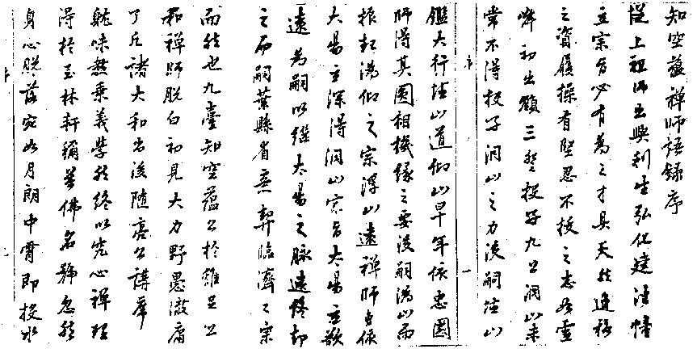
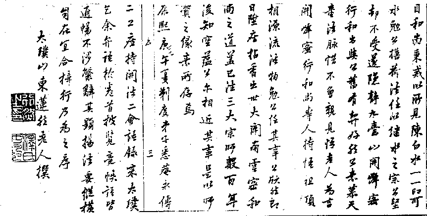

# 知空蕴禅师语录



> **藏经**：嘉兴大藏经（新文丰版）（嘉兴藏）　**册次** 第 37 册（J37）　**编号** JB400　**部类** 诸宗部　**卷次** 2 卷　**篇幅** 20,450 字

> **卷／品**：0 卷 · 1 品



---



## 目录



  - [知空蕴禅师语录序](#知空蕴禅师语录序)



---



### 知空蕴禅师语录序











滇楚九台山知空蕴禅师语录卷上



嗣法门人通(▆▆▆)等编



上堂



辛亥年三月十五日，师於楚雄府福城寺接湖广衡州府开峰山南云禅院密行老和尚书并法拂真仪，合楚宰官居士设斋，请师开堂。师至密老和尚像前，拈香打○相作，女人拜曰：「谢师远来，无可秪待。」插香曰：「只此一𬬻，莫怪空疏。」遂至法座前，以拄杖指云：「文彩未彰，消息已露。今日文彩既彰，且道是个甚麼？须弥灯玉第一座。」遂升。拈香云：此一瓣香奉祝当今皇帝圣寿万岁。复拈香曰：「此一瓣奉祝　前镇镇台马公、本府仁政冯公、许公、本县潘公、三营副将并阖郡绅衿居士，恒为佛氏金汤，大作朝廷玉柱。」又拈香曰：「此香多年啮碎生铁核，一旦收归台山侧，非是今朝难忍俊，且要应时与及节。」插香曰：「耑伸供养现住湖广衡州府开峰堂上传临济正宗第三十二世上密下行老和尚，用酬法乳之恩。」维那白椎云：「法筵龙象众，当观第一义。」师顾左右，喝一喝曰：「大众！好时节还相委悉麼？若也相委悉，福城令不虚行；其或未然，有疑出问。」僧问：「如何是第一义？」师竖拂子，曰：「刺破你眼睛。」进云：「如何是临济机？」师曰：「三头六臂。」进云：「如何是临济用？」师曰：「有棒不打你。」进云：「多谢和尚慈悲。」师曰：「切忌相辜负。」问：「今日福城寺里人天普集，和尚据法王座作师子吼，捧毂推轮即不问，谢却华冠事若何？」师曰：「匝地风光。」进云：「和尚久阐水目宗风，为甚今日别行一路？」师曰：「春风三月里，得意便迁乔。」进云：「与麼则一步阔一步，一著高一著。」师曰：「乘时非有意，出谷也无心。」进云：「只如的的为人一句又作麼生？」师拈棒便打，僧礼拜，师又打，乃曰：「我本无心有所希求，今此法王大宝自然而至。大众还知法王大宝麼？」竖起拂子，曰：「只者拂子，且道是开峰底？还是福城底？若道是开峰底，却在福城手里；若道是福城底，又是开峰付来。唤作开峰底固是瞎，唤作福城底亦是瞎。毕竟如何？」拂一拂，云：「拈头作尾寻常事，不是其人也大难。」即放下拂子。举：「兴化和尚上堂曰：『祖师心印，状似銕牛之机，去则印住，住则印破。只如不去不住，印即是？不印即是？』」师曰：「兴化老人只知贪程，不顾旁观者哂。」蓦竖拂子，曰：「今日福城为尔诸人指出者印子，如狮子王咤沙底壁立千仞。且诸人恭临法座，山僧不敢藏拙，未免依直共通。山僧於三十六岁上破家散宅，参水目得戒住老和尚，承其印可，勉於出世为人。山僧自愧福薄，屡坚却之，病思自养，入九台煨折脚铛以待残喘，而素志岁久月深，幸自可怜生。适承闲峰老和尚不忘旧债，两番婆心，远命隐馨上座赍来法物，其嘱累之重不啻黄檗之禅板几案也。然正恁麼时，顿令不肖於水目昔日退委之因(相隔)千里，於开峰三千里外绝淆讹。大众！此恩难报，所以今日就此福城东际大塔庙中炷一炉香，以报法乳。」蓦召大众，曰：「且道与他临济大师唤侍者将火来是同是别？」良久，曰：「珊瑚枕上两行泪，半是思君半恨君。」喝一喝，便起。



九台山大方广寺，上堂。拈香祝圣后，拈香曰：「此香消殒虚空，裂破三际，用处风流，藏处稳密，𦶟向罏中，二番供养湖广衡州开峰堂上传临济正宗第三十二世本师密老和尚，用酬法乳。」上首白椎曰：「法筵龙象众，当观第一义。」师曰：「当观第一义，晴空杲日难回避，不观则背义忘恩，观之则无事生事。且道毕竟如何？鹞子过新罗，擘箭追不及。」僧问：「昔日灵山正令，今朝台岭重提……」声未绝，师便喝，僧礼拜曰：「兵随印转，将逐符行，师今领众升堂，符印在甚麼处？」师打曰：「一棒一条痕。」进云：「南云老人赐师个甚麼？」师又打曰：「不知痛痒汉。」进云：「者是南云老人的，和尚分上又作麼生？」师连打两棒，乃拈拂子竖起曰：「只者个触不得、背不得，衲僧用处光明烜赫，挥也三千世界随手转，掷也百亿须弥直下裂，有时唤作达磨眼睛，有时唤作释迦命脉，亘古亘今，不拘格则。虽然如是，要须大悟一回始得。今日众中莫有大悟的麼？试出吐露看。」一僧出礼拜，师曰：「点即不到。」僧拟喝，师打退。复举：「世尊於灵山会上拈花示众，众皆罔措，唯有饮光尊者破颜微笑，搔著世尊痒处。世尊忍俊不禁，便道：『吾有正法眼藏、涅槃妙心、实相无相、微妙法门，付嘱与汝，勿令断绝。』此是灵山一会，万古徽猷。据山僧看来，饮光尊者虽则一期俊快，要且只得一橛，世尊不惜满盘托出，也则犹欠一半。大众！山僧恁麼告报，莫是磨棱合缝、抑古扬今麼？且喜没交涉。既不如是，且道意在於何？久参耆德，自解知时，后学初机，难免一笑。虽然，笑则笑矣，你道与他饮光尊者当时发笑是同是别？」蓦竖拂子，曰：「纵使豁然亲见得，辜他先圣丧儿孙。」掷拂子，结椎，下座。



上堂。众僧出问，师一一答了，嘘一嘘，曰：「你等这些问头，都是长连床上、方册子里学来的，何不将斩新日月呈似山僧？」众无对。师乃云：「昨日十五放过一著，今朝十六添了一著，六六依然成四九，且喜将错还就错。德山棒、临济喝，照用同时，人境俱夺，饶你伶俐难摸索。山僧者里不行棒、不用喝，日用寻常如虎戴角，窗推明月上千峰，帘卷白云低万壑，处处囊锤和颖脱。」蓦顾左右，云：「还有真实解会者麼？会则事同一家，不会则千差万驳。」以拂子击香几一下。



诞晨，楚雄前镇众宰官居士供法被到山，瑞亭姚檀越设斋，请上堂。师指法帐曰：「神光不昧，万古徽猷，入此门来，莫存知解。只者个幔天网子，团团瑞彩交络，簇簇锦绣铺成，优昙艳丽，金紫腾辉，已作大师子吼也。大众还会麼？还闻麼？霹雳声中，晴空掣电，杀人刀，活人剑，把定要津，聊通一线，盏子扑落地，碟子成七片。还有同生同死底衲僧麼？试出道看。」僧出礼拜曰：「某甲道得。」师曰：「狞龙不吞饵，虾蟆冲浪过。」进曰：「觌面相呈，有何回互？」师便打。进云：「何不答话？」师曰：「罪不重科。」又僧问曰：「如何是金毛师子吼？」师曰：「山僧今日不答话。」乃曰：「山僧母难，今承众宰官居士供此法帐。一、为庄严道场；二、要推山僧上曲录床露个真实消息。若是真实消息，众居士未曾举意造帐来山已前早露了也。不见文殊对维摩居士道：『於一切法无言、无说、无示、无识，离诸问答，是为菩萨不二法门。我等各自说矣。仁者当说何等是菩萨不二法门？』维摩默然。山僧今日只得因斋庆赞去也。」竖起拂子，云：「只者母难之晨，凡圣同源，生佛无别，山僧与诸佛菩萨、历代祖师、法界有情共一胞胎、同一化育，总不出今日。且道今日事毕竟作麼生？」良久，曰：「霜风吹大野，法身赤骨𩪸。」喝一喝，下座。



上堂。蓦拈拄杖，曰：「只者个，历代祖师重重指示，天下宗师处处提持，秪要人人识取者个。若识者个，四海同风，能杀能活。且道者个是什麼？」卓拄杖一下，云：「者里会得，庶不辜负从上宗师，亦不埋没自己。还委悉麼？若也不委，明日再为诸人说破。」便下座。



谢开山檀越，瑞亭姚居士请上堂。「德山棒，临济喝，推门落白；帝释草，长者标，如虫御木。虽然，只如一尘才举，大地全收；纤毫不露，白云万里。汝等诸人且作麼生会？」良久，云：「相逢相遇无餘事，携手同归不二门。」



上堂。「夹山道：『目前无法，意在目前。不是目前法，非耳日之所到。』颜子道：『仰之弥高，钻之弥坚。瞻之在前，忽焉在后。』大众！看他二大老虽则出处不同，头脑却也相似。不谓理无差殊，古今一致。虽然如是，要须入细辩精，始得稳当。所以道：『一字透根源，万法无彼此。』且道是那一字？听取一偈：清水里，下白米，寒山拾得笑而已。上大人，丘乙己，三千七十可知礼。」拈拄杖，卓一下，曰：「一椎击破上头关，问水寻山事毕矣。」蓦召大众，曰：「还知麼？更为你作个切脚。」肩拄杖，下座。



上堂。拈拄杖云：「山僧作佛祖儿孙，为佛祖烧香，传持佛祖正令。且道如何是正令行的句？」卓一卓云：「有何佛祖？」靠拄杖下座。



上堂。「盘山道：『向上一路，千圣不传。』慈明道：『向上一路，千圣不然。』妙喜道：『不传不然，海口难宣。须弥顶上，驾起铁船。』」师曰：「三大老推轮捧毂，只知步步登高，不解从空放下。只如诸人上来下去，寻常作麼生驾驭？咦！俊英能逸格，良骥不加鞭。」



丙寅年正月初九日，住威楚之广通县仙羊禅院结制，邑侯胡公率众设斋，请上堂。师指法座云：「须弥灯王座，曹溪古路头，瞎驴灭正眼，黄河水倒流。要升便升，万古徽猷。」敛衣就座。拈香云：「此一瓣香清齐日月，德被万机，𦶟向炉中，颛祝当今皇帝圣躬万岁万万岁，伏愿皇图巩固，帝道遐昌，大扇尧舜之风，洪承禹汤之德。次一瓣香奉祝本县仁政胡公洎护法宰官禄位高增，并祝世守两衙绅衿善信高跻寿域，永证菩提。此三瓣香与虚空同大、与日月同明、与天之同高、与地之同厚、与海之同深、与山之同峻，𦶟向炉中，上供衡州府开峰山传临济正宗第三十二世本师上密下行大和尚，用酬法乳之恩。」上首白椎云：「法筵龙象众，当观第一义。」师云：「如此白椎已迟八刻，殊不知山僧未出方丈、大众未出禅堂，早已为诸人举扬第一义了也。恁麼时观，犹较些子，若向椎下分疏，剑去久矣。还有冲霄底俊鹘麼？试出与山僧拄杖子相见。」时有一僧出，师云：「栖芦之鸠，何堪拄杖？」僧无语。师乃云：「一句明明该万象，元正启祚物咸新，柱杖拂子风流处，一回相见一回亲。如或未然，山僧更为指示去也。」举拄杖，云：「大众！还见麼？」复卓一下，云：「还闻麼？若也历历的闻，明明的见，仙羊之令不虚施。此见是文殊入理之门，此闻是观音圆通之旨。过去诸如来，斯门已成就；现在诸菩萨，今各入圆明；未来修学人，当依如是法。恁麼瞥去，如虎靠山，似龙得水，在此选佛堂中，三条椽下、七尺单前，四楞蹋地，稳坐安禅。设有见之如盲，闻之若聋者，未免灯笼失笑，露柱愁眉，仙羊拄杖未肯放过在。」卓拄杖，下座。



住净乐禅院，结制，上堂。拈香，云：「此一瓣香，含褁十虚，包括两仪，𦶟向炉中，专为祝延今上皇帝圣躬万岁！万万岁！伏愿皇图永尧舜之风，帝道与日月齐明。次一瓣香，智兼文武，儒释皆宗，炷向炉中，恭祝驻镇滇南将军、抚台二位大护法禄位千春，边疆永镇，侯封万里，佛氏金汤。次一瓣香，寂灭场中结就，闹市街头拾来，炷在炉中，上供湖广开峰山传临济正宗第三十二世本师上密下行大和尚，用酬法乳之恩。次分上供四川城都府昭觉堂上丈下雪大和尚，又一分上供水目戒堂上无下住大和尚。」维那白椎，云：「法筵龙象众，当观第一义。」师曰：「一椎打就，不观则背义忘恩，观则无事生事。众中还有知恩报恩、不犯清波的衲僧，试出道看。」众无语。师曰：「众既不道，山僧自道去也。」竖拂子，云：「天高群象正，海阔百川朝。」乃云：「世尊昔日为一大事因缘出现於世，山僧到此静乐庵中结制，亦不为别事，亦是为此一大事因缘。且道唤甚麼作大事因缘？」卓拄杖三下，云：「过去诸如来，斯门已成就；现在诸菩萨，今各入圆明；未来修学人，当依如是法。古人恁麼道，我即不然，但云：家贫难办蔬食，忙中不及草书。还当得麼？须知从来共住不知名，任运相将只麼行，自古上贤由不识，造次凡夫岂可明？若肯恁麼，管取此大事因缘，於此五十三日必然相应，稳坐去也。若还疑情未瞥，更有一段方便举似汝等蓦直去。西天国王问波罗提尊者曰：『我欲作佛，不知何者是佛？』者曰：『见性是佛。』王曰：『师见性否？』者曰：『我见佛性。』王曰：『性在甚麼处？』者曰：『性在作用。』王曰：『是何作用？我何不见？』者曰：『现今作用，王自不见。』王曰：『於我有否？』者曰：『王若作用，无有不是；王不作用，体亦难见。』王曰：『若作用时，几处出现？』者曰：『若出现时，当有其八。』王曰：『八处佛性，师当示我。』者曰：『在胎曰神，处世名人，在眼曰见，在耳曰闻，在鼻臭香，在舌谈论，在手执捉，在足运奔。识者知是佛性，不识者唤作精魂，遍现俱该沙界，收摄在一微尘。』王即开悟，得大自在。妙喜曰：『且道王所悟得的是佛性耶？是精魂耶？若於八处悟得，只是精魂；若离八处，佛性在甚处？恁麼荐得，佛恩、皇恩一时报足；若不荐，育王为诸大众下注脚去也。𬸚𬸦麒麟俱是瑞，旃檀薝卜一般香。』今日若有人问山僧：玉悟得的是佛性耶？是精魂耶？若於八处悟得，只是精魂；若离八处，佛性在甚处？若荐得，佛恩、皇恩一时报足；若荐不得，山僧亦为诸人下注脚去也。」举起拂子，云：「静乐庭前柏树子，合掌常年向上方。咦！底头才拟议，鸿雁过潇湘。」结椎，下座。



小参



「山僧今日也不要你诸人向上向下、宗乘教乘、诸子百家、风谣俗谚，只要诸人识取自心。且那个是诸人之心？你诸人者，具根身则为眼、耳、鼻、舌、身、意，器界则为色、声、香、味、触、法，尽虚空、遍法界，上而诸佛、下如蝼蚁，无不具此种种，亘古亘今，无变坏相，谓之常住法界。既谓之常住法界，则你诸人行住坐卧、饮食男女，无不皆在其中。既皆在其中，则折旋俯仰、出作入息、成办庶务，参究诸人之心，要且不可昧。若也一时昧却，则成佛成仙，三界六道不得自由；若也不昧，则成佛成仙，三界六道如龙得水、似虎靠山，所谓是法住法位，世间相常住也。」拈拄杖，卓一卓，云：「且道者个还是常住法？不是常住法？逢人切莫错举。」



佛诞，小参。举：「世尊初生，周行七步，目顾四方，一手指天，一手指地，云：『天上天下，唯吾独尊。』」师召大众，曰：「诸人还知悉达太子底落处麼？后云门大师道：『我当时若见，一棒打杀与狗子吃却，贵图天下太平。』还知云门大师底落处麼？若也知他落处，更须买草鞋行脚始得。听山僧为你颂出：才出母胎便逞豪，手忙脚乱恶风高，知恩岂特云门老？花发阳春海自潮。」掷拂子，下座。



小参。举：「有物先天地，无形本寂寥，能为万象主，不逐四时凋。」竖拂子，曰：「大众！会麼？拂子𨁝跳上三十三天，触著阿耨达池龙王底鼻孔，山前上地扬声大叫云：『阿剌！阿剌！』山僧任麼告报：曹源一滴水，偏地优昙华。」



小参。「迦叶一笑传心，神光三拜得髓。」拈拄杖卓一下，云：「只此一著，了无多子，久参上智，便合乘时。顾盻踌躇，剑去久矣，更说甚矿中之金、麦中之面一场自赚？诸兄弟！知也无？若不知，尽情放下，直须绝后再苏，莫待一事无成两鬓疏，方袍圆顶胡为乎？」嘘一嘘，靠拄杖便起。



康熙九年三月，於水目大寺中为众授戒，升座挥尺云：「古今一道露堂堂，三际空圆大道场。棒喝施呈闲器具，豁开顶眼绝商量。」乃曰：「水目佳山是出佛产祖之地，吾滇名山也。声传六诏，灯续五天，人杰地灵，地灵人杰。昔之净妙、皎渊、阿标、普济诸大老，曾於此处、此刹、此座之上大阐玄风，挥弘祖道。若论道之一字，彼诸大老亦不曾前，山僧今日亦不曾后。大众还会此道麼？此道本无言说，处物即真，不离日用寻常。会则盖天盖地，无古无今，运水搬柴，尽是神通妙用；不会则礼佛看经，都成业识茫茫，无本可据。今日诸人既於山僧处求受心地戒法，须知即心是戒、即戒是心，心戒无二，万善从生。」击桌一下云：「过去诸如来，斯门已成就；现在诸菩萨，今各入圆明；未来修学人，当依如是法。」便拈香说戒。



佛诞日，师於蒙阳等觉寺结制。升座云：「宝华王座，高出须弥。」拈拄杖卓一下曰：「鳞皱拄杖，卓破两仪，直饶恁麼见得，看来犹落今时，更须坐断淆讹，方堪吐气扬眉。今日众中还有坐断淆讹者麼？」僧通炤作女人拜，师打曰：「弄精魂汉。」炤喝，师又打，乃按拄杖云：「师子嚬呻，象王回顾，横按莫邪，高挝布鼓，千手大悲鉴不及，八面那咤空忿怒，唯许过量高人举起便知落处。还知过量高人麼？昔者释迦牟尼世尊於今日初生下地，便乃周行七步，目顾四方，一手指天、一手指地，日：『天上天下，唯吾独尊。』后来云门和尚曰：『我当时若见，一棒打杀与狗子吃却，贵图天下太平。』」师曰：「大众！还知云门与世尊相见处麼？所谓好手手中呈好手，红心心里中红心，知恩报恩固是不偶，且道与今日郡守卢公居士烧香办供是同是别？若也辩得，一回饮水一回噎；其或未然……」卓拄杖曰：「好看恶水蓦头浇。」掷拄杖，下座。



援剿前镇镇台马公送正法眼藏额到山，师升座。以杖指云：「只者正法眼藏，释迦尚自糢糊，弥勒那能晓了？破颜尊者虽传，又被瞎驴灭却。今大檀越马公镇台以佛祖心现将军身，向杀人不眨眼处上阵，轮转刀时为诸人拈出於一毫头上，如赫日之升天、似迅雷之震地，有眼、有耳无不知闻，是你诸人还有回避潜匿处麼？记得山僧戊申春会公於忠恕堂上，清谈对面，於此正法眼藏自觉如印印空、似水入水，了无痕迹，一上契会非同小小。今日犹恐诸人当面错过，重为揭示者段赤心，堪报不报之恩，以助无为之化。尔等诸人还委悉麼？欲识台山真面目，只在标题四字中。」僧问：「如何是正法眼？」师曰：「我不解播土扬尘。」便下座。



示众



九台开山毕，示众。「此山巍峨耸削，叠嶂清幽，稠松密竹，源远流长，浩劫至今，曾无有异。直待山僧到来，指出宏基，开建佛刹，可谓是山之时节因缘。山僧之因缘时节，一时萃聚，不可思议。古人道：『欲识佛性义，当观时节因缘。时节若至，其理自彰。』不其然乎？虽然，时节因缘诸人尽知，且道如何是佛性义？若也道得，不负朝夕搬砖运石、扛水扛土一番勤劳，可谓与山僧共出一只手也。有麼？有麼？」众无对。师曰：「凿破鸿蒙无觅处，且随风月下瀛洲。」



谢前住老江西示众。「头陀眼亲，山僧志状。踢倒净瓶，当仁不让。古人一朝作用，不妨楷模千秋。山僧数载辛勤，要且亦无他事。日间两餐薄粥，夜来一觉高眠，皆与诸人连床接案。若以较之古人，岂止十万八千。且喜三门头金刚拳拳服膺，佛殿前狮子咤咤承当。」遂拈拄杖曰：「游人去后无消息，留得青山到老看。」卓一卓。



因客示众。「学道之人，先须识主。古人尚勗，岩居穴处。浮名不干，视利如土。三二十年，躬绝驰逐。有如大死，牢竖脊骨。不虑依食，不求荣富。不务谭博，不希声穆。疏其交游，远其宠辱。口不谈俗，意不缘俗。神与理契，心空道昱。弊衣疗寒，粝饭充腹。知足知安，不迟不速。如痴如愚，似呆似朴。久久缘熟，不期而出。治道如金，转炼转精。情乾识尽，枯木龙吟。等闲行处，步步皆真。大人境界，随类现身。双明双暗，了没疏亲。如斯告报，乌豆换睛。不见道：『智不到处，切忌道著。道著即头角生。』参。」



解制，示众。「今朝圣制告圆，莫有离钩透网的金鳞？试跳跃看。」一僧从东过西立，师曰：「犹贪香饵在。」进云：「赤洒洒，光溜溜。」师曰：「我道你缚手缚脚。」僧拟议，师便打。一僧曰：「金鳞即不无。」师曰：「在甚麼处？」僧进前，师曰：「好个虾蟆。」进云：「今日甚分明。」师曰：「如何是你分明的事？」僧作礼，师曰：「去。」一僧问：「佛佛授受，祖祖相传，传个甚麼？」师曰：「你道甚麼？」僧无语，师便打。一僧问了复出，师拦胸把住曰：「还我九十日饭钱来。」僧掷坐具，师曰：「者钝汉。」又打。掷拄杖，归方丈。



示众。「还知麼？还会麼？凡夫无明识即是圣人不动智，只是凡夫不知；圣人不动智即是凡夫无明识，只是圣人不会。圣人若会，即是凡夫；凡夫若知，即同圣人。众兄弟！可曾恁麼一回麼？若曾恁麼体贴一回，则不假系毫功力，当下参学事毕，更不如之与。若现前豁然独露，孤迥迥、卓巍巍，孰是圣人？孰是凡夫？了无对待，触目家珍。虽然，犹未是衲僧勾当。不见道：白棒挥时无佛祖，等闲行处履冰霜。」



戊午年十月初六日，师掩关虎山，李居士办斋，升座。「廓然无圣露单传，铁壁银山倒插天，句里了无知见路，头头法法泄三玄。」左右顾视，云：「古人道：『十方无壁落，四面亦无门，净裸裸，赤洒洒，没可把。』」喝一喝，曰：「山僧今日有意气时添意气，不同炙艾钻龟瓦。」以拄杖左边敲一下，云：「者是有为，关生死岸。」敲右边一下，云：「者是无为，关涅槃岸。以上二关，山僧蚤已打破，且道今日掩底是甚麼关？众中还有为山僧证明者麼？试出道看。」僧通味出，云：「铁牛吞却夜明符。」师曰：「临崖看浒眼，特地一场愁。」进云：「者是关外事，如何是关内事？」师曰：「裈无裆，裤无口。」进云：「关之内外又作麼生？」师曰：「回首不逢，触目无对。」进云：「任麼则圆觉伽蓝非内外也。」师曰：「可悲，可痛。」良久，云：「山僧今日自唱自酬去也。」肩拄杖，曰：「楖栗横担不顾人，直入千峰万峰去。」便入关，转身度锁，曰：「末后一句分付首座，大众分明记取。」朴山居士令侍者传云：「今日让过和尚。」师曰：「居士恁麼那？」士云：「某亦恁麼答。」师曰：「鹞子过新罗。」士云：「谢和尚。」师曰：「再犯不容。」侍者云：「居士道：『放某甲一顿拳头。』」师曰：「贼后张弓作麼？」



关中垂示。「花一团，锦一簇，铁牛坐断舌头路。无位真人绝行迹，眼中耳中常出入。咄！支机石在斗牛富，何须更觅君平卜。」



腊八日，关中垂示。「昨夜螭头星倒挂，南斗七兮北斗八，晓月长庚一时发，漏泄众生大本源，释迦世尊忙不彻。更拟问如何，劈面栏腮与一掴。且道释迦老子是时见个甚麼，便道一切众生俱有如来智慧德相？噫！者老汉今始瞥地，殊不知一切众生同睹同证，其来久矣。今日突作是言，一向在甚麼处著到？然虽如是，从前汗马无人识，要显如今盖代功。看在灵山会上，向老饮光尊者道：『吾有正法眼藏、涅槃妙心、实相无相之旨，汝善护持。』也只是昨夜睹星下打失的鼻孔。只者时节，人人动静施为，莫不尽承此个恩力。且道谁是报恩者？」良久，云：「咄！」



茶话



「处处真，处处真，尘尘尽是本来人。西边祭鬼鼓，东畔打锣声。文殊失却裤，普贤检得金。村前土地过河来，山头老汉处问津，大为可笑。露柱黑夜生下儿，且道是男是女？大家辩看，道得的茶一杯，道不得底茶一杯。」傍僧曰：「为甚道得的也茶一杯，道不得底也茶一杯？」师曰：「你不见赵州祖师那？吃茶去。」



普请茶次，师才坐下，便竖拂子云：「即此用兮没滋味，草里大虫打瞌睡，拂子轻轻击著伊，惺起威猛无敌队，顾视左右弄爪牙，一摸虚空尽粉碎。这是祭鬼神底什物，下一分在土地堂里，维那击磬，大众吃茶。」



「赢得文远底糊饼，是斗劣不斗胜；夺去首座底果桌，过在日用中。可笑两人食到口边不得吃，一场烦恼。山僧者里饼果罗列於前，也不问你们过在於何，只要大家欢喜尽兴。古云：『打起黄莺儿，莫教枝上啼。啼时惊妾梦，不得到辽西。』今翻转一下云：『莫打黄莺儿，教他枝上啼。依稀似郎语，听听不孤西。』」击桌一下云：「莫是黄莺儿啼麼？且勿错会。卢仝在坐，七枕而归。呵呵。」



行录



师一日坐次，禅者诣前礼拜，起而环侍，启曰：「请和尚说行脚事。」师曰：「我之行脚，不可以告人。纵为尔说，亦无关於尔事。」众曰：「愿垂大概，以晓后人。」师因众恳请不已，师曰：「我乃洱海王姓，母朵氏，於万历癸丑年九月初一日生。家居僻壤，少识大方仪则，性顽愚。十二岁，闻父母曰：『尔命似不可处族，当出家为僧，以永天年。』我闻出家，喜不自胜。从兹食澹斋，厌尘俗。十四岁，父送入鸡足寂光寺，礼上和和尚剃发。每自忧闷，同袍问曰：『尔何故眉头不展？』我对曰：『吾亲尝谓我曰：「尔当出家，以永天年。」天年固可永耶？使佛祖有灵，或可少延岁月。否则生死数定，於世几何光阴？诚恐道业未成，虚生浪死，有辜父母师长之恩。所谓生死事大，无常迅速，焉得不忧虑？』同袍笑曰：『你年尚少，何过虑如此哉？』我曰：『人命无常，那管你青春年少？且又不及你们聪慧，所以忧惧。』彼等虽闻其言，终是相笑不已。然我尔时幸值大力和尚、野愚和尚、彻庸和尚及西蜀了凡和尚诸位尊宿，皆获亲近，力求开导。诸师见我虚心慕道，各承指示不一，唯示参禅者倍加敬信，遂参万法归一、一归何处话，四五年疑情不发。一日，遇座主亮如和尚，随之听讲《法华》、《楞严》、《圆觉》诸经三二年，於学虽不无进益，自觉耳口传习，晓夕力参不是心、不是佛、不是物话，十二三年苦无入处。至三十六岁，在玉林轩静室中礼《万佛名经》，至第三卷，才启口念南无两字，忽地身心脱落，内外圆明，如一轮明月。即说偈曰：『虚空是佛身，我本世间人。我性与空合，非佛亦非人。』自此快乐无比，难以告人。万佛毕，即到巃𭖂山，参见水目无住和尚，具陈上事。尚曰：『你再陈白看。』我便从东过西立。尚曰：『还有麼？』我又从西过东立。尚曰：『大似骑驴不下。』我曰：『恭候和尚万福。』尚曰：『指东畫西，便当了事那？』我曰：『终不敢欺和尚。』一日，尚问：『得力处不问你，不得力处道一句看。』我曰：『得力处蕴尚道不得，况是不得力处耶？』尚曰：『从上陈烂葛藤，汝还有会不得底麼？』我曰：『那个是从上陈烂葛藤？』尚曰：『只如玄沙道：「澂潭皎月，静夜钟声，随扣击以无亏，触波澜而不散，犹是生死岸头事。」你作麼生会？』我曰：『三个成群，四个打夥。』尚曰：『我只要你平实商量。』我曰：『蚤是兔子生三角。』尚曰：『十智同真，你作麼生会？』我曰：『残羹馊饭，何用咀嚼？』尚曰：『与麼似不合问汝也。』我曰：『问又何妨？』尚曰：『你试道看。』我珍重便出，於是命我为首座，相随妙峰、水目、鸡足结制。一日，尚上堂，我出问曰：『和尚作麼？』尚竖起拂子，我曰：『怜儿不觉丑。』尚便打，我一喝，尚又打，我又喝，尚下座归方丈，我随上问讯，尚曰：『适来喝老僧是你。』我曰：『唤作喝那？』尚又打，我礼拜曰：『多谢和尚重重相为。』尚又打，我便出，尚示我一偈曰：『子之道业已成，清福已具，顺时保养，随机而利。』我谢曰：『蕴福薄解浅，不合与麼起动。』和尚再三，却之入九台山煨折脚铛子以待残喘，何期开峰老人垂手百城之外，且复勉励主持个事，一片婆心非寻常可比也。事到如斯，所谓官差不自由。」蓦召大众曰：「尔等问我行脚，我行脚如此也是，你诸人还会得麼？」众默然良久，师曰：「可知道不关你事。古人云：『我不如你，你自会好。』」众作礼而退。



师将顺世，召众云：「山开远僻，佛法无他，子等正好就水和泥，协力勤慎，不许是非长短，事事如我，常存即孝也。且我身后不必破孝举丧，作一切虚文，各顾正念，再不饶舌矣。」通(炤)问云：「和尚向来说禅说道，诃佛诃祖，正恁麼时作麼生？」师震威一喝，(炤)礼拜，师复一掌，(炤)拟问，师翘一足而逝。容颜不易，端坐如生，是以弗敢茶毘，奉供本山之室。师生於万历癸丑年九月朔一日，世寿七十七春，僧腊六十有五。六诏皆仰师德，嗣法开堂三十餘年，入灭於皇清康熙己巳年五月廿八日午时。是时，当路文武宰官、缁素人等，无不钦慕者。



知空禅师语录卷上



滇楚九台山知空蕴禅师语录卷下



法孙宗灯记录



法语



示蓦直正禅人



古云：若无天地量，争得圣胚胎？所以学道人先要大其心量、阔其胸襟，居常孤迥迥、峭巍巍，一切圣凡因果拘系不得、一切得失是非动移不得、一切佛祖冤亲近傍不得，然后纵其机用指迷导物，如龙得水、似虎靠山，方谓之当家种艸、嫡骨儿孙，可以绍隆圣种、开凿人天。不然，则得失忧患交战於中、圣凡情量倾夺於外，无参究之实、无师友之益，岁久月深习成自便，不觉不知便为流俗阿师，於理何益？一夏来禅人参随老僧不去左右，似见老僧行径，今日来别老僧，思无以赠，只有一语切在记取。还知麼？蓦直去。



示佛国味禅人



若要家国泰，应须下苦工，囓破铁酸馅，依然日出东。不见道：「欲知恁麼事，须是恁麼人，不是恁麼人，争得恁麼事？」须知此事迥别，不与常情合，恁麼也不得，不恁麼也不得，恁麼不恁麼总不得，须解恁麼中不恁麼，不恁麼中却恁麼，如水上葫芦，捺著便转，方能少契恁麼事。所以学道人要决定志，办久远心，晓夕忘疲，不分昼夜，铁酸馅不破不休，金刚圈不透不歇，一朝㘞的一声，入手受用，方知此说不诳不惑。还知麼？别。



示远山炤禅人



开眼也著，动步也著，开口也著，举意也著。一年三百日，一日十二时，无时不筑著磕著。分分明明，无欠无多，便恁麼会，无绳自缚。何况莽莽荡荡，寥寥廓廓。伶俐人，休待说，更问如何与若何，一掴打教牙齿落。



示古梅甲禅人



达磨大师曰：「学道者多，证道者少；说理者多，悟理者少。」且道过在甚麼处？莫是不肯真参实悟，独向义学以资谈柄麼？咦！莫错会好。若只任麼祖师西来，只成世谛流布。既不如是，毕竟如何是全提正令处，随类现身？时不见僧问五祖演和尚：「达磨面壁，意旨如何？」祖曰：「计较未成。」还会麼？多少伶俐汉，杜撰乱差排。



示杲庵觉禅人



上古之人不自满，於学无怠，行说相符，所以果熟香飘，古今钦羡。而今世人岂是不及往古，因甚十个五双退缩将去？虽然如是，罕逢穿耳客，多见刻舟人。



示缘起序禅人



尝读古人行脚，未有一人不从舍身拚命而得此个三昧受用者，所以云：「不是一番寒彻骨，争得梅花扑鼻香。」虽然如是，也是临崖看浒眼。



示悉庵檀禅人



衲子家风，不留朕迹。掷剑挥空，星流电疾。老僧不惜眉毛处，通檀禅人瞥不瞥。马祖一喝大雄峰，百丈两耳聋三日。急急如律令。



示知渠达禅人



参随吾住，处分知时，吾有四物，倩尔支持。兔角杖子，步步随之，登山涉水，全提赖伊。破砂盆子，零零离离，立地放下，巨灵莫移。龟毛榻子，左之右之，四棱踏地，万象拱仪。没量枕子，不高不低，有时推出，孰不惊疑。



示源禅人闭关



歇得诸缘下，无心道自成，高峰三十载，铁面绝人情。今日入关今日死，此时出定此时生，重翻旧案尔应别，独创新条孰不惊？放去收来都不碍，撒开捻住任纵横，见闻直下成休复，声色头边法眼明。



示宗镜昭昭



此事迥别，尊贵绵密，不落言诠，秪许没量汉直下承当，撩起便行，遇佛杀佛、遇祖杀祖，不顾危亡，才是吾家种艸禅人。勉旃！



示宗眼天机



欲烈无明网，先须透祖关。祖机如掣电，眨眼蚤是迟。汝但回光返照看，闻闻果胜奇。闻到无闻地，直下忘所知。动容扬古路，方契祖师机。



示宗念澄澄



八识体圆明，号曰如来藏。了此别无多，即是真如性。量等於虚空，廓然大圆镜。六七全生灭，五根无分别。不信但返闻，闻中离分别。生灭既元离，廓尔唯寂灭。寂灭六七休，脱体澄莹彻。莹彻即无我，大千同禅悦。一二三四五六七，七六五四三二一。识智智识常寂光，大圆镜子黑似漆。



示宗孔应唯



道本无路，嫡悟方亲。语言影响，名相非真。廓然广大，不离此身。会即当下，岂用他寻。佛祖直指，唯是一心。虚灵寂妙，亘古亘今。元自解脱，不受一尘。悟亦无得，迷即漂沦。仔细参详，不是别人。孔禅知不，日午三更。



示宗颖守朴



所谓佛法者，不离日用现前，若离日用现前，何处更有何法来？如今你们把穿衣、吃饭、拈香、择火丢了，要去诵经礼佛，蒲团上静坐，纸册上记言记语，谓之参学，任麼到驴年有何交涉？善知识出世，只指现前日用这点子，别更无他。不见昔鸟窠禅师侍者，要辞去诸方学佛法去，窠云：「若是要佛法，我者里亦有些子。」者云：「便请。」窠拈起衣上布毛一吹，者便领旨，更不去也。汝试看这吹布毛是何意旨？著力参参，倘一期撞倒，方知一切现成，始不负老僧之教诲也。



示宗参惺惺



佛说一切法，为度一切心。若无一切心，何用一切法。无一切心时，便是三贤十圣底行履处。《华严经》中，亦只敷演无一切心底三昧境界。心既无，相亦空，便是光明遍照底佛体。汝书此经，能於拂纸磨墨之时，措手筑著毘卢顶相，便是参学事毕时。



示宗芳华严



是法平等，无有高下。听著即聋，觑著即瞎。镇海明珠，谁敢酬价。撞著老僧，不打即骂。



示宗灯永传



凡聪敏者学道，不患慧不充，患定不足。有慧无定谓之狂，有定无慧谓之痴。如定慧均等了，须是明大法，具正眼，将从上诸祖垂示底死猫头烂骨董，一一蹋教粉碎始得。



机缘



僧问：「古人道：『一切现成，只是人不肯承当。』如何是承当底事？」师曰：「唤你作猫儿狗子，你还肯麼？」



问：「如何是透法身句？」师曰：「牛践马蹋。」



问：「性理之谭，请为指示。」师曰：「上大人丘乙己。」曰：「毕竟如何？」师曰：「可知礼也。」



问：「四大五蕴，谁将主之？」师曰：「无主。」曰：「恁麼则散灭去也。」师曰：「你唤甚麼作四大五蕴？」



问：「如何是禅？」师曰：「莫俗气。」



问：「如何是出格之句？」师曰：「一棒打教血流。」



问：「触不得，背不得，意旨如何？」师曰：「逢人但恁麼举。」



问：「古人道：『你有拄杖子，与你拄杖子。』意旨如何？」师曰：「披发仗剑祭东风。」又问：「你无拄杖子，夺你拄杖子𫆏？」师曰：「百万军中斩颜良。」



问：「如何是无位真人？」师起身曰：「你问甚麼？」



问：「如何是三玄？」师曰：「墨泼乌鸡当夜半。」「如何是三要？」师曰：「莫问人。」曰：「如何得明？」师曰：「日出也。」



问：「如何是宾主句？」师揖曰：「请坐吃茶。」曰：「如何是句？」师曰：「你听我安排了也。」



问：「十二时中如何用心？」师述偈示之曰：「鸡鸣丑，床前鼠子惊跳走，翻身摸著枕头儿，始信大悲有千手。竖脊梁，钳臭口，生平事业定可不？这回捉败无明魁，八万魔军齐授首。」



「平旦寅，烧香扫地是当人，一上神通非小小，斯时冷暖向谁论。瓶有米，灶有薪，家私检点未全贫。漫启柴门无别个，黎明化外有来宾。」



「日出卯，称时打贴自家好，人是人非休要论，他日免始阎罗恼。办修行，须及蚤，生死事大莫草艸，若然错过此光阴，无位真人何处讨？」



「食时辰，粝饭黄虀足养身，珍馐百味非余羡，澹薄门庭别样新。省出事，惜衣珍，随缘弘道岂曾贫。勿将口体来博我，君向潇湘我向泰。」



「禺中巳，有甚闲工营杂事，将此深心报佛恩，了无餘意从人肆。开两眼，昂著鼻，光阴寸寸莫虚弃。堂堂大道绝遮拦，点时不到徒取次。」



「日南午，浩浩尘中谁作主？人廛托钵沿家乞，酬施道个云门普。须仔细，莫莽卤，倔僵风流自合古。此时若谓打三更，百艸头边晒佛祖。」



「日昳未，一日衣粮已自废，片心回向老空王，始觉为僧真个贵。师子吼，元无畏，炙背台边香百卉。告报诸人归去来，劝君莫触当今讳。」



「晡时申，投林疾疾鸟飞频，人不收心忙白首，辜负灵台一点真。分彼我，妄疏亲，演若迷头枉受辛。肯来随我忘计较，湖上看花别有春。」



「日入酉，冷澹风光常自守，了无元字脚赚人，铁铸面皮▆生口。秘魔叉，子胡狗，几曾看破者般丑？於今掷向粪堆头，一喝须弥颠倒走。」



「黄昏戊，敛足跏趺无可述，荧煌灯火佛前辉，四壁啾啾鸣蟋蟀。元无二，岂有一，山河大地黑如漆，正恁麼时权一问，情知你道个不必。」



「人定亥，清风明月付谁载，谯楼坎坎两三声，打破寂寥绝对待。落空花，释妄宰，鳖山成道何堪采。胸襟流出盖乾坤，刹刹尘尘观自在。」



「夜半子，万法生缘无底止，未明一念未生前，三界茫茫从此起。形谁兴，名谁拟，看破分明无彼此。梦想颠倒皆远离，认著依前还不是。」



赠偈



退庵陈居士(宗人府经历)



世问独有这些奇，绝顶之人方始宜，公幸不忘鹫岭记，殷勤稳步莫遗时。



少伯李居士(鹿郡别驾)



此事非从人处得，拟寻言被自心惑，滔滔义句不相关，亲切应须退步直。



健庵张居士



一贯澄明烁太虚，山河大地尽如如，登坛敏契仲尼旨，却向维摩丈室居。



护法靖宇马公(湖广提督)



雅量中和妙略彰，奇动到处展心光，慈威尽是无生旨，不异维摩大道场。



护法明宇王公(总镇)



威武家风逆顺机，满腔慈济若珠玑，示身说法辅王化，一道圆光处处辉。



襄于段居士



无缝石边曾有约，禅门关键亦无多，但将无字频频举，有朝勘破病维摩。



水谷大师



昆明波翻鳞透网，浮山树老鹤来巢，古庭一段风流事，幸得水公已伐庖。



送知恒大师还鸡足



送君归去入鸡山，一路梅花尽逞颜，华首峰高天竺近，曹溪源洁地头闲。挥弘梵刹人多仰，克阔祖庭孰不扳？倘晤饮光烦至意，马龙河上水潺潺。



示监院寰禅人(二首)



吾家有句难瞒汝，空劫已前不涉言，今日分明频写赠，任公会去有何玄。



院事劳公已有年，吾家种草要承前，栽松古道为标榜，景致如斯不论禅。



示位育通本禅人结制



云水交参五十天，生缘敌悟在机先，焚香扫地无餘事，洗钵添瓶岂滞玄。惜别桥头鹃自苦，思归岭畔鹤翩跹，随时受用无多子，志气须教铁石坚。



送悉庵禅人江南请藏



吾家远住在天边，此去江南路万千，三藏灵文山岳大，五灯慧命一丝悬。洞庭渺渺天连水，黔国悠悠地接滇，将此身心奉尘刹，教兴无碍祖师禅。



送宗灯禅人江南请藏



古人为法不辞劳，未世修行喜枕高，剖背藏经开正眼，舍身求偈裂吹毛。奘师西涉情忘趾，罗什东游德可褒，遗训遐宣真法药，持还万里倩伊曹。只须念念无移志，管取时时意气滔，将此深心奉尘刹，自无邪僻赚英豪。松枝转首吾垂望，昙萼飞香遍九皋，鸡足庆云从此现，吾门幢子接天高。



示本堂大众



虾蟆拽磨上天台，夜半泥牛渡海来，六月火中三尺雪，石人摇扇点头回。



令即穿衣热打扇，渴时饮水饥餐饭，眉分八字鼻头垂，朝朝日出大东畔。



一处玲珑八面虚，遍身无相亦无依，个中嫡透无巴鼻，戴角披毛大阐提。



忤逆闻雷不吃惊，从前丧却满腔心，晴空掣电寻常事，赤手杀人不露声。



临济髑髅生铁铸，横身吃棒蒿枝拂，更思一顿有人否？掣电之机谁敢出？



上代古人出格机，如今人当等闲顾，添香洗钵过瓶来，蓦直指归真实处。



礼佛看经业识忙，从头放下有何伤？应知眉在眼睛上，识得通身是道场。



三关总颂



上座生缘，佛手驴脚。灼破四天，磨盘八角。这个古锥，笑中杀活。



颂九带二首



婆心浸演九带禅，佛祖髑髅一串穿，伶俐衲僧罗不住，风流禅客步争先。灵山四十九年事，少室二三六代传，空劫以前绝朕兆，一回提起一回鲜。



九带纵横理事全，协通绵密合方圆，分明权实随机变，互换主宾验正偏。日月重开正法眼，乾坤老大孰齐肩，头头日用元非碍，信手拈来任倒颠。



拟颜子喟然章



仰之弥高，裂破青霄，一物也无，神用昭昭。



钻之弥坚，铁壁银山，欲识一贯，北斗南看。



瞻之在前，日出东边，夫子无隐，木樨香妍。



忽焉在后，直下便透，泥牛度海，雷轰宇宙。



十无颂



无为国



只这无为国，方圆没等则，六门昼夜开，一路非通塞。不涉春与秋，齐张声与色，若非本分人，欲入驴年得。



无星秤



只这无星秤，权来无少剩，重轻定不差，纤洪持较尽。格外展经纶，掌中舒妙胜，一掷两头平，凡圣从兹罄。



无根树



只这无根树，扶疏难比喻，常时自芬芳，多劫披霜露。堪作大阴凉，切忌识情妒，没量信施为，何须用回互。



无底钵



只这无底钵，应用尽周阔，托出最风流，寻常空豁豁。家私谁不美？滞货应须脱，掷向大街头，有谁能解夺？



无底船



只这无底船，悠悠济百川，烟波随兴转，风月载清眠。秋水满天碧，芦花舞棹玄，中流通无住，两岸久俱捐。



无弦琴



只这无弦琴，善弹不露音，调高人罕识，韵古致微深。点拂明非指，操持岂有心，不存玄妙解，始作罢琴吟。



无须锁



只这无须锁，目前总包褁，圣凡心锁断，语默尽皆可。一窍透根源，渠今正是我，动容扬古路，山花开朵朵。



无孔笛



只这无孔笛，切忌随声觅，曲淡神情古，风高律吕密。阳回天地春，瞥转千年历，脱体获真闻，耳中元寂历。



无孔锤



只这无孔锤，收放正相随，杀活凭渠力，纵横信尔为。细看无棱缝，拟思涉险危，命根如未断，徒自乞怜悲。



无缝塔



只这无缝塔，日月环周匝，虽然没量宽，恰与身相合。对面云浮浮，绕簷风飒飒，逢入来借样，阑胸与一蹋。



无底篮



只这无底篮，提出倩谁担，毙鼻盛将活，顽皮不用探。大开方便济，休作等闲谈，挂在蛟龙阁，行人作指南。



像赞



为慧上人题佛祖像赞



枝繁本茂，源远流长，此图俨然，百世传芳。曰佛曰祖，觌面堂堂，正法眼藏，炉炭镬汤。妙峰水目，大小厮当，遗斯影像，卓竖空幢。天台庵主，赤手方将，插草以供，报德你昌。咄咄！灭眼瞎驴，队队高强，欲赞成骂，唾又何妨？慧云大德，好自收藏。



僧奉观音大士像乞赞，师援笔书曰



大士真慈，觌面无讳，东村鸡啼，西邻犬吠。处处解脱，头头无畏，悲满十虚，迥然绝对。唯此普门，真常不昧，露柱醒醒，灯笼瞌睡。一击忘所知，桃红柳还翠，二十五圆通，我师为上最。咦！禅不可须臾离，瞻之仰之常顶戴。



野愚禅师真赞



唯吾师祖，王者气相，佛祖门中，出将入相。临济德山，逢之不让，不涉门庭，用超宗匠。自觉肖孙，写真供养，蕴欲赞之，出言成谤。



开峰本师密老和尚



此老无状，走在纸上，漏逗不少，好与痛棒。吐舌低声曰：吁！者是开峰密和尚的模样，狮象丛中出一头，龙蛇阵上谁敢撞？佛祖见而含羞，天魔闻之胆丧，穿人鼻孔不用纯，倒岳倾湫一条棒。今日遇著灭眼之逆儿，明月清风为供养。



丈雪和尚



以手指像曰：「这员老秃，西川古佛，昭觉重开，圆悟再出。脑后见腮，顶门无骨，口似血盆，牙如剑树。恶辣汪洋，臭烟蓬勃，正好活埋，姑存此幅。」



自赞



这个粗汉，描他作麼？名唤学蕴，一无所蕴；道号知空，一无所空。每每诳惑同流，狂言不少。说大海水，深不过膝；道太虚空，高不过顶。不解机用，指东说西。恼人念佛参禅，笑人建德立功。这般行迳，辄颠辄风。修长老承你畫他来，只好掷在火炉中。



又(凌云寺请)



咄！这个臭阿师，无惭亦无愧。板齿上生毛，耳聃里绝对。到处滥膺恭敬，佛法全然不会。无卓锤之福，有涌泉之费。终日袖手嘴都卢，常时开眼打瞌睡。人天队里难容他，劳诸大师错相为。拈椎竖拂的样儿，正是今日登坛个个会。看今朝，何祥瑞？中秋月更明，重九菊花媚。



又(昭昭禅人请)



这个村僧，须发不除，烦恼不断，住九台山，全无识见，说颠倒话，放不妨箭。为甚如此？只因冷地啮寒冰，忽然撞破娘生面，从此恶发不近情，招他怪骂不知厌。鼻窍露双孔，眉棱威一片，任麼的行藏，要做临济之儿孙，驴年鸭岁未梦见。喝一喝，云：「探竿引草，金刚王剑。」



又



这个老秃，不解修福。悬著羊头，却卖狗肉。口面慈悲，心里甚毒。自不知羞，犹嫌古佛。颠三倒四，无拘无束。老不歇心，城市出入。惑人供养，瞎人眼目。须发不除，何异於俗。身虽未死，先堕地狱。咄！六六三十六，笑者笑兮哭者哭。



又(题行乐图)



几几腾腾坐九台，恰如死了未曾埋。山河大地咸知己，那事何曾梦见来。



又



水边林下漫逍遥，廓落痴憨若野樵。为爱青山开两眼，松风飒飒耳边饶。畫来纸上成何状，海天空廓月乔乔。



忌晨拈香



腊月初九日，开峰密老和尚忌晨，悬真设供。师以左手拈香曰：「云腾至雨。」以右手拈香曰：「露结为霜。」左右两手相叉曰：「吽！吽！」竖拂子顾视云：「鞭起泥牛吼太虚，谁知甘露毒於砒？一回举著一回苦，横身北斗卧须弥。咦！者老和尚当时承两番恶札逼我太煞，只今遗恨难雪，且道今日焚香把盏是报恩耶？是雪恨耶？尔等诸人知麼？」众嘿，师良久云：「到此恩雠难辩别，两行珠泪湿衣裙。」



又



「佥云：昨日腊月八日是释迦世尊悟道之晨，今日腊月初九是本师上密下行大和尚涅盘之日。不肖儿无以陈献，唯有一钵粗米饭、一盏白水羹、一片枯柴香为恭为敬，聊表仁义之道，惟师慈鉴可乎？师生平只以一条断贯绳钓撼海鲲鲸，用一枝折柱杖擒靠山猛虎，文殊引前、普贤据后，推三世如来於大光明藏中、扶历代祖师於十字街头，今日却在不肖之拂子头上放大光明，照天照地，不肖儿向红炉烈焰中著块生煤，汪洋海里驾叶偏舟去也。且道如何是大洋海里的事？」良久，以拂子作摇掳势，云：「移舟谙水脉，举掉别波澜。如何是烈焰中生煤𫆏？」喝一喝，云：「伏惟尚享。」转身，云：「适来触犯尊颜，伏惟珍重。」



寄开峰影堂



九台遥望鴈回峰，千里南云咫尺中，屈情未雪成遗恨，泪把香薪炬鼎中。



回鴈峰高人尽仰，南云道脉遍中州，惟儿不肖栖岩宝，计较未成已白头。



庚戌春，於水目扫塔。师举坐具云：「塞处非障碍，通处没虚空，俨然旧面目，明月与清风。一回相见一回感，进前退后总不中。恭惟得戒恩师上无下住大和尚窣堵之前，不肖徒蕴，聊此一瓣，𦶟向碧落大空，亦任香云舞凤腾龙，触著鼻孔，万象森罗齐立，下风挝动堂前鼓，谁识者冬冬。」



为鸡足悉檀方丈法润禅师起棺。师卓拄杖一下，大喝一喝，以拄杖指棺曰：「华首峰前浩浩春，今朝电急落星辰，请公直踏无生路，蓦直逍遥莫顾人。」以拄杖击棺一下，云：「起。」



杂著



拟寒山诗六首



如来有明诲，智者敢毫昧，若违毘奈耶，管取人魔队。外资清白谈，内留诸欲爱，刻粪作栴檀，图将心力废。达空执拨无，弗觉目之睐，殃祸暗里臻，细行亦何在。世风多偃蹇，佥言都不碍，常忆永嘉师，不食镢头菜。



二



一宅六弟兄，所司各不同，门户虽有别，就里却相通。唯有最小弟，媸媸而侠凶，时时爱淫杀，带累阿家翁。我今识得汝，慎勿妄忪忪，若顺我调伏，即便以相容。去就不无理，率尔合真空，五八归圆照，不落有为功。



三



博学谓之闻，绝学谓之邻，若要切实会，学解总非真。愚者滞言语，聪者堕见闻，破此一具关，处处得相亲。不见香严老，智辩已过人，沩山轻把住，窘窘莫能伸。奋极都屏却，击竹始通津，自从破产后，家私日日新。



四



常思往哲言，一一膏肓药，至道本非难，却因拣择缚。进退拟思量，动之便成疟，转急复转迟，纵之而绰约。若要得相应，一切都放却，离心意识参，出凡圣路学。擘面挥一掌，休道我发恶，不见西国人，穿耳复袒膊。



五



胸中无冰炭，个是了事汉，天地与同根，虚空没两段。去住豁随缘，逍遥乎一贯，息机归寂然，见闻二俱泮。处世若无世，於物不生慢，背后绝讥毁，对面没称赞。跏趺坐石头，一则闲公案，是时持钵回，等闲不炊爨。



六



三教端明正，古今尊至圣，治国与治心，一一任游泳。异域道相通，诸夏匪不敬，慈仁燮大纲，静极而证性。去俗入芳筵，尸祝天地命，衣钵嗣真传，颜曾与思孟。德山临济俦，冷澹骨俱硬，开士古家风，全提秉正令。



六言



我为少室儿孙，心印曹溪嫡旨，来向人间混迹，何劳觅他终始。



客寓不拘期限，有缘随处为家，看他浮世茫昧，何如冷淡生涯。



百岁如驹过隙，何须定计求长，适今那管明日，一饱横眠草堂。



天地自有真气，何劳妄想思惟，梅花若非傲骨，翠竹蚤被霜摧。



活泼之机日用，莫能取舍将来，形山藏其至宝，阿谁顿释疑猜。



面前无人等待，此间幸有泉幽，蒲团放之餘地，一日可当千秋。



先天之理无形，率性返观自神，瞬日扬眉示众，恼人不顾家珍。



我游佛祖门迳，岂从人世安排，饭罢梯云步石，莓苔踏破归来。



百草头边祖意，太虚空里无禅，振威一喝聋耳，吐舌方惊廓然。



题壁



来往此山里，已今三十年，不知城市事，只爱高枕眠。论道道非识，云禅禅不参，虚空原无缝，昨夜乞予拳。



台山吟十首



马龙河上路迢迢，山也潇潇，水也潇潇。刹竿迥迥插云霄，风旛飘飘，那有尘嚣。松杉万个绕僧寮，梵响如潮，钟鼓嘹嘹。灵机触目日昭昭，不用指标，却露指标。



二



就水邻郊辟小岑，渔也相寻，牧也相寻。刹竿才竖号禅林，竹木森森，花草深深。明明竺土大僊心，觅个知音，孰是知音？隔江招手莫沉吟，放任於今，收在於今。



三



东风昨夜破梅腮，顿释疑猜，也甚奇哉。端坐偶然遇善财，大笑几回，痛哭几回。历劫茫茫今泰来，宝藏豁开，目在怀开。天南地北任徘徊，冈道无锤，已露囊锤。



四



道人无事罣心头，太虚绝俦，万象同游。天地寥寥一叶舟，今亦悠悠，古亦悠悠。狂歌放达在林丘，衣破无羞，绝粒无愁。终日洒洒漫随流，不忮不求，真个自由。



五



台山深处藏藏拙，缘个时节，正是时节。山山水水皆俊杰，花也漏泄，鸟也漏泄。无端伸出广长舌，松风切切，松涛决决。庵里老僧潜自悦，不因固拙，争成此拙。



六



已生还如未生前，大块绵绵，宇宙涓涓。可惜放过许多年，说玅谈玄，管内窥天。何如吟醉放高眠，声色冷然，不落言诠。风流洒洒似神仙，不住那边，岂在这边。



七



全声全色入圆通，一道真空，万圣皆同。观音大士旧家风，暮鼓韸韸，只这冬冬。本自圆成不涉功，处处无踪，妙辩难穷。若还拟议隔千峰，者里失宗，何处觅踪？



八



五蕴裂破绝封疆，体用双彰，石女猖狂。山门骑殿入僧堂，正好承当，莫不承当。掉头蓦直绝商量，篱菊黄黄，岭树苍苍。文殊普贤大道场，横也贞祥，竖也贞祥。



九



净裸裸底没可把，脱体潇洒，才是潇洒。下无锤地上无瓦，佛来也打，魔来也打。道者相逢口似哑，知之尚寡，达之更寡。金毛狮子吼大野，风也权且，雨也权且。



十



离名离相露堂堂，明也昭彰，暗也昭彰。万象森罗日举扬，烟水茫茫，日月重光。波斯上树笑郎当，寒宿列张，露结为霜。廓寥寥宇宙洪荒，不是道场，孰是道场？



台山隐居歌



万山深处山突兀，簇簇峰如盘中粟，九台矗上青云端，满月台开光昱昱。门前水抱马龙河，峰顶云朝狮子窟，往来踏破一蹊苔，丁丁伐残半林木。长廊古殿老头陀，晨钟暮鼓传空谷，拈香择火自分明，种田博饭家常穆。渡河香象截流机，露地白牛忘去住，池塘春草日芬芳，谿岭风光随时育。不待病僧频启口，满耳满眼先分付，夏日林间暑气微，不用汤泉数数沐。得意熏风自南来，畅我门前松与竹，梨枣熟时正当秋，霜侵砌畔几丛菊。草色茫茫一片黄，野鹤日来峰顶宿，严冬落叶好煨炉，畏冷衣麻复依槲。推倒庭际雪狮儿，谁和曹溪那一曲？不须舞袖与登坛，直捷机关岂曾辱？少林古致尚俨然，庭前柏子犹馥郁，擎叉打地懒施为，密用纵横只一拂。我也无道与人谭，我也无书倩人读，唯知日食夜安眠，四序随他自往复。



> 门人通檀等仝捐资敬刻



本师和尚语录二卷，附藏流通。已结般若之缘，早悟



> 　无生之旨。祈老身康健，福寿云臻，见闻展阅，同登  

> 　彼岸吉祥如意者。　时  

> 康熙二十九年菊月日之吉，台山宗灯谨识。



知空禅师语录卷下　板存嘉兴府楞严寺流通

