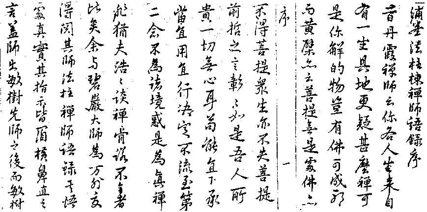
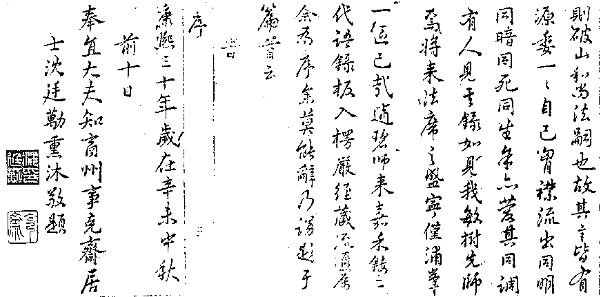

# 浦峰法柱栋禅师语录



> **藏经**：嘉兴大藏经（新文丰版）（嘉兴藏）　**册次** 第 37 册（J37）　**编号** JB402　**部类** 诸宗部　**卷次** 2 卷　**篇幅** 17,303 字

> **卷／品**：0 卷 · 3 品



---



## 目录



  - [浦峰法柱栋禅师语录序](#浦峰法柱栋禅师语录序)

  - [书序](#书序)

  - [重修浦峰寺序](#重修浦峰寺序)



---



### 浦峰法柱栋禅师语录序











法柱栋禅师目录



卷上上堂  

示众  

拈古  

颂古  

牧牛颂  

四威仪  

联芳



卷下机缘  

法语  

示偈  

杂偈(七言四句　五言四句　七言八句　五言八句)  

像赞



------



### 书序



佛事  

法派  

行状



浦峰法柱栋禅师语录卷上



嗣法门人(慧升集　慧渠编　慧岱录)



住辰州府天云山浦峰寺语录



师在卲州金峰青莲庵受众护法请，於康熙辛亥年十月初一日入院。



据室。师云：「昔先师於此建立龙山宗旨，生擒猛虎，活捉狞龙。今日栋上座承檀护公请，继主此席，且道子承父业一句作麼生道？」拈拄杖，卓一卓，云：「看取令行时。」江东浦市众绅士请上堂。师拈疏云：「百千诸佛向一毛端放大光明，四十二《般若经》在诸人舌尖上演出，还信得及麼？若信不及，更请维那宣过。」宣疏毕，师指法座云：「宝华王座，无机不备，坐断古今，谁能委悉？」遂升座，拈香云：「此一瓣香，呈祥光於凤阁，结瑞气於龙楼，热向炉中，恭为今上皇帝祝严圣寿，万岁！万岁！万万岁！伏愿尧风清一统，舜日照三千。此一瓣香，掌邦国之权衡，施民间之号令，奉为满朝文武、当道勋贵及绅衿士庶等，伏愿威镇三楚之上，禄位高增；光耀五谿之中，寿山永固。」复於怀中拈香云：「此一瓣香，不从他得，本自心传，耑申供养传临济正宗第三十四世长明炅和尚，用酬法乳之恩。」敛衣就座。维那白槌云：「法筵龙象众，当观第一义。」师挥拂云：「龟毛拂子，兔角拄杖，横打直敲，当仁不让。还有恁麼人麼？」僧问：「学解多闻即不问，接引初机事若何？」师竖拂子示之。进云：「者是禅意，如何是经意？」师云：「收归一处。」进云：「果然妙句无私屈，一踏鸿门两扇开。」师云：「不劳赞叹。」僧礼拜，师云：「放汝三十棒。」一僧才出，师便喝，僧一喝，师便打。问：「如何是第一玄？」师云：「天上有星皆拱北。」「如何是第二玄？」师云：「人间无水不朝东。」「如何是第三玄？」师云：「急水滩头浪拍天。」问：「向上宗乘即不问，日朗中天事若何？」师云：「照临无私。」进云：「只将捉雾拏云手，拨转灵光耀大千。」师云：「重下注脚。」乃云：「一毛头上现无边身，转大法轮，威神自在。若说即心即佛，节外生枝；非心非佛，望空启告。不是心、不是佛、不是物，且道是个甚麼？」喝一喝。复举：「沩山云：『一切众生皆无佛性。』盐官云：『一切众生皆有佛性。』」师云：「二老与麼道，也是徐六担板。浦峰即不然，众生佛性无，蟭螟眼里翻筋斗；众生佛性有，汪洋水底捺葫芦。诸人若向者里会得，许汝参学事毕；其或未然，两头截断无依倚，一个闲人天地间。」结追云：「谛观法王法，法王法如是。」下座。



结制，上堂。僧问：「法幢高竖，人天交接，如何是浦峰境？」师云：「千山耸翠凌霄汉，一水中流亘古今。」「如何是和尚家风？」师云：「清水白米，一任饱餐。」进云：「学人久侍巾瓶，如何得见性去？」师云：「著甚死急？」僧礼拜，师乃云：「太阿出匣，横挂眉端，截断众流，不通凡圣，神光独耀，匝地普天，妙用纵横，更无回互，直饶释迦、弥勒未敢觑著，文殊、普贤退身有分。到者里，明明绝渗漏，了了没遮拦，苟能直下承当，珠回玉转；拟涉纤毫，白云万里。」喝一喝，下座。



开炉，上堂。「浦峰炉鞲，今日打开；顽铜钝铁，一任将来。山僧不惜腕头力，直教凡胎转圣胎。」卓拄杖，下座。



上堂。僧问：「浦峰门庭即不问，向上宗乘事若何？」师云：「佛眼觑不见。」进云：「还许学人会也无？」师云：「莫妄想。」进云：「寒山逢拾得，转笑转相亲。」师竖拂子，云：「还逢者个麼？」僧无语，师喝退，乃云：「一毛吞却山河大地则易，山河大地吞却一毛则难。」蓦竖拄杖，云：「莫有向者里会得者麼？若有，则不妨随缘放旷、任性逍遥，拈一茎草作丈六金身、将丈六金身为一茎草，饥莺爪下夺食、猛虎颔下摘铃；如无，莫怪山僧粗糙。」遂旋风打散归方丈。



上堂。「诸方道：『浦峰如架千钧之弩，一箭射中一群；似漫天网，水陆空行，无处躲避。』者个说话是则是，未免有屈浦峰。大众！且道甚处是屈浦峰处？」卓拄杖，云：「莫将闲学解，埋没祖师心。」



上堂。问：「尽大地是个解脱门，把手拽不入，未审过在甚麼处？」师云：「逼塞虚空。」进云：「莫是和尚境界麼？」师云：「且莫错会。」进云：「作者好求无病药。」师云：「忌口，忌口。」问：「学人有一宝，毫光灿烂，照地辉天，请和尚鉴。」师伸手作接势，僧无语，师云：「却是一颗鱼目。」乃云：「只者没量人，作事太莽卤，打杀鳖鼻蛇，射透蓝田虎，大洋海底行，须弥顶上舞。」左右顾视，云：「大众！且道是什麼人行履处？检点得出，浦峰明窗净几安顿。」



上堂。僧问：「昔日世尊拈花，迦叶微笑，即今和尚又作麼生？」师竖起拄杖，云：「敲风打雨。」进云：「某甲有颗宝珠呈似和尚，未审纳受否？」师云：「试拈出看。」进云：「万仞岩前能撒手，千峰顶上现全身。」师云：「放汝三十棒。」乃云：「十五日已前，血流满地；十五日已后，皮脱骨露；正当十五日，把断要津，不通凡圣。你诸人作麼生得恰好去？谩言博地无寻处，马额驴腮面面逢。」



上堂。僧问：「如何是父母未生前面目？」师云：「风吹柳絮毛毬走，雨打梨花蛱蝶飞。」进云：「踢倒须弥，压碎虚空。」师云：「诚希有事也。」僧礼拜，师竖拂子，云：「会麼？」僧一喝，师便打，乃云：「道本无言，佛亦何相？掀翻野狐窟，魔外心胆丧，个无面目底，举世无比况。」拈拄杖，卓一卓，云：「大众！且道那个是无面目底？芍药花开菩萨面，棕榈叶散夜叉头。」



上堂。僧问：「坐断十方，风清月白，是如何？」师云：「非公境界。」进云：「主山高，案山低。」师云：「著。」进云：「浪翻沧海无人识，春到云山花自开。」师云：「闲言语。」问：「丹霞烧木佛意作麼生？」师云：「因寒所逼。」进云：「为甚院主眉须堕落？」师云：「打著南边动北边。」乃云：「动若行云，止犹谷神，不假雕作，面目现成。」蓦竖拂子，云：「大众还见麼？」一僧出，云：「见。」师云：「我何不见？」又击禅床，云：「闻麼？」僧云：「闻。」师云：「我何不闻？」掷下拂子，云：「观音妙智力，能救世间苦。」



上堂。僧问：「四大本空，五蕴非有，未审法身在甚麼处？」师云：「眼上眉毛横八字。」进云：「开口不见齿，伸手不见掌。」师云：「瞎。」问：「如何是天堂？」师云：「担枷带锁。」进云：「如何是地狱？」师云：「鼓瑟吹笙。」进云：「和尚莫颠倒。」师打云：「者漆桶。」乃云：「万仞岩前垂手者，眼空四海，气压诸方；百尺竿头进步底，横眠宇宙，裕后光前。」拈拄杖竖起云：「释迦老子在山僧拄杖头上放大光明，报道：『无边刹海，自他不隔於毫端；十世古今，始终不离於当念。』诸人还会麼？若也会得，始识浦峰为人处。」以拄杖畫一畫，云：「截断千差路，方知出处高。」复卓一卓。



解制，上堂。「九旬禁足，千岩万壑露结为霜；今朝放开，两粤三湘风行草偃。虽然，且万里无寸草处如何话会？」良久，云：「若到诸方，切忌恁麼道。」



怡元禅宿荐受业澹泊师，请上堂。举：「南堂静云：『一物长灵甚处安？长空云散碧天宽。莲宫佛刹花无数，眨起眉毛子细观。』」师竖拄杖云：「澹泊老宿向山僧拄杖头上道：『赤洒洒的逍遥自在，根尘迥脱，灵光独耀。』诸人还见麼？者里见得，眨上眉毛，一任云散碧天，花开佛刹。然虽如是，且唤什麼作一物长灵？」喝一喝，掷拄杖下座。



示众。云：「六根门里，无非古佛家风；万法丛中，尽是普贤境界。伶俐汉才闻举著，直下更无纤毫过患，内不见有我人、外不见有凡圣，一切处、一切时，坐断两头，古今不易，孤迥迥、无回互，赤洒洒、绝罗笼，任运腾腾，纵横自在，直得与佛祖同一鼻孔出气。所以道：若人欲识佛境界，当净其意如虚空，远离妄想及诸取，令心所向皆无碍。古人倾心吐胆、剖腹刳肝，只要诸人亲到亲证。浦峰不惜口业恁麼告报，直须向言语未形之际、朕兆未发之先著得只眼，犹是教乘极则。且道衲僧分上又作麼生？万法都来尘不动，一超直入如来地。」拽拄杖归方丈。



示众。云：「猛虎口中夺雀，骊龙颔下取珠，且道是个什麼人？」众无对。师云：「山僧自道去也。」便下座。



拈古



僧问云门：「初秋夏末前程，或有人问，未审对他道什麼？」门云：「大众退后。」僧云：「过在什麼处？」门云：「还我九十日饭钱来。」



「看风使帆，固是跛足阿师；随波逐浪，不无者僧。若是浦峰，待他道：『还我九十日饭钱来。』劈面便掌，看他云门怎生合煞者僧？若下得者只手，自然通途通辙，亦使云门法道不至有今日也。」



风穴在郢州升座云：「祖师心印，状似铁牛之机，去即印住，住即印破。只如不去不住，印即是？不印即是？」时卢陂长老出问：「某甲有铁牛之机，请师不搭印。」穴云：「惯钓鲸鲵沈巨浸，却将蛙步𩨍泥沙。」陂伫思，穴喝云：「长老何不进语？」陂拟议，穴便打一拂子云：「长老还记得话头麼？试举看。」陂拟开口，穴又打一拂子。牧主云：「将知佛法与王法一般。」穴云：「见个什麼道理？」牧主云：「当断不断，返招其乱。」穴便下座。



「诸方尽道风穴一箭落双雕，浦峰拄杖子犹未相许在，殊不知风穴却被牧主看破。众中莫有不甘者麼？若有，出来与拄杖子试道看。」



僧问五祖：「一大藏教是个切脚，未审切那个字？」祖云：「钵罗娘。」



「者僧与麼问，五祖与麼答，且道者僧还曾理会也无？者里有人下得一语，恰好天云山院两手分付。如无，参。」



德山小参，示众云：「老僧今夜不答话，问话者三十棒。」时有僧出礼拜，山便打，僧云：「某甲话也未问，因甚打某甲？」山云：「你甚处人？」僧云：「新罗人。」山云：「未跨船舷，好与三十棒。」圆明云：「大小德山，龙头蛇尾。」



「德山做处如此，可谓观前顾后，为甚圆明道：『大小德山龙头蛇尾？』敢问诸人，德山蛇尾龙头在什麼处？者里如有道得底，许汝具衲僧眼；如无，归堂吃茶去。」



太原孚上座问鼓山：「父母未生已前，鼻孔在什麼处？」山云：「即今生也，鼻孔在什麼处？」孚不肯，乃云：「你问，我与你道。」鼓山问：「父母未生已前，鼻孔在什麼处？」孚但摇扇而已。



「二老与麼道，不妨奇特，但父母未生已前的鼻孔何曾梦见？设问浦峰：『父母未生已前鼻孔在什麼处？』但唤云：『阇黎。』他若拟议，劈脊便打。」



沩山普请次，静板鸣，有一僧拍手呵呵大笑归去，沩山云：「奇哉！此是观音入理之门。」至晚，问其僧：「适来你见什麼道理？」僧云：「朝来未吃饭，闻版声欢喜。」沩山云：「赚杀人。」



「者僧朝来未吃饭，闻版声欢喜。沩山云：『赚杀人。』诸禅德！沩山恁麼道，许者僧？不许者僧？者里检点得出，一任天下横行。」



僧问镜清：「新年头还有佛法也无？」清云：「有。」僧云：「如何是新年头佛法？」清云：「元正启祚。」僧云：「谢师答话。」清云：「镜清今日失利。」又僧问明教：「新年头还有佛法也无？」教云：「无。」僧云：「年年是好年，为什麼却无？」教云：「张翁吃酒李翁醉。」僧云：「老老大大，龙头蛇尾。」教云：「明教今日失利。」圆悟云：「镜清道有也失利，明教道无也失利，且道淆讹在什麼处？若明得去，不妨识进退，别休咎，始知一句下有分身之意，有出身之路。今日圆悟忽有人问：『新年头还有佛法也无？』对他道：『不在者两头。』他或道：『为什麼如此？』『圆悟今日失利。』且道与古人是同是别？」



「镜清道有，错。明教道无，错。圆悟道不在者两头，错。浦峰恁麼批判，错。」良久，云：「浦峰今日失利。」



僧问长庆：「如何是合圣之言？」庆云：「山僧被阇黎一问，直得口似匾檐。」



「长庆被者僧一问，直得口似匾檐，检点将来，长庆心若毒蛇，者僧无端受伤，至今起身不得。正所谓：『牧童短笛横牛背，不知吹出洞中春。』」



玄沙见鼓山来，作一圆相，山云：「人人出者个不得。」沙云：「情知汝向驴胎马腹里作活计。」山云：「和尚又作麼生？」沙云：「人人出者个不得。」山云：「和尚与麼道得，某甲却与麼道不得。」沙云：「我得，汝不得。」



「我得汝不得，瞒人昧己，驴胎马腹里作活，情知有分，人人出者个不得，是甚麼碗脱？丘浦峰与麼道，当门齿缺。」



僧问石巩：「生死到来，如何回避？」巩云：「者里无生死。」



「诸仁者，还会麼？姹女已归霄汉去，呆郎犹向火边存。」



德山挟复子到沩山上法堂，从东过西，从西过东，沩山默坐不顾。德山云：「无！无！」便下去。复云：「也不得草草。」遂具威仪见沩山，提起坐具云：「和尚！」沩山拟取拂子，德山便喝，当时背法堂著草鞋便去。沩山至晚问首座：「适来新到在什麼处？」首座云：「当时背法堂著草鞋便去。」沩山云：「还识此子麼？已后向孤峰顶上蟠结草庵，呵佛骂祖去在。」



「德山大似飞骑将军，死中得活。沩山虽则坐享太平，却被德山觑破。天云恁麼道，一任诸方检点。」



颂古



风旛。



不是风兮不是旛，泉声鸟语暮云间，谁知八面玲珑外，盘走珠兮珠走盘。



南岳让和尚。



了知此法实渊源，一念无私天地间，谁信祖师真实理，无言无得古今传。



非心非佛。



朕兆未分前底句，个中无相亦无名，通身手眼居言外，妙手王维畫不成。



五通仙人问佛。



试问瞿昙那一通，随呼随应自圆通，直饶句下翻身去，未免抛沙堕眼中。



文殊三处度夏。



大鹏展翅三千里，燕雀蓬栖意自赊，举起金锤无著处，等闲不觉眼生花。



善财采药。



万紫千红总是春，善财拈弄却劳神，师资相见无多子，杀活全彰草一茎。



舍利弗问月上女。



蓦地相逢便问伊，根源本不异毫厘，与麼共大涅槃住，爱煞张公眼下眉。



母子产难。



一颗灵丹济及时，堂堂面目廓无疑，豁然桂子月中落，笑杀灵山老古锥。



有无佛性。



拔出吹毛利剑，是非当下截断，五湖四海难藏，直透威音那畔。



赵州访二庵主。



只马单刀入碧油，横施戈甲好风流，等闲勒转追风骥，白牯狸奴一箭收。



傅大士见武帝。



衲衣儒履道人冠，三度求玄三指南，无那梁王浑不荐，空亭流水夜潺潺。



广额屠儿。



屠刀掷下万机忘，壁立灵山选佛场，一句迥超千圣外，眉端灿烂玉毫长。



若能转物，即同如来。



若能转物即如来，千圣顶𩕳眼豁开，拈起须弥藏芥子，全身赤洒玉珠回。



七处徵心。



吹毛割开铁网，突出天外之天，徵散多闻无一物，北斗夜夜面南看。



八还辩见。



不见明珠不走盘，瞿昙狼籍在西乾，个中消息无还处，鼻孔何曾失半边。



见见之时，见非是见，见犹离见，见不能及。



空劫圆明本寂然，殊形劣相鉴无偏，山河大地浑如故，莫分梵语及唐言。见非见，彻底圆，到头无义无文字，百千三昧一毫端。



达磨大师初至金陵见武帝。



觌面当机绝覆藏，廓然无圣对君王，只因辜负东君意，两脚芦花默渡江。



觅心了不可得。



觅心不得安心竟，穿著惺惺日正中，大抵少林深种毒，儿孙匝地布春风。



六祖。



石坠腰间与麼来，碓头皎皎玉堆堆，东山山上传心洞，今古曹源正眼开。



马祖盐酱。



胡来胡去定干戈，四海英灵其奈何，从此令行气息尽，不须盐酱味调和。



鸟窠吹布毛。



大用临机秪自然，不从别处起帘纤，布毛吹见当人面，直下心安绝往还。



百丈野狐。



一言谛当绝狐疑，就路还家也大奇，迷去犹嫌谁拣择，悟来却信自家痴。三千劫外元周固，五百生前本不迷，从此髑髅情识竭，太虚何处著思惟。



水潦和尚。



踏倒翻身笑满腮，朦胧心眼豁然开，始知百千三昧法，总在一毫头上来。



南泉水牯牛。



堂堂揭露一头牛，父子临机把价酬，水草足来头角现，和云带月卧林丘。



盘山见舁丧歌哭。



未委灵魂往那边，破家散宅彻根源，不离当处还乡里，明月依然满钓滩。



亮座主。



当机一拶眼初开，放出从前者汉来，却向西山埋姓字，不留踪迹惹人猜。



吸尽西江水。



马师机用独超然，一吸西江彻底乾，寻到源头无一滴，龙光直射斗牛寒。



清源庐陵米。



曹溪一派水源清，到此方知意自深，不解庐陵酬米价，那能识得饱餐人。



药山升座。



鼓响钟鸣第二筹，刻舟求剑是同流，锋铓未露如能荐，脱体无依法法周。



赵州问南泉：「离四句，绝百非，请师道。」泉下座，归方丈。



父慈子孝起家门，子却夺爷家内珍，锦绣鸳鸯犹不顾，霜天月下觅金针。



平常心是道。



一种平常事，分明人不知，冷泉亭子上，空有古人诗。



秘魔杈。



急水滩头把钓钩，烟波深碧一轮秋，金鳞不解离钩意，几丧禹门赤点头。



庭前柏树子。



庭前柏树祖师机，拄地擎天谁不知？当日若逢个毒手，和根拔倒上天池。



沩山踢倒净瓶。



全提正令没人情，赢得沩山是净瓶，一脚踢翻归去也，撒开毒气满乾坤。



沩山水牯牛。



老觉情多虑百年，胁书名字为人传，将知彻体风流处，寂子无端更著鞭。



仰山插锹。



沩山问处不为多，直下承当会也麼？掣电光中开正眼，摩天俊鹞过新罗。



临济四料拣(并总颂)。



夺人不夺境，露布锥头利，觌面拟扬眉，靠倒在平地。



夺境不夺人，箭穿万户春，山河及大地，白昼也黄昏。



人境两俱夺，七星光灼灼，一箭落双雕，空王殿谁坐。



人境俱不夺，被此无穿凿，帘卷桃花红，风吹杨柳绿。



乾坤一色黄金国，八表四夷拱帝王，海宴河清尧舜日，顶门正眼更无双。



临济三玄三要



第一玄，拳头触破梵王天，两岸山花笑不彻，千▆坐断月明前。



第二玄，也不方兮也不圆，参天一柄龟毛拂，▆▆横穿著正偏。



第三玄，宝镜当台万里天，任汝神头又鬼面，灵▆何处躲丑妍？



第一要，戴角毒蛇出阃奥，纵横霹雳海山崩，当▆谁敢立途道？



第二要，正令全提长节操，吹毛出鞘耀天地，拟议思量血腥漂。



第三要，金刚宝杵无别窍，当头一击铁山摧，惊落虚空开口笑。



临济四喝。



临机四喝镇威权，外道天魔心胆寒。掣电光中分皂白，毫端影里纳山川。



临济四宾主(并总颂)。



宾中宾，一杖走红尘，不识玄中旨，江山秋又春。



宾中主，拈出一葫芦，机前如不荐，乌藤未放汝。



主中宾，两脚下风尘，无私正法眼，贵贱一相亲。



主中主，山藏戴角虎，杀活任纵横，谁敢当头睹。



寄言达道者，须识自性宗，主宾不立处，午夜日头红。



牧牛颂



拨草寻牛



蔓蔓荒草乱烟峰，蓦直穷源不见踪，踏尽翠崖云断处，叮咛又手问山翁。



蓦然见迹



忘疲决志不论程，花径幽通过上林，忽睹蹄痕新踏处，逡巡端在此山深。



捕步见牛



树里一声幽鸟鸣，廓然特地露全身，谁知渠自不逾矩，熟睡元来在故林。



得牛贯鼻



始得今朝见主人，扭来鼻孔贯芒绳，鞭头指出家山水，两岸云收月正明。



牧护调训



放去收来春月天，慇懃牧护古林泉，虽然总不伤苗稼，水草频添不记年。



骑牛归家



特地骑归来正夜，坦然独步月明中，牧童唱出还乡曲，万里山河一笛风。



忘牛存人



无来无去无东西，脱却烟蓑卧月迟，气息泯然霜夜静，许多清况孰能知。



人牛双忘



不立功勋一段奇，机忘实际少尘泥，门前日暖山花发，树倒藤枯鸟不栖。



返本还源



月白风清宇宙宽，渠侬得得自闲闲，家风举似同门者，日用真机处处圆。



入廛垂手



戴角擎头意气雄，单拈露柱为人通，豁开心眼超群类，显出家风调不同。



四威仪



山中行，杜鹘花笑人，杖头挑日月，手内握乾坤。



山中住，巍巍不动步，小大尽圆融，有何不具足。



山中坐，雨打苍苔破，白石演摩诃，古今成话堕。



山中卧，石头枕一个，和月带云眠，万事都忘却。



联芳偈



付殊伦相首座



浦峰出个真狮儿，露爪张牙步四维，遇象逢龙善解吼，门庭高设任伊为。



付崇鉴晟后堂



担囊负钵有多年，便契浦峰一味禅，点著通身手眼出，提持祖印接高贤。



付断疑智侍者



侍我杖头历有年，泥团触碎受心传，龙天推出龙▆护，大阐宗风辟正偏。



付宗庆升维那



金刚王剑付儿曹，杀活全提胆志高。龙象齐来俯席下，宗风永煽出英豪。



付天祥祯西堂



宝剑拈来付尔挥，万人队里显神威。全提正令弘宗旨，对御谈玄接上机。



付六融观悦众



老僧亲付一藤杖，伏虎降龙任举唱。正眼弘通续我宗，儿孙代代传灯上。



付阆仙怡知藏



立志苦心已有年，从斯放下得安然，拈来拂子亲分付，处处逢人把鼻穿。



付碧岩渠头陀



七斤衫子传来久，付与渠侬老作家，一任孤峰闹市里，骂风呵雨验龙蛇。



付如初恒侍者



身心放下在其间，数载慇懃击透关，今日山僧嘱付汝，芒鞋竹杖且居山。



付昶东耀记录



浦峰公案妙无言，棒棒令人彻骨寒，珍重儿曹勤举用，人天瞻仰尚奇峦。



付宗序原知客



曹源一派普天周，饮著凡流转圣流。分付当人善守护，逢人济渴解人愁。



付中山岱书记



浦峰辣棒露当阳，指示人天不覆藏，今日拈来亲付汝，家声振振续宗纲。



浦峰法柱栋禅师语录卷上



法柱栋禅师语录卷下



嗣法门人(慧升集　慧渠编　慧岱录)



机缘



僧问：「如何是浦峰境？」师云：「千竿修竹参差绿，扫月披风透碧天。」曰：「如何是境中人？」师云：「娥眉潭底秦时月，突出山僧拄杖头。」僧拟议，师拈拂子便打。



僧问：「如何是佛？」师云：「我若向汝说，汝还信得及麼？」曰：「学人不信，争肯礼拜和尚？」师云：「浦峰拄杖今日不开封。」曰：「乞和尚慈悲。」师云：「情知汝不信。」僧拟开口，师云：「可知道。」



僧问：「西来的的大意，乞师指示。」师云：「吃饭也未？」曰：「吃也。」师云：「江头担柴去。」



贝子王参，问：「如何是明心句？」师云：「胡来胡现，汉来汉现。」王曰：「本命元辰又在甚麼处？」师顾侍者云：「捧茶来与大王吃。」



张居士问：「弟子特来，未审和尚将什麼管待？」师云：「满盘栗棘蓬。」士拟开口，师云：「吞吐不下麼？」士无语，师云：「莫道山僧无管待。」



法语



示断疑智禅人



「十二时中不依倚一物，由是教乘家活计，未为衲僧极则。若是个没量汉，直须透顶透底始得。智阇黎於此依先师有年，勤劬弗怠，山僧继席亦不惮劳。盖因操履真实，识见不群，行业纯熟，脚跟稳贴，纵横自在，收放自由，诚不负出家操道之苦志也。珍重。」



示佛旨最禅人



「学佛祖大道，只贵脚跟稳当，如靠一座须弥山相似，内不见有根尘，外不见有凡圣，观三世平等，一道清虚。如此日益日新，久久操炼，时节到来，心花发现，如推门落臼，始知者个消息，弗从人得，本自现成。吾其勉之。」



示偈



示净参纯禅人



参禅贵要自心坚，勿逐痴狂入闹阑，十二时中如会得，高高心月照无边。



示鉴遐昱禅人



此事拈来没甚奇，直教用力发真疑，一朝黑漆桶底脱，须信珠藏内里衣。



示大寂定禅人



大寂定中非有言，太虚无物自如然，若知者个真消息，任尔施为遍大千。



示僧游方



大道无分西与东，布毛举起事难通，临行嘱汝无多句，紧俏草鞋莫放松。



示哲彬禅人看楞严经



饥则餐兮倦则眠，只因早已悟楞严，八还见处非真见，七处心通意了然。



示崇鉴晟禅人三上明山



三上明山不覆藏，一朝瞥地始承当，横吹铁笛千峰外，乾屎橛拈遍界香。



示德融忍禅人



阜上清风入竹林，谿间明月照幽深，轻舟渔父将垂钓，惊起狞龙出海门。



示巨耀烜禅人



尘网脱开便是禅，锄头只把掘心田，忽然水到池成处，彻底从前一贯穿。



示古彻清禅人



大道寥寥达者稀，高人踏著便知机，杖头指出金刚眼，万古晴空绝点翳。



示中山岱禅人



九岁辞亲志出家，慇懃学道植灵芽，根深蒂固枝荣茂，覆荫人天五叶花。



示大智愚禅人



韶光暗度鬓霜班，松老云深鹤自闲，悟彻曹谿流水韵，本来何处异真颜。



示志洁瑛禅人



青山花绽泄真机，匝地周天一段奇，珍重常人脚底事，铁鞋踏破了无疑。



示也庵构禅人



祖父门庭不易持，儿孙相继正斯时，破沙盆子扶将起，道化寰区当尔为。



示破空丽孙



云门饼子赵州茶，吃著通身现爪牙，哮吼一声惊宇宙，寰中独踞验龙蛇。



示碧辉明禅人



搬柴运水总神通，奋力提持莫放松，一日打穿漆桶底，彻头彻尾露真空。



示宗镜觉禅人



去去来来心未休，担囊负钵玩山头，有时行到水穷处，始觉骑牛更觅牛。



示涵辉清孙



碧天日朗净涵辉，性地涵辉尘不依，鉴地辉天施大用，拏龙捉虎显全机。



示学智禅人持法华经



念念无私转法华，须知火宅驾三车，一门超出无岐路，宝所分明是我家。



示李居士持法华经



法华转得自心坚，日用寻常无间然，念去念来无念念，明珠衣里绽金莲。



示不退勇禅人



勇向前行不退时，吹毛宝剑奋提持，任是佛魔难住足，机用超群始是奇。



示佛观禅德



蒲团坐破乾坤小，拄杖悬来日月明，汝问神通并妙用，又是将眉眼上横。



示破云▆法孙



大庾岭头提不起，今日阇黎已获披，会得赵州洗钵意，衣珠灿烂古今辉。



示恒杲霖禅德



即心即佛盘珠走，非佛非心珠走盘，若是两头俱坐断，红炉片片雪花鲜。



示恒高辉禅德



心忘情绝迥无依，触著方知底事奇，金毛出窟群狐遁，纵横妙用复何疑。



示灵璧文禅人



实处是虚虚处实，逆来顺去明端的，直须除却句中玄，管教出人一头地。



示智潭池沙弥



小小沙弥志气昂，依师学道越寻常，一朝彻见娘生面，绍祖传芳祝我香。



示大贤尼



念头把定莫他游，十二时中惺惺求，彻见娘生真面目，拈来法法悉能周。



示硕庵俊孙



割爱辞亲到浦峰，随师受业继师宗，从头彻尾成一贯，所向龙从虎亦从。



示碧峰舁孙



万花开放暮春天，鸟语松风唱道玄，珍重汝归休放过，勤劬努力种心田。



示庆生芳孙



山自幽兮水自清，鸟鸣泉响弄琴音，声声自合无生旨，揭露真机等现成。



示美庵彦孙



尔问西来意若何，老僧口謇怕言多，青山绿水无施说，历历明明会也麼。



示旭庵晖孙



父子同来入此山，一翻猛力辟荒田，清风明月堪为伴，云去云来得自然。



示印文策典座



三千公案止啼叶，八万行门心外诀，但住自家无相位，能超一切诸功德。



示佛果王居士



忙闲动静未曾迷，贵在当人㘞地奇，一句无私重道破，如如不动应来机。



示堪舆朱居士



高观旷览审来踪，掌握阴阳造化功，试问阴阳不属地，从何下手觅真龙？华▆。



示裁缝张朝铨



几片青黄赤白云，无情铁剪巧裁陈，就中任尔分长短，争识穿针引线人。



寿良臣姚居士



水自清兮山自秀，满庭黄菊增荣茂，拈来庆祝老维摩，永证金刚无量寿。



寿宾实姚居士



林峦紫气霭春风，鸟噪玄音花笑容，闻见古今元不异，长生消息在其中。



寿佛演法大德



桂树森森妙体彰，金风拂拂吐清香，当阳指出上人事，寿同天地永昌昌。



赠天祥祯长老



出窟金狮露爪牙，全威高步踏云霞，千妖百怪潜踪迹，凤子龙儿任捉挐。



赠碧岩渠长老



浦峰一脉属儿曹，祖令全提正眼高，任是狞龙归足底，灯传奕世启英豪。



送秩臣姚学彦赴试



桃开浪煖仲春时，花雨飞飞点翠枝，最喜风云刚际会，锦鳞得意跃龙墀。



秋日登大朝山访净光老宿



层峦笔削亘长空，崄巇斜封曲径通，策杖登临方日午，青云捧出白头翁。



偕人龙唐文学坐叙次韵



雾敛风清天霁䨑，寻幽仙子过桥西，山间鸟语分明道，勿逐声香带水泥。



送尚玉姚文学



儒称君子独公贤，道脉渊源一贯传，试问当人脚底事，行行稳步御阶前。



祈雨拈香口占



炉热栴檀香一橛，腾腾瑞气冲天阙，龙王惊起怒风雷，直得滂沱降不歇。



师疟疾口占



寒热两重相斗侵，是何神鬼是何精？杖头击碎浑无物，暑往寒来任变更。



黔阳邑大纶向文学再晤次韵(公讳于经)



本来无物洗何尘，结个茅庐远世名，惟喜青云佳客至，擎杯且叙旧时情。



春日野朢



远眺谿山翠欲流，俄惊春色上林丘，红红白白争时艳，谁识乾坤造化由。



夜坐阅指月录



明灯静夜坐窗前，展卷频频见昔贤，看到德山不语处，者回亲证祖师禅。



山堂闲坐三首



赢得餘闲寄艸堂，藤萝铺径鹿为床，柴门尽日未常掩，风自来兮花自香。



柴门无锁有云封，古径苍苔少客踪，日出黄蜂穿菊里，夜来明月到窗中。



古涧层峦碧树林，潺潺流水演玄音，晚风相送鸦归去，物外闲僧卧白云。



葵花



瑶台花放澹烟轻，品冠群芳一段清，傲骨不随风力转，丹心惟向日中倾。



怀友



寥寥飘泊两心同，怅朢云山砌几重，此夜幽窗成独坐，举头唯见月华浓。



咏竹四首



龙班凤尾节交疏，正气森森入畫圆，一段风高标雅致，肯随蒲柳遍皇都。



几经霜雪几经春，弄月吟风数玉茎，不是一翻高直节，那能消受岁寒情。



▆田卓出绿茎茎，几易春秋未变心，节操至今唯尔重，清高千古荫丛林。



秀发根头意气长，从来不畏雪风霜，虽无桃李争妍色，幸有清标压海棠。



雨后野眺



云开石涧廋，风定竹林幽，目断清江远，渔舟泊岸头。



雨中朢鴈塔寺



四际空蒙雨，烟霄接地丛，应知山有寺，只在白云中。



宿香山寺



香山留寺古，翠竹倚栏栅，夜静无灯火，持经对月看。



赠如初上座



浦峰放一箭，直射九重殿，龙象都收伏，逢人穿鼻而。



杂偈



山居十三首



年来懒与世奔躔，缚个茅庐傍岳巅，离相不拘佛圣戒，无心慵论祖师禅。林间修竹云铺衲，涧底担泉月满肩，除却现成公案外，难将别调寄名贤。



高枕松窗午梦微，觉来山静客来稀，风生竹畔流清韵，鸟语枝头达上机。怪石藤蟠龙挂锦，奇峰雾霭豹垂衣，分明一段天然趣，心眼开时几个知。



山中无历浑忘年，几见明窗缺月圆，风透体寒嫌衲薄，雪残眼阔爱松坚。野云出岫迷樵径，幽鸟啣花入洞天，曲路柴门人罕到，拈香择火自消闲。



极目林峦春色彰，风吹花气入帘香，脱胎竹笋参天杖，倚壁藤萝锦石床。报客杜鹘啼蜀魄，迷魂仙子梦黄粱，劳劳世事如飞电，逐影迷头空感伤。



万虑潜消百不知，韬光泉石乐无为，删藤刈草培清舍，镢雾锄云种紫芝。火熟芋香思懒赞，山晴薇长想夷齐，休将世念存毫发，对境忘缘绝是非。



偶因客问山居意，我话幽栖不计年，岭后栽松将合抱，槛前插柳可垂肩。芒鞋脚底狞龙活，拄杖头边玉兔悬，大道原来无指示，莫将往事污心田。



四壁崚𡾓绿树彰，雨餘春色入虚堂，新荷水面连云翠，梅子枝头带露黄。座上懒将诸佛供，胸中直把万机忘，而今觑破劳生梦，水际泉声风韵长。



万壑烟云一柄锄，随缘日作且安居，种松倚翠根宜固，爱竹垂阴笋不除。性内有天须自觉，胸中无字向人书，也知近代淳风易，世事何堪问古初。



懒把浮生花甲轮，惟於道乐守天真，半铛石煮三更月，一镢松裁四季春。佛法荒凉因世滥，人情寂寞为厨贫，几回笑傲孤峰顶，及第心空自主宾。



山居夜静转幽然，万境空闲自在禅，黄叶供炉无宿火，青香煨鼎有残烟。一帘月色浮天外，半岭松涛落枕边，满耳盈眸非别物，几多英俊被遮瞒。



携将钵杖挂嵩巅，不学诸家五味禅，引水浇花清舍外，开田种粟埜云边。名贤有意开三径，野老无缘受一廛，翻忆古今谁是侣？寒山拾得可同传。



千峰影里结蓬茅，一念无生万虑消，性地廓然无草秽，心田坦荡绝尘嚣。月临霄汉磨天镜，云走长空识锦袍，自是此身闲不彻，青山绿水任逍遥。



草阁玲珑得自便，谩将石鼎煮寒泉，乾坤尽在杖头上，日月收归钵底边。花灿碧峰装翠面，日穿疏壁照寒肩，坦然万籁咸俱寂，赢得风高物外闲。



登明山宝顶



峰高路古砌苔华，四顾春辉景物佳，云澹天空明日月，风驰草偃走龙蛇。林松点翠栖幽鸟，涧水流香带落花，采罢紫芝依石坐，逸情岂羡泛仙槎。



明山与友人夜坐惜别



炉香断续晚钟暹，冷露无声湿翠微，素壁灯光浮琥珀，疏帘月影映玻璃。花开别苑金风爽，鹤唳霜天云梦稀，话共知心唯此夕，江南江北两依依。



除夕



自从浪迹走天涯，甲乙浑忘屈指推，乍见梅开春又到，忽闻竹爆岁除来。老临白发添何易，时去黄金换不回，珍重两堂云水客，一年好景付茶杯。



元旦发笔



东来晓日照山堂，兀坐斋头世浑忘，炉内添香和案煖，池中洗笔带花香。簷前好鸟鸣生灭，槛外寒松较短长，对境吟哦清兴远，少林公案岂囊藏。



春日寻芳



云澹山空积翠深，杖藜缓步出幽林，雨餘青嶂烟岚重，水落寒潭日影沉。鱼跃锦江波砌玉，风翻嫩柳叶筛金，悠然一笑晴光好，无处山河不带春。



题浦峰寺



兰若巍峨宋帝封，明山秀水护重重，三更鸟宿凌云树，五夜僧敲醒世钟。幻梦须从空里觉，道源宜向静中逢，大开炉鞲镕凡圣，祖印单传正脉通。



参禅偈



参禅本要自心明，莫向他人行处寻，念起一丝眼著楔，腹藏万卷镜蒙尘。家家户透长安路，处处山含太古春，撞遇虚空连架打，髑髅乾尽见天真。



麻阳邑侯陈公过访次韵(公讳五典)



树锁苍烟涧隔尘，萝龛共坐雨花新，成仙作佛无多体，治国齐家总一真。翰院文明传道统，楚国善政布慈因，伫聆丹诏登台辅，勿负灵山记莂诚。



赠宗庆升上座



寥寥祖道继今时，正眼弘通属尔为，吹毛杀活勤摩用，钩钓抛垂莫浪施。搂碎兔𥥶狐穸种，夺来虎穴凤巢儿，圣恩圣德从斯报，此是吾家向上机。



午日二首



朱明日正照林端，徙倚楼台对碧澜，龟鼓频催江上酒，龙舟兢畫水中天。长吟玉偈逸情远，满泛霞觞客兴宽，彩系五丝垂续命，风流不尽万人欢。



佳节中天日正长，声声畫鼓落平江，朱楼酒重留人醉，碧水舟轻斗浪狂。吐火柘榴红映彩，出波菡萏绿生香，从来一味禅风别，香积频频发上方。



芭蕉



素质参天碧玉茎，横拖青剑倚龙门，光浮古干留云住，影覆苔寒绝鸟痕。晚抱麒麟和月卧，朝看蝴蝶弄春晴，灵根郁密超群品，未许时人取次论。



代友人一律



自归酉水远云林，几度逢春柳绽金，门外青山看是旧，镜中白发鉴来新。半生书债餘闲少，百代兴亡醉梦深，遥忆故人湘浦隔，濡毫走墨一传心。



中秋



谁将玉镜挂苍穷，一片清辉处处同，印破水天分上下，移将花影转西东。光临狻兔成胎息，影射潜龙起锐雄，万里山河浑白昼，良宵谁不仰高风。



暮秋有感



兀坐江头对落晖，风恬浪静水声微，深秋红叶和霜醉，薄暮黄花带露肥。白发谁惊催世梦，朱颜那省乐闲机，乾坤否泰何堪论，我与青山绝是非。



代僧答文友



圣学贵心空，心空至理融，山川皆道用，草木尽文风。室朗晴霞照，窗虚夜月通，毫端生瑞彩，直射斗牛宫。



赠隐者



结草云林下，无腔曲自吟，弹琴音动指，作赋韵劳心。竹迳苔痕湿，松庭积翠阴，山泉饶独饮，谁与漫清缨。



象山值雪



谁把珠玑撒，谿山一色妍，苍松成玉树，古壁挂银笺。白象增雄峙，虬龙带暮烟，圆明舒一鉴，处处两花天。



舟中有感



飘泊寒江际，轻舟慢𫇛游，春晴开柳眼，云懒卧山头。蝶梦花间醒，波光天外浮，问予何所似，坦荡一沙鸥。



宿玄武宫



几村青嶂外，一寺白云中，贝叶翻明月，松风度晚钟。茶香忘客倦，枕堕得心空，梦断烟霞里，醒来日正东。



重经青莲庵



此地我居先，溪通隐者泉，开窗迎白月，凿沼种青莲。迳竹节无改，庭松老更坚，知君深院里，别有洞中天。



中秋



一轮今夜满，何处不圆明，影逐蝉光冷，香浮桂魄轻。露珠连柏翠，潦水共天清，此景家家赏，谁人识暮晴。



菊花



群芳春兢艳，贵种别寻常，不逐炎凉变，还经岁月长。清机凝玉露，翠色傲银霜，自识陶潜后，逸名遍界香。



赠隐者



结庐人境外，尽日少尘鸣，涧杳猿声度，林深鸟语穿。树摇青径柳，花发玉池莲，坐待熏风煖，支铛煮瀑泉。



春日送别友人



谿山冰雪瘦，送客度平川，迳草铺罗襦，藤花插翠钿。舟行残照里，帆挂夕阳边，此会知何日，千江一月圆。



春日雨霁



雨歇泉声朗，风微竹韵清，陇头蛙唤子，陌上鸟鸣春。蔓草驯蛇性，名花恰蝶情，乾坤无覆蔽，造化坦然平。



春夜坐



清夜凉如洗，轻寒入毳衣，云移惊石瘦，露重觉花肥。鹤唳闻天语，猿啼见月辉，其间端的旨，欲辨已忘机。



客中阻雨



风忧松篁韵，云封野甸迷，气寒花态弱，露重柳头垂。世念同冰冷，禅心共水栖，旅怀何所寄，洒墨暂留题。



春日喜晴



四嶂云开晓，寒光逐涧流，石林烟气尽，楼阁曙光浮。盗果猿摇树，寻香鹿趁丘，静观时泽润，物物自抽头。



独坐有怀寄黄居士



曲迳苔生绿，蓬门永日关，悠然居世外，迥矣别人寰。旧识山川阻，心知梦往还，天台何日晤，携手白云间。



夏日寓天龙山



林幽山寺古，修竹护危墙，花雨空中散，沉檀室内香。野情随放逸，世态任奔忙，寂静无人语，钟声到上方。



赞



自雕布袋罗汉像赞



乾坤法界不可说，纳向其中无一物，十字街头大打开，𦍕头狗肉谁能别。咄咄，休怪捏，憨布袋里有弥勒。



双桂破山明祖像赞



者老汉，杀人处极救众生，酒肉里吞吐佛祖，脚跟下鸾翔凤翥，棒头边虎骤龙骧。铁棱棱面孔，耿落落心肠，遍地儿孙觅伊起处不得。(咄)！西蜀梁山双桂堂上。



自赞



咄哉者村汉，名不得，状不得，毕竟如何施设？娥眉潭上已多年，贯逐狞龙吞夜月。



者老汉，古怪样，任他赞，任他谤，不著凡见，不住圣相，横打直敲，一条白棒，逢场作戏，当仁不让。呵呵！却被个没眼波斯东摸西涂，唤他做法柱和尚。



书问



谢泸谿邑侯吴公启(公讳嵩)



圣道巍峨，惟赖英才而治化；佛天光耀，全希仁善以洪扬。起唐虞泰运於斯际，家家乐业颂风高；镇华夏安平於此日，处处歌扬称至德。不惟紫极注心，实乃苍生拭目。恭惟台台，道融三教，学富五车。列赤帜於词坛，播清名於海甸。驱邪远佞，易俗移风。拯▆▆之水火，郊鸿甫巢；拥缁流之屏翰，龙象奔腾。诚哉一路福星，久矣万家生佛。栋也山林樗栎，泉石慵愚，形尚不中於规绳，志岂堪俦於鸿鹄。道薄德微，学疏才浅，饱餐香积，至今齿颊生凉；宠锡佳章，终古名蓝绚彩。欣观云汉之篇，已识道隆先哲；快诵珠玑之句，更聆德配一君。佩感无涯，衷酬莫罄。临楮瞻依，并复并谢。



复僧书



承来翰云：「业缘所系。」山僧三复而三叹，然上无攀仰、下绝己躬，净裸裸、赤洒洒，有何系哉？山僧乃栖心於孤峰顶上，志泯心灰，炊木樝羹、煮铁钉饭以消日也。上座忽尔问心，乃问：「是何人？心是何物？」若言是一，不应又有问心者；若言是二，乃元无二古。且将甚麼唤作心？所以古德云：「似地擎山，不知山之孤峻；如石含玉，不知玉之无瑕。」今上座既有向上之志，须用智慧之刀斩断一切，独立於万仞之上，无论是佛、是魔，一齐勦绝。绝后再苏，提持祖印，利物维新，堪报佛恩，始不负出家之志耳。依依是复。



------



### 重修浦峰寺序



立茎草而建梵刹，正眼弘开；移片石而得云饶，敏手亲切。所谓锻琢金玉，须凭良匠之工；拥护法幢，必假恩檀之力。古称裴公夺笏于石霜，苏子解带▆▆▆，所以道不虚行，乘时而合也。爰有辰郡胜境浦峰▆寺，曲水拖蓝，群峰耸翠，鍾如是之灵秀，产如是之英贤。高也！明也！松风鸟语，演不尽之玄音；奇哉！俊哉！萝月烟云，协无穷之妙旨。宛然鹫岭西开，俨若普陀南现。嗟吁！沧桑之后，一片坵墟，殿阁楼台，苍苔叠锁，墙坦户牖，荆棘丛封。畫栋倾而鼠雀成巢，丹壁颓而狐犴作穴，风轮雨矢，无日催残，金容败露，人意何安？兹略竭以寸忱，冀重新而鼎革，谅一木之难支，思众擎之易举。仰祈尊官长者、达士仁人，发难舍能舍之心，施极爱所爱之物，共勷盛事，快睹落成，庶使佛日重辉，法轮再转。功高德厚，注北海以无涯；善因乐果，积南山而有庆。现手眼於当时，勒芳名於不朽。谨序。



募修普同塔缘引



历古丛林知识，建立法幢，激扬宗旨，墈龙验象，竖拂拈槌，是谓禅宗之极则也。然而收骨殓骸，普存合塔，亦先佛之定制。兹以山僧劣志，固不敢效古人之大作，别展一线风规。化道有缘，缁素同发盛心。多寡施助，共成一塔，功勒千秋。是疏。



佛事



为铁脚禅德起龛举火



以拄杖击龛，云：「生也者重关，死也者重关，打破者重关，出头天外看。」喝一喝，云：「照顾脚下。」以杖引行。



举起火炬，云：「铁脚铁脚，踏翻海底，掀倒山岳，龙来一拳，象来一脚，任尔大显神通，不出末后一著。」撺下火，云：「烈焰光中，请君自顾。」



为送拂尘老宿入塔



云：「法法俱圆，事事已毕，来亦无来，去亦无去，正体凝然，一尘不立。山僧如是举扬，犹是者边底事，且道拂尘老宿毕竟向什麼处安身立命？」以拄杖指塔云：「团团无缝罅，千古立高标。」



为拙之大德起龛下火



喝一喝，云：「菩提大道无去来相，生死通明了没遮障。咄！泥牛举步超三界，木马追风越十洲。」



以火炬指面，云：「拙之老，拙之老，一气不来，东歪西倒。者个赤肉团作麼生销缴？」撺下火，云：「足下红莲开灿烂，无相光中独露身。」



法派



海慧明常净，通真达本源。道弘证佛果，绍继祖灯▆。



行状



师讳海栋，号法柱，姓陈氏。先大人名三桂，母赵姓，澧洲石门人也。廿龄，父母双逝，悉废儒业。至二十五岁，因思亲恩难报，乃弃俗出家，往慈利七星山礼长明炅和尚披剃，参三不是，亲炙三载，到龙山颖秀师翁座下圆具，又随炅至沅州明山巾瓶七载。一日，炅问：「从苗辨地，因语识人。秪如苗未发生之际，语未开口之先，作麼生辨得？」师云：「不会。」炅曰：「汝实不会麼？」师云：「一轮明月千峰上，古往今来一串穿。」炅曰：「又道不会。」师作礼。复随炅至辰州浦峰寺，一日坐次，炅曰：「达磨西来传个什麼？」师云：「路逢毒蛇长千尺，脚下翻腾势转高。」炅曰：「也须吃棒。」师拂袖便出。后一夕，闻风动树，鸟作喧，洞明此事，偶成一偈：「娘生鼻孔本来长，八字打开不覆藏。风韵鸟鸣元不异，灵灵紧俏绝商量。」炅曰：「塞却鼻孔，坐断舌头，作麼生出气？」师云：「顶门上七纵八横。」炅曰：「放汝三十棒。」师震威一喝，炅亦喝，师过前便作掌势。炅谓座元曰：「此是浦峰第二代主人。」亲炙十有餘载，后受记莂，往住邵州金峰青莲庵。适因老人示寂，归浦峰，收葬事完，受请继席，帅众廿载，朝夕不怠，精勤垂训，遐迩缁素披沥钦崇，提持正令，大启宗猷，祥麔威凤，振振绳绳，殿阁寮舍俱成大观，▆装圣像百有餘尊，一切常住诸事具备。时年五大▆六，栖心泉石，暂截葛藤，将院务交付嗣法门人轮▆住理，自此袍道情闲，以乐餘年耳。



康熙辛未岁蒲月　夏至前五日刊。



> 法柱栋禅师语录卷下(板存嘉兴府楞严寺流通正藏)

