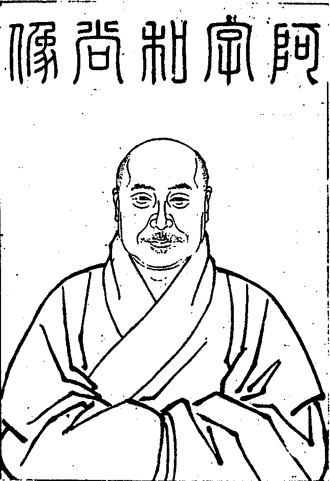
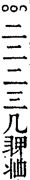

# 海幢阿字无禅师语录



> **藏经**：嘉兴大藏经（新文丰版）（嘉兴藏）　**册次** 第 38 册（J38）　**编号** JB408　**部类** 诸宗部　**卷次** 2 卷　**篇幅** 60,310 字

> **卷／品**：0 卷 · 0 品



---



阿字和尚像







四十九年一字无，分明此日绝名模。现前面目非今古，莫向春你闻鹧鸪。



栖贤老僧题



海幢阿字无禅师语录目录



卷上上堂  

普说  

小参



卷下小参  

茶话  

颂古  

书问  

像赞  

佛事



海幢阿字无禅师语录卷上



同门弟乐说今辩重编



上堂



康熙元年元日於雷峰，承堂头天然老和尚，举师首众上堂。升座拈香毕，维那白椎，堂头和尚云：「山僧十二年不升此座，去年中秋承缁白诸公请继主华首，今岁元旦不请自说。且道为个甚麼？秖为上有所承，下有所授。大众！承个甚麼？」以竹篦子作十字。「授个甚麼？」以竹篦子作卍字。「承授不及一句又作麼生？」良久，云：「大有人承当在。听取三偈：十二年虚第一座，今朝推向人天前，博山缜密家风旧，多少优昙且让先。赵州一字当谁莂？指出稠人共法幢，露刃寒光无拟处，雷峰门下别商量。一句早登童子籍，千差曾入普贤门，养成双翮搏风起，搅动沧波汇洞源。」侍者揖师出众，提起坐具，云：「金针刺眼，和尚教人，今日施为，两相辜负。」和尚云：「总在阇黎分上。」师云：「教谁承当？」和尚云：「礼拜著。」师礼拜，和尚以竹篦子指云：「秖者是。」维那白椎，下座。



次日，奉堂头和尚命师分座。师卓拄杖一下，云：「诸兄弟！若论此事，不须一捏，直得冰消。」复卓一下，云：「诸兄弟！若论此事，大须拣点一回著到始得。阿上座十三年携瓶挈水，咀嚼五味，将谓有多少奇特？三年前游辽海，逢人恶发，扁担头不曾触著半个。及归，从新打失鼻孔，只者个也不消得。旧冬又从琼州还，将谓恁麼过时，不料昨承和尚命，为诸兄弟秉拂宣扬此事，众中还有一捏冰消者麼？请出来相见。」栖贤顿监院出众，问云：「佛佛授受，祖祖相传，今日雷峰，别传何事？」师卓拄杖一下。进云：「人天众前，蒙师拈出。」师复卓拄杖一下。进云：「洪波浪里，水乳难分，声色丛中，谁为择法？」师云：「退后著。」顿礼拜起，云：「相看谁是知音者？却教桃李笑春风。」师云：「长安殿上新天子，凤历初颁处处知。」进云：「今日首座新令。」师云：「却是老兄会得。」顿问讯，归位，云：「大众分明听取。」师不顾。方丈石侍者出，问云：「神龙在水，作雨兴云，为甚麼水与龙两不相识？」师以拂子击案，云：「还见龙麼？」进云：「且喜把柄在手。」师云：「不劳赞叹。」石退后，喝一喝，师云：「眉间挂剑一句为甚麼不道？」石云：「不道，不道。」便归众。铁书记出众拟问，师竖拂子云：「未竖已前还曾道得也未？」铁复拟进，师云：「今日新首座正令在手，触著即丧身失命。」铁拂袖归众。师遂顾左右云：「还有麼？若无，新首座谩诸兄弟去也。昔大慧杲禅师居云居首座寮，因岁节秉拂云：『释迦掩室於摩竭，耕地种蒺藜；净名杜口于毘耶，鏴锢铸生铁；须菩提唱无说以显道，锼饭祭闲神；释梵绝听而雨花，果有领受者。直饶向上一著，千圣不传，硬纠纠、活泼泼，棒下无生忍，临机不见师，也是隔靴搔痒，总不与麼落在无事甲里。且道古人具个甚麼眼目便与麼道？你若不拣点便恁麼会去，秖是无孔铁锥，你更如何若何？两茎眉可惜多少？』」蓦竖拄杖云：「者个有甚麼拣点处？有甚麼和会处？三脚驴子弄蹄行，新妇骑驴阿家牵，口是祸门，直至如今不得妙。不见玄沙大师道：『尽大地是沙门一只眼。』诸兄弟！秖者一句子直是无下手处，你拟向甚麼处拣点著？到委悉亦是你，不委悉亦是你。一日十二时，从朝至夜，且道脚跟下错过多少？」横按拄杖云：「者一棒合是秉拂上座吃。何故？今日鼻孔索头不合落在诸兄弟手里。」卓一卓，下座。



海幢浴佛日，僧问：「世尊初生即不问，未生已前请座元为众举扬。」师云：「未出众已前道取一句。」僧便喝，师云：「大好一喝。」进云：「大众证取。」师云：「莫诈明头。」僧拂袖归众。僧问：「未离兜率，已降王宫；未出母胎，度人已毕。为甚麼又摇唇鼓舌？」师卓拄杖一下。进云：「大小座元又指东畫西去也。」师云：「你唤甚麼作西东？」僧一喝，师云：「恰好。」僧礼拜归众。师乃云：「诸兄弟！释迦老子当年今日毘蓝园解道：『天上天下，唯我独尊。』者一杓恶水，直至如今泼不止。诸兄弟！且道钝置多少时？教中云：『世间一切群生类，尟有欲求声闻乘，求独觉者复转少，趣大乘者为希有。趣大乘者犹为易，能信此法倍为难。』你若信得此法，许尔与释迦老子同生十二时中，折旋俯仰、弹指謦咳，无非佛之妙用。且作麼生是此法？莫是开佛知见、入佛知见是此法麼？且喜没交涉。莫是唤山作山、唤水作水、拄杖子唤作拄杖子是此法麼？且喜没交涉。莫是如石含玉，不知玉之无瑕；似地擎山，不知山之孤峻是此法麼？且喜没交涉。赖遇跛脚阿师要一棒打杀，洎合道得一半，检点将来亦是平地吃交。若是海幢门下秉拂上座则不然。」蓦拈拄杖子，云：「拄杖子与露柱相见，正说此法，常说、炽然说、无间歇说，释迦老子被他穿却鼻孔，跛脚阿师被他打折驴腰。且道秉拂上座拄杖子有甚麼长处？」良久，云：「好手手中呈好手，红心心里中红心。」卓一卓，下座。



海幢解夏。僧问：「夏末秋初，诸兄弟！东去西去，大须向万里无寸艸处去。如何是万里无寸艸？」师云：「遍地皆是艸。」进云：「古人云：『出门便是艸。』如何是出门？」师云：「阇黎莫落荆棘里。」进云：「古人又云：『直得不出门，亦是艸蔓蔓。』如何是不出门？」师云：「大须转身始得。」进云：「忽有人云：『大小座元恁麼说话，正是艸蔓蔓。』又作麼生？」师云：「当时霍光卖受降城与单于，汝道契书是甚麼人作？」僧一喝便礼拜，师笑云：「聊放一著。」师乃卓拄杖云：「举不顾，即差误；拟思量，何劫悟？诸兄弟！还委悉麼？海幢法窟，真歇场中，以大圆觉为伽蓝，身心安居平等性智，秖图佛法宣扬，岂爱门庭热闹？家常茶饭，淡薄过时，不高扳外护，但低揖时人。寻常布个撩天网子，要打冲浪鲲鲸，若是跛鳖、盲龟、虾蟆、蚯蚓，有甚麼共语处？教中云：『佛子住此地，则是佛受用，常住於其中，经行及坐卧。』诸兄弟！作麼生唤作此地？此地又如何住？者里大有淆讹在。不是同床睡，焉知被底穿？所以，荒村陋院莫挂瓶盂，佛祖玄关横身直过。果然如是，从教鬼面神头正眼觑来，大好一场笑具。到者里，言所不能言、步所不能步，不妨刮龟毛于铁牛角上、截兔角于石女腰边。虽然如是，犹是九十日内事。九十日外一句作麼生道？」良久云：「昨夜月明中，撞著刘幽求，腮边微笑暗点头。且道笑个甚麼？笑道：蟭螟虫巢蚊子，眼睫上高声大叫：『土旷人稀，相逢者少。』」下座。



海幢六月朔，师升座，卓拄杖一下，云：「诸兄弟！恁麼会得，千足万足。」复卓一下，云：「诸兄弟！恁麼会得，千曲万曲。空里无花，眼中有过，六门鉴觉不是家珍，向上翻身犹为病语。诸兄弟！据实而论，有甚麼得与不得？命根有甚麼断与不断？手有甚麼撒与不撒？如今有一干学得，气似狞龙，三拳两掌尽自不少，只是个弄死蛇汉，有甚麼眼目？反将自己本有之性弄成心境，转加悬远。不见道：『若有一法过於涅槃，我说皆如梦幻。』诸兄弟！者里分疏不得，则决建立一切头重尾轻，灵山上者朵青莲教谁出手扶起？所谓转颇黎玅宝镜而归铜铁之明，以阎浮檀明净真金同瓦砾之价，切不可谬相辜负。大阳玄禅师云：『诸禅德！须明平常无生句、妙玄无私句、体明无尽句，第一句通一路、第二句无宾主、第三句兼带去。一句道得，师子嚬呻；二句道得，师子返踯；三句道得，师子踞地。纵也，周遍十方；擒也，一时坐断。正当恁麼时，作麼生通个消息？若不通得个消息，来朝更献楚王看。』诸兄弟！大阳可谓僧繇丹青，娇娆毕露。若在海幢门下饶舌上座则不然，我者里家贫难办，素食事忙，不及艸书，有甚麼三句两句？纵也，只是𣰦𣰦毵毵；擒也，亦只是𣰦𣰦毵毵。到者里，更有甚麼消息可通？若无消息可通，大家无事归堂。」下座。



四月初八日，师升座云：「诸兄弟！释迦老子未生已前，各人脚跟下一条大路绝回互、没周遮，不向者里承当，俱名钝汉；若向者里承当得，廓清五蕴、洞彻十方，不为分外，日月不足以喻其明、江河不足以譬其大，轶王侯而不为贵、混劳侣而不为贱，尘尘尔、刹刹尔。才若如何，俱名变异。只为你一种担雪填井底汉坐失其利，粗者迷於事、细者钩於理，贵买朱砂去畫明月、贱持龙泉来斫黄土，直饶释迦老子离了睹史多天，降生刹利王宫，放大光明照无量土，金莲捧足、师子吼声，要少为你佐助，发机不得；云门大师要一棒打杀，图取太平。你亦当实法会去。所以道：善言者，言所不能言；善迹者，迹所不能迹。不能言则无言、不能迹则无迹，无迹、无言且不是手中扇子𨁝跳上三十三天，触著帝释鼻孔，东海鲤鱼一棒打翻，血似盘倾。毕竟合作麼生举似？」蓦卓拄杖云：「诸兄弟！还见麼？过去灯明佛，本光瑞如此。」



结夏。师升座，卓拄杖一下，云：「此是十方诸佛、诸大菩萨於众生界中荷负而出，为大伽蓝身心安居平等性智，利益五事、提拔四生。今日海幢上座开张老舖、挂旧招牌，口说真方、手持假药，与诸兄弟以长河落日、渡头孤烟为此僧伽蓝结界安居。若是耆年先德，一任脚跟带泥、裙头拖水，往来州县、笑傲山林，朝到西瞿耶尼、暮归北郁单越，过七日复过七日，不名破夏。若是初心末学，幸值正法住世，须当严奉毘尼，硬按牛头食我生艸，东溪、西溪不许走作。於此九十日内，甜底要他彻蒂甜、苦底要他连根苦，侍者犀牛、文远果子不惟要输谂老，且决要还他盐官。虽然如是，须得一捷径出身之路始得。」卓拄杖，云：「诸兄弟！还知麼？恁麼住者，名为正住；不恁麼住者，名为邪住。」



结夏，升座。师云：「每年今日於者里与大众结夏安居，今年本拟不向者里安居。若向者里安居，恐失却者里；若不向者里安居，亦恐失却者里。者里有难、有易，难则难於登天、易则易如反掌，者里可以增发胜心、者里可以鞭笞下劣、者里可以鋾凡育圣、者里可以拣贤别愚、者里可以圆融互摄、者里可以行布齐彰。大众！既在者里安居，还知者里消息麼？我欲於忙时向汝说者里消息，正恐太忙，无有说处；欲於闲时向汝说者里消息，又恐太闲，无有说处；正当与汝说时，又恐落在文字语言，亦无说处。总不说时，正是月明浪静，争奈鲶鱼不上竹竿？不唯九十日孤负者里，乃至从年至年、从岁历岁，都孤负者里。大众！还知麼？舌头虽长，离不得口；虾蟆虽跳，离不得斗。」



六月朔，上堂。师竖拂子，云：「谨白参玄人，光阴莫虚度。你若入此门中，有甚麼干碍汝处？有甚麼粘缚汝处？其或未然，直饶用心到极精微，亦错过了光阴。丈夫儿恒常当磊磊落落，若恣汝狂倒，则是茫茫业识，无本可据，纵有许多好光景，都障而不见。古人说：『无角铁牛冲得破，毘卢海内鼓波涛。』犹较些子。若是善用心者，何消得许多？汝若瞥然知得自己，无端讨出干碍、讨出粘缚，须教不错过了光阴。昔药山谓云岩曰：『你与我唤小沙弥来。』岩云：『唤他作麼？』山曰：『我有个折脚铛子，要他提提挈挈。』岩曰：『恁麼则某甲与和尚同出一只手去也。』山便休去。药山虽则无事倩人，智虑周密，不错过光阴，争奈看得者铛子太重，亦不奈得者铛子何？云岩虽则不发一机，平地分人鲁国，然泷高水溜，断头船子已早溜下六尺、七尺，若向海幢门下，总好一坑埋却。我者里寻常日用，白汗挥来，滴成千斛之珠；红尘踏去，迷残五羊之石。虽有个铛子，并无人提挈得起，任他杨妃醉杀，无人扶上玉楼；隋帝颠来，空教独归琼观。若更觅一个与我同出只手者麼？我要买丝绣作平原君，有酒惟浇赵州土。」



丹霞为老和尚祝寿，上堂。师云：「诸兄弟！还知麼？石髓餐王烈，丹砂煮葛洪，罗浮四百路，尽在此山中。春光玅密，不萌枝上氤氲；雪色𡾓崚，后凋之干苍翠。红芝在颊，至味溢於中边；白石当门，古道忘其来往。岂知法身无为，不落诸数；虚空有貌，难用推寻？直饶扶桑逗舜日之明、瑶阶数尧蓂之瑞，亦不能道三山半岫、万劫斯须。所以，白云生海，阿上座逐橹声以图北溟；素月流空，望星光而礼南极。一任现前诸兄弟剖开萍实，错献蟠桃；指出赵州，来当宝掌。虽则力回小劫，未尽徽猷。不见道：臣奉於君，子顺於父；不顺非孝，不奉非辅。」蓦卓拄杖，云：「拄杖与大椿齐年，子期不用黄金去铸。」



除日，升座。师云：「不可去而去，谓之岁除；不可来而来，谓之元旦。不可去而去，无有去相；不可来而来，无有来名。是海幢拄杖子。孟八郎嫌他性躁，黑李四怪彼顸瞒，大鹏展翅横盖十州，神鱼乘风直抟九万，岂知昨夜阿修罗王法战不胜，躲在藕丝孔中，没有一点气力。大众还知麼？普天春色来兹地，只要时人著眼看。」



惠城合郡宰官绅士请就永福上堂说戒。师云：「昨夜灯笼沿露柱，释迦弥勒相耳语，说道人人此道同，人人日日怪如许。」竖拂子，云：「大众还会麼？飞尘埃於绿水，拨冰块於红炉，象王著刺，狮子哮吼，树益州之嘉禾，胀怀州之马腹。无有而有，已看箫史下瑶台；有而无有，谁听阳关吹玉笛？若是逆风钝鸟，孤负霜林之片叶；须知挂角羚羊，难为猎犬之孤踪。直得掩室摩竭，杜口毘耶，文殊与普贤同龛，掩耳不彻。惟有优波离尊者乘时附势出来说道：『今朝是腊月朔，趁明星未出之时，无佛名、无众生名，不妨且说毘尼，弘通戒法。』阿上座被他抑逼不过，且为鹅城合郡诸公至诚所恳，今日作个顺水推船，然不得攀条引例，云：『欲识佛性义，当观时节因缘。时节既至，其理自彰。』我者里不许分理分事、辨粗拣细，就将此纯一无杂功德回向鹅城合郡诸公，愿正智之无替，获厚福以崇高，各净根身，便听戒法。」



海幢庚戌元日上堂。师云：「磨金砖，撒玉屑，大家眼里连日月。云从龙，风从虎，剖出洪蒙见今古。」蓦竖拂子云：「大众还见麼？释迦老子在拂子头上大转法轮，争怪得山僧？若有人问：『如何是海幢新年头佛法？』但对他道：『九年春色常如此，浓淡微分碧树中。』」



除日，上堂。卓拄杖，云：「大众！还见我海幢拄杖子麼？西天四七，且站一边；东土二三，亦立下风。青原、石头、药山、云岩、曹洞而下诸老和尚，总被拄杖子穿却，要行不得行、要坐不得坐、要见不得见、要闻不得闻，拄杖子东指便自东旋、拄杖子西指便自西转，没一点气息，惭颜毕露，丑态难藏。拄杖子於其中间运大神通、放大宝光，芥子孔里建须弥卢、针尖头上叠七宝塔，直得六臂那咤入海淘沙，尽献辟寒之宝；三日摩醯、虚空钉匾，不藉钩锥之力。人人具移丘塞壑之手、个个抱屠龙陷虎之机，摩肩辐辏，一字排来，到得海幢门下，未是海幢深深处。大众！还信麼？待拄杖子把一干老冻脓略放一线，使他脚踏实地，与他平实商量，个个志气充足，好於明晨新年上殿祝　圣，揖客陪茶。」复卓拄杖，云：「大众！还见麼？贵买不如贱卖。」



辛亥元日，上堂。师云：「金乌烁破海门东，三百六十自今始，计其住此已十年，吉祥如意从头起。」卓拄杖，云：「从头起，明珠一粒大如盘，十个阿师舁不起，乘风直上睹史天，弥勒门开楼阁峙。过去佛、现在佛、未来佛摩肩而坐，声闻乘、圆觉乘、菩萨乘并足而侍，忘语默而宝缯飞扬，绝见闻而天花乱坠。补处菩萨於白毫相光放音声轮，说有、说空、说非有非空、说即有即空，乃至指赖耶为如来藏心，灭证自证分而无白净之体，圆融即在行布，因果灼尔同时，种种方便一周佛事，不消海幢拄杖子一卓百杂碎。大众！为甚麼如此？以非诸佛之境界。既非诸佛之境界，亦非衲僧之境界。境界俱非，且道海幢今年新年头佛法作麼生举扬？」良久，云：「见之不取，千载难忘。」



辛亥七月大尽，上堂。师云：「海幢有一则公案，非今、非古，非新、非故，非大、非小，非有、非无。放行，则气逼虚空；抱住，则针藏锦缝。三冬挥汗，十年不识春秋；九夏飞霜，一虫莫辨寒暑。所以，阿上座於此地固一半祖祢不了，亦一半静中流溢，遂与现前诸职十载提挈，虽得四棱蹋地，也被他移换不少。纵饶朱甍映水，鲛室灿锦城之霞；清磬临江，蜃楼响鱼山之梵。飞空一翳，境物枞然。更说於明晨要与殿中三世如来开甚麼光明？劳各山诸师、社中居士特特远来，重烦省会藩王与文武诸大宰护光驻庆扬。大众！且道如何是佛光？佛光又作麼生开？金佛不度炉，木佛不度火，坭佛不度水，真佛里面坐。若识得真佛，不唯与殿中三世如来开光，且十方诸佛菩萨一齐开光，一切贤圣、尊卑、僧俗、男女、童叟亦一齐开光。一切诸佛菩萨有如是福德、智慧、寿命、庄严，一切贤圣、尊卑、僧俗、男女童叟亦有如是福德智慧、寿命庄严。大众还知麼？」以拂子一拂，云：「大鹏展翅盖十洲，篱边之物空啾啾，乘狮跨象且过一边，说圣道凡亦且坐地，度水星娥漫劳岁月，乘槎俗子早入斗牛，朱砂烧尽不见金丹，白玉锄来总非顽石，拓开千顷软琉璃，更莫从新讨水吃。此事如打流星相似，一步旋一步阔，若是从上相承有少渣滓，便是佛法不灵。不见道：『尊贵一路，千圣不传。』又道：『千圣不然。』不传之语，尔稍弄出一分凑合，当下就是点金成铁；若总不然，犹较些子。若於结角罗纹接续离微处不去卤莽，才望有少分相似，若食前人餘唾、旧日糟粕一句合头语，逢人一踏便上动著，就举手举脚、瞬目扬眉，以为识得古人长处、拈弄得出。大众！枯木上绣得一朵花，正好令人魂飞肉膻，古道今人弃如土矣。其或未然，明朝向新佛殿与大众相见。珍重。」



浴佛日，升座。师云：「至道无难，唯嫌拣择。释迦老子周行七步，目顾四方，说道：『天上天下，唯吾独尊。』且道是拣择？不是拣择？若道是拣择，释迦老子当时没了至道；若不是拣择，为甚麼又道惟吾独尊？此事镇日平沉，但有回光返照得少消息，俱是承别人恩力，从门入者不是家珍。古人说：『赤洒洒，没可把。』正是平沉底样子。无奈有一种人才闻此说，便认著目前昭昭灵灵、活活泼泼，以当赤洒洒，没可把，何异自然外道？阿上座方才与释迦老子初生相开光，说道：『周行七步太无端，满身尘垢浴应难，今日还渠旧光彩，双眸炯炯碧天寒。』虽与他一半，夺他一半，亦不知不觉落在尘垢之中，依旧是承别人恩力。大众！且道还有不承别人恩力底麼？道得一句麼？」以拂子一拂，云：「依稀似曲才堪听，又被风吹别调中。」



师入雷峰，为天老和尚祝寿，升座。问：「法王寿量，海墨难穷，浩劫刹那，不离当念。正恁麼时，还受庆赞也无？」师云：「古洞石中生秀艸，寿星头上产麒麟。」问：「老人金刚法体巍巍堂堂，向前撞倒释迦，退后触翻弥勒，和尚作麼生祝？」师云：「种得化龙松万本，夜深长驻老人星。」僧一喝，师云：「正爱尔如龙似虎。」进云：「当空万里一条铁，千载金刚不坏身。」师云：「借重，借重。」拂袖归众。问：「本是巍巍至尊，又作麼生祝寿？」师云：「总在者里。」进云：「果然放开一线路，四众云臻拥法幢。」师云：「你却道得一半。」进云：「请问是那一半？」师云：「你有者一半麼？」进云：「知音不必重重举。」问：「老人庆生，凡圣同集，请和尚直指。」师云：「景星庆云，不为分外。」进云：「不得瞒人。」师笑云：「且瞒者一遭。」问：「拈起须弥，畫开大地，如何是老和尚无量寿？」师云：「万派浮金龙甲动，一山飞雪鹤翎归。」僧礼拜，复云：「大众俱来呈旧面，不知师意若如何？」师云：「却忆义皇那畔事，又从那畔忆羲皇。」一喝归众。僧垂一手，问云：「无量寿如来今日为老和尚庆生，即今大师作麼生相见？」师云：「你带得明珠来麼？」僧便喝，师云：「放你三十棒。」复云：「咦，咦。」遂归众。师乃以拄杖横一横，云：「大众还见麼？」复以拄杖竖一竖，云：「大众还见麼？有物先天地，无形本泬漻，能为万象主，不逐四时凋。此是我天老人七十年所得般若正智，具足一切数量，而不为一切数量所碍，渊默雷声，三昧正受，即其三昧便能尽般若正智的寿量。譬如日月以明耀为寿量，华嵩以高峻为寿量，四香水海以深博为寿量，松柏以青苍为寿量。」以拂子拂一拂，云：「大众还见麼？霜须缘仆笑瞏中，二十年来力欲穷，渐把娘生真面目，依稀云影共朦胧。此是阿上座四十年所得卑智，以苦趣为生涯，以尘劳为三昧，即其三昧亦能尽卑智的寿量。今日时至事起，虽则粗细之福不同、上下之体各别，然而臣奉於君、子顺於父，不妨以此寿量祝彼寿量。」复以拂子畫一畫，云：「刚被阿上座一印印定，要老人之寿量与西天四七、东土二三、天下老和尚各各寿量不走一线，日月不觉已添其明耀，华嵩不觉已加其高峻，四香水海不觉已增其深博，松柏不觉已益其青苍。且道是神通妙用？是法尔如然？」卓拄杖，云：「大椿春色浓无比，大地蓬蒿尽大椿。恁麼还祝得麼？」喝一喝，下座。



普说



大日庵师太七辰，请师普说。僧问：「西方此土实无岐路，为甚麼此土人更欲念佛往生？」师卓拄杖一下，云：「汝唤甚麼作佛？」进云：「恁麼则用念作麼？」师云：「下地狱去。」进云：「祇如佛之一字，吾不喜闻，又作麼生」？师云：「也是阇黎分上事。」进云：「今日特请座元普说。」便礼拜，师云：「堕也，堕也。」僧便喝，师云：「教谁听？」僧不顾，归众。问：「法身圆妙，遍满十虚，为甚麼却在莲华中现？」师云：「即今是遍满？不遍满？」进云：「莲华未开时如何？」师云：「汝唤甚麼作法身？」进云：「开后如何？」师云：「瞎却眼睛。」僧以坐具提起，云：「者个是开？是合？」师云：「咦。」进云：「伏荷慈悲。」师云：「拄杖子𨁝跳上三十三天，触著帝释鼻孔，却来与阇黎相见。」僧鼓掌笑，云：「座元今日纳败缺也。」师云：「甚麼处见得？」便打，僧云：「某甲罪过。」遂礼拜，归众。师乃卓拄杖一下，云：「快人一言，快马一鞭，今日拄杖子更不𨁝跳，还有出来与他相见者麼？」良久，云：「古语有言：『颠倒想生生死续，颠倒想歇生死灭，生死灭处涅槃空，涅槃空处眼中屑。』诸兄弟！既是涅槃空，为甚麼犹是眼中屑？须是铁额铜筋、鹘眼鹰头，匹马单鎗、全锋料敌，气吞刘项、智赛韩彭底汉，始有语话分。不然，盘根错节，结角罗文，正按旁提，说黄道黑，秖添得许多伎俩。」卓拄杖一下，云：「诸兄弟！还委悉麼？今日是大日庵智母老师太三七之辰，堂头和尚以平昔孝顺之心，答尽劬劳之德，大事因缘，全家度脱，直登者老师太於极乐之邦，八十年来何止色养？复命知客诃公及来机庵主请今无为诸兄弟举扬般若，冥资觉路。诸兄弟！且道作麼生说个般若？般若又如何举扬？记得洞山价祖问一讲《维摩经》僧云：『不可以智知，不可以识识。是甚麼语？』僧云：『是赞法身语。』山云：『唤作法身，早是赞了也。』所以，此事向明眼人前直是无开口处。於今有一干汉稍留心此道，将谓有多少闲家具一向坐地等，直饶耳朵里听得来、书本上看得来，早是涂污了也。大慧禅师云：『大凡参学，须参活句，莫参死句。活句下荐得，永劫不忘；死句下荐得，自救不了。』你诸人每日上来下去，僧寮下吃茶、吃汤，庄上搬盐、搬面，僧堂里行益，长廊下摘菜，后园里担粪，磨坊里推磨。当恁麼时，佛眼也觑你不著，可谓彻骨彻髓，依实供通。」又云：「且道是活句？是死句？是不死不活句？试定当看。直饶定当得出，未免落在三句里。诸兄弟！者个方是得底人真实说话。汝若不会恁麼道，才见人说个僧寮里吃茶汤时、庄上搬盐面时、僧堂里行益时、长廊下摘菜时、后园里担粪时、磨坊里推磨时，佛眼也觑不著，汝便拍盲金砂不拣，倒认无明窟以为自性，弃置妙悟，高谈阔论，卤莽麤豪，逢人问著，不难踢倒净瓶、掀翻曲录。者个莫说道错参死句，直是魔种。诸兄弟！佛眼觑不著处作麼生？到者里秪要你伶俐。」良久，云：「料掉没交涉。昔云峰悦初参大愚芝和尚，才请益，芝云：『法轮未转，食轮先转，今一众无食，可为抄化。』悦如命而往。及还，芝已迁别刹，悦又诣芝所，复请益，芝云：『佛法且置，今大众苦寒，可为乞炭。』悦有难色，然慕道心胜，不敢辞。迨归，复请益，芝云：『佛法不怕烂却，即今堂中缺维那，子可补职。』悦直是叵耐，然业已鸣楗槌白众请之，遂入堂，肚里只是闷闷，无諮问处。一日，在后架箍桶引篾，触盘堕地，遂大悟，顿见芝公用处，披衣走方丈，芝一见，唤云：『维那！且喜大事了毕。』悦不能造一辞，拜下，汗如雨而退。诸兄弟！者个便是参得活句底样子，汝道他触盘悟时悟得个甚麼？第一莫说他悟得个平常是道，莫说他悟得个一切现成、更无少欠是道，悟得个百不知、百不解、日用分明、烜赫虚空是道。既总不是，毕竟作麼生？者里便是金刚圈、栗棘蓬。你要吞又吞不得，要吐又吐不得，是学人放身舍命处，亦是学人堕坑落堑处，大须著精彩始得。于今说禅，都是认目前鉴觉。有一等斗凑得极玄极妙，问似普慧云兴、答如普贤瓶泻，看来总不出心识铸就底。价祖所谓认驴前马后，将为自己宾中主尚未分，如何辩主中主？诸兄弟！古人多少劳攘，天下老和尚横说竖说、曲说直说，总是说得个第二项底。若不是者个人，将谓实有恁麼事，如冬瓜印子，一印印定，且不唤作知有，还说甚麼奇特？参禅人具生死心，于宗师门下眉毛厮结，直要此生取办，不为生死二字拘系，须具向上眼，要透过佛祖始得。适来说『生死灭处涅槃空，涅槃空处眼中屑』，者句便有透过佛祖底。若会得者句，要会曹山三堕、南泉异类中行、赵州勘破婆子话也不难。他一切祖师秖是得者些子结角罗文处，都卢要穿却十方三世一切人鼻孔，一切立他下风。新丰和尚亦云：『佛祖言句，如生冤家，始有参学分。若透不过，却被佛祖谩将去。』又云：『透得佛祖过，此人过却佛祖。若也如是，始合他佛祖意，方与向上人同。若透不过，但学他佛祖，则万劫无有出期。』诸兄弟，你看他驴前马后底，闻人有个透过佛祖底话，他便认木人鼓掌、石女起舞，耳朵里盛却四大海水、眼睫上著得百千须弥卢等语，以为透脱心窝，依旧如黑漆桶相似，岂不是更加一层迷闷？所以，此事若不是啐地折、暴地断，直饶千说万说，总不出心识。古人要透过佛祖者个，须是转识成智底手段，所谓此智是一切诸佛、一切众生之地，依此智而作众生、依此智而成正觉；若无此智，元是虚空，亦非诸佛、亦非众生，因智随迷、因智随悟，智随迷时名之为识、智随悟时名之为智。」蓦以拂子畫空，云：「诸兄弟！即今是识？是智？还转得麼？你若心识不行，纯以智眼观察，方知智母老师太数十年来念佛功德，临命终时一心不乱，念佛之声才绝便化去，不是分外；大如车轮之莲花，微妙香洁，早入梦寐，不生奇特；阿弥陀佛白毫相光先被其体，不是别人；十万八千里路，不在他方。老师太承是功德，不须一弹指，如壮士展臂便生其国。还信得及麼？且道：只今老师太毕竟在甚麼处安身立命？为是生邪？为是死邪？为是离此五浊生安养邪？试定当看。」良久，云：「即今休去便休去，若觅了时无了时。诸兄弟！还有心识不到一句不曾道著，闲时不妨记取。」



陶门萧氏传齍设供，请普说。师云：「今日是德文童子奉其老夫人萧氏道人命，渡江饭僧，请山野说法，宣扬功德，回向其先郡丞大占陶公，欲其夙障肃清，早登天界。道人自去岁皈依山野，受三皈五戒，今春大生欢喜，谆谆以修行事为问，愿受持《金刚般若经》，特特求山野半偈。我闻陶公当日居官时，立身狷介，亦曾见我先师翁空隐老和尚，以善人君子遇大善知识，未有不以此事相引发者，所谓一历耳根，便为道种。者个是大占不可磨灭底因缘。《涅槃经》云：『善男子！若复有人不知如来甚深境界常住不变微妙法身，是为色身，非是法身。若复有人不知如来道德威力，即名为苦。何以故？以不知故，法作非法、非法作法，当知是人即堕恶趣，受诸轮转，增长诸结，多受苦恼。若复有人得闻如来常住无有变易，或闻常住二字音声，若一经耳，即生天上，后得解脱，乃能证知如来常住无有变易。既证知已，作如是言：「我於往昔曾闻是义，今乃证知。我于本际以不知故，流转生死，周回无穷。」作如是知者，多所利益；若不知者，虽复勤修，无所利益。』」卓拄杖云：「大众！者个是如来甚深境界常住不变微妙法身。」复卓拄杖云：「者个是如来道德威力，昔日灵山会上被金色头陀轻轻窃将出来，四七二三尽力传持，天下老和尚横说竖说，以及我先师翁从博山顶上拈来受用，布告於人。陶大占以不知故，百劫千生受诸缠结，於缠结中一经耳已，早生天界。今日萧氏道人复请山野特一提起，大占於天界上如梦方觉、如醉方醒、如渴遇水、如饥得食，真能证知如来常住，无有变易。既证知已，即作是言：『我於往昔曾闻是义，以不知故，受诸轮转，周回无极。』如今合其六亲、眷属、父母、兄弟、妻子，合其知遇，山野以无变易印为其印定，三年前大占不曾有生，三年后大占不曾有死，无有荐拔之人，亦无受荐之者。不特大占如是，尽无央数劫诸天人民亦如是，乃至今日目前刀兵割截、流离酸楚，不妨庆吊异施、悲欢倒用，此是酬萧氏道人请说法之意。大众，还会麼？者个境界，你十二时中时刻踏著者个，叫做建立智而不建立识。尝爱李长者注《华严经．法界品》法界两字，他说道：『纯与智俱，非情识境界，名为法界。』又云：『违无明识种，纯为智用，不属迷收。此是无依分别智之境界，名为法界。』大众！有分别是识，无分别是智，如今善见、恶见，乃至达圣语之玄微、别圣境之阶级，皆名分别。所谓证於如来清净涅槃，犹是我相，作麼生得成智用去？者里大要辩别，但凡说禅，不要儱侗。古人拈头作尾、拘曲作直，说一句麻三斤、乾矢橛，者个是会尽微言、婆心赤骨底说话，不是与你躲根。尝见今爱弄煤炭里炒黑豆底汉，动著就打就喝，以为向上奇特，此风盛行不能口争，殊不知全身堕在无明识种中，被无明识种所使。不见大慧举圆悟有云：『如今诸方尽是窠臼，五祖下我与佛鉴、佛眼三人结社参禅，早见逗遛出来了。佛鉴下有一种作狗子叫、鹁鸠鸣，取笑於人；佛眼下有一种指灯笼露柱、指东话西，如眼见鬼一般。我者里幸没有者般病痛。』大慧说道：『好没者般病痛。』圆悟曰：『何谓也？』大慧曰：『击石火、闪电光，举了便会了，引得无限人弄业识精魂，岂不是病痛？』圆悟不觉吐舌曰：『莫管他，我者里秖要契证为期，若不契证决定不放他。』你看他者三种都不是，若是伶俐人就该在者里识得，识得当下就是无明识种翻为智用，若更筹度则秖是个无明识种。如人头上顶个盘子相似，若一手除不下，直饶高高顶起、顶到须弥，依旧有个盘子在。所以此事说与你不得、传与你不得，一部《五灯会元》、一部《指月录》，多少宗语未尝不读、未尝不学，秖是没有悟底消息。白云端云：『为爱寻光纸上钻，不能透处几多难，忽然撞著来时路，始觉平生被眼瞒。』眼是你自家底眼，瞒亦是你自家去瞒，没人捉定你，所以才叫做绝消息，知之者少。说法底人句句要把你无明识种翻为智用，无奈你听法底人步步要长养识种，熏习无明。说法底人若没有者个手段，名为劫人智慧底贼。听法底人不善於听者个，叫做晓得运粪入，不晓得运粪出。昔天台韶国师参龙牙和尚，问云：『雄雄之尊，为甚麼近不得？』荅云：『如火与火。』国师云：『忽遇水来又作麼生？』龙牙曰：『道者你去，你不会我语。』看他『如火与火』一句，龙牙出尽己力，直下要你做个乾乾净净底人。若有根器底在者句上，从前求得之心当废然而退，死尽了知解、死尽了筹度，才叫做闻熏般若。要讨无明识种纯为智用在者里，始见有真消息。他到长起恶浊知见，说道：『忽遇水来又作麼生？』好不直半文。又问：『天不盖，地不载，此理如何？』龙牙曰：『道者理合如是。』他不省，一连问十七遍，龙牙亦秖如是答。说法底师家似龙牙，真真令人悦服。他者样去待学者，虽是择主底行货，然一遇良贾，出价便多。我说龙牙与李长者一条气出两个鼻孔，一个细细说到者里，一个一提提到者里，宗教相须，道火何曾烧口？若仔细检点起来，犹是一场笑具。于今儱侗底驴年梦见，所以知之者转见难得。大众！莫有易底麼？若有，不妨因斋庆赞；若无，葛藤堆久立。珍重。」



腊八日，三水县尊王默庵设供，请普说。师竖拄杖，云：「释迦老子於拄杖头上放大威光，说道：『当年今日於正觉山前拾还家宝，智慧德相居然具足，作天中天。』诸兄弟！还见麼？」卓一下，云：「於此见得，岂独释迦老子具此智慧德相？即今天之所覆、地之所载，若男、若女，若尊、若卑，若贵、若贱，若僧、若俗，一齐具此智慧德相，现前诸兄弟亦具此智慧德相，阿上座亦具此智慧德相。」复卓一下，云：「若只恁麼见去，却又是你妄想执著，为客尘烦恼所障闭。此事须得顿根铁汉如择乳鹅王，於击石火闪电光中没头没面，一担担上才许与释迦老子同参。蜀中王默庵明府，阿上座八年前乞食燕都，与他相见於吴太仆家，握手如故。虽他此时功名之念隆隆而上，然观其智慧德相，却尽能於宗师门下作得一个心空及第底缙绅，甚以此事期之。嗣后别去，阿上座为祖祢不了，在十字街头为人东语西话；默庵亦刺头入仕宦之途，腰悬墨绶、手执神符，出宰一邑。今日为其长公作道场佛事，却请为举扬般若，回向正因。盖因默庵信有宗门中事，虽理繁治剧，方圆并畫之际，俱不忘却家传清白，夙植德本。如此求福慧，真如水归四河，星拱一月。《涅槃经》有云：『复次，文殊师利！譬如有人生一爱子，为饥渴所逼，为风雨所苦，为行役所困，乃至受蚊虻蜂螫所唼▆，是人俱不舍离此子，以慈念功德，他日生於梵天。文殊师利！若有善男子欲护正法，深信如来不可思议，应说如来定是无为。何以故？能为众生生善法故、生怜愍故。如彼前人爱念其子，虽受种种苦，将舍身命，无所顾惜。护法菩萨亦应如是，宁舍身命，不说如来同於有为，当言如来同於无为。以说无为故，得阿耨多罗三藐三菩提，亦如彼人得生梵天。如是之人不求解脱，而解脱自至，亦如彼人不求梵天，而梵天自至。』又说：『能知如来是常住法，是不变异法，是名已作长寿因缘。』诸兄弟！释迦老子见星之时，与今日闻声之际，有甚麼变异？八年前与人别去，八年后复来相见，中间历历记忆，有甚麼变异？既总无变异，如今世间治生营产，意畅则乐，意怫则悲，他亦历历，亦当得不变异麼？须知用悲用欢之时，却有个大休歇田地在。能於者里一回洒脱，不为识想所转，今日悟去，今日就是长寿之因。者里不是将聪明得、将才学得、将思想得、将无思想得，所以古德道：『十方薄伽梵，一路涅槃门。』诸禅德！作麼生是涅槃门？莫是在者里聚会少时便当得麼？莫错会好。诸禅德！总不恁麼，莫别商量麼？山僧早是不获已，向诸人恁麼道，已是相钝置了也，更拟踏步向前，有何所益？诸禅德！但自无事，自然安乐，任运天真，随缘自在，莫用循他门户，求觅解会，记忆在心，被他系缚，不得自在，被生死之所拘系，何时得出头？可惜光阴倏忽，便是来生。诸兄弟！当踏步向前时，便全体没有天真自在境界，然亦不舍向前时另有个天真自在，若舍之别有，正如拨波求水。所以此事若有心可用，他读九经十七史底人早已用去了也；若无心可用，烦恼炽然，作麼生悟去？秖为你奈他识心不何，将灵妙之心运沾泥之手，步步如如，步步搅乱，止解运入，不解运出。者里不是一棒一喝，将个黑冬瓜印子印得定底，大火燄上不是你栖泊地，罔象之玄潭是野狐之窟宅。五祖演和尚云：『如何是祖师西来意？庭前柏树子。须恁麼会去方始是。如何是祖师西来意？庭前柏树子。便恁麼会去，又不是了也。』有一种商量说道：『庭前柏树子者一句，何等现成，不落思议，圆陀陀，光烁烁。』他如是荅：『正当如是会。』所以他道：『恁麼会方始是。』然才有个会处，便落了印子，所以他又救曰：『恁麼会便不是了也。』恁麼说去，尽方便耳根，但依旧是个说底，用他不著。所以古人於一言一句之下，直露婆心，要解与你不得，传与你不得，止替你作个报事人，你自家头还须自家去点。诸兄弟还知麼？你若眼光定动，纵有见处，早是变异，非常住之法，早是有为，不是无为。止有者些子，使你聪明才智，趁不上一回，有个省处，不惟以爱念其子之功德，得生梵天，且即入真护法之门，解脱自至。者个是阿上座今日酬王明府所请之意。诸兄弟！还有应时及节一句，又作麼生道？听取一偈：世雄丈夫健眼力，寒星看彻青天骨。累得儿孙岁岁忙，羞向人前弄椎拂。椎拂弄处浑不休，更将此理与人求。峨嵋山上普贤王，象背明珠灿烂光。欲将照乘为国宝，先烧智慧功德香。香烟永结吉祥云，布为霖雨散氤氲。金盘夜照海霞赤，神剑早落波旬军。舌头抽骨玄路绝，当轩畫鼓倩谁闻。伽陀我说证胜因，空里书成五色文。」



结夏日，弟子梁定兴古元设供，请普说。师云：「年年结制奉毘尼，踏杀春虫自不知，莫怪娘生双脚拙，事忙自觉没高低。今日是十方诸佛、诸大菩萨清净梵侣安居之晨，敛虑制行，精进伊始，般若之光隆隆而发。君相梁道友趁此芳辰，挥金办供，欲结般若缘。以君相於今岁元日在本山转药师琉璃经五千四十八卷，然灯百日，盖信得经中有九种横说、十二大愿，故发此心。既收异熟之果，复发灵秀之芽，者个见闻不从道理熏蒸、不从师父传授，於不可知之中▆已持一个决定信，岂非念念从功德海中相续不断，大有来由？教中云：『毘卢藏中有大经卷，量等三千大千世界，书写三千大千世界中事悉尽无餘。我以清净天眼观彼大经卷，在一微尘内设大方便，破彼微尘，出此经卷，饶益有情。』」蓦卓拄杖，云：「诸兄弟！者个是未破之微尘。」复卓，云：「者个是未出之经卷。君相於三、四十年中行之於戎伍之场、用之於走马搴旗之际，乃至杯浮大白、梁绕娇歌，如油入面，山野不须，点铁为金、敲璞出玉，就於烦恼尘劳中寻常谈笑，与君相破此妄想之尘，出大经卷饶益已竟。又不特为君相破却此尘，出大经卷饶益已竟，乃至若真、若俗，若男、若女，若古、若今，若远、若迩，若已发心、若未发心，一齐与他破却此尘，出大经卷饶益已竟。诸兄弟！还信得及麼？即今目前内尽根身、外洎器界，虚妄映现，於其中间求一点实事了不可得，执谓之有，柝谓之无，指为幻有，唤作真空，费许多力，所以提唱此事，大须知得来由。有一般动著，便去行棒行喝，努眉突眼，如口含一物要吐出来一般，有甚交涉？若是寻常做工夫，於心窝里稍有偏重，便没却者个消息。昔有一婆子施财，请赵州和尚转大藏经，赵州下禅床遶一匝云：『转藏已毕。』人回举似婆，婆云：『比来请转一藏，如何和尚只转半藏？』大慧禅师云：『众中商量道：「如何是那半藏？」或云：「再遶一匝。」或弹指一下，或咳嗽一声，或喝一喝，或拍一拍，恁麼见解，只是不识羞。若是那半藏，莫道赵州更遶一匝，直饶百千万亿匝，於婆子分上亦只得半藏；设使更遶须弥山百千万亿匝，於婆子分上亦只得半藏；假饶天下老和尚亦如是，遶百千万亿匝，於婆子分上也只得半藏；乃至山河大地，森罗万象，若艸若木，各具广长舌相，异口同音，从今日转到尽未来际，於婆子分上亦只得半藏。』大慧禅师虽是扫除时病，却是口直心快，赵州和尚遶者一匝，虽将若真若俗、若男若女、若古若今、若远若迩、若已发心若未发心，施财转经功德一时荅尽，却难为后来双脚使，寻声逐气者，直至如今坐不得。若是海幢门下则不然，设有人问：『毕竟如何？』但道：『百日安居今日始，房舍破坏修治故。』」



黎孝廉同吉率长男文学纶芳就永福堂上设供，为其母陈氏孺人请普说。师云：「大众还知麼？霜月无声只自寒，烟云来往太无端，碧空终古六桥上，若个人来著眼看？青山聚梦，出金碗以无时；秋水缠风，送孤鸾而独远。文锋虽利，不剪芙蓉之枝；春鸟时来，尚识萱花之幕。若是生铁铸成底汉子，一任全身畫境，独步临风，明珠只在褦襶之间，金针岂离鸳鸯之外？以之齐物，蟭螟眼里，楚汉同门；以之任运，大鹏背上，风云异路。佐皇猷而有柱石之材，入词林而动经纬之朢，不须开口，却胜披襟。其或未然，山僧且俯顺人情，因斋庆赞去也。山僧因今岁托钵六桥，暂救三冬，到来挂锡永福禅院，承合郡诸公欢喜有加。黎似仲孝廉是个伟男子，信有此道，般若薰发，善根微妙，於此朢日令其长公办供，请山僧举扬般若，特为其母陈氏孺人用荐冥福，者个就是黎似仲底正因；不唯黎似仲底正因，就是陈孺人底正因；不唯陈孺人底正因，就是诸佛菩萨、十地三贤底正因；不唯诸佛菩萨、十地三贤底正因，就是现前若僧若俗、若童若叟底正因。因者，因无所因；正者，能信吾人此心，决可以为圣为贤、立地成佛，不用安排、不用造作，污染不得、清净不得，单信此心、不信一法。若有所信，则名邪信而非正信。所以道：『若有一法过於涅槃，吾说皆如梦幻。』便是正信底道理。不见沩山唤仰山曰：『寂子速道，莫入阴界。』亦就是正信底道理。古德又云：『决定不流第二念，就中方入我宗门。』亦就是正信底道理。如今说好亦是梦、说歹亦是梦、说生亦是梦、说死亦是梦、说者个梦底亦是梦，总皆是梦。还有不梦底麼？还将得出与人看麼？道非语言、非文字，你若在者里暗穿得过，翻转来一一都不是梦。诸佛菩萨愍我人流浪生死，将法身流转六道，从无始之际指出个觉性，者个觉性便是不生不死底。你说有生有死，皆是不曾看得者个觉性亲切。若看得不亲切，者个唤恶觉而不唤觉性。觉性纯静，不能自守，妄动而成恶觉。若不能消此恶觉，反为觉性所累。若消得，便不要说话，说话虽多，无救於动。故我释迦老子於灵山会上对百万人天云：『我四十九年不曾说著一句。』没后只单单拈起一枝青莲花示人。大众！你道拈花底意思是个甚麼？善觉者便看得亲切，恶觉者便看得不亲切。你若在拈起花处，将见得底者个昭昭灵灵便认为是，殊不知者个早是沦溺中所起底恶觉，带梦去认梦、将梦去破梦，不唯复此觉性不得，且还有种种恶觉随之而起。者回生也不安其生，死也不安其死，彼短此长，彼优此劣，现前万境参差摇动，则贤者有冰炭之门，百姓遭聋瞽之毒。所以《金刚》云：『一切圣贤皆以无为法而有差别。』者回纵饶说得极玄极玅，不过成了一个梦。佛祖示人，其语言皆平实朴直，令三根各得其味。因后人偷心具足，依语生解，将语言障了自己，没於文义，成了文字，落了阶级，将自己本有底灵光觉性蓦地打失。唐宋诸大老兴棒兴喝，用电走锋驰之机，示云收雨散之手，皆为救人偷心。怕你认著，拈起花底昭昭灵灵，受沦溺之苦，使你凑泊不上，乃变换佛祖言语，非有异於佛祖。如今不善学底，反将奇特高举之言造成一个硬印子，开口便一片糊涂，牙齿、舌根、眼睫、眉毛一齐黑漆，句句离不得古人口涎，斗凑得来秖图嘴滑，自家说了尚不知作何解，何况问人？者个梦是今日不可破底，若是寻常对世间人说：『你不要耽著功名，不要耽著欲乐是非，人我之心一切放松。』者些梦话人人会说，人人亦晓得该破。至於我们据曲录床替人做师家底，纵说得来，不过少一个渔鼓筒，便是唱劝世文底瞎子，有甚麼尊贵说梦？既非尊贵，叫他入理深谈，他又全身落在梦中，须知好生惭愧，还敢去开大口？山僧今日与诸公结般若之缘，且不必举灯笼沿壁上、天台扇子𨁝跳等话，又不必因黎似仲为陈孺人资荐之请，便说渐源生也不道、死也不道底公案，只与诸公就现前实地上轻轻提起，或可向者里讨得一点入路。此道不分在家、出家，但见得真，便受用得，那个不从说话边入？所谓此方真教体，清净在音闻。」以拂子击案，云：「大众！还闻麼？者个是昭昭灵灵底，切不可认他因声而显，声歇时他亦隐没。如今人耳朵里闻得有道可学，不愁不多，只愁消不得者要学底心，所以说威音王已前无佛名、无众生名，斯时正是道。最怕你於总没有一点事处有个明明白白之见，此见即同於因声而起者无有差别，你不要因声便将心计度云：『我闻底是性了。』大众！闻底是你性，知到闻底早不是性，乃至二六时中折旋俯仰、口谈名理、心计家缘，种种作为事有断续，而所以为事者无有断续。你若在万断万续之中忽起一个知觉，认取者个所以为事底，此念早成断续，便全体是个断续，将所以为事底又蓦地打失。《楞严》云：『一切众生遗此本明，虽终日行而不自觉，枉入诸趣。』者个所以底是本明，要去认取所以底是不自觉。何以故？觉非所觉。一切造业散乱固是不自觉，即觉非所觉亦名不自觉。者里说来甚浅，明明没多少工夫，体贴得妥时已不是小可。一种下愚无识，总是将者听见底、看见底把说话粉饰起来，便当做道，还当得好笑麼？今日因黎似仲之请，就将似仲底事又说个譬喻，譬如他先司李公遗下园亭手泽为他人侵去，似仲毅然具一个不肯陨没先绪之念，此念坚明牢固，因起了此念，遂生出种种作用。若无作用，则此念不显，及至得还园亭，种种作用一时都息，而此不肯陨没先绪之念虽终古而不息。息者，谓之断续；不息者，则非断续。此念就如吾人本有觉性，圆明纯粹，从生至死、从劫至劫，不可破坏，无有渗漏，因他生起知见，遂有断续。你若认看见底、听见底以为是，何异於以似仲之作用便当似仲毅然之念乎？所以为学贵益，为道贵损，叫你去做工夫，原要你消得一切，不要你多出一点。大众！还知麼？山僧今日因梦说梦，大众今日亦住梦、听梦，总在梦中，者些都是多出底，止有陈氏孺人一个独离梦境。」以拂子击案，云：「还知麼？同在者里消归。久立，珍重。」



腊八日，合省绅衿耆硕於海幢新大殿请师普说。僧问：「世尊说法，天花乱坠，和尚说法是何祥瑞？」师云：「飒飒寒风耳后吹。」进云：「释迦入灭三千年，即今落在甚麼处？」师云：「阇黎莫冻杀麼？」僧良久，师一喝，僧礼拜起云：「无始劫前即不露，无始劫后时如何？」师云：「闲言语。」进云：「舍父从他又作麼生？」师云：「负累不少。」士问：「今日敦请和尚登座举扬个事，和尚如何相为？」师云：「长将日月为天眼，指出须弥作寿山。」进云：「世尊睹星大悟，请问在睹星边？不在睹星边？」师云：「那里得者消息来？」进云：「去此二途如何话会？」师云：「一条旧葛藤，绊倒僧俗汉。」进云：「珠江流夜月。」师云：「好。」进云：「和尚莫瞒人。」师不顾，士礼拜归众，师乃顾左右云：「今日真觉场开，还有当机敌手者麼？若有，快来相见；如无，阿上座又瞒诸兄弟去也。银山觌面势崔巍，玉殿高临万象低，窥得此问绵密意，主中主位不能齐。」喝一喝云：「者一喝宾主互融，照用俱到，无人无我、无优无劣、无动无静、无贤无愚、无僧无俗，只在当人二六时中骑声盖色，见之於用，如风吹海涛、神龙鼓鬣，智力刚强、威光炽盛，撒珍珠於锦绣丛中绚花烂彩，抛彩毬於琼楼月下露湛风清，直得无佛名、无众生名，不许有提持觉悟者、不许有承受觉悟者、不许无承受觉悟者、不许有无无承受觉悟者。释迦掩室於摩竭、净名杜口於毘耶，犹是攀条引例。」又喝一喝，云：「若向者里不能一回安住，使识浪奔腾、无明妄动，即有人我、有优劣、有动静、有贤愚、有僧俗，五岳之势界南北以峥嵘、三乘之阶随人性以高下，直烦释迦老子说个一切众生俱有如来智慧德相，但以妄想执著而不证得。者个婆心快口，将适来者两喝和泥合水搅成一块，布告传持，令西天四七、东土二三渡海传衣转加忙却，天下老和尚劳劳攘攘、唧唧哝哝，遗下一千七百条烂腐葛藤，印向纸文、挂在人口，乃至天下一干州县白蹋之徒接虚寻响、捕风撮影，今日学相似语、明日学合头语。阿上座今日不惜口业，亦将释迦老子说个一切众生俱有如来智慧德相，但以妄想执著而不证得，替他和泥合水搅成一块，分出两喝。古德云：『但能不触当今讳，也胜前朝断舌才。』回互之机、十成之忌，乃明师哲匠顺性之工，随便施设，自然合他古辙。至若据曲录床、开两片皮，直须开门见山、挖心露胆；若是一片含糊，吹动法螺、口吐黑烟，有甚麼共语分？大众！还会得者两喝麼？」复喝一喝，云：「若是者一喝，就在释迦老子正说一切众生俱有如来智慧德相时，求一点转身吐气不可得；四七二三渡海传衣，亦求一点转身吐气不可得；天下老和尚唧唧哝哝，亦求一点转身吐气不可得；天下一干州县白蹋之徒，亦求一点转身吐气不可得；阿上座与现前大众，亦求一点转身吐气不可得。所谓牢笼不肯住，呼唤不回头，乃衲僧本地风光。不见梁武帝问达磨：『如何是圣谛第一义？』磨云：『廓然无圣。』帝云：『对朕者谁？』磨云：『不识。』武帝虽然认得圣谛，却不晓得衲僧本地风光。达磨说个廓然无圣，说个不识，大地平沈，真真有者般事。所以此事是极难极易之事，不是奇特，不是特地作气势，亦不在深、亦不在浅。譬如有人食甜味，使举国人不曾食甜，有问此人：『甜作何味？』其人虽具苏张之舌，亦难措词。达磨说个廓然，说个不识，如轻轻将一块甜放武帝口中，只是他不咽下去。就是释迦老子拈花妙旨，亦要人具者个风光，事不获已，说出三乘十二分与人佐助。殊不知才说个无常苦空，他便有路可循，失却本地风光；才说个十二相因，他亦有路可循，失却本地风光；乃至六度万行兴慈运智，他皆有路可循，失却本地风光。若非达磨传持个廓然无圣，连三乘十二分亦留不到今日。故他又说个直指人心，不立文字。如古德有问他：『如何是佛？』曰：『麻三斤。』『如何是祖师西来意？』曰：『庭前柏树子。』真是直指。尔若在麻三斤、柏树子上，稍脚跟不点地，当下就曲了。不唯在者里当下曲了，即问时稍杂意见，已早曲了。所以，此事断断不在语言上。既不在语言上，岂又在优劣、是非、长短之上？阿上座因八月此殿告成，社中诸缙绅发懽喜心，设千佛忏，饭十方僧，要请升座，只得应从，与大众举扬般若，敲骨洗髓。当日有一老宿参临济，入门，老宿问云：『礼拜即是？不礼拜即是？』济便喝，宿便礼拜。济云：『贼。』宿云：『贼！贼！』即出去。济云：『莫道无事好。』值临济门人在旁，济问云：『适来有过？无过？』门人云：『有。』济云：『宾家有？主家有？』门人云：『二俱有过。』济云：『过在甚麼处？』门人即出去。济云：『莫道无事好。』大慧禅师判云：『临济在暗中赢得一筹，却在明中输了一著。虽则有输有赢、有明有暗，争奈旁观者丑。如何是旁观者？』良久，云：『逢人不得错举。』大慧批判古人，如老吏断狱，无端替人说输赢，无事生事，亦许会得阿上座前两喝；若是末后者一喝，尚未梦见在。老宿与临济门人虽则善应机宜，进退有节，亦只会得前两喝；若是末后一喝，亦未梦见在。临济是个白拈贼，缚鸡缚兔，俱用全力，亦只会得前两喝；若是末后一喝，亦未梦见在。且道阿上座末后一喝甚麼才得梦见？」喝一喝，云：「阿上座今日失利。」



师四十大诞，方大林居士昆仲设供，请师升座，兼为其尊人八十一致祝普说。师云：「春气犹寒，春云如幕。流莺啭户，长为实相之谈；粉蝶迎空，故作闻琴之舞。应时合节则不无，且道春秋不涉一句作麼生道？」卓拄杖，云：「春秋不涉是当人本具之寿量，虚空则以不拒诸相为寿量、四香水海则以深广为寿量、须弥山王则以高峻为寿量、诸佛调御则以正觉为寿量、长者居士则以福德为寿量、衲僧则以识得巴鼻为寿量。且道阿上座今日还有寿量也无？」复卓拄杖，云：「者拄杖子四十年横撑竖拄，不合一回𨁝跳，善能摄诸寿量以为寿量、於虚空则摄他不拒诸相以为寿量、於四香水海则摄他深广以为寿量、於须弥山王则摄他高峻以为寿量、於诸佛调御则摄他正觉以为寿量、於长者居士则摄他福德以为寿量、於衲僧巴鼻则横拖直拽以为寿量，不唯善能摄诸寿量，还能令他普遍增长。不见道：『佛身充满於法界，普现一切群生前，随缘赴感靡不周，而怕处此菩提座。』诸兄弟！还识此座麼？此座又作麼生处？云门大师说：『山唤作山、水唤作水、屋唤作屋、拄杖子唤作拄杖子，枉作个佛法知见，直须如此透得，犹较些子。』若在者里，动个圣见，动个凡情，早已离却此座，令他普遍增长不得。若在者里，稍有出入，稍有去来，早已离却此座，令他普遍增长不得。才涉唇吻，才落文彩，早已离却此座，令他普遍增长不得。直饶一棒一条痕，一掌一握血，亦早离却此座，令他普遍增长不得。所以此事，有时如龙出海，似虎靠山，亦有时如风吹游丝，随风袅娜，不是其人一揖而过。释迦老子在舍卫乞食毕，洗足敷坐已，全体具足，如是安住、如是降伏底消息，不须须菩提出来，然毕竟令须菩提作礼三拜，赞叹希有，者个就是释迦老子与须菩提增长寿量底所在。少林九年兀坐已，全体具足，内心无喘，觅心了不可得底消息，毕竟令二祖霜刀截臂，夜雪齐腰，者个就是达磨大师与二祖增长寿量底所在。卢行者作新州百姓，斫山云於斧下，挑夜月於肩头，早已五叶芬芳，二枝竞秀，然毕竟令袈裟遮围，悟了自渡，者个就是五祖与卢行者增长寿量底所在。马祖说：『待汝一口吸尽西江水，始向汝道。』虽则平地与庞居士增长寿量，庞居士好似一条锦尾，乍上禹门，千雷万电，𦶟尾烧鳞，翻身跳过。嗣后天下老和尚得此机括，按令而行，搅长河为酥酪，变大地作黄金，一粒还丹，地无顽铁，平白地推一尊古佛向汝面前，汝才眨上眉毛，早已容光消瘦，全体是消落，便全体是增长。阿上座只恨口门窄，不能向汝尽说，纵是说得，亦成了捕风捉影，好没交涉。当时五祖演和尚问一僧云：『释迦、弥勒犹是他奴，他是阿谁？』其僧答云：『胡张三，黑李四。』五祖演首肯之。明日复理前问，问者僧，僧云：『昨日祇对和尚了。』五祖演云：『汝昨日作麼生说？』其僧云：『胡张三，黑李四。』五祖演云：『不是，不是。』其僧云：『为甚和尚昨日说是？』五祖演云：『昨日是，今日不是。』玄沙禅师亦因一僧问云：『尽大地是一颗明珠，某甲如何识得？』玄沙云：『尽大地是一颗明珠，用识作麼？』其僧休去。明日玄沙复问他云：『尽大地是一颗明珠，汝作麼生识得？』其僧说：『尽大地是一颗明珠，用识作麼？』玄沙云：『情知汝向鬼窟里作活计。』五祖与玄沙二古德具得如此手眼，乃真堪与人增长寿量。者二僧若不晓得二古德底机用，不唯不能增长，土也消一块不得。诸兄弟！难道师家与汝倾盘说尽麼？就是用许多坭水琢弄得成，亦是一个土偶，点睛破壁底手在甚麼处？我海幢社中有方子大林，诸昆仲久信得此事，今日因他尊人方长者八十一初度，特来请阿上座为他举扬宗乘，令方长者增长寿量。方长者年高八十，阿上座行年半之；方长者富有大业，阿上座贫无卓锥；方长者八子诸孙，阿上座孤笻莫寄。且道是阿上座增长方长者？还是方长者增长阿上座？若说今日是阿上座受生之辰，阿上座不受；若说今日不是阿上座受生之辰，诸兄弟不甘。要粘粘不合、要扯扯不开，不落名言，且道将甚麼与方长者增长寿量？诸兄弟！听取一偈：有大长者富福德，八龙绕座尤赫赫，聪明智慧各乘时，镇海明珠随手得。珊瑚高映彩云红，玛瑙光吞秋月白，长者八十始称觞，诸郎请我为敷扬。无义谛中真实谛，不施笔墨成文章，不祝三多不作颂，大地灵苗皆可用。九转还丹定可成，一条热棒原无缝，今朝始信无生诀，胜如骖鹤朝天阙。长者福德我能摄，还令长者生懽悦，海门日出射扶桑，我与长者同光芒。彼此须眉皆映彻，春风满地成笙簧，长者寿量不可记，长者寿量长如此。诸兄弟！且道是祝寿语？非祝寿语？逢人不得错举。」



小参



元旦，师云：「灵山会上，迦叶亲闻。」卓拄杖一下，云：「诸兄弟！今日还闻麼？少室峰前，神光得髓。」以拂子畫一畫，云：「诸兄弟！今日还得麼？若得若闻，大好新年头佛法；其或未然，一年三百六十日，唯有今日最吉祥，便请全身领受，具足承当。若待他人摇唇鼓舌，自己向意根下卜度，纵撒珍珠、铺锦绣，亦无消受处。闻声悟道，见色明心，者个知见好与破粪箕、秃苕帚，於旧年昨日拈向一边，所谓此法非见闻觉知。若行见闻觉知，斯则见闻觉知非此法也。诸兄弟！眼不必主见，耳不必主闻，若要会此法，分明举似君。何故？不见道：若无举鼎拔山力，千里乌骓不易骑。」



解夏。师云：「迷是迷悟时底，悟是悟迷时底。衲僧分上迷悟且置，阿修罗将太虚空捏作糊饼，要问南阎浮提众生向甚麼处下口？诸兄弟！还委悉麼？此事威音王前、然灯佛后不得有些子消息。若无些子消息，则搅长河为酥酪、变大地作黄金，无边刹海自他不隔一毫端，十世古今始终不离於当念。者个是当人无量方便庄严三昧大解脱门荡尔顿开之时，在声色中坐卧，唤作骑声盖色汉。所以古人道：『即此见闻非见闻，无餘声色可呈君。个中若了全无事，体用何妨分不分？』」竖拄杖，云：「还见麼？」卓拄杖，云：「还闻麼？者个是见闻？那个是非见闻？非见闻拄杖子有分，与诸兄弟无干；见闻诸兄弟有分，与拄杖子无干。诸兄弟！若是拄杖子，不妨掷地金声，便请同入普贤境界，然后尽十方三世一切众生如是心思、如是念虑、如是謦咳语笑、如是喜、如是怒、如是哀、如是乐、如是折旋俯仰、如是作、如是受、如是福报、如是业果、如是结业、如是忏摩，不须喷嚏一声，三门前土地与金刚揩背，一擦骨出。虽然如是，且道是九十日内事？是九十日外事？若简点得出，许尔受迦𫄨那衣，五事便利；其或未然，少林晏坐客，不是壁观婆罗门。珍重！」



长至日，师云：「譬如眼光不自见眼，譬如虚空不自说空。诸兄弟！直饶牛头没、马头出，犹较金刚七步在。今日随顺世间赴个时节，莫言不道。」下座。



腊月初八日，师云：「释迦老子云：『一切众生具有如来智慧德相，但以妄想执著，不能证得。』诸兄弟！唤甚麼作智慧德相？又唤甚麼作妄想执著？」竖拂子，云：「者个是智慧德相，讨一点妄想执著，消息不可得。复竖拂子，云：者个是妄想执著，讨一点智慧德相消息不可得。还知麼？所以，古人道：『会则途中受用，不会则世谛流布。』又云：『得之者，妙用无亏；失之者，触途成滞。』衲僧家一条铁骨梁、一双穷相手，志气不冲天，反落他人后。若於此会得，以之发菩提心、以之修菩提行、以之庄严正见、以之坐消劫运，易热恼为清凉、易喧呶为寂静、易困厄为解脱、易苦为乐、易短为长，有如是自在、有如是神力，然后不舍五浊而兴佛事。如彼世间负大才力，不遇盘根错节，无以发其利器。教中云：『若有诸菩萨，不厌生死苦，修於菩提道，则无有所坏。』李长者谓：『即生死苦为菩提道，则无能坏；若离生死苦发菩提心、修菩提道，则为涅槃染净二障所坏、为是非二见断常所坏。』」蓦卓拄杖，云：「诸兄弟！坏与不坏即且置，且道释迦老子眼光今日毕竟落在甚麼处？」复卓拄杖，云：「会麼？菩萨等於佛，觉悟诸群生，正觉觉世间，诸佛之所乘，菩萨如是乘。」复卓一卓，下座。



五月朔，师云：「言而足，终日言而尽道。」喝一喝，复云：「言而不足，终日言而尽物。」复喝一喝。「诸兄弟！道与物即且置，且道者两喝从甚麼处来？者两喝有权有实、有照有用，生则全生、杀则全杀，宾主互换、君臣妙协，超三堕四禁之表、洞内绍外绍之秘，南泉大师异类中行、赵州和尚时时咬著，乃至吐舌耳聋之机、擎叉击铎之用，及天下老和尚格外争雄、靴里动趾，总在者两喝三纵四横、七穿八达去。」复喝一喝，云：「还有者一喝，不妨坐在冷地下出一身白汗，惭愧不少。今日五月朔，为诸兄弟一并说过。」



六月朔，师云：「教中云：『以异方便力，助显实相义。』自结夏来，所经五月朔，如今又是六月朔，镇日腾腾浩浩，不曾与诸兄弟显得个实相义，今日特为诸兄弟显个实相义。」卓拄杖，云：「者个是异方便，那个是实相义？」良久，云：「见义不为，何勇之有？」



四月八日，师击案云：「诸兄弟！事无一向，释迦老子指天指地，自赞不及，正是移简就繁。云门大师一棒打杀，亦只作死马医。所以从上古德止有救过之力，绝无传持之功。要会此事，须把腰间者本千年历日两手放下。若只守人家旧香火，抱桥洗澡、把缆放船，有甚麼共语处？直饶一回拨转，如盲龟遇木，脚跟头亦不得宽阔，天高地厚，此身长大，动转不得。知之一字，信成祸门。诸兄弟！朕兆未萌，顾鉴不及处，释迦老子才生便已死却。者个消息还知麼？海幢上座久为事忙，今日又不合错说。」



五月朔，师卓拄杖一下，云：「恁麼也不是。」复卓一下，云：「不恁麼也不是。今朝五月朔，无是无不是，庄严建立吉祥门，分付天龙齐办事，琉璃华屋好施张，端的艸庵非住止。」复卓拄杖，云：「将此身心奉尘刹，是则名为真佛子。」下座。



解制自恣。师云：「四月十六日未安居已前有个好消息，祇是多了一个安居；七月十六解夏已后亦有个好消息，祇是多了一个解夏。未安居已前、既解夏已后皆有好消息，且道九十日内与正当此时还有好消息麼？」卓拄杖一下，云：「赵州古佛知是祸门，今日恁麼报告，大似挖土觅虚空。若九十日内无好消息，今日不得受迦𫄨那衣；若正当此时无好消息，他后不得行五事便利。又须知事无一向，海幢上座随顺机宜、不坏解结之相，但向聚落街头、人烟堆里拖屎尿气以为佛事，於其中间动著便打折驴腰；若是脚踏青山、手持云物、静敛眉峰、高挂禅床，到者里大不著便。不见释迦老子於一切处成等正觉、於刀山剑树成等正觉、於镬汤炉炭亦成等正觉、於天上人间亦成等正觉、於菩提树下亦成等正觉？云门大师亦曰：『从上来无针锋许与你为缘为对。』者个便是先圣开示悟入一大解脱门。如今器资薄劣，失此芳规。诸兄弟！知见不平沉、脚头不宽阔。还知麼？」卓拄杖一下，云：「直饶恁麼会得，亦有甚麼好消息？」



除日，师云：「三百六十日，若谓曾说著个事，却是诸兄弟辜负阿上座；三百六十日，若谓不曾说著个事，却是阿上座辜负诸兄弟。阿上座辜负诸兄弟，波心有明月，土里满虚空；诸兄弟辜负阿上座，六根不完具，带累一生穷。」蓦卓拄杖，云：「还委悉麼？真金点钝铁，跛鳖化飞龙，若在衲僧分上，未称匠心之巧。须知腊月三十日事，手摸不著、脚踏不著，大须仔细，莫言不道。」下座。



四月八，师云：「直饶释迦老子复生，亦踏者步不著，棒打虚空，手捞水月，一条棒，一只手，碍塞多少？岂知金针不透，玉斧难通？话出深堂，声咽传书之客；船依浅水，气短弄潮之人。村头野老，自无少侠之情；陌上春花，徒作芳菲之态。手持明月难相照，脚踏清波祇自怜。风吹独树常疑雨，雾暗前川不见天。诸兄弟！且道是生前消息？生后消息？」良久，云：「胭脂费尽牡丹成，彻骨清贫那可救？」



五月朔，师云：「有利无利，不离行市，今日朔旦，慇懃举似。」卓拄杖一下，云：「释迦坐地，弥勒睡起，甜瓜一任连根甜，苦瓠只是苦无比，五色丝不堪续命，半只箸犹能搅水。虽然如是，莫向江头看竞渡。何以故？瞒不过三藏大耳。」



腊八，师云：「释迦老子底见处便是诸兄弟底见处，诸兄弟底见处便是释迦老子底见处。且道眼孔未开、明星未出时，智慧德相又在甚麼处？闻声悟道，见色明心，正是生死岸头，不堪著脚。若认驴鞍桥当阿爷下颔，便去横三竖四，直是救不得。还有缁素得麼？日日忆南泉，无人知此意。」



浴佛日，师云：「移南山，挂北斗，沧溟见底痴龙走。释迦老子不下生，分付子湖莫畜狗。孟尝门下客三千，要撒珍珠便一斗。」良久，云：「虽然如是，不及净名杜口。」



六月朔，师云：「诸兄弟！若论此事，如龙得水、似虎靠山，珠出水而愈明、金入炉而益耀。虽然如是，鼓声未动，剑去久矣。你道有甚麼等待？有甚麼摸索？将心去合，饶极玄微，犹是梦中事。石头、马祖是甚麼人？有甚麼共语处？要你昆仑山上斫尽崚𡾓，不得气急；四香水海直下潜藏，不得没却。忽有人问云：『你在者里作麼？』於此下得一答，许你明得六月一日事。」



解制自恣。师云：「诸兄弟还会麼？四月十六日已前无有结相，七月十六日已后无有解相，一任解结随时，须知大有针劄不入在。若向者里觑得，事理之中说与无说同一虚闲，动静二途如梦被驶，不堪著足，那说高低？纵欲移身，早粘皮壳，破唳鹤於霜天，绝哀猿於夜壑，求方寸之安而不能，假斯须之力其何托？直饶生死关头、圣贤路上，浑其优劣、等其去来，大似拾兔角於风前、数龟毛於日下，何况尘劳仆仆，自深胶漆，填思虑於心头、聚悲欢於眼底，彼自无疮，伤之滋甚，到者里总用不著。且道今日毕竟作麼生通个解底消息？热来摇扇，寒来向火，事来即行，困来即卧。虽然如是，切忌堕坑落堑。」



元日，师竖拂子，云：「若向者里会得，我此国土民丰物阜、家富人饶，不特此国土如是，他国土亦如是，乃至十方无量国土亦如是。一切圣法财、一切功德聚，皆从今日生，无有不生者。」复竖拂子，云：「看，看！观音菩萨放下手中鲤鱼，原来是镇州大萝卜。」



解制。师竖拂子，云：「还见麼？向者里见得，虚空著线；还悟麼？向者里悟得，虽新亦故。大众！既知如是简易俊快，昨晚灯烛辉煌时、梵磬交响时错过多少？不惟於者里错过，且从四月十六日直至九十日中亦错过多少？且道：正当今日还有承当者麼？分明一幅潇湘境，莫认衡阳归雁图。」



元日，师卓拄杖云：「万吉千祥，动地放光。」复卓云：「千祥万吉，深深密密。」良久，云：「呵呵！金钩本曲，玉线原直，若是绀宫紫殿，一回现丈六金身，一任横拈竖弄，直得纹鳞入水，排白浪以千寻；碧树当春，吐红葩於十丈。其或未然，元正启祚，万物咸新，海幢且与你人事相见。」



结夏。师拈拂子云：「东一西二，南三北四，四至分明，安居便是。文殊自文殊，文喜自文喜，从头数一回，莫忘自家底。为甚麼？昨夜太上老君骑一头青驴走向阿閦佛国，遇著一干不尴不尬的衲子，说道：『要向者里伽蓝前三月安居。』撞头磕额，滚落云端，原来是一张白纸。」



解夏。师云：「超声越色，一任物我当前；控月扪星，万派风雷落后。无心会得，离娄眼里著钉；有时顿忘，卞和手中是玉。所以，古人道：『欲识佛性义，当观时节因缘。时节若至，其理自彰。』即今是十方贤圣自恣之时、世俗追先悼往之时，理在甚麼处？若向者里施一棒喝以相发挥，如水上推车，了不能达。大众还知麼？古殿苔生后，重岩月照时，寒猿啼古木，清切少人知。」



晚参。师以拂子击案，云：「大众还会麼？向者里会得，许你是个活捉生擒。」复击案，云：「看，看！白狗变作银麒麟，雪狮走入黄金窟。」



浴佛日，师云：「住不可思议变三昧，唤作释迦老子，从睹史多天降生皇宫，出迦毘罗国说法度生，一周佛事，即於不可思议薰、不可思议变三昧，与释迦老子洗冤涤屈，控飞轮於日下、约香象於云衢，铁做金刚、坭和土地，打破阎浮提，没有者个消息。诸兄弟！还信得麼？」良久，云：「苦雨潇潇独闭门，苍苔湿径流微月。」



四月大尽。师竖拂子云：「者里是得道之径门，者里亦是失道之坑堑。是虎解吼，非龙不变。南泉变作普州人，且道著便不著便？」良久，以拂子击案。



结夏。师云：「以大圆觉为我伽蓝，身心安居，性智平等。大众！且道唤甚麼作圆觉？圆觉又作麼生安？说个身心一如、物我一如，早是破了圆觉，求其安相了不可得。直饶唤山是山，水是水，拄杖子是拄杖子，亦早破了圆觉，求其安相了不可得。何况破仪破律，日放日驰？所以三旬休息，业护春虫，一句尚存，未超驴橛。诸兄弟！若到海幢门下同饮粥窝，须发一片至诚心。若是守虚逐响，如同趋市，则又何益？心若至诚，则背尘合觉，於此大有径门，不唯绍续古人芳规，即可以克勤自己行业。虽然如是，且道毕竟唤甚麼作圆觉？」良久，云：「大虫褁纸帽，好笑又惊人。」



四月小尽，师竖拂子云：「切忌道著，道著即头角生。即今头角已生了，还见麼？寻常欲与诸兄弟通个消息，不避触讳犯忌，且道通个甚麼？可惜！可惜！」



五月十四，师云：「此事动亦如是，静亦如是，粗亦如是，细亦如是，不可以智知，不可以识识。直饶如是，犹是重重烟雾海门寒，不是渔人栖泊处。且道如何是渔人栖泊处？」良久，云：「金沙拨转夜船头，秦人不识桃源水。」



五月小尽，师云：「此道一升一降、一抑一扬，如龙蟠沧海，虎啸空山。当其奔腾，则风云互至；当其渊伏，则语默交息。雪山老子亦不奈他何，唯有赵州古佛向驴胃中过夏，没有气息，不知不觉又是六月初一。且道此人易得亲近，还是难得亲近？大众不妨疑著。」



端午，师云：「菖蒲利剑斫不开，艾虎哮吼惊不起，江边士女竞骈阗，大家有眼见不见？大众！且道见个甚麼？蛟龙吐气结蜃楼，切忌撞著他的露柱。」



五月小尽，师云：「不觉又是五月尽，此事茫茫无处向，山门石柱解怀胎，三更产个蛮和尚。眼若流星，牙如利剑，何故如是奇特？」说道：「打鼓普请时，闻板声，解归食饭。大众不妨疑著。」



六月十四，师云：「向上一著，千圣不传。古人又道：『向上一著，千圣不然。』一句恨他舌头太短，一句衲子气宇如王。且道寻常日用疴屎送尿时、瞌睡撞著露柱时，为甚麼总没者个消息？若是伶俐衲僧，切忌向此时认取，不妨冷眼一看去。」



六月小尽，师云：「三圣逢人即出，出则不为人；兴化逢人即不出，出则便为人。一人逗春色於邓林，一人藏秋光於牖下，虽则婆心俱切，其奈丑态全彰。若是我海幢门下，从月朔至月尽、从春至夏，无有出之之名，亦无不出之号，且道与古人还有差异也无？」蓦竖拂子，云：「大众还知麼？九夏依依尽，三秋得得来，龟毛缠不住，兔角系难回。暑气穿林密，楼光映水开，随时成坐卧，莫向此中猜。」复竖拂子，云：「大有疑处。」



七月小尽，师以拂子一拂，云：「黄鹤来无信，青猿出有时，此中真消息，千古绝人知。大众！且道是甚麼消息？若不作佛法会，夏末秋初何不向万里无寸艸处去？若作佛法会，听事不真，唤钟作瓮。」



九月十四，师云：「一年催一年，一月紧一月，此事正茫茫，一条乾屎橛。乾屎橛，为君说，三脚虾蟆吞却月。」



十一月十四，师云：「一片闲田地，往来人不识，方将欲识时，遍地生荆棘。大众！闲田地且置，作麼生说个识底？」良久，云：「栖鸿欲泊树无枝，霜天落却三更月。」



腊月半，师云：「止有十五日，便去了一年。十五日已前匆匆过去底岁月即且置，十五日已后迟迟未至底岁月亦且置，且道正当十五日还有真消息也无？若依前折旋俯仰、弹指謦欬，便与匆匆过去底岁月无别，没十五日消息；若不依前折旋俯仰、弹指謦欬，便与迟迟未到底岁月无别，亦没十五日消息。且道正当十五日作麼生露布个消息？」蓦竖拂子，云：「还见麼？国清才子贵，家富小儿骄，熨斗煎茶铫不同，唐僧不是西天客。」



除夕，师云：「此事绝无消息，不与岁节俱除。如处于春时，九夏中没有者个消息；处於秋时，三冬中没有者个消息。所以，一岁中大小职事虽闲忙攸分，而此消息渊嘿无声，大家於者里无端忽起凡情圣解、忽然精进懈墯，乃至喜怒哀乐来往交攻、生住异灭、诈伪相杂，总於者个消息不曾动著。阿上座惯会顺水推船，岁中亦止与大小职事於喜怒哀乐、动静闲忙中运广大心，同作佛事。我虽不贵，知者自稀。昔日，赵州祖师眼光烁破四天下，无端错下名言，说道：『我为法王，於法自在，建立亦在我、扫荡亦在我。』露此消息，若可传示。我海幢则不然。」蓦举拂子，云：「大众！且道者个是甚麼时节？且烧爆竹催更去，好听疏钟待岁来。」



二月十四，师云：「即此见闻非见闻，无餘声色可呈君。」以拂子击案，云：「者个岂不是声？」以拂子一拂，云：「者个岂不是色？若作声色会，便全体堕在声色中；若不作声色会，亦全体堕在声色中。既全体堕在声色中，作麼生说个无餘底道理？」蓦竖拂子，云：「张公食酒李公颠，仰卧南山看北斗。」



五月十四，师拈拂子云：「也有人向竖起拂子处卜度，也有人向未竖起拂子处卜度。向竖起卜度有一分亲切，向未竖起卜度亦有一分亲切。既总有一分亲切，为甚麼当人不肯受用？」良久，云：「不是同床睡，焉知被底穿？」



七月小尽，师云：「平生萧索意，最是怯秋来，一夏已云尽，谁将眼目开？开底道理即且置，且道甚麼处是眼目？」良久，云：「大众！寻常疴屎食饭，切不可特地去也。」



师因度岭云：「未有常行而不住，未有常住而不行。古人又道：『诸佛行处我不行，诸佛住处我不住。』既是衲僧家，为甚麼不向诸佛行住处行住？既不向诸佛行处行，不向诸佛住处住，又向甚麼处行住？大众还知麼？万里江山围不密，一条楖栗跨荆蛮。」



丙辰元旦，师云：「九凤齐飞刷羽毛，祥光叠叠彩云高，不知春色凭谁见？门外千层映碧涛。今日又是新年第一个祝愿，愿天下太平，士民乐业，转法轮於宝地，耀佛日於金绳。更有一个祝愿，又愿个什麼？」呵呵大笑，云：「和风满户，瑞艸盈门，山静小年，身心适泰。」蓦竖拂子，云：「分明有脚阳春好，只在英灵猛利中。」



海幢阿字无禅语录卷上(终)



海幢阿字无禅师语录卷下



同门弟乐说今辩重编



小参



四月大尽，师云：「进一步则逼塞虚空，退一步则倾湫倒岳，不进不退，鹞子过新罗，信非笼中鸟。具得者个气宇，则天得一而清，地得一而宁，衲僧得一而不虚度时光。只今流氛孔亟，杀气凭陵，三闾可吊，竞渡无声，天地之气早已溷淆，且道衲僧时光又如何度得？昔日赵州到一庵主，问云：『有麼？有麼？』主竖起拳，州云：『能纵能夺，能杀能活。』又到一庵主，问云：『有麼？有麼？』主亦竖起拳，州云：『水浅不是鱼泊处。』赵州一样问，庵主一样答，为甚麼有与有不与？於此识得，方度得时光。赵州亦云：『诸人却被时辰使，老僧使得十二时。』大众！既在此休夏，当时时提起，使时光即是自己，自己即是时光。若离了二庵主觅赵州，不识赵州；若离了赵州觅二庵主，亦不识庵主。且道如何识得？」竖起拂子云：「纵夺杀活，水浅鱼泊。」



六月朢，师云：「海幢有个死猫儿头，遇贱则贵、遇贵则贱，有时抛在粪扫堆里，顾睬他不及；有时放在曲录床上，顿尔光辉。寻常二六时中应事接物，一道平沈，总无如何若何，佛眼也觑他不得。常怪刘铁磨去见沩山，山云：『老牸牛！汝来了也。』刘云：『明日台山大会斋，和尚还去麼？』沩放身便卧，刘便出去。铁磨固是掘地觅天，沩山亦未免随人脚跟转，俱亲近者死猫儿头不得。虽然，任尔称奇说特，且道死了、烧了者死猫儿头安顿在甚麼处？所谓入水方见长人，眼睛在眉毛之下，各须看取。」



七月朢，师云：「此事未结夏以前，将谓结夏后有多少道理？既结夏以后，将谓解夏时有多少道理？及至解夏，将谓秋末冬初有多少道理？乃至未曾弹指謦欬，将谓弹指謦欬时有多少道理？殊不知搅长河为酥酪，变大地作黄金，无声无朕，一身明月，片舌风雷，无始以来至於尽未来际，会得不会得？日日如是，时时如是，此是过量事，须是过量人，不是过量人，难信过量事。有一种器资卑弱，镇日与东西两廊露柱相对，镇日与东西两廊露柱相违背，因而疑佛、疑法，疑自己、疑他人，疑垢、疑净，起碍塞心，成下劣慢。不见道：『有物先天地，无形本寂寥，能为万象主，不逐四时凋。』船子和尚终日持纶搦竿，说道：『此处无鱼，别下其钩。』为甚如此波波挈挈？须知此大事，琐碎说与你不得。」



八月朢，师云：「衲子日用原有大光明藏，住甚深不动地，止要你是个般人始得。古人云：『大智人面前有三尺暗。』者个大智是你的光明藏、是你的不动地，争奈有三尺暗。所谓俱生烦恼，根本无明。《圆觉》云：『居一切时不起妄念，於诸妄心亦不息灭，住妄想境不加了知，於无了知不辨真实。』此虽教乘有宗门消息，居一切时岂不是光明不动？你若一起妄念，便是三尺暗。於诸妄心不求息灭，若全体安住，岂不是光明不动？你若才欲息灭，便是三尺暗。住妄想境不加了知，咄！向者里骑虎头、踞虎尾、浑金璞玉，岂不是你光明不动？若才加了知，当体变却，便是三尺暗。于无了知不辨真实，孟八郎惯作者般去就，岂不是你光明不动？若才加辨别，当体变却，便是三尺暗。所以，要居不动地上便有气象，稍一动了即令诸魔得其便，诸魔得其便自沦溺你。何以故？若起生见、死见，便是诸魔得其便；作有漏因、成有漏业，便是诸魔得其便；长烦恼山、入憎爱海，便是诸魔得其便；乃至一种超拔之士做到冰轮光满、湛海波澄，亦是诸魔得其便。临济大师云：『我有时一喝如金刚王宝剑、有时一喝如踞地狮子、有时一喝如深竿影艸、有时一喝不作一喝用。』前三喝若无，后一喝便是诸魔得便；后一喝若无，前三喝亦是诸魔得便；纵使全体做尽，者四喝亦是诸魔得便。衲子从粗入细、摄事归理，不得大总持直捷头脑，以此修福而福不成、以此求慧而慧不就，二三十年忽生退堕，其为魔得其便者在在皆是。大众！当下在大光明藏里、在甚深不动地里，不用东指西攀。且道：只今是生耶？死耶？优耶？劣耶？稍眼孔定动，便当下魔得其便矣。大众！且道如何？」举拂子，云：「将此身心奉尘刹，是则名为答佛祖。」



腊尽，师云：「终是始之母，始是终之子，识得轮转机，方会始终理。」竖拂子，云：「大众！此是终的消息，今年三百六十日，一切人俱承他恩力撑撑拄拄，就是现前大小职事亦承他恩力撑撑拄拄，直得龙天送供，海众安和，薪欲尽而火传，到今晚才露个终底消息。」又竖拂子，云：「大众！此是始底消息，明年三百六十日，一切人俱承他恩力撑撑拄拄，就是现前大小职事亦承他恩力撑撑拄拄，又得龙天送供，海众安和，火未明而烟起，到今晚已露个始底消息。且道始终不落，轮转不到，还识得海幢长处麼？」良久，云：「龙蛇易辨，衲子难瞒。」



五月大尽，师云：「以虚无而印真实，则愈虚无；以真实而印虚无，则愈真实。赵州云：『我为法王，可以建立，可以扫荡。』当其建立时，无一事一念而非虚无，却无一事一念而非真实；当其扫荡时，无一事一念而非真实，却无一事一念而非虚无。所以道：『亦无人，亦无佛，大千沙界海中沤，一切圣贤如电拂。』须知此事不可以智知，不可以识识。既不可以智知，不可以识识，为甚麼又道麻三斤？」良久，云：「踏破昆仑原是铁，艸鞋终不借人看。」



七月朢，师云：「夺寒光於火燄之中，掩冰魄于洪波之际，任是技似猿公、智如鹙子，到结角罗纹处，智技无所施。华严老洞云：『佛法在日用处、行住坐卧处、迎宾送客处、屙屎撒尿处，才举心动念便不是了也。』恁麼会去，犹落在智技上，直饶严阳道：『一物不将来，犹较些子。』」良久，云：「无事归堂好。」



七月大尽。师云：「有一人向象王鼻孔上细析邻虚尘，直与泰岱相为高广，此人点即不到；有一人向文鳞龙王髻中乾却千寻碧海，使陆地平沉，此人到即不点。诸人知处，良遂总知；良遂知处，诸人不知。亦是市乱无牙，贵买贱卖，惟有沩山老子云：『老牸牛！汝来了也。』煞有滋味。」竖拂子，云：「大众！还见麼？棘猴离地翻筋斗，木马衔缰弄碧蹄，大好境界，不妨参取。」



腊尽，师云：「雪中狮子火中虫，冷暖由来事不同，若问两般同异意，一齐索笑付春风。今年三百六十日，有一则公案不曾与大众说出，莫道三百六十日之长不曾说出，便使释迦老子更说四十九年亦说不出，乃至西天二十八个老古锥、东土五个脱空谩语汉亦说不出，嗣后则设云门饼、点赵州茶、禾山打鼓、雪峰辊毬、洞山三堕、临济四料拣俱说不出。既是尽却先圣先贤心思伎俩俱说不出，便欲将此三百六十日住持之苦与大众说出，大众又不在苦中；欲将法喜禅悦之乐与大众说出，大众又不在乐里；乃至处魔佛之关头、颠倒经权要与大众说出，又恐大众于魔佛之境大似矮子观场。既总不可说，将甚麼作新年佛法？将甚麼作旧年佛法？既无新旧，不若还他家国兴盛、野老安恬，以接将来无边之祯祥、以绳已往积多之吉庆，用为资粮、用作道种。」竖拂子，云：「大众还见麼？钵底痴龙吞晓魄，肝肠明白到新年。」



师诞日，云：「寸有所长，尺有所短，有生有死，为物所转，超生越死，魑魅魍魉，释迦糊涂，弥勒卤莽，惟有东海文鳞龙王受用四大海水，不增不减，於其中间建立八万四千由旬水晶宫殿，长髭撑撑拄拄，与水力了不相到。且道是甚麼境界？」良久，云：「希夷作梦华山下，老子骑牛未出关。」



腊八，师云：「奇哉！一切众生具有如来福德智相，但以妄想执著而不证得。若止慇懃赞叹，且觉口门太窄；若欲铺张扬溢，又不能踵事增华。有一波斯三个耳，说道麒麟生象子，殷勤遍告大唐人，个个闻之笑不止。跛鳖忽然遇盲龟，跳上龙门变双鲤，扶桑东畔耀日轮，万点黄金尺有咫。」竖拂子，云：「举头看见大星光，未必当年有如此。掷拂子。」



二月尽，师云：「迎春不觉送春归，花落江皋鸟乱啼，惭愧道人忙不彻，禅心如絮乱沾泥。赵州婆子蓦直去，南泉老人算东西。既是南泉老人算东西，且道作麼生相救？莫是随分纳些些麼？扑破三平手中镜，清光不更数青藜。」



三月尽，师云：「潘阆倒骑驴，睦州翻𨍏轹，识者缚龟毛，不识捉兔角。昨夜梦出坡，牵木上经阁。」竖拂子云：「大众！且道是梦非梦？文殊已罢参，善财犹未学。」



七月朢，师云：「赵州祖师云：『我为法王，於法自在。』拄杖子要东不得东、要西不得西，有甚麼自在？寒时寒煞阇黎、热时热煞阇黎，有甚麼自在？扇子𨁝跳上三十三天，触著帝释鼻孔，不可谓之法；有时教伊扬眉瞬目、有时不教伊扬眉瞬目，不可谓之法；佛法在日用处、在行住坐卧处，才举心动念又不是了，不可谓之法。既总非法，又不得自在，把甚麼作解夏坐岁之功？海天云树插天门，鸟语莺声日夜繁，借问其中端底意，鲶鱼尾上跳猢狲。」



九月朢，师云：「将欲金沙太拣，殊惭觉照之功，就使鋀玉同登，犹乖匠心之妙。投白日之露柱，冒午夜之胶盘，不惟撞头磕额，且令滞壳迷封。去此二途，当清秋常暇，不妨出力者出力；其或未然，休向梦中踏翻秋千影。」



元旦，师云：「琉璃月照敝江滨，廿载春朝又好春，五色凤凰栖宝树，三千狮子吼雷门。拄杖子依前𨁝跳，竹篦子把断要津，智者见之谓之智，仁者见之谓之仁。云门饼不用添水和面，赵州茶更须泛雪烧薪，文殊撞著普贤士，欢喜相逢亦贺新。何以故？有条攀条，无条攀例。」



茶话



除夕请茶话。师云：「诸兄弟！腊月三十又到，一年中个事作麼生商量？世尊拈花、达磨面壁、狗子无佛性、麻三斤、乾屎橛，还曾透得麼？今夜到处灯烛辉煌，盘食钵饮，独此处门如死灰，年亦如是、月亦如是，兄弟们聚头在遮里，只说道：『要修行，不在四事。』者话大似持钵不得，诈道不饥。岂有爱贫？但听之缘耳。秖如个事是你脚根下具足，不须听缘，岂宜等待？不见五祖演禅师在白云答灵源和尚云：『一年诸庄颗粒不收，不以为忧，可忧者一堂数百衲子无一个透狗子无佛性话，恐佛法将灭耳。』故知虽无四事，未是我们可忧处。诸兄弟！我寻常入室并不曾教你参话头，秖教在事物上从朝至暮许多相续，就中看出个不相续底，便是你本来面目。若看得出，世尊拈花也瞒你不得、达磨面壁也瞒你不得、狗子无佛性、麻三斤、乾屎橛都瞒你不得，一一都是你注脚，故不必参话头。若必要参，恰似抱桥柱洗澡，胸次中平白地又生起一座须弥。你但体认中莫用意卜度者个是、那个不是，如失物人一般，止存个得回之心，久久在事物上忽然得心意识断绝，便是好消息。若卜度得来，纵好亦无用处。诸兄弟！古人说个悟字已是多底，没奈何为未悟者说，何况你还在里许计较如何若何。大慧禅师云：『如今聪明伶利人不得悟，病在何处？却为心意识先行，被心意识障却自己光明，塞却路头，进步不得。』诸兄弟！者卜度底就是心意识，那不相续底总成相续去也。故此话头参也有病，不参也有病。为师家者要与学人解拈去缚，须具大方便；为学人者要了者一件事，把无始时来习气虚伪不实底心抛得乾乾净净，者回才好听话，不私做主宰；为师家者若无大方便，纵有醍醐上味亦成毒药；为学人者虚伪心不净尽，纵得醍醐上味亦成毒药。教中有两句说道：『非生因之所生，乃了因之所了。』如今一棒一喝下蓦地打翻，当下绝却知见，者一棒喝便是你底了因；若眼孔定动，者一棒喝反是你底生因。当时临济大师问黄檗：『如何是佛法底底大意？』被黄檗劈头便打，三度问三度打，他不能了，生起知见，问大愚云：『未知有过无过？』大愚是个心直口快，云：『黄檗老婆为你困彻了也。』他才闻者一句，便蓦地了却种种知见，漏出真消息，云：『原来黄檗佛法无多子。』可知黄檗、大愚是个大方便。若他当时偷心不曾剿绝，闻大愚恁麼说，又将黄檗三度棒作平寔商量、作无事商量、作现成商量、作击石火闪电光商量、作见闻觉知商量，成得个什麼？他祇轻轻说个『无多子』三字，者里真是闻熏般若，非大伶利安能了得？又五泄参石头，云：『一言相契即住，不契即去。』头默坐，他便去。诸兄弟！五泄好似个打家劫舍，一气力跳进来，秖想得许多，到暗著一箭，止不曾断气。头唤云：『五泄！』泄回头。头云：『从生至死祇是者个，回头转脑做甚麼？』好主人！更与一刀弄个乾净。寻常商量只道五泄在者两句下了，好没交涉。又如洞山参云门，问云：『近离甚处？』曰：『查度。』曰：『夏在甚处？』曰：『湖南报慈。』曰：『几时离彼？』曰：『八月二十五。』门云：『放你三顿棒。』云门大师虽将本色行货与人，其自处却是个文殊、普贤大人境界。如今衲僧家虚伪心不净尽，闻云门恁麼说，不难踢倒禅床，或绕三匝、或拂袖便行，或答云：『和尚好棒，祇是没受主。』或云：『须是和尚始得。』或云：『某甲亦放和尚三顿。』者等臭气放千万百个有甚麼限？洞山当时却老实，一时理会不得，自言：『我实从查渡来，有甚麼放我三顿棒？』明日去请问云：『昨蒙和尚放某甲三顿棒，过在甚麼处？』门云：『饭袋子。江西、湖南便恁麼去。』他始大悟。你道者里有什麼道理？有甚麼会处？稍动一下，便千里万里。所以平日常说一部《五灯会元》，古今老和尚说话可尊重者，为他将你脚跟下立底尽数与你铲却，教你自生自死。如黄龙南和尚常问学者：『我手何似佛手？我脚何似驴脚？如何是你生缘？』天下叫做三关语。他有个法嗣香城颙和尚颂云：『黄龙三关语，今日为君举；为君举猫儿，偏解捉老鼠。』香城恁麼会，尽不谬为黄龙弟子。有个广鉴英看见云：『好则好，恐学者当无事会去。』可谓眼光烁破个中一毛头药病，古人却替你翻尽；你若不会，自是你根性鲁钝，与他无干。诸兄弟！无事甲易得躲根，最是学者大病。洞山虽会云门者句，当时并没说话，知他又如何会？他又云：『我向后没人烟处住个艸庵，不蓄一粒米、不种一茎菜，接待十方往来，尽数与他抽却钉、拔却楔，拈却炙脂帽子、脱却鹘臭布衫，教他洒洒地做个衲僧，岂不俊哉？』使他当时有个会处，如何说得者话？若谓他总没会处，亦如何说得者话？信得者些子及，真真是难。若不得大方便师家、不得大老实学人，安得尚有商量处？如今三乘十二分岂不说尽？只是无悟底消息。就如《华严》一经是个通宗之典，〈十地品〉中所讲总、别、同、异、成、坏六相，一字中六义互为主伴，如人一身具足各相，头身手足、眼耳鼻舌同是一身一四大，是总相；其用各别，是别相；其用虽别，又同是一空无性，是同相；虽是同一空无性，头身手足、眼耳鼻舌寔殊其用，是异相；头身手足、眼耳鼻舌共成一身，是成相；者六件俱是随无作缘、无有自性、无体无相、无生无灭、无成无坏，以总无故，是坏相。六义中又具十玄门义：一、同时具足相应门，二、广狭自在无碍门，三、一多相容不同门，四、诸法相即自在门，五、隐显秘密俱成门，六、微细相容安立门，七、因陀罗网境界门，八、托事表法生解门，九、十世圆融异成门，十、主伴圆明具德门。此十门，事法界、理法界、事理法界、事无碍法界、理无碍法界、事理无碍法界、事事无碍法界，如天帝网重重摄入，纤悉融透，极玄极妙，只是还不许朢著者一著子。如今忽有个出来问：『如何是者一著子？』教兄弟答句，应时合节，以为送旧迎新，又如何答他？」良久，云：「今夜大尽是三十，一年梦事又去讫，借婆帔子拜婆年，靴里动指无出入。为甚无出入？不见道：『能为万象主，不逐四时凋。』」



除夕请茶话。师云：「诸兄弟！流光迅速，一岁之中何所不有？生者自生，死者自死。出家人见得生死事大，从生死上发心，始能拚却身心，捍劳忍苦；若不从生死上发心，决在者里立脚不得。且作麼生唤做生死事大？如今人都是伶俐底，教他读书，则九经、十七史都读得精透；教他学诸伎术，则百工、伎艺亦都学得精透。就如出家人要去闲静、去偷安身心，百般思惟、百般计较，不须人教都自晓了，祇是教他识得生死去来处，便似前日来底暹罗国人听广东谈，不知说个甚麼，真个是难。诸兄弟！者一件事不在深远，祇要你办得肯心。若办得肯心，取条灯心艸担了须弥山，走到非非想天，有甚麼难？当时二祖神光大师据讲席有年，感得释梵献花，后来闻达磨大师在少林寺，便去参谒，乃至雪没其腰。诸兄弟！者个是二祖头一个肯心底去处，立了三七日，达磨大师骂他轻慢，他便潜取利刀截下左臂，置达磨前。诸兄弟！者个又是二祖头一个肯心底去处，如今人只疑者件事有甚麼传授，殊不知不然。你若肯得一分，便悟得一分；肯到十二分，便悟到十二分。二祖大师有了者两肯，更不须等到与达磨眉毛厮结时，便如韩信破釜沉舟，已有全胜底消息。你看他曰：『诸佛法印，可得闻乎？』达磨曰：『诸佛法印，不从人得。』达磨虽是平买平卖，然已知者个汉子不是忉怛得底了。所以二祖是个肯了底人，就知转变，更不向外求曰：『我心未宁，乞师与安。』若是个偷心重底，闻前一句，早已落了坑坎，还问得出者句来麼？达磨大师亦更不向佢说奇特话，亦不行棒，亦不施喝，祇答曰：『将心来，与你安。』完完全全成就他一个千肯万肯底心，他便说：『觅心了不可得。』曰：『我与汝安心竟。』佢便谛信无餘，深得骨髓。诸兄弟！肯字是当人解脱之场，是当人休歇之地，祇是於中容一毫知见不得。举起便会是知见，平常会是知见，奇特会是知见，玄妙会是知见。所以道：醍醐毒药，一道而行。你若定动一下，便全副是建立不肯，黑风吹船，堕罗刹鬼国去了。又盘山宝积禅师一日立在市上，见买肉人对屠户说云：『精底切一块来。』屠放刀又手曰：『长官！那一块不是精底？』佢便大悟。诸兄弟！你道在甚麼处悟？莫是在那一块不是精底上悟麼？好没交涉。偷心重底专去替人七穿八凿，说道：『者那一块不是精底，道理何等现成？青青翠竹，尽是真如；郁郁黄花，无非般若。』如此见解，十只拈起有五双。你要知盘山麼？佢在未闻者一句前，心上已肯了又肯，肯心坚固，到此不觉屐折，所谓时节既至，其理自彰耳。不能奉父，不能献君，此之谓也。今无往年在各处行脚，长连单上听人说禅，就似舖上蒸松糕底，有个印印定。第一要在拈椎竖拂处会，会了要放下，唤做踏到化城，踢翻宝所。者回便一任到处乱撞，唤作悟了同未悟。替人说法，便说出一段头巾说话，真亦说佢不得，假亦说佢不得，好亦说佢不得，丑亦说佢不得，到尾引两句，似诗非诗，凑花凑锦，盖住以为出脱。若闻见人说平实语，便又叫做落艸盘桓，不是机锋相见，引得一干禅和子，一个个似吃了蒙汗药一般，才惹著他，便东喝西喝、动手动脚，总不知是甚麼指谓，真令人慨叹。诸兄弟！你要知宗师门下驰锋走电，棒喝交加底意麼？不过赞成人一个肯心而已，岂是钉装摇𫇛？佢善说底人，道火几时烧口？《楞严》有个波斯匿王，认断灭为涅槃，世尊在佢变灭中，替佢指出个不变灭性，教佢自肯自证。佛言：『大王！今复问汝，汝今肉身，为同金刚，常住不朽？为复变灭？』王曰：『我今此身，终从变灭。』佛言：『汝未曾灭，云何知灭？』曰：『我此无常之身，虽未曾灭，我观现前，念念不停、新新不住，如火成灰，渐渐销殒，殒亡不息，决知此身，当从灭尽。』又曰：『我昔孺孩，肤腠润泽，年既长成，血气充满，如今颓龄，逼於衰暮，颜色枯悴，精神昏昧，发白面皱，殆将不久。』又曰：『变化密移，我诚不觉，寒暑迁流，渐至於此。』又曰：『其间流易，且限十年，若复令我微细思惟，其变宁为一纪二纪？岂为年变，兼又月化？何直月化，且又日迁？沉思谛观，刹那刹那，念念之间，不得停住，故知此身，终从变灭。』诸兄弟！波斯匿王信得变灭，如此确当，如此明白。适来道在生死上发心，正要学他如此信得死，及信到如此，则念念灰冷，无有餘想，便是全身里许所少者，只不曾如盘山听见那一块不是精底，此一时肯心而已。故佛又指他：『汝见变化迁改不停，悟知汝灭，亦想灭时迁改，知汝身中有不灭耶？』答曰：『不知。』佛曰：『吾今示汝不生灭性。大王！汝年几岁，见恒河水？』答曰：『我生三岁，慈母携我谒耆婆天，经过此流，尔时即知是恒河水。』佛言：『如汝所说，二十之年衰於十岁，乃至如今六十有二，日月岁时念念变迁，则汝三岁观此河时，至年十三其水云何？』答曰：『与三岁时宛然无异，乃至如今六十有二亦无有异。』」蓦竖拄杖云：「者个无异底，波斯匿王信得及，现前大众亦信得及，拄杖子亦信得及，为甚麼不肯？大须著精彩始得。佛又言：『汝今自伤发白面皱，汝面必定皱于童年，则汝今时观此恒河，与昔童时观河之见有童髦不？』答曰：『不也。世尊！』佛言：『汝面虽皱，而此见精性未曾皱。』」复竖拄杖云：「黄面老子没意味，者里切不许认著。又曰：『皱者为变，不皱非变，变者受灭，彼不变者原无生灭，云何於中受汝生死？』」复竖拄杖云：「者里切不许认著。你若认著，则全肯全不肯，全是全不是。《涅槃》有云：『非色法者，是心心数法，名为无常。何以故？性是攀缘相应分别故。』者里大有淆讹，好多分疏不下。古人云：『记得当初畫模，则几翻红又几翻黑。』亦是者些子分疏不下。三登投子，九上洞山，亦是者些子分疏不下。坐破七个蒲团，参了七十二员善知识，亦是者些子分疏不下。诸兄弟！还有分疏得下者麼？」良久云：「如无，待你办得肯心，明年与你了此葛藤。」



颂古



世尊在灵山会上，拈起一枝花，以青莲目普视大众百万贤圣，惟迦叶破颜微笑。世尊乃曰：「吾有正法眼藏，涅槃妙心，实相无相，微妙解脱法门，付嘱摩诃迦叶。」



眼底无沙看愈真，恐君不是个中人，效颦微笑知多少，身在东吴意在秦。



傅大士一日被衲、顶冠、靸履，朝见梁武帝。帝问：「是僧耶？」士以手指冠。帝云：「是道耶？」士以手指靸履。帝云：「是俗耶？」士以手指衲衣。



双林大士爱风流，败尽家私不转头，恃有锦镧鸡足在，当来成佛定无忧。



居一切时不起妄念，於诸妄心亦不息灭，住妄想境不加了知，於无了知不辨真实。



云鬓蛾眉意已慵，移身几度出花丛，有时闲立碧桃下，也是无心点额红。



《金刚经》云：「若为人轻贱，是人先世罪业应堕恶道。以今世人轻贱故，先世罪业则为消灭，当得阿耨多罗三藐三菩提。」



反手拨开榾柮火，凝眸吹散镬头烟，云中白鹤嘤嘤叫，癞狗何曾愿上天。



迦叶因阿难问：「世尊传金襕外，别传何物？」迦叶召阿难，阿难应诺。迦叶曰：「倒却门前刹竿著。」



灵山笑后何为验？倒却门前旧刹竿，从此虚声遍寥廓，一枝芦荻大江寒。



殃屈摩罗因持钵入城，至一长者家，值其妇产难，长者云：「瞿昙弟子，汝为至圣，当有何法，能免产难？」殃屈曰：「我乍入道，未知此法，问佛却来相报。」遽返白佛，佛告曰：「汝速去说：『我自从圣贤法来，未曾杀生。』」殃屈往告，其妇闻之，当时分娩，母子平安。



千年故纸亦寻常，鬼魅之家偏著忙，持向陇头烧却也，为君传语到阎王。



六祖隐於怀集四会之间，届南海，遇印宗法师於法性寺。夜风飏刹幡，闻二僧论，一云幡动，一云风动。祖曰：「可容流俗辄预高论否？直以风幡非动，动自心耳。」宗闻语，悚然异之。



掩映湖山第一机，寻常不使水云知，多君意气劳相委，不及披襟潦倒时。



国师一日唤侍者，者应诺。如是三召，皆应诺。师曰：「将谓吾孤负汝，却是汝孤负吾。」



倒骑狮子仰骑牛，撞著瞎驴唤不休。唤不休，难把金樱当石榴。



清原因僧问：「如何是佛法大意？」师曰：「庐陵米作麼价？」



一幅襟长，两幅襟短，遮盖不来，见腹露腕。



国师问紫璘供奉：「甚处来？」曰：「城南来。」师曰：「城南草作何色？」曰：「作黄色。」师乃问童子：「城南草作何色？」童子曰：「作黄色。」师曰：「祇者童亦可帘前赐紫，对御谈玄。」



鲁祖当年有一机，如今珍重国师知，独怜唤醒惺惺汉，错把名言判旧时。



让和尚因僧问：「如镜铸像，像成后，镜向甚麼处去？」师曰：「如大德为童子时，相貌何在？」曰：「只如像成后，为什麼不鉴照？」曰：「虽不鉴照，谩他一点不得」。



家临西塞从军苦，移向柴桑傍酒民，半截宝刀无用处，时携山上斫枯薪。



清原因石头问：「和尚出岭多少时？」师曰：「我却不知汝早晚离曹谿。」曰：「希迁不从曹谿来。」师曰：「我亦知汝去处也。」曰：「和尚幸是大人，莫造次。」



到处行藏到处闻，脚跟泥水衲头云，莫愁前路无知己，天下何人不识君。



清原问石头：「汝什麼处来？」曰：「曹谿。」师乃举拂子曰：「曹谿还有者个麼？」曰：「非但曹谿，西天亦无。」师曰：「子莫曾到西天麼？」曰：「若到则有也。」师曰：「未在，更道。」曰：「和尚也须道取一半，莫全靠学人。」师曰：「不辞向汝道，恐已后无人承当。」



太平人唱太平歌，车笠相逢话不讹，记得昔年出塞日，亦曾鞭马过滹沱。



马祖因僧问：「离四句，绝百非，请师直指西来意。」祖曰：「我今日劳倦，不能为你说得，问取智藏去。」僧去问藏，藏云：「何不问和尚？」僧云：「和尚教来问。」藏云：「我今日头疼，不能为汝说得，问取海兄。」僧去问海，海云：「我到者里却不会。」僧回举似马祖，祖云：「藏头白，海头黑。」



者个阿师煞认真，十分奔走未曾嗔，蚤知总不向吾说，何不当初莫问人。



昔有一婆供养一庵主，经二十餘年，尝令一二八女子送饭供给侍。一日，令女子抱定，云：「正当与麼时如何？」庵主曰：「枯木倚寒岩，三冬无煖气。」女归，举似婆，婆曰：「我二十年只供养得个俗汉。」遂趁出，放火烧却庵。



一只鸳鸯对畫眉，两边刷羽两边飞，路旁多少痴樵牧，望到烟寒尚未归。



南泉因东西两堂各争猫儿，师遇之，白众曰：「道得即救取猫儿，道不得即斩却也。」众无对，师便斩之。赵州自外至，师举前语示之，州乃脱草履安头上而出。师曰：「汝适来若在，即救得猫儿也。」



少年铁印霜台使，著出君王旧赐袍，极力不能宣帝德，下官奔走已成劳。



南泉有一僧到庵，师向其僧道：「某甲上山待斋时，作饭自吃了，送一分来山上。」少时，僧自吃，却打破家事，就床卧。师待不来，遂归。见僧卧，师亦去卧，僧便起去。师曰：「我前住庵时，有个伶俐道者，直至如今不见。」



一箩玉屑一箩沙，杂遝江头印晚霞，无眼乞儿偏踏著，笑凭两树海棠花。



黄蘗云：「汝等尽是噇酒糟汉，还知大唐国里无禅师麼？」时有僧问：「诸方聚众，为甚麼却道无禅师？」师曰：「不道无禅，祇是无师。」



我本御前检点使，陈桥捉住著黄袍，亦知奄有四天下，毕竟武陵人是高。



长沙因张拙秀才看《千佛名经》，问师曰：「百千诸佛，但见其名，未审居何国土？还化物也无？」师曰：「黄鹤楼崔颢题后，秀才还曾题也未？」曰：「未曾。」师曰：「得闲题取一篇。」



磁石无情偏转铁，轰雷何意独抽蕉，闲提驴脚休沾水，纵有愁心也合消。



子湖因僧问：「自古上贤还达真正理否？」师曰：「达。」僧曰：「真正理作麼生达？」师曰：「霍光当时卖银城与单于，契书是什麼人作？」其僧无语。



金谷楼头博绿珠，𬍽珰一颗藉氍毹，一抛六骰红方转，拍案呼来不是卢。



陆大夫问南泉曰：「肇法师也甚奇怪，解道天地同根，万物一体。」泉指庭前牡丹曰：「大夫！时人见此一株花，如梦相似。」



瞇麻老眼走京津，握手河桥话故人，诉尽肝肠挥涕尽，闻声方觉未全真。



陆大夫问南泉：「师姓甚麼？」泉曰：「姓王。」公曰：「还有眷属麼？」曰：「四臣不昧。」公曰：「王居何位？」曰：「玉殿苔生。」公曰：「玉殿苔生时如何？」曰：「不居正位」。



曾上天山独望时，塞云漠漠泪离离，如今老大伤肌骨，忆得南泉王老师。



道吾因石霜问：「百年后有人问极则事，向他道甚麼？」师唤沙弥，弥应诺。师曰：「添净瓶水著。」师良久，却问霜：「适来问甚麼？」霜拟再举，师便归方丈，霜於此有省。



黑雨沉沉暗御沟，初来乘醉便登楼，金钟再叩鸡人起，方觉如今是并州。



云岩因药山问：「闻汝解弄师子，是否？」师曰：「是。」曰：「弄得几出？」师曰：「弄得六出。」曰：「我亦弄得。」师曰：「和尚弄得几出？」曰：「我弄得一出。」师曰：「一即六，六即一。」后到沩山，沩问：「承闻长老在药山弄师子，是否？」师曰：「是。」曰：「长弄？有置时？」师曰：「要弄即弄，要置即置。」曰：「置时，师子在甚麼处？」师曰：「置也，置也。」



白袷桃花粉面郎，黄金结客少年场，十年尚不逢屠狗，今日为君总断肠。



赵州因尼问：「如何是密密意？」师以手掐之。尼曰：「和尚犹有者个在。」师曰：「却是汝有者个在。」



青虬背上走冰轮，斜插重漻出九旻，肉骨凡胎如未化，回头相失万重云。



赵州上堂：「至道无难，惟嫌拣择。才有语言，是拣择？是明白？老僧不在明白里，是汝还护惜也无？」时有僧问：「既不在明白里，护惜个甚麼？」师曰：「我亦不知。」僧曰：「和尚既不知，为甚麼不在明白里？」师曰：「问事即得，礼拜了退。」



八花砖上翻筋斗，六角亭边唱鹧鸪，年少几多生事扰，老来还有此情无。



赵州问僧：「发足甚处？」曰：「雪峰。」师曰：「雪峰有何言句示人？」曰：「寻常道：『尽十方世界是沙门一只眼，你等诸人向甚处屙？』」师曰：「阇黎若回，寄个锹子去。」



裂碎星衣挂道坛，骨飞路渺十洲寒，缑山遇著乘鸾者，笑献红炉一粒丹。



赵州因僧问：「如何是道？」师曰：「墙外底。」曰：「某甲不问者个道。」师曰：「你问那个道？」曰：「大道。」师曰：「大道透长安。」



滴漏金卮水已乾，从教寂寂夜深寒，银缸谱尽思君怨，便好和衣梦塞垣。



南泉在山上刈茅茨，有僧问：「南泉路向什麼处去？」师拈起镰子曰：「我者镰子是三十文钱买。」曰：「我不问者个，南泉路向甚麼处去？」师曰：「我用得最快。」



衡门秋色自凄清，老去关心事事轻，过水自伤笻竹短，看花先喜石桥平。鱼无张翰江东兴，药笑韩康市上名，多谢故人今过我，廿年难得此逢迎。



赵州因僧问：「初生孩子还具六识也无？」师曰：「急水上打毬子。」僧却问投子：「急水上打毬子，意旨如何？」师曰：「念念不停留。」



葛陂龙起旋天黑，惊杀临崖掷竹翁，失脚几随荒艸去，归来犹自怯洪蒙。



洞山因僧问：「寒暑到来，如何回避？」师曰：「何不向无寒暑处去？」曰：「如何是无寒暑处？」师曰：「寒时寒杀阇黎，热时热杀阇黎。」



金人十二镕成水，打作长劖划不开，莫学湘江悲宋玉，英雄还让负舟才。



陈操尚书一日与僚属登楼次，见数僧行来。一官人曰：「来者尽是行脚僧。」公曰：「不是。」曰：「焉知不是？」公曰：「待来勘过。」须臾僧至，公蓦唤：「上座。」僧皆举首，公谓诸官曰：「不信道。」



一弯秋藕枕闲亭，梦入长门殿里行，折得桂枝穿水月，朦胧失却手中筝。



投子大同禅师，赵州问：「大死底人却活时如何？」师曰：「不许夜行，投明须到。」州曰：「我早侯白，伊更侯黑。」



巴江望去云如墨，湘水回看浪似天，两个五湖流落客，共撑一只畫头船。



曹山辞洞山，山问曰：「子向甚麼处去？」师曰：「不变异处去。」山曰：「不变异处岂有去耶？」师曰：「去亦不变异。」



疋马萧萧出汉阴，黄河卷地又沉沉，宝刀自脱沽村酒，死尽平生一寸心。



仰山问三圣：「汝名什麼？」圣云：「慧寂。」师曰：「慧寂是我。」圣曰：「我名慧然。」师呵呵大笑。



烛龙含火照西北，上帝宸帷亲收得，掷下阎浮九万重，斜光正打波斯额。



宝寿第二世禅师开堂日，三圣为作请主，方升座，圣便推出一僧，师便打。圣曰：「恁麼为人，非但瞎却者僧眼，瞎却镇州一城人眼去在。」师掷下拄杖，便下座，归方丈。



难听急管与悲丝，况是侬心心切时，一掐云和成两断，此情千古少人知。



云门因僧问：「如何是一代时教？」师曰：「对一说。」



月上树梢宿鹤起，风摇屋角卧龙惊，闲时学得孙登笑，退却胡城十万兵。



云门上堂：「乾坤之内，宇宙之间，中有一宝，秘在形山。拈灯笼向佛殿里，将三门来灯笼上，作麼生？」自代云：「逐物意移。」又曰：「云起雷兴。」



雨蒙蒙又月朦朦，黄莺啼在百花丛，断肠春色今方信，忆得当年失马翁。



云门因僧问：「不是目前机，亦非目前事时如何？」师曰：「倒一说。」



琉璃瓮里坐波斯，缘发双环雪白眉，阿堵之间君莫点，流星破壁一时飞。



云门曰：「直得乾坤大地，无纤毫过患，犹是转句。不见一色，始是半提。更须知有全提时节。」



昔年汉楚争心血，两袒今朝骨已枯，借问留侯真在否，从仙之事有还无。



云门拈起糊饼曰：「我只供养两浙人，不供养向北人。」众无语，自代曰：「天寒日短，两人共一碗。」



春入苍鹰已化鸠，杀心时复露双眸，高栏寂寂无人见，空使雄心逼斗牛。



云门上堂：「光不透脱，有两般病：一切处不明，面前有物，是一；又透得一切法空，隐隐地似有个物相似，亦是光不透脱。又法身亦有两般病：得到法身，为法执不忘，己见犹存，坐在法身边，是一；直饶透得法身去，放过即不可，子细检点将来，有甚麼气息，亦是病。」



少小将奴入教坊，几多啼笑为人忙，宝钗脚折脂唇湿，锦被香消子夜长。檀板十年歌旧曲，云鬟两月换新妆，从今拌却千箱物，嫁与潘郎不怨娘。



洞山因僧问：「如何是佛？」师曰：「麻三斤。」



九还研碎泻江浔，锦尾餐来变化深，从此顿兴千斛雨，沾人须发尽黄金。



子方上座自长庆来，法眼举先长庆棱和尚偈问曰：「作麼生是万象之中独露身？」子方举拂子，师曰：「恁麼会又争得？」曰：「和尚尊意如何？」师曰：「唤甚麼作万象？」曰：「古人不拨万象。」师曰：「万象之中独露身，说什麼拨不拨？」子方豁然。



一踏鸿门两扇开，乾坤入眼亦尘埃，此时西楚浑无力，善战何如善用才。



法眼因僧来参次，师以手指帘，寻有二僧齐去卷帘。师曰：「一得一失。」



黄袍索酒笑微微，胸次谁窥太乙机？一自先生题破后，酒楼黄鹤不曾归。



云顶山德敷禅师，成都帅请就衙升座，有乐营将出拜起，回顾下马台曰：「一口吸尽西江水即不问，请师吞却阶前下马台。」师展两手唱曰：「细抹将来。」营将猛省。



吞却阶前下马台，眼如炮火气如雷，山僧亦有犀文甲，不是将军带得来。



洞山聪因僧问：「既是泗州大圣，为什麼在扬州出现？」师曰：「君子爱财，取之有道。」



艸间曾见双蛇斗，书法归来便可传，无事闲持浣东绢，淋漓为你逼张颠。



慈明冬日牓僧堂此字



，其下注曰：「若人识得，不离四威仪中。」



神珠一粒明如月，黄帝亲沉赤水隈，罔象已曾探得去，老渔辛苦抱缯来。



沩山见尼刘铁磨来，师曰：「老牸牛，汝来也。」磨曰：「来日台山大会斋，和尚还去麼？」师乃放身作卧势，磨便出去。



洗出青山骨格高，耕穿地脉涌波涛，游人多少颜如玉，不及朝昏一畫图。



云岩同道吾自南泉回药山，师问山曰：「如何是异类中行？」山曰：「吾今困倦，且待别时。」师曰：「某甲特为此事归。」山曰：「且去。」师便出。吾在方丈外，闻师不荐，不觉咬得指头血出，却下来问师，师曰：「不为某甲说。」吾便低头。



运去五丝难续命，时危想切美人心，更谁知此行吟苦，脚底汨罗深又深。



赵州因僧辞，师曰：「甚处去？」曰：「诸方学佛法去。」师竖起拂子曰：「有佛处不得住，无佛处急走过。三千里外，逢人不得错举。」曰：「与麼则不去也。」师曰：「摘杨花，摘杨花。」



[箴/木]篥声悲古调高，渔阳戍卒卧寒芜，乡心梦断金微远，满地杨花冷去途。



赵州因僧问：「狗子还有佛性也无？」师曰：「无。」曰：「上至诸佛，下至蝼蚁，皆有佛性，狗子为甚麼却无？」师曰：「为伊有业识性在。」别又问：「狗子还有佛性也无？」师曰：「有。」曰：「既有，为什麼入者皮袋里来？」师曰：「知而故犯。」



一条银蒜挂双钩，翡翠帘开碧月流，若不解从帘下死，相思终是恨悠悠。



书问



与丘曙戒太史。云：公以妙年处世，赫奕一切，在人顶𩕳上，不为富贵罗笼，如含珠老蚌，寒月一来，通身内朗，自非多生於性地上摩弄，不能致是。此事不离日用而见，当发念施虑时，炽然具在，为不回顾，顾则直见其所以念虑者，而不为念虑所杂。念虑有生有灭，所以念虑者无生灭，从旦至暮，止是如是。信之自久，体之既深，则随其念虑并起，万事当前。如西楚霸王大破章邯时，我只守其不生灭者，以此出入千百劫生死之间。又如夜睡匡床，梦游华胥，境有往来，身无动寂，可概见也。然聪慧人惯以理解，能硬强有以为无，自作主张。当其自作主张时，似同於不生灭，请以微细之智照之。此自主张者，不过后念虑片时谢落，其与念虑等耳。过是以后，又复懵然。盖自主张之不生灭，与所以念虑者之无生灭，又迥然而自别也。愿公勉之。



又云：寄札有云：「近日於此中，颇勃勃欲一味宗门语。」文人受病，祇怕认理路，一认理路，便信不及。兄不惟已信，且有咀嚼，此乃宿慧，直是难得。当知性体虽是吾人具足现成，若非一回韬光敛智，未易於动静闲忙中，窥得悄悄地清凉泰然一段气象。狮子乳以一切器贮皆漏去，惟贮以玻璃，乃不能漏。吾人之性，岂离动静闲忙中？而不善用心者，止是动静闲忙，若一回窥得，何曾抛了动静闲忙而已？大非旧日之动静闲忙，则玻璃之器，岂凡器所可及？唐敝门相见后，幸得答示，又当络索奉广，知能择刍荛而不厌者也。



与蒋虎臣学士云：玉渊桥上得鸾凤翱翔者六十日，知学士道心高旷，肯研究无义味一著子，是赵清献、富郑公、白香山一会，俨然未散，且急流勇退，斩斩於家缘宦况，所谓如衲子牢笼不住，呼唤不回，此又三公当让出一头地。宗门一著，全须气宇如王之人，在日用中平平提撕，於机用巧变，认出性地，为心识所溷，壁立千仞，一回打翻，如奋身蓬岛，手扪日光，与如如合体。山僧南蛮獦獠，堆堆无所短长，此乃豆腐面筋，陈腐之气，乃闻学士宿慧奇骨，有同气之求，故便一纳败缺。



复庾木叔孝廉。云：二偈具见用心，有合於张拙秀才「却除烦恼重增病，趋向真如亦是邪」之旨。依此入路，自无偏颇。然一圆皦日直证菩提，个中不许有明白之人、有出头承当之者。才自明白，即成心境；才涉承当，本体顿变。所以古人云：「道在日用处，在饮茶食饭处、迎宾送客处，起心动念又不是了也。」可知日用之间时时现前，贤者多了一个知字，百姓少了一个知字。贤者若胜过百姓，则在乎善於知而善於去知，方得自自在在作个清净人。公年已暮，当极力寻归宿之地，但如此用心，力去圣见、力去凡情，以此一知知其所知，不知别事、不知一切，所谓无用之用也。待至功深力厚，自然虚灵自现，从生至死无有间隔。措大家动辄落理路、求义解，皆不知知其所知，故惹起葛藤。公与山僧宿缘深，或从言语信入，一回咬破酸梅核，当速还我牙齿。惟详味之。



与彭云客明府。云：姚梅长传谕，要山僧於随缘荐得、就体消停二语，更下一注脚相寄。此二语不用说，亦不可说。何以故？此古人和盘托出底，直写学人真实参究，在应缘上得手，则无葛藤缠扰，径自受用，所谓相应疾也。若在心意理路上斗凑取出道理，则终为心意搅得不宁，此就体去消他，则得力便迟。然日用应缘处，己与物交，此刻见物而不见己，消息平沉，浑然穆然，不作圣心、不起凡见，此刻绝玅，忽然打翻，名为荐得，所谓全体大用。学人每於此不能安住，却反起个知觉，纵见得凡情可厌，急急猛醒，虽得回头，已顿非前刻消息平沉时矣。若非此时，即觉得极好，亦属就体工夫。所以此事要猛利汉子觑著即行，全身拶入，才行过底路，便去掘断，方为贵耳。此性原是无作无为，无迷无悟，朝亦如是，暮亦如是，排衙时亦如是，放衙时亦如是，拈笔判事时亦如是，放身独坐时亦如是，所不得如是者，皆是心识变乱。其所以变乱者，又因离了前刻应物时者一段没消息，突然而动，依于所动为所缘缘，故宗门人须别走一路，乃能承当得者没消息，承当得起便是随缘。者个荐字，亦不许有力，只是浑浑穆穆，若稍有圭角，则知你又被急水推船落马头，荐他不成，而变乱有餘矣。做者些工夫，不是新奇，不是淹博，去尽所知，如如自现。大梅云：「任他非心非佛，我只即心即佛。」皆此旨也。今之瞎禅狂解，好说漆桶里话，不知古人立言意，人打亦打，人喝亦喝，到处几句机锋，触著恶发，毒气蒸人，此乃法中魔族。公但时时走正路，功深力厚，使慧光圆彻，圆彻亦无，不要依倚理路，不要依傍说话，勿求多厌少，勿求明白，勿求安静，但属求得，旋即失去，一日之间，断断续续，似隔日疟，皆是大病。



又云：日用之间，时时刻刻只认定此著，所谓任他非心非佛，我只即心即佛。古人谓佛法无多子，久长难得人。久长者，以人不能直信此心，全身里许旋即生疑，旋求奇特，即为知解道理所碍，此皆生死障。临命终时，执吝不舍，失正念，堕苦海，皆是者些病痛。公只管做官，只管作文，只管食饭，勿谓佛法有许多难解之义，勿谓佛法有个地步可以安乐，但摄念静默时，正好把一切推开，作个不知不解底人，乃有功於坐。若坐在静处，凑合安排，此心上大病，即不知不解，浑然有个不知不解之意，亦堕坑堑。所以洞上宗旨，不许做十成满足工夫，此处正要聪明人窥得到。若将学者读书见识领略，则何年何月得到万里一条铁田地？公之病在都晓得，山僧正要你不晓得，你若稍有晓得，便算犯我禁戒。以此操心，日行日践，自然翻转身来读语录，勿要拣晓者便欢喜，不晓得者便推开，晓得不晓得，须知总不关公事。古人有无头无脑悟得，如云门被睦州压折脚，得大奇特。有从知解中擦来擦去，擦到无知解，如大慧闻圆悟上堂云：「薰风自南来，殿角生微凉。」便豁然了彻，亦得大奇特。总之，禅宗直指定要一些都荡尽，洒洒落落，乃算学道人。莫要了一段好说话，又要一段要来要去，要到几时，即有许多好说话，亦要不尽，不如一拍便上，何等快便。所谓不用如何若何，便请单刀直入。如僧问赵州：「一物不将来时如何？」州云：「放下著。」僧云：「既一物不将，还放个什麼？」州云：「放不下，担取去。」此僧即豁然。若做到一物不将时，向者里正好打点，尽情放下。若稍留滞，一些用不著，何况还落言语。前所谓随缘荐得，正是在无知无解时。如人饮水，冷暖自知。若思虑炽然，说个荐得，则不及一个座主奴矣。要知师家只是替你消，不是替你长。幸详味此意，做官何曾碍著修行？若错用心，即圆顶方袍亦何曾摸著修行路耶？前纸著侍僧抄来，但一阅过，莫当做实法。若作实法，累我入地狱如箭射。



又云：札中以逝者如斯与无声无臭串作一串，使体用不离，会得极妥。但须知动时而无宰动之人，静时而无受静之者，其间更当细辨。如今学道人稍有憬觉，便知心目之间踽踽跃跃，平铺在万境之中，一以理取，立地就是一个实我，号之曰生物不二，殊不知者个实我已全体是物矣。此皆求明白之心变出如许络索，试问父母未生前，我知有好道理否？食饭穿衣时，我知有好道理否？一枕齁齁时，我知有好道理否？既总不知，一切相安，才涉念虑参差，胪然便有好丑，不知丑境界非独性中所无，好境界亦非性中所有。若要在者里养出端倪，大似梦中说梦，即上天之载，声臭俱无，亦不过一个好妄想。此圣哲复性时所由之路，岂可以路为家耶？然求明白之心最难去，所以宗门有如何是佛麻三斤之旨，得此总持，乃能治之。公今不能骤治，但晓得他不好，渐渐放、时时放，便是入手工夫。凡心消尽，全是圣解，虽是旧语，以公之见地会融，所谓怕其德贞，夫子则凶者也。若依山僧断公札意，却是把髻投衙，不是不是，幸更察之。



又云：前后二纸，颇尽知见之病，阅过总抛开，用力於静，以观旧习之起，而以正智治之，方是吃紧。正智一明，万种顿扫，有亦扫、无亦扫，随其起灭，总莫生忻厌。所谓威音王已前，无佛名、无众生名，此时正是道，只是无人觉知。但消尽此知，便全体打入，消之之法无别，只是以此知消此知耳。



又云：从惠下博罗，虽与长宁远隔，然此心不远。可见吾两人道契夙缘，真在如幻世界中逗现也。公餘捉书，若果生因少而了因多，白路甜而黑路涩，煞有滋味。吾辈之学，自当如是。然若作一个胜境界，向者里安乐，又是一层障碍。父母未生前，从没者消息，须时时憬觉为得。



又云：新岁来日，望得一音，体会此道，要个不回头转脑汉子，一知便了，莫生许多挨移。所谓一状领过，不知近来有消息否？



又云：近时於工夫上得力否？须知此事无生熟，若将心识日日安顿，终不是了。一回憬觉，鹞子已过新罗者里。能快活杀人，亦焦燥杀人，在乎会者何如耳。



又云：在倥偬中，事固要调理，然亦须以静胜之，勿徒郁结，使事理交失。且勿专看文字，文字亦能误人。否则在事上试验，所谓寒时寒杀，热时热杀，乃能避寒暑於寒暑也。忙不及悉。



又云：近日太夫人想安凝祉，奉欢膝下，知有家庭之乐，独於从前工夫，可更有大进益处否？若无进，则便退。须知心意路滑，东想西想，自然有许多道理缠缚，即前时一段见处，不禁滑几回，尽成糟粕。要勇猛勤放下，乃得真理现前，此最为吃紧。



复韩天生明府。云：自公抵粤来，诸方外人传公丰采，彭云客敝门入闱时已嘱道意。盖以今人善根微薄，信道不力，如公精进猛利，甚为可敬。但阅公诸刻，疑已入了文字痴。及得见和偈，喜公未忘宿慧，以故爱加一分，则疑又加一分。要知此道可以言语通，亦不可以言语通。若能於言上会其无言，乃不妨开两片弄毛锥子。盖以吾人一段性灵，本自乾乾净净，为甚麼讨出许多去杂乱他？若一切言语以为实有，谓之食生物不化，不谓之有宿慧。学道之人若不肯扫除，虽终日言，何益也？公前因尚在，自能信得此话。即有文人习气，当亦如黑漏穿月，暂时便过，则山僧早与公定莫逆於曩昔。场事毕，祈与云客过我，然后山僧一壶酸辣老盐醋，与公白莲花池上倾之。若叶公畫龙，见鳞甲爪牙，投笔而退，则天生须先打点耳。



上本师和尚。云：今无细味古德机缘，自非识藏明白，不见古人婆心赤骨。若欲拈颂，露出生面，全彰全隐，全隐全彰，生死同条，曲直一贯，八裂七花，始得茎艸作琼楼。如僧问洞山：「三身中那身不堕众数？」答曰：「吾常於此切。」又问曹山，答云：「要头便斫去。」复问雪峰，峰打云：「我亦曾到洞山来。」此等语句，如锥畫沙，千古若生，决非学解可到，然犹未免旁观，深得此机，乃许拈弄。语云：状不横，理不行，尤有大人作略。今无半月来行坐吟咏，不敢谓不捉败古人，共成百五十颂，自屎忘臭，谨呈上。勿谓今无语脉，如周颠仙入竹影寺，又如普化在临济后园吃生菜作驴鸣也。



复一拍禅人。云：衲子中以学术造就，望其卓绝超胜，尝为公屈指，而竟未以一言相赠者，以唇吻奖借不及，默置之为乐也。昨以古语见问，益喜向方此事非有深奥，古今老师敲砖打瓦，祇是明吾人偌大一个心性。然此性体无性无依，极难合其本妙。如今学者才说学道，所有知见皆是识心，以此用工则般若正智日隐，以此看教则恶觉知见愈多，日久岁深，荒芜滋甚。如谓三途杀害，疑有总报，永无出期，大力入地，鹦鹉生天，此不达无作之旨耳。「无我、无作、无受者，所作之业亦不亡。」教中言之详矣。释迦老子以谁为师？恨上座未向威音前问将来。餘下四则不辞向汝道，直恐葛藤绊倒，揭却脑盖，刺断眼光，方於古人语上受益。常怪人藏识不明，以知解心看绝知解语，未见其能入也。无始劫来一个博地凡夫，一语之下辄号了当，此其故何也？能转识成智，合其本妙而已。公若有志，当於事物上勤恳用心，使情识消落，求一了当之地，作出三界资粮，解答诸方话，能吟五字诗，非所望于今日也。古人云：「祇愁不是佛，何愁佛不解语？」当毋以鄙言为过。



与方楼冈学士。云：兄近日工夫何似？只是一个不放过，亦不要倚著一丝义理。所谓体露金风者，须将自己生猛力量一扫扫却，乃有点头分，不可不知。



又云：士大夫每谈学道，便戢两翮。即此可验其偷安之情，不能破生死。野人住金陵，成就一大藏经，不以为喜，而喜公信有宗门。今还家殊无所恨，而恨不能与公究竟此事。公之入路，要自不错，但如撑急水船，放手即失，正当勿放。迸绝思虑，使意地乾乾净净，工夫日深，则慧力日长，习气日除。若有未除，更加吃紧，不可放过。儒者重诚意，尚有意之可诚，何不剿绝意根，令其循理，一回自失，当不从人。此迸绝之功，早已将意字改头换面，不用佢，佢自变而为我用矣。意地一变，然后知心王灵慧，妙应不穷，自然合辙，自解作活，二六时中，千足万足。古人洒洒落落，原无他巧，若蔽於声色、牵於文义，或才下手，妄以为别有圣境，常常等待，此皆不善迸绝，非宗门之爪牙也。至於工夫所不能到之地，譬欲适越，然已先至，随遇作主，究无实法。俟公到得此时，野人当先捕舌，而后告之太夫人，望一意念佛，是极稳工夫。其餘不屑再陈。



又云：花开风暖，殊无善状。若即境缘上说，则忧煎盈斛；若离境缘，则苦乐顺逆皆为道助。过此离即，虽有银山一座，也须一脚踢倒。然试问：当人踢后，此脚放在什麼处？便邮间略为吾兄饶舌，以当一回捧腹。



与王仲锡臬台。云：说戒沿袭故事，不若宪长易其座，高语诸比丘曰：「汝等无事莫妄想。」便一齐入定慧之场。若用𮘗经，亦劳语曰：「如是之法，信受奉行。」一时换却香花，岂不光明俊伟？而费此二函净施，使尘垢满面，得明赏而受暗罚，奈何奈何！



与陈静公典闱。云：做工夫肯从忘字下手，思过半矣。高明有见於此，大是。餘俟晤悉。



与刘焕之总戎。云：一篇没文字，呵冻奉祝，谅非泛泛语。输了澹归，亦赢了澹归，鼻孔索又在兄五指中矣。缎一端，此布袋仅有之物，在兄则为有餘，因其有餘而又献之阿字，是诚何心？者里又免得三十棒否？



与柴云荐审府。云：空知无见，曹溪不取。而公欲体摄无边之真量，若异而同者，洗尽铅华，肌肤自露，何不用擘开鸿蒙之手段，谁复能名之曰佛耶？暂复。



与万松溪司理。云：近谈此理，亦有其人否？大约儒者之流，多从选根层层剥入，如剥蕉心，剥尽心垢，使从前知解一时打失。斯路甚正，不须待悟，然不可以为实法。此见一起於胸中，则又成特地矣。如今有一种人喜说机锋，不从真际上认体，直是盲人捉象，捉著便说，各说一边，何曾目睹全象？若不一回亲到，多被其瞒。此龙蛇易辨，衲僧难识也。



与李蠖庵司理。云：山野欲以西竺古先生之道行乞四方，不敢独善其身，作懒惰比丘，故於士大夫获奉话言，以广其志。翁瑰伟明敏，此从多生薰积，所谓迦陵仙鸟，好音载鸣，若非凤羽，自难颉颃。愿深信此道，使灵明廓脱之性，於日用事物中离念发起，何者为我之清净本来，不须寻解，亦不可坐忘，久久味之，自有凉风透骨时节。然后扩充其餘，布德泽於寰宇，如长空片云，卷舒自在，则前生金粟，今日玉堂，总收於洪河万派，源出昆仑，不能穷竭，略无滞碍，此第一事也。拙诗一首奉祖。



与冯容庵都经。云：此事无如何若何，公今只可尽放下，勿求停当，总在昨日奉益中，当依而行之。



又云：山僧与公宿缘终望相成，但此事非胶漆不落轮蹄路径，亦非掘空夸诞徒存口吻，稍一拈动，必使浑身坐断，不留知见。宗门高妙处在实透脱，又贵浑融，然后行布齐彰，自解作活，须时时打点耳。



与彭右房明府。云：承翰教，足见高明眼超千古。三年前相晤，亟许公为法器，非寻常佩毘卢印者可比。今果善根感发，一病速作导师，此优昙钵花经时一现也。世无内外，人无儒释，性善之言，至德所师，苟能行之，何择喧寂？亲民之业，从明明德中流出。如公作宰官，可称明德在躬，而不信有本来具足之用，则虽有卓、鲁、龚、黄之绩，皆是做好官习气之所转现。即深山道流，兀尔澄寂，可称一念万年，而不具一毫端能现宝王刹之眼，则虽有帝释献花、石人点首，皆为败种焦芽之伦。故知绝外而言内者，内守偏枯；廓外而滞内者，外成扞格。内外之见不融，即於性地之功不透。殊不知此性乃至善底，动亦不损、静亦不增，即使洞得此关，尚未是佛法吃紧处。公若果信得，於反观时正要力行处多，不妨二六时中使动静打成一片、喧寂化为一般，然后逢场作戏、遇缘即宗，不论闲忙苦乐，步步是真消息，是野人之所深望於公者也。若以我为逐闹之人，不妨更疑三十年始来吃棒。



示黄碧生太守。云：高凉衲子归，谓碧生黄太守能以在欲行禅，索予数言为助。予笑曰：「予辱碧生交有年矣。碧生赋性端悫，宽而不察，柔而能明，清白纯和，不以脂膏自润，如沧海明珠，迥然独朗久矣。先登道岸，夫何言之能助耶？」虽然，经云：「心如工伎儿，意如和伎者。」和也者，识也。识能分别物，识能揽取物，与心王接续，吸引滑惑，一切无定，即贤哲之士，不能免是二咎。翁若欲扫除，如老衲子竖起脊骨，参无义味话，以穷心识之变、以尽生死之故，先当察是二者之所为咎。夫心能宰制事物，忽变而为惑者，以情念与事物为伍，悠然而合，合则为物所转，不能转物，此识之惑也。苟此念与物划然而离，离则超入理境，我又为理囿，此又识之惑也。知其为惑而不能断，则出入嗜欲之境、往来垢净之途，体认天人之际，忽好忽丑、时动时静，全无自由分，从何处下手以求一得之助乎？天堂地狱、苦乐美恶之业，皆识之所变现，皆是多出的我为物转，舍物无我，何不忽然回顾曰：「物为我转，舍我无物。」才一觉察，知皆为识之所转，本无实体，已悄悄然胪立于吾前矣。然瞬息之间，知有识为我所转，又不知识变久矣。从朝至暮，从死至生，本不曾以一丝毫换一丝毫，然则学佛者亦不曾以一丝毫换一丝毫，只是不染污此一点本来清净者，不受一切名言，不受一句妙理，达磨所谓直指也。若不察其枢纽，要见者偏不得见，饶汝更竖起脊骨，尽此一生求进一步，俱不可得。何以故？识之惑不曾坐断故耳。不然，则碧生现现成成是个好人，能宽能明，清白纯和，又不为欲所汩没，更去学个什麼？做个什麼？便叫道学先生做克己复礼之功，做了半生，恐尚不能如碧生天性自然之田地。余故曰：「夫何言之能与碧生助也。」书此用寄，不知以余为有当否？若谓必得名言，必得妙理，则予胸中本无一丝毫不能道也，碧生鸿便亦当示我。



与庾辰六茂才。云：公有澄湛之思，不难洗剔。大抵做人当如精金美玉，煞令可观，然后放交。学道须硬著脊骨，步步莫软。若於己躬重习处，则反要轻脱，乃为好手。习气轻，道力强，比之顺风扬帆，自然达岸耳。



与陈咸懋茂才。云：娘未生前，谁为名号？凡属心知，皆是已生后事，何况说个没把鼻？是把鼻，却成碍膺。山野爱公聪慧，久为笃信弟子，三沐三薰，不敢辞懒，愿从容讲之。



示梁无染居士。云：承公下问，词语郑重，可称至诚，与公别来几时耶？乞人雪鬓渐皤，而求一同志以性命为事，又复晨星落落，公闭门读书，乃以生死路头问，何快如之？不知生死变幻之际，茫然无以自存者，以此性无体，不能自守，一念妄动，号为无明，一变为心，再变为识，识有分别善恶之功，识有纷纭善恶之罪，揽境著念，互相搅乱，纵使暂停，此心未破，不能发明，无体之性，无本可据，得不茫然？道人无他，只是知其皆从性地中变出，更不染污，从此修证，直下成佛耳。今学道之士穷搜妙理，记忆名言，在妙理名言上讨出一个住脚之地，以为安乐，此正东行而西马首。何以故？以其只在识心上纷纭，未向性地中体认故也。公有入道之志，则日用间须把一切放下，纵於饮茶食饭，冷观其灵动者，毕竟承谁恩力？只如此自问，勿作道理分解，勿落意思思量，默默暗提，久久纯熟，便是下手工夫。若忽然打翻，始怪乞人多口。暂复。



与叶天木居士。云：宗门一著即稍为之，便有超过天人气象，况宿根之士又能决志脱落缘累，如振秋箨于长风，当无艰难之态。若为之不止，使精明湛彻，忽然打失於往来死生之迹，如力士展臂能转一切，不为一切所转。请为道翁先执左券，但恐以某为饶舌耳。然还有一句，原不欲翁念佛，归其珀珠亦好。若谓尚带些富贵气，岂知玉殿苔生、金风体露，宝几珍御布满目前，尚能日消万两黄金，那处更有者个消息耶？



像赞



释迦世尊赞



肌里无肉，顶间有鹊，明星甫耀，认瓢作杓。缩住佛手，伸开驴脚，五件到地，窥破几著。



又



湛然月满紫金山，此中无路不须攀，当时鹿苑抠衣去，带累儿孙入夜还。



又



书诵夜礼，其心淳朴，若起异想，则名邪觉。玉虽用劘，空不受凿，办如是心，乃为善学。



又



佛不是心，心即是佛，心佛并收，行智妙密。洗月掬波，启瓶露物，打破雪山，川流水溢。



阿弥陀如来赞



念佛何曾离者个？万虑销融如灶堕，管取车轮大朵花，乐奏旋开如转磨。



又



狂心才歇见兜罗，出水莲花自此多，两念圆时何处是，高松夜月挂藤萝。



又



五蕴非我，四大非我，我无是我，觐仰慈威，何以接我？是者不立，非者岂存？老鲵插翅，飞上平原，可怜芳艸，哭煞王孙。



又



即心即佛，非心非佛，去此二途，青天白日。宝水阔兮莲抽，尘寰窄兮意失，此去西方知几程，九九原来八十一。



又



稽首寿佛，西方圣人。我性昧劣，如珠生尘；我识浮滑，如波泛春。种种蠢动，造十习因，宿业对现，铄骨销神。佛有愿海，德水鳞鳞，如藕花船，接我罪人。罪性本空，寄梦幻身；易诸恶觉，转以忆佛。循此空性，归於轨则，光射莲台，两心相得。



又



有公据，没公据，一念回光，如月依树，一声一声，七宝行树，一树一树，长与共命之鸟，同在一处。此莲花国土，一幅锦帆，游於无穷海者也。



弥勒如来赞



万里无云，一天有月。走下睹史宫，明州纳败缺。分明者个人，眼见不用说。



文殊菩萨赞



手持贝叶坐金毛，雪满台山月未高，不趁此时成独往，多情何处笑云涛。



又



稽首本智，净德圆常，就事入理，智刃无伤。因本不觉，翳眼易方，智体乍动，十界昭彰。风振沧溟，雪浪汤汤，珠归赤水，月起大荒。即於五尘，能所顿忘，此相不立，彼法难藏。谁为体性？乃我痴狂。既知无体，更不凿疮；才有所起，便有短长。命根未断，狗向油铛；命根已断，早著一鎗。密密浑融，不缓不忙，风行艸偃，太煞郎当。五教不摄，诠旨难扬，不曾换足，已到清凉。



又



璃杯初煖雪深时，文喜何曾便得知？借问老人千古意，前三三与后三宜。



又



不断尘沙惑，难求玅智珠。五台深雪里，万里月明孤。



又



若是文殊，是二文殊。若非文殊，是无文殊。一二之二，了无锱铢。毡留尘垢，盘走明珠。踢倒狮子，步步云衢。



又



心力昧劣，众生积习。有大智士，一切能入。取火於燧，索珠於水。离即俱非，本无有改。烟水百城，善财多事。笑彼初友，雪花满地。惟狮子儿，帖耳而睡。



观音菩萨赞



眼见耳闻，二义俱寂。从此思修，拗曲作直。六尘互起，口先挂壁。贪看斗鸡，水牛不识。稽首合掌，悲仰慈力。返掷翻身，千江月色。



又



身云光已照明幢，百八珍珠意渐降，根识顿归毫相里，普陀山下月千江。



又



道芽迷极已成蕉，一滴杨枝万燄消，五陵春色吾原有，笑把名香月下烧。



又



以平等慈，俯视一子，虚空湛澄，无有远迩。圆通门开，普陀月起，尘想乍融，智峰高峙。



又



坐断陀山一片云，定中消息眼中闻，无穷往事随流水，月落层岩真未真。



又



我有被机，大士感我。被机为何？不信能所。能所既空，耳根浑融。大士悲心，摄我於中。我此攀仰，依於大士。我与大士，非一非二。是故翘勤，五体投地。



又



一动一静，一拜一起。道不在远，道决在迩。其迩伊何，玉毫映纸。所见立消，能见立止。能所双融，见精非死。咄，胡张三，黑李四，更要讨什麼渣滓。



又



月映千江，千江皆月，一月一江，究竟一月。如我大士，慈悲欢悦，随众生心，欲汝解脱。明珠在手，乐不可说，此念既久，如汤沃雪。当净自心，弃巧就拙，欲见大士，抬头见月。



又



心上有佛，佛亦是心，随其日用，莫可追寻。砖瓦木石，即双南金，举头瞻礼，非古非今。



又



我礼大士，一如童子，肃净六根，惟恭敬止。童子天真，一心一缘，与无识同，故其能所，性境相通。我识既健，我缘亦杂，性境时露，不知收拾。烈风驱云，皓魄亦急，昼夜六时，念念靡及，此名生死，欲罢不得。制心一处，欲学童子，童子浅处，即是深密。



又



千佛万佛，具足大悲。与彼群识，如一子视。子亦是佛，佛亦是子。眉毛眼睛，等无有异。离则不成，即亦不是。形状百出，不少佛字。月隐湿云，莲抽旱地。三拜稽首，一周佛事。



又



风动树摇，情生智隔。大士默然，如数黑白。我有敬心，即有主客。此念亦融，月浮大泽。打一▆云：「南无观世音菩萨。」



又



一顾一仰，如珠在掌，无缘之慈，非一非两。若以爱心，尘即翳眼，失大士意，当头一棒。



又



大士即佛，佛即大士，一二之二，无味无义。月起霞天，风归宝地，万百千亿，举念而得。念著即流，念离即失，欲见大士，云驱电疾。我即正观，光明满室，此意难言，如何是佛。



又



入三昧门，遍十方界，不立纤尘，靡成靡坏。悲此群生，识性破碎，六根互用，以小易大。咄！见怪不怪，但向此中，急礼三拜。



又



宝明妙性，拾之不止，能为慈父，能作孝子。所缘既具，自远归迩，如何收拾，觌面对你。



又



眼尘为累，闻尘亦然。若著闻性，本智则迁。若离闻性，谁别随眠。能以耳根，义味纯寂。如穿云日，如出水莲。二六时中，匪正匪偏。若欲取甚深境界，阿那个教你掘地而去觅天。



又



闻所闻尽，觉所觉空。风吹活水，月照孤松。是真佛子，莫入其中。



又



是云是水，是衣是身。慈光普摄，雪满高旻。我觅我而不可得，又谁知人之非人。噫！普陀岩下月横斜，鴈声乱起荻花津。



又



万顷尘埃入海飞，此心明透碧琉璃，普陀若露真消息，不受入间觌面欺。



又



我有烦恼，不可即除，捏三毒光，以为智珠。从闻思修，步步皆如，用捏即碍，用智即虚。粉碎碧空，踏杀瞎驴，请问大士，谁赢谁输。



又



空花绚色，翳眼乃见，虽有妙义，真如已变。唯我大士，随地而现，如热示凉，如暗示电。此中被机，度生不倦，稽首座前，已入万善。



又



衣珠无尘，法海光被。我与大士，本无有二。因我翳眼，与大士异。我礼大士，为我除翳。合掌光中，超越三世。



又



一尘不染，名为一尘。尘尘俱绝，如木含春。我欲袖之，毋乃劳神。抱膝息虑，百卉争新。我不必言，是真非真。譬如童子，虽礼大士。合爪仰瞻，心不著事。无事之事，川流岳峙。但办此心，名真佛子。



又



辛苦闲云出岫多，空山万事总消磨，夜来踏著当时路，月色方知在普陀。



又



百虑清时，对此宝月，发无碍智，得大禅悦。墙壁瓦砾，作如是说，分付庄头，好生钉此牵牛橛。



又



水月齐涵景象闲，几多春色在人间，一瓶菡萏幽香透，学得无心转更难。



准提菩萨赞



汝有密心，佛有密语，是二相符，如酪生乳。密心虽有，苦为识障，遇境而迁，则无实处。分别是识，纯净是心，还将分别，严防勿恕。念起即除，不使安住，二用一熟，方见密语。



又



道可援乎，则重其手。心可视乎，则重其眼。烟水茫茫，往而莫返。纵斧凿之犀利兮，得片玉而已晚。夫谁知此妙用，常浩浩而莫拣。



普门品书成佛像赞



蜂房蚁穴，一品经文。佛既现前，经义何在？经即是佛，佛即是经。不辨字畫，斯义分明。照乘或暗，九鼎岂轻？兀然而坐，大雪满庭。威音已前，逼塞太清。鹿苑而后，筑我愁城。脚尖踢出，千个佛形。如何是佛？好向东京寺里西廊下，问取王和尚仔细去听。



地藏王菩萨赞



一切众生以三毒心堕诸地狱，惟我大士转三毒心救诸地狱。或救或堕，其相俱寂，寂相不守，众苦所职，欲离怖畏，秉心端直。



达磨初祖赞



嵩山少室日堆堆，旧路依稀不用猜，艸履虽然遗一只，却教人唤祖师来。



佛事



为修来化主下火。云：「堪笑千生与万生，卢都一炬火旋轮，顶门若解开真眼，十方真寂果谁行？大众！且道眼作麼生开？」以炬指龛，云：「者个是海幢打供的修来。」喝一喝。



为妙心禅人下火。云：「今朝六月一，妙心大事毕，四大各奔腾，双眼黑漆漆。且道：黑漆是？不黑漆是？」以火炬打龛，云：「妙心牢记，不得忘却。」



为大牛典客下火。云：「大牛！你此生有文人放诞之野、有乡曲令誉之名、有丛林血汗之功、有字畫深致之癖，超超於俗、落落为僧，今日者个时节总无各般消息。殊不知你当放诞之时、闻令誉之时，乃至拜街添钵、挥毫运腕时，已全身落在今日之中，而大牛不知。不惟大牛不知，尽大地人无一个知者。大牛！我赠你者把火，你平日所少者，我安能赠你？你平日所有者，我何劳赠你？惟是你於雷峰者块地，十餘年来勤恳护持，枯尽心血，乃至四大分散尚未泯然，者一点菩提种子犹注念於此，真是出世津梁。殊不知地运随时，梦境难挽，你若瞥然此念，万里大虚，何曾缺少大牛？何不於者个时节现出大人之相，放去收来总自由？你此去四蹄应踏破，莫教火后一毛存。」



为不藏禅人下火。云：「不藏不藏，才涉唇吻，便犯锋铓。二月十六日，我唤作生，你唤作亡，亡时生意晰露，生时死意昭彰。且道生死不到如何承当？」提起炬，云：「广州柴短，英州茅长。」



为张氏道人下火。师以火炬连打数下，云：「一二三四五六七，地水火风空见识，世间男女无等伦，尽向此中一齐毕。毕不毕？张氏道人年廿二岁，一生柔顺，承於夫家，育掌上之明珠，坐帷中之绣幙，独於修短之途现此真实。且道正当此时，是真耶？幻耶？生耶？死耶？」喝一喝，云：「扶桑有日还骑鹤，浙水无潮莫挽」弓。



为融悟化主下火。云：「面前生死，脑后神光。悲酸楚毒，娱悦安详。二境俱撇，消受不彻。融悟化主，於其中间，历尽曲折。曲折不曲折，火光锻后一条铁。」



为法喻禅人下火。云：「一切作用向者里收摄，一切无作用向作用上收摄。收摄不收摄，踏著秤锤硬似铁，落花三月送春归，法喻得个好时节。」以火炬打龛，云：「法喻还知麼？且道汝平日作用向甚麼处收摄？三十六夜讲胡须，连鬓生来刚四尺。」



为王剑典客下火。云：「火炬烈烈时，多少人向者里作死想？惟有王剑典客则不然。日用浩浩时，多少人向那里作生想？惟有火炬则不然。且道王剑与火炬是一？是二？若道是一，不可唤火炬便是王剑；若道是二，火炬尽时，王剑亦尽。火炬无能烧之功，王剑无受𦶟之者，不妨向者里打个筋斗再来。」喝一喝。



为惕如水头下火。云：「性水真空，性空真水，分付惕如，花生碓嘴。念你三年勤苦，一旦毕命，今朝未免将寒作热，因邪打正。惕如！惕如！且道放下扁担时还有甚麼事？」



为大心禅人下火。云：「有颠倒方显正智，有正智方显颠倒。且道如何是正智？一二三四五。且道如何是颠倒？五四三二一。虽然如是，以正眼观之，无是不是。大心！你出家志苦、学道根迟，临命终时失却正念，今日借火炬威光、大众福德，於湛不摇处庇你精灵，使你佛种再续、法海重游。还知麼？红燄且消邪念去，白云还照大心来。」



为可传典客下火。云：「年尽二十九，可传便撒手。相随正九年，识尽吾之丑。临行许再来，此事莫须有。莫须有，十亩松烟平地走。呜呼哀哉今已矣，聊自惜吾之敝帚。」



为回光化主下火。云：「东家里有鞋，西家里有鞋，张三有脚，李四有脚。回光忙忙走半年，拈来个个合得著，只有临行性子偏，生死到头浑不觉。赠尔一把三昧火，杻械枷锁齐脱落，回光回光，翻身好拾秦时轹。」



为雷峰西堂仞千大师下火。云：「释迦老子当年於此月八日夜半子见了明星，悟却甚麼道？遂令天下古今圣凡之见不得贴然。我仞千壁师弟亦於此月前二日夜半子端坐默然，与释迦老子异路而趋，无声无朕，斗柄移於北边，鼻孔却朝於南面，令人人抱冲天之志、个个持入地之谋，到得面前，却似红炉上弹一点冰相似。且道仞公为甚麼得此奇特？众中有商量底道：『仞公善於亲近吾师天然老人，得声入心通之妙。』者个是不识仞公。又有商量底道：『仞公掉得便行，自是脚头快。』者个亦不识仞公。亦有道：『仞公貌古形疏，解空离色，风韵出自天成，俊快成於夙慧。』者个亦不识仞公。且道如何乃识得仞公？」提起炬，云：「一雁独飞沧海外，鹡鸰原上火烧空。」



为大彻副寺下火。云：「大彻！尔昨永诀之时，问我云：『亲近数年，毕竟有一言否？』我云：『此时对尔说：提起正念，亦属多底。』尔喜极，合掌起床，曰：『果如是，则毕竟不消再说。从此斩钉截铁，撒手长行，即有一丝境色，更不踏上他。』即此数语，见尔临末梢头，于今龛前触目菩提，神光顶后，若更为尔多一语，便属污染，不妨对大众证明。」



为海岸侍者下火。云：「汝六七年呻吟床褥、婉转药瓶，总不如此时一把火光明俊绝。汝既光明俊绝，不可更加点污。」以火炬打龛，云：「还知麼？昨夜三更梦不齐，盲龟跛鳖作龙飞，若问火中真实意，六月寒霜上衲衣。」



为吼万阇黎下火。云：「一阵霜风摧篱菊，玉蟾光隐收平陆，火中突出金麒麟，李斯指作马边鹿。高超语嘿，静阅古今，此是吼万阇黎实际履地。吼阇黎！我与你同入海幢，斩艸开荒，十五年来绸缪毕备，丛林芳规多所匡正，毘尼法坛多所辅弼，纯德无疵，为一众所爱，外手足而内腹心。我於此地只是拮据不遑，志大材疏，时时抱病，尚不知税驾，你一旦竟舍我先行，亦是有情中无情，靡不有初，鲜克有终。虽然如是，岂不知种种幻化皆生圆觉妙心，积聚缘气充於假合，何堪复以幻梦作去来死生之见以点慧目？吼阇黎！你最初出家上华首时与今日无异，泛危波入琼海时亦与今日无异，我与你同入匡庐、同上博山时亦与今日无异，乃至同住此刹种种应缘亦与今日无异，你请舍利往来栖贤亦与今日无异，又从今而去住胎出世、兴福度人亦与今日无异，只是你临行与大众相别一句合作麼生道？」提火炬，云：「休将长颈鹤，去逐短胫凫。」



为莲庵禅人举火。云：「劫火洞然，大千俱坏，唯有莲庵至诚真朴，力尽行门，正於此时是个真实不坏，不妨顺水推船、放河入海，赠汝一把火，不作佛见、不作法见，还汝纯清绝点去也。」以炬𦶟，云：「南无阿弥陀佛。」



为善住贴库举火。云：「人人俱有寿量，惟有心持没寿量。古人说道：『亡僧面前正是触目菩提。』又是人人俱无寿量，心持有寿量了。有寿量、没寿量即且置，且向者火光三昧与你灭已往之罪愆、作将来之种智，心持你向者里不得躲避。」



为能度院主举火。云：「非火、非烟、非江山、非人境、非他乡、非故土、非死、非生、非普同、非窀穸，一切皆非，向甚麼处见能度？若有能度，堪受火葬；若无能度，谁受火葬？」以炬打圆相，云：「能度於此会得，则是火、是烟、是江山、是人境、是他乡、是故土、是死、是生、是普同、是窀穸，能度於其中横亘十虚、往来三际。还有人看见能度麼？赤脚下桐城，不数宗道者。」



为雷峰西堂仞大师掩龛。云：「我雷峰门下有一只迦陵频伽鸟，眼睛骨节浑然纯黑，初啼於紫玉台边，直使丹山起舞；再啼於海云寺里，还将洞水逆流。不欲落二、落三，且自先收毛羽，一任山鸡落后、𬸚𬸦生怜，使大众更无觑他分。」遂拈标，云：「大众还见麼？重重锦被盖尤难，原自全身无罅缝。」遂封龛。



为能度院主封龛。云：「能度一切众生，以因缘而生，以因缘而灭，以因缘而得清净解脱，以因缘而能游诸世间，随所作为，为诸佛事。汝为僧不失正念，做福事有头有尾，昨以因缘将灭，求山僧为汝封龛，将汝遗骸送入普同，不离清众。山僧以因缘观之，本无异同，靡有真假，一一顺汝所请。不意及门，汝於夜半先行，到是敏捷，人皆知能度能随因缘而有起灭之相，却不知能度尚有密移一步放在大众眼前。还见麼？山东起雨山西落，万顷寒云天地宽。」



海幢阿字无禅师语录卷下(终)



海幢阿字无禅师行状



书记古云敬述



广州海幢寺阿字禅师，讳今无，得法天然是和尚，曹洞三十五世，博山下三世。番禺万氏子。状貌过人，引舌覆鼻。父诸生，贫不能自活。师自童年，每出奇赡，薪水无缺。一日，父以株连坐系，为禁卒拒，弗使进饮食。师咍，卒书百金券，得再饱。俟尹出，遮道大哭。尹愕然，怜师稚小，乃问状判牒，命吏取释。师曰：「迟则必毙。」尹喻意，乃立出之。禁卒叹曰：「吾遂为孺子卖。」年十六，抵雷峰，依天老人得度，知有向上事。十七，受《坛经》，至参明上座因缘，闻猫声汗下，觉世界如擘。走见峰，峰曰：「夜半至此何为？」曰：「不思善，不思恶，止道得一半。」峰曰：「那一半𫆏？」师作猫声而出。嗣后当机，脱颖无滞。师初以贫废学，侍峰，得遍阅内外典。十九，随峰入匡，中途寒疾垂死，梦神人勉师出世。师以钝辞，神授药粒，觉乃苏。从此思如泉涌，贯通三教，信笔注三祖《信心铭》，诸耆宿皆逊之。峰住栖贤，命监院事。时百废未举，师拓钵诛茆，戮力艰难中，犹入室叩击无虚日，日臻玄奥。至价祖过水偈，洞悉五位之旨。尝杖策孤征，所至少留。机辩逸格，有英邵武之风。年二十二，奉师命出山海关，千山可和尚一见深器之。每罢参与语，自春徂秋，顿忘筌蹄。三年，归渡辽海，舟胶，潮不至，估客大恐。师持观世音名号，忽涌潮丈餘，乘风夜行，至狭港，复为冰凌夹舟，得疾风，一跃而出。及都门，为内监留供。连年获交朝贵，投懽惟恐后，一衲翛然，殊无介意。归广州，年二十八矣。明年，游奇甸，遘兵变，有欲假渠魁以中师者，其党忽就擒。计师从塞北涉琼南，艰阻备尝，而胸次益潇洒廓落。再依雷峰，一日晚课，豁然见大愚为云峰作用，如镜中像，从前功候，至此皆释。有偈呈云：「手畫高旻枉自痴，可怜积劫滞须眉。今年竞渡过三日，晚课随人瞌睡迟。」峰印之，命首众。壬寅，住海幢。当省会，百务鳞集，师智炳几先，方圆并用，接待毋倦容。一念甫形，衲子争为效力。与王公大人抗言高论，声出垣外，皆惬意酬机，赋词博弈，比物风生，怕夜语达旦。然丛林事无纤巨，咸亲至晓谕，开豁明济，毋毛苛，人以此益服。料事如兔起鹘落，知则必发，发则必中。虽法门艰鉅，挺然临之，能以道自信。至建置规模，弘远崇丽，深固庄严妙天下，自佛殿、僧堂、楼阁、诸宝像以次成，多金辉玉映，翠簇珠圆。阖省王臣协勷厥盛，抠衣入室、拥舆入社之人跄跄络绎，钵盂坐食动数千指。师之汗血日积月耗，至鸡栖，抖搜无宁晷。法交之盛，等於晦堂、大慧，如总督彝初周公、方伯浩存徐公、总戎葵轩张公、焕之刘公，指不胜屈。四方贤豪游南粤，如张舍人百庵辈，尤津津受法味而去。江西、辽东诸祖刹，事必咨焉。嘱同门诸昆弟，谓十方师僧，到即如归，一宿两餐，贫亦勿失。若担拄杖，留须发，举措涉疑，借名传法，此今日魔风，虽勿交何损？其荷法如此。住海幢十二年，未尝发化主，所有经营，皆躬自规畫。癸丑，请藏入北，过山东，闻变，驻锡萧府。甲寅，还金陵，授方学士太夫人戒。江以南闻师名，应酬益广，妙阐徽猷，往往为缙绅折服，道风益播。乙卯，回海幢，建持福堂，祀大护法刘中丞持平公。丙辰，讲《圆觉经》。二月，遭乱，杜门半载。明年，雷峰天老人返匡庐，师尽礼，津遣无缺。此后僧徒益聚，铸千人锅，给乏解赠，怕倾囊，无吝色。戊午，始发诸衲募藏阁，观察仲锡王公力为鼎诺。师虽殚心荷法，而厌尘俗，每好游，自罗浮、金山、西樵、虎门，常舣舟只笠，与王公为莫逆交。晚搆不落亭，每过从，游戏笔墨。所著《光宣台集》，大概可见。其法语、偈赞、禅宗、白眉师之文，壮丽整秀，诗尤俊拔。至手疏楞严，辑四分律藏大全，尤出古法师右。近年众多食繁，擘畫度支，劳瘁更剧。辛酉元旦，示众，有「收拾丝纶返十洲」句，并寄萧翰林介石、陈乡绅梅臣，隐隐作别语。七月，以省栖贤，附王观察舟到梅关，宿痢并作。九月，还山，语侍者云：「丛林一切事照旧，无可再说。」至二十二日丑时，曰：「我过三时去矣。」辰时，即告寂。全身柔煖如生，顶相红润。典闱高公等各致悼章，道俗哀恋，如失所恃。师平时说法，如孙吴之用兵、苏张之辩舌，无愧妙喜。尝有上天老人帖，谓：「自非识藏明白，不见古人婆心赤骨。如僧问曹山：『三身中那身不堕众数？』山云：『要头便斫去。』此等句语，如锥畫沙，决非学解可到。深得此机，乃许拈弄。今无不敢谓捉败古人，但如周颠仙入竹影、普化在后园吃生菜作驴鸣，且道吃甚死急？」故师临驭衲子，堂堂密密，不必铁棒风驰，能使人向声色堆埋头没脑，死尽偷心。然谦退不肯开堂，谓：「当阳正位，永绝跻扳，岂容以奴隶阑入？」慨智灯滥续，宁遭点额？犹不失博山三十年缜密家风。师化后，当有绍起，何莫非生平所煆炼耶？广州刺史缄木汪公称师朗如秋月、温如春风，高渺如华岳削成云表，而肆应旁达如决万斛泉，随地付形，无不毕鬯。澹归和尚亦曰：「雷峰门下固多才，其所至皆卓然有成。若气格雄杰、思理波澜，入境都尽、出路愈夥，势欲断而仍连、义将显而更隐，立功立言，首推阿兄。」计师二十八得法、三十住院，领众二十年，世寿四十有九、僧腊三十。鹅湖、河源、广州诸处说法凡六会，开戒一十三年，所度缁白徒众一千七百餘人，约可掇拾。暂录行状，诸微言细行别载年谱，以备采拓。敬述。

