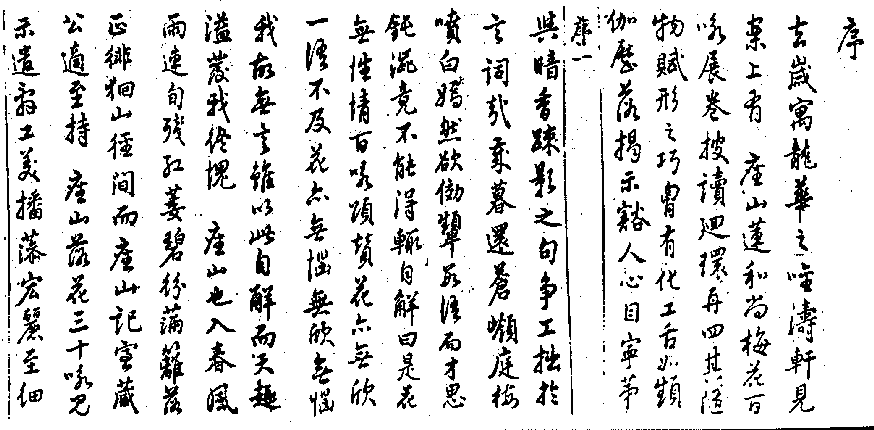
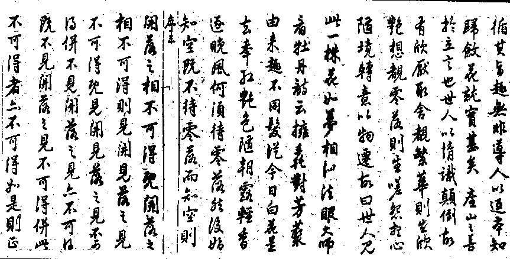
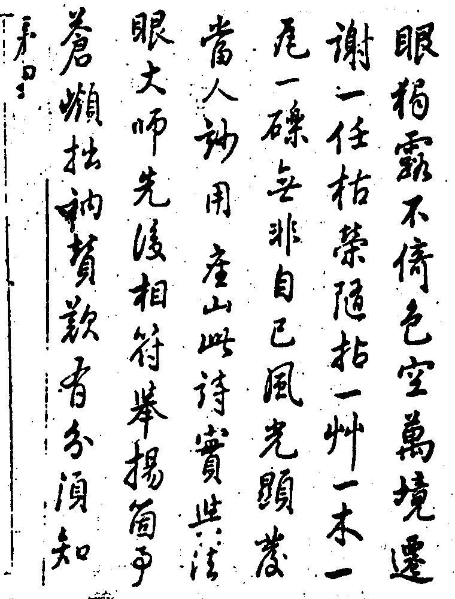

# 莲峰禅师语录



> **藏经**：嘉兴大藏经（新文丰版）（嘉兴藏）　**册次** 第 38 册（J38）　**编号** JB410　**部类** 诸宗部　**卷次** 10 卷　**篇幅** 131,795 字

> **作者（译者）**：嗣法门人性深等编

> **卷／品**：1 卷 · 9 品



---



## 目录



  - [莲峰和尚语录序](#莲峰和尚语录序)

  - [序](#序)

  - [卷第七序](#卷第七序)

  - [序](#序-1)

  - [石竺禅师源流颂序](#石竺禅师源流颂序)

  - [莲社序](#莲社序)

  - [更生居士诗集序](#更生居士诗集序)

  - [募诵华严经序](#募诵华严经序)

  - [慧源庵序](#慧源庵序)

- [莲峰禅师语录卷第十](#莲峰禅师语录卷第十)



---



### 莲峰和尚语录序



泰山之脉出昆仑，黄河之源从天上，故天下言山之高者必曰泰山，言水之大者必曰黄河，以其脉长而源远也。然舍泰山、黄河而未足以言山水之高大者明矣。使山必如泰山而后可言山，水必如黄河而后可言水，其为山水者，不亦难乎？或有割泰山之脉而突兀为山，分黄河之源而波澜为水，即可谓真山水，名天下、传后世者无疑矣。莲峰和尚幼入沙门，得法最早，开吾备气运之先，操履端正，机用纵横，不愧为明发之子、天童径山之孙，可谓能分割泰山、黄河而自成一山一水之奇，脉长而源远也。二十年来数踞雄刹，振临济宗旨，壶兰为之增色。近退居云峰，於破故纸堆中、烂葛藤丛里简点出来，自生光焰，斯其精光之不可磨灭者欤？犹之迅雷闪电震发虚空，凡有耳有目者莫不闻之见之。夫闻者既闻矣，见者既见矣，谅必知其可以名天下、可以传后世，是之为至公之闻见也。然闻见而出於至公，则余之所言亦公言也，敢阿其所好也哉？



丙午腊月望日同门法弟超裴书于养苔山房



------



### 序















原书阙。



莲峰禅师语录目录



序文  

卷第一福建兴化孤山禅寺语录  

兴化九座山兴国禅寺语录



卷第二兴化报恩禅寺语录



卷第三兴化龙华万寿禅寺语录  

兴化芦山通天禅寺语录  

兴化狮山西明禅寺语录



卷第四小参



卷第五示众  

拈古  

颂古  

代古



卷第六入室  

机缘  

法语  

赞  

自题



------



### 卷第七序



歌  

传  

行实  

启  

引  

辞  

铭  

佛事



卷第八文  

偈  

杂咏上



卷第九杂咏中



卷第十杂咏下(有序)



莲峰禅师语录目录终



莲峰禅师语录卷之一



嗣法门人性深等编



福建兴化孤山禅寺语录



顺治十年癸巳二月念八日，师在兴化府隐高寺，受本府莆田县孤山寺监院慧闻等请至。



山门。云：「船来陆来，总须亲到一番始得。秪如入门一句，作麼生道？」遂策杖而进。



佛殿。云：「三世诸佛犹是素上座儿孙，毕竟与伊如何相见？」大展三拜，云：「不可放过。」



伽蓝堂。云：「神功叵测，呵护丛林，兜楼一片，从古至今。」



祖师堂。云：「将谓列代祖师出世度生，谁知尽日向香烟里打瞌睡。」遂举香云：「祖师，祖师！惺惺著。」



方丈。云：「汾阳门下有西河狮子当轩据坐，但有来者，即便咬杀。远祖恁麼道：『方丈前草深一丈。』孤山门下不作这般去就，但有来者，令其觌面相见。」众拜，师云：「逢人切莫错举。」遂据坐。



当日众请上堂。升座拈香，云：「此一瓣香，烟浮震旦，价重娑婆，𦶟向炉中，端为祝延今上皇帝圣寿万岁万万岁，恭愿尧舜之风永扇，成康之世长存，路不拾遗，民沾至化。此一瓣香，国家梁栋，黎庶云霓，奉为文武采寮、郡邑尊官暨诸檀那外护，伏愿维持赤子，征途闻五𥚓之谣；忻慕宗风，悟道说溪山之偈。此一瓣香，得意难言，知恩有地，久默斯要，不务速说，最初拈出，奉为浙江嘉兴府海盐县金粟山广慧堂上传临济正宗第三十二世本师百痴元大和尚，用酬法乳之恩。」遂敛衣就座。维那白椎云：「法筵龙象众，当观第一义。」师云：「第一义谛不容拟议，放开一线，许汝商量，还有商量者麼？」僧问：「佛为众生，出现於世，和尚出世亦为度生，众生未度时如何？」师云：「眼横鼻直。」进云：「众生已度时如何？」师云：「鼻直眼横。」进云：「众生度尽时如何？」师云：「一场懡㦬。」居士问：「万佛场中，即不问，临济宗风，事若何？」师云：「一棒一条痕，一掌一握血。」进云：「天上有星皆拱北，人间无水不朝东。」师云：「赞叹则不无。」乃云：「法幢未建，人人立地顶天，法鼓未鸣，处处青山绿水。及乎鸣法鼓、竖法幢，又是一腔曲调，行滹沱正令，开摩竭门庭，有实、有权，毋固、毋必，或时逆水撑舟，或时循途守辙，或声色堆头，寻群逐队，或清净地上高卧横眠。入门者，须登阶级，登阶级者，须入堂奥，一入堂奥，左之、右之，处处逢原，自然不落阶级，自然透彻门庭。已彻者，不在斯限，未彻者，切须彻去，若不彻去，不被声色所埋，必被清净所困，似个徐六担板。更有一事须善护持，直待孤山微笑，即向汝道。」维那结椎，云：「谛观法王法，法王法如是。」师便下座。



林明悌祝寿，请上堂。问：「叫不应山即不问，如何是无阴阳地？」师云：「春来也，发花。」进云：「还有方便麼？」师打，云：「与汝方便了也。」乃云：「真参实究，别无玅诀，只要悟得本命元辰。若悟得本命元辰，便顿超限量，迥脱根尘，四相不相关，五衰抛度外，如出笼之鹤、脱网之鳞，日月星辰亦如是，山河大地亦如是，山僧拄杖子亦如是。兹因居士久植德本，正信吾宗，欲其慈闱同悟本命元辰，请为嵩祝。山僧抖擞枯肠，无甚钩章棘句，只就日月星辰、山河大地及拄杖子本命元辰合祝一人之寿，令其同日月星辰之光明，山河大地之永固，同拄杖子之矍铄。虽然，莫教撞著弥勒。呵呵，恐笑倒。浊世劳劳谁不老，正信胜餐王母桃，祗园不种安期枣。阿，呵呵。」下座。



荐觉予禅德，请上堂。问：「赤肉无依，髑髅火葬，毕竟向何处安身立命？」师便打，进云：「恁麼则不涉根尘超色相，十方世界现全身。」师云：「死汉。」进云：「如何是活汉？」师又打，乃云：「炉香燕坐柏庭前，淡荡风轻花柳鲜，闻道铁牛钻入海，令人蹙额叹苍天。每相忆，最心坚，矢志遍参尊宿，打失鼻孔半边，于今水流云散，湄山依旧俨然。」复举：「僧问长沙云：『南泉迁化向什麼处去？』沙云：『东家作驴，西家作马。』僧云：『意旨如何？』沙云：『要骑便骑，要下便下。』」师云：「大小长沙疑杀天下人，今日若有问：『觉予禅德迁化向什麼处去？』秪向他道：『天上人间留不住，玅高山顶播风雷。』且道：古今还有差别也无？久立众慈，伏惟珍重。」



陈明元等请上堂。僧问：「长庆坐破七个蒲团，今日有个不坐底，还见麼？」师云：「钝置杀人。」僧喝，师便打，僧推禅床，师连棒打退，乃云：「参禅上士，迥脱寻常，铁额铜头，顶天立地，巨灵撼而不动，毒鼓檛而不闻，不与千圣同途，不与三贤共住，进一步山崩地裂，退一步雨暗云愁，有时向毘卢顶𩕳上敲骨取髓，有时向山僧脚跟下剜肉吹毛，不顾危亡，单刀直入，方成个瞎驴种草。倘有人闻恁麼道，便掩耳而去，三十棒赏他。其或未然，必须克勤修证，将多年铁酸馅咬嚼一番，日久月深，定慧充足，一闻千悟，头头物物，尽是自家底，要提起便提起，要放下便放下，受用现成，莫可穷极，犹未可挂放参牌。初学、久参，各宜更进一步。且如何进步处？和煦春风才入室，炎威又渐逼人来。」下座。



上堂。问：「如何是夺人不夺境？」师云：「针峰压倒阿修罗。」进云：「如何是夺境不夺人？」师云：「蚁口吞乾大海水。」进云：「如何是人境俱不夺？」师云：「一片月生海，几家人上楼？」进云：「如何是人境两俱夺？」师云：「愁人莫向愁人说，说向愁人愁杀人。」进云：「向上还有事也无？」师云：「一串穿却。」乃云：「风动旛动，那堪共语；船来陆来，且居门外。洞山麻三觔，葛藤不少；临济乾屎橛，臭气逼人。赵州吃茶，打湿唇嘴；云门胡饼，膨胀肚皮。铁钉饭，木楂羹，梗杀西天老比丘；金刚圈，栗棘蓬，吓退东土沙弥子。总不恁麼，似觉家风冷淡，且二六时中如何得应用无亏去？」良久，云：「一白钵盂两度湿，调羹须具调人心。」王氏、陈氏荐夫，请上堂。「纲常，道之基；慈悲，法之雨。雪志守深闺，戒定息繁暑，恬坐一炉香，乾坤阔如许，请余转法轮，正法无可语，超彼故良人，善处得居处，不图生梵天，亦不作灵圉，莲花国土中，菩萨为伴侣，一念已顿超，况对天人举，乐土本现前，不隔一端绪，闺闱亦可修，昼夜速进取。生灭两重关，谁是关中主？悟得本来人，非他亦非汝。同生乐土中，长沾佛法乳，诸佛同授记，余门双信女。山僧无说说竟，诸公无闻闻竟，死者无超超竟，生者无度度竟。且修因结果一句作麼生道？」良久，云：「一超直入如来地，脚踏莲花步步生。」下座。



佛诞，上堂。问：「未出母胎，度人已毕，和尚俨然，将何指示？」师云：「天无私盖，地无私载。」进云：「世尊出世，度尽眷属，和尚出世，眷属还度尽否？」师云：「明眼人难瞒。」进云：「家里人说家里话，如何是家里话？」师云：「金鍾敲动一天星。」乃云：「生本无生无不生，指天指地最分明，蓝园一段风流事，要假儿孙脚下行。」竖拂子，云：「释迦生也，大众还见麼？」便下座。



浴佛，信士林明鉴等请上堂。举：「遵布衲浴佛次，药山云：『这个从你浴，还浴得那个麼？』遵云：『把将那个来。』山便休。长庆闻云：『邪法难扶。』」师云：「药山布衲大似把手上高山，同行不同步，今日因时及节为他拈出，也要此话大行。遵布衲浴佛，同出一只手。山云：『这个从汝浴，还浴得那个麼？』落草寻人。遵云：『把将那个来。』贫儿索旧债。山乃休，不入虎穴，争得虎子？庆云：『邪法难扶。』人平不语、水平不流。好将药山布衲缚作一束，抛向香水海里荡涤得乾净净地，免致贻累后人向这个、那个里分疏不下。何故𫆏？天上天下，惟吾独尊。」



信官药斋林公请上堂。「向上一路，千圣不传，秪要大丈夫自信、自悟、自肯承当，扫除见解、剿绝廉纤，融会精粗、贯通表里，德山棒、临济喝、雪峰辊毬、禾山打鼓、裴相国舞笏、黄庭坚闻香，看诸古人显发全体大用，何等直捷？山僧既作他家种草，脱他印子不得，所以要人人剿绝廉纤、发挥玅用，言言合辙、滴滴朝宗，同游不二之门、共助无为之治。」竖拂子，云：「若向这里见去，又隔青嶂千重、白云万里。何故？分明月在梅梢上，看到梅梢早已迟。」



上堂。僧问：「人间四月春光尽，孤山寺里花正开，长恨春归无觅处，谁知转向此中来？如何是来的消息？」师云：「薰风生殿阁，遍界发微凉。」进云：「春夏秋冬随变改，若能转物即如来。毕竟作麼生转？」师畫圆相。进云：「自是不归归便得，五湖烟景有谁争？」师云：「脚跟下泥深三尺。」乃云：「薰风拂拂度南枝，黄鸟呢喃纤柳丝，花下人传春欲去，春光毕竟向何之？实不去，谩猜疑，墙角海棠犹灼灼，篱边笋蕨正新肥。去实去，怎留伊？池内碧荷争出水，林泉渐尔长炎威。住不住，几回醉却伤春客；去不去，杜宇声声月下催。催任催，意何为？途路虽然乐，到底不如归。若知归也，天地同根、万物一体，青年皓首不减不增，白社红尘无彼无此，我生列列立阶除，莫被光阴两序使。还有使得光阴者麼？闲烹雪茗空尘梦，谈笑花轩作主人。」靠拄杖，下座。



省觐福严师翁费老和尚，命秉拂，上堂。僧问：「昔日优填王造旃檀像，世尊下忉利天，其像出迎，此意如何？」师云：「巍巍堂堂。」进云：世「尊三唤三应，云：『无为真佛实在吾身。』未审在那个身？」师云：「炜炜煌煌。」进云：「秪如宝像开光，人天瞻仰，还解说法也无？」师云：「信心成古佛，甘雨润枯苗。」进云：「若将耳听终难会，眼处闻声方始奇。」师云：「不是苦心人不知。」进云：「作家，作家。」师云：「不劳赞叹。」乃云：「古路三千度翠云，抱惭膜拜老慈尊，去来尽是儿孙事，祖父从来不出门。」竖拂子，云：「诸大德！於此见得祖翁如夔、如凤，无党、无偏，昔向金粟峰头呵佛骂祖，今踞语溪渡口涤圣陶凡，粟棘蓬、金刚圈拈作寻常茶饭，南斗七、北斗八逢人彻底掀翻，肃振颓纲，何殊腊月莲花剪除异见？诚乃法门甘露处，动地惊天之际，如清风明月之中，魔外寒心，英贤拱手，此盖乘愿力而来，作清凉大树覆荫人天。若以一机、一境、一棒、一喝，谓觑见祖翁似向大海拾一浮沤、大地得一撮土，不肖昔曾瞻依座下，特申省觐之忱，幸蒙老和尚垂慈，令两序大德降尊就卑，命升猊座，不肖自惭才德俱亏、机用弗足，再三辞而不免，秪得借老和尚大光明助演实相义。秪如实相义作麼生演？遮那应现遍风尘，万福庄严净法身，正眼当阳光突出，嬴於夜半睹明星。久立众慈，伏惟珍重。」



慈光寺请上堂。「达磨西来意，迢迢怎举扬？松直与棘曲，凫短而鹤长。龙归四海静，春老百花香，几多蹉过者，叉手问空王？谁知未举棹，文彩已全彰，于今委悉去，何处不慈光？」复举：「尼玅总参大慧，慧云：『古人不出方丈，因甚却到庄上吃油糍？』总云：『和尚放玅总过，玅总方敢通个消息。』慧云：『我放你过，你试道看。』总云：『玅总亦放和尚过。』慧云：『争柰油糍何？』总一喝便出。」师云：「大慧拈出残羹馊饭，将玅总作鬼神祭赛，总若不是饱参衲子，几被油糍塞却。兹山僧把火助热，诸人切忌面门著灸。颂云：长蛇阵势列重重，铁骑单鎗挫战锋，若不疆场施敌手，焉知大海有真龙？今日这里有真龙麼？」喝一喝，下座。



请上堂。「信根难具，信心难生，信门难入，信道难行。信道一行，南北东西、四维上下，随缘放旷，任性逍遥；信门一入，顿超阶级，豁达六窗，行住坐卧常在其中；信根一具，敷荣盖天枝叶，培植驾海梁材；信心一生，放下屠刀，立地成佛。兹潘信士广修净供，请转法轮，不为自求，如同本得。山僧无可回施，惟祖翁一片信地，对人天尽情授受，令其向信地上长养信心、长培信根、长住信门、长行信道。」畫[□@○]相云：「还见麼？不用契券，自当保任。界至分明，切莫错认。」下座。



上堂。云：「大道直如弦，大机疾如箭，不动一毫端，千化与万变，本无利钝人，秪要当机荐。杲日悬空，薰风朴面，程路迢迢，不隔条线。枝头鸟语两三声，错落飞花红片片。」复举：「梵志以梧桐花献佛，佛唤僊人，志应诺，佛云：『放下著。』志放下左手花，佛云：『放下著。』志放下右手花，佛云：『放下著。』志云：『我今两手皆空，更放个什麼？』佛云：『吾非教汝放舍其花，你当放舍外六尘、内六根、中六识，乃至无可舍处，是你免生死处。』志於言下悟无生忍。」师云：「世尊得人一牛，还人一马；梵志抱璞求荣，一场富贵。特为颂出：重重放下没纤尘，闹市范丹彻骨贫，明月一轮琴一操，高低弹动隔墙人。」下座。



祝东林师翁寿，上堂。「展起袈裟覆▆天，手培松柏梃苍然，逢人问寿高多少？行脚赵州老四年。踏得祖翁田地著，岩阿石虎花儿眼，惭愧后生忙不辍，街头犹乞草鞋钱。殊不知，我祖翁寿量别一乾坤，不属变、不属迁，仰之弥高、钻之弥坚，弥勒不后、威音不前，亘古今而不昧、历浩劫以长存。不肖恁麼指注，也是起模畫样，千闻不如一见。若见得彻，因斋庆赞竟。且庆赞一句作麼生道？洒雨摩风浑不改，擎天屹地一莲山。」



上堂。问：「凤凰池上客，特地集孤山，三通法鼓震，冗梦尚未删。如何是冗梦未删？」师云：「手执夜明符，几个知天晓？」进云：「喝散白云千万里，数声鸟语噪天明。」师云：「莫瞌睡。」乃云：「有佛处不得住，金猿绊倒悬崖树；无佛处急走过，簷前蜘网风吹破。腾身透脱两重关，十字街头卖滞货。」拍案左右，云：「这一个、那一个，不是东土神光，亦非西天达磨，释迦、弥勒犹是他奴，六臂三头无处寻讨。莫寻讨，日上珊瑚光杲杲。」复举：「法眼问修山王云：『毫厘有差，天地悬隔。作麼生会？』主云：『毫厘有差，天地悬隔。』眼云：『恁麼会又争得？』主云：『和尚如何？』眼云：『毫厘有差，天地悬隔。』主便作礼。」师云：「法眼具抽钉拔楔之手，山主失倾湫倒岳之机，若不金针挑剔，几乎病却法眼。颂云：碧云眷恋碧峰巅，千里鸟骓也著鞭，翡翠踏翻荷叶雨，鹭鹚冲破竹林烟。」下座。



陈明开等请上堂。问：「端阳佳节即不问，五家宗旨请师宣。如何是临济宗？」师云：「惊天动地。」进云：「如何是曹洞宗？」师云：「带水拖泥。」进云：「如何是沩仰宗？」师云：「日月齐明。」进云：「如何是云门宗？」师云：「铁骑踏破万重关。」进云：「如何是法眼宗？」师云：「六耳同谋。」进云：「五家宗乘蒙师指，和尚门庭事如何？」师云：「放你一棒。」进云：「棒下无生忍，临机不见宗。」师云：「还要吃棒。」乃云：「昨日说，今日说，黄面老儿何太切？山色无非净法身，溪声原是广长舌。日面佛，月面佛，大地圆明是何物？虽然烁破四禅天，也是金毛恋兔窟。如来禅，祖师禅，拈来不值半文钱，巨灵抬手无多子，劈破华山作鬲边。根本智，差别智，观音原来是宝志，翻身踏著上头关，胜却牟尼亲授记。这四偈，有一偈如金刚王宝剑、有一偈如踞地狮子、有一偈如探竿影草、有一偈不作一偈用，有权、有实，有照、有用，有杀、有活，有纵、有夺。若倜傥分明，锦标子当堂分付；倘停囚长智，拨转畫艎归去也，任他鼇鼓响喧天。」便下座。



端午，上堂。「诸兄弟！时节到来，慎莫蹉过。一年三百六十日，无如此日吉；一日十二时，无如此时好。凡我衲僧家豁然大悟，犹如日丽中天，暗室覆盆无所不照，溪花涧草悉放光明，暑雾浓云罗笼不得，邪氛毒气侵昧无门，直得虾蟆蚯蚓饮气吞声，跛鳖盲龟惊心丧胆，困龙悟此而倾湫倒岳，游人悟此而拨棹还家。山僧恁麼举扬，犹足畫蛇添足，曲为今时。且不涉胜负一句作麼生道？踏得故家山地稳，笑他门外竞头争。」下座。



永丰寺保禾请上堂。问：「马祖一喝，百丈耳聋三日，意旨如何？」师云：「惊天动地。」进云：「某甲则不然。」师云：「你作麼生？」进云：「时时得闻玅法。」师云：「更参三十年。」乃云：「朝来叉手立门前，万顷嘉禾映碧天，雨露若教无失候，凶年自是转丰年。茎茎熟，粒粒圆，相逢夹路商量者，刚道于今不值钱，珍重大家须护惜，田犁依旧未辞肩。」畫○相，云：「乾坤以此化育人世，国家以此膏泽寰区，黎民以此安身乐业，龙鳞以此致雨兴云，且道衲僧以此作个什麼？」竖拂子，云：「拈起千觔金粟柄，敲砖赓唱永丰歌。」下座。



寺邻诸信士请上堂。「近水知鱼性，近僧知佛性，近山识鸟音，近寺识法音。法音既识，即僧即俗？何圣何凡？一水横门，共度桥于树下；孤山背屋，同种圃於云阿。善财之草盈堤，灵云之桃载野。砍香岩之竹，舟棹华亭；驱沩山之牛，田耕百丈。教儿读仲尼之史，刈禾肩大仰之锹。一一露自性生涯，一一现衲僧玅用。盖因不达本源，自生殊别，致毫厘有差，天地悬隔。秪如建家立业则固是鼓腹高歌，浑忘化育一句又作麼生道？野老不知尧舜力，啣杯共话古皇前。」下座。



珠林庵请上堂。「寸丝不挂，雪峰勘破玄机；公案掀翻，大慧热瞒玅总。台山问婆子，过客还稀；俱胝悟指头，感恩不浅。此皆上古之世佛法昌隆，自证自了底如麻似粟，至於播杨大教底亦代不乏人。今庵主率众来叩孤山，欲倣古人模范，须是二六时中向语默动静、行住坐卧处自穷自究，毕竟是个什麼？一口布袋里捉著老鸦，试看还有雌雄相可得也无？珍重。」



信官季芦余公请上堂。「佛身充满遍河沙，至圣从来共一家，鼻祖渡芦无剩语，五千餘卷等空花。若悟得，总是空花，或说有道无亦得、或出尘入刹亦得、或现比丘身亦得、或现宰官身亦得。秪如宰官身已现，宰官法作麼生说？永佩金鱼昌芦峤，长悬玉带镇通天，逍遥梅柳外，吟咏竹林边。风凛凛，泽绵绵，李翱参见药山处，云在青天水在瓶。」复举：「昔一居士问大慧云：『天命之谓性，率性之谓道，修道之谓教，意旨如何？』慧云：『天命之谓性，即清净法身；率性之谓道，即圆满报身；修道之谓教，即千百亿化身。』士默有所契。」师云：「世、出世间两个至人鼻孔被大慧一串穿却，直至于今分析不得，今特举似居士，谅亦有契。且默契一句作麼生道？」横按拄杖，云：「不须玅指频频拨，已发先天太古音。」下座。



圆期，上堂。「大人具大见，大智得大用，大用现前，不存轨则，结也得、解也得、收也得、放也得、利世利人也得、超生拔死也得。利世利人，南山顶上培松桧；超生拔死，莲花国里吐莲花。收也，铜头铁额，饮气吞声；放也，高低互应，敲唱双行。结也，布袋里老鸦，虽活如毙；解也，孤云野鹤，任意高飞。恁麼也得、不恁麼也得，恁麼、不恁麼总得透脱范围，骑声盖色。虽然，不是家尝淡茶，也堪待客。岂不见？临济松、赵州柏，苍苍列立山门前，永与后人为标格。」复云：「素上座久居草舍，冷度清光，今春被诸兄弟鞭挽将来，向荒草场中拖泥带水，连累扶犁扛耙者亦浑身汗出。虽然，水草具足，未免神力劳疲。兹当田熟禾香，功圆事就，拽断烂贯索，东触西触去，还有追踪觅迹者麼？」竖拂子，云：「谩言蹄角无堪寄，自有山翁管带伊。」下座。



顺治十三年丙申十月十一日，师寓本府僊游县九座山太平兴国禅寺，受耆旧智镜、华严公等请至。



佛殿。云：「巍巍踞坐独称尊，大地山河一口吞，踏著个中无佛祖，方知脚下有儿孙。个中既无佛祖，何作这般去就？」展坐具，云：「正要大家知进。」



方丈。云：「生擒猛虎，活捉狞龙，瞎驴活计尽在其中。且道以何为验？」喝一喝，便据坐。



当日众请上堂。至法座前拈帖云：「即此简章，轻如毛羽，重若丘山，虽向胸襟中流出，必须对众举扬。」宣毕，师指座云：「大无私盖，地无私载，历代老古锥向此处偿债，秖如新长老又且如何有条扳条？」升座，拈香云：「此一瓣香，光超日月，德壮山河，𦶟向炉中，端为祝延今上皇帝万岁万万岁，伏愿端拱无为，野老不歌尧舜力；遐迩有赖，国人长颂灵台篇。此一瓣香，庙堂瑚琏，泉石凤凰，𦶟向炉中，奉为本府本县采寮尊官、本山开创先和尚暨诸护法耆旧，伏愿沐不次之深恩，趋心玅道；振中兴之正脉，毘赞丛林。此一瓣香，水尽山穷，头端尾正，心不负人，面无惭色。第二回拈出，𦶟向炉中，奉为现住江南松江府华亭县明发禅院传临济正宗第三十二世百痴元大和尚，用酬法乳之恩。」遂敛衣就座。上首白椎竟，问荅不录。师云：「法幢建立待何人？水到渠成万象新，珍重蟠桃休嚼破，现前已露旧时仁。旧仁既露，难瞒具眼；法幢建立，贵在同条。况流水高山时时现衲僧巴鼻，光风霁月处处是古佛门庭？一语一默，本地光明显赫；一草一木，当人受用无亏。於此挨拶得入，始信古人劳心苦骨处。岂不见？正觉禅师移溪伏蟒，创此洪基；列朝宗匠拽杷牵犁，洞诸正眼。秪如应承鼎命则固是，克振先声又作麼生道？」卓拄杖云：「大家伸出拔山手，拨转如来正法轮。」上首结椎，师下座。



元旦，立两序，上堂。问：「祝圣报恩今已晓，新年佛法又作麼生？」师云：「灯笼与露柱和南，石女共木人抚掌。」进云：「春光传信早，大地尽生辉。」师云：「却许阇黎道一半。」僧礼退，师一喝，乃云：「日丽风熙宇宙清，万山霜雪变溪声，梅花昨夜通消息，瑞气腾腾绕太平。」呈拄杖，云：「还见太平主人麼？若也见得，巍巍堂堂，无二无别，乾坤未辟之先与太虚同寿，朕兆才分之后乃率土皆臣，草木林泉同沾雨露，羽毛鳞甲共沐恩仁，唤作深山中老僧又是闹市头天子，唤作闹市头天子又是深山中老僧。若也不见，元正启祚，万物咸新，有无佛法双拈却，又手桥头揖圣人。」后云：「巢居穴处，未尽良谋；领众匡徒，难藏丑态。药山就牛栏说法，道传千古；法昌搬罗汉开炉，声盖诸方。所以，众不在三千五百，亦不论初学久修，只要人人展抟天之翅，个个作驾海之梁，整顿脚跟，辉扬化日。且重新条令一句作麼生道？东君如有意，吹入我门来。」下座。



上元，上堂。「此夜一轮满，笙歌沸彩楼，可怜灯明佛，无处可埋头。莫埋头，魔宫虎穴一任横冲直撞，柳巷花街何妨醉舞娱游？模样粧来，个个如狮如象；皮毛脱落，依然非马非牛。惘憧底向锣鼓边自管瞌睡，俊俏底就光影里卖弄风流。休，休，休！举头天外看，谁是我同俦？」



诞日，上堂。僧问：「沙盆已破，还藉众扶否？」师云：「天高群象正，海阔百川朝。」进云：「恁麼则青山依旧也。」师云：「听事不真，唤钟作瓮。」进云：「今朝师寿正逢圣诞，如何是庆赞一句？」师云：「天地同根，万物一体。」乃云：「孤峰兀坐嘴卢都，搜索胸中一物无，即此一条穷性命，三千诸佛不如吾。何故？在诸佛，有玄有玅、有始有终；在凡夫，有爱有憎、有优有劣。山僧门下，二边不立、中道不居，孤迥迥、峭巍巍，名模不得、拔仰无由。云门於拶足悟此、俱胝於竖指悟此、香严於击竹悟此、山僧於唇皮播此、大众於意识卜此，倘向父母未生前上著自家寿命，即仝山僧寿命、即仝诸佛列祖寿命，则见云门悟底不在拶足、俱胝悟底不在竖指、香严悟底不在击竹，可谓移花兼蝶至，买石得云饶。还卜著麼？年登四十五，为人多莽卤，却把赤斑蛇，唤作白额虎。」拍掌大笑，下座。



开炉，知浴云庄领一萧禅德请上堂。问：「龙象交参即不问，如何是狮子翻身处？」师云：「一任𨁝跳。」进云：「堂堂无向背，特地绝商量，如何是第一义？」师云：「新出红炉金弹子，簉破阇黎铁面门。」进云：「云生碧嶂，月落寒潭。」师云：「自领三十棒。」进云：「和尚较一半。」师云：「速退，速退。」乃云：「释迦出世，达磨西来，为一大事因缘故。盖大事因缘虽人人具足、个个全该，柰含糊领略者多、真实契证者少。今云水高流，同登选佛之场，欲契证自家大事，且大事如何得契证去？」竖拂子，云：「言前荐得，犹是滞壳迷封；句后承当，未免触途狂见。直饶透脱二边，一肩担荷，早已迟了三生六十劫，欲到无纤毫过患，如千日并照，直须三条椽下、七尺单前，三三两两逐队寻群，白日青天挨篱摸壁，至於冷不知冷、饥不知饥，但得雪消尽，自然春到来，拾得寒山相见面，倒拖长袖舞三台。」下座。



若海西堂请上堂，问：「世尊拈花，迦叶微笑；达磨面壁，二祖安心。祖祖相传只一句，师今端的付何人？」师云：「西天四七，东土二三。」进云：「自从一见桃花后，直至如今更不疑。」师云：「学语之流。」进云：「惊群须是英灵汉，敌胜还他狮子儿。」师打云：「未到汝在。」乃云：「参禅无秘诀，只要生死切，打透生死关，石人迸出血。迦叶不闻闻，世尊不说说，昼夜二六时，圆满一轮月。且道如何是月？昨日圆，今日缺。」复举：「俱胝悟於天龙竖指处，其后接人亦惟竖指。」师云：「俱胝住庵，真龙困死水，若不得天龙一滴活水，终身埋杀，今古丛林谓其只得一橛。山僧今竖起拄杖，若有人同俱胝悟去，庶得吾宗不坠；若不同俱胝悟去，亦得吾宗不坠。何故？将相本无种，男儿独自强。」下座。



永丰寺三尊证师仝请上堂。「一得一切得，一戒一切戒。一念失回光，终身徒顶戴。汝等诸人还识得一麼？」畫



相云：「於此荐得，就这里截断生死根源、剿绝识情窠白，十二时中直教如明镜当台，物来斯照。有时虽不鉴照，瞒他一点不得。不论佛来也杀、贼来也杀，直教杀到无可杀处，始是诸人安身处、始是诸人得戒处。所谓：护生须是杀，杀尽始安居。白牯黧奴如不会，问取杨岐三脚驴。」下座。



朗玄首座请上堂。问：「诸佛出世时如何？」师云：「大地山河一片雪。」僧喝，师云：「乱喝。」僧无语，师打退，乃云：「西天四七，东土二三，这一队老古锥，无端胡言汉语，节外生枝，鼓动铜头铁额，赤手杀人，党恶相济，到处展三玄戈甲，列八面阵图，一纵一擒，全生全杀，直得敌国竖降旗，万方归化育。本色衲僧正眼看来，也是平地掘坑，陷人不少。山僧昔年不识好恶，陷他坑阱，至今尽拔山之力𨁝跳不出。」乃唤朗首座云：「汝还跳得出麼？」朗一喝，师云：「好一喝，只是跳不出。只如跳不出，又且如何施设？」竖拂子云：「打面还他州土麦，唱歌须是帝乡人。」下座。



念尔道旧偕昙易禅人请上堂。「若论此事，如石含玉，不知玉之无瑕；似地擎山，不知山之孤峻。古人恁麼道，只具一只眼。诸兄弟！既在座山，眉毛厮结，八面峰峦耸翠，一天松竹参黄，无不尽知尽见。若唤作此事，只具一只眼。若要两眼圆明，必须洞彻内外，捏碎虚空，体用全彰，人境俱夺。向顶门上竖一只眼，然后山僧与汝点眼。」喝一喝，下座。



福严师翁费老和尚讣音至，设供。拈香，云：「惊天动地播宗风，千古何人识祖翁？铁铸面皮翻一转，依然日挂海门东。昔日蒙提诲，今朝事不同，深恩无以答，滴血占流通。」遂礼拜。



书记知幻等请上堂。问：「法雷已震，选佛场开，不昧宗风，请师指示。」师云：「山意冲寒欲放梅。」进云：「腊雪连山白，雄风透户寒。」师云：「大抵还他肌骨好。」进云：「千里特来呈旧面。」师便打，乃云：「古木寒岩一片冰，潇潇鸟道断人行，大家束手炉头坐，嬴得眉毛眼上横。到这里，普天匝地滴水滴冻，纵有鎗旗亦无展处、棒喝亦无施处，无宾无主、无佛无法，无佛法而佛法全该、无宾主而宾主历然，赵州茶、云门饼不妨应时及节，破沙盆、乾屎橛一任东掷西抛，更有一般奇特事，梅花几点放高梢。」复举：「雪窦云：『客从远方来，遗我径寸璧，中有四个字，字字无人识。』古尊宿闹里有钱，素长老静处安身，原宪儿孙虽不可与陶朱公斗富，亦可高低唱和。客从远方来，遗我一盘果，不是郑州梨，亦非青州枣，上下及四维，无处可寻讨。」竖拳，云：「和盘托出献诸方，诸方未吃已先饱，只一饱，直到驴年不须喂水喂草。且道：寸壁好？果子好？」便下座。



心镜禅德请上堂。问：「众生受佛戒即入诸佛位时如何？」师云：「朝为田舍郎，暮登天子堂。」进云：「如何是佛位？」师云：「脚跟下荐取。」僧弹指，师云：「家里人说家里话。」进云：「跳出三禅天。」师云：「不可乱走。」乃云：「兹心镜耆旧设斋请扬正法，山僧不向他说玄、说玅、说奇、说特，只就家里人说家里话。」遂披胸，云：「於此荐得，十二时中动转施为如镜照镜，了无丝毫间隔，穿衣同穿衣、吃饭同吃饭，两人同一碗、两年同一春，东涧水流西涧水、南山云起北山云，去来莫谓频相见，踪迹从来不出门。既不出门，且道相见者是什麼人？」喝一喝，下座。



性原等请上堂。「向上一路，千圣不传。欲得不传之旨，无论男女缁素，必须把得定、作得主，直下如中流砥柱，不被八风所吹、不被万物所转。一向与麼去，管取刻日成功，不怕瓮中走鳖。」复举：「莲花色比丘尼变作转轮圣王往天界迎佛，世尊见云：『莲花色何得越大僧而见吾？汝虽见吾色身，且不见吾法身。惟须菩提岩中晏坐见吾法身。』」师云：「须菩提晏坐，身埋千尺；莲花色见佛，勇冠三军。世尊只顾压良为贱，不知头上安头。今座山四众俨然，也不须比丘尼变现神通、也不须诸兄弟岩中晏坐，从朝至暮诸点动静无不亲见莲长老。且道：见色身耶？见法身耶？特为颂出：奴婢慇懃将主扶，主人醉里乱高呼，自家直下如亲见，那个男儿不丈夫？」下座。



腊八，信女朱照琦请上堂。「雪里藏身六载餘，饥疮拶出眼中珠，明星若谓今朝现，知君不是化龙鱼。若是个汉，向未离兜率捉败黄面老子，六载饥寒不无虚设，到此方解知恩报恩、方解致雨兴云，或破家荡产亦得、或建家立业亦得，将丈六金身作一茎草、将一茎草作丈六金身，一推推倒五须弥、一踢踢翻四大海，逞人天不测之机、受佛祖不尽之用，只如杲日当空，无所不照，因甚无人悟去？男儿自有通霄路，不向如来行处行。」复云：「信女居尘不染尘，入山修供报双亲，不惟一念超庸俗，已胜卧冰求鲤人。慈恩厚，佛道深，一番提起一番新。」



谢诸山大德，上堂。「乍驾一只铁船，向孤峰顶上撒张巨网，直得鲲鲸鱼鳖尽入其中，或冲波破浪、或吐纳风云、或抛梭掷尺、或逐队寻群，总脱此网不得。如今略开一面，任其优游四海、活泼百川，展照日之鳞、开吞舟之口，何惧竿头钓，翻身去不回？头角若欲峥嵘势，也须平地一声雷。」喝一喝，下座。



孝子吴奇略荐严，请上堂。「大通智胜佛，十劫坐道场，佛法不现前，不能成佛道。钝置杀人。山僧拄杖子，历劫住道场，法法本现前，皆已成佛道。既拄杖子成佛已竟，一处所、一纤毫不成佛道，无有是处。况吴令先翁早已与拄杖子把手共行，时时闻伽陵之音、处处见遮那之体，若待今日超拔，然后得生善处，岂不迟哉？虽然如是，若著於佛见，便属声闻小果；若离於佛见，又属婆罗门外道。所谓有佛处不得住，无佛处急走过，四海浪平龙睡稳，九天云静鹤飞高。」



元旦，上堂。问：「春风浩荡，瑞气氤氲，斩新条令即不问，大振宗风事若何？」师云：「金鸡晓唱，凤历新颁。」进云：「昨夜铁牛方醒梦，今朝木马便鸣空。」师便喝。进云：「玉蹄踏破深潭月，金角冲开云外天。」师云：「犹在山僧脚下。」乃云：「昨夜辞年去，今朝迎岁来，去来与迎送，总是强安排。所以，古之天地即今之天地，今之日月即古之日月，无终无始，不变不迁，衲僧家一向作只般见解，也是徐六担板只见一边。岂不见？四时行焉，百物生焉，溪桃喷日，岸柳舒烟，霜自化，鸟争喧，东君面目一一现前，笑却桥头何大姐，借婆衫子拜婆年。」下座。



解制辞众，维那般舟请上堂。问：「结制之后，水泄不通，圣凡绝迹；解制之后，任运腾腾，自由自在。不解不结时如何？」师云：「天空任鸟飞。」进云：「争柰出门便是草何？」师云：「你何故向草里辊？」进云：「一念普观无量劫。」师云：「错。」瞽僧问：「某甲幻眼已坏即不问，即心即佛事如何？」师云：「照破十方。」进云：「不是心、不是佛又如何？」师云：「山僧亦不识。」进云：「云行岭面山无碍，月到波心水不知。」师云：「莫错会。」乃云：「曩者无端畫地为牢，将无限平人拘禁，其中有冤无处诉、有屈无处伸，进一步，断贯索穿他鼻孔；謦一声，须弥山塞却口门。于今春风和煦、雪解冰消，趁此芳展，略开一线，放出恶虎狞龙，任其归山归海，不论南北东西，随处纵横自在，捏碎临济三玄、扫除浮山九带，逢人越格提持，自是吾宗有赖。山僧恁麼举扬，大似嫫母怜儿，忘却丑态。」复云：「林下栖迟者，翻为去国人，江山春万里，杖履客孤身。有约鶤鹏伴，不违花柳新，脚跟虽未动，消息遍风尘。」



心光、印人二上座请上堂。师云：「生死关头好著鞭，重重打透未生前，南山顶上云蒸饭，檀度门前狗尿天。风流无限，受用现前，有时凿圃，有日耕烟，茶来则吃，客去则眠，努目处雷鸣大野，低眉处月印长川，不问寒来暑往，不图作佛成僊，只怕阎老子末后讨饭钱。秪如来讨时将何抵塞？」拍案，云：「不是巴掌，便是粗拳。」



金粟百老和尚讣音至，设座。拈香，云：「去岁福严师翁归，今年金粟老人死，虽然生死不相关，法道之裒何至此？怆惶大地人，孤哀不肖子，一炷清香一杯茶，动地家声谁振起？」遂举哀。



开炉，上堂。「去岁开炉，贯天烈焰；今冬结制，不立一尘。以虚空藏为伽蓝，直令日月星辰、山河大地、人物龙畜、草木昆虫同居平等性智。放大光明底，任其照天照地；兴波播浪底，任其普纳百川。至於吟风泣露、带水拖泥，无不任其自性逍遥。山僧也不拗直作曲、截长补短，移东篱、贴西壁，拈鱼目、作明珠，诳惑弟昆，教坏男女。何故？顶门有眼明如日，岂肯相牵入火坑？」卓拄杖，下座。



腊八，上堂。「地冻天寒，处处山头皆雪；云开星现，人人眼里有睛。时节到来，甚莫蹉过。既不蹉过，且道是甚麼时节？莫是释迦老子成道日麼？也是杓卜听虚声。诸兄弟！明星现也，且喜鼻孔不与释迦老子殊别。还见也未？尽日观山玩水、出尘入刹，必定是见。秪如有眼者能见，无眼者又作麼生见？」以指向空一点，云：「不是苦心人不知。」



元旦，上堂。「宝鸭烟飞万象新，四方荡荡净无尘，皇风普被江山外，野老讴歌一片春。春光一片兮，置干戈於无用之地；嵩呼万岁兮，回化育於太和之天。门外不惶庞也吠，山翁枕石日高眠，披沥一心如是祝，不图成佛与成僊。」下座。



诞日圆期，上堂。问：「尼父五十学易，伯玉五十知非，和尚将临五十时如何？」师云：「十目所视，十手所指。」乃云：「本自圆成，何物坏汝？本自解脱，阿谁缚汝？此两句语，有一句能杀能活，有一句能放能收，更有一句也无放无收、也无杀无活，门门有出身之路，步步有转身之机，是以昔日结也不曾结，今日解也不曾解。诸兄弟！倘会得，不但与山僧祝寿竟，而南来法道庶不寂寥也；若也不会，与汝一緉草鞋，傚善财行脚去。」



到孤山寺，请上堂。「虚空无行足，时节不参移，春风浩荡，春气融熙，水边林下，蝶舞花琉，桃红灼灼，竹缘猗猗，触瞎灵云眼，拨动香岩机，游春公子花前过，万紫千红总不知。既经花前过，因甚不知？僊子已骑黄鹤去，徒劳崔颢复题诗。」复举：「赵州见一庵主，问：『有麼？有麼？』主竖拳，州云：『水浅不是泊船处。』便行。又见一庵主，问：『有麼？有麼？』主亦竖拳，州云：『能纵、能夺，能杀、能活。』便礼拜。」师云：「赵老狂心不歇，到处费弓费矢，虽然一箭落双雕，也是龙头蛇尾。殊不知水浅不是泊船处，正好插脚；能纵、能夺，败将竖降旗。素上座到这里，也不淘沙见金、也不敲空作响，行则同行、坐则同坐，宾主历然，高低唱和，家贫自有茶相款，肯把蒿汤当礼仪。」



佛诞，上堂。「诸佛未出世，人人鼻孔辽天；及至出世后，依旧杳无消息。明露溪光，暗藏山色，妙高峰顶击帝钟，急水滩头栽荆棘。殊不知，尽法界身本无出入，风鼓不摇、水洒不湿，白雪阳春和者稀，令人千古空相忆。忽相忆，谁端的？叵耐太原孚上座却向角声里悟入。山僧虽逐他群队，终不拗曲作直，莫谓今古无人，多虚不如少实，一肩若不重荷檐，换手搥胸悔莫及。悔则且置，且道荷担个什麼？寥寥天地间，独立望何极？」卓拄杖，下座。



掺茶，上堂。「赵州吃茶，宾主历然；沩仰摘茶，体用全彰。座山者里也不分其短、别其长，只要大家齐著力，甘苦一般尝。拨云寻鸟道，趁雨上高冈，鎗旗信手拔，滋味逼人香。汝一筐，我一筐，归来奉献哑郎当，山鸟山花闲较杀，相呼相唤笑人忙。笑也任他笑，忙也任我忙，熨斗煎来铫不同。」下座。



送先和尚牌位进祖堂。云：「尽力建法幢，灵龟负图；随机裂疑网，宝剑伤锋。纵有攫雾撄云之手，总不似缩爪藏牙。故我老人出则如杲日丽天，归则如羚羊挂角，不但踪迹无寻，而且邈摸不得。兹於岁当阏逢执徐，令属王春首旦，依旧老人在素上座手里。既在不肖手里，冀我老人永坐高堂，作儿孙之榜样；一灯不夜，延佛祖之光明。为甚如此？是法住法位，世间相常住。」遂安，领众大展九拜。



> (同门弟杜赐、居士林超裴，捐赀助刻。)



莲峰禅师语录卷之二



嗣法门人性深等编



兴化报恩禅寺语录



康熙五年丙午八月十五日，师在兴化府云峰寺受僊游邑侯顾公，乡绅泊庵唐公、耘庵徐公、芾斯吴公，孝廉亦肯严公、瞻岵吴公，暨信士林性洁、黄道亨、蔡遂钦、庄日荣、僧寂林等，请住报恩禅寺。师至。



山门。云：「踏著自家底，何须涉路程？才入报恩寺，便是报恩人。」



佛殿。云：「蓝苑示生，雪山悟道，费尽婆心，翻成话堕。」展具，云：「千古累儿孙，全身入荒草。」



伽蓝堂。「辅弼三摩地，昌昌日月长。深心何以报，凭此一枝香。」



祖师堂。「微笑授金襕，渡芦分皮髓。一队老冻脓，白日相狐昧。于今夹路相逢，好与一齐捉败。」遂作礼。



据室。云：「释迦掩室於摩竭，净名杜口於毘耶。山僧到这里又作麼生？出群须是英灵汉，敌胜还他狮子儿。」遂卓拄杖而起。



安期信官唐泊庵请上堂。师至法座前拈请启云：「圣贤肺腑、虎豹文章，尽向个中流出，虽有眼者见、有耳者闻，还要维那宣过。」指座，云：「此宝华王座，不上不下、不东不西，未到尽惊险峻，到了方识高低。」拈香，云：「此瓣香，根盘今古、叶茂春秋，𦶟向炉中，端为祝延今上皇帝万岁！万万岁！伏愿永安四海，体先皇敬佛之心；光壮两仪，振觉帝利生之道。此瓣香，圣朝柱石、鹿苑宫墙，𦶟向炉中，奉为满朝文武尊官、本府本邑合属寮采绅衿暨诸善信，伏愿同增禄位，如杲日以升天；彻证微心，似莲花不著水。此瓣香，枯者任枯、荣者任荣，第三回拈出，𦶟向炉中，奉为江南松江府华亭县明发堂上传临济正宗三十二世先师百痴元大和尚，用酬法乳。」遂敛衣就座。首座白椎，云：「法筵龙象众，当观第一义。」问：「桂轮高映，长空雪肥，举头一瞬，物物生机。触目生机即不问，当年玩月事何如？」师以拂子作圆相，云：「任汝观瞻。」邀云：「某甲则不然。」师云：「汝又作麼生？」进云：「知音岂在当阳举？一点圆明鉴太虚。」师云：「重说偈言。」问：「诸佛说法为利众生，今日和尚说法为利众生耶？为光扬祖道耶？」师云：「千峰高有顶，八极净无尘。」进云：「恁麼则风云一致，水月同观。」师云：「锦上花铺。」进云：「如何是高超一步？」师云：「进前来。」进云：「生擒虎兕，活捉狞龙。」师便打，乃云：「我若一向举扬宗乘，法堂前草深一丈，倩人撑门拄户去，势不获已，向诸人道个即心即佛，已是图绘虚空，那堪更向葛藤窠里打辊误赚阎问。然虽如是，事无固必，岂不见三世如来向葛藤窠里拯拔四生、梯航九有，天下老和尚向葛藤窠里竿木随身、逢场作戏，天人宰官、善男信女向葛藤窠里祝无疆福寿、忏无相愆尤？然无相愆尤如空中鸟迹、水底鱼踪，作麼生忏无疆福寿？仰而弥高、钻而弥坚，又作麼生祝？果是个中人，向未生前一肩担荷去，何啻东海放流、南山增翠？即此修因证果，则固是诸佛法身竟向何处应现？」良久，云：「此夜一轮满，清光何处无？」首座结椎，师下座。



邑侯顾公设斋，请上堂。问：「德星临僻地，两岸尽生光。如何是僻地生光？」师云：「爱菊游秋圃。」进云：「自天子以至於庶人，壹是皆以修身为本。如何是修身之本？」师云：「焚香礼世尊。」进云：「如何是臣报君恩子报亲？」师云：「总在这里。」僧拜，云：「谢师指示。」乃云：「地泰天清，面面好山呈瑞色；民安物阜，人人搔首乐丰年。忆昔渊明娱种柳，茂叔喜栽莲，清怀迈俗，节操移风，美则美矣，善未尽善。盖远公闻陶公之贤，以莲社招而不来，及其来也，闻钟声犹攒眉而去。何似今顾邑侯受嘱灵山，精尝法味，持降尊之道，作不请之宾，径辞曲社游莲社，笑把仙溪作虎溪，雅集群贤，光临十笏，斟酌源头之水，维持济北之宗，虽嘉会一时，亦奇逢千载。且道山野如何酬谢？」竖拂子，云：「万仞峰高期指日，九秋鹤瑞合抟天。」下座。



期主林性洁、黄道亨、蔡遂钦、庄日荣等设斋，请上堂。问：「如何是报恩境？」师云：「云含殿后山千仞，桥锁门前水一湾。」进云：「如何是报恩人？」师云：「齿缺不关风。」进云：「如何是报恩一句？」师云：「倾尽此时心。」进云：「如何是向上一著？」师云：「铁蛇横古路。」进云：「龙得水时添意气，虎逢山势长威狞。」师云：「旧话不须拈。」乃云：「勘破浮生梦，拂空心地尘，百花丛里过，一叶不沾身。是你诸人还曾到此由地也未？倘或未到，讵能运出家珍，转正法轮？若也既到，何须庄严玅相，向外驰求，抛却自家旧面目，却来大海觅浮沤？然未有天生弥勒、自然释迦，未度己而先度人，菩萨心肠；度人复度己，诸佛行径。况此方真教体，清净在音闻，使人人向声色堆头磕破顶门，正眼睹山河大地悉是黄金，取而无尽、用而弗竭，始信行住坐卧不离宝山矣。且如何是宝山？」耸身又手，云：「莫将容易得，埋没古人心。」下座。



居士梁冕、王国臣设斋，请上堂。问：「秋菊未分红白色，荷花出水已生香即不问，今日居士请上堂，还有向上事也无？」师云：「刹竿头向天。」进云：「恁麼则曲涧流回千古月，真风引入万山人。」师云：「丹桂正飘香。」僧礼退，乃云：「西来意，如何说？八月秋，处处热，霖雨一番两番，林下炎威顿歇，临溪数朵芙蓉，揭晓一弯霜月，光明藏现前，清凉山轩凸。诸禅流。须猛烈，廓开阃外重关，拶出眼中滴血，莫学趁队瞎驴，错过却几多好时节。」复举：「张拙居士问长沙禅师云：『弟子曾读《千佛名经》，只见其名，未审居何国土？还化物也无？』沙云：『黄鹤楼崔颢题后，居士曾题否？』士云：『不曾。』沙云：『得闲题取一篇好。』」师云：「居士问佛土，长沙答题诗，拈出青州枣，博却郑州梨，简点将来大假，听事不曾，唤鍾作瓮。今日或有人问：『弟子曾见《万佛名经》，只见其名，未审诸佛居何国土？』秪向伊道：『有水皆含月，无山不带云。』令当下悟去，报答生恩有分。」



居士林东震、柯士章、柯大浚等设斋请上堂。师云：「马祖云：『即心即佛。』南泉云：『心不是佛，智不是道』。古德云：『莫谓无心云是道，无心犹隔一重关。』此三大老各具一只眼、各开一张口，续凫截鹤、立界分疆，平如镜面、险若悬崖，倘不是脚踏实地底人，到此如何履践？山僧也不管是佛非佛、有心无心，总与抛向粪草堆头，任其风吹日炙。闲来啸傲困来眠，白发纤纤缀晓烟，几度清风生户外，半窗清梦足林泉。」下座。



上堂。举：「甘贽行者入寺设斋次，黄檗为首座，贽云：『请施财，请施财。』檗云：『财法二施，等无差别。』贽云：『恁麼道，怎消得某甲嚫？』遂出。须臾，复入，云：『请施财，请施财。』檗云：『财法二施，等无差别。』贽遂散嚫。」师云：「完璧夺珠，须还行者；安邦定国，独许座元。敢问大众：既是一般答话，因甚后肯，前不肯？果有具骑虎头、把虎尾之作，受他满国黄金供养，不为分外；脱或未然……」合掌云：「难消，难消。」下座。



上堂。云：「平平坦坦，崄崄巇巇，猛若虎，毒如蛇，推倒天关，竖起赤旗，令有耳者不敢问，有眼者不敢窥。且道是什麼人具恁麼用？试举看。临济一日栽松次，黄檗云：『深山中栽许多松作麼？』济云：『一与山门作境致，一为后人作榜样。』道了，将镢头𡎺地三下。檗云：『虽然如是，子已吃吾三十棒了。』济又将镢头𡎺地三下，嘘一嘘。檗云：『吾宗到子，大行於世。』」师云：「这个公案拈提者多，透脱者少，山僧不惜眉毛，错下注脚，也要诸方检点。临济一日栽松次，春色满园关不住，一枝红杏出墙来。黄檗见云：『深山中栽许多松作麼？』从苗辨地，因语识人。济云：『一与山门作境致，一为后人作榜样。』道了，以镢头𡎺地三下，好手手中呈好手。檗云：『虽然如是，子已吃吾三十棒了也。』冬瓜印子。济又将镢头𡎺地三下，嘘一嘘，再犯不容。檗云：『吾宗到子，大行於世。』虚张声价作麼？更听一颂：杰父生来英俊儿，恶风流布也堪悲，门前何必栽荆棘？致使行人惹著衣。」



斋主叶修爵等请上堂。问：「如何是夺人不夺境？」师云：「满目青山。」进云：「如何是夺境不夺人？」师云：「万象之中独露身。」进云：「如何是人境两俱夺？」师云：「纤尘不立，毫发不存。」进云：「如何是人境俱不夺？」师云：「国令久传清宇宙，万邦同庆太平春。」进云：「人境已蒙师指示，去来何处不称尊？」师云：「礼拜著。」问：「捧出扶桑日，喝开空谷云。如何是临济下事？」师云：「击石火，闪电光。」进云：「一个胡麻饼，临机孰敢吞？如何是云门下事？」师云：「塞断你咽喉。」进云：「君臣风肃肃，万里定邦畿。如何是曹洞下事？」师云：「明投暗合。」进云：「花香原在树，水去不离东。如何是沩仰下事？」师云：「以楔出楔。」进云：「月色飞天镜，百花尽笑颜。如何是法眼下事？」师云：「扑落非他物，纵横不是尘。」进云：「五宗宗旨蒙师指，南岳相承事若何？」师竖拂子，云：「你试道看。」进云：「可谓竹疏烟补密，梅瘦雪添肥。」师云：「未为好手。」乃云：「世尊四十九年说法，未曾道著一字，塞断维摩诘喉咙，至今无出气处。从上老古锥口挂壁上，山僧既传持此事，岂可摇唇鼓舌、驰骋言锋？况人人怀赤水之珠、个个抱荆山之璞，顶天立地、啸月吟风，特来这里共奏没弦琴、同吹无孔笛，调高律吕、韵彻青霄，令无眼者见、无耳者闻。秪如无眼耳者作麼生见闻？」拈拄杖，云：「临济曾遭三顿棒，鹫峰拈出一枝花。」复举：「庞居士问马祖云：『不与万法为侣者是什麼人？』祖云：『待汝一口吸尽西江水即向汝道。』士於此大悟。」师颂云：「征夫疋马入长安，夹路相逢话岁寒，可恨当年吸不尽，至今平地起波澜。」卓拄杖，下座。



栖真庵际智领诸道婆请上堂。乃云：「心净土净，心空法空，承言失旨，滞相乖宗。所以，智积敷五障，裔龙女献出明珠，玄机日若出即镕却。雪峰维那请疏意，而庞婆插梳回向；冯济川举话，却为妙总掀翻。这一队虽处女流，宛有丈夫之作，操持迈古，发语惊人，盖从大炉鞴炼过底金。山僧非是将低就高、压良为贱，也不钓鲲鲸、也不钓鱼鳝，到这里总与一网收下。」以拂子作撒网势，云：「今日有脱网金鳞，出来冲波破浪看。」众无语，帅云：「总是虾跳不出斗。」便下座。



宝幢龙华寺玉震禅师偕高田寺心月禅德请上堂。问：「世尊四十九年说法，未尝说著一字即不问，如何是经律论？」师云：「三段不同，收归上科。」进云：「如何是真三宝？」师云：「财帛栗。」僧竖拳，师便打，乃云：「一卷《楞严》读未终，倒骑师子上高峰，于今何处寻无隐？丹桂飘飘郁宝幢。」竖拂子，云：「这个唤作古人事也得，唤作今人事也得。无今人撑持，则匿却古人光明；无古人光明，今人又撑持个什麼？莫是撑持一芥园林、千年殿阁麼？不可错认。莫是三藏十二部经、千七百则公案麼？陈年历日且放过一边。莫是地水火风、根尘识性麼？也是隔靴搔痒，总未端的。须知灵源湛寂，物我自如，弥沦千古，廓彻十虚，人人本具，个个不无。名得状得，翻成畫饼；闻得见得，何异骑驴？咫尺龙华人不识，依然处处得逢渠。」抛拄杖，下座。



西堂知幻、知藏心镜、悦众慧髻设斋，请上堂。问：「如来为一大事因缘出现於世，出世分明即不问，如何是大事因缘？」师云：「天上有星皆拱北。」进云：「秪为一花特拈出，枝头千古惹春风。」师云：「卖弄不少。」进云：「大事已蒙师指示，光扬祖道又若何？」师竖拂子，云：「见麼？」进云：「某甲也从这里来。」师云：「虾跳不出斗。」问：「如何是著力句？」师云：「一羽重千觔。」进云：「如何是转身句？」师云：「面南看北斗。」进云：「如何是亲切句？」师云：「朝来吃粥夜来眠。」进云：「不是一番寒彻骨，怎得梅花扑鼻香？」师云：「三十年后来相见。」乃云：「大道只在目前，要且目前难睹；禅机独超物外，依然声色言语。语亦通，默亦通，高提𨱄斧卧孤峰；逆亦是，顺亦是，布袋横拖入闹市。截佛祖爪牙，展衲僧巴鼻，八十老翁入场屋，等闲不是小儿戏。」复举：「僧问睦州云：『一气转得一大藏教，是否？』州云：『有甚饆𫗩𫗰子？快把将来。』」师云：「这僧野老献芹，睦州饥人得膳，不须百味调和，便与一口吞尽。简点将来，也是鼯鼠饮河，只得一饱。倘问山僧：『一气转一大藏教，是否？』向伊道：『白牯黧奴，普同供养。』」下座。



信官评谓顾公请上堂。僧问：「贤邑侯今日设斋，请师举扬佛法，敢问如何是佛法？」师云：「快睹甘棠树。」进云：「一方表率，万古流芳。」师云：「欣聆单父琴。」进云：「师子窟中生师子，未曾哮吼亦惊人。」师云：「两彩一赛。」乃云：「昔日灵山会上，如来以佛法付嘱国王大臣永远护持，庶佛日长辉，宗风丕振。今则一会俨然，毕竟宗风作麼生振？」竖拂子，云：「会麼？世尊拈花，徒标形影；达磨面壁，早涉程途。引得儿孙不唧溜，人人依样畫葫芦。临济喝、德山棒，总是一场乾打哄；禾山鼓、雪峰毬，恼乱春风尚未休。」复击，云：「惟此一著，天无私盖、地无私载，在凡不减一毫、在圣不增一毫，有时现尊荣身、有时现威武身，来作仙溪雨露，擢为帝室股肱，应彼应此，如日循环则固是，祗如山僧展师子威、坐法王座，摇唇鼓舌又且如何？」挥拂子，云：「一曲钧天云外奏，五湖四海尽知音。」下座。



金石山斐然禅人设斋，请上堂。问：「一座梵宫邃，炼丹又炼禅，等闲锅打破，非佛亦非仙。秪如锅子打破，还许他进一步麼？」师云：「犹是门外汉。」进云：「尽道中天星拱比，谁知有水不东流？」师便喝。进云：「也知恁麼作活计。」师云：「脚忙了也。」乃云：「寻文解义，镜里求形；息念观空，水中捉月。不息念，不观空，马无千里漫追风；不寻文，不解义，鹤有九皋凭展翅。就地翻身事最难，抬头见日非容易，乾屎橛无位真人，柏树子西来祖意。欲透万别千差，须是三头六臂。」竖拂子，云：「诸仁者！秪这是山僧恁麼举扬，也是因风鼓浪，就节生枝。秪如浑忘化育，独超物外一句作麼生道？闲持经卷倚松立，笑问客从何处来？」复举：「吕真人参黄龙有省，云：『弃却浮囊击碎琴，如今不炼汞中金，自从一见黄龙后，始觉从前错用心。』」师云：「真人恁麼道，大似见柳和烟折，担泉带月归，添却一番生意。秪是错用心处，至今千载无人与他发明。兹借拄杖子与他发明去，丹灶炎炎轻踢倒，撑天拄地自长生。」下座。



隋严禅人领诸居士设斋，请上堂。问：「白鸟插空，黄花点径，祖意现前，如何举唱？」师良久，云：「露柱生儿。」进云：「无孔笛既吹得，无弦琴作麼生弹？」师以拂子敲禅床三下。进云：「惟师弹得妙。」师云：「逢人不得错举。」乃云：「大尽三十日，小尽二十九，露柱忽生儿，佛面呈百丑。灯笼勤折腰，石臼齐稽首，惹得琉璃光，呵呵暗拍手。且道拍手个什麼？我本无生，何庆之有？我本无家，何出之有？既无家可出、无生可庆，毕竟十二时中向什麼处行履？」呈拄杖，云：「金轮高揭千门晓，玉树宏开数朵花。」卓一卓，下座。



石竺禅师领居士詹藩、詹蒲设斋，请上堂。问：「秋从今日尽，冬逐明朝来，节事催人老，阿谁正眼开？」师云：「顶门上。」进云：「秪如宾主历然，共谈何事？」师云：「无孔笛撞毡拍板。」进云：「可谓齐出手，扶起破沙盆。」师云：「有劳著力。」乃云：「匝地秋光老，片心一水分，黄花娱僻径，握手话同门，更有瞻风者，追随到故园。故园既到，尘尘佛境、物物天真，无解无缚、无冤无亲，送客轻舟舣岸，参天碧岫回青。所以道：亲附善者，如露雾中行，虽不湿衣，时时有润。矧经善知识时常引导，发明心地，增长道芽，起一念，诸佛皆知；行一步，诸天皆见。造福，何福不增？济人，何人不渡？宿业今愆，早已如汤沃雪也。更到报恩，请为证明，大似锦上花铺。秪如同门握手，又话个什麼？」复击拂子，云：「个中无限低回意，贵在知音侧耳听。」下座。



居士蔡国辅、黄日生设斋，请上堂。问：「父母非我亲，谁是最亲者？」师云：「万年松。」进云：「诸佛非我道，谁是最道者？」师云：「三岁竹。」进云：「今日居士酬恩作麼生道？」师云：「鹿苑多垂金粟果。」进云：「果然一句了然超百亿。」师云：「祥云长现吉人家。」乃云：「山苍苍，水绿绿，风生岭上松，笋发庭前竹。当人於此见根源，水草何尝不具足？所以道：果得一回汗出，於一茎草现琼楼玉殿；若未得一回汗出，纵有琼楼玉殿，被一茎草盖却。今城外草木漫空，城中楼台插汉，唤作一茎草又是琼楼玉殿，唤作琼楼玉殿又是一茎草，如何得成一片去？有个汉出来道：『秋水长天一色，落霞孤骛齐飞。』我要问伊：『大地无寸土，许多景象向何处著？』这里拨得身转，狻猊还产狻猊子，𬸚𬸦多生𬸚𬸦儿。」下座。



若海首座偕云庄知客守弘禅德设斋，请上堂。师云：「句里无声，言中有响；举一明三，目机铢两。得之於心，荆棘为伊兰之树；失其旨者，甘露成蒺藜之园。久参上士，自合知归；乍入丛林，不妨向这里搆取。临济一日示众云：『第一句荐得，堪与佛祖为师；第二句荐得，堪与人天为师；第三句荐得，自救不了。』时有僧问：『如何是第一句？』济云：『三要印开朱点窄，未容拟议主宾分。』『如何是第二句？』济云：『妙解岂容无著问，沤和怎负截流机？』『如何是第三句？』济云：『看取棚头弄傀儡，抽牵全藉里头人。』古今尽谓：石火电光追莫及，乌骓千里较犹迟。殊不知：云在岭头闲不彻，水流涧底太忙生。后有僧问慧淳云：『如何是第一句？』淳云：『脚下。』『如何是第二句？』淳云：『口里。』『如何是第三句？』淳云：『顶上。』」师云：「汝看他恁麼答话，还续得临济烜赫宗风麼？山僧养子方知父慈，特为颂出：玉桂扳来素影多，广寒宫里现姮娥；自从舞得三台后，拍拍原来总是歌。」下座。



昙易监院荐师比莹并考妣，设斋请上堂。问：「生从何来？死从何去？」师震威一喝，进云：「诸法从心生，诸法从心灭，如何是无生灭？」师又喝，进云：「亡灵得旨超升去，随步逍遥极乐邦。」师复喝，乃云：「未悟师度，悟后自度，度己度人，如水传器。所以道：『父母生成德，明师剃染恩，不惟丘岳重，且犹湖海深。』况此一会俨若灵山现，任点点银缸瞩汉、疏疏玉磬鸣秋，百宝争辉、千花竞秀，十方诸佛同现其中说寂灭法，直得天地神祗、声闻缘觉、九有四生，同向其中证涅槃心、受菩提记，岂但本寺比莹、觉灵及监院本生父母承此良因高超佛境？佛境超也，依旧门开八字、桥锁千峰，风动旛动、人空法空，是星皆拱北，无水不朝东。」卓拄杖，下座。



参玄、密声、无闻诸禅德设斋请上堂。问：「白云一片净长天，龙象交参辏法筵，佛字古人闻不喜，何须赞礼过十千？祗此一场堪作什麼？」师云：「带烟千井树。」进云：「秪如有人心口不动，还许他赞礼否？」师云：「许。」进云：「黄花不藉东君力，独傲寒霜次第开。」礼退，师云：「和磬一溪风。」乃云：「徽猷丕振，道情佛法融通；正眼廓开，城市山林不二。龙行则雨致，虎啸则风生，一卷一舒、一动一静，如月行空，照无不遍；似钟在虡，扣无不应。然炉鞴之中多钝铁，未免藉诸久参上士，犹洪炉炼过之金，不须柴炭钳锤，自然光明赫奕，照耀丛林。丛林照耀，则随处悉皆照耀，惜乎无人酬价。山僧不忍弃置，付与观世音菩萨买胡饼，一任大家咬嚼。汝大家莫认作醍醐、也莫认作毒药，总与一口吞却。祗如吞却后如何？」提起拄杖，云：「鼓腹溪边招濯足，移笻石上伴吟风。」下座。



三会寺充盘师设斋请上堂。问：「闻声悟道，见色明心，尽大地是色，那个是声？」师敲拂子，进云：「掬水月在手，弄花香满衣。」师云：「如何是汝声？」僧一喝，师云：「好喝。」问：「宝殿崔嵬将插汉，未审其中什麼人说法？」师云：「见麼？」进云：「雕龙展翅欲飞天，未审什麼时兴波作浪？」师云：「立地淹杀人。」进云：「优游不饵江河里，惹得渔翁坐钓机。」师云：「一钩便上。」乃云：「一锥万仞高，一羽千钧重，大人具大见，大智得大用。报恩寺考钟伐鼓，三会寺拽耙牵犁，报恩寺凡圣交参，三会寺栋梁堆积，於一毫端现宝王刹，坐微尘里转大法轮。谓有差别，笑倒街头憨布袋；谓无差别，愁杀晏坐须菩提。差别不差别，拈向一边，国清才子贵，家富小儿骄，相逢出只手，彼此不相饶。不相饶，云月溪山一担挑。」下座。



信官芾斯吴公偕弟瞻岵孝廉请上堂。问：「子韶格物，妙喜物格，意旨如何？」师云：「一串穿却。」乃云：「马有鬣，牛有角，麒麟出世无人觉；唱有埙，和有箎，瑚琏传家罕得窥。既得窥也，声振於金，质润如玉，地瘦栽松，庭宽种竹。十方佛、十方僧，合掌赞推恩之士；南斗六、北斗七，增辉照积善之家。兹者，时维十月，令属应鍾，帝乡万里，水陆驰驱，不惟路上望平安，更听春来传及第。及第先也得意回，为揖为舟同济世。」卓拄杖，下座。



居士萧光联、杨明贵、洪世禄、谢起文等设斋请上堂。问：「门开八字，主纳宾来，如何是相见底事？」师云：「薰庭花簇簇。」进云：「邀朋进寺，为访知音，如何是知音一句？」师云：「濯世雨潇潇。」进云：「两段不同，收归上科，请师再道。」师云：「罢拈三尺剑。」僧击床，师以拂打，云：「教休不肯休。」进云：「将谓得便宜，谁知失便宜？」师云：「却是你便宜。」问：「将军马上乐参禅，杀尽魔军见太平。见太平即不问，单刀直入时如何？」师云：「血溅梵天。」进云：「庭前桂子飘香远，屋后青山叠叠高。」师云：「坐断两头。」乃云：「重法诸檀那，请演第一义，悟得本来人，真俗原无二。矧紫雾红尘尽是菩提之路，高堂巨室无非华藏之门？於此信得及去，自然造古人田地。且道谁是古之人？岂不见庞居士悟道之后，顿弃家赀，惟鬻箍篱为业，有颂云：『有男不婚，有女不嫁，大家团𪢮头，共说无生话』。后有居士别云：『男大须婚，女大须嫁，讨甚闲工夫，说个无生话？』所以悟底人与悟底人相见，一机一用，纵夺可观。今诸居士尽有男可婚、有女可嫁，只是无生话未曾说著，山僧为诸居士说去：男婚女嫁事茫茫，半日偷闲步上方，乘兴举头云外望，潇潇枫叶一天霜。」遂顾视左右，云：「话已说竟，莫错认定盘星好。」



玉成偕诸居士请上堂。「缁素原无别，所贵契真宗，磕破红尘梦，始知万法空。法既知空，则心不空而自空矣。诸子百家，琅函玉轴，奚啻说梦？所以赵州云：『佛之一字，吾不喜闻，念佛一声，漱口三日。』美则美矣，若固守一隅，大似徐六担板，有身转不得，有口开不得。参学人须知自家有一条通天大路，逆行也著，顺行也著，八角磨盘空里走，月里蟾蜍三只脚。」



圆期，上堂。师云：「诸方今日结制，报恩今日解制，有条板条，无条扳例。圣制解也，生天者生竟、获福者获竟，秪是未踏向上路在。若踏著向上路，则拯拔四生、梯航九有也是梦，竿木随身、逢场作戏也是梦，至於祝无疆圣寿、忏无相愆尤无非是梦。所谓：一切有为法，如梦幻泡影，毕竟水须朝海去，到头云定觅山归。如是，则十五日已前闹哄哄，十五日已后静悄悄，正当十五日，皓月一轮当户皎。」下座。



佛日维那若静领诸居士请上堂。云：「风暖鸟声碎，日高花影重，如来真面目，不处死生中。黄面老子虽则降身兜率、示迹皇宫，双莲捧足、沐躯九龙，上下及四维无能尊我者。仔细看来，也是天下无事，庸人扰之。云门路见不平，要与一棒打杀。麻三斤、乾屎橛出来道：『住！住！汝也休夸大口，汝也不可和气自伤，东家杓柄也不短，西家杓柄也不长，从兹瓦解冰消去，同𦶟兜楼一片香。』」下座。



到永庆寺访无依禅师，居士王一美、陈光会等请上堂。云：「数载藏身烟霭间，觐师千里下青山，相逢尽是知音者，不用拈花也笑颜。况佛祖心印沿传至今，化熟风行，不论儒释仕民，一拨便转、一闻便悟，千江有水千江月，万里无云万里天。以此祝君寿，寿等乾坤；以此报亲恩，恩齐海岳。春雨潇潇，春风匝匝，岸系孤舟，钟鸣野刹，山门外流水高山，百草头七通八达，至於周旋往返、喜怒哀乐，无不与佛祖心印相符相合。虽然如是，犹属路途中事，若与长年不出户、稳坐高堂人相见又且如何？」竖拂子，云：「横担楖栗访同门，共嚼风霜卧白云，未具片心弘法者，焉知气宇各超群？」下座。



云门寺主请上堂。问：「华严八十一卷与云门糊饼是同是别？」师云：「两头截断。」进云：「恁麼则万古碧潭空界月，再三捞摝始应知。」师云：「还汝念篇章。」僧喝，师云：「莫乱喝。」乃云：「至大无小，迥脱边表；至小无大，忘绝境界。所以，毘卢向毛孔里漏泄无尽风光，蜗牛就角尖上托出微尘刹海。东阁图书府，西园翰墨林，庭花繁吐锦，陌柳暗舒金，鱼敲落月，鸟啭圆音，文殊门随方合辙，弥勒阁满目参天。诸仁者！向此揭开无尽藏，即烦恼而证菩提，处化城而登宝所，五十三知识齐立下风，百一重烟水如汤沃雪，鹤有九皋凭展翼，马无千里谩追风。」下座。



国懽合山为师祝寿，请上堂。云：「未出母胎，度人已竟；母胎既出，竟度何人？」竖拂子，云：「到这里说个佛佛授受、祖祖相传，已是将叶止啼、担雪填井。须知人人有如岳、如嵩寿量，盖天、盖地光明，日月不能增其辉、修罗不能掩其耀，石压笋斜出、山悬花倒开，与万象在春、千枝发秀相似。且世尊不出世亦无有涅槃，还有庆赞分也无？庆赞、不庆赞，百年过一半，极力遍推穷，依然是这汉。」作女人拜，下座。



中元，雪庵、石航等请上堂。云：「光阴劈箭急，倏夏又惊秋，道人行止处，犹如不系舟。本欲埋光莲灶，翻成师子游行；乍拟钓月潇湘，却来此庵嚼雪。不管南山起云、北山下雨，东家露柱圆、西家贴柱匾，到佛法不曾与诸人说个元字脚。今被逼拶将来，也无言可示、无理可伸，未免指鹿为马、捏土成金，酬偿庐陵米价去也。」竖拂子，云：「乾坤之内、宇宙之间，中有一宝，秘在形山，拈来便用无人识，秪要大家具眼看。」复击一下。



腊八，上堂。问：「世尊睹明星悟道，敢问是真？是伪？」师云：「一任阇黎卜度。」进云：「秪如未出母胎，度人已毕，又作麼生？」师云：「坐断舌头。」进云：「当初将谓茆长短，烧了原来地不平。」师云：「且喜没交涉。」乃云：「天无二日，民无二王，旷大劫来赁屋住，何须相逼入镬汤？黄面老，甚著忙，开眼哓哓成说梦，添来雪上一重霜。归去好，渺茫茫，泛个孤舟风雨外，一竿明月钓沧浪。」以杖作钓势，云：「还有负命上钩者麼？」僧一喝，师云：「好个随波逐浪汉。」下座。



霜剑西堂为师祝寿，请上堂。云：「顶竖摩醯眼，肘悬续命符，江山轻踏断，森罗属指呼。远泛孤舟何所事？为爱风前听鹧鸪。鹧鸪唱也，宫商律吕，派派生春；节奏低昂，拍拍是令。释迦未出世，喧动寰区；达磨既西来，亲闻者罕。兹者不远千里而来，山僧何吝一奏？然虽亲闻，何如解和？」竖拂子，云：「於此和得齐，递代相承，绵绵不辍，与山僧祝寿竟。秪如祝寿一句作麼生道？踏得善财参遍处，依然黑豆未生芽。」复举：「临济省觐黄檗，适檗看经次，济云：『将谓是明眼衲僧，元来是数黑豆长老。』未终夏辞去，檗打之，济至中途有疑，却归终夏，檗以禅板付之，济唤侍者将板焚却，窠云：『不然，他日以此截却天下人舌头去在。』济拜受。今霜剑西堂到山，适山僧不在山中数黑豆，他日告别亦不强留，庶古今相见各有迥别。何故？人贫智短，马瘦毛长。」



西明寺荐碧波禅德，请上堂。问：「千佛出世即不问，碧波归寂事如何？」师云：「座上一轮圆。」进云：「生也不道，死也不道，请和尚道。」师云：「与汝道了也。」进云：「青山低处见天阔，红藕开时闻水香。」师云：「还汝自道。」乃云：「秋光临七夕，牛女会天河，碧波归何处？愁杀老头陀。老头陀，怎柰何？」卓柱杖，云：「向者里见得，不落阶级，独证真常了也，更超拔个甚麼？况三十年作尽梦中佛事，降尽镜里魔军。事师至谨，首众无邪，一念圆明，六根精洁，至撒手之际得大自由自在，虽未曾踏著西来正脉，敢许其一生参学事毕。」复举：「僧问大随云：『劫火洞然，大千俱坏，未审这个坏不坏？』随云：『坏。』僧云：『恁麼则随他去也。』随云：『随他去。』僧不契，举问投子，子向空拜，云：『南方有古佛出世，汝速回去忏悔，我无如是法与汝。』僧回大随，随已迁化；复回投子，子亦化去。颂云：吃来官酒卧官街，土块捏成铁蒺藜，骏马追风蹄拨剌，自南自北自东西。」下座。



端阳，上堂。云：「久雨不晴，虚空浸烂；倏启阴霾，林峦灿烂。一轮杲日挂中天，打鼓普请大家具眼看。若解看，百舌消，千妖散，匝匝薰风没畔岸；不解看，举头一望眼瞇[目*麻]，大地山河转昏暗。惟有多年拄杖子，不作随群逐队汉，竟日东靠并西依，泥水浑身忘晒㫰。且道拄杖子有什麼长处得与麼自在？」提起，云：「撑门拄户赤条条，浩渺洪波只一探。」卓一下。



冬至，上堂。云：「玉漏声催不暂停，群阴剥尽一阳生，当人直到复苏处，始解相牵入火坑。诸兄弟！尽大地是个火坑，行住坐卧不离这里，何待复苏然后能相牵而入耶？此中有个淆讹处，顶门须具辨别眼始救得一半。若不如是，不知以何为死？以何为生？似个盲人摸壁，进退无门，一向坐在这里，眉毛落尽也不知。秪如竿头进步则且置，当阳祝圣一句作麼生道？太平无以报，愿上东方书。」下座。



元旦，上堂。云：「乾坤未判之先，天寒地冻；终始才分之后，物阜人兴。暖律回春，青皇布令，尧舜之风复振，仁慈之政弘通。遐迩同承化育，陬隅共息干戈，门不夜闭，海不扬波。山家富贵银千树，渔父风流玉一蓑，林下比丘何以荅？同音异口诵摩诃。」



谢素机禅师、吼庵西堂，上堂。云：「独掌不浪鸣，独树不成林。建法幢，立宗旨，须是有致雨兴云之作、撑天拄地之材，互相唱和，引导后昆，庶正法眼藏转转流通，无有穷尽。所以大安辅沩山，至於众盈万指；灵树待云门，而虚位三十年。古有其人，今惟仰止。」复举：「密庵杰禅师因同参相访，上堂云：『云横千嶂合，木落一枝分。相见又无事，不来还忆君。』」师云：「密庵见同参，可谓子期与伯牙，不是闲相识，调高和寡，千古罕闻。兹素机法兄与吼庵法侄光临，虽古今各别，要且事同一家。山僧谢以一偈，对众拈出：孤峰光映千江月，一派高分百丈源，宾主对谈无别事，多劳扶起破沙盆。」



荐僧石痴，请上堂。问：「生如是，死如是，生死死主无讳忌。如何是无讳忌？」师云：「虎归山，龙归海。」进云：「来无相，去无相，来去去来无两样。如何是无两样？」师云：「东家人死，西家人助哀。」进云：「今日请师为举荐，顿超人间与天上。秪如痴道人今在何处？」师畫圆相，云：「向这里相见。」进云：「原来月落不离天。」师云：「石火电光不久长，何如一梦熟黄粱？皮肤脱落无餘欠，拍掌呵呵笑一场。且道笑个什麼？笑伊来无踪、去无迹，凡不居、圣不立，任性逍遥、从容顺逆，游水玩山、锄云种石，一锤击碎定盘星，报道西方卯出日。此是痴上座日用乾净，临末梢头无不乾净，所谓心净则土净，早已自度竟。若藉他人如何若何，非石痴也。缘伊双亲昆季相继而亡，升沉未十，所以特转法轮，资助往生，令不见有地狱之苦、天堂之乐，同向无阴阳地上安身立命。还识无阴阳地麼？列代地师寻不到，尽在龙蟠虎踞中。」击拂子，下座。



春日，上堂。问：「佛法明明即不问，立春一句请师宣。」师云：「山际烧痕将转绿，枝头碧蕊渐舒红。」进云：「寒梅早已通消息，浩浩春风满地天。」师云：「眼里著沙。」僧拜，师云：「立后一句作麼生道？」僧拟议，师便喝。问：「日月交谢，寒暑迭迁，如何是不涉者？」师云：「古之天地今日月。」进云：「一春立，万象回；一法说，普天知。秪如不说不立一句作麼生道？」师云：「傍花随柳过前村。」进云：「一句全提超佛祖，隔山朱紫尽知音。」师云：「落二落三。」乃云：「尺璧匪宝，寸阴是竞，昨日匝地寒灰，今朝普天春信，大家速除旧骨董、提起新条令，直得日面佛、月面佛赤体生光，驱得黑牯牛、白牯牛犁锄如箭，梅花一枝两枝，山色千变万变。若解变，一任朝紫暮青；不解变，拂子与君通一线。」以拂子击禅床，云：「再过四十五，高梁宿新燕。」



永庆寺念宗禅德请上堂。云：「竹院清风起，兰丛馥翠阶，山窗睡忽觉，闻道故人来，仓卒呼童多煮茗，频频话旧笑颜开。与麼会去，佛法道情一时周毕，更有何事？几多门外汉将为容易商量，便尔休去，那堪共语？倘是个中人，立个铁石心肠、凌霄气宇，与从上古锥结一场生冤家、与自已鼻孔出一场闲气息，如鹤抟空、如刀砍水，何难之有？所谓一难一切难，一易一切易，瞬目扬眉，无所不是，分明永劫难忘事，庆快平生在此时。」击拂子，下座。



石林寺一著请上堂。问：「文殊是七佛之师，因甚出女子定不得？」师云：「官不容针。」进云：「罔明是下方菩萨，因甚出得女子定？」师云：「私通车马。」进云：「文殊与罔明得失在何处？」师打，云：「汝试指出看。」僧拟议，师便喝，乃云：「灵光独耀，迥脱根尘，体露真常，不拘文字。心性无染，本自圆成，但离妄缘，即如如佛。古人早已剖胸裂胆、倒腹倾肠了也。伶俐汉一闻便悟、一拨便转，未出门已合辙、未发足已超方，多少直截、多少省要，方知千生罕遇、万劫难逢。若是石头泼水、鸭子闻雷底，任他吃泥吃土、捞蚬捞虾，直待咬破舌头，方知饭是米做。秪如凡圣交参，则固是独耀灵光，还容指注也无？雨露不须多浸润，参天石笋已成林。」下座。



天花庵请上堂。云：「天花未散，法说已竟，正於错落天花，又说个什麼？谓有所说，翻成毁谤；谓无所说，又违时失候。谓无说中有说，正是野干鸣；谓有说中无说，方解狮子吼。狮子一吼，千妖屏迹，百兽潜踪，总不似毘耶杜口、摩竭掩室，千手大悲摸索不著、摩醯正眼窥觑无门，百鸟不啣花，人天皆罔措。一向与麼去，则多望崖而退。所以，山僧有时缄口度春，有时和泥合水。且道：是为人耶？不为人耶？自有一双穷相手，不曾容易舞三台。」下座。



弥陀岩诸禅德请上堂。云：「烹金琢玉，全藉良工；弼教辅宗，还凭知己。况诸兄弟遍历丛林，久参耆宿，重法重人，厚情厚道，空寿者相，折憍慢幢，同诸居士特来相见，请扬正法，山僧何可向净白地上撒土撒沙？若论相见，威音那畔燃灯已前相见了也，二十年前越岭登山、搬柴运水相见了也，发足参方、担云宿露相见了也，归来水边林下、吊古伤今相见了也，至於穿衣吃饭、送往迎来无不相见，何待今日？且今日与昔日相见还有殊别也无？若谓有，似非本分衲僧；若谓无，又非明心开士。试问：如何得恰好去？」众默然，师云：「千峰势到岳边止，万派声归海上消。」下座。



受戒诸禅人请上堂。云：「灵光独耀脱根尘，坐断毘卢净法身，燥性衲僧亲荐取，举头谁是我般人？不是罗龙罩凤，岂图陶铸家珍？诸佛尚非我道，父母亦非我亲，敢问诸禅人：父母既非我亲，谁是最亲者？倘曾於此瞥地出来通个消息，山僧与汝证据，作个高沙弥，不入如斯保社，十圣三贤怪汝不得。设或未然，正好承此良因，坚持正念，日久岁深，功圆行满，看看戒是何人？持是何物？一朝撞倒银山，突出虚空片骨。」喝一喝，下座。



腊八，上堂。问：「脱却龙衣上雪山，久经六载忍饥寒，刚然触著毫端处，大地山河展笑颜。明星现时即不问，如何是佛性？」师打，云：「这里荐取。」进云：「不是一番寒彻骨，怎得梅花扑鼻香？」师云：「几多依样畫葫芦。」乃云：「一天霜雪冷飕飕，冻杀沩山水牯牛，假使当年星不现，释迦何处逞风流？无端眼里投金屑，遗累儿孙卒未休。谨珍重，我同俦，于今四海清如镜，行人莫与路为仇。」下座。



荐林寂应，请上堂。问：「超生死，出爱河，魂未超时在什麼处？」师云：「处处绿杨堪系马。」进云：「超后时又如何？」师云：「家家门首透长安。」僧云：「亡灵得旨超升去，随步逍遥极乐邦。」师云：「石龟倒上水。」乃云：「如来藏现前，无端遍处追觅，十万亿路程，不动脚根而到，头头触著，步步踏著，何须梯山航水，待指见月？所谓不离当处常湛然，觅则知君不可见。亡灵於此会去，超拔已竟；其或未然，伏惟尚飨。」下座。



　(信士余及人、林符五、滋谦、陈伯升、明开等捐赀助刻。)



莲峰禅师语录卷之二终



莲峰禅师语录卷之三



嗣法门人性深等编



兴化龙华万寿禅寺语录



师於康熙丁未年十月初二日，受本府龙华万寿禅寺都院玉震公领合山暨诸檀护请至。



山门。云：「千峰围绕，八字廓开，任凡任圣，去去来来。秪如山僧到此又作麼生？」卓拄杖云：「风云相会际，平步上高台。」



佛殿。云：「求之愈远，仰之弥高，灵山一会，不隔丝毫。个中欲识真孙子，三度倒身事已多。」



伽蓝祠。云：「青莲香入梦，舍宅建伽蓝。龙华名久著，吾今不再三。不再三，法门重任自荷担。」



祖师祠。云：「无心可安，无法可说，四七二三，只得一橛。我今忍俊不禁，把从上家风都漏泄。」遂拈香。



据室。云：「此乃分玉石、辨龙蛇之所，有主有宾、无阶无级，英灵汉到这里转得身、吐得气，方堪挑剔。倘若撞门磕壁，顶𩕳难免一锥。」



上堂。至法座前，拈护法启云：「寻常林下度居诸，一旦相逢契最初，宝柞不须极力捧，护持只贵数行书。」



本山疏。云：「头角昂藏，烟波活泼，无端被些须香饵深深钓出。咦！既难遮掩，一任敷宣。」宣毕，指座云：「此座须弥，顶天立地，看固寻常，登亦不易。谁似老丰干，骑虎入闹市？」拈香云：「此瓣香端为祝延今上皇帝圣寿万安，伏愿帝心贯日，历数齐天；此瓣香奉为合郡合邑尊官暨诸绅衿檀护，伏愿位增五岳，禄进三台；此瓣香只为桃花贪结子，错教人恨五更风。四回拈出，耑为先师百痴元老和尚用酬法乳之恩。」上首白椎竟，僧问：「万峰坐断，千古俨然，胁下三拳即不问，如何是最初句？」师云：「水无投涧声。」进云：「如何是入门句？」师云：「云有出山势。」进云：「如何是末后句？」师云：「待铁树开花即向汝道。」进云：「三句已蒙师指示，四众临筵事若何？」师云：「瞻仰有分。」进云：「龙袖拂开全体现，象王行处绝狐踪。」师云：「踏杀阇黎。」乃云：「出丛林，入保社；出保社，入丛林。一举一止，一动一静，如师子游行，纵横无碍；如壮士屈伸，应用寻常。所谓法无住相，著相乖宗；道不虚行，随机应物。矧值黄花点径，白鸟描空，千年殿上巍巍古佛舒光，双塔簷前奕奕祥云散彩，僧抱出尘之器，人怀待价之珍，转地回天，闲如反掌，扶宗翼教，贵在同心。秪如鱼水相投则固是，初进山一句又作麼生道？藕穿大地为荷叶，笋过邻家作竹林。」上首结椎，师下座。



开炉，淡斯监院领善信请上堂。问：「日用事无别，惟吾自偶谐。今日结制又作麼生？」师打，云：「只为这个。」进云：「恁麼则陶镕巨器凭良冶，履历高风见古人。」师云：「切莫唤钟作瓮。」问：「从文殊门入，森罗万象是权？是实？」师云：「一椎两当。」进云：「从观音门入，大海鱼龙是增？是减？」师云：「且居门外。」进云：「从普贤门入，诸佛菩萨是平等？是高下？」师云：「奴见婢慇懃。」乃云：「地冻天寒，云开日午，炉冶重新，烹佛炼祖。钳锤拈起火星飞，各自眉毛须照顾。莫谓气宇本天然，阿谁曾踏上头路？」卓拄杖，云：「即此路头，任十圣三贤也无插脚分。只如诸山耆宿、四海禅和，还踏著也未？倘踏著也，正好运虚舟和雪曲；未踏著者，可以雍雍肃肃、井井条条，忘我忘人、如规如式，策起宾头卢眉毛、努出阿那律眼睛，东觑西觑，一朝觑破。恶！元来处处触著、步步踏著，始见九旬无虚弃之功、百劫有今时之用，然后来山僧手里请棒吃。何故？有功者赏。」便下座。



安经，上堂。问：「宝座端严，人天肃静。收问：如何是正中偏？」师云：「隐月照开停午天。」进云：「如何是偏中正？」师云：「玉盆洗破煤人而。」进云：「如何是正中来？」师云：「长年无事下天台。」进云：「如何是兼中至？」师云：「碌碌交谈向闹市。」进云：「如何是兼中到？」师云：「雍雍拜舞丹墀下。」进云：「五位已蒙师指示，和尚家风又若何？」师便打，乃云：「经归藏，禅归海，宝幢山下，一彩两赛，下水上树，随人所爱。诸方开底是真金舖，我闲底是杂货舖。你若买真金，即与汝真金；汝若买杂货，即与汝杂货。倘有个汉，牙似刀山，口如血海，手握倚天长剑，脚踏毘卢顶𩕳，将八十一卷烂葛藤如斩一𫄫丝，一斩一切断，婢视声闻，奴呼菩萨，把善财童子驱出山门之外，然后来与山僧相见。山僧向伊道：『善哉！仁者！大作佛事。』既无其人，一声清磬一声经，游遍南方百一城，雪后始知松柏操，事难方见丈夫心。」卓拄杖，下座。



道旧至，上堂。「山静如太古，日长似小年。饥餐渴饮罢，无事只高眠。不期童子报道门外有客至，直得心慌脚乱，应接不及。溪头水无一滴，厨下柴无一片。聊移大方之物，作自己之用。松苍竹翠，月白风清。伏惟随分纳些些，幸勿嫌少。」



时香禅人领众请上堂。问：「春去冬来，古殿门开，如何是龙华境？」师云：「玲珑八面塔，苍郁千年樟。」进云：「日入烟村浮万象，胸空今古孰同群？如何是境中人？」师云：「眼中童子黑，发际眉毛长。」进云：「人境已蒙师指示，金鳞透网意若何？」师云：「莫向死水里浸杀。」进云：「倾湫倒岳了也。」师云：「吓杀老僧。」乃云：「开炉已半月，炉火逼人热，朝打与暮敲，心手无间歇，只图大地变黄金，那管他顽铜钝铁？兹因化主请上堂，觌面为君重漏泄。」遂吹拂子，云：「这点火星拶出来，辉煌今古自超越。」复举：「沩山侍百丈次，丈命沩山取火，沩拨炉，云：『无。』丈躬自深拨，见一星火，举起云：『汝道无，这个𫆏？』沩由是发悟，呈所悟解，丈云：『此乃暂时岐路耳。』明日，同登山，丈问云：『将得火来麼？』沩云：『将得来。』丈云：『在甚处？』沩以片柴吹两吹，度与百丈，丈云：『如虫御木。』」师云：「驾海撑天固须大器，敲金琢玉必藉良工，沩山若不遇百丈频频挑剔，怎得一星火照天照地？今龙华寺里英哲森森，不可不照天照地也。」复以拂子吹两吹，下座。



玉震都院、别庵首座暨本山诸禅德请上堂。僧问：「已识现前活祖意，请师举似大家知。如何是第一玄？」师云：「龙门无宿客，道士不成仙。」进云：「如何是第二玄？」师云：「翡翠翻荷雨，鹭鹚破竹烟。」进云：「如何是第三玄？」师云：「花朝花百发，月夜月孤圆。」僧云：「某甲则不然。」师云：「汝作麼生？」僧云：「黄鸟一声两声，白云三片四片。」师云：「只见一边。」乃云：「千年狮子窟，狮子常围绕，爪牙虽未伸，个个善咆哮。所以，门内有君子，门外君子至，如月印千江，似水投巨器。器界忘也，则凫短而不短，鹤长而不长，珊瑚枝枝是玉，旃檀片片皆香，更有一番奇特事，大家林下好商量。」复举：「临济远祖初住院时，谓普化、克符云：『我欲於此建立黄檗宗旨，汝二人可成褫我。』普化、克符珍重下去。后普化问云：『和尚前日道什麼？』济便打。后克符又问：『和尚前日打普化作什麼？』济亦打。」师云：「白拈建宗旨，无风匝匝之波；二老吃痛棒，黄檗枝枝是苦。特为颂出：长剑倚天透胆寒，悬羊卖狗甚无端，鲸鲵自入风波惯，摆尾昂头上钓竿。」擎拂子，下座。



上堂。「春一去，夏又到，秋风乍起寒在后。还有能为万象主，不逐四时凋者麼？」遂掷下拄杖。



弥陀诞日，莲社志敬诸禅德请上堂。问：「弥陀降诞即不问，未生面目是如何？」师探身云：「见麼？」进云：「百年三万六千日，反覆元来是这汉，还假修证也无？」师云：「不可草草。」僧拟议，师一喝。居士问：「试借一问得否？」师云：「荅汝了也。」士云：「荅后如何？」师云：「还闻麼？」士云：「不闻。」师云：「粧聋作麼？」士拜，师云：「将谓汝是个俗汉。」乃云：「梅梢破玉，雪夜传金，闻声悟道，见色明心，当头坐断纡回路，万里黄河彻底清。於此会去，弥陀触著磕著，净土不东不西，螭殿角云木千章，柏庭前莲池八德，匝匝金沙布地，巍巍楼阁凌空，水鸟树林时时说禅说道，灯笼露柱个个照地照天，不须遍历恒河沙，直下已登安养国。政恁麼时，诸上善人俱会一处，因斋庆赞则固是，只如诸佛未出世，亦无有涅槃，庆又庆个什麼？赞又赞个什麼？正眼看来，大似锦上铺花，添却一重光彩。何故？游人未到神仙地，徒说巫山十二峰。」



灵山为松附凤、菜溪昙林同请上堂。问：「教中道：『清净本然。』云何忽生山河大地？」师云：「露。」进云：「手里明珠休自惜，当阳拈出大家看。」师云：「交也，交也。」进云：「洪音耸耳慈云布，石笋抽条古路奇。」师云：「错，错，错。」乃云：「昙林附凤客，头角期相齐，不向为松过，安能到菜溪？所以，参须实参、悟须实悟，往古个中人必行向上路。临济吃黄檗三顿棒，却向大愚言下发颠；丹霞不受石头戒，却来马祖面前放丑。笼也笼他不住、唤也唤他不回，只要他饮水知源、藏身无地，彻骨彻髓、滴水滴冻，推也推不出、赶也赶不去，滴血相承、片心相照，方不愧为黄面儿孙、瞎驴眼目，花簇簇、锦簇簇，麒麟只有一只角。」击拂子，下座。



诸山长老暨诸禅德请上堂。「去年聚首报恩寺，今日重来话岁寒，一人有庆兆民赖，一家有事百家忙。忙又忙个甚麼？庆又庆个甚麼？」拍膝一下，云：「到这里，任是千手大悲摸索不著。摸得著，说甚麼见山不是山、见水不是水？直得南山起云、北山下雨，刍狗吠天明、木人相耳语，说道：『日日日东出，夜夜月西沉，姑熟潭流水平满，无尘塔拔地峥嵘，高处高平、低处低平，门前一片闲田地，仍属他家旧主人。』只如越格超群则且置，递代相承又作麼生道？」良久，云：「狮子林中狮子吼，凤凰台上凤凰游。」下座。



诸山禅师偕诸居士请上堂。问：「凡圣二途即不问，一言道尽时如何？」师云：「山僧舌头短。」进云：「今古应无坠，分明在目前时如何？」师云：「户外尽青山。」进云：「石塔巍巍原不动，千峰围绕白云中。」师云：「料汝跳不出。」僧喝，师便打，乃云：「古德云：『夫取正命食者不得杂食。』余观天下古今，不杂食者万中无一。昔僧问睦州云：『一气转得一大藏教，是否？』州云：『有甚饆𫗩𫗰子，快把将来。』此岂不是杂食？又普化一日入临济院吃生菜，济见云：『这汉大似一头驴。』化便作驴鸣，济唤直岁云：『细抹草料著。』此岂不是杂食？惟有杉山较些子。杉山一日择蕨次，南泉拈起一茎蕨云：『这个大好供养。』杉山云：『非但这个，百味珍馐他亦不顾。』南泉云：『个个也须尝过始得。』大众！欲识南泉则易，欲识杉山则难，况人人从始至终本自饱齁齁地，肯向鼎边尝脔乎？兹者诸山和尚偕诸居士特到龙华设斋，汝诸人还知是醍醐耶？毒药耶？倘不识好恶，被他一粒毒杀，龙华救汝不得。倘有人云：『某甲一咬咬啐五须弥，一吞吞乾四大海了也。』呵呵呵！也不可空开大口。」下座。



佛成道日，复白、克章二禅德请上堂。问：「受戒已竟即不问，世尊成道时如何？」师云：「一点明星当午现。」进云：「海底龙吟云雨润，林中虎啸谷风清。今日和尚升座，有何佛法与人？」师云：「与汝道了也。」进云：「若不泛舟亲举棹，焉知碧水跃金鳞？」师云：「也是困鱼止泺。」乃云：「十拱北辰，云收空界。世尊睹星，释子圆戒。达磨九年，神光三拜。甘贽斋僧，东坡留带。天之所覆，地之所载。一呈向上之机，一一偿不了之债。不必涌金莲，不须垂宝盖。万象渐回春，千灯齐散彩。寄语驰名逐利人，休笑我祛情割爱。」下座。



冬至，上堂。问：「和磬一声鸟，迎霜千树花，如何是冬来意？」师云：「寒梅未吐三分白，化日又添一线长。」进云：「热时热杀子湖狗，寒时寒杀雪峰象，未审沩山水牯牛还属寒暑也无？」师云：「脱体无依。」进云：「如是则某甲随他入泥入水去也。」师云：「龌龊不少。」乃云：「暑往寒来春复秋，夕阳西下水东流，可怜一宝乾坤内，东掷西抛不记收。休！休！收得也，冰河堪走马，官路断人行；收不得也，枯木倚寒岩，三冬无暖气。直得尽十方世界折胶堕指，冷飕飕地，惟有龙华一坐具许与他方迥别。天气不寒不暖，昼夜不短不长，水滔滔其远凑，木森森以向荣，碧桃三千年一度开花，铁树八千岁一番发蕊，慈氏老汉常处其中，说黄道白，梵音清雅，令人乐闻。是汝诸人还到这景象也未？倘到，同得受用；其或未然，且看寒灰重发燄，峰前石笋又抽条。」



谢戒，请上堂。问：「欲明向上纲宗，须是古规重整。如何是向上纲宗？」师云：「举头不见天。」进云：「秪如诸戒子谢戒，未审如何分付？」师云：「觌面不囊藏。」乃云：「三聚清净戒，千佛同嘱累，好鸟不离群，金鳞多逐队。才进甘露门，便登诸佛位，可以自庄严，可以自尊贵，一心如切如磋，异日为祥为瑞。君看屋角松苍、庭前竹翠，久耐风霜，容光不坠。若欲出其类、拔其萃，须知古镜不生尘，骊珠原绝颣。只如顶戴奉行则固是，且道佛位在甚麼处？莫是菩提树下绿草铺茵是麼？错。莫是光明殿上青莲捧足是麼？错。莫是山河大地、明暗色空，至於一机一境、一草一木是麼？错。欲得不错认佛位，直待宝幢峰点头向汝道去。」下座。



元旦，上堂。「隔墙钟鼓响，撞醒五更天，侍者欣然报，旧年换新年。山僧云：『天地无新旧，岁月无新旧，山川无新旧，佛法无新旧。』侍者云：『此是诸方套语。岂不见？树木有枯荣，时节有寒暑，秋来燕自归，春入鸟能语。』山僧云：『此亦是诸方套语。忽程子峨冠束带向灯光中拱手，云：「欲不落套语，须是我道得。云淡风轻近午天，傍花随柳过前川，时人不识余心乐，将谓偷闲学少年。」』山僧云：『先生虽不落套，却不应时及节。』程子知非，隐身而去。敢问现前大众：如何是应时及节一句？还会麼？万仞祥光缠北斗，一团和气奏阳春。」下座。



居士林符五赛愿，请上堂。「佛说一切法，为度一切心，我无一切心，何用一切法？此是从上诸祖开一口吞却十方了也。若谓处世之人阿谁无心？观山玩水也是有心，抱子弄孙也是有心，齐家治国也是有心，修身诚意也是有心，至於报一恩、酬一愿无非有心。及其愿酬毕、恩报毕，心不负人、面无惭色，如放下千觔担子，头头自在、步步安然，直得觅心了不可得，一事如是、事事如是，则与从上诸祖同一眼见、同一耳闻，三世如来证明有分，十方菩萨赞叹不及。且道山僧赞叹及不及？轻裘肥马客，积善理相宜，德大宜图答，心平自不欺。岭梅敷笑脸，岸柳密扬眉，为话春风好，阶兰又发枝。」下座。



谢合山首执，上堂。「祖道浇漓久，回风根力孤，何期诸兄弟，出手乐相扶？然诸兄弟不惟顶门眼正、肘后符灵，而且年高德备、行满机圆，诱引大家直得如盘走珠、如珠走盘，同申揖让之风，不守寒岩之草，所谓打鼓弄琵琶，相逢两会家，高低齐应和，春色满龙华。兹当万物咸新、圆期伊迩，山僧酬谢一句作麼生道？历然一喝分宾主，千古交辉无尽灯。」下座。



解制，良忠堂主偕慧灯禅人请上堂。「一番雨又一番晴，依旧灯花赛月明，布袋解开活泼泼，芒鞋拄杖任纵横。是以，昔日安居而门开八字，一朝分手而足跨千峰，东亦通、西亦通，脚尖到处起春风，顶门眼正、及第心空，由来遍界不曾藏，逢人若问安居事，莫如螃蟹落镬汤。」复举：「洞山禅师解夏云：『诸兄弟！东去、西去，直须向万里无寸草处去，只如万里无寸草处作麼生去？』石霜闻，云：『出门便是草。』又，大阳云：『直得不出门，亦草漫漫地。』」师云：「三尊宿无端向净白地上拈出一茎草，绊杀多少行脚僧，山僧今日路见不平，向火炉头拨出一星火与他焚却，免致法堂前草深一丈，还有同出一只手者麼？」掷拂子，下座。



师诞日，众请上堂。「面目现然迥众俦，本来无喜亦无忧，只因看破浮生梦，随处升沉五六秋。诸兄弟！似这般底人还受得大家庆也无？大家还庆得他寿也无？既庆亦不得、受亦不得，则不若人人庆自寿，量与佛齐肩，弥勒不我后，威音不我前，日日是好日，年年是好年，腊翠雪庭树，春回桃李天，龙华寺里客，同悟未生前。」遂顾视左右，下座。



上堂。「有一人日餐万物不道饱，有一人从古至今不吃一物不道饥，这二人阿那个合受人天供养？」



中秋，上堂。「松风清，山涧冽，八月秋，何处热？天热有时凉，人热无间歇，欲间歇，回头须见灵山月。这片月，也不圆，也不缺，亘古亘今照世间，不待今宵始皎洁。」遂顾视左右，云：「汝等诸人还见麼？」众皆罔措，师下座，一齐打散。



谢士祥为母祝寿，请上堂。「饮水要知源，学道要通理，理通一切真，寿量无所比。松柏有荣枯，海岳竟深峙，月满还复亏，日升还复止。」卓拄杖，云：「惟有这片地，无终亦无始，万劫与千生，超越於弹指。善哉诸善人，为母祈福祉，人眷共称扬，诸佛同欢喜。佛喜寿必增，人钦行所美，安康度岁年，含饴戏孙子。堂北有彩衣，阶前多兰芷，一句玅伽陀，身心勤践履。昼夜一百八，循环数不已，春秋去复来，悠焉何可纪？年年逢此日，家家献桃李，山僧重说偈，助扬而已矣。且道：父母未生前一著又如何话会？虚空有尽年无尽，芥子为筹款款添。」下座。



护法李竺西偕诸同门举请引金粟先和尚法龛。云：「廿载琢玉烹金，十处敲枷打锁，末后有口难开，遗得餘殃及我不及我。风从虎兮云从龙，自家舁起自家宝，捏作姑苏月一轮，照破山河千万朵。诸兄弟一齐至诚扶引。」



进塔。云：「昔日阿育王造塔，为如来分身；今日邓蔚山进塔，为和尚藏身。藏身分身，耀古腾今，一坏赤土，满国黄金。秪如进塔后又且如何？山苍苍兮水泱泱，先师之风天地长，不用青鸟传吉壤，分明有麝自然香。」



芦山通天禅寺语录



檀樾季芦余公、姪及人居士、监院寂霞等请师就通天寺开炉。师上堂，拈香祝厘毕，云：「举一不得举二，放过一著，落在第二，二由一有，一亦莫守。珠浪塔与望夫塔斗额，不高低分毫；东施子效西施子颦眉，那有妍丑？就无妍丑、无高低处具一只眼，则见堂头和尚於方丈内舌头不动，声震如雷；山僧於法空座上摇唇鼓嘴，何曾道著一字？然檀越开檀度之门，法幢高辅；僧伽练僧祗之行，祖印重光。直令龙象骈阗，人天辐辏，千花献彩，万象扬眉，问者云兴，荅者瓶泻，於建化门庭添却一场热闹则不无，若於本来地上仔细看来，翻成笑具。今日还有解笑者，出来与拄杖子相见；如无，拄杖子依旧随群逐队去也。」便下座。



若静西堂领将官侯登元、王沾祺、徐恒言等请上堂。僧问：「世尊出世，说法灵山，某甲因甚视而不见？」师云：「天外鴈斜飞。」进云：「又因甚听而不闻？」师云：「山头梅正放。」进云：「即今在什麼处度人？」师打，云：「擉瞎汝眼睛。」乃云：「运筹帷幄者，必须精韬略、足机谋，方能震威於千里之外；冲锋破阵者，必须善纵擒、知进退，方能夺帅於三军之中。山僧曾遣一员宿将，单刀疋马直入烟水百城，不贵八面争横，只贵四方受化，庶干戈不动，立致太平。今太平象已见，太平歌作麼生唱？还有解唱者，不妨出来赓和；如或不然，山僧独掌浪鸣去也。山巅巅，水涟涟，三文鬻斗米，万里息狼烟。将军齐解甲，枕橐日高眠，闲寻林下客，作赋与谈禅。野老欣相告，复见羲皇天。」下座。



醒觉、若因、复白、吴明哲等请上堂。居士问：「世尊四十九年未尝说著一字，今日摇唇鼓舌是何意旨？」师云：「钝驽须装饰。」进云：「和尚莫是把火暗中行麼？」师云：「神龙不挂鞍。」进云：「如何是无中有？」师打，云：「是无？是有？」进云：「如何是有中无？」师又打，云：「是有？是无？」进云：有无不住，中间不立，又且如何？师复打，士喝，师直打退，乃云：「有问有答，粪草堆头添搕𢶍；无问无荅，篮里死蛇莫打杀；有问无荅，泥牛海底藏头角；不问而自荅，独脚仙人吹尺八。冲风破浪底闻之，突出云霄；寻香逐臭底闻之，未免被蜘蛛丝绊杀。烈烈轰轰，豁豁达达，德山棒、临济喝，也是将咸止渴。」喝一喝。



化主石[竺-二+堅]领六通禅人请上堂。僧问：「一佛出世，千佛赞扬；千佛出世，阿谁赞扬？」师云：「杲日当空照。」进云：「万派朝宗归法海，千峰列势拱芦山。」师云：「寒风扑面来。」乃云：「多子塔前事，普天绝漏泄，特借所生口，彻底为君说。」以拂子敲左边，云：「不是释迦文。」敲右边，云：「亦非维摩诘。不二门豁开，谷城山崱屴。」复举：「傅大士云：『夜夜抱佛眠，朝朝还共起，起坐镇相随，语默同居止。欲识佛去处，秪这语声是。』大小傅大士迷头认影，抱桥柱洗澡，有甚麼受用处？又云：『空手把锄头，步行骑水牛，人从桥上过，桥流水不流。』拟将黑豆换却天下人眼睛，殊不知自己眼睛已自换了也。是汝诸人还识伊麼？若也不识，山僧为伊重干注脚去也。横身宇宙，独少长安，推倒铁壁，扶起银山，驴头向北，马头向南，一把柳丝收不得，和烟搭在玉阑干。」下座。



腊八，凤山、南山、梅峰偕林滋谦等请上堂。僧问：「昔日万乘尊荣，弃如敝屣；六年雪岭，貌若枯柴。还是不守本分？还是力量过人？」师云：「千古罕闻。」进云：「老瞿昙夜半睹星，悟个甚麼？」师云：「突出眼睛看。」进云：「佛祖位中留不住，堂堂何物受牢笼？」师云：「愁杀人。」僧云：「何人识得渠？」师打退，云：「看破了也。」乃云：「爱闲不打龙华鼓，策杖来探得度师，业债些须偿未了，半肩犁杷复何辞？所以，皮毛不惜，筋骨任劳，耕破劫外乾坤，翻转祖翁田地，直得凤凰展翅，宝塔放光，孤峰涌月，万派朝宗。秪如感应道交，则固是祖翁田地，人人还踏著也未？若向诸佛未成道处一踏，到底始救得一半；倘向明星出现处荐取，岂不落七落八？阿剌剌，阿剌剌，将此深心奉尘刹。」下座。



诸山禅师至，上堂。「天寒地寒，山冻水冻，十里谷城，梅花遍放。处其中者，无限风光；游其中者，十分放旷。青鸟一声两声，罗浮似梦非梦，动人春色不须多，聊折一枝平奉送。或有人云：『人人各有一枝，要和尚底作麼？』山僧向伊道：『岂不闻芭蕉道底？』」遂掷拄杖，下座。



岁旦，上堂。云：「祥麟瑞凤两相亲，送去迎来没二人，海底金轮才涌晓，世间万事又翻新。世事既新，佛法亦新，发新条，行新令，风雨调和，人物兴盛，草长平堤，花飞深院，耕者寻群，读者结阵，相逢相庆笑呵呵，匝地春光赏不尽。苟欲赏尽春光，须向未动步已前具一只眼。还识未动步已前麼？大家同登大殿上拈香祝圣。」下座。



上元，知浴禅源领郑开、汤大来、龚彦容居士等请上堂。僧问：「动容扬古路，不堕悄然机，因什麼镜清道新年头有佛法？」师云：「鼻孔辽天。」进云：「经行及坐卧，常在於其中，为什麼明教道新年头无佛法？」师云：「舌头拖地。」进云：「毕竟道有即是？道无即是？」师云：「两头坐断。」进云：「一句了然超百亿，大千无处不阳春。」师云：「休来撦葛藤。」乃云：「春气融和，春云潋滟，祖祖流芳，灯灯续焰。世尊拈花示此灯也，迦叶微笑续此焰也，西天四七、东土二三，逞神通、显玅用，皆是弄灯影汉。临济三玄、曹洞五位、沩仰九十六圆相、云门三句、法眼六义，至於古今诸善知识粧模作样，巧出百端，只增一重文彩耳。兹值上元，良宵美景，将三千大千世界作一灯棚、四大部洲作四棚柱，把历代诸祖、古今诸善知识之灯总挂作一棚，任天下男妇缁素观者观、游者游、歌者歌、戏者戏，毕竟无一人觑见真灯。兹现前大众要见佛祖真灯麼？」遂畫○相，云：「亘古亘今明历历，团圆桂毂任争辉。」下座。



师诞日，及人居士请上堂。「冬有梅有雪，春有桃有李，月有缺有圆，事有终有始。惟本来寿量无缺无圆、无终无始，庆不在雪梅，亦不在桃李，只要众木成林、百川归海、鱼水相投、白阳共奏，和气十分、道情一味。兹山埜无德可称、无长可恃，岂有寿之可庆乎？幸逢檀樾合府书香远播、德操精修，不惟受灵山付嘱，而且有性海之游。政恁麼时，主道慇懃则固是，互相庆赞又如何话会？但愿青山长对立，大家鼓掌笑春风。」



金粟和尚讳日，若静长老扫塔，请上堂。「今朝四月念七，正值先师诞日，龙渊主人远来拜扫六尺、七尺。秪此六尺、七尺，灵山受记亦在这里、人天福报亦在这里，惟祖翁面目不在内、不在外、不在中间，森森松木藏春、点点峰峦拱翠，汝见久矣。至於祖翁全机大用处，可更勇追，庶得彷佛。还知祖翁全机大用处麼？二十餘年，八闽、两浙吹大法螺、击大法鼓，闻者如雷灌耳、归者如水朝东，能事毕备，撒手西还，若子、若孙，或韬光晦用、或接物利生，星分棋布，处处皆是。兹现前诸兄弟一瞻一礼，莫不依依恋慕，所谓杜鹃啼血满花枝，惆怅春归未几时，昔日笙歌今已矣，追思自是锁双眉。」遂起身合掌，云：「伏惟，伏惟。」



楼至诞日，上堂。「明珠在掌，大士交参；宝杵横空，魔军远退。童真不坏，成佛於星宿劫之初；悲愿弘深，护僧於四部洲之外。直令人人见色明心，韩干马嘶芳草渡；闻声悟道，戴嵩牛卧绿杨阴。会则途中受用，不会则世谛流布。会与不会且置，声色未兴已前，心在何处？」喝云：「剑去久矣，汝方刻舟。」



冬至，上堂。举：「僧问雪峰云：『古涧寒泉时如何？』峰云：『瞪目不见底。』僧云：『饮者如何？』峰云：『不从口入。』僧又问赵州云：『古涧寒泉时如何？』州云：『苦。』僧云：『饮者如何？』州云：『死。』后大慧举此话云：『径山则不然，若有问：「古涧寒泉时如何？」向伊道：「到江扶橹棹，出岳济民田。」「饮者如何？」「清凉肺腑。」』」师云：「有者道：雪峰只知引鬼入宅，不解点龙破壁；赵州病久谙药性，有种空花抽暗楔之手；大慧将寒潭死水翻作大海波涛，甚是奇特。若作恁麼见解，滴水也难消。殊不知三尊宿各具一只眼、各出一只手，直得冰河发焰、石笋抽条，君子道长、小人道消，三脚驴儿活卓卓，踏断赵州略彴桥。」喝一喝。



兴化西明禅寺语录



康熙十年仲冬，受若海首座请，开炉，上堂。师升座，拈香。「此瓣香，禀乾坤之秀气，吸日月之光华，𦶟向炉中，端为祝延今上皇帝圣寿万安，恭愿圣恩沾万国，睿算等南山。此瓣香，长川时作楫，浊世遍为霖，𦶟向炉中，奉为本省阖郡邑文武尊官暨在筵绅衿善信，伏愿卫法门而横担宝杵，修天爵以永佩金鱼。此瓣香，携只履已久归，望刹竿于倒竖，第五回拈出，奉为金粟堂上百痴先大和尚用酬法乳。」遂敛衣，就座。首座白槌，云：「法筵龙象众，当观第一义。」僧问：「灯灯续焰，祖祖传芳，如何是传芳？」师云：「鼻根闻不及。」进云：「如何是续焰？」师云：「东家点火，西家暗坐。」进云：「今日檀那满座，龙象交参，和尚如何指示？」师云：「腊月园香三李，洪炉雪发千花。」进云：「恁麼则人人共庆太平春也。」师云：「千载一时。」乃云：「深幽法窟，龙蟒所居，松竹交参，溪山远遶，度光阴而随缘饮啄，疏礼节故不杂风尘，或依木石、或涉园林，一任云去云来，不问花开花落，到这里说甚麼西来祖意、向上宗猷？有人未入门已一肩担荷去，不惟千里同风，抑可以虚位待之。有般汉直待于今拷钟伐鼓，向山僧口皮边拾涕唾，那堪共语？虽然如是，事无一向。兹当开堂祝圣之辰，不免因时及节与现前大众豁开户牖去。」遂卓拄杖，云：「还见麼？仲冬严寒，有烦久立。」复举：「僧问西明琛禅师：『如何是和尚家风？』琛云：『竹箸瓦碗。』僧云：『忽遇上客，将何抵待？』琛云：『黄齑仓米饭。』」师云：「先哲家风虽则平实提持，要使七佛芳规不堕，只是待客似太清俭。今日若问山僧：『如何是和尚家风？』向伊道：『岸植黄梅树，田耕白牯牛。』『上客到山，将何相款？』『满献西江水，圆呈不夜珠。』且道今西明与古西明还有甄别也无？具眼者辨取。」首座云：「谛观法王法，法王法如是。」师便下座。



碧淘、碧澜诸禅德为本师祝寿，请上堂。师云：「金风乍扇，凉兔当圆，人皆庆快，白露在天。政恁麼时，非关明暗相倾，亦不系於春秋易迈，盖为首座海公寿登六十，合山特请山埜直指此寿之源。然此寿源不须别处寻讨，四山乔木森森，万顷清光皓皓，鴈回远浦，蝉噪幽篁，一一七穿八穴，一一透顶透底，於此廓得彻去，威音弥勒与汝乞寿有分。迦叶老师兄、达磨臊臭汉，无端将寿源向西头买贵、东头卖贱，山僧不合承其虚，海公亦错接其响。今者将错就错，以灯然灯，直令灯灯无尽则且置，秪如现前祝赞又作麼生话会？」良久，云：「溪山有意留今古，云月无私伴寂寥。」下座。



为霜剑首座至，上堂。「一别三四载，再来五六月，接人庭际花，下榻炉头雪。不必叙寒暄，龙蛇阵久决，出匣龙泉剑，临锋多带血，不但利吹毛，亦可截邠铁。我现前大众於折旋俯仰之间可以勤勤照顾，切莫犯锋伤手，向暗地里咨嗟，是谁之咎？虽然如是，于今休著磨砻手，自有光辉射斗牛。」下座。



长至，上堂。问：「阴阳消长即不问，瞻祥佳节事若何？」师云：「捧日云多瑞。」进云：「葭管飞灰待几时？」师云：「迎春梅未开。」进云：「如何是和尚说法处？」师云：「汝还闻麼？」僧拟议，师便打，乃云：「空山寞寞，易为风雪所侵；炉火烘烘，不若太阳当照。一年一度暑，一年一度寒。当斯时也，群阴剥尽，一阳复生，巨室高门、村夫野叟互相庆贺，林下道人惟见树梢叶落、屋角霜堆，衲被蒙头频瞌睡，纵教鸟兔顶𩕳催。」



常山霜剑首座为师祝寿，请上堂。问：「有一人论劫在途中，不离家舍；有一人论劫不在家舍，也不在途中。敢问和尚：阿那个合受人天供养？」师云：「却似山僧。」进云：「秪如首座师不远千里而来祝寿，未审此人亦在其中否？」师云：「莫错过。」进云：「恁麼则千年瑞气环猊座，万古寿星映法身。」师云：「凭汝念佳章。」乃云：「众僧求受戒，宰官为法来，山僧未母难，首座先设斋。政恁麼时，大似柳为春催发，梅因雪占开，茶熟逢好友，夜深月上阶。」击拂子，云：「秪此一片地，今古绝纤埃，染也染不得、荡也荡不得、犯也犯不得、受也受不得，於不得中拨转关头，染也染得、荡也荡得、犯也犯得、受也受得。所以，无尽意菩萨以璎珞珠供养观世音菩萨而不肯受之，将一分奉释迦牟尼佛、一分奉多宝佛塔，释迦、多宝悉皆受之，今日西明亦皆受之，一任观世音菩萨鼻孔里冷笑。阿呵呵！」下座。



元旦，上堂。「乾坤之内，宇宙之间，一人有庆，四海奠安。个个仰沾圣泽，人人图答皇恩。凡我比丘，得以安身林下，修道山中，皆赖帝王之力，水土之功。虽不能图荅，抑可以至心嵩祝。兹值元正启祚，万物咸新。且清晨嵩祝一句作麼生道？一瓣清香通玉阙，万方丹悃颂尧天。」



龙泉寺白毫庵林明智等祝寿，请上堂。问：「托出娘胎一点圆，个中消息不容传，今日俨然临宝座，如何特地落言诠？」师云：「山僧罪过。」进云：「还许学人毘卢顶上行麼？」师云：「汝作麼生行？」僧拟议，师便喝。僧云：「一毫头上翻身转，十二峰巅任纵横。」师连打，云：「跌倒了也。」乃云：「春山青，春树绿，春风和，春花郁，万象尽回春，无私同嵩祝。祝本来寿量，无始无终，无延无促，三世诸佛亦如是，大地群生亦如是，山僧拄杖子亦如是，祗如拄杖子有什麼长处得与诸佛同一寿量？经云：『凡所有相皆是虚妄，若见诸相非相即见如来。』於此会去，唤作如来又是拄杖子，唤作拄杖子又是如来；於此不会，棒头有眼明如日，要识真金火里看。」卓拄杖，下座。



法弟林杜则居士祝寿，请上堂。问：「石人抚掌舞婆娑，木女吹笙踏踏歌，大众临筵齐庆仰，娘生鼻孔却如何？」师云：「端居高四岳。」进云：「祗如林居士不辞跋涉，到西明设斋祝赞，和尚还有为人处也无？」师云：「五车载不得，三藏岂能诠？」进云：「有个汉到这里不向这里，恁麼和尚如何施设？」师云：「逐出山门外。」进云：「踢开大冶翻身去，却笑饮光在佛前。」师云：「速退，速退。」乃云：「高山流水，现前一路风光；竹马笋舆，展尽当人玅用。玅用无亏兮不辞陟历，风云际会兮意气堪夸，不拆骊龙角，也拔猛虎牙。师川谒大慧，灵云话玄沙，同门出入，夙劫一家，到处则为祥为瑞，岂惟打鼓弄琵琶？黄河一千年一度清，蟠桃三千年一度开花，土旷人稀，相逢者少。且奉谢一句作麼生道？眼底群峰长拱翠，泼天秀丽让壶华。」



心澄、印人二上座、一明禅德、居士方光斗请上堂。「大方独步，脱体风流，权衡在手，纵夺自由。衲僧到恁麼田地，方堪披衣据位，展截流机，抛险崖句，打麤罗麓，敲骨取髓。祗如提振纲宗则且置，因斋庆赞作麼生道？庭前柏树子，翠色染春光。」复举：「金栗先师在百山上堂，云：『举一不得举二，放过一著落在第二。』密云师翁掷下拄杖，云：『举二了也。一又作麼生举？将虾钓鼈。』本师老人云：『举一了也。诸人如何委悉？明破则不堪。百山则不然，举一不得举二，放过一著落在第二。』拈拄杖，卓一卓，云：且道：『是一耶？是二耶？具眼者辨取。』」师云：「畫虎畫皮难畫骨，知人知面不知心。看他祖孙、父子三代老作家，向一二里移星换斗、缩尾藏头，毕竟成何宗旨？检点将来，也是字经三写，乌焉成马。可中有不唧溜儿孙，好与一状领过。」便下座。



师诞日，九座、万善、白云、九峰、云峰、白泉祝寿，请上堂。乃云：「春光新布暖，诸子绕禅关，展开禅悦藏，彩舞祝南山。惭予方六十，萧萧两鬓斑，时光如过隙，敢负　家颜。荣枯并寿夭，与我不相干。衲僧须将此事贴在额头，然后或水边林下培养圣胎亦得，或种田博饭、勤修净业亦得，或和光混俗、随缘接世亦得。悟则万善同归，不悟则千波竞起。悟与未悟则且置，山僧自庆一句作麼生道？遇水有荷皆作沼，逢春种竹立成林。」遂以拂子付侍者。



鞔法鼓，上堂。「向上宗风，辉腾今古，大用现前，何人敢睹？剥沩山皮，鞔盐官鼓，警觉天人，号令佛祖。虚堂高架，不独禾山解打；雷音一震，直教十处同闻。可中承虚接响者固多，就地翻身者亦不少。王老师不打鼓来，未为好手；高沙弥唱和，许伊是个饱参。山僧今日忍俊不禁，直与诸人先下一槌去也。」喝一喝。



圆期退席，上堂。「尼父耳顺，武公神化，山僧向水边林下逗到此际，耳也不顺、神也不化。何也？盖由衲僧不求诸圣、不重己灵，所以不向锦上铺花、空中钉橛，只嬴得一张口、一片舌，逢茶便斟、遇饭便吃，任五十三别户分门、八十一说黄道黑，善财特地来参，棒下直教出血。毘卢老人见而喜曰：『善哉，善哉！若无此一棒，怎得这公案了彻？』且了彻后事如何？收卷丝纶归旧隐，免将萝薜锁柴门。」下座。



上堂。「纵步松门外，沿山人拜扫，可怜征战人，身首没荒草。盖由不自觉，念念随颠倒，睹命而轻生，忘却自家宝。云门大师云：『乾坤之内，宇宙之间，中有一宝，秘在形山。』拈灯笼向佛殿里，拈山门向灯笼上，多少人谓云门如珠走盘、如盘走珠，殊不知已撒土撒沙。今山门、佛殿、露柱、灯笼一一现前，人人皆见，惟形山之宝悟之者稀。若也悟去，可以周济饥虚，梯航涂炭，拈来掇去，受用莫穷。汝等诸人还见麼？」以拂子作圆相，云：「山僧已贱卖了也。」



黄檗进塔后，请上堂。问：「扶桑和尚进塔，未免落在圈缋。不落圈缋，请师举扬。」师云：「一点水墨，两处成龙。」乃云：「祖庭久不到，到即趣无穷。泣露千般草，吟风一样松。白云飞朵朵，紫气生重重。铜头铁额汉，尽在此山中。政当此际，虽谓太和山崩、扶桑日坠，赫赫之光依旧照天照地，任以虚空为窣堵，还掩得瞎驴边正法眼藏也无？岂不见雪峰存禅师同玄沙行次，峰指一片地云：『此处可造个无缝塔。』沙云：『请师塔样。』峰觑上觑下，沙云：『人天福报则不无，灵山受记未梦见在。』峰云：『汝作麼生？』沙云：『七尺八尺。』天下丛林尽谓玄沙有超师之作，殊不知觑上觑下、拄地撑天，七尺八尺、撑天拄地，灵山受记亦无增、人天福报亦无减，唤作多宝涌出亦得、唤作疏山造就亦得，一二三文用不穷，永与禅林作标格。」靠拄杖，下座。



上已安经，荐诸阵亡将士，上堂。问：「三军战退千峰靖，一将功成万骨枯即不问，祗如尸横遍野，鬼哭连宵，和尚如何超拔？」师云：「掴破无明壳，唤回不坏身。」进云：「如是则一超直入如来地，剑树刀山尽作灰。」师云：「闻见尽攒眉。」乃云：「兰亭修褉值芳辰，清众倾衷结胜因，大地山河原坦坦，鱼龙虎兕任翻身。身若解翻也，虎兕不恋深山，鱼龙不沉大海。」击拂，云：「这一点灵光辉腾今古，充塞乾坤，四相不能拘，八风吹不动，争城堕马之惊魂，弃甲倒戈之逝魄。果向此中悟去，刀如砍水，箭似穿风，无坏无成，自由自在，直登华藏，立见遮那；其或未然，全凭诸居士发菩提心，启水月场，拔诸苦轮，同归真际。政恁麼时，如何展演？还会麼？当阳伸出经纶手，拨转如来正法轮。」下座。



上堂。「佛净法身犹名虚空，应物现形如水中月，世尊漏逗不少。今这里荒草盈堤，桃花遍野，风撑麦浪，水绣秧针，鷾鸸寻王谢之家，鹿豕游渔樵之路。若唤作应物现形，徐六担板；若唤作佛净法身，徐六担板。直饶向剑刃上翻身、冰凌上走马，始有自救分。何故𫆏？奏觊须还汗马士，安邦全仗济川才。」下座。



监院诞日，请上堂。「丈夫儿秉心立志，割爱辞亲，径入空门，久参大事，空生灭心，了真实义，作人天眼目，续佛祖慧命，忘人忘我，愈久愈昌，始有自庆分。岂不见？杨岐曾为慈明监院，凡有参扣，惟以世俗鄙言示之，或云：『监院异日儿孙遍天下，著忙作麼？』如是者累。一日，云：『某甲亲炙座下有年，未蒙示诲，有失出家之利，伏乞垂慈。』慈明怒，云：『是甚恶知识，敢来裨贩我？』似教逐之，岐伸救，明掩其口，岐大悟，云：『原来临济道出常情。』其后宗风大播，至今儿孙遍地。兹监院果如古人秉心立志、果如古人真参实悟，杨岐一枝尚有望在；设或弗然，一年一度逢斯日，须念劬劳天地恩。」



上堂。问：「华藏许多世界，祗如毘卢未出世时什麼人主持？」师挺身，云：「还见麼？」僧拟议，师云：「漆桶不快。」乃云：「郊野春将尽，芳花落又开，山房睡忽觉，闻道故人来。依俙庞居士，彷佛张秀才，既是家里人，正好说家里话。如何是家里话？若於言外承当，山僧截舌有分；若也尚存观听，不妨因风举棹。」卓拄杖，云：「即心、即佛，谁圣、谁凡？忙者任忙、闲者任闲，等闲看破浮生梦，是非与我不相干，踏著如来向上路，迦叶门前倒刹竿。」掷拄杖，下座。



上堂。问：「三玄三要即不问，四宾主句请师宣。」师云：「任你弄葛藤。」进云：「如何是宾中宾？」师云：「风雨涉长津。」进云：「如何是主中宾？」师云：「下阶接远人。」进云：「如何是宾中主？」师云：「入室忘寒暑。」进云：「如何是主中主？」师云：「口门吞海宇。」进云：「如何是和尚家风？」师云：「兴删庭际尊，闲种雪中梅。」僧礼拜，师打，云：「放过不可。」乃云：「大道只在目前，要且目前难睹。欲识大道真体，不离声色言语，鸦鸣鹊噪，柳翠花芳，一一呈似诸人了也。诸人枣下承当，早已漆桶不快，那堪东卜西卜？」复举：「智积禅师未得悟时，偶入街坊，闻人买肉，云：『精底割一块来。』屠人放刀而立，云：『长史，长史，那一块不是精底？』智积闻之，大悟。今日借地栽花，特为颂出：山一重兮水一重，赤身奋跃碧波中，迅雷恍惚惊天震，不待风云自化龙。」喝一喝。



佛诞，上堂。「参学人须向父母未生前、诸佛未出世时参取，始得功超贤圣、眼盖乾坤；若向出世时参取，则有佛、有众生、有天堂、有地狱，是非蜂起、声色枞然，只一点恶知见染於胸次，任四大海水洗到驴年不得乾净。云门云：『我当时若见，便与一棒打杀。』真谓狮子窟中狮子吼，旃檀林里旃檀香。若有问：『有佛处不得住，无佛处急走过。』又作麼生向伊道？欲穷千里目，更上一层楼。」



上堂。「雨过溪声震，人归鸟道斜。分明西祖意，咫尺赐天涯。会者钵盂添柄，不会者拄杖拆牙。即心即佛，非心非佛。不是心，不是佛，不是物，徒劳终日口吧吧。驱万别，扫千差，合眼一跳过流沙。」喝一喝。



上堂。「据虎头，把虎尾，第一句下明宗旨。昨日有人从冀州来，不得京都信，报道潮州鳄鱼吞却嘉州石锦，被大颠禅师打一掌，变作金翅大鹏，躲入金针鼻孔里。汝等诸人还见麼？」以拄杖作舞，归方丈。



圆期，黄超轮居士荐亲，请上堂。师云：「无边刹境，自他不隔於毫端；十世古今，始终不离於当念。四圣六凡，同游性海；三途九横，共处化城。五十三差别户，东拄西撑，总在善财脚跟下；八十一烂葛藤，口劳舌沸，依然黑豆未生芽。今日功已圆、果已满，与昔日钟未鸣、鼓未响还有优劣也无？於此会得，宾则始终宾，主则始终主，拄杖头指天，芒鞋足下举。来时如云来，去时如云去，不必摘杨花，行行皆伴侣。」卓拄杖一下。复举：「洛浦示众云：『孙膑今日收舖去也，有卜者出来。』僧云：『请和尚一卜。』浦云：『汝家爷死。』先师举云：『孙膑今日收舖去也，有卜者出来。』孝子云：『请和尚一卜。』先师云：『汝家爷活。』」师云：「两个卖卜先生各具一见，致有吉有凶、有生有死。山僧当时若见，便与钻破灶纹，直得无吉凶可卜、无生死可出，本来真父母，历劫不相离，无修亦无证，成佛已多时。」卓拄杖，下座。



用卿林居士五旬，请上堂。师挥拂子云：「学道须是銕汉，著手心头便判，直取无上菩提，一切是非莫管。是柱不见柱，非柱不见柱，是非已去了，是非里荐取。柰附马修山主，一人鹤度长空，一人龙蟠大海，比其知四十九年之非者，岂不高出一头地哉？祗如用卿居士处是非之内耶？是非之外耶？据其才登志学，即知有出世之道，立心茹素，锐志参方，理乱不迁，圭角不露，三十餘年如同一日，受作家宗匠千磨万鍊，迸出火星，烧尽佛祖烂葛藤，直登旧阁闲田地。兹者小阳春暖，丈室功成，政其五十添筹，嘉宾满座，山僧摇唇鼓舌，非为增其声价，盖欲令人知尘埃之中亦有心空及第汉，异日高踞瓮门，莫孤负马簸箕好。」下座。



西明若海长老七旬迁化，值诞日礼忏，请上堂。「七十年前此日生，生本不曾生；七十年来此旦死，死本不曾死。生本不曾生，万年树上挂虬藤；死本不曾死，梧桐叶落秋风里。政恁麼时，谁去谁来？奚终奚始？大鉴徒自返新州，达摩无端携只履，任南赡部洲打鼓、西牛贺洲唱歌、东胜神洲低头和、南北俱卢洲倾心哀慕，增他一丝毫风光不得。若总不与麼，直得冷湫湫地，古庙香罏去、深山白雪去，减他一丝毫风光不得。盖为长老海公自修自悟，不假他力，大家扶起无缝塔，千古万古耀丛林。」下座。



师七旬，上堂。「春色无延促，流光趱岁华，梅梢才破玉，桃李又飞花。惟有间田地，黑豆未生芽，无嗔亦无喜，高枕老烟霞。丛社任他闹浩浩，何如同吃赵州茶？」复举：「僧问洞山价禅师云：『寒暑到来，如何回避？』洞云：『何不向无寒暑处去？』僧云：『如何是无寒暑处？』洞云：『寒时寒杀阇黎，热时热杀阇黎。』」师云：「洞山大似百炼精金、无瑕美玉，若不遇这僧极力追穷，几乎埋却至宝。山僧履历七十度寒暑，觅其无寒暑处竟不可得，只是寒添衣、暑脱袄，秋对黄花、春游芳草，晓来无事立门前，笑看东方日出卯。」下座。



云峰古珩请上堂。「大海无波，大地无路，大富无粮，大道无悟。祗这无悟处，从上诸祖忘餐废寝、树立研穷，雪峰三登投子、九上洞山，汾阳见八十一负善知识，灵云见桃、香岩闻竹，如此之造善恶者封不声历，不似今时衲子领现成境界、吃现成茶饭，向无事甲里虚度光阴，将佛祖爪牙、衲僧巴鼻立地埽除，不肯参究，仍谓从上诸祖欺诳后昆。子细看来，与臊臭气凡夫奚别？此事不论深山闹市、不论群居独处，只要当人辨铁石心，向荆棘林里下脚、明月帘前转身，门门通古路，处处发生机，险崖能返踯，始是狻猊儿。」



陈照清预修诵经，请师上堂。僧问：「昔日龙女献珠，立地成佛；今朝信女请转法轮，意旨如何？」师云：「总是灵山会里人。」进云：「恁麼则普天共庆法王孙也。」师云：「满目尽青山。」乃云：「向上一路，千圣不传；寻常之道，皆堪履践。可叹世人终朝照镜，不知眉在眼上；一日三餐，不知饭是米佐。只顾弃本逐末，随邪逐恶，自沉自堕，不觉不知，及至发白面皱，悔将奚及？谁似道婆陈照清，天性恬和，信根猛利，早知四大无我，百年有尽，受持六字，皈向三尊，将火宅转为清凉世界，运家珍大办净土资粮。如斯举措，令人赞叹不尽。虽然如是，也须善自护持，从始至终，无进无退，如八岁龙女早证菩提，与灵山圣众同承记萌。老僧不敢轻於汝等，汝等皆当作佛。」便下座。



大士诞日，宝莲院主寂慧，揩翁照贞、陈照坚请上堂。师云：「尘寰春已半，处处百花开，观音微玅相，无去亦无来。於无去来示有去来，一月普现一切水；於去来中证无去来，一切水月一月摄。於此会得，不但洛伽山上、紫竹林中亲见观音，而且於水流风动、鹊鸣唏唏、刹刹尘尘，无非大士坐宝莲花入人间世，拔诸苦沦，同归真际。今四众现前，还有契悟真证者麼？其或未然，山僧特为指归去也。」击拂子，云：「只在此山中，云深不知处。」下座。



翁照贞修忏荐亲，请上堂。「春风淡荡百花香，偶泛轻舟过绿杨，阅尽村郊老与稚，阿谁不放白毫光？盖为智愚各别，以致迷悟不同。现前大众迷又迷个什麼？悟又悟个什麼？岂不见古德云：『作无义事是迷心，作有义事是悟心。』兹者节妇翁照贞，早知幻质匪坚，青春易度，皈依三宝，图答四恩，念佛不辍，六时持素，已经多载，转血池为莲池，觉世法即佛法，如此用心，世亦希有。今且修忏荐其考质斋、妣李氏同登乐𪢮，特请山僧举扬胜事，然胜事已举扬了也。更有父母未生前超生死截情，谓一段大事，山僧舌头短，举扬不出，要其行住坐卧、寒暑温凉，不间闲忙，自参自究，一朝豁然开悟，直令熙宁桥石狮子奋身起舞。勉旃！勉旃！」



莲峰禅师语录卷之四



嗣法门人性深等编



小参



孤山，晚参。云：「幻住山庵学种田，扶犁拽耙度荒年，诸方容我闲林下，业债未偿蓦鼻牵。牵得来，将谓三月安居，元来九旬利物。且道：利物与安居是同？是别？果向这里廓开只眼，何佛不成？何事不办？秪如为众竭力则固是，宾主和融一句作麼生道？」卓拄杖，云：「搘笻卓立孤山顶，无限清风播谷城。」



座山立两序，晚参。云：「本色住山，不假雕琢，宗乘举扬，有宾有主，主伴交参，高低互应，可中必须气分相投、神心相照，直如云腾雨致、虎啸风生，愈出愈奇，尽善尽美。且不辱师命一句作麼生道？扶过断桥水，伴归明月村。」遂起身。



报恩安首执，小参。云：「佛佛授受，祖祖相传，体用不二，事理昭然。第一座、第二座逢人不可错举；如来禅、祖师禅好与一状领过。空中书梵宇，门外接嘉宾。大海倒倾，净洗黧奴肠胃，打开库藏，运出无尽奇珍，盐酱不须多，沙米一齐去，不呼而应，不令而从，非但一期佛事大观，且亦宗风肃振。秪如荷担重任者是什麼人？阿呵呵，一手不独拍，两手鸣掴掴，果是克家儿，自有大人作。」



龙华立两序，晚参。云：「单单成两，五五非十，佛法无多，也须辅弼。冀各负杰出之才，展抟天之翼，舍己从人，为众竭力，方中有圆，权中有实，鹊能结巢，蜂能酿蜜。汝若忙时我便闲，我若坐时汝须立。记得古德有言：面赤不如语直。」



逸叟和尚至，引座。云：「师资相见事如何？白雪阳春谁得和？触著龙池一滴水，管教作雨润娑婆。极平坦，最淆讹，公案不将重审问，何时待得鸭成鹅？诸兄弟相随来也。」遂领众申请。



小参。云：「堂里坐禅，堂外禅坐，行住坐卧，不离这个。检点将来，大似古庙精灵、行家滞货，有价谁酬？有相谁造？水就湿，火就燥，为话诸禅流，光阴莫错过。果然用力十分，自是疑团打破。秪如打破后又作麼生？不许夜游刚把火，大家吹灭暗中行。」遂担拄杖归方丈。



柯子尊诸居士请小参。云：「世出世间，心无二心、道无二道，处处绿杨堪系马，家家门首透长安。盖由坐井以致分岐，何似乌山诸善信不惟敬重禅宗，抑且不假外求，深自砥砺？所谓我本无心有所希求，今此宝藏自然而至，贵足以安邦、富足以敌国，不费心力，应用现前。诸善信！还知宝藏现前麼？在眼曰见、在耳曰闻、在手执捉、在足运奔，古往今来人不识，茫茫愁杀释迦文。」



长至，安执事，小参。师云：「阴极阳复始，日添一线长，大家出只手，扶起正法幢。一竿西，一竿东，一任天下人捉影望风。」



铁眉禅人请小参。师举：「应庵华禅师云：『赵州吃茶，我实怕他，不是债主，便是冤家。何故？自古斋僧怕夜茶。』」师云：「应庵打草惊蛇也是胆小，这一杯茶有什麼难吃处？山僧则不然，赵州吃茶，我实爱他，亦▆▆铁▆亦可。待禅家忽有个汉出来遭：『和尚因甚麼将他人物作自己用？』向伊道：『有情来下种，无地不生芽。』」



孝子杨清、杨涛请对心素居士灵小参。师云：「一取一舍、一去一来、一动一静，总是生死岸头事。就生死中觅个无生死处，须是个人始得。心素道长乃人中之瑞、地上之仙，以佛祖为师、以溪山为舍，是非不入、理乱不关，在德为德中尊、在齿为齿中尊。兹者叶落知秋、花开见佛则固是，秪如稳坐高堂又如何话会？」良久，云：「童容雪发凭描注，须信壶中别有天。」



雨岩主人请小参。师云：「六鼇负岛逞狞狞，岁月久长变作精，却把虚空打一棒，銕牛背上血淋淋，一跳蓦然攒入海，直至于今没处寻。汝诸人寻得，出来与拄杖子相见；如无，归堂吃茶去。」复举：「茶陵郁山主骑驴陷足有省，颂云：『我有骊珠一类，久被尘劳羁锁，今朝尘尽先生，照破山河万朵。』」师云：「美则美矣，悟未悟在。山僧一颂也要诸人检点：我有山庵一座，八面无栏无锁，漠漠雨浇不湿，𩖼𩖼风吹不倒，匪惟深固幽远，而且无人能到。好个住庵翁，终日闹浩浩。」喝一喝，遂转身。



为六观林居士对灵小参。云：「十载辞家堕五台，云中师子吼如雷，翻身踢倒无根树，万里江山去。」复曰：「此是六观老居士晚年行履处，诸人还知麼？诸人知处，居士尽知；居士知处，诸人不知。特借拂子略通一线。忆得二十年前居士念生死事大，舍功名、休文字，向莲山顶上风雨连床，朝夕受深锥痛拶，至於山穷水尽，得个转身一路，截断佛祖葛藤，跳出古今窠臼，游戏名山，饱餐风雪，倏尔脱落形骸，不动步已到家矣。幕下孙子哀哀，还亲见汝阿爷面孔麼？若也未见，为尔指出。」竖拂子，云：「秪这是。」复击禅床，云：「苍天，苍天。」遂退座。



默山西堂请小参。云：「卧云深处不朝天，尽在寒岩野水边，渴饮饥餐无别事，且随岁月种荒田。所以古人得意之后，三二十年影不出山，大似破布褁明珠，一点精光不肯透露，至於经行掉臂，无不与西来意契合，仰不愧天、俯不怍人，然后被人推出作个后昆模范，向佛祖行不到处接一个半个，同炊銕钉饭、共煮木楂羹，堪报不报之恩、共助无为之化。」一僧出云：「和尚恁麼道，也是怜儿不觉丑。」师云：「低声，低声。」遂转身。



居士请小参。云：「修己殊无别术，只消一念纯真，务本终不忘本，知恩方解报恩。且道谁是报恩者？试窣▆。昔释迦初行道时，千劫学威仪、万劫学细行，尽十方世界无芥子许不是释迦舍身命处，然后降皇宫、远嫔侍，弃山河社稷如抛敝屣；登雪岭、伏波旬，受麻麦风霜如饮醍醐。及乎夜半，睹星悟道，云：『奇哉！一切聚生具有如来智慧德相，但以妄想执著，不能证得。』喜今罪根方净，成佛无疑，升忉利天为母说法、回皇宫为父舁榇，此是第一等报恩人也。又卢行者初卖柴於街上，闻僧诵经，云：『应无所住而生其心。』遂有省，问僧云：『此经从何所得？』僧云：『得於黄梅五祖处。』者即将母托养千人，径往黄梅参五祖。祖问云：『仁者从何方来？』者云：『从新州来。』祖云：『来何所求？』者云：『不求餘物，但求作佛。』祖云：『獦獠人焉能作佛？』者云：『人有南北，佛性岂有分别耶？』祖知其敏利，遣入碓坊。后祖因见其偈曰：『菩提本无树，明镜亦非台。本来无一物，何处惹尘埃？』祖即夜半传衣，令其渡江，隐於猎队。将知缘熟，往华林寺，闻二僧论风旛，不契。者云：『非风旛动，仁者心动。』印宗法师闻之大惊，诘其所以，者以实告。印宗遂请剃度受戒，仍礼为师，开法曹溪，为第六祖。此是第二等报恩人也。又睦州久参黄檗，从得法之后归家，惟制蒲履以奉母，仍时时唤之。母云：『我在这里，何须呼唤？』州云：『母若不应，儿即远去。』母疑之，后有省，云：『儿唤一声应一声，声声唤出本来人。于今不用吾儿唤，月印寒潭彻底清。』此亦是第二等报恩人也。如斯之类，车载斗量，不胜尽举。兹现前大众各自揣摩看，果有少分如古人者，非但报恩竟，即生生父母亦超入如来地矣。其或未然，向下文长，付在来日。」



除夕小参。云：「赏菊东篱日未赊，霜花倏忽散天涯，光阴步步催人老，犹有行人未到家。秪如诸云水高流，还有家可到也无？」竖拂子，云：「向这里会去，直得峭巍巍、空索索，宽若太虚、闲如野鹤，不为白首拘、不为青年缚，大家团𪢮头饱嚼乾萝卜，任腊月三十日到来，依旧头髼松、耳卓朔，家家爆竹喧天、处处笙歌沸垆，总不干我等之事。赵州云：『世人被十二时使，老僧使得十二时。』岂虚语哉？倘有人云：『如今年丰物阜、海晏河清，因甚不烹牛分岁？』向伊道：『春耕在迩，不可犯禁。』」遂归方丈。



万善天怀西堂请小参。师云：「二由一有，一亦莫守，正眼豁开，鸡不鸣丑，柳绿花黄，春三秋九，同吃赵州茶，共饮曹山酒，吐尽野狐涎，便解狮子吼。万善虽同归一物，亦不受大众饱齁齁。」拍案左边云：「苏州有。」拍右边云：「常州有。」



陈瞳、陈睓请荐考醒园居士小参。云：「兔走鸟飞不暂停，百年光景一宵灯，人间况似华胥梦，甑里黄粱熟朱曾。以此观之，出入轮回速如弹指，弃遗身命顷在刹那。从前生居望族、名列胜流，日与琴书作对，以木石为家，浑一大梦也；杯中倾尽三更月，庭际多栽有品花，声利不干怀，儿孙娱遶膝，浑一大梦也。至於苦乐、逆顺、生老、病死，总是一场大梦。若以大梦之场转作大觉之场、以荣华之界视作空华之界，则何有身可遗、有命可弃耶？无命可弃，慧命等金刚之固；无身可遗，法身超终始之圜。万法不能拘、万物不能坏，该括百城、周罗三界，浊世乐邦面目现在。」竖拂子，云：「还见麼？」便起身。



陈明由荐亲，请小参。师云：「生事死葬，当尽常仪；以孝度亲，须凭玅法。使先人登般若之门、游华藏之海，直出苦轮，永苏大梦。是以孝子明由等秉持五戒、奉行十善，图报亲恩，便超出常仪了也。秪如伊先慈赵氏，般若门作麼生登？华藏海作麼生游？」以拂子打圆相，云：「静夜寒光，白散空庭之雪；疏林枫叶，红飞二月之花。佛号经声，钟鸣鼓响，向这里安身立命去，三千刹海不隔毫端，五百应真常为伴侣。山僧说尽老婆禅，悟来也是闲言语。且道：如何是真实语？」遂起身作女人拜，云：「伏惟尚飨。」



冬至，小参。问：「群阴剥尽，一阳复亨，枯干花开，寒冰▆发，且道无根树还解开花也无？」师云：「一朵两朵了也。」进云：「叫不应山，还会发燄否？」师将香一吹，云：「见麼？」进云：「无阴阳地，还有剥复也无？」师举足顿地，云：「会麼？」僧拂具，云：「争似这个不变迁？」师喝，僧亦喝，师云：「好个伶俐汉。」僧云：「且喜大众证明。」师云：「不识羞。」乃云：「皓月团团，枯泉滴滴，一雨少滋，千山寒色，栏有牛，园有麦，政恁麼时，升平之兆可期，生动之机叵测，不须瑞现五云，蚤已阳生一畫。」竖拂子，云：「秪这一畫，苍颉见之攒眉，鹙子亦难摸索，叵耐洞山老古锥，白日青天向家里作贼，既在动用之中，因甚麼收拾不得？」遂顾视左右，云：「诸人宜急究斯宗，莫待当来问弥勒。」



洋山良忠公请小参。问：「洋峰顶上，啸月观星，拨草瞻风，只图见性。且道性在什麼处？」师云：「扶过断桥水。」进云：「惟此一事实，餘二则非真。」师云：「伴归明月村。」僧云：「毕竟水须朝海去，到头云定觅山归。」师云：「赚杀一船人。」乃云：「郁郁苍松，漪漪绿竹，缩尾藏头，孤峰独宿，开一片畬，收几箩粟，暑往寒来，千匀万足，总不似抱琴明月下，弹出阳春曲。所以道：任汝两肩荷负如来，至恒沙劫不能报佛恩。欲报佛恩，须是荷担大法，作人天眼目，与佛祖为师。山僧三十年前曾中此毒，无人救疗，直至如今病犹未愈。现前大众还有相救者麼？如无，山僧自救去也。」倚杖作呕吐势，云：「啊㖿，啊㖿。」归方丈。



小参。问：「选佛场开宇宙宽，红罏拨著火星寒，超宗越格即不问，直指当人请师宣。」师云：「左搓草绳缚鬼子。」进云：「某甲承当去也。」师云：「也是自缚汉。」乃云：「入海不避蛟龙，渔人之勇；登山不避虎兕，樵夫之勇；法战不顾危亡，衲僧之勇。此一勇可以焰祖灯、可以超生死，轮刀上阵如入无人之境，逢佛杀佛、逢祖杀祖，一朝奏凯，方知功不浪施。吾今为汝保任斯事，终不虚也。」喝一喝。



王明慈荐考妣并诸亲眷，请小参。云：「山苍苍，水茫茫，云收万里，月朗长空，天花散彩，玉磬敲风，一一庄严法界，一一透露本光，还乡者不劳转步，到岸者直下承当，如出笼之鹤、如脱网之鳞，掷天堂地狱於三千界外，任性逍遥於香水海，鼓枻而歌曰：『暑往寒来春复秋，夕阳西下水东流，将军战马今何在？野草寒花满地愁。』令见者、闻者顿泻热肠，寒毛卓竖。正恁麼时，且道是人荐灵耶？灵荐人耶？」击如意，云：「不是久经行阵者，何能一箭落双雕？」



小参。「担囊负笈，为觅知音；拨草瞻风，秪图见性。即今诸人性在什麼处？若知落处，一切淆讹尽皆瓦解冰消。因甚有明与不明？只为未曾下死工夫大彻一番，所以触途成滞，山僧今夜特向席上争光去。古德云：『识得凳子，周匝有餘。』又云：『识得凳子，天地悬殊。』又云：『识得凳子，四棱踏地。』这三句里，有一句敲金珠玉、有一句斩钉截铁、有一句和泥合水，若辨别得，却来方丈里通个消息，赏汝一个胡饼。若一向粟麦不分，吃水也须防噎。」



小参。「沉沉螭殿控渔樵，一径纡回接石桥，烟火丛中面得壁，炎炎六月雪花飘。秪如六月因甚有雪花飘？若是个中人，冷眼觑破，闹市深山总一道场，择火烧香无非佛事，可以诸缘顿息、可以众善奉行，所谓说得一丈不如行得一尺，说得一尺不如行得一寸。」卓拄杖，云：「且道这一寸还有人行得麼？若行不得，总是立地死汉。」众久立，师云：「汝等总行不得，且看山僧起模畫样去。」遂归方丈。



荐许氏小参。云：「树凋叶落露秋风，镜里浮华彻底空，无位真人何处去？世间有水不朝东。所谓处生死流，骊珠独耀於沧海；踞涅槃岸，桂轮孤朗於碧天。许氏孺人倘会得，置身於闺阁之中，觅其生相了不可得，视天地若蘧篨、种冰霜为茶饭，至四相归空、百年悟梦，觅其死相了不可得，净居乐土随念即家，既无生相又无死相，则生死自度了也。山僧拄杖子未离莲山早已证明了也，及乎泛孤舟、临堂奥，指点个什麼？若未证谓证、未悟谓悟，本是善因，反招恶果。拄杖子功不浪施，特指个实证实悟处去。」畫圆相，云：「掌内明珠轻托出，管教步步蹑莲花。」



南林请小参。云：「诸佛未出世，各各眼横鼻直；及至出世后，便即脚跟不点地，有名不宣、有相不礼。惟有南林诸禅人脚跟从来俱点地，闻名便宣、见相便礼，数声清磬动林泉，一派梵音通天地，不但福慧双修，且亦利人利世。有个汉出来道：『这无意智汉到处不与人解粘去缚、抽钉拔楔，秪管顺水放舟、乘风举棹。』山僧闻之，点一杯茶赏他。何故？竹密不妨流水过，山高岂碍白云飞？」复举：「僧问云门：『如何是诸佛出身处？』门云：『东山水上行。』云门老汉果然脚跟不点地。圆悟云：『天宁则不然，若有问：「如何是诸佛出身处？」向他道：「薰风自南来，殿阁生微凉。」』圆悟伸出一只手，脱却天下人汗臭袄则不无，争奈熨斗煎茶不同铫？若问山僧：『如何是诸佛出身处？』向他道：『孟春犹寒，不烦久立。』」



荐无波禅德，请小参。云：「顶天立地迥无依，觅道觅禅没了期，弄到眼光扑落地，依然不见两茎眉。」卓拄杖，云：「拄杖顶𩕳通一线，石人无口笑嘻嘻。到这里，释迦老子也须百离碎，达磨大师倒退三千里外，推倒葛藤椿，平沉涅槃岸，说甚麼无云生岭上，有月落波心？伶俐汉闻著，向背地里咬断拇指，云：『老老大大，青天白日说鬼话。』山僧也怪伊不得。何故？若非其父，不生其子。」



郑大经等请荐双亲，小参。云：「生不出，死不入，銕脚鹭鹚水上立；生如寄，死如归，桂轮无处不沉挥。敬宇郑翁若达此意，则似腰缠十万贯，骑鹤上杨州，傍花随柳，游水玩山，无不自得。倘若情生智隔，想变体殊，寒暑迭迁，死生交谢，门外已无回日信，路头空有望乡碑。山僧承孝子之请，特为指归，拨通线路。」畫⊕相，云：「直得敬翁不涉路程，归宁稳坐，令合门心安意泰，辍丧考妣之哀；夫唱妇随，同取涅槃之概。彼此之心已泯，去来之相皆空。且燕息高堂一句作麼生道？」良久，云：「当阳伸出僧繇手，一对鸳鸯畫不成。」



荐僧洞如请小参。云：「既著方袍，须兴大志，将生死大事当为己任。古之悟证者，如稻麻竹苇；今之涂说者，如稻麻竹苇。岂不见？大慧杲初参方云：『古佛放光留不住，铁牛无脚也须行，虽然未踏曹溪路，且喜今朝离火坑。』汝诸人还出火坑也未？如未，必须整顿手脚一番。又不见？剑门分不舍寸阴，遍叩尊宿未甚发明，后於街上闻喝道云：『侍郎来！侍郎来！』遂大悟，云：『几年底事挂胸怀，问尽诸方眼不开，骨髓皮肤熬粉碎，一声江上侍即来。』到此方谓悬崖撒手自肯承当。而今世谛语言绵绵不缀，因甚闻而不悟？盖由不将大事为事，甘自陆沉。秪如骨髓皮肤已熬粉碎，何处更有剑门？无剑门则无洞如，无洞如则无升沉，生死更超拔个什麼？」敲拂子，云：「洞如！洞如！切莫忘却。」



明悌荐母，请小参。云：「倒插荆钗八八秋，树桑墙下乐清修，一朝截断红尘累，哭尽苍天不可留。西阳坠，东水流，金沙布地任遨游。」复举：「世尊云：『诸行无常，是生灭法，生灭灭已，寂灭为乐。』世尊四十九年说黄道黑，至末稍头，秪得依实供通。亡灵黄氏若知乐处，则无常生死法与汝不相干，所谓百骸溃散，心月孤圆，无生无灭，极乐现前。」击拂子一下。



得和明贤请小参。云：「出匣龙泉光烁烁，是魔是佛俱铲却，本来面目露堂堂，少室单传此一著。即此一著，或男、或女，或僧、或俗，具十分信根，立地承当去，匪惟入林不动草、入水不动波，浪平龙睡稳、云静鹤飞高，直得登涅槃之岸、渡生死之河。阿呵呵！会也麼？龙华佛法本无多。」复举：「灌溪问末山尼云：『如何是末山？』尼云：『不露顶。』溪云：『如何是末山主？』尼云：『非男女相。』溪喝云：『何不变化去？』尼云：『不是神、不是鬼，变化个什麼？』溪遂服膺。」师云：「末山大似韩信登坛，灌溪何异子卿牧雪？检点将来，总为欺敌者亡。当时若是山僧，见他道：『不是神、不是鬼，变化个什麼？』便云：『正好一棒打杀。』任他机如掣电、眼似铜铃，也须纳款归降。今夜这里有为末山尼出气者麼？」众默然。师云：「地旷人稀，相逢者少。」遂转身。



小参。问：「世尊说法，天雨四花，和尚说法有何祥瑞？」师云：「人人鼻孔大头垂。」进云：「有问有答，俱落魔境，无问无答，如何委悉？」师便打。进云：「恁麼则把手出长安。」师又打，云：「这是什麼所在？」进云：「青霄无异路。」师云：「退后，退后。」乃云：「昨夜有个玉麒麟走入水牯牛队里，东撞西撞，没有出路，被个蟭螟虫一口吞却，直至如今寻不得。」顾视左右，云：「汝诸人还寻得麼？如寻不得，总与一棒打杀。」遂连棒打散。



孝子林人中请对灵小参。云：「大野秋风起，吹人及第归，谁云难再见？举首月扬辉。不在彼，不在此，既无生，宁有死？况蕊斋老居士慧性昭昭，贞风凛凛，不为富贵所淫，不为威武所屈，且知有教外别传西来的意，时与诸方尊宿游咏山水之间，偏正交参，高低酬唱，至启手足如弃敝屣，赴玉楼顷在须臾，虽不出人天圈缋，殊不愧大丈夫之所为也。然既知有西来的意，而未尝实证实悟，终成途路之乐，不得到家。山僧今通个消息，与居士到家也。」遂击拂子一下。



荐一脉禅德，请小参。云：「云掩青山断，月沉碧海空，鶤鹏何处去？大地觅无踪。虽然，在净不忻，在浊不厌，生也无餘，死也无欠，镇海明珠，倚天长剑，是甚衲僧闲家具？秪如面目现前又且如何？」良久，云：「一花一国土，一叶一如来。」



荐慧闻、慧圆二禅德，请小参。云：「没来由，没来由，途路波咤几十秋，踏得故家田地著，他方此界等浮沤。迷也似浮沤，悟也似浮沤，执持也似浮沤，解脱也似浮沤。」竖拂子，云：「向这里会去，四大本空，五蕴非有，二不可立，一不可守。李公醉倒街头，带累张公吃酒。」喝一喝。复举：「僧问岩头：『起灭不停时如何？』头云：『是谁起灭？』」师云：「这僧投身坑阱，岩头开笼放鹤。若问山僧：『起灭不停时如何？』向他道：『见月非关指，归家罢问程。』直令二觉灵知恩有地。」



元宵，小参。「遍界难藏覆，觌体露堂堂，有灯不须挂，六门总放光。且林下道人与市廛之辈殊别，肯向光影里东西驰骋，自昧本光耶？本光不昧，匪但六门放光，至於八万四千毛孔、山河大地、草木昆虫，无弹指顷不放光明，因甚天上月圆、天下人传？月半未明三八九，未免自沉吟，举头天外看，谁是我般人？」喝一喝。



荐林雪宇居士，请小参。云：「真性心地藏，非显亦非密，宽博褁六虚，光明超十日。不假天地功，不假春秋力，皮肤脱落尽，惟有一真实。既脱落皮肤，更将什麼作真实？须向棺材里瞠出眼睛，不落断常之坑，不游寂寞之海。在三摩地，三摩地真实；在尘劳中，尘劳中真实。其或眼睛未瞠，未免石上栽花，镜中觅影。」以拄杖敲灵几，云：「雪翁，雪翁，切莫迷头认影。」退座。



冬至，小参。云：「秋才分，冬又至，易转四时，难留一气，人用财交，金用火试，衲僧不用如何若何，只要洗面摸著鼻。只如摸著鼻，有什麼用处？尊为根尘意识之君，先为皮肤骨髓之祖，三百六十节腠从此发生，八万四千毛孔从斯成就，枯梢花放，南极阳回，万象变迁，独他依然大头向下，所谓能为万象主，不逐四时凋。汝诸人有摸著者，出来与拄杖子相见；如无拄杖子，穿却诸人鼻孔去也。」卓一卓。



若静堂主请小参。云：「登山须到顶，饮水要寻源。若不寻源，虽得一时庆快，不知这一滴来从何处？若不到顶，优游於鸟道玄路之中，犹不见天地之宽广。及到顶，一番景象自与从前迥别，有口言不得，有脚抬不起，更说什麼浮云连海岱，平野入青徐？直得人境俱忘，虚空粉碎。到者里，无进步中正好进步；若不进步，便向者里坐杀。所谓百尺竿头坐底人，虽然得入未为真，百尺竿头高进步，十方世界现全身。若静上座遍参有年，行履可风，昔日两登九座，兹又特到云峰，还知进步麼？」静一喝，师掷拂子，云：「逢人切莫错举。」



除夕，小参。云：「大尽三十日，小尽二十九，一年三百六十日，谁不出乖并弄丑？茫茫弄到末稍头，个事依然不知有。忽知有，东村野老夜烧钱，家家门前火把子。是汝诸人知有不知有？总须照顾眉毛，莫被一星火燎却，新年头讨甚麼面目相见？有个汉出来道：『某甲眉毛依旧横在眼上，与和尚相见久矣。』阿呵呵，莫道座山无人好。」



为林俊良母进圹，小参。云：「飘飘两鬓白如云，教子有方德可尊，九九竟归何国土？人间天上性长存。自性既存，六门和睦增不得一毫，四大分离减不得一毫，去岁游魔宫不为魔著，今朝入佛界不为佛求，逍遥乐土、出没神洲，中途撞著马即妇，笑道：『林母、陈老婆却是我同流。』政当斯际，把手共行则固是，高枕青山事若何？一坏赤土生缘尽，花鸟多情亦助哀。」



久旱，小参。云：「青天何事绝淋漓？万里无云大地悲，溪涧沟渠乾嚗嚗，禾娘枯死唤谁医？当斯时，必须娑竭罗起舞，四大海倒倾，迅雷霹雳陟黑乾坤，转霁月光风为浓云暴雨，不分昼夜，普泽沧桑，黄梅浸烂，青草蛙喧，眉毛无处晒㫰，黑豆就荚生芽，白牯黧奴齐拍掌，太平曲调唱家家。是汝诸人还知这点滴落处麼？」卓拄杖，云：「不及掩耳。」



圆期小参。僧一喝，问云：「唤作金刚王宝剑得麼？」师云：「错会不少。」进云：「唤作踞地狮子得麼？」师云：「重下注脚。」进云：「唤作探竿影草得麼？」师云：「且喜没交涉。」进云：「唤作一喝不作一喝用得麼？」师云：「泥里洗土块。」进云：「四喝已蒙师指示，觌面全提事如何？」师便喝，僧云：「也是钉桩摇橹。」师云：「果然错会。」乃云：「彻骨彻髓底句，何人道得？无穷无尽底机，信手拈来。拈得来，且道是黄瓜？是茄子？果是个中人，说甚麼三月安居、九旬守蜡，声和响顺、影直形端，毘卢释迦犹是他家小厮子，华藏世界海当甚破草鞋，方能看破。山僧尽日不顾铁面皮、弄出闲手脚，向虚空藏里头出头没，觅个蟭螟虫抟风鼓翅，毕竟了不可得，不但劳而无功，亦且弄巧成拙。诸兄弟！莫将驴鞍桥认作阿爷下颔，向上一路大有事在。」



腊八夜，居士廖自远荐考妣，请小参。问：「大家集团𪢮，共说无生话。无生话即不问，如何是无生体？」师云：「鼻孔大头垂。」进云：「如何是大事？」师云：「头顶天，脚踏地。」进云：「底意已蒙师指示，荐灵一句作麼生道？」师云：「万里一条銕。」进云：「虽然一片旧田地，一度嬴来一度新。」师云：「谢汝证明。」乃云：「黄面老云：『奇哉！一切众生具有如来智慧德相，但以执著妄想而不证得。』何谓执著？在凡为凡情所缚，不得径登净域；在圣为圣量所拘，不得放舍佛梯是也。何谓妄想？说时似悟，对境还迷，不信本原，只望成佛是也。昔有居士问三祖云：『请师为解脱法门。』祖云：『阿谁缚汝？』士云：『无缚。』祖云：『何更求解脱乎？』既无缚，亦无脱，天何高，地何阔。雪山六载徒苦辛，透网金鳞活泼泼。兹者，居士廖宏质偕室中吴氏往西已久，更承如来成道良因，荐增品级。山僧感孝子之诚，特为指出智慧德相，令其实证实悟，与黄面老同一鼻孔出气去也。」良久，云：「野色已无山膈断，天光直与水相连。」



帝释诞日，陈子陵请小参。师云：「我佛如来以慈悲心开方便门，垂手入廛，和光混俗，应以帝释、梵天身得度者，即现帝释、梵天身而为说法；应以比丘、居士身得度者，即现比丘、居士身而为说法，令人人舍恶从善、超凡入圣，从微至著、从始至终，直造三摩地而后已。嗟今去圣时遥，人多懈怠，不闻玅道，错坠邪途，盗如来之教，作正法之魔，广说异端，潜修僻行，年久岁深，执迷不悟。若是英灵汉子，一沾甘露之濡，直领慈云之覆，生生受荫、个个知恩，必无窃符假鸡之事。兹者，陈信士信心坚固、道念精纯，得感我十方龙象降临，就其因斋庆赞。秪如因斋庆赞则固是，应时纳祐又作麼生？烟霞新捧日，歌鼓闹喧天。」



信士陈伯升诞日，请小参。僧问：「道非促延，一念万年。道非促延即不问，如何是一念万年？」师云：「梵音喧法海。」进云：「祝寿一句又作麼生？」师云：「春色翠南山。」进云：「将此深心谢师庆赞。」师云：「礼拜著。」乃云：「无明即佛性，重重春色含秦镜；烦恼即菩提，浩浩烟波涨虎溪。无佛性、无无明，古路现前信脚行；无菩提、无烦恼，随柳傍花到处好。到处好，悟须早，莫云乌兔尚堪留，蹉过一生空到老。所以，学道人时刻提撕，向物物头头识得本命元辰落处，则福不求而自多、寿不祝而自永；倘不知落处，则业识茫茫，无本可据，纵饶富贵百年，总是一场幻梦，儿孙满眼，无非三界空花。」竖拄杖，云：「还识本命元辰麼？亘古亘今无向背，顶天立地露堂堂。」



檀樾黄应昼象观荐考劬岩，请对灵小参。云：「生从云峰来，乐就云峰住，本是林下人，终归林下去。去去实不去，鹤栖无影树，来来何所来？月色射空阶。檀机劬岩老居士自是识得无去无来之人、不生不灭之体，所以功名不著、富贵不求，体先贤高隐之风，取自己清修之乐，敬佛重僧，舍家为寺，此即高出时人一头地也。昔庞公一家学道，至临终之际，干迥相公亲临问道，庞公云：『但愿空诸所有，切莫实诸所无。』遂尒脱化。今檀樾不须请问於人，而平生行履与空诸所有已相符契，可谓一人行到，一人说到，说到不如行到，行到必须说到。行亦到，说亦到，天上人间无两个。且道秪一个是什麼人𫆏？」良久，云：「金阁玉楼常独立，接人直上宝莲台。」遂转身。



除夕，小参。「年来抱病住丛林，同吃同屙适有人，逗到人间送腊际，寒灰拨尽不知贫。秪是思来算去，无可分岁，欲倣北禅烹个露地白牛与诸人分岁，奈此牛用力过多，兼经深冬穷谷草枯齿脱，虽然头角完全，四体不甚肥壮，倘不弃嫌，请大家出手烹调，庶不今宵寂寞。」遂两手按地，云：「请，请。」众无语，师云：「如今必须一回饱足，不致尽日求索於人。」众又无语，师云：「汝等若不领取，露地白牛变作金毛狮子，倒吞汝等去也。」以拄杖一时打散。



送通天逸叟和尚进塔。「风和春已半，处处鹧鸪天，遗骼不须扣，灵光本现前。」呈起灵骨，云：「现前大众还见我通天和尚麼？二十餘年拨草瞻风，向百尺竿头荐得这个圆陀陀、光烁烁，水浇不湿、火烧不著，于今托出庴青山，莲花国里永盘礡。」



西明挂钟板。「百丈建丛林，古今师表；达磨传心印，孙子冤仇。这冤仇若不图报者，非其孙子；欲图报者，必须向这里捉败这老秃奴。」遂击。



元夜，小参。「市廛灯月皎，鼓吹闹喧天，苍童白叟相驰逐，日上三竿犹未眠。我衲僧家也不可违时失候，佛殿里灯华晃晃，柏庭前野色娟娟，正好高奏阳春曲，饱餐五味禅，曹酒临风酌，赵茶击石煎，任尔倒，随尔颠，虽然是个弄光影汉，总不离一片真月。汝等还见真月麼？若也依稀彷佛，一并与汝道破。」挥拂子，云：「仰不高，钻不坚，忽不后，瞻不前，千眼大悲觑不见，十五团圆照满天。」



堂众请小参。问：「德山小参不荅话，药山小参不点灯，今夜西明灯又点，和尚还荅话否？」师云：「两重公案。」进云：「祗如无舌人如何解语？」师击拂子，云：「还闻麼？」僧无语，师云：「作佛著坐禅，猛将事执鞭。坐禅图作佛，青天坠鬼窟；不坐禅、不作佛，花街柳巷耍乐儿，也堪授记於燃灯佛。须知此一事，明如日、黑似漆，追觅无从、商量不及，达磨西来犹不识。虽不识，急著力，忽朝夹路相逢，一生参学事毕。」复举：「药山一夜不点灯小参，云：『我有一句子，待特牛生儿即向汝道。』时有僧出云：『特牛已生儿矣，自是和尚不道。』药山唤侍者：『点灯来。』其僧抽身入众。」师云：「药山藏头露尾，这僧藏尾露头，虽则明投暗合，未免令人长吁短叹。西明今夜灯烛辉煌，照天照地，也不说一句、也不说三句，汝祗一队特牛，不解生儿作活，只顾屙屎撒尿，好与放出溪东溪西，免致污秽清净伽蓝地。兹因暮夜，且放过一著。」



彻空首座请小参。师云：「拨草瞻风，期逢明眼；匡徒领众，贵得良材。还有恁麼人行恁麼事麼？试举看。昔日，临济在黄檗裁松次，黄檗见云：『深山中栽许多松作麼？』济云：『一与山门作景致，二与后人作榜样。』道了，以镢头𡎺地三下，檗云：『虽然如是，子已吃吾三十棒了也。』济又𡎺地三下，嘘一嘘，檗云：『吾宗到子，大行於世。』」师云：「二祖师资，一言印证，直得亘古亘今，宗风显赫。山僧虽作他家云，仍俯仰扪心，能无怍乎？慰尔山居有年，道行无疵，不望超宗异目，但得齐眉共躅，幸矣。」遂顾左右，云：「山僧恁麼放丑，未免笑倒傍观。」便退座。



请普说。「参禅须具参禅眼，看教须具看教眼。宗亦通，教亦通，犹如杲日处虚空。个中倘有其人，不妨出来喝散大众，何等庆快！如无，一任山僧弄葛藤去。昔世尊说法时，有阿那律尊者只管瞌睡，佛呵云：『咄！咄！何好睡？螺蛳蚌蛤类，一睡一千年，不识佛名字。』尊者深自呵责，至七日七夜不睡，遂失肉眼，立得天眼，见三千大千世界如庵摩罗果。尊者可谓剖石得璞，抉蚌逢珠，从古至今，人多错会。后杨岐远祖一日携一篮螺蛳入禅堂，云：『买螺蛳！买螺蛳！』命众下语，皆不契。窟老宿云：『某甲有语。』场岐云：『汝作麼生道？』老宿放身便卧，杨岐放下篮子便行。」师云：「若不同床睡，焉知被里穿？如此老宿，土旷人稀，相逢者罕。今人若未到老宿处，任终日眼瞠瞠地，总是个瞌睡汉。又云门问陈橾尚书云：『如何是教意？』书云：『黄卷赤轴。』门云：『这个是文字语言，作麼生是教意？』书云：『口欲谈而辞丧，心欲缘而虑忘。』云云：『口欲谈而辞丧，为对有言；心欲缘而虑忘，为对妄想。作麼生是教意？』书无语。门云：『经中道：「一切治生产业皆与实相不相违背。」且道非非想天今日有几人退位？』书又无语。」师云：「棒打石人头，嚗嚗论实事，末后不合白日青天开眼说梦。今现前大众也须别具一只眼，不可终日被黑豆换却。又，石巩禅师见马祖得悟之后，只张弓架箭接人。一日，三平来参，巩云：『看箭。』平展开胸，云：『这个是杀人箭，如何是活人箭？』巩扣弓弦三下，平礼拜，巩折箭，云：『三十年张弓架箭，只射得半个圣人。』平后再参大颠，举前话，颠云：『既是活人箭，因甚向弓弦上觅？』平无语，遂折伏。后得悟，承嗣大颠。」师云：「出齑缸，入醋瓮，三平未是真龙；抛弓折箭，石巩可谓劳而无功矣。虽然，比今之学者未参学先图印证，堂头老汉也不审其有头脑、无头脑，只管将冬瓜印子印将去，以致养子不及父，家门一世衰。又，赵州谂禅师凡见僧来参，便唤吃茶。一日，有二僧来参，一进门、一未进门，州俱唤吃茶。院主问云：『进门者唤他吃茶，未进门者因甚亦唤他吃茶？』州唤院主，主应诺，州云：『吃茶去。』」师云：「赵州老汉大用现前，惯得其便。今有会其意者，也请归堂吃茶；不会其意者，也请归堂吃茶。只是不许打湿唇嘴。」便下座。



对吴禹钦居士灵小参。云：「尘世韶光促，须臾四月天，百花将褪落，万景日推迁。当人倘向推迁里悟得千生不坏、万劫长存底面目，虽死犹活；若心随境转、意为物迁，明昧两岐，自埋自弃，虽活如死，所谓活人路上有死人无数也。禹钦居士生平素心自牧，孝行无亏，及至沉疴之际，不为病苦所移，无虑无思，自由自在，预知时至，告众而归，岂非生死海中脱生死汉耶？如来所说说此，众生所修修此，山僧所指指此。」击拂子，云：「即此物，非他物，人间天上不知名，三世如来从此出。」复击一拂。



对林母陈孺人灵小参。云：「萱庭春色正芳菲，夜雨潇潇洒翠微，姹女已归霄汉去，依然古镜照人辉。」以拂子作圆相，云：「这一面古镜本自天然，不假鋾铸，不但照人，而且照天、照地、照古、照今，诸佛向这里成、众生向这里度、十方世界向这里立、梦幻空花向这里结，死生交谢、寒暑迭迁，总不离这里。于今特与打破，直令光影俱忘，不见有天地古今、不见有众生诸佛，十方世界悉皆销殒，梦幻空花扫踪灭迹。正恁麼时，新故陈孺人向何处安身立命？」良久，云：「蓬岛瑶池留不住，七重宝树日优游。」



为天马智融禅人小参。云：「高升羽翼脱凡笼，生死关头力用功，天马一朝骑得著，东西驰骋辅城峰。城峰辅起，受用莫穷，行也天马、住也天马、坐也天马、卧也天马，有时向天马吟风笑月、有时向天马补竹删云、有时向天马送客迎宾、有时向天马牵犁拽耙，无端得意双骑马，被马蹄一踢踢倒，至今起不得现前。大众！还有相救者麼？如无，山僧为伊救起去也。」遂耸身，云：「还见麼？」



对余子玉居士灵小参。「天下秋将半，流空月王▆，西风吹落叶，惆怅故人归。」击拂子，云：「现前清众向这▆识得故人，便识得居士子玉，四十餘年戒心不变、道念日新，见贤思齐、闻过必改，处市井而埽尽尘缘、惜丹青以作佛事，未造古稀，寂然长往，湖海相知，谁不叹惜者哉？但修道之人必须悟得本来面目，离见、离闻，无名、无相，描不成、畫不就，先天地而不生、后天地而不灭，一点圆明无向背，大千世界等空花。」



启忏，居士吴起翰等请小参。「笙歌遍奏，灯乃交▆，▆林解袋，庵舍安期，不是扳条扳例，盖为个循诱，宜十方聚会，千圣扬眉，况复干戈寝息，风雨及时，天心既已转，正法不堪离，镜台勤拂拭，宝杵力提持，力提持，胜与山僧庆古稀。」复举：「志公和尚寄语青原思和尚云：『何不下山教化众生？一向目视云霄作麼？』思云：『三世诸佛被我一口吞尽，何处更有众生可度耶？』」师云：「今日对境逢缘，特为颂出：骋马登山疾似飞，拜封不受挂蓑衣，若无光武寻知己，谁识子陆坐钓矶？」



为暗然监院六旬小参。云：「昔马大师云：『自从胡乱后，三十年不少盐酱。』兹监院暗然自从铲草后，三十年不少盐酱。初於座山晨钟暮鼓、运水搬柴，费多盐酱；继於云峰摊经对月、补衲裁云，费多盐酱；及乎随住此山，扶凉人大树、开顶门正眼，费多盐酱。即此盐酱与马大师盐酱还有分别也无？今者年造六旬，山翁对泉举扬，毕竟如何酬价？」遂竖起拄杖，云：「唤作拄杖则触，不唤作拄杖则背，全身拄户与撑门，声名不亚杨岐会。」便转身。



为扶桑隐元和尚进齿发塔。起龛。师拈拄杖云：「付毕金襕归去来，不游南岳与天台，将云故国风光别，依旧山门八字开。这老汉虽然熟处难忘，未免慈悲太煞，末著犹遗照世之毫、咬人之齿，岂惟似普化之铎？诚乃同少林之履。政当恁麼时，提起好？放下好？潭北湘南都莫问，脚头脚底总家山。」遂引。



进塔。师捧起瓶，云：「跨海非常木，撑天必异材，大人行履处，岂是强安排？二十餘年建法幢於十二峰头，二十餘年提祖印於百千里外，驱耕夺食，罩凤罗龙，播太白之真风，衍杨岐之嫡派，名高一代，化被万方，此皆太和老和尚行解相应所致。虽然如是，犹属光影边事，祗如法眼无瑕，法身无相。」敲瓶，云：「这个是相耶？非相耶？是法身耶？非法身耶？於此息影韬光，旋机就位去，直得诸天散花无路，四众景仰无门，常寂光中端自在，超今超古镇乾坤。」遂送进。



诸居士设斋，请小参。师云：「昔道宣律师戒行清高，法眼圆明，时与天人相见。宣问天云：『世间功德以何为最？』天云：『斋僧为最。』宣曰：『何也？』天曰：『佛乃已成之佛，世人悉知皈依供养，不足为奇。僧初修行，道行未纯，法眼未明，世人发心供养，令其心性无杂，戒行精专，法眼圆明，直至成佛，故乃功德为最。』」师云：「於此信得极去，唤作僧礼佛也得，唤作佛礼僧也得，唤作居士斋僧也得，唤作居士斋佛也得，心、佛、众生三无差别。若但住相布施，今朝植种子，他年树盖天。」便起身。



为杜则林居士对灵小参。云：「过量人作过量事，动转施为，纵横逆顺，能令世间人疑杀，亦能令世间人愧杀。然上古之世，比比皆然；在今之世，虽不多见，亦往往有之。如我同门杜翁林居士，一生行履比古人不甚优劣，但所知者罕，未免借拄杖子为其饶舌也。」卓拄杖，云：「还知麼？只这居士当年少之时，惟诗畫是耽，以笙歌为乐，有时行觞作赋，有时驰马穿杨，非傍花随柳，即游水玩山。及登壮岁，遂自知非，觉富贵若浮云，视功名为糟粕，打破悭囊，潜行美事，或重整浮屠，或遍装宝像，或挥金建刹，或舍宅延僧，诚今时之给孤长者也。才知生死事大，即遍寻师友，问道谈禅，人见其机锋敏峻，识见高明，皆生敬仰。适我金粟老人从江浙入莆时，即抠衣往叩，朝夕盘桓，深入阃奥。我老人见其天资秀拔，笔力精雄，大事虽未豁然，而作用有过人处，故以如意付之，仍嘱其更自琢磨，是以从此闭门谢客，向百尺竿头高进一步，眠不倒床、食无求饱，日只焚香煮茗、翻阅经书以自适，几欲入山，盖为世途孔棘而不遂其志。不期一旦四大违和，即药剂不求、水浆不饮，自知世缘已尽，亲书辞世之语请诸山面别，向谈笑中吉祥而逝。观其如此操履，岂不高出世人一头地耶？昔维摩示疾，佛命诸弟子到其家问疾，各说不二法门，维摩惟默然而已。庞公将终，谓于𬱖相公云：『但愿空诸所有，切勿实诸所无。』遂枕其膝而化。古今这一夥过量人多向尘劳中大作佛事，所谓不出魔界而入佛界，踢倒涅槃城、优游生死海，无脱无拘，随处自在者也。然则拄杖子恁麼饶舌，毕竟与其实际理地还有交涉也无？」良久，云：「大抵还他肌骨好，不涂脂粉也风流。」靠拄杖而退。



莲峰禅师语录卷之五



嗣法门人性深等编



示众



专使传衣至，师拜受毕，提起衣角示众云：「云开月朗，水涨船高。昔日大庾岭头提掇不起，今朝三千里外特地传来。且道还有优劣也无？」遂放下衣角云：「莫怪渠侬多意气，他家曾谒圣明君。」



中元圆期，示众。「诸方三月安居，莲山无居可安；诸方今日解制，莲山无制可解。无制可解而尽日解制，无居可安而长年安居，去者随去、住者随住，个个如戏游师子，人人似脱网金鳞。倘悟得如是受用、如是解脱，不但此生父母度竟，至於多生父母、大地怨亲悉已超拔矣。间有一二，或报身於水火、或偿债於刀鎗，总不出毘卢性海。当恁麼时，掷华藏世界於大千界外，摄大千世界入一毛孔里，直得善财无处参寻，诸大善知识退席有分。且道毘卢遮那佛又向什麼处安身立命？戴角披毛人不识，负鞍啣铁满尘寰。」



除夕，示众。「极目天地间，一盘未了局，未明一著先，徒劳相驰逐。任驰逐，忽闻爆竹震惊天，六六依然三十六。何似林下穷道人，也无荣、也无辱，竟日嘴𠰷都，高唱无声曲。无声曲既唱，个中觅个同拍相应者了不可得。虽然，素上座宁可独掌弄鸣，终不移高就低。何故？动弦便落官商调，白雪阳春何处无？」



长至，示众。「古之天地，犹今之天地；今之日月，即古之日月。寒暑变迁，了无休息；阴阳消长，理合如然。」击拂子，云：「惟此田地，千生不动，万劫长存。洞山老人掇退果卓，慈明远祖贴榜堂前，大似枯蘖再糁花，寒灰重发焰。诸人会麼？即此是诸佛之本源，即此是衲僧之慧命。今日若承当得去，向后也须仔细。是事且置，因时及节一句又作麼生道？日转南华添一线，五云柂出映三台。」



示众。问：「如何是道？」师云：「龙蛇混杂，凡圣交参。」进云：「如何是道中人？」师云：「面面相睹。」进云：「如何是人中境？」师云：「门前三疋径，屋角一株松。」进云：「人境两忘时如何？」师便打，乃云：「欲知佛性义，当观时节因缘。时节若至，其理自彰。况向上一路，千圣不传，临济、德山漏逗不少，见僧入门，非棒即喝，直教个个如狮子儿、如白额虎，到处咬人家猪狗、灭野狐精魅，直须恁麼，方不愧为瞎驴种草。何故？彼既丈夫我亦尔，谁家无路透长安？」喝一喝。



寓中除夕示众。「光阴四序急相催，薄雪冻开几树梅，惆怅年穷岁尽际，家乡咫尺不知回。盖缘世路奔驰，似日月循环一样，直到腊月三十日始得一场合煞，更有贪途忘返，白首空嗟。惟我衲僧又且不然，遇缘即住，到处为家，所谓有一人常在途中、不离家舍，有一人不在家舍、不在途中，阿那个合受人天供养？」喝一喝，云：「不会作客，劳烦主人。」



元夜，示众。「衲僧行履不寻常，城市山林一戏场，本有光明浑灼灼，何须待月照西厢？」拍膝一下，云：「大众向这里见去，犹落二三；向未举之前见得本有光明，即同诸佛光明。即见山僧三十年前和尘混俗、戴月披星，以荆棘为家、与龙蛇作伍，及知有此事，入一丛林、出一保社，忘餐废寝、舍短从长，不到山穷水尽而不已。至鼻孔被穿之后，有时把茅盖顶、有时垂手入廛，遇丑女赠他脂粉、遇良人脱其汗衫，不是调高和寡，盖乎地旷人稀。到住此山，又是一番光景，春锄一片畬、秋收一箩粟，吟风啸月於凤凰峰顶、点鱼化龙於姑熟潭头，松竹影高、雪霜春重，兹逢元夜，所撦一段葛藤不出本有光明之外。若认作本有光明，何异西厢月色？」喝一喝，云：「若不喝住，几乎又撦葛藤去也。」



示众。云：「不悟从於不疑，小悟从於小疑，大悟从於大疑。汝诸人倘曾十分息疑，任汝东司头大宜、臭桶边小宜，左之右之，无所不宜。若触境逢缘，尚有狐疑，莫学灵云弄口嘴，也道直至如今更不疑。」



命妇董宜人送法衣至，师捧衣示众云：「大众见麼？即此物，非他物，功薰旷劫，色夺明霞，有卷有舒，不长不短，不是黄梅密授，亦非七佛流传，秪从吴门董老宜人信心中拈出，壮度人天，永沾法泽。即今山僧酬谢一句作麼生道？老来积善承餘庆，多出调羹补衮人。」遂展。



除夕示众。云：「物我如如体，迁同不变迁。深山忘甲子，古寺近村烟。风剪林梢叶，人归雪里天。二三贫毳士，相伴度残年。不分临济宾主，不辨曹洞正偏。不烹露地牛，不唱田家乐。大家团𪢮头，共向无烟火。饥餐栗棘蓬，渴饮西江水。举头触著伊，岩梅才破蕊。」



回山，示众。「昔日出山去，草鞋狞似虎；今日归山来，山门八字开。去去实不去，风撼空庭树；来来实不来，皜日上苍阶。不似百丈再参马祖，岂若丰干远礼五台？惟一事最奇哉！相见尽是旧时人，依旧眉毛眼上栽，大家重聚首，坐地燄寒灰，莫辜霜雪里，冷淡一枝梅。」



拈古



举：「世尊初生。」



拈云：「世尊出世太平奸贼，云门打杀乱世英雄，尽谓以冤报冤，殊不知剑去久矣。」



举：「世尊拈花示众时，惟迦叶尊者破颜微笑」。



拈云：「龙行雨致，虎啸风生，此事若不是饮光，也大难担荷。山僧今日只拈拄杖，若有人微笑，劈头便打。且道与古人是同？是别？」



举：「世尊一日升座，文殊白椎云：『谛观法王法，法王法如是。』世尊便下座。」



拈云：「世尊升座特地无端，文殊白椎互相钝置，殊不知未动步已前落二落三了也。何故？分明月在梅梢上，看到梅梢早已迟。」



举：「世尊自恣日，文殊三处度夏，迦叶白椎摈之，而推不能举。」



拈云：「文殊度夏，好手手中呈好手；迦叶白椎，红心心里中红心。若无世尊证据，怎见二大老一场卖俏？虽然如是，迦叶也欠一著。」



举：「女子出定。」



拈云：「世尊坐贾行商，女子卖弄奇货，若无文殊开价，怎得罔明还钱？这四大老一时虚张，直得天下人商量不得。且道把柄在阿谁手里？打面还他州土麦，唱歌须是帝乡人。」



举：「须菩提宴坐，诸天雨花，提云：『空中雨花者是何人？』天云：『我是梵天，敬重尊者善说般若。』提云：『我般若未尝说一字。』天云：『尊者无说，我乃无闻，是真说般若。』」



拈云：「善现抱赃叫屈，诸天簸土扬尘，简点将来，各与三十拄杖。何故？人平不语，水平不流。」



举：「文殊问维摩云：『仁者当说，何等是不二法门？』维摩默然。殊云：『乃至无有语言文字，是菩萨不二法门。』」



拈云：「维摩运筹帷幄之中，决胜千里之外，检点将来犹欠一著。若是越格底人，和声便打，不致遭文殊一杓恶水。」



举：「忠国师无缝塔。」



拈云：「国师良久，已破一缝；代宗不会，补得浑全。耽源起模畫样则不无，欲梦见无缝塔，天地悬殊。」



举：「肃宗命忠国师试验三藏，忠问藏云：『汝得他心通耶？』藏云：『不敢。』忠云：『汝道老僧即今在什麼处？』藏云：『和尚是一国之师，何得去西川看竞渡？(云云)。』」



拈云：「三藏觅通，大似追踪猎犬；国师末著，犹如挂角羚羊。虽然藏得头角，未免露出尾巴，总被他捉败了也。且道甚麼处是捉败处？试检点看。」



举：「鹅湖吃油糍。」



拈云：「古德吃油糍，有失大人之相；庄主来谢，证龟成鳖。侍者若是个人，便拍掌笑云：『将谓！将谓！元来！元来！』直得这老汉偷心顿息，不致诸方传流话柄。」



举：「药山问云岩：『闻汝解弄狮子，是否？』岩云：『是。』山云：『弄得几出？』岩云：『弄得六出。』山云：『我亦弄得。』岩云：『和尚弄得几出？』山云：『我弄得一出。』岩云：『一即六，六即一。』」



拈云：「入理深谈，略许云岩父子；越格提持，必须透脱衲僧。药山若是作家，待他问师弄得几出，便与踏倒，直教它作个咬人狮子，方不愧为人天师范。」



举：「王常侍问临济云：『这一堂僧还看经否？』济云：『不看经。』王云：『还习禅否？』济云：『不习禅。』王云：『毕竟作个什麼？』济云：『总教伊成佛作祖去。』王云：『金屑虽贵，落眼成翳。』济云：『将谓汝是个俗汉。』」



拈云：「临济柂陷虎之机，常侍逞屠龙之作，二员敌手，纵夺惊人。若是山僧见他恁麼道，便与推出禅堂，免见递相锢鏴。」



举：「云峰悦闻大愚芝云：『大家相聚吃茎齑，若唤作一茎齑，堕地狱如箭射。』悦后大悟(云云)。」



拈云：「大愚芝因贪一只金鳞，费却许多钩饵；云峰悦从来活泼泼地，无端向齑瓮里淹杀。虽然，漆桶打破，虾跳何曾出斗？」



举：「南泉斩猫。」



拈云：「南泉为众竭力，祸出私门；赵州费尽腕头力，只救得一半。且道那一半还有人救得麼？」



举：「云门问直岁云：『甚处来？』岁云：『刈茅来。』门云：『刈得几个祖师？』岁云：『三百个。』门云：『朝打三千，暮打八百。东家杓柄长，西家杓柄短。又作麼生？』岁无语，门便打。」



拈云：「云门费许多伎俩，只打个无尾猢狲，带累三百个祖师出头不得。今向拂子头上出出没没，诸人还见麼？若见，正好朝打三千，暮打八百；若也不见，与我刈茅去。」



举：「兴化见同参来，才上法堂，化便喝，参亦喝；化又喝，参亦又喝；化拈棒，参又喝。化云：『看这瞎驴犹作主在。』参拟议，化直打下法堂。」



拈云：「兴化按杀活莫邪、斩尽龙蛇，此僧虽有冲关破阵之能，且无斩将夺旗之勇。当时见他拈棒便拦胸一顿，不惟先下手为强，抑且踞虎头、收虎尾。」



举：「西堂、百丈、南泉同侍马祖玩月。」



拈云：「大小三古锥被马驹一拶，直得手忙脚乱，马驹虽赏罚分明，未免节外生枝。何似当时便归方丈，教伊立地疑去，自然知恩有日，不致后代儿孙向光影里作活计。」



举：「临济云：『大凡演唱宗乘，一句中须具三玄门，一玄门须具三要，有权有实，有照有用，汝诸人作麼生会？』」



拈云：「白拈铺出一盘棋局，为寻格外知音，柰乎不逢敌手，致至于今分疏不下。当时若遇个汉，便掀倒禅床云：『莫魔魅人家男女好。』不惟啐啄同时，抑且有收有放。何故？家贫生孝子，国霸显谋臣。」



举：「盐官云：『虚空为鼓，须弥为椎，什麼人打得？』南泉闻，云：『王老师不打这破鼓。』」



拈云：「盐官抛砖引玉，得遇知音；南泉止响扬声，如雷震耳。山僧夹路相逢，不但与二大老相见，也要今古共闻。」遂作打鼓势，云：「谛听，谛听。」



举：「德山到沩山，顾视方丈，云：『有麼？有麼？』沩山不顾，德云：『无！无！』便出至门首，云：『也不得草草。』遂具威仪，再入相见。才跨门，提起坐具，云：『和尚！』沩拟取拂子，德便喝，拂袖而出(云云)。」



拈云：「按佛祖灵符，探诸方邪正，不无德峤，柰老汉具顶门只眼，向冷地验人，不妨奇特。何似当时见他取拂，便作礼云：『勘破了也。』管教沩山瓦解冰消，阵后兴兵不得。」



举：「宗演禅师云：『南泉道：「十八便解作活计。」赵州道：「十八便解破家荡产。」』演云：『南泉、赵州也是徐六担板，只见一边。华藏也无家可破，也无活计可作。』」



拈云：「南泉驱耕夫牛，赵州夺饥人食，华藏大似街头穷乞儿，风吹日炙，无容身之地。殊不知衲僧也有活计可为，也有家业可破。岂不见道：时挑野菜和根煮，旋折青枝带叶烧。」



举：「僧问云门：『如何是清净法身？』门云：『六不收。』圆悟云：『一不立。』」



拈云：「云门知放不知收，圆悟知收不知放，两个老古锥各各道一半。若问山僧，秪向他道：『三脚驴子弄蹄行。』」



举：「雪峰见僧礼拜便打，僧云：『某甲未曾问话，因何便打？』峰又打。」



拈云：「雪峰羊头狗肉太煞贱卖，可惜痴人不识时价，致老汉一场失利。」



举：「僧参临济，云：『拜即是？不拜即是？』济便喝，僧便拜，济云：『这贼！』僧云：『贼！贼！』济云：『莫道无事好(云云)。』」



拈云：「龙蛇易辨，衲子难瞒，人人尽道这僧被临济勘破，殊不知白拈被首座捉败。」



举：「芭蕉示众：『如人行次，忽遇万丈深坑，背后野火来逼，两岸是荆棘林碍却。正当与麼时，作麼生免得？若免不得，堕身死汉。』」



拈云：「芭蕉恁麼道，也是萧何制律。」



举：「沩山摘茶次，谓仰山曰：『终日只闻子声，不见子形。』仰撼茶树，沩云：『子只得其用，不得其体。』仰云：『和尚又如何？』沩良久，仰云：『和尚只得其体，不得其用(云云)。』」



拈云：「把断要津，须还大沩；展露锋芒，独许仰山。虽然各具只眼，争柰话作两橛？若是山僧，便云：『瞎！瞎！』把沩山口挂壁上，不致分体分用。」



举：「六祖闻一僧对论风旛，祖云：『风旛非动，动自心耳。』」



拈云：「望空捉影，自埋本地风光；因邪打正，翻成带水拖泥。若据正令之行，祖师也无回避处。」



举：「夹山问虎头云：『目前无法，意在目前；不是目前法，非耳目而所到。』头云：『今日虽问，要且不是。』山云：『片月难明，非关天地。』头云：『莫𡱰沸。』便作掀倒禅床势(云云)。」



拈云：「虎头逞射日之能，穿过铁限；夹山施拔山之力，跨倒乌骓。虽然，若是临济儿孙，见掀禅床便连棒打出，不惟席上增光，抑见有宾有主。」



举：「乾峰云：『举一不得举二，放过一著，落在第二。』云门云：『昨日有人从天台来，却往径山去。』乾云：『典座明日不得普请。』」



拈云：「乾峰把断要津，韶阳私通车马，明暗相投，不妨奇特。且道明日不得普请又作麼生？天共白云晓，水和明月流。」



举：「凌行婆问浮杯云：『尽力道不得底句，分付阿谁？』杯云：『浮杯无剩语。』婆云：『未到浮杯，不妨疑著。』(云云)。」



拈云：「明鎗易避，暗箭难防，眨著眼来，剑去久矣。古今谓浮杯被婆儿扭捏一上，殊不知浮杯泼出一杓恶水，引得虾蟆满地𨁝跳。」傍僧云：「和尚是什麼心行？」师云：「逢人切莫错举。」



举：「五祖演拈拄杖云：『者个不从天台南岳得，亦不在西天东土。且道生在什麼处？若知生处，同得受用；若也不知……』遂靠却下座。」



拈云：「演祖放去太危，救来太速。我则不然，若知生处，一任横拈倒竖；若不知，明年更有新条在。」



举：「赵州问婆子：『甚处去？』婆云：『偷赵州笋去。』州云：『忽遇赵州时如何？』婆便掌，州休去。」



拈云：「赵州平地掘坑，陷人不少。婆儿若不是久经行阵，蔡州几被打破。虽然，若到侬家门下，直教他倒退千里。」



举：「僧到章敬，遶敬三匝，振锡而立。敬云：『是！是！』其僧又到南泉，亦遶三匝，振锡而立。泉云：『不是！不是！此是风力所转，终成败坏。』僧云：『章敬道是，和尚何道不是？』泉云：『章敬是，是汝不是。』」



拈云：「尽道这僧担个冬瓜印子，被南泉一捏百杂碎，殊不知南泉被这僧一拶，直得撒土撒沙。」



举：「大岳见五祖戒，戒云：『作麼？』岳畫一圆相。戒云：『是什麼？』岳云：『胡饼。』戒云：『趁炉灶热，更搭一个。』岳拟议，戒曳杖趁出。」



拈云：「大岳献璞求荣，反遭刖足；五祖开关破敌，胜在焚牛。当时纵有减灶之谋，亦未免遭他涂炭。山僧恁麼道，也是辅强不扶弱。」



举：「孚上座问晏国师云：『师兄向甚处去？』晏云：『九重城里去。』孚云：『忽遇三军围绕时如何？』晏云：『他家自有通霄路。』孚云：『恁麼则离宫失殿去也。』晏云：『何处不称尊？』」



拈云：「孚上座中途打劫，不顾危亡；晏国师散宅抛家，谩言作者。纵然到处称尊，也是徽宗比狩。」



举：「马祖送书与径山钦，钦发缄，见一圆相，即一点却封回。忠国师闻，云：『钦师犹被马师惑。』」



拈云：「马祖垂钩千里为钓狞龙，钦师虽惯入风波，未免陷他圈缋。当时若见其书便与焚却，不但和赃捉败，且令天下人检点不得。」



举：「南泉上堂，赵州问：『明头合？暗头合？』泉便归方丈。州云：『这和尚被我一问，直得无言可对。』首座云：『莫道和尚无语好，自是上座不会。』州便掌云：『此掌合是堂头老汉吃。』」



拈云：「南泉归方丈，声震如雷；赵州道无语，心毒犹蝎。若不是首座证据，几乎一场失利。秪如劈面便掌又作麼生？剑为不平离宝匣，药因救病出金瓶。」



举：「黄檗捧钵向南泉位中坐，泉见问：『长老甚年行道？』檗云：『威音王已前。』泉云：『犹是王老师儿孙。下去。』(云云)。」



拈云：「黄檗不顾危亡，深投坑阱，若无南泉一钓，几向威音王已前坐杀。南泉就窠打劫则不无，若非黄檗拨转鎗旗，未免在儿孙阶级下站杀。检点将来，二俱弄险。」



举：「南泉问黄檗定慧等学话。」



拈云：「黄檗具减灶之谋，南泉失超方之眼，只顾扬鞭策马，不知身陷重围。当时待檗云：『不敢。』便云：『长老是什麼心行？』直令黄檗无地藏身。」



举：「五祖演初行脚时，举兴化打中间话问圆照本，本云：『此是临济下事，须问他家儿孙。』演又问浮山远，远云：『譬喻三家村里卖柴汉，夯个匾担向十字街头问人，中书堂今日商量什麼事？』演不契。」



拈云：「兴化吓鬼瞒神，浮山拨油救火，不惟血脉贯通，且亦大方独步。圆照老退己让人，也是病久谙药性。」



举：「婆子烧庵。」



拈云：「婆子探竿在手，拟钓狞龙，柰这僧似困鱼止泺，怎解兴波？当时若是个人，直教他如贫得宝，顿息偷心。检点将来，一场失利。」



举：「赵州因一婆子令人送钱请转藏经，州下禅床遶一匝云：『传语婆：转藏已竟。』其人回举似婆，婆云：『比来请转全藏，如何只转半藏？』」



拈云：「赵州转藏，文已加点，婆子半藏，眼里偏枯。素长老恁麼说话，也是逆风举棹。试问诸人：如何转得全藏去？」



举：「兴化谓克宾云：『汝不久为唱导之师。』宾云：『我不入这保社。』化云：『会了不入？不会不入？』宾云：『总不恁麼。』化云：『克宾法战不胜，罚饡饭一堂，仍须出院。』(云云)。」



拈云：「兴化恁麼为人，太煞落草；克宾荷担得起，也是有力大人。诸人还知得力处麼？犀因玩月纹生角，象被雷惊花入牙。」



举：「径山杲云：『古人道：「侍者烧香，已成多事；大众问讯，转见病深。」恁麼说话，大似无病著艾，捏目生花。育王则不然，侍者烧香，不为分外；大众问讯，理合如然。若作佛法商量，生身堕地狱。』」



拈云：「全收全放则不无，争柰育王只见一边。何故？烧香问讯，若作世谛流布，亦堕地狱如箭。毕竟如何？」展两手，云：「分身两处看。」



(颂古)



世尊初生。



脱壳鸡儿毛羽全，一声啼破五更天，谁知犹有夜行客，却把恩情反作冤。　惊天动地逞奇才，究竟何会出母胎，遍界韩卢皆逐块，云门大口亦空开。



世尊升座，迦叶白椎云：「世尊说法竟。」



满树花开色正浓，东风一扫绝残香，可怜无限游春客，摘叶寻枝空自忙。



世尊拈花，迦叶微笑。



倒腹倾肠说向君，盲龟跛鳖竟何闻？巨鳌不避钩头饵，万里沧溟一口吞。



外道问佛：「不问有言，不问无言。」世尊良久。



落花铺满地，明月映西厢，啼出杜鹃血，佳人暗断肠。



文殊、普贤起佛见法见，被世尊贬向二铁围山。



正令当行吓小儿，瞿昙自是暗相欺，青山只解磨今古，流水何曾洗是非。



世尊救产难。



春风开竹户，夜雨滴花心，叵耐瞿昙老，令人恨转深。



文殊请世尊再转法轮(云云)。



都来摆尾与摇头，半满偏圆一笔勾，秋夜无云天似水，相将携手上高楼。



金椁示双趺。



长江后浪推前浪，世上新人趱旧人，四十九年弄不了，犹来作祟魅家亲。



临济三顿棒。



三汲浪高起卧龙，翻身突出爪牙雄，玉楼金殿都推倒，万里无云鼓黑风。



经云：「不汝还者，非汝而谁？」



不汝还者非汝谁，声声杜宇唤人归，残花无限随流去，依旧青山映落晖。



经云：「清净行者不入涅槃，破戒比丘不堕地狱。」



渭北春天树，江东日暮云，一杯清淡酒，随处乐纷纷。



经云：「止止不须说，我法妙难思。」



深闺美女逞风流，半掩柴扉半露头，门外奴郎添怨怅，家人呵骂不知羞。忽知羞，孰同俦？家家池内含明月，引得笙歌上小楼。



调达谤佛，生身堕地狱。



矿里黄金色色真，一番煆炼一番新，相逢饮罢高歌去，君向潇湘我向秦。



舍利弗逢月上女(云云)。



唐虞世路尽英贤，随去随来共碧天，鹙子命根原不断，一条红线手中牵。



城东老母不欲见佛，以手掩面，至於十指，悉皆是佛。



同条共住不相知，一种风流赛国奇，到底还他肌骨好，懒将烟黛畫蛾眉。



老婆气宇自高强，不向他家觅短长，无柰东君频漏泄，枝枝红杏挂低墙。



迦叶云：「倒却门前刹竿著。」



刹竿倒却事重宣，呼应相詶岂足传？急水滩头捞得月，谁家灶里火无烟？



文殊命善财采药。



潦倒文殊七佛师，畫蛇添足太无知，若将茎草分生杀，自病浑身尚未医。



世尊灭度。(僧求颂)



灭度非灭度，当人何契悟。金椁示双趺，指天行七步。头也露，尾也露，昆仑山顶鹰追兔。



六祖风动旛动



随波逐浪不知羞，带累傍观强出头，痒处虽然抓得著，浑身泥水动人愁。



僧问马祖：「离四句，绝百非。」



满院芳花次第开，枝枝红紫映楼台，狂蜂不领东君意，几度随香去复来。



初祖面壁



滞货珍藏不自甘，东头卖贱抑何堪，普天尽是粧聋客，九载徒劳话再三。



马祖升座，百丈卷席。



太平奸贼，平地干戈，因风吹火，用力不多，惹得闲神野鬼，白日暗里悲号。



赵州勘二庵主。



两手摩娑日月，一身掌握乾坤。几多春色洛阳放，谩把枯荣物外分。



僧问赵州云：「狗子还有佛性也无？」州云：「无。」



角声暗地冷相呼，愁杀长征几万夫，欲透大同关捩子，也须肘后有灵符。



兴化摈克宾。



膏粱盈席酒盈樽，月下花前醉劝君，仁义肯从贫处断，慇懃相送出柴门。



临济上堂云：「有一无位真人，常在汝等面门出入，未证据者看看。」时有僧出问云：「如何是无位真人？」济下座搊住云：「速道！速道！」僧拟议，济托开云：「无位真人是甚乾屎橛？」



狡徒开口便虚张，日向街头话短长，四顾恐遭人勘破，急拈莸草换麝香。



本师百痴和尚侍金粟师翁次，翁问云：「如何是佛？」师荅云：「破米筛。」翁颔之。



谁家落落古墙傍，斜傍株梅饱雪霜，倏为春风吹破蕊，暗香无处可遮藏。



凌行婆见浮杯。



临锋谁不逞英雄，进退机谋莫可穷，纵使波涛翻大海，还他深处卧真龙。



临济将迁化，云：「汝等不得灭吾正法眼藏。」三圣云：「怎敢灭却正法眼藏？」济云：「汝作麼生？」圣便喝，济云：「谁知正法眼藏向这瞎驴边灭却？」



造枷容易卸枷难，分手途中泪欲弹。敌国家资都荡尽，闻风谁不骨毛寒。



灵云悟桃花，玄沙道未彻。



穷儿奇遇喜难申，粪草堆头拾得珍。无奈五行犹未愿，一场富贵落他人。　壮士欺强不欺弱，黄金赠富不赠贫。扰扰世途何日靖，相逢尽是带刀人。



女子出定。



双双战马出辕门，剑戟丛中建丕勋。破阵冲锋推猛烈，埋兵谁识老将军。



百丈野狐。



左边郁垒右神荼，一样桃神两扇糊。多少外边之遶汉，青天白日暗悲呼。莫悲呼，打破牢关彻底无。



临济两堂下喝。



无多佛法许谁参？宾主历然喝喝间，个里拨开泥水路，倚天长剑逼人寒。



僧问赵州云：「如何是赵州？」州云：「东门、西门、南门、北门。」



东门西门南北门，蜗牛角上现乾坤，分明指出如弦直，何事空山恋白云。



德山托钵。



低首归来月满天，相逢知己共连颠，鸡鸣犬吠沿街闹，恼乱人间不得眠。



首山新妇骑驴阿家牵。



新妇骑驴阿家牵，家舍路途任倒颠，无▆傍观抚掌笑，家声不值半文钱。



仰山说梦。



白日青天似放憨，梦中说梦太无端，面门从此遭涂污，直到于今尚未乾。



僧问天童密和尚：「如何是三宝？」密云：「一餐胡饼两餐粥。」



大洋海底红尘起，太白峰头波浪生，荡荡一条官驿路，古今曾见几人行。



鸟窠吹布毛。



拈起布毛信口吹，伶俜穷子便知归，不因连累䈁辛苦，一片风光付与谁？



僧问令遵云：「如何是有漏？」遵云：「箍篱。」「如何是无漏？」遵云：「木杓。」(云云)。



阿魏无真，黄金无假。得人一牛，还人一马。



临济掀德山禅床。



海门才涌千寻浪，平地便摧万仞山，岂只鱼龙生怖畏，雷轰电掣逼人寒。



汾阳十智同真。



巍巍坐断万重关，南北东西绝往还，笑杀东村王大姐，残花斜插满云鬟。



僧问米湖：「从上诸圣还达真正理否？」湖云：「达。」(云云)。



从上圣贤达正理，如何把臂尚迷津，泼油救火浑闲事，雪上加霜愁杀人。



南泉斩猫。



横按莫耶行正令，两堂云水尽横尸，狰狞牙爪重伸出，匝匝腥风播四维。



婆子烧庵。



假粧窈窕探风流，炉炭镬汤得自由，枯木枝头施点火，丛林烈焰炽千秋。



百丈再参马祖。



月转星随夜正妍，虚空变动电交穿，一声霹雳摇山岳，脱壳乌龟飞上天。



南岳让因石头问云：「不慕诸圣，不重己灵时如何？」让云：「子问太高，生何不向下问？」头云：「宁可永劫受沉沦，不从诸圣求解脱。」让便休。



金鳞鼓浪向沧洲，冷地渔翁试曲钩，谩道罗笼不肯住，还他突出化龙头。



僧问三角总印云：「如何是三宝？」印云：「禾、豆、麦。」僧云：「不会。」印云：「大众欣然奉持。」



听事不真却更真，百千变化释迦身，虽然滋味无多子，未动喉咙饱杀人。



僧问赵州：「万法归一，一归何处？」州云：「我在青州作一领布衫，重七觔。」



七觔衫子出青州，恼乱春风卒未休，天上有星皆拱北，人间无水不东流。



法华举访瑯琊觉。



宾夺主兮主夺宾，当锋败北更愁人，相逢谩道不相识，鬼祟从来魁全亲。



赵州洗钵盂。



吃了教伊洗钵盂，天然不用巧工夫，世间除却王维手，谁写辋川入畫图。



赵州勘破婆子。



台山路上绝岧峣，多少行人被舌摇，不是久经行阵者，何能一箭落双雕。



丹霞问国师侍者。



珠回玉转人皆见，恶水浇头那个知？不是南阳亲捉败，几乎罗国过鹞儿。



国师三唤侍者。



莺啼鹊噪媚风光，几度枝头和管簧，音韵高低谁听得，许多岐路泣亡羊。



大颠打首座。



夺肘后符，拔眼中屑，父子不传，神僊秘诀。



南院颙上堂云：「赤肉团上，壁立千仞。」僧便问：「赤肉团上，壁立千仞，岂不是和尚语？」院云：「是。」僧便掀倒禅床。院云：「你看这瞎汉乱做！」僧拟议，院便打趁出院。



青天捉贼只凭赃，暗架神弓不易防。总是贪杯逢醉客，瞇[目*麻]携手上高岗。



五祖演云：「释迦、弥勒犹是他奴，且道他是阿谁？」



他是阿谁，诸佛不识，一线傍通，拦腮劈脊。



赵州庭前柏树子。



庭前柏树子，千古落人间，易会西来意，难通赵老关。急似箭，峻如山，拶著通身都是眼，依然白日被他暪。



北禅烹牛分岁。



生涯谁作罪谁招，蹄角纳来款款消。尽道门哀多引鬼，焉知家富小儿骄。



赵州因秀士问：「佛不违众生愿，是否？」州云：「是。」士云：「某甲欲求和尚手中杖，得否？」州云：「君子不夺人所好。」士云：「我不是君子。」州云：「我亦不是佛。」



入水求鱼不得鱼，是龙项下岂无珠，一因完璧归邦后，列国王侯惧相如。



廓侍者问德山：「从上诸圣向什麼处去？」山云：「作麼？作麼？」廓云：「敕点飞龙马，跛鳖出头来。」山休去。



街头接嘴数如麻，惯讨便宜老作家，收拾丝纶归去也，从教井底跳虾蟆。



高峰落枕子。



一声轰霹雳，平地猛翻身，举头天外看，谁是我般人。



僧问洞山：「道本无言，如何理论？」山云：「十里鼓。」



胸中藏甲胄，舌上起风雷，取得楼兰首，浑身带血回。



麻谷参慧忠国师，遶禅床三匝，振锡而立。忠云：「汝既如是，吾亦如是。」谷又振锡一下，忠叱云：「这野狐精出去！」



投刺逢知己，披襟趁好风，杯中任笑骂，醉后各西东。



德山招手，高亭横趋。



追风骏马迅如雷，才见扬鞭挽不回，万里重云轻一突，银山铁壁尽成灰。



汾阳三句。



嘉州打大像，古今为榜样，一锤落顶门，火星烈霄汉。陕府灌铁牛，千差一并收，举头天外看，孰是我同俦？西河弄狮子，气宇自超群，踞地一声震，直教海岳昏。



曹山三种堕。



横身宇宙自风流，气格分明异众俦，秦国不收汉不管，任他呼马与呼牛。



春林野鸟如簧啭，深院芳花似锦飞；游子何妨▆里过，古今曾见孰忘归？



独据巍巍万乘尊，未容经纬探高门，禁宫寞寞生青草，谁敢当阳犯圣君。



僧问五祖演云：「如何是临济下事？」演云：「忤逆闻雷。」如何是云门下事？云：「红旗闪烁。」「如何是曹洞下事？」云：「驰书不到家。」「如何是沩仰下事？」云：「断碑横古路。」「如何是法眼下事？」云：「巡人犯夜。」



忤逆闻雷胆自寒，普天匝地黑漫漫，男儿未具超方作，铁眼铜睛也被瞒。



红旗闪烁万军中，战马嘶时将帅雄，胡饼虽然超佛祖，也成饭后击洪钟。



千里驰书不到家，倚门傍户事如麻，一槌击碎轩辕镜，满地纷纷尽落花。



隐隐断碑古路横，瞎驴脚下祸重生，鶤鹏早已冲霄去，不向黧奴行处行。



巡人犯夜屈难伸，捉贼元来作贼人，认著依然还不是，可怜大地尽家珍。



恋窟委蛇未化龙，吃泥吃土卒难穷，巨灵抬手无多子，劈破华山作几重。



临济四人境。



夺境不夺人，娇粧倩女锦铺茵，倏然猛火连天燄，畫栋雕梁化作尘。



夺人不夺境，玉楼醉客犹未醒，江南三月鹧鸪天，行行坠入琉璃井。



人境两俱夺，江山满目尽涂抹，将军阵里血漂尸，说甚天高与地阔。



人境俱不夺，十字街头闹聒聒，斗酒担来贺弄璋，同赏春园花百发。



四宾主。



宾中宾，不蓄锱铢盖世贫，竟日波波门外走，泥团拈弄作家珍。



宾中主，扫荡胡言与汉语，家舍路途俱不居，草鞋踏破绝俦侣。



主中宾，月明帘外探疏亲，傍敲正打凭谁力，泥水浑身愁杀人。



主中主，正令全提杀佛祖，千手大悲没处摸，骊龙折角向谁诉？



十牛颂(和千岩长禅师韵)。



寻牛



遍无踪迹可穷寻，几度驱驰入浅深，错在最初忘管带，今於岐路费沉吟。



见迹



泥云悬问似无多，闻见之中是甚麼？惟要主人高著眼，蹄蹄相踩岂非他？



见牛



偶向稠丛震一声，磨牙嚼尽万山青，虽然头角无殊别，任是戴嵩畫不成。



得牛



从来得失总山渠，恨为狂心未了除，贯索于今常在手，他山故国恣安居。



牧牛



晨昏水草足延身，高卧山中不染尘，蓦鼻拽回犹费力，三千八百更愁人。



骑牛到家



耕犁卸却望谁家，咫尺逍遥过落霞，牧笛一声天地晚，栏无四壁可藏牙。



忘牛存人



几回叉手对青山，牛去山空得自闲，放下竹鞭随饮啄，一身落落水云间。



人牛俱忘



无多家业荡然空，破屋萧萧八面通，极目沧桑无寸土，风前月下绝行踪。



返本还源



水尽山穷亦费功，当人本体自盲聋，翻身直出乾坤外，夹岸桃花笑日红。



入廛垂手



拖泥带水去还来，闹匝诳呈驴马腮，明眼衲僧犹不识，知音一见笑颜开。



洞山五位



正中偏



嫦娥怀玉兔，隐隐渐离云，表里时相照，团团光影分。



偏中正



华堂归白首，注意奉晨昏，不见阿爷面，依依懒出门。



兼中至



朝中天子贵，林下道人高，狭路相逢际，交谈意气豪。



兼中到



凤辇回宫后，簪缨尽退朝，御街人寂寂，星斗灿中霄。



正中来



御服皆更换，素身出九重，山河凭独步，不待百王从。



代古



药山问僧：「甚处来？」僧云：「湖南来。」山云：「洞庭湖水满也未？」僧云：「未。」山云：「许多时雨水，因甚未满？」僧无语。



代云：「满即浸倒药山。」



僧参赵州，谓州曰：「某甲从长安来，横担一条拄杖，不曾拨著一人。」州云：「自是大德拄杖短。」僧无对。



代一掌云：「今日放过不得。」



南泉圆寂，陆大夫至，院主问：「大夫何不哭先师？」陆云：「院主道得即哭。」主无对。



代云：「大夫不可忘却。」



雪峰问座主云：「如是两字尽是科，作麼生是本文？」主无对。



代叉手云：「疑杀阿难师兄。」



有僧问讯南泉，叉手而立。泉云：「太俗生！」僧便合掌。泉云：「太僧生！」僧无对。



代云：「老老大大，分别不少」。



庞居士访大梅常禅师，相见便问：「久向大梅，未审梅子熟也未？」常云：「熟也。你向何处下口？」士云：「百杂碎。」常云：「还我核子来。」士无对。



代云：「待老夫与你屙出。」



僧问鲁祖禅师：「如何是不言言？」祖云：「你口在甚麼处？」僧云：「无口。」祖云：「将甚麼吃饭？」僧无对。



代云：「问取贪嘴阿师。」



夹山问华林禅师云：「远闻和尚念观音，是否？」林云：「然」。山云：「骑却头时如何？」林云：「出头即从你骑，不出头骑个甚麼？」山无对。



代云：「总遭跨下。」



南泉问维那：「今日普请作甚麼？」那云：「拽磨。」泉云：「磨从你拽，不得动著中心树子。」那无对。



代云：「动也，动也。」



睦州问僧：「近离甚处？」僧云：「江西。」州云：「踏破多少草鞋？」僧无对。



代云：「从来赤脚走。」



莲峰禅师语录卷之六



嗣法门人性深等编



入室



典座进，师问：「调和百味即不问，离却木杓道将一句来。」座无语，师打云：「未是踢净瓶汉。」髻光进，师云：「我见灯明佛，木光瑞如此。如何是本光？」光拟议，师一棒，光云：「烁破和尚面门。」师又打云：「迟了八刻。」知客进，师云：「父母未生前即不问，宾主相见时如何？」客云：「好手手中呈好手。」师便打云：「红心心里中红心。」库头进，师云：「爱惜常住物，如护眼中珠。如何是眼中珠？」僧云：「满口道不著。」师打云：「擉瞎了也。」足一进，师云：「牛在山中，草足水足时如何？」足云：「孤峰绝顶。」师云：「牛出山去，东触西触时如何？」足拂具便行，师打云：「免不得这一鞭。」若海进，师云：「师资授受，祖祖相传。且道传个什麼？」海云：「一雨普滋，千峰秀色」。师打云：「政恁麼时又作麼生？」海云：「一棒当头落，山山尽点头。」师云：「且喜棒有人吃。」巡照进，师云：「不许夜行，投明须到。是如何？」照云：「青山原不动。」师云：「未在，更道。」照云：「白云任去留。」师打云：「是赏你？是罚你？」照云：「求师开示。」师直打退，顾侍者云：「今日入室，有几个野干？几个狮子？」者拟议，师亦打退。



勘辨机缘



维那参次，师指果云：「不得动著，动著即祸生。」那拈起便吃，师云：「贪嘴禅和。」傍僧云：「吐不出。」那云：「城门失火。」师打傍僧，云：「殃及池鱼。」那云：「某甲今日失利。」师云：「果然，果然。」



僧问：「如何是和尚为人处？」师云：「牵牛过太虚。」僧云：「此心能有几人知？」师云：「汝亦未知在。」



僧伴行次，云：「今日懒。」师云：「水牯牛却健。」僧云：「水牯牛亦懒。」师云：「因甚水牯牛亦懒？」僧云：「这几日肚饥。」师云：「大地尽是草，因甚不肯吃？」僧云：「被和尚碍却。」师云：「可怜饿杀水牯牛。」



师问僧：「汝无拄杖子，我夺却汝拄杖子时如何？」僧拟议，师便打。僧乱统，师与一顿。



僧参，师问：「上座名甚麼？」僧云：「古弦。」师云：「古弦无音韵，汝试一弹看。」僧无语，师云：「且坐吃茶。」



僧问：「如何是诸佛出身处？」师云：「山门八字开。」僧无语，师云：「自埋了也。」



僧问：「和尚出山即不问，归山一句作麼生道？」师云：「楖栗横担不顾人，直入千峰万峰去。」僧云：「忽遇毒蛇当路时如何？」师推退，云：「信步踏杀。」僧无语。



僧辞，云：「某甲归家去。」师云：「家在甚麼处？」僧云：「在者里。」师云：「既在者里，又归个什麼？」僧无语，师便掌。僧咄，师连掌出。



僧看经次，师云：「离却文字，道将一句来。」僧云：「待某甲再看几行。」师云：「徒劳眼力。」



居士问：「如何是本来面目？」师举箸云：「会麼？」士云：「会。」师云：「汝作麼生会？」士无语，师放下云：「认著依然还不是。」居士参，师云：「行也是，坐也是，脚跟在甚处？」士云：「点地在。」师云：「忽遇翻觔斗又如何？」士罔措，师云：「未点地在。」



斋次，老宿云：「今日可吃多些。」师云：「日日是好日。」宿微笑。居士云：「昨日正好著力。」师云：「何谓也？」士云：「父母未生前。」师云：「吃向何处去？」士举箸思之，师与一掴。



师问僧：「汝在九座，还有得力处也无？」僧竖拳，师云：「不是，不是。」僧云：「请和尚开示。」师云：「礼拜了，向汝道。」僧礼拜，师便踏倒，僧罔措。



老宿问：「人天交接，两得相见，且道见个什麼？」师与鼻孔一捏，云：「会麼？」宿云：「不会。」师云：「八十年来空白首。」



僧参，师云：「今日有几人在这里？」僧云：「五人。」师云：「阿那个不在其数？」僧云：「拄杖子。」师云：「错认不少。」一僧云：「佛祖位中留不住。」师遂入方丈。



本源问：「玅应出世，灶产白莲。和尚出世，有何祥瑞？」师云：「山青水绿。」源云：「也是闲家具。」师云：「如何是汝真底？」源喝，师云：「也是闲家具。」



居士问：「世界许多阔，因甚钟声披七条？」师云：「马蹄何处避残红？」



师问居士：「无梦无想主人翁在甚麼处？」士呈偈云：「踏破草鞋无觅处，得来原不费工夫，倦时长伸两脚睡，翻身岂藉别人扶？」师圈之，复示偈云：「子未升我堂，何以入我室？勘破主人公，一生参学毕。毕不毕，好夺判官手里笔。」士答云：「数年随众不升堂，一偈登廊便入室，得法原来发里人，何曾机锋污纸笔？」师颔之。



僧问：「百丈未建丛林，古圣栖在何所？」师云：「深山树下。」进云：「忽遇狂风吹倒时如何？」师云：「灰头土面。」进云：「争柰铜头铁额何？」师云：「拖出死尸去。」



僧问：「譬如有人将指指月，只见其月，不见其指。」师云：「你见月耶？见指耶？」僧云：「见指。」师云：「你指在甚处？」僧无语。师竖指，僧又无语。师掌云：「莫道见指好。」



僧作务，师云：「此一卷经诵得辛苦。」僧云：「一字也无。」师云：「汝在者里作甚麼？」僧云：「筛米。」师云：「莫道无一字好。」



师问僧云：「曾有上首否？」僧云：「有一个。」师云：「是住庵？是行脚？」僧云：「也不住庵，也不行脚。」师云：「在什麼处？」僧云：「莫当面蹉过。」师与一棒。



长修孝廉问：「弟子要觅个人不到处，有麼？」师云：「有即有，恐居士行履不得。」士云：「末后一句是有？是无？」师掌云：「会麼？」士笑之。师云：「此事须是个人始得承当。」士云：「承当即不得也。」师云：「虽然承当不得，也要著力。」士云：「有口吃饭，用力作麼？」师云：「有口且置，秪如无口将什麼吃？」士无对。



师问居士：「古人问：『如何是佛？』荅云：『独木桥。』其意如何？」士云：「请师代一转语。」师云：「度牛度马。」士云：「秪如独木桥如何度得牛马？」师云：「切莫颠倒。」



士问：「万念方兴，念从何起？」师云：「百花丛里过，一叶不沾身。」士云：「一念未起，念从何止？」师云：「无处摸索。」



问：「猛虎不食其子，因甚蜻蜓自咬尾巴？」师云：「求人不如求己。」



问：「鱼以水为命，因甚向水里死？」师云：「口是祸门。」



师问僧：「向上一路，千圣不传。如何是不传底路？」僧云：「险。」师云：「错。」僧云：「错！错！」师云：「乱错作麼？」僧云：「明眼人难瞒。」师云：「勘破了也。」



师问僧云：「洗面摸著鼻时如何？」僧罔措，师打云：「当面蹉过。」



师问僧云：「饥餐渴饮，须有寻常茶饭。茶饭俱无，将何抵待？」僧云：「金刚圈，栗棘蓬。」师云：「鲠杀你。」又问一僧，无对。师云：「饿杀阇黎。」又问一僧，云：「某甲不吃。」师云：「争柰饥何？」僧云：「从来不饥。」师云：「如何是你饱处？」僧嘘一嘘。师云：「典座明日不得普请。」



问：「佛法只是一个道理，因甚有明与不明？」师云：「秋水共长天一色。」进云：「生如寄，死如归，了生脱死时如何？」师云：「顶天立地。」僧拜云：「谢师指示，某甲承当去也。」师云：「谢三娘秤银。」



居士问：「壁立万仞即不问，转身一句请师道。」师云：「朝往西天，暮归东土。」士伫思，师推云：「还在这里站脚。」



问：「山河大地悉皆消殒，和尚向何处安身立命？」师便掌，僧无语。师云：「向何处去也？」僧云：「师子窟中无异兽，象王行处绝狐踪。」师云：「也是无尾猢狲。」



僧参，师拈纸问：「有可用？无可用？」僧云：「有可用。」师云：「作麼生用？」僧云：「符到奉行」。师云：「许汝道得。」僧掩耳。师又拈云：「有可用？无可用？」僧云：「雪上加霜。」师云：「何不道无可用？」僧云：「从来不落人圈套。」师云：「虾跳不出斗。」僧挥案便行，师大笑。



法语



示若海深西堂



佛法如大海，转入转深，而大彻底人要且通身无涓滴，赤洒洒、乾嚗嚗，始能勘破从上老古锥、立地为人处，尽是虚张声势、赤手杀人，见僧入门非棒即喝，直得人人眼中血出、雪里花开，更说什麼隔山见烟便知是火、隔墙见角便知是牛？正好倒折其拄杖、塞断其喉咙，方称衲僧好手也。有一种无正因行脚，不穷彻底渊源，只顾随波逐浪，将谓宗门实有如是事。悲夫！上座既已登我堂、入我室，好把闲家具尽底抛却，将自家十成金刚钻摊向十字街头，自有良贾酬价。



示石藏书记



石藏於玉，玉中有石，则人皆见之；玉藏于石，石中之玉，非智者则不能明辨。或呼为燕，或指为碔，而玉人餽献，反招刖足之辱。一旦奇遇良工，剖而出之，精光夺目，洁泽润人，不但价重连城，且亦珍为递世之宝。讵非其物虽贵，亦须遇人，始不沉埋於世耶？况乎出世之宝，非石能藏，非玉可比，光超日月，价越大千，良匠雕琢不及，佛眼窥觑无由。若杂在瓦砾，瓦砾生光；坠在枯荄，枯荄发秀。然有如是奇特，如是受用，焉得人人而不自剖耶？阇黎既已自剖，必知宝作何色，可以呈似座山，座山自不压良为贱也。时雪雨飘飘，连旬弗霁，倏启寒窗，旸辉正挂于疏梅之上，特笔此以勗石藏记室也。



示黄百拙居士



在家学道，须以信为先，信乃道之源、德之毋。无信，则不图成佛、不思修德；无信，则不舍贪嗔痴、不持戒定慧，至於诸恶莫作、众善奉行，盖由信始。居士既信斯道，视名位危如累卵、随素分安若泰山，宠辱之惊亦何有於居士哉？然而己躬事要当时时省察，无论正念、邪念，力与扫却，看看日用之中主人翁在什麼处？朝如是、暮如是、动如是、静如是，年久岁深，工夫纯熟，则不照自照、不觉自觉矣。庞居士云：「日用事无别，惟吾自偶谐，头头非取舍，处处勿张乖。朱紫谁为号？丘山绝点埃，神通并玅用，运水及搬柴。」所以，大悟之人入林不动草、入水不动波，折旋俯仰与道相符，并书与居士勤而行之，匪惟居安深造，而且有逢原消息。



示一音侍者



万法归一，一归何处？观世音将钱买糊饼，放下手原来是个馒头。古人居於学地，启一问端，皆从真疑中所发，而宗师家垂一两则语捞摝后昆，亦与铁门限相似，除非参透向上关捩子者，举止皆为其所碍。一音禅人既久历丛林，必须过此门限，始造一音演唱处。若只向水流风动、鹊噪鸦鸣会，大似徐六担板；若向青州七觔衫、庭前柏树子会，犹是徐六担板；任你更向诸佛未出世、达磨未西来、世界未立、形名未兆会去，也是个担板汉。直饶将此三段葛藤抛向大千之外，直得净裸裸、赤洒洒、没可把，性命犹在别人手里，未免眼目定动、口里胶生。禅人何以免斯过患？试下一转语看。



示心镜禅德



本色住山人，原无刀斧痕，日出而作、日入而息，凿井而饮、耕田而食，说什麼祖意、教意？即五千四十八卷是他家揩卓布，一千七百则公案是东壁角秃苕帚，风吹不摇、雨洒不湿，佛祖到来也须立在下阶，十圣三贤无处插脚。虽然，具此天然气骨，犹未是吾家巨器，正好向大炉冶中受恶辣钳槌从头煆炼，一旦火星迸出、碓嘴花开，始见从前所厌所弃底尽是自家宝藏，无贵贱、无餘欠，横拈直用，不假外求，然后以此接待诸方、以此济诸贫乏，报黄面之深恩、了自家之大事。心镜禅德自脱白以来，惟务种田博饭，影不出山，且亦训徒足法、修德可风，书此为赠，少当鞭影。▆日倘向此中翻转面皮，始不负余饶舌耳。



示古拙维那



上古之世，人崇简朴，抱智若愚，施巧若拙，木食草衣以自富，巢居穴处而恒安，盖其饫天地之精华，固圣贤之元气者也。趋於今之时，道渐微衰，情窦日穿，狂澜不障，异端百出，大义乖张，而元气泄矣。然匪圣贤复出，则不能挽斯风而由斯道也。是以从上古锥，特为此事单提向上一著，令人深造于阃极耳。昔云峰悦参大愚芝，芝见其仪容表表可观，谈吐条条有绪，但未知向上一著，特上堂云：「大家相聚吃茎齑，若唤作一茎齑，堕地狱如箭。」悦闻之，茫然不知所以，请益於芝，芝云：「我这里忍饥不暇，何暇与汝说禅乎？与我街坊作化主去。」悦不敢违命，及归纳疏，又求指示，芝云：「佛法不怕烂却，我堂中无人，与我作维那去。」悦虽领命，恨芝不与说破，正怏怏间，忽闻架上桶箍堕地一声，豁然大悟，迳趋方丈，芝一见云：「且喜维那大事了毕。」此正回风之手也。古拙维那参侍山僧有年，锐志研穷，矢透纲宗，今春予有云间之行，而上座仍到明发省觐，不惟为法切，且亦道谊深矣。更冀其如云峰悦亦卒地折、嚗地断一番，匪但眉尖添却十分光彩，而肩上担子亦无可卸处。



示吴辉如居士



高峰妙禅师参雪岩钦有年，钦一日问高云：「日间浩浩，作得主否？」高云：「得。」又云：「梦中作得主否？」高云：得。又云：「正睡，无梦无想，主人翁在什麼处？」高於此茫然，立心研究，后闻枕子落地，豁然大悟。今居士处於闹市之中，眼见耳闻无非郑声赵色、剑树刀山，即高峰大悟处且置，为第二之门。从前二处作主是第一要紧关头，可於此咬定牙关、摄住猿马，将世间景象作一场傀儡观。设或浑身入草去，好与蓦鼻拽将回，不为色声所埋、不为荣辱所困，日久岁深，照顾纯熟，自然行履与他人迥别。举眸一顾，管弦楼、花柳巷与光明藏、菩提场何所殊异哉？然后更研穷无梦无想主人翁向何处安立，一日漆桶开花，山僧遥助汝喜。



示古临上座



拄杖头一拨便转，犹是回头转脑汉；脚跟下得路便行，犹是逐浪随波汉；长年不出户，诸佛不知名，犹是避声躲色汉。设或总不恁麼，未免业识茫茫，无本可据。故此事不在语默上、不在知见上、不在思惟上、不在一切境上，你可放下诸缘，立心参究，直到向上关捩重重透脱，自然通身是眼，别有生涯，时时与古人把手共行、鼻孔相拄，不但血脉贯通，成吾家之种草，且亦智过於师，迺法门之英杰也。祝祝！



与朴庵上座住山



朴庵上座，吾莆之名人也。少年遍访知识，已知有宗门旨趣。因海氛日炽，脱臼参方，余尝怀之而不知其何往。庚子夏初，会于福严，见其出言吐句与三年前有异，所谓禅和家三日不相见，莫作等闲看，语不诬矣。未久，到华亭参本师於明发，仍朝夕过余寮请益。余诘其所得，虽向上一著力不甚充，然敦敦究明此一件大事也。欲返闽中，把茅盖顶，向折脚铛下挲裙擗裤，不到古人田地而不已。我老人嘉其志，有「逢人不出出谁是，此际凭君且熟筹」之句勗之。余见其气象过人，终非笼中之物，乃与首偈以当钵袋子，令其不作洛浦，向他家齑瓮里淹杀，亦可以倣香严於南阳掷砾处脱颖也。偈云：「从来坐卧在其中，家具现前用不穷。好把一枝无孔笛，月明吹过海门东。」



示诸道友



处世修身殊为不易，出则非繁华美丽，即丑恶艰虞；入则非恩爱团𪢮，即怨憎迫逼。多少英烈丈夫被此瞒却有？欲不被其所瞒，无铁石肠、金刚志，岂可得耶？然言之易、行之难，舍丑恶、怨憎易，舍美丽、恩爱难，暂时易、长时难，有此难易之殊，犹在苦海头出头没也。欲直出苦轮、永离生死，必须兴勇猛心、发精进力，如将军出阵、骏马追风，不顾危亡，单刀直入，将痴顽昏昧魔军一并斩断，矢参自性弥陀向何处安身？本来善知识是甚形仪？积日累月，岁久年深，忽一声㘞地，如大地平沉、杲日东涌，从前美恶爱憎尽皆瓦解冰消，择火烧香无非现前佛事。到此田地，山僧未免一棒赏之；若不如斯，是自暴弃。



示禅人



百丈开田，迦叶踏土，普化摇铃，禾山打鼓，可谓古今罕闻，丛林标准。莲长老虽不与从上诸祖把手共行，要且与时时相见。既从上诸祖过去久矣，作麼生与他相见？莫是他开田踏土，我亦开田踏土；他摇铃打鼓，我亦摇铃打鼓麼？若作如斯解会，大似捉影捕风，认指忘月。汝须向闲忙动静之中真实参究，参见从上诸祖面目，古之今之了无间隔，方不愧尔远离宗亲，剃除须发。若不兴此决烈之志，徒向禅林空过日，逢人也道出家高。



与念宗禅德



颂古之作，始自汾阳、慈明之世，盛於雪窦、大慧之时，后一代不如一代，至於流弊之甚，莫过于今也。古人发明大事之后，向水边林下养成头角，方施自家手眼，播弄佛祖机权，或拈或颂，或抑或扬，是皆发挥到人而所未到，发人而所未发，不吝餘波，以光后世。所以雪窦、大慧有百则之奇，道震一时，名扬千古，是皆波澜阔大，气宇超群所致，非强然也。如无尽悟德山托钵之颂，黄龙南悟赵州勘婆子之颂，亦是随机发作，非强然也。不似当今二三初学，才入丛林，尽谓欲究明大事，立地参寻，到一期半期，钻无入头，咬无意味，便无长远之志，攒入葛藤窠，弄出汗臭气，窃别人涕唾，作自己风光，不顾自瞒，珍为至宝，到处逢人，即便拈出，真可谓鹘臭当风立也。兹因禅德进言，不觉忉怛如此，若是过量人，必不堕斯覆辙也。



示诸居士



竖法幢，击法鼓，振法音，洒甘露，拈出云门一字关，忏尽杀佛与杀祖。忏已忏竟，且佛祖作麼生杀？庞老云：「护生须是杀，杀尽始安居。」大小庞老爱憎之迹未忘，杀护之机犹在。张拙云：「欲除烦恼重增病，趣向真如亦是邪。」堪笑二居士同途把手不同归，到此田地方称了事凡夫，一种平怀泯然自尽，也无佛可杀、也无生可护、也无福可求、也无罪可忏。无罪可忏，罪若冰消；无福可求，福如川至。虽然，总不似诸上善人当劫灰之后，发希有之心，度诸苦轮，同归真际，自是顿超古人一头地。特拈首偈，要自信得及。旷劫结来胜玅因，共弘悲愿运家珍，须知三世如来种，尽是寰中浩浩人。



示雪疑上座闭关



上座所掩之关者，非利名文字之关也，非闲散恬退之关也，乃脱死生、超佛祖之关也，透差别、出平实之关也。况诸佛大事遍界难藏，即此关目已枝生节外矣。倘是铜头铁额，任百匝千重一时粉碎，山僧许汝同出只手。若跼躅逡巡，爪牙不敢伸露，必须循途守辙，将从上烂葛藤极力咬嚼，一朝错口咬破舌头，方知滴滴血从口出，而法法不从人得也。所谓悟后不疑言句，犹谓大病，非经劳筋苦骨，则不能成镇州之大器矣。兹上座处於关中，除二时茶饭外，一切逆顺缘境俱付罔闻，则自然安乐，作个透关汉子。或小不忍，则乱大谋，是吾忧也。是以特寄数言，少助药石。



示髻光禅人



赵州丱髻与师同参南泉，泉问云：「还见瑞像否？」州云：「不见瑞像，只见卧如来。」泉起云：「汝是有主沙弥？无主沙弥？」州云：「有主沙弥。」泉云：「如何是汝主？」州云：「孟春犹寒，伏惟和尚尊侯万福。」泉器之，许其入室。此少年入道第一个样子也。又开圣觉参五祖演有年，祖问云：「释迦、弥勒犹是他奴，且道他是阿谁？」觉云：「胡张三，黑李四。」祖首肯。明日再勘，觉云：「昨日答和尚了也。」祖云：「不是，不是。」觉云：「为甚昨日是，今日不是？」祖云：「昨日是，今日不是。」觉於言下大悟。后拈香不原所得，当下胸如刀剜，竟至不愈。此是真参实悟第二个样子，可为昧本负心者戒。子在座山提挈有年，才学虽敏俊於人，而大事殊未洞达，譬犹饥者见残羹馊饭，津津不忍置，虽可嘉而亦可虑也。倘自知非从肠倒泻，则及第之消息现前矣；苟或不然，本是醍醐，翻成毒药。今之丛林中此毒者多，所以采斯入道之真方二则，为子明镜一日照破自家研丑，始信吾不汝欺矣。



示希悦禅人持法华经



法华者，统诸佛降灵之本致也。夫本致者，乃开佛知见、示佛知见，令群生悟佛知见、入佛知见，世谛语言、资生业等，皆与实相不相违背。是故僧问古德云：「如何是佛？」答云：「麻三觔。」又云：「如何是佛？」答云：「庐陵米什麼价？」伶俐汉与麼悟去，一句了然超百亿，奚必从朝至暮寻文数墨，如伶俜之子甘守困穷哉？然悟须实悟，若未实悟，不妨向沙里拣金、石中剖玉，一日努开正眼、穿破牛皮，如贫得宝、如暗得灯矣。岂不见秦国夫人云：「终日看经文，如逢旧识人，勿言频有碍，一举一回新。」此所谓真看经也。又法达云：「诵经三千部，曹溪一句亡，未明出世旨，宁歇累生狂？」此所谓真诵经也。岂今之人不若古之人乎？堂堂僧相不若闺阁女流乎？盖为自信不及，所以法王大宝不敢担任，汝今勉诸。



复示林汉藻居士



浑身俱是痛，谁是不痛者？若捉得这汉，痛与不痛总不干他事，始知宗门之下棒不虚施，如杀人刀、如活人剑，不可向死水里淹杀，直须棒下有出身之路，向髑髅上放大光明，方有少分酬恩处。西来直指指此、灵山成道成此、山僧棒棒棒此，惟此一事实，餘二则非真，凡所琐屑不足介怀，邪正之门须自具眼。若问：如何是髑髅上光明？痛痛！



示海宁禅人



男子汉立身学道，必须真参实究，直造头头合辙，步步相应，犹未称衲僧分上事，那堪册子上渔猎，意识里抟量，抱负聪明，自立知见，如坐井观天，凿筒窥豹，病之甚矣。今因病来求示，故不忍缄口度春。问汝四大本空，病从何起？双树还真，佛从何觅？仲尼夕死，道从何闻？大地尽皆是草，药从何得？向这里讨个消息，然后来我手里吃棒，未为迟也。



示希忠禅人



梅花未吐，菊圃犹黄，偶蹑足于蜚山之顶，啸月烹泉。有僧希忠者，火里煨芋，影弗下山，向前作礼求示。余曰：「汝生平所作何功？所修何德？一一举似山僧，是处与汝证据，不是处与汝铲却。」忠曰：「某少年曾受人指诲，常学坐禅，到四大皆空，神游遍界，万境现前，天龙皆至，昼夜晦明，眼不交睫，未知是邪耶？正耶？」余曰：「西来祖意，如杲日丽天，神龙出海，不自参取白日，无端向鬼窟里作活计，纵然坐到终年不动，与木偶人一般，高推圣境，辜负己灵，悉是波旬眷属耳。岂不闻永嘉云：『绝学无为闲道人，不除妄想不求真，无明实性即佛性，幻化空身是法身。』於此荷担得，则行亦禅、住亦禅，语默动静体安然，不须妄想求成佛，万里无云万里天。倘将信将疑，好把狗子无佛性之话时时咬嚼、刻刻提撕，赵州老汉是何面目？一日贼身败露，不惟从前圣境如汤沃雪，终日穿衣吃饭、运水搬柴，无入而不自得矣。」忠礼谢而退。



僧请益示之



僧问：「大通智胜佛，其义云何？」师云：「我非座主，焉能论义？」僧云：「岂无方便？」师云：「此不具别传眼目者，总依因缘事迹阐演，不惟有负如来大意，亦瞎却将来眼耳。据子所问，大通智胜者，即无相真身，当人之本觉也。无由窥觑，不可名模，强名曰大通。夫通者，该括十虚，包罗三界，意识根尘，精粗表里，无不贯通。若有通相可见，即非大通也。智胜者，不可以智知，不可以识识，扫顿渐空有之踪，越见闻觉知之宇。佛者，清净本然，不从人得，长年家里坐，北斗面南看。十劫者，十智也。智眼未开，为识膜所障，谓之劫。洞开智眼，识海自枯，如日照临，谓之通。此智既通，与真身同寿，即古即今，无终无始。坐者，如如不动，而常在其中也。道场者，万象森罗，尘尘刹刹，应物现形，如水中月。古德云：『尽日烧香择火，不知身是道场。』即此谓也。佛法不现前者，佛即法也，法即佛也。法性本自空寂，大功不宰，正位不居，所谓不现前也。文殊、普贤起佛见、法见，被世尊贬向二铁围山，非过量人不能达斯田地。不得成佛道者，法身无相，何圣何凡？真佛无为，何成何坏？譬若虚空具舍众象，於诸境界无所分别，所谓不得成也。无坏无成者，在圣不增，在凡不减，非言可诠，非心可测，须是悟彻一番。岂不见古人或坐破蒲团因卷帘之悟，或努力击石出火之悟，或悟於闻鸡，或悟於吹烛？今人不善求玅悟，希望成佛，高推圣境，堕入邪途而不知也。子欲善求玅悟，须傚古人用功，一日漆桶开花面目，与大通智胜何别？」僧礼谢而退。



赞



弥陀佛



西竺应身，娑婆独步。垂手蓬头，已敌国富。无端撒土撒沙，大似贼身败露。恶声今古挂唇皮，满面惭惶浑不顾。



雪山



捐身檀特伏波旬，两道眉毛霜雪春，三十六宫留不住，空遗一钵累天人。三龄过了又三龄，饥火熬如木石形，弄得一场无合煞，刚言夜半悟明星。



观音



水流风动谁能识，鹊噪鸦鸣尽露颜，应现岂惟三十二，大悲救苦遍人间。



洛伽之中，磐陀之上，箕坐巍巍，接人靡量。手眼通身兮超於见闻，慈悲一种兮不可模样。何须紫竹引清风，白雀久依也解唱。皎皎秋江月一轮，天人何处不瞻仰。



蛤蜊说法，特度仁君。犹莲出水，遍界清芬。洛伽留不住，鱼鸟各超群。任超群，何所闻，如意高挥千嶂云。



稽首菩萨，自在何观。潭澄静夜，雪覆长安。太虚未广，芥子尤宽。闲云出岫，明珠走盘。圆通门户尘尘启，月上青山玉一团。



马郎妇



普门应现古如来，双髻平梳满面埃。得意高眠湖海外，何须破浪待春雷。低头看，孰心灰，未到龙门点额回。



不向洛伽藏滞货，却来闹市逞生涯，堪嗟卖尽无人识，流落一身知几家。



初祖



芥不投针立地忙，强分节目赚神光，虽然只履迢迢去，今古何尝出大唐。



善财



咄哉小孩儿，宛有丈夫作。打透文殊门，廓开弥勒阁。脚跟在处兮截断千差，缥渺百城兮天飞一鹤。



六祖



识义不识字，是心不是风。鬻薪与踏碓，随处展宗风。何必传衣夜渡，呵呵笑倒山翁。



准提像



清净本然，靡闻靡见。妙用圆𠁼，千化万变。能武能文，能恶能善。雄猛慈悲，不隔条线。福慧一如，动静双遣。面如满月，机犹闪电。天人心倾，波旬胆颤。作诸佛之爷娘，开法门之方便。幸然现出宰官身，顶门有眼须亲荐。



布袋和尚



这个胖汉，惯混天真，不居内院，遍露贼身。高提扇子兮，直令邪风远播；横拖布袋兮，可中有甚奇珍。肚皮内参天荆棘，面门上径尺埃尘，花街柳巷无人识，笑里藏刀赚杀人。



罗汉图



这队老臊胡，从来好卖弄，无一是真实，聚头乾打哄。寸丝不挂兮，费却几许金针；般若无言兮，潦倒开眸作梦。搔得自家痒处，庆快浑身；扫得闻尘净时，耳目何用？布袋横拖兮，等闲笑破虚空；蒙头枯坐兮，未免热瞒海众。交参龙象兮，现前水月一家；师子嚬呻兮，惊起须弥不动。天宫受供嘴未乾，犹望百鸟啣花送，莫奉送西天东土佛梁栋。



十八罗汉赞



竖指



心月孤圆，不劳直指。瞻之仰之，白云万里。



拨眉



剔起眉毛，眼睛突出，大地山河，竟是何物？



入定



长年箕踞，自困玄关。鬼窟打破，满目青山。



击磬



白雪阳春，一击粉碎。四海鱼龙，切莫瞌睡。



降龙



倒岳倾湫，乾坤陡黑。托出摩尼，风雨顿息。



伏虎



密运慈机，虚张怒目。向化烟菟，无绳自缚。



朝阳



𣰦毵布衲，补缀难全。金针刺罢，日丽中天。



对月



熟读琅函，东方月亮。一句了然，口挂壁上。



弄狮



未曾绝乳，便解咬人。况遭教坏，牙爪维伸。



扶杖



既承渠力，得路便行，横拈直拄，疑杀后生。



洗耳



净扫闻尘，松风谡谡。勘破观音，圆通第一。



写经



拾柿裁蕉，涂鸦泼墨，写到驴年，竟无一畫。



凭几



隐几曲肱，深观自在。不审人间，是何年代。



执卷



执持文字，徒自劳神。一篇闲语，分付何人。



托塔



重似丘山，轻如毛羽。一座巍巍，掌握寰宇。



负袋



团团叉口，包括乾坤。提起放下，笑纳风云。



抱膝



不入那伽，端然抱足。若解转身，任君伸缩。



合掌



三界独尊，更礼何物？有情无情，皆当作佛。



云栖大士



貌恍枯柯，道高震旦，佛祖葛藤，一笔勾断。五十餘年撒真珠，大地眼睛皆自换，分身处处现那伽，休云独坐钱塘畔。



曹山慱山湛然万如四和尚暨黄居士合图



这队古锥，惯挝毒鼓，佛世之鸾，宗门之虎。不是文殊问疾於维摩，亦非庞公问道於马祖。宾主交参言不闻，君臣回互面相睹。去来现在尽其中，东土一花开叶五。洞上家风付与谁，近得慱山高接武。龙池汲浪活滔滔，达磨口门犹未补。莫谓僧繇畫不成，万松林下镇千古。



座山狮林和尚



力担重担，杰立丛林。丈夫之胆，赤子之心。灭瞎驴眼，脱太白针。见佛便杀，逢虎便擒。簸土扬尘十有载，座山顶上龙高吟。窃却文钱买履去，高山流水不知音。



金粟百老和尚



才离漳南，便承祖印。振临济宗，新金粟令。拈起破米筛，随处设坑阱。夺食与驱耕，风雷未足迅。海岳掀翻二十年，返踯师兄皆受命。模样若教畫得成，直待瞎驴成佛竟。



莲山超有公宝峰禅宿及诸上人像



稽首我祖，浊世导师。重光莲灶，廓振清规。剖宝峰宝，发金山枝。五侯结膝，万象扬眉。诸相非相，徒费王维。百年三万六千日，个里也须著眼窥。



月川禅师像



齿登四皓，貌若苍童。规模远大，表里融通。吮金栗乳，折鼓山兮。龙蛇翻笔下，山水富胸中。身外无长物，逍遥播祖风。老更入廛垂手，还我法弟川公。



十华黄司理像



谓翁是佛，须眉满面。谓翁是僊，未抛邪剑。谓是靖节先生，五柳无栽；谓是和靖居士，梅花未种。袍笏不欣，溪山长眷。格外之操，可仰可扳；形中之宝，谁称谁羡。羡不羡，凭藉笔尖通一线。



心月藏主像



心月孤圆，光吞万象。万象现前，鼻孔辽天。与夫二三老汉对谈何事，尽其五千餘卷了不能诠。白云淡泞兮从容出没，丹崖壁立兮孰可比肩。正法于今皆扫地，谩将贱卖作真传。



惺寂禅德像



这个阿师，言而不言，住而不住。大地是家，欲从何去？杖头杖底兮拨动清风，师子戏游兮不求伴侣。老成若再见诸方，八十赵州即是你。



象龙柯居士像



怪石岩岩，奇花簇簇。一榻高闲，四维清乐。山中之僊，云外之鹤。隐宰官身，现长者作。唾令自乾，搅亦不浊。遗书子孙，施德耕牧。甲子从头数到周，乌山转作无生国。



龙泉院尼净白合门出世图(念尔公求)



立抛闺阁振龙泉，度尽家亲脱世缘，不媿庞家成四果，已超孟母训三迁。眉班露出末山顶，脉远正承爱道传，匪但姑亦贤，女亦贤，且有鸾胶续弹弦。蒲团下，竹杖边，尽是空王未语前。山巅巅，水涟涟，树数株，经数篇，须弥为笔写难全，分付尔公高著眼，满盘托出老婆禅。



雪痴禅德小影



当年借路过乌衣，闽汉山川更险巇，梦境一场陟历尽，春风花发故园枝。烂熳花飞春复秋，堂堂晏坐息驰求，等闲坐得蒲团破，庆快沩山水牯牛。



座山智镜禅德



不耽世味自童真，壮岁侍师遍问津；两处招提同掌握，苍苍须鬓已如银。面目未生兮何所名邈，佛心无相兮不可疏亲；蒲团坐破知何日，智镜常明梦不侵。



止言居士小影



咄这年少，超超卓卓。曰佛曰禅，不耕不读。脱先进遗风，恃文章满腹。为窃渡芦之赃，翻投面壁之壳。一身无处不风流，何事荷担多络索。若遇法王正令行，拨转杖头与一掴。线路傍通知不知，毫端变化君头角。



朱明一居士寿像



即释即儒，无解无缚。自有山林，何须楼阁。苍苍之松，岩岩之硌。云出岫其无心，书横摊以独乐。寿不问于王乔，身已齐乎鹏鹤。吾道何闻，幸无穿凿。



欧道者像(有大士在上)



宴坐磐陀，了然自得。谐老室家，未尝间隔。子承父教兮道者遗风，共话无生兮庞公标格。舌头不动声如雷，舍却观音谁证得。



林门黄孺人像



荆山之璞，赤水之玑。所闻者广，所见者稀。何为品譬，节烈相晖。林有黄母，少守贞帏。慈音遶膝，檗志如溰。缝麻衣煖，嚼雪疗饥。案盈烈史，女教玄机。虽遭患难，高享古稀。不假春风频点缀，蟠桃香已喷僊衣。



自题



身无可藏，齿尚未补；脑后见腮，风前播土。入与笔砚为俦，出与犁锄作伍；撞著夙世冤家，费却一张弓弩。半生漏逗得人嗤，恁麼为人太吃苦。未吃苦，不作不食惭怀祖。(霜剑西堂请)



尔其生耶，岂非卤莽？慧不满升，福不足两。随处浮沉，逢人勉强。既落丹青，何妨卓赏？树老叶稀，水流石长。才著破草鞋，江山痛脚指。不传临济宗，焉得少林髓？髓处结生冤，拔人出死水。面目虽可憎，英灵奚足齿？一回相见一回羞，自己头屙自己屎。(若海首座请)



径山师翁费老和尚赞



稽首老师翁，道誉盖先达。大用活如龙，玄机峻似岳。棒喝一齐施，人境两俱夺。挽浇漓之风，瘳瞑眩之目。丛林历踞而万派朝宗，正统弘通以赤身荷法。谁云不是马大师，天下英灵遭踏杀。



又自题



这汉不受罗笼，反招殃祸，亲见汾阳，错礼达磨。鲲鲸直钓兮玉麈横挥，英杰热瞒兮金毛独坐，一身随处得自由，罢驾銕船向九座。(座山知幻尔首座请)



耳朵卓朔，鼻孔轩昂，未曾描写，已露堂堂。或钩或锥兮提持自在，一语一默兮文彩全彰。师子生来师子子，几回哮吼震诸方？云何又逐春风去？为爱常山一脉长。(光泽常山霜剑首座再请)



坐若孤峰映日，行犹活水流川，金睛眼昂头拂尾，拄杖子覆地掀天。不图小利，不竖空拳，阿谁烈汉，直契机先？一枝拔出千花外，万善同归万象前。(万善天怀本西堂请)



眼若星光，貌如柴瘦，展驱风逐电之机，开呵佛骂祖之口。陈年历日一笔勾，笑看瞎驴成队走。买山莫怅无钱，养子谁知若母？生涯不尽白云边，从人唤作骑牛叟。(白云默山演西堂请)



椹衣赫赫，猊座巍巍，眼光蓦射，鼻孔下垂。犀扇不取，布毛不吹，有子凭呼唤，未尝别指麾。骅骝岂但驰千里，济北风高任远追。(雪英中侍者请)



这龊汉，甚无端。埽直指，惯热瞒。逢鳞则钓，遇案便翻。六处冬行春令，半生脚瘦鞋宽。见面闻名谁不识，白头犹自踞木兰。(石憨西堂请)



顶若峰高，脸犹核瘦，胡蜂不恋窝，狮子合咆吼。闲拈龟毛拂，明瞒逐块狗，言语颠倒颠，如篮盛水走。老汉真仪描得就，笑他普化翻觔斗。(彻空西堂请)



昔年此地发春风，芳韵袭人西复东，大树盖出培得久，枝头梅子熟双双。(孤山心澄、印人二西堂请)



年少夺锦标，垂老卧庵舍。两孔气冲天，双瞳光照夜。棒下辨龙蛇，海内腾声价。果是忤逆儿，不妨将伊骂。骂任骂，一幅寿山永高挂。(寿山慧严西堂请)



面玷朝霞，胸空鲁史，开宝幢花，结宝幢子。谁伪谁真？匪朱匪紫，舒展收藏总由伊，从来机用如云驶。(龙华自牧上座请)



啸月卧云，疏懒行径，种田博饭，本分生涯。曾向此山，几经寒暑，复携竿木，遍弄爪牙。翠竹苍松皆依旧，今年树吐去年花。(云峰监院古▆请)



貌如古木顶如峰，嬾散无能振祖风，拄杖凌凌长阁壁，从人唤作住山翁。(遯庵常住请)



莲峰禅师语录卷之七



嗣法门人性深等编



------



### 序



书写法华经后序(林定于居士求)



黄面老子教化四十九年，未尝道著一字，窃怪后人唤钟作瓮，添足畫蛇，翻梵语为唐言，指空花为玅义，至於剥皮为纸、出血为墨，书写受持，皆不出於方便之门矣。故此经开方便门，示真实相。夫真实相者，超日月之光，越威音之岸，非言可诠，非意可量，向本光未发、妙德未扬处著眼，犹属观听了也。若以开示悟入，漆雕赞礼为实际，大似离蚌求珠、镂冰作玉，岂不远哉？然则非实无以证法、非权无以导生，所以车御白牛，引嬉儿於火宅；粪除论垢，宿逝子於茆庵。慈云普覆，滋大地之三根；直献明珠，证凡心之即佛。分座令坐，申始觉合本之机；父少子老，启道出常情之见。黄面种种垂慈，菩萨频频唱和，是将佛慧引入於佛慧者也。居士久植德林，多沾佛慧，倒倾大海，摩动须弥，於一毫端，作大佛事，全身游阇崛之山，摩顶受法华之记，诚非赞叹所能及也。但愿见者闻者，瞻仰取足，母令暂舍，我不敢轻於居士，居士亦当作佛。



募收骸序(居士求)



四大本空，五蕴非有，灵光一点，今古不磨。果无眷恋臭皮囊，任其风吹日炙；未曾脱落娘生裤，还须土掩山埋。况乎入腹出胎，换却几何头面？舍身受命，嬴得遍地枯髅。或刃于疆场，或陷于炮烙，或葬江鱼之腹，或供虎兕之饥，是皆丧於非命者，不可胜说矣。且古冢荒郊，尽是昔时惊世汉；眠霜宿露，空为眼底积金人。千里中，是地尽膏标杵血；三灾后，无宵不哭守尸魂。枯草边，韩卢逐块；破席下，臭肉来蝇。黄土未遮，苍天空覆，仁人触目，自必伤心。见义弗为，何勇之有？冀兴广大愿力，共转慈悲法轮。近之见，远之闻，收拾免遗千载恨；有其家，无其力，提携悉作一丘藏。得髓得皮，想作生前身发；折肉折骨，莫分门外疏亲。令饿鬼无处可鞭，天人无方可礼，始是诸仁者放下心手处。



------



### 石竺禅师源流颂序



昔世尊谓迦叶曰：「吾有正法眼藏，涅槃玅心，实相无相，微妙法门，付嘱於汝，无令断绝。」嗣后西天诸祖，东土诸大宗匠，承虚接响，尽以心传心，以的破的，施闪电之机，鼓澄波之浪，棒喝交驰，语言纵夺。至我天童密老和尚中兴，临济正宗，人皆向化。有夏居士，以递代正传，诸祖符契之机缘，扣问於天童，童即垂答，并颂梓行於世，名曰《源流》。海内衲子，如获至宝，而角立一方者，喜夫蝉联貂续，所谓西子之颦，人皆效之，养由基之神箭，得有几人哉？兹西岩竺法弟禅师，头角峥嵘，昂昂气宇，久欲争横于当世，遂凭赃捉贼，据款结案，有若玉转珠回，弗类茅白苇黄。今则案案昭然，赃赃现在，诸方有识者，自是拍案称奇，割城酬价，庶见我金粟老人南来，只箭亦不轻发也。



------



### 莲社序



性海澄清，谁解舟撑般若；心源平坦，殊堪果种菩提。佛法无多，圣凡不二。杰阁巍楼，尽是风云景象；青山碧嶂，无非水月门闾。昧者错认化城，达者直登宝所。况向上一路，千圣不传。全提一句，千觔至重。非大根器久长心者，焉能造诣哉。是以拔俗出尘，了生脱死，必藉扩充心志，勤密工夫。以云何为念，云何为修，所念何物，所修何事。时时策励，步步提撕。初如是，后如是，壮如是，老如是，至於生亦如是，灭亦如是，则浊水自清，乱心自佛矣。倘工夫未办，切不可驾空妄语，虚度光阴。自弃尘劳中圣人，辜负三界外长者。任道是追风骏骥，抑可以鞭影加挥。



题香潭咏志



香潭叔子唐居士，参学三十餘年，於儒、道、释深有所得。余久闻其名，而未探其实。乙巳春，从座山回，寓于报恩寺。而寺与香潭邻，士亦慕余，过谈至夕，如水投针，到月亮东方，犹依依不能去。别后，复以诗偈寄访。相见，频以祖道商量。聆其言，润如金玉；观其行，洁若冰霜。至於放情酒国、寄志词坛，醉而非醉、诗而非诗。非诗之诗，调高唐、宋；非醉之醉，品迈陶、刘。世人咸谓苏子瞻、黄山谷诸儒文学渊深、禅机卓俊，嗣是天下后世徒取其华而未得其实，无可比拟者矣。如香潭子之实证实践，亦何逊乎哉！因为之序。



------



### 更生居士诗集序



历周以来，传诗三百，皆维风砥世、托物刺时之咏，沿至于今二千餘载。其间开大手眼、设大模范者，指不胜屈，岂方外人所能窥觑？然吾莆古称兰泗会源、壶华鍾秀之地，不惟斯文多萃，即具仙风佛骨者，亦代不乏人。如先竹岩、希斋诸祖，名传海内，岂独诗章而已？乃衣钵相传，灯灯续焰，现在更生居士矣。居士少与余游，余见其赤心耿耿，又有林泉气象，深默异之。今遭时不偶，似鸿鹄栖于鸡林，跼蹐不能展其翅，而居士不以为介，一丘一壑，怡然自乐。窃叹士生斯世，有欲林泉觞咏之乐，诚不易得，而或有其情难其地，有其胜而难其才者。居士得林泉之胜，又得诸高士日与之游，奚异晋代风流、江南才子？随觞随咏，搅水成纹，倾囊缀锦，借花詈月，就竹鞭风，恍若大海波澜，望无涯际矣。若以落冷叶于吴江，敲僧门于月下，摘句寻章，非同日语也。居士持以示余，仍命予序，余何敢序？而亦何敢辞也？



------



### 募诵华严经序



窃以华严秘典者，乃如来最初成道之标帜也。一性圆明，万法皆备，竖穷三际，横遍十方，诸佛菩萨，魔梵天龙，山河草木，有情无情，同一心证，同一口宣，广大摄圆顿之机，周遮含行愿之海，信解行证而门开次第，同异成坏而相显差殊，光明种种，遍照三千，体用如如，不离当念。昔匪龙树深游海藏，记忆而归，则实又无从阐演也。况乎生逢末世，身处边邦，弗自澡心谋道，积善贻庆，譬向宝山空走一遭耳。敢冀仁人君子，同游华藏之玄门，共获骊珠於赤水，太平复见，乐莫大焉。



------



### 慧源庵序



庵之距仙邑者二十餘里，山明水秀，人杰地灵。东近回龙之寺，钟鼓相闻；西跨石马之桥，风尘远隔。古有缁流搆舍其中，久经倾圮，不知何名。生忍师遍择名胜，盖茆为隐老计，乡邻檀信素重其人，乃捐地布金以成其愿。余特过访，忍师请为庵名，余不可辞。见山涧泠泠，净如明镜，澄益清而用不竭，恍若人之慧性本来明净，而无明净之相，间有不悟者，终身晦昧焉。古云：千日学慧，不如一日学道。岂道与慧有泾渭分乎？然道不得慧，则不能博古今、精玅理，而知见乾枯也；慧不复道，则不能空诸相、明正眼，而修证偏颇也。亦犹水不穷其源，则本不清；源不就於水，则波不衍。推而广之，道即慧也，水即源也，非一非二，如空合空，是以名其庵曰慧源云。



歌



十二时歌



鸡鸣丑，碓嘴生花佛面丑。拨天门户未尝开，翠竹苍松先拱手。



平旦寅，白发髼松对翠岑。数声啼鸟林前过，等闲唤出庵中人。



日出卯，麻线补衣分外巧。从来与世别奢华，御得风霜自恰好。



食时辰，拈匙把箸露天真。从兹一饱便休去，大家谩作碗鸣声。



禺中巳，一把镢头万事备。溪边林下任翻锄，种了胡麻又种芋。



日中午，七佛仪式流今古。更无别法可商量，只管钵盂湿两度。



日昳未，运水搬柴明指示。几多蹉过好时光，逢人又问西来意。



晡时申，楖栗横担不顾人。笑看东村王大老，骑牛觅牛遍水滨。



日入酉，凡圣交参两只手。荡尽家资彻骨穷，门前何必仙庞守。



黄昏戌，客路谁人归家毕。满天星斗灿夜阑，何如孤月辉茆室。



人定亥，八面清幽睡自在。长伸两脚挂虚空，笑倒街头憨布袋。



夜半子，大道无方谁到此。几多费尽草鞋钱，梦不回头总被使。



四威仪歌



山中行，几片白云脚下生。流水无弦弹不住，停笻例耳响铮铮。



山中住，松壑清阴浑绝虑。芳花不必鸟衔来，涧底谿边吐满树。



山中坐，林下水边无不可。何必蒲团破七枚，长庆古锥成话堕。



山中卧。宇宙横身谁看破。了无幻梦翳心田，只觉月明窗外过。



和古德歌十五首韵



迥绝商量，动静双忘。四大空，何物为床。展开正眼，翻转屎肠。却也无声，也无色，也无香。



待旦忘餐，冗梦未删。拈须弥，击碎玄关。鹤飞天外，月照松间。应如是知，如是见，如是闲。



安止孤峰，舒卷清风。教外传，不在▆▆。追音忽迩，蹑足无踪。宽如虚兮，杲如日，活如龙。



玅用无穷，凡圣皆同。未达人，甄别家风。东村李白，西舍桃红。我亦栽松，亦栽竹，亦栽榕。



树已归鸦，篱落将花。西来意、分付谁家。谿山有竟，天地无涯。倏尔为旸，倏为雨，倏为霞。



道本寻常。何必猖狂。谩剪裁，凫短鹤长。逍遥竹径，寂寞山房。经几度寒，几度暑，几度凉。



昔人采薇，隐于渔矶。薄王侯，无暇万机。白云卧榻，黄鸟鸣扉。莫是毘蓝，是兜率，是非非？



清思倍加，截妄金牙。老古锥，同种空花。烟波千顷，水月一家。正好吟风，好嚼雪，好烹茶。



古树危楼。新月悬钩。碧空中，万象深幽。清泉漱石，甘露在瓯。是何人境，是何世，是何秋。



侈侈骚翁，矫矫蒙童。何如余，除粪之佣。居乾坤外，乐山泽中。也不餐霞，不餐蕨，不餐松。



谩费辛艰，至道无难。不动尊，坐断尘寰。早空五位，宁涉三关。任荆棘林，任銕壁，任银山。



透脱罗笼，语默皆宗。谩追寻，处处相逢。名模不得，施设还空。说甚玄微，甚轨则，甚机锋。



粝饭淡齑，无不相宜。妙家尝，谈吐绝疑。真空物我，无碍戏嬉。即即即离，即正定，即纷飞。



薄雪临笆。几点梅花。无布置，随月横斜。生前极乐，世外荣华。况一卷经，一炉火，一杯茶。



有休匪休，无物堪勾。佛不为，更有何求。黄花对语，白石相俦。时与云来，与云去，与云游。



传



莲山超有、东林、狮林三禅师传



如来应世，度尽人天。菩萨现权，多为父母。而大师昆仲，虽人天度犹未尽，而父母家亲，皆沾其法泽矣。然千圣之域既跻，则一时之美可述。蒲阳水南徐氏三子，长曰超有，次东林，季狮林。超公年登志学，受林龙江之教。嗣后矢志出尘，父母妻儿，慞惶涕泣，不知所之。倏大士现身，为通消息，仍点化合家，早离世网。时东翁在傍，见其怪诞，以亵语辱之，其人对众化去。彼母俞氏，感悟宿因，夜就大士像前，潜除鬓髻，脱换裙钗，立辞夫子，携孙女云游而去。一门哀恸，挽留不住。邻里闻见，无不称奇。师到榕城，礼大中寺静庵老宿为师。专心净土，刻意莲宗。慈以化物，普於度人。因果重若泰山，毘尼晶如冰雪。有善士不能茹素，欲求三年斋期，以报鞠育之恩。特问诸僧，而僧皆呵笑，士有赧色。师闻之，深生赞叹，遂自减三年与之，士即倾心皈依。而权巧方便，率皆类此。适照空公延主莲山，初卓锡其中，四面皆峰，孤庵惟草。日则望村烟托钵，夜则对月色摊经。廓其旧基，成弗数载。不蓄道粮，广超生命。至於脱衲衣以售螺蛳，(师遇生命，随买随放，至囊空解衣酬之。人见其度生之切，皆礼为师。)施方孔而度童竖，(师遇童子，或钱或果与之，令其念佛。童后见师来，皆高声称念，远近成风。)苏新亡於千声佛号，(有外道问：「念佛有何灵验？」师云：「能起死回生。」外云：「果如是，我邻家有人新故，可往救之。」师至其家，令人同念。至炷香，亡者果醒，人皆返邪皈正。)瘥重病在一扇清风。(时疫气盛行，师忏之即愈。有一家皆病，适暑气蒸人。师至，教合家高声念佛，扇我体冷，病即愈矣。果如师言，皆起身礼谢。)默祝龙天，起珍儿於已毙；(有士晚生一子，发痘而亡。求救於师，师祷於路。至家，其儿复苏，乡人始知奉法。)指归善士，谈贝叶于终宵。(缁素参叩，师随宜讲论，日夜不辍。人皆如贫得宝，如暗得灯矣。)身命不关，弘法是务。郡邑绅矜，盛结庐山之社；市廛村落，相闻禅诵之声。曩者莆阳梵呗不鸣，毘尼不识。迨师垂手之时，如洪钟在虡，随扣随应，致正法之中兴若此。惜乎龙藏初颁，涅槃时至。鹿苑栋梁中折，海滨慧日西沉。木虎中秋，倏示微疾。僧徒善信，皆嗟嗟恋慕，而如丧考妣。时将坐化，朗诵弥陀寿，登天命塔，同东林翁建于本山之东麓。东林禅师，有口吞湖海，目视云霄之概。破网焚舟，从林三教游，亦有年矣。后因母兄同时割俗，亦延父登福城，同脱白于大中。时亲戚男女二十餘人，三年之间，皆受化离尘矣。翁为己事未明，教旨未谙，径参天恩法师於支提，习讲莲经，如水传器，且追随数载，行履如一。恩见其敏利非凡，累命分座，翁誓居学地，不为人天模范。移锡还莆，共兴莲刹，寒不贴席，疲亦任劳。适觉浪禅师云游到山，示以别传之旨，乃极意研穷，病中有省，施出周金刚手眼，将著辑文字一并焚却。浪师以偈赞曰：「珍重雪庭双桂子，他时苗裔永昌昌。」因是力振百丈家风，倣黄梅道者，种田博饭，凿圃栽松，陶铸脚下儿孙，开辟门前路径，足不越阃，名著禅林。博山闻其道行，以偈招曰：「住持如何不动步？」翁有「雨后溪声雪后山，眼前耳底任忙闲」之句荅之。仍寄书合山云：「汝这五百僧，尽向博山手里乞命。」浪师住鼓山，驰书累召，翁见其知解未忘，坚辞弗就。五十年，乾嚗嚗，净裸裸，始终弗变。若夫忘寒暑而持莲经，捐餘赀以修兴国，造延寿之石梁，恢芙蓉之法席，斯皆翁之绪餘也。春秋既晚，尤锐参寻，信口所宣，皆成偈颂。癸巳秋，自知缘尽，以偈示众云：「来时无迹，去亦无踪，赤手空拳，行脚向东。」至甲午秋，浑身是病，坐卧如常，夜见梵僧舒光榻前曰：「报缘已尽，不可强留。」翁遂告众曰：「吾即逝矣，汝等各自珍重。」仍自书化火偈云：「丑恶不堪观，腥臭真可怕。一任付火光三昧中转大法轮。打鼓普请，大家具眼看。」有问云：「三日已后、七日已前即不问，撒手归家时如何？」翁云：「老僧舌头乾，不能向尔道。」酬酬分明，吉祥而逝，寿高五百甲子。其弟狮林和尚，貌古眉棱，量洪才敏，生未总丱，志慕离尘。父母怜其奇而许之，投礼愚庵禅师于三山。无何，二兄亦先后割俗，师遂归莲山赞化。请经至，法席将隆，即遍参尊宿，无可其意者。后到博山，山问：「古涧寒泉，水作何色？」师云：「滴水滴冻。」山云：「不萌之草，因甚能藏香象？」师云：「浑身一齐露，何处不称尊？」山云：「念汝乍入丛林，姑免拷楚。」命师领众十有餘年，於洞上宗旨深有所得，是以遍择名山，寻得芙蓉旧址。土人应梦，喜为倡兴，朝夕凡圣交参，远近知闻瞻仰，不三五年而灵训法席重光矣。后因天童丕振临济宗风，遂抠衣散众，远造天童。童即命首众，师问云：「拄杖结制时如何？」童便打。进云：「拄杖撑天拄地时如何？」童又打。进云：「拄杖别行一路时如何？」童复痛打。师於此全身脱落。一日，童自檛鼓，以纸示众云：「此是李警庵学玄沙套子，诸人有出格手眼，呈似老僧看。」师便夺，扯碎而去，童赶打，师一喝。又因上堂云：「今日某人祈嗣现前，大众还许麼？」师云：「石虎生下狮子儿。」童首肯。忽归闽心切，以偈见志云：「朝来簸土暮弄砖，别无消息播人前，腾身一跃禹门外，不藉秋风头角全。」童遂召入室中，付偈一首、古炉一座，师遂拂衣而行。适方伯季琳陈公请师开法于仙游九座太平寺，师高撑銕艇，远播宗风，或种芋开田、或卧云啸月，遇贫则济、逢难则扶，不数年而古刹改观矣。僧问：「云门饼、赵州茶即不问，如何是德山棒？」师云：「自领三十。」僧参，师云：「那里来？」僧云：「龙泉来。」师云：「曾见百丈麼？」僧云：「见。」师云：「那里见？」僧无语，师云：「元来不是龙泉僧。」师问居士云：「本分事得力否？」士云：「不得力。」师云：「既不得力，如何得上山来？」丁亥春，过莲山度夏，孟秋示疾，自书遗语云：「太平无限罪过，私偷常住三文钱买草鞋，廿九日午时向他方行脚去。」至是日，果端坐，问众云：「临行一句作麼生道？」众无对，师按拄杖而化。阅世五十九，坐夏四十七，塔建本山蟒岩之前。刻行语录一部，受嘱门人心持公等，而亘信、元密诸和尚亦多得其启发矣。亘和尚有偈挽曰：「我昔圭峰遭毒手，伤痕也要大家看。」素虽不敏，受诲难忘，特述诸翁之大概，以励后学云尔。



行实



维那领众请说行脚颠末，师云：「予住山年久，所有参访机缘皆已忘却，兹惟约略陈之。予即本府莆之柯氏子，父号竹林，母姓洪氏。童稚之时，见山水便发出尘之想。十八岁，礼樵云大师受持五戒，专心念佛。时读诸经全不解意，乃占云：『贝叶西来汉至今，不知那句最是亲？无得无传大道旨，有终有始岁寒心。』后闻费老和尚在黄檗开堂主持棒喝，疑而且慕，累欲出家，而母不忍舍。至戊寅，执役于本邑弥陀岩，长兄寄诗召云：『道心虽似銕，世念未能灰。』予荅云：『根株原似铁，枝叶尽成灰。』兄见之，知其不可挽。越明年廿七岁，投国懽寺参礼本师，即今逸叟和尚也。尝请益於东林师翁，翁云：『我无示汝，惟雪峰语录一册，汝可熟读，自有得力处。』子领诲，看到投子指一片石云：『三世诸佛总在里许。』参究半载，疑情不破，径往曹山问朝宗和尚云：『觌面相呈事若何？』朝拈棒子一触，有省便喝，朝连棒打云：『汝甚麼处见？』余耸身云：『见麼？』朝复打。值上堂，问：『钟鸣鼓响，人天普集，曹山露相。钟未鸣、鼓未响时如何？』朝云：『分身两处看。』予云：『钟沉鼓寂后向何处去？』朝云：『速退，速退。』余云：『截断三际，向何处安身立命？』朝打三棒，云：『全身在里许。』予拜退。辛巳春，参狮林和尚於座山，问云：『截断生死根源、掀翻圣凡窠臼时如何？』狮连棒打出。此时虽未大彻，亦得些子生路。入室次，狮将签头向下，云：『汝因甚脚向天、头向地？』予云：『和尚莫颠倒。』狮云：『吾不如汝。』予云：『白纳败阙，作麼？』便行。又落堂，唤云：『莲峰，莲峰。』子出，云：『男儿自有冲天志，不向他人行处行。』狮赶，打地三下，予连喝三喝。后因上堂，举话云：『莲峰何不荅话？』予云：『某甲今日无语可荅。』狮掷下拂子，予云：『不要，不要。』便出。癸未秋，参本师于建州百山寺，师问：『世之良马见鞭影而行是如何？』予云：『今日亲见和尚。』本师云：『见则不无，争奈在这里钝置何？』予拟进语，被师一打，顿发碍膺。偶阅语录，圆悟谓大慧云：『悬崖撒手，自肯承当，绝后再苏，欺君不得(云云)。』始得冰释而喜溢於外。本师一见，问：『那里去？』予云：『挑柴去。』师云：『要汝作先锋。』予云：『某要和尚作殿后』。师云：『忽遇贼首来时如何？』余云：『和尚照顾性命。』师云：『头落了也。』余云：『低声，低声。』一日，又问：『牛在山中，草足水足时如何？』余云：『饥飧渴饮。』又云：『牛出山去，东触西触时如何？』余掀禅床而出。当开炉，师命作偈，云：『从来鼻孔日辽天，云月谿山任倒眠，堪笑村翁犹未彻，却将断索把牛穿。』师首肯。入室，师按拄杖云：『高山耶？流水耶？若是知音，向者里辨别看。』余云：『玎玎珰珰。』师云：『毕竟是何曲调？』余云：『和尚未知音那？』师云：『却是汝未知音。』余拂袖而出，针芥之机不尽缕缕。春，侍本师到金粟省觐。乙酉七夕，受师付嘱於太平寺，时年三十三。缘思亲念切，寻夜渡江，不幸到家，母已谢世矣。适道友林君招隐紫峰。癸巳春，受本府孤山寺请开堂，本师命专使赉送法衣，源流从金粟而至。丙申冬，受请於仙游九座太平寺。己亥春，往华亭明法寺祝本师五十寿，复造福岩省觐师翁费老和尚，翁命秉拂上堂。辛丑秋，本师护送老和尚舍利回黄檗山进塔，余与诸同门请就国懽寺开炉度岁。期毕，退居云峰，时年五十。不幸又接本师讣音，於是奔丧华亭，预迎本师舍利回闽造塔。奈浙中诸同门檀护主葬之姑苏邓蔚山，是以只请衣钵而归国懽建塔。愧予平生事事亏缺，时常返省，有乖於诸祖多矣。况此颠末总是过山蚁迹、渡水鱼踪而不可摸索，兹因诸禅德一时逼拶，不觉复漏逗如此。」腊八十▆，坐夏五十▆。塔建国懽寺西麓。



复报恩寺诸檀护请启



伏以大道无门，假信门以入室；长安有迳，凭捷径以朝宗。檀林叶叶皆香，鹿苑人人是佛，纵使瞿昙拥瑞，曷如摩诘默然？恭惟檀护老台台，宰官身现，菩萨行高。转闹市作禅场，调羹手玅；施群生以法泽，为雨天宽。远降瑶章，召我明看秋月；同培道树，仰君高并泰山。切念某箭锋迟钝，德水混淆，寡於入廛，欣乎荷𦰏，养就卧云之骨，惭亏应世之机。但佳节既已奇逢，知夙债偿犹未了，叨蒙雅爱，焉敢坚辞？况法苑风清，木犀之香在迩；仙谿流远，鹫峰之派现前。楖栗横担，万德林中闲作主；舟航独泛，千重山外自来宾。伏愿知儒知释，时握手于东篱；选佛选官，俱称心乎及第。天懽人庆，水到渠成，肃此奉酬，不胜悚仄。



复孝廉瞻岵吴公请住龙华寺启



伏以知释知儒，远绍尼山之正脉。乃忠乃孝，丕承圣世之徽猷。惠泽难思，法门多赖。恭惟大檀护吴老台台，岩廊巨器，台阁宏材。解带镇金山，应机惭非佛印。生儿从露柱，闻桂喜有庭坚。仙谿之法鼓重挝，合释了疑情早破。龙华之宝幢复竖，俾宗风随处播扬。贤者立身，先不求其自利；衲僧指趣，贵亲见於本来。然无闻之闻既闻，早形牛迹；一说之说复说，奚啻龟毛。但盛事已全彰，快古琴而再奏。所愿人天交接，缁素同参。顿悟一音，棒喝浑如电掣；掀翻三乘，筌蹄扫若尘飞。节近阳春，特泛清波呈旧面；花飞白雪，同登古刹启洪炉。盛德永怀，深恩奚荅。谨修尺楮，少谢瑶章。



复龙华寺玉震禅师请启



伏以恢弘祖道，钦硕德之高踪；掖播宗风，羡英才以好手。卷舒自在，敲唱同时。恭惟住持老禅师，僧中领袖，世外鶤鹏，竭力竖宝幢，大冶铸成銕汉；动容扬古路，四棱踏断仙溪。慈训端庄，座下之熊罴济济；丛林秀茂，庭前之柏树森森。西来的意俨然，予复何说？向上真机灼尔，幸有高提。切念某德薄缘疏，只好闲依紫帽；发白面皱，那堪更出青山？但鞭喝齐临，水牯难藏头角；箭锋相拄，将军又战疆场。所冀壮骨弥坚，立拨风光回古刹；阳春有信，横担楖栗扰长河。愧赧弗胜，欣庆靡量，肃裁奉荅，并候起居。



复六观林居士请住栖隐寺启



伏以法身无住，空法界以为家；山色相迎，赴▆▆之作主。恭惟居士老台台，见通三教，学富五车。忠孝声芳，袍笏相承於列世；圣贤泽远，廉贞丕报于先朝。匪但慕道志勤，待旦忘乎寝息；而且事亲义尽，守庐饱乎风霜。未悟木犀鼻孔，何尝殊山谷？特与梵刹祗园，今又见给孤。切念某有玷宗风，无光祖烛，幸承鼎命，焉敢坚辞？缩爪藏牙，所藉水云深处；兴波播浪，直教风雨会时。一领蓑衣，林下锄耘半亩；千年慧命，棒头分付何人？伏祈门上弗忘嘱累，长作维持。眼具超方，翻转万重关捩；机施掣电，追穷千里乌骓。奥室深堂，何处不堪进步？高山流水，今朝幸有知音。无尽宣心，指点峰峦来户外；不胜适意，荷担衣钵上石头。



引



斋堂引



满席饾饤，受用由来不尽。二时展托，现前只贵平常。不图猿鸟衔呈，肯负人天信施。家风而随宜丰俭，日用而莫辩精粗。木碗里片片是羹，钵盂内粒粒皆饭。即此一回饱足，呼唤何必金牛。假饶彻底掀翻，酬恩不落普化。



把住毘耶城，圣凡结舌；廓开香积国，龙象交参。或主或宾，萝卜任尝镇府；足水足艸，米价休问卢陵。折箸翻波，显彼衲僧玅用；转身散嚫，还他长者作家。谩云消亦奚难？毕竟施亦不易。鼍鼓喧时，正宜大嚼；钵盂放下，始见饱餐。



龙华巨刹，创自隋朝；雪径丛林，盖乎仙邑。贵宗风以肃振，庶法海其澄清。万象交参，匪但食轮先转；七般足用，还期库藏常盈。古尊宿安禅，曾感天厨送供；阿阇黎办道，不图鸟兽衔花。有米有柴，庆快钵盂两度度湿；或凡或圣，任从肚量十分宽。



募斋引



火种刀耕，还他孤峰独宿；衔花献果，未足饿肚粗餐。西江水一口尽吞，始见衲僧气概；破沙盆千家共掇，方称乞士面皮。细抹将来，一任喂牛喂马；烹调得好，何妨费酱费咸？家丑从头举似人，个中只为无多子。



募戒衣引(僧求)



无身可束，法王子提掇太孤；我国晏然，高沙弥得戒已竟。欲超渐次，须假行持。衣钵未全，师资何授？穷释子特地拈来，信檀那和盘托出。果因不昧，公案现前。



西明寺安执事引



丛林礼乐，大冶范模。一时振作，万象欢呼。不嫌拣择，何害精粗。堂奥中有咬人狮子，山门外有逐块韩卢。取之舍之，负汝负吾。



募安期引



西来祖意，柏树高者高，低者低；山中佛法，石头大底大，小底小。纵有伶俐衲僧，殊不容易分晓。欲分晓，必须眉毛厮结，谿涧同流，象个陇头梅花，久经几番霜雪，至於冻解春回，放出三朵五朵，自然香韵逼人，与夫西来祖意、山中佛法互相证据，庶无差忒也。理既如是，事亦如是，事理两全，贤者攘臂。



募请明发百利尚就国懽寺开堂



师道南来白露垂，法幢高竖振杨岐。千般应有千般用，不是作家人不知。旃檀树，琥珀枝，随丰随俭两相宜。管教端坐春风里，白棒掀翻狮子儿。



募塑佛



古云山，今殿阁，新主人，旧面目。未闻未见大家知，捏土成金长者作。不惟嬴得独称尊，且亦先觉觉后觉。



心光副寺乞偈施茶



炎风匝地火云烧，行客劳劳路转遥。七碗相逢都吃尽，爽然六月雪花飘。源头水，山头樵，总要高人一担挑。



募修寺镀佛引



优填王造佛，先人作后人之榜样；梁武帝建刹，圣者续长者之光明。孰谓因修有漏，诚乃机契无为。从古迄今，尊崇者众。况西明巨刹，创自唐朝。倾颓既久，幸略恢兴。黄面慈容，成於众手。雕塑虽工，未经增色。菩萨子嚼饭满堂，奈乎真不当伪。空王殿垂簷数载，还须瓦上加泥。福度之门既开，给孤之身普现。名德并垂，贤良普劝。



募重修寺宇



石中有玉宜为栋，海上是檀尽可梁，珍重高明一片月，留心永照古禅场。



化柴



赵州茶铫如冰冷，王老粥锅久覆天。家里枯柴担得出，何愁莲灶不生烟。



化钟



欲与大家成大器，同归炉冶受陶镕。一朝高震雷音处，惊起人间久困龙。



化知浴



镬汤之下燄车薪，脱却汗衫卓露身。谩道尘尘▆▆污，也须入水见长人。祈长者，运家珍，▆▆▆▆▆▆新。



募礼万佛名经



选佛场开万佛场，胜缘自古藉相襄，慇懃揖得春风转，万紫千红尽涌香。



重修华严寺



禅林唐代建圭峰，成坏盖由世不同，▆起▆▆▆▆力，高扶全赖给孤翁。福如海，人似龙，华严法界重▆焕，野鸟山花展笑容。



辞



和归去来辞(云峰作)



归去来兮，大块茫茫欲胡归？老云峰以放旷，笑阮藉之狂悲；惜流光而莫挽，幸去圣以堪追。境不耽其寞寞，想岂著乎非非？时眺登於翠窦，罕谈笑于白衣；适幽栖之林鸟，说不竟兮玄微。有石岩岩，不与云奔；松萝梅月，展夕在门。峰高水深，丹落青存；剪茅补舍，煨芋开樽。顾何人以知己？望孤鹜其舒颜；鹿苑之花遍发，维摩之榻恒安。野径终年不薙，竹篱竟日忘关；溪弥清之可鉴，书虽积亦慵观。任炎凉之迁变，凭杖笠以超还；眼既空其佛祖，肯闻问乎齐桓？归去来兮，期▆▆▆优游；虚喝月棒风之设，徒担囊负笈之求。谁为己躬戚？谁为法道忧？殚沽名於浮世，罕拔俗之英俦。惭子衰老，嬾泛芦舟；听樵歌於空谷，牧黄犊于苍丘。效缀大梅之服，忝作龙山之流；谢平生之落艸，信斯日是真休。已矣乎！鳞羽潜翔亦有时，缥缈归云不可留；舍却溪山将何之？道以贫为本，山以静为期；嗟艰难於稼穑，乐不辍乎耘耔。倦卧一天残斗，兴吟满目新诗；应用盖由无所别，吾无隐兮复奚疑？



铭



笔铭



柔为心，虚为府。靠墨赖朱，褒今贬古。靡子则文字不成，一毫为性情所补。慎可藏兮不可侮。



镜铭



形不可逃，光不可掩。丑兮妍兮，尽斯一点。时自照瞩，幸无污染。



杖铭



欲尔扶予，反予携尔，拨草穿云，随倒随起，闲来荷𦰏亦可矣。



炉铭



既脱范模，无方可拭，星火自灰，玅香弗息。常于竹榻山窗，对群芳之独立。



佛事



报恩寺挂钟板。云：「龙吟虎啸，职到威成，向上一著，盖色骑声。且道以何为验？」遂击，云：「还闻麼？」



孤山寺挂钟板。师举槌云：「久向烘炉铸出来，盘天固地异常才，三条椽下声相应，直得顶门正眼开。」遂击。



九座太平寺挂钟板。云：「古帆高挂处，轮槌举起时，铜头铁额汉，也须著眼窥。咦！」遂击。



龙华寺挂钟板。云：「高挂丛林木铎同，方圆振起旧家风，洪音陡尔喧天地，引得鱼鳞尽化龙。」遂击，云：「还有不闻者麼？」



为师祖东林禅师起龛。云：「不度赵州关，不饮曹溪水，终日只牧沩山一头牛，屙却大安一窖屎，此是莲山老人一生本分行履处。只如末稍头一著又且如何？稳坐高堂谁是我？乾坤踏断迥无人。」遂引之。



举火。云：「从来壁立千仞，于今月朗云收。自在门前呈手眼，沉疴席上逞风流。」作圆相，云：「这一宝，孰能酬？大冶一回烹炼后，为灯历劫照神洲。」便撺。



挂帧。云：「身从无相中受生，犹如幻出诸形象。幻人心识本来无，罪福皆空无所住。古佛以此揭示众生，老人以此启悟孙子。是汝诸孙子，如何得启悟去？」举真云：「抬眸直荐丹青里，一段真风畫不成。」遂挂。



为考竹林柯公、妣洪氏化柩。云：「昔日爹娘生我身，今朝儿子化双亲，生也化也同归幻，地水火风一聚尘。祗如化后，还知我二人安身立命处麼？高山流水华胥梦，佛国天宫安乐窝。」遂下火。



进塔。云：「良禽择木而栖，良人择国而处，辞却旧家乡，春色生寰宇。本是水部儿孙，来作莲山伴侣，多宝塔、无缝塔今古俨然，忉利天、净居天总在里许。祗如不孝亲身送进时如何？如嵩如岱长安厝，为瑞为祥衍本源。」遂进。



为石窦禅师起龛。云：「恭惟法兄令人钦慕，脱落贴肉汗衫，撑拄白拈门户，谩云大教未扬，缁素已皆得度。既得度，在在涅槃门，处处菩提路。谨请法兄更进一步。」遂引之。



茶毘。秉炬云：「芙蓉倒卓也希奇，拔出南山第一枝，大化门前留不住，放光动地振洪规。诸布衲！莫攒眉，归根得旨处，须高著眼窥。」以炬作圆相，便𦶟。



为洞源耆旧起龛。云：「竟日随缘放旷，于今任性逍遥。去住一身轻似叶，母劳仙子举幢招。大德！大德！相随来也。」遂引之。



举火。云：「拈茅建刹向村烟，撒手悬崖自晏然，古洞源头一滴水，汪洋弹指到西乾。且道以何为验？」举炬，云：「性火炼成三昧火，光明尽在骷髅前。」莲化。



为杨心素居士举火。云：「人间谁似尔清修？高享鹤龄九十秋，一旦悬崖撒手去，何愁诸佛不同俦？然虽如是，犹有自性光明未尝显露，山僧到此特与汝点出。」遂撺下，云：「腾腾烈焰无回避，跳出灵山水牯牛。」



为念华禅德举火。云：「人以道交，金以火试，公端坐而行，我骤然之至，且道生死路还有分别也无？况公本色住山，不假刀斧，箕踞风霜四十年，青天无恙赖修补，皮肤脱落尽，耀今复腾古。」遂𦶟。



普照耆旧火。举炬，云：「昔日恁麼来，今朝恁麼去，脱体见风流，头头合本据。本据既合，一任东土西天；若落处未知，分明为汝点破。」遂撺下，云：「即此光明藏，普照遍大千。」



石痴上座火。举炬云：「四大空时石亦灰，无言童子语如雷，摩胸肯作痴疑汉，生死路头走一回。删万有，脱五哀，风火还凭风火力，济颠相见倒倾杯。」



为非日师举火。云：「非日非日，何可伦匹？独耀灵光，无处寻觅，漆桶放下，正好著力，火燄堆头转得身，西方一路如弦直。且道路头在甚麼处？」遂撺，云：「直下荐取。」



为印西禅人举火。云：「印东印西，诸佛菩提，印子打破，千圣不携。只这是，绝悟迷，坐断风尘水一谿。」



希闻禅人火。云：「才现比丘身，便歌归去来，臭皮囊放下，火里一花开。」



碧潭禅人火。云：「十载慵移半步，一朝独跨大方，浑身不避风雨，节节柴头放光。」



希载禅人火。云：「净洁沙门行，平持心地戒。圆月正当空，撒开破饭袋。直得天不能盖，地不能载。」以炬作圆相云：「超坤超坤，高著眼看。」



为念振直岁举火。云：「未离胞胎，已露鼻孔；才入大冶，便脱形模。拽耙牵犁，尽力担荷；搬柴运水，从头指呼。昔日带累三百个祖师出头不得，今日向火燄里也要会得转身一著。且道如何是转身一著？」遂下炬，云：「撒手悬崖活泼泼，空王顶上任纵横。」



为达空耆旧火。云：「生来卧不坐，死去坐不卧，透脱四威仪，柴头迸出火。大地山河一聚灰，菩提涅槃何处讨？」遂化。



为一脉禅德火。举炬，云：「一番脱白事如何？成住坏空在刹那。风火散时生死断，无毛铁鹞过新罗。秋雨澍，秋风和，只要行人到一遭。祗如清凉地作麼生到？」放下炬，云：「于今已度桑乾水，莫认并州作故乡。」



米头心章火。云：「无解无缚，何精何粗？拈掇不起，是甚形模？用尽许多闲手脚，到头依旧嘴卢都。」下炬，云：「我今与汝轻点破，光明藏里见毘卢。」(自经而寂)



为古升禅人火。云：「无端著却娘生裤，蹂踏阎浮四十秋，生死关头作得主，虚空无碍任遨游。还会得作主底麼？火烧不著，雨浇不湿。」便撺。



为温陵定鸿禅师起龛。云：「扬鹤侧骑，銕牛倒跨，既是福建老，因甚向苏州脱化？不是脚跟浮逼逼，盖由到处即吾家，千花院里相逢著，秋风堤畔摘杨花。」



化火。举炬，云：「梅子熟已久，桃花少人扳，适意担衣钵，游戏遍江山。半生白眼烟霞外，一个闲人天地间，这点风光收不住，凉宵放与大家看。」遂𦶟。



清明，为慧闻上座及诸山灵骨入塔。师捧骨云：「寒食风初暖，杜鹃血泼开，层层无缝塔，凡圣一坑埋。埋则不无，塔既无缝，向何处出入？」良久，云：「海底金乌天上日，圆明不在见闻中。」遂进。



为足一监院举火。云：「左手耕耘，右手开创，举足下足，滴水滴冻。今朝抛却皮囊，看破一场幻梦。匪幻梦，去来识得主人翁，兜率阎浮凭放旷。」遂𦶟。



为米头广门举火。云：「堂堂跛足汉，顿弃臭皮囊，呵呵赋归去，龙华安养同。粒米若能春得白，何异黄梅坠石翁？末后更添一把火，遍身炼得烂通红。」



(曹山、莲山、西岩、弥山、东坡、龙渊、塔庵仝捐赀助刻。)



莲峰禅师语录卷之七终



莲峰禅师语录卷之八



嗣法门人性深等编



文



金粟百老和尚讣音至挂帧祭文



哀哉我师，机峻群贤。甫登黄檗，彻见青天。金粟流毒，铁枷上肩。八闽两淛，坐贾行船。驱驰龙象，扫荡蹄筌。如雷震耳，似月临川。有子如凤，展翥大千。升阶赐紫，对御谈禅。帝王机契，国一名阗。既光列祖，奚厌延年。方回▆泖，便谢九巅。灭度时至，亲口宣传。讣音远降，令我狂颠。才违裘葛，怎止泪涟。愁肠欲裂，屈志难▆。千斤之担，一脉如线。众星落落，焉若孤圜。法幢顿挫，驽骀谁鞭。素殊蒙昧，承命惭先。未能图荅，徒自悲怜。山花献丽，猿果呈鲜。倾心座下，叩首帧前。愿师垂悯，俯降香筵。纳受禅悦，辉焕林泉。一瞻一仰，面目俨然。哀哉尚飨。



进塔祭文(在苏州邓蔚山)



呜呼！我师无容凑泊，巉巉岩岩，洒洒落落，光凌照乘之珠，翼巨搏天之鹤。玄机敏峻兮，蚤廓彻于桃花；楖栗孤危兮，力荷担於金粟。建法幢于立身之始兮，超古超今；示泥洹於知命之餘兮，何延何促？出世之缘既毕兮，月掩中秋；凉人之树摧残兮，声腾西竺。令水云白足兮，无处参寻；湖海知音兮，吁天恸哭。孰不𰶎祖运微，祖道衰，法灯灭，法门覆，有露谁沾？有雪谁立？某等座下忝居兮，惭匪追风之骥；室中幸入兮，未酬剪拂之私。各处一方兮，图翻米筛之案；不期去岁兮，闻抛枕子之音。吾师虽离生灭兮，纲宗奚赖？诸徒难忘恋慕兮，昕夕攒眉。今夫塔建邓山兮，匪缺阇维之炬；龛存躯壳兮，讵遵嘱累之规？且震旦事周兮，达磨终归熊耳；曹溪叶落兮，大鉴仍返新州。然师之质可拘兮，而神不可测；寿可量兮，而法不可穷。青山重重，碧水溶溶，梅花满坞，霜雪盈空，以有穷之物供无穷之法，亦徒然哉！惟冀我和尚再来，法轮再转，永津浊世，永朗禅釭，庶某等重受莂于耆阇，共传衣於多子，是大快也。不罄遐思，祈垂洞鉴。尚飨。



祭衣钵塔文(在兴化莲山)



伏以道用无方兮，由遇缘而垂迹；法身无相兮，凭印物以现形。佛佛传持，百代之金襕不毁；团团托出，一线之祖脉弘通。盖自鸡足迟留，惟龙华以有待；黄梅纷竞，岂甲胄而能担？然而舍利遂求，仅人天之福泽；曹溪密授，重道法于鼎彝。从记莂于灵山，谁谓无闻可进？脱范模於多子，何尝遍界难藏？是以我和尚全躯乍葬於邓蔚，犹存少林之履；衣钵今韬于莲峤，同追双树之思。况乎师之声震于寰区、师之机利于锋镝，纲宗畅其丕振，尊宿皆钦；济道赖其中兴，英灵远凑。某等辱为附骥之蝇，才匪千里；傚展描真之手，面见盘山。兹者节届阳春，东篱锦吐；功圆宝塔，万象眉杨。特拈数片兜楼，恪献一心苹藻；设最后之供，酬莫报之恩。伏祈本地弗忘，载奏归来之调；慈风转播，光临化育之天。量廓虚空，纳禅悦於随丰随俭；灵妥营宅，焕溪山於即色即声。



偈



奉荅金粟百和尚寄示韵



昔日追风叹马驹，几遭腾踏任先驱，三秋执役心成铁，半夜渡舟月印湖。师道南来虽未振，刹竿高竖岂愁扶，欲酬千里浪传句，穷到玄沙纸也无。



与若海深西堂



既廓顶门眼，祖风可振扬，昔年同立雪，异日远飘香。脊竖支天骨，胸餘济世粮，临机全杀活，吾道自然彰。



与知幻尔上座



截断千差路，现身万象中，既谙今日病，须有古人风。煨芋忘形世，诛茆骂祖翁，倘能如是用，不愧续吾宗。



与霜剑玟上座



久跨征鞍著战袍，龙蛇阵里逞英豪，锦标夺却翻身去，岂但连城价倍高。得虽易兮守还难，突出头来始好看，大用临机全杀活，倚天霜剑逼人寒。



与天怀本上座



实修实证离差忒，无悟无迷更险巇。个里洞明正法眼，接人一著在临机。我今展出开笼手，万里长空任尔飞。



与石憨莹上座



遍历诸方，眼空佛祖，明辨端倪，捏碎今古。休去歇去，未为丈夫，赤体荷担，岂云莽卤？冲霄气宇自昂崇，莫报之冤任尔诉。



与若静禅上座



丈夫期出世，行履别风尘，久习淘教净，新锋发更神。力扶无底钵，明验过关人，一语因符契，丁宁共采薪。



与默山演上座住海潮



汪洋万里望澄清，时耸蜃楼噉福城；车马劳劳行不到，长江一艇任君撑。



与心澄清维那



嚼碎杨岐栗棘蓬，横身保社振宗风，既知佛法无多子，春到孤山花自红。



与雪英中上座



驰驱数载弼宗风，正眼廓开八面通。时至别予千里外，一条拄杖活如龙。无固必，任西东，栖贤原是住山翁。



与朋桐皇知客



清操玅行类群贤，矢志遍参亦有年，祖印无文何处觅？梧桐枝上月高悬。



寄仪部小眉林居士



抛却凡胎养圣胎，空花褪即觉花开，谁家途路无亏缺，须信斯身是再来。



与圣寿慧严定上座



参遍诸方廓顶门，摩醯只眼竖乾坤，于今正好居林下，高视云霄谩出群。羽毛备，湖海尊，信手掀翻大(法轮)。



与龙华自牧谦上座



戒品初登脱布毛，犀牛戴角出洪涛，且自纯淘无点疵，曹溪路上逞英豪。须永锐，莫辞劳，峰头驾艇要(帮篙)。



▆石铿年上座



固守封疆未足猛，冲锋破阵始为雄，腾腾施出惊群作，赤手▆▆▆▆▆。吞栗棘，吐霓虹，烈汉为人自(不同)。



十可行



行脚



木人拈起似狞龙，水脉浅深一探中，那管青山高兀突，当头踏断万千重。



宴坐



溪边林下结跏身，无去无来自在人。莫谓文殊难出定，罔明弹指亦劳神。



经行



脚跟在处自优游，佛殿禅堂漫去留，拄杖等闲轻一卓，毘卢脑盖血鲜流。



入室



未入门来已纳输，宁容进步拟何如？顶𩕳具办龙蛇眼，湖海禅和枉掠虚。



扫地



谩云拂拭费工夫，拾得家风付谁扶？明眼衲僧遭污染，皆因认著本来无。



应钵



行行鴈阵共开单，粒米茎齑任饱餐，休学毘耶老病者，借来香饭塞饥瘢。



浣衣



破衲多年荡转新，免将汗气污他人，提持笑却曹溪叟，今古阿谁裸度春。



诵经



一字入门病转深，琅𪻱未展已先临，浑身演出如来藏，句句全提示古今。



普请



长鲸震处两相呼，古策风高满路途，运水搬柴须著力，草鞋踏破嘴卢都。



礼拜



晨昏叉手向金容，得意忘言在己躬，谩道玄沙太饶舌，洪波近处有蟠龙。



寄云庄知浴



廿年操履绝纤尘，辅弼宗风任苦辛，况复居山符本色，春来劲发一枝新。



赠复白禅德



脱白久经霜雪春，出尘鹏鹤迈群伦，即心清净谁堪比，笑指长空月一轮。



学仁书记盖茆养亲勗之



堆山文字似传神，无影无传更逼真，种芋养亲虽尽意，何如现出那咤身。区区盖顶剪茎茅，绿野青山作故交，杓柄溪边寻得著，乘时掬水灌茄匏。



示镜如庵主



出尘容易入廛难，作用须如水下滩，好手龙蛇同捉败，见闻自是骨毛寒。



赠心光副寺



烁烁灵光不用寻，非佛非物亦非心，杨岐以此为灯盏，照古原来也照今。



百山开炉



从来鼻孔日辽天，云月溪山任倒眠，堪笑村翁犹未彻，却将断索把牛穿。



赠献可禅人祝发



选佛场中谁最长，天然名姓又重香，殿前茎草轻删削，脑后圆光遍界彰。



赠莲如师启关



莲花国里孰相如，畫地为牢三载餘，百匝千重轻打透，十方世界一籧篨。



撑开正眼乾坤净，透脱全身海宇宽，大用现前活泼泼，分明秪在一毫端。



示实光道人



灵山女子佛难窥，灵照也曾卖竹篱，化得红尘成白雪，不须临镜畫蛾眉。



闻桂



岩头秋桂忽然开，无位真人笑满腮，不是晦堂饶寸舌，几乎山谷自生埋。



送云崖上座回狮子岩



谁家养得克家儿，恶虎狞龙亦被欺，何不遥招金地手，却来筹幄竖降旗。



赠别峰禅人参方



才脱须眉便不常，眼空佛祖探诸方，德山参见龙潭后，倒跨牯牛出法堂。



寿师祖东林禅师



三万日轮月一千，春秋不息顶𩕳旋，丝丝螺发从教百，寿量何曾有变迁？



示林明曩居士病中



风火不调时斗战，未空七大奈伊何，维摩榻上翻身转，犹怪医玉药太多。



留密行侍者



丈夫气宇自高强，正好冤仇结一场，莫似投栖林下鸟，弹弓未举先飞扬。



千佛期斋单(僧求)



无盖钵盂口向天，三千诸佛共垂涎，醍醐上味谁家少？牧女香糜好献先。



示慧顶披剃



割爱虽然是丈夫，恢弘大法始良图，拶开佛性无南北，午夜传衣恰老卢。



示朱汉卿居士



老来奋志欲参禅，累叩孤山四月天，悟得浑身皆是喝，好将困马痛加鞭。



余传芳居士诵莲经求偈



如来不说最幽玄，诸法空无一法传，门外三车轻击碎，满盘托出任君宣。



开眸豁见灯明光，归子嬴身没处藏，一会俨然勘破孑，莫教辜负法中王。



示月如柯道人



倚天长剑白如霜，截断万缘体法王，好手镜台高揭起，不须拂拭自风光。



寒来暑往独惺惺，永向闺门作典型，劫外昙花重发瑞，谁云遍界不闻馨？



示姚际瑶道人



节操坚持比白圭，老犹学道谧深闺，一生受用何为贵，好悟自心与佛齐。



挽也懒禅师



数年盘谷扬家丑，为法忘躯泛海东，渡苇翻闻携履信，滹沱一胍远流通。



别雪庵诸居士



骨格天然异类畜，踢踏绿丛水草足，临行哮吼欲何为，冀君共和阳春曲。



集同门造先和尚塔



临济堂堂正法眼，无端灭却瞎驴边，虽无缝罅堪寻觅，总要吾曹著力先。



赠杰庵贺居士



举案双修不染尘，占为天地一闲人。君看芳草嘶金勒，争似无粮野鹤身。



赠厉会庵居士



挥鞭马上力参禅，斩尽魔军血溅天，何日雕弓高挂壁，与君长见太平年。



挽石堂耆旧



卓锡座山德腊尊，戒珠朗耀照禅门，翻身踏断无生路，惊起泥牛海底奔。



林邦钦老者乞偈以预往生



佛性人人知本有，平生立志护山门，他年就地翻身去，八德池中必见君。莫忧戚，须勤薰，尊荣贫贱等浮云。



为明曩林道友对灵



拨开爱网脱尘缰，扑鼻莲花觌面香，迷悟二途俱坐断，巍巍寿量越彭殇。



示善人



何曾佛法离红尘，尘里拶开金栗身，莫谓相逢多不识，眉毛八字自尖新。



寿良忍禅德



水牯山中共岁年，昂藏头角插云烟，随收随放无拘束，几变沧桑体自然。银河倒泻，秋色高悬，明明父母未生前。



示彻微禅人



昔年何事谢青山？銕脊须撑霜雪间，三脚驴儿骑得著，阳阳胜挂锦衣还。



示玄湛禅人



黄犊养来力气全，溪南溪北任辽天，莫将蹄鱼▆▆坞，孤负祖翁一片田。



佛诞示诸禅友



顶天立地伟男儿，脱体风流彻四维，若谓今朝方出世，现前蹉过几多时？



示明询林信童



烟水南询五十三，圆通门户不须参，鸦鸣雀噪自家底，为要善财力荷担。



示云淡禅人



雄雄年少懒安邦，放下刚刀辅法幢，万里无云天似水，一轮明月印长空。



赠自品禅士



衲僧品藻自和融，高隐楼台趣莫穷，翠竹苍松培多少，相寻试问住山翁。



示女僧思修



西来祖意最幽玄，渴饮饥餐要了然，果得胸中空万有，逢人任说老婆禅。



慈修禅人求示



性本如如不假修，顶天立地迥常流，禅人若也达斯旨，林下溪边得自由。



示实和道人



本色道人截悟迷，久长研究羡深闺，试看龙女献珠处，七岁已登佛祖梯。



步六观林居士读莲经韵



堂皇何处不圆成，黄面无端设化城，驾动高车牛似雪，掀翻朽宅火如晶。掌中托出皆龙女，衣里拈来是酒氓，谩道为怜穷子切，门前荆棘太多生。



赠净慈社居士二偈



社创虎溪始大儒，圣凡迹尽体如如，诗囊不贮长生药，芥子能藏万卷书。静坐高堂天似水，默持半偈月凌虚，更期信手开金锁，凿壁工夫渐扫除。



四海鲲鲸不可穷，亘今游戏在其中，隋侯岂望含珠答，宋子全忘载蚁功。一善不彰亏至化，万机顿息赖神锋，当年我亦从斯过，线路与君特地通。



佛日荅十华黄居士



弗生亦弗灭，休问日兼时，大地谁如佛，普天尽小儿。欣然摩海墨，信手和君诗，毫端忽举处，了无一字之。



示石谱禅人



特地求吾示，吾何以示君？悟迷宜自拭，山水谩相分。操比严霜洁，游寻野鹤群，禅关击碎后，枕石伴闲云。



石狮子



千锥万琢露全身，踞坐当轩孰敢亲，未动爪牙先破胆，何须哮吼始惊人。



示慧亘禅人



切切切，生死关头打得彻，饥餐渴饮度云峰，莫谓洪炉皆钝銕。



诸禅者有掬水弄花之作，以此示之



勺水捧来量不穷，澄澄也可隐鱼龙，岂惟良夜临明月，万象森罗一掌中。



当阳拈出笑洋洋，无影枝头扑鼻香，怪却瞿昙轻卖弄，至今遍界不能藏。



挽余母梁氏老宜人



万象森罗一镜收，百年鹤发化东流，堂前忠孝双双列，不必西方心外求。



黄超成居士求偈结社



真如面目遍尘寰，缁素同参向上关，苏噜一杯花一朵，是真供养古灵山。光阴速，修证难，不似偷闲半日间。



赠昆仑岩大禀禅德



迳上昆仑探老僧，孤峰亘古翠崚嶒，问渠仁寿高多少？笑答乾坤剖未曾。



示徒云羲披剃



洪荒觑破似浮沤，择友寻师是大谋，时节到来承滴水，昂昂突出化龙头。



赠圣寿寺慧严禅人



圣人寿量本无疆，流水高山古道场，个里聊通一线路，荔奴千树倚斜阳。



示雪然禅人



见见之时非是见，本来正眼露堂堂，那咤骨肉休分折，昼夜无云月未央。



募衣单(僧求)



翻转游囊彻底空，采无荷叶补秋风，幻躯未解逃寒暑，所以剪裁藉志公。



示惟一沙弥



生身父母归何处，五尺零丁寄法门，大事不将时苦究，茫茫愁杀两亲魂。



寄禅人



女子浣沙少少哉，河边非水动人猜，出头便是无心本，须用两人将木抬。



荐牛



耕空田地疾如风，数载山门积苦功，蹄角皮毛脱落尽，翻身直出水云中。



攒火(廛中即事)



破灶冷青烟，邻家尚未起，一击火星飞，元来在石里。



得薪



青山何不住，自析入红尘，寒灰重发燄，调燮一闲人。



汲水



上下一贯通，卷舒不断绝，漆桶忽放光，圆满一轮月。



烹茶



江心不可得，得之成远涉，白雪沸红烟，空阶拾落叶。



送米



从来不外求，教尔自然至，钵盂口向天，龙蛇同一致。



买蔬



共吃一茎齑，谩云价如桂，虽不种匏瓜，尚有闲田地。



闭户



喧寂不干关，岂是避声色，借问扣扉人，相识不相识。



展书



古人何所见，言言皆心血，指顾自分明，教我如何说。



话客



胸中无只字，口角费狂澜，鸟啼花笑里，明月映阑干。



击磬



不入喧嚣耳，疏敲花雨边，楼台人睡尽，铮铮遏管弦。



焚香



一缕浮烟白，韵致向何来，可中真消息，付与梅花猜。



燃灯



银碗满盛雪，也须用火试，心头忽放光，始知真授记。



与师伯林居士



参禅贵直截，不可存分别，十圣与三贤，俱是眼中屑。参禅莫著佛，著佛便是祸，透脱万重关，长伸两脚卧。参禅忽彻悟，灵机随处长，花飞阁外香，水漱石头响。寄语参禅士，葛藤莫扳撦，若向途中求，孤负自家底。



示般舟维那



欲渡生死海，须翻般若舟，脚跟浮逼逼，到处自风流。



赠寄生悦众



石笋抽条蚤，尖新欲刺人，不辞培养力，异日自成林。



示僧



言行宜无疵，参寻贵作家，清风下载后，坐地看飞花。



座山礼正觉祖师无尘塔



觌面超今古，巍巍不可攀，一年登一度，空扫无尘山。松花侵径郁，梅子隔溪黄，祖意无人会，抠衣各自忙。



示祖风禅人



既入如来室，须参向上人，抛除旧骨董，振顿懒精神。卢老长春石，天童独采薪，焚香原大用，扫地现全身。须发为谁落？皮肤岂我亲？无多西祖意，流播遍风尘。



答叔子唐徵士见访韵



教外传无元字脚，宁容毫发起猜疑？知君深造彬彬地，曾与空王重畫眉。空王之相无眼耳，认著依然还不是，清风明月露全机，现前受用奚穷已。可怜世界扰纷纷，谁似采薇独闭门？即此不须图作佛，溪山无口任称尊。黄鸟喃喃春已老，为寻高士踏芳草，倾心谈到月明初，不问落花扫未扫。



题林门俞氏亲绣普门品



哲哉媛人，能作佛事。尘不染尘，类不相类。盘里明珠，璞中美璲。一卷莲经，千生嘱累。诵忆弗忘，见闻多愧。疋素为牋，金针是刺。千缕千言，一心一字。随类现身线路中，现前说法竖青帜。大悲救苦遍指端，罗纹结角无人识。琅𪻱熠熠亘古今，闺门幻出如来使。



佛日示心宗禅人闭关



昔年黄面老，此日设奇关，巍巍犹壁立，人天不敢扳。世有杰中杰，岂无山上山？却为韶阳老，推倒似等闲。此关破已久，子今又活埋，将错而就错，撞入此中来。行住与坐卧，事事绝安排，破户不须闭，虚窗竟日开。掀翻黄面烂公案，扫荡韶阳旧祸胎，百匝千重跳得出，石人抚掌笑咍咍。



和韵复洎庵唐居士



古来学道人，一片心如銕，跳出是非关，饮乾贤圣血。龟毛信手拈，檀树和根折，况复老维摩，桑榆逼眉睫。鸿鹄翥冲霄，肯为藕丝绁？自性等虚空，终始无生灭。何日见桃花？从人话未彻。



示廓然禅者披剃



黄面老瞿昙，贪心欲作佛。弃国舍世荣，睹星始行乞。为法不为身，先作而后述。咄哉小厮儿，出家志不屈。见闻与觉知，此家如何出。掀倒鹦鹉洲，击碎毘卢骨。天上及人间，明明是何物。不是达摩禅，亦非波离律。大事一廓然，须弥山嵂崒。



赠林超寿、明智姊妹同修



祖师心印铁牛机，迢迢传入大唐国，获证菩提如稻麻，夙根深种羡闺合。仁者寿，智者乐，万里长空翔独鹤。绣佛堂前截尘嚣，数声清磬通寥廓。我忆当年秦国太，熠熠琅𪻱勤顶戴，就中契悟本来人，温故知新无滞碍。我忆空室参黄龙，拶透玄关机峻雄，无阴阳地轻拈出，一花五叶影重重。道人同气复同修，不造古人志不休，但得万年一念去，长江皎皎月临秋。



杂咏上



同十华黄居士及诸禅者登囊山辟支岩，用澹轩林先生虎去尚留溪句为倡，各赋四律



虎去尚留溪，溪深路转迷，山容苍蔼宿，石纵古人题。万籁沉岩壑，千峰绕杖藜，未成曲社结，杯茗坐高低。



虎去尚留溪，奇踪约我跻，企桥陪水笑，倚树伴云栖。升斗村村屋，牛羊井井畦，辟支高隐处，岩户辟双磬。



虎去尚留溪，山高孰与齐，僧无凡圣别，人自废兴凄。嫩草香堪佩，奇峦独可栖，寻幽招隐者，摘叶欲分题。



虎去尚留溪，春深鸟竞啼，烟囊钟磬渺，天接海涛低。阅世浑图畫，休官胜隐栖，未忘还路思，振羽度庵西。



附凤岩坐雨



淙淙声愈震，山色晦如无，墙角斜杨柳，松阴睡鹧鸪。椎窗惊旭晚，临水笑形孤，不必王维手，全身在畫图。



访贤谷居士次韵



留云敦扫榻，停午静闻鸡，户外何山好，秋深万壑凄。催梅香雪里，结社近岩西，适意寻残叶，挥毫续旧题。



柘浦访柯臣班居士寓居



家园千里外，一笑付风尘，未得江淹梦，深尝原宪贫。望云依远堞，凿壁度长春，老我欣奇遇，徘徊嬾泛津。



秋海棠



不受烟霞染，娇姿出自然，清新微带醉，潇洒几成颠。绿扫炎威减，香飞秋色先，溪山培植久，朵朵占高悬。



龙华集雨示自牧侍者



昕夕从谈吐，知心何所闻？炎天宜沛泽，古刹快风云。柳线柂烟湿，荷盘泻玉纷，扬眉庭际看，尽是化龙群。



荔月从西明归云峰



徘徊离古寺，禅侣亢朝霞，半世全为客，还山漫作家。炎途原可畏，高木不嫌奢，谁道乾坤阔，东方日又斜。



再登紫霄岩访许又米居士不遇



徙倚松阴下，喈喈仅鸟声，一溪花雨灿，千树夕阳平。石险无人伴，云高独自行，不忘玄度约，支杖复登峥。



睡燕



缭绕将云晚，寻花入旧巢，梁高同寂寂，月白息交交。飞迹空中没，归心梦里抛，天涯谁是主，四海任波涛。



登东山岩访别庵法姪



万仞无人到，峰高特远攀，新苔浮绿砌，宿雨没青山。悬室一灯皎，衣荷百虑删，道衰宜共振，未许永安闲。



游中和寺



寻芳由僻径，兰若独幽然，竹发撑天笋，池香出水莲。蕉庭飘绿羽，松坞织青烟，我爱买山酷，恨无支遁钱。



赠本源禅宿返凤山



忆别虽多载，老来骨更坚，道交忘齿腊，机办敌英贤。因吃座山棒，故安莲灶禅，分明如骏骥，回首不须鞭。



过永庆寺访念宗道友



十亩风尘外，松关午未开，云生两岸石，雪泛一溪梅。面壁图何事，翻经见几回，我因寻衲叟，脚下路纡回。



到杭州偶成



倏尔临吴地，始知共碧天，轻舟云出岫，远岸树流烟。野迳千弓按，湖光一镜悬，不因探水脉，争费草鞋钱。



暮雨蝉声



哽咽天将暝，淋漓入半秋，韵新闻古树，山静隐清流。高洁无人识，吟歌适意游，不知同调者，风露若为酬。



仙谿路上



不忘崄峻路，蹑足入深秋，兴废怜丘土，浮沉寄扁舟。岩高香有桂，树怪老成虬，自是山中好，白云伴去留。



登鸣峰岩



谁家闲只艇，千载系林皋，秋织一山锦，风生十里涛。老僧犹在定，古树未辞高，我到冲寒际，霜花郁布袍。



送林十叟居士往新乐省兄凝山邑宰



长安何处是，极目尽江山，师友分襟易，烟霞得句闲。书云才拥道，鞭影渐冲关，元季如相见，文章细论还。



登友可山访銕容禅师



不独山如友，知音自可人，瞻风登岭峻，晤而发机新。幽径桃花蚤，寒岩雪雨频，盘桓忘昼永，天际碧粼粼。



宿金沙师子岩(正觉禅师遗迹)



古人何所慕，拨草上巃嵷，修竹凌空翠，落花织径红。玉泉微灌顶，龙树静遗风，卓尔浑吾道，不劳神斧功。木末悬孤刹，石门古不封，车舆游自罕，鹿豕睡惟浓。树宿衔花鸟，云亲盖世松，我来闲极目，山水秀重重。



福严寺偶成



粒粟藏楼阁，清光一望遥，林培插汉树，门锁劝农桥。鼍鼓喧桑梓，禅风震海潮，途中未返客，徒与隔江招。



仙谿访玅门居士



道交原不浅，远扣怅无由，天下成仙窟，山中遯世秋。空潭千树老，野色一笻收，际此休弹瑟，峰高水自流。



座山芍药初开



嚼尽彤霞色，新馨播远风，秀宜深处发，神向媚中通。含笑医群物，流辉赛晓瞳，依稀莲出水，春占一枝红。



闻莺



兀坐松窗下，倏生𪾢睆音，如簧娇独奏，同调远相寻。多羡锦衣贵，谁追乔木深，须臾三五啭，引起惜春心。



黄改庵、十华、余季芦诸老居士过谷城看梅，留宿通天寺，赋诗索和，因次之



凛凛冲寒际，花飞占谷城，千家春信早，十里梦魂清。踏雪天留晚，寻香月送晴，空山凭啸傲，刻烛愧难成。寒梢繁喷玉，僻迳灿铺茵，清白同高士，萧疏象野人。谈心分半榻，结社集西邻，不尽村中酒，深宵促饮频。



十一夜玩月



良宵春浩浩，明镜半高悬，照世休嫌冷，留人不在圆。光清分雪莹，质素助梅妍，嬴得天如昼，相依犹未眠。



偕石竺同门康君平居士游渔沧溪



路入春山暮，飞花逼袖香，渔樵分动静，畎亩杂青黄。桥锁溪千里，僧居水一方，偶因寻胜概，徙倚话松篁。



次君十林居士见访韵



山静无人到，君胡独扣扉，凉阶展席坐，素手带云归。作客家如在，抟空鸟谩飞，极眸风景外，自不涉离微。



游智泉同康君平居士



奇胜寻何处，纡回一线荒，到山知崄峻，观水忆沧浪。残局遗仙子，芳菲没草堂，游人不忍去，朝市自相忘。



秋过国懽寺，逢姚子于、林献十居士



自笑耽游览，蹉跎已白头，寺青千树锁，门碧一溪流。立雪风犹在，卧云山更幽，况逢闻道客，倚杖话深秋。



同月川禅师别庵法姪过附凤岩



款款扳禅叟，纡回一迳深，群峰闲入户，夹漈远闻音。水映山花亮，烟含鸟语沉，个中浑太古，乐我每相寻。



除夕前一日再过九峰



不逐寻春队，焦庵到几回，山深忘岁晚，僧老为梅催。寒色生丘壑，晴光自去来，萧萧溪畔柳，碧眼几时开。



九日书怀



时节易迁换，人情谩叹嗟，道贫疏故友，园瘦罕黄花。看树惊秋老，登山信路斜，不知彭泽令，今日醉谁家。



通天度岁



吾生无定止，随处寄孤踪，忆扫侵阶雪，翻闻送客钟。探春犹一夕，烧烛尽三冬，际此谁堪侣，梅花越样丰。



龙华退席



昔值黄花放，泛槎上宝幢，风翻松竹翠，月带水云淙。种火娱烹雪，移藜想渡江，道情何所适，两地灿秋釭。



十六夜玩月



清光犹未减，此夜欲精神，古树疏沉影，长空冷照人。一轮湖海望，八表林峦新，相对忘归思，临流拟结邻。



癸亥孟冬付暗然晐监院



处处辅法幢，步步踏实地，晚景忽翻身，云有出山势。振顿旧乾坤，始堪称祖裔，我有拄杖子，久荷要人替。



付愧斯任上座(丙寅孟春)



如水传器火传薪，岂是超宗异目人？返踯狮儿牙爪备，险崖平地任翻身。



与光严持维那住山(丙寅仲春)



古德住山，刀耕火种。鹑羽为衣，松花作供。苟能若斯，奚虑不中。佛祖爪牙，有擒有纵。拈起龟毛，击碎齑瓮。花笑鸟啼，水流风动。一段真机，当人受用。我不再三，尒须自重。



莲峰禅师语录卷之九



嗣法门人性深等编



杂咏中



复柯更生居士见嘲梅花百咏韵



妙矣斯花，随方弗变。香骑幽兰，色盖轻霰。非有非无，如圭如瑱。质不染尘，机犹闪电。闻既真闻，见非假见。真闻之闻，不在中涯。假见之见，枝枝美丽。或傍松坞，或立水漪。高兮下兮，了无亏遗。枯兮茂兮，迥绝差池。拓开烟雨，突出瑰琦。人间天上，独此一枝。任咏任拈，认即不是。既难含藏，纵教泄漏。奇以千言，会归无一。截我葛藤，破君心结。心结既破，载馨载清。灭尚无灭，生更何生。头头应现，物物逢迎。雪中之雪，英中之英。秋也能瘦，春也能萌。炎也能邃，腊也能明。明斯妙义，弗一弗二。溯厥未生，无闻无视。枝叶色香，空乎大地。竹迳山窗，乃行乃寐。妙在其中，不可思议。



赠石竺禅师



我观上古人，却似一山木，木固不足多，可以支堂屋。芳草遍芊芊，徒然塞岩谷，象季愚者多，虽多不如独。堪羡避嚣人，立身高且淑，非匠不低头，非梧不驻足。针芥未相投，逢人笑如哭，寒谷数枝梅，秋风半亩菊。留月咏新诗，倚杖招孤鹤，何日登我山，石床聊一宿。



偶成



天地空无涯，曾许谁为屋，万古旧谿山，一时新草木。景物不长存，色声易反覆，抱膝望烟城，闲情奔满目。岂若居山人，深深乐岩谷，放旷逗天机，任运忘躯壳。祖师禅不参，夫子书不读，卧石枕云根，听泉步山麓。昨日采松花，今朝煨芦菔，童竖山中归，驯驯牧黄犊。有客来扣扉，炉内茶将熟，借问下方人，何日罢匍匐。



寄南泉郑牧仲居士



相率贫之隐，古人亦弗如，归耕五柳晚，辟谷赤松迂。北海空垂钓，南泉擅卜居，休心诚治世，见道自忘书。木落秋风老，壶高山色餘，梅花犹寄语，多种两三且。



为密声禅德寿



大块谁称寿，道高寿弥久。千年弹指间，所贵达本有。物外一闲人，清操四十九。不追行脚债，数椽安露肘。年年桃李春，色色溪山友。茗碗逼人香，蔬园用力厚。凡圣相皆空，是非何所受。闭户独高吟，日月任飞走。屋角有苍松，为君傲白首。



送止止上人参方



忆昔参方客，不因山水游，瓢空吞日月，衲破补春秋。骨脊如梁竖，眉端为道忧，君今知老至，始欲访高俦。远度白云岭，倦眠泛月舟，雪峰毒鳖鼻，黄蘗活藤头。针芥机须契，师资法永流，临行一句语，有待后相酬。禅者应斯志，况将书剑休。



庆雪檀陈居士母丘氏宜人七秩



泰华何以尊？群峰列下拜。江淮何以广？涟漪纳万派。仁寿越僧祗，童真永不迈。七十古来稀，须弥投一芥。不但天能覆，且亦地能载。我忆鹙子毋，慧论闻皆惊。与子成玅道，秋月齐其明。我忆孟氏母，比玉片片精。三迁成大器，今古仰贤名。况复太丘毋，停杼育群英。三从宗戚重，万卷荆钗倾。见笋期凌汉，催梅早调羹。元恺迎慈训，燃藜续簪缨。济川舟楫猛，柱国栋梁宏。乔松未足老，萱德翠为荣。我欲登堂庆，蟠桃犹未生。



和十华黄居士大雪纪赋韵



江北遍奇绝，未腊先飞雪。野人雪里归，颁毛珠满襭。更有峨嵋山，凛凛寒六月。琼树与圭峰，老稚常获瞥。蹯趾尽潜踪，羽毛皆截舌。有叟处其中，成道空生灭。于今何南来，凌空飘屑屑。莫欲闽中人，肌骨知冻冽。莫欲闽中山，万丈玉屏列。天地本无偏，气候始复微。花雨散春城，无香亦竞折。积翠老渔樵，筛风填巢穴。饥雀不惧人，驯阶无可噎。征夫马不前，拥牖足如鳖。冻云望不开，烘日少点缀。卿士久抱寒，缔袍谁多讥。嬴得居山人，蒙头胜附热。一衲岁寒松，片心炼后铁。策杖遍徘徊，洪荒未剖剟。皓爽夺晴光，峨嵋殊无别。飞絮动高吟，得句自怡悦。



乙未六月，从城中回莲山



薰风生别思，丘壑减炎威，病骨青山耸，轻舟孤鸟飞。居廛谙世味，得水浣萝衣，百里炊无麦，何山采有薇。田畴今固稔，庭径尚皆菲，久住梅容瘦，新烹菜甲肥。蠹书疲整理，野鸟偶相依，出入情奚似，水云迹弗微。昆虫家草莽，钓父恋渔矶，世外殊无著，山中便息机。



寿余散耳居士母陈氏



水南山水奇，参天高嵂崒，秀气夺精华，贤哲时间出。谷城况比邻，人性近仙佛，金屋不为荣，图书不足术。木食胜玉浆，屠钓韬幻质，不但处衣冠，闺闱亦守谧。余门有陈母，元季娱遶膝，修己无投杼，安贫慕怀橘。明镜老犹磨，教子德可述，春风临初度，月满适今日。山中柏与松，苍苍叶正茁，蹊边桃与李，灼灼华带实。万物始发生，瑞气腾筹室，谁知天地间，化育功克滥。余母亦何殊，玄龄不可匹，称觞一杯水，交庆仪必必。



九日岩游步澹公方居士韵



寺不在山山在寺，无齿东山屐不费，险窄溪桥得再来，猿鸟追随欣且悸。秋风石上快谈心，古木庭前曲伸臂，大地抹作微尘拈，茎草转为金身视。独立林泉慨古今，优游尽逐黄花媚，峰头峰下皆浮云，世出世间无实义。法音震吼遍寰中，毕竟何闻复何示？微玅如香饵，急向竿头试，谁住又谁寄？白日多梦寐。我来岩谷觅同参，同鸟飞兮同树企，树凋叶落露空山，一片秋光空亦记。



和砍树吟韵



君勿傚碌碌凡庸只守株，凉人岂必满林乎？但得中心树子在，自然垂荫遍道涂。古人宁不契斯旨？为播黄梅覆桑里，斧斤一旦入山林，音韵丁丁胡未已已焉哉！从此无闻众鸟声，远望江山尽不平，嬴得个中风景别，东方未晓天先明。



通天度夏



大地气炎炎，清凉生何处，山深六月秋，薰风发高树。芦峤虽未幽，乔木青四顾，禾黍逼人香，出水莲花吐。竹簟日高眠，松门闲独步，肺腑自然清，不须想甘露。况复诸文人，盘桓朝与暮，车马竞驰驱，可怜不自寤。



到西岩晤赤庵张檀护归自蜀中仍步来韵



高山飞疋练，放棹出林麓。丘壑间丹青，云霞连起伏。到寺笑相迎，清风引松竹。握手话崎岖，主人茶正熟。万里异山川，行行谁敢独。数载履冰霜，垂橐归乡曲。林下日偷闲，箭锋乐相触。东山一片月，须臾高照烛。倦鸟何处栖，庭前有乔木。



山居(用石屋禅师韵)



数峰隐隐翠东西，独搆茆庵噉小溪；枫叶惊霜红上下，梅花笑月白高低。安心道者休文字，博饭山翁带水泥；佛法任从都烂却，依然归鸟屋头啼。



本色住山本自由，胸中何喜复何忧？登山不见玄沙虎，落草为鞭大沩牛。露浥碧桃先破眼，烟囊紫岫久埋头，一条归路春风里，今古迢迢觅未休。



诸方挈挈逞机模，冷淡家风孰肯图？流水澄清分曲笕，飞岚缥缈拥穷厨。趁春携侣寻茶萼，添灶呼童拾桂枯，受用奚惭自了汉，谩夸嬾瓒芋煨炉。



邪法炽然正法哀，生埋头角得便宜，半龛烟雨微茫里，四壁藤萝放旷时。欲歇狂心犹有漏，顿空慧性始无为，渠侬岂是逸群汉，往事何人不可追。



得意居山不在深，孤标与世别浮沉，霜严凛折千烽膏，月朗印开古佛心。草榻永消枕底梦，寒钟敲出劫初音，相知何必频相问，一道圆通贯古今。



山房布置异人家，有圃也培桃李花，冒雨栽松伸翠盖，乘春种竹长新芽。古锥出世寰中电，先圣埋头草里蛇，毕竟本来空索索，六窗虚静听啼鸦。



心源湛寂映池塘，求法求名两著忙，各立门庭争楚汉，谁修浑朴复周商。无情偏解惊秋蚤，含识也知泣露长，我自居山得意后，数株松柏不成行。



数武藤萝织矮篱，篱头挂月半盈亏，黄花不假秋光力，翠窦还为泉眼窥。得髓传来槐国事，枯形怪却雪山时，当阳偶尔抬眸鉴，万象森罗尽发机。



都来苦海弄浮沤，若个英雄放得休，鸟亦知春心自悦，花才闻雨脸先愁。炎凉事幻凭迁变，声色路长任去留，不尽蒙蒙烟蔼里，谁家高拥几层楼。



屏息诸缘与世孤，一间草舍盖圆颅，长留须发为山主，远唤猕猿作佛奴。门外任从天雨霁，庵中不见树荣枯，有人问我住庵意，叉手无言听鹧鸪。



从来山市不相侵，幻质无端遁至深，人语罕然闻谷口，樵歌每自到庵心。门环流水春初涨，月挂空山晓不沉，遥忆餐松移舍者，孤风凛凛振当今。



草鞮脱向镢头边，出入相随似应便，讥羡函山探慧迹，自惭百丈老开田。荷衣破处云重补，喻火残时夜不眠，斯事非关予造作，古人标格更超然。



每自乖违百不能，得无一法继燃灯，先将具骨埋丘壑，懒学诸方弄葛藤。野鹤无粮常独立，金猿归嶂竞高登，昔人谬向途中觅，乐我青山有几层。



疋迳纡回与世分，阶前草木也生薰，眸中景色空中见，律外宫商野外闻。破衲洗新三月雨，孤笻触断数峰云，自从踏著闲田地，笑看劳生竟日奔。



去圣遥兮似可悲，分明底意少人知，鹫峰古路原平坦，火宅穷儿自崄巇。信步高登天地阔，翻身回顾水云奇，只因樵父通幽径，百亿山头尽展眉。



松扉谁设复谁关，朝夕烟云自往还，旅梦沉沉何日寤，溪声灏灏唤人闲。兴来独坐阶前树，倦至高眠户外山，对景了然忘去住，徒犹移舍入林间。



渴饮饥餐不易忘，头阤半似耕夫忙，村鸡初唱鞭牛起，岸圃未锄任草荒。一望秧针柂雨绿，数疄麦浪槛风长，年年活计频如是，不问丹家辟谷方。



懒惰禅翁懒说禅，卧云嚼雪度长年，案头书卷自深蠹，涧底藤萝树久缠。宿劫为谁培佛种？斯生感我结山缘，几回提起其中事，笑破阎浮一粟天。



瞻风拨草遍追寻，遗祸至今恨少林，茅屋盖头山斧缺，竹窗粘纸蜗房深。云僧访侣迷青嶂，田父担蓑过绿阴，试问谿声长灏灏，如何流水不流心？



石屋无门竟日开，声声色色现如来，杨堤和煦鸣黄鸟，竹径迂回长绿苔。坦度光阴忘动静，淡交师友愧陈雷，红尘不识深居意，谩怪西山与大梅。



不学天龙竖指头，孤峰拔削任优游，补茆屋脊防深腊，架竹山腰接上流。岸树年高从潦倒，潭光夜静费寻求，道人既得安身诀，渴饮饥餐即便休。



▆粮为门缚草庐，不穷宽窄任他餘，山花斜点高低岫，石笏横刊草篆书。运水搬柴原合道，棒风喝月等归尘，本来大意离言说，多口阿师谩举敷。



诛茆大意若为夸，粒米茎齑富作家，曲径平铺褁石藓，圆盆独吐出泥花。眉端展托三千界，口吻播扬一聚沙，嬴得万机不到处，任余高卧老烟霞。



朝朝幽鸟屋头催，喧动庵中一著棋，破灶无烟从石乞，高峰有路指樵知。千年狐魅将离穴，半夜寒蟾尚在池，岂是名山多占住，乾坤容我老天时。



百山解制



大道无门处处真，不劳开廓自相亲，庭前柏树连天翠，野外桃花匝地春。得意分明先吐露，诸方何必涉关津，须知任运纵横者，尽是心空及第人。



登紫霄岩二律



浪迹於山山任颠，卧云树种是奚年？洞门无锁空罗汉(有罗汉洞)，劫石未灰辟线天(有峡石)。望海窗虚长涌月(有石窗)，度溪桥险急流烟(有天台桥)。何须遍觅同风客？触目辟支意俨然。



奇书何代镌峰巅，擦尽苔痕不见年，寺隐禅翁疑即佛，山高樵子竞登天。嘤闻花外千声鸟，杳视人间一缕烟，惆怅沧乘经几度，岩阿松柏翠依然。



访龙潭主人不遇



春霜踏破绿将萌，谷口徘徊幽致生，一派嵯峨还石怪，万峰光霁亦龙鸣。水帘懒卷耽高卧，鸟道初修兴独行，何事我来君又去，空留古树挂愚峥。



云崖姪岩游回用韵似之



插碧岩高动胜游，看来溪涧拟何流，空庭种树从龙老，远岫归云入梦幽。授系滥觞休逐队，卓锥无地可埋头，于今且话风光好，几片落霞天外秋。



寒岩夜雨



暗洒群峰雨色平，潇潇枫叶落无声，隔窗松坞疑堆雪，滴腊梅梢渐放英。孤刹栖云山益静，空阶琢玉梦尤清，枕边溪涧来何处？几度澄心听不明。



谢别髦伯陈居士皆山楼度夏



半生随处寄孤踪，城市林泉野鹤同，落笔成诗惭贾岛，垂机接物体灵峰。山皆梦里难为畫，树老庭前易得风，揖别草堂谁是主？又凭兰棹泛桥东。



赠人山居



劳劳世路竟何求，老对青山自寡尤，耕凿不知尧舜力，吟歌浑在羲皇秋。门无车马惊眠犬，时有鱼鳞上钓钩，嬴得此身闲白发，犹然移舍向罗浮。



明发寺避暑有怀



炎炎巨冶欲流金，何处清凉不可寻，戏水鱼翻菱艇暮，迎风人坐槿篱阴。浮生谁到无寒暑，大树还期荫古今，蝉子也知秋色好，连绵枝上奏新音。



花月吟



花自娇痴月自光，移花待月静中忙，凝枝月似贪花媚，破蕊花疑笑月香。月殿高飘花若粟，花轩冷照月成霜，几回寻到无花月，片片花飞月未央。



随花移步月微明，晒月花容分外清，花下诗成山月小，月中梦落雪花轻。重重月色花梳影，皎皎花诮月写情，花月相逢谈未已，莺花枝上月三更。



次黄任者尔矩二居士双峰访友不遇韵



邻近山高想未休，独怜草榻续庄周，寻风海外疑将隐，泛月峰头胜远游。负我吟穷千片石，多君弹落一天秋，浮生景象浑流水，何日披蓑共狎鸥？



题紫霄图为无依禅师寿



旷世巍峨不变迁，壶华远揖自何年？无生犹采溪边药，得意多逢海外仙。磊落天台长挂瀑，高标松柏翠摩肩，我今笑问同流者，墨迹山光孰后先？



除夕



懒向炉头燄桂薪，谁家雪调奏弥新？三冬寒色消今夕，半世低眉媿古人。岁月如舟长送客，江山似我亦徒春，可怜无限梅花好，独立穷岩野水滨。



寓镜庵雨后观湖



隐隐峰峦洗未休，竞来城郭震中流，兴波鳞甲潜明镜，贴水芰荷泛小舟。树隔人家春浩浩，岸空烟霭思悠悠，吾生踪迹云何似，月印湖心任去留。



祝定于林居士八秩



无心钓渭貌如童，培植名花振古风，闹市▆禅高▆里，齐眉闻道肖庞公。兰亭墨迹千金重，莲社寿山七轴功，自是瞿昙真胤瑞，戏游场屋仰翁翁。



乙未东十华黄居士



深山户外遶风尘，箕踞终朝不厌贫，静养道容同野鹤，懒询时事向傍人。图书架上青毡旧，花石庭前白发新，买酒无钱奚足问，飞笺千古羡名臣。



鹭



翩翩远近渐成群，瘦影翻风渺见闻，天际归来千点雪，松边散去数峰云。白衣虽有山林气，洁操未除湖海氛，田父不知独立意，将为终日伴耕耘。



到柳塘有感



溪山谩道不如前，自古风云易变迁，杰阁无端倾沼曲，疏杨依旧系桥边。荔阴摘锦嗟芳草，石鏬摹诗见昔贤，瘦策未忘彭泽路，数声清磬落秋烟。



莆阳积雪



昔年何事吝闽关？千载峰峦忽变颁，活泼明珠旋大地，横斜古木冒寒山。梅花户外乾坤老，柳絮阶前鸟雀闲，林下谁如乘兴者？雰雰兰水一舟还。(时有客过访，旋即归掉。)



随处楼台不见高，村村砌玉逞英豪，苍松指日颁发鬓，白石连宵长羽毛。一色江山迷水月，半空花雨▆林皋，夜深𬀪晥疑将晓，呵冻推窗望几边。



云顶岩访友不遇



谩道无缘却有缘，我来依旧各山川，空峦寞寞惟闻鸟，怪石岩岩自插天。不意主人移锡去，只餘童子伴牛眠，古今那个忘行迹，眼底群峰锁暮烟。



再登弥陀岩



寺老僧稀古路荒，禅林与我不相忘，旧时野色随秋变，何处梅英遏雪芳。扫石畏言兴废事，采芝忆入水云乡，堪嗟樵子犹未返，洞口凄凄日又黄。



次韵赠蔡子谷居士归耕



名场战罢隐乘田，学就耕锄老岁年，半亩黄花荣别业，数疄紫芋谢尘缘。闲携竹杖风前咏，倦枕蓑衣月下眠，受用现前忘取舍，人间任笑老庞颠。



百山朝云远布



松扉才启锁重重，何处飞来淡且浓，几片山浮天国外，万家人落冰壶中。深林有意留栖鸟，高木出头慕远风，千里弥漫归幻化，依然日挂海门东。



挽长兄无瑕公



昔日君来既占先，於今归去又争前，戏游浮世同春梦，敬奉慈闱契孝篇。笔底已偿翰墨债，杖头犹欠酒罏钱，连枝别处宁无泪，滴滴红痕溅梵天。



登青入楼



四壁藤萝挂石芽，楼居素搆闲乘麻，凭栏何处来山色，飞鸟无心度水涯。巷僻多藏支遁鹤，路深浑过葛洪家，极眸隐隐人烟里，几树荔奴几树花。



百山别韵峰禅师回莆省母



钵挂峰头已度秋，下滩孤棹似难留，归心虽未逢壶峤，梦境犹如离建州。兄弟别时明月共，母儿会处望云收，他年好忆今朝约，老我青山借一丘。



赠可光禅师从金粟归漳省母



饱餐金粟几多年，回步岭南色转鲜，蒲履未成难释手，樵薪得价始辞肩。追风骏马道途别，脱网金鳞气象全，珍重莫为煨芋汉，投机句子待高宣。



送古门汶石二禅师回柘浦旧隐



同门出入日无多，衣钵共担离薜萝，少室久培双桂子，南宗预播满娑婆。归途不涉舟之陆，过岭任他险且峨，旧隐于今花正发，时看百鸟噪岩阿。



赠未发禅师



峰峦十二久藏身，拨草瞻风度剑津，黑豆拈来芽未发，青霄指出日高申。梅花破雪休嫌晚，松柏经霜不变春，庾岭近闻消息好，一枝横亚盖天人。



明发守龛仝渊堂禅师



匆匆踏断路三千，筹室风微只影悬；座下踌躇秋未晚，灯前追慕月犹圆。凭栏畏睹空庭树，拂几愁看绝笔篇；嬴得先师灵骨在，何须更觅銕锹边？



慧源庵



来源浩浩自何年？流出未灰劫石边，贤圣不从穿凿得，溪山岂为古今迁？龙凭一滴时为雨，庵若孤舟日泛天，假使马师都吃尽，老僧奚处可安禅？



秋同林献十居士夜坐



待月无人月自迟，傍花共坐两三枝，深林寂寂鸣栖鸟，落叶疏疏过短篱。钟磬敲残蝴蝶梦，溪山题尽谪仙诗，多君闭户风尘外，独对青灯不下惟。



寄怀林六观居士于应州丈室



几度冲寒望转迷，拟登霄汉恨无梯，鴈门八载鱼书杳，道义何人丘岳齐。栖隐未归徒入梦，文殊已见胜留题，奚时大奏旋师调，使我闻风兴倚藜。



到普明寺和南光禅师同苞瑞竹韵



沿林翠色溢青眸，独尔分枝合出头，引凤栖岐胞乍裂，钓龙播浪影双浮。交成九节扶吾道，无让七贤隐此洲，借问幽篁何并胤，紫芝朵朵羡同流。



甲辰荔月访月川禅师不遇阻雨有感



奇峰叠叠拥行舠，才憩梅阴暑渐消，书在案头人未返，花飞庭际竹随娇。一笻山水同为客，六月楼台让挂瓢，几欲快谈庾岭事，翻空风雨恨连朝。



翻空风雨恨连朝，村舍城隍欲并漂，半载田畴遭旱魃，百川舟楫系山椒。人虽无力回天地，世合何年治舜尧，四顾炊烟平寞寞，寄言野老谩歌谣。



喜晤云和徐居士於报恩寺兼以言别



久交方外寡相逢，几寄山音远不封，晤对仙谿春印月，留谈佛国晓闻钟。著书岂独为亲老？闭户何如自性恭？千里别君无别嘱，归期从此看苍松。



悼明觉憨璞禅师



皇冈聚首愧英才，南北信音去复来，祖道盖天期共振，形山拔地愕先𬯎。都欣师子喧金阙，何遽鼠声吼夫梅，莫是群生无可度，翻身从此出轮回。



和镜庵即事韵



偶随花雨出青巅，湖上于今半是莲，门外草深通鸟道，梅边僧老寂人烟。邀松共话三更月，倩晓高眠一榻天，此际藏身何处好，数间茆舍碧岩前。



龙华元旦



峨峨古寺控乘麻，春色先临道者家，庭际未消残腊雪，簷前犹绽去年花。江山乍暖和风转，草木新青生意赊，老稚都云添一岁，谁知须鬓染霜华。



度岁



烟市鸡村事若麻，当来春色属谁家？出墙竹老疑抽笋，带腊梅寒竞放花。自笑年高迎送懒，几经山静雪霜赊，群英聚首浑鱼水，乐我烹泉度岁华。



慰用光张居士读书山中



远别高人路觉疏，拥门草色倩谁锄，知安忘却家如瓮，不馁幸然腹有书。桃李山深皆胜友，池塘春涨半新鱼，休云学稼非吾乐，元亮当年也种蔬。



挽仪部小眉林居士



昔叩松扉月正明，望君世外作长城，心花吐出惊人句，玉斧凿开盖代名。久梦华胥今始寤，亟归蓬岛尚如生，历观尽是崎岖路，且喜翻身此一行。



嘉兴严𨍏轹居士重建普明寺落成，和韵赠之



开基昔想是高僧，高士再来猛振兴，螭殿俄含淛水秀，祗园多拥法云增。聚沙作塔功犹戏，捏土成金愿至弘，胜迹古今虽未见，何人选佛占先登。



别林定于居士往浙省觐



乌山结社忆苍童，为道周流鸟迹空，世使有君闲逸少，心期与我老崆峒。寻秋远泛钱塘月，入幕高瞻隐者风，不尽悠悠方外意，一藜草色碧关东。



雪庵度夏寄林介卿居士



为爱绿阴伴翠霞，订盟月色作邻家，艸荒僻径无鸣犬，客去空庭剩落花。不尽清风长独得，何曾紫陌隔千差？真如面目尘尘现，洞口寻源错泛艖。



雪消



丘壑苍黄不变迁，重重粉饰信徒然，寒林野鸟翻春梦，皓发山翁转少年。日晒琼瑶惟树在，玉成楼阁几家全，枢衣极目松门外，万里畫图卷碧天。



挽南山二胜和尚



寻常履践异凡胎，吴地闽关去又来，六载当轩挝毒鼓，九秋和叶落黄梅。凤冈月隐姑苏暝，筹室云封兰水哀，自是丹青描不就，依然撒手返天台。



和余诸居士禅堂茶话韵



穷尽玄微总不干，且烧木佛共医寒，吃茶好觉赵州语，拜将犹惊汉主坛。缁素谈禅星欲转，安怀闻道岁将残，暗香何处通消息，疑在庭前白似珊。



荅赤庵张居士见赠梅花百咏韵



岁寒无处避香尘，白傲孤山不动神，一字多偿笔底债，枯肠倒吐陇头春。中峰独唱酬高士，孟𫖯续题见美人，月色朦胧临薄暮，数枝横亚更天真。



又和莲山夜宿韵



独掩禅扉夜未央，隔墙杳渺任花香，无思岂但溪山静？得意何如梦寐长？定里疏钟敲落月，觉来幽鸟噪寒床，侬家不为光阴转，闲伴希夷卧上方。



祝同门林杜则居士五旬



尘世又来戏一遭，半生白眼视英豪，静吟海内惊人句，险夺江心度苇篙。和俗嫁婚传祖印，移风须发挂禅袍，知非岂待从斯日，自有南山插汉高。



再登座山赠智镜耆旧



莲灶分身十载餘，磨砻山斧共山居，风霜历畫眉皆雪，田地坦然草自锄。古德应承龙树后，遐龄好悟威音初，我来幸得秋光旧，一迳黄花一架书。



辛卯重阳从栖云寺登壶山



何曾壶峤在尘寰？天外巍巍立翠鬟，艸莽奔驰惟尘豕，烟霞舒卷半江山。秋深古寺黄花罕，僧倚乱松灯石闲，弃兴更登高一步，长空无际可跻攀。



和韵祝宓仲居士五十初度



搔首抚松读易初，品茶灌圃兴难除，高踪遍寄名山上，大业咸推太史餘。浥露芳兰多放蕊，藏春道树翠凌虚，惭予马齿徒居长，一片浮云自卷舒。



赠林四紫居士见访



历尽康庄崄与平，现前玅用撼群英；禅关廓彻藏屠钓，国士驰驱慕姓名。几度过山寻白足，不时采药拯苍生；谁云相见无餘说？户外峰峦事送迎。



同居士半山观漈



晓起招邀望翠容，停笻坐破冷淙淙，风尘不宿溪间石，云月常居天际峰。何代山灵遗半榻？寻秋隐者入千重，岭头松下皆清响，奚必雷音震碧空？



省逸叟和尚干通天次季芦余檀樾韵



处士逃禅性自明，数茎雪发理寒铛，交将廿载同称老，病久何人不厌生？竹叶风敲深夜雨，梅花月晒碧天晴，个中无限炎凉处，剔尽残灯话不清。



通天元旦候余居士不至适寄诗索和因次之



忽闻鸟语噪生台，旧雪呼童扫未开，拭目堤边看放柳，临风户外听吹梅。多情白首遥相望，有约青春近再来，但得心游鹿苑里，胜将屐齿印新苔。



怀莲社诸居士



慵追白叟跨青牛，高枕深山万虑休，闹市安禅迟复道，寒江钓月托孤舟。闻涛松下思清咏，拂石梅边忆胜游，语寄华轩春色老，数声黄鸟啭南樛。



游西明龙潭



山深秋色半阴晴，野迳蒙蒙鸟语清，溪涧纡回流不歇，烟云变幻畫难成。垂帘洞口空尘迹，蘸月波心冷世情，我到偶然高謦欬，卧龙闻亦不须惊。



重阳后一日同林圣祯访灵山主人



寻盟登眺拟奚同，帽落萸筵信已通，门外接人千尺涧，峰头凉客一秋风。见樨莫谓闻香晚，话月偏欣游履空，处士逃名聊借问，几回移菊醉篱东。



送朱李二居士回建州步韵



一天秋色正纵横，分手空门月未倾，归海波澜方浩瀚，从龙烟雨湿肥轻。鸡催茅店千山渺，棹裂困津两岸鸣，沽酒不须频借问，家僮预奏洗尘行。



咏拜岁兰



山谷深幽懒结家，庭前奕奕恍流霞，才闻葭管催春信，特挂朱衣迓岁华。间灵何嫌添秀丽，放梅休羡独横斜，数株浓淡风尘外，笑里含香韵更赊。



龙华八咏



宝幢峰



千寻崛起秀芙蓉，望似高垂宇宙中，纵有毘蓝吹不动，巍巍亘古卫琳宫。



万岁石



峰头片石自玲珑，价重连城蕴绿丛，神斧错留尊贵迹，劳他烟霭日磨砻。



文榕(树神曾於宋朝试中状元，名曰章榕)



盘根错节护招提，叶叶荣垂霄汉低，樗腹剖无元字脚，怪将名姓榜头题。



古椿



积翠心空不记年，如松如柏势擎天，阵风倏忽狂吹倒，认作苍虬陆地眠。



龙井



乾坤凿破忆前朝，跃出双龙达海潮，千载甘泉犹混混，何时头角复昂霄。



蒋公桥



舍宅家移别一溪，欣通线路驾虹霓，昔贤闻道浩歌去，芳迹倾欹控马蹄。



放生池



春草离离溢砌芳，化龙鳞甲隐方塘，年年不但莲花好，明月自来水自苍。



双塔



石笋抽条贯古今，亭亭拔地镇丛林，玲珑八面凭风雨，剖出虚空不动心。



廛中度岁



兀坐毘耶夜未央，数声爆竹震笙簧，门前灯火谁家少，直待年穷始放光。



怡然共话一枝香，绣佛尊前日渐长，饶舌梅花三五朵，浪传春色过高墙。



送韵峰禅师回长庆



一春花柳正绸缪，何事春风不久留，舍却江郎三片石，乾坤谁是尔同流。



大人克振大雄风，长庆山川况不同，脱肉螺蛳轻▆起，惊天动地一吹中。



途中赠木庵禅师回温陵



金粟饱餐忆有年，途中握手共怡然，春风吹动泉鳌远，为雨为澜逆百川。



寄别芙蓉石窦禅师



几回结膝话榕阴，两处行藏一处心，惭愧芙蓉开铁树，令人扳仰向秋深。



到天台石梁



谁道奇峦路不通，嵯峨片石贯西东，珠帘万丈无人卷，留作雷音震碧空。



答玄锡禅师韵



清臞道貌日忘疲，杰出法王老小儿，只手匡扶双世界，江山为口叹希奇。



归家拜母



横担楖栗下千峰，低首和南老北堂，自恨平生无俗骨，故临世外振家风。



母讳日有思



昔年此日丧慈闱，逆子途中尚未归，欲睹真容难再见，低声秪得泪双垂。



挽陈博仲道友



少年何事著忙生，踢破情关撒手行，到此谁人留得住，杜鹃枝上月三更。



收骸



髑髅满地绝人收，水浸风吹何日休？拈起青山一撮土，几多死汉受埋头。



伟貌严装假外修，一朝败坏恨何休，于今一穴同埋却，是智是愚谩出头。



瓶梅



暖阁寒窗素所宜，横斜托出两三枝，阵风忽向冰壶过，引尽清芳入雪诗。



别雪车参友



归路三千共一盂，松林茆舍喜同居，故山不羡君先到，脱落芒鞋快有餘。



采豆



一番下手一番疏，收拾归来不可餘，粒粒珠成香积供，任将老干带根锄。



个中缁素不劳分，叶落花残独子圆，无底篮儿盛得去，明年成实又凭君。



走马灯



一点灵光照四天，劳劳谁圣复谁贤，中心树子轻摇动，千里乌骓不用鞭。



狂心未息也堪哀，疋马单鎗去复来，胜负尽从风火转，不知谁是出尘才。



九鲤湖



两字利名彻底空，何劳特地叩丹翁，春秋来去知多少，已梦还如未梦同。



闻道再成入九天，依然共在水帘边，梦中说梦无昧息，疑尽浮生似可怜。



舟行



朝暮冲云泛远汀，生涯何必问华亭，高低未度前村树，又见数峰峰外青。



须臾解缆过沧洲，棹裂青天逆水流，分付蹲身篷下者，未经登岸且低头。



端阳怀古



惊心几度改山河，宁有忠魂恋汨罗，投黍空流曩日泪，不堪回首问渔蓑。



待木樨香



吾无隐尔契谁能？借问枝头吐未曾？未吐香前闻得彻，又添公案上传灯。



赠狮山上人



倏居城市近闻知，户外传来消息奇，师子能生师子子，狰狞不被文殊骑。



寿余母吴氏七秩



无树菩提久自培，年高结子象黄梅，闲来含笑问王母，千载蟠桃嚼几回。



谢金栗赍衣专使



吴江越岭两间关，满路春风送客还，衣钵劳持千里外，汗颜无任强开颜。



腊八



树凋叶落四无邻，风雪弥天冻杀人，纳被蒙头晓未起，徒然夜半灿星辰。



咏眠牛石



高卧绿丛不记秋，风吹雨打懒昂头，乘田沧海从迁变，新月母劳再下钩。



途中别友



杖底划开一片秋，平分归路各优游，何如故国风光好，红蓼盈堤映客舟。



赠柯无右居士倡放生会



劳劳不尽放生人，独有维摩放最亲，鳞甲羽毛同一体，骊龙原是赤梢身。



送石涛侍者住塔山



昔执巾瓶伴九巅，生涯今寓镢头边，片心不坠先人志，千载浮屠尚俨然。



过钓台



胸罗天地傲风尘，岂慕王侯立渭滨，恨自客星消殒后，江边不见钓鱼人。



咏佛手柑



为掌为拳在屈伸，牵枝带叶示天真，秋高不舍黄金相，结果林间遍接人。



题竹石图



苍苔未发已深幽，古木亭亭不记秋，为问嵯峨几片石，山中谁是尔同流。



探梅送徐云和居士读书归舍



枝头含蓄几多香，岂可山中久晦藏，时节到来人尽望，分明有意待东皇。



鸡冠花



昂垂翠羽立阶除，迥夺千年鹤顶珠，几度临风争鼓翅，恍传晓曙动阎闾。



咏笋



林下冷埋头，寸心坚似銕。揭石出南山，破箨成九节。春来雨露滋，耸与云交结。



路中作



行路难，经尽水潦山寒。旅亭上，霜月初残。千里复蹒跚，隔墙花发如丹。翛然举首停，看石头松下。胜长安，野老餽盘餐。



赠千花监院悉远



一朵拈来扑鼻香，分枝结子永昌昌，春林红紫皆如彼，况是千花大栋梁。



赠印水禅人



流通百丈事何如？浩浩波看出岳初，彻夜一轮圆印破，了无明暗可分疏。



赠黄秉中居士



几度寻僧乐品茶，禅林谁道不如家？片心养得闲於鹤，高卧羲皇扫落花。



七夕



秋色乍飞月乍蛾，天孙夜静渡天河，巧机不必年年送，士女于今巧更多。



题松石图为澹然禅德寿



傲尽风霜势插天，苍苍秀色染林泉，谩云不藉栽培力，亘古根盘劫石先。



偶成



劳生扰扰总空花，金屋玉楼未足夸，万顷青山何处好，随缘去住老年华。



和采桑小词韵



晓起匆匆觅小筐，含羞出户未梳粧，采来俱得群蚕足，始忆庭花入袖香。



赠郭卓人居士



吸尽西江卖箍篱，一家行径惹人嗤，君今造得庞公地，任是丹霞不敢窥。



勗常山质山监院



参方衲子莫愁贫，木食草衣度一身，万仞祖关惟得倒，山河齐发少林春。



赠知公黄居士



名山已赏半坤维，行迹惟多云鹤知，举世何人能遯世，如公高蹈信希奇。



赠尼圆善



童真侍母出温陵，扫尽浮云志愿弘，古镜磨来光远照，胜於月下读传灯。



示常山侍者慧幢



赵州悟道值青年，羡子事师志益坚，执侍巾瓶无倦已，夺标异日自争先。



勗眉珪禅士



参禅坚发志，诸祖莫能欺，锦鲤嗟淹瓮，虚空徒畫眉。溪山高养性，花鸟富生机，俯仰心无愧，超群自有时。



莲峰禅师语录卷之九终



------



## 莲峰禅师语录卷第十



**译者**：嗣法门人性深等编



杂咏下



梅花百咏



梅种



遗来嘉实木天然，嬴得色香一著先，枝叶奇从个里发，溪山何处不堪传。



种梅



为爱闻香霜雪前，多培岩下与溪边，个中含尽未生韵，发干成花任岁年。



丐梅



久慕林逋骚兴奢，株株搜索通邻家，山翁谩笑余贪爱，异口流芳占百花。



移梅



蟠根岂必定何宜，官合未尝异素篱，瘦影忽随斜日去，寒蜂空向故园窥。



溉梅



绿叶萧疏雨色迟，不辞朝夕洒枯枝，因贪霜夜香明月，费尽劳心秪自知。



接梅



截断他枝见本原，别拈芳萼续新痕，寒花未即树头放，紫陌从今变雪村。



盘梅



请披雪干自高低，巧结层层剪不齐，何待天花如雨下，满盘闲托小亭西。



寻梅



远近无端烟谷迷，此间春色向何栖，方随倦步前村去，文道相逢在小溪。



催梅



山谷冲寒意已深，况多骚客每相寻，连宵好向南枝放，莫负原来一点心。



梦梅



高卧山窗百虑清，空花踪影见分明，几将身置罗浮上，争柰簷前鸟一声。



望梅



停策极眸光霁天，数株含雪倚墙边，分明里许无人见，谁信孤山尚俨然。



闻梅



清香拂拂自何来，莫是梁园花乍开，得意不堪重话破，阶前月下独徘徊。



话梅



孤标绝世动评论，淡致不亲艳冶魂，有说会归无说处，舌头香喷两三分。



见梅



不尽清高兴倚阑，枝枝横亚竞冲寒，现前消息无心得，总与时人一样看。



赏梅



几回高咏玉林间，静致须还静者扳，支杖更询何所有，六桥深处是孤山。



咏梅



阁笔山房与雪邻，花心知我亦伤神，现前一句轻拈出，字字清馨欲逼人。



折梅



东君有意付阿谁，立雪高扳香满衣，归取永壶聊索笑，草堂倏尔漏春晖。



寄梅



江南春色闲先得，方外交情淡更深，千里借君通线路，见君便见故人心。



浣梅



雪骨永心绝点尘，临溪犹沐笑颜新，一枝拈出深深处，分外香侵物外人。



扫梅



无端片片落东风，拥篲寻常恼晓童，幽径何曾嫌砌玉，山翁偏爱色尘空。



簪梅



懒将红紫插鬟间，几点斜分雪月闲，冰骨不须多粉饰，自然清雅夺朱颜。



嚼梅



攒却眉头折却牙，拈来借问熟谁家？谩云滋味无多子，得意方知韵更嘉。



绣梅



含藏春象一机先，闲想冰肌到宛然，玉线未抽花已吐，谁知不向指中圆。



畫梅



几点墨波传素质，孤山未雪吐低昂，草堂高挂清如许，错引追芳蝶数行。



梅箭



孤高骨格夺春风，直干多抽曲干中，未射已穿斜日影，梢头栖鸟误伤弓。



梅叶



花落玉林萼又新，晴轩幽径翠鳞鳞，清霜剪尽非干妒，破腊高梢旧有人。



梅蕊



碧眼纤纤乍有无，连宵霜露酿成珠，阳春景色含多少，恼杀游人未肯舒。



梅香



芳韵沉沉西复东，袭人远近只凭风，岂无形迹堪追觅，尽在花中与雪中。



梅影



寒花错落映苍苔，不定光中去又来，生灭根原何所有，真容见后绝疑猜。



梅子



多餐雨雪产春烟，叶载青黄相间妍，辛苦酿成滋味别，偶然闻见亦垂涎。



含梅



五叶花芳迥不群，似迷似悟树头分，化工指日仝开眼，白傲山中聚散云。



开梅



杰阁寒林倩玉粧，飘飘远望一天霜，东皇不解深藏舌，漏泄枝头多少香。



残梅



素心默地每相留，不住孤梢恨不休，去亦不须风雨送，频将流水作游舟。



孤梅



独立山中与世遥，风尘不傲自高标，等闲放出花三五，羞杀群芳浪斗娇。



瘦梅



历尽冰霜独占贫，乾坤无碍一臞身，孤标不以形容媚，谁识花中骨立人。



矮梅



庾岭遗来久屈身，年高枝叶更低人，东风几度吹难动，嬴得花飞大地春。



枯梅



高居物表势何雄，兀突爪牙半是龙，鳞甲虽然脱落尽，明珠犹吐碧空中。



倒梅



迢递春光不记多，一堆白雪卧烟萝，孙枝几欲高扶起，争柰傍无著力何。



蚤梅



夺得东君第一丛，先来垄上饯秋风，竞霜菊叟休相讶，为爱追陪晚节中。



迟梅



同芳何事不寻盟，独立溪边褁雪英，待遍楼台无觅处，放来偏占一山清。



夏梅



昔时美景尽惊过，珠玉皆空剩绿罗，林下炎蒸谁解得，含冰几朵不须多。



秋梅



霜露繁凝叶渐空，亭亭赤骨傲金风，有香何似无香好，免使游蜂恋碧丛。



红梅



秾艳数株间碧丛，胭脂点点缀东风，明朝假使随流去，人道桃源路已通。



彩梅



随残随艳总非真，生意虽稀亦有神，借问谁家传妙手，一枝剪出缀阳春。



玉梅



不从培植吐林丘，质润香空异素俦，五叶琢开霜雪外，孤高声价待谁酬。



夹色梅



东君何事喜揙斓，一树娇分两树颜，自是清高禁不住，多涂脂粉卖人间。



重台梅



数朵叠成一朵奇，心花如雪吐南枝，本来无树台何有，假设重重欲待谁。



绿梦梅



冲寒满口嚼青霜，芽茁纤纤趁蕊粧，不但绿珠颜似玉，至今肌骨也芬芳。



品字梅



同气交参不二门，分身鼎足小乾坤，妙容脱落春风后，多把摩尼认作孙。



磬口梅(即腊梅)



轻风细雨击无声，满口香骑兰蕙清，高士休夸多结子，谁如黄面不留情。



点额梅



春心托出许谁知，一点高县缀翠眉，撩乱禁宫同窈窕，买多京国贵胭脂。



纸帐梅



山房布置淡相宜，纸帐疏摊雪数枝，疑是有香生竹榻，仲舒旦暮故垂帷。



樵担梅



一山春色一肩挑，几度相寻独老樵，岩谷自怜留不住，却来烟市卖清娇。



鸟啣梅



逐队高翔入雪林，啣花已见献花心，无端错落寒岩下，犹向空中取次寻。



杖头梅



潇洒数枝任倒颠，闲笻头上白云翩，几经雪后增清价，买醉何愁缺酒钱。



盆中梅



枝蟠何以异浮山，不动根原去住闲，大地无私香不著，谁家孤鹤立庭间。



灯下梅



漫将澹致寄山房，香散深宵雪满床，一朵忽然和影落，惊多蝴蝶暗中忙。



瓶中梅



几本横斜清韵多，壶中寄迹似岩阿，支颐试问忙忙者，门外寻芳意欲何。



舟中梅



满棹清香自去留，乾坤无著漾悠悠，年深懒作罗浮梦，伴钓寒江雪一舟。



马上梅



征鞍欲挂已传馡，万里春光急似飞，野草如茵鞭影过，相逢尽道玉郎归。



挂月梅



彻夜寒光映雪枝，花明犹怪众星稀，婆娑影里人天静，几度暗香独自飞。



临风梅



梢头浑似散珠玑，逐景蜂狂战雪飞，到底为怜春色少，家家斜贴半萝扉。



云栖梅



浓淡留连未肯飞，陇头谁道故人稀，忆从出岫无心后，高卧芳丛任白衣。



带雨梅



碧玉翩翩不染尘，淋漓树下恍铺茵，寒香洗去知多少，几度凭阑叹美人。



冒雪梅



破腊香沉六出间，雰雰千树戴芳颜，清光一片描尽就，珍重赵昌莫等闲。



▆苑梅



久培素质淡如浓，倚日撑云傲汉宫，嫔侍只怜肌骨瘦，不知身在雪霜中。



丹墀梅



吐尽珠玑压众英，似留香味待和美，不知林下归何日，白首犹耽玉漏声。



边塞梅



百花丛里逞英雄，卓立孤城势若龙，谩道玉门春不到，年年香衬马蹄浓。



海鸟梅



琼花错拥一江天，鸡犬声稀春色全，任尔夭桃夸艳冶，蓬瀛消息占传先。



僧舍梅



铁干亭亭挺出尘，久经冷淡见天真，数枝庭际将舒腊，浑似当年立雪人。



隐居梅



谢尽浮华洁一身，深居岩谷倍精神，王侯不解高扳赏，惟有琴书入梦频。



书馆梅



独培庭际意何如，为爱香侵几上昼，夜半忽然花影落，惊残春梦到华胥。



琴阁梅



暖阁花飞逸兴增，古弦弹罢月初登，孤梢斜倚西轩外，休作玉人侧耳听。



笛楼梅



歌管声喧雪未开，高低吹入别楼台，江城五月残犹晚，好向阳春律里来。



谯楼梅



严凝楼外碧高低，畫角飞霜子夜凄，漠漠烟城人睡尽，独陪明月下峰西。



酒店梅



烟火丛中雪数枝，香延僊侣醉相知，解貂客去多珍嘱，楼角于今莫挂旗。



妓馆梅



雪干相宜傍竹溪，无端斜倚青楼低，春新花下多车马，回步娇容付雨泥。



客馆梅



黄昏时节正冲寒，白首嗟君行路难，高洁一枝频作主，何妨征马暂辞鞍。



村舍梅



鸡犬声中白似霜，数株屋角卖清芳，岁寒价重无人识，嬴得春深带雨黄。



窗前梅



琼蕊数枝月一庭，暗香拂拂透疏櫺，寻光时缀琴书上，高卧主人见未曾。



户外梅



凝霜瘦质立簷牙，消息未传预放花，隐者相寻何处是，举头认作林逋家。



井边梅



瑶花何事傍疏悟，展转春声近辘轳，几丈泉深长濯魄，骚人犹折寄水壶。



桥头梅



雪冒危桥夹岸馡，去来袭尽度人衣，可怜花外风尘客，犹笑蓑翁坐钓矶。



篱边梅



黄花乍老槿餘酣，碧蕊须臾放二三，腊到故园催点缀，高人几度倩笻探。



路傍梅



阅遍风尘白满眶，霜华未结也清凉，虽非大树遮天下，留尽行人扑鼻香。



溪头梅



数朵萧疏挂碧流，淡容不漱自清幽，渔樵竟日忘来往，花下何人泛剡舟。



江上梅



乍渡阳春春又辉，亭亭不逐芦花飞，相知惟有波心月，彻夜梢头照雪馡。



松下梅



清操同老质同坚，寒色临梢不变迁，谁似苍颜与皓首，盘桓林下两忘年。



竹间梅



竿竿翠里立芳颜，春色深藏孰解扳，为问龙孙何日长，高扶老叟出青山。



柳隄梅



未展新眉古陌黄，先开碧眼瞷春光，乱丝不必长相绊，自有清风播远香。



居山梅



木石作邻雪作窠，相知惟有牧樵多，孤高不斗闲花艳，谁信春光在薜萝。



出墙梅



园外春光不尽窥，引多车马叩松扉，横斜何必人如玉，过客也沾香满衣。



覆池梅



根蟠水际别风尘，荡漾清波枝叶新，鱼鸟休疑花影动，是龙早已自翻身。



倚石梅



傲骨长依片石幽，花晨雪夜恍罗浮，年高正好酣春梦，矫首话君谩点头。



挂瀑梅



瀑布飞花一样清，纵然藏迹未藏声，水晶帘外云初卷，粒粒神丹炼不成。



悬崖梅



临危古树偃崔嵬，潦倒花飞春乍回，远望何人扳得及，还他高士老山隈。



坟林梅



花落花芳俱不知，徒传春信向南枝，浮生到此须开眼，去后追馨亦已迟。



圣庙梅



素心时傍至人居，树不在春韵自如，雪里文章天地老，浮生空读焚餘书。



道院梅



赛玉花飞别一天，丹成何处更求僊，孤高不为刘郎种，桃李休来问岁年。



佛寺梅



不假天工自破颜，枝枝香拥雪中山，东皇面目无高下，分付伊人信手扳。



落花吟三十首(次黄十华居士韵)



一东



群英次第托林东，倏尔孤飞度翠丛，倩月疏摊书案白，承风斜点钓矶红。神光闲寓枯荣外，芳躅徒驰枝叶中，蜀魄啼时春已老，几人对景悟真空。



二冬



渐减南枝一片浓，不堪烟雨遍遗踪，药阑艳冶多延客，香国虚无错引蜂。树老青存龙甲莹，村深红逐马蹄彸，高低为语休争价，俯仰茫茫尽醉容。



三江



缥缈非图掩雪釭，惊回幻梦到山窗，未曾结子垂僊苑，几度随流濯楚江。和靖空遗梅鹤影，富春惟见去来艭，芳心一点今奚在，不逐狂风独自降。



四支



繁荣久恋亦堪嗤，浪逐韶光弃故枝，失队黄莺犹欲语，离巢紫燕向何之？畫艎泛尽无人渡，金地铺平映月迟，自有天工闲作主，从来形影不相思。



五微



把臂相寻入翠微，烂红一迳掩松扉，离人始觉留无计，啣鸟何曾去不归。点缀古今能几朵，廓开天地只空帏，许多犹作红尘梦，惆怅残霞对落晖。



六鱼



红紫何曾染碧虚，一天潇洒浪居诸，篱边瘦干犹堪爱，栏外清香望再舒。不尽声消鸟语后，偶然影落夜明初，年年景象浑如是，匝地芳踪懒扫除。



七虞



极日园林半绿芜，从前粉饰费工夫，空枝未晓星初陨，残蒂深宵月更孤。斯际歌中犹有酒，谁家脸上不垂珠，眩人颜色须臾改，徒把黄金鬻畫图。



八齐



红雨潇潇望不齐，晨风夕月洒东西，淡浓错落苔千点，桃李虚粧梦一蹊。羽士悟身洞幻化，高人托意遍留题，春光何事随流去？路曲山深▆▆▆。



九佳



物华节候偶相谐，多恨群英自活埋，几度鸟声催▆梦，半生国色葬空阶。丹翻大地疑僊岛，春去谁家脱草鞋？石罅苔斑皆落处，谩追孤鸟过天涯。



十灰



窈窕难辞岁月催，爱君几度独徘徊，积多珠玉门成市，栖老烟霞水一杯。柳畔相逢浑有约，窗前无语伴谁来，东皇借问归何促，伸手栏边挽不回。



十一真



逍遥无处不天真，任泊芳丛任出尘，上苑于今休击鼓，故园奚异昔逃秦。心空谩说成僊术，叶落浑如去国人，举世未忘炎冷态，频频回首暗伤春。



十二文



家僮未扫遍缤纷，疑是长空散彩文，碧蕊含春惊破玉，黄鹂遶树啄流云。江山满目哀迁谢，版荡弥天忍见闻？时去虽非风雨事，可怜片片灿谿渍。



十三元



无意送春独闭门，枝枝月色漏黄昏，参差鲜滴杜鹃血，潦倒暗惊蝴蝶魂。浮动江干舒瘦影，从容庭际听香痕，上林忆昔颜如玉，借问於今几树存。



十四寒



未生消息觅还难，偶涉春秋撩乱残，闻尽木樨非在树，飘空阆苑不成丹。高僧定里疑天散，处士闲餘呼鹤餐，此际主人休眷眷，明年依旧笑长安。



十五删



高低无处隐微颜，一别青山望不还，窗外催诗轻曳曳，江头别赋对潸潸。色香过眼何堪著，云水追踪未肯闲，最是有情枝上鸟，殷勤相送下苔斑。



十六先



贪生汉武遍求僊，悟到空花亦可怜，满国黄金飞缥缈，一池青草染浑全。今朝岂复为渠妒，昔日无端越样妍，月照空庭人睡尽，寥寥愁杀美人天。



十七萧



绮园涉遍冷萧萧，西子依稀懒卖娇，坠露惊残栖蝶梦，临风疑伴落霞飘。汉官绿暗无人到，隋苑春深任草骄，失路渔翁多怅望，武陵何复获招邀。



十八肴



花片参差散远郊，犹餘残蒂半春梢，一枝胭粉原无著，几度杖藜是素交。浪迹溪𣸣凭自浣，独吟松下宛相嘲，山翁另有山中趣，多种珊瑚缀草茅。



十九豪



色香脱尽始为高，气候相催似太劳，柳絮遥寻归燕路，杏村红入酒家醪。满园采女怜铺砌，孤影移人懒读骚，惟有老僧多妙用，六时收拾补方袍。



二十歌



谁家高阁乱抛梭，寂寂无声生意多，莫向春城争艳冶，肯辞祗树共蹉跎。香山积雪寒樵子，曲涧堆朱染钓蓑，面目现前聊借问，当年微笑事如何。



廿一麻



回首桃源路不遐，流涟千里泊谁家，天香夜静凋明月，金谷春深散小霞。志士苍黄留眼觑，诗翁潇洒向人夸，寄言市上卖花者，依旧归耕问黍麻。



廿二阳



游蜂久矣息追香，香去餘枝自短长，彭泽伤心宁种柳，兰亭得意独流觞。江梅早占群英老，岩桂疏铺幽径黄，士女休嬿多变态，古今面目掷虚粧。



廿三庚



山谷嘤嘤晓未晴，山翁高卧任凋英，翩翩墙外扶无力，点点阶前恨有声。妃子已辞楼阁去，正孙犹向村郊行，一身自是轻如羽，何处烟波不纵横。



廿四青



怪却枝头渐拥青，几多朱紫尽飘零，贞魂冷泊江心月，凉夜孤依草际萤。深望禁庭谁解醉，试看觉树遍垂馨，陆离芳草徒延茂，何复春风上锦屏。



廿五蒸



家家梅雨甚相陵，洗尽红粧独久凭，鹤过畫轩疑羽脱，人归香径骇云凌。天工此日成乌有，雪发今年长更增，看到荣枯环转际，何如高卧枕横肱。



廿六尤



浮华踪迹谩延留，醉舞高栖得自由，车马已辞喧户外，烟霞无复恋梢头。芳声扑地春还在，幻色媚人败始休，何似松篁长滴翠，饱餐霜露不知秋。



廿七侵



不尽芳丛变绿阴，晓风犹恨急相侵，萧萧台榭沉荒草，灼灼精华带苦心。万象关头多著眼，何人林下独投簪，看他蜂蝶空来往，自是无香可细寻。



廿八覃



草色苔痕月二三，娇移玉步下晴岚，人因对景惊春老，树亦辞金砥世贪。潇洒不承繁露力，倾欹仍带去年酣，枝头生灭经多少，黄鸟于今孰与谈。



廿九盐



数枝疏影挂疏帘，百亿分飞动顾瞻，人在玉楼犹未醒，鱼惊香饵却争𪡋。原非僊子抛神剑，岂是天孙坠幅缣，无限升沉何所似，残云摇曳过低簷。



三十咸



东风吹去似轻帆，象外群芳取次芟，缭绕何殊天女散，凋零犹有野禽啣。了知景色原如梦，净扫烟霞自不凡，回首故园多感叹，敲深夜月续玄函。



> (康熙三十一年三月，板送嘉兴  

> 楞严寺般若堂大藏流通。)

