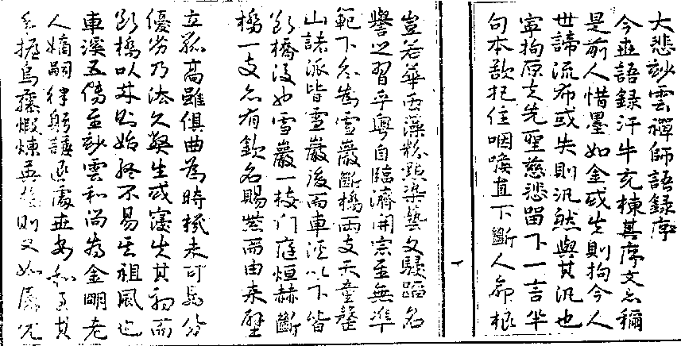
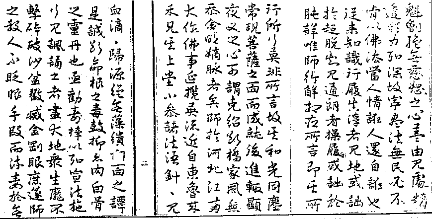
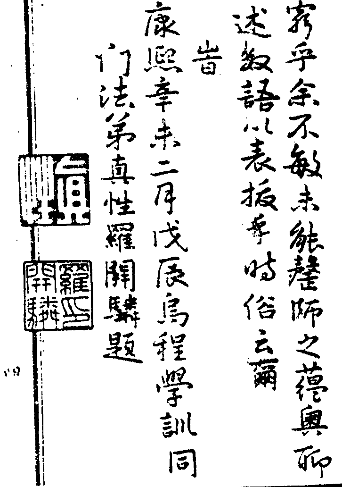

# 大悲妙云禅师语录



> **藏经**：嘉兴大藏经（新文丰版）（嘉兴藏）　**册次** 第 38 册（J38）　**编号** JB415　**部类** 诸宗部　**卷次** 6 卷　**篇幅** 70,901 字

> **作者（译者）**：住北京玅峰法云禅寺嗣法门人机相编录、住扬州九莲禅院嗣法门人机质编

> **卷／品**：6 卷 · 1 品



---



## 目录



  - [大悲玅云禅师语录序](#大悲玅云禅师语录序)

- [玅云雄禅师语录卷一](#玅云雄禅师语录卷一)

- [玅云雄禅师语录卷二](#玅云雄禅师语录卷二)

- [玅云雄禅师语录卷三](#玅云雄禅师语录卷三)

- [玅云雄禅师语录卷四](#玅云雄禅师语录卷四)

- [玅云雄禅师语录卷五](#玅云雄禅师语录卷五)

- [玅云雄禅师语录卷六](#玅云雄禅师语录卷六)



---



### 大悲玅云禅师语录序















玅云雄禅师语录目次



序启传  

卷一上堂  

小参  

示众



卷二上堂  

小参  

示众



卷三拈古



卷四颂古  

法语  

行实



卷五机缘  

联芳  

像赞  

垂问



卷六诗偈  

佛事



住山东临清州大悲禅寺乡绅诸山请启



伏以青天雷震，滹沱道出常情；破院风光，蠡水孤标绝俗。狮窟既无凡类，曹源自尔弥漫。恭惟玅云大和尚座下，车溪源远，鸳水流长。诞英姿於登阃，有截铁之机；契针芥於金明，真超宗之侣。冷泉亭拈提竹篦古话，猛从胡饼讨汁；北高岭仰见新月方升，顿尔大地平沉。从此天涯遍历，无一可话。岁寒末后，禾郡息肩，撞入介老虀瓮。久潜光於水边林下，壁立真风；方现瑞於优钵罗华，入廛垂手。兹者大悲禅寺，原为古宿道场，时节既臻，因缘匪偶。祥等久钦道范，特发悃怀，敦请移锡光临，丕飏宗旨，知断桥正脉当昌，而敬畏渊源将大。伏愿撒漫天之罗网，摝冲浪之鲲鲸。金刚圈、栗棘蓬，令吞吐者翻转本来面目；木札羹、铁酸馅，使啐啄者籍没久住园林。将见重兴祖道，三草二木而法雨均沾；宣扬宗猷，此土他方而道风一贯。肃此布陈，颙侯慈旆。不宣。



> 法末林启祥　冀信之　高守节　冀　霖



> 范永兆　林　秀　鲁明经　崔际汉  

> 徐守志　崔　璠　柴明山  

> 诸山照　乾　圆　光　寂　果　普　镜  

> 智　水　海　舟　仝顿首拜



住浙江嘉兴府三塔禅寺绅衿请启



伏以道周宇宙，九天之佛日重开；理证圆通，千载之法轮永固。朗心田之宝镜，自古为昭；燃觉苑之明灯，於今为烈。恭惟玅云大和尚，蚕丛独辟，堂奥先登。脱下青衫，便著七斤之布；掷开翠镜，已持八角之盘。系出断桥，允矣猊台秀种；衣传介祖，卓哉狮吼奇儿。执𨱄斧以开山，名扬济岱；把竹篦而显道，威振龙天。值飞锡之北来，水源木本；喜慈航之南渡，法乳薪传。兹有郡治之西龙渊寺者，雪飞千尺，当年授拂之祖庭；地涌三峰，此日澄心之胜境。尚虚十笏之地，未逢九带之人。特迓云𫐌，用光莲座。伏望合众善以同归，现三身而说法。宝幢竖而圣凡共拥，鸟啼花落尽属真诠；圆音唱而龙象偕来，流水行云天然玅证。从此客船渔火，无非击竹之机；还看夜月钟声，尽入拈花之案。(庭)等持四句偈，恒苦舌本生疏；参一味禅，每虑拳头不识。总冀垂慈，曲全良会。将马鸣龙驭，悉驱驰三乘之年；并石女木童，俱歌舞四门之日矣。临楮瞻依，曷胜虔祷？



> 法末王　庭　钱　江　吴源起　沈克劢



> 沈瞻日　屠又良　毛延芳　沈御日  

> 葛天麟　钱　柱　李　御　葛天凤  

> 高孝本　徐祚增　沈京文　王　沆  

> 张　晟　曹彦栻　项　谦　朱彝政  

> 张联箕　项惟贞　张龙骧　项惟聪  

> 金世珍　吴陈咏　何密　葛天鹏  

> 王怡善　金世熙仝顿首拜



景德法姪请启



伏以云开五色之奇，日众中天之丽。千华现瑞，重重祗树竞芬芳；万汇呈祥，湛湛龙渊标胜境。恭惟玅翁法叔老和尚倪座下，断桥嫡脉，临济真传，得心印於蠡湖，开炉𩍁於齐国。用白拈手段，师表人天；显黄檗大机，权衡佛祖。扫尽狐禅窠窟，早知七事随身；觑破魔外机关，久钦五明在目。启宗纲之既坠，须是其人；救法运之将颓，全凭作者。兹三塔古刹，禾郡名蓝，於四十年前，赖主峰师伯以中兴；今三载之后，因劣姪缘疏而他适。欣诸护之同心同力，迎法驾以斯允斯来，仰冀象旆早颁，狮幢速驻。挝毒鼓於当轩，群迷总教唤醒；施法雨於大地，顽石俱皆点头。庶僧众之有归，而丛林之有主，舆情普洽，缁素观光。临楮翘勤，恳切之志。谨启。



景德愚姪机旭和南九顿首拜



大悲玅云禅师传



苕程司训鸳水逸民同门弟真性罗开𬴊撰



古来法门宗匠，唯是真参实悟，以本分接人，不动声色而化被群方，斯足尚焉。若吾大悲法兄禅师，具人矣。师讳真雄，字玅云，原藉浙之金华，徐姓。父仲芳，任登州都阃，以官为家，遂为山左人。师自幼喜悦三宝，俄逢鼎革，父弃官入空门，师亦随父驱乌受具戒。首参具德和尚，究竹篦话。一日，至北高峰，仰见新月，忽若大地平沈，遂尔疑团扑落。复饱历烟水，若木陈、费隐、箬庵、浮石、玉林、牧云诸尊宿，无不刮目相看，争欲网罗异宝，然师少可其意。最后抵禾城金明，一见本师介老人，心中大惬，曰：「是诚吾师也。」老人云：「云封狮窟，向背无门，汝从何而入？」师曰：「从门入者，不是家珍。」老人曰：「汝是行脚僧，为什向驴胎马腹里作活计？」师曰：「今日亲见和尚。」老人曰：「汝看老僧眉毛落了几茎？」师曰：「生也。」老人曰：「浆水钱且置，草鞋钱教谁还？」师曰：「和尚欠多少？」老人便打。师曰：「不入洪波里，怎见弄潮人？」老人曰：「汝见个甚麼，却恁麼道？」师曰：「动容扬古路，不堕悄然机。」老人曰：「参堂去。」自尔机锋箭拄，老人复加百鍊，师遂破最后重关。师与主峰兄侍老人围炉次，老人曰：「火炉头有个宾主句，汝道看。」师曰：「和尚坐，某甲立。」老人指火曰：「者个为什麼向寒灰里发燄？」师曰：「非为分外。」老人以火箸敲炉曰：「还跳得者个出麼？」师曰：「不独某甲，直饶三世诸佛全身在里许。」老人曰：「大须仔细。」寻命掌院事，执劳六载。舂米次，老人至，问：「子还是为众竭力？资养己命耶？」师曰：「喂驴喂马。」老人曰：「子是第几头？」师曰：「将谓无人证明。」老人便与一掌。壬子元旦，老人升座，拈香祝圣毕，乃曰：「卓锡蠡湖念五春，今朝意气出常情，海天阁外纷纷雨，带水拖泥祝圣君。」拈拂子召众曰：「世尊说法四十九，老僧开堂二十五，灵山拈花，金明竖拂，且道是同是别？」师出礼拜曰：「且喜老汉今朝瞥地。」老人竖拂子曰：「只者个竖穷三际，横遍十方，且道承谁恩力？」师曰：「粉骨碎身未足酬。」老人打一拂子，师便礼拜起，依位而立。老人即付师衣拂法，偈曰：「狮子窟中事，善哮吼者得，今得本无得，无得得亦得。」未几，老人谓师曰：「子因缘既熟，无久滞此。古人云：『未有常住而不行者。』水边林下，把茅盖顶，顺时行化，续佛慧命。」师领旨北辕，渡江淮，抵清渊，驻锡天中阁，潜行密用，圣凡罔测。癸亥春，应请住大悲禅寺。寺故唐宋以来知识道场，缘前住不称，将鞠茂草。师竖大法幢，驱诸野犴，独标济天风月，顿使颠覆维新。师感炎凉时态，岑寂世缘，孤高壁立，四方宿衲，景附云从。师一以本分草料相勗，虽铁额铜头，必敲骨验髓，务使个个点睛破壁，人人踞地嚬申。故其门人分猷布化，散处诸方者，皆头角嶷然也。师居恒所食璎珞一瓢，所衣敝衲百结，环陼萧然，有杨岐雪珠满榻之风。学徒非断臂者流，鲜望崖而退。舜日杲公赠言云：「谁言我叔成痴癖，华顶风清熟解跻。」盖确论也。师钳锤恶辣，绝不容情。至其处世谦光，不受礼拜，志愿三篾束肚，一茅遮顶，则又有云栖古宿之风。尝睹薪米狼藉，躬检入厨，诫诸子曰：「粒米茎薪，檀信膏血，若不感恩(努力)，顿悟己灵，而反致轻忽，恐难消受尔。」方丈不私享用，孤笻行化，稍有赢餘，即惠贫乏，或作胜事也。师自壬子离金明，至庚午冬仲，从东鲁来禾，屈指十有九稔矣。余迎笑谓曰：「兄大作佛事，而荣旋祖庭。」古云：游子悲故乡。此其时欤！俄阅其行实，知行解相应，一言一行，俱可隄捍狂澜，模范后学，因捃拾其大略云尔。



空诸性曰：「传之为言传也。传也者，传其人也；传其人，传其神也。今著述家每传一人，辄多铺语，未免藻绘损神。」师之行解，超群轶格，余传之，不敢妄加点染。或曰：「师本不落朕迹，似神龙无首，非若灵龟曳尾。子今传之，非点染而何？」余曰：「不然。法门秋晚，流俗波靡，佛祖正眼留作人天标表，此亦颓波之柱石、霜干之硕果也，又乌容以不传？况师法道方兴，行见玅云弥布，一雨普沾，尽法界、虚空界遭其荼毒者未可涯量，是又非笔墨所及矣。」



------



## 玅云雄禅师语录卷一



住镇江甘露寺嗣法门人机德编阅



住山东临清州大悲禅寺语录



康熙癸亥二月，师在护国，受本郡州牧佟公、州尹卜公暨阖郡绅袍护法融涵老宿等请，於三月二十日进院。



山门。「惟此一门，通天达地，直下无私，一超直入。」



韦驮。「丛林屏翰，法社干城，权衡在握，邪正是凭。」



佛殿。「麻三斤、乾矢橛阁置一边，天上天下唯吾独尊，阿谁证明？新长老到来如何即是？」顾左右云：「大众记取。」展具作礼。



伽蓝。「七事惟荷，百凡仰灵，振领提纲，条令斩新。」



祖师。「庞眉皓首，形影诡诞。灵山嫡旨，各妄宣传。今朝捉败，无地躲闪。」插香展拜。



据室。拈拄杖云：「过去诸佛於此转大法轮，未来诸佛亦於此转大法轮，新长老於此又如何施设？」卓杖云：「棒头产下玉麒麟。」



即日，封翁林芝山、高双泉明府冀霖同众士庶请上堂。师拈疏云：「者道符子推不向前、约不到后，从诸大护法笔尖上涌出，落在山僧手里，岂敢囊藏？也要大家相委悉。」度疏云：「维那分明宣说。」指座云：「法王宝座，千古遗踪，不是其人，徒增希冀。新长老到来如何即得？」喝一喝，遂升。拈香，云：「此一瓣香，根盘毘卢之先，枝敷楼至之后，高而无上，贵不可极，𦶟向炉中，奉祝当今皇帝圣躬万岁万万岁，皇后齐年，太子千秋，伏愿帝基永固，垂拱致治。此一瓣香，为云为雨、为瑞为祥，奉为满朝文武、本郡尊官、现前缙绅檀护并诸山耆宿，伏愿禄位高增，子孙瓜瓞。此一瓣香，灵孕浩劫，毒深沧海，千寻浪里翻身，百炼炉中辊出，末后到金明结尽冤仇，抱恨抱怨无处伸雪。今日人天众前拈出，供养前住径山天池、次住广福敬畏、传临济正宗第三十一世金明堂上过去本师介庵进老和尚，用酬法乳之恩。」敛衣就座。舜日大师白槌毕，师云：「若论个事，诸佛列祖口挂壁上，虽则官不容针，山僧到来傍开一线。」拈杖一卓，云：「莫有不惜性命底，出来与拄杖子相见。」僧问：「毘卢顶上草生青，金刚脚下死蛇横，玉殿苔封意作麼生？」师云：「铁轮天子寰中敕。」曰：「天时地利，四众咸和，祖意教意，为同为别？」师云：「日月光天德，山河壮帝都。」曰：「蠡湖滴乳传芳永，旧店重开法化新。」师云：「也要大家出只手。」曰：「一句浑超诸有象，千载黄河今又清。」师云：「好个消息。」曰：「学人今日小出大遇。」师打，云：「切忌诈明头。」问：「拨草瞻风，瓦砾光生，如何是大悲境？」师云：「云眠断碣，鸟宿迦头。」曰：「人杰地灵，缁素骈臻，如何是境中人？」师云：「眼生眉下，耳挞腮边。」曰：「人境已蒙师指示，正令全提事若何？」师劈脊便棒，曰：「作家宗师，天然犹在。」师云：「同道方知。」乃云：「刹竿竖起，古店重开，揭开宝藏，浑出家珍，撒向诸人面前，一任取足。与麼会得，犹较些子；不与麼会，拄杖子别滋一路。」蓦卓杖一下，云：「破魔王窟宅，展佛祖家声，须凭者个；握金刚剑，悬肘后符，要是其人。山僧今日承诸檀命，义不容辞，斩莽披榛，凿开生佛面目；垦土掘石，露出本地风光。顿使寒灰发燄，枯木生春，石狮哮吼，惊起青山头卓朔；木马嘶风，蹋断黄河水倒流。正恁麼时，莫有向者里著得一只眼者麼？」良久，卓杖一下，云：「手握金鞭问归客，夜深谁共御垓行？」复举：「介老人住金明，上堂云：『破禅堂，灰头土面；破佛殿，驴额马腮；破山门，擎拳持杵；破佛阁，待月眠云；破钟楼，知音者少。令一队破衲僧居此，以破破不破。破破不破、不破不破底运用无穷，直教七通八达。若是超宗异目，山僧秪得另眼相看，将破破底相待。众中有斫不开、劈不破底麼？出来，金明与你破破去也。』」师云：「运壶中日月，用格外钳锤，号令人天，权衡佛祖，不无者老汉；若欲扶竖临济纲宗，要且未在。山僧当时若在，将具展开畫



相，卷作一团，抛向背后，展两手，云：『诺！』看他如何合煞？诸人者里会得，燃灯佛与你同参。」卓杖一下，云：「换骨洗肠重整顿，通身是眼更须参。」



开基，示众。「地老天荒岁月长，何代传留古道场？而今生面重抛出，瓦砾从教尽放光。」拈杖卓云：「真机独露，揭开万象顶𩕳；大用现前，捩转虚空鼻孔。顿使春回大地，法运咸新，化育无私，恩光普洽，於一茎草上现出琼楼玉殿，坐微尘内转大法轮，山河大地情与无情一齐喝彩，惊得须弥山王恶发，一时六种震动，直得四天门王擎拳合掌，狸奴白牯东触西触，山僧一一从头按过，不免将金刚圈、栗棘蓬、木札羹、铁钉饭尽礼款待，各个礼谢而退。大众！且道具何三昧，有此庆快？恁麼会得，大悲与你同一鼻孔出气。还有恁麼会者麼？」卓杖云：「一茎草上琼楼现，万象丛中梵刹新。」



小参。僧问：「大机大用即不问，向上提持请师道。」师云：「一棒一条痕。」曰：「德山棒、临济喝，礼防君子，若有个不假钳锤的，如何指示？」师云：「铙钩搭索。」曰：「湛湛青天为甚也须吃棒？」师云：「未是阇黎著脚处。」曰：「秪如无位真人还有吃棒分麼？」师云：「那个是无位真人？」僧无语，师打，云：「只者是。」僧礼拜，师又打。问：「学人弓折箭尽，请师赐棒。」师云：「降将不斩。」僧拟议，师打，曰：「莫妄语好。」乃云：「诸方聚头喧喧谈玄说妙，争似大悲者里土面灰头？虽处城市，不异山居。有时天共白云晓，乌啣花落；有时水和明月流，风送琴来。凡情圣解，无处安排；得失是非，了无位次。设有辩如瓶泻、问似云兴，到者里那堪措足？化城客作，未可观光。」蓦卓杖，云：「放开一线，只图诸人总见总闻。还会麼？一片白云横谷口，几多归鸟却迷巢。」



金明介老人弥勒开光，命秉拂，小参。「月皎天空，光吞万象，宝镜当台，千差莫隐。秪如古德云：『天上无弥勒，地下无弥勒。』且道：弥勒在甚麼处？」蓦指像，曰：「大众！秖在者里，一向灰头土面，今朝尘尽光生，大似笑不彻底没　眼长老。雄上座与你点出。」以笔点眼，云：「看，看！直得照天照地，一星也瞒他不得。且道：得何三昧？」喝一喝，云：「忽地全彰兜率界，当轩独坐笑盈腮。」



佛诞，上堂。僧问：「善财参五十三员知识，因甚不闻作佛？」师云：「道士不持锡。」曰：「龙女一见如来，为何直往南方成等正觉？」师云：「比丘不鍊丹。」曰：「学人上来如何记莂？」师云：「一头两只角。」曰：「谢师相为。」师云：「且喜头角峥嵘。」僧一喝，师云：「正好拖犁拽耙。」乃云：「佛身无为，不堕诸数，惟吾独尊。一场漏逗，再睹明星，添沙眼里。灵山拈花，笑杀头陀。临末稍上做尽伎俩，更道：『善观吾紫磨金色之身，今日则有，明日则无。』用彻自己心，笑破他人口。检点将来，脚跟下好与三十。何也？将此身心奉尘刹，是则名为报佛恩。」



山铎和尚书至，上堂。「溪山各异，云月是同。矗矗华峰逼汉，融融桂乳飘香。正脉弘通，后学有准，不胜忻跃之致。曷蒙上足驰书，远抵东鲁？过辱殷勤，观瞻无已。」以杖召众，云：「还有委悉者麼？」良久，云：「昨日看云眠白日，今朝鸿雁落丹墀。」



结夏，小参。「结却布袋头、水牯牛，东触西触，且喜水足、草足，忽地撞倒铁壁银山，打破赵州关，趁出杨岐驴子，胡狗不识，羞成队走。诸仁者！莫莽卤，二六时中好看取。」蓦竖拂子，云：「是甚麼？」掷下，云：「咦！将谓象骨鳖鼻蛇，却是南山白额虎。」



端节，上堂。「今日时分，大地草灵，拈来无不是药，用之百疫消清。」蓦竖拄杖，云：「看！看！亦能杀人，亦能活人，莫有知此利害者麼？」良久，卓一下，云：「神农尝不得，耆婆罔辨真。」



晚参。举如意，云：「者著子极简便，不用安排，随处显现。盖缘诸人逐物意移，迷真返正，致令河边受渴，饭箩里耽饥。殊不知，大道无向背，至理绝离微，向上一路不用钻研，松风水月尽是当人玅用。虽然，犹是衲僧转句，祖师门下别有生涯。」击如意，云：「还委悉麼？若无拔山力，乌骓不易骑。」



解夏，小参。「秋风才动，遍界凉生，万汇凋残，金声普振。大悲者里，九旬期满，炉锤活脱，不意泥牛血迸，秤锤汗流。赵州柬▆，▆芦引蔓，瑞岩石上，主人唤惺。正当恁麼时，如何是衲僧行履处？芒鞋蹋碎沧江月，拄杖拨开岳岫云。」



住中天阁余素庵请上堂。拈拄杖云：「拈起也，函盖乾坤。」放拄杖云：「放下也，截断众流。」横拄杖云：「弥纶万有，含吐十虚，玄要主宾，偏正君臣，三乘五教，顿渐偏圆。」蓦卓杖云：「百杂碎了也。还有会得者麼？」良久，复卓杖云：「与你一緉草鞋。」



因事，上堂。「九年面壁，土旷人稀，平地波生，骇人观听。或现三头六臂，呈能呈伎；或逞无量神通，作多般计巧。大悲者里玄黄不涉，何用致雨腾云？一向冷愀愀地终朝默坐，皆因世道秋晚人多斗诤，如犬咬枯骨，群吠见之竞来喧争，才知味淡而痴火顿息。大众！正所谓：黑风吹起船舫，飘堕罗刹鬼国。只如坐致太平一句又作麼生？」卓拄杖，云：「老将不用谈兵策，自有东风致太平。」



上堂。「大悲有一句子，不是祖师心印，亦非铁牛之机，突出虚空，触不得、背不得。且作麼生即得？还有道得底麼？」良久，拈杖畫[十○]相，云：「善吉维摩谈不到，目连鹙子视如盲。」



上堂。「毛吞巨海，芥纳须弥，死款不劳拈出。大悲者里随机设教、遇缘应机，与诸人平地展演，事无不当。烹金琢玉，要假本分钳锤；夺食驱耕，须凭超方手眼。若从空放下，顿歇驰求，不移寸步，百城俱到弥勒楼阁，何用再见文殊？山僧今日打鼓敲金，为诸人奏凯去也。」以拂子击禅床，云：「万国醉心尝大鼎，相将携手上高台。」



金明先师介庵和尚讣至，上堂。「飒飒金风体露，纷纷红叶翻飞，坐断报化佛头，人天杳无消息。」拈起讣音，云：「既杳无消息，者个是甚麼？虽然，大悲一向为伊瞒顸过，今日掩彩不住，不意者老汉到此田地。大▆▆仔细思量，大悲通身是口，也不能尽说他恶弊。」以袖掩面，云：「哀！哀！」



起七，小参。僧问：「把住向上牢关，徒劳侧耳；放开百千三昧，平贴商量。如何是第一玄？」师云：「拟议堕机前。」「如何是第二玄？」师云：「有口不能宣。」「如何是第三玄？」师云：「千圣绝言诠。」「如何是第一要？」师云：「坐断虚空窍。」「如何是第二要？」师云：「悬岩撒手玅。」「如何是第三要？」师云：「妍媸俱该照。」「三玄三要蒙师指，末后一句事如何？」师云：「断碣无文字义新。」问：「如何是祖师西来意？」师云：「草鞋咬脚。」曰：「学人不会。」师云：「不是有心。」乃云：「红炉火著燄腾空，逼得乌龟上翠丛，无论顽铜并钝铁，铸成宝剑任磨砻。」竖拂子，云：「洞山三斤麻，山僧扎作一柄拂。若唤作一柄拂，却是洞山三斤麻；若唤作三斤麻，却是山僧一柄拂。且道：唤作甚麼即得？」一僧云：「不可唤作和尚拂子。」一僧云：「也不是云门乾屎橛。」一僧云：「和尚莫热瞒。」一僧礼拜，归位。师云：「总没交涉。虽然，就里一个滚热。」又，僧出，曰：「请和尚道。」师以拂子击禅床，云：「三十年后有人悟去在。」



示众。「你有拄杖子，与你拄杖子，富嫌千口少。你无拄杖子，夺却你拄杖子，贫恨一身多。虚空扑落地，无奈痛愁何。」卓拄杖一下，云：「云在岭头闲不彻，水流涧底太忙生。」



除岁，小参。僧问：「腊尽春回即且置，观音菩萨将钱买糊饼，放下手云：『却是馒䬦。』意作麼生？」师云：「因斋庆赞。」曰：「便恁麼会意如何？」师云：「错过不少。」僧便喝，师云：「纵饶喝倒须弥山，也是阶下汉。」僧拂袖归众，师云：「自领三十棒。」乃云：「大家聚首叙寒温，无数心情彻底倾，赖得雪枯冰燄烈，好看春色到黄昏。」召众，云：「大悲者里殿堂破落，满床雪撒珍珠，厨库枵虚，往来雀鼠不至，家风冷淡，客到清茶，不效诸方椎锣伐鼓，闹热门庭。何期尔辈不事嚣燄，甘受阗寂？适当与诸人分岁，乾矢橛、麻三斤丢过一边，炊黍米饭、烹露地牛，诸方旧例，山僧此间细剪白云、薄切清风，以虚空为盘、泰山作筋，更倾太液池、煎龙脑茶，将东海作杯，一任饱餐，且道是甚麼滋味？倘或不知，三十日阎老子要与你筭饭钱在。」良久，云：「不经霜雪苦，难话岁寒心。」



岁朝，上堂。「挝涂毒鼓，闻者尽丧；竖摩醯目，见者俱瞎。见之闻之而不瞎不死者，岂可同日而语道哉？」乃拈拄杖，云：「今朝新岁，全无忌讳。且听下文，一齐嘱累。」卓一卓，云：「宝塔尖头，豁开释迦眼睛；千华台上，露出达磨鼻孔。东君布令，万象腾辉，一人有庆，兆民赖之。林下衲僧，顺时纳祐。且道祝圣一句作麼生道？」复拈香著炉，云：「一炉沉水盈沧海，仰祝　当今亿万年。」



元宵，上堂。「千灯万灯，燃於一灯；江月山月，本乎空月。月里灯明，灯中月皎，三千大千，光光交彻，如宝丝网。进一步，重重锦缝开；退一步，尘尘三昧起。寒山拾得，遏捺不住；弥勒释迦，卓锥无地。大悲拄杖子一著争先，倒骑三脚驴，拽脱沩山鼻孔，蹋断帝释脊梁，绕四天下一匝，坐地看鳌山，春色无高下。」拈拄杖，召众，云：「我见灯明佛，本光瑞如此。」



佛涅槃日，上堂。「梨花白，柳枝黄，山左山右，绿砌池塘。莺歌兮，韵啭王乔之玉管；燕语兮，声绕谢氏之雕梁。如来紫磨金色身，一一天真，一一明玅。只如烟烬火灭时，金色身即且置，如来在甚麼处？」卓拄杖一下，云：「晓来一阵催花雨，马蹄何处避残红？」



观音诞日，上堂。僧问：「如何是夺人不夺境？」师云：「澹烟疏雨洗黄昏。」曰：「如何是夺境不夺人？」师云：「满头白发盖霜颜。」曰：「如何是人境俱夺？」师云：「云封古寺，野客迷踪。」曰：「如何是人境俱不夺？」师云：「农歌细柳，鹤舞苍松。」曰：「行解相应恢祖道，离名离相振纲宗。」师云：「口衔霜刃太惊人。」士问：「清光匝地，明暗交辉，如何是观音玅智？」师云：「能救世间苦。」曰：「直捷提持，不择冤亲，盲聋瘖哑，如何接导？」师云：「识得你是俗人。」曰：「恁麼则一蹋鸿门两扇闲。」师云：「汝见何道理却恁麼道？」士便喝，师云：「昨夜三更月到窗。」士礼拜。师乃竖拂子，云：「观音菩萨来也，在山僧拂子头上显大神通，搅长河为酥酪、变大地作黄金，直教一切有情随心满愿，大悲者里理长即就，牛头没、马头回，一任蹴蹋，合水合泥，有甚麼限？检点将来，未是衲僧极则……」以拂子畫一畫，云：「且待别处商量。只如庆祝圣诞一句又作麼生？」挥拂子，云：「香云堆里见圆通，千手施为不自功，若将耳听终难会，眼处闻声识玅容。」



浴佛，上堂。「示现皇宫，计尽谋穷，雪山成道，重加作造。再转法轮，不堪听闻，露出双趺，臭恶难收。大悲今日不似老韶阳掉转旗鎗。」喝一喝，云：「者一杓恶水也要你承当。」



介庵和尚忌，拈香。「前年今日捩转鼻孔，今日前年囊空剩颖，直得天下太平，森罗喝彩。且道大悲者里又作麼生？」插香，云：「大众还知麼？西风满院愁无限，九曲河声动地流。」



金明古灯和尚至，上堂。「中流砥拄莫迟疑，玅手擎天赖主持，蠡水杖头涓一滴，宗纲随处耀金錍。」竖拂，云：「高而无上，渊莫可测，打开线路，宝印腾辉。大道随方建立，至理触处弥彰，全提正令於寰中，大展威权於阃外。若是坐断报化，佛头难为凑泊；欲求轮王髻珠，必先抛砖引玉。」复举：「昔在金明，尝闻先师举破破不破，破破不破、不破不破底句以验方来。者则公案多年蕴在胸中，信知无人发明。若非古灯法兄大悲，此生无由拈出。」下座。与头首、大众殷勤敦请：「伏望謦欬雷音作狮子吼声。」



正定禅宿同乡铎高双泉供法衣，请上堂。问：「大庾岭头提不起即且置，只如施主供衣饭僧得何三昧？」师云：「亲到宝山，莫教空手而去。」曰：「乾三连，坤六断，一线贯通，因甚坎中满？离中虚？」师云：「蓬来三岛，黄河九曲。」曰：「世尊传金襕外，别传何物？」师云：「眼见如盲，口说如哑。」曰：「请师曲开方便。」师云：「我佛过去久矣。」乃拈法衣角，云：「者个滞货，灵鹫传来，及到东土黄梅，夜半密付，大庾岭头拈掇不起，递代相传，殃累不少。今向檀那针锋上涌出，有个正定禅宿和盘托来，仍请山僧举扬，令现前缁素无不见闻、无不信入，各个蹋著故乡田地。恁麼会，觅火和烟得；不恁麼会，担泉带月归。大悲与麼道，未免舌头托地。秖如举扬一句如何即是？」拈拄杖一卓，云：「但愿皇风吹遍野，群萌普洽福田增。」



封翁林芝山、中书林文伯请放生会，小参。「鱼游困而止泺，鸟飞倦而知还，蠢动含灵莫不贪生惧死。兹现前众信体全物命，捐赀赎放，令其水陆空行，脱离笼系，以免刀砧鼎镬之苦，各遂逍遥。更请山僧为其指个入路，乘此大法，各获正因，共登觉地，永出轮回。此段胜心诚为希有。」竖拂子，云：「大众！一切众生向者里成正觉已，诸人分上且作麼生？」挥拂子，云：「了即业障本来空，未了应须酬宿债。」



受嘉兴三塔请，上堂。「明镜当台，照彻佛祖心肝；宝剑临风，那许痴顽在目？直得没顶塔𨁝跳上天，师子桥哮吼入海，汶水吹笙，土山作舞，惊起铁牛，踏倒弥卢山王，帝释尊天蹲身无地。正恁麼时，正不居正，偏不坐偏，虎穴魔宫，自由自在。」以拂子召众，云：「且道是甚麼时节？」乃击拂子，云：「有意气时添意气，得风流处更风流。」



先师介老人忌，拈香。「你先前年向我说去年今日事，我道你出语不稽；我前年今日望你信，思量不是去年时；及到去年今日又无信，只道你口说无凭；今年前日忽接讣，果应先前年说话。特烧一瓣紫檀，煎三盏白乳，不是报你恩德，为你说话不虚。」乃烧香，云：「呜！鸣！当年枉受你奇冤，今朝更恼人肠肚。」



嘱天乳哺西堂，上堂。「向上一路，释迦眼睛，正法眼藏，达磨心髓。」拈拄杖，云：「木上座久默斯要，今日蓦地机先，动容古道，可中有个打破罗笼、踢翻窠窟的，戴角擎头，克绍先猷，典型后学。大悲者里有个破沙盆子，从来无人觑见。」乃拈法卷示众，云：「还有於此会得麼？」天乳西堂出接卷，云：「昔日灵山亲记莂，今朝大悲转光辉。」师云：「以何为证？」乳曰：「开基创业前王事，端拱持盈后帝心。」师云：「即今事作麼生？」乳珍重，礼三拜，师云：「如是，如是。」卓杖，下座。



别驾牧公项大士至，上堂。「蓬户家风别，苔生丹灶寒，年来踪迹泯，相续也大难。大悲者里断碣委地，榛莽参天，木上座十载前拨开生面，蒲牢子从今日吼破云端，古佛堂前乌兔争飞，夜明帘外不通凡圣。今朝有次庵大士同出师门，幸旌盖辱临，破我岑寂，山林增色，瓦砾生光，直得车溪水长高济北，鸳湖浪涌涨黄河。只如弟兄相见如何话会？」挥拂子，云：「共掬湖天波底月，埙箎迭奏动云泥。」



金明介庵和尚忌，法眷请上堂。「九月廿三日，吾师示寂灭，今值十周辰，饮水忽遭噎。东山十件事，一事亦不设，杰祖曾有言，子不谈父德。千古袭断桥，曹溪真滴血，万丈蠡湖波，溶溶吞海月。杲日丽中天，不似尘劳热，火里青莲花，红炉飞片雪。蛙步岂能随？追风天马烈，时流谩度量，轮王三寸铁。不是扬家丑，对众闲饶舌，特报与诸人，从头须打彻。且道打彻个甚麼？」击拂子，下座。



受三塔请，辞众，上堂。「虚玄大道，无著真宗，随方建立，遇缘即应。灵符在握，竿木随身，照用全彰，杀活临时，去住随机，自由自在。有时深藏宝镜，妍丑不立；有时揭开华藏，遍界光辉。兔角杖威狞似虎，著著超方，出头天外，谁是我般？虽然，只如古人道：『有佛处不得住，无佛处急走过。』众中莫有会得者麼？」卓拄杖，云：「三千里外分明记取。」



------



## 玅云雄禅师语录卷二



**译者**：住北京玅峰法云禅寺嗣法门人机相编录



住浙江嘉兴府三塔景德寺海会禅院语录



师於康熙辛未，扫金明介老人塔於大慈。次年，受合郡绅衿公请，於二月十二日入院。



山门。卓拄杖，云：「既到者里，那堪回互。不二法门，大方阔步。」喝一喝。



韦驮。「修戒定慧，护佛法僧。四大部洲，因甚那一洲不到？」合掌云：「太平不用将军令。」



佛殿。「家无二主，你是阿谁？然则如是，讵失礼仪？」乃展具拜起，顾众云：「切忌妄通消息。」



伽蓝。「你有五通，我止一通，正令全提，鞭影何从？」插香，云：「今朝无别谓，千古振宗风。」



祖堂。「者一队汉，三五成群，递相热瞒，今朝看破，不值半钱。」



据室。「我为法王，於法自在，若圣若凡，泥团土块，设有个出格底来……」蓦卓拄杖，云：「切莫错怪。」



当日，别驾项牧公同众绅士办斋，请上堂。师至座前，拈疏云：「夫子之言，达磨心髓，外道天魔，徒劳侧耳。若要大家总知，且听维那表白。」宣毕。师拈杖指座云：「宝王座前，人天普会，山僧到来，一场特地。」便升座。拈香云：「此一瓣香，根蟠浩劫，树秀今时，𦶟向炉中，供养本师释迦文佛，伏愿化身亿万，拯摄沉迷。此一瓣香最尊最贵，价重山河，端为祝延今上皇帝圣寿无疆，钦愿至德弘敷，兆民普赖。此一瓣香德合天地，功并日月，奉为满朝文武、本郡府主邑侯、各位尊官、现前请主、绅衿缁素，惟冀天爵、人爵以增崇，智山、寿山而巩固。」复於怀中拈出云：「此一瓣香，拈起则逼塞虚空，放下则大地平沉，亲从蠡湖得来，恩大难酬。第二回拈出，供养前住径山天池、次住敬畏金明、传临济正宗第三十一世介庵先师进老和尚，用酬法乳。」敛衣就座。晦岳和尚白椎云：「法筵龙象众，当观第一义。」师云：「第一义谛，佛祖觑不见，衲僧提不起。还有向未举已前荐得者麼？」紫渊问：「玄风久振，为祖佛权衡；慧日高悬，作人天眼目。请问：如何是人天眼目？」师云：「火迸星飞。」曰：「秪如四众临筵，将何指示？」师云：「风清清，日杲杲。」曰：「恁麼则恩光遍布，大地均沾。」师云：「且喜功不浪施。」曰：「光敷景德千华秀，水长龙渊一派长。」师云：「不劳赞叹。」乃挥拂子，云：「垂钩四海，秖钓鲲鲸；据座披衣，为求知识。」蓦竖拂，云：「过去已过去，未来尚未来，今日正当山僧说法，直以大圆觉为伽蓝，安住平等，一如法说，令现前缁素亦如法得解，然后同声相应、同气相和，号令人天、权衡祖道，直使魔外绝迹、生佛普该，入一微尘、现无边身相，坐毫端内、转大法轮，山河大地、明暗色空、情与无情，总在者里头出头没。」喝一喝，云：「天上有星皆拱北，人间无水不朝东。」结椎，云：「谛观法王法，法王法如是。」师下座。



当晚，小参。「灵机廓彻，智照洞明，遇缘化物，道岂虚应？奋坚密身，坐断十方；豁智慧眼，该罗一切。示七步周行，指天指地，作师子吼音，不无释迦老子。后来有个跛脚阿师，显超群作，略要一棒打杀与狗子吃，贵图天下太平。可谓赤心报国。拣点将来，也是冬行春令。新龙渊恁麼批判，且道意在於何？诸人还知落处麼？」拈杖卓，云：「从前汗马无人识，只要重论盖代功。」



佛涅槃日，上堂。「天地同根，万物一体，释迦老子还在里许麼？若在里许，在甚麼处？若不在里许，又道佛身充满於法界，如何得恰好去？於斯见得彻，四月八日示生皇宫、腊月八日睹星悟底，与二月十五双林示灭，总不出者个。大众还见者个麼？山花开锦绣，涧水泻银涛。」



达磨祖忌，拈香。「九年面壁，计较难成。五番中毒，不胜凄清。将谓传上乘之一心，谁知受无极之苦辛。后代儿孙，那想到者个真情。龙渊今朝虽觌面，曾记得老臊胡缺齿在当门。」



佛诞，上堂。「未离兜率，已降皇宫，明修栈道，暗度陈仓。未出母胎，度人已毕，夜半正明，天晓不露。老瞿昙既具斯等神威，何更向阎浮世界撒沙撒土？后代儿孙唤作正法眼，东钉西钉，看看做个破沙盆，只贮几杓恶水，岁岁今朝蓦头淋，将谓报德酬恩，可怜生，枉受他多少零丁，千古万古谁与慕西秦？然虽如是……」连喝两喝，云：「且喜天清地宁。」



结夏，小参。「展衲僧巴鼻，运格外钳锤，须是恁麼人，堪作恁麼事，主宾互换，棒喝交驰，也要是个汉，否则皆成戏剧。会得底自不徒劳，不会底切忌错过，九十日内参要真参、悟须实悟，若向者里能所俱寂、物我双忘，龙渊痛与二十拄杖。且道龙渊具甚麼眼目？」卓杖一下，云：「意气不从大地得，英雄岂藉四时催？」



李蛟门特请於真寄亭上堂。蛟门拈香云：「解脱香，解脱知见香，光明云幢遍法界，𦶟向炉中供养玅云师兄和尚，惟愿慈悲显露先师大人之相，令此一会之众共睹慈颜，正所谓灵山一会俨然未散，天封室内现紫金身。」师竖拂子云：「还见麼？如我李法兄适来所供是实，毫发不易，真真池莲开，畅古佛心；寄寄石边兰，拂祖师意。若是已过的，自然别露风规；倘留观望，那堪共语？兹因李居士再三重命升於此座，诸人还见先师大人相麼？」良久云：「两轮日月磨今古，一片乾坤傲却灰。」



供罗汉，示众。「薰风自南来，殿阁生微凉，半百应真僧，次第入道场。有神通的腾空而至，未心空的水陆频臻，总受檀那供养。只如木上座还受此供养否？」以拄杖一卓，云：「随众获安乐。」



晚参。师云：「有个汉终日行，寸步不移；有个汉终日坐，足遍天下，都来合吃龙渊二十棒。且道过在甚处？」



祈雨，上堂。「山土焦而流金，海水沸而飘烁，稼穑云枯，竹树叶缩，四海五湖，石出水落。」蓦拈杖一卓，云：「震动老龙宫，雷轰并电掣，打著东海鱼，雨似盆倾出。且道：神通耶？法尔耶？」喝一喝，云：「雷鞭击碎金乌窟，泻出沧溟遍九垓。」



景命月旦，上堂。「才过天中节，便是六月一，草木正方荣，看看九夏毕。人生如转烛，光阴若瞬息，三塔尾颠天，矗矗望何极？田园在处乐歌声，个事分明休别觅。休别觅，日日日从东畔出。」



解夏，上堂。「当人一著，至简至易，向外驰求，转疏转达，得与不得，总然一致。龙渊者里有时把住，佛魔俱敛；有时放行，凡圣同途。若要当头坐断，尽法无民，只得放开一线，曲为今时拈一茎草向四大海里搅动▆竭龙宫，直使洪波泛滥，淹上三十三天，浸烂帝释鼻孔，金刚际下土地神从蟭螟眼里翻身跳出，叫道：『火发。』拄杖子忍俊不禁，劈头一击，瓦解冰消。莫有与麼会底麼？」卓拄杖，云：「生儿不食人间乳，敌胜沙场岂用刀？」喝一喝。



上堂。「真机独露，觌面相呈，鉴地辉天，迥超物表。三世诸佛以此成道，历代祖师以此利生，天地以此包罗群象，君王以此奠安天下，江海以此流通不竭，山岳以此巩固皇图，圣人以此教化，凡夫以此修证，山僧以此举扬。且道衲僧分上又作麼生？若有个汉出来，掀倒禅床，喝散大众，不妨灵俐。有麼？」喝一喝，云：「金翅鸟王当宇宙，个中谁是出头人？」



师诞日，上堂。竖拂子，云：「者一著子，超越群象之表，迥出太古之先，气偃鸿蒙，光吞大野，放一线道，运回日月，拨转乾坤，到处逢源，随方作主，将四大海倾耳根里，拈须弥山卓眉睫上，东涌西没、南涌北没，上下及四维横纵无碍。诸仁者！向者里会得，犹是建化门中事，未为衲僧行履处。」喝一喝，云：「劈开华岳连天秀，泻出银河万派声。」



病起，上堂。「是病若有，毘卢堕在凡夫；是病若无，普贤失其境界。离却有无，病根深固。」拈拂子畫



相云：「者是佛祖病根，世医拱手，耆婆罔测。老维摩病，堕落深坑；马簸箕病，殃累永劫。有以病为药，攒簇不得；或有以药为病，截断舌根。药病两忘，无人识得。诸昆仲！还识病麼？」良久：「啊㖿！啊㖿！」



晚参。「明头来明头打，错；暗头来暗头打，错；四方八面来连架打，错。总不恁麼来时如何？」良久，云：「惭惶煞人。」有僧出，师起身入室。



到兴善鸳湖和尚塔头，拈香云：「披榛辟土，创复普明於檇李瓯宁；德迈道尊，再振纲宗於浙江闽海。坐断紫云峰，食橡餐松，不让沩山祐老；浩气迥诸方，栉风卧雪，慨见杨岐会翁。不肖孙某，匍匐远来，九礼窣堵，直得木人潸血泪，舜若结柔肠。谨具瓣香杯茗，略表寸诚，且道吾祖还纳受否？」烧香云：「秋老树翻红叶雨，天高云卷翠微深。」



先师介庵和尚忌，拈香插炉云：「满煨一炉乾矢橛，薰教阿师鼻脑裂，谓是报德与酬恩，头上安头眼著屑。」以袖掩面云：「哭不成，笑不得，一年一度今日时，廿载柔肠成百结。」



因雪，上堂。「旋空翙翙霰天涯，大地山川丑尽遮，世界都卢浑一色，梅香雪洁逗窗纱，冻得铁牛无避处，腾身跃过几恒沙，撞倒梵天，踏细须弥，万象森罗，锦上铺花。且道：神通耶？法尔耶？」喝一喝，云：「切忌眼里更著沙。」



腊八，上堂。「日冷风寒，霜花匝地，冻得老瞿昙眼里放花，满口颠言倒语道个：『奇哉，一切众生具有智慧德相。』何异昆仑顶上更觅虚空、太液池边挑凉水卖？令他后昆都不丈夫，认鹿作马，教坏天下多少男女尽是不快漆桶。诸人还知世尊落处麼？」拈拂一挥，云：「若不铁牛频下泪，蛟龙那识海宽深？」



除岁，小参。「纷纷雪压梅梢冷，霭霭炉烧柏子香，爆竹一声除旧腊，荼蘼几点接春芳。诸方此夜分岁，龙渊随例抖擞，赵州茶一任两盏三盏，洞山果从教七桌八桌，满堂菩萨子直得饱齁齁，唱个田家乐，弥勒笑盈腮，释迦长打坐，窦八东村化纸钱，廖七西街放𤇹爆。只如年尽岁穷一句又作麼生？」卓拄杖，云：「石人脚下冰生燄，露柱抽条春满林。」



元旦，上堂。「鞭起泥牛耕大地，春风吹彻五湖冰，千溪万壑花含笑，日色融融宇宙清。森罗焕彩，景象维新，石女舞袖庭前，木童把板云中，於斯荐得，天地与我同根，万物与我一体。虽然如是，因甚庵内人不知庵外事？」以拂子挥两挥，云：「昆仑骑却鹭鸶飞，蹋碎威音大顶𩕳。」



解制，上堂。「今日元宵佳节，锣鼓家家不歇。街头赏玩憧憧，村寺笙歌罗列。鳌山马走人飞，鹤渚高风明月。仔细看来何迂，走到天明难竭。亦犹尘世迷顽，忙忙终日无缺。不识息心除妄，直待油乾火灭。怎如林下道人，优游安闲不彻。空劫已前自己，今世门头不借。个里收放自由，布袋打开不结。今朝且喜禅流，一任腰包顶笠。山僧与麼告报，还我九十日饭钱。莫道不说。」



三月望，上堂。「喃喃新燕语雕梁，灿灿碧桃开大野；公子游春兴渐饶，踏青歌吹恣潇洒。杨花满地舞春风，过客长途飘野马；古冢今人化纸钱，今人不辨谁与假？诸禅人！还会麼？不知那个携春回，顿觉霜花连鬓写。」当今皇上圣诞，上堂。「春风澹荡，国界雍熙；蟠桃花璨金枝，大椿秀开玉叶。万邦仰祝南山，兆民同瞻北阙。且道龙渊(臣)僧又作麼生？」乃拈香烧，曰：「万惟今上皇帝万岁！万万岁！」



祈晴，上堂。「久雨不晴，浸烂须弥脑盖；长风不息，拽脱昆仑鼻孔。乾矢橛，麻三斤，皮穿骨腿；金刚圈，铁蒺藜，抽笋萌芽。糍团变作绿毛龟，石狮口里生白醭。衲僧脚下带水拖泥，拄杖颠头云开日出。森罗万象独露本地风光，弥勒释迦豁开清净宝目。」乃喝，云：「一挝毒鼓虚空破，迸出金乌世界新。」



上堂。拈拄杖畫○相，云：「者里会得，倒骑杨岐三脚驴，趁起南山白额虎，入林不动草，入水不动波，穿过达磨鼻孔，踏断虚空脊梁，把须弥山一掴百杂碎，直向毘卢顶上行。然虽如是……」良久，云：「好语不须频话会，留将和气暖丹田。」



上堂。僧问：「坐断十方，湛然常寂，如何是诸佛出身处？」师云：「昨夜西风过，黄花满地金。」曰：「觅火和烟得，担泉带月归。」师云：「凌空孤雁，声落云端。」僧便喝，师云：「果然。」僧拟议，师便打，乃云：「机轮未转，佛祖敛迹；针锋才露，千眼廓开。若是罗笼不住、呼唤不回的，当炉不避火迸，临场岂讳截舌？到者里自当刮目相待。设有个出来道：『是法平等，无有高下。和尚何得分别？』好与痛棒。何故？有功者赏。」



示众。「世尊横言直说，黄叶止儿啼；祖师东语西话，鞭龟上石壁。诸人朝参暮请，怎似泼油救燃？殊不知拟涉思惟，即便烧杀。所以道：『承言者丧，滞句者迷。』若是直下便会，多少快俊？倘或拈一放一，未免犯手伤锋。我平常向你道：拈却炙脂帽子，脱却鹘臭布衫，魔宫虎穴摆手逍遥，地狱天堂纵横自在。与麼则奴呼弥勒、婢视释迦不为分外。有麼？」良久，云：「鹤有九皋方翥翼，马无千里谩追风。」



上堂。僧问：「祖意、教意即不问，如何是空如来藏？」师云：「钵盂无底。」曰：「如何是不空如来藏？」师云：「黄河有盖。」曰：「如何是空不空如来藏？」师云：「风吹石臼念摩诃。」曰：「三空真的旨，那个是知音？」师云：「你是村僧。」僧一喝，师便打。问：「如何是未生前面目？」师云：「乌龟向火。」僧一喝，师云：「者是即今面目。作麼生是生前面目？」僧拟议，师曰：「秦时𨍏轹钻。」乃卓杖，云：「击碎明月珠，敲出凤皇髓，未为衲僧极则。若也别开方便，不免证鳖成龟；设有就里明宗，崖州万里；释迦掩室、净名杜口，赚杀多少人；尽大地撮来如粟粒大，鬼家活计。直须蹋著秤锤硬似铁，无计较、绝商量，到恁麼地犹未识大道真体。且如何是大道真体？」复卓杖，云：「见月休观指，归家罢问程。」



示众。拈杖云：「唤作拄杖则触，不唤作拄杖则背，藏尽楚天月，犹存汉地星。只如触背不得，唤作甚麼？刚刀虽快，不斩无罪。虽然，也不得错会。」喝一喝。



师到金明，众请上堂。僧问：「玉律初回太簇节，灯笼露柱冻颜开。如何是宾中主？」师云：「逢缘即应。」「如何是主中宾？」师云：「入廛垂手。」「如何是宾中宾？」师云：「蹋遍红尘。」「如何是主中主？」师云：「坐断千差。」曰：「宾主已蒙师指示，新年佛法意如何？」师云：「风剪梅花落，满城流水香。」乃云：「一法若有，毘卢堕在凡夫；万法若无，普贤失其境界。山僧到此祖庭，不免随例抖擞、逢场作戏，辊雪峰毬、打禾山鼓、行临济喝、用德山棒，使令不虚，庭前梅雪里操香、天封碑室中焕彩，一个破沙盆递相钝置，至我先师介老人彻底掀翻，知音者少。山僧昔年眉毛厮结，深怨难忘，今日虽叨众请，未免重添丑拙。若论者个事，诸人脚跟下光烁烁底，何用饶舌？」拈杖一卓，云：「座中若有江南客，何必樽前唱鹧鸪？」



到三塔龙渊寺，晦岳和尚请上堂。「敲唱双举，没弦琴上觅知音；宾主交参，无影枝头饶春色。还有恁麼会的麼？昔我主峰先法兄於此斩棘除秽，竖石桥之的旨；理败援倾，提车溪之正印。现宝王刹於毫端，播宗风於末运。晦岳法姪继踵芳猷，光增前列，力挽宗纲，今日要山僧为众举扬个事，三千七百栗蓬次第抛出诸人面前，还有不犯观听者麼？」喝一喝，云：「他家自有黄金骨，岂把栴檀入细雕？」



谢道旧、盘石安和尚至，上堂。举：「断桥和尚云：『面面相对，心心相知，人情若好，吃水也肥。祗园老汉酒逢知己饮，诗向会人吟则不无，不当以官物作人情。』龙渊今日道旧相访，只将曩昔相得意处重为拈出，且道是甚麼句子？」良久，云：「一条竹篦黑漆，你道有触有背；山僧卤莽折却，向道全没忌讳。十载今朝觌面，彷佛当年的意，昨夜话到三更，从前尽道不是。大众！且道同参不是？山僧不是？」展开两手，云：「不是，不是。」



上堂。「一拳拳倒须弥，一踢踢翻大海，释迦无处藏身，达磨却来东土，计较不成，九年面壁，引得后代儿孙聚头瞌睡，赵州东壁葫芦蓦地打倒西壁。呵呵！仔细思量，事不由己，闹市里称杨称郑，百草头说佛说祖，断柄杓泼屎泼尿，破笊篱扬沙撒土，十字街头石敢当，日日口吧吧谈玄讲道，三塔拄杖子无计可施，劈头一击，瓦解冰消。大众！且道今日是甚麼时节？」拍禅床一下，云：「下坡不走，快便难逢。」



州尹羽文叶公祈嗣，请上堂。「金刚正体，般若圆常；广漠无涯，高不可上。毘岚吹之不坏，虚空堕而不渝；为二仪之根，作三光之主。绵绵密密，触处灵通；互古今而不易，遍尘刹以恒新。如皓月当空，无幽不照；洪钟在架，有扣则鸣。运应无方，响廓天地。蓝田毓秀，蚌含明月之珠；青岳降灵，天送玉麟之子。」竖起拂子，云：「看！看！花放故园春日丽，果圆琪树报金秋。」



端节，上堂。「今朝五月五日，兔走乌飞劲直，抬眸地老天荒，举步山飞海立，门前三塔起舞，殿后千华竞出。龙渊拄杖子与开山和尚忍俊不禁，齐声唱彩，忽地打个喷嚏，赤口百舌，头痛三日。」喝一喝，云：「太上老君急急如律令敕。」



中秋，上堂。「梧桐月冷，丹桂香飘，体露金风，光吞象外。天上月，人间月，山兮水兮，清光皎洁，优游佳趣，景乐秋光。」乃竖起拄杖，云：「总不出者个时节。」随畫○相，云：「者个是灵山指底？那个是曹溪话底？」又畫○，云：「者个是曹溪话底？那个是灵山指底？恁麼会得，吞却一，吐却七；不恁麼会，吞却七，吐却一；总不恁麼，鸱吻咬杀屋梁脊。龙渊恁麼举似诸人，如何话会？」卓杖一下，云：「眉毛罅里毫光露，照彻冰壶绝点尘。」



金明介庵和尚忌，上堂。「恭值先师二十周，半轮秋老泣金乌，虚空落地无消息，万象森罗暗点头。佩灵符，悬祖印，半满溪山；蒙慈诲，受弘恩，数等竹苇。先老和尚，某侍奉六载，极承提命，恩重冤深，海口莫宣其万一。今日敬追远诚，将泰山作一瓣香、黄河作一杯茶，聊申奠献。大众！如是重恩必当如是重报，还知山僧报荅重恩处麼？倘或踌蹰，杨岐老祖有个旧例。虽然丑拙，怎敢欺瞒？」乃作女人拜，下座。



在三塔再受大悲请，上堂。「石人眉皱断，虚空舌吐长，节外又生枝，时节不相忘。主宾道合，何妨贵买贱卖？凡圣同途，一任牵长补短。镢头边抛三放两也得，杓柄中扬波鼓浪也得。龙渊鼓粥饭气，掷金钩，钓长鲸，张罗网，打玉凤，伊人罕遇。今日丝纶别展，旧店新开，掇取破沙盆，向折脚铛里重新安顿。现前一众，贵在潜机密用，莫陷他人故辙，庶丛林有赖，规绳不坠。更有一句，不妨与诸人道破。」卓拄杖，云：「龙渊收钓还归旧，千里扁舟破浪行。」又卓一下。



到京口甘露寺，晦岳和尚请上堂。「佩祖师正印，显衲僧巴鼻，须是恁麼人；拳倒须弥山，踏翻沧海水，还他出格汉。衲僧家动彻，腰包天地，历遍阎浮，透过威音王那边。」蓦拈拄杖，云：「怎如者个离名离相、迥古超今？今日到此，不免客听主裁，跨鳌门、上凌云，拽转焦山与金山斗额，撞倒银山关，冲破铁瓮城。」蓦一喝，曰：「被山僧一喝喝住，回到北固山前卓然而立。诸人还见麼？虽然如是，山僧又岂敢头上安头？诸人错过亦不可。」卓杖一下，云：「从前汗马无人识，秪要重论盖代功。」到北京安化寺，致和禅师请上堂。「浙水迢遥入帝乡，蓬头跣足历炎凉，南天北地皆王化，一句当轩绝比量。有般汉闻恁麼道，将谓别有奇特，向黑山鬼窟里坐，正是守古冢的精灵，有甚共语处？若是大丈夫儿，孤迥迥、峭巍巍，赤骨𩪸地，虚空无以较其量、沧海无以比其深，目视云汉，眼盖乾坤。山僧今日无端到安化寺里，被主人觑破，未免和盘托出。且道：向上还更有事麼？」良久，云：「六耳不同谋。」拈拄杖，卓一卓。



到北京玅峰法云寺，了心长老晒经，率众请上堂。了心问：「展开法藏，露出释迦鼻孔，一年晾一度，得何利益？」师云：「一番提起一番新。」曰：「如何是法云境？」师云：「怪石插青霄，奇峰卓碧汉。」「如何是境中人？」师云：「开铛煮皓月，把斧斫云根。」「人境已蒙师指示，向上宗乘事若何？」师云：「须弥顶上击金钟。」问：「高升宝座，法藏弘开，一会俨然，如何是佛？」师云：「山高石大涧流长。」「如何是法？」师云：「三寸龟毛缚太虚。」「如何是僧？」师云：「持瓶携锡上崚嶒。」曰：「施主请法饭僧，有何道益？」师云：「熏风南来，殿阁生凉。」曰：「恁麼则承恩去也。」师云：「错认葫芦作帝瓶。」僧一喝，师便打。问：「千秋龙亟三藏，一年一度晒㫰，当阳展开。如何是第一玄？」师云：「风蕴古皇前。」「如何是第二玄？」师云：「杲日照无偏。」「如何是第三玄？」师云：「龙文贯百川。」「如何是第一要？」师云：「乾坤绝朕兆。」「如何是第二要？」师云：「石里火光耀。」「如何是第三要？」师云：「顶𩕳突一窍。」僧曰：「玄要得蒙师指示，大藏流通事若何？」师云：「岳边有摄千山势，海上难藏万派声。」问：「四十九年不说一字，只者三藏灵文甚麼处来？」师云：「有眼共见。」曰：「如何是先照后用？」师云：「当轩悬宝镜，蚩尤失却威。」「如何是先用后照？」师云：「棒打石人头，嚗嚗论实事。」「如何是照用同时？」师云：「电激雷奔，不容拟议。」「如何是照用不同时？」师云：「南山起云，北山下雨。」僧曰：「还许学人商量得麼？」师云：「桃花三月发，菊花九月开。」僧曰：「佛祖肝肠被和尚抖擞了也。」师云：「且喜没交涉。」便打。问：「赫日丽天，熏风拂座，宝藏炜煌即且置，临济料拣事如何？」师云：「逐一问将来。」「如何是夺人不夺境？」师云：「日照山川铺锦绣。」「如何是夺境不夺人？」师云：「得意相逢气象新。」「如何是人境俱夺？」师云：「夜深愁雾锁柴门。」「如何是人境俱不夺？」师云：「吟风笑月乐升平。」曰：「料拣已蒙师指示，威音那畔事如何？」师云：「啣花百鸟寻无处，送供天人觅路赊。」曰：「深蒙和尚慈示。」师云：「要且没交涉。」乃云：「群峰四望此山高，万壑松杉拥碧涛，策杖偶来法云寺，那知身世在青霄？」拈拄杖召众云：「玅峰山独露清净法身，香水池吐出广长舌相，直得大千经卷从地涌出，无数天龙八部、无数山神、树林神、虚空河海神，各证无生法忍。要会麼？山河大地、明暗色空，不离当人境界，开卷展演自家宝藏，故曰：大道真体只在目前。山僧拽杖入山，遇斯胜会，蒙请举扬个事，若谓无法可说，恐辜众诚。木上座事不获已，向赫日中拈出。」乃指经云：「愿现前一众常转如是经百千万亿卷。虽然，若是依经解义，即为邪魔外道。还恁麼会麼？」卓杖一下云：「荡荡皇风成一片，更於何处觅封疆？」



中书林文伯荐室荆氏请上堂。正定禅师问：「弃秽归净，太费周遮，玅体圆明，何有生灭？」师云：「春至花开烂熳，秋来叶落飘零。」曰：「一灵归真际，无生甚处安？」师云：「踏著秤锤硬似铁。」曰：「谢师指示。」师云：「莫忘适来此问。」僧一喝，师便打，乃云：「妄情既断，碓觜开花，虚空结果，当地抽芽。荆安人於此会得，不被生死陆沉，撒手於空劫未有之先，高步於乾坤非想之外，捩转鼻孔，尘尘三昧，独露灵光，在在圆通。」以杖卓一下，云：「大悲向者里已与你据款结案，且道今日林公请山僧荐拔一句又作麼生道？」掷下杖，云：「扑落非他物，纵横不是尘。」



请为素章禅师上堂。挥拂子云：「春晖断岸，月满空林，撒手归去，大地全身。恭惟素公大师昔受记莂於万寿，今示寂灭於圆通，告众嘱累，有愿再世，视生死同乎泡燄，观去来等若云烟，不忘法门寥落，可谓明宗达本真，末世光明幢也。今日孝徒请大悲举似，只得向枯木上糁花、虚空里著彩，且归根超脱一句又如何施设？」复挥拂云：「簷楹不断前旬雨，殿阁犹闻后夜雷。」



请为圆通彻微禅师对灵小参。「其来也，若一滴投於巨壑；其去也，似一毫隐於太虚。虽有去住之相，了无生灭之机。恭惟彻公盘山室里翻身，芳猷克振；地藏堂前瞥地，家风格外。正宜恢弘法化，何期就里抽身，更要大悲指示？且如何是指示一句？」卓杖，云：「那伽大定等虚空，寂照真机通劫外。」



请为普济老宿小参。天乳长老问：「净智玅圆，本自真常，如何却随生灭？」师云：「春色无高下，花枝有短长。」曰：「灵明之性，体遍十方，何须又假超荐？」师云：「不得春风花不开。」曰：「为什普贤失其境界，毘卢堕在凡夫？」师云：「明眼人前三尺暗。」曰：「不因夜来雁，怎见海门秋？」师云：「观光有分。」乃曰：「古佛道：『假借四大以为身，心本无生因境有，前境若无心亦无，罪福如幻起亦灭。』盖此幻躯有生灭去来，一灵真性何生灭之惧？何罪福之畏？者里透得过，头头是极乐，处处是华藏，即轮回而本源不昧，历死生而真性常净。」以拂子召众，云：「要知普公老宿麼？佛祖位中留不住，满船空载月明归。」



请为悟空上座对灵小参。「髑髅识尽十方空，一点灵明遍界通，百草头边呈活计，翻身那畔绝罗笼。」乃举拂子，云：「还会麼？」向空中一点，云：「一点圆明，了了无碍，生死去来，游戏三昧，天上人间，自由自在，明月清风，了无执碍。然则既尔，如何是超脱底句？」以拂指真，云：「独坐云幢春烂熳，天风时送雨花飞。」



请为无生老宿小参。「知幻即离，掬水月在手；离幻即觉，弄花香满衣。实际理地，站定脚跟，死生路上，去来无碍。若也情生智隔、想变体殊，何由自在？」竖拂子，云：「者里见得，玅契无生；脱却汗衫，家邦稳坐。且大悲又如何超荐？」击拂子，云：「不须他处觅，即此是莲邦。」



请为莲悟大师对灵小参。「去来一致，本无凡圣之分；迷悟殊途，故有升沉之道。惟莲公早契心於东明，呈旧面於瑞光，临末稍头，撩起便行，▆脱寻常，视生死等乎游戏。」蓦拈拄杖，云：「向山僧拄杖头上显大神通，说无生法，诸人还闻麼？」卓杖一下，云：「若将耳听终难会，眼处闻声始得知。」



请为祥风尼小参。问：「一灵超出，万机寝削，如何报荐师恩？」师云：「棒头会取。」曰：「本来不增不减，为甚有生有灭？」师云：「甚处见得？」曰：「摸著千圣鼻孔，竖起自家面觜。」师云：「更买草鞋行脚。」曰：「顶门一机，大地难藏，那个是生前面目？」师云：「仰面看天，低头觑地。」僧提起坐具，曰：「者个𫆏？」师便打，乃云：「生时卧不坐，死去坐不卧，超然迈世伦，死生无缚著。末后预知▆▆▆▆▆▆▆▆光炯炯，真机活泼泼。」拈杖一卓，云：「到头▆夜月，任运落前溪。」



请为明府童振宜母李太君对灵小参。竖拂子云：「只者个耀古腾今，光吞物表，出生入死，不昧己灵，即今现前亲属恸音容之杳隔，特请山僧一言追悼，不免赴个来机。」乃举拂云：「童太君在者拂子上顿超有漏，瞥证无生，正恁麼时，还有见他面目者麼？」挥拂云：「当轩独露无遮覆，烁烁灵光透紫微。」



> 为刘望泉对灵小参。「见见之时，见非是见，师子吼时芳草绿；见犹离见，见不能及，象王行处落花红。况　刘公早明徵心之旨、辩见之机，不动脚跟，高超乐土，只如脱体无依，如何荐拔？」以拂子畫○相，云：「突出虚空无背面，清光到处露堂堂。」



为鲁明经对灵小参。「玅性圆明，本无延促；大道无为，何有生死？与麼见得彻，如水投水、似空合空，可以顿超彼岸、可以往来三界、可以明道修德、可以广胤宗裔，修己治人，全体大用，不外此一著子。大众！还知鲁公撒手归真处麼？」喝一喝。



------



## 玅云雄禅师语录卷三



**译者**：住扬州九莲禅院嗣法门人机质编



拈古



世尊因调达谤佛，生身陷入地狱，乃令阿难往问：「你在地狱中安否？」调达曰：「如三禅天乐。」世尊又令问：「你还求出否？」调达曰：「我待世尊来便出。」阿难曰：「佛是三界导师，岂有入地狱分？」调达曰：「佛既无入地狱分，我岂有出地狱分？」



「调达得一种自受用三昧，且冲天之志不群，而世尊、阿难费尽心机，不能动他一丝毫许，抑且钝置言下。大众！且道调达具甚麼眼？试道看。」



世尊临入涅槃，文殊请再转法轮。



「文殊请转法轮，将谓别有世尊，正令全提，据款结案，拣点将来，犹涉廉纤。若是大悲，待文殊请再转法轮，劈脊便棒，直令文殊不敢妄生二见，抑且免遭后世褒贬，岂不美哉！」



无边身菩萨将竹杖量世尊顶丈六了，又丈六量到梵天，不见其顶。



「既是无边身菩萨，因甚不见世尊顶相？诸人试道看。」众无对。师代云：「云自帝乡出，水归江汉流。」



宝志禅师问一梵僧曰：「承闻尊者唤我作屠儿，曾见我杀生否？」曰：「见。」志曰：「有见见？无见见？不有不无见见？若有见见，是凡夫见；无见见，是声闻见；不有不无见见，是外道见。未审尊者如何见？」僧曰：「你有此等见耶？」



「将谓胡须赤，更有赤须胡。」



双林善慧大士，因梁武帝请讲经，士才升座，以尺挥案一下，便下座。



「善慧挥尺下座，全身卑露。宝志道：『大士讲经竟。』止渴添盐。武帝不会，却较些子。且道节文在甚处？不因一事，不长一智。」



有二庵住僧旬日不会。一日相见，上庵主问：「多时不相见，向甚麼处去？」下庵主曰：「在庵中造个无缝塔。」



「二老与麼酬酢，纵夺可观。若是无缝塔，三生六十劫也造不就。为甚如此？他未开口时，早知七花八裂了也。」



澧阳路上有一婆子，卖饼为业。德山鉴初出蜀，道过澧阳，就其买饼点心。



「德山泽广藏山，婆子理能伏豹。若是山僧，待者婆子与麼道，便好一喝，不惟得吃点心，更令婆子深进一步。」



南岳因僧问：「如镜铸像，像成后，未审光向甚麼处去？」



「南岳被者僧一拶，直得入泥入水。山僧又不然。『如镜铸像，像成后，光向甚麼处去？』蓦面掌，云：『浑身已在含元殿，何事唠唠问帝乡？』」



马祖因僧问：「和尚为甚麼说即心即佛？」祖曰：「为止小儿啼。」



拈拄杖，云：「今日也不即心即佛，也不非心非佛。设有个汉出来道：『毕竟作麼生？』以拄杖畫一畫，云：『会麼？』你有拄杖子，我与你拄杖子；你无拄子，我夺却你拄杖子。」



百丈因沩山、五峰、云岩侍立次，乃问沩：「并却咽喉唇吻作麼生道？」



「者队老古锥，大似掩耳偷铃。并却咽喉唇吻，作麼生道？大似担枷过状，雪屈成招。且道雄上座又作麼生？连嘘两嘘，云：『莫！莫！』」



南泉因陆亘大夫问：「弟子家中有一片石，也曾坐，也曾卧。」



「鲸吞海水尽，露出珊瑚枝。」



南泉问维那：「今日普请作甚麼？」那曰：「拽磨。」泉曰：「磨从你拽，不得动著磨中心树子。」那无语。



代云：「动也。」



盐官一日唤侍者：「与我过犀牛扇子来。」者曰：「扇子破也。」



「盐官无风兴浪，侍者当面放过。山僧若在，待问：『扇子既破，还我犀牛儿来。』蓦展两手竟出，管教老汉截舌有分。」



大梅忽一日示众曰：「来莫可抑，往莫可追。」从容间闻鼯鼠声。



「大梅老汉因斋庆赞则不无，直是未在。何也？不合向声色里著倒。」



盘山上堂：「向上一路，千圣不传。学者劳形，如猿捉影。」



「若论向上一路，三世诸佛口挂壁上。且道还有事也无？」蓦拈拄杖卓一下，云：「险。」



鲁祖寻常见僧来，便面壁。



「鲁祖面壁，钝置杀人，当时何不与本分草料？虽然，汝等还知鲁祖落处麼？」以拄杖靠壁，云：「参。」



麻谷到临济，问：「大悲千手眼，那个是正眼？」济搊住曰：「大悲千手眼，作麼生是正眼？」



「二尊宿埙箎迭奏，音韵可听，虽则一时俏俊，要且不知那个是正眼。」



五泄谒石头，便问：「一言相契即住，不契即去。」头据坐，泄便行。头随后召曰：「阇黎！」



「石头先锋得利，殿后无功。待他拘折拄杖，何不更与一拶，免致者汉死了不得活。」



三角上堂：「若论此事，眨上眉毛，早已蹉过了也。」



「诸禅德！此二员古佛发明向上宗猷，作略可观。若是此事，不曾动著一些子，说甚麼蹉过了也。还委悉麼？少年曾决龙蛇阵，潦倒还同椎子歌。」



则川因摘茶次，庞居士问：「法界不容身，师还见我否？」川曰：「不是老僧，洎荅公话。」



「庞公冲风有节，其奈欺敌者丧，则老把定封疆，直是放憨卖悄，拣点将来，并须吃棒。虽然，则川抛茶篮归方丈，意作麼生？须知远烟浪，别有好商量。」



药山因遵布衲浴佛次，山曰：「者个从汝浴，还浴德那个麼？」遵曰：「把将那个来。」山乃休去。



「大小药山被布衲轻轻一拶，便乃忘前失后。」



沩山示众：「老僧百年后，向山下作一头水牯牛。」



「沩山现大人相，转增丑态；仰山见义勇为，随邪逐恶。若是山僧，待问：『毕竟唤作甚麼即得？』但对云：『今日不著便，明日向和尚道。』看他如何折合？」



沩山问云岩：「闻汝久在药山，是否？」岩曰：「是。」沩曰：「如何是药山大人相？」岩曰：「涅槃后有。」沩曰：「如何是涅槃后有？」岩曰：「水洒不著。」岩却问沩：「未审百丈大人相如何？」沩曰：「巍巍堂堂，炜炜煌煌。声前非声，色后非色。如蚊子上铁牛，无汝下嘴处。」



「二老说大人相，总是泥里洗土块。今日有问大悲：『如何是金明大人相？』但向道：『大包天地，细入无间，法法头头，光明显现。』」



沩山示众：「行脚高士直须向声色里横行、声色里坐卧始得。」时疏山仁新到，出问曰：「如何是不落声色句？」沩竖起拂子。疏曰：「此是落声色句。」沩放下拂子，归方丈。



「沩山直示根源，罕遇知音；香严虽有启迪之机，难免傍人拣点；疏山不识好恶，一生受屈。当时山僧若在，管教与伊打破漆桶，不致重烦跋涉。何故？不见道：为人须为彻，杀人须见血。」



黄檗上堂：「汝等诸人尽是噇酒糟汉，与麼行脚，何处更有今日？还知大唐国里无禅师麼？」时有僧问：「秪如诸方尊宿领众开堂，为甚麼却道无禅师？」檗曰：「不道无禅，只是无师。」



「黄檗如金翅劈海，直取龙吞，却被者僧一拶，便乃口里胶生。虽然，还有知他为人处麼？须知云外千峰上，更有灵松带雨寒。」



赵州因台山路上有一婆子，凡游台僧问：「台山路向甚麼处去？」婆曰：「蓦直去。」僧行三五步，婆曰：「好个师僧，又恁麼去。」有僧举似州，州曰：「待我去勘过。」



「婆子明修栈道，赵州暗度陈仓，正眼看来，知机故犯。若据山僧见处，待恁麼举，三十棒趁出。何也？来说是非者，便是是非人。虽然，且道甚处是赵州勘破婆子处？」



赵州示众曰：「老僧三十年前，在南方火炉头，有一则无宾主话，直至於今，无人举著。」



「百姓日用而不知，故君子之道鲜矣。秪如赵州宾主话，而今莫有人举著麼？试道看。」



师祖问南泉：「摩尼珠，人不识，如来藏里亲收得。」



「南泉荅话太煞郎当，山僧不与麼，有问：『如何是藏？』和声便打。『如何是珠？』亦打。会则途中受用，不会则世谛流布。作麼生是师祖悟底？以手斫额作看势，云：『且信一半。』」



睦州因僧参，才礼拜，州便叱曰：「你因甚偷常住果子吃？」



「睦州以势欺人，惯得其便。者僧不识好恶，把髻投衙。若是我作者僧，待睦州与麼问，便向道：『和尚今日著贼也。』睦州有陷虎之机，也无用处。」



临济临终谓众曰：「吾迁化后，不得灭却吾正法眼藏。」三圣出曰：「怎敢灭却和尚正法眼藏？」



「临济命根不断，犹设廉纤；三圣横身担荷，死款活招。向瞎驴边灭却且置，唤甚麼作正法眼藏？试指出看。」



临济示众：「我有时一喝如金刚王宝剑，有时一喝如踞地师子，有时一喝如探竿影草，有时一喝不作一喝用，你作麼生会？」僧拟议，济便喝。



「口吞佛祖，眼盖乾坤，杀活纵横，自由自在。还有知恩者麼？」乃喝一喝，云：「天高群象正，海阔百川朝。」



仰山因僧问：「法身还解说法也无？」山曰：「我说不得，别有一人说得。」曰：「说得底人在甚麼处？」山推出枕子。沩山闻曰：「寂子用剑刃上事。」



「仰山虽能格外提持，犹借别人鼻孔出气，然未尽善也。待问：『法身还解说法也无？』蓦口便𡎺。不惟者僧顿识根源，且免沩山撒砂撒土。」



香严开法时，沩山遣僧送书并拄杖到，严接得曰：「苍天！苍天！」僧便问：「和尚为甚如此？」严曰：「只为春行冬令。」



「香严大惊小怪，若非者僧，洎乎劳而无功。」



渐源侍道吾至檀越家吊慰，源拊棺问：「生耶？死耶？」吾曰：「生也不道，死也不道。」曰：「为甚麼不道？」吾曰：「不道，不道。」



「道吾入水求人，怎奈杖头太短，致侍者重重蹉过。如问：『生耶死耶？』蓦唤阇黎，待应诺，便问：『生耶死耶？』他拟议便掌。若是灵利汉，当下知恩，何用到石霜纳款投降。」



德山上堂：「我先祖见处即不然，者里无佛、无祖。达磨是老臊胡，释迦是乾屎橛，文殊、普贤是担屎汉，等觉、玅觉是破执凡夫，菩提、涅槃是系驴橛，十二分教是鬼神簿、拭疮疣纸，四果、三贤、初心、十地是守古冢鬼，自救不了。」



「德山虽唤钟作瓮，调高识寡，终是葛藤遍地，殃累儿孙。若不亲到那边过来，未免被他换却眼睛。诸人还见德山麼？」乃拈拄杖卓一卓，云：「杀人须是杀人刀，活人须是活人剑。」



投子因巨荣禅客参，子曰：「老僧未有一言半句挂诸方唇齿，何用要见老僧？」



「投子埋兵掉斗，要验作家。巨荣久经行阵，岂甘负屈？遶禅床而去则且置，只如有眼无耳朵，六月火边坐，是甚麼物？」



投子因僧问：「如何是一大事因缘？」子曰：「尹司空请山僧开堂。」



「作家炉鞲，本分生涯，还他投子。山僧则不然。『如何是一大事因缘？』震声便喝，直使者僧忽地唤回秋夜梦，举头惟见月当空。」



投子因僧问：「一大藏教还有奇特事也无？」子曰：「有。」曰：「如何是奇特事？」子曰：「演出一大藏教。」



「演出一大藏教，不无投子。若是奇特事，要且未在。」乃横按拄杖，喝一喝，云：「三千里外，逢人不得错举。」



夹山问黄山：「月轮子是甚处人？」曰：「是闽中人。」山曰：「还识老僧麼？」曰：「还识学人麼？」山曰：「不然。子且还老僧草鞋钱，然后老僧还子庐陵米价。」曰：「恁麼则不识和尚也。未审庐陵米作麼价？」山曰：「真狮子儿，善能哮吼。」



「夹山钩锥在握，收放自如，黄山惯战沙场，未免陷他行阵。秪如夹山道：『真狮子儿，善能哮吼。』是抬伊？是捺伊？」



无著在仰山充典座，文殊常现於粥镬上，著以搅粥篦便打曰：「文殊自文殊，文喜自文喜。」殊乃说偈曰：「苦瓠连根苦，甜瓜彻蒂甜。修行三大却，却被老僧嫌。」



「曼殊说偈，祸出私门。文喜眼亲手辨，只见一边。秪如道：『文殊自文殊，文喜自文喜。』又作麼生？海神知贵不知价，留与人间光照夜。」



兴化示众：「若是作家战将，不用如何若何，便请单刀直入。」时有旻德长老出众，便喝。



「二老牙如剑树，口似血盆，在门庭施设，可谓光前绝后。若欲发明临济纲宗，太远在。虽则如是，只如兴化道旻德会，一喝不作一喝用，大似三盏酒粧公子面，一枝花插美人头。」



谭空因赵州牧有姑为尼，行脚回，欲开堂为人。牧令空勘过，空问曰：「闻汝欲开堂为人，是否？」



「谭空正令虽行，不免受州牧驱使。者尼俊鹘冲霄，宛有丈夫之作。末上谭空便打，且道是赏是罚？」



定上座镇府斋回，到桥上坐次，有三座主至。一座主问：「如何是禅河深处，须穷到底？」定擒住，拟抛向桥下。



「定公虽有杀人刀，且无活人剑。若是山僧，二座主解交时，一齐抛向桥下。当时若用得恁般手脚，者三个汉总教穷到底，亦未可料。」



覆船因僧问：「如何是狮子子？」船曰：「善哮吼。」僧拊掌曰：「好手！好手！」船曰：「青天白日，却被鬼迷。」僧作掀禅床势。



「善射者，箭不虚发。覆船不因者僧抗节冲风，怎见汗马功高？」



岩头因罗山闲，问石霜：「起灭不停时如何？」霜曰：「直须寒灰枯木去。」



「岩头发药应病，有起死同生之力。若非石霜深锥痛拶，怎得罗山枯木上生春？检点将来，石霜、岩头未称为作家。若是山僧，待罗山拟开口时，劈脊便棒，免得伊向起灭上作活计。」



雪峰因三圣问：「透网金鳞以何为食？」峰曰：「待汝出网来向汝道。」



「龙象蹴蹋，全主全宾，还他二老。若到大悲门下，更须验过始得。」



乾峰因僧问：「十方薄伽梵，一路涅槃门。未审路头在甚麼处？」峰以拄杖畫一畫，云：「在者里。」



徵云：「乾峰恁麼道，且道者僧还识路头也未？」



南院因一僧参，才入方丈，便以手指曰：「败也。」院拈拄杖度与僧，僧拟接，院便打。



「南院坐筹帏幄，决胜十里；者僧探角冲关，自投败地。正眼看来，却不丈夫。何故？鹤有九皋方翥翼，马无千里谩追风。」



克宾一日因兴化曰：「维那，汝不久为唱导之师。」宾曰：「不入者保社。」化曰：「你会了不入？不会不入？」



「兴化全提正令，赏罚分明。克宾真金入冶，终无有易，然犹少机宜在。山僧见道『汝不久为唱道之师』，但掩耳便出，任兴化有滔天之浪，也只得海晏河清。」



资福因陈操尚书来，乃畫一圆相。操曰：「弟子与麼来，早是不著便，何况更用如此？」福於圆相中著一点。操曰：「将谓是南番舶主。」福便归方丈，闭却门。



「资福漫天布网，将谓无人排闼，争奈尚书善辨端倪，就窠打劫。虽然，终不免输他资福一筹。」



芭蕉上堂，拈拄杖示众曰：「你有拄杖子，我与你拄杖子。你无拄杖子，我夺却你拄杖子。」靠拄杖下座。



「大小芭蕉趋富欺贫，致令后人在与夺上作活。山僧今日更资一路，且道以何为验？」拈拄杖卓一下，云：「乾三连。」又卓一下，云：「坤六断。」便下座。



芭蕉因僧问：「贼来须打，客来须看，忽遇客贼俱来时如何？」蕉曰：「屋里有緉破草鞋。」



「芭蕉老人繁词太煞，我者里则不然，『忽遇客贼俱来时如何？』劈头一棒云：『龙门无宿客，霹雳送飞腾。』」



瑞岩坐盘石上，终日如愚，每自唤主人，公复自应诺，乃曰：「惺惺著，他后莫受人瞒。」



「瑞岩自唤自应，好没来由。玄沙道：『一等是弄精魂。瑞岩较些子。』是贼识贼。若到大悲门下，各与二十棒。」



玄沙因僧问：「如何是学人自己？」沙曰：「用自己作麼？」



「者僧气概天然，却被玄沙换却眼睛。者里或有问：『如何是学人自己？』向道：『何必问老僧？』且道与玄沙同耶？别耶？」



玄沙坐次，见面前地上一点白，指问侍者曰：「见麼？」者曰：「见。」



「玄沙如是问，侍者如是对，却又道不会，淆讹在甚麼处？」拈拄杖一卓，云：「不到乌江畔，知君未肯休。」



玄沙因镜清问：「学人乍入丛林，乞师指个入路。」沙曰：「还闻偃溪声麼？」曰：「闻。」沙曰：「从者里入。」清有省。



「玄沙曲尽来机，太费心力。镜清如虫御木，瓦解冰消。偃溪声，自古迄今闻者不计，还有悟者麼？」良久，云：「穿过髑髅，浸烂鼻孔。」



保福因僧问：「雪峰平生有何言句，得似羚羊挂角时？」福曰：「我不可作雪峰弟子不得。」



「者僧言中有响，保福袖里藏锋。虽则纵夺自如，怎奈无人赏鉴。或问：『金明生平有何言句，得似羚羊挂角时？』但云：『我不似保福与麼道。』待他拟语，蓦面便掴。且道山僧底是？保福底是？」



云门曰：「一任横说竖说，未是宗门苗裔。若据宗门苗裔，是甚麼热碗鸣？三乘十二分教说梦。达磨西来说梦，若有老宿开堂为人说法，将利刀杀却百千万个，有甚麼过？」



徵云：「且道是醍醐句？毒药句？」



鼓山初参雪峰，才入门，峰便搊住曰：「是甚麼？」山释然契悟，举手摇舞。



「雪峰虽有起尸之德，且无插血之能。鼓山向悬崖撒手处构得，也只半橛。且道作麼生是那半橛？」以拂子摇拽，云：「低声，低声。」



翠岩因座主谓就讲筵斋，岩曰：「山僧有个问头，道得即斋。」乃拈起胡饼曰：「者个还具法身麼？」



「随机勘验本分，作家不无。翠岩座主只知糊饼具法身，不知法身具糊饼。若是伶俐汉，待道『者个还具法身麼？』向道：『比来请斋，如今却不成。』看翠岩通身是口，将糊饼向甚麼处下？」



同安因僧问：「如何是和尚家风？」安曰：「金鸡抱子归霄汉，玉兔怀胎入紫薇。」



「者僧入门辨主，不解返踯；同安尊贵太奢，未能勦绝。山僧则不然，『如何是和尚家风？』和声便打。『忽遇客来，将何秖待？』亦打。会得，伊兰作栴檀之树；不会，甘露乃蒺藜之园。」



风穴在郢州衙内，升座曰：「祖师心印，状似铁牛之机。去即印住，住即印破。秖如不去不住，印即是？不印即是？」



「主张临济法道，揭示向上宗猷，须还风穴。老祖卢陂，有汗马之功而无决胜之策。」蓦竖拂子，曰：「者是铁牛之机，唤甚麼作祖师心印？」良久，云：「破也。」



兴阳初参西院，便问：「拟问不问时如何？」院便打。阳良久，院曰：「若唤作棒，眉须堕落。」阳於言下大悟。



「西院有杀人刀剑，若非兴阳，几成浪设。虽然，而今有见棒唤作棒的，亦是难得。」



香林因僧问：「如何是衲衣下事？」林曰：「腊月火烧山。」



「香林一期方便，露尽家私，敢道未在。大悲不恁麼，如何是衲衣下事？狂歌明月清风里，天子丹书召不应。」



大龙因僧问：「色身败坏，如何是坚固法身？」龙曰：「山花开似锦，涧水湛如蓝。」



「大龙虽则善赴来机，拣点将来，唤钟作瓮。有问山僧：『如何是坚固法身？』向道：『一脚蹋翻江底月，两手擒来秋夜风。』」



梁山上堂，真园头出问：「家贼难防时如何？」山曰：「识得不为冤。」曰：「识得后如何？」山曰：「贬向无生国里。」



「二尊宿如善舞太阿，终不伤锋犯手，千古绝伎，不免随语生解。有问大悲：『家贼难防时如何？』向道：『阇黎有多少家财？』若下得此语，不致葛藤相牵。」



法眼指凳子曰：「识得凳子，周匝有餘。」



别云：「▆识得凳子不是木做。」



枣树和尚因僧辞，乃曰：「若到诸方，有问老僧此间法道，你作麼生？」对曰：「待问即道。」树曰：「何处有无口底佛？」



「枣树垂丝，沧溟为钓。狞龙者僧，如鱼跃海，似鸟飞空。仔细看来，终不出他枣树圈缋。」



汾阳示众：「识得拄杖子，行脚事毕。」



别云：「识得拄杖子，重新行脚。」



慈明冬日榜僧堂作此字



，其下注曰：「若人识得，不离四威仪中。」首座见曰：「和尚今日放参。」明闻而笑之。



「慈明将个死猫头悬在门前卖弄，将谓无人识得，却被首座一觑，只得七零八落，臭薰天下，至今无人收拾。众中还有向者里出手眼者麼？」喝一喝，云：「三十年后看。」



大愚因僧问：「通身是眼，口在甚麼处？」愚曰：「三跳。」曰：「不会。」愚曰：「章底辞秋罢，歌韵向春生。」



「大愚为者僧，话尽云山，终隔万峰。大悲则不然，有人恁麼问，向道：『拄杖长七尺，拟议落二三。』若道：『不会。』蓦头便棒，管教不虚设此问。」



杨岐在九峰受请，下座。九峰勤　把住，曰：「且喜今日得个同参。」岐曰：「作麼生是同参底事？」曰：「九峰牵犁，杨岐拽耙。」



「二尊宿虽则顶门眼正，不合分列疆界，有伤同参之谊。当时待云：『正恁麼时，杨岐在前？九峰在前？』九峰只消弹指一下，管取心平气和。」



保宁上堂：「若说佛法供养大众，未免眉须堕落；若说世法供养大众，入地狱如箭射。」



「善知识解粘去缚，盖是寻常。保宁只知把住，不解放行。大悲者里则不然。」乃竖拂子，云：「佛法、世法，一时串却。」掷下拂子，云：「抛向大众面前，一任所取。何故？有意气时添意气，不风流处也风流。」



智者铨上堂：「要扣玄关，须是有节操，极慷慨，斩得钉，截得铁，硬剥剥地汉始得。」



「智者以慈悲之故，有落草之谈。若论要扣玄关，碌碌之徒，看即无分。何故？者里无他著脚处。」



径山杲问僧：「道不用修，但莫污染。如何是不染污底道？」曰：「某甲不敢道。」山曰：「为甚不敢道？」曰：「怕染污。」



「径山吹毛求疵，以势欺人，者僧白日之下，平地堕阱。大悲要与者僧出气，待径山唤：『行者将粪箕、苕帚来。』但对道：『和尚五百人善知识，为甚坐在壒𡒁堆里？』他拟拈棒，便云：『苍天！苍天！』若能恁麼秪对，管教径山别馆相待。」



天童净开炉上堂。召众打圆相，曰：「个是天童火炉，近前则烧杀，退后则冻杀。忽有个汉出来道：『合作麼生？』㘞！火炉动也。」



「天童与麼道，秖知眼横，不晓鼻直。大悲则不然。」乃打○相，云：「个是大悲火炉，进前则如龙得水，退后则似虎靠山。忽有个汉出来道：『合作麼生？』嗄！掬水月在手，弄花香满衣。」



鹿门示众：「尽大地是学人一卷经，尽乾坤是学人一只眼，以者个眼读如是经，千万亿劫无有间断。」



「鹿门竭尽心力，未免话作两橛。」拈拄杖打圆相，云：「者是一个乾坤，且道将甚麼作经？以何为眼？诸禅德！要知千万亿劫跳不能出。」召众，云：「还有跳得出的麼？」众无对。师卓杖一下，云：「如是，如是。」



维摩居士示疾毘耶离城，因三十二菩萨问疾，各说不二法门，至文殊曰：「我於一切法，无言无说，无示无识，离诸问荅。是为菩萨入不二法门。」



「维摩一默，若泰山之尊。文殊往问，望空启告，末后称赞维摩，大似拽他人之袖，掩自己之丑，殊不知早被傍人觑破了也。虽然如是，伯牙纵有高山调，不是子期谁赏音？」



耽源问国师：「百年后有人问极则事作麼生？」国师曰：「幸自可怜生，须要个护身符子作麼？」



「国师垂帘听政，耽源无事生事。若论极则事，好与三十棒。」



归宗铲草次，有座主来参，偶见一蛇过，宗以锄断之，主曰：「久响归宗，元来是个麤行沙门。」



「归宗吹毛在握，杀活临时；座主负戟冲锋，满怀韬略。怎奈临场怯战，待道：『甚处见我斩蛇？』不妨夺却锄头，行他正令，管教归宗一场懡㦬。大悲恁麼批判，也是为他闲事长无明。何故？若是李将军，蓝田射没羽。」



洞山与泰首座冬节吃果子次，乃问：「有一物，上拄天，下拄地，黑似漆，常在动用中，动用中收不得。」



代首座云：「仲冬严寒，伏为尊重。」



洞山上堂：「有一人在千万人中，不背一人，不向一人，你道此人具何面目？」云居出曰：「某甲参堂去。」



拈云：「贼！贼！」



岩头参德山，才跨门便问：「是圣是凡？」山便喝，岩便礼拜。洞山闻僧举，乃曰：「若不是奯公，也大难承当。」



「岩头藏锋句里，洞山因行掉臂。德山虽是把断要津，犹未尽善。雄上座不恁麼，设有问：『是圣是凡？』连棒趁出。洞山直饶有口，只堪挂壁，亦免岩头阵后兴兵。莫有要识德山落处的麼？」



唐朝因禅师微时，掘地次，见一大块，戏运槌猛击之，应手而碎，忽然大悟。



「因公大似买铁得金，正眼看来，却被者块土埋却也不知。」



沩山谓众曰：「如许多人，秪得大机，不得大用。」仰山举问山下一庵主曰：「山头和尚恁麼道，意旨如何？」



「沩山打草惊蛇，仰山借兵行劫，庵主认锋接战，夺剑便挥，若非仰山，几乎败敌。虽然，犹少转智在。当时见道如许多人，秪得大机，不得大用，劈腮便掴，管教沩山通身是口，也笑不彻。」



雪峰问僧：「甚处来？」曰：「浙中来。」峰曰：「船来？陆来？」曰：「二途俱不涉。」峰曰：「争得到者里？」曰：「有甚麼隔碍？」峰便打趁。



「象骨岩险，深潜杀活机关。者僧两度攀辕，不谙风云色变。若是个汉，待道：『争得到者里？』但云：『难逃明鉴。』管取丹霄独步，亦免后来同行看破。」良久，卓杖，云：「横身当宇宙，谁是出头人？」



世尊见文殊在门外立，乃曰：「文殊！文殊！何不入门来？」文殊曰：「我不见一法在门外，何以教我入门？」



「世尊见文殊在门外立，人人共知。且道世尊在门内见，在门外见？试检点看。」乃卓杖三下。



曹山因僧问香严：「如何是道？」严曰：「枯木里龙吟。」「如何是道中人？」严曰：「髑髅里眼睛。」僧不领，往问石霜。



「三大老一期施设，各展家风，吐胆倾心，分付不著。者僧小出大遇，见后贫穷，直得七零八落。如今有问大悲：『如何是枯木里龙吟？』拈拄杖卓一卓。『如何是髑髅里眼睛？』劈脊便棒。管教者僧冰消瓦解。」



大随因僧辞，乃问：「甚处去？」曰：「峨眉礼普贤去。」随竖起拂子曰：「文殊、普贤总在者里。」僧畫一圆相，抛向背后。



「大随据款结案，者僧进退有礼，主宾互换，足可观光。若是文殊、普贤，二人当面错过。莫有要见文殊、普贤者麼？」众无对。师唤侍者曰：「留取一贴茶著。」



赵州因僧问：「二龙争珠，谁是得者？」州曰：「老僧只管看。」



「清贫常乐，浊富多忧。」



思大因志公令人传语曰：「何不下山教化众生，目视云汉作麼？」思曰：「三世诸佛被我一口吞尽，何处有众生可教化？」



「志公山头生浪，思大海底扬尘，未免均为落节。怎似山僧者里，闲携竹杖松间立，笑问客从何处来？」



玄沙因光侍者激曰：「师叔若学得禅，某甲打铁船下海去。」沙住后，遣书问光曰：「打铁船也未？」



「光侍者箭不虚发，玄沙夙怨未忘。虽然，伯牙与子期，不是闲相识。」



临济上堂：「赤肉团上有一无位真人，常在诸人面门出入，未证据者看看。」时有僧出问：「如何是无位真人？」



「逢人且说三分话，未可全抛一片心。」



灵云因见桃花有省，乃述偈曰：「三十年来寻剑客，几回落叶又抽枝。自从一见桃花后，直至如今更不疑。」



「灵云见桃花，惹火烧身。玄沙恁麼道，醉后添杯。秪如沩山道：『从缘荐得，永无退失。』又作麼生？国清才子贵，家富小儿骄。」



青林因僧问：「学人竟往时如何？」林曰：「死蛇当大路，劝子莫当头。」曰：「当头时如何？」林曰：「丧子命根。」



「青林踞虎头，收虎尾，气概惊群。者僧纵步贪程，且喜步不失跌。呵呵呵，还会麼？不入惊人浪，怎见弄潮人？」



韶山因白头因参，山曰：「莫是多口白头因麼？」曰：「不敢。」山曰：「有多少口？」曰：「通身是。」山曰：「寻常向甚麼处屙？」曰：「向韶山口里屙。」



代因於「无韶山口，向甚麼处屙？」曰：「亦恁麼屙。」



睦州示众：「大事未明，如丧考妣。大事既明，亦如丧考妣。」



「大事未明，如丧考妣，不妨疑著。大事既明，因甚亦如丧考妣？春色无高下，花枝有短长。」



世尊一日升座，默然而坐。阿难白槌曰：「请世尊说法。」世尊曰：「会中有二比丘犯律行，我故不说法。」



「世尊故是头正尾正，未免尽法无民。阿难因事长智，也是随邪逐恶。且道世尊意作麼生？真金自有真金价，怎肯和沙卖与人。」



世尊因波斯匿王问：「胜义谛中有世俗谛否？若言无，智不应二；若言有，智不应一。一二之义，其意云何？」



「匿王言中有响，世尊句里藏锋，总是牵雌带黄，话作两橛。雄上座则不然，有问：『一二之义，其意云何？』便蓦头一棒，管教波斯匿王不向一二义中著倒。」



《楞严经》云：「一人发真归元，十方虚空悉皆消殒。」



「一人发真归元，十方虚空，彻骨彻髓。」



忠国师因西天大耳三藏到京，自谓得他心通。肃宗帝命师试验，三藏见拜，起立於右。师问：「汝得他心通那？」藏曰：「不敢。」师曰：「汝道老僧即今在甚麼处？」



「国师符悬肘后，三藏利动君子，总被肃宗帝看破。当时三藏可惜放过，待国师道：『老僧即今在甚麼处？』但抚掌云：『者汉一钓便上。』若下得此语，敢保横行天下。虽然，莫将闲学解，埋没祖师心。」



忠国师因丹霞来访，值睡次，乃问侍者：「国师在否？」者曰：「在即在，只是不见客。」霞曰：「太深远生。」



「丹霞用尽腕头力，不能得入国师堂奥。国师有六韬三略，亦不能当场一战。惟有侍者较些子。何故？若不登楼望，焉知沧海宽。」



昔有婆子供养一庵主廿餘年，常令一女子送供给侍。一日，令女抱定云：「正恁麼时如何？」



「婆子手眼通天，者僧田地稳密，若非恁麼施呈，怎见二人作略？虽然如是，者僧犹欠一著在。待道：『正恁麼时如何？』劈面一掴，云：『归去分明举似。』管教婆子计较殆尽。」



德山托钵。



「德山平地生波，雪峰招非惹祸，嵒头相席打令，诡计百出。检点将来，者三个汉好各与二十棒。大悲不是欺罔先圣，贵免疑虑后人。虽然，且道如何是末后句𫆏？」喝一喝，拽杖下座。



有老宿曰：「者一片田地分付来多少时也？我立地待汝构去。」法眼益曰：「山僧如今坐地待汝构去，还有道理也无？那个亲？那个疏？试裁断看。」



「老宿滞货不了，法眼简价不行，各领三十棒。何故？黄金自有黄金价，奚必和沙卖与人？」



大颠因韩文公过访，问：「和尚春秋多少？」颠提起数珠曰：「会麼？」公曰：「不会。」颠曰：「昼夜一百八。」公不晓，遂回。



「据令而行，还他大颠。见义勇为，不无首座。惜乎文公来去，分明犹在半途。然则一期操作，总成虚设。试问诸人：大颠摈首座，是醍醐意？是毒药意？」



百丈因马祖升座，大众才集，丈遽出卷却席，祖便下座。



「马祖据虎头，百丈收虎尾，可谓两彩一赛。直饶深明昨日事，也是怜儿不觉丑。大悲不与麼，待云：『鼻头今日又不痛也。』唤侍者：『取一緉草鞋与他。』何故？道泰不传天子令，时清休唱太平歌。」



黄檗因六僧新到，五僧作礼，一僧提起坐具，作一圆相。檗曰：「我闻有一只猎犬甚恶。」曰：「寻羚羊声来。」



「黄檗虽有拏龙捉虎之手，不免重烦戈甲，再用钩锥。者僧如透网金鳞，不惊风浪，终为金翅所噉。若是伶俐汉，待问：『昨日公案作麼生？』直向道：『且喜老汉今日瞥地。』他若定动，拂袖便行，不致落人便宜。」



长沙因三圣令秀上座问：「南泉迁化向甚麼处去？」



「明修栈道，暗度陈仓。长沙惯得其便，还有知岑大虫的麼？曹溪波浪如相似，无限行人被陆沉。」



天皇参石头，问：「离却定慧，以何法示人？」头曰：「我者里无奴婢，离个甚麼？」



「石头善为切磋，天皇因事长智，可谓师资道合。大悲又不然，『离却定慧，以何法示人？』向道：『白玉本无瑕，雕文丧君德。』」



兴化侍临济，济因洛浦来参，济问：「甚处来？」浦曰：「銮城来。」济曰：「有事相借问，得麼？」浦曰：「新戒不会。」



「兴化倒捋虎须，身遭白刃；临济为怜三尺，祸不单行。可谓当仁不让，龙象蹴蹋。若非者僧，怎见汗马功高？」



长庆住大沩，时号懒庵。室中每问僧：「有句无句，如藤倚树，意旨如何？」疏山仁闻，特入岭请益。



「长庆垛生招箭，明招功不浪施，疏山停囚长智。检点将来，递相钝置。我若作大沩，待问：『树倒藤枯，句归何处？』和声打出。且道与古人相去多少？」



宾头卢尊者，因阿育王内宫斋三万大阿罗汉，躬自行香，见第一座虚位，王问其故。



「尊者良久，其声如雷。育王不会，天聪甚敏。当时待他策起眉毛，蓦与一喝，看伊怎生折合？虽然，圣王垂拱尊严盛，不动干戈致太平。」



沩山谓众曰：「如许多人，秪得大机，不得大用。」仰山举问山下一庵主曰：「山头和尚恁麼道，意旨如何？」



「沩山言中有响，仰山把髻投衙，庵主据款结案，笑嵒剑去刻舟。检点将来，终是杓卜听虚声。」



殃崛摩罗尊者因持钵至一长者门，正值其家妇人产难，长者曰：「瞿昙弟子，汝为至圣，当有何法能免产难？」殃崛曰：「我乍入道，未知此法。」



「长者一问，抱赃叫屈。殃崛不知，笺释不及。世尊与麼道，车不横推。妇闻当时分娩，▆▆天下人。还会麼？」良久，云：「㘞。」



高沙弥初参药山，山问：「甚处来？」曰：「南岳来。」山曰：「何处去？」曰：「江陵受戒去。」山曰：「受戒图个甚麼？」曰：「图免生死。」



「高沙弥一表天然，可谓有出群之志，当世丈夫。无端向药山语脉里钝置，不入僧数。如今有无生死可免底麼？唤来与山僧洗脚。」



天宁因陆五台问：「畫前元有易否？」宁曰：「若无，将甚麼畫？」曰：「畫后如何？」宁曰：「元无一畫。」曰：「现有六十四卦，何得言无？」宁曰：「居士莫著文字好。」曰：「请师离文字发一爻看。」宁召五台，台应诺。宁曰：「者一爻从何处起？」



「天宁只有杀人刀，且无活人剑。大悲则不然，如云：『畫前元有易否？』向道：『有。』更云：『畫后如何？』向云：『东西十万，南北八千。』若作五台，待云：『者一爻从何处起？』向道：『云腾致雨，露结为霜。』诸兄弟！天宁、五台俱被山僧折倒了也。」乃扣齿三下。



断桥伦禅师参无准和尚於径山，准以狗子因何有业识，命桥下语，三十转不契。桥曰：「可无方便？」准举真净颂示之，桥悚然。忽闻板声，通身汗下，於是脱然契证。



「径山垂丝千尺，浮定有无之意；净慈苍龙出窟，瞥地死水翻波，如金翅摩天，扶摇九万。闻板声悟去则且置，只如狗子因何有业识在？」乃拍香几，云：「诸人到者里，切不得错会好。」



净慈伦祖上堂：「德山低头，夹山点头，俱胝竖起手指头，玄沙𡎺破脚指头。」拈棒，云：「都来不出山僧拄杖头。何以见得？」卓拄杖，云：「一叶落，天下秋。」



「握阃外威权，运怀中日月，拈弄古今，风行草偃，须是净慈老祖。山僧见义勇为，也要诸人共委。」蓦竖拄杖，云：「者队老古锥却被大悲拄杖穿却，汝等还见麼？」乃卓杖，云：「劈开华岳连天秀，放出黄河彻底清。」拽杖，下座。



净慈伦和尚，因方山宝择菜次，慈拈苋根示之，山悟入。



「净慈拈苋根，事出偶然。方山不识好恶，向他机境上著倒，丧却家私，致令后裔赤贫如洗。」乃拈拂子曰：「者是净慈屋里底苋菜根，还有向者里悟底麼？」良久云：「好事不如无。」



天台方山和尚，因无见睹参，问：「如何是佛法大义？」山张口吐舌示之，见罔措，山以拄杖趁出。往参天封，理前话未竟，封亦打。复返西庵，途中把滑有省，及见山，山问：「汝返何速？」见曰：「和尚此时打某甲不得。」山曰：「天封与你道甚麼？」见述途中因缘，山又打。见乃筑室华顶，精苦自励，因作务次，豁然大悟，遂往西庵，呈偈曰：「选佛甲科喜莫量，大千沙界一禅床，嗔拳痛棒知多少，今日恩忘怨亦忘。」山以偈印之。



「方山钳锤绵密，用出常情，华顶如精金跃冶，愈煆愈奇。若是铅汞之辈入炉，则非流即迸。众中莫有恩怨都忘者麼？虽然，不免吃方山手里棒。阿呵呵，无云生岭上，有月落波心。」



天台无见睹和尚因白云度参，问：「西来密意未审如何？」台曰：「待娑罗峰点头即向汝道。」云以手摇曳拟荅，台便喝。云曰：「娑罗峰顶白浪滔天，花开芒种后，叶落立秋前。」台曰：「我家无残羹剩饭也。」云曰：「此非残羹剩饭而何？」台颔之。



「大冶红炉无钝铁，固是天台钳锤玅密。直饶白云善为回避，未免打失眉毛。若论西来密意，直饶三世诸佛口挂壁上。」拈拄杖点一下，云：「诸人还见娑罗峰点头麼？」良久，云：「参。」



古拙和尚因无际悟参，乃问：「还我照用来。」际曰：「若有照用，即成障碍。」拙曰：「者厮著空，佛也救不得。」际曰：「有无俱寂灭，空佛悉皆非。」



「繁昌父子，蓦劄相逢。纵道得十成，要作佛法商量，白云万里。若是雄上座，见道：『还我照用来。』拦腮便与一掌。何故？不见道：临机不让师。」



东林无际悟和尚，凡有僧参，皆云：「无。」诸方少有会其意者，惟月溪澄深得奥旨。



「闭门打睡，接上上机。虽是本分勘验，怎奈唱既高，和弥寡。若非大冈正眼廓开，未免扶篱摸壁。汝等要知东林无字意麼？欲穷千里目，更上一层楼。」



月溪澄和尚见僧请益，便曰：「佛法不是鲜鱼，怕烂却那？」即打趁出。



「撒金刚圈，抛栗棘蓬，须是大冈老人。若论佛法，直是未在。为甚如此？」拈拄杖划一划，曰：「万古碧潭空界月，再三捞摝始应知。」



嘉兴敬畏无趣空和尚问一讲主曰：「经前一句逼塞虚空，经后一句充满大地，包括一句函盖乾坤，你作麼生？」主无对。趣曰：「善来法师。」



「敬畏老汉，见人可欺，便凌压无辜，不顾自家败缺。倘座主当与麼问时，对曰：『我者里无许多般事。』又如何折合？虽曰『善来法师』，检点将来春秋大。▆。」



径山无幻冲和尚因编无趣录归，趣曰：「子一向做得个甚麼？」曰：「性冲买得一段田，收得原本契书，请和尚佥押。」乃将录本呈上，趣接得，曰：「者个是我底？你底𫆏？」曰：「和尚莫抢夺行市。」趣掷下录本，山便出。



「径山买田收契，封疆稳密，尽可栽松竹、引清风；更要敬畏佥押，分明纳▆招尤，翻为弄巧成拙。趣▆虽则看孔著楔，大似泥里洗土。若是不肖，待道：『你底𫆏？』但展两手，曰：『一二三四五，金木水火土。』且看作麼合煞？」



径山南明广禅师示众：「五峰头卓朔，双径尾颠先，喝石岩𨁝跳，明月池倾天。此四句中，有一句有杀人刀、无活人剑，有一句有活人剑、无杀人刀，有一句杀人刀、活人剑俱有，有一句杀人刀、活人剑俱无。若检点得倜傥分明，许你参学事毕。」



「径山宝符在握，杀活自由，等闲示一机境，令人无摸索处。众中若有个汉向者里透得，不妨腰缠十万，骑鹤扬州。虽然如是，据山僧见处，径山与麼道，门庭施设即得，衲僧分上要且未在。大众且道：衲僧分上如何即是？」良久，云：「还会麼？」乃卓杖，曰：「任从沧海变，终不为君通。」



径山广祖因闻谷大师问：「了即业障本来空，为甚师子尊者被罽宾国王斩却？」山云：「本来空。」闻云：「争奈头何？」山云：「本来空。」闻云：「为甚罽宾国王一手堕地？」山云：「本来空。」



「缶匋虽有冲天之志，且无入地之谋；径山具截铁之机，而无出身之路。大悲要与二老判断。」卓拄杖，云：「车不横推，理无屈断。」呵呵大笑，下座。



径山因看雪次，僧曰：「满山都是雪。」山曰：「随声逐色▆。」僧曰：「请师离声色道一句。」山却曰：「满山都是雪。」



「径山大似骑贼马、夺贼鎗杀贼，不妨俏俊。者僧无端立个语话，意欲脱罗笼、出窠臼，返落在声色堆里，至今无出头时节。山僧今日要向声色外道一句救取者僧。」良久，云：「诸人分明记取。」乃拽杖出法堂。



径山广和尚举香严独脚颂问鸳湖，湖才拟荅，山便喝，湖复拟开口，山又喝，湖即悟入，珍重作礼。山付法偈曰：「无传无受法，无传无受心，付与无手者，掣断虚空觔。」



「径山金錍在手，拨转天关；鸳湖腾身北极，蹋翻地轴。可谓功不浪施，争奈鸳湖受毒最深。」



径山和尚因石雨禅师参，问：「一念缘起无生，超彼三乘权学等见，阿谁缘起有生耶？」山遂震声便喝。雨时茫然，坐数炷香如弹指顷，遂有悟入处。



「径山琉璃殿上垂手，宝寿玛瑙阶前经行，一期特地相逢，便见惊天动地。若是举扬个事，要且缓缓。」喝一喝。



普明鸳湖用和尚上堂，因僧问：「如何是古佛心？」明便打。曰：「如何是学人心？」明曰：「欲攫游龙，蝘蜒竞上。」曰：「▆竟如何？」明亦打。



「本分钳锤，直捷提持，固是普明一片赤心，可惜劳而无功。者僧若观风知变，待他行棒，大笑而出，作个俊俏衲僧，那里有许多般事？」



普明用师翁同雪峤信和尚上弦夜玩月次，峤指月问：「那半个在那里去了？」明良久，云：「会麼？」峤云：「也只得半个。」明却问：「那半个在那里去了？」峤亦良久，明曰：「也只得半个。」峤乃呵呵大笑。



「二大老搀旗夺鼓，进退可观，尽力道秪道得半个。诸人要见那半个麼？」卓拄杖，下座。



鸳湖师翁访密云和尚，云：「特来亲觐。」密竖拳曰：「见麼？」湖曰：「见。」密曰：「见个甚麼？」湖曰：「大家在者里。」密休去。



「二老宿，一个全机峻崄，一个用处太赊，可谓作家相见，直得言中有响、句里藏锋。仔细检点，大似一对无孔铁锤。忽有个汉出来道：『节文在甚麼处？』山僧好与棒，云：『龙蛇易辨，衲子难瞒。』」



鸳湖师翁访湛然和尚，问云：「目前无法，意在目前时如何？」湛云：「闻令师出关那？」湖云：「不是目前法，非耳目之所到，又作麼生？」湛云：「请出，我要止静。」湖拂袖而出。



「二大老，一人高高山顶立，一人深深海底行，直得唱高和峻，拍拍是令，只是二俱不了。且那里是不了处𫆏？」以拂子畫一畫，云：「还委悉麼？君向潇湘▆向秦。」



鸳湖和尚因僧问：「须弥纳芥子，芥子纳须弥，意旨如何？」湖云：「恰好。」



「函盖相称，水乳相投，还他普明，须知更有出身一路始得。何故？丈夫自有冲天志，不向如来行处行。」



鸳湖和尚因僧参，曰：「作甚麼？」僧曰：「特来亲觐。」湖曰：「恰值老僧不在。」僧无语。湖曰：「三十棒自领出去。」



「普明钩头有饵，罕遇金鳞。者僧既到禹门，不解翻身。当时待道：『恰值老僧不在。』但云：『者无面目汉退后著。』纵饶他有三百棒，也没处下得。」乃卓杖，云：「吽！」



鸳湖和尚和牧牛颂，问金明本师曰：「子看何如？」明曰：「情知和尚向异类中行。」湖曰：「如何是异类中行底事？」明两手拓地而出。



「水乳相合，针芥相投，不无二老。若要顶门眼正，事理双新，犹未可在。有问大悲：『如何是异类中行底事？』但云：『灵苗异草恣游戏，拽耙牵犁任往还。』」



金明本师介庵和尚，因僧问：「如何是虚空髓？」明便打。



「者僧有迎敌之能，且无展矛之策。金明具杀活手眼，劳而无功，令者僧坐在虚空里，无出头分。若是有转智底，别有奇谋，检点将来，大似将死雀就地弹。大悲恁麼批陈，却是其父攘羊而子证之。」



金明和尚问僧：「如何是探竿影草？」曰：「情知和尚出某甲手脚不得。」明曰：「是你荅那？」僧曰：「是。」明曰：「却是你出我手脚不得。」



「者僧颇有衲僧气概，秪是瞻前不能顾后。金明虽则踞头收尾，几落他人陷阱。虽然如是，诸人还委悉麼？但得成人美，何辞衅一身？」



金明和尚因缶山大士参，明拈香坠问曰：「无情如何说法？」士曰：「和尚拄杖子𨁝跳去也。」明复问，士拈坠掷於地，叉手而立。明拾坠置几上，士曰：「无情说法竟。」明休去。



「金明见兔放鹰，缶山得路归家，可谓收来放去，师资契合。山僧则不然，设有问：『无情如何说法？』向道：『木鸡啼子夜，刍犬吠天明。』且道还有同异处麼？」



金明先师因主峰入室，明竖拂子，峰便喝，明曰：「从上佛祖尽向者里流出，你还见麼？」峰曰：「者夥老古锥又恁麼去也。」明曰：「甚处见得？」峰一喝便礼拜，明曰：「三十棒一棒也少不得。」遂掷杖。



「大小金明无端向拂子头上论量来去，山僧当时若在，待云：『从上佛祖向者里流出。你还见麼？』便夺却拂子抛向背后，乃问曰：『从上佛祖向甚麼处去也？』者老汉纵有那咤八臂，措手脚不及。」蓦竖拂子，云：「还见从上佛祖麼？」喝一喝，下座。



------



## 玅云雄禅师语录卷四



住北通州永宁寺嗣法门人▆▆▆



颂古



世尊初生。



雌黄满口逞乖张，自说春秋自丑扬。最喜韶阳行正令，敲开骨髓势难藏。



世尊拈花。



风流卖尽逞多奇，细把家私说向谁？若不饮光轻觑破，空劳拈起一花枝。



经首题[米-木+八]字。



以字不成八不收，大千经卷义全周。唐言梵语虽分别，疑杀唐王四百州。



《法华经》云：「从谁初发心？称扬何佛法？受持行谁经？修习何佛道？」



秦时明月汉时关，万里长征人未还。若使龙城飞将在，不教湖马度阴山。



宾头卢尊者赴育王斋，王问：「承闻尊者亲见佛来，是否？」宾以手策起眉毛，良久曰：「会麼？」



不善为客却烦东，狼藉杯盘味已穷。阿耨达池须预数，何能契得主人公。



达磨见梁武帝，宣问：「如何是圣谛第一义？」



赤心一片向人倾，谁料他心冷似冰。孤坐九年穷计尽，至今殃祸转难清。



六祖风幡。



荆棘丛中斗锦鸡，通身红烂不知归。一丸弹落全机丧，秋色仍看在翠微。



百丈禅师野鸭。



玄黄战遍觅生涯，荡荡皇风不我家。一自圯桥逢石老，年年春色醉仙花。



南塔涌禅师因僧问：「曹溪意旨如何？」师曰：「一锁入寒空。」



万里长空气象清，月高秋迥斗牛横。金风吹碎昆仑底，流出曹溪水一泓。



法眼益禅师，僧问：「如何是曹源一滴水？」师曰：「是曹源一滴水。」



相逢为问曹源水，将你拳头筑你觜，两个佳人一样粧，就中一个难比儗。



法眼问觉铁觜：「近离甚处？」觉曰：「赵州。」眼曰：「闻有柏树子话，是否？」觉曰：「无。」



如理问事，西向却东。子为父隐，直在其中。不辱君命，克振先宗。



雪窦显禅师，僧问：「如何是诸佛向上人？」



东皇密令布寰中，社稷何人识化工。两岸碧桃花烂熳，倒骑玉象玩春风。



芭蕉彻禅师，僧问：「有一人不舍生死。」



海阔天空，风清月白。腰缠跨鹤上扬州，正值花开香满陌。不舍生死兮蛇吞鳖鼻，不证涅槃兮山藏广泽。为甚不提携？须弥拶破虚空额。



罗汉琛禅师，一日玄沙问：「三界唯心。」



月下挑灯戏傀儡，看人几个知君子。忽然线断灯息时，个中那识君面觜。



长芦信禅师初见照於瑞光，有省。后僧问：「佛未出世时如何？」



一跃龙门透九重，出头天外意从容，等闲蹋碎昆仑顶，却跨须弥入荜蓬。



无著游五台至金刚窟因缘。



金风吹玉漏，落落尽秋声。不睹云中鴈，焉知沙塞深。



有老宿住庵，於门上书心字，窗上书心字，壁上书心字。法眼云：「门上但书门字，窗上但书窗字，壁上但书壁字。」玄觉云：「门上不要书门字，窗上不要书窗字，壁上不要书壁字。何故？字义炳然。」



分疆列界自糢糊，更把桃符换鬼符。举笔中堂书大庆，鍾馗应自觜都卢。



天皇禅师，因龙潭信未出家时居寺侧天皇巷，卖饼为业，日以十饼供天皇。



得意归来早，乘兴掉孤舟。随手抛香饵，金鳞便上钩。



青原禅师令石头驰书南岳，且嘱曰：「回时吾有个𨱄斧子与汝住山。」



调古临风绝世音，清标凛凛自超群。不施寸指弦歌细，回首高山韵转新。



俱胝和尚一指禅。



蝇头小利冲天富，蜗角虚名满世间。时把一枝无孔笛，临风吹去又吹还。



临济玄大师三度问黄檗和尚佛法大意，三度被打。



临济吃棒，高安还拳，倒捋虎须，好个风颠。



临济凡见僧入门便喝。



身横宇宙气吞牛，凛凛威风孰敢酬。纵使那咤摅八臂，到来无地展戈矛。



云居膺禅师洞山和尚问：「甚处来？」师曰：「蹋山来。」



猿啼青嶂三更夜，玉兔怀胎月上时。到家休问来时路，贵胤天然孰不知。



曹山禅师示众：「凡情圣见是金锁玄路，直须回互。夫取正命食者，须具三种堕：一者披毛戴角，二者不断声色，三者不受食。」稠布衲问：「披毛戴角是甚麼堕？」山曰：「是类堕。」「不断声色是甚麼堕？」山曰：「是随堕。」「不受食是甚麼堕？」山曰：「尊贵堕。」



(类堕)触倒须弥卢，踏翻沧海月，头角露峥嵘，作入无修厥。(随堕)朝看麋鹿游，暮听野猿啼，眼色耳声中，何处昧提撕？(尊贵堕)禁殿尊严甚，曾不下垓行，瞻奉无颜色，那更问神明？



曹山因僧问：「五位对宾时如何？」



文彩未彰，玉线已露。绣出鸳鸯，一双独宿。



兴化和尚拈香。



龙睛已点破壁飞，激浪冲风势莫羁。电尾雷头全意气，翻身依旧到天池。



汾阳昭禅师历参七十一员知识，后到首山，问：「百丈卷席，意旨如何？」



披云拨雾百城游，明月清风气象幽。回首制问金殿锁，阳春白雪满琼楼。



岩头禅师参德山，方跨门，便问：「是凡是圣？」山便喝，岩便礼拜。



大展旌旗入虎闱，当头一击点金回。纵然阵后兴兵策，争奈宏机缺迅雷。



云居因僧问：「僧家毕竟如何？」居曰：「居山好。」僧礼拜，居曰：「你作麼生会？」



常情未出思多般，笛里关山山外山。一阵西风吹落叶，无人解唱万年欢。



钦山因巨良问：「一簇破三关时如何？」山曰：「放出关中主看。」



囓簇之机不较多，巧手无如箭尽何。可羡钦山饶意气，七棒连翻十八坡。三十载，会也麼？大敌轻临早是错。



云门禅师问僧：「近离甚处？」曰：「西禅。」门曰：「西禅有何言句？」僧展两手，门与一掌。



得人一牛，还人一马。云门老汉，机用萧洒。肝肠倾出向君前，不会空教珊瑚打。



云门云：「光不透脱，有两般病：一切处不明，面前有物是一。」



金锁玄关未易通，擎头戴角逞英雄，额堂若具摩醯眼，看破空王踏碎峰。



云门因僧问：「树凋叶落时如何？」门云：「体露金风。」



叶落霜飞秋满天，迹遗鸿影过前川。参差红树飘金屑，一望沧洲孤月寒。



云门因僧问：「如何是佛？」门云：「乾矢橛。」



帝释花冠落，打破琉璃壳。地神慌忙走，昆仑折左脚。



玄沙见僧来礼拜，乃曰：「因我得礼你。」



因我得礼你，开门便见水。春至百花发，云移风自起。



太原孚因禅者开导，五更闻鼓角，忽契悟。



一声畫角透云堂，气宇如王出故乡。细把衷肠都诉尽，明朝更有好商量。



南院禅师上堂：「诸方只具啐啄同时眼，不具啐啄同时用。」



万叠银山拨不开，转身无地著痴呆。今朝话到伤心处，重把眉毛眼上栽。



宝寿参学时，在先宝寿沼为供养主，沼问：「父母未生前，还我本来面目。」



踏遍春山春草深，花开花落媚行人。子规啼破三更梦，万里长空月一轮。



巴陵因僧问：「祖意教意，是同是别？」陵曰：「鸡寒上树，鸭寒下水。」



金乌飞，玉兔走。云净天空，风高鹤杳。试听仙郎一曲新，万象森罗各稽首。



承古福因僧问：「大善知识将何为人？」福曰：「莫。」僧曰：「恁麼则有问有答去也。」福曰：「莫。」



白蒺藜，红筚𥳊，撒出满天星斗落。堪笑波斯眼眯[目*麻]，徒劳跋扈寻璎珞。



中竺痴禅妙禅师，僧问：「如何是绝断众流句？」



把断关津路不通，江南江北绝行踪。乾坤自是清如洗，两岸桃花映日红。



杨岐禅师问僧：「栗棘蓬作麼生吞？金刚圈作麼生跳？」



惯将涂毒鼓天庭，远近闻声丧胆魂。自是英雄生退屈，非无能手扣辕门。



五祖和尚谢监收，上堂：「人之性命，第一须是○。欲得成此○，先须防於○。若是真○人，○○。」



连环一串紫金圈，抛出当阳玅绝传，掷地忽然都粉碎，长空把笔写新篇。



圆悟勤禅师一日侍五祖，因部使诣祖，举小燕诗，至师有省。



偶来试问人间事，爱煞嫦娥露半身。一声玉管惊残梦，铁作心肝也断魂。



虎丘隆禅师参圆悟，悟问：「见见之时，见非是见，见犹离见，见不能及。」举拳曰：「还见麼？」



山后山前水作涛，行人远听隔云霄。及乎听到无声处，海阔天空一断桥。



虎丘初参死心，心问：「你是甚麼僧？」虎曰：「行脚僧。」



英风凛凛出常流，踏碎蓬瀛不计秋。乘兴登楼操一曲，至今清韵满神洲。



应庵华禅师於虎丘忌日，拈香云：「平生没兴，撞著者无意智老和尚。」



故纸千年枉自留，贫无锥卓转增愁。如今翻尽无私计，总把胸怀付碧流。



应庵和尚问密庵：「如何是正法眼？」密曰：「破沙盆。」



眼正盆穿独出群，倒骑铁马上昆仑。拈头作尾凭君用，舞遍三台气象新。



应庵示众：「如世良马见鞭影而行。」时佛照光出云：「见鞭影者非良马。」庵休去。



一声芦笛到城头，多少人闻月下愁。不是将军能决阵，几乎遍地悉骷髅。



真净文禅师参黄龙不契，见香城顺。



丹山老凤驾湘娥，应向蟠桃会里过。痛饮流霞三百斛，春风满面醉颜酡。



渐源禅师一日随道吾和尚檀越家吊慰，拊棺曰：「生耶？死耶？」



不识银山望远村，披星枉自到柴门。一从漏尽通天晓，始解玉楼人断魂。



韶山禅师因僧问：「是非不到处，还有句也无？」



玉府琼台耸碧霄，浑无尘事乐箫韶。嫦娥慵睡晶床冷，一幅红裙半束腰。



洞山禅师因舜老夫武昌行乞到刘公家，舜时年少，公颇异之。



无事乘时天外游，那知明月在深湫。不因老叟重饶舌，怎见清波动地流。



石霜禅师参汾阳，经二载未许入室，每见必诟骂，或毁诋诸方。及有所训，皆流俗鄙事。



一片丹心似砒霜，谁堪畫阁探温凉。拚身拶入深宫内，不觉浑家尽丧亡。



永明寿禅师因二僧参，明问：「曾到此间否？」曰：「曾到。」又问第二僧：「曾到此间否？」曰：「不曾。」



鸳鸯落栈足徘徊，鸭嘴饶添搅绿苔。几见芦花深雪外，渔翁空钓子陵台。



石霜因永首座同辞汾阳，后相从二十年，终不脱洒。



一天秋色到梧桐，叶落庭前解石容。寒夜钟声来耳畔，令人梦破五更风。



雪窦无准范禅师参佛照，照问：「何处人？」准曰：「剑州。」照曰：「带得剑来麼？」准随声便喝，照笑曰：「者乌头子也乱做。」后至灵隐，时破庵为第一座，同游石笋庵，因道者请益猢狲子话，准在旁有省。



花醉春深倚玉栏，烟笼日暮薄衣寒。回头忽见仙槎便，泛入瀛洲天地宽。



雪岩钦禅师参天目，礼令看三顿棒话。一日上蒲团，忽省。



万古沧洲月一轮，碧波深处影长存。抬眸天际光无限，照彻乾坤上下明。



断桥伦禅师参无准和尚，示狗子因何有业识，令下语三十转，不契。桥曰：「可无方便乎？」准举真净颂，桥竦然良久，忽闻板声，通身汗下，於是脱然。



忽地板声响似雷，通身白汗眼初开。昔年底事都抛却，细把衷肠诉御垓。



瑞岩方山文宝禅师，参断桥和尚於国清，罄其机用，桥皆不诺，请益至十一度。一晚危坐，忽面前豁然，诘旦入方丈，桥曰：「子捉贼也。」山礼拜曰：「请师验赃。」桥举万法归一，山荅，桥不诺。值普请拣菜，山手忘所举，桥问：「拣得净麼？」山曰：「净得极。」桥蓦拈苋根示曰：「是甚麼？」山大悟。



从前白醭口边生，计较精穷识苋根。是非一落时人耳，倾尽黄河洗不清。



天台无见先睹禅师参方山和尚於西庵，问：「如何是佛法大义？」山张口吐舌示之，见罔措，山打趁出。往参珍公於天封，理前话，珍亦打趁。复返西庵，途中著跌有省。及见，山问：「汝返何速？」见曰：「和尚如今打先睹不得。」山曰：「天封与你道甚麼？」见述途中因缘，山又打。见虽有所契，终不自肯，遂筑室华顶，精苦自励。一日，作务次，涣然冰释，遂呈偈曰：「选佛从缘事莫量，大千沙界一禅床；嗔拳痛棒知多少，今日恩忘怨亦忘。」山一见契之。



微风撼烟柳，野岸自舒金。无限春光事，渠侬只独吟。



白云无闻智度禅师参无见和尚，问：「西来密意，未审如何？」见曰：「待娑罗峰点头，即向汝道。」师以手摇拽，拟荅，见便喝。师曰：「娑罗峰顶，白浪滔天。花开芒种后，叶落立秋前。」见曰：「我家无残羹剩饭。」师曰：「此非残羹剩饭而何？」见颔之。



西风昨夜透帘栊，零落寒林思未工。日涌扶桑光递处，断砖败瓦亦通红。



天界古拙俊禅师有神聪，日记千言。一日叹曰：「吾儒风规之仪，老庄幻化之术，惟佛教性理渊深，吾实不欺。若欲玅悟真宗，无如禅道。」遂造越州日铸寺祝发，遍参不能洒脱，乃归松陵壁观九年，每三年燃一指。一日忽有省，闻白云门风孤峻，罕有入室者，欣然往谒。云一见器之，即留首众。师请益从上宗旨，云上堂，举：「世尊拈花，平地骨堆，迦叶微笑，忍俊不禁，二俱翻成特地。」师豁然大悟，以手摇曰：「止止。」云掷拂子下座，师随入方丈，云问：「你适来见个甚麼便与麼？」师曰：「若有可见，则辜负和尚了也。」云深肯。



王言如丝出如纶，鹤立朝班贺太平。四海五湖归至化，八荒从此享尧仁。



大冈夷峰宁禅师参月溪和尚，一日因僧请益，溪曰：「佛法不是鲜鱼，怕烂却那？」即打趁出。峰在傍忽大悟。



雷门毒鼓布当轩，生气逼人心胆寒。多少茫茫崖望客，不知身在白云端。



天目宝芳进禅师参柏树子话，一晚在天界佛殿经行，闻灯花爆如霹雳声，寻谒大冈，问：「如何是西来密意？」夷峰下禅床擒住，曰：「西来无意，你道此间是甚麼意？」师无对。於是废寝忘食，登厮闻邻僧敲筹作声，忽大悟，乃怀香入室，峰一见称赏。



电掣雷奔透极微，不知何故堕深机。等闲拽脱娘生鼻，铁鹞无毛天际飞。



东塔野翁真晓禅师参天目和尚，目曰：「汝本是佛，堂堂大度，著甚来由？」师曰：「生死不明，乞师指示。」目曰：「本自无疮，剜肉作麼？」师曰：「望和尚慈悲。」目低头归方丈，师愕然曰：「莫教人断绝去麼？」乃袖香入室，目曰：「子已到不疑之地，何生死之惧哉？」师於言下豁然，便礼拜。



直下全提犹不会，茫茫思索甚来由。指弹妙唱凌云出，谢却心情月一钩。



法舟道济禅师，因陆五台问：「畫前元有易否？」舟曰：「若无，将甚麼畫？」曰：「畫后如何？」舟曰：「元无一畫。」曰：「现有六十四卦，何得言无？」舟曰：「居士莫著文字好！」曰：「请师离文字发一爻看。」舟召五台，台应诺。舟曰：「者一爻从何处起？」



畫断乾坤孰主张，女蜗炼石费商量。巨灵不是寻常手，一击华山莫可当。



敬畏无趣如空禅师，参野翁和尚於东塔，每呈见，翁与扫却。一日，谓趣曰：「达磨西来，直指人心，见性成佛，唯在直下体取。子若信得及，可放下万缘，参个一归何处？」趣领旨，朝夕不懈。一日，闻鸡鸣，有省。



重重指注叙来因，欲罄家私竟莫能。蓦听鸡鸣红日上，人行到此尽消魂。



无趣和尚问讲主：「经前一句逼塞虚空，经后一句充满大地，包括一句函盖乾坤，你作麼生？」主无对。趣曰：「善来法师。」



行尽前滩与后滩，何人携手上高山。独将缓步风前立，漫与时流话岁寒。



径山无幻性冲禅师，结庵集无趣和尚语录。及见，趣问：「曾做甚麼事？」幻曰：「买得一段田，收得元木契，请和尚佥押。」趣展阅，曰：「者个是我的？你的𫆏？」师曰：「和尚莫抢夺行市。」趣掷下集本，师曰：「老老大大，随人脚跟转。」



春回上苑百花放，名播山川御墨香。地干天旋全造化，从兹四海姓名扬。



无幻和尚因僧问：「如何是提婆宗？」幻曰：「一字不著畫。」曰：「某甲不问者个。」幻曰：「圆相不著圈。」



圆不圈兮一不畫，翻云覆雨当轩挂，往来蹉过好风雷，空到镇州寻普化。



无幻和尚烧火次，僧问：「如何是自性天真佛？」幻曰：「与我搬取一束柴来。」僧搬柴至，又问，幻曰：「者奴儿婢子，好恶也不识。」



家山忘却问长安，寂寞途穷衣薄寒。不识怀中金弹子，更来人世觅真丹。



径山南明慧广和尚，掩关兴善，於无字话，凝然觉物理一致。无幻闻有真实志，乃至关前勘问。师将前工夫举似，幻顿足曰：「悔我来运，向后纵欲到此，不易得也。」师即启关，谒幻於车溪。未几，入幻旧隐之白云。服勤八载，每闻示诲，必垂泪刻究。一日，偶拾片纸，有「观方知彼去，去者不至方」之句，有省，呈幻，幻即印可。



尺水俄兴万丈波，引人胸次自成魔，家▆丧尽▆深恨，到老无如片纸何。



南明慧广和尚示众：「五峰头卓朔，双径▆▆▆▆石岩𨁝跳，明月池倾天。此四句中，有一句有杀人刀、无活人剑，有一句有活人剑、无杀人刀，有一句杀人刀、活人剑俱有，有一句杀人刀、活人剑俱无。若拣点得倜傥分明，许你参学事毕。」



尺水波兴万壑风，冰轮倒卓海门东。南邻北含如相讯，白发红颜一醉翁。



南明和尚因闻谷印参问：「了即业障本来空，为甚师子尊者被罽宾国王斩却？」南曰：「本来空。」曰：「争奈头何？」南曰：「本来空。」曰：「为甚罽宾国王一臂堕落？」南曰：「本来空。」



晓听瞿塘三峡水，晚看潇湘一片云。独怪屈原心最毒，洁身何似辅慵君。



南明和尚看雪次，侍僧云：「满山都是雪。」南曰：「随声逐色汉。」僧曰：「乞师离声色道一句。」南曰：「满山都是雪。」



夺却饥鹰爪下食，翻云覆雨令全提，任从智辩如鹙子，也落风前第二机。



普明鸳湖玅用和尚上堂，僧问：「如何是古佛心？」湖便打。曰：「如何是学人心？」湖曰：「欲攫游龙，蝘蜓竞上。」曰：「毕竟如何？」湖连棒趁出。



漫天虎帐竖旌旗，赤眼波斯战亦奇。夺汝铜符难折合，又将军令布全威。



鸳湖师翁访湛然和尚，问：「目前无法，意在目前，其旨如何？」湛曰：「闻令师出关那？」湖曰：「不是目前法，非耳目之所到，又作麼生？」湛曰：「请出，我要止静。」湖拂袖而出。



君吹无孔笛，我抚没弦琴。主宾相见处，拍拍是徽音。



鸳湖师翁访密云和尚，云竖拳曰：「见麼？」湖曰：「见。」云曰：「见个甚麼？」湖曰：「大家在者里。」



作家相见，衣破露肘。倾盖一言，播扬家丑。



金明介庵本师参鸳湖和尚，才跨门，湖曰：「是甚麼？」庵拟对，湖震威一喝，庵豁然契悟，乃掩耳便出。



五蕴山头看彩云，一声毒鼓不堪闻，石人惊起呵呵笑，捧出双轮彻夜明。



介庵本师问僧：「如何是探竿影草？」曰：「情知和尚出某甲手脚不得。」庵曰：「是你荅那？」曰：「是。」庵曰：「却是你出老僧手脚不得。」



一竿揽动千江水，烧尾金鳞控浪走。纵有神机透网难，阿谁出得渠侬手。



龙池幻有传禅师，闻灯花𤇹爆声有省，遂抵京求证笑岩。



泥牛纵步上天台，踏碎重峦烟雨开。若不清风生两腋，那能亲到赤城来。



天童密云悟禅师，因挑柴过一山弯，触傍积薪，有省。



一上瑶台释旧愁，泼天春色满皇洲。夜来乘兴登蟾窟，处处笙歌彻玉楼。



梁山观禅师，僧问：「家贼难防时如何？」



作家相见，主宾互换。师子游行，象王回盻。雷电崩驰也乾坤失色，波涛相激也龙鱼化变。杀活全机彼此知，是非那许傍人见。



梁山因太阳玄问：「如何是无相道场？」山指大士像曰：「者个是吴道子畫的。」阳拟进语，山曰：「者个是有像的，那个是无像的？」阳有省。



点点梅花点点雪，吹起团团搂不灭。忽然迸出一轮红，方见琼林花似血。



鹿门觉禅师，师问：「胡家曲子，不堕五音。」



官商不落兮，韵出青霄。鸡啼夜半兮，凤舞明昭。无舌童儿兮，言能继和。铁笛横吹兮，声遏箫韶。一曲平沙铺落雁，回头春色自迢遥。



雪岩满禅师初参大明，次造王山，得记。



英灵自负掞天才，眼里星飞舌上雷。挟策临场登宝级，题名金榜气雄哉。



万安严禅师首参息庵有省，后於淳拙处。



金鳞跃过禹门来，气喷风雷云满腮。掌上丽珠频吐纳，时人那识化龙才。



宝应遇禅师，一日值灵隐上堂，举洞山偈曰：「切忌从他觅。」



清夜无尘，月色如银。风来枕畔，耳到松根。寒鸦啼彻三更梦，丹桂飘香透碧轩。



俱空斌禅师参凝然，求示心要。



达磨未来作麼参，两眼黑似漆。一睹秦槐便豁然，鼻孔自撩天。参得禅也，风来席上。何惊疑兮，火里生莲。恰恰红炉一片冰，乌龟戴雪上崚嶒。洞山宗，在尔躬。天际玉麒麟，海底碧潭龙。



无方从禅师参俱空，空曰：「子曾参何人？」



相逢共酌玉壶春，你杯我盏兴偏新。夜深月满虚堂寂，琥珀光浮话入神。



月舟载禅师掩关阅万松录有省。



霞铺宇宙山川锦，林下幽人兴正妍。帘外转身刚夜半，堂前明月照无偏。



幻休润禅师读《楞严》，至「圆明了知，不因心念」处，有省。



翻手云，覆手雨，旋天干地穷今古。龙吟枯木兮日暖花香，树秀寒岩兮云攒鹤舞。凤腾霄汉渺无踪，象驾红轮逆可睹。龟毛缚杀太虚空，兔角杖敲铁牛吼。



云门显圣湛然澄禅师，掩关看乾峰举一不得举二话，豁然大悟。



举一明三，风清月朗。截断舌头，天高地广。



湛然澄，僧问：「如何是学人自己？」湛云：「你无自己。」



迷巢幽鸟觅芳归，细雨寒烟锁翠微。嫩草湿沾花烂熳，那知春色在蔷薇。



东苑晦台镜禅师阅《维摩经》，至「此室空无侍者，诸佛国土亦复如是」处，豁然大悟。



陈年蛊毒实难当，惹著浑家尽丧亡。脱骨神龙霄汉去，夜深红日上𣏢桑。



报恩浮石贤禅师上天童省觐，童仍命侍者。一日值雪，童问：「好雪因甚不落别处？」师曰：「秪为大地无寸土。」



剪玉飘空匝地飞，山川锦绣寸无遗。王维徒用丹青手，谁识天孙最巧机。



鹤林牧云门禅师，僧问：「世尊未拈花，迦叶不微笑。」



一片浑囵太古心，是谁巧凿丧真淳。任有补天炼石力，无奈东皇逗早春。



三塔主峰圆法禅师参金明，明竖拂子，师便喝，明曰：「从上佛祖尽向者里流出，你还见麼？」师曰：「从上佛祖尽向者里来。」后入室，明竖拂曰：「前日者公案意作麼生？」师曰：「又要从头起那！」明颔之。



树鸣条，雨破块。风云际会，蛟龙出海。别浦涌波澜，青天色不改。一波起又一波兴，万象森罗观自在。



庐山东林山铎真在禅师，最后参金明，明问：「不是心，不是佛，不是物，是个甚麼？」师曰：「灵。」明曰：「昨日有人恁麼道，三十棒趁出了也。」师曰：「要打便打，说甚昨日？」随声便掌。明约住曰：「者瞎驴乱作那！」师拟进语，明便打。师复拟进语，明又打。师豁然契悟。



披龙鳞，捋虎须。英风凛凛，已具全威。翻空倒海，愈作愈奇。重关直破，何处寻伊。跨丹山之彩凤兮，迥出青霄。御玄区之神龙兮，路碎天池。回头只见洪波渺，无限平人堕崄巇。



石雨方禅师参径山南明和尚，问：「一念缘起无生，超彼三乘权学，阿谁缘起有生耶？」山震声便喝。雨时茫然，坐数炷香，如弹指顷，遂有悟入。



蓦踏禹门内电飞，立身云外听全机。一声霹雳须弥碎，焦尾金鳞破浪归。



愚庵三宜盂禅师参云门，进堂，约不语戒，正提撕，忽门入堂，高声曰：「放下著！」师不觉掀眉一笑。门问：「里州牛吃禾，为甚益州马腹胀？」师曰：「问取露柱。」



一笑河山彻底清，问取露柱出常情，长江白浪兼天涌，石繖峰前月正明。



灵隐具德礼禅师，僧问：「如何是佛？」师曰：「砖头。」僧曰：「因甚云门道乾屎橛？」师曰：「两彩不同图。」



瑶琴一曲独高吟，大地谁能和此音？若是死人开活眼，顿教瓦砾尽黄金。



大清国主世祖章皇帝宾天，书偈曰：



十八年来未足酬，江山坐断几时休。不如撒手归家去，那管千秋与万秋。



红轮日日出东宫，谩道携笻去路通。大地尽沾皇化育，万年恩泽用无穷。



法语



示天惟德记录



从上古德有个入路，必须见人，然后水边林下保养圣胎。子已具正知见，不妨扬子江上抛纶掷钓，恢弘济北风规，放出车溪水源，直使蠡湖波浪滔天，浸烂衲僧鼻孔，踏翻千圣顶𩕳，一任吟风弄月，遇缘即宗，随机唱教，大悲者里和盘托出，克家之子一肩担荷，河山千里莫负今时。珍重。



示天峄修侍者



真机廓彻，始可岩壑韬光；圣胎完固，方称出格道人。谁云瞌睡虎？莫儗踞地狮。哮吼则声震寰宇，返▆则裂破虚空，不同跛鳖盲龟，岂似守株待兔？一朝风云际会、雷奔电掣之时，必勿滞於池中也。珍重。



行略



康熙壬申菊月，门人机(质德相)等设普茶，请师说行脚，师不允。恳求至再，师不得已，勉谓众曰：「山僧素性鄙拙，一味实头，且无经史之学，亦乏济世之才，不似诸方攒花簇锦，巧玅尖新，以耸世听。适因诸子殷勤再三，不免依事相告。山僧原籍金华武义县，俗姓徐，先君字仲芳，母唐氏。先君任登州都阃，崇祯甲戌九月初七日巳时生余署中。幼见佛僧，心生颐悦。九岁母逝，时艰风鹤，先君叹曰：『大丈夫无定乱之策，莫若解绶而趣空门，避此火宅。』遂投华严，从自化律师髡染，取字寿峰。无何，旋浙之履坦屿，结茅曰灵慧院。余亦依先君圆颅，同造灵隐，礼具德和尚秉戒。一日，闻瞥策工夫，即趋方丈，求指示禅要。德命看竹篦子话，乞进堂打七，一个竹篦子放在面前，奈何他不得，自觉有些奇怪。期毕，德命余充直岁，虽执劳务，参究益切，犹如触壁面墙，了无缝罅。一日，普请挑柴，竟忘其处，信步随行，到北高峰，一目千里，觉身心爽快，趺地危坐忘返。未及更时，抬眸见月光皎洁，大地山河洞然无际，碍膺之物顿时不见，喜不自禁。复私谓：『《楞严经》云：「若作胜解，即受群邪。」』仍趺坐，复提究话头，身心内外空无所有。翌翠归，众责余违规，余笑而对曰：『若不登高望，怎知天地宽？』德闻余语，命侍者唤余至方丈，德举竹篦曰：『向者里道一句看。』余曰：『宁可截舌，不犯国讳。』德曰：『未在，更道。』余曰：『不可捏目生花。』德曰：『离心意识参，出圣凡路学，你作麼生会？』余曰：『和尚也须道一半，莫全靠某甲。』德乃举香严上树话曰：『是何意旨？』余曰：『香严老汉弄巧成拙。』德曰：『他未上树时又作麼生？』余便喝，德打一竹篦，余即礼拜，自是机语屡契。明春，先君入寂，余请具和尚举火入塔。未几，即告假往毘陵卢舍访祖印，耆宿留过夏，印问佛法的的大意，余曰：『临济曾吃棒，至今痛不休。』印曰：『那里见得？』余便掌，印曰：『者厮儿。』余又掌，印便休。栽田次，印拈起秧曰：『唤作秧，入地狱如箭射。』余曰：『大有人不唤作秧，入地狱如箭射。』印曰：『上座唤作甚麼？』余举秧示之曰：『会麼？』印曰：『切忌逢人错举。』余曰：『道甚麼？』印抚余背曰：『也瞒你不得。』余曰：『莫赃污人好。』印归，谓众曰：『妙公应机直捷，处众温和，将来必为人天宝筏。』余曰：『者老汉齿落头白，语不关风。』是秋，闻木陈和尚住青州大觉，余往扣问：『和尚远临不易，还有不动风尘者麼？』陈便打，余曰：『恁麼则尘埃满面也。』陈曰：『无人识得渠。』余曰：『贼身已露。』陈又打，余便喝。至晚，请茶，陈曰：『上座穿云踄岭，被绿水青山换却眼睛。』余曰：『和尚莫以己妨人。』陈举茶盏曰：『者是赵州底？青州底？』余曰：『某甲从来无分别心。』便吃茶一口。陈曰：『料掉没交涉。』余向侍僧曰：『者老汉脑后见腮，莫与往来。』陈便掴。余合爪曰：『谢茶。』便出。寻至天津报成，听冀如座主讲《法华》。一夕，如至寮问曰：『南方知识未审受持谁经？称扬何法？』余以手畫一圆相云：『会麼？』如拟议，余曰：『此固非座主所知，秖如古人道：「依经解义，三世佛冤；离经一字，即同魔说。」座主如何讲？』如少选乃曰：『西来密意可通一语否？』余指虚空曰：『炽然说，无间歇。』如罔措。余曰：『向下文长，付在来日。』如喜而作礼。余曰：『座主为人天师表，何得如此？』如曰：『观禅师气度，非众可比。』余曰：『请座主尊重。』一众惊异。明年南下，扺尧峰，见费隐和尚。隐问：『甚处来？』余曰：『天宁。』(隐曰：)『甚麼处是你安身处？』余曰：『对面不相瞒。』隐曰：『未在，更道。』余弹指一下。隐曰：『弄虚头汉。』余便喝。隐曰：『野干鸣。』余又喝。隐曰：『我直下疑你者两喝。』余曰：『尽天下人直教疑杀。』隐曰：『你还识天下人麼？』余曰：『金陵纸贵，一状领过。』隐曰：『并却咽喉唇吻，道将一句来。』余曰：『曾经巫峡猿啼处，几个人闻不断肠？』隐便打。余曰：『棒头有眼，不可草草。』隐曰：『草草打著一个。』余礼拜。到南涧，参箬庵和尚。庵问：『何处来？』余曰：『灵隐。』庵曰：『飞来峰为甚只解恁麼来，不解恁麼去？』余曰：『既来之，则安之。』庵曰：『向上座脚跟下道一句看。』余曰：『畫见日，夜见星。』庵曰：『除却见闻觉知又作麼生？』余曰：『花开芒种后，叶落立秋前。』庵打，曰：『者掠虚汉。』余曰：『赖有和尚相识。』庵又打。至遯村，礼浮石和尚，方展具，石以杖作吹笛势，云：『一枝无孔笛，吹出少人知。』余曰：『一夜落花雨，满村流水香。』石曰：『草鞋钱教甚麼人还？』余曰：『云自帝乡出，水归江汉流。』石曰：『看破了也。』余收坐具，提起抖擞，曰：『且喜四角完全。』石打，曰：『多虚不如少实。』余曰：『某甲自来过桥不跣足。』石唤知客：『领者汉参堂去。』余礼拜。居累月，遇同参墨云兄，拉往临清，止应元，值玉林和尚奉旨还山，舟泊鳌矶，余同墨兄登舟礼拜，林问：『鳌头矶观音觜大转法轮，汝还闻麼？』墨兄推余秖对，余曰：『不闻。』林曰：『尽大地人闻，汝何不闻？』余曰：『某甲若闻，则大地人尽不闻也。』林曰：『汝特来礼拜老僧，有事相借问，得麼？』余展两手，曰：『和尚何不早道？』林便打。余曰：『今日小出大遇。』林又打，曰：『者一棒作麼生？』余曰：『也不得倚势欺人。』林曰：『放汝三十棒。』余拂袖便出。次春，复至浙，参古南牧云和尚，云曰：『不得擎拳下喝，向者里诚道一句看。』余曰：『一堂风冷淡，千古意分明。』云曰：『有佛处不得住，无佛处急走过，汝又作麼生？』余曰：『正是学人放身命处。』云便打。余曰：『苦瓠连根苦，甜瓜彻蒂甜。』云曰：『见何道理？』余曰：『日可冷，月可热。』云曰：『衲僧分上如何即得？』余曰：『不劳再勘。』云曰：『衲子难瞒。』余每闻金明门风孤峻，道重诸方，非真正学者不敢撄锋。康熙庚戌春，余特造金明谒介老人，老人问：『云封狮窟，向背无门，汝从何入？』余曰：『从门入者不是家珍。』老人曰：『汝是行脚僧，为什向驴胎马腹里作活计？』余曰：『今日亲见和尚。』老人曰：『汝看老僧眉毛落了几茎？』余曰：『生也。』老人曰：『浆水钱且置，草鞋钱教谁还？』余曰：『和尚欠多少？』老人便打。余曰：『不入洪波里，怎见弄潮人？』老人曰：『汝见个甚麼却恁麼道？』余曰：『动容扬古路，不堕悄然机。』老人曰：『参堂去。』少顷，命吃茶，老人拈起一枚果子，问：『者是醍醐？是毒药？』余曰：『舌头在和尚口里。』老人曰：『上座如何会取？』余便喝。老人放果子至余面前，曰：『试吞吐看。』余便作礼，曰：『谢和尚茶。』老人即命余充维那。一日，余侍老人看百祖图，老人问：『汝也在此数麼？』余叉手而立，老人以祖图遮之，曰：『老僧为甚麼不见？』余曰：『非但和尚，只如佛祖亦觑不见。』老人曰：『居何阶级？』余曰：『从　无位次，有何阶级？』老人深肯，即示一偈曰：『蠡湖一句，佛祖罔措，落何阶梯，了无位次。』又一日，老人落堂，因滴水案上，令众下语，余曰：『者老汉秖者一点也瞒不得。』老人曰：『老僧罪过。』又问：『万法归一，一归何处？』余曰：『庭前皓月浸梅花。』老人曰：『赵州道：「我在青州做领布衫重七斤。」又作麼生？』余曰：『季冬严寒，伏惟和尚珍重。』老人便打。余与主峰兄侍老人围炉次，老人曰：『火炉头有个宾主句，汝道看。』余曰：『和尚坐，某甲立。』老人指火曰：『者个为什麼向寒灰里发燄？』余曰：『非为分外。』老人以火箸敲炉曰：『还跳得者个出麼？』余曰：『不独某甲，直饶三世诸佛全身在里许。』老人曰：『大须仔细。』余便礼拜，珍重。老人寻命掌院事。余舂米次，老人至，问：『子还是为众竭力？还是资养己命？』余曰：『喂驴喂马。』老人曰：『子是第几头？』余曰：『将谓无人证明。』老人便与一掌。余执劳六载，所得日益，机缘甚多，不能枚举。壬子元旦，老人升座，拈香祝　圣毕，乃曰：『卓锡蠡湖念五春，今朝意气出常情，海天阁外纷纷雨，带水拖泥祝圣君。』拈拂子召众曰：『世尊说法四十九，老僧开堂二十五，灵山拈花，金明竖拂，且道是同是别？』余出礼拜曰：『且喜老汉今朝瞥地。』老人竖拂子曰：『只者个竖穷三际，横遍十方，且道承谁恩力？』余曰：『粉骨碎身未足酬。』老人打一拂子，余便礼拜起，依位而立，老人即付余衣拂并法，偈曰：『狮子窟中事，善哮吼者得，今得本无得，无得得亦得。』老人复谓曰：『子因缘既熟，无久滞此。古人云：「未有常住而不行者。」水边林下，把茅盖顶，顺时行化，续佛慧命。』余秉命北游，扺临清，众延住天中阁。余自谅福薄，忝肆僧伦，前后亲知识二十餘员，末后见金明老人一片婆心，何以报答？但土凳、柴床、恶衣、粗食，疗此幻躯，以待将来。迄癸亥春，大悲虚席，时融涵禅宿同冀孝廉云苍、林封君芝山、秦州牧范仲英、高双泉暨诸护公帖邀余开法，余勉为应请入院。余感时风凉薄，不欲苟效流俗，种月耕云，兢兢株守，诸方衲子不嫌孤寂，渐渐日增。余初住时，荆棘弥垣，草莱萎地，赖檀护协力，不数载而焕然改观，竟成丛林。虽处荒俭，而接待云水，卧薪尝胆，弗敢少懈。由天中而灵鹫，及创护国、兴大悲，工作甚繁。余不揣驽钝，承乏诸刹垂二十年矣，每思老人法乳重恩，时不敢忘。昨庚午冬，特造金明，扫老人塔於大慈庵，略表积诚。事竣，即往苏州、淞江、杭州诸处访旧日知交。今壬申夏初晦，岳法姪退三塔院事，余时在苏州，不意项牧公法兄率方伯言远王公、学宪容山钱公、兵部肇餘杜公、明经元亮陈公及诸位缙绅先生、士民等请住三塔法席，勉力支撑，几将二载。幸诸人不弃鄙陋，甘此枯淡，辅弼丛林，盖为法之诚至矣！尽矣！兹因诸人虔恳至再，不觉葛藤缕缕如许，有烦众听。山僧无一法可酬，伏冀众慈久立。珍重！」



------



## 玅云雄禅师语录卷五



住东昌府洪凉禅寺嗣法门人机善编阅



机缘



师侍金明介老人，明问：「文殊七佛之师，因甚出女定不得？」师曰：「月里嫦娥巧畫眉。」明曰：「罔明初地为什却出得？」师曰：「杓卜听虚声。」明曰：「作麼生是正定？」师曰：「五台山上五层台。」



明问：「如何是道？」师曰：「看脚下。」明曰：「如何是道中人？」师曰：「饥餐渴饮。」明曰：「路逢达道人，不将语默对。且将什麼对？」师曰：「劈面拦腮掌。」明曰：「且莫诈明头。」师曰：「老老大大，好恶也不识。」明便休。



明问：「那咤析骨还父，析肉还母，然后现本身说法。如何是本身说的法？」师曰：「动容扬古路，不堕悄然机。」



明唤监院。师近前，明曰：「我唤监院，为甚玅云来？」师曰：「和尚莫贵耳贱目。」明曰：「你是阿谁？」师便喝。明曰：「何不道道？」师曰：「道即不辞，恐有屈和尚。」明颔之。



明问：「如何是玅性圆明。」师曰：「寒向火，热乘凉。」明曰：「死了烧了，性在什处？」师曰：「盖天盖地。」明打曰：「者一棒落在甚处？」师便喝。明曰：「末后一句试道看。」师曰：「仲冬严寒，伏惟尊重。」便礼拜。



明问：「不是心佛物，是个甚麼？」师曰：「月似弯弓，少雨多风。」



明诞日，预夜落堂曰：「明日老僧贱辰，汝等作麼生庆？」良久，众无对。明曰：「也无文殊大智，罔明初地。」以杖旋风打散，归方丈。随召师曰：「汝试道一句看。」师曰：「能为万象主，不逐四时凋。」明曰：「适来堂中众禅师，何故不秪对老僧？」师曰：「金翅当寰宇，阿谁敢出头？」明曰：「老僧归方丈是何意旨？」师曰：「密移一步看飞龙。」明拈杖曰：「者个明日还用得著麼？」师曰：「云在青天水在瓶。」明放却杖。



明问：「百尺竿头，如何进步？」师曰：「门前范蠡湖。」



天乳哺参，师问：「何处来？」乳曰：「南方。」师曰：「南方佛法如何住持？」乳曰：「与和尚此间不异。」师曰：「用去作麼？」乳曰：「也须到过。」师曰：「曾到岩头麼？」乳曰：「到。」师曰：「他道：『婆生七子，六个不遇知音，秪者个也不消得。』便抛水中。意作麼生？」乳曰：「贫恨一身多。」师曰：「从上古德以何为人？」乳曰：「杀人不用刀。」师便打，乳便喝，师器之。



天痴善参，师问：「那里来？」痴以手点空。师曰：「者野狐精。」拈棒便打，痴便喝。师曰：「临济有四喝，你者是那一喝？」痴曰：「三世诸佛分疏不下。」师曰：「放汝三十棒。」



入室次，师问：「德山托钵，是何意旨？」痴曰：「为怜三尺子，不惜两茎眉。」师曰：「岩头密启，其意又作麼生？」痴曰：「鬼家活计。」师曰：「唤甚作末后句？」痴曰：「片雪点红炉。」师复问：「香严上树，意在如何？」痴曰：「抛塼引玉。」师曰：「为甚呵呵大笑？」痴曰：「章底辞秋罢，歌咏向春生。」



师又问：「临济大师因什会也打，不会也打？」痴曰：「苦瓠连根苦，甜瓜彻蒂甜。」师以杖划一划，曰：「还出得者个麼？」痴便喝，师便打，痴作礼。



天惟德参，师问：涂毒鼓轰天震地，为什聪耳不闻？惟曰：识法者惧。师曰：嘉州大象被蛇吞却，意作麼生？惟曰：小出大遇。师曰：一粒米八金刚抬不起，为什被蝼蚁啣去？惟曰：贼是小人，智过君子。师便打，惟便喝，师曰：喝后又如何？惟曰：万象尽回春。师颔之。



天峄修参，师问：「过量人高步毘卢顶上，汝寻常什处行履？」峄曰：「含元殿里，那问长安？」师曰：「狮子踞地，群兽避道，因何唤作系驴橛？」峄曰：「屈尊就卑。」师曰：「只者个，人人本具，个个不无，汝为什不识？」峄曰：「无云生岭上，有月落波心。」师便打，峄便喝，师又打，峄连喝两喝，归位立，师颔之。



浊空贞座主参，问：「五虎擒羊，如何得出？」师打曰：「从者里出。」空曰：「一个疑团，今日被和尚击碎了也。」师曰：「见何道理？」空曰：「觅火和烟得，担泉带月归。」师曰：「不是。」空曰：「和尚莫将乌豆换人眼睛。」师打曰：「参堂去！」



空再参，师问：「上座千里而来，还有不动的麼？」空曰：「觌面相呈。」师举拳曰：「还见麼？」空曰：「婆心太切。」师曰：「离却见闻觉知，试道看。」空曰：「某甲到者里，有口只堪挂壁。」师曰：「放子三十棒。」



天屋福参，师问：「你是何处村僧？」屋曰：「浙西子道什麼？」师拈棒便打，屋便喝。师举棒怒视曰：「再喝看。」屋礼拜曰：「今日亲见和尚。」师颔之。



睦闻纯参，乃合掌曰：「拜即是，不拜即是？」师劈脊便棒。闻才开口，师又打。闻复拟开口，师蓦掩其口。闻豁然大悟，便礼拜。师曰：「汝见个什麼便礼拜？」闻曰：「今日幸遇和尚，得见金明和尚立地处。」师曰：「莫承嗣古兄去麼？」闻曰：「若恁麼，则不亲见和尚也。」师颔之。



斯要灯参，才礼拜，师便喝。要曰：「莫探头好。」师曰：「什麼物与麼来？」要曰：「历劫穷年事，无人识得伊。」师曰：「直饶识得，堪作什麼？」要礼拜曰：「今日亲见和尚。」师颔之。



天巩黉参，师问：「诸佛智甚深，汝从那里入？」巩拍香几一下，师曰：「古人道：『先以定动，后以智拔。』是如何？」巩曰：「薰风自南来，殿阁生微凉。」师曰：「忽若天崩地裂，你向何处安身？」巩曰：「金香炉下铁昆仑。」师曰：「作麼生得不触不背去？」巩曰：「竹影扫阶尘不动，月穿潭底水无痕。」师颔之。



季彬质参，彬曰：「久响高风，无缘亲近。」师曰：「即今是有缘耶？无缘耶？」彬曰：「且喜亲见和尚。」师曰：「如何是亲见底事？」彬曰：「偶得瞻礼，奚敢造次？」师劈面一掌，彬便喝。师又掌，彬托住曰：「住！住！果然名不浪传。」便礼拜，师器之。



惟一颖参，师问：「人人有个生缘，汝的生缘在什麼处？」一曰：「寒则衣，饥则食。」师曰：「吃一生饭，不动一粒米。著一生衣，不挂一缕丝。又作麼生会？」一曰：「从门入者，不是家珍。」师拈杖曰：「还识者个落处麼？」一曰：「何用剜肉作疮？」师曰：「临济大师因什在汝脚底？」一退身三步曰：「恶。」师曰：「放汝三十棒。」



了心相参师於拈花客舍，师问：「我手何似佛手？」心曰：「昨日闻和尚到此。」师曰：「我脚何似驴脚？」心曰：「今朝相见恨迟。」师曰：「人人有个生缘，如何是上座生缘？」心曰：「和尚前怎敢讳却？」师拈杖曰：「为甚木上座不知？」心曰：「风吹梧叶落，何处不秋清？」师打曰：「正好吃棒。」心礼拜，再参。师问：「如何是佛？」心曰：「眼不见鼻孔。」师曰：「如何是法？」心曰：「钓丝绞乾沧海。」师曰：「如何是僧？」心曰：「眉直眼睔瞪。」师然之。



师到善应，哲印噩座主呈所见。师曰：「如何是见不能及底事？」印便喝。师劈面与一掴曰：「还见者个麼？」印拟开口，师即掩印口曰：「是个甚麼？」印顿释前解，便作礼。师曰：「你见个甚麼道理？」印曰：「劈破鸿蒙窍，何处不春生。」师曰：「一归何处？」印曰：「碧天无月潭无影，遍界腾腾不露踪。」师曰：「未在更道。」印曰：「一物不将来，更道个甚麼？」师曰：「昔年亮座主，今日有阇黎。」印礼拜。师曰：「如是如是。」



本光量参，师问：「猛虎以肉为命，因甚不食其子？」光曰：「美食不中饱人餐。」师曰：「出网金鳞，为何被断贯索绊倒？」光曰：「迅雷不及掩耳。」师曰：「黄檗打临济，是何意旨？」光曰：「逼生蛇化龙。」师举竹篦曰：「触不得，背不得，毕竟作麼生？」光曰：「轰天动地。」师曰：「放汝一顿。」光曰：「知恩有在。」师颔之。



云卧衷参，师问：「千圣顶𩕳为甚被汝踏碎？」卧曰：「不是冤家不聚头。」师曰：「达磨面壁为什神光得髓？」卧曰：「云从龙，风从虎。」师打曰：「者一棒具权实照用，汝作麼生会？」卧曰：「金门纸贵，一状领过。」师曰：「衣线下亲切道一句看。」卧曰：「不劳再勘。」师契之。



澹月海尼参，师曰：「那个是你未生前面目？」月曰：「不识。」师曰：「甚处得者个消息？」月曰：「打破虚空，秤锤跳出。」师曰：「莫是你见处麼？」月曰：「见不可及。」师休去。月再参，师问：「如何是诸佛出身处？」月曰：「石人夜半打秋千。」师曰：「临济、德山因什惯行棒喝？」月曰：「鞭牛上壁。」师打曰：「山僧者一棒作麼生会？」月曰：「恩深似海深。」师可之。



贡元楚生何栋居士参，师问：「何姓？」士曰：「姓何。」师曰：「台号。」士曰：「楚生。」师曰：「居士吴人，因什楚生？」士曰：「和尚莫分别好。」师曰：「岂不闻云月是同，溪山各异？」士曰：「弟子不恁麼道。」师曰：「汝试道看。」士曰：「尽大地是个自己，何同何异？」师曰：「只如毘岚风起，大地销烁，自己在甚麼处？」士豁然便礼拜，师拈棒拟打，士摇手止曰：「不必。」师曰：「汝向甚处著脚？」士曰：「尽大地总被吾师占却了也。」师曰：「居士在什处？」士便喝，师肯之。



汉槎陈溯居士参，师问：「今夜阎老与汝筭饭钱，你如何秪对？」士曰：「风吹片雪补梅花。」师又问：「如何是万法归一？」士曰：「鸡寒上树。」师曰：「一归何处？」士曰：「鸭寒下水。」师曰：「辞旧迎新又作麼生？」士曰：「暮夜事繁，明日拜视和尚新禧。」师拈拄杖掷地，曰：「露地白牛翻身去也。」士礼拜，师颔之。



清虚王羽士参，问：「如何是西来密意？」师曰：「与我东土不异。」士曰：「如何是和尚不异底意？」师拈杖便打，士乃点首唯然。师曰：「汝见何道理便点首？」士曰：「水归终到海，月落不离天。」师曰：「我几乎唤汝作道流。」士礼拜，师可之。



秀才胡元一居士参，师问：「既是漏尽阿罗汉，因甚被火烧却？」士曰：「露。」师曰：「为什你眉毛卓竖？」士曰：「掬水月在手，弄花香满衣。」师曰：「许你道一半。」士曰：「那一半请和尚道。」师便打，士曰：「赤心片片。」师颔之。



扶云萧居士参礼，师问：「居士高姓？」士曰：「姓萧。」师曰：「占人一管箫，吹散八千兵。汝试吹看。」士展两手曰：「又是一场祸事。」师曰：「三十棒一棒也少不得。」士曰：「老和尚棒头太奢。」师曰：「几乎唤你作俗人。」士曰：「和尚捺人向坑子里作麼？」师曰：「雁过长空，影沉秋水。」士曰：「理长即就。」师打曰：「逢人切忌错举。」士礼拜。



师因普韵法辞，师曰：「马祖一喝，百丈为甚耳聋？」韵曰：「和尚莫被人瞒好。」师曰：「百丈举似黄檗，黄檗为甚吐舌？」韵曰：「递相欺诈。」师曰：「如何是大机大用？」韵便喝，师曰：「者一喝是大机？是大用？」韵曰：「山自高，水自低。」师曰：「浆水钱且置，草鞋钱教谁还？」韵又喝，师打曰：「霹雳送飞腾。」韵礼拜，师嘱曰：「天乳汝师也。」



师到吴门心庄读雪陈居士舍，问曰：「如何是居士修证不无、污染不得的？」士竖一指，师曰：「藏身处没踪迹，为甚露出尾巴？」士曰：「没踪迹处不藏身，方为好手。」师打曰：「漏逗不少。」士曰：「却被和尚看破。」



僧参，问：「如何是如来禅？」师曰：「三脚驴子弄蹄行。」曰：「如何是祖师禅？」师曰：「八角磨盘空里走。」曰：「谢师指示。」师打曰：「承虚接响汉。」



僧问：「世尊拈花，迦叶微笑，意旨如何？」师曰：「龙袖拂开全体现，象王回顾落花红。」曰：「明什麼边事？」师曰：「孤鹜落霞，长天秋水。」



僧问：「如何是三类化身？」师曰：「汝会杀人麼？」曰：「我王库内无如是刀。」师打曰：「不是我同流。」



僧问：「七佛之师为什出女子定不得？」师曰：「子房终不贵封侯。」曰：「初地菩萨因什却出得？」师曰：「疑杀天下人。」曰：「大定等虚空，如何有出有入？」师曰：「虚空里会取。」曰：「正恁麼时，定耶？非定耶？」师曰：「普。」僧一喝，师曰：「出。」僧拟议，师曰：「堕。」



僧问：「如何是不退之地？」师曰：「官凭文书，私凭契约。」



僧问：「离心意识参，出圣凡路学，毕竟参学个甚麼？」师曰：「未跨狮子桥，早吃三十棒。」曰：「婆心太切。」师曰：「知即得。」僧便喝。师曰：「恶发作麼？」僧拟议，师直打出。



僧问：「如何是般若体？」师曰：「粪箕扫帚。」曰：「如何是般若用？」师曰：「搬塼运瓦。」曰：「如何是体用双彰？」师劈面一掴。僧曰：「沾恩有分。」师曰：「莫将鹤唳误作莺啼。」



僧问：「如何是威音那畔事？」师曰：「泥牛踏碎铁昆仑。」



僧问：「如何是祖师西来意？」师曰：「户外风敲竹。」曰：「明甚麼边事？」师曰：「庭前蝶舞花。」曰：「学人不会。」师曰：「桃李满园开。」僧无对，师便打。



师看济川老宿病，济曰：「正当八苦交煎，如何得个安闲法？」师曰：「饥餐热铁，渴饮洋铜。」济曰：「古人云：『病乃众生良药。』病即是，不病即是？」师曰：「分身两处看。」济曰：「药病两忘时如何？」师曰：「顶门上更下一针。」



师见天痴阅《报恩经》，问曰：「那一句是报恩大意？」痴竖起经本。师曰：「莫空看也。」曰：「如何是报恩的意旨？」师便打。痴作礼，师又打。曰：「如何是报恩底意？」曰：「婆心太切。」师曰：「逢人不得错举。」



僧参作○相，师曰：「九十六种，你者是那一种？」僧竖一指，师以杖畫⊕相云：「者里具杀活纵夺，汝辩得出麼？」曰：「和尚疑则别参。」师屈躬曰：「谢上座指示。」僧拟议，师曰：「莫道无疑好。」连棒打出。



师渡河次，问士曰：「那里来？」士直上觑。师曰：「即今在什麼处？」士直下觑。师曰：「为甚飘堕罗刹鬼国？」士便喝。师曰：「惊天动地作麼？」士拟议，师便掌。



僧问：「佛法大意如何体究？」师曰：「寒则普天寒。」曰：「毕竟作麼生？」师曰：「热则普天热。」曰：「学人不会。」师曰：「春雨夏日，秋云冬雪。」



僧问：「如何是不动尊？」师曰：「卯生日，戌生月。」



师作务次，僧问：「和尚用得一镢头熟麼？」师锄地不顾。曰：「和尚莫太劳麼？」师亦不顾。曰：「太区区生！」师仍不顾。僧礼拜曰：「某甲罪过。」师掘土放僧背上，曰：「诸方火葬，我者里活埋。」



僧问：「如何是正法眼？」师曰：「袈裟无边。」



僧问：「诸佛智慧从何门入？」师曰：「夜雨滴空阶。」曰：「学人闻时富贵，因什见后贫穷？」师曰：「更嫌何事？」



僧问：「无梦想见闻，主人公在甚处？」师曰：「有利无利，不离行市。」



僧问：「如何是异类中行？」师曰：「头角峥嵘。」曰：「如何是清净比丘？」师曰：「步步著地。」曰：「谁得谁失？」师曰：「把手行不得，独足上高台。」曰：「向上事作麼生？」师曰：「相牵入火坑。」



僧问：「如何是清净法身？」师竖拂子。曰：「如何是圆满报身？」师横按拂子。曰：「如何是千百亿化身？」师挥拂子。曰：「三身中那身说法？」师击拂子三下。曰：「是照是用？」师便打。僧曰：「从今识得东风面，万紫千红总是春。」师曰：「又被风吹别调中。」



僧问：「色身败坏即不问，如何是坚固法身？」师曰：「八臂那咤扑帝钟。」曰：「请师明示。」师曰：「石人推倒五须弥。」



僧问：「如何是佛？」师曰：「独足夜叉头戴井。」



僧问：「如何诸佛出身处？」师曰：「金华腊火腿，嘉禾臭鸭蛋。」僧曰：「东山水上行，意旨如何？」师曰：「现钱买卖，时价不同。」僧拟议，师便打。



像赞



观音



随缘赴感遍尘尘，现像端严悲愿深。杨柳枝头倾一滴，山河大地尽回春。



达磨



廓然不识有淆讹，觌面梁皇一著蹉，不是抽身江半苇，如何少室万年歌？



金明介老人像赞



开炉鞲於双径，烹佛镕祖；建法幢於蠡湖，骂雨呵风。把住要津，衲僧乞命；横按莫邪，波旬丧胆。棱棱然如千峰独立，荡荡乎使万派朝宗，有时与人脱皮换骨、有时为人吐胆倾心，三十年不出户限，多少痴男女被他换却眼睛在。门庭施设固是老汉，若是光扬车溪正脉、主持济北家声，要且未在。何故？自有雄上座在。



安化世高法兄赞



建法社於帝里，道布寰中；阐蠡湖之嫡旨，化洽海表。拈白棒兮断魔佛命根，豁青眸兮启王臣信敬。挽颓风於末运，缁素同归；作丛林之标榜，象龙云从。金明门下，杰称吾兄，大悲赞叹，难述始终。



牧公项大士赞



大哉者汉，弃金吾之爵，入佛祖之门。博山集生，莫敢掠入其室；杖人古南，不能错抑其锋。末后掀翻蠡湖，显大机用，就维摩室而说法，无畏诸方。老衲自远趋风，不减庞公作略。住世出世，孰与侪同？



题蛟门李法兄道影



森森浩气逼晴空，手捻轮珠没始终。儒释总教同一致，维摩不二此流通。



融涵耆宿赞



这员古德，仪容越俗，眉苍貌古，心无谄曲。笔阵起蛟龙，舌尖搏绣虎，一宗教於方衷，融理事於空有。建毘卢之梵刹，不劳长者插标；启莲社之津梁，大阐远公至教。诵不辍口，只是一部华严；数不歇手，难尽▆八轮珠。春风满面兮，侠骨超方；德邵无涯兮，汶水生香。



致和中公法姪赞



伟哉宗师，人天榜样。行临济喝，拈德山棒。作狮子吼声，震裂佛祖肝胆。用白拈手段，扫辟衲僧伎俩。竖大悲千眼条令，斩新涌车溪一滴，道价日长。念餘年，往来燕浙洙泗；二六时，力挽败教颓纲。诸方咸谓是当世之龙象，山僧却道是今日之大仰。



太虚律师赞



貌古形恢，气宇汪洋。禅律并操，一锡参方。天目炉头，曾酬米价。愍忠堂内，端禀戒香。慨末法之秋晚，曲施方便；念祖道之既坠，别立封疆。道风溥播，德音孔彰。遐迩缁素，皈仰无央。宜乎足下儿孙，敬礼常光。



自赞



永宁天乳哺西堂请



樗材独善阙修缘，漱石枕流那计年，骨梗惟能甘我苦，眼空端不受人怜。袈裟半落珠难系，钵里常闲龙自眠，卓地无锥贫也乐，好将个事向君传。



甘露天惟德首座请



者个阿师，迥绝异同。心无半点尘埃，一味扯西拽东。胸藏大千世界，作事无始无终。横拈一条白棒，拨转临济纲宗。不惜两片皮，说尽苦空。踢翻海岳谁知己，相见须知在别峰。



法云了心相后堂请



钝叟生成倔僵，从来不避怨谤。短杖敲风打雨，破笠花街柳巷。有时舍己从人，有时当仁不让。有时陆地行舟，有时青天吃棒。闻之富贵有餘，见之贫穷可怕。十年三坐道场，衲僧拟议便掌。多谓不善答话，每每穷他伎俩。自来灰头土面，半憨半痴。且道是阿谁？三塔寺里不识好恶的玅云和尚。



九莲季彬质藏主请



心毒过砒礵，口慈胜佛祖。七尺乌藤，打人要彻骨；三寸利舌，骂人不肯休。说底杜蛮禅，谁是知音？卖个死猫头，自不觉丑。有时敲空作响、有时唤马作牛，其实全无伎俩，却与佛祖冤雠。质知藏，什来由，把他描邈供养？冷地看来，老不识羞。虽是者等模样，切忌犯他当头。



开元睦闻纯书记请



看这钝汉全无长处，一味瞒顸陋巷为居，曾向范蠡湖头将个秤锤要捻出汁，被个没意智的老冻侬暗地里觑破，满面惭惶不佳。末后向吴越齐燕一笠一杖，自怡自悦，任人呼牛呼马，看来有甚麼凭据。



华藏惟一颖监院请



老阿呆，不知羞，短衣衲裤，垢面灰头，辣棒打人不转手，恶口骂人不肯休，有时粧村村到底，有时为人为到头，走遍天下，无物堪俦。今日有个颖长老，向者纸上图模，也要烧香供他，仔细思量，不知曾与你何等冤雠？



昌化本光量后堂请



龟毛拂缚雾为云，兔角杖敲空成响。作事颠三倒四，一味瞒顸莽卤。一条热肠为人，彻骨扫尽狂禅。玄玅不立呵骂，丛林难共商量。天人觑捕无路，佛魔不敢倚傍。行藏特煞古怪，一生遭人怨谤。者等不合时宜，那堪挂向当阳。分付本光长老，莫学者个和尚。



垂问



天无四壁，地绝方隅，向上一著，为什不知？



行住坐卧，常在其中。试问诸人，如何是其中的事？



(佛身)充满於法界，人人本具，因甚有迷有悟？



人人尽有光明，为甚洞山道好佛只是无光？



承言者丧，滞句者迷，为甚道：不疑言句，是为大病。



关津无阻，四衢通达，参学高人还要个护身符子作麼？



病是众生之良药，为甚要药治病。



联芳偈



天乳哺西堂



得心本无心，得法原无法。今付心法无，处处皆通达。



天痴善后堂



竹篦频频验克家，机前一箸莫周遮，灵山嫡旨亲担荷，毒鼓声中振爪牙。



天惟德首座



花发皆从地，果成自性天。本源法如是，心体亦秪然。



天峄修侍者



百千三昧当时收，刹海无边一步周，不惜逢人拶险句，临机施设显宗猷。



天巩黉维那



一拶便通津，不劳汗马功。魔佛都斩却，方可继吾宗。



了心相都寺



瞎却正法眼，露出破沙盆。满盛斯鸩毒，展转累儿孙。



季彬质藏主



法法从心法，无法亦无心。契得无心法，传流没古今。



睦闻纯书记



迢遥大道本如然，水尽山穷及第还，瞌睡虎能开正眼，乘风一跃动山川。



惟一颖知藏



惟一无有二，深达法源底。是法无古今，授受何穷已。



哲印噩后堂



灵山拈枝花，达磨道不识。付君须自重，花发无穷极。



本光量西堂



沿流一句子，无传亦无止。分付狮子儿，哮吼声不已。



浊空贞首座



燕山踏碎罢南参，大用临时绝正偏，拈起布毛空界裂，等闲一喝透三三。



天屋福知客



一棒一条痕，爆爆论实事。至理不在言，克振吾宗旨。



斯要灯维那



窟中狮子吼，虚空顶迸裂。灭却少林宗，无传亦无得。



天信祥监院



灵山正法眼，传流古到今，我亦持授汝，尘刹总春生。



澹月海庵主



狮子一滴乳，驴乳都迸散。拈来无少剩，匝地无边畔。



王复朴鍊师



释道名殊，事业本同。古今一矣，谁分西东。咄！一脚踏翻空劫底，三更昨夜日轮红。



贡元楚生何栋居士



问道昙轩夏半残，薰风吹彻得心安。连旬雨滴虚空破，底事渠今已豁然。



汉槎陈溯居士



佛祖心灯照不偏，灯灯递互古今传。真源一贯无缁素，个事从来不自瞒。



文学胡元一



灵山正法眼，传持无缁素。斯心法亦尔，光弘济北后。



------



## 玅云雄禅师语录卷六



诗偈



临清怀古



行行过市上，车马如云屯。荒寺少徒侣，取土塞其门。曷为金银界，而无一衲存。或者道风降，世尊今不尊。后从间道入，有僧来西村。把臂问兴替，日色将黄昏。慇懃谈往事，危坐伤心魂。



大悲寺看月



君不见，明月圆於白玉盘，阿谁移上白云端。莫笑此时尽高卧，安知不有闲人看。众方熟睡我独醒，床外月华澹秋影。披衣起坐小窗前，一叶梧桐落金井。梧桐叶落秋转高，月中何处鸣檀槽。乘兴悠然上东阁，不作新诗何所作。



渡钱塘



竞说射潮处，苍茫毒雾生。帆低惊鸟去，云急逐人行。不见金山寺，翻疑铁瓮城。南屏犹在望，迢递晚钟声。



泛若耶溪



野水连沙碛，秋云接远峰。树深闻牧笛，竹好秀僧龛。便可寻花入，何妨握麈谈。篙师能解意，偏喜泊溪南。



留溟高禅师夜话



薄暮荒城外，留云护碧萝。冰花檐上结，霜月坐中过。窗漏寒才补，炉温冻已和。澹然林下士，不厌往还多。



圣感晤霁仑禅师



太白源流远，燕山法雨深。萍踪欣偶聚，兰谱定知音。既下永嘉榻，同听圣感琴。古今称著述，灯史印禅心。



送友



家住吴山越水边，花宫何处坐谈禅。帆樯北去云千里，瓢笠南来月一船。此日广陵谁化鹤，新秋茂苑独闻蝉。故交未肯临岐别，慰我空歌折柳篇。



孤山怀古



落落人间林处士，孤山亭榭圣湖旁。荒祠寂寞衣冠古，残碣支离蔓草藏。放鹤想应乘鹤去，种花疑为看花忙。旧时幽韵谁堪续？凭吊临风倚石床。



访盛鹤江



花下锄云久息肩，东林无酒惯逃禅。半墙日上门犹掩，五字诗成句可传。种菊著书聊遣兴，牵萝补屋且从权。客来踏破苍苔色，为约同寻山水缘。



赠融涵耆宿



莫讶频来涉翠微，坐看山色便忘归。一庭净扫砖成镜，三径幽居石作扉。客里何人堪把臂，林间野老独投机。匡床坐久茶烟细，云堕松窗也不飞。



金明寺和古灯法兄韵



陶朱故里偶登临，水榭闲凭望绀林。千古绮罗终寂寞，一天风月自招寻。秋花满渚飞香雨，春草沿阶弄碧阴。此际机缘无限好，共看鱼鸟自升沉。



过静海武安宫晤诸友话旧



髫年寓此即家乡，一别云山四十霜。三过草堂秋月静，半帆风雨客星忙。凤城紫气千门砌，瀛海青雷百世长。竹马萧然都不问，相逢惟道两眉苍。



喜东岩法兄继席金明



拨转西江第一峰，法幢新展浙西东，灯分鸳水传今古，道接华巅统象龙。愧我纶竿虚钓月，喜兄禅板启宗风，今闻大树能多荫，拄地参天不借功。



野泊



僧寺围孤屿，渔人自一村。晚烟还未合，新月挂黄昏。



题畫



木落空山菊正花，斜阳一半染红霞。陶君此处甘肥遯，竹树丛中蔀屋斜。



文可索诗有答



龙渊惟有劝修持，大厦全凭一木支。好句昔人浑占尽，老僧何暇更题诗。



景德早起



夜雨空阶滴滴闻，推窗忽见绛河分。刚凭一夜东风力，埽尽天南万里云。



和宋天封佛慈禅师蜜蜂颂



金明介老人移梅得断碑，碑载佛慈禅师蜜蜂颂五首，一时诸方异而竞和，余亦从而和之。



百花丛里战香时，得意逍遥簇拥归。共聚云堂韬略定，泼天门户任高飞。



晴明雨落尽生涯，大地山河作一衙，识得针锋全活计，超然到处便为家。



扬威鼓翅令行时，大用纵横总不离。满径芳花恣笑傲，香风撩乱亦心脾。



春来秋去总风光，鼓腹讴歌不胜忙。吸露岂辞跬步远，家私贫富一身当。



雅韵时操玅有桐，从缘荐得一圆通，假能别展全机句，惹著些儿透顶红。



题金明一击轩，用李(正长)民壁间韵



一击心空不假持，风前独露更何知？撩天个个谁酬价？引得清风八面吹。



信手拈来打著竿，一声迸裂骨毛寒，抬眸顿觉虚空落，大地山河另眼观。



击著筠篁自有音，香严忽地眼中闻。浑身踊出无踪迹，昔日南阳独羡君。



数竿斜曲倚轩时，节操虚灵耸翠微。不是有心能作响，那堪就里接来机。



祝金明本师介老人六秩



蠡湖湛湛水生香，一派渊源流出长。争似曹溪布泽远，洄澜不禁祝无疆。



和牧公法兄盆蕙韵



一种天然别样身，灵根端不借阳春。幽香自与众香异，玉洁芳姿格外真。



琼葩密蕊几多年，忽地奇香吐玉莲。更有一般清意味，不由风雨占春先。



香风馥馥霭禾城，万汇峥嵘仰素馨。玉萼冰肌难比并，不同群卉待春生。



寿安化世高法兄六秩



法幢高踞帝王都，肘后斜悬夺命符，鹫岭灯分蠡水月，车溪浪涌济河图。横拈麈尾翻云雨，倒握金𫔇截智愚，耳顺揆辰当此日，临风千里挹真模。



金明千佛阁上新梯和本师韵



宝阁崚嶒烟雨低，百城环遶步云梯。征帆远近迷鸳渚，杨柳晴荷漾鹤隄。花坞遥开桑柘舞，铁舟斜傍竹松西。凭虚浩气冲牛斗，蠡水光浮海月齐。



喜东岩法兄继主金明



锡卓洪都第一峰，法幢又竖在禾中，蠡湖克振嘉声远，携里钦闻正脉通。愧我同师荒鲁地，喜君格调继天封，千妖百怪藏踪迹，挂剑眉间不借功。



赠先福别传法兄



湖头分袂各翛然，山左诛茅已有年。每听狮音喧宇宙，尝看法语外蹄筌。羡君独亚摩醯眼，使我深思济北拳。出入一门千里怅，而今又得话重圆。



寄祝麻城永庆全豁法兄六秩(一字波宗)



杂华寿量正难思，蓬射欣逢耳顺时。麈尾拂开日月永，乌藤卓出岛洲奇。榴花熠燿传心印，艾虎纷纷祝嘏祺。愧乏一芹为庆意，遥修短句当擎芝。



寄祝友可铁容法兄七秩(著《禅灯备考》行世)



滹沱水阔友山长，龙象森森慕远方。备考桥源法有溢，大宗正脉道无疆。天回紫气旋筹屋，鹤驾云衢度旻苍。遥祝椿灵同宝掌，料将短句寄幽篁。



送逾祖法兄住北京开化



一本同源出蠡湖，肘间各自挂灵符。君游帝里施甘泽，我入齐邦养瘦臞。钦听狮弦操别调，喜闻雪曲咏新梧。相逢促膝衷心尽，得意金门道不孤。



赠道安禅师住大宁



法幢重整扩弘谟，振起滹沱立要枢。祖令高提昭上国，真灯再燄耀寰区。江南久唱无生曲，山左今悬太白符。伫见象龙排两掖，家声聿聿动天湖。



阅石源法姪滴乳集



堪嗟著辑各偏枯，举世何人是董狐。滴乳迸分八斛乳，颗珠照彻万乘珠。廓开正眼清宗谱，祖述真规显道模。济北家声千古振，石桥源远布皇图。



寄赠晦岳法姪住金明



沿流底事贵高功，端的桥源道更隆。少室真规藏蠡水，玄关锁子挂天封。欣闻狮窟宗纲振，可羡车溪正脉通。珍重炉锤全照用，横拈倒卓任西东。



赠诺岩法姪住三塔



道脉流长这著先，青莲宝印在高贤。符悬肘后全宾主，锡卓吴西动鲁燕。桥上一灯明景德，滹沱三要阐龙渊。应思正法临秋运，克继家声任仔肩。



赠五叶圆音法姪继席大悲



力挽颓风展化机，时钦高德后贤依，恢悬法印扩弘范，玅阐雷音接泊希。继起家声隆海宇，横抽宝剑截魔威，喜公独揭车溪令，唤醒愚顽就路归。



挽普度太虚律主



南山律脉道宣传，躅接惟君展法筵；广演毘尼天雨散，恢弘衣法戒珠圆。恒遵七佛真仪式，克阐波离密行坚；何事一朝归净域？令人怀想到龛前。



寄赠佛定禅师住白云



高提法鉴倚天涯，派列曹源一滴赊，汴国道弘石伞脉，清渊钵涌弁峰霞。烹龙辣手新炉鞲，夺食雄才旧爪牙，大振嘉声谁得似？远闻法化绝周遮。



寿量空法主七秩



尘尘扫却绝炎凉，定水澄清岂泛常。半世玄谈融理事，一生讲演即心王。天垂餘庆稀龄健，地涌寒灰腊更香。虀饮安闲消岁月，风翻荷叶暑情忘。



挽圆通彻微禅师



狂澜欲抵撤津梁，此日清溪失宝航，住世正堪匡法社，茂年何速步莲邦？朔风凛冽寒侵骨，片月朦胧光递芒，惟见狮林悲颂切，满庭松柏意徬徨。



阅空诸罗大士华严钞纂及合论口占



道眼精明思力优，潜心义海迈时流。清凉著述百城现，长者操觚几个酬。品品全提击节旨，言言见谛廓宗猷。羡君璧合惊人句，理事圆融顿渐周。



酬别驾项牧公大士过访



曩游燕国辱荒箩，又隔禾城五载多。慧智双清比苏子，释儒一贯羡维摩。金汤法苑千秋重，玉镇山门万古歌。曾是平分蠡水月，今朝共话谩云过。



赠调实陆居士



洙泗深探出杏林，悬壶中有活人心。拈来信手无非药，放去随机总是金。狮窟曾经遭返踯，蠡湖几度跃波心。满怀浩气凌天汉，庞老真规已见今。



寄怀峡石道耕田居士



西浙山头老作家，吟风弄月兴偏赊。拈来尽是回生诀，指点无非活死蛇。忆昔湖天翻海月，从今峡石吐琼葩。惭余东鲁无堪赠，半叠空缄附远车。



挽广文子先罗法兄



埙音绝响痛何伤，举手容仪在畫堂，苦我看云眠白昼，思君清梦落晨光。书搂玅典千秋炽，德合乾坤万古长，悲愿莫忘弘至道，尚期重振我宗纲。



赠中书林文伯护法



道洽维摩不二门，喜君扶我破沙盆。庭饶柏子馨幽远，厨馔贫民德泽存。几度庐陵酬米价，一朝当地得根源。满盛香饭芳流后，清白传家世绝伦。



范蠡湖



蠡水藏天海月辉，凭虚极目远山微。烟凝畫阁冲霄汉，柳拽晴霞挂晓晖。院外钟声开秘户，湖心碧涨涌禅扉。螺蛳五色光含玉，埤堄斜飞射紫薇。



赠姑苏陈玉文大士



三度蓬扉为我开，庭除清韵几株梅。满怀经济传今古，一室安闲谢往来。匿迹尘嚣超世表，浑家怡悦绝追陪。喜观陋巷庞公老，不尽光风透玉垓。



赠庐陵聂晋人居士



维摩不二出凡尘，指月堂前桂蕊新。彩笔珠联成锦绣，紫炉香霭结星辰。千林曙色盈华屋，一盏心灯耀比邻。季世莫如存古道，金鋀须辨大公真。



挽墨云兄



同出彭门山麓长，半生行脚事堪伤。昔年厌作秋残梦，今日翻归云外乡。翰墨文成香露冷，蒲龛坐断道情忘。临风泪洒忝惆怅，惟见寒梅列座傍。



开基自适



斩棘诛茅象可游，揭开生面露宗猷；镢残卓地虚空落，斧𨱄修天补石头。志劣有心栖涧壑，身贫无计伴山丘；祖翁田地都耕转，从此真风韵不休。



有感



松风水月发幽凉，粪火深埋紫芋香。半壁茑萝穿石窦，满簷蛛网挂茅堂。江湖燕雀浑无数，宇宙蜉蝣空自忙。不识灵源超幻化，堪怜瓦砾每争光。



除夕自警



萧寺幽清烟水傍，一枝笻杖卓苔荒，夜寒不说烹牛话，雪冷尝思黍饭香。几度禅流难措足，多缘世态重温凉，翻思树下先贤辈，寒尽不知春昼长。



喜高万仞居士至



垣倒牵云正结篱，喜迎嘉客到柴扉。柳堤摇落霜威重，松岭青阴夜月迟。莫效隔江招手去，直教觌面决心疑。庞公自是忘知解，谩谓山僧放过伊。



栾应龙请主创护国院(古察院基重建佛寺)



千秋宪署易僧堂，肇建风旛作宝坊，瓦砾光生云树霭，榛茅砍尽兔狐藏。天童献供基先立，长者插标刹已彰，愿藉调羹真玅手，从今呵护有金汤。



咏天宁古槐



多年老干势如龙，绝后再苏叶更丰。殿阁青标时响瑟，云衢影映日充融。两朝杰士留佳咏，千古英名纪大功。天运虽然无定理，缅思造化实难穷。



清凉双桧



风吹日炙枉稽年，节操根深翠逼天。双干粼粼来野鹤，千枝簇簇霭朝烟。含云吐碧清凉古，筛月垂阴城堞前。历尽冰霜饶梵韵，挺挺拱立势弥坚。



即事



僻壤古祗桓，筠松韵外寒。殿高新月朗，夜静碧天宽。香篆来绳榻，霜清薄玉栏。无云笼荜户，采蕨玩林端。



酬霖苍冀孝廉



梵宇开幽径，长松夹岸分。汲泉和月煮，剪桂带香焚。作赋宜新调，敲诗布远闻。知音谁得似，静对有餘芬。



吊祥风尼庵主



道契无迷悟，心空达本知。死时能计日，脱去定先期。囊钵无餘物，瑶阶有紫芝。撒然别众士，谁羡末山尼。



寿紫云旭云和尚



丹鹤唳松冈，薰风拂石凉。瑶章歌德化，玉韵发幽香。南斗开筹屋，北辰拱翠长。灵椿千载秀，嘉气霭云堂。



赠塘栖慧彰文玉法姪



克绍真师旨，灯传华顶峰。塘栖开慧日，杖底布宗风。道价腾吴越，德音播楚酆。庭园兰桂茂，葱翠影丛丛。



赠姑苏徐用王居士



大道无缁素，垂慈各现身，青莲出燄宅，皎月露家珍。倾盖识荆晚，剪蔬罄夙因，释儒同一贯，何用别疏亲？



赠闽海素庵余堪舆



负笈来齐鲁，英风众壑生。坐庭观白昼，敲冻烁寒铛。百馔君尝遍，一芹我独呈。放怀谈往事，经济莫谁评。



天中阁遣怀



陋巷足身安，机忘鸥鹭环。室幽江月静，窗启树云繁。富有半肩衲，贫无一陇山。此时谁似我，天外出头看。



悼芝山林封翁



德风时共仰，燄宅悟真机，早竟安心法，晚参净界仪。饭僧尽半世，事佛定全规，堂上恩旌丽，满庭放紫芝。



送舜日法姪北上



一棹来东鲁，又乘济北风，幽怀蠡水月，故泛孟津艟。彩缆凌天末，孤笻返塞鸿，法幢高卓日，开化在英雄。



长洲王匏山居士筑别业



高筑维摩室，幽栖得自如。门迎葑水月，城僻土山庐。道价超时表，德风来远车。柏庭含祖意，相与话踌躇。



端午和本师和尚韵



几株蒲艾庆端阳，一道灵符绝覆藏。百毒瘟㾮悉殄灭，目前无法可商量。



大悲即事



破衲弊庐乍可居，刀耕火种老残臞，镢头大义人难委，卧月眠云意自如。



托钵示众



潦倒荒居傲岁寒，每持空钵乞高檀。谁知尘内无人识，独把枯桐石上弹。



送展鹏童护法任滁州



抚字苍黔政贵清，盐梅和鼎味如羹。纶音定奏秋香美，稚叟偕闻喜共迎。



寿高双泉乡约七秩



心存古道德弥馨，木铎声环有迳庭。匡国文明敷大化，从心耆筭益遐龄。



示大悲六现濬孙



话头疑到绝离微，死尽偷心发上机，勘汝个中通一线，方知著破总非衣。



示普韵梵行二法孙北上



憧憧象驾踞皇都，几个能悬肘后符。珍重贤孙无自弃，长安道上展宗图。



示颖谦津孙南参



烟水南天莫乱行，别峰见得始惊人。直须捻出虚空骨，方许归家罢问津。



示石龛石镜二曾孙游燕



负笠担囊度鲁邦，远来齐地话偏长，乌藤赠尔穿云出，倒卓金台竖法幢。



喜万珠禅师至



当年倾盖别同游，越水吴山已十秋。老我齐邦开筚户，抬眸忽见故人颅。



募衲衣



法身无相，本来不挂寸丝；报体有形，毕竟须加服饰。屡经寒暑催促，衣裳零落千条。特告知音，道个相应一句。



示润宇律主南参请藏归燕



丛林遍历几多年，雨洗风磨道骨坚，已透法源亲彻底，经归禅海利幽燕。



示育庵颖慧二法孙游徐鲁



满路风光发上机，杖垂高展万峰归，施陈秪贵源头活，大阐车溪播四维。



示琢庵本璨二曾孙还齐晋



遍扣燕南是作家，阳春白雪独纷哗。当锋不让临机句，拨转乾坤畅爪牙。



佛事



供断桥伦祖真插香。「踏断天台石桥路，威声随处展宗纲。儿孙个个遭殃累，千古令人恨转长。」



礼无趣空祖塔。「浮幢卓出蠡湖边，活祖师名墨迹鲜，模范犹存壁碣语，车溪流远布千川。」(有雪峤六师题活祖师额▆▆)



供鸳湖用师翁真。「冰心铁骨挽颓风，古道棱棱思莫穷。浙水闽山犹在望，渊源流出孟津东。」



供衡石钧法伯真。「坐断紫云最上峰，高提祖印早流通。虽然於世空无相，大寂光生万象中。」



金明介老人讣至，真前拈香。「坐断蠡湖三十年，纲宗九鼎一丝悬，何期此日法幢折，百万人天泪眼穿。」乃竖拂子指真云：「巍巍堂堂，𪸩𪸩煌煌，有一道大光射到大悲院里，一众惊异。山僧向道：『者是先师般涅槃之相。』诸禅德於斯观得，不妨亲见先师。如或未委……」遂插香奠云：「为你供养。正恁麼时，还有觌面相呈者麼？」以拂安香几云：「一把柳丝收不得，和烟搭在玉栏干。」遂举哀展拜。



到金明介先师真前拈香。「巴陵三转语，月白风清；兴化一炷香，腾今耀古。拣点将来，也是矢上加尖。虽然如是，千里趋风，放过不可。」遂呈香云：「大众！若道者个是香，塞却鼻孔；若道非香，换却眼睛。毕竟如何即得？」乃作[○@、]云：「一堂风冷淡，千古意分明。」



大慈扫介老人塔炷香。「敬礼慈容大寂中，切聆诲语旧时同，高风逸韵空今古，灿灿黄金一国充。」



永正扫一初法叔塔。「湖上曾同玩月时，高提正令显多奇。至今清韵光涵远，古道迢迢孰可追。」



奠主峰法兄塔。「当年於此竖宗猷，拨尽尘坌未可眸，正眼烁开千古面，龙渊滚滚水长流。」(鼎革后寺宇▆回▆乃中兴也)



景德山铎法兄真前烧香。「共蒂同师未识荆，三千里外赖知音。镕今铸古回天手，克振家声有后英。」



永正断愚法兄塔前设供。「炉锤活脱振诸方，辣手施为格外彰，别有超群纯孝迹，弘机密用莫能量。」



大悲世高法兄龛前上供。「一句超今古，风前绝往还，跋提河一曲，血泪洒人间。恭惟我法兄堂头和尚，三十餘年握金轮正印，生佛莫逃其枢键；五座道场恢济北宗风，衲子难撄其锋锐。大转法轮於辇下，如杲日丽於中天；高提宝剑於燕都，若金毛吼於巨壑。王臣问道，缁素皈依，正宜号令乎人天，何期抽身於此地？大众还知我法兄真实受用处麼？大机大用无人敌，一琖一炉表弟兄。」



龙渊古灯法兄真前设奠。拈香毕，「曹山酒到即不点，金牛饭点即不到。愚弟今日旧款重拈，也须知吾兄饮茶不湿口，嚼饭不动齿。若谓藏身处没踪迹，面貌俨然；没踪迹处莫藏身，埙音满耳。兹者聊申葵藿，特表微诚，且道吾兄还受也未？」喝一喝，云：「定法不是法。」



圣感霁仑禅师塔前上供。「本来自性天真，通身了无影迹，踏翻华藏世界，者边那边不立。恭惟圣感堂上霁仑法姪大和尚，声和响顺之时，急流勇退入大寂灭海，阖国人追不再来，啣花百鸟难寻觅。大悲今日无以表怀，一盏茶、一炉香聊申昔爱。」乃插香，云：「不是黄檀并紫柏，寒香阵阵透西山。」



紫云旭云禅师塔前设供。「恭惟和尚数主名刹，两住紫云，提南山之正印，恢洞上之纲宗。如赫日丽天，一物无遗；若皎月当空，千江影映。全超不借而转功就位，不容拟议而衲子命绝。不意新丰曲子唱罢，南岳𨱄斧抛却，晚学无依，后昆失怙。只如大悲去年相约事，今日何以践信？」乃𦶟香，云：「一瓣黄檀一琖茶，三千里来酬旧面。」



天龙致和中公法姪禅师真前奠茶。「明珠照耀三千界，至宝光澄海岳寒。不住尘寰空影迹，令人惆怅几多般。唯我中公和尚，高升大悲之堂，智超伦品；深入拈花之室，道迈今时。据天龙，聿涌滔天白浪；主安化，光扬济北宗风。真末世津梁，后昆模范。忽尔慈航罢渡，慧日光回，动我深思，莫能顿释。兹者敬陈藜藿，用表愚诚。」乃举香召众曰：「看，看！只此千里意，难尽百年心。」



晦岳法姪请为古灯炯法兄封龛。「晴空一亘，瑞霭千华，湛尔灵光，天香焕彩。恭惟本山旧住炯法兄古灯和尚，神机格外，迥绝安排，智辩宏深，独超物表。阐宗风於两浙，垂法雨於上京。为人则拔楔抽钉，多方诱化；处已则风清月白，魔佛潜踪。正当克振祖纲，弘开道化，讵期忽沉慧日，顿折法幢，北斗藏身，阎浮坐断。三日前手书遗嘱，示寂顷法偈口宣。大众！还知者汉转身处麼？若无，山僧为他据款结案。」遂封龛，云：「无限香云笼玉户，几多花雨砌金垓。」



起龛。拈杖曰：「巍巍独坐，大定危然，脚下无私通异路，毘卢顶上鼓风雷者，是吾兄平常机用。山僧今日要与掀翻，直使铁牛入海撞倒须弥，木马嘶风蹋翻香海。」以杖卓一下，复引龛云：「相随来也。」



举火。执炬，云：「生死海中乃吾兄游戏之场，烈火燄上是诸佛说法之处，诸人还见吾兄於火燄上转大法轮麼？」掷下炬，云：「直须向火燄里听取。」良久，云：「翻身劫外虚空舞，逸韵风高万古传。」



天惟长老请为天池瀛禅师火。「者汉生於浙右，灭在山左，死生会晤，驴角马角，铁壁银山，横趋倒卓，明济上三玄，阐洞山五位。震狮子音，四隅芳草绿；纵象王步，满地落花红。临末稍头，一性迥超幻相，正当敛衽长逝，请完未了公案，山僧与伊点出。」撺下火炬，云：「一把无情火，通身化作金。」



嵩山棕大师请为药海法兄起龛。「南北参寻已数秋，虚空踏破逞风流，超方作略人皆仰，何事藏身个里休？药海盂公视死生如游戏场，去来自在，只如化缘既毕，体露真常，不住者边，如何是转身一句？」以杖击龛，云：「欲穷千里，端在最初一步。」拽杖引出。



举火。挥炬云：「昨日风，大地山河万窍轰；今日风，无情共说入圆通。法身大士早证无生了也。」蓦竖炬云：「惊起胜热婆罗门，燎却虚空面目。」即指龛云：「只者个又作麼生？」撺下火云：「善财不出户，黑荳早生芽。」



请为普度太虚律师起龛。「有佛处不得住，好携栉栗横肩去；无佛处急走过，直入万峰深处坐。恁麼则不劳弹指顷，过却几恒河。虽然如是，草鞋钱教谁还𫆏？」乃卓杖，云：「且向别处商量。」



为息机耆德火。「昨朝云澹澹，今日又融融，满地皆春色，风和四野同。山僧因行掉臂，放出丙丁童子，宣演胜热法门，直教三世诸佛立地听取，百城烟水彻底乾枯，直令息上座现出无数光明云幢，作无边佛事。」掷下炬，云：「还见麼？夹路桃花风雨后，马蹄何处避残红？」



请为晓空耆宿起棺。「虚空无向背，日月自循还。若到家山地，乾坤气象闲。」举拂子云：「风送桂花香喷鼻，云移月色上帘栊。时节至，理自融，秋光片片落梧桐。」拽杖引出。



入塔。「朔风凛凛，皑皑寒霜。云腾碧落兮，溪演无生之曲；雁过长空兮，天回不灭之机。」以拂子指灵骨，云：「只此物，非他物，便是晓禅一具骨。今日拈来，逢源合辙。」乃捧骨入塔，云：「正恁麼时，落花无数随风扫，惹得千峰笑点头。」



彻微禅师灵骨入塔。「雪飞千树白，风动万家寒，匿迹微尘里，舒机天地间。」喝一喝，曰：「实际谛中，人法双忘，无缝塔开，全体显现。家山风月，滚湛湛之波；真寂觉场，入空空之定。」竖拂子，云：「会麼？突出虚空无向背，个中消息许谁闻？」



为莲悟大师起龛。「三年兀坐云龛，看来不是久居，且密移一步又作麼生？」拈拂指，云：「下坡不走，快便难逢。」乃击龛一下，云：「起。」



请为祥风尼禅师起龛。「风来云布地，雨过水横流，举足泥莲现，藕花香满洲。」拈杖击龛，云：「还会麼？前村远烟浪，别有好商量。」



点主。「一点光通达，随方露本真，不藉春辉力，灵花璨玉屏。」举笔，云：「正恁麼时，且道祥风尼玅性圆明在什麼处？」乃点主，云：「云自帝乡出，水归江汉流。」掷笔，云：「咄。」



安位。曰：「真灵不昧，同聚法筵，昭穆宗支，历历绵绵。」喝一喝，云：「金香炉下铁昆仑，世代光辉道脉传。」



请为济川大师火。「离尘出世，早已踏碎虚空；叶落归根，倏尔寂灭现前。恭惟济川舟公，身生鲁国，披缁息翁，仁寿棒下洞彻心宗，天目室里密用潜行，禅律并阐，克继家声。住世六十五，僧腊二十，末后视日将晷，宴坐而寂，更要山僧扫踪灭迹。且如何即是？」举火炬，云：「会麼？」撺下，云：「光前绝后超形表，万丈神光脑后看。」



请为道隆耆宿火。举炬，云：「当时恁麼来，野色更无山隔断；今日恁麼去，天光直与水相连。所以，去来皆幻化，生死等空华。临行乞我一把火，为汝脱却娘生裤。」摵下火，云：「吽。」



请送遍空律主、济川大师二灵骨入塔。「无缝塔开不二关，藏身岂在涅槃山？瞥然直下光通处，一月当天万境闲。秪如云开塔启一句又作麼生？」遂捧二灵骨入塔，云：「双收双放千秋丽，潭北湘南充国金。」



为天响副寺火。「乍晴乍雨，脚下幸无泥水迹；非声非色，溪边常有去来机。所谓法无定相，遇缘即会。於此明得，打开生死路，是处没遮拦。今日孝徒全濬请山僧为汝下一转语，切忌错会。」蓦竖炬，云：「纷纷皆决雨，何处不秋光？」遂摵下火。



请为卜永生火。拈炬，云：「白云缥缈，归鸟迷巢，裂燄腾空，还家就路，了知四大本来空，逍遥一亘元无碍。且道：抛却娘生面目如何话会？」掷下火，云：「只者是汝放身舍命的处。咄！」



请为清宇张公起棺。「化城非久，宝所非遥，路入无生，浑超世外。且如何是起棺法要？」喝一喝，云：「梦幻空华，岂用安排？木马嘶风，纵横天外。」拈杖击棺，云：「起。」



为润空禅人火。「来也空手来，去也空手去，卷起千山云，一月当天住。试看山僧火把子，煆得通身没些须。」以炬召众，云：「直教润公入火光三昧去也。」便摵下炬。



为万宗禅人火。挥炬，云：「性火真空，无处回避；性空真火，了无向背。豁开顶门一窍，体露金风，叶落知秋，归家稳坐。山僧今日助汝一把火。」撺下，云：「直须脱尽此形躯，何必西方寻极乐？」



> 康熙五十二年岁次癸巳九月　吉旦  

> 　嗣法门孙全濬捐资赉录板於嘉兴府　楞严寺  

> 　寄藏流通宛陵刘敬承绣镌  

> 正黄旗施录纸信士(柳时泰暨男柳　漳　刘士英　管五调　惟冀)  

> 子孙藩盛入马财源吉祥者

