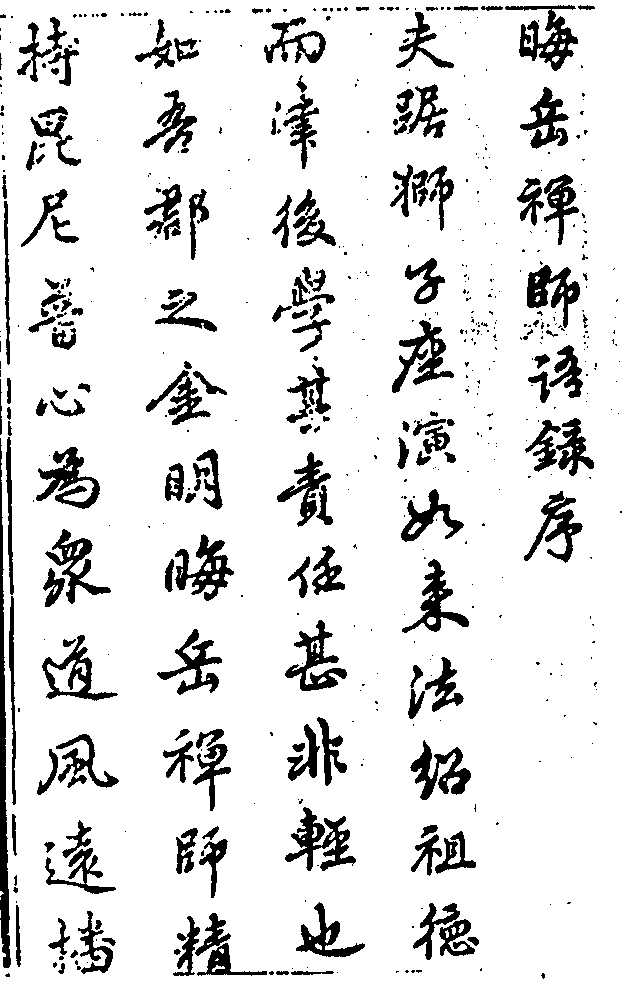
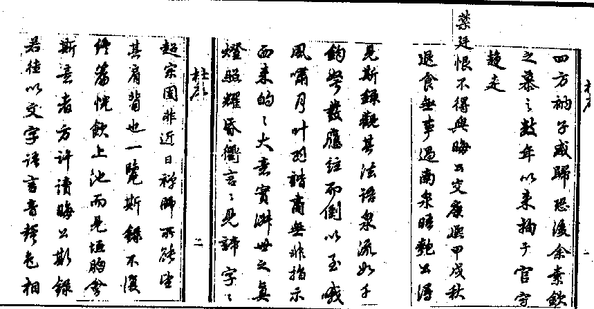
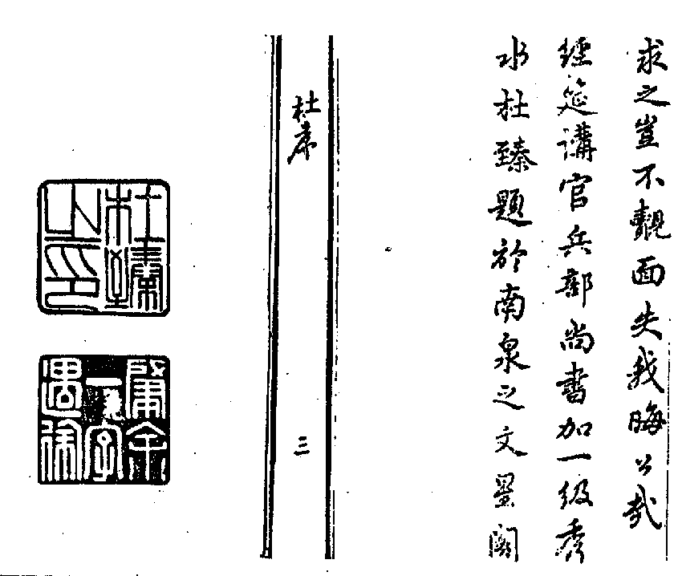

# 晦岳旭禅师语录



> **藏经**：嘉兴大藏经（新文丰版）（嘉兴藏）　**册次** 第 38 册（J38）　**编号** JB418　**部类** 诸宗部　**卷次** 8 卷　**篇幅** 92,370 字

> **作者（译者）**：侍者全琳记录、记室全本记录

> **卷／品**：8 卷 · 2 品



---



## 目录



  - [序](#序)

  - [晦岳禅师语录序](#晦岳禅师语录序)

- [晦岳旭禅师语录卷第一](#晦岳旭禅师语录卷第一)

- [晦岳旭禅师语录卷第二](#晦岳旭禅师语录卷第二)

- [晦岳旭禅师语录卷第三](#晦岳旭禅师语录卷第三)

- [晦岳旭禅师语录卷第四](#晦岳旭禅师语录卷第四)

- [晦岳旭禅师语录卷第五](#晦岳旭禅师语录卷第五)

- [晦岳旭禅师语录卷第六](#晦岳旭禅师语录卷第六)

- [晦岳旭禅师语录卷第七](#晦岳旭禅师语录卷第七)

- [晦岳旭禅师语录卷第八](#晦岳旭禅师语录卷第八)



---



### 序



初祖西来，不立语言文字，以语言文字求向上一著，便非西来大意矣。自五宗衍派，不能终於无言，遂或汇之为传灯，专之为语录，名异实同，然钳锤轰辣，宗风犹未少降也。沿及今日，生初祖千餘年后，不知千餘年来未开之面目，妄袭是非毁誉之迹，摇唇鼓舌，标榜宗门，其淆讹何所穷极？今读我师晦翁语录，与初祖西来大意，灯灯相印，洵宗门之证谛，人天之法幢也。师自梵参学，长而弘法，远近若京口之甘露、圣果，与檇李之金明、楞严、三塔、真如诸刹，皆其锻鍊圣凡处。其间一上堂、一小参，机锋铦锐，勘辨明确，无假借、无回互，古临济、周金刚莫之过矣。然且刻苦内行，终夜趺坐，正如无量主夜之神，照十方於不绝。嘉炎少搜佛乘，长而浮沉，无悟因证地，可著见於文字。及归田而获叩师座下，聆宗语之提唱，如饥者之得食，合掌欢欣，莫可名状。昔黄檗以三顿毒捧，大启济宗，今师拈提宗要，烹煆一时龙象，其一片婆心，讵可埋没？用是登之剞劂，照耀昏衢，则师之语言文字，即师之机权杀夺也。然而师之真面目，究不在是，敬述之以为序。



时康熙癸未花朝嗣法门人徐嘉炎拜撰



------



### 晦岳禅师语录序















------



## 晦岳旭禅师语录卷第一



**译者**：侍者全琳记录



住嘉兴府金明禅寺语录



康熙癸亥十月初三日进院。



据室。「此是介师翁开大炉鞴、运大钳锤，生煆佛祖、活烹龙象之所，三十年独坐单提不动，本际魔军自息。新金明既为他儿孙，敢道跨灶骑𬬻？」拈拄杖一卓，曰：「任是铜头铁额到来，也须按过。」僧问：「和尚入院之初，有何垂示？」师曰：「佛祖点额。」云：「斩新条令又如何？」师曰：「喝起青天三十棒。」云：「秪如铜头铁额汉到来，如何勘验？」师便打，僧一喝，师直打出。又僧出，师亦打，僧才开口，师曰：「驴前马后汉。」直棒打出。



即日，上堂。「诸佛慧命，列祖心宗，觌面提持，一肩担荷。挝毒鼓于机前，振鸿钧于未兆，显出衲僧巴鼻，豁开向上重关。此犹是古人行履，未是越格超宗。大众会麼？」蓦拈拄杖，卓一卓，曰：「者里会得，临济三玄、洞山五位是甚麼闲家具？若欲克复嘉猷、挽回末运，直须一踏鸿门开两扇，雍雍佳气乐寰区。」



当晚，小参。「跨灶骑𬬻，方称作者；就中取则，有辱先宗。若是狮子儿奋踞地威，纵有牙如剑树、口似血盆，到者里不罄身而逃，则望崖而退。具恁般作略，方可全提向上，直指真宗，捩转乾坤，掀翻海岳，始见皇风成一片，更於何处觅封疆？」



示众。僧问：「学人初参，请师指个径路。」师曰：「此去杭州二百二。」曰：「不问者个路。」师曰：「水陆不增多。」乃曰：「者著子本自现成，是你无始习气耽著不舍，日深日厚，转增颠倒，致使流浪迷途。若是血性汉，悬崖撒手，一扑到底，待苏醒来，睁开眼另是一般境界。有恁麼人麼？」良久，云：「啼得血流无用处，不如缄口过残春。」



示众。「连朝风雨漫漫，声声郭外杜鹃，陶朱静悄无事，有时把钓龙潭。」拈拂子作钓势，云：「谁识丝纶上，清香意自殊。」



端节，示众。「今朝五月五，日轮大如斗，照破五须弥，舜若颠倒走，惊起桃符神，撞破帝释口。」拈拄杖作舞，云：「山僧拄杖子忍俊不禁，随例打筋斗。」喝一喝，曰：「住！住！不可莽卤。」



示众。「十五日已前，烟迷古渡。十五日已后，月映清溪。正当十五日，青松栖白鹤，碧沼绽红莲。寒山子，知不知？世情看冷暖，人面逐高低。」



七夕，示众。「今夜七月七，家家收巧吃，金风来树杪，清凉生两腋。」拈拂子召众曰：「看看，夏末便是秋初，已证者宜须保护，未悟者猛著精彩，时节既到，其理自彰。且作麼生是自彰的理？一片蠡湖波底月，巧云穿作花蝴蝶，等闲云净碧天宽，四海五湖光皎洁。」



往建宁府普明寺，途中除岁示众。「大尽三十日，小尽二十九。东村王老化纸钱，衲僧鞋破赤脚走。无位真人面门斑，踏杀南山白额虎。大地山河乞命，万象森罗叫苦。大众还识无位真人麼？急须努力向前行，自有东君随步武。」



到泉州府崇福寺，请上堂。「为访知音涉闽巅，相逢喜气动崇山。波涛万丈从天泻，流出分明蠡水源。」拈杖召众，曰：「有者道：寸步不移，观大千界如视诸掌。有者道：不越户阃，天下知识一时相见。检点将来，多虚不如少实。山僧披寒暑、涉山川，亲到崇福与我希觉法兄高谈，不啻绝倒。今日客听主裁，借令行权，与诸人花劈去也。」卓杖一下，曰：「真寂湛圆，常光独露。洁如沧海之珠，朗似碧天之月。既高且坚，钻仰莫及。者里会得，显大机、发大用，竖放横拈，无不自在。所以道：似地擎山而不知孤峻，如石含玉而不知无瑕。且弟兄相见的事又作麼生？」以杖畫[○@║]相，曰：「携手同堂云底事，无边清韵动山河。」



到建宁柘浦龙珍寺，觉圆法兄端节请上堂。拈拄杖曰：「拄杖子𨁝跳上三十三天，撞著娑竭龙王，扑在金刚际下，颠落帝释花冠。毘沙门王报道：『恰是人间端节日，天津桥上有此奇特。』未审诸人还见拄杖子落处麼？山中有客见真虎，尘内何人识卧龙？」



出队归，示众。「住院理破垣，出队顶破笠，计较总一般，人生何改易？暑去寒来春复秋，光阴打算如瞬息。且道无位真人还有改易麼？」拈拄杖，卓一卓，曰：「者里会得，一生参学事毕。」



示众。「金明虽处城市，实足山林意况。蠡水似镜，雉堞如山。篆竹漪然，风摇千竿翠色；青榆掩映，鸟翻万树金钱。每对花晨月夜，优游绝胜人间。诸人既到者里，彼此切莫相瞒。一朝一夕，一月一年，直到大休大歇，无事不办。」



示众。「三十餘年住子胡，二时粥饭气力粗，每日上山三两转，问汝诸人会也无？子胡只住个院子，如此劳筋动骨，太煞周遮。山僧则不然，自住金明四五年，是非穿凿不相干，饥则食，倦则眠，从来不会老婆禅。」



示众。「识得拄杖子，行脚事毕。汾阳与麼道，大似推人落井。若向拄杖子上作活，错过不少。」蓦拈杖召众曰：「还识得麼？到江吴地尽，隔岸越山多。」



示众。「若论此事，实无下口处，金明只得向第二门与诸人扭捏看。」蓦摇手，云：「莫！莫！」



示众。「三塔塘之东，五龙桥之北，有个渔翁，发白齿黑，泛一叶扁舟，丝纶在握，有时随放随收，一任鱼龙跳跃。」拈拄杖作钓势，云：「不是金鳞枉上钩。」



示众。刚坐下便云：「早是错了也。」便入方丈。一僧入问：「和尚一言未发便道错了，未审和尚错？大众错？」师曰：「你若识得者两错，粉骨碎身。」僧曰：「谢师证明。」师曰：「错！错！错！」



立秋，示众。「有则现成公案，诸人总知，只恐错会。」良久，掷下拂子，云：「一叶落，天下秋。」



因事示众。「法社垂秋，人不跟道，古佛地总为贩卖赌赙之所，说法处尽成荤酒淫污之场，或有一个半个少奉戒行，便乃不合时宜。金明不是检点诸方，只要诸人知此利害，倘操道心深，自不蹈他故辙。诸仁者！莫事门庭热闹，打哄过日，直须田地稳密，莫被情尘惑动，朝夕精勤，惟道是务，莫到临末梢头做手脚，不办他时，悔之晚矣，莫言不道。」



示众。举：「汾阳十智同真问答，径山杲曰：『汾阳末后若无个面目，现在一场败缺。虽然如是，丧我儿孙。』喝一喝。」师曰：「径山多处添，少处减。汾阳只为末后有个面目，所以一场败缺。金明不惜唇齿，为汝翻转面皮。」卓拄杖，下座。



示众。举：「宝应昭云：『宝应门风险，入者丧全身。作麼生是出身一句？若道不得，三十年后。』石源云曰：『宝应自救不了。』」师曰：「石门道：『宝应自救不了。』是有出身路麼？诸人会取三十年后的。」



示众。举：「云门钦上堂，良久曰：『好个话头，若到诸方，不得错举。』便下座。」师曰：「云门举扬个事，如九转丹砂。诸方不错举者，能有几人？」



示众。举：「兴阳铎，僧问：『佛界与众生界相去多少？』兴曰：『道不得。』曰：『真个那？』兴曰：『有些子。』」师曰：「兴阳有杀人刀，无活人剑。」



示众。举：「僧问灵泉：『如何是和尚活计？』泉曰：『一物也无。』曰：『未审日用何物？』泉便喝，僧作礼，泉便打。」师曰：「者则公案，大有人不肯灵泉，金明要断不平，可惜拄杖子不在手。」



示众。举：「云峰悦因僧问：『如何是心地法门？』峰曰：『不从人得。』曰：『不从人得时如何？』峰曰：『此去衡阳不远。』」师曰：「云峰道心地法门不从人得，毕竟从甚麼处得？」



示众。举：「白云端因僧问：『一喝分宾主，照用一齐行。去此二途，请师别道。』云便喝，僧曰：『从来疑著和尚。』云便打，僧曰：『作家宗师。』云曰：『也不消得。』僧礼拜。」师曰：「白云全提正令，者僧向猛虎口中分肉、毒龙颔下探珠，金明只可坐观成败。」



示众。举：「黄龙心与夏倚公立谈《肇论》，至黄龙曰：『何常会万物为自己？』及瑞岩拈毕。」师曰：「黄龙力能挥张毒手，不知格外提持；夏公途路短贩，且喜亲到宝山；瑞岩虽是扶弱济危，怎出得公立问头？然虽如是，还我无情意来。何故？从前汗马无人识，只要重论盖代功。」



示众。举：「黄龙心云：『粗言及细语，皆归第一义。你者队尿床鬼子，三生六十劫也未梦见第一义在。』」师曰：「黄龙提持第一义，如高祖入关中。」



示众。举：「如翁申因僧问：『如何是佛法大意？』翁曰：『周岁孩儿打花鼓。』曰：『阿谁证明？』翁曰：『古庙香炉也不会。』便打。石源云曰：『如翁太煞伤。慈广福即不然，有问：「如何是佛法大意？」向他道：「八十翁翁入场屋。」』」师曰：「如翁正眼有在，未审者僧还会古庙香炉麼？大众！秖如石门道：八十翁翁入场屋。意在如何？欲穷千里目，更上一层楼。」



示众。僧问：「如何是金明境？」师曰：「佛阁高，蠡湖深。」曰：「如何是境中人？」师曰：「我有时用拄杖，有时不用拄杖。」曰：「人境蒙指示，向上事如何？」师曰：「待汝踢倒醉李亭，道也不迟。」迺曰：「范蠡湖头秋色高，水光彻底火云烧。苎萝村畔霞生树，绣出鸳鸯一所桥。风飒飒，水潦潦，无限幽怀思转饶。坐久声沉新月上，光辉皎皎透云霄。」中秋，示众。举百丈、西堂、南泉侍马祖玩月因缘，师曰：「马师父子一回相见，可谓金声玉振，千古之下声光犹在。检点将来，大似寒儒诈富，乌藤有分。何故？若无超方作，怎得到今朝？」



示众。举：「拗牛祖因僧参，祖横按拄杖曰：『入门即错，不入亦错。』僧无对，祖便打。又僧参，祖如前问，僧曰：『合取狗口。』祖拈棒曰：『令合是汝行，权借一半。』便打。」师曰：「入门即错，不入亦错。小乘钱贯，大乘井索。」



重九，示众。「今日重阳节，渊明酒兴狂，采菊东篱下，语笑发幽香。山僧不会先贤意，三嗅寒香立晚阳。」



示众。举：「高峰上堂，竖拂云：『到者里，进前一步也不得，退后一步也不得，总不恁麼也不得。毕竟如何不得不得？』」师曰：「高峰用尽九牛之力，只是转身不得。金明与古人抖筋抖骨，不为分外。」竖拂子，召众曰：「金明者里，进前一步也得，退后一步也得，总不恁麼亦得。毕竟如何得得？」



龙兴和尚忌日，拈香。「一自巾瓶后，倏焉十四秋，始知堕马腹，更不问来由。今日重相见，又添多少愁？华峰与碧云，八载意绸缪。大众！如何是相见底事？」拈香，云：「者个还当得麼？」烧香，云：「长忆江南三月里，杜鹃啼血染枝头。」



示众。「金明与诸人道破，只是不得错会。达磨祖师直指人心，见性成佛，赚杀一船人。」



李蛟门居士领众绅士设斋，请升座，师拈香云：「此瓣香端为今上皇帝祝延圣躬万岁，伏愿四海来宾，万民乐业；此瓣香奉为本府厅邑诸位尊官，伏愿寿山挺秀，福海洪深；此瓣香奉为阖郡绅𫄛现前，请主本寺诸宿，伏愿同悟真乘，共明般若；此瓣香奉为本寺开山历代尊宿，伏愿不违本誓，拥护法幢；此瓣香奉为本寺堂上开法第一代师翁介老和尚，伏愿不舍宝筏，渡尽迷沦。」次于怀中拈出云：「此瓣香不须多劫栽培，岂藉阴阳造就？几番亲遭毒手，十五年来几欲藏拙，愈隐弥彰。今日遇个不识窍的，大似宿债难逃，被他彻底掀翻，直得藏身无处，热向炉中，供养前住庐山东林，次住浠川华桂，末住新安龙兴，传临济正宗第三十二代山铎先师大和尚，不惟酬报法乳，且要诸人共知。」敛衣就座。石源和尚白椎云：「法筵龙象众，当观第一义。」师曰：「我本无心有所希求，今此法王大宝自然而至，大众要识宝麼？请出相见。」僧问：「世尊才生，便云：『天上天下，惟吾独尊。』如何是独尊的事？」师曰：「山僧今日升座。」僧云：「恁麼则人人本具，个个不无。」师曰：「上座又作麼生？」僧礼拜，师曰：「未可全信。」迺曰：「若论此事，据实而言，卒无定准，迥超声色，绝离见知，语默难通，动静不涉。所以唱道：须明语内无玄，玄在语内；句中无意，意在句中。正眼豁开，洞然明白，才落思惟，十万八千。固知法本无边，渊源莫测，智海洪深，浩荡无际，欲趋向以无门，即回旋而绝迹。从上佛祖尽在无趋向处显现当人，故有时壁立万仞，攀仰不及；有时随机赴感，一任观瞻。到个里，实无一法可取，亦无一法可舍。与麼承当，一弹指顷，成就无边佛事，建立无量法门，理事顿超，真机独露，净裸裸、赤洒洒，浑没巴鼻。至若曲为时机，将半个栗棘蓬咒底搅翻，拈出千钧生药头人天揭示。且道：路逢剑客，还是诗遇高人？」良久，云：「真净界中才一念，阎浮已过七千年。」复举世尊初生及云门话毕，师曰：「云门气宇如王，怎奈阵后兴兵？旭上座不妨宽著肚皮，忍得一时之气，清福自然胜过与人。何故？八千人散烟尘尽，四海歌谣贺太平。」石源和尚结椎，云：「谛观法王法，法王法如是。」师下座。



晚参，上堂。「虚玄大道体全彰，物物头头尽显扬，海月湖天空阔处，珊珊翠竹倚斜阳，千门万户重重透，理事双融绝较量。诸仁者，谩揣详，祖翁一片闲田地，儿孙永劫受餘殃。」拈拂子畫[○@、]相，云：「到者里也须汗流浃背始得。」



示众。举：「云门道：『平地上死人无数，出得荆棘林是好手。』有僧云：『恁麼则堂中第一座有长处。』门云：『苏噜苏噜。』东山演祖云：『太平即不然，平地上个个丈夫，荆棘林里坐得的是好手。何故？』复云：『格。』金明又不然，平地上活泼泼，荆棘林中洒落落，未是好手。」以杖划一划，云：「者里透得过，方堪共语。」



示众。「九月池荷尽，西风入骨寒，东篱无限意，霜冷怯衣单。三两个衲子，优游鸳水边，渔艇惊鹤起，翔集去翩翩。若问归来日，那边休夏，者里过年？」良久，云：「苍天，苍天。」



普请搬瓦次，师拈起一片瓦，示众曰：「一大藏教只说者个。」时有僧亦拈瓦云：「一大藏教不说者个。」师曰：「说与不说，只消一文钱。」僧曰：「半文亦不值。」师曰：「山僧今日折本也。」僧微笑。师归，示众曰：「云门普请搬柴，金明普请搬瓦，不说一大藏教，只要诸人放得下。众中有放得下者麼？」众无语，师拈拄杖一时打退，归方丈。



示众。举：「南泉云：『文殊、普贤昨夜三更起佛见、法见，各与二十棒，贬向二铁围山。』金明则不然，有起佛见、法见，明窗净几，安顿珍馐供养。何故？此一时，彼一时。」



示众。举：「南泉云：『王老师自小养一头水牯牛，拟向溪东牧，不免食他国王水草；拟向溪西牧，不免食他国王水草。不如随分纳些些，总不见得。』」师曰：「南泉恁麼道，犹未瞥地在。金明也有一头水牯牛，放著手，一任自西自东，朝朝一曲田家乐，五字拈来调不同。」



示众。「唇吻中，眉毛下，与诸人露个消息。」良久，曰：「天气尚冷。」便下座。



除岁，小参。「释迦出世，为一大事因缘故，所以不吝慈悲，巧设多方。」拈拂子划一划，云：「只要诸人就里讨个下落，别无岐路可趋。众中有会就里落处麼？如无，金明与你分析去也。」挥拂，云：「一段光明无剩少，赫然照烛古乾坤。」



元旦，上堂。「新年头，行新令，大地山河一齐听命，以百千须弥入一毫端，於毫端内现百千三昧。」拈起拄杖，云：「拄杖子还入也未？」击香几，云：「年年是好年，日日是好日，大家纳新祥，金明独失利。」



示众。举：「僧问南泉：『即心是佛又不得，非心非佛又不得，师意如何？』泉曰：『大德且信即心是佛便了，更说甚麼得与不得？』」师曰：「南泉答者僧话，疑杀多少人？汝等梦眼若开，道非心非佛也是，道即心即佛也是。如若狐疑，且去僧堂前寮舍内看，毕竟承谁恩力？」



示众。「猛虎当门坐，诸人得何三昧得入？」



示众。「春风荡荡，春日融融，鸟鸣幽谷，花绽崇隆。大众！且道：是法尔？是神通？者里通一线，吾师不在庙廊▆。」



示众。「十五日已前风，十五日已后雨。正当十五日，呼风即风，呼雨即雨。」



示众。「逆风行船，须凭篙人眼力；衲僧入煆，要假师家钳锤。钳锤不玅，不能除其多劫沉滞；眼力不精，不能谙其长驱水脉。如是全宾全主，有照有用。若不尔者，如红炉上著雪，便一齐乌了，安有解脱时节？」



示众。「来也不入此门，去也不出此门，来去既无踪迹可寻，那畔者边安有语话会？所以道：大机大用不存轨则，如电光石火，拟议之间即错过了也。」



示众。以拂子畫○相，云：「若向者里道得，不落五阴试道看。」



示众。「今朝三月三，大地山河蓦出关。万象森罗开正眼，桃红李白柳垂烟。祖意西来明的的，真如般若体虚玄。恁麼解悟去，须知头上有青天。」



示众。「巧说千般，不如直道。春风和细雨，全非佛祖玅。诸禅行履处，常防生青草。」



示众。举：「无准范最初请益尧老宿坐禅之法，尧曰：『禅是何物？坐的是谁？』准昼夜体究。一日，于厕提前话，有省。」师曰：「雪窦大似纯刚打就，一期火迸星飞；老宿质库典牛，未免清平渡水。」



示众。举：「仰山穆因僧问：『如何是正闻？』曰：『不从耳入。』曰：『作麼生？』曰：『还闻麼？』」师曰：「长江滚白练，逆水放木鹅。耳里眼里任人作活，只是不许妄通消息。」喝一喝。



示众。举：「大随真，僧问：『和尚百年后法付何人？』曰：『露柱火炉。』曰：『还受也无？』曰：『火炉露柱。』」师曰：「深入不犯，风行草偃。大随百年后果有法付乎？问取露柱火炉。」



示众。举：「马祖因水潦参，礼拜起，欲伸问，祖一踏踏倒，潦忽大悟，起来大笑曰：『也大奇，也大奇，百千三昧、无量玅义，只在一毫头上识得根源去。』」师曰：「只是个语，语向上一路，驴年去也未梦见。」



示众。举：「黄檗参百丈，至丈曰：『如是！如是！见与师齐，减师半德；见过於师，方堪传受。子甚有超师之见。』」师曰：「百丈败缺不少，那里是他见过处？」



示众。举：「大慈中上堂曰：『山僧不解答话，祗能识病。』时有僧出，慈便归方丈。」师曰：「大慈弄巧成拙，自相钝置。金明也识病，三般不医。」



示众。举：「月溪澂一锡遍参，最后至道林呈所见，无际不诺。溪以际抑，出不逊语辞际。际知是法器，遂负囊送至山门，忽指黄犬曰：『者畜生为甚有业识、无佛性？』溪于言下大悟。」师曰：「者个道理如太阿剑不敢犯锋，如涂毒鼓闻著即丧，信非偶然。月溪一向气宇如王大方独步，岂出道林缦天网子不得？虽然，道林若无匣内龙泉，鼓声凑巧，又安得月溪点首下高台？」



示众。举：「宝芳进因与同学会文，睹芍药花有省，从坦然披剃，诲以柏树子话，参遍诸方，自谓无出格钳锤。一晚，在天界佛殿经行，闻灯花爆如雷震，寻谒大冈，便问：『如何是西来密密意？』夷峰下禅床擒住，曰：『西来无意，你道此间是甚麼意？』芳无对，如是寝食俱忘。一日，登厕，闻邻僧敲筹作声，忽大悟。」师曰：「夷峰钳锤严密，门墙固不通风，非天目老人亦不能破家荡产。大众！还有知此消息者麼？」良久，卓拄杖，下座。



示众。举：「无趣空上堂集众，趣良久，喝一喝曰：『祸出私门。』便归方丈。」师曰：「不遇江南客，徒自唱鹧鸪。」



晚参，上堂。举临济四喝，师曰：「临济大师将谓有多少奇特，致令后代儿孙咬住矢橛，以为大休大歇的田地。正眼看来，大似羊质虎皮。饶你喝得金明上三十三天，扑下十八风轮，苏醒起来，向你道好喝，只是未在。何故？一片白云横驿路，时人几个不迷踪？」



晚参。「但与麼去，不负来机，知汝疾在膏肓，十无一生，山僧不避诸方检点，犹作死马医。」复云：「过。」



示众。「湖光潋滟，柳色青幽，农歌杂还，渔唱欢忻。艛船奏郭外之笙箫，音闻聒地；畫楼拥闺阁之佳人，朱紫溢目。鸟语莺歌，云行风骤，一一为诸人发向上机，开正法眼。者里会得，释迦不前，弥勒不后；设使不荐，一任打瓦钻龟。」



晚参。「连旬五月黄梅雨，山衲口中生醭白，烂却西来鼻祖心，糍团日久化为鳖，东山碓觜忽开花，生铁秤锤捻出汁。大众且道：那事又如何？」掷下拂子，起身视之，曰：「嗄！临济无位真人，变作云门矢橛。」大笑，归方丈。



示众。举：「古湛冲结茅径山集无趣语，及见趣，趣曰：『曾做什麼来？』湛曰：『买得一段田，收得元本契，请和尚佥押。』趣展阅，曰：『者是我的，你的𫆏？』湛曰：『莫抢夺行市。』趣掷下集本，湛便出。」师颂曰：「龙门久驻飞腾势，才便风雷趁晚潮；惊起泥牛穿碧海，转身一拶直冲霄。」



示众。举：「无趣空问古湛曰：『彻骨彻髓道一句，三玄三要绝遮护。此二句中，我欲取一句为法，你道取那一句好？』湛曰：『和尚适来道那一句？』趣瞋目叱曰：『汝恁麼无记性？』湛曰：『秪为和尚彻骨彻髓。』趣笑曰：『不然，为子一人即得，争奈大众何？』湛曰：『取即不辞，恐辜负先代，丧我后人。』趣曰：『如是，如是。』」师曰：「无幻大似一颗走盘珠，愈琢愈辉。趣祖验得号段分明，也是勾贼破家。」



示众。举：「南明广因僧问：『四大分张，眼光落地，甚处安身立命？』山曰：『东家作驴，西家作马。』」师曰：「好风流，只恐者僧不识。何故？孤月照临山岳静，几多人向此中休？」



示众。举：「香严端上堂，僧问：『如何是直截根源？』严掷下拄杖归方丈。」师曰：「香严脚下有红丝线，被者僧一拶方始瞥地。」



示众。举：「仰山住东平日，沩山令僧送书并镜至。山上堂，提起示众曰：『且道沩山镜？东平镜？若道是东平镜，又是沩山送来；若道是沩山镜，又在东平手里。道得即留取，道不得即扑破去也。』众无语。山扑破，下座。」师曰：「马师送酱，百丈打破酱瓮；沩山送镜，东平扑破镜子。祖孙接踵，顶门只具一只眼。」



示众。举：「南明广志慕禅学，恨宗风不著，遍游讲肆，复归掩关，看无字话，始觉物理一致。古湛就关扣问，便有师资之契。启关，谒古湛于车溪。未几，即入古湛旧隐之白云，禁足三载。径山继峰老宿请湛开法，明每闻示诲，必垂泪刻究。一日，偶拾片纸，有『观方知彼去，去者不至方』之句，有省，呈湛，湛印可，即举明首众，寻付以从上源流法偈。明前后服勤八载，日益玄奥。」师颂曰：「禹贡上承尧舜德，盛明犹见汉唐心。此时不必问端拱，帝业持盈已到今。」



示众。举：「鸳湖用祖欠安，介庵师翁侍次，湖命茶，问曰：『汝字觉先，唤甚麼作先？』庵曰：『且喜今日得自在。』湖曰：『如何是觉后？』庵曰：『请和尚尊重。』湖曰：『你还分得先后麼？』庵良久，湖便喝，庵曰：『只管吃茶。』湖曰：『如何是吃茶底事？』庵曰：『柿枣腐乾都在者里。』湖曰：『意作麼生？』庵曰：『一口吞尽。』湖曰：『是甚滋味？』庵曰：『甜者甜，咸者咸。』湖曰：『未在，更道。』庵礼拜，曰：『谢茶。』湖深肯。」师曰：「大丈夫当炉不避火迸，临场岂讳截舌？机旭是普明四世孙，敢言未在？若是新金明，待他道：『一口吞尽。』蓦竖竹篦，曰：『者个𫆏？』普明若出得者只手，老汉吞了底也须吐出。」



示众。举：「永福照因僧问：『如何彭州境？』曰：『人马合杂。』僧作拽弓势，福拈棒，僧拟议，福便打。」师曰：「者僧甚有穿杨之巧，争奈临阵弦断何？」



示众。举：「圆通秀云：『少林九年冷坐，刚被神光觑破，如今玉石难分，秪得麻缠纸裹。者一个、那一个、更一个，若是明眼人，何须重说破？』金明不免节上生枝。达磨九年孤坐，末梢无端失却，而今学语之流，尽吃他人涎唾。者一个、那一个、更一个，但说别人短长，不识自家好恶。」



示众。举：「白云端云：『古人留下一言半句，未透时撞著铁壁相似，忽然觑透，方知自己原是铁壁。如今作麼生透？』复云：『铁壁，铁壁。』」师曰：「白云只知铁壁，且不知古人意旨。」



示众。「高而无上，广不可及。渊深莫测，细包太虚。形名不立，孰把心通。堂堂大度无多子，唤作物兮即不中。」



示众。举：「昭觉勤云：『迥无依倚，超宗越格；非佛非心，壁立万仞。桑树上著箭，柳树上出汁。』」师曰：「迥无依倚，寸步难移；非佛非心，挨拶不入；桑树上著箭，柳树上出汁，两彩一赛。秪如壁立万仞一句又作麼生？」蓦抚香桌，云：「消得龙王多少风？」



示众。举：「方山宝拈杖问秋江曰：『举一不得举二，放过一著落在第二。』江近前夺杖掷地曰：『大众证明。』岩深肯。」师曰：「瑞岩阵布龙蛇，未免钩贼破家。秋江虽有临场之策，且无定乱之谋。若要河清海晏，且看休兵奏凯。」



示众。「我手何似佛手，拈起笊篱便作粪帚。我脚何似驴脚，踏断石桥不识略彴。人人有个生缘，八角磨盘空里旋。相逢两手垂过膝，短发髼松已盖肩。忽逢捕风捉影的，一声渔笛渡前川。」



示众。举：「则中度有道流问：『承教中有言：「剑为不平离宝匣。」是否？』曰：『是。』曰：『弟子有不平事，请和尚借剑，还得麼？』曰：『得。』道流作接剑势，中便喝，道流曰：『我素常疑著者老汉。』中曰：『作麼生？』道亦喝，中曰：『好喝，再喝看。』道掩耳便出。石源云曰：『我识得你是道流。』」师别曰：「我几乎唤你作道流。」



示众。举：「天界古拙俊上堂云：『鱼跃于渊，不能跃于阶级之上；太末虫到处能缘，不能缘于火燄之上。衲僧家超佛越祖，腰包天地，鼻孔一缺不能补满。』良久，云：『又怎怪得？』」师曰：「寐语作麼？」



示众。举：「东林无际悟初缚庵，研究无倦，四指大书亦不顾，只是拍忙做钝工夫。一日，因启发参八峰、无念、松隐辈，及见白云，云举万法归一问，林答，云乃喝出。一晚，经行廊下，云见，遂扭住，曰：『大众快将火来，老僧擒下个贼。』林曰：『是家内人。』云以手掩林口，曰：『如何是家内事？速道！速道！』林如此有省。」师曰：「东林胸藏甲胄，气喷斗牛，及到白云会下，不但敛旗停鼓，亦且丧身失命。」



示众。「处暑秋分白露节，朝寒暮冷午时热，禅客相逢不展颜，秋风阵阵落梧叶。森罗万象渐红黄，此景此时谁会得？一日钵盂两度开，饱饭殊惭两鬓雪。」



示众。「翠竹摇风，观音入理深谈；黄花满径，毘卢示现慈容。雁过长空远岫，飞无心之云几片；鹤栖乔木层岩，泻有意之水数声。於此会得，山河大地不是别物，碧沼冥冷岂属外来？」



示众。「凭虚阁下古龙潭，深浅谁能把杖探？缕缕丝垂千尺外，时人多作钓台看。」



示众。「相逢无背面，到处绝周遮，明眼人前见得透，葫芦原是帝瓶差。」



晚参。「三拳打不落，一脚踢不起，半边却囫囵，无物堪比拟。」



晚参。「释迦不在前，弥勒不在后，正当恁麼时，诸人命根却在旭上座手里。真正衲僧，祖父田园踏得稳，更愁何处不封疆？」



晚参。「尽十方世界纯清绝点，未是衲僧极则。不见一法，犹是淆讹。若是丈夫儿，何妨性燥。」



示众。举：「方山宝云：『撑铁船过海底人，为甚麼向针孔里叫屈？』」师颂曰：「差却毫厘便失宗，浮云宿雾锁重重，落花庭际无人扫，却怨春闺尽日慵。」



示众。「至道无难，唯嫌拣择。鼓声钟声箫管声，谁云一法之所印？日光月光闪电光，何曾一色可比量？不识杨岐三脚驴，乌龟蓦地过扶桑。」



示众。举：「断桥伦祖初见谷源於瑞严，闻麻三斤话有疑。一日，于云居见山堂，偶阅《楞严》，至『蚊虫蝼蚁无有言说而能办事』处，顿省厥旨，曰：『赵州柏树子话可煞直截。』」师曰：「蛊毒之家水，劝君切莫尝。沾一滴，定丧亡。」



示众。举：「天目宝芳和尚上堂曰：『箭锋相拄，徒劳话会；啐啄同时，全凭作者。啐啄同时即且置，如何是箭锋相拄底事？』野翁出众礼拜，起便喝，目亦喝，翁又喝，两喝归众。目卓拄杖下座。」师颂曰：「雷声才震雨弥漫，个里谁将正眼看？生铁昆仑刚抹过，澄潭惊起老龙蟠。」



示众。举：「鸳湖用祖问密云禅师曰：『恢扩法道，开示人天，秪如有一人不受化下者，毕竟如何摄授？』」师颂曰：「仰手云兮覆手雨，电光石火岂能追？声前有路无人荐，独自凄凄下钓矶。」



示众。举：「本师山铎和尚上堂曰：『即心即佛，野老家淳；非心非佛，刀鎗遍地。不是心、不是佛、不是物，竿头丝线从君弄，不犯清波意自殊。但恁麼会，马祖鼻孔不消一捏，自然彻骨彻髓。还有恁麼会底麼？』有僧才出，山连棒打退。」师颂曰：「奇策筹谋各谨机，风前歌呗动离微；七千人散烟沉后，江北江南尽带悲。」



示众。举赵州狗子话，师颂曰：「狗子佛性无，芦花满渡头。渔翁随处钓，不必著羊裘。狗子佛性有，花街柳巷口。报与痴禅人，出入休莽卤。」



示众。举：「石头迁和尚曰：『吾之法门，先佛传受。不论禅定精进，唯达佛之知见。即心即佛，湛然圆满。凡圣同齐，应用无方。离心意识，三界六道，唯自心现。水月镜像，岂有生灭？』」师颂曰：「老到心同稚子歌，引人胸次自成魔。衡南一望秋云里，蛮鸟关关唱哩啰。」



示众。举：「僧参伏牛无碍鉴，鉴喝曰：『看剑。』曰：『幸是某甲，若是别人，一场祸事。』鉴曰：『那个是别人，试指出看。』僧掀倒禅床。鉴曰：『幸是老僧，若是别人，打折你驴腰。』」师曰：「若要名压诸方，须是临济、德山。若是斩钉截铁，让他普愿、归宗。权衡佛祖，提挈纲宗，须是恁麼人方堪绍继。伏牛老汉是则也是，怎奈放去太险，收来太奢。若到金明，不特进退无门，要且吃棒有分。」



示众。举：「智中国师因楚山访中呈悟繇，山曰：『如何是无字意？』中曰：『出匣吹毛剑，寒光射斗牛。』山曰：『赵州因甚道无？』中曰：『波斯嚼冰雪，不觉齿牙寒。』山曰：『拈过有无，如何凑泊？』中曰：『夜深谁把手，同共御街行？』山曰：『向上还有奇特事也无？』中曰：『秋夜家家月，春深处处花，一双清白眼，何处撒尘沙？』山曰：『善哉！』」师曰：「楚山节节验过，智中胸藏甲兵，愈出愈奇，可谓作家战将。秪如出匣吹毛，还有端的得者麼？」



示众。举：「车溪无幻祖示疾，僧问：『和尚百年后向甚麼处去？』溪曰：『千株松下角弯弯，百草头边乱𨁝跳。』」师曰：「火后一茎毛。」



晚参。「十方世界一毛头，迥出当阳绝异流，时人有眼双瞳瞽，劈面钩锥不识羞。不识羞，没来由，猫儿尾上系花毬。」



晚参。「大道无难易，至理绝言诠，池上机梭声相似，正偏不落自绵绵。」



晚参。「若要展演济北宗风，鼓扬杨岐正脉，不须掀天揭地，只消一捏鼻头，自然汗出。」



示众。举：「僧参峻中，嵘中拈拄杖曰：『是那个魔王使得汝七颠八倒、带水拖泥作麼？』僧便喝，中便打，僧曰：『看破了也。』抽身便出。又僧参，中如前问，僧拟议，中打出。又僧参，中亦如前问，僧曰：『气急杀人。』中亦打出。一日，光泽惠参，亦如前问，惠曰：『老老大大，著甚死急？』中掷下拄杖，便归方丈。」师曰：「峻中怀藏北斗，眼盖南辰，傍若无人，正眼观来，也是弄巧成拙。」



示众。举：「夹山、定山同行语次，定曰：『生死中无佛即无生死。』夹曰：『生死中有佛即不迷生死。』互相不肯，同见天梅。夹问：『未审二人见处那个较亲？』梅曰：『一亲一疏。』夹曰：『那个亲？』梅曰：『且去，明日来。』夹明日复问，梅曰：『亲者不问，问者不亲。』夹住后曰：『当时失一双眼。』」师颂曰：「树头树底觅残红，一片西飞一片东。始自武陵人去后，喃喃幽鸟骂春风。」



示众。举：「六祖因青原问：『当何所务即不落阶级？』祖曰：『汝曾作甚麼来？』曰：『圣谛亦不为。』曰：『落何阶级？』曰：『圣谛尚不为，何阶级之有？』祖器之。」师颂曰：「金鼎龙蟠烟篆霭，劫前露出垢衣身。堂堂不坐琉璃殿，岂惜东宫百宝珍？」



示众。「心本是佛，道不用修，何更骑驴觅驴？心不是佛，智不是道，拟议白云万里。者里会得，物我同观。倘或不尔，徒劳话会。」邑宰沈克斋问：「智不到处作麼生？」师唤沈公，沈应诺，师曰：「头角露也。」



邑宰屠尹和荐男素申请对灵小参。师挥拂子云：「身从无相中受生，犹如幻出诸形像，幻人心识本来无，罪福皆空无所住。心识既无，罪福悉空，且唤甚麼作无相？」蓦竖拂子云：「鲸吞海水尽，露出珊瑚枝。」



李蛟门、又恂二居士荐兄上临，请升座。「夫诚明之道，克己复礼，不可一日违仁，故圣门之徒多在者里借路径过，立至善之所，猛地回觑，但一觉来则知非幻非虚，而罪花凋谢、福果恒新，镇常一物无声无臭。」蓦竖拂子，云：「会此一物，细入微尘而无内、大包天地而无外，仰之弥高、钻之弥坚，瞻之在前、忽然在后。既瞻仰不得，且上临李公即今在甚麼处？」良久，挥拂子，云：「玉楼曾赋就，恰好赠新篇。」



普说。「猫有歃血之功，虎有起尸之德。善知识！一言半句实有起死回生之力、翻窠倒臼之施，若无如是作用，即是弄泥团底汉。昔南明祖掩关兴善，有持《禅关策进》书至，祖展阅，于无字话上凝然扑之不散、捏之不聚、欲罢不能，觉得此身遍满堂宇，尽乾坤世界总是一个无字，行住坐卧、穿衣吃饭总是一个无字，至如寒来暑往、鹊噪鸦鸣亦皆是一个无字，间有宾朋候问，概不与焉。车溪冲和尚闻有真实志，亲到关前勘验，祖将从前工夫一一举似，溪应声跌足曰：『悔我来迟，向后纵欲到此，不易得也。』盖师资一言相契，全身许可。及祖启关往谒，服勤八载。大众！你看者个道理毕竟有何区分？淆讹在甚麼处？前车溪扣关相见，闻其语则应声跌足已肯可矣，何机窍相投而在八年之后？此非细事，乃敢草草。在师家须尽钳锤以陶铸学者，重重洗拭，使其立锥无地，直使索索然不存一毫微见，若有一毫佛法系于胸中，即是生死根株，所谓师严而道尊。在学者要假炉鞴，钳锤恶辣，如迅电疾雷，转眼不得，无处吐气。恁麼也不得，不恁麼也不得，恁麼不恁麼总不得，直下如大火聚，近前不得。到与麼时，忽被师家顶门一针，始解㘞地一声，通身汗下。向所疑者，如日消冰，似汤沃雪，才到大休大歇田地，然后拈一机则千机万机寝削，举一句则千句万句朝宗，放去收来，随机生杀。古人到者里，尚封镜封酱，脚下儿孙以致脱颖而出。又普明用和尚参究此事，首亲南祖，次谒车溪，得最上工夫。后侍南祖一十三载，不离左右。一日，在径山禅堂阅《思益梵天经注》有省，即呈无生偈曰：『铁壁银山谁敢摧？贼身蓦地拶将来，相看原是旧相识，当下惭惶笑脸开。』又曰：『历劫多年穷苦事，风光留得到今朝，笙歌车马门如市，内院依然锁寂寥。』南祖阅之，痛加诃叱。何也？恐普明得少为足，站住脚跟，故痛处加艾，顶门示针，俾知临济一宗道出常情。及至师资缘熟，特举独脚偈，普明於言下顿契微旨，披阅蕴奥，点首下泪，则知恩大难酬。假呈偈日南祖就与冬瓜印子，安得有此境界？诸禅德！你看古人为此事亲近师家十餘年，朝参暮请，刻刻提撕，无论师家学人扭作一团，如冤家对头相似，开交不得，必要讨个分明。如是久久磨炼，自然水到渠成，心花顿现，头头合辙，法法圆通，掉臂欬唾，无非大用现前。虽然，要是其人一等倚草附木，不但受此钳锤，才学依样葫芦黑壳，本上攒措几句说话，就求付嘱。其餘涅槃心、差别智，一千个、五百双不会，过在师家，总因道眼不明而自误误人。师家道眼果明，钳锤不凡，此辈如药汞银，入煆则流矣，况大法乎？今诸方希徒门庭热闹，只要多散几柄拂子，以致宗风扫地。汝等既到金明，不问晚学初机，参要真参、证要实证，看话头即如限粮刻敌。古德云：『暂时不在，如同死人。』且道暂时不在的是个甚麼？者里一拶粉碎，撩起便行。若是咬定矢橛不能转换，他日铁蛇钻你鼻孔有分在。莫言不道。」



受三塔景德寺请，退院上堂。卓拄杖云：「法无一定，随机而化。道本无方，遇缘即宗。既无心于去来，何有相於彼此？昭明同於杲日，放旷等乎虚空。或行或住，或城或郭。若也事理不拘，情见超越，无可不可。」复卓杖曰：「三尺龙泉光照胆，万人丛里夺高标。」拽杖便行。



------



## 晦岳旭禅师语录卷第二



**译者**：侍者全琳记录



住三塔龙渊海会景德禅寺语录



康熙己巳十月十六日入院。



山门。「古人道：无量神通、百千三昧皆从此出。山僧即不然，河沙诸佛、百万人天皆从此入，以何为验？」喝一喝。



弥勒。「坦腹当轩，笑等阿谁？我若不来，阿谁识你？」



韦驮。「尔秉灵山记莂，我受檀那公请。肝胆莫相违，主宾须正令。」



佛殿。「洞山麻三斤，云门乾屎橛，检点将来，著甚死急？」二手齐拈香，云：「一炷黄檀，一炷紫柏。」合掌，云：「冤屈，冤屈。」



伽蓝祠。「法社干城，丛林蛊干。神威肃肃，赤心片片。新长老虽则宿债难逃，也要你共出只手。何故？汗马无人识，重论盖代功。」



祖师堂。「者一队汉，口不关风，鼻孔又缺，世间多少痴男女，无端受你诳吓。山僧今日不幸，也打入者邪魔窟宅。」



千华台。「具三十二相，现百千手眼，遍刹遍尘，无在不在。即今相见一句作麼生道？」礼拜，云：「闻性圆通周法界，全宾全主绝遮栏。」



踞室。横按拄杖，云：「踞毘耶室，行摩竭令，横按莫邪，衲僧乞命。倘有个不怕死的，单刀直入，如何接待？」以杖一卓，云：「若是猛虎能插翅，金刚圈子透还难。」



当日，学宪钱容山、明经李蛟门暨众绅衿设斋，请上堂。师拈疏示众，云：「字字珠回玉转，掷地金声；言言见谛超宗，耀天光彩。灵山付嘱总在里许，若欲四众普闻，却请表白敷宣。」宣毕，师指法座，云：「向毘卢顶𩕳上行，个个夸能逞伎；来刀山剑树里坐，孰敢横身直入？恁麼会得，半句犹闲；更或踌躇，山僧谩诸人去也。」便升座，拈香，云：「此一瓣香，动也，云兴雨作；静也，海晏河清。𦶟向炉中，端为祝延今上皇帝圣躬万岁，伏愿圣明超日月，睿筭等乾坤，八表升平，万邦归化。此一瓣香，愿力弘深，功高百代，奉为满朝文武、本省、本府、本邑诸位尊官，伏愿禄位高迁，寿基巩固。此一瓣香，受灵山之付嘱，持宝印以摧邪，奉为现前请主、合郡绅士，伏愿扶法社于末运，力挽颓风；悟般若之正因，妙明真智。此一瓣香，道根深植，本誓不违，奉为诸山知识、本寺耆旧，伏愿共遵如来教敕，同明列祖心宗。此一瓣香，通天作用，跨海神机，饭云水于干戈队里，建法幢于荆棘丛中，供养本寺中兴先法伯主峰大和尚，伏愿世世为招提标格，在在阐教外真宗，不忘弘誓，拥护法幢。」於怀中拈出香，云：「大众还知落处麼？恶过涂毒，烈胜砒鸩。十八年前龙兴会里，被个没意智的轻轻一拶，瓦解冰消。本拟填沟塞壑，事不获已，将错就错。第二回拈出，供养先师山铎和尚。」敛衣就座。亘思维那白椎毕，师曰：「架千钧弩，杀活全彰；提正法眼，魔佛俱丧。不用如何若何，莫有共相激扬者麼？」紫渊问：「范蠡湖头才启网，又向龙渊把钓竿时如何？」师曰：「不是金鳞枉上钩。」曰：「一句无私超彼此，还将何法报君恩？」师曰：「天高群象正，海阔百川潮。」曰：「今日车盖临筵，缁素云集，未审有何法施？」师曰：「无一法与人。」曰：「恁麼则礼谢去也。」师曰：「放汝三十棒。」问：「云净月明，风行草偃，力挽颓风，普利四众。如何是普利的句？」师曰：「杲日丽天，清风匝地。」曰：「鱼龙总藉弘波力，万象同瞻慧日光。」师曰：「赞叹有分。」问：「七载金明施法化，今朝景德振纲宗，未审同耶？别耶？」师曰：「分身两处看。」曰：「与麼则龙行云起，虎啸风生。」师曰：「何处不称尊？」云：「有意气时添意气，不风流处也风流。」师曰：「且礼拜著。」迺曰：「真机独露，大用现前，满目清辉，古今通彻。尽十方世界是真实人，总无边香水海是解脱道，只在当人猛省，可以得大自在。故释迦老子以此出世度生，达磨大师以此直指人心、见性成佛，天下知识以此解黏去缚。秪今车盖临筵，群贤毕集，请山僧举扬个事，争敢囊藏被盖？其有诸佛说不到处、诸祖提不起处，今日一齐揭露。」拈拄杖召众，曰：「见麼？」卓一卓，曰：「闻麼？若也闻见分明，拨开向上一窍，千圣齐立下风。故曰：我为法王，於法自在。且入院升座一句又作麼生？秪将补衮调羹手，拨转如来正法轮。」复举达磨见梁王因缘毕，师曰：「达磨来东土，将一丸毒药要断人命根，若非武帝见机，几被所中。诸人吃茶、吃饭，切须检点。」蓦以杖召众，众举首，师曰：「中也。」复颂曰：「玉兔怀胎下紫微，人间不识便称奇，等闲跃过苍龙窟，动地腥风彻四维。」维那复白椎，师下座。



当晚，小参。「曹溪门下，法久弊生，理事偏执，是非颠倒，畫蛇必添足，畫虎定成狗，以虚为实，言行舛谬，谤毘尼是小乘，辟禅定为魔样，法门至此，渐见倾危。今山僧入院之初，与诸兄弟少集片时，略呈鄙陋，不得妄生穿凿，别寻知解，直须永绝淆讹，万机寝削。恁麼会去，如龙得水，似虎靠山，犹较些子。」召众，云：「雪后始知松柏操，事难方见丈夫心。」



请两序，上堂。「立宗纲，辅法社，要假其人；吹无孔笛，弹没弦琴，全凭作者。三塔者里，斑斑龙象，济济麟𬸦，虽则量才补职，务在进退有仪。奋那咤八臂，现大悲千手，贼来须打，客来须顾，则祖席重光，法门有赖。」拍禅床，云：「若要祖灯真不坠，大家扶起破沙盆。」



开钟板。拈槌示众云：「施佛祖钳锤，作人天号令，波旬闻之胆丧，象王听以嚬呻。且衲僧分上如何取则？」蓦击板云：「一击髑髅成粉碎，逼塞乾坤没古今。」



肃众，小参。「光阴瞬息，人生几何？转眼便是来生，直下万勿错过。衲僧家出一丛林、入一保社，本为寻师择友、了明大事，若图饱食煖衣，何处不可？诸人既不嫌此间淡薄、又不厌山僧鄙陋，在此同居务要戒行精严、律身办道，毋习外缘，打哄过日，虚弃时光。一朝四大败坏、神识无主，你平生所作业因一时现前，万苦逼身，无处可避。到与麼时，悔无所及。」



除夕，小参。「今夕是除岁，一年事已毕，东村张大化纸钱、西舍廖胡吹觱栗，诸方槌锣击鼓、谈玄说玅，有的道：一年将尽夜，万里未归人。有的道：太尽三十日，小尽二十九。有的道：烹露地白牛与诸人分岁。有的道：爆竹一声送腊，梅花几点迎春。龙渊者里无春可迎、无腊可送，也不烹露地白牛、也不说大尽小尽、也无万里未归客、也不打鼓谈玄玅，止有三件事与诸人说破：一、吃茶不得湿舌头；二、吃果不得动牙齿；三、猜拳不得撒手呼卢。恁麼会，不妨奴呼释迦、婢唤弥勒；若不会，三十日来有个汉与你打筭在。」



晚参。「心不是佛，造作即乖；智不是道，用修还错。从上佛祖说心性、判古今，大似白昼挑灯。龙渊者里不是尽法无民，盖为诸人千里寻师，不遇明眼，终成废器。入我门的，直须吐尽野狐涎，脱却骨臭衫，换骨洗肠始得。若不尔者，阎罗大王不怕多知多解。」



小参。众才礼拜，师曰：「又要畫蛇添足作麼？」便归方丈。



佛涅槃日，上堂。「三塔凌云，势逼青霄回雁迹；千华耸汉，高标竞丽出龙渊。桃花陌上，檇李枝香飞白雪；鸳湖堤边，细柳梢叶吐黄金。如来紫磨金色身，独露堂堂无隐覆。阿难悲泣，波旬欢喜，出格丈夫别有襟怀。景德当时若在，波旬与阿难、释迦老子各与三十拄杖。何故？不合以生灭之见而欺侮后人。虽然，景德恁麼道，亦合吃三十拄杖。众中还有下得手底麼？」良久，云：「最喜无心花里鸟，闲来终日尽情啼。」



上堂。「鹊噪枝头，鱼行水底，片片云生徼外，行行鹭起沙汀。鸳鸯湖里，款乃数声；白苎村边，征帆几叶。田家麦熟登场，邻妇蚕眠摘茧。寒山拾得，无端起佛见、法见，贬向二铁围山，莫有相救者麼？」卓杖，云：「常恨春归无觅处，不知转入此中来。」



上堂。「森罗万象，日夜浩浩地广谈般若，三世佛祖一齐立地听，诸人信得没麼？信得没，与佛祖同参；否则，是汝自生障隔。山僧无计可施，秪得袖手旁观。」



小参。举：「沩山问僧：『汝会甚麼？』曰：『会卜。』山拈起拂子，云：『者个六十四卦那卦收？』僧无语，山曰：『适来大壮，今是明夷。』」师曰：「三百八十四爻合为六十四卦，看来爻象分明，明夷变作大壮，文王、周公、孔子一齐占卜，不上不入，河图、洛书岂用蓍钱叠象？」



小参。举：「六祖因僧问：『黄梅意旨甚麼人得？』祖云：『会佛法人得。』云：『和尚还得麼？』祖云：『不得。』云：『和尚为甚麼不得？』祖云：『我不会佛法。』玅喜云：『还见祖师麼？若也不见，径山与你指出。芭蕉蕉芭有叶无。又，忽然一阵狂风起，恰似东京大相国寺里三十六院东廊下壁角头土和尚破袈裟。毕竟如何？归堂吃茶。』」师曰：「径山与麼道，佳作仁可知礼也。诸人会麼？龙渊更为你注脚。庭前一古柏，清明遭雷折，枝叶尽涂地，中心红似血，路行人望之，虚空钉个橛。夜来月上三更时，影入螺窗墨漆黑，怎似棒打青天，蛟龙出穴？」



小参。举：「僧问长沙：『南泉迁化向甚麼处去？』沙云：『东家作驴，西家作马。』僧云：『未审意旨如何？』沙云：『要骑便骑，要下便下。』玅喜云：『今日或有人问：「圆悟老人迁化向甚麼处去？」即向他道：「入阿鼻大地狱去。」「未审意旨如何？」「饮洋铜汁，吞热铁丸。」或问：「还救得也无？」云：「救不得。」「为甚麼救不得？」「是者老汉家常茶饭。」』」师曰：「忤逆儿孙，须是长沙、玅喜，酬恩报德，曲尽礼仪，可谓深达水源木本之道。龙渊则不然，今日或有问：『山铎老人迁化向甚麼处去？』向他道：『不是灵鹫峰顶，便是兜率陀天。』『未审意旨如何？』『说法犹如释迦，慈悲彷佛弥勒。』或问：『还来世间化度否？』云：『一航普济群生类，天上人间未肯休。』大众！且道长沙、玅喜抑底是？山僧赞底是？者里分疏得出，天堂地狱一任横行，佛界魔宫游戏自在。」



东林和尚忌日，拈香。「者个和尚生平无状，一味虎行狼心，到处惹人怨谤，龙渊曾遭一踏，至今忿忿难忘。」蓦拈袈裟角，云：「常看游子衣中线，几番提起恼人肠。」



示众。举：「断桥和尚临终集众入室，作书辞诸山及魏国公，公餽药不受，又遣人问曰：『和尚生在天台，因甚死在净慈？』桥曰：『日出东方夜落西。』书偈而化。」师曰：「净慈恁麼答话，未免俗官看破。」



示众。举：「方山和尚凡有僧入室，即竖拂子曰：『是甚麼？』僧拟议，直打出，二十年少有契其机者。大石云曰：『秪如师僧家识得拂子又作麼生？』良久，弹指一下。」师曰：「识得拂子，买草鞋行脚。」



金明介师翁忌日，拈香。「踞狮窟，哮吼咤沙，壁立万仞，开天封，光明灼大，迥脱罗笼，天下金明，一时咸仰。兹九月二十三日，小孙旭又如何即是？」插香，奠茶，云：「三奠龙渊水，一𦶟紫檀香，三塔齐稽首，千华霭翠长。」



达磨大师忌，上香。「观震旦，有大乘气象，无端栽棘刺，航海来东土，牵枝引蔓长，直指人心，见性成佛，殃祸及平民。者老汉，畜心不善，招得五番中毒，正所谓有心害人而被人害。自料不能敌，脱只履而西归，却遇宋云捉败。龙渊不是发宣人短，特要诸人勿蹈他故辙。何也？宁为乱世英雄，莫做太平奸贼。」



上堂。僧出叉手立。师曰：「是谁使汝颠倒？」僧低头视师曰：「者老汉项上铁枷也不知。」师便下座。



上堂。「三塔者里，孤高清冽，目视云霄。有时道有也，纤尘不立；有时道无也，万象峥嵘；有时道不有而有也，似一滴含夫巨壑；有时道有而不有也，如须弥纳於芥孔。恁麼会得，略较些子。」



结制，上堂。僧举：「僧问赵州：『狗子还有佛性也无？』州云：『无。』此意如何？」师曰：「烂泥里有刺。」曰：「蠢动含灵皆有佛性，因甚狗子却无？」师曰：「黄河三千年一度清。」曰：「赵州道：为伊有业识在𫆏？」师曰：「须向他语脉里讨。」曰：「又僧问：『狗子还有佛性也无？』州云：『有。』又作麼生？」师曰：「鲸吞海水尽，露出珊瑚枝。」曰：「既有，因甚入者皮袋里？」师曰：「汝还识狗子麼？」曰：「赵州道：知而故犯𫆏？」师曰：合眼跳黄河。僧作礼，曰：「幸逢师指示，从今更不疑。」师曰：「如何是你不疑处？」曰：「有无俱不立。」师曰：「犹在赵州绻缋里。」僧便喝，师曰：「更添一重。」问：「释迦出世为一大事因缘，和尚出世所为何事？」师曰：「鞭龟上竹竿。」僧一喝，师便棒，僧又喝，师直打退，乃曰：「一句当阳觌面提，全宾全主显真机，双收双放无先后，逸格超宗当下施。者里荐得，权实双行，照用无碍，一切临时，不滞方所。有时举一明三，有时三中显一，有时有语中无语，有时无语中有语。所以云：大凡演唱宗乘，一句中须具三元门，一元中须具三要路。诸兄弟且作麼生会？」卓杖，云：「软如生铁硬如绵，三眼摩醯觑不全，离名离相无终始，那许时流辩正偏？」



小参。举：「赵州因僧问：『如何是祖师西来意？』州曰：『庭前柏树子。』曰：『和尚莫将境示人。』州曰：『我不将境示人。』曰：『如何是祖师西来意？』州曰：『庭前柏树子。』」师曰：「庭前柏树子，个个逞唇觜。不向枝上觅，便寻枯椿底。三生六十劫，正如春梦里。堪笑老赵州，平地风波起。令彼陆沉客，尽作摸壁鬼。」



临清大悲寺玅云法叔和尚请上堂。「机旭来景德，人事了，独坐千华台畔，思惟如是事三百六十日，欲觅起处了不可得。今日法叔和尚命我於不可得中现身，与诸人说此秘密法门。然未出方丈已与诸人道破了也，诸人未出僧堂已荐取了也。倘有不会，我乘法叔威神，向第二义门谩你诸人去。」拈拂子一挥，云：「剪四渎之水，裁五岳之云，雕荆山之玉，研赤水之珠。将洞山麻三斤缚住，以秘魔杈叉放三塔尖头，把盐官扇子扇著云门乾矢橛，娑竭龙宫火发，烧杀赤县八万四千家，惊起无数风神、火神、水神、地神共力相助，调鼎和羹悉成醍醐上味。景德款款的向三塔湾兜裹拈来，摊向诸人面前，船来陆来，一任横咬竖嚼。搆得的，永除饥疮之患，放旷自由；搆不得的，急须搆取，免致作贱人。若是出格道流，另行款待。」以拂子召众，云：「还会麼？设不会，山僧面目现在。若有个不受人瞒的，我试问你：秪如普化道：『来日大悲院里有斋。』且道：天台山罗汉几个不赴请？」众无对。师指露柱，曰：「赖有者汉证明。」



龙兴和尚忌，拈香。「年年九月十五，顿觉大地震动。」插香，云：「记得碧云山里曾遭踏背脊，如今又不痛。」顾视左右，云：「还知者老汉利害处麼？」以手掩鼻，云：「吽！吽！」



佛成道日，上堂。拈杖云：「只者个本自无迷，悟从何立？非声非色，何见何闻？释迦老子诳惑不少，於二千七百年前捏出一个卦文，赚却无数英雄，东卜西卜，到今日虽则爻象分明，直是有凶无吉。何也？荧惑临宫，殃祸重重。」蓦卓拄杖云：「幸有水德星化解。然则如是，且道释迦老子当时见的星在那一爻上看？」乃扣齿三下云：「千灵万灵，不顺人情。」



挂历代祖帧，拈香。「者队老古锥，头头相似，面面相亲，将达磨一宗以讹传讹，如盲摸象，各说异端，致令后代儿孙依模畫样，渐见乌焉成马。龙渊恁麼道，且以何为证？」良久，云：「曾记王二郎二十年前亲在他屋里西北角落头过来。」喝一喝，便烧香。



除夕，小参。「景德今夜分岁，无可管待诸人。若烹北禅牛，太煞伤慈；若烧法昌火，浪费常住；若炊黍米饭，恐邻僧兴叹；若唱村田乐，有犯毘尼。且如何即是？者里著得一只眼，庆快平生得大自在。」又云：「常住三百六十亩僧田，出帐收租纳税了，到腊月三十日，仓库无颗粒之餘，拍双空手送残年。山僧与麼道，只得一半。且那一半在什处？」卓杖一下，云：「来朝更有新条在，恼乱春风卒未休。」



元旦，上堂。卓拄杖，云：「新年头，行新令，万象森罗齐乞命，释迦、弥勒暗吞声，文殊、普贤偷眼听，惟我龙渊一众必恭而必敬。」蓦竖拄杖，云：「拄杖子𨁝跳上三十三天，向东海龙王鼻孔里翻身，透过七金山，走遍四天下，仍归本处，向诸人道：将谓紫微摄政，却是太岁临宫。」卓一卓。



立春，上堂。「东皇施正令，寒岩枯木花，柳岸垂金线，汀洲涌碧沙。煦日融融兮，铺大地之锦绣；和风荡荡兮，灿遍界之文章。飘缈白云，纵观写出飞禽迹；优游渔唱，等闲惊起卧龙吟。有情公子逐野马於长途，无心道人驾白牛於宝所。寒山子，寒山子，惺惺寂寂，寂寂惺惺。相携把手诉衷肠，底事分明绝比量？不知春色无高下，返怪花枝有短长。」



解制，上堂。「尽十方是个大圆觉海，无内无外，何解何结？结也在里许，解也在里许。山僧一向孤迥迥、洒落落，来者不用锥、去者不用钩，一任朝摝鱼蚬、暮宿古庙，醉李亭畔看梅花吐白雪之香，烟雨楼前听桂櫂泛碧波之浪，南天台、北五台从教眠云步月，东蓬莱、西太华何妨玩水观山？虽然如是，布袋头依旧在山僧手里。」蓦唤侍者，者应诺，师曰：「看脚炉里有火麼？」遂起身，云：「尽道季冬极冷，不觉孟春犹寒。」



灯节，晚参。「十五日已前，雪覆千山；十五日已后，云散长空；正当十五日，月到天心，风来水面。与麼时，直得石女云中高拍板，木人海底细吹笙，灯笼跨鹤绕南斗，露柱骑牛舞北辰，不是神通玅用，亦非法尔如然，我见灯明佛，本光瑞如此。」



佛涅槃，上堂。「生无来处，死无去处，释迦老子向甚麼处去？莫教休去、歇去麼？断绝往来麼？杳无消息麼？龙渊今日直得口挂壁上，又怎怪得诸人？」蓦竖拄杖，曰：「释迦老子来也，诸人还见麼？」掷下，云：「丈六金身紫磨色，年年记取是今日。」



天台护国梦颿和尚至，上堂。「大道虚旷，绝彼绝此；圣智圆通，无内无外。天地难况其远，日月莫方其明，了无形相之可窥，何有古今之能间？恁麼时，将五位入三玄内，拈人境来宾主上，亦不剩一丝，亦不减一毫，上下并四维，无有偏正回互。然则如是，有一句子不从迷悟得，不向圣凡求，且道在甚麼处？设使周遮，却请护国和尚与你道破。」



李广植、广桓昆玉荐严明经真寄居士，请小参。「生为死之因，死为生之果，因果甚分明，去来无拘缚。真寄道翁，幼探洙泗之道，晚明少室之宗，气度超然，胸怀洒落，钦闻德音遍布，鸿略超伦，丛林赖以匡扶，法门藉以振兴。忽云：老宿相邀，不期半路抽身，莫是龙华曾有约内院同敲太古音麼？」震声一喝，云：「月恒庭际月皎皎，满目光辉意俨然。」(居士自谓撄宁和尚，相邀预定日期，请诸山知识至舍，念佛说偈而逝。)



雨霁，示众。「雨歇天晴，日出风来，水面纹生，陌上桃花露出灵云面目，圃后翠竹张开多福舌根，梨花飞白雪，细点苔阶铺蜀锦，榆荚吐金钱，撒入螺窗喷海珠，驿路儿童摘杨花而搓玉弹，湖边渔叟垂香饵以钓金鳞，头头显佛祖真宗，处处彰普贤境界。山僧拄杖忍俊不禁，向青云里打个筋斗，却来与诸人露个消息。」卓一下，云：「六宇阴霾都扫却，顶门迸出一轮红。」



端节，上堂。「今朝五月五，陌上莺啼柳，蚕眠剥茧时，桑柘露拳肘。村巷乐升平，欢歌载道路，东舍赵三娘，独饮雄黄酒。醉倒谢大叔，赤脚骑艾虎，等闲穿市过，咬杀云门普。赤口白舌神，忙忙钻入土，撞著地行鬼，一击忘前后。」拊掌，云：「阿呵呵！文殊与普贤，拍拍成玅舞。」



示众。举：「法眼问永明云：『隔壁闻钗钏声，即名破戒。现见金银合杂，朱紫骈阗，是破戒？是不破戒？』明云：『好个入路。』」师曰：「若有个入路，薰风自南来，殿阁生微凉；若无个入路，花须连夜发，莫待晓风吹。」卓拄杖曰：「直饶恁麼会，堪作甚麼？」颂曰：「隔壁闻钗钏，即名为破戒；好一个入路，於法观自在。」



上堂。「月生一，万象森罗眼睁赤；月生二，昆仑跃上扶桑树；月生三，虾蟆吞却水中天。」拈拂子竖起，云：「还有与龙渊拂子相见者麼？」良久，云：「见之不取，思之千里。」遂掷下。



示众。举：「南泉问黄檗：『黄金为世界，白银为壁落，是什麼人居处？』檗云：『是圣人居处。』泉云：『更有一人居何国土？』檗叉手而立，泉云：『道不得，何不问王老师？』檗却问：『更有一人居何国土？』泉云：『可惜许。』」师曰：「一人向虚空里凿窟宠，一人看锢鏴著生铁，二俱总成戏剧。山僧若作黄檗，待问：『更有一人居何国土？』劈面便掌，直饶南泉有滔天手眼，也无摸索处。」颂曰：「黄金世界白银粧，古殿苔封坐未央，更有一人何国住？时流切忌错商量。」



上堂。「夏日热，夏日长，薰风户外来，两腋生微凉。郭公鸣远浦，姑恶憩南塘。蛙声数数胜鼓吹，夏虫唧唧别宫商。禅和子细思量，眼中见色，耳里闻响，切不得昧却他古佛心王。」



钱涵六居士荐室姚氏请小参。「一点灵明彻古今，涅槃生死等埃尘，者回亲识娘生面，遍界清风动地生。」竖拂子云：「者里会得生本不生、灭本不灭，生灭一如，真幻不二，且姚安人即今在甚处安身立命？咦！一超直入菩提岸，此土莲邦任往还。」



上堂。「今朝八月一，湛湛秋光寂。鸿雁北地来，长空露遗迹。万木渐萧疏，五湖漾虚碧。砧声到耳边，般若波罗密。」



示众。「景德门墙八字开，朝朝云鹤去还来。鸳鸯湖畔，烟雨楼台。行到水回路曲处，几人含笑几人悲。」



中秋，晚参。举马祖玩月因缘，(颂曰)：「等闲无事下阶游，两盏三杯兴不休；各把衷情都诉尽，至今清怨满山丘。」



因事示众。举：「永嘉大师云：『从他谤，任他非，把火烧天徒自疲；我闻恰似饮甘露，销镕顿入不思议。观恶言，是功德，此则成吾善知识；不因讪谤起冤亲，何表无生慈忍力？』」师曰：「永嘉大师恁麼道，理上即得；若是事上，且缓缓著。景德即不然，知事少时烦恼少，识人多处是非多。」



师翁介老和尚忌日，上堂。「慈威普振于闽越，浩气扩克乎大千，踏碎佛祖顶𩕳，打开圣凡羁锁。竖正法眼，邪魔无处藏身；截断淆讹，真机流通遍界。殃累儿孙不了，祸及丛林何休？」以杖召众：「要见师翁面目麼？」卓一下，云：「秋风吹绣水，落叶满长安。」



小参。僧问：「祖意教意是同是别？」师曰：「驿西桃花红，塘南李花白。」曰：「和尚将境示人那？」师曰：「汝向甚处见山僧？」僧拟开口，师打曰：「下坡不走，快便难逢。」问：「如何是佛？」师曰：「仰面乌龟抱水游。」曰：「如何保任？」师曰：「腊月莲花火里开。」僧便喝，师便打。问：「师唱谁家曲？宗风嗣阿谁？」师曰：「乘兴携笻登绝顶，五云足底起龙吟。」曰：「恁麼则龙兴嫡子，蠡水真孙。」师曰：「刳心剖腹人难会，细剪春风遍界吹。」曰：「万古碧潭月，捞摝始因知。」师曰：「如何是你知的事？」曰：「看脚下。」师曰：「放汝三十棒。」乃举：「临济垂问：『有一人论劫在途中不离家舍，有一人离家舍不在途中，阿那个合受人天供养？』」师曰：「落霞与孤鹜齐飞，秋水共长天一色。」



初祖忌，拈香。「少林面壁九年，不会唐言；葱岭独自西归，泥齐脚背。一语何之，惭愧无地。可笑神光，不惜好手，换他空棺只履。赚却后代儿孙，一个个蹄踏蹄，嘴对觜。」



结制，上堂。僧问：「文殊为七佛之师，因甚出女子定不得？」师曰：「方木不逗圆孔。」曰：「下方罔明菩萨为甚却出得？」师曰：「大似远客还家。」曰：「如何是定？」师曰：「铁橛钉虚空。」曰：「只如世尊为二大士与麼教敕，还是赤心为人？还是把定封疆？」师曰：「汝道山僧今日还是为众结制，为汝答话？」曰：「总在里许。」师打曰：「儱侗不少。」乃曰：「包天地而无外，入微尘而无内。无内无外，圣凡一源。百亿须弥世界细抹为尘，於一尘量涌出无边香水国土。」拈杖一卓曰：「百千三昧，无量法门，总在者里。恁麼会去，结在解处，解在结中。莫有不从结解而来的麼？」以拄杖作钓势曰：「不是金鳞枉上钩。」复举女子出定因缘，师曰：「是定不是定，井底铁蛇照古镜。出得出不得，三人证龟成个鳖。古今多少被热瞒，三十乌藤犹未歇。因甚如此，仔细检点，一一出女子定不得。还有出得女子定的麼？」喝一喝。



小参。举：「世尊见文殊在门外立，乃曰：『文殊何不入门来？』殊曰：『我不见一法在门外，何以教我入门？』」师曰：「者则公案，自古迄今无人判得，盖因情未尽耳。过去已过去，未来尚未来，正当龙渊主持此事，诸人不得造次，我有六十棒要打不平。何故？世尊不拣己过，寻察他非，不合有门内门外见，好与二十棒。文殊不遵约束，进退无礼，不合生有法无法见，好与二十棒。还有二十棒，山僧自领。大众！且道过在甚麼处？试指出看。」



小参。僧问：「如何是佛法大意？」师曰：「京口白菘味最佳。」曰：「某志诚请问，和尚莫戏论。」师曰：「不戏论。」曰：「如何是佛法大意？」师曰：「金陵旱芹白更美。」曰：「此非戏论耶？」师曰：「大众证明。」僧伫思，师打曰：「好恶也不识。」乃举：「天亲菩萨从弥勒内院而下，无著问：『经称人间四百年，彼天为一昼夜，弥勒於一时中成就五百亿天子证无生法忍，未审说甚麼法？』天亲曰：『只说者个法。』」师曰：「弥勒说的决不是天亲传的，天亲传的决不是弥勒说的，若道只说者个法，直饶弥勒下生自救不了，岂能成就五百亿天子证无生法忍耶？天亲若果从弥勒内院而下，待无著恁麼问，劈脊便棒，免致后来许多尊宿向者个法里错会。」



罗又先文学荐考广文子先空诸大士，请对灵小参。挥拂子云：「朔风凛冽逼人寒，万树千林红叶潸，遍界黄沙成血泪，仙人无足出云端。恭惟子翁空诸大士，学综古今，实鸿儒之领袖；心通内外，诚后进之良规。见介师翁於敬畏，获心印於蠡湖，惟道惟德，乃格乃馨。」竖拂子召众曰：「看！看！在山僧拂子上放光动地，光中说道：『来也恁麼，去也恁麼，恁麼中有不恁麼，杲日当空月正圆，铁船海上快如梭。』诸人还会麼？」挥拂子曰：「出头人世外，坐断五须弥，一派天香远，琼瑶吐紫芝。」



小参。举：「世尊将诸圣往第六天说大集经，敕他方此土、人间天上一切狞恶鬼神悉皆集会，受佛付嘱，拥护正法。设有不赴者，四天门王飞热铁轮追之令集。既集已，各发弘誓，拥护正法。惟一魔王谓世尊曰：『瞿昙！我待一切众生成佛，尽众生界空，无有众生名字，我乃发菩提心。』荐福怀云：『临危不变，真大丈夫。诸仁者！作麼生著得一转语与黄面老子出气？寻常神通玅用、智慧辩才，到此总用不著，尽大地人无不爱佛。到者里，何者是佛？何者是魔？还有辩得出的麼？』良久，云：『欲识魔麼？开眼见明；欲识佛麼？合眼见暗。魔之与佛，以拄杖一时穿却鼻孔。』」师曰：「天衣老人错下名言，者魔王若是个临危不变大丈夫，即不随热铁轮而来也。况复云：『我待一切众生成佛，尽众生界空，无有众生名字，我乃发菩提心。』恁麼道，早是把髻投衙、据款纳降了也，何须更著一转语与黄面老子出气？况世尊初云：『一切众生具有如来智慧德相。』岂一魔王之不具哉？且道：魔之与佛还有辩得出的麼？」良久，曰：「白鹭下田千点雪，黄鹂上树一枝花。」



腊八，上堂。「雪山六载苦难挨，忽睹明星双眼开，依前不见自家鼻，错认牛颔作马腮，递代儿孙浑不识。且道不识个甚麼？年年有个腊月八，谁人能展两茎眉？」



除岁，小参。「一岁尽今宵，团𪢮相共语，世事不干怀，道人合如此。有一物，圆陀陀、光烁烁，拽之不来、推之不去，恰似洞庭山上一座石，敲之听以无声、拨之睹而无质，不属阴阳造化，亦非天地生成，日暴风吹，曾无改易。还有识得者麼？倘或不知，山僧为诸人指出。」乃拈果示众，曰：「呀！原来是枚果子。」



元旦，上堂。僧问：「如何是新年头佛法？」师曰：「爆竹连天响，鼓声动地鸣。」曰：「恁麼会还当得麼？」师曰：「谁家箫管里，清韵透云霄。」曰：「新年佛法蒙师指，祝圣一句请师宣。」师曰：「日月光天德，山河壮帝居。」问：「如何是龙渊境？」师曰：「三塔卓当门，千花拥殿后。」曰：「如何是境中人？」师曰：「眉毛生眼上，须边耳搭腮。」曰：「如何是日用行履处？」师曰：「不善承迎世上人，等闲无事招人怪。」曰：「如何是和尚为人处？」师曰：「棒打石人头，𥗋𥗋论实事。」曰：「学人上来，乞师一接。」师曰：「汝是行脚僧麼？」僧便喝，师曰：「脚跟未点地在。」僧无对，师打曰：「何不再喝？」迺曰：「三百六十日，今朝最第一。石塔拜倒露柱，灯笼骑却殿脊。厨库僧堂山门钟楼藏阁，齐声庆贺新岁。」蓦拈拄杖畫○相云：「日重光，月重轮。海不扬波，中有圣人。」



启千佛忏期，上堂。僧问：「一花百亿国，一国一释迦。秪如三千诸佛，未审居何国土？」师竖拂子，曰：「在山僧拂子头上。」曰：「未审说何法要？」师击拂子三下，曰：「为什学人不闻？」师曰：「因有执故。」曰：「学人离却法执，请师别道。」师曰：「未明三八九，难话岁寒心。」乃曰：「过去诸如来，斯门已超出，月落天空，碧潭无影。现在诸菩萨，今各入圆明，贪他一粒米，失却半年粮。未来修学人，当依如是法，堂堂大道透长安，何用当途栽荆棘？」竖起拂子，曰：「三世诸佛向拂子头上阐说无量玅义、百千法门，天上人间各证无生法忍，亦各坐本世界，广宣玅法，随类度生。诸人还信得及麼？」掷下拂子，曰：「向下文长。」



灯节，示众。举：「修山主云：『具足凡夫法，凡夫不知；具足圣人法，圣人不会。圣人若会，即是凡夫；凡夫若知，即是圣人。此语具一理二义，若人辨得，不妨於佛法中有个入处；若辩不得，莫道不疑。』」师曰：「修山主恁麼道，理上也著、事上也著，可惜落在凡圣坑里，出头不得。龙渊不与麼，具足凡夫法，凡夫即知；具足圣人法，圣人即会。圣人若会，不是凡夫；凡夫若知，不是圣人。此语亦具一理二义，直饶辨得，於衲僧门下正好疑著；若辩不得，却有个入处。大众！山僧恁麼道，与古人同耶？别耶？检点得出，与你一緉鞋。」



上堂。举：「德山挟复子到沩山上法堂，从东过西，错。从西过东，错。沩山默坐不顾，错。德山云：『无无。』便下去，错。复云：『也不得草草。』遂具威仪见沩山，提起坐具云：『和尚。』错。沩山拟取拂子，错。德山便喝，错。当时背法堂著草鞋便去，错。沩山至晚问首座：『适来新到在甚麼处？』贫儿思旧债。首座云：『当时背却法堂著草鞋便去。』恁麼那？沩云：『还识此子麼？已后向孤峰顶上蟠结草庵，呵佛骂祖去在。』面赤不如语直。又曰：『作家相见，纵夺可观，旌旗闪烁，锋芒各露。』二老有个不知处，至今无人举著。且道什麼处是二老不知处？若检辨得出，便会得龙渊者八错；若会得者八错，便会得已后向孤峰顶上蟠结草庵，呵佛骂祖的道理有麼？」良久，曰：「你往西秦，我之东鲁。」



小参。举：「真歇了，云：『处处觅不得，有一处不觅自得。』良久，云：『贼身已露。』径山无幻祖云：『处处觅不得，且道何处不是？』有一处不觅自得。人无下贱，下贱自生。良久，云：『甚处去也？』贼身已露，还我赃来。『真歇和尚只解闭门作活，未知夺角冲关。且道如何是夺角冲关的句？』卓拄杖，云：『挑沙入水。』」师曰：「真歇和尚道则太煞道，只道得八成。山僧则不然，处处不觅自得，有一处觅不得。」良久，云：「无赃不问罪。无幻老人道：『真歇和尚祗解闭门作活，未知夺角冲关。』殊不知他一镞破三关，不费腕头力。只如挑沙入水，你诸人向甚麼处会？」卓拄杖一下，归方丈。



小参。举：「云门问值岁：『什处来？』岁云：『刈茅来。』门云：『刈得几个祖师？』云：『三百个。』门云：『朝打三千，暮打八百，东家杓柄长，西家杓柄短，又作麼生？』岁无语，门便打。玅喜云：『直岁无语，自有三百个祖师证明；云门令虽行，要且棒头无眼。』楚石云：『大小云门却被直岁勘破。』」师曰：「打人还要亲兄弟，敌国须还父子兵。大慧祖孙抑压云门、扶持直岁，看来不是好心。何处是三百个祖师证明处？那里是直岁勘破处？直岁无语，合吃云门棒。什麼处是棒头无眼处？虽然面赤，不如语直。云门不合道：『东家杓柄长，西家杓柄短。』当与麼时，问他：『三百个祖师在甚麼处？』自然瓦解冰消。殊不知，用尽自己心，笑破他人口。」



上堂。举：「马祖於书中作一○相……」师曰：「向虚空里凿窟。宠道人送到径山，老不识羞。径山发缄於圆相中一点，却封回，看孔著楔。忠国师闻，云：『钦师犹被马师惑。』大小国师好恶不识，殊不知马师未畫圆相时已被钦师惑了也。雪窦云：『径山被惑且置，若将呈似国师，别作个甚麼伎俩免被惑去？』」师曰：「也是为他闲事长无明。有老宿云：『当时坐却便休。』」师曰：「郑州出曹门。又有云：『但与畫破。』」师曰：「夜半放乌鸡。雪窦云：『若与麼，只是不识羞。』」师曰：「何不早恁麼道？窦云：『敢问天下老师各具金刚眼睛，广作神通变化，还免得麼？』」师曰：「未敢相许。又曰：『雪窦见处也要诸人共知，只者马师当时畫出早是自惑了也。』」师曰：「救取一半。大众与麼批判，且道者几个阿师还甘麼？龙渊见处虽不与雪窦老汉同一鼻孔出气，也要诸人共知。」良久，云：「我也没量罪过。」便下座。



晚参。良久，云：「大众到也未？」有对。云：「俱到。」师曰：「那一人到也未？」众无对。师曰：「不干山僧事。」



上堂。举女子入定公案毕，师曰：「者则公案，自古迄今拈提者多，错会者不少。文殊至诸佛集处，值诸佛各还本土，唯见一女子入定。世尊命文殊出，文殊却出女子定不得。世尊曰：『下方有罔明菩萨出得。』须臾罔明至，弹指一下，却出女子定。检点将来，无甚奇特。虽然如是，当时若有个汉深深里掘个坑子，将者一队古锥一齐埋却，免致后代儿孙向出得出不得处作活计。龙渊恁麼批判，且道意在如何？」拈拄杖卓一下，曰：「水向石边流出冷，风从花里过来香。」



------



## 晦岳旭禅师语录卷第三



**译者**：侍者全琳记录



住镇江府北固山甘露寺海门禅院语录



康熙甲戌岁三月二十五日入院。



山门。「华藏楼阁门，八字尽打开。」卓杖一下，「天人群生类，皆从者里入。」



弥勒。「天上无弥勒，地下无弥勒，只者个是阿谁？咄！」



韦驮。「你有金刚宝杵，我有黑漆拄杖，大家共出只手，特地起模畫样。」



佛前。「还见麼？面如满月，胸涌卍字，天上人间，供养承事。」便拜。



伽蓝。「赫赫濯灵，烁烁厥明。只此伽蓝，是汝身心。」



祖师。「西天四七，东土二三。以讹传讹，递相钝置。检点将来，多虚少实。山僧今日到来，与你和盘托出。」



踞室。拈拄杖曰：「摩竭陀国未是全提，少室峰前犹在半途。说心说性，座主见解；壁立万仞，徐六担板。出格高流，也须看过了打！何故？甘露门下。」



当日，正红旗章京李公设斋，请上堂。师拈疏云：「只者个亲从灵山记莂，今日落在山僧手里，魔外以之扫荡，正宗以之流通。若要一众共知，试听表白披宣。」宣毕，师指法座曰：「从上佛祖瞻仰有分，天下知识望崖而退，新甘露平地升高，且看撒沙撒土。」拽杖便升，拈香云：「此瓣香，蕴盘古，开天地，正气协唐虞，运尧舜真心，端为祝延大清界主圣躬万岁，伏愿鼎祚等山河，睿算同天地，八荒咸禀威灵，四海均资化育。此瓣香，德兼稷契，才并伊周，奉为　满朝勋贵、本省文武及镇海大将军、八旗总戎并巡宪道台、本府府主、两厅县主、各衙诸位尊官，伏愿谟猷远大，勋业绵长，永为朝廷柱础，佛法城池。此瓣香，磨不磷，涅不淄，虚而灵，寂而玅，奉为阖郡绅衿、诸山知识、本寺耆旧等，伏愿明般若真宗，悟菩提玅果。此瓣香，名状不得，品类不齐，供养本寺开法第一代先法叔逾祖和尚，伏愿不违本誓，降迹娑婆，为像法之津梁，作来学之龟鉴。」复於怀中拈出曰：「此瓣香遇贵则贱、逢贱则贵，尽大地无人著价。第三回拈出炙地薰天供养传临济正宗第三十二世山铎先师大和尚。」敛衣就座。寿堂大师白椎毕，师曰：「第一义谛，未出三江口早已道破。既到者里，落二落三。若有向山僧未发足以前荐得的，试请道看。」紫渊西堂问：「世尊九会说法，度尽众生。和尚三座道场，有何垂示？」师竖拂子曰：「见麼？」曰：「恁麼则曜古腾今去也。」师曰：「君子可入。」曰：「现前缁白，请和尚荣镇兹山，未审有何福利？」师曰：「九天腾瑞气，万国尽欢声。」曰：「千峰齐拱秀，万派尽潮宗。」师曰：「赞叹不及。」问：「三要三玄即不问，升堂祝圣事如何？」师曰：「天长地久。」曰：「大众沾恩去也。」师曰：「上座作麼生？」僧便喝。师曰：「白云万里。」问：「甘露重兴，师登宝座，有何瑞应？」师曰：「人天普会，万汇峥嵘。」曰：「薰风自南来，殿阁生微凉。」师曰：「如今是什麼时节。」僧拟议，师曰：「且退后著。」朱松门居士问：「起蛰春雷即且置，杲日当空事若何？」师曰：「大地总光辉。」曰：「昙华方现瑞，甘露此重兴。」师曰：「云从龙，风从虎。」士以杖上指，师曰：「高不足。」士以杖卓地，师曰：「低有餘。」乃顾众，曰：「还有问话者麼？」良久，曰：「佛祖真机，语默难通；正法眼藏，情忘谓绝。恁麼会，古佛同参；不恁麼会，新甘露另行抛撒。」以拂子打○相，云：「会麼？在天成象，在地成形，在日月照临，在雨露润泽，在山岳镇静，在江河流注，在佛祖救度一切、舍妄归真，在圣天子垂拱致治、万国来宾，在王臣佐宰奉一人而抚兆民，在现前缁素各崇本业以乐升平。且道在衲僧分上又作麼生？」挥拂子，云：「劈开华岳连天秀，放出黄河倒海声。」复举：「三圣道：『逢人即出，出则不为人。』兴化道：『逢人即不出，出则便为人。』」师曰：「一人肩挑日月，掷乾坤於象外；一人背负须弥，运日月于怀中。且道为人不出的是？出则不为人的是？检点将来，好各与二十棒。何为如此？山僧今日新到甘露，正令当行。」结椎毕，师下座。



当晚，小参。「百川异流，同归大海；千差万别，总入真宗。穷三际，亘十方，理事圆融，性相平等。一切法不生，一切法不灭，一切法不有，一切法不无。山河大地，明暗色空，情与无情，尘说刹说，自古迄今，穷说不尽。新甘露亦如是说。诸兄弟！还如是闻麼？」良久，云：「直截根源佛所印，摘叶寻枝我不能。」复举：「法灯和尚云：『本欲深藏岩窦，养病过时，奈缘法眼老人有未了公案，出来为他了却。』时有僧问：『如何是未了公案？』灯打曰：『祖祢不了，殃及儿孙。』曰：『过在甚处？』灯曰：『过在我，殃及你。』」师曰：「法灯握佛祖正印，佩肘后灵符，如壮士展臂，不借他力。山僧亦本欲深栖岩穴，养病过时，奈缘东林老人有未了公案，出来为他了却。设有问：『如何是未了公案？』向道：『兔角触翻潭底月，龟毛缚杀玉麒麟。』更问：『过在什麼处？』『救得宝林头，缺却少林齿。』」



安两序，上堂。「要津把断，水泄不通；正令全提，千差坐断。到恁麼地，佛与众生何处有也？若有一法可当情，是大过患。古人事不获已，向建化门中立个宾主句。新甘露有条攀条、无条攀例，走使文殊、普贤，驱驰释迦、弥勒，做牛的就要拖犁拽耙、做马的就要啣铁负鞍，为人原始要终，无不成办。」蓦卓杖，曰：「但愿大家齐著力，直教扶起旧刹竿。」



上堂。僧问：「向上宗乘即不问，祖意西来事若何？」师曰：「朝霞不出市，暮霞行千里。」曰：「佛法大意又作麼生？」师曰：「云无心而出岫，鸟倦飞而知还。」曰：「佛意祖意相去多少？」师曰：「白鹤下田千点雪，黄鹂上树一枝花。」曰：「万古碧潭月，捞摝始应知。」便礼拜，师曰：「汝见何道理却恁麼？」曰：「和尚也须照顾。」师拈棒，僧一喝，归众。师曰：「三十棒且待别时。」乃曰：「毫厘有差，天地悬隔。一番风过树头鸣，误听潮声江岸泼。且道如何得恰好去？荡荡皇风成一片，更於何处觅封疆？」



结夏，上堂。「尽大千界一结结定，释迦、弥勒无出气处。进一步，磕破脑门；退一步，错折脊梁。海门今日放开一线，直教人人得活，出身有路，出格高流，不在语下。还有麼？九十日内参得透，踏遍尘寰不露踪。」



上堂。「鸟鸣深谷，发种种妙音；贸易长街，开重重宝所。」卓杖一下，曰：「且道是什麼功德？」良久：「可惜许！」



上堂。「呵佛骂祖，纳海吞空，也是衲僧家寻常茶饭。参学高人，须是向镬汤炉炭里建大法幢，作大佛事，和光同尘处识得自己家珍。」卓杖一下，曰：「直饶与麼，堪作何用？」



上堂。「一张兔角弓，三只龟毛箭。射透五须弥，裂破那咤面。咄！」



小参。「入院一月有六日，二时粥饭难周给，肚皮紧束日偏长，却忆沩山拾橡栗。幸缘有道可相亲，慎勿因饥而退屈，随分东西度岁华，自古圣贤亦如是。阿呵呵！我禅已说了，诸人怎生会？若不会，甘露索性与你道破：早膳莴苣汤，午斋麦糊粥。」



上堂。「掘泥寻土实堪嗟，甘露披金为拨沙，个里若明端的旨，始知不异旧生涯。」卓拄杖，下座。



端节，上堂。「今朝五月五，天帝临凡土。撞著五毒神，奉劝三杯酒。醉倒八金刚，笑破那咤口。文殊蓦头痛，观音连叫苦。甘露拄杖子向凌云亭上轰地打个霹雳，百舌赤口一齐都没有。好衲僧，还知否？世事总无他，从来怯敏手。」



上堂。「踞菩萨乘，修寂灭行，行不言之教，施不肃之令，你行荒草里，我又入深村。」拍禅床，云：「金鸡啼破人间梦，更听寒猿恨转深。」



解夏，小参。「四月十五日结，跛鳖盲龟吞蒺蔾；七月十五日解，虾蟆蚯蚓过东海。蜡人验得骨头红，戒珠拨动呈光彩。更有一机似铁牛，从来不入者群队。」拈杖，曰：「𫆏！自古自今，无谁拘系？」复举：「无准和尚曰：『一夏已满，无事不办。遂府钵盂，邛州磁碗。』」师曰：「甘露不然。一夏已满，是事不办。井索欠长，衫袖嫌短。」



上堂。「犬吠山前，鸦鸣殿后。厨库僧堂，足蹈手舞。无位真人，随例抖擞。拔出眼中楔，抽却脑后钉。一任自怡自悦，自拈自弄。堪笑文殊普贤起佛见法见，被世尊贬向二铁围山。不知自后更敢也无？」



晚参。「山僧不会禅，无说亦无法，有口挂东壁，那更恣忉怛？有般野狐精，蛮涎乱泼撒，臭秽不堪闻，恶毒沁人骨，卢扁不能医，佛祖惭愧杀。山僧只管看，且道看甚麼？阿呵呵，看你痴狂几时歇？」



中秋，晚参。「北固山前，凤凰池畔，有一句子，光吞碧汉。迥超十虚之上，千圣莫睹其末；洞照金刚际下，十地罔测其颠。皓魄映乎千江，真音彻乎八极。凉飙荡漾而不散，森罗错综以无亏。刹刹尘尘，无彼无此。」震声一喝：「此夜一轮满，清光何处无？」



九日，上堂。「九月九，黄菊绽东篱。陶渊明好酒不辞杯，花里蜜蜂飞，翻身惹著衣。顶门一劄惊觉起，何处寻伊？忙收葛巾归去来。路逢落帽客，无言各自知。」



龙兴和尚忌，拈香。「当年冤结处，今日转增深，一回饮水一回噎。」以袖掩面曰：「苍天苍天，虽则思君，却是恨君。」



达磨初祖忌，拈香。「者个汉，太偏僻，梁王问是谁，亲口道不识，独自凄凄入魏邦，算计不来却面壁。神光三拜，丧尽伎俩，只履空棺，弄巧成拙，赤脚到葱岭，究竟瞒不得，年年此日惹得张二胡、李三妈哭不得、笑不得。」粧香云：「晓来一阵霜风，遍洒阶前红叶。」



结制，上堂。问：「如何是学人本来面目？」师曰：「山僧不曾盖覆汝。」曰：「真诚请益和尚。」师曰：「雨过山容淡，风来竹韵清。」「如何是道？」师曰：「阔三尺，长无极。」「如何是道中人？」师曰：「有马骑马，无马步行。」乃曰：「如来秘密藏，蚯蚓飞过沧海；祖师正法眼，虾蟆跳上梵天。玄门要路，照用齐施，玅协兼带，君臣道合。驾铁船于海上，全藉无手石人；翻玉浪於银霄，回看有角碧兔。」竖拄杖，曰：「者里见得彻，有宾主，全杀活，挟正偏，通回互。然虽如是，犹滞两重关。若是枢机格外，掀倒禅床，喝散大众，略较些子。」



上堂。「海底夜叉神，三步五步行。撞著赤乌龟，看是破沙盆。」喝一喝。



冬至，小参。「群阴剥尽，凌云亭上云五色；一阳来复，观日峰头日渐长。掩军石，突出释迦眼睛；秋月潭，全彰祖师鼻孔。」蓦拈杖，曰：「海门拄杖子腾身虚空，作大狮子吼音。且道说个甚麼？」乃置杖，合掌，云：「伏惟大众应时纳佑，庆无不宜。」



腊八，上堂。「雪山苦行六年，可怜骨绽皮穿。抬头忽见明星，瞎却一双眼睛。已是不能合煞，更把泥沙乱撒。至今恼乱不休，儿孙殃祸难收。」蓦竖拂子，曰：「看！看！谁知二千七百年前惭愧杀不了底椿子，竟是康熙三十三年北固山甘露寺里推不去、拽不来底狠石。」拍禅床一下。



小参。「跨鳌门内一队漆桶，无端辊入闹篮里，把阶前上马台一掴，直得十字街头石敢当，咬牙切齿痛教彻。何以见得？寒山、拾得、丰干三人证龟成鳖。」



上堂。「云门一曲高，腊月二十五。无人和得齐，打破禾山鼓。」



上堂。「龙象蹴踏，非驴所堪。三山叠翠，扬子波翻。清风一阵来，明月正当天。」



除夜，小参。「到此十一个月，丛林百凡肘挈，独有无位真人依旧眉高眼阔，等闲出入不羁，踏碎毘卢顶骨，打著帝释鼻梁，忽底达磨齿缺，云门扇子吞声一吸，沧溟水竭，露出庞老脚跟，截断马师铁舌，凌云亭子叫冤，北固山头痛裂，五圣岩𨁝跳上天，秋月潭咆吼入泽，凤皇池九霄萦回，跨鳌门一直超出，海门拄杖腾身一击，浑教打彻，临风独露劫前机，岁尽年穷谁会得？海神不识夜明珠，等闲弹落天边月，惊起南辰北斗藏，放出当年乾矢橛。恁麼会，快便难逢；不恁麼会，莫怪饶舌。」复曰：「出家儿抛撇乡井，离弃父母，志在洞彻心源，绍佛慧命，不惟报答亲恩，历世冤亲悉皆解脱。若是名字出家，素餐檀食，经戒不能受持，禅道不能参悟，甚尔伤风败教、污辱宗社，非止辜负亲恩，於佛法中返增罪罹。到腊月三十日，脱却臭皮囊，生前所作业因一时俱现，百苦临身，悔不可及。古人云：『牢狱未是苦，地狱未是苦，袈裟下失脱人身实是苦也。』诚谛之言，切宜受持。忽有个汉掀倒禅床，把甘露长老蓦口掴，大丈夫不妨俏俊。虽然如是，甘露也要验过始得。」



元旦，上堂。拈杖，曰：「元旦拈棒，通下彻上，竖放横收，举直措枉，东敲西拨，阴阳消长，佛祖都来乞命，衲僧难为倜傥。」竖杖，曰：「杈杈桠桠，有甚伎俩？」掷下，曰：「㖿！恰似个插翅猛虎，戴角毒蟒。」



初三日，晚参。「月生一，无角铁牛眠少室；月生二，戴冠碧兔海门住；月生三，五花猫子面门斑。机前荐得，犹滞程途；句下精通，崖州万里。总不与麼，狂病必僵。者里有著得只眼的麼？」拈杖，曰：「木上座别资一路去也。」卓一下，曰：「放开也，於一微尘内现百亿浮幢王刹，普会人天于空劫之先；捏聚也，将大千世界入一毫端上，总摄生佛于尽未来际之后。且道正与麼时如何即是？」又一卓，曰：「焦山山里寺，金山寺里山，超然北固凌云出，到者方知路巇崄。」复举：「白云端祖曰：『此事有人担得起，价值大千世界；有人担不起，不值半分钱。且道大千世界底是？不值半分钱底是？知恩方解报恩。』」师曰：「者个说话，数百年来曾无一人拈掇，甘露今日不讳诸方检点，举似大众：有人担得起，匾檐无蜡，两头失塌，价值大千世界，买卖不成，各物现在；有人担不得，放待冷来看，不值半分钱，软似铁，硬如绵。且道大千世界底是？不值半分钱底是？两重公案。知恩方解报恩，且缓缓著。山僧恁麼批判，莫有不甘底麼？」良久，「鹤有九皋方举翼，马无千里谩追风。颂曰：蓬莱仙子五云深，兴来忽起尘寰心，手拈造化作一剧，世上瓦砾皆黄金。」



元宵，晚参。「灯光灿烂，月色朦胧，铁锁星桥开不禁，火树银花彻夜红。寒梅暗递香何处？乾坤春满自东风。春色里，暗香中，无数万亿灯，灯灯递互通，光映大千土，交罗梵网宫。」拈拄杖一卓，曰：「总不出者个时节。阿呵呵！堪笑老瞿昙，口吧吧，四十九年说不到。」



小参。「观音洞上五圣岩，玲珑头角尾颠天。北固山前试剑石，瞒顸鼻孔撑云出。愚者见之谓之愚，智者见之谓之智。乐水乐山，弊难顿除。本分衲僧，何真何俗？」



涅槃，上堂。「李花吐玉，柳线拖金，总是如来清净宝目。千山耸翠，百川竞流，无非释迦紫磨金身。魔外起舞，阿难悲泣，亦如寂灭现前。今日则有，明日则无，怎似世谛流布？且道正法眼藏、秘密真心在甚麼处？」喝一喝，曰：「痴人前不得说梦。」



小参。「示一机则千峰掩彩，逗一句则万派停机，左之右之无不宾服，故曰：『大丈夫，秉慧剑，般若锋兮金刚燄，非但能摧外道心，早曾落却天魔胆。』大众且道：大丈夫是阿谁？咄！」



上堂。卓杖曰：「三世诸佛亦如是说，历代祖师亦如是说，临济、德山亦如是说，金明亦如是说，龙兴亦如是说，甘露今日亦如是说。大众，且道说个什麼？试检点看。」



祈晴，上堂。「春夏雨漫漫，簷前水滴滴，连旬云不开，日夜风呼吸，湿透祖师心，浸烂虚空鼻，十灶九无烟，一炊三日吃，怨言若雷轰，冤声如浪激。」喝一喝，「顶𩕳豁开天正眼，海门东畔日头出。」



雨霁，上堂。「云开天际棱棱碧，雨歇地维簇簇新。田园在处歌声滑，百卉千芳喜气生。祖师心印当轩露，无位真人出入欣。」拈杖卓，曰：「樵渔歌舜日，农贾祝尧天。」



结夏，小参。「以大圆觉为我伽蓝，安居身心，平等性智。上而诸佛圣贤，下而群灵蠕动，不敢辄越户限。」乃卓杖，曰：「且向者里安居。」复举：「断桥和尚曰：『圣制中有一诀：上三星，下半月。付诸人，须辨别。九十日，参教彻。参不彻，饮底是洋铜，吞底是热铁。』」师曰：「断桥老人用尽自己心，笑破他人口，欲大地人个个洒落落底，殊不知尽堕深坑，直至而今无出身处。甘露即不然，圣制中无一诀：上不著三星，下不安半月。无物付诸人，何须更辨别？九十日安详，优游闲不彻。彻不彻，饮底是虀汤，吞底是淮麦。大众！且道瑞岩、甘露为同？为别？虽然，更有一件紧要，不可不与道破：全藉知事勿辞劳，两度钵盂要打湿。」



晚参。举：「云门道：『平地上死人无数，过得荆棘林是好手。』时有僧出云：『恁麼则堂中第一座有长处也。』门曰：『苏噜苏噜。』」师曰：「跛脚阿师只图口便，不顾落节。既是死人，谁过荆棘林？既是荆棘林，用过作麼？若无者僧道：『第一座有长处。』此话安能到今日？直饶道个苏噜苏噜，也是事不获已。五祖演曰：『平地上个个丈夫，荆棘林里坐得，始是好手。』既是丈夫，岂向荆棘林里坐？若坐荆棘林，决非好手。检点将来，不异同坑土。海门则不然，平地上死人髑髅里开却活人眼睛，活人眼睛开向死人髑髅上，荆棘林里坐得、过得，不妨好手。海门恁麼道，千古之下贵要云门、五祖两得相见，只不相知。大众！既得相见，何不相知？淆讹在什处？更听一颂：脚蹬猛火手拏烟，十人闻说九心寒，铲地一人刚觑得，直教腮迸髑髅乾。」



端节，上堂。「月届蕤宾，日临端节。鼓击鼍皮，钟打生铁。家无白泽图，妖怪无踪迹。不求如意吉祥，那有赤口百舌？秀才枉造无鬼论，东山谩作谷孤说。善财不去采药，文殊那用杀活？」以杖作书符势，云：「只此一道灵符，海门今日实贴江北江南。急急如律令敕。」



晚参。「九尾火龙蟠海底，三头五爪踏红莲，六宫寂静人难见，惹著轻轻祸到门。此四句中，有一句全主宾无照用、有一句有照用没主宾、有一句宾主照用俱有、有一句宾主照用俱无，检点得出，与释迦老子把手共行。」复举：「南明广祖示众，以拂子、曰：『径山最初只为有此一著，遂尔站定脚跟，一挨、一拶，愈究愈远。忽一日，不究而究、不穷而穷、不究不穷，不觉顿空伎俩，猛地回觑，又畫一曰：「原来只是者个。」才知者个，复畫○云：「便是者个。」诸昆仲！且道者个作麼生理会？者里著得一只眼，方许到家。』」师曰：「南明老汉将三百六十骨节、八万四千毛孔，抖得繖、捏得聚，放去收来，如入无人之境，精奥莫能比并，及到气尽力穷，折合不得，可怜生只到得者里。海门则不然。」以拂子、曰：「海门最初秪为无此一著，所以站定脚跟，不须挨拶、不用穷究，直得无伎俩可空。猛地回觑，又畫一曰：『原来不是者个。』才知不是者个，复畫○云：『便知不是者个。』大众！秪如不是者个，还有理会处麼？者里具得一只眼，方许行脚。诸昆仲！海门恁麼道，与径山为同？为异？直饶会得先后无差，见他径山则易，要见海门则难。」



上堂。举：「天衣怀示众云：『百骸俱溃散，一物镇长灵。百骸溃散皆归土，一物长灵什处安？』南堂静曰：『一物长灵什处安？长空云散碧天宽。莲宫佛刹花无数，眨起眉毛子细观。』」师曰：「南堂止能入佛，不能入魔，甘露且不如是。一物长灵什处安？劈破虚空作两边，伸脚踏翻东海，举手擢破西天。三千与大千，依旧黑漫漫。眨起眉毛子细观，烁烁通红铁一团。」喝一喝。



上堂。举：「法舟济参，吉庵授无字。一日，偶行廊下，闻磬声，豁然即见庵，庵笑曰：『子捉贼也。』舟曰：『贼已收下，请验赃。』庵曰：『赃𫆏？』舟振坐具，曰：『狼藉。』庵曰：『者掠虚头汉，狼藉个甚麼？』舟一喝，归众。」师曰：「法舟闻磬声便悟去，即今钟鼓鍧锽，一众该闻，还有悟底麼？」



上堂。举：「碧峰瑛参洞庭，见湖光潋滟有省，谓同舟曰：『佛性天真，不生不灭。佛性即自性，自性即佛性。有无不计，独露真如。』」师曰：「大小碧峰病眼见空花，错认驴鞍桥作阿爷下颔。当时我若作同舟，见他恁麼道，便一桡打落水。者里若翻得身转，自然头正尾正，作个洒落衲僧。大众还如是会麼？」蓦卓杖曰：「佛性自性，痺寒杂症。真如天真，魍魉妖精。不灭不生，太上老君。有无不计，罗候入命。」



晒藏，小参。「剖一微尘，出大经卷。大众！剖那一尘出何等经？若辨得出，常转如是经百千万亿卷；若辨不出，直须向赫日之下一一从头转过始得。」



檀越看藏经，请上堂。举：「僧问五祖：『一大藏教是切脚，未审切那个字？』祖曰：『钵罗娘。』曰：『学人只问一字，为甚答许多？』祖曰：『七字八字。』」师曰：「者僧恁麼问，煞有来由，可惟不知自己落处。五祖被他一问，顿见海立山飞。甘露且不然，有问：『一大藏教，未审切那个字？』但向道：『必郎能更问。』『为甚答许多？』『臧精钻作，邦崩斑剥。』且道与古人相去多少？於斯会得，一大藏教不消一句道尽。更听颂出：问处言端答更神，西天东土总难明。十分春色江南岸，杜宇声中百舌声。」



中夏，小参。「前四十五日已过去，乌龟撞著须弥柱；后四十五日尚未来，好看铁锯舞三台；正当四十五日，捕得老鼠，打破油瓮，寒山拾得笑呵呵，老丰干换手椎胸。为甚如此？相识满天下，知心能几人？虽然，只如有眼无耳朵，六月火边坐，且道是个甚麼？大众！者里道一句看。」良久，乃颂曰：「浮木孔中一点血，大开眼了谁识得？轻轻焠著焰拍天，迸折虚空背脊骨，波斯痛倒海南洲，幽江石人咬断舌。阿呵呵，真奇特，大冶红炉结寒冰，恰值阎浮刚六月。」



示众。举：「断桥祖参无准和尚于雪窦，准以狗子因何有业识，令下语，凡三十转不契。桥曰：『可无方便？』准举真净颂曰：『言有业识在，谁云意不深。海枯终见底，人死不知心。』桥竦然良久，忽闻板声，通身汗下，於是大悟。」师曰：「雪窦通身泥水，怜儿不觉丑。国清浃背汗流，平地吃交。」拈杖击香几曰：「还有向者里悟底麼？」良久曰：「且信一半。」



立秋，上堂。「昨夜西风至，梧叶忽惊秋。天高云气淡，海阔水空浮。赵州不会禅，刚刚道个无。可羡老杨岐，解弄三脚驴。」喝一喝，「看破了也。」复举：「断桥和尚曰：『德山低头，夹山点头，俱胝竖起手指头，玄沙筑破脚指头。』拈杖曰：『都来不出山僧拄杖头。何以见得？』卓一下曰：『一叶落，天下秋。』」师曰：「教忠恁麼提持，要显拄杖子杀活，犹未得在。何故？不见道，你有拄杖子，我夺却你拄杖子。颂曰，雁字排云写碧空，金飙忽阵剪梧桐。商音一奏惊天地，万里风高绿树红。」



上堂。举：「白云度祖因何太守参，云举端祖谓五祖曰：『有数禅客自庐山来，皆有悟入。教伊下语亦下得，说亦说得有来由，举因缘问伊亦明得，秪是未在。既有悟入，因甚未在？』何微笑。云曰：『五祖道：「因兹出一身白汗，便明得下载清风。」你作麼生？』何拂袖便行。云曰：『居士且子细。』何更不回首。」师曰：「尽谓太守向白云举处明得五祖下载清风底道理。要且缓缓。既于此明得，因甚一言不措？若于此不明，白云为甚肯他？此实难辨。甘露今日要与判断明白。」乃拈杖一卓曰：「白云与太守，下载清风有。拂袖归去来，万象齐抬首。」



登凌云亭，示众。「凌云耸翠逼诸天，万里山河在眼前，话尽当年成败事，独餘江上两峰全。」



晚参。「莫将冷水浸冬瓜，空坐难教枯木花，拨转上头关捩子，宝剑高挥绝生死，竖起脊梁眨上眉，觑破佛祖第一机，倘或依稀消岁月，此心没世终难决。」



解夏，因事，小参。「一夏九十日，倏忽如弹指，本期一众心空，安居同结圣制，总是畫饼徒劳，阿谁实为生死？烦恼日日翻新，规约条条故纸，屡经不如意事，只得消归自己。诸兄弟！须荐取，欲长一智，须经一事。」



出队归，上堂。「凛凛朔风寒彻骨，岩梅树树结琼葩；无情不爽韶光约，人事何如四月花？幸缘贫衲子，有味道恒嘉。诸禅德！莫嗟呀！奈过残冬霜雪苦，春来喜气足天涯。大众！还知道味麼？」良久，卓杖一下。



康熙三十四年乙亥十二月二十八日，钦赐御书《金刚经》到山，上堂。拈香曰：「此一瓣香，秉金刚之智焰，具般若之慧光。鉴地辉天，含灵均沾化育；腾今亘古，人天共沐恩波。仰祝　睿筭以无涯，钦愿皇图而永固。垂帘致治，四海乐无虞；端拱无为，八荒歌有道。」乃偈曰：「特赐金经降此山，人天欢祝御亭前。金光照曜三千界，玉叠文明万古传。　帝道遐昌敷海岳，佛灯洞烛满林泉。阳春遍布冰霜解，恩泽宗门不计年。」



除岁，小参。「三百六十日尽，七十二候已足，昆仑骑象入藕孔，蟭螟跨鹤冲天渎，直得地神恶发，惊起玉兔金乌，於一刹那游遍四天下。恰值毘沙门天王来察人间善恶，当头一喝喝住，正是海门除夕之时。」召大众：「只如毘沙门天王察何人善恶？与麼会得，家堂稳坐；不与麼会，切忌错过。」卓杖一下：「但得雪消去，自然春到来。」



元旦，立春，上堂。「元旦之日恰逢春，斗柄移回晷运新，拄杖抽条含碧蕊，花开碓觜结林檎，可谓时节至，理自彰。大众！时节至矣，理自彰矣，且道还是贺新春？还是迎新岁？」击拂子，云：「但得皇风成一片，更於何处觅封疆？」复举：「僧问云门：『如何是诸佛出身处？』门曰：『东山水上行。』」师曰：「忘能所，超情谓，迥绝藩篱，不无云门老汉。甘露者里则不然，如何是诸佛出身处？冬到寒食一百五，五九尽日又逢春。」



灯节，上堂。「十五日已前，暗里抽明魄渐圆。十五日已后，明中抽暗体还旧。正当十五日，上下明暗互相交，光彻八维无渗漏。娑婆国土中，男女并缁素，各见本地风光，各得游戏神通。甘露者里，无油不点灯。文殊普贤，相见不相识。唵苏噜苏噜㗭唎㗭唎。」



上堂。「海门无玅诀，钵盂两度湿。达磨不会禅，九年只面壁。二祖妄说安心，致令后人狐疑不决。检点将来，打刀须是邠州铁。」



佛涅槃日，上堂。「四十九年无一字，二月十五露双趺。二千餘年成话杷，甜瓜藤结苦葫芦。」



小参。「北固山头雾霭，海门洞口云攒，几多归鸟迷巢，无数行人失路。英灵衲子踏步向前，有麼？有麼？」良久，曰：「然既如此，尚宜谛听。」挥拂，云：「凤凰池畔，梨花白雪香；甘露溪边，柳色黄金嫩。凌云亭上，玉兰笑日；扬子江心，活碧滔天。渔歌远浦，风送好音来席上；雁过长空，月遗鸿影落丹墀。森罗万象，大地山河，在在现广长舌相，时时演向上真机，尘说、刹说、炽然说无间歇。恁麼会，洞山麻三斤、云门乾矢橛、七斤衫、庭前柏，一捏粉碎。若未过银山关，犹是瓜洲客，劝君风便早登程，莫到临时悔不及。」挥拂子，下座。



清明，上堂。「云山叠叠翠屏开，绿暗红稀谁剪裁？风日晴和春烂熳，死人冢上活人哀。荆棘林，白骨堆，化一陌纸钱，叫几声苍天。仔细思量，不胜悲惨。奉劝贪花赏玩客，闲来好把自心扪。」



小参。问：「牛头未见四祖时如何？」师曰：「青山青，白云白。」「见后如何？」师曰：「朝朝清风，夜夜明月。」「见与未见时如何？」师曰：「乔松巢白鹤，绿树啭黄鹂。」乃顾众曰：「诸昆仲苦逼山僧，有何所需？世尊四十九年说法，一字不有；达磨九年面壁，一事无成。若谓有佛法可商量，诳惑人不少。」便起身归方丈。



上堂。问：「如何是甘露境？」师曰：「凤凰池上朝演武，多景楼中日论文。」「如何是境中人？」师曰：「尝挑野菜连根煮，时把香刍带月锄。」乃曰：「谈家洲畔，上下渔人歌夜月。京岘山边，往来樵子舞春风。花飞绿野，鸟弄芳丛。池塘青草里，蛙鸣聒聒。岩峦峻峭处，鹤唳噰噰。北固山头一声钟，惊起金乌出海东，霞光满大地，遍界一轮红。」以拂子敲禅床竖起，曰：「有斯见即非斯见，无人逢处却相逢。」



上堂。问：「如何是法身？」师曰：「须弥顶上击金钟。」「如何是报身？」师曰：「波斯吃铁面皮红。」「如何是化身？」师曰：「海底耍秋千，撞倒帝释宫。」「三身中那身说法？」师曰：「金鸡啄破琉璃壳，石人眼里御飞龙。」乃曰：「江风吹水怯春寒，山树花飞点翠斑。无数行人归未得，夜深清怨不成眠。法堂庭际无谁扫，试把菱花对面看。莫待时光零落尽，纵教多力不能攀。诸仁者！急须参。披风抹月虽为乐，只恐阎家索饭钱。」



晚参。问：「如何是祖师西来意？」师曰：「山僧见四十八员知识，从不闻者个说话。」僧伫思，师以杖约退曰：「且向东边讨。」又僧问前话，师曰：「一夜催花雨，千溪流水香。」曰：「前言何在？」师曰：「你适来问甚麼？」僧亦伫思，师打曰：「却是那个上座相识。」问：「如何是在窟狮子？」师曰：「爪牙莫犯。」「如何是出窟狮子？」师曰：「百兽潜踪。」曰：「哮吼时如何？」师曰：「聋人不闻。」曰：「未审甚麼人得闻？」师曰：「金刚脚下泥鬼子。」僧喝，师曰：「山僧遭你一喝。」僧无对，师便打。迺曰：「新妇骑驴阿家牵，羞面百丑杖林山下。竹筋鞭打猪打狗，乾矢橛臭不堪闻。麻三斤搓不上手，倒跨杨岐三脚驴。三百五百程，脚不离地走。」拈杖撺下曰：「描也描不成，畫也畫不就。各请归堂坐等守。」



上堂。卓杖曰：「可怪当年作事错，三钱娶个黑老婆。虽得同床只独宿，忽朝生子面如珂。此个事，甚淆讹，今日筭来藏不得，当阳举出笑人多。诸昆仲！奈如何？直须识取东风面。」竖起杖曰：「认著依前不是他。」



上堂。问：「青州布衫重七斤，意旨如何？」师曰：「石人用尽机梭巧，木女裁成卧月茵。」曰：「一归何处又作麼生？」师曰：「风回江漾碧，莺啭柳舒青。」乃曰：「和风扇野，幽兰发深谷之香；煦日腾辉，碧桃吐层峦之蕊。院内幽篁生角，堤边杨柳摅眉。在在本地风光，处处当人受用。大众会麼？」喝一喝。



上堂。问：「一口气不来，向何处安身立命？」师曰：「泥猪浴白日，癞狗尿青天。」曰：「请和尚分明指示。」师曰：「一步头点三，五步尾颠七。」问：「破戒比丘因什不入地狱？」师曰：「军民总属吾王化，驿路坦平任去来。」「清净行者为甚不入涅槃？」师曰：「官休不用排戈戟，暂共农桑炙野芹。」「如何是和尚家风？」师曰：「等闲拾砾和云掷，时摘天罗带露烹。」问：「如何是祖师西来意？」师曰：「当门齿缺。」「如何是最上一乘？」师曰：「金钩浮水面。」「如何是格外玄谈？」师曰：「乌龟拜露柱，虾蟆撑铁船。」「莫是和尚见处麼？」师曰：「一夏九十日，今朝刚十五。」「谢师答话。」师曰：「逢人但恁麼举。」「尽日不逢人又作麼生？」师打曰：「杜譔长老。」迺曰：「问若瓶泻，答似悬河，若当宗乘，全没交涉。直须问不知来处，答不知去处，略较些子。检点将来，向上更有事在。」卓杖下座。



结夏，上堂。问：「如何是凡情？」师曰：「达磨眼睛碧。」「如何是圣智？」师曰：「夜叉鼻孔长。」「有劳和尚指示。」师曰：「昨夜天台山向露柱眉睫上横冲直撞，汝还见麼？」僧茫然，师打曰：「凡情圣解在甚麼处？」问：「有句无句，如藤倚树时如何？」师曰：「月拥苍松乔碧汉。」「只如树倒藤枯，句归何处？」师曰：「风卷斜阳宇宙寒。」「沩山呵呵大笑，又作麼生？」师曰：「追风马子绝形踪。」乃曰：「即心即佛，金乌急，玉兔速。非心非佛，牛无两角，蛇有四足。不是心，不是佛，不是物，就地弹死雀，辽天捉俊鹘。伶俐汉望刹竿拂袖便去，怎肯向死水里没头浸杀。诸方丛林，从四月十五日至七月十五日禁足，安居西天守护蜡人。海门者里总不恁麼，只要诸人吃饭穿衣，屙屎放尿，如平常一般。头上是天，脚下是地，更有何事？大众且道：诸方底是，海门底是？」卓杖曰：「殿角薰风一阵来，不觉清凉生两腋。」



晚参。「结夏已十日，个个眉横鼻直，要会祖意佛心，好看门前上马石。叵耐两个金刚把土地一擦，立见骨出。」



晚参。「寂寂惺惺是，惺惺寂寂非。寂寂中惺惺著，惺惺中寂寂离。打开佛祖关楗，截断衲僧命根。岳顶松暖根育秀而光生琥珀，海底石润月娠辉而魄吐珊瑚。总是当人受用，何须更觅白云。倘或顾眷踟蹰，海门今日和盘托出。」喝一喝。



上堂。问：「如何是佛法大意？」师曰：「北固山摇头，五圣岩摆尾。」「如何是佛身？」师曰：「凌云亭子势参天。」「如何是法身？」师曰：「扬子江水流入海。」「佛身法身同耶别耶？」师曰：「山深藏猛虎，水峻隐蛟龙。」「向上一路又作麼生？」师曰：「蟭螟睫上卓红旗。」「此犹是衲僧转处，毕竟如何是向上事？」师劈头棒曰：「裂破顶门。」问：「牛过窗櫺，头角四蹄都过了，因甚尾巴过不得？」师曰：「蛟龙腾碧汉，犹忆旧池深。」僧礼拜。师便打。乃曰：「无弦曲韵出青霄，毡拍板响遏行云。不知那个是知音？」以杖作吹笛势云：「谁知音，好听山前姑恶声。」



端节，上堂。「今日天中佳节，海门直无可说。苋煎豆腐血红，艾煮菖蒲墨黑。鍾馗见之眼挺，小鬼嗅之脑裂。若作佛法解会，定入犁耕拔舌。」



喜雨，小参。「云兴大野，雨洗长空。万民欢娱，百卉增荣。一句普天，何私何公？」卓杖，曰：「还识者一句麼？」良久，「平田草浅翻珠浪，陂池水满鼓青蛙。」



晚参。问：「功德天、黑暗女、有智主人二俱不受时如何？」师曰：「正好与山僧洗脚。」「过在甚处？」师曰：「过在汝。」「如何是和尚家风？」师曰：「海门浪急鱼难渡，北固风高鹤谩栖。」「不立见闻缘，请师道一句。」师曰：「主山高，案山低。」乃曰：「千尺丝垂一叶舟，冲风破浪几春秋？老渔无限深深意，不得金鳞不肯休。」以杖作钓势，云：「还有解吞香饵者麼？」良久，掷杖，曰：「连朝没兴归岩宿，且待天明别下钩。」



上堂。问：「如何是甘露境？」师曰：「月锁凌云亭漾碧，风弹试剑石生纹。」「如何是境中人？」师曰：「饥餐渴饮无欢怒，呼马呼牛任毁誉。」「人境已蒙指，家风事若何？」师曰：「一日钵盂两度湿，客来无物点蒿汤。」僧礼拜，师曰：「逢人莫错举。」乃曰：「才过五月五，便是六月六。日月隙过驹，世事风卷烛。且喜无位真人，常在面门出入。有时乘便上凌云，依旧山青水绿。」



祈雨，上堂。「万里炎蒸六月天，四方禾黍碧生烟。老农有力耕无地，水牯高眠枯泽田。民多怨而莫适，官少计而忘安。齐声打鼓告青天，满我所愿。且道愿个甚麼？」拈拄杖曰：「试看木上座奋身上天，兴云布雨去也。」连卓三下。



得雨，上堂。问：「此雨天降也？龙降也？」师卓杖，曰：「何不问者个上座？」僧拟议，师打，曰：「者里荐取。」乃卓杖，曰：「拄杖子𨁝跳上三十三天，筑著帝释鼻孔，东海鲤鱼打一棒，雨似倾盆。」又一卓，曰：「三千与大千，咸沾此恩泽。」有僧出，问：「未审此雨从甚处来？」师曰：「不忝阇黎者一问。」僧拟议，师曰：「又添一重云。」便打。



晚参。「泼碧翠於万山，卷银涛于大泽。霞云驳海上之蜃楼，骤雨洗长途之野马。凤皇池畔，蛙鼓长鸣；走马涧边，齐女时噪。尘尘露般若真宗，在在显涅槃妙旨。」良久，挥拂子，曰：「万里烟消新月上，满怀清兴乐羲轩。」



正黄旗孙绳武居士诞辰，请上堂。「大道虚玄，灵机活脱。融古今于当念，会沙界于目前。所以云：神与境会，事得理融。一切法不生，一切法不灭。识得个中意，日午打三更。与麼则明同杲日，宽若太虚。可以报父母深恩，可以酬天地厚德，可以作现生福寿，可以种当来胜因。如斯作略，还他出格丈夫。且道出格丈夫寿量多少？」挥拂子：「真净界中才一念，阎浮已有八千春。」



立秋，小参。「承乏海门江上山，深惭薄德绍先贤。祖风扫地丁斯日，圣泽弥天不尽年。额上明珠光不借，怀中宝鉴照无偏。金飙忽到苍梧上，一叶横阶秋满天。」喝一喝。



七夕，小参。「织女抛梭出巧云，牛郎涉汉渡天津，人间尽著巧来吃，吃著通身白汗生。」



因风折树，上堂。「象王回顾，狮子哮吼，黑漆昆仑赤脚走。石燕飞，商羊舞，一阵狂飙，沙飞石舞。蓦然间，树拔山头，屋倾殿后。大众且道：者风从甚处来底？」拈起杖，曰：「何曾离却手？」



中秋，小参。「天上月正圆，人间秋将半，落叶舞金风，归雁征霄汉，丹桂透幽香，冰蟾暗里见，在在显真机，诸人急须荐。荐不荐，寒山拾得笑嬉嬉，愧煞丰干暗打筭。」抚掌大笑，「且道笑甚麼？只有长汀子，从来无人见。」



上堂。举：「盘山云：『心月孤圆，光吞万象。光非照境，境亦非存。光境俱忘，复是何物？』」师曰：「盘山老前言不复后语，致令多少尊宿向光境上打叠不下。海门不敢囊藏，为你诸人颂出：夜明帘内冰壶润，玉液光浮浸碧波。木马冲开银世界，金狮难教卧青莎。」



上堂。「露柱皮鞔鼓，灯笼心作槌。打著连天响，畚斗笑皱眉。虚空侧耳听，白云假不知。石敢当扬声大叫，舜若多惊呀称奇。大众还知麼？八月十八海潮上，风清日杲暑凉齐。」



九日，小参。「九日东篱黄菊绽，瞿昙眼睛自放光，诸禅者里如堪话，何妨立地见汾阳？甘露拄杖子逞大威神，跳上三十三天，历遍十万亿土，打个折合，恰恰遇著临济大师携手归来，共与商量。大众！且道商量什麼事？」卓杖一下。



上堂。「三千七百则公案，山僧从未举著。昨日因首座问第一句，不免一齐提起。今日特特举似大众，且道作麼生举？」便下座。



因梦感，上堂。「我原无我，物本非物。亦非心，亦非佛，倒跨杨岐三脚驴，天上天下一任出没。」以杖召众，曰：「且道是个甚麼？」卓一卓，曰：「三十年后。」



示众。「诸佛世界，清净如空，皆无所有。诸禅德！后面是主山，前面是案山，还空得麼？」良久曰：「只者个奈何不得，岂况他哉？」便归室。



上堂。「海门一著，不可描邈，佛祖元同。」卓杖一下，云：「千错万错。」



达磨初祖忌日，拈香。「来也齿缺当门，去也肩挑只履，恁麼是事不全，看来无物堪比。话杷相传至今，天下莫不其毁，海门恨切难消。」烧香，云：「一炉牛粪火，特特烧薰你。」



上堂。「千斤谷响，压倒须弥山王；万片空花，盖却浮幢刹海。舜若多，尽力抬不起，波波挈挈，落在深溪。大梵天王统领无数诸天，觅个起处不得。且道过在甚处？」乃顾众曰：「三十年后，有也未可料。」



------



## 晦岳旭禅师语录卷第四



**译者**：侍者全琳记录



住镇江府甘露禅寺语录



结制，上堂。「建法幢，立宗旨，一句中全杀全活，一喝中有主有宾。与麼施设，怎似排优之具？山僧一向饥则食、渴则饮，寒来围炉、热来摇扇，虽三主名蓝，与诸人同一餐寝、同一举止，不敢丝毫造作、些须卖弄。大众！你看五圣岩前掩军石，因甚刀劈不开？多景楼前观音洞，因甚日晒不著？」喝一喝，曰：「几乎错下注脚。」



请两序，上堂。「恢弘法社，扶竖纲宗，须是安贴家邦，互为宾主。如鸟二翼，如车两轮，轮翼既备，左右逢源。所以云：孤掌不浪鸣，两掌鸣聒聒。诸兄弟！干办丛林，流通正脉，务要举措得宜，始可光扬佛日，仰祝　皇图。且如何是据令一句？」喝一喝，云：「狮子吼时芳草绿，象王回顾落花红。」



上堂。问：「师唱谁家曲？宗风嗣阿谁？」师曰：「天台桥下源清远，庐岳池边荷蕊香。」「与麼则东林嫡子，断桥正宗也。」师曰：「拈起一枝无孔笛，吹出青霄孰不闻？」「只如患聋人还闻麼？」师曰：「汝适来闻钟鼓声麼？」曰：「闻。」师曰：「汝非患聋人。」僧拟议，师便打。迺曰：「马祖一喝，黄檗吐舌。风不待月而凉，火不待日而热。三顿痛棒，老婆心切。翻转面皮，雷奔电掣。便於此承当，春风增瞌睡，滞货不了，东抛西掷，惹得后代儿孙咬定屎橛。鸦臭当风不解羞，卖弄人前自谓奇特。有个紧要话头，不妨向你直说。他日四大分张时，阎罗大王打你鬼骨。」



上堂。问：「和尚三处说法，得力句子分付阿谁？」师曰：「岁寒然后知松柏。」「只如和尚已分，又且如何？」师曰：「不是知音徒侧耳。」僧喝，师打退。乃曰：「三世诸佛不知有，雨过夜塘深，风来庭柏吼；黧奴白牯却知有，金乌穿市过，玉兔沿街走。拾得语寒山，世人痴不惺，颠狂外边走。」以杖一卓，曰：「住！住！」



出队，白众，上堂。「深山岩谷中佛法，有时向红尘闹市里展演；红尘闹市里佛法，有时向深山岩谷中收摄。收摄处，千圣罔知；展演时，十方通彻。仰遵七佛仪轨，普请各出只手。举起破沙盆，广种檀那福。要知三轮体中，一一慎生过咎。」拽杖便出。



出队归，晚参。「每朝迎日出，持钵化檀那。倒廪倾箱少，关门扃户多。总因自福薄，莫怪世人呵。向晚拨尘归，拍板尽情哦。三吹无孔笛，一曲九回歌。啰啰哩，哩哩啰，消灾障菩萨，增福寿如来，莎婆诃。」复举：「五祖演和尚曰：『出队半个月，眼不见鼻孔。失却祖师禅，拾得个骨董。且向甚处著？一分奉释迦牟尼佛，一分奉多宝佛塔。』」师曰：「五祖老人持钵也不会，抛却自家宝藏，拾取他人骨董。致令后代儿孙，把西来祖意作骨董商量。可怜生，教坏人家多少男女。甘露乃二十四世孙，要且不恁麼。出队刚八日，四大甚安贴。一出一入，一动一静，从不较得较失。何也？丝垂千尺，浮定有无之意。月落天空，了无去住之心。」遂合掌曰：「多宝佛塔，释迦牟尼。伏惟大众，各归本位。」



示众。举：「僧问赵州：『万法归一，一归何处？』州曰：『我在青州做领布衫，重七斤。』」师曰：「我见四十八员知识，商量者多不错，会者无几。殊不知老赵州把心肝五脏抛向者僧面前，历唐宋元明以来，光明烜赫，照天照地，轻轻拨动，愈见精彩。众中还有向赵州未开口前会底麼？」良久曰：「若无，甘露自道去也。」便归室。



上堂。「达磨面壁，二祖安心。天高地厚，自古自今。」拈杖一卓曰：「真金应无变，废铁还打钉。」



肃众，晚参。「近时学道卒不能得个入路，皆因妄缘前程影事，耽著我人，蒙昧真心，不自觉知。纵有一二禅者，往往多是学语之流，依通作解。若要个壁立万仞、不倚一物底，如吹牛毛求金针，何处有也？诸兄弟！须猛省，莫只事身衣口食，空过一生。黑面大王不顺人情，各请自看。」



除夕，小参。「天左旋，地右转，岁尽年穷，山高水远；金乌飞，玉兔走，阴退阳回，知时识候。在途中的不离家舍，蚁行磨盘无间歇；在家舍的不离途中，月挂澄潭荡漾风。那一个合受人天供养？陕府铁牛吞却嘉州大象。与麼见得彻，不妨出门骑石虎，坐地贩扬州，摝锦鳞于须弥顶上，罗彩凤于大海波心，促长年入一刹那，延顷刻作百千万岁，出此没彼，纵横自在。且除夕一句又作麼生道？东村王老化纸钱，鬼面神头侧足立，打鼓椎锣彻五更，张公吃酒李公醉。」



元旦，上堂。「元正启祚，山河巩固，万物咸新，帝道遐昌。应时纳祐，佛日增辉，罄无不宜，法轮常转。孟春犹寒，事得理全。伏惟大众起居万福。齐声唱个村田乐，𡛥女呆郎笑不休。」烧香，曰：「北固山前贺岁新，山河大地祝　皇清。石人舞袖穿云出，枯木吟龙贯紫宸。」



晚参。「有恁麼见，立恁麼事；有恁麼事，成恁麼见。若无恁麼见，事无处所；若无恁麼事，见从何立？二种都无，文殊、普贤枉用分疏；一尘才涉，木马泥牛奔腾莫拒。者里明得，正好吃甘露三十棒；若明不得，亦好吃甘露三十棒。大众！且如何免得过？」蓦卓杖，曰：「凤皇池畔试剑石𨁝地高飞，打破南岳神顶门，北岳大仙背痛三日，泰山娘娘觅医蓬莱，向华山涌泉穴上一针，直得嵩山破灶堕，金山、焦山连声称快，北固山唱道：『苏噜苏噜㗭唎㗭唎。』」良久，云：「甘露昨日大年朝，无可款待诸人，奈因丛林淡薄，礼数荒疏，伏惟大众莫怪相慢。珍重。」



肃众，晚参。「贪、嗔、痴、爱是诸佛解脱之根源，常、乐、我、净乃众生轮回之枢轴。无明烦恼海，流出一真法界；菩提涅槃场，造就三途业因。故曰：烦恼即菩提，菩提即烦恼，名异而体同也。诸人还会麼？自空劫来，有条大路平坦无际，三宫六院、十二楼台星布罗列，开扃十八户牖、二十五条花柳巷、八万四千歌舞门，官马杂遝任游观，直至路穷即便休。於此会得，贪、嗔、痴、爱也得，常、乐、我、净也得，烦恼作菩提也得，涅槃作无明也得。如不会，大苦逼身时，阎老面似铁，巧计任千般，丝毫用不得。大众！莫道甘露不相为好。」



人日上堂。问：「如何是佛？」师曰：「打水鱼头痛，穿林宿鸟惊。」「如何是法？」师曰：「黄昏不击鼓，日午打三更。」「如何是僧？」师曰：「昨烧除岁纸，今见岭头春。」问：「人为万物最灵，如何是最灵底事？」师曰：「千古万古，塞壑填沟。」曰：「人天众前，乞师明示。」师曰：「昨朝半阴半晴，今日全明全暗。」曰：「谢和尚荅话。」师曰：「今日七，明朝八。」僧拟议，师曰：「不用思索。五日后立春。」乃曰：「灵源活泼，无固无必。精光闪烁，鉴地辉天。能陶铸乎太极，能造化乎两仪，能运转乎日月，能养育乎群迷，能发生乎万物，能推移乎四序。那畔不住，者边不立，不在中间，应用不息。不可以色见，不可以声闻，不可以思议得，不可以语默通，不可以筭数计，不可以品类从，不可以形而名，不可以智而知。非明暗有无，非去住生灭。不近不远，不疏不亲。生前杀后，超越悟迷。一愚智而非塞非通，齐短长而无为无作。动则遍界难藏，静则毫芒莫睹。放开也，包括万象而有餘。收摄也，内一微尘而无迹。先帝后帝，今上皇帝，左右逢源，全凭渠力。吾不知谁之子。故曰万物之最灵，百姓日用而不知。报诸人，须委悉。今朝康熙三十六年正月初七。」



立春，上堂。「五九尽日又逢春，万国雍熙贺太平，鞭起泥牛耕带雨，祖翁田地尽黄金。黄金长，白玉生，千年荒石版，直教总翻身，乾屎橛猛地抽芽，麻三斤腾空发荣。更有一件奇特事，尽情告报与诸人，昨夜石敢当与上马台相打相扭直到天明，试看他两个通身流白汗，恰似春雨淋。」卓杖，下座。



解制，上堂。「春风才动，冻解冰消。布袋打开，水陆通途。韶光明媚，江南江北任优游。春色芬芳，山左山右恣嬉戏。脚头脚底，步步古佛道场。眼色耳声，在在祖师鼻孔。结也，尽香水世界无一尘而入内。解也，总妙喜国土无一法而出外。正恁麼时，还有道得底麼？若道不得，有人问著，切不得说从甘露去。」复曰：「选佛场开期已周，心空及第各无谋。神珠顶露九天月，万法圆常得自由。」



灯节，晚参。「玅有三点灯，从来共一盏，恰如今夜月流水下，圆半皎洁，洞十虚无，分明与暗，个个本来具足，用之无不成现，莫怪甘露无油不点，是汝执妄尘埋不见。若也见，月即灯、灯即月；若不见，灯自灯、月自月，铁瓮城中普请好看。若是买卖不成，两物现在。」



佛涅槃日，上堂。「古今天地日月，古今人畜山河，那里是众生底生死？何处是如来底涅槃？与麼会，诸佛不出世，亦无有涅槃。不与麼会，今日则有，明日则无。且如何即得？」卓杖曰：「石罅青抽今岁草，山根梅发去年香。」



又三月十五日立夏，上堂。「十五日已前，池塘蛙鼓闹春风，李白桃红。十五日已后，阡陌儿童歌夏日，麦黄笋绿。正当十五日，闰餘恰逢三月半，夏来春去两平分。大众！且道春从何去？夏自何来？者里会得，于一毫端上现出无边刹土，十世古今不离当念之顷。若或不尔，有寒暑兮促君寿，有鬼神兮妒君福。」



示众。「春云时逐晓风开，桃花落尽绿成堆，煦日融融成烂熳，耳声眼色活如来。法身独露无遮覆，不识皆由心自迷。诸仁者，不须猜，八刹嵬峨排铁瓮，三山鼎列一江洄。」



维扬归，上堂。「出山刚十日，人事咸周讫。谨报参玄者，竟没皮宽树。昨过瓜洲市，见一奇特事。诸人若也相委，他后决不受人瞒。且道是什麼事？十字街头一舖草鞋，有人配买一只，定要大钱三文。若买一双，两文即与。」



佛诞，上堂。举世尊初生至云门话毕，师曰：「云门只知贪程，不顾失脚。虽则话行天下，殊不知自己性命落在瞿昙手里，求生不得生，求死不得死。诸人还知麼？断桥和尚曰：『瞿昙出来做者一解，自谓前无去人，后无来者。那知千载之下，有个跛脚阿师不肯放过。虽然，卞和之璧不因函秦，安得天下知有连城之价？』」师曰：「者老汉只知锥头利，不见凿头方，错下名言。瞿昙因知前有去人，后有来者，所以出来作者一解，令天下后世知其所向，明其所自。跛脚阿师不识好恶，上他门户，凌迟先圣，枉招祸累，殃及后代。虽然，也须救取云门。颂曰：紫府灵娥睡初起，口吃云浆喷玉蕊。蓦然发笑成电光，不料阴阳嘘颊齿。又怪底韶阳老不仁，佯言白昼镢黄金。赚他无数利名客，个个携锄掘枯井。」



结夏，小参。「护生须是杀，伤慈之甚；杀尽始安居，难瞒自己。会得个中意，是甚破草鞋？铁船水上浮，拨火觅浮沤。山僧恁麼批判，你还恁麼会麼？」复曰：「甘露今日结夏之初无以相待，有三件事务要遵行：第一、从兹以往和同众僧；第二、行住坐卧安居平等；第三、须做个洒落衲僧，不得向鬼窟里作活计。三事既具，猢孙子一任树上树下。何故？如风吹水，自然成纹。」复举：「五祖曰：『今日结夏，无可管顾诸人，未免作一家䜩，啰啰招、啰啰摇、啰啰送，莫讶空疏，伏惟珍重。』」师曰：「老东山只明得个下载清风，便乃差珍异宝满库盈箱，於一切时处取之不尽、用之不竭，若到海门，直须丢去他方世界。断桥和尚曰：『冷淡中设肴馔，寂寞里动管弦，须是邓师伯始得，只是犹带些寒酸气味在。老净慈是他直下儿孙，敢道未在？殊不知邓师伯咬破一个铁馂馅，一生百味具足，热闹中曾不添些子、寂寞里亦不减些子，什麼处是寒酸气？』海门远孙要翻案去也，亦未免作一家䜩以复东山老祖。」遂抬手，云：「如招如摇兮，如送休讶兮，伏惟现前菩萨子，摩诃般若波罗密。」



五月旦，上堂。「今朝五月一，小麦登场，大麦正吃，雨过田园泼绿，风回榆柳拖翠，明明古佛心，历历祖师意，放出沩山水牯牛，溪西溪东一任成群作队，条条路不禁人行，争奈脚不踏实地？若於直下彻根源，历劫何曾异今日？」



端节，上堂。「五月初五，天中令节，宝鉴照当轩，百怪尽消灭，魔佛一齐来，脑门直迸裂。不用善财手中药，全杀全活；不用秀才纸上论，神济鬼没。且道得何三昧有此玅诀？」卓杖一下，云：「天台闾丘见寒山，却怪丰干解饶舌。」



上堂。「北固山背，手把虚空。五圣岩侧，足上青天。凤皇池邀明月皎，春秋楼卧北山高。甘露者里，目视云汉，迥绝攀跻。然於一切时，一出一入，一食一寝，不敢慢你。诸人要会麼？静悄浑然无一事，乘闲坐石看金焦。江流浩渺八千里，到此方知出处高。」



六月朔，喜雨，示众。「前年六月一，黑漆昆仑奴，著靴空里立。去年六月一，虾蟆吞却兔，乌鸡啼东壁。今年六月一，一夜雨倾盆，虚空尽打湿。甘霖泽田园，父老心欢极。独有零丁子，浪荡无拘系。爱凉殿角候薰风，贪眠随地等瞌睡。且衲僧分上又如何？阿呵呵！只知事逐眼前过，不觉老从头上来。」



七月一日，上堂。「玉阶已砌梧桐叶，秋色平铺万象妍。花发鸡冠谁荐得？令人常忆老东山。诸仁者，急须参，莫学华山陈处士，觉来依旧卧人间。」



七夕，示众。「今朝七月七，银蟾天顶立，照见宫中刺绣人，手捻花针线穿鼻。穿得著底，满面光辉；穿不著底，不得巧吃。甘露者里，无论穿著、不穿著，大小知事人各得一杯清茶吃。」



解夏，上堂。「结夏九十日，一众心如铁。圆伊三只眼，倒挂金钩黑。笑倒无位真人，出入面门不得。一毛头上露锋芒，金刚脑后火飞热。烧杀虚空仙，土地痛教彻。大众！甘露恁麼道，且道是解是结？于此若不彻根源，放待当来问弥勒。」



八月朔，示众。「秋光澄湛，露出古佛心肝；木叶萧疏，揭开祖师脑盖。山寺凉生竹，庭花香逼松。达磨眼睛，通上彻下；衲僧鼻孔，七穴八穿。只如境寂心融，阿谁能和？」良久，曰：「欲知除老病，惟有学无生。」



付补石天西堂并后堂、书记、知藏，上堂。「黄阁垂帘，几罢寻求于三山江上；子归就父，好看返掷于五圣岩前。回顾也，大地峥嵘；哮吼也，青天震裂。」左右顾视，云：「甘露者里有一队汉，巍巍堂堂，不落诸方绻缋；𪸩𪸩煌煌，秪教恁麼而来。早还拳于大愚肋下，何须黄檗棒折？曾翻身于虚空背上，那堪红雪腰齐？正所谓：见过于师，方堪传受。正法眼藏，好向瞎驴边灭却。」乃掷下拂子。



中秋，晚参。「秋风清，秋月明，落叶聚还散，寒鸦栖复惊。良时美景，赏乐天真，灵山话，曹溪指，牵甜瓜藤，摘苦瓜子，好修行，好供养，一个糊饼摊作两样，争如一踏踏倒小释迦，无地著浑身，直下个大虫，特地爪牙新。大众还见麼？」喝一喝。



因事，小参。「昨夜山僧坐久，见试剑石把扬子江一口吸尽，金、焦二山勃然怒甚，来北固山责曰：『我与你久驻京口，各不相碍，何尊使扰害我耶？与你誓不两立。』北固从容曰：『二兄勿怒，然我一向坦无高下，宁有损他益己之心哉？贱仆无状，我亦罔知，此盖二兄不勤守护，有此患也。兄若妄作，吾安惧乎？』如是三山扭打七日，不分胜负，银山、象山劝解不下，一齐见甘露，甘露谓曰：『汝等从无始来，位分鼎立，即润城赖以保障，当今圣主亦曾驾临，何其妄动？况历朝屡有高僧说法其间，当烦恼断除，我人摧折，如斯则有违佛制，盍自思之？』又谓试剑石曰：『小子无知，侮慢长者，好与三十拄杖。』忽闻凌云亭畔一声钟，诸山一时不见。大众！若道是梦，其事井然；若道非梦，廓尔都无。者里分疏，得与你白银二两。」



重九，小参。「九九从来八十一，数足翻成三百七，三三如九不成单，筭数譬喻所不及。汾阳曾道事难分，东坡怪杀西风急。阿呵呵，且道笑个甚麼？孟嘉帽落在龙山，渊明拾来漉酒吃，海门今日对斯佳辰也不可空过。曾记得侍东林先师时学得个五祖家䜩，方谅知味者少，不免新置肴馔，令各个饱齁齁去，惟大众不厌久立，仍於祖翁地上砌嵩山灶、支南泉锅、取庐陵米、炊金牛饭，将愚庵栗糕、白云馎饦和作一具，少著马祖盐酱、满斟赵州茶，名曰甘露九日䜩，亦名杂毒馔，托向北固山头普请诸人天啜终日。大众！且道是甚麼滋味？」良久，云：「忌口，忌口。」



初祖忌日，上堂。「我本求心不求佛，了知三界空无物。不如端坐静观心，只此心心心是佛。」师曰：「达磨大师只到得者里。」僧问：「如何是祖师西来意？」师曰：「面上尘埃，脚下泥水。」



龙兴和尚忌日，拈香。「十五日已前，月落乌啼霜满天；十五日已后，树剪金风全体露；正当十五日，露柱吹笙藏北斗，灯笼拍板入南辰。恁麼时节，莫错商量。廿六年前今日，先师方始瞥地，海门虽绍餘风，悔杀妄承家业。咦！仔细思量起，渐觉恨根长。」



上堂。「才过重阳，便是小春。庭畔日遗鸿影，岭头松暖云根。家家火炉生耳，个个满面埃尘。打筭光阴易度，敲磕大事难明。但不知谁之子，象帝之先。又不知孰为玄𭷓，是不死谷神。还会麼？火烧狗尾猪头焦，水浇蒺蔾长蔓菁。」



出队，上堂。「一钵千家饭，钦遵我佛制，当行平等慈，七佛之仪式。短巷长街，穷通富贵，密密绵绵，但莫检▆。」拈杖召众，曰：「要会七佛仪式麼？」卓杖，曰：「但莫增爱，洞然明白。」



瓜洲托钵回，示众。「扁舟前月渡瓜洲，持钵沿门都乞遍，多缘执事不辞劳，归来白米三五石。弥勒看了不奈何，金刚挑来刚一担，只因山僧无法说，彼中缁素空相见。呵呵！须知甘露个长老，不解逢人开两片。」



冬节，结制，上堂。「赡部真舟国，江南古润州，北固山甘露寺海门禅院比丘机旭，今於大清丁丑岁黄鍾至节，统领现前知识，安居身心，同结圣制。三月之中，悉听木上座主裁。第一、吃饭不得嚼粒米；第二、穿衣不得挂寸丝；第三、说话不得鼓唇掉舌；第四、行路不得换步移身；第五、不得向鬼窟里作活计；第六、要出息不涉众缘，入息不住阴界；第七、须目前无阇黎，此间无老僧；第八、要住佛境界中不离魔境界，入魔境界不出佛境界；第九、於真如佛性内识取烦恼浊心，於生死苦海中直踏般若觉岸；第十、要天魔入作无路，佛祖觑捕无门。以上十事，一一不得违越。若明此中的旨，不离者个时节。且如何是者个时节？」以拄杖畫



相曰：「冬到寒食一百五，五九尽日又逢春。」



说戒，付衣，上堂。拈袈裟示众曰：「只者个，二千七百年前，灵山会上不曾增一丝；二千七百年后，甘露寺里不曾减一缕。不减不增，则形无可形，名无可名。名无可名，故曰戒；形无可形，故曰衣。衣者，依也；戒者，法也。依此法而住，依此法而修，依此法而悟，依此法而证。於此会得，止作持犯悉成一个大光明藏；於此不会，亦出此大光明藏不得。山僧今日於大光明藏中与诸人指出，大德直须向此大光明藏中透顶透底，自然头正尾正。」



说比丘戒，上堂。「五戒精严，五分法身之基具；三业清净，三身玅智之体圆。体既圆而基已具，则心苗长养，慧花开敷。恁麼荐得，结就菩提圣果，具足般若实相，不妨高揖释迦，低视弥勒。三百五十条戒，条条故纸；八万四千法门，门门虚设。还有恁麼人麼？」良久，曰：「一自高沙弥去后，寒山道上罕人行。」



说菩萨戒，上堂。「过去诸如来，斯门已超出，禾山解打鼓，道吾善舞笏。未来修学人，当依如是法，昆仑游沧海，舜若走阎浮。现在诸菩萨，今各入圆明，北固山点朱，凌云亭喝彩。」拈如意竖起，曰：「看看，者是波罗提木叉相貌，汝等当尊敬孝顺。过去诸佛亦如是，未来诸佛亦如是，现在诸佛亦如是，诸大德还如是。会麼？」▆禅床，曰，「心光烁烁超方表，戒地圆明彻古今。」



上堂。「一年四序未终，便是腊月十五，黄河彻底结寒冰，庭前松柏青还旧。甘露者里不似诸方，东热闹、西热闹，说心性、谈玄玅，一向冷愀愀的，密不通风，滴水滴冻。者里著得只眼，百尺竿头进步却易，平白地上转身犹难。何故？千年没底靴，高价有谁酬？」



退院赴嘉禾请，缁素坚留，再住海门。立春日，上堂。「玄中一点无私出，匝地普天尽转恩。若草若木皆含秀，庭梅先放一枝春。海底珊瑚吐琼葩而娠兔，岩前枯木绽玉蕊以吟龙。有识无识，均资化育；败瓦颓砖，顿生光彩。且道有何证据？」拈杖卓一卓，拄地曰：「试看甘露拄杖子，等闲逼得也生根。」



蜡月十八，雪中见月，示众。「月吐天心，雪铺地面，月雪交光，乾坤一片，南北无际，东西无岸。甘露寺里七宝塔，怎如秦时𨍏辘钻？乌鸦飞上佛殿脊，恰似两人扛块炭。飞去也，见不见？等闲冲破碧琉璃，谁能把手天外看？」



示众。「腊月二十五，天帝临凡土，头戴须弥山，脚不离地走。撞倒赵州关，劄碎云门普，痛杀石敢当，生台叫冤苦。菩萨子，还知否？世上几多名利客，到头仍秪空双手。」



元旦，上堂。卓杖曰：「三十六宫从头数，宫宫狮子大哮吼。七十二个两边排，个个象王频回顾。回顾处银花灿烂，哮吼时野犴潜踪。直得阳和气转而天垂祥瑞，阴含毓秀而地发灵葩。自天子以至庶人，今日皆添一岁。只如有个不属阴阳底汉，且道还添得麼？」良久：「千年石女夜怀胎，百岁木童唱春早。」又卓一下。



元日，晚参。「镜清道：『新年头佛法有。』有不自有，沿河看插柳。智门道：『新年头佛法无。』无不自无，空里贴桃符。二老汉不合向有无里作活好，各与二十棒。海门如此批判，亦合吃二十棒，怎奈无人下手。莫有下得手底麼？」良久：「山僧今日失利。颂曰：森森松桧拥南山，风递寒云伴晓烟。两个黄鹂鸣翠柳，一行白鹭上青天。」



初三，晚参。「初一年，金刚土地都忙倒，人人共祝帝尧天。初二年，春风吹彻乾坤暖，江郭梅香柳吐烟。初三年，四海浪平龙睡稳，半轮月挂碧天弯。三二一，夜半金乌唱东壁；一二三，日午冰蟾浴露盘。恁麼会得，一即三、三即一；不恁麼会，三即一、一即三；总不恁麼，三自三、一自一。」喝一喝，曰：「海底石煖灵芝秀，迸出珊瑚月满枝。」



人日，上堂。「乾坤之内，宇宙之间，中有一宝，秘在形山。大小祖师虽有安邦定国之能，要且无出身之路。秪如山未形时，宝向什处秘？者里翻得身、吐得气，后代儿孙不致有此寂寥。海门则不然，乾坤之内，宇宙之间，有物最灵，包括大千。颂曰：一二三四五六七，日月星辰北斗立，波斯笑倒海门前，到处春风趁不及。」



解制，上堂。「十月十五日结，泅水乌龟似火热，逼得露柱生犊儿，夜行踏碎天边月。正月十五日解，大地山河通不碍，梅花细逐木兰香，春风满面恣潇洒。与麼则千古不异而今，不与麼则对面风尘万里，总不与麼……」喝一喝曰：「拳倒伍员关，踢翻扬子水。若作佛法商量，飘堕罗刹国里。」



灯节，小参。「今夜元宵令节，锣鼓声声不歇。白寥寥，清的的，天上一月高明，人间千灯洞彻。狮子文殊骑归，象王普贤趁出。善财合掌观音前，等闲笑倒老弥勒。」乃合掌，曰：「我见灯明佛，本光瑞如此。」



闻雷，示众。「雷鞭一掣，森罗之眼顿开；律令初回，万灵之耳忽卓。香车到处，蛰户难扃；甘泽降时，草木萌动。雁北征而鹰化为鸠，去鸟至而仓庚掉舌。且道衲僧分上又作麼生？」良久，曰：「若将耳听终难会，眼处闻声方始知。」



送玅云法叔北上归，上堂。「三月四日渡江，为送大悲和尚，盘桓不觉路遥，相别广陵涛上。回至中途，忽遇阵卒风暴雨，且不似兴化老汉向古庙里躲过，未免别行一路。怎奈土旷人稀，相逢者少。今日归来，一一从头举似，要与大众共知。还知麼？去日天晴，春风满面，及至归来，两脚泥烂。」



示众。「今朝三月望，草木及时放。春山翠霭横，春江水摇漾。幽谷好鸟鸣，奇花开碧嶂。乾矢橛朵朵花开瞿昙面，柏树子点点香透达磨心。无位真人且道是何形状？」良久，曰：「匙挑不上。」



上堂。「自春徂夏，天雨连绵。大麦小麦，咸谓伤残。滹沱一滴，溉灌山川。衲僧鼻孔，浸烂半边。且道那半边在甚麼处？谁能共把手，北固岭头看。」



祈晴，上堂。「久雨逢庚改又雨，皇天何苦结深冤？西来祖意如泥烂，黄梅佛法不胜穿。其餘乾矢橛、麻三斤、青州布衫，拈起也水滴滴底，放下也捏不成团。」乃合掌曰：「但愿云师西南发，卷尽阴霾日丽天。」



四月八日，上堂。「释迦老子悲愿弘深，二千七百年前四月八日於净饭王宫示现受生，指天指地，自夸豪富，惹得后代儿孙心愤愤、口悱悱，有要一棒打杀与狗子吃底、有将恶水蓦头浇底，毁呰骂辱有不可胜言者，皆是者老汉七十九年中连祸结仇、不守常分之过也。甘露今日且不似者般阿师上门上户凌蔑先宗，直下宽却肚皮、解开怀抱，也不行棒、也不泼水、也不毁骂，净拭宝几，烧众名香，大展三拜。大众！且道棒打底是？水泼底是？毁骂底是？供养底是？试检辨看，更听一偈：指分上下独称尊，此话年年此日行，棒打水浇冤不已，怎如甘露紫檀薰？」



浙中归，上堂。「初夏南游到浙西，山花似锦，麦秀两岐。秋尽买舟旋北固，红叶翻飞，菊绽东篱。暑往寒来驹过隙，惜分惜寸莫相违。莫相违，切要知，几多人事泼波随。惟有山前试剑石，把手相牵拽不归。拽不归，谁似伊？馆驿河西刘大伯，见人拱手白双眉。」



龙兴和尚忌，众法眷设斋，请上堂。「东林之白莲复开，闻见甚夥；华峰之旻德再世，阿谁证明？半边栗棘篷，捩转天关并地轴；一枝无孔笛，等闲吹去又吹来。碧云浪里，此日收纶罢钓；黄泉路上，今朝宝剑横抽。直得石火莫能追，佛眼觑不见，黄荆山畔白水流长，天马峰头红轮倒卓。兹因诸法属为先师设忌，更请旭上座揭露先师生面，虽则因斋庆赞，诚谓饮水知源。」蓦竖拄杖，曰：「先师来也，诸人还见麼？」乃掷下，曰：「众法眷各请出，只手扶起者木上座。」



十月朔，晚参。「月生一海门，索莫添岑寂，去住衲僧千指餘，米麦仓中无储积，三餐一钵淡黄虀，逐日风云多际会，午夜定中忽展眸，冰轮皎洁银铺地。月为灯，云作衣，抖擞精神新活计，烧一瓣紫檀香，吃几杯天津水，忽忆著老杨岐破屋里乱撒珍珠，致令后代儿孙冤冤诉不已。且道：诉个甚麼？」复云：「参。」



师诞日结制，正黄旗孙绳武居士领众设斋，请上堂。上首白椎毕，师喝曰：「要津把断，凡圣路绝。放开一线，便请商量。」西堂鹤山问：「钟鼓交参，人天普集。佛法大意，请师直指。」师曰：「验在目前。」「如何是大海无鱼？」师曰：「泥牛吼破千江月。」「如何是大地无草？」师曰：「木马嘶开万壑风。」「如何是大富无粮？」师曰：「收来兔角长三尺。」「如何是大悟无道？」师曰：「放去龟毛丈二长。」「大海无鱼，因甚兴波作浪？」师曰：「切忌湿却老僧袈裟。」「大地无草，因甚黑漫漫地？」师曰：「明眼人前三尺暗。」「大富无粮，因甚贫人不富？」师曰：「人归大国乃知足。」「大悟无道，因甚呵佛骂祖？」师曰：「水到潇湘始觉平。」「高峰四句，已蒙指示。众檀请法，有何祥应？」师曰：「一亘晴空万里长。」「如斯则均沾利益去也。」师曰：「知即得。」「不萌枝上花初放，无影树头果自成。」师曰：「也要阇黎共委悉。」后堂古仙问：「长廊下也喝，后架上也喝，且置不论。如何是一喝如金刚王宝剑？」师曰：「尸横万里。」「慈悲何在？」师曰：「杀尽始安。」「如何是一喝如踞地狮子？」师曰：「野犴脑裂。」「秪如龙生金凤子，冲破碧琉璃时如何？」师曰：「好个凤皇儿。」「如何是一喝如探竿影草？」师曰：「验尽方来。」「早辨来机。」师曰：「且喜站定脚跟。」「如何是一喝不作一喝用？」师曰：「瓦解冰消。」「众檀饭僧请法，获福几何？」师曰：「三轮体空，福利何有？」「善知识始得。」师曰：「恶知识亦得。」书记二轮问：「天地同根，万物一体。如何是同根一体底事？」师曰：「天上天下。」「施主设斋，有何功德？」师曰：「泥多定佛大。」「恁麼则一人有庆，兆民赖之。」师曰：「正如杲日当空。」「一句无私旨，缁素尽沾恩。」师曰：「汝还知恩麼？」轮礼拜。问：「昔日世尊降生，今朝和尚华诞，还是同耶？别耶？」师曰：「北风寒昨夜，红日暖今朝。」「一轮杲日当天照，曲录床前瑞气高。师曰：有劳赞叹。江上渔翁歌夜月，风动芦花暗点头。」师曰：「不是知音莫浪传。」侍者西一问：「三千贤圣，八万大士，敲砖打瓦，尽道和尚今日诞辰说法，各各掬水献花，还肯摄授也无？」师曰：「有法可说，如来不许；生心受食，净名早呵。」「我见灯明佛，本光瑞如此。」师曰：「瞻仰有分。」「见之不取，思之千里。」师曰：「见底何人？思是阿谁？」「得意气时添意气，不风流处也风流。」便礼拜，师曰：「看脚下。」维那问：「昨夜南宫结瑞彩，今朝北极庆生辰则且置，德山托钵意旨如何？」师曰：「打草要惊蛇。」「雪峰道：『钟未鸣，鼓未响，者老汉托钵向甚麼处去？』又作麼生？」师曰：「六月卖松风，无人能著价。」「德山因甚低头归方丈？」师曰：「放待冷来看。」「雪峰举似岩头，头云：『德山未会末后句在。』又且如何？」师曰：「一语伤人六月寒。」「德山唤岩头云：『你不肯老僧那？』头密启其意。如何是密启底意？」师曰：「烂泥里著刺。」「德山为甚便休？」师曰：「理因事定。」「德山次日上堂，果与寻常不同。那里是他不同处？」师曰：「眼见耳闻。」「岩头至法堂前，抚掌大笑云：『且喜老汉会末后句。』如何是末后句？」师曰：「蝉泣尽秋风。」「『虽然如是，也只得三年活。』因甚被他受记？」师曰：「山僧今日也怪上座不得。」僧一喝，师曰：「好一喝。」「一种没弦琴，惟师弹得玅。」师曰：「罕遇知音者。」樊君宠居士问：「十五日已前，优昙遍界；十五日已后，香满乾坤；正当十五日，师登宝座。如何是独尊一句？」师曰：「金乌耸碧汉，玉兔下瑶阶。」乃曰：「今朝十月半，海门烧兽炭，炉中冷燄生，逼得衲僧汗。凡夫被色碍，二乘执空见，菩萨空色无，晴空生闪电。火燄转法轮，诸佛已亲荐，万象及森罗，於中光显现。但能彻根源，死生超异变，若也不相委，春来再打筭。」复举世尊才生因缘毕，乃曰：「若谓释迦示现受生，旷大劫来实不曾生；若谓有所涅槃，二千七百年来实不曾死。所以云：生以不生生为生义，死以不死死为死义。不恁麼会，却被他瞒却。更听颂出：毘蓝园里，空花结果，六趣三途，起殃作祸。指天指地，白肉生疔，天上人间，冤如水火。杀活也，手亲眼亲；行藏也，麻缠纸裹。后代儿孙兮，计较日多增；千花竞丽兮，共羡云门跛。」



受大觉寺请，临行上堂。「我来甘露寺，四载有八月。忽忽若飘蓬，檀那俱相得。自在乐忘缘，幽闲意无慝。爰想旧交游，策杖抵西浙。不意大觉院，遣使致书帖。今又接来翰，不可虚塞责。手把七尺藤，赴个好时节。去住本无心，行藏何乖僻。惟冀我同流，一齐共著力。市廛欲携锦鳞归，而今暂别海门月。」



------



## 晦岳旭禅师语录卷第五



**译者**：记室全本记录



住京口大觉禅寺语录



康熙戊寅岁十月二十三日入院。



山门。师拈拄杖，左边一卓曰：「左通铁瓮。」右边一卓曰：「右达毘陵。」中间一卓曰：「八字门开，全提正令。佛国魔宫，一齐打正。」



伽蓝。「千古伽蓝，一朝长老。我无你不来，你无我不玅。一片赤心，高低共照。」



韦驮。「示童真玅相，作法社千城，惟天勇健，除邪辅正。」佛前。「佛之一字，吾不喜闻，今朝相见，条令斩新。」拈香，云：「入水见长人。」



祖堂。「释迦不说，迦叶不闻，所悟何心？达磨不识，曹溪不会，所传何法？一队马额驴腮，怎似证龟成鳖？」



踞室。「掣开无须锁，未是衲僧本分；吸尽西江水，亦非当家种草。杀佛杀祖，骂雨呵风，途路短贩，毒龙头上截角，猛虎项下解铃，痛与拄杖。何故？有大功者必重赏。」



当日韩檀越设斋，请上堂，师至座前接帖云：「者个催命符子，四月在浙中见得便觉头痛，六越月来差排不下，今日无计可施，只得将错就错。虽然，且听维那敷宣。」宣毕，师曰：「人生半百霜添鬓，几住丛林心已休，不省何缘来大觉，拖泥带水上高楼。」拽杖便升，拈香云：「此瓣香蕴盘古大化之始，冠百王至治之功，价重须弥，恩溥沙界，端为祝延今上皇帝圣躬万岁万万岁，钦愿圣明超日月，睿筭等天地。此瓣香奉为镇海将军、三路巡宪、郡邑文武诸大尊官，伏愿善政日新，恩承雨露，嘉声载道，诏听盐梅。此瓣香奉为合府绅衿士庶、本寺请主街邻，伏愿膺朝廷简命，作生民父母，子孙奕叶，福寿绵延。此瓣香奉为诸刹知识、本山耆旧，伏愿明大法眼，超出二乘小见，具正知解，不餐野狐涎唾，同钦般若，共扶正宗。」乃于怀中拈出云：「此炷香，威音王佛觑不见，历代祖师价难酬，廿七年前碧云深处得来，近十六载浙西吴东三主名刹用不了底，今朝铁瓮城南虎踞山畔。第四回拈出供养初住庐山东林、末住碧云龙兴、先师山铎大和尚，从教炙地薰天。」敛衣就座。维那白椎毕，师曰：「一微尘里，普现大千国土。当头坐断，天下衲僧乞命。出格高流，如何即得？」西堂鹤山问：「门庭施设英灵入，格外深谈作者知。如何是宾？」师曰：「满面尘埃气象新。」曰：「狮王吼出无生旨，座上香飘劫外春。如何是主？」师曰：「气喷风雷超彼此。」曰：「处处绿杨堪系马，家家有路透长安。如何是宾中宾？」师曰：「手携竹杖问途程。」曰：「把断要津无背向，不同凡圣绝商量。如何是主中主？」师曰：「倚天长剑逼人寒。」曰：「宾主已蒙指示，今日和尚离甘露，赴大觉，有何施设？」师曰：「有眼者见，有耳者闻。」曰：「头头皆显现，无处不称尊。如何是普利人天句？」师曰：「当空悬杲日。」曰：「阳春歌古调，几个是知音？」师曰：「少逢穿耳，多遇刻舟。」曰：「豁开户牖，当轩者谁？」师震声一喝。山曰：「恁麼则地灵人杰於兹日，大觉门风振古今。」师曰：「也要阇黎出只手。」问：「孤明历历即不问，未出方丈事如何？」师曰：「佛祖枉测。」曰：「文殊七佛之师，因甚出女子定不得？」师曰：「天空月皎，碧底光寒。」曰：「罔明初地菩萨，为何出得？」师曰：「龙吟雾起，虎啸风生。」曰：「出与不出且置，如何是定？」师曰：「山岳镇静而常动，江河竞注而不流。」曰：「恁麼则祝融峰顶香风拂，大觉山前花雨飞。」师曰：「大好赞咏古仙。」后堂问：「东土大乘根器，河北具眼厮儿。列祖纲宗，请师一展。」师曰：「放开捏聚……」随竖拄杖曰：「须凭者个。」曰：「重逢嘉运，再睹中兴。如何是中兴底事？」师曰：「黄河三千年清一度。」曰：「万斯年泉石生辉，千五百住持仰赖。」师曰：「逢人但恁麼举。」曰：「和尚今日新来大觉，未审以何法验人？」师曰：「袖里金锤当面掷。」曰：「莫是和尚为人处麼？」师曰：「须弥顶上望天亭。」曰：「好风来席上，香飘劫外春。」师曰：「赞美之辞不厌多。」书记二轮问：「观音菩萨买糊饼，放下手来是馒头。」双手呈坐具云：「且道是馒头是糊饼？」师曰：「你且唼汁看。」曰：「唤作馒头则触，不唤作馒头则背。毕竟唤作甚麼？」师曰：「塞北云横野，江南雨锁津。」曰：「目前好景人皆仰，水到潇湘分外清。」师曰：「换却时人双眼睛。」西一侍者问：「车马门前声杂遝，山川环拱翠屏开。如何是大觉境？」师曰：「京岘铁瓮排东北，鹤峰虎皂拥西南。」曰：「释迦不在前，弥勒不在后。如何是境中人？」师曰：「眉毛罅里驱雷电，手握云泥不露踪。」曰：「向上一路，千圣不传。如何是人境相融一句？」师曰：「龙向洞中啣雨出，鸟从花里带香飞。」曰：「庭前松柏千年秀，海上洪波万古滔。」师曰：「源远渊深，知音有几。」曰：「离名离相，请师别通消息。」师曰：「非非想天砍额望，无人能荐断双眉。」曰：「向上一路蒙师指，爪牙全露意如何？」师曰：「狐狼远避，野犴潜踪。」曰：「大觉山前悬杲日，滹沱正派此真传。」师曰：「瞻仰有分。」迺曰：「诸佛秘密藏，团团无缝隙。祖师心地印，状似铁牛机。金针劄不入，鹘眼觑无门。任有旋乾转坤之作，推山塞海之能，到者里犹是掉棒打月。所以云：『向上一路，千圣不传。学者劳形，如猿捉影。』又曰：『汝欲求之，得无累乎？及其厌之，又成大患。』古人恁麼道，盖是不得已也。山僧不惜口过，向第二义门放开一线，共汝商量。昔我大觉世尊在正觉山前睹星悟道，尽大地一切众生蠢动含灵，各证清净法身，万象森罗，齐放光明，地摇六震。今日新大觉赴现前檀护之请，入院升座。祝圣之初，天青日朗，大地腾辉。还有悟证者麼？有则灵山一会俨然未散，堪报不报之恩，共助无为之化。正恁麼时，且扶竖宗乘、建立法幢一句又作麼生？」良久，曰：「拈起一枝无孔笛，等闲吹出万年欢。」复举：「西天国王问波罗提尊者曰：『吾欲作佛，不知何者是佛？』者曰：『见性是佛。』王曰：『师见性否？』者曰：『我见佛性。』王曰：『性在何处？』者曰：『性在作用。』王曰：『是何作用？我今不见。』者曰：『今现作用，王自不见。』王曰：『於我有否？』者曰：『王若作用，无有不是；王若不用，体亦难见。』王曰：『若作用时，几处出现？』者曰：『若作用时，出现有八。』王曰：『八处佛性，当为我说。』者曰：『在胎为身，处世名人，在眼曰见，在耳曰闻，在鼻辨香，在舌谈论，在手执捉，在足运奔，遍现俱该沙界，收摄在一微尘。识者知是佛性，不识唤作精魂。』王闻其语，即便大悟。大慧和尚曰：『敢问法筵大众：且道西天国王悟得佛性耶？悟得精魂耶？若在八处，悟得只是精魂；若离八处，唤甚麼作佛性？』」师曰：「尊者被国王一拶，只得七花八裂，眉毛眼睛一齐落下。西天国王受尊者热瞒，将无始以来生死根本认作佛性，检点将来，二俱不了。大小玅喜与麼批判，不免打作两橛。山僧不是贬斥古人，只要大家共知。玅喜当时自谓：『大悟一十八遍，小悟不知其数。』若悟处有大有小，非精魂而何？若离却大小，悟在甚处？者里下得一语亲切，便知西天国王悟底落处。大众！於斯会得，无边刹境自他不隔于毫端，十世古今始终不离于当念；于斯不会，新大觉与你道破。」以拂子挥一挥，云：「白鹤下田千点雪，黄鹂上树一枝花。」维那结椎，师下座。



晚参。「黑蚁腮边鲲，激三千顷之浪；蟭螟眼里鹏，抟九万里之云。石人驾无底铁船，棹洪波于虚空背上；昆仑骑戴冠碧兔，逐野马于大海波中。一一天真、一一明玅，衲僧家动辄口吞佛祖、眼盖乾坤，还恁麼会麼？於斯见得彻，瓦解冰消；倘或伫顾停思，前途大有雪霜在。」



托钵，示众。「三十年来住子胡，二时粥饭气力粗，无事下山行一转，借问诸人会也无？子胡恁麼道，无地著心情，一番提起处，特地一沉吟，检点将来，硕有凄清。大觉则不然，初住大觉月未足，每朝一饭两餐粥，普请街坊行一转，莫教踏著往来路。」



大礼节，上堂。「六阴剥尽一阳生，江北江南万卉新。鸿鹤山头云五色，龙楼共祝圣明君。」



除岁，小参。「年穷岁尽，霜寒风凛；岁尽年穷，云净天空。直令拾得寒山，灭迹扫踪，无本可据。」蓦拈拄杖，云：「向大觉拄杖子上高声道：『三十日到了也。』汝等还道得一句恰好麼？如无，大觉拄杖子不免世谛流布。」卓一下，曰：「椎锣打鼓迎新岁，设馔开樽送旧年。」复举：「径山南明和尚云：『前年年，鼻孔无半边；去年年，两眼不能全；今年年，三十精骨献青天。我禅已说了，诸人作麼参？』」师曰：「大、小南明到腊月三十日做手脚，不办鼻孔、眼睛不在面皮上，三百六十骨节节节露出，可怜生折合不得。大觉则不然，前年年，水浸乌龟脚踏天；去年年，熨斗著油猛火煎；今年年，三脚黑牛仰面看。本无佛法可说，诸人甚处加参？更若不会，听取一颂：无地卓锥犹自可，无锥可卓实堪怜，蜗牛角上夸豪富，海舶洋商任往还。」



元旦，上堂。「岁朝物物总皆新，马面牛头贺大平。两个金刚齐拱手，莫教埋没祖师心。还丹一颗高低遍，溪谷岩峦尽是金。」



新春，上堂。「寒气渐消春乍到，铁树风前自放花，鞭起泥牛耕大地，破沙盆种三斤麻。三斤麻，搓条绳子缚烟霞，须弥倒挂海门外，盘石颠头绽玉葩。」蓦竖拄杖，云：「大觉拄杖子，当地忽抽芽。」



二月旦，示众。「春到廿五朝，阎浮二月一。塞北与江南，寒梅开石壁。风和兰蕙香，云煖笋新出。楼阁门大开，寥寥望无极。者里直下了得一，管教平生万事毕。大众且道：如何是一？土地骑牛月下行，金刚著靴水上立。」



祈晴，值雪，示众。「九尽三朝雨，家家食白米，雨后一场雪，熟豆又熟麦。今朝正值百花生，树树琼葩开教彻，阳春一曲少人和，令人惆怅几时歇？好大众，莫忧结，且待天晴红日出。」



涅槃日，上堂。「梨花吐白雪之香，柳线垂黄金之色，皆是如来清净寂灭之相。鸿鹤峰岩峦峭峻撑云出，扬子江浩渺洪波动地流，无非紫磨金色之身。佛真玅体犹若虚空，亘古今而无一丝可增、遍十方而无一毫可灭，今日则有、明日则无，切莫错会。若谓我佛有所涅槃，总是诸人执著取相，虚妄不实。大众！要会取好。」



丹徒镇海潮寺监院遍吼上座忏罪设斋，请上堂。「百千法门，同归方寸；河沙玅德，总在心源。然心源湛寂，廓尔圆常，绝虑绝思，无取无舍。愚者不知，妄自系缚，迷心取相，随想受生，壅积成病。《净名经》云：『若不随声色动念，不逐相貌生解，自然无事去。』又曰：『逐物为邪，却物为上。』大凡出家学道，先要把妄想灭尽。妄想既灭，杂念不起，一切时、一切处，是非好恶都莫思量，契心平等，湛然了了。如是则知心无相、知心不坏、知心无取舍、知心无去住、知心不可得、知心无心，即是佛心，亦名解脱法身、亦名般若智体、亦名菩提玅道。与麼见得彻，无佛可求、无道可学、无福德可聚、无罪业可除。所以祖师云：『一切法有，有不自有，自心计作有；一切法无，无不自无，自心计作无。』若人自见己之法王，即得解脱。法王者，即自己真心也。此个真心，不属阴阳造化、世间一切境界，笼罩不得、系级不得，又何魔何病而可染著哉？山僧与麼告报，固是不得已。若实际里地本无一法可说，遍吼上座於此座下亦无一法可闻。既无说无闻，本来空寂。既本来空寂，且道将甚麼物忏悔？又将甚麼物求解脱？」拈杖一卓，曰：「还会麼？一念不生全体露，碧天云净月轮高，石女腰边裁兔角，虚空背上刮龟毛。」



示众。「十五日已前，连旬雨滴石头穿；十五日已后，桃红映日满春路。正当十五日，牧童柳岸横牛背，短笛无腔信口吹，狼藉许多西祖意，不知谁解携将归？携将归，摊向街前人不识，和烟搭上玉栏西。」



遍吼上座求忏，请上堂。「夫修道之士舍离于一切，大凡世间非世间法、语言文字非语言文字法、音声色相非音声色相，一一不得生染著念、起爱乐心、作执持想，空而不空、无而不无，旷然、廓然，荡荡无际。於斯会得，无罪不忏、无福不生。只如罪灭福生如何受用？」良久，云：「清风阵阵来何处？吹得碧桃朵朵开。」



天寿圣节，上堂。「乘本愿以示生，踞金轮而御极。高悬宝鉴，措万国以陶钧；密运灵枢，摄大千而布政。今日恭逢天寿圣诞，龟龙鳞凤一时现瑞，贤愚贵贱其庆嘉辰。秪如仰祝尧龄一句作麼生道？」蓦竖拄杖，曰：「蟠桃今日花初放，泰岳松生万岁枝。」



示众。「今朝四月一，处处花狼藉，紫燕语梁娇，黄莺歌柳碧，薰风自南来，衲僧得消息。且道是甚麼消息？昼长人倦时，忽被蜡蚤咬，背手摸得著，开手不见了。」



佛诞日，上堂。「今朝四月八，我佛降生日。九龙沐真躯，金莲承宝足。分手指天地，运行周七步。举目顾四方，大作狮子吼。后来云门道：『我当时若见，一棒打杀与狗子吃，贵图天下太平。』」师曰：「云门大师可谓牙根插天，舌头覆地。殊不知事因叮嘱起，展转见淆讹。颂曰：可怪云门老贼精，一杯鸩酒却伤身。而今流毒天涯遍，马额驴腮也逞能。」



普震上座忏罪，请上堂。「心生则种种法生，心灭则种种法灭。心逐法为邪，法从心为正。故曰：『心若不异，万法一如。如如之体，了了常知。』若也妄生穿凿，迷倒之盛；若也一念不生，十方坐断。恁麼荐得，一切罪福皆如梦幻。还荐得麼？」挥拂子，云：「真玉泥中异，黄金不博沙。」复举：「三祖为居士时，问二祖曰：『弟子身缠风恙，请师忏罪。』」师曰：「刺脑入胶盆。二祖曰：『将罪来，与汝忏。』」师曰：「撩钩挞索。三祖良久，云：『觅罪性了不可得。』」师曰：「家贫犹自可，路贫愁杀人。二祖曰：『与汝忏罪竟，宜依佛、法、僧住。』」师曰：「昔日少林落节，今朝者里拔本。三祖曰：『今见和尚已知是僧，未审何名佛、法？』」师曰：「随邪逐恶。二祖曰：『是心是佛，是心是法。法、佛无二，僧、宝亦然。』」师曰：「熟睡饶寱语。三祖曰：『今日始知罪性不在内、不在外、不在中间，如其心焉，佛、法无二。』」师曰：「秤锤落井。二祖器之。」师曰：「大似证龟作鳖。山僧当日若在，见者两个汉恁麼道，好与缚作一团，深掘一坑埋却。何故？免使后人向觅罪、觅心了不可得处作活计。大众！还与麼会麼？更听颂出：觅无罪性忏无方，云净天空月转廊。冰壶击碎潭无影，太液池翻琥珀浆。」



众请甘露结制，上堂。「结为解之因，解为结之果，解结互相承，果因元不错。前年北固夏有结有解，去年夏嘉禾无解无结，今年三处度夏，甘露将期六载。若为结却，山僧即欲退隐岩窦，恐不能为诸人解却；若不结，就诸人一夏空过。且道：结即是？不结即是？」良久，曰：「结与不结，总在山僧；解与不解，悉听首座。」



正黄旗高日升荐考，请对灵小参。「真性心地藏，本无向背；虚假不实体，妄有去来。舍身与受身，认影迷途；出生而入死，虚受轮转。只者个灵灵不昧，了了常知，直如秋月临空，清光遍界。正恁麼时，如何是得运高公脱死超生的句？」挥拂子，云：「真常清净界，逍遥何处踪？」



住胜果禅寺语录



康熙戊寅岁十二月二十日入院。



山门。师以杖一畫，曰：「前排铁瓮，后拥鸿鹤，大启重门，天高地阔。」拽杖入，云：「步步踏开弥勒楼阁。」



弥勒。「十字街头等个人，今朝者里刚逢著。大开口了笑呵呵，天上人间无两个。」



韦驮。「最后楼至佛，此处现全身。曾受灵山记，党理莫党亲。」



佛前。「昔日灵山，今朝胜果，一会俨然，是个甚麼？」



据室。「释迦掩室，特地淆讹。净名杜口，鬼家活计。少林断臂安心，好不丈夫。黄梅夜半传衣，殃累不已。行棒行喝，抱赃叫屈。夺食躯耕，狐假虎威。开金锁，撞玉钟，也是当门栽棘。恁麼汉入我门来，顶门更下一锥。须知新胜果，过犯弥天。」



当日，众绅士请上堂。拈香祝　圣毕，复拈云：「此瓣香不可闻、不可说，自不丈夫落他绻缋，到如今悔之不及。第五回拈出供养，先龙兴薰天炙地，直教他鼻孔缺、脑门裂。」便就座。问答不录，乃曰：「大人具大机，收来放去，掣电驱雷；大智得大用，杀活临时，七擒八纵。早离大觉，足尖迸出玄中要；今到胜果，棒头点出境中人。吼狮子音，野狐脑裂；挝涂毒鼓，魔外魂销。直得枯木龙吟、幽岩虎啸，鸭脚树头悬宝月，全彰古佛家风；运漕河畔挂云幢，揭示祖师心印。船来底、陆来底，总教饱餐；南去底、北去底，一任取足。且道：神通玅用？还是法尔如然？」卓杖一下，曰：「丝纶在手随收放，好看金鳞上直钩。」复举：「南泉和尚初住院，知事、头首请归方丈，僧问：『师归丈室，将何指示于人？』泉曰：『昨夜三更失却牛，天明起来失却火。』」师曰：「南泉秪解信口道：家私总被他人看破了也。山僧要且不尔，也无牛可失，亦不失却火。或问：『师归丈室，将何指示于人？』向他道：『兵随印转，将逐符行。』」



当晚小参。举：「文殊大士三处度夏：一月长者家、一月魔宫、一月婬妨。末后归世尊会里解制，迦叶欲白椎摈出，乃见百千万亿文殊，世尊曰：『你拟摈那个文殊？』迦叶尽其神力，椎不能举。圆悟和尚曰：『可惜放过。当日待世尊与麼道便好一椎，看他如何合煞？』」师曰：「也是贼过后张弓。山僧数载住甘露，今夏在浙中博庵，十月住大觉，腊月来胜果，且道与文殊三处度夏同耶？别耶？若谓同，相去二千七百餘年，文殊自文殊、山僧自山僧；若云别，山僧今年历住三处，似不较异。大众！者里道得一句恰好，管教步步踏著祖翁田地，不妨随处建立法幢，任缘化导。更听颂出：阆苑蓬瀛备昔游，归来仍醉管弦楼，傍观有理难伸雪，柳巷花街得自由。」



元旦，上堂。「昨日大觉送旧岁，今朝胜果接新年，送去迎来无彼此，几家愁也几家欢？」竖起拄杖，曰：「只者木上座今年三处度岁，人事总要周备，山前土地忙倒，走杀三千羯帝，直得磨笄山轩渠大笑，惊起下方城郭拜倒在地。胜果夜梦不祥……」以杖作书字势，云：「书门大吉。」



元宵，上堂。「一灯正明，内外洞彻；千灯互照，遍界光腾。辉兮煌兮，觉悟犹迷；皎兮洁兮，似是还非。观之则光明廓达，握之则仪表希微。无明生也，马走千山而不辍；烦恼息也，猿停捉影之驱驰。三世诸佛、历代祖师总在灯光里行住坐卧，无量劫来赏玩不已。胜果今日当斯雪晴月冷之际，又怎敢被盖囊藏？」拈拂子畫[○@∴]相，云：「还见麼？莹莹洞括无偏正，世上何人看得亲？」



正黄旗拖沙哈哈番李良栋护法并甘露各房耆旧及新河众居士请住珠林宝阁，辞众，上堂。「冰棱上走马，剑刃上翻身，涉奇行险，全无凭据。晴空里闪电，白日下挑灯，聪智之士目击心非，与麼颠蹶，岂谓良谋？今幸丛林得人，深遂养拙之志。更听一偈：五住名蓝十八春，六年京口颇艰辛，匡宗有愧输前哲，处世无才懒乞邻。老我幻躯霜刺鬓，惭荒道业病魔身，幸从卑愿栖岩窦，饮雾餐松鹤鹿亲。」



师退静甘露珠林宝阁，遍吼上座，求忏开示，请升座。「真心无相，罪福何由造作。至道无形，生死本无建立。恁麼会得，罪业不忏而自除，死生不离而自了。昔世尊会下有五百比丘，得四禅定、具五神通，未得法忍。各各自见往昔杀父害母及诸重罪，於自心中各各怀疑，于甚深法不能证入。於是文殊承佛神力，手执利剑持逼如来。世尊谓文殊曰：『住住，不应作逆，勿得害吾。吾必被害，为善被害。文殊师利！从本以来无有我人，於自心内见有我人，自心起时吾必被害，即名为害。』於是五百比丘自见本心如梦如幻，如梦幻中见无我人，乃至能生所生父母。於是异口同声赞叹曰：『文殊大智师，深达法源底。自手握利剑，持逼如来身。如剑佛亦尔，一相无有二。无相无所生，是中云何杀？』」师曰：「世尊被文殊持剑相逼，直得三百六十骨节，八万四千毛孔，一齐抛下。若非五百比丘见义勇为，假饶文殊有拔山之能，怎见扫踪灭迹。检点将来，好各与三十拄杖。」僧问：「兹蒙和尚忏悔开示，罪业向甚麼处去？」师曰：「阿鼻大地狱。」曰：「恁麼是忏悔耶？」师曰：「猛火著油煎。」傍有僧曰：「和尚为汝得与麼彻。」师打曰：「者就是多觜夜叉。」曰：「和尚也须防著好。」师曰：「近前来，向你道。」僧近前，师蓦面唾。



------



## 晦岳旭禅师语录卷第六



**译者**：记室全本记录



复住金明禅寺语录



康熙己卯岁九月二十日入院。



山门。师卓杖曰：「我此法门，函盖乾坤。湖天海月，洞彻无垠。人天出入，自古自今。」拽杖便入。



弥勒。「天上不有，地下亦无，今朝者里，觌面相逢。」



韦驮。师拈杖曰：「你有宝杵建新，我有拄杖革故。扶起者个破沙盆，须是大家出只手。」



佛殿。「过去已过去，未来尚未来，现在坐道场，未审是阿谁？」仰视云：「二千七百年来事，端的今朝不识伊。」



千佛阁。「一佛出世，千佛赞扬，千佛说法，那个是主？」拈香礼拜。



范相国祠。「相国是地主，山僧是寺主。若要丛林振兴，赖有置富奇书。」



观音殿。「圆通自在，有感必应。令斩新条，必恭必敬。」



伽蓝堂。「有则公案未曾了却，今日又来特共商量。且如何是商量底公案？」秪揖云：「你知，我知。」



祖师堂。「面壁九年成钝置，安心一法太糢糊，递代相传无一事，儿孙多是少良谋。」



据室。「临济吃黄檗三顿棒，似拂蒿枝，抱赃叫屈。百丈再参马祖一喝，三日耳聋，含血喷人。检点将来，犹是钝汉，镬汤炉炭里藏身，刀山剑树上走马底，必死之症。若是出格丈夫，另有生涯。」卓杖一下，云：「杀人须用杀人刀，活人定有活人剑。」



是日，众檀护设斋，请上堂。师至法座前，拈请启曰：「三回推不脱，蠡水又观光，赴个好时节，道谊出寻常。恁麼会，坐断天下人舌头；不恁麼会，却请对众剖露。」韫石大师宣启毕，师曰：「事既如是，理宜进前，那堪退后？若要起模畫样，难免带水拖泥。」便升座，拈香云：「此瓣香，荡荡乎至神至圣，巍巍乎至贵至尊，明同日月，恩重山河，奉为祝延皇帝圣躬万岁，伏愿寿等恒沙，福同须弥。此瓣香，夙承佛记，示作王臣，恭为本省文武郡邑僚采诸大尊官，伏愿位安磐石，福同大川。此瓣香，根蟠毘耶，枝敷鲁国，恭为阖郡绅衿士庶现前请主诸大护法，伏愿寿山高耸，福海洪深，长为法社池城，永作国家梁栋。此瓣香，奉为诸山知识、本寺耆旧，伏愿不违佛敕而共证真常，悟自本心而同游法海。此瓣香，奉为本寺开山和尚、历代住持诸大禅师，伏愿不违本誓，运慈航而普渡迷情，乘大愿力，示方便而广导群有。此瓣香，波旬畏避，人天钦仰，供养本寺堂上开法第一代先师翁介老和尚，伏愿生生世世阐佛祖之心宗，刹刹尘尘作人天之师表。」乃于怀中拈出云：「此香名不得，状不得，三世诸佛不识，历代祖师不传，天下老和尚不会，曾于碧云深处得来，今朝第六回拈出，供养筠庵先师山铎大和尚，用酬法乳。」敛衣就座。学山大师白椎毕，师震威一喝曰：「狮子哮吼，声动天地，野犴潜踪，狐群绝迹，全机大用，谁是作者？」韫石问：「昔日世尊说法，天雨四花。今朝和尚升座，有何祥瑞？」师曰：「天晓霞光铺大地，日午云兴法雨新。」曰：「恁麼则人人皆瞻仰，个个尽蒙恩。」师曰：「知恩有分。」曰：「祖席重光即不问，正法眼藏若为宣？」师竖拂子曰：「高著眼看。」曰：「灵山一会，今日俨然。」师曰：「自古自今。」问：「鸳湖流水秋光老，插汉苍松翠色浓。今日众檀请和尚复住祖席，设斋请法，有何福利？」师曰：「端坐受供养，施主常安乐。」曰：「诸方参学，无一法可弃，无一法可取。生死作麼生透？」师曰：「你唤甚麼作生死？」曰：「久闻明眼宗师，今日觌面不虚。」师曰：「阇黎莫分外。」师左右顾曰：「还有问话者麼？」良久乃曰：「深惭薄德愧先宗，去住随缘任业风。宿债难逃犁耙苦，铁船又驾到天封。山僧离金明十有一载，适承众檀不忘灵山付嘱，深念祖席荒落，翰牍远颁，命升此座。怎奈人天众前，实无一法可说。今日事不获已，依旧湖天空阔，海月高明。陶朱里殿阁参天，范蠡湖雉堞横岸。金光明殿，舍那慈尊，与文殊普贤，观音势至，山河大地，水鸟树林，同此一音，演出摩诃般若无上玅法。於无量世界，建立无量法门，广作无边佛事。令大地无量众生，并现前缁素，各各明自本心，见自本性。坐菩提场，成最正觉。亦各同声，宣说无上玅法。以此功德，上祝圣寿无疆，天下太平，万民乐业。且道承谁恩力？」喝一喝曰：「荡荡尧仁敷化日，雍雍舜德享熙年。」结椎下座。



当晚，小参。「天封室幽奥难窥，古龙潭渊深莫测，若是吐出野狐涎、脱却鹘臭衫的，入我门来，心境俱泯，莫存知解。还有向者里著得一只眼底麼？」良久，云：「诸兄弟！此个事大非容易，若有一法能过者，即为剩法。」拈拂子，挥一挥，云：「是甚麼乾矢橛？更有一偈：大洋海底抟飞鸟，须弥顶上捉游鱼，蟭螟睫上驱雷电，点水冲开碧落图。」复举：「僧问介师翁：『按倚天长剑，奋踞地狮威，学人上来请师一接。』翁便喝，僧曰：『者是方便门头句，如何是正令全提句？』翁又喝，僧拟进语，翁便打。」师曰：「者僧有搀鎗夺鼓之勇，惜无挥戈驻日之能，介老人虽则正令全提，怎奈不能与者僧抽钉拔楔。新金明则不然，或问：『学人上来请师一接。』劈脊便棒。『如何是正令全提句？』脱下衲衣更与一顿。者僧自然百了千当。众中还有另出手眼者麼？」良久，「鹤有九皋方翥翼，马无千里谩追风。」



新鞔法鼓，小参。「盐官以虚空做得须弥槌底，只是者个；王老师不打底，只是者个。金明不用裁割虚空，移动须弥，务要打著者个，直得声闻于天，大地震动，故使满面光辉，斩新气象。」拈拄杖作敲鼓势，云：「还闻者个麼？轰轰声不已，裂裂九天闻。」



晚参。「赵州道：『今夜荅话去也。』德山道：『今夜不荅话。』一个有纵夺无杀活，一个有杀活无纵夺。且道那一个有杀活？那一个有纵夺？若有超宗异目底，试出来分疏看。」有僧出礼拜，师以杖抵住曰：「问话且置一边，有则紧要的事，我共你平实商量。」僧曰：「是甚麼事？请和尚举。」师曰：「我若荅上座话，却违他德山老人；我若不荅上座话，辜负赵州古佛。且道荅即是？不荅即是？」僧茫然失色，师曰：「上座莫著忙，我共你商量底还他赵州，我不荅你话便是不违德山。你且归位著，别请一位商量。」二僧竞出，师曰：「似者般汉有甚麼限？」遂起身归方丈。



师诞日，陈门戴全福设斋，请上堂。「性天朗耀，三际洞明而神智廓通；觉海汪洋，八表弘开而慧机普应。达死生于不二，阿僧祗劫秪在而今；会凡圣于一源，无边刹土不离当处。并乾坤而永大，同日月以长明。一道灵光，万古显现；世出世间，自在自由。所以道：似地擎山，不知山之孤峻；如石含玉，不知玉之无瑕。在圣不增，处凡不减。恁麼会得，十方世界总全身，百千法门皆自己。举一步，踏碎毘卢顶门；示一机，揭开释迦脑盖。直如当空杲日，匝地清风，明明绝覆藏，历历无回互。」竖拂子，云：「还识者个麼？」良久，云：「虽知造化通元会，不觉霜花两鬓生。」复举世尊初生话毕，师曰：「释迦老子逞一时口快，料天下无可敌者，实谓耀古腾今。检点将来，不免通身剑戟。后来云门云：『我当时若见，一棒打杀与狗子吃，贵图天下太平。』者一棒虽则知恩报恩，怎似鹘立当风，不免傍观捧鼻？金明则不然，我当时若见，便向道：『瞿昙老师且莫作怪。』大众且道：与云门一棒还有同异否？」良久，「三十年后。」



大礼节，上堂。「群阴剥尽，一击轩边竹。三茎两茎[利-禾+佘]，五茎四茎曲。一阳来复，天封室畔梅。一枯对一荣，含红又含绿。皓布裈不洗，定是无来替换。老慈明揭榜，放尽痴憨。且道者两个汉意在甚处？九九八十一，从头数今日。寒食一百五，岸柳翻新碧。」蓦竖拄杖，曰：「金明拄杖忽地报道，衲僧家有个好消息。且道是甚麼消息？」卓杖一下，曰：「参！」



示众。「十五日以前，铁橛钉虚空；十五日以后，特石吐红莲。正当十五日，僧堂里一队汉，禅不会参、教不会听，强要把钵盂安个柄。仔细思量，人情都如此，何独苦沉吟？阿呵呵，缺瓦能支漏，废铁堪打钉。」



王继望荐父荆门公，请对灵小参。竖拂子，曰：「玅道幽玄，本无生灭之相；真心湛寂，了无去住之机。故曰：生本无生，死亦无死。夫生者，寄也；死者，归也。荆门王公素讨死生之学，临行略无留碍，是深达寄归之徵也。与麼，则死生皆一游戏场耳。今日山僧又作麼生即得？」喝一喝，曰：「凛凛神风超物表，西方此土任遨游。」



蒋鸣竹居士为母请对灵小参。「大道不分男女相，真心妄执死生机，圆明一点超情谓，秽土莲邦任所之。」以拂子击香几，云：「蒋母王君还会麼？于斯会得，生死无拘，罪福无门。」又击一下，云：「等闲步步青莲界，脑后圆光奕世明。」



腊八，上堂。「黄面老子初生下时，可谓气概超群，千古之下无不嗟叹奇哉。及到雪山，错尽锐气，至腊八夜半，被个明星换却眼睛、纳尽败缺，致令后世儿孙一代不如一代。仔细检点，看者老汉大似迅雷不及掩耳。」乃合掌顾众，云：「低声，低声。」



示众。「腊月二十五，海底泥牛吼。蓦跳上须弥，虚空遭一口。痛彻帝释心，迸破云门普。打落达磨门牙，一缺至今难补。」



除夕，小参。「一年今夜结交头，百炼精金未可休，范蠡湖边风韵古，旧桃拔却换新符。前街后衖槌锣打鼓，张公醉倒，恰是李公吃酒，陶朱里畔檇李亭忍俊不禁，翻身跃在拄杖头，村歌社舞，露柱灯笼，扬声喝彩，大家一曲莲花乐，市心里石敢当，府署内点将台，递相欢呼。且道：呼个甚麼？二十四坊地神、河神、草木树林神、勾芒社令神一齐报道：『大清国土内，来岁定丰收。』」复举：「径山南明祖云：『前年年，鼻孔没半边；去年年，两眼不能全；今年年，三十精骨献青天。我禅已说了，诸人作麼参？』」师曰：「径山老人把一身筋骨抖得繖繖的，全无半点气息，致令天下人听之以无声、闻之而不臭，检点将来，大似贫恨一身多。金明则不然，前年年，北固山头朔雪寒；去年年，大觉门前车马喧；今年年，蠡湖风景别人间。我本无禅可说，诸人不必用参。」



元旦，上堂。「元正启祚，万物咸新。拄杖头花开五叶，拂子梢万卉丛生。海底泥牛吼皓月，云中铁马斗芳春。三千大千，喜气森森。」以杖作书字势，云：「岁朝举笔，万事通亨。」



人日，示众：「万物最灵，宣哲维人。千古法令，万世权衡。知微知几，有君有臣。为天下法而天地莫与之争，为百世师而日月莫晦其明。且道是甚麼物有恁麼通彻？」良久：「自古圣贤犹不识，造次凡流岂可明？」



元宵，上堂。「才贺新年，便庆灯节，恰逢惊蛰，雷鸣昨日。昨日闻雷，今夜见灯，灯中无雷响，雷中无灯色，闻见各分明，古今无差忒。与麼见得透，毕竟是何物？」拈杖召众，云：「高著眼看，夜叉头上火炎炎，舜若面门红烁烁，蠡湖潭底卧龙惊，等闲吞却天边月。」(是夜无月。)



佛涅槃日，上堂。「老释迦，太狼藉。四十九年，弄巧成拙。双林树下，纳尽败缺。风落桃红千载泪，碧嶂猿啼肠九折。个中谁是丈夫儿？波旬嫉姤今方歇。」



大士诞日，上堂。蓦卓拄杖，曰：「观世音菩萨以大悲愿力来拄杖子上示现受生，具三十二相、八十种好、四无量心、六波罗密，从肉髻中涌百宝光，光中演说无碍大陀罗尼法，尽大地众生触斯光明，得大安隐；闻斯玅法，证无生忍。只如现前缁素还见此光、闻此法麼？若也闻见不昧，且道观世音菩萨在甚麼处？者里会得，诸佛常现前，亦不负诸人庆祝之诚；於斯不会，山僧有个方便，令汝各各亲睹大士慈容去。」又卓杖一下，竖起，曰：「还会麼？」众无对。师曰：「啼得血流无用处，不如缄口过残春。」



清明，小参。「柳堤桃岸，欢歌共唤，踏青罗绮拖嫩绿，两杯三杯，醉舞春风向晚归。荒冢棘墓，悲号各诉，冤苦纸钱分野色，五声六声，哭到斜阳泪满襟。看他喜的喜忘人世，哭的哭到伤心，时人不识死生身，几把柔肠都拆碎。殊不知人世嚣嚣，总是个如幻三昧。」良久，还会麼？「去年新冢生青草，来岁今人何处踪？」



上堂。「春日和融，翠霭芳丛；春风淡荡，碧虚摇漾。野浦翻归鹤之云，桃花跃锦鳞之浪。处处宝所，头头华藏，睹一尘而见百千诸佛，闻一声而证无量玅心。与麼，则启口道著，动步踏著。大众！秪如道著、踏著是个甚麼？」蓦以杖靠壁，云：「拄杖忽然靠却壁，恰值今朝三月一。」



晚参。「范蠡湖头一轮月，万里无云光皎洁，门外几多痴钝流，相将把手拽不入。忽拽入，撞倒佛殿里露柱，走遍天涯无处觅。阿呵呵！历劫何曾异今日？」



示众。「最初一句未可商量，末后一句始到牢关。者里见得彻，拈头作尾也得、拈尾作头也得，放去收来。」以拂子畫○相，云：「总不出者个格子。若是向上一路，未许观光。要识向上一路麼？」挥拂子，云：「举手劈开鸿蒙窍，无人相共话威音。」



佛诞，上堂。「年年四月八，恶水蓦头泼。仔细思量来，是甚乾矢橛。可怪云门棒，千古声匼匝。致令老瞿昙，满面惭愧煞。大千国土中，一身无处著。」以拂子畫



相，蓦击一下，云：「㘞。」



示众。「山僧从来不储积，粥饭二时叵周给，倦来收足上绳床，堪笑时人向外觅。直饶不外觅，落花满地绿苔斑，临风独立望何极？」



上堂。「夜半忽伸一脚，踏折虚空左角，忽惊须弥睡起，背手刚然摸著，蓦地扑作两边，累他帝释天不能折合。及至天明，看来恰是江西庐山太乙峰头两片顽石。大众！切忌错会却。」



端节，示众。「金明端午节，米粽烁然无，从来没怪异，不用贴神符，盐虀煮红搜，白水点菖蒲，云门饼三个，赵州茶一瓯，胜吃汾阳肉，如饮曹山酒，各个逞颠狂，足蹈并手舞，辊出雪峰毬，打动禾山鼓，伸手拳倒烟雨楼，蹉脚踢翻鸳鸯湖。阿呵呵！不风流处也风流。」



示众。「十五日已前，空手把鉏头；十五日已后，步行骑水牛。正当十五日，人从桥上过，桥流水不流。翻思傅大士，眉毛生脑后，鼻孔拄天长，虚空石版厚。诸人欲识个般事，切忌舌头不在口。」



晒经，上堂。「佛以一音演说法，众生随类各得解。只此经卷一皆佛说，诸人转诵各尽心力，还有得解底麼？若不解，佛言随类各得解。若谓有差别，佛以一音演说法，岂虚语哉？大众！心同虚空界，是法无内外，视等虚空法，何处不通达？若不如是，赫日里不妨再转一遍。」



中秋，小参。「无缺不成圆，无圆不显缺，石人木女对高谈，两口喃喃无一舌。非暗不显明，非明不显暗，鸳鸯飞入蓼化洲，交颈同眠只独宿。无暗无明，非圆非缺，水晶帘内桂飘香，生铁犁头芝吐蘗。当暗中有明、明中有暗，玉兔金乌翻碧汉；当缺里有圆、圆里有缺，须弥山挂连环玦。」以拂子召众，云：「还见麼？一轮皎洁暗分秋，此夜清光照不极。」



九日，小参。「重阳佳节半阴晴，东篱漉酒有渊明，孟嘉帽不龙山落，遍插茱萸少一人。且道今日少那一人？莫是常在家舍、不离途中之人麼？莫是常在途中、不离家舍之人麼？莫是万里未归之人麼？众中还有识此人的麼？若识得，不妨凭虚共览胜，莫待黄昏烟雨迷。」



上堂。「今朝十月初一，火炉开向半壁，破席权补疏窗，烂泥且填墙隙。虽无品字柴头，奈有一堆黄叶，不话宾主有无，只要大家煖热。要会佛法大义，三世诸佛立地听，火燄为三世诸佛说。」



结制，上堂。举：「杨岐和尚示众云：『薄福住杨岐，年来气力疏，寒风凋败叶，犹喜故人归。啰啰哩！拈起死柴头，且向无烟火。』杨岐恁麼道，虽则本分，大煞寒酸。金明忝为远孙，且不如是。薄福住蠡湖，家贫百不周，无肴不款客，无炭不烧炉，敛足蒲团稳坐，直待春煖寒收。阿呵呵！一任沧桑几变新，叵奈山僧都不会。」



除岁，小参。「晷运推移，铁蛇咬住金龙尾；阳回阴转，泥牛趁起白额虎。陶朱里畔，梅花破雪吐寒香；范蠡湖头，柏子含烟腾瑞气。放开也，三十六宫，宫宫龙吟雾起；拈来也，千七百则，则则虎啸风生。即心即佛，日往月来，仍旧河清海晏；非心非佛，天高地厚，依然水绿山青。不是心，不是佛，不是物，大尽三十日，小尽二十九，旧岁今朝去，新年明日来。休卜度，谩疑猜，人归大国方知富，水到潇湘一样清。」复举：「僧问古德：『年穷岁尽时如何？』古德云：『东村王老夜烧钱。』」师曰：「古德恁麼道，虽则句中有意，其奈意中无句。有问金明：『年穷岁尽时如何？』向道：『石女夜生儿。』若有人出来道：『老汉恁麼道，虽则意中有句，其奈句中无意。』金明烧一炷香，点三杯茶，与他分岁。还有恁麼人麼？」良久，云：「山僧更为你颂出：年穷岁尽时，石女夜生儿，须发白髼松，五眼贯天地，头长三尺六，腰宽廿四围，三朝年八十，身挂紫罗衣，不食人间乳，餐霞吐紫芝，敲空鸟兔走，破壁起风雷。」



元旦，上堂。「元正启祚，冰河发燄。万物咸新，枯木龙吟。应时纳佑，温故知新。庆无不宜，见义勇为。」卓杖一下，曰：「元正启祚物华新，此土西天奉一人。抱德怀仁宣大化，和风荡荡旧乾坤。」



灯节，上堂。「只者一点灯，本自现成，不假造作，凡有血气者，莫不具足。盖因无始习染，昧却灵光，致令脚跟下黑漆漆底。若能于此一点中透彻得，自然光明烁大，鉴地辉天，直得百千万亿灯皆从此一灯出。」召众，云：「且道者一灯从甚麼处出？」良久，曰：「威音王佛早留心，直至而今未得玅。」复举：「应庵和尚元宵示众云：『有一句子到你，哑却我口；无一句子到你，瞎却你眼。三文钱娶个黑老婆，头不梳、面不洗，知他是凡？是圣？』拍禅床，云：『不入惊人浪，难逢称意鱼。』」师曰：「诸人要见者老汉肝肠麼？听取颂出：五花猫子赤须胡，头尾低垂腹似舟，独坐华堂人不识，惭惶满面不知羞。三更月下，海涌金钩，看来何似渡江芦？」



普请，上堂。「禅禅破菜篮，道道无文钞，佛佛是何物？心心火里冰。大似猪头狗尾、马额驴唇，丁一确二、亘古亘今。咄！缩头去。金明今日又栽桑、又种竹，那有闲工擎杈舞笏？」



小参。「今朝二月一，梨花未开，梅花狼藉，叠叠河山青漾碧，岸柳垂金，桃蕊生赤，古龙潭锦鳞跃浪，天封室狮儿返掷。」卓拄杖，云：「满天和气乐升平，春色融融充八极。」



小参。「十五日已前，草木萌动；十五日已后，桃李芬芳；正当十五日，大海波平龙睡稳，九天云静鹤飞高。且道：是表彰时序？是定旨明宗？具眼者试辨看。」复举：「古德云：『松柏千年青，不入时人意；牡丹一日红，满城公子醉。』只者个话，可以明近代之时俗，亦能穷太古之标格。若是祖师门下，直是未在。且祖师门下又作麼生？和风绣出锦山川，芳序中春恰二月。」



清明，小参。「昨日冬来一百五，今朝二月二十七，村村菜麦自青黄，处处桃李开狼藉，死人冢上翻活眼，活人眼里骷髅泣，死生互换似辘轳，日月流迁如梭急。」召众，云：「好时光，莫虚弃，但恐大限临头，一时回避不及。阿㖿，阿㖿，八十翁翁辊绣毬，真诚不是小儿戏。今日金明也有一事，不免告报诸人：前年旧岁已清粮，今日重徵如火逼。」



三月朔，小参。「月生一陶朱，静悄增岑寂，仓库曾无三日粮，春风阵阵满空室，不知尘世事多般，那问山前麦熟未？拄笻杖，门首立，海月湖天虚漾碧，袖却一双穷相手，等闲见人懒秪揖。不是痴狂我慢，亦非孤高尊贵，山僧从来柳下惠。」



付蕴空、彻源二知藏，上堂。「灵山拈一枝花，迦叶破颜微笑；少林九年面壁，神光断臂安心。黄梅夜半传衣，其道南矣；东山室中一语，吾宗灭却。检点将来，者一队汉递相钝置。祖师门下贵要灯灯相续、心心相印，所以云：震旦虽阔无别路，要假儿孙脚下行。金明者里有条攀条、无条攀例，蕴、彻二上座久依丛林，识见谛当。山僧有个佛祖传不到的，今对人天众前两手分付。」乃拈法卷，云：「然则如是，即此用？离此用？」蕴、彻接卷，「珍重！」作礼三拜，归位立。师曰：「真师子儿，善师子吼。」便下座。



立夏，小参。「三春已去甚处去？山花落尽绿盈树；九夏初来何处来？日移簷影让南阶。四泽之水兮，渐落而石出；五岳之云兮，骤起而峰奇。时光迭迈，人事变迁，日诸月居，今古不易。且如何说得个不易底道理？」卓杖一下，云：「一一目前机，明明祖师意，薰风拂面来，坐久偏多睡。寒山子，惺惺未？」又卓一下，云：「世情看冷煖，人面逐高低。」



结夏，上堂。卓拄杖，云：「金明布袋头结下，诸人钵袋子解下，且向三根椽下，诸缘一齐放下，不得七上八下，看取脚下，直须讨个落下。若於是法平等，无有高下，且以何为据？乾矢橛、麻三斤抛去五龙桥下，蜡人、雪鹅安在赤肉团下。」又卓杖一下，云：「若欲事事了办，千古之下莫如当下。」



沈天易、天士昆玉为母夏氏请对灵，升座。「一切妄缘皆由心造，心境若空，妄从何有？幻妄寂灭，真性圆明，故曰：但离妄缘，即如如佛。」竖拂子，云：「看！看！沈母夏孺人在拂子头上现无去无来、不生不灭之相，具大丈夫身，直踏毘卢顶𩕳而说偈曰：『坐断十方去住关，海山云散碧天宽，莲宫佛刹花无数，眨上眉毛仔细观。』且如十方坐断又观个甚麼？」喝一喝。



慧如尼领刘门齐氏、王氏祈嗣，请上堂。彻源知藏问：「炉烟才起，大众云臻。祖意西来，请师直指。」师竖拂，云：「者里荐取。」曰：「恁麼则一众共领的旨。」师曰：「又被风吹别调中。」曰：「五龙桥下，波浪拍天，渊源何自？」师曰：「一点不相瞒。」曰：「范蠡湖水激三千里，天封室足跨十方界。且道是阿谁境界？」师曰：「且喜大众证明。」曰：「施主设斋请法，有何祥瑞？」师曰：「当空杲日照无偏。」曰：「恁麼则超群异目，不假修持。」师曰：「未是衲僧极则。」天位书记问：「有物先天地，无形本寂寥。能为万象主，不逐四时凋。未审此四句中还有为人处也无？」师曰：「具眼者荐取。」曰：「只如善信饭僧请法，所求何事？」师曰：「披肝露胆。」曰：「得意气时添意气，不风流处也风流。」师曰：「喜从天降。」巨章记录问：「法鼓一挝龙象聚，十方世界悉遥闻。如何是悉闻的句？」师曰：「普天普地。」曰：「因斋庆赞即不问，向上宗乘请师指示。」师曰：「无毛鹞子逼天飞。」曰：「向上宗乘蒙指示，天地未分事若何？」师曰：「你向已分时道句看。」章便喝。师曰：「者一喝落在什处？」曰：「礼拜和尚。」蕴空知藏问：「昔日灵山记莂，今朝一会俨然。古佛家风即不问，五家宗旨请师宣。」师曰：「逐一问来。」曰：「拈却棒，除却喝，如何是临济宗？」师曰：「赤手杀人。」曰：「杲日当空照，遍地涌波涛。如何是沩仰宗？」师曰：「坦无左右。」曰：「诸圣未生空劫外，正偏不落有无中。如何是曹洞宗？」师曰：「凤舞丹霄。」曰：「放旷不耕那畔地，拈来全不费工夫。如何是云门宗？」师曰：「红日卓波心。」曰：「上天无路，入地无门。如何是法眼宗？」师曰：「箭锋相拄。」曰：「月落潭无影，云生山著衣。五家宗旨蒙师指，因斋庆赞是如何？」师曰：「种麻得麻，种荳得荳。」曰：「求男女得男女，求官位得官位。且道承谁恩力？」师竖拂曰：「高著眼。」曰：「一句无私语，超然亘古今。」师曰：「大好赞叹。」乃曰：「结夏数日已，诸人事若为。色色皆成现，岂用更颦眉。一出一入，一动一静，折旋俯仰，任运施为，皆是诸人寻常受用。驾铁船于海上，走磨盘于空中，亦是诸人寻常受用。刹竿颠头滚滔天白浪，大洋海底扬扑面红尘，亦是诸人寻常受用。出格的打破罗笼，踢翻窠臼，尽无边须弥卢，尽无边香水海，是个大圆觉伽蓝，那用禁足安居。若是倚草附木的，白云万里。今日善信要山僧祈嗣，若唤作祈嗣，又为诸人举扬个事。若道举扬个事，又为善信祈嗣。且如何得相应去？」挥拂子云：「黄鹄卵生丹凤子，金狮胎产玉麒麟。」



端节，上堂。「今朝端午佳节，朱砂畫符火热，帝释宫中雷崩，毘沙门里电掣。」拈拄杖一卓，云：「瘟㾮五毒尽消除，那更有赤口白舌？」以杖一畫，云：「宝剑一挥千里血。」



中秋，小参。「三四月来未曾向诸人东语西话，不觉口边生醭、齿上生毛。今日有个奇特因缘，直欲举似，切不得作景话会。」拈拂子畫○相，云：「还见麼？只者个，人人本具、个个不无，直如秋夜月朗，照天照地，森罗万象不能逃其鉴察，古往今来不能易其光彩。诸人还恁麼会麼？」良久，「令人长忆老南泉，直下超然绝彼此。」喝一喝。



重阳，示众。「东篱黄菊恰新开，祖意明明只麼该，几个衲僧知落处？茱萸也好著茶杯。时节莫将空过了，金明随例上高台。」以杖召众，云：「会麼？碧梧半剪今春叶，金菊全开旧岁香。」



除岁，晚参。拈拄杖，两手托起，曰：「大众看看！中印土传一只牛，头角四蹄尾巴周，耕翻大地无踪迹，放去收来任唤呼。高步弥卢顶上，踏碎虚空髑髅；深行大洋海底，吞却珊瑚明月。两眼空三界，一气透威音。震旦安眠少室，岭南渴饮曹溪。沩山名书于胁下，南泉随分纳些须。临济使之，出入在面门；白云放之，东触与西触。状似南院之机，去住印破；闲行东山水上，透过窗櫺。北禅为诸人分岁，白身露地；净慈养南山圈中，往来湖上。车溪水涌滔天，普明颂声遍界。仔细检点个队老古锥，总被者一头牛牵得七颠八倒。可怜生，受人多少鞭挞、受人多少言语，常在动用中，只是难把捉。或行、或住、或坐、或卧，视之不见其形、听之不闻其声。今直除夕拽来范蠡湖头，清宵之下、灯烛之际，孤迥迥地不为别事，直要我此一众识得者头牛的面目。若识得者牛的面目，不妨朝骑龙渊去、暮跨五山归，便与从上佛祖同一鼻孔出气。大众且道：者牛底面目在甚麼处？」良久，卓杖一下，云：「要识双林傅大士，骑却水牛仍步行。」复举：「开先暹和尚因僧问：『年穷岁尽时如何？』暹云：『依旧孟春犹寒。』」师曰：「老开先可谓知天地之元运、达阴阳之变化，怎奈向寒暑里作活？倘有问金明：『年穷岁尽时如何？』但向道：『天地之气，大吕阴消，又当太簇应律。』」



元旦，上堂。拈香，云：「金明臣僧机旭奉祝吾皇万寿无疆，阖郡文武法海金汤，天下军民百福千祥，本寺檀那福禄尔康，沙门释子廓悟真常，职事行人德能莫忘。」蓦拈拄杖，曰：「且道拄杖子又作麼生？」竖起，云：「拄地撑天，器欲难量。」卓一下，云：「摧邪辅正，声振四方。」



元旦，晚参。「镜清道：新年头佛法有，坐看梅花开笑口。智门道：新年头佛法无，倒骑铁马上高楼。道有也不增一丝，道无也不减一筹，有无俱失利，春色满皇都，张公吃酒李公醉，不风流处也风流。」



初三日，晚参。「月生一，足踏扶桑望莫极。月生二，鸳鸯独宿瑶池内。月生三，水晶帘内玉钩悬。」卓杖一下，曰：「祖翁田地家风古，天子乾坤气象鲜。」



端节，示众。「五月五日端阳节，不钉桃符不捏诀，白泽之图家本无，更于何处寻妖孽？鍾馗不用贴堂前，角黍全无滋味别。滋味别，是何物？达磨当门两齿缺，薰风拂拂自南来，摩诃般若波罗密。」复云：「文殊令善财采药，善财度草与文殊，捉得虚空藏玉匣，文殊接得，云：『此药亦能杀人，亦能活人。』细抹昆仑入纸瓶。恁麼会得，包括万有，总摄十虚，十世古今，不离当念；不恁麼会，文殊自文殊，善财自善财。金明与麼道，不干阇黎事。要见文殊、善财麼？云中仙子歌声丽，玉女楼头拍板齐。」



慧如禅人领齐门杨善人设斋，请上堂。勺渤问：「三尺白拂，点开大地眼睛；七尺乌藤，敲碎虚空骨髓。如何是因齐庆赞的句？」师曰：「山门抚掌入佛殿，露柱喝彩跨灯笼。」曰：「龙女献珠即证菩提，斋主请法得个甚麼？」师曰：「鱼行水浊，鸟飞毛落。」曰：「学人则不然。」师曰：「你试乱统看。」勺曰：「两彩一赛。」师曰：「饶你道得一半。」乃曰：「慧如去岁领刘娘娘请法求嗣，已涉周遮，今日领齐婆婆求嗣请法，适因事繁，无法可说，事不获已，道个种麻必得麻，种荳必得荳，恁麼会得，千真万实。虽然，只如现前大众慇懃上来，不免更为饶舌。」卓拄杖，云：「塞北江南，一带翠屏浑似畫；殿阁凭虚，几处崔嵬恍洞天。山河大地，光相交罗，一印当天，了无畔岸。诸兄弟！要会麼？」又卓杖，曰：「要识当人真面目，师姑定是女人做。」



受真如寺请，退院，上堂。「天地与我同根，何彼何此？万物与我一体，无去无来。去即印住，去去元非去；住即印破，住住本无住。无住无去，则物我一如，彼此不二。故曰：动若行云，止犹谷神。偈曰：金明复住又三年，惭愧无能报祖先。策杖城南湖畔寺，匡宗须让后来贤。」



------



## 晦岳旭禅师语录卷第七



**译者**：记室全本记录



住嘉兴府真如禅寺语录



康熙壬午，师受大宗伯杜臻、阁学徐嘉炎、太史朱彝尊、铨部袁定远、明经朱建子，并本寺各房耆旧公请，於七月初三日入院。山门。「真如实际，到者方知。法法圆融，无内无外。既无内外，岂用周遮？」拽拄杖便入。



弥勒。弹指一下，云：「楼阁门开，大笑盈腮，重重华藏，面面如来。」



护法关公。「忠良报国，真诚卫法。一片赤心，千古斯人，功勋盖代，今日重论。」



佛殿。「二千七百年前，你不知我；二千七百年后，我不知你。今朝觌面相逢，如何即是？」便展具礼拜。



伽蓝祠。「聪明正直，惟德是辅，显正除邪，责任赖汝。」



祖师堂。「直指单传，岳顶波翻。以心印心，海底尘生。二三四七，成群作队。天下横行，为殃为祟。悔煞当年，落伊深计」。



据室。卓杖一下，云：「者是临济吃三顿痛棒，向高安滩上还拳，归来倒捋虎须底所在。而今莫有恁麼衲僧麼？」良久，云：「设有，也只是个驴汉。」



当日徐瑜斯、徐华隐二位老护法设斋，请上堂。师至法堂，拈疏云：「者是灵山会上付嘱的，今日山僧亲从老护法手中得来，甚生光彩，若要大众共知，且听表白敷宣。」宣毕，师指法座曰：「既到者里，难容推却，平地升高，将错就错。」便升座，拈香云：「此瓣香端为祝延大清世主今上皇帝万岁万万岁，伏愿化协广被乎边表，睿知明超乎日月。此瓣香奉为　满朝文武、本省本府、嘉秀两邑诸大尊官，伏愿寿基永固，禄位高增。此瓣香奉为请主阖郡绅衿士庶、诸大护法、本寺各房诸位禅宿，伏愿递代簪缨，箕裘奕叶，以因趣果，悟佛真宗。此瓣香供养本寺开山祖师、历代住持，伏愿不违本誓，拥护法幢。」乃於怀中拈出云：「此瓣香三十一年六住破院，波波挈挈，一无所成。今第七回拈出，供养初住庐山东林、末住碧云龙兴、传临济正宗第三十二世先师山铎大和尚，不惟报德酬恩，且要熏天炙地。」敛衣就坐。西堂帝青白椎毕，师曰：「第一义谛犹狮王哮吼，虚空震裂，异类潜踪，野狐绝迹，莫有共相激扬者麼？试出道看。」云岩书记问：「梧桐叶落，催锦字以飘来；浥露寒飞，值塞鸿之初至。正恁麼时，虎骤龙骧，如何折合？」师曰：「目前无阇黎，此间无老僧。」云：「如何是斩新条令一句？」师曰：「拨转乾坤，犹非好手。」云：「如何是为人亲切处？」师便喝。云：「者一喝还有宾主也无？」师曰：「你试分疏看。」云：「大家在者里。」师曰：「上座在什麼处？」云拂袖归位。师曰：「放过一著。」巨章书记问：「未离陶朱里畔，已入真如宝所。如何是不涉程途句？」师曰：「水行不动波，陆行不动尘。」云：「一句无私超彼此，还将何法报君恩？」师曰：「尧风永扇，舜日长明。」云：「如何是真如境？」师曰：「鸳鸯湖畔浮屠迥，放鹤洲前略彴平。」云：「如何是真如人？」师曰：「横按吹毛，佛魔乞命。」云：「如何是真如体？」师竖起拂子。云：「如何是真如用？」师挥拂子。云：「如何是真如法身？」师曰：「周沙界而无内，溥乾坤而无外。」云：「真如已蒙师指示，向上还有事也无？」师曰：「宝塔尖头击静钟。」云：「恁麼则金风吹黄叶，秋色满人间。」师曰：「换却时人双眼睛。」问：「当空悬杲日，遍界尽光辉。和尚昨日金明，今日真如，且道相去多少？」师曰：「不隔纤尘。」云：「还有把手共行者麼？」师曰：「狮子游行，不假伴侣。」云：「家内人须知家里事，如何是家里事？」师曰：「几多人向个中迷？」云：「到家消息子，毕竟许谁知？」师曰：「昔年老达磨，当门缺两齿。」云：「万里云收天界净，海心无浪月轮辉。」师曰：「观瞻有分。」乃曰：「总山河大地，不出真如境界；普乾坤国土，只在宝塔颠头。进一步，重重弥勒楼阁、华藏庄严；退一步，处处普贤玅境、毘卢法界。尘尘尔、刹刹尔，一一天真、一一明玅。现前大众於兹会得，皇恩、佛恩、父母师长恩一时报尽。只如今日众护法请山僧入院升座祝圣一句又作麼生？」卓杖一下，云：「荡荡皇风成一片，大家共乐舜尧年。」叙谢不录。复举：「裴相国到洪州开元寺，见壁间畫像，问院主曰：『此是甚麼像？』主曰：『高僧真仪。』裴曰：『真仪可观，高僧何在？』主无对。裴曰：『此间有禅僧麼？』适黄檗和尚至，院主曰：『适来一僧似是禅师。』裴召至，问：『真仪可观，高僧何在？』黄檗高声曰：『裴休！』裴应诺。檗曰：『高僧何在？』裴于此大悟。」师曰：「相国偶逢沽酒店，三杯两盏破愁颜；黄檗丝纶浮绿水，引得鲸鳌上直钩。现前长者恁麼会得，便与相国同一鼻孔出气，当年黄檗不前，今日真如不后。倘或伫顾停思，劈开华岳连天秀，放出黄河倒海声。」西堂结椎，师下座。



当晚，小参。「千差坐断，凡圣情忘。迥脱根尘，真机独露。与麼会，半句犹多；不与麼会，莫怪饶舌。」拈拄杖一卓，曰：「者片田地，人人具足。空劫以前，平坦坦地。假使三灾劫坏，大地成尘，湛寂凝然，犹之真如古刹，未有秀州之始，此地不少一尘。及至裴相国舍宅为寺，殿塔巍峨，此地不多一尘。故东山老祖曰：『山前一片闲田地，叉手叮咛问祖翁。几度卖来还自买，为怜松竹引清风。』者里见得彻，正好勤力耕耘，加护营卫，息灭贪嗔痴，庄严戒定慧，则七情不能扰、六贼不能害，在在宝所，触处光辉。只如得大受用一句又作麼生？」卓杖一下，云：「四海浪平龙睡稳，九天云净鹤飞高。」



上堂。「诸佛出世，皆为众生不了自心，横计多能，妄执前程影事，作种种业因。殊不知但有心分别作解，就是虚妄，犹如梦中虚假不实。故经云：『纵此心者，丧人善事。制之一处，无事不办。』《易》云：『寂然不动，感而遂通。』又《礼》云：『人生而静，天之性也。感於物动，性之欲也。』虽於生死分上未为究竟，依而行之，久习淳致，始终不异，自到大休大歇田地，方知三教圣人言不苟立。今时学道，梦眼未开，不达心源，见网难脱。若敲冰取火，如缘木求鱼，修行三大劫，终是落空亡。大众切须猛省好。」



中秋，街坊点塔灯，小参。「长空碧帐一轮月，常乐浮屠百二灯，灯光灿烂，月色洞明，灯照月，月照灯，灯月交辉，乾坤晃耀，水底星连上下，长空月映东西，现前缁素之所共见，眼光烁破虚空，汝等还知麼？」良久，云：「更听一偈：风飘丹桂香清远，露滴苍梧叶落轻，宝塔钟声来耳畔，黑牛海底暗生惊。」



重阳，示众。「乍住真如一无有，堪堪度到九月九，东篱黄菊报新开，令人翻忆陶五柳。兴来效俗也登高，直上浮屠最高所，极目山河万象攒，出头天外谁把手？遍插茱萸少一人，三玄三要难分剖，虽然一句羡汾阳，拈得鼻孔失却口。临济老白拈，贼身藏没所，一盏清茶醉杀人，个般滋味君知否？」



龙兴和尚忌，拈香。拈香云：「只此一瓣香，一年烧一度，相逢每每悔当初，相见幸如不相识，不知为什成冤恨？含恩含怨到今日。何也？曲不藏直。」



十月十五日，上堂。「诸方此日年年结，真如门下绝安排，周法界而无内，普乾坤而无外。菩萨乘不居，寂灭行何修？行住坐卧，自在自由，超方上士犹为分外，未到家者仔细观瞻。临济大师道：『有一无位真人，常在面门出入。』真如今日为诸人下个注脚。」乃拈杖召众，众回顾，师曰：「者就是你无量劫来刀割不断、斧劈不破底生死冤家，切不得错认。」便起身入室。



小参。「到荆山必得其玉，入蓝田必得其珠，举网者必得其鱼，善射者必得其鹿，是人之欲无有不遂其志耳。衲僧家参禅学道，还有实解实证者麼？」良久，众无对。师曰：「诸兄弟莫错用工夫。不见道：『汝欲求之，得无累乎？及其厌之，又成大患。』斯言至矣。珍重。」



佛成道日，上堂。「雪岭六年苦，云净天如洗。明星当午现，奇哉叹不已。」卓拄杖一下，曰：「老瞿昙好不识羞，便谓一切众生皆因妄执而不能证自己智慧德相。虽则易开终始口，烁然难尽岁寒心。」



除岁，小参。「年年此日结交头，人人此日结交日，结交日到来，诸人作麼生？於斯透得，最初句、末后句不消一句道尽，洞山君臣、临济玄要皆是门庭施设，赵州茶、云门饼、禾山鼓、雪峰毬、乾矢橛、麻三斤、北禅露地牛、法昌榾柮火是甚闲家具？若透不得，腊月三十日阎罗王打筭饭钱如何抵敌？语言文字、世智辩聪还抵敌得麼？奇才玅用、百工技巧还抵敌得麼？平生所作事业功能还抵敌得麼？要且总没交涉。大众！如人饮水，冷煖自知，若要无事，直须向自己命根上一刀两段，方有少分相应，莫到临末稍头，道我不为你说好。古人道：『三途地狱未是苦，镬汤热铁未是苦，刀山剑树未是苦，袈裟下失却人身实为苦哉。』大众！不是说过便了，年穷岁尽、地冷天寒，且归煖室商量。」



元旦，上堂。「元正启祚，三十六宫宫宫光彩；万物维新，七十二楼楼楼显焕。应时纳佑，龙吟雾起，虎啸风生，庆无不宜。叶秀无根草，花绽不萌枝。恭惟头首大众万福，金刚圈一任抛掷，栗棘蓬一任吞吐，廓开正眼，法令斩新，大地山河，七通八达。然则如是，今晨乃康熙四十二年三百六十日之初，真如有四种大愿，也要一众该知。」起身合掌，云：「一愿皇帝万岁，二愿臣统千秋，三愿天下太平，四愿万民乐业。」便下座。



元宵，上堂。「真如者里，孤风峭峻，迥出寻常，不效诸方。从十月十五日结，结又结个甚麼？至正月十五日解，解又解个什麼？须知真如实际，无解无结，无悟无迷。诸人还理会得麼？」良久，云：「莫将闲学解，埋没自家心。」



佛涅槃日，上堂。「湖光潋滟，草色青幽。岸柳垂金，碧桃吐玉。无非紫磨金色之身。」蓦竖拂子曰：「大众！者是释迦老子金色身，汝等瞻仰取足，莫令后悔。还恁麼会麼？」良久，放下拂子曰：「真如今日，无计可施。」乃合掌曰：「南无释迦牟尼，伏惟尚飨。」



圣寿，上堂。「尧风淡荡，蟠桃璨玉叶之花；舜日雍熙，大椿毓金枝之秀。斗枢电绕，百亿山河咸归至化；麟凤祥开，三千世界共仰圣谟。大哉乾元兮，高而无上；焕乎化日兮，明以舒长。真如今日四众云拥，恰似灵山一会，考钟伐鼓，热瓣紫檀，共祝圣筭，地久天长。」



多云和尚讣至，上堂。「去秋八月，西风暴烈。多云吹散，法幢顿折。黄梅道上，后进何依？佛法海中，津梁忽歇。」以袖掩口，云：「哀哀！三千里外，热泪洒襟怀。」



佛诞日，上堂。举世尊初生因缘毕，师颂曰：「未离兜率天，先已降阎浮。乾坤夸独步，千古仰风流。」又举云门话，颂曰：「堪羡云门跛，认的老瞿昙。一棒血淋淋，深恨落二三。」



结夏，小参。「禅禅，三脚虾蟆上梵天；道道，五爪乌龟戴铁帽；心心，玉兔怀胎卧紫宸；佛佛，泥牛踏碎苍龙窟。真如今日尽情为诸人拈出了也，任你东抛西掷、放去收来、横咬竖嚼，蓦地里把捉得、拈弄得，我也不免为你打入犁耕拔舌。」



祈雨，上堂。「上天久不洼甘霖，河竭田枯烟燄生，载道怨嗟声不已，慇懃只愿雨滂漰。五方龙神，千灵万灵，甘霖速降，体天裕民。」以拄杖点空，曰：「打破虚空，旱魃消形，油然云作，沛然雨倾。」



上堂。举：「夷峰宁祖参月溪澂禅师，见僧请益，溪曰：『佛法不是鲜鱼，怕烂却那？』即趁出。峰豁然顿悟。」师颂曰：「偶游仙苑竞春台，满地铺花扫未开。一阵香风云外至，千林晓色泻金杯。」



解夏，小参。「西来者一缺，九十日期无人参得彻，摊向鸳鸯湖西、彩云桥北，日炙风吹，见不得、闻不得，怎似云门乾矢橛？衲僧家东也话、西也说，三千里外倘逢人，切忌莫错说。」



得雨，示众。拈拄杖，云：「拄杖子𨁝跳上三十三天，筑著帝释鼻孔，东海鲤鱼打一棒，雨似盆倾。然则如是，且道此雨从天得耶？从人得耶？」卓杖一下，云：「三草二木皆蒙润，万里歌谣乐太平。」



十月十五日，上堂。「不与千圣同途，不与万法为侣，超出古皇前，何处求解脱？但饥则吃饭，困则打眠，应物应机，了了常明，又说什麼解结？又说什麼生死？要且无佛法可会，无妄想可除，无禅可参，无道可学。大众！只如不涉功勋一句作麼生道？」卓杖一下，「虚消白昼浑闲事，谩将佛法错商量。」



腊八，说菩萨戒，上堂。举：「世尊在正觉山前夜睹明星大悟，乃曰：『奇哉！一切众生俱有如来智慧德相，但以妄想执著而不能证得。』大众！释迦老子悟得的便是光明金刚宝戒，亦名心地法门、亦名本源佛性、亦名不坏宝体、亦名华光三昧。於斯理会得，法法头头是汝等清净宝戒、是汝等本源自性波罗提木叉。故曰：『众生受佛戒，即入诸佛位；位同大觉已，真是诸佛子。』」拈拄杖，卓一下：「诸仁者！玅善戒法灌汝身心，还如是荐取麼？」又一卓，云：「生佛一源无二路，皆缘执相有多门。」



除岁立春，小参。拈杖一卓，曰：「天旋地干转篷根，腊尽春回物象新，旧阁田园荒陇北，何人把手日耕耘？诸兄弟！急惺惺，三十六旬已过了，莫待渴来方掘井，和盘托出大家看，看尽还须猛自省。」蓦竖拄杖，云：「看！看！拄杖夜半忽抽条，五叶花开千蕊饶，九天瑞气腾寰宇，万国含香喷紫霄。」卓杖一下，曰：「伏惟执事大众尊候万福。」



岁旦，上堂。「大地山河放般若之光，草木丛林展祖师巴鼻，鸳鸯湖底火星飞，仁王塔上波涛涌，直得泥牛哮吼、木马奔腾，笑倒古观堂前土地，喜杀常乐门边狮子，彩云桥头石敢当手之舞之、足之蹈之，高声云：『今是甚麼时节有此奇特？』」乃拈拄杖，云：「真如木上座出来道：『今朝是四十三年第一日，上帝临凡，诸神庆贺，一切有情欣赞希有，有此奇特。』大众且道：是真如说的？还是诸人见的？」卓杖一下，曰：「只此见闻非见闻，无餘声色可呈君，和风淑气春光好，大地歌谣贺太平。」



灯节，小参。「天上月，皎洁不露；人间灯，光辉夺目。打鼓普请看，两眼阿辘辘，极力细推详，面前无一物。」复云：「切忌眼里著沙。」(是夜无月。)



达磨初祖忌，拈香。「少室九年，已成话堕，熊耳空棺，丑遗魏国。那更葱岭遇宋云，认定胡僧门齿缺，累及后代不关风，呵佛骂祖不肯歇。笑你的，辱你的，仔细思量来，是你自招得。」



上堂。「三界一切法，皆不离於心，於心无可得，一切法何有？大众！从上佛祖只教断离妄缘，莫存知解；天下知识亦云休去歇去，免役心田。真如者里无禅可参、无道可学，也只要你尽情放下平坦坦地，魔佛入作无门、罪福不能染著，起居无执，动静一如，自得大受用、大安乐田地。若是未得悄然，泥於句下，称色力康健，急忙打叠，莫待临时。珍重！」



佛诞，上堂。提起拂子，云：「者是如来净法身，百宝庄严功德聚。」以手作掬水浇势，云：「九龙吐水浴金躯，光明照耀无边世。须弥山顶，瑞气腾九天之上；娑竭龙宫，宝珠散沙界之中。尘尘焕彩，处处光明，情与无情，各证如来法身。」复提起，云：「者里有证得如来法身的麼？证与不证，一总为你浴过。」以拂子击禅床一下。



端节，示众。「前年五月五，土宿当堂跨猛虎，大鬼拍，小鬼舞，夜半鍾馗失却斗。去年五月五，善财拾药连根苦，虽然杀活贵临时，看来只在文殊手。今年五月五，金木水火土，推寻不落五行中，三脚瞎驴颠倒走，撞著天台老丰干，一物不将来，无处可下手，失脚一跌，落在深溪，扼得来，恰是一具无须锁，五通仙人以神力托至梵天，用尽机关，巧施神钥，欲开不能，众中莫有开得者麼？」击拂子，云：「等闲一掣掣得开，三个老婆相对坐。」



中秋。「灵山话月，曹溪指月，寒山比月，南泉玩月，盘山孤月，普明半月。」以拂子畫○相，云：「都来不出真如者个月。何以见得？」乃击拂子，云：「此夜一轮满，清光何处无？」



先龙兴忌日，拈香。「三十三年前九月十五日，是我先龙兴饮洋铜、吞热铁，打入驴胎马腹去也。今日真如一众，还有救得他出的麼？」良久，云：「即饶救得，堪作何用？」乃烧香拜云：「也须礼你三拜。」



上堂。「红叶飘零，体露金风。雁离紫塞，迹遗长空。霞光彩铺大地，渔舟荡漾西东。真如尽日浑无事，看罢归来说苦空。不解逢迎成懒癖，自来尝羡信天翁。」



除岁，小参。「有物先天地，无形本寂寥，能为万象主，不逐四时凋。傅大师道虽十成，不免遭人检点。既云寂寥无形，天地之先有何物？又云不逐四时凋，谁为万象之主？殊不知：天无私盖，地无私载，春生夏长，秋收冬藏，元运循环，终而复始。真如不烹露地牛、不烧榾柮火、不蒸黄栗糕、不炊黍米饭。有一偈酬傅大士，兼与诸人分岁：有物天地始，化育诸群品，丕极自泰来，任运无穷已。恁麼道，不免遭人检点。诸人还检点得出麼？若道山僧的是，有违傅大士；若道傅大士的是，辜负山僧；若道二俱是，儱侗真如，瞒顸佛性；若道俱不是，失却衲僧眼目。检点得出，日消万两，不为分外；检点不出，到腊月三十日将何祗对黑面大王？诸人试检点看。」良久，挥拂子：「一气不言含有象，万灵何处谢无私？」



元旦，上堂。「昨日旧年尾，爆竹声声，洪音灌耳；今日新年头，梅花点点，香风扑鼻。鸳鸯湖畔，冰消冻解；常乐门前，腊尽春回。三草二木，喷蕊萌芽；万象森罗，光腾瑞涌。邦国以之升乐，宗风由之振兴。恭惟头首大众，千祥云集，百福咸增。」



韦天开光。师拈杖曰：「十世童真体，此日现天身。末后楼至佛，灵山授记真。愿力周沙土，神威遍界尊。拥护伽篮地，三宝是身心。威神叵测，弘誓难思。辅正摧邪，无在不在。真如今日起模畫样，不免顿新光彩。」以杖点韦天像额云：「点开正眼，洞照十方。拥护真如，威镇八荒。」(梓人开木后，示梦於施主，有「拥护真如」四字见於木身指尖，遂迎於真如供奉。)



灯节，小参。「皓月涌长空，春风吹八极，万象与森罗，咸共生欢喜。一一为诸人发向上机，演第一义，无位真人出赤肉团上，提玉库刀、跨飞龙马，走遍四部洲，与月光、灯藏二菩萨在太末虫眼里作无量庄严、演无量玅义，成就无量佛事，一一天真、一一明玅。於此时中，摩诃大迦叶手之舞之、足之蹈之，山河大地一齐作舞，曹溪道上风动旛、旛动风，南山虎摆尾摇头，沩山牛东触西触，禾山打鼓、雪峰辊毬、石巩张弓、道吾舞笏。」蓦喝，云：「被真如一喝喝住，各依次第定。大众！若不恁麼闹啾啾底，有什麼了期？」便起身入室。



示众。「三界轮回，皆由一心。因痴有爱，流转无极。妄执前程，异计纷纭。从生至生，从劫至劫，无有住时。若能回光返照，达本自心，从无量劫来，湛然空寂。只此个空寂之量，大包天地，细入微尘。静谛则了了现前，拟向则在在无见。不住内外中间，取不得，舍不得，处处觅不得，有一处不觅自得。大众！还如是会麼？上而诸佛圣贤，下而六道众生，无不承此示现受生。故曰：人人本具，个个不无。所以临济大师不得已，道个赤肉团上有一无位真人，常在汝等面门出入。汝等切须好看。」乃拈拄杖卓一下，曰：「直饶恁麼会，也是糊饼里咂汁。」



示众。「经云：『知一切法即心自性，则成就慧身，不由他悟。』大众！要知一切境界，即是汝之心量。若於境界上了达自心，一切处、一切时，心境重重，互照双融，便是真如不二法门。故祖师道：『不二皆同，无不包融。十方智者，皆入此宗。』恁麼会得，尽十方世界无纤毫过患，刹刹尘尘无毫发增减、无毫发渗漏，一一皆从我胸中流出，又有何佛可成？何众生可度？何道可学？何禅可参？然则如是，须是恁麼人方堪共语。近时师僧家多是偏执，学教者弃本外求，专记名言；参禅者亡机内观，枯耽空寂。各滞一隅，何时得恰好去？」以拂子召众曰：「诸兄弟！称而今色力康健，急忙打叠得乾乾净净，不被诸境牵缠、不被法尘拘缚，始有少分相应。古人云：『心中悟无穷之境，境上了难思之心。心境双融，智照斯在。』」乃击拂子曰：「顿破无明生死尽，菩提般若总皆非。」



小参。举：「雪窦显为道日损偈曰：『三分光阴早二过，灵台一点不揩磨，区区逐日贪生去，唤不回头怎奈何？』」师曰：「雪窦慈悲之故，刳腹剜心，若是祖师关捩，何曾梦见？然则恁麼，怎奈相逢者少？真如且不然，三世诸佛口挂壁，过现未来绝消息，睡到日午始翻身，夜醉楼头人不识。」



佛诞，示众。举世尊初生及云门话毕，复举：「断桥和尚曰：『老胡出来做者一解，自谓前无去人、后无来者，那知千载之下有个跛脚阿师不肯放过？虽然如是，卞和之璧不因函秦，安得天下知有连城之价？』」师曰：「瞿昙起模畫样，云门看孔著楔。断桥老汉恁麼道，也是随邪逐恶。若据真如见处，好各与二十棒。众中还有辨得出者麼？若辨得出，许他具衲僧眼目。」良久，云：「直饶辨得出，者里吃棒有分。」



中秋，小参。「真如者里，八表洞开；广寒宫殿，十虚通彻。影映千江，光吞万象；一法平等，前后际断。大众！於斯见得透，清光圆湛，贯古通今；於斯不尔，切须猛地搆取。」



腊八，小参。举世尊睹星话毕，师曰：「释迦老子梦眼见空花，熟睡饶寱语，谓一切众生以妄想执著而不证得，又谓蝼蚁蚊蚋无有言说而能办事，前言不复后语，不奈六年坐苦，诈道睹星大悟，岂六年中无一夜有明星而独现於此夜耶？正所谓敢保玄沙道的。众中莫有为释迦老子雪屈者麼？」乃拈杖召众，曰：「真如不是毁剥先圣，只要诸人识得自己落处。还有麼？」卓杖一下。



主佛开光。拈拄杖卓一卓，曰：「佛身充满於法界，无去无来亦无住，恁麼则普乾坤世界总是一个法身，诸人还见麼？」以杖指佛像，曰：「昔日云门要打杀，今朝真如特扶起，且道打的是？扶的是？者里分辨得出，施主修佛已竟；若分辨不出，且听木上座主裁。」左边一点，云：「光通三际。」右边一点，云：「烁破十虚。天人群生类，稽首无上尊，山河及大地，全露法王身。」便展拜。



除岁，茶话。「住兹三载餘，平素绝追攀，丛林百不足，七事甚教难。租税纳官了，厨库总枵然，今夜值分岁，茶果谩周全。幸有一家䜩，东山五祖传，一曲啰啰哩，更歌哩啰连。啰啰送，莫妄传，哩啰连，共交欢欢欢。」乃拍掌云：「拍双大空手，明日接新年。」



元旦，上堂。拈杖曰：「昨宵已谓今朝接，今日新年来较彻，爆竹倾天响似雷，迸断虚空脊梁骨。常乐塔中四大天王次第推策，顺看则二十三眼，逆数则一十一节，总道今年熟蚕麦，惟有罗睺罗独欠那一诀。要会麼？」以杖畫[○@∴]相云：「天得之以清，地得之以宁，人间得之共享太平。」



补石长老至，上堂。拈拂子竖起，云：「即此用，离此用，拈来放下，阿谁敢动？」喝一喝，云：「青天霹雳，三日耳聋，无端恁麼举，丧尽平生。冤冤相报几时清？」以拂子击香几三下，云：「甜瓜甜彻蒂，苦瓠苦连根。」



佛涅槃日，小参。举：「世尊於涅槃会上以手磨胸告众，膏肓之疾不能疗治。『汝等善观吾紫磨金色之身，瞻仰取足，勿令后悔。』寱语狂言，转见不堪。『若谓吾灭度，非吾弟子；若谓吾不灭度，亦非吾弟子。』求生不得、求死不得。时百万亿众悉皆契悟，堕在毒海，无有出头时节。恁麼时，若有个头正尾正底衲僧向世尊左耳边吹一吹，云：『老瞿昙！休捏怪。』他自惭惶无地，不死也未可料，亦令百万之众免致信邪倒见。」



退院，小参。「二十四载，七住破院，九会玄徒。逢善不喜，遇恶无瞋。𣰏𣰏𣯧𣯧，无固无必。𣰦𣰦毵毵，非假非真。佛来魔来，莫我与争。只因宿业缘深，以致四大乖违。兹则退静於白苎村边，故乃特辞是真如祖刹。愧无力以补丛林，赖吾徒以匡宗社。若欲真风不坠，直须棒下无生。且道光前裕后一句又作麼生？」喝一喝，拽杖便行。



------



## 晦岳旭禅师语录卷第八



拈古



记室全本记录



睦州问僧：「近离甚处？」曰：「河北。」睦曰：「曾到赵州麼？」曰：「近离彼。」睦曰：「有何言句示徒？」僧举吃茶话，睦曰：「惭愧！」又问：「赵州意作麼生？」曰：「只是一期方便。」睦曰：「苦哉！赵州被你一杓屎泼了也。」便打。后雪窦云：「者僧克由叵耐，将一杓屎泼他二员古佛。」玅喜云：「雪窦只知一杓屎泼他赵、睦二州，殊不知者僧末上被赵州将一杓泼了，却到睦州又遭一杓，只是不知气息。若知气息，甚麼处有二员古佛？」楚石云：「者僧不会吃茶意旨，不知泼屎气息，带累好人堕屎坑中，合吃多少拄杖？雪窦、玅喜一时放过，也须替他入涅槃堂始得。」



吃茶话，惭愧是方便。苦哉！无端一杓屎，却惹时人怪。雪窦泼一杓，污他两员古佛；妙喜泼两杓，者僧性命难存。检点将来，者一队阿师都落在屎坑里，起身不得，累他楚石替入涅槃堂，至今冤冤相报。冷眼看他们，何时得恰好？



世尊从忉利天下时，四众八部俱往空界奉迎。有莲花色比丘尼作念：「我是尼身，必居大僧后见。」於是用神力变作转轮圣王，千子围遶，最初见佛。既见，世尊呵曰：「汝何得越大僧见吾？虽见吾色身，且不见吾法身。须菩提岩中晏坐，却见吾法身。」



释迦老子漏逗不少，被莲花色比丘尼一觑，只得分身两处，直至而今开了合不得。虽则如是，要见世尊法身则易，要见须菩提晏坐处则难。



世尊在第六天说大集经，敕他方此土、人间天上一切狞恶鬼神悉皆集会，受佛付嘱，拥护正法。设有不赴者，四天门王飞热铁轮追之令集。既集，无有不顺佛敕，各发誓拥护。唯一魔王谓世尊曰：「瞿昙！我待一切众成佛，尽无有众生名字，我乃发菩提心。」天衣怀云：「临危不变，真大丈夫。诸人作麼生著得一转语与黄面老子出气？寻常神通、玅用、智慧、辩才都使不著，尽大地人无不爱佛。到者里，何者是佛？何者是魔？还有辩得麼？」良久，「欲得识魔麼？开眼见明；欲得识佛麼？合眼见暗。魔之与佛……」以杖卓云：「一时穿却鼻孔。」玅喜云：「天衣老人恁麼批判，直是奇特，怎奈话作两橛？若向何者是佛、何者是魔处休去，不妨使人疑著。却云：『开眼见明，合眼见暗』，郎当不少。又云：『魔之与佛，拄杖子一时穿却鼻孔』，雪上加霜。玅喜却为黄面老子代一转语：待者魔王与麼道，只向道：『几乎错唤你作▆王。』此语有两负门，若人检点得出，许你具衲僧眼。」



二老门庭施设批判古今则不无，若是具衲僧眼，要且未在。天衣向开眼合眼处辨佛辨魔，是为魔佛所障。末后道：「拄杖一时穿却鼻孔」，连你在里许。玅喜道：「几乎唤你作魔王」，是即魔非魔之见，则佛见亦如是，亦不能出此绻缋，不免吃金明手里棒。在我当时若在，见人天鬼神集会时，便好掀倒禅床、喝散大众，使他两不相见，更有何事？虽然，只者魔王恁麼道，不可将伊作不顺论，始较些子。诸禅德！要见天衣、玅喜则易，要见魔之与佛，且缓缓。



文殊一日起佛见、法见，被世尊威神摄向二铁围山。



佛见、法见即且置，世尊甚麼处见文殊起处？甚麼处是文殊受世尊贬处？试分析看。演祖云：「曼殊室利不审今后更敢也无？」也是矮子观场，随人起倒。若是正令全提，自然别展旗鎗。



世尊因五百比丘各见重罪，怀疑文殊握剑持逼如来因缘。



五百比丘好不丈夫，若是个汉，待世尊被文殊持剑相逼时，各悟本心已，便默然而立，束手傍观，看他世尊与文殊如何合煞。



世尊因外道问，不问有言无言因缘。



尽大地人，总谓世尊慈悲之故，舍己从人。殊不知墙堑不勤，却被外道觑破。阿难连忙惊觉，箭去久矣。若是金明，待外道与麼问，向道：「汝既不问有言无言，所问何事？」直教他立地疑杀。莫有向世尊良久处会的麼？打折你腰。何故？宁可生身入地狱，不将佛法作人情。



维摩居士示疾，因三十二菩萨各说不二法门，至文殊问：「云何是仁者所说不二法门？」维摩默然。文殊赞曰：「是菩萨真入不二法门。」



文殊善语不善默，维摩善默不善语。若道默的是，文殊称赞，皆为剩语；若道赞的是，维摩一默，狼藉不堪。若论不二法门，二大士且住门外，何故？文殊当时犹少机关在。待维摩示疾，向他左耳边啐一啐，他必知羞退去，则不烦三十二菩萨劳神动力，亦免自己落人便宜。



殃崛救产。



者则公案丛林浩浩商量，大似隔山打弹，不知落在树上树下，又不知打著物麼？展转淆讹。金明不惜口过，直为诸人判断分明。长者因事发问，殃崛果然不知，瞿昙真实告报，其妇得闻当时分娩。虽然，只如殃崛任劳往返，长者何以酬谢？乘兴偶逢沽酒店，三杯两盏破愁颜。且道：生下的是男？是女？时有僧出云：「㘞。」师打一竹篦云：「也不得孤负殃崛尊者。」



《圆觉经》云：「居一切时不起妄念，於诸妄心亦不息灭，住妄想境不加了知，於无了知不辨真实。」



将无边刹土为身心，以十方虚空作眼目，汪洋大度，自在自由，须是黄面老子，但不合取常住物就自己用。大众会麼？差之毫厘，失之千里。



《楞严经》云：「若以能推的是汝心，则认贼为子。」龙济别云：「若能推的不是汝心，则认贼为子。」



瞿昙、龙济好各与三十棒。何故？能推的是心不是心，一任卜度，认贼为子，放过不可。



《楞严经》云：「一人发真归元，十方虚空悉皆消殒。」五祖演曰：「一人发真归元，十方虚空触著磕著。」昭觉勤曰：「一人发真归元，十方虚空锦上添花。」



金明则不然，一人发真归元，十方虚空裂开捏聚。



《楞严经》云：「汝但弃其生灭，守於真常，常光现前，根尘识心自然廓落。」



瞿昙，瞿昙，我识得你。你向常光现前处站定脚跟，若是衲僧门下，敢道未在？



《涅槃经》云：「诸行无常，是生灭法。生灭灭已，寂灭为乐。」兴善广曰：「可惜者黄面汉，话作两橛。」



生灭寂灭，话作两橛。露柱怀胎，虾蟆吞月。



文殊菩萨令善财童子采药，财於地上拈一茎草度与文殊，殊接得示众云：「此药亦能杀人，亦能活人。」天童华曰：「大小文殊被善财换却眼睛。」



善财随声逐色，文殊以势欺人。天童与麼道，也是李向赤边咬。殊不知(善财)被文殊穿却鼻孔。以手作拽鼻势，云：「至今索头犹未肯放在。」



波罗提尊者示异见王曰：「在胎为身，处世为人，在眼曰见，在耳曰闻，在鼻辨香，在舌谈论，在手执捉，在足运奔。遍现俱该法界，收摄在一微尘。识者知是佛性，不识唤作精魂。」王闻感悟。



波罗提虽是一等弄精魂，也甚奇怪，诸方尊宿总在佛性上著到，检点将来，正是一夥弄精魂汉。金明则不然，佛性精魂一任卜度，只如遍现俱该法界，收摄在一微尘，且道是什麼物事？识则许你八处出现，不识则一处也不得动著。



城东老姥，与佛同生，不欲见佛，每见佛来，即便回避。如此回顾，东西总皆是佛。遂以手掩面，十指中亦皆是佛。雪窦云：「诸上座，他虽是个老婆，宛有丈夫之作。既知回避稍难，不免吞声忍气。如今不欲见佛即许你，切忌以手掩面。何故？明眼底觑著，将谓雪窦门下，教你学老婆禅。」



大小雪窦，真真一个老婆禅，须吃景德手里棒始得。老姥每见佛来，即便回避，回避不及，则以手掩面。风骚俏俊，浑是个妇女态度，丈夫之作何在？岂不闻动静体泰，终是贞节，掩面藏身，未足论也。若果有丈夫之气，即见亦无见，又回避个甚麼？明眼者试辨看。



须菩提尊者岩中晏坐，诸天雨花赞叹。者云：「空中雨花赞叹，复是何人？云何赞叹？」曰：「我是梵天，敬重尊者善说般若。」者曰：「我於般若未曾说一字，汝云何赞叹？」曰：「如是，尊者无说我乃无闻，无说无闻是真说般若。」



须菩提头白齿黄，把捉不住，被梵天觑破，直得藏身无地，解空何在？我於般若未曾说一字，转见不堪。当时待梵天云：「如是，尊者无说，我乃无闻。无说无闻，是真说般若。」劈头一棒，云：「错会不少。」看他梵天自后更敢也无？



慈明圆禅师问真点胸：「如何是佛法大意？」曰：「无云生岭上，有月落波心。」明曰：「头白齿黄，作者个见解。」真却问：「如何是佛法大意？」明曰：「无云生岭上，有月落波心。」真於此大悟。



慈明借剑杀人，好手难藏；真公言下悟去，不妨谛当。若是佛法大意，敢保玄沙道的。



天目宝芳进禅师，上堂云：「截琼枝，寸寸是宝；穷秘藏，点点是金。自出洞来，据虎头，把虎尾，千个万个，只知阵后说兵书。若是龙门跃过底，天目有三十拄杖自领出去。」



扶竖临济正宗，揭露杨岐嫡旨，须是天目老人。然则如是，也是草里辊。龙渊则不尔，截琼枝点点热铁，穷秘藏滴滴洋铜。自出洞来，天不知，地不管，一个个饮啄自如，那用设阵谈兵？若是龙门跃过底龙渊，有拄杖子靠置一壁。何故？当恁麼时，说恁麼话。



大冈月溪澂禅师勘众曰：「为甚铁牛眠少室？」宝芳进颂曰：「高名不借金玉宣，同子与怀宝游诸国，其赖安仁君子风。」



宝芳虽有安邦定国之能，要会铁牛眠少室，且缓缓。



天目进禅师因僧参，目问：「你道山僧眉毛落了几茎？」僧曰：「总不见得。」目曰：「参学高流，眼在什处？」曰：「乾坤大地，全在里许。」目乃喝出。



天目老汉，幸只遇著者僧，若是别人，一场祸事。



太虚圆禅师示众曰：「如未了悟，须向蒲团上坐十年、二十年、三十年，看个父母未生前面目。」



者个说话好不知时，而今师僧家动辄超佛越祖，踏毘卢顶上行，那有闲工夫向蒲团上冷坐二三十年？龙渊每有知识来参，问他父母未生前面目，一个个眉毛直竖，眼睛突出，及至出门了，便是某刹堂头，要用坐二三十年作麼？



异岩登禅师因僧问：「学人参寻知识，或令提纲话头，或令疑个话头，同也？别也？」岩曰：「才举话头，当下便疑，岂有二理？一念提起，疑情即现，覆去翻来，精研推究，工深力极，自得了悟。」云栖宏曰：「此数语最为精当。今人颇有滞此二端而不决者，盖未曾实做工夫故也。」



异岩曲顺人情，故有落草之谈，仔细看来，犹少衲僧作略。当者僧问时，劈脊便棒，若皮下有血，自然冰消瓦解，亦免云栖谓今人滞此二端而不决。龙渊路见不平，要问他什麼处是做工夫处，者里道得一句，恰好吃棒有分。



天成无闻恺禅师，凡僧参，成拈拂子问：「是什麼？」僧拟对，成便打。默庵同古溪参，默庵先夺拂子，然后方问，成乃抚掌大笑，归方丈。



天成拈柄拂子，如龙得水，似虎靠山，自谓无人敌得。一朝被默庵夺却，直似项羽到乌江。虽然默庵夺得拂子，要且未会天成意在。



天宁法舟济禅师，因五台陆公问：「畫前原有易否？」舟曰：「若无，将什麼畫？」曰：「畫后如何？」曰：「原无一畫。」曰：「现有六十四卦，何得言无？」曰：「居士莫著文字好！」曰：「请师离文字发一爻看。」舟召陆公，公应诺。舟曰：「者一爻从何处起？」公点首。



畫前畫后，铁蛇横路；原有原无，猛虎当途。离文字发一爻看，须弥顶上翻白浪，大洋海底卷红尘。者一爻从何处起？低头望，河深北斗入箕尾，自天子以至庶人。拈拂子畫一畫，曰：「何曾离却者里？」



齐安白虎寺玅中玄禅师。因僧问：「最初威音王，末后楼至佛，未审参见何人？」中竖拄杖曰：「会麼？」僧拟议，中便打。



者僧生遭痛棒，自取凌辱，玅中恁麼酬对，要且不识威音楼至参见何人？景德今日不妨为诸人指出。拈拄杖竖起曰：「会麼？」众无对，乃左右顾视，打散入丈室。



天池玉芝聚禅师因陆五台问：「东土千七百善知识即今在什处去了？」芝指庭树鸣蝉曰：「者里也有一个。」曰：「声响是耶？」曰：「唤作声响即错过也。」金明进曰：「玉芝与麼为人，不独贵官看破，亦将千七百知识埋在庭树下，至今起身不得。若问新天池，向道：『棒如雨点，喝似雷奔。』陆公虽是文章贵客，知我(衲僧)别有长处。」东林在曰：「二老扶竖个宾主句，塞海填山、奔龙走象，总出陆公问头不得。东林则不然，待问：『即今在甚处？』高声唤云：『陆公！』公应诺。向道：『公若闲暇，与老僧同游径山一回。』公若透声透色，便识席帽下原是旧时人。」



建门庭，立宗旨，须让者三个老汉。若具衲僧手眼，要还旭上座。玉芝向声响里作活，错过陆公。金明施逞棒喝，说食终不饱。东林要陆公同游径山，太煞遇遮。俱不能令陆公决然无疑。景德则不然，待与麼问时，劈脊便棒。陆公者里透脱，不独知古人去处，亦且自有出身之路。莫有知落处者麼？欲得全机知杀活，须知肘后有灵符。



敬畏无趣空禅师，因无幻补帐次，趣扫地至，问曰：「做什麼？」幻曰：「补帐。」趣曰：「谁帐要汝补？」幻曰：「和尚得恁麼恼乱人？」趣便打，幻作扫地势，趣持帚而去。



大小敬畏，扫地也不了。径山作扫地势，奴见婢殷勤。虽然，只如敬畏持帚而去，且道意在什麼处？



车溪无幻冲禅师，僧问：「如何是提婆宗？」曰：「一字不著畫。」曰：「不问者个。」曰：「圆相不著圈。」二祖石源云：曰：「要会一字不著畫，圆相不著圈麼？直须到退三千里。」



石兄恁麼道，还恰径山意麼？海门即不然，要会一字不著畫，圆相不著圈，直在三千里外，说甚到退？



车溪冲禅师，僧问：「和尚百年后向甚麼处去？」溪曰：「千株松下角弯弯，百草头边乱𨁝跳。」能仁在曰：「车溪恁般答话，知天下后世千灯万燄当从其足下出。者僧若有逼杀首座虔、问杀阇黎价底手段，待车溪才拟对，便掩耳而出，且要老汉立地脱去。」



龙兴老人不识好恶，谓车溪恁麼道，知天下后世千灯万燄当从其足下出。殊不知恁麼道，直令天下后世千灯万燄当从其足下灭却。又曰：「者僧若有问杀阇黎价、逼杀首座虔底手段，待车溪拟对，便掩耳而出，要老汉立地脱去。」直饶不恁麼，老汉已死去十分矣。



径山南明广禅师在龙居首座寮，僧问：「已到车溪更不为人时如何？」明曰：「楼上春风时欲歇，谁能揽镜看愁眉？」僧拟议，明喝出。



南明老人道则太煞道，只道得八成，不能令者僧直下知归。末后一喝，救取一半。者僧虽有耳，抑未必全闻。



普明用禅师虽荷大法，终不自肯。后因阅罗湖野录，至白云提省五祖处，始得脱然。



普明向者里脱然无碍，且道与从前不自肯的是同是别？於斯简辨得出，不妨担荷大法。



断桥伦禅师因方山入室呈解，桥一见便曰：「子捉贼也。」山礼拜曰：「贼已收下，请师验赃。」桥举万法归一话，山答，桥不诺。斋后普请，山手忘所举，桥拈苋根示之曰：「是甚麼？」山乃大悟。



国清拈苋根，意在言外，瑞岩便悟去，唤钟作瓮。看来二俱不了。蓦拈杖曰：「者个便是国清手里苋菜根，红烁烁底，一众共见。还有悟底麼？」良久，众无对。乃曰：「三十年后。」



福林白云度禅师晚侍无见，问：「西来密意未审如何？」见曰：「待娑罗峰点头即向汝道。」云以手摇拽拟答，见便喝。云曰：「娑罗峰顶白浪滔天，花开芒种后，叶落立秋前。」见曰：「我家无残羹剩饭也。」云曰：「此非残羹剩饭而何？」见颔之，云礼拜。



无见老汉有回天关、转地轴之能，将谓无人措泊，不知墙堑不坚，引贼入室，白云虽拔关而入，自矜谋略过人，争奈出天台网子不得，要作临济儿孙犹未得在。且道什处是他不得处？须弥顶上洪波涌，大海中心烈燄腾。



天界古拙俊禅师请益白云从上宗旨，云上堂曰：「世尊拈花，平地骨堆；迦叶微笑，忍俊不禁。二俱翻成特地。」古拙豁然大悟，以手摇曰：「止！止！」云掷拂子下座，拙随入方丈，云诘之曰：「你适来见个甚麼乃尔？」拙曰：「若有可见，则孤负和尚也。」云深肯。



古拙胸藏明珠，遇智者以增光。白云龙楼高起，是其人乃可入。若古拙向个里悟去，早是孤负白云了也。甘露恁麼道，你诸人且如何会取？



东林无际悟禅师访清菩萨，示无字话，遂缚竹为庵，研砺不懈，四指大畫帖亦不顾，只是拍盲做钝工夫。西江悟首座指参天界客，无念过松隐，咸称赏其志。及见白云，举万法归一，际答，云喝出。一晚经行廊下，云擒住曰：「大众快将火来，老僧擒下个贼。」际曰：「是家里人。」云乃掩其口曰：「如何是(家内)事？速道！速道！」际如是大悟。



白云用尽机谋，费煞腕头力，小径短人，岂大丈夫为耶？千古之下，不免遭人简点。东林被擒，贼身难脱，连忙道是家内人。及至问著家内事，有口不能分。



白云无间度禅师谓东林无际曰：「八峰汝师也，母宜滞此。」际返八峰，古拙曰：「还我照用来。」曰：「若有照用，即成障碍。」拙曰：「者厮著空，佛也救不得。」曰：「有无俱寂灭，空佛悉皆非。」拙谓侍者曰：「者僧有福德相。」拈拄杖靠椅坐，命际供说行脚。际乃直叙，拙曰：「你且去，不知你者样工夫。」



一人肘后悬符，难瞒识者。一人顶突摩醯，堕他绻缋。虽然两得，相见仍不相知。且什处是他相见不相知处？喝一喝曰：「据虎头兮把虎尾，一喝之下全宾主。」



东林蚕骨悟禅师，楚山参至晚，复召诘曰：「汝平昔发明处，次第说来。」山以实对。林曰：「还我无字意来。」曰：「者僧问处偏多事，赵老何曾涉所思？信口一言都吐露，翻成特地使人疑。」林曰：「如何是你不疑处？」曰：「青山绿水，燕语莺啼，历历分明，更疑何事？」林曰：「未在，更道。」曰：「头顶虚空，脚踏实地。」林曰：「未在，再道。」山礼拜。林曰：「如是，如是。」



师资会晤，如虫御木，夺鼓抢旗，所向无敌。还有明辨端倪者麼？曹溪波浪如相似，无限平人被陆沉。



大冈月溪澂禅师最后至道林参无际，呈所见，林不诺。溪以林强抑，出不逊语辞林。林知是法器，乃负囊送至山门，忽指黄犬曰：「者畜生为什有业识无佛性？」溪于言下大悟。



无旋乾转坤之作，不能陶铸英流；非经天纬地之才，何以干蛊鸿烈？无际老汉，如排长蛇大阵，一鼓而全军就得。月溪胸藏百万甲兵，一战而勇，再战而败，弃阵而归，心胆俱丧。还见二老用处麼？若是伶俐汉，孰为相钝置？



大冈夷峰宁禅师上堂，举临济慈明三句毕，乃曰：「慈明只解泼油救燃，不解药里去病。大冈即不然，第一句荐得，山门头与你商量；第二句荐得，僧堂前与你商量；第三句荐得，寮舍里与你商量。大冈虽恁麼举，诸人须向一念未举以前会得，略较些子。」



大冈虽能提振纲宗，只向门外之遶，不善坐地拔关，致令天下后世执病为药。甘露则不尔，第一句荐得，毛头星现恰当门；第二句荐得，烂泥里和棘刺；第三句荐得，焦砖打著连底冻。恁麼会，眉在眼上，脚在肚下；不恁麼会，面南看北斗，日午打三更。



赵州谂禅师，僧问：「如何是不错的路？」州曰：「明心见性是不错底路。」密庵杰云：「赵州眼观东南，意在西北，大似狐狸恋窟，有甚快活处？有问径山：『如何是不错底路？』只向道：『家家有路透长安。』」



赵州只知贪程，不顾通身泥水，若是不错的路，转生迂曲。密庵老人与麼逼抑太过，直令赵州无转身处。若云家家有路透长安，又何曾出他狐狸窟？在海门即不然，或问：「如何是不错的路？」劈脊便棒。者僧直下得入，也未可料。



瑞岩方山宝禅师，参无准于径山，尽得旨要。一日，忽疑四方八面来话请益，准曰：「老僧不能为汝说，汝但自看。」山再四请益，准终不说。及顺寂，遗偈示山曰：「来时空索索，去也赤条条，更要问端的，天台有石榆。」山禀命参断桥于国清，罄其机用，桥皆不诺，请益至十一度。一晚危坐，忽睹灯光洞明，豁然大悟。



径山犹大将登坛，不肯轻敌前人，然则如是未尽善也。当时待他请益，直与痛棒，再四请益，棒折不休，教他瑞岩去死十分。倘能据行此令，吾宗岂若是哉？诸兄弟，要见径山立地处麼？蜜里有砒霜。



径山南明广禅师，因檀越入山饭僧，知客行嚫，维那唱云：「板首三分，执事二分，散众一分。」明问侍僧：「你是几分？」僧无语。明召知客曰：「何不与他？」僧亦无语。明顾视大众，维那问讯出堂。



将头不猛，累及三军。



大冈夷峰宁禅师上堂曰：「一句子不作一句子会，天无四壁，万里云消，佛祖攒眉，人天胆丧，累我释迦头白齿黑。若作一句子会，误他千圣万贤，头出头没，戴角披毛，眼里沙，耳里水。」蓦卓杖曰：「权且放过。」



夷峰恁麼道，大似富嫌千口少，贫恨一身多。



蚕骨明悟禅师问古庭坚曰：「子别我在甚处？」曰：「佛祖行不到处。」曰：「还许人来否？」曰：「坦然无碍。」天目进颂曰：「水边林下旧生涯，土凳柴床意味佳。归兴忽然动昨夜，谩将客思寄烟霞。」



东林善得养子之缘，争奈怜儿不觉丑。古庭故有应对之节，不无骄奢之态。检点将来，一人理上偏枯，一人事上偏枯，且如何得恰好去？天目恁麼道，大似平分风月，浑无左右。要会二老落处，只恐未在。



德山托钵因缘。



德山逞一时英俊，如临大敌，虽明中落节，实暗里藏刀。雪峰不辨端倪，亦似个初生老虎，见物直撞将去，岩头从中跳出，鼓惑两间，埋兵调斗。检点将来，德山父子兄弟同室操戈，自扬家丑，智者所不为也。诸方尽谓：「若不如是，安得今日不同昨日？」殊不知因他如是，故不能得到今日。大觉恁麼判断，也要诸人疑著。且道末后句又如何会？国清寺里两头阤，铺个破席日里睡。



婆子烧庵因缘。



大觉扶弱不扶强，论实不论虚，要断者公案。有者道：「婆子通身眼，彻体风流，者僧不识，料掉没交涉。」有者道：「者僧老实太过，不谙来机，不恰婆子意，料掉没交涉。」有者道：「婆子暗度春色，者僧冷灶无烟，总未摸著他二人鼻孔。」山僧不惜口过，也要诸方检点。婆子通身是病，不堪疗治。者僧壁立万仞，坐断千差。要会麼？枯木倚寒岩，三冬无煖气，到者个田地也大难。虽然被个婆子逐，怎奈无人识得伊？

