# 即非禅师全录



> **藏经**：嘉兴大藏经（新文丰版）（嘉兴藏）　**册次** 第 38 册（J38）　**编号** JB425　**部类** 诸宗部　**卷次** 25 卷　**篇幅** 235,485 字

> **卷／品**：0 卷 · 13 品



---



## 目录



  - [即非禅师语录序](#即非禅师语录序)

  - [序](#序)

  - [序](#序-1)

  - [餘录自序](#餘录自序)

  - [沧浪声诗序](#沧浪声诗序)

  - [一滴艸序](#一滴艸序)

  - [山居合艸序](#山居合艸序)

  - [盂兰普度序](#盂兰普度序)

  - [新黄檗志略序](#新黄檗志略序)

  - [云涛诗卷序](#云涛诗卷序)

  - [同声艸序](#同声艸序)

  - [老子鬳斋口义序](#老子鬳斋口义序)

  - [佛祖正印源流图像赞自序](#佛祖正印源流图像赞自序)



---



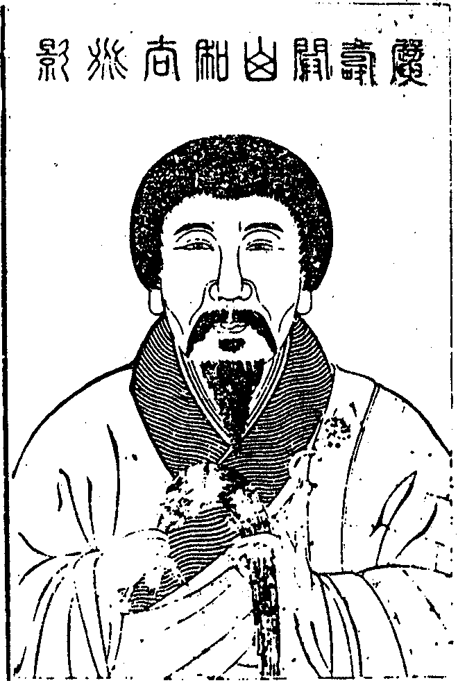



雪峰即非禅师道影赞



有临济之机用，而不滥行棒喝；有玅喜之波澜，而不虚施语言。力救时弊，疏通禅源。凛凛乎道韵照冰雪，煌煌乎法化悬朝暾。灼破佛祖肝胆，揭露衲僧顶门。信为黄檗琦之嫡子，径山容之真孙者也。



三山弟子郑溥元熏沐拜题千虎溪山房



------



### 即非禅师语录序



向上一路，千圣不传。又云：向上一路，千圣不言。设有言传，犹如好肉剜疮。昔日老瞿昙未离兜率，已降皇宫，未出母胎，度人已毕，有何言哉？因中下之机不了，只得假雪山而悟道，借波旬以张陈，四十九年口吧吧地，欲俾一切众生个个成佛，转见不堪。末后于多子塔前收竿罢钓，屏绝言诠，蓦然拈花示众，以表无言。殊知欲隐弥张，千载之下有个多事婆罗门，将无言之旨袖入诸夏，名曰教外别传，不知有多少血气男儿落他圈缋里。迩来插竿遍地，道贯寰区，兹即非禅师，闽中林氏，鬳斋先生之后裔也。早年失怙，至孝尊慈，薙染之初，遍参尊宿，然后归来，久依费老人之锤拂，丰姿挺特，志操高尚，于大火聚中逼得根深器界总成一个非上座，并不见更有山河大地也，遂受隐元和尚之钵袋子有年。元和尚仍以无言之旨佩入搏桑，却将赤帜树千海壖，扶起近代黄檗家风，毒鼓震于丰城，挽回三百年前法运。虽云一花初放，五叶芬芳，驱耕夺食，虎颔捋须，棒上成龙，喝下翻身，原让临济儿孙，师其人也。元和尚鼻祖搏桑手札，命师圣寿开堂，号令人天。师不逾时，买舟东上，丰主大悦，刱广寿山建寺，颜曰福聚。大开炉鞴，锻圣炼凡，启百世之徽猷，竖千古之规鉴，其黄檗一支不致寂寥矣。时门人将师数十年卫法之苦心，日积成帙，稿寄南来嘉禾灾枣，附藏流通，命予数语，弁于简端。予秖知治世语言文字，其格外提持，威音那畔，恨未梦见在，兼未识师面，不副来机，只得应命。兹惟序师之本色行履，而师之法身向上事，千圣出头，无有下笔处。



时康熙三十三年夏蒲月，节届天中，赐进士及第、钦授翰林院修撰、充纂修明史一统志两馆纂修官、甲戌科会试同考沈廷文元洲氏拜题。



叙



神龙韬藏於巨海，以时起而泽物，则变化无方。有情且尔，矧达道之世出者乎？予叔即和尚，少具超方之志，挺卓不群，性禀至孝，因以孝闻。自弱龄削䰂后，遍参知识，苦工十餘祀，出入内典，吞吐百家。其识弘、其用博，发为文字，皆寓至理。自谓识量依通，未为究竟，辄挥去，卒力蒲团上复九载。一日，当腊月三十，於扑焚处撞破胜热面门，打失自家鼻孔，直下如火里青莲，始得大事了毕。既印可于黄檗隐大师，甘活埋於雪峰古法窟，道香[莫-大+艸]揜，塞满阎浮。时节已彰，皤然应聘，出世于崇福，继开山于广寿，现身法海，示大津梁。上而王公硕德，次而缁褐异宗，闻名向化，觌面归依，随机摄受，顿入直指堂奥。愧宾风尘俗汉，兼以山川问之，未能躬承法诲，祗从颁示尊录中神领棒喝，而抚膺自腆己尔。重披二会新录及勘辨机缘，犹如那伽出海，云雨相随，於霎然雷奔电掣中，令人脱黏解缚，得大自在。外於赞颂诗偈等篇，不异化溥春工，卷舒无迹，举地皆成簇锦蒸霞，非深得少林不传之宗，曷能阐古今未发之蕴哉？然此犹言其觕，未尽其徵。以和尚之道之德，足以陶三乘、津九族，起东山之正续、升济北之未堕，翼赞皇图、光扬圣教，俾垂荫於来际，其视玄言机用，特绪餘耳。宾尘列子行，曷敢为出世大人作先声地？第当见道之真，不敢不为述其意而尽其言。先德曰：「见善不扬，非君子之操。」具金刚眼者，自能鉴诸言外。



三山从子宾稽首拜撰



即非禅师全录总目



卷第一道影赞(郑溥元)  

序(沈廷文　林宾)  

圣寿山崇福禅寺语录



卷第二广寿山福聚禅寺语录



卷第三升座  

小参  

秉拂



卷第四法语



卷第五举古  

拈古



卷第六颂古  

代古  

答古



卷第七机缘  

答问



卷第八赞



卷第九赞



卷第十赞



卷第十一赞



卷第十二自赞



卷第十三书问



卷第十四书问



卷第十五书问  

启  

疏



卷第十六诗偈



卷第十七诗偈



卷第十八诗偈



卷第十九诗偈



卷第二十诗偈(洛行艸)



卷第二十一诗偈(丰州艸)



卷第二十二诗偈



卷第二十三诗偈



卷第二十四铭



------



### 序



跋  

文  

杂著



卷第二十五佛事  

遗嘱语  

末后事实  

行业记  

广寿开山塔铭  

圣寿舍利塔铭



即非禅师全录卷之一



门人明洞、性安、性节、明觉、明幢仝编



戊戌年十二月初七日，本寺檀越王引、何高材、林守壂、魏之琰、林继燰、潘启祚、顾肇基、薜柟、何兴楚、何元吉、何高桢、卢国栋、林春茂、王仪等请师就当山开堂。师至座前拈请疏云：「灵山记嘱，一会俨然，仰烦维那重新表白。」宣毕，师指法座云：「须弥灯王来也。」遂作女人揖云：「谢如来降尊，让我出头。」便升。拈香祝圣竟，复拈香云：「此瓣香十载从顶𩕳上顿出，一旦向胸襟中流出，专申供养前住福建福州府福清县、敕赐黄檗山万福禅寺、现住摄州慈云山福元寺、传临济正脉第三十二世、本师上隐下元琦老和尚，仰酬法乳之恩。」敛衣就座，上首白椎。何一粟居士问：「法幢初建，为国祝厘，如何是撑天拄地人？」师卓杖云：「金乌初出海，何处不光辉？」进云：「与麼则接物利生，活泼泼去也。」师云：「今日接得一个。」进云：「唯此灯灯无尽，自然万古风光。」师云：「一任照天照地。」士礼拜，师云：「且寄三十棒。」维那问：「六年雪岭藏身处，五叶重开圣寿阿，直指单传即不问，开堂祝圣事如何？」师云：「杲日一轮红。」进云：「恁麼则大地沐恩光。」师云：「阇黎却具眼。」进云：「临济儿孙，天然有在。」师打云：「更须识取临济始得。」道荣问：「昔日闽王辅弼雪峰法席，今朝镇主作圣寿金汤，瞻依和尚开堂，未审有何祥瑞？」师云：「辉天鉴地。」进云：「掀翻万佛骨髓，斩断千圣顶𩕳，如何是一喝作金刚王宝剑？」师便打。进云：「百兽魂飞胆丧，野孤饮气吞声。如何是一喝作踞地狮子？」师云：「照顾汝脑门。」进云：「展处弥纶法界，收时毫发无存。如何是一喝作探竿影艸？」师云：「深辨来风。」进云：「佛祖窥觑无门，人天瞻仰不及。如何是一喝不作一喝用？」师云：「一任疑著。」进云：「四喝已蒙师展演，中兴祖业是如何？」师卓拄杖，云：「会麼？」荣礼拜，云：「圣寿祥云映宝座，金襕紫气贯山门。」师云：「善哉！善财童子。」乃云：「时节到来，梅香雪里；因缘出现，遍界优昙。」乃竖拂子，云：「诸大德！委悉麼？此一枝原是灵山所拈的、少林所开的，西天东土奕叶相承，自曹谿六传至于临济，万紫千红；济传第三十叶至于天童，馨香愈盛；重传径山容师翁，正干独攀；翁传黄檗琦老人，一枝横出；老人传与雪峰一头陀，当下产个三祗果，圆陀陀、活泼泼，含裹十虚，该罗一切。适才诸上人所问的都在里许，山僧所答的也在里许，乃至三藏十二部、一千七百则总在里许，更有诸佛诸祖说不到、问答不到的亦在里许。山僧不会收拾，抛掷多年，今朝辊过者几不消一捏，依旧五叶重芳、千枝竞秀。设有向根本上著得只眼，堪报不报之恩；其或回睛转脑，鹞子过新罗了也。兹承镇主临筵，四众云集，请升此座为国开堂，寿圣治，乐有道之天；福兆民，崇至善之德。只如同觉同证、直下无私一句又作麼生擎展？万派百川归巨海，一轮红日上榑桑。」上首结椎，下座。



开炉结制，魏尔潜居士捐金充知浴，请上堂。雪机问：「和尚以大地为炉，烹庖佛祖、锻鍊人天，只如没面目汉子到来如何钳锤？」师打云：「棒头有眼明如日。」进云：「恁麼则掀天揭地承师恩力去也。」师云：「举头天外，谁是其人？」进云：「开炉结制已蒙指示，如何是临济宗？」师云：「青天轰霹雳。」进云：「如何是曹洞宗？」师云：「虎之缺、马之馽。」进云：「如何是云门宗？」师云：「脑后一轮红。」进云：「如何是沩仰宗？」师打圆相云：「天下人跳不出。」进云：「如何是法眼宗？」师云：「大地沙门一只眼。」进云：「五宗毕竟是同是别？」师云：「五五二十五。」僧礼拜云：「谢和尚答话。」师云：「汝是那一宗？」僧一喝，师打云：「临济堂前半点头。」乃云：「马嘴象腮收归栏厩，铜头铁额超入红炉，这里还有不费钳锤、不窥鞭影的麼？出来𨁝跳看，山僧为汝证据；其或大器晚成，普请九旬齐努力，人天佛祖结同参。」遂举：「天童密云老和尚上堂云：『今日禹门寺里结制，须与诸人一议，不用诸人参禅，不用诸人会理，单单不用瞌睡。若也瞌睡，一棒打出骨髓，莫言不道。』喝一喝，下座。」师云：「这老汉年老心孤，老婆太切，彻骨相为，恩大难酬，子细观来，犹未尽善。殊不知禅不参则道不悟，理不会则事遍枯，单单不瞌睡，不堕无记则生乱想，据令将来，翻成钝置。何似新圣寿今日崇福寺里结制，亦不用与诸人一议，禅任他参，理任他会，待他瞌睡，送个枕头，却不敢动著。何以如此？不见道：但得雪消去，自然春到来。且道：与禹门相去多少？老祖若闻，必也点头。是事姑置，只如今日魏檀越挥金请开选佛之场，毕竟如何指示？听取一偈：早晨法雨洗尘寰，日出诸天展笑颜，有相门中无相施，福如沧海寿如山。」下座。



冬至日，东京舶主林尔受、魏尔潜、潘云仍、顾长卿、薛梅初、何昆嵋、何子谦、何君腾诸檀越请上堂。僧问：「葭管飞灰、绣纹添线即且置，不涉化机请为指示。」师云：「无奈东君漏泄何？」僧拟议，师便打，师乃云：「绣纹添一线，葭管正飞灰，不涉化机句，触著吼如雷。好个时节，还有共转法轮者麼？出来助山僧，应以此身得度者，即现此身而为说法；其或未然，山僧又自应去也。」遂举：「唯庵老叟船居，曰：『船非水则不可行，水非船则不可居，必二者相资而后成。』宋濂无相居士则不然：『我非船，何处不可行？岂特水哉？我非水，何处不可居？岂特船哉？』」师云：「一人就事施设，𪸩煌魏国之珠；一人入理深谭，卖弄赵城之璧。山僧不识理事，顺水行舟，拈出如意宝，要与二翁斗富。大众证明，听我举似：甲将船水费论评，十分巧说不如行；乙将船水都拈除，长安虽乐非久居。争似我诸檀气压孙李苏，遨游东海当西湖，时乘只叶闲来往，饱看江山展畫图。法说竟，恰也无，更助一帆风到岸，腰金仍挂古珊瑚。有问：『如何西祖意？』昆仑山下石香炉。」卓拄杖，下座。



佛成道日，魏尔潜檀越荐兄，请上堂。尔潜问：「年来几点思兄泪，洒向崎江白日寒。今日请和尚荐拔一句。」师云：「明星当午现。」潜礼拜，云：「谢和尚慈悲。」师云：「夜半日头红。」僧问：「六年已脱千生梦，忽悟明星作麼生？」师云：「山僧眼不花。」进云：「魏檀请师登宝座，追荐一句是如何？」师云：「髑髅眼底春风动，无影枝头烂熳红。」进云：「蒙师拔出无生路，九品莲花脑后开。」师云：「脑后一句作麼生？」僧作礼，师便打。若乙问：「眉间挂剑魔惊怕，袖里骊珠定有勋。临济三玄即不问，曹洞五位请师分。」师云：「从头问将来。」进云：「如何是正中偏？」师云：「皂马烂银蹄。」进云：「如何是偏中正？」师云：「琼花开铁树。」进云：「如何是正中来？」师云：「午夜雪山一点明。」进云：「如何是兼中至？」师云：「日月交辉。」进云：「如何是兼中到？」师云：「浑沌无窍。」进云：「五位已蒙师指示，只如瞿昙失却眼睛、净名开却眼睛，是同？是别？」师云：「一合相不可得。」进云：「当阳一著无私照，触处莫非是本光？」师打，云：「是偏？是正？」乙礼拜，师以拂子打圆相，云：「大众会麼？释迦老子于雪山午夜悟得这个、六祖于碓坊中踏著这个、百丈于镢头下锄著这个、沩山于木杓里舀著这个、雪峰于饭箩边淘著这个、云峰于闹市头撞著这个、古今圣贤于日用中明得这个、本寺檀越于正因中信得这个。如上所说，置之勿论。信得这个，以何为验？试为举看。毓祯魏公在日，发广大心，兴隆三宝，创建丛林，告世数载。有弟尔潜，体兄之心，檀度如旧。兹适世尊睹星悟道之晨，特设斋供养，兼请上堂，为荐乃兄，施米百石，以资冥福。更愿檀护与丛林同悠久者，此亦幽明两致其极，诚希有也。所谓：大人具大见，大智得大用，显扬奇特事，须还过量人。且道：这个有甚奇特？能令人悟、能令人信、能令种种妙用皆从这个流出。未审这个向甚麼处流出？若是口吞佛祖的，向未有这个时一坐坐断，管取悟也不可得、信也不可得、踏也踏不著、锄也锄不见、舀也不上、淘也不出、撞也不著、明也不得。正恁麼时，唤甚麼作佛祖？唤甚麼作众生？唤甚麼作生死？唤甚麼作涅槃？谁为供养？谁受荐拔？」乃喝一喝，云：「若不得者一喝，几乎转身不得。身已转也，如何得令他同觉同证去？」以拂子向空中点，云：「露出一星子，水天上下明。」下座。



同门法兄木庵和尚请上堂。僧问：「一佛出世，万佛赞扬。如何是万佛赞扬底句？」师云：「笑破虚空口。」进云：「只如赤肉团边无位真人还赞得麼？」师云：「无位真人在甚麼处？」僧拟议，师便打。问：「圣寿峰头挂紫云，宾主相对复何云？少林一曲欣同调，仲氏吹箎伯氏埙。正与麼时，如何是主中宾？」师云：「下座陪师兄。」进云：「如何是宾中主？」师云：「一朝权在手。」进云：「如何是宾中宾？」师云：「面上三斗尘。」进云：「如何是主中主？」师云：「佛祖立下风。」进云：「宾主已蒙师指示，向上宗乘是如何？」师云：「还我宾主句来。」进云：「恁麼则一花五叶开愈秀，同条各露一枝春。」师打，云：「者一枝，天下人有分。」乃云：「一佛出世，万佛赞扬；一花开敷，万花周匝。花黄花紫一般春，前佛后佛无二道。以无二之道，廓人天未证之门、揭佛祖不传之妙，直得古多宝、新释迦当下如镜照镜、似空合空，於中著得一只眼，方见三世佛祖、修多罗藏尽向此中流出，天地日月、万象森罗尽向此中建立，四生九有、八难三途尽向此中随流出没、从缘契证，百工技艺、一切有情尽向此中各随根性、悉得受用。无物不周，乾坤未可比其广大；一般奇特，日月莫能喻其光华。任他通身是口，也赞叹不及。正当主宾互换、不落时机一句如何展演？多宝塔中分半座，万花丛里两优昙。」下座。



雪天，上堂。以友居士问：「达磨面壁，二祖断臂，和尚今日升座，雪里如何安心？」师云：「还我一臂来。」进云：「我师亲的意，能有几人知？」师云：「用知作麼？」进云：「空生若不岩中坐，争得天花动地来？」师云：「莫谤空生好。」乃云：「雪里九年，流出通身热汗；炉边打坐，竟日卓竖寒毛。还有灰里豆爆者麼？试通消息看。」一僧云：「红莲雪里开。」一僧云：「虚空雪里点头。」一僧云：「银山铁壁，八面玲珑。」师云：「欲得梅花香扑鼻，还须彻骨一番寒。」卓拄杖，下座。



立春日，昙璲监寺请上堂。僧问：「曹谿五叶桑林里，如何是长芳万古春？」师云：「桃红李白蔷薇紫，问著东君总不知。」进云：「须弥顶上无根树，为甚麼不犯春风花自开？」师云：「又被风吹别调中。」乃云：「云门乾菌橛，雨淋目炙久矣。昨夜被山僧蹉手一捏，捏碎瞿昙鼻孔，迸出浩荡春风，吹得桃红梅白，遍界清香。汝等诸人还曾嗅著也未？」卓杖，云：「松花若也沾春力，根在深岩也著开。」下座。



兴福、福济三监寺仝请上堂。澂一监寺问：「生从何来？死从何去？」师云：「澂不清，搅不浊。」进云：「承师开示，脚底莲花步步阶。」师云：「一法通时万法通。」乃云：「澂一、蕴谦二禅德岁暮逼山僧上堂，举扬个事。若论个事，佛祖口阁壁上，山僧如何举扬？因是让之至再，其请益坚，不得已向第二门头傍通线路，曲顺来宜。诸大德！好须采听：尺璧蕴于巨石，勇者力攻而得之；骊珠现于澂潭，智者逆浪而探之。间有懦怯之士，若不另具一副手眼，几番苦心欲希冀此二宝，譬如辍耕获而望秋收，无以异也。或迷者而不知、知而不能取、取而不能用，非惟孤负此宝，抑亦自他俱失利济耳。世宝如是，僧宝亦然。如何是僧宝？昔日唐皇亲赏鉴，钦延镇国利人天。」下座。



除日，若乙维那、弘永书记同众请上堂。僧问：「今朝腊月三十日，作麼生是今日事？」师展两手，云：「会麼？」进云：「某甲不会，请和尚为说。」师云：「不是知音者，徒劳话岁阑。」僧礼拜，师云：「果然。」弘永问：「古人烹露地白牛与大众分岁，未审和尚今夜分个甚麼？」师云：「与汝一个铁馒头。」进云：「大众谢和尚。」师云：「咬得破，堪受人天供养。」乃举：「雪峰敦和尚因僧问：『如何是佛？』曰：『把火照鱼行。』进云：『如何是法？』曰：『唐人译不出。』又云：『佛法已蒙师指示，未审毕竟事如何？』曰：『腊月三十日。』」师云：「古德答话不带枝叶，山僧随例攀条，倒行一令。今朝腊月三十日，诸人毕竟事作麼生？只如唐人译不出，把火照鱼行，且道佛法落在甚麼处？如此会得，参学已竟，报恩已毕；其或不然，三百六旬仍蹉过，眉毛剔起又来年。」下座。



元旦，祝圣，上堂。僧问：「格外乾坤大，榑桑日月新，春风吹破腊，处处贺新正。如何是最新一句？」师云：「一团和气，万劫同春。」乃云：「万年春一梦，梦醒万年新，新罗▆打鼓，日国贺新正。艸木丛林俱作狮吼，山河大地鼓舞欢呼，发挥固有风光，唤起一新气象。万邦歌有道，四海乐无为，卧云深处向不朝天，圣恩广被如何补答？」蓦竖拂子，云：「一枝劫外春无尽，仰祝尧天舜日长。」下座。



解制，监寺领魏之琰居士请上堂。僧问：「如何是一印印泥？」师云：「瑕生了也。」进云：「如何是一印印水？」师云：「鹅王择乳。」进云：「如何是一印印空？」师云：「无汝下手处。」问：「如何是夺境不夺人？」师云：「拔却眼中钉。」进云：「如何是夺人不夺境？」师云：「日高犹未醒。」进云：「如何是人境两俱夺？」师云：「拈却无生国。」进云：「如何是人境俱不夺？」师云：「护取法王城。」进云：「人境已蒙师指示，心空及第事如何？」师云：「空里挂灯笼。」进云：「恁麼则人人有分去也。」师打，云：「海上漫栽花。」乃云：「九十光阴一撮子，五湖僧在一毫端。」遂弹指一声，云：「为汝诸人解制了也。还有心空及第者麼？三级浪高能变化，风雷相送过龙门。」复举：「赵州和尚因赵王来参，州端坐不起。次日，帅来，州下禅床受之。侍者问曰：『昨日大王来，为甚不下禅床？』州曰：『非汝所知。上等人来，我禅床上接；中等人来，下禅床接；末等人来，出三门外接。不可目我王为中、下人也。』」师曰：「赵老恁麼接王，可谓不失宗师体裁；简点将来，未免因人上下。山僧当时若在，敢问赵州：『设有无等级人来，又作麼生接？』管取赵州至今要起起不得、要坐坐不成。是事且止，只如今日三岛客、九洲僧俱殿下重临法会，观选佛场，揭晓龙蛇溷杂、凡圣交参，毕竟如何分疏？作何相接？」良久，云：「万派声融沧海上，万年流水不知春。」下座。



癸卯秋仲五日，省觐回唐，辞众上堂。道荣问：「孝义全彰，遽离雪峰法席；因缘出现，高踞圣寿猊床。只如今日符到奉行，师资庆会一句作麼生展演？」师云：「报恩须是忤逆儿。」进云：「栴檀围绕栴檀树，狮子游行狮子窝。」师云：「不劳赞叹。」进云：「殿下临筵听法，曾承灵山付嘱，吾师机辩天纵，不妨更借一问。」师云：「水流须到海，云起必为霖。」进云：「恁麼则解使人天迎杖锡，直教龙象接金襕。」师云：「汝者一语翻成分外。」荣礼拜而退。自信问：「吾师为法到崎丘，接物应机已六秋，幸遇因缘今出现，杖挑明月上皇州。人天交接则不问，途中得力一句乞师开示。」师云：「一帆秋水上皇州。」进云：「恁麼则临济家风重振榑桑去也。」师云：「如何是临济一句？」僧喝，师云：「者一喝落在甚麼处？」进云：「不从天得，不从地生。」师云：「莫是从人得麼？」僧礼拜，师一喝，乃云：「见可则进，知难则退。逆川禅师云：『古德恁麼说话，大似趋利避害，取舍未忘。』所以山僧住此数载，不敢妄动。兹缘故国六十餘位宰官居士于前年邮启，聘山僧回唐为国开法，不特感激道爱，抑且熟处难忘，寻修书报复，许可来春。今秋觐别黄檗老人，理当叙谢白众，承崎主同四众光临，证明举似。乃别古德云：『进则以道，退亦以道，以道进退，谁曰不可？』虽然，此犹是山僧分上，诸人分上又作麼生？道心相照，千里如面，忠孝持身，供养无尽。至于向上一著，各自努力。附赘一偈：离此山门入国门，千山万水一乾坤，我心如雨无遗点，深谢檀那六载恩。」下座。



即非禅师全录卷之二



门人明洞、性安、性节、明觉、明幢仝编



乙巳季春望旦，丰主源忠真大檀越暨明洞上座请师进寺。至三门云：「大道兴，方便立，从信入者，永无退失。有超方便的，一任丹霄独步。」



世尊。拈香云：「一尘一佛国，一花一释迦，说甚麼殿里的烂冬瓜、洞山麻、云门橛？」遂插香云：「香云弥法界，瑞气霭乾坤。」



韦驮。拈香，云：「扶持正法，现金刚身，此一瓣香，耀古腾今。」



伽蓝。拈香云：「钦承佛嘱，拥护丛林，丛林作狮吼，大地变黄金，有如是无作妙用，所以立为福聚伽蓝神。」



祖师。拈香云：「脑后一轮红，豁开正法眼；庭前柏树子，毕露祖师心。」



监斋。拈香云：「三德六饰，百味具足，大众加餐，檀那获福。」



据室。云：「此方丈不涉新旧，廓同大虚，任是百亿微尘数云门、兴化，百亿微尘数福海、寿山，一时顿入，无欠无餘。咄！临济来也，汝们更须倒翻筋斗，向虚空背上行一遭，又正翻筋斗扑落下来，广寿为汝们证据。」



孟夏八日，受请祝国开堂。师於源太守手中接得请疏，示众云：「佛祖付嘱，王臣流通，公验分明，仰烦披露。」维那宣疏毕，师指法座云：「超佛越祖，总落阶梯。看广寿从空放下，平地升高，为诸仁者拨转向上一著。」遂升座。拈香云：「此瓣香，根盘空劫，叶覆阎浮，𦶟向金炉，耑伸供养。灵山会上禅祖释迦牟尼佛，以及西天东土历代祖师，证明开堂，龙天八部拥护道场，伏愿日新鹫岭之风，时迈唐虞之治。」又拈香云：「此瓣香统天地以为根，会万物为一体，端为祝延当今皇帝圣躬万福，圣寿无疆，钦愿生生不忘佛嘱，世世常现人王，兴隆三教，坐享太平。



「此瓣香，明如日月，秀丽山河。奉为本朝大将军，位同地久，寿与天长。恭愿等闲伸出定邦手，大转灵山正法轮。



「此瓣香，四海毓秀，五岳鍾灵。奉为文武官僚，列国勋贵，增培禄筭，儒佛并肩。



「此瓣香鹫岭传来，龙宫涌出，奉为丰主源大檀越以出世之心治世，从有为而证无为，建法幢，立宗旨，𦶟向炉中，用酬檀德，恭愿福禄深巨海，寿算等须弥。



「此瓣香遇贱则分文不值，遇贵则价重娑婆。第二回拈出，奉为现住京畿黄檗山万福禅寺开山第一代传临济正宗第三十二世七十五腊上隐下元本师老和尚，用酬法乳，恭愿常住世间为道树，千枝并秀荫人天。此瓣香深逾沧海，重越丘山，奉为父母养育之恩、师长剃度之德，十方檀那、一切师友，或一言半句资我慧命，粒米寸丝成我道业，今日普同报谢，伏愿现在植金刚正因，将来为菩提眷属。」遂敛衣就座。维那白槌竟，监寺法云问：「福地新开选佛场，霭然瑞气绕猊床，愿通少室真消息，格外玄机为举扬。」师云：「顶门只眼耀乾坤。」进云：「只将只眼乾坤句，仰祝皇王亿万年。」师云：「也赞得一分。」进云：「更愿国风与祖风永扇，帝道齐法道绵昌。」师云：「此语最亲切。」维那柏岩问：「法海出世，闽王证明，和尚开堂，丰主预会，先后一揆则不问，如何是寿国福民一句？」师云：「百亿须弥卢。」进云：「恁麼则如龙得水去也。」师云：「且缓承当。」友松信士问：「雪峰山顶卿云呈瑞，广寿堂中佛日增光，如何是重重现瑞彩一句？」师云：「楼至来也。」进云：「只如今日丰主新创法席，恭请和尚祝国开堂，亲临座下行香听法，敢问和尚举扬何法？」师云：「合国证明。」进云：「现前万指围绕，和尚作麼生接？」师云：「各与一顿棒。」进云：「棒头有眼明如日，照彻人人在此时。」师云：「几人荐取？」松礼拜退，师乃云：「机前荐得犹涉纤廉，槌下承当翻成钝置，何况机锋相扣、棒喝交驰，唤作激扬直指，转见迂曲？今则按下云头、拗曲作直，为诸仁者婆舌一上。若论此事，如积树成林、积日成岁、积善成功、积功成德，德积以成道、道积以成无为，无为而无不为耳。既不住无为、不尽有为，以大心为功德海、以智慧为般若舟，自他利济并登觉岸，正眼观来犹在半途。正当恁麼时，如何是不离堂奥随缘应现一句？风生万壑，月印千江。」复举：「闽王请法，海闲禅师开堂，才登座，以手敛僧伽黎，顾视大众便下座。王近前执闲手云：『灵山一会何异今日？』闲云：『将谓汝是个俗汉。』」师云：「大音希声不同常调，若非角听几失知音，八百年来令天下人疑著，却成未了公案。兹承丰主源忠真大檀越乘夙愿再来，特创宝坊，延山僧开山卓锡，祝国开堂。是日台旆临筵，预会听法，山僧自揣道行微劣，无可图答，只将一点水墨两处成龙，完此公案作法施去也，将谓大王是俗汉，元来佛法个中人。山僧堂已开了、圣已祝了、法已说了，只如今日释迦世尊出世，一手指天、一手指地，且道明甚麼边事？」众罔答，师云：「各各归堂明取好。」维那结槌，师下座。



安执事，丰主请上堂。举：「云门因僧问：『斋主设斋如何报答？』门云：『量才补职。』僧云：『不会。』门云：『不会，吃斋去。』僧有省。」师云：「云门推门落臼，者僧虚往实归，悟则不无，要嗣云门未可在。何故？者僧被云门一塞口开不得，只是解吞不解吐。广寿则不然，跳过金刚圈，独步大方；咬破铁酸馅，百味具足。果有其人，不惟堪扶法化以助王化，抑亦永作人天之福田；其或未然，吃水也须防噎，平地岂无慎跌？诸大德！还委悉麼？为法求贤择手眼，等闲说与饱参人。」下座。



丰主建新禅堂成，远州太守源长真檀越捐金为知浴，请结夏，上堂。梅岭问：「圆觉伽蓝、华藏刹海，豁开户牖，大座当轩，四海趋风，檀越加敬则不问，九旬安居事如何？」师云：「垂丝千尺，意在钩头。」岭喝，师打，云：「未是金鳞。」进云：「和尚只见金鳞，未见金毛狮子。」师云：「欠牙爪在。」僧问：「以百千亿劫为一念，以一念为百千亿劫，为其神通妙用？为复法尔如然？」师云：「百艸头边狮子吼。」进云：「直得尽十方世界总是一会安居。」师云：「三千刹海一伽蓝。」进云：「只如朝过天台、暮游南岳底汉来又作麼生接？」师云：「朝打三千，暮打八百。」乃云：「万松青入汉，密构凌云烟，括大千於个里，包法界於其中，殊胜庄严，同佛受用。此会功德实非小缘，各生难遭之想，同期出世之心，竖起铁脊梁，放开大眼孔，觑透佛祖心肝，坐断银山铁壁，然后向佛祖行不到处行取一步，步步踏实；说不到处说取一句，句句朝宗。检点将来，未为究竟。如何是究竟一句？翻身磕破虚空额，祖德檀恩一并酬。」下座。



丰前州源太守恭荐　东照大权现先将军五十年讳日，请师上堂。法云问：「森森大树插青天，为荫苍生五十年，太守亲临求荐拔，证明一句若何宣？」师云：「海印光中全体露。」进云：「恁麼则众星拱北，万派朝东去也。」师云：「权现嘉名天下闻。」进云：「谢师答话。」师云：「拱北朝东道一句看。」云礼拜，云：「道过了也。」师云：「亲切。」万水问：「太守请师说法则不问，如何是坐享太平一句？」师云：「路不拾遗真古道。」进云：「更喜风调雨顺，国泰民安。」师云：「万民乐业享丰年。」进云：「恁麼则天长地久无餘事，玉叶金枝万古春。」师云：「被上座道著。」友松问：「太守今日恭请和尚上堂追荐东照大权现五十年讳辰，如何荐超？」师云：「佛国任遨游。」进云：「五十年前凛凛威风震八极，五十年后昭昭瑞气福榑桑，请师证明。」师云：「谁不仰恩光？」进云：「与麼则源远流长清万古，乔松翠竹秀无穷。」师云：「放汝二十棒。」松作礼，退。师乃云：「法性湛然，元无生灭，随类应现，示有去来。东照大权现，夙乘悲愿，现将军身，抚治家邦，朝野颂德，应缘已尽，擦手宾仙，往五十年，凛然生气。兹逢讳日，承外孙丰前州仁孝太守小笠原公请，山僧特升此座，举扬般若，资严冥福。然般若之体，明如日月；般若之用，迅若风雷。亘古亘今，无变无易，以此拔幽，直超果位；以此利显，家国兴隆。正恁麼时，如何是光前耀后一句？突出乾坤眼，万古福源长。」下座。



丰夫人那须氏同次公郎源光真请上堂。僧问：「龙女献宝珠，直往无垢世界成佛，如何是宝珠？」师云：「大众证明。」进云：「女身垢秽，如何成佛？」师云：「莲花出淤泥。」乃举：「秦国夫人计氏参大慧杲和尚，力究有省，呈偈云：『逐日看经文，如逢旧识人，莫言频有碍，一举一回新。』」师云：「秦国夫人虽处女流，宛有丈夫之作，但偈语犹堪检点，杲和尚许他也是半幅全封。试举似看：逐日看经文，黑豆生芽；如逢旧识人，夙世冤家；莫言频有碍，寸丝犹挂；一举一回新，如何放下？山僧恁麼注脚，不是减沈之香，要使五百年后接一个同参的丰国夫人那须氏内相攸宜，克勷政绩，日用之中不离佛法。山僧驻锡金粟园六个月，时同丰主暨二公郎频来问道，兼承种种供养，今住广寿，合府请法，俨然灵山一会，虽不呈偈，金在矿中。且道与五百年前秦国夫人同别如何？处处逢龙女，门门遇善财。」下座。



五月初五日，九山、北源、纳川、雪涛、独立、铁樯、万水、灵泉、梅岭、龙舟、独健、梦堂、德海、既白、彻玄、僧眼、慧云、鉴印、东晓、月江、宜山、于朴、东白、道长、灵秀暨合山诸大众预祝师半百大诞，请上堂。僧问：「弟子辈恭祝和尚尊诞，仰冀与赵州古佛同一春秋。如何是大法流通，永镇榑桑一句？」师云：「满天花雨落，知有龙王来。」进云：「今日龙王行雨沐圣体时如何？」师云：「头角露也。」进云：「恁麼则雨中突出眼中眼，天外高挑灯外灯。」师云：「速礼三拜。」乃举：「赵州和尚因僧问：『和尚姓甚麼？』州曰：『常州有。』又问：『和尚春秋多少？』州曰：『苏州有。』」师云：「赵老逆行域中，日月发明劫外，春秋手眼通身，超今越古，不虚为古佛之称。若问：『广寿姓甚麼？』答道：『大地载不起。』更问：『春秋多少？』乃道：『虚空包不尽。』且道：与赵州相去几何？有辨得出，不妨与古佛相见。正恁麼时，如何是同诚祝赞一句？绕围龙象三千指，意气一团万古春。」下座。



初七日，远州太守源长真檀越为师祝寿，请上堂。月江问：「五十而知天命乃寻常事，和尚是大善知识，知命既在未生已前，如何是今日太守祝寿一句？」师云：「日照天临。」进云：「别有天地异人间又作麼生？」师云：「林峦添瑞气。」进云：「恁麼则尽大地普祝去也。」师云：「如何是普祝一句？」进云：「昼夜一百八。」师乃举：「大颠和尚因韩文公问云：『和尚年多少？』颠提起数珠云：『会麼？』韩云：『不会。』颠云：『昼夜一百八。』广寿云：韩公问年多少，大似虚空背上觅起止。颠提起数珠示之，无孔铁锤当面掷。韩云：不会，六律分明。颠云：昼夜一百八，亘古亘今。山僧恁麼举似，还当得庆赞也无？」突竖拂子云：「大颠和尚来也，即今在山僧拂子头上合掌赞叹云：『老僧今日亲到广寿，见远州太守俊秀青年，有如是信心重法，闻其本月二十日初度，何不自他共祝去也？』山僧不胜欢喜，问讯答云：『愿将昼夜一百八，转为太守祝遐龄。』大颠和尚含笑而起，山僧致谢云：『劳先辈证明。』」下座。



初八日，法云监寺为师祝寿，请上堂。云问：「法王出世，坐断古今。正恁麼时，威音王是和尚儿孙，请问威音前一句？」师云：「威音王即今在甚处？」进云：「在和尚拂子头上。」师云：「突出难辨。」进云：「然则灯笼露柱齐庆祝去也。」师云：「一言之下报深恩。」进云：「法雨周沙界，寿山亘古今。」师云：「灯笼露柱笑呵呵。」乃云：「佛祖出世并无别事，第为护念付嘱而已。护念者，要人卫法道也；付嘱者，要人续慧命也。广寿出世，不外是也。法云洞上座精白一心，以卫续为念，监领寺务，井井有条，人咸称其有杨岐之风，山僧亦知其夙记再来耳。兹值山僧半百初度，预伸庆祝，请升座，普示威音前一著。若论威音前，佛祖未曾指注，山僧如何措辞？惟各各自悟自证始得。或问：『自悟自证后如何？』南山布法雨，东海起云雷。」下座。



初十日，源太守次公郎光真檀越为师祝寿，请上堂。僧问：「南极寿星临福地，中天紫气贯丰山。今日源光真檀越恭祝和尚华诞，如何是寿星临福地之句？」师云：「露柱生儿。」进云：「如何是不涉春秋一句？」师云：「未解语言先作赋，一操直取状元来。」乃云：「光真髫年英发，骨气超凡，蕴夙世般若之种，生尊贵菩萨之家，所习诗礼、所行十善不染之性，犹青莲出水，挺挺池中，得此殊胜福缘，非一佛、二佛边所种善根可能耶？每参山僧，益加敬信，今来祝寿，请法弥懃。其迹颇似善财诣佛会中参普贤大士，见乘白象王、处红莲座，一心亲近，讼闻法要，悲智圆满，行愿圆成，其发心功德与善财无二无别。虽然，光真恁麼庆祝、山僧恁麼举扬，於唱教门中足可观光。若约衲僧分上，彼此俱要吃棒。何故？棒头取证无生忍，铁树花开万劫春。」下座。



十二日，丰夫人为师祝寿，请上堂。东晓问：「法身元不动，只为方便示。生即不问，如何是第一玄？」师云：「觑破未生前。」进云：「如何是第二玄？」师云：「耳朵列两边。」进云：「如何是第三玄？」师云：「两脚踏地头顶天。」进云：「如何是第一要？」师云：「古篆无文。」进云：「如何是第二要？」「新条有识。」进云：「如何是第三要？」师云：「千差都一照。」进云：「三玄三要蒙指示，格外金鳞来时作麼生？」师打云：「会取玄要好。」乃云：「生佛之元，古今不易；化育之本，物我同途。只如山僧五十年前未出母胎时，以何为初度之辰？於此觑透，不惟见得山僧本来面目，抑摸著自己元辰。如觑不透，山僧自出头来，也应以此身而说法，不妨重现女人身。」复举：「余夫人祝广慧禅师寿，且云：『愿和尚与虚空同年。』慧云：『道甚麼？』广寿云：古人相见，无非佛法，一问一答，如空合空。今日丰夫人祝山僧寿，也不曾发问，山僧亦不用答，且道还有佛法也无？咄！彼此渊默，问答如雷。」下座。



十四日，正当师五十岁初度之辰，丰主源忠真大檀越为师祝寿，请上堂。僧问：「圣人作而万物睹，今晨法雨初霁，杲日当空，请问是何祥瑞？」师云：「天高地厚。」进云：「丰主临筵，庆师降诞，如何是感应道交一句？」师云：「海阔山长。」进云：「恁麼则十方归仰无为化，恭祝吾师亿万春。」师云：「雷鸣谁不闻？」僧礼拜，师乃云：「突出一枝肉菡萏，大地皆闻解脱香，花果齐彰昭正觉，是名佛子报爹娘。山僧亲恩已答了，檀恩又作麼生？如丰主源檀越智勇谦德不让赵王，迩来觑破向上一著，乃能舍世间之浮尘，布出世之实地，悟梦幻之色身，祝坚固之慧命。以此慧命寿国家，则时清道泰；以此慧命荫宗裔，则世衍禄昌。可谓大福德人修、大福德人受，无非皆从正信见道中成就耳。更有一偈，大众证明：都卢原不涉春秋，一彩何妨赛两筹？七十高龄添半百，绵延慧命续源流。」下座。



十五日，开善寺月交禅德为师祝寿，请上堂。月交问：「昙华现瑞彩，大地变黄金，龙象绕围，人天倾向。正当恁麼时，如何是格外庆祝一句？」师云：「海底泥牛衔月走。」进云：「七佛已前四时春，现成公案如今日。」师云：「善世法门八字开。」进云：「恁麼则法霖润国土，紫气贯山门。」师云：「幸值阇黎知时节。」交礼拜退，师乃云：「神龙来听法，晓雨犹未止，拄杖有神通，摄入钵盂里。正恁麼时，明月当午现，与你们说个目前道理，月印长空，影含众水，清凉大地，光被九洲。有此善利，所以灵山标之、曹谿话之、马祖玩之、药山啸之。若夫水底捞、纸上畫、指边觅、瞽处问，如斯等人敢保驴年未梦见真月在？开善月交禅德为人实行，虚心待物，实不媿其名也。兹值山僧母难后一日正当月望，进山补祝，请上堂。因念其诚，推出真月以答之。」以拂子打圆相，云：「委悉麼？篮儿没底盛明月，月交持来祝寿筵，突出顶门一只眼，清光照彻未生前。」下座。



十六日，黄檗木庵和尚为师祝寿，请上堂。僧问：「於一切法离诸言说，未审和尚说何法？」师云：「汝要我说何法？」进云：「瞻之仰之。」师云：「蹉过了也。」进云：「今日黄檗和尚为师祝寿，请上堂。作麼生是祝寿一句？」师云：「埙箎同调。」进云：「恁麼则满山松竹万年春。」师云：「赖有知音。」问：「向上一路，千圣不传，学人如何进步？」师云：「岭上石人开口笑。」进云：「恁麼则某甲一趠趠得去也。」师云：「堂前铁锯舞三台。」僧作礼，退。师乃云：「虚度五旬，承祝增愧。复命升座，勉赴来宜。虽无当于狮吼凤鸣，而同门法爱之谊庶几无负也。」遂举：「云门和尚因僧问：『二尊宿相见时如何？』门云：『不是偶然。』广寿云：正令当行，十方坐断，机轮转处，作者犹迷。惟有格外人相见，自然声和响顺，形直影端，彼此情忘，主宾道合。正当恁麼时，如何是因斋庆赞一句？黄檗枝头双蜜果，合成一颗大蟠桃。」下座。



十七日，佛日慧林和尚为师祝寿，请上堂。宗昆问：「法身等虚空，福聚海无量，如何是不生不灭一句？」师云：「赵州东壁挂葫芦。」进云：「恁麼则广寿峰顶月与摩耶同光。」师云：「如何是摩耶峰顶月？」僧作礼而退。万水问：「昔日裴相国见石霜借笏垂慈，今日源丰主随喜听法，和尚如何指示？」师云：「万水千山。」进云：「恁麼则如龙得水、虎靠山去也。」师云：「千山万水。」进云：「昔日裴相今丰主，须信慧林即寿林。」师云：「不涉古今再道看。」水礼退，乃云：「灵观上堂祝睦州寿，揩背须借他人手；佛日请广寿升座自祝，吃饭须用自己口。远承法爱，愧感无涯，分此炊香作平等供养去也。正恁麼时，震法雷、鸣法鼓、布慈云、洒甘露，万象森罗，踊跃起舞，俱要听山僧举古。」遂举：「太平恩禅师因僧问：『日未出时如何？』平曰：『众人皆仰望。』进云：『日出后如何？』平曰：『万里照无私。』广寿云：太平恁麼答话，可谓头正尾正，若要耀后光前，更资一路。或问广寿：『日未出时如何？』曰：『瞌睡汉。』更问：『日出后时如何？』曰：『堪作人天眼目。』大众且道：还当得彼此庆赞也无？天亲坞里蟠桃熟，无著山中柏子青。」下座。



十八日，崇福寺化林上座同徒孙海天祝寿，请上堂。化林问：「格外蟠桃此地栽，十分春色日边来，诞生已度五朝后，和尚如何作主裁？」师云：「和盘托出。」进云：「恁麼则某甲领取一颗饱天下人去也。」师云：「若是别人，大难承当。」进云：「谢和尚证明。」师云：「知恩方解报恩。」乃云：「智积大士於无生中受生，只可自知；广寿道人向未兆前一畫，人或难卜。如卜得出，一任发挥佛祖，绍续宗风，总报四恩，弘范三界。且道是甚麼人？崇福化林上座，三山英俊也，早岁博通典坟，尤精於易，得圣人之心，浑造化之妙，后舍儒入禅，达佛阃奥。昨日严持花云，庄严供具，为山僧卜云：『露柱生蟠桃，一举四十九，馨闻海外天，空生叹希有。』山僧肯他一半。今日请山僧升座举唱，且道那一半作麼生得全诺去？」竖拂，云：「委悉麼？山僧慧命龟毛拂，绍续流通赖白眉，构著祖师真血脉，是名出格报恩儿。」下座。



十九日，宫本居士为师祝寿，请上堂。龙舟问：「如何是如来禅？」师云：「满天瑞气。」进云：「如何是和尚禅？」师云：「匝地祥光。」进云：「恁麼则将此祥瑞祝和尚寿福檀那去也。」师云：「如何是阇黎禅？」僧礼拜。东晓问：「佛言：『佛法付嘱国王大臣、有力檀那。』今日宫本居士钦护法筵，祝我师华诞，正与麼时，酬檀恩一句作麼生？」师云：「拈出云门棒。」进云：「世尊初生，金莲捧足，和尚华诞有何祥瑞？」师云：「坐断千差，放开线路。」进云：「与麼则人天龙象叹希有，艸木林峦献瑞徵去也。」师云：「还我独尊一句。」进云：「真狮子吼。」师云：「莫谤山僧好。」问：「和尚寿展越六日，诸方庆赞犹未休，如何是重重庆祝一句？」师云：「锦上铺花色转鲜。」进云：「恁麼则一点元辰亘古今也。」师云：「如何是亘古今一句？」进云：「诞出恒沙功德聚，宝华座上现全身。」师云：「礼拜著。」乃云：「广寿门下日日生辰，福聚堂中时时庆祝，说甚麼初度越六日？偏颇之人必以刻舟共哂，正信之士竞来锦上铺红，所谓欲知宫本事，须是宫里人，若非宫里人，焉知宫本事？」复举：「云门和尚曰：『十五日已前则不问你，十五日已后道将一句来。』又自代云：『日日是好日。』广寿云：若会得日日是好日，不求福而福自至，不求寿而寿自增，乃至齐家治政、成佛作祖，莫不皆从此日日是好日流出。且道日日是好日向甚麼处流出？华藏界中才一念，阎浮早已八千年。」下座。



二十二日，吉冈居士为师祝寿，请上堂。友松问：「菩萨十愿，礼敬为先；人间五福，祝寿为先。今日吉冈居士恭祝华诞，请转法轮，如何是当阳一句？」师云：「冲开碧落松千尺。」进云：「居士礼敬还有功德也无？」师云：「转赠檀那一寿图。」乃云：「一梦五十霜，梦语醒犹长，恐费娘生舌，万松代举扬。大众谛听！一松云：『法身与虚空同体，合暗合明；法性与虚空同量，亘古亘今。』一松云：『只如一人发真归元，十方虚空悉皆消殒，且道向甚麼处安身立命？』一松云：『好个问头！只是你不知落处。若知得落处，堪续佛祖不传之慧命，岂直为祝有相之寿量哉？』一松云：『莫谤我好！莫道我不知落处，试问大众：个个都知落处也无？』山僧见他说得有理，乃问：『你名甚麼？』曰：『万年。』又问：『赞助无私之政，不落前后之机，是甚麼人？』曰：『今日斋主是也。』山僧曰：『你不惟知言，且能知人。』辄成一偈：万年松在祝融冈，覆荫儿孙永吉昌，觑透归元一著子，世间世出寿难量。」有僧出问：「此是和尚饶舌，万松何曾举扬？」山僧曰：「待你醒来向你道。」卓拄杖，下座。



廿八日，大羽居士为师祝寿，请上堂。问：「山头挺出一灵椿，劫外风光别是春。大羽请师升宝座，如何一句祝元辰？」师云：「彩凤空中方展翼。」进云：「恁麼则物物呈祥去也。」师云：「无毛鹞子过新罗。」进云：「谁知和尚活手眼，照用并行越格量？」师云：「赖有维摩证明。」乃云：「以不生之生而现於有生之生，生即无生；以无相之相而现於有相之相，相亦非相。相亦非相，月印寒潭；生即无生，雷鸣空谷。一声㘞地，万籁无声；只眼舒开，千光匿耀。直得赐儿母放下掌上明月珠，注生官打失肘后黄金印，惟有通方作者转变临时，格外庆生，人天获福。虽是一时缘会，须知积劫薰成。薰成因种，果熟今时则且置，只如庞公一曲没弦琴，不落宫商角徵羽，特庆山僧半百诞辰。如何是知音之外更知音一句？」良久，云：「福海寿山齐起舞，钵中童子笑忻忻。」下座。



二十九日，昙瑞、柏严二上座为师祝寿，请上堂。昙瑞问：「将百亿须弥卢，无边香水海，恭祝和尚寿时如何？」师答云：「未足酬恩。」进云：「广寿一枝佛法，未审分付阿谁？」师云：「楼高先得月。」进云：「恁麼则某甲承当去也。」师打，云：「当仁不让是男儿。」瑞作礼，云：「谢师赐棒。」师云：「棒下开眼始得。」乃云：「移沧海为福海，指须弥作寿山，用祝山僧法腊，大似持灯助日之明。不见道：诸供养中，法供养最。如何是法供养？如拈不出，山僧为子拈出也。南岳和尚参六祖大师，於说似一物即不中处打破漆桶，遂执侍一十六载，然后五叶绍芳，踏满天下，此是法供养。青原和尚於圣谛亦不为处放倒无位真人，亦於曹谿首众数年，一株嫩桂馨塞娑婆，此是法供养。昙、柏二子行履端正，见地真实，三事随身，十愿不易，彼既丈夫，我何不尔？倘如二老祖大扑落一番传持慧命，是名真法供养。」复展拂，云：「委悉麼？将此寿尘刹，是名真报恩。」下座。



谢丰主及远州太守暨法云监寺、合山大众上堂。僧问：「如何是广寿境？」师云：「千峰如畫。」进云：「如何是境中人？」师云：「人在畫图中。」进云：「人境已蒙师指示，只如上无佛可成、下无众生可度，和尚今日上堂为何事？」师云：「好人境外一句。」僧喝，师云：「学来的？悟来的？」僧又喝，师云：「莫道无众生可度好。」僧礼退，师乃云：「法性不宽，波澜不阔，佛法知见不忘生死，命根不断，自救不了，如何为人？山僧虽波澜不阔，却解斩钉截铁，转变临时，应此堂期酬法檀去也。前月丰主、合府宝眷，暨合山大众运出自己宝藏，共赞古佛家风，忙了一月，总不知山僧动静，山僧却知诸人动静。以何为验？山僧逐日向诸人眼睛里经行、舌头上趺坐，山僧出定、诸人舌动，山僧休歇、诸人瞌睡，于今诸人却知山僧动静，山僧又不在者两处。且道在甚麼处？知得山僧立命处，祖师鼻孔一齐穿。」复举：「袁中郎致书于封君曰：『天下奇人聚京师，儿得遍观，大约趋利者如沙、趋名者如砾、趋性命者如夜光明月，千百人中仅得一二人而已、一二人中仅得一二分而已。』」师云：「中郎少年高第，具如是藻鉴，所谓明眼难瞒三种人，闻之宁无愧乎？虽然，更有一种奇人，视名利如粪土、等性命若虚空，有时在闹市街头、有时在水边林下、有时在公堂前后，可惜蹉过，争如丰主父子及诸仁者时时磕著？」卓拄杖，下座。



青木端峰居士请上堂。梅岭问：「如何是第一句？」时值典座喷嚏，师云：「典座喷嚏答汝了。」进云：「如何是第二句？」师云：「五月梅花吹一曲。」进云：「学人今日小出大遇。」师云：「三千里外有知音。」岭礼拜，师云：「何不问取第三句？」乃云：「山僧初住广寿事繁，近日远近来请上堂，概不许可，为居士是一会中人，勉应来机。诸仁者！委悉麼？居士不昧夙因，宦身僧行，流通大法，独创丛林，旧冬延慧法弟开堂利益人天，今夏遣使走千里请法证明本分，可谓世、出世间两尽其道耳。第山野莫能赞扬，拈出现成公案，用酬道契。」遂举：「临济和尚因王常侍来谒，引入僧堂随喜，侍云：『此一堂僧还看经否？』济曰：『不看经。』侍云：『还参禅否？』济曰：『不参禅。』侍云：『经又不看，禅又不参，毕竟作个甚麼？』济曰：『总教伊成佛作祖去。』侍云：『金屑虽贵，落眼成翳。』济曰：『将谓你是个俗汉。』广寿曰：常侍故是明眼，不合逆风扬尘；临济手眼不亲，金錍用在何处？或问山僧：『此一堂僧还看经麼？』向道：『唤甚麼作经？』待他开口，蓦头一棒，管取王常侍当下脱却金甲，更令一堂僧个个坐断毘卢顶𩕳，不致佛粘祖缚，带累天下儿孙至今解释不了。虽然，至理一言，转凡成圣则不无，只如末后一句如何话会？莫言世上无仙客，须信壶中别有天。」下座。



监寺法云上座领合郡善信，宗德、养德、教意等，请上堂。柏岩问：「合郡善信请上堂，和尚如何开示？」师云：「灶妇街童知祖意。」进云：「恁麼则善信知恩去也。」师云：「松风鸟语演尧歌。」进云：「谢和尚证明。」师云：「还我证明一句。」岩云：「明月当空皆普照。」师云：「阇黎也得一分光明。」乃云：「人生於五，天覆之、地载之、君亲成育之、师长教诲之，能酬此五，人道乃尽、人道乃尽，可以入佛道耳。山僧开法广寿，无非欲人人尽人道而入佛道，令生生世世不失金刚种子。兹法云上座所领合郡善信皆忠孝五常之士，不言而喻，道同气合，各生欢喜，设斋请上堂，仗我三宝，用答四恩。观此一节，不惟可入佛道，可以卜人道于万世昌隆耳。正恁麼时，如何是共乐丰平一句？风雨以时邦国泰，大家稽首答深恩。虽然，更须知有天不能盍、地不能载、君王不得而臣、父母不得而子，如此奇特，还要到广寿门下勘过始得。」卓拄杖，下座。



中元解制日，知浴梅岭上座领远州太守源檀越请上堂。僧问：「结解则不问，金鳞透网时如何？」师云：「试𨁝跳看。」僧喝，师云：「虾蟆叫。」僧云：「谢和尚证明。」师云：「证明个甚麼？」僧礼拜退，乃云：「九十日内合虚空口结却布袋，直得森罗万象敛影敛踪，十圣三贤吞声吞气。今朝目连尊者欢喜之晨、文殊大士解制之日，依例打开布袋，尘尘解脱，处处纵横，一任不老峰独步大方，放生池倒倾大海，四大部洲各归本处，两轮日月西涌东升，檀越功该果满，衲僧事备理圆。且作麼生是诸仁者心空及第归一句？信脚踏翻解脱海，掌中至宝耀乾坤。」下座。



即非禅师全录卷之三



门人明洞、性安、性节、明觉、明幢仝编



升座



结冬，升座示众。问繁不录。师云：「今日诸方结制，也有押韵禅，也有四六禅，也有花柳摩捋禅，也有奇怪极则禅。广寿虽无此等禅，然已与诸人同此道聚，又且不可恁麼杜口休去，随分说些平实禅，以警其不逮，各宜委悉。丰主檀越以四事供养，大开福田，正要诸仁者修行辨道，犹播佳种，更要山僧随机说法，如降时雨，令其抽信芽、开心花，遂克成就无上道果而后已。此便是佛祖慧命有赖，人天福田有望耳。诸仁者！当自生难遭思，不可作容易想。果能存了生死之志，把从前许多学的解的、所秘所蕴的杂毒，尽底一翻翻却，直须竖起铁脊梁，突出两眼睛，尽三百六十骨节、八万四千毛孔并作赵州一个无字一提提起，如撑上水舟，单篙直进，心心无间、念念无断，忽然拶透，和个身心器界、山河大地一时瓦解冰消有日在。其或立志不坚、用心不切，朝勤夕怠，一曝十寒，蒲团未暖，妄想昏沈，开静放参，交头接耳，威仪不检，细行不修，又怕人简点。如此参禅，参到驴年更驴年，只成个光头俗汉，岂不孤负己灵，虚消檀施，唐丧光阴，有何益哉？古佛云：制之一处，无事不办。努力，珍重。」下座。



示众。云：「参禅了生死，了则度一切。且道：唤甚麼作生死？又作麼生了？莫是卜度公案是了生死麼？痴守一橛是了生死麼？学智机解是了生死麼？好没交涉。真了生死的人，如红炉上一点雪相似，始有少分相应；其或未然，切勿因循蹉过。试思量：世间农民不惮寒暑，竭三时之力，欲其庐舍之完、食饮之充而不可得。吾辈坐享信施，华居美食，宁知王家之餘禄皆农民之汗血也？又不思父母不供甘旨，师长固自远离跋涉，千里万里亲觐知识，所图何事？若不真参力究以报四恩，寸土滴水也难消。各自鞭策，努力，珍重。」



十一月十七日弥陀佛降诞日，值冬至，示众。印光问：「阴剥阳生，请师宣明此理。」师云：「梅华心似铁，独露一枝春。」进云：「妄消真现时如何？」师云：「一阳未复时荐取。」迺云：「慈明和尚冬日榜示僧堂作此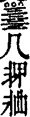



，注曰：『若人识得，不离四威仪中。』首座见，谓众曰：『和尚今日放参。』广寿云：慈明祖揭榜僧堂，黄河九曲直在其中。首座白众，译梵为华只得一半。那一半作麼生？你们不会，请问阿弥陀佛。且道阿弥陀佛即今在甚麼处？其若不知，山僧向第二门头饶舌去也。一念不生，念念弥陀出现；一尘不动，尘尘极乐净邦。故经云：『心清净即佛出世。』又云：『心净则佛土净。』当知十万亿土初不外乎一心也。听取一偈：会得个中无量寿，祖师公案已全呈。庆生不涉阴阳句，水鸟风柯念佛名。」



除夕，示众。云：「古者谓山中无历日，寒尽不知年。今者居山预备做岁，与廛居何异？山僧虽不预备，亦愧古人多矣。兹者诸执事强山僧应个时节，临时无一物可为分岁，记得现成一则公案，总与诸人结般若缘去也。今朝腊月三十日到来，阎老子要徵汝们饭钱，未审将何抵对？」一僧云：「小尽二十九，大尽三十一。」僧云：「恭惟大王万福。」一僧云：「从来不曾咬著一粒米。」一僧云：「今年锥也无。」一僧云：「昨日还了也。」一僧云：「心不负人，面无惭色。」一僧展两手示之。「观此数转语，颇有衲僧气格，足以酬偿，然检点将来，犹欠息在。其中有一转语：有权、有实，有照、有用，无得、无失，无欠、无餘。如有检点得出，许伊坐受人天供养；其或未然，五过五进一十。」



元旦祝圣。云：「天得一以清，地得一以宁，君王得一天下贞，衲僧得一公案现成。现成公案如何举？一尘春风祝圣人。」



示众。云：「说禅说道，孤负佛祖；论心论性，埋没己灵；无言无说，小乘枯禅；流出胸襟，急须吐却。纵展百千三昧，到广寿门下总用不著。且道广寿有甚麼长处？一任诸人疑著。」



中津太守源长胜檀护求荐故考中散大夫慈源惠公，请升座。僧问：「秋雨晴，秋风清，秋山空，秋水明，正与麼时，如何是荐拔一句？」答云：「体露金风。」进云：「此莫是中散大夫转身处麼？」答云：「露也，露也。」进云：「只如孝子请和尚举扬大法，以报罔极之恩，还有端的分也无？」答云：「子试道看。」进云：「恁麼则子流孙派日绵远，为有丰源活水来。」师云：「放你三十棒。」乃云：「慈源居士在世之日，持己也德，为政也仁，缁素均感其恩泽，大限忽临，宴然委顺，此以见其生平也。兹当七七之辰，孝子请山僧举扬法要，以荐贤灵。然山僧口挂壁上，一法也无，犹恐孤负，不免於无法中演法，以慰孝诚。」乃竖拂，云：「还委悉麼？当下荐得，超拔已竟；其或不委，再垂方便。有生有灭，水面沤花；无去无来，空中鸟迹。正当恁麼时，且道向甚麼处安身立命？」良久，云：「五品位中留不住，无生国里乐陶陶。」



荐养德院益翁居士。师云：「养德院有一片无阴阳地，益翁居士未出母胎时已承绍了也，直至于今始为安乐窝。有孝女那须氏，营斋修佛事，请法为津梁，冀其乃翁灵性圆明，高超净域，不历祇劫，顿证无生。正与麼时，如何是益翁转身一句？梦回喷嚏如雷吼，触破弥陀鼻半边。」



荐男。师云：「兵部太辅源长安居士，天性良实，精练家法。退公之暇，遵父祖庭训，崇信三宝，以笔墨为佛事，日书普门品一卷，兼以禅宴为程课，如此五十年若一日耳。今春染微恙，便有转凡之念，遽尔西生，藉此平日信力、般若力往生无疑。然愿力弘重，还期应现耳。老太守请法以资冥福，聊说伽陀，为荐长安之德。苍苍洋洋，长安面目，山高水长。大悲愿重，应现他方，普现色身，随处津梁。痘花暗结菩提果，一度风来一度香。」



岛村自雄信士荐考理白日脱居士。师云：「古今无二道，天下共一理，理白则日日解脱，道明则处处皆通。其通也，去来无碍；其脱也，生死自在。天上人间潇洒庆快，理白亡灵曾恁麼一回也未？如曾恁麼，许汝明白会得教家极则道理，更须知有祖师西来直指超凡超圣的消息。且作麼生是直指消息？」卓拄杖，下座。



荐夫。师云：「夫生必有死，聚当合离，纵位极圣贤，亦不能免，但凡圣与贤愚有等差耳。若生无愧，死无憾，有不死者存，道中其人欤？今夏四月望后，乃其大祥讳辰，乃内道传求法语追荐。愧山野无言可说，只教伊且自看生从何来，死从何去，者里看得透，便知道中安身立命处，抑晓得自己本地风光与安身立命之处，则生来死去全成一大解脱矣。再听一偈：红轮西去又还东，莲始开时果在中。信女斋僧求荐拔，钵盂张嘴笑薰风。」



大堂林居士求荐故戚，请对灵。师迺云：「性秀、性茂，夫妻偕老，正信乐善，优游一世，寿考而终，必也往生无疑，何用山僧超荐？缘彼遗嘱，请山僧举扬般若，以助冥福，故不违本愿，作法施去也。」遂举：「赵州和尚因僧问：『未有世界，早有此性；世界坏时，此性不坏。如何是不坏之性？』州云：『四大五蕴。』进云：『此是坏的，如何是不坏之性？』州云：『四大五蕴。』」师云：「赵州寒潭彻底，此僧徒费捞摸。若向彻底处明取不变不迁一著子，便知天地未分之先、世界已坏之后，於中无丝毫起灭、无丝毫荣悴，但随所作心，应所知量，故有生住异灭。且随缘不变一句作麼生道？时节不相饶，乾坤常自在。」



源长真檀越荐德叟老居士，请升座。僧问：「七七由来四十九，大海起舞昆仑走，昔不曾生今不亡，一道神光亘宇宙。只如远州太守恭请和尚举扬佛法，如何是荐拔德叟老居士底句？」师云：「不二门大启，为接老维摩。」进云：「尽大地总是和尚舌头，阿那个是说法听法者？」师云：「昆仑走入海。」进云：「与麼则上无攀仰，下绝己躬去也。」师云：「劈破銕馒头。」进云：「饱却毗耶翁则得，作麼生是荫庇后昆一句？」师云：「腊雪播春风。」僧礼拜，师云：「还我荐拔前一句。」僧问讯，云：「空王为证明。」师云：「放过一著。」僧问：「德叟老居士现今在什麼处安身立命？」师云：「在山僧眉毛罅里。还见麼？」进云：「见了也。」师云：「换却汝眼睛。」僧礼退，师迺云：「今日孝子源长真太守请升此座，用荐尊严，约祖师门下无启口处。然世谛报恩，凡圣共遵，山僧可不曲垂方便，俯顺孝诚，作法檀二施等也？」遂竖拳，云：「大众委悉麼？有去有来，犹伸拳握掌；了生达死，如著裤脱衫。此德叟老居士早已看破了也。所以，攃手之际，屹挺霜崖；结果收因，如卸落叶。而况不违本誓，从初地中示现元勋而佐治邦国，兴隆三宝而护惜四生，恩惠感在众心，功德播於后世，定生胜处无疑，何用山僧为荐？虽然，菩萨尚有隔阴之迷，贤者宁无微细之惑？微惑未尽，莫证其极。今也，微惑既破，令证其极，直下与佛祖同源、人天合辙，随处自在、当处解脱。正恁麼时，如何是最后究竟的句？」以拂敲空，云：「拨转上头关捩子，阎浮兜率任翻身，珊瑚撑月枝枝秀，不愧灵山受记人。」下座。



戊申上元，谢院事，上堂。法云问：「福海一场圆觉，寿山万古伽蓝，因甚有结有解？」师竖拂，云：「是解？是结？」进云：「恁麼则灵山一会俨然未散。」师云：「眼里一枝花。」进云：「当时世尊三昧为甚迦叶不知？」师云：「莫谤迦叶好。」进云：「今日和尚三昧为甚诸人总知？」师云：「莫谤自己好。」进云：「只如顶门别具摩醯眼，和尚如何相接？」师云：「如何是顶门眼？」进云：「烁破佛祖面目。」师云：「脑后一槌自领出去。」云礼拜，云：「谢和尚证明。」师云：「更领一顿。」问：「欲识佛性义，当观时节因缘。时节若至，其理自彰。正当恁麼时是何时节？」师云：「雪晴大地春。」进云：「恁麼则觌面相呈，更无回互。」师云：「鹞子过新罗。」进云：「相识满天下，知心能几人？」师云：「如何是知心一句？」进云：「今日亲蒙和尚指示。」师云：「蹉过了也。」问：「广寿第一关如何透？」师云：「脚下具眼始得。」进云：「如此则大道透长安。」师云：「你即今在关内？在关外？」僧一喝，师打云：「放过则不可。」迺云：「王臣檀护佛法，山僧祖令全提，领众三载，无愧始终，饮水知源，酬恩有地。今也眉毛拆散，光彩重重，鼻孔辽天，全彰意气，但随时节因缘恁麼去，则卷舒自在，隐显自由，觌面一关如何通透？如透得，踏长安路，晤天下知心人，有甚麼难？其或未然，触途成滞。更有最后向上一关，还委悉麼？世尊三昧，迦叶不知；迦叶三昧，阿难不知。互不相知，递代流传，至于今日。只如山僧三昧，诸人皆知，为甚彼此了无消息？且道有流传耶？无流传耶？忽有个汉出来道：『请和尚分付。』山僧呵呵大笑，展两手示之，大众证明。更听一偈：顶眼揭开新日月，许伊是广寿同流，檀恩答罢无餘事，容我闲从瑞鹿游。」下座。



小参



信士陈朝中祈嗣，请小参。问：「水澂月现，有感必通，请师瑞应麒麟儿。」师云：「张公吃酒李公醉。」进云：「恁麼则春色满园关不住，一枝红杏出墙来。」师打，云：「且惺惺。」乃云：「信是万行功德母，长养一切诸善根，以之回屋头春色，以之植荫凉大树，以之续照世明灯，以之成诸佛子住，以之拨转如来法轮，以之揭示衲僧巴鼻，如川赴海，如月临渊，随机应现，莫不皆然。只如本有一句如何著力？云里掣开金凤锁，棒头点出玉麒麟。」



刘曜哲居士荐严，请对灵小参。问：「生是不生生，死是不死死，只如了生死无面目汉子，和尚作麼生超荐？」师云：「无影枝头一点春。」进云：「灯笼侧耳，露柱点头。」师云：「知恩方解报恩。」乃竖拂，云：「灯笼侧耳，露柱点头，且道闻底闻个甚麼？说底是甚麼法？法本无法，说本无说，无法无说，说法如雨。者里荐得，乃能庆快平生，报恩资有，了了分明；其或未然，再垂方便去也。一灵觉性，本然清净，亘今古而不见其际，穷十虚而不见其边，天地依此覆载，日月依此照临，世界依此成立，万物依此出生，此即人人本来面目，此即空王本地风光，只贵自家信取、自家领略，彻下通上，浑无凝滞，以之行孝，孝无不至，以之酬德，德莫不酬。正恁麼时，如何是独脱超升一句？」掷拂，云：「赤脚踏翻生死海，全机靠倒涅槃山。」



荐夫，请小参。甚吉问：「今日性茂为性秀请和尚演法，未审何以超度？」师云：「业镜台前鬼放卵。」进云：「且喜尘尘入正受去也。」师云：「黄泉路上好翻身。」吉作礼而退。僧问：「雪花片片不落别处，毕竟落在何处？」师云：「汝道甚麼处？」进云：「无底篮子盛将来。」师云：「拈出无底篮看。」进云：「一段风光描不尽。」师云：「与汝三十棒。」问：「如何是无寒暑处？」师竖拂，云：「向这里荐取。」进云：「恁麼则礼拜退。」师云：「知落处始得。」一僧出，礼拜即退，师云：「三世诸佛到来也无开口处。」乃云：「观色即空成大智，故不堕生死；观空即色成大悲，故不堕涅槃。只如色空俱泯，且道成个甚麼？苟能明此，不但智悲无著处，涅槃生死等空花。涅槃生死既等空花，父子夫妻皆同梦幻。所以，性秀善人年逾古稀，不以子嗣介怀，独乐宿命，可谓达矣。客冬长揖人间，怡然独脱，人羡其无累，予知其茕也。必如维摩诘以柔顺为妻、以智慧为男、诚实为女，日日团𪢮说无生话，此之真眷属非人间梦幻可比也。惺惺不退固无疑，如何是不堕凡圣一句？劫外灵枝开独秀，石人梦破日三更。」



独立禅德出关，小参。云：「梅咢破雪，风竹敲窗，观听分明，未透声色。直须於见闻俱泯处，踏翻路头，拨转关捩，迥出威音前，高超毗卢顶，显大机，发大用，建大法幢，始与瞎驴气分相投，亦不虚幻寄活埋一番。兹者千日期圆满即且置，作麼生是透关一句？明星当午现，梅灿一枝春。」



小参。师云：「融光、道通、缁素等追荐痘亡鸠造法华塔落成，请山僧证明小参。山僧久不说法，亦无法可说，不免举些现成公案，以副群诚。六祖云：『心迷法华转，心悟转法华。』且道唤甚麼作法华？又作麼生转？若向者两句下透得，宝塔随处出现，玅法时时宣传，不惟令一切见闻随喜者开示悟入，共证一乘，抑令华严会上所度善财童子及法华会上所度八岁龙女，当下领诸痘亡数千童男女一齐成佛去也。正当恁麼时，如何是超方一句？大地生头角，触破太虚空。」下座。



太原左兵卫为荐故友卢君用、翁允燕，请小参。师云：「卢、翁二君生平有逆风把柁、截断众流之能，今日且置一边，只如《圆觉经》云：『我今妄身四大合成，当观身中坚硬归地、润湿归水、煖气归火、动转归风，四大各离。今者妄身当在何处？』到者里不知落处，唤作迷头认影，不妨就此影子里借路还家，直下回光返照，穷究妄源，究到山穷水尽，密移一步便是安身立命之处，一任团𪢮头，共说无生话。二位觉灵还委悉麼？自是不归归便得，五湖烟景有谁争？」



肥前国佐贺郡弟子道零，求荐父锅岛氏信浓守胜茂泰盛院泽圆良厚居士，母冈部氏乾秀正贞孺人，夫神代氏冈介常利全荣，子长门守常宣，姐亨岩玅贞，设斋，请小参。师云：「龙泉聪禅师因僧问云：『今朝四月八，天下丛林皆庆如来降诞，未审如来向甚处降生？』泉於几上畫圆相示之。」师召大众云：「若有会得者一圈落处，未出母胎，度人已毕，透脱死生，是甚闲事？其或未然，悉达太子又向者圈里出生，度诸有情；胜茂信浓守暨五位觉灵亦向者圈里入灭，承佛记莂。虽然，此犹是建化门头事，若是出格丈夫，超情离见，别有生涯，正当恁麼时，把断要津，不通凡圣。且道：悉达太子及信浓守胜茂、数位觉灵向甚麼处安身立命？一把柳丝收不得，和烟搭在玉栏干。」



秉拂



福唐黄檗西堂寮秉拂小参。僧问：「如何是格外句？」师云：「雪里埋金。」进云：「莫是雪窟家珍麼？」师云：「马头漫栽角。」进云：「争奈落眼成翳？」师云：「未肯和沙卖与人。」进云：「只如大海为墨、须弥为笔，一畫下不得时如何？」师云：「文彩已露。」问：「箭锋相拄即不问，单刀直入时如何？」师云：「我被汝看破。」僧作听势，师云：「汝被我热瞒。」进云：「了。」师云：「彼此不相饶，试道一句看。」僧便转身，师云：「汝义堕了。」问：「妄心不息时如何？」师云：「拈出妄心看。」进云：「如何了得生死？」师云：「问取翁仲去。」僧礼退，师乃云：「堂头老人命第二座秉拂，也是怜儿不觉丑，两堂诸大德降尊就卑，大似逼石女生儿。不肖一介麤行，自了未能，敢向作家前说黄道白，无乃负布鼓而过面门？今既推辞弗获，勉强从命，不免将错就错，翻转古今窠臼，奇言妙语拈过一边，热喝痛棒送向他处，焚三玄戈甲於二六峰头，碎五位鎗旗于三三潭畔，行未行之令、报莫报之恩，及到人天众前，全无一点气息。然虽如是，令不虚行，却举些切要说话，以副堂头严命，与诸兄弟递相警策去也。昔盐官会下有主事僧，忽见一鬼使来追，僧告云：『某身充主事，未暇修行，乞容七日得否？』使云：『待为白王。若许，七日后来；不然，须臾便至。』言讫不见。至七日后，复来觅其僧，了不可得。诸兄弟！还委悉麼？主事僧七日精进，鬼使便摸索不著，且道向甚麼处安身立命？如有缁素得出，不孤生平拨艸瞻风；苟或一向颟顸，正好痛自鞭策，莫待铁棒当头，噬脐无及。忠言逆耳，伏望垂慈。」



福唐黄檗首座寮秉拂升座。云：「拈出黄檗乌藤，千圣魂飞胆落；高悬雪峰古镜，野狐削迹吞声。饱参尊宿，有劳证明；格外弟昆，如何通信？莫是默然良久麼？竖拳下喝麼？纵展百千三昧，到这里总纳败阙。设有没面目汉别转一机，向无凑泊处伸出三头六臂，夺折乌藤、打破古镜，亦未是衲僧本分。如何是衲僧本分？棒头有眼明如日，灼破菱花未照前。」



太和黄檗首座寮秉拂上堂。僧问：「临济入门便喝，德山入门便棒，如何是临济意旨？」师云：「汝不是临济儿孙。」进云：「如何是德山受用？」师一喝。进云：「临济喝、德山棒，是同？是别？」师云：「一串串过。」进云：「先圣后圣，其揆一也。」师云：「汝在甚麼处见临济、德山？」僧无语，师云：「虚头汉。」迺云：「十五日已前，行到说不到；十五日已后，说到行不到。正当十五日，行说俱到犹是半提，作麼生是全提？列位既勘不出，适来问话宁属影响？」就举：「汝问我：『临济入门便喝。』我答了，便下一喝。古云：『一喝全宾主，照用一时分。』且道：宾主照用在喝里耶？喝外耶？或不里不外耶？者里具得一只眼，临济、德山结舌有分；其或迟疑，秉拂头陀再垂方便去也。」又举：「临济上堂次，两堂首座相见同时下喝，僧问：『临济还有宾主句也无？』济云：『宾主历然。』复召众曰：『要会临济宾主句，问取两堂二首座。』」师云：「首座两张嘴，其一舌头放光；济祖一个鼻，借两窍出气。宾主句还他一对无孔铁锤，主中主须是老古锥始得。头陀恁麼举似，还惬两堂诸昆仲证明也无？选佛迸开千手眼，昆仑骑象点头回。」下座。



播州道婆元正荐夫道立，请秉拂上堂。悦众问：「龙象云集，和尚说什麼法？」师云：「日午三更。」进云：「若有人耳听如聋、口说如哑，又如何祇对？」师云：「石人反侧。」僧便喝，师云：「口不曾哑，耳不曾聋。」问：「如何是向上一路？」师云：「向下问将来。」僧绕一匝，云：「步步踏著。」师云：「纵绕百亿须弥山，到山僧门下总要吃棒在。」进云：「不是，不是。」师云：「如是，如是。」问：「猛虎当路坐，如何过得？」师云：「浑身在里许。」进云：「毕竟向何处安身立命？」师云：「汝丧身失命了也。」进云：「如某甲意，竹密不妨流水过，山高岂碍白云飞？」师云：「且莫念诗篇。」僧礼拜，云：「谢和尚答话。」师喝，云：「虎头虎尾一齐收。」问：「未开口已前，请和尚开示。」师云：「未登座时答汝了。」问：「愿和尚开甘露门。」师云：「▆著源头一滴水，为霖为雨遍三千。」惟澈问：「昔大慧省觐圆悟，悟命秉拂，有元禅客出问：『眉间挂剑时如何？』慧曰：『血溅梵天。』圆悟忻然，曰：『问得极好，答得更奇。』今请和尚别一转语。」师云：「放下剑子。」进云：「固知和尚大有超方之作。」师云：「切忌犯锋铓。」澈礼拜云：「昔日大慧，今日和尚。」师云：「被汝看破。」迺云：「圣寿上堂，禾山打鼓，惊动玅高峰点头、双鹤亭起舞，直得有情、无情同来听法，十方龙象共作证明。自愧慧浅德凉，敢向河头卖水？然师命不敢违，勉赴来机。」遂举：「末山尼因灌谿问：『如何是末山境？』山云：『不露顶。』谿云：『如何是末山主？』山云：『非男女相。』谿乃喝云：『何不变去？』山云：『不是神、不是鬼，变个甚麼？』」师云：「灌谿虽有本分钳锤，争奈末山是锻过的真金，了无异色。兹者道婆元正落发修行，头脑与末山相似，惜乎参究不到他田地，所以见有男女、有眷属，有菩提、有涅槃。若向非男女处一觑，觑破菩提、涅槃，不消一捏，到黄檗门下，主山犹未肯点头。正当恁麼时，如何是独脱一句？庞公过去久矣，有烦众师久立，伏惟珍重。」



孝子祐竹等荐故考常有信士，请秉拂上堂。僧问：「如何是佛？」师云：「头顶五须弥。」进云：「如何是法？」师云：「口包四大海。」进云：「如何是僧？」师云：「双眸悬日月。」进云：「三宝已蒙师指示，向上一著如何趋向？」师打一棒，云：「会取佛法僧。」僧一喝，师云：「伶俐衲僧最难得。」齐云问：「一法若有，毗卢堕在凡夫；万法若无，普贤失其境界。去此二途，请师超荐。」答云：「云藏无缝袄。」进云：「恁麼则坐断真空玅有，直登上品莲华去也。」答云：「花灿不萌枝。」僧礼拜而退，师迺云：「生前无业累，死去快如仙，当下信得及，不用哭苍天。其或未然，再垂方便。常有信士白手起家，惜土如金，周人之急，惟义是从，乡人称为善士也。一旦无常，乘时委顺，其孝子贤孙以父祖形容不可见，而其灵明不昧未尝亡也。三七之辰，特进山请法以荐其亲，是可谓能知孝道者耳。予虽不敏，承堂头老人委命，勉副来诚，伏惟谛听。常有五十八年前之生也，犹月映寒潭，虽有有之有，不有於有也；五十八年后之灭也，如云散长空，则无无之无，不无於无也。不无之无，圣凡非减；不有之有，来去非增。正当恁麼时，如何是超空有、证真常的消息？顿明无相天真佛，休恋黄金铸旧颜。」下座。



立春，秉拂小参。问答竟，迺云：「今日立春，承方丈老人命，第一座秉拂与大众结般若缘，有烦两堂法昆仲降尊证明，应个时节去也。青帝笏头点出无边春色，达摩脚下重敷五叶一花。」复竖拂，云：「且道：祖师未西来时还有者个也无？若道有，有在甚麼处？若道无，争得者个来？若向个里觑得破，一任开凿，人天眼目随处簇锦铺红；其或未然，不免随渠流转。且作麼生是不迁之句？春风影里乾坤大，万福堂中日月长。」



即非禅师全录卷之四



门人明洞、性安、性节、明觉、明幢仝编



法语



示灵智禅人



向上一著，直截承当，操持久远，从古为难。历观前辈，拌舍身命，不顾危亡，千里万里，求明师胜友，与之决择大事，动是三二十年，遍试诸难，乃至尽形寿，辨不退转之心，以愿力所持，穷劫不化，亘古如一日者，良由根器猛利，规度恢宏，所以涵养练磨，造诣深远，一发其用，则光明盛大，为人天之师表，揭日月千昏衢，诚非苟然也。子於般若有缘种，亲宗学道，一以古人步履为标榜，猛著精彩，进进向前，到扑不破处，廓然脱体透彻，果能发挥灵智，转益未来，庶几不负最初超方本志也。



示昙瑞监寺



昙瑞禅人，福州长乐陈氏子。幼失怙恃，与胞兄相依。一日，伊兄秋试，值乡中有警，逃入浙中密印寺出家。行苦行二年，精进无怠，过中不食。夜礼愿文，天寒衣单，往处州乞缘。谿行失舟，堕急流中，随波出没二里许，意不散乱，极力冥称观世音菩萨名号。忽从覆出，遇官船，得济彼岸。同舟文学两人、商客四人，俱淹没而死，独子再生。归辞寺主，欲别求出世师。主曰：「不须别去。」直指参予薙染为弟子，随予东渡，执巾缾两载，兼理院事。一日，自知精进不及於前，大发猛省，怀香投五，恳求开示。因示之曰：子出家便遇善知识，可谓受化有缘，但志求大法之心未专且切耳。果能以生死事大，参究向上，十年、二十年不异其心、不改其志，如覆舟求出，不悟不止，庶不孤父母四重之恩，亦不负出家遇善知识之缘也。勉之！勉之！



示唯仁禅人



履名山，登福地，穿丛林，观胜境，今年南海，明年五台，后年径山、黄檗，纵经尘沙劫，历微尘数梵刹，参礼诸大知识，总不出幻化门头，而非究竟真实处也，古人唤作迷头认影。汝今不妨就路还家，苟能一步踏翻幻海，直登觉岸，始得本来主人翁矣。努力，嘱嘱！



示彻玄禅人



吾观从上佛祖，无有不从行门中建立世出世间福田功德。今去古远矣，名字比丘率无惭愧，一味养嬾，三业不修，肯念佛祖慧命利及将来乎？彻玄禅人生长东方，屡慕西竺典籍，生难遭想，发心募刻书本藏流通，思与十方四众同种般若胜缘，共续佛祖慧命，藉此慧命永寿邦家。如此为僧，大越於人多矣。予闻之不胜赞叹，欲令彻玄竿头更进一步，向佛祖未出母胎时一则公案一翻翻转，是名转大法轮，是名报佛深恩，努力勉旃。



示勇学禅人



如何是临济禅？曰：青天轰霹雳。若向者一句下会去，可以入凡入圣，入一切国土，度脱有情，无诸恶碍。但切忌卜度，卜度则又成智解也。勇阇黎勉之。



示玄通禅人



子有志向上，切勿向他人言语文字中求，须向自己心地上求。子自己妄想是虚谬，又将他人言语把作实法会，则是重增一重障碍耳。佛言：「狂心不歇，歇即菩提。」胜净明心，本非外得。果能如此放得下，看得破，便是了事凡夫。努力勉旃。



示道模禅人



出家人以持戒为根本，礼诵作福为助因，参禅办道为正果。如是操持参究十年廿年，如不悟，佛祖堕妄语矣。努力努力。



示性具禅人



本具性善，如艸种在地，但有土处莫不有之，若遇时雨靡不发生。今有缘遇善知识，譬如智种含心地，遇泽悉皆萌，将来必成玅果，所谓佛种从缘起也。



示梦觉禅人



若谓是梦，觉者是谁？若谓是觉，因何有梦？梦即觉，觉即梦，犹未离梦觉，梦所梦尽，觉所觉空。且道主人公在甚麼处？参！



示铁牛禅人



铁牛不怕狮子吼，遇著胜热婆罗门又作麼生？这里透得过，五十三人呼来摇橹，未为分外。其或未然，过。



示铁崖禅人



好一座铁崖，纯钢铸就，不费钳锤。虽然，争似黄金百炼，愈见光辉。



示法云上座



若论此事，如金翅拍海，直取龙吞，始有衲僧气息。子之机用颇以相当，只是藏而不露，待时而彰，此便是出人一头地。山僧忍俊不禁，展起须弥粗拳，觌面分付，子甘受之，更复何云？咄！咄！



示万拙禅人



一也不立，万从奚生？觅巧不得，拙自何来？圣名凡号，总是虚声，描之状之，空中捉响。



示愚岳上座



岳为众山长，海为万派宗，蟭螟眉底坐，吞却太虚空。正恁麼时，还容愚智也无？咄咄！



示崎主



夫参禅学道，本为透脱生死，只贵当人具决定信、发勇猛心，照彻身名世界泡幻无实，把平日自己妄想忘念、恶知恶见尽底掀翻，壁立千仞，然后将佛祖一节公案昼夜提撕，眠食行坐无容走作，今日也如是、明日也如是，逗到嬴纹结角处，㘞地一声，豁然如云开日出，即此便是发明大事时也。发明之后，更须依本分宗师为解粘去缚，方能了生脱死、超凡越圣、变通自在。如公到家，家权在手，堂上一呼、堂下百诺，大开宝藏，利济无穷。到此时节，方知佛祖善知识不汝欺也。公其勉之。



示郑居士



乡人郑虎谿文学，曾遍参曹谿、长庆、庐山、径山、黄檗诸大知识。近来圣寿请益，山野谓之曰：「若论此事，非语言之所能传、心思之所能及，必须识得古人道的。如古德问秀才云：『百姓日用而不知，不知个甚麼？』才云：『不知道。』德云：『灼然不知。』山野曰：古德暗指路头，秀才举步踏著，无端被古德向脚跟下一锥，直得至今未点地在。点与未点则且置，毕竟唤甚麼作道？」士答云：「和尚手中如意子。」山野曰：「如意是道麼？」士拟议，山野曰：「白云万里了也。」又曰：「末后一句始透重关。若也会得，捉败古德、看破同袍，一任孤峰顶上啸月吟风、十字街头和光纳垢，转尘劳为佛事，现居士而说法；其或未然，正好如昔日临试官完卷时，不可须臾忽也。居士勉之。」



示林居士



斋戒信士惠林者，瀚江林孝廉之堂弟也。骨刚气雄，质直慷慨。每见事之不平，无论可否，或有可为者，即轻财舍命以当之，人皆义之。予不然，曰：此是血气所使，非由道力发也。将此血气置在般若之上，何患道之不成，义之不广也？血气之盛，譬如万斛之舟，正好趁其时节，乘风张帆，便有瞬息千里之势。若也钉桩摇橹，驴年得到彼岸也。子能知时节，趁因缘，工上加工，切上加切，忽然喷地一声，万夫拦不住耳。转身向上，一路自有木和尚为子道破，毋容饶舌。因子请益，聊书数语以发之。



示岛田崎生



若论向上一著，了无别说，贵在当人辨久远铁石心身。然此一著，人人本具，直下未能发明者，如果仁之在核，未有浸入之功、熏发之力，所以枝叶花果皆隐仁中，未得发现也。若遇善知识，教其增培心地，长养善根，灵苗顿发，千枝万叶，即是收功结果之时也。然后发之为道用，著而为经书，列而为纲常，转而为事业，上可以事君亲，下可以抚百姓，扶正除邪，奖善罚恶，致功名於不朽，证清净於无为，皆承此一著恩力受用也。兹岛田檀护治崎，发政施仁，明如止冰，不为事物所转。公事之餘，直欲究明向上一著，此非夙具大根大器，安能汲汲如是哉？初夏间，出卷一帙，请益开示，予从直截根源处显明开发。倘于公私之暇，著实参究，一旦豁然瞥地，方信予言为有据矣。勉旃！勉旃！



示林英士



林子熟也，姿禀俊秀，幼读书，一览辄通大义。及长，尤工真艸篆隶，诗词敦笃，有乃父风，长者莫不爱之。丁酉春，值予东渡，卓锡圣寿山中，常来参谒请益。予见其心善下，於般若有夙缘，每以向上语之，其心领若饮水焉。今岁辛丑秋杪，崎主邀之偕游东武，特来拜别，并乞数语佩奉。因谓之曰：若论此事，如种树一般，初培以厚土，徐沃以清流，及其成立长大，受雨露之恩，饫日月之华，然后听其时节开花结实。实既熟矣，或为献佛，或为进御，或以待宾，或资家用，取之不竭，用之无穷。世出世间不外于此，子其勉之。



示野山丹后守



五蕴山也，人我山也，涅槃山也。一切圣凡，出生入死，未尝不居於此山也。若能坐断此山，全身是道，则无内无外，无彼无此。到恁麼田地，便是超生脱死的时节，也终日事上御下，了不相妨。其或未然，世间事逐眼前过，不觉老从头上来。



示范信士



信士范石甫者，泉人也。斋戒笃行，善以雕刻为佛事。癸卯冬，黄檗老人命造大士及十八罗汉、祖师、伽蓝像，巧心玅手，难可云喻，瞻礼者莫不赞难希有。一日，仲纸求开示，因示之曰：「像之未成，全佛是木；及其成也，全木是佛。佛不自佛，从缘而成；以类推之，物物皆佛。所谓是心作佛，是心是佛。只如祖师云：『不是心，不是佛，不是物。且道是甚麼物？』向者里下得一转语，是真造佛。」石甫作礼三拜，塞白还之。



示超方信士



平等本际，无圣无凡。为起一念不平等之见，则圣凡分耳。所以有佛、有众生，有烦恼、有菩提，有六趣、有六度。若在当人分上，在圣不增、在凡不减。无明即佛性，烦恼即菩提。无明烦恼喻冰，菩提佛性喻水。迷则结为冰，悟则消为水。今子所问，或云：厌烦恼而求菩提，断无明而证佛性。此是二乘见解，何异离冰求水？又云：见性明道，总属妄想。佛是何物，而欲成之？此是拨无外道，犹如执冰排水。并是邪见邪解，非惟孤负佛祖，抑且孤负己灵。如其利根上智，向自家跟脚下，确实见彻本源，更无丝毫透漏，方始辨得邪正，不堕恶知恶见，亦不起佛见法见，截生死流到休歇地，乃为真个超方解脱之士也。



示林大堂居士



《易》曰：「天道好善。」《书》曰：「紧德紧馨。」可见古之圣贤，其不同于人者，无非继之者善，而成之者性也。山野于居士，窃有取焉。居士德性淳和，践履耿介，与人无妄语，凡一取一与，莫不与义自持，此诚闽邑之流馨，鉅族之轨范也。初年即知归命黄檗老人，向上之志已云笃矣。殆与山野周旋十餘年，肫肫以佛法从事，朝夕在家炷香持诵，于尊人坟墓，四时八节致其孝思，每时来寺中设供，构山亭以供游览，施花园以广山门，倘非真实正信，乌能一一不作铢两计耶？世人务为身家利便之私，而居士惟知积善植福为宝，则异日云仍继美，高出门户，岂非合天道鬼神之心哉？山野嘉居士之行，书此以勋向上一著，当自勉旃。



示法真优婆塞



法真虽处尘劳，心常清净，乡里咸为起敬，谓其在家杜多也。弱冠不娶，发愿断婬，祷于大士，求加被。一夜，梦授陀罗尼咒一遍，曰：「诵此不验，吾不名正法明。」觉而婬机顿寂，忘念不生，遂炷香观想，描写大士相好，极其庄严，盍神授也。丙午孟春望，奉持入山，上山僧清供，因鉴其诚，为之纳供丈室。乃问曰：「有个无面目汉，如何描邈？」法真下语不契，复谓之曰：「子之品行固佳，但未发明心要。心要不明，露柱亦持戒也。持戒获福报，生死终是不了。欲了生死，须明心要。心要已明，慧光、戒光同日月并辉，可不勉旃。」



示那须氏丰夫人



佛言，遇道人难，道人遇矣，兴正信难；正信具矣，发菩提心难；菩提心发矣，全在时时栽培而保护之，否则无增长之日矣。保护之功，须仁泽灌溉，慧日照临。要以照润及时，方能有济。若雨多则烂，日多则焦。雨旸均，则根日固，树日长，心花发现，福果圆明。然后可以利济一切，覆荫大方。如此可谓功成矣。努力努力。



示元荣



修行在乎观心，植福在乎万行。观心以参禅为最，万行以供众为先。参禅须是上根器，植福还他大福人。汝於二者兼而有之，可谓大心菩提耳。然虽如是，人天福报则不无，超凡入圣尚远在。参禅植福，若不悟明佛慧，则禅定万行亦化为福。福是有漏之因，福报亦有尽时。第欲免三途、超三界，藉福为进道之资，直须悟明佛慧乃可。经云：「供养百千辟支佛，不如供养一无心道人。」且道辟支佛有何过？道人有何长？者里开得一只眼，是真参禅？是真供养？其或未然，莫道不疑。



示在原优婆姨



末世修行，信得此事及者，如披沙拣金，非曰全无，盍亦鲜矣。迩筑州有贵种正信女，丈夫在原氏，归向三宝，旦夕禅诵，虽居华室，乐远离行，惟欲究明一著子，为未来际金刚种子。此皆从夙生般若中来，志可嘉也。戊申夏，特托梵禅远来参谒，代请上堂法语，为进道之资。恰值山僧退闲，不能如命，恐孤远诚，乃书数语以示之曰：智度菩萨母，容受一切法。然此一切法，在圣不增、在凡不减，在难不远、在易不近，在失不无、在得不有，亘古亘今，无欠无剩。只为历劫久远，被习染所移，纤毫不透，狼籍三千，致令真净法身变作业质，清净玅土化为六尘。若能回光返照，勿舍寸阴，参取赵州万法归一，一归何处？忽朝觑破，则从前六尘业质，犹百川归海，融成一味耳。到此时节，方知步步极乐、念念观音，纵横自在，无得不得，然后随缘助宣王化，福利斯民，岂特嗣续慧命而已哉？更赘一偈：此事犹如沙里金，工夫不到总难寻，顶门突出金刚眼，照彻婆婆三世心。



示宗朴信士



阿那律陀尊者，此云如意，乃白饭王子也。过去世以一饭施辟支佛，感九十一劫受如意乐。《增一阿含经》云：「佛在给孤园为众说法，律陀於中眠睡，佛说偈诃曰：『咄咄何为睡？嬴蛳蚌蛤类。一睡一千年，不闻佛名字。』律陀於是涕泣自责，至七日夜，禅定不眠，因失双目。及得天眼，通观大千界如掌中果，可谓旋见循元，斯证第一矣。」兹筑前宗朴居士，乃正信之士也，壮年亦失两目，虽感果不同，则佛性无异。今能作种种好事，入山斋僧，此一饭之施，功超等等耳。倘更能回光返照，将父母未生前本来面目一句六时参究，以悟为期，忽朝瞥地，如久处晦暝，忽睹天日，岂不庆快平生？然后可与阿那律陀把手共行，於末运中作大佛事，利益有情，庶不虚来阎浮一上矣。宗朴不惮数日途程，特来请上堂，值山僧退闲，不能如命，怜宗朴之诚，略引教家方便以示。若论达磨极则，待宗朴顶门眼开，再通消息。



示梦堂上座



梦堂觉上座相从有年，今秋值山僧谢院事退闲，回圣寿山。上座夜行六十里，接予至圆通信宿，缁素尽礼，可谓诚敬矣。及到崇福，又来省候，并呈偈颂二册请益。予阅之，大都不错，只是竿头边事，更须退步始得。复示之曰：唐宋禅道大盛之时，天下明眼知识甚多，学道衲子不惮千里万里，到处参扣，如机缘契合，遂得印可，故悟道者不落邪见。以后知识无眼，学者爪印自肯，所以不堕生灭，则落空见，甚至拨无因果，堕落外道。其或悟心未彻，才见影响，便得少为足，说时似悟，对境还迷。如此之人，皆未得明眼宗师勘验，故致如是。故古德云：「不是无禅，只是无师耳。」上座有志大事，为法情深，倘退步踏倒刹竿，则大觉之法道常存，济祖之慧命有赖矣。努力！珍重！



示光巨上座



中秋前，山僧有未了因缘到崎，道经肥前，光巨上座领弟子辈于数十里外相迎，到上刹安歇，礼数甚慇。入门，见其丛林清洁，大众整肃，效唐规矩，朝夕禅诵，所来瞻礼者皆生难遭之想，此皆上座愿力所持也。及予到崇福，又不惮跋涉，远来省候，可谓诚愈笃、义至高也。临别，怀香来求法名请益，因谓之曰：欲得梅花香扑鼻，还须彻骨几番寒。嘱嘱。



示庆存长老



余返锡崇福，三岳存上座领诸弟子迎于三十里外，具威仪向前作礼甚恭。予见其精诚端悫，谓左右曰：「此本色住山僧也。」遂应其斋。上座乃叹曰：「我辈不见唐国知识将四百年矣，今日幸法驾光临，得与瞻礼，岂非夙缘耶？敢求开示一言半句为金刚种子。」山僧因语之曰：「子能持此难遭希有之心，以明佛祖之道，不惟数百年前之开山面目犹在，抑今日承檀越之供养，则福有攸归矣。子其勉之。」



示大众



当此像季，身服田衣，宿生善因，极不容易。须要念德修德，知恩报恩，但以深究死生为第一件大事。不图名，不苟利，除人我见，荡生灭心，大小和睦，内外恭敬，有善相赞，有过相规，惟道是务，勿管是非，此谓之圣贤之聚会。不然，滴水粒米，无非铁丸铜汁，可不畏与？当共勉之。



示实归禅人



世有虚头禅，见他人病，极善开导。或云：一切放下，莫著於病。或云：四大本空，病将安寄？及自家热病到来，一毫主宰都做不得，依旧空不去，放不下。汝今始知放下，须明取本空始得。本空若明，始会得安乐法。努力勉旃！



示晓觉禅人



戒以防闲，定以摄乱，慧以破惑，三学全提，障尽心空，如梦忽觉，此修行纲领也。索我开示书以勉，努力努力。



示用方禅人



用方在广寿为殿主三载，过午不食，夜不胁席，参究之餘，发心刺血，写三千诸佛名号，一字一拜，仗此殊勋，祈答四恩。不一月，拜写已毕，予嘉其诚，乃谓之曰：行既整饬，理要顿明，理若不明，终归虚妄，事理双备，成佛之阶，子其勉之。



示病僧



病有多种，或夙障、或现障，皆因少持律故也。所以平日参究读诵，要除夙现障。今障不能除，非经书公案不灵验，盍由学之不精，参之不力，信之不至也。汝能一念回机，不惟病魔自退，而道从此入矣。所谓病是众生良药，不其然乎。猛省勉旃。



示觉珠禅尼



一切家缘、儿女缘、内外缘，既尽情放下，直教胸中空荡荡，单单提个念佛的是谁？重下疑情，如空中橛子，疑来疑去，疑到银山铁壁处，从新勇猛，奋发精彩。如此用心，久久不退，忽然迸出本来面目，便是超凡越圣的消息也。勉之！



示性空院道婆



肥前州性空院道婆松阴，求荐长男觉智宗本十七年忌辰，特命耑使入山设斋，请上堂，用严冥福。正值山僧养病退闲，不能应，因再求法语，乃示之曰：行一善，断一恶；行十善，超五浊。觉智宗本居士曾修众善，早超极乐，何用山僧为荐？虽然，不因樵子引，争到葛洪家？再听一偈：颠倒想生生死续，颠倒想灭谁生佛？六凡泯处涅槃空，元霄月现宝池中。



示因旛守



大村因旛守居士请益，因谓之曰：「鸟窠禅师示白侍郎云：『诸恶莫作，众善奉行。』然依此修持，不失为君子，亦得人天福报，但未能入得佛祖堂奥。须知当人分上，有不属善、不属恶、不属名言、不属指拟一著子，辉天鉴地，耀古腾今。倘於此处著得只眼，踏断善恶两途，踢翻凡圣窠日，便是入堂奥时节。然后大坐当轩，治政施仁，无不合道。果能直下承当，白翁赞叹有分。」



示昙瑞侒上座最后语



山僧于丁酉春，应崇福诸檀越请，吾徒侍杖跋涉，万里同来。时虽年纪未高，为人淳笃，颇有老成气象。监院六年，宽心处众，内外圆融，明因识果，甚惬众意。癸卯秋，山僧省觐黄檗老人，吾徒随侍上京，暂将院事交化林子掌管。甲辰秋，山僧拟再回崇福，道经丰前州，缘遇小笠原老太守，乘大愿力，勤留卓锡，为国开法，蒙上意允许，随开山广寿。吾徒时领都寺，兼衣钵之职，井井有条，人所嘉叹。越三载，岁在丁未冬，不幸丰君仙逝，山僧随散众，闭门静守。次年戊申秋，直退闲本山，崇福独捐衣钵资，特造黄檗本师老人寿发塔一座，吾徒亦发心捐衣钵资，造庵一所，看守寿塔，以时洒扫，可谓道义两尽。时阙监寺，旧唐诸檀越屡白山僧公举吾徒，吾徒再三告辞，举之益坚，方乃从命，随禀崎主再任寺事。值年来常住淡薄，缘事不广，吾徒为法为山门栽补树木，修破整敝，任劳任怨，力守如常，藂林颇有可观。山僧自东渡以来，两坐道场，甚得吾徒一臂之力，此缁素咸知匪山僧私意属子也。今也欲往他方行脚，无以答吾徒服劳，惟望各自努力，以道静守，为法自重，切勿自轻。徒众有道谊肯作行为常住者，留数人共守；若躲嬾偷闲，不守戒律，不义不法，登时遣出，免得虚消信施，退人信心，玷辱山门，败坏僧风。前所云云，当力行之，不依吾训，匪吾徒也。至嘱！至嘱！前表信一柄与吾徒密藏操履，俟数年后拈出，居山勿得轻露，佛祖慧命非同小可。又嘱。



示翠峰上座



棒头领旨，喝下明宗，早已迟了八刻，说个乾坤大地常露现前，何异白日夸明？若是本色衲僧，当知别有生涯，方可少分相应。肥前翠峰上座从吾淹矣，只为从前杂毒入心，所以触处不无蹇滞之患。及山僧退闲，圣寿再来挂锡，见汝稍觉痛痒，室中紧下针锥，近来瞥地，方知山僧用处未尝欺人，宁匪佛法灵验欤？兹吾欲唱还乡曲子，因付一枝以表远别之信，到者里更须知惭识愧始得。古德尚恐离师太早，未尽要玅，何况於叔世乎？汝只向水边林下韬晦形影三二十年，使脚跟练熟，自然脱落今时，乃是报不报之恩也。至嘱，至嘱。



示光巨上座



若论此事，如千日并照，无一点翳障，纵向未举以前拟欲会取，早已被片云遮了，何况说明说暗，自缠无绳之缚耶？肥前光巨上座，天性牢实，修行有年，尝来广寿参见，寻两挂搭崇福。山僧见他於葛藤露布上作活计，每痛下钳锤，当时不能领荷，昼三夜三，孜孜参究。近到岩头，所谓从自己胸襟流出，一一盍天盍地处，忽然撞著路头，乃呈偈语，山僧劈头便棒，未尝轻易放过。兹山僧将图行脚，因付一枝，以为表信。汝切须自秘自重，不可敢轻开口，只可静地持提，勉息长养，或十年、二十年，待时行化，其必到路头尽处，彻头彻尾，宁匪成就本分事业者哉？嘱嘱。



即非禅师全录卷之五



门人明洞、性安、性节、明觉、明幢仝编



举古



举：「世尊初生，乃一手指天，一手指地，周行七步，目顾四方云：『天上天下，惟吾独尊。』云门云：『我当时若见，一棒打杀与狗子吃，贵图天下太平。』」



师云：「世尊出世，搅动乾坤，云门行棒，无活人剑。我当时若见，亦不用如之若何，但进云：『未出娘胎，略较些子，突出头来，堪作何用？』纵铁铸面皮，也须裂下。还知山僧为人处麼？拨转无为化，追回太古风。」



举：「世尊升座，众才集定，迦叶白椎云：『世尊说法竟。』世尊便下座。」



师云：「世尊要竖葛藤椿，不合随人起倒；迦叶欲直截根苗，那知早生枝叶？惹得后代儿孙牵枝引蔓。山僧恁麼道，亦是郎当不少。」喝一喝。



举：「世尊云：『吾有正法眼藏、涅槃玅心，付嘱摩诃迦叶，广令传授。』天如云：『今日不肖儿孙要问黄面老子：者两件物从那里得来？』」



师云：「若论者两件物，威音以前漏逗了也。更问：从那里得来？将谓忘却。」



举：「世尊在灵山会上说法，有五百比丘，得四禅定，具五神通，未得法忍，以宿命通，各各自见过去世时，弑父害母，及诸重罪，於自心内，各各怀疑，於甚深法，不能证入。是时文殊，知众疑怖，承佛神力，遂手握利剑，持逼如来。世尊乃谓文殊曰：『住住，不应作逆，勿得害吾，吾必被害，为善被害。文殊师利！尔从本已来，无有我人，但以内心，见有我人，内心起时，我必被害，即名为害。』於是五百比丘，自悟本心，如梦如幻，於梦幻中，无有我人，乃至能生所生父母。於是五百比丘，同声说偈，赞文殊曰：『文殊大智士，深达法源底，自手握利剑，持逼如来身。如剑佛亦尔，一相无有二，无相无所生，是中云何弑？』」



师云：「文殊握金刚王宝剑，欲剖如来心胸，何异空中钉橛？五百比丘悟得无有我人，也是梦里渡河。」



举：「世尊因广额旃陀罗日杀千羊，一日至佛所，飏下屠刀云：『我是千佛一数。』世尊云：『如是，如是。』」



师云：「世尊大开炉𩍁，镕屠刀为弹子，换却旃陀罗眼睛。若逢乞眼人，未审全肯放下否？」



举：「世尊往忉利天，为圣母说法。优填王思佛，命匠人雕栴檀像。及至世尊下来，像亦出迎。」



师云：「水底金乌天上日，眼中瞳子面前人。」



举：「世尊般涅槃已，迦叶后至，椁示双趺。后来无准范示众云：『大众！灵山百万，惟迦叶独绍祖位，诚不忝矣。何故？为他亲见黄面老子脚跟来。』」



师云：「无准老汉也是扶强抑弱，觌面欺人。若论瞿昙脚跟，阿谁不见？殊不知饮光曾摸著瞿昙脚跟来。大众！还曾摸著也未？如未，且向自己脚跟摸摸看，纵摸不著，也摸著自己脚跟。」



举：「城东老姥与佛同生，不欲见佛，每见佛来，即便回避。虽然如是，回顾东西，总皆是佛。遂以手掩面，於十指中亦总是佛。」



师云：「将谓老婆眼光灼破四天下，元来病眼见空花，以手掩面，重加一重翳膜，若能回光返照，岂不丈夫？」



举：「维摩诘居士令诸大菩萨各说不二法门时，三十二菩萨皆以二见，有为、无为，真谛、俗谛，合为一见，为不二法门。然后问文殊，殊云：『如我意者，於一切法无言、无说，无示、无识，离诸问答，是为入不二法门。』殊复谓维摩曰：『我等各自说已，仁者当说何等是菩萨入不二法门？』维摩默然。」



师云：「维摩病多谙药性，彻底老婆心，末后被文殊翻转药头，直得佛病、祖病、众生病一时扫踪灭迹。」



举：「达磨大师因梁武帝问：『如何是圣谛第一义？』磨云：『廓然无圣。』帝云：『对朕者谁？』摩不识。」



师云：「梁帝逢而不逢，初祖识而不识，子细观来，两两无面目汉。会得廓然圣，惟我独尊。」



举：「布袋和尚以破布一块裹乾菌橛，逢人则拈起云：『兜率陀天底，兜率陀天底。』瑯琊云：『慈氏菩萨。』径山云：『牢收取。』」



师云：「瑯琊镂粪作栴檀，径山囊业作香袋，拟欲并芳兜率，谁知遗臭娑婆？是山僧见他拈起，攫来蓦口掷，管取嗽口三生，免致彼此向菌橛里作活计。」



举：「马祖大师因洪州廉使问云：『弟子吃酒肉的是？不吃的是？』祖云：『吃的是中丞禄，不吃是中丞福。』廉使欢喜，礼谢而退。」



师云：「马大师玉解连环则不无，要且未会斩钉截铁，致彼廉使半吞半吐。或问：『山僧吃的是？不吃的是？』向他道：『拗转舌头。』看他向何处啗啄。」



举：「大珠和尚因法明问：『阿弥陀佛有父母及姓否？』珠曰：『阿弥陀佛姓憍尸迦，父名月上，母名殊胜玅颜。』明曰：『出何教？』大珠曰：『出《鼓音王经》。』法明礼谢赞叹而退。」



师云：「法明所问的是序分，大珠所答的是流通分。且道正宗分在甚麼处？依经解义，三世佛冤；离经一字，如同魔说。」



举：「径山国一禅师因官人问云：『传舍有二使，邮吏为刲一羊，二使闻之，一人救，一人不救，罪福异之乎？』国一曰：『救者慈悲，不救者解脱。』」



师云：「径山将无缝锁两头掣开，不妨好手，畴知无柄匙子在马相公库里？」



举：「长沙和尚因僧问：『作麼生转得山河大地归自己去？』沙云：『作麼生转得自己归山河大地去？』」



师云：「收来放去，万古如今，不惜眉毛，平分八字。作麼生转得山河大地归自己去？千峰势倒岳边止。作麼生转得自己归山河大地去？一叶落兮天下秋。」



举：「南泉因陆亘大夫问云：『弟子家中有片石，亦曾坐，亦曾卧，如今拟镌作佛，还得否？』泉云：『得。』亘云：『莫不得否？』泉云：『不得。』」



师云：「王老师可乎可，不可乎不可，何如无可无不可？」



举：「赵州因一秀才问云：『佛不违众生愿，然否？』州曰：『然。』才云：『弟子要乞和尚手中拄杖子。』州云：『君子不夺人所好。』才云：『某甲非君子。』州曰：『老僧亦不是佛。』」



师云：「临机应变，各各有计谋之策，各各有隐身之术。至于收放自如，须让赵州独步。」



举：「沩山示众云：『老僧百年后，向山下作头水牯牛，左胁书五字曰：沩山僧某甲。此时唤作沩山僧，又是水牯牛；唤作水牯牛，又是沩山僧。唤作甚麼即得？』」



师云：「沩山计穷力极，拟向异类中躲跟，犹未是好汉。当时若遇山僧，直于面前作此[※-((鬯-匕)-凶)+○]相，云：『吽！吽！』管教一不成，两不是。」



举：「临济上堂云：『有一人论劫在途中不离家舍，有一人离家舍不在途中，那个合受人天供养？』便下座。」



师云：「知贤养贤，乌可不重？只为天寒日短，两人共一碗吃了，各与艸鞋一双。」



举：「曹山因僧问：『学人抱璞投师，请师雕琢。』山曰：『不雕琢。』僧曰：『为甚不雕琢？』山曰：『须知曹山好手。』」



师云：「者僧朴外虚中，终成美器。若不遇曹山，几丧淳矣。」



举：「仰山梦往弥勒内院居第二座，有一尊者白椎云：『今当第二座说法。』仰起白椎云：『摩诃衍法，离四句绝百非，谛听谛听。』一众散去。次日举似沩山，山云：『子不久入圣位。』」



师云：「仰山登梦位，说梦法，槌醒梦中微尘数圣众，可谓不虚。小释迦之名，虽然落二落三了也，若向一尊者举槌时便醒，即佛祖不能识，谁敢强安名？」



举：「仰山一日见梵僧来参，山於地上畫半月相示之，僧近前添作圆相，以脚抹却，山展两手，僧拂袖腾空而去。」



师云：「人间月半，天上月圆。仰山早已勘破梵僧矣，而梵僧欲与仰山月落后相见。不贪香饵味，真是碧潭龙。」



举：「大随因僧问：『劫火洞然，大千俱坏，未审者个坏不坏？』随曰：『坏。』僧曰：『恁麼则随他去？』随曰：『随他去。』僧又问龙济，济曰：『不坏。』僧曰：『为甚不坏？』济曰：『为同大千。』」



师唤大众：「坏与不坏即且置，者个毕竟是个甚麼？若也会得，火烧不著，水打不湿，风吹不入；其或未然，急须照顾性命好。」



举：「雪峰因三圣问：『透网金鳞以何为食？』峰曰：『待汝出网来，却向汝道。』圣云：『一千五百人善知识，话头也不识。』峰云：『老僧住持事繁。』」



师云：「破网金鳞不解取，气闷杀人。待问以何为食，便与本分草料，岂不彼此庆快？可惜淹他齑瓮里，徒留话柄落人间。」



举：「玄沙因光上座曰：『师叔若学得禅，某甲打铁船下海去。』沙出世后，令人问光：『打铁船也未？』」



师云：「玄沙滴水也无，能鼓滔天之浪；光公大海出没，却向陆地行舟。检点将来，各与痛棒。何也？一人先行不到，一人末后太过。」



举：「玄沙到莆田，众以百戏迎之。次日，问小塘长老：『许多喧闹向甚处去？』小塘提起袈裟角示之，沙云：『料掉没交涉。』」



师云：「玄沙搬弄神头鬼脸以为奇特，若不是小塘半幅袈裟角，遮羞无地。」



举：「云门因僧问：『如何是直截一路？』门云：『主山后。』僧云：『谢师指示。』门云：『合取皮袋。』无准云：『云门大师是则是，直截未免翻成迂曲。径山则不然，或问：「如何是直截一路？」「案山前。」若言：「谢师指示。」向他道：「一任东行西行。」』」



师云：「好直截一路，被主山、案山碍却路头，令者僧至今转动不得。山僧路见不平，为伊掇开去也。」遂拈拄杖下座，一齐打散。



举：「太原孚问鼓山云：『父母未生时，鼻孔在甚麼处？』山云：『即今生也，鼻孔在甚麼处？』孚不肯，乃云：『你问，我与你答。』山云：『父母未生时，鼻孔在甚麼处？』孚乃摇扇而已。」



师云：「我若作鼓山，见孚摇扇，但云：『是则也是，只许你见得父母未生时半边鼻孔。要见完全，更参三十年。』」



举：「法眼因僧慧超问：『如何是佛？』眼云：『汝是慧超。』僧於是悟入。」



师云：「快人一言，快马一鞭。者僧悟去，固是知恩，所谓犒将不如激将也。」



举：「昔有道士在殿前背佛而坐，殿主云：『道流！莫背佛好。』士云：『大德！佛身充满於法界，教我向甚麼处坐？』」



师云：「看者黄冠却有衲僧气息，只是贪前失后，理上偏枯。使我得见，直拽向尿阬，非惟知我法苑中有人，要渠识取充满佛身。」



举：「慈明和尚冬日牓示僧堂前作此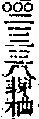



相，注曰：『若人识得，不离四威仪中。』首座见，谓众曰：『和尚今日放参。』」



师云：「璞玉无瑕，雕文丧德，慈明老人未免伤锋犯手。首座虽善琢磨，岂知刁刀相似，鱼鲁参差？」喝一喝。



举：「白云端和尚谓五祖曰：『有一事，老兄还知麼？』祖曰：『不知。有什麼事？』端云：『近有数禅客自庐山来，问他也有个悟处，教他说也说得，颂也颂得，批判也批判得，只是未在。』五祖闻得，七十七夜不成肚肠。无准云：『白云和尚用尽自己心，笑破他人口。乳峰这里亦有一件事，不得不说与诸人。近日亦有数禅客自诸方来，问他也无悟处，教他说也说不得，颂也颂不得，批判也批判不得。虽然如是，乳峰许他是个千了百当底人，诸人闻得亦不用疑著。何故？南天台，北五台。』」



师云：「一人把住，一人放行，检点将来，一得一失。山僧别资一路举似大众。近日亦有数百禅客从六十六州来，山僧也不问他悟、也不教他说、也不教他颂、也不教他批判，未跨门来，一齐看破了也。有人闻得，赞叹不少。且道与二大老相去几何？青山不锁长飞势，沧海合知来处高。」



举：「五祖演问僧：『倩女离魂，那个是真的？』僧罔答。」



师云：「僧既颟顸，祖亦莽卤。如何是不莽卤？趁出大虫吞却虎。」



举：「玉泉皓禅师因内翰东坡居士易微服往谒，泉见便问：『尊官高姓？』坡云：『姓秤。』泉云：『是甚麼秤？』坡云：『是秤天下长老的秤。』泉震声一喝云：『且道重多少？』坡无对。」



师云：「东坡握权衡於掌内，固其所长，争知钩头有准，秤尾无星？玉泉通身是一面古镜，明於鉴往知来，不合上他直钩。幸东坡提持不起，救得一半。如何是那一半钩在不疑之地？」



举：「宋太宗皇帝托起宝钵，问丞相王随曰：『既是大庾岭头提不起，为甚在朕手里？』随无对。」



师云：「宋帝不忘佛祖付嘱，掀翻鹫岭家风，丞相舌头虽不拄天，脚跟稳踏实地，但转身一路，似欠所长。当时听上道了，便对曰：『万里山河归有道。』岂不君臣际会，道合古今？」



举：「张横渠曰：『以天地观万物，则万物为物；以道观天地，则天地亦万物。』」



师云：「既成九仞之山，不进一篑之土。何不道：返观其道，道是何物？」



举：「昔有一庵主，受婆子供养，尝令二八女子送饭给侍。一日，今女子抱定云：『正当恁麼时如何？』主曰：『枯木倚寒岩，三冬无暖气。』女子举似婆，婆曰：『我二十年只供养个俗汉。』遂遣出，烧却庵。」



师云：「庵主种艸孤高，惜乎气味不辣，致使者婆子露手露脚，丛林中往往商量於女子抱定处劈面一掌，或竖一指，或下一喝，或云：『少卖弄。』或云：『疑则别参。』或云：『脱下裤子。』如斯等见，苍天！苍天！若是山僧，待他抱住云：『正当恁麼时如何？』向他道：『扁舟已过洞庭湖。』不惟勘破婆子，抑且具衲僧眼。然虽如是，诸人还识得烧庵出庵的落处麼？驱耕手段重拈出，枯木花开别是春。」



拈古



举：「世尊升座，众才集，文殊白椎云：『谛观法王法，法王法如是。』世尊便下座。」



拈云：「世尊升座，当堂据令，文殊白椎，因邪打正。是则是矣，未免傍观者哂。」



举：「世尊九十日在忉利天为母说法，及辞天界下时，四众八部俱往空界迎。有莲花色比丘尼作念云：『我是尼身，必居大僧后见佛。不如用神力变作转轮圣王，千子围绕，最初见佛。』果满其愿。世尊才见，乃呵云：『莲花色比丘尼何得越大僧见吾？汝虽见吾色身，且不见吾法身。须菩提岩中宴坐，却见吾法身。』」



拈云：「莲花色比丘尼，虽有先锋且无殿后，若有殿后，敢保世尊眉毛涓合打失。」



举：「阿育王共一七岁沙弥至於屏处，为沙弥作礼竟，云：『慎莫与人说，我礼拜汝。』沙弥见面前有一澡缾，遂跃入，复踊出，语王曰：『慎勿与人说，我跃入缾中，复踊出。』王曰：『早个说了。』」



拈云：「阿育王把无线底傀儡僻处拈弄，好一场曲调，大似蹉过知音。小沙弥将缾子作浴盆，潜身洗濯，虽神用不易，争奈被王看破？山僧当时若见，脑后各与一椎。何故？明人不作暗事。」



举：「佛陀波利尊者游台山到忻州，逢一老人问云：『向甚处去？』尊者答云：『台山礼文殊去。』老人云：『大德见文殊，还识不？』尊者无对。」



拈云：「尊者大似舍迩求远、贵耳贱目，当时见老人问了便与作礼，管取惭惶无地。」



举：「志公传语思大云：『何不下山教化众生？目视云汉作麼？』思大云：『三世诸佛被我一口吞却，更有甚麼众生可化？』」



拈云：「一人在闹市口，舌头拖地；一人在孤峰顶，眼光射天。放过一著，彼此作家；简点将来，二俱不了。据山僧所见，者两尊宿合当缚作一束，送在大洋海底，不为分外。何故？免致割截虚空，惑乱人家男女。」



举：「南泉愿禅师因普请次，乃问维那：『作甚麼？』那云：『拽磨。』师云：『不得动著中心树子。』那无对。」



拈云：「堂头相借问时，树子便动了，争怪得维那？惜乎当时不解拈却，似为蹉过。山僧今日与汝们拨转通天一窍，汝们还知麼？」



举：「昙藏和尚一夜在庵中经行，值群盗至，藏乃从容语盗曰：『茅舍有可意物，一任将去，终无所吝。』盗感其言，稽首而散。」



拈云：「赤眉元不打贫家。」



举：「昙藏和尚一日见有大蟒至庵，身长数丈，大张口牙，毒气炽然。侍者请避，藏云：『死可逃乎？彼以毒来，我以慈受。毒无实性，激发则强；慈苟无缘，冤亲一揆。』言讫，其蟒按首徐行，倏然不见。」



拈云：「昙藏观身如幻，观恶如化，侍者请避，早被一口。诸兄弟！识此蟒麼？龙得水时增意气。还识昙藏麼？象当行处绝狐踪。」



举：「黄檗运禅师在盐官佛殿上礼拜次，时大中帝为沙弥，乃问：『不著佛求，不著法求，不著僧求，长老礼拜当何所求？』师云：『不著佛求，不著法求，不著僧求，常礼如是事。』弥云：『用礼何为？』师便与一掌。弥云：『太麤生！』师云：『这里是甚麼所在，说麤说细？』随后又掌。」



拈云：「直下两掌，黄檗连根苦；逆来顺受，甜瓜彻蒂甜。若也会得两掌，自然坐享太平。」



举：「黄檗运禅师因斐相国捧一尊像於前，胡跪云：『请师安名。』师唤云：『裴休！』休应诺。师云：『与汝安名竟。』休作礼而退。」



拈云：「黄檗错安名字，裴休认奴作郎，明眼衲僧毕竟唤作甚麼？」



举：「赵州问老婆：『甚处去？』曰：『偷赵州笋去。』师云：『忽遇赵州时作麼生？』婆便掌，师休去。」



拈云：「赵州放行，易招口款。难获真赃，老婆勘破。贼是小人，智过君子。」



举：「赵州因僧问：『学人乍入丛林，乞师指示。』师云：『吃粥也未？』僧云：『吃了。』师云：『洗钵盂去。』其僧因此契悟。」



拈云：「赵州指示，因风吹火；者僧契悟，灰里豆爆。诸人平旦展钵洗钵，因甚不悟？且道得失在什麼处？未到尽惊山险峻，曾来方识路高低。」



举：「德山和尚一日因饭迟，自托钵至斋堂前，遇雪峰云：『钟未鸣，鼓未响，托钵向甚麼处去？』山便回方丈。雪峰举似岩头，头云：『者老汉未会末后句在。』山闻得，遂呼岩头云：『汝不肯老僧麼？』岩头密启其意。次日，德山上堂，果与寻常不同。岩头云：『且喜老汉会末后句。』」



拈云：「雪峰拨转天关，岩头掀翻地轴，二人虽竭忠尽孝，只扶得德山末后句。如何是末后句？任从沧海变，终不为君通。」



举：「德山垂示云：『我先祖见处即不然，这里无佛无祖，达磨是老臊胡，释迦是乾菌橛，文殊、普贤是担菌汉，等觉、玅觉是破执凡夫，菩提、涅槃是系驴橛，十二分教是鬼神簿、拭疮疣纸，四果、三贤、初心、十地是守古冢鬼，自救不了。』」



拈云：「千钧之弩不为鼷鼠发机，所谓显扬格外事，须还过量人。德山披肝沥胆，为上根人抽钉拔楔，还有知恩解报者麼？请出与山僧相见。」



举：「古者道：『护生须是杀，杀尽始安居，会得其中意，铁船水上浮。』圆悟云：『且道杀个甚麼？杀众生物命，凡夫见解；杀六贼烦恼，座主见解；杀佛杀祖，大阐提人见解。衲僧分上毕竟杀个甚麼？试定当看。』」



拈云：「圆悟剖露全机，未免自伤己命。若论衲僧分上，直得无下手处。诸兄弟会麼？道泰不传天子令，将军塞外绝烟尘。」



举：「夹山因僧问：『承和尚有言：「二十年住此山，未曾举著宗门中事。」是不？』师曰：『是。』僧便掀倒禅床，师便休去。至明日，普请掘一阬，召僧至，曰：『老僧二十年只说无义语，便请上座打杀老僧，埋向此中。不然，主座自著打杀，埋向此中始得。』其僧归堂，束装潜去。」



拈云：「者僧展摧山手段，天然迥别，惜乎只得其大用，未得其大机。夹山设陷虎阬阱，太杀寻常，虽有入地之谋，且无冲天之略。若是山僧又且不然，当时见这僧掀倒禅床，即连棒趁出，不惟有意气时重添意气，抑且不风流处转见风流。」



举：「洞山禅师因僧问：『寒暑到来如何回避？』师云：『何不向无寒暑处回避？』僧云：『如何是无寒暑处？』师云：『寒时寒杀阇黎，热时热杀阇黎。』」



拈云：「冰不自寒，火不自热，於此荐去，勘破洞山。其或未然，便有寒暑促君寿，鬼神妒君福。」



举：「仰山住东平时，沩山附书并镜一面至，师升座，乃提镜示众云：『大众！且道是沩山镜？东平镜？若道是东平镜，又是沩山寄来；若道是沩山镜，又在东平手里。道得则存取，道不得则打破。』如是三举，众皆无对，师乃扑破。」



拈云：「山僧当时若在会中，便拈转与东平照照看，看他面皮厚多少？」



举：「长庆禅师云：『路逢道伴交肩过，一生参学事毕。』」



拈云：「长庆将谓道伴多少奇特，殊不知被渠隙过一生。山僧则不然，路逢道伴交肩过，更买艸鞋行脚。」



举：「修山主示众云：『具足凡夫法，凡夫不知；具足圣人法，圣人不会。圣人若会，即是凡夫；凡夫若知，即同圣人。此语具一理二义，若人辨得，不妨於佛法中有个入处；若辨不得，莫道不疑。』」



拈云：「修山主只管私通车马，谁知官不容针？那时忽遇没面目汉出来，把断要津，不通凡圣。修山主又作麼生？」



神宴国师示众云：「鼓山门下不得咳嗽。」时有僧便咳嗽一声，师云：「作麼？」僧云：「伤风。」师云：「伤风即得。」古德云：「雷声浩大，雨点全无。」



拈云：「祖庭秋晚，佛法下衰，抱病者流，填门塞户。者僧若不是鼓山以毒攻毒，几乎丧身失命。诸兄弟！还识鼓山麼？解用不须霜利剑，延龄何必九还丹？」



举：「石门聪禅师示众云：『十五日已前诸佛生，汝不得离我这里。汝若离我这里，我有钩子钩汝。十五日已后诸佛灭，汝不得住我这里。汝若住我这里，我有锥子锥汝。正当十五日，且道用钩即是？用锥即是？』」



拈云：「钩来锥去，本分钳锤；把住放行，作家手眼。石门虽把柄在手，要且劳而无功，若有点检得出，许伊是一员无事道人。」



举：「慧弼禅师因僧问：『如何是毘卢印？』弼曰：『艸鞋踏雪。』僧曰：『学人不会。』弼曰：『步步成踪。』」



拈云：「全提祖印，弼老固是作家，子细观来，钝置者僧不少。或问山僧：『如何是毘卢印？』劈面一掌。若曰：『学人不会。』向道：『印破阇黎铁面门。』且道与古人相去多少？」



举：「昔有施主入院，行众僧随年钱。知事云：『圣僧前著一分。』施主云：『圣僧年多少？』知事不能答。」



拈云：「知事筭圣僧八字不真，所以施主不还命钱。当时若道得『与露柱同年』，管取百千万亿分供养，非但一分已也。」



即非禅师全录卷之六



门人明洞、性安、性节、明觉、明幢仝编



颂古



世尊初生。



何事又离兜率天，水深难盍碧枝莲，当时莫处摩耶腹，又较威音一著先。



世尊未离兜率，已降王宫；未出母胎，度人已毕。



谩向空中寻鸟迹，休来水底觅鱼踪，翻身踏断毘卢顶，沙界收归一粟中。



世尊见星悟道。



明星夜夜照无私，六载悟来早是迟，若解面南看北斗，何劳夜半豁双眉。



世尊拈花。



大小瞿昙不奈何，花枝拈起当风播，一场败阙少人知，独被饮光亲笑破。



世尊敕阿难托钵。



看七佛仪式，阿难片诺酬，一声无孔遂，吹散碧天秋。



应无所住而生其心。



无所之心作麼生？霜轮印破碧天清。为君点出金刚眼，任向毘卢顶上行。



见见之时，见非是见，见犹离见，见不能及。



离见见不能及，笑指台前片石，换却瞿昙眼睛，露出阿难巴鼻。



文殊问病。



不二门通百万涂，相逢况是赤须胡，谭空说有千般玅，争及维摩一字无？



跋难陀尊者入浴忽悟水因。



污池莲花绝点尘，不教细雨一番新，虽云选入圆通数，究竟何曾悟水因。



那咤还身。



那咤还却娘生身，谁是本来真面目？踏转乾坤没处藏，寒潭倒浸千峰碧。



调达谤佛，生身陷地狱。



临危不变真丈夫，试问如今出也无？打破大唐归一统，不知谁是赤须胡。



九祖伏驮密多问八祖云：「父母非我亲，谁是最亲者？诸佛非我道，谁是最道者？」祖答谒云云。



佛非吾道言犹可，举眼无亲怕杀人。欲识祖师端的旨，须明父母未生身。



般若多罗尊者转经。



多罗尊者太颟顸，不肯随他纸上钻，个里本无元字脚，纵云常转也多端。



初祖面壁



丧却风光一叶孤，九年少室嘴卢都？若非二祖投针芥，羞杀西来碧眼胡。



五祖再来。



奇穷彻骨植松夫，转却身来姓也无。玷污女郎犹可恕，那堪传法受糊涂。



南泉斩猫。



可叹两堂生亦死，谁知猫子死犹生，当时不遇赵州返，王老之冤洗莫清。



百丈大师再参马祖，被祖一喝，直得三日耳聋。



一喝迅雷聋两耳，还他父子显全机，黧奴白牯齐开眼，铁额铜头也皱眉。



黄檗禅师示众云：「汝等诸人尽是噇酒糟汉，恁麼行脚，何处有今日？还知大唐国里无禅师麼？」僧云：「只如诸方匡徒领众又作麼生？」师云：「不道无禅，只是无师。」



莫谓无师祗有禅，阿谁气宇不翀天？拈翻黄檗无情舌，穿过诸方鼻半边。



黄檗三顿棒。



怜儿不觉丑，恩多怨亦深，若非遭毒口，孤负老婆心。



赵州和尚示众云：「佛之一字，吾不喜闻。」



佛不喜闻，独镇寰中，十方坐断，凡圣无踪。



赵州狗子。



狗子佛性无，黄金攃满涂，宁知廉义者，不作守钱奴。



赵州布衫。



家家有路通京国，客子何劳别问津，雪后始知松柏操，夜深方见把针人。



甘贽设粥，南泉打锅。



粥阑锅破莫猜疑，举唱还须作者知，甘贽惜花春起早，南泉爱月夜眠迟。



肇法师云：「天地同根，万物一体。」



驴鸣狗吠非他物，柳暗花香不是尘，三际穷时凡圣尽，大千沙界现全身。



三不是。



不是心佛不是物，明明拔出眼中楔，到头不遇作家人，未免浑身都丧却。



德山托钵。



父慈出孝子，国霸有谋臣，岩头末后句，疑杀天下人。



古德油糍。



古德吃油糍，解吞不解吐，当面拟瞒人，不觉贼身露。



临济大师示众云：「我於先师处三度问佛法大意，三度被打，如蒿枝拂相似。如今更思一顿，谁与下手？」时有僧出云：「某甲下手。」师拈棒度与僧，僧拟接，师便打。



一棒一条痕，知恩解报恩，无端思一顿，千古累儿孙。



临济栽松。



短镢峰头一斩新，机锋特地露全真，当时不借春风方，那得苍松盍后人？



三玄三要。



打破玄开，截断要路。一句齐收，人天罔措。休罔措，朕兆未彰全体露。



曹山禅师因僧问：「世间甚麼物最贵？」山云：「死猫儿最贵。」僧云：「死猫儿因甚却贵？」山云：「无人著价。」



一个死猫儿，古今难著价，滞货不愁人，没钱生惊怕。



疏山寿塔。



寿塔落成报赏工，谁知不值半分文。当时好手都推倒，家丑何由得外闻。



香严上树。



为要诸人活眼开，故将树子路头栽，虎公一见和根拔，免使攀枝摘叶来。



芭蕉拄杖子。



谁种春蕉满绿蹊，一霜打尽鸟空啼，从教叶落青如故，总是凤凰不肯栖。



临济大师凡见僧入门便喝。



旱日烧天忽震▆，髑髅粉碎顶门开，等闲勘破白拈贼，平地无端起骨。



诸佛出身。



诸佛出身处，大千拦不住，疏钟过海门，明月梯山树。



卢陵米价。



亲到庐陵尚隔津，那堪言句觅疏亲，衲僧解用机前荐，倒廪倾仓不让人。



云门露。



佛祖冤亲杀尽休，大千无地著惭羞，弥空罪罟从谁忏，截断沧江绝点流。



雪峰初参德山，问：「从上宗乘，学人还有分也无？」山打一棒，云：「道甚麼？」师云：「不会。」至明日请益，山云：「我宗无语句，实无一法与人。」师因此有省。住后，僧问：「和尚见德山，得个甚麼便休去？」师云：「我空手去，空手归。」



无法依然成朕迹，离言尚未舍筌蹄，虽然省得钩头意，未免浑身带水泥。



南院啐啄语。



大用作家不啐啄，一棒打破凤雏壳，当时若解泼天飞，风穴何处见头角。



以字不成八不是。



点畫依然明历历，瞿昙鹙子不能识，等闲攃向纸堆头，一任风吹与日炙。



法眼指帘。



野老谋生何太切，孤舟独钓寒江雪，抛钩直欲引狞龙，谁拟盲龟与跛鳖。



闻钟披衣。



滩头多蛤子，观音未入理，钟声披七条，吾无隐乎尔。



云门云：「闻声悟道，见色明心。观音将钱买糊饼，放下却是馒头。」



云门卖弄滞货，那知锅是铁铸，无端带累观音，千古被人看破。



高峰枕子。



五载觅难见，何曾与我疏，自从扑落后，处处得逢渠。



物不迁。



悬崖鹤宿枝头月，古涧龙眠水底天，几度河枯沧海变，风光占断不知年。



慈明因僧问：「如何是不动尊？」师云：「提不起。」



不动尊，足迹遍诸方，提不起，放下轻如纸。鹧鸪岸上啼，意在深花里。



牛过窗櫺。



攃手出门天已晓，何须更执夜明符，踏翻宇宙从头看，几个男儿眼有珠。



首山竹篦。



句后承机休弄巧，言前荐得犹迟了，报君莫向两边寻，江上侍郎过去久。



童子竖指。



俱胝竖指炽然谭，童子浑沦效指南，直得回头天外看，始知月不在空潭。



古德问秀才云：「百姓日用而不知，不知个甚麼？」才云：「不知道。」德云：「灼然不知。」



达磨不会禅，夫子不识字。白牯与狸奴，却较些些子。



代古



举：「鹅湖和尚问诸硕德曰：『行住坐卧，毕竟以何为道？』有曰：『知者是义。』曰：『不可以智知，不可以识识。何谓知者是？』有曰：『无分别是义。』曰：『善能分别诸法相，於第一义而不动，安得无分别是有？』曰：『四禅八定是义。』曰：『佛身无为，不堕诸数，安得四禅八定是？』众皆杜口。」



代：翻觔斗而出。



举：「盐官国师问座主：『蕴何经？』曰：『《华严》。』官曰：『华严有几种法界？』曰：『略说有四，广说则重重无尽。』官竖起拂子曰：『者个是第几种法界中收？』主无对。」



代云：「普。」



举：「鹤林素禅师因僧敲门，林问：『是谁？』僧云：『是僧。』林云：『非但是僧，佛来亦不著。』僧云：『佛来为甚不著？』林云：『无栖泊处。』」



代云：「谢师拨转通霄路。」



举：「昔高丽国来钱塘刻观音圣像，及舁上船，竟不能动，因请入明州开元寺供养。后有设问：『无刹不现身，圣像为甚不去高丽国？』」



代云：「一树花开万国春。」



举：「长庆十日升堂，众集定，拽出一僧云：『大众礼拜者僧著。』又云：『者僧有甚长处，却教大众礼拜？』众无对。」



代云：「狮子窟中无异兽。」



举：「雪峰辞洞山，山云：『甚处去？』峰云：『归岭中去。』山云：『当时从甚麼路出？』峰云：『从飞猿岭出。』山云：『今向甚路去？』峰云：『飞猿岭去。』山云：『有一人不从飞猿岭去，子还识麼？』峰云：『不识。』山云：『为甚不识？』峰云：『他无面目。』山云：『子既不识，争知无面目？』峰无对。」



代云：「今日被和尚看破。」



举：「韩文公问僧：『承闻讲得《肇论》，是否？』僧云：『是。』公云：『肇有四不迁，是否？』僧云：『是。』公将茶盏扑破，云：『者个是迁不迁？』僧无语。」



代云：「花开花落树长存。」



举：「无著至台山，遇文殊吃茶次，殊拈起玻璃盏问云：『南方还有者个麼？』著云：『无。』殊云：『寻常将甚吃茶？』著无对。」



代云：「吃茶即有。」



举：「仰山问僧：『名甚麼？』僧曰：『灵通。』仰云：『便请入露柱。』僧无语。」



代云：「入则不辞，只恐惊群动众。」



举：「石霜因僧辞，乃问：『船去？陆去？』僧云：『遇船即船，遇陆即陆。』霜云：『我道半途稍难。』僧无对。」



代云：「某甲到家却易。」



举：「汉国有庵主，遇王出游，人报云：『大王来，请起。』主云：『非但大王，佛来亦不起。』王闻，乃问曰：『佛岂不是汝师？』主曰：『是。』王曰：『弟子见师，为甚不起？』主无对。」



代云：「捧下无生忍，临机不见师。」



举：「云盍寺僧化瓦。官人问：『既有云盍，何须化瓦？』僧无对。」



代云：「不妨锦上铺花。」



举：「无垢院化浴，官人问：『既无垢，何用浴？』」



代云：「也要通身汗出。」



举：「一僧托钵至长者家，偶为狗伤。长者问：『龙披一缕，免金翅之难。大师全披法服，为甚却被狗咬？』僧无对。」



代云：「欲把袈裟盍羽毛。」



举：「陶相公见人犯法当死，问僧曰：『杀则违佛戒，不杀又犯王法，未审如何则是？』僧罔答。」



代云：「因缘会遇时，果报还自受。」



举：「净照和尚问楞严大师：『经中道：「若能转物，即同如来。」只此升仙阁作麼生转？』大师无语。」



代云：「相随来。」



举：「志公问梵僧：『承闻尊者唤我作屠儿，曾见我杀生否？』曰：『见。』志云：『有见见，无见见，不有不无见见。若有见见，是凡夫见；无见见，是声闻见；不有不无见，是外道见。未审尊者如何见？』僧曰：『汝有此等见耶？』」



代云：「元来不曾见。」



举：「陆亘因南泉迁化来吊忏，院主问：『大夫何不哭？』亘曰：『院主道得即哭。』主无对。」



代院主呵呵大笑。



举：「龙门僧被蛇伤，有问：『既是龙门客，为甚被蛇伤？』」



代云：「不因夜来雁，争见海门秋。」



举：「有僧化镀佛，官人曰：『本望佛度弟子，因什麼弟子度佛？』」



代云：「众生度尽恒沙佛，诸佛何曾度一人？」



举：「王常侍问僧：『一切众生还有佛性也无？』僧曰：『一切皆有。』侍指壁畫狗子曰：『者个还有佛性也无？』僧无语。」



代云：「逐物作麼？」



举：「洞山同密师伯避雨入饼店，密於地上畫圆相云：『将取去。』山曰：『拈将来。』密无对。」



代云：「食到口边不解吃。」



举：「径山问僧：『什处来？』僧曰：『天台来。』山曰：『阿谁问汝天台来？』僧无语。」



代云：「和尚道甚麼？」



举：「玄沙问文柟头：『下山几时归？』文曰：『三五日。』沙曰：『归时有无底桶子将一担来。』文无对。」



代云：「漏逗不少。」



举：「世尊临入涅槃，文殊请再转法轮。世尊咄云：『吾四十九年住世，未曾说一字，汝请再转法轮，是吾曾转法轮耶？』」



代云：「伸脚元在缩脚里。」



举：「忠国师因肃宗皇帝问师：『在曹谿得何法？』师云：『陛下还见空中一片云麼？』帝云：『见。』师云：『丁钉著，悬挂著。』」



代云：「缩取舌头好。」



举：「布袋和尚常将布袋并破席於通衢往来，布袋内盛钵盂、木履、鱼饭、菜肉、瓦石、土木，诸般总有。或於稠人处打开布袋内物，攃下云：『看！看！』又一一将起，问人云：『者个唤作甚麼？』众无对。」



代云：「滞货不劳拈出。」



举：「云居膺和尚闻山下有一僧住庵，令侍者送裤腰与之，僧云：『我自有娘生裤。』竟不受。再令侍者去问：『娘未生时著个甚麼？』僧无语。」



代云：「手执夜明符，几个知天晓？」



举：「泗洲塔头侍者及时锁门，有问：『既是三界大师，为甚被弟子锁？』者无对。」



代云：「竹密不妨流水过。」



举：「庞居士听《金刚经》，问座主曰：『俗人敢有小问，不知如何？』主曰：『有疑请问。』士曰：『无我相，无人相。既无我人，教阿谁讲，阿谁听？』座主无对。」



代云：「妆聋作哑作麼？」



举：「梁武帝请傅大士讲经，士才升座，以尺拊案一下，便下座，帝愕然。志公乃云：『陛下还会麼？』帝云：『不会。』志公云：『大士讲经竟。』」



代云：「谢师覆讲。」



答古



兜率悦和尚垂语三则



拨艸瞻风，只图见性。毕竟性在什麼处？



师答：填沟塞壑无人会，雨过夜塘秋水深。



见得自性，便脱生死。眼光落地时，又作麼生脱？



答：两脚捎空。



脱得生死，便知去处。四大分散时，向甚麼处去？



答：待有去处即报。



径山虚堂愚和尚垂语三则



己眼未明的因甚将虚空作布裤著？



答：不妨，盍覆将来。



畫地为牢的，因甚透者个不过？



答：剑去久矣。



入海算沙的，因甚针锋头上翘足？



答：百千玅义一毫头。



肓王照和尚垂语三则



山中猛虎以肉为命，何故不食其子？



答：火不自烧。



虚空无向背，何缘有东西南北？



答：逐物意移。



饮乳等四大海，积骨如毘富罗山，何者是汝最初父母？



答：历劫不曾离。



大休隆和尚垂语三则



吹毛宝剑被石人持去，挂在万仞峰头，四壁无路，如何取得？



答：无劳刻舟。



有一如意珠，被木人擎来，抛向大海中，不假舟楫，如何觅得？



答：觅则知君不可见。



尽大地是个火阬，烧却了也。惟有一茎眉毛在，未审何人得见。



答：由来眼不花。



正当辨和尚垂语三则



猫儿为甚爱捉老鼠？



答：熟处难忘。



云版鸣因甚犬吠？



答：竹竿打水鱼头痛。



蚯蚓为甚化为百合？



答：何处不称尊？



松源岳和尚垂语二则



大力量人，因甚抬脚不起。



答：法地一动，一切不安。



明眼衲僧，因甚脚根下红丝线不断？



答：绊倒人无数。



断崖义和尚垂语二则



除却语默动静，道将一句来。



答：将谓别有。



一息不来，向何处安身立命？



答：百艸头边。



云门偃和尚垂语一则



世界与麼阔，为甚钟声披七条？



答：吾无隐乎尔。



大洪恩和尚垂语一则



假使八千劫，所作业不忘，为甚称南无佛，罪灭河沙劫？



答：雪点红炉。



天童觉和尚垂语二则



吞尽三世佛底人，为甚开口不得？



答：通身是口。



照破四天下的人，为甚合眼不得？



答：待四天下人，眼开即合。



龙革初和尚垂语一则



鸡见便斗，狗见便咬，殿上鸱吻，终日相对，为甚却不瞋？



答：狮子不逐块。



雪窦显和尚垂语三则



十方无壁落，四面亦无门。古人向甚处见客？



答：谁在门外？



田地稳密底，佛祖不敢近，为甚抬脚不起？



答：太珍重生。



神通游戏底，鬼神不能测，为甚下脚不得？



答：恐教蹋杀天下人。



天衣怀和尚垂语一则



泥犁长夜苦，闻者痛伤心。调达在地狱，为甚如三禅天乐。



答：通身在里许。



隆庆闲和尚垂语六则



祖师心印，篆作何文？



答：描不成，畫不就。



诸佛本源深之多少。



答：一吸无涓滴。



十二时中，上来下去，开单展钵，此五蕴败坏之身，那个是清净法身？



答：开单展钵。



不用指东畫西，实地上道将一句来。



答：险。



十二时中，著衣吃饭，承甚麼人恩力？



答：无人识得渠。



鱼行水浊，鸟飞毛落。亮座主一入西山，为甚杳无踪迹？



答：通身无影像，遍界不曾藏。



径山容和尚垂语五则



水既无筋，因甚长流不断？



答：花灿不萌枝。



佛祖公案犹空中纸鹞，向甚处收取线索？



答：鸳鸯绣出从君看，不把金针度与人。



鹏搏峰与宴坐峰相交，且道说个甚麼？



答：赖和尚证明。



风扇大野，毕竟作何形色？



答：觑著则瞎。



望江亭上垂机，谁是知音。



答：将谓忘却。



黄檗琦和尚垂语四则



金刚圈如何跳得出？



答：古佛过去久矣。



栗棘蓬如何吞得下。



答：残羹不劳拈出。



夜半日头红，谁人得见。



答：好向面南看北斗。



日午打三更，谁人得闻？



答：眼处闻声方始知。



古德十无



如何是无为国？



答：坐享太平。



如何是无星秤？



答：钩头荐取。



如何是无根树？



答：叶覆大千。



如何是无底钵？



答：山藏海纳。



如何是无弦琴？



答：千峰侧耳。



如何是无孔笛？



答：吹落空花。



如何是无底船？



答：度脱生死。



如何是无须锁？



答：表里玲珑。



如何是无生曲？



答：万籁无声。



如何是无底蓝？



答：贮尽春风。



古德六一



如何是达磨一只履？



答：踏断毘卢顶。



如何是慧可一只臂？



答：(等闲捏出虚空髓，化作炎天三尺雪)。



如何是僧灿一身罪？



答：红炉片雪。



如何是道？信一只虎。



答：触著丧身失命。



如何是弘忍一株松？



答：覆荫天下人



如何是慧能一张碓？



答：一踏到底。



即非禅师全录卷之七



门人明洞、性安、性节、明觉、明幢仝编



机缘



僧问：「十二时中如何用心？」师云：「使得十二时。」进云：「十二时如何使？」师云：「不妨如是用心。」



侍者久立次，师云：「汝却惺惺。」者云：「某甲从来不曾睡。」师云：「汝犹寱语在。」者便走出，师休去。



师问僧云：「甚处来？」僧云：「碓米来。」师举墨云：「这个还碓得白麼？」僧无对。师云：「遇著岭南人，不得岭南信。」



居士问：「如何是道？」师云：「纵横十字。」士云：「恁麼去时如何？」师云：「十个行来九个错。」士礼拜，师云：「下坡不走，快便难逢。」



僧展具，问云：「唤作雪峰长老，又是黄檗首座，且道礼拜那一个即是？」师云：「天上无双日。」僧便礼拜。师云：「伶俐衲僧。」



僧问：「腊月三十日到来，和尚作麼生？」师云：「今日寒似昨日。」进云：「棒如雨点，喝似雷奔，还供养得阎胡子也无？」师云：「恐他消受不得。」僧礼拜，师云：「二十棒自领出去。」



僧问：「如何是龟毛拂？」师云：「穿却汝鼻孔。」进云：「鼻孔也无，穿个甚麼？」师云：「汝向甚处出气？」僧无语，师打云：「与汝半边。」



师到客堂看单，堂主云：「客来须看，贼来须打，只如客贼俱来时如何？」师拦胸把住云：「贼！贼！」主云：「作家！作家！」师送开云：「再犯不容。」



问：「如何是佛？」师云：「路头石敢当。」进云：「某甲不会。」师云：「蹉过几多人？」僧礼拜，师云：「切忌磕著。」



僧问：「某甲愚迷，乞师直指。」师云：「阇黎曲来多少时？」僧云：「岂无方便？」师云：「方便久矣。」僧礼拜起立，师云：「适来曲，而今直。」



僧呈偈，师阅至摩尼光灿烂，遂徵云：「是青光红光耶？赤白黄光耶？」僧杜口，师云：「还我摩尼来。」僧又杜口，师云：「原来是个泥弹子。」叱出。



僧问：「文殊为甚出女子定不得？」师云：「是非不到钓鱼处。」进云：「罔明为甚出得女子定？」师云：「荣辱常随骑马人。」僧云：「谢师答话。」师云：「拶。」



居士问：「陆兵、水兵俱向菩萨许愿求胜，未审菩萨赴那一人愿？」师云：「一锡解两虎。」



问：「牛头未见四祖，为甚百鸟衔花？」师云：「踏佛阶梯。」进云：「见后为甚不衔花？」师云：「无栖泊处。」进云：「如何有正干傍出？」师云：「春色无高下，花枝自短长。」



师因侍者掀钵盍蒸气成水流下，师问云：「钵盍水从何生？」答云：「从热气生。」师云：「热气从何生？」答云：「从无阴阳处生。」师云：「既无阴阳，作麼生？」答云：「若问无阴阳，某甲下堂吃饭去。」师云：「你吃饭处是有阴阳地。」侍者作礼便行，师休去。



僧问：「一口气不来时如何？」师云：「与汝一贴返魂香。」僧拟议，师便打，僧一喝，师云：「且喜活来。」



问：「南泉斩猫，意旨如何？」师云：「剑刃翻身有几人？」进云：「赵州戴艸鞋出去，是何意旨？」师云：「貍奴头角犹在。」僧踊跃礼谢而退。



师垂语云：「明知四大五蕴是生死根本，为甚入此皮袋？」一僧云：「如龙得水，似虎靠山。」师云：「山崩冰竭时如何？」进云：「别有一乾坤。」师云：「未在。」



师一夜问大众云：「闻声悟道，见色明心。钟是声，唤甚麼作道？灯是色，心作麼生明？」一僧答云：「满眼非色，满耳非声。」师云：「非色非声是个甚麼？」进云：「十目所祝，十手所指。」师云：「非声非色指视个甚麼？」僧无语。师云：「好与六十棒。」



僧问：「如何是祖师西来意？」师云：「独足人骑三脚驴。」



师同僧观弥勒畫像，僧云：「这老汉布袋放不下。」师云：「不是放不下，只是无人承当。」僧云：「何不分付某甲？」师云：「恐汝负荷不起。」僧云：「莫压良为贱。」师拈杖，僧便走，师笑云：「知你荷不起。」



僧问：「明知四大五蕴是生死根本，为甚麼入此皮囊？」师云：「探珠不离泥。」僧作礼而退。



问：「净名丈室纳得三万二千狮子座，未审和尚丈室容得多少？」师云：「山僧这里只得一个。」僧云：「许多圣贤向何处敷坐？」师云：「灵山一会都无欠剩。」僧作礼，师云：「汝不是个中人。」



问：「牛过窗櫺，为甚尾巴过不得？」师云：「满地落花春已过，绿阴空锁旧莓苔。」



问：「世尊忉利宫下来，栴檀像亦出迎，此理如何？」师云：「水底金乌天上日。」



师问知藏：「年多少？」藏云：「年六十。」师云：「主人翁年多少？」藏云：「不会。」师云：「恁麼则不与汝同条生。」藏云：「类不齐。」师云：「知汝是曹洞儿孙。」



解制普茶次，数僧竞出问话，师约住逐一勘之，遂问一僧云：「圣制九旬今已满，心空及第事如何？」僧云：「三级浪高鱼化龙。」师云：「试拿云擭雾看。」僧云：「遇饭吃饭，遇茶吃茶。」师打云：「犹欠牙爪在。」



又问一僧云：「心空及第事如何？」僧云：「师姑元是女人做。」师云：「如何是丈夫事？」僧云：「请和尚证明。」师云：「证明个甚麼？」僧一喝，师打云：「未是丈夫事。」进云：「莫瞒某甲好。」师云：「瞒尽天下人，岂特阇黎一个？」



又问一僧云：「心空及第事如何？」僧云：「楖栗横担不顾人，直入千峰万峰去。」师云：「忽遇拗折拄杖，截断路头，汝又作麼生？」僧云：「某甲从今不进语。」师打云：「且莫艸艸匆匆。」



又问一僧云：「心空及第事如何？」僧云：「空手来，空手去。」师云：「恁麼则劳而无功。」僧云：「本来无一物。」师云：「无物亦是物。」僧拟议，师打云：「更买艸鞋始得。」



又问一僧云：「心空及第事如何？」僧云：「会不会都来是错。」师云：「如何得不错去？」僧云：「未出胎时及第了。」师云：「又入此保社作麼？」僧拟议，师云：「知汝错会。」僧作礼，维那鸣击谢茶，师便归方丈。



僧问：「如何是狗子佛性无？」师云：「祸不入慎家之门。」



僧问：「如何是无位真人？」师云：「筑著磕著。」



一日，象山和尚过访，师云：「老兄万福否？」山云：「托庇。」师云：「不敢。」山云：「一夏甚热，无位真人热否？」师云：「老兄甚处曾与无位真人相见？」山云：「侧眼见庐山。」师云：「真个热心人。」



一晚，师同象山和尚雪轩对坐，山云：「蝉声噪晚风，是甚麼境界？」师云：「大士来也。」山云：「请大士相见。」师云：「老兄作礼著。」山云：「蚯蚓过东海。」师云：「大似不肯礼拜。」山云：「一翳在眼，空花乱坠。」师云：「大士去了。」山呵呵大笑。师云：「蚯蚓声。」山云：「解𨁝跳。」师亦呵呵起去。



化林、鹤抟二上座自福严至，师问二人曰：「子归就父时如何？」鹤默然拱立。化答曰：「惭愧来迟。」师云：「此是途路边事，到家一句作麼生？」进云：「相见如初。」师云：「念子远来，各放三十棒。」俱作礼而退。值象山木和尚在坐，乃问师云：「师资相会时如何？」师云：「一合相不可得。」木云：「可得时如何？」师云：「世谛在。」木云：「不可得时如何？」师云：「有道在。」木休去。



师见木和尚穿纸衣，遂问云：「如何是纸衣下事？」木云：「绵密不通风。」师云：「此是古人道的。」木云：「我用得快。」师云：「我则不然。」木云：「兄又作麼生？」师云：「一捏便露骨。」木默然。



偶闻林中众鸟和鸣，师云：「鸦鸣雀噪，是甚语言？」山云：「妄想中说梦话。」师唤侍者云：「热茶端一瓯，请象山和尚。」山云：「又是说梦话。」师云：「且喜老兄惺惺。」山云：「又是说梦话。」师云：「大不惺惺。」山云：「又是说梦话。」师云：「老兄真是梦汉。」山云：「知则较些些。」师云：「此亦梦话。」山云：「随人脚跟转。」师云：「话头也不识。」二师呵呵大笑而起。



僧问师，举：「密云老和尚上堂云：『禅不用参，理不用会。』莫是无禅可参，无理可会麼？」师云：「未是汝境界。」进云：「老和尚又云：『单单不用瞌睡。』莫是三祖云：眼若不睡，诸梦自除麼？」师云：「汝又白日寱言。」进云：「和尚上堂别云：『禅任他参，理任他会。』莫是通身是禅理麼？」师云：「汝为甚又被禅理缚杀？」进云：「师又别云：『待他瞌睡，送个枕头。』莫是了取平常心，是道饥来吃饭饱来眠麼？」师云：「唤甚麼作平常心？又作麼了？」僧礼拜，师云：「饥餐渴饮浑闲事，不是饱参人不知。」



优婆姨问：「如何是道？」师云：「礼佛去。」进云：「如何是佛？」师云：「礼拜著。」姨一喝，师云：「喝汝爹？喝汝娘？」姨无语，师便喝，姨转身一匝，拍掌展手，师云：「丑伎俩。」姨礼拜而退。



师问鹤抟侍者：「日午也未？」答云：「才打三更。」师云：「我为甚不闻？」抟云：「和尚莫妆聋作哑。」师休去。



师因侍者问云：「和尚要吃何物？」师云：「我要吃佛祖心肝。」者准前露胸云：「请和尚下口。」师云：「是则是，犹隔一膜在。」者无语，师便掌。



僧参次，师问云：「到此几日？」僧云：「二十日。」师云：「如何是不涉途程一句？」僧云：「直透万重关。」师云：「犹涉途程在。亲切道一句。」僧拟议，师便打。



高力居士重来拜别，师问曰：「前向甚麼处来？今向甚麼处去？道得来去分明，不孤一会。」居士云：「来来去去无二路。」师曰：「此会不虚，善为道路。」



肥前信士参竟，自叙：「昔日骑马过桥，堕水有省，恨无知识证明。今遇和尚，请为开示。」师云：「何不重骑铁马上高楼？」士便喝，师云：「此一喝是宾是主？」士无语，师咄云：「强作主宰。」士礼拜而退。



师问高泉法姪：「汝和尚万福否？」泉云：「今日亲到圣寿。」师曰：「不谬为黄檗肖子。」泉礼拜云：「谢和尚证明。」师休去。



一日，高泉侍立次，师云：「智过于师，方堪传授。如何是超师之智？」泉云：「黑漆桶。」师云：「为何不放光？」泉云：「只恐烁破和尚面门。」师云：「争奈山僧无面目何？」泉礼谢，师休去。



师一日阅高泉槁，有「而今觌面难回避，得报恩时且报恩」之句，乃徵云：「如何是报恩一句？」泉云：「一棒打杀。」师云：「得恁麼忤逆？」云：「苍天！苍天！」师云：「放汝三十棒。」



侍者进小食，师云：「大众有麼？」者云：「俱有。」师云：「汝有麼？」者云：「亦有。」师拈扇子云：「这个为甚没有？」者云：「某甲放下了也。」师云：「做得侍者。」



高泉病，师至单前问云：「如何是祖师西来意？」泉云：「某甲头痛不能说。」师云：「汝口不痛。」泉云：「一口无两舌。」师云：「几被舌头瞒。」便转身。



师因缁素求字甚烦，乃扑破图书。信士问：「图书有何过，和尚扑破？」师云：「要人识取无文印。」



石香同诸居士参谒，师留坐，香云：「雨声泉声聒和尚耳。」师云：「山野未尝闻。」香默然，师云：「居士入得观音理门。」香唯唯，良久，又云：「请和尚为弟子洗泥。」师云：「若为洗泥，泥本无体；若为洗体，体本无泥。要山野洗个甚麼？」香云：「和尚早已清净了也。」师云：「点。」



僧问：「如何藏身处没踪迹？」师云：「苔封古路无人到。」进云：「如何是没踪迹处莫藏身？」师云：「月锁梧桐凤不栖。」



问：「净法界身本无出没，为甚世尊今日降生？」师云：「月在波心说向谁？」进云：「四十九年未尝谈一字，一大藏教向甚处得来？」师云：「世尊舌头方。」



僧问：「如何是道？」师云：「侧耳，侧耳。」进云：「和尚只道一半。」师云：「▆▆全道看。」僧拟议，师便打。



僧问：「世尊拈花，意旨如何？」师云：「浑囵劈不破。」进云：「迦叶微笑又作麼生？」师云：「扑鼻更馨香。」



居士问：「劫火蔓延数千人家，佛神不救，慈悲何在？」师云：「要人共上白牛车。」进云：「大小寺院焚去十餘，独贵刹无恙，和尚莫是四禅中人否？」师云：「我不从人天来。」进云：「毕竟向何处来？」师云：「佛祖行不到处来。」居士礼谢而退。



居士问：「弟子心不贪财，见则爱之，如何？」师云：「见得思义。」又云：「弟子心不著色，见则好之，如何？」师云：「非礼勿动。」



僧问：「道如何悟？」师云：「击火须用手。」其僧有省。



僧问：「万法归一，一归何处？」师云：「满口道著。」



一日，风打门，昙璲云：「好大风。」师云：「风从何来？」璲关门云：「风路塞了。」师云：「未是好手。」璲云：「如何是好手？」师云：「拏住狂风剥了皮。」璲云：「忽遇八面来时如何？」师便打。



僧问：「如何是彻骨彻髓一句？」师云：「秤锤捏出汁。」



问：「清净本然，云何忽生山河大地？」师云：「额头边荐取。」



僧问：「承闻径山费老和尚茶毘得舍利无数，有诸？」师云：「有。」进云：「四大与五蕴俱空，舍利从何而有？」师云：「今日好雪。」



问：「人间无水不朝东，因甚黄河向北流？」师云：「为缘壮帝居。」



师宿谏早，僧来参，问云：「既是谏早，为甚月出？」师云：「三光转法轮。」进云：「转后如何？」师云：「清光何处无？」



师至神通院，高传都寺寂峰禅德领大众参，师问云：「个个鼻孔相似，还有辽天的麼？」一僧云：「某甲不敢妄想。」师云：「好与三十棒。」进云：「此恩超于父母。」师云：「知则得。」众僧无语，师一喝。



师观园次，遵道禅德指大树云：「前日被大风吹倒。」师云：「还有无根树吹不倒的，知麼？」道无语。



师至肥州，见瘦人，乃问众云：「既曰肥州，为甚有瘦人？」众下语不契。



僧参，问云：「某甲初出家，求师开示。」师云：「此去洛阳一千里。」进云：「求师委曲。」师云：「你自委曲，直会去好。」僧礼退。



信士参问云：「弟子禅理不通，求师开示。」师云：「今早天晴。」士礼拜云：「求师叮咛。」师云：「叮咛损君德，无言终有功。」



信士参，云：「求师开示。」师云：「雨后数峰青。」士礼拜，师云：「切莫眼花。」



信士参，问云：「弟子今春参拜老和尚，蒙开示应无所住而生其心话，请问和尚还有别句也无？」师云：「鸟鸣山更幽。」士无语。良久，又问云：「弟子一切无心，因初发心，未审无心从何而住？」师云：「既是无心，从何发心？」士云：「今日十四。」师云：「今日事作麼生？」士云：「今日是今日。」师云：「你只会今日，未会发心。」士礼谢而退。



中秋寓开善寺，丰主源舍遗来参，师问云：「灵山话头还记得麼？」主微笑，师云：「一念圆明无古今。」主云：「秋夜长江云自净，满天明月印波心。」师云：「且喜居士不忘付嘱。」主礼而退。



玄周医士问：「如何是要津？」师云：「一囊药贮太和春。」



僧问云：「如何是道？」师云：「你向甚处来？」进云：「来处来。」师云：「记取路头。」



僧问：「如何是秘？」师云：「开口即错。」进云：「如何是密」？师云：「密在汝边。」



一早，众鸟喃喃，师问自胜云：「鸟说甚麼话？」胜云：「念无字经。」师云：「经头甚麼字？」胜云：「无字。」师云：「瞒语汉！」



寓伊藤又馆舍，见老和尚像，师拈香礼拜毕，向自胜云：「老和尚已相见了，我回去罢。」胜云：「和尚日日相见，迟了八刻。」师云：「恁麼则我更不去也。」胜无语。师云：「是汝蹉过，莫道我迟。」



信士问：「如何是文武佛之三，一贯举扬去？」师作此



圆相云：「会得其中端的旨，一江秋水碧连天。」



信士问：「如何是王法佛法一般？」师云：「眼中瞳子面前人。」



侍者问云：「古帆未挂时如何？」师云：「昨夜津和宿。」进云：「古帆已挂时如何？」师云：「顺风到洛阳。」进云：「如何是不涉途程一句？」师云：「鹞子过新罗」。



碧崖於席上拈一茎发，师云：「此是降魔杵。」崖云：「在师分上则得。」师云：「恐你提不起。」崖云：「虽然提不起，却放得下。」师打一扇。



侍者问：「如何是舟中境？」师云：「款乃一声山水绿。」进云：「如何是境中人？」师云：「孤舟卧月明。」进云：「如何是人境外一句？」师云：「登岸向汝道。」



师因雨泊，命众定香侍坐。至香毕，问云：「古人立雪，汝等坐雨，是同是别？」众各下语，皆不契。师又云：「我不望汝等断臂，只要汝等断心。且道心作麼生断？」碧崖答云：「本自无系，何断之有？」自胜答云：「智剑斩无踪。」师云：「汝等说得道理。」



师卧次，侍者问云：「古帆未挂时如何？」师云：「山僧困。」进云：「古帆已挂时如何？」师云：「待我起来向汝道。」



碧崖手执安息香，师问云：「汝有鼻孔？无鼻孔？」璲云：「有鼻孔。」师云：「塞却汝鼻孔。」崖云：「无鼻孔。」师云：「用香作麼？」二俱无语。师云：「各与三十棒。」



昙璲指水中山谓师云：「此名狗屿。」师云：「有佛性否？」璲云：「有。」师云：「赵州为甚道无？」璲云：「怎得在者里？」师云：「犹欠活动。」



师因碧崖报云：「舟今泊牛窗。」师云：「头角四蹄都过了，因甚尾巴过不得？」崖云：「剑去久矣」。师云：「寄汝三十棒。」昙璲又报云：「此处名牛窗。」师云：「窗在此，牛在甚麼处？」璲云：「通身无影像，遍界不曾藏。」师云：「碧崖三十棒，汝分一半。」



自胜白师云：「牛窗人送水。」师云：「滴水难消。」胜云：「善知识恁麼说话。」师云：「吃水也须防噎」。



牛窗人送水次，昙璲问：「和尚省觐，累得各州送夫、马、柴、米、水、菜，未审如何报答？」师云：「有人磕著我棒头，酬答无餘。」璲云：「磕著也。」师云：「谁为证明？」璲礼拜云：「谢和尚证明。」师云：「知恩则得，更须知痛痒。」



佛日禅师迎师于大阪，话次，乃云：「前日蒙赐大偈，有『祇林先发一枝春』句，却被老▆道著。」师云：「此乃现成公案。」



龙谿师迎，师云：「此数日北风，大小舟俱未至，独和尚先至。」师云：「多谢龙王一线风。」师良久，云：「此数年老和尚在黄檗甚得法护之力。」谿云：「此是老和尚光明。」师云：「虽然，也要各出只手。」



僧问：「和尚未离圣寿时如何？」师云：「佛子住此地。」进云：「已离圣寿时如何？」师云：「初九日启行。」进云：「如何是途中得力句？」师云：「念二日到岸。」进云：「到岸后又作麼生？」师云：「大家在里许。」



高泉法姪掐师背云：「掐出虚空骨。」师云：「还汝好手。」



泉云：「和尚游宫好，出路晴明。」师云：「山僧每游行皆无雨。」泉云：「和尚为甚麼又道我非龙树王，出则遇龙雨？」师云：「有时恁麼，有时不恁麼。」泉云：「真个白拈贼。」师云：「被法姪看破。」



师八月念四日晋谒黄檗老和尚，作礼竟，进云：「恭喜座下法躬万福。」老和尚默然。



僧问：「子归就父时如何？」师云：「养子方知父慈。」



老和尚次日到师寮看单，问云：「几日到此？」师答云：「十五日。」老和尚云：「我二十七日才到。」师云：「相尚留有餘，待益某甲之不足。」老和尚默然他语。



师同象山和尚侍老和尚应龙谿师斋，象山和尚举师位云：「今日是客。」师云：「者里是什麼所在，论宾论主？」山良久，师一喝，老和尚云：「且喜两堂家风犹在」。师又喝，山云：「好两喝。」



师因僧求开示，师便喝，僧亦喝，师云：「我喝有照有用，汝喝落在甚处？」僧拟议，师便打。



问：「开眼作梦时如何？」师便打。



问：「如何是如来？」师云：「看取门前壒𡒁堆。」



问：「如何是杀人刀？」师云：「兔角杖。」进云：「如何是活人剑？」师云：「龟毛拂。」僧作礼云：「谢和尚答话。」师云：「蹉过！蹉过！」



问：「有问有答，宾主历然。无问无答时如何？」师便打。



问：「佛敕沙门皆禁足宾头卢，为甚应供四天下？」师云：「大地一蒲团。」



问：「如何是佛光？」师云：「肉眼争得见？」



问：「如何是宾中宾？」师云：「赤脚走天涯。」进云：「如何是宾中主？」师云：「天人宫馆本随身。」进云：「如何是主中宾？」师云：「觌面隔千山。」进云：「如何是主中主？」师云：「千圣立下风。」进云：「如何是不落宾主？」师便打。



一早，法云来参，师问：「寸丝不挂，身上袈裟向甚处得来？」云云：「寸丝不挂。」师云：「争奈袈裟何？」云云：「唤作袈裟得麼？」师休去。



柏岩侍次，师问：「万境俱侵时如何？」云：「须弥山。」师云：「如何是须弥山？」进云：「八风吹不动。」师云：「吹动时如何？」进云：「大冶精金，应无变色。」师云：「再道看。」进云：「仰之弥高，钻之弥坚。」师休去。



问：「如何是夺人不夺境？」师云：「死却偷心开活眼。」进云：「如何是夺境不夺人？」师云：「瞎却汝眼通汝气。」进云：「如何是人境两俱夺？」师云：「坐断乾坤。」进云：「如何是人境俱不夺？」师云：「大千一掌擎。」进云：「人境已蒙师指示，向上一路如何进步？」师云：「谁碍汝？」僧作礼，师云：「走。」



师指旛问昙瑞：「风动？旛动？」瑞云：「和尚舌头动。」师休去。



师因昙瑞问：「敲空作响，为甚麼击木无声？」师蓦头打，云：「闻麼？」瑞云：「某甲会也。」师云：「你作麼生会？」瑞云：「南山烧炭北山红。」师休去。



众集议备年料，师偶见，问云：「天地万物咸成一岁之功，汝等功在甚麼处？」茶头云：「吾功无穷。」师云：「如何是无穷之功？」僧下语不契，师云：「且去烧茶三十年。」



法云侍立次，师问曰：「天寒人寒？」云云：「普。」师云：「早斋也未？」云云：「适来礼和尚。」师云：「早斋去。」



师因灵泉呈无根树偈，乃问曰：「如何是无根树？」泉云：「拄杖点头。」师曰：「根生也。」



一夜，东禅侍次，师指灯问云：「见色明心，灯是色心，作麼生明？」禅云：「浑身在里许。」师云：「也须跳出始得。」



柏岩侍次，师问曰：「天寒人寒？」岩云：「滴水滴冻。」师云：「冻杀阇黎。」



是庵信士问：「截断生死时如何？」师云：「截断且置，唤甚麼作生死？」



僧问石霜：「休去歇去，明甚麼边事？」师云：「绝后再稣，欺君不得。」



师问法云云：「世尊睹星得悟，且道悟个甚麼？」云答云：「铁壁撞破银山。」师云：「撞破后如何？」云云：「黄河向北流。」师休去。



居士问：「百尺竿头如何进步？」师云：「倒退百由旬。」



师问梦堂：「汝前闭关有何所得？」堂云：「无所得。」师云：「恁麼则虚度也。」进云：「若虚度则有所得。」师云：「总未见得。」



万水参，师问：「那里来？」曰：「筑州。」师云：「有个无位真人曾筑著否？」水曰：「筑著。」师云：「鼻孔长多少？」水提起坐具，师曰：「将谓你蹉过。」



师问化林：「世尊一手指天，一手指地，你作麼生会？」林云：「卦文露也。」师又云：「既称独尊，为甚入山修道？」林云：「点畫更分明。」师云：「洎不问过。」林作礼而退。



僧问：「如何是先照后用？」师云：「电火犹迟。」进云：「如何是先用后照？」师云：「迅雷不及掩耳。」



师问禅正：「拨艸瞻风，只图见性。汝性在甚麼处？」答曰：「有水皆含月，无山不带云。」师云：「山云水月俱空时如何？」正罔答。



六僧参，师问云：「那一个是禅波罗蜜？」一僧下喝，师云：「将谓！将谓！」僧俱作礼而退。



问：「和尚开山广寿，与大慧住持广寿，是同是别？」师云：「案山向汝道甚麼？」进云：「大慧再来。」师云：「错。」



化林问：「和尚无底钵分付阿谁？」师云：「人人有分。」进云：「恁麼则某甲领荷去。」师云：「更待合国人为汝证明始得。」



问：「如何是春？」师云：「梅花饶舌了也。」



僧问：「北禅烹白牯与大众分岁，未审和尚赐甚麼物？」师云：「南泉猫儿，赵州狗子。」进云：「大众谢和尚。」师云：「恐你吞吐不下。」



师一日室中问法云曰：「鼻孔因甚没半边？」云曰：「纵是和尚，也摸索不著。」师云：「顶门如何开只眼？」云曰：「大地黑漫漫。」师云：「正与麼时，如何是上座为人的句？」云便喝。师云：「亲切更道一句看。」云曰：「放和尚三十棒。」师呵呵大笑，云便礼拜而出。



次早，师召法云入室，云礼拜，师竖起拂子曰：「此一枝是从上佛祖的的相承，传至黄檗老人，老人以付山僧，山僧今付上座，上座作麼生奉持？」云作掩耳势，师便嘱曰：「上座宛有古人之作，亦须知有时节，但且将去，密善保重。」云接拂子曰：「直向佛祖斫额不及处提时，当报不报之恩。」师示以偈云：「打失半边鼻，突开只眼睛，烁破四天下，谁不仰光明？」云礼退。



问：「如何是山中境？」师云：「百万松杉千亩竹。」进云：「如何是境中人？」师云：「森森围绕法王家。」进云：「如何是人境外一句？」师云：「向甚麼处与山僧相见？」僧拟议，师喝出。



僧问：「祖师未来时如何？」师竖拄杖云：「会麼？」进云：「来后如何？」师便打。



问：「如何是不拣择？」师云：「日日是好日。」进云：「拣择时如何？」师云：「一任十度。」进云：「请师一卜。」师打，云：「会麼？」



师问大众云：「无根树上一枝花，谁人折得？」维那云：「早已供养活如来了也。」师徵云：「唤甚麼作无根树？」那云：「撑天拄地。」师云：「花在甚处？」那竖拳云：「和尚见麼？」师云：「放汝三十棒。」那礼谢。



信士问：「生从何来？死从何去？」师云：「秤锤著铁锯。」



师问柏岩：「经行及坐卧，常在於其中。如何是其中事？」岩云：「一盏琉光内外明。」师云：「表里莹彻，功勋犹存。离却琉光，如何作主？」岩便喝，师休去。



昙瑞呈颂次，师问云：「古人见桃悟道，子观梅会心，且道同耶？别耶？」答云：「如空合空。」师云：「毕竟如何？」瑞云：「黄金自有黄金价，终不和沙度与人。」师颔之。



一日，师命侍者唤昙瑞入室，密付表信。瑞进前礼拜次，师竖起拂子云：「此一枝乃西天四七，东土二三，传到黄檗开山老人，老人付嘱於我，我今转付於子，当须护持。且道正当恁麼时，如何是撑天拄地一句？」瑞接拂子云：「顶门只眼耀乾坤。」师云：「放子二十棒。」瑞云：「恩大难酬。」师云：「知恩报恩始得。」瑞便礼拜云：「寿岭一枝新突出，大千何处不知春？」师云：「善为保任。」瑞再拜而出。



又唤柏岩进方丈，师提起拂子云：「此是从上佛佛相传、祖祖相授，至山僧手里，今日付子，当善护持，待五年后发扬指挥。」柏云：「今日是好日。」师云：「如何是今日事？」柏云：「一枝横出万年春。」师便付云：「柏树发新枝，盍覆三千界。」柏云：「知恩有地。」礼受而出。



师问柏岩：「如何是大海无鱼？」柏云：「化龙去也。」云：「化龙后作麼生？」柏云：「兴云布雨。」师云：「莫打湿山僧眉毛。」柏礼退。



问：「如何是即心即佛？」师云：「踏著秤锤原是铁。」进云：「如何是非心非佛？」师云：「镕却了也。」



问：「大鹏为甚在蟭螟眼里作窠臼？」师云：「何处不称尊。」



问：「衣服不净将水洗，水不净将甚麼洗？」师打云：「为汝激浊扬清。」



道伯医士参次，呈一纸，师目讫，云：「如何是狗子佛性无？」伯云：「昆仑儿著铁裤。」师云：「那里学得者虚头来？」伯云：「幸值豁开不二门。」师云：「念汝远来，放汝三十棒。」伯礼退。



问：「殃崛摩罗持佛语救产难，意旨如何？」师云：「木马夜嘶风，天明失却晓。」



问：「德山小参为甚不答话？」师云：「千钧弩不为鼷鼠发机。」进云：「赵州小参为甚要答话？」师云：「直钩钓狞龙。」



问：「国师唤侍者，意旨如何？」师云：「扬声止响。」



问：「敲空作响，击木无声，意旨如何？」师云：「泥里洗土块。」问：「如何是禅？」师云：「钵盂中走马。」



问：「如何是理法界？」师云：「是处是弥勒。」进云：「如何是事法界？」师云：「无门无善财。」进云：「如何是理事无碍法界？」师云：「石头土块清净身。」进云：「如何是事事无碍法界？」师云：「魔宫虎穴皆道场。」进云：「如何是毘卢向上事？」师云：「脚跟下七花八裂。」



问：「清净行者为甚不入涅槃？」师云：「自了汉。」进云：「破戒比丘因甚不入地狱？」师云：「黄河彻底浑。」



问：「如何是佛？」师云：「觌面不相识。」进云：「如何是法？」师云：「聋人争得闻？」进云：「如何是僧？」师云：「随处萨婆诃。」进云：「不堕三宝数，如何接他？」师云：「送向无生国。」



问：「如何是禅？」师云：「屎窖里坐卧。」进云：「如何是教？」师云：「胡言汉语。」进云：「如何是律？」师云：「黄线索，白玉锁。」进云：「如何是道？」师云：「七纵八横。」



问：「王索仙陀婆时如何？」师云：「你几时充智臣奴？」僧喝，师便打。



问：「道无色相如何见？」师打云：「与汝看破了也。」进云：「看破后如何？」师云：「还不领会。」



问：「古佛未出世时如何？」师云：「种子在泥中。」进云：「出世后如何？」师云：「饱尽古今人。」



师问僧：「何处来？」僧云：「礼大士来。」师云：「大士向你道甚麼？」僧无语。师良久，代云：「道和尚婆心太切。」



问：「如何是第一玄？」师云：「三圣瞎驴。」进云：「如何是第二玄？」师云：「黄龙驴脚。」进云：「如何是第三玄？」师云：「杨岐驴子。」进云：「如何是第一要？」师云：「天龙砍童指。」进云：「如何是第二要？」师云：「黄檗掌宣宗。」进云：「如何是第三要？」师云：「临济筑大愚。」进云：「玄要已蒙师指示，超佛越祖时如何？」师云：「子问太卑生。」僧礼拜，师便打。



问：「丹霞烧木佛，翠微塑罗汉，未审是同是别？」师云：「一任颠倒。」进云：「和尚分上作麼生？」师云：「供不受，烧不得。」



问：「如何是先照后用？」师云：「看破汝了也。」便打。进云：「如何是先用后照？」师打云：「是赏是罚？」进云：「如何是照用同时？」师云：「棒喝交驰休躲避。」进云：「如何是照用不同时？」师云：「莫作棒喝会好。」



问：「海底泥牛衔月走，意旨如何？」师云：「惊起南辰旋北斗。」进云：「如何是岩前石虎抱儿眠？」师云：「有梦不到三禅天。」进云：「如何是铁蛇攒入金刚眼？」师云：「从教大地黑漫漫。」进云：「如何是昆仑骑象鹭鸶牵？」师云：「知君虚费艸鞋钱。」



问：「向上一路，千圣不传，未审路头在甚麼处？」师云：「举步踏著。」僧举步，师云：「错。」



问：「无面目汉到来，未审是凡是圣？」师云：「未入门来，好与二十棒。」



问：「钟未鸣时如何？」师云：「森罗侧耳。」进云：「钟已鸣时如何？」师云：「万象扬眉」。



问：「祖意教意，是同是别？」师云：「无须锁子两头摇。」



问：「二大士起佛见、法见，贬向二铁围山。只如某甲不起佛见、法见时如何？」师云：「待汝出来向汝道。」



问：「我手何似佛手？」师云：「丑。」进云：「我脚何似驴脚？」师云：「歇。」进云：「人人有个生缘，和尚生缘在何处？」师云：「露。」



问：「既是喜山，为甚有难色？」师云：「念子独在青山外。」



问：「古今知识大悟，悟个甚麼？」师云：「明日来，向汝道。」



问：「如何是夺人不夺境？」师云：「日高犹未醒。」进云：「如何是夺境不夺人？」师云：「西江乾一吸。」进云：「如何是人境两俱夺？」师云：「一并收下。」进云：「如何是人境俱不夺？」师云：「一齐显露。」



问：「猫鼠相犯时如何？」师云：「果报还自受。」



次日，他僧又问前话，师云：「我者里无恁麼畜生。」



问：「既是佛祖儿孙，为甚杀佛杀祖？」师云：「惟我独尊。」



问：「有即触，无即背，不触不背时如何？」师云：「伶俐衲僧。」问：「拄杖子吞却山河大地，一切有情向甚处乞命？」师云：「汝怕死，吐出也罢。」



问：「只尺之间，为甚不睹师颜？」师云：「我却识得汝。」



问：「世尊一言产妇不娩，意旨如何？」师云：「待汝㘞地了，向汝道。」



问：「六祖为甚不付衣？」师云：「人人本具。」进云：「和尚为甚付衣？」师云：「锦上铺红。」



问：「行说俱到的人如何相接？」师云：「且居门外。」进云：「为甚不许入门？」师云：「须知别有好商量。」



问：「无梦无想时，主人公在甚麼处？」师垂拂示之。



问：「有句无句，如藤倚树时如何？」师云：「从来无剩语。」进云：「树倒藤枯，句归何处？」师云：「佛祖罔措。」



问：「呕啊！意旨如何？」师云：「但恁麼入。」



问：「牛头未见四祖，为甚百鸟衔花？」师云：「小儿顺朱。」进云：「见后为甚不衔花？」师云：「空中梵字。」



问：「如何是圣寿境？」师云：「千峰擎晓日。」进云：「如何是境中人？」师云：「一尘引春风。」



问：「大地一片雪时如何？」师云：「日出后一场漏逗。」



问：「浮图以身为旅泊，为甚严宫室不已？」师云：「三叉路口栽榕树。」进云：「以言为赘疣，为甚传於文字愈久？」师云：「为怜痼疾施医方。」



问：「施食至少，何能普济幽冥？」师便打，云：「与汝一个铁馒头。」



问：「佛是三界大师，因甚有肉眼？」师云：「若无肉眼，争辨得你是众生？」进云：「阿那律既得天眼，因甚倩人穿针？」师云：「海不让流。」



问：「不思善，不思恶，既善恶都不思，向何处著力？」师云：「竿头翻筋斗。」



问：「参禅悟后，还有喜怒哀乐也无？」师云：「虚空施棒喝，知恩有几人？」



问：「如何是三界惟心，万法惟识？」师云：「拈来赤土是黄金。」



问：「万法归一，一归何处？」师云：「腊月三十日。」



问：「女子出定，意旨如何？」师云：「待女子出定了向你道。」



昙瑞呈颂次，有「龙须元赤虎元斑」之句，师问：「汝那里见得龙须赤？」瑞捋师须云：「者里见得。」师颔之。



信士参，问云：「万法本空，动从何生？」师云：「放下著。」进云：「三心不可得，十方俱圆满，放下个甚麼？」师云：「旧船来，旧船去。」进云：「大海生一沤，一沤生大海，此意如何？」师云：「你又生出许多心作麼？」士作礼而退。师云：「自领三十棒。」



师示疾，翠峰侍次，师问曰：「正当恁麼时如何？」峰曰：「脱体现成。」师曰：「万里不挂片云，青天也须吃棒，汝又作麼生？」峰便喝，师曰：「再道看。」峰连喝两喝，师曰：「胡喝乱喝作甚麼？」峰礼拜曰：「谢师褎赞。」



师问光巨曰：「正当恁麼时，如何是汝受用一句？」巨曰：「八角磨盘空里走。」师曰：「再道看。」巨便喝。师曰：「一喝两喝后又作麼生？」巨礼拜而退。



师命知客唤翠峰、光巨二人入室，以法语并拂子相嘱：「居山长养，勿轻泄也。」峰接拂子曰：「当炉不避火，冷地里燎却佛祖面门去也。」巨提起拂子曰：「等闲提起，大地尽发光明。」师曰：「一齐为汝证明了也。」二人同礼退。



师诞日，缁素设斋庆祝。一粟何公进曰：「今年最祝今朝诞，直指须弥作寿筵。」师曰：「善哉！供养转寿。」居士进曰：「弟子久沾甘露，只恨未得亲切一番。」师曰：「早已汝居士亲切了也。」士礼出。



林道荣曰：「恭惟和尚福寿无疆。」师曰：「出乎尔者反乎尔。」荣礼拜曰：「谢和尚慈庇。」师曰：「吃斋去。」



昙瑞问：「尊诞已度三朝，请问如何是法寿金刚句？」师竖三指示之。瑞曰：「莫是前三三，后三三麼？」师曰：「时节若至，其理自彰。」



柏岩侍次，师顾问曰：「树凋叶落时如何？」柏曰：「花灿不萌枝。」岩又问师：「如何是和尚末后句？」师竖拳。柏曰：「只这是，还别有麼？」师与一掌。柏曰：「此恩难忘。」



五月二十日早，师谓众曰：「今日不得离我这里。」昙瑞问：「如何是今日事？」师曰：「日轮正当午。」



答问



黑川崎主问云：「目连尊者度母，母业甚重，怎能得度？」



师答云：「巨石赴水难浮，因舟载过彼岸。」



问：「世人在生作恶，死堕地狱，后求经忏超度，则不须为善，何如？」



答云：「岂不闻迷者堕井，救得活来，已胀半死，故意投入，非其本心。」



问：「治彼有罪之人，自己还有罪过也无？」



答云：「治一人以克济百千人，则有何不可？」



问：「弟子生前不知作甚麼，又不晓来生在何处？」



答云：「前梦万端，不用记忆。后梦惺惺，梦觉一如。梦无定体，随识变现。若知此理，便明三世。」



问：「五戒与五常，为同为别？」



答云：「佛制五戒，即儒五常：不杀即仁，不盗即义，不邪淫即礼，不饮酒即智，不妄语即信。但从佛口所宣，言别而义同也。檀越能守五常，即是持五戒也。」



问：「某现治罪人，杀或有之，盗则无也，淫则妻妾妄为方便，酒不能饮也。」



答云：「醉不止禁酒，昏乱迷性即醉也。妄谓无自欺，方便救人则不妄也。淫非制匹偶，无妄起欲念，勿犯外色也。盗非戒窃攘，不义不取也。至於杀戒最重，治罪人当察其虚实，勿妄杀可也。小过则赦之，或法不可容，当生怜悯之心而警觉之，使其甘心无怨，再出头来，必能改过迁善而感德也。古之帝王以四海为家，百姓为子，天下归仁，犹百川赴海也。」



问：「人人难得持五戒，何如？」



答云：「须教化之可也。宋尚书何尚之谓文帝曰：『夫百家之乡，能教十人持五戒，即十人淳谨；千室之邑，能化百人修十善，即百人和睦。持此风教，以周寰区，遍户亿千，则仁人百万矣。夫能行一善则去一恶，去一恶则息一刑，一刑息于家，万刑息于国，则陛下之言坐致太平是也。』观此之言，岂非圣人教化之验欤？」



服部居士问：「生死是生死而更不生不灭也，譬如火之然而无所灭，如水之流而无所逝，只出於天地之间，归於天地之间。因兹观之，则生死是全不生不灭也。未知是否？乞垂开示。」



答云：「火有时而息，水有时而竭，出於天地之间，是有生也；归於天地之间，是有灭也；显然生灭，谁是不生灭也？且天地劫尽，总归于空，空而复成，成而复住，住而复坏，坏而复空，成住坏空，乃成一劫，劫终复始，生灭不怠，谁是不生灭也？欲知不生灭麼？有物先天地，无形本寂寥，能为万象主，不逐四时凋。此是吾宗不生不灭之旨也。欲明此旨，须是看破七大，超出三界始得。」



刘友闻居士问：「宋儒引释典云：人生有罪，必入地狱。殊不知死者形既朽灭，神亦飘散，纵有苦楚，且无所施。此理如何？」



答云：「神散而识在，形亡而业存。所以古德云『万般将不去，惟有业随身』是也。或作福作罪，而苦乐随之。人能持五戒，则免三途；修十善，则生六欲。若能定慧圆明，则永证涅槃矣。涅槃证矣，虽有天堂亦不处，何地狱之可拘？达此可谓智人也。不信罪福，妄执断灭，凡夫外道之见也。」



问：「儒以纲常为宗，释以毁形为主。去人伦之道，灭生生之本。儒释不二之理，如何会同？」



答云：「噫！是亦不知儒也。昔泰伯逊国而之荆蛮，断发文身，孔子称其至德；伯夷不娶而之首阳，孟子称其圣之清，未闻讥其不孝绝伦也。从释者反常合道，了苦空之相，尽有漏之因，纯一清净，悟无生忍，上以寿君亲，下以度三有，其为德溥，其为道大，其为贤非世之所谓贤，其为圣非世之所谓圣，如此出世殊胜，岂不资于大化乎？且佛亦何曾全禁人生养之道，即傅大士、庞道蕴岂无妻子哉？若也身处尘劳，心常清净，则为在家菩萨矣。众人以迹观之，似乎不同；以道达之，而实同也。」



问：「崇释者人人祀佛，崇儒者罕祀孔像，未知是礼否？」



答云：「假像不设，时时自有真像现前，人自蹉过耳。如不信，试为指陈：道是圣人之心也，德是圣人之容也，三纲五常圣人之冠服也，五经六籍圣人之言辞也，天伦圣人之礼也，太和圣人之乐也，正直圣人之刑政也。承圣人之言，行圣人之行，守圣人之法，目击道存，非写生巧匠所能彷佛其万一也。自古及今，描邈者多，酷肖者亦不少，传远者难其人耳。居士果有志於圣人之道，日用之间，躬行力操，以期默契圣人之心。心契矣，不假迹而见，不依形而存，日日神谒於言象之外，俦云家家而无像耶？」



问：「宫宅地理之说可信否？」



答云：「地灵则人杰，似有此理。然山川之秀气，与当人之道气正气，互相凝结，能致产圣贤，发科甲，荣祖考，昌子孙，犹如风云之从龙虎，有所感而然。所谓造化留心与福善，斯言尽之矣。若平生无一德可称，欲希冀风水之庇荫，何异望石女之生儿也。」



问：「阳居以人之气所感则是矣，只如祖坟惟有枯骴，何所感而然？」



答云：「磁石引铁，琥珀摄艸，不期然而然，有至理寓焉。《太平广记》云：『以虎头缒之有龙潭中，能致雨。苏东坡与徐司封、黄安中试之，皆有验。』此以类相应，气相感也。今祖宗之积德，子孙之积善，彼此相感，能致山灵，鍾瑞气，降吉祥，亦类是也。今人辩遗孤者，以藐孤之血滴亡亲之骨，血与骨点滴吃紧，不落滴之，他骨则不然，信乎气之感也。」



问：「佛说一乘法如雨普润，为甚后来分出许多华严、天台、瑜伽、净土，各立门户，何也？」



答云：「诸宗角立，为末世方便。譬如诸人欲适长安，或用簥、马、车、船，随其所宜而导之，则有分别；及其到处，则不别也。诸宗亦如是。」



问：「有比丘初精进后罢道，莫不退人信心耶？」



答云：「懒农废耕，诸人吃饭否？身子发心，中道退沮。在圣尚尔，况其他乎？虽然，小圣暂迷而即觉，凡僧长迷不悟。悲乎！」



问：「诵经礼忏后又杀生，有功德否？」



答云：「诵经要体佛心，礼忏须明己过。己过者，造杀业是；佛心者，大慈悲是。不行慈悲，不断杀业，经忏虽多，何益于理？」



何毓楚居士问：「何为顿？何为渐？」



答云：「顿在见性，渐在薰修。修有功用，性无功用。所谓放下屠刀，立地成佛是也。」



问：「何为真言？何为净土？」



答云：「佛以众生心杂，禅观难成，故设此二门，令专精一心，易成道业。又令念佛持咒，各以一百八遍为一周，表破百八烦恼，为成就百八三昧也。教有二门，同归一致。净土以念佛为宗，具不退转愿轮，直证无生法忍而后已。真言以持咒为宗，守秘密不传之旨，究竟不可思议境界而后已。若可思议，却成知解，不至无生，翻成断灭。又不可作无生难思之见，若作无生之见，则著无生魔；若作难思之见，则著难思魔；若作种种见，便著种种魔。所以如来为说无差别咒，而降有差别魔；度有差别众，而成无差别佛。佛示寂已，惟以法身应物。法身者，佛号、神咒是也。神咒、佛号，如灯与烛，虽具有破暗之光明，非假智人以真火点之，终不能发，所谓神而明之，存乎其人。或理窟不破，事相有乖，纵持念如恒沙，总属虚妄。或具大乘根器正因之士，言语道断，心行处灭，舌头具眼，口门放光，回光返照，耀古腾今，方知佛是假名，咒亦剩语，复何有净土与真言而可分别耶？」



问：「妄想如何除？」



答云：「想既为妄，何用断除？譬如沸汤退火，自然清凉。」



问：「心如何明？」



答云：「心镜本明，为情尘所昏，而失鉴照。但能见彻本性无染，猛著精彩，即是磨莹工夫。尘垢净尽，本光发现，是为明心。」



问：「色如何空？」



答云：「欲空其色，先空其心，心既空则色自空，内外已空，物我一如，一如一真，真空不空，是故对境心常寂而不动，应缘境本空而无碍，头头是妙，物物全真，更问甚麼色空哉？」



问：「生死如何了？」



答云：「生死无根，根生於妄，妄心已了，生死自空。」



问：「如何不生不灭？」



答云：「对一切境，心本不起，不起即不生，不生即不灭，当处解脱，亘古亘今。」



问：「和尚具大神通力故，得照用自在。所谓漏尽者，非性智圆明之谓。平凡愚为无明被碍，触物成滞，故成有漏。所以性智圆明不得现前，如何令得现前证入无漏耶？」



答云：「凡愚性智圆明，不得现前，争奈浑身在里许？若能喷地一下，全身翻转，转凡愚为性智、转痴暗为圆明、转六识为六神通，如日销冰，冰化为水，不为难事。虽然，此犹是方便话略，若论直指，吃棒有分。山僧无通力，莫谤山僧好。」



真常禅人问：「弟子多病，益知生死之切，於禅颇有疑。宋真如诘、艸堂青、五祖戒，三宗师为轻净土之故，再世作博地凡夫，云栖大师往往辩之。弟子因此切故，欲专修净业，未知不违尊意否？」



答云：「佛赞净土，祖何敢轻？或专论宗门，直指当人，见性成佛者有之。谓祖轻於净土，是不然也。设有抑扬之言，乃遣著语耳。为滞境往相，不达惟心者设，非真薄净土也。子勿作实法会可耳。若不知权变接人，固执定论，则德山呼四果十地为古冢鬼，云门答佛为乾菌橛，则禅亦自不信耶？较轻净土之因果，又何如哉？此为上根大器，解粘去缚，破执而说，不知者谓自贬其禅也。所谓祖师无此语，莫谤祖师好。且历代宗师，禅净兼修者，载之典籍，不啻十九，何独疑此之甚耶？如子所云，则宗师不足尚，禅可尽废耶？殊不知宗师转身为宰官者，只缘愿力大，度生之心切，故感此人间福报也。子不见怡山和尚愿文云：『他方此界，逐类随形，应现色身，演扬妙法。』宁止现博地凡夫耶？非特宰官是凡夫，佛指梵王帝释，亦为凡夫也。然此凡夫身，非道力胜，福力大，不易转也。其或被富贵所迷，耽著不舍，为道力微乃尔。虽暂迷而即觉，筋斗打翻，复还本位，比於禅净两无成，沈迷而弗觉者，实霄壤矣。后进未曾具眼，妄议古人，反招谤法之咎，可不戒哉？子欲专修净业，随子愿力，俦得而阻之？」



问：「弟子留心念佛法门，愿垂开示。」



答云：「子但知有念之念，不知不念而念。夫以念为念，常见之所失；以无念为无念，邪见之所惑。念而无念，无念而念，念念不可得，连不可得亦不可得处，当下空空寂寂，不见有空寂相。一切时，一切处，著力提起一句阿弥陀佛，直下返照此念佛的是谁。反覆无间，抵死参究，究到心思路绝，参到依倚所泯，忽然磕破身心，如梦忽觉，那时方知参即是念，念即是参，生即无生，无生而生，禅与净土，一举两得，是真念佛之第一义谛也。子其勉之。」



问：「佛有无量光明，弟子为甚不见？」



答云：「覆盆自不照，日光未尝亏。」



问：「念佛人临终时，佛来接引。十方世界有无量念佛人，焉能悉知其时数，尽皆接引乎？」



答云：「无边艸木数难量，一拂春风自著花。」



问：「有等人教人参究得悟，不必坚持斋戒，何如？」



答云：「此是魔人，教坏人家男女，为魔眷属，种地狱因，轮回无已。不见《楞严经》云：『修行之人，若不断婬、杀、盗、妄，而欲求道，犹如蒸沙作饭，经无量劫，终不能成。』佛言不信，何言可信？思之！戒之！」



如轮问：「《楞伽经》云：『五法、三自性、二种无我。』意旨如何？」



答以颂云：「夜绳不动疑为蛇，阇室本空怖有鬼。顶门突出一轮红，笑破虚空半边嘴。」



问：「不见物不觉不知，随应境觉知是同。念起念灭悉都幻，悟了无幻无非幻。」



答云：「阅来问，知向佛法中留心，但未透如幻，故有妄境撄心、妄觉障道，所以有此问。倘会得心本无生因境有，前境若无心亦无，如此则非幻尚不生，幻法云何立耶？」



即非禅师全录卷之八



门人明洞、性安、性节、明觉、明幢仝编



赞



世尊(四首)



见性如虚空，见佛犹梦寤，见佛不见性，红日笼烟雾。具得通身眼，佛身自呈露，是为见性人，不忘佛嘱付。



人间天上孰堪伦，万亿化身不露踪，四八端严百种好，不萌枝上富春风。



如来相好等虚空，应物现形随类通，三界导师四生父，众生无始愿无终。



世间世出，无如佛尊，云门一棒，足以酬恩。



出山相(五首)



诞质皇宫犹旅泊，六霜雪窟学孤松，摩耶腹里度难尽，又向市廛作客春。



母胎度已毕，出岭接何人？觑破一星子，重添眼里尘。



抬眸星斗落，赤脚下空山，踏断众生界，梦中劳往还。



六载梦方觉，明星午夜寒；人人具只眼，莫被老胡瞒。



街头垂手，满面惭惶，众生难度，出不如藏。



阿弥陀如来



稽首接引大导师，如幻度生三界表，一毛孔现一月轮，无边净秽咸照了。(接引二首)



正手原向上，随你颠倒想，当下不回光，拦腮好一掌。



心净不生五浊，无苦不显极乐，五千五百同名，总是将错就错。(观想六首)



一十六观，四十八誓，生佛未立，作何授记？



想灭观空，能所皆舍，度无边生，实无度者。



妄想俱空，觉观湛然，不著声色，佛常现前。



植福饶益，所愿成就，同有情乐，名无量寿。



观甚麼，想何物，无土无生，非心非佛。



藕丝织弥陀(永贞院请)



藕孔亿恒河，众生出没多，拶开一线路，接引阿弥陀。



信禅者沥指血写弥陀经，为佛像请题



全经是佛，全佛是经，非经非佛，滴血淋淋。指端血敛无痕迹，独露莲池会上人。



佛祖正印源流图像赞(并序)



形名未彰，全无巴鼻，些子露出，狼藉三千。承虚接响者起模畫样，何异绘虚空于镜面？唤钟作瓮者歌颂赞叹，岂非施五彩于光中？余既不能破镜，复为忍俊效颦，明眼观之，宁不绝倒？噫！虚空面目果如是耶？盍欲借指标月，令人见月自忘其指耳。昔公美观断际仪像而直下顿省，高峰读五祖真赞而打破疑团，此非因指而见月、得意而忘言者乎？所谓色相语言皆归第一义谛，信不诬矣。迩承黄檗老人赐佛祖图赞一卷，焚香顶礼，胡跪披阅，自灵鹫一花、少林五叶，吐英葩于南岳、抽繁枝于济北，正干流芳七十一叶，皆从老瞿昙实相无相中流出，言下无容赞一辞耳。窃愍像季难信，安得法界有情共种佛因？於是重参古本，系赞付梓。不图话行千古，只贵正眼流通，佛祖面目一时点开，不传之旨大家领荷。(小传不录)



释迦牟尼佛



受然灯记，成贤劫佛，托质皇宫，度生母腹。㘞地狮吼，三界尊独，容颜殊特，秋蟾春旭。御游凤城，悟世迅速，视金轮位，不啻帚秃。雪岭六霜，突开顶目，光被河沙，道成两足。忉利首登，为酬鞠育，普副群机，春行艸木。天人归敬，魔外降伏，三百餘会，响答空谷。拈花启笑，尾巴露出，不了命根，迦叶能续。丈六金身，幻临片牍，永陈供养，笔底灯烛。



第一祖摩诃迦叶尊者



株守金襕於鸡足山中，钝置黄老；唤倒刹竿於王舍城畔，贻累阿难。九十一劫身金色，面皮厚也不堪观。



第二祖阿难陀尊者



如来成道祖生日，珠联合璧。三十二相祖缺一，饴甘如蜜。为佛侍者三十年，智慧总持称第一。从上正法眼，展转流通，遗下多罗藏。如是结集，人天信受奉行。迦叶证明已讫，向恒河涅槃。许二王亲到中流彼岸，度五百仙人，唯商那会得眼横鼻直。



第三祖商那和修尊者



胎六白而出世，感九枝以降祥。兆符佛记，百岁后法轮常转；迸开法眼，二火龙匿耀无光。鞠多分得一枝秀，遍界咸闻瑞艸香。



第四祖优波鞠多尊者



答身十七，以性浑圆，性身本空，法何以传？真空不空，如春有权，时节若至，硬地皆穿。魔娆正法，伺尊者便，逆风把火，反烧其面。度人如沙，香众英彦，法付已竟，犹弦离箭。踊身虚空，现十八变，筹放光明，如雷如电。



第五祖提多迦尊者



巍巍宝峰，佛日方中，法流无尽，优波疏通。心离名字，身等虚空，无我我故，佛体是同。证无所得，圣种绍隆，化行中印，首度仙翁。



第六祖弥遮迦尊者



别师梵天，错脚神仙，已经六劫，始了夙缘。入一乘道，其道无前，谁契密意，抹过那边。



第七祖婆须密尊者



手提触器，街坊游咏，不染外尘，朗然内净。先三百年，佛记汝圣，顿省前缘，传提法印。有智者来，锋论不胜，愿归座下，上钩负命。



第八祖佛陀难提尊者



义路如苔难逞大辩才，大道无阶拶取入门来。绍承一滴真甘露，灌得伏驮臭口开。



第九祖伏驮蜜多尊者



五十年口未曾言，言与心亲；自堕地足未曾行，行与道合。翻身磕破虚空，压碎难生卧榻。



第十祖胁尊者



周甲胎中打坐，三生不著睡魔。感雨祥光舍利，分付夜奢富那。



第十一祖富那夜奢尊者



来无所来，去无所去。心无所生，法无所住。无住之法，付与大士。仔细观来，秤锤醮醋。



第十二祖马鸣大士尊者



觌面是佛，尚自不识，言下悟去，信汝不及。前因化蚕，功无等匹，感化摩罗，三千入室。明暗不二，法非离即，相现日轮，腾空而寂。



第十三祖迦毘摩罗尊者



有形总归於尽，无相方知道尊。涌金人而复现女人，孽芽翻作菩提种；化性海而毛吞巨海，接得半千龙子孙。



第十四祖龙树尊者



测度圣智，自生惭惶。一礼簷卜，不嗅餘香。世间文字海，一口吸尽；华严十万偈，一日不忘。身现月轮，令一切人皆睹佛性。雷音灌耳，惟长者子择乳鹅王。亲制三论，疏钞相当。焚却可惜，施人拭疮。



第十五祖迦那提波尊者



座前置满钵水，法海无涯；尊者投之以针，直穷到底。一头陀恁麼赞扬，多少人背后啮指，谓予不明向上，只管爱说道理。咄！水头有耳，急请罗多收起。



第十六祖罗睺罗多尊者



放过佛祖出头来，冰河发焰；把住乾坤不露踪，黄金失色。当时僧伽常在定，金钵香饭成狼藉。



第十七祖僧伽难提尊者



宝庄严王之太子，娑罗如来之后身。生而能语，犹频伽在鷇中，音超众鸟；七岁厌俗，如狮子初出窟，气概绝伦。事师十九载不倦，博得一百岁童真。缘尽攀树而化，众力难举，全身就树建塔，垂荫后人。



第十八祖伽耶舍多尊者



娠七日而诞，其肌无瑕，琼枝寸寸是玉；生未尝入浴，其体芳洁，栴檀片片皆香。风铃不语，境出心寂。圆明宝鉴，道藉人彰。圣者德风弥宇宙，祖灯嗣续永昌昌。



第十九祖鸠摩罗多尊者



在天而天与天作眼，在佛而佛为佛偏袒。示因果如影随形，说生灭犹沤归浣。无生偈付阇夜多，面放红莲香不断。



第二十祖阇夜多尊者



阐扬顿教，纵横与夺，辩若悬河，不消一拶。解缠缚之苦行，令绝功勋；破执著之妄心，当下解脱。若不是婆修盘头，争领得者虚空棒喝？



第二十一祖婆修盘头尊者



杖倚佛像，遂失二果。堕富家儿，堪作甚麼。未出娘胎，被人看破。圣子在怀，生为法宝。一食终日，长坐不卧。感摩拏罗，同证佛道。



第二十二祖摩拏罗尊者



全德天授，一念正信，遵父王命，佩佛祖印。度彼世主，七日证圣，嘱鹤上座，荷担上乘。



第二十三祖鹤勒那尊者



圣子神童英中秀，金环在握花生肘。幼行聚落叱淫祠，言讫庙貌立崩朽。中年行化至中印，国王接足天稽首。至人达观体性空，无作功德亦非有。复为师子说休咎，众生倒计汝正受。



第二十四祖师子尊者



聪明难敌业，无作即功德，悟此至人言，深入智慧宅。诘化小乘禅，五众齐解惑，呼童还宿珠，古今理不隔。伽黎付斯多，他方施法泽，祖受鹤悬记，独留罽方客。平地骨堆成，冤对路头迫，劈开瀑布泉，界破青山色。槐根既伤锋，柳枝断移刻，俱了本来空，无失亦无得。



第二十五祖婆舍斯多尊者



剑铸鼻孔，珠换眼睛。藏身露影，面目分明。被师看破，特地安名。密授心法，直抵王城。摧伏外道，义海无声。闻师偿难，北面伤情。振策南迈，山谷遁形。德王徵起，疑信相并。祖出信衣，命付丙丁。薪尽如故，谢过致诚。谕弟嗣法，祖道雷鸣。神变入灭，舍利尺盈。敕赐建塔，空碑宿铭。



第二十六祖不如蜜多尊者



不舍四誓愿，降迹诞王宫，为一大事故，传法度愚蒙。枫宸初羯磨，地震摇虚空，大人具大用，不与寻常同。随类化王者，外道术相攻，祖以无心应，一指超五通。化山顿殒灭，首度璎珞童，以圣而继圣，果熟远劫中。



第二十七祖般若多罗尊者



璎珞童真，势至化身，先佛纲纪，后代绳津。报缘已周，谢万乘之弟子；度生果满，作胜热之上宾。放光二十七道，如虹贯日；腾空雨注舍利，坠若飞星。袈裟留褁菩提子，一叶花敷无尽春。



初祖菩提达磨大师



西乾正干，东土初枝。貌五露而象五竺，胸天空而印天池。志绍觉胤，敝屣香至大宝；智珠月朗，眇视无价摩尼。椁边入定七朝昏，道酬鞠育；座下服勤四十载，义尽师资。除六宗婆心何切，对梁主觌面相欺。九年壁观成何事，赚得承宗半臂儿。



二祖慧可大师



顶似五峰秀出，胸罗三藏文章。开舜若身中活眼，现昆庐顶后神光。为法断肱，续少林之嫡髓；密传正印，灿鹫岭之芬芳。业空百有七龄，霜消雪解；衣付风恙长老，杏接梅香。



三祖僧璨大师



僧中之宝，法中之龙。心铭如镜，无不包容。委顺时至，合掌立终。轻信沙弥，败露家风。



四祖道信大师



自缚自解，乘风展翼。经六十载，胁不至席。凤诏三却，帝弥加钦。一枝横出，吾道如林。



五祖弘忍大师



以宿缘故，出家童真。两梦一觉，镜像瞳人。相缺七种，不逮能仁。以性为姓，族无比伦。破山忽晦，嗣化方晨。七百龙象，选取一麟。树堂养母，以道资亲。有情下种，如火传薪。



六祖慧能大师



八十一生，为善知识。一物也无，留取腰石。石烂花酣，果熟梅岩。馨香充塞东西土，衣钵谁云在岭南。



第一世南岳怀让禅师



佛旦降生，圣贤应化，为国法器，象应王霸。五叶绍芳，英灵独跨，脚底儿孙，踏满天下。



第二世马祖道一禅师



全德异器，牛行虎视，引舌覆鼻，足纹成字。衡岳坐禅，看破磨砖，车牛两亡，心佛俱捐。八十四员，鼻孔被穿，百丈老祖，扭失半边。



第三世百丈怀海禅师



佛与人无异，我后当必至，虎子生三朝，便有食牛气。喝下双耳聋，突出超师智，丛林制礼乐，万古为标帜。日作必日食，不置闲家具，卓然而独存，享寿九十五。道貌甚清臞，俨然未度世，千载遇一时，惭惶续世糸。



第四世黄檗希运禅师



巍巍如山，顶珠面盘；轰轰烈烈，虎啸龙翻。放下九潭十二峰，砚池笔架；提起须弥大千界，拄杖蒲团。万象森罗都吃棒，至今济祖胆犹寒。



第五世临济义玄禅师



智拟孙曹，面冷如铁；道越古今，胆赤肠热。倒捋虎须，露猊兕之爪牙；诳吓闾阎，肆风雷之喉舌。是所谓风颠之烈，白拈之杰，热瞒瞎驴，殃遗跛脚。



第六世兴化存奖禅师



济祖剃度，六载承欢，孤赊扑落，两不成单。拈香雪，屈新艾，著旧瘢，揭开罗帐，砥柱回狂澜。中原验宝，明眼难瞒，出入生死，如游园观。声钟告众般涅槃，北辰日午面南看。



第七世南院慧颙禅师



临济三世，兴化克家，睟然道貌，雪灿春葩。壁立推倒，扶起无从，瞎驴趁出，逸骥追风。



第八世风穴延绍禅师



一举不第，直出凡笼，棒下契旨，如空合空。艸屋单丁，几三十载，继承重托，崛起颓宗。为法求人泪点血，年年华染万枝红。



第九世首山省念禅师



荷负鼎丝，真丈夫儿，门庭高大，一肩支持。天人物表，狮象威仪，道昭日月，迈种之师。



第十世汾阳善昭禅师



未曾拶入，遍参知识七十员。放下身心，郡侯八聘坚不起。无奈同门启封，迸出西河狮子。别立三句，直阐向上宗猷。继示十同，如箭不离弦矢。末后三徵，迫不得已。停箸蝉蜕报李君，休向圆环觅终始。



第十一世慈明楚圆禅师



麝匿瓿，瓮藏鲜，封愈固，香益全。时节至，水出莲，道如蜜，甜中边。忘垢净，月临川，等逆顺，风匾圆。竖宝剑，列圣贤，正法眼，照人天。



第十二世杨岐方会禅师



小出大遇，意下休休，十年冤债，一旦相酬。天共云晓，水和月流，三脚驴子，斗杀牯牛。



第十三世白云守端禅师



瞿昙举身，毛孔俱笑，杨岐笑趋，驴湿处尿。堂前白云，江山失照，提醒一筹，顿契本妙。六会举扬，风号万窍，曲演无生，宫商合调。



第十四世五祖法演禅师



而立之外，铲艸受具，初习惟识，乃通大义。不会空宗，知识是慕，逮见白云，如瘳其痼。铁里酸馅，随时吞吐，撞破口门，汗泚无数。晚住东山，蝇依蚁附，彩凤丹霄，铁蛇古路。下载清风，畴堪分付，授与灭宗，冤有头故。告倦津梁，示同电露，舍利旋烟，疏两出雾。体同虚空，法身常住，真天下师，法门大树。



第十五世佛果克勤禅师



一目十行，自笑无书可读；艸鞋踏破，方登五祖之▆。瞎只眼于声色堆头，风流千古；辨龙蛇于无生棒下，机用雷奔。相府谈玄，全提华严法界；紫宸入对，别立格外乾坤。特赐金襕师号，东山之道益尊；舌、牙、舍利三不坏，睡虎翻身一口吞。



第十六世虎丘绍隆禅师



通身是斑，一翳在眼。竹密水流，天空云断。涌出金轮第一峰，堪作四生大彼岸。



第十七世应庵昙华禅师



巾侍半载，鼻孔去半边。不沾肉气，惹得满身膻。外扬父丑，高索价钱。妙喜长姪之恶，弥增逆子之僽。知罪不辞，赞叹赞叹。或为疏密，苍天苍天。



第十八世密庵咸杰禅师



掇出砂盆，卖弄家风，正法眼藏，自此流通。被人看破，却成滞货，明眼人前，不直一唾。



第十九世破庵祖先禅师



彻证根源无本据，教得胡孙倒上树，乌头子也早留心，直至于今无觅处。



第二十世无准师范禅师



尺短寸长，量尽虚空无欠剩；杀刀活剑，威光凛凛逼人寒。一朝剑尺忽双失，窃得胡孙上径山。少卖弄，悦龙颜，谁知难掩面门斑。钦颁紫服销金帽，衣拂并传匹似闲。



第二十一世雪岩祖钦禅师



看破庭前柏，赵州欠悟门，平生作一梦，且喜有人原。居住万指千础，身披御赐衣，黄芳流千载，目击道存。



第二十二世高峰原妙禅师



谁拖死尸来，自负还自埋，三吴为土墓，天目作棺材。大死忽大活，咳唾成风雷，独许不肖儿，扶起上高台。



第二十三世中峰明本禅师



观流泉有省大意，度竹篦洞澈源底。道容满月，沾光莫不清凉；齿颊春风，拂地皆成红紫。有福慧等沧溟，视名位若敝履。天子知师不可致，瀋王怀香扣直指。两赐金襕，五山不莅，奔走万方龙象，千公却较些子。



第二十四世千岩元长禅师



丰颐美髯，眉清眼碧，脱口河倾，汉注落笔。无字浑囵，坚不可入，筑碎方壶，万机顿息。道离有无，用即权实，济世医王，随证愈疾。敷扬大教，雷霆启蛰，宝构凌空，如鹏展翼。道韵德容，可捧可掬，王公大臣，望风屈膝。迸出金毛，悬崖返掷，脚下万峰，头上红日。化仪云周，投笔而寂，两朝谥号，用垂千亿。



第二十五世万峰时蔚禅师



拳头上相见，荷叶下翻身，不是劈空手，争擒万甲鳞。自从逆浪后，随处作甘霖，大宝无心得，舒光耀古今。



第二十六世宝藏普持禅师



久依邓尉，不事寒温。大事了毕，有裤无裨。彻底掀翻无尽藏，玉毫散作榑桑暾。



第二十七世东明慧旵禅师



一宿瓯永，两夜慧醒，今古季昆，天下匠郢。餘三十年，空山吊影，千里趋风，云涛万顷。欲泛沧溟，呼龙入井，砍竹垂纶，拾得钓艇。



第二十八世海舟普慈禅师



𥗋𥗋论实义，扁舟过洞庭，琉璃忽堕地，筑碎水晶缾。七十四僧腊，九十六报龄，寂呼瑄长老，无语可丁宁。



第二十九世宝峰明瑄禅师



面门放光，燎却眉毛。现成公案，悟个甚麼？我见灯明瑞如此，高提古镜印山河。



第三十世天奇本瑞禅师



云月是同，荡然一片古皇风；诸佛不识，平欺佛祖超常伦。从前闻见非闻见，独露一枝优钵红。



第三十一世无闻明聪禅师



人家教坏不知羞，却向龙天说悟由，露柱扬声骂不彻，灯笼鼓腹笑无休。



第三十二世笑岩德宝禅师



㘞地一声雷，通身手眼开，光明遮宇宙，标格露崔嵬。贤圣目中屑，爹娘炉底灰，曹谿一滴血，老祖错传来。



第三十三世幻有正传禅师



拄杖头双悬日月，笠子下盍覆三千。幻起微云半点，龙池浪涌滔天。翁翁常住寂光土，万象共论物不迁。



第三十四世密云圆悟禅师



他方补处，此土樵夫。曹谿芳躅，千载合符。铜棺开眼，大地平沈。全提白棒，直指元辰。涌殿飞楼，应念成就。道播九重，公侯稽首。七十七年，普注法雨。大根小茎，尽量而已。二六法嗣，堪方四季。生化无穷，毫力不费。凤眸龙姿，身挂紫衣。瞻礼遗像，浑是生机。



第三十五世费隐通容禅师



翻转面皮，自是出炉弹子；辣锤不变，终成百炼真金。年而立大方独步，迄稀古十振丛林。挝天童三面毒鼓，扫双径百万松阴。全展金翅之威，沧海中狞龙活捉；倒用魔王之印，藕孔里大卒生擒。续五灯未全之谱，符列祖大公之心。空胸峻骨，宠辱不临。落叶归根，舍利珠圆玉皎；无隐面目，依旧山高水深。



第三十六世隐元隆琦禅师



首入费师翁之室，独踞运远祖之席。痛处加锥，绍三十五世骨髓；酬恩两拂，续二十八代正脉。此吾师承从上源流之大体也。奔流度刃，花劈三玄于棒头；电激雷轰，包罗五教于喝下。此吾师整临济接人之大机用也。望之俨然，如海上孤峰；即之油然，若垂云无迹。此吾师之隐显三昧，得法大自在也。六坐道场，皆栴檀围绕，众栴檀总一栴檀；七十二腊，赐黄檗重开，一黄檗现多黄檗。是无添径山之真子，断际之象孙也。至于云仍继美，法脉悠长，非不肖一人所敢擅其后尘，以开来学，用新东来之正印也。



祖师源流像赞



初祖菩提达磨大师



道貌五露，胸毛盍胆，旭日东升，顶门只眼。



二祖慧可禅师



顶隆五峰，神光烛空，百有七岁，果结春风。



三祖鉴智禅师



白玉在璞，黄金出矿，人天眼目，古今瞻仰。



四祖大医禅师



天姿异伟，道韵超伦，三诏不起，大法弥尊。



五祖大满禅师



只知松老，不觉梅黄，祥麋独角，破镜重光。



六祖大鉴禅师



众妙会心，百福成相，急鉴圆明，万古榜样。



南岳怀让禅师



诸佛护念，不虚流传，磨得砖片，光照三千。



马祖道一禅师



虎视牛行，虬髭铁面，脚下儿孙，奔雷掣电。



百丈怀海禅师



玉骨棱棱，星眸炯炯，三朝追谥，宗门匠郢。



黄檗希运禅师



顶具神骨，额露圆珠，一条白棒，打落太虚。



临济义玄禅师



铁面刮霜，威风卷地，狮子翻身，大鹏展翅。



兴化存奖禅师



罚出克宾，棒头雷走，不是张华，徒窥牛斗。



南院慧颙禅师



肉团千仞，眼生三角，没量罪过，倾湫倒岳。



风穴延绍禅师



面目冰雪，骨格标致，出海狞龙，空群良骥。



首山省念禅师



一言之下，截断千江，家风不掩，地久天长。



汾阳善昭禅师



琼林宝树，沧海奇珍，丰标绝世，道韵照人。



慈明楚圆禅师



黑夜明月，污池青莲，亲言亲口，大哉楚圆。



杨岐方会禅师



其威可畏，其仪可法，三脚驴儿，龙象踏杀。



白云守端禅师



出岫之云，立雪之鹤，若非老祖，终难凑泊。



五祖法演禅师



喜怒不形，动静如山，舍利如雨，冲破铁关。



圆悟克勤禅师



庞蔚之姿，气宇弘恢，眉棱日月，齿颊风雷。



虎丘绍隆禅师



形似睡虎，气如簷卜，大阐芳猷，东山正续。



应庵昙华禅师



日里麒麟，劫外昙花，道越今古，法荫河沙。



密庵咸杰禅师



容庄轩豁，道韵卓举，托出砂盆，光昭寰宇。



破庵祖先禅师



器度英芬，神宇清旷，卧龙一奋，遍地黑浪。



无准师范禅师



顶发垂丝，两眼如眉，瑞世双径，优昙一枝。



雪岩祖钦禅师



浑金肺腑，生铁面具，捉败径山，无立地处。



高峰原妙禅师



乱发披肩，眉横两帚，绝后再稣，眼空宇宙。



中峰明本禅师



道容满月，答响如钟，丹山彩凤，法海金龙。



千岩元长禅师



逆风把柁，顺水张帆，无明脱体，梵行庄严。



万峰时蔚禅师



须胡而赤，眼横鼻直，翻转面皮，瞻望不及。



宝藏普持禅师



挺卓不群，骨梗无辈，法印全提，超方之外。



东明慧旵禅师



瘦益精神，老有餘韵，咳嗽一声，大地震动。



海舟普慈禅师



风骨凌霜，气宇优远，九十六年，珠回玉转。



宝峰明瑄禅师



神彩超迈，淳德不渝，打翻古镜，赚却钵盂。



天奇本瑞禅师



仪表端严，道风可挹，法海津梁，中流一楫。



无闻明聪禅师



道干宏拔，间世英华，普施法雨，大地明芽。



幻有正传禅师



挺生拔萃，犀颅象肩，条杖归握，拄地撑天。



密云圆悟禅师



大机活脱，正令全提，临济再世，天下宗师。



费隐通容禅师



气吞佛祖，眼盍乾坤，正法眼藏，分付儿孙。



隐元隆琦禅师



耋龄古貌，黄檗开宗，一枝挺出，旭日方东。



舍利赞(并引)



岁丙午七月初一夜，一梦神人头顶五梁珠冠，手捧九层宝塔，乘空而下，问讯一曰：「何不赞叹大檀越？」一乃出袖中宝珠，命神人置於塔尖。神人安讫，一复命叠珠，神曰：「无以加矣。」一曰：「山僧赞叹大檀越亦如是也。」神谢曰：「和尚善说法要。」遂腾空而去。一忽觉，次早为初二日，诸执事来参，一述梦语为原，诸执事或赞或默，俱作礼而退。一唤侍者取纱一幅，手图梦中所见神人像，忽值原太守送古铜塔一座至。奇哉！何符合如是耶？遂题偈其上，以答神庥，并复太守。至十五日，接黄檗诸昆仲书，咸云：「太上皇於六月廿九日，敕使赍金塔一座，高二尺许，中安佛舍利五颗，赐黄檗本师和尚供养外，毘吾百块，备建舍利殿。是日，本师和尚命合山大众，声钟鼓，具旛花，出三门奉迎。僧俗欢呼，呗梵庆赞，以斯法利，寿国福民，一体三宝，藉此重光耳。本师说偈八首，并舍利记进谢，诸法昆仲亦有赞颂附末。」一闻之，益奇所梦，乃焚香向妙高峰作礼，复唱赞一十八韵，用展微忱，时孟秋既望日也。赞曰：



道本不生，佛化无形，而此舍利，无乃强名。名由实有，有自空成，空含诸相，佛示其贞。内定湛寂，外慧圆明，非空非色，无臭无声。染而不污，犹月临清，随方应现，度脱有情。佛心天子，坐享太平，不忘付嘱，觌面相呈。鹤发老衲，感上至诚，珍供函室，家国兴祯。祯祥入梦，大道方亨，遥空赞颂，掌合拳擎。金刚智种，匪涉枯荣，逢信则发，遇缘即萌。芳流桑国，瑞应神京，龙图永固，法海长盈。



即非禅师全录卷之九



门人明洞、性安、性节、明觉、明幢仝编



赞



文殊大士(五首)



热瞒七佛，教坏善财。被人看破，藏身五台。倒跨金毛子，天上戏毬来。



截断维摩舌头，钝置迦叶槌楗。跨金毛游戏十方，原不离灵山会上。



我真文殊非文殊，按下狮子如骑驴。大智深达法源底，南无过去七佛师。



通身是剑通身佛，身不可持弑何物？一毛头上亿金毛，吼破虚空芳艸绿。



若也著色相，空花犹未除，一切心清净，是真见文殊。



普贤大士(四首)



佛口化生，华严长子，行高於山，愿多於雨。毛头迸出白象王，亿苏弥卢在里许。



以理印行，珠圆玉皦。经卷不大，微尘不小。二千缾泻酬何长，咳嗽一声答已了。



何疏普眼，何亲善财。被人检点，峨嵋活埋。依然藏不得，骑象舞三台。



谓是菩萨身，执相总徒然，不舍众生行，是名供普贤。



维摩大士



大千为榻卧维摩，病与众生不较多，三万二千都拱手，瞿昙亦不奈伊何。



独卧毘耶城，目中无圣人，一柄龟毛拂，扫空诸法尘。



观音大士



稽首过去正法明，声色堆头观世音，拟对君王亲说法，一毫头上现全身。



百千手眼一毫头，个个须开顶上眸。觑破自他无相相，铁船没底也教浮。



身似泰山盘石安，中流砥柱截狂澜。海潮音里宫商别，眼听是名清净观。



鹦鹉能说法，军持解知音。寒岩观自在，沧海无边身。大哉慈悲父，处处度迷津。



三十二应，如镜现形。不留朕迹，岂涉途程。婆心生铁铸，南无正法明。



眼听雷鸣，耳观电烂。声色堆头，突出手眼。慈悲如水月，净秽皆赴感。



凡夫色碍，二乘声碍，耳观眼听浑无物，是则名为观自在。



一月现众水，圆明清净观，大悲千手眼，摄在一毫端。有意描不成，无心畫却像，欲求出世身，不离世间相。赞叹无量寿，现此无边身，承事皆如意，还他大福人。一滴杏花雨，散为杨柳风，善财行脚返，笑破福城东。无作大悲心，切切於救世，满目皆男儿，几个知母意？有求皆如意，南无观世音，豁开正法眼，随处现婆心。忘却婆心苦，为怜赤子欢，沧江明月上，托出走珠盘。净缾纳大海，荷叶载三千，慈愍众生苦，无时不现前。木人见花鸟，石女听雷鸣，返闻闻自性，是名观世音。智入无边身，慈应河沙国，了无净秽殊，如水涵明月。去来无辙迹，法说有显密，能救世间苦，观音玅智力。镜含菩萨面，铁铸老婆心，婆心如日月，光明耀古今。福德男，智慧女，慧如日，德似雨，菩提逢春，花实并举。解众生缚，还佛祖债，一物不为，纵横自在。



三十二应，十四无畏，如月临川，毫力不费。



观无所观。兀坐蒲团，三十二应，月蘸秋潭。



黑白分明，卷舒自在，顶门只眼，普观沙界。



得大自在，证真圆通，无刹不现，如无边春。



东土导师，西方补处，踏断两条，向甚处去？



千手千眼，自觑不见，念念观音，时时出现。



满眼春色，满耳秋声，刹刹尘尘观世音。



古镜当台，坐断去来，密移一步，大地花开。(立身)



不离谿声山色，处处圆通普门。长年岩上闲看瀑，欲令众生识本源。(观瀑)



大悲海里立生涯，千叶莲花水面栽，为度众生登九品，百千手眼一齐开。(千手千眼)



三十二相(昙瑞上座请)



大士因童子请法



大士端立，童子胡跪，有求赴感，愿施无畏。



大士和南



空垂仰莲，佛坐其上，补处现前，鞠躬合掌。



龙听法



说不以口，听必以角，转此业身，以法为乐。



大士坐薝卜丛中



毛孔吐香，化为薝卜，解五浊秽，供一切佛。



童子倒地作求物势，大士以手招之



以信为母，以施为子，三轮空寂，我方与汝。



骑狮子



勇猛难羁，柔慈可摄，一弹指顷，超无量劫。



寒潭印月



感必在我，信生汝心，心心水月，在在观音。



篮贮锦鲤



大地鱼篮，全提不醒，一片婆心，千江月影。



大士端坐莲花，韦驮持杵护侍



莲花无染，慧剑光燄，魔外妖邪，莫伺其便。



大士手捧尊佛



心外无佛，佛外无心，心佛俱非，识取观音。



童子戏鹦



童子戏鹦，鹦戏童子，戏为佛事，大士不语。



持莲行道



大士行道，手捧莲花。一尘不染，香遍河沙。



出神童子作礼



大士假寐，神从口出。童子惺惺，空中礼足。



鬼负童子



大慈悲父，法王真子，不费文钱，鬼可役使。



童子先大士而行



我坐尔坐，我行尔行，机先一著，不让当仁。



大士坐巨石



佛心体空，石心体贞，惟贞与空，不受纤尘。



倚坐荷叶，足蹑莲花



花叶有异，根本则同，蹑承匪力，佛身如空。



手握浮图，童子问讯



七级浮图，犹如提壶，道力殊胜，童子曩谟。



渡莲舟



为渡群流，驾叶莲舟，不施橹棹，直到岸头。



那伽荷载



足蹑龙背，遨游法海，猛性能驯，真观自在。



正几转视



竟日抱几，回顾不已，童子来也，何忧何喜。



老翁指顾



汝有所指，说尽道理，语默双忘，依然不是。



昙花现座



坐优昙花，手捧其实，非其种类，瞻嗅不及。



篮装三笊篱，手握一木杓



三界有漏，一念无为。捞得童子，日日相随。



古柳为榻，童子语鹦



身依古柳，静观自在。童子指鹦，汝超三界。



手展贝叶



教外别传，法离文字，才涉思惟，落第二义。



行持甘露缾



携甘露缾，遍苏热恼，难行能行，到所不到。



磐石倚竹



贞忘其石，幽忘其竹，回小向大，拗直作曲。



置函石上



阴阳匪涉，原从化生，不无宝卷，焉知铮铮。



禅定



石头蠢动，皆应得定，大士不然，禅寂如镜。



乘莲



渡人自度，独泛莲舟，船头拨转，海水逆流。



海涌金盆



晓日东升，光不汝独，昏雨晦冥，眉光交烛。



枯木大士(慧觉上人请)



惟此真实，枝叶自落，久卧青山，何异锁骨。藏身不密，被人摸索，具足梵形，不假雕琢。全木是佛，全佛是木，救苦寻声，如月赴壑。蚁听以身，龙听以角，根根圆通，超出五浊。佛木假名，离真何托，返观遗闻，即究竟觉。



经绘大士像



(三昧禅人沥指血为墨，以普门品写大士像，近视之如蚁阵成行，远视之了无字迹，可谓巧心玅手，以游戏为佛事，堪种成佛之因。倘向笔畫外突开只眼，是深入三昧。)



通身是经，谁为观音？春回雪里，花满千林。



势至



弹指裂虚空，魔宫皆震动，一切自归正，引入莲花洞。



地藏王



不违昔本誓，红日出西方，度尽度不尽，南无地藏王。



十六罗汉



第二门头开方便，各显神通十八变，安禅入定两尊慈，肉眼凡夫觑不见。



见思惑断，证阿罗汉。向上一路，只得一半。那一半如何赞？形名未兆时看。



降龙



愿大沧溟小，心空应器宽，浑身在里许，切勿弄泥团。



伏虎



座下老大虫，驯伏同厮养，正眼忽观来，也是闲伎俩。



十八尊罗汉一轴



十八应真阿罗汉，俱是灵山记莂俦，为应娑竭罗王供，各展神通逐浪游。欲把恒河都一吸，恐教海底吼泥牛，嚫受骊龙珠一颗，至今无价莫能酬。



罗汉渡谿



出境渡谿，浑身水泥，不先自度，接人无梯。有生可觉，我执犹迷，四相俱空，谁证菩提。



十八尊者



布袋



囊藏大地，坐断古今，百千日月，流出胸襟。



入定



正观无我，定者是谁？返观实相，无作思惟。



持尺



拈起禅尺，佛也不识，勘验诸方，不留朕迹。



焚香



栴檀玅香，不烟自热，鼻观无闻，虚空逼塞。



了经



义天朗耀，随读随空，月轮穿海，影过无踪。



挥麈



手内有拂，身外无染，清净无瑕，拭此一点。



补衲



裁荷成痕，补云无迹，密下一针，思虑不及。



闲坐



放却双眸，接取一足，若问春秋，盆艸时绿。



展卷



尊者此卷，不著文字，为伊不荐，展以开示。



如意



恒持如意，而作佛事，一切众生，俱圆种智。



鸣铎



手动铃鸣，铎空音息，万法惟心，证波罗密。



敲鱼



鱼梵清吐，闻以眼入，一根既返，音闻双寂。



结印



以身作观，以手结印，咒不言中，魔外归正。



降龙



一颗摩尼，光吞无际，引取狞龙，钵中游戏。



伏虎



於菟跳梁，尊者善将，善机既寂，彼恶亦忘。



观莲



清风在手，明月非赊，冰心雪质，一朵莲花。



安禅



诸漏已尽，稿木其形，不定不乱，常寂常惺。



长眉



道尊德备，腊高眉长，不起于座，应供十方。



钩洗香象



象王威德世间无，应世犹如水底乌，彼此无疮安乐甚，何劳伤损好皮肤？



童子为尊者明耳



耳里根廛壅几时，疏通幸有小厮儿，牙关咬定辞难措，痒痛由来当自知。



空生尊者



宴坐天雨花，空生未作家，佛眼觑不见，何处攃泥沙。



布袋和尚(十五首)



掌示神珠，迷者不顾，欲落泥中，恐成染污。待他回心，两手交付，一花普春，大心独露。



放下藤条，不落照用。抛却扇子，不作炎凉。为甚把住布袋，留取作戏逢场。



特地分身百亿，囊灰到处成迹，好与三十乌藤，趁入银山铁壁。



布袋拖泥带水，拄杖打雨敲风，莫嫌不归兜率，家舍原在途中。



佛祖眼睛穿一串，秽土净邦囊半袋，虚空背上立乾坤，输我此时都不会。



自离兜率天，分身入肆廛，知音犹未遇，在处且随缘。



袋尽大千界，依然无一物，因我识得汝，驴年得成佛。



人为儿女痴，尔为众生痴，痴心无日了，成佛待何时？



乾坤常自在，日月任他忙，布袋都放下，大地浚囊藏。



知汝厌娑婆，相邀出爱河，放开三不了，把住六波罗。



不行而至，无为而成，布袋放下，坐享太平。



肚宽似海，坐俨如山，双眸秋水，春风笑颜。



放无量光，倒垂只臂，全提众生，阿鞞跋致。



圆满觉智，朗然独存，春风一尘，半袋乾坤。



宽著肚皮，放下布袋，过现未来，於法自在。



又(十八子围绕)



净秽收一袋，到处生捏怪，抛掷百千番，展转无罣碍。贪著小儿曹，愿求各所爱，十方八面来，空有一齐赛。自离兜率宫，走遍大千界，度尽难度人，未还菩萨债。当时遇山僧，都唤来踏碓，约住六门头，一个不许退。然后各赐棒，趁入龙华会，方知我法王，於法得自在。



对月了经



月白纸一色，眼与墨俱黑，玅义个中圆，了亦不可得。



朝阳补衲



挑出一轮红，拨开一线路，补教无缝时，心眼一齐露。



二尊者同帧，一翻经，一补衲



补不完，读不了，趁取山月皎。东一句，西一针，滴漏知多少。线断眼空，红轮东晓。



宝掌



千年愿住世，为度娑婆人，日月互相照，是师掌上珍。



丰干



这阿师，嬾似傲，帝王来也不起，佛祖薄而不做。谓是丰干耶，何异眼中著屑？谓非丰干耶，依然石边打坐。热瞒多少人，阿谁想得到？无端饶舌，被人窥破。



者个老丰干，机忘心自安，晨昏卧猛虎，总作石头看。道富德丰，烟菟相从，顿忘物我，如空合空。



寒山



无字诗，谁没有，不妨和你三两首。纸上描来总非真，除却寒山谁敌手。



了无清梦落人间，嬴得浮生一世间，不觉天风来槛外，一池秋水动寒山。(打睡)



一条铁楖栗，重如须弥山，有人扶得起，许伊是同参。



鼓掌狂吟，拍拍是令，秽土净邦，竹筒贮尽。



状似痴狂，意不颠倒，无韵之诗，愈读愈好。



拾得



一物也无，扫个甚麼？呵呵呵，拈起何如放倒？放不倒，一任扫破太虚空，銕帚昙花开朵朵。



至人无梦，入梦三昧；度颠倒众，出梦想界。梦中拾得觉来空，开眼应须作梦会。(打睡)



一卷没字诗，开口便成错，有人和得成，许伊超无学。



拈起笤帚，有用有照，冷地看来，一场好笑。



扫空佛魔，不留朕迹，特地全彰，剩却遍吉。



元无点尘，扫个甚麼？拂落空花，为结实果。



寒拾同轴



相逢无半面，千里有知音，笑破寒山口，难描拾得心。



四睡



理寂事也寂，心空境亦空，无梦亦无想，坐断主人翁。忽遇大虫欠伸时如何？寒拾拍笑舞春风，丰干踏转一轮红。



人睡虎亦睡，彼此施无畏。虎醒人亦醒，彼此俱忘形。稽首如空合空，大哉慈悲至仁。



杯渡和尚



脚下不知沧海阔，大圆镜里日浮杯。吸乾巨浪无涓滴，戴角金鼇掣得回。



金华圣者



亥元如吃木楂羹，格外风流过一生，不是末梢夸好手，赚他个个落深阬。



韦驮



摩那天王真子，大权菩萨降神，十八世曾居将军之位，六九生示现宰辅之身。受佛遗嘱，护转法轮，无边功德，福利天人。



关大王



惟义不朽，山河共固，其心愈赤，日月并明，挺身护国，卫道忘形，所以为聪明正直之伽蓝神。



配天配帝，神祗至尊，丹心昭日月，正气塞乾坤。



役小角(灵秀道士请)



和州役小角，少敏而博学，岩居三十年，艸食以自乐。持咒驱鬼神，腾空游海岳，箕而之伽蓝，神灵难测度。



妈祖



(永乐己丑正月，敕封宋灵惠夫人林氏，为护国庇民玅灵昭应弘仁普济天妃。)



懿德天堪配，洪恩海共深。扬帆登宝所，慈爱见婆心。



即非禅师全录卷之十



门人明洞、性安、性节、明觉、明幢仝编



赞



达磨大师



竖起擎天铁脊梁，谩将皮髓强分张，九春果满菩提树，五叶花敷遍界香。



昔年少室冷坐，刚被神光觑破，今日万里东来，多少衲僧蹉过。



分皮与分髓，特地起波澜，顶门开只眼，不被老胡瞒。长江波浪险，少室雪霜寒，不度三三载，争开五叶丹。



渡江



脚下横一苇，万古为津梁，杨子江中过，至今流水香。梁皇殿上纳败阙，走入少林藏丑拙，觑开铁树一枝春，五叶花敷馨万国。



(面壁四首)



九年背坐少室，一座银山銕壁，无端错露一机，至今遮掩不及。



坐断熊峰，觑穿铁壁，赚得神光，三拜而立。



只因不识，九年面壁，少林堂前，参天荆棘。



老胡只履，踏翻熊耳，没量大人，提持不起。



(只履二首)



失却破信衣，忙携只履归，大千藏不得，与日争光辉。



函盍古熊耳，何曾在里许。却被魏宋云，看破一著子。



六祖大师



踏著上头关，千花开碓觜，看破一物无，夜渡九江水。



忠国师唤侍者



一条拄杖两人扶，三应依然汝负吾，未唤以前开只眼，方能看破赤须胡。



黄檗运和尚



鞭起銕牛作狮吼，大地山河丁倒走，裴相胡跪甘热瞒，唐皇两掌空生受。不是风颠汉，谁敢继其后？



黄檗和尚度母图



相见依然在别峰，娘睛双瞎子双聋，没弦琴上无生曲，别有宫商调不同。



黄檗由来号大虫，大虫好个阔喉咙，吞乾爱海无涓滴，咒起盲龟化活龙。



黄金铸就铁心肝，半偈惊开佛祖关，母德如天酬已竟，无双孝道载三山。



黄檗和尚与唐宣宗皇帝授戒图



三千世界袈裟里，不是大中搭不起，当时两掌痛拦腮，灵山授记不过此。



临济玄和尚



棒拂蒿枝，喝走雷霆。开眼作梦，白日见星。檗岭栽松树，荫凉天下人。



德山鉴和尚



口盆牙剑，倒握藤根。鞭挞龙象，佛祖并吞。肚中能走马，须让雪峰存。



雪峰真觉禅师



赤手归去来，掀翻银世界。赚得三万指，驴腮鳖鼻，都来纳败。真天下古佛，道越乾坤，八百餘春，面目俨然，儿孙犹在。



雪酿大冶，春露一痕，面目现在，那个知恩？咄！万仞银山铁壁，拶透须是云门。



普化和尚



虚空连架打，百鍊是真金，铎声犹在耳，若个解知音。



船子度夹山



烟波钓尽碧江秋，船子踏翻水逆流，言下知归无剩语，一天明月印沧洲。



钓尽江波遇锦鳞，沤花影里莫藏身，铁船没底踏翻去，独向虚空背上行。



慧远法师



远公道德优，千载已无俦，送客谿桥外，至今水逆流。



虎谿三笑



白社泉声犹未散，庐山面目尚依然，三贤何事浪开口，笑破虚空觜半边。



庞居士



百万家财，尽沈湘水，一柄笊篱，泼天富贵。



庞女灵照鬻笊篱



垂手街头日苦辛，富非所乐岂愁贫，欲将有漏证无漏，除却庞公无半人。



政黄牛



放下断贯索，不施无影鞭，四棱才点地，鼻孔便辽天。



觉范禅师



汾阳五叶，间世英杰，点笔倾湫，滚滚无竭。道大莫容，世界非狭，普现色身，号甘露灭。



普庵肃和尚



古佛应世，救患弭灾，法流三际，泽被九垓。



大慧普觉禅师



壮称大宋禅精，踏碎诸方爪印，被穿半边鼻孔，不消一线薰风。背触黑漆篦，敲出虚空骨髓；喧天霹雳舌，顿惺大地盲聋。臭皮袜，没底靴，一跌衡梅十六载；木渣羹，栗棘饭，恒饱径山千七翁。道大绝伦，感孝宗帝以赞号并赐；法自无我，记金轮姪而正眼流通。稽首祖师常寂定，顶门涌出一轮红。



虚空其口，霹雳其舌。大机大用，天崩地裂。士林称其世出世间，忠孝两全。宋帝晚年，赐其法号，旌其道业。万世明灯，中流巨楫。



圣福开山明庵西禅师(万水上座请)



三藏重来，黄龙九世，法嗣天童，一灯善继。三建道场，福被大方，护国兴禅，同超实际。狂风不动道弥高，四百餘年光益丽。



永平道元禅师



捏碎净老鼻孔，放过诸方脚跟。炼成如龙拄杖，烟菟不能噬吞。一自扶归东国后，至今犹赖撑乾坤。昔日有此神用，夫是之谓兴圣开山第一祖，洞下宗师永平元。



高峰玅和尚



觌面者谁？高峰知识，衲补烟霜，口吞荆棘。一笑生春风，一怒天魔泣，廾载死关甘活埋，惊起泥牛吼不息。



中峰本和尚



福富轮王，慧丰鹙子，两国之师，天目之主。振起济宗，千岩接缕，遗影人天，冰壶月渚。



梦窗国师



道振三朝，名飞四海，窗破无餘，梦身犹在。



玅心开山关山和尚



初入门，踏倒向上关；出艸庵，豁开正法眼。持笊承屋漏，爱他点滴分明；鍊藤作袈裟，且喜寸丝自断。十六高禅总归席下，铁笛一声玉凤来，八十四年谈笑而终。大树窠头霜月满，继起法灯，圆照如暕。



天童密云和尚



中兴天童，大恢祖业。突出济枝，千花万叶。正干独攀，矮虎为烈。



径山师祖费隐和尚



十踞大刹，道震寰中，通身是口，骂雨呵风。热瞒佛祖，唤醒盲聋，若问其谁，径山师翁。



黄檗本师隐元和尚



白棒掴青天，热喝聋佛祖。潦倒八十年，甘茹黄檗苦。灯续少林，钵传东土。泥弹降龙，空拳伏虎。有此神通大玅用，所以感得桑国主赐地开山。更有微长自不知，乃做得天下人法身父母。



骨耸檗峰峻，胸印九潭清。大悲千手眼，都来畫不成。不肖十霜描半鼻，换却天下人眼睛。



单提楖栗，独跨狮王，花开遍国，日涌榑桑。



达观大师



道貌如月，禅心若雪，透气吐词，迅雷轰烈。紫柏参天，业风顿折，法门孤忠，亚圣之杰。



云栖大师



道包儒释，学贯人天，身居物外，行在言前。火宅甘露，法海青莲，丰干再世，八十一年。



憨山大师



李后之师，曹谿之主，道补江山，法施云雨。还丹文章，善读不死，日月肺肝，乾坤气宇。



大梅帜和尚



宿觉再来，白拈榜样，銕石肝肠，乾坤度量。义勇为，仁不让。转擎天只手而扶起刹竿，吹点雪红炉而陶镕万象。唤作密印主人，又是保福和尚。一任分身两处看，月明不在梅花上。



鼓山贤和尚



一箭搅西江，洞水逆流潮。再长廾年挝石鼓，直教大地没聋人。予方而立，曾学三上。别师一纪，腊逾八旬。近闻叶落归根也，无影枝头烂熳春。



祝发师龙山灏和尚



福唐玉山禅之季子，永阳觉庵通之玄孙。去来无迹，犹水底之月痕；慈育不肖，逾罔极之深恩。枝香薰鼻，得流知源。



黄檗法兄慧门禅师(高泉法姪请)



汪汪襟度，法相巍巍。惯弄险崖之句，时设陷虎之机。折人以默不以辩，服人以德不以威。望之如霜寒月冷，就之犹煦日春晖。十年踢踏马驹子，彦得玉麟天外飞。



撤玄关，断要路，一任藤条作杯渡。不是天猊儿，争越榑桑树。(深玄法姪请)



黄檗山中，大开炉𩍁。钝铁利金，一锤成器。万里天方，何由默契。齿颊眉毛，放光动地。



象山法兄木庵禅师



有时口唠舌沸，有时风恬浪静。谢紫云名蓝，屈为山中表率；继黄檗法席，别行格外号令。尽道是小雪峰同门俦，知渠是后身长庆。



大宗正统禅师龙谿和尚



量舒舒，体如如。亡净秽，挺芙蕖。处丈室，犹太虚。渺湖海，若沟渠。上赐号，名不居。统有宗，德乃餘。勿住著，念衣盂。赵老婆，尚倚阊。



东渡诸祖



唐



义空大和尚(嗣盐官安国师。弘仁间，慧梦法师应诏入唐，迎师而归，敕建檀林寺居焉。经三载还唐。)



为法西来，应诏东渡。虎林横出一枝，覆荫榑桑国土。安僧敕建大檀林，选佛命击盐官鼓。许藤公而共奏埙箎，感橘氏以顿悟空苦。名走四方，道重今古。大师住世，如富春在花；四众归依，犹婴儿得母。钦哉日域，禅宗鼻祖。



宋



兰谿隆禅师(临济下第十七世，嗣双塔无明性和尚。)



起云雷于无明山上，布雨露于烦恼海中。宗分济派，禅继义空。开山建长，道望日隆。法缘已满，托质秋风。舍利逐烟而结，为示非相无非相。镜中屡现神变，直指真空原不空。稽首大觉，再世志公。



兀庵宁禅师(师西蜀人，嗣径山无准范和尚，平帅迎入建长继席，居六载归唐，晚住东瓯江心寺。)



模范龟镜，杰出丛林。舟航苦海，龙现衣襟。补处建长，海众云兴。印可元帅，果熟春深。拂袖宋国，晚住江心。高山流水，有待知音。水陆解斗，神鬼同钦。顶门只眼，照耀古今。



无学元禅师(嗣无准范和尚。)



印心佛鉴，谥号佛光。数百餘载，光愈𪸩煌。孝义无两，道冠诸方。虚空其口，法说未央。



大休念禅师(临济下第十八世，嗣石谿月和尚。)



擎月之东，来自大宋。出海狞龙，冲霄丹凤。



西涧昙禅师(嗣石▆衍和尚。)



清风一帆，两登彼岸。长夜漫漫，赖师而旦。



一山宁禅师(嗣▆极弥和尚。)



上皇时幸问道，因赐国师之号。廾年海面栽花，迸出青莲两朵。



镜堂圆禅师(嗣环谿一和尚。)



一面古镜，照空肺腑。四海五湖，一口吞吐。



灵山隐禅师(嗣雪岩钦和尚。)



雪里埋金，欲隐弥露。灵山一会，师预其数。



元



清拙澂禅师(师福州连江人，讳正激，清拙其号也。佩净慈愚极慧和尚之印，于嘉历元年应聘来日国，延住五大刹，凡居十四年。至历应二年归寂，谥大鉴禅师。)



天连海兮海连江，间生一拙世无双，割爱而僧参愚极，虚空拽下作禅床。后承记莂来兹国，上迎建长竖法幢，檀度施庄二千石，众多地广添十窗。道德声誉溢天下，不动法战魔军降，五会说法如云雨，左规右矩垂典章。百丈讳辰期告寂，一枝拄杖两人扛，朝廷追谥称大鉴，黄河忍向北淙淙。



竺僊仙禅师(临济下第十九世，嗣古林茂和尚。)



竺僊梵仙，东土西天。此岸彼岸，师其法船。



明极俊禅师(临济下第二十世，嗣虎岩伏和尚。)



大师之道，纵横放肆，莫可撮摸，涯略一二。造诣穷极，智不能知，履践端深，四棱踏地。运语默钳锤，开包罗炉𩍁，陶铸七会圣凡，小大俱无欹器。住世七十五年，笑示死生寤寐，攃手一物也无，迸出五色舍利。少林树塔天台铭，碧落为碑屋宿字。



东明日禅师(洞下第十五世，嗣直翁举和尚。)



嗣直翁之钵，续洞上之灯。道行高出一世，门庭严冷如冰。当时社火无圆旨，孤负云中一老僧。



东陵玙禅师(嗣云外岫和尚。)



天童云外之子，东谷直翁之孙。青原派下二十世，惟师承流得其源。重辉宝镜，普摄三根。光明照耀榑桑国，夜半金乌出海门。



明



黄檗琦和尚(师讳隆琦，号隐元，福州福清林氏子。出世于本县黄檗山，嗣径山费隐容和尚。清甲午秋，应聘东渡。)



我师和尚，法号隐元，径山肖子，天童嫡孙。溯流而上，三十二传，济宗正派，黄檗流源。出世廾载，六坐道场，嘱累不肖，二八同门。我师道德，法海昆仑，千峰五岳，独让其尊。昆仑之阳，国名榑桑，重儒弘释，颇类大唐。明兴以来，法颓幢僵，祖灯久晦，非师莫彰。使三致聘，不惮一航，直登彼岸，踞地狮王。睹相生悟，合国赞扬，内廷延见，兼赐金裳。年近古稀，法说汪洋，火宅一滴，万古清凉。继美先觉，崛起后昆，天高地厚，日昫东方。我师我赞，永贞国光，兆民崇福，圣寿无疆。



即非禅师全录卷之十一



门人明洞、性安、性节、明觉、明幢全编



赞



三教圣人图



中华去西域十万奇里，瞿昙先孔老四百餘年，迹有向背，道无间然。总刹土以同居，孰彼孰此？融三际于当念，谁后谁先？机前觑破三老鼻孔一串，稍涉形迹，依旧十万八千。



无极太极皇极，三老指龟成鳖。聚头恰似品宇，口里元无一舌。



三圣合一图



三心不可得，六耳不同谋。是法皆平等，无劳强出头。



神农



纵横玅展无为化，识尽甘辛百艸头，厚德活人今古颂，恩如天大孰堪侔？



南极老人



脚踏地，头顶天，行仁布德不知年。位居南极寿无极，天上人间第一仙。



巢父



帝王若好梦，高士自惺惺。寱语入巢耳，至今洗不清。



老子



清净无为，守真抱一。法天利用，为物作则。展皇极之容，诚万古之圣师。感犹龙之叹，乌足尽其道德。五千玄言，如日烜赫。牛驾西游，紫气东塞。



孔子



文昭日月，亘古师法；道贯乾坤，随时开阖。即在世而出世，夫是之谓过去儒童菩萨。



化身



其德惟馨，其智如神。是谁面目，东方圣人。



列子



用之弥六虚，废之无其所。高名列群贤，慧识超今古。



庄子



日月有代谢，物我无疏亲。识得身中主，方明蝶梦人。



李銕拐(二首)



拐子銕脸皮，一齐放不下。只管去求真，谁知身是假。



者个跛脚仙，平地上青天。囊有长生药，谁知不直钱。



三顾艸庐



不遇徐刘辈，何人识卧龙。开眸均是梦，休说古英雄。



朱买臣



千古功名册子里，百年富贵扁担头。若无折桂攀龙手，争得金鞭出凤楼。



陆修静(晋吴兴人，字见寂。)



目有重瞳，掌有篆字，背有斗文，道合天地。远法师爱其玄论，而送过虎谿；陶彭泽交必忘形，而心存不二。昔云尸解已千年，今见丹青凛生气。



陈芳(宋河南孟县人，官廷尉。)



一门十四世同居，始终三百年孝义。振起元明家风，郑王二氏堪继。名挂上天，芳流万世。(太祖擢郑、王二氏孙子为左右春坊。)



赵孟𫖯居士



不羡公虎豹文章，不羡公麒麟头角。只羡公拶透祖师关，踏碎生死窟。一别人间四百春，凛凛仙姿标松雪。



宋景濂居士



心平似地，量阔如天。功垂后世，卓识无前。以文华国，犹春行大地；以道佐命，若手捧大千。宗儒护释，觉后推先。诚永明之转世，继应化之圣贤。



瑞塘居士(石香居士请)



挺然人杰，声色不动。义路宅仁，惟遵祖训。壮年踏遍天下，视大千犹一尘。优游七七之年，悟英雄如昨梦。由是屏迹权门，松石昆仲。家临东海对南山，闲看青鸾生彩凤。



丰主源檀越



正笏垂绅，俨尔如神。眉棱剑气，目耀双轮。布德泽如层云之雨，饮法喜如透花之春。檀护三宝，年逾七句。义方孙子，如凤如麟。芳绍贞宗玉叶，功高世代王臣。描得成也赞不尽，纪年自有老龙鳞。



锅岛和泉守高岳居士



虔请题赞，直笔便判。隐秀犹深谷芝兰，壮直如苍松古干。积岳导川，真个丈夫。成佛作祖，不离者汉。



为犹子廷礼题父母像



父母非我亲，谁是最亲者。汝既不能知，叫我如何写。阴阳未分时，为汝题了也。汝眼瞥然开，恩爱一齐舍。说甚慈范陈孺人，严君林长者。



献花天女



朵朵心花随意彰，幻人持献法中王。天龙八部生欢喜，佛果同圆遍界香。



献乐天女



法乐和调献六通，众生苦乐佛心同。幻人幻出无生曲，一切咸令脱苦空。



道零小影



早持峻节，有先居士之高风。天性幽闲，现比尼身而入道。莲华喻其清净，合掌见自佛心。棒头磕著无生忍，不羡龙华会上人。



锦鲤



禹门透跃来，破浪易凡胎。更待春面动，为霖遍九垓。



大鹏



振翼乾坤小，忘机日月长。那伽誓不噉，归命法中王。



畫狮



金毛才出窟，威已辟妖狐。有语资君德，何妨充佛奴。



畫象



未调菩萨御，先代帝王耕。知汝有弘愿，恩沾几百生。



畫龙



潜身烟雾里，鳞甲生光辉。一点睛如电，从教破壁飞。



畫虎



笔下忽翻身，威狞赫杀人。不须重豹变，文质已彬彬。



畫凤



全仁为竹实，七德是梧桐。出为圣王瑞，依然建武中。



畫鹤



有意腾霄汉，无心浴凤池。翘云松下立，静对道人宜。



畫鹊木



毫端飞出自何时，色泽鲜妍更羽仪。嬾向人间传喜信，高楼直上不萌枝。



题木莲杜鹃



联芳幻出玉堂中，香色撩人莫品伦。自离污泥栖木杪，年年缄口过残春。



畫松



不绘闲花绘古松，爱君无改岁寒容。春风影里自忘腊，白玉堂中起蛰龙。



畫竹



修竹数竿写意浓，枝枝叶叶起清风，知音赖有香严在，漫卷丝纶付钓翁。



此君移半幅，日日报平安，虽不藏风雨，偏能引凤鸾。



畫梅



南枝缀玉北枝斜，信是花光手段奢。每向堂前看月色，犹疑花影透窗纱。



畫牡丹



百卉萌芽破绿苔，灵根原不假栽培。赵昌笔力回春色，魏紫姚黄烂熳开。



题雪毬红杏



华时百卉沓纷纷，红白交光独迈伦。一自团披西竺雪，无心占断上林春。



倒垂花



不沾雨露，独自开花。颠倒想尽，攃手悬崖。



题富士山图三首



士能富德山因名，莫写其心只写形。点破未分前黑白，一毫头上起雷霆。



山如有道足无求，嬴得高名冠九洲。一片冰怀长映雪，簪缨早已付东流。



墨云初布水流香，污却玄沙白一张，万仞峰头三夏雪，不知世界有炎凉。



即非禅师全录卷之十二



门人明洞、性安、性节、明觉、明幢仝编



自赞



法云洞上座请



者个和尚，倔倔僵僵，打风打雨，一条拄杖，若非彻骨儿，争敢近傍？



昙瑞安上座请



者和尚，不著相。山为身，海为量。师黄檗，祖百丈。教儿孙，惟向上。接得杨岐真种艸，迸出昙花恒供养。



柏岩节上座请



者和尚有廉让，得一尺还一丈，生平无愧，何妨倔强？不知我者，一任踏在脚下；其知我者，不劳托在头上。那料柏岩不肖儿，描邈高堂为供养。



翠峰觉上座请



者个和尚，起模畫样，简点将来，好与拄杖。且道谁敢下手？自有当仁不让。



光巨幢上座请



无端妄起大人相，下视威音小儿曹。摩裙擦裤二十载，学得少林双眼高。



广寿常住请



虚空一广寿，包括三大千。无门与人入，有路可通玄。佛祖行说不到处，普为人天植福田。



崇福常住请



这个和尚，未描先像，福海寿山，一任供养。



万水知客请



执此实相，空中闪电。舍之无相，波心月现。踏遍万水千山，闻名不如见面。见后作麼生，一任翻身看虎变。



铁文上座请



手持无文铁印，印破阇黎面门。莫怪山僧粗躁，忝为济下儿孙。



身似山谷，口如渊泉，曹谿一滴，教外别传。娘生半边鼻，千手描不全。(灵泉知客请)



百万尘劳，无非是我，见不及处，分付长老。咄！惺惺著，莫艸艸。(圆长老请)



呼不起，有时夜泛清江里；唤不来，踏倒门前明月台。有时伶伶俐俐，有时痴痴呆呆，相逢无半语，触著吼如雷。(月江禅人请)



一味颟顸，半生莽卤，蘸雪吃甜瓜，不知黄檗苦。如此为人，如何做得开山鼻祖？咄！好副古佛肚肠，感得云龙风虎。(洞监寺请)



不会为师，善能转物，鞭虚空落地，逼柏树成佛。有人问我得何术？嚼碎镇州大萝卜。(节维那请)



五十三年前，描不成也畫不就。五十三年后，顶后圆光辉宇宙。那个男儿不丈夫，肯学山僧不唧溜。(印光请)



无玄可说，平实商量，山深水冷，雪暖梅香。舌头无骨鼻无窍，却会头陀别有长。(玄实侍者请)



我坐自在，子立安庠。兔角拄杖，非短非长。佛法甚有，未许商量。十五年后，一任举扬。(节侍者傍)



昙瑞呆子，日侍吾傍，有甚梦语？咄咄商量。如意谈来闲鹿听，不知旭日耀东方。(安侍者傍立)



汝嗔我喜，汝方我圆，汝圆汝喜，好与粗拳。三千八百无改变，许汝重来话别传。(传禅人请)



提起八面玲珑，放下了无背面，佛手摸不著，肉眼如何见？无影光中突出来，留与儿孙作方便。(日禅人请)



我无烦恼不除发，篮里死蛇弄得活。阇黎供养莫烧香，触著鼻孔被咬杀。若要烧香不犯渠，且念取雪峰大象王菩萨。(碧烟禅人请)



木鱼走入沧海，钵盂哮吼不彻，泥牛忍俊不禁，驴腰一齐打折。试问阇黎瞥未瞥？莫怪山僧轻摇舌。(碧嶂请)



敬也得，慢也得，者汉生平不受惑。参透省行堂里禅，做得人天之标格。(三敬请)



广寿开山和尚，退闲崇福方丈，隐显随缘，如镜现像。汝为求福写吾真，正信德馨为供养。(德馨请)



者个不识羞，一喝水逆流，石头聋两耳，伎俩一齐休。(石点请)



手握龟毛拂，身披寿岭霞，吾孙来问法，觉树晓开花。(晓觉请)



心如鼻直，眼同海碧，多少知音，觌面不识。惟许弘愿，儿孙供养，却有利益。(宜弘请)



佛祖不供，为甚供汝？谓汝有道可以学，有玄足与语，畴知汝口似蛤，汝舌如杵，禅道了无毫发许。虽然如是，别有长处忘言之中，能令一切人超佛越祖，了脱生死，所以道玄信士供养汝。(道玄请)



全领袈裟没半边，一条白棒打青天，当机看破山僧也，犹较威音一著先。(机先禅人请)



楖栗挑沙界，龟毛系虚空何道能致此，真参累劫中。(绍能请)



禅在口边，月在顶上，如摸得著，许汝供养。(禅月请)



不羡汝英秀，惟羡汝参究，虽然无鼻孔，却解辨香臭。(英秀香灯请)



身外无餘物，肚中没半星。承虚生实解，接响到于今。不期八千里，外别有知音。(元音请)



身非我有，影自何来？顶门著眼，雪里春回。(永亮请)



供养何所为？但云福可植，山僧则不然，向上须努力。时至自花开，果熟更真实，实能饱自他，正好觑铁壁。(道植请)



我无所与，汝云何受？无取舍中，所愿成就。未生面目，急须参究，一朝觑透，方识广寿。(道受请)



庆云捧日，忻法轮之常转；瑞鹿衔花，叹异施之普沾。山中景态忘妍丑，世外风光孰减添？(玉水请)



闲跨狮子儿，彼此都忘机，触著如雷吼，天魔失却威。有此威德自在，所以大地归依。(北垣请)



肚里无一字，说法转辘辘。手里有金𫔇，瞎却人眼目。如此为宗师，唤作九十六种外的眷属。子细观来，奚啻麻粟。幸有寸长，人所不知。汝若供养，却也有福。(无说禅人请)



心地坦夷，行无险阻，与物忘怀，二空为伍。自是散诞之僧，错唤沙门嗣祖。(元德请)



有地位，无阶级，佛不为，爹不识。拟议不来，当头霹雳。(俊禅人请)



狞龙背上敷坐，蟭螟眼里经行。阇黎若要亲觐，尽汝伎俩平生。(以宣请)



居有松竹，囊无餘蓄，进退以道，出处无迹。两字虚名落世间，世人错唤古尊宿。(道嘉请)



扫雕镌，耻奔竞，为无为，定不定。勿笑头陀少动静，渊默雷声行祖令。(道谷请)



无恶声可播，无美誉可称，赞毁不及处，是吾真法身。(道启请)



谓是即非，那有两个？谓非即非，争奈者个？者个觑得破，佛也不肯做，岂肯供养他在堂奥？如未觑破，切莫蹉过。(慈门禅人请)



青霄吃棒，大海汗出，未知者汉有何道术？阇黎果若不会，参问天下古佛。(青海请)



履道端正，众所归信。昙子侍予，如镜照镜，虽影象之忘言，犹声呼而谷应。寿山檀越信得及者，一任留与有福儿孙，日日焚香齐供养。(道正请)



直过东海，倒上须弥。阶梯不立，蹈空见奇。唤醒大千梦，诺诺出格儿。(道诺请)



姜辣子，古阇黎，描我影，请我题，会我藏身没踪迹，任种梧桐引凤栖。(库司请)



诸缁素请



者狂汉，幼曾学。畏磨炼，怕雕琢。实能虚，华有朴。性似顽，口如铎。闻见者，皆惊愕。供养者，难摸索。古镜一照无所遁，蹲在东洋西海角。



默而说，巧而拙。泯千般，守一橛。更问我如何，蜗牛口吐月。



不识经，不参禅，任拙自天然。时至骨自换，非佛也成仙。



黄檗枝头餐蜜果，醍醐上味翻毒药，没底篮儿贮雪峰，未到榑桑先镕却。剩得法性可包虚空，那知向上更有一著？



诸方五味，寿山一味，只此一味，饱尽圣贤生欢喜。汝能供养，福归有地。



幸不我毁，岂可自赞？试为山僧简点看。如简点得出，许你是个担版汉。



赞之罗刹似神仙，毁之佛面成百丑。赞毁不及处，日轮辉宇宙。



虽乏文殊玅智，却具狮子全威，舌罅风雷不动，早已胆落群机。



入魔宫，出佛界，者个头陀甚奇怪，摸著脚跟，一任顶戴。



发迹雪峰，得法黄檗。出世崇福，开山广寿。若问生缘何处，家在福清。荔枝林屋后，半是青松秀。



者冻侬，嬾迎送，佛祖来，坐不动。不睡眠，常作梦，严四大，空五蕴。自忖道德没些些，怎受人王日日供？



未能为人法子，妄称佛祖之师。我自知之不智，你畫我之何愚。曷若忘形以事我，大千何处不逢渠。



弄假像真，真却是假。非假非真，怎生描写？咄！看破汝也。



说虽落人之后，行必在乎言前。故国胡不归去，此方夙有因缘。



喜则清风明月，怒则奔雷闪电。道人肝胆，一时露现。且道喜怒未形，如何相见？闻名不如见面。



若道即我，觌面相瞒。若道非我，争奈者个。咄！浑金璞玉，切忌凿破。



文彩未彰，已成露布；身名才立，特地乖张。不用烧檀片，春来花自香。



曾向万人脚下过，博得千僧顶上行。插汉高楼从地起，百川到海自吞声。



邈得壁间影，翻成身外身。喜得一枝兔角杖，时时点醒世间人。



可传者影也，不可传者心也。倘能因影而会心，忘心而契道，庶几见得山僧半边鼻孔。



道既知尊，荣何足恃。谦则有光，退则无忌。谁知退在万里之外，藏羞无地。



口虽不言，胸中了了。天人散花，龙象围绕。子细观来，面皮厚多少。



哑却我口，瞎却汝眼。眼瞎莫看，口哑莫赞。添取一则公案，留与具眼儿孙判断。



圣寿山中日上堂，头陀跣足踞猊床，邦人借问谁家子？向道三山林一郎。



即坐即卧，非默非语。问是阿谁，吾不是汝。未展以前，略较些子。眨得眼来，白云万里。



识予面孔，知予名字，认著依然犹不是。顶门具只眼，许见半边鼻。



生平不解簸驴唇，枯木安禅当辐轮。雪里龟毛犹未展，不萌枝上暗藏春。



住众亚雪峰，足迹过汾阳。有问西来意，京东出大黄。会与不会，且礼拜烧香。



开临济口，出黄檗气。放过一著，落在第二。虽云照用不同时，一会师资全意气。



子写我真，请记生辰。丙辰甲午，癸未庚申。世世愿居知识位，那知八字不如人。



心直如隼，智暗似桶。有时在海面栽花，有时向虚空凿孔。自知廾载错用工，将错就错非吾种。



不会镜清有，那知赵州无。若此为知识，奚堪入畫图。咄，幸有一焉。爱惜常住物，如护眼中珠。



生平无固执，如日行虚空。森罗与万象，都归一照中。子畫吾真请吾赞，桶厚面皮添两重。



因妄名真，真无自相。从真起妄，妄体本空。空空亦空无可空，优昙突露一枝红。



侍者道雪，求像供养。时节若至，其理自彰。几番彻骨后，梅花雪里香。



只叶莲舟，东海遨游，永禅侍从，却是同流。同流一句如何举，每见红轮不记秋。



描得衲僧巴鼻，失却佛祖爪牙。子细看来未作家，分付高禅眼莫花。须认取山僧本来面目，勿看身上袈裟。



透出毘卢顶上，坐断报化舌头。伎俩而今已尽，俨然土捏猕猴。有愿返栖旧象窟，无心振锡上龙楼。



当轩正坐，觌面无私。离名离相，月朗太虚。心缘不到处，浑如井觑驴。



棒头眼瞎，句外无玄。如此知识，误赚英贤。正好送在屋壁角，再教伊默参三十年。



教理不通，宗眼不明，不知进退，不近人情，何故亦有王公长者，尊之如佛，敬之如神？公知之乎？道行虽不足以化物，惟至诚或可以感人。



者个笨汉，只是好看，不可自毁，岂可自赞？方便为子一挥翰，铁帚花开春烂熳。



道本无形，汝云何成？畴知见面不如闻名，头陀恰似闲芝艸，不涉春秋时自荣。



语是谤，默是诳，赞毁皆成妄。即和尚，非和尚，描写太著相。不著相，虚空同寿量。



目视云霄，口阁壁上，福海寿山，一任供养。供养他何为？一与人天作津梁，二与儿孙作榜样。



博之以文，事理一贯；约之以礼，彼此无他。海禅描予供养，大似水中捞月、眼里著沙，如何即得？㘞！



见誉如毒，闻过则喜。廾年参学，学此一著始。所以于今放得下，拈得起。自放禅人，请我自赞，似无愧耻。



道相契，机相投。云敛迹，石点头。主宾明历历，六耳不同谋。



过去诸佛是吾出世祖襧，现在黄檗是吾法身父母，未来知识是吾衣钵儿孙，十方凡圣是吾菩提眷属。看者不识羞的厚脸嘴，莫道未描先像，直饶化大地艸木为手眼，也搆他不著。



半生不开口，佛亦不奈何。无端错转语，流露满娑婆。省初若省最初句，恰好烧香供养佗。



骂不嗔，赞不喜，推不倒，扶不起。日对有智人不交一言，独许无舌人说尽道理。如此为人，睦州道底。



三世天台僧，今传黄檗灯。谁知卢行者，原是岭南能。我自不可得，非我何可得。欲见吾法身，切莫著声色。有身居物外，无法与人传。拔却中心树，乾坤任倒旋。禅以戒为基，道是福之庐。子能如是住，方堪供养吾。远唱少林曲，近自出谁门。黄檗亲嫡子，天童四叶孙。通身肉菡萏，时放戒定香。嗅著头脑痛，教子莫虚张。省觐寓黄檗，何心望紫泥。庭前栽凤竹，高节拂云齐。拄杖有孔窍，拂子没巴鼻。阇黎透得来，必为我出气。劝人勿著相，如何赞自像。格外有知音，镜中任现量。侣麋鹿，坐白石。写虚空，塔作笔。闲持如意，其乐何极。供养者无状，千万勿孟浪。再过二十年，与你三十棒。顶门添只眼，颔下不栽眉。历年方半百，只是小厮儿。木从绳则正，金就砺则利。善师其心，方成美器。



满面尘埃，通身泥水。大觉场中，添个傀儡。



有相皆幻，以何为真？点开色相，独露全身。



法界为身，虚空为量，作如是观，是真供养。



直其未直，平取不平。不劳斤斧，一切现成。



翻转面皮，佛祖罔措。顶门只眼，觌面分付。



空王宝殿，无作而成，有此伎俩，坐享太平。



离即离非，是即非即。离即非是，银山铁壁。



有问别传，无言可对。拈起蒺藜，虚空粉碎。



吞却狗子，吐出麒麟。为祥为瑞，如雷如霆。



雪峰头陀，颐养太和。寿山种树，福荫娑婆。



非心非佛，壁立万仞。即心即佛，切莫错认。咄！



未生以前，是甚模样？如描得出，许汝供养。



非僧非俗，是魔是佛。你觑不破，还我尊独。



不借茎艸，能现琼楼，神通玅用，还者魔头。



源太守请



源流在手，天长地久。瑞鹿献芝，白石呈丑。日数三三，不识九九。只者不识，分付太守。福海澂清一口吞，一一毛头一广寿。



隐元和尚、木庵和尚与师同帧(崎主请)



合三为一，长江秋水连天碧；分一成三，金翅鸟王展两翼。欲得无物堪比伦，拈却三兮还却一。崎主邈我师弟兄，两眼依然夹一鼻。手执源流问何为，舒卷无文效餘力。末后一句透重关，敢保佛来也不识。是即非耶非即非，须具顶门眼一只。香象回顾金毛立，齐听吼王声霹雳。



高力居士请



我不似渠，渠却似我。欲要真似，寒梅一朵。原是黄檗厮儿，滥厕雪峰长老。韩侯不识好恶，唤作僧中之宝。描入府中供养，春风一任包裹。



源夫人请



青天为幕，大地为榻。如意万年，静定似塔。道德全无一毫，愚痴多於须发。者样为人，如何感得，瑞鹿衔芝，白石听法。别有微长，且为开豁。生平品如寿山之高，半百量同福海之阔。即今虽现比丘身，畴识原是女菩萨。



长福院请



崇信寿弟子，求像为供养。福与海俱长，山比寿无量。子孙永繁昌，布德犹日上。



净信女请



本来面目，了无向背。描而供之，却成分外。且道头陀有何长，石女木童斗礼拜。



畫士元昭请



有相身中无相身，更须识取本来人。莫将五彩模糊去，恐负渠侬一点真。



畫士请



未描已先像，方契本来人。认此绘中影，重添眼里尘。



斲司请



不因斤斧力，怎得栋梁材。若问其中主，庆云覆五台。



人鉴请



有眼如盲，有口似哑，如何赞也如何写？怀中有鉴明如日，拔一毛孔若川泻。



优婆夷请



者个野头陀，浑如禅老婆。不谈真实义，爱唱脱空歌。吽吽吽唵吽，啰啰啰哩啰。若能解忌口，佛不奈伊何。



实善信请



无了可了，惟此一实。实头一句子，风雷趁不及。



道瑄医士请



昆药上师能仁，随力利益有情。或问教外别传，棒头一点分明。



净水居士请



半修行，全作福。贵无求，富知足。等冤亲，法眷属。利生心，春霡霂。优婆塞，具眼目。无相身，图别幅。水一盂，炉篆束。好供养，补处佛。



即非禅师全录卷之十三



门人明洞、性安、性节、明觉、明幢仝编



书问



答石香居士



尊谕谓：衣到六祖不传，后代作何传授？愚谓：法本不传，师亦无授，以不传之传而为真传，无授之授是为嫡授。所以世尊付迦叶偈云：「法本法无法，无法法亦法，今付无法时，法法何曾法？」又谓：慈氏当来下生，身高千丈，世尊以丈六金襕嘱迦叶授之。未审衣解长耶？身解短耶？愚谓：毛吞巨海，量无广狭之殊。若道是神通玅用，斯人未达其源；若道是法尔如然，犹是拍盲狂解。若谓如何即得？待居士透过法身，通个消息。



答锦谿居士



来谕谓：人身如泡散，不复合再生之理，似不可信。山野谓：沤生沤灭，不可无水，倘荐得心身一如，身外无餘，必不作断常之见。未知尊意以为何如？



与虚白法兄



君子同风，千里如面，黑字白纸，恐添一重公案耳。是以久不敢通问，以辱诲答。寄笔数枝，备点人天眼目，幸留之不赘。



与友石居士



定业到来，似不容避。惟居士开智眼於沤花露电之隙，则苦乐逆顺，道在其中。风便布候，不赘。



复谷云禅友



足下所说，迺知解禅耳。若论祖师禅，顶门具眼始得。狂直至此，不审见信见怪为何如耳？



复鹤梦居士



承谕我非杀人者，人要我杀人。山野谓：不妨内怀菩萨愿，外现将军身，坐致人主太平，不忘灵山之嘱可也。又谓杀人是魔，杀人是佛，我欲闭门，静听指拂。居士口缝未开，分付两棒。只如佛魔两立，谁是韩公？佛魔两忘，公在甚处？若向者里觑破，方知公堂前后总是道场，干戈丛里无非佛事，岂待闭门然后有佛法哉？



复君暗居士



辱赐教墨，过形赞美，山野幽陋，何以克堪？感愧！感愧！承谕尘劳业障莫能解脱者，大似无绳自缚。人生世间，尘劳自不能免，倘於声色堆头著得只眼，将见八万尘劳化为种种三昧耳，更云何时得就钳锤为快？山野则不然，居士读书之暇，能觑破本命元辰，则时时与佛印握手于数百年上，亦何悬隔山野百里之外哉？居士以道契垂及，故不敢以世谛相酬，艸此奉复，笔舌莫尽。



复大梅法幢和尚



钦仰盛德，为日已久。自愧缘疏，未获瞻礼。近悉法叔老和尚大阐宗风，雷音普被，四众翘勤，如旱得雨。某虽万里相悬，亦不外吾叔一雨点耳。仰赞胜缘，岂胜忻忭。敬附八行，问讯起居。容持裓花，三匝猊座。辱赐佳刻，迪蒙孔多。承尊谕，谨领大教。不宣。



上黄檗本师和尚



不肖此行原为省觐而来，不为崇福而至，适机缘偶合，似出意外。今既不获前进，只得杜门行道，以答师恩耳。本寺檀越护卫之心至深且切，旧唐诸君信向亦诚，四方善信亦如旧唐，此皆座下化力所到，幸也何如？前修两书问讯，昨闻未到，想为邮致所误，谅不见谴。初到崎中，无以孝敬，荒函附候，曷任依依。



此国三百年狮弦弗响，今得座下一拨，大地尽作琴声，诚旷劫中不思议事也。四众踊跃，叹未曾有。不肖在一方，末缘预会，只得望风侧耳矣。白者，崎主乘菩萨愿，现护法身，为民为道，两尽厥心，真火中优昙也。回驾欲入普门，参谒吾师，有大胜缘，富垂接引，令作不退上善，尽未来际为菩提眷属也。昨来拜别，敬附尺牍，代讯座前。外具束香斋仪，伏冀慈纳。餘不悉。



谦监寺赍座下所赐法衣一顶、源流一幅、手诲一函，俱已拜登。即时於人天众前，横披直搭，无异天盍地擎，曷胜感佩之至。东向投五，肃复不缕。驰上法语、果仪、斋仪，伏垂鉴纳。不宣。



下赐手墨，老腕尤健。赵州之年，信可卜矣。清供方丈，如侍慈容。百拜鸣谢，肃复不备。



日国崇佛，自唐已然，济上一宗，流传最盛。兹值座下中兴，可谓优昙一现耳。不肖久不沾法乳，如渴思浆，近复闻承旨上燕京，第恐拜睹慈颜，愈相万矣。修阻之缘，藉在同风，某虽不敏，不敢不自勉以酬师德耳。缅想座下而今不唱还乡曲子，只恐后来未必然矣。因记《大明实录》载：「太祖六年，为此国敬信浮图，特诏高僧祖阐远来化导。越三载，竟不得复命，屡欲延住天龙，虽曰延之，实则拘留耳。后圣谕来督，乃得东旋，方尽君臣始终之义。」今座下遽离支那，莅此行道，虽云平等法化，无有彼此之异，而我国大义不可苟也。原约宰檀应请三年，今享御膳又逾两载，不意岫云几同苑鹤，知者以座下缘熟于兹，不知将谓忘却。去就虽凭国主，收放端在法王，矧法王之道德双备、忠孝两全，岂不思故山钦赐三大藏皇恩未酬、敕建十二峰公案未了？紫衣不胜奉重，黄檗苦待回甘，今复飘然高飞，恐孤大唐王臣士众之所望耳。惟冀卓锡从权，且缓远举，俟拄杖子挑出一个半个，永作此邦日月，然后谢恩理归唐之棹，仍还本地风雷，宁不两尽其道欤？倘不吝慈悲，俯从所恳，实天下古今之大幸也。不肖谊切师资，管渎若此，不知尊意以为何如？若云且作鼻祖西来，何必玄奘东返？此又座下别具大人作略，非小子所敢知也。伏乞裁察，幸甚。



旧冬承诸檀强某出世，某不自揣，抂效三圣为人，逢场露丑，不无屈辱吾师耳。今已解制，特遣昙璲监寺代申礼足，敬具瓣香，不敢酬恩报德，耑为无鼻孔老和尚通气矣。仲春犹寒，恭惟尊候万福，临楮不胜惶恐之至。



上径山师翁老和尚



弗侍座下，弹指数白矣。感念示诲，无时忘之。江山修阻，候缺音疏，西瞻双径，徒切怀仰耳。不肖旧冬冒据猊床，开眼尿雨，不觉污却吾祖半边袈裟，打湿径山千指鼻孔，过犯弥天，无所祷也。兹特遣若乙维那，敬向方丈及诸大僧前，五体投地，代申忏悔，驰上元宝一锭，少备一斋。伏望慈悲，俯垂纳受。不备。



与知禅师



承寄贵侍手钞唐宋东渡诸祖事实，初云诏聘，末云来朝，於事有妨，於理未顺。愚闻传圣道者不北面，有盛德者无臣礼，为法应诏，不曰来朝。唐玉泉大通禅师春秋高矣，天子诏请问道，肩舆上殿，趺坐受拜。清凉澂观国师为七朝帝者之师，德宗皇帝诞日，赐辇延至内殿，执弟子之礼。鍾山僧远大师銮驾及门，床坐不迎。汾阳善昭和尚凤阙紫泥，三诏不起。宋元若类甚多，不胜备述。近大明洪武皇帝御宝历之七年，幸蒋山兴国禅寺，听法于宗泐宗师，致参佛之礼。历代帝王重道尊僧，礼貌若此，况外国乎？不特此也，昔季札、由余入中国，而中国者以贤人之礼礼之。彼季札、由余者，第世之人耳，况出世有道之士乎？儒者亦有上不臣天子，下不事诸侯，汉王霸、严光是也。高士犹尔，况高僧乎？僧有朝帝者，官僧也。僧既授之以官，君臣宜矣。有道之士处乎四民之外，不应行俗礼也。不行俗礼，为帝造福耳。昔宾头卢尊者送帝七步，致七年失国。吾辈道德虽不及古人，不可不护国为念，以道自处也。集中来朝两字，盍录者不稽之过，恐与衣冠相滥，有失事宜，故饶舌至此，惟高明察焉。



答肥州玄石居士



四月初六日接尊翰，承问：记录载黄檗和尚昔隐狮岩时，将应黄檗之请，咒石自平，以卜行道。此段因缘实有此事否？某窃疑焉，更难解也，伏乞垂慈。山野曰：实有此事，无可疑者。足下无端起此一疑，这块石头早碍在胸中了也。山野不忍袖手，直为劈胸拈出也。足下深究物理，诚为高明，岂不闻耿恭拜井出泉、鲁阳挥戈驻日？诚之所格，无感不通，而况我和尚多生道力，资以定力、廓以愿力、托以咒力，众力所加，无施不克，转石为平，独何疑哉？来谕又云：挟平石之心是有为，趺坐咒石上者又非正法，无悟道之作略。山野谓：有心可挟，则是有为；觅心不得，所挟何心耶？动无动相，谁为有为耶？万法无咎，指何为正法耶？若无悟道之作略，争解平此不平之石也？殊不知我和尚正以无为而至、无心而得，机感相投，如磁引銕，不期而自合，盍从不思议中成就之矣？譬如李广箭穿石虎，本出乎无心，神而应之，稍著思惟，则箭不能入耳。所云咒非正法，不见《维摩经》中偈云：「经书咒禁术，工巧诸技艺，尽现行此事，饶益诸群生。」《法华经》云：「治生产业，皆顺正法治生，不背正法利生。」咒禁岂可讥为非法也？法尚应舍，何况非法？谓无悟道之作略，谤我和尚甚矣。又谓：此石得平，黄檗佛法大行。纵使石为不平，黄檗佛法何堕于地耶？山野谓：平不平，因缘也；行不行，时节也。出世行道，时节、因缘不可不审也。待彼因缘合我时节，犹顺水顺风行舟，不亦快欤？因缘犹水也，时节犹风也，佛法犹舟也，善知识犹舟师也，欲度众生於彼岸，阙一则不可也。因缘未至，石或不平，未可知矣。石为不平，佛法虽不坠于地，而今平久矣，佛法何曾望升于天耶？只如石未平时，且道佛法落在甚麼处？或在空中耶？石中耶？或非空非石中耶？者里著得一只眼，必能笑破无疑矣。又谓：禅师活法惊天动地，争待平石之瑞应而后兴耶？山野谓：山不让尘，海不让流，若非无情感应道交，争显惊天动地之活法？不有惊天动地之活法，焉能令彼无情感应道交？足下不达事理无碍，隔於有性无情，所以自作死法会耳。又谓：记录因甚以此怪语作多少奇特，诳惑人天？足下盍亦未之思耳。人不可惑，天岂可诳乎？门人记师之行实，直其事，核长短，不敢掩饰，推师之验以及人，故谓之行实。足下若以记录为非、平石为怪，是足下闻见之未广也。山野略举世之盛闻目击者一二为证：古之竺道生，尝寓虎丘，人无识者，聚石为徒，坐而说法，石为点头，此石现在可中亭上。又径山国师会下，有弟子名崇慧，持咒为业，功力无比，师令咒破屏石，慧叱之，石裂为三，今喝石岩是也。若二师者，天下尽知，千古仰慕，黄檗平石，夫复何疑？佛言：「知识难遇，正信难生。」足下不生正信之心，而存此异见；不生难遭之想，而怀此疑心，岂智也哉？今就足下所示，重关曲锁，施以直匙，堂奥八字打开，请到不疑之地，玅契无言，自不容赘矣。外附拙偈三首，博取百里外一笑。



复黄檗慧门法兄



七月，何君至，询知法兄住持，缘法增胜，道体万福，为慰。承赐尊翰并盛仪，为娑羯罗留镇海藏，未知所以见教，有孤厚意，怀感曷胜。旷别之怀，修阻之念，玄沙白纸，收不尽耳。老人东来，倍臻矍铄，无烦玉虑。不才近况归人，自能缓颊不赘。万里遥天，无可将意，敬具果金、斋金，供养法兄暨合山大众。外具三处扫塔仪，统祈照纳。不宣。



复超玄居士



一别两闰，甚深怀仰。有自江上来者，云足下非久到此，山野日夕跂望，久而不至，益重悬悬。今春贵价至，辱教如面，甚慰渴怀。中以近况相示，聊写数语为答。然士患不闻道，贫富得失何预焉？贫不忘道，士之贤也。但能坚守隆冬，自有春来时节，冀努力不退为望。大梅和尚事，详在小徒书中，不赘。或时参谒，为道积怀，重晤末由，无任倾向。承厚惠，领谢不尽。



复细川丹后守



来谕谓：空闻德音，未拜尊容。山野不然，足下举此念，已与相见了也。又谓：累年力参，生死事大，近蒙黄檗老和尚开示，甚有得力处，此乃千古最胜因缘。又云：未得大彻。山野曰：不妨重下疑情，时时参究。如僧问古德云：「生从何来？」答云：「銕锯舞三台。」又问：「死从何去？」答云：「秤锤上著锯。」只看此两句，毕竟是甚麼意旨？念念提撕，如驴觑井，觑来觑去，觑到心思路绝，忽然瞥地，如从梦觉，此时瞒君不得耳。盛仪领谢，艸复不宣。



答梅公居士



江山修阻，道契犹面，忘却别来二十春秋矣。从瑜令弟至，接华翰，过蒙赞誉，愧感曷胜！方外野衲，每念居士文章节义，时辈罕及，今以孝廉自守，贫而可乐，异日出为世仪，福荫苍生，莫可涯量也。承谕早不入山祝发及儿女之累，衲则不然，夫儿女非能累人，特自累耳。婚嫁随家丰俭，无过奢，无好胜，则何累此事？虽曰人间正事，亦实虚幻。苟能看破虚幻，不惟却累，而道从此入耳。惟望老居士如裴、黄、苏、李辈，不离俗而入道，转尘劳为泉石，岂待入山祝发然后为得哉！令弟回，肃此奉复，并候不宣。



答月樵居士



檗山一别，不觉五换菖蒲上雪矣。未审起居何似？每切怀仰。六月十四日，丘君至，传二月十八日所惠书，若从天降，喜慰无量。及开函展读，方知玉树折于非时，为之嗟悼不已。如何素行君子得如是花果？莫非定业使之然乎？虽然，不幸中犹有幸者。令郎向读孔圣之书，兼诵佛陀之典，呼吸朝闻之言，蕴之熟矣。谅必遇难自在，观法无常，当下化刀剑为莲花，转生死为涅槃，冤亲平等，俱证无生无疑耳。第老居士分上恐不能忘情，微言相劝，幸垂采听。世界空华，人生幻梦，眷属幻聚，冤对幻遇。经曰：知幻即离，离幻即觉。若不觉悟，幻没了时。冀老居士开醒眼于梦幻之中，释结解冤，以理自遣，休已往之嗟，期将来之望，如张拙秀才之作用，庶不孤廿年为黄檗山护法也。丘君回，薄具白镪壹封，于令郎墓上奠一炷香，增一片石，以表昔日方外道契。幸为简入，肃候不尽。



复三水林居士



向郎至，奉教如面，乃知老居士返棹，遇飓风漂流诸处。因忆山野临别之嘱，遂於惊涛险浪中，呼同伴极力持念大悲名号，忽见琉光现一佛相，宛如敝寺。旬日内，乘此悲光，一帆到岸，如从梦觉，庆快生平。后对亲朋，举似缘起，功归山野。然山野何德，敢当此哉？此自居士盛德至诚所感，故现斯境界，一以显居士本有光明，即心是佛；一以彰持念灵验，不被物转。契经偈云：「或漂流巨海，鱼龙诸鬼难，念彼观音力，波浪不能没。」当时持念之勤，不惟大士加被，即十方如来同声赞叹耳。大士功德不可思议，持念功德亦不可思议。今居士处安乐之地，勿忘险祖之时，时时持念，报佛深恩，庶不辜大士昔日现居士身而为说法也。今能念念无间，心心相续，生生世世，所求如意，亘古光明，照天照地耳。更嘱者，随寓而安，时自珍重。长安虽乐，不可久居，谅高明自能返照，无容赘。承惠茶笔，领谢不尽。



复万石居士



人生末世，苦海无涯，回头是岸，无容饶舌矣。今一切付之夙缘，逆顺销归自己，当下便是极乐世界。若见有身心在苦缘中欲求解脱者，如香象堕溺烂泥，求脱而愈深耳。惟冀居士时自努力。承惠诗畫，玅手双绝，藉此而对颜色，领谢不尽。



与石也居士



世态如棋，世味如酒，能使人既醉且迷。倘於黑白未分时，杯盘狼藉处，以醒眼觑破，宁不悟醉与迷者之可愍哉。未卜良晤，惟切神驰。风便附候，不悉。



复叔弟



不肖十七岁出家，屈指为僧二十八年矣。忆戊子春回家省母，重与叔父贤弟一晤。壬辰春哭母，次冬葬母，再晤。自晤而别，僧俗有间，时异地殊，宗族亲旧虽多，往来通问甚少，至亲骨肉中垂念不肖者，惟叔弟数人而已。不独今日受爱仰德，即童稚家居，朝夕承恩教诫，迄今不敢少忘，但未知所报为愧耳。屡修尺素问候，竟为石头故事，南望五马，徒切神驰。新春上浣，正怀忆间，忽张友至，传到旧年六月中手示诗简共三封，开函捧读，慰谕勤至，宛如面奉诲音，感慰无量。三复德言，且悲且喜。所喜者，天道辅善，不忍叔弟久困寒毡，一旦俱入泮冠场，并振家声，光前启后，庆幸岂寻常哉！所悲者，不肖子道未尽，亲坟崩陷，不胜风木悲号，徒抱蓼莪之叹。一身万里，返棹无期，不能扫祭，唯修道法，为父母冥资。况又伯氏作古，犹子顽劣，不觉五内为之酸裂。古云：一子成道，亲属生天。不肖道微德凉，哀痛何极！然究其所极，不惟恩爱犹梦，即功名亦幻耳。功名恩爱虽曰梦幻，智者不为梦幻所惑，就于梦幻中拶开两眼，始知梦幻而非梦幻也。梦幻既非梦幻，则如幻三昧存焉。然后不妨同入如幻三昧，为孝为忠，为贤为圣，度梦幻之三有，报梦幻之四恩，咸成正觉，岂不优欤？虽然，说丈不如履尺，欲圆梦中事业，须了取未了公案。今能了人不能了、行人所难行，由孝弟而进於道，抱忠义无愧于儒，大千担子将重托者，舍吾叔弟其谁望哉？寄上衣钵资二锭，一代修坟，一置祭田，计其递年租赋，以备蒸尝。田须附坟，便於守坟者承佃，并令培植树木，以垂福荫，永付叔弟轮掌。公立规约，刻示将来，俾永远无易。春秋祭品，只用释菜香斋，用表古礼。遵依遗嘱，香醪金帛，从俗不免，万勿兼牲，以亏冥福。冀念一脉，借幻明真，无以微言视为梦语，用鉴不肖之心而笃行之。先父母幸甚！不肖幸甚！



上黄檗和尚



薰风微凉，恭惟本师老和尚兴居万福。不肖久违杖侧，道业荒疏，缅怀法恩，惕然惭惧。所愿座下大弘祖道，寿同古佛，振起此土三百年纲宗，灯传永古，而法利无穷。以兹慧命，寿国福民，实天下后世幸甚。禀者，不肖十七岁，奉母命从龙山老师落发，承教育八载，恩同罔极。及落发师西遐，无以报德，敬延十二位高僧，修忏摩四日，庄严冥福。七七外，躬荷灵骨，葬于敛石山，与师祖共塔。不肖心丧三年后，游方参学，侍座下十载。继而住山出世，又经十载。去乡益远，岁益久，竟不能归扫，负罪良深。每念落发师，只剃度不肖一人。亲堂法属，虽有数百，俛仰二十年间，殁者过半，而存者又各散处，似有若无。不肖徒子数人俱在，一力亦不得力。所托守塔法眷某人，不意忽起昧心，将塔院及香灯田，私卖与黄山监寺逃亡，以致祖塔荒颓，春秋阙祀。新来主院，各宗其宗，树木听人斫代，塔边任人盗葬，他日更有不可知者。不肖时念及此，未尝不痛心疾首，酸鼻出涕也。且此院皆三山开元师太重兴甲乙轮，下至落发师在日，与广陵师伯协力鸠缘，改向重新，手泽具在，岂容变易？今不肖独捐衣钵资壹百两，重修祖塔，赎回塔院香灯，择的当徒子守之，法子主之，更请俗家有名位者，代立常住碑记，永存祀典，少尽不肖孝思。万望慈愍，一视同仁，下▆▆旨，以谕监寺，允不肖备原价赎回，庶祖灯晦而复明，丛林枯而再茂，则感戴洪恩，不直不肖已也。忝在座下，敢此冒渎，伏冀恕其无他，垂怜许可，幽显颙望，伫俟批示，临楮不胜惶恐之至。辛丑五月端午日嗣法徒如一百拜谨禀。



七月廿三日，行者回，拜接法旨，以敛石塔院拨还。深知婆心片片，恩大难酬，不惟令不肖等少行孝道，而师祖祝发师于常寂光中，亦佩德无涯矣。百拜鸣谢。



答八姪司理



大姪宿乘愿轮，现宰官身，而云悟公庭之一琴一鹤，犹不若吾叔一拂之自如。愚知大姪非徒羡一拂，必感慨度生之难也。果以度生救世为念，勿起难易之想，就于忧国忧民处立定脚跟，上与诸佛同一圆证，下与众生同一悲济，能如是弘愿，足称宦途菩萨，回视一拂，却同龟毛耳。为政之暇，以道自强，相望益远，临风不胜驰恋。惠扁已领，无以答贶，附五灯一部，诗箑一握，引意简入，不宣。



寄檗山慧法兄



林生回，重致书问候，想必入览矣。渎者敝寺阙执事，敢烦大手眼，代择的当有品行二人，过来相助。若问此方风景，深山无恶兽，邦人耻争竞，席无点尘，门无锁吁，夏无臭虫，冬无蚤虱，僧俗尊佛法，重斯文，务清高，尚节义，至於邪外之徒，谋利之僧，俱用不著矣。倘有志衲子，肯放下诸缘，乐然而至，久远不生异念，他日堪托大事，皆法兄之赐也。惟留意焉。望望。



六月十六日，磐禅人至，伏读尊翰，忻慰倍笃。但敝寺欲择执事二众，何得人若是之难耶？蒙示再议，倘非其人，徒劳神思，不若己之启者，敛石弟四代祖塔存焉。数年鞅掌各天，禋祀暌乏，每一念至，未尝不瞻云而继之以泣也。五月，上书老人备价赎回，以便祭扫，荷蒙老人慈允。目下法姪在彼暂住，烦为照管，俟拨有小徒来日，求法兄念弟区区同体之诚，将契内所赎物业一一交明，以便住持世守，则法兄之恩上勒碑文，均垂不朽矣。颛此布复，祈昭格是荷。承惠谨领，谢谢。



与云崖法姪



别来几易裘葛，怀想德音，有逾日月。前寄小札计五次，各有菲仪引意，并扫塔资，未知曾达座次否？俱未获翰答，恒以为念。近闻法姪居方敛石，盛德足以感人，又克庄严佛土，修好田园，此仁人之用心，法门之大厦也，喜不胜言。但敛石系愚四代祖塔，年来阻隔各天，不能插炷香以展春秋典祀，思之愈觉愀然。今五月禀白老人，备价赎回，以便祭扫，蒙老人恩庇，慨然许可。兹特走笔奉闻，倘明年有小徒至，烦法姪将契内赎业并新致田亩一一交妥，便其住持，足见出世眼目，丈夫心肠，不以俗累拘拘，则予拜德多矣。尚容答谢，伏惟心鉴不悉。



答大眉禅兄



行者回，知兄成禠黄檗，可谓法门功臣，真不让于普化克符。钦叹！钦叹！敛石事有烦留神，感谢不尽小意，希简入。



与木庵法兄



僧自狮林来，述国主有尊道重法之诚，虔留老人附京开山，祐国福民。既有如是盛典，去住不得不听之随缘耳。此虽老人之道缘已稔，抑亦一国之洪福所召。不才从今不敢劝驾矣。惟冀老人与法兄以弘道素怀，利生本念，立地接得一个半个，续佛寿命，补答国恩，庶不虚此土一行耳。不才前年杜门禁足，放下藤条，舌头缩在口里，眉毛阁在眼上，不聚广众，不允上堂。非无为法为人之心，久长无多之旨，概可卜矣。闻老人与法兄道体万福，甚慰远怀。久阔法候，原情是祷。



与龙溪大德



老人在狮林安居数载，与今日太和之机缘，实大德之所护念，为法之功岂浅鲜哉？惟勿忘初念，做个彻头彻尾的汉子，庶不孤与老人眉毛厮结一番，是所望也。风便布候，不既。



与崎主



前岁承顾后，即有不出山之戒，虽只尺千里，而道契犹面。秋复暮矣，未审日用工夫何似？政暇，惟努力为望。前者乡氓无知，有逾国法，闻置重辟，深为悲悯。特遣三禅士造府乞方便，蒙仁者欣从所请，法外施恩，此再生之德同于解网矣。对佛赞扬，朝夕行道以答。肃此代躬，感谢不尽。



与昆嵋居士



居士几年不能归养，时缘也。尊堂忽旦仙逝，大数也。数定，即百千孝子亦无可奈何。惟居士看破假合，顿明三世毁不灭性，立德修身，即尊严慈肉身犹在也。况尊先人生平懿行闻于闾里，百年觉灵同归安养无疑耳。惟祈节哀，以全大孝。肃候不宣。



答青屿居士



返策故山，是山野本愿。那知出自无心，归不由己。此何异于光音天贪著地肥，而身重毛生也。一笑。近闻老居士与白社辈入诗禅三昧，何乐如之。有便寄一二惠我人还。肃候并复。



答补山和尚



老师叔与不肖虽嗣法同门，而不肖仰如日月、亲如父母，常忆早年深承教益，至今不敢少忘，但地远莫能省问，每遥向第一峰作礼耳。林君回，敬具果仪，小刻充讯起居，希笑纳为幸。诸惟为法、为众生自爱。惺叔示寂，不能躬吊，薄附奠仪一封，简入为慰。



六月十六日，泉公至，审高年出世不倦，垂诱大法，九鼎之任，舍吾叔师其谁欤？不肖进止，听老人是命。若夫得志行于华域，宁不梦寐而神注耶？惟老师叔谅之。木兄已上狮林盛情，统致领悉。肃此布复，并候不既。



复髻珠居士



当斯之世，养晦韬光，此正有道君子善藏其用时也。况居士亲受径山老和尚记莂，具顶门只眼，照佛祖心肝，非裴公后身、维摩再世，其畴能之？承谕谓不肖摄取四大部洲赤子置衣裓里，不肖则不然，袈裟拖地，泥水通身，安能如居士寸丝不挂之为得哉？未卜道晤，肃此奉讯。法任重远，冀力为匡持，犹幸。



与法云上座



近得信，知子五日至大阪，可谓神用耳。羡！羡！闻丰主初六日离燕都，想月中至檗山、月末回府，道晤在迩，无容赘候。又闻高泉姪至檗山，设欲下来，可同载为妙。山中十五日结夏，有百餘众，山僧不上堂、不小参，只用一个栗棘蓬，任他咬嚼。嚼得破，功不浪施，知恩有地。十五下午，艸艸附赘。



闻子返锡，沿路法友延留，如攀青莲，是吾子道行之所灭▆，慰喜之甚。廿八日，接子书，知丰治西南隅火灾之实，山野心如焦渴，彼时恨无道力，不能倾法水以济耳。惭愧！惭愧！幸仁檀有甘露以解彼热恼，其功德曷可思量哉？法冘中艸艸封书代为致意，嘱嘱。



山僧近来日用如古径山，今日且了今日事，未来何必预思量，此安乐法也？兹觉心省亲，艸艸附知，餘略书外。



寿峰面目，时时相见。重申庆祝，无乃为劳。斋品登嘉，谢子厚供。时当溽暑，以道自强。嘱嘱。



即非禅师全录卷之十四



门人明洞、性安、性节、明觉、明幢仝编



书问



上黄檗老和尚



座下七十大诞，人天围绕，共庆遐龄。愧不肖为山川修阻，未能预祝，徒切神驰。拟欲奋飞而至，犹恐冒违国禁，况未承尊命，是以欲举而中止焉。所藉师资道契，君子同风，虽在千里外，无刻不侍奉左右。苟以形迹相亲，纵对面亦千里也。仰冀慈照，幸甚幸甚。兹夤具大衣、信香、斋仪、果品，具在别幅，略表孝忱。特遣化林徒前诣座下，代不肖投五百拜，慇勤致敬。恭愿座下寿量等虚空，福量涵沧海，为国为众生津梁，是不肖之至祝也。瞻风顶礼，东望惓惓。



复高泉弢玄二法姪



海外道聚，深契夙怀，旦夕交谭，机锋相凑，真不负吾宗种艸也。别去之日，每以舟陆为念，行者回，始知平顺。到岸，进侍老人，如龙得水、如虎靠山，不胜意气，他日起风云、布雷雨，愚叔实所慇望焉。老人七十大诞子，礼当挟履趋贺，奈国土有禁，虽欲展神足之能，不敢招傍议之惑，是以望白云深处，惟竭诚遥祝而已，谅老人必不以予为不起敬起孝而见谴也。太和佐助之缘，听之时节，但予回唐之念未尝暂辍，非作口头谈柄，徒僧化林过蒙吹嘘，凡事尚赖法姪指示，使勿失礼于老人，则屋乌之爱子亦受惠等也。亹亹之言，如对觌面，祈心照不悉。



答希孟居士



大块劳生，谁是闲者？惟老居士识渊德邃，颐养古稀之天，视彼役役尘网者，乌足絜其短长哉？别来八载，重晤末由，翘首烟霞，徒切梦想。承惠佳山水，淡远可人，俨如携我过潇湘洞庭，与摩诘相对语耳。高年胜笔，足传千古，领谢曷既！外附拙偈一幅、五灯一部，聊耑芹祝，幸筦存为爱。



答崆峒法姪



泉、玄二公至，接手札慇勤，爱我甚矣。再读送诸子偈语及序言，足见黄檗儿孙俱为不窥鞭影之飞黄逸紫，异日驾起祖庭，踢踏天下，予实有厚望焉。愚者近况，亦惟优游泉石，目送飞云，作林下无事道人去住之缘，听之龙天耳。晤对尚赊，云涛代语，惠寄管生，领谢不尽。



答良冶法兄



别后云水各天，怀仰无已，屡欲致片诚，罕逢其便，是以音问益疏，非敢顿忘道义之好也。及接翰教，知老兄慰谕之情，索寞之况，未尝不掩缄三叹。涉世之难，果有若此，众生难度，世事堪忍，从古皆然。惟老兄知几观变，素位暂屈，以俟时节因缘何如耳。弟今栖迟溟渤之乡，亦不过随缘而寓，倘得返棹归来，助老兄振起黄檗家声，岂非至愿哉！未来心不可得，徒付之纸上陈言，奈何！奈何！承惠橘饼，咀嚼知甘，谢谢多矣。



复嘉上座



别后常怀眷眷，今春得子书，方知平安。到家慰我衷曲，相去益远，不能如前。在左右可施鞭策，宜自加精进，勿以嬾怠，玩日愒月，则我尔之迹虽相背，於心实相照也。为此至嘱。敛石塔院，蒙老和尚拨还，听我祭扫。今变衣钵资修理祖塔，子若有志，可招徒众在彼焚修洒扫可也。目今时势不同，凡事可与我叔弟及月樵、青屿、允宁、石也诸檀护商议而行。其新置田，可照价赎回，以便耕作，万宜珍重。佛母灵塔，费子奠仪，亦孝念可观。辰使又得厚贶，皆义气所孚，应复如是。雪子曾有书答之，想已达，并致意。



复左近大夫



宋宗室赵子昂学士，以游戏书畫名世。胡汲仲谓上下五百年，纵横三万里，举无此笔。且中年留心此道，参中峰国师为门弟子，恒以笔墨作佛事，称赞法门，因此雷霆一时。人或得其片楮只字，皆宝之如照乘之珠、连城之璧，况长篇累牍乎？今阅此卷，墨迹如新，似欠遒劲，想是早年初学时笔。虽然，如花含胎，已具无边春色，亦可宝也。承寄此帖，嘱辨真伪，不得不尽愚衷以答。远惠珍果，领谢不尽。



复晦堂和尚



辛丑仲冬六日，拜接诸法叔和尚手教，亟焚香盥读，知福严师翁老和尚寂旦。嗟嗟！人之云亡，邦国疹瘁，世法且然，况佛法乎？姪与本师和尚僻处一方，随缘化度，功成小补，安能如诸法叔之揭丽日于中天、竖狂澜之砥柱？高山可仰，景行可行，岂非今人之金石、万代之龟鉴者哉？承谕：末法凋弊，宗风颓弛，此时正在我辈保任，使破砂盆完而不坏、折足鼎扶而不倾，令魔外缩首服降，诸法叔不可不膺其任矣。▆在万里之外，一时难预归计，倘机缘有在，重寻诸法叔于吴山浙水之间侍领新教，庆幸何如？厚赐诗箑尊录，宠惠渥矣。敬拜登，谢谢。赵居士谅不虚行，但此方极重清高，一切嫌宜私义莫动一毫，如可尽心处，尊命不敢辞。无以章意，敬具不腆，聊致远怀，统祈简入。不备。



与佛日法弟



佛日初升，光被八表，非惟千里外杜门宴默，如镜照镜，即吾宗以及含灵，皆在照烛之中，幸也何如？耑此奉贺，不悉。



答月樵居士



忆在檗山十餘载，时与居士盘桓，蒙益良多，至今仰德。及山贤东化，又出榆扬之赐，过分赞美，只恐名不称实，有累高明耳。去夏尔默回，手复附候，想必人览。今秋诸子南来，再接简问，兼以诗箑墨乡之惠，诚添知见之香，愈固胶漆之义，清风古韵，泉石有光，知老居士不忘方外，远辱垂念，何感如之？高泉法姪在荒山道聚五十餘日，乃接上太和，每述老居士不退愿轮，留心此道，始终法护黄檗，祇此一片赤心，永为金刚种子，千百生受用无穷，视彼游戏法门者实霄壤矣。山野杜门两载，一切禁绝，且笔墨荒疏，不意万里外明眼更不遐弃，索我涂鸦潦艸，就正不自顾其丑耳。临风怀想，卜晤无期，简复不宣。



复部夫居士



泉公至，接华翰，知尊堂乘舞马西往。在孝子不能无憾，法眼观来，憾之无益。何也？孝子全体即是亲身，若能修德立名，光前裕后，即是亲身常存於世。否则，虽殒身捐答，何益于事耶？重君孝义，敬之特深，故尔刍言至此，伏惟珍重。



答惠风居士



泉公至，询起居万福，不胜喜慰。未知道晤又在何日？徒切瞻风。前寄小刻，聊借餘闲偿笔墨债，特因居士顶门具眼，驰以相证，若作文字观，不啻满纸葛藤矣。翰誉过及，何以克当？家叔辈时获论文谈道，何乐如之？令叔祖委非一世之士，一回相见，一回谈心，诚海外知己也，恨不与居士共之。承惠佳韵，向敌秋涛，不▆缶音奉和，聊发万里一笑盛情，领谢不尽，耑此奉复。



复允宁居士



远辱慰问并雅惠，益感厚意，谢谢。承招赋归欤，未尝不引动还乡曲子，第去住之缘实难，意必听其时节何如耳。翘企多情，无任瞻注。启者，尊翁老居士年方高，德愈盛，不忘佛嘱，推忠先朝，法护黄檗龙藏，亦是世世福田，不惟慰神宗叶相宾天之灵，且感龙天鬼神共相默祐耳。惟冀优游之暇，如文潞公晚年潜心内典，为将来津梁是望。值翁大诞，方外弗获与祝，奉寄寿章一轴、五灯一部，少申怀答，不具。别幅耑为致敬，不宣。



复宰汇居士



久仰居士现长者身、行比丘行，知是灵山会里人，为白衣中导师也。戊戌冬，闻贵地铳药库火发电卷，数百人家直至邻舍俱为灰墨，而尊府隔一纸独保无虞，非平日敬信三宝、长斋积善所感能致是耶？将来之福更未可量矣！惟居士勿忘龙天默祐，愈坚道念，多作好事，利益一切，是山野之至愿也。去夏法眷至荒山，盛陈雅谊，力为黄檗外护，感德何如？今春丘君至，复承花荳、白糖之惠，山野舌头有眼，颇知甘香，第出先施，愧无以答。附致御茶一罐，系王所供，转送居士，将备瞌睡之餘，以代赵州一棒。倘当下惺惺，岂不庆快平生者哉？艸此复候，不宣。



复师姪闻馨



辛丑秋，接贤姪书，以法系念我，慰甚！嘱者贤姪居应院中，当依教奉行，毋为机境所移，明因果，学向上，如此为僧，庶不谬为吾宗种艸也。愚住山虽不能高出常流，颇自识惭愧，敛石修塔事，若任事日，当竭一番心力可也。师太先号真空，为犯派头，改真为幻，遂号幻空。师祖玉山公原讳明禅，俱为改正，非愚意错也。试以师叔祖明礽、明祥字片观之可知矣。仙岩碧师兄及汝师各寄五灯一部，近刻十册，不及柬候，均此问讯。不悉。



复惟钦禅人



施茶结缘，诚热恼中甘露，真不愧菩萨行门。愧予愿大力微，不能如子意。前两次助贰拾金，少资涓滴，乌能令大地俱享清凉耶？今归德于予，益添愧赧矣。结茅暂守，自成荫树，致田长久。倘如愿，更复不悉。



与聿辉居士



忆昔同话月于敕书楼，及乎月落楼空，共床异梦，惟居士开眼作好梦而不被梦惑，诚为希有。愿来春夺锦归来，则山门又添一活伽蓝也。伫贺！伫贺！令兄不及简候，并致意。



与石钟、灵公、允厘三居士



两致小函，谅达均览。问音杳复，积抱愈悬。东望双青，可胜瞻注。俞尚友、刘孺孝、余希文，皆畴昔忘形友也。曾有书物致问，闻俱物故，不胜寥落之感。若见渠公郎，当转达鄙诚。如三位在日，幸荷。



复侗初居士



老居士德望素著，友谊夙敦，山野虽遥隔万里，未尝不梦结兰勤，展惠诗箑。两袖明月清风，情畅神怡，故人时时在握矣。第愧莫能酬此善价，谢谢。



复潜明居士



远辱慰问，知故人爱我深也。桑梓之邦，何日忘之？机缘不可逆料，未审何日复回故山，与居士坐潭头烹白云，岂非厚幸耶？老人复书，曾寄尔默送上，不知何以不及？至承惠古墨，描不尽居士万福也。谢谢！



复从羽居士



计别念稔，景况沧桑，遥忆聚谈，恍如昨梦。辱惠翰教及扇笔，知高谊不忘道契，感佩殊深。再读佳篇，如松风盘空，清气爽人，信学业与德业并进，甚畅远怀。承谕为福山倡缘，此亦正务，山野亦当竭力赞成，其敢自爱。第此邦人住相行檀，有孤尊望，想见亮焉。山野自居方丈，衣钵之外，不蓄分文，愧不能相助，奈何！



复宰官诸居士



法无常住，即缘住为住；僧无他心，以众心为心。众心犹水，缘住如月，迹存彼此，道无间然。苟非列位高明，莫悉此意也。谨覆。



与一粟居士



百年幻梦，何足堪恃。惟冀优游於清净之域，时时体究乎性命之源。纵未至於圣贤实际，亦不失此身于世世矣。新春起居，谅必纳福。耑此问讯。



复从予居士



读居士前后二札，故人颜色恍焉如对，但世态如棋，局随时变，惟见道君子不与推移，即遇世途迫促，总不碍真趣流行，则无往而非亨衢矣。山野今杜门谢容，听龙天推托，可住则住、可行则行，与故人会晤想有期耳。山居合咏重校付梓，俟容后寄艸复。



复良义法兄



六月十六日，磐子至，接法兄手教，甚慰惓惓之思。但彼此隔天，不能恒以道法相讯，用是歉耳。五月间，乡人过谒，述尊和尚法叔示寂于庆城，吾宗又失一大法梁矣。食不下咽者数旦，为未闻讣音计二年，是以不能如世礼也，哀悼之极。前玄上人回，附果仪拾两，少申慇勤，未领示答。今夏闻寂，又修奠仪并挽诗，寄廉生邮置，想必已达。冀法兄重振法幢，化导群品，为法保爱。不宣。



复法伯退翁和尚



壬寅春，吴信士从虎丘来，惠以佳刻，示以尊偈，俨如昔日侍教于法苑光中。遥瞻顶礼，曷禁神驰。闻今夏降锡金粟，知祖庭从兹大振，正法赖以重光，人天胥庆，何幸如之。兹缘风便，谨以尺素奉候法履。倘天渊不隔，备礼趋庭，重领法诲。不宣。



复法叔韬明和尚



壬寅九月望日，何居士至，知座下福严继席，赞喜俱深，非言可述。愧某僻处遐方，孤陋闻见，乌足膺座下之深美哉？承谕师翁老和尚示寂日期，并舍利遗嘱语，此祖道之有光，法门之大庆也。倘非古佛再世，安能显此一段奇局耶？但讣音遗嘱，已详悉于旧冬仲月，兹得手教颁示，又重拈一番痛切矣。敬将尊札邮置至京，想本师老人见书，亦恍然如面晤也。耑此奉复，惟冀为法为众生珍重。外具果仪一封，聊申隔远之敬，希简纳不宣。



复于平居士



二十年来，忆同居士于奎山，卧白云，烹绿水，夜梵与书声相间，浑然一圆通境界。迄今思之，如梦如幻，不可得而追游似昔矣。近接华翰，知故人动止亨嘉，甚慰远怀。第奖誉过多，益滋颜甲。承惠诗箑，字韵两佳，铮铮金石，领谢不尽。闻召移之惨，道人未免有情。惟冀居士勘破一分，则受用一分；勘破十分，则受用无穷矣。世路多艰，伏冀自爱。



与三水林居士



别来五载，音问疏阔，常怀雅谊，徒存梦想。不意滨海召移之惨，而居士寄迹名胜之乡，目不经见，可谓出世同观矣。浮生幻寄，转盻成空，所贵不迷于业网，当舍有餘之物，作无穷之福，是山野之至愿也。



与佛日法弟



佛日东升，时时相见，玄沙白纸，犹隔一重，所以不曾勤致问。兹缘何君晋谒，托渠道个万福。



与白沤法姪



法姪道行高古，人所不及，图报佛祖，正在斯时。尊和尚不期示寂之速，同条连里，不能无伤。戊戌冬，益上人回，附拾金以修远问，未知达否？欧、詹、缪诸檀信屡欲通问，鱼雁阻绝，一息良艰，想必时来参谒，代为致辞。问诸檀信悉平安不？风景依稀如旧不？琐泉香火不致湮没不？有便报我。



复吕成五居士



来谕：遭时艰苦，俗累如麻，若不高提只眼，则竟世役役，真万劫罥锁矣。居士曾与山野晤对一番，亦夙缘有在，今既跻道成名，须求出人头地，为国股肱，庶不负读书半世耳。瓯中密印、法通、天正、庆全、荷庵、松庵、半山庵、鞭影堂诸禅刹，山野行脚时极感漂惠，愧乏翰酬，别后不知风景何似？丁酉春密印僧回，己亥夏林生回，俱附谢简，不知所托者能致鄙诚否？倘会晤时，均为申及。



与性近徒



人生聚散，无非夙缘。彼时代汝祝发，何尝不欲朝斯夕斯，代予巾缾之执哉？嗣后各天寄足，鳞雁杳然，实非余有孤于汝也。近得来书，知汝在福严，实慰远怀。欲唤汝来，万里阻隔，不如放下身心，亲觐老和尚，以道自勗，侍予无异。他日做得半个人，庶不孤为汝剃度也。风便示，复自重，嘱嘱。



与晓、深、住三徒



闻汝离锁泉参方，浮踪无定，终非了局。兹敛石塔院，旧年予已赎回，此地山水最胜，况四代祖塔俱在，子可回彼，同兄弟洒扫修持，方称吾剃度弟子也。不然，就三吴有佳处，可寻一所在，作小歇场，有便鸿相报，予当为子区畫。客行且急，书不尽言，惟悉我意为慰。



复未发西堂兄



道聚未几，风便言旋；人生聚散之缘，殆有不可意必。缅惟法兄丰度过人，利养之私了无系念；故馈送之物，分毫不取。廉以持身，诚超世之品。愧弟不能为东道主，往来之烦不足供其匮乏；私心又自慊矣。远惠好音，盛情领悉。弟今秋京行省觐，会晤未卜何旦；惟法兄于狂澜震撼中力为砥柱，法门幸甚！



复黄檗诸昆仲



劫烧蔓延，荒山无恙，皆承诸昆仲道荫之力，非敢作四禅想也。省觐宁不欲速为旧唐恳留？时当盛夏，恐舆马艰于奔命，而礼物亦为阙典，俟新秋得故乡消息，方堪启行。承列位备礼为庆贱辰，是日夤办山饰野果，转供三宝，同仁回向，此所谓一花开而大地春，均感均感。艸率奉复，容晤不既。



复立弟



古文篆法，秦汉为上。老弟笔意，不减苍颉。兹再烦大篆数字，与图刻并传，以垂不朽。照纸简入，景仰景仰。



复邓太守



君与子俱是福城人，而竟不相识，如两眼隔一鼻，只为太近生。今夏承寄贵集五册，不特识丈夫须眉于万里外，则赤胆道心暸然指掌矣。艸率一偈，聊答远诚。呵呵。



与雪晓徒



古人未悟之先，汲汲於福田，匐匐於教海，以为进道之阶。今之学者，无古人根器，又不知福田、教海为何物，何异鸟无翼而欲飞，木无根而欲茂，不其难乎？子力勉之。



答虎谿禅德



学者不能深信有悟门，所以多错用心於外学。试为评之：悟犹化工也，学犹巧工也。巧工如写生逼真，非不宛然酷肖，欲求其生意则无之。昨阅某录，是知解语也，明眼者自能辨之。



答云叟禅士



今日参学之弊，皆是参鹦鹉禅，非真参了生死禅。法道兴替，于斯可见矣。来问公案，贵在神悟，难以言传。纵有可传，皆文字禅耳。惟高明察之。



与江禅人



初祖西来，尽翻义学窠臼，倡为禅学。目下儿孙将禅学束之高阁，恣意外学，吾不知其可也。



与广智禅人



识心达本源，故号为沙门。若不达自心本源，则宗为邪解，教为妄知，皆非究竟，不可不勉。



与西河禅人



一切法不生，一切法不灭。无一法可弃，无一法可取。佛与众生，俱是假名。子眼若开，冷地一笑。



答鹤梦居士



步步登高，儒宗气象；心心放下，达士襟怀。身在功名之府，乐登解脱之门。荷恩已深，报德何极。林下道人，炷香以答。



答允单居士



别来廿载，无从一寄婆心；宝牍遐临，宛尔别峰相见。倒峡之雄词，甚慰久渴；生花之梦笔，足畅幽怀。虽晤坡公之尚迟，期续传灯之有在。怅焉永望，言不写心。



答八姪司理



不面日久，梦想用劳，忽接佳音，甚慰怀抱。序致渊雅，法道增光，但德不称辞，此为愧耳。生死事太，贵贱所同，公私之隙，深心体究可也。道晤未涯，为国自重。山刻附览，艸复不宣。



复三水林居士



八月七日。接华翰，俱已领悉。及闻大贤郎失於波臣，石头亦为之坠泪，以法眼观之，犹月落寒潭，惟真理遣之，当消归夙业可也。世界空花，恩爱假合，勿怀悲恼，刻痕无益。居士，慧人也，谅早已看破，无容赘耳。阔别八载，道晤未涯，山野以拙笔自畫自赞观音大士一尊，送居士供养大圆镜中，藉此为觌面，冀朝夕顶礼，执持名号，如子唤母，心念不忘，精诚感格，必荷提携，现在获福果而证圆通，当来藉津筏而登彼岸。更祝者，三界无安，百年一梦，旷劫主人公不可不唤醒，附致新刻三种，有益身心性命，幸详览焉。时寒，珍重。



答龙谿禅师



屡承雅爱慇慇，令予得伸孝念。复辱耑使，感也何如！行期决於秋初，会晤可堪指日。先来传雀之音，用酬寤寐之想。耑复。



与崎主岛田居士



一路舟车护送，兼以天色晴明，顺风到岸，皆护法之力。护法护人，福自悠远，感谢无涯。



答蕴谦禅德



盛德光华，发为辞翰，盎然而春，俨如觌面，不觉别来之久耳。承寄密果於黄檗林中，所谓苦尽甘来，极感美惠。孟春犹寒，预讯多福。



与幻寄逸公



禅德病多谙药性，炼得通身是一株药树，自可除疴。近闻经冬愈翠，遇春转青，甚慰远怀。只如不涉冬春，通个消息来。呵呵。



与平水禅德



别来六个月，怀念无已。念子之招提债未偿，我之众生债不了。债虽有异，苦心则同。倘有出格丈夫，一肩荷负，何乐如之。



答化林上座



阅来书，知子有志与古圣并肩，必有越圣之地，何幸如之！谓我随众过劳，我实甘之，虽劳亦闲也。若比古人一日不作不食之劳，负愧多耳。寄来信物俱收到，无可酬子孝义，只有二十棒亲来领去。呵呵！



即非禅师全录卷之十五



门人明洞、性安、性节、明觉、明幢仝编



书问



与丰主源忠真老居士



自开善道晤，随即言别，不觉秋复冬矣。每想高谊厚款，何日而忘？仲冬二日，远辱书物，愈添愧赧。居士治定元勋，奕叶贵重，为国为民，大展经济，民乐其业，物遂其生，共登仁寿之域，坐享无为之化，此即不离世而超世也。谿山有异，云月是同，肃此复谢，并候。



与石香林居士



平安两字，吉人至宝，列位载之而东，皆佛天之赐也。匪列位盛德，莫能感兆耳。应以半斋戒，用答洪恩，是山野所深望焉。当兹季运，广德为先，列位慧人，无容赘耳。



答无心禅德



少林不立文字，将以荡杂识之情尘，示明心之指要。要人立地搆去，自有一段真文字流露将来。但患不悟，不患无文字。上座勉旃。



与性延何斋公



道元功德，以信为母；解脱诸有，以智为因。加以行愿之力，如顺水下舟，不劳篙楫，直登彼岸，在弹指间耳。但转身向上一著，更须勉旃乃可。



答远州太守



学道岂独资其性命，实有补於治化耳。贵使回接华翰，知檀越以忠事上，以孝事亲，时以忠孝自娱，殆非平日学道之验欤？钦羡！钦羡！



答象辉禅友



道契同风，如镜照镜，无端道个对雪峰如对颜色，闻松涛似闻法音，不见犹见，依旧隔在万里。虽然，不慧自领二十棒。何也？又存道契同风之见也。呵呵。



答毓楚何居士



古德云：量宽福大，性慈寿高。今於居士见之矣。况又念身皆幻，悟世匪坚，植菩提於浊世，遗厚德於子孙，是可谓达矣。信惠已领，复谢不宣。



答崎主



化林徒至，接华翰，知兴居如意，并留心向上，深以为庆。兼闻贵治清简，民歌德政，国家实攸赖矣。可贺！可贺！山野重蒙丰州太守款留，礼意隆重，但愧德凉，弗克负荷，勉强栖迟。诸留面悉，艸复不宣。



上本师老和尚



新夏某禅人斋座下。严示至，不肖伏读至再，彻骨彻髓之言，炙肤然顶，难报此恩。所赖仁覆周天，不惮累嘱，不肖日夕冰兢，岂忘训诫，谨谨铭佩耳。曩承造就之功，今得开山广寿，虽夙缘有在，皆座下福荫之力居多也。中元解制，即遣法云监寺上谒，因丰主有参讯之缘，留之同行，是以稽也，惟座下亮之。薄具斋仪果品，聊表孝敬，若更铺张，又恐失之华矣，谅座下不以为简也。幸鉴微诚，俯垂纳受，临楮不胜瞻注之至。



法云上座回，恭审尊候康裕，曷胜欣慰。又接初度示偈，并大笔尊录，过望之赐，踊跃拜登，永镇福林，以寿丰国。肃此上复，铭谢不尽。



复木和尚



弟以不才之资，谬叨丰主眷顾，皆偶尔成文，非敢为夙缘有在也。辱兄遣知客远顾，既承天章云锦，复加斋供堂仪，但尊命俯临，不得不仰就耳。涓十六日升座，勉强塞责，虽无当于狮吼凤鸣，而法爱撬谊，庶几无负也。录稿呈览，惟兄恕而教之。谨复。



答佛日和尚



愚兄开山广寿，出於意外，机缘凑合，拈弄一番。今以贱辰，远劳祝颂，词韵清新，礼意隆重，实增愧也。勉从升座塞责，勿罪。录稿附览，复谢不宣。



法无定法，疏阔却有来由。惟觌面於水流花开之外，何尝不握手於千里万里。玄沙白纸，又隔一重。云起龙骧，无容饶舌。



答东林禅师



禅师道行高古，有古人风，诚末法之标榜，赞叹赞叹。不慧开山，料出意表，虽缘契有在，皆老兄之慈荫也。半百虚度，叨蒙厚贶，及金玉之章，知法爱之情至，容谢不尽。



东林一枝，向黄檗横出，覆荫桑土，全赖远公耳。不腆之仪，聊充钵供，耑讯起居，餘略书外。



答法苑高禅师



愚叔年值，知非锡卓，就是惭无美德感人，虚受檀越敬信，思增赧耳。贤姪远将寿敬，渥以佳章，诚至切也。但相去几千里，不胜契阔之怀，未审何日仍得如檗山晤对之为快也。时为盛夏，保爱节劳，书往神驰，容谢不尽。



答晓堂禅师



法姪头角已成，犹潜踪熙养，异日霹雳一声，奋地去也。承惠金玉之韵，兼礼意殊深，可以心领，不尽言谢也。法语未刻，容日驰览。艸复不悉。



答初山禅师



违声渐远，近得手书，喜可知也。贤弟行化一方，必展骥足，异日作一章大树，荫凉后人，何幸如之？遥寄寿偈，格外雅颂，心领不尽。艸复。



答独吼弟



贤弟气宇如王，自能出人头地。今且潜修静摄，异日风云际会，受用自不可量矣。



答南源弟



自檗山别后，常怀晤对，想贤弟侍老人左右，赞勷之勤，于丰范必有所加也。不慧卓锡广寿，亦不过竿木逢场耳。半百甫临，总为虚度。承惠佳章双祝，字字栴檀，愧无德以堪，谢谢。



答惟一禅姪



孤峰独踞，双鹤来宾，堪称天外一闲人，谅贤姪不以此自足。承惠寿章，皆从香水海中流出，谢谢不尽。道晤未涯，以道自爱。



答悦山喝禅二姪



栴檀种草，自有餘香，惟克宾、文远善培植也。承祝初度佳章，香气袭人，领谢。



答月潭姪



诸上座皆今时玅选超师之作，予所殷望焉。承祝初度，礼意加厚，辞章出格，簇锦攒红，列位与有，荣施於我矣。值一月运日上堂，未暇逐位致答，统此复谢不既。



答万拙上座



六月廿二日，接上座五月廿三日书，恍如觌面，重惠诗扇，并增清气，但为法忙冗，未遑裁答耳。所云山野即大鉴之后身，贞宗即今日之丰主，前后若出一辙，却被明眼人觑破。然三身不可得，如何和会？速通消息报我。



答铁牛法姪



霜花七见，鴈字罕逢。忽辱问笺，欣感高谊。令徒留此两三日，▆审贤姪得法之由，开创之举，及动止清福，喜慰曷极。信知黄檗一枝，当仁而横出耳。厚贶信仪二种，谢谢。



与天闲立公



廛居虽无松竹之娱，上座雅有薜萝之思，差足乐也。犹恐为罗睺系念，翻成不乐。不若放下此念，并忘其乐，是名真乐，是名极乐。何如？何如？



袁居士云：「吴中冠盍如云，过客如雨，无一人语我性命者，求如王以明先生一毛孔不可得。」甚哉！法友之难也。中郎一士人耳，时处吴县之繁治，案牍如山，钱谷如海，惟一简持之，孜孜以性命是图。立公既出廛离俗，无此等累，居然不了，将性命置之度外，宁不孤负师友，埋没己灵耶？人生有限，世事无穷，年逾古稀，犹日将暮，不急究竟，更待何时？此际正当看破一切，如梦如幻，收摄自己精神，照顾元辰本命，为异日凡莫拘、圣不管的张本，岂不快哉？立公贤而自明，未免面前亦有三尺暗，山野爱之特深，故不辞饶舌，努力珍重。



答梅岭禅人



重阳后，得子书，知居山有古人风，诚可羡。所云有堪牧之牛，纯乎？否耶？倘鼻绳断时，好来吃棒。梦汉曾从山中来，又向梦国去，未知何时得梦觉也？更銕汉秋间寄我珍果，欲换我舌头，闻其向道之志益坚，各寄二十棒，均道此意。嘱！嘱！



与佛日和尚



住山颇久，岁月都忘，忽睹槛后黄花，因忆贤弟法且，乃唤昙子备数种家里物为祝。家里人，至亲无文，筦存为爱。



答逸然禅德



祖影降临，梵容生动。禅德玅手，岂让吴生？登时展挂法堂，值合郡缁素瞻礼，不胜赞叹。但阙数尊重，烦大笔凑成四十三幅全堂，永镇广寿常住。不惟禅德芳名与此山俱垂不朽，而寿命与列祖慧命同无穷耳。耑此谨渎，容谢不既。



答高泉禅师



接来札，知锡卓奥山之胜，发其幽光者，无待於今日乎？惠我禅衣，日佩智铠，更披花卷，时闻德馨。本禅回，艸艸布谢不既。



自古圣贤，无不委顺，惟道德芳名不朽者，则为法身永存耳。然究其所极，永存亦梦语也。所以略问慰之书，惟高明亮之。



惠寄新编《释门孝传》一册，焚睿暨读，乃知贤姪推孝德於古今、神孝道於父母，诚不谬为吾宗种艸、间世英材，异日必有大孝出而继子也。其中愚者一条涂污不少，恐有累於高明，删之可也。复谢不尽。



寄源老檀越



大公郎天性仁孝，一向栖心普门，遽尔转凡，必补果位，匪同虚生浪掷者比也。谅大檀越自能悟刹那为常住，化悲恼成欢忻，毋容山野饶舌，耑候不赘。



答石香居士



十六日，觉禅至，辱惠佳音，词旨增重，且询列位起居康裕，感慰深矣。来谕谓行馆无停刻时暇。请问旅泊三界中，谁是不忙者？但能於忙里偷闲，时时省觉，则延一刻如亿龄，即尘劳成解脱，此赵州所谓使得十二时耳。闻南行在迩，道晤未期，惟顺水扬帆，不胜祝愿也。雪舟载春，别是一番佳趣，秃摩诘之笔描不尽。列位万福。古书侑缄，承惠领谢。



与大堂林居士



人生百岁犹如刹那，世间知足能有几人？如居士肯放下究竟大事，更加不退之心，何患不到古人田地？腊雪正寒，努力珍重。



答兼利居士



孟夏望后接手札，知居士留心此道，诚浊劫中青莲也。细阅偈语，不无见处，只是向见闻声色里著到，如油入面，无有出脱，满纸不胜简点，只拈来偈末句云：虽悉皆成佛，畴谙一字机？者等说话若在山僧面前，好与三十痛棒，一棒也不饶。何也？不见道：机前荐得犹涉纤廉，而况句后承当耶？个里本无元字脚，那容只字可相谙？速折兔管，吐出狐涎，信则改图，疑任别参。辄赘一偈：悟到心空一字无，无容点墨乱糊涂，祖师端的如相委，茎艸何非五叶芦？



寄丰主远州守



春杪闻江户火灾，燎及二十里，惟三潭府迫近而毫无所损，且得种种吉祥如意之事，此所谓佛天祐福善也，赞叹赞叹。启者，山野退休之念已坚，况崇福公案未了，自延迟至今者，本欲候驾面别，以尽愚诚。昨闻旋旌在冬间，恐时与愿左，故预辞出山，直回崇福。然向沐檀恩，自不敢忘也。言不写心，惟赖秋月。肃此奉闻，不悉。



答法云上座



丹崖上座及耑使至，接子手书，足慰远怀。山僧退闲圣寿，惟存此道，任信前缘，无固必也。广寿与乾坤同悠久者，皆德叟君之忠灵，感佛天之默祐，与山僧何与焉？新丰主继位，霖雨天下，其为世道之幸，欣跃无量。闻台旆初回日，即登山拜，山僧幻影，何以克堪？此虽大孝大福人，为末世大阇提者作榜样，惟恐山僧又折两年福也。昨又承新丰主遣使赍盛仪下慰，俟差僧奉贺，不既。



得书，知源府舍粮充广寿常住，可谓福田有种，惠荫无边。推及山僧，不胜所重。上座数年担荷法门，极其苦辛，今受此供，不为分外。宜体檀越信心，当思大法为重，勿以居山自足可也。



两承府中厚惠，自揣道德凉薄，恐后来有木菌之报，故不敢受，匪矫廉也。即欲附专使完璧，又恐孤负信心，权登常住，为大权植福也。山僧进退，惟道是从，听乎缘之所定何如矣！艸艸以复，餘略书外。



德叟君平生事业向子笔尖头点出，他日勒之金石，万古具瞻，面目俨然，不惟子之道谊两尽，抑令远州守之缵承孝义并传不朽矣。原稿付回，艸复不悉。



与雪晓贤徒



闻吾徒嗣法芙蓉，甚慰老怀。但今时法道滥厕，师承无眼，大为坏法之端，良可愍也。子今既承当个事，当以报资恩有为念，勿被名利所移，毋以住庵自足，更须亲近当世宗匠，操履到古人田地乃可。然后或返故山守塔，保养道胎，如种树一般，根株坚固，枝叶自然茂盛，方能垂荫后昆。否则，自立犹难耳。子能遵守吾言，虽不中，亦不远；若违吾训，非吾种艸也。嘱嘱。



答鼇峰法弟



阔别日久，得书为慰，兼惠佳篇，岂胜珍诵。未卜何日再与吾弟笠重吴雪，瓢贮越烟，到处潇洒之为得也。不慧近自广寿退闲崇福，值洪居士见谒，备详贤弟动定，乃知承嵩和尚付嘱，遥想双径万缘中又横出一枝耳。惟冀蓄保圣胎，益期远大，此不慧之至望也。明月一方，同风万里，不尽欲言。



答碧居禅德



乡人至，辱书，审动定清休，甚慰翘企之素。未知何日再到龙峰岩头，与大德烹云煮月，话乡曲为乐也。闻刘鲁老贤父子俱下世，有孙善守，踵武可期。予知鲁老肉身犹在，高节尚存也。凡亲知为鲁老痛惜者，惟此可以少宽耳。薄附奠敬一封，聊表昔日道契，代致鄙意是望。



答多久长门居士



居士檀护圆通，留心此道，已知是佛法中人，况住此山水秀丽之地，诚为希有。顷承耑使传来意，抱恙未得躬礼，欲山野开示病中工夫。试问病从身生，身从妄生，妄从心生，且道心从何生？识得此心，维摩之病一笑而释。珍重！珍重！



居士正信人也，一拨便转，所谓智种含心地，遇泽悉皆萌。更要山野为居士发蒙，只有三十棒寄梦堂上座处，居士自领去。未审如何承当？速下一转语看。尊考妣获庄严报地，虽藉三宝之力，亦居士孝诚之所感也。又闻贵体病魔尽退，正当以道自强，了此大事因缘，不忘灵山之嘱可也。



答喜多岛东昌居士



阅呈语，知是灵山会中人，诚为难得。所云被造作心所转，不得自由▆，缘未曾识得本心，所以被虚幻之境所惑，不无妨碍。欲得彻底，须觑破虚幻始得。



答多久玉岑居士



耑使至，接华翰，恍如对玉，慰可知也。再读偈语，不无见处，但话作两橛耳。初云：坐断一切。次云：气吞十虚。既见有十虚可吞，则境犹在。如此，则人境两立，能所宛然，何曾坐断一切也？不若内不见有我，外不见有物，内外无所，则中间自空。且道：唤甚麼作一切十虚？其坐断能吞者又是甚麼人？此处著得只眼，方许见得头头现前。其或不然，莫道法无所悟好。



阅来语，知从般若中来，向本分上留心，异日证道可期。但末云：只无保任，又忘却了也。欲得无疑，更须打彻。



答多久茂矩居士



自到福山，杜绝应酬，不闻窗外事久矣。昨圆通僧至，说及尊翁谢世，不觉悲喜交集，四大井藤，百年幻梦，叹人命之无常也。幸居士信心纯孝，继起父风，尊翁必瞑目无憾耳。惟居士节哀顺变，多行佛事，戒杀放生，以资尊翁冥福，孝莫大焉。僧回艸复。



答法云上座



近得子书，念我之至。山僧道力衰微，不能副子之诚，惟子行道，用报佛祖深恩，是山僧之至愿也。今日得丰主复书，今不赘。此两日身又不爽，附闻。



答喜多岛道泉居士



承遣贵价来候山野小恙，极感道义，开函如对，忘却别来三白耳。又知足下抱病中提醒此事，诚为希有，更欲山野垂示大休歇处，别无方便，只要当前放下、苦乐逆顺放下、生死去来放下，拟心大歇，连者放下亦放下，然后别转一机，好来吃棒。玉岑令兄近日入山见谒，虽无示语，默契有餘，急足回迫，艸艸以复。



与法弟独照禅师



以道常亲，自忘岁月，彼此居山，恕其同嬾缺礼，可无歉耳。贤弟为老人钝置多时，所谓伸脚原在缩脚里，今志得伸，犹神龙出窟，大地有望布霖雨矣。不慧遥空合掌，赞叹有分。缘晤尚宽，预笺奉庆。不宣。



遗丰主远州守大檀越



山僧世缘至此，法道奈何？屡承檀恩，难以寸答。惟愿檀越崇信三宝，永护法门。其繁昌功德，与寿山福海同无尽也。肃此布谢，不宣。



启



候旗山法兄启



胜旗把住，诸佛立在下风；要路放行，众生知恩有自。大人作略，小子奚知？恭惟座下通身手眼，满口冰霜，续黄檗之源流，奋临济之机用，万仞冷门庭从新开辟，千年间骨董彻底掀翻，不出为人，何妨高隐？愧某狂若狞龙，愚似木偶，终朝同石人相斗，莫定输赢；何日与猛虎交参，同时际会？敬修牋素，聊布阔悰。



候圣泉中柱法兄启



石眼一泉，流出圣贤命脉；枝头百鸟，宣扬佛祖纲宗。公案现成，还君拈出。恭惟座下，禅心若雪，浩气如秋。赤手赚得没根藤，畫断众流而卓翻大海；等闲夺将三要印，倒骑五马而直跨三山。事半天成，地全人重。某一生莽卤，素性颟顸。入道十霜，个里本无元字脚；活埋六载，此日方登选佛场。忝辱弟兄，实臻惶恐。何日同兄汲清煮香于万松树下，令我闻新话旧於一粟堂中？未遂夙心，略陈道契。



候凤山也嬾法兄启



黄檗林中，奇一枝之独秀；碧梧冈上，异丹凤之高栖。在处称尊，随方作主。恭惟座下白拈再世，瞌睡重来，酬忍痛于当年，结深冤于此日。喝走雷霆，普使群机顿赴；棒行杀活，直教千眼齐开。诚万古之津梁，实今时之龟鉴也。某质愧大虫，空负食牛之气；谊同择木，喜听朝阳之鸣。此际难分身而作化外之宾，希赐不动步而贺尘中之主。遥空合爪，不尽瞻依。



候岱山时学法兄启



南山起雷，北岱兴云布雨；金毛出窟，野狐饮气吞声。遇缘即宗，随处作主。恭惟座下，佛祖爪牙，人天眼目，佩单传正印，用格外玄机。赤体挂红霞，而横吞碧海；空拳拈白棒，而直打青天。龙象窥影以奔腾，狸牯望风以𨁝跳。慈威广摄，慧泽均沾。愧某傅枝弱羽，无力高飞；羡师离乳狻猊，尤亲返掷。白纸三张，穷谷难逢秋鴈；丹心一片，传邮赖有春风。不尽岩瞻，伏祈渊照。



复崇福诸檀越启



以人弘道，洵檀越之诚心；为法荷担，亦山野之本愿。因缘际会，当赴时宜。恭惟列位老居士，德布大方，名钦两国。入不二之门，兴崇百福；阐单传之旨，用祝万年。五岛千峰，既点头以相待；茎芦只棒，遂放意以前来。共明本地风光，了此现成公案。伏冀固金汤於彼岸，永护津梁；摧铁壁于少林，共看烂熳。荒函覆勒，端谢不恭。



复高、弢二法姪启



同出双林之家，总为一大事；直登万福之奥，岂是小因缘。重托堪承，克绍有赖。法姪二禅师，英姿逸群道，韵拔类孙承。天下古佛父，事世出猊王。诚法苑之光华，吾门之龙象也。愧叔年近知非，道敢自是。第入乡随俗，法地莫动一毫；许我觐师，倦足直轻千里。喜值杲勤分半座，红添济檗锦同堂。共乐泰和之天，团笑话月之会。



复陈林郭薛诸缙绅、王林夏蔡诸孝廉启



五音洞里奏宫商，千山起舞；无影枝头悬日月，古刹重光。辉铺大地黄金，籁响一声天外，苟非明眼，曷赏此音？恭惟诸位缙绅老先生、列位檀护大居士，在庙廊则作生民之寄，居艸埜重为乡里之光。今者不忘法护，放出缾中鹅子；仍复推重山野，呼来壁上高僧。阐七佛前不传心宗，共明正印；决千七外未尽公案，嗣续真灯。诚法苑之裴、苏，儒林之陆、李也。遥接云笺，恍如对玉，兼蒙佳贶，益重深惭。每念水木本源，游子敢忘桑梓之地？雪柽扫地，丈夫能无扶植之思？第事有不可期，缘所莫能遏。承丰主以不次之知遇，重款开山；谅高明以无外之大观，暂宽卓锡。伏望扶起祖庭，藉金汤而各出只手；延禧家国，冀玉带以永镇山门。佛法托在王臣，主宾贵乎终始，方命刻下，道晤待时。肃此八行，谢复不尽。



复丰主暨法云上座请启



福地坦平，喜有金沙严饰；法门广博，全凭云栋撑持。一会新开，付嘱犹在。恭承丰主源忠真大檀越，暨大德法云上座，赵王转位，兴化再来，具正信於未遇之前，竭至诚于道契之后，所谓如镜照镜，以心印心者也。但山埜非世出之材，赖法檀具鼎竖之力，宝所包容万指，香幢高接千层，盛举希逢，因缘有在。伏愿绍续佛祖慧命，永固金汤，共了大事因缘，用补至化。大海回澜龙护法，万松插汉鹤宜家，欣从台命，行道以答。



复开堂请启



恭惟大檀越元勋世德，仁勇温恭，制令出言，动合至道，苟非夙具正因，断不能如是正信者也。昨承延卓锡，推广佛法於东流，今复命开堂，欲导国人於至善，总不为自己福田，所谓大人具大见耳。第愧山野道行荒疏，既荷大法于当兴之日，仰答顾命於切至之诚，敢藉金汤，重挝铁鼓，宣扬国典，永祚山灵。上座脱颖机先，天生俊骨，明宗句外，圣养前胎，自非夙记重来，鲜能全身担荷。愧山僧凉德𬨎毛，当深壁隐，何明明眼，拉出畫堂？承阐济北之宗风，勉振江西之祖令，举唱虽无雪曲，知音赖有云门，针钵相投，一灯有托，法轮恒转，邦国昌隆。



疏



化妈祖殿疏



山为祝圣而开，寺由祈福以建。法檀久藉栴檀绕，作福须还有福人。今也祠宇年深，宜乎重新修理。兹缘劝疏，敢赞偈言：



妈祖伽蓝会一家，神功佛德荫河沙。福田请下金刚种，一度春来一度花。



即非禅师全录卷之十六



门人明洞、性安、性节、明觉、明幢仝编



诗偈



祝黄檗和尚半百



黄檗三三潭，潭潭老龙窟。复有二六峰，峰峰高突兀。潭潭澈师心，峰峰肖师骨。骨瘦貌崚嶒，地天藉一撑。心空含万象，不觉四时行。早梅记师诞，古柏记师庚。众以长生祝，愚独寿无生。



次韵题曹能始先生石仓园



千古此林墟，直留高士居，门扃非谢客，艇设不为鱼。道骨鹤清旷，宦心水澹如，一闲天所与，游戏出三餘。



登武夷



峰峦结构若成文，展怪藏奇曲曲分，百里寻来将罢楫，数朝行处只看云。谿回水亦追随倦，谷向山能应答勤，不觉举头青汉外，停笻吾欲对天云。



游九鲤同方道人蒋居士



倦足移时懒出游，偶寻高隐憩丹丘，浮沈世界胸中尽，变幻烟霞眼底收。半壑深藏三夏冷，千峰倒泻一湖秋，地邻碧汉疑无路，阁俯寒流欲认舟。古木闲花昏异卉，渔郎樵父亦仙流，不知九子肠何热，还把人间事应酬。



树不出园(在泉州承天寺，三奇之一)



翠盍擎云汉，恩沾雨露深，贪根能自断，宁似跃炉金。



访谢寓中诗伯



高士多清致，惟於俗不宜，闲门深巷僻，矮屋半城欺。眼既青如许，头方白几时，一谭犹宿契，无愧识君迟。



送盛未中客行



促途兼夜发，山色暗中分，马首衔明月，客心似白云。腰间防失剑，市上急收文，素识君游志，因之致别云。



游福庐同化门广陵二师伯



奇峰看欲了，何处是丛林？再入三天迥，唯从一径阴。泉邮疏竹远，洞锁落花深，四壁餘清梵，犹闻空籁音。



憩灵岩般若台



江山同面目，客子自移情，地本因人重，岩曾借寺名。苔阴粘暑气，树晚起凉声，般若炽然说，何人听得清。



再宿瑞岩值曾弗人孝廉坐雨



偶寄劳生足，相逢若有期，谭深皆旧事，别久恍新知。半榻怜秋去，残灯听雨宜，山窗重宿处，转忆月明时。



岚峰看梅



岚深坞莫辨，步自香中入，流水引孤笻，斜枝牵短袭。花明月肯归，地▆春先及，十里琼瑶堆，罗浮差可匹。



西谿远眺次敖艮夫韵



闲餘来访友，引路者疏钟，寺僻依深涧，城高隐半峰。听莺停绿柳，选石憩青松，极目千山际，春阴薄几重。



游灵石仝石石林林文若石不耕诸居士分韵



石灵何必问？所贵主宾闲，数里未逢寺，疏钟已出山。步缘峰影入，路趁谿声还，穷尽源头处，前林月一湾。



重逢林子鹤居士于来青阁，随即言别



前度相逢处，沧江看落霞，又同登水阁，空忆去年花。身世浑无我，逢迎似有家，不堪聚散易，语尽即天涯。



同山人陈希孟、道士许宗藻叶园乘凉



度暑将何适，斯园可足淹，凭栏看鸟倦，坐石喜松兼。果熟风中坠，池平雨后添，俱为方外客，疏懒未须嫌。



登福山访竺上人，同林青屿、吴石也、俞尚友、吴载白、陈君藻、刘维及诸同社分得禄字



蔬水道人禄，安静道人福，斯二奚足云，所贵在幽独。地僻夏先秋，山空云补屋，贝书白社吟，持返瀑前读。



讯夏狮岩孝廉病



默然对颜色，深知得病因，功难专药石，累贵脱心身。日月迈须惜，林园闲可亲，经时疏问候，荔子又当新。



听权上人琴



置身灯影外，兀坐对桐君，静入宵何许？调来秋几分？不禁迦叶舞，如听伯牙云，万籁空中落，群峰倒卓闻。



再过林鲁充文学竹笑斋



蓄意在相见，意满莫能言，却笑潭头月，又携入竹轩。庭闲留曙梦，诗苦妒秋魂，活句如何举，风高叶打门。



南亭夜坐同盘师叔



凄清非不寐，霜月半江亭，忽尔披神爽，於焉得语灵。舟居灯炙岸，水宿鸟疑形，堪慨长桥客，车声尚未停。



雨宿梅湾



细雨能当户，潇潇斗竹炉，高吟通静夜，短睡忆危途。艸暗虫声切，灯寒树影孤，窗前梅湿重，香气不曾无。



途次



去去望奚极，行行旷客情，平原迷雨雪，古道入山城。野店前村暮，荒烟几处明，浮生无定迹，何必计行程。



云峰访友



不识幽栖处，樵翁引客勤，寺无二八里，路入万重云。山势迷能辨，溪声近不闻，携来沧海月，独与主人分。



过龙峰访碧禅宿次黄檗和尚韵



渡江未暇驾崔嵬，且向千峰扫浪堆，鹿下岩前迎杖锡，龙归钵底待云雷。遮头碧树参天合，衬足黄花泼地开，凡圣两头都坐断，从教古路没人来。



偶成



春寒芹蕨未抽芽，客至敲烟煮浪花，隔寺斜阳僧定起，数声山磬落人家。



赠市隐长老



谁似尘中主，俗缘最懒删，境忘喧寂扰，虑绝是非闲。遁世原无地，居心即有山，宁如泉石者，竟岁揜双关。



访林振学居士一枝处



相逢何必早，所贵在知音，方外交虽浅，诗中识已深。地曾擎钵至，阁始看花临，何日过山寺，迟君没线琴。



再谒鼓山永和尚



千里寻师不惮遥，山云海月一肩挑，重来请益无餘说，依旧双眸对碧霄。



题喝水岩



晏师栖息处，岂碍水鸣幽，怪出人间去，因之喝倒流。



西禅挂萝亭怀古



四座炎威不敢侵，绿萝青锁畫成阴，毫端易吸西江水，难写先人一片心。



云门访惺师叔不值



斜街尽处即孤村，几片闲云为掩门，入室谩云谁是主，黄花解笑鸟能言。



过重光寺访弥师兄次壁间韵



郭外渔家湖上山，幽添一寺在中间，时寻竹隐停舟至，日爱松门对雨关。客思清兼秋气肃，禅心澹与水流闲，主人解给庐陵价，诗债何妨独自还。



登名山紫顶访际云师兄



山不名为累，何妨客作缘，一身轻众鸟，短策破层烟。路隐如游梦，行高若在天，斜阳何处寺，钟磬白云边。



重光寺夜坐怀林勺园居士



衲冷梦新足，灯残钟未移，佛云千个竹，贮月两方池。茶熟频呼赵，诗成每忆支，西湾亭此际，想亦卷帘帷。



林无念孝廉见访



半白重相见，恍然如隔生，所谭皆梦事，得句尽秋声。艸短憎髯秃，谿光照胆明，於公天不负，林壑且藏名。



宿半山楼同希迁师弟



树下看残局，登山懒到头，且随今夕计，未暇为朝谋。鸟梦出花路，荷香上水楼，少焉江月白，一啸碧天秋。



补山九日次祇师叔韵



伤时慵出户，姑作补山游，风雨遮重九，黄花惜好秋。



甲申五月十三日书事



世态如棋局转乖，新符莫换我痴呆，恩沾水土难为答，剩朵青山好活埋。



哭　崇祯帝



天崩地陷民无主，万窍怒号鬼亦哀，大宝花阑归本位，还期果熟下生来。



是年三月十九日，逆暴犯阙，　崇祯帝投缳煤山；惟司礼大监王之心跟随，跪帝膝前，引带扼脰同死。数日后，葬於田贵妃墓之斜；独襄城伯李国桢一人往送，国桢随自杀



由来版荡见忠臣，急难宁无鱼水亲，手种御桃三万实，其中两个见全仁。



崇祯帝殡於东华门侧，覆以蓬厂，莫有敢往哭者；惟二沙门在傍诵经，长伴帝柩



举国皆悲痛，何人竭股肱，始终无象主，独许两闲僧。



惠安伯张庆臻尽散家财於亲戚，致酒团饮，四面积薪，全家共焚



大地化为点雪炉，烟消星月印平湖，一团正气知难掬，野衲并将诗句图。



有樵夫负薪至桥上，闻帝蒙难，大哭赴水



忽闻闯贼犯天庭，大义还他艸莽臣，宠辱不惊能取义，一时感尽读书人。



时有卖菜者，忽见　崇祯帝柩，跪号枢前，触首死义



放下双篮子，全身荷大纲，满城桃李艳，争及菜花香。



挽黄侍御海岸居士(有序)



乙酉六月，大兵渡江，文武官员皆逸散，惟黄侍御榜其门曰：「大明忠臣黄端伯，誓不降。」有司执之，不屈，下狱。别家人偈曰：「义士不忧死，忠臣岂爱生？只留方寸赤，千古放光明。」八月，临法场，说偈曰：「四大原无我，销归烈燄中。红炉烟冷处，遍地起清风。」乃引颈就戮。噫！贪生怖死，人之常情。惟至人悟其本不生，虽生而无所爱；达其未尝灭，虽死而无所畏。故於生死之际，自见平日操存，居士其人乎！国危致命，杀身成仁，诚无愧於人臣之义。抑徵生平学道之验，人皆痛悼而追慕之。然予观居士早年曾升寿昌经和尚之堂，晚人天童悟老祖之室，其造道立言，足以垂范后世，岂特忠烈而已哉！遥空合掌，吊以偈曰：



气节凌霜雪，丹心贯日红，孤光镕铁壁，只影出银笼。泽被双亲外，道成一念中，大明不可睹，下载仰清风。



福州胡指挥闻大兵入城，肃衣冠望东北拜君亲，竟南面危坐，服毒自尽，身不倾斜。大兵见之，设祭罗拜而出



天倾只手力难支，一盏鸩醪万姓悲，世禄恩深酬一死，此生应不愧须眉。



福清林贡士存发殉节，问左右曰：「此何处？」答曰：「先帝朝也。」曰：「宁死於朝，不死於市。」有司义而许焉，端坐受钺。噫！林君与能原始及终，而得夫朝闻夕死之实，无愧于达儒者也。偈以奉挽：



散场傀儡又登场，何似先生道自强，死不离朝全节义，生留绿发补纲常。



余状元赴水死



吞吐西江夸独步，横身北阙称全人，九原若遇文丞相，把手阳山访逸民。



省母借某寺度岁有感赋白云吟



莫怪寒云嬾度关，为温亲舍倦飞还，新春自去为霖雨，不待天风送出山。



方丈看菊次堂头和尚韵



竟日篱头抱独芳，多情移尔入云房，由来隐逸非凡类，谩说花中别有王。



松涛



梢头鼓浪逐风成，响近松门若有情，几认半崖看雨色，长疑一路入谿声。秋深似浣千山净，夜永还摇众鸟惊，太古无弦听自好，勿劳调入韵中清。



林僩士计部寄惠箑头并题三天门佳作赋谢



未即修书答恋恋，何当寄我以诗扇，满填乃纪天门游，山僧如读庐峰传。杜肠王腕清且新，拟议行云及掣电，禅餘展对茗香中，只此见山兼见面。



戊子二月还融城省老母危病有感时事寄檗山诸同参



刀兵剑戟乱纵横，鬼哭狐啼欲近城，回想山中仙一国，世途一日百千生。



三月，义师稍靖郭兵，围城兵退，诸亲眷贲舍慰谕，口占答谢



山僧岂惜一孤身，为念城中万户人，万户多生积善庆，保城活我老娘亲。



戊子五月，省慈还山，承檀越乾庵陈太参及同社俞尚友、陈君藻二孝廉，林鲁充、吴石也、龚宪甫、翁允厘、林闻克、叶子暄诸文学，王从周、魏震生、石不耕、余希文、许宗藻、陈希孟、敖艮夫诸逸士，释独光、良伟二禅士，枉赐瑶章，敬赋酬谢(有引)



衲自学禅，窃以究竟为己忧，闻誉非所求也。愧道业未成，弗能助孀慈发明大事。迩者耋疴日笃，百计难瘗，猥图幻躯，报荷佛天护持，获酬万一。方外交诸公议行旌举，衲坚请止，复宠以诗，则又曷取？夫人子一身，原为父母生，合为父母舍，即舍千百身供养，亦本分事，其可因此以为名耶？虽然，旌名也，诗亦名也，所愿偕文字缘结般若因，俾世世生生恒为道侣，庶古文畅当，不岐予志云耳。



惭将心血寿坤元，出世何曾解报恩，大地为肝诚不贵，恒沙转佛道方尊。虚名久作沤花见，庸行胡当珠玉论，无德堪酬诸孝友，总期当下洞根源。



喜继禅弟入山结夏并答林青屿吴石也俞尚友刘儒孝吴载日王大允诸居士见怀



黄檗山中结保社，新荷古柳争春夏，天亲锡自补山来，恰似翁翁入场舍。逢予意满语难裁，邮示赠诗兼寄怀，且喜举篇对颜色，掀翻句里见高才。高才喉舌蹲李杜，笔尖潇洒欺颠素，镂冰琢雪吐虹霓，黄绢一时题幼妇。欲报佳章拟效颦，侬家丑态恐惊人，清风不往孤明月，伸纸濡毫任率真。山僧弄笔荷锄似，信手胡挥无一字，有无不作文字观，聊以翰墨为游戏。狂吟不尽纸无餘，总托薰风讯起居，弟兄漱瀑空山里，秋色犹迟策蹇驴。



送林位中居士还径江



破夏登山又出山，也知高士避名难，峰头怪石题▆▆，▆日闲云袖欲残。秋竹还期张豸入，夜涛暂约孟外看，毘耶丈室谁云窄？得意忘怀天地宽。



步老人小谿十吟(有引▆▆)



寺右一谿，林峦映带如畫，堂头老人常息影其间，石几艸茵，或兴尽迟归而竟日忘去。斯时也，长夏如秋，浓阴锁绿，清风不呼自至，万物敷献盈前。老人极一时之乐，放怀高咏，将山色溪声收拾笔底。予小子辈不禁忍俊，赓步咏归，抑不知为樵歌牧曲，聊以纪胜云。



片石谿边隐几，松阴宛坐茅堂，一笑清风两袖，何如殿阁微凉。



谿自无心大小，人犹差别难忘，万派声归巨海，一轮涌出榑桑。



风送落花片片，时随流水茫茫，闲杀忘机野鸟，飞来聚立人傍。



长夏频频宴坐，禅心印破谿光，一幅风柯月渚，图书发自天藏。



水边林下佳趣，时节浪为播扬，雪去百川礼乐，春来大地文章。



论交竹君梅友，得趣山高水长，渴饮源头一滴，饱倾沧海汪洋。



性躁掀翻地轴，言奇凿破天荒，谿翁勿笑迂阔，大冶铸成一狂。



潭头烂煮秋色，石上安排白云，只可山僧怡悦，奚堪野客平分。



梵僧自渡何往，砍胫句子尚存，翁仲闻之怖走，双靴蹋破无跟。



洞山睹影忘迹，悟达浇疮绝痕，笑我闲呼月出，千秋烁破迷昏。



过敛石修落发师塔落成喜雨



半百危途十往还，师资义重敢辞艰，苍天怜我奔劳甚，一篑功成雨到山。



同熙锡叔祖登石竹山访隐者不遇



蹑磴攀萝上翠微，到门惟见鹿巡扉，山能作主留归客，天外孤云亦嬾飞。



同周崧庵居士圣迹寺夜坐



大隐孤城里，人烟一寺分，经时不作客，此夜喜同君。树老乌栖独，窗虚月入群，疏钟闻未了，谭破半山云。



同汝钦叔宿阬田



▆潮鹫客梦，明月堕衣襟，不踏利名路，焉知丘壑心。



送古樵禅士之潮州



千里溪山一片心，秋高好去听潮音，知君不负梅花约，归路芒鞋踏雪深。



赠清禅宿六旬



殑伽沙劫一弹指，耳顺春秋奚足纪？觑破父母未生前，虚空寿量莫能比。惟公有之独不然，昼夜百八无终始，门对榑桑看日生，山环万石常砺齿。圣凡把断不通津，闹市山林浑彼此，今朝花甲又重新，嵩祝梅花香雪里。惭予无物可输诚，聊写闲言为法喜，或遇扬清激浊人，不妨读作高僧史。



赠良守禅宿次本师韵



笑子狂念不知休，一口吞残百万州，此日欲同君结伴，自怜车破觅无牛。



送同参还豫章次留别韵



甘苦同尝谊所关，云归安得色无难，此行吸尽西江水，留取寒潭照肺肝。



庚寅孟夏同郑汉奉陈乾庵夏龙冈林月樵诸居士择木堂夜坐



白社皆知己，宗雷辈最贤，选山犹选史，谭剑亦谭禅。杨借无根树，茶烹不老泉，挑残潭底月，惊起卧龙眠。



送林部夫士筌叔姪回径江



月印层楼叶打窗，为怜秋色返鳌江，知君此去逢陶令，文鬼诗魔醉里降。



郑如水尚书题扇头机缘见惠赋谢



仁风远被到山林，世上炎凉那得侵？野衲生平怜白璧，宰官道谊压黄金。当阳展落千峰影，信手挥来万壑音，每读机缘如晤对，几回忘却独开襟。



题林孔硕侍御小景示晓天禅人



浑沦一气笔中分，浓抹山川薄染云，摩诘泼将半幅墨，山僧快睹一篇文。文章满纸人难读，化作寒流洗心目，若能觑破一毫头，玉楼不换黄金屋。



题林京西余希文二居士所惠小楷



文人道自难，临事畏轻薄，作书熟且闲，点笔不苟落。精神之所鍾，混沌如未鉴，平视二君书，后世拟无作。君书自若人，无能注一脚。



送僧参狮岩法兄兼寄



古檗林中懒种杉，只缘针芥在狮岩，数行附讯关中主，鴈字云笺不拜函。



次王仲数居士留别韵



道心千里共，归路莫辞艰，上林春色好，争待雪中看。



送虚白法兄高隐



路将千里窅，步阔青山小，动足若行云，高栖同宿鸟。机锋电里圆，诗债梦中了，黄檗九渊潭，谁怜秋月皎。



赠独光禅士



凡圣都来辊一团，如君明眼似难瞒，谁云三尺面前暗，脑后神光万里寒。



赠独神禅士(明孝廉脱白，黄檗职夜巡)



不愿选官来选佛，当仁岂肯让丹霞，日中打破三更鼓，大地山河独步跨。



题伟上人扇头



汾阳扇子足风凉，尘土奚堪为𥳽扬？究竟本无元字脚，兔毫未染已全彰。



送友还长沙



潭头月色正秋妍，无那孤云入楚天，六十乌藤如蒿拂，重来岂惜路三千。



烜上人乞偈寿母



忽闻兰水长新荷，僧子求诗寿道婆，报德不须闲学解，劝娘参取活弥陀。



恭次堂头老人病起韵志喜



捏住阎浮作一丘，法身示疾愿难周，重移北斗眉▆挂，再放西江舌上流。山解医人青不了，花能恋主笑无休，谩云骨瘦如臞石，一喝收回大地秋。



纪春次独往子韵



春风来谷口，扫却霭冥冥，日煦千林暖，天开万象醒。新桃欺雪老，古柳学松青，鼓角催年急，尧歌何处听。



纸炮



千重无缝罅，一窍甚分明，眨眼电光里，空中霹雳声。



堂头老人捐地葬希声钱相国



愿力存千古，乾坤属一人，惟餘坐具地，分取葬孤臣。



叶枝南太史为钱公营葬



太史惜幽芳，亲埋汉国宝，味兹仁者心，日月不能老。



甲午冬，钱公安葬檗山，诗以吊之



世界仗君作主张，奚堪攃手入僊乡？玄心侠胆安何处？耿耿忠魂争日光。



玉骨深埋檗苑东，前身想必是裴公，可无清奠表清节，推出九潭十二峰。



题姚震咸居士觉梦缘起



梦破觉斯圆，盘珠无滞碍，业酬高士缘，禅了道人债。挂剑两眉春，吞江一口快，为君写寱言，不觉动天籁。



同汝读叔补山夜坐



窗前梅数点，鼓角月三更，入此观音理，风雷舌上生。



中秋同慧门、木庵二法兄狮岩坐月刻韵



为怜秋色正，况此弟兄同，引到天心月，呼来谷口风。狮崖频踞地，虬树欲腾空，不觉山将晓，金乌海上红。



示云樊弟



儒释半肩荷负，迸开火里昙花，入处只消一唯，更须坐断三车。



示峡山剑文上人



聪明卖尽学痴呆，买得青山甘活埋，平地陷人无数万，莫教自负栋梁材。



之石井扫父母塔



亡牛吃苜犹，忍笑翻成哭，白云满空山，我心不可掬。



赠法华静主



芒鞋踏断买山家，短镢头边转法华，信手胡挥浑大用，还君斩艸验龙蛇。



咏九潭瀑布



倒泻晶缾天际流，为霖为雨不知秋，众生热恼都消尽，一片婆心未肯休。



恭读　神宗显皇帝赐藏圣谕暨瞻相国叶文忠公檀越铜像有感



煌煌天语宿生身，俱是灵山会里人，法海无涯恩独霮，万年留供旧君臣。



题师祖费老和尚寿塔



虚空撞破出头来，好与生擒特地埋，无限春光拦不住，徒劳缘影琐瑶台。



拜中天师太塔



潭北湘南样不差，紫云常露角袈裟，吾翁面目依然在，黄檗闹开万树花。



同慧门法兄观梅



天肯付晴日，招游高士乡，飞来双袖雪，踏碎几林霜。銕干扶松瘦，琼葩照水光，此间初破玉，大地已闻香。



咏黄檗十二峰(并序)



吾邑黄檗为八闽祖庭之冠，乃远祖断际运和尚家山初出世处。后行道江表，思睠故山，九潭十二峰形胜在在以黄檗名之，繇兹山昉也。座下龙象三千，杰出临济，大竖黄檗宗旨，道播诸方，故诸方皆称黄檗儿孙，良有以也。寺兴於唐，盛於宋，微於元，重兴於明。万历中，邑檀越相国叶文忠公以中天祖梵行闻於朝，　神宗显皇帝特敕藏赐紫丛林，田是弥新。至崇祯三年庚午春，敦请天童密老和尚莅此开法，八百年堂堂容仪再现山中。未几还吴，径山费师翁继之，放出白拈手脚，擒纵猊兕，三载卸担，本师隐老人荷焉。紫罗帐外攃却真珠，宝殿龙楼重重幻出，三代传器，今古一时，过现大地，无二黄檗矣。余活埋山中十载，被老人推出，抛向雪峰，辊过圣寿，大本难忘，犹婴於乳。一座黄檗恒蕴诸一念中，繇此一念露出二六峰、三三潭本来面目，直令智仁之士咸趍万福堂奥而共畅本怀。其有见山不是山、见水不是水者，吾恐运祖犹未肯点头在。



宝峰(云根积翠，如众宝聚，居紫微上。)



形山启自檗山翁，镇国之名今古通，富贵泼天无取舍，大家都在宝林中。



屏嶂(连峰若屏障，在寺之右，丛林壮观。)



古殿玲珑无内外，何劳数幅列山眉？虚空界破成双片，露出瞿昙铁面皮。



紫微(形肖北垣，万峰拱之，居寺之北。)



紫宸瑞应灿云端，元气英华结一团，万点青蠃咸北拱，独餘古刹面南看。



狮子(天壮形势，俨然踞地，金毛与炉峰对峙，为本寺捍门。)



出窟金毛孰敢俦，长将日月戏为毬，有时忽震风雷舌，一吼声闻亿万州。



香炉(秀圆卓起，间气所鍾，居吉祥之东，乃寺之华表。)



坤维铸就博山形，千尺寒灰一点明，没窍蒺藜轻一剔，香云遍覆九重城。



佛座(高将千仞，颅膝自然，若大佛据座，为寺前案。)



示现峰头展化权，右肩偏袒髻蠃圆，若非具透顶门眼，千丈舍那见不全。



罗汉(拔出众岑，宛如应供，居天柱上。)



寸丝不挂若痴憨，三界翻为一小庵，坐久那知天地老？禅心竟日照寒潭。



钵盂(状以应量器，居罗汉前。)



谁将应器托虚空，半贮寒烟半贮风，想是老僧收拾嬾，长年安置白云中。



天柱(卓然独挺，直插云霄，在罗汉右。)



壁立千霄一橛禅，虚空撑住到驴年，欲期放下功成日，觑破阴阳未兆前。



五云(叠𪩘有五，瑞气成云，日光射之，烂然五色，在报雨上。)



叠嶂层峦竞出头，瑞光化作庆云浮，由来五色令人瞆，大地山僧一只眸。



报雨(天将雨，每先起云，林木震动，农人以之上阴晴焉联五云。)



舌卷风松谷放喉，机先一著解农愁，不传直指西来意，试问如何举话头。



吉祥(本寺朝案，祥光不时呈现于上，因名。)



峰不求名名自扬，国家藉尔示祯祥，奴驱万象齐嵩祝，　帝道遐龄祖道昌。



宿敛石



清夜理幽独，柴门莫上关，声香来不息，形影静偏闲。溪色一帘月，云光四面山，莺花能恋主，未肯逐春还。



题敛石五音洞(洞悬五乳，乳具五音，以石扣之，响答山谷。)



壁立峰如削，穴垂五乳长，希声人不识，别自有宫商。



读叶相国题龙潭石壁诗



铁帚扫破壁，毫光高万寻，云雷收不得，时倩老龙吟。



题叶相国假山



多年成结搆，石积总非顽，后乐为天下，完名在世间。堂中同绿埜，屋里有青山，忆昔方童稚，晨昏学礼还。



桥梅次无得法兄韵



寒芳如有待，独立石桥间，倒影非因月，浮香欲上山。留将霜雪质，直与水云闲，穿尽行人鼻，春风未许攀。



鸟至



好鸟忙春事，声声不肯闲，栖分高树遍，语演一音还。骂雨迟新绿，催花过几山，象耕如汝见，当必为耘删。



屈竹



猗猗将数尺，蓄势若龙蟠，久郁烟霜里，曾经剪伐残。叶疏声亦瘦，节劲影犹寒，不改当年绿，群芳似较难。



孤石



片石诚如嬾，悠然好共栖，禅餘宜作枕，吟罢可留题。骨瘦何曾异，心贞自与齐，云深难盍覆，苔藓岂能迷。



瓮云



一坛留幻质，出入自无心，别作乾坤小，犹藏洞壑深。孤应忘侣伴，滞岂惜浮沈？随处堪为主，旧峰未可寻。



晨钟



洪音才动处，荡滉觉群灵，每送春秋老，频呼天地醒。霜林过有迹，曙月照无形，空外从来去，千峰不敢扃。



寄南山法叔亘和尚



满怀欲写也之乎，落笔依然只字无，犹恐冻侬多怪笑，一张白纸太糊涂。



题梅花纸帐



素茧裁成一片云，秋亦能阴冬亦炙，清霄独影卧其中，伴我梅魂兼月魄。冷梦惊翻霜半席，一笑能令天地白，堪叹人间睡正甜，流光谁向暗中惜。



即非禅师全录卷之十七



门人明洞、性安、性节、明觉、明幢仝编



诗偈



辛卯夏上雪峰示圣木诸子



久负山灵约，而今始得酬，孤笻云外至，万象座中收。花好能经夏，林寒不待秋，相随狮子子，忙杀两三毬。



寄赠陈乾庵参藩六十寿



君亲恩已答，花甲不知重，纱帽挂林麓，荔衣课子童。庭芳窦老桂，径节陶公松，贫鹤无嵩祝，移来雪数峰。



咏残梅次石门法兄韵



铁干琼枝缀绿芽，风光占断不须赊，餘香已结先春果，数点犹开隔岁花。彻骨精神嬴雪月，通身富贵卧云霞，弟兄桃李朋松竹，万壑千峰总一家。



先妣方老孺人坐化於壬辰年二月八日子时，计至研泪书感



八十餘年一梦中，梦中恩爱醒来空，从今孝道伸何处，泪染山花照雪红。



蔬食孀居三十载，晚年念佛若恒沙，临行坐断涅槃海，孙子争看坐一花。



放生



悲懽对众命，生死只须臾，物我本同体，悟迷分两涂。善机人固有，受乐汝宁无，故国翻身是，勿疑归处殊。



赠宏机居士



方外衲交多，无如白也豪，云雷生齿颊，落笔走风涛。



雪蜂廿四咏(并序)



古德云：「居山先见道，见道自忘山。」余自黄檗林中打失双睛，隐此古雪峰头方及两载，不但忘山，亦忘其道矣。壬辰春，忧居丈室，枯坐无聊，拟寻天巧以慰孤哀，大似贫儿反思旧债，仍眨开只眼，还旧日青山，因人游戏三昧，次第胡抹一上。夫珠玉其林、琉璃其苑，雪峰之富贵堪夸；象王而窟、狮子而人，毬堂之家风再振。竖起云梯，一任竿头阔步；踢翻象骨，免教索价惊群。望州亭眼空世界，何妨万松关眉拂云霄？无字碑遍体文章，争如摩香石没点气息？文殊向古镜藏身，难逃智眼；罗汉闻卓锡出定，卖弄圆通。应潮泉吐吞四大海，累他弥勒肚胀穿；金鳌桥倒跨五须弥，笑彼虚空腰压断。陟雪峤以屺瞻，枯木楼前忘醮月；喜蓝田而雨足，放生池畔看龙眠。憩一洞犹在半山，黑白未分时，恰好和盘翻却；历化城而还宝所，银山壁立处，不劳弹指顿开。半旬以杖屦转法轮，一时借翰墨为佛事，结殊胜缘於五浊界内，即文字禅於无说门头，庶几言外知音，暨与雪峰相见。虽然，莫将钟响误作龙吟。



雪峰山(山以积雪得名。初为蓝长者家焉，后舍为寺，兼施田百顷，延义存和尚居之，仍命次子薙染为侍者。唐乾符间，　僖宗皇帝两嘉法檀，赐存和尚法号曰真觉大师，并金襕袈裟。又敕封檀越主蓝文乡为威武节度使、明护侯王，敕封其次子为慈悲尊者。迄今八百餘载，庙祀肖像，凛然生气，蒸尝无斁。其贤裔远孙，振振绳绳，皆当今时彦。梵行儒风，一门踵接。)



雪崛闽南称第一，名闻　天子动王侯，银山铁壁重包裹，竟岁云中突出头。



宝所亭(唐景福元年，闽越王迎师入内，说法三次，得钱一伯万。鼎建梵刹堂舍千百餘间，庄严毕备。迨明洪武初，屋老圮倾。值洁庵映禅师者钦选住当山，又中兴焉。亭立寺前，寺称宝所。)



琼楼宝殿敞虚空，截断千差一路通，棒下掀翻无尽藏，当头点出玉玲珑。



三毬堂(真觉大师常置銕、木、石三毬子法堂上。一日升座，辊出木毬，玄沙捉安旧处，后人因而名堂銕毬。紫衣殉葬，木、石二毬犹存。)



抛下摩醯三只眼，谢郎捉败置千秋，等闲拈出旧公案，万指堂中辊未休。



蘸月池(天启间，曹能始总宪捐金重关，以补旧胜。池对山门，广十亩。)



一池秋水鉴光开，湛碧无心月自来，夜半云囊光影尽，红轮雪晓又投胎。



放生池(闽王命工开关，恒纵羽鳞于此池，约万工。)



凿冰广作鱼龙家，物我空时放亦赊，佛号一声通水国，含灵𨁝跳上莲花。



枯木庵(原一巨木，凡十餘围，外嵌内枵，枝干虽尽，而根本不朽，峨然若龛。昔真觉禅师常宴坐其中，闽王结庐覆之，今有像俨然。)



为法树王舍蕴空，存师千载定其中，曾凭三昧无心力，不属阴阳造化功。



金鳌桥(在枯木楼前。树阴足以蔽日，寒流可以照胆。)



金鳞透网吐虹霓，雪里横眠不记时，好是脊梁生铁铸，截流补𪩘度驴儿。



龙眠坊(昔龙宿此而得名。)



掀翻大地作沧溟，六出花中睡未醒，曾向瞿昙披一缕，遮天金翅觅无形。



雪峤路(四方共由之道。)



千盘古道砌瑶琼，簇簇谿山竞送迎，为劝未归中路客，倚门慈母暗双睛。



万松关(万松不可复问，仅餘寺前数十株，大十餘围，夹径行立，上摩霄汉，荫卫丛林，皆国师闽王手植，为三门景致，千古榜样。)



挺雪关春忘岁月，倾江倒海总闲闲，涛声乱卷云中去，瘦影从来不出山。



象骨峰(唐时获象骨，故名。)



自从象骨字危巅，一树瑶花一普贤，信脚踢翻陈骨董，管教鼻孔再辽天。



卓锡泉(国师为解行人热渴，以杖卓之，泉随杖涌出，至今泠泠。)



石罅迸开锥卓痕，寻流若个得穷源？象峰一脉从兹出，每送蛟龙过海门。



无字碑(唐代时碑，岁久什地，雨琢霜磨，篆文剥落，为土所吞其字。)



通身是字读难成，觑瞎大悲千眼睛，五百头陀扶不起，至今高卧白云平。



望州亭(亭与一洞天为邻，望见福州鼓山，遂名其亭。旧传望赵州而设，非也。予前咏曾凭其说云：「为望赵州立此亭，今怀雪老又重经。二师面目归何处？两岸孤峰相对青。」今攷建亭之义，因为改正。甲午春志。)



一抹微蓝是福城，亭亭独立望何人？吾今欲起唐千岁，古雪峰头话主宾。



蓝田庄(监文卿长者所施，永为供佛膳僧福田。味其存心涯，天地不能老也。)



蓝老施田万亩餘，耕云刈月树庄居，檀波法水长流接，玉满青田雪满墟。



化城亭(义取法华化城品，近蓝田。)



阳燄霜花立化城，无贪虚幻畅生平，大家努力须前进，瞥地风光亘日明。



罗汉崖(苔容雪顶，俨若僧伽面化城。)



赤体冰枯没寸丝，锦霞天制赠伽黎，春秋不涉忘三际，日月从教挂两眉。



半山亭(寺左一里许，沿小润而上，往来少憩之处。)



破雪乘驴天外去，拨云挑日岳边来，两途欲到大休歇，鞭策均须奋一回。



一洞天(重岩飞出林杪，而下视尘寰者，一洞天也。唐吕纯阳曾此炼丹而去，路接梯云。)



吕僊虽往道长存，雪缀珠帘掩洞门，世上几更新日月，壶中不改旧乾坤。



摩香石(居半山亭之上，屹立路傍，通身穴窍，以手摩之，香气袭袭，从指尖出。)



石缘手触鼻闻香，香气非从石手彰，内外中空空亦寂，雪香流露塞洪荒。



古镜台(片石如半月状，仰露两头，岂非山灵有意显无私之体、朗寂照之用耶？)



觌面菱花照雪开，当阳打破示非台，分明一点难瞒处，自有辉天鉴地来。



文殊台(丛绿中一巨石，怪甚，高丈餘，广可坐十餘人。有大蘖木产于石上，瑞枝如盍。昔曼殊大士出现于此。)



玻璃台上没文殊，碧绿堆中蹉过渠，圣见凡情都扫却，全身出现只须臾。



应潮泉(去寺东五里许。攀崖跨磴，凌其绝顶。顶窍有泉，冬夏不涸。进退浅深，真潮候无差。故名。)



谁云潮汐协高原，一窍能将海吐吞，泉眼活如道眼活，何妨消长应晨昏。



梯云岭(举头天外，跂足云中，外国边疆，视如指掌。岭通应潮。)



为接人天离水泥，乱云堆里驾瑶梯，一超直到无阶级，万壑千峰自放低。



行素居士见访



君从何处带秋来，天半层楼隔水开，眼底溪山收拾尽，此行不负见予回。



壬辰除夕次韵



有约多时竟不来，山堂八字待春开，地罏种火烧残竹，铁笛无腔吹落梅。德愧古人怀洞济，诗题新卷寄宗雷，荣枯阅尽逾而立，虚费檀膏不计垓。



癸巳元旦用前韵



梦里韶华去复来，山河大地掌中开，朝天幸免偎云衲，供佛新移斗雪梅。野老懽歌林若市，虚空裂破炮如雷，惭予无德资恩有，一尘春风遍九垓。



韩府侯、段将军至山，各以诗见赠，依韵答之



天开银世界，端坐愧先贤，无分英灵汉，甘为解脱僊。逢人方此日，小隐已三年，何幸光韬略，共论物不迁。



新夏东林鲁充诗伯



山景偏宜夏，松阴渐可亲，晚花愁结子，芳艸识留春。地僻坐无暑，云闲笑有身，问君动止意，想必与时新。



仲秋，吴汉光、拱光兄弟相访



古雪峰头晤二苏，莫教忘却旧西湖，重来相见又三载，没底船儿踏转无。



赠独耀禅士次来韵



通身侠胆步腾腾，笑破浮云作上僧，海外谁人怜独醒？峰头有路待三登。蒲斋供佛平分鸟，萝月当窗不假灯，一片禅心秋共淡，何妨雪屋冷於冰？



题浪公畫竹



此君能谢俗，因之移半幅，劲节扫红云，岂容鸾凤宿。声影自渊然，烟光为之绿，有时邀七贤，闭户犹山谷。



送白也师弟之武林次留别韵



问子之何处，西湖好系船，无山春听鸟，有寺夜分禅。竹杖横挑月，荷衣半染烟，若逢王老宿，莫说威音前。



咏灯花



幻蒂不从露长，芳葩岂逐时新，欲向谁家问种，依然火里藏春。



冬至示程秀才



打翻甲子满盘差，貍牯流年何处加？无那一阳昨夜复，暗传春信到梅花。



题介石图寿刘鲁庵阁部七十



谁描一副擎天骨，无限苍生豁两眉，欲识古稀真面目，须明文彩未彰时。



甲午孟秋送古石禅士请法还榑桑次本师韵



铁船打就却从今，荷载狮王返少林；两岸孤峰描道骨，一帆秋水照禅心。潮高岂隔中原梦？鴈远能传外国音；莫笑浮杯吾不会，大千摄聚一锋针。



迟蓝识之檀越不至



昨游树下得樵音，为道招携雪里寻，萝迳不闻杖屐响，几回山半立云深。



喜黄檗老人至榑桑开堂有怀



黄檗千枝秀，少林五叶香，无繇缄白纸，看日上榑桑。



接榑桑国书



叶火煨黄独，无心读紫章，谁知千丈雪，难掩一枝香。



咏雪狮子



遍体风光不假胎，岩头返掷雪中埋，只缘贪戏榑桑日，不觉爪牙特地开。



留别本寺诸弟姪东渡



野鹤高飞天外，梅花破雪留人，识得同风句子，大千不隔微尘。



乙未孟春留别同门诸法兄



须弥半点尘，大海一毛窍，窍里走飞帆，日月尘外照。不动万里涛，而涉榑桑峤，观光非本怀，天风吹别调。何似老汾阳，闭户轻三诏，杖履出重云，未免虚空笑。



留别宰官诸檀护



分付大唐佛法，荷担赖有裴庞，应现此身彼国，一轮月印千江。



留别同社诸士绅暨叔弟



保社何如白社贤，云中辟沼贮苍天，自惭野鹤栖无定，又趁春风到日边。



同思腾兄榕城第一峰晚眺



偶来高著眼，蹋碎晚霞红，市火万家月，楼台一笛风。忘机于象外，大隐亦山中，及第人何处，天衢路可通。



登太姥山同廓堂法叔



举头青汉外，跂足白云中，帝姥知何在，僊桃醉日红。



游西岳一线天怀孺子居士



海角山牙断复连，别通线路接青天，瞿耶竺国迟归去，令我长怀李谪僊。



灵峰纪异(乙未五月，同善遇诸子寓福宁灵峰寺度夏。值紫薇越十年方开，牡丹六月重开，榴花八月再开。寺主克敬同一云请曰：「三芳再华，比德之馨可徵。行道其祥，固无疑矣，不可无记。」因强至再书偈以示。)



野衲无心到此，三芳有意重开，艸木皆存佛性，汝曹不用疑猜。



中秋灵峰坐雨



双眸烁破古乾坤，遮却秋中月一轮，惊得雨花天外落，灵源流出万溪春。



送若乙上人参访



江峰同作客，何以赠云游？为嘱半轮月，送君千里舟。赤身轻似鹤，浩气壮于秋，蹋断吴山路，须▆见睦州。



东渡阻船留别木上座南游



拟掷藤条当折芦，恐人惊怪必妖吾，吾今暂去闲之绕，大道东行藉尔扶。



八月廿三至瑞安悯旱



众生业火炽，海水亦难浇，天不降仁泽，大千也合烧。



次日至头陀喜雨



吾非龙树王，出则动雷雨，昨焉悯焦枯，曾对青天语。



法通嘉树(唐永嘉大师手植。)



笑指庭前树，嘉师手泽存，丛林为榜样，万古荫儿孙。



慈湖宿鹭



仁泽流今古，飞潜托所安，无劳长止宿，湖外海天宽。



宿江心寺



江山闲作主，流水旧知音，去郭无多路，依然雨世心。



赠延福主人



不学二乘禅，岂求人天福，接得半个人，多生愿已足。



赠漈上耆宿



为勘源头活水流，芒鞋踏破一天秋，携来闽岭千年雪，赠与空山老比丘。



登鴈荡能仁寺即景(浙中名山，鴈荡为甲，古有一生看不足之句。乙未▆道憩山中，领略其概云。)



特向鴈山借路过，到来先讯诺瞿那，当时曾唱金仙曲，此日重烦石女歌。楖栗直携搂法窟，莫邪横按泣天魔，宋僧万外田如数，试问而今賸几多？



剪刀峰



盘古铸成两股刀，阿谁敢动一丝毫？自从裂破乾坤后，占断鴈峰绝网罗。



鴈顶怀白沤法姪



晓出山城步步艰，天风扶我上层峦，月明渡水人何处，目断沧江鴈影寒。



观瀑



搆著源头水一滴，倾下瀑流几百尺。阴晴变态幻百千，千眼到来看不及。山僧燕坐渊之傍，不觉眉毛都打湿。舒眸光射碧湫中，惊起螭龙波上立。吹残雨雪吐珠玑，晨昏护送风雷急。



灵岩



岩灵幽且僻，一鴈引经行，不见高僧影，空留古寺名。展旗看欲尽，卓笔畫难成，收拾诗囊里，吟游到赤城。



老僧岩三首(悦禅人韵)



爱此忘机僧，心身一片石，见石不见僧，因之生离即。见时一物无，僧可岩亦可，是相本非真，无劳更说假。久立此山中，何不归去也，自从下天台，谁是知音者。



天台访毅庵法兄



丹山碧水久忘情，为访同流上国清，偶续花间末后句，临风散作九秋声。惭无一物充香积，賸有片心似月明，熟路重来浑打失，荷君指到石梁平。



度石梁(有引)



台山石梁，去国清三十餘里，居最高。察其奇原，一巨石横抽一牙，贯插两山，如玉虹横空，俯临千仞，长三丈许，阔不盈尺，龙脊龟背，上下瀑涛，一望可畏。过者从昙花亭而下，桥尽路断，置一黄金殿，高一搩手，中安接引大士，旁现五百应真，四来观光，望咫尺犹隔十万八千间，有能度者，直如登彼岸耳。乙未立冬前一日，子同心源、道笃二三子，远来观览，履险如平。或问是神通妙用，法尔如然，吾亦不知何以至此，识之方广，请质高明。



石梁横折空王殿，压得广长拖白练，瀑花影里萃昙花，五百应真同出现。我曾俱会前劫中，梦里神游知几遍，三生复作石梁行，身与石梁成一片。外有石梁内有身，敢保驴年未梦见，蹑我芒云方广僧，攃手去来如赴箭。究其所得掬其源，出生入死无欣厌，传语观山玩水人，脚跟未稳休飞燕。一点不来均死灰，万古寒玉恐受玷，末后一著透那边，惟许当人急自荐。蹋断石梁不露踪，丰干是甚腊月扇。



华顶二首



山高四万八千丈，彳亍梯空恣俯仰，恰似蜗牛蠃外旋，一声啸落千山响。



冬行春令花如锦，足下白云头上岭，行到山穷水尽时，翻身踏碎华峰顶。



通玄



拨转玄关通要路，相逢不用重回互，一从密祖赋归与，满目青山谁暇顾。



读寒山大士诗



兀坐寒山室，朗读寒山吟，字字若明镜，照人千古心。



酒家眠



已了千鍾债，曾知隔宿缘，依然声色里，梦断五更天。



丙申白麓立春



冻解山犹冷，居深物自淳，依人窗下鹿，纪腊涧边椿。梦返松千壑，天留雨一旬，琼花开铁树，别是一家春。



元宵赏雪



万树银花斗雪妍，十分春色点枯禅，闲烹空髓嚼新绿，宝所随身庆有年。



题老庵(雪窦奇叔翁逸老处，踞方丈之后，余因参谒，从众留题。)



豹守重关竹掩扉，一峰养雪灌春薇，花能作主春长在，那识人间岁屡非。



寄赠大梅法幢和尚(原名林增志，嗣法雪窦。)



谢恩出火宅，割爱入禅扉，纱帽裁方笠，荷裳换紫衣。汉臣心已毕，梁主道相依，一得岭南旨，全提济北机。久栽梅子熟，近种竹孙肥，度世乘时出，人天望指归。



谒天童浮叔翁



太白峰头振济宗，臞然道腊老于松，一枝独秀青霄外，覆荫江南几万峰。



拜天童密老和尚塔



忆昔曾为驱乌子，亲炙太翁古檗岑。太翁还浙不数载，崛起天童于万寻。直指三根惟白棒，云行大地澍甘霖。百千龙象恒围绕，道腊俱高天子钦。法雨乍收垂四世，耳根犹剩疾雷音。驴儿马子遍天下，俦识恩深怨亦深。远来三匝巍窣堵，俨然一国充黄金。法身常住不可即，似沤在海春在林。炷香缾水难尽意，罄拈秃笔写狂吟。



泛西湖同茝庵吴居士



湖光倒压天在水，恍移舟楫上青霄，疏钟出寺分双塔，古柳牵云续断桥。好友随来孤岛月，无弦拨落隔江潮，了元乐事非今昔，忍见苏堤放马骄。



灵隐坐月似堂头具和尚



独露吾无隐，山空月一林，优昙香可掬，夜气不知深。



飞来峰



峰从西域至，宛尔凤来仪，石窦通身眼，松阴两道眉。湖山供施囿，日月伴栖迟，有问不飞去，待君休歇时。



天竺礼大士



稽首正法明如来，我已多生学善财，若诘南询行脚事，上床脱却一双鞋。



径山



祖席越中冠，山川自不凡，五峰栽碧汉，双径挂青杉。窟底蛟龙混，毛头海岳函，主人出未返，喝石望岩岩。



谒金粟祖庭堂孤云法叔



峰峦九九列儿孙，白日竞朝古寺尊，天竺花开金粟果，长垂奕叶覆乾坤。



虎丘夜眺



廿年清梦结林丘，晚泊难禁继日游，月蘸平湖空是水，山鸣落叶夜为秋。台如展掌千人坐，石解知音半偈酬，远祖一灯长在望，耳孙何幸觌徽猷。



重登虎丘值雨同翁允密叔兢蠢餘惟用诸公



以雨翻成胜，何妨游事赊，怀吴休说剑，遇赵且斟茶。树密栖闲鸟，泉新解渴花，放舟天色晚，随处乐吾家。



正修书院同东来禅师坐雨怀牛明府



层楼时对雨，未暇陟天衢，说偈贻高衲，论文纂大儒。经书心里血，世界眼中珠，安得攀龙手，重来捋虎须。



端午后同陆居士泛太湖



重移短棹出烟汀，看尽东西两洞庭，浪拍长空铛沸白，峰浮数点髻蠃青。无嫌范蠡怀高隐，且起屈原歌独醒，万顷玻璃休一吸，留迟道者浣巾缾。



题灵岩退翁和尚方丈



频伽巢木末，奎璧聚重楼，湖外峰千点，兹山出一头。



谒玄墓剖石和尚



抱道犹怀玉，惟师善琢磨，磨成三要印，印破六波罗。五百龙生凤，同时缾出鹅，远来谒王老，却遇跋难陀。



金山二首



访胜临吴地，停舟谒宋贤，知心餘片石，得趣贵深渊。水绕坡公带，峰安印老禅，清风挹下载，鱼鸟总机缘。



夕霁殊朝爽，盘高胜倚楼，凉多为远影，动即是闲谋。古树寒天末，归帆出浪头，传言沦隐者，莫下钓鳌钩。



观演桃园传奇



义结当年盍代功，而今那复继遗风，神头鬼脸忘为剧，千古英雄一夕中。



晚泊



返照入寒原，归云掩石门，人依鱼鸟国，舟系荻芦村。潮满拖山脚，江空浸月魂，梦回香在水，此意向谁论。



金陵逢三山吴居士次扇头韵



垂手毘耶城，度生为急务，山花落又开，不知春向暮。虽未绕猊床，触目皆风度，移我山水情，示我无声赋。千里念同风，意气浓于雾，晓日开松扉，出跨通霄路。闲寻明月村，野憩桃花渡，茅山读道书，灵谷看琪树。蹋遍吴山用，知音方始遇，辱问寄脚跟，大千吾幻寓。凡圣同安居，泯然忘好恶，不作广狭观，宁依有无住。杂而体不浑，离而又相附，再诘无深谭，刺著人惫处。活埋多少人，利名号古墓，醉梦日憨憨，胡繇而醒寤。唤起主人翁，巧手莫能塑，时时解放光，智者必惊顾。君昔屹中流，狂澜岂不怒，惯作把梢人，了然无畏怖。惜哉华亭桡，今时妄分付，致彼没底舟，例为闲家具。佛祖不诳人，丈夫甘自误，争似广额儿，立地千佛数。滴水知全潮，鼎味和胆吐，蒲牢彻九霄，以其中空故。吾欲倾吾肠，恐君双耳污，宴坐借默锋，畫断闲露布。



同吴居士游栖霞闻虞山老和尚自江北回赋此为别



喧寂皆所历，幸予累尚轻，烟霞非有僻，山水自多情。减取一坛粟，宽兹数日程，斯来专省觐，当恕谢逢迎。



返姑苏省觐虞山老和尚



万里南来谒祖翁，半腔热血醉薰风，满怀家话难宣说，尽付维摩一默中。



侍老和尚观拂水(维摩寺西三里许，怪石差牙，悬流百尺。时遇西南，颠风逆拂，倒通虚空，有如挥麈。)



虞峰剩柄龟毛拂，倒挂悬崖待个人，一滴源分鹫岭脉，东流派接少林津。斜挥法雨迷青嶂，逆绾秋风卷白苹，八臂到来难把捉，晓昏收放嘱龙神。



过严髻珠居士别业(名栻，嗣法径山。)



高士栖迟处，居然一艸玄，四山随野阔，十笏与湖连。林下时行道，间餘独种莲，拨开千手眼，印破水中天。



读老和尚径山全录



吾翁机用如金翅，无数狞龙遭活吞，揭露人天正法眼，大唐国里独为尊。



阅百痴、天水、孤云、灵岳、千峰、剑门、灵机、天则、古笠诸和尚集录



舌头藏霹雳，笔底卷秋波，不入象王窟，争知狮子窝。



罢登眺



目足两无极，世界袈裟地，但得山水心，步步皆深致。



丙申冬回闽偶成



脚下突出只眼，到处遍寻知识，艸鞋踏破归来，依旧水连天碧。



题锁泉小隐用赵芝石居士韵



琼楼忘却半倾欹，两入兹山疆主持，跛鳖从教填古路，寒泉未许落今时。风翻晓树林铺锦，屋绕霜崖玉插篱，久不倚藤天外立，云中横出万年枝。



即非禅师全录卷之十八



门人明洞、性安、性节、明觉、明幢仝编



诗偈



丁酉二月初六日东渡舟中偶成



一望海天空，何处觅西东，司南针子在，榑桑路可通。上下唯一碧，宛坐琉璃中，飞鸟去无影，只叶饱春风。海日生寒浪，五岛望朦胧，洛伽不可即，无二大悲翁。及旬登彼岸，喜诸上善同，羯罗王水族，护送荷神功。



十六早登岸志喜(是日福州檀越及三寺缁素接进圣寿日崇福弹寺卓锡)



遥观此土多根器，不辞万里涉其地，四众云奔竞散花，一时默授菩提记。人贤水秀山更苍，榑桑国里似大唐，千古机缘今一遇，祖道重光舜日长。



次日讯木法兄於分紫山，次见赠韵



素志岩栖傍石隈，无端强逼渡江来，欣看紫气凝春丽，不觉幽怀对月开。阆苑群峰齐点首，汉庭双掌待拦腮，狮弦久辍稀同调，此日重弹一快哉。



赠蕴谦禅德



谦光辉海外，德业满山中，退步竿头上，千贤立下风。



赠与福寺逸澂二禅德



东来兴济道，寿国福黎民，拨转法轮手，须还过量人。桑天唐日月，梵刹旧吴闽，笑指蟠桃树，千枝本一仁。



舶主林河清同日开帆，迟一旬到岸，书此慰之



宝舟同日出沙关，后到无吁风浪艰，大抵龙神多有意，邀君看尽海中山。



谢崎主慰问



地僻宜栖鹤，何当象驭过，天风惺午梦，檀泽涨春波。道契毘耶久，恩留舍卫多，云林与水鸟，时演太平歌。



全长溪居士雪夜相访



落花春正寒，雪意浓於雨，君为夜话来，发我梦中语。富贵如传邮，三界大逆旅，来去百千番，不知谁是主。斯日逢达儒，惟道以自处，全具文武姿，冷然不赴举。游学寓异邦，抱节犹处女，世间称全人，苍苍岂孤汝。坐久两忘言，灯寒炉息缕，催归隔寺钟，蹋烂桃花渚。



过禅林、春德、皓台三寺



绿遍郊原春易深，东风扶我访知音，山行不觉归来晚，印破沧江月一林。



杨启纶居士携诗见过，次韵酬之



云松万壑趣何奢，山搆幽添一径斜，不觉此身居外国，时随清梦返中华。人生恰似枝头鹤，世态浑如镜里花，白地犹怜开眼暗，棒头点月落家家。



尝闻气宇俊於王，胡不踏翻没底航，既悟文章如猎网，肯将山水入诗囊。兔原有角非关种，石本无机不用忘，大地一尘海一滴，问君动足向何方。



赠林尔受居士



红紫丛中早隐名，清风明月富生平，云帆不赴清时诏，冠发犹存汉日臣。杯映落霞天共醉，文成沧海浪低声，遨游异国逢乡衲，话尽家园世外情。



次何昆嵋居士见访韵



空山无事枕楞严，客至呼茶解黑甜；笑我无心期作圣，钦君正气可惊阎。诗从句外明猪案，社赚禅餘典酒签；色见声求浑是妄，宗雷何处著岩瞻？



送翁林居士回唐



众壑松风酿早凉，嘉禾满野闹荷香，正当击缶歌无象，何事牵云写别章？万里海天容我拙，无穷山水任君装，送朋因起怀亲念，梦逐归帆到大唐。



福唐林尚质居士惠荔枝



久不见乡果，谢君慰渴怀，谁知居异国，也有状元来。



卧游居即景



重整象王窟，为缘接上流，沧溟观日出，河汉卧云游。偶读神京赋，因怀故国秋，江山争入座，宛对百花洲。



阅顾长卿、林尔受诸公和篇，再续前韵



千峰留卓锡，高卧俯东流，笑破黄粱梦，何期白社游。山藏偏何暖，水近却宜秋，人境两相得，堪称第一洲。



坐月用前韵示弘昙二侍者



一喝青山走，千川水逆流，夜肃钟如语，亭闲月共游。玉碗青楼梦，金风白帝秋，泥牛犹未醒，木马渡沧洲。



次知法弟见寄韵



海国眠云趣甚怡，天亲别久动关思，何时捉返空潭月，共听松吟不字诗。好信邮传秋到早，荒音附答鴈行迟，遥看嵩柏抽新干，横出榑桑影月支。



雪子母难日书示



水庵然禅姪，初度当而立，觑透赵州关，突出娘生鼻。道貌瘦于秋，禅心贞似石，打翻花甲子，海上看红日。



琐绿轩看菊



不逐群芳艳，金葩隐绿丛，数枝擎露白，几朵醉霜红。所见心非眼，应知色是空，主宾能抱节，令我忆陶公。



十一月初四日，黄檗老人初度，即孔子降诞之晨赋祝



婆师尼父共生晨，大地嵩呼活圣人，觉苑日悬东鲁旦，杏坛花发少林春。古今却似梦中梦，儒释翻成身外身，六六年游六六国，金毛出现异麒麟。



江亭夜坐怀寄普门大眉无上无闻诸昆仲



孤帆泊尽长江空，茅厂添余入畫中，为忆弟昆难就寝，忍看渔火点霜红。



题大士影寄湛禅座



如意频拈忘岁月，返观自在乐无为，善财一去无消息，数卷楞伽举似谁。



挽幻寄继公



闻君方壮岁，点銕却成金，因病知禅寂，忘言了幻心。无常生老死，坐断去来今，面目归何处？梅香雪满林。



岁暮宿东明山房悼言石二兄



三千甲子梦中残，兀坐无聊忆二难，竹榻茶炉人甚处，月明空照水声寒。



和乙禅人赋得暗传春信到梅花韵



南枝消息早，几点播春功，虽擢百花首，凛然高士风。冰肌初解冻，雪谷未成丛，却怪旧交腊，吹香过海东。



丁酉除夕



按取大唐历，岁除在昨日，海外腊归迟，明朝是初一。两国不升堂，母胎法说毕，小师请记年，呵冻梅花室。



戊戌元旦



中原新汉土，外国旧尧天，衲享升平福，山呼巩固年。春风旋岛角，旦日上云肩，无德堪围补，重吟祝圣篇。



咏红白缾梅



俱是冰霜质，半为红紫荣，虽云纶阁胜，争及壶中清。



东明山观梅



声影了然静，香光共一村，全承风以德，更念雪为恩。容比孤山瘦，清如吾道尊，谁知春面目，收拾在芳根。



晴村野渡



短棹烟江曲，虚虚似有情，更移春树里，急趁午潮平。满载云犹湿，争飞叶共轻，扬帆归远浦，卧对一峰晴。



赠象山木法兄



㘞地一声狮子吼，花红艸绿百灵走，通身手眼泼天开，日月须弥齐稽首。



先慈讳日书怀



子居东竺母西方，鞠育恩深曷敢忘，每遇讳晨酬懿德，返魂专借一炉香。



用前韵答侍者所问



去来无迹住无方，爱断情枯恩亦忘，历劫不离真父母，数声黄鸟百花香。



二月十五日世尊涅槃，老子亦于是日出世



三光为昼夜，惟恐德不全，煦日归春半，众星扶月圆。灯笼心眼活，露柱舌头穿，觑破无生灭，团𪢮话别传。



幻寄山观樱桃赠八十五翁



选花如选世间贤，却爱樱桃醉里禅，一段风光描不尽，俨然半壑卧神仙。



咏垂丝樱桃赠刘曜哲英士



千条花间错，通身挂璎珞，不与众芳同，孤光何其卓。



雨宿逸公幻寄山房



名园春事好，半榻卧层阴，每听石泉落，不知山雨深。浮生如幻梦，逸想托云林，拨断无弦曲，非公莫赏音。



纪梦



杪春七日夕方半，梦越沧浪桃李湾，插汉丹楹翔欲堕，阴阴浓树栖白雕。转入一门窅无际，楣文三字阿鼻关，銕面良久出迎入，藕手瓯香殿上颁。狱卒稽首恐不及，鬼王赞叹庄容颜，默念何缘得至此？心通笑答争敢攀？为师昨起佛法见，暂屈此中两月闲，魔外闻之手足舞，石头堕泪点花斑。道人无往不自适，劝汝石丈开眉弯，调达风流吾不让，镬汤炉炭甚安闲。猛燄化作光明藏，沸锅倾出瀑潺潺，浣我心身佛法垢，烁破众生生死环。果因信如潮不爽，地狱天堂转念间，一念回机同本得，翻身靠倒銕围山。归舆曳破万峰翠，坐断毘卢佛顶鬟，三界观来大梦宅，独醒犹未离梦寰。争如梦国梦为觉？以觉为梦无容删，至人无梦亦梦语，为君出梦点痴顽。身是春山云是梦，何妨飞去复飞还？



赠周栩庵居士



黄金散尽留书剑，呼仆携来海外游，倾国奇珍难著价，侠文两字足相酬。



戊戌三月望前一日观千叶樱桃花(有序)



去崎江十里，地有古桃一树，名列仙芳，挺合抱之材，作擎天之势。繁葩灿烂，结成宝盍玉团团；万朵峥嵘，半露珊瑚光簇簇。久卧江山之外，宁将富贵为怀？禹锡重来，大似一场春梦；灵云犹在，依然特地心空。会四海之高宾，不孤尔德；续大唐之正韵，敢吝微吟？



汉宫四月荐桃香，春杪看花忆洛阳，海外千蹊开独晚，云中一树赛群芳。文章满眼随渠读，锦绣通身别样妆，野衲美君原美德，前因或想是刘郎。



末次亭题诗寄答黄学士



偶入藏春坞，挥残几片云，青山当户见，人语隔花闻。翰墨谁知己，诗禅好寄君，龙蛇翻笔底，自读不成文。



竹石居观百叶桃同王心渠、何毓楚、林二慧三檀那



香艳都藏敛，居然节操风，园桃浑色相，独露几枝红。隐不因秦世，名传自汉翁，重论花底事，心眼更玲珑。



咏熟梅赠林熟也英士



花残叶已匀，蜂蝶不相亲，围绕惟千子，出林居上宾。能除炎热渴，俯顺岁时新，嚼尽甘酸味，方知有至仁。



一水居士索题乃姪鲁庵刘合部与本师黄檗和尚同帧影卷，光严、鹿岩二禅宿分坐其傍，展对俨然，迅笔楮末



黄檗二六峰，白云大小酉。厮结忘春秋，道交天地久。此虽真面目，抑亦孔之丑。混沌未凿开，甚处分琼玖。邈哉赵丹青，影上脱窠臼。梅彰古佛心，竹示擎天手。高节有清音，能醒利名酒。况复道果香，时时落座右。何来双伽黎，会中添四友。盘石如猿蹲，德泽润春柳。云是严与严，重法克臂肘。因补图之餘，劫沙同形寿。鲁翁有季父，纲常能自守。浮家沧海东，此轴邮授受。一日示山僧，鞠请一挥帚。展对欲有云，忻叹未曾有。笔舌久空荒，辞拙生愧忸。信手抹将来，春风开户牖。盥濯谢苍穹，雪我文字咎。万象困不言，虚空恒点首。



次吼弟见寄韵



江山看不尽，舟楫独吾私，远访岂无意，相将未有期。三春不出户，满眼皆新诗，收拾云笺上，临风寄白眉。



答衍弟来韵



三读君诗枕簟秋，俨如对榻话因由，句中明月开怀抱，几上青山足卧游。云影无心移石去，鹤踪有意为谁留？一缄白纸封来久，待嘱薰风到摄州？



为何可候信士题畫



谁移碧沼云缯上，一朵红莲笔底开，相似陆郎何处去，爱君长供活如来。



夏日山中早起



寺里青山云外楼，朝从定起放双眸，疏钟引日天边出，五岛回澜江上浮。给侍并无唐虎豹，登门只有赵王侯，闲餘更上高峰顶，卧听松风举话头。



夜集上方示诸子



何日归唐国，天涯共尔曹，上方留夜语，万派酿秋涛。海纳因能下，山名不在高，微云都敛尽，月好为人劳。



林居士惠冬笋



闽寒地出角，穿破碧云重，万里从何得，令予忆孟宗。



雪夜崎主送供



定起天何色，忘言雪许深，空花落半榻，意气暖寒衾。



雪弥勒



不假黄金骨，错安弥勒名，大千留不住，岂坐燄阳城。



雪狮子



本是金毛种，金毛类不齐，威光凛冰雪，开口吞虹霓。



雪毬灯



白玉难比其洁，琉璃莫喻其光，表里玲珑洞彻，清辉圆照无方。



雪晴，林大堂居士献木锅供



木锅烂煮虚空渣，饱德餐香岂有涯，拈出炉头宾主句，山留积雪照梅花。



咏木锅(有序)



铛以片木合成，体方薄甚，不假毫銕而能容物；猛火活烹，石头可烂而体自无损。天寒，就锅团宴，足供弥日之游。客心奇之，请余留咏。



变生为熟，入火不焦，凡器神用，不减仙瓢。五行不属，世或为饶，或为拈出，百味咸调。



赏雪次木法兄韵



普通瑞雪岁云奢，片片飞光照海涯，瓦展千盘珠有迹，山连一块玉无瑕。六霜冻破多生梦，九载寒彰五叶花，瑶树琼楼观不尽，天将富贵与山家。



林三水居士六旬别予还唐赋赠



君家向住海门东，著破蓝衫不再缝，剩得青眸看雪浪，那知白发老春风。圊书醉置三餘外，逆顺闲藏一笑中，归去儿孙争接杖，悬弧正值满林红。



柬陈乾庵檀越



松菊知无恙，江山梦尚留，何时移雪棹，海外看瀛洲。



己亥元旦王从驾临有怀唐主



东风扶辇入，有愧法王尊，拈出无私句，恭酬两国恩。



赠何一粟居士六十



蓂添两叶岁初更，耳顺年临万物亨，富有三多何足羡，庞公看破不生生。



赠何裒仁居士七秩(有序)



居士，端士也，戒杀多年，日课《法华》为业，处尘劳而不染，可谓淤泥中莲花耳。兹值㘞地之辰，正是天诞之日，借取天寿，用祝稀年。



行同古佛寿同天，误落人间七十年，八万尘劳浑不染，宝池长灿一枝莲。



大士诞日过江月居，值立禅德生日次韵



大悲示现此山斋，两朵优昙钵底开，父母未生前面目，一时描写入新裁。



同木法兄江月居夜坐



花边促膝剧论怀，两扇松门彻夜开，明月不随流水去，青山几点渡江来。



送乙维那还径山，友库司回黄檗



话别时当三月三，莺花无计款同参；孤舟载日还双径，短策挑云上九潭。姜辣未消如檗苦，饡香已化嗽泉甘；峰头锦鲤波心月，寄我并装没底篮。



题畫松寿知法弟半百



山中双古柏，世外一闲僧，可是忘年友，堪称无尽灯。



畫竹赠分紫主人



多福一丛竹，移来纸上绿，击之却有声，觅则了无物。叶叶起清风，高节宜幽独，谁可此君俦，分紫万年木。



答雪峰圣木师弟



六霜不得山中信，一纸飞来犹古镜，残雪断云在目中，无外江山皆照映。



戒禅者习诗



种谷方免饥，蒸沙非究竟，吾有无字诗，松风吹不尽。



挽同门无得法兄(出世龙华，归寂圆通)



入市寻弥勒，撞著观世音，相牵入地狱，真个老婆心。鬼窟搂教碎，刀山喝使摧，龙华衣钵在，莫上黄金台。



挽南山法叔亘和尚



闽天住久厌朦胧，坐断浮云碧扫空，晋水蛟龙悲夜月，芝山虎豹泣秋风。名高不让知玄辈，道大堪追太白翁，六十年来钟漏尽，灵源涌出一轮红。



示念佛缁素



有念铸无念，无念即净念，念念念不生，弥陀全体现。自心即净土，佛不离自性，看破念佛谁，是真为究竟？



己亥腊八赠立禅德幻寄闭关(十首)



三间茅屋傍梅花，四面青山护结跏，天赐幻人居幻境，大千幻纳一袈裟。



关即是我我皆山，了无内外与中间，所无所所我无我，是谁作主坐何关？



悟迷生死两重关，筋斗打来知几番，今日路头都坐断，从教大地没篱藩。



胁老三年证大果，长庆蒲团破七个，莫谓今人非昔人，佛祖原是众生做。



一句话头如銕橛，嚼烂舌根露出骨，果能如是用工夫，敢保立地补兜率。



瞿昙此日悟明星，瞎却娘生双眼睛，禅德眼睛虽未瞎，看来鼻孔不多争。



明星无异见差异，异见施为皆识神，识神学道阴阳摄，不落阴阳名出尘。



日日举头天外看，谁云身里出门艰？忽朝扑落虚空片，压倒门前大案山。



一大藏教拭疮纸，千七百则烂葛藤，大开一口都吞尽，个是人间无事僧。



霹雳轰天是济宗，知君双耳几番聋，者回透出顶门眼，不枉狮林觐老翁。



寄呈玉林法叔祖老和尚(有序)



顺治十五年，岁在戊戌冬，　皇帝特差内院张嘉谟颁诏，聘请湖州府报恩寺玉林老和尚入　禁庭问道，奏答称　旨，随赐大觉禅师之号，并赐紫衣金印，虔留供养。屡以未葬亲为辞。　皇上重其道德孝义，颁金钦赐祭葬，复畫御容与师对坐。返锡日，　上偕皇后归，依起法名，复敕群臣随辇送至午门，犹不忍别。　上亲脱御手珀珠以赐，谕曰：「和尚见珠，即见朕也。」次年己亥三月，再遣中使存问，复赐金印，加号明教大觉禅师，旌崇知识，可谓极矣。庚子冬，浙人来述应诏缘起，信笔三十韵，赞叹万一云。



古今圣贤主，多是果位人，慈愍众生故，乘此大愿轮。不忘灵山嘱，大法荷诸身，报恩大知识，同来符宿因。宗风补治道，帝德全修真，机暇思问法，诏请敕群臣。道驾启行日，迎送亿兆民，瞻礼无立位，蹄轮填重𬮱。合用从新制，御库给万珍，逢山开觉路，遇水驾迷津。一拂登宝殿，奏答迅如纶，机契第一义，龙颜悦几旬。赐号曰大觉，衣紫光鳞鳞，少林花再发，龙池雨露新。殊恩励后学，宠渥泽双亲，昏衢与晦室，赖师而有晨。朝野无贵贱，倾心愿陶甄，法施已云普，杖拂归湖滨。人有荣欣意，法眼视游尘，道德照今古，华朴霭彬彬。何来未醒汉，懵论嗽齿唇，谓师名行道，薄言为解醇。三聘古不起，一诏赴紫宸，时节以当出，隐显无疏亲。道若无所感，名亦不易陈，差胜德不修，名与身俱沦。予於丙申岁，为省觐南询，混杂三作礼，知师道绝伦。今冬读纶语，语语似阳春，堂堂一国师，天下仰慈仁。



读法叔祖木陈老和尚语录



(顺治十六年九月十七日，　皇帝诏请入内问道。于十月望日，奉　旨开堂，　圣驾亲临。)



天童寺里口三缄，万善堂中展尘谭。感得　君王亲听法，道风从此播东南。



次答龙溪禅师



东平古镜已全提，妍媿光分照用齐，更论不迁端的旨，马翁梓里在江西。



答邓太守



书来异国江山夜，忽感中原霜露秋，再读啸庵遂愿艸，了无只字可相酬。



赠顾长卿居士



眉毛凌宝剑，脑后开双瞳，沧海眇一滴，老气吞长虹。



赠李木长居士



广长覆准眼空群，宝剑高挥不字文，天产英豪为国器，虬髯未许卧深云。



次石屋和尚四威仪韵



山中行，扶得一枝藤。才举足，踏倒万崚嶒。



山中住，古今为旦暮。绕猊床，檀林无杂树。



山中坐，开口成话堕。为无为，石头点几个。



山中卧，一切都放过。梦也无，说甚风吹破。



即非禅师全录卷之十九



门人明洞、性安、性节、明觉、明幢仝编



诗偈



立春雪霁对梅东何楚庵林于腾二居士



天翁放夜晴，催鸟转春声，唤起南窗梦，香光分外清。林逋新气魄，何逊古交情，人羡百花长，吾钦高士名。



郑虎谿文学踏雪怀诗见访，呵冻以答



天空四壁琐寒威，野鹿幽禽没路归，何处寻梅云外客，独携春色到山扉。乘驴稳以乘桴险，映发光於映▆微，人似广寒宫里坐，爱君诗句湛清辉。



己亥除夕用林惠林居士来韵答之



岁夜无餘事，天香定后闻，他山权作主，故里独怀君。删却半林竹，烹残一坞云，管弦随处滥，孰解听狮筋。



守岁书怀



未能随腊返，三载锡留埼，孝薄为人子，名惭出世师。浮生俱是梦，大觉到何时，古殿金钟动，又添一岁痴。



庚子元日诸乡老见过



海外逢儒伯，山中礼诺伽，直拈崇福果，为点赵州茶。宇宙仁双片，元正露一芽，试毫思旧主，饮愧记年华。



元旦即事



岁方度五九，心亦是儿童，儒释衣冠异，山林礼乐同。片更新气象，梅展旧家风，圣德高云汉，焚香对日红。



梦谒黄檗老人示诸子



怀师尝假寐，梦绕碧萝层，断岸舟难上，别峰路可登。话阑三世事，拨转万年藤，醒得一身汗，诸人梦未曾。



赠木庵法兄半百



兄物为兄寿，听予一奏箎，桂庭铺瑞艸，菡萏吐桑枝。岳展长生畫，江开七宝池，道龄同宝掌，知命尚婴儿。



赠郑天康居士六十



义生羞纪腊，贾隐见君贤，清素儒中衲，优游客里仙。尘闲挥白雪，剑冷烛青天，耳顺谁相委，乡僧识郑玄。



次玉融林青屿居士见寄韵



开眼作异梦，六白犹一日，远惠暮云篇，雨点空中出。洁尽江山青，澹入蛟龙室，不惟波澜张，兼之意气密。卓锡蓬莱东，喜无狮子虱，食息慕大儒，何时桴隐逸。大儒好古道，浑朴无伦匹，以道永为好，相持泯得失。



次吴石也居士怀寄韵



读易南山下，挂瓢沧海东，割云知土异，对月想雷同。目注双青阁，书邮万里风，开函香不尽，语带荔枝红。



接汝钦、叔云、樊弟诗简赋答(有序)



补山别后，时异地殊，彼此音问不相闻者六白矣。今春张友传叔弟手教至，乃知吾融数载兵荒，事事不给，寒毡共守，乐与道俱，非介然卓立之士不能也。天道辅善入泮，俱占首列，虽幸出望外，亦足少酬素志。不肖久卧深云，罔知人世有荣枯两字，谊属至情，能无尊贤乐善之怀？敬裁一律，为助竽头，并次两韵，聊答远意云耳。时庚子仲春望前一日。



亚仲时康道乃亨，后先入泮冠诸生，冠裳帝赐梨园服，世界天开演剧棚。四海风云从变化，三山头角现峥嵘，僧儒异域怀同气，贤圣庙堂好共撑。



次钦叔见寄韵



儒释无二道，大千共一家，五言飞白雪，万里照梅花。海阔连天碧，山高近日涯，法雷平地起，桃浪溅红霞。



次樊弟怀寄韵



万里抓帆江上悬，春风护送到桑天，邮来棠萼连枝秀，不数瑶池十丈莲。选佛题成藏句外，闻樨香处露机先，全身拶透三尼藏，始畅心空文字仙。



次汝读叔寄怀韵



非儒非佛亦非仙，捏就一团钻愈坚，锥颖雄吞青白玷，剑铓挥落两三玄。沤花影里分彊界，闪电光中列圣贤，梦笔花开醒梦眼，等闲看破祖师禅。



同木庵法兄泛舟放生



莲舟共载越恒河，为悯飞潜堕网罗，点惺迷云开活路，澄清法海畅仁波。永明悲合上天德，王老慈翻古佛科，谁是无生谁乐国，山光水影现弥陀。



憩香山岩谒弘法大师古迹



云松缺处露香岩，一望江山石半函，莫谓大师长秘密，空中说咒口喃喃。



舟至浦口



青霄贴海浴朝𥋆，满棹风光逐浪奔，烟水渺茫天路近，好山看尽到松门。



菩提寺观梅花



菩提无树花何来，碓觜抽枝烂熳开，白玉堂前思獦老，寒香影里忆黄梅。



经二十二义士墓为说伽陀



山环古冢兀堆堆，玉骨都成一撮灰，义气一团吹不散，凛如冰雪郁如梅。



古道如今半是苔，诸君不必赋归来，翻身便是无生国，九品莲花好受胎。



登金谷山远眺



摩霄峰顶紫金台，俯瞰沧溟玉一杯，杯里昆仑三两点，并装诗句袖归来。



晚同木法兄宿雪子泊庵



两岸红尘江隔断，一湾流水绕孤庵，畫船泊尽僧初定，月上前峰第几潭。



应林大堂居士茶供



昨日饱山水，今朝味更长，齿牙餘岳色，衣袖半江光。影入冰壶澹，清浮绿乳香，将何酬七碗，为写赵州方。



咏观音瀑示诸子三首



一片广长舌，分明举似君，耳观须返照，眼听在遗闻。示迹飞泷瀑，大悲一念中，观声得解脱，立地证圆通。涤彼心舌垢，濯渠耳目尘，为何不自洗，千手无可伸。



瀚江林万石居士远寄闭户佳作并写江山烟雨图见惠，时一咏赏清气迫人，如角巾相从于断岸飞楼时，忘其别来廿载矣，使回，赋答二首



叠嶂胸中出，烟江笔底流，知君不出户，移我过沧洲。



读诗如对语，不觉别多秋，半幅乾坤小，俱从畫里游。



谢林梅公孝廉惠管生



益友中书慧辩长，须眉毛孔皆文章，铿锵不入今时调，品节惟留千古香。



从羽林居士题扇头寄赠，依韵答之



道契何曾有间关，作书端楷见君闲，掀翻法海千层浪，位置诗坛万叠山。公美容仪呼即应，子韶物格话何悭，拟条拄杖挑双国，自笑人间无二顽。



季春朔日登宕山谒地藏大士示诸子



天外悬蠃青一点，金乌绕处迷云敛，蠃𩕳阔步大千宽，偈赞愿王落韵险。愿王愿力如青春，能令枯朽化芳艳，法身遍满春亦然，随其根器开顿渐。地狱不空佛不成，若此弘誓余增慊，神珠放出白毫光，照空业镜无瑕玷。返掷狮子吼岩前，惊起泥牛蹲石庵，春王为我铺花茵，万绿千红一雨染。



紫云亭晓望怀径山老和尚同木法兄刻韵



迳转双亭北，门临五岛东，江光开晓市，人语闹春风。衲映山云紫，霞分海日红，西瞻双径杳，令我忆师翁。



一粟园观桃赠何毓楚居士



天赐庞居士，闲栖一粟园，连墙幽隔市，一屋锦遮门。日映珊瑚树，霞蒸玛瑙盆，别成仙世界，莫问武陵源。



赠陈入德医士



天地心为心，圣人道为用，如此善用心，卢扁君季仲。



赠医士胡春山之洛



存心忘贵贱，药理自通神，赠子一茎艸，随方去活人。



桃花咏赠隐者



羡尔花中仙，来自河阳县，不带郁金香，路人少识面。朝不醉琼楼，夜不学禅宴，独影卧空山，董林相友善。一段乐天真，眼所未经见，风雨助狂吟，赤身拏掣电。少慕松鹤龄，老觉春光贱，当下悟无生，击碎丹砂片。偶来作主宾，盘桓无厌倦，胡抹咏桃吟，却成谪仙传。



瞽者献筝，书偈美之



见虽无见见性聪，别开手眼弹丝桐，借弦为舌诉恩怨，但觉微风度古松。



送衍禅弟再上狮林



万里东游六载多，蓬莱看尽忆支那，归帆不忍云边挂，大义扶师上太和。



三易舟车半月程，不辞跋涉见君情，戒行不附寒暄信，只恐还劳师弟兄。



新开少室好跏趺，归去依然在半途，到家一句如何举，十二峰高展畫图。



望断南云眼欲穿，由来忠孝两难全，江山不放君归去，想有多生未了缘。



服勤一十六年餘，感得追风天马驹，吾弟当仁如不让，颠骑倒跨上云衢。



闻▆国主布地，延本师开山，柬龙溪诸昆仲



苍松扶植太和村，叶叶新沾雨露恩，他日千枝齐挺秀，绿云深翠覆乾坤。



立夏前一日寄答黄檗默公诸耆宿暨诸檀护



时时梦跨五云飞，道契恒亲迹有违，莫副故人峰顶望，修将书信寄春归。



怀寄耀禅兄



忆昔别君古粟丘，劳劳送我上孤舟，赠篇捧对闽川读，如月辉澂浙水秋。海外无聊怀万仞，冈头有约濯洪流，天方五载稀消息，夜夜推窗望斗牛。



柬云问天则法叔



彼此存吾道，暌违知几年，别峰相见后，恰似未逢前。岂曰机无证，难言意了然，以兹言外意，少尽寄怀篇。



次韵晦堂法叔见赠



昔日晦堂今再来，舌棱八角滑如苔，玄言突起中流柱，万派狂澜挽得回。



夏日曝书，得林尔受居士于丁酉秋见访所赠诗，语类雪中春色，严丽如其为人。和韵失录，今重补之



电拂犹迟钝是风，一尘不立塞虚空，相逢脱略宾和主，幻住宁分西与东。惟佛能含天广大，非儒莫显道尊崇，门开不二君先入，优钵花敷劫外红。



予四十五初度，知法弟惠诗，依韵答之



八一原来是九九，如身六臂连三首，有相原从妄所生，即妄皆真非妄授。时为恩有转法轮，未曾动著娘生手，借言显道言遣言，任怪岸移舟不走。爱君笔底翻春江，吾今只合学钳口，虚空有尽誓无边，生生共事黄檗叟。



庚子中秋



中天月色印禅心，万象都归一照临，映彻山河光朵朵，迸开星宿影沈沈。推移不爽亏仍满，示迹浑忘浅与深，四十五秋犹梦觉，桂轮非古我非今。



送水法兄上摄州次留别韵



一棒支撑天外天，一言扶起鼎丝悬，掀翻初祖西来意，小朗何如大朗贤。



答八登姪



子登第时我入山，我出世时子之官，相去万里复万里，此心原不隔毫端。飞来尺素俨觌面，忘却十霜别指弹，兼荷题额以寄我，福星晃耀龙蛇攒。雅与蓬莱为交胜，宜小方丈添壮观，细读华音知近况，奉命改使归问安。相随一琴俱一鹤，犹羡龟拂棕蒲团，黄绦腰金各有道，不难於得守为难。惟子天容全道骨，通身锦绣气如兰，七载雷阳宣政化，罗湖英岫供盘餐。今岁转输谒天子，富国不数刘忠肝，上林花发春在眼，望断芝山香未阑。能移子道尽臣道，家国兵民托一盘，古来以德辅时出，不为名位甘热瞒。子今才德堪匹古，无忝平生一寸丹，褒封定作庙堂器，跬待一柱捍狂澜。示现宰官身说法，菩萨度生平等看，传灯居士百有五，勋业道誉馨栴檀。记嘱不忘仁不让，世间世出均屏翰，愧我偎云千嶂外，未能此道重盘桓。他日功成预选佛，妙高峰顶望登坛。



祝补山上瞻和尚稀寿(法派师叔，嗣法同门)



塔以心空先及第，山因道腊补方高，种梅子熟知多少，屈指花开七十遭。



赠百二十岁优婆姨



庞婆疑再世，赵老是同年，解说无生话，超彼长寿天。



示禅彻医士



参透禅中旨，回生似不难，云门乾菌橛，真是九还丹。



示巫辅臣医士



棒头明杀活，句里辨君臣，我此一丸药，堪疗天下人。



示吴正旭居士



梦回伸只脚，踏转一轮红，阔步高峰顶，双眸四海空。



阅郑虎溪居士啸艸



醒来发一啸，餘响落千峰，浩气化云雨，收归一纸中。



陈尊光居士写围屏



辱惠山僧一畫屏，毫端三昧自天成，无声句子灯前读，屋里青山逐浪行。



阅　敕赐明觉禅师赐紫谈玄语录(嗣百庵和尚)



生缘共省法昆仲，俱是径山三世孙，云卧不知天子贵，杨岐火种喜双存。



对雪



白玉堂中留不住，却来蓬岛赏琼花，天翁知我思乡甚，团取乾坤作一家。



梅石偈示林公琰居士



梅花说法石头听，听者无得法无剩，无剩无得无非无，如空合空镜照镜。



崎主过讯，请益大道并喜怒之义，示以偈



道本忘言言非道，道不借言莫显之，言外之言言皆道，道邪言邪吾不知。



喜如日出怒如霆，发之以时总曰仁，仁德如春万物育，不迁之道此中明。



挽喜翁檀护



梦幻死生奚足悲，仁慈忠孝令人思，崎江一片中流石，堪勒喜翁惠爱碑。



祝檗山常熙法兄耋寿



矍铄高禅八十翁，林居端有古人风，行多於雨愿如海，流出毘卢一句中。



赠吕成五居士



倒峡倾湫气肃肃，睫开两眼空场屋，电飞马足裹风云，霹雳一声山冰绿。



赠幻寄逸公六十



烹云啸月乐优游，眨眼方知六十秋，如问未生寿者相，长江自古向东流。



喜化林徒鹤搏孙至自福严



万里寻师切，飘然过海东，一双无柄镢，待子种春风。



昙瑞徒延十僧荐，亲示以偈



为报四恩忏四朝，高声唱了急低腰，苟明棒下无生忍，历劫冤亲当下超。



赠紫云谦公五十



杪夏念之七，谦公华诞日，无以寿元辰，聊为一举笔。笔重如须弥，尽力书不出，蘸向齿颊间，一嚼成霹雳。震下长寿天，灯笼齐贺毕，山僧何所云，偈语重宣述。知命而知道，花果同时实，愿行互庄严，寿量无穷极。



谢陈允宁居士惠玉笔山



五马移来五岛东，削开朵朵玉芙蓉，等闲唤起江淹梦，放下撩天卓笔峰。



次黄檗慧门法兄见怀韵



脑后目轮似日明，已非形迹晤师兄，观潭转觉源头活，嚼雪何如檗味清？二六峰高频入梦，百千里外忆交情，闲吟佳句空生籁，疑是当年啸月声。



次未发法兄见访韵



江天如畫没陈新，杯渡南逢数雁宾，赤脚踏翻波底月，缁衣拂尽劫中尘。他邦屡见花犹实，我国微闻汉与秦，孝悌於君能有几，买舟约看太和春。



次鼇江月樵居士见怀韵



和光达士胜韬光，甚日重期到上方，别甑迟炊香积饭，何人共啜没羹汤。身栖蓬岛承高厚，舌卷鼇江羡广长，毕约未能赊岁月，空缄雁篆答汾阳。



次惠风居士见怀韵



石烂冰枮局未分，山中万事付浮云，一条古道无人见，两字虚名到处闻。惹得犀篇潜水怪，拟酬狮句走狐群，传言问讯庞居士，棒喝声中别梵文。



次高泉法姪见谒韵



鸡鸡鸡也迦迦迦，字字珠联雁落沙，上座偈言如咒字，山僧未读眼先花。



万里迢迢讯诺迦，恰如丽水里淘沙，低头问我东来意，笑指堂前几树花。



弢玄法姪韵



三毬重托出，令我忆玄沙，特地未咆吼，通身露爪牙。



次惟一禅姪韵



摩醯只眼顶门开，烁破虚空不露腮，佛祖牢关推八字，铜头铁额喜重来。



赠余宰淮居士五十



五福非他物，惟君能自求，半生无少恼，一刻度千秋。白社常为侣，顽仙不入流，多时出火宅，特地以忘牛。



次河清居士韵



定起不知三丈晖，开窗远岫喜如归，知君却有闲中趣，收拾寒云笔底飞。



赠高泉法姪二首



子有没弦琴，不落今时调，为予试一弹，清风生海峤。



玅句敌秋涛，禅心湛古井，闻见意自消，畏哉法门郢。



观梅简兆雅叔及统官明诸弟



卧雪忘春碧水涯，香光几点播山家，花魁俱是冰霜▆，东解上林树树花。



送雪上座还唐



三界由来称旅泊，不知何处是家山？随缘作主遇缘住，磕破虚空独步还。



送永上座回莆葬亲



未写蛙旋钟感诗，莺花满路候归期，前途若遇曹山本，看破灵衣未挂时。



次碧崖书记韵



吾道可西亦可东，如空能雨复能风，原无门户从人入，岂有阶梯听尔崇。直下骑声并盍色，母劳作哑与妆聋，灵根得土逢天泽，更要及时下苦工。



希孟陈居士名浩善山水有声近寄一幅并题佳作妙称三绝次韵以答



大挥小抹扫群迷，羡尔能超笔墨痴，万里江山凭啸傲，谁知寸步不曾移。



古松吟寿希孟居士七十



君为松写真，松为君传神，一实无有二，如眼不容尘。托迹烟霞里，三玅更可人，藤萝浑艸圣，诗句入秋新。山泉为俸禄，再世大夫身，良匠幸不遇，玄鹤忻主宾。有时发清籁，俨如听雅论，栽松人七十，松老不知春。



祝本师老和尚七十寿(有序)



岁辛丑黄鍾月朔有四日，太和山建新黄檗方丈成，值老人古稀大诞，遐迩缁素咸修庆祝。某忝弟子员，将何以为祝耶？以佛法祝耶？世法祝耶？以世法祝，世法有穷；以佛法祝，佛法无相。於斯二者，当何择焉？用是别运机筹，于一阳未兆之前一著子以寿老人，以老人母胎中一句子以寿天下后世。如斯寿寿，非惟寿己、寿人，抑且世、出世间打成一片，劈空补缀，吃棒奚辞？



新开檗苑即嵩丘，国泰时和化道周，垂老七旬如许壮，度生一念未曾休。活拈拄杖撑三界，倒挂袈裟覆九洲，百亿须弥千日月，不萌枝上庆春秋。



哭福严老和尚(并序)



临济正宗三十一传，至我福严费师翁，犹杲日丽天，恒沙毕照。不幸於是年辛丑三月念有九日未时，西坠大地，惨然变黑矣。呜呼！色相有坏，真身不灭。即日火浴，获舍利二百餘颗，皆五色灿然。其最晶莹大而圆者，二十有三粒。噫！吾翁出生入死，光明盛大，有若此者，岂苟然哉！嗣法诸弟子奉舍利进黄檗山寿塔，用表化源，垂范后学。愧不肖与本师行道他方，离故山已久，消息罔闻。是冬仲月六日，接径山法叔书，始知遵遗命，不徇俗礼，示无生灭。此又见吾翁推化机於不息，悬觉照於无穷也，复何憾焉！第不肖曩承法诲，恩大难酬，谨奠以山云海月，西向常寂光稽首再拜而作哭辞。



我等胡劣福，俄然崩祖屋。众生失所依，人天丧眼目。忆昔谒家山，万指道共牧。通身拖水泥，肝胆悬空瀑。住世七十年，十会坐曲菉。全提格外机，霹雳破巨木。咸称古白拈，畴识后金粟。篑起太白峰，一嘘双径绿。反用砒活人，解彼醍醐毒。知罪甘不辞，禅统严删续。节操犹火轮，可望不可触。谈笑成宝坊，睹史堕林麓。四来需禅悦，随量各满足。脚下马驹儿，如潮奔百谷。道声澈九重，惟恐加宠辱。擦手引春归，别调无生曲。示现不坏身，舍利累珠玉。密在二六峰，流光烜东旭。沧溟奠一盂，虚空轴半幅。吐辞三失声，万象代宣读。



三山诸士绅及姪孙孝廉邮启请回唐，赋答



自笑无知类小孩，何缘款订戏毬来，潮如速驾声偏切，山似留人喝不开。归梦拨残闽岭雪，欠伸踏倒越王台，云龙际会看时节，听取春深动地雷。



寄赠参藩陈沁斋檀越七十寿



天竺古先生，号曰无量寿。仲冬十有七，降诞当其昼。阎浮有居士，记嘱自灵鹫。后迟五日生，生应上列宿。天人梦初醒，一身无前后。涕唾成文章，功名置怀袖。屏藩王室劳，起民无疾疚。丹心贯红日，德泽煦雪留。五子青云姿，义方堪匹窦。动静付无心，祸福不能囿。林下思明君，稀古答天授。三山袍笏多，嵩祝罗锦绣。或颂以九如，或图乐橘柚。岫云未知还，语风讯道旧。父母非我亲，想必时参究。觑破未生前，方知产胁右。富贵犹秾红，芝兰千载秀。仙劫亦有涯，学佛证无漏。



贺知法弟受嘱住佛日



天亲久矣罢南询，坐看金乌转法轮，万卉未资和气力，祇林先发一枝春。



怀季渊居士



四海三年别，孤舟万里心，天涯一雁少，惆怅暮云深。



次韵答周崧庵参宪见寄(并序)



纸窗留月，禅榻分灯，忆与老居士道晤于万寿闹蓝，戊子秋也。别后持节南行，浮杯东渡，风马牛不相及者十五霜矣。每想方外莫逆，重论心于薜萝深处，奈何缘有所属，徒增各天之思。壬寅春，获接老居士于己亥冬所惠教札，读之俨如觌面，三复佳篇，高远雄丽，犹旭日荡洪涛，深得诗禅三昧。因次原韵，用表琼瑶之义云。



句挟风雷韵自奢，银钩剔起雁行斜，遥封白纸传天外，独露丹心映日华。岸阔八千餘莫苇，桃方十五度开花，迟予旋结香山社，应喜维扬是鹤家。



繇来百谷海为王，旅泊翻成到岸航，摄取百千香积国，难填一个臭皮囊。旌章词切心犹愧，负米途遥念未忘，掇转亲亲双面目，红轮赫赫耀东方。



次林鲁充居士见怀韵



换却曹刘眼里珠，舌头蹲取赤须胡，吟成格外新禅史，搆出诗中好畫图。特地珍藏非独有，辽天索价岂全无，他年持返山人读，犹胜相贻九节蒲。



次前韵柬叔弟



召移士庶落鲛珠，无计回天争奈胡，自古难延仙子劫，谁人肯写介公图。家乡风景诚何似，亲友藜羹饱也无，方外未能相问讯，寒塘又见长春蒲。



次郭道焕居士见怀韵



日用了无闲与忙，浮沈世界任沧桑，箑头寄我堪千古，屈指别君已十霜。故国论心形迹异，新诗脱口齿牙香，自惭无物堪酬赠，明月疏钟载一航。



答吴石也居士见怀次来韵



云敛天空山歇雷，楮中春色上楼台，赓吟百鸟簧新奏，斗句千红锦簇开。子且苦磨仙吏骨，功成易裂圣凡胎，清时物色山林士，未许高人卧艸莱。



次韵答龚侗初居士见怀



晓风吹散碧萝烟，一勺清涵上下天，那得与君时泛艇，平分半榻夜谈禅。迩闻嬾折蟾宫桂，逸老惟栽火宅莲，惠我瑶篇如苑囿，百花丛里对忘年。



示姪(有序)



君子之处世，敬身修德，荣显宗亲，世出道行，报资恩有。愧我不肖，双亲不能报，况四恩乎？自度又未能，况三有乎？由是庚子退鼓之后，深闭禅扃，作个自了汉。因悲梓里召移，劫运未消，转念子孤哀失学，不知趋避吉凶之道，遂嘱楮君唤子前来，听度出家，共登清净无为之域。奈子根器凡劣，向为舌头所瞒，不能嚼出菜根滋味。既誓度无缘，减我衣钵微资，赆子回唐，竟不敢以常住公物作自己私费，子不免以我为薄耶？岂知空门中施者不易，受者亦不易，转授於子更不易也。恐子不识因果，直引龙藏中所载一二，用破彼此之悭贪耳。唐李信为隆政府卫士，显庆中赴蕃，乘艸马一疋，并将艸驹。是时风雪，马遂不进。信以蕃期所迫，挞之数鞭。马作人语：「我是汝母，为平生避汝父，将石餘米乞女，故获此报。此驹即是汝妹也，偿债向了，何故敦迫？」信闻之，惊愕流涕，乃拜谢之，谓曰：「若是信娘，当自行归家。」马遂前行，信负鞍辔随之，至家养饲。有同事母屈僧营福，乡闾咸叹异之。又有私取常住一文钱，一日一夜长息三分七厘，次日利上加利，来世作牛马偿之。牛日还八文，马日还七文。所以云：作一生之容易，为万劫之艰难。若舍一文入常住，一日一夜长福亦尔。吾所以薄子者，正是厚子也。子能佩斯言，安分乐善，向上作福，自有随身宝藏，受用无穷矣。奋志努力，勉旃勉旃。



历劫爱缠割断休，随身宝藏载归舟，莫嫌亚父心如铁，免使他生复马牛。



子能学祖耽仁义，父母肉身常在世，数亩山田好习耕，竹松之外栽兰桂。



赠何性延居士五十



白衣持戒似僧家，半百初临两鬓华，稳坐山堂春昼永，闲看双桂哺慈鸦。



示耀哲信士



亲恩罔极等高深，图报何须问宝林，豁醒娘生双梦眼，一天明月蘸波心。



寄尔潜居士



眨得眼来春欲阑，揭窗时对白云闲，知君胸次藏丘壑，不似支公别买山。



即非禅师全录卷之二十



门人明洞、性安、性节、明觉、明幢仝编



诗偈(洛行艸)



岁癸卯八月初九日上京省师留别诸檀越



檀那德泽比渊深，肯负秋蟾一照心？自笑岫云闲未得，从龙飞去勉为霖。



初十日，自谏早渡江至神通院，谢岛田崎主及谏守



舆马又轻舟，乘子到渡头，水穷山不尽，随处更登楼。



十三日肥州道中怀诸公相送回崎



沃野二百里，修途半是松，怀君一举首，叠嶂几千重。



本州遣数马为负道具，偶鞅断，扑地几绝，人皆不觉。一马悲鸣，遂得救。余义之，乃授记一偈



人多爱神骏，子兼重其义，一念既不迷，翻身脱毛类。



十四晚，次小仓，月叟、宗洞二禅德接至开善寺



善积小仓优，忻逢达道流，踏翻峰顶月，涌出海门秋。



十五日，谢丰主源忠真老居士见访惠斋



久闻君富德，一接见平生，未了灵山话，秋泉带月烹。



丰主呈偈，次韵答示



灵山旧面目，非古亦非今，秋半一轮月，全彰古佛心。



登啸月楼怀崎中诸禅德



未驾铁船浮，来邀月上楼，大千俱一照，岂隔数峰头。



十六晚泊赤间关题　安德天皇庙



德皇庙貌俯沧浪，一点英灵亘入荒，暗度秋光五百载，乾坤依旧水茫茫。



八月廿二日，登岸谢筑，前太守具舟护送



一帆秋水一江风，相送楼船至浴东，畫里江山看到岸，谢君助我半神通。



慧林、龙谿、高泉法弟姪候余于大阪之心月轩



百里光三益，辱迎一佛奴，江头欣把握，皎月蘸冰壶。



廿三日，小滨民部正易溪船送至山



水陆一千里，旬餘三易舟，谢君双桂楫，棹破一天秋。



廿四日，至黄檗礼本师老和尚，暨晤诸昆仲



法躬万福倍忻忻，况值弟昆礼意勤，一日十霜无剩语，满堂和气暖如云。



奉次老和尚双鹤亭韵



枫林点赤露婆心，古涧聊为直指吟；双鹤现前呈普眼，和山卓立示威音。贤于建刹一茎艸，须达数园百顷金；翠霭玅高亲觌面，南询谩向别峰寻。



赠惟一禅姪血书华严



惟心法界没多途，万行因花在处数，滴血化为华藏海，一毛头上现毘卢。



次韵赠大眉弟结茅



不著闲也岂著忙，一瓢高挂白云傍，续灯不假通宵月，两道眉毛解放光。



赠高泉法姪血书金刚经报恩



出佛身血写佛经，妄宣般若咒师亲，如斯忤逆为贤孝，铁树花开别是春。



次老人选佛场玩月尊韵



万里秋空望月光，马翁师弟喜同堂，金风乍卷云囊尽，宝鉴偏从海印彰。华厦乐成先选佛，刹竿扶起好逢场，不须更折蟾宫桂，露柱花开天外香。



竹林精舍观红白菊



香色堆头隐逸翁，嬾披金铠战秋风，虚心日夕对君子，不觉霜花扑面红。



咏御菊



金英朝浥露，色带御衣黄，不逐浮华老，惟期晚节香。



九日侍老人登高



叨陪法驾过东林，山自高兮水自深，双袖慵随双鹤舞，松萝时对菊花斟。



山重重也水重重，重九重登最上峰，收拾畫图归去也，山城日午未闻钟。



同水法兄过普门访龙谿公次韵



骤雨相催早到门，鼓钟互动跃砂盆，如知补处无双位，笑倒堂中第一尊。阅遍狮林花有品，嚼残黄檗苦连根，惟君作用天然别，掇转西江合本源。



过佛日寺访慧林法弟



风颠引上白云衢，一道祥光朗太虚，猊榻平分千嶂里，家山隔别十年餘。巨川有豹非难伏，三等接人惭不如，老大弟兄归未得，且将大块作吾庐。



写弥勒赠舶主



肚皮似海深无涯，梭掷仙风上斗槎，睹史陀天勒不住，尘劳界里现龙华。



万里中纳言见访



佛是了事汉，世岂无全人，踏半榑桑国，初逢社稷臣。



松平若州守见访



听法于言前，观棋在局外，予非远录公，君是欧阳辈。



黄檗开山和尚寿像(有序)



佛祖西生，睹相开悟，教法东渐，示像传心，斯像之所由设也。本师老人东渡十载，腊逾古稀，虽欲退休逸老，而寿国度生之心犹未艾也。弟子辈不昧源本，预图老人常住法身，为将来无穷慧命。有斋戒范石甫者，闽之泉人也，善造像，以西域本为之。胎高五尺许，踞曲菉，握龟毛，道容渊穆，神宇超迈。缁白瞻礼者，莫不赞叹希有，复相顾曰：「巧心玅手有是哉？」昔六祖之遇方辩，先后一揆，机缘亦奇耳。竣工之日，值老人大诞，千指围绕，迎镇千万福堂中，为当代之化仪，作后觉之模范，诚世世福田也。或谓：「成坏相寻，纵天地不能保，况此虚幻之相乎？」余曰：「至道之玅，全性之用，子知之乎？成无成，孰能为之坏？始无始，孰能为之终？真如独露，非幻非真，所以超乎天地之外者，有至理存焉。非普化裴休，不可以同日语也。」客谢而退，敬赋一律志喜。



上乘根器自西来，郢斲东方出世材，剑刃翻身全大用，虚空为口老慵开。尊称万福堂中主，道契千秋腹里孩，七十二龄双降诞，喜师不堕圣凡胎。



形名未兆相何来，无那天生格外材，照世珠从衣里现，验人眼向顶门开。绕围龙象餘千指，较胜芝兰富百孩，永镇榑桑为日月，凭教露柱又怀胎。



老人寿塔



癸卯仲冬，同诸昆仲合捐衣钵资为老人建寿藏于万松冈，落成志喜



寿域碧云封，影堂傍古松，百川朝正脉，万岫绕开宗。字篆疏山石，碑题熊耳峰，他年入正定，只履觅无踪。



恭和老和尚松隐堂尊韵



放去泥牛不见踪，退闲结屋傍青松，隔帘竹色分深浅，入户梅花较淡浓。得趣时闻凌雪操，知音未许抱琴从，或时午梦寻高士，踏遍绿阴千万重。



前身疑是慧安公，嵩岳移来檗苑中，沧海胸襟山肺腑，清秋明月夏松风。乔撑碧落门庭峻，凉荫大千化道隆，谁识白拈为榜样？出山原是住山翁。



赠王心渠居士七十



手植芝兰香满庐，从心之岁乐如如，一声唤醒英雄梦，始信堂堂不是渠。



寄化林徒及鹤抟孙



不觉别来又一冬，白云无语对青松，他时有个惺惺汉，借子双桥过万峰。



赠高泉法姪



堂上三千指，还谁较一筹，元辰曾觑破，更不涉春秋。



赠监寺吼弟四十



今朝十月十，刚逢年不惑，吞残粟棘蓬，扶起庭前柏。



次韵答髻上座



贻予半幅纸，掩映一庭芬，琢句如齐已，涂鸦似右军。



癸卯腊月朔日，黄檗老人开戒，命予为教授。前一日，妆弥勒大士成，迎进戒坛。高泉法姪揖谓余曰：「弥勒前身之教授，法叔后身之弥勒。」余笑而不答，和其赠诗



非凡莫显圣，借假以明真，分取无情物，合成有相身。双眸光映日，一笑冷含春，睹史忘归去，昙花几度新。



谢眉弟春斋



玅用繇来别，云厨不费工，银瓯盛白雪，瓦钵贮春风。席异洞山果，座兼普化翁，以何酬法供，托出一轮红？



人日示昙瑞碧岩二子



玉历开端标甲辰，马牛脱了好为人，人身难得时须惜，切莫从前蹉过春。



赠独照道弟



禅心澹碧波，峻骨自嵯峨，十载栽黄檗，为擎一鸟窠。



赠龙谿法弟(正月十九日得法)



一千七百系驴橛，十载接成白玉幢，鞭得泥牛攒入海，云龙惊起跃春江。



孟春同诸公登醍醐山，首礼药师如来



殿上如来号药师，声钟接足具威仪，由来不假神功力，陟彼崔嵬仗护持。



次谒不动尊王，暨圆通大士



风柯鸟语说真言，朵朵青山不动尊，转入圆通无见顶，分明别是一乾坤。



宝幢庵斋



午听斋钟憩宝幢，衔花瑞鸟落双双，山灵却会山僧意，拂尽春风看远邦。



游下醍醐



均沾法乳润焦枯，若个男儿不丈夫？倾出曹谿源一滴，总教大海化醍醐。



礼世尊卧像(有序)



慧日山东福禅寺，元初时有异僧明兆者，能以丹青作佛事，绘世尊灭度像，长约三丈，高五丈许。诸尊者及天人环列座下，怅然兴哀，异兽灵禽悲号跳掷。视今去佛二千餘年，俨然一会未散，精致入神，诚不可思议者也。每岁遇涅槃日，揭于殿中，示不忘自，而福泽一方。由是都人毕会，瞻礼恋慕，如失怙恃。甲辰仲春望，予同高泉法姪及诸子到山拈香，见其四众诚恳，因示之曰：「原世尊灭度之意，无非从慈愍中示同人法，摄受众生，以觉群迷耳。若论法身，犹若虚空，安有生灭？具眼者当以法观，勿以像观可也。」众罗拜而退，笔以纪之。



世尊放倒涅槃山，百万人天扶起难，不意二千年以外，日僧舒卷一毫端。



灵光一点日并明，今古无人畫得成，是灭度耶非灭度，半春花鸟自含情。



谒远祖无准和尚暨圣一国师像



圣一国师与予正传雪岩和尚同入，径出佛鉴老祖之室，为嗣法昆仲



世愈趍兮道益尊，翁翁法泽至今存，瞻云隔断东西土，万派千川归一源。



读虎关禅师语录



大地一虎关，未许通凡圣，隐显日月星，是师三要印。



题大机庵



他山分半茅，日与竹松交，𨱄斧时拈出，逢场好斩猫。



戒光寺礼栴檀唐像(同无心，潮音诸禅士)



戒光寺里礼栴檀，喷嚏皆成优钵昙，触破虚空浑色相，山花似锦水如蓝。



泉涌寺瞻礼佛牙



法泉时涌出，流露一双牙，以此福人世，如林春著花。



礼三千大士像(有引)



宝像高与人俱，凡三千尊，高下行立，金碧辉煌，恍怫佛国，移下人间。考其年代，方六百春秋，详其缘起，则白河帝因梦感而造。所谓应以此身得度者，即现此身，白河帝亦三千中之一数与。



天地藏一尘，一尘一天地，三千大悲翁，化身亦如是。手眼各自殊，鼻孔元无异，稽首如虚空，空相难思议。



大佛寺



寺在洛京，规模宏敞，柱可四人围，中踞大佛，易敞方新，高大不知几许。较其大略，则鼻窍可张小伞，指掌足卧数人。



玉泉古刹称冠绝，梵相较此无优劣，若能觑破无边身，千丈舍那眼中屑。



大钟



斤计十万，围三十尺，高一丈有五，径九尺，厚九寸。其制有古意，颇类金陵之钟。



大寺之傍悬𬬻钟，偶然一击山玲珑，声尘耳根俱不涉，真闻独露心自空。



为道长题三圣图



一畫肇开文字祖，备尝百艸现医王，冠裳雅制垂人极，帝德如天覆万方。



过宝林寺



数里闲行不记湾，白云尽处露青山，为探古寺过桥立，带得溪声随步还。



游宇治同独航石云惟彻诸禅士



洛邑曰宇治，山川发幽秘，野旷地摊笺，溪纡天艸字。同游日国僧，平等唐朝寺，不上宝林峰，焉穷此韵致？



御室山礼大士



御峰作室倩云扃，中有大悲昭厥灵，水月千江堪供养，何须芹藻荐惟馨。



题台阪　东照大权现庙



山高分脉远，湖碧引源长，古庙云封尽，时闻玉骨香。



登天台山谒传教大师道场



大千一片土，南北两天台，萝径浑相似，头陀疑再来。山高擎日出，殿敞翼云开，定里传何教，天花落讲台。



泛琵琶湖



谁把无弦湖面张，清风明月别宫商，龙吟疑是龙香拨，一曲餘音云外长。



游御井寺



台山历罢宿湖傍，晓起经行到上方，山色秀鍾王者气，林花清沃御泉香。安禅俱是新传戒，触目无非古道场，胜概宛然同我国，不知身已在他乡。



永观堂礼回顾弥陀如来



父母皆为儿女痴，如来度世亦如斯，众生一去都忘返，转得头来是几时。



谒梦窗国师像



当时宗辈出，独让国师贤，帝赐三朝号，山开四百年。道容凛冰雪，法眼照人天，点醒多生梦，全凭一指禅。



宿相国寺次愚溪禅德见喜韵



久闻相国大丛林，三代国师降法霖，拟欲留题无一字，凭风转倩古松吟。



桂禅者呈诗有山神昨夜报来也之句依韵示之



去来元不涉峰巅，爱子呈诗语句鲜，自愧修行无道力，山神看破我机先。



过大德寺谒大灯国师像



入得圣贤数，方知道德富，譬续百千灯，一灯光如故。御炉半点烟，散作三春雾，一喝青山开，国师全体露。



过正法山谒开山国师像



山开三百有餘年，梵刹庄严似四禅，谁是国师正法眼，雨轮日月耀中天。



> 对大檀越正长王像



言佩灵山记，身披忍辱衣，檀波为说法，睹史现皇畿。



过柱宫院谒圣德太子像(有引)



圣德太子者，东国用明帝之长子，南岳思和尚之后身也。不舍度生之愿，托生皇宫。在胎能言，体有香气。稍长，好佛经。帝敕高丽沙门慧慈，授以《法华》。太子语曰：「经中阙一字，师知之乎？」慈曰：「我国经中无此字，今云阙者，当在何处？」太子曰：「我先身所持经，在衡山般若台。」即敕人往取，乃前弟子所读之经，非旧本也。遂闭户入三昧七日。及出定，经现凡上，乃以落字示之。慈惊叹不已。兹略叙缘起，以证前身云。



竹坞深藏圣子家，千年亭畔古桃花，前身南岳胡为验，一字莲经记不差。



三月廾一日登高雄山值弘法大师讳晨



大雄峰顶再来人，莫讶青山识面新，笑破古今无二致，大师寂旦是初辰。



宿法光院赠玅公禅德



广营如探渎，惟叟富知足，予亦知足人，来此借一宿。



过直指庵访照道弟



未来蓄尽闲言语，及至相逢半句无，或向庵中问直指，万竿松竹两圆湖。



过清水寺礼大士次元清拙禅师韵



宝镜无痕水无淀，大悲影里开生面，肉眼不识净法身，一带青山绕白练。古木差牙盘苍崖，幻出飞楼擎涌殿，疑是竺国移桑东，不然法法争成现。大悲善应王者身，以德化民无罪谴，山川秀美俗古风，菩萨因兹发誓愿。愿力犹如季月春，红满园林缘殆遍，众生心隐大悲中，恶自无性善非善。镜花水月菩提场，堂堂脚下看机变，若向盲人觅路头，知伊早已不著便。记游貂续拙老吟，尤疑句里藏雷电，倏忽云卷万山青，知有蟠龙起郊甸。



知恩院礼弥陀



佛号弥陀僧头陀，咸淡之分江与河，识得湿中无异性，际天沧海不离波。



纪雷(有序)



甲辰孟夏朔，予坐竹林精舍炷香，阅中峰国师广录。停午，值昙子出木法兄大书联云：落笔惊风雨。予奋笔对曰：齿颊走云雷。墨未乾，忽烟云晦冥，风雨骤至，有迅雷从舍后穴地而起，裂五松而升，声震山摇，闻者胆落。少霁，木兄及大众咸往观焉。噫！亦异哉！偶尔三昧，讵符合如是？信天道之不远，将显大道之遐昌。遥空合掌，纪示未闻。



虬龙倒跨上天阶，云暗千峰雨送雷，霹雳一声喧宇宙，含灵手眼一齐开。



电光烁破人肝胆，旷劫无明当下灰，正令行时全杀活，一声㘞地顶门开。



神霆震激普天惊，我母犹闻箍脱声，因此不须哀揖冢，顿成木偶两忘情。



却笑弟昆语句灵，中峰广录一时呈，填沟塞壑皆文字，不用思惟总现成。



省初禅者血书金刚经报亲偈以示之



拶出黄金汁，挥残白玉笺，娘生一点血，字字化红莲。



越传禅德呈偈次韵答之



当阳直指见全功，人法双空空亦空，会得真空含万有，金乌依旧出桑东。



次答玄周医士三首



竹里邀明月，清风拂素琴，高深藏指外，六合尟知音。



非玉亦非金，兼非瑟与琴，打翻双鼻孔，直下吼雷音。



别来将数月，令我忆陶琴，明日春归去，顺风一寄音。



予㘞地在五月十四日，恁的禅人误记为初夏冒雨而来预祝，偈以示之



眼里瞳人吹觱篥，为庆未生没了日，觑破未生日日生，不妨花雨恒狼籍。



蓝岫大德见谒



右袒御衣特远参，入门影艸不须探，衲衣下事如何举？海上孤峰映水蓝。



答申景禅德



梅熟忆花苦，诗成简道安，不将三幅纸，大地一蒲团。



示素白禅者血书金刚经



拈出金刚錍，刮却根尘膜，皮下有血性，弹指超无学。



示銕文禅人



嚼残銕橛子，满口是文章，意趣超言外，世间难度量。



题假山(有序)



老人于松隐堂之右复构一小轩，有信士见其素，乃为布置丘壑，宛若生成，一石一花，俱有韵致，足供定餘清玩，真玅手哉！初夏告成，承召同法昆仲侍坐静对，茶香杂花香莫辨，瀑韵与道韵俱清，信足乐也，可无一言以纪之？由是泚笔，敬呈二律。



一座古庐山，移来屋里看，微云穿石牖，小瀑动雷滩。绿琐三春秀，阴生六月寒，一拳千里势，胸次海天宽。



景物虽虚假，头头契本真，点流成巨壑，大块纳微尘。宠积无为福，宜归有道人，人工浑造化，道用妙通神。



赠龙溪法弟



上皇召见话离微，囊得御香满袖归，兼赐嚫金何所表？钳锤百炼愈光辉。



> 法弟以上所赐御香供师、御金斋众、次韵



万福堂薰万寿香，香云香积霭东方，雷声渊默无私祝，慧日光同化日长。



示月潭上座二首



潭澂月自现，独露本来面，月落潭空时，许子亲相见。



能隐复能现，如莲开水面，移向雪中栽，千圣觑不见。



示别传上座



西来本无意，临济有别传，棒前开活眼，免下筑愚拳。



示大雄院万拙上座



古佛斗战胜，聿号曰大雄，子今倒退步，其进也无穷。



阿罗汉(有序)



十八尊者俱是灵山记莂之俦，老人欲肖其法身，云会一堂，为此邦植福。会中有大德独玅公者，知老人意，劝本田野州守施金，命范生刻其像坐，身高半丈许，梵相奇古，俨然如生，瞻依者生难遭想。其三轮殊胜功德，讵可思议耶？经始于癸卯冬，至甲辰夏，功讫其半。端午日，预请八尊入圆通殿，予不揣摹空，辄成数韵，用倣石门笔供养云。



一自灵山同授记，神通妙用皆如意，放光让尔眼睛高，鼻孔借予方出气。或谓木偶有甚灵，供之毕竟何所利？无心应物月临川，川增之福如潮至。观之风云无甘霖，甘霖必藉风云致，达人契理超象先，玅斲无痕浑天地。



赠青木端峰居士



銕梁擎佛日，赤胆对青天，屈指多英杰，饶君一著先。



同慧林法弟慈眼室晚眺



丈室新开罩彩霞，愈添慈母眼中花，摩耶山外归人远，且听疏钟点暮鸦。



过庆瑞寺示拙道寂宗二禅座



二难养拙乐天真，禅寂自纯庆日新，自是龙天能辅善，一村水竹付闲人。



题性贞信士假山



入门盘曲径，少憩古松阴，乳岫窗前缘，灵渊阶下深。不惟彰佛髻，端可蘸天心，陇亩富丘壑，宁输支遁林。



宿悠然禅人水月庵



池庵叠露月痕新，如许清光冷照人，暑气洗残无半点，古梅瘦竹共精神。



南都观风吟(并引)



邦人士，尊佛敬神，守法自律，物我一体，彼此忘怀。群鹿狎游于廛，似同家牧；池鱼授食掌上，了无怖疑。竹木蔚然，不损一毫；瓜果载途，莫私半个。风俗之美，国政之良，宛有太古之风。因述观风吟。



国君布德泽含灵，鱼鹿逢人总不惊，三尺儿童知政化，宜乎万代享升平。



题兴福古刹　国主赐地澹海公布金



一堂分两金，千载沐恩深，帝赐袈裟地，臣开薝卜林。风柯明法相，月渚现观音，不但为兴福，要人发道心。



礼铜像(并序)



> 东大寺为南都十大刹之最，有卢舍那佛铜像，长一十六丈，盍国主以感异梦所造也。当时殿堂楼阁，穷极宏壮。治承间，寺遭兵毁，建久复兴，永禄又毁，惟古铜像至今犹存，宝冠莲座，隐然如山。闻洛阳大佛亦追轨于此，傥非大心檀度，乘夙愿再来，未易恢张也。向欲拜观不果，兹缘拙道、寂宗诸禅士不惮长途，导为法喜之游，因得瞻礼焉。敬题一偈，以俟知音。时甲辰闰五月三日也。



谁把小钟山，肖佛范大冶，法身随处圆，一真中无假。大地千华座，虚空一片瓦，幻盍古如来，广博无逾者。日月无尽灯，清风帚自把，群鹿时献花，异香吹绿野。万象听宣扬，一音开聋哑，稽首赞空王，海墨难描写。



题春日山神庙(有引)



南都胜地，多奠神祠，雨后艸艸登临，未及遍览，惟见其畫峦飞翠茂，林滴青泥，水通身为之洗尽，庶不虚此一行也。敬题二十八字，以当瓣香。



临下赫然神且明，钦承护国祐生民，屏翰三宝将何答，聊假空笺写寸诚。



咏古柽(有引)



春日山万林之中有柽树一章，高出云表，大可八人围，相传千年物也，偈以志之。



柽魁立地不知年，翠夺千林绿到天，忆昔不承秦帝倏，今堪扶起雪峰禅。



高安演剧，为供偈以示之(时演杀酒鬼出)



大地由来一戏场，诸郎却解杀无常，肉丝调合无生曲，度尽迷云出醉乡。



闰夏五日雨留高安幻生家



天符人意缓归期，人与天公想要诗，晓起拾来云几片，挥毫扫尽雨淋漓。



泛舟回檗山



白云题破雨初收，从者欢呼催放舟，岫列高禅迎两岸，川浮巨楫泛中流。者回以道观风返，不比当年孟浪游，或见吾师问胜概，有声畫出古皇州。



示齐云上座



脚跟生銕铸，头角五云遮，觑破转身句，双眸空月华。



甲辰仲夏望前一日，乃予四十九初度，时逢闰月，髻恬、昙碧诸子重为予祝，席上书示



母难逢双祝，犹疑是两年，昨非浑不觉，半百似徒然。闰结三祇果，重敷五月莲，顶门开只眼，看破未生前。



月泉上座索偈，补次旧韵答之



远来讯老翁，遇子福城东，只眼青霄外，百城跬步中。早知君慧理，莫笑我愚蒙，放出轰雷古，山河耳亦聋。



示因硕奕士



同上纵横十九路，死生迷悟没闲时，任君一著高天下，争似山僧都不知。



赠诸昆仲



西堂



十霜居洛土，冰檗尝来苦，苦尽甘自回，倒生独角虎。



监寺



吞残栗棘蓬，毛孔吹香风，翻却旧灯盏，金乌午夜红。



维那



二六时禅诵，纲领微尘众，合眼念摩诃，槌醒千劫梦。



书记



宴坐翰墨林，胸藏义海深，和心都呕出，遍地是黄金。



知藏



一切多罗藏，不在黑白中，咬著元字脚，满口吐春风。



副寺



镇库浑无物，生姜辣古今，祖师不可见，千载有知音。



典座



沩山千七百，一杓舀将来，只手重伸出，昙花镬上开。



知客



三根作麼接，一例廾乌藤，佛祖不肯做，邀渠见老僧。



直岁



直原为众务，普请鼓三通，不运四时力，争成一岁功。



知浴



浴此无垢人，玅触已宣明，云净水无影，雨餘山更青。



侍者



庆喜三十载，达摩四十年，今人乃若古，钝置祖师禅。



饭头



菜头蒸出骨，香饭煮无涾，弹破赵州齿，与君三十叉。



晓堂法姪书遗教经示省禅



毫头藏銕畫，描出佛心肝，独许知恩者，顶门著眼看。



珠姪书报恩经答亲



亲恩同罔极，析剥也难酬，法海毛吞尽，俱超生死流。



示道昌通士



服异人无异，音殊理不殊，骅骝蹲舌上，笑我腹如衢。



观流亭



一脉出昆仑，声光澈海门，万流旋转后，何处不逢源。



百花轩



栽培如种德，乐道已忘荣，正信春无尽，花开果自成。



偶阅夏梅诗写赠官人



笔端三昧非吾长，戏抹斜枝幻冷香，雪质能消三伏暑，飞红滴翠总幽芳。



赠马友松医士



仙方藏秘诀，佛道露倪端，一句无生话，鍊成不老丹。



予所寓竹林居西照，盛夏热甚，正明法弟延予至江州法轮山消遣。立秋前一日到上刹，见其平林广陇，秀色可掬，缁素稽首，信心倍常，援题一律，以写近趣



山灵符主意，有待道人游，宿雨消残夏，凉风送早秋。忘机随鹤出，在处为云留，夜演微尘偈，都卢一句酬。



礼大悲像



四八陀罗臂，时时转法轮，威仪声色外，千日绕昆仑。



次独和禅士韵



劳尔趁朝晴，迎予到正明，相逢宾主外，一句若何呈。



次正明法弟见喜韵并答诸禅士



字字皆舍花雨香，香风吹澈满山房，只兹数偈堪清供，何必人天敷法床。



赠丰主忠真老居士



治定大勋臣，乐道忘岁晚，凛然忠义气，为民暖肝胆。



赠小笠原远州守



二千五百载，授记到于今，外现郎官相，居然出世心。



立秋后五日，赐紫大牛大德晋黄檗山延予到土佐州，偈以答之



吾自未能度，焉能以度人，州主与大德，足以化生民。



牧野佐渡守府中产灵芝数朵，于六月廾七日寄其一请问，因答之曰：「王者仁慈则感生瑞艸，昔汉殿九茎、天台五秀，邦国祯祥重兆于今日矣，可嘉可贺。」后三日承驾见访，复赠以偈



地灵鍾瑞气，祥感五芝生，仁与天心合，道同世运亨。



吉良若州守朝觐回驾憩檗山见访



远秉将军令，耑来朝圣君，绣衣餘紫气，旋结檗山云。



建仁开山千光国师远忌以偈代香



国师早出天童门，真是黄龙九世孙，四百五年灯欲尽，榑桑顶上现朝暾。



赠范赞公居士七十



日月闲边度，浑忘海国游，仙龄方七秩，弧且值中秋。双桂堂前郁，修琴竹里幽，江山收笔底，元不羡丹丘。



赠吉峰居士



年逾稀古鬓春芽，千里怀香行可嘉，瞥转一机逢遍吉，玅高峰顶绽昙花。



甲辰中秋乃黄檗慧门法兄半百之辰寄赠



指屈中秋五十番，圆明一点不相瞒，迸开㘞地顶门眼，照澈娘生赤肉团。算叠南山机共峻，祉涯东海量同宽，无边风月无私祝，虎啸龙吟动九滩。



今岁丰稔，秋成倍登。江州正明檀信，不惮百五十里，远来献新。福田有种，功不唐捐。山僧愧道微不能消受，口占答谢



新秋炊白粲，香气霭村村，粒粒丘山重，将何为抵恩。



中秋侍老人坐月



竹隐将双白，时逢八月中，清光寒玉宇，古桂扑金风。席预曹溪话，吟赓檗峤翁，茶香难入梦，一啸万山空。



和王阳明先生前身偈(并序)



先生嘉靖初论功，封新建伯。隆庆初，谥文成，世袭伯爵。万历初，诏示天下，从祀孔庙，称先儒王子。讳守仁，字伯安，号阳明，杭之餘姚人。父华，成化辛丑状元。母郑氏，孕十四月而生。将诞之夕，梦仙人抱赤子乘云而降，因名云。生六岁，不能言。一日，有老僧过其门，为摩顶曰：「好个宁馨儿，却被名字叫坏了。」改今名，遂能言。颖异顿发，读书过目成诵。少喜任侠，长善词章，壮好佛老，才辩擅名。登进士，官至极品。虽处富贵，志在物表。每以道学为己任，不宗程、朱，独举良知为说。上欲以其学辅君，下欲以其学淑民，惓惓欲天下人同归於善而后已。一日，游山寺，见其院封锁甚固，欲启之，寺僧不可，曰：「中有定僧，闭五十年矣。」先生竟发视，见龛中僧俨然如生，貌酷像已。既而见壁间一偈云：「五十年前王守仁，开门原是闭门人。精灵剥后还归复，始信禅门不坏身。」先生乃对寺僧曰：「此吾之前身也。」兹缘此儒者崇先生之学居多，故阐而传之，以昭儒释不二云。时甲辰中秋日。



先生大道继能仁，有相何曾著我人，只为度生心未了，再来示现宰官身。



大津甚四郎，性敏慧，三岁能书。六岁谒予于檗山竹林精舍，面书「风雨高堂明月」六大字为供，笔意古劲。予甚奇之，就字成韵，走笔以赠



六岁甚四郎，谒我于高堂，落笔疾风雨，心如明月光。



岩仓、松下二黄门先后见访



晓出枫宸外，遥临檗苑中，卿云初布影，林野沐仁风。



示灵秀道士



雨霁山偏秀，秋空月正凉，相逢无一语，别去话头长。



示了喜老叟



八十五老叟，矍铄似赵州，世间无可喜，此外复何忧。



示在恬禅姪



海阔天空，风恬浪静，万象森罗，收归一印。



示常信畫士



人道有五常，信者居其一，用一如畫师，不离五色笔。



新赐紫檀丛大德见谒



觌面无玄语，且斟赵老茶，堂前花正发，色映紫袈裟。



探幽信士为写三笑图书赠



何年佩法印，笔底自灵通，千载匡山客，呼来半幅中。



甲辰九月初五日拜别本师老和尚出山



法育恩逾父母慈，敢将自便忍离师，缘栖海国冲霄鹤，整顿当年扫地枝。古渡霜深须早发，重来水远恐留迟，愿师四大恒安稳，千里同风不隔眉。



留别木庵法兄



乡国途遥缓鹤回，随缘作主且浮杯，未能七匝缤花雨，侧听三冬震法雷。仙岛云留闲汉卧，祖山檗付长兄培，他时若肯光垂顾，法供禅台万树梅。



留别佛日正明诸法弟



大块原为寓，随方皆可安，直将留别意，转作未来看。补处贤昆仲，相期竖刹竿，乘闲能过我，山水富盘餐。



次秀峰弟赠别韵



谢赠辽天句，难将踞地酬，相辞重折苇，不忍话深秋。杲日杖头挂，沧江麈尾流，两般君固有，益待壮林丘。



次南源弟赠别韵



法脉宗黄檗，词源出孔丘，倾肠当别我，运笔迅如流。从此一相对，不知又几秋，问梅先得信，勿爽到青州。



次晓堂法姪赠别韵



明日辞京国，连宵话故乡，清言如簇桂，寤寐已生香。白浪峰头鼓，红尘海面扬，华儿通正脉，杲老有餘光。



次潮音禅士赠别韵



知君学有本，南浦是其宗，久鍊降魔剑，多年不露锋。谢君呼片月，送我下高峰，宛尔对颜色，畴云不远从。



次愚溪禅德赠别韵兼示恁的禅人



速驾钟何处，金乌天外悬，大家接足礼，送上渡头船。无语安高足，和诗答老禅，归逢癫汉子，为我屈三拳。



执事诸公各以诗赠送，总答一偈



指点风云明祖意，团𪢮水石语玄宗，玅高顶上空王殿，撑拄全凭二六峰。



高泉法姪送予至大阪，同宿心月轩(有引)



两番宿此，岫云来去无心；百里重临，松鹤送迎有礼。莫酬高义，聊叙法缘。



来去浑如昨，东篱两度花，此心谈不尽，笑引一天霞。



过天王寺观圣德太子道具，示秋野来林院



借此以发机，见闻勿泥迹，悟取本来无，人天均利益。



太子所握佛舍利



如来真舍利，无成亦无坏，虚空莫能藏，法地方堪载。



前身所书法华



觑破无一实，元脚何处立？太子㘞地时，法华转已毕。



达摩所授法衣



一幅古袈裟，展开如銕壁，堪笑老臊胡，觌面自不识。



谢石见守



昨夜梦明月，今朝灿福星，回光同本得，双眼烛天青。



赠高泉法姪应玉峰居士请



祗陀园里富铺金，长者难忘旧日心，百顷彤云翻锦浪，迟君法雨种琼林。



喜慧林法弟开堂题联为赠



佛日新开黄檗禅，雪峰敢吝选场联？一条拄杖支天地，半个红炉铸圣贤。



示伊藤清三郎



世情淡处道情浓，如水使帆帆使风，彼岸顿登方庆快，长安古路一时通。



初八午舟发



霁日开风烟，云帆镜里悬，浮生沧海隔，有路可通天。



九日舟中怀本师老人



朝逢重九趁浮杯，移此瑶花镜面开，未审吾师当此际，几人扶上玅高台？



初十日泊室津，次韵示诸善信



市杂道人家，竞参似织霞，善来期见性，勿使路头差。



是晚宿见性寺



何处无山寺，顺风泊室津，江云招一宿，松月解留人。



十二日泊牛窗，祈风



山野没神通，两日住江中，竭罗如有意，敢借一帆风。



十五日过上关，同瑞岩二子赋



野鹤度江湾，乘云在处闲，海中知有国，天外恐无山。日涉烟波趣，时忘道路艰，天风扶到岸，阔步上头关。



十八晚至下关，寄永井右近大夫及独航监寺



谢君两叶舟，送我下江流，载返寿山月，清光彻九洲。



十九早，月叟、法云二禅德具舟相迎，偶成三友偈以赠(有引)



泽一切物者，云也；破一切暗者，月也；度一切众生越生死流者，舟也。体虽有异，用则大同，立为三友，谁曰不宜？



闲云出洞非无意，明月渡江更有情，三益相求添巨舶，不妨随处任逢迎。



即非禅师全录卷之二十一



门人明洞、性安、性节、明觉、明幢仝编



诗偈(丰州艸)



驻锡吟(并序)



岁甲辰九月十九日，至丰州金粟园，承丰主源忠真大檀越款留卓锡，予固辞曰：「贵治山水甲九州，不惟鍾瑞气，亦可以益道气，敢不忻从。但愧道行微劣，有负檀德耳。」今既感公敬法之心诚而且切，遂说偈答命，以志夙缘之有在云。



拟辞圣寿返中原，无那延居摩诘园，拨转玄流朝海岳，迸开慧日耀乾坤。微尘法里王心里，举国民崇佛道尊，凉德衲僧何所补，全提向上答深恩。



原梦(有引)



余未至丰州，夫人那须氏梦双日照耀，下有一扇捧之。及余至，夫人来参，值余手握英扇，符其梦。及有所请，乃授之。



寐语原奇梦，无非大觉场，仁风弥海国，克后永繁昌。



简崎主并答崇福诸檀越



岂不欲前去，其如绿在兹，江山虽有阻，云月总无私。



上黄檗本师和尚



何事又留舍卫城，由来佛法付王卿，酬恩重展龟毛拂，愿放眉光作证明。



寄答唐诸宰官居士及叔弟姪(并序)



道无彼此，在处为家；法无亲疏，逢缘则住。暂方尊命，幸恕谅焉。白社盘桓，尚有日在。



吾未出三界，敢忘父母邦？闽天云敛尽，指日返融江。



小仓即景示宫本吉冈大羽诸居士



一带福源水，曹溪正脉通，汪洋三岛外，灌溉九州中。道与邦同泰，物将岁共丰，千山长拱翠，万汇悉朝东。



丰主源檀越斋予於西园



西园胜概似西沂，两易舟舆始到扉，满地栗梨人不取，相亲鱼鸟自忘机。佛心将监呼名惯，蓬发沙门识面稀，此日因斋重道话，有缘令彼一瞻依。



次答法云洞上座



合国重僧宝，法门诚有光，道心油若雨，戒行洁於霜。锡卓无双地，义翻第一章，犹疑千载上，相与乐陶唐。



小笠原次公郎隼人面写花木为供书赠



写意离绳墨，手段诚出格，笔底无尽春，妙不著空色。



初祖忌日，沥血写照



嵩山千丈雪，无地可涂肝，一点阳春色，迸开五叶丹。



题涌金楼(有引)



甲辰腊月二日，丰主大檀越延予城府斋。斋毕，邀登涌金楼。楼高二百尺，时同二三子推窗远眺，但见山列下风，水朝上岸，真海国奇观也。时有双鹿至楼园，逢人不避，抚之无怖。园丁报闻，命放足立山。丰主向予合掌陈其事，予贺之曰：「鹿，仙兽也，至则寿国增，永天禄，咸自檀越仁德至诚所感也。」乃援笔成偈以赠。



举首青天外，方知日国尊，千山宗太岳，万派出高源。鹿为迎祥至，乌因听法屯，王城如舍卫，别是一乾坤。



纪檀度(并序)



丰主源檀越，系　清和帝之后裔也。积代食禄，向为佛法金汤，颇类吕文公。每晨拈香，必祝曰：「不信三宝者，勿生我家。」后子孙皆贵显。丰主金枝玉叶，源远流长，行不言之令，成无为之化。路不拾遗，市无丐者，牢无罪人。常放生，禁采捕，羽族蔽江连野，悠悠洋洋，宛尔唐虞上世。今秋延予卓锡州畿，值大年，丰主垂念稼穑艰难，乃舍有餘之库藏，成无尽之福田，发粟万石，赏劳农民。又新给条例，赐免租赋，十蠲其三，非给公再世，曷能已尔。农民怀风咏德，祝颂知归，望城顶礼，有二菩萨出世之言。予闻益愧曰：「农民可谓知恩矣，於予何有哉！斯乃丰主现王者身，以布施为说法，得予证明而已。」因是赞叹一偈。时在甲辰腊月之望，是日瑞雪呈祥，异葩吐彩，并识之。



积德遗贤裔，治邦守不贪，年筹千及亿，赋免什之三。古国疑同赵，前身或姓蓝，佛台呼欲震，天为雨优昙。



立春



雪里金毛欲展眉，灯笼露柱失威仪，春风一见呵呵笑，万籁吟成一首诗。



观剧(有引)



远州守延予府第斋，与其弟及童子六七人，供以传奇。初演神道，俱感佛僧之化；次搬忠孝，各壮臣子之心。虽曰游戏，无非佛事，诚有益於世谛，偈以赠之。



英姿丽服俨如神，疑是大悲应化身，度尽高僧成正觉，不知自己是官人。



静听檀版愈精神，幻化门头亟转身，以孝以忠为说法，梨园岂是等闲人。



能文能武伎通神，红绿丛中独露身，觑破未生前面目，尘尘尽是本来人。



甲辰除夕



岁月有新旧，痴顽无减增，林园如兜率，在处乐丰登。



元旦(次隋宗禅德韵)



堂不悬白泽，户岂揭桃神，端坐无为国，炷香祝圣人。



丰主二日见谒，酬以道偈



何事寒山子，而今笑未休？郢工犹费斧，庖解未忘牛。道向尘中悟，禅非事外求，西江能一吸，千载两风流。



示万水、銕樯二禅士省亲



石斲孤舟銕打樯，古帆未挂见爹娘，临行觅我途中句，万叠山分一水长。



谢月叟禅德夜茶



新春斋和尚，连夜烹万象，金粟口未开，弥勒肚已胀。



法云上座新构圆通庵成，人日延予斋，有五岁童子书呈「大小山川」四大字，席中笔示



小子心通慧大圆，相从人日看山川，川中流出无声句，分付春风莫浪传。



法云上座生日(并引)



洞子五岁能书，童真入道。年甫十三，即能升座论经义。甲午秋，黄檗老人至崎，知趍慕归向，时年已十七矣。盍其天性之敏，善根夙具，故能取信于丰主，立精蓝以处之。及予驻锡金粟园，竟舍之佐予弘法。向上之志，尤人所难也。兹值初度之辰，偈以勉之。



当下洞然了了，发明佛祖宗猷，嗣续金刚慧命，非同世谛春秋。



畫松寄大眉静主(有引)



兄与予同参，年亦相等，久侍老人，发明此事，而一种谦虚之德，尤有过人者。兹值五旬，无以为祝，敬抹寿松，聊申远意云。



东林云坞里，横出一枝松，异日为标榜，恢弘黄檗宗。



为高力左近大夫题畫三首



王子心如雪，中宵访戴公，移舟不到岸，千里却同风。



西湖为玉爵，越地作莲航，度尽风流辈，还他白侍郎。



月小波光大，更深鹤梦长，江声时唤醒，无语可商量。



赠蕴谦禅德



几回梦晤在云峰，此日犹疑是梦中，唤醒春山留不住，锦帆相送到江东。



纪鱼(并序)



丰州向称福善之邦，丰王源檀越放生戒杀，举国咸颂。乙巳二月朔，忽有巨鱼化干州外三十里闲，岛谚云：「巨鱼入州，秋成倍收。」丰主闻报大喜，命乘早潮挽入内港，计直数千金，尽赏一方居民，仍赐钱若干贯，可谓仁之至、义之帅也。次日，请予往观，视其身若大石滩，头若小岫，脊拥砺蟥，聚如津步。藏典载：「鱼大如山，背产大树，身至万餘里者，赞风虚也。」乃为授记，命大众举经咒为津助。或问：「宿▆何业，今报此身？」予答曰：「子但知为业感，安知非大愿力？菩萨随类度生，将此报身以代水族为布施。答丰主仁德之感於一朝耳。不然，水激风翻，倏忽万里，何有见於海滨沙际耶？」或者默然，重说偈以俟，具宿命通者辨之。



鱼因感而至，人禄受於天，天人理合一，功大福无边。



高力左近大夫见访书赠



鬓为摊书白，心因抚字劳，不入药山社，何人识李翱。



畫祖像(有引)



二月初八日，乃曹谿六祖大师诞晨，值先慈方老孺人讳日，不肖自知亲恩法乳折剥难酬，是且敬沥指血，拜写祖像千方丈供养，藉此以对慈容，伏愿生生世世为菩提眷属云。



不睹娘生面，为描活祖师，通身血滴滴，藉此对容仪。



二月十五日，世尊涅槃，沥指血拜写法像



来去春无迹，花开果自圆，灵山真正脉，嫡血始堪传。



仲春念八日，丰主源檀越七十大诞，礼千佛忏竟，忽雷雨，书偈奉祝



此日丰州降寿星，三千诸佛福元辰，法雷乍动缤花雨，庆祝从心果位人。



题畫松寿源檀越



自持冰雪操，不觉到从心，直干擎天壮，千秋覆地阴。竹君新益友，鹤交旧知音，更喜芝兰秀，芬芳弥古今。



独立禅德七十(并序)



立公，唐山阴戴安道先生裔也。世业儒，早登▆序，博通古今。惨以国变，弃家作海外游。值吾师东渡，依之剃落。予向在圣寿卓锡，以道相亲有年矣。今乙巳春，从予於广寿充记侍，年政七十而诞生。适符二月十九，老益矍铄，志与道俱进。予壮之，示以偈。



一声㘞地顶门开，疑是大悲降迹来，入佛出儒方七十，毫端只眼耀三合。



示化林上座(有序)



徒僧化林，三山英士也。戊子丁国变，隐于支提。壬辰秋，礼予于雪峰，见其行履周详，机锋迅发，为之薙染。及予东渡，乃相从，远历名山大川，于本分事有所默契。癸卯秋，予上觐黄檗老人，以圣寿法席嘱令监守。今予缘属丰国，丰主请开堂而化。予从心之年，不惮跋涉，愿任巾执之劳，有古人风，偈以示之。



威音那畔古琼坵，留待儿孙报有秋，空手把锄耕到底，阇黎机用越常流。



示健禅德(并引)



人生七十，则精神衰惫。健公年七十有四，不特向上之志不衰，且能善下，甘充予侍者。《易》曰：「天行健，君子以自彊不息。」其公之谓乎！偈以勉之。



霜眉雪鬓志恢谐，杖侧追随可快哉，须信赵州行脚事，摩醯眼在顶门开。



上梁



竖起撑天柱，横安法界梁，山川俱绚彩，邦国现祯祥。鹿护传灯钵，云敷选佛场，春光开祖印，吾道永昌昌。



卓锡(有序)



丰主源大檀越开创广寿山福聚禅寺，延予卓锡。于本年正月十五日始奠梁栋，阅六十日乃讫厥功。其山门、方丈、禅堂、应供堂、浴堂、各寮舍及诸庄严，次第俱备。四方随喜者，恍疑天降地涌焉。三月十五日，丰主致书币，躬请进寺。一望万松与千峰合翠，三门同宝构联云，俨然一大梵刹。深感知遇之隆，诚有光于法道，赋此以谢。



蓬莱海国老贤侯，不爽当年大道谋，摩诘掌中开世界，遮那顶上现琼楼。闲抛日月为毬辊，震动乾坤笑点头，勘破世间三不朽，深培万树荫阎浮。



小方丈(有引)



予三月十五日进山，偶指方丈后曰：「此丛绿中宜夏，亦可安禅。」丰主闻之，辄为建小方丈，前舒曲径，磊石为山，下引瀑泉，以滋道韵。居民踊跃，不呼自至，不旬日工竣。人巧神速，妙夺天工，凝碧堆青，究然图畫，观者勿作境会可也。因成三偈以志。



幻出一楼台，浑然天凿开，丰君大手眼，断取小蓬莱。体物须宗本，寻流贵得源，泼开新气象，拓出古乾坤。石边云绘影，花外水生香，触目皆禅意，步步大道场。



题妙见权现庙(有序)



足立峰，乃广寿之屏山也。壁立万仞，高摩云汉，神居其顶，俨然别一洞天。乙巳孟夏二日，予同法云、昙瑞诸子登山拈香，将至闻雷，因成一偈(时山下不闻雷，人益信神感)。



神而灵且明，如月以临清，预卜山僧至，轰轰天鼓迎。



次玄周医士韵



春风已解寒，祝国筑方坛，喜有杏林士，惠诗似畫峦。



开堂(并引)



山僧自崇福退鼓之后，拟作无事道人，不意省觐旋棹，缘契丰州，承丰主及洞上座慇请开法，四方龙象一时骈臻，不免拈出随身竿木，随机展演，勉就一律，博诸子向上之基云。时孟夏八日。



道人法界以为家，忘却山根与水牙，栗棘年深方结果，葛藤烂尽又开花。赵王敷设法空座，兴化高悬毒鼓挝，大事因缘重出现，单提白棒验龙蛇。



钟楼(有引)



洪钟铸就，仍建楼以嗣之。仲夏望前甫告成，悬钟其上。予考之，其声锽锽彻九霄，真丛林大器也。为说偈曰：



广寿一声钟，洪音彻九重，含灵俱醒觉，敲出一轮红。



示友松子



人多爱厥质，子独友其心，试问心何友，庭前雪许深。



五十初度(有引)



乙巳五月十四日，乃山僧半百之辰，承源檀越闻府宝眷，并诸山法属，暨会下门人等，各殷勤致祝，不及一一裁谢。统答五偈。



亲恩鞠育重山丘，刳髓涂肝未足酬，弥月举州称庆诞，虚空莫掩面门羞。



年及知非道无补，自惭虚度好时光，惟凭格外千龙象，共续曹溪一脉长。



荚吐望前餘一叶，莲开夏仲碧千枝，无情解记山僧诞，叶叶枝枝字字诗。



父母未生前一著，谢君为我邈将来，炉薰清供山堂里，彷佛青莲壁上开。



虚空原是一胞胎，筋斗打翻知几回，看破空王未始劫，了无八字可安排。



广寿山十六景(并序)



山河大地、艸木丛林，皆根此遭而翕张之，只为人逐内妄境▆外尘，则人境对待。倘能即境会心、因心契道，当下如空中鸟踊、水底月痕，曾何根尘之有哉？山僧自今春卓锡兹山，日与山水相得之乐，亦不知其山之为我、我之为山也。坐卧之餘，写出十六景月痕鸟迹，以导遨游者返尘合觉之径路。至於向上一著，俟明眼注破。



不老峰(本寺主山也。不涉动静，坐断古今。峰列儿孙，潮分宾主。)



巍巍寿算等乾坤，今古具瞻海岳尊，道当德丰扶不动，青峦闱绕万儿孙。



足立峰(足蹑烟云，顶旋日月。八百年前，有忠臣和清者，被谗掣其足筋，遁隐於此。大鉴其忠，颐养数年，足筋平复，因是得名。)



了无瞋恨尽孤忠，一片丹心捧日红，万仞峰头独足立，翻身磕破太虚空。



万松轩(松竹交青，峰峦拱翠。丰主爱其幽，筑轩窗以为驻驾之署。明一著于局外，时听法于言前。)



经年积翠琐林峦，四座阴生六月寒，山磬一声松子落，等闲敲碎玉麒盘。



十八松(屏列方丈之前，临风若语，婆娑优盍，矫若蛟龙，冬夏长青，贞心不改。)



丁固腹中无此种，丰君掌上植多年，春来未许惊雷变，留取空山伴鹤眠。



瑞鹿居(在寻女之后，因双鹿符瑞得名。翠竹乔松，环绕左右；灵芝异卉，各自春秋。)



当年鹿苑始开场，应运重来祚国昌，由是居名安瑞鹿，时时衔到百花香。



看云亭(在方丈右，由小冈穿林而土，山高不碍，亭空易留。)



济物垂慈闲出山，了无踪迹落人间，多情最是亭前月，时拉清风伴往还。



放生池(双池约万工，其水自主山左腋而出，聚汇於此。)



源远流长脉自深，一泓定水湛禅心，就中养就千头角，他日期为布雨霖。



应城钟(四山当户，楼高入云。丰城虽隔数里，晨昏考击同时。迎风互答，在在观音。)



心空自解发圆音，普应群机不计程，来去本无通塞碍，晨昏响答更分明。



望海楼(在寺左几箭许，从修竹径度小桥，望古松而入。山环树绕，海阔天空，人坐树中，宛然图畫。)



漫将折箸搅沧溟，入望蓬莱一点青，何处蜃楼飞到此，满山云气带龙腥。



吐月岭(每夜月罄岭口而上，清光如吐，遂以名岭。在不老峰侧。)



泥牛口向岭头开，吞却何如吐得来？一自灵山摽指后，分光夜夜到楼台。



修竹径(山门以至望海楼，沿植修竹数万竿，以拶松径，宛有淇园之趣，重新舍卫之风。)



虚心君子传消息，留待新春引凤过，有路可通青汉表，渭川千亩未为多。



白云室(古人以云名室，示思亲也。子则不然，本来真父母，历劫不曾离。)



奇峰时布雨花阴，狄老休伤亲舍吟，霜露洗清无半点，一轮独露老婆心。



丰田洋(二望平畴似掌，万顷黄云如茵。天赐丰年，人乐太古。)



绿云万顷是西畴，岁岁丰登乐有秋，心地福田收不尽，平生知足富无求。



白鹭洲(青莎红蓼相映发，属玉点缀其中，天然半幅图畫。)



长鲸一吸露莎汀，雪客飞来点点冰，到处家山堪自适，无劳相对忆金陵。



大砚海(在足立峰后数里许。染云作句，林浪成文，格外高流，收归一滴。)



大千为砚海为池，倒蘸须弥笔数枝，点化蛟龙升碧汉，满空云雨墨淋漓。



文字关(空中一畫，凡圣迷踪，透关者一任丹霄独步。)



向上玄关别一重，纵横是字了无文，之乎者也望崖退，觑破还他格外群。



东照大权现祠(在瑞鹿居上，丰玉重新，水水本源，不忘其自。)



重建祠堂古翠微，林峦泉石转清辉，月明夜半松风起，疑是将军跨鹤归。



圆通庵六景(并序)



见色心先现，桃花映水而红；闻声道已彰，空谷传音以答。圆通法门，秘密宝藏。八字打开，一时分付了也。大士手眼，重新点出。



来薰堂(法云洞，上座风栖禅处也。旧冬，丰主重新为驻锡之所。时当盛夏，独荐南薰。)



疏帘曲几篆炉香，兀坐浑忘夏昼长，一线薰风开竹户，大千热恼化清凉。



百花藂(纤红浓绿东风里，须信壶中别有春。)



饮光微笑展桃唇，红绿丛中转法轮；独露一枝沧海外，花香果熟不知春。



五松丈(阔溪点首，对户吟风，诚格外韵友也。)



为问大夫谁结邻，餐霜立雪愈精神，竹梅以外餘云鹤，日日飞来作主宾。



三家村(宛似桃源旧隐，子孙世乐仙踪。)



是佛是仙都不识，生涯一镢傲王侯，三家村里乾坤大，不博琼堆十二楼。



曹源井(当时特地觑驴，何似今日化泉为雨。)



曹谿一滴出高源，正脉初分到粟园，井底鲤鱼能惠世，当头一棒雨倾盆。



截流桥(在庵之右一箭许，宛如香象一踏到底。)



急水滩头打绣鞠，何如砥柱截狂流？因兹度尽通霄客，嬴得嘉声播九洲。



示昙瑞徒子三十



一三三一一三三，粟棘金圈乳样甘，一口吞残无欠剩，须弥顶上吐优昙。



示优婆塞(并序)



丰州有叟，年九十又二，名首来仙儿，发心愿镂檀佛一千六百尊，与人普种佛因。乙巳春，将满愿，送三尊入山。像高五寸许，梵相庄严，光仪浑朴，直与鬼工争奇。见闻赞叹，答示以偈。



仙儿年已九十二，善以雕镂作佛事，惟心成佛餘千尊，他日顶摩亲受记。



示筑州优婆姨



八十三老婆，百里礼头佗，直指西来意，江头问达磨。



赠小笠原正休居士(有引)



居士年近九十，雪眉童齿，尚能乘骑，矍铄如壮龄，不惮山川，特来参礼。予甚起敬，因示夙因，并赠以偈。



老叟得长寿，皆从戒杀来，此心恒不昧，銕树正花开。



示丰田诸信士



新秋，丰田翁送新米云：「本土三十年未曾见此成熟，繇和尚卓锡兹地，道业所感，俾岁稔时丰，某等戴在帡幪也。」山僧曰：「此造化之工，皆丰主仁风广被，汝等均发善念而致是，于山僧何有？」因示以偈：



南亩禾场熟，九州足岁华，福田今有种，永为子孙芽。



示既白禅人刺血书经



奕禅前年于黄檗刺血书《金刚经》，今春侍予广寿自恣，日又血书《千佛名号》并《盂兰盆经》，孝念慇慇，可谓至矣。重示一偈：



皮肤有血痛针锥，图报亲恩示勇为，满纸妆成红锦绣，何如只眼透牛皮。



示东白禅人血书金刚经(并引)



晓禅人参究行行之餘，刺指血书《金刚经》，每下笔一点，念佛一声，夜则一字一拜，其用意报恩，亦良苦矣。虽然，以正眼观来，犹是住相法门，更须跳过金刚圈，突出金刚眼，庶几无负此经。不然，析剥难酬。子其勗诸。



虚空金刚体，日月般若光，霜毫未染血，经卷已全彰。



示清渊禅人血书普门品、盂兰盆二经



向未展卷前，著得只眼，犹月临百川，光吞上象。反视此经，皆成故纸。否则敲门瓦子当家珍，江上镂霞徒费力。



禅不在经卷，孝岂著皮肤、本来真面目，慎勿强糊涂。



示可新禅人血书弥陀、盂兰盆二经



至圆至简，无出此经。倘能向一句中嚼破，和心肝呕出，如春行大地，万紫千红。其或情见未忘，一任枝头点染。



白纸里春风，花开笔底红、宝池八德水，一滴可流通。



解制(有序)



今夏遵依圣制，安立禅期。龙象骈阗，钟鼓敲唱。发挥祖道，阴赞王纲。一会俨然，决非偶尔。兹一期圆满，庶几不负选佛场中题目，可谓尽善尽美，全始全终者矣。一炷清香，用酬檀德。曲成两偈，以了婆心。



月晓做回天上梦，放归铁马吼秋风，独餘半幅袈裟角，舒卷还他鸡足翁。



十八公公展瘦眉，等闲报与衲僧知，九旬石女怀胎满，昨夜双生百岁儿。



示执事九山、北源、纳川、雪涛、万水、灵泉、金岭诸长老



各具摩醯眼，神光耀顶门，千山无异土，万派总同源。天上步云贵，人间出世尊，拈来泥弹子，陶铸铁昆仑。



示銕樯、龙舟、梅岭、彻玄、僧眼、慧云、印心、东晓、月江、宜山诸执事，暨香林、寂照、不传、越山、当阳、不宣、石水、白室诸长老



銕壁易扶起，银山放下难，秋声谭直指，半字不相瞒。钵底沧溟小，杖头世界宽，有斯殊气概，方许话金襕。



即非禅师全录卷之二十二



门人明洞、性安、性节、明觉、明幢仝编



诗偈



示化子初度



七旬初度日边临，宴坐浑忘白发侵，荚吐仲阳方二叶，手栽古桧已千寻。山云久抱从龙志，涧水长怀出世心，两两无情能惠物，道人岂肯负光阴。



灵芝寿丰主



春半融和芝艸生，山灵有意寿翁庚，应知鹿苑含双秀，不减龙楼簇九茎。甘露沃成邦国瑞，香风邈度岁时亨，点汤会宴金仙子，美胜当年碧涧荚。



示法云监寺上黄檗



子承师命谒师翁，楼阁重重弹指通，踏转上头关捩子，顶门迸出一轮红。



乙巳除夕值宗瑞侍者生日书示



腊去留残梦，春回知几更？江山常自在，日月太忙生。嬾竭黄皮历，忻煨折脚铛，七旬明日是，正好乐时亨。



丙午元旦海侍者母难书示



初度三三岁，辰逢第一朝，春风开殿阁，玉浪奏云韶。胎里乾坤大，区中雨露饶，百川融点滴，触处长灵苗。



游嶒阁崛(有序)



山距丰府东南百六十里，峰峦秀拔，崖壁千寻。沿曲溪盘古径而上龙脊峰，峰回径折，有洞曰罗汉，以五百尊者现像得名。像高三尺许，系元僧建顺手镌，梵容古朴，闱绕佛菩萨，左右有四天王卫护，俨然一会未散。洞高二丈餘，深广倍之。洞之右又有重岩，中安千尊石地藏及十阎君。洞之左复有大洞，积翠玲珑，诸峰掩映，僧舍纳其中，后祀开山昭觉禅师。皆天然佳境，东海奇观，惜乎深僻，世人所未尽览。丙午春，山僧领众之暇，特造随喜，偶题两偈，用识岁月。从游诸子，盍法云、昙瑞、粟田等二十餘人也。



铁石心身数一千，团𪢮三百有餘年，时时常说无生法，何似山僧一指禅？



幻示应真五百尊，倦游海藏卧山根，恐教在处成狼藉，唤醒寒岩一口吞。



宿法性寺



好山行尽接仙桥，树籁溪声半杂潮，信宿毘耶城里寺，梦中犹听奏云韶。



游彦山(并序)



去𡺸阇崛百三十里，有彦山最高，其间溪流百折，叠嶂千重，极顶有古庙，以奉开山神异不测之神。神之子孙将千餘丁，居山之半，习符咒为业，一金枝座主讳亮有者统之。予游是山时，座主遣使于五十里外相迎，到即延斋，嘉此胜缘，留题以赠。



大川雄入海，人语响霄峥，旭日簷间挂，春云衣上生。停车逢宿德，延我饱香粳，更羡开山主，千年道愈亨。



观瀑(有引)



瀑布泉在管山，距丰府三十里许。自悬崖泻下，望之如玉虹垂空，触石澎湃，奇趣绝尘。



玉龙倒挂白云巅，时吐甘霖润大千，不惮飞流奔入海，扬清只为浴苍天。



丰主回自燕都，见访道话



三千餘水陆，归思已忘劳，马上看山色，舟中听海涛。泠泠大士语，点点小儿曹，掇转功勋旆，方知出世高。



远州守初度书赠



远州源太守，间气淑英贤，未了三生约，重逢二十年。政明心即佛，道泰吏如仙，何以申椿祝，一枝华岳莲。



源太夫人送法衣



昔日寸丝都不挂，今朝锦上又铺红，里得法身无欠剩，净檀福德等虚空。



亮有座主见谒，呈偈书示



参禅直下究根源，夜半金乌出海门，觑破个中无点墨，有何教外可重论？



解荆简立公



跛鳖狞龙放出关，一轩松竹伴清闲，眠餐以外无餘事，时望白云归旧山。



送梅谷上座还山



谷琐寒烟冻未开，雪香几点送春来，溪山一望三千里，不是南阳唤不回。



示祖禅居山



未有山时谁作祖？阇黎为我举将来，忽朝踏到山穷处，百亿弥卢没点埃。



恭次径山老和尚尊韵示昙瑞上座



新罗鹞子过多时，庵内阇黎犹未知，若问顶门开只眼，优昙瑞现实堪怡。



挽未发禅师



自古圣贤无不死，惟於有道死犹存，何时再赴羯罗供，倒跨泥牛出海门。



挽上䠨和尚



七十五年结祖冤，畴知原是古云门，九重城里留难住，应现他方补处尊。



挽旗山和尚



纯金钝銕与顽铜，迸入钳锤大鞴中，煆鍊未成先攃手，红炉烟冷动悲风。



挽法兄慧门和尚



坐断无生国，休夸不死符，清风弥檗苑，慧月照东湖。日冷降龙钵，尘埋点銕炉，高崖留火种，格外铸贤模。



挽晓堂法姪



知君看破臭皮囊，脓血化成乳滴香，夙障不辞酬了了，髑髅眼活耀榑桑。



次吼仲见寄韵



锡卓海中洲，何如檗苑幽，浮生几许日，一别两三秋。忆自烹龙涧，时同话虎丘，团𪢮昆仲辈，迟月竹林游。



送柏岩维那上黄檗省觐



为觐师翁上国游，逢人谩举过墙牛，长江一碧平如掌，好看金毛辊出毬。



心牛禅者然指



心光一点难遮盍，火里芙蕖指上开，旷劫无明都灼破，是真精进供如来。



柏岩土座生日



三十三秋一觉长，初辰何以报爹娘？当年饡饭馊酸气，此日化为丹桂香。



松子省母



明朝跨马放船时，满路樨香送到崎，拜母为传山野语，老年正合念阿弥。



为松平将监题牧牛图



述本以逐物，随流堕生死，往来六道中，何劫而出离。先圣设方便，譬如牧牛子，初机求见迹，寻迹得牛始。狂走痛加鞭，纯熟忘彼此，人牛两俱空，空空翻到底。玉管报春回，转身幻化里，和光而同尘，犹是旧行腹。大匠不留踪，说甚分皮髓，收拾一毫头，举世提不起。



次韵黄檗山　御赐佛舍利塔志喜



觉皇应迹际无边，最后一机超劫前，五颗光中含日月，片牙罅里现金仙。育王功被东西土，窣堵波分上下天，不昧灵山亲付嘱，全收双放福三千。



端午偶成



佳节值天中，吟骚吊楚翁，骊舟吞巨浪，艾虎啸熏风。人已骑鳌去，花犹照水红，船头齐拨转，片月印江空。



重阳寄怀长卿石香尔潜子谦诸居士



节值黄花候，诗烦白雁题，未涯归故国，且自托深栖。倚杖丰城北，停云断岸西，千峰挂眉睫，遥想费攀跻。



赠林硕悟居士八十



白雪满头月满襟，儿安生理叟安心，年逾八十贫无谄，一世清闲值万金。



赠王心渠居士七十五



铁铸面皮金铸骨，眉毛落尽头如雪，庭前兰桂闹芬芳，寿君一句离言说。



题松为何一粟居士七十



长忆何檀契，七旬梦里逢，新正方二日，点笔写乔松。为记无涯寿，藉观有德容，庭前孙子辈，𫖯仰活如龙。



赠林公琰居士七十



逢君方耳顺，不觉又稀年，却笑云边鹤，何如地上仙。交朋推礼义，教子拔英贤，不羡长生术，惟参直指禅。



题畫松赠林大堂居士六十



一幅千寻势，长青不老容，无心沾雨露，得趣卧虬龙。岁月浑如梦，溪山好寄踪，描成霜雪操，子结绿阴浓。



昙子初度次韵题畫以示



无声句子韵尤长，畴信毫端纳渺茫，挥出一双无影树，荫留大地作清凉。



示筑后州陆田奇童



灵羽才出壳，便有冲天志；譬如将家种，种性迥殊异。陆田主膳郎，生具自然智；五龄会大书，七岁能飞骥。咸称宁馨儿，骨格甚标致；绳武辟门墙，祖业堪绍寄。不惮数百程，特谒山僧至；稽首具威仪，面书为委贽。我观其銕畫，真个出人意；不觉下禅床，走笔以开示。笔墨久荒疏，叙叙无奇思；嘱汝受美禄，珍重灵鹫记。



丁未元旦偈



乾元启且丽春光，烟热御炉祝圣王，发剪头陀明有本，身安福地乐无疆。千年古树云中翠，一坞寒梅劫外香，五十二龄绵道力，转将阳德寿陶唐。



雷洲戒子发心，梓弥勒大士三生经，并血书诵持，嘉其志向，偈以勉之



书持功德等虚空，一片霞铺锦上红，千圣不传一句子，阇黎试为我流通。



后堂吼弟，住舍利殿



琳宫新敕建，贤仲得安居，守道闲无极，侍师乐有餘。身轻巢树鹤，志壮化龙鱼，舍利衣珠映，圆明耀紫虚。



示云子三十初度



青阳念有七，云子初度日，童真誓出家，不觉年而立。倒跨三脚驴，步超千仞级，接得寿山棒，自领百二十。



谢逸公写全堂祖图



一毫头上各翻身，镜像春容妙入神，只眼豁空今古梦，法轮从此转微尘。



平水禅德耆年



知足无求道自全，金刚寿相妙难传，六旬花甲都翻转，衣里摩尼颗颗圆。



义叟宗玄老居士讳日



昔者奉符出，勇占万夫雄，义殚邦家效，仁成汗马功。丹心悬杲日，英气凛秋风，一念回机处，高超果位中。



挽孤峰灵明居士



生前既爱诵观音，荐拔应须没字经，若问正文在甚处，灵明独露一峰青。



悼化林徒子(有序)



化子舍儒从释，依予於雪峰，剃染服勤，参究有年。及予东渡，子复遍参吴越诸知识，颇有见处。金陵士庶欲留供养，子辞以化城几席非某所安，必欲登宝所见家尊乃已。噫！志何壮欤？由是于辛丑秋，不惮万里鲸涛，携徒从侍，朝夕承事，了无倦色。越数载，予缘契丰君开山广寿，以崇福道场令其监守，子舍轻从重，又入山侍巾执，一期为徒之道可谓尽耳。解制别去，乃问曰：「和尚无底钵分付阿谁？」予曰：「人人有分。」进云：「与麼则某甲领荷去也。」予曰：「更待合国人为子证明始得。」因以后堂职授之。返锡未几，又能鼎新伽蓝，诚不愧为主持之任。时或寄呈偈语，皆不失家法，子其所得不亦至乎？近拟授子之道，迟之不至，岂谓幻海沤生，遽然变灭？呜呼痛哉！钵破半边矣。闻子俄发背痈，大如升，出脓血，旬餘日总不见有瘦容，亦无臭秽之气、酸痛之声。又闻力疾开示缁素，人多感激。至六月初三日巳刻，炷香未尽，凭几脱去。时当暑天，待龛两日，颜貌如生，苟非栴檀其表、金石其里，焉得超脱乃尔？足验生平薰修之力也。



放得下时转得身，纵横何处不通津？人天路上行方便，佛祖位中证本真。尽道阇黎今日死，畴知补处止生辰？反观七十一年事，水面沤花镜里人。



挽梅初薛居士



万里家山归未得，甘年梦事向谁谕？无腔銕笛希音韵，五月梅花也断魂。莫愧生前金胆丧，嬴餘化外赤忠存，东西水土原无异，就路翻身礼世尊。



纪鹿吟



法云上座近於广寿山之右新构小庵，以安蒲团。定破之次晨为中秋既望，予同昙瑞、柏岩、印光、慧云、禅灯八九辈临观新址，址之傍有鹿卧艸窝，彼此相忘。俄因沙弥觉心所触而起，且行且鸣，直上小冈数十武，良久乃转入深处，因语诸子曰：「此系丰主前年所放的仙鹿也，人罕得见，今为云子所感而出，我辈遇之若有所俟，岂非欲彰丰主之盛德、寿丰主之永禄也欤？况此鹿苑重开，一会犹在。」辄成山偈以志。



云子构云屋，感得鹿守宿，触醒见山僧，探花上林麓。回顾欲有云，托为丰主祝，双活千年恩，报以万世福。



挽檀越德叟源老居士(有序)



小笠原祖先明德正信为朝野所称，宏址深源诞启厥后，居士振绳祖武于壮龄之时，所践所言允为可法，其於舍卫城可谓不苟处矣。年逾从心，无意寓世，岁丁未七月末，遽示微疾，扫空一榻，臞然危坐，不异常时，其所异者，差减饮食耳。月中尚辱惓惓存问，不五六中感高谊，曷能以口？至十月朔，遣使致问曰：「弟子忠真处病七十餘日，虽四大相迫，而自觉身心泰然，了无一毫苦恼相，匪向蒙吾师指示，焉能臻此？想大限变故之时亦当如是，未知别有向上工夫也无？」山僧答曰：「居士所云，足徵平日学佛之验也。只此泰然之心，亘古亘今，了无变易，了无限量，何有向上向下之可云？就此之见，亦须放下又放下可也。」居士闻之，如释一座须弥山，宁非有力丈夫哉？尝语左右曰：「久不谒广寿和尚，可备大馒头为供。」山僧饱德无涯，抑知福田有种耳。十八早，病将革，栉沐更衣，正念现前，生死路头当下看破，恒以手自指其心云：「惟广寿和尚知我。」复云：「当如法供养，为国家植福云云。」遂安然坐逝。噫！当兹临末梢头，十有五双心忙意乱，居士能如是自在，不变所守，犹勤勤以国家法门为念，非灵山记莂中来，断不能尔也。嗟嗟！哲人往矣，无计挽留，至於期颐，上以扶斯道，下以福斯民，为可憾耳。所幸诸贤孝能继述先志，庶慰此心。云上座及专使以遗言举似山僧，不胜悲悼，愧檀度而莫报，惧德音之无闻，故不敢默，聊述梗概，以阐其正信，并缀声偈三首，以奉挽云。



那知夙障病交缠，看破身心愈泰然，足验平时心系道，临终不变蜕如蝉。空拳捏住三千界，弹指声消七二年，盍代勋劳奚所羡，芳名早已播青莲。



百年身世类浮沤，感激高情水乳投，摩顶未伸金色臂，谢君拈出銕馒头。推穷劫数天何乐，说到轮回地也愁，一念圆明登正觉，八功德水七重楼。



三年六应府中斋，道爱相忘雪映梅，舆必登庭君下榻，果尝亲捧茗同杯。恩如沧海难为答，轴展虚空一写哀，哀失法屏摧国栋，愿钦佛敕待重来。



丁未除夕次韵



屈指占痴憨，明年五十三，未能如济北，空自忆江南。瓶插疏香蕊，盘堆一色柑，小师辛守岁，梦里打乡谭。



戊申元旦祝圣



个里原无始，人天眼目新，阳和调太簇，瑞气转洪钧。定起千花座，嵩呼万岁人，时雍蒙至化，共享太平春。



咏梅次昙瑞监寺韵示之



南枝消息播初阳，冻破寒烟冰晓光，銕骨棱棱心似雪，半边鼻孔许闻香。



春日简法昆仲



五云有约来何晚，瑞鹿衔花出未归，独倚悬崖为几席，坐看腊雪映春晖。



将军赐白金二万两，为本师和尚鼎建黄檗大殿，进偈奉贺



梵宇赐新建，法光耀上都，善哉阿育主，希有宾头卢。日月开窗牖，江山展畫图，刹竿重竖起，万古仰宏模。



黄檗大殿上梁进贺



法梁普覆亿由旬，一道祥光映日轮；百福庄严三世佛，万年瑞霭太和春。大檀赤胆含黄檗，老衲丹心染绛纶；悠久撑持须銕汉，世间世出化风淳。



敬拈本师和尚结句为起句，辄成一偈奉答



托出榑桑第一枝，花敷五叶丽三祇，檀林结果声珠髻，檗苑铺红映彩眉。积翠拓开栖凤阙，高源引入化龙池，形山镇国将军宝，福彼苍生寿　帝基。



谢本师老和尚赐大殿上梁偈并呈木法兄



目昔圣贤坦崖巅，悬记重来五百年，我师真是古黄檗，弟昆不减临济玄。法幢鼎竖高无际，鼻梁横跨广无边，龙眉据坐主中主，移来藏海纳九渊。两掌一呼欣再见，直将大法补苍天，晓夕钟梵答山谷，提醒众主出盍缠。轮奂宝坊示普眼，畴识妙高有四禅，退闲尽得闲中趣，就涧烹芽带月煎。啜罢仍集笑花众，灵山一会尚依然，白黑绕围如竹苇，法施平等戒赤旃。西来大意或请益，默然笑指钵中莲，稽首支那尊古佛，棒点金毛遍大千。



本师和尚法腊七十有七，前后所说语录偈颂，卷如其数。戊申孟夏，以松堂新集分赐，始获跪诵，信广长之不可及。恭述一十二韵，赞叹万一



自从锡卓寿山巅，不觉违师又五年，员海无垠山隔断，别峰有路可通玄。定中正拟礼尊足，忽接伽陀来目边，慰喜法躬老益健，耋龄道富韵如渊。由来诗胆大於海，空却三心含碧大，冲口千偈敏风雨，挥毫电扫蛟龙缠。全彰棒喝人尟会，往往错唤老婆禅，足与众生开慧性，宜留浊劫洗烦煎。初吟万壑动寒籁，毛孔轩轩一粲然，利智言下获顿契，顽钝可不加勉旃？明窗载读月生纸，一字包函一朵莲，沙数香光藏不得，收归只眼耀三千。



次韵月潭姪重登天台见怀



神州原不异台州，一带江山气象幽，几载春中思胜概，深宵梦里晤同游。时哉恰似搏云鹤，老矣浑如架阁舟，细读奇篇犹再陟，千峰翠色现眉头。



吉峰居士园中忽产菩提子，状如乌豆，可串念珠，千里寄献，答偈志瑞



虽分百亿身，元是一能仁，辊入仕林里，为提上善人。花尝含白雪，果不染红尘，清净既如此，堪称瑞世珍。



示印光侍者省亲



我已禁笔砚，为子开方便，走笔不成章，斗劣当自荐。古印无篆文，按指光如电，燎却爹眉毛，印破娘生面。面孔既不全，子去如何见，脑后只眼开，那咤顶门现。



谢雨



阴阳推纵闭，率土皱双眉，和气蒸成霭，甘霖沛及时。至诚三日祷，大慰九秋期，顿入清凉境，炷香答广慈。



初度答示缁素十首



㘞地逢斯日，元辰自举扬，中天红日丽，古涧碧莲香。兔角全三昧，龟毛现广长，豁空寿者相，沙数莫能量。



其二



虚度五十三，白棒当司南，点出一轮月，清光映万潭。久思黄独美，愧负碧泉甘，却笑无情汉，翻身入闹蓝。



其三



抱道古尊宿，发真归本元，衔花迷旧路，礼足入无门。愧我微凉德，且酬旷劫思，无端被看破，献供闹喧喧。



其四



今朝逢母难，寸德未能酬，几度思黄檗，长时忆睦州。阳为冥隔膜，泪与霰争流，恩爱长宵梦，天明一笑休。



其五



深掩云扃后，罢登说法台，堂前艸压路，口里舌生苔。年越五旬岁，心犹三尺孩，娘生无孔鼻，触著吼如雷。



其六



无情会庆祝，为子一闲吟，香篆空中字，松弹格外音。寿山浑色相，福海照禅心，围绕金仙子，栴檀无杂林。



其七



桃实三千龄，双生更可人，花仙如有意，为祝我元辰。世相邦家瑞，沙门道德新，善因感福果，品入上方珍。



其八



何事出头强？大千莫覆藏，法身弥宇宙，慧命等金刚。喝下风雷动，棒头日月长，无生一句子，为答本爹娘。



其九



是尔地寒冷，毋嫌春色赊，冰山回暖气，石笋自抽芽。相去半千里，飞来一片霞，知恩方解报，足可剪袈裟。



其十



寄言诸伯仲，不用问如何。东渡十餘载，半生一刹那。山川悭眼力，岁月老头陀。自分生涯拙，甘心卧绿萝。



挽逸然禅德二首



厌住人间世，攃手在初秋，会取个中意，须还逸格流。



大千皆幻寄，何处是君家，杖头开只眼，直指上莲花。



荐迪玄禅人



预期去日程，好识来时路，瞥转目前机，青山尚如故。生佛不隔尘，度人志自度，劈破玄中玄，雪里梅花吐。



示昙瑞徒子建广福庵上梁二首



托出一梁横法界，撑持自有好儿孙，片椽只瓦丘山重，贵要知恩解报恩。



又(是日有雨)



昙花才现瑞，法雨便均沾，异日道弘博，自然福愈添。



示朴禅血书金刚经



血自血兮经自经，道非道也亲非亲，浑仑一个金刚锁，吞得方称报德人。



示碧嶂禅人



向外觅心，著相求佛，拶破虚空，是甚麼物。



戊申仲秋憩锡圆通次梦堂上座志喜韵



天鼓解饶舌，虚空笑展眉，庆云南乍起，法雨北相随。迹纪千年瑞，僧称一国师，开来与继往，喜有金毛儿。



退闲崇福偶成



我欲忘尘世，世却不我忘，寂喧无二致，大地一禅床。山自留人好，谿为送客忙，檀恩何以答？一炷石楼香。



晤新旧唐诸居士



春夏秋冬景，东西南北身，重将梦里语，说与个中人。冰雪颜长在，悟迷局转新，本来一著子，觑破让当仁。



寄赠新丰主源檀越



家世有渊源，承流出将门，时丰民自化，攸蕑望弥尊。道在无心得，亲安至乐存，王庭腾瑞气，法海涌昆仑。



答新丰主(有引)



丰主十月十二日入城嗣位，是日行香，直上广寿，拜山僧像。国人见其殷勤尽礼，靡不钦其出忠入孝之笃，重法尊师之诚，因附骥瞻礼者众。山僧闻之，不胜惶恐。



丰君顶礼山僧像，著地脑门光万丈，海下因称百谷王，宜乎一国归仁让。



天龙恭敬不为喜，归信侯王奚足齿？自愧山僧道力微，愿如古德福台履。



咏丈室映池千叶梅



花魁千片玉，品与百花殊，却喜瑶池浴，频邀海月俱。香曾闻北阙，梦屡到西湖，返照本来面，春风笑雪颅。



夜坐怀德峰居士



三界由来大旅泊，何妨孤锡又飞来，思君济世情何切，老我度生念未灰。坐久不知山月落，更深犹听野猿哀，当年骢马经行处，剩朵黄花挹露开。



奠化林子塔



泉扃独掩冷冰冰，一片婆心犹未宁，吊子远来无半语，恰如相见望州亭。



次谦公韵



不知月色上高林，蘸笔和君雅正吟，借榻紫云如有意，出山流水自无心。井中目系断藤鼠，窗外希闻念佛禽，莫谓退闲无客扰，诗魔未去睡魔寻。



简谢五贤侯



殿下三千笏，何如五老贤，曩亲金粟佛，今现玉堂仙。道契裴公美，功并杨大年，丹心犹日月，曷幸照枯禅。



简独广居士



一春今又半，佳况近如何，不觉别来久，怀君梦易多。日登观海阁，时听乐尧歌，偶尔成章句，顺风寄老坡。



寄昂田出云守



自枉去年札，迹疏道愈亲，乾坤皆寓舍，山海独留人。欲展搏云翼，其如老树身，怀君千里外，相见在何辰。



翁志鉴居士袖依禅艸见访，次韵以答



杰士遥从故国来，交情愧不及春荄，半生一别十餘载，重晤天方得几回。赵主法坛容我嬾，陶公诗馆待君开，依禅遁世成商隐，物色无由屈吏才。



咏石船



为缘超两岸，岂是壑难藏，把断龟毛缆，休撑兔角樯。无心游法海，特地示津梁，胡不踏翻去，度生愿未忘。



广福庵即景



寿峰千井外，大隐乐栖迟，野客笻相访，山僧定出时。烟描江上景，潮咏畫中诗，造物留心地，茅庵十更宜。



谢圆光院御茶



为接上上宾，分身遍刹尘，赵老家风旧，恩沾雨露新。



题大士荐显真日实信士



真实为报地，心空时顶戴，南无观世音，直下超三界。



题初祖荐正源信女



寻流已得其源，西方不离东土，说甚转女成男，当下超圣越祖。



赠佛日慧和尚六十(并序)



介公之一拂清风，美流万世；老人之半瓢明月，独朗大千。我慧林法弟，两手把牢，全身担荷，可谓家声不坠，源委相承者也。若以正眼观来，二老合掌有分。兹戊申重阳前一日，值周甲初度，走笔记筹，兼祈笑斲。



近传道况至山家，耳顺年临趣转奢，头似峨嵋秋降雪，心非菊圃日开花。精金出矿难增色，古璞全奇不拣瑕，取舍未忘皆戏论，何如独献赵州茶。



赌黄檗时默教授师八十



万福堂中老比丘，八旬初度值三秋，霜欺白发斑来早，德喻丹樨馥未休。锡杖卓开香积国，钵盂藏取胜神洲，波离面目知犹在，永扇尧风壮祖猷。



赠法兄虚白和尚继席黄檗



自从嚼碎銕团红，端坐重潭叠嶂中，敕点神龙施法雨，指呼罗汉展家风。巍巍道骨摩霄峻，落落襟怀彻海空，最喜一灯联大夏，毫光交灿五云东。



大眉禅师以诗见寄依韵赋答



开函如嗅荔枝香，咀嚼佳篇滋味长，况复兼贻团雪饦，令人消尽几炎凉。眼空觑透微尘劫，骨峻鍊成大法梁，承示读予三会录，惭惶惟恐污君肠。



赠南源弟建华藏院



尽道空王一茎艸，畴知古佛是他奴？毘卢顶上安华藏，十圣三贤听指呼。



赠高泉禅师建法苑院



信手擘开狮子窝，包函一切修多罗，西来祖意如何举，直指金轮壮太和。



题何毓楚居士寿域



梅贪结子花先萎，竹欲胎孙干愈青，看破死生原一致，藏仁敷德有餘馨。



建本师老和尚发塔落成志喜(并序)



老人法身爪发与衣钵锡杖之寿塔有五，本山圣寿其一也。盍予旧冬从广寿退闲於此，因念老人始来桑东开法之地，亦予旧卓锡之所，遂捐资独造，为邦国寿、丛林福，不惟令座下儿孙知渊源之所自，抑使法界众生仰津梁之有藉也。塔居本寺法堂后，高及丈，顶宝珠、次宝盍。复次塔身，命道荣子篆书，　赐开山黄檗上隐下元本师老和尚发寿塔，承以莲花盘、载以须弥座，前长几、后围屏、下方埕、上栏干，皆以石为之，外绕松杉，伟观山海，四来瞻礼者咸称弘丽，俱稽首三匝而去。予复命昙瑞徒子结艸庵於塔之左，以任酌献洒扫之劳，虽地连只尺，其胜概又别一图畫。山经始于戊申仲冬，落成今己酉季春，择吉进发，缁素云集，共庆法禧，乃说二偈以志。



万福无缝塔，寿山觌面呈，三文造不就，一念自圆成。发映摩尼洁，光吞霁月明，少林花再发，香透九重城。



其二



茎发丘山重，因之忆世尊，掩泥求大法，竖塔报深恩。雪覆菩提树，霜销烦恼根，化成黄檗果，一柱顶乾坤。



先慈上生之日，乃六祖涅槃之辰。书怀



阿娘面目祖师心，道眼圆明空古今，法乳亲恩酬不尽，泪痕岁岁洗春霖。



报资室(广福庵六咏，为昙瑞徒子题。)



何以资恩有，全凭三昧力，一念未萌时，顿超千百亿。



出定钟



身心空似钟，钟鸣犹出定，是定不见定，寂寂见闻性。



洗钵泉



地涌一泓泉，天赐供洗钵，放去润福田，解尽尘劳渴。



补衣石



衲破剪春云，石破如何补？跏趺不尽处，一任莓苔里。



三友轩



香翠结一团，依然室是兰，爱君均节操，留客倚阑干。



观潮坪



琼花逐浪开，眼里添尘埃，返照本来面，大千一镜台。



赠谦禅德耆年



出尘踪迹贵同尘，无愧荷囊一转身，换甲桑弧逢杪夏，烂蒸栗棘饱高宾。山开分紫双邦瑞，缘熟东方累世因，福海汪洋期变化，好将德腊寿天人。



示梅岭禅人居山



何事柴门不浪开，聪明用尽学痴呆，吸乾沧海无涓滴，放出高源活水来。



戊申除夕



三百六周天外天，退闲犹未得闲眠，乡人访我话乡曲，瞬息东来十二年。



元旦



自愧未能学嬾残，卧云坞里热栴檀，年头佛法从教烂，一个蒲团天地宽。



寄答绅衿诸亲知



殷勤为报众仙台，勿念孤栖碧水涯，待得故园松竹茂，闲云野鹤自归来。



示德政徐信士



破暗无别道，贵乎自明德，德明照世间，所愿无不克。



即非禅师全录卷之二十三



门人明洞、性安、性节、明觉、明幢仝编



诗偈



> 岁己酉闰十月朔，上御制舍利赞，并亲洒宸翰，赐黄檗开山本师和尚，命和御韵，恭颂进览



全提坚固镇尧山，宸翰辉腾霄汉间，三藏珠联黄卷㢋，五云璧合紫泥斑。金钟广韵长申祝，銕佛忘机亦展颜，国泰时和君有道，玉音宣赐老僧闲。



赠法兄木和尚六十



未遑躬祝托飞翰，遥写大方壮道颜，毛孔吸乾香水海，棒头点出銕牛山。一周花甲推庚长，不记春秋孰与班？席继六年昌国祚，宗风从此播尘寰。



题蕴谦禅德寿藏



夹老藏身处，是名安乐乡，洞然无表里，原不涉阴阳。背倚云山紫，门迎济水长，他年来入定，双桂泼天香。



送悟休二禅使回唐



使乎不辱命，别我返三山，未卜在何日，重来扣竹关。思乡伤岁暮，送子迓春还，两岸梅花馥，渠侬一解颜。



送默居士省觐老人回唐



不尽三生话，都卢一句收，好山萦客梦，顺水送归舟。老矣师恩重，贤哉孝义优，十霜今再别，道悟是何秋。



寄玉融诸叔姪



端坐无为域，静思恩义途，一川云隔断，万里月同孤。锡指东方柏，杯宽西海芦，遥知八龙辈，踏雪上皇都。



寄补山白也禅师



忆昔同参历年所，齿牙犹带檗根苦，纵然喷作青莲香，明眼闻之益呕吐。何如小朗豁芝眉，飞越梦河绳祖武，銕树迸开金粟花，祇林春色饶今古。



阅三非禅师诗集



读诗如对玉，即景已忘诗，写到天真处，超诸象外时。硕年想不及，新学岂易知？惟有徐銕眼，证以道益奇。雪潭泻春色，烟岳开异姿，一言描到骨，劣也复何词？



鳌峰禅师以诗集见寄赋答二首



墨煤雪粉任渠分，惟我痴痴独喜君，真率为人狂似鹿，不羁之性散于云。山夸好友无时见，蚁斗如雷竟日闻，声色收归诗钵里，世人错唤沈休文。



佳篇寸寸是珊瑚，法眼看来只字无，不愿披毛酬施主，岂堪握拂类骚奴。君今目守卧云坞，时至凭开锻祖炉，十载希逢西海雁，素心独露九枝乌。



示道昌刘信士



富贵在天，行藏有命，惟达道者，能知前定。



挽汝读叔▆彝弟



世间富贵若浮云，百岁光阴犹闪电，叔弟之心沧海月，卷帘夜夜频相见。感时能使春无颜，冷落文章星斗寒，有志匡扶回大汉，倒翻筋斗孰遮栏。



德叟源老檀越大祥



大祥临此日，何以荐丰侯，对众伸驴脚，为君指路头。横吞八德海，直上七金楼，笑破阎浮梦，红轮豁顶眸。



挽祇园师叔



定光堂后祖山缺，手植双樨补有餘，喝石岩前公案在，重来了却莫踌躇。



挽牧野吉峰居士



佛法留心逾七旬，宦情冷处便翻身，身前预十日时去，定是莲花国里人。



新厅映水梅花



高士爱高宾，留花过仲春，临池犹展镜，挂月似垂纶。顾影形为累，畴知香亦尘，鼻闻原不少，具眼几何人。



光巨上座告别，口占送之



自笑无餘物，随机表道情，梅花香夹路，送子返高城。



圆通十二咏



鼎足峰(三罄似𠁼，为寺后房。)



杨岐三脚驴，化为鼎足峰，顶戴出世法，时感紫云吁。



祝厘峰(义取连呼，为寺朝案。)



寿君有秘密，不止效嵩呼，一朵秀天外，真堪壮帝图。



积翠林(堆青攒绿，因以得名。)



间气山增秀，青林日锁烟，只兹一片绿，端可补苍天。



认性流(发源高岩，引注厨下。)



性本无形段，汝们若何认？入流自忘所，乃悟一切性。



长舌谿(远出碧澜，下达庭池。)



澜翻八万偈，经年咏不休，西来一句子，未审若何酬。



荫凉树(合抱优盍，垂荫后昆。)



济北荫凉树，何时移到此，无为小栋梁，留夜撑寰宇。



消灾池(讷祖执焚，因以命名。)



清凉施一句，无明炽自识，因得弭灾名，此池终不竭。



青嬴峰(郁垒池上，形似取名。)



嬴者善闭塞，绵密不通风，欲宣第一义，独露碧池中。



逢源池(重门两沼，可盘肺肝。)



直教穷到底，左右自逢源，更不随流转，许伊齐入门。



净玻黎(寒光彻底，在判祠下。)



一而玻璃镜，光明没点埃，要观真面目，急自转身来。



邀月楼(楼先得月，话赏标名。)



楼迥月先登，还期邀老僧，有时怜月晦，永夜续传灯。



老僧梅(老僧手植，在方丈前。)



骨瘦久凌霜，花分戒定香，爱君高德腊，日侍法中王。



慈岳禅姪呈偈次韵以示



拈来无不是，放下莫思惟，只此诗中眼，全成贾老脾。才高先用拙，理造不求奇，惭愧风颠子，难为一字师。



赠天闲禅德



道在忘宽狭，身安泯燠凉，若非真銕汉，争得炼金刚？目富江山丽，牙粘雪檗香，年垂七十五，浩气塞洪荒。



赠法眷瑞迹达长老八十



人生耄耋古稀奇，德腊俱高庆亦宜，若使遵龄同斋掌，于今正是小沙弥。



简夏志翰陈聿辉二进士



旧年骑马去，今岁跨龙回，双折蟾宫桂，平分雪岭梅。大方传盛德，千里望提孩，异日登黄阁，为霖遍九垓。



示翠峰上座住庵



积雪连翠微，山川生光辉，顶门开只眼，大千独步归。



题血书五大部经(有引)



遍吉大士为大法故，不惜身命，剥皮为纸，刺血为墨，析骨为笔，书写大乘经典，举滴血与法海同盈，视点畫与法界同量，如是功德，岂可得而思议耶？黄檗惟一禅姪，阅如是经，纂如是行，于辛丑春，沥指血手，书华严八十一卷，其中三十九品之次第，五周四果之行布，四十二位之森严，灿然全彰，计五十九万七千三百十七字，昼书夜拜，方三载而告成，可谓善作佛事矣。继而书《法华》、《报恩》、《金光明》、《涅槃》共五大部，至丁未冬，乃得圆满，遂捐衣钵资，斋僧回向，用资恩有。予嘉其愿行，说偈为证。倘因经以明宗，真是报恩者，更有佛祖说不到末后一句，快下一笔。



三山惟一公，世袭为参戎，猛性羁不得，割爱学大雄。天生銕汉子，剖指露丹衷，血书五大部，湿透梵天红。佛种从缘起，法不离己躬，华藏涅槃海，收归一滴中。摩尼映五色，色相有异同，光影互相入，差别自圆融。此经亦如是，子不宰其功，觑破红白外，真实义自丰。实义不可见，见性等虚空，了无能所见，是名真流通。恩有俱已答，闻见超樊笼，劫石可消殒，行愿无始终。佛祖说不到，只在百花丛，子能书得出，千圣列下风。



挽法弟龙谿禅师



欲枯苦海吸秋波，扑散沤花一刹那，法爱王臣心戚戚，狂颠寒拾笑呵呵。夙生定业乘时毕，一点灵光不可磨，莫恋水晶宫殿好，故衣留待檗山阿。



挽拙道上座



谊执巾瓶久益亲，为徒不让古之人，龙宫说法扶师入，果位期登急转身。



次韵天柱峰



群峰独让出头先，力荷乾坤总泰然，变理阴阳资圣化，雷轰掌上喜开天。



赠独振新比丘



竿头进步易中难，恰似撑舟上急滩，勇猛直前无退转，许君坐断泼天澜。



赠灵叟禅德



南禅叟大德，龙象中英灵，山禄从天授，道心合杳冥。



示石点禅者血书金刚经报亲



刺血写经又写佛，多生父母坐莲花，一毫头上空诸相，是则名为真出家。



次答高冈忠居士



高冈忠信士，行迳皎於霜，德盛三冬暖，言非几树香。人遐居不远，道契意偏长，分取玄沙纸，聊书答大方。



赠褎翁和尚



破砂盆贮南湖月，扬辉岂止照闽越？大地众生触其光，一时顿证大禅佛。婆心如沸面如銕，七十餘龄尚饶舌，假使世间无知音，满口冰霜成喷血。



挽范石甫



暮雪冷新香，堪悲客路长，大千皆逆旅，何处是家乡。梦断华胥国，猿啼午夜霜，电光留不住，佛日照西方。



示公琰居士持咒圆满



通身是秘密，动定显全机，感应道交日，圆蟾映碧谿。符忻孙子畫，偈爱野禅题，海阔江天回，年尊德与齐。



赠南源弟四十



流年逢不惑，此日值悬弧，扑落月中桂，羲升日里乌。辉煌昭大野，璀璨馥东都，一段香光美，全彰不老围。



题凤凰山七松寄陈郭林诸居士



烟云不识眼前事，木石那知身后名，天惜汉冠无著处，山中留取七松荣。



赠医生



知君作用自超伦，况复时逢德化淳，国脉调和活手眼，杏林花发董园春。



一言能愈维摩诘，便是文殊不老丹，教外别传正脉印，当阳抛出与君看。



赠神童



五龄能记万言书，德备功成名与俱，满纸纵横无影迹，细看字字戏龙珠。



赠别吟



乡友松仙子，追随及数年，频参谁念佛？忘却乐如仙。学究还丹旨，囊餘卖卜钱，无心归小隐，有志赴招贤。夜听御搂鼓，朝看相府莲，士因清益贵，产以福为田。几句口头语，无非直指禅，山林物色久，待进莫稽延。



示自静禅人



汝师面目明如镜，顶眼未开隔万山，信脚踏翻无寸土，四恩总报刹那间。



示梅峰禅人



黄梅结子绿荷新，正是那咤现本身，彼此丈夫胡不尔，急须觑透本元辰。



示禅灯禅人省亲二首



灯孙回萨摩，为礼活弥陀，彼岸须同到，慎无阻爱河。



闻彼有金鼇，年深解化魔，中途如遇著，捉返与头陀。



潇湘八景



洞庭秋月



万顷澂湖僧眼碧，秋蟾独露眼中睛，岸头边事都看破，吟不就兮畫不成。



山市晴岚



餘岚一抹横山根，聚落迂墟接远村，树密风遮人语响，翠微缺处露朝暾。



江天暮雪



烟锁寒江冻不流，微茫影里泊孤舟，琼楼人庆丰年瑞，银海三千一目收。



潇湘夜雨



通宵雨响杂琅玕，疑是谿声散远滩，破湿湘云愁客梦，沙田木满万家欢。



渔村夕照



业网收归古岸头，稀林犹见数鸦投，斜阳掩映酡颜赤，一刻闲消万劫愁。



远浦归帆



照世明珠觅得无，云帆几片类鸥凫，春风饱载归来晚，令我长怀五叶芦。



烟寺晚钟



百八圆音断续闻，遥知有寺在江𣸣，高禅为警迷津黑，敲出君山月一轮。



平沙落雁



序浴银沙出苇芦，群披秋色越平湖，天开一幅真文字，篆写潇湘八景图。



笔



毛头吞巨海，逸气凌云烟，点开万象眼，觑破未畫先。



墨



翻身宝焰里，磨炼愈馨香，出入混沌窍，满口嚼玄霜。



纸



文彩通身露，片心洁似霜，非惟模圣训，端可续联芳。



砚



体如山不动，应用功无边，喻义同金石，论心到圣贤。



桥



截流须到底，挺特驾津梁，独步云霄外，遥看龙起骧。



池



经年资灌溉，兼复养鱼龙，虽云一勺水，派接五湖宗。



菜



移来春不老，山家禄自饶，金刚好种子，随处长灵苗。



示缁素(四言四句，共一百三十七首。)



话头如剑，截断千差，千差一致，剑化莲花。



一为万宗，万惟一通，一若不立，万亦奚从。



珠沈浊水，莲出污泥，迷为烦恼，悟即菩提。



明镜无心，万象不断，色即是空，真不离幻。



性命在身，如月在壶，脱体似有，究竟实无。



空色两亡，未亡识性，不尽空理，未为究竟。



狂慧多言，痴禅守默，离此二途，还我极则。



易了凡心，难明差别，毋住小悟，当期大彻。



心既强名，身亦是假，证无所得，解亦都舍。



舍无所舍，觉空空也，是故众生实无度者。



法离文字，方便开示，百艸头边，西来祖意。



本性全真，即成智用，所处常如，诸法不共。



性海吾乡，法界吾宇，凡圣同居，浑忘彼此。



无相观身，如幻涉世，此土他方，无往不利。



法与非法，悉自无性，无性之性，性自平等。



至理忘言，至言无说，无说无言，虚空钉橛。



道本无形，亦自无了，未闻其坏，安有其成？



不留而照，不待而鸣，寒潭月影，静夜钟声。



法逐心生，心随法变，心法俱空，独超见见。



要明生死，勿滞言语，以解当悟，未敢相许。



真空不空，万变靡碍，偏计色空，小乘见解。



一真法界，妄之所成，心空法空，诸妄皆真。



内心既空，外缘亦寂，千变万化，不费毫力。



脚下一著，明如杲日，十有五双，自信不及。



西天梵语，此上华言，不消一捏，左右逢源。



举措施为，全承渠力，知恩报恩，受用无极。



攻苦食淡，废寝忘餐，欲证无得，先断有贪。



缁林赤帜，禅苑白眉，打翻筋斗，大法可期。



传不以言，而以心受，百千三昧，一时成就。



法无内外，无求为最，求而得之，已落解会。



道本忘形，遇缘即现，声色堆头，识取佛面。



历劫生死，尽力发挥，纤毫不尽，便是銕围。



离意识参，绝功勋会，万法纵横，初无向背。



青山自在，白云卷舒，尘尘既尔，法法皆如。



法与理冥，心与道合，万事随缘，是安乐法。



雪庭未晓，月暗林寒，顿明真性，花开满栏。



佛救产难，未曾杀生，日上月下，海晏河清。



杨公再世，道行无亏，转化未悟，同入无为。



二由一有，一亦莫守，蓦直是绳，外曲非肘。



当头一棒，如日光明，情云识雾，当下廓清。



识得自己，辨得他人，纤毫不立，手眼通身。



清净宝月，圆满无缺，光境未忘，模索不著。



求之於人，不若求己，别无奇特，放下便是。



人我业识，生死根本，有志丈夫，一时翻转。



色非青黄，声无生灭，於汝眼耳，有甚交涉？



离师学业，切勿敢惮，学广德成，如月破暗。



求师受业，琢玉相似，不经匠手，不成宝器。



明镜离垢，湛水无波，东平一棒，打破淆讹。



在圣不增，在凡不减，不减不增，证无等等。



身心寂静，三昧现前，若要成佛，更待驴年。



种种神通，变化自在，如鸟翔空，了无挂碍。



一尘才起，大地全收，云门拄杖，转见风流。



巡官掌上，推定不差，算不到处，銕树开花。



虚空一呼，万象应诺，艸木昆虫，俱证圆觉。



白日雷轰，虚空喷嚏，百怪千妖，一齐什地。



即色明心，附物显理，若遇衲僧，打落汝齿。



漏泄混沌，出入造化，衲僧门下，勘过了打。



踏破艸鞋，坐消白日，一动一静，各得一橛。



心无形相，那有古今，默然作礼，山高水深。



若论此事，日用无别，一念相应，直超几劫。



万物无常，惟福可恃，福为道基，渠成川至。



一闻举扬，即起深信，吾知此人，古佛所印。



七佛行道，六门放光，举足下足，无非道场。



呼唤不回，笼罩不住，争知古佛早已过去。



万法归一，银山銕壁，一脚踏翻，大事了毕。



汝能入佛，不能入魔，魔若来时，汝将奈何？



入得魔时，勿顺汝意，若顺汝意，祸事祸事。



心非道外，行在言前，若是龙骥，不窥影鞭。



不被法缚，不求法脱，了事衲僧，更须一拶。



文殊饶舌，维摩默然，门通不二，犹隔三千。



金躯无垢，何用戽斗，一齐打翻，山河倒走。



人人本有，个个不无，当下觑破，了事凡夫。



句要分明，意须不错，格外明宗，机先凑泊。



佛之一字，吾不喜闻，凡圣一口，气宇绝伦。



念佛一声，罪消永劫，如日破昏，如汤沃雪。



识得[○@、]字，做得座主，五千餘卷，皆为剩语。



夜半正明，天晓不露，形诸文彩，即成染污。



直截开示，了无剩语，木樨花香，无隐乎尔。



闻所闻尽，觉所觉空，声香触法，俱证圆通。



如实而说，如说而行，向上一著，不涉途程。



銕印无文，印空成迹，觌面全提，千眼不识。



佛是假名，法离文字，汝口若开，虚空堕地。



生死无穷，百年顷刻，莫待头黄，一无所得。



一代时教，如标月指，了知所标，皆成故纸。



谊重金兰，言投药石，末世之中，百不得一。



青山作主，明月来宾，遇缘则应，了无疏亲。



内外无碍，动静皆空，敢保此人，疾证圆通。



百丈悬崖，独冠群峰，惟攃手者，能住其中。



摄心无涯，定力无差，转身一著，须见作家。



名不常居，功难与毕，世有智人，一钩七笔。



寒不加絮，暑不追凉，敢保此人，可入仙乡。



只知作福，不求向上，肉有千觔，智无半两。



赵州布衫，拖泥带水，若见山僧，拳喝尔嘴。



坐断两头，退身三步，猛虎来也，急寻出路。



舌头卷海，足下生云，六十大棒，赏汝功勋。



全体出现，要见便见，转脑回睛，太虚闪电。



推倒雪峰，扶起黄檗，直苦至今，追悔不及。



一片顽铜，磨成古镜，为甚学人，不见本性？



剖出微尘，迥超教外，别传一句，作麼生会？



一定之论，非达其理，物有不齐，道无终始。



随情逐物，变化不已，三变凡鸟，凤凰是矣。



千将之剑，只是銕片，遇火则镕，奚足欣羡？



金刚智剑，无坏无成，不威自伏，坐享太平。



佛日长明，春壶不老，拽不肯入，不知其可。



口缝未开，禅床震动，凑泊不来，且莫说梦。



磨推西北，碓捣东南，分明开示，疑则别参。



宿植德本，於法有缘，花开佛国，果熟人天。



情生智隔，形变体殊，本来佛性，圆同太虚。



回首尘劳，曲开方便，随机赴感，池清月现。



佛不远人，即心而证，但空其心，何患不圣？



大辩若讷，大智如愚，入得世间，出世有餘。



我为法王，於法自在，出世入世，了无挂碍。



同器而食，饭色有异，是何因缘，福业自致？



众生界中，植佛种子，汝即诸佛，即佛即汝。



了无依倚，能容万物，吾心常分，非假他术。



为官廿年，始终一节，心热若汤，面冷如銕。



转业为福，解冤作亲，有此德量，是名智人。



心若通彻，其理自明，如镜现像，隐显忘情。



扫却迷云，惜取光阴，剋期取证，撮土成金。



以心为宗，修道为本，源头既长，支流必远。



要识主翁，莫错用功，拶开梦眼，海日东红。



法无二相，道合同途，吾不汝负，汝岂负吾。



事勿厌繁，理当自简，理事圆融，不失只眼。



东方已白，汝犹未醒，开眼寐语，墙壁解听。



古篆无文，作麼生识？面门一掌，始知端的。



父母师长，如敬佛想，孝为道先，惟瞻惟仰。



闻声悟道，见色明心，汝若不荐，问取观音。



勿求阳报，且行阴功，一德既立，百善自从。



大隐城市，深居薜萝，调无生曲，唱太平歌。



开解脱门，示正法眼，临济白拈，睦州担版。



浮云富贵，艸芬功名，千载林下，今遇一人。



诚感人天，信贯金石，百千人中，汝居第一。



道光莫掩，简在宸衷，且问是谁，松隐老翁。



独处幽居，养高泉石，处世遗世，人所不及。



光被八表，影落百川，迹自不染，体亦常圆。



收视自明，返听自聪，一念不起，万化俱空。



心如大海，一切容受，有此汪量，法法成就。



五言四句(七十二首)



千圣顶𩕳尖，有个通天路，口吞三世佛，方许伊独步。



立地超果海，弹指证无生，倒骑生銕马，虚空背上行。



诸法本无灭，是故无所生，会得无生灭，日午打三更。



心净土皆净，心开花亦开，弥陀不东往，初祖自西来。



念佛须心念，念念佛不忘，念头都打断，何处不西方。



法性等虚空，於空无不摄，犹如云布雨，点滴无差别。



其性本空寂，内外俱解脱，见性解空人，见得差别法。



圣贤如电拂，刹海一浮沤，可笑瞿昙老，无端强出头。



一真一切真，一了一切了，如日处虚空，千差都一照。



平地登天易，从空放下难，转身须猛省，莫作等闲看。



拈来无不是，放去莫生疑，海涧潮来早，山高日出迟。



家山行不尽，野寺足堪投，笑破秋江梦，踏翻旧路头。



大道无去来，幻化有生灭，白日暗昏昏，夜来光皎洁。



虚空有限量，大道无减增，期作将来眼，长为照世灯。



本来真面目，不用更疑猜，昨夜雪消去，春云补断崖。



尘劳虽暂息，定力未能深，必使心路绝，西来意自明。



优游华藏界，出入寂灭场，栴檀林里坐，时闻解脱香。



山河无隔碍，世界掌中观，弥勒千楼阁，何须一指弹。



人归千嶂里，月上曲江头，此景难描畫，披襟独倚楼。



本来无一物，赫赫动乾坤，无端留破钵，千古累儿孙。



入水不动波，入山不动尘，东西无异土，十万八千程。



一切金刚种，收归无尽藏，好嘱主人翁，及时为收放。



阇黎莫匆匆，消息若为通，声前未后句，迸出指弹中。



茄树采冬瓜，兔口栽象牙，冰河初发焰，枯木再生花。



灯笼与露柱，相对说无生，情与无情等，莲花顶上行。



蒲剑伏狞龙，藕丝缚猛虎，魍魉与妖邪，槌胸齐叫苦。



拾得访寒山，撞著老丰干，相呼好归去，忘却路行难。



一领破袈裟，举世提不起，多年没处寻，元来在者里。



参得活句子，做得死工夫，通身无向背，陆地灿芙蕖。



此庵亦非石，借石以名庵，庵空如法界，万象是同参。



洗荡入心毒，消融刻骨冤，冤亲平等处，做得佛儿孙。



吃了三顿棒，推开一字关，腰包休放下，山外更青山。



半点无明火，烧残功德林，刹那不返照，万劫烂身心。



业冤不蠲除，因果暸然住，数里必逢桥，了无回避处。



道以义相济，交以德相扶，见溺而不拯，枉作大丈夫。



熟睡饶寱语，隔壁有知音，眨眼辨言句，风吹过别林。



午夜明星现，榑桑日正红，瞿昙黄老子，耳瞎眼如聋。



开得一只眼，受得半肩衣，未展风雷舌，先行掣电机。



手执毘卢印，直透生死关，三更市上过，撞倒銕围山。



独步空劫前，横身三界外，弥勒下生时，共入龙华会。



昔日无多子，今朝纵目观，泥牛产石虎，荆棘化栴檀。



薜萝无俗客，檗树有联枝，山云与海月，随时可设施。



蕉芦质非实，镜月光虚衒，般若金刚种，拈来颗颗圆。



水鸟念佛名，唤醒本来人，乐邦看不远，贵在一翻身。



宗眼即教眼，祖意同佛意，看取一个鼻，两窍齐出气。



寒潭清彻底，分明指示你，中有一轮月，试为我捞起。



寒时股栗栗，热时汗滴滴，寒热两忘时，却是好消息。



养生原有道，身世顺无常，唤醒阎浮梦，顿登大觉场。



佛是心良导，僧为世福田，檀那来下种，好结千生缘。



学道要勇猛，如登须弥顶，一气到上头，世界眼中眚。



源出昆仑北，派分沧海东，若逢庞老汉，一口吸教空。



毫头半点墨，吞吐万江山，旷劫本来面，试为露一斑。



掣电光不留，划水性随合，身世顺无常，髑髅双眼活。



脱却臭皮袋，方知步更阔，灼破黑漫漫，神光从口发。



突出小昆仑，蓬莱称独尊，罗刹摸不著，蟭螟一口吞。



放下无一物，举起见全真，无生无住著，处处见全身。



不见有一法，灭将何处起，了却无生灭，当下超生死。



截断圣凡路，踏开生死关，筋斗倒翻转，何处不家山。



百年一弹指，身世总无常，活句重拈出，髑髅解放光。



毘卢印在手，不面转轮王，随方皆极乐，亘古不知春。



八德水最清，般若树成林，老婆心彻困，去伴观世音。



知识五十三，普现一毫端，善哉诸佛子，应作如是观。



三界犹旅泊，何处真吾家，随缘闲作主，知足乐无涯。



羡君泯智愚，宝剑铸犁锄，知足富无极，一生乐有餘。



钻破百千卷，悟来一字无，为君重举似，片雪点红炉。



驱驰三十载，车破亦忘牛，浮渡杯还在，无劳打銕舟。



屎橛放毫光，尿盆沸似汤，棒头轻一触，大地化莲香。



参禅无别诀，只要生死切，异日顶门开，只眼照三世。



觅巧不可得，拙也自何来，父母未生口，逢人莫浪开。



梅花瘦愈香，黄独肥为良，觑破十八界，石岩始放光。



磨砖为古镜，返照本来人，本人无形相，方知镜亦尘。



格外通玄路，忘言契本宗，百城都踏遍，不离妙高峰。



七言四句



一超直入指弹中，万劫修行始见功，扑碎云门乾屎橛，龟毛拂子舞春风。



既饱贪味则伤食，食伤犯病则无日，肯将吐却昔时贪，元气自复无得失。



一千水陆苦奔波，法爱情深喜见过，闻说佛魔俱捉败，莫来惊恐老头陀。



大千为榻雪连天，试问阇黎作麼眠？此景此时如会得，徒劳奯老话机先。



芭蕉无耳闻雷开，葵花无眼随日转，会得无情即有情，无漏智性自圆显。



欲留汝父父难留，父子恩情一旦休，归去劝娘齐拭泪，好听流水说因由。



子岁刚逢而立年，问予三后与三前，山僧舌秃不能答，笑指松冈绿到天。



一树梅花劫外春，不劳冰雪也精神，移来檗岭峰头种，别有清香遍刹尘。



戒香馥郁气如兰，知有天花落讲坛，教外别传开只眼，方知不被老胡瞒。



是见见时非见见，得休休处且休休，定香塞满三千界，慧月光吞百万洲。



旧路来也旧路去，家山只在云深处，推开末后两重关，还我未生前一句。



若肯为人冰也暖，不为▆▆火犹寒，寒温之气消除尽，寒暑由来总不干。



即非禅师全录卷之二十四



门人明洞、性安、性节、明觉、明幢仝编



铭



应城钟铭(有序)



岁次乙巳春，丰州太守源忠真大檀越，同法云洞上座，延山僧於本州开山，山名广寿，寺名福聚。宝构既成，复范鉅钟，耑为祝国，用觉群灵。其大心功德，与乾坤同悠久者矣。太守请铭，铭曰：



钟是铜铸，饶舌指注。格外知音，丹霄独步。丛林礼乐，衲僧轨度。大振纲宗，随机顿赴。闻於无闻，闻性空故。声而非声，道心独露。如是返闻，功超沙数。凡圣扬眉，人天觉悟。体静寿山，用弘福聚。常转法轮，国基永固。



崎阳钟铭(并序)



崎主岛田源守政檀护，愍昏衢之不觉，警子姓之迷蒙，乃捐俸范铜钟，以时考▆，俾闻者从迷悟觉，共证圆通。政事之暇，重示慈旨，其设心用器，可谓弘矣。岁乙巳中元后六日，邮书请铭。为之铭曰：



惟我大士，从闻进修。一根圆证，六用俱休。源氏守政，由声悟性。寂然忘机，遇物则应。应念如霆，迪阳启冥。时至震发，百蛰咸醒。以模以范，方便炉锻。一音普被，如日之旦。



泉福寺钟铭(有序)



筑前宗像郡距城之北越百里间，有山名影向，岛名钟崎。原其所由，昔有巨钟沈此海浒，横机截渡，不利舟楫，乡人患之，合举不起，且举必得殃。知下有龙鬼司护，待时而然，因是不敢复动。识者佥议再范铜钟，建楼崎步，使人时时扣击於阴雨晦冥、风潮浩荡之际，令津渡彼岸者闻声知所趋向，则不堕前辙，功德之大，应与钟声扬溢俱无尽矣。乙巳仲秋朔日，泉福寺寺主照空来谒铭。为之铭曰：



像郡之北，名曰钟崎。昔有巨钟，忽沈水湄。年深月远，龙鬼护持。民莫触背，况敢动移。识者合议，珍重临崎。再范大器，声应篙师。从昏暗中，如母得儿。默守斯要，发宣以时。返闻无性，圆证剋期。人天护福，永寿赞词。



圆照寺钟铭(有序)



寺在西海道肥后州志岐县之万松山。宽永中，铃木重成。郡守承先大将军钧命，鼎建为祝厘之所。令嗣重辰，复铸铜钟，以扬正教，俾黎庶有情，同归佛化。倘因声而入圆通，因圆通而证满觉，则无负於斯。钟之建也，寺主远来徵铭。铭曰：



铃木居士，宗秀禅和。鸠冶巨嘴，以警自他。晨昏百八，破烦恼魔。由闻而觉，俱渡梦河。苦脱六趣，利及娑婆。如斯崇德，证蜜波罗。真实教体，永劫不磨。谁铭是勒，广寿头陀。



三岳寺钟铭



此方教体，妙在音闻，所以存禅德以钟声，转法轮谛听为佛事，警悟昏衢，愿亦至矣。己酉夏，遣僧来请铭。铭曰：



超出五合，法音远震。为警迷途，大启正信。声不在钟，耳亦无听。以空为体，无扣不应。度垣匪碍，心圆如镜。一切有情，圆觉同证。



华藏阁钟铭(并序)



高城光巨上座与大石道固信士道聚之间，恒思济益，念三途未脱苦网，敞高阁以悬鉅钟，声越遐迩，法利冥阳，高著只眼，顿登华藏玄门，一历耳根，彻证毘卢法界，其功自不可思议者矣。炷香请铭，为之铭曰：



实际理地，廓无形名。方便门中，万法交并。华虡铿鲸，体用惟贞。表里洞彻，顿觉幽明。道福资始，金石贯诚。不坏世相，为勒斯铭。



安国寺钟铭(有序)



雪上座慕丛林礼乐，范铜为钟，朝夕考击，用觉冥阳，其立愿可谓弘矣。怀香求铭，铭曰：



体佛慈悲，振拔六趣。运大音声，而作佛事。普赴群机，无远不至。月白霜清，益神其智。上穷有顶，下及无际。一触其音，顿超十地。新新常住，恢恢法器。福利人天，曷可思议。



------



### 序



### 餘录自序



侍者重编予诗偈杂著，另梓流通，与世结文字缘，别名曰餘录。予怪而问之：「何谓餘录？」对曰：「吾师前后著作，或得於禅定之餘，或得於杖屦之餘，或得於应接之餘，或得於锤拂之餘。兹编卷帙，又得於脱略之餘。味斯全旨，则见於古人未说之餘，以是立名耳。」予笑而答曰：「是则是矣，未尽善也。夫身心一如，身外无餘。知此，则求录之实，尚不可得，而况名之以餘耶？」侍者复进而言曰：「古人立言与名，俱垂不朽，非身心之餘欤？」予曰：「噫！是何言也？天地数终，世界变坏，圣贤载籍，一切不存，於言何寄？於名何有？虽然，犹有说焉。变坏之中，有不变坏者存。不变坏者何？即当人本具一篇真文字，流露充塞，离文字相，无起灭相。在三世诸佛，不见其有餘；在河沙凡夫，不见其欠少。穷劫不尽，朗然独存。子能索之於此，则可以名餘录耳。」侍者承命唯唯，请题首简，再拜而退，於是乎书。



------



### 沧浪声诗序



心源已澂，识浪自灭，复何声之云乎？犹恐澂而不活，不能无激于沧浪也。活不失澂，声则非声矣。忆予丁酉春，东渡南来，旬日宴坐舟中，满眼满耳以及通身毛孔，皆作吼天浪语、震地潮音，吾实未尝闻也。非无闻也，所闻恒寂，能闻亦空，能所双绝，而真闻独露耳。於斯时也，求声之相不可得，况其名乎？法弟独知禅师，跋涉汪洋，放浪诗偈，以沧浪之声名其集，意在言外也。观斯集者，又当言外而求之。人能言外求之，于禅师之道，与有闻矣。



------



### 一滴艸序



鸩毒一滴，断人命根；醍醐一滴，活人性命。倘遇非器而不善用，纵上味亦能误人，可不慎欤？高泉法姪乃黄檗慧和尚之嗣，童真入道，负清净器，贮曹溪一滴于妙龄之年，他日霈之为霖为雨，盍未可量也？禅暇喜作诗偈，不觉盈帙，自鸣其集曰一滴。意谓文字之於吾道，犹一滴投于巨海，视彼河伯自多，不复知有百谷王者为何如哉？辛丑夏，不惮万里鲸涛，省觐师翁，道由崎岛，首谒余于圣寿山中。阔别十载，相见如隔生意外。道聚月餘，将别去，出是集请益，复丐一言为证。余因是而读之，顾其言澹而旨远，如澂川逶迤而无怒奔之状，非涵养之功，乌能至是？虽未尽其餘，然尝潮一滴，味具百川舌头，具眼者必有取焉。是为序。



------



### 山居合艸序



壬寅春，榕友持广陵伯万石君山居合咏来，余喜而读之，句含蘸碧之渊、韵协五音之洞，俨然一座敛石山飞来海外，与五岛争奇矣。非胸中洞澈、笔底玲珑，焉能并露山身谿舌？不惟调高一时，抑道合千古，诚足传也。余出岫廿载餘，因道而忘其山、因诗如见其人、因人而怀其义，不揣管窥，重校授梓，未审二公与山灵肯石点否？



------



### 盂兰普度序



众生无尽，佛菩萨之弘愿无穷。仁人之心，即佛菩萨之心也。末劫众生，可伤尤甚。或夙业所感，殒于天灾。或现业应偿，毙于时事。或因召移缺典，或乏宗嗣靡依。望一滴之无从，思度脱之何自。凄风楚雨，枉自悲号。目击耳闻，重为怛恻。兹逢中元佳节，乃尊者度母之辰。本山特建盂兰普度数日分，道场陈年公案，不得不重新提起耳。盍三宝为众生福田，檀度发心，非止植福。藉此为进道之资，以报其多生父母也。施诸有情，岂但饱满。直欲度彼脱鬼伦，与诸趣俱生极乐也。乐国既生，大地无冤愁之鬼；亲恩重答，天下皆孝悌之人。可致风雨时若，河海晏清。由斯观之，则檀波孝德，与弘愿等无有异也。兹土向称福善之邦，多驻四方贤士。倘有能行难行，共成胜会，诚无愧于仁人君子。亦知出世佛菩萨，原不离于世间也。壬寅孟秋朔，某头陀题。



------



### 新黄檗志略序



山以人重，人以道显，道藉众传，传道之本，不可以无纪也。本师老人自甲午秋东渡，即有采隐之思，遥望兹山紫气而识之，第时节未彰，戢影于普门者八载。至辛丑冬，承　国主布地，遂欣然卓锡焉。乃将太和易以黄檗，盍取所自之名，用广断际之道，无不在也。于是观光起敬，闻风知慕，檀施日众，建置一新，佛有殿，僧有堂，膳有田，云水川增，开堂祝圣，林壑烂然生色矣。噫！山不遇于昔而独遇于今，非山灵有待欤？余不独为山灵喜，亦为国家喜也。国有道而道人至止，祯兴之兆于斯见耳。　宣宗皇帝有云：「唐国无以为宝，惟有道之士为镇国宝。」当知王化法化，与乾坤日月交相悠久。癸卯中秋，余入山省觐，睹其山川回环，宛然图畫，殆天造地设以壮大观，信龙象之窟宅，植福之胜地也。老人虑后之学者不知其本，手辑志略以垂将来，命予编阅，因僭叙如此，如其详悉，以俟大方。



------



### 云涛诗卷序



凡人之品格不同，则其所行亦异，是以乡有举，里有选，褒美之不足，则为歌诗以咏叹之。一粟何居士，素行精纯，操心笃慎，持二十年斋，力为法门檀护，此诚人中之杰也。甲午秋，归命我黄檗老人，而老人时见重焉。今夏特入太和山省觐，老人以云涛会志喜，木法兄及诸公各为诗以赠之。然诗之清新雅丽，足为居士传神，而居士品格高超，遂得与诗俱垂不朽，此何啻一命之荣，乡里之重也耶？予不胜赞叹，为序卷端。



------



### 同声艸序



子有寺里青山云外楼之句，盍指卧游居也。居虽小，山海大观，一览而尽得之。黄檗老人曾宴息于此。及余卓锡，有檀越林大堂因其局布金而更张之。居成，瞻云赋诗，以敦其本。缁素参访，倚韵而和者，不觉盈快。予命门人将锲之梓，有客进而请曰：「禅宗不立文字，何取于声诗而传欤？」曰：「诗乃心之声也，因感物而著形焉。形声相感，触目无非文字。所谓诗，即文字之禅。不达乎此，禅与诗岐而为二矣。如悟明不二，则声和响顺，志同气合，可以植而为忠为孝，为圣为贤。此声诗有补於世教者多矣，其可不传乎？」客不复语，余亦默然，因为之序。



------



### 老子鬳斋口义序



是书传至东国将三百载，阴翼王化者多矣，惜无序文，不纪世次，只标鬳斋林某后学，不知为何许人。时有洞上座者，博通古今，知是闽产，一日谒予致问曰：「鬳斋居士是贵族否？」曰：「先远祖也。因虑唐之一白三产，两悟分宗，寻补宸翰图像及省邑之名、前后二号，以便后之学者知予祖之生缘出处，敢僭述焉。祖讳希逸，字肃翁，号竹溪，宋端平乙未会魁，尝为玉堂文字官，鬳斋其书室也。早年潜心此道，屏去腥荤，先从乐轩陈先生学，次参桑万庵禅师，深有得于三教合一之旨。为政之暇，释三教之书，皎如三光，岂非世出世间之人表哉。其所著有《易讲》、《春秋传》、《楞严维摩注疏》、《老庄列口义》及《竹溪集》等书，家传流布，历今四百餘祀，随世浮沈，十存四五。予幼时披诵不置，自学佛后，无复经目，不意於甲辰秋飞锡丰州，寓源太守之金粟园，重睹是书，不胜欣慰。但岁月久远，版经几翻，字至亥豕脱误，且中间入一二语，不知何人增赘，与本文不相吻合，甚戾当日作者之意。由是仍家传旧本而删正之，遂捐钵资付梓，用广流通，庶远祖手眼重新，老氏面目犹在。」或谓：「儒教治世，释教度世足矣，复用道教奚为？」予曰：「当时佛教未至，儒教难治，而老君乘时救世，著《道德经》五千言授关尹子，庄周继之，始有道教之称。其所发明三皇五帝之道德，其文约而详，其理简而至，至以修身养神之方、治国治家之法、天地变化之道，莫不备焉。史载孔子问礼於老氏，及佛教既至，古道元指天竺古皇为老氏之师。然道之源本一，鼎而为三，互成天下之化，无非欲教人克明斯道者也。唐肃宗皇帝题三教圣人赞云：『儒君之师，曰鲁仲尼。仲尼师聃，龙吾不知。聃师西乾，善入无为。稽首正觉，吾师师师。』由斯观之，儒、释、道三教为天下国家相孚治化，有如三光垂象，阙一不可。后之君子读其书、穷其义、忘其言、契其道，自能咸造圣人不二之域，超然独露万象之表矣。虽然，正眼观来，犹是毘卢耳边消息、顶𩕳上一著，须是过量人始得。」客谢而退，并识诸简首。



跋



题黄鲁直居士手书道德经



学士写经，尊崇其道；林君惜字，兼重其人。宝此遗举，岂徒为耳目玩哉？若能睹迹明心，则老子面目犹在；苟尚其迹，一双眼睛被学士换却了也。



题严统后



统上纲宗，联芳佛祖，严正法眼，照耀古今，直得虚空点首，万象扬眉，吾祖之功，盍有不可思议者矣？书至榑桑，如日东明，大地众生，藉是而醒觉耳。幻寄逸然禅德行深，愿重以法为怀，独减衣盂之资，鸠诸善信，共肩剞劂，用广流通。其设心措虑，与吾祖同一慈悯，可谓仁之至、义之深也。老人及木法兄既跋而赞之，予虽不能言，乌可以无言？



题松花坛



醍醐上味，为世所珍。若遇非器，翻成秽物。君子择器，可不慎欤。长冈大司空家有茶坛，传自祖父，流于上古。外质素朴，内蕴兰馨，因以松花名之。戒家人护惜，如眼中珠。咦，世间美器，诚为难得。长冈实之，不亦宜乎。一日，耑托融公转为求识，遂书数语以归之。乃问融公曰：「渠之世器，吾已知矣。公之法器，试举似看。」公伫立微笑。予曰：「犹较一筹。」公唯唯避坐。予复谓之曰：「公此法器，自无始劫流至于今，尽未来际而不损坏者，较之世器与天地同悠久而传自上古者，不啻宵壤矣。然此法器，人人本具，只为年代已久，多为遗忘。今既历历不昧，实为希有。倘他日以装法乳，实为幸甚。」纸长，并书此以示。



题畫卷



明解元唐伯虎，慕唐宋文物，图成此卷。妙手丹青，盍得意时笔也。流传数十年，脱落在何一粟居士箱里。一日特来请跋，出以相示。翛然静深，神气飞动，亚然欲语，不胜清绝。遂援笔题其后曰：佛说三界法，惟是一心作。故十界圣凡，皆一心之影像。然像外之像，影中之影，及一切幻妄，岂从外来耶？但了法法惟心，此心亦如幻耳。幻若不立，真亦俱遣。且道影像向甚处安著？者里具一只眼看。



题畫马



龙无常形，笔可欺世；骥以恒见，畫者难工。工其似者，人皆贵之。予观此图，卧立展转，情状入神，意非庸笔所能，殆必赵松雪学士拟向异类中行，寓其逸想耳。子其珍之，以俟明眼。



文



纪寿文



岁重光大渊献复月之孔日，恭逢本师老和尚八秩降生之辰，寿山嗣法不肖徒如一，敬𦶟栴檀顶五百拜，奉祝以文曰：天地未分，道在天地；天地判矣，道在圣贤；圣贤出世，道满天下。夫道之在天下也，与天地同一气，与今古同一时，与岁月同一息，与昼夜无分限量同一机焉。自觉皇应世，肇启大道之光，为九天十地授受相承，垂今七十叶，以至本师老人法嗣径山费老祖之一灯，即同大道之一光，与一气、一息、一机为天下用，至足为天下法也。天下之人有能入圣贤之阃奥、穷天地之根源者，始可与言出世之道也。兹值老人大诞，不肖虽不敏，可无片言为出世寿。据世出而论，无生尚不可得，岂有生之可算数？无量寿尚不可名，岂可计甲子而为庆祝？然不肖之所寿老人者，异乎世之所谓寿也，为寿一灯之光，先天而映后世者也。伏思老人自幼至壮之老，出处参方千百其艰，继承大法，出世开堂历三十餘载，七住名蓝，大振黄檗宗风，为中外丛林师表，荷国主赐地开山，成今东渡一系宗始。座下龙象恒千指围绕，无非法子宗孙为一系相承於不息，岂非古断际之重来欤？今者寿届耋龄，道貌庞然春风，法身矍然乾健，耳聪目明，甚为希有。不肖是祝，岂徒奓东海之筹，夸南山之颂，喻天地之高厚，能且尽哉？若老人者，道迈今古，德配圣贤，壮契无生，年忘逸老，虽示生之可见，而其所以生之不可见，岂等闲春秋同日语耶？且夫山之高有顶，海之深有涯，乾坤之固，有时而弊，将焉用祝？乌足是拟？惟最上一乘正法眼为寿，乃致其几耳。试观乎先天地生而无始，后天地老而无终，万有依为父母，四时循历不凋，此是吾老人正法之长春也。与其赵州翁之柏树子，密庵祖之破砂盆，无二无二分，无别无断故。即此无二无别之长春，普寿人天，以及未来际，尽大地微尘数众生，同证本来金刚寿域，同明固有元辰，是不肖之至祝也。作如是观者，始知我师之道一，一则著，著则圆，圆则大，大则化，化则浩然如环之无端。无端之理，可以包天地、超日月，讵祇年劫之多历已哉？敢於是为寿，老人亦自破颜而默点也耳。重说偈曰：阳回触动法中龙，福海无边足有容，异国双传东日钵，耋龄大振少林宗。顶门涌日昭沙界，舌罅藏雷彻九重，正眼豁空寿者相，微尘数劫一春冬。



祭文



祭考妣文



维顺治岁在癸巳孟秋望日，出家男某等恭就雪峰山堂设位致祭，稽首拜奠先考林府君、先妣方老孺人，谨陈情以昭告曰：呜呼！生我父母也，育我父母也，昦天罔极，何以答劬劳也？不孝之罪，不容不再言之也。蚤年失怙，辞母出家，非背恩也，将期出世之道报父母也。不愿婚娶，非绝伦也，将以绍法王之觉胤也。长兄独膳，非乏供也，将以禅悦法味助甘旨也。圆顶然臂，非毁伤也，效古人重法轻身，易成道业也。故从其大而忘其世之所谓孝也。孀母欣然放之，而从不孝之志也。及不孝归省，未尝不以此道喻吾母也。吾母念道勤切，每至忘暄凉、废寝食，以克臻此道也。吾父当年虽未闻道而归，今或闻之，必含笑于九原也。去春吾母念佛西往，俱会吾父于上善之堂，自无疑也。不孝忍生为法，即父母肉身常住于世为担荷也。兹值自恣之晨，敢荐露芽秋月于古雪峰头，将报亲也。严慈有灵，同在寂灭光中沾法喜也。海泪山毫，亦不能尽述不孝风木之遐思也。愿双亲生生世世为不退转菩提眷属也。尚飨！



祭福严费老和尚文



岁辛丑十月六日，黄檗法孙如一，寓肥州圣寿山崇福禅寺。为前一日申刻，邮到福严师翁老和尚遗嘱，并末后事实一封，开函拜读，知师翁以是年三月廿九日未时示寂。今早同大众洒扫法堂，设位挂真，谨以名果之奠，稽首再拜，昭告于觉灵曰：不肖廿五年前，从翁受戒，廿五年后，复承法诲，得法源流。是翁三代，落发连枝，祖共师太，法属孙曹，仰如泰岱。讣音忽闻，肝胆俱碎。最后纯陀，远愧不逮。恋慕慈恩，此心未艾。道履德容，不能复对。镜里虚空，重加彩绘。翁嗣天童，正传济派。道播寰中，声驰域外。棒头日月，光吞沙界。喝下雷霆，顿醒聋聩。世寿七旬，法说十会。林皆栴檀，窟无异类。将坠五灯，不无显晦。厥集大成，有光先辈。化事甫周，功成而退。大地众生，如失覆载。末后光明，人天顶戴。舍利金刚，劫不同坏。潮泣林号，龙骧虎拜。愿度未度，来而必再。定起那伽，神游大块。轮云沧桑，无在不在。尚飨。



祭德叟老檀越文



康熙七年十月廿四日，乃前散骑常侍右近卫将监源檀越德叟老居士首七之辰，本山住持嗣祖沙门某，谨以瓣香瓯茗，致奠於台灵而言曰：天地之大，亦归乎极，新故之恒，何忻何戚？人命迁谢，如月晦蚀，体有盈亏，光无变易。况我檀越，德本夙植，扶竖刹竿，不忘佛敕。身现元勋，行同知识，望重日邦，名垂千亿。百福满前，芝兰盈膝，退自功成，韬光敛迹。道契三周，义辱胶漆，檀度丘山，补报无及。聊展寸忱，荐以法力，冀转莲胎，度世为急。心心相照，幽冥咫尺，灵其鉴之。



祭龙溪禅师文



法弟龙溪禅师，於今岁庚戌八月廿三日偿水劫示寂。越二七为九月初五日，讣闻圣寿山崇福寺。同门法兄某暨徒众等，作礼设位於山堂，具茗果之奠，奉挽以偈，并祭以文，略叙其由曰：呜呼法弟！榑桑首枝，金风顿折。其枝虽萎，其香愈烈。尘世观之，以为匪祥。道眼照之，如月盈缺。请法开山，堪称僧杰。续嗣砂盆，极力持挈。上皇问道，犹梅蘸雪。西江横吞，羯罗吐舌。报缘会遇，因该果彻。警世无常，示命呼吸。朝闻夕可，片时千劫。岂比生而罔闻，死同灰灭。神光徽猷，终古互迭。万象同辞，莫竟其说。於是以超情无闲之道，以致诚亮大寂定中，必鉴予之痛切。尚飨。



杂著



斋单引



施与受等，食与法等。是法平等，福无等等。一饭一茶，各自猛省。



寒林榜



半点迷云，障尽无边法界；一轮慧月，照空黑壤三途。镜中之四圣非真，梦里之六凡自闹。天堂地狱，元无寸土；福因业果，结由一心。苟非当下洞明，依旧面前黑暗。汝等佛子，大地冤亲，各展本地风光，放下娘生袋子，赤脚踏翻生死海，空拳打破祖师关。直驾大乘之车，休跨白鹤；顿入无生之国，莫问杨州。急切承当，幸母蹉过。



题心光寿荣信女影



寿荣上条氏，乃法云上座之养母也。幼而颖悟，好奉佛，阅经典过目成诵。志求出家，祖母不许。年十七，随祖母往神京，禀戒於泉涌如周律师。又谒大德妙心、法性诸师，问禅学。年大，为诸亲夺志，遂归大羽氏。乃别立庶房，以充箕帚。自筑一室，闲居斋戒，阅诸经无虚日。或续一麻丝，称佛号一声；续一缕，念经咒一句。积若千束，织成全机。命工制袈裟褊衫，特供有道尊宿。其餘胜事，难以殚述。庆安壬辰秋，大限时至，令左右设香案，观心念佛。诸亲环坐，掩袖垂泪。母止曰：「盍各收涕，闻天乐声耶？」复请开善长老越溪为证明，曰：「时至矣。」合掌而逝，春秋二十有八。火化，骨中缀舍利，见闻无不叹异。未寂之先，闻黄檗老和尚将至本国，喜为云子曰：「观水须观海，法驾若至，必须依止，为出世舟航，庶不负出家初志。惜我不见，有子归依，吾愿足矣。」云子依山僧座下，发明大事，皆孺人力也，谅必含笑于寂光中矣。戌申秋十七年忌，云子述缘起求荐，乃为书。



即非禅师全录卷之二十五



门人明洞、性安、性节、明觉、明幢仝编



佛事



黄檗大和尚命蕴谦监寺斋法衣至，师举示众云：「寸丝不挂，人天瞻仰无门；一线放开，众生成佛有分。老黄檗既尚普门分付，新圣寿亦如雪峤承当，不敢囊藏，对众披露，幸遇明眼证明，直下酬恩去也。诸大德！委悉麼？织成古锦含春象，无奈东君漏泄何。」



挂钟版



前佛慧命，后佛纲纪。今佛出世，从新提起。大机大用，透顶透底。筑著磕著，绳绳不已。



观音大士开光



圆机独运，遍界不藏。妙用常寂，诸相全彰。普开甘露门户，廓示苦海津梁。正与麼时，如何是应机赴感一句？毫头点出千手眼，一月当天印万江。



源檀越丁未二月二十二下午送大士进寿山开光，与山僧午间所梦无异，亦奇哉，辄成一偈



开眼说梦法，觉尽诸有情，山僧未开口，龙天已证明。



为德叟源老居士起灵輀



生死犹梦幻，恩爱两忘情，宝所好归去，翻身出化城。



灵輀至山拈香偈



虚空不二门，大地一匡床，不用曼殊重问答，了然一默愈风光。或问：「如何是语默外一句？」看山僧烧此一瓣香。



进葬封圹法语



石火电光，理无常照，丹心如日，亘古长明。恭惟源檀越德叟老居士，七十二年来，门题忠孝，室满芝兰，功业福缘之如此，自当含笑蜕去，何憾哉？所餘憾者，三宝福田已种，四弘誓愿未酬，大限到来，攃手归去，筋斗倒翻，犹可待也。兹当瘗玉藏真之际，安神乐土之宵，且作麼生是耀后光前，不受埋没一句？月沈西砚海，雪覆紫金山。



卓拄杖授记偈



佛国圣境，随意遨游。子孙绵远，福荫丰州。



神主安座偈



广寿枝花，芳联万世。福聚正脉，源远流长。檀越不昧灵山嘱，重来扶起金刚幢。



为化子入塔



雪消山露骨，叶落树归根，擘开无缝塔，别自有乾坤。正当恁麼时，如何是合上座安身立命的句？石人坐断銕昆仑，拨转金乌出海门。



荐亡



不见有生法，灭从何处起。了却生灭心，虚空无表里。月桂凉风香未已。



生而不生镜里形，灭而不灭海中月，遍界明明不覆藏，荐取本来真面目。(艺禅者求荐故妣月庭)



善人乞法荐尊亲，一法空时万法平，七十餘年如昨梦，翻身踏倒涅槃城。



为求荐拔语无多，一念回光出爱河，直指亡灵归去也，无生国里礼弥陀。



阎浮一别几春秋，山自空兮水自流，直指归元无别路，无生国里任遨游。



十九年来梦已阑，醒时无复恋入间，踏翻生死两条路，佛国天堂到处安。



长江月落室灯存，善施门开见世尊，老叟死心行活路，金鳌背负銕昆仑。



度人自度两无难，生死岸头急转凡，十七年来犹一梦，欠伸推倒倚天岩。(荐周岩禅德远忌)



吐珠遽尔为伤蚌，不觉寒蟾暗几更，血沼化成八德水，惟心净土了无生。(荐心德院天融大师)



双亲已度孝心存，法雨为君洗泪痕，生死涅槃俱梦幻，翻身推倒銕昆仑。



觉灵谢世归何处，诸行无常自在观，会得头陀无剩语，乐邦只在一毫端。



死从何去生何来，把得住兮放得开，随处逢缘能作主，任从高步上莲台。



道无内外与中间，妙在回光照本颜，直下髑髅开活眼，翻身踏破銕围山。



一别人间廿五年，为君直指未生前，回头屋老春长在，信脚踏翻九品莲。



坐断生死两条路，踏翻名利大梦场，转身便是极乐国，无须更恋旧家乡。



拔却杏桃栽栗棘，不玩其华食其实，机前末后句无多，石火电光搆不及。



雨霁云收山岳露，本来面目甚分明，一毫头上翻身转，天上人间利有情。



喝下銕围丁倒走，阎罗鼻孔如雷吼，惊得上善往西方，不用将身藏北斗。



杖头点醒三春梦，觉岸初登一刹那，不用别寻龙女辈，随方顶礼活弥陀。



江东孝子荐亲娘，直下分明为举扬，五十年来春梦晓，一轮红日出西方。



烦恼菩提如梦幻，涅槃生死等空花，空花梦幻都抛却，午夜天开露月华。



不生而生镜里形，灭而不灭水中月，识得自性天真佛，大地山河一片雪。



踏断死生旧路头，爹爹不用更思愁，牧童月下笛三弄，石女梦回雪满楼。



身如明月蘸波心，一片禅心石共贞，脱体迥超生死外，莲花国里任纵横。



浮生大梦谁为觉，虚妄幻躯孰是真，般若光中舒只眼，金刚智性常圆明。



无量寿佛放光明，照彻恒沙亿万程，返照一心无别法，莲花国里任纵横。



说是谤也默是诳，离却语默何近傍，翁翁慎勿实诸无，水底有天含万像。



福海无非大法海，寿山原是大道山，祝禅有愿重来切，法海道山任往还。



才越梦河登觉岸，未萌一念荐双亲，手今请我重宣偈，直指无生向上程。



苦海踏翻趋觉岸，大圆镜里好安身，莲华九品从君话，一会堪称上善人。



缁林苑里究根源，枝叶无非解脱门，踢脱悟迷无剩迹，有何生死可重论？



豁开梦眼望无涯，午夜钟残月未斜，渔父不知何处去，扁舟依旧宿芦花。



花果将馨风顿摵，蚌珠不吐伤俱失，夙因已了证无生，直指归源完合璧。



般若智超男女相，本来面目已全彰，唤醒芳魂归去也，纵横何处不西方。



而今不作巫山梦，直下顿登大觉场，诸止善人俱一处，实池风送碧莲香。



知恩方解报亲恩，点醒泥牛出海门，地狱天堂都踏破，十方凡圣一齐吞。



昨夜松梢新月悬，半边鼻孔未生前，打翻三十三年梦，立地顿登兜率天。(荐秋月居士远忌)



孝德羡君全始终，无劳挥泪染春风，婆心一点明如镜，返照涅槃当下空。



心如銕石尽丹衷，生死阴魔直下空，一拶銕围山粉碎，西方日出满天红。



戴角骅骝不著鞭，倒骑直上三禅天，翻身踏转西江月，照彻威音更那边。



梅落花残重结果，犹如转圣已超凡，无生曲子解拈出，不用搥胸哭峭岩。



去来无迹住无踪，一性如来体自同，染净二边俱不涉，天堂地狱一齐空。



生死如旦必有暮，莲逢法雨花方吐，惺惺寂灭以为乐，立地顿超千佛数。



荐觉海溺亡



踏翻苦海，高登觉岸，一念回光，诸佛赞叹。



游省卿孝子求荐考妣昆仲



罔极恩难答，中元附荐超，鹡鸰义自重，津筏德偏饶。福果檀林结，罪花秋叶凋，归元无别路，佛国任逍遥。



荐一水刘居士



人间一别十三年，早已超登第四禅，此日讳晨重荐拔，百花丛里灿青莲。



吉兵卫信士求荐故考净雪公



谢世十三年，何似未生前，而今在甚处，一朵雪中莲。



遗嘱语



吉凶礼同，僧俗事别。吾虽谢世，当在寂灭光中垂手。汝等遵吾训、行吾言，便是吾常住世间也。成服不必著麻戴白，悲号哭泣，效颦世礼，有违古训。亦不必效应院，念经拜忏，择地造塔。此等虚文，一齐扫断。违者非吾弟子，亦非吾眷属。至嘱至嘱。



入龛之后，俟天晴，抬上东山。至四火化，秉炬不敢劳尊宿，命昙子举火。火后，收骨灰调面施鱼，毋得存留。至嘱！再嘱！



山僧所居方丈，衣钵之外，了无餘蓄，缁素咸知。只剩小金十片，命监寺办斋，供佛伽蓝及檀越大众。嘱！嘱！



火化偈



我若火化，如空合空，真空不空，青山依旧白云中。



别众偈



生如是，死如是，坐断生死关，触破没巴鼻。喝一喝。



寿山本师即和尚末后事实



是岁春二月中，和尚再示微恙，告昙瑞曰：「此番不起之病，勿以世情逼我。」三月初，旧唐檀越来劝药饵，师从容谢而却之。初十日，少有起色。十四日，洞来省觐，礼拜曰：「恭喜和尚法体万福。」师筦尔赐坐吃茶。四月朔，为丰州太夫人题藕丝织弥陀像赞。初七日，黄檗专使赍师翁老和尚书至，师焚香顶戴曰：「恩大难酬。」翌早，赴大殿烧香浴佛，不异平时。十五日，答独照圆禅师通法属书，并复诸师启。顷因洪居士船带南湖褎和尚所送语录来，师书一偈於扇以谢。时者瘦色日加，食饮弗进，然且携杖上山庵，或到卧游居，犹不甚见有尪弱之容。五月朔，末次居士来候，师谢其多年为法金汤，暨令堂信心供养，为三岭长老题临济祖像赞，为翠峰、光巨题自赞，其餘题赞二十有餘幅，外有示昙瑞最后法语。初三日，高城、光巨来省，寻而圆通、翠峰亦至。初六日，亲书遗嘱并规条六则，永镇山门。初七日，丰州太夫人差小沙弥北垣拜候，师为摩顶授记。晚间，靠椅背坐，适翠峰入，师问曰：「正当恁麼时如何？」答曰：「脱体现成。」师曰：「万里不挂片云，青天也须吃棒，汝又作麼生？」峰便喝，师曰：「再道看。」峰连喝两喝，师曰：「胡喝乱喝作什麼？」峰礼拜曰：「谢师褎赞。」次日，问光巨曰：「正当恁麼时，如何是汝受用一句？」答曰：「八角磨盘空里走。」师曰：「再道看。」巨便喝，师曰：「一喝两喝后又作麼生？」巨礼拜而退。初十日，命知客唤翠峰、光巨二人入室，以法语井拂子相嘱：「居山长养，勿轻泄也。」峰接拂子曰：「当炉不避火，冷地里燎却佛祖面门去也。」光巨提起拂子曰：「等闲提起，大地发光明。」师曰：「一齐为你证明了也。」二人同礼拜退。次为长福院题自赞。十四日，师五十六岁降诞之辰，两寺法眷、本山檀越及诸方缁素，预约前后数日设斋庆祝，师起坐酬谢，一一若常。毓楚何居士进祝曰：「今年最祝今朝诞，直指须弥作寿筵。」师曰：「善哉供养！转寿居士。」士曰：「弟子久沾甘露，惜乎未得亲切一番。」师曰：「早已与居士亲切了也。」士礼谢而出。林道荣曰：「恭惟和尚福寿无疆。」师曰：「出乎尔者反乎尔。」荣礼拜曰：「谢和尚慈庇。」师曰：「吃斋去。」十五晚，高木居士至，师谢其年来卫护，示以不退心要。时四方道俗问安者，或差使、或自茧足，络绎于道。十七早，谓昙瑞曰：「山僧行期在迩，造个不斲的龛子来。」众谓和尚精神尚健，何急乎是？瑞曰：「尊诞已度三朝，请问如何是法寿金刚旬？」师竖三指示之，瑞曰：「莫是前三三、后三三麼？」师曰：「时节若至，其理自彰。」十九日，自笔火化偈，裁谢丰主暨诸州宰官。居士遗帖次，问柏岩曰：「树凋叶落时如何？」答曰：「花灿不萌枝。」师良久，柏问：「如何是和尚末后句？」师竖拳头，柏曰：「只这是，更别有麼？」师与一掌，柏曰：「此恩难忘。」二十日，天将明，昙瑞、柏岩、翠峰、光巨洞等及印光、梅岭各侍单前，师顾谓曰：「汝等今日都不要离者里。」瑞问：「如何是今日事？」师曰：「日轮正当午。」比已时，问瑞曰：「龛已成否？」瑞便进笔曰：「与某甲写个封龛字。」师大书寿字，左右乞遗偈，师曰：「我若无偈，终不得死乎？」众愈请不已，师乃挥笔曰：「生如是，死如是，坐断生死关，触破没巴鼻。」喝一喝，置笔，命点茶来。茶罢，自劈开胸曰：「快活！快活！」瑞曰：「好个快活和尚。」洞曰：「一生败阙，今日全彰。」师微笑曰：「天已午否？」左右曰：「未也。」师且就寝。正午，令昙柏扶起趺坐，香半炷间，泊然而逝。前一夕，大风拔树，雷雨动山，是日清霁，天气甚热，师颜貌如生。及翌午锁龛，手尚柔软，顶有暖气，合崎缁白，蚁聚云趋，悲泣顶礼，以俟阇维。惟恐执绋之后，火餘顶骨不坏，收五色舍利无算，烟光所到，粲粲然如缀珠见於艸木之上，以至四众争夺，灰土俱尽。瑞等不忍遵其遗命，竟奉灵骨与舍利贮于宝缾，以图建塔於两寿之山瘗焉。於戏！师平生以大法为己任，虽至疾之危，钳锤学徒不敢少懈，其间答勘语悉详载于别录中，兹略其细而纪其大概云。



广寿嗣法门人明洞稽颡百拜敬述



广寿即非和尚行业记



师讳如一，号即非，福州福清人，俗姓林，宋宝谟阁学士鬳斋先生之后也。父英，母方氏，晚祷观音大士而娠，梦大士授白莲花一枝，觉而生焉。甫七龄，舅氏使习《孝经》及《诗》、《论》，辄能诵，略通大义。十三而孤，事母孝谨。北海大姓陈君奇之，招配以女，弗从，闭户读书。一日，观演目连传奇有感，叹曰：「立身扬名，特世间孝耳，曷若出世法遍资恩有乎？」乃蕴志缁褐。母晓而难之，以故不敢启口，旦夕同母茹蔬而不入陈氏门，其女因抱病而卒。万历庚午，师年十五，闻密云太翁和尚柄法黄檗，特往瞻礼，始知有宗门事。又从细母舅读《老》、《庄》，潜心释典。十七岁出家，时至跪请于母，母察其坚志，听投本县龙山寺西来灏公为弟子，受经业，以明年佛生日剃䰂。是冬，曾大父费老和尚继主黄檗，从受沙弥十戒。二十岁登坛受具，后二年，师翁隐元和尚接席趋之，圆菩萨大戒期满，复叹曰：「羽翼成矣，不怒何以抟九万之风乎？」便誓学参禅，欲杖策江外，以母老不能远离，乃随落发。师于奎山染指教乘二年，一夜复叹曰：「古人说法，感天雨花，尚未脱生死，何况区区於空言耶？」弃之游方。首抵长庆，礼石雨禅师，扣入路之要，雨示以狗子无佛性话，退疑是甚麼道理，单单推究，三七日夜目不交睫，心膺发痛，茫无所人。质诸补山和尚，蒙启激曰：「茫无所入，正好入处，何不向赵州未屙已前猛著精彩？」由是进得一步，昏散稍退，话头不举，自提拍盲中，挨过九夏，未见倒断。别参朝宗和尚于灵石、万如老人于曹山，再参永觉大师于石鼓、亘信禅师于罗山，所至请益，每有省发。但未经本色钳锤，乃庵于一山中，一味坐在纯清绝点地，自谓得欢喜处，却被静定魔所摄，少遇喧扰境界，依旧热恼。复慨然出山，会有耆旧与师同邑，谕之曰：「贤兄今去，欲依止谁？若是孤灯自照的禅，诸方或有之；苟要开大机、豁大用，须参运祖始得。」於是奋发回黄檗，入门便问：「如何得大彻大悟去？」师翁与一棒，师曰：「看破了也。」翁曰：「看破个甚麼？」师曰：「现成公案。」翁嘘一嘘，师便礼退归堂。随众克勤，仅八逾月，方得动静一如，喧寂一致。时同廓堂、也懒、时学、良冶、中柱、虚白诸师结颂古社，社侣三十餘人，一期得颂古三十六首，混呈方丈，均点无遗。师翁复批曰：「汝虽因言会宗，未透离言之旨，东山所谓颂也颂得，只是未在。」师把其稿火之。冬，制命掌记室二年，典宾寮六朔，补侍者半载，充持钵一期，复书记一白。戊子冬，转维那。是时在会龙象，各司樵爨，为道攻苦，师弥切激励，身不倒单者三年。一夕困甚，起行廊庑间，曳履而蹶，忽然梦想顿破，动静两忘。翌早趋室，翁才见曰：「住！住！我早识得你。」师喝一喝，拂袖而出。时郑尚书、陈参藩、夏孝廉诸居士入山设斋，至禅堂，尚书问师曰：「日间工夫如何？」师曰：「行住坐卧。」又问：「此外还有工夫也无？」曰：「有。」曰：「作麼生？」师曰：「今日对居士说话。」又问：「如何是善逝世间解？」师曰：「待海水逆流向居士道。」尚书揖谢。一日，师过客堂看单，堂主良清公问曰：「客来须看，贼来须打，只如客贼俱来时如何？」师拦胸把住，曰：「贼！贼！」清曰：「作家！作家！」师送开，曰：「再犯不容。」当时拈颂机缘，如建瓴之水，莫能御也。缁素咸服，师亦自负其气，惟师翁犹未肯，曰：「譬如狮子儿未脱胎，尚欠奋迅三昧耳。」值腊月三十日，寺后山林发火，烈焰亘天，师同数百众上山救焚，倏然逆风返焰，舞马一逐，路头打断，遂拌命跳落坑莽中，和个身心器界化为一团活火，头面手足伤损不知。时有同行智圆惟生蹑后急呼推出，豁然大悟，方知绝后再稣、欺君不得之语，直上方丈，师翁迎笑曰：「且喜汝大死活来。」自此庆快平生，不啻如雨后明月特地清凉也。上元前五日，侍丈室次，师翁举临济三玄三要，曰：「汝试颂看。」师冲口而应，曰：「打破玄关，截断要路，一句齐收，人天罔措。休罔措，朕兆未彰全体露。」翁曰：「狗子佛性无𫆏？」师白：「狗子佛性无，黄金攃满途，宁知廉义者，不作守钱奴？」翁曰：「今日瞒汝不得。」师曰：「某甲不敢自瞒。」翁曰：「却是汝瞒我。」师作礼而退。解制，翁付以拂子，师接得，竖起，曰：「借此威光，指挥凡圣，号令人天去也。」再拜而出。寻移锡雪峰，寺主化门公延居方丈，师谓：「古人有言：『大事已明，如丧考妣。』我何人斯，敢以师位自处哉？」从是愈自韬昧。时顺治辛卯，师年三十六岁也。次年秋，闻师翁重恙，特回省觐，得擢座元，秉拂升座，期毕又返雪峰。甲午夏，师翁应本朝请，是冬复驰书聘师东渡，师修启辞免，催书重至，乃留别檀越法眷及叔弟姪。启行至宁德县，值途路荆塞，获龙华无得和尚指，住福安琐泉寺，俾监院见性公暨行者方亲数人前引护送，乘岚霭行入林莽间，迷失道路，倒蹑悬崖，下临无地，同行相对踌躇。忽有人撑竹筏至，问其所从来，日：「偶渡前峰采药，闻上人呼我，故来相迎。」盍山灵预告耳。既渡，又沿崖壁行数里，始达通途。次日至大谿，晤瞻辉元、谢景初檀越，接住琐泉数月，往福宁候船，遇良哉、无上二公，承师翁和尚召书，急拟航海，不克。同明玄、亦空、化林、彻休、若乙等诸子二十餘人，就邑之灵峰寺坐夏，会紫薇花越十年方开，牡丹六月再发，榴花八月重敷。寺主克敬同诸子请曰：「三芳再花，播德之兆，不可无记。」因说偈曰：「野衲无心到此，三芳有意重开，艸木皆存佛性，汝曹不用疑猜。」解夏，为有司阻船，乃有一遭三吴之思。自东瓯径游历荡，上天台，登雪窦，造大梅，谒天童，循於稽山镜水，渡西陵，自武林步陟灵隐，礼三天竺，南经净慈，瞻金粟，转闚双径，资福益折，由历晦堂，浮于太湖，过虎丘，搜览西园、灵岩、万峰之陈迹，下舟洞庭，出京口，眺金山，抵金陵而宿栖霞。见知识三十三员，居士、宰官莫知其数。末后闻径山老和尚自江北回虞山维摩，再返姑苏省觐，老和尚喜曰：「远涉不易。」命坐，赐茶。茶罢，呈偈曰：「万里南来谒祖翁，半腔热血醉薰风。满怀家话难宣说，尽付维摩一默中。」老和尚复问曰：「善财参德云比丘，七日不见，为甚向别峰相见？」师曰：「踏翻沧海日，涌出碧峰头。」老和尚颔之，留度夏。一日，点名磨面，以师远客而兔，师自出曰：「无位真人来也。」老和尚指旋磨曰：「与你位次。」师曰：「安佗不著。」仲秋将别，令呈颂古，并秉拂提唱。阅毕，唤进方丈，嘱曰：「汝语甚有生机活路，佗日话大行，不必东往。我有檀越请主名席，今让汝住之，可乎？」师谢曰：「承大恩，敢不遵命？已允榑桑之请，加以师命，义不容辞。」老和尚知其势不可沮，乃示偈曰：「汝自闽南省觐来，语言对我亦恢谐。随身七事临时用，济道从教不冷灰。」又书「狮子吼」三大字授之。师礼辞南还，计程往返将万里，途行及半，避大兵下闽，涉艰履险，回温州。逾岁于永嘉密印寺。丁酉春正月粟日，逢苏、洪二居士承王檀越命，洊迎东渡。至瑞安，宿林廷卿家，便路访林集侯公子。公子于鸡鸣时，梦韦驮戎妆威严而告曰：「肉身大士来也。」公子惊醒，对家人曰：「今日必有异人来，当洒扫以候。」有顷，师至，公子倒屣出迎，举家延礼，留斋数日。别至沙关，寓惟白长老兴德庵。二月初六早，有王舶主维鼎者，设斋请发舟，遂拉昙瑞等乘风而东，不旬日登岸。是日，王心渠、何毓楚、林大堂、魏之琰诸檀越奉　上意，请住圣寿山崇福寺，即欲上京觐师翁，缘水陆遥隔，又限以国约，姑止。时木庵和尚董分紫，每相过，埙箎迭奏，喜可知矣。本朝万治戊戌冬十月，王、何、林、魏诸公请师开堂，拈香酬法，当道临席，敲唱肃然。辛丑秋，唐舶至，得乡省诸缙绅居士并诸叔弟姪、司理、孝廉、文学等书，启请回雪峰，师答以未觐本师，未敢言旋。癸卯秋八月，始得赴洛，路经丰州，馆于开善寺，丰主源公出接，师曰：「灵山话头还记得麼？」公微笑，师曰：「一念圆明无古今。」公曰：「秋夜长江云自净，满天明月印波心。」师曰：「且喜不忘付嘱。」公礼拜，设伊蒲供，尽敬而别。月末，到太和，师翁大喜，命居竹林精舍，内外学子参谒者，户屦常满。是冬，师翁新创黄檗，结制，命师同木和尚首众于两堂。甲辰春，无心、独航诸公倡请观光洛上名刹，所至留题，莫不脍炙人口。秋九月初，辞祖下崎，拟谢崇福回唐。重阳后，舟次丰州界，丰主遣洞及开善长老月叟出迎，驻锡于金粟园，丰主问候，特加殊礼。先数日，丰大夫人那须氏梦一应真坐宝华座，手捧双日於扇上，醒而异之，亦不告人。及师至，夫人来礼，见师坐猊床，手握圆扇，冥与梦符，喜感不胜。归告丰主，主曰：「有是哉！客秋我始面师，恍若旧识，闻其举灵山话头，不觉唯唯。今法旆既降，而符子之梦，夫岂偶然？实尧天佛日并照之兆矣。」时不可后，乃择基于东山　东照大▆现之祠前，鼎建兰若，延师开宗。腊初，涓▆到斋千城中而陈其事，因榜山曰广寿，寺曰福聚。时有双鹿至，逢人不惊，呦呦相呼，若素所驯养者。丰主合掌曰：「师言曾闻佛光禅师始创圆觉，感白鹿临筵，今当师立广寿之榜而复见瑞，得非圣圣同揆之应耶？」师曰：「是檀越至诚所感。」明年春三月，略竣厥工，丰主具疏币躬请进山。四月，祝国开堂，凡丛林所宜有而规矩所可法者，悉举行之。时湖海硕德显密诸师及名公鉅儒咸向风归化，如水赴壑。居三年，学众益盛，堂宇无以容，道俗欢呼曰：「古佛出现。」师早有厌繁之意。方丁未休夏，丰主就万松轩请茶，师示以末上颖脱一著，而说及退闲，众皆莫测其然，为丰主强留而止。入冬，丰主病矣，既大渐，安然曰：「惟广寿和尚知我。」乃顾命嗣主以力护法门，为我报师之德。及丰主薨，师为尽死生之义，留一年，嗣主亦善继述先志。翊年秋七月，大旱，师谓曰：「林下道人安可坐视民物于涂炭？」即登殿祝香，甘雨应时滂沱三日，州郡靡不感叹。月杪，挝退鼓赴崎，合府哀留，弗听，至于郡民遮途涕泣。已而所过之地，黑白瞻拜者如云。中有参学之徒，若筑之圣福、承天，肥之圆通、高城、育王诸长老，各率众僧逾数十里延接，或逆午而膳，或先晡而馆，互相竞请，师笑而谢之。及抵谏阳，崎人闻师之来，奔迎拥轿，如戴怙恃。王、何、林、魏诸公接入崇福，自时厥后，不聚众，不上堂。有长福院道寿等请结冬，愿充浴主，师坚拒不允。尚有遐迩衲子追至者，不能悉拒，则接之不倦。初，师翁和尚入国，崎俗多发正信。自师之再住崇福，虽贩夫闾童亦能随喜禅诵，斋戒放生，至有渔者断网，屠者毁刀，益多化於自善矣。庚戌秋，师示微恙，抵冬而愈。明年春仲再发，谓诸徒曰：「予病不复起矣，勿以世情逼我。」有诸檀越来劝药剂，皆谢而遣之。弥月减食，瘦色稍加。然日上山庵，或到卧云居，纵目海山，逍遥于形骸之外。有求法语题赞者，辄走笔不辍。五月初六日，书遗嘱，略曰：「吉凶礼同，僧俗事别。吾虽谢世，常在寂灭光中垂手。汝等遵吾训，行吾言，便是吾常在世间也。著麻戴白，悲号哭泣，效颦世礼，有违古训。念经拜忏，择地造塔，此等虚文，一齐扫断。违者非吾弟子，亦非吾眷属。入龛之后，俟天晴，抬上东山，西向火化，收骨灰，调面施鱼，毋得存留。至嘱，再嘱。」本月十四日，值师诞辰，桑华诸檀越及诸法眷约前后数日设斋庆祝，师为起坐，相对曰：「转与汝寿。」或引禾山先祭因缘而谢之。又有群方善信徒侣问安沓至者，一一应酬，不异平时。十七早，谓昙瑞曰：「行期在迩，造个不斲的龛子来。」众谓：「和尚精神尚强，何遽出此言？」瑞曰：「尊诞已度三日，请问如何法寿金刚句？」师竖三指示之，瑞曰：「莫是前三三、后三三麼？」师曰：「时节若至，其理自彰。」后二日，自笔火化偈，又书遗帖诀谢丰主暨诸州宰官居士等。二十日黎明，洞与诸仲昆环榻而坐，师顾谓曰：「汝等今日不要离者里。」瑞问：「今日事作麼生？」师曰：「日轮正当午。」徐而问曰：「龛已成否？」瑞乃进笔求封龛字，师大书一寿字，左右惊泣，乞遗偈，师曰：「若无偈，不得死乎？」众切请不已，乃挥笔曰：「生如是，死如是，坐断生死关，触破没巴鼻。」喝一喝，置笔啜茶，自开胸曰：「快活！快活！」又曰：「天已午否？」左右曰：「未也。」寻就寝。正午，令瑞等掖起趺坐，香半炷间，泊然而逝。前一夕，大风拔树，雷雨交作，斯日清霁，天气甚热，师颜貌如生。及翌午，锁龛，手足和桑顶有暖气合崎，缁白含悲而至，顶其手，礼其足，举声号哭，不能引去，溢门填衢以俟。攀龛茶毘次，白光上腾，化五色焰火后，顶骨不坏，多收五彩舍利，当烟气所触，艸木之上皆累累如贯珠，四辈争取，至淘土汰灰而获者，亦不可胜数。群弟子不忍守其治命，竟奉遗骼塔于广寿，舍利塔于崇福，更有粘缀于齿牙者，又塔于黄檗之瑞光。师生于大明万历丙辰五月十四日申时，寂于本朝康熙辛亥五月二十日午时，阅世五十有六，坐四十夏。同门江湖及远近荐绅居士闻者，哀悼不置，撰挽偈、祭文，或躬走，或遣使，逐日致奠，至卒哭而止。先是，师在广寿，见水头远运井，偶於丈室后举指曰：「此处有水则可。」俄有泉涌出，色白而甘，凿而甃之，匏杓可汲，名曰直指。属者泉水乾竭，狐鹿号鸣，沼莲枯卷，松柏皆凋，又有白气笼山，紫云上盍，方丈一众疑而且怀。既而计至，知示化之日，正山中见异之日也。又崇福有泉，常流于崖石间，一时同涸，及其冬再流考之，则与瑞光塔动土同时日矣。闻见咸叹曰：「何至德之感物如此其奇也！」师为人庄悫，进止有常度，自荷良苦，秘重法道，在众日备尝百苦，无以为喻。逮记别后，埋踪雪窟，蓬头垢面，自以头陀称。其发自灵峰，迄于维摩密印，坏衲敝履，徒行无从，屡投山寺名刹，不敢通名字。尝坐卑湿于南湖，拥穿席于尧山，或解包山门，或憩锡古庙，风餐露宿，冒暑冲寒，具忧有不可言者，师处之泰然。在处住持，不事寝室，一榻凝尘，若经逆旅窃窥，见其敛容端坐，展对经录，宛与佛祖亲伍。每阅简编中有言行可以诱人者，莫不踊跃称叹；或闻人善，喜溢眉宇；或有扬诸方僧行之不轨者，赧尔动颜。人诘之，则曰：「吾曹已负主法名，不能以道德感彼，奚却罪彼之非为哉？」多有闻斯语而正心术者也。其仁慈孝友，行义尚节，盍出於天性，非一二说焉。初行脚八年，中途遇叔父，说母氏有病，即归宁。母见喜泣曰：「愿子佗日度我，当如目犍连。」师曰：「儿虽不肖，敢不剋志。」母曰：「娘愿足矣。」且以尘中不可处，别借一寺近舍，而便於奉养。寺僧有难色，师赋白云吟以似之曰：「莫怪寒云懒度开，为温亲舍倦飞还。新春自去为霖雨，不待天风送出山。」僧乃悔谢。於是度岁，奉母劝净业。戊子春，义兵困城，母老病将死。师时掌记檗山，不避剑戟，直抵亲舍，祷佛天，刳胸而疗，立瘳。诸绅士议行旌举，师极辞曰：「我佛有言，善男女於一劫，每日三时，割自身肉以养父母，而未能报其一日之恩。况我此身从父母生，合从父母舍，即舍千百身供养，亦本分事，其可因此以为名耶？」方外诸交，若乾庵陈公等三十餘位，皆感叹，赠以诗卷，谢之还山。其记室俄产灵芝，大如盆，瞻后堂，见而贺曰：「是公孝念所感，异日道必显著。」漳南道周经由福清，为篇序以称美之。越四年，母寿八十，无疾而终。复往哭灵，追严冥福，寻葬于北门石井山。其营葬之费，俱出自衣钵资，不烦诸戚。其为人子之道，可谓至矣。师事师翁和尚，极尽其诚，虽出世领众，尚掖侍若执巾盂之日。其索居也，逐时凉燠，无不修敬。或诬师厚于礼，以为眩异，则未尝辨之，曰：「惟我自信而已。」以崇福，乃师翁演法道场，躬自役作，营建寿塔于中央，结庵一区隶之，本所先而示所后焉。当疾之时，蒙师翁专使以书慰问，师焚香拜阅，亲作嗣音，再捧墨宝，顾左右曰：「健哉老腕！古佛之寿可卜矣。今耋龄乡迩，我虽不与筵，不可不先祝。」遂述寿文并偈。其推崇师法于终始，虽古人何以逾之？其事西来灏公，惟恐有怫其意。暨没，尽礼执丧，躬负灵骨，塔于敛石山，随置土田以充香灯。后为无赖者所侵夺，师复变衣盂，百计赎归，以全千载不坠之业。平居自奉清约，临众甚宽，虽一茶果，必问大众有麼，否则不自御。凡檀信嚫馈不能却，则负愧而受之，曰：「此是前缘所致，於我何有？」悉皆随手分施，或给贫窭，或备放生，或为病徒辨医药，或助亡者之丧仪。辛卯春，崎嶴遭郁攸之变，师命知事作𫗴粥济众，前后退院，杖拂之外，寸无所揭。虽经藉书畫之类，尽散于所在人，至无崇庳长幼，一以诚待。常曰：「佛视一切如一子，我视一切如一佛。」故有桀骜者，一瞻德容，不觉心醉气消，自恨忏归之晚。及接众也，随其器度而启迪之，如濯清风而忘烦暑之袪体。然到下刃之际，至严至峻，无少假借。其升堂说法，只就衲子所问，随机而说，纵横自在，如珠走盘。及示人偈语，肆笔迅成，未始有意，而意句圆活，字畫遒劲，足以验咳唾、掉臂畫，是游戏三昧。有得片言只字者，莫不珍秘宝袭，盍重其德也。虎谿郑文学尝赞师像曰：「有临济之机用，而不滥行棒喝；有妙喜之波澜，而不虚施语言。」识者谓知言矣。有圣寿语录乙卷、广寿新录乙卷、广寿后录三卷、黄檗拾艸、雪峰艸、之绕吟、榑桑集、洛行艸、丰州艸、佛祖道影赞、源流正传颂、答客问、如语若于卷，并行于世。往者，洞同诸弟兄请师说行由，然师言谦逊节约，有所未详。兹忝在长嗣，追绎夜参，承训之餘，谨摭拾其日常之所见闻，与同门诸仲昆之所举似，裒而纪之，俟他日名公大人欲登塔铭者，庶有考於斯焉。



时壬子岁五月日，广寿嗣法门人明洞稽首拜撰。



广寿山福聚禅寺开山即非大和尚塔铭(并序)



赐进士出身资政大夫钦点兵部尚书兼礼部侍郎翰林院侍读学士经筵日讲国子监祭酒内秘书院侍读蓼天宋德宜拜　撰



金鸡衔一粟之后，得马簸箕，发扬大廪，万斛珠玉粲然于天下。四传至慧照翁，向无烟火处炊香，鼓粥饭气，别开玄要之门，高唱宾主之句，是为临济宗旨也。由是续焰联芳，绵绵不绝。逮天童悟公，靡年七百，计世三十，令行吴越，中兴济道，棒喝之下，陶冶湖海，衲子指不胜屈。其传正脉而严大统者，惟费隐容大师而已。大师具恶辣手段，打锁敲枷，箭锋相直者亦广。首出隐元琦和尚，董莅黄檗，丕振其宗。暮年东渡，为桑国之初祖，得人颇多，而能捷出其门者，则即非禅师也。禅师讳如一，号即非，福州福清人，姓林，出於宋宝谟阁学士鬳斋先生之裔。父英，母方氏，晚祷观音大士而娠，梦大士授白莲花一枝而生。自幼挺拔不群，甫七岁，从舅氏习经书，略通大意。十三失怙，事母至孝，每怀出尘之志，母察其诚，许之。十七，辞谒本县龙山灏公为弟子。明年浴佛日，剃染，受沙弥戒於费大师。寻登坛受具，知有宗门下事，锐志游方。首参长庆石雨和尚，看狗子无佛性话，三七日夜，目不交睫，未有所入。逢一尊宿激励，稍觉得精彩。挨过九夏，自料未能脱洒，凡当世有名知识，若灵石朝宗、曹峤万如、鼓山永觉、罗山亘信，历扣其席，皆得机契。但未经本色炉鞴，乃晦迹居山，坐在纯清绝点处，莫能谙逆水波，愤然走上黄檗见隐和尚，方且启口，痛领一棒，直下翻转现成公案，乃随众归堂。数历职事，而一味孜孜于道，至废寝食。一日，与众登山救火，向火焰里勦绝命根，庆快平生，急进方丈。隐和尚迎见，笑曰：「今日乃知我不暪汝。」师云：「如一不敢自瞒。」和尚云：「却是汝暪我。」师礼退，解制承记莂，直去挂锡。雪峰寺主化门延居丈室，师深自谦牧，不以师位处，唯刻苦励节以风先德。值母氏谢世，还乡修冥福。是年冬，隐和尚命首众，黄檗分座说法。乙未夏，隐和尚寓榑桑东明，以书招师，於是飘然乘风而东，不旬日抵长崎。王心渠等诸檀护奉　旨请出世圣寿，学者趋风，化权大振。癸卯，上太和，会隐和尚新开黄檗，领广众结制，与木法兄为两堂首座，秉拂提唱，名震　王畿。明年秋，将辞回崎，因游览名山古刹，所至留题，缁素怀香而拜者如见生佛。及抵丰州，府主小笠原忠真居士具疏币，躬请开山广寿。值师五旬诞辰，供设庄严一时具备，於是四方硕德日来问道者络绎于途。丁未冬，会丰主宾僊，师念檀波不浅，为留一年。修法事毕，辞还圣寿，诸方屡以名席挽师，皆不应。历四寒暑，俄示微疾。一朝，谓门人昙瑞曰：「行脚在迩，与老僧造个不雕龛来。」一众骇愕，问其所以，师答以时节若至，其理自彰。三日后，作书诀别诸王宰官。向午，众知师之无意于世，请遗偈，不允。愈请不已，乃挥笔书曰：「生如是，死如是，坐断生死开，触破没巴鼻。」喝一喝，掷笔而终，实辛亥五月二十日午时也。世寿五十六，僧夏四十。翌午锁龛，手尚柔软，顶有暖气。茶毘，白光上腾，化五色焰火。后顶骨不坏，舍利无算，烟所触处，皆结如贯珠，黑白争取供养，莫不称为古佛再世也。师先遗命，以骨灰调面施鱼，不许存留。至是门人等不忍，竟奉顶骨舍利贮于宝缾，以图建塔於说法道场，齿发塔于檗山之瑞光。师平日多异迹，如山灵隔溪送筏，天神感梦备馆，三芳以秋重开，双鹿献芝而至。或乾地举指，清泉迸出；或大旱应祈，甘雨大降。似此之类，不一而足。其依归门下授戒求法名者，常以千百数。而嗣其法各化一方者，则广寿法云洞、圣寿昙瑞侒、景福柏岩节、朝日翠峰觉、普明桂岩幢也。师於授受之际，最慎许可，非若当今瓠子之印，故自始至终，举皆可法。呜呼！世降道衰，魔孽纷杂，虽有正见名德，亦无地驻足。自匪亚圣大人乘愿毂而来应世者，安有若禅师之克全哉？比新广寿以师广录并行纪徵予铭其塔，予尝与师会于虞山之维摩，每想道容照人，辄神驰於万里。今幸获观其平昔道行，不觉悲感交怀，铭曷皎辞？因书群行之著者，揭之苍玟，以为后昆之轨则云。铭曰：



临济正宗，如日丽天。光明赫奕，遍照大千。惟师乘运，来作福田。亲承济宗，三十三传。东游日域，不阐化权。二会说法，震动山川。王候稽首，龙象骈阗。随宜诱迪，五十餘年。一朝厌世，遂戢化缘。阇维设利，粲若珠圆。四辈争取，悲泪涟涟。无殊竺土，初丧大仙。审师之道，曜后光前。是法中髓，如火里莲。虽生末代，宁愧义玄。今既去矣，幸有诸贤。不坠其绪，克续其弦。三处立塔，唯一密坚。我作铭诗，砻石而镌。庶传千亿，法脉绵绵。



广寿即翁大和尚舍利塔铭



法苑法姪性潡撰



夫人之生也，禀天地之气，假四大而成形，凡有三十六物，所谓发、毛、爪、齿、皮、肤、血、肉，以至生、熟二脏，皆臭秽不净，藉饮食以资养。一旦气消，则成灰壤，何足论哉？间有灭后而骨石不坏，舍利流辉，不可得而思议者，其惟至人之垂现欤？寿山即翁犬和尚即其人也。师讳如一，即非其字，姓林氏，福州福唐人。父英，母方氏，长斋诵佛，梦大士授以莲花而生。幼聪颖，读书过目成诵。十三岁失怙，事母至孝。十七出家，二十受具。尝习声梵，一夜叹曰：「古人说法，感天雨花，尚未脱生死，况循行数墨邪？」遂罢经。遍参名宿，所至少留，请益弗怠。后参黄檗隐老人，虽历任诸职，研究益力。尝坚坐不卧，值腊月三十日，后山火发，向火燄里打失双睛。受印，隐古雪峰。丁酉春二月，应聘东渡，遂开法于崎之圣寿山。癸卯，上新黄檗省师，分座说法。甲辰秋，告归，舟次丰州，值丰主及洞禅师请开山广寿。戊申，谢事归崎。今年夏五月二十日，书颂坐化。茶毘，顶骨不坏，获五色舍利无算，烟所及处，皆结如零露。四众瞻礼，至数万人，无不悲恋涕泣。於戏！如师者，非特近世罕有，求之古人中，亦不多得。非至人垂现，奚以臻此？诚如师言：「三世天台僧，今传黄檗灯。谁知卢行者，即是岭南能。」师生于万历丙辰年五月十四日申时，距今迁化，享世寿五十有六，僧腊四十。语录若干卷，遗集若干卷，嗣法弟子五人。先是，师遗诚不许造塔，至是诸门人不忍，竟收舍利而藏诸有司。末次，平藏居士与母氏长福院发大信心，就圣寿山之广福庵营石塔，取所藏舍利并不坏者瘗焉，兼给僧膳，为千秋护塔之需，其用意亦勤矣。当山接席昙瑞侒禅师，徵潡为塔上之铭。潡虽不敏，以识师最早，受教最深，且与禅师为法门昆季，故不辞为之铭。铭曰：



> 遍观大地，有质之伦。坚湿煖动，假合成身。  

> 或贱或贵，厥质则均。凡四九物，卒无一真。  

> 腥膻垢秽，殆莫可亲。百年溃散，辄作蜚尘。  

> 胡有设利，流映千春。惟大知识，乘夙愿轮。  

> 於浊恶世，出以导人。秉戒定慧，三者精纯。  

> 乃於烈燄，获此珠珍。以戒定故，益炼益新。  

> 藏之宝塔，用镇海滨。光争日月，福庇宦民。  

> 咨尔左右，岳渎之神，昼夜呵护，禁绝波旬。  

> 庶几师道，永永无垠。



(板存嘉兴楞严寺经坊，附藏流通。倪▆▆刻。)



------



### 佛祖正印源流图像赞自序



形名未彰，全无巴鼻，些子露出，狼藉三于。承虚接响者起模畫样，何异绘虚空于镜面？唤钟作瓮者歌颂赞叹，岂非施五彩于光中？予既不能破镜，复为忍傻效颦，明眼观之，宁不绝倒？噫！虚空面目果如是耶？盖欲借指标月，令人见月自忘其指耳。昔公美观断际仪像而直下顿省，高峰读五祖真赞而打破疑团，此非因指而见月、得意而忘言者乎？所谓色相语言皆归第一义谛，信不诬矣。迩承黄檗老人赐佛祖图赞一卷，焚香顶礼，胡跪披阅，自灵鹫一花、少林五叶，吐英葩于南岳、抽繁枝于济北，正干流芳七十一叶，皆从老瞿昙实相无相中流出，言下无容赞一辞耳。窃愍像季难信，安得法界有情共种佛因？於是重参古本，系赞付梓，不图话行千古，只贵正眼流通，佛祖面目一时点开，不传之旨大家领荷。



时康熙二年岁次癸卯孟夏佛诞日，雪峰嗣祖沙门如一敬题于圣寿山方丈。



> 皇图永固，　帝道遐昌。



> 佛日增辉，　法轮常转。



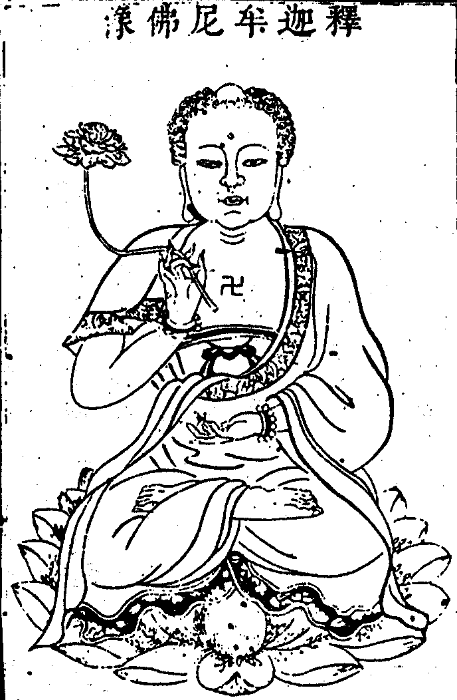



佛祖正印源流道影赞



圣寿山崇福禅寺嗣祖沙门如一即非拜撰



释迦牟尼佛



佛国土，名迦维罗，居西天竺之中。姓刹帝利，名悉达多。父净饭王，母摩耶夫人。佛本居兜率天宫，缘因地中，承然灯如来授记：「汝於来世，当得作佛，号释迦牟尼。」三祗果满，万德功圆，宿愿未周，示同生灭。驾日轮香象，托阴王宫，於周昭王甲寅二十四年四月八日，毘蓝园内，右胁降生。是时地涌金莲，龙沐香雨，即於花上，周行七步，目顾四方，分手指上下，作狮子吼曰：「天上天下，唯吾独尊。」具三十二大人相，八十种随形好。渐长，父王严驾，抱谒于大自在天庙，诸神像悉起，拜佛之足。父王惊叹：「我子于天神中，最尊最胜，宜字天中天。」及七岁，当修学时，遍访国中聪明波罗门，名曰选友，为佛之师。佛问曰：「以何书而相教乎？」其师答曰：「梵佉留书。」佛曰：「异书六十有四，何只言其二？」复问其义，师不能答，深生惭愧，白王言曰：「太子乃天人师，我安能教耶？」年十九，欲求出家，于四门游观，见四等事，心有悲喜，而作思惟：「此老病死，终可厌离。」於是夜子时，有一天人，名曰净居，於窗牖中，叉手白言：「出家时至，可去矣。」佛闻已，心生欢喜，即逾城而出，於檀特山中，习定苦行六载。於腊月八日，忽睹明星悟道，号天人师、佛、世尊，时年三十矣。既而於鹿野苑中，为憍陈如等五人，转四谛法轮，而证道果。复升忉利天，以道喻母。度世四十九年，说法三百餘会。时大梵天王，以金色波罗夷花献佛，请佛说法。佛拈花示众，人天百万悉皆罔措，独摩诃迦叶破颜微笑。佛告云：「吾有正法眼藏、涅槃玅心、实相无相，分付摩诃迦叶，汝当护持。」并敕阿难副贰传化，无令断绝。而说偈曰：「法本法无法，无法法亦法。今付无法时，法法何曾法？」尔时佛说偈已，复告迦叶：「吾将金缕僧伽黎衣传付于汝，俟补处慈氏佛出世，汝转授之，勿令朽坏。」迦叶闻已，头面礼足曰：「善哉！善哉！我当谨依佛敕。」尔时佛至拘尸那城，告诸大众：「吾欲入涅槃。」说偈曰：「诸行无常，是生灭法。生灭灭已，寂灭为乐。」即往熙连河侧娑罗树下，右胁累足，泊然宴寂。合城大众佥议，依轮王法用，以金棺椁舁入城供养。多力士尽其神力不能举，遂各持香薪，丘积茶毘，亦不能然。少顷，迦叶尊者至，佛现二足千辐轮相，出于棺外。迦叶见已，恸哭作礼，足还收入。大众以偈赞曰：「凡俗诸猛炽，何能致火𦶟？请尊三昧火，阇维金色身。」尔时金棺从座而起，高七多罗树，往反空中，化三昧火，自焚灰烬，得舍利八斛四斗。是时四天王及诸龙神、八国主，共分舍利，往天上、人间、龙宫、海藏，各建塔庙八万四千，使一切众生贵知有佛，普得景福。是年佛寿七十有九，即穆王五十二年壬申二月十五日也。佛灭度后一千一十七年，教至中夏，即后汉永平十年戊辰岁也。此於大藏诸经论摘要一二，阐佛行繇，如欲多闻，当阅全藏。赞曰：



受然灯记，成贤劫佛，托质皇宫，度生母腹。㘞地狮吼，三界尊独，容颜殊特，秋蟾春旭。御游凤城，悟世迅速，视金轮位，不啻帚秃。雪岭六霜，突开顶目，光被河沙，道成两足。忉利首登，为酬鞠育，普副群机，春行艸木。大人归敬，魔外降伏，三百餘会，响答空谷。拈花启笑，尾巴露出，不了命根，迦叶能续。丈六金身，幻临片牍，永陈供养，笔底灯烛。



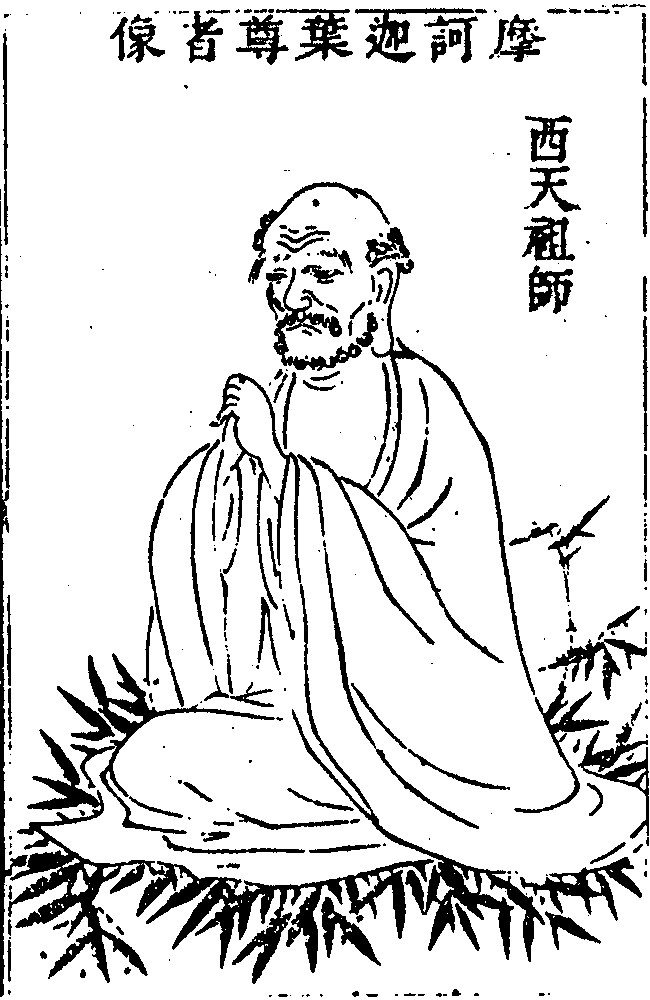



第一祖摩诃迦尊者



祖摩竭陀国人，父婆罗饮泽，母香志。前劫中为金师，以金饰佛面，感九十一劫身皆金色。后生梵天，转生中天，名曰迦叶。遇佛出家，头陀第一。阿难问曰：「世尊传金襕外，别传何物？」祖召阿难，难应诺。祖曰：「倒却门前刹竿著。」后付以偈云：「法法本来法，无法无非法。何於一法中，有法有不法？」说已，乃持僧伽黎入华首，俟慈氏下生。赞曰：



株守金襕於鸡足山中，钝置黄老；唤倒刹竿於王舍城畔，贻累阿难。九十一劫身金色，面皮厚也不堪观。



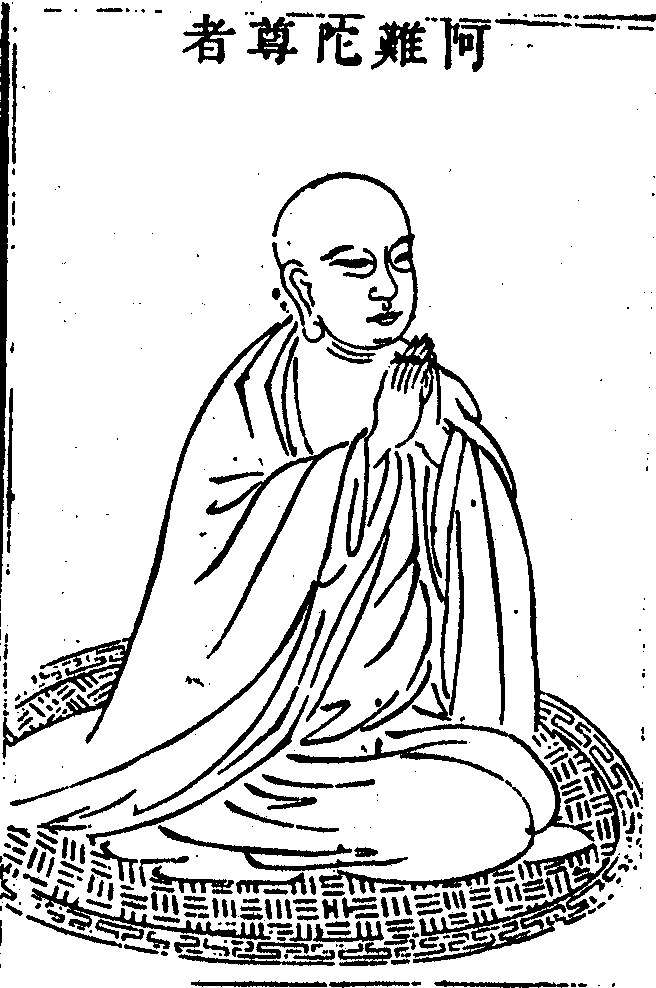



第二祖阿难陀尊者



祖姓刹帝利，斛饭王子，佛之从弟，总持第一。嘱商那和修曰：「昔如来以正法眼藏付大迦叶，迦叶入定而付於我，今用付汝。偈曰：本来付有法，付了言无法。各各须自悟，悟了无无法。」赞曰：



如来成道祖生日，珠联合璧。三十二相祖缺一，饴甘如蜜。为佛侍者三十年，智慧总持称第一。从上正法眼，展转流通，遗下多罗藏。如是结集，人天信受奉行。迦叶证明已讫，向恒河涅槃。许二王亲到中流彼岸，度五百仙人，唯商那会得眼横鼻直。



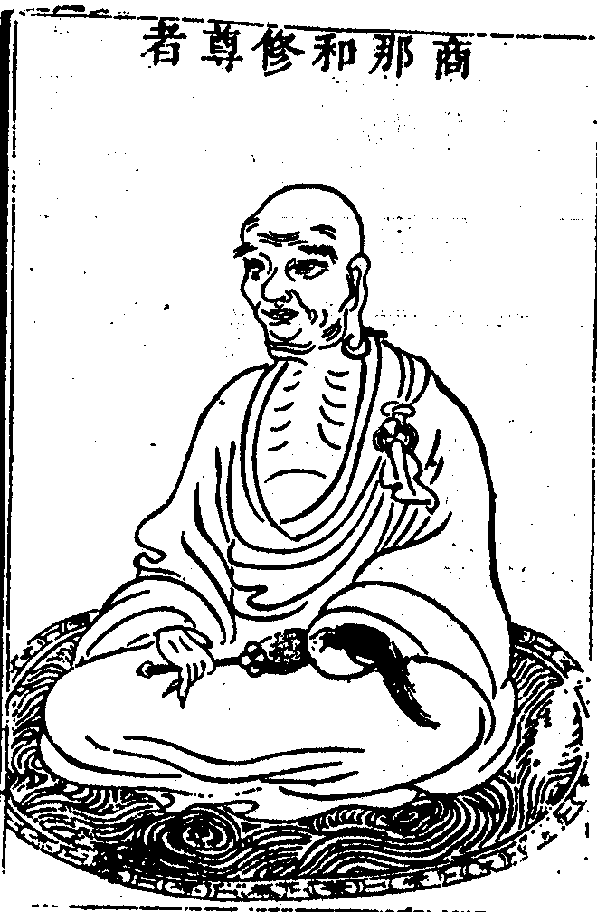



第三祖商那和修尊者



祖摩突罗国人，姓毘舍多，父林胜，母憍奢耶，在胎六年而生。国有九枝秀艸，若圣人降诞，则此艸生於净洁之地。祖生时，瑞艸斯应。昔如来至其国，见一青林茂盛，语阿难曰：「此地吾灭度后一百年，有比丘於此转玅法轮。」果符佛记，居此证道。二火龙归顺，以阿难所授大法付鞠多。



胎六白而出世，感九枝以降祥。兆符佛记，百岁后法轮常转；迸开法眼，二火龙匿耀无光。鞠多分得一枝秀，遍界咸闻瑞艸香。



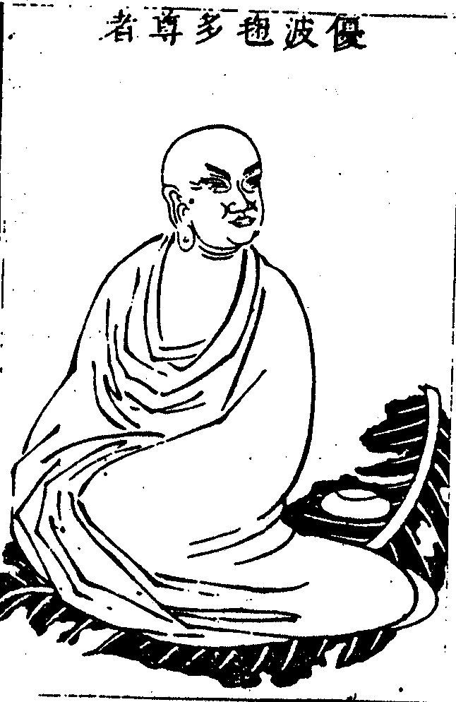



第四祖优波鞠多尊者



祖咤利国人，姓首陀。因和修问曰：「汝年几耶？」曰：「十七。」修曰：「汝身十七，性十七？」曰：「师发白耶？心白耶？」修曰：「我发白，非心白。」祖曰：「我身十七，非性十七。」修知法器，遂为剃落受具。付嘱偈曰：「非法亦非心，无心亦无法。说是心法时，是法非心法。」



答身十七，以性浑圆，性身本空，法何以传？真空不空，如春有权，时节若至，硬地皆穿。魔娆正法，伺尊者便，逆风把火，反烧其面。度人如沙，香众英彦，法付已竟，犹弦离箭。踊身虚空，现十八变，筹放光明，如雷如电。



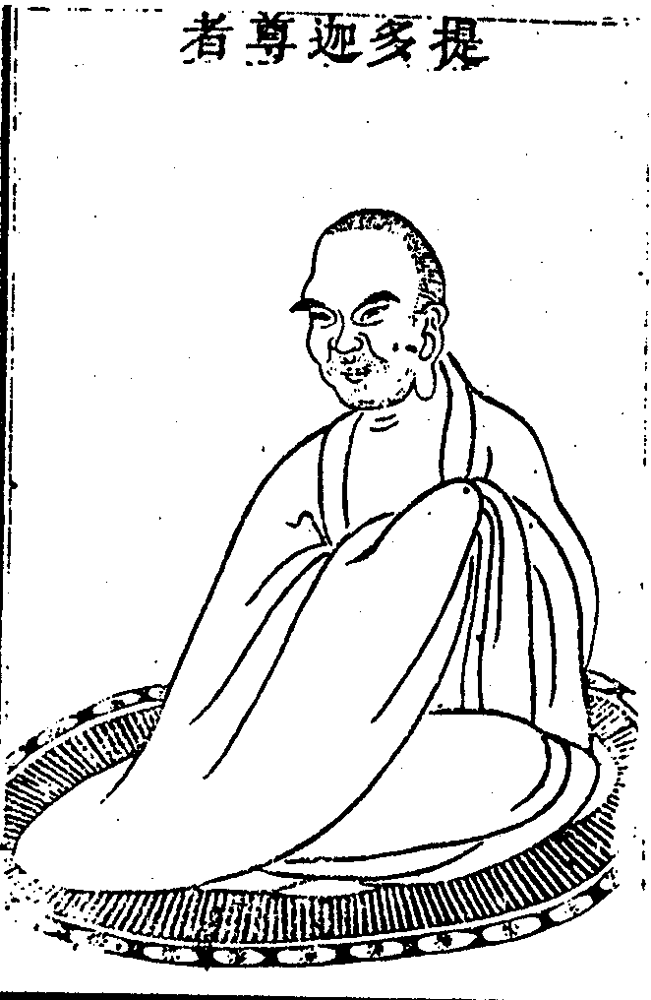



第五祖提多迦尊者



祖摩伽陀国人。初生时，父梦金日自屋而出，照耀天地。前有大山，诸宝严饰。山顶泉涌，滂沱四流。后遇鞠多尊者，解曰：「宝山者，吾身也。泉涌者，法流无尽也。日从屋出者，汝今入道之相也。照耀天地者，汝智慧超越也。」付嘱以偈曰：「心自本来心，本心非有法。有法有本心，非心非本法。」



巍巍宝峰，佛日方中，法流无尽，优波疏通。心离名字，身等虚空，无我我故，佛体是同。证无所得，圣种绍隆，化行中印，首度仙翁。



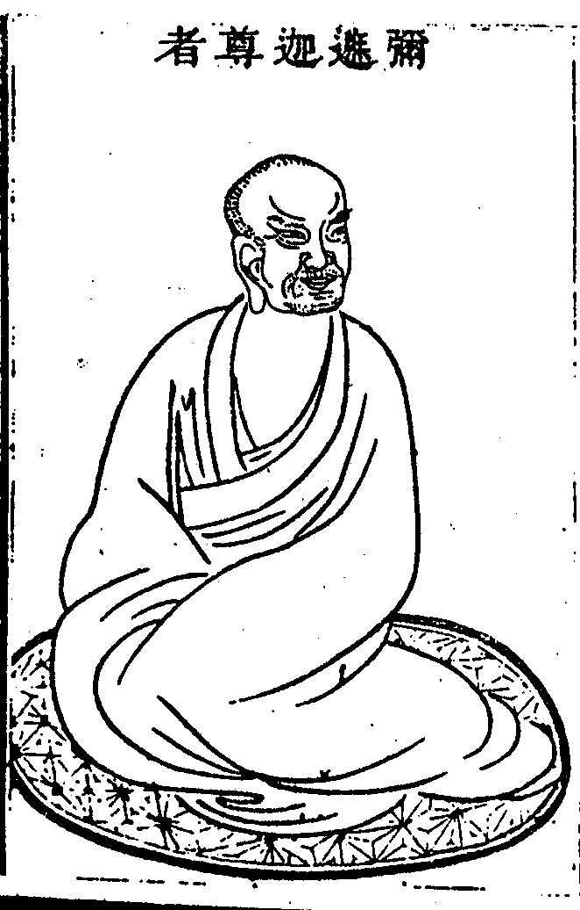



第六祖弥遮迦尊者



祖中印度人。闻提多迦至，率众瞻礼曰：「昔与师同生梵天，我遇阿私陀仙，授我仙法。师逢十力弟子，修习禅那。自此报分殊途，已经六劫。」提曰：「支离累劫，诚哉不虚。今可舍邪归正，以入佛乘。」即度出家。乃嘱祖曰：「昔如来以大法眼藏密付迦叶，展转相授，而至於我。我今付汝。偈曰：通达本法心，无法无非法。悟了同未悟，无心亦无法。」



别师梵天，错脚神仙。已经六劫，始了夙缘。入一乘道，其道无前。谁契密意，抹过那边。



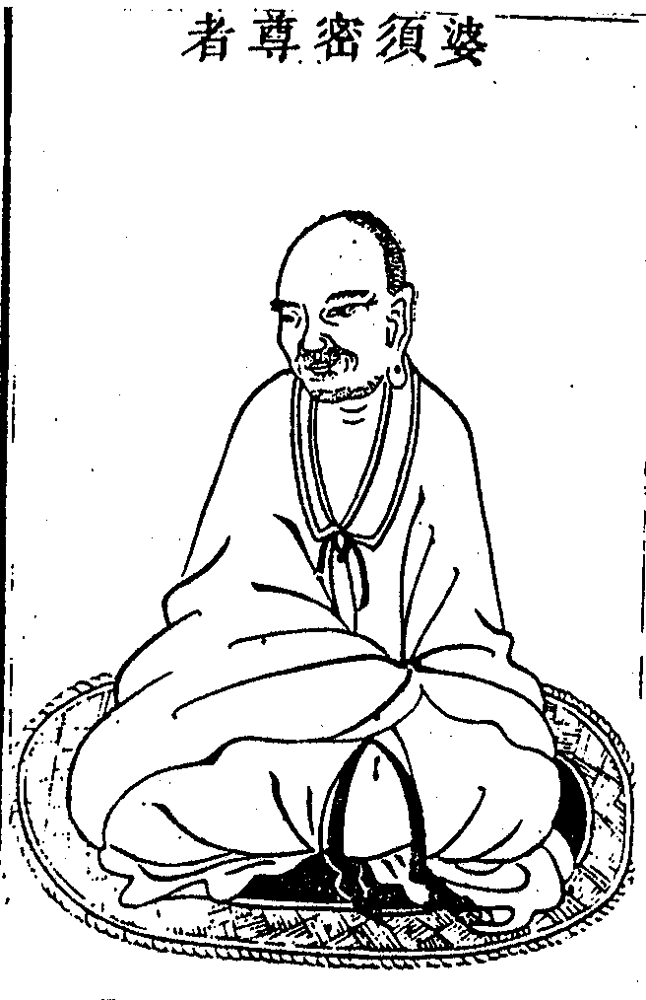



第七祖婆须密尊者



祖比天竺国人，姓颇罗堕。常执酒器吟游，及遇弥遮迦尊者，逆而问曰：「师何方来？欲往何所？」迦曰：「从自心来，欲往无处。」曰：「识我手中物否？」曰：「此是触器而负净。」祖曰：「师识我否？」曰：「我即不识，识即非我。」祖乃置器出家，受嘱偈曰：「无心无可得，说得不名法。若了心非心，始解心心法。」赞曰：



手提触器，街坊游咏，不染外尘，朗然内净。先三百年，佛记汝圣，顿省前缘，传提法印。有智者来，锋论不胜，愿归座下，上钩负命。



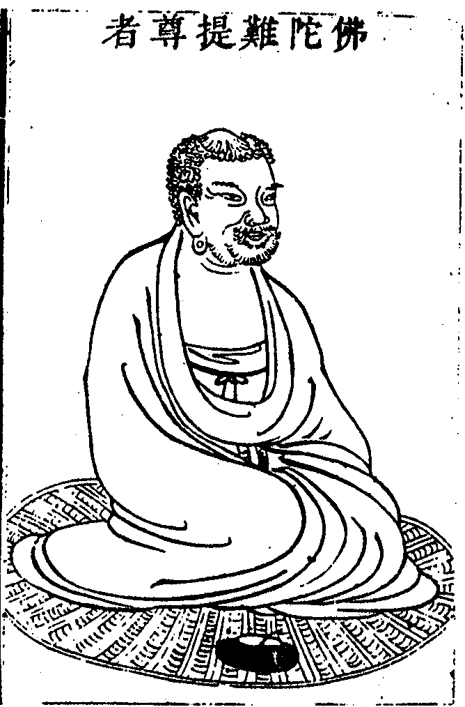



第八祖佛陀难提尊者



祖迦摩罗国人，姓瞿昙氏。顶有肉髻，辩捷无碍。谓七祖婆须密曰：「今与师论义。」密曰：「仁者论即不义，义即不论。若拟论义，终非义论。」祖知师义胜，心即钦服，曰：「我愿求道，沾甘露味。」密遂与剃度，而授具戒。复告之曰：「正法眼藏，今付於汝，汝当护持。」乃说偈曰：「心同虚空界，示等虚空法。证得虚空时，无是无非法。」



义路如苔难逞大辩才，大道无阶拶取入门来。绍承一滴真甘露，灌得伏驮臭口开。



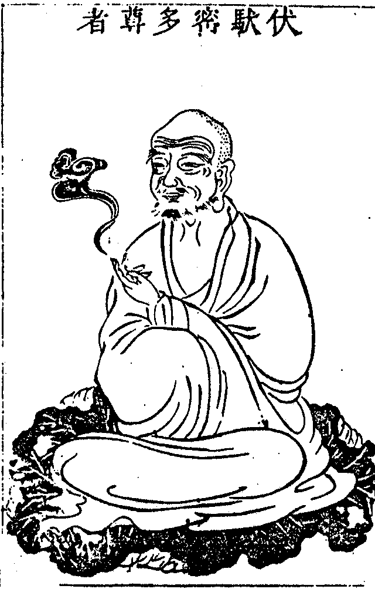



第九祖伏驮蜜多尊者



祖提伽国人，姓毘舍罗。年已五十，口未尝言，足未尝履。因难提尊者至其家，遽起拜曰：「父母非我亲，谁是最亲者？诸佛非我道，谁是最道者？」提曰：「汝言与心亲，父母非可比。汝行与道合，诸佛心即是。」云云。祖闻已，便行七步。其父长者遂令出家，寻授具戒。付嘱偈曰：「虚空无内外，心法亦如此。若了虚空故，是达真如理。」赞曰：



五十年口未曾言，言与心亲；自堕地足未曾行，行与道合。翻身磕破虚空，压碎难生卧榻。



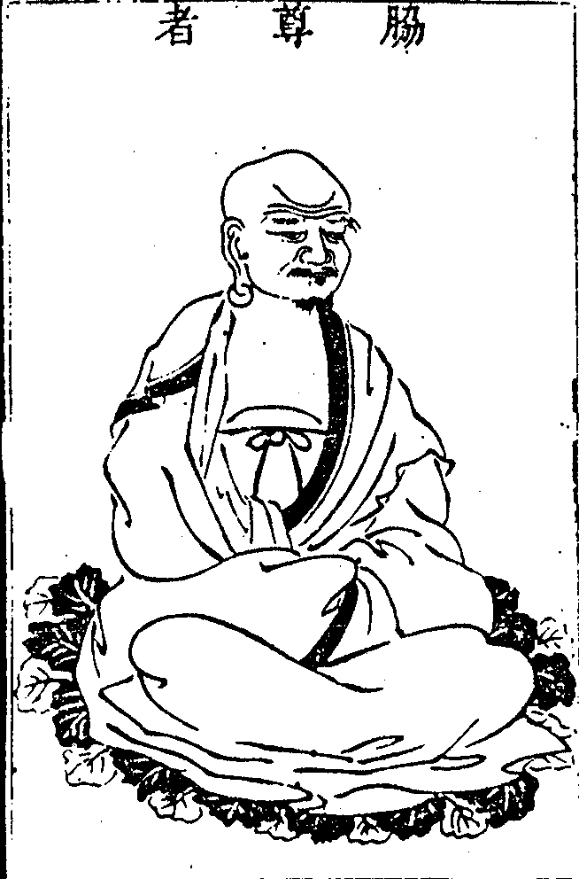



第十祖胁尊者



祖中印度人，其父香盖长者携以礼伏驮曰：「此子处胎六十岁，因号难生。尝会一仙人，谓此儿非凡，当为法器。今遇尊者，可令出家。」即落发授戒。自此执侍左右，未尝睡眠。谓其胁不至席，遂号胁尊者焉。羯磨之际，祥光烛座，感舍利三七粒现前，愈加精进。伏驮以法付嘱，说偈曰：「真理本无名，因名显真理。受得真实法，非真亦非伪。」



周甲胎中打坐，三生不著睡魔。感雨祥光舍利，分付夜奢富那。



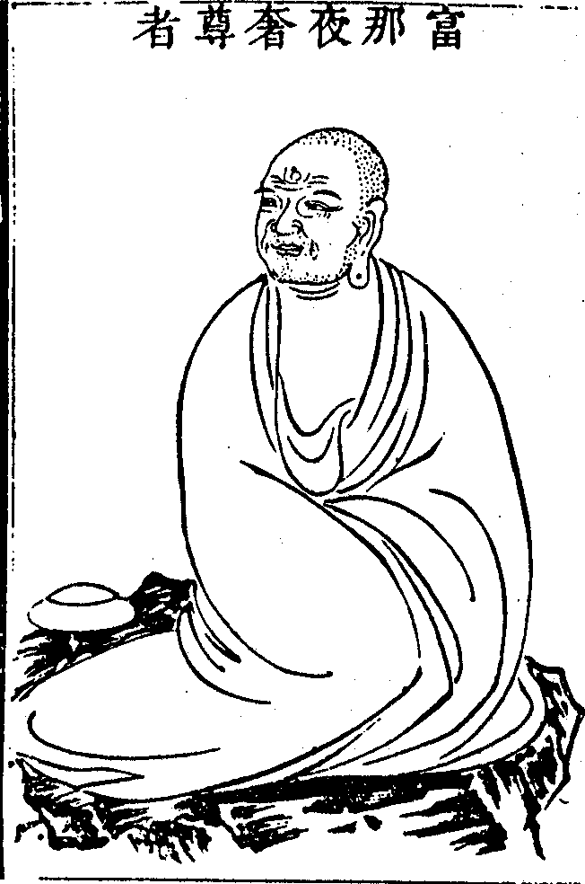



第十一祖富那夜奢尊者



祖华氏国人，姓瞿昙氏。因胁尊者憩树下，指地告众曰：「此地变金色，当有圣人入会。」言讫，祖合掌前立。胁问云：「汝从何来？」曰：「我心非往。」胁曰：「汝何处住？」曰：「我心非止。」胁曰：「汝不定耶？」曰：「诸佛亦然。」胁曰：「汝非诸佛。」曰：「诸佛亦非。」胁知法器，即度出家。复具戒品，仍付偈曰：「真体自然真，因真说有理。领得真真法，无行亦无止。」



来无所来，去无所去，心无所生，法无所住。无住之法，付与大士，仔细观来，秤锤蘸醋。



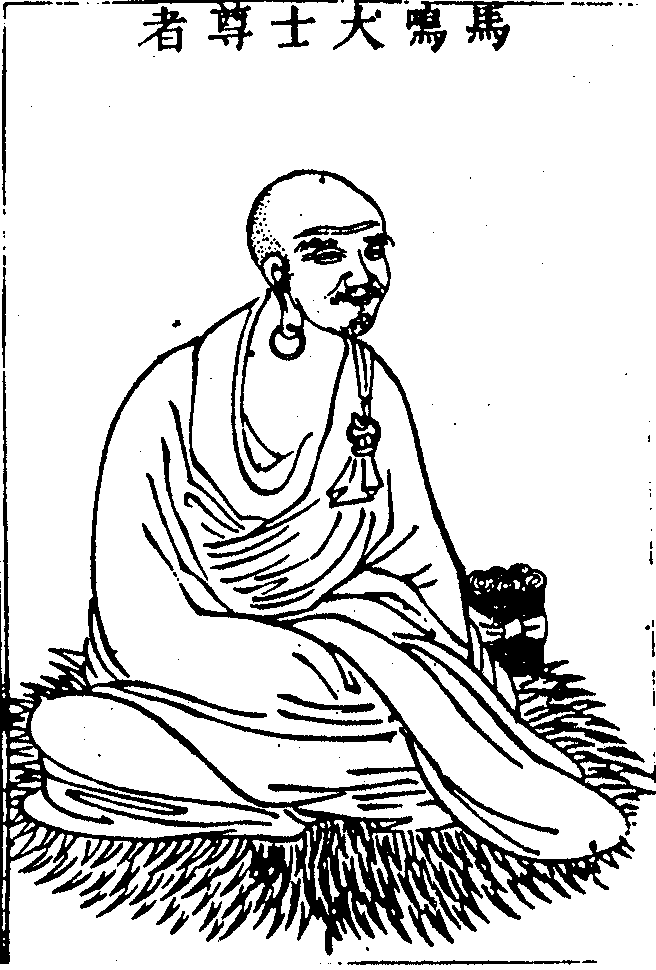



第十二祖马鸣大士尊者



祖波罗奈国人。因夜奢尊者化度彼国，祖拜而问曰：「我欲识佛，何者即是？」奢曰：「汝欲识佛，不识者是。」祖曰：「佛既不识，焉知是乎？」奢曰：「既不识佛，焉知不是？」云云。祖豁然省悟，遂求剃度。奢付法授偈曰：「迷悟如隐显，明暗不相离。今付隐显法，非一亦非二。」祖示寂时，挺身空中，如日轮相。



觌面是佛，尚自不识。言下悟去，信汝不及。前因化蚕，功无等匹。感化摩罗，三千入室。明暗不二，法非离即。相现日轮，腾空而寂。



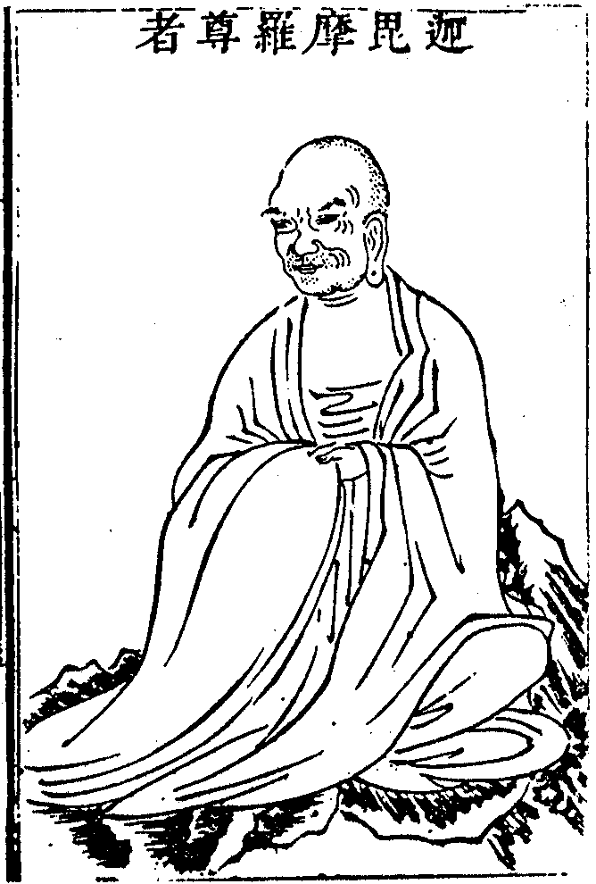



第十三祖迦毘摩罗尊者



祖华氏国人。初为外道，有大幻术，于马鸣大士座前涌出金人，复化女子。有顷，风雨晦冥，山岳震动，角法不胜，复现本形，作礼忏悔。鸣为说性海云：「山河大地皆依建立，三昧六通由兹发现。」祖闻发信心，归依剃度。付法偈曰：「隐显即本法，明暗元不二。今付悟了法，非取亦非离。」赞曰：



有形总归于尽，无相方知道尊。涌金人而复现女人，孽芽翻作菩提种；化性海而毛吞巨海，接得半干龙子孙。



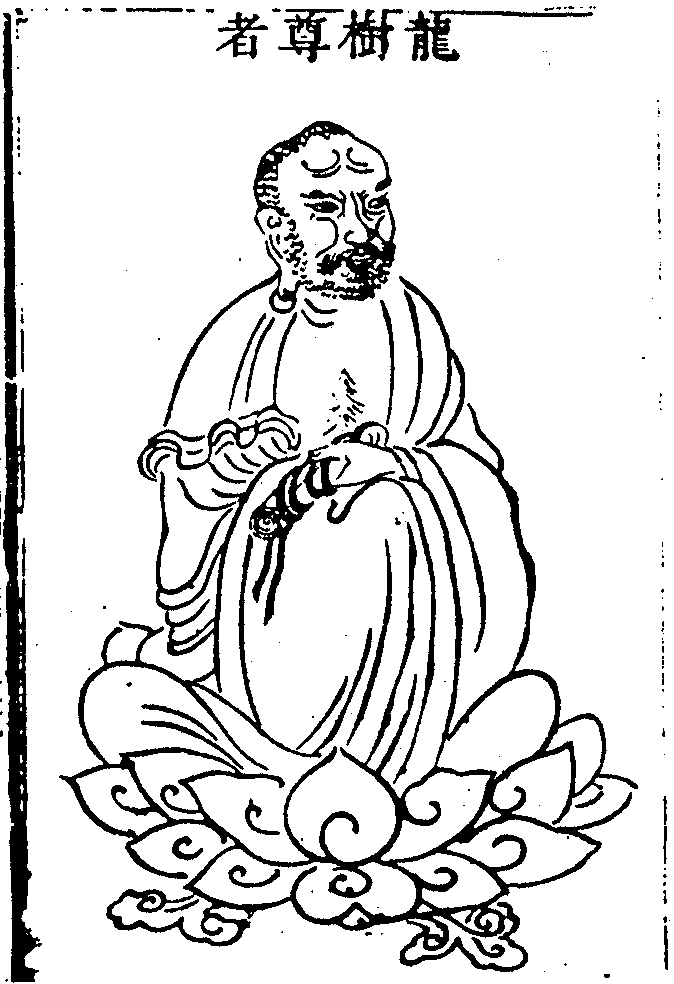



第十四祖龙树尊者



祖西天竺国人。因摩罗至，祖默念：「此师继大乘否？」罗曰：「汝虽心语，我已意知。」祖悔谢，与五百龙众从祖薙染。世间书读尽，入龙宫看藏。复造《大智度论》、《中论》、《十二门论》垂世。摩罗付偈言：「非隐非显法，说是真实际。悟此隐显法，非愚亦非智。」



测度圣智，自生惭惶。一礼簷卜，不嗅餘香。世间文字海，一口吸尽。华严十万偈，一目不忘。身现月轮，令一切人皆睹佛性。雷音灌耳，惟长者子择乳鹅王。亲制三论，疏钞相当。焚却可惜，施人拭疮。



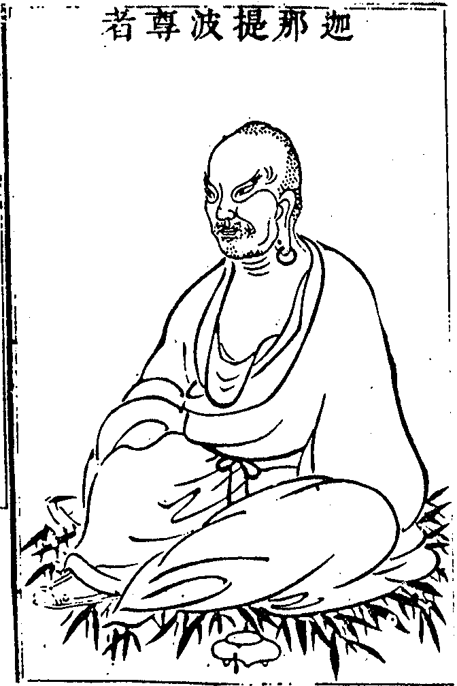



第十五祖迦那提波尊者



祖南天竺国人，姓毘舍罗。谒龙树尊者，者以满钵水置座前，祖睹之，即以一针投之而进，欣然契会，乃付偈曰：「为明隐显法，方说解脱理。於法心不证，无瞋亦无喜。」有净德长者，园树生耳，味甚甘，恒取食之。问故，祖曰：「汝昔供一比丘，道眼不明，故报为木菌，偿信施耳。」赞曰：



座前置满钵水，法海无涯；尊者投之以针，直穷到底。一头陀恁麼赞扬，多少人背后啮指，谓予不明向上，只管爱说道理。咄！木头有耳，急请罗多收起。



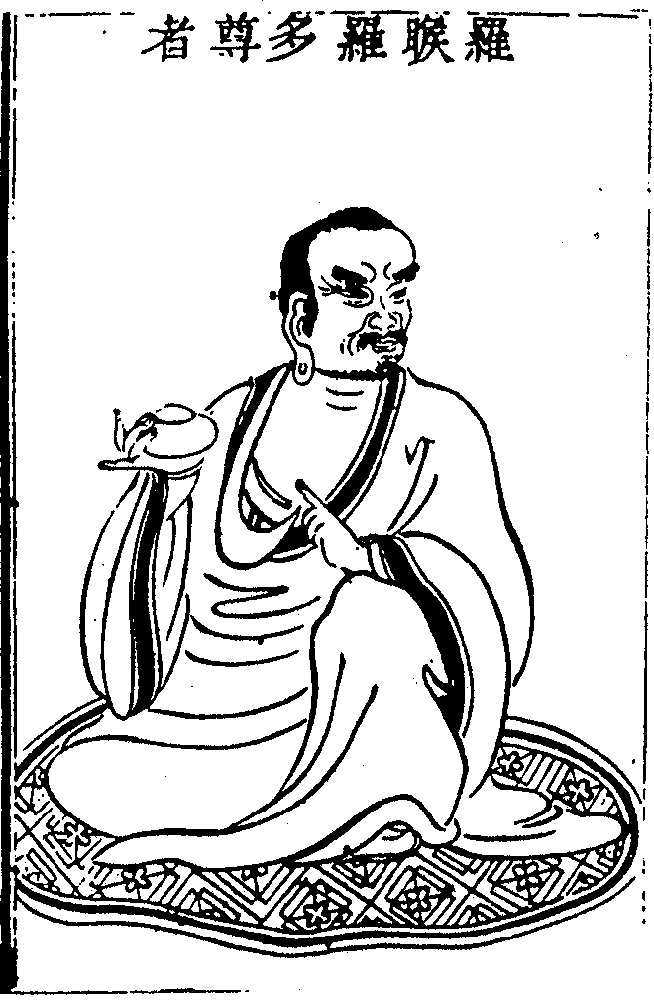



第十六祖罗睺罗多尊者



祖迦毘罗国人。其父净德，送祖出家。提婆曰：「昔如来记此子为大教主，今符宿因。」即与剃度，付法眼偈曰：「本对传法人，为说解脱理。於法实无证，无终亦无始。」祖受嘱，行化至金河，五佛现影。有僧伽定起，祖问曰：「汝身定耶？心定耶？」提曰：「身心俱定。」祖曰：「身心俱定，何有出入？」提曰：「虽有出入，不失定相。如金在井，金体常寂云云。」赞曰：



放过佛祖出头来，沐河发焰；把住乾坤不露踪，黄金失色。当时僧伽常在定，金钵香饭成狼藉。



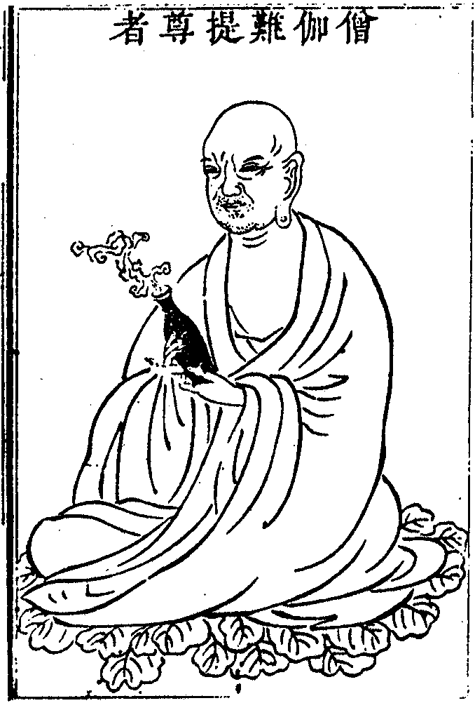



第十七祖僧伽难提尊者



祖室罗王子也。生而能言，常赞佛事。七岁即厌世乐，以偈告其父母，求出家。遇罗多尊者，得法受记。多即以右手擎金钵，至梵宫取香饭斋众。众不能食，惟祖分座同食。多付偈曰：「於法实无证，不取亦不离。法非有无相，内外云何起？」赞曰：



宝庄严王之太子，娑罗如来之后身。生而能语，犹频伽在鷇中，音超众鸟。七岁厌俗，如狮子初出窟，气概绝伦。事师十九载不倦，博得一百岁童真。缘尽攀树而化，众力难举，全身就树建塔，垂荫后人。



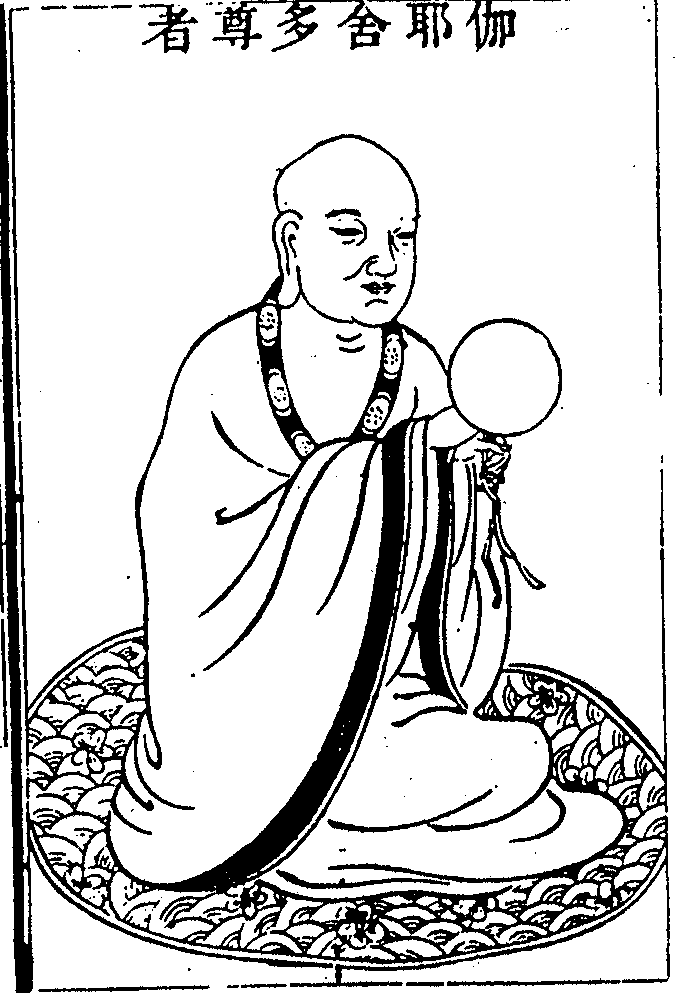



第十八祖伽耶舍多尊者



祖摩提国人。为童时，持镜造难提，提问：「汝几岁？」祖曰：「百岁。」提曰：「汝尚幼。」祖曰：「我不会理，正百岁耳。」提曰：「汝镜何所表？」曰：「诸佛大圆鉴。」偶闻风吹殿铃声，提问：「铃鸣，风鸣？」祖曰：「非风铃鸣，我心鸣耳。」提曰：「心复谁乎？」曰：「俱寂静故。」提付偈曰：「心地本无生，因地从缘起。缘种不相妨，华果亦复尔。」



娠七日而诞，其肌无瑕，琼枝寸寸是玉；生未尝入浴，其体芳洁，栴檀片片皆香。风铃不语，境由心寂；圆明宝鉴，道藉人彰。圣者德风弥宇宙，祖灯嗣续永昌昌。



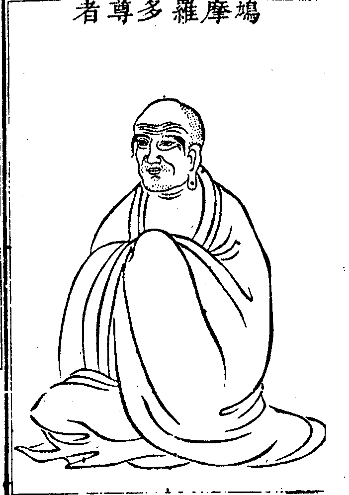



第十九祖鸠摩罗多尊者



祖大月氏国人。昔为梵天，善说法要，为天导师。遇舍多尊者，受记付偈曰：「有种有心地，因缘能发萌。於缘不相碍，当生生不生。」因阇夜多问：「我家奉佛，所作不如意。邻家为屠，所作皆和合。彼何幸？我何辜？」祖曰：「凡人但见仁天暴寿，逆吉义凶，便谓无因果。殊不知因缘会遇，如四时不爽。」



在天而天与天作眼，在佛而佛为佛偏袒。示因果如影随形，说生灭犹沤归浣。无生偈付阇夜多，面放红莲香不断。



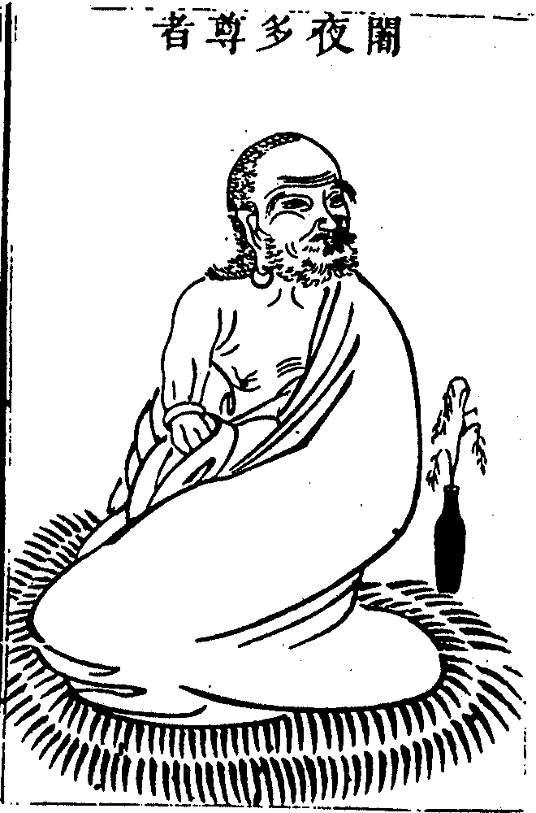



第二十祖阇夜多尊者



祖北天竺国人。因罗多尊者示曰：「汝虽已信三业，而未明业从惑生，惑因识有，识依不觉，不觉依心。心本清净，无生灭，无造作，无报应，无胜负，寂寂灵灵。若入此法门，可与诸佛同矣。」祖承言领旨，即发宿慧，出家受具。罗多付偈曰：「性上本无生，为对求人说。於法既无得，何怀决不决。」



阐扬顿教，纵横与夺，辩若悬河，不消一拶。解缠缚之苦行，令绝功勋；破执著之妄心，当下解脱。若不是婆修盘头，争领得者虚空棒喝？



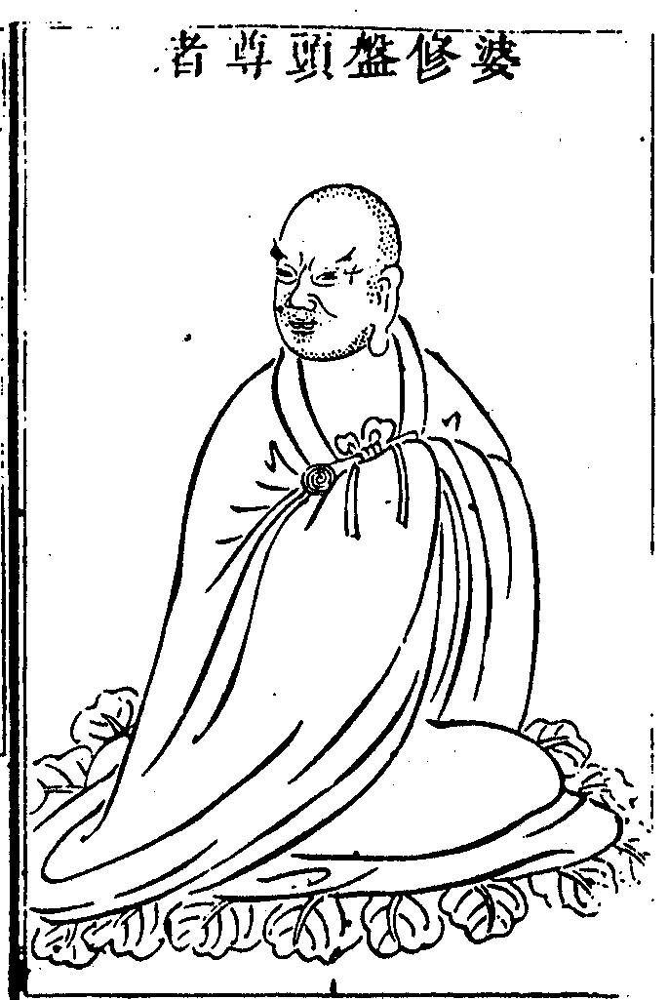



第二十一祖婆修盘头尊者



祖罗阅城人。因阇夜多示曰：「若不明道，设苦行多劫，皆虚妄之本。」又曰：「我不求道，亦不颠倒；我不礼佛，亦不轻慢；我不长坐，亦不懈怠；我不一食，亦不杂食；我不知足，亦不贪欲。心无所希，名之曰道。」祖闻已，发无漏智。多付偈曰：「言下合无生，同於法界性。若能如是解，通达事理竟。」赞曰：



杖倚佛像，遂失二果。堕富家儿，堪作甚麼。未出娘胎，被人看破。圣子在怀，生为法宝。一食终日，长坐不卧。感摩拏罗，同证佛道。



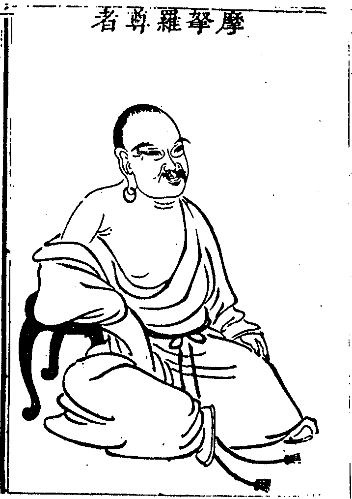



第二十二祖摩拏罗尊者



祖那提国自在王之次子。王问盘头尊者曰：「贵城土风与此何异？」曰：「彼土曾三佛出世，今王国有二师化导。」王曰：「二师者谁？」曰：「佛记二五百年有二大士出家继圣，即王之次子是其一也。」王曰：「诚如所言，当舍此子作沙门。」盘曰：「善哉！大王能遵佛旨。」即与剃度，授具付法。偈曰：「泡幻同无碍，如何不了悟？达法在其中，非今亦非古。」赞曰：



全德天授，一念正信。遵父王命，佩佛祖印。度彼世主，七日证圣。嘱鹤上座，荷担上乘。



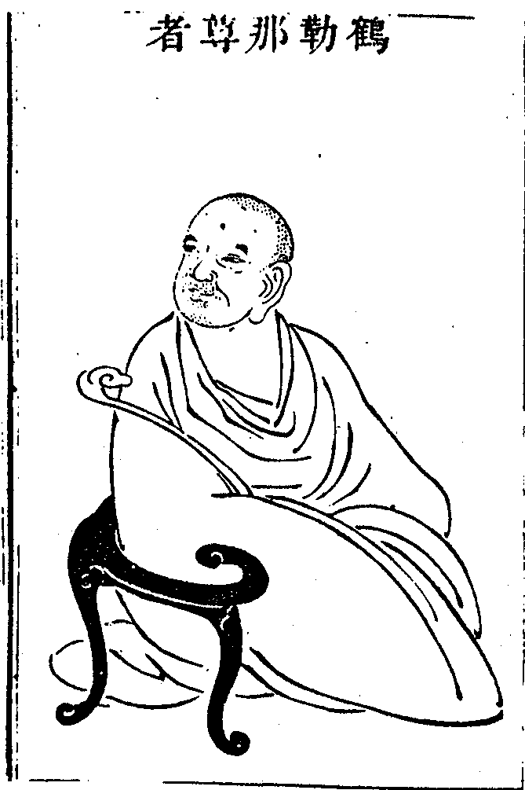



第二十三祖鹤勒那尊者



祖月氏国人，七岁见淫祀入庙，叱之曰：「汝妄兴祸福，幻惑於人，岁费牲牢，伤害斯甚。」言讫，庙貌自坏。由是乡党谓之圣子。年二十出家，遇摩拏罗尊者，为说鹤众夙因。复说偈曰：「心随万境转，转处实能幽。随流认得性，无喜复无忧。」赞曰：



▆子神童，英中秀，金环在握花生肘。幼行聚落叱淫▆，言讫庙貌立崩朽。中年行化至中印，国王接足天▆首。至人达观体性空，无作功德亦非有。复为师子▆休咎，众生倒计汝正受。



第二十四祖师子尊者



祖中印度人，遇鹤勒尊者开示，即入佛慧。乃付偈曰：「认得心性时，可说不思议。了了无可得，得时不说知。」至罽宾国，摄伏五宗，得斯多以夙因还其珠，谓之曰：「吾师密有悬记，正法今付於汝。」



聪明难敌业，无作即功德。悟此至人言，深入智慧宅。诘化小乘禅，五众齐解惑。呼童还宿珠，古今理不隔。伽黎付斯多，他方施法泽。祖受鹤悬记，独留罽方客。平地骨堆成，冤对路头迫。劈开瀑布泉，界破青山色。槐根既伤锋，柳枝断移刻。俱了本来空，无失亦无得。



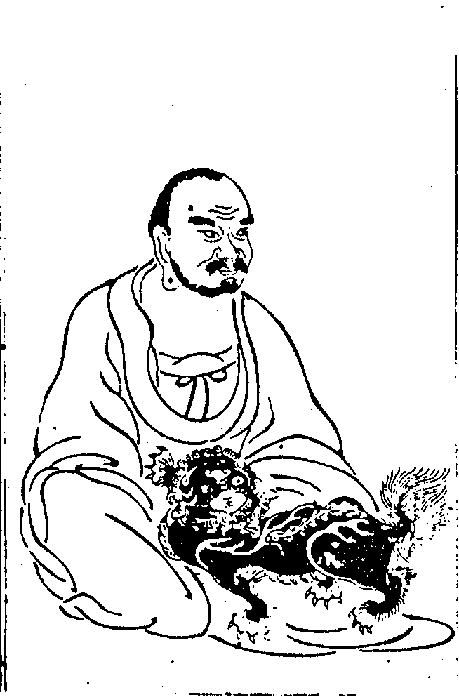



第二十五祖婆舍斯多尊者



祖罽宾国人，母梦得神剑，因而有孕。得法于师子尊者，者付偈曰：「正说知见时，知见俱是心。当心即知见，知见即于今。」并以僧伽梨付之。赞曰：



剑铸鼻孔，珠换眼睛。藏身露影，面目分明。被师看破，特地安名。密授心法，直抵王城。摧伏外道，义海无声。闻师偿难，北面伤情。振策南迈，山谷遁形。德王徵起，疑信相并。祖出信衣，命付丙丁。薪尽如故，谢过致诚。谕弟嗣法，祖道雷鸣。神变入灭，舍利尺盈。敕赐建塔，空碑宿铭。



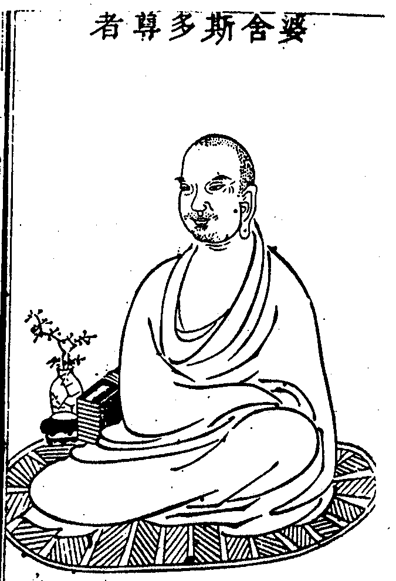



第二十六祖不如密多尊者



祖南印度天德王之次子也。斯多尊者问曰：「汝欲出家，当为何事？」祖曰：「不为别事。」者曰：「不为何事？」祖曰：「不为俗事。」者曰：「当为何事？」祖曰：「当为佛事。」者曰：「子必圣贤降迹，善护正法。」付偈曰：「圣人说知见，当境无是非。我今悟真性，无道亦无理。」



不舍四誓愿，降迹诞王宫。为一大事故，传法度愚蒙。枫宸初羯磨，地震摇虚空。大人具大用，不与寻常同。随类化王者，外道术相攻。祖以无心应，一指超五通。化山顿殒灭，首度璎珞童。以圣而继圣，果熟远劫中。



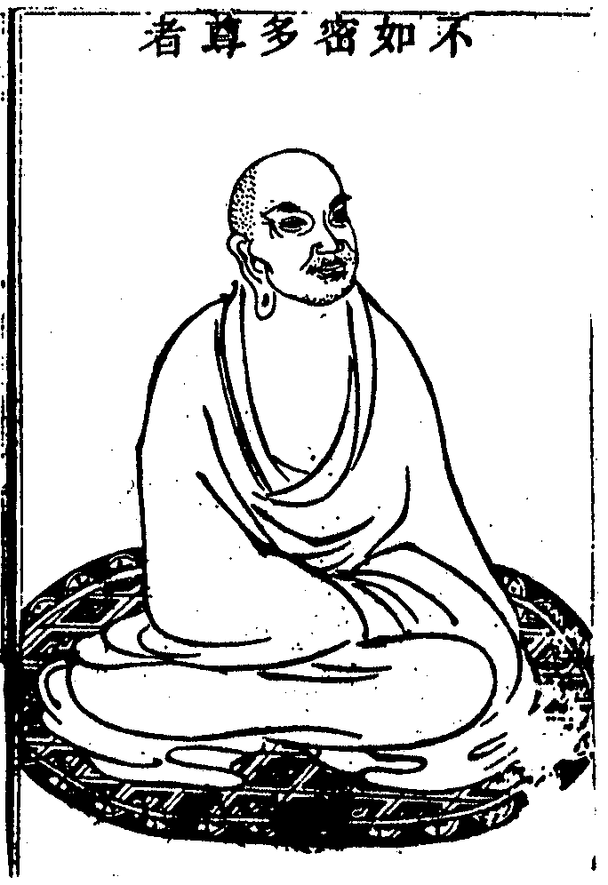



第二十七祖般若多罗尊者



祖东印度人，遇蜜多尊者与王同车而出，稽首於前。尊者谓王曰：「此童子非他，即大势至菩萨也。」遂为安名受记，付偈曰：「真性心地藏，无头亦无尾。应缘而化物，方便呼为智。」祖得法已，赴南印土香至王供养，得其王子菩提达摩嗣法焉。



璎珞童真，势至化身，先佛纲纪，后代绳津。报缘已周，谢万乘之弟子；度生果满，作胜热之上宾。放光二十七道，如虹贯日；腾空雨注舍利，坠若飞星。袈裟留褁菩提子，一叶花敷无尽春。



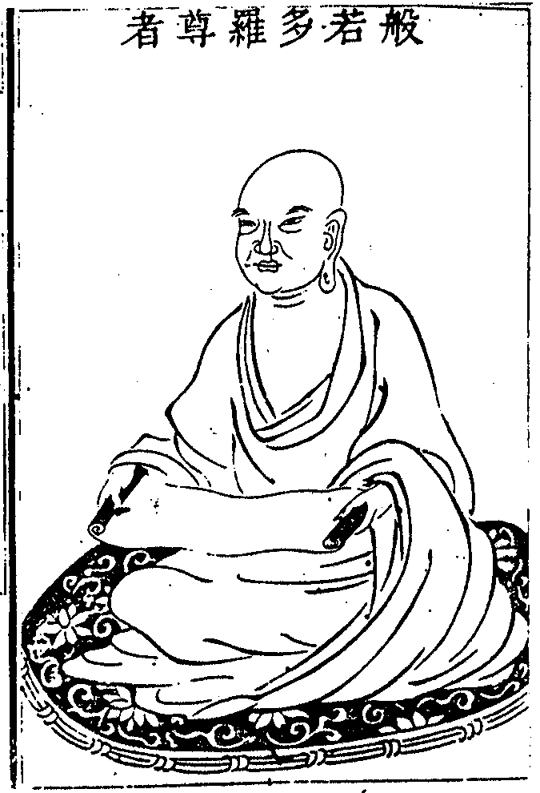



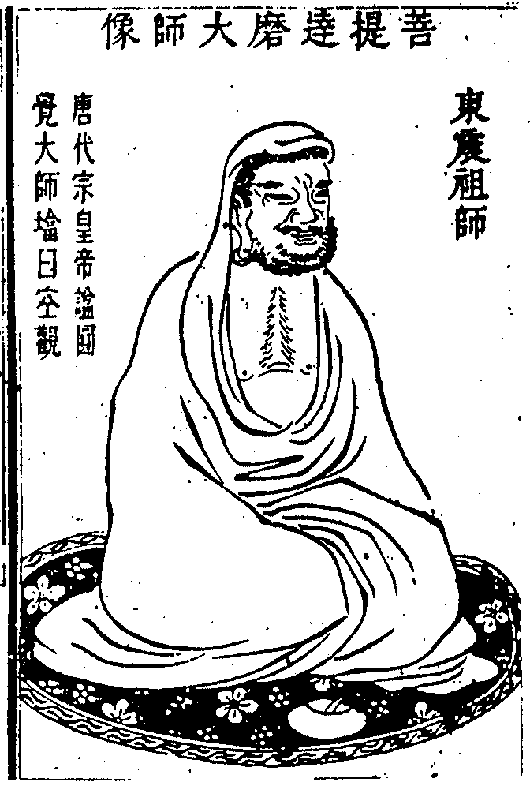



唐代宗皇帝谥圆觉大师，塔曰空观。



初祖菩提达磨大师



祖南天竺国香至王季子也，姓刹帝利。因其父王施无价宝珠与般若多罗尊者者，欲试祖所得，乃以所施珠问三王子曰：「此珠圆明，有能及否？」第一王子、第二王子皆曰：「此珠七宝中尊，固无逾也。非尊者道力，孰能受之？」祖曰：「此是世宝，未足为上；於诸宝中，法宝为上。此是世光，未足为上；於诸光中，智光为上。此是世明，未足为上；於诸明中，心明为上。此珠光明，不能自照，要假智光，光辨於此。既辨此已，即知是珠；既知是珠，即明其宝。若明其宝，宝不自宝；若辨其珠，珠不自珠。珠不自珠者，要假智珠而辨世珠；宝不自宝者，要假智宝以明法宝。然则师有其道，其宝即现；众生有道，心宝亦然。」尊者叹其慧辩，颔之。及父王厌世，众皆号绝，惟祖于龙棺前入定，经七日而出，乃求出家。既受戒已，尊者告曰：「如来以正法眼付大迦叶，如是展转，乃至於我。我今嘱汝，听吾偈曰：心地生诸种，因事复生理。果满菩提圆，华开世界起。」祖承嘱已，服勤左右，垂四十年，未尝废阙。迨尊者顺世，遂演化本国，辟邪见六宗，望震旦佛种缘熟，泛重溟三周寒暑。至金陵，梁帝问：「如何是圣谛第一义？」祖曰：「廓然无圣。」帝曰：「对朕者谁？」祖曰：「不识。」帝不契。祖乃折芦渡江，止嵩山少林，面壁九年，乃接慧可，以大法嘱累，并授袈裟表信云云。赞曰：



西乾正干，东土初枝。貌五露而象五竺，胸天空而印天池。志绍觉胤，敝屣香至大宝；智珠月朗，眇视无价摩尼。椁边入定七朝昏，道酬鞠育；座下服勤四十载，义尽师资。除六宗婆心何切，对梁主觌面相欺。九年壁观成何事，赚得承宗半臂儿。



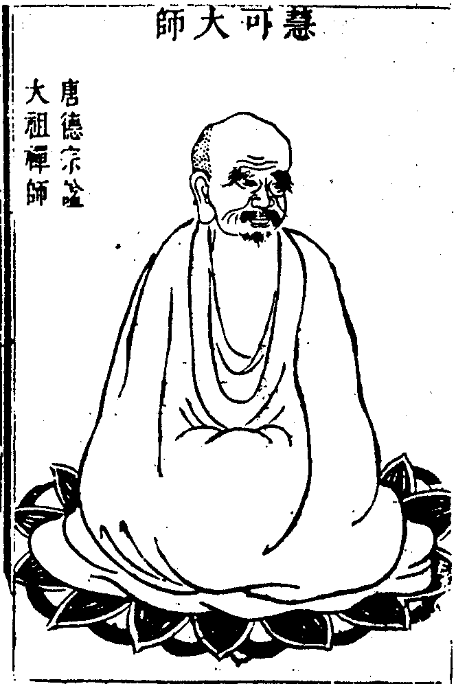



唐德宗谥大祖禅师。



二祖慧可大师



(祖武牢姬氏子，名神光。参初祖达磨，磨曰：「汝久立雪中，当求何事？」祖曰：「愿开法门，广度群品。」磨曰：「诸佛玅道，旷劫精勤，难行能行，非忍而忍，岂以小德轻心所可希冀？」祖自断左臂置座前，磨曰：「诸佛最初求道，为法忘形，汝今断臂，求亦可在。」遂名曰慧可。祖曰：「诸佛法印可得闻乎？」曰：「法印匪从人得。」祖曰：「我心未宁，乞师安心。」磨曰：「将心来，与汝安。」祖良久，曰：「觅心了不可得。」磨曰：「与汝安心竟。」乃授衣付偈曰：「吾本来兹土，传法收迷情，一花开五叶，结果自然成。」祖寿一百七岁。)



顶似五峰秀出，胸罗三藏文章。开舜若身中活眼，现毘卢顶后神光。为法断肱，续少林之嫡髓；密传正印，灿鹫岭之芬芳。业空百有七龄，霜消雪解；衣付风恙长老，杏接梅香。



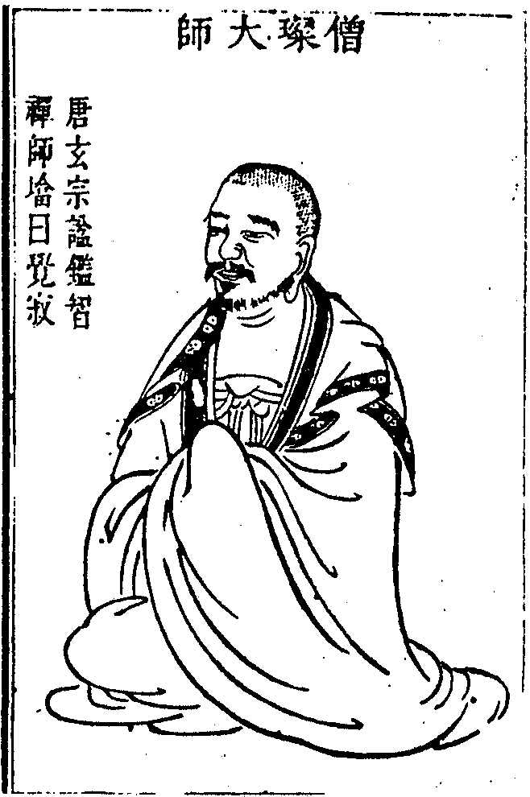



唐玄宗谥鉴智禅师，塔曰觉寂。



三祖僧灿大师



祖初以白衣谒二祖慧可，请为忏罪，可曰：「宜依佛法僧住。」祖曰：「今见和尚是僧，未审何名佛、法？」可曰：「是心是佛，是心是法，法佛无二，僧宝亦然。」祖曰：「今日始知罪性不在内，不在外，不在中间，如其心然，佛、法无二也。」可深器之，即为剃发，曰：「是吾宝也，宜名僧璨。」后付衣法，偈曰：「本来缘有地，因地种华生。本来无有种，华亦不曾生。」赞曰：



僧中之宝，法中之龙。心铭如镜，无不包容。委顺时至，合掌立终。轻信沙弥，败露家风。



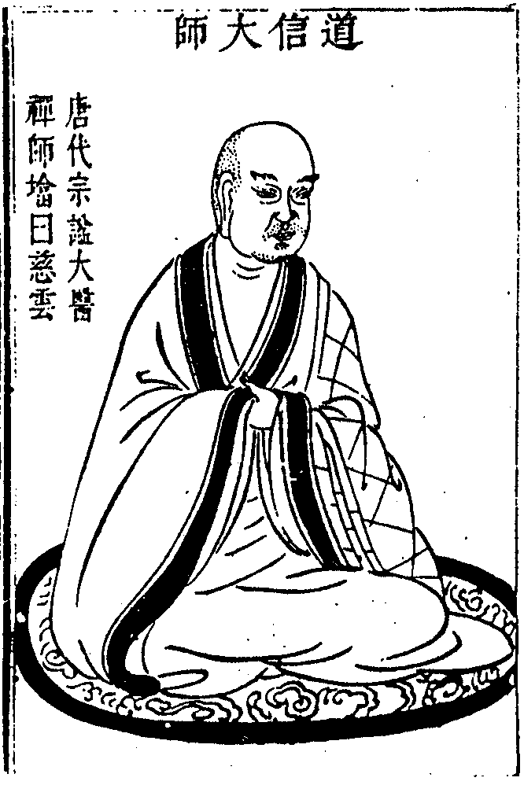



唐代宗谥大医禅师，塔曰慈云。



四祖道信大师



祖姓司马氏，蕲阳人。生而颖异，幼慕空宗，摄心不寐，胁不沾席者六十年。问三祖灿大师，乞与解脱法门。灿曰：「谁缚汝？」祖曰：「无人缚。」曰：「何更求解脱？」祖於言下大悟。服劳九载，乃付衣法。偈曰：「华种虽因地，从地种华生。若无人下种，华地尽无生。」后住破山，学侣云臻。太宗向祖道风，三诏不赴，就赐珍缯。



自缚自解，乘风展翼。经六十载，胁不至席。凤诏三却，帝弥加钦。一枝横出，吾道如林。



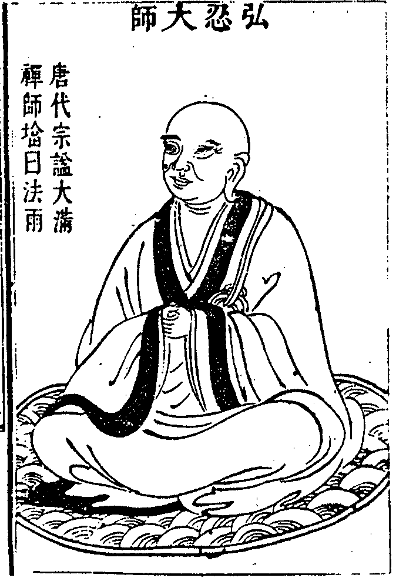



唐代宗谥大满禅师，塔曰法雨。



五祖弘忍大师



祖先为栽松道者，因四祖大师嘱曰：「倘若再来，吾当迟汝。」遂托生周氏女。童时，有智者见而叹曰：「此子缺七种相，不逮如来。」后复遇大师出家纳戒，付法传衣。偈曰：「华种有生性，因地华生生。大缘与性合，当生生不生。」赞曰：



以宿缘故，出家童真。两梦一觉，镜像瞳人。相缺七种，不逮能仁。以性为姓，族无比伦。破山忽晦，嗣化方晨。七百龙象，选取一麟。树堂养母，以道资亲。有情下种，如火传薪。



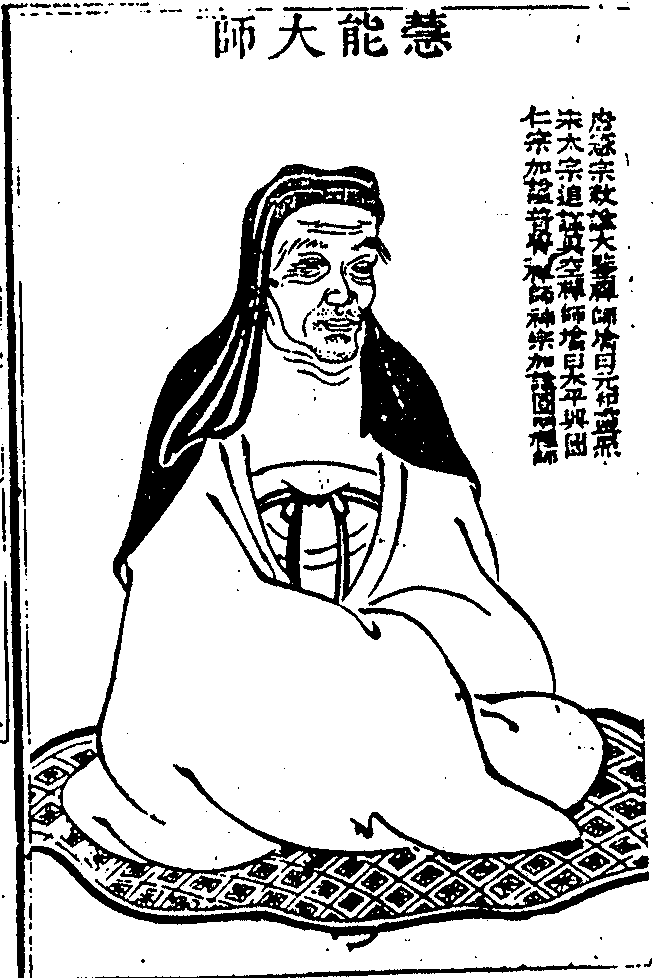



(唐宪宗敕谥大鉴禅师，塔曰元和灵照。宋太宗追谥真空禅师，塔曰太平兴国。仁宗加谥普贤禅师。神宗加谥圆明禅师。)



六祖慧能大师



(祖俗姓卢，其先范阳人。父行瑫，武德中左官于南海之新州，遂占籍焉。三岁丧父，其母守志鞠养。及长家贫，樵采为业，鬻薪市中。闻读《金刚》应无所住而生其心，有所感悟，置金安母。直参黄梅，梅问：「汝自何来？」曰：「岭南。」梅曰：「欲须何事？」曰：「惟求作佛。」梅曰：「岭南人无佛性，若为作佛？」曰：「人有南北，佛性岂然？」梅知是异人，命居碓坊，以石坠腰，春米供众。聆诵神秀偈曰：「身是菩提树，心如明镜台。时时勤拂拭，莫使惹尘埃。」祖别曰：「菩提本无树，明镜亦非台。本来无一物，何处惹尘埃？」梅知其得旨，乃诣碓坊问曰：「米白也未？」祖曰：「白也，只未有筛在。」梅击碓三下，祖即三鼓入室，付法授衣。偈曰：「有情来下种，因地果还生。无情既无种，无性亦无生。」后返曹溪，雨大法雨。赞曰：)



八十一生，为善知识。一物也无，留取腰石。石烂花酣，果熟梅岩。馨香充塞东西土，衣钵谁云在岭南。



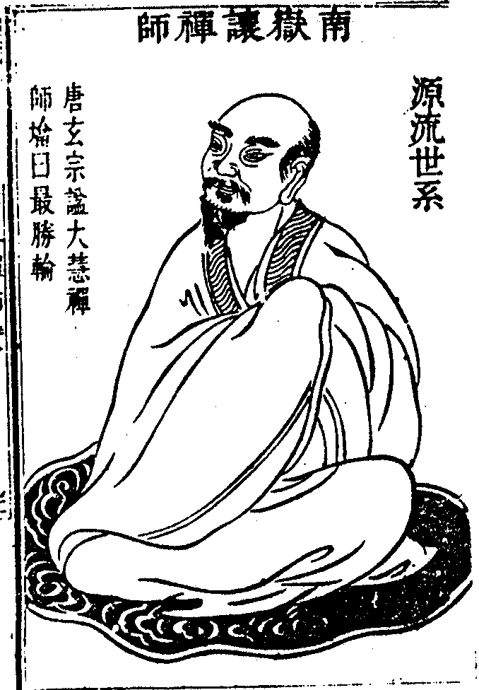



唐玄宗谥大慧禅师，塔曰最胜输。



第一世南岳怀让禅师



(师姓杜氏，金州人也。於唐仪凤二年四月八日降诞，感白气应於玄象，在安康之分。太史瞻见，奏闻高宗皇帝。帝乃问：「是何祥瑞？」太史对曰：「国之法器，不染世荣。」帝传敕金州太守韩偕，亲往存愍其家。家有三子，唯师最小，炳然殊异，性唯恩让，父乃安名怀让。年十岁时，唯乐佛书。十五岁，依律师出家。十七，诣曹溪参六祖。祖问：「甚麼处来？」曰：「嵩山来。」祖曰：「甚麼物恁麼来？」师无语。遂经八载，忽然有省。乃白祖曰：「某甲有个会处。」祖曰：「作麼生？」师曰：「说似一物即不中。」祖曰：「还假修证否？」师曰：「修证则不无，污染即不得。」祖印可曰：「祇此不污染，诸佛之所护念。汝既如是，吾亦如是。西天般若多罗识汝，足下出一马驹，踏杀天下人。」师执侍左右一十五年。赞曰：)



佛旦降生，圣贤应化，为国法器，象应王霸。五叶绍芳，英灵独跨，脚底儿孙，踏满天下。



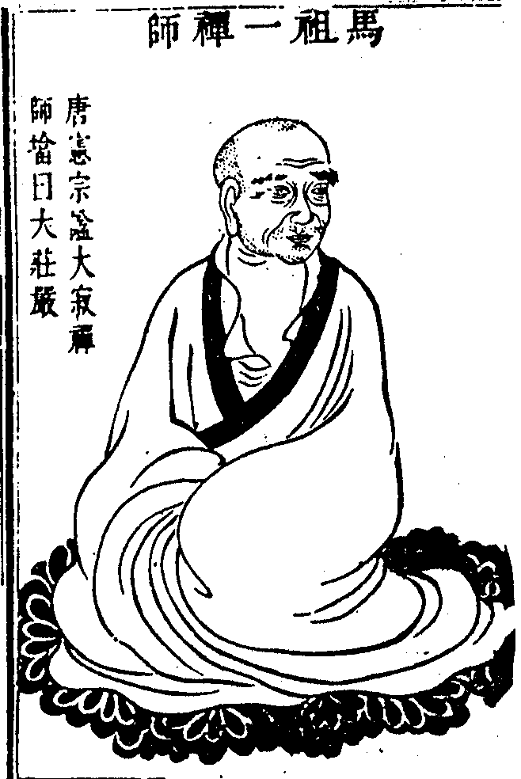



唐宪宗谥大寂禅师，塔曰大庄严。



第二世马祖道一禅师



师汉州什邡县人也，姓马氏，本邑罗汉寺出家。容貌奇异，牛行虎视，引舌过鼻，足下有二轮文。幼岁依资州唐和尚落发，受具於渝州圆律师。唐开元中，习禅定於衡岳山中，遇让和尚，同参六人，唯师密受心印。付偈曰：「心地含诸种，遇泽悉皆萌。三昧华无相，何坏复何成？」赞曰：



全德异器，牛行虎视。引舌覆鼻，足纹成字。衡岳坐禅，看破磨砖。车牛两亡，心佛俱捐。八十四员，鼻孔被穿。百丈老祖，扭失半边。



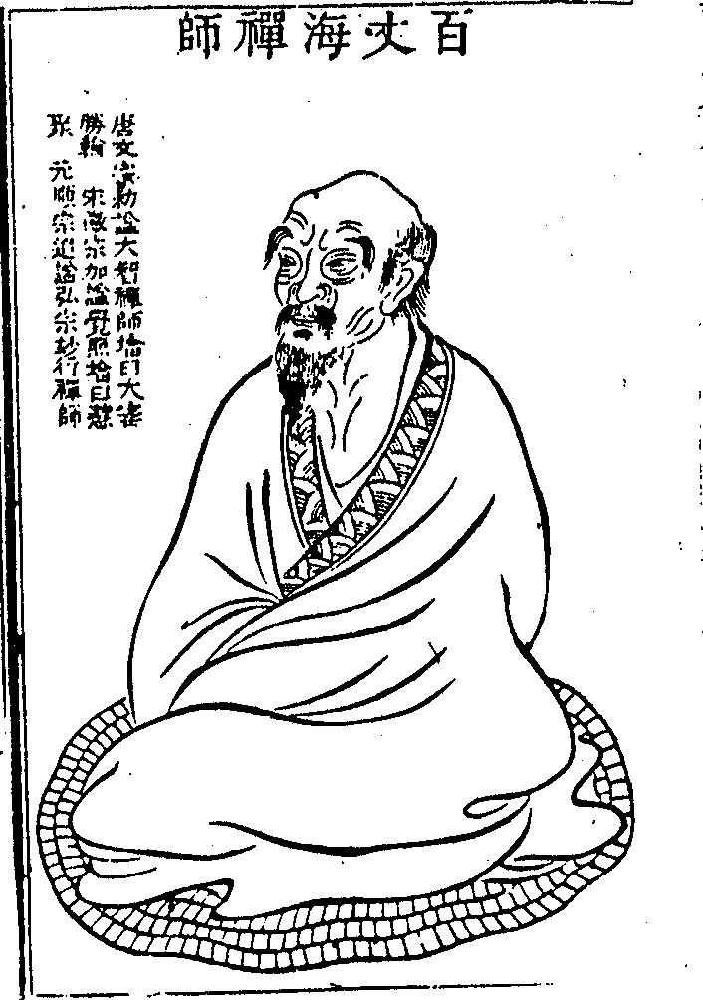



(唐文宗敕谥大智禅师，塔曰大宝胜轮。　宋徽宗加谥觉照，塔曰慧聚。　元顺宗追谥弘宗玅行禅师。)



第三世百丈怀海禅师



(师福州长乐人，姓王氏。儿时随母入寺拜佛，指佛像问母曰：「此是何物？」母曰：「是佛。」师曰：「形容似人无异，我后亦当作焉。」丱岁离尘，三学该练。闻马大师阐化江西，乃倾心依附。一日侍行次，见一群野鸭飞过。祖曰：「是甚麼？」师曰：「野鸭子。」祖曰：「甚处去也？」曰：「飞过去也。」祖遂把师鼻头扭，负痛失声。祖曰：「又道飞过去也。」师於言下有省。又於举拂机缘，被马祖一喝，直得三日耳聋，大彻源底。受嘱住洪州百丈，学者四至。凡作务执劳，必先於众。故有一日不作，一日不食之语。赞日：)。



佛与人无异，我后当必至。虎子生三朝，便有食牛气。喝下双耳聋，突出超师智。丛林制礼乐，万古为标帜。日作必日食，不置闲家具。卓然而独存，享寿九十五。道貌甚清臞，俨然未度世。千载遇一时，惭惶续世系。



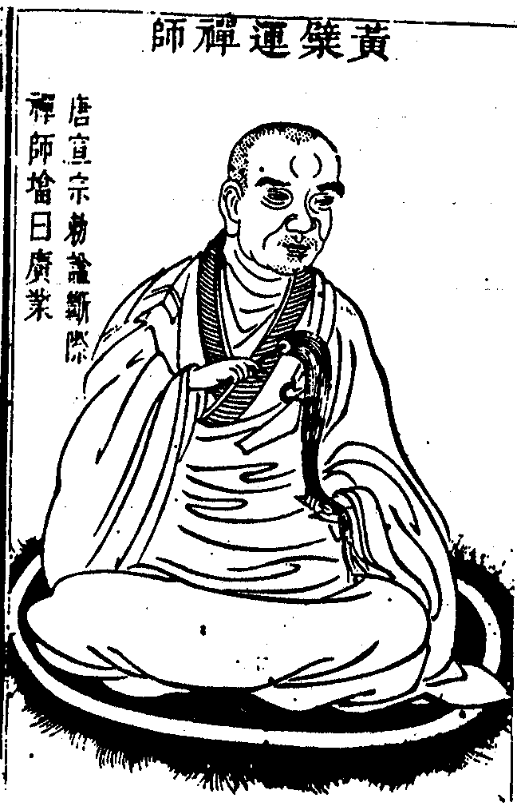



唐宣宗敕谥断际禅师，塔曰广业。



第四世黄檗希运禅师



师福州福清西溪人，族姓林，出家本邑黄檗山。额隆如珠，足有肉痣，身长八尺。往参百丈，丈问：「巍巍堂堂，从何方来？」师曰：「巍巍堂堂，从闽南来。」丈曰：「来为何事？」师曰：「不为别事。」便礼拜。一日，闻丈举再参因缘，师不觉吐舌云云。丈印曰：「如是！如是！见与师齐，减师半德；见过於师，方堪传授。」



巍巍如山，顶珠面盘；轰轰烈烈，虎啸龙翻。放下九潭十二峰，砚池笔架；提起须弥大千界，拄杖蒲团。万象森罗都吃棒，至今济祖胆犹寒。



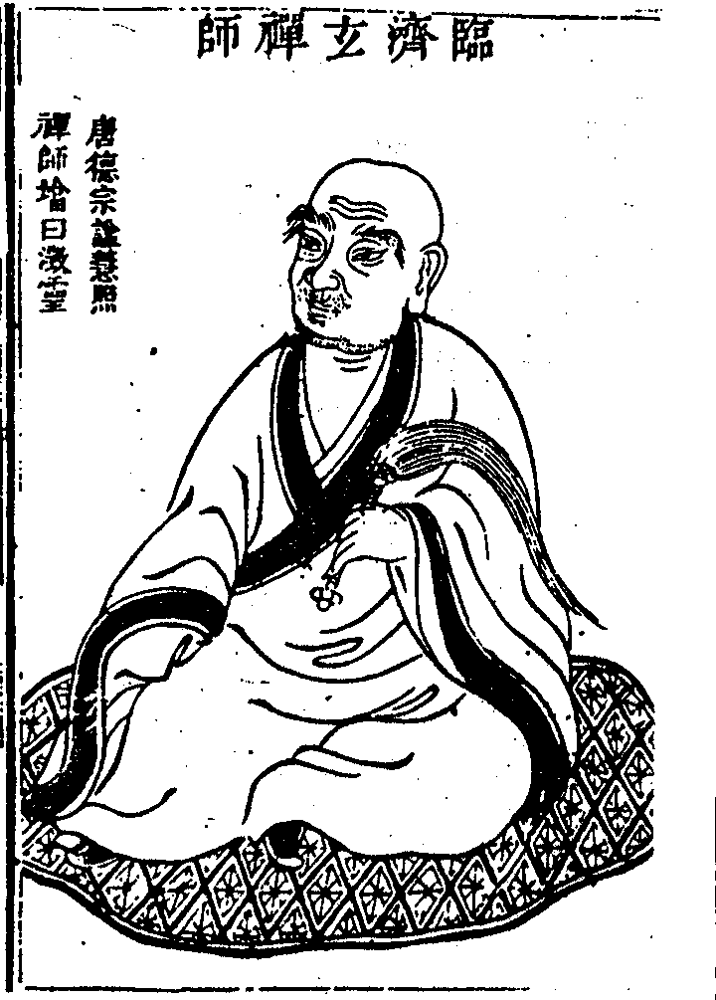



(唐德宗谥慧照禅师，塔曰澂灵。)



第五世临济义玄禅师



师曹州南华邢氏子。幼负出尘之志，及落发进具，便慕禅宗。初在黄檗会中，行业纯一。一日为首座，勉令问佛法的的大意。三度被打，遂辞到大愚，为愚点破，筑愚三拳，回黄檗了大事。后住镇州，建立黄檗宗旨，凡见僧入门便喝。于咸通八年四月十日将示灭，说传法偈讫，端坐而逝。



智拟孙曹，面冷如铁；道越古今，胆赤肠热。倒捋虎须，露猊兕之爪牙；诳吓闾阎，肆风雷之喉舌。是所谓风颠之烈，白拈之杰，热瞒瞎驴，殃遗跛脚。



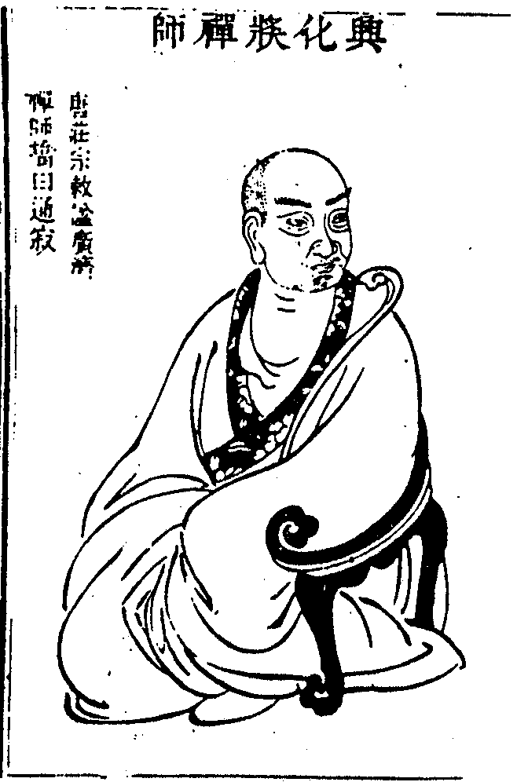



(唐庄宗敕谥广济禅师，塔曰通寂。)



第六世兴化存奖禅师



师，大名人。依临济座下六载，已有契证。及济迁化，在三圣会里为首座。常曰：「我向南方行脚一遭，拄杖头不曾拨著一个会佛法底人。」又到大觉为院主，两处棒喝交驰，荐得临济於黄檗吃棒的道理。开堂，一香供养临济。后上堂示寂。



济祖剃度，六载承欢，孤赊扑落，两不成单。拈香雪，屈新艾，著旧瘢，揭开罗帐，砥柱回狂澜。中原验宝，明眼难瞒，出入生死，如游园观。声钟告众般涅槃，北辰日午面南看。



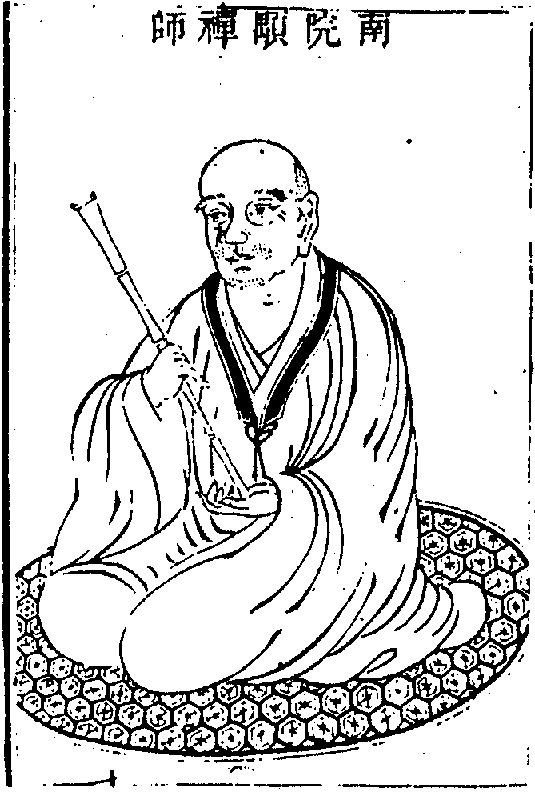



第七世南院慧颙禅师



师陕西咸宁杜氏子。幼而岐嶷，稍长克志精勤。及脱白，则孜孜以了生死为念。遍参耆夙，未惬所怀，乃谒兴化而取证焉。化一见知是法器，许其入室。机缘密契，以衣偈付之。后出世宝应。上堂曰：「赤肉团上，壁立千仞。」时有僧问：「赤肉团上，壁立千仞，岂不是和尚道？」师曰：「是。」僧便掀倒禅床。师曰：「汝看者瞎驴乱作。」僧拟议，师便打趁出。



临济三世，兴化克家。睟然道貌，雪灿春葩。壁立推倒，扶起无从。瞎驴趁出，逸骥追风。



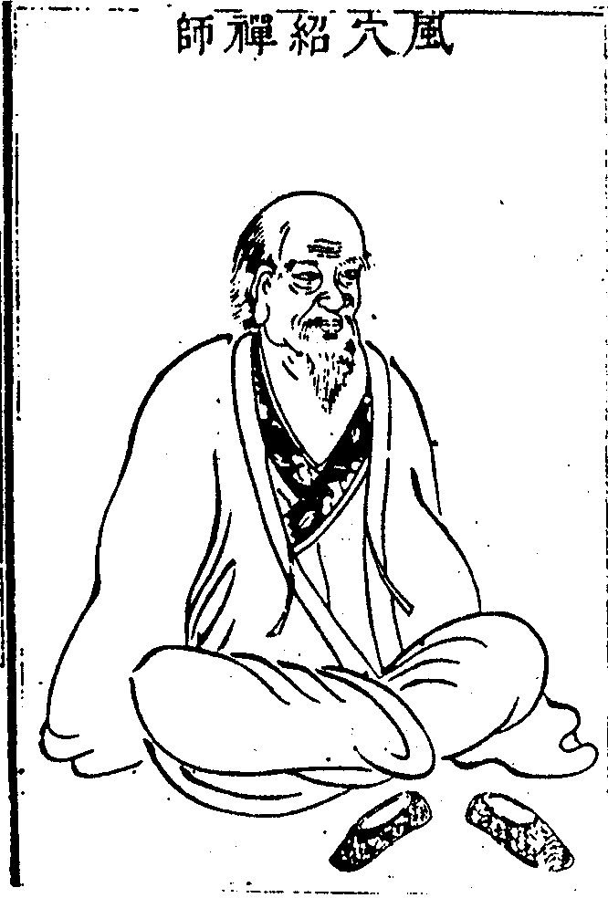



第八世风穴延绍禅师



师餘杭刘氏子。幼不茹荤，长习儒业。不第，遂出家於本州开元寺。初谒镜清，次参南院。一日，院问：「南方一棒作麼生商量？」师曰：「作奇特商量。」却问：「和尚此间一棒作麼生商量？」院拈棒曰：「棒下无生忍，临机不见师。」师於言下大彻玄旨。依止六年，后主风穴。赞曰：



一举不第，直出凡笼，棒下契旨，如空合空。艸屋单丁，几三十载，继承重托，崛起颓宗。为法求人泪点血，年年华染万枝红。



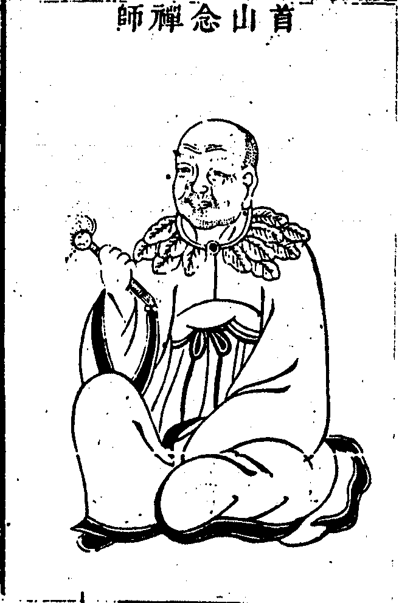



第九世首山省念禅师



(师莱州狄氏子，受业于本郡南禅寺。才具尸罗，遍游丛席。常密诵《法华经》，众日为念法华也。晚於风穴会中充知客。一日侍立次，穴乃垂涕告之曰：「不幸临济之道至，吾将坠於地矣。」师曰：「观此一众，岂无人耶？」穴曰：「聪明者多，见性者少。」师曰：「如某者如何？」穴曰：「吾虽望子之久，犹恐眈著此经，不能放下。」师曰：「此亦可事，愿闻其要。」穴遂上堂，举世尊以青莲目顾视大众，乃曰：「正当恁麼时，且道说个甚麼？」师乃拂袖下去。穴掷下拄杖，归方丈。侍者随后请益曰：「念法华因甚不祇对和尚？」穴曰：「此子会也。」於是名振四方，学者景仰，为首山第一世。於淳化四年十二月四日，上堂辞众，下座安坐而逝。茶毘，收舍利建塔。赞曰：)



荷负鼎丝，真丈夫儿。门庭高大，一肩支持。天人物表，狮象威仪。道昭日月，迈种之师。



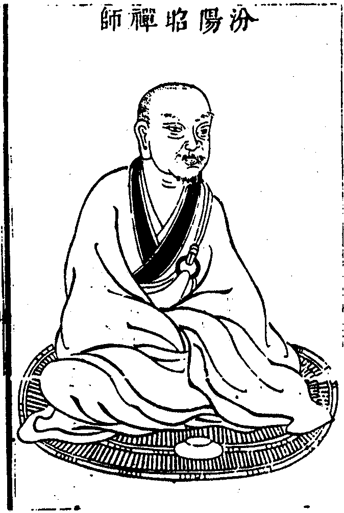



第十世汾阳善昭禅师



师太原俞氏子，历参知识七十一员。后到首山，问：「百丈卷席，意旨如何？」山曰：「龙袖拂开全体现。」师曰：「师意如何？」山曰：「象王行处绝狐踪。」师於言下大悟，曰：「万古碧潭空界月，再三捞摝始应知。」郡侯前后八请不出世，末后三聘，停箸而化。



未曾拶入，遍参知识七十员。放下身心，郡侯八聘坚不起。无奈同门启封，迸出西河狮子。别立三句，直阐向上宗猷。继示十同，如箭不离弦矢。末后三徵，迫不得已。停箸蝉蜕报李君，休向圆环觅终始。



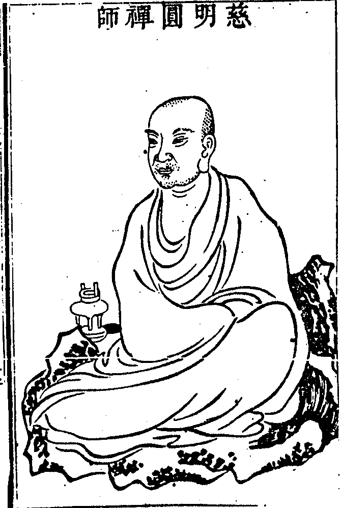



第十一世慈明楚圆禅师



师全州李氏子，少为书生，出家湘山。其母有贤行，使之谒汾阳，阳顾而器之。经二年，未许入室，每见必诟骂。一日诉曰：「自至法席，不蒙指示，念岁月飘忽，己事未明，有失出家之利。」语未卒，阳叱曰：「是恶知识，敢裨贩我！」怒举杖逐之。师拟伸救，阳掩师口，乃大悟曰：「是知临济道出常情。」



麝匿瓿，瓮藏鲜。封愈固，香益全。时节至，水出莲。道如蜜，甜中边。忘垢净，月临川。等逆顺，风匾圆。竖宝剑，列圣贤。正法眼，照人天。



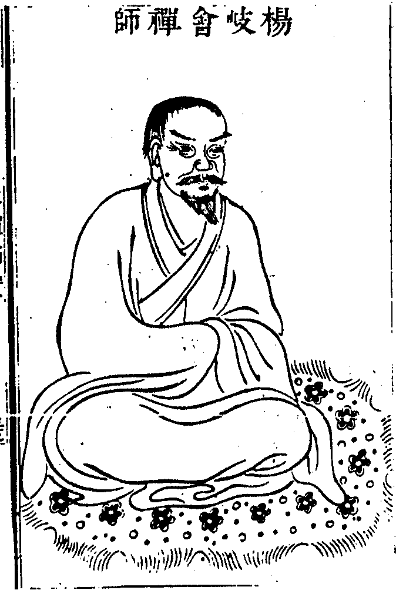



第十二世杨岐方会禅师



师袁州宜春冷氏子。少警敏，及冠，不事笔砚，系名征商。课最，坐不职，乃宵遯，入瑞州九峰落发。每阅经，心融神会。扣参老宿，佐慈明总院事。每咨参，明曰：「库司事繁，且去。」他日又问，明曰：「监院异日儿孙遍天下在，何用忙为？」一日明出，师侦之小径，搊住曰：「者老汉今日须与我说，不说打你去。」明曰：「知是般事便休。」师大悟，赞曰：



小出大遇，意下休休。十年冤债，一旦相酬。天共云晓，水和月流。三脚驴子，斗杀牯牛。



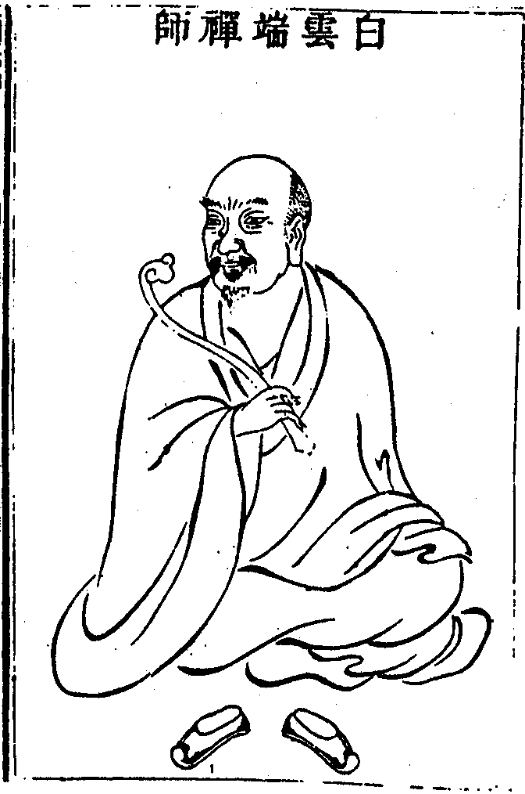



第十三世白云守端禅师



师衡阳葛氏子，幼事翰墨，冠依茶陵郁禅师披剃。参杨岐，岐问：「受业师为谁？」师曰：「茶陵郁和尚。」岐曰：「闻伊过桥遭攧有省，作偈甚奇，能记否？」师诵偈，岐笑趋起。师愕然，通夕不寐。黎明咨询之，岐曰：「汝见昨日打殴傩麼？」曰：「见。」岐曰：「汝一筹不及渠。」曰：「意旨如何？」岐曰：「渠爱人笑，汝怕人笑。」



瞿昙举身，毛孔俱笑。杨岐笑趋，驴湿处尿。堂前白云，江山失照。提醒一筹，顿契本玅。六会举扬，风号万窍。曲演无生，宫商合调。







第十四世五祖法演禅师



师绵州邓氏子，三十五祝发参白云端，于未在之语契悟。住东山，法道大行。将示寂，净发澡身，吉祥而化。是夕山摧石陨四十里，阇维舍利(如雨)。



而立之外，铲艸受具。初习惟识，乃通大义。不会空宗，知识是慕。逮见白云，如瘳其痼。铁褁酸馅，随时吞吐。撞破口门，污泚无数。晚住东山，蝇依蚁附。彩凤丹霄，铁蛇古路。下载清风，畴堪分付。授与灭宗，冤有头故。告倦津梁，示同电露。舍利旋烟，疏雨出雾。体同虚空，法身常住。真天下师，法门大树。







宋高宗赐号圆悟真觉禅师。



第十五世佛果克勤禅师



师彭州骆氏子。幼敏慧，长为比丘，遍参知识。最后见五祖，尽其机用，皆不诺。及再参，遂获契悟。出世成都昭觉。示寂日，趺坐书偈遗众，投笔而逝。茶毘，舍利无数，皆五色，齿舌不坏。赞曰：



一目十行，自笑无书可读；艸鞋踏破，方登五祖之门。瞎只眼于声色堆头，风流千古；辨龙蛇于无生棒下，机用雷奔。相府谈玄，全提华严法界；紫宸入对，别立格外乾坤。特赐金襕师号，东山之道益尊；舌牙舍利三不坏，睡虎翻身一口吞。







第十六世虎丘绍隆禅师



师禾之含山人也。九岁谢亲居佛慧，逾六年得度受具。初谒湛堂黄龙，次参圆悟。悟问：「见见之时，见非是见，见犹离见，见不能及。」举拳云：「还见麼？」师曰：「见。」悟曰：「头上安头。」师闻，脱然契证。悟叱曰：「见个甚麼？」师曰：「竹密不妨流水过。」悟肯之。有问曰：「隆藏主柔易若此，何能为哉？」悟曰：「瞌睡虎耳。」



通身是斑，一翳在眼。竹密水流，天空云断。涌出金轮第一峰，堪作四生大彼岸。







第十七世应庵昙华禅师



师蕲州江氏子，生而奇杰。十七去发参虎丘，侍行半载，顿明大事。丘忌日，师拈香曰：「平生没兴撞著者无意智老和尚，做尽伎俩，凑泊不得。从此卸却干戈，随分著衣吃饭。二十年来，坐曲录木，悬羊头，卖狗肉，知他有甚凭据？虽然，一年一度烧香日，千古令人恨转深。」赞曰：



巾侍半载，鼻孔去半边。不沾肉气，惹得满身膻。外扬父丑，高索价钱。玅喜长姪之恶，弥增逆子之愆。知罪不辞，赞叹赞叹。或为疏密，苍天苍天。







第十八世密庵咸杰禅师



师福州郑氏子，幼而颖悟，遍参诸方。后谒应庵，庵问：「如何是正法眼？」师答曰：「破沙盆。」庵颔之。一日告假省亲，庵示以偈曰：「大彻投机句，当阳廓顶门。相从今四载，徵诘洞无痕。虽未付钵袋，气宇吞乾坤。却把正法眼，唤作破沙盆。此行将省觐，切忌便跺跟。吾有末后句，待归要汝遵。」及回，又执侍三载，乃付嘱，出世乌巨及径山七大刹。



掇出砂盆，卖弄家风。正法眼藏，自此流通。被人看破，却成滞货。明眼人前，不直一唾。







第十九世破庵祖先禅师



师广安王氏子，彻证根源，机辩捷出，遍游丛席。后至灵隐参密庵，庵命师分座，未承许可。有道者请益，曰：「胡孙子捉不住，愿垂开示。」师曰：「用捉作麼？如风吹水，自然成纹。」庵闻，曰：「不谬为灵隐首座。」乃嘱累住山于夔州卧龙。上堂：「不是心，不是佛，不是物，忍俊不禁，为诸人作个撇脱。」拈拄杖卓一下，曰：「流水暗消谿畔右，劝人除却是(非难)。」



彻证根源无本据，教得胡孙倒上树。乌头子也早留心，直至于今无觅处。







宋理宗赐号佛鉴禅师。



第二十世无准师范禅师



师剑州梓潼雍氏子。髫岁依平山道钦出家。初谒育王佛照，照问：「何处人？」师曰：「剑州。」照曰：「带得剑来麼？」师便喝。照曰：「者乌头子也乱作。」次参破庵，有道者请益胡孙子话，师於侍傍大悟，相依八载。受嘱住明州清源，后奉诏住径山。赞曰：



尺短寸长，量尽虚空无欠剩；杀刀活剑，威光凛凛逼人寒。一朝剑尺忽双失，窃得胡孙上径山。少卖弄，悦龙颜，谁知难掩面门斑。钦颁紫服销金帽，衣拂并传匹似闲。







宋度宗赐号法印慧朗禅师。



第二十一世雪岩祖钦禅师



师清漳人，五岁出家，十六为僧，十八行脚至双林远会下，看狗子话不明，往参径山无准和尚，十迁星序亦不得彻。一日在殿上行，抬眸见古柏，触著向来所得境界，和底飏下，碍膺之物扑然而散。怀香向准说悟由，即为印证。后出世龙兴，晚住仰山，凡六大刹，赐紫登对，名震江湖。



看破庭前柏，赵州欠悟门。平生作一梦，且喜有人原。居住万指千础，身披御赐衣。黄芳流千载，目击道存。







(元仁宗谥佛日普明广济禅师。)



第二十二世高峰原玅禅师



师，吴江人，俗姓徐。十五岁，从密印寺法住圆颅。廿二，参雪岩和尚，才问讯，被打出。后凡入门，岩便问：「谁与汝拖者死尸来？」随即打出。后因睹五祖真赞，忽然打破疑情。岩问：「无梦无想时，主人公在甚麼处？」师无语。越五载，堕枕，廓然大▆，云：「元来只是旧时人，不改旧时行履处。」承岩密印入天目闭死关，及岩寄竹篦法语嘱累，始开堂。



谁拖死尸来，自负还自埋。三吴为土墓，天目作棺材。大死忽大活，咳唾成风雷。独许不肖儿，扶起上高台。







(元仁宗赐号佛慈园照广慈禅师，至顺宗谥普应国师，塔曰法云。)



第二十三世中峰明本禅师



师钱塘孙氏子，观流泉有省，诣高峰求证，被打趁。既而讹传官选童男女，师问曰：「忽有人来问和尚讨童男女时如何？」峰曰：「我但度竹篦子与他。」师於言下洞彻底源。峰书真赞付曰：「我相不思议，佛祖莫能视。独许不肖儿，见得半边鼻。」



观流泉有省大意，度竹篦洞彻源底。道容满月，沾光莫不清凉；齿颊春风，拂地皆成红紫。有福慧等沧溟，视名位若敝履。天子知师不可致，瀋王怀香扣直指。两赐金襕，五山不莅，奔走万方，龙象千公，却较些子。







(元赐号佛慧园明广照无边普利大禅师，明谥慧明弘照禅师。)



第二十四世千岩元长禅师



(师，萧山董氏子。天资明敏，经目成诵。十九岁，薙发受具。参中峰，求示法要。峰授以狗子无佛性话，三年胁不沾▆。一夜，闻鼠翻猫器，堕地有声，恍然开悟。往质峰，峰问：「赵州何故云无？」师曰：「鼠食猫饭。」峰曰：「未也。」师曰：「饭器破矣。」峰曰：「破后如何？」师曰：「筑碎方瓮。」峰乃印可。出世圣寿。赞曰：)。



丰颐美髯，眉清眼碧。脱口河倾，汉注落笔。无字浑囵，坚不可入。筑碎方壶，万机顿息。道离有无，用即权实。济世医王，随证愈疾。敷扬大教，雷霆启蛰。宝构凌空，如鹏展翼。道韵德容，可捧可掬。王公大臣，望风屈膝。迸出金毛，悬崖返掷。脚下万峰，头上红日。化仪云周，投笔而寂。两朝谥号，用垂千亿。







第二十五世万峰时蔚禅师



师温州金氏子，母郑氏梦儒释二人入其寝，觉生二子。师居未，襁褓中，见僧微笑。长依讲主升公受具，出家谒千岩长老。岩问：「将甚麼与老僧相见？」师竖拳云：「者里与和尚相见。」岩曰：「死了烧了，向甚处安身立命？」师曰：「沤生沤灭水还在，风息波平月映潭。」岩以法衣寄之。后卓锡苏州邓蔚山，丛席大振。赞曰：



拳头上相见，荷叶下翻身。不是劈空手，争擒万甲鳞。自从逆浪后，随处作甘霖。大宝无心得，舒光耀古今。







第二十六世宝藏普持禅师



师滇之邓川人，姓张氏。壮岁出家，以苦行作佛事，人所不能堪，师处之裕如也。虽历寒暑，一衲蔽身，为友激发。初依净慈可授，次参万峰和尚，久之未有所入。一日，峰上堂，举临济参黄檗因缘，师在座下闻之大悟。峰印以偈曰：「大愚肋下痛还拳，三要三玄绝正偏。临济窟中狮子子，灯灯续燄古今传。」赞：



久依邓尉，不事寒温。大事了毕，有裤无裈。彻底掀翻无尽藏，玉毫散作榑桑暾。







第二十七世东明慧旵禅师



师湖广王氏子。年十四，礼丹阳玅觉寺湛然落发，参宝藏和尚为典座。一日，藏问：「心不是佛，智不是道，汝云何会？」师向前问讯，叉手而立。藏呵曰：「汝在此许多时，还作者个见解？」师乃发愤。至第二日，蓦然契会，呈偈。藏大喜，印之。师受嘱至安谿设关，三十餘年影不出山，道风远播。赞曰：



一宿殴永，两夜慧醒。今古季昆，天下匠郢。餘三十年，空山吊影。千里趋风，云涛万顷。欲泛沧溟，呼龙入井。砍竹垂纶，拾得钓艇。







第二十八世海舟普慈禅师



师苏州常熟钱氏子。出家破山，听《楞严》，至「但有言说，都无实义」处，有疑。往谒万峰，举前话求示。峰劈头两棒，曰：「只者是实义。」师有省。结庐洞庭，同参呵其见解未忘。遂参东明，明问：「曾见人否？」师曰：「见万峰。」明曰：「万峰即今在甚处？」师罔然。明曰：「恁麼何曾见万峰？」师归寮三昼夜，寝食俱忘。偶琉璃灯堕地，忽然大悟。呈悟由，明乃升座(付法)。



𥗋𥗋论实义，扁舟过洞庭。琉璃忽堕地，筑碎水晶缾。七十四僧腊，九十六报龄。寂呼瑄长老，无语可丁宁。







第二十九世宝峰明瑄禅师



师吴江范氏子，因海舟和尚造塔院，斧伤足有省，乃充火头，刻意参究。不觉被火燎却眉毛，面如刀割。以镜照之，豁然大悟。诣舟求证，舟便打。师接住曰：「者条七尺，几年不用，今日又要重拈。」舟笑而罢。师呈偈曰：「棒头著处血痕斑，笑里藏刀仔细看。不是英灵真汉子，死人吃棒舞喃喃。」舟印曰：「即此偈语，可绍吾宗。」赞曰：



面门放光，燎却眉毛，现成公案，悟个甚麼？我见灯明瑞如此，高提古镜印山河。







第三十世天奇本瑞禅师



师钟陵江氏子。二十一岁，从荆南无说能披剃遍参。后谒宝峰，峰问曰：「甚处来？」师曰：「北京。」曰：「别有去处麼？」师曰：「随方潇洒。」曰：「曾到四川否？」师曰：「到。」曰：「四川境界与此间如何？」师曰：「江山虽异，风月一般。」峰竖拳曰：「还有者个麼？」师曰：「无。」曰：「为甚却无？」师曰：「非我境界。」曰：「如何是汝境界？」师曰：「诸佛不能识，谁敢强安名？」峰肯之，乃付偈印可。



云月是同，荡然一片古皇风。诸佛不识，平▆佛祖超常伦。从前闻见非闻见，独露一枝优钵红。







第三十一世无闻明聪禅师



师邵武光泽人，姓奚氏。依隐庵剃染，闻马嘶彻悟。参天奇和尚，奇问：「在世忘世是如何？」曰：「了物非物。」奇曰：「在念忘念是如何？」曰：「於心无心。」奇曰：「心物俱忘时如何？」曰：「华山高突太行峨。」奇曰：「教坏人家男女，惟汝一人。」乃付偈曰：「破情情破破还情，绝迹无私精内精。知是个中今不惜，尽情分付与仁行。」后於随州龙泉寺为开山第一世。



人家教坏不知羞，却向龙天说悟由。露柱扬声骂不彻，灯笼鼓腹笑无休。







第三十二世笑岩德宝禅师



师金台吴氏子，闻巨雷震而诞。出家广慧，参无闻和尚，於十圣三贤机语不契。一日，洗菜次，偶一茎菜堕水，逐流圜转，捉不著，忽然顿省。一日，闻问：「人人有个父母，子之父母今在何处？」师曰：「一火焚之。」曰：「恁麼则子无父母耶？」师曰：「有即有，只是佛眼觑不见。」曰：「子还见麼？」师曰：「亦不见。」曰：「为甚不见？」师曰：「若见则非真父母。」闻深肯之。



㘞地一声雷，通身手眼开，光明遮宇宙，标格露崔嵬。贤圣目中屑，爹娘炉底灰，曹溪一滴血，老祖▆传来。







第三十三世幻有正传禅师



师溧阳吕氏子，十九出家显亲寺，誓期见性。一夕，闻灯花爆声，有省。参笑岩和尚，於翘足处当下脱然。一日，岩入堂，曰：「我者拄杖要与人，有要底麼？」师跃下禅床，曰：「恁麼须分付某甲往前迎取。」岩笑曰：「汝当久久执持一番，始可打艸去也。」已而辞去，岩书正宗源流付焉，并赠一笠，曰：「以此覆之，无露圭角。」后开堂龙池，著《物不迁题旨》。



拄杖头双悬日月，笠子下盖覆三千。幻起微云半点，龙池浪涌滔天。翁翁常住寂光土，万象共论物不迁。







第三十四世密云圆悟禅师



(祖，宜兴蒋氏子。因樵采，见一堆柴突露，有省。依龙池和尚脱白，未见倒断，具威仪请益。池曰：「汝若到者田地，便放身倒卧。」祖益疑。一日过铜棺山，忽大悟。自此机缘屡契。后池挝鼓上堂，授祖衣拂。及池示寂，守塔三载，众请继席。开堂次，住五大刹，重兴天童，宗风大振。付法嗣十二位。于崇祯十五年七月初七日午时坐化。流光夜照，四山变白。寿七十七。全身塔於本山。赞曰：)



他方补处，此土樵夫。曹谿芳躅，千载合符。铜棺开眼，大地平沈。全提白棒，直指元辰。漏殿飞楼，应念成就。道播九重，公侯稽首。七十七年，普注法雨。大根小茎，尽量而已。二六法嗣，堪方四季。生化无穷，毫力不费。凤眸龙姿，身挂紫衣。瞻礼遗像，浑是生机。







第三十五世费隐通容禅师



祖，福州福清何氏子。十四岁依镇东慧山公祝发，十八行脚，二十五有省，作偈见志云：「吾年二十五，气海吞佛祖，不过古人关，岂踏今时路？」慕天童老和尚宗风，遂往参谒，问曰：「觌面相提事若何？」童便打，祖曰：「错。」童又打，祖便喝，童复打，祖复喝，至第七打，伎俩知见泮然冰释。一日，童问：「薰风自南来，殿阁生微凉，汝作麼会？」祖曰：「水向石边流出冷，风从花里过来香。」曰：「离了此又作麼生？」祖曰：「放和尚三十棒。」曰：「除却棒又作麼生？」祖便喝，曰：「喝后𫆏？」祖曰：「更要重说偈言？」童休去。既而童主金粟，命职西堂。明年，随赴黄檗，童升座，以源流衣拂付焉。祖自出世黄檗及莲峰、法通、金粟、超果、天童、径山、维摩、尧峰，以至重兴福严，钳锤衲子，寒暑弗怠。著书十二卷，颜曰「别集」，与语录三十卷并行。又作《五灯严统》一部。示寂于顺治辛丑年三月廿九日未时，右胁吉祥而逝。茶毘，收灵骨，获舍利二百餘颗，皆五色灿然，其中最晶莹圆大者廿有三粒，贮于缾，以俟建窣堵波。然祖先有遗嘱：「死日勿出讣音，勿受吊(奠、别留骨石，勿造塔以占人间地，免累世间，则此治命也。」但黄檗寿塔已造于二十年之前，非出示后经营，虽治命不可不从，权而不戾于经，是乃礼也。于是大众俱曰：「可。」门弟子率同僧众百餘，扶灵龛而行。当道荐绅及四众人等，沿途设祭，瞻礼如云，载道香花，送至黄檗，归葬寿塔焉。祖僧腊五十三，世寿六十有九。赞曰：)



翻转面皮，自是出炉弹子；辣锤不变，终成百炼真金。年而立大方独步，迄稀古十振丛林。挝天童三面毒鼓，扫双径百万松阴。全展金翅之威，沧海中狞龙活捉；倒用魔王之印，藕孔里大卒生擒。续五灯未全之谱，符列祖大公之心。空胸峻骨，宠辱不临。落叶归根，舍利珠圆玉皎；无隐面目，依旧山高水深。







第三十六世上隐下元琦和尚



(师福清东林林氏季子也。童时每静夜坐卧松下，仰观天河运转、星月流辉，谁系谁主，缠度不忒？欲明此理，遂有慕佛之志。年大弗娶，投礼鉴源公薙染受具。径往金粟参密老和尚，机扣有省。次谒费师翁于黄檗，翁上堂，师出问云：「打著昔时旧痛处，而今犹恨棒头轻。请师末后一顿。」翁打云：「旧疮瘢上著艾。」师云：「恁麼则彻骨彻髓去也。」翁曰：「如何是汝彻底意？」师云：「时清休唱大平歌。」后呈百丈再参马祖因缘，颂曰：「一声涂毒闻皆丧，遍野髑髅没处藏。三寸舌伸安国剑，干秋凛凛白如霜。」翁目讫，即圈粘法堂示众。一日持拂升座，再行勘验入室机缘，觌面分付。于崇祯丁丑冬出世本山，次住崇德福严及长乐龙泉。顺治甲午秋，应聘东渡新兴黄檗。赞曰：)



首入费师翁之室，独踞运远祖之席。痛处加锥，绍三十五世骨髓；酬恩两拂，续二十八代正脉。此吾师承从上源流之大体也。奔流度刃，花劈三玄于棒头；电激雷轰，包罗五教于喝下。此吾师整临济接人之大机用也。望之俨然，如海上孤峰；即之油然，若垂云无迹。此吾师之隐显三昧，得法大自在也。六坐道场，皆栴檀围绕，众栴檀总一栴檀；七十二腊，赐黄檗重开，一黄檗现多黄檗。是无忝径山之真子，断际之象孙也。至于云仍继美，法脉悠长，非不肖一人所敢擅其后尘，以开来学，用新东来之正印也。



(板存楞严藏坊。嘉兴倪尔绳刻。)





