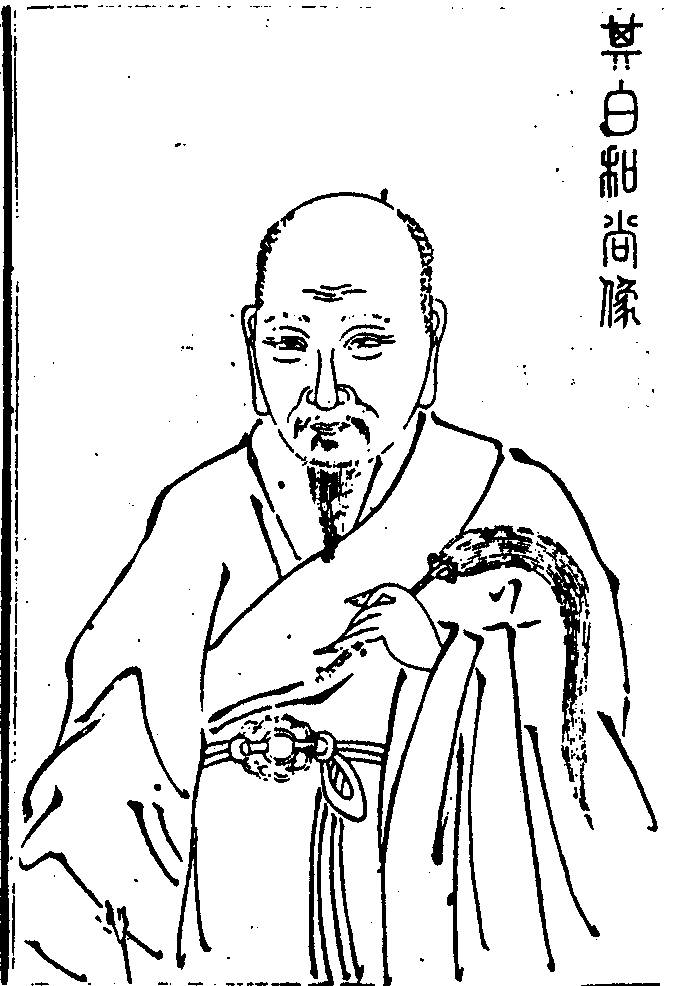

# 玉泉其白富禅师语录



> **藏经**：嘉兴大藏经（新文丰版）（嘉兴藏）　**册次** 第 38 册（J38）　**编号** JB430　**部类** 诸宗部　**卷次** 3 卷　**篇幅** 41,224 字

> **卷／品**：0 卷 · 2 品



---



## 目录



  - [序](#序)

  - [蟠龙山玉泉融彻顶禅师语录序](#蟠龙山玉泉融彻顶禅师语录序)



---



其白和尚像







赞



河岳之鍾，生而颖异。龆毁知归，性成非习。既而踢翩义海，喝碎禅天。临济真灯，於焉以传。道唱玉泉，麈挥锦水。三十餘秋，德音萃美。鹤林示灭，溽暑流金。全躯未散，定力愈深。余以是仰师之道，非去来今。



香国后学寱堂法秀拜题



蟠龙山玉泉其白富禅师语录叙



通於教者，得清净口辩才轮；通於律者，得清净身神通轮；通於禅者，得清净意无碍记持轮。又教明权实，律达开遮，禅知纵夺，自利利他，不假勉力而自绰绰然有餘地矣。其白富禅师德玉，四十年前干戈队里得益之友、慈航老人之徒，早通《般若》、《法华》等经，继而弃教，升大如律主之堂。无何，又入昭觉吾兄之室，副二全彰阶升次第，信再来人也。得法之后，时至理彰，龙天四众推上宝华王座，建立法化，遂有上堂、小参、法语、拈颂、广录，离为三卷。其提唱宗乘，实从不思议胸中流出，并无穿凿依傍等玼，诚有金镵抉翳、点銕成金手眼。然而所长身体力行，非文字纸墨中所能载者，教耶？律耶？禅耶？阶升次第耶？并化门应迹之所彰显不尽者，宜另具一只眼。



时康熙三十四年，补天穿日，华岩德玉敬譔。



------



### 序



原夫大道本无名，待人行之为妙；至人不居方，临事能之为然。所以滹沱一脉代有其人，临济三十四叶茂发天童、枝荣十二，爰我万峰破山师翁得其一焉。于明壬申间，负密祖麈拂回蜀，宗风丕振，布幔天网、打凤罗龙，十方衲子望风披靡，俾人人鼻孔撩天、脚踏实地，日辟百里，道化益隆。自蜀而至秦、楚、滇、黔，碁布星分，插竿相望，不胜枚举。复分一枝落於昭觉本师丈老人，派亦繁衍，唱道诸方。本师再分一叶於蟠龙山玉泉法兄，其白富和尚高悬赤辙，整顿时机。吾兄三慧齐修、三学俱炼，有时十字街头教演三乘、有时孤峰绝顶拈提向上、有时和光同尘大展毘尼，故所谓至人不居方，在临事而能之为然也。虽有上堂、小参、颂古、法语等偈，禁之概不许录，而有门人数辈私窃而记成帙。乙亥季春，玟睿、琳睿二法姪负稿东下嘉禾剞劂，入於楞严藏室寿世。予於癸酉秋奉本师命刊锦江灯录，附藏流通，事竣云归。玟、琳二姪见示佳稿，兼以问序。予乃樗栎之才，敢充栋宇垩墁之业，讵陈琟琢？以吾兄今世门头犹有下笔处，若论向上一著，文不加点，千圣出头，正眼难窥，何处下手？请诸方高明者代一转语看。



时康熙乙亥浴佛日，青城法弟彻生沐手敬譔。



玉泉寺其白富禅师语录目次



卷上序二  

上堂



卷中上堂  

小参  

晚参  

示众  

法语  

机缘  

像赞



卷下拈古  

示偈  

开示  

普说  

分灯  

颂古  

行实  

书问  

杂著  

佛事  

塔铭  

附融彻顶禅师语录



目次终



玉泉其白富禅师语录卷上



嗣法门人圆顶等编



康熙乙丑冬结制，期主张慧心及绅衿士庶请上堂。诣座云：「猊座孤高韪日登，当阳涌出太无情，一条白棒锋铓锐，权实双彰贯古今。」遂登。拈香：「者瓣香，雪山六年抚育，少室九载繁兴，𦶟向炉中，供养释迦文佛、历代祖师，伏愿佛日光辉宇宙，法轮常转娑婆。」次拈云：「者瓣香，胚胎万象，化育两仪，𦶟向炉中，祝延当今皇帝圣寿万岁万万岁，伏愿劫外坤维，荣金枝於海宇；寰中日月，懋玉叶於蚕丛。」再拈云：「者瓣香，胚𣍯大化之初，秀发九重之上，𦶟向炉中，奉为本省当道尊官，伏愿以仁以政，涨福海之波；为瑞为祥，壮皇图之堑。」末拈云：「者瓣香，觑著则眼枯，嗅著则脑裂，昔年不动轩前一句承当，今朝玉泉院中当阳拈出，𦶟向炉中，供养现住昭觉堂上本师上丈下雪醉和尚，用酬法乳之恩，伏愿人人悟拈花的旨，个个得安乐法门。」敛衣敷座。上首白椎云：「法筵龙象众，当观第一义。」师云：「第一义，莫拟议，谁是个中人？出班证据看。」僧问：「少室家风，五传而至曹溪，支分派演，门庭虽异，根本无殊，正恁麼时，愿闻指示。」师云：「无文銕印向空抛。」进云：「三要印开朱点窄，未容拟议主宾分，如何是临济下事？」师云：「陆地起波涛。」进云：「锋前有语离情谓，格外玄机孰可亲？如何是云门下事？」师云：「杖子𨁝跳上青霄。」进云：「君臣道合时雍泰，回互机全不露锋。如何是曹洞下事？」师云：「无影堂前鸟道玄。」进云：「一颗圆明无向背，当阳拈出有多般。如何是沩仰下事？」师云：「彻底神锋千古鸣。」进云：「绿水青山全体现，森罗万象笑颜问。如何是法眼下事？」师云：「箭刃投处四壁空。」进云：「临机有卷舒，觌面无回互。和尚门下又作麼生？」师云：「吾无隐乎尔。」进云：「可谓水归巨海波涛静，月到苍梧气象闲。」师云：「不劳重说偈言。」僧礼拜，乃云：「玉泉今朝开炉，另展一番钳锤，不许退后进前，那容畫符相对？逼拶当人无避处，还有心空及第无？若能归也，则天青地谧，海晏河清，诸佛景仰不及，群灵称赞靡由。正当恁麼时，如何施设？东南西北尘沙国，纵横无处不通风。」举：「雪峰示众云：『世界阔一尺，古镜阔一尺；世界阔一丈，古镜阔一丈。』玄沙指火炉云：『者个阔多少？』峰云：『如古镜阔。』」师云：「二大老恁麼酬醋，甚是分明，检点将来，未免被人勘破。何故？一人传虚，万人传实。」结椎，云：「谛观法王法，法王法如是。」卓拄杖，下座。



上堂。「觌面挥开不二门，圣凡情尽绝疏亲，勾章棘句惹风雨，塞壑填沟烂葛藤。只如高揖释迦、不拜弥勒是甚麼人？」良久，云：「九旬禁足今朝始，剥取蟠桃不老人。」



懒石、佛冤、问潮众法兄请上堂。僧问：「大地众生都是阎浮世上客，未审几人到家乡？」师云：「一段风流本自然。」问：「善财▆参德云比丘已领悟机，何故更参五十三员？」师云：「▆识其中真妙诀，除非身带返魂香。」进云：「识得后如何？」师云：「施为动转浑无碍，一点恩波散作霖。」问：「如何是金刚剑？」师云：「太煞逼人寒。」进云：「如何是踞地狮子？」师云：「踏杀阇黎。」进云：「如何是探竿影草？」师云：「打断汝驴腰。」进云：「如何是一喝不作一喝用？」师喝，僧亦喝，师便打，乃云：「从来法无住相，著相乖真；即此道不虚行，随行得路。古今知识各运本分钳锤，开凿人天正眼，出没卷舒悉皆自由，到者里不出户而知天下、不窥牖而见森罗。即今因我同门众法兄命不佞升座演唱宗乘，只得顺水推舟，不敢逆风把柁，播扬家丑，举则古人公案以图塞责。」举：「南泉问僧云：『世间何物最苦？』僧云：『地狱最苦。』」师云：「玉泉则不然，地狱未是苦，不明己事，实为苦也。大众还知玉泉麼？」呈拄杖，云：「者物拈来无向背，切莫向外别生枝。」掷拄杖，云：「枝生也。」



解制，上堂。僧问：「未结制已前时如何？」师云：「东敲西磕。」进云：「结后如何？」师云：「烹佛炼祖。」进云：「尽大地是个选佛场，和尚作麼生解？」师云：「展开天地栏，放出一群牛。」问：「年年此日升座，岁岁今朝制解，且道是同？是别？」师云：「昨日十四，今朝十五。」乃云：「满堂龙象自匆匆，畫地为牢百日终，唯有玉泉拄杖子，长年不改旧家风。尽大地是个选佛场，穿衣吃饭也在里许，疴屎放尿也在里许，行住作卧也在里许，东奔西驰也在里许，敢问诸人：还有识得者麼？山僧恁麼告报，诸人恁麼荐取。」以拂子击香几，云：「谛听，谛听。」



上堂。「三世诸佛说不到，开口道著；历代祖师行不到，动步踏著。古人一切方便，与诸人开个入路；暨得个入路，又须寻个出路。登山须到顶，入海须到底。登山不到顶，未免半途而废；入海不到底，只见湛湛之波。大众！且道不出不入一句作麼生道？楖栗横肩不顾人，直入千峰万峰去。」



上堂。「小店新开，贵买贱卖，不图越赚本钱，秖要买主便快。杨岐栗棘蓬，明州破布袋，一一横抛在面前，了ㄚ彻底无遮盖。大众！还有下顾者麼？」卓拄杖，云：「有利无利，不离行市。」



佛诞，上堂。僧问：「四大本空，生从何来？」师云：「进前来，向汝道。」进云：「弃却幻形，死从何去？」师云：「且退，且退。」进云：「不生不灭底主人公在甚麼处？」师便喝。问：「世尊未生时如何？」师云：「花开满树红。」进云：「生后时如何？」师云：「花落万枝空。」进云：「未生已生蒙师指，向上宗乘事若何？」师云：「唯餘一朵在，明日定随风。」乃云：「无法可说，是名说法。既曰无说，今有何说？秪为二千七百餘年旧案未免重拈。今乃释迦老子降诞之辰，玉泉不解说禅，与诸人下个注脚。」以拂子畫[十○]相，云：「离兜率，降皇宫，无缝罅里月朦朦。行七步，称大雄，夜半石人撞木钟。」喝一喝。



上堂。「千古风光尚宛然，真机吐向万峰前。灯笼露柱频频举，明暗色空漫流传。」



上堂。问：「去来不以相，动静不以心，是甚麼人？」师云：「描不成，畫不就。」乃云：「说玄说妙，土上加堆；有问有荅，白云万里。去此二途，如何施设？」卓拄杖，云：「千峰势到岳边止，万派声归海上消。」



上堂。「善哉释迦文，虚空常懊恼。痴梦犹未破，开眼天大晓。三千年外旧家风，令人仍向风前讨。年年四八佛降诞，岁岁腊八佛成道。秖因饶舌遍地葛藤，许多英灵都被枝蔓绊杀。人人分心岐路，个个逐妄迷真。山僧鼓舌摇唇，要与诸人解黏去缚。」竖拂子云：「若向者里会得，始信高沙弥不登坛而便名具足，卢行者负石春而当下圆成。如或未然，且莫错会。参。」



除夕，上堂。「爆竹一声，乾坤震动，山云水石，何处出头？东村王老夜烧钱，太煞小胆；北禅以白牛分岁，自取勾牵；玉泉非是屈抑先哲，秖为门风各别。大众！还有成褫者麼？」良久，云：「几回不遇知音客，徒劳守岁到三更。」



九日，上堂。问：「灵山会上，迦叶亲闻；少室峰前，神光得髓。即今玉泉有几人知音？」师云：「钟中无鼓响，鼓中无钟声。」进云：「过在甚麼处？」师云：「疑则别参。」乃云：「至化时行万象零，须弥百亿海云腾，俨然诸佛尘沙现，拄杖头边任纵横。」呈拄杖，云：「会麼？唤作拄杖子便是诸佛，唤作诸佛却是拄杖子。道得分明，玉泉与你证据；如或未然，木上座一状领过。」举：「僧问云门：『如何是诸佛出身处？』门云：『山高水长。』」师云：「玉泉则不然，有人问：『如何是诸佛出身处？』秪向他道：『銕库里然灯。』者事且置，只如重阳节届到来一句作麼生道？」良久，云：「重阳九月菊花新。」



天中节，上堂。「端阳五月五，空悬一轮孤，家家结彩续命，户户兰汤去毒，唯我衲僧分上，不入者些鬼窟。大众！到者里又作麼生？」卓拄杖，云：「门神鼓掌呵呵笑，艾虎高悬日卓午。」



元旦，上堂。僧问：「如何是新年头佛法？」师云：「斗柄东向，大地皆春。」进云：「年新、月新、日新、时新，未审佛法有新旧也无？」师云：「看取令行时。」进云：「如何是新鲜佛法？」师云：「野梅开正眼，绿柳长精神。」乃云：「璇玑一转万象新，斗柄东向大地春，唯有者条乌楖栗，冷笑人间岁月增。阴阳造化密运无私，江淮河汉盈虚有准，有时桃红柳绿、有时水碧山青、有时万物咸新、有时百卉凋零、有时天清地泰、有时电闪雷鸣，且喜无位真人於斯越色超声，不属阴阳造化，岂逐四序而行？秉於无极之初，得自先天之始。」以拂畫[○@│]相，云：「於斯荐得，非为截断天下人舌头、穿却衲僧鼻孔，管教释迦拱手、弥勒著惊。」蓦召大众，云：「还知无位真人麼？参。」



上堂。「高天之上，厚地之下，中有一宝，无人识价，诸佛放他不过，祖师提掇不下，无端撞入玉泉，八臂那咤惊怕。」以两手作捧势，云：「山僧和盘托出，人人受用不尽。玉泉恁麼道，只堪世谛流布。若论无上之宝，别时再举。」一僧出，拟开口，师打云：「但有言说，都无实义。」



上堂。「顶门出入之主，万化不渝；含元殿上之尊，四臣不昧。端拱而治，不令而行。昭昭於心目之间，相不可睹；晃晃於色尘之表，理不可分。天地同一覆帱，日月同一照临。寿逾百亿须弥，福洽大千沙界。且道正恁麼时如何体认？」击禅床，下座。



上堂。问：「如何是玉泉境？」师云：「庭前牵柳绿，阶后落花红。」进云：「如何是玉泉人？」师云：「圣凡同一体，到来无主宾。」进云：「如何是夺人不夺境？」师云：「一拶锋铓尽，雷兢发楚云。」进云：「如何是夺境不夺人？」师云：「落花流水去，牧笛出云岑。」进云：「如何是人境两俱夺？」师云：「五岳咸煨尽，三山本绝踪。」进云：「如何是人境俱不夺？」师云：「牧童吟野赋，渔父和巴歌。」问：「剑未出匣时如何？」师云：「太平无事。」进云：「出匣后如何？」师云：「御使坚牢。」僧喝，师打，乃云：「夺人不夺境，山自青兮水自澄；夺境不夺人，月华已到第三更；人境两俱夺，舌烂河山虚空破；人境俱不夺，亭台风埽金殿阁。不解言下领旨，返向句外卜度，恁伊费尽伎俩，未免无绳自缚。山僧不惜唇皮，为众当阳剖露，觌面相呈一著子，却被蜘蛛网罗布。」



上堂。「犬守夜，鸡司晨，鹊噪枝头雨，蝉鸣树上云。一种灵光，何故各不相知？参。」



昭觉本师老人诞辰，秉拂上堂。拈香祝圣讫，复拈云：「者瓣香，几翻毒手斫成，百炼炉中拈出，𦶟向玉炉，供养堂上本师丈老人，伏愿筹添海屋春▆远，棒头恶辣胤儿孙。」敛衣就座。白椎竟，师云：「今朝不荅话，问话者三十棒，还有俊鹰快鹞向棒头下翻身者麼？」良久，云：「秖如半偈亡躯、一句投火，又图个甚麼？今日昭觉结九旬之制，畫地为牢，开大冶之炉，圣凡陶铸，好向者里各究本有，莫衒虚头强作主宰。若於个事中倘无见处，唤作乾慧之徒。所谓参须真参、悟须实悟，自有个倒断处。若不如斯，唤作造次之流，则无究竟之日。且道其中妙旨如何定当？」蓦呈拄杖，云：「向者里定当得，许你天下横行；如或未然，九万里鹏方展翼，一千年鹤始翱翔。」



上堂。「涂毒鼓边，岂容侧耳？太阿锋前，不许藏身。众中还有不惧危亡者麼？」一僧出，师蓦头一棒，僧拟开口，师又打，僧喝，师连棒打退，乃云：「放风前圣箭，转劫外玄机，举恶辣钳锤，穿衲僧巴鼻。若个顶门具眼，方知万机顿息；若作佛法商量，未免堕坑落阱；不作佛法商量，镬汤炉炭有分。正恁麼时如何？秖对金绳拽转泥牛鼻，夜半牵来海底耕。」举：「高峰示众云：『海底泥牛衔月走，岩前石虎抱儿眠，銕蛇钻入金刚眼，昆仑骑象鹭鸶牵。』」复举：「双桂老人颂云：『蝼螘推起万斛舟，虾蟆唱遍楚天秋，乌龟跳上须弥顶，玛瑙珊瑚尽害羞。』」召大众云：「此二颂内有一句能纵、能夺、能杀、能活，到者里荐得，许汝参学事毕；脱或未然，玉泉也有一颂亦要诸方检点：乌龟打鼓鳖撑船，角鳌荡桨鳝持竿，石女岩前歌雪曲，螺蛳蚌蛤打秋千。咄！莫将闲学解，埋没祖师心。」



上堂。以拂子打○相，云：「山僧就中现无量大宝王刹，一一刹土现无量百千化佛，一一化佛放无量亿种妙光，一一光中照无量万亿沙界，一一沙界所有草木丛林、蜎飞蠕动、灯笼露柱、罗汉夜叉，或修清净善因、或造无边恶业，尽在其中出没卷舒，不相妨碍。正当恁麼时，如何演唱？妙印手提边塞静，当阳那肯露锋机？」举：「世尊在灵山会上拈花示众，百万人天悉皆罔措，唯金色头陀破颜微笑。世尊云：『吾有正法眼藏、涅槃妙心付嘱於汝，无令断绝。』」举拂子，云：「者个妙心切莫他觅，觅亦不得，得亦不真。大众！还知者个妙心麼？当下不知亲荐取，徒向威音那畔猜。」



上堂。僧问：「大彻底人本脱生死，因甚命根不断？」师云：「露出摩醯眼，坚持护命符。」进云：「佛祖公案只是一个道理，因甚有明与不明？」师云：「秤锤原是生銕铸。」进云：「大修行人当遵佛行，因甚不守毘尼？」师云：「色尘皆妙用，何处不称尊？」进云：「杲日当空，无所不照，因甚被片云遮却？」师云：「不须悬石镜，天晓自然明。」进云：「人人有个影子，寸步不离，因甚踏不著？」师云：「脚跟下好与三十。」进云：「尽大地是个火坑，得何三昧不被烧却？」师云：「火焰里潜身。」乃云：「岩前石虎夜嘶风，海底泥牛日走东，昆仑神足追不及，隐入诸人鼻孔中。」顾左右，云：「伶俐汉才闻提举，如芥投针；若是机思迟钝，犹隔万仞千层。昔日调御师六载思惟，计尽情忘，不免全身放倒。山僧到者里，只得依葫芦畫样，按下云头，宝剑横拖，就窠打劫，直教他一个个不假慈航到岸，直入大圆觉海。」击拂子，云：「闻麼？」竖拂子，云：「见麼？若向闻边体究，病在音声；若向见处荐取，病在色尘。假使坐断声色二途，犹是枝叶边事。且道：那里是向上事𫆏？无出没、无言语，功成果满凭何举？吹銕笛、击毒鼓，渔叟歌、牧童舞，云从龙兮风从虎。」



上堂。僧问：「昔日临济问龙光云：『不展锋铓，如何得胜？』龙光据坐，意旨如何？」师云：「行船不犯东西岸，须信篙人用意良。」进云：「临济道：『大善知识岂无方便？』龙光瞪目又作麼生？」师云：「一篙拨转波心月，和舟载雾过芦湾。」进云：「恁麼则鸟栖无影树，花发不萌枝。」师云：「闲言语。」进云：「可谓一曲钧天云外奏，知音格外尽皆闻。」师云：「且喜阇黎念得清。」乃云：「把住牢关，人天莫测；裂开一缝，凡圣咸知。拘执则万别千差，融通则彼此全备。且道全备后如何？不开口处玄关转，未措言时鸟道玄。」举：「昭觉本师上堂云：『吾有一句，百味具备。』时有一僧门外立，本师云：『那汉进来。』僧才入，师便下座：『且喜我堂中有一员灵利衲僧。』便归方丈。」乃云：「老人直截为人处胜是分明，自非拶透重关者不能得荷。者汉却也伶俐，未免进得门来无出身路。」顾左右云：「未审玉泉堂中有此人麼？」时一僧出，师打云：「一钓便上。」



上堂。举：「慈明和尚室中以水一盆，上劄一口剑，下著一緉草鞋，横按拄杖。有僧入门便指，才拟议，明便棒。」师云：「者老汉婆心不已，弄尽手脚，总是彻底为人，只愿个个鼻孔辽天，单刃直入。据富上座冷眼看来，也是向虚空里穵洞、白地上讨天。者场漏逗，古今提唱者极多，错会者不少。」召大众，云：「有具眼者，不妨通个消息；如或未然，山僧对众颂出：蒺藜水剑草鞋俱，水急鱼龙不敢栖，未入已知来见解，棒头点处血星飞。」元宵，上堂。「元宵正十五，家家悬火树，拈起雪峰毬，打起禾山鼓，拈弄秘魔钗，活擒戴角虎，惊动跛鳖盲龟，都向门前跳舞。阿呵呵！上元原来是十五。咄！㗭唎㗭唎苏𠰷苏𠰷。」



诞日，上堂。僧问：「和尚向未出母胎时道一句看。」师云：「光烁烁。」进云：「未生之前蒙师指，降生之后意如何？」师云：「不萌枝上花开早，无缝罅里瑞云腾。」进云：「即今升座一句作麼生道？」师云：「大整颓风归王化，仰祝圣寿等乾坤。」问：「世尊初生放光动地，和尚降诞有何祥瑞？」师云：「红霞穿宇宙，白日点波心。」进云：「世尊与和尚是同是别？」师云：「一字两头垂。」问：「寿筵洞启，凤舞羽以呈祥；彤气环流，龟负图而益算。只如南极老人到来，庆祝一句作麼生道？」师云：「且立下风。」进云：「恁麼则人人眉宇已增新彩色，慈容犹展旧风流。」师云：「直饶恁麼，也是无端特地。」乃云：「今朝腊月三十，又值吾母难期，大地山河铺玉，乾坤草木抽枝，四相从此假合，万物混融一体，无情均获詶唱，有情尽得瞻礼，唯有佛魔人天到此亦须不立。大众！要会山僧未生前事麼？吽，吽！若有个顶天立地、脑后见腮的汉子，向山僧未出方丈时荐得三世诸佛、历代祖师、天下老和尚当体全彰，分身百亿，不涉程途，一生了备；如或未然，也是有眼不见。参。」



竖佛书楼，上堂。「般若弘深大辩才，虚空涌出玉楼台，没量汉儿亲居此，百万人天献法财。无边刹海，自他不隔於毫端；十世古今，始终不离於当念。即今众檀越、缁素等协同兴此一念，便向无相国里、毫毛头上，建立种种琼楼玉殿、恒河沙数金容，囊藏百万人天，收尽五湖风月，原来不负灵山之嘱。法门庆幸，山僧赴约而来，勉整颓风，兼请登宝华王座，转大法轮，举扬个事。大众！且道结角罗纹一句作麼生道？卉木丛林均吐舌，砖头瓦砾尽生光。」



中秋，上堂。「秋风飒飒起，殿阁冷沉沉。月色四时烛，今霄分外明。竹叶溪边绿，荷花水面清。南楼添意气，斫句更新新。空劫已前事，当阳举似人。」以拂子畫○相，云：「直下分明荐取，广寒宫殿如云。」



雨后，上堂。僧问：「有问有答，落堑坠坑，契理契机，颟顸后学。如今正令既行，请师通个消息。」师云：「宝剑横空逼人寒。」进云：「动弦别调，世外知音。」以卧具打圆相，云：「未审者个作麼生和？」师云：「且缓缓。」进云：「不是吾人多意气，他家曾踏上头关。」师云：「金刚脑后三寸銕。」问：「废寝忘劳，总要明心。如何是心？」师云：「屋北鹿独宿。」进云：「拨草瞻风，秖图见性。如何是性？」师云：「溪西鸡齐啼。」进云：「识得心性，了脱生死。且道作麼生脱？」师打，云：「打破漆桶。」乃云：「刚打雷，便下雨，雨后依前日又辉。东林畔，竹流水，明明说法谁知委？觌体全彰劫前意，山僧有口无处举。」震威一喝，云：「一喝似雷奔，棒头亦如雨。」



上堂。「石巩入门张弓，秘魔逢人舞杈，禾山僧来打鼓，赵州接人吃茶，船子覆舟失命，临济七事交加。今朝玉泉者里，了了更无一法。且道如何是为人处？一拳一个弥勒，一脚一个释迦。」



上堂。「自叹无缘把直钩，鱼虾到此不相投，笠蓑欲脱风前挂，又恐鲸鳞触钓舟。众中有负命者麼？」僧问：「截銕斩钉，埋没先圣；合水和泥，恐负后昆。去此二端，如何指示？」师云：「寰中天子敕，塞外将军令。」进云：「恁麼则不但安怗家邦静，亦乃把定世界宁。」师云：「尧天民有赖，舜日照无私。」进云：「可谓一举即登龙虎榜，玉堂人唤状元儿。」师云：「贵异天然不出户，家音不许外人知。」乃云：「了妄归真万累空，河沙凡圣本来同，直须密契心心地，始悟生平睡梦中。所谓佛法要妙，离言说相、离文字相、离心缘相，不可以有心求、不可以无心得、不可以言语造、不可以寂默通。如涂毒鼓，闻者则脑门百裂；似猛火聚，近之则燎却面门。实谓壁立万仞，剿绝圣凡。假使智如鹙子、辩若维摩，三世诸佛同时出来，也须退后三步。如是自在威神，只许老胡知、不许老胡会，到者里如何启口？然官不容针，私通车马，放开一线，却有商量。」卓拄杖，云：「玉栏杆上频伽鸟，红藕花间白鹭鸶。」



上堂。「目前无法，意在目前。若是目前法，向佛边学。此人未具眼在。上根之人，言下明道。中下根器，波波浪走。不向当人荐取，何更疑佛疑祖？更听一偈：更识生死来去路，唯在当人向己求。只因目前迷正法，拨草骑牛去觅牛。」



上堂。僧问：「如何是活句？」师云：「饥来吃饭。」进云：「如何是死句？」师云：「困来打眠。」进云：「如何是不死不活句？」师云：「碧岫山庄面，寒潭水畫眉。」问：「棒喝交驰即不问，更有向上事也无？」师云：「少年一段风流事，唯许佳人独自知。」进云：「知个甚麼？」师云：「高著眼。」乃云：「动容瞬目，无出当人，一念清净，本来是佛。」复说偈云：「本来绝净染，无灭亦无生，幻即知身幻，无幻本来真。」



上堂。举：「古德升座云：『山僧有时一棒作个缦天网，打俊鹰快鹞；有时一棒作布丝网，摝蚬捞虾；有时一棒作金毛狮子；有时一棒作虾蟆蚯蚓。』」师以杖击空云：「玉泉者一棒，且道作麼生商量？若有个顶𩕳具眼汉出来道得分明，拄杖子礼拜有分；如或未然，也是噇饭过时，吃銕棒有分。莫言不道。」



上堂。「作家手眼最希奇，杀活双行不易知，若是一回归故者，自然当下了无疑。所以，百丈鼻准搊得痛，人前解笑不解啼；临济棒头吃得彻，归来便轰轰烈烈。此二老便是样子，诸兄弟何不照伊行去？效伊做去？到此果获百炼千锤，几遭毒手不能了悟，山僧实为诳语，永堕拔舌犁耕，嘿嘿甘受。不唯山僧嘿嘿甘受，三世诸佛、历代祖师、天下老和尚一一只得甘受。脱或未然，不见道：做马衔銕负鞍，做牛拖犁拽耙。那时际，莫愿山僧不与汝证明也。」顾左右，云：「弃真作假街前弄，好恶难瞒自己心。」



寒食上堂。「绿荷初出小池平，林树来红杜宇声，野外扫坟无限客，望云哽噎到黄昏，座中未了生灭者，拟向圯山觅二亲，就中契旨谁相委，信知寒食是清明。」



佛诞，上堂。「宝剑横空，圣凡情尽，拟议者则丧身失命。如有不顾眉毛者，出众道看。」问：「佛本无去无来，如何道今日降生？」师云：「金鸡抱子离霄汉，玉兔怀胎入紫宸。」进云：「古人道：『染污即不得，修证则不无。』既染污不得，何用修证？」师云：「且莫错举。」问：「黑白未分时如何？」师云：「赤眼撞著火柴头。」进云：「全黑时如何？」师云：「墨漆灯笼。」进云：「全白时如何？」师云：杲日当空。乃云：「出胎未断㘞声，指天指地称尊，只为源头水浊，至今到底不清。韶阳拈棒打杀，瑯琊知恩报恩，个个随波逐浪，人人自不圆成。不圆成，自此从他不相亲。正眼看来，老汉从三大阿僧祇劫来未尝入灭，年年四月八日何曾降生？若道周行七步，目顾四方，指天指地作师子吼，都是一场扯诞，惹得儿孙牵枝引蔓，生疑生怪。」卓拄杖，云：「释迦老子来也，大众见麼？」复卓拄杖，云：「被山僧杖头触碎鼻孔。」



上堂。举：「外道问佛：『不问有言，不问无言。』世尊良久，外道赞叹云：『世尊大慈大悲，开我迷云，令我得入。』」师云：「黄面老子为三界大师、四生慈父，呼牛应牛、呼马应马。外道不识好恶，说甚大慈大悲，开我迷云，令我得入？也是鹦鹉能言。外道去后，阿难问云：『外道有何所证而言得入？』世尊云：『如世良马见鞭影而行。』」师乃喝云：「翳眼见空花。黄面老子被外道一问，便见七花八裂了也。当时若与他一刀两断，免使儿孙未至埽地。」喝一喝，下座。



上堂。僧问：「崔赵公问国一祖师云：『弟子欲出家，得否？』一云：『出家乃大丈夫事，非将相所能为。』意旨如何？」师云：「风头太硬。」进云：「若无举鼎拔山力，千里乌隹不易骑。」师云：「空做他人力。」进云：「石门聪举似李都尉，都尉於此悟入。且道悟个甚麼？」师云：「特地一场愁。」进云：「学道须是銕汉，著手心头便判，直趣无上菩提，一切是非莫管。是何意旨？」师云：「汝从头再背看。」进云：「老老大大恁麼说话。」师云：「老僧住持事繁。」乃云：「拏龙伏虎，几番惊赫人天；平实商量，尽是一场扯诞。风清月白，乃是乾坤正气；山明水秀，俱合鹫岭真机。应上皇之风化，开正觉之风规。大悲运物，若两仪之覆载；应机设教，犹四序之生成。领悟各殊，归源是一。」召大众，云：「且道是一？非一？若道是一，万物各有其殊；若道非一，堕在境缘之中。」卓拄杖，云：「事事无穷尽，千古月为灯。」



上堂。问：「工夫未入手时如何？」师云：「好个消息。」进云：「入手后又如何？」师云：「蹉过也不知。」乃举：「盐官示众云：『虚空为鼓，须弥为槌，是什麼人打得？』南泉道：『我当时若见，向他道：王老师不打者破鼓。』法眼道：『南泉何须恁麼道？但道不打，自然是个破鼓。』」师云：「盐官据虎头，南泉收虎尾，法眼分皮分髓。诸尊宿虽然各出一只手，只是下不得槌，总是个打口鼓汉。玉泉者里直截与诸人道破。」以拄杖作击势，云：「冬！冬！」



上堂。举：「文殊问无著：『南方佛法如何住持？』著云：『末法比丘少奉戒律。』殊云：『多少众？』著云：『或三百，或五百。』著问文殊：『此间佛法如何住持？』殊云：『龙蛇混杂，凡圣同居。』著云：『多少众？』殊云：『前三三，后三三。』」乃召大众云：「无著道『三百五百』，只是个欲隐弥露，置之弗论。秖如文殊道：『前三三，后三三。』如何话会？众中设有个与文殊同鼻孔出气的汉，试道看。」良久，卓拄杖云：「不免与诸人下个注脚：一二三四五，五四三二一，前三加后三，六七八九十。若作佛法会，没却诸人鼻；不作佛法会，瞻前而后失。」



玉泉其白富禅师语录卷上终



玉泉其白富禅师语录卷中



嗣法门人明昆等编



上堂。拈香祝圣毕，复拈云：「此瓣香涅而不缁、磨而不磷，始初一番勤苦如哑如聋，末后几顿钳锤彻髓彻骨，𦶟向炉中供养现住昭觉本师上丈下雪醉和尚，用酬法乳。」白椎竟，师云：「宗乘一唱，三藏绝诠，把定牢关，十方坐断。莫有具透关眼底衲僧麼？」问：「古人道：内传心印。且道心印作麼生传？」师云：「从教桑海变，终不与君通。」乃云：「百法名门止此中，森罗万象尽包容，杖头指趣人难识，唯有旁观一线通。是汝诸人还见也无？在此见得，可谓心珠日朗、性海澄清，一念圆明、十方普照，寒梅缀玉已显卢舍家风，翠竹筛金悉是能仁境界；脱或未然，也是泥里洗土块。」



岁旦，上堂。「镜清道：『新年头佛法有。』明教道：『新年头佛法无。』若道是有，则屈著明教；若道是无，则屈著镜清。且作麼生恰好去？」击拂子，云：「蟭螟眼里翻筋斗，大洋海底捺葫芦。」



光严寺阅藏，上堂。问：「门内有君子，门外君子至时如何？」师云：「一见便见。」进云：「声应气求皆古语，今朝始信不虚传。」师云：「唤钟作瓮汉。」进云：「恁麼则龙潭浪涌三千界，锦水流出三峡中。」师云：「与阇黎何干？」乃云：「钵盂山畔，鹤唳莺啼；光严门前，水流风动。晨钟夕梵，交二音於鹫峰；慧日重明，转双轮於鹿苑。十二部经，一音演唱；修多罗教，万籁宣扬。的体全彰，元无亥豕；八字打开，岂有乌焉？山僧就此下个注脚。」以拂子畫



相云：「以字不成，八字不相。胡僧面壁，是甚模样？」



上堂。「是圣是凡，入门便揖。是愚是贤，开口便识。因甚自己上人，出入面门不睹？可谓所闻不可闻，所见不可见，明眼人前三尺暗。」



上堂。「五祖演和尚云：『四五百石麦，二三千石稻，好个休粮方，耆婆不知妙。』后千岩无明和尚拈云：『管取有钱常住。演祖若是将无作有、拔贫作富，须还无明始得。米不蓄一粒，菜不栽一茎，恁渠往来者，吃得饱膨亨。』」师云：「二老汉！好手手中呈好手，红心心里中红心，一人有钱常住，一人将无作有。玉泉者里即一不然，只是个截长补短、随缘度日。且仓有米、山有柴，是牛？是马？快哉！快哉！」下座。



上堂。「睦州唆临济吃棒，珊瑚枕上两行泪；赵州教严阳放下，半是思君半恨君。呵呵！玉泉恁麼说话，也是为他闲事长无明。」



九日上堂。举：「白云端和尚云：『金蕊丛丛带露新，采采烹茗赏佳辰，浮杯何必须宜酒，但有清香自醉人。』开福云：『白云老人大似巧媳妇，做出无面馎饦，惜乎知味者少。开福效颦亦有一偈：重阳黄菊未成花，落帽无劳忆孟嘉，但得青山常在眼，不妨流水去无涯。』玉泉者里不敢效颦，只要应个时节：本自天然不覆藏，年年九月菊花香，劫前一段新鲜味，树老枝长叶半黄。」



冬至，上堂。「石笋暗抽条，寒梅新吐玉，乘时能荐取，却是个中意。所以道：『欲识佛性义，当观时节因缘。时节若至，其理自彰。』今人不向枯木上生花、寒灰里发焰，祇管死墩墩噇饭过时，今日也恁麼、明日也恁麼，乃至尽未来际也恁麼。若个猛力愤性底汉，终不作者般去就，於天地未辟之时、阴阳未判之先，直截承当，认取本来面目。到者里，方知有物先天地，无形本寂寥，能为万象主，不逐四时凋。玉泉恁麼告报，未免有攀条例。虽然如是，不因樵子径，争到葛洪家？」



诞日，上堂。呈拄杖，云：「祝寿不用多说，只就杖头点出，便见弥漫天地，照耀古今，凡圣同源，物我一致。青峰举首，岁岁发不尽之春；野鸟衔花，物物显无私之用。所以道：滴术福沧海，微尘遮域山，睁开正法眼，万古刹那间。敢问大众：拄杖有何神通得与麼任意自在？还委悉麼？几度拈来谁著价？人天众里自称尊。」



上堂。「扶竖颓纲，须凭宗匠发挥；埋没家珍，要假能人做出。法海洋洋，靡正缘而莫出；境风浩浩，非良导以难升。或群居山林，夥聚巷陌，形同鄙俗，貌滥僧仪。虽然如是，未免区区之论。」以拂子畫[十○]相，云：「向者里荐取。」



小参。「未出母胎，一段光明辉天鉴地；既出母胎，一段光明耀地烛天。大众须知：此段光明人人本具，在凡不减、在圣不增，秪为背觉合尘、迷己逐物，致使蒙翳弗能现前，于是有诸佛、有众生，有天堂可欣、有地狱可怖，如此纷然惑乱，终无了期。殊不知放下身心、竖起脊梁，嘿地回光返照，看破父母未生前本来面目，如贫获宝、如暗得灯，何等快活、何等受用？到者里说甚麼佛、说甚麼众生，说甚麼天堂可欣、地狱可怖，出生入死不犯丝毫，或去、或留全超旷劫，其或性根浅薄、弃厌真修，生死到来悔将何及？」顾左右，云：「不向斯时亲撒手，更要留恋待何时？」



小参。「把定六根门头，不许丝毫放走，逼得虚空脑裂，通身汗流，虽是向上一事，未免流布今时。山僧昔年遭此，一但懡㦬而休，不免放开一线，彼此任意优游。虽然如是，且道：黑脸老汉来算饭钱时如何抵对？」良久，云：「八十翁翁入场屋，真诚不是小儿戏。」



小参。「要做临济克家之子，必先奋远大志气，觑破灵山拈花之旨，了彻少室九年消息。」举：「僧问仰山：『法身还解说法也无？』山云：『我说不得，别有一人说得。』僧云：『说得的在甚麼处？』仰推出枕子。沩山闻，云：『寂子用剑刃上事。』」师云：「殊不知向未开口前早已流通，推出枕子也只是个担雪填井汉。大众！还知麼？知之一字，众祸之门。」



小参。「乾坤未判，阴阳未分，无有日月星辰、江淮河汉、万象森罗、草木昆虫。正恁麼时，且道是有象？是无相？」良久，云：「黑漆桶边开正眼，看取冲霄銕鹞儿。」



小参。「大道绝中边，至真离言说，诸佛莫能提，祖师莫能掇。设使有迟疑，又入野狐窟，一毫工不及，却倚草附木。到者里，奋师子威、立金刚志，任是风吹不倒、针劄不入，把断要津、不通凡圣，果获到此时节，来方丈中吃棒有分。」



小参。「佛法本无多子，堂堂日用之间，秪因自信不及，却於易处转难。今夜不免作个方便，为诸人豁开户牖，击破疑团。」以拂子畫



相云：「玉泉在此，与诸人倾腹倒肠，彻底掀出了也。」顾左右云：「收。」



小参。「老僧一向事繁，未暇入堂相伴，今夜却有餘闲。拖茎拄杖相勘。」蓦以杖度与侍者，云：「暂教靠在床头，闲时与你打筭。」



小参。「喝下明机，看破临济家风；棒头廓彻，捉败德山门户。所以道：济北之佛法出乎平常，语默动静脱体全彰，三玄三要，松直棘曲，有宾有主，凫短鹤长。圆悟老人於诸佛出身处道：『薰风自南来，殿阁生微凉。』带累妙喜打失鼻孔，遍界难藏。然虽如是，棒喝向上还有事在。且道：有甚麼事𠰚？」良久，云：「昨骑木马沧溟去，踢翻海底一轮红。」



小参。「天无私覆，地无私载，日月无私常照，人心无私忘我人、隳是非，大道无私融圣凡、了迷悟。」拈拄杖，云：「者个列挈赤条条，昼夜为诸人演无私法，直得月白风清、草秀花香，自是诸人等闲错过，不能直下承当。正恁麼时，有个承当底麼？阿娘面目自相识，休来错认驴鞍桥。」



小参。「即心即佛，头上安头；非心非佛，斩头觅活。去此二途，如何谛当？大众！到者里，前不遘村、后不迭店，天不能覆、地不能载，不可以知知、不可以识识，无朕、无兆，无影、无形，净裸裸、绝承当，赤洒洒、无回互，明暗、色空，知觉、见闻，善恶、净秽，取舍、得失，一一安置一边，诸人向者里道一句看。若道得分明，不唯参学事毕，亦且裂碎山僧舌头；脱或未然，莫道不疑好。参。」



小参。「历历明明，淈淈𣸩𣸩，胸内却知有，尽方道不出。吐得出，元来是汝先天物。有等汉闻与麼道，便云：『会也。』及乎问伊：『会个甚麼？』却又无言可对、无理可伸。诸人若无言可对、无理可伸，莫是尽力道不出底麼？老僧不惜眉毛，与诸人安家乐业。瓦石皆同体，圣凡本一心，若问娘生面，随处现全身。咄！者是甚麼所在？向者里抛砖弄瓦。」掷拂子，归方丈。



为正勤居士对灵小参。举拂子云：「严氏法名更正勤，回光觉照悟灵根，今朝摆脱冤亲锁，一段清风透月明。老瞿昙道：『诸行无常，是生灭法，生灭灭已，寂灭为乐。』从上诸祖尽向生死海中头出头没，总要当人直截承当，惜乎诸人不肯回光返照、流浪生死。且如山河大地、日月星辰、明暗色空、四圣六凡、有情无情、胎卵湿化，山僧说底、诸人听底，寂寂惺惺总是个幻化。作麼生说个幻化道理𫆏？」竖拂子云：「若在者麈拂头上荐得，在诸佛分上不增一毫、在大众分上不减一丝，便识得婆子出生入死、得大自在落处。非唯识得婆子落处，且识得二子起一念为荐严落处，功不浪施。有时恁麼也得、不恁麼也得、恁麼不恁麼总得，山僧不惜唇皮，和泥和水为诸人说破。只如山僧说底、诸人听底，无二无别，明明历历，如青天白日。葛藤且止，且道正勤居士向甚麼处去也？咄！蜕却者边故衫子，即证那畔清净身。」



为瑞松静主小参。「慧日高悬，普天匝地，烁破佛祖眼睛，揭示衲僧巴鼻。虽然觌体全彰，认著依前不是，所谓无常生灭法，与我不相干，若能如是见，不用哭苍天。到此也无古今、也无生死，净裸裸、绝承当，赤洒洒、没窠窟，如是则尽十方世界无内无外，是个无上佛土、是个不可思议佛土、是个不可量不可说佛土。既有如是无量佛土，只如孝徒今请山僧举扬者段大事因缘津济荐拔，且道瑞松上座在那个佛土安身立命？一段灵光甚处安？长空云散碧天宽，莲宫佛土花无数，剔起眉毛仔细观。」



为慧良曹居士小参。「脑后圆光万丈高，谁人分上减丝毫？秖因迷却知身幻，致使性海浪转边。山僧到者里，不用别吐新尖、多方曲引，所以古佛偈云：『假借四大以为身，心本无生因境有，前境若无心亦无，罪福如幻起亦灭。』慧良居士向者里会去，便知生无生相、灭无灭相，本有圆光，内外交彻；如或未然，生也是幻、死也是幻，从上诸祖尽在此幻海中流转轮回，无有休息。且道：慧良向甚麼处安身立命？」呈拄杖，云：「见麼？大地乾坤藏不得，觉花池绽一枝新。」



为慧灵唐夫人小参。师竖拂子云：「者婆子五十年前有生有死，五十年后无死无生，一道灵光无巴鼻，人间天上任纵横。正当恁麼时，诸人还识得慧灵居士底面目麼？透脱顶门开正眼，霜花映水碧陵层。」



为正灯何居士小参。「本不生灭，何有去来？本自解脱，阿谁缚汝？本自清净，何物染汝？由未达境惟心，故起种种分别，及道不生不灭、解脱清净，恁麼又道未达境惟心、种种分别底道理于中荐得，妙喜世界不离者里、西方安养不离当处，头头任运家风、处处庄严国土。大众！还识何居士落处麼？万叠云山藏不得，九莲花里露全身。」



晚参。「参禅本无言说，鼻直一条坦路，每观从朝至晚，返复原来者个。所以，一切诸法菩提、涅槃等名从净法中得，贪、瞋、爱、取等名从秽法中得，净、秽两边俱莫依怙，但有空名，三藏、十二分种种名言句义总不出此个元由。所以，古德云：『若心想所思，出生诸法，虚假不实。』心尚无有，云何出生诸法？如人取声安置箧中，又如吹网欲使气满，此乃谛实之说。若以为实，大错，大错。」击拂子，云：「日轮当午照，莫待晓鸡鸣。」



晚参。「说道说禅，自丧本元；谈佛谈心，埋没己灵。玉泉不入者保社，独步上昆仑。若有个具眼的闻恁麼道，把山僧拽出三门外烂椎一顿，不枉亲到玉泉。」



晚参。「赵州茶，云门饼，三脚驴子弄蹄行；曹山酒，仰山饭，八角磨盘空里走。」召大众，云：「者些老古锥，穷厮炒，饿厮煎，穿领破布衫犹在，十字街头胡乱窜。」



晚参。「玉泉院里雷声震，摩竭提国令高悬，各挥宝剑当头截，犹在虚空里面眠。且道直截一句作麼生道？行到水穷山尽处，倒盔卸甲又依前。」



晚参。「生死事大，迅速无常，一息不来，便同灰壤。汝我出家儿，须趁色力健参究此事，莫图快乐，错过时光。才见春耕夏种，倏尔秋收冬藏，人间岁月易消，己事因甚不忘？所以道：此事当观时节因缘，时节若至，回避无门；若是波波挈挈，不肯回头。似恁麼参学，参到弥勒下生，敢保未梦见在。玉泉非是减伊声价，但恐腊月三十到来，个个手忙脚乱。」蓦拈拄杖，云：「且道者个是甚时节？夜静水寒鱼不饵，总教袖手过残年。」



晚参。「己躬下事不必他求，秪在当人四大六根灵灵弗昧、了了常知，三世诸佛、历代祖师、天下老和尚不敢正眼觑著，惟许当人直下承当，自然透顶透底。众中还有此人麼？试出来通一机、转一语，富上座望风礼拜；设或未然，行也参、坐也参，厮结眉毛莫放闲，忽然脚跟蓦点地，请续末后句。」



示众。云：「有一人言到行得到，行到言得到。有一人言到行不到，行到言不到。不知那一个合受人天供养？若缁素得出，玉泉拄杖子两手分咐；如或未然，山僧拄杖子牵枝引蔓去也。」



示众。「放目河山外，春色十分姿，玉蝶穿花舞，黄莺傍树啼。烟拖零碎锦，堤柳乱垂丝，洞明西来意，了达祖师机。灵云失却眼，备老重添眉，两堂龙象客，谩莫失提撕。」



示众。「情缘易涉，己事难明。不究本元，自投岐路。境风浩浩，凋零觉树心花；业火荧荧，煨尽菩提智果。道难遭而难遇，错过几多时；法易得而易失，光阴花费不少。责人如责己，德备多时；谋利如谋道，成佛久矣。一念纯真，即入诸佛道场；散乱片时，便落众生境界。自他不增不减，本来无欠无餘。但念无常迅速，慎勿随情逐意。」



示众。举：「金峰和尚云：『老僧二十年前有老婆心，二十年后无老婆心。』时有一僧出问：『如何是和尚二十年前有老婆心？』峰云：『问凡答凡，问圣答圣。』僧云：『如何是二十年后无老婆心？』峰云：『问凡不答凡，问圣不答圣。』」师云：「玉泉当时若见，但道：『莫说凡，莫说圣，莫道前后老婆心。忽若㘞地冷飕飕，自然不堕圣凡窠窟。』」



示众。「真我本有，迷之而无；妄我本无，执之而有。且道真妄不立之时、有无不生之际作麼生道？」良久，顾左右云：「老僧咳嗽，无暇说禅。」



示众。「古者道：『供养三世诸佛，不如供养一无心道人。』又云：『莫谓无心便无事，无心犹隔一重关。』既是无心犹隔一重关，如何胜过诸佛？又如何消受供养？于此见得谛当，方知古人舌生荆棘；如或未然，饮水也须防噎。虽然，且道：山僧恁麼告报，是有心耶？无心耶？定当看。有无之情如未瞥，莫於平地起崚嶒。」



示众。「迦叶微笑，弥勒长笑，寒山一笑，虎溪三笑。」师呵呵大笑，云：「老僧者一笑又作麼生？」良久，云：「虽然笑处不同，却也共一张嘴。」



春日，示众。「日长饥有餘，夜短睡不足，热汗急淋淋，蚊虫相啮啐。大家摇扇取风凉，何用无绳而自缚？山僧恁麼说话，此中明个甚麼边事？驴腮马脚重重露，屋角桃花解笑人。」



示众。「落花千点随流水，啼鸟一声送夕阳，碧眼胡僧无伎俩，九年面壁暗思量。大众且道：思量个甚麼？向者里见得分明，多罗正印任汝东搭西抛；其或未然，要见碧眼胡僧，何止程途万里？」



示众。「静时观人动，闲处看他忙，不知谁煎逼，拶得手脚慌。若要此时求解脱，除非参谒大觉王。且道大觉王即今在甚麼处？」良久，云：「头长三尺。」



示众。「即心是佛，乌龟向火；非心非佛，碓嘴生花。且道：不是心、不是佛、不是物是个甚麼？不免与诸人道破。」击拂子，云：「荐取。」



示众。举：「僧问投子：『一切声是佛声，是否？』投子云：『是。』僧云：『和尚莫㞘沸碗鸣声。』投子便打。又问：『麤言及细语皆归第一义，是否？』投子云：『是。』僧云：『和尚唤作一头驴，得麼？』投子便打。」师云：「虽然功不浪施，要且棒头有眼。及道：『一切声是佛声。』者僧道：『和尚莫㞘沸碗鸣声。』因甚便打？又道：『一切麤言细语皆归第一义。』者僧道：『和尚唤作一头驴。得麼？』因甚又打？大众！且道者两棒是肯者僧耶？不肯者僧耶？众中有具眼者，请端的看。」



除夕，示众。「年新月新，日新时新，唯有一物，不属旧新。且道是那一物𫆏？」良久，云：「老僧与他安名不得。」



因事示众。「百丈教人开田，佛眼轮僧修造，杨岐逼慈明小参，赵州教严阳放下。且道玉泉者里又作麼生？普请三门外刈禾。」



法语



示融默监寺



出家之志，不是寻常，必须秉个赤手成家手段，立身如临阵，勇锐之威，只一片孤迥迥气宇，於师象群中突出一头始得。然此段风光，不假他人本来自足底，秖要当人大死一番，所谓不怕活不得，只怕死不得。且死而复苏后如何？本地风光天然事，那学庸人妄作徒。



示秀云禅人



若是个实为生死底汉，万缘放下，一切不为，单只把父母未生前事顿在目前，立起眉毛，动静无亏，一念不生，前后际断，佛祖不顾之旨，神鬼莫测其机，孤迥迥如坐在千丈井底，必要求个出身路，片念才乖，丧身失命，在此千没奈何、万没奈何。正恁麼时，更须用力一拶，逼得顶门迸破，㘞地一声，如在荆棘林中得一条活路出相似，到者里一场大笑，方知从前许多错用心也。



示福田禅人



法门蹂蹸之际，祖庭秋晚之时，得一个半个血气男儿挽回天意，滹沱幸甚。古人韬光晦迹于千岩之下，草衣木食于万壑之中，又不知此辈尊宿谋何事也？倘为孝子贤孙，无易其志，今不能越过于先，可当减体半德。若以人我为住持，利养为高品者，不唯有负祖祢之嘱，而返伤佛祖风化，荷己荷人，流落天魔党也。



示融穆禅人



近来参学之人，不守毘尼，不惧因果，人我愈见峥嵘，三毒倍加炽盛，开口夸彰游遍脚头，出言贬剥诸方得失，自家生死不顾，好觅他人是非。此种学人，任使参到弥勒下生，也只是个乾打哄。若是拿云攫雾底汉子，决定不堕此野狐窟中，埋没自己灵光，辜负辞亲本志。须立定脚头，竖起脊梁，牢牢把定绳头，不许丝毫走作。做到无人无我，彻头彻尾处，倏然猛醒转来，方知拈拳竖指，睁目扬眉，都是一场精扯诞。



示吼月禅人



参禅一著子，开口已成迟，似敌百千人，如斩一握丝。一断一切断，万念绝情思，正当恁麼时，萧然与佛齐。



示文达禅人



工夫宜及切，迟疑被缘涉，隙阴成易变，幻身那可得。此处不承当，转身何时彻，说与参玄人，莫弄巧成拙。



示融之禅人



参禅莫顺情，佛祖不相亲，工夫要彻头，志立已终身。瞥耳情念起，纷然境缘生，白日去偷安，难免虚空闻。



示性一禅人



此事宜努力，捷健如箭疾，譬登千仞山，似与万人敌。有死不暇顾，无志弗堪惜，步步直到顶，始出一头地。



示体空禅人



个事本成现，人人弗少欠，守护在当人，精操唯己念。推倒无明山，踏碎人我见，悟来心眼开，觑破本来面。



示了机禅人



工夫要剿绝，不在哓哓说，若存圣凡情，正是生死孽。如入万军中，刀刀要见血，岂独破魔宫，佛祖尽斩绝。



示融彻首座



灵明之妙，於大不终，於小不载，其照不可容，其用不可测，故万物备矣。参悟之妙，无异於斯，岂可以己意而推穷？所以思之议之，总是鬼家活计。故谓万法本空，更莫心上起心，但能了心，何愁不悟？到者里千问百荅，看风使帆，不在学问解义上。要识得根源落处，任他法性周流，犹如解缆放舟相似，不可执有求，不可执无取，只教缩大千於方寸之间，促万年於一念之内，本来不增不减，自他无欠无餘，如众器入金，而金何有异？似群波入水，而水自然向。秖要确其志，愤其气，把作件事做到彻头彻底处，倏然脚跟点地，始信鼻孔原来向下垂。



示玟睿维那



参学人贵在行解相应，诚信相孚，不可执己为然。有参则有学，参而罔学，如龙游於浅水，无添意气；学而不参，似虎落於平原，不长威狞。参学融通，如龙行大海而千浪潆洄，似虎入高冈而百兽齐惊，正如携笻陟道，用之体之、止之弃之，亦何碍耶？在子之践履耳。故螾无爪牙之利，筋骨之彊，上食埃土，下饮黄泉，用心一也；蟹六跪而螫，非蛇蟺之穴无所寄托者，用心躁也。所谓始无惛惛之事，终无赫赫之功，指有形之标，洞无为之化，明此不参而参、不学而学，尽天下之为何事而不可也。



示恒参上座



人处越南，取巨象口中之齿；客居江上，夺丽龙颔下之珠。须知衲僧手段，何夸於此？别有吞佛祖、融古今、越圣凡、离知解底风化，如巨灵璧太华，一擘无餘；似长鲸吸沧溟，一吸到底。若非具此猛利，安能洞鉴本来？如德山见龙潭，吹灭纸炬处知归；如韶阳参睦州，掩门拶脚处契悟。虽师家钳锤之妙，系自己英灵所致；佛祖之道，贵乎后裔撑持。果获如斯，不枉在俗汉群中跳入，师象队里弄爪牙也。



示琚睿禅人



初学之人如毛銕相似，必要几过红炉、几入辣手，日琢时磋，百炼千锤，於冷热堆中毫不相让。一日工圆，跳出红炉，展开利刃，斩钉削銕，擘破境缘，总向者里一齐剿绝，则孤峰顶上即是十字街头、十字街头即是孤峰顶上，到此毘卢拱手、弥勒低头，人天魔梵站立下风、临济韶阳吞声有分，以之振祖基无基不立、以之酬师德无德不酬，正法眼藉此流通、恶知见由兹寝息，实为万世之指南、三界之元龟也。



示玥睿法孙



禅道佛法，原来是自己对头，每於行住坐卧中，截齿呵责，放他不过，必要与伊剿绝，大为我用。故长庆七破蒲团，总为者个事，只得云山万里，湖南湖北，然后返身一踯，饶他铁壁银山，万仞千层，轻轻一踏，直教彻底粉碎了也。苟不力尽其间，安获如是受用？



示玮睿饭头



寻常做个粥饭主人，接待来往，亦须办一片勤苦维持，方免过咎，何况欲趋佛祖无上妙道，不假恒心，鸟能得及？工夫做到纯熟处，直下如一块顽石相似，风吹不入，水洗不湿，忽尔点头自肯，笑倒笊篱木杓，打破金牛饭桶，到者里许汝参学事毕。是则也是，老僧拄杖子犹未点首在。



示瑸睿书记



近来学道之士，忘却出家本志，一向随邪逐妄，不求正悟，将佛祖机缘、古人公案，从头熟背蕴於胸中，以为禅道佛法也。错！错！任伊博览五车，穷变三藏，满腹诗词，百问千荅，殊不知到者里总用不著。若是个血气男儿，断不向他人行处行，将自己生死大事为任，岂肯放过？或火炉头、禅床角领纳一言半句，行住坐卧也参，疴屎放尿也参，迎宾待客也参，参到彻头彻底，情思路绝，忽然扭转鼻孔，触碎髑髅，到此百灵拱首，千圣攒眉，将从前负风负雨踏遍云山，脚头债、草鞋帐一时酬也。



示𤨲睿悦众



学道人只将个惧生死心为念，不得提起则有，放下则无，只看生从何来，死从何去，时时追究，刻刻提撕，一日功成，筑著磕著，自有个倒断处。若是立念轻微，志不猛利，今日也恁麼，明日也恁麼，一朝黑面老子到来，与伊打筭饭钱，莫言不道。



示琳睿侍者



老僧恶辣钳锤，便是子的慧命，非大力量者，不能透入负荷得去。汝随侍老僧廿载以来，不解初心，屏去纷华，留心此事，亦肯荷负，亦有透入处，但机语敲磕，似欠精锐，更须猛利，方为全美。虽然，闺合之物本自圆成，老僧年来龃龉，眼目昏花，弗能葛藤耳。聊书两则古人公案，如僧问赵州：「如何是道？」州云：「墙外底。」又僧问南泉：「如何是道？」泉云：「平常心是道。」果欲了敌生死，将此两转语刻刻提撕，果获恁麼，山门亦须点首。



示璐睿侍者



欲做超群越格之流，须向上人背后久立，尔自当精心亲就，向逆顺纵横中讨个分晓始得。如在老僧边，日用中声叫声应，饭来老僧开口、茶来老僧举手，须知老僧将临济家私彻底为子，日日举扬，开渠正眼。到此，须知銕牛原不用鞭，大象何堪可举？赤条条、囫囵囵，日用寻常横抛顺掷，如或不解敲推，还向手头舒缩、俯仰、折旋荐取。且道荐取个甚麼？踏著山家田地稳，横吹銕笛倒骑牛。



示自灰禅人



丈夫立志，如出匣金刚王宝剑相似，佛来也斩，祖来也斩，斩到无佛祖可斩之处，如师子王哮吼，壁立万仞。到者境界，三世诸佛觑不破，生死魔军摸不著，迷悟向甚处栖？是非向甚处泊？通上彻下，净裸裸，赤洒洒，全体是个当人受用大解脱门，佛法世法打成一片，塞却佛祖鼻孔，坐断圣凡路头，向此中急讨个巴鼻，许汝有少分相应耳。



示恒念典座



从上佛祖依此行门而入，历代祖师因此行门而出。行之一字，乃道德之基，修身之要，岂有他耶？只要跳上蒲团，死墩墩地为禅也。殊不知只在吾人寻常日用之中检点将来，无不洞明本地风光，人人到此总是忽略过了。子宜审察，大发疑情，追究一番，必须一一与他有个倒断明白处，方显汝变生作熟之手段也。



示慧心张居士



本性弥陀，匪从外得；惟心净土，岂向他求？求之转远，十万迢迢；从外觅，旋得旋失。但能心心相应，步步不离，忽然筑著磕著，如子面母、如暗得灯，一段光明，照天照地，无隐无覆，法法头头，了无差别。到恁麼田地，知解门墙不推自倒，堂奥不涉已登，方才可与吾宗契也。如或未然，向马祖道即心是佛，又云非心非佛处体究去。若体究得出来，玉泉老僧与汝证明。



示慧惺毛居士



行住坐卧，参不是禅；动静闲忙，学亦非道。及参不是禅，学亦非道，且道如何下手？要知此事，有心即非，开口即错，不可以形形，不可以识识，无对待，没巴鼻，赤条条，光灼灼，不用文学，奚假伎俩？只消一片冷淡心肠，久久不退，蓦然脑后睁眼，佛法世法一时觑破。



示真佛周居士



娘生面目，个个何亏？佛祖风光，人人具足。只是不肯承当，对面错过。若是有志丈夫，向此确起正念，本无二心，展转摩光，孜孜淘汰，穷去究来，至极至微，向一毫头上有个入路，尘劳自息，昏散自除，行住坐卧，身心两忘，待客迎宾，无分彼此。到恁麼田地，贵乎长相保守，欻然爆地一声，管取惊天动地。



示慧超彭居士



此段风光，人人具足，个个圆成，但略造作些毫，不无返相背戾。若是血气男儿，向机前领解，句外承当，一拶百碎，蓦然自肯，抚掌呵呵，更不褁粮涉足，向人门户讨。



机缘



见死鱼浮水面上，僧问：「鱼以水为命，因甚死在水中？」师云：「元是伊安身处。」僧喝，师掌云：「活也。」至晚，僧入方丈请益，师问云：「命𫆏？」僧乃喝，师复掌，僧云：「和尚不得压良为贱。」师云：「休鼓粥饭气。」僧一喝，师复掌云：「一处不通，两处失功。」僧云：「请和尚代某甲道。」师云：「还要第二杓恶水麼？」



问僧：「甚处来？」僧云：「昭觉来。」师云：「老人与你道个甚麼？」僧云：「骑贼马趁贼。」师云：「恁麼当面错过。」僧云：「赃物现在。」师云：「即今到玉泉作麼？」僧诣前礼拜，师云：「草贼大败。」师又问一僧：「老人与你道个甚麼？」僧云：「问答分明。」师云：「分明底事𫆏？」僧喝，师云：「儱侗汉。」便打。



居士问：「惟此一事实，餘二则非真，因甚又诵经礼佛？」师云：「是谁教汝爱婆娑？」士云：「和尚也须珍重。」师云：「莫谤老僧好。」一居士云：「弟子不会参禅，只是念佛。」师云：「佛作麼生念？」士举数珠云：「昼夜一百八。」师云：「古人的。你的𫆏？」士无语，师云：「情知你伎俩尽也。」又士云：「何不道一句？」师云：「你将谓别有那？」士云：「秪在目前。」师云：「目前底意𫆏？」士无语，师掌云：「河里失钱河里漉。」



僧问：「如何是正中偏？」师云：「终日在外边。」「如何是偏中正？」师云：「堂前提正令。」「如何是正中来？」师云：「骑牛入闹篮。」「如何是兼中到？」师云：「銕树花开风浩浩。」僧礼拜，师云：「者个是偏？是正？」僧喝，师打，云：「看取令行时。」



师问僧：「是谁拖你者死尸来？」僧云：「某甲亲到玉泉。」师云：「秖如死了、烧了，又将甚麼到？」僧喝，师云：「总在死活里作活计。」僧无语，师唤僧，僧应诺，师云：「你只活得，死不得。」



僧问：「尽力道不出时如何？」师打云：「正好吃棒。」僧云：「道得后如何？」师又打云：「还嫌少在。」僧礼拜，师云：「即今是道得否？」僧一喝，师连棒打出。



僧问：「弟子初出家，佛法中事总不知，请和尚指个路头。」师云：「适才那里去来？」僧云：「府中来。」师云：「汝早识得路头了也。」僧云：「请和尚亲切指示。」师云：「吃茶去。」



师问僧：「甚处来？」僧云：「大佛来。」师云：「佛大多少？」僧指师顾空，师云：「见神见鬼。」



师出，一僧入，师云：「觌面相逢时如何？」僧云：「两眼对两眼。」师云：「死了烧了又作麼生？」僧云：「遍地是黄金。」师掌云：「犹要作主在。」



僧问：「文殊为七佛之师，因甚出女子定不得？」师云：「只见锥头利。」僧云：「罔明因甚出女子定得？」师云：「不见鉴头方。」



师问僧：「无边刹海，自他不隔于毫端，因甚庵内不知庵外事？」僧云：「为和尚眼隔。」师云：「十世古今，始终不离于当念，因甚今日不知明日事？」僧云：「水满沧溟月满天。」师云：「兴化道底。」僧扪耳而出。



僧问：「如何是和尚为人家风？」师云：「痛棒一顿。」僧云：「离此还有为人处也无？」师云：「负恩者多。」



送亡僧。僧问：「衫子脱在者里，未审隐上座在甚麼处？」师云：「汝且疑著。」僧云：「死了？烧了？」师打，云：「看者死汉。」



僧问：「疏山手握木蛇，意旨如何？」师云：「毒气杀人。」僧吐舌，师云：「中毒了也。」僧一喝，便出门。复回，又问：「如何是曹家女？」师云：「头不梳，脸不洗。」



僧问：「如何是和尚家风？」师云：「寒山淡泊无款待，雪饭冰茶迓上流。」僧拜云：「勘破了也。」师云：「上座家风又作麼生？」僧竖指，师云：「却是老僧勘破汝。」



僧箍桶次，师云：「我有个破沙盆，拿去箍看。」僧诣前礼拜云：「箍盆已竟。」师云：「箍得不如法。」僧以手畫圆相，师打云：「太费力生。」



一士礼拜云：「愿和尚慈悲，乞与解脱法门。」师云：「谁缚汝？」士云：「无人缚。」师云：「求解脱作麼？」士撒手便行。师唤回云：「去！」



僧问：「如何是学人自己事？」师云：「穿衣吃饭。」僧颔首，云：「阿呵呵！」师云：「会得耶？」僧竖指，师云：「将成万仞之山，犹欠一篑之土。」



众入方丈吃茶毕，师拈拄杖云：「老僧者条邛竹杖要卖与人，未审众中有酬价者麼？」僧夺，师云：「莫搀行夺市。」一僧云：「价值多少？」师云：「你不是买主。」一僧云：「露出头尾。」师云：「乱咬作麼？」师以杖度与侍者云：「持向幽堂频靠壁，待个别宝波斯来。」



僧问：「漆桶不快时如何？」师云：「眉毛千斤重。」僧云：「扑破时如何？」师云：「大地一轮红。」僧云：「有意气时添意气，不风流处也风流。」师云：「非汝境界。」僧礼拜，师云：「果然。」



问僧：「甚处来？」僧云：「南方。」师云：「南方佛法如何住持？」僧云：「与此方无别。」师云：「何似老僧者里种田搏饭吃？」僧云：「和尚佛法如何住持？」师伸左足，僧礼拜云：「几乎错过。」师云：「三十年后切莫错举。」



像赞



慈氏像赞



者个老汉，潇潇洒洒，颠颠狂狂，只将肚肠扯宽，亦任儿童放旷。喜游婬房酒肆，惯入花街柳巷。十字街头，兜兜答答；三家村里，做模打样。呵呵，原来冷笑果无情，乾坤日月一袋装。



祖像



者个胡僧是精扯诞，本系西域一夥，来此东土何干？一张利嘴如锥，惹得梁皇不羡。自知面愧隐嵩山，引得人天肝胆颤。



面壁祖像



面上没点血色，却也知廉识耻。昔日惭惶只履西，今朝然何在者里。呵呵，自觉从前一旦非，掉转面朝石壁子。



祖像



四七之终，二三之始，自不稳口藏舌，惹得烟尘遍起。倒驾一芦五叶后，儿孙至今犯口嘴。



又



鼓起个眼睛，打一双赤脚。[同-(一/口)+石]破窥天管，出却瓮里鹅。呵呵，将谓你是少林始祖，却是吾家细作。



木隐达磨



看者毛脸和尚，肚里没些伎俩，本是一片朽木，却来丢个形状，不异折芦风力，何别有此景相？东来也不称赞，西去也不举扬，贵在直心直肠，情与无情供养。



双桂破师翁像



燕额螺发，虎须銕脸，人情不识，佛法齐铲。喝下山崩石裂，棒处雷轰电卷，有佛处七纵八横，无佛处千化万变。今朝撞入玉泉，不是依前风泛，焚香稽首赞扬，供养神头鬼面。



本师丈老人像



法身非小，世界弗阔。坐在芙蓉，摇动万国。九十餘年，婆心不歇。尽把大地众生活埋，任使人天路绝。向有桥处拆桥，去无楔处添楔。棒如雨点兮须弥到走，喝似雷奔兮乾坤失色。忆昔冤沉如海深，尽把家私向人说。



又



者老和尚，描又不成，畫又不像，纵步白牛山顶，坐在昭觉堂上，捉败百千手眼，秪用一条拄杖，硬纠纠当阳不顾，活卓卓佛祖不让，今朝撞见忤逆儿孙，畫与人天做榜样。



慈航老人像



面如满月，口似盆倾。有无不立，邪正不分。开生药舖於金川，转烂葛藤之法轮。毒死无限杰士，绊倒许多英灵。佛魔人天触著，管教性命无存。却被丹青描出，一任儿孙赞嗔。



大如和尚像



坐道场於唐安兮，戒月孤明；演木叉於光严兮，法雷普震。有时浴钵兮，龙旋雾起；有时振锡兮，虎啸风生。狼心鬼意兮，与人天脱换皮毛；銕舌钉嘴兮，向佛祖铲削邪正。不拘大庾岭头提不起之手段，当作老贼出身之门庭。



自赞(融彻首座请)



者个老汉用尽机心，把千百年外骨董，复举重重惑人，握条七尺瘦笻，验断衲子性命。佛兮不拜，祖兮不尊，去虚空里开窍，来白肉上生钉，有时向镬汤里游戏，有时在针锋里藏身。试问他是阿谁？无餘声色陈君。



又(▆睿维那请)



不歇心兮六十翁，风旛长挂在郫筒，丝纶下有千尺浪，布袋还收四海龙。兔角杖头悬日月，龟毛拂上束虚空，九如具只蟭螟眼，描个影像在其中。



又(琳睿侍者请)



者个病和尚，行藏太狼当，皓头鉅齿，虎须生銕，铸就五藏，胸中没点气息，惯要装模打样，住在玉泉院里，独步机锋头上，不分佛魔人天，相逢一顿痛棒，敲破虚空骨髓，露出先天形状，一朝撞著李九如，脱个影子在纸上。



万良陈居士请赞令堂像



慈仁恩重若弥峰，九我劬劳赞莫穷。壁挂帧容虽幻像，晨昏瞻敬与生同。



玉泉其白富禅师语录卷中终



玉泉其白富禅师语录卷下



嗣法门人明宣等编



拈古



世尊初生，一手指天，一手指地，周行七步，目顾四方云：「天上天下，唯吾独尊。」云门云：「我当时若见，一棒打杀与狗子吃，贵图天下太平。」



拈云：「调御师向无机处显大机，却是自相漏逗。云门於本分处不本分，祸入私门。当时若是坐断舌头，免致天下人卖弄唇齿。」



百丈野狐。



拈云：「不落因果，不昧因果，一队无孔銕锤道道看，有智主人二俱不立。」



世尊一日升座，大众集定，文殊白槌云：「谛观法王法，法王法如是。」世尊便下座。



拈云：「世尊升座，向无梯航处设梯航；文殊白椎，非渐次中言渐次。检点将来，煞有淆讹，具眼者请向下座处道一句来。」



女子出定。



拈云：「三人证龟成鳖则不无，怎奈傍观者哂？」复云：「谁是傍观者？」



世尊在灵山会上拈花示众，是时众皆默然，惟迦叶尊者破颜微笑。世尊云：「吾有正法眼藏，涅槃妙心，实相无相，微妙法门，不立文字，教外别传，付嘱摩诃迦叶。」



拈云：「世尊拈花，灵龟拽尾，迦叶微笑，影迹难除，百万人天，略较些子。噫！毋借人口换气。」



世尊於涅槃会上，以手摩胸，告大众云：「汝等善观吾紫磨金色之身，瞻仰取足，勿令后悔。若谓吾灭度，非吾弟子；若谓吾不灭度，亦非吾弟子。」时百万亿众，悉皆契悟。



拈云：「调御师无端向人天面前撒沙撒土，将百万亿人眼睛瞒却，辊入黑暗窟里，还有开眼底麼？」



马大师因僧问：「离四句，绝百非，请师直指西来意。」师云：「我今日劳倦，不能为汝说，问取智藏去。」僧乃问藏，藏云：「何不问和尚？」曰：「和尚教来问。」藏云：「我今日头痛，不能为汝说，问取海兄。」僧遂问海，海云：「我到者里却不会。」僧回举似祖，祖云：「藏头白，海头黑。」



拈云：「马师父子锋头太硬，将人活埋，幸者僧清机险峻，且三位老宿都无出身之路，你还见抱赃叫屈底人麼？」



陆亘大夫问南泉：「弟子家中有片石，亦曾坐，亦曾卧，如今欲镌作佛，得麼？」泉云：「得，得。」大夫云：「莫不得麼？」泉云：「不得，不得。」



拈云：「南泉善赴来机，未免随人起倒；大夫擅弄惯串索，也是将错就错。可怜六月向火，炙得鼻头酸。」



大夫尝问南泉：「弟子家中於一瓶内养得一鹅儿，今来长大，欲出此鹅，不得碎瓶，不得损鹅，未审和尚有何方便？」泉召云：「大夫！」大夫应诺。泉云：「出也。」



拈云：「南泉老人费许多气力，未免就窠打劫。若到玉泉门下，便与他和瓶𡇈碎。何故𫆏？瞌睡当不得死。」



大梅示徒云：「来莫可抑，往莫可追。」从容闻鼯鼠声，乃云：「即此物，非他物。汝善护持，吾当逝矣。」



拈云：「一是因风吹火，一是冒雨撑船，且信一半。」



五祖演中节示徒云：「昔有秀才造无鬼论，论就放笔，一鬼现身斫额云：『汝争奈我何？』老僧若见，以手作鹁鸠嘴向伊道：『谷谷孤。』」



拈云：「秀才笔尖上墨水未乾，打不湿纸。五祖一令如敕，伏尸万里。玉泉待伊现身，云：『汝争奈我何？』呸一声，饶伊手口齐动，只道得八成。」



大愚芝示众云：「大家相聚吃茎虀，若唤作一茎虀，入地狱如箭射。」



拈云：「大小大愚，莫谓齿落血流，舌头堕地也不知。」



五祖演云：「释迦、弥勒犹是他奴，且道他是阿谁？」



拈云：「诸人还识得他麼？直饶识得面孔分明，未免犹是他奴在。何故𫆏？且道他又是谁？」



僧问佛日弼禅师：「如何是毘卢印？」弼云：「草鞋踏雪。」僧云：「学人不会。」弼云：「步步成迹。」



拈云：「佛日和尚不辞婆心，彻底为人检点将来，未免翻成钝置。忽有人问玉泉：『如何是毘卢印？』但言：『籀字不成文。』又道：『学人不会。』云：『文彩已彰。』」



沩山云：「老僧百年后，向山下作一头水牯牛，左肋书五字云：沩山僧某甲。此时若唤作沩山僧，又是水牯牛；唤作水牯牛，又是沩山僧。且道唤作甚麼？」



拈云：「以拄杖横按，云：『沩山僧即今在者里，且道水牯牛在甚麼处？』」卓一卓，云：「溪西鸡齐啼。」



南泉两堂争猫，泉遇之，拈起猫云：「道得即不斩，道不得即斩却。」众无语，泉便斩之。赵州外归，泉举前话，州乃脱草鞋顶头上便出，泉云：「子若在，却救得猫儿。」



拈云：「王老师一场漏逗，赵州老贼过张弓，故臭遍天下，无人救得了。」



僧问赵州：「万法归一，一归何处？」州云：「我在青州做领布衫，重七斤。」



拈云：「赵州七斤破衲，许多翻腾，从前不解浣洗，至今臭不堪闻。」



僧问药山：「平田浅草，麈鹿成群，如何射得麈中麈？」山云：「看箭。」僧放身便倒。山云：「侍者拖出者死汉。」僧便走。山云：「弄泥团汉有什麼限？」



拈云：「百步而止，虽死犹活；就地而倒，丧身失命。者僧纵解脑后拔箭，待他出头来，也只在草窟里幌。」



丹霞烧木佛。



拈云：「丹霞烧木佛，御寒也。如由基箭院主堕落须眉，正令当行。虽然如是，得失在甚麼处？」



古者云：「者一片田地分付来多时也，我立地待汝搆去。」法眼云：「者一片田地分付来多时也，我坐待汝搆去。」佛果云：「者一片田地分付来多时也，我今当众庆忏。」



拈云：「看者三个老汉，只谓闲不过卖弄伎俩，玉泉也不兢兢咤咤，一味取慎逍遥，寒烧榾柮拨红火，热则乘凉把扇摇。」



偈



示野云禅人



野云箭疾任飞腾，宇宙横空绝点尘，但得残霞收拾静，明明独露一孤轮。



示洁然禅人



一念不生真净界，凝然皎洁更无瑕，吾门多少英灵子，只为贪求被物遮。



示元空静主



丈夫立志要超群，莫向枯岩学死墩，蒲团坐破百千个，依前日午打三更。



示圆静禅人



个事元来本自如，阇黎莫谓有亲疏，和身放下非庸易，驰骋徒劳涉异途。



示心田禅人



朝朝何必苦心田，费尽机关亦枉然，待汝智穷伎俩尽，元来滋味一般酸。



示大痴禅人



子湖狗子太无情，犯著阿师也断魂，不与阇黎通一线，相逢又道少知音。



示体用禅人



有心觅道道转遐，无念怎麼放过他，坐断有无全体用，山河大地绝周遮。



示恒参上座



穿衣吃饭非他得，一段光明毋自欺，未向其中亲撒手，不知心苦待何时。



示应彻园头



山家活计镢头边，时雨时云莫放闲，子若一毫功不及，许多园圃入荒烟。



示湛吟庄主



挽定绳头驾定犁，须从方寸把工施，铧头脱处高睁眼，土块元来本是泥。



示明本禅者



明得本来一段风，百千诸佛体皆同，子今自不承当也，任往云山几万重。



示峨睿禅彦



临济家私不覆藏，寻常抛放在云堂，个中恨无知音者，一喝从教手脚忙。



示琇睿禅者



青年立志欲逃禅，切莫随流涉外缘，招手隔江直取去，如今此辈罕逢焉。



示当轩行者



赋性温良真切直，行藏却与世相宜，先天一物隐何处，多少人来又著疑。



示琔石禅人



此事明明不覆藏，当人於此要承当，轻轻触著娘生鼻，汗下通身彻骨凉。



示瑔石牧子



颠蹶狂牛一索牵，调驯水草漫加鞭，挽回自得天真性，种月耕风本自然。



示真诚沙弥



立心学道贵真诚，溽暑祁寒总一心，漆桶蓦然箍子脱，十方世界露全身。



示[玩-兀+下]石禅人



铸就一番銕心肠，大凡作用莫寻常，脚跟点地非他物，本是吾人一段光。



示瑂石香灯



灵源莫待暗昏昏，时把心灯昼夜明，禅室悠悠光皎洁，朗然洞彻本来人。



示惺石勤策



长年行海意如然，苦恋工夫志不迁，钵盂有口通消息，法门堪作一旛竿。



示啸石禅人



己事有无己自知，神机万变倩阿谁？南泉不是忒无力，暗转绳头放过渠。



示𤪤石禅人



镢锄一怲似▆锋，解用之时活似龙，截断多生尘业网，出家方信有全功。



示岫石禅人



粥去饭来从汝用，试思吃者是阿谁？忽然咬著舌头血，吐出面前红一堆。



示玄学上人



一笔蘸乾太液池，半肩挑尽五湖冰，衲僧作略能如是，不负当人一片心。



示慧晓丁居士



顶门慧眼晓如日，烁破虚空号太玄，那个男儿甘自昧，挥开万象别壶天。



示慧本杨居士



个事本来没甚奇，穿衣吃饭现成底，到头一著君须荐，妙在呵呵大笑时。



示慧定张居士



两岸归来雪满身，一腔风月向谁倾？蓦然冷地旄星琼，始信从前错用心。



示慧光王居士



剔起眉毛莫放闲，顿除劣胜与谈玄，冰肌雪骨同梅质，水滴年深石也穿。



维那一日率众乞开示。师云：「近代禅者多，实为生死者少。若论此事，非大丈夫必不能为也。何故𫆏？此段大事因缘，乃成佛作祖，了脱生死大事，岂寻常可得也？先要发向上机，立向上志，发大誓愿，要信得及，放得下。话头乃悟道之根，疑情是见地之本，时将末法，人命转促，无常交参，一入幽涂，累劫难出。毕竟此生要了明者件大事，便得快活自由，不被生死业网牵绊。倘此生不了，有何交涉？一息不来，转头不知是何面孔，良可悲也。在此势立千夫难敌之勇，百折不回之心，诣知识边，或请个话头，或经教未明公案，领在八识田中，时时参究，刻刻提撕，勿令断绝。参须真参，悟须实悟，寒暑不迁其初，安危莫夺其志，不得卖弄虚头，发言先要诚实。只是一念万年，万年一念，如斯参去，岁深月久，功成果熟，时节到来，其机自发，倏然迸破疑团，始得大休大歇也。有等机浅之流，抱个话头，作个猜谜相似，只望求人说破，知识婆心岂肯误赚？待自悟去。若向此中无下手处，自生退悔，返不信话头是悟道之机。参禅了脱生死，与同流者曰：『历代说禅说道者，亦未免死亡。何故自劳筋骨，苦其形躯，不如穿些、吃些、受用些，是正经的事。大限到来，未免一死而已，岂有二耶？』苍天！苍天！此辈愚人，乃佛法中大魔，自断命根，自投网罟，良可叹也。此辈不唯弥勒下生、千佛出世不能救也，亦是无始劫来业识影子深重，不曾遇佛法故。有等学人装点知识，卖弄虚头，开口即是机锋，出手便是拈拳，胡喝乱喝，显异惑众，顺之则喜，逆之则怒。其知识等与佛齐观，必须究竟，使一切人归正路头。不契其机，返生诽谤，说知识无冤亲，平等有爱恶之心，即掉臂而去，撞入魔党，将古人千七百则公案从头一一注解。设或一闻，如箭入心，自云：『此知识才有彻底为人处。』惜乎乍入宗门之辈，披如来衣，行天魔事，渣滓佛海，荆棘祖庭，将世尊大全之旨返为戏具也。谙兄弟！不闻先圣有停餐辍饮、废寝忘劳者，有胁不至席、立愿三年者，有十年、二十年在此中作活计者，至于历代诸尊宿不胜枚举，岂先哲有赚杀后昆耶？众兄弟及痛念生死大事，不惮百里之遥，来到蟠龙，共守寂寥，不得虚过时光，各愤勇猛，当下了明，勘破诸方善知识舌头也。」



普说



师云：「昨日二十九，今朝是三十，数目甚分明，循环无间息。无间息，与他觌体不相识。」师召大众云：「且道他是阿谁？」一僧云：「谢茶。」师云：「吃茶时谢茶，不吃茶时又作麼生？」僧云：「谢茶。」师云：「钉桩摇橹汉。」



举：「临济问僧：『甚处来？』僧云：『定州来。』济拈棒，僧拟议，济便打，僧不肯，济云：『汝已后遇明眼人去在。』僧后到三圣，举前话，圣拈棒，僧拟议，圣亦打。」师云：「者僧决不从定州来。何故𫆏？若端的是定州僧，何被临济倾家破产，殃及儿孙也？」师良久，云：「诸兄弟！明眼人前不得错举。谢茶。」



「万庵以小参普说当供，玉泉恰逢淡泊，且不妨攀例以表殷勤。」遂展两手，云：「和盘托出了也。大众！下口著紧防噎杀。」



「云门饼子赵州茶，下口方知滋味佳，信手拈来轻𡇈碎，中有一物不沾牙。且道是那一物𫆏？待无人时与伊说。」



分灯



融彻圆顶禅人



性宗一义谛当观，选佛场开正法筵，龙象四来云集会，云施电卷舞三台。



慧空智海禅人



楚湘行脚渡西轩，踏破烟霞任指南，当下了明正法眼，拈提祖令振三玄。



融穆圆宗禅人



早年离师易，他方诱物难，老当身益壮，归院祖灯悬。



玟睿明昆禅人



的的西来大意宗，流芳千古应无穷，一条白棒挥霹雳，拨转娑婆四海龙。



琳睿明宣禅人



法幢高竖在西东，任尔炉锤亿万镕，七尺乌藤吩咐汝，撑持祖道仰辉弘。



颂古



世尊初生。



㘞地一声海岳昏，何缘自己却称尊？识来调御舌头也，三界都卢一个人。



《法华》云：「是法住法位，世间相常住。」



是法住法位，世间相常住，水流江汉去，云入紫微都。



世尊睹明星。



堆堆黄叶雪峰寒，坐久成劳夜梦谵，且喜明星刺著眼，自尊自大到何年。



世尊拈花。



四十九年说尽麼，人天众里好哥哥，头陀一见呵呵笑，放不下兮漏逗何。



女子出定。



文殊出不得，罔明入不得，女子与瞿昙，有耳听不得。



赵州狗子。



狗子佛性论有无，依然壁上挂葫芦，舌头堕地君知否？辜负高阳酒一壶。



赵州一日在佛殿上见文远侍者礼佛，以杖打远一下，远云：「礼佛也是好事。」州云：「好事不如无。」



扶起放倒意若何？无端特地起风波，棒头有眼明如日，远老通身挂缘罗。



万法归一，一归何处？



展銕旗鼓，握霜刃剑，一归何处？万法里现。



南泉斩猫。



南泉据令不寻常，白刃临机孰敢当？头戴草鞋如救得，死尸犹不臭诸方。



严阳尊者问赵州：「一物不将来时如何？」州云：「放下著。」阳云：「一物不将来，放下个甚麼？」州云：「放不下，担取去。」阳当下大悟。



人人认作现成底，无底草鞋付与谁？幸荷严阳苕帚柄，两手持去埽东西。



赵州三佛。



泥佛不度水，日炙与风吹，形山无处觅，那许著眼窥？金佛不度炉，寒光匝地敷，霹雳海门阔，含元万像殊。木佛不度火，灰飞满大罗，𡇈碎琉璃瓶，清光何处无？



本来面目。



本来面目，随情应物，体取非有，用处非无。叫呼声未绝，当人已出户。



又



本来面目，随物应物。鸭寒下水，鸡寒上树。



沩山水牯牛。



莫道沩山不道牛，白云影里看撑舟，轻烟荡尽狼烟息，野水长天一色秋。



鸟窠吹布毛。



幸然无事可相酬，去路迢迢崄更忧，拈起布毛风电急，移山倒海一时休。



主人公。



主人公，不寻常，两道銕横眉，一付冷心肠。通身无影像，遍界不曾藏，不曾藏的体，全身露堂堂。



黄龙三关。



我手何似佛手，随分拈棒弄尘，全提杀活临机，逼得须弥倒走。



我脚何似驴脚，动步无非踏著，蓦地踢翻昆仑，白刃红旗闪烁。



人人有个生缘，吾宗直旨单传，逢人斩头截角，管取血溅梵天。



佛手驴脚与生缘，总取还他一串穿，安置中原大唐国，风吹日炙到驴年。



三种师子。



三种师子不寻常，张牙露爪气如王，光吞剑刃锥锋疾，銕额铜头也断肠。



汾阳三句总颂。



汾阳三句转昆仑，云绽青天月到村，开合卷舒随逸目，天明依旧又黄昏。



汾阳三诀



第一诀，胜奇绝，手把无孔锤，敲落一轮月。



第二诀，无言说，握柄太阿锋，杀人要见血。



第三诀。一条銕，忽遇谢三郎，提起蓦头楔。



三句



第一句，的体分明休拟议。高著眼，百艸头边祖师意。



第二句，白日青天轰霹雳。休侧耳，直下分明须荐取。



第三句，妙用临机如箭疾。石火光，那个男儿知端的。



浮山九带总颂。



九带全提正令行，舌头堕地眼横睛，临机突出威音外，末后何须再问津。



正法眼藏。



世尊不说，迦叶不闻，祖祢不了，殃及儿孙。



涅槃妙心。



劫前本自无拘束，佛眼何曾识得伊？一点圆明无影相，恁他南北与东西。



十智同真。



十智同真浩太玄，就中一点许谁传，千年鳌脊老逾健，百尺竿头任纵横。



临济四喝。



一喝金刚剑自挥，威风凛凛透坤维，轻轻举动伤锋手，尸横遍界血星飞。



一喝师子踞地时，玲珑岂肯穴间栖？万里狐狸潜踪迹，铜头銕额也头低。



一喝将为探影艸，皮骨肺肝尽知晓，较验轻重机电急，拟思量处枉徒劳。



一喝不作一喝用，銕蛇钻入酒糟瓮，好要分明举似人，秖因舌头千斤重。



三要。



第一要，绝朕兆，觌面无回互，宝鉴当空照。



第二要，无巧妙，纵夺机电掣，匝地寒光耀。



第三要，深玄奥，泥牛吞却月，石虎迎风啸。



无鑐锁。



四棱著地内空空，廓落玄机振祖风，世界乾坤都锁断，中留日月过西东。



无孔锤。



软似山钢硬似泥，大悲千手亦难提，拈来安置芙蓉地，无限天龙也皱眉。



无星秤。



条条赤体没些痕，曾试青州衫七斤，分两锱铢毫发叩，休将错认定盘星。



无孔笛。



生来格调气多清，不属阴阳造化成，逸兴频吹雪曲韵，惊翻石虎望龙吟。



无缝塔。



参天两地影团团，突兀无文万象全，却被耽源委悉后，今古无人描得全。



无弦琴。



不用斧斤镌琢成，南薰一调了无声，坐中谁是知音客，听取分明韵更清。



无底钵。



快畅团团一钵盂，大庾岭上是全提，人天应供非千手，钉饭频炊接上机。



无根树。



日炙风吹干不摧，挺然卓立合坤维，不同万象增荣茂，影覆人天别一枝。



无底篮。



不假工夫功自成，收藏四海毒龙狞，高悬无影枝头上，电闪星驰筛月明。



无底船



呈桡舞棹出前溪，帆影横斜掣电飞，逸兴芦花深雪里，满船空载月明归。



行实



康熙戊辰长至日，首座融彻领大众入方丈，乞师自述行实，师云：「莫扬家丑，涂污人耳目。」众再三诚请，师坚止之。至己巳夏佛诞前一日，因师病笃，彻仍领众入室，复乞示诲，师云：「何劳大众重重繁琐？」师见其殷殷，只得对众拈出。「余本蜀南眉州人，父姓龚讳辅，母刘，生於天启七年十二月二十九日午时也。龆龀之年，一日闻乡人请法师讲《金刚经》，余偕父诣彼法席，总无所知。至经完，提唱世尊舍皇宫入雪山苦行因缘，余闻之不胜畅然，心中默想：『使我今生出家，如此修行，满我愿也。』遂回白母，母峻阻，余坚志甚切，心中恼闷，两日弗饮。父遂问其故，母举吾志白父，父曰：『出家因缘却非小可，恐此子三生有愿，故出斯言。果欲实念，设斋送伊出家，了其前愿。』余闻此语，不胜忻悦。於甲戌岁礼古渝慈航主法剃染，法名德富，侍师恒从讲席。丁亥岁，随师至遵义开演经期，值一禅者提唱：『悟本禅师，幼岁从师念《般若心经》，至无眼耳鼻舌身意处，忽以手扪面问师曰：「某甲有眼耳鼻舌，何故言无？」师惊异曰：「吾非汝师。」指往五泄山礼胜默禅师剃落。』予闻此语，生大惭愧，从此放下死心，将者公案每每提撕，放之不下。吾性愚机钝，谛观教典曲径多门，不得脱洒，常随师方外，静时少，乱时多，终日懊恼，举措无由，费尽心力，无一点缝罅，被昏、散二魔所搅。自揣业识深沉，三生未获勋修，於佛法中不能悟入，遂泪下如雨。至次日，临众听讲，物我浑然，一切不知。至若心有住，即为非住，少有契入，胸中凝滞，豁然顿释，辙身出外。有禅者曰：『佛法未周，汝出来作麼？』予曰：『将此作佛法会，敢保未梦见在。』僧曰：『汝具甚麼眼，敢恁麼道？』予曰：『道破即不堪。』僧曰：『也要大家知。』予曰：『用知作麼？』僧咄！予便掌。自后披阅诸祖语录，始知圣道之权实，正如空中鸟迹，水底鱼踪也。期圆，随师至岷山法轮院，阅经数载。至丁酉，辞本师，诣圆觉山大如和尚座下圆具，遂命演毘尼，仍回法轮。师命峨眉施茶，一夏而归。是时，本师染恙，药石罔效。予览教典，昔玄奘曾为师割股之说，予效之。是夜，人尽时，焚香礼拜，就左股上割肉煎汤，持本师榻前请服。本师接著手中，嗅而问曰：『此是何药？』予曰：『是某善士所采艸药，嘱人尽时方服。』本师服之，就枕而卧。予侍榻少顷，师乃放声大泪，予胡跪云：『师何故如斯？』本师曰：『吾年八十皆去时也，汝何行此苦法，欲救吾耶？世间一切总属幻化，况色形耶？纵使百年，亦不免也。』予曰：『德富有何苦法？』本师曰：『汝犹瞒我。予梦寐中，忽有神人告曰：「和尚寿筭满矣，奈徒行苦行，秖延十日也。」』予泣曰：『德富欲效前人所行，祈师常住在世，为众生津梁也。』师曰：『虽则如是，尔犹未空。』予复礼拜而出。本师竟终于己亥春三月十四，果旬日也。予送师入塔讫，三年服满，辞众檀越，诣灌邑唐家寺开戒坛，闲暇披阅子史。一日，有感曰：『义学秖益多闻，难御生死。生死不了，学奚益哉？』予便束包行脚，参遍诸方。后仍旋灌邑，值怕参大德，以郫筒玉泉虚席，请予主之。庚申，昭觉丈老人游崇宁福昌，予偶遇老人，把手曰：『你然何藏在者里？』予曰：『未曾藏。』老人呵呵大笑，予礼拜。次日，老人回昭觉，予归玉泉，老人寄扇一柄，书偈云：『昨过福昌信言行，福昌有贼据其门。问其所以徵其信，曾劫含元殿里人。』后省觐老人于昭觉，数遭恶辣钳锤，记为种草，以源流杖拂授之。偈曰：『古城遗堞起翔龙，出入玉泉萏菡中。一听老僧垂示后，风云雷雨尽相从。』予坚辞曰：『力量轻微，难担大任。』本师曰：『近来法门秋晚，佛法埽地，借重扶持。』遂拜受之。老僧德凉行寡，只堪随缘消旧，以终残喘，有效亮座主之志，方如愿也。不忆本邑自觅张居士为期主，请开法，幸蒙法兄懒石、佛冤、问潮三位和尚辅弼，命予升座，是以聊拈瓣香，勉登曲录木床，用报师恩。予赧颜抱愧，薰莸共囿，鱼目混珠。今因诸子必欲老僧纳败缺，老僧元来无事，殊期露尽家丑，重带枷锁，其末后事付在他时，何堪琐琐？诸子嗣后履践宗乘，切莫作者般去就，勿劳久立。」一众作礼而退。



书问



复慧庵居士



来翰云：业海漫漫，未委何处是岸？此未委二字便是捷径路头，恰好下手。向者里须下一番精采，屏除见闻觉知，只教前后际断，任是佛法、世法打成一片，至无一片影子时节，自然不用些毫气力而信步到岸也。此复。



复严先生



金山谓东坡先生胸藏万卷，提起父母未生前事，茫然无下手处。今读来翰，莫谓山僧不识好恶，先生亦无下手处，总向有无、内外、中间寻讨。若向空劫以前领荷，可称敏手，切忌阃外打之遶、作活计。殊不知此事不著者些气息，亦非语言可诠、形相可表，只一个平怀做去，始契其机。若论于文学中明此事，任君才过李、杜，志夺项、刘，到者里未免无下手处。



寄杨居士



寒则同寒，热则同热。此二语甚是应时应节，但未知穿衣吃饭、迎宾待客之时，曾获一回汗出、彻体清凉否？直饶居士与麼去，老僧还要问汝：上日到玉泉，被老僧一掌打落鼻孔，未委落在何处？即今寻著否耶？若寻著，与老僧通个消息来；若未然，再来吃玉泉棒何如？



复竹浪法兄



拦路接人，赤心为众，往来衲子，无不称羡古佛也。吾师法道，源远流长，人天庆幸，弟但钦心敬服而已。自念年来龃龉，延喘日婴，实法门中一无用人也。何当吾兄刻念，往往贶步玉泉，未遑亲驰趋谢。



复东山李长者



彩饰祇园、金铺圣地，非夙有灵种、曾受记莂者，曷能发此胜妙心耶？真乃居士赞扬法化，诚为金汤利己利人一种大悲心也。仍蒙不弃山埜，翰诏远颁，欲祈讲论《金刚般若》以洽群生，其奈贫道无文山林樵牧之姿，何堪斯任？既荷盛念，岂便推辞？但孤笻瘦影、白拂袈裟，秖宜寄于林边，讵宁造东山之名蓝也？来人旋归，肃此奉复。



杂著



挽草堂充裕和尚



充公銕马出三关，踏破乾坤没底篮，一段风流归故里，空留法社赖谁攀？



挽龙藏大朗和尚



七十四年老衲子，今朝撒手乐归西，临行一调还乡曲，唱出威音那畔机。



光严送屡生上座归宝城



相亲未久别携笻，嘿忖从前逸兴浓，此去云山千万叠，长天一色月轮同。



寄鉴彻居士



双飞日月急如梭，无耐人生身老何，线下不明己分事，更於何处出缠疴。



四威仪



山中行，缓步出林嶒。岭头上，踏碎一堆云。



山中住，身穷道眼富。觑破来，大地无一物。



山中坐，人境俱不夺。烂榾柮，日烧三两个。



山中卧、曲肱而枕著。猛醒来、星斗都惊落。



结期



云集缁流建法幢，全提杀活任施彰，厥中宾主无回互，人境相忘花雨香。



笑杀玉泉漏逗机，家私彻底挂横眉，傍敲正打於方寸，跳出金毛师子儿。



佛事



为素监寺起龛



「不问去来，不涉程途，正与麼时，如何是素监寺出身句？」以杖击龛，云：「倒跨杨岐三脚驴。」



为圆诚禅人起龛



「顿脱娘生皮袋，好个升平世界。本自了无幻化，生老病死何来？」指龛云：「放便倒，扶便起，星流电激三千里。」



为瑞松禅人起龛



「秖解任麼去，不解任麼来，五步虽存，七步不活。暨解任麼来，又解任麼去，还他朝游西天，暮归东土汉始得。何故？脚跟无线如蓬转，信步渠侬得自由。」



为祐监院火



「辅弼玉泉、招提老婆心切不已，蓦然打破漏壳皮囊，抛向者里。」撺炬，云：「老僧助渠三昧火，燎却阇黎銕面皮。」



为圆参副寺火



「渠号圆参，了圣超凡。娑婆知有此苦，何缘来此一番？」下炬云：「今日当头不避火，也曾几跳金刚圈？」



为真祥禅人撒骨



「树倒藤枯，红炉焰灭。弄尽骨董，更无漏泄。津送长江，冰清玉洁。」抛至江内，云：「掣开骸骨撒波心，如净琉璃含宝月。」喝一喝。



为圆贤火



「郫筒井，蟠龙山，总是阇黎不二关。」下炬，云：「火蛇劈面来，虚空彻底翻。咦！」



塔铭



粤稽刹刹诞真，拘罗示寂，在成周昭穆二王之间。彼其时名虽出自西方，法未流於震旦。自化人来，作中天台以奉之，而教兴始及。秦皇禁沙门室利房等，因见金人出户，灵异昭然，信从者遂众。嗣是清凉显节，益事尊崇，教乃大著焉。历代以来，耆腊苾刍传灯续焰，由摩诃迦叶至三十二祖弘忍，虽宗门各出，而三缘四谛指趣同归。其中之证果登岸，得法要而振宗风者，莫可殚述。直以了悟真空，明心见性为上乘界，非幻也。世之人谓祝发披缁，遂可澄缘净业，不知本来自有，夙具功行出乎寻常，乃能度爱河而褰欲网，光像教以觉群迷。不然，何成佛作祖之寥寥也？系惟玉泉，其白富禅师其庶几乎！师本眉山人也，其族姓龚，父讳辅，母刘，诞师于明之丁卯。龆龄颖慧，敏悟性成。会讲《金刚》宝法，默契妙旨，因而决意空门，礼慈航和尚薙染，而夙志以酬圆具。于大如律师渐修日茂，凡诸子史靡不通微。一日，师感世相无常，叹曰：「义学秖益多闻，难御生死。生死不了，学奚益哉？」遂束包行脚，历遍诸方，参丈老人于昭觉。老人授师心要大法而绍续焉。继而卓锡郫筒之玉泉，开建精蓝，高悬赤帜。是时宗风大振，四来者云兴霞委，千株毓秀，万指围遶。识者谓曹溪正脉唯师任之，良有以也。且师道韵奇伟，素性冲然。凡所礼接，非道契不偕；凡所经行，非阐教不出。即虎溪惠远，何以过之？况磨砖成镜，契马祖得道之年；聚石点头，际竺老谈经之日。其以证即心即佛者，此其时也。自是克圆善果，道有传人。回首灵山，拈花可笑。扬铃只履，了大意于西来；息死劳生，脱幻形于东土。何罣何碍？任去任来。当前自有解人，奚暇向葛藤窝里再烦饶舌哉？虽请偈留偈，未免著相于当机；而一言再言，无非授受之微旨。乃知现在涅槃，即波罗法会也。师偶示微恙，门人圆顶入室定省。师曰：「身病本无生，因病从缘起。病缘不相碍，虚空亦复尔。」是日夜未央，师问：「莲漏几许？」侍僧曰：「午夜矣。」师遂索水沐浴讫，趺坐说偈曰：「了悟三空寂寂，全无一点巴鼻。今朝化缘已满，翻身靠倒须弥。」言讫，奄然而逝。因值夏热炎天之时，暑气流蒸之际，躯留弗火，面颜不易，神光俨然，愈胜于生。觏睹者咸啧啧异之，增发圣心。时康熙庚午仲夏廿七日也。殊不知金刚不坏身，原无生灭，夫岂片晷终朝所能徵其存殁也哉？则谓师也没者，真也，即梦也；抑谓师也存者，梦也，宁非真乎？但色空真界，知者几人？不事标题，清修莫显。爰并其族贯里氏，详志于碣，以为由俗归真之宝筏也。卜真宅于蟠山左腋之阳，建窣堵波以祀之，因为其铭。



铭曰：



> 去来不可断，至性非明灭。双足已现林，  

> 而彼自呜咽。光生玉镜中，道茂金轮彻。  

> 空遗砖石窟，徒令苍苔茁。借问莲花萼，  

> 阿谁授真诀。得渡自能渡，江芦不待折。  

> 请将方寸因，同向牟尼说。



时康熙壬申正阳月佛诞日，漹江赐进士弟子遯庵王庭诏沐手拜撰。



康熙乙亥仲吕月佛诞日，板藏嘉禾楞严寺般若坊



　附藏流通



> 嘉兴倪尔绳梓行



> 嘉善李文伯书



玉泉其白富禅师语录卷下终



------



### 蟠龙山玉泉融彻顶禅师语录序



教中道：但落言诠，终非实义。所以初祖达磨将此公案袖入华夏，不用语言文字，直指人心，见性成佛。斯旨传来久矣，信之者似粟如麻，体之者星中拣月。今我玉泉法姪融彻禅师，龆龄薙染，不务外学，其语言文字置之弗问，只知向上一著，昼参夜参，蕴在胸中，依其白和尚椎拂之下四十餘稔。一日，闻举风旛话，言下打翻漆桶，如披云见日，大地平沉，始知无量劫前事不异今时，所谓元是旧时人，不改旧时行履处，常用药山三条篾束取肚皮，随处住山。因伊本师其和尚化去，绅衿缁素及同门昆仲等请继玉泉之席，迫不得已，拽杖归来，遂有垂示机要，皆从胸中流出，实非语言文字也。若论其直指见性之旨，而彻公其人焉。予见其履真践实，岂忍默无言哉？谨赘数语于弁云。



时康熙乙亥佛诞日，青城竹浪彻生谨识。



玉泉融彻顶禅师语录



嗣法门人　明盛　明聪　等编



康熙己巳七月朔一日，光严铸颜和尚及绅衿、耆旧、缁素等请师继席，上堂。诣座云：「不礼弥勒、高揖释迦者，到来作麼生行履？」良久云：「欲穷千里目，更上一重楼。」便登。拈香云：「此瓣香秉先天正气，夺日月精华，𦶟向炉中，供养释迦文佛、历代祖师，伏愿灯传悠远，正眼恒明。此一瓣香非形非状，应在机先，𦶟向炉中，端为祝延当今皇帝万岁万万岁，文武官僚高增禄位，伏愿佛日与舜日同辉，金轮共法轮并转。此一瓣香，威音那畔拾来，人天众前拈出，供养传曹溪正脉第三十七世上其下白本师富老和尚，用酬法乳。」敛衣敷座。白椎竟，僧问：「如何是死句？」师云：「石虎抱儿眠。」进云：「如何是活句？」师云：「无言童子口吧吧。」进云：「如何是不死不活句？」师云：「古路无人到，清风自往还。」乃云：「新成楼阁向南开，灵明一点映亭台，当阳剖露人天眼，赤体条条适意便。」竖拂子云：「还委悉麼？如或未然，听取一颂：飒飒清风不暂停，一回拈起一回新，金襕亦自传迦叶，砖头瓦砾尽知音。」喝一喝，下座。



辛未结制，期主慧惺毛居士设斋，请上堂。诣座云：「者个曲录木，觏面无回互，举步任高登，踏断凡圣路。」遂升。拈香云：「此瓣香，植种子威音那畔，荣干于太极之先，𦶟向炉中，祝延今上皇帝万岁万万岁，当道尊官现前请主，伏愿元首明哉、股肱良哉、庶士康哉。此一瓣香，天莫能覆、地莫能载，𦶟向炉中，供养前住光严得戒大如和尚、现住昭觉师翁丈老人，用酬毒手之恩。此一瓣香，生子不萌枝上，长在太素峰前，今朝落在玉泉手里，第一回拈出供养传临济正宗第三十三世上其下白本师和尚，用酬法乳。」上首白椎云：「法筵龙象众，当观第一义。」师云：「天上无双日，阎浮有至尊，万年松不老，寿筭等乾坤。众中还有识此人麼？」问：「向上宗乘即不问，如何是临济家风？」师便喝。进云：「如何是函盖乾坤句？」师云：「八臂那咤提不起。」进云：「如何是截断众流句？」师云：「銕蛇横古路。」进云：「如何是随波逐浪句？」师云：「汝问我答。」进云：「三句蒙师指，慧惺设斋如何相酬？」师便打，乃云：「今朝十月十五，行者考钟伐鼓。玉泉结制上堂，惊起鱼龙跃舞，只将白棒提持，大地山河莽卤，坐断诸佛关键。纲维从上列祖，衲僧拟议思量，一棒打折驴腰，莫言不道。」良久，云：「因先师有则未了公案，被现前四众命顶上座出来与先师了，却承慧惺居士合家来山供众，只得因斋庆赞，结九旬之期，掉转鎗旗，将三连六断为炉、金乌玉兔为鞴，亦任金银铜銕、砖头瓦砾炼成一片，是圣是凡煆成一体，总教放出无位真人，与山僧同一鼻孔，把手并行。诸人还识无位真人麼？宛脱丘。」结椎，云：「谛观法王法，法王法如是。」



昭觉雪师翁办斋，命上堂。问：「六门紧闭，还有出入者麼？」师云：「乱走作麼？」进云：「满天星斗即不问，如何是半夜日头红？」师打，云：「顶门荐取。」乃云：「金刚正眼，照彻十虚，心光朗耀，万象全彰。所以道：昭昭于心目之间，相不可睹；晃晃于色空之内，义不可穷。与天地同根，万物一体，佛佛授受而授此也，祖祖相传而传此也。葛藤且置，即今报恩一句作麼生道？棒头有眼明千古，喝下山崩水倒流。」



上堂。「诸佛本无说，祖师未曾闻，留下一转语，千古镇乾坤。且道是甚麼语𫆏？」喝一喝，云：「今朝冬月一，万卉俱凋悉，玉泉炉增焰，山门辉佛日。」蓦召众，云：「是何朕兆？」良久，云：「庭前生瑞艸，好事不如无。」复喝一喝。



上堂。「一切法不生，一切法不灭，森罗及万象，明明炽然说。顶上座到者里，有口秪堪挂在壁上。」



上堂。喝一喝，云：「于斯荐得，一生参学事毕，不劳觌体承当；其或未然，不免矢上加尖去也。」蓦竖拂子，云：「白拈贼，无异色。」以拂子抛下座，云：「抛向前，谁识得？众中有识得者麼？」良久，云：「赵钱孙李，周吴郑王。」



佛成道日，上堂。「调御六载错用心，却是无绳自缚身，睁得眼来花乱坠，今朝误认定盘星。阿呵呵！会也麼？山河大地平如掌，万象森罗总法身。」



上堂。问：「如何是赵州关？」师便喝。进云：「有佛处不住时如何？」师云：「金屑虽贵，落眼成翳。」进云：「无佛处急走过又作麼生？」师云：「洁白地上不许撒沙。」乃云：「云山叠叠，锦水洋洋，莺啼鹤唳，艸秀花香，本自现成公案，何更觅水淘江？昔日圆通老汉不开生药舖，单卖死猫头，玉泉无药舖可开，亦无猫头可卖。」蓦竖拳，云：「只有者个，且道与古人相去多少？」良久，云：「家家明月谁无分，处处青山总白云。」



上堂。「此事元来要自强，拏云攫雾露堂堂。蟠龙山里家风别，放出鲸鳞吼大方。」喝一喝。



解制，上堂。「满散纵横得自由，酬恩报德更无忧，云丝月饵俱收却，任意行藏别世流。九十日已前双垂鼻孔，九十日已后鼻孔双垂，即今九十日已满，玉泉无可供养。」以拂子作此○相，云：「秖有者个云门公案，亦任诸人咬嚼。」顾左右，云：「逢人不得错举。」



佛诞，大慈法伯懒石和尚送法衣至，上堂。问：「世尊初生是何意旨？」师云：「师子吼。」进云：「生后如何？」师云：「无畏说。」乃云：「释迦降诞，不肖远孙无可供养。」以拂子作[十○]相，云：「顶上座只有者个，聊表微诚，还委悉麼？脱或未然，更听一颂：频跨香象降皇宫，七步周行称大雄，四十九年曾漏泄，拈花微笑浪施功。今日蒙大慈法伯和尚耑使赐法衣，助扬法化。」蓦拈袈裟角，云：「此是昔日大庾岭头提不起的，落在玉泉手里，如云普覆，似地普擎，对众拈出，烂打葛藤，红炉飞雪无栖泊，一点恩波散作霖。」



上堂。「乾坤之内，日月之中，唯有一物，今古攸同。敢问大众：是甚麼物𫆏？若识恁麼物，还须恁麼人。」



祈龄，上堂。「初分混沌列三才，道人无事任徘徊。千年岭畔青松翠，水满池中月自来。」



清明，上堂。「爻象初分瑞气浓，当阳涌出一轮红。棒头点出威音旨，法雨时倾起卧龙。毛吞巨海承渠力，芥纳须弥理事融。山家不会论花甲，一度山青春又逢。」



小参。「昨日霜花拂槛前，今朝黄叶落翩翩，禅人眼底休著屑，觑破元来不值钱。诸禅德！有疑即问，知过即改，操金刚斧，秉智慧剑，凡圣到来，一刀两断，做个出格汉子，不惟己躬事毕，要且不受人瞒。」



小参。「古德云：『大疑大悟，小疑小悟，不疑不悟。』玉泉不然，有疑堕坑落堑，有悟撒沙撒土。何故𫆏？本自无迷，道甚麼悟？如镜中像、水中月，眼见最分明，只是难收摄。纵收摄，举似明眼人不得。」



晚参。「月大有三十，月小二十九，大众请吃茶，切莫打湿口，若还打湿口，杖头劈脊搂。」



示众。「玉泉有口也难言，坐断千差亦弗然，觌面相承提祖意，只教切切悟心田。心田悟，无边业海成甘露，髑髅常放白毫光，有甚佛兮有甚祖？」



示众。「今朝二十三，推车上竹竿，到头须著力，莫待有循环。诸禅德！向著力处道一句看。」良久，云：「玉泉恁麼，也是矢上加尖。」



示众。「时当季冬十五，梅花扑面鼓舞，木人穿靴归汉，石女带帽来楚，大火焰中转法轮，烘烘烈烈势难阻，炼得须弥无处藏，身海神𨁝跳如虎。大众还知麼？玉泉到此露全身，屈指数来正十五。正十五，谁人解打虚空鼓？」



示众。「玉泉无法亦无禅，二六时中好打眠，有人问道西来意，觌面当机只一拳。」



示众。呈拄杖，云：「老僧拄杖子与诸人说法已竟，大众闻麼？」良久，云：「不免与诸人颂出：拄杖说法，为觅知音；一句单提，海晏河清。」拽拄杖归方丈。



颂古



女子出定



一段真风绝正偏，抛头露面现倪端，那伽大定非出入，鼻孔都卢缺半边。



丹霞烧木佛



觑破浮尘彻底空，寒将木佛火来烹。金刚舍利名非实，带累傍观身烂红。



大颠摈首座



接拍须还子弟风，傍敲正打显奇工，南山下雨北山黑，青艸池中隐活龙。



无位真人



者个郎当汉，分明常相见。头头境上彰，法法尘中现。八面绝遮拦，十方俱坐断。天上人间尊，刹那即周遍。住居无相国，时复空王殿。



观音像



应身三岛碧波中，刹海无边示面容，日度恒沙无量众，闻思修证总皆空。咦，总皆空，婆心切切运悲风。



初祖像



一脸落腮，古怪形状。眼空四海，君王不让。言语兜兜嗒嗒，心体空空荡荡。见水脱鞋兮芦花洸漾，履水如地兮熊耳山上，九年面壁兮人天榜样。道是阿谁？达磨和尚。



又



老胡碧眼访梁王，语不投机自主张。一苇芦花江上渡，九年面壁接神光。接神光，千古儿孙满大唐。



慈航师翁像



八十四年作贼，历遍天涯自得，穷尽教乘骨董，识取乾坤一色。咦！要委师翁指趣，频观海宇风月。



本师其白老人像



吾师之像，描亦非真。吾师之德，赞一弗能。曰有兮一尘不立，曰无兮横亘古今。若将眼见终难见，耳里观身不是身。



大如和尚



天地为庐，一衲飘然，曾经劫火，适意逃禅。历遍寰宇，垂手入廛，欲赞师德，于万斯年。



联芳



玥睿明盛禅人



少年立志要孤穷，日用寻常觅己躬，但得心空归及第，利生接物续吾宗。



璐睿明聪禅人



年来于此觅行藏，气骨无凡镇纪纲，七尺乌藤分付后，拈椎竖拂播诸方。



明修寂镜禅人



月下传衣会也麼？蟠龙峰有养龙窝，他年致雨腾霄汉，一曲阳春唱凯歌。



古林隆玉禅人



芒鞋踏上毘卢顶，瓦砾砖头尽放光，万仞峰头堪独步，祝吾香也喝诸方。



应缘普闻禅人



一志南来始遇吾，箭锋相拄道心孤，龟毛一柄亲拈付，炉鞴宏开任展舒。



瑸睿明庆禅人



真风占断万机先，捉败虚空吃銕鞭，临济纲宗随倒弄，单刀直入万峰寒。



偈



夜坐



清幽子夜踞炉前，兀坐衣披星斗寒，脑后神光非色相，辉腾霄汉碧空悬。



示隆玉禅人



日透玄关唱哩啰，灯笼露柱笑呵呵，百千三昧全机用，一窍通兮百窍和。



示普闻禅人



真机脱略畫堂前，觑著令人心胆寒，十八童儿堪戏舞，月明帘外转身难。



示空一禅人



佛性有无句总全，偷心死尽意便便，西来的旨离文字，何劳舌上更谈玄。



示明怀行者



日用事儿本现前，炉灰拨尽骨毛寒，大千沙界投针芥，八字眉毛额上悬。



示𤨲睿禅人



蟠龙山里玉泉宫，逼得生蛇化活龙，且去深山深隐隐，雷鸣天外好腾空。



示徒明仑



无明窟里学参禅，总被贡高名利牵，若是胸中痴梦破，等闲彻底尽抛翻。



示珴睿禅人



把住牢关莫放参，一拳拳定只须穿，桶箍蓦地分明爆，横身宇宙自翛然。



示丹青



清净国中寂灭土，千般万种从斯出，一毫头上放光明，塞满虚空何所住。



挽张居士



寄迹阎浮数十春，万缘放下歇孤心，而今解唱还乡曲，抚掌呵呵笑一声。



悼法伯懒和尚



裂破乾坤格外新，倒骑銕马露全身，扬鞭直入无生国，任运腾腾自主宾。



佛事



为本师入金桶。云：「吾师六十三，撒手出玄关，一段真消息，白云自往还。咦！者老汉寸丝不挂，洒洒落落，不留朕迹，作将来眼。」



为寄凡禅人起龛



以杖击云：「年登八十四，撒手归家去。请出入阇维，与汝通消息。」



下火。以炬打○相云：「八十四年行脚，今朝衣线摆脱。助渠一把丙丁，即此西方极乐。呵呵！红炉炼出白莲开，劫外风光飞玄鹤。」



入塔。师一喝，云：「狭路相逢，怎放得过？无缝塔前著眼观，那许藏头并露脚？白云影里识端倪，从今始证无生乐。」便入。



为显钵道者火



「咳唾掉背祖师禅，一性圆明彻法源。抚掌呵呵登海岸，望中隐隐出云端。」



下火。举火炬，云：「高著眼，莫拟议，觌面亲陈有谁识？银山銕壁绝遮拦，处处纵横任游戏，老僧助渠一把火，红炉焰里通消息。」

