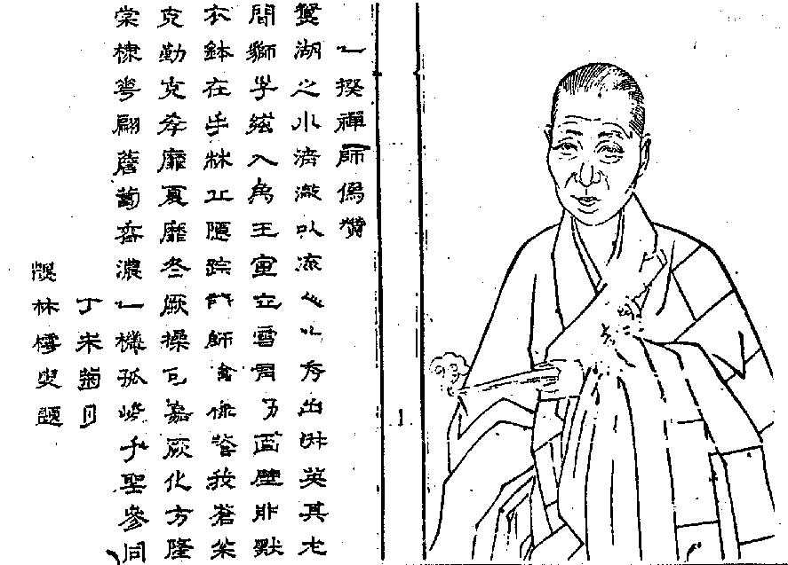

# 参同一揆禅师语录



> **藏经**：嘉兴大藏经（新文丰版）（嘉兴藏）　**册次** 第 39 册（J39）　**编号** JB436　**部类** 诸宗部　**卷次** 1 卷　**篇幅** 19,653 字

> **卷／品**：0 卷 · 1 品



---



## 目录



  - [参同一揆禅师语录序](#参同一揆禅师语录序)



---



一揆禅师像赞







------



### 参同一揆禅师语录序



古德云：「只贵子见地，不贵子操履。」此极则语也。盖自威音以后，迄于尽未来际，未有舍见地而谈禅道者。其如错会者，率以半青不黄，承虚接响，妄谓一切不碍菩提，苦哉！兹见参固尼一揆禅师语录，深叹其为乘愿之菩萨也。师为石车和尚的孙、祗园大德法嗣，向知其履践超卓，不愧古人，而其说法又单提向上，绝去廉纤如此，岂非所谓行解相应者乎？真末法之光明幢矣！良由师既得法后，复参请于木老人、古南和尚，不肯自足，其彻法源底宜哉！今参同已成丛席，法子多得人，余与师之兄子麟氏交最久，故知之深，辄弁数言于语录之首，以见今日固有末山妙总其人者云尔。



时康熙庚申岁次孟春月，　约庵道人施博敬序。



参同一揆禅师语录



嗣法门人　普明编刊　明俊记录



示众



七夕，檀越供斗，请师示众。云：「檀越登范李居士，夙具灵根，素培智种，作功德事，普众沾恩，特塑斗君，请琛上座安位。且道如何祝赞？面南看北斗，薰风自南来，荐得其中意，顶门眼自开。檀越兴慈念，莲邦长宝台，七星常送福，九曜尽除灾。作麼生是应时及节句？」喝一喝，云：「今日是七夕，何用巧安排？」



般若禅院打七，师示众云：「今日檀越董夫人设斋供众，监院仝众职事坚请开示，琛上座不敢囊藏被盖，未免借檀越无尽之光，续先法兄未了之案，若据正眼观来，也是钵盂安柄。这个般若院子十餘年来宗镜高悬，不意我先法兄移化他方，翛然长往，而今法道寥寥，印心监院愿力洪深，欲报前人一生苦志，尽力撑持逆水舟，只手扶起刹竿子，为众竭力请琛上座到此作个坐禅底样子。琛上座别无长处，秪要与诸人解黏去缚、拔楔抽钉，人人鼻孔撩天、个个脚跟立地，一切处透得过、见得彻，不被境缘所转、不被言语所滞，须知各各自有本地风光，不假他人著力，解脱门八字打开，正法眼当阳显示。秪如把断要津、不通凡圣，诸人毕竟从甚麼处入？琛上座不惜眉毛，通个消息。」竖拂子，云：「见麼？」击一下，云：「闻麼？既是闻见分明，且如何是彻证一句？」掷拂，云：「丝纶抛向清波里，且待鲸鲵上钓来。」拽拄杖，归方丈。



重阳，示众。师云：「德越禅人、历然上座办赵州茶、云门饼与众兄弟结般若缘，众中还有知味者麼？若无，琛上座为汝诸人道破去也。风飒飒，雨霏霏，应时及节；饥则食，冷添衣，尔我共知。拈起也，全彰妙用；放下也，迥绝离▆。金风黄叶堕，脱体露真机，禅家不用茱萸酒，一盏清茶释众疑。」复举：「赵州和尚见有人参，便云：『吃茶去。』且道意旨如何？」良久，云：「赵州老汉布个缦天网子，只待无面目汉撞入。琛上座则不然，棋逢敌手，琴遇知音。虽然，汝等诸人还知赵州老汉婆心麼？」卓拄杖，云：「参。」



示众。「吾宗无语句，亦无一法与人，衲僧分上本无说长道短，但是今晚普茶，若道施主设底，又是监院来请；若道监院设底，又是施主所供。此意作麼生会？诸人若缁素得出，拈饼剥果，酬恩有分；其或未然，一队尽是德山罗汉。昔有僧问疏山：『如何是冬来意？』山云：『京师出大黄。』若有人问琛上座：『如何是冬来意？』即向道：『朔风凛凛扑人寒。』大众！明日立冬了，且如何是冬来意？」众无语。师云：「山僧有个颂子与诸人说：『月色朦胧树影微，冬来消息少人知，疏山一句分明道，劈面提持不识渠。』识得渠，释迦弥勒尽皈依。且道承谁恩力？」蓦拈拄杖，云：「惟有这条拄杖子，东土西天不受拘。」



解制，示众：「孤掌不浪鸣，独树不成林，建法幢，立宗旨，须要大家著力。今日解开布袋口，放出水牯牛，一任东行西行，切忌犯他苗稼。若论办道之功，本无结解，兹因末法浇漓，多诸识见，操履日微，偷心不死，所以三七日畫地为牢，无绳自缚。我也无奇言妙句搜索枯肠，只要汝等将无量劫来攀缘妄想、得失是非一齐放下，惟以生死二字帖在额前，结也如是，解也如是，聚也如是，散也如是，不分动静去来，不辨冷暖饥渴，拚这一生不著，若不明白，决定不休。能具如是大志，自然有到家时节。琛上座与众在此一期搅扰，无以相酬，欲与诸人索些饭钱，偿还空王库内。有麼？有麼？」众无语。师卓拄杖，云：「和盘托出无人会，分付东风自主张。」



示众。「汝等诸人欲明生死大事，特来相依贫道，求出世因，直须拚命一番。虽则众中也有久参者，也有初进者，盖为生死心不切，提起则有，不提则无，念话头过时，所以不能透悟。而今不要你们操持常住钱粮，又不要你们外边攀缘涉世，只要你将个一归何处昼参夜参，无论闲忙动静，无论逆顺喜怒，遇饭吃饭，遇茶吃茶，孜孜汲汲，切切拳拳，如铁橛子相似。稍有杂念起时，即举本参话头，如金刚王宝剑，直下看这杂念从何处起，咬定牙根，竖起脊梁，工夫自然成片。参到不举自举，不提自提，胸次中觉得气气闷闷，推之不去，荡之不散。此际工夫，再不可放手，亦不可执著坐相。如若睡魔起时，便下单抖擞精神，向本参上追究，急切提撕一回，睡魔自然退矣。自要发个勇猛，千期万期，以悟为期。若能如是恒常不怠，那怕瓮中走却鳖，此事亦不得性急。你看古人动经十年二十年，揩磨得一点气息也无，所以得到这般田地。今人切忌草草，光阴易过，时不待人，各自努力。葛藤未尽，更说一偈：『话头提起利如锋，犯者从教绝影踪，劣性初调频著力，牧童鞭策莫相容。』」



警众。「既为如来弟子，圆顶方袍，必要立向上志，发坚固心，莫辜负佛祖建立垂慈之德，莫辜负国王外护水土之恩，莫辜负父母师长养育剃度之情，莫辜负自己辞亲割爱出家之志，莫虚消信施，莫虚度光阴，无常老病，不与人期，转眼便是来生，莫被阎罗老子索你饭钱，纵有亲爷亲娘救你不得，纵有相契善友替你不回，阎罗王不怕你口尖舌快，牵入六道四生，悔之晚矣。所以古云：『此身不向今生度，更向何生度此身？』何不趁此色力强健，四大安康，猛烈一番，讨个明白。今幸处闲居静室，明净僧堂，粥饭不缺，茶汤稳便，汝等若不做工夫，真为下劣愚痴汉矣。二六时中，将个话头顿在面前，竖起脊梁，开著两眼，如猫捕鼠，不容走作，念兹在兹，默默参究，须瓣一片恒常不退之志，昼夜无间，逆顺一如。汝等秖为看得生死事轻，所以被无明烦恼杂念分飞，障闭悟门，或昏沉散乱，搅作一团，或有头无尾，中道而止，或参到无滋味处，便要丢手，此乃参禅人最忌之病。若能依我说话，自然有发明日子。珍重。」



圆通大士开光。师云：「世间一切有为无不皆从愿力而生，这段公案乃义公法兄梦感发心，多缘时节不至、面目未彰，故尔担阁至今。若非诸檀护出手相扶，妙庄严相焉能成就？然而大象无形，云何有相？正是月临千涧，花发阳春。菩萨三十二应，无刹不现身；善财五十三参，有缘方住足。今日伏狮院里大士降生了也，且道有何祥瑞？」竖拂，云：「大众见麼？大士在山僧拂子头上现百千三昧而为说法，且道说什麼法？不见一法即如来，是则名为观自在。以是因缘，我先法兄了其宿愿，常寂光中得大自在；十方信施发菩提心，各沾法味得大自在；现前大众耳观目听，彻证圆通得大自在。且如何是自在一句？」以拂子点，云：「点出宝光千古秀，雍雍法相启圆通。」



除夕，示众。师云：「古人烹露地白牛与众分岁，山僧想一回，不必，不必。露地白牛，众兄弟各各自有，何用醉后添杯？参同今年新建斋堂，不免将个新字与众说说。且道新个甚麼？家家户户锣鼓震天，贴一副新门对、换一套新衣帽，自谓外面簇簇齐新，却不晓内中无明知见、恶辣馂酸，依旧总不顾著。惟我道：『人家明明历历、一切平常，也无新衣新帽、也不换旧装新，但把一年三百六十日从头记取一遍，莫有臭糟瓮不曾洗净、莫有陈年宿债未曾偿还、莫有母胎里带的习气未除、莫有无始以来业根未拔，一向灰灰颓颓、懈怠过了，逗到腊月三十日，毕竟要桩桩检过，不可留一毫污于心田，切须尽底掀翻，通新换一副勇猛利智，提起本参话头，日日新、又日新，只管如斯进步，方是斩新一句。如何得应个时节去？参同院里起楼台，如把青莲石上栽，爆竹声中残腊去，梅花香里送春来。』珍重。」归堂。



乙卯冬，檀越请师复住伏狮。升座拈香云：「此一瓣香，花开金栗，果结梅溪，昔年荡尽家私，今日众前拔本，𦶟向炉中，端为供养前住伏狮上祗下园先老和尚，用酬法乳之恩。」敛衣就坐，乃云：「九年辞退归林下，岂肯重来作主人？秖为灵山旧公案，当阳拈出辨诸人。莫有傍不甘者，出众相见。」良久，云：「其或未然，细与诸人道破。去圣时遥，魔强法弱。所以琛上座一生效古风规，不与时人斗胜，正好衲被蒙头，杜门养拙。不意浔溪梅里檀越护法，深念祖庭声坠，列派分疆，法道异端，岂能坐视？再三坚请，复住伏狮。琛上座勉遵台命，即得应个时节，不过列职安众，严整一番。然而衲僧家作用，贵乎德性仁慈，履践真实，精持戒行，敬守清规，心同杲日之明，志若冰霜之冷，庶是法门当家种草，堪与佛祖血脉贯通。且道：恁麼人行恁麼事？」震威一喝，云：「吼断群狐踪影绝，禅林从此清如镜，分付西堂与副寺，随缘住止遵其令。」卓拄杖，下座。



释迦文佛开光在初西堂，请小参。师云：「如来紫磨金色之身，天下名蓝古刹，若大若小庵寺，阿谁不供养者？岂特参同启模作样，有何奇异过人？秖缘末法时辈，善观世尊旃檀之妙相，不向世尊血脉上流通。然而琛上座造殿塑佛，实不为闹热门庭，欲令诸仁者闲忙动静之中荐取拈华之旨，触目遇缘，悟佛知见。山僧虽则立愿数载，独掌岂得浪鸣？幸蒙郡县缙绅护法、城郭檀越士民、各庵法弟兄辈，布法财于无尽宝藏，种灵苗于劫外心田，共手相扶，圆成圣像。今日释迦老子降诞王宫，指天指地，周行目顾，忒煞卖尽风流。既是未出母胎，度人已毕，说法四十九年，也是重添注脚。末后灵山会上拈华示众，只因老不歇心，彼时百万人天罔测，惟迦叶头陀破颜微笑，从此葛藤蔓起，累及西天四七、东土二三，历代老古锥祖祖相传。至南岳下第三十七世琛上座，有恩难报，有屈无伸，不免将个现成公案当阳剖露一上，也要大家知得。」顾视左右，云：「大众！且道世尊拈华与山僧竖拂是同是别？於此透遢者，不妨随处作主，遇缘即宗，行也得、住也得、收也得、放也得。其或未然，更听一偈：『昔日灵山今亦然，追风良骥猛加鞭，人人具有摩醯眼，照破乾坤万古传。』」以拂子指云：「点。」



偈



哭本师祗老和尚



折心磨琢几春秋，午梦惊残泪未收，叹息离师何太早，家私荡尽不知愁。



几见青黄不事师，子规啼遍落花枝，伤心愁听三回唤，静掩柴扉风雨时。



寄义公法兄(次前韵)



祖庭高峻净如秋，万象森罗一句收，春至自然花发锦，馨香遍界复何愁。



续焰灯光不异师，禅林郁郁长新枝，门庭重整全君力，正是抛纶掷钓时。



辞梅溪诸护法



自脱巾瓶隐碧溪，埋名誓不出幽居，禅宗说法如云叠，祖印高悬别请提。入理深谈君自会，涉言形笔眼中翳，当阳一句无私语，千古昭然岂再移。



颂青草池塘处处蛙四首



蓦将一问验来由，祖意明明百草头，逼塞太虚充八▆，安身何处不风流？



体露真机正令开，谩随声色乱胡猜，纵饶说得天花坠，也是拖泥带水来。



问著池塘意已深，声声那个是知音？而今举起当年事，依旧弦歌调转新。



一段真风绝覆藏，晴空皎月映池塘，要知闻见非他物，倒用横拈总不妨。



挽义公法兄



梦觉含悲听晓钟，空弹血泪染丹枫，追思共唱无生曲，何意风吹别调中。



禁足



九旬收足且偷闲，欲了残经对月看，有耳不闻尘俗事，薰风透户忆高贤。



自愧才疏遯古溪，抱疴终日掩双扉，藤萝密密无人到，林鸟时谈向上机。



冷看浪走法门衰，畫地为牢自活埋，倏忽夏回秋又杪，刚刚学得一痴呆。



题镜



相逢觌面触人惺，个里无私物物亲，我爱秋波清彻底，胡来汉现不留情。



金粟受具，大莲听和尚赠偈，次韵二首(附原韵)



衣到曹溪便不传，亦无实法为人宣，伏狮门下能翻掷，一任袈裟覆大千。



霜寒雪冷不知年，千里神驹更著鞭，金粟山头重勘过，宗风戒月自孤圆。



袈裟谁是得真传？今日当阳不用宣，九十九峰环宝座，禹门三级浪滔天。



冷淡平怀不记年，任他闲卧懒施鞭，祖翁田地何劳问，到处风光得自便。



礼金粟弘觉老和尚御笔像赞



御笔亲将妙相图，瞻之谁不骨毛苏，三生道德鸣千古，万善风规化五湖。金粟令行家国振，玉街闲步杖藜扶，法堂济济多龙象，祖席重光启范模。



史王育子立莲办像赞(幼名兴孙)



兴孙兴孙，一叶翩翩浪里行，莫道婴儿无个事，母胎未出度群生。(咄！)识得浪平元是水，何须传上巧舟青？



李贞女赞



南州有李，种性天然，岁寒松柏，火里青莲。表我同俦，清节可宣，徐姬继武，庞女比肩。羡兮慕兮，深闺没齿；钦兮即兮，事亲克己。灵鸟啣丹，孝感有几？激扬贞风，光我梓里。



奠义公禅师



惟我法兄和尚，一生行履孤硬，七载继席伏狮，逆顺艰辛无量，应用人天莫测，临机佛祖不让，现前若僧若俗，咸谓法门榜样。须弥峰顶驾铁舟，灯笼露柱齐声唱，同条悲痛无可伸，聊以瓣香为供养。



重阳示众



雾锁烟云迷宇宙，须防路滑莫登高，连朝风雨惺惺著，黄菊闲闲笑汝曹。



赠圆明彻圆上人



偶来乞化寓圆明，面面相看旧主人，参透威音一著子，冰轮彻照卧闲身。



赠瑞宗上人持钵



持钵街头效古风，心心无间绝遍中，穿廊入市承渠力，旧令新行是瑞宗。



赠种福庵德如上人持钵



种德幽深福自全，赤心无倦尔为先，从兹识得通津路，万里程途指顾间。



托钵回警众



黏霜带雾不辞劳，北往南来暮与朝，秖为日餐无米饭，闲名落遍有人嘲。凎圈栗棘君须透，玉粒香羹岂易消，得个知音密启意，呈桡舞棹共逍遥。



和禅坐偈五首(步原韵)



打破重关随处安，无心于物更潇然，闲来危坐松阴下，渐看蟾蜍东上悬。



假饶说法坠天华，拟议寻思被物遮，触境遇缘无不是，敲空取髓作生涯。



浩浩谈玄叠似云，相逢难得个知音，红炉突出超凡志，宿有天机转法轮。



劳生汩汩恣贪嗔，顿发心花大地春，烹雪煮茶消白昼，胸怀廓彻若冰轮。



轻舟带月水生花，菡萏花开暗度香，闻见觉知无别法，头陀嬾散发垂长。



远眺胜音禅院楼成，占此以赠



高插层楼迥碧天，疏梅翠竹绕空檐，相看觌面无回互，源远流长作渡船。



湘南湘北本同源，出入相逢绝正偏，月满楼头人境静，光吞万象照无边。



寿明觉孙老夫人七秩自武林归



觑破繁华二十年，诸缘懒涉爱逃禅，满庭芳桂新枝发，半阁幽兰拥寿筵。般若会中趋进步，菩提树下悟单传，千嵒绕遍心花现，山海同庚陆地仙。



徐居士过访不值留偈(附原韵)



后圣前贤元不二，伏狮金栗总难分，从看大地沾灵雨，谁识青天无片云。



不须相见已知君，一句当阳宾主分，遁迹深林惟养拙，冷看世事若行云。



既到家乡罢问程，管教玉石切须分，虽然具只超方眼，莫认黄花当白云。



徐居士礼义公禅师龛留偈(附原韵)



囫囵无缝没当中，八幅花旛面面同，相见不劳知客请，一声梧叶落秋空。



两头坐断莫居中，云月溪山本是同，拟欲寻踪早已错，清光灿烂正当空。



云龛寂寂素帏中，面目全彰千里同，三载影空消息断，遗风吹遍满虚空。



癸卯除夕立惺元监院示偈



倾心尽力且支撑，护惜元初祖道场，但向无中生个有，须教断处意还常。今宵说与诸人听，明日行藏尔自详，累德修身为本务，遇缘浑不假思量。



赠洞云禅友



古院堂堂一整新，洞云深锁有知音，焚香默坐君相委，无舌人传语最亲。



乙巳岁朝立为一监院示偈



秪为一事大因缘，不惜疲劳立志坚，聊借幻躯施幻法，须将真实继真传。打开自己摩尼藏，把定祖翁般若船，元旦挥毫无别语，身心托出与龙天。



寿超明上人六十



庞老家风到处便，红尘堆里若青莲，蓦然识得蟠桃热，花甲何堪计大年。



赠在初上座拄杖



德山以此验人，究竟阿谁受屈？拈起纵夺自由，把住群英莫测。为因知痛者希，未肯等闲便掷，而今敌手相逢，领取三遭六十。



赠大隐道兄(次福严韵)



诸缘顿息露全真，百尺竿头解转身，大地掀翻施妙用，虚空打破果奇新。天生道种多灵异，宿佩如来无价珍，觑透繁华超物外，依然不改旧时人。



参谒雄圣惟极和尚不值有怀



三度参求不见师，聆音未卜在何时，几回燕语添惆怅，数转莺啼动所思。彼亦道丰留锡早，我因德尟遇缘迟，傀无一法堪凭据，幸有东风独自知。



梦中触著难接后人，不觉嗟叹吟醒



老汉无端没主张，生蛇活逼要承当，伤惭妄受龟毛拂，继后浑如六月霜。



步原韵



没弦琴，不落宫商调转新，二十餘年空里觅，瞻风拨草少知音。



破茅庵，两扇柴扉不用关，翠竹老梅真我友，白云堆里露青山。



朽木舟，把定风帆泛逆流，野塘谩唱无生曲，且向清波再下钩。



破衲袄，零零落落无人要，脱下方知棒底恩，夜半日轮当午照。



大潮登金栗(次韵)



百川潮纳海门关，冲浪鲸鲵踊跃间，慧日高悬光祖道，法云弥布润家山。纶音睿旨曾无系，御苑留恩岂等闲，座侧亲聆犹在耳，物情沾泽已忘还。



贺伏狮普闻法兄七旬大诞



慈风久已播梅溪，高隐精蓝不露机，道启从心狮踞伏，法弘祖席象龙齐。缘疏嬾洽时人意，德厚尝怀古圣仪，欲庆无疆同万寿，蟠桃结后有蓄薇。



寿一音法兄七秩



半偈留笺祝大椿，百花如锦降全身，鹤翘松顶冲霄汉，桃放蓬莱隔远津。道振当湖尊齿德，声传寰宇喜从心，兄之重法标千古，三十年来金石贞。



嘉禾故乡庵秋海棠枝上亚出一花，状如芙蓉，人皆异之，索偈和赠。(原韵)君家何故弄神通？脱体新粧别样容，深究离名离相处，觉花三昧现其中。



和二绝



心华现处证圆通，显异呈奇总不容，踏得故乡田地稳，乾坤别在一壶中。



花殊叶异却同根，现出淆讹辨主宾，幸有东君亲折取，拈来随处示天人。



善护(一)音法兄新建山门



法幢高竖已多年，闪电之机孰敢前？拨转门庭添瑞色，千溪万派自归源。



久阔有怀



匆匆话别久经年，喜我同条不老仙，善护一生承愿力，清标千古递相传。



赠白云庵道融禅师建佛殿并楼



白云堆里建楼台，露柱灯笼笑满腮，道德融和群象正，沙盆扶起现如来。



和韵



大地山河物我同，虚怀惟有寸心红，雨窗静坐无餘事，秖听飕飕桐叶风。



荅明净禅人



截断从前烂葛藤，亦无一法可当情，虚空扑落非他物，信手拈来著著亲。



参禅切莫守枯桩，病退何须更假方？识取台山路上客，婆婆元是女人粧。



蜂房颂(其状甚异，有尺餘阔，五台层络)



行遍青山万木围，披云吸露启风规，层层楼阁空中建，密密幽居向下垂。活计水边沤影寂，生涯花底谩徘徊，奔流度刃遭人忌，窠臼掀翻春正回。



又和韵



空中钉橛欲成家，队队翻飞遶水涯，忽尔回思非活计，全身跳出混云霞。



腊梅颂



疏枝清节淡霞粧，不入春秋热闹场，历尽冰霜心愈赤，当阳拈出自馨香。



宁县张护法腊八以偈索和(附原韵)



春夏秋冬过冬至，计日三百三十二，今日方闻道有成，释迦根器何迟滞。



和韵



时节因缘今已至，明星睹后元非二，须知别是一乾坤，闪电光中莫留滞。



邵夫人五十初度



牙笏霓裳绕膝前，翘松古柏并森妍，翛然懒去朝金阙，得志欣参赵老禅。宿植灵根千载荫，花开劫外四时鲜，已知天命无劳算，柳绿桃红庆大年。



壬子春分三日，雄圣法叔和尚晚到，遂以河渚▆▆诗出示索和，依韵口占



未识罗浮境，遥闻遶水边，篱疏搜远径，树古却垂肩。为惜枝头冷，频添炉里烟，欣逢佳客至，犹喜杏花天。



同诸兄游真如晚归(次尚散法兄韵)



玲珑八面古皇新，光映鸳湖彻底清，落日穿林浑似锦，暮鸦归宿斗疏亲。



诸兄临别(次韵)



蓬门常掩胜居山，为惜浮光未敢闲，今夕共君谈不二，黎明分袂荻芦闲。



寿则南禅宿五十



五旬蝶梦觉前非，急荐莲居第一机，净土禅宗元不异，竺乾震旦本同枝。青桐露滴谁相委，丹桂飘香我独知，道树根盘空劫外，真常寿算月轮齐。



寿洞云禅师五十



相忘尘世觉身闲，慕道中年一著先，按过知非春梦晓，芰荷香里悟真诠。



百年过半自悠然，重整精蓝事事便，祖父田园耕已熟，儿孙千古履源渊。



寿胜音尚彻禅师四十



薰风堆里降神仙，火聚欣开白藕莲，鹫岭峰高鹏展翮，胜音法续鸾胶弦。藏机未肯频拈尘，时至那容暂息肩？喜有同俦担祖印，愧无佳句祝齐年。



壬子春仲望日，过国福禅林，随喜万佛忏。时诸兄叙集，惟自可道兄一别二十餘年，今始得晤，谈心话旧，晨夕忘倦。恰又值道兄五旬大寿，口占奉赠



忆昔当年同事师，谁知透网别分枝，羡君深得寒山意，愧我空垂浮定丝。隔断曹源数十里，云臻国福半联诗，奇逢天命重相会，正是冰轮皎洁时。



哭雄圣法叔大和尚



慕道寻访十二年，青黄四见近师颜，自欣得获骊龙宝，志愿同调狮子弦。忽讶宝峰倾半座，犹如法海覆慈船，无孔铁笛音虽杳，幸有禅灯百世传。



辞诸亲法眷庆寿拙偈三首



默报劬劳五十秋，未尝片刻去心头，一毫端上知根木，不逐时人借意酬。



觑破诸方庆大寿，纵经百岁有何奇，个中不著闲名相，那记生辰与死期。



庚逢盛暑愈该辞，烛面糕桃不及时，耕得心田平似掌，脚跟点地大家知。



颂竹尊者(步原韵)



四时积翠没荣枯，脱体心空不老臞，岁岁添条留晚节，山山独坐笑村夫。吟风愒月谁为伴，顽石苍松可作徒，昔日击声空所有，今将眼听实难无。



华严期偶作



重重华藏显幽微，慈氏门中截众疑，参遍百城烟水渺，别峰相见证菩提。



性海陂平月正圆，恒沙诸佛现眉端，浮云散尽天花坠，到此方知法界宽。



示法源书记



无边香水总归源，十兆餘言半月宣，识得不消弹指顷，象王鼻孔一时拈。



云栖遇王夫人扇头，乞偈书赠(住福建时皈道教)



半生皈道遶天涯，凤诏虽尊未足夸，喜有灵苗深植种，拈来莲社雨香花。金风飒飒吹黄叶，涧水潺潺泛白沙，现前识得云栖境，三教同源共一家。



大士赞



不恋金沙滩，不居紫竹林。皎皎长空月，闲闲出岫云。欲行频顾后，悯极诸有情。宏愿立，缾水倾。圆通妙应春风里，笑指众生识自心。识得心，观音元不在丹青。咄！



又赞(坐石上看净瓶浮水面)



吟吟独坐磐陀石，漾漾清波泛玉瓶，慈容𫖯视怜无尽，悲愿宏深度有情。裁云补袖兮覆护一切，垂发为璎兮赴感群生，莲花衬足兮馨香遍界，柳叶才拈兮大地沾恩。(咦)！难思妙相堪描畫，觉海潮音著眼听。



造释迦文佛迦叶阿难尊者像募装金佛座偈



乘愿庄严度有情，杜门争得遇知音，至今未示黄金相，须向檀那播口唇。



虚空叠作宝莲台，撮土无非是法财，觅个有缘成圣▆，聚沙植福现如来。



古南老人春字韵依韵二绝



春水涨溪头，春霜满屋头，春莺频唤惺，春日落山头。春风堆里露锥头，春梦谁人肯转头，春色满林观不尽，春茗香扑鼻尖头。



腊月十五雪后归棹口占



西风吹散玉花飞，湖面连坡去路迷，冻锁蓬窗寒入骨，水晶宫里作安居。



伤风不得睡



通身发热嗽难禁，起坐披衣气渐清，出定了然更漏绝，只闻邻犬吠深村。



华亭勉力行化口占一偈



三十年来林下居，不彰名姓少人知，只因记莂曹溪旨，随例飘蓬带水泥。



赠明镜王夫人二偈



宝镜临台胡汉彰，分明举似细参详，何须觌面亲枯出，半偈相酬意自长。



羡君无倦结良缘，腊月能闻火里莲，日用应酬休错过，呼童唤女总谈禅。



赠宝璋公郎



良哉宿授灵山记，般若根深荫有缘，恒沙德种无边界，御苑留名盖世传。



赠松埜禅师



潜隐高斋傍闹蓝，蓬门常掩胜居山，蟠松经雪增新翠，埜衲披云叠似班。及至相逢唯务嘿，却思别后信音难，而今掷下无须锁，猛著工夫透此关。



赠处林禅师



难兄难弟启嘉声，耳畔长聆不二门，到处法幢甘雨润，满林芳艸悉沾恩。舒怀扩量忘人我，动止谦和道者心，会得临行留短句，月轮当户皎无云。



赠竹影禅师



同条天性志超群，五叶流芳亘古今，千里尽从初步起，到家不必问途程。



赠道生禅师



吾道何分北与南，生机活泼化三千，年来有意中流砥，拨转无多妙总禅。双桂森严条正发，单传直指急须参，忽然证得非心物，别立风规启后贤。



示徒孙实传薙染



幼小离尘志不凡，晚成须透上头关，祖翁田地平如掌，细下深功莫放闲。



昔日于檇李保寿庵参常一老师，迅速流光三十年矣。于今戊午岁菊月，匍匐苕溪万善禅院，叩谒　慈颜，亲聆导诲，慧灯高照，龙象骈臻，不异初参风景。(琛)晨夕随侍，四旬日不离左右，以遂本怀。口占一偈



忆自当时立志坚，鸳鸯湖畔礼金仙，没弦琴抚无生曲，不落宫商调别传。净土禅宗同一体，湘南潭北意何偏，始知愿力皆天定，再续从前三十年。



洞庭归舟中偶占



七十二峰云㵿㵿，缥缈高顶露华晓，太湖三万六千顷，阅尽古今人未了。



洞庭船子浪滔天，范蠡湖船亦有年，人在此中休问渡，地分南北验当贤。



要知一贯悟先贤，吾道当思痛自鞭，驹隙光阴空过了，百年搔首亦徒然。



颂古



世尊初生



才降王宫尽底倾，何须七步显家珍。谁知弄巧番成拙，一棒于今累子孙。



世尊升座



法王法令不虚行，多少英灵眼失睛。莫道自起还自倒，清风匝匝透知音。



世尊睹明星



六载埋身惯脱空，明星睹著面皮红。寻常一样窗前月，看到梅花便不同。



女子出定



出定如何与入定，罔明弹指休侥幸。误赚时人摸壁行，至今不识其正令。



善财采药



茎草和根信手拈，文殊岂受善财瞒？虽然妙药多灵验，服者反令病更添。



僧问法眼：「如何是佛？」法眼云：「汝是慧超。」



一句无私活泼机，电光石火撩双眉。若将语默为玄妙，曲径幽深路转迷。



婆子烧庵



二十年来龟证鳖，任他寂寂与惺惺。逢缘遇境谁为碍，累及婆婆本利倾。



瑞岩主人公



历劫相随旧主人，月▆潭底水无痕，太平何用将军令？空使叮咛费口唇。



竹篦子



触背二途俱坐断，分明举似莫颟顸。拈来一任敲风月，点著令人心胆寒。



文殊三处度夏



柳巷花街有甚拘，头陀著意转生疑。百千妙体毫端现，莫向椎边定是非。



禅堂规约



夫参禅做工夫，贵乎真实。古德云：「七日不悟，斩却老僧头去。」然诸人元要寻常动静中，将个本参话头，绵绵密密，昼夜无间，四威仪内，不令散失。所以进堂，或一七，或二七，昼暮策励，正击傍敲，或见色闻声，或棒头喝下，蓦然桶底脱落，放下千觔担子，通身庆快，便是真实受用。若一向茫无所知，止要在七日内讨个分晓，纵有上根利智领略得来，也是门庭边事，未是到家消息。鸟飞兔走，迅速流光，不得悠悠忽忽。这一期内，必要了此大事，未悟者要悟，已悟者必实证。然说证说悟，不过对迷而言，踏者本来田地，悟之一字，亦无著处。坐香规约，虽不能全达先圣仪式，聊立数条，谨列于后。



挂钟板



师云：「秉佛祖权衡，作丛林模范，泼天炉鞴洪开，闪电光中著眼。」蓦击一下，云：「一敲迸出虚空髓，草木皆为师子音。」



机缘



僧参，师问：「甚处来？」僧云：「进泽。」师云：「曾进也未？」僧喝，师云：「喝后𫆏？」僧顿足，师云：「除了顿足，别道一句。」僧拟议，便礼拜，师云：「鹞子过新罗。」



师入堂，一婆子出礼拜，师云：「见个什麼道理？」婆云：「青天皎皎，天下太平。」师云：「闲言语。」婆云：「一念不生。」师云：「正是生了也。」



一日，吃饭次，师云：「终日吃饭，不曾咬著一粒米，意旨如何？」众皆默然，师云：「今日失利。」傍有一僧出，便喝，师云：「已迟八刻。」



荅问



僧问：「两头坐断，中间除之，云何安立？」



荅：「主山前，案山后。」



问：「雪覆千山，因甚孤峰不白？」



荅：「向上看。」



问：「猛虎以肉为命，云何不食其子？」



荅：「好食，不属饱食。」



问：「断头船子下杨州，甚麼人把柁？」



荅：「切忌道著。」



古南老和尚室中垂十问



问：「雪子落纷纷，为甚变成雨？」



荅：「一点水墨，两处成龙。」



问：「河路既通，枫桥船为甚不到？」



荅：「作麼作麼。」



问：「既作村僧，理合随缘，为甚只想山中？」



荅：「亲言出亲口。」



问：「一钱为本，万钱为利，早晚时价不定，为甚滞货不脱？」



荅：「甜瓜彻蒂甜，苦葫连根苦。」



问：「久旱逢甘雨，物情皆喜，为甚石敢当只是不肯点。」



荅：「两重公案。」



问：「昨日雨，今日晴，覆盆之隙，尚可容光。庭前竹子，心里日月，如何照临？」



荅：「从来不覆藏。」



问：「路逢剑客须呈剑，且道函人矢人相遇，要得投分，呈个甚麼即得？」



荅：「饥餐渴饮有甚难。」



问：「炙背可以献天子，大好笑事，因甚留在典籍？」



荅：「好事大家知。」



问：「相看两不厌，只有敬亭山。秖如敬亭山，还具甚麼眼？」



荅：「瞎。」



末问：「色斯举矣，翔而后集。山梁雉鸟为甚又撞入网中？」



荅：「瞒人即得。」



僧问：「如何是透法身句？」



荅：「好阵凉风。」



问：「如何是学人自己？」



荅：「高声问来。」



问：「如何是皈根得旨？」



荅：「九九八十一。」



问：「路逢道人，不将语默对，未审将甚麼对？」



荅：「两眼对两眼。」



问：「行住坐卧不离这个，如何是这个？」



荅：「提掇不起。」



问：「忽遇三军围绕时如何？」



荅：「正是出头时。」



问：「如何是衲僧向上事？」



荅：「无毛铁鹞贴天飞。」



问：「如何是宾中主？」



荅：「信手拈来无不是。」



问：「如何是主中宾？」



荅：「得意回来对月吟。」



问：「如何是主中主？」



荅：「莫教打落当门齿。」



问：「如何是宾中宾？」



荅：「簷前啼鸟送残春。」



佛事



弘助禅人掩龛。「久依丛席，动止遵规，志勤协助，弘愿不违。且道：今日掩龛一句如何相委？(咄！)辞云直入乱峰去，杜鹃声里送春回。」



禅人掩龛。「月辉禅人，自幼出尘，金刚密诵，现坚固身，殷勤事上十五载，亦曾究竟虚空心。虽然四大分离，我今指汝归真。」喝一喝，云：「还乡不假纤毫力，佛土莲邦任意行。」召大众，云：「且道掩却真容向什麼处见他面目？月穿潭底辉寒影，红白梅开满院春。」



一如监院封龛。「去年今日汝来请我，今年此日我却送汝。去来生死无期，好向目前荐取。」喝一喝，云：「向这一喝下知归，清凉窟里安身去。」



起龛。「一如一如，直心本色，个里无私，临行撒手，故得自如。十年执事，劳苦不辞，所以立你监院，本望扶助常住，岂期忙中缩手，闹里抽身，舍却世间法，作个逍遥人，脱然恁麼去，谁见不酸辛？且道出门一句又作麼生？」击龛，云：「今朝指出无生路，石女和歌送汝行。」



丁未，供本师和尚像(是日，义川、义公二师神主同进祖堂)。指像，云：「恭惟本师大和尚荒凉冷坐八年，只道根深蒂固，秪缘忤逆儿未遂守塔之志、难酬之恩。具副铜肝铁胆，不顾危亡；掀开地轴天关，无劳弹指。移全身于参同庵左，彰未来之榜样；供遗像于伏狮堂上，示过去之风规。大众！且道现在一句又作麼生？」(捧位，云：)「一灯续燄光无尽，二子相随入祖堂。」



赵氏张夫人掩棺。「生既无生，灭亦非灭，无灭无生，洞然明白。一念才兴，千差万别，识得根源，便请休歇。呜呼！赵氏夫人一生慕善心坚，治家严密，忽于四年前想起末后一著，请益于山僧，其奈夫人事繁体弱，不能以禅定工夫策励，孰料四大分离，措手不及？现前若僧、若俗，要知叶落归根，人人本有时节。且道：掩却灵棺如何指示？」卓拄杖，云：「今朝亲授灵山记，佛国莲邦任汝行。」



奠善护一音法兄禅师。「当今法门虽盛，觅个本色道人，如星中拣月。惟我法兄和尚行藏作略，深达古德家风；性直骨刚，脱出时人窠窟。三十年荷担此事，竞竞业业，为法为人，敬师始终不易，诲徒晨夕无倦。虽则久病室中，其规有条，其令严密，所以同条一脉，全赖于法兄共手相扶。讣闻忽至，如矛刺心，如鸟折翼。嗟乎！伏师门下，法运渐衰。」顾视左右云：「不识现前诸大德还描得令师塔样麼？其或未然，更下注脚。一会灵山却俨然，就中谁肯效耽源？狮音断处频相和，敬守遗风切莫迁。」遂展具：「尚飨。」



般若义川法兄禅师举龛。「法道倾颓，愁得石人汗出；云龛起舞，欣逢木马嘶风。幸我法兄和尚夙缘深植，公案现成。其生也，四十年受檀越之宏护；其死也，百千世潜故身于福地。若非大人作略，焉能末后光辉？」召大众云：「且道和尚即今在甚麼处？琛义同手足，岂敢囊藏？聊与诸人通个消息。那伽长定十三秋，发燄冰壶得自由，趁此一轮霜月皎，湘南潭北逞风流。」



知客顿悟禅宿封龛。「者汉根盘梅里，果结嘉禾，二十年前伏狮会里仝参，二十年后参同相依共住，苦乐同甘，劳辛不畏。赤心常住，至公而了不存私；竭力为人，真实而囊无积蓄。见闻知识，必生助道之心；接待贤愚，不著人我之相。呜呼！一疾俄然撒手，铁牛也解悲伤。」召众云：「顿悟禅师一生不会偷安，而今急欲退身，且道向甚麼处去？百花丛里翻筋斗，正觉山前自在闲，还乡踏著无生路，始信壶中别有天。」



起龛。「相呼相唤老阇黎，五十春光不见伊，幻化境中幻化影，杜鹃枝上杜鹃啼，馥馥薰风呈旧面，双双紫燕垒新泥。急荐取，目前机，此际若逢灵利汉，无阴阳地且安居。」喝一喝，云：「八字门开，大众普送。」



举火。「藏身处没踪迹，烈燄光中灭非灭；没踪迹处莫藏身，到者方知生不生。净裸裸兮，峰头翻白浪；赤条条兮，海底起红尘。顿悟老宿虽无神通妙用，曾经先师炉鞴煆过几番，所以跳出时人窠窟。何故𫆏？末后叮咛无别语，秖教枯骨莫留存。」呈火炬，云：「烧。」



海盐令修胡居士为道伴大隐禅师终九之辰请对灵小参。师云：「琛上座自揣才疏德浅，岂得明眼人前播扬家丑？因奉护法令修老居士台命，况吾大隐法兄禅师二十八年道义往来非是一日，故不敢辞升于此座，聊举一隅。呜呼！吾与兄翁始相见于伏狮，后同俦于金粟，或时秉兴阔论忘疲、或时静里细谈心▆，皆出乎本色常情，并不自高而自大。其居尘兮，可为齐家之标格；其出世兮，咸称法门之梁栋。现前若僧、若俗，还知大隐禅师一生用处麼？越俗超方已有年，宗风戒月自孤圆，瞥然觑破娑婆界，撒手还源惺旧颜。昨岁华山登戒品，今朝火里产青莲，不是闹中忙缩手，道风留与子孙传。(咦！)满堂孝眷如云集，九九须归八十一。」卓拄杖，下座。



己未秋前一日亲题辞世偈



这汉一生骨硬如钉，一处转脚，最难移根。二十四上知有此事，十年克苦忘形。四十九上悯绝娑婆世界，觑得世态如冰。实求早离如愿，业缘又使七春。日今铁钉如灰，四大风火分散。业落知秋，正是归根时候。阿呵呵，逍遥惟我。



参同庵记铭



禾城东南五里，有庵曰参同，一时道化之盛，众皆称一揆禅师云。一揆，里名家，孙氏女。适盛氏，早寡，感生之无常，发出世愿。年二十六，赴梅溪伏狮院，礼祗园禅师，薙发受具。以夙慧力，入室扣参，悉通机用。不二载，膺付嘱。盖祗园传法凡七人，一揆其著也。维祗园为金粟石车之子，为临济三十二世孙，现女身相，建立宗旨，四方学侣云臻，并时无两。而一揆拔萃於百人会中，有智过於师之誉。当祗园示寂后，经营伏狮塔务，偕法兄义公守师三载，精进滋益勤。其仲兄孙君子麟，筑静室延之，乃去伏狮而居焉。是室也，外绕清流，后荫修竹，中结宇十餘间，具回廊曲房之致。堂前供佛，有庵之名。庵初名孙，私之也。既而子麟锡今名曰参同，为一揆公之也。公之者何？夫一揆而承受大法，弘化天人，非孙氏之所得而女也。其庵将佛法僧之是崇，非一家之所得而主也。且一揆自辛丑春，因义公之殁，从诸檀请，继席伏狮六载，于丁未秋归庵，则其规模又加广矣。先丙午冬，以祗园之塔之未善也，移而置庵之左，义公祔之，为建塔院。次年冬，建中楼三间。戊申，前设墙门一带。己酉，造厨浴诸杂室。庚戌，建大殿并庄严诸佛像。虽庵也，宛然有丛林风，维一揆以誓愿所存，兴举胜业，感动十方名尼暨於德门大家，倾心施舍，相与有成。皇哉！斯庵之以禅盛吾禾也。然而牓曰参同，子麟名之，弘觉老人不之非，复为书之。此其说何也？夫子麟受书于儒，启悟于佛，旁通于老，信三教之一源，取名参同。同者，一也。自其不一者而观，则佛之中教与宗为二，宗之下复为五，五之后分而什百，几于斗争，故同之中有异焉。自其一者而观，则万法归之，凡人世语言文字、资生术业，俱与实相不相背违，而况乎儒与道？故异之中有同焉。参异而得同，犹夫揆什伯而见一师之号，与庵之名似有合焉者。以此消末法之争，并释外道之疑，予麟之志则大矣，非一揆乌足以当之哉？予观一揆得法二十餘年，绝名闻利养之念，训率诸学者惟以戒律为先，而本分提撕必归于第一义，济下宗风，克兴女中，参同之名遂人重，远近之来者受之，后之贤者守之，子麟之志于斯大慰焉！宜记而传之，使有永也。铭曰：



大法西来，塔庙是崇。始自赤鸟，实惟吴中。迄千餘年，化乃大洽。僻壤名山，禅林用匝。参同肇基，禾城东南。由室而庵，蔚成名蓝。门有宗风，人无女相。三教咸归，万乘最上。用书弘绪，以告后人。石乎不泐，法尔常新。



康熙十四年四月八日，赐同进士出身、通奉大夫、山西布政使司右布政使里人王庭撰。



参同一揆禅师行实



师讳超琛，字一揆，嘉兴县人，系大司寇孙简肃公之曾孙女。父太学茂时公贤，母高氏，法名超臻。长兄子彰孝廉公，官中翰；仲兄文学子麟居士，少年得道，登三教坛，禾中称孙先生是也。公有三女，师居幼，少聪敏，精女工，不由师传，而通书义，兼绘墨，其秉质不凡如此。及笄，适庠生盛君子逵，克尽妇道，事翁始孝。其于胞姊屠又雍孝廉公夫人最友爱，姑嫂妯娌间情礼备至，人无闲言。不幸盛君遘疾，医祷不效，愿以身殉，复自念云：「倘弃所天，徒死无益。」思投入空门，为出世计。时尊宿林泉老师与盛君相契，见其病笃，屡来开示，师窃听之，道心益切。未几，作未亡人，时顺治丁亥九月间也。自后师毁容变服，茹素持诵，日不下楼，一意焚修，但未知参禅，大书「万法俱空，一心念佛」于壁，其立志坚贞如此。戊子年，子麟居士见妹婿溘先朝露，生死心切，苦志参禅，语师云：「待吾拼却性命，倘有所悟，汝不难出世。」居士奋身打七，大事已明，得▆心印，即告师曰：「汝急做工夫，绝后再苏，欺君不得。然必参话头，经明师煆炼，方得了手。」时祗园师翁系师瓜葛开堂，梅溪伏狮师企慕有年，但不出闺门，未及叩谒，只在家昼夜参究，而话头难破，如吞铁丸相似。见居士逍遥放旷，愈疑愈闷。适有汤老太戒行精严，引进弥切，虽遇溽暑，坐至夜分，蚊刺遍体，师漠不知也。其工夫真切如此。值归宁，与母夫人同志数人朝夕大士前，梵音彻户外，一时感动远近长斋皈教者数十人，真有庞氏家风。一日，与居士趺坐蒲团，各说志愿，师云：「吾志效祗老和尚。」居士云：「吾渡亲入道，宁为蓬莱鸡犬，莫作尘世公侯。」厥后师出家，道行酷似师翁。居士嗣遇异人，悟宿因，可谓各惬所愿者矣。辛卯春，师买舟往梅谿，同母夫人参谒祗老师翁，而一见称为法器。见居士寄呈偈语，大加称赏，问师：「参何话头？」荅曰：「谁字？」师翁曰：「汝不必易话头，悉听尒兄指教，吾不难印证也。」即于是冬结制，偕母夫人复到师翁座下，同参话头。师坐至二七，忽尒定去，香尽四炷，瞬息而过，大地平沉，洞彻本来面目。居士闻之大快，笑云：「这不唧𠺕汉，迟至今朝方摸著鼻孔，何钝如之？」师翁即印可披剃，壬辰付嘱。其真参实悟，根器迅利如此。由是师将盛门授产返还盛氏，孙门嫁赀仍归孙氏，赤条条不留一物，亲戚共叹莫及而生敬焉。彼时林泉老师辞世，碧光庵心传老师，禾中大尊宿也。师参谒后，语居士云：「又添一个法堂。」自明禅师与茂时公交契，称师为法门栋梁，有偈喜赠，如古南牧老和尚、隐庵息老师翁尤加赞叹，其为师家深许如此。不意甲午六月，师母夫人病痢不起，师服劳尽瘁，哀号吁天。母夫人临终，见青莲、红莲涌现，口称者三。初，夫人在家坐香参一念未生前，以七为期，至第五日，定冲冲口说出：「眼底光明蓦地来，腹中自觉笑颜开，今朝一片平阳地，明日莲花朵朵开。」素不谙偈，连自家不知何故，兹见莲花两朵，适应谶语，现红绿幡幢，往生乐土无疑。七终归庵，九月师翁示寂，师割股疗师，一痛几殒。天何夺我母而又夺我师，我何生为？默念付托之重，力荷祖道，志报师恩，其孝亲事师，笃挚爱敬如此。在伏狮守塔期满，思结一茅于水边林下，保养圣胎。斯时义公师伯坐伏狮方丈，势难同居，苦无其地。子麟居士慨然创建静室，罄赀落成，约费千金，一切什物完具。丙申冬，请师移锡，厥后龙象骈臻，皈依辐辏，革故鼎新，竟成兰若。辛丑腊月，茂时公不讳，师极尽孝道，曰：「余向有老父挂心，今可一意办道矣。」壬寅正月，因义公师伯回首伏狮，虚席护法，帷孺董公虔请所以，复住伏狮六年，其间为迁塔诸事，载在师自叙文中。癸卯冬，师圆戒于弘觉国师，得会觉珂和尚相契，因晤适南和尚。适师才高骨刚，傲睨一世，独于师注意焉，似有终身之托。己酉季秋，请适南师翁同子麟老居士到参同纠众打七，悉遵报恩规则，钳锤甚严。师时遭诃斥，礼下弥恭。其时普明虽先付嘱，与法源僻居黎里，禁足不及躬逢其盛，为一、惺元两法弟各得力醒发焉。适南师翁抱疴，欲觅静室，师买地盖椽，衣之食之，延医莫疗，无何示寂，师竭力尽礼，请弘觉国师收骨入塔。其尊贤重道，死生不渝如此。庚戊冬，武林雄圣惟极和尚海内宗仰，结制请师为首座，机缘载在雄圣语录中，与西堂静诺师伯称为莫逆。而雄圣老和尚水乳交合，期满，挥涕而别，同檀越张老夫人往金粟饭众。天岸和尚以　御赐炉衣供师，不以法姪相待。弘觉国师以祖衣送师杨坟。师翁灵机大和尚天下宗师，见师赞叹不休。其为师尊钦崇如此。姚江邵太常夫人遇师后，不远千里修候。浔溪董微君帷孺乔梓，礼意有加。徽州孙老孺人明觉、王孺人明慧、吴翼桓夫人、乌镇沈孺人明证、盐官胡令修居士并室、大隐禅师诸位，亲近多年，久而弥切。云间王夫人明镜率公郎拜师，锡名实璋。本土诸位不及备载。其为四方檀护皈敬如此。与同门诸昆季友爱，终始如一。常感义川、义公两师伯教导之力，如陈庵主洞云、丘庵主心学、洞庭庵主莲乘暨贯一，而交非泛常。其睦于弟昆法眷如此。常见末法掠虚失真，工文词为家私，习机锋为了当。平素训徒，一以真操实履为要，莫以文采口滑为工。常云：「阎罗老子不怕你口快。」拈高峰祖师语：「开口动舌无益于人，戒之莫言；举足动步无益于人，戒之莫走；举心动念无益于人，戒之莫起。」书于座右自警，警徒御下，老者安之，少者怀之，周其衣单，均其劳逸，随才器使，各得其宜。间有负恩，亦不之校。其砥柱狂澜，安众公平如此。自四方多故以来，屡遭歉岁，常住淡泊，日甚一日，食有四五百指。师备极劬劳供众，素耻募化，以此进退维谷，精神衰减。己未春，往洞庭，游穹窿，见施度师对联云：「食不耕，衣不织，饱暖须知惭愧；打可怜，骂可惜，忍辱便是修行。」录归，警策大众。自此抱微恙，食不下咽，身无痛苦。至六月，绝粒半月，饮水过日，预知大限将至，却医禁卜。十七日，邀子麟老居士至榻前，分付法门后事，语不及私。老居士即录云栖规约呈览，师云：「可刊在板，一挂山门，一挂佛殿，一挂斋堂。」老居士云：「吾尚淹留尘世，符到便行，岂不快活？」师笑而颔之。适南浔常一老和尚与师契阔十年，忽法驾远临，相见如一日。师虽身抱沉疴，犹执师弟之礼，侍问不倦。时六月廿七始别，觉在世无多日。廿九，请子麟老居士、内姪苏门到庵，呼徒不肖普明曰：「汝早付嘱，今付祖衣杖拂，为参同住持祖师一脉，善自护持。」普明五体投地，辞之再三。老居士曰：「此要承当，毋容再让。」呼法源明俊将如意云：「此幻有老人付卓老和尚传至先师者，今以付汝，非比等闲，切须珍重。」将拂子付为一明元云：「汝佛事说得几句的。」将铁如意付惺元明湛云：「汝心须如铁，守护常住。」老居士云：「吾看来法源上座得体接曹溪之正脉，为一上座得用支参同之门庭。」师云：「是，是。」老居士云：「有偈语否？」师云：「无。」老居士云：「无语句即为语句矣。吾宗不立文字，世尊说法四十九年，未尝说一字，若有言句，是名谤法。今各位向无语句中会取。」师又云：「素封明麟随我多年，甚合我意，服勤左右，夙夜匪懈，可谓孝矣。可取我像描他在傍，要题他几句，今不及矣。昙现老成，可作总管。其餘执事派定，井井有条。」武水朱近文，名家子也，弃家为高僧。室人沈氏，师尝目为美器，以子幼未及剃度。老居士面云：「道在心，不在境，无论僧俗，只要笃志修行。今不幸无师可投，莫若在家修持，不坏世间相而修实相也。」师以为然。又嘱云：「吾一生小心谨慎，一一言一动并不放胆，汝等知之。」老居士见其末后光明，一心不乱，世所希有，非数十年定力静功、行解相应，焉克若此？遣徒遍谢诸法眷檀越，示期七月初三立秋永别。至初三黎明，先期报钟，师云：「又担阁我一日。」至初四日辰时，沐浴更衣，说偈云：「这汉一生，骨硬如钉，一处转脚，最难移根。二十四上知有此事，十年克苦忘形；四十九上悯绝娑婆世界，觑得世态如水，实求早离如愿业缘，又使七春目今铁钉如灰，四大风火分散，叶落知秋，正是归根时候。阿呵呵！逍遥惟我。」端坐而逝。其临行安舒自在，真得无上三昧如此。普明等肝肠如裂，远近缁白哭声震野，如丧考妣。遗命请老居士拈香，领众送进方丈入龛。老居士遵命，见之大恸曰：「昔陈白沙先生吊罗一峰，先生大笑，笑一峰死得其所；复大哭，哭失一良友。世道无人，其今日之谓乎？」遗命茶毘入塔。奈师素不蓄赀，兼荒年挂薪玉粒常住如洗，而老居士以古礼速葬，不待制满，入塔为安。同师内姪青岩、青岫、苏门，师外甥屠躬节居士捐赀鸠工，拟庚申清明塔。予参同祗老师翁。▆右按师实悟实修、实心实行，不以文字经心，凡有题赠书札，并不留稿，挂漏甚多，所集语录若干，不敢易一字、诳一语。师素不好名，今始镂板，明知虚空著彩，然非是无以信今而传后，一花可识无边之春、勺水可印圆满之月。不肖普明捐赀敬付梨枣。师距生于天启乙丑六月一日辰时，世寿五十五，僧腊三十一。生担荷法门，为道忘躯，作人天榜样，普明等不能赞一辞，且山野拙讷无文，乏如椽手笔表扬万一，伏祈四方善信各赐珠玑，为续灯之一助云。



康熙己未冬至日，嗣法弟子普明谨状。



自叙行略训徒



余俗姓孙，世居角里，二十六岁出家，于本县梅溪伏狮祗和尚会下披剃。师系天童密老人嫡孙，密乃临济三十世孙也。顺治壬辰二十八岁受嘱，三十岁六月母丧，九月本师示寂。时义公法兄继席伏狮，余守龛制满，时有结茆之念，从无钵资，势不能举。幸有仲兄子麟同志参禅，先余著鞭，精通三教，皈于一源，故建静室，名曰参同，属弘觉老人书额，此参同庵之所由名也。其丛桂轩、关房、曲廊、丈室、池亭、水阁，外有花卉修竹，皆丙申年所建，什物俱备。至仲冬，延余住焉。时庵中惟六七人，实得林下之乐，白云封户，圆寂无人，六载如同一日。不意辛丑春，义公法兄忽染沉疴，延余到榻，嘱托后事，刻先师语录，自己建塔，立当家规训。徒众以余法门手足，欲完先师未了公案，诸檀越特到参同坚请，余念老父年迈，以偈固辞。谁料冬间严尊亦故，当家病危，浔溪帷孺董檀越再三相恳，于壬寅正月勉强应请。回见先师塔院在荒郊道路，人难看守，余身心如悬，所以复进伏狮六年，惟以塔事为念，并不攀缘涉世。至丙午腊月，起工迁塔于参同庵左，通新重建义公兄龛，亦荼毘于师塔之侧。丁未清明，造塔已竣。中秋，即伏狮退院。冬间，建楼三楹。戊申春，启墙门一带六间。己酉，造东厮浴室三间。庚戌，佛诞日，建大殿。余出家时，孙氏嫁赀，盛门分产悉皆捐弃，僧俗耳目共知。二十六年法门辛勤，中有十年兴建土木，渐成兰若，皆出于十方檀护信心中来，所以日夕训诲徒辈。若非忘形死心，坚持戒行，何能俾其永远不朽？欲报佛祖，必须敬守清规，真实履践，冷淡家风，千古不泯。遵此数语，方可同居，俾世世守之，毋负我一生苦志也。

