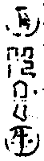

# 高峰乔松亿禅师语录



> **藏经**：嘉兴大藏经（新文丰版）（嘉兴藏）　**册次** 第 39 册（J39）　**编号** JB440　**部类** 诸宗部　**卷次** 2 卷　**篇幅** 29,103 字

> **作者（译者）**：书记灯洪录

> **卷／品**：1 卷 · 2 品



---



## 目录



  - [高峰乔松和尚语录序](#高峰乔松和尚语录序)

  - [序](#序)

- [高峰乔松亿禅师语录卷一](#高峰乔松亿禅师语录卷一)



---



### 高峰乔松和尚语录序



孟子曰：「圣人，百世之师也。」大慧之道，岂置百世之师哉？后之星宿劫有圣者、贤者出，其匕以大慧▆毗婆尸佛，况贤劫之尊尚者乎？大慧既具如是道矣，则为大慧之裔而绍其门庭者，亦将具如是道矣。聚云，中兴其道者也；庆忠，又能扩充其道者也。嗣庆忠者，眉山、三山童真诸老约十餘人，而高峰乔和尚亦其一焉。自是以往，愈昌愈炽，愈众愈违，其道宁可量欤？尚生而岐嶷，长而聪哲，得头於一贯册内，彻尾於挂牌室中，十载辛苦，一朝记莂。既而开炉白岩，唱教永兴，三坐道场语录二卷，皆脍炙丛林，服膺缁素。未几，放舟东下，驻锡汉阴，而法幢夕殒，金铎晨裂，旋告寂於卧云焉。易簧之日，惟谆谆以未得李子序录为恨，且嘱童和尚为之代索。嗟乎！李子岂真能知尚者哉？抑闻之，道之所不异，虽在所而咸契，上而劫空、下而界尽，远而河山、近而目睫，莫不心心相印，眼眼相证，道在斯言在、言在斯心在，不必分觌面与未觌面也。尚之心寓於录，而李子即因录以见尚之心，如是则即未及接謦咳聆话言，然已与尚胶漆投而水乳合矣。况乎晴川大别，面目现在，则知尚者宜莫如李子，序尚者又宁有外於李子哉？李子其与尚相遇於历历萋萋芳草洲树之间乎？使由是而广其录於海内焉，吾知见心者皆如李子，见师之心如大慧之心者亦皆如李子，则尚之道亦将为百世师矣。李子敢不欢喜合掌而为之序？



康熙九年仲夏，吉州学人屏山李道济龙孙和南述。



目次



------



### 序



上堂  

小参  

示众  

机缘  

真赞  

偈语  

颂古  

行由  

宗统



------



## 高峰乔松亿禅师语录卷一



**译者**：书记灯洪录



上堂



住重庆府忠州柏岩禅院语



顺治乙未腊八日，忠州绅士四众等请结制启藏，说戒於柏岩禅寺。师至座前，拈请疏曰：「三藏十二部，一切修多罗，捡不出百千法门，无量妙义未曾有，总被众檀越逗漏了也，直须著眼。」升座，拈香祝圣毕，次拈曰：「这瓣香出有入无，时显时隐，不敢轻轻动著。今日拈来，供养见住夔州府梁山县庆忠堂上传临济正宗二十六代上铁下壁大和尚，以酬法乳。」敛衣据坐，维那白槌，师曰：「第一义，休错会，听吾念个波罗蜜。乌鸡声乱啼，老鼠闹啾唧。悉达睹明星，拄杖蓦头劈。打佛骂祖过时光，按豆遮睛且度曰。截断诸方五味禅，掀翻窠窟一不立。一一启我演毘尼，盏子落地楪子七。」下座。



上堂。卓拄杖，曰：「德山来也。」喝一喝，曰：「临济到此。」召大众，曰：「有具眼底麼？出来道看。」僧问：「灵峰付嘱，付个什麼？」师曰：「向上些问来。」曰：「如何是举扬底一句？」师便打，曰：「新登曲录，大施钳锤，是为人耶？」师曰：「汝犹嫌少在。」僧礼拜，师复卓一卓，喝一喝。



众请开示，升座。师嘘一声，良久曰：「参方衲子，大须子细。山僧自依我庆忠老人十数年来，今日方始瞥地。汝等诸人还识麼？」僧问：「如何是了了常知？」师曰：「燕语莺啼。」



上堂。僧问：「金牛饭僧，为甚大光作舞？」师曰：「翠岫嶒崚如佛立。」进曰：「皇天无二道，圣贤无两心。为甚沩山饭鸦，南泉斩猫？」师曰：「白云缭绕似龙飞。」僧伫立，师乃曰：「石火莫及，电光罔追。截流之机，徒劳伫思。向未屙以前荐得，犹较些子。必待丝来线去，济个什麼边事？」喝一喝。



上堂。僧问：「如何是佛？」师曰：「泥塑木雕。」「如何是法？」师曰：「白纸黑字。」「如何是僧？」师曰：「方袍圆顶。」曰：「三问已蒙指示，向上宗乘若何？」师便打。又僧出，师掷下拄杖曰：「汝等直须别行一路。」



母难，上堂。「㘞地一声来，即当三十六，逢人唱哩啰，未是报恩处。大众！还识报恩麼？泥牛连夜吼，铁马舞三台。」



上堂。以拄杖横肩，曰：「会麼？具眼者出来，山僧有个验处。」一僧出，师便打。僧礼拜，师卓一卓，曰：「山花似锦，涧水如蓝。乾坤浩荡，日月高悬。分宾主，没正偏，谢三郎在钓鱼船。」掷拄杖，下座。



上堂。连喝四喝，曰：「唤作金刚宝剑得麼？唤作踞地狮子得麼？唤作探竿影草得麼？唤作一喝不作一喝用得麼？咄！临济老汉口门太窄，若到山僧门下，好与一顿。」一僧出，师曰：「今日不与交锋。」



元旦，上堂。「海阔山高高又深，衲僧野外祝升平。皇风鼓动乾元律，白雪阳春遍界吟。」喝一喝。



上堂。僧问：「如何是高高山顶立？」师曰：「直下看。」「如何是深深海底行？」师曰：「高著眼。」僧背却法堂作揖，师曰：「弄怪作麼？」曰：「易分雪里粉，难辨墨中煤。」师蓦头一棒，乃曰：「顶门著楔，脚板栽钉。高低拔出，伶俐衲僧。恁麼恁麼，也是将错就错。其或未然，且莫造次。」



解制，上堂。「世尊掩室於摩竭，净名杜口於毘耶，似未觉宽行大步。争似山僧今日解开布袋，纵教临济、德山向汝等脚跟底下乞命，未为分外。何故𫆏？」卓一卓。



住夔州府梁山县高峰禅院语



顺治辛丑十月朔一日，期主王含辉居士请上堂。师拈疏曰：「这居士既已舍宅为寺，又请护众开炉，道是甚麼　行？」维那宣疏毕，师升座，拈香祝圣罢，次拈曰：「这瓣香热似寒冰，冷如烈焰，炽破诸佛面门，透开祖师鼻孔，𦶟向罏中，供养浯江宝圣堂上庆忠老和尚，用酬法乳」。敛衣据坐，维那白槌，师卓拄杖云：「南山云，北山雨，金牛饭，庐陵米，时时铁树开花，处处玉梅结李，鼠溺窗櫺上头，滴个葫芦圈子。会不会？委不委？客杯弓影竟非蛇，冢边髑髅元是水。」首座出，师掷拄杖，下座。



因雪上堂。僧问：「未开口时如何？」师曰：「开口了也。」曰：「末后𫆏？」师曰：「方丈来，为汝道。」复曰：「玉片弥空落，银沙匝地飞，江山同一色，色外有谁知？不见仰山指雪师子云：『还有过得此色者麼？』云门云：『当时便与推倒。』雪窦云：『只解推倒，不解扶起。』」师召大众曰：「推倒扶起，蜀山淮水，两刃交锋，晴空清霁。」喝一喝。



冬至，上堂。卓拄杖，云：「今辰长至日也，群阴剥尽，一阳来复，衲僧到此，心眼俱开。」竖拄杖，云：「幸有这个，未曾抽枝，只是不得将他动著。不动著事作麼生？」靠拄杖，下座。



祈雨，上堂。「高峰结制日轮红，不降滂沱鼓黑凤。」击禅床，云：「一棒劈开虚空髓，普天匝地尽流通。」



师延期，上堂。僧问：「风行草偃，水到渠成，为甚世尊未离兜率已降王宫？」师云：「新鲜底道句来。」曰：「这句也石陈。」师便打，乃曰：「今日仲冬初六，年光不觉虚度，分明母难临期，诸人济济庆祝。且道庆祝个甚麼？」喝一喝。



上堂。问：「如何是佛向上人？」师曰：「灯笼骑佛殿。」「如何是法身？」师曰：「厨库舞三门。」问：「有佛处不得住，因甚无佛处急走过？」师曰：「阇黎从甚处去来？」曰：「这里。」师曰：「错过了也。」乃曰：「拄杖口阔，没甚吃法。一口吞尽八万四千诸佛、恒河沙数众生，管甚向上法身住与不住？何以故？直为拂子无端与修罗斗额。幸有无柄铁锤，击碎空王钉橛。嚘！」



上堂。「东山有，西山有，涧北梅，涧南柳。一队鸳鸯逐水流，两轮日月穿梭走。末后句，有无有，疑杀天下老禅和，笑破街前布袋口。」



上堂。「今日季冬十五，高峰院内打鼓，说甚祖意西来？但见梅开笑雨。且道笑个甚麼？殷勤为解丁香结，放出枝头自在春。」



元旦，上堂。竖拄杖，云：「拄杖子说法去也。说甚麼法？壬寅元旦大好庆赞。作麼庆赞？两个五百原来一贯。」掷拄杖，下座。



上堂。举：「世尊才生下，一手指天，一手指地，周行七步，目顾四方，云：『天上天下，唯吾独尊。』云门偃云：『我当时若见，一棒打杀与狗子吃，贵图天下太平。』瑯琊觉云：『云门可谓将此深心奉尘刹，是则名为报佛恩。』今日高峰未免判断一上：世尊只知背脊朝天，不觉脑门著地；云门胆大心粗，总缘理直气壮；瑯琊为人雪屈，不合错下名言。各与二十拄杖，穿却鼻孔，拽向十字街前一坑埋窖，免得殃及后人。还见高峰用处麼？千峰势到岳边止，万派声归海上消。」



解制，上堂。「三月安期，九旬定制，长连床上哥哥弟弟制满期圆，东去、西去、南去、北去、近去、远去，三千里外遇著个人，向道：『高峰今日解制。』」掷拄杖，下座。



退院，上堂。「自住高峰几度秋，剜心剖腹为谁雠？今朝把钓江湖去，不风流处也风流。」



住湖广鄂州大别山卧云禅院语



康熙戊申八月望日，四众等请升座。师曰：「山僧自住卧云，一向口挂壁上，不曾将一言半句点染诸方，无端被汝等拽出，将谓有佛法与人耶？」良久，竖拄杖，曰：「著！著！著！」卓一下，曰：「咦！咦！咦！大众会麼？古人道：『你有拄杖子，我与你拄杖子。』既有拄杖子，又与作甚麼？又道：『你无拄杖子，我与你夺了拄杖子。』既无拄杖子，又夺个甚麼？若见得谛当、道得分明，一任同餐无米饭、共饮赵州茶；其或未然，莫作儿戏。」众下语未惬，师颂曰：「与夺曾将正令行，晴霞暗卷岭头云；一轮杲日当空照，消却从前火里冰。」



请为桂云吾居士对灵。升座曰：「诸行无常，示生灭法，生灭灭已，寂灭为乐，生灭去来，如梦幻泡影。所以道：梦中还作梦，梦里幻愈多。」蓦竖拂子云：「云吾居士向拂子头上来也，乃说偈云：『活计生涯湖海游，披星戴月几经秋，一朝兴尽归何处？浪静风停水自流。』还闻麼？日前居士病时，山僧嘱曰：『但把万缘放下，不须更念去来。』居士瞻顾点首。」复竖拂子云：「若向拂子头上识取根源，则知今日恁麼去毕竟恁麼来，昔日恁麼来毕竟恁麼去，生灭去来犹同梦幻。还会麼？」乃掷下拂子。



众为师五旬庆祝，值雪，请升座。师曰：「五旬无法说，天雨六花飞。山河同一色，全露法王机。大众见麼？若见，眼中著楔；若不见，辜负今时。试出来道看。」良久，无出众者。乃曰：「其蓉石唱无生曲，黄鹤楼吟白雪诗。」下座。



戊申仲冬，龚文学传庆忠老人讣音，兼捧舍利至，师升座曰：「卧云深处，忽然闻讣，不用哀号，不用恸哭，惟存铁石心肠，显扬吾师面目。」拈舍利召大众云：「见麼？双睛青白骨如金，万种光从这里出。咄！」



为老人荐九，升座。举：「老人辞世偈云：『尽力难说出，驴年想不来；信口道个偈，非是强安排。丰干子！观自在！归去来！吽！吽！只当打个瞌睡。呵！呵！』此是先师遗言，不肖亿且为众等露个消息。尽力难说出，著云：说出了也。驴年想不来，这句𫆏？信口道个偈，何必。非是强安排？不必。丰干子！莫忘悲愿力。观自在！能救世间苦。归去来！游戏三昧。吽！吽！灵符一道。只当打个瞌睡，寐语作麼？呵！呵！一场笑具。山僧恁麼告报，毕竟如何理会？」众竞出，师下座。



佛成道，李公祥居士请升座。僧问：「卧云家风即不问，脚跟点地事如何？」师曰：「汝脚跟点地也未？」僧喝，师便打。问：「人人顶门具眼，个个肘后悬符，因甚释迦必待睹星方悟？」师曰：「年年此日，岁岁今朝。」进云：「一语唤回鹦鹉梦，九霄夺得凤凰归。」师卓拄杖，进云：「恁麼则麈尾风光挥宇宙，杖头春色满晴峦。」师和声便打，乃曰：「释迦老子忒不唧溜，未免遭人检点。」良久，曰：「且莫草草匆匆。」喝一喝。



为庆忠老人尽九，设供，升座。「九九含悲泪眼开，愁云散尽震声雷。吾师此日归何处，大地山河正举哀。」震威一喝。



除夕茶话。师曰：「衲僧行径，佛祖难窥，茶来吃茶，饭来吃饭，逢缘遇境，显露宗风。止如今夕，爆竹连天，震临济之喝；鼓声动地，响禾山之音。无束无拘，闹闹浩浩，且三十日到来，还有不错过者麼？」众下语，有云：「何曾动著？」有云：「眉毛眼上横。」有云：「月落不离天。」有云：「鼻头两孔气。」有云：「撇下生柴不夹烟。」有云：「迎新弃旧影婆娑。」有云：「不露一丝毫。」有云：「一轮明月照长空。」有云：「看脚下。」「如是长言短语，争奈傍观者笑。何故𫆏？戊申除夕今宵去，己酉新春明日来。」



元旦升座。云：「祥风浩荡乾坤永，瑞气氤氲宇宙长。林下野人无个事，心香一瓣祝吾　皇。」



众作雪狮子成，请赞。师曰：「碎玉堆成，通身银色。哮吼一声，百兽脑裂。」喝一喝。



为庆忠老人百期，升座。云：「吾师生平好挝涂毒鼓，惯用返魂香，直令佛祖魂惊，麼魔胆颤。即今圆寂百期，不肖儿郎又作麼生施设？」良久，卓拄杖三下，连喝三喝，云：「且道为著何来？」



为恒默寮元起龛。以拄杖指龛，云：「这一龛从来入得出不得、出得入不得，欲识出入无碍底一句麼？」击龛三下，云：「灵符到此，百无禁忌。」



举火。云：「恁麼来，恁麼去，恁麼恁何处回避？」举起火炬，云：「会麼？有漏归无漏，一去即一来。」撺下火炬。



师访曹公，茶次，公问：「老师是禅？是玄？」师曰：「总不恁麼。」曰：「是那一宗？」师举杯云：「请茶。」公低首。师曰：「是玄？是禅？」公良久，云：「某看内典，读至优昙华三千年一开，颇有入处，只是难见。」师曰：「此花时一现耳。」公曰：「可见麼？」师作拈华势。公曰：「彼此若知，则不是也。」师曰：「不知又争得？」公翌日至庵，师与谈论不辍，公欣然稽首曰：「始知老师不比寻常。」师呵呵大笑，公慇懃谢教而去。



师以十问勘验诸方，一僧於末后一转无语可荅，师云：「这僧死在卧云语下，众中有代渠转身吐气底麼？」堂中首领各下一语，僧不肯，仍入方丈求师代荅，师曰：「任从沧海变，终不为君通。」



僧问：「雪覆千山，因甚孤峰不白？」师云：「道甚麼？」又僧问：雪「狮子骑得骑不得？」师曰：「切忌辜负好。」



众庆观音会，请升座。云：「枝头甘露水，涓滴润焦枯，普门新示现，高挂月轮孤。」召大众，云：「见麼？」畫一圆相，於中著一点，作女人拜。下座。



示即佛道人。「即心即佛水洗水，非心非佛泥洗泥。心佛俱忘不是物，就中消息几人知。」



寄净修禅人。「曾向高峰一别归，把茆盖头佛不为，翼翎养就腾霄汉，莫学乌鸦恋旧飞。」



示法已禅人。「自古晴川地，高阁霭重楼，到来无剩法，楚水向东流。」



登黄鹤楼。「不见汉阳树，惟存鹦鹉洲。铁笛横吹去，音留黄鹤楼。」



示瑞国居士



。师作四相云：「金刚正眼顶门亚，夺命神符肘后悬。但得脱身挥宝剑，泥牛吼破杳花天。」▆▆▆▆▆▆▆▆▆▆▆▆▆▆▆▆▆▆▆▆▆▆▆▆▆▆▆▆▆▆▆▆▆▆▆▆▆▆▆▆▆▆▆▆▆▆▆▆▆▆▆▆▆▆▆▆▆▆▆▆▆▆▆▆▆▆▆▆▆▆▆▆▆▆▆▆▆▆▆▆▆▆▆▆▆▆▆▆▆▆▆▆▆▆▆▆▆▆▆▆▆▆▆▆▆▆▆▆▆▆▆▆▆▆▆▆▆▆▆▆▆▆▆▆▆▆▆▆▆▆▆▆▆▆▆▆▆▆▆▆▆▆▆▆▆▆▆▆▆▆▆▆▆▆▆▆▆▆▆▆▆▆▆▆▆▆▆▆▆▆▆▆▆▆▆▆▆▆▆▆无语



师见僧来，谓旁僧曰：「有个汉出头。」僧曰：「失却一只眼。」师曰：「是那一只？」僧竖拳，师便喝，僧拂袖便行。师曰：「切莫诈明头。」



僧问：「如何是青州布衫？」师举袖示之。僧拈果子曰：「唤作布衫得麼？」师曰：「错认定盘星。」



师见木佛，乃曰：「者尊得力。」旁有居士曰：「他佛亦不为。」师曰：「为个什麼？」士无语。



一居士问：「玉筯牙筯，是同是别？」师曰：「放下著。」士放下，师曰：「是同是别？」士罔措。



问僧：「参甚话头？」曰：「何必多？」师曰：「下语看。」僧竖指。师曰：「何必多。」



师问僧：「路逢达道人，不将语默对，毕竟将什麼对？」僧连下两语不恰。师曰：「也怪你不得。」



僧问：「我欲参禅，无有入路。」师召僧，僧应诺。师曰：「从者▆▆▆▆▆▆▆▆。」



辉崖问：「前后际断处，得一语省力多少？」师便打。



晋侯伯居士曰：「弟子苦於世网，不得常常沾教。」师曰：「忙里求闲。」



白善士问：「大千俱坏，未审者个在什麼处？」师曰：「请茶。」士复问，师曰：「好与三十棒。」



僧洒扫次，见师即跪曰：「弟子献心。」师曰：「把将来。」僧指渣滓，师曰：「者龌龊东西，有甚用处？」



师问众曰：「三世诸佛在火燄上说法，汝等诸人立地听。且道说底是甚麼法？」



师问僧：「如何是青州布衫重七斤？」曰：「东村王老家出好细布。」师曰：「还我青州衫子来。」曰：「镇州出大萝卜头。」师曰：「未在。」



师见窗櫺上蜗牛异形脱去，谓众曰：「物尚如斯，人胡不尔？」一僧曰：「有变化时。」师曰：「汝变看。」曰：「某甲是才出家底。」师与揭却袍帽，僧罔措。



师问僧：「不用耳，将甚麼闻？」僧畫○相，师曰：「堪作何用？」



僧问：「虎以肉为食，因何不食其子？」师曰：「虎。」曰：「猫以肉为食，因甚又食其子？」师曰：「猫。」



僧问：「如何是泥猪癞狗，跛鳖盲龟？」师叱之。曰：「恁麼则露柱灯笼笑点头。」师曰：「者里容他不得。」



荅巫山杨楚书问：「火本无我，寄於诸缘。若无缘时，火性藏於何处？」师曰：「虚空无旷地，大海有餘湲。」



问：「八面火然，无门解脱。祸到头来，更作麼生下落？」师曰：「不因一事，不长一智。」



僧问：「如何是默然良久消息？」师曰：「鼠冀只两粒，秽却一锅羹。」



师问僧：「什麼处去来？」曰：「太平山。」师曰：「太平是何景象？」僧无语。师曰：「汝未到太平。」



惺世尼致书问禅，师对来人曰：「须一回亲到始得。」一日，掩关来请参头，师示偈曰：「关锁由来隔圣凡，圣凡路绝不须关。但能不识主中主，满目青黄一任看。」世有省，呈二偈：「旷劫频频也不非，纤毫无碍恰相宜，芒鞋已破三冬雪，呵呵正遇出关时。阳春白雪与宫商，无舌童儿曲曲详，歌罢餘音收不尽，西天东土解愁肠。」



知玄禅人受戒次，师曰：「出家人须以己事为重。」禅人领参后，见僧问古德羚羊挂角机缘，问师，师曰：「古人言句须自己参透，我若为汝说破，汝日后骂我去。」一日归三教庵，过溪吃交，自喜曰：「今日脚跟点地也。」举似师，师曰：「不必，不必。」玄礼拜曰：「和尚若为某甲说破，焉有今日？」



僧问：「曹洞宗旨如何？」师曰：「早晚即向道。」「法眼宗旨如何？」师曰：「两眼对两眼。」「沩仰宗旨如何？」师畫○相。「云门宗旨如何？」师曰：「高峰顶上。」「临济宗旨如何？」师曰：「疑杀天下人。」



一僧入室作礼曰：「还却和尚乾矢橛。」师曰：「唤甚麼作乾矢橛？」僧作舞，师打出。师坐次，僧复入礼拜。师低首，僧便跪，师直打出。



遗文讲主自双桂来，人事了，师曰：「春秋多少？」曰：「六十六。」师曰：「与破山相见，有何机缘？」曰：「二十年前曾问：『截断葛藤时如何？』山曰：『赵州道底。』曰：『是何意旨？』曰：『看取下头注脚。』」师曰：「会麼？」主曰：「而今犹未会在。」师举杯曰：「会麼？」主低首，师呵呵大笑。



蕴含冯文学，十年前曾请竹篦子话头参。一日，师问：「十年前参的𫆏？」曰：「忘却了也。」师曰：「还我话头来。」



僧问：「如何是念佛主人公？」师曰：「驴检湿处尿。」曰：「毕竟是谁？」师曰：「地平好吃交」。



师一日永兴洞乘凉，僧问：「此什麼境界？」师曰：「不可认作水晶宫。」曰：「唤作什麼？」师曰：「石山颠钓巧，流水梵音奇。」



僧问：「如何是佛？」师招手，僧近前作礼，师打曰：「今日不得空。」



安碾次，一僧曰：「好个意思。」师曰：「是甚麼？」曰：「望和尚指点。」师作惟碾势。



平沙居士访师前殿，茶次，士曰：「此殿可作法堂。」一僧曰：「要安接引如来。」士曰：「和尚即今便是。」师曰：「切莫著相。」士曰：「非和尚谁敢安座？」师曰：「也要大家出只手。」士拱手曰：「领教。」师便休。



师问水月禅人：「什麼处来？」曰：「巫夔。」师曰：「到此何为？」曰：「亲觐和尚。」师曰：「曾见谁来？」曰：「彻融、无住诸师。」师曰：「有何言句？」曰：「教参话头。」师曰：「如何是话头？」曰：「今日亲见和尚。」师曰：「更道一句。」曰：「现在当然。」师曰：「机不离位，堕在毒海。」禅人罔措。



师辞庆忠老人行次，实善居士问：「和尚向甚麼处去？」师曰：「岸南永兴。」曰：「那边事作麼生？」师劈面一掌，士亦作掌势。师曰：「我打你也打。」士拱手，师便行。



僧指衲衣问曰：「先有衲衣，先有和尚？」师瞬目曰：「狐狲暗伎俩。」曰：「先有衲衣。」师曰：「莫眼花。」僧无语。



一僧作礼曰：「今日得遇和尚。」师曰：「将什麼遇？」僧喝，师曰：「不可艸艸。」僧珍重，作礼而退。师谓旁僧曰：「者汉失却一只眼。」



示宁仙居士



话头谁字作麼参？眼里轮珠耳里看，得见弥陀须勦绝，从前鼻孔任齁鼾。



送大树禅者行脚



职事年来颇有功，故名大树继吾宗，前途不被口头惑，一任逢人撞木钟。



寄慈祥禅友



福城山下句犹存，一语相投拂袖行，鱼化不须频点额，倾湫倒岳出沧溟。



示杨仁寰居士



持斋念佛又参禅，一手何分掌与拳？八字眉毛开两道，任君举目看前川。



示纯若禅者



觅心心是妄，念佛佛成魔，心忘佛俱遣，石臼演摩诃。



示渝州李善士



行尽天涯事事休，归来底事问须酬，当头句子如何道，月映千江水一钩。



示白潜子



此日重逢一句无，甜瓜却易苦葫芦，但能识得主中主，任驾轻舠泛五湖。



示以众族孙



多年不作枌榆梦，忽得渠来叙故乡，话到石船载宝谷，个中情绪说偏长。



示以元族孙



登山涉水叩吾归，底事明明说向回，个个鼻头气两孔，人人额上一双眉。



示四仪



山中行，野语百般声，呵呵笑，优游一个僧。



山中住，黄猿摇绿树，片时间，残红堆满路。



山中坐，谁管蒲团破？穿不穿，由他瞌睡大。



山中卧，梦想也无个，主人公，那知枕子堕。



怀蜀抚吴天谷(讳保泰)居士，兼值公诞



五云积岫映窗纱，宦海龙文妙转赊；舌底春风怀子野，堂前艸色忆丹霞。法门钟鼎还相冀，内院金汤又可夸；不借南溟甘泽远，愿君迥出圣凡家。



过白兔亭



峭壁峰峦峙起隈，从空瀑布吼如雷，亭飞玉兔蟾宫外，殿倚金容瑞像开。断字残碑笼旧霭，苍岩古树长新苔，徘徊渐觉有餘兴，况借春花把赋裁。



山居间咏(其一)



折脚铛中烂煮芹，饱餐终日乐欣欣，拟看瀑布从空雨，却笑莓苔似倚云。岭上绿荫全野景，窗前碧水自成文，居山且有间生计，何必同尘恋世纷。



其二



痴憨学得且潜身，缚屋陶陶别野村，破竹通泉泛冷月，烧铛觅火炼维坤。羊肠径截轮回路，鹰觜锄开解脱门，有日长空风色远，垂纶还拟钓鲸鲲。



其三



枕石眠云一物无，溪山风月自萧疏，猿啼青嶂低岩谷，鹤舞丹霄过岭嵎。金字书空传电影，红轮匝地太阳孤，庵内不闻庵外事，溢目全彰万象图。



其四



自从笑破指头花，教外人传别有家，粪握灰烧乾天橛，沟填壑塞烂冬瓜。支铛掬水依危石，补衲寻针拾断麻，非是吾侪强设计，随缘且说任周遮。



庆忠老和尚像赞



若是吾师真，蓦头拄杖轮，冤憾深如海，不容纸上存。咦！捉月擒风心未已，又来山水笑烟云。



焘上座写师真请赞



者个阿师恰肖谁？一世眼高，眉毛满地。圣凡不容，佛祖难觑。直饶图畫将来，何益何益？噫！者厮老布衲，识渠半边鼻。



晴川阁



楼高近可摩新月，影落澄江湛碧天，却笑昔人操晚兴，屐声踏踏自何年。



大别山



霄壤雄开峰叠远，突兀仍留大别山，帝女楼台看不尽，又添屏障隔云关。



黄鹤楼



黄鹤已随仙影去，白云犹带旧时颜，我来赋感澄江冷，楖栗还挑阁上山。



江城晚眺



暮色垂空别样天，临兹江上信悠然，潇湘浩杳湖光淡，汉水停渊海印涵。奇彩云边瞻素月，异香池畔抚青莲，墓台山路行将尽，苍堞重重眼倦看。



颂古



举：「世尊一日升座，大众集定，文殊白椎云：『谛观法王法，法王法如是。』世尊便下座。」



河马负图，灵龟载书，羲皇一眼，看破全无。



举：「临济宗旨有四料拣、四喝、四宾主、四照用、三玄、三要、三句等事。」师於临济凡见僧入门便喝处云：「多虚不如少实。」



白拈汉，临济宗，四方八面不通风。高著眼，撞木钟，无头无尾活如龙。



烂葛藤，鼠子药，无端捏怪徒扪摸。相逢若问意如何，木马双头三只脚。



举：「兴化在三圣处为首座，常云：『我在南方行脚一遭，拄杖头不曾拨著一个会佛法底人。』圣曰：『具什麼眼便恁麼道？』化便喝，圣曰：『须是你始得。』化又到大觉为院主，觉云：『我闻你道：「向南方行脚一遭，拄杖头不曾拨著一个会佛法底人。」你凭个什麼道理与麼道？』化便喝，觉便打；化又喝，觉又打。次日相逢，觉云：『我昨日疑你这两喝。』化又喝，觉又打；化再喝，觉亦打。化云：『我於三圣师兄处学得个宾主句，总被师兄折倒了也，愿与某甲个安乐法门。』觉曰：『者汉来者里纳败阙，脱下衲衣痛与一顿。』化於言下荐得临济先师在黄檗处吃棒道理。」师拈云：「直饶脱下衲衣，犹未见骨。」



一喝承当四海游，归来屋里逞风流，忽然见得祖翁业，手足冤深似敌雠。



举：「南院上堂：『诸方只具啐啄同时眼，不具啐啄同时用。』僧问：『如何是啐啄同时用？』曰：『作家不啐啄，啐啄同时失。』僧曰：『此犹未是某甲问』处。曰：『汝问处作麼生？』僧曰：『失。』院乃打，僧不肯。」师拈云：「气压诸方，眼空四海，固是特见。仔细简点将来，且喜没交涉。」



啐啄同时眼，啐啄同时用。问荅与交驰，一场乾打哄。南院老，休卖弄，捕得鼠来失却瓮。



举：「首山念拈竹篦示众：『唤作竹篦则触，不唤作竹篦则背，不触不背，唤作什麼？』叶县省在会下，乃近前掣得，折作两截，抛向阶下，却云：『是什麼？』首山曰：『瞎。』县作礼。」



不触不背，当阳举似，拟议思量，髑髅粉碎。



举：「石霜慈明或时方丈安一盆水，劄一口剑，剑下面著一緉艸鞋，膝上横按拄杖，入门则指，拟议便打。」



剑劄艸鞋水一盆，无端施设为谁陈？太平元是将军定，不许将军见太平。



举：「杨岐会因僧问：『如何是佛？』曰：『三脚驴子弄蹄行。』」



三脚驴子，阿谁解跨？潘阆骑归，踢踢踏踏。



举：「昭觉勤上堂：『第一句荐得，祖师乞命。第二句荐得，人天胆落。第三句荐得，虎口横身。不是循途守辙，亦非革辙移途。透则六臂三头，未会则人间天上。且三句外一句作麼生道？生涯低在丝纶上，明月扁舟泛五湖。』」



透脱罗笼迥异常，明明三句绝商量，生涯莫执丝纶上，赤脚波斯入大唐。



举：「大慧居古云门庵，学者云集。久之入闽，结茅於长乐泮屿室中。举竹篦问学者：『唤作竹篦则触，不唤作竹篦则背，不得有语，不得无语。』从之得法者十三人。」



空中木人拱手，树上乌龟作揖，径山竹篦才拈，各自抽身回避。咦！



举：「径山杲上堂：『今朝又是五月五，大鬼拍掌小鬼舞，蓦然撞著桃符神，两手椎胸叫冤苦。艾人云：「休叫苦。」』遂拈拄杖卓一卓，云：『止有一处堪回互，回互不回互，回而更相涉。』掷下，云：『不尔，依位住。参。』」



应时及节，多口多舌，闹闹哄哄，明明漏泄。卓拄杖，云：「快活。」



举：「懒庵一日因大慧问：『内不放出，外不放入，正恁麼时如何？』庵拟开口，慧拈竹篦劈脊连打三下。庵於此大悟，厉声曰：『和尚已多了也。』慧又打一下，庵礼拜。慧笑曰：『今日方知吾不欺汝也。』遂印以偈曰：『顶门竖亚摩醯眼，肘后斜悬夺命符。瞎却眼，卸却符，赵州东壁挂葫芦。』於是声名喧动丛林。」



臂脊痛打，厉声叫多。得骨得髓，作浪兴波。更付一曲啰哩啰，颠来倒去娑婆诃。



举：「铁牛远一日身披红布裤，顶笠挥锄地中，朝阳见曰：『者汉好似一头军。』曰：『看箭。』阳作躲箭势，铁牛近前携手至庵，曰：『我径山后裔，在此待人数十年矣。汝今既来，当为我求人中兴祖道。』留住三月，付偈曰：『就身能打劫，劈筶善夺窝，三玄从此出，三要不为多。探竿影艸分主宾，狮子迷踪奈我何？』」师拈云：「今日亲见径山老人。」



射鹿转为射人，射石元来射虎。若不打劫就机，那能超宗超祖。师胜资强，苏噜苏噜。



举：「朝阳池之洛伽，逢一僧，伟仪殊貌，迥出众表。阳在前行，失脚跌地，念阿弥陀佛。僧云：『此是敲门瓦子，汝执著作麼？』遂问：『抛却瓦子后如何？』僧云：『叶落归根，来时无口。』阳有省。后过秦岭，遇铁牛，方得印可。」



吃交跌地，弥陀抛弃，抛弃前图，省得巴鼻。承当架箭铁牛机，白昼晴空轰霹雳。



举：「聚云真住湖东上堂，至座前连喝三喝，云：『一喝宾主权实，一喝玄要照用，一喝宗旨大法。还会麼？』升座，拈香祝圣次，拈云：『此一瓣香，轰天碎地，倒岳倾湫，灼破顶门眼睛，熏开眉毛骨髓，𦶟向炉中，供养临济二十四代住西蜀叙州府朱提山朝阳洞月明大和尚，用酬法乳。』维那白椎，师乃云：『劈面迎风掌，当胸辊肚拳。具眼衲僧向者里用得，犹是三五一轮在在光辉，火树银花时时灿烂；若也半明半暗，未梦见在。呵呵！不是法门无面目，只怕蜈蚣太多足。咦！』」



全机杀活，大用现前。驱耕夺食，痛处加鞭。诸方底事却疑嫌，提挈五宗如电卷。



举：「庆忠老人上堂，云：『还知大唐国里无禅师麼？』良久，云：『不道无师，只是无禅。』一僧出，云：『诸方去去来来底，莫是货郎行脚耶？』师曰：『还见货郎麼？』僧归众，师作摇鞀鼓势，云：『𨍏轹轹，轹辊辊，不是胭脂不是粉。』以拄杖横肩，云：『上一山。』放下，云：『下一岭。』横按拄杖，云：『十字街前好合本。有麼？有麼？』僧出，师喝，僧云：『某甲话也未问，因甚就喝？』师曰：『交易头上有火。』进云：『请再道。』师曰：『人情送只马，买卖不饶针，日无生活计，任是斗量金。冬冬。』」



无禅无道亦无师，鞀鼓冬冬货物奇。不是胭脂不是粉，当行能得几人知。



举：「庆忠老人住清泉，上堂，举：『南泉云：「王老师自小养一头水牯牛，拟向溪东牧，不免犯他国王水艸；拟向溪西牧，不免犯他国王水艸。不如随分纳些些，总不见得。」忠曰：看者南泉老汉说话，大似掩耳偷铃，其实难逃治化。即如随分纳些些，岂不是国王水艸？清泉者里却不然，青牛对白牛，江水向中流，若问其闲意，起眼看孤舟。恁麼举似，且道与王老师相去多少？』」师拈云：「南泉恁麼且置，清泉与麼道也是量长比短，播弄是非。还识二老人用处麼？[○@牛]。」



随分纳些些，不无犯水艸，何如露地牯？饥渴都忘了。



举：「庆忠因一僧入室，乃曰：『向左边著。』僧往左。曰：『右边著。』僧往右。曰：『向中间著。』僧往中。曰：『你不会我意，出去。』」师徵云：「者僧果然。」



左右中间都遍历，更云出去切须参，假鸡声韵难瞒我，未可糊涂放过关。



举：「赵州到一庵主处，问：『有麼？有麼？』庵主竖起拳头。州曰：『水浅不是泊船处。』便行。又到一庵主处，问：『有麼？有麼？』主亦竖起拳头。州曰：『能纵能夺，能杀能活。』便作礼。」师评云：「者老冻齈两处著败，夸甚好手。会麼？另具眼孔始得。」



一钓双垂意气深，烟霞空落月波心。水光一色南峰外，懊恨渔舟别处横。



举：「赵州问僧：『曾到此间否？』曰：『曾到。』州曰：『吃茶去。』又问一僧：『曾到此间否？』曰：『不曾到。』州曰：『吃茶去。』院主问：『不曾到吃茶去且从，为什麼曾到也教吃茶去？』州召院主，主应诺。州曰：『吃茶去。』」师拈云：「一盏三人饱。」



客来无别款，但教吃茶去。院主为茶来，也教与茶去。



举：「赵州因僧问：『万法归一，一归何处？』州云：『我在青州作领布衫，重七斤。』」师拈云：「七穿八漏无领袖，褴椮破碎没中边。」



恼恨无端老赵州，得人之马便还牛。布衫留下劳相重，贵贱难将作价酬。



举：「云门因僧问：『如何是佛？』门曰：『乾屎橛。』」



如何是佛乾屎橛？平常见解终难测，毘卢顶上出头来，三脚虾蟆吞皓月。



举：「僧问云门：『如何是尘尘三昧？』门曰：『钵里饭，桶里水。』」



钵里饭兮桶里水，尘尘三昧充寰宇，云门口快舌头饶，总要师僧当下委。



举：「僧问洞山：『如何是佛？』山曰：『麻三斤。』」师别云：「何不道街头无字碑？」



无端道出三斤麻，千圣丛中显作家，没眼禅和休拟议，子归啼处有林花。



举：「玄沙备小参次，闻燕子声，乃云：『深读实相，善说法要。』便下座。寻有僧请益，云：『某甲不会。』沙曰：『去！无人信汝。』」师评云：「大、小玄沙闻燕子声便恁麼道，若闻狮子吼时，又说个什麼？」



语燕呢喃音韵奇，深谈实相欲谁知？恋花蝴蝶双双舞，反笑乌衣不识时。



举：「双林善慧大士，梁武帝请讲经，士升座，以尺抚案一下，便下座。武帝愕然，志公乃问：『陛下会麼？』帝云：『不会。』志云：『大士讲经竟。』」



大士临台抚尺时，君王不荐却怀疑。经文字字全然在，恼恨旁边作者窥。



举：「傅大士云：『空手把锄头，步行骑水牛，人从桥下过，桥流水不流。』」



水涨船高，水落石出。要行便行，要住便住。



举：「傅大士云：『有物先天地，无形本寂寥。能为万象主，不逐四时凋。』」



有无不立，不立有无。打个圈子，葫芦葫芦。



举：「聚云真上堂曰：『出众者三十棒，不出众者三十棒。』有僧出众，问话不契，云曰：『直下三玄已露，何曾三要无施？落花流水空去，殿前古柏当机。』」



出众打时不出打，承当须是个中人，三玄三要重拈示，天晓无云宇宙昏。



拈评



举：「唐庄宗幸河北，回魏府行宫，诏兴化问曰：『朕取中原，获得一宝，未曾有人酬价。』化曰：『请陛下宝看。』帝以两手舒襆头角，化曰：『君王之宝，谁敢酬价？』」



拈云：虽然彼此作家，未免递相钝置。



举：「五祖演云：『老僧游方十餘年，参数十人知识，将谓了当。及到浮山圆鉴会下，更开口不得。末后又到白云，因咬破一个铁馂馅，直是百味具足。且道馅子一句作麼生道？花发鸡冠媚早秋，何人能染紫丝头？有时风动频相倚，似向阶前斗不休。』灵隐岳曰：『五祖恁麼说话，犹欠悟在。』」



评云：既道百味具足，因甚灵隐说犹欠悟在？检点将来，悟也悟了，只是馂气未除。



举：「大慧至天宁，一日闻圆悟升堂，举：『僧问云门：「如何是诸佛出身处？」门云：「东山水上行。」若是天宁即不然，有问：「如何是诸佛出身处？」只向他道：「薰风自南来，殿阁生微凉。」大慧於言下，忽然前后际断。』」



拈：大慧恁麼，也是瞌睡遇著枕子。



举：「嬾庵需上堂：『二十五日已前，群阴消伏，泥龙闭户；二十五日已后，一阳来复，铁树开花。正当二十五日，尘中醉客，骑驴骑马，前街后街，递相庆贺；物外闲人，衲帔蒙头，围炉打坐。风萧萧，雨萧萧，冷湫湫，谁管你张先生、李道士、胡达磨？』」



拈：大唐国里有此翁，自当派远流长，儿孙相继。



举：「鼓山永上堂，举：『睦州示众云：「诸人未得入处，须得个入处；既得个入处，不得忘却老僧。」』鼓山『曰：恁麼说话，面皮厚多少？木庵则不然，诸人未得个入处，须得个人处；既得个入处，直须飏下入处始得。』」



评：二老汉恁麼说话，犹有一人呵呵大笑，且道笑个什麼？既得个入处，不得忘却老僧；既得个入处，直须飏下入处始得。二俱不了，毕竟如何？化城原非宝所。



举：「茶陵郁山主不曾行脚，因庐山化士至，论及宗门中事，教令看僧问法灯：『百尺竿头如何进步？』法灯曰：『恶。』凡三年。一日乘驴度桥，一踏桥板而堕，忽然大悟。遂有颂曰：『我有明珠一颗，久被尘劳关锁。今朝尘尽光生，照见山河万朵。』因此更不游方。」



徵云：犹带瓦砾尘土气在。



举：「宋太宗因僧朝见，奏云：『陛下还记得麼？』帝问：『甚处相见？』曰：『灵山一别，直至如今。』帝曰：『以何为验？』僧无语。雪窦代云：『贫道得得而来。』」



评：雪窦恁麼道，不若无语最亲切。



举：「玄沙示众曰：『世尊道：「吾有正法眼藏，付嘱摩诃大迦叶。」犹如畫月。曹溪竖拂，犹如指月。』时鼓山出众云：『月𫆏？』沙曰：『这个阿师就我觅月。』山不肯，却归众云：『道我就他觅月。』」



评：灵山畫月，曹溪指月，玄沙说月，鼓山觅月，争似乔松，亲手拈出。○



举：「高峰妙结制，上堂。『大限九旬，小限七日，麤中有细，细中有密，密密无间，纤毫不立。正恁麼时，银山铁壁，进则无门，退之则失，如堕万丈深坑，四面悬崖荆棘。切须猛烈英雄，直要翻身跳出。若还一念迟疑，佛亦救你不得。此是最上玄门，普请大家著力。山僧虽则不管闲非，越例与诸人通个消息[○@水]。㊂[○@∴]。』」



评：既要与诸人通个消息，不宜将常住物善自抛撒。



举：「舍利弗问须菩提：『梦中说六波罗密，与觉时是同是别？』须菩提云：『此义幽深，吾不能说。此会中有弥勒大士，汝往彼问。』」



评：舍利弗问梦，须菩提荅梦，各与二十拄杖。何以故？若不打醒，梦语还多。



行由



两序执事诣方丈致礼，请叙入道行由。师笑曰：「山僧非他国人，系本蜀邻水冯氏子，母郭氏。父祖三代，乐善持斋。万历己未年十一月初六日生。儿时每自叹曰：『做和尚去。』父兄辈俱以和尚呼之，山僧即欣喜应诺。方士过门，谓父兄曰：『此人命相不凡，非池中物。』父母苦教，以书嗣相望。山僧虽遵父命，窃自惟曰：『几时遂我出家之志？』遇论经，欣乐睹闻。父兄诫曰：『何不肖伯父云衢先生之志，为当路文秀，反乐释氏之言乎？』山僧不对，勉强从事诗书。年将十七，先严去世。服阕未满，每自喜云：『出家可期也。』先母难之，山僧固辞，於本境慧空庵披剃。未久，遇业师复初，乃母族舅氏，自两都回，言南北经席禅风。山僧投拜会下，法名玄忆，同住邑中延福寺。寺中常开经论，山僧苦心听习，经旨大意，一一明了。唯以自己大事，未得脱颖，时时在念。后於五龙庵讲席中，遇一禅客，雅尚机锋，以青州公案、云门屎橛等语，每每相问。山僧以己事未明，更起一种疑情。又於经中『诸法从本来，常自寂灭相』，於皆如法师处叩问，一味讲理。期终，上华阳山，参南宗大师，睹普贤瑞境。偶於南堂丈中，见吹万师翁像自赞。复看案头一贯，别传五册。从头细看，觉有所得。即约同志灵旨数人，参见下山。餐风宿雨，恳恳勤勤，买舟东下。至平山，闻师翁迁化，有舍利流辉之异，往造聚云。值师翁舍利入塔，次睹法录，时庆忠本师庐於塔旁参见，遂请开示。本师书气志箴，三目和尚亦书偈令参，时崇祯庚辰秋日也。复转邻阳省亲，十方堂主人双松相约，冬初结社酆陵地藏禅寺。社火场中，惟以本参话头在念，苦辛万状，虑己事未能打彻，时时逼拶，刻刻提撕。明年，檀越冉开明、邑人士疏请本师开堂，到日序执事，山僧愿入侍寮，同众参究，於辛巳十月结制。一日，挂牌入室，本师召入室，山僧才入，本师曰：『我不曾教汝。』山僧珍重，便出，觉得漆桶子七花八裂。自此倾心座下，巨细任委，不以为劳，逆顺经尝，终无异志。凡有问荅，靡不当机。随锡东明、吟翁、白牛、世道、风鹤，避南滨石峰寺，得游藏海。六载，上青山结制，三教云集，开期叨居上板。一日，木师唤山僧曰：『相依几载？』山僧对曰：『十载。』本师曰：『不必勘验。』乃蒙付嘱，偈曰：『衣钵巾瓶不惮劳，一身挺特见清操。岁寒未改平生节，白日青天万亿乔。』乙未岁，学者云集，开炉柏岩禅寺。丙申，受请住永兴退院，省老人於太平。总戎陈公闻之，请住宝胜禅寺。未几，逾梁高明，王中军舍宅为寺，建此无遮大会，延接方来，启山僧▆者一场把戏。今年恰恰四十三岁也。以上参师请友，略纪二三。诸公英灵挺特，岂似山僧耶？书记存之。」



> 　(三楚弟子德胜　超范　超德　信女筤氏  

> 超航　性▆信女▆氏法名挂▆  

> 德亨　性辉　空现仝捐资流通  

> 高峰乔松亿和尚语录。　惟愿当来世中，一问  

> 千悟，得  

> 　大总持，恒植  

> 　般若胜因，悉获  

> 　金刚种智。)



高峰乔松亿禅师宗统编颂



书记灯洪重订



南岳第一世



南岳怀让禅师，金州杜氏子。唐仪凤二年四月八日降生，有白气属天。太史奏之高宗，宗问：「是何祥乎？」对曰：「国之法器，不染世荣。」宗敕金州太守韩偕亲往存慰。年十岁，惟乐书。有玄静三藏告师父母曰：「此子若出家，必获上乘，广度众生。」垂拱三年，年十五，依荆州玉泉寺弘景律师出家。通天二年受戒，习毗尼藏。遇同学坦然，相与谒嵩山安公。公令诣曹溪见六祖，悟缘具六祖章中。师既得法，侍祖复十五年。先天二年往衡岳，居般若寺。　开元中，有沙门道一在衡岳，常习坐禅。师知是法器，往问曰：「大德坐禅图甚麼？」一曰：「图作佛。」师乃取一砖於庵前石上磨。一曰：「磨作甚麼？」师曰：「磨作镜。」一曰：「磨砖岂得成镜耶？」师曰：「磨砖既不成镜，坐禅岂得作佛？」一曰：「如何即是？」师曰：「如牛驾车，车若不行，打车即是？打牛即是？」一无对。师又曰：「汝学坐禅，为学作佛？若学坐禅，禅非坐卧。若学作佛，佛非定相。於无住法，不应取舍。汝若作佛，即是杀佛。若执坐相，非达其理。」一闻示诲，如饮醍醐。礼拜问曰：「如何用心，即合无相三昧？」师曰：「汝学心地法门，如下种子。我说法要，譬彼天泽。汝缘合故，当见其道。」又问：「道非色相，云何能见？」师曰：「心地法眼，能见乎道。无相三昧，亦复然矣。」一曰：「有成坏否？」师曰：「若以成坏聚散而见道者，非见道也。听吾偈曰：心地舍诸种，遇泽悉皆萌。三昧华无相，何坏复何成？」一蒙开悟，心意超然。侍奉九秋，日益玄奥。



颂：无骨舌头不出口，吹毛利刃岂留丝？五天悬识传来久，何必区区漏泄机？



南岳第二世



江西道一禅师，汉州什邡县人，姓马氏，故俗称马祖。容貌奇异，牛行虎视，引舌过鼻，足下有二轮文。幼岁於本邑罗汉寺出家，受具於渝州圆律师。开元中，习定衡岳，遇让和尚，发明大事。同参六人，惟师密授心印。始居建阳佛迹岭，迁於临川，次至南康龚公山。



大历中，连帅路嗣恭请师开法，四方学者云集。僧问：「和尚为甚麼说即心即佛？」师曰：「为止小儿啼。」曰：「啼止时如何？」师曰：「非心非佛。」曰：「除此二种人来，如何指示？」师曰：「向伊道不是物。」



颂：非心非佛亦非物，拶得蟾蜍下碧霄，多少英灵难摸索，平空海水自滔滔。



南岳第三世



洪州百丈怀海禅师，福州长乐人，王氏子。儿时随母入寺拜佛，指佛像问母曰：「此为谁？」母曰：「佛也。」师曰：「形容与人无异，我后亦当作佛。」丱岁离尘，三学该练，参马祖为侍者。檀越每送斋来，才开盘盖，祖便拈起一片胡饼示众云：「是什麼？」每每如此，经三年。一日，侍祖行次，见一群野鸭飞过，祖曰：「是什麼？」师曰：「野鸭子。」祖曰：「什处去也？」师曰：「飞过去也。」祖遂把师鼻扭，负痛失声。祖曰：「又道飞过去也。」师於言下有省。



颂：师家用处似砒霜，不是其人孰敢当。负痛失声虽委悉，犹然未服返魂香。



南岳第四世



洪州黄檗希运禅师，闽人也。幼於本州黄檗山出家。额间隆起如珠。音辞朗润。志意冲淡。后至洛京行乞。吟添钵声。一妪出荆扉问曰：「太无厌生。」师曰：「汝犹未施。责我无厌何耶？」妪笑而掩扉。师异之，进而语，多所发药。师须臾辞去，妪告之曰：「可往南昌见马大师。」至南昌，马师已示寂，遂往石门谒塔。时百丈禅师庐於塔旁，乃往参百丈。丈问：「巍巍堂堂从何方来？」师曰：「巍巍堂堂从岭南来。」丈曰：「巍巍堂堂当为何事？」师曰：「巍巍堂堂不为别事。」便礼拜。问曰：「从上宗乘如何指示？」丈良久。师曰：「不可教后人断绝去也。」丈曰：「将谓汝是个人。」乃起入方丈。师随后入曰：「某甲特来。」丈曰：「若尔，后不得负吾。」丈一日举再参马祖被喝话，师遂领旨。



颂：从天喝价迥然别，就地还钱被活埋。行货搬来深领取，何须露丑又张乖。



南岳第五世



镇州临济义玄禅师，曹州南华邢氏子。幼负出尘之志，及落发进具，便慕禅宗。初在黄檗会中，行业绝一时。睦州为第一座，乃问：「上座在此多少时？」师曰：「三年。」州曰：「曾问否？」师曰：「不曾参问，不知问个什麼？」州曰：「何不问堂头和尚：『如何是佛法的的大意？』」师便去问，声未绝，檗便打。师下来，州曰：「问话作麼生？」师曰：「某甲问声未绝，和尚便打，某甲不会。」州曰：「但更去问。」师又问，檗又打。如是三度问，三度被打。师白州曰：「早承激劝问法，累蒙和尚赐棒，自恨障缘，不领深旨。今且辞去。」州曰：「汝若去，须辞和尚。」师拜退。州先到黄檗处曰：「问话上座虽是后生，却甚奇特。若来辞，方便接伊。后为一株大树，覆荫天下。」师来日辞黄檗，檗曰：「不须他去，祗往高安滩头参大愚，必为汝说。」师到大愚，愚曰：「什处来？」师曰：「黄檗。」愚曰：「黄檗有何言句？」师曰：「某甲三度问佛法的的大意，三度被打，不知某甲有过无过？」愚曰：「黄檗老婆心切，为汝得彻，更来者里问有过无过。」师於言下大悟，乃曰：「元来黄檗佛法无多子。」愚搊住曰：「者尿床鬼子，适来道有过无过，如今却道黄檗佛法无多子。你见个什麼道理？速道！速道！」师於大愚肋下筑三拳，愚拓开曰：「汝师黄檗，非干我事。」师辞大愚，却回黄檗。檗见便问：「者汉来来去去，有什了期？」师曰：「祗为老婆心切。」人事了，侍立，檗问：「什处去来？」曰：「昨蒙和尚慈旨，令参大愚去来。」檗曰：「大愚有何言句？」师举前话，檗曰：「大愚老汉饶舌，待来痛与一顿。」师曰：「说什待来，即今便打。」随后便掌。檗曰：「者风颠汉来者里捋虎须。」师便喝。檗唤侍者：「引者风颠汉参堂去。」



颂：放伊三顿恶钳锤，番被儿郎陷虎机。未得拔山举鼎力，徒然千里跨乌骓。



> 佛法无多。精金美玉千层褁，瓦砾从头满地抛，只为一厘鼠子药，逢人空把价来交。



南岳第六世



魏府兴化存奖禅师，初在临济为侍者，洛浦来参，济问：「什处来？」浦曰：「銮城。」济曰：「有事相借问，得麼？」浦曰：「新戒不会。」济曰：「打破大唐国，觅个不会底人也无？参堂去。」师随后请问曰：「适来新到，是成褫他？不成褫他？」济曰：「我谁管你成褫不成褫？」师曰：「和尚祗解将死雀就地弹，不解将一转语盖覆却。」济曰：「你又作麼生？」师曰：「请和尚作新到。」济遂曰：「新戒不会。」师曰：「却是老僧罪过。」济曰：「你语藏锋。」师拟议，济便打。至晚，济又曰：「我今日问新到，是将死雀就地弹？就窠子里打？及至你出得语，又喝起了，向青云里打。」师曰：「草贼大败。」济便打。后在三圣会里为首座，常曰：「我向南方行脚一遭，拄杖头不曾拨著一个会佛法底人。」三圣闻得，问曰：「你具个什麼眼，便恁麼道？」师便喝。圣曰：「须是你始得。」后大觉闻举，遂曰：「作麼生得风吹到大觉门里来？」师后到大觉为院主，一日，觉唤：「院主！我闻你道：『向南方行脚一遭，拄杖头不曾拨著一个会佛法底。』你凭个什麼道理与麼道？」师便喝，觉便打；师又喝，觉又打。师来日从法堂过，觉召：「院主！我直下疑你昨日者两喝。」师又喝，觉又打；师再喝，觉亦打。师曰：「某甲於三圣师兄处学得个宾主句，总被师兄折倒了也，愿与某甲个安乐法门。」觉曰：「者瞎汉来者里纳败阙。脱下衲衣，痛打一顿。」师於言下荐得临济先师於黄檗处吃棒的道理。



颂：男儿决志觅封侯，到处夸张得便休。临阵不曾遭毒手，争知祖业有源由。



南岳第七世



汝州南院慧颙禅师上堂：「赤肉团上，壁立千仞。」僧问：「赤肉团上，壁立千仞，岂不是和尚道？」师曰：「是。」僧便掀倒禅床。师曰：「者瞎汉乱做！」僧拟议，师便打趁出。



颂：老将将兵阵势奇，安排战敌看临时。逢场莫恃当头勇，末后抽身几个知。



南岳第八世



汝州风穴延沼禅师，餘杭刘氏子。少魁礨有英气，於书无所不观，然无惊世意，父兄强之仕。一应举至京师，即东归，从开元寺智恭律师剃发受具。游讲肆，玩《法华玄义》，修止观定慧。夙师争下之，弃去游名山。后因寓止华严为维那。属廓侍者从南院来。师心奇之，因结为友，遂默悟三玄旨要。叹曰：「临济用处如是耶？」廓使见南院，师遂参院，入门不拜。院曰：「入门须辨主。」师曰：「端的请师分。」院於左膝拍一拍。师便喝。院於右膝拍一拍。师又喝。院曰：「左边一拍且置。右边一拍作麼生？」师曰：「瞎。」院拈棒。师曰：「莫盲枷瞎棒。夺打和尚，莫言不道。」院掷下棒曰：「今日被黄面浙子钝置一场。」师曰：「和尚大似持钵不得，诈道不饥。」院曰：「阇黎曾到此间麼？」师曰：「是何言与？」院曰：「老僧好好相借问。」师曰：「也不得放过。」便下。参众了，却上堂头礼谢。院曰：「阇黎曾见什麼人来？」师曰：「在襄州与廓侍者同夏。」院曰：「亲见作家来。」院问：「南方一棒作麼商量？」师曰：「作奇特商量。」师却问：「和尚此间一棒作麼商量？」院拈棒曰：「棒下无生忍。临机不见师。」师於言下大彻玄旨。遂依止六年。



颂：钝置一场未肯休，丝纶高展下沧洲。曲江头上休贪著，已有秋空月一钩。



南岳第九世



汝州首山省念禅师，莱州狄氏子。受业於本郡南禅寺，才具尸罗，遍游丛席。常密诵《法华经》，众目为念法华。晚於风穴会中充知客。一日侍立次，穴乃垂涕告之曰：「不幸临济之道至，吾将坠於地。」师曰：「观此一众，岂无人耶？」穴曰：「聪明者多，见性者少。」师曰：「如某者如何？」穴曰：「吾虽望子之久，犹恐耽著此经，不能放下。」师曰：「此亦可事，愿闻其要。」穴遂上堂，举世尊以青莲目顾视大众，乃曰：「正当恁麼时，且道说个什麼？若道不说，又是埋没先圣。且道说个什麼？」师乃拂袖下去。穴掷下拄杖，归方丈。侍者随后请益曰：「念法华因什不抵对和尚？」穴曰：「念法华会也。」次日，师与真园头同上问讯次，穴问真曰：「作麼生是世尊不说说？」真曰：「鹁鸠树头鸣。」穴曰：「汝作许多痴福作麼？何不体究言句？」又问师曰：「汝作麼生？」师曰：「动容扬古路，不堕悄然机。」穴谓真曰：「汝何不看念法华下语？」



颂：掷下残篇拂袖行，大人境界绝疏亲。展闻传眼舒新曲，要识渠家别有春。



南岳第十世



汾州太子院善昭禅师，生俞氏，太原人。器识沉邃，少缘饰，有大智。於一切文字，不由师训，自然通晓。年十四，父母相继而亡，孤苦厌世相，剃发受具，杖策游方。所至少留，不喜观览。或讥其不韵，师叹之曰：「是何言之陋哉！从上先德行脚，正以圣心未通，驱驰决择耳，不缘山水也。」师历诸方，见老宿者七十有一人，皆玅得其家风。最后至首山，问：「百丈卷席，意旨如何？」曰：「龙袖拂开全体现。」师曰：「师意如何？」曰：「象王行处绝狐踪。」於是大悟。言下拜而起，曰：「万古碧潭空界月，再三捞摝始应知。」



颂：驱驰决择遍天涯，一句相投妄自夸，捞摝再三虽得月，看来犹是眼中花。



南岳第十一世



潭州石霜楚圆慈明禅师，出全州清湘李氏。少为书生，年二十二，依城南湘山隐静寺得度。其母有贤行，使之游方。师连眉秀目，颀然丰硕。然忽绳墨所至，为老宿所呵，以为少丛林。师崖柴而笑曰：「龙象蹴踏，非驴所堪。」常橐骨董箱，以竹杖荷之。游里沔闲，与守芝谷泉俱结伴入洛中。闻汾阳昭禅师道望，决志亲依。时朝廷方问罪河东，潞泽皆屯重兵，多劝其无行。师不顾，渡大河，登太行，易衣类厮养，窜名火队中，露眠草宿。至龙川，遂造汾阳，昭公壮之。经二年，未许入室。师诣昭，昭揣其志，必诟骂使令者，或毁诋诸方。及有所训，皆流俗鄙事。一夕诉曰：「自至法席，已再夏，不蒙指示，但增世俗尘劳。念岁月飘忽，己事不明，失出家之利。」语未卒，昭公熟视骂曰：「是恶知识，敢裨贩我！」怒举杖逐之。师拟伸救，昭公掩其口。师大悟曰：「乃知临济道出常情。」服役七年，辞去。



颂：乃知祖道出常情，木马游春市里芬。还斟酌，再清心。碔砆壁玉须分别，鋀石黄金要认真。



南岳第十二世



袁州杨岐方会禅师，袁州宜春冷氏子。少警敏，不事笔砚。及出家，阅经典，辙自神会。折节参老宿慈明，自南源徙道吾、石霜，师皆佐之总院事，依之最久，然未有省发。每咨参，明曰：「库司事繁，且去。」他日又问，明曰：「监寺异时儿孙遍天下在，何用忙为？」一日，明适出，雨忽作，师侦之小径，既见，遂搊住曰：「者老汉今日须与我说，不说打你去。」明曰：「监事知是般事便休。」语未卒，师大悟，即拜於泥涂，问曰：「狭路相逢时如何？」明曰：「你且躲避，我要去那里去。」师归来日，具威仪，诣方丈礼谢。明呵曰：「未在。」慈明饭罢，恒山行禅者问道，多失所在。师阙其出未远，即挝鼓集众。慈明怒，数曰：「少丛林暮而升座，何从得此规绳乎？」师曰：「汾阳乃晚参也。」



颂：三十年来，懃懃恳恳。狭路泥涂，平平稳稳。者回皮破骨头穿，原是从前旧光影。



南岳第十三世



舒州白云守端禅师，衡阳葛氏子。幼事翰墨，冠依茶陵郁禅师披剃，往参杨岐。岐一日忽问：「受业师为谁？」师曰：「茶陵郁和尚。」岐曰：「吾闻伊过桥遭攧有省，作偈甚奇，能记否？」师诵曰：「我有明珠一颗，久被尘劳关锁。今朝尘尽光生，照破山河万朵。」岐笑而趋起，师愕然，通夕不寐。黎明咨询之，适岁暮，岐曰：「汝见昨日打敺傩者麼？」曰：「见。」岐曰：「汝一筹不及渠。」师复骇曰：「何谓也？」岐曰：「渠爱人笑，汝怕人笑。」师大悟。



颂：诵渠山偈笑无休，笑里藏刀转更愁。不及一筹空逼迫，师资恩大实难酬。



南岳第十四世



蕲州五祖法演禅师，绵州邓氏子。年三十五始弃家祝发受具，往成都习唯识《百法论》，次之南方，所见尊宿无不以此咨决。洎谒圆照本，古今因缘会尽，惟不会僧问兴化：「四方八面来时如何？」化云：「打中间底。」僧作礼，化云：「我昨日赴个村斋，中途遇一阵卒风暴雨，却向古庙里避得过。」请益本，本云：「此是临济下因缘，须是问他家儿孙始得。」师遂谒浮山远，请益前话，远云：「我有个譬喻说似你，即一似个三家村里卖柴汉子，把个匾担向十字街头立地问人，中书堂今日商量甚麼事？」师默计云：「若如此，大故未在。」远一日语师曰：「吾老矣，恐虚度子光阴，可往依白云。此老虽后生，吾未识面，但见其颂临济三顿棒话有过人处，必能了子大事。」师潸然礼辞，至白云，举僧问南泉摩尼珠话，云叱之，师领悟，献投机偈曰：「山前一片闲田地，叉手叮咛问祖翁，几度卖来还自买，为怜松竹引清风。」



颂：衣珠久矣费驰求，东往西行没了休。直造白云深处望，娥眉纤月挂银钩。



南岳第十五世



成都府昭觉克勤佛果禅师，彭州骆氏子，世宗儒。师儿时日记千言，偶游妙寂寺，见佛书三复，怅然如获旧物，曰：「予殆过去沙门也。」即去家依自省祝发。出蜀首谒玉泉皓，次依金銮信、大沩哲、黄龙心、东林度，佥指为法器，而晦堂称他日临济一派属子矣。最后见五祖，尽其机用，祖皆不诺，乃谓祖强移换人，出不逊语，忿然而去。祖曰：「待你著一顿热病打时，方思量我在。」师到金山，染寒困极，以平日见处试之，无得力者，追绎五祖之言，乃自誓曰：「我病稍间，即归五祖。」病痊寻归，祖一见而喜，令即参堂，便入侍寮。方半月，会部使解印还蜀，诣祖问道，祖曰：「提刑少年曾读小艳诗否？有两句颇相近，频呼小玉元无事，祗要檀郎认得声。」提刑应诺诺，祖曰：「且仔细。」师适归，侍立次，问曰：「闻和尚举小艳诗，提刑会否？」祖曰：「他祗认得声。」师曰：「祗要檀郎认得声，他既认得声，为甚麼却不是？」祖曰：「如何是祖师西来意？庭前柏树子𫆏？」师忽有省，遂出，见鸡飞上阑干，鼓翅而鸣，复自谓曰：「此岂不是声？」遂袖香入室，通所得，祖曰：「佛祖大事，非小根劣器所能造诣，吾助汝喜。」祖遍谓山中耆旧曰：「我侍者参得禅也。」由此所至，推为上首。



颂：将耳见，用眼闻，从门入者非家珍。男儿意气冲牛斗，休自迟迟履畫屏。



南岳第十六世



临安府径山宗杲大慧普觉禅师，宣城奚氏子。其母梦一僧，黑颊隆鼻，神人卫之，造於卧室。问：「何所居？」对曰：「岳北。」觉而有身。哲宗元祐四年己巳十一月十日巳时生，白光透室，举邑称异。年十六出家，十七落发，即喜宗门中事。遍阅诸家录，尤喜云门、睦州语。常疑五家宗派，元初只是一个达磨，什处有许多门庭？性俊逸，十九游方，始从曹洞诸老宿游，继谒湛堂，次造东京谒圜悟，晨夕参请。悟举东山水上行语令参，师凡呈四十九转语，悟不肯。一日，悟升座，举云门语曰：「天宁即不然，若有人问：『如何是诸佛出身处？』但向他道：『薰风自南来，殿阁生微凉。』」师闻举豁然，以白悟。悟察师虽得前后际断，动相不生，却坐净裸裸处语。师曰：「也不易，你到者田地，可惜死了不能得活。不疑言句，是为大病。不见道：『悬岩撒手，自肯承当；绝后再苏，欺君不得。』须知有者个道理。」乃命居择木堂，为不厘务侍者。日同士大夫闲话，入室日不下三四。每举有句无句，如藤倚树问之，才开口，悟便曰：「不是。」经半载，一日同诸客饭，师把箸在手，都忘下口。悟笑曰：「者汉参黄杨木禅，却倒缩去。」师曰：「者个道理，恰似狗看热油铛，欲舐舐不得，欲舍舍不得。」悟曰：「你喻得极好，者个便是金刚圈、栗棘蓬也。」一日，问曰：「闻和尚当时在五祖曾问者话，不知五祖道什麼？」悟笑而不答。师曰：「当时须对众问，如今说亦何妨？」悟曰：「我问：『有句无句，如藤倚树。意旨如何？』祖曰：『描也描不成，畫也畫不就。』又问：『树倒藤枯时如何？』祖曰：『相随来也。』」师当下释然，曰：「我会也。」悟遂举数淆讹因缘诘之，师酬对无滞。悟曰：「始知我不汝欺。」遂著临济正宗记付之。



颂：祖翁活计才拈出，已惹腥臊拥鼻痕。莫怪儿郎无别作，从前家业又重新。



南岳第十七世



福州西禅鼎需嬾庵禅师，郡之林氏子。幼举进士，有声。年二十五，因读《遗教经》，忽曰：「几为儒冠误。」欲去家，母难之。以亲迎在期，师绝之曰：「夭桃红杏，一时分付春风；翠竹黄花，此去永为道伴。」竟依保寿禅师为比丘，遍参名宿。后依妙喜，遂皈心弟子之列。一日，喜问曰：「内不放出，外不放入，正恁麼时如何？」师拟开口，喜拈竹篦连打三下。师於此大悟，厉声曰：「和尚已多了也」。喜又打，师礼拜。喜笑曰：「今日方知吾不汝欺也。」遂印以偈，於是声名喧动丛林。



颂：死水潜藏意气赊，针锥痛劄便纷拏。者回脱尽鳞腥甲，覆雨翻云露爪牙。



南岳第十八世



福州鼓山安永木庵禅师，闽县吴氏子。弱冠为僧，未几谒嬾庵於云门。一日入室，庵曰：「不问有言，不问无言，世尊良久，不得向世尊良久处会。」随后便喝。倏然契悟，作礼曰：「不因今日间，争丧目前机？」庵许之。师因僧问：「须弥顶上翻身倒卓时如何？」师曰：「未曾见毛头星现。」曰：「恁麼则倾湫倒岳去也。」师曰：「莫能攸。」僧便喝，师曰：「雷声浩大，雨点全无。」



颂：良药苦口，逆耳言忠。随后便喝，契悟山公。目前机丧，当下玲珑。毛头星现出亲口，两点雷声合大同。



南岳第十九世



杭州净慈悟明晦翁禅师上堂，举：「夹山会下一僧到高亭，才礼拜，亭便打，僧云：『特来礼拜。』亭亦打，又拜，亭又打，趁出。僧回，举似夹山，山云：『会麼？』云：『不会。』山云：『赖汝不会，汝若会，即夹山口哑去。』应庵拈云：『高亭一期忍俊不禁，争奈拄杖放行太速。者僧当时若是个汉，莫道高亭、夹山，便是达磨大师出来也斩为三段。何故？家肥生孝子，国伯有谋臣。』」师云：「高亭、夹山，门庭施设各得其宜，但中间一人较些子。应庵与麼道，也是巩县茶瓶。」师纂修《联灯会要》，传於丛林。



颂：一番拈弄一番新，展转寻思调绝伦。轮到晦翁腔调别，茶瓶接觜异常情。



南岳第二十世



太原苦口良益禅师，参净慈，慈问曰：「近离什处？」师曰：「瑞光。」慈曰：「正与麼时，光在什处？」师便喝。慈曰：「且止，汝道西湖水深多少？」师拟议，慈便打趁出。久之契悟，作偈曰：「临机一句，不露丝头。吹毛才展，大地全收。」慈曰：「从上心印，汝今得之。宜处深谷，俟时行化。」



颂：应机接物不寻常，时节到来理自彰。才展吹毛光射斗，全收大地破天荒。



南岳第二十一世



汾州筏渡普慈禅师，初参径山端、高峰妙，各有契处。后北还游燕，如五台礼文殊，感大士放光，居台二年。入太原参益和尚，尚问曰：「行脚高士发足什处？」师曰：「五台。」益曰：「文殊与汝说什麼？」师曰：「脚下草鞋唱成一百文。」益曰：「脚跟为什麼不落地？」师曰：「且喜老汉见得亲切。」益曰：「老僧罪过。」师喝一喝而出。自此常造室中，久之，益嘱曰：「汝缘当在本处，他后设大法药，宜号筏渡。」礼谢归汾州。



颂：足下草鞋唱百文，脚跟点地见来亲。不离当处竖宗眼，四海行人谁识君。



南岳第二十二世



洛京相国一言道显禅师，鴈门人。生而岐嶷，颖悟英特。年十二，自愿出家，父母难之。师曰：「儿志决矣，未可强留。」遂落发於郡之西山，听《圆觉》至知幻即离章，顿然默契，恍若旧识。乃辞师，师曰：「汝至宗门，正其时也。」游汾州，谒渡公，渡一见器之，命入侍寮。一日，渡举竹篦问曰：「毕竟唤作什麼？」师方进语，被渡蓦头便打，忽然大悟，便礼拜曰：「和尚且止，古人道：『佛法无多子』，非虚语也。」渡曰：「汝今方知吾意。」即师曰：「和尚大恩，碎身难报。」渡嘱曰：「汝年且幼，时至理彰。」师执劳座下一十七载。



颂：少年英特人无数，几个男儿称独步。出类尖新堪举呈，报恩句子亲相付。



南岳第二十三世



西京小庵行密禅师，初以白衣礼相国一和尚，凡见便礼拜。一一日谓曰：「道人礼拜且止，佛法在什麼处？」师方举首，忽闻板声鸣，一曰：「只者是。」师从此入，遂求度。一曰：「汝诚精进，宜名行密。」力参座下三年，一偶举马祖三不是等问，语未绝，师曰：「毕竟如何？」一笑曰：「已多了也。」师言下得大安乐。一曰：「佛法下衰，正宜潜隐，毋拘城隍，得安身处最为佳耳。」



颂：精进宜名行密，三载苦参用力。得个安乐法门，也是途路边事。没踪迹处莫藏身，藏身须是没踪迹。



南岳第二十四世



二仰圆钦禅师，禾之秀水人。遍参诸方，毫无所契。入西京，谒小庵於旅舍，庵问：「浙中有个伶俐人，汝还见麼？」师曰：「圆钦钝汉。」庵曰：「我要个钝汉作监收，汝还知麼？」师罔措。庵曰：「数千里来，可惜错过。」师遂扣参。一日，见鼠从架上过，扑翻油瓮，忽尔顿契，走见庵，曰：「某已捉得了也。」庵搊住，云：「道！道！」师曰：「一粒鼠粪污却锅羹。」庵曰：「瞎汉！参堂去。」



颂：参遍诸方无所契，西京处来作监收。不因架鼠翻油瓮，徒系腰包万里游。



南岳第二十五世



寿州无念智有禅师，蜀之汉州人。发足南方，游四明，登天目。后参二仰，仰问曰：「行脚什处？」师曰：「南方。」仰曰：「彼中佛法如何？」师曰：「山川无异。」仰曰：「我手何似佛手？」师良久，仰曰：「莫道无异。」后看兴化打维那机缘，始浩然大彻。作偈曰：「兴化打维那，平地遭殃祸。昨夜南山云，飞向北山朵。」仰见为之助喜曰：「不孤到此。」嘉靖初，迤逦寿州，十有三年而终焉。



颂：口未开时落二三，低头拟议不须▆，纵会维那遭摈黜，眉毛依旧额头悬。



南岳第二十六世



荆山怀宝禅师，渚宫人。遍参名宿，游寿州，谒无念。念曰：「躐县游州，毕竟为著何事？」师曰：「生死大事，求师拔度。」念曰：「汝是荆州人麼？」师曰：「是。」念曰：「阇黎即今在什麼处？」师拟对，念曰：「若便恁麼，犹较些子。佛法不是商量。参堂去！」师自此潜心座下。念一日唤曰：「阇黎！」师应诺。念曰：「在什麼处？」师於言下领旨。乃曰：「和尚大慈，真天人师也。」念灭度后，嘉靖三十七年，师偕侍僧德远隐於终南。



颂：一唤回头犹是钝，言前荐得未为奇，何妨更进竿头步，白日晴空闪电机。



南岳第二十七世



秦岭铁牛德远禅师。自印心於荆山，后庵居秦岭。一日，身披红布裤，顶笠挥锄地中。朝阳见曰：「者汉好似一头军。」师曰：「看箭。」阳作躲箭势。师近前，携手行至一庵，乃曰：「我名德远，号铁牛，乃径山之裔，在此待人数十年矣。汝今既来，当为我求人中兴祖道。」留住三月，付偈曰：「就身能打劫，劈筈善夺窝，三玄从此出，三要不为多。探竿影草主宾分，狮子迷踪奈我何？」



颂：貌悴骨刚深蕴久，作家才见露锋铓，一腔热血污天地，独坐秦峰脉正扬。



南岳第二十八世



叙州朝阳联池月明禅师，即郡之范氏子，系范郡司马之后也。幼居林下，一日，有僧过访不遇，因题联於壁，有「阿弥陀佛念也无，无也无，扭落鼻孔」等语。师见之，忽然厌世，便祝发就之，彼僧已先去矣。师遂杖笠南游，辛苦万状，单以是联为提撕话。久之，洛伽道逢一僧，伟仪殊异，师在前失脚念佛一声，僧在后曰：「此敲门瓦子，著他何用？」师遂问云：「抛却后如何？」僧云：「叶落归根，来时无口。」师始有省发。后过秦岭，受印铁牛，由峨眉返叙州，居郡之朱提山朝阳洞。聚云来参，师问曰：「如何是古佛心？」云即拱手云：「请师尊重。」又问：「不用音声与色身，将何唤作本来人？」云便休去。



颂：岭头受嘱隐宜宾，发药垂钩古佛心。气冷仪寒空寓内，调高寡和绝同伦。



南岳第二十九世



忠州聚云吹万广真禅师，叙州宜宾人，姓李氏，其先三世为婆罗门。父无后，祷佛生焉。降神之日，偶大士八人临其舍，一人指语父曰：「此八宝应真出兴於世。」母即厌腥食素，三年离乳。至十五岁，在窗下与同学读书，偶览菊花，慨然叹曰：「此花今岁凋零、来春发生。常闻生死事大、无常迅速。读书宁免生死？」竟绝学。登少峨，参浩翁，语载行录。复返里中，得大慧录，并获《正法眼藏》，如临旧物。师朝暮参礼，如有所失。后遇一僧见访，问曰：「如何是佛？」师拟对。曰：「不是。」再进。曰：「不是。」师被者一劄，尘念如灰。至午直僧磨刀次，急问：「如何是佛？」僧云：「我今日磨剃刀。」师於言下有省。次入朱提，参朝阳和尚(语载朝阳章)。师白衣初见朝阳，后归为祖母说法。祖母逝后，服阕二年，方谋出家。先一月有氅衣道者谓里人曰：「此处不久当有至人出世。」师果於万历四十一年癸丑秋，逾城入山，礼月明和尚受具。一日明谓曰：「汝犹有一句未会。」师即问：「是那一句？」曰：「不用音声色身、默然良久，与我现出真空来。」师拂袖便出。乃自惟曰：「此事不可艸艸，是中必有玄要。」遂辞之别山，汲水伐薪，自炊自力，苦参三载，经行危坐，胁不至席。限满复入朱提，亲近月明和尚。师问曰：「毕竟如何现出？」明以师手掩其口。豁然大悟，乃曰：「纵然奇特，终是寻常。」明遂出临济正宗付之。后阅《华严》，至〈入法界品〉，毗目仙人执善财手，一须臾问，历遇佛刹微尘数世界，参见微尘诸佛，法法不昧，至事事无碍法界，始解圜悟示张无尽用处。从此五宗淆讹，如韦索贯钱，了无滞碍。乃策杖风尘，涉海入吴，过闽踵粤，至潇湘湖东，霜轮上座请出世开法。上堂，祝　圣罢，次拈云：「此瓣香，轰天碎地，倒岳倾湫，灼破顶门眼睛，熏开眉毛骨髓，奉为现住西蜀朝阳洞传临济正宗二十四代月明大和尚，以酬法乳。」上首白椎，乃曰：「劈面迎风掌，当胸䐊肚拳。具眼衲僧向者里用得，犹是三五一轮在在光辉，火树银花时时灿烂，半明半暗未梦见在。呵呵！不是法门无面目，只怕蜈蚣太多足。咦！」二月十五解制，后归蜀，御史无无田公延居书阁，乃建聚云禅林。师出世三十年，道场五坐，语录二十卷、广录五十卷。先是，水部熊公汝学锓梓通行。师相好具足，慈和忠恕，智慧渊冲，诲人不倦。偶示疾，是月山神夜哭，树木摧折，病中歌唱自娱。三月前，谓侍僧曰：「我临终须大喝而去。」崇祯十二年己卯七月三十日，索笔书偈云：「朝打三千，暮打八百。要会聚云，眉毛出血。」授笔危坐至午，果大喝声而逝。阇维，烟至松羃，结为五彩荷香，遍地起骨，得黄金锁子三茎、五色舍利三百餘颗，齿化为紫色，入土者无数。平都地藏院迎十二颗建塔，餘皆塔於本寺三目山之阳。



颂：气宇如王那得知，个中石火较尤迟。海波浩杳乾坤窄，丧却从前佛祖机。



南岳第三十世



忠州治平庆忠铁壁慧机禅师，营山罗氏子。家世以一经传，多科甲。师生而貌伟，气骨不凡。八岁，父见背，即随母斋，是夕见黄龙长数十丈，凌霄腾於师顶，师指谓兄，兄曰：「龙也。」有精唐举术者，见师相而异之，视指掌中有龙凤莲华、麟鱼鸟兽文，称许不置。师方就童塾，业铅堑，日记数百行，渐能工羔鴈具，脍炙人口，里中名俊咸称之曰：「此罗氏龙文也。」时有元白遒者，隐邑之大蓬山，师往来叩问，雅意玄学，道者石扃岩户，辟谷半载，师慕之。母兄为师亲迎，师辞之，兄曰：「汝清姿映玉，摛藻过人，淡墨红绫，木天一凤，奈何作出尘想，从黄冠游耶？」师曰：「人各有志，从所愿耳。」遂於天启壬戌二月十九潜遁▆入山计，行次大竹，筑室松间，掩关危坐无昼夜，日食米二握，沸汤淡饮，五味俱断。关中三载，心形益畅，目中屡瞩，异相种种，疑情顿起，欲扣元白以释其惑，出关访之，而白去终南，路多阻，师方薙发孑身，抵忠城参聚云。云曰：「奚往？」师白以终南寻道者事，云笑曰：「子真昧於寻师者。」师见云丰仪迥异，愿皈心弟子之列，云曰：「若向来事，道固善矣，犹落傍蹊。子欲我说，夏后可也。」夏满，欲求开示，妒者恐师暗承衣钵，每至隔之，忽云出方丈，师跪乞，云大笑而去，师自泣曰：「遇至人而不得一授。」遂欲捐躯赴水，僧有谕以从讲肆者，师至听毕，复参聚云。未几，闻朝阳老人来酆陵，师侍云，溯舟往见，随众参礼，因请益朝阳，阳曰：「只者是。」师问曰：「只者是，还参什麼？」阳曰：「放汝三十棒。」后云以金陵之游，闻天童悟唱道四明，师欲暂辞适浙，云曰：「天童接人固直捷孤硬，但恐一去便不遇老僧宗旨，负汝数年辛苦矣。」於是奉侍还蜀，云乃命师总院事。自疑此生果与禅无缘乎？遂尽力院中。经七日，随众念诵毕，登塌，忽觉浑身骨碎，大笑不止，遂拈偈进呈，云不之印。复力究三年，忽一日大彻，无论玄要、宗旨、祖意、教意，有庖丁解牛之势，入室密启，云笑曰：「汝会老僧意麼？」师曰：「和尚大慈，为人彻底。」自后开堂，师皆首众焉。云灭后，愿庐墓三年。崇祯辛巳，酆陵四众坚请出世平都地藏院。上堂，横按拄杖云：「惯弄灵蛇之势，赫赫万层；活捉生马之威，昂昂千里。撒缦天网，打称意鱼；放破空矢，落冲霄鹤。点即不到，到即不点。正恁麼时，且问是谁家风月？」卓一卓曰：「一个星子三只脚，家家秤锤五个眼。」僧竞出问话，师下座，以拄杖一时打散。上堂：「贵买朱砂畫月，打牛打车不别。憎槛欣笼，奈何磨砖作镜？争得凫胫天然不长，截鹤续之则疾。」召大众云：「且道阿腻咤峰今日有几人作舞？」师著有《药病随宜》、《庆忠集》二书，通行海内，生平践履备之，全录不赘。



颂：道播梁岷锦水东，拏云攫雨自非同。寒源浪吼雄千尺，立振颓波易晚风。



忠州聚云三目慧芝禅师，本郡刘氏子，於东明披剃。聚云开堂，师往参。社火场中，苦参煆炼，彻法源底。居西堂，云著源流唱和歌付之。机缘出处，备载行录。后居巴台，上堂曰：「木人吹铁笛，石虎撞金钟；虾蟆打口鼓，螃蟹舞师公。别是一般清子弟，等闲不与世人同；雨沙自是心相应，聋瞽只作耳边风。」召大众：「有打鼓弄琵琶者麼？」僧问：「离名离相，以何为宗？」师曰：「蟭螟眼里推石䃂。」曰：「学人不会。」师曰：「螃蟹腔中好泛船。」



颂：阳春白雪与宫商，铁笛横吹为举扬。有耳不闻音韵巧，无言童子话偏长。



宝峰三巴掌铁眉慧丽禅师，比直隶真定府赵州柏乡县李氏子。於天台无尽杨禅师会下披剃，因不识字，鍊魔游山一十六载。崇祯六年，率众往峨眉饭僧，转至夔州，值兵乱，徒悉被害，师仅以身免。返忠州，郡牧少游马公送聚云，云见即曰：「是我家人来了。」师愿当洒扫，暗行玄理，夜则面佛，危坐伏月，裸身晒日。问其故，言不生虫。时铁壁和尚为首座，指入方丈扣参，云示话头，苦参一载，受具足戒。云上堂，师出问曰：「如何是佛？」云曰：「拄杖撑著月。」「如何是祖？」云曰：「横肩两样看。」「如何是超佛越祖？」云曰：「提起三十棒」。师大喝，云抚掌三下。首座令参，参至二十五日，无门可入，座打数次，命参，师自愤曰：「就参死了罢。」从此工夫绵绵密密，时刻无间。一日七炷香，不知去处，忽然省悟，白座呈偈，座徵曰：「见个什麼？」师曰：「我名三巴掌和尚。」座引见云，云勘验，信口偈语，问荅无滞。聚云遗嘱，有「铁眉三巴掌，实老僧赵州万里外弟子」之记云。师上堂曰：「日月照临不到，天地覆载不著，含元殿上问长安，直捷便是逍遥路。南山高，北山低，日出东来又转西，昨夜霜风露消息，吹落林花三五枝。」



颂：照临不到，覆载不著，龟哥眼里倾湫岳。霜风露地落林花，硕果枝头萍实大。



> (江南庐州府合肥县，原任广东广州府广  

> 海等处地方协镇参将信官程自明，法名  

> 性智弘藏拙居士　恭人李氏，捐资流通  

> 　高峰乔松亿和尚宗统语录。　惟愿  

> 现在世中，一闻千悟，得大总持，恒补  

> 般若胜因，悉获  

> 金刚种智。梓　李广开。)

