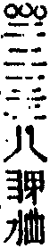

# 万峰童真禅师语录



> **藏经**：嘉兴大藏经（新文丰版）（嘉兴藏）　**册次** 第 39 册（J39）　**编号** JB441　**部类** 诸宗部　**卷次** 6 卷　**篇幅** 67,030 字

> **卷／品**：0 卷 · 3 品



---



## 目录



  - [童真和尚语录序](#童真和尚语录序)

  - [序](#序)

  - [湘山颂古自序](#湘山颂古自序)



---



### 童真和尚语录序



迦文之道，自菩提达磨来我东华，至临济为大振，径山为再振。山十四传及明启祯间，而有聚云吹万老人，宗风丕显，声藉一时。吾蜀自宋元以来，未有能或之先也。老人高弟有三，首曰庆忠铁壁禅师，如圣门之颜子。予童时即闻其名，锦江玉垒，上至王侯卿士，下及黎庶编氓，无不钦承折服。师出世三十餘载，均嗣法者，自朝宰士夫而外，亲承入室仅十八人，童真和尚居第十焉。师乃吾郡相国江公之后，太守年伯海筹公之少子也，与予称世好。师自髫时，颖异绝人，能目过成诵。予尝下之先年伯，靡不以隆显是望，而师淡如也。三十年来，鴈杳鱼沉。辛酉之春，客有来京师者，以师语录见示，予且骇之，始知师荷担释门，为一代知识，承径山之后矣。尝忆予与师窗下时，每谈世外空宗之学，则津津然，而於政事文章，则藐焉颐伫。退而与家君言之，安知今日之举，岂非畴昔之意也哉？信之出世丈夫，果富贵功名之所难单，威武贫贱之莫屈移，先儒之言，诚不诬矣。间读传灯，见崔钦因缘，谓出家乃大丈夫事，虽将相有所不能，予以为妄。今觐禅师，以高门华胄，如是体才，蚤能摆脱红尘，秕糠富贵，上跻祖域，成一代之宗师，岂非大丈夫也哉？予也桎梏一官，碌碌尘劳，日月逝兮，去师远矣。何时解此束缚，与师相聚於古松流泉间，一洗尘缨，是所愿也。至语录一道，予且未梦，安敢负水河滨，置粪佛头？聊述师之始末，为同人辈一臻劝善云尔。



赐进士出身前翰林院太常寺少卿今奉　旨巡抚江西户部左侍郎郡人刘如汉撰



万峰和尚语录题辞



大慧老人说法，如云如雨，语录三十卷，具存龙藏，参学家尊为天球河图。一披其书，宛若面命耳提，传灯所载，能有几人？窃怪其嗣裔寂寥，净慈以下，不见灯录，意必有默契潜证，克家嫡传者，隐於山陬海澨，如西山、大梅其人，而吾又未之见也。今年公车罢后，自孝昌抵汉阴，买舟东归，借宿九莲僧舍。或谓予曰：「此间有一禅师，嗣法大慧，子知之乎？」予愕然曰：「天下宁有是哉？大慧去今五百年矣，安所授受，得毋谬欤？或者英彦挺生，从大慧录中打失眉毛，饮水溯源，不忘所自，因而遥承，如古塔主之嗣云门者，殆未可知也。」次日，走晴川，诣卧云，问所谓童真和尚者，阒然不在，止晤一云水上人，坐而询焉。答曰：「非谬也，亦非遥承也。盖大慧之嫡嗣，隐於梁岷之间，累代不绝，元元本本，灼有定据，此则其后裔耳。」予益加迷闷，愕然曰：「天下宁有是哉？大慧去今五百岁矣，绳武继徽，灯录缺如，即有授受，安所凭藉欤？」终夕踌蹰，不遑安寝。诘朝，再走晴川，诣卧云，披帘启户，而童真和尚俨然迎焉。观其状貌，庄而且和；聆其言辞，条而有章。考其付受之次第，自西禅需传鼓山永、永传净慈明、明传苦日益、益传筏渡慈、慈传一言显、显传小庵密、密传二仰钦、钦传无念有、有传荆山宝、宝传铁牛远、远传月明池、池传吹万真、真传铁壁机，迄十五代，确而有证。阅其祖先之录，畅而有文，广而不杂，宏而不肆。既乃读其开法之语与赠答之偈，豁然而旷达，秀外而惠中，波澜大，见识宽，所谓善说法要，称法性说。其毋乃大慧再来乎？不然，何以酷肖若祖也？嗟乎！今天下绍临济者，虎丘一枝，独步震旦而已。即断桥而下，犹且若存若灭，浑无稽考，矧慧祖之后，久而鲜徵，其能免於悠悠之疑论乎？然则童真和尚当绝续之关，履方新之会，振千载已坠之绪，乘一丝九鼎之势，危同投子、微等风穴，挽颓纲而振新猷，剪稠林以扶落晖，予安能不重望之和尚哉？其函出之，以告丛林，毋令径山窌塔久淹丰艸也。



康熙丁未孟夏，吉州学人屏山李道济龙孙和南题。



目次



------



### 序



示众  

法语  

真赞  

偈颂  

机缘  

杂著  

宗统颂  

华严圆顿颂  

湘山颂古



住湖广德安府孝感县简堂禅院语



康熙七年夏六月，师在鄂州大别山卧云庵受请，八月初九日进院。



三门。「一椎便就，已落二三，把断要津，不通凡圣。既不通凡圣，作麼生入？山僧有个方便，汝等一齐随我进来。」



佛殿。「坐断报化的人，且向左边著；扫荡建立之士，且向右边著。新长龙到来，不图色色丕显，且要齐整门风。」旋顾左右云：「我观法王法，法王法如是。」



护法殿。师良久，云：「此是吉祥处，此是解脱处，是止处、集处，汝等一齐来到。如一不到，笤帚柄郸与三十。」



祖师殿。「日月星辰趁向西，山川艸木趁向东，你者一队无孔铁锤置之何处？」高声云：「且待冷来看。」



僧堂。「烹佛烹祖大炉鞲，锻凡锻圣恶钳锤。要汝诸人立地搆去、两肩荷去。若作佛法商量，说甚镇州出曹门。」



方丈。「八万四千金毛一时擒下，九十六种异类扫向一边。新长龙到来，不贵屈辱家风，且图天下衲僧永脱窝臼，个个[髟/吒]髿地。」喝一喝。



上堂。至座前，拈请疏，召大众，云：「澴川诸大护法从不思议尘劫以来所积光明种子，自古及今更无一人正眼觑著，今日於没所见处偷窥一看，只得无地藏身，文彩弥露。诸上座还见麼？若见，不劳山僧特地举扬，乘便下坡，正在此时；如或未然，不妨通一线道。」喝一喝，遂升。拈香云：「这瓣香，光凝四域，润泽两间，赞高厚之勋猷，续羲黄之鼎算，热向罏中，端为祝延今上皇帝圣躬万岁，伏愿金轮倍御，宝马时临。」又拈云：「这瓣香，卷舒自在，纵夺临时，奉为蒲朝文武、本省护法、在隐在显诸大金汤、现前四众等，惟愿夔龙再▆，歌南风於舜田；伊吕重逢，颂棠树於周道。」末上拈云：「前月卧云已曾熏著，事无重科，捡点将来，未为分外，敬为　现住西川重庆府巴子城东治平堂上传曹溪正脉三十一世庆忠老和尚，以酬法乳。」眉山和尚白椎，师拈拄杖畫一畫，云：「不得过限。众中有作家战将麼？」僧问：「简堂重兴，法令初行，把住关头，如何进步？」师便喝，进云：「且莫漏泄。」师又喝，僧归位，师复喝。又僧问：「一曲阳春若共相和，只如泗洲大圣、扬州出现意旨如何？」师云：「萼前柳后，溪西溪东。」进云：「为复神通妙用？为复法尔如然？」师云：「山僧从无这个消息。」进云：「明月堂前无影木，卧云深处露全枝。」师云：「你看亦无分。」进云：「高提祖印、法幢始建且置，心一上座迎登宝位一句又作麼生施设？」师云：「山僧正荅汝。」进云：「人天有顿去也。」师云：「这一箭射不著。」乃云：「善言言不及处，切忌商量；善迹迹不到处，罔通消息。露迥迥，山明水秀；风浩浩，日往月来。只得忘声於色、忘形於物，衲僧门下正好买艸鞋行脚。不见道：善言言者，言所不能言；善迹迹者，迹所不能迹。既无言，又无迹，长龙拄杖子无端恶发，直过恒沙世界之外，惊动妙喜佛土，三千世界刹海震动，不动如来出大音声普告四众：『过此无数阿僧祗世界，有国名娑婆、刹名长龙，新长老出世惯打葛藤。』」蓦收杖，云：「今日刚才入山入事朱尽无端，脱空妄语成甚麼事？不见道：真龙行处，云雨自随。」喝一喝，下座。



进退两序，上堂。拈拄杖，云：「辨龙蛇眼，擒虎兕机，固是衲僧日用寻常事。新长龙号令初行，条章约法不同小小，所有僧堂里风穴、厨堂里雪峰、客堂里重显、磨房里法演、净房里佛日、侍寮里洪准，一齐归向拄杖头上，任渠宽行大步，随缘自在。且道奇特在甚麼处？」靠拄杖，云：「有意气时添意气，不风流处也风流。」



开罏，上堂。僧问：「罏鞲未开，寒光寂寂；钳锤既动，烈焰腾腾。淆讹在甚麼处？」师曰：「还闻流水声麼？」进云：「不设二途的，到来作麼生锻炼？」师曰：「半是秋兮半是风。」曰：「若然，剿把断要津，针劄不入去也。」师便打，僧喝，师又打。副寺问：「三十年家风安置何处？」师曰：「茶盐钱该多少？」曰：「作麼生用？」师曰：「你分上事也不知。」曰：「太平本是将军定𫆏？」师曰：「还要第二杓麼？」乃曰：「譬如鴈过长空，影沉寒水，天衣老人大似钉桩摇橹，看来看来，果是果是。何以故？一二三四五，倒指河沙数，雪窦闻之，直退三千里，缓缓道个拈却一、去却七，上下四维无等匹。」



当晚小参。喝一喝，云：「便恁麼去，伫见冰消瓦解，大众各自归堂。」又喝一喝，云：「全生全杀，双放双收，入林不动艸，入水不动波。」复喝一喝，云：「密能如是，当下插标，绍立宗绪，合水和泥，便向一茎艸上现琼楼玉殿，更无玉殿琼楼之量。」召众，云：「昔临济老人於河北建立黄檗宗旨，据他本文约有四喝，山僧是他直下远孙，於兹建立临济宗旨，只用三喝。汝等诸人若於三喝之下搆取得去，便知从上本文元无少剩；如或未尔，不免泥水葛藤，重理旧案。所以道：有时先照后用，有时先用后照。」喝一喝，云：「当时会中若下得这一喝，免被后人捡点。」又举四喝、四宾主、三句料拣等，师又喝一喝，云：「当时会中若下得这一喝，亦免被后人捡点。」复喝一喝，云：「自唐至今，有无数善知识出兴於世，拈提者不少，其实发扬先圣本文者能有几人？今夜与诸人同在山中激扬斯事，不合傍若无人，敲骨打髓，平空锹窟，平地挖坑，引惹将来，重重捡旧。幸山僧有个出身之术。且如何是出身之术？听取一颂：声前一句无消息，便见龙门万仞高，昨夜波斯穿市过，蚊虻睫内鼓波涛。」连喝三喝，下座。



杨侍御生日，请升座。竖拂子，云：「此是不生句、是不灭句，是无上句、是无等句，如天普盖、如地普擎。所以，大复居士於此乘智慧乘，而以翰墨作诸佛事，如游园观，左逢右遇，在在成就，霆翻云汉，瀑泻千江。此个时节，便与三世佛祖同一眼见、同一耳闻、同一鼻嗅、同一舌尝、同一身触、同一意思，纯一清净，无二无别。长龙今日转此无二之法，奉为侍御公七十之辰，惟愿色身清净，寿逾太▆，十方三世诸正遍知而作证盟，一切灵祗同垂加护。」喝一喝。



治平老人讣至，上堂。「正法摧，正眼灭，百亿山河空索索。见麼？庆忠老人道播寰宇四十餘年，偶於前九月念一日灭度，目睛齿骨不坏，金刚锁骨数茎、五色舍利无数，巴蜀大震。昨竺峰和尚音至，始获哀闻。者老子一生惯用不平，欺他汉地，窃幸如今和根剿绝，不肖儿也只得从傍助喜。且道如何助喜？泪随流水急，愁逐野云飞。」



挂真，拈香。「这尊慈无向背，以生死为解脱之场，以去来为游戏之地，平生雾骤云驰、电锋雷句未足观光，独是末后一著非干论戏，缓缓道得个似打瞌睡。哀，哀。」



佛成道日，升座。「纵横截毘卢之印，断送浑家；剔脱开少室之门，风情越量。若也於斯提去，何劳扣户椎门？更若带齿沾牙，未免重楼次第。先佛仪式，权且听著。」



至晴川，礼先老和尚舍利，拈香。师以手指舍利，云：「者一颗从来动他不著，为甚落在晴川江上，一众悉见悉闻？」旋顾左右，云：「五九尽处又逢春。」



迎舍利还山，润上座请升座。拈拄杖东觑西觑，曰：「长龙不济，到处觅先师灵骨。」乃举舍利云：「者个若是，辜负先师；者个不是，辜负长龙。是与不是，一笔勾下。汝诸人还见师翁麼？」复云：「今扆比丘如法为先老和尚修设清供，山僧特为举扬。须知此供不从天得、不从地得、不从人得，毕竟从甚处得？」良久，曰：「释迦既然皆拱手，何愁弥勒不攒眉？」



解制，上堂。「破落门户，件件缺短，盖古之尝。兄弟东去西去，总为云堂少剩，不消老汾一陌纸、两块肉，断送精魂，庆快平生。还知麼？旧阁闲田消息在，苍池夜静月华来。」



戊申夏四月，东明、高峰二大师持　庆忠老人信衣至，上堂。东明和尚度衣，师拈示召大众云：「此是庆忠老人末后全提消息，遥自锦江发来，到者里争敢辜负？」遂披搭云：「也要大众相委。」喝一喝，遂升座，拈香云：「者瓣香，全生即杀、全杀即生，昔年太平山中、宝胜院里深遭毒辣，至今气骨犹寒，只得尽情抛出，敬为现住西川治平堂上庆忠老和尚，以酬法乳。」高峰和尚白椎问话毕，师拈拄杖卓一卓，云：「向上一路，迥绝罗笼。」喝一喝，云：「末后一著，全无消息。既绝罗笼，又无消息，直下如吹毛利剑，谁敢当头？拟犯其锋，伏尸万里。到者里，还许你向高高峰顶立、深深海底行得麼？还许行棒行喝、拈椎竖拂得麼？还许丝来线去、带水拖泥得麼？硬纠纠、活卓卓、孤迥迥、峭巍巍，所以道：恁麼也不得、不恁麼也不得、恁麼不恁麼总不得，便恁麼去，尚隔千重，直须高悬钵袋、放下铁枷，著著有出身之路，始见衲僧行履。且道：如何是衲僧行履？从前汗马无人识，只要重论盖代功。」喝一喝，卓一卓。



住德安府孝感县高峰禅院语



康熙十七年戊午闰三月十二日，孝、应两邑绅士请师住高峰禅寺。



三门。「十方无壁落，四面亦无门。伶俐汉！欲知高峰室里事，须向此间进步。」



大殿基。师以手指基座云：「这一尊巍巍堂堂底古佛向甚处去也？诸人还知麼？且向驴粪堆头识些气息始得。」



后佛殿。「前面是无相底，遮天盖地；后面是有相底，烜赫今时。山僧今日到来，一笔勾下，且向冷处著把火。」遂大展具三拜。



上堂。僧问：「选佛场开，心空及第，如何是向上事？」师曰：「脱壳乌龟飞上天。」进云：「和尚莫瞒人好。」师曰：「汝且礼拜著。」僧便拜，师曰：「莫道无事好。」又僧问：「四众云臻，放光动地，如何是高峰境？」师曰：「春日晴。」曰：「莫是目前事麼？」师曰：「黄莺鸣。」曰：「如何是境中人？」师曰：「更听落崖流水声。」僧归众。师乃曰：「春日晴，黄莺鸣，更听落崖流水声。汝诸人直下搆取得去，山僧未离晴川时已与相见了也，武昌府亦与相见了也。及至到来，击动法鼓，特地周遮，又见个甚麼？所以道：欲识佛性义，当观时节因缘。即今是甚麼时节？」蓦竖拂云：「见麼？」击法座云：「闻麼？闻见分明是个甚麼？若论此事，在天同天、在地同地、在圣同圣、在凡同凡，既一切皆同，为甚有凡有圣、有地有天？只为不了目前，所以大道寥寥，知音者少。还知新高峰落处麼？老僧笑指猿啼处，更有心踪在上方。」



师四十岁，两邑善士请升座。拈杖曰：「本自无事，从我何求？老夫耄矣，何不有事令无事、无事令有事？是谓净佛国土、成就众生，锦上舖萼三五重，是以山僧四十年来只要寻个不受人瞒底便了。由此自西而南、自南而北，从两浙过吴门、历晴川、渡澴水，而今踏到高峰顶上，无端被孝、应两邑众居士强推上曲录床头，又非迦维降日、岚园示期，要向那边开口。」复拈杖曰：「只有这个知端的，从教暗里自抽枝。」



庆忠老和尚小祥，拈香。举：「南泉为马祖设斋，乃谓众曰：『马大师还来否？』明洞山作沙弥，出众曰：『待有伴即来。』泉曰：『此子甚堪雕琢。』山曰：『和尚莫压良为贱。』去年此日，治平堂上老和尚涅槃；今年此日，不肖至善於此千华院中不庄伸敬。且道众中还有洞山奴麼？出来为汝证据。如无，不免自杜撰去也。祖堂既有空界月，何必重挑不夜灯？」



师到蓝田，曾谢杨王领阖镇居士等请於护法院升座。僧问：「钟鼓交参，四众云集，琉璃殿上，谁是知音？」师云：「重叠关山路。」进云：「只如国祚王化，野老讴歌，法王正令，涂毒当轩，与麼时相去几许？」师云：「一箭中红心，大地无寸土。」进云：「即今众居士迎登宝座，利生一句又作麼生？」师云：「老僧今日失利。」又僧问：「四众云臻，请师升座，如何是第一句？」师云：「你年高多少？」进云：「亘古亘今。」师震威一喝，进云：「还有麼？」师云：「你不会，退去。」乃云：「向上一路，千圣不传。」喝一喝，云：「白云万里。向上一路，千圣不然。」又喝一喝，云：「白云万里。昨日有人从天台来，却往南岳去。」复喝一喝，云：「白云万里。老僧不是近代师僧，攒华簇锦，四六尖新，东册子上抄来，西册子誊去，磨棱合缝，斗凑得恰好，以当宗乘，玷辱祖家不少。咦！若不是陷了华山八十一州，揭开顶门正眼的，敢在人天众前开张大口，你辈茄子瓠子须识些痛痒始得。」喝一喝，下座。



象山华严庵说戒，升座。竖如意云：「老僧到此正觅起处不得，从上诸圣百计提撕，亦何尝动著些子？所以象山门下田地稳密，石头土块也解放光，须是明取始得。若也依稀彷佛，何啻云泥寥远？不免向第七、第八中按本宣科，俾汝诸人渐次增进，回向圣伦，自纳一场败阙。那里是败阙处？先佛仪式权且敷宣。」



上堂。举：「长沙示众云：『尽十方世界是沙门一只眼，尽十方世界在沙门眼里。』又道：『尽十方世界是摩诃般若光。光未发时，汝等诸人向甚麼著倒？』」师云：「大小长沙五脏六腑一齐披露，老僧看来正是短贩经纪。汝诸人还知节络处也无？听取一颂：两株桃杏映篱斜，装点商州副使家，何事春风容不得？和烟吹折▆枝萼。」



说戒，上堂。僧问：「法鼓初鸣，万灵稽首；释迦成道，今古亦然。和尚升堂获何功德？」师云：「驴捡湿处卧。」「如何是戒？」师云：「驴捡湿处卧，斯言更不差。」「如何是定？」「萼雨满庭空。」「如何是慧？」师震威一喝。进云：「虎逢山势展威猛去也。」师曰：「且信一半。」乃曰：「四来咸集，法鼓冬冬，▆惜勤劬，只得以紫磨金臂擎钵至梵宫，取彼香饭渐展入地，至金刚轮际取被甘露，得心自在者乃可同食。虽则如是，只如东毘提诃行益、西瞿耶尼纳履、非非想天今年是甚麼历日？」乃曰：「萼簇簇，锦簇簇。」复举：「先师住平都上堂，惯弄灵蛇之势，赫赫万层；活捉生马之威，昂昂千里。撒缦天网，打称意鱼，放破空矢，落翀霄鹤，点即不到，到即不点。」师云：「扶竖济北门风，重开双径法眼，须是与麼始得，然有一处毕竟捡点不到。那里是不到处？待汝诸人亲见千华台上赫赫威光的自然分晓。」复说一偈：「我观智慧藏，光明无不烛，诸波罗密门，一切自具足。」



丁卯六月十八日，师诞期，蓝田起名众居士请升座。问话毕，乃曰：「我於过去劫中，以平等印印一切法，无有少剩。值兹贤劫第四尊释迦文佛像法之中，丁卯六月，於兹蓝市丛边安邑界内，未敢以阎浮檀网相光手发此宝函，俾汝现前诸人各各证入平等本际，获玅觉心。虽则如是，仔细捡点将来，老僧今日失利不少。那里是失利处？」喝一喝，下座。



小参。「参学之人，大须仔细。非以一事一理、一法一行，而能决了成办。乃於一切事、一切理，一切法、一切行，细密确明，打屏净尽。还有大法宗旨，不同小小。夫参学者，须从捷径省力处，劳心苦志。先圣砺齿磨牙，教人於活句下搜求，良有以也。敢问诸人，何名活句？」乃拈拄杖云：「汝等诸人，一齐向这里断送始得。所以屏山居士折里一举，虽为青原雪焰二公发扬，实为末世参学之本。观渠发药，如老吏断狱，是非立定。看他从始至终，不死在言下。若大法不明，宗纲未透者，亦难委悉。录中所举，如南泉牧牛，风穴上堂，与圜悟无尽，洞山、临济、雪窦、云门诸语，剔抉殆尽。至风穴一则，犹为关键。老汉昔在晴川，与渠邂逅时，虽未尽发蕴底，已知渠非常流可测也。今年润能二禅，自西江回，携折衷一册。老汉阅罢，时润在侧，乃顾谓曰：『屏山先得我心，先我而言。迩来据位称师者，十个五双，难脱此圈缋。』老汉见渠提风穴一案，良快人意，忍俊不禁。亦欲从傍要与古人相见。」遂举：「风穴上堂：『若立一尘』」师曰：「杀人须是杀人刀。『家国兴盛』」师曰：「行住坐卧，甚处去也。『不立一尘』」师曰：「活人自有活人剑。『家国丧亡』」师曰：「从来动他不著。雪窦拈杖」，师曰：「头上霹雳，足下电光。还有同生同死底衲僧麼？」师曰：「杓柄却在长龙手里。所以风穴和尚系临济老人四世孙、南院之子，师承禀受，最有家法。如南院上堂云：『赤肉团上，壁立千仞。』」师曰：「有多少奇特？僧便问：『赤肉团上，壁立千仞，岂不是和尚道？』」师曰：「逐块韩卢，有甚交涉？院曰：『是。』怜儿不觉丑。僧便掀倒禅床。」师曰：「且喜救得一半。院曰：『这瞎汉乱做。』」师曰：「收得燕南，又忧塞北。僧拟议。」师曰：「莫是壁立千仞麼？院便打趁出。」师曰：「面目犹在。又风穴於汝州上堂云：『祖师心印，状似铁牛之机。』」师曰：「不消一捏。『去即印住。』」师曰：「一封书未返。『住即印破。』」师曰：「千树叶皆飞。『只如不去不住』」师曰：「湘之南、潭之北。『印即是？不印即是？』」师曰：「把断要津。」又云：「水泄不通。『还有道得的底麼？』」师曰：「特抛香饵。『时有卢陂长老出云』」师曰：「果然一钓便上。『某甲有铁牛之机。』」师曰：「太轻日生。『请师不搭印。』」师曰：「我也为你著忙。穴云：『惯钓鲸鲵澄巨浸，却怜蛙步展泥沙。』」师曰：「何患知之者寡？大众！你看他风穴父子窃得祖翁些子气息，各自撑门启户，要你学者向他剑刃上行、冰轮上走。你若偷心不死、大法不明，欲入这般门庭，何啻十万八千？」良久，蓦拈杖云：「心眼活句一时闲了也，汝等诸人直下荐取。」靠拄杖，下座。



江南善士纪怀元为荐先考彦楼老居士小祥，请小参。以拂子向空畫一畫，云：「还委悉麼？若也直下知归，便请各自回堂；如或未委，不免从头注破。」良久，云：「有大陀罗尼名为圆觉，流出一切清净真如、菩提、涅槃及波罗密。所以，诸佛於此处兜率天放大悲光，摄受群品；及至初生，手指上下震动一切世界网，以至坐吉祥、降魔军、入涅槃。诸大菩萨於此以金刚心莲如幻智，能以眼处作耳处佛事、鼻处作舌处佛事、意处作身处佛事，无有增减；声闻於此具八解、六通，游戏自在，玩水娱山；辟支於此出无佛世，以无生忍耽取涅槃；历代祖师於此竖拂、拈椎，横说、直说，随处安隐；诸天於此离生喜、舍念尽，知乐厌寂；修罗於此破三有城，断除骄慢；地狱於此觉悟无生，得究竟空，不起罪性；现前四众等於此发菩提心，将来毕竟证入圆明。且道彦楼居士分中还具些子也无？野色更无山隔断，天光直与水相通。」



张雪嵒居士请为先文林公对灵小参。师竖拂云：「只这是相随来也，释迦、弥勒一齐退位，百千诸佛同▆降旗，山僧何处有第一句、第二句与诸人商量？只▆一起现成公案，不免举似。只这文林公赞尧老居士，本贯西蜀渝州人，以乡贡进士於吴，於晋作从官，▆简刑清，视民如赤，不下羊叔之岘首，处事极有家法，片言折狱，晋人至今称之。居恒喜读佛书，又当作▆淡惺世语以警悟流俗，缁辈进门无不受其泽者，惟同里僧未预其数。后来捐馆时，眷属▆▆并不提及世谛事，惟高声朗诵『愿生西方净土中』数十声而卒，岂非前报世中事，恒沙佛果因成就，故尔首击尾应者乎？然则山僧今日於此黄藤山中灵室之前又何以进之居士？」遂拈香云：「戒、定、慧、解脱、解脱知见，香严云网遍罩十方，有情、无情遇斯香者，决定作佛。汝诸人闻见麼？闻见分明，未是好手。昨日有人从湖上来，不得秀州信，雨过石苔青，山行屐齿印，百事不干怀，自然心无病。」又以拂子击案一下。



江宁林德甫居士为亡友马应龙建法华会，请小参。「山僧未离晴川时已为华劈了也，还知麼？若知，黄面瞿昙一时义堕，说甚弥勒起疑、文殊为说？智如鹙子底且居门外，不退诸菩萨插手难入。此事如大火聚，近之则燎却面门，铁山岌岌、玉海沉沉，如斯举唱，率土望崖，垢面灰头罔称作者，放一线道却有商量。」▆拈杖，云：「一切障碍即竟究觉，得念、失念无非解脱，成法、破法都名涅槃，智慧、愚痴通为般若。啐！为甚抄他古圣、文字他家？闲曰旷地界至自明，朽大碗小不消提得，何须驴呼菩萨、马汉罗汉，然后著如来衣、入如来室，坐如来座，对现色身，色身三昧是甚麼闲？今日德甫居士耑为亡友启建法华胜会，礼请山僧特为表扬，敢烦缁白大众朗诵一句伽陀，用资冥福。」良久，众无出，乃抚掌高歌曰：「秋风飒飒堕阑干，冷月斜飞映水寒，弹指便超生死地，不劳筋力向南参。」又弹拄杖一下，下座。



云石禅人请为亡师佛智禅宿百期小参。拈拂子向空划一划，云：「有法门名无尽灯，三世诸佛、历代祖师，若圣若凡，情与无情，尽在这光影子里。既向这里现前，诸人睁眼看著、侧耳听著、举步踏著，何须山僧从新起炉作灶、打艸惊蛇然后得哉？则佛智禅宿未离蜀时，此段光明也不曾减，发足南来又何曾增？既无增减，总是一个清净平等法门。山僧今日转此清净平等之法，敬为佛智公百期之辰耶作现前佛事。敢问诸人：如何是现前佛事？」良久，曰：「河桥新涨藤萼雨，山路无人空鸟啼。」



雪岩居士请为先周太孺人对灵小参(孺人法名行圆)。师高声唤云：「行圆道人！旷大劫来事瞒道人一点不得、道人日用事瞒山僧一点不得。既瞒不得，为甚有凡、有圣？有生、有死？有苦、有乐？有智、有愚？病在於何？所以道：真如净境界，一泯未尝存；能随染净缘，遂成十法界。」蓦竖拂，云：「这个是能净的真如，那个是所生的法界？」又举拂，云：「这个是所生的法界，那个是能净的真如？若唤作真如，却是法界；唤作法界，却又是真如。」掷下拂，云：「毕竟唤作甚麼？到这里，苦乐、智愚、凡圣、生死一点也著不得。既著不得，行圆道人安置何处？殊不知他是从故乡田地上翻出来底，故尔四十年中精进坚卓，直要寻到界至分明处便了。寻来寻去，寻到结角罗纹处，可谓因该果海、果彻因源，只得和盘托出，将谓无人。不料山僧以同里之故，悄地一看，顿见冰销瓦解。」又高声唤云：「道人！道人！还知界至分明底道理也无？」喝一喝。



晴川洛伽院主领江右刘伯玉居士请为立尘禅人净发小参。拈拂子击案，云：「一法未起，山堆狱积；一尘才收，壑塞沟填。不是目前机，亦非向上事，若是得的人，自然知些冷暖。敢问在筵大众：且道立尘禅人还知有也无？苟或未知，且将无始生死根苗一齐去却，再听山僧大众喝采，为渠唱个新丰曲子。」良久，高声曰：「洲晚江寒霜露浓，主人无事过前峰，万家衰柳空堤外，赢得朝朝暮暮钟。」



丙午，住龙会庵，示众。「露一缕於千圣顶𩕳之上，尘尘尔、刹刹尔；掷一尘於万亿刹海之中，恢恢焉、恍恍焉。远发千钧弩，倒弄金刚王，也须退后三步，衲僧门下事非小小。」随拈竹篦，云：「这个不属尘、不属缕，猛火烧虚空，法身藏北斗。便与麼去，犹落今时窠臼，未免丧我儿孙，须是从前所得无量解脱一时荡尽，洒洒地作个无依无倚道人，火不曾烧著口、风不曾吹倒树，无边无中、无前无后，泥蛇飞入畫屏间，野狐变作师子吼。」卓一卓。



示众。「高亭直趋而去，辜负德山；赵州洗钵盂了，瞒他作者。直须揭却顶盖，剿绝根株，一一玅明、一一天真，风清皇路、月映江楼，犹是无风匝匝之波，务要掀天作用、整葺颓纲，挽他滹沱未坠之绪。今日不免为诸人约法三章：第一、不得权实并用；第二、不得宾主双看；第三、不得照用齐举。须向他古德未屙已前蓦行一步，庶得祖风不坠，千古生光。还有具如是操略也无？有则出来为古人，雪屈时闻扳声鸣。」师起身归方丈。



示众。「龙以角听，蚁以身听，普贤大士以心听。」拈拄杖曰：「此以谁为听？昨夜北风起，寥闻打窗声。」



示众。「以的破的，以空破空，衲僧门下，切忌罗笼。」喝一喝，云：「祝融峰顶上，露滴万年松。」



示众。「踞虎头，收虎尾，第一句下明宗旨。如何是第一句？」有道：「未开口前错。」有道：「请和尚归方丈。」有道：「用第一句作麼？」有道：「此是第二句。」拈拄杖一齐打散，复召众云：「且来，且来。」众方回首，师曰：「来日大悲院里有斋。」



因雪，示众：「者段事下来许久，一片落在你头上、一片落在你肩上犹且不会，只得不见一色始是半提，更须知有全提时节。韶阳老人归家稳坐，日出后大有事在，汝诸人切忌向净洁处躲根，近来巴豆不值一文。」



示众。「截琼枝节节是玉，柝旃檀片片皆香。且道阿耨达池龙王年多少？肉重几许？」良久，曰：「五更侵早起，已有夜行人。」



示众。「真正过量人，闻佛法二字，如生冤家，始有说▆分。不见道：参须实参，悟须实悟。的的是个真▆▆▆人，脚踏实地，自然要做到彻头彻尾处，方才了手。不是倚艸附木，依稀相似，抟量卜度来的，是从艸莽里、闹市中握一柄金刚王剑，逢佛杀佛、逢祖杀祖、遇凡杀凡、遇圣杀圣，那管明暗色空、圣解凡情，直到大休大歇田地，是他本领。所以洛浦和尚道：『欲知上流大士，不将佛祖言句贴在额头上，如灵龟负图，自取丧身之兆，直下透出，凤萦金网，趋霄汉以何穷？所谓石人机似汝，也解唱巴歌；汝若似石人，雪曲也应和。』▆柰大法久淹，名存实亡，又何须说实践真操、蕴研积稔？一番体才学者，稍有个萤火之光，已被冬瓜印子印了，不但得少为足，一心只安排出世张本，一盲众盲，便是此辈瞎却人眼。山僧▆康熙初行脚时，丛林方盛，尚有一二老成已见露出如许败阙。今二十年来，禅林下衰，日甚一日，犹有不堪闻见者。悲哉！悲哉！汝等既来亲近山僧，虽将诸方这些恶习洗得乾乾净净，全身放下，拚一生不想出世，受得山僧钳锤、入得山僧阃奥，十年五年若不彻头彻尾、盖天盖地，山僧为汝入地狱。」



普请，摘二茶，示众。「举一不得举二，乾峰老人一场特地。云门奴见婢殷勤出来，南山起云，北山下雨，蒙懂的只是蒙懂，惺惺的只是惺惺。仔细捡点将来，各与二十棒，一棒也较不得。汝诸人还知落处麼？[○@│]。」



法语



示双林居士



一椎打透底人，犹落云门病处。直须寒灰发焰，枯木萼开，转折周旋，件件不在别里。所谓大休大歇，安乐法门也。此事如闹市街头交易浓处戥秤一般，丝毫也瞒他不得。虽瞒不得，却无可指示处。虽无指示处，铢两自明，一度拈来一度新。南岳谓马祖曰：「汝学心地法门，如下种子。我说法要，譬彼天泽。汝缘合故，当见其道。」盖心地法门，非口传心授而可得者。得一步，便得一步受用，何妨在热闹处。闹处得力，便是静处省力也。古人淳诚，且三二十年，方得成办。非若世人读文诵字，一目便了。临济云：「离相离名人不禀，吹毛用了急须磨。」事务冗遏时，不须排遣。拈起一物云：「是什麼？」复拈一物云：「毕竟是什麼？」不可坐在净洁处，便作受用，连者一段，亦须打脱。打脱了，再看僧问云门：「弑父弑母，佛前忏悔。弑佛弑祖，向什麼处忏悔？」门云：「露。」山僧恁麼告报，全身坐在荒艸里也。问话了，荅话了，拈却棒，去却喝，无二无二分，无别无断故。夜来风起，吹上壁角，须看此外大用。如何是此外大用？



送卓云上座参方



未得知有，直须知有；既得知有，坐断知有。法中细大，磊落丘山，种种殊胜，一时荡净，始具得半只超方眼，便尔拈一茎艸，走杀衲僧，解开布袋，正令全提。方於百众人中，剑下锋头，横身自在，逢场把戏，如入无人之境。吾宗定上座、廓侍者，其殆庶几焉。是以济上门庭，所贵临机转握，主宾互换，在觌面提持间。昔人谓如马前扑，良有以也。近代多以格则程限定论先宗，而每遭舆议，心窃鄙之。昔余在众时，聆之启、祯间太保良玉秦公将兵伐渝，起师时，诸将议曰：「请将军策。」公曰：「兹时耳目交加，临阵有酌。」为将者尚贵临阵，况纲宗中事，庸讵等闲？益州卓云戒公始参德山，次觐大老，复以桑梓之怀谒余鄂渚。　康熙丙午，余开法汉上，公亦与焉。每来室中咨决真要，余知其入手处，实则俊辩逸格，乃若大法深杳，济上阃奥虽未尽豹，而大样可观，仅非学地得少为足者比。迩来多有未赏一橛者，欲冀师家印授，而亦有欲速成者，不分缁素，递相虚统，皆所目击者。室中与公尝叹古宗师如老汾之作、▆县之峻，有今刻意而弗能也。余与公虽未近古，亦非今之体段，至於遍历诸方，先圣所范。昔无德参见七十餘员，犹以未见聪公为憾，盖不可不行。虽然，毋蹈开圣后辙，取登座之慨，惟公念焉。浙西有大觉吼老，孤陋寡闻，爪牙剑刃不下神鼎，德峤倘若扣渠，定有以诲也。因书二偈以赠。径庭舒广海云吞，六合攒将共一门，逢著贼身休荐取，潜锋且看别乾坤。纲宗透脱绝罗笼，拶著浑身八面风，送子南征无可赠，祖庭端在凌霄峰。



示陈玉甫居士



真实悟心之士，自然如珠走盘，活活鱍鱍，不是倚艸附木，见人东说东、西说西，影响音闻，是从无量劫来一齐翻出的。故尔随处作主，遇缘即宗，左逢右遇，能大能小，皆以海印三昧一印印定现量一著子。先圣得此印，所以不起灭定现诸威仪，不舍道法示凡夫相，拈香拨火、运水搬柴，何曾障著些子？风行空而舟御水，脱脱洒洒，岂不快哉？到这里，正永嘉所谓：「亦无人，亦无佛，大千沙界海中沤，一切圣贤如电拂，非是强为法如是。」故莫看前辈如是说话，坐在无事界中，一切落空又不是也。须知当人亲证之时，直下求空了不可得，故曰：「般若如大火聚，近之则燎却面门；如喻太末虫，处处能泊而不能泊於火焰之上。」旨哉言乎！近代佛法可伤，为师者既道眼不明，学者又为声色所扇，且不问拨艸瞻风毕竟为著何事，徒快一时，从此一盲众盲沿之不息，转相授受而正宗微矣。玉甫居士遍参诸方二十餘年，　康熙丙辰见汶叟於晴川，从前所学尽形披露，汶叟亦不肯以近代息气相待，一味以本分期之，虽向上眼未开而脚跟已正，因缘到来自是不差。我又观之，居士如已成之龙，只次点眼，药信若发，何怕你不掣天飞去？则山僧所说都是剩语也。



示彭君甫居士六十法语



○此是一切诸佛毘卢遮那如来藏身三昧，能於法界示众影相。法界海旋，靡不随入。出生一切三世诸佛智光明海。法界所有诸安立海，悉於中现。如是则酒楼上，市肆中，无二无二分，无别无断故。释迦不先，弥勒何后。一代时教，是甚麼热。大千七百则葛藤，且喜没交涉。尘尘尔，刹刹尔。象王行处，自绝狐踪；狮子返踯，无容顾伫。有如是威神，有如是自在。只许老胡知，不许老胡会。放下镢锄，揭开脑盖。我此法印，为欲利乐一切众生。小根劣器，勿妄宣传。苟或如是，岂不佛法断灭，扫踪绝迹也哉。须知如是之人，始学如是之法。以如是法，接如是人。如是如是，权作居士六十生辰一段佳话也。呵呵。



示程圣裔居士



此无比法，如难信珠，真正过量人，不须抬眸，已落吾彀中了也。世间有可见可知之法，人自信而无疑，惟此无可见无可知，所以信之者少。信之既少，又谁为行之者乎？其或信之既笃，则便有行之路矣。故曰：「信为道元功德母，长养一切诸善法。」又曰：「信能增长智功德，信能必到如来地。」则知三贤十地诸位贤圣，亦是以信为入道之初因，故能成就五十五位真菩提路，以至妙觉果海，成无上道。究其所以，亦不外乎信向之深，故有如是之果感不昧也。圣裔居士汉城▆旧，识高学富，信道有年，惟於向上一著，不能前▆▆於室中，咨其要领。余盖尝以福州名品因缘似之▆矣，既退其壳，又剔其肉，而居士犹不下口，斯道▆▆之难欤？总之，念不一而心未耑耳。李文和参▆▆▆开悟之后，作偈曰：「学道须是铁汉，著手心头便判，直取无上菩提，一切是非莫管。」此便是古人一▆▆▆的极切方。莫今日也与麼，明日也与麼，弄到三十，自未免空度一生了。况此时落日啣山之际，风烛艸▆之年，一寸之阴，当以百寸之金是警，若得朝闻其道而夕死，是大幸也。戊午春，予因受应山之请，临别无可为念，聊书数语为居士勗焉。更有个要紧方儿，欲学此道，须做一个有气死人，把十方世界情与无情、若圣若凡，一齐坐断，来吃山僧手一顿拄杖子。



送明恺二化士出山示语。「青山万朵，白云数封，有条攀条的，要向红尘堆里、聚落丛中插一只手，扶起净山巴鼻，正是科发少年第，龙头属老成，茎艸琼楼，再开生面。老僧只得从傍喝彩，唱个善为道路曲子。」良久，曰：「啰啰招，啰啰摇，啰啰送。还有末后一句，待渠新化归来，为渠说破。」



> 宝庆府邵阳县弟子谢学礼、法名  

> 德智，捐资刊行



> 世中，得大总持，成一切智。



真赞



出山文殊大士(并叙)



摄大千於一毫端中，收法界於微尘影里，鞭艸血流，顽石吼声，此盖文殊、普贤大人境界，非诸凡小而能信受，惟证者知之耳。予观永丰隐上人所存出山文殊师利之相，神观靖深，仪容淡远，如性起妙德，未曾度再，使予深生渴仰，谨拜首稽首为之



赞曰：



从一毛端上，突出金刚圈。倒骑云中兽，还我未生前。手中如意得自在，刹刹尘尘午夜天。



须菩提



千山与万山，都在脚板底。一钵与一杖，多嗔而少喜。倩我来题赞，萼开於碓嘴。咦！从此播扬於诸方，百众人前唤不起。



初祖(本维那请)



西天既无此土，安有别井离乡，枉自生受。梁王殿上纳败一场，少室门中罕见知。有一瓢一履在人前，面皮曾有几多厚。木禅千万莫学伊，学伊和你一下丑。咦，日月逝兮且频频，猴愁楼兮狗走𢪠。



赵松雪十六罗汉图(仁叙)



畫家之妙，在元世松雪尽之矣。松雪不独艸萼、木石、山水、翎毛，而犹刻意人物，兼擅诸家。诸家不能较一筹者，此十六大阿罗汉是其一也。神情杳霭，悠然靖深，去千百年，生气还发，光相夺人，不待维摩大士入不二门，而超然火点明灯者。金沙李君龙孙得之古郢，归以示予，遂再拜稽首为之



赞曰：



古藤摵碎杨萼梦，疾栗空山水霞冻。赤脚撑开去路行，野调无弦再三弄。赵家畫谱古今腾，韩干道子孰焉胜。干唯畫马无他说，道子传神亦可矜。岂如此卷光芒久，情怡意畅犹相守。厥工静悍毛发寒，冷焰驱驰烟波走。二八阿罗去就轻，停停沧海夜空沉。普陀嵒下寻高士，碧浪堆前问故津。曾索龙眠绘烟下，於今赵氏犹堪把。精微浩豁临天人，欲使空生遥赞野。金沙有叟李龙君，轩昂大坐远嚣氛。相逢尚不言祖意，何暇去补南天云。



药王大士(有叙)



大士之载方册也，事多不同。或谓肇自神农，以其射味百艸，作疗亿兆，后世遂以药王预焉。《首楞严》谓药上、药王同为昆季，遍探大地，旋味旋知，证圆通门，味因为上，成法王子。而《法华》又谓出於妙庄严王，未详孰是？此特就其所知而言尔。汉阴李子持大士像，俯祈赞咏，发扬流布。予惧朝三暮四，恐多为大士哂者，遂再拜稽首为之



赞曰：



本来无病，亦无此想，见闻觉知，如拳与掌。手本自然，拳掌各偏，咄哉神农，起病之源。百艸才尝，平者自颠，况复药王，而为先导。证味圆通，能用能照，万世仪型，当明而妙。智药疗心，世药疗身，维心与身，瓶盂一金。智之与世，二义俨存，我以正眼，观此法门。如箭中的，如水合冰，掌拳之义，事合如此。非即非离，乃疆乃理，卓彼太虚，风动尘起。稽首药王，如是而已。



聚云老和尚



旷百世而上，视亿代以下，无释迦，无弥勒，云兴霞蔚，海涌波飞，星移雾驰，至我师翁。我师翁起十四▆▆隆之道，铿铿其扬，玉玉其彰，如雷如霆，浩浩汗汗。小子所以弗敢拜首伸辞、鸣钟伐鼓者，为其道大而不能覆藏也。



庆忠老和尚



巴勒不死，宣杲未亡。二千年不扬之化，日而月之。七百岁未整之纲，大启庙廊。雷发涛立，玉振金声。海宇之人，欲模形而无路。岂后生小子，能摸索其须庞。老师宿德，跂之斗绝，电光石火，追之未尝。夫是之谓岷江古佛，安不为之烧香散萼，时时日日，日日时时，勤勤供养。



东明甫和尚



「碎临济金刚宝剑，大振西川；断双径搅地之龙，称雄法海。德峤之手，雪峰之口，一条竹篦活如蛇，两树孤眉绝如斗。如斗绝，似青萍，凛凛高风，淡淡微痕。我今赞礼稽首，要问渠是何人？」良久，云：「果然庆忠老人之嫡子，即是长龙至善之法兄。」



题灵然禅宿像



谓公是大阐提人，却又轮珠在掌。谓公是善演法人，却又离言说相。且喜一段胸怀，到处随缘放旷。袈裟杖钵依身，梵贝香萼是傍。更有一著过人处，要你自裁自量。



彭君甫居士小像



维摩再世，庞老重来。佛祖至道，岂偶然哉。虽居声色，不堕尘埃。大火聚中，优钵华开。示无言说，其犹春雷。惟道人陈，好肉作灾。湘水悠悠，湘山崖崖。不惮艰险，千里持来。智子启予，拜首庭阶。彭君久亲，却不是才。俯祈赞咏，福彼孙孩。子方晏坐，出缘生海。安详而起，指顾苍苔。命管城君，想像音偕。是耶非耶，且挂高斋。乳成酥酪，金置瓶钗。要识彭君，清风下载。



题总持道人小像



柔顺利贞，坤道仪型，冰清玉粒，如木舍熏。佐相夫子，女中之英，持家治业，率先以身。幽闲镇静，闾巷皆钦，易言舍章，君子所尊。宜尔子孙，螽斯衍庆，吾闻先圣，降迹人伦。或为帝女，或现王臣，终不自言，蛊惑生民。唯除命终，阴有遗音，彭氏道人，皈予多春。字曰总持，讳曰德闻，庞家之妇，[侃-口+(└@人)]氏之母。为厌五浊，乐斯净土，幻海波清，月临当户。



彻鉴上座请题飞鸣宿食寒鴈图



何处飞来双羽轻，霜天月下一声声。分明梦在芦萼里，只为饥虚到凤城。



自赞



𦶟南天之木，话东海之滨。计算在驴年前后，收效於空外垂轮。伐毛洗髓，镂臀斲筋。以为龙骧云聚，虎啸风生。大似镇州出曹门，如说如行。无一法为天下式，而欲步夫古之后尘。其人其人，惭惶积得三两村。



淳奕禅人请题惟证大师小像



我未见其表，求予为之赞。望空而启告，非谤即成讪。想像古仪容，依稀旧公案。春至百华香，雨过千峰淡。惟有过量人，达此无边岸。证成无作心，非秦亦非汉。奕禅持此归，展向虚堂畔。



偈颂



青州颂送灵峰禅人



青州衫子搆未得，何处披来拜祖翁，赵州老人好解事，到处逢渠撞木钟。我做沙弥领略时，科头负痛有谁知，频年吃尽辛酸苦，畫饼不能疗朝饥。是时乃谓岂如此，丈夫穷源须到底，放下云头与麼参，不扣他人扣自己。忽然摸得现前句，有口难为对君诉，潦倒白云屋数间，买丝闲过青枫渡。从头细算茶盐钱，捡点环溪几树烟，一归何处处何说，夜行船载明月圆。赵州老，赵州老，别处讨。镇海明珠不在南，无端倾出一栲栳。



寿彭君甫居士



江水重添百尺波，赠君图畫又奚何？我庵恰在晴川岸，两地风光未较多。秪有寻常一段事，与君话说非关戏，勿耽静妙与空沉，天外出头非所思。庞老曾参马簸禅，西江吸尽又涓涓，而今露滴依然在，浸杀渠侬鼻孔酸。盖天盖地如何说？胸次突然自天则，言前荐取已天涯，句后承之争见得？到此如何为君寿？聊通一线非虚谬。黄鹤楼在江之南，大别峰从汉水右。



破屋吟



凿穿鼻孔娘生路，荐得渠侬第二句，牢把肝肠反覆看，虚簷漏壁清光吐。春雨夜来水国分，旧履如舟信不闻，是日天明经磉下，未全之器那堪文。小窗故砚偏知有，动予书笈呵双手，细展杨岐屋里情，光芒何患肘生柳。袁州小院古名庭，错落珠珍冷袖馨，来日上堂嗟漫项，令人空自想先灵。破陋由来莫可把，飞光散玉无冬夏，只为顶门一线天，室内从他飞野马。



悼高峰亿和尚



归根闻道叶非遥，强展云笺雨泪抛，薄幸法门何太苦，千筋担子倩谁挑。



奉命持衣到楚天，为予钵袋尚悠然，岷山万里空长在，泪落晴江冷逝川。



挽东明眉山和尚



力荷宗纲二十年，惯拈白刃示参玄，晚来更有堪传处，赤脚捎空上锦川。(尚临终偈有「赤脚上西川」之句。)



忆昔同参老庆忠，每成荒句羡予工，牛山竟夜松风乱，殿阁今惟冷畫中。



偶忆当初谭笑里，先师强健送行时，野田淡晚苍烟外，留得空亭翠几枝。



胡波清霁晓江开，几度倾思想旧怀，门户泼天何日启，援毫空把泪珠来。



夜坐



屋角江声送远汀，过窗斜月影初停，夜来小鼠窥禅室，半匣寒光映胆瓶。



补船



半载闲云半载空，老渔无意理衰篷，凄凉烟雨湘江岸，丝网徐垂绿水中。



几年活计在江湖，秋雨芦林对远浦，闻道维扬风色好，却乘烟棹下三吴。



棹尾渔童小样身，未通水性向人询，疑他怀老离丹翠，想见青丝破晚春。



荒艸无情是几秋，南湖初月漾江流，归帆倒影疏星外，谁道飞槎犯斗牛。



答澴川诸子



前年偈语多寥落，此日谈心味觉深，石塌无钱可堪供，暮云催鸟出高林。



镜湖法华庵募修围墙请言



桃李晴阴缺一围，遗来山市想非衣，当年愧杀祗围事，此日何妨回竹扉。



师因学者往往多不荐竹篦子话，久之，乃演成六颂



毕竟唤作甚麼，肝胆一时尽露，直饶伶俐衲僧，到此犹较百步。



毕竟唤作甚麼？初三初四初五，拈来色色现成，何用禾山打鼓？



毕竟唤作甚麼？拟议知君不是，盖天盖地一著，不比寻常小事。



毕竟唤作甚麼，非龙非神非鬼，咨尔参玄上人，何妨直下荐取。



毕竟唤作甚麼，一齐为你说了，现前不假思惟，何用南询诸老。



毕竟唤作甚麼，当人切须仔细，照顾头上霹雳，撒手悬岩在此。



师因学者请益世尊初生话，不契师意，者再进，师曰：「听取一颂。」



平生尊贵忽然堕，莫是罗㬋入命宫，南北东西无著处，是谁收在一尘中。



送行脚



削竹为杖，刳木为瓢。蹈袭春衢，以歌以调。赵州驴脚，过桥断桥。风吹古道，不消不消。



古道无已，穷之无底。问水寻山，彷佛千里。千里持来，舍事就理。哀今之人，如是而已。



蹈古驱今，料水打碓。多少痴儿，随行逐队。费艸鞋心，把春风碎。退一取三，裂机而对。



世事如也，都莫可把。朝东暮西，骤驰乎下。不知明镜，为君倾泻。咨尔禅流，无从打瓦。



古德十颂



初祖



冷壁挨将九个春，刚才东到又西行，宋云葱岭相逢日，无限痴肠彻底倾。



黄檗



大唐国里何消说，不道无禅是没师，沙场自古无人到，总为腥风远峤迷。



睦州



蚯蚓蓦过东海水，大藏小藏拔不起，活计生涯说现成，现成何必来问你。



德山



一口吹残烛影灭，师长恩愈海样深，沩山老大无人相，为尔全抛一片心。



嵒头



堂上高呼末后句，雪峰饭里有生气，山头老汉空钵回，莫把从前当小事。



雪峰



▆山店上机缘熟，打转当年七尺身，须知更有超宗句，庵内谁分庵外人？



云门



灵树口边已漏泄，入门枉把关儿裂，神光脑后再添椎，抖擞屎肠为你说。



法昌



机里呈机争见得，新磨大斧霜华色，小搆精庐山之傍，杖子横吞潭底月。



浮山



好怪儿郎不识羞，才开铺面拟来求，罚钱摈打无餘说，总要渠侬得自由。



云峰



化米方归寻化炭，缘疏才交堂里换，须知老汉有肝▆，髑者盆头光烂烂。



日用偈(有叙)



涌泉四十年打成一片，赵州使得十二时，晦堂伏后方得事事如理，信脚尖头上也踢出个佛来。三老人可谓病多谙药性，得效敢传方也。余世缘深重，道力衰微，作日用十章，非敢妄比隆三老之长，实所以痛自治焉。



於一切境，郭遍尘沙，了彼世间，梦幻空华。



精麤随分，母妄贪著，念彼落迦，安然自乐。



万事随缘，勿生贪著，念髻中珠，忍把错落。



顺逆之境，不可计忆，正眼观来，空萼问蒂。



本无活计，安有倒想？清净界中，勿使遮障。



寂灭性海，随汝啗啄，拟欲求之，千错万错。



一念不起，其病尤深，大火聚中，拾取一茎。



称性之印，岂用思惟，迅雷不及，电火难追。



拈一茎艸，切勿顾伫，那咤丧威，作者罔措。



神符密印，那怕烂著，示与非人，不如烧却。



紫云山药师圣灯成担公禅师请颂



海印停涵四面时，玉光遥向盏中施，无根树里勤栽植，照耀人天不可思。



树云深锁夜珠寒，海涌金蟆万姓欢，不是如来亲指示，几年幽壤尽迷漫。



重重玉蕊出龙唇，漏出些儿越样新，莫是心萼时一粲，枝枝勇出少林春。



大光明藏绝罗笼，照彻音雷劫外空，今日拈来堪一笑，通身遍体自玲珑。



赠鉴上座戒珠颂(有叙)



予昔隐居象山，距三角不一俱卢舍，鉴公与予朝往夕返，尚矣。逮予主领万峰，与三角又隔一带水，略为险远，而公与予神往契洽，有不可解。丙寅冬，偶因四来禅学请演毘尼法於山中，公不畏寒霜，弼於荒墅。予因观近代时风，深为长喟。如鉴公者，岂多得哉？因作戒珠言二章，为异日法中左券云。



戒珠圆净逼天涯，锦缝重重秋故家，回首远山苍绿隐，夕阳西射晚峰斜。



眉宇豁开鸿阵外，海山依旧畫图新，劳劳亭畔敲春雪，谁聆清商向紫宸。



示松书状(并叙)



甲子春，予始领万峰，石松来参，便问：「生死到来，那里是安身立命处？」老僧向他道：「无间地狱里。」松於此稍知些屎臭气。是秋，因事出山，往芙蓉、大沩、福森诸处，咸有印授。松始终不忘予无间狱话，聿来湘中，依实供通，不忘所自，固知渠非近来趋火赴炎者。此子嘉其为人，因书二偈，昭示来者。



跃冶精金非琐碎，前箭犹轻后箭深，毛锥子上翻身转，个是出头天外人。



叩予安身立命处，波咤无间一悠哉，不是等闲相诳惑，老僧曾向此间来。



示宝明



宝明妙性，不离尘劳，瞻之仰之，惟此最高。



示行满



水月空华，无在不在，如是修持，六贼自败。



示灵应



尘劳之俦，为如来种，左右逢原，随机变动。



示长源



其流既清，其源必长，方知海印，只在寻常。



示涵照



坐卧去来，惟凭空慧，达本还源，不须理会。



示初修



无上宝印，照耀两间，惟在力修，莫作等闲。



示清和



云廓天际，海浪澄波，无边刹境，不离爱河。



示见升



如月之恒，如日之升，迥超群象，烁彼太法。



示慧力



一尘翳天，一芥坠地，慧力难思，是真实义。



示惺源



伸手摸著，举步踏著，日用寻常，惟汝自乐。



僧请益德山托钵话，师拈杖约退。僧再进，师曰：「我恁麼泥水，自合吃一顿了。」僧曰：「岂无方便？」师便打。僧曰：「某甲话也未问，因甚便打？」师曰：「汝作如是会耶？」随后又打。僧礼拜，师曰：「听取一颂：



「太阿冷处逼人寒，潦倒嵒头把事探，若向三年寻活计，白云依旧覆青山。」



临济示众云：「山僧今日见处与佛祖不别，若第一句荐得，堪与佛祖为师；第二句荐得，堪与人天为师；第三句荐得，自救不了。」



第一句



不向劫空求寸地，那容栖泊未生时？夜来得个杨州梦，骑鹤腰钱过陇西。



第二句



才涉言思已不堪，拟装珍御好羞惭，林稍未见羚羊术，和烟摧折玉阑干。



第三句



诸佛众生水上波，四海参寻会也麼？只因病入膏肓甚，空令岁月易蹉跎。



第一玄



烁然全无缝，从教海岳昏，打破秦时镜，内外绝疏亲。



第二玄



扷去眼中屑，抽来脑后箭。不动(一)丝头，请观旧时面。



第三玄



出头天外去，何处是尔家，面前三亩地，只合种桑麻。



第一要



第一要，迥绝威音兆，四面没遮拦，无容通鸟道。



第二要



第二要，无人踏得到，唯有谢三郎，拨转芦湾棹。



第三要



第三要，华亭刚罢钓，一桡落水中，拈了膱脂帽。



先照后用



先照后用，电掣雷轰，只知骤雨，不见游龙。



先用后照



先用后照，孙膑减灶，事在临时，无容作造。



照用同时



照用司时，作者须知，思量拟议，便落今时。



照用不同



照用不同，南北西东，随处作主，遇缘即宗。



又示众云：有时一喝如金刚王宝剑



金刚王剑，无容拟议，拟犯其锋，伏尸万里。



有时一喝如踞地狮子



踞地狮子，其风凛冽，不动纤尘，诸圣脑裂。



有时一喝如探竿影艸



探竿影艸，不迟不早，大用现前，红日杲杲。



有时一喝不作一喝用



不作喝用，何曾定动，趁得老鼠，打破油瓮。



佛事



为东明和尚入龛



以杖指龛云：「本无位次底人，却有位次；本无安排之地，合共安排。云从龙，风从虎，南北东西不覆藏。此是吾兄真落处，且道落在甚处？」以手指龛。



封龛



「者条金锁玄路，以被法兄把断久矣，还要如何折合？」顾众云：「一齐紧封密钉。」



起龛



「尽大地承他不起，尽法界笼他不住。去此二途，合作麼生道？却请老法兄证盟。」



秉炬



「兄为弟持衣而来，弟为兄送行而去。虽然来去不同途，要知各有出身一路。且如何是出身一路？飞星过水和天碧，日出屏南岭外看。」



收骨



捧骨，云：「今辰乃二月十日午时了，只者时节，我法兄本不曾生，天盖地擎；我法兄本不曾灭，光前显后。白云去而复还，闲鸟飞而弗度，此犹是现前句子，尚未见末后句子。敢问诸人：何名末后句子？」以骨送瓶，云：「高著眼。」



为心一上座封棺



拈杖云：「净法界身本无出没，大悲愿力示有去来，如是则生而无生。」又拈杖云：「真如净境界，一泯未常存，能随染净缘，遂成十法界，如是则灭元非灭。既无生灭，心公上座毕竟归之何处？我闻并信受，都是假名陈。」



起棺



「天不能覆，地不能载。心公上人，得大自在。见麼？绣出鸳鸯著眼看，会得金针在谁手？」



下火



竖火炬，云：「井星入斗牛，彤云眠玉兔，豁开三要关，便是生前句。既是生前句，也须煆过始得。」



安骨



以手指瓶云：「外内虚敞，止正吉祥。是安乐法，是解脱场。千圣齐立下风，万灵一一敛藏。若能如是，上座权且踜著。」



云石禅人请为亡师佛智禅宿封龛



以手指龛云：「此大解脱法门，惟我佛智禅宿证入久矣。现前诸人，有眼者共见，有耳者共闻，既是闻见分明，但请一齐封钉始得。」



起龛



蓦拈杖，云：「不动道场，烜赫威光，智公於此要行即行、要去即去，何有障碍？直饶山僧到来，鼓两片皮已是无端了。」喝一喝。



下火



竖火炬，云：「红日照山村，白云藏玉兔，无二无二分，无别无断故。此个时节乃智公禅师放身舍命之时，同里分中却又如何饯送？」良久，云：「欲得脑后神光现，须从滔里舍茎毛。」



为圣则禅人起龛



「清净界中本无遮障，平白地上却有淆讹。则禅人，惺惺著，玄关金锁一时开。脱却笼头，卸却角驮。」喝一喝。



下火



以火炬指云：「大光明藏迥绝罗笼，本色场中了无遮障，吾儿撒手还乡，莫守寒岩景象，绝幻妄之根苗，脱群生之伎俩，好乘般若大舟航，莫肖南浦三生上。」遂下火。



为自隐禅人起龛



蓦召灵室云：「自隐！尽天地是罏炭镬汤，汝作麼生来？尽大地是刀山剑树，汝作麼生去？」师微哂曰：「幸有这条路，许汝出入。」便起。



下火



师以炬指云：「目前无阇黎，逼塞虚空；此间有老僧，白云万里。今日良辰美景，节届应钟，乃我自隐上座放舍四大之时，老僧只得打开大涅槃门，掀倒寂灭性海，使汝撒手还乡，荣家乐业。还知麼？恶水泼来成第二，钝根错过问前三。」遂撺下火炬。



为蕴空禅人起龛



师召云：「蕴空！者段烜赫威光，汝未遇山僧时亦何曾减？今日山僧送汝出山又何曾增？既无增减，浑是一个安乐法门，汝可撒手还家，受用自在。那里是撒手处？」喝一喝。



下火



师以火炬指云：「大火聚里不许藏身，此是汝安身处；涂毒鼓边未容侧耳，此是汝信受处；汝於净山建立功隆，迎请山僧开正法眼，此是汝将来受用处。惟有末后一句未容无说，还知麼？」以火炬畫圆相，云：「无量光中自在身，等闲莫受他家惑。」遂下火。



> 宝庆府邵阳县弟子王之明，率男  

> 王(鼎合　鼎玉)，捐资流行



> 世中，一闻千悟，得大总持。



举古



举：「睦州上堂云：『观自在菩萨行深般若波罗密多时，信受奉行。』问僧：『我适才念甚麼？』僧云：『和尚念经。』州便打云：『此老古锥，心不负人，面无惭色。』」师云：「睦州好一段经文，叵耐念得不全。何故？心不负人，向甚处去也？」



举：「僧问赵州：『如何是和尚意？』州云：『无施设处。』」师云：「者僧探头太浅，赵州有话难圆。千华当时值如是问，但劈头便打。何故？免使他坐在者窠窟里。」



举：「明招偈云：『师子教儿迷子法，进前跳踯忽翻身，罗纹结角交加处，鹘眼龙睛失却真。』」师举了，时有僧入室，乃召僧，僧进前，师拈杖约退，僧作怕势，师云：「洎被打破蔡州。」



举：「僧问玄沙：『大耳三藏第三度为甚麼不见国师？』沙曰：『尔道前来两度还见麼？』雪窦拈云：『败也！败也！』」师云：「错！错！」



举：「僧问赵州：『如何是灵者？』州云：『净地上屙一堆屎。』僧云：『请和尚的旨。』州云：『莫恼乱老僧。』」师云：「不然不然，如是如是。」



举：「雪窦一日见二僧来，拈起拄杖云：『与你二人分取。』僧云：『只恐和尚不平。』第一僧云：『那上座先到雪窦。』窦云：『有功者赏。』」师云：「雪窦好根拄杖，柰者僧承当不下，反合有头无尾。山僧若作者僧，待雪窦与麼道，即向前将他拄杖折为两段，管教雪窦有口分疏不下。」



举：「僧问智门：『空王殿中以何为侍者？』门云：『楼至佛。』」师云：「且道渠是甚处人？」



举：「云门一日云：『三祖道：「一心不生，万法无咎。」』乃云：『秪者里悟了。』拈起拄杖云：『乾坤大地有甚麼过？』」师云：「更要买艸鞋。」



举：「僧问庆忠机和尚：『赵州「佛之一字，吾不喜闻。」是何意旨？』忠曰：『赵州二字，吾不喜闻。』」师云：「长者长法身。」又云：「买帽相头。」



举：「僧问庆忠：『如何是正法眼？』忠曰：『乌龟开夜市。』」师云：「难为牙保人。」



举：「僧问首山：『如何是和尚不欺人底眼？』山云：『看看冬到来。』僧云：『毕竟如何？』山云：『即便春风至。』」师云：「应如是知，如是见。」良久，云：「移取庐山来。」



举：「僧问赵州：『世界变为黑穴，未审此个落在何处？』州云：『不占。』僧云：『不占是甚麼人？』州云：『田库奴。』」师云：「赵州老人无大人相，只管胆小。千华则不然，设问不占是甚麼人，向他道：『进前来为汝分晓。』」



举：「僧问南院：『凡圣同居时如何？』院云：『两个猫儿一个狞。』」师云：「可知礼也。」



举：「僧问聚云真和尚：『如何是当机一句？』云打云：『速道，速道。』僧拟议，云直打出。」问僧：「你道老聚云意作麼生？」僧曰：「须是恁麼人，始解恁麼事。」师曰：「你作如是会耶？」乃拈棒亦打出。



举：「僧问聚云：『薰风自南来，殿阁生微凉。意旨如何？』云吹一口。」师曰：「错会者如麻。」



举：「法眼上堂云：『尽十方世界，皎皎地无一丝头。若有一丝头，即是一丝头。』法灯云：『若有一丝头，不是一丝头。』」师云：「一人船行，一人陆走。」拈拄杖划一划，云：「连者般道哩也无？」



举：「赵州一日上堂云：『兄弟但改往修来，若不改，大有著你处在。』」师云：「常见赵州具扫荡建立手段，何故到此兢业？知麼？曹溪波浪如相似，无限平人被陆沉。」



举：「瑯琊上堂云：『句中荐得，游子返於故乡；意中荐得，方解事於尊堂。』」师拈拂子击案云：「者是句，那个是意？」又拈拂子击案云：「者是意，那个是句？」随击案两下。



举：「智门纲宗歌曰：『昆明池里失却剑，曲江池内捞得锯，䶥䶥齖齖且过时，莽莽卤卤河沙数。粝竭节，拽露布，伶俐衲僧通一路。』」师云：「可恨者一路，引人堕坑落阱。」



举：「盘山道：『向上一路。』瑯琊云：『滑。』」师云：「大通车马。南院云：『壁立千仞。』瑯琊云：『险。』」师云：「细不通风。临济道：『石火电光。』瑯琊云：『钝。』」师云：「剑去久矣。」



举：「僧问聚云：『一句当轩八万门，如何是永绝生死句？』云曰：『毘卢顶上行。』」师云：「我见灯明佛，本光瑞如此。」



举：「僧问长沙：『南泉迁化向甚麼处去？』沙曰：『东家作驴，西家作马。』曰：『学人不会。』沙曰：『要骑即骑，要下即下。』」师曰：「可谓真南泉之子矣。」



举：「古人因雪上堂云：『雪！雪！大地山河一齐说。』」师云：「说即不无，争柰冻杀法身？」



举：「古德云：『髑髅常干世界鼻孔磨髑家风。』」师举此，高声唤云：「行者将粪箕笤帚来。」



举：「吴尚书访睦州，至门首便问：『三门俱开，弟子从何门而入？』睦召尚书，书应诺，睦云：『从信门而入。』」师云：「睦州好个话端，叵耐纡曲了也。若是千华，值如是问，亦不负尚书，使他别行一路，免得后代邪师辈往往效颦，坐在睦州[穴/射]臼里。」良久，云：「我恁麼道也是闲(分解)。」



举：「天衣室中问僧：『无手人能行拳，无舌人解言语，忽然无手人打无舌人，无舌人道个甚麼？』」师云：「千华当时值如是问，但礼拜而出。」



举：「南泉迁化，陆亘大夫到院，主云：『大夫何不哭？』大夫云：『道得即哭。』」师代云：「苦！苦！」



举：「径山问僧：『我前日有一问在你处，你先前日答了我也，即今因甚麼瞌睡？』僧云：『如是，如是。』山云：『道甚麼？』僧云：『不是，不是。』山连打两棒，云：『一棒打你如是，一棒打你不是。』」师云：「显诸仁，藏诸用，鼓万物而不与圣人同忧，盛德大业至矣哉！」喝一喝。



举：「径山问僧：『恁麼也不得，不恁麼也不得，恁麼不恁麼总不得。』僧云：『总得。』山曰：『抛却甜桃树，缘山摘酸枣。』」师云：「者僧胆大如斗，岂知径山有陷虎之机？仔细捡点将来，也是怜儿不觉丑。」



举：「僧问智门：『三身中那身说法？』门云：『阇黎鼻孔塌。』」师云：「者话且止，要问智门毕竟那身说法。」



举：「龙门佛眼上堂：『眉毛眼睫最相亲，鼻孔唇皮作近邻，至近因何不相见？都缘一体是全身。』」师云：「可惜！当待座下无个衲僧，但打一盆水来，看渠面皮厚多少。」



举：「僧问雪窦：『如何是实学底事？』窦云：『针答不入。』僧云：『乞师方便。』窦云：『水到渠成。』」师云：「昔有僧问予：『如何是实学底事？』答曰：『长街闹市。』进曰：『某甲不会。』答曰：『背山临流。』且道与雪窦差多少？咄！」



举：「庆忠示众：『三教门下不许钻龟打瓦，一味本分艸料，肚饱学人有与伊吃，肚饥学人无与伊吃。十数年前口边即得，十数年后口边不得，一向钉桩摇橹，又是当面错过。』」师云：「只饶将来，他亦不受。」



举：「石头《参同契》曰：『谨白参玄人，光阴莫虚度。』」师云：「有理不在高声。」



举：「晦堂和尚示众，击绳床一下，云：『一尘才起，大地全收。诸人耳在一声中，一声遍在诸人耳。』」师云：「无病服药。」又云：「土上加泥又一重。」



举：「睦州升座云：『首座𫆏？』答云：『在。』『寺主𫆏？』答云：『在。』『维那𫆏？』答云：『在。』州云：『三段不同，今当第一。向下文长，付在来日。』」师云：「往往见学者多作无事看去。」复云：「睦州，睦州。」



举：「宝峰巴掌和尚上堂：『日月照临不到，天地覆载不著。含元殿上问长安，直捷便是逍遥路。南山高，北山低，日出东来又转西。昨夜霜风露消息，吹落林萼三五杖。』」师云：「信受奉行，一齐作礼。」



举：「宝峰示众云：『日用事无别，一只艸鞋烂，前后两半节，费了多少线？如何是艸鞋烂底道理？双头驴儿三只角，一根龟毛重七斤。』」师云：「茆舍无灯照，开门放月来。」



举：「僧问慈明：『海上云游时如何？』明云：『苦。』」师云：「向后自看。」



举：「僧问玄沙：『承和尚有言：「闻性遍周沙界。」雪峰打鼓，者里为甚不闻？』沙云：『谁知不闻？』」师良久，云：「闻麼？」以拂子击案一下。



举：「明觉上堂云：『胡蜂不恋旧时窝，猛将不在家中死。若是个汉，聊闻举著，剔起便行。』」师云：「犹作不得千华儿孙在。」



举：「三目芝和尚，有讲主来参，问：『离名离相，以何为师？』芝曰：『蟭螟眼里推石辊。』主云：『学人不会。』芝曰：『螃蟹腔中好泛船。』」师云：「是真实相？是法华经藏？」拈杖，云：「我无故作他座主奴也。」



举：「曹山四禁语云：『莫行心处路，不挂本来衣，何须正恁麼，切忌未生时。』庆忠和尚颂云：『天不覆，地不载，灭佛祖，空世界，狸奴白拈，乌龟螃蟹。』」师拈拄杖横按云：「不得动著，动著即祸生。」放下拄杖云：「破碎不少，汝辈茄子瓠子那里得知？」



举：「陆亘大夫问南泉：『大悲菩萨甚处得许多手眼来？』泉云：『如国家用大夫作甚麼？』」师云：「我则不然，待睡著时向你道。」



举：「明觉云：『祖师不到处时人知有，时人不知处过在祖师。』」师云：「千华到此不向汝道，为甚不道？上机之士未免刻舟而求。」



举临济凡见僧入门便喝，师云：「临危不变，能有几人？」



举：「僧问汾阳：『如何是祖师西来意？』阳曰：『青绢扇子足风凉。』」师云：「还当得麼收？」



举：「僧问风穴：『语默涉离微，如何通不犯？』穴曰：『常忆江南三月里，鹧鸪啼处百华香。』」师云：「者僧还会也无？切忌向声色里作活计。」喝一喝。



举：「僧问米和尚：『自古上贤还达真正理也无？』米曰：『达。』曰：『秪如真正理作麼生达？』米曰：『当时霍光卖假银城与单于，契书是甚麼人做？』曰：『某甲直得杜口无言。』米曰：『平地教人作保。』」师云：「便如是道理，达真正理也无？」拈拄杖云：「拄杖子不徇人情，一齐穿却你鼻孔了也。」



举：「僧问慈明：『失前忘后时如何？』慈云：『不。』」师云：「大似空舟载月。」



举：「赵州因官人问：『丹霞烧木佛，院主因甚眉须堕落？』州云：『官人宅内变生作熟是甚麼人？』云：『所使。』州云：『却是他好手。』」师云：「巩县茶瓶吃一椎，击碎饶州白磁碗。」举：「僧问庆忠：『生死到来时如何？』忠曰：『昨日晴，今日雨。』」师云：「好与他个笠子。」



举：「云嵒因院主游石室回，嵒问：『汝去入到石室里许，为秪恁麼便回？』主无对。洞山代云：『彼中已有人占了也。』嵒曰：『汝更去作甚麼？』山曰：『不可人情断绝去。』」师云：「一齐打入生死海中。」又云：「若作佛法流布，相续也大难。」



举：「径山问僧：『一切智智清净，无二无二分，无别无断故，你作麼生会？』僧云：『一切智智清净，无二无二分，无别无断故，某甲只恁麼会。』山高声云：『抱取猫儿来。』僧无语，山便喝出。」师云：「贼身已露。」又云：「险。」



举：「僧问巴掌和尚：『如何是体？』掌云：『坐下。』『如何是用？』掌云：『起去。』『体用双彰时如何？』掌云：『老僧无丈人。』」师云：「自携瓶去沽村酒，却著衫来作主人。」



举：「庆忠问明行者：『甚处去来？』者云：『村中来。』忠竖起拳云：『还有者个麼？』者云：『有。』忠云：『因甚道有？』者云：『恰。』者又问：『和尚者里还有者个麼？』忠云：『无。』者云：『因甚道无？』忠云：『恰。』」师云：「双明亦双暗。」



举：「五祖演上堂云：『庭开金菊宿根生，来鴈新闻一两声，昨夜七峰牵老兴，千思万想到天明。』」师云：「四句要捡一句来作引子也难。」良久，云：「许多人虚度时光。」



举：「五祖上堂云：『子丑寅卯，辰巳午未，申酉戌亥，终而复始，有厌有爱。毕竟如何？但管熟念。』」师云：「吃官饭，屙私屎。」



举：「明觉云：『倾湫倒岳，寻常之用，不涉泥水，道将一句来。』自代云：『三千里外。』」师云：「争免得过？」



举：「三角示众云：『若论此事，眨上眉毛早是蹉过。』」师云：「请且解下多年历日。」



举：「黄檗上堂云：『汝等诸人尽是噇酒糟汉，恁麼行脚，何处有今日？还知大唐国里无禅师麼？』时有僧出云：『只如诸方匡徒领众又作麼生？』檗云：『不道无禅，只是无师。』」师云：「发明从上心髓，拈提祖家活计，黄檗老人固自若也。而今据位师僧，还料拣得古人节络也无？玉石自应凭巧手，吹毛还许杰人持。」



举：「明招到泉州坦和尚处，坦上堂云：『大参学！一人所在亦须到，半人所在亦须到。』明招便问：『一人所在即不问，如何是半人所在？』坦无语。后令小师问明招，招云：『汝欲识半人所在麼？也只是弄泥团汉。』」师云：「坦公直下发明半人所在，自是明招不会。后令小师问渠，转见作家。独眼龙回言：『欲识半人所在麼？也只是弄泥团汉。』锦上铺萼三五重。」复云：「若作得失论量，错过了也。直饶不错过底人出来，我正要问你：如何是半人所在？道！道！道！」



举：「药山斋时自打鼓，高沙弥捧钵作舞入堂，山便掷下鼓椎曰：『是第几和？』高曰：『是第二和。』山曰：『如何是第一和？』高就桶舀一杓饭便出。」师云：「予见近代师僧亦有用此机者，为之慨叹。要会药山父子，何啻十万八千？」



举：「三圣令秀上座问长沙：『南泉迁化向甚麼处去？』沙云：『石头作沙弥时，参见六祖来。』秀曰：『不问石头见六祖，南泉迁化向甚麼处去？』沙曰：『教伊寻思去。』」师云：「长沙可谓顺风扬帆到岸足矣。」



举：「长沙云：『我若一向举扬宗教，法堂前艸深一丈。』」师曰：「予游丛林，见前辈举此，乃曰：『长沙大段可谓尽美矣。』予曰：『不然，要得富险上做。』前辈颔之。」



举：「荆山宝和尚参无念，念曰：『躐县游州，毕竟为著何事？』宝曰：『生死大事，求师济度。』念曰：『汝是荆州人麼？』宝曰：『是。』念曰：『阇黎即今在甚麼处？』宝拟对，念曰：『若便恁麼，犹较些子，佛法不是商量。参堂去！』宝自是潜心座下。念一日唤曰：『阇黎！』宝应诺。念曰：『在甚麼处？』宝於言下领旨。」师云：「败也！败也！颔下采珠，难求十斛。」



举：「苦口益和尚参净慈，慈问：『近离甚处？』曰：『瑞光。』慈曰：『正与麼时，光在甚麼处？』益便喝，慈曰：『且止，汝道西湖水深多少？』益拟议，慈便打趁出。久之契悟，献投机颂曰：『临机一句，不露丝头。吹毛才展，大地全收。』」师弹指云：「尽向者里成等正觉，只得露柱起舞，海水奔腾。」又弹指一下。



举：「五祖云：『譬如牛过窗櫺，头角四蹄都过了，只是尾巴过不得。』」师云：「用尽自己心，笑破他人口。」复云：「许多人在尾巴上讨冷暖。」



举：「庆忠上堂：『天一半，地一半，苏州有，杭州有，打破蔡州城，踢倒黄旛绰，不笑牛首伏羲，则骂孔明诸葛。恶！恶！四时无春夏，一雨便秋冬。』」师云：「好大众！还会麼？」拈拄杖云：「拄杖子成佛已来甚大久远。」良久，云：「不觉日又夜，争教人少年？」



举：「雪峰一日在僧堂内烧火，闭却前后门，乃叫：『救火！救火！』玄沙将一片柴从窗櫺中抛入，峰便开门。」师曰：「雪峰若无玄沙，几乎丧身失命。」



举：「傅大士颂云：『空手把锄头，步行骑水牛，人从桥上过，桥流水不流。』」师云：「四句要明法身边事，除非到弥勒下生。」



举：「庆忠上堂：『天之高也奚足高？地之厚也奚足厚？海之深也奚足深？空之大也奚足大？惟有拄杖子头头越格。』卓一卓，曰：『今日郎向二施主有斋。』」师云：「布得春风有夏雨。」



举：「僧问庆忠：『如何是无漏业？』忠曰：『前不搆村，后不贴店。』」师云：「诸仁者！且道老和尚面目在甚麼处？」自代云：「也胜披露见文。」



> 宝庆府邵阳县弟子王之明，率男  

> 王(鼎合、　鼎玉)，捐资流行



> 世中，一闻千悟，得大总持。



宗统颂



西蜀嗣相沙门至善颂



南岳第一世



南岳怀让禅师，金州杜氏子。唐仪凤二年四月八日降生，有白气属天。太史奏之高宗，宗问：「是何祥乎？」对曰：「国之法器，不染世荣。」宗敕金州太守韩偕亲往存慰。年十岁，惟乐书。有玄静三藏告师父母曰：「此子若出家，必获上乘，广度众生。」垂拱三年，年十五，依荆州玉泉寺弘景律师出家。通天二年受戒，习毗尼藏。遇同学坦然，相与谒嵩山安公。安令诣曹溪见六祖，悟缘具六祖章中。师既得法，侍祖复十五年。先天二年，往衡岳，居般若寺。　开元中，有沙门道一在衡岳，常习坐禅。师知是法器，往问曰：「大德坐禅图甚麼？」一曰：「图作佛。」师乃取一砖，於彼庵前石上磨。一曰：「磨作甚麼？」师曰：「磨作镜。」一曰：「磨砖岂得成镜耶？」师曰：「磨砖既不成镜，坐禅岂得作佛？」一曰：「如何即是？」师曰：「如牛驾车，车若不行，打车即是？打牛即是？」一无对。师又曰：「汝学坐禅，为学作佛？若学坐禅，禅非坐卧。若(学作)佛，佛非定相。於无住法，不应取舍。汝若作佛，即是杀佛。若执坐相，非达其理。」一闻示诲，如饮醍醐。礼拜问曰：「如何用心，即合无相三昧？」师曰：「汝学心地法门，如下种子。我说法要，譬彼天泽。汝缘合故，当见其道。」又问：「道非色相，云何能见？」师曰：「心地法眼，能见乎道。无相三昧，亦复然矣。」一曰：「有成坏否？」师曰：「若以成坏聚散而见道者，非见道也。听吾偈曰：心地舍诸种，遇泽悉皆萌。三昧华无相，何坏复何成？」一蒙开悟，心意超然。侍奉九秋，日益玄奥。



颂：南岳磨砖底相分，马师邮样越光新，都卢心地无差法，终不从他语下熏。



南岳第二世



江西道一禅师，汉州什邡县人，姓马氏，故俗称马祖。容貌奇异，牛行虎视，引舌过鼻，足下有二轮文。幼岁於本邑罗汉寺出家，受具於渝州圆律师。开元中，习定衡岳，遇让和尚，发明大事。同参六人，惟师密授心印。始居建阳佛迹岭，迁於临川，次至南康龚公山。



大历中，连帅路嗣恭请师开法，四方学者云集。僧问：「和尚为甚麼说即心即佛？」师曰：「为止小儿啼。」曰：「啼止时如何？」师曰：「非心非佛。」曰：「除此二种人来，如何指示？」师曰：「向伊道不是物。」



颂：不是物，推倒天关并地轴，马师元是汉州人，撰饮绵州药一服。



南岳第三世



洪州百丈怀海禅师，福州长乐人，王氏子。儿时随母入寺拜佛，指佛像问母曰：「此为谁？」母曰：「佛也。」师曰：「形容与人无异，我后亦当作佛。」丱岁离尘，三学该练，参马祖为侍者。檀越每送斋来，才揭开盘盖，祖便拈起一片胡饼示众云：「是什麼？」每每如此，经三年。一日，侍祖行次，见一群野鸭飞过，祖曰：「是什麼？」师曰：「野鸭子。」祖曰：「什处去也？」师曰：「飞过去也。」祖遂把师鼻扭，负痛失声。祖曰：「又道飞过去也。」师於言下有省。



颂：马师垂示贵当仁，直下全无方寸心，轻薄不随流水去，落霞犹傍老山亲。



南岳第四世



洪州黄檗希运禅师，闽人也。幼於本州黄檗山出家，额间隆起如珠，音辞朗润，志意冲淡。后至洛京行乞，吟添钵声，有一妪出荆扉间曰：「太无厌生。」师曰：「汝犹未施，责我无厌何耶？」妪笑而掩扉，师异之，进而语，多所发药。师须臾辞去，妪告之曰：「可往南昌见马大师。」至南昌，马师已示寂，遂往石门谒塔。时百丈禅师庐於塔旁，乃性参百丈，丈问：「巍巍堂堂从何方来？」师曰：「巍巍堂堂从岭南来。」丈曰：「巍巍堂堂当为何事？」师曰：「巍巍堂堂不为别事。」便礼拜问曰：「从上宗乘如何指示？」丈良久，师曰：「不可教后人断绝去也。」丈曰：「将谓汝是个人。」乃起入方丈，师随后入曰：「某甲特来。」丈曰：「若尔，则他后不得孤负吾。」丈一日举再参马祖被喝话，师遂领旨。



颂：宇宙空来几个知，也须撤下古摩尼，雄山路险无人到，坐卧云房谁共栖。



南岳第五世



镇州临济义玄禅师，曹州南华邢氏子。幼负出尘之志，及落发进具，便慕禅宗。初在黄檗会中，行业纯一。时睦州为第一座，乃问：「上座在此多少时？」师曰：「三年。」州曰：「曾问否？」师曰：「不曾参问，不知问个什麼？」州曰：「何不问堂头和尚：『如何是佛法的的大意？』」师便去问，声未绝，檗便打。师下来，州曰：「问话作麼生？」师曰：「某甲问声未绝，和尚便打，某甲不会。」州曰：「但更去问。」师又问，檗又打。如是三度问，三度被打。师白州曰：「早承激劝问法，累蒙和尚赐棒，自恨障缘，不领深旨。今且辞去。」州曰：「汝若去，须辞和尚了去。」师礼拜退。州先到黄檗处曰：「问话上座虽是后生，却甚奇特。若来辞，方便接伊。已后为一株大树，覆荫天下人去在。」师来日辞黄檗，檗曰：「不须他去，祗往高安滩头参大愚，必为汝说。」师到大愚，愚曰：「什处来？」师曰：「黄檗。」愚曰：「黄檗有何言句？」师曰：「某甲三度问佛法的的大意，三度被打，不知某甲有过无过？」愚曰：「黄檗与麼老婆心切，为汝得彻困，更来者里问有过无过？」师於言下大悟，乃曰：「元来黄檗佛法无多子。」愚搊住曰：「者尿床鬼子！适来道有过无过，如今却道黄檗佛法无多子。你见个什麼道理？速道！速道！」师於大愚肋下筑三拳，愚拓开曰：「汝师黄檗，非干我事。」师辞大愚，却回黄檗。檗见便问：「者汉来来去去，有什了期？」师曰：「秖为老婆心切。」便人事了，侍立。檗问：「什处去来？」师曰：「昨蒙和尚慈旨，令参大愚去来。」檗曰：「大愚有何言句？」师举前话。檗曰：「大愚老汉饶舌，待来痛与一顿。」师曰：「说什待来？即今便打。」随后便掌。檗曰：「者风颠汉来者里捋虎须。」师便喝。檗唤侍者：「引者风颠汉参堂去。」



颂：痛施三顿恶椎来，劈破华山万嶂开，净洗浓▆空索远，自知高出五云才。



颂：佛法无多子，　全提暴得生。金▆▆▆▆，众言下分。点的旧时甚话处，丈夫端不与人群。



南岳第六世



魏府兴化存奖禅师，初在临济为侍者，洛浦来参，济问：「什处来？」浦曰：「銮城。」济曰：「有事相借问，得麼？」浦曰：「新戒不会。」济曰：「打破大唐国，觅个不会底人也无？参堂去！」师随后请问曰：「适来新到是成褫他？不成褫他？」济曰：「我谁管你成褫不成褫？」师曰：「和尚秪解将死雀就地弹，不解将一转语盖覆却。」济曰：「你又作麼生？」师曰：「请和尚作新到。」济遂曰：「新戒不会。」师曰：「却是老僧罪过。」济曰：「你语藏锋。」师拟议，济便打。至晚，济又曰：「我今日问新到，是将死雀就地弹？就窠子里打？及至你出得语，又喝起了，向青云里打。」师曰：「草贼大败！」济便打。后在三圣会里为首座，常曰：「我向南方行脚一遭，拄杖头不曾拨著一个会佛法底人。」三圣闻得，问曰：「你具个什麼眼，便恁麼道？」师便喝，圣曰：「须是你始得。」后大觉闻举，遂曰：「作麼生得风吹到大觉门里来？」师后到大觉为院主，一日，觉唤：「院主！我闻你道：『向南方行脚一遭，拄杖头不曾拨著一个会佛法底。』你凭个什麼道理与麼道？」师便喝，觉便打；师又喝，觉又打。师来日从法堂过，觉召：「院主！我直下疑你昨日者两喝。」师又喝，觉又打；师再喝，觉亦打。师曰：「某甲於三圣师兄处学得个宾主句，总被师兄折倒了也。愿与某甲个，安乐法门。」觉曰：「者瞎汉来者里纳败阙。脱下衲衣，痛打一顿。」师於言下荐得临济先师於黄檗处吃棒底道理。



颂：闻风扣吁辨来机，作者频遭古道迷，直下为伊全落处，者回非是报恩时。



南岳第七世



汝州南院慧颙禅师，上堂：「赤肉团上，壁立千仞。」僧问：「『赤肉团上，壁立千仞。』岂不是和尚道？」师曰：「是。」僧便掀倒禅床。师曰：「者瞎汉乱做！」僧拟议，师便打趁出。



颂：妙出重围肆志高，不从言下逞英豪，咸阳夜设长蛇阵，暗里伤人那用刀。



南岳第八世



汝州风穴延沼禅师，餘杭刘氏子。少魁礨有英气，於书无所不观，然无经世意。父兄强之仕，一应举至京师，即东归，从开元寺智恭律师剃发受具。游讲肆，玩法华玄义，修止观定慧。夙师争下之，弃去游名山。后因寓止华严为维那，属廓侍者从南院来，师心奇之，因结为友，遂默悟三玄旨要。叹曰：「临济用处如是耶？」廓使见南院。师遂参院，入门不拜。院曰：「入门须辨主。」师曰：「端的请师分。」院於左脚拍一拍，师便喝。院於右膝拍一拍，师又喝。院曰：「左边一拍且置。右边一拍作麼生。」师曰：「瞎。」院拈棒。师曰：「莫盲枷瞎棒。夺打和尚，莫言不道。」院掷下棒曰：「今日被黄面浙子钝置一场。」师曰：「和尚大似持钵不得。诈道不饥。」院曰：「阇黎曾到此间麼？」师曰：「是何言欤。」院曰：「老僧好好相借问。」师曰：「也不得放过。」便下。参众了，却上堂头礼谢。院曰：「阇黎曾见什麼人来？」师曰：「在襄州与廓侍者同夏。」院曰：「亲见作家来。」院问：「南方一棒作麼商量。」师曰：「作奇特商量。」师却问：「和尚此间一棒作麼商量？」院拈棒曰：「棒下无生忍，临机不见师。」师於言下大彻玄旨，遂依止六年。



颂：直造悬嵒上上关，个中潦倒几人闲。几人闲，空磊落，百草头边光灼灼，信手拈来用得著。



南岳第九世



汝州首山省念禅师，莱州狄氏子。受业於本郡南禅寺，才具尸罗，遍游丛席。常密诵《法华经》，众目为念法华。晚於风穴会中充知客。一日侍立次，穴乃垂涕告之曰：「不幸临济之道至吾将坠於地。」师曰：「观此一众，岂无人耶？」穴曰：「聪明者多，见性者少。」师曰：「如某者如何？」穴曰：「吾虽望子之久，犹恐耽著此经，不能放下。」师曰：「此亦可事，愿闻其要。」穴遂上堂，举世尊以青莲目顾视大众，乃曰：「正当恁麼时，且道说个什麼？若道不说，又是埋没先圣。且道说个什麼？」师乃拂袖下去。穴掷下拄杖，归方丈。侍者随后请益曰：「念法华因什不祗对和尚？」穴曰：「念法华会也。」次日，师与真园头同上问讯次，穴问真曰：「作麼生是世尊不说说？」真曰：「鹁鸠树头鸣。」穴曰：「汝作许多痴福作麼？何不体究言句？」又问师曰：「汝作麼生？」师曰：「动容扬古路，不堕悄然机。」穴谓真曰：「汝何不看念法华下语？」



颂：下是寒泉上碧空，风光恰与一般同，柰何犹有中心树，千古遗来恨不穷。



南岳第十世



汾州太子院善昭禅师，生俞氏，太原人。器识沉邃，少缘饰，有大智。於一切文字，不由师训，自然通晓。年十四，父母相继而亡，孤苦厌世相，剃发受具。杖策游方，所至少留，不喜观览。或讥其不韵，师叹之曰：「是何言之陋哉！从上先德行脚，正以圣心未通，驱驰决择耳，不缘山水也。」师历诸方，见老宿者七十有一人，皆妙得其家风。最后至首山，问：「百丈卷席，意旨如何？」曰：「龙袖拂开全体现。」师曰：「师意如可？」曰：「象王行处绝狐踪。」於是大悟言下。拜而起曰：「万古碧潭空界月，再三捞摝始应知。」



颂：坐断重门海岳昏，霜华严重碧霄屯，天山定已中原壮，玉马频频瑞霭吞。



南岳第十一世



潭州石霜楚圆慈明禅师，出全州清湘李氏。少为书生，年二十二，依城南湘山隐静寺得度。其母有贤行，使之游方。师连眉秀目，颀然丰硕。然忽绳墨所至，为老宿所呵，以为少丛林。师崖柴而笑曰：「龙象蹴踏，非驴所堪。」尝橐骨董箱，以竹杖荷之。游襄沔间，与守芝谷泉俱结伴入洛中。闻汾阳昭禅师道望，决志亲依。时朝廷方问罪河东，潞泽皆屯重兵，多劝其无行。师不顾，渡大河，登太行，易衣髅厮养，窜名火队中，露眠草宿。至龙川，遂造汾阳，昭公壮之。经二年，未许入室。师诣昭，昭揣其志，必诟骂使令者，或毁诋诸方。及有所训，皆流俗鄙事。一夕诉曰：「自至法席，已再夏，不蒙指示，但增世俗尘劳。念岁月飘忽，己事不明，失出家之利。」语未卒，昭公熟视，骂曰：「是恶知识，敢裨贩我！」怒，举杖逐之。师拟伸救，昭公掩其口。师大悟曰：「乃知临济道出常情。」服役七年，辞去。



颂：抛手还将展手开，寻常荐得祖师来，夜深谁向苍龙窟，夺得骊珠下九陔。



南岳第十二世



袁州杨岐方会禅师，袁州宜春冷氏子。少警敏，不事笔研。及出家，阅经典，辙自神会。折节参老宿慈明，自南源徙道吾、石霜，师皆佐之总院事，依之最久，然未有省发。每咨参，明曰：「库司事繁，且去。」他日又问，明曰：「监寺异时儿孙遍天下在，何用忙为？」一日，明适出，雨忽作，师侦之小径，既见，遂搊住曰：「者老汉今日须与我说，不说打你去。」明曰：「监寺知是般事便休。」语未卒，师大悟，即拜於泥涂，问曰：「狭路相逢时如何？」明曰：「你且躲避，我要去那里去。」师归来日，具威仪诣方丈礼谢，明呵曰：「未在。」慈明饭罢，恒山行禅者问道，多失所在，师阚其出未远，即挝鼓集众。慈明怒，数曰：「少丛林暮而升座，何从得此规绳乎？」师曰：「汾阳乃晚参也。」



颂：斯道原来无多法，更无多法可传君，秪将一首康衢曲，留与羲皇独自闻。



南岳第十三世



舒州白云守端禅师，衡阳葛氏子。幼事翰墨，冠依茶陵郁禅师披削，往参扬岐。岐一日忽问：「受业师为谁？」师曰：「茶陵郁和尚。」岐曰：「吾闻伊过桥，遭攧有省，作偈甚奇，能记否？」师诵曰：「我有明珠一颗，久被尘劳关锁，今朝尘尽光生，照破山河万朵。」岐笑而趋起，师愕然，通夕不寐。黎明咨询之，适岁暮，岐曰：「汝见昨日打敺傩者麼？」曰：「见。」岐曰：「汝一筹不及渠。」师复骇曰：「何谓也？」岐曰：「渠爱人笑，汝怕人笑。」师大悟。



颂：笑里空无索，莫为君提醒髑髅。南山纵火燔枯树，白云犹带旧时秋。



南岳第十四世



蕲州五祖法演禅师，绵州邓氏子。年三十五始弃家，祝发受具。往成都习唯识《百法论》，次之南方，所见尊宿无不以此咨决。洎谒圆照本，古今因缘会尽，惟不会僧问兴化：「四方八面来时如何？」化云：「打中间底。」僧作礼，化云：「我昨日赴个村斋，中途遇一阵卒风暴雨，却向古庙里避得过。」请益本，本云：「此是临济下因缘，须是问他家儿孙始得。」师遂谒浮山远，请益前话，远云：「我有个譬喻说似你，你一似个三家村里卖柴汉子，把个匾担向十字街头立地问人，中书堂今日商量甚麼事？」师默计云：「若如此，大故未在。」远一日语师曰：「吾老矣，恐虚度子光阴，可往依白云。此老虽后生，吾未识面，但见其颂临济三顿棒话有过人处，必能了子大事。」师潸然礼辞，至白云，举僧问南泉摩尼珠话，云叱之，师领悟，献投机偈曰：「山前一片闲田地，叉手叮咛问祖翁；几度卖来还自买，为怜松竹引清风。」



颂：饭罢浓煎白滚汤，三三两两共商量，炊巾展钵成多事，有什闲工较短长。



南岳第十五世



成都府昭觉克勤佛果禅师，彭州骆氏子，世宗儒。师儿时日记千言，偶游妙寂寺，见佛书三复，怅然如获旧物，曰：「予殆过去沙门也。」即去家依自省祝发。出蜀，首谒玉泉皓，次依金銮信、大沩哲、黄龙心、东林度，佥指为法器，而晦堂称他日临济一派属子矣。最后见五祖，尽其机用，祖皆不诺，乃谓祖强移换人，出不逊语，忿然而去。祖曰：「待你著一顿热病打时，方思量我在。」师到金山，染寒困极，以平日见处试之，无得力者，追绎五祖之言，乃自誓曰：「我病稍间，即归五祖。」病痊寻归，祖一见而喜，令即参堂，便入侍寮。方半月，会部使解印还蜀，诣祖问道，祖曰：「提刑少年曾读小艳诗否？有两句颇相近，频呼小玉元无事，秪要檀郎认得声。」提刑应诺诺，祖曰：「且仔细。」师适归，侍立次，问曰：「闻和尚举小艳诗，提刑会否？」祖曰：「他秖认得声。」师曰：「秪要檀郎认得声，他既认得声，为什麼却不是？」祖曰：「如何是祖师西来意？庭前柏树子𫆏？」师忽有省，遽出，见鸡飞上阑干，鼓翅而鸣，复自谓曰：「此岂不是声？」遂袖香入室，通所得，祖曰：「佛祖大事，非小根劣器所能造诣，吾助汝喜。」祖遍谓山中耆旧曰：「我侍者参得禅也。」由此所至，推为上首。



颂：烈火光中申一杓，直教膺碍洗空清，丈夫端禀凌云志，争向他人古路行。



南岳第十六世



临安府径山宗杲大慧普觉禅师，宣城奚氏子。其母梦一僧，黑颊隆鼻，神人卫之，造於卧室。问：「何所居？」对曰：「岳北。」觉而有身。哲宗元祐四年己巳十一月十日巳时生，白光透室，举邑称异。年十六出家，十七落发，即喜宗门中事。遍阅诸家录，尤喜云门、睦州语。尝疑五家宗派，元初只是一个达磨，什处有许多门庭？性俊逸，十九游方，始从曹洞诸老宿游，继谒湛堂，次造东京谒圜悟，晨夕参请。悟举东山水上行语令参，师凡呈四十九转语，悟不肯。一日，悟升座，举云门语曰：「天宁即不然，若有人问：『如何是诸佛出身处？』但向他道：『薰风自南来，殿阁生微凉。』」师闻举豁然，以白悟。悟察师虽得前后际断，动相不生，却坐净裸裸处语。师曰：「也不易，你到者田地，可惜死了不能得活。不疑言句，是为大病。不见道：『悬岩撒手，自肯承当；绝后再苏，欺君不得。』须知有者个道理。」乃命居择木堂，为不厘务侍者。日同士大夫闲话，入室日不下三四。每举有句无句，如藤倚树问之，才开口，悟便曰：「不是。」经半载，一日同诸客饭，师把箸在手，都忘下口。悟笑曰：「者汉参黄杨木禅，却倒缩去。」师曰：「者个道理，恰似狗看热油铛，欲舐舐不得，欲舍舍不得。」悟曰：「你喻得极好，者个便是金刚圈、栗棘蓬也。」一日，问曰：「闻和尚当时在五祖曾问者话，不知五祖道什麼？」悟笑而不答。师曰：「当时须对众问，如今说亦何妨？」悟曰：「我问：『有句无句，如藤倚树，意旨如何？』祖曰：『描也描不成，畫也畫不就。』又问：『树倒藤枯时如何？』祖曰：『相随来也。』」师当下释然，曰：「我会也。」悟遂举数淆讹因缘诘之，师酬对无滞。悟曰：「始知我不汝欺。」遂著临济正宗记付之。



颂：枯藤树倒又何如，发药仍推大丈夫，绝后更无三尺路，济宗从此见规模。



南岳第十七世



福州西禅鼎需懒庵禅师，郡之林氏子。幼举进士有声。年二十五，因读《遗教经》，忽曰：「几为儒冠误。」欲去家，母难之，以亲迎在期，师绝之曰：「夭桃红杏，一时分付春风；翠竹黄花，此去永为道伴。」竟依保寿禅师为比丘，遍参名宿。后依妙喜，遂皈心弟子之列。一日，喜问曰：「内不放出，外不放入，正恁麼时如何？」师拟开口，喜拈竹篦连打三下。师於此大悟，厉声曰：「和尚已多了也。」喜又打，师礼拜，喜笑曰：「今日方知吾不汝欺也。」遂印以偈，於是声名喧动丛林。



颂：尽情拈却与君看，到此方知下口难，直下痛遭三竹篦，从兹不被古今瞒。



南岳第十八世



福州鼓山安永木庵禅师，闽县吴氏子。弱冠为僧，未几谒懒庵於云门。一日入室，庵曰：「不问有言，不问无言，世尊良久，不得向世尊良久处会。」随后便喝。倏然契悟，作礼曰：「不因今日问，争丧目前机？」庵许之。师因僧问：「须弥顶上翻身倒卓时如何？」师曰：「未曾见毛头星现。」曰：「恁麼则倾湫倒岳去也。」师曰：「莫乱做。」僧便喝，师曰：「雷声浩大，雨点全无。」



颂。目前几丧尽翻窟，从此春风扫落花，秤锤脱处忘钩索，蒲天星斗闪龙蛇。



南岳第十九世



杭州净慈悟明晦翁禅师，上堂，举：「夹山会下一僧到高亭，才礼拜，亭便打，僧云：『特来礼拜。』亭亦打，又拜，亭又打，趁出。僧回，举似夹山，山云：『会麼？』云：不会。山云：『赖汝不会，汝若会，即夹山口哑去。』应庵拈云：『高亭一期忍俊不禁，争柰拄杖放行太速。者僧当时若是个汉，莫道高亭、夹山，便是达磨大师出来也斩为三段。何故？家肥生孝子，国伯有谋臣。』」师云：「高亭、夹山，门庭施设各得其宜，但中间一人较些子。应庵与麼道，也是巩县茶瓶。」师纂修《联灯会要》，传於丛林。



颂：字经三焉乌成马，真金自有真金价，千载轮来几个知，留到於今成话杷。



南岳第二十世



太原苦口良益禅师，参净慈，慈问曰：「近离什处？」师曰：「瑞光。」慈曰：「正与麼时，光在什处？」师便喝。慈曰：「且止，汝道西湖水深多少？」师拟议，慈便打趁出。久之契悟，作偈曰：「临机一句，不露丝头。吹毛才展，大地全收。」慈曰：「从上心印，汝今得之。宜处深谷，俟时行化。」



颂：转虎拏龙秖自分，全几有路不通闻？吹毛求展天山动，底事何塔举向君？



南岳第二十一世



汾州筏渡普慈禅师，初参径山端、高峰妙，各有契处。后北还游燕，如五台礼文殊，感大士放光，居台二年。入太原参益和尚，尚问曰：「行脚高士发足什处？」师曰：「五台。」益曰：「文殊与汝说什麼？」师曰：「脚下草鞋唱成一百文。」益曰：「脚跟为什麼不落地？」师曰：「且喜老汉见得亲切。」益曰：「老僧罪过。」师喝一喝而出。自此常造室中，久之，益嘱曰：「汝缘当在本处，他后设大法药，宜号筏渡。」礼谢归汾州。



颂：坐断千嵒海气吞，回澜轻挽语犹存，曹溪渡险如相似，大地溶溶绝浪痕。



南岳第二十二世



洛京相国一言道显禅师，鴈门人。生而岐嶷，颖悟英特。年十二，自愿出家。父母难之，师曰：「儿志决矣，未可强留。」遂落䰂於郡之西山，听《圆觉》至知幻即离章，顿然默契，恍若旧识。乃辞师，师曰：「汝志宗门，正其时也。」游汾州，谒渡公。渡一见器之，命入侍寮。一日，渡举竹篦问曰：「毕竟唤作什麼？」师方进语，被渡蓦头便打，忽然大悟，便礼拜曰：「和尚且上，古人道佛法无多子，非虚语也。」渡曰：「汝今方知吾意耶？」师曰：「和尚大恩，碎身难报。」渡嘱曰：「汝年且幼，时至理彰。」师执劳座下一十七载。



颂：一椎打断来时路，绳床走入枇杷树，衲僧到此绝遮拦，纱窗几阵黄梅雨。



南岳第二十三世



西京小庵行密禅师，初以白衣礼相国一和尚，凡见便礼拜。一一日谓曰：「道人礼拜且止，佛法在什麼处？」师方举首，忽闻板声鸣，一曰：「只者是。」师从此入，遂求度。一曰：「汝诚精进，宜名行密。」力参座下三年，一偶举马祖三不是等问，语未绝，师曰：「毕竟如何？」一笑曰：「已多了也。」师言下得大安乐。一曰：「佛法下衰，正宜潜隐，毋拘城隍，得安身处最为佳耳。」



颂：白衣曾到凤池边，密行行来乐自圆，笑里有刀藏不住，方知此道定非传。



南岳第二十四世



二仰圆钦禅师，禾之秀水人。遍参诸方，毫无所契。入西京，谒小庵於旅舍。庵问：「浙中有个伶俐人，汝还见麼？」师曰：「圆钦钝汉。」庵曰：「我要个钝汉作监收，汝还知麼？」师罔惜。庵曰：「数千里来，可惜错过。」师遂扣参。一日，是[川/用]从架上过，扑翻油翁，忽尔顿契。走见庵曰：「某已捉得了也。」庵搊住云：「道！道！」师曰：「一粒鼠粪，污却锅羹。」庵曰：「瞎汉，参堂去！」



颂：从前踏断几緉鞋，千里持来返致灾，油瓮忽然翻老鼠，方知足下无纤埃。



南岳第二十五世



寿州无念智有禅师，蜀之汉州人。发足南方，游四明，登天目。后参二仰，仰问曰：「行脚什处？」师曰：「南方。」仰曰：「彼中佛法如何？」师曰：「山川无异。」仰曰：「我手何似佛手？」师良久，仰曰：「莫道无异。」后看兴化打维那机缘，始浩然大彻。作偈曰：「兴化打维那，平地遭殃祸。昨夜南山云，飞向北山朵。」仰见为之助，喜曰：「不孤到此。」嘉靖初，迤逦寿州，十有三年而终焉。



颂：佛手驴脚与缘生，兴化无端打克宾；有志不从言下过，南山风卷北山云。



南岳第二十六世



荆山怀宝禅师，渚宫人，未详姓氏。游寿州，谒无念。念曰：「躐县游州，毕竟为著何事？」师曰：「生死大事，求师拔度。」念曰：「汝是荆州人麼？」师曰：「是。」念曰：「阇黎即今在什麼处？」师拟对，念曰：「若便恁麼，犹较些子。佛法不是商量。参堂去！」师自此潜心座下。念一日唤曰：「阇黎！」师应诺。念曰：「在什麼处？」师於言下领旨。乃曰：「和尚大慈，真天人师也。」念灭度后，师嘉靖三十七年隐於终南。



颂：径接阇黎上上机，踏翻沧海转相违，马师去后行人少，一唤回头事已非。



南岳第二十七世



秦岭铁牛德远禅师，自印心於荆山，后庵居秦岭。一日，身披红布裤，顶笠挥锄地中。朝阳见曰：「者汉好似一头军。」师曰：「看箭。」阳作躲箭势。师近前，携手行至一庵，乃曰：「我名德远，号铁牛，乃径山之裔，在此待人数十年矣。汝今既来，当为我求人中兴祖道。」留住三月，付偈曰：「就身能打劫，劈筈善夺窝。三玄从此出，三要不为多。探竿影草主宾分，狮子迷踪柰我何。」



颂：劈箭急，定乾坤，风云聚会芥投针。黄沙万里轩辕阵，不动干戈自太平。



秦岭山头几共谈，罢锄携手至幽庵，破来一簇冲霄汉，月上峨眉出盖函。



南岳第二十八世



叙州朝阳联池月明禅师，即郡之范氏子，系范郡司马之后也。幼居林下，一日，有僧过访不遇，因题联於壁，有「阿弥陀佛念也无，无也无，扭落鼻孔」等语。师见之，忽然厌世，便祝发就之，彼僧已先去矣。师遂杖笠南游，苦辛万壮，单以是联为提撕话。久之，洛伽道逢一僧，伟仪殊异，师在前失脚念佛一声，僧在后曰：「此敲门瓦子，著他何用？」师遂问云：「抛却后如何？」僧云：「叶落归根，来时无口。」师始有省发。后过秦岭，受印铁牛，由峨眉返叙州，居郡之朱提山朝阳洞。聚云来参，师问曰：「如何是古佛心？」云即拱手云：「请师尊重。」又问：「不用音声与色身，将何唤作本来人？」云便休去。



颂：直钩垂钓钓非轻，搅搅河山万里平，巨斧斫来根蒂断，从教枯树也芳荣。



南岳第二十九世



忠州聚云吹万广真禅师，叙州宜宾人，姓李氏。其先三世为婆罗门，父无后，祷佛生焉。降神之日，偶大士八人临其舍，一人指语父曰：「此八宝应真出兴於世。」母即厌腥食素，三年离乳。至十五岁，在窗下与同学读书，偶览菊花，慨然叹曰：「此花今岁凋零，来春发生。尝闻生死事大无常，迅速读书，宁免生死？」竟绝学，登少峨，参浩翁。语载行录。复返里中，得大慧录，并获《正法眼藏》，如临旧物。师朝暮参礼，如有所失。后遇一僧见访，问曰：「如何是佛？」师拟对，曰：「不是。」再进，曰：「不是。」师被者一劄，尘念如灰。至午，直僧磨刀次，急问：「如何是佛？」僧云：「我今日磨剃刀。」师於言下有省。次入朱提，参朝阳和尚。(语载朝阳章。)师白衣初见朝阳，后归为祖母说法。祖母逝后，服阕二年，方谋出家。先一月，有氅衣道者，谓里人曰：「此处不久当有至人出世。」师果於万历四十一年癸丑秋，逾城入山，礼月明和尚受具。一日，明谓曰：「汝犹有一句未会。」师即问：「是那一句？」曰：「不用音声色身，默然良久，与我现出真空来。」师拂袖便出，乃自惟曰：「此事不可草草，是中必有玄要。」遂辞之别山，汲水伐薪，自炊自力。苦参三载，经行危坐，胁不至席。限满，复入朱提，亲近月明和尚。师问曰：「毕竟如何现出？」明以师手掩其口，豁然大悟。乃曰：「纵然奇特，终是寻常。」明遂出临济正宗付之。后阅《华严》，至〈入法界品〉，毗目仙人执善财手，一须臾间，历遇佛刹微尘数世界，参见微尘诸佛，法法不昧，至事事无碍法界，始解圜悟示张无尽用处。从此五宗淆讹，如韦索贯钱，了无滞碍。乃策杖风尘，涉海入吴，过▆踵粤，至潇湘湖东，霜轮上座请出世开法。上堂，祝　圣罢，次拈云：「此瓣香轰天碎地，倒岳倾秋，约破顶门眼睛，熏开眉毛骨髓，奉为现住西蜀朝阳洞传临济正宗二十四代月明大和尚，以酬法乳。」上首白椎，乃曰：「劈面迎风掌，当胸䐊肚拳，具眼衲僧向者里用得，犹是三五一轮在在光辉，火树银花时时灿烂，半明半暗未梦见在。呵呵！不是法门无面目，只怕蜈蚣太多足。咦！」二月十五解制后归蜀，御史无无田公延居书阁，乃建聚云禅林。师出世三十年，道场五坐，语录二十卷、广录五十卷。先是，水部熊公汝学锓梓通行。师相好具足，慈和忠恕，智慧渊冲，诲人不倦。偶示疾，是月(山神)夜哭，树木摧折，病中歌唱自娱。三月前，谓侍僧曰：「我临终须大喝而去。」崇祯十二年己卯七月三十日，索笔书偈云：「朝打三千，暮打八百，要会聚云，眉毛出血。」投笔危坐至午，果大喝声而逝。阁维烟至松羃，结为五彩荷香，遍地起骨，得黄金锁子三茎、五色舍利三百餘颗，齿化为紫色，入土者无数。平都地藏院迎十二颗建塔，餘皆塔於本寺三目山之阳。



颂：对面重临作者看，要伊言下起波澜，子规夜血巫峰树，回首腾腾十二山。



南岳第三十世



忠州怡平庆忠铁壁慧机禅师，营山罗氏子，家世以一经传多科甲。师生而貌伟，气骨不凡。八岁，父见背，即随母斋，是夕见黄龙长数十丈，凌霄腾於师顶，师指谓兄，兄曰：「龙也。」有精唐举术者，见师相而异之，视师指掌中有龙凤莲华、麟鱼鸟兽文，称许不置。师方就童塾，业铅堑，日记数百行，渐能工羔鴈具，脍炙人口，里中名俊咸称之曰：「此罗氏龙文也。」时有元白道者，隐邑之大蓬山，师往来叩问，雅意玄学，道者石扃嵒户，辟谷半载，师慕之。母兄为师亲迎，师辞之，兄曰：「汝清姿映玉，摛藻过人，淡墨红绫，木天一凤，柰何作出尘想，从黄冠游耶？」师曰：「人各有志，从所愿耳。」遂於天启壬戌二月十九潜遁，图入山计。行次大竹，筑室松间，掩关危坐无昼夜，日食米二握，沸汤淡饮，五味俱断。关中三载，心形益畅，目中屡瞩异相种种，疑情顿起，欲扣元白以释其惑。出关访之，而白去终南，路多阻，师方雉发孑身，抵忠城参聚云，云曰：「奚往？」师白以终南寻道者事，云笑曰：「子真昧於寻师者。」师见云丰仪迥异，愿皈心弟子之列，云曰：「若向来事道固善矣，犹落傍蹊，子欲我说，夏后可也。」夏蒲欲求开示，妒者恐师暗承衣钵，每至隔之，忽云出方丈，师跪乞，云大笑而法，师自泣曰：「遇至人而不得一授。」遂欲捐躯赴水，僧有谕以从讲肆者，师至听毕，后参聚云。未几，闻朝阳老人来酆陵，师侍云，溯舟往见，随众参礼，因请益朝阳。阳曰：「只者是。」师问曰：「只者是，还参什麼？」阳曰：「放汝三十棒。」后云以金陵之游，闻天童悟唱道四明，师欲暂辞适浙。云曰：「天童接人固直捷孤硬，但恐一去便不遇老僧宗旨，负汝数年辛苦矣。」於是奉侍还蜀。云乃命师总院事，自疑此生果与禅无缘乎？遂尽力院中。经七日，随众念诵毕，登塌，忽觉浑身骨碎，大笑不止，遂拈偈进呈。云不之印，复力究三年。忽一日大彻，无论玄要、宗旨、祖意、教意，有庖丁解牛之势，入室密启。云笑曰：「汝会老僧意麼？」师曰：「和尚大慈，为入彻底。」自后开堂，师皆首众焉。云灭后，愿庐墓三年。崇祯辛巳，酆陵四众坚请出世平都地藏院。上堂，横按拄杖云：「惯弄灵蛇之势，赫赫万层；活捉生马之威，昂昂千里。撒缦天网，打称意鱼；放破空矢，落冲霄鹤。点即不到，到即不点。正恁麼时，且问是谁家风月？」卓一卓曰：「一个星子三只脚，家家秤锤五个眼。」僧竞出问话，师下座，以拄杖一时打散。上堂：「贵买朱砂畫月，打牛打车不别。憎槛欣笼，柰何磨砖作镜？争得凫胫天然不长，截鹤缋之则疾。」召大众云：「且道阿腻咤峰今日有几人作舞？」师著有《药病随宜》、《庆忠集》二书，通行海内，生平践履备之，全录不赘。



颂：曾向龙颔采珠落，华劈云山万朵开，发药固将𩕳脑去，不从祖父授深来。



宗统颂(终)



　(三楚弟子　海偏　海真　德示  

　德胜　德成　▆▆　▆▆　▆▆)



------



### 湘山颂古自序



颂古一道，其难也久矣。昔圜悟勤祖见翠峰禅师百首，乃曰：「除客从远方来，一则有衲僧气，餘皆以诗论。」此勤祖用《春秋》法也。盖达磨氏入中土，六代而后，马祖、百丈已还，皆以机用言句相高，而不及此。洎汾昭，则黄鍾大吕，宫音始变。逮有宋天禧间，明觉老人清庙朱弦，可谓天中之天，圣中之圣矣。自兹而降，投子丹霞，分道扬镳，机杼固成一家之锦，於翠峰则异矣。近代各家之盛，十倍於前，要皆藻绘万象，刻划森罗，似出於从上诸老矣。而文胜质史，非予今日之致慨。由是数十年来，不敢妄形一字者，自揣犹未到古人地位耳。至年五十有四，静对湘山，历观从前，如推门落臼，乃为禅子辈汇集成帙，得二百三十篇。非敢朢诸祖之籓垣，予但申其自受用已耳。若曰：翠峰之圣，吾当北面事焉。至於分道扬镳，或可并驱中原。若夫汗牛充栋，刻划藻绘，予岂能追其万一也哉？是为序。



万峰汶翁至善书



万峰童真和尚湘山颂古卷上



侍者寂慧录



世尊未离兜率，已降王宫；未出母胎，度人已毕。



千层铁甲都卸尽，不觉浑身在帝乡，只见皇风成一片，普天谁不在封疆。



世尊升座，文殊白槌云：「谛观法王法，法王法如是。」世尊便下座。



齿缝未曾落一语，又被风吹别调中，此景此情描不尽，隔江打鼓听冬冬。



文殊所说般若经，清净行者不入涅槃，破戒比丘不入地狱。



昨日东楼醉，横缨倒接罗，阿谁扶上马，不省下楼时。



世尊初生，一手指天，一手指地，周行七步，目顾四方曰：「天上天下，惟吾独尊。」



四方久矣干戈息，不必重重定八荒，两手指来尊上下，那个男儿摸壁行。



僧问岩头：「古帆未挂时如何？」头云：「后园驴吃艸。」



后园驴吃艸，不须问瑶岛，缓步踏将来，斗凑得恰好。



《法华经》：「如来明见三界之相，无有生死若退若出，亦无在世及灭度者，非实非虚，非如非异，不如三界，见于三界如期之事，如来明见无有错谬。」



千年田地八百主，汉武秦皇安在哉？可笑瞿昙空说梦，引他痴子动疑猜。



无业示众云：「若一毫头凡圣情念未尽，未免入驴胎马腹里去。」白云端云：「直饶凡圣情念尽净，亦未免入驴胎马腹里去。」



射来红日透烟尘，却被云拖色不真，打面还他州土麦，唱歌须是帝乡人。



三角示众云：「若论此事，眨上眉毛蚤已错过了也。」时麻谷出问：「眨上眉毛即不问，如何是此事？」角曰：「错过了也。」



贼过张弓信有之，更於话外讨便宜，龙睛鹘眼河沙数，宇宙茫茫几个知。



百丈因一女子哭上法堂来，丈问：「作麼生？」曰：「父母俱丧，请师选日。」丈曰：「明日来，一时埋却。」



石磬晨敲雨后天，个中音响最清圆，谁知电影藏山岳，一段春风送故园。



南泉示众云：「唤作如如，蚤是变也。今时师僧须向异类中行。」归宗云：「须行畜生行，不得畜生报。」



戴角披毛颇俊哉，春风已上柳稍来，一犁在手翻耕后，收敛家山又放开。



临济因麻谷问：「十二面观音，那个是正面？」济下禅床擒住曰：「十二面观音甚处去也？速道！速道！」谷转身拟坐，济便打，谷接住棒，相捉归方丈。



袖里忽然一簇空，那容眨眼话从容，大悲千手捞不及，回首相将入帝宫。



南阳忠国师一日唤侍者，者应诺，如是三唤三应。忠曰：「将谓吾孤负汝，却是汝孤负吾。」



三呼三应太心孤，子父相将入畫图，纵有王维真玅手，实难举笔把胸畫。



《圆觉经》云：「有照有觉，俱名障碍。是故菩萨尝觉不住，照与照者同时寂灭。」



秋空涵翠碧，秋水湛绿波，斫却月中桂，清光应更多。



《金刚经》：「若见诸相非相，即见如来。」



非相见如来，指外觅鍾期，蟭蟟虽脱壳，未免抱寒枝。



金牛每至斋时，将饭桶於僧堂前作舞，呵呵大笑云：「菩萨子！吃饭来。」



少年吐语气成虹，不落阶梯建大功，临老衰残无处著，犹然忍耻示英雄。



临济访平田，到路口，先逢一嫂在田使牛。济问嫂：「平田路向甚处去？」嫂白：「这畜生到处走，到路也不识。」济又曰：「我问你，平田路向甚处去？」嫂曰：「这畜生五岁尚使不得。」



天下纷纷南北路，平田路口到人稀，莫嫌婆子轻鞭打，老大徒伤未拂衣。



僧问马祖：「离四句，绝百非，请师直指西来意。」祖曰：「我今日劳倦，不能为汝说，问取智藏去。」僧问西堂，堂云：「何不问和尚？」僧云：「和尚教来问。」堂云：「我今日头痛，不能为汝说，问取海兄去。」僧又问百丈，丈云：「我到这里却不会。」僧回举似马祖，祖曰：「藏头白，海头黑。」



父为子隐，子为父隐，收拾丝纶，月下安枕。百非四句与西来，这僧肩上加三等。



盘山一日於街市见人屠肆买肉，云：「精底割一块来。」屠儿放下刀，叉手云：「长史，那块不是精底？」



拈来块块可人怀，不用安排不用猜，可惜一宗贴体事，被风吹上古轮台。



南泉因侍者请过堂，泉云：「我适才庄上吃油糍饱。」者云：「和尚未曾出方丈。」泉云：「你去庄上问。」者才至门首，适遇庄主，者云：「来作甚麼？」主云：「蒙和尚降重，特来相谢。」



无端捏怪老南泉，贪他口腹费周旋，若非庄主来说破，直至而今话未圆。



盐官示众云：「虚空为鼓，须弥为槌，甚麼人打得？」众无对。有僧举似南泉，泉云：「王老师不打这鼓笛。」



盐官小视诳儿曹，拟把虚空当细腰，不是南泉伸一手，至今音响未全消。



良遂参麻谷，后谓众曰：「诸人知处，良遂总知。良遂知处，诸人不知。」



却向驴前马后看，得来些子便轻安，岂知病入膏肓甚，千古难伸不白冤。



石巩尝张弓架箭接机，三平诣法席，巩曰：「看箭。」平乃拨开胸曰：「此是杀人箭，活人箭又作麼生？」巩弹弓弦三下，平乃礼拜，巩曰：「三十年张弓架箭，秪射得半个圣人。」遂拗折弓箭。



架箭张弓三十春，何曾射得一圣人，而今箭折弓收也，四海讴歌贺太平。



中邑因仰山问：「如何是佛性义？」邑曰：「我与汝说个譬喻。如一室有六窗，内有一猕猴，外有猕猴从东唤猩猩，猩猩即应，如是六窗俱唤俱应。」仰山礼谢，起曰：「适来蒙和尚譬喻，无不明了。更有一事，秪如内猕猴睡著，外猕猴欲与相见，又且如何？」邑下绳床，执仰山手作舞，曰：「猩猩！我与你相见了也。」



灼破灵龟，扑翻明镜。六处虚闲，八方朗静。下床执手问猩猩，打蛇须要打七寸。



隐峰到南泉，值众参次，泉指净瓶曰：「铜瓶是境，瓶中有水，不得动著境，与老僧将水来。」峰拈起净瓶，向泉面前泻。



瓶中有水，不得动手，倾泻出来，且塞渠口。



亮座主因参马祖，祖问：「见说座主大讲得经论，是否？」主曰：「不敢。」祖曰：「将甚麼讲？」主曰：「将心讲。」祖曰：「心如工技儿，意如和技者，争解讲得？」主抗声曰：「心既讲不得，莫是虚空讲得麼？」祖曰：「却是虚空讲得。」主不肯，便出。将下阶，祖召曰：「座主！」主回首，祖曰：「是甚麼？」主豁然大悟，曰：「某甲所讲经论，将谓无人及得，今日被大师一问，平生功业一时冰释。」礼谢而退。



虚空何曾讲得经，人参附子医寒症，一身白汗出堂前，序分流通都扫屏。



则川摘茶次，庞居士问：「法界不容身，师还见我否？」川曰：「不是老僧泊答公话。」士曰：「有问有答，盖是寻常。」川乃摘茶，不听。士曰：「莫怪适来容易借问。」川亦不顾。士喝曰：「这无礼仪汉，待我一一举向明眼人。」川乃抛却篮，便归方丈。



似戏似谑，似真似假。山上水边，冢间树下。士哉俗人，眼小胆大。则川则川，礼失於埜。抛下茶篮，是伊会也。



庞居士参马祖，问：「不与万法为侣者是甚麼人？」祖曰：「待汝一口吸尽西江水即向汝道。」士於言下顿领玄旨。



马师一口吸西江，所有珍奇当下亡，果然赚入他家网，直得芳声满大唐。



庞婆入鹿门寺作斋，维那请疏意回向，婆拈梳子插向髻后曰：「回向了也。」



本文一道出裙钗，不落言辞理自该，多少英雄求疏意，却烦取笑老婆来。



睦州升座，问：「首座𫆏？」答云：「在。」「寺主𫆏？」答云：「在。」「维那𫆏？」答云：「在。」州云：「三段不同，今当第一。向下文长，付在来日。」



现成三昧，不费腕力，一会俨然，灵山再出。



南泉因东西两堂争猫儿，遇见即提起曰：「道得即不斩。」众无对，便斩却。



一刀斩断血淋淋，才见宗师手眼亲，若是和泥合水汉，猫儿真是可怜生。



南泉、归宗、麻谷往参南阳国师，泉於路上划一圆相曰：「道得即去。」宗便於圆相中坐，谷便作女人拜。泉曰：「恁麼则不去也。」



伯仲同炊爨，下米有刻则，走尽天下路，老鸦一般黑。



临济上堂云：「赤肉团上有一无位真人，尝从汝等面门出入，未证据者看看。」时有僧问：「如何是无位真人？」济下禅床把住云：「道！道！」僧拟议，济拓开云：「无位真人是甚麼乾屎橛？」便归方丈。



狮子囓人，韩奴逐块，跳下禅床，贼身自败。推倒天关，搅翻江海，卖白洗青，失钱遭罪。



临济问院主：「甚处去来？」曰：「州中粜黄米来。」济曰：「粜得尽麼？」曰：「粜得尽。」济以拄杖划一划，曰：「还粜得这个麼？」主便喝，济便打。典座至，济举前话。座曰：「院主不会和尚意。」济曰：「你又作麼生？」座礼拜，济亦打。



棒下淋淋血未乾，作家眼孔定难观，临场决不轻松放，一等令行没两般。



丹霞访庞居士，见女子取菜次，霞问：「居士在否？」女子放下菜篮，叉手而立。霞又问：「居士在否？」女子提篮便行，霞遂回。须臾，居士归，女举前话，士曰：「丹霞在麼？」女曰：「去也。」士曰：「赤土涂牛奶。」



放篮叉手敛篮归，二月莺声叫翠微，春色断桥人去后，落花流水两三依。



沩山睡次，仰山问讯，沩便回面向壁。仰曰：「和尚何得如此？」沩起曰：「我适来得一梦，你试为我原看。」仰取一盆水与师洗面。少顷，香严亦来问讯。沩曰：「我适才得一梦，寂子为我原了，汝更与我原看。」严乃点一碗茶来。沩曰：「二子见解，过於鹙子。」



父子不传真玅诀，只在擎茶度水间，不是老来爱取奉，大都子健父偏闲。



黄檗示众云：「汝等诸人尽是噇酒糟汉，恁麼行脚，何处更有今日事也？还知大唐国里无禅师麼？」时有僧问：「秪如诸方匡徒领众又作麼生？」檗云：「不道无禅，只是无师。」



象王行处绝狐踪，川岳无非在照中，更拟倒施从上令，一番秋雨一番风。



黄檗问百丈：「从上宗乘如何指示？」丈良久，檗曰：「不可教后人断绝去也。」丈曰：「将谓汝是个人。」



孤迥迥，碧沉沉，月落三更霜气重，风摇两岸绿杨阴。绝不绝，听叮咛，到此也须是个人。



僧问法眼：「如何是佛？」眼云：「汝是慧超。」其僧悟入。



慧超真是可怜生，平地遭人呼字名，一句未曾答得了，眼中又是一枚钉。



大随因僧问：「劫火洞然，大千俱坏，未审这个坏不坏？」随曰：「坏。」曰：「恁麼则随他去也。」随曰：「随他去。」僧不肯。后到投子，举前话，子遂遥礼曰：「西川有古佛出世。」谓其僧曰：「汝速去忏悔。」僧回大随，随已殁。再至投子，子亦迁化。



坏不坏兮随他去，知君有口应须闭，投子不合指似伊，随老精光减十陪。减十陪，休瞌睡，个样瞎驴成队队。



睦州因僧问灵山：「还有蛇否？」州云：「这蚯蚓。」云门代云：「白骨连山。」



大将南征胆气雄，越山淮水势忽忽，虾蟆蚯蚓无存处，只要全收盖代功。



僧问庆忠机和尚：「如何是正法眼？」忠曰：「乌龟开夜市。」



乌龟开夜市，从来天下奇。西来正法眼，光照五须弥。



径山问僧：「一切智智清净，无二无二分，无别无断故，你作麼生会？」僧云：「一切智智清净，无二无二分，无别无断故，某甲只如是会。」山高声云：「抱取猫儿来。」僧无语，山喝出。



霹雳一声空外来，满天风雨一时开，大人境界难思议，转处机轮莫浪猜。莫浪猜，细详哉，山自高兮水自回。师召众云：「看箭。」



宝寿开堂日，三圣推出一僧，寿便打，圣云：「与麼为人，非但瞎却这僧眼，瞎却镇州一城人眼去在。」寿掷下拄杖，归方丈。



据令而行不避伊，弟兄秪管动针锥，从来好事多魔障，却向人前鼓是非。



大通智胜佛，十劫坐道场，佛法不现前，不得成佛道。



大通智胜佛，闲来看修竹，天高白玉堂，无如茆盖屋。十劫坐道场，举自露堂堂，不待春风至，自然百卉香。佛法不现前，山峻与云连，红日出沧海，不必待明年。不得成佛道，何人说欠少？家家观世音，淡饭粗衣好。



瑞嵒居丹丘，坐磬石，每自唤云：「主人公！」复自诺，乃曰：「惺惺著，他后莫受人瞒。」后有僧参玄沙，举前话，沙曰：「一等是弄精魂，也甚奇怪。」乃曰：「何不且在彼住？」曰：「已迁他也。」沙曰：「而今还唤得应麼？」僧无对。



自呼自应话偏长，人自不忙已自忙，一等精魂弄得尽，从今倒断葛藤椿。



玄沙见僧来礼拜，乃曰：「因我得礼汝。」



因我得礼汝，闹处莫插嘴，慎言是第一，覆水终难起。



僧问芭蕉：「如何是透法身句？」蕉曰：「一不得问，二不得休。」曰：「学人不会。」蕉曰：「第三度来与汝相见。」



一二三，见还难，法身透过许谁看？月落秋江寒影重，乌啼春树落花残。看看，瞬目灵机请自宽。



芭蕉拈拄杖示众云：「你有拄杖子，我与你拄杖子；你无拄杖子，我夺却你拄杖子。」靠拄杖下座。



牢关两处不通风，死尽全心始见踪，芭蕉若无靠杖手，而今犹坐艸茸茸。



守廓侍者问德山：「从上诸圣向甚麼处去？」山曰：「作麼！作麼！」廓曰：「敕点飞龙马，跛鳖出头来。」山休去。明日，山浴出，廓过茶与山，山抚廓背一下，云：「昨日公案作麼生？」廓曰：「这老汉今日方始瞥地。」山又休去。



廓公势燄拍天横，却被行家二冷箭。德山一向善机筹，大似当阳输一战。输一战，渠侬各自有方便。



资福上堂：「隔江见资福刹竿便回去，脚跟下好与三十棒，况过江来？」时有僧出，福曰：「不堪共语。」



撩起便行落二三，岂容眨眼下烟岚？电光石火犹难并，拟欲商量自不堪。



风穴示众云：「欲得亲切，莫将问来问。会麼？问在答处，答在问处。虽然如是，有时问不在答处，答不在问处。汝若拟议，老僧在你脚跟下。」



把定乾坤，疆封牢固，玅经纶而云屯，散百昌而雨聚。动千载之钳锤，起百世之梁柱。承平也，岳裂山摧；峻险也，坦涂阔步。



聚云真和尚因僧问：「熏风自南来，殿阁生微凉。意旨如何？」云：「吹一口。」



夏日乘凉殿阁间，解衣趺坐少追攀，平田浅艸莫轻忽，一口吹来好是闲。



玄沙一日遣僧送书上雪峰，峰开缄，惟白纸三幅，问僧：「会麼？」曰：「不会。」峰曰：「不见道君子千里同风？」僧回举似沙，沙曰：「这老汉蹉过也不知。」



同风千里见君心，三幅无文聊寄音，只要肝肠在一处，不消更去理瑶琴。



长庆因僧问：「如何是正法眼？」庆曰：「有愿不撒沙。」保福云：「不可更撒也。」



怕人相趁预迟留，故意推辞占上头，保福欲行箭后路，空教明月映江秋。



岩头因沙汰，甘贽家过夏，补衣次，贽行过，头以针作劄势，贽遂整衣欲谢，妻问云：「作甚麼？」贽云：「说不得。」妻云：「也要大家知。」贽举前话，妻云：「此去三十年后，须知一回饮水一回噎。」女子闻，云：「谁知尽大地人性命都被奯上座劄将去也。」



针线头边欲露尖，一家嚷得到闺奁，谁知房绣有方略，却把岩头事再拈。



苦口益和尚参净慈，慈问：「近离甚处？」曰：「瑞光。」慈曰：「正与麼时，光在甚麼处？」益便喝。慈曰：「且止，汝道西湖水深多少？」益拟议，慈便打趁出。久之契悟，献投机颂曰：「临机一句，不露丝头。吹毛才展，大地全收。」



临机一句看题目，西湖之水浪拍天，不是转身雄一步，吹毛安敢大施全。



法昌垂语曰：「我要一个不会禅底作国师。」



不会禅底，是处尽有；若作国师，未免出丑。



庆忠上堂：「天一半，地一半，苏州有，常州有。打破蔡州城，踢倒黄旛绰。不笑牛首伏羲，则骂孔明诸葛。恶恶！四时无春夏，一两便秋冬。」



随处拈来不用奢，长堤高柳并入家，春山一辐辋川畫，回首犹看送暮霞。



南阳国师问紫璘供奉：「甚处来？」云：「城南来。」国师曰：「城南艸作何色？」云：「作黄色。」师乃问一童子：「城南艸作何色？」云：「作黄色。」师曰：「只这童子亦可帘前赐紫，对御谭玄。」



城南艸色一般黄，前后应酬无异肠，毕竟淆讹在甚处？总教身惹御炉香。



玄沙问镜清：「教中道：『不见一法为大过患。』且道不见甚麼法？」清指露柱曰：「莫是不见这个法？」沙曰：「浙中清水白米从汝吃，佛法未梦见在。」



甚麼法？争答你，开口见胆寻知己，清水白米从君吃，佛法总无是道理。



长庆与保福游山，福问：「古人道：『玅峰山顶。』莫秪这便是麼？」庆曰：「是即是，可惜许。」



踏著元来第二头，玅峰那许外人游？秪缘极目苍苍近，身在含元问帝州。



保福举雪峰语问鹅湖：「僧堂前相见即且止，秪如望州亭、乌石岭甚麼处相见？」湖骤步归方丈，福低头入禅堂。



低头骤步两凄凄，朢州乌石会来迟，僧堂自是不堪见，一抹家山晚树欹。



保福因僧问：「雪峰平生有何言句，得似羚羊挂角？」福曰：「我不可作雪峰弟子不得。」



羚羊挂角迹难求，语到功归海树秋。保福若无如是概，家传何以自悠悠。



镜清问僧：「门外甚麼声？」曰：「雨滴声。」清曰：「众生颠倒，迷己逐物。」曰：「和尚作麼生？」清曰：「泊不迷己。」曰：「洎不迷己，意旨如何？」清曰：「出身犹可易，脱体道应难。」



声色堆头那一步，鸟啼红树落花深，住居多载柴关迥，少见云留道者心。



云门示众云：「药病相治，尽大地是药，那个是自己？」



云门拈示病药方，马勃牛溲自主张，秪解济人不自济，三三两两细商量。



赵州到一庵主处，问：「有麼？有麼？」主竖起拳头。州曰：「水浅不是泊舟处。」便行。又到一庵主处，问：「有麼？有麼？」主亦竖起拳头。州曰：「能纵能夺，能杀能活。」便作礼。



一样拳头两样勘，乘船渡险各悲欢，到来总属家山事，风月依稀无两般。



赵州因僧游五台，问一婆子：「台山路向甚麼处去？」婆曰：「蓦直去。」僧便去。婆曰：「好个师僧，又恁麼去也。」后僧举似州，州曰：「待我去勘过。」明日去，问：「台山路向甚麼处去？」婆曰：「蓦直去。」州便去。婆曰：「好个师僧，又恁麼去也。」州归院，谓僧曰：「台山婆子为汝勘破了也。」



天险台山有路通，行来度去各从容，赵州脚下虽泥水，却把婆婆送堑中。



南泉云：「三世诸佛不知有，狸奴白牯却知有。」



三世诸佛不知有，岸花汀艸江边酒，狸奴白牯却知有，柳絮不走长堤走，都来同坐春风中，穷汉罪毕当九九。九九八十一，上无片瓦下无锥，来朝睡起海东红，依然日日是好日。



金峰问僧：「发足甚处？」曰：「赵州。」曰：「赵州法嗣何人？」曰：「南泉。」峰曰：「你何曾离赵州？」曰：「未审尊意如何？」峰曰：「赵州实嗣南泉。」僧至晚请益，曰：「今日蒙和尚慈悲，某甲未会，请更指示。」蜂曰：「若到别处，莫道后语是金峰底。」曰：「为甚如此？」「恐辱他赵州。」



赵州端的嗣南泉，金峰有语不浪传，各家亭子中秋月，清光何处不团圆。



镜清问僧：「门外甚麼声？」曰：「鹁鸠声。」清曰：「欲得不招无间业，莫谤如来正法轮。」



如来正法轮，且听鹁鸠声。若作无间业，奇冤何处伸。



镜清一日於僧堂自击钟曰：「玄沙道底，玄沙道底。」僧问：「玄沙道甚麼？」清乃畫一圆相。僧曰：「若不久参，争知与麼？」清曰：「失钱遭罪。」



传来语默意偏修，衰艸长堤总是愁，王谢昔年堂上燕，迟迟犹想故园秋。



佛隩和尚因僧问：「如何是异类？」隩敲碗云：「花奴花奴吃饭来。」



唤得花奴吃饭来，意消声远碧崔嵬，谁家玉碗分蓁冢，恐致邻人枉受灾。



雪峰因闽王封柑橘各一颗，遣使送至，柬问：「既是一般颜色，为甚麼名字不同？」峰依旧封回。王复驰问玄沙，沙将纸盖却。



颜色仍同名自殊，传来送去莫之乎，雪翁玄老重重裹，已被君王换却符。



大慈寰中僧不解答话，秪能识病。时有僧出，慈便归方丈。



出堂归丈谩周遮，此外宁容一字加，识得病源根底处，满川秋水映蒹葭。



风穴因僧问：「语默涉离微，如何通不犯？」穴曰：「常忆江南三月里，鹧鸪啼处百花香。」



江南客里二三月，花事年年越样新，请看鹧鸪芳艸外，声声引出畫堂春。



马头神藏禅师，上堂：「知而无知，不是无知而说无知。」便下座。



风摇绿树，水涌清波，眼前景致，切忌如何。



石梯和尚一日因侍者托钵赴堂，梯唤侍者，者应诺，梯曰：「甚处去？」曰：「赴斋去。」梯曰：「我岂不知汝赴斋去？」曰：「除此别道个甚麼？」梯曰：「我秪问汝本分事。」曰：「和尚若问某甲本分事，实是赴斋去。」梯曰：「汝不谬为吾侍者。」



本分事若何，实是赴斋去。侍者与石梯，茫茫无本据。



黄龙机初参岩头，问：「如何是祖师西来意？」头曰：「你解救糍麼？」机曰：「解。」头曰：「且救糍去。」后到玄泉，问：「如何是祖师西来意？」泉拈皂角一茎，曰：「会麼？」机曰：不会。泉放下皂角作洗势，机便礼拜，曰：「信知佛法无别。」泉曰：「你见甚麼道理？」机曰：「某甲曾问岩头，头曰：『你还解救糍麼？』救糍也是解粘，和尚提起皂角也是解粘，所以道无别。」泉呵呵大笑，机遂有省。



信知佛法无两端，皂角粘糍总一般，若解从中善收拾，自然脚下海天宽。



杨岐因慈明问：「马祖见让师悟去，且道迷却在甚麼处？」岐曰：「要悟即易，要迷却难。」



悟道容易迷道难，直须勘破两重关，一条杖子无人管，轮到而今尚未还。



盐官会下一主事僧，忽见鬼使来追，僧告以某身为主事，未暇修行，乞容七日，得否？使曰：「待为白王，若许，七日后来。不然，须更便至。」言讫不见。至七日后，觅其僧，了不可得。



终日波波只为人，引他白日鬼来侵，自从移住桃源后，洞口渔郎空问津。



黄檗一日捧钵向南泉位上坐，泉入堂见，乃问：「长老甚年行道？」檗曰：「威音王已前。」泉曰：「犹是王老师儿孙。下去！」檗便过第二位坐，泉休去。



威音王已前，犹是儿孙在。黄檗胆包天，平地遭他害。其间毕竟事如何，子父从来不相代。



清溪问修山主：「明知生是不生之理，为甚麼却被生死之所流转？」修曰：「笋毕竟成竹去，如今作筏使得麼？」溪曰：「汝向后自悟去在。」修曰：「某所见如此，上座又作麼生？」溪指曰：「这个是监院房，那个是典座房。」修礼拜。



清溪一语盖人前，两处房间一处连，若作实情珍重去，陈年尚被死生牵。



龙济示众云：「是柱不见柱，是非已去了，是非里荐取。」



打破蔡州城，夺得无文印，乐业与荣家，急急如律令。



钦山因僧问：「如何是和尚家风？」山云：「锦绣银香囊，风吹满路香。」严头闻得，令僧传语钦山曰：「寄语十八子，好好事潘郎。」



一句落韵诗，锦绣银香囊。岩头和得是，好好事潘郎。



庆忠机和尚因僧问：「如何是西来意？」忠曰：「人远话近。」



人远话近，相席打令。雁落横斜，山鸣谷应。



龙济示众：「具足凡夫法，凡夫不知；具足圣人法，圣人不会。圣人若会，即是凡夫；凡夫若知，即是圣人。」



不知不会最亲切，毒药醍醐一道行，请君收拾英雄泪，今古同归一聚尘。



雪窦上堂：「田地稳密底，佛祖不敢近，为甚麼抬脚不起？神通游戏底，鬼神莫测，为甚麼下脚不得？直饶十字纵横，朝打三千，暮打八百。」



纵横十字势崔嵬，曾受三千八百来，稳密田园鸟足道，不须造作与安排。



积翠水庵主问僧审奇：「汝久不见，何所为？」奇曰：「近见伟藏主有个安乐处。」永曰：「举似我。」奇叙所得，永曰：「汝是，伟未是。」奇莫测，以语伟，伟曰：「汝非，永不非。」奇往质之南公，南亦大笑。



汝是伟未是，家贫勤扫地。汝非永不非，花下睡猫儿。来来往往成何事，笑倒当年老古锥。



百丈每上堂，有一老人随众听法。一日众退，惟老人不去。丈问：「汝是何人？」老人曰：「某非人也，迦叶佛时曾住此山，因学人问：『大修行人还落因果也无？』某答曰：『不落因果。』遂五百生堕埜狐身。今请和尚代一转语，贵脱埜狐身。」丈曰：「汝问。」老人曰：「大修行人还落因果也无？」丈曰：「不昧因果。」老人於言下大悟，作礼曰：「某已脱埜狐身，住在山后，敢乞依亡僧津送。」丈乃领众至山背岩下，以杖挑出一死埜狐，依法火葬。



一字牵连五百生，岂将实法系人情？到头霜月归前嶂，埜兴邀人过别村。



佛照小参：「和尚熙宁三年文帐在凤翔府供伸，当年崩了华山四十里，压倒八十村人家，你辈茄子瓠子那里知得？」



佛照当年不识羞，一盆冷饭当来由，正如失火通衢上，皮匠舖里搬揎头。



佛灯示众：「兄弟如有省悟处，不拘时节，请来露个消息。」雪夜，有僧扣方丈门，灯起，秉烛震威，喝曰：「雪深夜半，求决疑情，因甚威仪不具？」僧顾视衣裓，灯逐出院。



岸岸门墙密密关，人情翻覆似波澜，夜深雪拥遭他趁，痛处锥来不见斑。



鲁祖寻常见僧来，便面壁。南泉闻，云：「我寻常向他道：『佛未出世时荐取，尚不得一个半个。』他恁麼，驴年去(▆)。」



千尺楼台尝对面，一行滩鹭晚悠悠，年来活计都消尽，一室颓然海树秋。



夜落金梧花下醉，晓寒玉树静中看，萧条埜外无人共，山自高兮水自湍。



世尊因乾闼婆王献乐，其时山河大地尽作琴声，迦叶起作舞。王问：「迦叶岂不是阿罗汉？诸漏已尽，何更有餘习？」佛言：「实无餘习，莫谤法也。」王又抚琴三遍，迦叶亦三度作舞。王云：「迦叶作舞岂不是？」佛云：「实不曾作舞。」王曰：「世尊何得妄语？」佛言：「不是妄语。汝抚琴，山河大地木石尽作琴声，岂不是？」王云：「是。」佛言：「迦叶亦复如是，所以实不曾作舞。」王乃信受。



艸木无情亦弄风，琴心三叠舞幽松，乾王不审其中意，犹道迦文诳语同。



王太傅入招庆煎茶，时朗上座与明招把铫，朗翻却茶铫。傅见，问上座：「茶罏下是甚麼？」朗云：「捧罏神。」傅云：「既是捧罏神，为甚麼翻却茶铫？」朗曰：「仕官千日，失在一朝。」傅拂袖便去。招云：「朗上座吃却招庆饭了，却去江外打埜榸。」朗云：「和尚作麼生？」招云：「非人得其便。」



茶铫打翻扶不起，一语问来恰相当，拂袖便行贼已去，犹然把火照邻房。



药山因李翱来谒，山执经卷不顾。李性褊急，乃曰：「见面不如闻名。」拂袖便出。山曰：「太守何得贵耳贱目？」李回拱谢，问曰：「如何是道？」山以手指上下曰：「会麼？」李曰：「不会。」山曰：「云在青天水在瓶。」李欣惬作礼，述偈曰：「鍊得身形似鹤形，千株松下雨函经。我来问道无餘说，云在青天水在瓶。」



翠远碧深云淡淡，松根水际两悠悠，李翱错会药山意，不认拳头认指头。



赵州问南泉：「知有底人向甚麼处去？」泉曰：「山前檀越家作一头水牯牛去。」州曰：「谢师答话。」泉曰：「昨夜三更月到窗。」



知有底人何处去，檀越家中作水牛，头角四蹄犹未子，夜来牵过月明秋。



盘山示众：「可中学道，似地擎山，不知山之孤峻；如石含玉，不知玉之无瑕。若如此者，是真出家。」



十分讲得甚清白，其中道理不西东，破曹色色都准就，只欠当头一霎风。



孚上座因鼓山赴闽王请，雪峰门送，回至法堂，乃曰：「一只圣箭直射九重城里去也。」孚曰：「是伊未在。」峰曰：「渠是彻底人。」孚曰：「若不信，待某去勘过。」遂趁至中路，便问：「师兄甚麼处去？」山曰：「九重城里去。」孚曰：「忽遇三军围时如何？」山曰：「他家自有通宵路。」孚曰：「恁麼则离宫失殿去也。」山曰：「何处不称尊？」孚拂袖便回。峰问：「如何？」孚曰：「如只圣箭中路折却了也。」遂举前话，峰乃曰：「渠语在。」孚曰：「这老冻侬却有乡情在。」



乘危几次建奇动，百万场中见胆雄，请看霸陵桥上事，劝君不必讳元戎。



马祖与百丈、西堂、南泉玩月次，祖曰：「正恁麼时如何？」丈曰：「正好修行。」堂曰：「正好供养。」泉拂袖便行。祖曰：「经归藏，禅归海，惟有普愿独超物外。」



这段光明谁欠少，人人顶上自团圆，修行供养须如是，要且不离影子边。



正与麼时各一言，修行供养二俱蠲，南泉拂袖归堂去，光彩全收兔角边。



乌臼问僧：「近离甚处？」曰：「定州。」臼曰：「定州法道何似这里？」曰：「不别。」臼曰：「若不别，更请转彼中去。」便打，僧曰：「棒头有眼，不得艸艸打人。」臼曰：「今日打著一个也。」又打三下，僧便出去，臼曰：「屈棒原来有人吃在。」曰：「争奈杓柄在和尚手里。」臼曰：「汝若要，山僧回与汝。」僧近前夺棒打臼三下，臼曰：「屈棒，屈棒。」曰：「有人吃在。」臼曰：「艸艸打著一个。」僧礼拜，臼曰：「却与麼去也。」僧大笑，臼曰：「消得恁麼，消得恁麼。」



纵横杀活玅机先，往复商量恐未圆，争似镇州定上座，要渠踏破水中天。



盐官一日唤侍者：「将犀牛扇子来。」者曰：「破也。」官曰：「扇子既破，还我犀牛儿来。」



扇子既破索犀牛，头上不必更安头，侍儿无处寻蹄角，空把断绳系绿洲。



百丈惟政问南泉：「诸方还有不为人说底法麼？」泉曰：「有。」山曰：「作麼生是不为人说底法？」泉曰：「不是心，不是佛，不是物。」山曰：「恁麼则说了也。」泉曰：「某甲即恁麼，和尚作麼生？」山曰：「我又不是善知识，争知有说不说底法？」泉曰：「某甲不会，请和尚说。」山曰：「我太煞为汝说了也。」



满堂戏具，一座局谱。拿三道三，唤六作五。协宫犯商，偷梁换柱。蜂虿尾尖，了无惊怖。两两三三，各行一路。



云门因僧问：「如何是透法身句？」门云：「北斗里藏身。」



法身透过髑髅乾，千树春枝一树寒，明日送君须尽醉，前涂尽有路头宽。



赵州示众三转语。



金佛不度罏，水到自成渠，关门与闭户，谁云天下无？木佛不度火，本自无我所，不借东风力，春深花自堕。沉佛不度水，尽力提不起，摸著脑后腮，元是自家底。



长沙因僧问：「如何是清净法身？」沙云：「脓滴滴底𫆏？」



一路春风拂禁城，远山如抹细烟轻，不将脂粉污颜色，淡扫娥眉朝至尊。



宝峰巴掌和尚，上堂：「日日照临不到，天地覆载不著。含元殿上问长安，直截便是逍遥路。南山高，北山低，日出东来又转西。昨夜霜风露消息，吹落林花三五枝。」



师叔先行不到，小姪来之太蚤，梦里捉得秦雄，原是唐之叔宝。



僧问乾峰：「十方薄伽梵，一路涅槃门，未审路头在甚麼处？」峰以拄杖划一划，云：「在这里。」僧后举问云门，门云：「会麼？」僧云：「不会。」门举起手中扇子，云：「扇子𨁝跳上三十三天，筑著帝释鼻孔，东海鲤鱼打一棒，雨似盆倾。」



长城万里接阴山，关锁江河百二间，一带皇风归治化，争教群丑事弓弯。



僧问赵州：「如何是赵州？」州云：「东门、南门、西门、北门。」



东西南北四门开，不用商量不用猜，问著家邦原熟路，知君曾见老南来。



洞山因僧问：「三身中那身不堕众数？」山曰：「吾尝於此切。」后有持问曹山：「先师道：『吾尝於此切。』意作麼生？」山曰：「要头便砍去。」又问雪峰，峰以拄杖打云：「我亦曾到洞山来。」



先人遗范重如金，从来孝子讳爷名，纵是傍人亦低首，只今犹满畫堂春。



耽源辞国师归省马祖，於地上作一圆相，展坐具礼拜。祖云：「子欲作佛去。」源云：「某甲不解捏目。」祖云：「吾不如汝。」雪窦云：「然猛虎不食其子，争奈言来不丰。诸人要识耽源麼？只是个藏身露影汉。」



划地为牢实可伤，扬帆顺去引流航，▆畴浅艸休轻忽，恐有烟菟伏道傍。



万峰童真和尚湘山颂古卷下



侍者寂慧录



睦州问一秀才：「闻先辈会二十四家书法，是否？」才曰：「不敢。」州以拄杖空中点，云：「会麼？」才云：「不会。」州云：「秪这一点尚不会，说甚麼二十四家书法？」



秀才单怕蒙懂，凶鬼亦畏恶人。睦州好个一点，只是不入书林。



夹山示众：「目前无法，意在目前。不是目前法，非耳目之所到。」



身在海中休觅水，日行岭上莫寻山。夹山在此三十载，病入膏肓也大难。也大难，拈来只见玉珊珊。



药山参石头，问：「三乘十二分教，某甲粗知。尝闻南方直指人心，见性成佛，实未明了，乞师慈悲指示。」头云：「恁麼也不得，不恁麼也不得，恁麼不恁麼总不得。」山不领悟。头云：「子因缘不在此，且往江西马大师处去。」山到马祖处，亦如前问。祖云：「我有时教伊扬眉瞬目，有时不教伊扬眉瞬目；有时教伊扬眉瞬目者是，有时教伊扬眉瞬目者不是。」山於是有省。



东西非异户，作用有殊方，我唱阳春调，君吟白雪腔。云留芳树晚，峰落远天长，踏转旧时路，星残入晓霜。



灵树因僧问：「如何是祖师西来意？」树默然。后门人欲选此语上碑，乃问云门：「先师默然处如何上碑？」门云：「师。」



灵树一语未曾言，天摇地动古今悉，云门一字入公门，纵是九牛拽不出。



定上座参临济，问：「如何是佛法大意？」济下禅床擒住，打一掌便拓开。定伫立，傍僧云：「定上座何不礼拜？」定才作礼，忽然大悟。



擒来一掌梦魂间，礼拜拓开当等闲，懊恨傍人擅多口，无端又被葛藤攀。



洞山与泰首座吃果子次，乃问：「有一物上拄天，下拄地，黑似漆，尝在动用中，动用中收不得。且道过在甚麼处？」泰曰：「过在动用中。」山唤侍者掇退果棹。



洞山真是面无情，将盘黑子换人睛，首座若能知著数，饱餐一席乐欣欣。



洞山因僧问：「寒暑到来，如何回避？」山云：「何不向无寒暑处去？」曰：「如何是无寒暑处？」山曰：「寒时寒杀阇黎，热时热杀阇黎。」



无寒暑处堪回避，回避须从寒暑间，昨夜松门且高卧，一天星斗下幽关。



渐源侍道吾往一家吊慰，源抚棺曰：「生耶？死耶？」吾曰：「生也不道，死也不道。」源曰：「为甚麼不道？」吾曰：「不道，不道。」归至中路，源曰：「和尚今日若不与某甲道，打和尚去也。」吾曰：「打即任打，道即不道。」源便打。后造石霜，霜曰：「前来打先师因缘会也未？」源曰：「却请和尚道一转语。」霜曰：「不见道：生也不道，死也不道？」源遂礼拜，设斋忏悔。他日持锹於法堂上，从东过西，从西过东。霜曰：「作甚麼？」源曰：「觅先师灵骨。」霜曰：「洪波浩渺，白浪滔天，觅甚先师灵骨？」源曰：「正好著力。」霜曰：「这里针劄不入，著甚麼力？」源持锹肩上便行。



渐源不透死生关，却要先师露一线。不知大开东阁门，奈何苦苦求方便。后来饶舌是石霜，白浪洪波看不见。看不见，先师面目方才验。



俱胝和尚凡有所问，只竖一指，自云：「我得天龙一指头禅，一生受用不尽。」



作人须要𠇹正，不可诳惑痴呆，天龙一生大病，俱胝亲受其灾。



夹山因僧问：「如何是夹山境？」山曰：「猿抱子归青嶂外，鸟啣花落碧嵒前。」法眼云：「我二十年只作境话会。」



抱子啣花二十春，看来都是眼中尘，而今依旧家山下，鸟自吟幽花自新。



投子因僧问：「月未圆时如何？」子曰：「吞却三个四个。」曰：「圆后如何？」子曰：「吐却七个八个。」



吞吐缺圆未减增，松梢斜影一般清，直须掉转光明殿，把手将相一路行。



投子因僧问：「曹溪如指月，灵山如畫月。如何是真月？」子曰：「昨夜三更转向西。」



畫月指月非真月，三更之后为你说，请君覆却水晶盘，身在海中休叫渴。



仰山住东平时，沩山令僧送书并镜，仰提起示众曰：「且道是沩山镜？东平镜？若道是东平镜，又是沩山送来；若道是沩山镜，又在东平手里。道得则留取，道不得即扑碎去也。」众无语，遂扑破。



懊恨沩山老不经，又将书镜累东平，若非大仰知端的，轮到而今碍杀人。



仰山侍沩山游山，忽鸦啣一红柿落在面前，仰取柿拭过呈沩山，山云：「子甚处得来？」仰曰：「此是和尚道德所感。」沩云：「汝也不得无分。」即分半与仰。



子父游山各见山，一株红柿落林间，分明细事何多事，只要师资同苦甘。



仰山问沩山：「大用现前，请师辨白。」沩下座归方丈，仰随入，沩问：「子适来问甚麼话？」仰再举，沩曰：「还记得吾答语否？」仰曰：「记得。」沩曰：你试举看。仰珍重出去，沩曰：「错。」仰回首曰：「闲师弟若来，莫道某甲无语。」



鱼鸟胸中意思，风来水面文章，不必惊群动众，自然事事成行。



仰山问僧：「近离甚处？」曰：「庐山。」山曰：「曾到五老峰麼？」曰：「不曾到。」山曰：「阇黎不曾游山。」云门云：「此语皆为慈悲之故，有落艸之谈。」



庐山面目俨然，这僧决未亲到，若是拨艸瞻风，足下何曾欠少？



德山到沩山，挟复子於法堂上，从西过东，从东过西，顾视云：「无！无！」便出至门首，却云：「也不得艸艸！」复具威仪，重入相见。沩山坐次，德提起坐具云：「和尚！」沩拟取拂子，德便喝，拂袖而出，背却法堂著艸鞋便行。沩至晚问首座：「适来新到在甚麼处？」座云：「当时背却法堂著艸鞋去也。」沩云：「此子已后向孤峰顶上盘结艸庵，呵佛骂祖去在。」



出入重围两度开，威风飒飒透人怀，不知陷虎深深处，犹向堂前著艸来。



丹霞过慧林寺，遇天大寒，取木佛烧向院。主呵曰：「何得烧我佛？」霞以杖子拨灰曰：「吾烧取舍利。」主曰：「木佛何有舍利？」霞曰：「既无舍利，更取两尊烧。」主自后眉须堕落。



云笼埜寺山如畫，水接空山淡似秋。夜塘鱼聚花中镜，春沼人移天上舟。



德山凡见僧入门便棒。



伎俩知君已尽，只有一著当先，若作实情会去，何止十万八千。



临济凡见僧来，才入门便喝。



老汉明珠在掌，切莫眼病空华，但请解开布袋，一时放下铁枷。



仰山问三圣：「汝名甚麼？」圣云：「慧寂。」山曰：「慧寂是我。」圣云：「我名慧然。」山呵呵大笑。



君临敝邑，我莅仙乡。易子而教，盖古之尝。



仰山因僧问：「法身还解说法否？」山曰：「我说不得，别有一人说得。」曰：「说得底人在甚麼处？」山推枕子。沩山闻得，曰：「寂子用剑刃上事。」



仰山推出枕子，难算法身说法。韩成决非高帝，诡向鄱湖淹杀。



仰山夏末问讯沩山，沩曰：「子一夏在下面作何所务？」仰曰：「慧寂锄得一片畬，下得一箩粟。」沩曰：「子今夏不虚过。」仰却问：「和尚一夏之中作何所务？」沩曰：「日中一食，夜后一寝。」仰曰：「和尚今夏亦不虚过。」



子父家风各自陈，异床同梦正难伸，苟非夏末秋初际，相见如何话最亲。



木平初参洛浦，问：「一沤未发已前，如何辨其水脉？」浦曰：「移舟谙水脉，举棹即迷源。」平从此悟入。



一沤未发问来端，棹拨波间会者难，何似白苹洲上朢，满川秋色任君看。



僧问云门：「如何是清净法身？」门云：「花药栏。」



红白花开种色新，移来春便有精神，芳芬不审归何处，蜂蝶犹将上下巡。



仰山指雪狮子问：「还有过此色者麼？」云门云：「当时但与推倒。」雪窦云：「云门只解推倒，不解扶起。」



雪庭狮子论起倒，二老何曾得决来，争似太阳当午祭，一天青霁壮奇哉。



香严参沩山，沩问：「我闻你在先师处问一答十、问十答百，此是汝聪明伶俐、意解识想、生死根本。父母未生时，试道一句看。」严茫然归寮，将平日看过底文字寻一句酬对，竟不得，乃叹曰：「畫饼不可充饥。」遂焚平昔所看文字，抵南阳忠国师遗迹憩止。一日，芟除艸木，偶抛瓦击竹作声，忽然省悟，述偈曰：「一击亡所知，更不假修持，动容扬古路，不堕悄然机。处处无踪迹，声色外威仪，诸方达道者，咸言上上机。」



纸上难寻结艸庵，为他根底痛加参，一朝打著未生路，方信而今不再三。



香严初开堂，沩山令人送书并拄杖至，严接得便哭：「苍天！苍天！」僧曰：「和尚为甚如此？」严曰：「秪为春行秋令。」



夜台人散艸离离，说著当初恨杀伊，纵是爷娘亲授受，不伤悲处也伤悲。



米胡令僧问仰山：「今时人还假悟否？」仰曰：「悟即不无，争奈落第二头何？」胡深肯之。



悟道犹居第二头，子房终不贵封侯，太平自是销兵甲，玉马劳劳奠九秋。



米胡问僧：「近离甚麼？」僧曰：「药山。」胡曰：「药山老子近日如何？」曰：「大似一片顽石。」胡曰：「得恁麼郑重？」曰：「也无你提掇处。」胡曰：「非但药山，米胡也恁麼。」僧近前顾视而立。胡曰：「看！看！顽石动也。」



波涛汹涌势滔天，争奈龙王五尺鞭，分付江公莫多事，渠家犹有定风丸。



兴化到大觉为院主。一日，觉唤：「院主！我闻你道：『向南方行脚一遭，拄杖头不曾拨著一个会佛法底。』你凭个甚麼道理与麼道？」化便喝，觉便打；化又喝，觉又打。化来日从法堂过，觉召：「院主！我直下疑你昨日这两喝。」化又喝，觉又打；化再喝，觉亦打。化曰：「某甲於三圣师兄处学得个宾主句，总被师兄折倒了也，愿与某甲个安乐法门。」觉曰：「这瞎汉来这里纳败阙。脱下衲衣，痛打一顿。」化於言下荐得临济先师於黄檗处吃棒底道理。化后开堂日，拈香曰：「此一瓣香本为三圣师兄，三圣与我太孤；本为大觉师兄，大觉与我太奢，不如供养临济先师。」



刀刀见血弟兄分，说甚砒霜与毒酖，脱下衲衣还旧面，二家香凑一家熏。



僧问兴化：「四方八面来时如何？」化云：「打中间底。」僧便礼拜。化曰：「昨日赴个村斋，中途遇一阵卒风暴雨，却向古庙里躲得过。」



卒风暴雨怨天公，古庙虽安半路中，若问其间端的意，去家犹隔万千重。



香严示众：「若论此事，如人上树，口啣树枝，脚不踏树，手不攀枝，树下忽有人问：如何是祖师西来意？不对他，又违他所问；若对他，又丧身失命。当恁麼时，作麼生即得？」时有虎头上座出云：「树上道即不问，未上树时请和尚道。」严乃呵呵大笑。



香严上树策同俦，作者须观树下秋，栗棘金圈透得过，秦中自古帝王州。



香严因僧问：「如何是道？」曰：「枯木里龙吟。」僧云：「如何是道中人？」曰：「髑髅里眼睛。」僧后问石霜：「如何是枯木里龙吟？」霜曰：「犹带喜在。」「如何是髑髅里眼睛？」霜曰：「犹带识在。」



龙吟枯木似同胎，眼里髑髅该不该？喜识尽时空限界，一川桃李送春来。



兴化示众：「我闻长廊下也喝，后架里也喝，诸人莫盲喝乱喝，直饶喝得兴化向虚空里，却扑下来一点气也无，待我苏息起来，向汝道未在。何故？我未曾向紫罗帐里撒珍珠与汝诸人去在，胡喝乱喝作麼？」



紫罗帐里撒珍珠，假我东风过太湖，犹有梅花三十树，劝君切勿更踌蹰。



僧问赵州：「承闻和尚亲见南泉，是否？」州云：「镇州出大萝卜头。」



镇州萝卜头，亲言出亲口。赵州北地人，亲见南泉后。



三圣上堂云：「我逢人则出，出则不为人。」　兴化云：「我逢人则不出，出则便为人。」



一个起家白屋，一个出自高门。十字街头撞著，原是汉魏周秦。水程三十里，陆程一朝登。行到碧梧金井处，水绿山青。



三圣到德山，才展坐具，山曰：「莫展炊巾，此处无残羹馊饭。」圣曰：「纵有也无著处。」山便打，圣接住棒，推向禅床上，山大笑，圣哭苍天，便下参堂。堂中首座号踢天泰，问：「行脚高士须得本道公验，作麼生是本道公验？」圣曰：「道甚麼？」座再问，圣打一坐具，曰：「这漆桶前后触忤多少贤良？」座拟人事，圣便▆第二位人事。



壮士临场，不费纤力。犯垩挥斤，手亲眼疾。塞北风寒霜气重，江南天险水声急。细看烟尘各有界，其间操纵谁辨的。谁辨的，作者须从转处悉。



觌面来端，莫入阴界。一点不来，艸贼大败。更拟如何？漆桶不快。



兴化见同参来，才上法堂，化便喝，僧亦喝。化又喝，僧亦喝。化近前拈棒，僧又喝。化曰：「你看这瞎汉犹作主在。」僧拟议，化直打下法堂。侍者请问：「适来那僧有甚触忤和尚？」化曰：「他适来也有权，也有宾，也有照，也有用。及乎我将手向伊面前横两横，到这里却去不得。似这般瞎汉，不打更待何时？」侍礼拜。



东西南北面面通，花台玉树影重重，奈何弱水千寻浪，只见蓬莱不见宫。



玄沙上堂，闻燕子声，沙云：「深谭实相。」归方丈。



乳燕双双入畫梁，呢喃音韵别宫商，去年旧垒今犹在，春色移人暗自伤。



石霜因僧自洞山来，问：「和尚有何言句示徒？」僧曰：「解夏上堂：『秋初夏末，兄弟或东去西去，直须向万里无寸艸处去。』良久，云：『秪如万里无寸艸处作麼生去？』」霜曰：「有人下语否？」曰：「无。」霜曰：「何不道出门便是艸？」



万里无寸艸，秋空须靠倒。出门便是艸，客路行人少。芦花洲上月明前，祝融峰头日初小。日初小，埜渡无人舟自杳。争如一觉到天光，衲被蒙头全不晓。



临济问黄檗佛法的的大意，三度问，三度被打，不领深旨，且辞去。檗曰：「秪往高安滩头参大愚去。」济到大愚，愚曰：「甚处来？」曰：「黄檗来。」愚曰：「黄檗有何言句？」曰：「某甲三度问佛法的的大意，三度被打，不知有过无过？」愚曰：「黄檗与麼老婆心切，为汝得彻，因更来这里问有过无过？」济於言下大悟，曰：「原来黄檗佛法无多子。」愚搊住，曰：「这尿床鬼子！适来道有过无过，如今却道佛法无多子，你见个甚麼道理？速道！速道！」济於大愚胁下筑三拳，愚拓开，曰：「汝师黄檗，非干我事。」济辞大愚，却回黄檗。檗见，便问：「这汉来来去去，有甚了日？」济曰：「秪为老婆心切。」便人事了，侍立。檗问：「甚处来？」济曰：「昨蒙和尚令参大愚去来。」檗曰：「大愚有何言句？」济举前话，檗曰：「大愚老汉饶舌，待来痛与一顿。」济曰：「说甚待来？即今便打。」随后便掌。檗唤侍者：「引这风颠汉参堂去。」



一只破棺材，扶来又扶去，两处失便宜，家亲酿成祟。



径山问僧：「我前日有一问在你处，你先前日答了我也，即今因甚麼瞌睡？」僧云：「如是，如是。」山云：「道甚麼？」僧云：「不是，不是。」山连打两棒，云：「一棒打你如是，一棒打你不是。」



重围两处紧牢关，秪道坦坚破者艰，岂意玅策原非料，中心树已被人删。



无著往五台华严寺，至金刚窟礼谒。遇老翁牵牛行，邀入寺。翁曰：「近自何来？」著曰：「南方。」曰：「南方佛法如何住持？」著曰：「末法比丘少奉戒律。」曰：「多少众？」著曰：「或三百，或五百。」著却问：「此间佛法如何住持？」曰：「龙蛇混杂，凡圣交参。」著曰：「多少众？」曰：「前三三，后三三。」日晚，翁令童子相送。著问童子：「前三三，后三三，是多少？」童召：「大德！」著应诺。童曰：「是多少？」著复问：「此为何处？」曰：「金刚窟般若寺也。」著凄然悟彼翁者文殊也。



平沙千顷夜波秋，激浪堆边海气浮，前后却言言不及，渔翁钓晚罢金钩。



明招上堂，众集定，招云：「这里风头稍硬，且归暖室商量。」便归方丈，众随至立定，招云：「才到暖室，便见瞌睡。」以拄杖一时趁散。



左至右，前至后，花言巧语将人诱。老来无力下禅床，不顾面皮多少厚。多少厚，请看白云堆满岫。



临济示灭，谓众云：「吾灭后，不得灭却吾正法眼藏。」三圣出曰：「争敢灭却和尚正法眼藏？」济曰：「已后有人问你，向他道甚麼？」圣便喝。济曰：「谁知吾正法眼藏向这瞎驴边灭却？」



正法眼藏瞎驴边，苦口谆谆朢后贤，要得祖翁门户大，椎爷方可继家传。



雪峰住庵时，有两僧来，峰以两手拓庵门，放身出曰：「是甚麼？」僧亦曰：「是甚麼？」峰低头归庵，僧辞往▆南，峰曰：我有个同参住岩头，附汝一书曰：「某书上师兄，某自鼇山成道后，迄至於今饱不饥，同参某书上。」僧到岩头，达书了，头问：「别有何言句？」曾遂举前话，头曰：「他道甚麼？」曰：「他无语，低头归庵。」头曰：「噫！我当初悔不向伊道末后句，若向伊道，天下人不奈伊何。」僧至夏末，请益前话，头曰：「何不蚤问？」曰：「未敢容易。」头曰：「雪峰与我同条生，不与我同条死，要识末后句，秪这是。」



末后句，话难委，同条生不同条死。千里书通旧面来，▆示当阳空露齿。而今抛向楚山头，无限恶风吹不起。



雪峰一日升座，众集定，峰辊出木毬，玄沙遂捉来安旧处。



雪峰捏怪同儿戏，惯拈此物乱诸人，不是谢郎出只手，都道傍边少正经。



雪峰上堂：「南山有一条鳖鼻蛇，汝等诸人切须好看。」长庆出曰：「今日堂中大有人丧身失命。」云门以拄杖撺向峰前作怕势。有僧举似玄沙，沙曰：「须是我棱兄始得。然虽如是，我则不然。」曰：「和尚作麼生？」沙曰：「用南山作麼？」



鳖鼻横拈毒气赊，一堂闹乱似林麻。何期备老善方药，消得南山大赤花。



洛浦一日上堂云：「孙膑收舖去也，有买卜底出来。」时有僧出云：「请和尚卜。」浦云：「汝家爷死。」　法眼代抚掌三下。



这僧爷死因他卜，雪上加霜愁杀人，同人大有均不是，单单占出地泽临。



九峰因石霜迁化，众请首座住持。峰时为侍者，白众问首座曰：「先师道：『休去，歇去，冷湫湫地去，一条白练去，古庙香炉去，一念万年去。』明甚麼边事？会得即住持，会不得不可。」首座对曰：「明一色边事。」峰曰：「与麼则不会先师意在。」座曰：「但装香来，香旌断处。若去不得，即不会先师意。」遂焚香，烟未断，座已脱去。峰抚背曰：「坐脱立亡即不无，先师意未梦见在。」



古庙香烟一色开，违宗失玅转殊乖，要知细密家中事，九峰亲见石霜来。



云盖因僧问石霜：「万户俱闭即不问，万户俱开时如何？」霜曰：「堂中事作麼生？」僧无对。经半载，方始下一转语曰：「无人接得渠。」霜曰：「道即道得八程。」曰：「和尚又且如何？」霜曰：「无人识得渠。」盖闻乃礼拜，乞为举，霜不肯。盖乃抱霜上方丈曰：「和尚若不道，打和尚去在。」霜曰：「得在。」盖乃礼拜，霜曰：「无人识得渠。」盖顿首有省。



万户俱闭万户开，一家有事百家来，渠侬不用亲相识，分得骊珠下九垓。



岩头参德山，才跨门便问：「是凡是圣？」山便喝，头礼拜。有举似洞山，山曰：「若不是奯公，大难承当。」头曰：「洞山老人不识好恶，错下名言。我当时一手抬，一手捺。」



蒙懂一槌难躲闪，轻轻接得便还拳，傍人秪好看施设，不必挑唆出舌尖。



岩头值沙汰，於鄂渚边作渡子。一日，有婆抱一孩儿来，乃曰：「呈桡舞棹即不问，且道婆手中儿甚处得来？」头便打，婆曰：「婆生七子，六个不遇知音，秪这一个也不消得。」便抛向水中。



奯公政欲启樊笼，一味当头用剑锋，岂意妇人多拙技，江流依旧晚云封。



雪峰一日登座，召众曰：「看看东边底。」又曰：「看看西边底。汝若要会……」拈拄杖曰：「向这里会取。」



东西两边都看过，深浅尽在一腔中，一条杖子无交割，要倩傍人荷别峰。



云门因僧问：「如何是一代时教？」门云：「对一说。」



诸佛无可说，而曰对一说，一块紫金山，白昼被人凿。



百丈再参马祖，侍立次，祖目视绳床角拂子，丈曰：「即此用？离此用？」祖曰：「汝已后开两片皮，将何为人？」丈取拂子竖起，祖曰：「即此用？离此用？」丈挂拂子於旧处，祖震威一喝，丈直得三日耳聋。后黄檗闻举，不觉吐舌。丈曰：「子已后莫承事马祖去麼？」檗曰：「不然。今日因师举，得见马祖大机之用，然且不识马祖。若嗣马祖，已后丧我儿孙。」丈曰：「如是！如是！见与师齐，减师半德；见过於师，方堪传授。子甚有超师之见。」檗便礼拜。



得路还家气便伸，而今正欲起家门，从来父子投机处，眼见何如耳最亲。



承前起后观动烈，奕叶腾腾气壮哉。吐舌耳聋空入梦，不虚亲见作家来。



石霜冬日榜僧堂作此字



，其下注曰：「若人识得，不离四威仪中。」首座见曰：「和尚今日放参。」



四十二母收不尽，龟龙系象果全无，首座若能知休咎，不必人前诵梵书。



打地和尚，凡有人来问，以棒打地示之。一日，被僧藏却棒，然后致问，尚但张口而已。



作贼人心虚，见人便惊顾，饶君下下来，不自知落处。



楞严七处徵心。



芭蕉未动影重重，剥尽皮来总是空，黄面瞿昙原不会，引他庆喜入樊笼。



八还辨见。



还到无还始是还，看来也是饱加餐，色空明暗谁逼汝，针线重重补未阑。



《法华经》：「不退诸菩萨，其数如恒沙，一心共思求，亦复不能知。」



圆陀陀，赤洒洒，十圣三贤莫可把。夜半欲寻寻不及，天明依旧松根下。



经题八(五首)。



是法非思量，睁眼入镬汤，打破大唐国，摆手见空王。当头忽漏逗，肝胆尽掀开，释迦与弥勒，仰首朢将来。三藏十二部，尽是下头注，历代老秃奴，钞外更加疏。正是铁蒺藜，光明贯今昔，抛在众人前，两手捞不及。揭开摩醯眼，尔乃见端由，昨夜一声雁，惊起后池秋。



《圆觉经》：「一切障碍，即究竟觉。」



牛栏马厩，净土天堂，稍存拟议，便是荒唐。



南阳忠国师，因西天大耳三藏到京，云：「得他心通。」帝命师试验，师问：「汝得他心通那？」对曰：「不敢。」师曰：「汝道老僧即今在甚麼处？」曰：「和尚是一国之师，何得却去西川看竞渡？」良久，再问：「汝道老僧即今在甚麼处？」曰：「和尚是一国之师，何得却在天津桥上看弄猢狲？」师良久，复问：「汝道老僧即今在甚麼处？」藏罔测，师叱曰：「这埜狐精！他心通在甚麼处？」



一次诳君二次瞒，移花去镜影团团，他家别有安排处，翻覆从头仔细看。



云门云：「光不透脱，有两般病：一切处不明，面前有物，是一；又透得一切法空，隐隐地似有个物相似，亦是光不透脱。又法身亦有两般病：得到法身，为法执不忘，己见犹存，坐在法身边，是一；直饶透得法身去，放过即不可，仔细检点将来，有甚麼气息，亦是病。」



大病不离心未寂，见境难忘祸最深，脱却灵衣拈却袋，萧条玉树自森森。



云门上堂：「乾坤之内，宇宙之间，中有一宝，秘在形山。拈灯笼向佛殿里，将三门来灯笼上。」



灯笼佛殿与三门，拈来一一是家珍，若作家珍端的去，云门真是可怜生。



雪峰示众：「三世诸佛向火燄上转大法轮。」玄沙云：「近来王令稍严。」峰曰：「作麼生？」沙曰：「不许搀行夺市。」峰不觉吐舌。云门曰：「火燄为三世诸佛说法，三世诸佛立地听。」



火燄说法诸佛听，斯事久不通音▆，而今冷地亦如然，乃奉将军搜括令。



《楞严》：「汝等一人发真归元，此十方空悉皆销殒。」



一人发真归元，冷灰爆出一豆，拈来置在人前，可作大明神咒，不劳蚤暮受持，自然色色仍旧。



曹山因僧问：「学人抱璞投师，请师雕琢。」山曰：「不雕琢。」曰：「为甚麼不雕琢？」山曰：「须知曹山好手。」



抱璞投师请雕琢，雕琢诚为枉费工，幸是曹山真好手，文彩尽在不雕中。



曹山因镜清问：「心径苔生时如何？」山曰：「难得道者。」曰：「未审此人向甚处去？」山曰：「只知心径苔生，不知向甚麼处去。」



百鸟不栖无影树，苔封心径冷家门，只须燄发洪炉内，免致寒灰冻杀人。



雪峰与玄沙夹篱次，沙曰：「夹篱处还有佛法也无？」峰曰：「有。」曰：「如何是夹篱处佛法？」峰撼篱一下。沙曰：「某甲不与麼。」峰曰：「子又作麼生？」曰：「穿过篾来。」



篱边佛法浑大有，秪是不宜动著手，玄沙接拍自成音，度得篾来失却口。



《金刚经》：「若为人轻贱，是人先世罪业应堕恶道，以今世人轻贱故，先世罪即为消灭。」



从前诸罪如山岳，南北东西个个知，昨夜忽然伸一觉，梦中推倒五须弥。



一切诸佛及诸佛阿耨多罗三藐三菩提法，皆从此经出。



此经毕竟从何出？狸奴白牯是知音。道子僧繇工绝世，畫骨畫髓难畫心。



德山尝讲《金刚经》，时谓之周金刚。后闻南方禅席颇盛，遂担青龙疏钞出蜀。至澧阳路上，见一婆子卖饼，因息肩买饼点心。婆指担曰：「这个是甚麼文字？」山曰：「青龙疏钞。」婆曰：「讲何经？」山曰：「《金刚》。」婆曰：「我有一问，你若答得，施与点心；若答不得，且别处去。《金刚经》道：『过去心不可得，现在心不可得，未来心不可得。』未审上座点那个心？」山无语，遂往龙潭。到法堂曰：「久向龙潭，及乎到来，潭又不见，龙又不现。」潭引身曰：「子亲到龙潭。」山无语，遂亲止焉。一夕侍立次，潭曰：「更深何不下去？」山珍重便出，却回曰：「外面黑。」潭点纸烛度与山，山拟接，潭复吹灭。山於此大悟。



青龙一担出蚕丛，恰遇婆婆不遇翁，纵使龙潭烛影断，从前依旧黑蒙蒙。



聚云真和尚因僧问：「如何是当机一句？」云打云：「速道，速道。」僧拟议，云直打出。



白棒连天势未休，作家验处有来由，从中几个知恩德，多把杭州作汴州。



曹山因僧问：「朗月当空时如何？」山曰：「犹是阶下汉。」曰：「请师接上阶。」山曰：「月落后相见。」



浮云散后无消息，须荐光明未兆时，月落三更犹较钝，电光影外莫迟迟。



云居因僧问：「如何是沙门所重？」居曰：「心识不到处。」



心识不到处，涧水响潺潺，秪许双崖听，贫而无怨难。



赵州因僧问：「如何是祖师西来意？」州云：「庭前柏树子。」僧云：「和尚莫将境示人。」州云：「我不将境示人。」僧云：「如何是祖师西来意？」州云：「庭前柏树子。」



赵州年老事颠东，语到关心不厌重，祖意西来随处有，那家门首不青葱。



清平初参翠微，便问：「如何是西来的的意？」微曰：「待无人即向汝说。」平良久曰：「无人也，请和尚说。」微下禅床，引入竹园。平又曰：「无人也，请和尚说。」微指竹曰：「这竿得恁麼长，那竿得恁麼短。」平后住大通，举谓众曰：「先师入泥入水为我，自是我不识好恶。」



翠微指竹老婆心，说短论长没处寻，他后梦回双眼阔，方才洗耳听佳音。



龙牙因僧问：「二鼠侵藤时如何？」曰：「须有隐身处始得。」曰：「如何是隐身处？」牙曰：「还见侬家麼？」



人间二鼠解侵藤，学个隐方也不曾，若无上树安身法，拟将何物仗依凭？



云门云：「直得乾坤大地，无纤毫过患，犹是转句。不见一色，始是半提，更须知有全提时节。」



一勘破，二话堕，一簇破来能几个。全提时节只甚闲，饭餘正好伸脚卧。伸脚卧，三脚驴子空里磨。



云门云：「拄杖子化为龙，吞却乾坤了也。山河大地，甚处得来？」



云龙变化杖头边，吞吐乾坤六合先。学者须观前后路，莫教双眼乱风烟。



子湖因僧问：「自古上贤还达真正理也无？」湖曰：「达。」曰：「真正理作麼达？」湖曰：「霍光卖假银城与单于，契书是甚麼人作？」



剩水残山一带陈，樵歌渔唱两相亲，莫言是处无邦域，古洞云乖别样春。



《楞严经》：「吾不见时，何不见吾不见之处？若见不见，自然非彼不见之相。若不见吾不见之地，自然非物，云何非汝？」



圆明了知，土块泥沙，稍存拟议，海角天涯。



大小瞿昙，一场纳败，拈示人前，不倒自坏。



若能转物，即同如来。



若能转物，即同如来，吹糠见米，只欠簸筛。



若能转物，即同如来，大的人偷，小的却在。



南泉问僧：「夜来好风。」僧云：「夜来好风。」泉云：「吹折门前一株松。」次问一僧云：「夜来好风。」僧云：「是甚麼风？」泉云：「吹折门前一株松。」僧云：「是甚麼松？」泉云：「一得一失。」



两次风吹一样松，直钩原为取狞龙，分明意在纶竿上，得失谁家有定工。



归宗入园取菜次，乃畫一圆相，围却一株，语众曰：「不得动著这个。」众不敢动。少顷，宗复来，见菜犹在，便以棒趁众僧：「这一队汉，无一个有智慧底。」



生菜园中讨甚闲，孜孜何事用机关。一场没趣无收拾，只得旋风自转湾。



乾峰上堂：「举一不得举二，放过一著，落在第二。」云门出众云：「昨日有人从天台来，却往径山去。」峰曰：「典座来日不得普请。」



南岳天台杖下分，夜江天净水生纹，红葵绿柳看殊色，秋菊春兰异地熏。



乾峰上堂：「法身有三种病、二种光，须是一一透得，始解归家稳坐。须知更有向上一窍在。」云门出问：「庵内人为甚麼不知庵外事？」峰呵呵大笑。门曰：「犹是某甲疑处。」峰云：「子是甚麼心行？」门曰：「也要和尚相委。」峰曰：「直须恁麼，始得稳坐。」门应诺。



呵呵大笑稳家门，病到若斯也要论，跛脚韶阳识此症，边傍束手看休存。



三目芝和尚，有讲主来参，问：「离名离相，以何为宗？」芝曰：「蟭螟眼里推不辊。」主云：「学人不会。」芝曰：「螃蟹腔中好泛船。」



离名离相问头端，谩道宗师下口难，好似闽人话乡曲，都缘到地是同观。



南院上堂：「诸方秪具啐啄同时眼，不具啐啄同时用。」僧便问：「如何是啐啄同时用？」院曰：「作家不啐啄，啐啄同时失。」曰：「此犹是某甲问处。」院曰：「汝问处作麼生？」僧曰：「失。」院便打，其僧不肯。后於云门会下闻二僧举此话，一僧曰：「当时南院棒折那。」僧忽契悟，奔回省觐，院已圆寂。乃谒风穴，穴见便问：「莫是当时问先师啐啄同时话底麼？」僧曰：「是。」穴曰：「汝当时作麼生会？」曰：「某甲当时如在灯影里行相似。」穴曰：「汝会也。」



同时啐啄用来清，不是依稀彷佛行，棒下活人谁荐得？还他父子自峥嵘。



疏山因主事僧为造寿塔毕，白山，山曰：「将多少钱与匠人？」曰：「一切在和尚。」山曰：「为将三钱与匠人？为将两钱与匠人？为将一钱与匠人？若道得，与吾亲造寿塔来。」僧无语。后僧举似大岭，岭曰：「汝归与疏山道：若将三钱与匠人，和尚此生决不得塔；若将两钱与匠人，和尚与匠人共出只手；若将一钱与匠人，累他匠人眉须堕落。」僧回举似疏山，山具威仪，朢大岭作礼曰：「大岭有古佛，放光射到此间。虽然如是，也是腊月莲花。」大岭后闻此语曰：「我恁麼道，蚤已龟毛长数丈。」



台砌荒寒古木疏，三文用尽髑髅枯，若非大岭光明现，只个尸骸著处无。



龟毛数丈谩拙牵，腊月莲开朵朵鲜，无影树间藏不得，从今抛向乱峰前。



盘山道：「向上一路，千圣不传。」慈明道：「向上一路，千圣不然。」径山道：「向上一路，热碗鸣声。」



总是一群无壮贼，眼中各自见风烟，破房破屋无人住，打扫秋云共一天。



僧问赵州：「学人乍入丛林，乞师指示。」州云：「吃粥也未？」僧云：「吃粥了也。」州云：「洗钵盂去。」僧於言下有省。



口角春风也甚奇，庭花日暖报君知，钵盂洗了无他事，不必重添眼上眉。



睦州因僧问：「祖师西来，当为何事？」州云：「你看为何事？」僧无语，州便打。



随口问，随口答，晚树风来声飒飒。秋高群雁落横斜，沧洲寒苇竞周匝。



聚云上堂：「出众者三十棒，不出众者三十棒，出众不出众三十棒。」一僧出，问话不契，乃曰：「直下三玄已露，何曾三要无施？落花流水空去，殿前古柏当机。」



一槌打到极则处，那管张三与李四，三要三玄总现成，东风吹惺堤杨树。



僧问法眼：「如何是曹源一滴水？」眼云：「是曹源一滴水。」



赢来一轴便宜畫，不假丹青只淡描，分付健奴且收贮，他年将可慰儿曹。



僧问云门：「如何是超佛越祖之谭？」门云：「糊饼。」



淡淡春山，盈盈秋水，不用安排，何彼何此？糊饼云超佛祖谭，千峰势到岳边止。



僧问洞山：「如何是衲僧孔窍？」山曰：「十八女子不系裙。」



堂堂觌露绝纤尘，不接溪村与四邻，只个旧时元本在，何须更道浣花村。



庆忠机和尚上堂：「云从龙，风从虎，圣人作而万物睹。本乎天者亲上，上律天时；本乎地者亲下，下袭水土。土能生金，金主三六九，九九八十一，一归何处？」卓一卓，云：「苏卢悉哩娑婆诃。」



塞壑填沟，堆山积岳。玅阊闱而洞开，敛旷世之弘略。承平也，天盖地擎；建扫也，云行雨作。神龙变化见飞腾，其间操纵难描摸。



庆忠因一官人请上堂，击禅床，云：「起去。」拂一拂，云：「伺候著。」良久，云：「隙晷偷光杖兔角，星芒射眼拂龟毛，不是山僧行正令，昆仑叫屈舜若逃。」喝一喝，云：「畫供打口鼓。」喝退堂声，下座。



幻成云气结烟峦，海市凭空列万端，洗出规模还旧面，重重扑碎又团𪢮。



庆忠上堂：「贵买朱砂畫月，打牛打车不别，憎槛欣笼奈何？磨砖作镜争得？凫胫天然不长，截鹤续之则疾。」召大众，云：「且道阿腻咤峰今日有几人作舞？」



换手琵琶月下弹，秋风卷起碧琅玗，商声将尽羽声作，夺得云霓出广寒。



僧问九峰：「如何是头？」峰云：「开眼不觉晓。」僧云：「如何是尾？」峰云：「不坐万年床。」僧云：「有头无尾时如何？」峰云：「终是不贵。」僧云：「有尾无头时如何？」峰云：「虽饱无力。」僧云：「直得头尾相称时如何？」峰云：「儿孙得力，祖父不知。」



两头坐断绝中央，不匿幽居不市藏，打破还年山鬼梦，普天从此被垂裳。



洛浦参夹山，不礼拜，当面而立，山云：「鸡栖凤巢，非其同类。出去！」浦云：「自远趍风，乞师一接。」山云：「目前无阇黎，此间无老僧。」浦便喝，山云：「住！住！且莫艸艸匆匆，云月是同，溪山各异，截断天下人舌头即不无，阇黎争教无舌人解语？」浦无语，山便打，浦从此服膺。



一手抬，一手挽，见兔放鹰随后赶。十面埋伏会也无，马到乌江人自罕。人自罕，成功只在一声喊。



沩山、五峰、云嵒侍立百丈次，丈问：「屏却咽喉唇吻，道将一句来。」沩云：「却请和尚道。」丈曰：「不辞向汝道，恐已后丧我儿孙。」问五峰，峰云：「和尚有也未？」丈曰：「无人处斫额朢汝。」问云嵒，嵒云：「和尚也须屏却。」丈曰：「丧我儿孙。」



却请和尚道，腾身直上巍峰表，残云夜卷霜海空，百亿山河齐失照。和尚有也未？驰书恨不通宫内，五花六绿付丹青，描得十成终不似。和尚也屏却，虎符为甚都抛却？欲夺渠家十万师，临场且看君之略。

