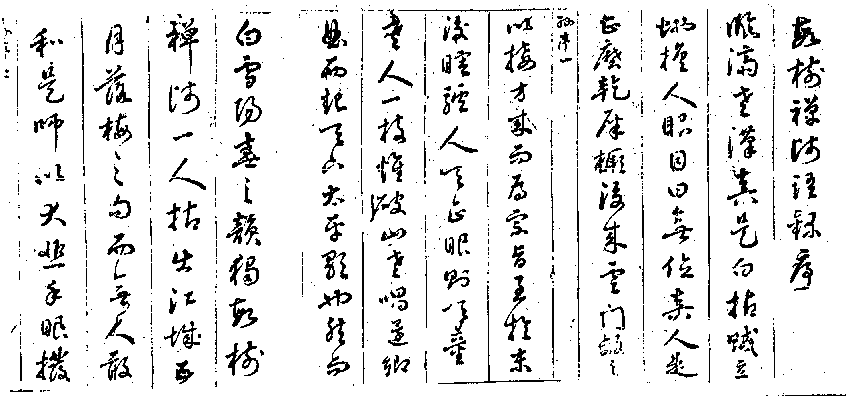
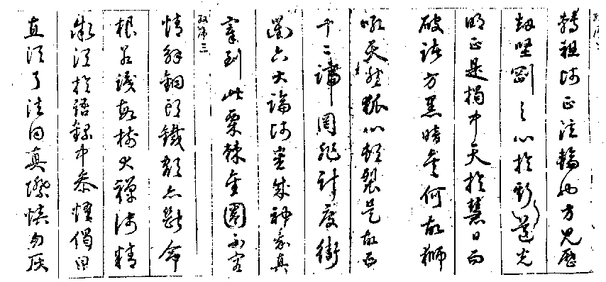
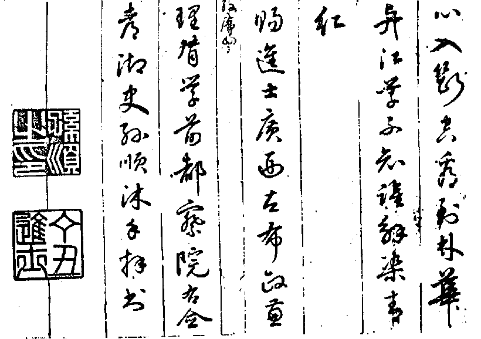
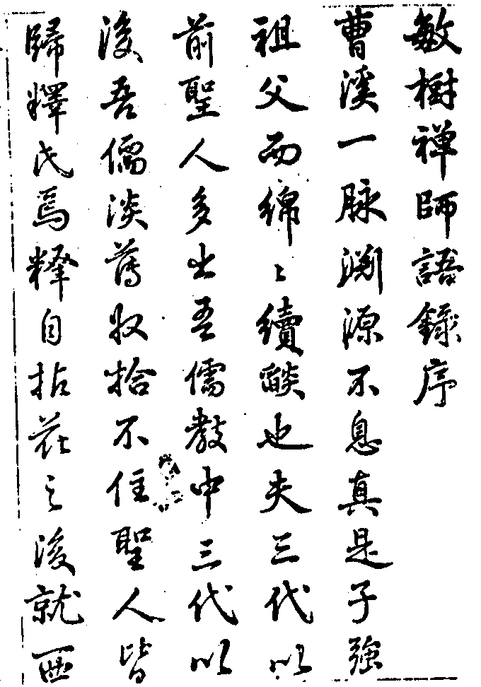
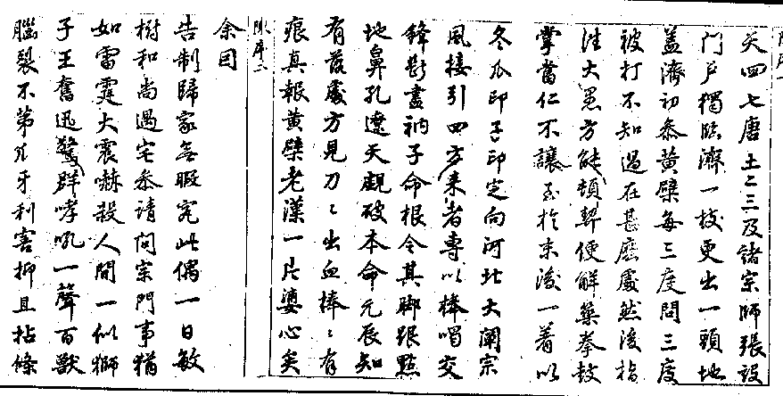
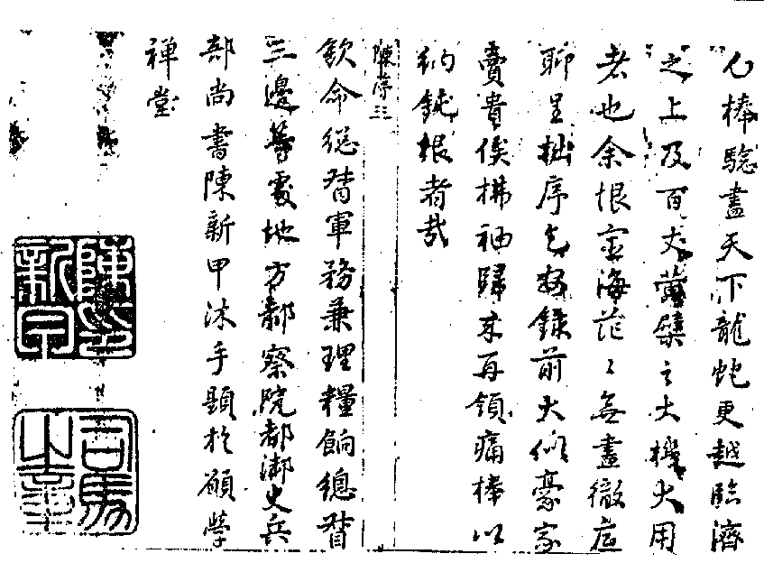

# 敏树禅师语录



> **藏经**：嘉兴大藏经（新文丰版）（嘉兴藏）　**册次** 第 39 册（J39）　**编号** JB450　**部类** 诸宗部　**卷次** 10 卷　**篇幅** 69,203 字

> **作者（译者）**：嗣法门人　道崇编　道领录

> **卷／品**：10 卷 · 2 品



---



## 目录



  - [敏树禅师语录序](#敏树禅师语录序)

  - [敏树禅师语录序](#敏树禅师语录序-1)

- [敏树禅师语录卷第一](#敏树禅师语录卷第一)

- [敏树禅师语录卷第二](#敏树禅师语录卷第二)

- [敏树禅师语录卷第三](#敏树禅师语录卷第三)

- [敏树禅师语录卷第四](#敏树禅师语录卷第四)

- [敏树禅师语录卷第五](#敏树禅师语录卷第五)

- [敏树禅师语录卷第六](#敏树禅师语录卷第六)

- [敏树禅师语录卷第七](#敏树禅师语录卷第七)

- [敏树禅师语录卷第八](#敏树禅师语录卷第八)

- [敏树禅师语录卷第九](#敏树禅师语录卷第九)

- [敏树禅师语录卷第十](#敏树禅师语录卷第十)



---



### 敏树禅师语录序















------



### 敏树禅师语录序















敏树禅师语录目录



序文  

目录  

卷第一住四川垫江县百丈禅院语录



卷第二住湖广施州卫万寿禅院语录



卷第三住四川彭水县太平禅寺语录  

住贵州石阡府三昧禅院语录



卷第四住四川遵义府古龙禅院语录  

复住万县慈云禅院语录



卷第五小参  

普说  

茶话



卷第六开示  

机缘  

法语  

联芳



卷第七颂古



卷第八示偈  

杂著



卷第九杂著  

山居  

赞  

疏



卷第十书问  

行实



敏树禅师语录目录终



------



## 敏树禅师语录卷第一



**译者**：嗣法门人　道崇编　道领录



住四川垫江县百丈禅院语录



崇祯里申年五月十六日，师於龙蟠受阖邑缙绅文学李瞿公诸大护法请，延师至山门云：「东西十万，南北八千，山僧到此，不涉廉纤。」以杖指门云：「门门有路通京国，处处无非是法幢。」便入。



佛殿。云：「若道是佛，大似开眼说梦；不道是佛，正若扬声止响。且道恁麼则是？不恁麼则是？」以手加额，云：「猫。」



方丈。云：「三世诸佛到此全提不起，历代祖师至此又放不下。今日山僧到来如何施设？」以拄杖卓一卓，喝一喝，云：「喝分金凤子，棒点玉麒麟。」



拈疏。云：「言言见谛，犹如万派朝东；句句超宗，亦似千流入海。把住也，云雾毫端吐；放行也，龙蛇空里飞。若也知得，不须重说偈言；如若不知，却请维那宣读。」



指座云：「八万四千大宝座，非是山僧熟处难忘，高踏毘卢顶上行，也须亲到一回始得。」遂升。举香云：「此一瓣香，根蟠大地威音外，叶覆须弥多宝前，𦶟向金炉，专为供养本师释迦如来、十方诸佛、历代祖师，惟冀虚空廓落无边际，刹土常将现胜身。」次拈香云：「此瓣香，从天降下则灵苗毓秀，从地涌出则瑞叶芬芳，𦶟向御炉，端为祝延今上皇帝圣躬万岁万万岁，伏愿三千日月光天德，百亿山河壮帝基。此瓣香，抛沙撒土巴山里，带月披星蜀水间，𦶟向炉中，奉为满朝文武、阖国公卿暨及府州县当道勋贵、缙绅文学、本山请主法师耆宿等，伏愿云开岳降生忠节，雨过河清出凤麟。此一瓣香，亲遭毒手冤如海，今日拈来恨未消，𦶟向炉中，专为供养前住川北道顺庆府广安州天竹县佛恩堂上传曹溪南岳临济正宗第三十五世本师破山和尚，用酬法乳之恩。」敛衣敷座。上首白椎云：「法筵龙象众，当观第一义。」师云：「好第一义，却被维那一椎击得粉碎。众中还有知得落处者麼？不妨请来相见。」僧问：「百丈重兴，慈云普集，四众临筵，法雨缤纷。和尚今日开堂，如何是祝圣一句？」师云：「常将一句无私语，祝赞我皇万万春。」进云：「一句已承师指示，大阐宗风事若何？」师云：「天上有星皆拱北，人间无水不朝东。」进云：「龙得水时添意气，虎逢山势长威狞。」师便喝，僧亦喝，师便打，僧礼退。问：「过去百丈则不问，现在百丈乃重新，未审二百丈前后事如何？」师云：「一个鼻头，两孔出气。」进云：「大转法轮事如何？」师云：「拄杖头边日月长。」进云：「如何得心空及第归？」师云：「头上不点额，脚下跃龙门。」师乃云：「为众竭力，树起栗棘蓬；事不单行，拈个金刚圈。河图洛书不能尽其玄奥，云龙风虎莫能测其端倪，三乘十地闻而胆颤神惊，妙德空生知亦吞声忍气。所以，行棒行喝，点破三要三关；一威一怒，指出不迁不二。千途同辙，天得一之以清；万别偕源，地得一之以宁。山川草木，尽是意气全彰；楚水吴山，无非受用境界。鸢飞鱼跃，控佛祖之大机；日炙风吹，廓凡圣之正眼。何须福城东际，到此始见文殊；楼阁门开，然后方参慈氏？如斯会得，不离随处作主；信得及来，岂别遇缘即宗？将一薪火，常转根本法轮；用十笏丈，应酬香积厨饭。饱飧高眠，人人壁立万仞；归家稳坐，个个常光现前。设或未然，不兔三月为期，煆出铜头铁额；九旬作限，转成凤子龙儿。匝地普天，一一为祥为瑞；堆山积岳，在在兴雨兴云。方报不报之深恩，用酬不酬之厚德。大众！正当恁麼时，且道：开堂祝圣一句作麼生道？海晏河清，一段真风添端色；国泰民安，万年齐唱太平歌。」举：「唐庄宗召兴化至殿，问云：『寡人取中原，收得一宝，只是无人酬价。』化云：『请陛下宝看。』宗以两手舒起襆头，伸两足，化云：『君王之宝，谁敢酬价？』於是庄宗大悦。」师云：「庄宗眼空四海，傍若无人；兴化退己让人。若是山僧则不然，当时若在，即向陛下云：『龙袖拂开全体现，象王行处绝狐踪。』」上首结椎，云：「谛观法王法，法王法如是。」下座。



上堂。僧问：「孔子登东山而小鲁，登泰山而小天下，今日和尚升座作麼生眼界？」师云：「纵横十字。」进云：「狮来象去乾坤转，兔走乌飞宇宙旋。」师云：「三尺龙泉光照胆，万人丛里夺高标。」师乃云：「昨夜一声狮子吼，窟中抖擞金毛走，天明满地化麒麟，分付明州布袋叟，向道渠侬不等闲，逢人切莫扬家丑。大众！且道扬个甚麼说禅以示灯笼？未必灯笼能听，说道留与露柱，却是露柱点首，不如日午打三更，依旧面南看北斗。」下座。



上堂。僧问：「法筵龙象众，当观第一义。如何是第一义？」师打，云：「天晴日头出。」进云：「和尚据此，释迦老子在何处？」师亦打，云：「觌面荐取。」问：「夹山未见船子时如何？」师云：「水向石边流出冷。」进云：「见后如何？」师云：「风从花里过来香。」进云：「见与未见时如何？」师打，云：「也须验过始得。」问：「学人生平操得一口青龙利剑，截断天下大宗师门户，不许棒喝交参、机锋转语。未审和尚今日作麼生施设？」师云：「祸事，祸事。」师乃云：「杀人不眨眼底立地成佛，如广额屠儿日杀千猪千羊。一日，向灵山会上飏下屠刀，云：『我是千佛中一数。』世尊云：『如是，如是。』大众！此是前辈成佛榜样。若关云长在百万军中，如入无人之境；枭大将首级，如探囊中取物。一日，在玉泉院里提起刚刀，云：『我是护法中一人。』古德云：『灼然，灼然。』岂非立地成佛、杀人不眨眼底大丈夫？所以道：杀人刀、活人剑，乃上古之风规，亦是今时之枢要。若向言句上会，护生须是杀；不向言句上会，杀尽始安居。值此会得，人人悟证平常，不假一枪一旗；个个圆通自己，奚用一棒一喝？诸仁者！还会麼？意气不从天地得，英雄岂借四时推？」举：「古德云：『昨日夜叉头，今朝菩萨面。菩萨与夜叉，不隔一毫线。』」师云：「据山僧看来，翻手是云，覆手是雨。古人恁麼道，也是畫蛇添足。何故？把手相牵行不得，唯人自肯乃方亲。」下座。



上堂。僧问：「升堂说法即不问，钓竿下处意如何？」师打，云：「前滩烟浪里，别有好金鳞。」进云：「轻轻点破无明窟，堂堂现出本来人。」师复打，云：「开门放出郎当汉，脑后分明欠一锥。」师乃云：「学道休参卤莽禅，逢人要识此根源，当机觌面还相委，脱骨换胎始契先。出矿纯金重煆炼，离山美玉用钻研，看来至宝非容易，不是依稀了目前。」举：「梁武帝见达磨大师，问云：『如何是圣谛第一义？』磨云：『廓然无圣。』帝云：『对朕者谁？』磨云：『不识。』帝不契。」师云：「梁武帝虽然顶门具眼，不识脑后见腮；达磨大师纵使言中有响，那觉句里藏锋？不免中间放开一线道，怎奈梁武帝当面错过？据山僧正眼观来，天下国家可均也、爵禄可辞也、白刃可蹈也、中庸不可能也。何故？不是弄潮人，争得潮中意？」喝一喝，下座。



弥陀圣诞日，上堂。僧问：「山呈瑞雪，狮子嚬呻。狮子嚬呻即不问，如何是当阳一句？」师打，云：「曲不藏直。」进云：「杖拨烟霞去，红日海门东。」师云：「点即不到。」问：「昔日世尊拈花，今日和尚拈棒，且道是同？是别？」师云：「一彩两赛。」师乃云：「弥陀降诞是今朝，一朵青莲涌碧涛，满地馨香舒瑞彩，毫光照破紫金鳌。如是，则净土周沙界，云何独指西？所以道：但能存一念，处处是菩提。今日清闻居士发菩提心，特请山僧升座，举扬妙法。盖谓诸佛出世，无非为一大事因缘，要使四生六道、十圣三贤、蜎飞蠕动、有情无情，各各悟本来面目，人人契证平常心，超三界以腾今，历千劫而跃古。」以拄杖竖起，云：「大众见麼？」复以拄杖卓一卓，云：「大众闻麼？如其问见分明，便知净土在心田，非近非远；弥陀即性海，无古无今。」卓拄杖，下座。



新建百丈禅院，上堂。僧问：「百丈鼎新，陈何祥瑞？」师云：「横开不在春枝上。」进云：「层峦耸翠人灵杰。」师打，云：「别有风光一段奇。」问：「乾坤转在微尘里，如何是万象收归一镜中？」师打，云：「蟭螟眼里三千界。」问：「岳阳气转，黄鹤神传，未审百丈今日将何所传？」师云：「海底金乌天上日。」进云：「恁麼则随波逐浪转。」师打，云：「眼中童子面前人。」师乃云：「前百丈道不落因果，堕野狐五百生。后百丈道不昧因果，脱野狐五百生。今日新百丈也不落、也不昧，贵脱野狐身，只教普天下人一个个如狮子游行，不求伴侣，壮士展臂，岂借他力？全承此段威光，不在别处流转。所以道：有时拈起也，乾坤失色；放下也，海晏河清。大众且道：不拈不放又作麼生？」喝一喝，云：「一声平地如雷震，百丈堂前阐祖风。」下座。



上堂。僧问：「十五日已前，十五日已后即不问，正当十五日事若何？」师云：「草枯鹰眼疾。」进云：「即今又作麼生？」师云：「雪尽马蹄轻。」师乃云：「顶门具眼，千圣立在下风；脑后见腮，十方从此坐断。密行一步，变大地作黄金；转身一著，搅长河为酥酪。到这里，发大妙用，揭示通天作略；显大智力，运筹跨海神机。一任孤迥迥，不与万法为侣；俏巍巍，岂与千圣同途？正好朝打三千，未免南山起云；暮打八百，依旧北山下雨。大众且道：山僧拄杖子为伊赏罚分明也，为汝据款结案也。速道，速道。」众皆默然，师喝一喝。举：「雪峰在德山作饭头，一日饭迟，晒饭巾次，见德山托钵自法堂，便问云：『钟未鸣，鼓未响，老汉托钵向甚麼处去？』山便归方丈。雪峰举似岩头，头云：『大小德山未会末后句在。』山闻，令侍者叫岩头去问：『汝不肯老僧那？』头密启其意，山便休。至来日升堂，果与寻常不同，头至僧堂前抚掌大笑云：『且喜老汉会末后句，他后天下人不奈伊何。虽然如是，只有三年。』」师云：「德山老汉虽是明修栈道、暗度陈仓，雪峰不免矢上加尖、一场败缺，纵使岩头夺转枪旗、就窠打劫，也是贼身败露。若是山僧则不然，或有人来问末后句，只向他道：『汝只见锥头利，不见凿头方。』待他拟议，正好劈脊乱棒打出，不惟与天下衲僧抽钉拔楔，亦且与德山老汉出身有地也。」喝一喝，卓拄杖，下座。



腊八日，众戒子请上堂。师云：「六年草里冷坐，刚被明星刺破，打失一只眼睛，至今反成话堕。遗累后代儿孙，齐来拽石推磨，道转根本法轮，只是无人唱和。惊起木人抚掌，引得石女讴歌，且道甚麼曲调？可怜当面错过。若向这里荐得，始识雪山证果；其或未然，试听老僧安妥。已如是者，掉臂有分；未如是者，引出付戒传衣。」下座。



万峰耑长破和尚送衣，上堂。僧问：「如何是灯灯续燄句？」师云：「拄杖点开云里日。」进云：「且喜桂子联芳，风飘云外去也。」师云：「伫看庭前一袭香。」师乃云：「递代相承宝服披，人天从此尽瞻依，如云普覆虚空界，金色头陀笑落晖。诸仁者！若然如是，则知佛佛授手，惟授此心；祖祖相传，惟传此妙。既知此心，方知此妙，此心、此妙亦不在内、又不在外、不在中间。且道：传个甚麼？授个甚麼？」目顾左右，云：「还家尽是儿孙事，祖父从来不出门。大众！若向这里荐得，於一毛端现宝王刹，坐微尘里转大法轮；苟或未然，少室岩前金凤舞，雄山顶上玉龙飞。」下座。



上堂。僧问：「临济具三玄三要，三玄即不问，如何是三▆▆？」师云：「从头问将来。」进云：「如何是第一要？」师云：「夜深出户看，明月来相照。」进云：「如何是第二要？」师云：「穿衣并吃饭，屙屎与放尿。」进云：「如何是第三要？」师云：「拈起拄杖子，打破嵩山灶。」僧礼拜，师云：「碎。」问：「佛法事即不问，如何是阳和一句？」师云：「岭上梅花先递信。」进云：「是则是，红日照穿湘水碧，白云堆绽楚山青。」师打，云：「经天须是出头人。」问：「恁麼也不得，不恁麼也不得，然麼？不恁麼总不得，毕竟如何？」师云：「宝镜莹光开玉匣。」进云：「一般清意味，料得少人知。」师卓杖，云：「桂花沉影入金瓯。」僧礼拜。举：「僧问长庆：『众手淘金，谁是得者？』庆云：『有伎俩者得。』又云：『学人还得也无？』庆云：『太远在。』」师云：「若是山僧则不然，设有人问：『众手淘金，谁是得者？』即向他道：『农人移片磉，磉下得黄金。』」下座。



除夕，上堂。问：「三十日到来即不问，到家一句作麼生？」师和声便打。问：「凤历已颁天子地，万景咸归百丈堂。二句俱不问，如何是春信传梅一句？」师云：「依稀似曲才堪听。」进云：「意作麼生？」师云：「又被风吹别调中。」问：「㘞地一声金石吼，森罗万象悉同参。如何是物外事？」师云：「手执夜明符，几个知天晓？」进云：「水流花落随体转，在处溪山共一天。」师云：「你在那里荐得？」进云：「在这里。」师打，云：「莫向窠臼里讨。」僧礼拜，师乃云：「年穷月尽，城上已吹新岁角；腊去春回，窗前犹点旧年灯。到这里，彼此不分，拈起也咤咤沙沙；物我一如，放下也历历落落。只得来去自由，处处真风遍野；纵横无碍，人人意气盈眸。何须打锁敲枷？便是出尘阶堑。大众！且腊月三十到来，作麼生是谢岁一句？」良久，喝一喝，云：「爆竹一声催腊去，梅花几点送春来。」下座。



元旦，上堂。问：「旧岁已去，新岁到来，且道旧与新是同？是别？」师云：「杖头不涉阴阳地，河山草木尽皆春。」进云：「恁麼则新年新气象，古佛古家风。」师云：「石压笋斜出，岩悬花倒生。」问：「时值新春意若何？」师云：「四五百条花柳巷。」进云：「如是则有意气时添意气。」师云：「二三千处管弦楼。」师乃云：「天中之天，大即高而无上；圣中之圣，广则厚而有餘。恩及泉石，林下将何图报？德彼苍生，人间信转法轮。祖日重辉，不惟八表玲珑；帝道遐昌，亦且四夷拱伏。弓悬壁上，齐歌舜智尧仁；戈卸甲收，尽乐禹世汤业。一理圆处，千理万理俱圆；一机彻时，千机万机透彻。正所谓：四海晏然，国有祯祥之瑞；六合弥清，门无异术之符。大众！正与麼时，还有不威而严、无为而化者麼？」良久，云：「鸿钧妙力先天地，覆载恩归大圣人。」拍禅床，下座。



解制，上堂。「全结全解，何须畫地为牢？或纵或夺，不必制绳作界。无利益处，早以无绳自缚；有大用时，便得纵横自在。一去一来，人人掌握灵珠；一韬一略，个个眉舒紫电。到只地位，七通八达，正如俊鹰快鹞，右旋左转，如龙若虎，布雨兴云，破佛祖之重围，拄地撑天，廓圣凡之要路，可为庆快。何谓？红霞穿碧海，白日遶须弥。」举：「世尊与帝释游行，遂以手指地，云：『此处宜建梵刹。』帝释将一茎草插在地上，云：『建梵刹已竟。』世尊大笑。」师云：「世尊指处正是酒逢知己饮，帝释会处亦是诗向会人吟。伶俐衲僧若向此会得，一茎草上现出琼楼玉殿；苟或未然，琼楼玉殿被一茎草覆却。何故？知音不必频频举，达者须知暗里惊。」下座。



> (龙泉邑中华嗣法门人道崇，敬刊  

> 本师和尚语录第一卷。  

> 康熙戊辰蒲月，　贵阳黔灵山弘福寺识。)



------



## 敏树禅师语录卷第二



**译者**：嗣法门人　道崇编　道领录



住湖广施州卫万寿禅寺语录



顺治七年庚寅十月十五日，师受阖郡缙绅、文学、诸大护法暨本山耆宿等请，延师至山门，云：「佛语心为宗，无门为法门，山僧既到此，龙凤任飞腾。」喝一喝，云：「君子可入。」



佛殿。「说一切法，证佛菩提。我今礼你，不敢自欺。是甚麼人境界？灯笼齐合掌，露柱尽皈依。」



方丈。「一二三四五，丰干骑猛虎。五四三二一，鲁祖曾面壁。」以拄杖横按云：「识不识？若不识，青天白日轰霹雳。」



上堂。「指法座云：登华王宝座，如杲日当空，万象森罗普印；奋狮子全威，似白云出岫，千山祥瑞齐来。大众见麼？」遂升。拈香云：「此一瓣香，通天彻地，不止尧风吹一统；耀古腾今，还同舜日照山河。𦶟向御炉，端为祝延今上皇帝圣躬万岁万万岁，暨及满朝文武、阖国勋贵，伏愿四海俱蒙清盛世，八方尽唱太平歌。」次，拈香云：「此一瓣香，紫岩深处不是怀宝迷邦，白云堆里只为价高太重。𦶟向炉中，专为供养佛恩堂上传临济正宗第三十一世本师破山和尚，用酬法乳之恩。」遂敛衣敷座。白椎竟，僧问：「十方同聚会，个个学无为。如何是无为？」师打云：「拄杖头边高著眼。」进云：「还有向上事也无？」师云：「全机大用少人知。」进云：「恁麼则一人有庆，兆民赖之。」师云：「只可瞻之仰之。」问：「世尊说三乘法即不问，如何是最上一乘？」师云：「九天云静鹤飞高。」进云：「正当恁麼时如何？」师云：「四海浪平龙睡稳。」问：「提起本参话头，犹如一根铁柱，忽然㘞地一声粉碎时如何？」师云：「烛花光满地。」进云：「恁麼则上无佛道可成，下无众生可度，今日无法可说，不知这一著归向甚麼处？」师打，云：「眉毛原在眼睛上。」师乃云：「一人有庆，兆民赖之，选佛场开，心空及第，彻见本体，获大受用，且免得上人门户，讨甚麼碗脱丘？然虽如是，切忌龌嘴黏牙，和皮带骨，犹涉廉纤。今日山僧与诸人一刀划断，要令个个光明焕赫，人人气宇轩昂，与三世诸佛把手并行，同历代祖师共一鼻孔出气，到这里不是压良为贱，抑是法尔如然，又何须卒地折暴？正如红炉点雪，冷灰爆豆。大众！正当与麼时，炉鞲弘开祝圣一句作麼生道？」良久，云：「万寿云臻呈瑞气，一人有庆等乾坤。」卓拄杖，喝一喝，下座。



上堂。僧问：「尽大地是沙门一只眼，和尚在甚麼处安身立命？」师云：「瞎。」进云：「三世诸佛瞎在甚麼处？」师便打，进云：「却被和尚看破。」师云：「你在那里见得？」进云：「达者须知暗里惊。」师云：「也是诈名头。」师乃云：「寒风解冻，百草头上萌牙；户牖豁开，万木丛中出秀。道得底，权实双明；道不得底，葛藤窝里绊倒。所以道：三回四复，铁壁银山；土面灰头，普天匝地。若向这里截得断去，从兹八字打开；透得脱来，始会当阳抛出。大众！正与麼时，还有出乎其类、拔乎其萃者麼？」时有僧出，震威一喝，师云：「近水楼台先得月，向阳花木早逢春。」卓拄杖，下座。



上堂。「十五日已前为人，一棒一条痕；十五日已后为人，一掌一握血；正当十五日为人，电光中垂手、剑刃上接人一句作麼生道？巨灵抬手无多子，分破华山千万重。」卓拄杖，喝一喝，下座。



佛道日，传戒，上堂。「今日四众临筵，还有识得释迦老子打破漆桶、掀翻脑盖、立命安身者麼？若也识得，无边刹海自他不隔於毫端，十世古今始终不离於当念，然后拈一茎草，现丈六紫金身，於百尺竿头更彰毘卢遮那妙体，不独人人本具，而且个个圆成，一切蠢动含灵悉皆具足。设或未然，雪后始知松柏操，事难方见丈夫心。大众见麼？优波离尊者来也，不免请出付戒。」



元旦，上堂。僧问：「但见皇风成一片，不知何处是封疆？请问和尚：如何是新年头佛法？」师云：「元正启祚。」进云：「自古轮王全意气，不彰宝印自然尊。」师云：「共赏万物咸新。」问：「新年头上新意气，新年还是旧年人。如何是新意气？」师云：「一枝梅绽岭头春。」进云：「朔旦之辰多有瑞。」师云：「五色祥云捧日来。」僧作礼，师打，云：「大好新年头消息。」问：「腊从昨日去，春向今日来，意旨如何？」师卓拄杖，云：「辽天赫奕𥌓光华。」僧弹指一下，师云：「不是苦心人不知。」僧礼拜，归众。师云：「好个伶俐衲僧。」问：「和尚升座，瑞气昭明，祯祥之兆事如何？」师云：「四方平定祥麟舞。」进云：「可谓天下有道则见。」师云：「大座当轩祝圣君。」僧礼拜，师乃云：「元正今朝宝祚开，凌霄降出圣人来，河清海宴皆如是，尽在咸新特地回。未审有识得？天得一以清，日月星辰系焉；地得一以宁，万物育焉；君王得一以安，天下四夷来拱、八表来朝；衲僧得个初一，海众云臻，不止东西十万、南北八千。且道：今日椎钟擂鼓、升堂说法明个甚麼边事是？」呵呵笑，云：「麒麟出而凤凰现，金轮御而玉烛调。」喝一喝，卓拄杖，下座。



值雪，上堂。僧问：「龙虎之年天下静，干戈顿息乐无虞，如何是乐处？」师云：「海晏河清。」进云：「恁麼则国泰民安贺太平。」师云：「一任村歌社舞。」问：「今朝和尚升座，电光中垂手，刀刃上接人，如何是剑？」师便打。进云：「如何是刀？」师亦打。进云：「刀剑俱掣时如何？」师震威一喝，乃云：「天白地白，万里青天一片雪；人清物清，千条古涧焕如银。野岸渡头，只得停舟罢钓；长安市里，那知带笠披蓑？放开一线，楖栗头边通口气；把住一著，芒鞋脚下转身难。若作境会，蹉过三生六十劫；不作境会，圆成八万四千门。山僧恁麼划擘，众中莫有不拟时节识此佳兆者麼？速道，速道。」众罔测，师云：「不但鹤飞千点雪，自然龙起一团冰。」下座。



上堂。僧问：「和尚今日升座说甚麼法？」师云：「狮子吼时芳草绿。」僧礼拜，师一喝。问：「如何是水穷山尽处？」师云：「且道转身句。」僧进前一步，师云：「切忌脚跟下错过。」师乃云：「门庭施设，不减诸方一筹；入理深谈，犹较万寿百倍。」乃拈拄杖卓一卓，云：「即今众中还有人曾到深固幽远无人能到地步者麼？若也到得，一在孤峰顶上盘结草庵，大沩岭头呵佛骂祖。然虽如是，犹有一人不肯轻放过在。若识得此人，则一生参学事毕；若未到得，且谩踌蹰，不枉诸人在这里朝参暮请之勤、长期短限之逼，犹未明向上一窍在。且作麼生是向上一窍？」复以拄杖卓一卓，喝一喝，云：「未到尽惊山险处，行来方识路高低。」下座。



元宵，上堂。僧问：「年年有此月，月月有此日，如何是元宵一句？」师云：「金吾不禁夜行人。」进云：「恁麼则万寿堂前明灯照，斗雪梅花晓夜开。」师云：「玉漏尚相催。」问：「内不放出，外不放入，正恁麼时如何？」师云：「金乌啄碎琉璃壳，玉兔挨开海底门。」进云：「内不著心，外不著境时又作麼生？」师打，云：「立地落空汉。」僧进前两步，师云：「照顾脚下。」问：「元宵事即不问，灵芽发生时如何？」师云：「如今幸得沾春力。」进云：「恁麼则庭前柏子千枝秀。」师云：「且看五叶一花开未休。」师乃云：「佳节喜逢，户户楼中管乐；元宵玩赏，人人眼里灯光。不透脱，只为有两般迟滞；已透彻，照见五蕴皆空。为甚麼道：月未圆时，吞却三个、四个；月已圆时，吐出七个、八个？且道：是放行？是把住？」喝一喝，云：「少室九年，但有神光开慧眼；流芳五叶，岂无姓字上传灯？」卓拄杖，下座。



上堂。僧问：「如何是万寿堂前境？」师云：「天开云秀雨花香。」进云：「如何是境中人？」师云：「觌面当机问者谁？」进云：「如何是人中物？」师云：「落花满地随人扫。」师乃云：「行棒行喝，点破顶𩕳一著；搬石运土，筑起门墙半垛。象骨辊毬，家风卖尽冷如秋；禾山打鼓，报与诸人莫莽卤。沩岭牧牛，一声麦笛唤回头；玄沙猛虎，几个男儿作得主？吃茶赵州，何须特地逞风流？面壁鲁祖，不必女娲鍊石补。怎似老云门？看来也是弄精魂。腊月二十五，甜者甜兮苦者苦。参！再来不值半文钱。山僧恁麼举扬，且道圆悟老人在甚麼处安身立命？於此明得，入廛垂手，著著有出身之机；退处孤峰，处处立刹尘之境。苟或未然，不妨有伶俐衲僧明得，诣方丈里通个消息。」下座。



上堂。僧问：「昨夜狮子吼，惊醒石人走，三脚瞎驴跳，虚空打觔斗。未审意旨又如何？」师云：「三头两面汉。」进云：「何为奇特？」师云：「头上漫漫，脚下漫漫。」师乃云：「参禅学道几般样，要在当人能择上，莫执忘形与死心，此个难医病最深。所谓李伯阳道：『湛兮似或存，吾不知谁之子，象帝后。』高峰大师道：『咄哉！这汉错下名言。湛兮似或存，吾不知谁之子，毘耶城里老维摩。』若是山僧今日则不然，湛兮似或存，吾不知谁之子，蜀川有个王和尚。山僧恁麼批判，且道与李伯阳、高峰大师是同？是别？若道同，为甚麼风吹南岸柳，雨打北池莲？若道别，月到天心处，风来水面时。何故？一般清意味，料得少人知。」喝一喝，下座。



上堂。师卓拄杖，云：「秋风清，秋月明，落叶人还在，深山鸟不惊。到这里，向上一路，千圣不传，学者劳形，如猿捉影。况三乘未晓，十地那知？不是目前法，亦非心外机，直下绝承当，当阳无向背。若向有为处荐，有为虽假，弃之则功行难成；若向无为中取，无为虽真，拟之则圣果难证。亦不弃有无，老僧为众指出。」举起拄杖，云：「向拄杖头边得证无生法忍，便是一花开见佛，叶落始知秋，返本还源处，到家乐自由。到家则且置，路头一句作麼生？人间路险潼关外，天上惟闻玉垒声。」复以拄杖卓一卓，下座。



上堂。僧问：「今日还有成佛者麼？」师云：「有。」进云：「在甚麼处？」师云：「溪声尽是广长舌。」问：「昔日瞿昙，今日和尚，是同是别？」师云：「到头霜夜月。」进云：「未睹明星时如何？」师云：「任运落前溪。」僧礼拜，师乃云：「年年腊月八，切莫眼中花，说道睹明星，把髻自投衙。已如是者，顶门具眼；未如是者，披金拣沙。」下座。



解制，上堂。僧问：「诸佛聚会时如何？」师云：「尽在拄杖头边。」进云：「散时如何？」师云：「却在老僧脚下。」问：「结制即不问，如何是解制一句？」师云：「放开布袋口。」僧礼拜，师云：「紧峭草鞋。」问：「拟度龙门，请师一接。」师云：「三汲浪高犹点额。」僧礼拜而退，师云：「千寻波里化龙鱼。」师乃云：「万寿堂前得大机，坤维运转任洪威，高山流水原同调，不鼓清音彻翠微。然虽如是，犹有天马峰未曾与诸人招手在，狮子山不肯与诸人点头。何故？据万寿捡点将来，只得半提。且正令全提，向上一著作麼生委悉？」喝一喝，云：「坐断十方犹点额，密移一步看飞龙。」卓拄杖，下座。



上堂。僧问：「大开炉鞴事如何？」师云：「煆炼圣凡。」进云：「如何是圣？」师云：「满口道不出。」进云：「如何是凡？」师云：「转身吐气。」僧作礼，师乃云：「参禅本是了生死，生死了时情解毁，彻底掀翻无碍膺，自然佛种从缘起，心花开发少林宗，棒喝交参从此始。所以道：随处作主，遇缘即宗，竿木随身，逢场作戏。到者里，智者见之谓之智，道者见之谓之道，禅者见之谓之禅，仁者见之谓之仁，正所谓诸人日用而不知，当面错过。还有谛当也无？掀翻海岳求知己，分付时人莫浪猜。」卓拄杖，下座。



上堂。僧问：「古人现成公案，因甚和尚重举？」师云：「一番拈出一番新。」进云：「今日拈出又如何？」师云：「何妨锦上添花？」乃云：「至理高明，会千奇於物表；玄机透脱，融万象於目前。不离兜率，早降皇宫；未出母胎，度人已毕。电卷星驰，珠回玉转。高明智士，必是顶门具眼；大福德人，原来至孝慈亲。广修精舍，永作津梁报本；选佛场开，方知护法弘兴。法轮未转，一乘何立？古镜当轩，万境齐彰。以一统十，摄众象於毫端；量短裁长，挥秤尺於掌握。有功勋处，九五飞龙在天；多利益时，三千彩凤祥集。壁立万仞，发大机於此处；目视云霄，显大用於斯时。一悟一切悟，方知黄檗心印；一圆一切圆，不疑青州布衫。秋风天桂，庭前定是生黄甲；春雨堤杨，门外依然挂绿袍。若也会得，乃文乃武，奕世於斯契证；为圣为贤，满门正当恁麼时。开堂祝圣一句作麼生道？千秋报国无餘事，一瓣清香满御炉。」下座。



上堂。竖杖，云：「见麼？即此见色明心，是文殊菩萨来也。」卓拄杖，云：「闻麼？即此闻声悟道，观音菩萨来也。虽然如是，唤甚麼作色？十方诸国土，无刹不现身；唤甚麼作声？十方俱击鼓，十处一齐闻。到者里，莫有透出声色者麼？若有透得出，正是见色明心、闻声悟道，即与文殊、观音同一鼻孔出气；其或未能，不免被声色所转，无本可据。」遂拈拄杖，卓一卓，喝一喝，云：「闻声见色非他事，拾得金针本是谁？」下座。



上堂。僧问：「有时放行，有时把住，且道放行是？把住是？」师云：「看取令行时。」师乃云：「庭前绿竹，时时高节清风；槛外黄花，日日馨香吐露。雪落幽谷，发明古佛真宗；雨下阶前，点破祖师心印。定光招手，隔墙见角是牛；智者点头，隔山见烟是火。向上向下，岂是转更颟顸？谈妙谈玄，总是无而说有。树凋叶落，头头体露金风；海阔天高，处处月圆午夜。若也会得，太平治业无象；苟不错过，野老家风至淳。若能趣向，只管村歌社舞；妙哉奇特，方知舜德尧仁。」卓拄杖，下座。



上堂。僧问：「善财参五十三员知识，得何利益？」师云：「只为你不唧溜。」进云：「他家事和尚怎知？」师云：「好事难瞒。」进云：「利害在甚麼处？」师云：「证者方知。」师乃云：「南泉道：『不是心，不是佛，不是物。』须是为人以楔出楔，致使初机后学不能见此，以为儱侗真如、颟顸佛性。万寿今日忍俊不禁，为伊一一颂出：不是心，终朝作用是何人？当机不让真奇特，笑杀黄梅七百僧。不是佛，相貌堂堂皆具足，动静施为总一般，人人本有英灵骨。不是物，信手拈来随用出，对客挥毫秦少游，而今争似山僧熟？大众！还有颂得者麼？若还颂得，不妨大家出只手；如若未得，年年腊月尽，户户望新春。」下座。



上堂。「拨转机轮，放出摩醯首罗亚目；竭世枢要，任是鹙子神通难透。三世诸佛到者里，有口挂在壁上；历代祖师到者里，忘锋结舌；天下老和尚到者里，退身有分。万寿恁麼告报，不独平白欺人，抑且法尔如是。未审众中还有傍不甘底衲僧出来道看。如无，万寿自道去也。拄地撑天谁会得，打风打雨到驴年。」喝一喝，下座。



上堂。「昨夜文殊、普贤三更起佛见、法见，各与二十拄杖，贬向二铁围山间，所供是实。未审众中还有救得也无？若无，万寿救取去也。」卓拄杖一喝，云：「文殊、普贤乃大人境界，跳上万寿拄杖头，放大光明、建大法幢，大哉奇特，要使群生同得光辉，一万八千土，土上皆作黄金色，四生六道一光中，光光犹自见弥勒。还有见得也无？若见得，好与三十棒；若未见，适才被山僧一喝，文殊与吾携水去，普贤犹未摘花来。」下座。



解制，上堂。僧问：「一边僧众，一边将相，当阳佛法，一样两样？」师打，云：「旱地雷声，晴天霹雳。」进云：「进前一步意如何？」师云：「退后一步尔方知。」乃云：「结制如划地为牢，不但大众跳不出者圈匮，三世诸佛、历代祖师至此岂越常仪？今朝三月功圆，九旬已满，有结有解，总教人人草鞋狞似虎，个个拄杖活如龙，脚跟下无系无缚，任来任去。虽然如是，且道解制一句作麼生道？」良久，云：「三月功圆无虚弃，个个心空及第归。」下座。



> 本师和尚语录第二卷。  

> 康熙戊辰蒲月，　贵阳黔灵山弘福寺▆。)



------



## 敏树禅师语录卷第三



**译者**：嗣法门人　道崇编　道领录



住四川彭水县太平禅寺语录



顺治十年癸巳五月十五日，师受阖邑缙绅文学暨诸护法请。



师至山门，指新建太平桥云：「百川不用西江一吸，万派何须东海千浔？且二途不涉底，到来如何施设？凤凰楼下交天仗，乌鹊桥头厂御筵。」便入。



佛殿。「紫金妙相，处处庄严万德；碧玉慈容，堂堂独露千光。今日山僧到来，礼即是？不礼即是？」遂展具三拜。方丈。云：「据虎头，不须杜口於毘耶；收虎尾，要在今行於摩竭。且天下衲僧到来如何管待？白棒当头血滴滴，缦天网子密重重。」



拈疏。云：「不立文字，未是掀翻漆桶；既出口角，无非满腹家珍。且道如何？玉牒铺时文彩现，锦绣全彰意自如。」



师指座云：「三万二千狮子座，其座不为小；百千万亿宝王幢，其幢不为大。於此会得，三万二千彩凤飞腾；若也未会，百千万亿祥麟起舞。」喝一喝，遂升。拈香祝圣毕，次拈香云：「此一瓣香𦶟向炉中，专为供养双桂堂上传临济正宗第三十一世本师破山和尚，用酬法乳之恩。」敛衣就座。上首白椎毕，僧问：「大开炉鞴，令据钳锤，煨炼个甚麼？」师云：「惜取铜头铁额。」进云：「擎来日月悬诸国，抛出雷霆震八方。」师云：「非公境界。」进云：「惊群须是英灵汉，敌胜还他狮子儿。」师云：「大赏之下，必有勇夫。」进云：「休得压良为贱。」师便打，僧拂袖便行，师云：「未称好手。」乃云：「法幢今建太平桥，个个来瞻智眼高，不为千年题柱石，长将玉带系江腰。如是，则知百奇竞秀，妙德家风，一亘晴空，普贤境界，处处不离普光明殿，头头尽是香水海。须是恁麼人，方解恁麼事；要知恁麼事，还须恁麼人。」举：「傅大士颂云：空手把锄头，成人不自在；步行骑牯牛，自在不成人。人从桥上过，知恩者少；桥流水不流，负恩者多。虽然，傅大士乃弥勒佛应身，祗解桃花流水窅然去，别有天地非人间。今日新太平则不然，何也？万里江山归有道，千秋仁寿乐无疆。」结椎，卓拄杖，下座。



宣慰覃尽孝居士请上堂。僧问：「腊月初一头，腊月三十尾，月头月尾即不问，如何是向上事？」师云：「一团明月逼人寒。」进云：「不许夜行，投明须到者是甚麼人？」师云：「手执夜明符，几个知天晓？」进云：「向甚麼处安身立命？」师云：「脚跟下荐取。」进云：「佛、法、僧则且置，如何是现宰官身？」师打，云：「可识覃护法麼？」乃云：「大人具大见，大智得大福，不违本愿力，示现宰官身，惟向佛事门头不舍一法、实际理地不受一尘，廓落虚空，於无利益时兴利益、向没风雷处起风雷，要令三界二十五有众生人人气宇冲霄、个个威德自在，便见本来面目，直下成佛作祖。虽然如是，山僧到此未免放开一线，直德有条攀条、无条攀例。」举目顾视左右，云：「还有恁麼人麼？」喝一喝，云：「从前汗马无人识，只要重论盖世功。」卓拄杖，下座。



上堂。僧问：「昨夜金牛遭涂炭，直至而今不见踪，请和尚指个踪迹。」师云：「绿岩千树里。」进云：「今朝吹玉管，几个是知音？」师云：「一不成，二不是。」问：「有一物，明历历，上拄天，下拄地，常在动用中，为甚麼动用中人不识？」师以杖示云：「会麼？」进云：「拄杖头边闻法喜，袈裟脚下趁狮儿。」师云：「切莫诈名头。」僧一喝，师云：「好一喝，落在甚麼处？」问：「法报化身即不问，如何是真身一句？」师云：「山花开似锦。」进云：「好个消息。」师云：「是甚麼？」僧拟议，师便打，乃云：「路入烟霞，不知城市藏丘壑；桥逢渡口，那觉人间别洞天？何必孤峰顶上道甚呵佛骂祖，大鞴炉中方信立命安身？所以，呼唤不回，古圣亦无安排；罗笼不住，至今亦无处所。直得机上生机，毒蛇头上揩痒；巧上生巧，饿鹰爪下夺食。奇则甚奇，千尺井底施筹略；妙则甚妙，百尺竿头作伎俩。把住也，纳须弥於芥子；放行也，掷大千於方外。头头物物，显出自己家珍；刹刹尘尘，尽是本来妙用。且道：还有为人处也无？休骑白鹿升三岛，莫跨青鸾上九霄。」复举：「吕洞宾以飞剑斩黄龙，却被黄龙点化而醒，有偈云：『弃却瓢囊摵碎琴，如今不炼汞中金，自从一见黄龙后，始觉从前枉用心。』」师云：「这多口子未见黄龙之时，似乎一剑当前，横施万里；既见之后，及乎一言截断，伎俩全消。且作麼生是渠大休大歇处？闻道仙郎歌白雪，从来此曲和人稀。」鼓掌，呵呵，下座。



上堂。僧问：「不与万法为侣，因甚有戒？」师云：「切莫夸经卖纪。」进云：「龙得水时添意气。」师云：「在何处见得？」进云：「虎逢山势长威狞。」师便打，僧作怖势，师云：「也是贪生怕死汉。」问：「法性人人本有，个个不无，如何有与有受？」师云：「春色无高下，花枝有短长。」进云：「恁麼则有修有证去也。」师云：「不因渔父引，争得见波涛？」问：「如何是禅？」师便打。进云：「如何是戒？」师云：「信受奉行。」进云：「禅戒俱不用时又作麼生？」师云：「俗汉，俗汉。」问：「今日大鞴炉中煆炼，四大本空，五蕴非有，且道煆炼个甚麼？」师云：「石笋抽条长一丈。」进云：「恁麼则泥牛踏著金海岛。」师云：「只好填沟塞壑。」问：「如何是观音说法观音听，木人拊掌木人闻？」师云：「也要同道者方知。」进云：「恁麼则处处总成华藏界，十方无处不毘卢。」师云：「俱被山僧坐断，你在甚处安身？」僧拂袖归众，师云：「也是虾跳不出斗。」乃云：「十五日已前为人，东山水上行；十五日已后为人，西河火里坐；正当十五日为人，熏风自南来，殿阁生微凉一句作麼生委悉？琉璃殿上骑金马，明月堂前辊绣毬。若也会得，婢视声闻，奴呼菩萨，不禀释迦文，高揖弥勒氏，不为分外。何故？汝眼本正，因师故邪，令汝见倒惑念，不能一门超出妙庄严路，弹指证无学地，与诸如来把手共行。若也未会，徐行踏断流水声，纵观泻出飞禽迹。」以拄杖卓一卓，喝一喝，下座。



上堂。「月圆月望，且看嘉州好大象；月旦月朔，不使铁牛生头角。斩钉截铁，十字街头问弥勒；堆山积岳，万仞峰头空摸索。小乘钱贯，莫学当时寡杜撰；大乘井索，须知弄巧自成拙。有漏笊篱，原来水到便成渠；无柄木杓，天将夫子为木铎。定龙蛇句，真诚不是小儿戏；全杀活机，昨夜风雷一阵恶。咦！太平院里只寻常，散向诸方任贬剥，都来这里生按过。山僧恁麼批判，不是压良为贱，抑是过量为人。且作麼生是奇特一句？域中日月纵横挂，一亘晴空万古明。」复举：「僧问古德云：『皓月当空时如何？』德云：『犹是阶下汉。』僧云：『请师接上阶。』德云：『月落后来相见。』拈云：月落后作麼生相见？可见古德纵有拨乱扶危之手，且无安邦定国之策。孰知此僧思量就窠打劫，返为钝置？若是山僧则不然，或有人来问：『月落后作麼生相见？』即向他道：『五凤楼前听玉漏，九重殿上击金钟。』」下座。



上堂。僧问：「如何是深潭里面金甲现？」师打，云：「千浔浪中随出没。」进云：「为甚太平桥头见白牛？」师云：「切莫眼花。」进云：「偶来松树下，高枕石头眠。」师云：「慎莫藏头缩尾。」问：「如何明佛？」师云：「阵云横海上。」进云：「如何明祖？」师云：「拔剑搅龙门。」进云：「如何超佛越祖之谈？」师云：「云门道的𫆏？」问：「云收雾卷甚麼境界？」师云：「照天照地。」进云：「日没月沉时如何？」师云：「水底更有天。」乃云：「溪声便是广长舌，深谈不尽；山色无非清净身，浅识难明。看来好个真消息，可惜诸人不解说。若解说，一任横说、竖说，刹说、尘说，炽然说无间歇。何以故？若将耳听终难会，眼底闻声方始知。」复举：「苏东坡隐访西山禅师，山云：『檀越贵姓？』坡云：『姓秤。』山云：『请教。』坡云：『我是称天下长老。』山一喝，『且道这一喝有多少重？』坡於是茫然。至夜，忽听溪声，大悟，云：『溪声尽是广长舌，山色无非清净身。夜来八万四千偈，他日如何举似人？』」师云：「东坡平生惯用把秤称人，殊不知称在自己头上全然不知。若不是西山一拶，怎知无情说法不思议？若是太平则不然，或有人来说：『我是称天下长老。』即向他道：『领取钩头意，莫认定盘星。』看他如何？正好以拄杖趁出。何故？不因渔父引，争得见波涛？」下座。



上堂。「拨尘见佛，未免眼里撒沙；子细看来，大似扬尘𥳽土，自取扑面。所以，闻声悟道，亦是耳中著水；捡点将来，犹如入海寻波，自讨钝置。若向这里会得，不作佛求、不作法求、不作僧求的人，向此拈起也，天回地转，应须拱手归降，随处得解脱；放下也，草偃风行，始识全身调御，何处不称尊？」遂拈拄杖，卓一卓，云：「大众会麼？既不落见闻觉知，且道如何展演？不从千圣中来，难透威音那畔。」下座。



上堂。僧问：「如何是透法身向上事？」师云：「脚跟下左缠右缚。」乃云：「云涛日夜吼如雷，惊醒时人梦眼开，从此耳根都透彻，观音老子为谁来？莫不是一根既返源，六根成解脱，见闻如幻翳，三界若空花，闻复翳根除，尘消觉圆净？若也未悟，未免背觉合尘，与一切众生从无始以来生死相续，皆由不识常住真心、性净明体，被诸妄想执著，故有轮转。尔诸人到这里作麼生转身？若也转得身来，个个常光现前，人人壁立万仞，舟通大海、月朗长空，不疑雁过潇湘、影落寒潭；苟或未然，岸上行人声有韵，船中渔父和来齐。」下座。



上堂。「拨转乾坤，处处恢弘祖印；全提正令，头头显露真宗。三条椽下，正好著衣持钵；七尺单前，何妨啸月吟风？一法若有，毘卢堕在凡夫；万法若无，普贤失其境界。於不别处，统十方为真境；以不异时，在一念为舍那。圆满菩提，究竟归无所得；体同太虚，原来无欠无餘。若能会得，个个超今越古；如不停思，家家门透长安。物物明心，白鹭下田千点雪；头头显现，黄鹂上树一枝花。」复举：「肇法师云：『乾坤之内、宇宙之间，中有一宝，秘在形山。』云门云：『将三门来佛殿里，拈佛殿向灯笼上。』」师云：「肇法师虽然行到水穷处，不知坐看云起时。云门老汉须是点铁成金，不知金从矿出。若是山僧则不然，或有问：『中有一宝，秘在形山。』即向他道：『问从何来？』待渠拟议，正好劈脊便棒。何故？密移一步六门晓，无限风光大地春。」下座。



上堂。僧问：「月印寒潭意如何？」师云：「海门皆共照。」进云：「恁麼则海底泥牛啣月走。」师云：「眼花不少。」问：「古来事作麼生？」师云：「曹谿渊源远。」进云：「如何是今时事？」师云：「拄杖逢人但点头。」乃云：「恁麼也得，问也问得甚善、答也答得奇特；不恁麼也得，铁钉饭、木札羹都来咬嚼；恁麼也不得，万里青山高，犹如尽泼黛；不恁麼也不得，思量好生观，天地已悬隔；恁麼、不恁麼总不得，金刚脑后寒，未拔三觔铁。到这里，恁麼也得，分明鼓掌间，笑指活弥勒；不恁麼总得，大地及山河，无物不照彻。大众！此三转语中还有荐得石头全明全暗、双放双收者麼？若向者里会得，步步踏祖佛阶梯、头头彰宝王刹海，不惟顶门上了了常知、脚跟下绵绵密密，亘古今而有餘、超凡圣而无惑，便是透出荆棘林、常居安乐国。如若未然，不是沩山登九仞，谁能捏土定千均？」下座。



住贵州石阡府三昧禅院语录



顺治十一年甲午十二月初八日，师受杨沅公居士请。



山门。「卓锡三昧，流泉常在，移风万年，与道无碍。山僧到此入门一句作麼生？」震威一喝便入。



佛殿。云：「大中现小，不见边表；小中现大，自然境界。且道是同是别？山河及大地，全露法王身，到此也须礼拜。」



方丈。「正令全提，纵横无碍，且出格人到来又作麼生？不见赵州曾有云：『王来元不下禅座。』」



上堂。拈香祝圣毕，次拈香云：「此一瓣香𦶟向炉中，专为供养双桂堂上传临济正宗第三十一世本师破山和尚，用酬法乳之恩，惟愿一花香遍乾坤阔，五叶联芳世代传。」白椎竟，僧问：「和尚住三昧，高升宝座，正令全提，遇个天高海阔人到来作麼生管待？」师云：「常将利益功勋事，祝赞当今有道君。」进云：「恁麼则万方歌有道，四海乐无虞。」师云：「道得一半。」乃云：「蕴定乾坤，谋略盖世，英雄具杀人刀、秉活人剑，未审还有佛法也无？若有，且道佛法在甚麼处？到这里，直得扫恢六合、宁静万方，然后安邦定国、天下太平，一念无为、十方坐断，此是文武勋公、诸大护法，忠肝义胆、智勇双全，为国为民，扶扬宗教，正眼流通，不昧灵山悲愿，重为法门金汤。所以道：欲识佛性义，当观时节因缘。时节若至，其理自彰。苟能顿悟，方识今日座上并不囊藏被盖，正是纳冠簪於傅大士、夺玉笏於裴相公，随处建立，遇缘即宗。於此究竟，将来不惜汗马功高而遍立浮幢王，岂论阿僧祗劫而周游华藏海？恁麼出格人到来也须按过。何故？自从一箭收功后，万载千秋帝业隆。」下座。



上堂。僧问：「诸佛未出身时如何？」师云：「殿阁重门寂。」进云：「诸佛已出身时如何？」师云：「熏风遍界凉。」进云：「还有向上事麼？」师云：「举头天外看。」进云：「犹是这边事。」师以拄杖示云：「且道是这边？那边？」乃云：「这边与那边，天上及人间，拄杖头边早漏泄，可怜觌面自颟顸。若是先照后用，常栽栖凤竹，每筑化龙池；先用后照，跨过黄金限，来登碧玉楼。照用同时，举起轩辕镜，蚩尤顿失威；照用不同时，禹力不到处，河声流向西。诸人者！此是古人建立法门，已合荐取？不合荐取？若合荐取，千子常围绕圣颜；不合荐取，诸天不顺飞轮举。还有为山僧出气者麼？」众罔测，卓拄杖云：「木上座为老僧出气去也。」下座。



师诞日，上堂。以拄杖作钓势，云：「数十年来浪五湖，烟波江上踏横芦，而今四海澄清日，钓取金鳞看有无。」僧问：「海屋添筹人间事，延生一句意如何？」师云：「金丹不属五形炼，玉液原非八石成。」乃云：「今岁老僧五十五，逢人定不从头数。」卓杖，云：「且道数个甚麼？五四三二一，那管金木水火土？惟有杖头不等闲，当阳击碎虚空鼓。识得山僧今诞辰，三世诸佛悉皆普；其或未能，年来屈指二三千，春到寒食一百五。」下座。



天吼监院母难日请上堂。师拈拄杖云：「连年未动舌根头，忽地风吹法雨流，拈个南山臻寿算，福如东海更添筹。大众见麼？此是天吼监院今日诞期，复念劬劳德重、养育深恩，常抱十月怀胎，未酬三年乳哺，特请老僧升座，遂驾铁船於此载过彼岸，令渠椿萱高超十圣、位越三贤，道个一子出家、九族生天去也。」以拄杖竖起云：「大众还见麼？」复以拄杖卓云：「大众还闻麼？如其闻见分明，则佛恩、祖恩、父恩、母恩一齐报毕；脱或未然，山僧为汝自道去也，九莲开合处，百宝自庄严。」下座。



上堂。「春光满目，人境纷纭，不识死中得活，奚言入圣超凡？且二边不住，中道不安，如何委悉？玉蝶穿花零碎锦，金莺掷柳乱垂丝。」下座。



佛诞日，上堂。「四月八期佛降生，指天指地甚分明，后来惹得云门老，一棒当头定太平。」举：「药山问遵布衲云：『汝只浴得者个，还浴得那个麼？』咸云：铜像有形可以浴涤，法身无像如何洗得？仔细检点将来，大似虚空里著楔、钵盂上安柄。大众！总不恁麼时如何？」良久，云：「莫道谓言侵早起，谁知更有不眠人？已如是者，推到戒墙；未如是者，引出付戒。」下座。



上堂。「十五日已前为人，铁蛇钻不入；十五日已后为人，金刚跳不出；正当十五日为人，把断要津，不通凡圣一句作麼生道？十方刹海金刚燄，万煆炉中铁蒺藜。」下座。



立秋，上堂。以拄杖竖起，云：「见麼？一尘起，大地收，佛眼觑不见。」放下杖，云：「会麼？一叶落，天下秋，海口莫能宣。且道如何话会？」抚掌呵呵，云：「潦水尽而寒潭清，烟光凝而暮山紫。」喝一喝，下座。



上堂。「醉叶经霜重，深林带露寒，悬岩飞素练，指与诸人看。且道看个甚麼？大道只在目前，要且目前难睹。若识大道真体，不离声色言语。适才老僧所说是声。」竖杖云：「者个是色。还有透出声色者麼？观音菩萨将钱买糊饼，放下手元来是馒头。所以，见色非干色，闻声不是声，色声无碍处，亲到法王城。到这里，一一明透得、一一悟彻得，一切色是佛色、一切声是佛声，方信桃花红、李花白，谁道融融是一色？紫燕语、黄莺鸣，谁道关关只一声？不会祖师关捩子，空认河山作眼睛。其或不能，赤心片片知人少，觌面堆堆观者多。」举：「法眼因僧问：『声色二字如何透得？』眼召众云：『若会得，者僧问处透声色也不难。』」师云：「就路还家，让他法眼；慎炉打铁，错过者僧。若是山僧则不然，或有问：『声色二字(如何透得)？』(只向他道)：『满眼满耳。』待他拟议，正好蓦头便棒。何也？处处溪声闻不尽，明明山色看无穷。」下座。



上堂。举：「世尊升座，文殊拍椎云：『谛观法王法，法王法如是。』世尊便下座。」师云：「世尊升座，大似为怜三尺子，不惜两茎眉；文殊拍椎，亦是傍敲这一著，对众显家风。若是山僧则不然，未待拍椎即道：『不是巨灵手，怎敢劈华山？』待他拟议，直棒打出。何故？位中已有仙陀客，何必文殊下一椎？」喝一喝，下座。



上堂。僧问：「㘞地一声时如何？」师云：「透出顶门。」进云：「透出后如何？」师云：「照破面皮。」乃云：「昨夜三更月到窗，不觉南泉水牯牛，走入山中东触西触，不免吃他国王水草，却被老僧拽转鼻头，牵向人天众前，不作贵买、不作贱卖，如何酬价？若作贵买，价直三千大千世界；若作贱卖，一任燕金赵璧难酬。诸人作麼商量？若商量得出，两手分付；若拟商量，辜负己灵，埋没家宝。」举：「古德闲暇牧牛，有二禅客经过是处，云：『头角甚分明，怎奈骑者不识？』古德遂骤牛赶去。二禅客至前面树下乘凉煎茶，德向前问：『二禅客在甚麼处来？』客云：『那边来。』德云：『那边事作麼生？』客无对。德云：『莫道骑者不识好。』」师云：「二禅客纵是贪程太切，不觉当面失眼；古德须是落草求人，犹欠劈脊加鞭。当时既听，云：『头角甚分明，怎奈骑者不识？』何不向道：『饶见头角分明，可怜脚下错过。』兔得骤牛赶验，亦成贼后张弓。难怪二禅客，是非只为多开口，得便宜处失便宜。」卓拄杖，下座。



上堂。僧问：「如何是永证金刚不坏身？」师打，云：「昨夜星晓，今朝鹤鸣。」僧以手作圆相，云：「九十六种圆相与者个是同？是别？」师云：「别则各别，同则总同。」进云：「恁麼饭是米做。」师云：「不是饱飧人不知。」僧作礼，师一喝，竖拄杖，云：「见麼？有物先天地。」掷下杖，云：「无形本寂寥。」复举杖，云：「於此会得，能为万象主，方知不逐四时凋。既不逐四时凋，如何春生、夏长、秋收、冬藏、山河大地、明暗色空、草木丛林、纤洪长短，者个能为万象主？且道：主人公在甚麼处安身立命？」众一喝，师云：「诸人若於此一喝中荐得，春来处处百花香，夏至熏风枕簟凉，秋日菊开金布地，冬时雪霰满禅房。到这里，不免放开一线，云开日出，瓦解冰消，天地同根，万物一体。」以拄杖卓一卓，云：「还见一体麼？」喝一喝，下座。



> 本师和尚语录第三卷。  

> 康熙戊辰蒲月，　贵阳黔灵山弘福寺识。)



------



## 敏树禅师语录卷第四



**译者**：嗣法门人　道崇编　道领录



住四川遵义府海龙山古龙禅院语录



顺治十六年十月十五日，师受阖郡绅衿诸大护法，暨本山耆宿硕德等请延。



师至山门，云：「泼天门户，八字打开，大地全该，十方独步。」喝一喝，云：「宾主历然，更无回互。」便入。



佛殿。「万善云臻，还识佛麼？一华百亿国，一国一释迦。」拈起坐具，大展三拜。



方丈。「诸大善知识，据此位中贵，图罗龙打，凤古龙新，长老到来，更不钉椿摇橹，只可向毒蛇头上抓痒，猛虎颔下解铃。何故？」喝一喝。



上堂。指座云：「昔日闻此山，今朝登此座，敢问大众：且道是同是别？出头天外看，谁是我般人？」遂升。拈香祝圣毕，次拈香云：「此瓣香第五回拈出，𦶟向炉中供养双桂堂上本师破山和尚，用酬法乳之恩。」敛衣敷座。白椎竟，师云：「灵峰高挺，鹤不停机，古木参差，林栖彩凤。今日山僧拨转法轮，还有鹤不停机者麼？不妨出来相见。」僧问：「如何是出格一句？」师云：「雪山高耸似银屏。」进云：「此意如何？」师云：「草鞋踏著寒。」问：「如何是向上事？」师云：「夫子不识字。」进云：「必定如何？」师云：「达磨不会禅。」问：「如何是海中龙？」师云：「洪水滔天。」进云：「如何是龙中海？」师云：「风恬浪静。」师乃云：「不驾扁舟上钓台，海山深处起云雷，垂钩千尺无餘事，直钓狞龙出海来。且道出后作麼生？岂不闻：云从龙，风从虎，圣人出而万物睹。」目视左右，震威一喝，云：「昔日瞿昙却较些子，今日古龙又且不然。何故？慈风荡荡播今古，遍界歌谣祝圣君。」卓拄杖，下座。



上堂。僧问：「学道未成时如何？」师云：「好向深潭隐。」进云：「学道已成时如何？」师云：「方堪出海来。」进云：「化龙则且止，今日相庆事如何？」师云：「日下彩云浮。」僧礼拜，师乃云：「建法幢、立宗旨，须是出格人，方明向上事；要知向上事，还他出格人。今朝空谷上座特来古龙山中▆酬法要，恭请山僧高升此座，自揣从来不开生药舖，单单岂卖死猫头？不如本分非针炙，触著还他白汗流。虽然如是，盖缘我万峰老和尚有一则未了公案，不免拈出为诸人了却。且道：如何是未了公案？」以拄杖竖起，云：「问取空谷上座。」卓一卓，下座。



上堂。僧问：「如何是正法眼藏？」师云：「杖头有眼明如日。」师乃云：「细雨霏霏，和风袅袅，春回天地，无限江山。锦绣暖到人间，经时草木新辉，柳眼陌上舒金，梅枝陇头吐玉。顶冠著履，人人共荷皇恩；含齿载发，个个均蒙治化。俊鹰快鹞，同明本地风光；起凤腾蛟，齐乐升平世业。蝌蚪文章，触发神机妙用；雕虫小篆，何曾昧却天真？木童鼓掌，拍拍原非别调；石女讴歌，声声和出嘉音。大众闻麼？不是老僧鼓弄唇舌。今朝天衢戒徒入山，请山僧升堂，拨正初机眼目。烹金琢玉，须资作者钳锤；荷教扶宗，必须本分兄弟。虽然如是，且道：脱略乾坤，格外垂手一句又作麼生？」卓杖，云：「自从舞得三台后，拍拍原来总是歌。」下座。



上堂。僧问：「者事如珠走盘易，不如珠走盘难。」师云：「包赃叫屈汉。」进云：「盘珠走后又如何？」师云：「山河岂在镜中观？」进云：「三世诸佛亦在里许。」师云：「你在甚麼处见三世诸佛？」僧一喝，师一喝。进云：「亦是痛处著锥。」师云：「正要你知痛痒始得。」问：「有句无句，如藤倚树，树倒藤枯，句归何处？」师举拄杖示云：「且道有句无句？」进云：「有无不立。」师云：「此句何来？」僧作礼，师便打，乃以拄杖卓一卓、喝一喝，云：「不明向上者一著关捩子的人，犹如演若达多怖头狂走，岂有是哉？所以老僧今日指出重重关捩，如诸佛智慧甚深无量，难解难入，一切声闻、辟支佛所不能知，何况今日人人智慧现前，岂不高出声闻小果一头地也？若信得及目前关捩，则信得自己关捩。何以为目前关捩？便是铁铸关前举步登高易，未透赵州关者此心放下难，而到飞虎关头桥断路穷，别通消息始得。然虽如是，悬岩撒手自肯承当，绝后再苏，欺君不得。」下座。



上堂。僧问：「如何是心灯长不夜？」师云：「亘古分明。」进云：「物情皆有麼？」师云：「阿谁欠少？」进云：「为甚麼分十二类众生？」师云：「一切惟心造。」问：「父母未生前在甚麼处安身？」师云：「名不得，状不得。」进云：「既出母胎，即今又在何处？」师云：「春烟笼翠柳，淡月晓琼梅。」乃云：「奇哉！奇哉！昨夜朔风起，人人彻骨髓，分明好境界，拈出对人举。举！举！举步不离脚跟下，众生心佛无差互。」下座。



元宵，上堂。僧问：「人人庆贺元宵节，何故雨打上元灯？」师云：「天散雨花人不识。」进云：「意旨如何？」师云：「今夜星桥铁锁开。」乃云：「年年佳节庆元宵，露柱灯笼话寂寥，惟有古龙分外别，杖头明月指人高。」竖起，云：「见麼？有眼者通身见之不及。」卓杖，云：「闻麼？有耳者通身闻之不及。既是见闻不及，因甚麼年年元宵、处处灯火？只为分明易，反令所得迟。故作世谛玩赏，不能心花发明，所以十个五双依旧当面错过，终不免暗尘随马去、明月逐人来。若向者里会得，人人手执夜明符、个个知天晓，鹤颈自长、凫颈自短，松直棘曲、鹄白乌玄，头头显露、物物明心，玩灯元是赏灯者，灯火相传直到今，更有一般亲切处，分明千古上传灯，遍界一花开五叶，枝枝香报太平春。」下座。



上堂。僧问：「如何是第一谛？」师云：「簷前雨滴滴。」进云：「如何是第二谛？」师云：「耳听明历历。」进云：「如何是第三谛？」师云：「打破旧乾坤，当下狂心息。」问：「如何是宾中主？」师云：「堂内自打鼓。」进云：「如何是主中宾？」师云：「草鞋脚底尘。」进云：「如何是宾中宾？」师云：「骑牛过孟津。」进云：「如何是主中主？」师打，云：「杖头荐取。」进云：「宾主不立时如何？」师一喝，云：「不识好恶。」乃卓杖一喝：「佛法本无启口，何故自扬家丑？分明棒喝交参，举处令人知有。所以，云门道：『举不顾，即差互；拟思量，何劫悟？』大众！且道悟个甚麼？若向者里会得，个个超宗越格、人人耀古腾今，直教文殊、普贤擎拳合掌，释迦、弥勒互相酬唱，正好向举起处承当、妙悟处担荷，便是百尺竿头更须进步，不惟异日变化飞腾、云雷相送，直到龙门兴波作浪有分。虽然如是，且末后一句又作麼生？顿看头角腾新望，稳上云霄万里高。」下座。



上堂。僧问：「如何是古龙家风？」师云：「云飞山有势。」问：「世尊升座，文殊拍椎，意如何？」师云：「好段真风。」进云：「拍椎下座，谁是谁非？」师云：「分身两处看。」乃云：「上根利智者向一转语中端的，一见一切见、一真一切真，孤峰顶上横行、十字街头纵步，不妨闹市里垂手、禅床上打眠，头头物物全身、刹刹尘尘大用，彻开顶门正眼电卷星驰，一明一切明、一悟一切悟，天上人间拨著冰消瓦解，目前无对待、物外有玄机，一尘飞而翳天朗耀、一芥入而覆地乘阴，独步大方纵横无碍，与三世诸佛无二无别、一切贤圣无彼无此，汝等诸人作麼生话会？不向海龙山上看，桃源拟在武陵溪。」下座。



上堂。「海龙山上，通天彻地；少室峰前，立雪成滞。若以眼见，佛祖觑之不及；若以耳闻，海口赞之不尽。所以，善财参德云比丘，於妙高峰顶不见，后於别峰相见，已落第二义也。若向者里恁麼去，则千人万人罗笼不住，方为英俊衲僧、参方上士；如或不然，空游山水，百无所能，正好来吃老僧痛棒，致令直下桶底顿脱、三界平沉，得个休歇，便是安乐自在法门也。大众！正当恁麼时，祝圣一句作麼生道？惟祝一人常有庆，民歌四海乐无穷。」下座。



复住万县慈云禅院语录



康熙八年三月初七日。



山门。师云：「一去一回，个个脚跟点地；随放随收，人人鼻孔辽天。如何是入门一句？世代紫霞朝帝阙，长留玉笏镇山门。」拽杖便入。



佛殿。云：「佛耶？法耶？本无二路；圣耶？贤耶？岂有两般？者里还有共相证据者麼？黄金殿上重相会，白玉阶前话旧时。」



方丈。云：「去岁从兹别，今朝仍复来，去来惟不异，拨转正眼开。」



上堂。拈香祝圣毕，次拈香云：「此一瓣香第六回拈出，𦶟向炉中供养双桂堂上本师破山老和尚，用酬法乳之恩。」敛衣就座。白椎竟，师云：「众中莫有解吞栗棘蓬、跳出金刚圈者麼？不妨通个消息。」僧问：「慈云堂上大炉鞲，烹佛祖、炼圣凡，还有奇特麼？」师云：「镬汤中龙吟，炉燄中虎啸。」进云：「如何是未出方丈一句？」师云：「龙蟠虎踞。」乃举杖云：「见麼？若以此见，我载华狱而不重。」卓杖云：「闻麼？若以此闻，我振河海而不泄。既然不重不泄，然山之至高，内有重峦叠嶂、峭壁悬岩，而高不可穷，中藏狮子巨兽，故曰：峨峨兮若泰山。水之至深者，内有四溟九渊、浩渺洪波，深不可测，能容千里蛟龙之神鲸，故曰：洋洋乎若江海。便是山水之奇特，而动静不忘於其间也，故曰：智者乐山，仁者乐水；智者动，仁者静；智者乐，仁者寿。未免诸人各见一边，不能融通一体，以为全机大用、触处现成，能知天地之穷通，便识山水之佳趣。欲畫山，觌面那容眨眼观？欲畫水，当机何处可相委？只此山水诚然畫，便得无穷大宝价。还有不落意下丹青、高出僧繇一头地者麼？若也高出，宇宙纵横天外看，乾坤尽在畫图中。」结椎下座。



上堂。「不昧当年成道期，因知最上露玄机，声名自是冠天下，世代褒封见紫泥。云门道：『北斗里藏身。』殊不知，一步阔一步，行行有见道之门；一层深一层，处处有出身之路。何以故？观音有三十二应，凡有所求，必获如意。若高悬古镜，列万象於台前，一见一切见；横按莫邪，截群机於句下，一闻一切闻。仍是老僧开作家炉鞴，演格外之真风，奋佛祖之钳锤，绍圆明之宗范，直得如天普盖，头头显露；似地普擎，物物全彰。正恁麼时一句如何道？五色祥麟生盛日，九重丹凤到天庭。」下座。



上堂。僧问：「如何是慈云境？」师云：「日色乍回春信暖。」进云：「如何是慈云人？」师云：「山僧杖拨岭头青。」乃云：「祖师心印状似铁牛之机，去即印住，住即印破。若如是印印石，而真参实悟人来亦与他一印印定；若如是印印泥，打破疑团者来亦与他一印印定；若如是印印空，而虚空粉碎、大地平沉者来亦与他一印印定；若如是印印水，而活鱍无碍、纵横自在者来亦与他一印印定。大众！且道四印之中还有透出无疑、越格超宗者麼？若有，始信百年三万六千朝，返复原来是这汉；若无，佛法在世间，不离世间觉，离世觅菩提，恰如求兔角。还有不离世间、不求兔角者麼？出来与老僧道；若无，不免老僧自道去也。」良久，云：「非但我今俱合煞，恒沙诸佛体皆同。」下座。



上堂。「腰包万里到台山，答者前三与后三，今日大疑方有悟，一轮明月照寒潭。所谓大疑必有大悟，小疑必有小悟。不疑不悟，且作麼生是悟处？净裸裸，脱尘情；赤洒洒，无盖覆。莫道见月休观指，归家罢问程。者麼到者里，郁蒸无处避，觌体相同；熏风自南来，披襟独得。何以故？一月普现一切水，一切水月一月摄，诸佛法身入我性，我性同共如来合。仔细检点将来，只悟得如来禅，未悟祖师禅。何为祖师禅？岂不闻仰山问香岩云：『近闻老兄有所悟入处，别道一句来看。』香岩云：『去年穷，未是穷；今年穷，实是穷。去年穷，有卓锥之地；今年穷，锥也无。』仰山云：『老兄只悟得如来禅，未悟祖师禅在。』岩云：『吾有一机，瞬目视伊，若人不会，更唤沙弥。』仰山云：『且喜老兄悟得祖师禅也。』」师云：「祖师禅与如来禅相去几何？呵呵！如来禅，父母未生前；祖师禅，红尘井底烟。且道：今时人与古时人是同？是别？若也道出，即是大疑，决有大悟处；若道不出，且作麼是大悟处？昨日高吟秋色里，金英陶菊满东篱。」卓拄杖，下座。



上堂。僧问：「如何是临济金刚剑？」师云：「截断众流。」进云：「截断众流则且置，如何是杨岐栗棘蓬？」师云：「汝还解吞麼？」僧便喝，师云：「好一喝，落在甚麼处？」僧又喝，师便打，进云：「轻轻蹑足龙门过，惹得春风动地来。」师云：「一钓便上。」乃云：「临济金刚剑，杨岐栗棘蓬，若人亲荐得，无处不宗风。老僧今日升堂，恁麼直指根源，为后人出个手眼。若向者里会得，豁开户牖，明明古镜高悬；光射斗牛，凛凛太阿横按。」拈拄杖，云：「大众！还识临济金刚剑麼？斩钉截铁锋铓露，杀活临机不让人。」下座。



上堂。僧问：「如何是进之无、退之有？」师云：「轻烟争弄柳。」进云：「不进不退又如何？」师云：「薄雪始惊梅。」问：「如何是清气？」师云：「来来往往观花月。」进云：「如何是浊气？」师云：「时时犬吠洞中春。」乃云：「山僧今日升堂，无法可说，欲将诸子百家说来，又是古人糟粕；要将一大藏教说来，又是陈年故纸；拟将千百则公案说来，又是斩不断葛藤。恁麼举似诸仁者，也是杜鹃啼在深花里。到此无说处，不如对拄杖子所说。」遂拈拄杖子卓一卓，云：「拄杖子随行随住，各随所安。」下座。



上堂。师以拄杖卓一卓，云：「会麼？三世诸佛、历代祖师、天下老和尚，都向者拄杖头上放大光明，助发实相无相妙义。大众值此，若能会得，拈起也万境全彰，放下也一尘不立。」喝一喝，下座。



上堂。僧问：「七处徵心即不问，八还辨见是如何？」师云：「悲风吹出千山外。」进云：「四大俱幻境，真空对谁宣？」师云：「流水长谈万古空。」乃云：「不萌枝上解辨春秋。既是不萌枝，安有解辨春秋？想是大雪纷纷下，何人识此时？一阳来复日，斜开三两枝。所以，无影山前光吞日月。既是无影，焉有光吞？莫不是东方之既白，天地分其黑，漆桶尽掀翻，山河都照彻？且道彻个什麼？石头瓦砾如来境，不碍金刚正眼明。」举：「赵州和尚因僧问：『如何是道？』州云：『墙下底。』僧云：『我不问者个道。』州云：『你问那个道？』进云：『我问大道。』州云：『大道透长安。』」师云：「者僧问处，贪观前途，错过当面；赵州答处，犹如含元宫里指路出长安。若是山僧则不然，若问：『如何是道？』向他道：『春到桃花红十里，满眶草色绿千山。』」下座。



过龙门寺，请上堂。僧问：「如何是龙门境？」师云：「年年三月桃花浪。」进云：「如何是境中人？」师云：「日日双眉不堕尘。」进云：「恁麼八字打开无回互。」师云：「不入惊人浪，难逢称意鱼。」乃云：「不到龙门院里，安知浪暖桃花？既知浪暖桃花，深入龙门院里。汝诸人到者里还会得麼？若会得，不惟布缦天网打冲浪金鳞，始识临济三玄、三要、四料拣、四宾主、四喝、八棒，辨魔拣异，正眼分明，不致月巢鹤睡千年梦，雪屋人迷一色功。然虽如是，此犹是化门边事。且龙门今日一句作麼生道？五色云中观彩凤，九重天上看飞龙。」喝一喝，下座。



上堂。「诸佛智慧甚深无量，其智慧门难解难入，一切声闻、辟支佛所不能知。所以者何？佛曾亲近百千万亿无量诸佛而得道法，今日却在山僧手中当阳抛出，辉天鉴地、耀古腾今，不惟拈花微笑、断臂安心一一印可，如龙得水、似虎靠山，活鱍鱍无拘束、脱洒洒无罣碍，方能拨转机轮、弘扬祖道。只如灯灯续燄、叶叶联芳一句又如何道？紫衣著处君恩重，黄榜开时御墨鲜。」下座。



上堂。「转得山河为自己，观来此道无穷极，而今自己转山河，大笑乾坤通彻底。山河原在天眼里，法身清净等虚空，应物现形水月中，狮吼一声芳草绿，缘回处处百花红。」呵呵大笑，下座。



住贵州大兴禅寺语录



康熙九年十二月初一日湘颖门人请。



上堂，僧问：「从上宗乘即不问，三玄三要请师宣。」师云：「逐一问将来。」进云：「如何是第一玄？」师云：「藕丝孔里大鹏翾。」进云：「如何是第二玄？」师云：「石虎山中抱月眠。」进云：「如何是第三玄？」师云：「三千刹海任同船。」进云：「如何是第一要？」师云：「草上虾蟆休要跳。」进云：「如何是第二要？」师云：「眼里瞳人拍掌笑。」进云：「如何是第三要？」师云：「清风明月常相照。」进云：「玄要已蒙师指示，望垂说法利人天。」师云：「礼拜著。」乃云：「所谓远问近对，无非妄情卜度；举东明西，犹涉意识廉纤。到者里，不可以智知、不可以意识。何以故？有时拈起也，一人高拱无为，十方坐断；有时放下也，万民欣歌有道，四海无虞。不惟封疆万里、眼盖乾坤，且超凡入圣一句作麼生道？过现未来同种智，万象森罗笑点头。」掷拄杖，下座。



上堂。挥拂子，云：「大众！认作拂子正是逐色随声，到者里若也会得，见色闻声不妨百花丛里绣鸳鸯，自从识得金针后，一任风吹满袖香。」以拂子击案，云：「到者里方见今日上元佳节一段风光，火树银花、星桥夜月，户户歌声、家家弦管；其或未然，一曲两曲无人会，雨过夜塘春水深。」下座。



上堂。举杖召众，云：「见麼？若以眼见，文殊於此现身。」以拄杖卓一卓，云：「闻麼？若以耳闻，观音於此应迹。何故？蜀魄连霄叫，鵽鸠长夜啼，圆通门大启，何事隔云霓？不以色相见，不以音声求，还有透出声色者麼？若也透出，白玉池中蛙击鼓，青山云里鸟吹箫；苟或未然，蝴蝶梦中家万里，杜鹃枝上月三更。」卓拄杖，下座。



解制，上堂。「诸仁者！休去，歇去，一念万年去，寒灰枯木去，古庙香炉去，一条白练去。若向这里会得，头头道合，法法归真，以大圆觉伽蓝为我身心，安居平等性智，一事圆，千事万事齐圆；一理悟，千理万理齐悟。然虽如是，更有临行一偈为众举似：杨花落尽子规啼，徐步他山水共溪，行脚不开如是眼，草鞋终被石头欺。」下座。



> (楚南辰溪邑大岐嗣法门人照现，敬刊  

> 本师和尚语录第四卷。  

> 康熙戊辰蒲月，　贵阳黔灵山弘福寺识。  

> 西湖汤　振先镌，　俊公书。)



------



## 敏树禅师语录卷第五



**译者**：嗣法门人　道崇编　道领录



小参



长勋李文学请小参。



师云：「这个门中凡有斩不断的葛藤，都向者里一刀两断，免得左扯右拽、伤锋犯手，而带水拖泥未得根源，所谓十个五双依旧当面错过，致使亡家失业甘受伶俜。山僧所以向本地风光中指出人人脚跟下真实受用，便见草偃风行、渠成水到，龙吟云起、虎啸风生，直教个个归家稳坐、种田博饭，本分生涯也未免来吃老僧痛棒有分。何故？归元性无二，方便有多门。」喝一喝，云：「珍重。」



有霞宋居士请小参。师云：「山不在高，有禅则名；水不在深，有龙则灵。是知禅也，乃三世诸佛说不尽、一大藏教宣不及，通身是口也只道得一半、浑身是舌也只道得一边，所以劳我黄面老人四十九年分星劈两、横说竖说，不免费尽婆心，撺起铁牛，岂教眠於死水？故尔放旷不耕空劫地，暮天何用牧歌催？只要人人当下明白、个个向上悟入，把这三世诸佛说不尽底一脚踏翻、一大藏宣不及底一刀截断，免得末后拈花，犹如罗公照镜、老不识羞，何待迦叶破颜？正是把髻投衙，自做冤家，不是相骂饶你接嘴、相唾饶你泼水，今日唤作垂钩下钓、明日唤作无事生风，只教诸人饥来吃饭、倦来打眠，切莫胡思乱想，道不是心、不是佛、不是物，净裸裸绝承当、赤洒洒无可把，是何人分上事？便谓禅也不在参、道也不在悟，不可作他这般见解，此是黄杨木禅，非真参实悟之禅也。故曰：能变化、吐风雷者，非龙而何？是知龙也，能大能小，能隐能升。大则攫雾挐云，翻江搅海；小则埋头伏爪，隐芥藏身。隐则伏於秋潭之内，升则飞腾宇宙之间，此龙之灵物也。所谓三世诸佛因之而转法轮，历代祖师承之而开正眼，不但天倚之而盖，地由之而载，圣人任之而治万方、清四海，君子即之而沛仁泽、发正慧，诸仁日用而不知者，所以悖之而日远矣。今日有霞宋居士深信此事，特来束山请山僧升座，发扬此段光明，欲令三世诸佛说也说得、一大藏教宣也宣得及，不滞两头，不堕中道，腾腾任运，任运腾腾，活鱍鱍无拘束，圆陀陀无回互。临济彻之，用棒用喝；云门悟之，说普说露；法眼证之，指人指物；沩仰得之，分体分用；曹洞信之，立君立臣。在老僧分上又作麼生？莫把是非来辩我，浮生穿凿不相干。」喝一喝。



小参。僧问：「如何是仰之弥高？」师云：「抬头看。」进云：「如何是钻之弥坚？」师云：「著力看。」进云：「不仰不钻时如何？」师云：「立地死汉。」僧一喝，师云：「又仰钻也。」问：「终日吃饭，未咬一粒；终日经行，未踏寸地。毕竟在什麼处？」师云：「当面𦶟瞒。」进云：「还我三十年脚步钱。」师云：「踏破草鞋也未？」师乃云：「还丹一粒，点铁成金；至理一言，转凡成圣。多言数穷，不如守中。恍兮惚兮，其中有物；杳兮冥兮，其中有灵。是还丹者麼？到者里也没交涉。岩头、雪峰唱末后句，洞山、龙牙明杀活机，是至理者麼？到者里亦没交涉。既没交涉，唤作佛，头上安头；唤作法，无绳自缚。祖师巴鼻是抱赃叫屈，向上机关是扬声止响。总不恁麼时，毕竟如何？他家自有通霄路，不向时人行处行。」



小参。僧问：「狮子出窟时如何？」师云：「惊天动地。」进云：「未出窟时如何？」师云：「谁敢近前？」问：「如何是真实供养？」师云：「昔年阇黎。」进云：「末后如何？」师云：「今日老僧。」乃云：「封却拄杖头，不打皮下无血性汉；结却布袋口，要知个里摄诸权。赤眼撞著火柴头，利害之中更利害，冤家共聚头，相逢容易得，端的为人难，不妨头上更安头，须知向上一路，千圣到来不传。山僧如此注脚，且道还有高峰转身吐气句也无？若有，是那句？若无，老僧自道去也。者里无封拄杖头，过河须渡水，入海探蛟龙；未结布袋头，打开无拣择，一一是家珍。且喜赤眼撞著火柴头，君行杨柳岸，我宿渡沙头。嗄！本来无一物，切忌眼生花，一任冤家共聚头，团𪢮共说无生话。」喝一喝，卓拄杖归方丈。



小参。僧问：「山河大地是衲僧巴鼻，和尚巴鼻在什麼处？」师云：「只许阇黎知，不许阇黎会。」进云：「苍天，苍天。」师云：「怨得阿谁？」乃云：「若道有形虽伪，弃之则功行难成；若不明衣线下事，未曾亲到故乡田地。一旦弃著有为功行，如无目人不见山河大地、一切人物，欲登万仞之上求见无边世界，终不能见。何也？盖为不曾向长连床上吃苦磨炼，实在工夫打破向上关捩子，掀翻漆桶。如何得知本来面目？安身立命处也。欲望无为境界，无为虽真，拟之则圣果难证，不拟之则圣果圆明。直下了然顿悟，如明眼人便见杲日当空，照彻百千万亿世界，不惟穷尽十方如来清净微尘国土如在目前，始知心、佛、众生三无差别，有何间隔？一地具足一切地，非色、非心、非行业，弹指圆成八万门，刹那灭却三祗劫。正当恁麼时，顿超本有一句作麼道？不假纤毫修学心，无相光中大自在。」



小参。问：「父母未生前，如何是我本来面目？」师云：「描不成，畫不就。」师乃云：「一番拈起，突出难辨；一度直指，畫蛇添足。若是大用现前，不存轨则，能杀、能活，能纵、能夺。不见南泉提起猫儿，正是当面错过；赵州头戴艸鞋，可怜略较些子。所以，搅动三江，鱼龙显跃；掀翻五岳，佛祖攒眉。拟议思量，劈脊便棒，转身吐气，堕坑落堑，莫待晴天霹雳、旱地雷声。到这里，若立一尘，家国兴盛；不立一尘，衣锦还乡。诸仁者！何不向本地风光荐取？何故？纵横无碍，独步大方。」卓杖，退座。



卓尔悦众生辰，请小参。僧问：「昔日世尊初生，一手指天、一手指地，且道有何奇特？」师云：「日出红似锦。」进云：「恁麼则百花丛里过，片叶不沾身。」师云：「未是神通妙用。」乃云：「参禅一著了生死，顿悟圆明彻自己，那觉推迁日月长，分明寿量亦无比。大众会麼？卓尔悦众今朝生辰，以南山作寿算未足较其高，以东海为福量不足言其大，更於奇特中显奇特、殊胜中倍殊胜，犹未称其尽善尽美。若效得那咤太子剖肉还母、析骨还父，然后现其本身为父母说法，且道说个什麼法？老僧与伊一一指出：香水海中为宝筏，莲花世界现全身。」喝一喝。



小参。僧问：「凡有言句已落典章，如何是向上事？」师打，云：「雨过寒光澹。」问：「行棒行喝旧茶饭，举古举今烂葛藤，两堂云水作麼生款待？」师打，云：「犹来尔不荐。」问：「风行芳草偃，鸟噪百花香，满天甘露雨，普润得清凉，犹是化外事。者个生死关头，即今向什麼处透脱？」师云：「脚跟下荐取。」问：「虎以肉为食，因甚不噉其子？」师云：「是亲难灭。」乃云：「山中冷淡寂寥寥，惟有衲僧苦志高，抱道终朝无别事，相逢林下把门敲。所以道：参禅学道如敲门瓦子，不论有意思、无意思逐管敲，忽然敲进门来，掷下瓦子，始信生死大事从此了毕，方能大休大歇，到安乐田地，不疑即佛即祖，与天下老和尚同一鼻孔出气，始识千红万紫，露出本地风光，九陌十衢享乐无穷受用。」珍重。



小参。僧问：「向上一路，千圣不传，为什麼不传？」师云：「把手牵人行不得。」进云：「达磨西来，为人心切，未审将何示人？」师云：「指山鸟飞，指水鱼行。」进云：「只如尽大地作炉、艸木为香，拈即是？不拈即是？」师云：「看你分疏不下。」进云：「棒喝拈向一边，和尚又作麼生？」师即举起拄杖，僧作怕势，师云：「不识好恶。」乃云：「浮生天地间，天地为戏场，大梦忽惊人，荣华早已醒。青松留耳畔，白日游山顶，脱略乾坤外，杖头行处稳。」举：「李聃博云：『吾生何以晚？泥洹亦何早？不见释迦文，心中常懊恼。』据李聃博也是伤今感古、见贤思齐，大似贪观天上月，失却手中珠。万寿正眼看来以为不然，或有傍不甘的出来问：『吾生何以晚？』即向他道：『先圣后圣，其揆一也。』倘若拟议，蓦头便棒。何故？男儿自有翀天志，不向他人行处行。若向者里会得，远问近对，万世如今；直下会得，一见一切见、一悟一切悟；其或未能，鹤有九皋难翥翼，马无千里谩追风。」



解制，小参。「大众！若向这里会去，从来一鼎而分三足，一物之中看是甚物，勿谓揆出寒灰一火星，光燄翀天地。大约著实理会将来，生天、生地、生人、生物，四相、五形、八卦、万类，都从此处发生。若未得，莫谓儒曰穷理尽性、释曰明心见性、道曰修真养性，如此说话，大似好肉剜疮、虚空掘洞。尔诸人向什麼处会得？莫不炉中有火休添炭，灶下无柴且著薪，然后修身、齐家、治国、平天下，都是这个消息。若恁麼会得，正好来吃山僧一顿痛棒。何故？正令已行天下遍，将军阃外绝烟尘。」



重阳李居士请小参。士问：「九日登高，脚跟下事作麼生？」师打，云：「一句曲含千古韵。」进云：「看来此调少人知。」师云：「万重青嶂月来初。」士拂袖退，师云：「也须顶门上著眼。」问：「此日重阳节，大地菊花开，重阳菊花即不问，大檀越到来作麼生款待？」师云：「和盘托出。」进云：「正是天下太平。」师云：「大家赞叹。」师乃云：「重阳九日偶升堂，一段真风为举扬，惹得虚空开口笑，而今特地共商量。且道商量个什麼？」蓦拈拄杖，卓一卓，云：「惟此一事实，餘二则非真。今日李居士特请山僧升座，举扬宗门向上一著，岂不超出古人？所以道：东胜神洲打鼓，南赡部洲上堂。横说竖说，是惟此一事实麼？到者里略较些子，莫不是十方薄伽梵，一路涅槃门？」以拄杖划一划，云：「路在者里，是惟此一事实麼？到这里略较些子。莫不是拄杖子𨁝跳上三十三天，触著帝释鼻孔，东海鲤鱼打一棒，雨似盆倾？此是惟此一事实麼？到这里略较些子。莫不是临济三玄三要八字打开，曹洞五位君臣一笔判下？是惟此一事实麼？到这里略较些子。」复拈拄杖，卓一卓，云：「若能於此识得惟此一事实，便不疑汾阳云：三玄三要事难分，无一不是，有什麼难处？得意忘言道易亲，何须头上安头一句？明明该万象，物物净法身，重阳九日菊花新。还知一事实麼？渊明过访后，千古谩伤情。」喝一喝，归方丈。



普说



正吾沈居士请普说。师云：「此事虽是人人本有，个个不无，盖因无始劫来尘埋习染，将自己一段受用抛向他方世界，竟不有见几人回头转脑向本地风光，得个真实安乐。所以轮回六道，故有生死。於苦海中去去来来，改头换面，以四大为实，以五蕴为坚固，贪著世乐，无有休息。故我佛世尊兴大慈悲，从兜率天降入皇宫，以至出胎，略露一线，於诸人通个消息，周行七步，目顾四方云：『天上天下，惟吾独尊。』此是最初一著也。然后向伽耶山六年苦行，日食一麻一麦，以续慧命。是则难行能行，难忍能忍。至於菩提树下，感帝释刈草敷座，降伏魔力，使诸外道亦能杜口。然而夜睹明星，而心地豁然大悟，便叹云：『奇哉！奇哉！一切众生皆有如来智慧德相，但以妄想执著而不能得证。』此事诸人分上不曾欠少，则有时而昏然其本体之明。是则以似，似则未是。何也？不上高山，不显平地，只要人人顶门具眼、脑后见腮，始知圆满菩提，归无所得。《法华经》云：『惟此一事实，餘二则非真。』故於波罗奈国鹿野苑中三转十二法轮，直得於他阿若憍陈如五百人等於无事上生事，无枝上生枝，打些梦里葛藤，便说顿、渐二教。故有四果、四向、十住、十行、十信、十回向、十圣、三贤、等觉、妙觉，皆一大时教，随宜说法。通而言之，不出於三藏十二部之初机也；该而括之，又不过於灵山会上世尊拈花、迦叶微笑，此时百万人天悉皆罔措。故世尊云：『吾有正法眼藏、涅槃妙心，付嘱饮光，广令流布，无令断绝。』此是末后一著也。至於西天二十八位老古锥，都以本分草料接人，并不提起三祗鍊性、百劫调心，只在汝等当下瞥地，如冰消瓦解、似丹凤冲霄，来去自由、纵横无碍，千圣呼唤不回、万人罗笼不住，得大安乐、得大自在，便是出格人物，所有一切财宝由汝受用，亦不作父想、亦不作子想，从劫至劫了无向背。及至东土历代祖师为人赤心片片，如临济之用喝、德山之用棒、普化之摇铃、秘魔之擎权、石巩之架箭、雪峰之辊毬、赵州之吃茶、睦州之担板、曹山之颠酒、金牛之香饭、云门之胡饼、子胡之看狗，此皆是发大机、显大用，於诸人面前撒土抛沙，必欲要一个半个挺身向前、单刀直入，不问如何若何，不是今日如此、明日如彼，向人口角头讨些涕唾吃，於他家册子上记言记句，满满筑了一肚皮，谓之得禅得道，逢人便弄虚头，究竟己躬下事何尝摆脱？犹恐生死关捩不破，悔何所及？岂不闻张拙秀才初参石霜，霜云：『秀才贵姓？』云：『姓张名拙。』霜云：『觅巧了不可得，拙自何来？』拙於言下有省，便述偈曰：『光明寂照遍河沙，凡圣含灵共我家。一念不生全体现，六根才动被云遮。断除妄想重增病，趣向真如亦是邪。随顺世缘无罣碍，涅槃生死总空花。』又不闻陆亘大夫一日见南泉便问云：『弟子家中有一瓶，内养一只鹅。一日鹅长满，瓶欲出，鹅不可。损我瓶，坏我鹅。请问和尚如何得出？』泉放声叫云：『陆亘大夫。』夫应诺。泉云：『鹅出瓶矣。』大夫从此悟入。复不闻庞蕴居士初见马祖便问云：『不与万法为侣者是什麼人？』祖云：『待汝一口吸尽西江水，便向汝道。』蕴从兹开豁，遂呈偈云：『有男不婚，有女不嫁。大家团𪢮头，共说无生话。』此便是汝在家人实为生死，不辞劳苦，参见善知识，发明大事，得入湛然心体，於六根门头放光动地，便见本来面目，在圣不增，处凡不减，即烦恼而得菩提，即散乱而证真如。到者里，山河大地从此发生，日月星辰从此运转，森罗万象从兹出现，四生六道从兹长养。故曰：在天而天，在人而人，在君为君，在臣为臣，在父为父，在子是子，在夫妇乃夫妇，在昆朋作昆朋，在道德成道德，在仁义成仁义，在礼智信以礼智信，在蛮貊邦以蛮貊邦。故不移易一系，毫不隔别一轨则也。老子曰：『上士闻道，勤而行之；中士闻道，若存若忘；下士闻道，大笑之不笑。』仲尼曰：『见善如不及，见不善如探汤。』然则三教圣人一出头来，总是要人克己复礼，始得脚跟点地，鼻孔辽天，不是倚墙傍户，钻人故纸，下笔成文，写得攒花簇锦，如水月文章，终无靠实。以至临命终时，手忙脚乱，作不得主张，便道圣贤门路也无好处，盖为不曾亲履实践，所谓差之毫厘，失之千里。故我本师和尚不舍一尘而转大法轮，不取一毛端而现诸佛国土，单单直以一味棒喝接物利生，断除学人命根，扫尽凡圣知见，仍立燄冶红炉，使十方来者都向此中千镕百炼，个个铜头铁额，如龙若虎，目机铢两，一闻千悟，得大总持，得大辩才，岂是以盲修瞎，作鬼窟活计，观心住静，念佛往生，而当生平大事者乎？故六祖曰：『东方人造罪，念佛往西方；西方人造罪，念佛求生何国？迷人不了自心，所以愿东愿西；悟人在处一般，随其心净则佛土净。』经云：『随所住处常安乐。』此则山僧露头露面、吐心吐胆与你诸人道出，莫向死句下求，必须活句下会，永劫不忘。是以向上一路，千圣不传，尽在十二时中穿衣吃饭处、迎宾待客处、一怒一笑处、一行一坐处、屙屎放尿处、抱子弄孙处、语默动静处、修身齐家处，无不承此这个威力恩光，应机施设，逢缘了达。若曰云淡伫，出没太虚之心；青萝夤缘，直上寒松之顶。如斯荐得，百千法门不离方寸，河沙妙德总在心源。其或未然，各人照顾自家眉毛，切莫向沉潭死水里浸杀，必欲在洪波浩渺、白浪滔天处安身立命，作个神通游戏三昧，说也得，不说也得，岂肯教人二十年苦参话头，如守株待兔、渔父栖巢者哉？大众勿劳久立，珍重。」



瞿公李护法请普说。师云：「在处法幢，不管风幡之论；随方宝所，可通云水而来。堂额施设，创自马祖之标；规矩今行，始言大智之范。海内之者，无不尊崇道德；天下之人，谁不敬其禅风？列刹鼎望，年来各擅嘉声；祖庭秋晚，岁久致成冷落。有志之士，潸然何处熏陶？学道之人，不得丛林栖泊。光阴易过，徒然白首蹉跎；岁月忽迁，可惜青春荏苒。一生世业茫茫，孰问▆▆？半世辛勤碌碌，沉於西畔。叶落归根，想是来时有路；生死长夜，发明不可无门。性命关头，未曾漆桶掀翻；蒲团活计，依旧尘埃堆起。志堕偏枯，都谈禅道无灵；心邪狂见，各逞奇言异术。或习诗书，争取名利之场；或为清客，图写山水之畫。遂使法门无人整顿颓纲，抑得兄弟大家匡扶祖道。移风易俗，名传万世清高；入圣超凡，声播千秋大雅。观光上国，幸值皇风永扇；护持法门，安然帝道遐昌。以此功勋，上报四恩三有；尽将殊胜，普酬信念檀那。惟愿各出手眼，不忘灵山付嘱；或现宰官，都来此处聚头。心空及第，犹如衣锦还乡；悟彻渊源，便是场开选佛。天上天下，惟佛超然独尊；世出世间，只有此门最上。余一丁不识，强与诸方争风；百事不知，挽回诸佛妙道。慎勿错过，花费眼前日子；宜当努力，工夫要在绵密。莺啼绿柳，一段春光不少；晚照红楼，万里烟景何多？珍重！」



茶话



清宇程居士请茶话。师云：「第一吃茶不用巧，当阳指示莫忘了，疑情决处是知音，究竟来时谁欠少？剔起眉毛仔细看，休於眼下成颠倒，饶君生死尽掀翻，到底还他大彻好。啸月吟风没覆藏，落花满地当人扫，从兹截断脚跟头，免向他家门上讨。咄！」



示众。云：「一番茶话绝疑猜，只为诸人眼未开；一口西江都吸尽，何须临济喝如雷？若也荐得，当阳抛出，祖佛从来共知；觌面相逢，见闻向此不隔。一切众生本具，千圣无以等阶。赤洒洒，了然直下承当；净裸裸，个里更无回互。会得，即天上人间拨著便冰消瓦解；如其未能，晓月飞来千树里，山河犹隔数峰西。」



除夕，茶话。「一年三百六十日，看看撞到今宵毕，说禅禅又不知，说道道又不识，只这不知不识处，乃是人人本有之根源、个个不无之消息，然而往往有不快漆桶者，盖谓工夫不曾彻法源底，故尔十个有五双，依旧当面错过。何故？只为分明急返，令所得迟。幸值今宵腊月三十日到来，汝等从头不曾打筭花甲明白，所以处处甘受热瞒，故老僧不吝口角，偶拈一示：频添花甲腊言周，冷淡家风得自由，懒贴桃符随世乐，为拈竹篦示高流。漫烧榾柮酬寒夜，不傚诸方宰白牛，细剪兰蒿光灿烂，明朝又是一年头。」



归一监院请茶话。师云：「参禅了脱死生奇，几度严霜彻骨时，不是寒岩枯木发，春风吹出杏花枝。若也会得，乾坤吐其正气，宇宙增其光辉，万紫千红篆不雕之心印，七黄八白演不说之妙门，穿透诸人鼻孔，裂破娘生面皮，物物圆明，头头显露，烁烁山桃似火，丝丝溪柳拖金，日暖风和，莺啼燕语，所以不离普光殿，不出菩提场，一一超声越色，明明独露家风。且道是阿谁境界？」良久，云：「有信风雷催出蛰，无言桃李自成蹊。」



道永周总戎护法请茶话。师云：「一番拈出一番新，一度用来一度亲，今夜饱飧无剩物，人人吃著甚奇珍。且道那里是甚奇珍处？」以果举示云：「大众！於斯明得，便知周大护法人山设茶请山僧说茶话的落处；於斯未明，老僧向本分话中聊通一线，以奉竭诚自道去也。若是有福之人修福，若大海之纳百川而长长不断；如是以善之人修善，如高山之通万壑而巍巍更增。不惟积功勋於桂子兰孙，以为改换门庭、光宗耀祖。然虽如是，未免与诸人通个消息。昔日洞山问一僧：『世间何物最苦？』僧云：『三途地狱最苦。』山云：『不然。若不明此衣线下一段大事，是名最苦。』拈云：洞山老汉只知推物为本，不知元本故物，致令此僧只见其苦、不见其乐。若在老僧门下，好与劈脊便棒，使他通身快活，脱却鹘臭布衫。不见颂云：三途地狱有多般，铁柱铜床未足酸，珍重古人亲切语，袈裟之下莫颟顸。若能透彻此案，便是阎罗老子殿前一本赦书。然虽如是，且道老僧是肯伊耶？不肯伊耶？速道，速道。」众无对，师拽拄杖归方丈。



众请茶话。师云：「长连床上嘴卢都，击碎疑团一物无，铁脊竖枯禅有定，金风体露月轮孤。心通三际超方便，悟彻一乘向上图，每把茶瓯随啜饮，逢人莫道绝亲疏。」



张道灵、宋道行二居士请茶话。师指灯云：「明灯相对照堂前，人物许多却自然，今夜此中如会得，人人悟彻此根源。若也悟彻，一处明去，千处百处光辉；一言通时，千言万言透脱。不惟三世诸佛於此转大法轮，历代祖师於此传其心印，天下田库奴於此开堂说法，老僧今夜於此说些茶话，以为现成受用，一任饱飧，免得皆为钝滞而成畫饼。且道：古今是同？是别？若道是同，达磨不来东土，二祖不往西天，人人壁立万仞，个个常光现前；若道是别，太湖三万六千倾，月在波心说向谁？参。」



众善士请茶话。师云：「寒风昨夜下天河，满月江山白玉珂，六出奇花天上落，千层瑞气岭头多。卢仝七碗犹增兴，赵老三杯遣睡魔，莫道老僧开正眼，金刀剪碎布藤萝。」



> (滇南洱海邑净光嗣法门人澄证，敬刊  

> 本师和尚语录第五卷。  

> 康熙戊辰蒲月，　贵阳黔灵山弘福寺识。  

> 板存嘉兴府楞严寺流通。)



------



## 敏树禅师语录卷第六



**译者**：嗣法门人　道崇编　道领录



开示



开示坐禅。「若论参看话头、做工夫，不论久参煆炼、初机后学，只要每日各人看话头、做工夫，贵在绵绵密密，常无间断，不可今日如此说悟、明日如此说不悟，但要为生死心切，如救然眉之急，必要寻个无殃之地，方可以了生脱死，顿超三界，与他佛祖无二。此是有决定信心，如人行路，步步自然到家，便得无穷受用，此是人人本有、个个不无好风光也。然而，这一段好风光时时不能透脱、日日不能现前者，何也？祗为无始劫来尘埋习染，如水浇冰，渐渐浓厚；如绳结网，转转自缠；如金在矿，不得镕净。因此，教人向大鞴炉中煆炼，犹如矿尽纯金，终不重矿。必须做工夫、参话头，行也如此疑著、住也如此疑著、坐也如此疑著、卧也如此疑著，若能如是用心，管取剋日工夫自然纯熟、道念自然现前、话头自然分明、疑情自然发起、昏沉自然不来、散乱自然不起，始得工夫成片，不见烦恼魔、生死魔搅扰，便是纯一无杂。忽然触著、磕著，打破疑团，一旦心花发明，照十方刹，万缘自然顿绝，一悟彻底。古人所谓：大疑必有大悟，小疑必有小悟，不疑不悟。如此之说，不可虚度光阴，定要见个下落、讨个分晓，方才知道自己原有一段光明，不假他力，始信古德偈云：『我有明珠一颗，久被尘劳关锁，今朝尘尽光生，照破山河万朵。』山僧恁麼说话，未免借手行拳。何故？但办肯心，决不相赚。久立，珍重。」



敦源覃护法领众入山请开示。师竖拄杖云：「大众会麼？此是我覃檀越不昧灵山嘱付一段因缘，所以现宰官身，常为大护法。今日入山，特请老僧举宗门向上一著，欲令现前或僧或俗、或男或女、或圣或凡、或天或人、或冤或亲，知有这件生死大事，故尔教人参禅学道、看话头、做工夫，深发疑情。古德所谓：大疑必有大悟，小疑必有小悟。不疑不悟。只要善用疑情，若疑情破了，方明此是向上，不在别处寻讨，就在当人二六时中穿衣吃饭、迎宾待客、屙屎放尿、种田掘地处，是你们了生脱死一段本地风光，与他三世诸佛、历代祖师无二无别，故谓之真实受用。只为你们信之不及，必假到大鞴炉中煆炼一番，始得矿尽纯金，终不杂矿。然而渐渐陶镕、时时熏习，不被境物之所流转，是你们当人放身舍命处，好来吃老僧痛棒。也要知个痛痒，方才是皮下有血性汉子。如此日新日益，尽把从前胸中采的烂葛藤、口上学的臭腐草、耳中听的虾蟆声、眼中观的陈狗屎掷在他方，然后始知别是一番光景，反观前头如弃涕唾，觉得心中乾乾净净、洒洒落落，无一丝毫隔碍，故谓之本源天真佛，在老僧门下正好朝打三千、暮打八百。何故？佛之一字吾不喜闻，只要你们步步踏著实地、人人鼻孔辽天，如龙得水、似虎靠山，才有这般境界现前，不可得少为足，必要著实微细揣摩，这个正是第一看话头、做工夫、参禅的样子。何故？忘本逐末、扳枝摘叶，反道直截根源，以为儱侗佛性、颟顸真如，自错不可，况错他人？苦哉！苦哉！永嘉云：『欲得不招无间业，莫谤如来正法轮。』今日幸喜覃檀越不入渠个群队，真是己眼本正、因师故邪，特请老僧通个消息，只得向佛头上著粪、人天眼里撒沙，打破一切人疑团，个个来棒头喝下，饱餐一顿，做个撒手到家人耶？岂不痛快？珍重。」



僧因病愈乞开示。师云：「昔日观音曾救苦，今日老僧为谁数？藤床高上病人稀，个个慎思著眼睹。且道睹个甚麼？若能於此会得，甜瓜彻蒂甜；其或不会，苦瓠连根苦。百病从兹汤泼雪，诸般亦是灰尘土，而今埽却尽无餘，正是当人成佛祖。若也信得及，叫一声、应一声，声声韵出观音门，苟能向此契端的，刹刹尘尘现胜身。」喝一喝，入方丈。



养壁禅人行脚，请开示。师云：「雪笠云瓢，为衲子之活计；芒鞋竹杖，亦行脚之生涯。赵州八十，犹是老不歇心；婆子烧庵，必要发明正眼。苟不虚度，方称英俊高贤；如若错过，依旧认贼为子。回头无路，只见云山叠叠；举目有门，便知林麓依依。不择而此，如蚓之并蛟龙；若拣於彼，似山之出彩凤。彼此不分，作个痴呆模样，恁麼著力，犹如顺水放舟。花开果熟，自然定有收因；月行当空，正是投明须到。打破关捩，方知无我无人；疑情顿歇，始信有佛有祖。镜里空花，何妨信手摘出？海底点灯，不碍添薪拨燄。恰好吃饭，不管圣凡俱敲；会得如斯，勿问正邪都打。顶门豁开，此是立命安身；脑后知非，莫拟抽钉拔楔。青天白日，不使说神说鬼；绿水青山，须要还了饭钱。咄！」



机缘



姜元恒居士吃茶次，师云：「居士还茶钱也未？」云：「还也。」师云：「作麼生还？」士拟议，师云：「一文两文黑，三文四文黄。」



毕少宇居士问：「六门紧闭，不知向何门而出？」师云：「拶。」士云：「不会。」师云：「春色满园关不住，一枝红杏出墙来。」



僧问：「灯笼即露柱时若何？」师云：「觑著即瞎。」进云：「不觑著时又作麼生？」师云：「当面蹉过。」



灵峰参师，问云：「主人何在？」师瞠著眼看。进云：「看后何如？」师云：「月笼丹桂远，星拱北辰高。」峰无语。师云：「将谓将谓，原来原来。」



僧问：「如何是蟠龙境？」师云：「云归碧嶂留烟壑。」进云：「如何是蟠龙意？」师云：「雨歇丹丘醉日霞。」



西竺法姪问：「诸方谈禅说道，不似我在荆棘林中打坐。」师云：「十方俱坐断，正是出头人。」进云：「某甲怎敢？」师云：「切莫退缩。」进云：「恩大难酬。」师云：「请坐吃茶。」竺礼拜。



寒光座主问：「世尊升座，文殊拍椎，为复是神通妙用？为复是法尔如然？」师云：「打鼓弄琵琶，还他一会家。」僧礼拜，师云：「只恐不是玉。」



僧问：「适来和尚教参活句，莫参死句。如何是活句？」师云：「云在岭头闲不彻，水流涧下太忙生。」僧拂袖归位，师云：「月似弯弓，少雨多风。」



僧问：「七尺乌藤钓巨鳌，未审透网金鳞作麼生钓？」师云：「负命者上钩。」进云：「不犯清波意自殊。」师云：「犹有龙门在。」僧便喝，师便打。



僧问：「灵云见桃花悟道，意作麼生？」师云：「富嫌千口少。」进云：「玄沙为甚麼不肯？」师云：「贫恨一身多。」



僧问：「狮子未出窟时如何？」师云：「高枕石头眠。」进云：「狮子已出窟时何如？」师云：「孰敢当阳？」



僧问：「如何是法身佛？」师云：「百草头上无边春，信手拈来用得真。」进云：「如何是报身佛？」师云：「不是飞衣滚折看，安知顶上髻螺旋？」进云：「如何是化身佛？」师云：「昨夜乘龙天上去，今朝跨凤日边来。」僧礼拜，师便打。



文公旦文学拈一尾鱼问云：「这个还说得话麼？」师云：「说得。」士云：「说个甚麼话？」师云：「禹门三汲浪，平地一声雷。」士踊跃而退。



僧问：「雪覆千山，因甚孤峰不白？」师云：「别是一乾坤。」僧无语，师便打。



王心田居士问：「如何是万法归一？」师云：「人间寒暑不能侵。」士云：「不会。」师云：「直下荐取。」



僧问：「昔有一僧朝见宋帝主，主问：『住在何处？』僧云：『住在卧云庵。』主云：『卧云深处不朝天，如何来见寡人？』僧无语，乞和尚答一句。」师云：「垂钩四海，只钓狞龙；格外玄机，为寻知己。」



僧问：「如何是四时行，百物生？」师云：「天左旋，地右转。」



僧问：「若人识得心，大地无寸土。是甚麼境界？」师云：「即今现有山河大地，且道无寸土在甚麼处？」僧无语，师指云：「山河天眼里，世界法身中。」



僧问：「如何是春？」师云：「日暖牛眠芳草地。」进云：「如何是夏？」师云：「风和鱼戏白莲池。」进云：「如何是秋？」师云：「篱边菊灿金铺地。」进云：「如何是冬？」师云：「屋角梅开玉满枝。」进云：「春夏秋冬蒙指示，向上一著事如何？」师云：「千圣齐立下风。」



僧问：「学人一事，三贤莫测，十地难明，和尚识也未？」师云：「日长添一线。」进云：「大地无迁易，何言有旧新？」师云：「切莫钉桩摇橹。」进云：「无新无旧时如何？」师云：「世尊不出世，老僧不涅槃。」



法语



示中华天隐法嗣



达磨东来，只为接上根利智，以续佛祖慧命，而传至於六代。曹溪以下，而门庭五焕，昌隆派远。惟我天童师翁，以棒喝盛行，而传於吾师破山老人，宗风遍大地，手眼迥不同。所以老僧传至於尔辈，权衡佛祖正印，以印方来衲僧顶门。具金刚眼者，方可两手分付，以续临济宗枝，不惟佛恩祖恩都报毕也。此嘱。



示大岐图徙后堂



修己教人，诚在於信，信而能诚，何愁不教？然当世之时，先以诚实为本、仁义为先，方显大道之信於时也。且古今修己教人者以多，而不知自己推诚为本，苟若知本，则天下之人尽化为圣贤之辈也。羡子早岁来参，观尔动静不群、体格不凡，深有衲僧气概，不畏风霜险阻之中，向此真操实履之地，而情性昂然，所以诸方收拾不住。诣老僧门下，每常痛加恶辣钳锤，久经锻炼，而心如铁石、志若坚刚，不被尘缘境迹之所惑，则诚实之念果不爽也。弁将家训以传於尔，倘后异日出世，报佛祖深恩，始知老僧一片实心为人切也。汝当善自护持，嘱嘱。



示英哲禅人



学道参禅，本无两样，原是一个道理，而人向此不会，故曰：参是何人？学是何物？於此击破关头，便得终身受用。今虎丘英哲禅人，妙年大志，气骨不凡，久历大鞴，炉中镕炼，始得矿尽金出，不比瓶盘钗钏，朝夕废寝忘餐，灰头土面，不爱纷华，只贵漆桶脱略，八面玲珑，与佛祖递相传持，代彰法化，以报师恩祖恩，终不被今时风味惑转脚跟，只欲尽力操持实履，可为当家种草也。



示皎月法孙



近来禅和子多爱偷安避懒，那有道心支持料理，为法忘躯，维持祖道，二十年、三十年不改初志，如杨岐祖翁侍慈明而终身不懈也，是以千古称之为法门之模范也。今吾孙皎月者，心如藻鉴，志若冰霜，佐吾徒大冶席中，亲操实履，一肩担荷，劳其筋骨，饿其肌腑，不畏餐松饮雪，冒雨冲风，调和大众，辅唱宗乘，匡扬祖令，莫大利益，谓上哲下贤而为实心学也。至於本分受用，可向十二时中一一究研，久久不退道心，便与文殊、普贤同一智行、同一受用，切莫容易放过，任是庭前柏子、月下瑶琴，好境界、好消息，取之不得，舍之不得，不可得中恁麼得也。老僧特书数字，以襄汝志。此示。



付偈



付大冶道况禅人



灵机一喝迅如雷，慧剑单提遍九垓，临济家风亲看破，法幢随建接方来。



付香谷道传禅人



一时把住瞎驴脚，生按牛头让老僧，此是拈花的的意，一灯相继百千灯。



付天如道高禅人



昔日瞿昙正法眼，如今唤作破沙盆，驴年担子亲担荷，耀祖光宗启后昆。



付伯符道盛禅人



当年临济一枝箭，百步穿扬疾如电，付与操弓善者持，逢场射透宝王殿。



付耳毒道泰禅人



狮子窟中狮子子，当阳哮吼漫周遮，雄威大展机轮捷，踞向峰头露爪牙。



付天吼道廓禅人



十载殷勤侍我容，一条拄杖起吾宗，虽然一句帘前语，万古流通狮子峰。



付禅木性亮禅人



依前撞入瞎驴胎，蓦地回头正眼开，惟有老僧分外别，相传归去舞三台。



付慧目道见禅人



祖师心印铁牛机，印转之时得意归，珍重水边林下去，他年举步疾如飞。



付天隐道崇禅人



五叶花开到处香，东风递出日偏长，老僧嘱在朱楼面，四海人闻尽善扬。



付天湖正印禅人



曹溪脉脉振嘉猷，正眼从兹触处周，坐断圣凡杂别路，一毫端上现琼楼。



付颖秀真悟禅人



少室安心至此时，全彰大用许谁知？拈来拂子亲相莂，到处弘扬第一机。



付天近道彻禅人



当年坠石在黄梅，了了分明不用猜，珍重古人亲切处，殷勤不负尔徒来。



付天眼道悟禅人



红炉点雪化无疑，一句灵机下口时，洞达其中关捩子，高提祖印任施为。



付天语佛怀禅人



觉树花开不计年，香风时拂遍三千，灵山一会俨然在，直下承当正法传。



付鹿苑道付禅人



三玄三要任分张，嘱付阇黎建法幢，此去打开多宝藏，拈来处处更兴扬。



付槐莺道俊禅人



不是冤家不聚头，相逢相见有来由，如今拈出曹溪旨，付与垂机接上流。



付湘云道渊禅人



横拈一枝无孔笛，吹出阳春和得齐，一曲升平超世外，知音独许有阇黎。



付博达道隆禅人



堂前双桂一枝昌，荫出千株不覆藏，拄地撑天分付汝，年年花发远传香。



付天文道振禅人



诸佛以心而印心，慈云以法而传法，涅盘心法本如如，了达空时无二法。



付空谷道澄禅人



西天东土何人补，济北嘉声传亘古，今日老僧付一枝，一花香遍乾坤普。



付静明道彻禅人



林下多年养圣胎，几经霜雪出尘埃，而今相付黄梅印，拨转人天正眼开。



付天璧道住禅人



如来禅透祖师禅，相遇老僧辨正偏，直待顶门开慧眼，相传祖道更绵绵。



付图南道翮禅人



藏里摩尼光皎洁，山河照破古人说，山僧指出甚分明，刹刹尘尘俱照彻。



付古符德慧禅人



和盘托出铁馒头，吃著令人白汗流，本分衲僧多意气，超宗异目振徽猷。



付六鳌道明禅人



禾山打鼓令人闻，珍重当年超出群，又得知音能侧耳，七重关透海山云。



付鹿鸣海瀛禅人



从苗辨地不寻常，万别千差觌体彰，若遇金刚真种子，应须润泽令芬芳。



付木耶照静禅人



滹沱一脉付儿曹，只要摩醯正眼高，异日超宗明大用，方悬宝印鉴秋毫。



付省眉道严禅人



祖翁田地起家门，文契分明继子孙，忽地一朝声振处，高提祖印化乾坤。



付徙符道林禅人



天产灵苗劫外芳，优昙现瑞普天香，山僧拈出亲相授，递代流英祖道昌。



付图徙照现禅人



棒喝交参密密绵，老僧心印印无偏，有时遇著夔龙日，江北江南一任传。



付南溟澄证禅人



一枝黄檗传心印，世代渊流继子孙，异日光前齐裕后，相承处处报深恩。



付经济道恒禅人



经纬真操得自宜，逢缘洪济展纲维，祖师命脉亲担荷，一任随方化盛时。



付六一道奇禅人



庭前柏子显宗纲，格外提撕为举扬，顿彻威音那畔事，千年古道任重光。



付慈荫道觉禅人



一条白棒立纲宗，凡圣从教达本空，唯有渠农全意气，阐扬济北古家风。



付圣符道越禅人



雪峰常辊木毬寒，争似老僧眼界宽？付嘱阇黎为大用，流芳千古续心安。



付击竹道赞禅人



妙体圆明离诸行，本来真性亦清净，今将此个平常心，继汝流传佛祖命。



付继初印尚禅人



相传嫩桂永流芳，独露灵根不覆藏，但得天风吹动处，一枝能发久昌昌。



付菉藜觉甫禅人



昌隆祖脉播宗风，便是侬家法眼通，付与儿曹为慧命，一枝天桂盖乾中。



付佛眼道兴禅人



深山久住学疏狂，道念如如此事彰，拄杖一条担荷去，家声远播永流芳。



付圣图道行禅人



了知万法本无垠，觌面相呈一句亲，背触交驰杀活令，一条竹篦委当人。



付钵悟道颖禅人



醍醐上味几人知，一滴才沾更莫疑，从此打开无尽藏，随方应化在斯时。



付天说道脉禅人



老当益壮压乾坤，几度风尘入我门，此去弘开临济旨，应须一棒一条痕。



付天听道静禅人



万寿堂中分造化，等闲平地一声雷，冲开碧浪连天涌，夺得骊珠得意回。



付湘颖觉奇禅人



联芳千古为传奇，佛祖渊源奕奕辉，今日老僧亲付嘱，人天从此尽归依。



付槐荫道纯禅人



蒲团坐破悟心空，杰出丛林德可风，堪与总持同一辈，清光高照玉楼中。



付静空性明禅人



多年守道在山中，了无一法自融通，非色非声原不二，一轮光照古今同。



付天信道渊禅人



弘扬祖道在当人，悟彻心空杰出尘，志略凛然堪惠济，不妨随处度迷津。



付心持觉空禅人



从来佛法付贤良，及第门中选佛场，岂但龙天推出喜，一枝丹桂更荣昌。



付赤松道领禅人



黄龙昔日有三关，却被阇黎笑破颜，信手拈来成大用，宗风丕振利人天。



付大贤道同禅人



衣钵传来是正传，弘扬三要与三玄，主宾料拣同真智，喝下承当有大贤。



付南图道宣禅人



龙泉出匣孰当锋，祖上门庭迥不同，付与阇黎传后裔，绵延千古播宗风。



付天机道通禅人



高悬毒鼓在当轩，击动雷音遍大千，眼里闻声方得妙，灼然契证祖师禅。



付素微道义禅人



白棒一条振祖纲，铜头铁额孰商量？攸攸千古嘉声远，随处弘扬法道光。



付觉先道明谭居士



当年鄂国岂如公，善识机宜佛祖风，今日相传山海重，高标迥出万人中。



付天存道勋李居士



八十老翁入大场，诚然已是状元郎，今朝佛法来相付，不止题名雁塔香。



付天暹道乐陈居士



陈操昔日与君同，妙用全彰到处通，棒喝交参临济旨，嘉声千古立宗风。



付天禄道福张居士



佛法传来继尔曹，多生种就慧眼高，一花五叶超今古，便是香山出俊豪。



传天瞿道传禅人



汾阳示众有三诀，突出机轮如电掣，信手拈来不询私，特嘱英灵任施设。



> (嗣法门人道脉，敬刊  

> 本师和尚语录第六卷。  

> 康熙戊辰蒲月，　贵阳黔灵山弘福寺识。)



------



## 敏树禅师语录卷第七



**译者**：嗣法门人　道崇编　道领录



颂古



释迦牟尼世尊初降生，一手指天，一手指地，周行七步，目顾四方云：「天上天下，惟吾独尊。」　后云门云：「我当时若见，一棒打杀与狗子吃，贵图天下太平。」　瑯琊云：「可谓将此深心奉尘刹，是则名为报佛恩。」



王宫才降便英豪，天上人间意气高，休向人前夸伎俩，衲僧棒下命难逃。



世尊初於腊月八日明星出时，忽云：「奇哉！一切众生具有如来智慧德相，但以妄相执著，不能证得。」



六载辛勤雪岭头，无端打失一双眸，泥牛海底朝金阙，木马云中踢绣毬。



世尊一日升座，大众才集定，文殊白槌云：「谛观法王法，法王法如是。」世尊便下座。



瞿昙正欲显家风，格外全提见圣功，不是文殊轻漏泄，几乎令下闹匆匆。



西天初祖摩诃迦叶尊者，见世尊在灵山会上，拈起一杖华，以青莲目普示大众百万圣贤，惟迦叶破颜微笑。世尊乃曰：「吾有正法眼藏，涅槃妙心，实相无相，微妙解脱法门，付嘱於汝。汝当护持流通，无令断绝。」



灵山拈起一枝花，金色头陀老作家，忍俊不禁舒一笑，至今天下事如麻。



宾头卢尊者赴阿育王宫大会，王行香次，作礼问曰：「承闻尊者亲见佛来，是不？」者以手策起眉毛曰：「会麼？」王曰：「不会。」者曰：「阿耨达池龙王请佛斋，吾是时亦预其数。」



尊者当时亲见佛，眉毛策起有来由，至今阿耨达池水，流入人间润九洲。



殃崛摩罗既出家为沙门，因持钵入城，至一长者家，值其产难，子母未分。长者云：「瞿昙弟子，汝为至圣，当有何法，能免产难？」殃崛曰：「我乍入道，未知此法，当去问佛，却来相报。」遽返白佛，具陈上事。佛告曰：「汝速去说：『我自从贤圣法来，未曾杀生。』」殃崛往告，其妇人闻之，当时分免，母子平安。



孤鸿飞过岳阳楼，影坠江潭天下秋，惊得月中丹桂落，高山不动水长流。



傅大士一日披衲、顶冠、靸履，朝见梁武帝。帝问：「是僧邪？」士以手指冠。帝云：「是道邪？」士以手指靸履。帝云：「是俗邪？」士以手指衲衣。



顶冠披衲著儒履，三度问来三度指，颇奈梁王眼未开，鹧鸪啼在深花里。



《楞严经》佛问阿难：「若能转物，即同如来。」



东胜神洲未打鼓，脚尖踢起须弥舞，若能转物即如来，便是丰干骑猛虎。



《楞严经》七处徵心。



尪嬴瘦骨遇仙针，海上奇方用最亲，一颗灵丹消毒后，纵然万病尽回春。



《楞严经》八还辩见。



还得不还是甚麼？江村夜夜明渔火，垂杨隔岸弄春莎，莫待归来闲打坐。有也苦哉难陀！无也苦哉难陀！一声羌笛关山月，只为因风鸣玉珂。



《法华经》惟此一事实，餘二则非真。



江湖浪迹作生涯，一旦萧条转见差，财散人危何处是，满船空载月归家。



《法华经》假使满世间，皆如舍利弗，尽思共度量，不能测佛智。



愁肠拨尽不如无，岂是人贫智短乎？昨夜荷叶池里看，玉楼谁系月明珠。



登楼拟步白云收，脚下无私到地头，会得腰缠十万贯，何须骑鹤上杨州。



《楞严经》水光童子。



无端坐破水晶宫，邀月推窗岂漏风，不是幼童投瓦砾，焉知及第悟心空。



迦叶因阿难问：「世尊传金襕外，别传何物？」迦叶召阿难，难应诺。迦叶曰：「倒却门前刹竿著。」



金襕之外复何传，报道门前倒刹竿。金锁玉关浑掣断，一团明月逼人寒。



二十四祖师子尊者，因罽宾国王秉剑於前曰：「师得蕴空不？」祖曰：「已得蕴空。」曰：「离生死不？」祖曰：「已离生死。」曰：「既离生死，可施我头。」祖曰：「身非我有，何吝於头？」王即挥刃断尊者首，涌白乳高数尺，王之右臂旋亦堕地。



白云明月正悠悠，忽被清风云自收，云自收兮风自息，唯留明月照沧洲。



东土初祖菩提达磨大师，即西土二十八祖。初至金陵，见梁武帝。帝问曰：「如何是圣谛第一义？」师曰：「廓然无圣。」曰：「对朕者谁？」师曰：「不识。」帝不领悟，师遂折芦渡江。至魏后，帝举问志公。公曰：「陛下识此人不？」曰：「不识。」志曰：「此是观音大士传佛心印。」曰：「当遣使诏之。」志曰：「莫道陛下诏，盍国人去，它亦不回。」



开旗展阵到金陵，圣谛廓然战不胜，拨转旗锵归魏地，徒然梁主再来徵。



达磨大师自梁涉魏，至洛阳少林，面壁而坐，经於九年，方得二祖传法。



雪里优昙劫外春，灵枝毓秀自森森，分明不假东风力，五叶花开香至今。



六祖慧能大师，本姓卢，家贫，卖薪养母。因往五祖求法，祖曰：「汝自何来？」曰：「岭南。」祖曰：「欲须何事？」曰：「唯求作佛。」祖曰：「岭南人无佛性，若为得佛？」曰：「人即有南北，佛性岂然？」祖知是异人，乃诃曰：「著槽厂去！」遂礼足而退，便入碓坊，服劳於杵臼之间。因五祖示众索偈，欲付衣，法堂中上座神秀大师呈偈曰：「身是菩提树，心如明镜台。时时勤拂拭，莫遣有尘埃。」师和偈曰：「菩提本无树，心镜亦非台。本来无一物，何假拂尘埃？」祖默而识之，夜呼入室，密示心宗法眼，传付衣钵，令渡江过大庾岭，南归曹溪，开东山法门。



七百丛中杰出奇，本来无物便相宜，三更月下传衣钵，法振东山千古垂。



让和尚居南岳时，马祖住传法院，常日坐禅。师知是法器，往问曰：「大德坐禅图什麼？」曰：「图作佛。」师一日乃取一砖於彼庵前磨，曰：「磨此何为？」师曰：「磨作镜。」曰：「磨砖岂得成镜？」师曰：「坐禅岂得成佛？」曰：「如何即是？」师曰：「如人驾车，车若不行，打车即是？打牛即是？」於是悟旨於言下，遂印心传法，符西祖谶马驹踏杀天下人之语，南宗阐於江西。



坐禅图佛，磨砖作镜，逐恶随邪，相席打令。



马祖一日升堂，百丈收却面前席，祖便下座。



马祖升堂，百丈卷席，石火电光，轰天霹雳。一阵春风蓦地来，岩前摆落花狼藉。



秀州华亭船子德诚禅师，印心於药山，与道吾、云岩为交。洎离药山，谓同志曰：「予率性疏野，唯好山水。他后知我所止，遇伶俐座主指一人来。」遂分。推至华亭，泛一小舟，随缘度日。吾后到京口，遇夹山上堂，僧问：「如何是法身？」曰：「法身无相。」曰：「如何是法眼？」曰：「法眼无瑕。」吾失笑。山下座：「请问某甲抵对这僧话，必有不是，致令失笑，望不吝慈悲。」吾曰：「和尚一等出世，未有师在。」山曰：「甚处不是？」曰：「某甲终不说，请往华亭船子处去。」山曰：「此人如何？」曰：「此人上无片瓦，下无卓锥。若去，须易服而往。」山乃散众，直造华亭。船子才见，便问：「大德住甚麼寺？」山曰：「寺即不住，住即不似。」师曰：「不似，似个甚麼？」山曰：「不是目前法。」师曰：「甚处学得来？」山曰：「非耳目之所到。」师曰：「一句合头语，万劫系驴橛。」师又问：「垂丝千尺，意在深潭。离钩三寸，子何不道？」山拟开口，被师一桡打落水中。山才上船，师又曰：「道！道！」山拟开口，师便打。山豁然大悟，乃点头三下。师曰：「竿头丝线从君弄，不犯清波意自殊。」山遂问：「抛纶掷钓，师意如何？」师曰：「丝悬绿水，浮定有无之意。」山曰：「语带玄而无路，舌头谈而不谈。」师曰：「钓尽江波，锦鳞始遇。」山乃掩耳。师曰：「如是！如是！」



烟蓑浪里暗垂钩，钓得金鳞漫点头，拨转孤舟归到岸，芦花深处乐悠悠。



百丈每上堂，有一老人常随众听法。众退，唯老人不退。师问：「汝何人也？」曰：「吾非人也。於过去迦叶佛时，曾住此山。因学人问：『大修行人还落因果也无？』某甲对曰：『不落因果。』遂五百生堕野狐身。今请和尚代一转语，贵脱野狐身。」师曰：「汝问。」乃问：「大修行人还落因果也无？」师曰：「不昧因果。」老人於言下大悟，作礼曰：「某甲已脱野狐身，住在山后，敢乞依亡僧事例。」师令维那白椎告众：「食后送亡僧。」众惊异。食后，师领众至山后岩下，以杖挑出一死野狐，乃依法火葬。师至晚上堂，举前因缘。黄檗便问：「古人错祗对一转语，五百生堕野狐身。转转不错，合作个什麼？」师曰：近前来，与汝道。檗近前与师一掌。师拍手笑曰：「将谓胡须赤，更有赤须胡。」



初爻变动泰来由，否去谋成祸事休，五百生前何昧落，三千劫外廓然周。寒岩贵脱埋荒草，觅火全终到白头，莫笑晚回醒大梦，黄莺啼出晓春幽。



百丈因一女哭上法堂，师曰：「作甚麼？」女曰：「父母俱丧，请和尚选日。」师曰：「明日来，一时埋却。」



平地风波哭上堂，孤身独恨死爷娘，来朝一夥都埋却，免得时人乱度量。



南泉因东西两堂各争猫儿，师遇之，白众曰：「道得即救取猫儿，道不得即斩却也。」众无对，师便斩之。赵州自外归，师举前语示之，州乃脱草履安头上而出，师曰：「汝适来若在，即救得猫儿也。」



两堂云水鼓风波，颇奈南泉不放过，宝剑挥时全正令，狸奴掷下定干戈。



南泉示众曰：「王老师自小养一头水牯牛，拟向溪东牧，不免食他国王水草；向溪西牧，亦不免食他国王水草。如今不免随分纳些些，总不见得。」



昔日南泉水牯牛，几回吃草几回头，鞭绳日日劳心苦，牧子时时解放收。博饭种田超地藏，高眠饱食任优游，绿杨天际来朝晚，满院池塘不计秋。



头角峥嵘露地牛，溪东牧尽与西丘，年来吃著国王草，信步腾腾得自由。



澧州药山惟俨禅师辞马祖返石头，一日在石上坐次，头问曰：「汝在这里作麼？」师曰：「一切不为。」曰：「恁麼即闲坐也。」师曰：「若闲坐即为也。」曰：「汝道不为，且不为个什麼？」曰：「千圣亦不识。」头以偈赞曰：「从来共住不知名，任运相将秪麼行；自古上贤犹不识，造次凡流岂可明？」



闲坐不为一物忘，休将舌上起锋铓，风云静壤明秋际，任运相将岂可量。



药山久不升堂，院主白云：「大众久思和尚示诲。」师云：「打钟著。」众才集，师便下座，归方丈。主随后问曰：「和尚既许为大众说法，为甚麼一言不措？」师曰：「经有经师，论有论师，争怪得老僧？」



风来云退露寒山，幽鸟慇勤谁解关？格外真机殊得妙，任他流水自潺潺。



丹霞於慧林寺遇天寒，取木佛烧火向院。主诃曰：「何得烧我木佛？」师以杖子拨灰曰：「吾烧取舍利。」曰：「木佛何有舍利？」师曰：「既无舍利，更取两尊烧。」主自后眉须堕落。



天寒苔锁冷荒宫，平地无波起浪风，木佛烧来图自煖，累他院主两眉空。



赵州因僧问：「万法归一，一归何所？」师曰：「老僧在青州作得一领布衫，重七觔。」



八十赵州个老翁，七觔衫子太玲珑，可怜当日无禅客，直至於今落下风。裸其体也，寒毛卓竖；著其身也，针线可通。咄！不是匆匆草草看，绵绵一段细微功。莫轻忽，用无穷，张骞误入斗牛宫。



赵州一日问南泉曰：「知有底人向甚麼处去？」泉曰：「山前檀越家作一头水牯牛去。」师曰：「谢师指示。」泉曰：「昨夜三更月到窗。」



父子不传真妙诀，故将异类强分张，相酬尚是如何说，昨夜三更月到窗。



赵州因僧游五台，问一婆子曰：「台山路向甚麼处去？」婆曰：「蓦直去。」僧便去。婆曰：「好个师僧，又恁麼去。」后有僧举似师，师曰：「待我去勘过。」明日，师便去问：「台山路向甚麼处去？」婆曰：「蓦直去。」师便去。婆曰：「好个师僧，又恁麼去。」师归院，谓僧曰：「台山婆子为汝勘破了也。」



三家村里老婆子，便惯逢人道甚麼，毒口终成赤壁害，顽心转处白云过。芒鞋踏遍高山阔，藜杖还须隔海多，不是赵州亲看破，长年只在作妖魔。



赵州因僧问：「狗子还有佛性也无？」师曰：「无。」曰：「上至诸佛，下至蝼蚁，皆有佛性，狗子为甚麼却无？」师曰：「为伊有业识性在。」　又问：「狗子还有佛性也无？」师曰：「有。」曰：「既有，为什麼入这皮袋里来？」师曰：「知而故犯。」



两头坐断话谁难，迸出顶门眼界宽，铁壁银山都粉碎，龙光直射斗牛寒。



赵州问一婆子：「甚麼处去？」曰：「偷赵州笋去。」师曰：「忽遇赵州又作麼生？」婆便与一掌，师休去。



天生伎俩绝颟顸，验贼谁能弓不弯，一掌老婆心太歹，低头仍入玉门关。且莫关，月上巫峰十二山。



赵州因一秀才云：「和尚是古佛。」师曰：「秀才是新如来。」



江南写出无穷畫，春到人间难定价，留与东风作样看，眼光烁破四天下。



普化一日同临济赴施主家斋，济问：「毛吞巨海，芥纳须弥，为复是神通妙用？为复法尔如然？」师遂踢倒饭床，济云：「太麤生！」师云：「这里什麼所在，说麤说细？」济休去。次日又同赴一施主家斋，济问：「今日供养何似昨日？」师又踢倒饭床，济云：「太麤生！」师云：「瞎汉！佛法说甚麼麤细？」济乃吐舌。



二虎争雄势莫休，拳来脚去便相投，踢翻香积谁能委，楚水吴山一色秋。



普化初将示灭，乃入市谓人曰：「乞我一个直裰。」人与披袄，或与布裘，皆不受，振铎而去。临济令人送与一棺，师笑曰：「临济厮儿饶舌。」便受之。乃辞众曰：「普化明日去东门死也。」郡人相率送出城，师厉声曰：「今日葬不合青乌。明日南门迁化。」人亦随之。又曰：「明日出西门方吉。」人出渐稀，出已还返，人意稍怠。第四日，自擎棺出北门外，振铎入棺而逝。郡人奔走出城，揭棺视之，已不见，唯闻空中铎声渐远，莫测其由。



花街柳市巧乖张，木铎谁知筑碎亡，明日摇铃回首处，鸾胶怎得断弦长。



临济出世后，唯以棒喝示徒，凡见僧入门便喝。



济北家风垂万古，逢人便发千钧弩，一轮杲日照当空，狮子游行不择虎。



临济示众曰：「汝等诸人赤肉团上有一无位真人，常向诸人面门出入。汝若不识，但问老僧。」时有僧问：「如何是无位真人？」师便打，云：「无位真人是什麼乾屎橛？」



山眉月面体全彰，春暖花开扑鼻香，百艸头边堪著眼，明明遍界不曾藏。



婺州金华俱胝和尚，初住庵时，有尼顶笠携锡，遶师三匝，曰：「道得即下笠子。」如是三问，师皆无对，尼便去。师曰：「日势稍晚，何不且住？」尼曰：「道得即住。」师又无对。尼去后，师叹曰：「我虽处丈夫之形，而无丈夫之器，不如弃庵往诸方参寻知识去。」其夜，山神告曰：「不须离此，将有肉身菩萨来为汝说法。」逾旬，果天龙和尚到，师迎礼，具陈前事，龙竖一指示之，师大悟。自此，凡学者参问，师惟举一指，无别提唱。将顺世，谓众曰：「吾得天龙一指头禅，一生用不尽。」言讫示灭。



当日入门一指头，人来竖起便相酬，临终还道无穷尽，大丈夫儿得自由。



德山一日饭迟，托钵下堂。时雪峰作饭，头见便云：「这老汉！钟未鸣，鼓未响，托钵向什麼处去？」师便归方丈。峰举似岩头，头曰：「大小德山未会末后句。」师闻，令侍者唤来问：「汝不肯老僧那？」头密启其意，师乃休去。至明日升堂，果与寻常不同。头至僧堂前，抚掌大笑曰：「且喜老汉会末后句。虽然如是，只得三年。」师果三年而没。



虎势雄威越众流，牢关把断便回头。蓝田种玉也春光遍暖，锦水淘金也夜月垂钩。咦，纵使鸾凰飞北关，还将龙马过东丘。桃源看，谁系舟，原是五城十二楼。



九峰因石霜迁化，众请首座住持。师时为侍者，白众问首座曰：「先师道：『休去，歇去，冷啾啾去，一条白练去，古庙香炉去，一念万年去。』明什麼边事？会得即住持，会不得不可。」首座对曰：「明一色边事。」师曰：「与麼则不会先师意在。」座曰：「但装香来，香烟断处，若去得即会先师意，若去不得即不会。」师遂焚香，香炷未断，座遂脱去。师拊首座背曰：「坐脱立亡即不无，先师意未梦见在。」



竿木随身作戏场，拨开芳草见鸳鸯，谁知夜半随鸾去，留得胡笳一调长。



岩头值沙汰，於鄂渚湖边作渡子，两岸各挂一板，有人过渡打板一下，师曰：「阿谁？」或曰：「要过那边去。」师乃舞棹迎之。一日，因一婆抱一孩儿来，乃曰：「呈桡舞棹即不问，且道婆手中儿甚处得来？」师便打，婆曰：「婆生七子，六个不遇知音，秪这一个也不消得。」便抛向水中。



两岸呈桡荡小舟，飘然接个老丫头。知音不必孩儿举，抛向烟波和水流。



镇州宝寿第二世禅师开堂，乃先宝寿遗嘱三圣为作请主。开堂日，师方升座，圣便推出一僧，师便打。圣曰：「你恁麼为人，非但瞎却这僧眼，瞎却镇州一城人眼去在。」师掷下拄杖，便下座，归方丈。



雷门布鼓响当轩，击动鱼龙跃广寒，瞎却镇州人眼后，至今北斗面南看。



云门因僧问：「如何是佛？」师曰：「乾屎橛。」



问佛答云乾屎橛，拈来觌面真亲切，衲僧臭著鼻头酸，不负当机吐出舌。咦！多少英灵都错过，不识虚空迸出血。不可说，休漏泄，子规啼在二三月。



汾阳示众曰：「夫说法者，须具十智同真。若不具十智同真，邪真不辩，缁素不分，不能与人天为眼目，决断是非。如鸟非空而折翼，如箭射的而断弦。弦断故，射的不中；翼折故，空不能飞。弦壮翼牢，空的俱澈。作麼生是十智同真？与诸上座点出：一、同一质；二、同大事；三、总同参；四、同真志；五、同遍普；六、同具足；七、同得失；八、同生杀；九、同音吼；十、同得入。」又曰：「与甚麼人同得入？与阿谁同音吼？作麼生是同生杀？甚麼物同得失？阿那个同具足？是甚麼同遍普？何人同真志？孰能总同参？那个同大事？何物同一质？有点得出底麼？点得出者，不吝慈悲；点不出来，未有参学眼在。切须辩取，要识是非，面目见在。」



阳春一曲满江头，无限桃花逐水流，到底宛然面目在，何须海上钓渔舟。



第一玄



要津把断路难通，凡圣到来列下风，霹雳一声轰宇宙，冲开铁锁跃苍龙。



第二玄



悬壁光铓露太阿，杀人虽是定淆讹，犹然六合遭涂炭，直教梵天血溅波。



第三玄



治乱扶危理最明，经纶大展任周行，堂堂踏破潼关路，不动干戈见太平。



第一要



全身铠甲耀威风，一片飞刀有大功，来去纵横塞帐里，高悬金印汉门东。



第二要



爆竹飞星一线流，电光影里暗垂钩，和云钓出潜龙骨，骇得昆仑忙点头。



第三要



铁蒺藜边不带沙，奔流度刃灭歪邪，浑然划断群魔路，尽是春风拂地花。



总颂



三玄三要意何穷，万汇全彰个里同，直截根源总一句，禹门三月碧桃红。



> 本师和尚语录第七卷。  

> 康熙戊辰蒲月，　贵阳黔灵山弘福寺识。)



------



## 敏树禅师语录卷第八



**译者**：嗣法门人　道崇编　道领录



示偈



示众



浮生大梦勿骄矜，富贵功名有爱憎，烦恼海中应自度，菩提岸上急须登。归根得旨宜真悟，返本还源岂在能，绝学始知亲切处，顿超五教与三乘。



四策



参禅参至贵，勿使途中废，终日不还家，何年得及第？光阴痛可惜，佛法真难遇，奋力行将去，高人头一地。



其二



参禅参至道，表里须相照，稳坐破蒲团，掀翻生死窍。阎罗拘不得，佛祖位中妙，锡杖振空时，龙吟并虎啸。



其三



参禅参至久，气质浑无有，拄杖到头来，芒鞋踏地走。明珠衣里藏，照彻当人垢，如此透玄关，奋身终哮吼。



其四



参禅参至德，莫被诸缘惑，正念现前时，妄情自顿息。如舟到岸头，似水含明月，如此用工夫，管教即日剋。



示寻源禅人



寻源不必问来由，拟议之间更可求，临济痛遭三顿棒，德山末后一机酬。安心断臂岩前悟，踢指伤疼岭上休，如是百川还海意，长江终日向东流。



示梅熟禅人



参禅贵在建奇功，下手工夫莫放松，此个话头如得力，从缘悟入豁然通。疑情打破尘劳尽，生死了时彻底空，若识老僧直截句，禹门三月碧桃红。



示真空禅人



桃花洞口笑春天，为爱无尘须坐禅，莫逐金炉铅汞鼎，休登玉阁指神仙。蓬莱屿阔人难望，岱岳峰高月易圆，若识本来真面目，灵云依旧话亲传。



示大冶上座



大冶红炉百炼金，钳锤不假自精纯，黄金自有黄金价，终不和沙卖与人。



示天如上座



天将夫子下瑶京，独醒人间共此心，不落宫商颦一曲，分明千古有知音。



示天吼上座



吼出千岩果不疑，眼睁睁地露双眉，威狞夺迅踞林外，便是西峰狮子儿。



示伯符上座



拨艸瞻风诣上方，知音何必细思量？没弦琴调无生曲，不比阳春韵更长。



示天隐上座



雨笠云瓢挂上峰，昔年曾慕阐吾宗，如今透彻祖师意，拄杖头边化活龙。



示图徙上座



石径苔青伴占梅，风霜不畏出尘埃，丰姿独占群芳首，傲尽清寒关雪开。



示赤松上座



昔日刘侯隐赤松，攸攸挺秀拂清风，森森露滴千枝翠，大荫光华宇宙中。



示河北书记



绝学之间意识忘，无心触著便轩昂，有时吞却玄沙虎，踞向人天不可当。



示二酉书记



二酉山前一卷书，弘通三教正堪殊，此中一点须亲证，彻底原来半字无。



示贤一侍者



圣门超出便为贤，不落中间与两边，识尽见离全体露，豁然处处总方圆。



示不空禅人



不空空处是真空，坐破蒲团一窍中，忽地顶𩕳开正眼，金乌迸出海门东。



示烧丹道士



终朝下手用工夫，不识心空一物无，悟得长生真妙诀，翻身踢倒铁红炉。



示廓冲监院



监院从来独尔劳，丛林不受一系毫，横身赤骨元无染，始信阇黎智眼高。



示明宗禅人



眼前错过脚头忙，空把残经诵两行，要会祖师的的意，顿息情尘体自彰。



示三省禅人



陌上桃花今已开，几人错过路头来，东风不许灵云笑，只要禅人脱草鞋。



示归真禅人



洞隐当年倚石松，风吹耳畔悟圆通，如今粥饭成璎珞，饱杀驴头马面农。



示恒忠徒孙



常侍师前不惮劳，风清月白便为高，而今苦行非他事，要识当年吹布毛。



示月省禅人



三心不住体如如，坐破蒲团一物无，夜静寒云浑自散，天边迸出月轮孤。



示心空禅人



觌面提持奋用工，直须特地悟心空，猛然跃出寒潭里，死水分明化活龙。



示际点禅人



不住城隍爱住山，刀耕火种白云间，有时摸著祖师鼻，饱食高眠不等闲。



示微雪禅人



鸿音千里寄传书，此日禅人知也无？莫怪老僧情面铁，乔松带露滴珍珠。



示一粒禅人



当炉不避火烟熏，烈燄光中猛用心，百炼销镕无渣滓，还丹一粒点成金。



示心丹道士



蒲团坐破不为憨，历尽从前业海乾，彻底掀翻都放下，方知般若有灵丹。



示如山禅人



莺啼二月正春天，陌上堤杨锁翠烟，试问侬家曾荐否？祖师面目艸头边。



示刘辉宇居士



佛种根源是尔培，倾心仍不吝家财，法幢已建功圆满，不昧灵山授记来。



示周凤吾居士



前推石辊上高山，步步相随莫转颜，努力必须直到顶，方知成佛刹那间。



示王光辉居士



纷然柳絮落寒山，就里浑忘方寸间，彻后始知清梦骨，烂银堆满玉禅关。



示精一禅者



经行蜀地不寻常，红日一轮觌体彰，因与春风露面目，江城三月玩堤杨。



示不浪禅人



湛水清清不浪波，相逢不必问如何，回舟拨转潇湘岸，啸月吟风唱棹歌。



示玉常禅人



行行谷里鸟啼来，休指天台与五台，柳眼乍舒新面目，分明荐取莫空回。



示直截禅人



摘叶寻枝汝不爱，挥斤独喜身轻快，根源顿彻尽无餘，是则名为超物外。



示命士



铁笔无情尽剖开，五行八字任安排，就中一点难并判，不逐阴阳造化推。



示素朴禅人



冒暑披炎特地来，更无一字与人猜，拈来便是茶条杖，点破顶门正眼开。



示程道元居士



诗书读尽理何穷，贵在当人一句通，转得千重并百匝，莺啼绿柳与花红。



示心田居士



拈起话头问是谁，只须牢把绝狐疑，忽然打得疑团碎，便见从前旧面皮。



示桃花庵主



高坐岩头莫放空，桃花溪里笑春风，等闲换却娘生面，鼻孔轩昂处处通。



示雨花禅人



山中才见雨花新，一种清奇不染尘，带露芬芳香遍界，风光无处不阳春。



示四山禅人



四山光照紫溪中，列列峰高迥不同，会得威音那畔事，金乌原不隔西东。



示玉禄禅人



一枕清高榻上眠，更无尘梦自安然，醒来惟有西山月，犹照玉人话未圆。



示相如禅人



高山顶上结茅庐，火种刀耕志可殊，自性了然非别意，一轮明月在天衢。



示柳上花居士



何山不带夕阳斜，指点莺啼柳上花，透脱根源无罣碍，莫疑春色在邻家。



示苇渡禅人



当年一苇渡烟波，直至於今孰恁麼？少室岩前曾立雪，现成风月莫蹉跎。



示禅禅行者



禅禅禅，勿廉纤，水流归大海，月落不离天。



示荷池禅人



疑情决了漫归家，满目风光莫浪奢，自得天真真受用，涅槃生死等空花。



示西极禅者



拈起话头如铁橛，逢渠直下自然彻，掀翻迷悟地天宽，恰是红炉飞片雪。



示语庄禅人



肩囊负钵为寻师，试问阇黎却是谁？蓦地担头都折断，云山水月了无疑。



示云台全真



独坐云台已近天，几经磨炼学神仙，如今不想飞身去，一颗灵丹养性田。



示一可雉发



割爱辞亲喜出家，孤峰顶上伴烟霞，蒲团坐破天边月，蓦地心开般若花。



示立雪禅人



觅心无处是心安，断臂嵒前立雪难，直下一刀成两段，令人千古骨毛寒。



示烟波行者



为问渔翁事若何，一生活计在烟波，而今要学操舟客，须向华亭浪里过。



示拙木禅人



天地同根物一体，春来花发故园里，杜鹃啼在月三更，几个闻声醒彻耳。



示指秋禅人



江南历遍二三秋，苦志蒲团得大休，看破灵云瞪眼处，青山不动水长流。



示见如禅人



云尽长空月正辉，不留朕迹彻玄微，若言亲荐南泉意，犹落峰前第二机。



示不疑禅人



绝见离言得解空，芒鞋踏断起清风，自家一片闲田地，何必重来问祖翁。



示法孙嵩月



即心即佛本安然，包括三千及大千，尊重祖翁亲切处，不妨对尔又重宣。



示谭相还居士



佛性俱同狗子无，君心休执在冰壶，一回透彻根源后，杰出当年陆大夫。



示大乘禅人



枯木岩前冷似灰，一尘不立绝安排，凝然顿豁金刚眼，兔角龟毛不用栽。



示典座继光禅人



南泉昔日打厨锅，为问阇黎会也麼？破笊篱中若荐得，长河任搅作酥酡。



示灵源禅人



睿智聪明辩舌才，谩将毒口向人开，离微知见浑然断，脑后分明便见腮。



示观心禅人



欲参向上祖师禅，奋用工夫不可延，打破无明生死窟，一轮杲日出当天。



示香谷禅人



白云芳草路漫漫，不惮风尘万里艰，脚下无私轻点破，方才透出赵州关。



示文学胡玉尺居士



东篱花发忆陶潜，蓦遇高人来问禅，不落语言文字迹，金风体露月轮圆。



示文学胡君如居士



凛凛弘文气相殊，归宗曾把过泥涂，两重公案君能会，月在长空照玉壶。



杂著



复相国文铁庵居士



春城忽睹凤来仪，必是皇家瑞应奇，蜀道花开香万里，楚山云接石三芝。传灯见性张无尽，佛法留心曾叔迟，阁下雄风真大雅，壶浆不愧喜王师。



过桃花潭



平源一路入潭中，两岸斜阳澹宕风，日暖三春侵水碧，桃花十里映堤红。乘舟李白归何处，送酒汪沦款乃通，拟未寻贤真错落，不须隔水问渔翁。



赠无边禅人



六十翛然老比丘，修行得力任优游，清高不涉侯门径，节操终居大泽丘。青树两行空鸟道，白云一片笼山幽，寒潭夜月常为伴，湛水芦花一色秋。



复定川侯李栗阳居士



钺镇威严静蜀川，名扬海宇越高贤，封疆只看千旗拥，敌胜曾为万将先。扫荡尘氛清社稷，安名布泽上凌烟，关西平定留功迹，御殿飞泥指日迁。



三元峰



群山硌硌拱星遥，峙逼苍穹值此高，万里无云天一色，千松有日凤双毛。文峰眼里长添彩，洗墨池中出俊豪，莫谓尼师文武道，悠然突出远尘嚣。



薄暮望



海山高望晚霞流，一片孤城看未周，几处霜风吹铁笛，一天星月照松丘。寒梅带雪花如玉，艸阁生香醉倚楼，远睹夜游无限意，何须特地上杨州？



司马瞿荒山居士过访



洞阁曾经车马过，绣衣放下到岩阿，龙团无煮蒿汤待，胡饼休嫌蕨粉多。石趣苔生明击竹，日穿潭底照维摩，谈心谈到无心处，抚笑梁王忆达磨。



复御史郭还之居士



旅邸逢贤与俊英，相承握手话无生，伫看骢马嘶芳艸，未识旌戈过蜀城。闻道收功推妙策，咸钦建迹不加兵，何期再得同登眺，可讶清谈格外情。



过武陵溪



寻源迳入武陵溪，遥指蓬茆路不远，百谷松阴移日影，千林春色露花枝。秦时富贵君何避，晋国人家尚未知，物换星移曾几度，渔舟还问故园时。



复侍御廖洄澜居士



晴春何不过柴扉？艸色青青映翠微，岭畔桃花堪溢目，云生洞口待舒衣。泉飞瀑布分厨供，蕨采幽岩带露肥，为报洄春深著意，阶前槐柳发清机。



寓铁鹤洞怀象崖法兄



云山叠叠壮奇哉，洞口桃花几度开，旷笑清风磨铁树，常窥明月照丹台。法门昔日端狮子，祖道斯时有象崖，古曲一音相共和，餘生落落得徘徊。



拟桃源



罢钓溪边荡小舟，桃花流水漫悠悠，弃荣天地无生计，惟适河山得自由。万顷烟波惊宇宙，一钩萝月照寒丘，避秦高士知何处，满目春光在上头。



桃源村



不问仙踪与故都，桃源何处觅樵夫，山通蜀上连三峡，水到人间去五湖。两两渔舟横古渡，依依杨柳锁茆庐，区区道是蓬莱境，笑倒高阳一酒徒。



山中偶韵



因僧问我祖师禅，向道山居不计年，瓦灶时煨三个芋，荷衣自足一池莲。悬岩几见春花雨？明月长窥秋水鲜，茅屋不堪尘不到，闲同幽鸟共谈玄。



白牛山



常把金绳拽不起，几经高卧在乾坤，通身毛润苔初长，遍体汗流雨洗痕。香艸任随餐饱足，烟霞放旷懒归村，梅花笛里无心听，万壑风云一口吞。



游南川金佛山



古佛当年应迹来，南川瑞霭曙光开，奇峰一带冲霄汉，锦水千寻涌翠堆。峭壁霞粧金世界，层峦雾拥玉楼台，惟闻树鸟清歌咏，寂寂钟声醒客怀。



赠隐木禅人



既爱幽栖结个庵，悠然得此兴来观，泥牛啣月嫌天窄，木马嘶风过岭宽。钵盛溪云常自足，杖探山色任相欢，尔今亲见山僧面，莫向隐居木石安。



同相国吕东川居士游大酉亭



阅尽江南亦未夸，名园怎似酉亭佳，危桥锁住千寻浪，峡口横开两岸花。八面楼观山海日，四门窗入晚烟霞，蓬莱浪苑何如此，幸是同游物正华。



访全子长隐士



为访高人入翠岑，满园秋色薜萝深，松间鹤唳疑天籁，竹里樵吟动客心。石趣流泉飞白雪，鸟啣山果出青林，常怀知己佳音妙，月下重弹太古琴。



赠内翰刘文季居士(别号醉和尚)



公今自称醉和尚，斗酒百篇沧海量，或坐蒲团竹石间，或持竿钓烟波上。闲耕自爱筑茆庐，笑傲云山幽景况，不是风狂不是颠，神通游戏光明藏。亦非罗汉亦非真，可与子瞻无两样，佛印当时轻放过，老僧今日无情棒。直下承当更不疑，脱略胸中真坦荡，彻底了无元字脚，方能超出离诸相。



> (嗣法弟子道乐陈朗居士捐资，敬刊  

> 本师和尚语录第八卷。  

> 康熙戊辰蒲月，　贵阳黔灵山弘福寺识。)



------



## 敏树禅师语录卷第九



**译者**：嗣法门人　道崇编　道领录



御史陈达可居士请题太平桥



峭壁连云架，横空跨海腰，千山环翠拱，一水接青霄。独许鱼龙跃，惟观鸟鹊朝，幸逢题柱客，今古仰英标。



过天机寺



傍岭结禅窟，篱花插翠围，云来山有帽，雾去石无衣。鸟语人闻籁，天香日应机，虹桥高万丈，清梵远微微。



过埜愚山房



登峰晓色开，曲径任徘徊，曳杖随山转，奇云入岫来。林深闻犬吠，花落点莓苔，此景谁能及，溪鸣有辩才。



赠风埜道者



闲游玩物华，景致在山家，翠滴穿岩雨，红开几树花。人游湖上水，日照渡头沙，了得浮生趣，禅风任可夸。



山行



松林堪独步，曳杖拨云烟，晓色开晴岭，溪光接远天。玄猿抱子啸，青鸟弄花妍，乐乐无穷意，谁能有此钱。



访秦广生居士书斋



久慕贤名重，扶笻特地来，临江白日静，幽径碧桃开。博古青眸爽，舒怀绿埜台，三槐侵史润，倩翠漫庭阶。



送本师和尚之江安应期



弃舆上万峰，策进马蹄雄，叶落秋山露，花幽晓寺通。云侵香案湿，雨润径苔封，话久经行切，冰轮出碧空。



送侍御陈梅庵居士



疋马晴川上，寒风度晓烟，辔丝轻遣路，鸿雁过长天。野店钦贤宿，梅花对雪妍，仁风生殿阁，早谒圣明前。



江津送破雪法兄之渝城



离亭同握手，举棹听江声，帆影巴山外，猿啼禹水生。蜀花沾露润，楚树撼风清，回首云千里，漫漫芳草情。



晚兴



绿柳弄池萍，忽闻堤上莺，窗明山月上，竹静晚风轻。夹道花成径，游亭少客行，坐来何所以，不觉又初更。



赠东华道者



何年傍石隈，竹径晓双开，日暖寒梅吐，雪消春水来。庭前芳艸萃，屋后野云堆，叉手长松下，清高绝点埃。



游岑公洞



岑公高隐处，石涧涌寒泉，梅柳争春日，云霞接洞天。江城开锦帐，海日挂珠帘，不为樵柯烂，何须说道原。



山中吟



竹隐幽栖地，白云常自连，松针穿夜月，柳线锁寒烟。石老苔纹叠，山藏艸篆妍，四时风味别，水鸟共谈玄。



其二



倦来无客至，独步赏闲心，浥露花青眼，倩霞点翠林。猿啼无孔笛，鸟噪没弦琴，一段风光别，何人到此寻。



其三



漫游山谷好，远望江天渺，妙舞树飞花，助歌山有鸟。流泉逐野鸥，茅屋翠围遶，偶尔夜忘归，松门俗客少。



赠正卿余寿伯居士



高梁山里出多贤，往往来参铁橛禅，蓦地一声桃浪暖，春风吹出雨花鲜。



候本师和尚夜泊锦江



慈航刚泊绿杨埼，漫询师颜罄自违，不觉天心明月上，清光斜照古渔矶。



同丈雪法弟游白兔亭



偕游亭畔鸟声啼，桃李芳华嫩艸齐，格外真机浑漏泄，莫惜春光一杖藜。



凤卫侯牟章甫居士过访



喜得高车诣翠微，草堂清话竟忘归，若能当下知端的，满目青山第一机。



江春即事



乱石横拈砌钓矶，翛然无事谢春晖，啣泥燕子相将去，偏向幽庭弄翠飞。



缎子花



护惜山前一缎花，呼童结个密蓬遮，风光不落严霜节，留待春来吐锦霞。



过石径山房



乱石堆中一径回，崎岖连上碧山隈，白云深处随来往，遥指柴门半掩开。



山行



翩翩独步白云头，履破青青绿水流，无限落花铺满径，几株烟树拥山楼。



过玉仙桥



绿水溪边接玉桥，仙人何得占名高？云逵深处通车马，不碍风尘露一毫。



春日魏安城出玩



逢春漫步出街堤，四顾青山草木齐，无限花开烟树绕，红红白白满城西。



赠文学谢玉壶居士



庭前露滴墨花香，半惹衣冠两袖傍，拟是凤池头上客，年年染翰侍君王。



双河口



不用双河口一张，灵文藏海尽宣扬，无情也解堪饶舌，只此全机示大方。



过水口关



数里平原渡水溪，两山相看与天齐，猿声叫断千岩隔，但看游鱼东复西。



赠振铎禅人



振铎街头不计春，不妨垂手入红尘，卸珍仍得重披垢，直至於今第二人。



岩中桂



何年移下广寒宫，不种王城种石中，几度逢秋香袭袭，依依垂影伴山翁。



三曲径



深山旷野甚奇逢，几曲云环石径通，峭壁倒悬花雨滴，漫随流水看潜龙。



亭中吟



绿阴深处小池塘，水面波纹漾碧窗，更有一般清意味，荷花门外晚来香。



赠瑞光静主



一瓢一衲隐山窝，淡饭黄虀且恁麼，倦到石床打个睡，只将此事谩吟哦。



复春元曾两如居士



登高独坐大雄峰，蓦听云堂击暮钟，伫看鹏飞九万里，天池岂在化鶤中。



望农



驱牛耕转白云田，每见春庄事事先，两手鉏开山脚水，一蓑披尽陇头烟。



赠古云禅人



饭店开来接四流，济人饥渴孰能酬？金牛老衲依然在，满眼桃花暗点头。



窗前柳



柳影窗前斜水面，花阴渐长入杯池，年年相看浑无厌，喜听莺啼上翠枝。



赠天根静主



茅房独住在林间，半是溪头半是山，忽地一朝开正眼，白云终不掩柴关。



赠文学胡丹井居士



半是松门半是岩，石床斜挂月初来，几回山抱桃花坞，独许诗人道眼开。



赠谭怀省居士



我与同乡共一处，君今已得青云路，广寒折得桂枝来，庆与皇家成国柱。



赠文学王丹台居士



春风吹入小塘池，正是桃红柳绿时，月到天边人已静，海棠深处子规啼。



赠南滨书记之楚



此行欲过楚城间，谩去湖心掬月还，转向烟峰著眼看，至今十二望巴山。



山居



寻幽觅得隐身窝，白璧岩前鸟赓歌，静扫石床清尽永，洞门高挂紫烟萝。



其二



廛居何似我居山，茅房栖止两三间，闲来兀坐青松下，笑看白云去复还。



其三



终朝无计活生涯，秪解林间步日斜，若问祖师的的意，蓬茅软壁夹篱花。



其四



安贫守道乐心田，破衲和云枕石眠，自得山中真富贵，不将黄叶止啼钱。



其五



三个石头支著锅，清泉漫煮遣诗魔，柴门半掩无人到，却是𫛸𫛷报好歌。



其六



幽岩寂静日偏长，半榻清风松竹凉，鸟啄花英落满地，累他蝴蝶暗寻香。



其七



卜得幽居远市城，门无车马自冰清，闲来扫叶供茶灶，谁把葡萄架共撑。



其八



闲携竹杖玩春山，遥点诸峰耸翠环，鸟语花香无限意，几人能踏上头关？



其九



不耽诗癖爱青山，拾菌归来鹤未还，一枕松风清午梦，喜无尘事到人间。



其十



山翁活计在山隈，种了青松又种梅，放下镢头明祖意，熏风拂拂自南来。



赞



过江达磨



者个老贼，面如生铁，不逊梁王天子，便把芦花踏折。飘飘过江兮有本可据，翩翩独立兮无法可说。咄！莫道赤须胡，更有胡须赤。



古佛



一个破布袋，终日人憎爱，打开无一物，放下观自在。走入街头里，不还酒钱债，吃著一肚皮，了然超法界。阿呵呵！何必人前弄古怪？



疏



新建百丈禅院



垫之东有百丈山者，乃蜀渝之胜地也。然山之不啻祗桓，而第有壮观之概切，则朝霞晚烟盘结其上，而怪石相参，一真可挽。聆其水鸟谈玄，山花印心，就俗其耳目者，亦有抚掌歌娱，则天心地胆发灵于是处，故令松穿月落，若万山之骤於不测之妙境者，而复倍胜於鹿苑之初场也。是以月庵上人始具法眼，持锡托钵，经游逾地，恍然领悟，遂启其檀度周李众善，同发随喜心，共襄结搆，而禅有安也。则金人绀殿，复何殊於汉氏兰台？即是当人安身命处的境界。会得转来，搬木运石，弄泥戏水，无非大事因由。善男子等当生尊重想、生难遭想，慨思庞公将金帛沉於湘底，而究此事想，第愿大家齐出头来，成就福果菩提，岂不是诸波罗门真报佛恩，勿使众善徒於谈柄者哉？



修断桥引



来江万里，渡口为先。桥断人疏，风高月冷。而况有停车问津者，默默无言，乃见野水萍踪，渔人罢钓，是何意欤？岂不见傅大士有云：「空手把锄头，步行骑水牛。人从桥上过，桥流水不流。」到者里如斯会得，便不疑桥断路穷，别通消息。倘仁人君子下得一足，何妨信步行，信口道，达磨来也，大好承当。苟或未然，时人只看丝纶上，不见芦花对蓼红。



化经灯引



常转如是经，百千万亿卷，皆从老僧拄杖头边拈出一段真实受用，与人抽钉拔楔、打枷敲锁，不被外物摇动脚跟，稳稳当当，方知此经有如此灵验。只要信得及、把得定，行得一片善念，如靠一座银山铁壁相似，不可半疑半信，谓是经没有感应，终日诵、终日宣，不见佛来放光、祖来证盟，一味只是鱼响磬鸣，反不如做些牛鬼神福，到也热闹一场，两两三三、活扯活撕，煮得半生半熟，张抢一块、李拖一方，何曾与人灭罪消愆？正是雪上加霜、脑后著楔，自愚愚人迷昧不了，如斯等见不过为口头故。汝等从此洗心换肠，则是佛子住此地，即是佛受用，然一灯而映千灯，决一疑而了万法，收因结果定不虚言，直指根源实从此出。噫！半卷残经收不得，时时常放大光明。



华严缘起



毘卢顶𩕳正眼不为最初而设，原与法界众生而说者，此直指人人常光现前、个个壁立万仞固耶！奈何细根秽器远於斯道，未信本有一段光明，则片翳遮睛、双丸塞耳，固不知千丈卢舍那身受用，所以当面蹉过、埋没己灵者多也。故劳我地上大士只得旁通一线，赞此希有之法，於无梯航处设梯航、非渐次中言渐次，与后人作个还家要路、歇脚法场，谛知入圣超凡不假外求，全心是佛须从此入。善财参遍五十三位知识，不觉拖泥带水；弥勒弹指四五百条花柳巷，早已许多葛藤。虽然如是，还有赵州八十犹行脚，未曾与人漏泄。忽地里玉禄禅人呈楮，索题华严缘起，叙及方便原由，老僧不觉舌头拖地，穿破毘卢鼻孔、掀翻祖师旧案，令领袖元首柱石公并一会人铄，同入华藏玄门、共悟毘卢性海，方不负菩提场中孰习未忘、於红尘堆里大作佛事，然后坐断十方万化自如，佛及含情俱作善利云耳。



武陵阁疏



山之去司有数里，名曰杨大沟。四面云烟，层峦万仞。翠流夹岸，长接大江。若天间之可出，林下之胜地。傍有不造之桥，故尔天生。仍有常谈之声，必是泉口。不啻仙苑再转，想是灵鹫重兴。一行行，武陵源路入蓬茅；千条条，春浪禹门迎大觉。虎迹绝处锡常飞，龙生有脉钵出现。勿论庵之巨细，只要得此住持，自然转物成如来，拨尘见佛刹也。此是大檀越罗公，具此般若慧心，菩提果念。欲创其庵，不独自树与大菩萨悲愿同体。募一司，则一司人共成佛果。化一家，即一家俱成善利。但凡打破悭囊，喜舍布施，则不枉来阎浮打这一番筋斗，回光返照也。噫，梦醒醉生才信得，刚然又是白头翁。



刘居士上幡求偈



一度风幡一度高，须当把手出波涛，移舟漫棹桃花浪，喜看骊龙上碧霄。会也意气相饶，不会也意气相饶。免教百尺竿头作伎俩，九重殿上凤来朝。



云石沙弥乞三衣引



竹杖生风，艸鞋带雪，乞化诸翁，有缘请结。成就三衣兮世世福田，圆满功德兮生生喜悦。呵呵！雪里梅花世罕逢，文殊处处太饶舌。且道饶舌个甚麼？会得好，衣里明珠无价宝。



堂规



禅堂之设，原为陶铸凡圣，聚集贤才之所，不是衣架饭囊，苟求名闻，在此因循过日，聚首喧喧，必欲把这生死一件大事贴在额头上，如负人钱债相似。不可今日也在禅堂中恁麼，明朝亦在蒲团上探讨，必须把这生死关透彻，直教当下大悟，方不枉来万寿堂里起早睡晚，礼佛作课，循规蹈矩，次第行持。大家遵崇马祖、百丈之规，黄檗、临济之道，方可以化利天下，人人超佛越祖，个个行棒行喝，负冲天意气，用格外提持，星驰电卷，玉转珠回，实在於斯。凡有一应条款，开列於后：



斋例



法行楚地，须仗此处方生；道化人天，实赖诸东弘护。三餐茶饭，供我衲子行持；一席高谈，都是利益有分。功超十地，过於贫子七钱；果越三贤，倍胜穷女一饭。伟哉难遇，不比黄叶止啼；妙有罕逢，何必白日化马？信得及来，人人快种福田；悟是法去，个个透彻慧命。扇风扇火，自有老僧主持；添炭添煤，不无檀越资助。请观榜上，列名於后。



> (弘福嗣法门人道领，敬刊  

> 本师和尚语录第九卷。  

> 康熙戊辰蒲月，　贵阳黔灵山弘福寺识。  

> 西湖汤（振先敬镌，　俊公拜书）。)



------



## 敏树禅师语录卷第十



**译者**：嗣法门人　道崇编　道领录



书问



答相国吕东川居士



敬羡乡尊位居极品，家传后裔，不以声名自拘，焉得燔柴所缚？虽然，致君泽民，海内无不称善，如风清月朗，天下莫不仰观，以为不愧王师，此真七朝元老大中正柱国也。致贺！致贺！然则夙有愿力示现宰官，以此深信法门，知有向上一著子事，所以本师破山老人相见，用其棒喝交驰，必要居士顶门具眼、脑后见腮，始知步步踏著实地、时时得见本来面目，与三世诸佛同此一道、历代圣贤具此一机。第不识近日果有壁上高僧一呼便应、瓶中鹅子一唤便出者麼？若有，是裴休、陆亘、张相国、无尽居士再来复吐一番辞气耶？故乡情久欲亲来问候，奈忠路覃宣慰念其山林险阻、路道崎岖，特具拙句二律、尺牍一封，遣门人赉上居士乔梓笑览，第不知可有旧日握手之兴否？若果然者，咫尺天山如面，则风月情怀不隔於丝毫也。敢渎清轩，烦里不悉。此复。



答定川侯李栗阳居士



奇才亚管仲，胸藏百万雄兵；妙略孰子房，口吞五湖风月。不惟威镇三峡，而且恩布一川也。敬羡，敬羡！且贫道久埋云壑，处居山林，虽未面谈快事，然则日聆清颜，以军务为佛事；尚访高贤，於兵戈作本业。未慢名士，诚志过之。王佐乃国朝之将相也，近闻吾师破山老人经游烟水，承爱驻以贵营，特稍寸楮，希鉴侯门。望乞一墨之翰飞，以通四海之挂锡，不致玉石未分，泾渭各别是幸。



复凤卫侯牟章甫居士



昨贵将官持书至山，开读再四，见居士夙具上乘般若灵根，深信宗风於法门也。然则法门不为不具最上乘者说之，岂是小根小智所能担荷？而於三家村里作痴呆模样，以为千了百当，所以我先佛世尊在日，种种诃叱，以为如稻麻竹苇充满十方刹，此是一番教诲也。而今时人不具择法眼目，以木偶人者为绝世忘情，殊不知打在沉潭死水无事甲里矣。那是学道人实为生死不明、关头不破、疑情不决，而又不肯亲近大善知识，打彻膏肓之病。经中六祖有云：「离道别觅道，终身不见道，波波度一生，到头还自懊。」正是点出学人之病痛也。然而真参实悟、真履实践，贵在深下疑情，此大疑中必有大悟，若不深下疑情，必不有悟门也。然今时人多是以册子上文字讨个分晓，须是得便宜处失便宜也。所谓览本似悟，过后还迷，盖谓入门一著不曾谛当也。故此本地风光不清楚处、脚跟不稳当处、鼻孔不辽天处，盖是工夫不到不方圆也。而贫道苦口所说者，正欲居士顶门具眼，勿受邪见，则不忘灵山会上先佛世尊付嘱国王大臣一段大事在今日也。然虽居士不忘，正因欲贫道住此国兴禅林打这番鼓笛，不推己欲利而利人、己欲达而达人，此是居士一片圣贤心肠也。贫道目下非为不赴来命，俟秋当合如愿，倘有见地，不妨再商。是复。



寄相国文铁庵居士



思唐重晤，又是一番奇特因缘也。贫道每无事时，想这段因缘，自从上名儒家如裴休丞相及张无尽丞相、居士等辈，以此事为实念，放下高官爵位、声名担子，向此门留心参见一个半个善知识，痛为生死关头，急欲求向上钳锤一击击碎，免得金枷玉锁系著於身，便做不得撒手撒脚快活人矣。所以遍参诸方，历究此事，打彻这个无始劫来习气黑漆桶子，幸尔彻底掀翻去，尽现业流识，如人万里还家，便见元本故物及亲生父母，始知自己主人公有安身立命去处，终不做伶俜途路中人辛苦状也。几欲想到此间，不觉偶遇知己，谈及宗门向上一事，如芥投针、如水合乳。然则居士不以名位自尊、富贵自拘，而贫道才言当今之世，似居士官至宰相、位居极品，寿可如山、福可如海，子孙满眼、一门全盛，此大福慧之全人也。如今正好干这件大事，时时参究、刻刻提撕，把做一件实事，如致君泽民心肠一样，必要著实做去，方才有此地步占在万人之上，爵可尊也、位可高也，自然堂上一呼、庭下百诺，如大道之在目前，不费纤毫之力，便是取之无尽、用之无穷，而为造物之无尽藏也，方是到家之消息矣。若其不然，则贫道与居士两地奇逢，总是虚作人情，面则互相恭敬、不面则各自称尊，岂是道人之所为？必欲为人须为彻、穷源须到底，方是大丈夫之所行持，不枉作相识一番，方才是痛心知已。将此大事如救头然，只要信得及、作得主、把得定，如靠一座须弥山相似，任是八面风来，吹一不动、撼一不去，如在千人万人之中，如无一人相似，方是得力去处。到此地位，不可轻蔑於人，若有一念▆动在心，便生我人众生见者。何以故？如孔子道：「子绝四：毋意、毋必、母固、毋我。」这便是孔子忘人我、灭影响境界，出罗笼、脱窠臼之消息也，此是我释迦老人之大受用也。然即贫道故不当论，如公之聪明盖世、学识冲天，不比常人之世业也。盖贫道之所说者，正是与公千里奇逢，难得一遇也。而今士大夫非是不聪明、不领略、不好此事者，只为理路多障、事路所蔽，故不得自由自在，而返被之乎也者之所深障矣。只是入门一步、下手一著，卒难得做工夫而摆脱不开者，盖谓学识知见之所固蔽也。若要放得下、做得去，须要参个话头，或是万法归一、一归何处？必时时提在目前，朝也是个疑团、暮也是个疑团、行住坐卧也是个疑团、哀乐喜怒也是个疑团，疑来疑去，疑到水穷山尽处、转得身来处，豁然筑碎疑团，通身快活，全机大用，始信不从人得，原来是我自己本有佳珍，大笑一声，可惜一向痴狂外走，枉受一生、驰骋四方了矣。然虽居士不是这般见地，大率出乎其类、拔乎其萃，不足与居士道也。俟再会时，莫道贫道不道，惟高明鉴之。前承接贫道门人住院者，每不深感，谢谢。



复国公杨沅居士



接手教，知居士以多生具金刚般若慧命为因，而得最上根器为种，一会贫道之间如胶似漆、如龙得水，更不周由者也。承谕静室所云：此收拾之不难，在行止之早决。读至此，不觉发一笑声，非笑居士之不高明也，却笑贫道之不任於保社也。若不任於保社，诚恐辜负一片坚固善念；若欲任其保社，则常住之事物一一必欲居士直下承当，而住持之道果不虚也。故曰：住持要在得人，得人要在具眼。苟不具眼，则彼此之心而无益於保社也。然今时人多以建丛林而不具其眼目，但要是个长老就是，勿论表里相慎不相慎、载道不载道，只图大家往来有个香火，而僧称王公大人为恩檀者，此皆是有道气人也、无道气人也。若是具眼居士，诚然缁素必不取笑於大方也。然大方之者，行事必合於古、发言必重於道，方是住持之见识也。若或苟求名闻，如躄者命在杖，失杖则颠；渡者命在舟，失舟则溺。不惟有益於法门，而且有玷於佛祖也。然居士弘护法门，劲切之心不昧，灵山付嘱示现宰官为公为侯，而爵在人之上者，此居士不被功名富贵之所笼络也。贫道屡蒙见招，难推教命，允悉不宣。此复。



寄御史郑天虞居士



昔在思唐时，每承护法对贫道所谈者是佛法之理、所讲者皆圣贤之章，而终日不虑於世缘者也。如居士之道学，博物不凡、穷理不俗，虽居宰官而无有宰官之气、虽住城郭而无城郭之声，但心上所存者忠孝，而面上所敬者高人，诚然白居易居士之再来应身而撑持儒释之大道也。喜庆！喜庆！然贫道近日所喜者惟居士一人、所忧者惟居士一人，喜则喜其天资卓越、才品当世，忧则忧其向上一著工夫难做，非是居士力量之不加也。盖谓理学难化，翳障於心便摆不开，所以依他作解、塞自悟门，便不得脱洒洒地无拘无束、活鱍鱍地自在自由，变大地作黄金、搅长河为酥酪，而为出格明眼人也。如今请居士肯依贫道数十年所做工夫方法，静也还他一禅，动也还他一禅，住也还他一禅，乃至一切善恶都莫思量，单单提个话头，或是吾道一以贯之。毕竟以何为道？以何为一？以何为贯？朝也频频觑著，暮也频频觑著，觑来觑去，到下手不及处、工夫极则处、正在烦恼处、不得大悟处，忽然觑破这些子吾道一以贯之，不在别处，就在日用寻常中、穿衣吃饭中、官至尚书中、位在高堂中，便是随流任得性，无喜亦无忧。所谓傅大士有云：「有物先天地，无形本寂寥，能为万象主，不逐四时凋。」到此这样好受用、好风光，不妨再布施贫道些，以见数十年以来道契一番而为大护法一番，是真语者、是实语者，必不诳语也。自此，贫道再不敢以世俗之态乱教老先生也。噫！真是出三界、越四生之榜样，特稍数为问，幸勿罪我。



复内翰刘文季居士



读来翰，无一字一句不是楞严血脉大全之旨。一门深入妙庄严，弹指超无学之地者，内翰有也。且《楞严》乃三世诸佛之慧命，历代祖师之关键，一切菩萨之要路，三界天人之眼目也。而今诸家讲者，尚未得於楞严之骨髓，往往不过寻行数墨，攀枝摘叶，而不悟根源者，此皆是人之大病。贫道几欲奉个捷径医方，便道：「怀州牛吃禾，益州马腹胀，天下觅医人，炙猪左䏝上。」若是有血性男子，闻其此方，用其汤药而煎煮服之，无病不瘥，无方不效也。今时人俗物不化者，多喜老先生称之，而复有载道之器者，最喜居士好之，此是世出世间一等清高眼界也。然而内翰之别号醉和尚者，又是一等格外奇特人也。且二乘声闻小果之人，一饮菩提酒醉，尚经八万尘劫而不能醒，何况外道之流而更不能醒也？此是禅中之病也，是病中之禅也，是葛藤窝绊倒而无出身之路，不到家乡地矣。今贫道以别是一番斩新日月、特地乾坤眼目视内翰於大方之上也，久欲奉送松萝茶来与内翰饮，诚恐是美味不中饱人吃也，而又欲奉蒙山顶上茶来吃，诚恐又是贫道私人情也，不若奉些赵州茶来作解酒渴，而作一个醒和尚也。然则和尚一醒，顶门自然眼开，必道举世皆醉而我独醒，举世皆浊而我独清，不独《楞严》一部全旨，就是三藏十二部一切修多罗，在於内翰一毫头上转大法轮，一毛孔中而现宝王刹土，则不枉贫道为世外相亲之骨肉也。特复。



寄大错禅师



今禅师既不爱功名富贵，不受世之尘网者，是之不错也。既而下发为世外之高人，以青山作伴，绿水为邻，木石为居，鹿豕同游，而悠悠风月，任乐天真，处处春花，而为诗料，喜时歌作天地无穷之生意，闷时饮为宇宙格外之贤人，真乃天子不得而臣，王侯不得而友。此禅师别具一番眼界，有何错也？然而所错者，想是旷大劫来一个路头，不因一念萌动，来为儒家做个书债人物。今尔官至中丞，而书债酬矣。今欲思其旧时本来面目，原是灵山种子，何故还做这顶纱帽头气？一旦奋发勇猛，而欲披缁於深山穷谷之中，是不错也。今禅师何故言其大错者？莫不是一腔热血未曾冷，忠肝义胆而欲上报



天子恩渥者，不是错也。莫不是一个老莱子，未曾学得劬劳罔极，而欲中酬父母深恩者，是不错也。今禅师以不报之报、不酬之酬而出家者，是一万幸也，是大忠孝人也，何曰言错？若不错，请禅师於威音那畔著眼，今世门头下脚，看他三世诸佛从何所得，六代祖师从何所悟，方不负禅师来空门走这一回，与佛家又增一重光彩，是禅师现宰官身，而不忘释迦老人之所密嘱也。方才有者一番手段，曰大错不错也。此渎。



复方伯段见愚居士



居士昔在京都作大金吾时，盛传於海内。至於归家，修建石宝山道场，善名甲於天下。想欲处阴以息，技冠於林下，以为终身逸老之计。不意朝廷搜访人才，而韬光不住，所以挺身出来，任事於思石地方而为宪副，此思石等士民之有望也。始当时，贫道渡江一晤居士，多承弘护，供给大众，而善念愈坚愈固，此难得也。然而居士心者，又欲苦接贫道往滇，以开选佛法社，而欲利於四来，以成千百世人天之眼目，方不负一片苦心也。贫道不在言而允之，遂不得深居而野处，升高而望远，坐茂树以终日，玩清泉以自洁，而完老於是处也。一则吾祖迦叶圣迹在彼，久欲一往，不期若合符契，以便乘风挂帆，而船来陆来，长共聚首，笑指庭前柏树子也，无奈杨上公切去。不识居士近日果有新题目乎？若有，则德山棒如雨点，临济喝似雷奔，还动著向上关捩也未？若也动著，亦不瞎却诸圣眼，亦未哑却老僧口，何必日午打三更而面南看北斗矣？说到此间，居士犹有疑情也无？若无疑情，万里不挂片云，青天也须吃棒。致复。



寄方伯孙蒨溪居士



两载暌违，刻刻遥慕，几欲遣人雁候，奈何关山梗绝，道路不通，想居士谅於言外可也。至於佳序，而见者闻者无不羡甚，非法门之幸庆，皆居士之庆幸也。何也？如裴休丞相居士，虽醉心於祖道，其作《圆觉了义经．序》，犹落如来葛藤见解，未能尽禅家之妙，而不及居士斩关直截，剖出临济心髓，可谓高出古人一头地也。贺甚！贺甚！今岁三月春，阡阳兵变，而敝檀越杨爵台已仙游矣，贫道不胜怅然。复於冬月中，而门人接过遵义花梵虎丘，忽得侍御陈居士进谒行在，特修尺牍恭贺。倘便借重掷一音来，以易旧衔，令千百世之下，得见居士手眼，与法门更添一重光彩也。不然，则贫道与居士咫尺天涯之隔耳。临楮依依，餘怀不悉。



答川东道田云冶居士



曩年酉司一晤，甚觉三生奇缘也。而抵掌谈心之问，不下富彦国丞相居士之根器，方才信此禅门向上一著，真是不忘灵鹫愿力，示现宰官之身，而光显两教者也。多承盛惠供给，兼助护身符子，屡岁仗庇清安，至今感抱之念尚未泯矣。自别后，几欲遣人修候，每聆台台不一，以此疏阔之罪多也。旅岁门人接至贵地方天旺里静室，权为过节，忽得厂官杜占春言及所以，方知疾欲亲自奉贺，以至腊尽年穷，不果愿矣。特具尺牍，幸炤不宣。候回音之日，即当面叙。



复兵备道谭怀省居士(附来书)



泰运新春，未睹昙花开处，殊为怅然。旧岁阡阳之变次日，不佞即遣人奉候禅踪。及来人抵城，而和尚已他往之矣，迄今竟不闻祗园又在何处。适有贵门弟子无尽诸人致言相托，云议玉琮特请法驾至思唐设教。其时合府之士绅街民所说亦然，但恐和尚不轻飞锡，以余与和尚有骨肉至谊，故求字先容。想西方圣人度人之法，亦不过诚求即应，况旧游之地，门内之僧万有不欣参者。拈花微笑，余日望之。



自思唐分袂后，往往多承书问，兼以人来亲炙，何以敢当厚爱也？贫道乃填沟塞壑之人、土面灰头之衲，不堪与居士认为梓里，而打乡谈之话恐渎方面，是以年来抱愧感有日也。客岁无尽禅人至阡阳，每每问及日常多福、行坐安乐，贫道恨不至思唐与居士一面，并士大夫君子共道本分家风，而言性命关头一著子也。刚要收拾行李，忽报杨上公归家，只得缓迟数期，先发无尽前来，不料祸起不测，正谓萧翼逢辨才而智过仁人君子矣。而贫道无他别计，稳坐蒲团，默默自若，心安神定，已见数十年苦参禅力稍有一线之灵应也，而往来加害之状幸不能侵，此是护法神暗助一臂之力，又仗居士之福庇也。因此脱危难，五鼓方出城堑，真是通身不挂一丝，方见一寒彻骨，最快活处而为物外逍遥、洒洒落落铁汉子也。只是胸中所放不下者，杨上公知己逝矣，安得不怅然哉？至於牛山之寓，每问居士佳音，并无一个人往，而山寂寂兮没言宣、人寥寥兮对谁传？惟有清风明月堪在面，第不知居士当日好文章、好题目，还记得乐山乐水者乎？客秋门人接出夜郎，今岁偶见云翰忽尔飞来，手捧诵过，足知居士与思唐当道尊贵诸翁人等弘护法门，酷爱於我果不浅也。幸欲插翅而来，领此高谈，以快予心，共打口鼓子禅，而同胡鄂国、杨大年、秦少游一夥人物而上传灯也。虽然，贫道与居士所言者，须是同条而生，诚恐不同条而死。若欲同条而死，可以每日静坐，死下心来，看这一平生尽力读孔孟之书、穷理尽性是甚麼人操持，而自游泮之后，名重高魁，官至宪副，富也贵也。幸得子孙满门，家道昌隆，正好做些工夫，将父母未生前面目看是何物，朝夕参究，举止作疑。所谓疑以信为主，悟以醒为则，到此方知人人心里有尧舜，个个性中有仲尼。同我黄面老子道：「佛身充满於法界，普现一切群生前，随缘赴感靡不周，而恒处此菩提座。」不妨为官为佛都有这个消息，而人不信向此，便是只为分明及返令所得迟而作面墙难矣。况此时鹤发童颜，寿命坚固，正好干此出世一件快事，不往与贫道作乡情骨肉爱也不是。居士无有纱帽头气，安得冒渎尊威，同目面语？道也不识尊裁，何以见教？倘贵地方金刚坚利，般若重开，贫道再来共作一团香火，大家聚首，岂不快哉？谨此奉复，幸恕不赘。



复开州刺史李期生居士(附来书)



久仰道德崇高，窃自憾世缘牵缠，未获瞻叩大事。兹承老人不弃愚钝，远惠法录，读之如日，忽睹得未曾有，唯有焚香顶礼已耳。谢谢。宗弟得接高足，担荷老人驴年担子，异日不肖有缘，亲受煆炼，请依裴、张先辈执弟子礼，何如？鄙句斗胆书箑呈教，不能管窥大方，幸削之。外具薄资一函，聊充纸笔之用。所怅无物供养，祈笑留为祷。不尽。



昨承翰玉，读之再三，真不忘灵山愿力，示现宰官身也。然此一件大事，能有几人向蒲团上留心？历历究明，超然独醒者，惟居士不下大唐一夥人也。敬羡！敬羡！且来翰言尘缘牵绊，殊不知还有个离尘缘人也。如此看来，却成两个，岂居士之外犹有居士也？大约会得过来，如莲花处淤泥而不染、明珠投浊水而常清，即是居士不修灭静定而现诸威仪、不舍凡夫法而起殊胜行，为最上乘之根器也。正合冯楫居士有云：「公事之餘喜坐禅，未曾将胁到床眠。虽然示现(宰官)像，长老之名天下传。」此是居士一夥在家人干出家人事业也。居士乃一榜才人，见在五马候，惟廉清正，抚恤庶民，就是没尘缘处面，灵光独耀，迥脱根尘耳。而时人都称李菩萨，正是做官即是做佛耶？而爱民即是爱道也。然而付嘱之心，只要居士自肯，何必贫道肯之？居士果有自肯之心，而令弟天湖担荷驴年担子，想是铜头铁额全在我山中，方才与居士为亲骨肉之肝胆弟兄，老僧正脉也怡然不尽，是复。



行实



师一日端坐丈室，微雪率众礼师，请垂示行脚因缘。师展足示云：「会麼？」雪云：「不会。」师云：「此事不假外求，原自己有，只因当人不会，所以觌面错过，故有四圣六凡分别之说，究竟回头转脑，盖未达诸佛之心印也。汝何不向山僧脚跟下荐取？方知山僧一片真心为汝等举示了矣。然虽如是，山僧若不葛藤一番，犹恐诸人不知。山僧亦非别布政人，乃是本省潼川州王氏子，每日思念无常、苦、空，自觉虚度光阴二十有五，意欲决志离尘，奈何椿萱宗族不许，千般伎俩设尽，不能得脱，只得终日闷抱於怀，更无有一条脱身之路。忽一日，省一个方法，执一把剪刀，将欲去发，而亲族难勉，所以得脱樊笼，遂依本境礼鉴空师薙染。第不知工夫从何而做？话头从何而参？每每硬硬於胸，犹如有气死人相似。偶一朝看《心经》，至五蕴皆空，度一切苦厄，忽然疑情触发：如何得恁麼空去？不被生死苦恼之所笼罩矣。午时疑起，疑到更深，行来行去，忽觉我身我心不见一物，谁受苦厄？正疑间，有僧云：『睡去。』夜至更深，才然转身上楼，不觉天已将晓，僧云：『为何不睡？』余云：『观音菩萨今夜大有事在。』僧云：『且上单去。』次日，阅《楞严经》，方知尘劳暂歇，惟识光现前，若不是工夫逼迫，焉能有此光景？纵得一音之妙，不可得少为足。自此工夫转加愈密，疑情转加更切。一日，行至邻阳，遇觉安法师，谈及宗门中事，余不觉失声云：『法师以何为宗？』觉扬眉瞬目答之。余云：『此正是地水火风妄缘所转，不知真宗在甚麼处？』觉拟议，余一喝便行。自尔入中城山阅藏，未及五载将完，仍过垫江，时值众善人留著，但朝夕间工夫未尝间断。忽一日，披憨山大师方便语，至狗子无佛性话，更加深疑，转见愚痴无有一毫透漏，始知从前所得却是途中受用，若欲到家，必是大彻一番方可。从此欲往终南住静，刚至梁邑，又被尔辈强过忠州诛茆。结搆之间，忽有一僧来云：『梁山出一大善知识，上破下山和尚真是人天眼目。』余云：『有何言句？』其僧竟不能答。余叱云：『若将耳听终难会，眼底闻声始自知。』后过沙家场，涂门留止，至新岁正初癸酉年也。正叙时，获一居士宋高宇来云：『梁山和尚开堂说法，如雷若电。』余云：『居士得何章句？』士递出东塔语录。余观一两篇，额云：『真是个作家宗师。』遂写启遣人先去，次期与张善人同往亲师，师示以狗子无佛性话，颇有入处。受具毕，辞师起身，师仍赐语录三卷，送出山门。余礼谢，复归张家庵。至第三夜，偶经行次，湛持禅人击动钟板，不觉浑身跳起，如虚空坠地，星斗下天，㘞地一声，如桶箍子爆断，方彻七通八达，八面玲珑，一似远客还乡，贫人得宝。虽然如是，更不作希有之想。何故？悟了还同未悟时，依然只是旧时人，不是旧时行履处，更无玄妙可呈君。忽湛持长老问云：『是甚麼境界也要令学人得知？』余劈面一掌云：『自此不疑天下老和尚舌头。』湛持礼拜，余云：『珍重！珍重！』此时余欲往西山隐居，才过垫江，被一夥铁面皮居士区区留住，余云：『长安虽乐，不是久居。』后送双峰阅藏毕，仍过狮子洞住静，不料被尔等再三请出，复见万峰老人，老人不觉笑云：『恭喜大事了毕。』余云：『莫污人好。』师云：『莫得自谩。』师於下午召至方丈，遂举：『俱胝一指头禅有许多淆讹。』余云：『和尚切莫赚杀人。』师云：『为甚麼取了侍者指头？』余云：『这里描模畫样不得。』师云：『深知你得这个消息。』余云：『和尚莫将第二杓恶水泼人。』师良久云：『你到善弄爪牙。』余云：『也是冷酒谩发。』师云：『我到不检点你，你到检点我。』余云：『当仁不让。』师云：『请归寮去。』次日上堂，余出问云：『宝剑拂开天地静，金刀才举斗牛寒，意旨如何？』师云：『祸事！祸事！』余云：『恁麼则碛里征人三十万，一时回首月中看。』师云：『辽天赫奕。』余云：『可见万邦有道归皇化，一亘无私贺太平。』师便打，余拂袖归众，仍住月餘，辞归垫邑。语斋李春元请往马鞍山休夏，至秋仍复玉屏。有僧惺拙云：『大师何不将古人公案颂几则呈上万峰老人看？』余云：『奈不曾蓄纸笔。』惺拙取纸笔呈余，余即颂颂古数则。十月间，方上万峰见师，次呈颂上，师阅师目数篇，令侍者收入方丈，待看交还，余应诺归堂。次日，命余充西堂，有登伯冯文学办斋，请师上堂，众推余出问话，余遂出问云：『天下有道则见，无道则隐。无道则隐即不问，如何是天下有道则见？』师云：『四海五湖王化里。』余云：『三千礼乐凭师举，五百英雄更让谁？』师以拄杖卓一下，余云：『也要惯从五凤楼前过，手握金鞭贺太平。』师云：『徒来念诗篇。』余拂袖归众。是晚，师在丈室与余正吃茶间，师以手递果子欲缩，余连盘掇过云：『这个便是大机大用。』师大笑云：『你们这等利害。』余云：『正要夺虎口之食。』后解制归山，至秋，忽闻江安接师主期，余去与师送行，师云：『何不同到川南一往？』余拜辞，师再三欲余同行。时到蟠龙，结制仍安西堂，解制仍归旧处。至新岁，过川北与师祝寿，具香一封，师云：『莫得触著山僧鼻孔。』余云：『触碎了也。』师云：『忤逆儿孙。』余云：『莫怪渠侬多意气，他家曾踏上头关。』师云：『是那个？』余震威一喝，师云：『吓杀人。』余又一喝，师也一喝，余云：『贼！贼！』师遂归方丈。次日升座，将源流杖拂付云：『从上佛祖命脉，汝当善自护持，宜当保重此嘱。』第是山僧这番丑拙，不过是与万峰老人相见机缘，其经历风霜，参请之劳不尽繁衍。久立众慈，伏惟珍重。」微雪，学徒同众礼拜而退。



师一日唤侍者传监院设供，嗣法门人道廓领众寝堂上供。拈香礼毕，师云：「老僧报缘已谢，今与众别，汝等不可向士大夫处索取塔铭，窃彰名位，各宜珍重谛听。偈云：我为法王，於法自在。来去自由，纵横无碍。」跏趺而逝，春秋七十，夏腊四十五。於康熙岁次壬子十一月初三日亥时示寂，塔建慈云本山。



> (弘福嗣法门人道领，敬刊  

> 本师和尚语录第十卷。  

> 康熙戊辰蒲月，　贵阳黔灵山弘福寺识。  

> 板存嘉兴府楞严寺流通。)

