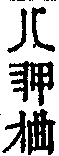

# 何一自禅师语录



> **藏经**：嘉兴大藏经（新文丰版）（嘉兴藏）　**册次** 第 39 册（J39）　**编号** JB462　**部类** 诸宗部　**卷次** 2 卷　**篇幅** 28,591 字

> **卷／品**：0 卷 · 3 品



---



## 目录



  - [何一禅师语录序](#何一禅师语录序)

  - [何一和尚语录序](#何一和尚语录序)

  - [序](#序)



---



### 何一禅师语录序



天童密云大师，以无上智慧，直接达磨心传，为东南诸方大教主，一时得法弟子实繁有徒，而费隐则尤法门中之龙象也。费隐所付嘱者二十有二人，惟性空一瓶一钵，数千里渡江，独以禅教唱导河北，一时中州青齐诸郡莫不翕然向风。何一禅师者，受性空付嘱，居京师之西郊崇宁庵，闭关阅藏，如是者有年，朝夕参叩者辄千百人，其上堂、小参及示众、问答诸种，诸弟子积成语录。梓成，问序於余。余恒谓二氏之学为其易，而吾儒所学为其难。释氏弃家薙发，屏除一切，无恩爱嗜欲之扰，而独专心致志於向上一事，故用力也易；若吾儒以经世为己任，不舍一法，凡天下国家、身心性命之事，力所当为者无不尽心焉，故用力也难；然而释氏割截身体、剖肠断臂有所不惜，则亦有难焉者矣！今观何一所著语录，何其持身之严、任道之笃，而用心之精勤匪懈如此其至也？余尝谓释门行有二种：有心行焉、有身行焉。心行者劳心者，治人之事也；身行者劳力者，治於人之事也。大士之度尽众生、地藏之欲空地狱，夫独非劳心之事哉！古人云：「言者，心之声也；名者，道之贼也。」今何一不汲汲於求名，而其言能以利众度生为愿，岂仅独善一身者哉？此可为河北诸方之人愿船，而亦不媿密云之孙枝矣！余故乐闻而为之序。



康熙参拾陆年孟春，楚邾城王泽弘撰於长安之思匡阁。



------



### 何一和尚语录序



浑然穆然，天地之根；湛然寂然，万化之源。所谓人人具足者。乃历来老古锥皆云：「向上一著，千圣不传。」此又何说哉？试思天何以高？地何以厚？日月何以明？山川何以峙？水何以流？以至草木含其生、鸢鱼达其机，孰得而秘之而谓有不传也耶？即近在一身，耳之所以能听、目之所以能视、鼻之所以嗅香、口之所以知味、意绪之所以触境而动，随缘而转，则又不能不传，更复无俟於传者。朱紫阳曰：「有物先天地，无形本寂寥，能为万象主，不逐四时雕。」吾儒几个曾见到此耶？要之，千古无无心之人也、无无性之人也、无无天之人也，何得以浑然穆然、湛然寂然者，单指为向上一著，独归之西方黄面、东来碧眼哉？



何一和尚，予同里人也。少而薙发，为一大事因缘，足迹几遍天下，尽参尊宿，得法性空禅师，乃驻锡於金台之崇宁古庵。把茅盖顶、一钵一衲，习静十年，勾当己事，人不知为善知识也。既而庵前古槐重荣、巢鹊哺鸦，人始稍稍异之，王公大人争供养焉！为修葺是庵，不数年，俨然丛林，衲子日夥。师随机接人，自尔无碍，杀活全彰、理事俱圆，师固非钻故纸者。及证道后，披阅经典、高提祖印，如水乳合，而间有开示，亦源源本本深符大道，岂非於向上一著打开光明宝藏，而经天纬地文章皆从此浑然穆然、湛然寂然者活鱍鱍地流将出来，无欠无剩之一验哉？《大易》之言曰：「寂然不动，感而遂通天下之故。」又曰：「形而上者谓之道；形而下者谓之器。」无无寂之感、无无感之寂；无无道之器、无无器之道。放之则六合九有，不足言其大；收之则碎霰微尘，不足言其小。止此心而已、止此性而已、止此天而已。在如来则无心可言、无性可言、无天可言，且并无无心可言、并无无性可言、并无无天可言。所以者何？无非欲放倒一切枝蔓，扶持这个出来，故言说法四十九年，不曾说著一字，遂为百千万亿年鼻祖，至临济而宗风大振，从来尊宿尽为捉败。师真临济儿孙，故凡录中所载皆扫尘语，正与不曾说著一字同一鼻孔出气，天下后世将有以师为饶舌，则师诚饶舌矣！或有向予言曰：「释之与儒，如参与商。」如吾子言，剖破藩篱，是何言与？是何言与？然则是亦予之饶舌耳！



康熙丁丑夏月，同里张开宗拜书。



------



### 序



何一禅师，雍丘王氏子，幼祝发大梁弥陀寺。寺有尊宿曰淡如和尚，手辟水月庵於中牟东境，为接众所。禅师於淡如在诸孙行，故得从居水月庵中，虽溷迹尘埃，而居然龙象。淡如特加识奖，令其综理庵事，事皆立办，欲以付法推为庵主，禅师迺以参学未广，辞庵远游，屡叩名衲，德业精进。又以京城繁盛，酬应杂沓，未可定居，避喧寻幽，卓锡西郊崇宁庵，闭关检藏，寒暑不辍，所蓄益富，洞彻源流。适临济正宗性空和尚自选佛场北来普择法嗣，闻禅师之名，过访崇宁，片语契合，旋留衣钵。禅师是后，机缘天授，檀施云集，廊殿门垣，日以恢拓。仿水月庵之旧，开堂接众，时而结制，朝夕参叩道场，动辄千百人俱。王公为之护法、贵胄群称弟子，善信男女车马骈交於门，供佛毕，即趋方丈问法，禅师迎机开示各满其愿。监院云晓录之秘箧，积久成帙；居士茂盛暨弟玻尔坤、楚蛮子荷师开示，矢诚皈依，谋诸慈氏，捐赀助刻，而语录以是告成矣！云晓持以诣予，諈之为序。予生平未尝读梵书，於西来意茫如也。览是语录，不能入亦不能名其善，第予与禅师以乡谊往来数十年甚狎，知其行之笃而学之勤，必非漫为立言者，则语录将与《传灯》、《指月》诸编并垂大藏，为缁流所珍玩有可徵已。抑予因之有慨焉：「人不尽为儒，而为儒不可不期为大儒；人不尽为，僧而为僧不可不期为高僧。」要以各极其诣，力之所至，而后无负於初心。禅师以中州之僧来游京师，阐扬宗旨，鼓动一时，则高僧之目禅师可谓不媿。予以中州儒生薄宦京师，亦欲扶世明道大振儒风，而儒冠者溺於利名，不自认身心性命为何物？滚滚颓波力莫能障，则予之为儒殊无效也，予滋恧矣！昔陶渊明不能止酒、远公许入莲社，至今传为佳话，予以儒生之常谈弁是语录，禅师不以其言之不类而有取焉！斯亦旷达之见也。爰以书之简端。



时康熙三十有二年，岁次癸酉，中秋谷旦，牟阳冉觐祖拜撰。



何一自禅师语录目录



上卷上堂  

小参  

示众  

问答机缘



下卷举古  

拈古  

徵古  

别古  

代古  

颂古  

偈  

佛事  

行实



何一自禅师语录卷上



嗣法门人明修、明惠、明智等编



师住北京顺天府宛平县崇宁禅院，於康熙二十年十月十五日，檀护镇国公暨宰官绅衿请就本院开堂。师拈疏云：「言言显露、字字全彰；其或未然，且听宣扬。」维那宣毕，指法座云：「须弥山、狮子座，圆陀陀、光灼灼，高著眼，莫错过。」便登。拈香云：「此一瓣香，非干雨露、不藉栽培，根盘无阴阳之地，叶覆於诸佛之顶，舒之则弥满六合，卷之则退藏於密，信手拈来，𦶟向炉中，端为君恩、亲恩、三宝恩、檀越恩，普同供养。」复拈香云：「此一瓣香，包古裹今，𦶟向炉中，恭惟现前期主镇国公，金枝千载茂、玉叶万年荣，恒作丛林藩篱、永为佛法金汤，不忘灵鹫之嘱、乐游选佛之场。」次拈香云：「非馨非臭，不是天降、非是地涌，从这里拈出，专伸供养选佛堂上传临济正宗第三十二世先师性空老和尚，用酬法乳之恩。」敛衣就座。维那白椎云：「法筵龙象众，当观第一义。」师竖拂子云：「三世诸佛曾登此曲䚄木，尘说刹说；历代祖师也升此曲䚄木，横说竖说。仁者还见麼？还闻麼？不妨出来相见。」僧问：「昔日灵山拈花，今朝崇宁竖拂，是同是别？」师云：「同有多般、别无两样。」进云：「文彩已彰，祖意未露，乞师指示！」师便打，僧亦喝，师又打。问：「离四句、绝百非，请师直指某甲西来意。」师云：「高声问将来。」僧拟议，师便打。问：「炉鞲弘开，锻凡成圣，且道非圣非凡，到来作麼生锻炼？」师便打。进云：「不是苦心人不知。」师云：「那是伊苦心？」进云：「太湖三万六千顷，月在波心说向谁？」师云：「秪恐不是玉，是玉也大奇！」问：「既然是佛，又言成道，佛与道岂有二乎？」师云：「一法虽无异，三人乃见差。」进云：「恁麼则佛与道是二？」师云：「错！」进云：「恁麼则佛与道是一？」师云：「错！」进云：「谢和尚答话。」师云：「错！」乃云：「掀翻海岳求相识，横按莫邪斩痴顽，默默自知田地稳，腾腾谁谓肚皮憨？若是个伶俐汉，向冷地里乌龟向火，向热闹处碓嘴生花，也须眼里抽钉、脑后拔楔，然后於毛端中现宝王刹、坐微尘内转大法轮，纵夺无碍，生杀自繇。不见世尊初生，一手指天、一手指地，周行七步，目顾四方云：『天上天下，唯我独尊。』云门文偃大师云：『我当时若见，一棒打杀与狗子吃，贵图天下太平。』」师云：「且道云门据何权衡要行此令？」卓拄杖，震威一喝云：「凤舞千山境、龙飞四海春。」复白槌云：「谛观法王法，法王法如是。」下座。



上堂。「有一段奇特大事举似大众。」师长久云：「山僧住持事繁，不觉忘前失后𫆏！忘机归去同鱼鸟，濯足沧浪烟水秋。」便下座。



普请上堂。师以拂子召众云：「诸佛智慧甚深无量，其智慧门难解难入。」放下拂子云：「会麼？犀因玩月纹生角；象被雷惊华入牙。」下座。



上堂。维那白椎云：「法筵龙象众，当观第一义。」师云：「第一义，山僧未出方丈、诸人未到法堂，早已花娇易谢，何况出乎其口、入乎其耳，那堪雪上加霜？若论第二义，与大众说则因缘。」举：「俱胝和尚初住天台，有尼名实际，顶笠执锡，遶师三匝云：『道得即拈下笠子。』三问，胝并无对，际便去。胝曰：『日势稍晚，且留一宿。』际曰：『道得即宿。』胝又无对。际去后，胝自叹曰：『我虽处丈夫之形，而无丈夫之气。』拟弃庵诸方参学。其夜，有山神告曰：『师不须离此山，将有大菩萨来为和尚说法。』旬日，天龙和尚至，师罄诚迎礼，具陈前事，天龙竖一指示之，胝当下大悟。胝所畜一童子於外被人诘曰：『和尚说何法要？』童子竖起一指，归举似胝，胝以刀断其指，童子叫呼走出，胝召一声，童子回首，胝那竖起一指，童子领悟。」师召大众：「且道俱胝与童子悟在什麼处？」师竖指，顾左右，下座。



解制上堂。「九旬之内，结水成冰；三月之外，化冰为水。即今涣然冰水一如，又作麼生？」良久云：「等闲识得东风面，万紫千红总是春。」下座。



六月六日，普住请上堂。卓拄杖云：「选佛嘱托这根拄杖，昼夜放光，时常说法，众中还有作家，出来与拄杖子相见。」僧问：「有问有答即不问，无问无答又作麼生？」师云：「早已问答了也！」僧喝，师打，僧又喝，师亦打，僧云：「看破了也。」师云：「看破个什麼？」僧拟议，师连打，僧礼拜，师卓拄杖一下云：「看！」问：「如何是佛？」师竖拄杖云：「鉴！」进云：「如何是法？」师横拄杖云：「鉴！」进云：「如何是僧？」师倚拄杖云：「鉴！」进云：「三宝蒙师指示，教义、宗义是同是别？」师云：「风吹杨柳千条锦，雨打梨花万点银。」进云：「某甲不知，伏冀明示！」师云：「分明为伊，吾无隐乎！」乃云：「今日晒《番藏经》，此藏之中有如来全身，汝等也要留心，向返闻处听、向冷眼处看、向动手处会、向四威仪处识。果然如是，是名转此藏经；其或未然，却被藏经转汝了也。且道即今转藏一句又作麼生道？若将耳听终难会，眼里闻声方得知。」下座。



上堂。举：「世尊与众行次，以手指他云：『此处宜建梵刹。』帝释将一茎草插於地上云：『建梵刹已竟。』世尊微笑。」师召大众云：「还委悉麼？」众默然，师不觉呵呵大笑云：「万籁有心闻不得，孤岩无耳却知音。」下座。



优婆夷普淑等请上堂。云：「狮子窟中无异兽，狮子行处狮子随，不妨狮子儿出来相见！」一座主问：「猊座高登，人天普集，少室家风，请师吐露。」师卓拄杖云：「会麼？」主云：「时逢秋景、节届中元，善男信女建设兰盆胜会，功归何所？」师云：「苍苍皆草木、处处野花香。」主云：「尝闻一子出家，九祖生天，为付麼目连救不得母？」师云：「者业甚分明。」问：「某甲出家，心上常疑，即今二十三岁，不知二十三岁已前灵光亦在何处？请师指示！」师云：「当面无隐覆。」进云：「佛身充满法界，和尚在什麼处著脚？」师云：「近前来，向汝道。」进云：「不会。」师云：「争怪得老僧麼？」僧才出礼拜，师打云：「速道速道！」进云：「如何是莲华出水？」师复打，进云：「不知。」师云：「明明露出，为什麼不知？」问：「观音能救世间苦，如何又有生老病死？」师云：「伊不向这里闻。」乃云：「尒时，庞婆鹿门寺设斋，维那意欲焚疏回向，婆拈梳子插髻后云：『回向了也。』即今崇宁设斋与昔庞婆是同？是别？若道是别，皆是优婆夷；若道是同，拈梳子看。」师良久，蓦拈拄杖云：「荒田不拣草，净地却迷人。」下座。



普请，上堂。云：「诸方谈玄论妙、言是说非；崇宁即不然，有理也是三十棒、无理也是三十棒。何故如此？只教拄杖任纵横，专专秖卖死猫头。」下座。



上堂。举：「临济大师云：『第一句荐得，堪与佛祖为师；第二句荐得，堪与人天为师；第三句荐得，自救不了。』」师召大众：「还有荐得那一句？不妨出来通个消息。」众皆默然，师云：「啼得血流无用处，不如缄口过平生。」下座。



结制，王图尚设斋，请上堂。维那白椎云：「法筵龙象众，当观第一义。」师云：「第一义，一椎击著，聋者能听、哑者能言、瞽者能见。大众！还信得及麼？若信得及，不妨出来道看！」僧问：「杲日当空，十方普照，只如今日请师举扬，未审举扬个什麼？」师便打。进云：「棒头有眼明如日，指出须弥作寿山。」师云：「礼拜看！」僧礼拜，师云：「狮子咬人、韩卢逐块。」乃云：「这个光明藏，辉天鉴地、耀古腾今，五竺藏不得、四海生光辉。法法本具、物物全彰，所谓法无定相，遇缘即宗。竿木随身，逢场作戏，将南作北、指东为西。搅长河为酥酪、变大地作黄金，拈一茎草作丈六金身，丈六金身作一茎草。一为无量、无量为一，小中现大、大中现小。虽然如是，正眼观来未是木分。且道如何是本分？」良久云：「还委悉麼？」卓拄杖，震感一喝云：「千峰势倒岳边止，万派声归海上消。」下座。



上堂。蓦拈拄杖云：「拈来当宇宙，遍界不曾藏，三世诸佛不敢正眼视著，历代祖师只得口挂壁上。正恁麼时，佛来也打、魔来也打，有理也是三十棒、无理也是三十棒，严行正令犹是半提，大用全彰如何施设？」卓拄杖云：「眼空宇宙浑无物，大座当轩谁敢窥？」下座。



解制上堂。云：「若论此事，结制之内，山河大地出气不得，万象森罗无不失色；解制之外，山河大地一任峥嵘，万象森罗灼然生光。我此一众，或行或住、或坐或卧，一动一静、一语一默，若向这里动转施为，当面看著、开口说著、动手触著、举步踏著，且道四著之中那一著子是结解的三昧？」挥拂子云：「莫随有相光中转，但向无言句外闻。」蓦拈拄杖卓一卓，下座。



上堂。问：「僧问赵州：『祖师西来意？』州云：『庭前柏树子。』意旨如何？」师云：「狗舐热油铛。」进云：「蒙师指示！」师云：「驴事未去、马事到来。」乃云：「西来意、柏树子，热油铛、蒙吾指。麻三斤、萝卜头，咬著些儿冷汗流。」下座。



上堂。僧问：「如何是宾中宾？」师云：「远客投知己，𫏐坐笑吟吟。」进云：「如何是宾中主？」师云：「阵云横海上，拔剑搅龙门。」进云：「如何是主中宾？」师云：「天共白云晓、水和明月流。」进云：「如何是主中主？」师云：「莫邪当宇宙、血溅满乾坤。」进云：「宾主蒙师指示，如何是向上事？」师便打。问：「如何是夺人不夺境？」师云：「幽兰好似隐君子，野外无人独自香。」进云：「如何是夺境不夺人？」师云：「渔樵歌满路，野老唱丰年。」进云：「如何是人境两俱夺？」师云：「道泰不传天子令，时清休唱太平歌。」进云：「如何是人境俱不夺？」师云：「大地花似锦，长安人奏歌。」僧礼拜，师便劈头一棒云：「这是境，这是人。」乃云：「满目清光，贯通古今，动转无隐、静则现成，头头显露、步步全彰。」举拂子云：「还见麼？」击禅床一下云：「还▆麼？若向这里闻处透脱、见处分明，更有何事？」蓦拈拄杖云：「从来大道无拘束，信手拈来百事全。」下座。



盂兰会，请上堂。「时逢秋景，节届中元，乃诸佛欢喜之辰，实目连孝母之日。善男信女，献花供果，祀祖礼忏，诚格获孝。」竖拂子云：「目连来也！为众说法，虚空笑▆、须弥吐舌，三脚驴舞、白牯频说，报到良期。知时识节，葵花欲开、海棠将绽、梧桐滴露、松柏锁烟。」召大众云：「看看！满目秋光如不荐，芙蓉依旧溪水边。」下座。



上堂。众集，白槌毕，师卓拄杖一卓，便下座。



上堂。问：「如何是世尊拈花的意旨？」师竖拂子。进云：「如何是迦叶微笑的意旨？」师挥拂子。僧礼拜云：「谢和尚指示！」师云：「指示个什麼？」乃云：「世尊拈花、迦叶微笑，觌面独露，大用全彰。世尊将虾钓鳖、迦叶见饵忘钩，虽则两彩一赛，各露风规，正眼观来，未合向上一路千圣不传。即今大众如何话会？」师笑云：「自有一双穷相手，不曾容易舞三台。」下座。



上堂。僧问：「佛未出世、祖未西来，还有佛法也无？」师云：「遍界不曾藏。」僧作听势，师云：「苍天苍天！」进云：「毛骨悚然。」师云：「未在。」僧便喝，师打云：「这瞎汉！」进云：「瞎汉瞎汉！」师云：「与麼乱统？」僧拂袖便出，师召：「上座！」僧回首，师笑云：「禾山道的。」乃云：「佛未出、祖未来，触著些儿笑盈腮，慇懃为打禾山鼓。云从龙兮风从虎，那个男儿不丈夫？耳不聋兮眼不瞽，何必向外觅佛祖？」顾左右云：「还委悉麼？面皱只为陪笑得，背驼皆因鞠躬多。」下座。



上堂。举：「僧问九峰虔禅师云：『祖祖相传底事？』峰云：『释迦悭、迦叶富。』僧云：『如何是释迦悭？』峰云：『无物与人。』僧云：『如何是迦叶富？』峰云：『国内孟尝君。』僧云：『毕竟祖祖相传底事作麼生？』峰云：『百岁老人分夜灯。』据九峰，一言之下分皂白、一语之下定古今，仔细检点将来，分明未在。即今有人问我崇宁：『如何是祖祖相传底事？』相向他道：『山青水绿当阳指，竹翠花浓信手拈。』」下座。



上堂。云：「举扬个事，百千法门、无量妙义。天得一以清、池得一以宁、君王得一天下太平、衲僧得一海众云集，虽然奇特，未足尽善。且看水上座为大众说奇特。」蓦卓拄杖一卓云：「也大奇、也大奇！」掷下拄杖云：「木上座恁麼说不思议。」下座。



上堂。僧问：「大悲千只手，那只是正手？」师以手指云：「这里荐。」进云：「大悲千只眼，那只是正眼？」师云：「近前来看！」进云：「手、眼蒙师指，临济三玄三要，伏冀和尚▆慈。」师云：「一一问将来。」进云：「如何是第一玄？」师云：「觌面不相瞒。」进云：「如何是第二玄？」师云：「微笑千古传。」进云：「如何是第三玄？」师云：「饥来吃饭困来眠。」进云：「如何是第一要？」师云：「世尊拈花迦叶笑。」进云：「如何是第二要？」师云：「须弥吐舌虚空笑。」进云：「如何是第三要？」师云：「拾得作舞寒山跳。」进云：「三玄三要谢师答话，如何是从上以来佛佛相传、祖祖相印底事？」师劈脊便棒云：「还知麼？」僧拟议，师又打云：「痛痒也不知。」乃云：「向上一著子，眼若听、耳若睹，即此物、非他物，雪峰毬、玄沙虎、睦州板、禾山鼓、鲁祖壁、云门顾。」召大众：「还识这一队老古锥麼？」良久云：「万山不隔今宵月，一片清光分外明。」下座。



上堂。僧问：「承言者丧、滞句者迷，如何是不错错？」师云：「突出难辩。」僧近前作舞势，师以拂子击禅床，僧作女拜，师竖拂子，僧礼拜，师便喝。问：「把住则乾坤失色，放行则瓦砾生光，正恁麼时，把住好？放行好？」师云：「且没交涉。」进云：「和尚升座，钟鼓皆说法要，未审说何法要？」师云：「若将耳听终难会。」进云：「当阳一著，众眼难瞒，末后一机，千圣不说。如何是千圣不说？」师云：「眼里闻声始得知。」问：「昔日韩文公参大颠和尚云：『弟子军州事繁，佛法省要，乞师一语。』颠良久，公罔措。意旨如何？」师云：「官不容针。」进云：「时三平侍者乃敲禅床三下，颠云：『作麼？』平云：『先以定动、后以智拔。』意旨如何？」师云：「私通车马。」进云：「公乃曰：『和尚门风高峻，弟子於侍者边得个入处。』未审得个什麼入处？」师云：「海纳百川。」乃云：「一问一答，总而未在，假使乾坤万象森罗，尽为异口同声，各具百千问难，问问各别，不消长老弹指一下一时答了。於其时中作不思议佛事，虽然美则美矣！闹热门庭，正眼观来也是业识茫茫无本可据，若是祖师门下一点也用不著。」师召大众云：「且道是那一点？」卓拄杖一卓，下座。



师住北京翊教禅寺语录



康熙三十七年，岁次戊寅，受京师护法、王公、宰官、绅衿、本寺监院同诸山尊宿等公请，住翊教禅寺，於二月十五日进院。



山门。「舒目长安道，举足般若门。」拽杖便入。



弥勒。「明明兜率宫，堂堂楼阁坐，常笑无人识，者里是什麼？」



大殿。「马祖道底辉天鉴地，赵州说底耀古腾今。且道殿里底？」遂展具作礼。



韦驮。「灵鹫嘱付、翊教叮咛。且道叮咛个什麼？」良久，插香云：「神功叵测生檀信，密行难思镇魔军。」



伽蓝。「伽蓝菩萨，愿力洪深，以何为验？灵山记莂，拥护法社。」



祖师。「昔日面壁，今朝打坐，盖闻西归，者里是谁？众中还识西来意麼𫆏？祖祢不了，殃及儿孙。」



据室。卓拄杖云：「古今老古锥，说的说、默的默，未审说的是什麼？默的是什麼？」以拄杖横案，震威一喝云：「居此室，行此令。」



当日监院同众檀护请上堂。师至法座拈疏云：「人天眼日、衲僧巴鼻，事不获已，对众拈出。荐麼？不然，且听维那重宣。」宣毕，指座云：「狮子座、曲䚄床，头头露、步步彰。」便升座。拈香云：「此一瓣香，贵而无比、尊而无等，𦶟向炉中，端为祝延今上皇帝圣寿万岁万岁万万岁，伏愿皇风一片，至化无疆。」复拈香云：「此一瓣香，因植灵鹫、果培宫院，𦶟向炉中，耑为储君王子、天眷宗亲，福如海岳、寿似松椿。」次拈香云：「乃栋乃梁、为国为民，𦶟向炉中，奉为满朝文武、阖国公卿、宰官缙绅、诸山尊宿、现前檀越，同明般若，共证真常。」又拈香云：「此一瓣香，信手拈来，熏天炙地，𦶟向炉中，耑伸供养选佛堂上本师性空先老和尚，用酬法乳之恩。」敛衣就座。维那白椎云：「法筵龙象众，当观第一义。」师竖拂子云：「第一义，诸仁者会麼？」（问荅不录。）乃挥拂子云：「者个是佛佛授受、祖祖相传，由此天下老和尚建法幢、立宗旨，行棒行喝、横说竖说，面前挥宝剑、脑后舞金锤。高高山顶立，逼塞虚空；深深海底行，平沉大地。不是神通妙用，亦非法尔如然！不是不是，日面月面；有麼有麼？突出难辩。大众还委悉麼？且道委悉个什麼？」震威一喝云：「慇懃为解丁香结，放出枝头自在春。」便下座。



小参



除夕小参。云：「一年又一年，吾头将白半，诸人莫道头上无，剔起眉毛还自看。」师顾左右云：「邀众焚香辞旧岁，呼童捧茶贺新年。」



起七小参。师云：「进堂将有一七，设有见地，不妨出来与汝证明。」众无语。乃举：「僧问赵州云：『学人乍入丛林，乞师指示！』州云：『吃粥了也未？』进云：『吃粥了也。』州云：『洗钵盂去。』其僧言下大悟。即今崇宁不贵诸人千转万语，只贵一悟为期。」复举：「万松道：『还丹一粒，点铁成金；至理一言，转凡成圣。』若知金铁无二、凡圣本同，果然一点也用不著。且道那一点？众中还会麼？肯来两手相分付，拟去千寻不可攀。」



小参。僧出礼拜，师便打云：「速道速道！」进云：「拜过再道。」师又打，僧便喝，师云：「喝后又作麼生？」师问僧：「伊参的是什麼？」进云：「万法归一。」师云：「如何是一？」进云：「一个鼻头往下垂。」师卓拄杖云：「还识这个麼？」僧便礼拜，师便打。乃举：「俱胝凡有所问，唯竖一指，殊不知他俱胝终身用之不尽？即今崇宁这根拄杖如江上之清风、似山间之明月，取之无禁、用之不竭。」师横拄杖云：「若论此事，嘲三攞四，长安大道，七纵八横，忽然开口说著、举步踏著。若向这里脱然无疑，高挂钵囊、拗折拄杖。我且问你诸人：是什麼人的境界？」卓拄杖云：「一堂风冷淡、千古意分明。」



除夕小参。僧出，请问：「和尚即今在什麼处？」师云：「近前来向汝道。」进云：「求和尚开示！」师云：「开示了也。」僧礼拜，师云：「抛钩钓金鳌，跛鳖出头来。」乃云：「光阴迅速，年穷月尽，户户辞旧、家家迎新，富贵也忙、贫贱也忙，未审忙的是谁？若知忙的是谁，便识昔香严道：『去年贫未是贫，今年贫始是贫。去年贫还有卓锥之地，今年贫，锥也无。』真净道：『去年富未是富，今年富始是富。去年富，惟有一领黑黪布褊衫；今年富，添得一领百衲山水袈裟。』」师云：「二位尊宿，一个哭贫，贫恨一身多；一个夸富，富嫌千口少。仔细检点将来，两个一对弄泥团汉！崇宁又且不然，昨日午斋馒头、今朝晚茶果子，饥则共餐、渴则同饮，随分者些子，也不哭贫、也不夸富。即今腊月三十日到来，应时及节一句又作麼生道？」顾左右，卓拄杖一卓云：「爆竹催腊去，梅花送春来。」



晚参。师云：「斩猫因缘之事，此道未丧，只是曲高和寡。人虽难会，山僧易见。在天而天、在地而地、在君臣而君臣、在父子而父子，乃至四生六道而共有之。在眼能见、在耳能闻、在鼻能嗅、在舌知味、在身知触，六根门头放光动地。非贵贱、非贤愚、无皂白、无青黄，无净染、无增减、无智得、无开合、无背向，有名呼不得，无位可安排。正恁麼时，若向这里分疏得出，便可随处作主、遇缘即宗，将天作地、指山为水。」召大众云：「还会麼？长安风月贯今昔，那个男儿不丈夫？」



小参。云：「昔高安白水仁禅师示众云：『寻常不欲向声前句后鼓弄人家男女。何故？且声不是声、色不是色。』时有僧问：『如何是声不是声？』仁云：『唤作色得麼？』僧云：『如何是色不是色？』仁云：『唤作声得麼？』僧礼拜。仁云：『且道为你说？答你话？』」师云：「即今有人若问崇宁：『声不是声、色不是色……』」僧问：「声不是声、色不是色，毕竟是个什麼？」师劈头一棒，僧云：「谢师指示！」师云：「不是不是！」僧罔措，师云：「掬水月在手、弄花香满衣。」



为诰封夫人那氏对灵小参。「雪覆琼楼白，雨洒珊瑚红，纵横非他物，目前不是境。」师挥拂子云：「灵魂这里会，处处任峥嵘。」



为诰封夫人那拉氏对灵小参。「坤仁生万物，淑德悦众心，四大本来空，五蕴元非有。荡荡金刚体，无生亦无灭。」师举拂子云：「灵魂这里荐，何处不莲宫？」



小参。僧问：「众色归空，空归何所？」师云：「当面藏不得。」进云：「为什麼藏不得？」师云：「十方无壁落，四面亦无门。」乃云：「大凡学道之人须识本心，且莫自瞒，方可学道。多见庸流认贼为子、认奴作郎以为心要，此实错会。一语一默且没交涉、非语非默亦没交涉，我这里针劄不入，为你诸人分明说出。」师笑云：「老僧失利！」



为光禄大夫副都统张公对灵小参。「青云英秀，以乃黄粱，金风惨惨、玉露凄凄，野草啣花，香泪满地。呜呼！竖穷三际，不是声色；横遍十方，亦非他物。所以道：『有物先天地，无形本寂寥，能为万象主，不逐四时凋。』正恁麼时，崇宁不惜眉毛，满盘托出，八字打开。」竖拂子云：「灵魂这里荐。如果会得，说什麼超生了死、离苦得乐，刹刹观音、处处弥陀。其或未然，即今荐灵一句又如何指示？」放下拂子云：「还会得麼？咦！山僧把手牵不得，灵魂自肯乃方亲。」



为舒居士对灵小参。「昨日与君说，今朝视君默，默即是说、说即是默，默也不是、说也不是。恭惟居士这里荐。」



小参。师云：「四海浪平龙睡稳，九天云静鹤飞高。」僧礼拜云：「卷帘当白昼，移榻对青山。」师便归方丈。



为孙门石氏对灵小参。师蓦拈拄杖云：「者个光明藏，从来不复藏，灵光独耀，迥脱根尘，本无男女之形，讵有增减之相？自然峥嵘，任意逍遥。虽然如是，即今荐灵一句作麼生道？」复卓拄杖云：「识得这些子，觌面甚分明。」



众请示诲。师曰：「小参者，古人家训、后学龟鉴，诸上座、兄弟们，但凡始则发心，辞亲离俗、割爱剃发，谁不想学道乎？果然不忘最初发心出家之念，古人云：『抱一个，「万法归一，一归何处？」』朝参暮参、昼参夜参，吃饭时不知其滋味、饮水时不知其冷热，身似枯木、心如寒灰，或二十年、或三十年，一念万年、万年一念，倘於豁然格外明宗，不负初心之愿；其或未然，另示方便。正开口吃饭时问谁吃饭？著衣时问谁著衣？行时问谁行？住时问谁住？坐时问谁坐？卧时问谁卧？诸上座、兄弟们果不相违，自然了悟自证之地。大众！且道什麼处是自证之地？」蓦拈拄杖，震威一喝云：「莫谓水寒鱼不食，如今钓得满船归。」



晚参。问：「半窗松影半窗月，是何境界？」师云：「莫认境界会。」乃卓拄杖一卓云：「会麼？恁麼向你道，为什麼不会？」又卓一卓云：「杖前无限松风意，散步归来月正圆。」



示众



结制示众茶话。「今宵监院陈设茶果，恭候山中达士、湖海高流，云集崇宁专为个事。参须真参、悟须实悟，莫学粥饭之流口耳之学，南天台、北五台空游山水，谈是论非、依文解义，障先圣之智眼、闭自己之悟门，自误平生，忽然大限临头，未免手忙脚乱，岂能作主？如生牛剥皮、似螃蟹下锅，苦哉！悔之何及？幸今云会有缘，趁身康健愤发一番，须要身心放下，身如枯木、心似寒灰，大休大歇，一念万年、万年一念。正恁麼时，吃茶无滋味，饮著通身庆快。」顾左右云：「还知通身庆快麼？」众无语，师云：「种田博饭家常事，不是饱参人不知。」



示众。云：「设有弄拙呈丑，不妨出来与木上座相见！」众无语，师云：「崇宁有一奇特事举似大众：『大地不是土、大山不是石、大海不是水、大富不是财、大贵不是位、大悟不是道。』若人向这里荐得，达此六门，不唯以见诸佛正眼分明，灼然而识祖师鼻孔长短。虽然如是，检点将来见也不是、识也不是。毕竟如何？」良久云：「不是！不是！」



示众。云：「众中参的是什麼话头？」一僧礼拜，师云：「你参的什麼话头？」进云：「某甲初参。」师云：「不妨也要问过。乃临济凡见僧来，入门便喝，是个金刚圈；德山凡见僧来，入门便棒，是个栗棘蓬。只如睦州凡见僧来，便云：『担板汉！』我且问你诸人，是个什麼？不见赵州道：『金佛不度炉、木佛不度火、泥佛不度水、真佛内里坐？』赵州使人难会，崇宁转教易见。」蓦拈拄杖划㊀云：「一二三四五，金木水火土，燕子来啣泥，虾蟆去打鼓。甜瓜彻蒂甜，苦瓠子连根苦，互换高低如不荐，世尊指地亦非土。」



腊八日示众。云：「这一著子，天不能盖、地不能载，大体全彰、大用显露，非是过量人，难行奇特事。故我世尊弃舍皇宫，直入雪山六年苦行，腊月八日夜睹明星悟道。未审睹那个明星？作麼生悟道？大众还会麼？」卓拄杖云：「维摩不说说，文殊不闻闻，留下破沙盆，千古镇乾坤。」抛下拄杖云：「𫆏！填沟塞壑如不荐，雪山依旧白云中。」



示众。云：「昔日僧问浮山远禅师云：『如何是佛？』远云：『大者如兄、小者如弟。』」师云：「我且问你：诸兄弟是佛否？」僧问：「佛且止，毕竟是什麼？」师击禅床一下，僧拟议，师云：「黄金自有黄金价，终不和沙卖与人。」



问荅机缘



一官人参拜：「学生有一疑情，乞师指示！」师云：「请举。」官云：「万象是境，何得与性言一？」师云：「谁道万象是境？谁言与性是一？」官於言下有省：「谢和尚指示！」师云：「是公所举，非吾指示。」



师问孔意知客：「不是心、不是佛、不是物，是个什麼？」客云：「两头掐断。」师云：「为什麼掐断？」客云：「将长作长，将短就短。」师云：「那是汝的长短。」客云：「提起则遍满三千。」师云：「唤什麼作三千？」客云：「放下则一尘不立。」师微笑，客礼拜而退。



一居士参，问：「牛过窗棂，头蹄俱过，为什麼尾巴过不得？」师云：「为他有疑情在。」士罔措，师云：「果然过不得。」



大严和尚赠炉，师云：「心领。」严云：「须是身心俱到。」师云：「这里身心俱不到。」严笑而坐，师云：「且吃这盏茶。」



一公问：「昔赵州道：『庭前柏树子。』意旨如何？」师云：「护法掌中扇子。」公云：「不会。」师云：「争怪得老僧麼？」



御前一官人参问：「如何是万法归一？」师云：「公是御前下。」官云：「一归何处？」师呵呵大笑，官云：「不会！」师云：「且坐吃茶。」



师拈笔写字，一官人参问：「如何是本来面目？」师以砚示之，官云：「不知，乞和尚分明指示！」师云：「砚、瓦分明是石，为什麼不知？」官拟议欲说，师便喝，官亦喝，师云：「好喝！」官无语，师云：「莫作喝会好。」



师一日往圆教寺，问病于解三和尚。师入方丈进礼，解在禅床番身急忙著衣，师云：「家里人还作客会麼？」解云：「既是家里人，请坐！」师坐云：「吾老法兄贵恙如何？」解云：「十八界已空。」师云：「吾兄言界，正是不空。」二老鼓掌大笑。



平郡王驾临崇宁庵，王曰：「和尚如何得道？」师云：「道本无得，得者非道。」王曰：「尝闻人说。」师云：「至理无说，说则理丧。」王微笑，师云：「请坐吃茶！」王临座而立，师云：「请坐。」王固辞而立。王又问：「解三和尚、溟波和尚、桂芳和尚谁胜谁劣？」师云：「胜则俱胜，劣则俱劣。」王曰：「学文如何？」师云：「儒尊士行、僧论德业。昔燕王归敬于赵州；今世祖▆信于报恩，未尝重于学文？」王顾左右大悦，王曰：「稍迟数日，与和尚送匾额来。」师固辞。



一官参问：「南泉斩猫，意旨如何？」师云：「臭气熏天炙地，问他作什麼？」官云：「不知。」师云：「请，茶。」官接茶便吃，师云：「你道不知？」官罔措。



僧参问：「无梦无想，正恁麼时，主人公向什麼处去？」师云：「莫眼花。」僧拟议，师云：「梦话也不少。」



客指《语录》云：「是什麼？」师云：「人天眼目。」客云：「要这个作什麼？」师云：「这个是什麼？」客礼拜，师云：「要这个作什麼？」



一座主来谒，师命元峰西堂陪坐，主云：「这个参禅余不知。」堂指衣云：「这个是什麼衣？」主云：「七衣。」堂云：「你道不知？」主罔措。侍者举似师，师云：「一点水墨，只教龙飞象舞。」



僧礼拜：「请和尚印过，某甲悟也。」师云：「见什麼来？」僧云：「见动静一如。」师云：「动静且置，什麼是你的一如？」僧无语，师拈拄杖连棒打出。



僧问：「佛法无多子。」师指茶壶示之，僧云：「无多子。」师云：「不是物、不是佛、不是法，你道是什麼？」僧云：「是茶壶。」师便打，僧礼拜，师云：「这个也不识。」



师畫一○相，侍者云：「零零落落。」师圆相中又畫一畫，者罔措，师便打。



库司问：「云门为什麼打杀世尊？」师拈拄杖示之，司礼拜，师云：「为什麼？」司云：「我秖礼拜。」师云：「你且归库去。」



新到四僧参礼，师问：「那里来？」一僧云：「青塔寺来。」师云：「有何言句？」僧云：「青塔寺和尚甚是慈悲，别时满眼垂泪。」师云：「非和尚。」僧云：「何故非和尚？」师云：「爱心不除。」僧云：「恁麼则佛说大藏教为什麼？」师云：「上座不唯不知宗旨，尒且不知教义。佛说一大藏，只为众生爱心不除。」僧无语。三僧皆云：「青塔和尚道：『真朝五台便去，假朝五台随老僧住著。』」师云：「这和尚好不会说话。」三僧云：「何故不会说话？」师云：「若是上座辞吾崇宁，只向伊道：『假朝五台便去，真朝五台随崇宁住著。』」众僧礼退。师落堂。僧问：「如何是禅道？」师以竹篦子一划云：「会麼？」僧礼拜。师云：「你礼拜个什麼？」僧拟议，师打云：「抛钩钓狞龙，跛鳖出头来。」



僧问：「如何是生死之事？」师拈拄杖云：「荐麼？」僧礼拜，师便打，僧云：「为什麼打？」师云：「为你不知痛痒。」僧无语，师云：「生死在这里。」



师问僧：「做什麼？」僧云：「念佛。」师云：「念佛的是谁？」僧云：「家无二主。」师云：「主伴重重。」僧走过，师云：「这瞎汉！放你三十棒。」



师问僧：「你参的什麼话头？」僧云：「念佛。」师云：「那个念佛？」僧云：「又念佛。」师云：「头上安头。」僧礼拜，师云：「何不向这里念看？」



师问堂主：「汝参的什麼话头？」主云：「本来面目。」师云：「那是你的本来面目？」主便喝，师云：「喝后又作麼生？」主拟议，师便打。



僧问：「如何是一刀两断？」师以拄杖划一划，僧罔措，师便打。



吴居士问：「《经》云：『一切有为法，如梦幻泡影，如露亦如电，应作如是观。』请师紧要处指示！」师良久云：「看！」士乞师：「别令方便。」师云：「依经解义，三世佛冤；离经一字，即为魔说。会麼？」士罔措。师云：「如果荐得，则契佛意；其或未然，即为谤经。」士惧然，礼拜求忏，师云：「山僧罪过。」



一客来参，师云：「请坐。」客云：「道不可须臾离，离者非道也。」时闻驴鸣，师云：「这个是离也？是不离也？」客罔措，师云：「患根在这里。」



僧礼拜，师问：「那里来？」僧云：「五台来。」师云：「曾见文殊麼？」僧云：「见！」师云：「文殊与汝说什麼？」僧拟议，师便打。



殿主礼拜，举：「台山僧宿崇宁，净头问：『曾见文殊麼？』僧曰：『见！』净无语。」主曰：「某甲代语，请和尚印证。」师云：「代看！」主曰：「凡所有相，皆是虚妄。」师曰：「不在言句上。」主曰：「在什麼处？」师曰：「这里会。」主无语，师举：「离四句、绝百非。这里道看！」主曰：「叶落还归根。」师曰：「话也不识。」主曰：「请和尚道看！」师曰：「头上安头。」主礼拜，师便打。



胡公访师，问：「三界唯心，隔纸窗不见外物，未审是一心？是二心？」师云：「道看！」公呵呵大笑，师云：「毕竟是一心？是二心？」公指门云：「这是天堂门？这是地狱门？」师云：「非天堂、非地狱。」公云：「是什麼？」师劈面一掌，公鞠躬云：「领！领！」师云：「请坐吃茶！」



居士问：「佛身充满法界，向什麼处坐？」师以手指云：「向这里坐。」士云：「这里是什麼所在？」师打云：「顾！」



师与玉轮和尚看解三和尚病，轮把左手、师把右手，三云：「是谁？」轮云：「崇宁和尚与弟特来相看。」三云：「吾年七十有二，要去。」轮云：「说一句来！」三闭目。师云：「手又动不得、口又无气力，替解兄代语如何？」三点头，师云：「吾兄素常斩钢截铁手段，要住就住、要去便去。」三合掌点头，轮云：「别去。」师云：「别别别！珊瑚枝枝撑著月。」



官人来参问不二法门，师良久，官云：「如何是不二法门？」师云：「出身犹可易、脱体道应难。」官礼拜云：「蒙和尚指示！」师云：「我无法与人，指示个什麼？」官云：「正是指示！」师云：「老僧失利。」



师召侍者云：「语直机圆是如何？」者云：「圆是。」师云：「方作麼生？」者云：「方也是。」师云：「不方不圆又作麼生？」者呵呵大笑，师云：「再道看！」者礼拜。师云：「好个不方不圆，秖是语直。」



伊氏夫人问：「乞和尚开示。」师云：「开示已竟。」夫云：「心与性是一是二？」师云：「高声问来。」夫云：「心与性是一是二？」师云：「头上安头。」夫云：「说话的是他麼？」师云：「他是个什麼？」夫云：「他是个狗。」师云：「唤作一物即不中。」



一婆子来参，礼拜，师云：「且坐吃茶。」婆子抽身而去，师便送，婆云：「和尚为什麼随人脚跟转？」师云：「你的脚跟在什麼处？」婆拟议，师云：「恁麼则你还不识脚跟。」



僧参，师问：「那里来？」僧以手作圆相呈上，师以拄杖地下划[○@生]，僧作女拜，师又划



，僧便出，师云：「瞎汉！瞎漠！」僧回首云：「诺诺！」师云：「不是不是！」



伊氏夫人请师斋，夫曰：「《金刚经》云：『凡所有相，皆是虚妄。若见诸相非相，即见如来。』是何意旨？」师曰：「意旨还见麼？」夫曰：「『过去心不可得、现在心不可得、未来心不可得。』毕竟得什麼心？」师曰：「我吃的饼子。」



师阅《慈明禅师录》中，冬日榜示僧堂作此字







，至此问侍者：「是什麼字？」者罔措，师震威一喝，者脱然大笑，师曰：「这个也不识。」者礼拜，师微笑。



> (燕山诰封夫人关门伊氏，率男茂盛、玻尔坤、楚蛮子  

> 施赀在京师本庵刻。)



何一自禅师语录卷上



何一自禅师语录卷下



嗣法门人明修、明惠、明智等编



举古



举：「世尊初生，一手指天、一手指地，周行七步，目顾四方云：『天上天下，唯我独尊。』云门偃云：『我当时若见，一棒打杀与狗子吃，贵图天下太平。』」



师云：「我不似云门恁麼，当时若见，但向冷笑一声，他若定动，便道：『勘破了也。』」



举：「洞山於扇上书『佛』字，云岩见，却书『不』字；洞山又改作『非』字；云峰见，乃一时除却。」



师云：「三个老汉总在扇上换却眼睛，东书西畫。我若见，夺却扇柄，看他向什麼处下手？」



举：「西天大耳三藏到京，云：『得他心通。』肃宗命忠国师试验，三藏才见师，乃礼拜立於右。师问：『汝得他心通耶？』藏云：『不敢。』师云：『汝道老僧即今在什麼处？』藏云：『和尚是一国之师，何得去西川看竞渡？』师良久再问：『汝道老僧即今在什麼处？』藏云：『和尚是一国之师，何得向天津桥上看弄猢狲？』至第三问藏，师良久，藏罔知去处，师叱云：『这野狐精，他心通在什麼处？』赵州因僧问：『大耳三藏第三度不见国师，未审国师在什麼处？』州云：『在三藏鼻孔里。』后僧问玄沙：『国师既是在鼻孔里，因甚不见？』沙云：『只为太近。』白云端云：『国师若在三藏鼻孔里，有甚难见？殊不知在三藏眼睛里。』」



师云：「即今国师在什麼处？策起眉毛看！」



举：「昔有僧去参米胡，路逢一婆住庵，僧云：『婆有眷属麼？』婆云：『有。』僧云：『在什麼处？』婆云：『山河大地、若草若木皆我眷属。』僧云：『婆莫作师姑来麼？』婆云：『你见我是什麼？』僧云：『是俗人。』婆云：『汝不可是僧。』僧云：『婆莫混滥佛法好。』婆云：『我不混滥佛法。』僧云：『与麼岂不是混滥佛法？』婆云：『汝是男子、我是女人，岂是混滥？』」



师云：「若非这僧，争得证明？」



举：「昔有僧去覆船路，逢一卖盐翁，僧问：『覆船路向甚处去？』翁良久，僧又问，翁云：『你患聋耶？』僧云：『你向我道什麼？』翁云：『向你道覆船路。』僧云：『翁莫会禅麼？』翁云：『莫道会禅，佛法也会尽。』僧云：『试说看！』翁挑起盐，僧云：『难！』翁云：『你唤作什麼？』僧云：『盐。』翁云：『有什麼交涉？』僧云：『你作麼生？』翁云：『不可更向道是盐。』」



师云：「我若见翁：『毕竟是什麼？』翁若沉吟，劈面一掌云：『这个也不识。』」



举：「南泉云：『王老师自小养一头水牯牛，拟向溪东牧，不免食他国王水草；向溪西牧，亦不免食他国王水草。如今不免随分纳些些，总不见得。』」



师云：「南泉犹恐食他国王水草，殊不知从来无嘴，食个什麼？」



举：「百灵和尚一日路见庞公，乃问：『昔日南岳得力句曾举向人麼？』公云：『曾举来。』百云：『举向什麼人？』公以手自指云：『庞公。』百云：『直是妙德空生也赞之不及。』公却问百：『得力句是谁得知？』百便戴笠子而去，公云：『善为道路。』百去更不回首。径山杲云：『这个话端若不是庞公，几乎错举似人。虽然如是，百灵输他庞公一著。何故？当时若无破笠遮却髑髅，有甚面目见他庞公？』天童密老和尚云：『百灵若无径山，直饶戴破笠子也无出头分。』」



师云：「得力句、戴笠子、遮髑髅、无出头且止，崇宁勘来，这一队老汉，僧不是僧、俗不是俗，说什麼东西？掷剑挥空，转没交涉，未免傍观者笑。」



举：「僧问玄沙：『如何是学人自己？』沙云：『是你自己。』云门云：『没量大人向语脉里转却。』时有僧问：『如何是学人自己？』门云：『忽有人路上请老僧斋，你也随例得饭吃。』」



师云：「玄沙只有杀人刀，且无活人剑；云门虽有活人剑，且无杀人刀。仔细检点，二位老汉也是泥里洗土块。若人问山僧：『如何是学人自己？』『我分明向你道，你又问！』」



举：「沩山问云岩云：『承闻子在药山是否？』岩云：『是。』沩云：『药山大人相作麼生？』岩云：『涅槃后有。』沩云：『如何是涅槃后有？』岩云：『水洒不著。』云岩却问：『未审百丈大人相作麼生？』沩云：『巍巍堂堂、炜炜煌煌，声前非声、色后非色。蚊子上铁牛，无你下嘴处。』」



师云：「二尊宿说大人相，何异指鹿为马、唤钟作瓮？虽然如是，有人问山僧：『选佛大人相作麼生？』劈口打云：『还见大人相麼？』」



拈古



举：「一日，世尊升座，大众集定，文殊白椎云：『谛观法王法，法王法如是。』世尊便下座。」



拈云：「世尊好似平地起骨堆，文殊恰如错认注脚了，仔细检点将来，两个老古锥只有湛水之波且无滔天之浪。」



举：「世尊因五通仙人问云：『佛有六通、我有五通，如何是那一通？』佛召仙人，仙人应诺，佛曰：『那一通，汝问我？』」



拈云：「世尊紫罗帐里撒珍珠，仙人火炉挑出铁乌龟。」



举：「文殊菩萨一日令善财采药，曰：『是药者采将来。』善财遍观大地无不是药，却来白曰：『无有不是药者。』殊曰：『是药采将来。』善财遂於地上拈一茎草度与文殊，殊接得，示众曰：『此药能杀人，亦能活人。』」



拈云：「看这清凉老汉，权衡在手，逢场作戏，撩钩搭索，通身手眼。善财拈来放下，可谓铁来线去，语脉有方。勘这两个，只要家家共晓、户户皆知，惜乎无人。山僧当时若见，但向他道：『老汉！你且照顾眉毛。』」



举：「那咤太子析骨还父、析肉还母，然后现本身、运大神力为父母说法。」



拈云：「骨肉还与父母，以何为身？将什麼为口说法？若向这里廓然无疑，以知如来三身又知自己无异，方晓那咤现身说法；苟或未然，大好疑著。」



举：「昔城东一老母，与佛同生而不欲见佛，每见佛来即便回避，虽然如此，回顾东西总皆是佛。遂以手掩面，於十指掌中亦总是佛。」



拈云：「开目合眼，无处回避。要识无佛处麼？向未开目处会；要识老婆心处麼？向未合眼处荐。直饶会荐分明，祖师门下未在。」



举：「明州布袋和尚常在通衢，有一僧在师前行，师乃拊僧背一下，僧回头，师曰：『乞我一文钱。』僧曰：『道得即与你一文。』师放下布袋，叉手而立。或解开布袋，百物俱有，撒下曰：『看看！』又一一收将起，问人曰：『这个唤作什麼？』或袋内取果子与僧，僧拟接，师乃缩手曰：『汝不是这个人。』或问：『在此何为？』师云：『等个人来。』曰：『来也。』师曰：『汝不是这个人。』有时依袋终日憨睡；或起行於市肆；或拄杖、或数珠与小儿戏。有问：『如何是祖师西来意？』师放下布袋，叉手而立，僧曰：『秖此？别更有也？』师提起布袋，荷负而去。」



拈云：「弥勒非弥勒、布袋非布袋，天不能盖、地不能载，时常依著睡、有时便打开。七古八怪般般撒出，不是砖头也非瓦块，拈来示人，缩手庆快。虽然，是则是矣！明眼人勘破，不值半文钱。」



举：「维摩会上，三十二菩萨各说不二法门。文殊曰：『我於一切法无言无说、无示无识，离诸问答，是为菩萨入不二法门。』於是文殊又问维摩：『仁者当说何等是菩萨入不二法门？』维摩默然。文殊赞曰：『乃至无语言文字，是菩萨真入不二法门。』」



拈云：「文殊於法离言问答，是为菩萨入不二法门，且莫错认定盘星。殊又问维摩：『仁者当说何等是菩萨入不二法门？』维摩默然，殊赞：『乃至无语言文字是菩萨真入不二法门。』见什麼畫蛇添足？且道要知菩萨入不二法门麼？不识台山真面目，只因身在清凉中。」



举：「百丈上堂，常有一老人随众听法。一日众退，唯老人不去。丈乃问：『立者何人？』老人云：『某非人也，於过去迦叶佛时曾住此山，因学人问：「大修行人还落因果也无？」对他道：「不落因果。」遂五百生堕野狐身，今请和尚代一转语。』丈云：『汝问！』老人云：『大修行人还落因果也无？』丈云：『不昧因果。』老人於言下大悟。」



拈云：「良由自己依墙靠壁，引人堕坑落堑，野狐涎一点咽下，五百生吐不出，所以一句合头语，万年系驴橛。老人见百丈有抽钉拔楔手段，便舍己从人，请代一转语，言下大悟。我且问你诸人：『要见老人悟处麼？』水归大海波涛静，云到苍梧气象闲。」



举：「昔僧问雪窦显禅师云：『如何是诸佛本源？』显云：『千峰寒色。』进云：『未审向上更有也无？』显云：『雨滴岩花。』费师翁云：『雪窦答两转语，一转语参天立地、一转语随波逐浪。』」



拈云：「二大师秖解顺水推船，不解逆风把柁。当时那僧若问山僧：『如何是诸佛本源？』『但见皇风成一片，不知何处是封疆？』」



徵古



举：「肃宗帝问忠国师：『百年后所须何物？』忠云：『与老僧造个无缝塔。』帝云：『请师塔样。』忠良久云：『会麼？』帝云：『不会。』忠云：『吾有付法弟子耽源，却谙此事，请诏问之。』帝后诏源问，源乃颂：『湘之南、潭之北，中有黄金充一国，无影树下合同船，琉璃殿上无知识。』」



徵云：「帝於国师良久处，但向大笑一声，恁麼则何必又造？不唯造塔己毕，犹且免诏耽源葛藤遍地。」



举：「《金刚经》云：『若见诸相非相，即见如来。』法眼云：『若见诸相非相，即不见如来。』」



徵云：「世尊是如来禅、法眼是祖师禅且不问，你诸人那里是非相、见与不见？直饶明得，正好吃崇宁棒。」



举：「赵州访一庵主，便云：『有麼？有麼？』主竖起拳头，州云：『水浅不是泊船处。』便去。又访一庵主，亦云：『有麼？有麼？』主亦竖起拳头，州云：『能纵能夺、能杀能活。』礼拜而去。」



徵云：「赵州恁麼问、庵主恁麼答，问处一般、答处无别，为什麼肯一不肯一？且道优劣在什麼处？抑扬皆在我，杀活更繇谁？」



举：「法眼问修山主：『毫厘有差，天地悬隔，汝作麼生会？』修云：『毫厘有差，天地悬隔。』眼云：『恁麼又争得？』修云：『某甲只如此，和尚又如何？』眼云：『毫厘有差，天地悬隔。』修礼拜。」



徵云：「勘二尊宿，一个问处奇特、一个答处奇特，未审是同是别？若道是别，问答皆是一样；若道是同，为什麼礼拜？诸人要会毫厘有差，天地悬隔麼？」竖拂子云：「看！」



别古



举：「僧问乾峰：『十方薄伽梵、一路涅槃门，未审路头在什麼处？』峰以拄杖划一划云：『在这里。』僧复请益云门，门拈起扇子云：『扇子𨁝跳上三十三天，筑著帝释鼻孔，东海鲤鱼打一棒，雨似盆倾。』会麼？」



别云：「古今皆谓二老善辩来机，殊不知他错下注脚。忽有人问山僧：『十方薄伽梵、一路涅槃门，未审路头在什麼处？』但向他道：『问处甚分明。』」



举：「汾州善昭禅师示众云：『识得拄杖子，行脚事毕。』」



别云：「崇宁不然，大笑一声！他要识得，高挂钵囊、拗折拄杖。」



举：「南泉与杉山向火次，泉云：『不用指东畫西，本分事直下道将来。』杉以火箸插向炉内，泉云：『直饶如是，犹较王老师一线道。』又如前问赵州，州遂畫一圆相，中心点一点，泉云：『直饶如是，犹较王老师一线道。』」



别云：「王老师却被一线缚住了也。」



举：「寒山云：『吾心似秋月，碧潭光皎洁，无物堪比伦，教我如何说？』保福权云：『吾心似灯笼，点火内外红，有物堪比伦，来朝日出东。』龙池有老和尚云：『吾心闪烁见，犹把扇遮面，比伦不比伦，云雷鼓掣电。』」



别云：「吾心似片光，大地露堂堂，处处堪比伦，分明谁覆藏？」



代古



举：「僧谓赵州云：『某甲从长安来，横一条拄杖，不曾拨著一人。』州云：『自是大德拄杖短。』僧无语。」



代云：「某甲不意拨著一个瞎汉。」



举：「僧参赵州，州问：『甚处来？』僧云：『南方。』州云：『佛法尽在南方，汝来作麼？』僧云：『佛法岂有南北？』州云：『饶汝从雪峰、云居来，也只是个担板汉！』僧无语。」



代云：「某甲罪过，却被和尚道著。」



举：「洞山问德山侍者：『从何方来？』者云：『从德山来。』洞云：『来作什麼？』者云：『孝顺和尚。』洞云：『世间什麼物最孝顺？』者无对。」



代云：「分明道过了也。」



举：「僧参圣寿严，严补衲次，提起云：『山僧一衲衣，展似众人见，云水请两条，莫教露针线。快道！』僧无对。」



代云：「针线早是已露了也，某甲道个什麼即得？」



举：「昔有老宿问座主：『疏钞解义，广略如何？』主云：『钞解疏，疏解经。』宿云：『经解什麼？』主无对。」



代云：「下文繁长。」



举：「南泉云：『王老师卖身去也，还有人买麼？』一僧出众云：『某甲买。』泉云：『不作贵、不作贱，作麼生买？』僧无对。」



代云：「和尚出卖，文约花押，早到某甲手里了也。」



举：「盐官一日唤侍者：『将犀牛扇子来。』者云：『破也。』官云：『扇子既破，还我犀牛儿来。』者无对。」



代云：「震威一喝，盐官他若动静，便云：『纵有千般巧、终无两样风。』」



举：「楚石禅师入寮，见僧看经，问云：『看的什麼经？』僧云：『是《金刚经》。』石云：『我不问你《金刚经》，看底是什麼经？』僧无对。」



代云：「意欲再道，犹恐头上安头。」



举：「僧问石霜：『咫尺之间，为甚不睹师颜？』霜云：『我道遍界不曾藏。』僧后问雪峰：『遍界不曾藏，意旨如何？』峰云：『什麼处不是石霜？』僧回，举似霜，霜云：『这老汉著什麼死急？』僧无对。」



代云：「情知和尚不藏，亲见了也。」



举：「一僧在经堂内不看经，每日打坐，藏主云：『何不看经？』僧云：『某甲不识字。』主云：『何不问人？』僧近前叉手鞠躬云：『这个是什麼字？』主无对。」



代云：「一脚踢倒，他若拟议，便云：『这个字也不识。』」



颂古



世尊初於腊月八日明星出时，慧云：「奇哉！一切众生俱有如来智慧德相，但以妄想执著，不能证得。」



颂云：



雪岭六年也似贫，灰头土面草生身，夜来忽睹明星现，梦破惊回识故人。



世尊因五通仙人问云：「佛有六通，我有五通，如何那一通？」世尊召仙人，仙人应诺，世尊曰：「那一通，尔问我？」



颂云：



问处如何那一通？召来应诺太分明，岭梅堤柳皆春色，蝶舞莺啼花木荣。



世尊三唤三应，乃云：「无为真佛，实在我身。」



颂云：



三呼三应麻三斤，真佛无为在我身，尘世茫茫谁自觉？闲来无事且嚬呻。



世尊因灵山会上有五百比丘得四禅定、具五神通，未得法忍，以宿命智，各各自见过去杀父害母及诸重罪，心内怀疑，於甚深法不能得入。於是文殊承佛神力，手握利剑持逼如来。世尊谓文殊曰：「住住！不应作逆，勿得害吾，吾必被害，为善被害。文殊！从本已来无有我、人，但以内心见有我、人，内心起时我必被害，即名为害。」於是五百比丘自悟本心如梦如幻，於梦幻中无有我、人，乃至能生、所生父母。於是五百比丘同声赞曰：「文殊大智士，深达法源底，自手握利剑，持逼如来身。如剑佛亦尔！一相无有二，无相无所生，是中云何杀？」



颂云：



为君途路锁烟尘，宝剑露时忘我人，剑佛一如廓落▆，无生曲调和阳春。



世尊因耆婆善别音声，至一冢间见五髑髅，乃敲一髑髅问云：「此生何处？」耆云：「生人道。」世尊又敲一云：「此生何处？」耆云：「生天道。」世尊又别敲一髑髅云：「此生何处？」耆婆罔知生处。



颂云：



瞿昙问处少人知，敲磕当阳独露机，明月偏随流水去；白云依旧故山归。



世尊因广额屠儿日杀千羊，一日至世尊前，飏下屠刀云：「我是千佛一数。」世尊云：「如是如是！」



颂云：



刀头手眼平生陈，羊首高悬直示人，放下虽然千数一，拈来遍界不藏身。



世尊因外道问云：「不问有言，不问无言。」世尊据坐，外道赞曰：「世尊大慈大悲，开我迷云，令我得入。」作礼而去。后阿难问佛：「外道有何所证，而言得入？」世尊曰：「如世良马，见鞭影而行。」



颂云：



杲日当空照大千，迷云俱尽顿超然，法王据坐目相击，赃露情真不用鞭。



经首题[米-木+八]字。



颂云：



以字不成八字非，大悲千眼不能窥，未观玉轴承当去，免使寻行无了期。



《楞严经》：「佛谓阿难：『若能转物，即同如来。』」



颂云：



若能转物即如来，夜半泥牛眼睛开，千手大悲寻不见，目前触处非尘埃。



迦叶因阿难问：「世尊传金襕外，别传何物？」迦叶召阿难，难应诺，迦叶曰：「倒却门前刹竿著。」



颂云：



金襕之外复何言？风动水流万籁传，弟应兄呼畫不就，刹竿依旧倒门前。



文殊师利在灵山会上诸佛集处，见一女子近佛坐，入於三昧。文殊白佛：「云何此女得近佛坐？」佛云：「汝但觉此女，令从三昧起，汝自问之。」文殊绕女子三匝弹指一下，乃至托上梵天，尽其神力而不能出。佛云：「假使百千文殊亦出女子定不得，下方过四十二恒河沙国土，有罔明菩萨能出此女定。」须臾罔明至佛所，佛敕出此女定，罔明即於女子前鸣指一下，女子於是从定而出。



颂云：



出得何如未出时？逐波跛鳖莫能窥，而今要会定中旨，月白风清说与谁？



宾头卢尊者赴阿育王宫大会，王行香次，作礼问曰：「承闻尊者亲见佛来，是不？」者以手策起眉毛曰：「会麼？」王曰：「不会。」者曰：「阿耨达池龙王请佛斋，吾是时亦预其数。」



颂云：



眉毛拈起示君王，雨露金门万古香，眼上分明人不荐，法华唤作白毫光。



西天初祖摩诃迦叶尊者，见世尊在灵山会上拈起一枝华，以青莲目普示大众百万圣贤，惟迦叶破颜微笑，世尊乃云：「吾有正法眼藏、涅槃妙心，实相无相，微妙解脱法门，付嘱於汝。汝当护持流通，无令断绝。」



颂云：



拈花垂示谁承当？惟有头阤笑异常，满面春光无限意，风吹万古至今香。



达磨大师将返西天，谓门人曰：「时将至矣！盍各言所得乎？」时门人道副曰：「如我所见，不执文字、不离文字，而为道用。」祖曰：「汝得吾皮。」尼总持曰：「我今所解，如庆喜见阿閦佛国，一见更不再见。」祖曰：「汝得吾肉。」道育曰：「四大本空、五阴非有，而我见处，无一法可得。」祖曰：「汝得吾骨。」最后慧可出礼三拜，依位而立，祖曰：「汝得吾髓。」乃传法付衣。



颂云：



纶言垂示欲西归，诸子大家唱祖机，是圣是凡三十棒，灼然万物转光辉。



六祖受法辞，五祖令隐於怀集、四会之间。届南海，遇印宗法师於法性寺，暮夜风飏刹幡，闻二僧对论，一云幡动、一云风动，往复酬答，曾未契理，祖曰：「可容俗流辄预高论否？直以风幡非动，动自心耳！」印宗闻语，竦然异之，遂问其由，祖实告之。印宗於是集众东山法门，祖遂落发披衣受戒，即广州天宁寺也。



颂云：



不是风旛不是心，是非千古遍丛林，忽然开口天机露，大地何妨唤作金？



金陵宝志公和尚令人传语南岳思大云：「何不下山教化众生？一向目视云霄作麼？」思云：「三世诸佛被我一口吞尽，何处更有众生可度？」



颂云：



目视烟霄卧白云，那知岭外有乾坤？一声大笑山家趣，佛与众生一口吞。



偈



游曹溪山



登山跋涉望曹溪，径曲幽深野兽窥，策杖遥观千岭秀，停车坐看万峰垂。凤凰树上猿𤠣舞，狮子岩前尘鹿随，行到白云重叠处，水琴松韵少人知。



秋行



黄叶飘飖一片呜，园林摇动弄歌声，篱边丛菊随风舞，槛外葵花向日荣。蝉慕廉名终饮露，鴈怀节义守孤清，年来几度景迁变？满地秋光动客情。



汤山



香堂朱户暖如蒸，流水光中春色深，泉上渔翁芦畔醉，林间樵父岭头吟。奇云怪石山家畫，鸟语溪声野衲琴，沐罢客尘归去晚，唯留明月印天心。



南院修葺遇雨



荒凉剪棘开金田，带水拖泥瓦砾边，苍柏数株笼雨露，野花一片锁云烟。溪声山色东林话，鸟语蝉鸣南院禅，极目浑然瑞气绕，薰风满面水连天。



除夕，次中峰大师原韵二首



和风将绽玉河冰，引兴剪云补衲僧，半钵烟霞藏古拙，一锡皓月隐苍藤。晨钟催腊惊人梦，暮鼓迎春续祖灯，帝里今宵种岁火，辉天鉴地燄层层。



又



林泉幽静一溪冰，冷淡情同世外僧，腊去自然新得句，春来纵横旧枯藤。云房挂起定香火，烟阁高悬不夜灯，一种通宵别有趣，清光无限入帘层。



咏雪



瑞云笼室边，银片舞窗前，拟是浩然到，焚香庆有年。



晚山行



松风水石秀，登岭白云深，皎月临沧海，凌空非世心。



秋月花园



识得月中桂，清光转异常，金风吹曲调，花弄有餘香。



问理



鸟语啼新句，溪声醒世顽，分明亲切处，疑是几重关？



周居士开葬



剖开无尽藏，瑞气自生光，雨露千年泽，英风万古香。



闭关



休心无限趣，敛迹寓云山，冷笑一声淡，忘情但闭关。



嘱元峰修西堂



道在平常日用间，倒拈横用非言诠，眼中一点成龙去，布雨兴云润大千。



嘱孔意惠知客



金风荡荡百花边，吹破一花香满天，到处生涯随分足，插标指地不须传。



嘱潭映珠西堂



夏日相逢恰偶然，薰风吹破袈裟边，嘱公一句无私语，步步头头珠现前。



嘱旅庵智首座



谩言南北与西东，这里无边那有中？棒下番身狮子舞，人天千古振宗风。



嘱昙华荣维那



平生气概异寻常，拨草瞻风无限香，未举默然笑彻眉，逢人白棒挥当阳。



嘱云晓达监院



拖泥带水露风光，建立门庭大用彰，这里豁然担荷去，千年常住作津梁。



嘱大丰瑞书记



万水千山与麼来，当机一拶脱然开，逢人莫谓无知己，月到梅花笑满腮。



友人归山



故人拽杖远尘寰，翠竹林间高枕眠，龙虎山中为伴侣，优游绝虑不知年。



止澜禅人求字



花落溪流便是禅，潭清无浊含中天，止澜觅水重添妄，离字忘言教外传。



嘱机诚如侍者



几度巾缾过别川？负笈遍叩憩中天，翻身梦破窗前月，辉古鉴今不二传。



嘱弘慈修知藏



金风体露正堪然，信手拈来百事全，一笑自开尘劫眼，光明无限照人天。



嘱盘机铭西堂



面目未生前，开口何语言？浑然非别物，拈起示人天。



嘱纳川金维那



常住千年谁隐藏？生涯另有异常光，归来笑破忘机处，一片清风万世香。



嘱旨[、/八]经书记



一段真风不覆藏，头头步步可成当，忘机廓落了然处，触目全彰无限光。



题葡萄



怪叶异条数尺餘，叶为鳞甲蔓为须，秋风鼓动苍龙舞，吐出圆光万颗珠。



春日



风和日暖百花开，阵阵幽香吹过来，极目遥观牵老兴，韶光一片满楼台。



游潭柘寺



登山涉水踏云头，潭底毒龙溪上游，良柘名山全体露，撑天拄地任风流。



壁上罗汉



烟阁云房畫壁间，神清貌古居青山，杖前无限松风意，看破红尘闲又闲。



秋行访友



素怀开士居高岑，策杖别峰洞上寻，一路秋深黄叶落，青山已露故人心。



僊图



半山半水居峰前，无限秋深不记年，点石为金非俗子，问君何处是先天？



雨中月季花



姿容吐秀含芬芳，别有朱颜非点妆，满面薰风似醉客，拖泥带水布花香。



赠体见法弟讲经



一气连枝各路长，素容道范作津梁，法空为座雨花舞，体露见光满域香。



虚心知客归里



故园草木思君还，踏破芒鞋不记年，一种虚心别有味，幽香谁赠梅花前？



赠三空和尚住嵩山四十年，游京师造《法华》



四十年来太室颠，嵩风吹到帝王边，鹫峰常忆燃身火，妙有三空为法传。



孟春，索、吴二居士参究



和风昨夜到金田，鸟喜高鸣望九天，万物化融皆有益，二公何意叩窗前？



胡公过访原韵



苍松翠柏拥山亭，风动水流演梵声，青草黄花非他物，共君一笑赋中情。



年茶观鱼灯



一盏清茶也醉贤，赏心破暗庆新年，今宵莫向物中转，鲸跃生光别有天。



佛事



为太福金东阿罗觉洛氏举火



师拈火炬云：「这个性火真空、真空性火，视之不见、听之不闻，即此物、非他物。」以火炬打一　○相云：「恭惟福金这里荐，处处弥陀佛、刹刹观世音。」



为孺人关门关氏举火



师拈火炬云：「这个为般若之灯、作乾坤之光，迷之则旷劫轮回、觉之则当处解脱。即烦恼为菩提、即色身为真空，转坤灵而成乾道、转生死而成涅槃。且道即今如何转？」师掷火炬云：「看！」



为舒居士起灵



「要住便住、欲行即行，把住则乾坤失色，放行则大地生光。且道把住好？放行好？」拈拄杖划地云：「识取这里意，莫认拄杖子。」



为选佛场先老和尚周忌



师挥拂子云：「者位无面目汉，显也何喜？隐也何悲？隐显无碍，乐游辇畿。憩龙泉而弘化群机；嘱崇宁而选佛遐续。」拈香云：「一香一茶堪为供；一瞻一礼总归真，但明先师无来去，万象之中独露身。」



为水月庵先老和尚扫塔



拈香云：「此一瓣香，不是龙斗骊涎、亦非牛头栴檀，莫谓空花佛事、休会水月祭扫。非他物、即此物，不肖法孙专为呈献。」顾大众：「且道呈献个什麼？」师以香𦶟向炉中云：「恭惟尚飨。」



为达如戒子入塔



师云：「子之素志，土屋布衣，过午不食，手不释卷。▆写篆书，美则美矣！正眼观来，未是休处，必须转身移▆、踏倒别峰，当阳独露。不是黄金塔、也非白玉骨，取不得、舍不得，即此物、非他物，伊向这里荐。」师震威一喝，云：「入。」



为程𤧟禅人举火



师执火炬云：「者点灵光万道霞，烂云影里露天华，尔今会得关捩子，四大皆空不二家。」以火炬打一○相云：「还委悉麼？」掷火炬云：「荐！」



募斋



祇园祥瑞犹新，虎啸龙骧；选佛家风再整，人天交集。宾主同时，净名翁香积打开；满盘托出，菩萨子昼参夜叩。横咽直吞，崇宁斋馔无滋味，咬著通身冷汗流。



中州弥陀寺挂钟板



师指钟板云：「者个不是金钟，亦非玉板，听之则闻、视之则见，正眼观来，见也不是、闻也不是。且道不是什麼？」击板云：「荐。」



为半字和尚起龛



师拈香云：「恭惟半字吾老法兄和尚，观音境内立定脚跟，地藏林中辟开门户，数年高蹈，一国清风。末后婆心，无生灭之相而示生灭之相，令人人而知色空；无来去之迹而现来去之迹，使个个而识只履。大众！还识半字和尚定动麼？」卓拄杖云：「分明吐露蓦直去！」觌面良久，最后缘杖引便行。



又入塔



师拈拄杖指塔云：「即此物、非他物，是不是、非不非，明历历、露堂堂，千古万世谁隐藏？且道隐藏个什麼？」良久云：「国师用漏泄，阿兄体全彰。」



礼笑祖塔



「埋头指地燕山中，叠叠雄峰出象龙，遗仪流光最后句，人天万世振家风。」



行实



师於康熙辛酉年居崇宁方丈，大众请师说始终参学因缘。师固辞，众坚请。师曰：「若论始终参学因缘，本无言说；若假言说，非余始终参学因缘。古人参学，行解相应，名曰『始终因缘。』示迷悟於后昆、启未觉於将来。余何人哉？敢如古人传布言句？惭惶无限。因诸上座坚心诚问，柰年深日久，经历繁多，云水艰辛，难以罄陈。余系河南开封府杞县，父王姓，母李氏，幼年失恃，多赖祖母彭氏鞠养。年有十九，时有异僧开导出世因缘，繇是发心投於大梁弥陀寺静梧师薙发，昼夜礼念观音。夜梦伽蓝曰：『速往南方参究出世因缘。』舞刀，左右相逼曰：『他日参禅，不遇魔境。』醒来辞师，单𬓘独杖，依神梦诫遂决南参。到桐城县，偶遇禅侣破拙曰：『有一清泉寺，方丈德重道高，江北开士，字元白，自称尊宿，诸方龟鉴，人天眼目。』余闻所说，相随入山，谒见尊宿。宿曰：『什麼处人？』余曰：『中州人。』宿曰：『来此何为？』余曰：『亲近尊宿。』宿命知客送入禅堂。进堂一旬，瞌睡昏沉不能排遣，香板临身无其数也，不觉猛省悲痛惭愧，自恨今生缘薄，宿障因重。尝闻，古人悟道番掌之易，及我悟道登天之难，持起戒刀坚心自誓：『如再瞌睡即割身肉。』心思未已，瞌睡复来，即割手腕，血流满袖，睡魔上面无法驱逐。其堂中七十餘众，唯翠林禅师一人醒醒寂寂，分明清朗，是以诚心领教。林曰：『禅兄少进饮食，食轻必爽。』余遂如命，果然睡魔轻去九分。静坐参究，提起一个『万法归一，一归何处？』目睹楼台殿阁、人物鸟兽、山河大地、明暗色空、根尘器界、依正等报皆归这里。一息不还，还有四大在；用火烧了，还有灰在；将灰扬去，一归何处？正在观想，定香已尽，钩打铜盆声如锣鸣，忽然觉来身在禅床，原来佛法是者个道理。彼时随众出坡担柴，负担归堂，林师横身堂门曰：『那里来？』余曰：『山中担柴来。』林曰：『山中见什麼来？』余曰：『见颗棕树。』林曰：『既见棕树，何不带个稯刷子来？』余脱然无▆，顺手劈面一掌，林师大笑走过。余归禅堂，遂辞尊宿，北回中牟县水月庵。庵中讲经座主▆▆：『师那里来？』余曰：『者里来。』主竖起拳头曰：『是什麼？』余▆：『驴蹄子！』主曰：『请坐！』余亦竖起拳头曰：『速道速道！』主拟对，余劈面一掌曰：『这个拳头也不识。』主无语。余挂锡半载，辞水月方丈，北游燕山，听教於不夜天师、受戒於玉林和尚。后住崇宁禅院，垣壁已无，老屋败椽，仅蔽风雨，食不充口、衣不遮体。友人劝曰：『兄之事业，别作良图，自然如意，何自苦尔？』余曰：『佛戒缁流，不▆丰盈，贵乎清贫。所以古人历艰难、尝险阻▆▆等终身之安。盖争▆则志锐，刻苦虑深，转祸为▆▆▆为逢。』余入虽忧，心愿效古，遂禁足十年有餘。▆▆▆阅▆藏▆格，檀越修葺垣壁，工作乏土，余曰：『▆后地▆▆取一尺，不可掘坑，妨碍地脉。』余在关房静坐，不▆▆▆▆▆，目视有坑，深宽三尺，自言不教拙坑，恐世▆脉神▆▆房，忽然始觉身在关房未动。▆监院直岁：『檀越！谁教殿后掘坑，深宽三尺，何违之？』▆大众惊怪，急往而睹，▆有一坑，深宽三尺，教人平师此坑。监院曰：『和尚！莫非出定麼？』余曰：『定本无有出▆，汝向这里会。』院无语。里人曰：『庵前二株老槐，和尚▆来，此树已死；和▆▆来二槐复活，枝叶鲜茂亭亭，▆盖诚谓人杰地▆，后不可量焉！』老槐枝上有群乌，▆▆▆▆▆有四雏，被猎人将老乌中鎗而亡，余悯▆▆▆▆▆▆鸦▆颈，在菜池饮水，余对二鸦曰：『凡▆▆▆皆具佛▆，老乌中鎗已亡，巢中四雏无哺，安▆▆乎？汝二鸦若具佛性？肯发慈愍可救四雏之命，夜业报尽，脱去羽毛，必▆人伦。』二鸦似有觉听，欣然就巢取食以哺四雏，四雏得活，里人咸曰：『屡睹奇事，德化所致，此地必然兴隆三宝。』余谓：『招提之处必有▆八临门。』不及旬日，果有昆山县选佛场性空先老、▆▆道安和尚、石莲和尚三位来访。选曰：何公道个▆▆▆▆▆▆▆▆就不本分。选便喝，余举足作踱，▆▆▆▆▆▆▆▆▆说什麼粗、道什麼细？选呵呵，▆▆▆▆▆▆▆▆▆坐吃茶。余请益逻佛场先老：▆▆▆▆▆▆▆▆▆座主讲《金刚经》无我相、无人▆▆▆▆▆无寿▆▆。居士曰：既是无我、无人，谁讲▆▆▆？主无语。自唐至清无人与座主代语，今请和▆▆▆辑语。和尚曰：『恁麼说？』余曰：『不然！』和尚曰：『汝代师▆▆。』『若是某甲讲经无我无人，居士如问，「近前来▆▆道！」』和尚曰：『如是如是！』余曰：『不必相污。』和尚曰：『何▆▆▆▆▆来？』余曰：『▆目亲近元白尊宿举似前话，▆▆▆▆▆▆▆▆口宜礼九拜。』余从莲命和尚授▆▆▆▆▆▆▆▆▆，大事因缘不可终身无师。余▆▆▆▆▆▆▆▆▆次曰：令一山侍者赐手卷，源▆▆▆▆▆▆▆▆归龙泉寺。月餘，不幸和尚辞世，▆▆常熟翰林院翁老护法以和尚圆寂，流光知会，夜用学道吴公、兵部尚书史公、同乡各助灵赀，道安法取综理调停，余哀恸不已。灵回选佛，忆昔离俗，乃至▆今住院，总为自他大事因缘。诸檀皆有宿缘，竭▆护持，遂成丛林，王公大人虎穴▆▆▆▆▆▆咸▆▆述素行，不觉吐露葫芦▆杓▆▆▆▆▆▆败▆▆▆▆▆▆▆水月龟毛兔角▆▆▆▆▆▆大▆▆▆▆▆▆▆▆在禅见米然▆▆▆▆▆▆奚▆▆▆▆▆▆▆▆少乎须要民▆▆▆▆▆▆意▆▆▆▆▆▆▆▆。」大众作礼而退▆▆▆▆▆▆。



> ▆康熙三十二年，岁次癸酉孟秋上旬，  

> 伊氏率男茂盛、玻尔坤、楚蛮子。



> 男孙(▆▆)施资送板入藏。



何一自禅师语录卷下终

