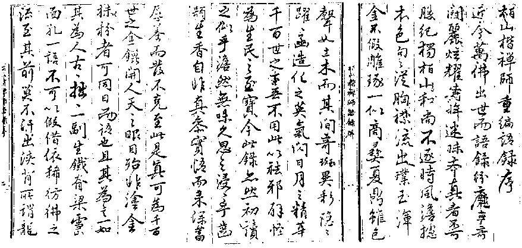
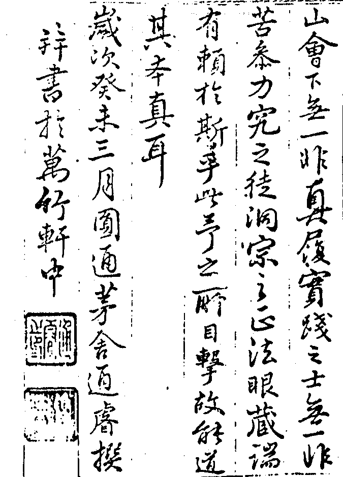
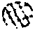

# 山西柏山楷禅师语录



> **藏经**：嘉兴大藏经（新文丰版）（嘉兴藏）　**册次** 第 39 册（J39）　**编号** JB466　**部类** 诸宗部　**卷次** 5 卷　**篇幅** 57,808 字

> **卷／品**：0 卷 · 3 品



---



## 目录



  - [柏山楷禅师重编语录序](#柏山楷禅师重编语录序)

  - [柏山楷禅师语录序](#柏山楷禅师语录序)

  - [柏山楷禅师语录序](#柏山楷禅师语录序-1)



---



### 柏山楷禅师重编语录序











------



### 柏山楷禅师语录序



如来说法，广大精微，悉具平实。六祖已还，单刀疋马，直度剑关，大憝既翦，始布腹心。吾汾，陶唐故地，洙泗遗泽，世远人亡，经残教弛，危微宗旨，克复法门，荒芜闭塞，柏道人只履南来，卓锡龙麓，鄙予不佞，尝与升堂邂逅，入室盘桓。吾儒大义，脚根地步，视老宿经师，反较跖实，乃知悟有真悟，证有真证，焉可诬也？癸亥秋冬之交，予自朔方旋里，道人延致方丈，同榻者累月，时闻领略，私幸口业不堕地，眼光可存。人间大要，威仪肃而不繁，督责严而不苛，本西来不立语言文字大意，务使前后际断，动静不生。读其语录，率截路贼、斩草除根手眼，乃知学有真学，独是平易近人，无身分见，并无无身分见，与录中开示及接膝论议，又何平实也？



方外弟胡廷顿首谨书



------



### 柏山楷禅师语录序



夫灵锋出匣，魔佛潜踪，宝镜临台，媸妍互现。辨龙蛇於棒下，验凡圣於机先。牙如剑树，口似血盆，玅用无穷，神机莫测。吾侄楷公禅师得之矣。古云：「见与师齐，减师半德，见过与师，方堪传授。」公嗣法觉华竹和尚，去洞山三十一世，乃灵山石鼓老人嫡孙，弁岳瑞祖之玄孙也。说法西晋，声振寰区。衲子云臻，檀那钦服，盖行藏高古，道眼圆明之所然也。老僧因读是录，不忍释手，谓侍僧曰：「后五百世有缘众生，遇此录者，不断八苦，不证无上菩提者，无有是处。」侍僧礼拜，记之为序云。



住荆溪国山善权寺法叔智传撰



汾阳龙山华严堂上传曹洞正宗第三十一世柏山楷禅师行实



金陵城西圆通通睿顿首述



师讳德楷，字柏山，维扬泰兴庄氏子。父字承智，母马氏，世奉三宝，一乳十八人，师居其殿，在襁褓中，见佛像便知合掌，闻酒气及鲜味即哕。喜趺坐，爱聆念佛声，识者验其为夙昔之善习也。有风鉴，熟视曰：「此子，乃山林气象，非世俗丰仪。」甫九龄，而兄姊子侄皆相继去世，至十一岁，复遭父变，家业萧然，门庭寥落，出尘之志旋萌。无如母老，且力经营，以图温饱，不失奉养之诚。资斧之餘，不吝施与，全无婚娶之念。而母密为择婚，逼令完娶，然好道日殷，不觉误入旁门，辄为领袖，久之无得，幡然改曰：「此非入道正门，岂可自以为是？」适值上元佳节，入城观灯，见觉华庵禅期报纸，默自喜曰：「此地有禅门，修行无错路矣。」遂怀香入觉华，谒竹浪和尚。浪曰：「居士何来，来此何事？」师曰：「本县东乡人。闻上刹大启禅门，广收多士，以故特来求教。但不知在俗人亦可参禅否？」浪笑曰：「你在家可吃饭麼？」师曰：「吃饭。」浪曰：「既能吃饭，便可参禅。」师礼谢而去，届期，束装径往。浪见其慕道甚悫，即命司宾引入禅堂。晚诣方丈，求一话头。浪曰：「汝慕道既久，岂无一个话头，以为指南麼？」师便以生从何来，死从何去相告。浪曰：「即此话头可参。」师回堂，从旦至暮，没头没脑，闷闷昏昏，如居暗室。但念话头，不知用工。话头才举，妄想又生。妄想乍歇，昏沉旋来。昏沉稍苏，即堕於无记窟里。似有似无，犹水浸石，了无疑情，若是者三日。适浪下堂，考诸工夫，开示所参：「须善用工，第一不得向心意识上卜度，务要大死一番，方能与此事相应。」师闻之，不觉疑情顿发，二六时中，不知有身心世界，惟是话头卓立面前，咬嚼不破。至第八日开静后，诣西堂寮，请益。才见便闭门，师端立少顷，适值行者入门，师亦拶入。堂喝曰：「夜静更深，来作甚麼？」师曰：「请问佛法。」堂道：「若论佛法，於未入门时，早已向居士道过了也。」师曰：「正入门时，请师一接。」堂曰：「犹是门外汉。」便推出。回堂力究，转觉水尽山穷，铜墙铁壁。至十日，浪又下堂，师出作礼，浪则劈脊便棒。才起，拟开口，又拦胸托倒，一似有气死人。西堂拽师椅上，汗流如雨。工夫自此成片，要觅个昏沉妄想，了不可得。秖有一个疑团现前，虽拈箸执碗，亦不知我有手足。西堂以杖触胸，恍若梦醒，悲欣交集。始知此事不从人得，本自现成，明明历历，未尝覆藏。有偈呈方丈：「旷劫无明当下歇，瓮里何曾走却鳖。若更问我意如何，大冶红炉飞片雪。」声未绝，浪曰：「你参什麼话头？」师展两手，浪曰：「生从何来，死从何去？」师曰：「周桥河底水，日日向西流。」浪曰：「你见个什麼道理，敢开斯口？」师曰：「弟子终不敢向好肉上剜疮。」浪曰：「犹欠脑后一锤在。」如此往来觉华，工夫日进。细思老母生养死葬，子道颇完，今幸获线明，尚未大畅，不乘此时挣出火宅，更何待焉？即弃家室，乞浪薙染，是年三十有二。冬，过邗江天宁受具足戒，期毕，回觉华，请假参方，不允，命董院事。未几，值百愚老人住持，善权遣师走贺，呈书毕，侍立，愚问：「禅师是觉华法属耶，学人耶？」师以实告，愚谓：「即今书已达矣，如何是你底？」师曰：「昨日渡江，今见和尚。」愚曰：「江深多少？」师曰：「只见移舟到岸，不知江水浅深。」愚顾左右曰：「且道此僧有见地，无见地？」师曰：「老和尚疑此，当更买草鞋行脚始得。」愚谓：「念汝途中辛苦，且记三十棒。」师曰：「与麼则礼拜老和尚去也。」回至本邑孙桥，猛省参方要事，急宜再进竿头，倘惟命是听，岂不误此岁月？即将回书转烦友人达之觉华，由是遍历名山，广参宗匠，所到无不印可，具称敏捷，师笑而自审，若西来之旨苟止如此，则祖道安能垂统万世无弊？吾今於五家宗旨，若不能一一透过，誓不参禅，一经一咒，以了此生也。道经毘陵孟渎，弛担嘉山，闻云水数僧言：「此山角落有个彬隐禅师，见地超卓，行履端方，系亲觐祖让和尚也。」师惊喜，向晚谒之，觌面机锋迅发，师不能敌，师曰：「适来机语，是兄平日意识强记所到，非衲僧本分生涯，消不得一场热病，净尽捐祛，将什麼回复，阎罗铁面，此皆近日禅人通病，不独兄然也。」叠举公案数则，勘验淆讹，师亦强与支吾。彬笑曰：「半涂暂止之欢，非稳坐家堂之乐也。倘自以为是，则理事不通，未免一派杜撰，日后赚误来学不浅。」其间有清剖、杰峰二师，时为自谦和尚首职。彬语杰剖曰：「云水中有一禅者，颇英迈，惜死而未活，不谙言句在。」剖杰惊异，即邀师促膝剧谈。杰称大奇，难得老兄到此地位，但厥症与弟相符耳。遂订生死交，必宜互相策进，至於千了百当而止。杰乃剖徒也，曾历诸方，饱餐五味，具相受记。独彬不肯。然二公亦不自欺，剖随拉师结七，彬监香。七完，而二公之碍膺者顿释。师则依然如初，彬即引见灵隐具祖，祖问：「那里来？」师曰：「维扬。」具曰：「曾到天宁麼？」师曰：「曾受天宁具足。」具曰：「毕竟唤什麼作戒？」师曰：「只闻白四羯磨，不知唤什麼作戒。」具以实须人难得，姑送梵香阁。时豁老人初受显宁请，具白众，为觅辅佐，师愿随往。住无何，因沙汰事，旋同彬回般若。彬染疾笃，师曰：「倘兄不起，德楷更倚谁，以了此大事？」彬曰：「不难，今有金陵灵谷千南和尚第一座，字尘仙者，系南屏小狮子，法眼圆明，应机无碍，五花宗旨，透彻底源。汝可相依，必能了事。」言讫坐逝。复有好道缁素，更祈剖公结七，而予适自千华回，师相邀入七。期至五日，正经行时，有僧问麻三觔意旨，师曰：「石女驾铁舟，浪里扬风帆。」予闻而顿悟涅槃心要，实赖师之提携也。期毕，师与杰公相约上鍾山，而于祖已顺世矣。尘仙和尚以比肩而为后嗣，继席灵谷，古哲之忘人我、为法门，一至於是。尘和尚一见，谓：「狮子游行，不偕伴侣，因什二人同行𫆏？」师便喝，尘曰：「喝则不无，争教无舌人解语？」师又喝，尘曰：「机不离位，堕在毒海。水单缺职，姑令暂补。」师如命，私谓杰曰：「彬公之言徵矣。」一日，尘至寮，见案头颂古，问：「是谁作？」师曰：「和尚见什麼？」尘叱：「瞎汉！犹作这般见解。」师喝，尘掌之，师作礼，尘复拈颂本，谓：「这个且作麼生？」师拟对，尘便掌，曰：「胸中大有物在。」次日，迁内司宾，每夕必候至更深，参请诸案淆讹，尘曰：「且置是事，只如有句无句，如藤倚树，树倒藤枯，句归何处，作麼生会？」师直言：「德楷於是乎有疑。」尘谓：「於此有疑，则一切公案都无著落。」后凡遇师，即以此拶问，师才启口，尘便摇首叱之：「不是，不是。」师疑甚切。一日，晚参，举五祖，描不成，畫不就，相随来也等语，乃曰：「灵谷则不然，有问有无藤树之旨，则向他道：『不因紫陌花开早，争得黄鹂下柳条？』如进问藤枯句归之旨，便向他道：『昨日▆砖肚里痛，三更产下白头翁。』」师闻之，当下释然，始感彬公相荐得宜之谊。嗣后，问及诸案，势似破竹，酬荅无间，丛林称为铁嘴，尘喜曰：「方知我不欺汝。」一日侍立，复问：「玄要纲宗作麼参究？」尘厉声叱之：「你这个黄杨木倒缩去了！」以杖趁之。师愈骇然，疑情万仞。因过堂，见饭杓落地两跳，忽大悟玄要之旨，辄自笑咏：「偷心死尽眼麻迷，石女梦中毛卓竖。信乎！洪觉老人，恁麼道也。」趋白方丈，尘曰：「比来豪杰堂头，亦不能彻见至此，况庸辈乎？汝今既知此要，须加护念，后为宗匠，可与人抽钉拔楔去也。」执事三载，辞归觉华省落发师。师见如获大宝，喜而不寐，随命职西堂，挝鼓升座，拈拂子曰：「向这里道一句看。」师曰：「被和尚一问，直得口挂壁上。」浪曰：「且喜洞上一枝佛法流通去也。」遂付以源流衣拂，拟择日延师继席，师则拽杖便行，上五台，过都门，途遇山右李居士，接谈甚契。结伴同礼文殊，再朝普贤。道经古并礼体、昭二师宝塔，寄锡圆觉，缁素固留结冬。明春，又请住静鸠，修殿建参堂，经三载餘，悦心上人请住，普通结制，期毕，说法下座，偕二三子，翛然而去，所餘钱谷，概不问及。由是道风日盛，汾人敬服，共称古佛。至古中阳龙山之华严，爱其山水幽邃，志欲终身焉。旧住接见，欣然如故，乃请重兴。告诸檀那，削牍敦请，愿交此山为十方禅院。一载之间，衲子鳞集，募修禅堂。刘公修东院，魏公建阁请藏，一时堂搆焕新，不减祇园之盛。突有逃厮变服，混众乞食，邻村公丁捕获，郡牧欲罪地方，师即挺身独任，郡伯怒责非轻，师则恬不为意。未几，郡伯褫职，此事遂消。村众执香礼谢，师坚拒不受。无为子曰：「生者，人之所贵，死者，人之所畏，耻者，人之所避，而师不贵其贵，不畏其畏，不避其避，此其如是，我不知其真伪，请质之於天地。」有文章辈相质理学，师示曰：「三教名殊而理一，述之者析一为三，悟之者会三即一。倘各高所尚，议论风生，其於理学愈支离矣。」汾阳士庶咸服其高论。师适楚，访梁公，途遇负蛙数筐市之，为说三皈法，众蛙阒然止闹，仰听法音，其感悟物性如此灵验。虽开法山右，而心不忘江南，故三过灵谷，扫塔恸哭，谓众曰：「我德楷虽承嗣洞宗，而实不忘灵谷。凡应机接物，概行尘老人之作略，所以报斯恩於万一耳。」今之忘本负恩之辈，闻斯言而愧死无地矣。曾托予以语录送嘉兴，一夕之言，十霜驹隙，讣音至圆通，予随说小参中曰：「毅然愤悱，一番大死於觉华；彻底掀翻，断尽命根於灵谷。」宛然师之小像也。师享年七十有四，僧腊四十有二，塔於本山之右。天性刚直，不耐繁文，不事缘饰，清俭自得。虽三坐道场，万指回绕，绝无一牍干及檀门，亦无一物不公於众，故山右有铁面之名，丛林有铁嘴之号。告寂之日，饮食如常，开示无倦，不袭辞众说偈之套，但坦然入室跏趺，两序急入请问，遂泊然瞑目矣。供奉三日，颜色如生，时，康熙壬午三月廿二日也。是夜，怪风大雪，猿鸟哀鸣，林木惨澹，缁素不胜悲惋之至。



柏山楷禅师行实终



柏山楷禅师语录卷之一



继住龙山华严院嗣法门人行悟等编次



住山西汾州府汾阳县普通禅寺



上堂。



师於康熙壬子秋，受护法绅𫄛洎两序阖院大众请，於十月望日进院。



山门。「泼天门户，八字打开，要入便入，本无疑拟。」拽杖便入。



伽蓝。「新长老入院，旧伽蓝生喜。海众办道心，身命全赖你。」



韦驮。「三洲感应驱魔业，十世童真护法门，今日长老亲到此，互相扶起破沙盆。」



祖师。「折苇渡江也是你，只履西归也是你，将谓有多少伎俩，咄，原来也只在这里。」



佛殿。「入门须辨主，端的甚分明，今古谁敢敌，三界独称尊。」遂展具拜。



方丈。「既到此地，当仁不让。佛来魔来，尽教吃棒。且道新长老具何手眼，有如是作略？」乃卓拄杖一下曰：「区区七尺乌藤，敢作人天榜样。」



指法座。「过去灯王亦升斯座，现在新长老亦升斯座。且道过去底是，现在底是？」喝一喝曰：「高著眼。」便升座。拈香祝圣毕，次拈香曰：「此一瓣香，有主有宾，有权有实。放下也地摇六震，拈起也天雨四花，耑为供养江南扬州泰兴觉华堂上五住道场，传曹洞正宗第三十世无鼻孔没意思竹浪本师老和尚，用酬法乳。」维那白椎竟，挥拂子曰：「炉鞴宏开，烹佛镕祖。钳锤才举，转凡成圣。即今还有不入炉鞴非藉钳锤底衲僧，出来与新长老拄杖子相见。」问：「凡夫因甚迷？」师曰：「过河须用筏。」曰：「圣人因何悟？」师曰：「到岸不须舟。」曰：「修行有何功德？」师曰：「种荳不生麻。」曰：「作恶有何过？」师曰：「栽瓜不结荳。」曰：「向上又作麼生？」师便打。问：「如何是道？」师曰：「家家门口有。」曰：「如何是戒定慧？」师曰：「水流湿，火就燥。」曰：「如何是佛？」师曰：「三十二相，八十种好。」曰：「如何是法？」师曰：「作贼怕拷，欠债怕讨。」曰：「如何是僧？」师曰：「穿衣吃饭。」曰：「三宝今已晓，祖意更如何？」师曰：「错过目前机。」问：「如何是普通境？」师曰：「门前官大路，东西任往来。」曰：「如何是境中人？」师曰：「个个眉毛眼上横。」曰：「人境交驰又作麼生？」师曰：「山门前合掌，佛殿里烧香。」曰：「人境已蒙明指示，向上宗乘事若何？」师曰：「待露柱生儿向你道。」僧喝，师便打曰：「著急作麼？」问：「如何是正中偏？」师曰：「铜壶滴漏五更前。」「如何是偏中正？」师曰：「一条拄杖行正令。」「如何是正中来？」师曰：「燄里莲花朵朵开。」「如何是兼中至？」师曰：「石虎当途踞。」「如何是兼中到？」师曰：「木人抚掌笑。」曰：「正偏兼带分明示，济宗宾主又如何？」师喝，僧礼拜，师便打，乃曰：「问在答处，答在问处。有时问不在答处，答不在问处。自然一一箭锋相拄，函盖吻合，机机应的，法法圆成。所以作家不啐啄，啐啄即同时。有如此眼目，有如此作略。一任破赵下燕、定汉收楚，横行天下，约法三章。然句能铲意，意能铲句，意句交驰，是为可畏。则双明双暗，同生同死，於此明得，纪信乘彩辇。於此不明，项羽失乌锥。楷上座今日不惜口业，露布机宜，暗投信符。若是闻一知十，举一明三底英灵衲僧，便横趋而去，何必向三条椽下、七尺单前，一个个觅甚麼碗。」维那结椎，下座。



绵山永宁庵别云法兄和尚，领慧、本二禅座设斋，请上堂。师竖拂子召大众曰：「看看，若唤作拂子，头上安头。若不唤作拂子，掘地觅天。若道拈来便用，何异担雪填井。若道总不与麼，也是证龟成鳖。纵饶直下承当，犹是化城境界，毕竟唤作甚麼？」良久曰：「寰中天子敕，塞外将军令。」举：「僧问洞山：『如何是佛？』山曰：『麻三觔。』僧问云门：『如何是佛？』门曰：『乾矢橛。』僧问赵州：『如何是佛？』州曰：『殿里底。』僧问首山：『如何是佛？』山曰：『因我得礼你。』此四转语内，有一句能纵能夺，能杀能活，若能辨得，一生参学事毕。且道是那一句？」喝一喝，「裂破一任著眼看。」下座。



绵山永宁庵别兄和尚领达蒲众居士设斋，请上堂。师挥拂子曰：「一向把定牢关，今日放开一线，倘有伶俐衲僧，便请出来相见。」问：「佛未出世时如何？」师曰：「白鹭下田千点雪。」曰：「佛出世后如何？」师曰：「黄莺上树一枝花。」曰：「如何是宗乘向上事？」师曰：「向上问将来。」僧伫思，师曰：「虑而知，思而解，犹是鬼家活计。」问：「如何是不二法门？」师曰：「天左旋，地右转。」僧礼拜，师打曰：「何不进语？」问：「不得有语，不得无语，请师速道。」师曰：「山僧被你一拶，直得立地放尿。」僧礼拜，师曰：「多蒙上座见谅。」乃曰：「松直棘曲，鹄白乌玄，竹连云绿，花映水红，九九八十一，六六三十六。若作佛法商量，犹在半路。若作世谛流布，且宿草庵。讵知云门拄杖子，𨁝跳上三十三天，触著帝释鼻孔，东海鲤鱼打一棒，雨似盆倾。且道跛脚阿师，这道真言是何宗旨？直饶向这里了了分明，更买草鞋行脚三十年来，好吃普通拄杖子。何故？顶𩕳未具千圣眼，目前怎透法王机？」举：「临济大师示众曰：『若第一句中荐得，堪与佛祖为师；若第二句中荐得，堪与人天为师；若第三句中荐得，自救不了。』时有僧问：『如何是第一句？』济曰：『三要印开朱点窄，未容拟议主宾分。』『如何是第二句？』济曰：『玅解岂容无著问，沤和争负截流机？』『如何是第三句？』济曰：『但看棚头弄傀儡，抽牵全藉里头人。』临济虽将祖翁田地分疆立界，普通犹且不然。若向我法兄未离绵山时荐取，双瞎；若向已降达蒲时荐取，双开；若向正入普通时荐取，半瞎半开。设有人问：『未离绵山时如何？』山僧向他道：『狮子游行芳草绿。』『已降达蒲时如何？』『象王回顾落花红。』『正入普通时如何？』『孔怀兄弟元无二，同气连枝各自荣。』诸兄弟且道：楷上座恁麼说话，与古人是同？是别？若道是同，未免儱侗真如；若道是别，又是颟顸佛性。毕竟作麼生？」良久，曰：「三脚驴子弄蹄行。」卓拄杖，下座。



师因事告疾不语，两序固请开语，上堂。「山僧打个不语七，一句话也参不出。无明满肚实难灰，累劫烦恼缠不彻。两轮日月逝如梭，百岁光阴似箭急。明历历，黑漆漆，己躬下事何曾毕？两个哑子笑呵呵，谁知笑里生荆棘？一个要吃川黄连，一个要吃广白术。甜苦只许自家知，总有知心道不出。麻三觔，乾矢橛，大地山河一片雪。夜半铁牛过西河，无端踏破水中月。黎明杲日丽中天，万里无云光皎洁。分付东村李樵子，子细好对石女说，切忌将心去觅心，休要去本反求末。秖求本，不求末，无手人擎没底钵。一任庐陵米价高，要且金牛饭自熟，大家吃得饱齁齁，连柄椎儿打不脱，打得脱，从教东说与西说。若还撞著庄老师，拶得通身都是血，绝后苏来不自欺，珊瑚枝枝撑著月。」良久，以拄杖地上畫此[○@∴]相，曰：「三十二人齐勘破，空床高卧维摩诘。」



元旦，上堂。师挥拂子曰：「昨日腊月三十，今朝新正初一。西舍有个王大姐，借婆帔子拜婆节。南无佛陀耶，南无乾矢橛。赤肉团上有一无位真人，常在汝等面门出入。直饶於此会得，也是秤锤里呷汁。且道如何是脚跟下事，吽吽吽，咄咄咄。」拈拂子作此[○@∵]



相，「新年把笔，百事大吉。」下座。



解制，上堂。拈拄杖，曰：「狮子教儿迷子法，向前踯跳解翻身，於中若有真狮子儿，不妨出来哮吼看。」问：「透网金鳞，还有吃棒分也无？」师曰：「山高日出迟。」曰：「与麼则禹门浪里翻觔斗，一声霹雳震山河。」师曰：「海阔浪来高。」曰：「龙得水时添意气，虎逢山势长威狞。」师打，曰：「赏你重说偈言。」问：「桑树上斫一刀，柳树上去块皮，此意如何？」师曰：「南山云起，北山雨。」曰：「如何是猢狲倒上树？」师曰：「笑杀旁观。」问：「如何是杀人刀？」师曰：「山僧闻得也害怕。」曰：「如何是活人剑？」师竖拂子，曰：「是甚麼？」僧喝，师曰：「果然！果然！」问：「如何是赵州茶？」师曰：「饭后少他一杯不得。」曰：「如何是金牛饭？」师曰：「美食不中饱人餐。」问：「如何是海底龙？」师曰：「兴波不作浪。」曰：「如何是龙中宝？」师曰：「莫将眼来见。」曰：「光宝俱亡时如何？」师曰：「瓦解冰消。」问：「四大未生时如何？」师曰：「鼻孔大头向下垂。」曰：「四大已生时如何？」师曰：「眉毛眼上横。」曰：「生与未生蒙师指，洞山偏正意如何？」师曰：「舌头不出口。」曰：「恁麼则云散天宽，碧月皎，照千峰。」师曰：「闲言语。」问：「前后际断，虚空消殒时如何？」师曰：「水清鱼现。」曰：「只得鱼水相忘去也。」师曰：「万里一条铁。」问：「如何平常无生句？」师曰：「开口即错。」「如何玄玅无私句？」师曰：「动念即乖。」「如何是体明无尽句？」师曰：「若不是居士，管教髑髅粉碎。」乃曰：「九旬把断重关，不容丝毫走作，直教个个彻底掀翻，人人皮毛脱落，子细检点将来，也是千错万错。今朝不免放开一线，一任东来西往，彼此无拘无束，腾腾任运，任运腾腾，观山玩水，随处翛然。虽然如是，忽遇镬汤炉炭、剑树刀山，未审如何回避？」良久，曰：「众苦不能到。」举：「芙蓉一日告辞马祖，祖曰：『装却包了来，与你说一上佛法。』芙蓉於次日上方丈侍立，少顷，祖曰：『时寒，善为道路。』芙蓉至法堂上，忽然有省。」师曰：「马祖纵有起死回生之金丹，怎奈遇斯等人，反成毒药。芙蓉虽於马祖言下悟去，也只是悟得个时寒，善为道路，若论佛法，犹未梦见在。今日如有人告辞，痛与三十棒。设有旁不甘者，出来道：『过在甚麼处？』普通向伊道：『一任举似诸方。』」下座。



辞院，上堂。师曰：「一山难藏二虎，有你胜似有我。正与麼时，门里出身一句，作麼生道？脚尖踢破五须弥，杖头白云千万朵。」曳杖便行。



上堂。问：「寒暑到来，如何回避？」师曰：「不回避。」曰：「为甚不回避？」师曰：「寒时任他寒，热时任他热。」曰：「恁麼则被寒暑推迁去也。」师曰：「随他推迁也不恶。」问：「悉达才生时如何？」师曰：「指天顾地。」曰：「云门道：『我当时若见，一棒打杀与狗吃，贵图天下太平。』又作麼生？」师曰：「不是知音者，徒劳话岁寒。」曰：「和尚作麼生？」师曰：「贬向无生国。」问：「如何是向上事？」师曰：「东墙脚底有。」乃举：「僧问洞山：『寒暑到来，如何回避？』山曰：『何不向无寒暑处去？』僧曰：『如何是无寒暑处？』山曰：『寒时寒杀阇黎，热时热杀阇黎。』又僧问老宿：『时节恁麼热，向甚处回避？』宿曰：『向镬汤炉炭里回避。』僧曰：『镬汤炉炭里如何回避？』宿曰：『众苦不能到。』」师曰：「二尊宿，一人向寒暑内作大佛事，一人向寒暑外作大佛事。寒暑内作大佛事者，不知有寒暑；寒暑外作大佛事者，通身是寒暑。普通恁麼道，诸人还信得及麼？若信得及，离中虚，坎中满。如信不及，冬寒夏热，但恁麼过。」下座。



上堂。举：「香岩曰：『去年贫，未是贫，今年贫，始是贫。去年贫，有卓锥之地，今年贫，锥也无。』真净曰：『去年富，未是富，今年富，始是富。去年富，惟有一领黑黪布衫，今年富，添得一条百衲袈裟。岁朝抖搂呈禅众，实谓风流出当家。』」师曰：「香岩贫，未是贫，奈何犹有这个身；真净富，未是富，家私未免全抛露。普通这里不言贫，宁论富？百年三万六千朝，随家丰俭埋头过。适有个俊俏衲僧，出来道：『好个说无字禅底长老。』向他道：『曾忆王老师，不打这破鼓。』」下座。



住白云禅寺



南岩、顶玄二禅德率缁素等请上堂。至座前，师曰：「佛身充满於法界，普现一切群生前，随缘赴感靡不周，而恒处此菩提座。汝等诸人还见佛身麼？设若未见，楷上座开大方便，令诸人一恁饱足观光。」便升座。拈香曰：「此一瓣香，弥纶六合，充塞四洲，恭为祝延今上皇帝圣寿无疆。」次拈香曰：「此一瓣香，根盘实际理地，叶茂佛事门中，伏为满朝文武、合省宰官。」又拈香曰：「此一瓣香，描也描不成，畫也畫不就，惟愿护法大檀，诸山耆宿，今晨请主共证真空，同明般若。」复拈香曰：「此一瓣香，常在动用中，动用中收不得，第二回拈出，耑为供养维扬泰兴县觉华堂上传曹洞正宗第三十世竹浪本师和尚，用酬法乳。」维那白椎毕，乃挥拂子曰：「未升座前已过去，已升座后犹未来，正当升座时，何必强安排？既不安排，众中还有向脚跟下道得一句底麼？设有，出来道看。」问：「如何是第一玄？」师曰：「石女夜半绣鸳鸯。」「如何是第二玄？」师曰：「木人日午歌雪曲。」「如何是第三玄？」师曰：「无手人撑没底船。」「如何是第一要？」师曰：「出则便出，入则便入。」「如何是第二要？」师曰：「语则便语，默则便默。」「如何是第三要？」师曰：「吃则便吃，穿则便穿。」僧拟进语，师曰：「三玄三要犹闲事，脚跟下亲切道一句来。」僧喝，师曰：「未有主在。」僧又喝，师打曰：「果然。」问：「经中道：『惟此一事实，餘二则非真。』且道是那一事？」师曰：「白云也不知。」曰：「和尚是悟底人，为甚不知？」师曰：「莫谤白云好。」僧礼拜，师曰：「切忌举似人。」问：「如何是随波逐浪句？」师曰：「落花已随流水去。」「如何是截断众流句？」师曰：「流水无情恋落花。」「如何是函盖乾坤句？」师曰：「鼻孔朝天，脚跟点地。」曰：「三句即一犹难晓，一句具三请师分。」师按拄杖，僧拟议，师便打。问：「不是心，不是佛，不是物，是个甚麼？」师曰：「好个问头。」曰：「是心是佛是物，又作麼生？」师曰：「莫妄想。」乃拈拄杖曰：「这个是佛，又唤甚麼作拄杖？」卓一卓曰：「这个是拄杖，又唤甚麼作佛？直饶坐断两头，未是衲僧极则事。如何是衲僧极则事？」复卓两卓曰：「莫妄想。」举：「临济大师初住镇州，一日谓普化、克符二上座曰：『我欲於此建立黄蘗宗旨，汝二人成褫我。』」师曰：「钩头著饵。二人珍重下去。」师曰：「且道成褫不成褫？三日后，普化上来问临济曰：『三日前道甚麼？』」师曰：「逆风鼓浪。济便打。」师曰：「寰中天子敕。三日后，克符上来问临济曰：『三日前为甚打普化？』」师曰：「顺水放舟。济亦打。」师曰：「塞外将军令。今日新白云则不然，我欲於此建立觉华宗旨，汝等诸人若肯成褫我，痛与三十棒。不成褫我，亦痛与三十棒。为甚如此？只要据虎头把虎尾，向第一句下明宗旨。」卓拄杖三下，维那结椎下座。



上堂。师曰：「临济在黄蘗，三度问佛法的的大意，三度被打。诸兄弟还会得此意也未？直饶会得，不是伶俐汉。后见大愚，言下知归，胁下还拳。且道还悟也未？纵若悟得，正好吃棒。已立百尺竿头，更进一步，悬崖撒手，自肯承当。更买草鞋行脚。且道过在甚麼处？有佛处不得住，无佛处急走过。三家村里土地，十字街头石敢当。在安泰桥上商量了一夜，且道说底是甚麼热大？唵㗭唎耶娑诃。」卓拄杖，下座。



上堂。问：「三世诸佛出兴，且道说个什麼？」师曰：「东瓜直儱侗。」曰：「历代祖师谈玄传法，又传个什麼？」师曰：「瓠子曲弯弯。」曰：「天下善知识，以何为人？」师曰：「贼把赃来验。」曰：「今日和尚升座，施何法要？」师曰：「拄杖长七尺。」曰：「恁麼则棒头有眼明如日，要识真金火里看。」师便打，僧礼拜。问：「文殊是七佛之师，为什出女子定不得？」师曰：「锯穷木断。」曰：「罔明菩萨为甚出得女子定？」师曰：「水到渠成。」乃曰：「三世诸佛是劫贼，历代祖师是魔军，一切善知识说黄道黑，皆是佛口蛇心，欺天瞒地，天下衲僧把髻投衙。今日众中还有超群拔萃大丈夫，向威音那边更那边，为宗门出一只手眼者麼？设或有之，秖好明窗下安排，袖米供养。」



上堂。问：「一毛头上现宝王刹，坐微尘里转大法轮，今日和尚高登猊座，请师转大法轮。」师靠拄杖不顾。曰：「昔日维摩默然，文殊赞善，和尚默然，与维摩是同是别？」师亦不顾。曰：「与麼则四众沾恩有分。」师亦不顾。又僧问，师总不顾，僧罔措而退。乃曰：「拈椎竖拂，望梅止渴，谈玄说玅，畫饼充饥，一问一荅，担雪填井，行棒行喝，无事生事。直饶把断要津，不通凡圣，若到白云门下，一点也用不著。且道白云有甚麼长处？」良久，曰：「自有一双穷相手，不曾容易舞三台。」下座。



上堂。左右顾视，拈拄杖指东边曰：「这边总是菩萨。」指西边曰：「这边尽是罗刹。罗刹里有一菩萨，菩萨里有一罗刹。若识得此二人，山僧不敢轻慢汝等，汝等皆当作佛。」便起身。



上堂。师曰：「直指人心心是佛，不知此心是何物。内外中间觅总无，动转施为明历历。心生种种法自生，心灭种种法自灭。生灭之中觅此心，觅到驴年也未彻。若道此心有生灭，未免自造无间业；若道此心无生灭，正是望空去著橛。心生不知何处生，心灭不知何处灭。截断生灭两条心，一颗明珠光皎洁。」



上堂。师曰：「若论此事，山僧未出方丈时，拄杖子一片婆心，尽情向诸人道破了也。若然不会，不妨出来与拄杖子商量看。」问：「如何是学人本来面目？」师曰：「耳朵两片皮。」曰：「不会。」师曰：「是你髑髅上事也不会？」问：「如何是万法归一？」师曰：「东山高，西岭低。」曰：「毕竟一归何处？」师曰：「南山长，北山短。」磨头问：「如何是本来面目？」师曰：「八角磨盘空里走。」曰：「恁麼则不下也。」师曰：「话头也不识。」曰：「百杂碎。」师打曰：「又道不下。」乃曰：「三世诸佛出世，原为此一大事因缘。历代祖师出世，也为此一大事因缘。天下善知识出世，也为此一大事因缘。且道唤甚麼作大事因缘？莫是上堂升座秉拂小参麼？莫是拈椎竖拂瞬目扬眉麼？莫是行棒行喝擎拳竖指麼？莫是拈今颂古荅对吟诗麼？若是门庭施设则不无，若是入理深谈一点也用不著。何也？此事不可以智知，不可以识识。非玄非玅，非正非偏，非有非无，非一非多，非长非短，非物非人。不见古人道，恁麼也不得，不恁麼也不得，恁麼不恁麼总不得。且道如何方是？」



柏山楷禅师语录卷之二



继住龙山华严院嗣法门人行悟等编次



住汾州府孝义县龙山华严禅院



上堂。



前住僧率众善信请入院。师至座前曰：「这个宝华王座，三世诸佛从此说法，历代祖师从此利生。且道新龙山到这里又如何施展？」拱拂子便升座。拈香祝圣毕，复拈香曰：「此一瓣香，无声无臭，无党无偏，第三回拈出，耑为供养现住江南常州府宜兴县敕建灵山衍庆堂上第二代传曹洞正宗竹浪本师和尚，用酬法乳。」书记白椎曰：「法筵龙象众，当观第一义。」师挥拂子曰：「好个第一义，却被书记一椎击碎了也。作是观者，名为正观。若他观者，名为邪观。邪正已分，请出道看。」书记问：「巍巍宝座炫碧天，万瑞千祥遶法筵。第一义谛即不问，三玄三要请师宣。如何是第一玄？」师曰：「无舌童子口喃喃。」「如何是第二玄？」师曰：「石女崖前笑。」「如何是第三玄？」师曰：「你还会麼？」「如何是第一要？」师曰：「饥来吃饭。」「如何是第二要？」师曰：「倦来打眠。」「如何是第三要？」师曰：「喜便笑，怒便闹。」「秖如一句具三玄，一玄具三要，此意如何？」师曰：「风来水面起波澜。」记曰：「恁麼则狮子便解翻身去，不纵横处也纵横。」师曰：「一任𨁝跳。」乃曰：「古德道：『未得个入头处，求个入头处，已得个入头处，求个出头处。且道如何是入头处？』大慧杲曰：『如何是佛？乾矢橛！这一句子疑破，恒河沙数疑一时破矣。』诸昆仲！佛法不是草草，所以古人道个句、道个意。又道句中意、意中句，句中无意、意在句中，句能铲意、意能铲句，意句交驰，是为可畏。正是一句当天，八万生死门永绝。直饶你将这一句彻底掀翻，千了百当，说得、行得，把得定、作得主，到这里还算得入头处也未？虽深得入头处，便唤作入头处，正是法见未亡。不见文殊，才起佛见、法见，被如来贬向二铁围山。任你荡尽诸见，大法已明，搅长河为酥酪，变大地作黄金，竿木随身，逢场作戏。若到新龙山这里，向你道未在，且道过在甚麼处？咄！有佛处不得住，无佛处急走过。三家村里王大姐，是甚麼热大？」书记结椎曰：「谛观法王法，法王法如是。」下座。



破土，上堂。师曰：「一二三四五，金木水火土，泥细好烧砖，何必问张鲁？既不问张鲁，且僧堂作麼生建？」乃竖拂子曰：「大众看看，一毛头上现乾坤，万象森罗齐下手。」下座，便穵土三下。



康熙癸丑四月八日，禅堂落成，两序请上堂。问：「贤於长者插标竟，一殿岿然迥碧空。释梵雨花香扑鼻，经行坐卧於其中。请问和尚，如何是其中事？」师曰：「左之右之。」曰：「可谓道也者，不可须臾离也，可离非道也。」师曰：「满眼满耳。」曰：「今日学人小出大遇也。」师曰：「郑州出曹门。」问：「如何是清净法身？」师曰：「屎窖里虾蟆。」曰：「如何是圆满报身？」师曰：「癞猪卧泥坑。」曰：「如何是千百亿化身？」师曰：「东村王大姐。」曰：「如何是直指之道？」师曰：「脚跟下好与三十棒。」曰：「若行此棒，不虚受人天供养。」师曰：「不是山僧，却被上座惑乱一上。」问：「如何是正中偏？」师曰：「杲日丽中天。」「如何是偏中正？」师曰：「盲人照古镜。」「如何是正中来？」师曰：「莲花火里开。」「如何是兼中至？」师曰：「铁犬庭前吠。」「如何是兼中到？」师曰：「木人抚掌笑。」曰：「正位即空位，此说还端的也无？」师曰：「切莫道听途说。」问：「未离兜率，已降王宫，未出母胎，度人已毕。且道说个什麼？」师曰：「葛藤花结金刚子。」曰：「三十二相即不问，如何是金刚不坏身？」师曰：「烂枯桩。」问：「秖如道，人人本有，个个不无，不无是个什麼？」师曰：「朝朝同起，夜夜共眠。」曰：「恁麼则是一灵真性也。」师打曰：「莫认驴鞍桥为阿爷下颔。」刘居士问：「绿渐稠兮红渐稀，江南处处子规啼。百花开放无言说，时听狮王转大机。大机一句即不问，世尊出世请师提。」师曰：「速礼三拜。」士曰：「人天百万齐瞻仰，法席宏开眼界新。」师曰：「全赖居士证明。」乃曰：「一毛头上现宝王刹，坐微尘里转大法轮则易；向龙山顶上建选佛场，学无为法则难。直饶难易两忘，犹是老婆见解，未是超佛越祖之作。今日龙山僧堂焕然一新，光夺人目。且道仗谁恩力？莫是仗三世诸佛，历代祖师恩力？莫是仗韦驮伽蓝恩力？莫是仗檀越、经首、工匠恩力？莫是仗堂头和尚、阖院大众恩力？若道仗三世诸佛、历代祖师恩力，又孤负韦驮伽蓝；若道仗韦驮伽蓝恩力，又孤负檀越、经首、工匠；若道仗檀越、经首、工匠恩力，又孤负堂头和尚、阖院大众；若道仗堂头和尚、阖院大众恩力，又孤负三世诸佛、历代祖师。正恁麼时，毕竟如何却好道得平展一句？」蓦竖拄杖，曰：「还见麼？拄杖子顶𩕳上、肉髻中放百宝光明，於一一光中现千叶宝莲，三世诸佛，历代祖师，韦驮伽蓝，檀越、经首、工匠，堂头和尚、阖院大众同登千叶宝莲，结跏趺坐，合掌当胸，异口同音，高声唱言：『普请大家同庆赞，一齐侧耳听法轮。』」遂卓拄杖一下，曰：「上来讲赞良因，普沾沙界，秖如祝国裕民又作麼生？五湖四海归王化，浩荡乾坤万亿春。」下座。



祈晴，上堂。师曰：「久雨不晴，浸烂衲僧鼻孔。簷声弗断，滴穿诸佛眼睛。直得灯笼抚掌，露柱微笑。且道明什麼边事？若向这里会得，敢保直下云消雾散，杲日当空。晒得石人汗出，青天也须吃棒。」问：「昨日雨，今朝晴时如何？」师曰：「石人抚掌笑呵呵。」僧喝，师打曰：「好彩，不得不赏。」僧礼拜，师下座。



佛诞日，上堂。师曰：「世尊未出世，人人鼻孔撩天，出世后，为甚杳无消息。於此明得，不妨与山僧拄杖子盘桓一上。」问：「世尊未离兜率，已降皇宫，未出母胎，度人已毕。因甚又上雪山，六年苦行？」师曰：「落花台上重铺锦。」曰：「既是天上天下惟我独尊，又因夜睹明星悟道。且道悟个甚麼？」师曰：「玛瑙阶前布赤沙。」曰：「昔日鹫岭，今朝龙山，是同是别？」师曰：「两彩一赛。」曰：「可谓三生有幸逢师话，月到中天碧水寒。」师曰：「问事即得，礼拜了退。」问：「佛身无为，不堕诸数。既不堕诸数，今日生个什麼？」师曰：「莫谤世尊好。」曰：「昔日云门道：『我当时若在，一棒打杀喂狗，贵图天下太平。』秖如云门具何眼目？」师曰：「家富小儿娇。」曰：「和尚又作麼生？」师曰：「将此深心奉尘刹，是则名为报佛恩。」乃竖拂子曰：「释迦老子生也，在山僧拂子头上周行七步，目顾四方，一手指天，一手指地。曰：『天上天下，惟我独尊。』汝等诸人还见麼？若见，却是自瞒；若不见，又被他瞒。到这里毕竟作麼生？」放下拂子曰：「双双木马嘶风去，直至如今不见踪。」挥拂子，下座。



佛成道日，上堂。「欲知佛性意，当观时节因缘。众中还有应时及节底衲僧麼？有则出众道看。」问：「钟侵鼓伐一齐鸣，狮王登座野狐惊。宗乘向上即不问，五宗派旨请师明。」师曰：「一一问将来。」「如何是曹洞宗？」师曰：「无舌人解语。」「如何是沩仰宗？」师曰：「无毛鹞子扑天飞。」「如何是云门宗？」师曰：「一掌一握血。」「如何是法眼宗？」师曰：「一棒一条痕。」曰：「五家宗旨承师荅，龙山新令又如何？」师曰：「眼见耳闻。」曰：「恁麼则西来大意亲荐得，天外乾坤任优游。」师曰：「看脚下。」问：「如何是人中境？」师曰：「月照孤峰顶。」「如何境中人？」师曰：「头戴青天手携帽。」「如何是宾中主？」师曰：「舌头不出口。」「如何是主中宾？」师曰：「为怜三岁子，不惜两茎眉。」僧礼拜，师曰：「为甚不问主中主？」僧起，拟进语，师便打，曰：「已迟八刻。」乃竖起拂子，召众，曰：「还见麼？黄面老瞿在拂子头上，入正定三昧，睹明星豁然大悟，曰：『奇哉，一切众生具有如来智慧德相，但以妄想执著而不能证得。』拂子忍俊不禁，扬声大叫，曰：『谛当！甚谛当，敢保老兄未彻在。』诸昆仲！且道那里是瞿昙未彻处？若能於此明得，非惟亲见拂子落处，亦能亲见黄面老子悟处，方可向孤峰顶上呵佛骂祖，十字街头播土扬尘，竿木随身，逢场作戏；其或未然，龙山不惜眉毛，向诸兄下个注脚。瞿昙恁麼悟去，秖悟得一切众生具有如来智慧德相，若论祖师向上一著，犹较远在。且道如何是向上一著？」良久，曰：「叮咛损君德，无言真有功，任从沧海变，终不为君通。」下座。



结制日，上堂。师至座前，乃曰：「这个曲录床子，三世诸佛於此错说法，历代祖师於此错说法，今日山僧也只得将错就错。」便升座。维那白椎竟，师曰：「言前荐得，句后知归，总是触途成滞。还有不涉此病者麼？出来道看。」问：「离四句，绝百非，请师直指西来意。」师便打，僧喝，师又打，僧礼拜，师直打下。问：「佛未出世时如何？」师曰：「天下太平。」曰：「佛出世后如何？」师曰：「搅乱支那。」曰：「出与未出时如何？」师曰：「几多欢喜几多嗔？」曰：「知音不必频频举，达者须知暗里惊。如何是到家一句？」师曰：「牛头车子推明月。」曰：「恁麼则一毛头上全体现，遍界明明不覆藏。」师曰：「山僧疑著你。」僧喝，师曰：「识甚好恶？」问：「如何是事无碍？」师曰：「口念弥陀手宰鳖。」「如何是理无碍？」师曰：「龙峰顶上浪滔天。」「如何是理事无碍？」师曰：「十字街头乞一文。」「如何是事事无碍？」师曰：「肩挑滴醋卖私盐。」曰：「人天百万齐瞻仰，大地咸叨法益恩。」师曰：「轻打老僧。」问：「马祖升座，百丈卷席，此意如何？」师曰：「车不横推。」曰：「卷后如何？」师曰：「理无曲断。」曰：「依然山是山，水是水也。」师曰：「无山无水，你又作麼生？」僧伫思，师震威一喝，僧礼拜，师曰：「切莫忘了龙山这一喝。」问：「古祖家风从此展，龙山祥瑞满座生。凡圣混融即不问，堂堂独露意如何？」师曰：「切莫错过。」曰：「不错过时如何？」师曰：「道道。」僧拟议，师曰：「原来赚我。」乃曰：「天不非天，地不非地，山原是山，水原是水。眼见色，鼻出气，耳听声，舌知味。是法住法位，世间相常住。若恁麼会，一生参学事毕。天是天，地是地，山是山，水是水。眼见色，鼻出气，耳听声，舌知味。是法住法位，世间相常住。若恁麼会，入地狱如箭射。不见古德道：『无手人行拳，无舌人解语。』且道无舌人说个什麼？无手打个什麼？虽然恁麼提持，未免太煞径截，令后代儿孙钻龟打瓦，枉作佛法商量。龙山则不然，有手入行拳，有舌人解骂。骂尽天下无敌口，打尽天下无敌手。且道龙山恁麼说话，与古人是同是别？」良久，卓拄杖曰：「今日非非想天，有几人退位？」复卓拄杖，下座。



解制，上堂。问：「如何是三玄？」师曰：「清风生八极。」曰：「如何是三要？」师曰：「明月照寒潭。」曰：「古人道：『一句明明该万象，重阳九日菊花新。』且道是那一句？」师曰：「我见灯明佛，本光瑞如此。」问：「如何是函盖乾坤句？」师曰：「木鸡架上啼。」「如何是截断众流句？」师曰：「铁犬庭前吠。」「如何是随波逐浪句？」师曰：「犁星赶七撮。」曰：「可谓无古无今，无背无面也。」师曰：「犹是长连床上学来底。」问：「佛说一切法，为度一切心，如何是心？」师曰：「须弥藏北斗。」曰：「我无一切心，何用一切法？如何是法？」师曰：「正月十五。」曰：「心法两亡时如何？」师曰：「波斯读梵书。」曰：「与麼则生不愁，死不怕，诸佛头上行，和尚面前骂也。」师曰：「杜撰禅和，如麻似粟。」乃曰：「十五日以前，万里一条铁，十五日以后，三人证龟成鳖，正当十五日，处处锣鼓闹喧天，家家人事忙不彻，惟有龙山拄杖子、年头月尾嘴卢都。昨夜三更，灯光藏菩萨现大神通，眉间放一道白毫相光，光中涌出百千万亿树灯，上照有顶，下彻无间，为甚诸兄各各脚跟下依然黑漆漆地？或有出来道：『和尚不得压良为贱。』比来抛砖引玉，却得个土堑子。」下座。



付碧源、双输二禅子，上堂。座元问：「王子未灌顶时如何？」师曰：「生在皇家不复贵。」曰：「灌顶后如何？」师曰：「敕下传闻名始尊。」曰：「恁麼则七珍千子随符应，四大阎浮尽荷恩。」师曰：「也要共相证明。」监院问：「如何是提婆宗？」师曰：「石女崖前唱巴歌。」曰：「如何是吹毛剑？」师曰：「光射斗牛寒。」曰：「有问有荅，宾主立见。无问无荅时如何？」师曰：「你若无心我便休。」曰：「恁麼那！恁麼那！」师打曰：「切莫弄巧成拙。」问：「文殊是七佛之师，为甚出女子定不得？」师曰：「荷叶团团团似镜。」曰：「罔明菩萨为甚出得？」师曰：「菱角尖尖尖似锥。」曰：「大了当底人如何行履？」师曰：「爱嗔不爱喜。」僧无瑕问：「承师有言，截断是非，向是非荐取。且道，是作麼生截？」师曰：「无瑕。」曰：「非作麼生断？」师曰：「无瑕。」曰：「是非两亡，人境俱夺，又如何？」师曰：「无瑕，无瑕！」曰：「竹密不妨流水过，山高岂碍白云飞？」师曰：「事则如是，理作麼生？」僧礼拜，师曰：「莫向这里躲棍。」问：「世尊拈花全体露，迦叶微笑事如何？」师曰：「利动人心。」曰：「若不同床睡，焉知被底穿？」师曰：「知心能几人？」曰：「今日和尚也是特地一场愁。」师曰：「祖祢不了，殃及儿孙。」居士问：「佛未出世时如何？」师曰：「礼拜著。」士曰：「佛出世后如何？」师曰：「礼拜著。」士曰：「和尚恁麼荅话，大有人不肯。」师曰：「山僧从不孤负人。」士礼拜，师不顾，乃拈起袈裟角曰：「西天四七，东土二三，俱从这一脉流将去。绳其祖武，嫡派相传，说甚分肉分皮、得骨得髓，止要沿流不止，真照无边。然则正法眼藏，向瞎驴边灭却，诸兄弟还识渠面目麼？」喝一喝曰：「面目现在。」举：「药山一日谓云岩曰：『与我唤沙弥来。』岩曰：『唤他作麼？』山曰：『我有个折脚铛子，要伊与我提上挈下。』岩曰：『与麼则与和尚同出一只手去也。』」师曰：「龙山今日与我唤首座、监院来。▆▆八道：『和尚唤他作麼？』山僧向他道：『我有柄龟毛拂子，与伊横拈倒用。』若有人道：『与麼则与和尚同出一只手去也。』山僧向他道：『却被阇黎道著。』更问：『与后如何？』向道：『藏身处没踪迹，没踪迹处莫藏身。』」遂掷下拂子曰：「新出红炉金弹子，簉破阇黎铁面门。」



上堂。问：「古人道：『须参活句，莫参死句。』如何是活句？」师曰：「刹竿头上风车子。」曰：「如何是死句？」师曰：「断头船子下扬州。」曰：「且道活句死句，是同是别？」师曰：「粉粧鹭鸶，墨染乌鸦。」曰：「如何是向上事？」师曰：「向下荐取。」问：「师登宝座，大众临筵。西来大意，请师直指。」师曰：「九曲黄河湾里树。」曰：「谢师荅话。」师曰：「梦里惺惺。」乃曰：「须参活句，莫参死句。活句下荐得，北斗里藏身；死句下知归，闹市里独立。秖於刹竿头上风车子，断头船子下扬州，是活句？是死句？诸仁者，直饶会得倜傥分明，未是衲僧分上事。如何是衲僧分上事？」拈拄杖曰：「饱食闲曳杖，枕石听流泉。」



师躬至南京，请藏经回山，上堂。问：「世尊四十九年说法，未曾说行一字。秖如这一大藏教，又从何处得来？」师曰：「止止不须说，我法玅难思。」曰：「三转法轮於大千，其轮本来常清净。」师曰：「今日却被上座染污。」僧喝，师打曰：「再犯不容。」乃曰：「三转鹿菀，九会鹫峰。打开布袋，倾出残羹馊饭；揭起瓶头，总辑狂言呓语。从此葛藤奕奕，繁衍阎浮。山僧未去金陵，行行文彩已彰。请至华严，卷卷黑豆生芽。不惟揩疮拭案，亦图遮眼枕眠。可笑懒融讲经地震，秖好支吾闲汉。傅大士升座挥尺，漫须遮掩梁皇。秖如世尊四十九年说法，未曾说著一字。且道这一大藏教，又从何处得来？」喝一喝，曰：「止止不须说，我法玅难思。」



太谷县贯家堡克承吴居士延僧阅藏圆满，请上堂。「世尊不说说，悬河倒泻於灵鹫。迦叶不闻闻，雨花遍散於维国。心源湛寂，性海汪洋。不溢不流，掀天揭地。离相离名，辉今耀古。林敲竹戛，恒演圆音。鹊噪鸦鸣，常宣法语。是以剖一尘，则三藏十二一切契经忽然顿现。举一物，则五时八教半满科文无不全该。行布圆融，理事无碍。直饶恁麼，犹是门庭建立边事。若据衲僧门下，正好未在。讵知迦文四十九年三百餘会，未常说著一字。达摩西来，九年面壁，历代诸祖何曾道著一句。然虽如是，依经一字，三世佛冤；离经一字，一同魔说。克承居士请诸兄转藏，还曾转著一字麼？今晨延山僧升座，何曾说著一句？转说且止，如何是功圆果满一句？」拈拄杖卓一下曰：「怀州牛吃禾，益州马腹胀。」举：「昔有一婆子，令人送钱请赵州转藏，州受施利了，却下禅床转一匝。州曰：『传语婆，转藏已竟。』其人回，举似婆，婆曰：『比来请转全藏，如何秖为转半藏？』径山杲曰：『众中商量道，再遶一匝，或弹指一下，或咳嗽一声，或喝一喝，或拍一拍，恁麼见解，只是不识羞。若是那半藏，莫道赵州更绕一匝，直饶百千万亿匝，於婆子分上只得半藏。设使更绕须弥山百千万亿匝，於婆子分上只得半藏。假饶天下老和尚共如是绕百千万亿匝，於婆子分上也只得半藏。设使山河大地，森罗万象，若草若木，各具广长舌相，异口同音，从今日转到尽未来际，於婆子分上亦只得半藏。诸人要识婆子麼？』良久曰：『鸳鸯绣出从君看，不把金针度与人。』」师曰：「径山老人与麼提持，也是龊奔彩家，扶强不扶弱。诸人要识克承居士全藏麼？」以拂子击按曰：「向这里会取。」下座。



因事上堂。举：「翠岩真点胸，常骂云居舜，说无事禅。石霜永和尚令人传语曰：『舜在洞山悟古镜因缘，岂是说无事禅，你骂他自失一只眼。』舜闻之，作颂曰：『云居不会禅，洗脚上床眠。东瓜直儱侗，瓠子曲弯弯。』永亦颂曰：『石霜不会禅，洗脚上床眠。枕子扑落地，打破常住砖。』」师曰：「云居无事犹可原，翠岩佛事却难恕，合吃三十棒。惜乎多嘴阿师说破，至今此案未圆。龙山今日圆此案也。」乃曰：「龙山不会禅，山居爱种田。镢头常在手，匾担不离肩。夜来贼打门前过，天明失却刈茅镰。」下座。



藏经阁上梁，兼阅藏开经，上堂。蓦竖拂子曰：「诸人还知各各当人顶上有一宝王经阁，万古光彻九天，非惟无位真人於中出入，常有大千经卷於中展演，乃至尽未来际亦无已时。诸人还闻麼？贤於长者建刹已竟麼？转大法轮麼？三世诸佛出来呵呵大笑曰：『且喜柱竖耶？梁升耶？那一柱不具丈六金身，那一梁不具衲僧手眼？』山僧道：『住住，今日事忙，待闲时与你理葛藤。』」卓拄杖曰：「上梁功德殊胜行，无边胜福皆回向。」下座。



藏经阁毘卢佛开光，上堂。「遮那无上尊，三界莫能及。天人之导师，四生之慈父。应迹於龙峰，千叶莲花座，直饶眼光烁破四天下，到这里，还须点过。何以如此？不见昔日石头问长髭：『大庾岭头一铺功德，成就也未？』髭曰：『成就久已，秖欠点眼在。』石头曰：『莫要点眼麼？』髭曰：『便请。』石头垂下一足。龙山今日问僧，藏经阁内一铺功德，成就也未？」僧曰：「成就久已，秖欠点眼。」师曰：「恁麼与伊点眼去也。」僧曰：「便请。」师垂下拄杖，曰：「石头点眼，眼在足下；龙山点眼，眼在棒头。两段不同，今古齐收。」下座。



克承吴居士为尊慈诞辰，请上堂。拈拂子作此[○@、]相曰：「会麼？於此会得，在天则清，在地则宁，在君则圣，在臣则忠，在父母则慈，在子孙则孝。在衲僧分上又作麼生？阵云横海上，拔剑搅龙门。记得世尊在灵山会上说法华经，有龙女献一宝珠，佛即受之，龙女谓舍利弗言：『如我献珠，世尊纳受，是事疾否？』荅言：『甚疾。』舍利弗及众会皆见龙女变作男子，疾往南方无垢世界，现十八变，成等正觉。今日吴母李太夫人不移此界，还以本身不现神变成等正觉，净佛国土，成就众生。诸人还信得及麼？若信得及，大家捧钵齐下食堂，扰克承居士斋。」下座。



上堂。举云门露字，曰：「只这一露字，尽大地人佥作佛法奇特商量。云门虽然四棱著地，犹欠顶门正眼。当时龙山若在，见他与麼道，劈面便掌。待他恶发，徐徐向前拱手，道：『莫怪适来触忤。』直饶云门气吞宇宙，眼盖乾坤，管教冰消瓦解。」下座。



上堂。「诸佛未出世，石压笋斜出。达磨未西来，悬崖花倒生。佛法遍天下，天晴日头出。谈玄口不开，雨落地下湿。口既不开，玄作麼生谈？若於此了然，不妨归家稳坐。其或未然，龙山不惜眉毛，向诸人道破，唤作竹篦即触，不唤竹篦即背。」便下座。



柏山楷禅师语录卷之二终



柏山楷禅师语录卷之三



继住龙山华严院嗣法门人行悟等编次



小参



小参。「释迦老子道：『若有一人发真归元，十方虚空悉皆消殒。』龙山即不然，若有一人发真归元，十方虚空水泄不通。且道与迦文是同是别？同则吃粥吃饭，别则屙矢放尿。」喝一喝，曰：「也是雪上加霜。」



小参。僧出：「请问和尚，昔日九峰虔，具甚麼眼，不肯首座？」师曰：「寰中天子敕。」曰：「首座道：『明一色边事。』还有过也无？」师曰：「箭穿红日影。」曰：「香烟才起，首座脱去，又作麼生？」师曰：「可知礼也。」问：「牛头未见四祖，为甚天人送供？」师曰：「云无心以出岫。」曰：「见后为甚不送供？」师曰：「鸟倦飞而知还。」曰：「学人不会。」师曰：「龙山也不会。」乃举：「九峰虔在石霜为侍者，因普会迁化，众举首座住持，虔曰：『须明得先师意，始可住持。先师道：「一念万年去，古庙香炉去，冷湫湫地去，一条白练去。」首座作麼生会？』座曰：『明一色边事。』虔曰：『未会先师意。』座曰：『装香来。我若不会先师意，香烟起处脱不去。』及香烟才起，首座脱去，虔抚座背曰：『坐脱立化即不无，首座先师意，未梦见在。』」师曰：「虔侍者秖有杀人刀，且无活人剑。首座坐脱立亡，秖解恁麼去，不解恁麼来。虽然如是，且道：虔侍者还会先师意麼？具眼者试定当看。直饶定当得出，我更要问你，先师毕竟是甚麼意？果然，大法明底人，举起便知落处。不然，八十翁翁入场屋，真诚不是小儿戏。」下座。



小参。「夫欲学禅道佛法，第一不得求奇特玄玅；若求奇特玄玅，於道则千里万里。亦不得作无奇特玄玅想，若作无奇特玄玅想，定堕在无事甲里。所以古人道：『无为无事人，由是金锁难。』若论此事，有不得、无不得，是不得、非不得，取不得、舍不得，若起有无得失、是非取舍心，便是识神用事。古德云：『损法财、灭功德，莫不由兹心意识。』若向心意不行、智识不到处，直下提起话头，如何是佛？乾矢橛。自然银山粉碎，绝后再苏，更不疑天下老和尚舌头。虽然如是，若到龙山门下，正好吃棒。且道：过甚麼处？到江吴地尽，隔岸越山多。」



贴单小参。「父母未生前，佛眼觑不见，若是伶俐汉，作急知机变。」喝一喝，曰：「还会麼？设若不会，且待须臾，管保一个个露头露面。」



曰事小参。「出家儿，休妄动，莫向人前乾打哄，两丸日月快如梭，百岁光阴如一梦。早回光，急返照，心王休被六贼闹，直下剔起智慧灯，时时常行菩萨道。尊乎道，美乎德，方寸莫教鬼神测，一念不生万法空，定慧圆明珠不失。珠不失，奉佛戒，佛子休把根本坏，多见弃贼学禅宗，他日▆入魔王界。学禅宗，不求悟，终朝秖吃人涕唾，谈玄说玅荅机锋，莽莽荡荡招殃祸。戒定慧，三件事，缺一便是僧中刺，喜怒哀乐在其中，自然事上通无事。理无碍，事无碍，理事圆融无内外，事事无碍恁麼行，是则名为观自在。说要行，行要到，行说俱到方为玅，若还心口不相应，地狱三途人自造。劝禅人，休妄想，妄想才生烦恼长，八万四千障门开，生生难脱轮回网。轮回网，君自脱，大智若愚巧若拙，对境无心不自欺，红尘堆里活泼泼，活泼泼，事事了，信手拈来正恰好，一毛头上现琼楼，丈六金身一茎草。」



浴道河归，小参。「做了十年长老，方知一百二十月之错。直饶今日不错，奈何时时有过。百年三万六千朝，朝朝日月头上过。过不过，休死坐，不到浴道河，焉知水推磨。」



为耆宿省法，当晚小参。「德山晚参不荅话，问话者三十棒。龙山晚参荅话去也，众中还有问荅者麼？有则不用如何若何？便请单刀直入。」众问话竟，乃顾左右曰：「山僧在汾阳州内，十数年来，作得个木作头，斧凿似虎，锛锯如龙，本图深山大林里觅一梁一柱，要向东山砍，未免犯国王疆界；要向西山伐，未免犯国王疆界。终日随分向沟头里、田畬边砍些荆棘蓬蒿，非但盖房造屋，连一厨一灶也供不上。昨日无端误入万仞峰头，悬崖之下，脚尖头踢著一颗大枯桩，虽不堪作梁作柱，且喜一冬烧不尽。诸昆仲！还识枯桩麼？」良久曰：「呀！」卓拄杖，下座。



梁居士临别与师相订曰：「弟子有蜗茅，林壑幽邃，殊为道人住处，倘不相嫌，飞锡敝邑，可了弟子末后大事，亦悉鄙愿。」师越明年回南之楚，过黄麻城白皋镇，谒中斗梁公，公喜甚，不爽前约，固留请住鸣山狮子岩度夏。小参。「龙麓高悬楖栗，鸣山放下蒲团，一个庵无内无外，两重关天宽地阔。正可谓，饱看松云、卧听涧水，鸟衔花落碧岩前，猿抱子归青嶂里，农歌递枕，牧唱穿林，此境秖可自知，难与人道。恁麼行也任我行，住也任我住，坐也任我坐，卧也任我卧，且道得何三昧，有此受用？不见道，一动不如一静。设问：静后如何？宇宙狮岩窟，天地象王宫。」喝一喝，卓拄杖，下座。



师五十诞辰，小参。「弹指行年半百，好房住作破屋。菩提路上转生，世法场中偏熟。早起日食三餐，夜来埋头一宿。仁义道德不知，烦恼无明满腹。一味眼界无人，胸中没点文墨。设遇师友提携，不肯低头禀伏。子细检点将来，空在人间受禄。从前虚丧光阴，自惭形如朽木。有志欲效先贤，何期精神不足。叮咛告报禅人，莫笑龙山薄福。」



彻健禅人为师祖请对灵小参。「昔日耳闻，今朝目睹，觌面相逢，聊通一线。且道这一线作麼生通？柳中鹦鹉噪方知，雪里鹭鸶飞始见，木马嘶风去不回，铁牛拖犁耕水面。龙山恁麼语话，恒庵法主还肯点头也无？」喝一喝，曰：「簷声不断前旬雨，电影犹连后夜雷。」卓拄杖，下座。



为张二居士对灵小参。「我来此邑，你不离我，遽尔西归，大家散夥。咄！休散夥，抚掌呵呵归去来，勘破禾山解打鼓。正恁麼时，张二居士在甚处安身立命？」良久，曰：「足下白云千万朵。」



众善友为武相台设供，请小参。「生见其形，一灵皮袋，皮袋一灵，觌面相呈。落花有意，流水无情。截断生死两重关，月在青天水在瓶。今晨众善友特请山僧说法，为作证明。且道武公还来受供也无？」良久，曰：「有水皆含月，无山不带云。」



弘舟上人起棺，小参。「不参禅，不持戒，一句弥陀常自在。今朝脱却这皮囊，撒手西归无罣碍。」



澄明大德对灵小参。「来时明历历，月照碧潭光皎洁。去时黑漆漆，九九原来八十一。踏翻来去两重关，捏出秤锤黄金汁。澄明大德，即今神通作麼生施展？」卓拄杖，曰：「双双木马嘶风去，引得虚空笑点头。」



侯吉祥居士荐严，请小参。「诸行无常，云在岭头闲不彻；是生灭法，水流涧不太茫生。生灭灭已，竹密不妨流水过；寂灭为乐，山高岂碍白云飞？若能於此会得，始知生也未常生，灭也未常灭。既无生灭、去来，则随缘任运、优游放旷一句作麼生道？」以拂子击案，曰：「尘尘极乐国，刹刹总莲邦。」



小参。「参学人出一丛林，入一保社，亲近知识，必须要化气质、改性情，去能所、除我见，断无明、绝是非，少可有参学分矣。今冬诸兄弟多有几千里来，发向上心，求菩萨道，未入龙山门时便有立地成佛底心，及乎到龙山进了堂，放下腰包，要一个善用心底人也无，一出一入，皆在情识上做活计，举目动静，是非好歹，一点也瞒你不得。古德云：『才有是非，纷然失心。』旷劫以来，者一点偷心死不尽，轮回三界，转驴胎、入马腹，皆为识情纷扰之所招也。诸兄弟要参龙山禅，将你向来册子上学得底、心意识边想得底，尽情拈向一边，单单看一个无意味底话头，於日用中时刻不可放过，直待心死路绝，要一点气息也无，休管悟不悟，直恁猛烈，疑将去、参将去，参到不参而自参，不疑而自疑，拶到百尺竿头，进不得，退不得，住不得，向这里忽然㘞地一声，缓缓地睁开两眼，依然只是旧时人，秖改旧时行履处，更不疑天下老和尚舌头即不无，若在龙山门下向你道未在。何故？不见道？欲穷千里目，更上一层楼。」



小参。举：「古德曰：『莫行心处路，不挂本来衣。何须正恁麼，切忌未生时。』去此四途，还有商量分也无？诸兄弟若有，不妨与山僧商量看。」问：「婆子烧庵，意旨如何？」师曰：「来者不善，荅者有餘。」典座问：「乾矢橛意旨如何？」师曰：「醋是醋味，盐是盐咸。」座礼拜，师曰：「是世法，是佛法？」座拟议，师打曰：「料你分疏不出。」剃藏头僧出问：「世尊未离兜率，已降皇宫。未出母胎，度人已毕。此意如何？」师曰：「刀刮头皮痛。」问：「庭前柏树子，是何意旨？」师曰：「今日好大雪。」问：「如何是亲切处？」师曰：「髼髼松松。」曰：「如何是落脚处？」师曰：「拳拳挛挛。」乃曰：「即心即佛，头上安头。非心非佛，斩头觅活。不是心，不是佛，不是物，正是弃本求末。如何是祖师西来意？庭前柏树子？如何是佛？乾矢橛。直恁麼会去，也是抱赃叫屈。方便门中即不无，若论衲僧本分，料掉没交涉。且道如何是衲僧本分？倦来开单，醒来吃饭。清水洗钵，漱口吃茶。南方一九二九，家家沿河插柳。今冬数九已来，天气渐温，山僧也想种几株。昨日向沟头里，河岸边走了一转，尽天地冻得生铁相似。纵有钢锹利镢，用尽平生气力，直是穵砍不入。」顾左右呵呵大笑曰：「罢罢罢。」下座。



小参。师唤僧来，僧近前，乃曰：「会得那边事，向这边行履。如何是那边事？」曰：「铁牛水上行。」师曰：「如何是这边行履事？」曰：「吃饭穿衣。」师曰：「截断两头又作麼生？」曰：「三门骑佛殿。」师咳嗽一声，僧无语。师曰：「好一场曲调，被山僧咳嗽一声便瓦解冰消。」问：「不是心，不是佛，不是物，是甚麼？」师曰：「小雪流凌。」曰：「意旨如何？」师曰：「大雪冻河。」乃曰：「诸人欲学斯道，必须要善用其心。近来学者不善用心者极多，所以不能死心做工夫，终日只在心意识上作活计。永嘉道：『损法财，灭功德，莫不由兹心意识。』心意识乃是障道魔军。龙山与你截断心意识，你又无处下手。不是昏沉，定是掉举。不是掉举，定又坐在无事甲里，要半点疑情也无。又古人道：『大疑大悟，小疑小悟，不疑不悟。』究竟诸兄也不知疑情之所以然，秖在知解上作活计。知解才生，依旧落於心意识。欲得真疑现前，必须万缘放下，动静两忘。外不知有身，内不知有心，亦不得坐在不知处。向这里提个无意味底话头，朝撕暮挨，一时不得放过。直挨到无下手处，没滋味处，心死路绝处，连绝也不知。工夫做到这里，才唤作疑情。疑情一起，面前如银山铁壁相似，向前不得，退后不得，左不得，右不得，昏闷杀人。已立百尺竿头，更进一步，直得悬崖撒手，自肯承当。绝后再苏，欺君不得。然虽如是，切忌坐在前后际断处，恐死了不得活。何也？岩头道：『未得个入头处，必须求个入头处。已得个入头处，必须求个出头处。』且道作麼生是出头处？」蓦按竹篦顾左右，喝一喝曰：「云散家家月，春来处处花。」



造藏经阁破木，小参。拈拄杖乃卓一下曰：「普庵到此，百无禁忌。紫微高临，千祥骈集。任他诸煞到来，直得退避三舍。」复竖拄杖召曰：「大众！吉祥王菩萨在山僧拄杖头上高声道：『今日破木良辰，诸佛龙天悉皆欢喜称善。不日工成，钱粮云委。』」又卓一下曰：「谢圣屈临，有劳神用。」



魏允彝居士荐慈，请小参。「诸行无常，竹密不妨流水过；是生灭法，山高岂碍白云飞？生灭灭已，木人执板云中拍；寂灭为乐，石女含笙岭外吹。正恁麼时，且道魏母王氏孺人在甚麼处？」喝一喝，曰：「直下西方休那步，遍界莲邦归去来。」



为李善友小参。「尘劳中生，佛地上死，有因有缘，无彼无此。既无彼此，且道李善友一口气不来，向甚麼处安身立命？泥牛钻入海，木马逐风嘶。」



为张居士绍先对灵小参。师曰：「我来迟，法堂前草深一丈。公去早，出门茫茫皆是草。亲恩未报已先归，撒手长空日杲杲。自性弥陀秖者是，净土莲邦休外讨。於此明得，一双孤雁扑地高飞；於此不明，一对鸳鸯池边独立。所以道，我无一切心，何用一切法。」乃震威喝曰：「且道是法耶？是心耶？张居士试定当看。」蓦竖拄杖，良久曰：「三月江南春气暖，鹧鸪啼处百花香。」



过亳州，为山西汾阳曹翰英居士对灵小参。乃举：「古德曰：『五蕴山头一段空，同门出入不相逢，无量劫来赁屋住，到头不识主人翁。』曹居士还识主人翁麼？若曰识得，又不相逢。既不相逢，且道问甚麼人赁？」竖拂子曰：「会麼？若道是拂子，唤甚麼作主人翁？若道是主人翁，又是拂子。於此明得，相逢却不识，不识却相逢，主人翁即是拂子，拂子即是主人翁，无彼无此，无得无失，方与这老宿同一鼻孔。虽然生意各别，养家一般，究竟检点无一字，提起有千般，此阴灭时彼阴生，彼阴生时此阴灭，龙山也是因行掉臂，即今仰劳大众为曹老居士唱个还乡曲调。」众乃举赞。



晚参



晚参。乃拈拄杖畫一畫，良久曰：「会麼？识得一，万事毕。且道未畫已前是什麼字？诸兄若向这里会得，许你具半只眼；设若不明，礼拜了再向诸人道。」一众作礼，师起身归方丈。



晚参。「闻鼓声，众集，闻磬声，礼拜。山门里出入，禅堂中打坐，斋堂内吃饭，东厕头屙屎。且道：是世间法？是出世间法？众中还有道得底麼？若道得，不妨出来道看；若道不得，切忌向鬼窟里作活计。」



晚参。「诸兄久闻龙山禅道佛法，未入龙山门时，早向诸兄道破了也。及乎到来参见龙山，却被龙山恶水浑身浇了也。求入参堂，领个话头，昼三夜三，摩裈擦裤，真是不唧溜中更不唧溜也。既不唧溜，拌一生做个痴呆汉子，向三条椽下，七尺单前参将去，自然有个相应时节。若是伶俐衲僧，向未到龙山已前荐去，好与三十棒。且道是赏你，罚你？」



晚参。「参禅人须当，生处要熟，熟处要生。何为熟处？无明烦恼是。何为生处？菩提涅槃是。若能反熟处为生，生处为熟，许你有个入处。」



晚参。举：「法眼因井被沙塞却泉眼，眼问僧：『泉眼不通被沙塞，道眼不通被甚麼物碍？』僧无对，法眼自代曰：『被眼碍。』」师曰：「法眼恁麼代语，犹欠悟在。或有向龙山道：『道眼不通被甚麼物碍？』即向他道：『被道碍。』」



晚参。举：「法眼指凳子曰：『识得凳子，周匝有餘。』后云门曰：『识得凳子，天地悬殊。』雪窦显曰：『泽广藏山，理能伏豹。』云峰悦曰：『官不容针，私通车马。』」师曰：「诸大老眼光烁破四天下，却被法眼凳子惑乱不少，往往作佛法商量，浩浩引得后学初机，不免钻龟打瓦。龙山即不然，识得凳子，秖是凳子。」



晚参。一僧出作礼，师曰：「作麼？」曰：「学人初机，请和尚直捷指示。」师曰：「香炉三只脚，桌子四条腿。」曰：「恁麼则太煞现成。」师拍膝一下，曰：「观世音菩萨将钱买胡饼，放下手来却是馒头，你作麼生商量？」曰：「不会。」师打两棒，曰：「一棒打你不会，一棒打你现成。」



示众



示众。问：「如何是学人未生时本来面目？」师曰：「枣核两头尖。」乃举：「岩头奯祖值沙汰时，隐於鄂州湖边作渡子，两岸各挂一板，有人过者打板一下，头曰：『阿谁？』或曰：『要过那边去。』头乃舞棹迎之。一日，有一婆抱一孩儿来，婆曰：『呈桡舞棹即不问，且道婆手中儿甚处得来？』头便打，婆曰：『婆生七子，六个不遇知音，秖这一个也不消得。』便抛向水中。」师良久，复顾左右曰：「诸昆仲还会麼？若能於此会得，山僧在你耳里；於此不会，山僧在你眼里。直饶向山僧道：『和尚秖这一个也不消得。』山僧只得呵呵大笑。且道笑个甚麼？笑你老婆见解。」



示众。「大凡做工夫，必须要疑言句。古德曰：『不疑言句，是为大病。』言句不明，事理不通，便唤作无孔铁锤，流俗阿师。他古人垂一言半句，与人解黏去缚，拔楔抽钉。如僧问云门：『如何是佛？』门曰：『乾矢橛。』僧问赵州：『如何是祖师西来意？』州曰：『庭前柏树子。』只者两转语，便是金刚圈、栗棘篷，吞不下、透不过，无处下手。学者往往做工夫到这里，无下手处，不是落空，便是著有。所以古人道：『若论此事，不可以有心求，不可以无心会、不可以寂默通，不可以语言道，离四句，绝百非，心意不行，智识不到。』若是伶俐汉，向这里举起话头，猛著精彩，看是个甚麼道理？看来看去，如银山铁壁相似。工夫到恁麼地，一刻不可放过，蓦然磕著撞著，向四句百非外，直下打破漆桶，自然银山粉碎，绝后再苏，从今更不疑天下老和尚舌头也。然虽如是，若到龙山门下，秖向他道未在。何故？不见道，粗餐易饱，细嚼难饥。珍重！」



示众。问：「洞上正偏即不问，汾阳十智请师宣。」师曰：「随你颠倒。」「如何是一同一质？」师曰：「山里石，溪中水。」「如何是二同大事？」师曰：「万里一条铁。」「如何是三总同参？」师曰：「雪里埋月光皎洁。」「如何是四同真智？」师曰：「切忌眼中重著楔。」「如何是五同遍普？」师曰：「冬寒夏热。」「如何是六同具足？」师曰：「贼不打贫儿家。」「如何是七同得失？」师曰：「明眼人落井。」「如何是八同生杀？」师曰：「眉间挂剑。」「如何是九同音吼？」师曰：「鸦鸣鹊噪。」「如何是十同得入？」师曰：「桃花浪箭射灵云。」「与甚麼人同得入？」师曰：「胡张三，黑李四。」「与阿谁同音吼？」师曰：「铁凤空里鸣。」「作麼生同生杀？」师曰：「近日王令稍严。」「与甚麼物同得失？」师曰：「爱看青山好，忘却来时道。」「阿那个同具足？」师曰：「六六三十六。」「是甚麼同遍普？」师曰：「甜瓜彻蒂甜，苦瓜连根苦。」「何人同真智？」师曰：「切忌认奴作郎。」「孰能总同参？」师曰：「开眼见明，合眼见暗。」「那个同大事？」师曰：「脑后见腮，莫与往来。」「何物同一质？」师曰：「骑牛更觅牛。」曰：「闻道汾州柏铁嘴，果然手段异诸方。」师曰：「轨持千里钞，林下道人悲。」乃曰：「适来僧问十智同真，山僧一一勉荅。诸人还知其中一智是根源麼？」复为颂出曰：「一智现在，弥勒布袋，抛向街头，风吹日晒。」下座。



示众。「古人道：『十八上解作活计。』今日众中还有解作活计底麼？不妨出来道看。」僧问：「某甲解作活计。」师曰：「如何是你底活计？」曰：「海底泥牛吞却月。」师曰：「昨日有僧恁麼道，被山僧痛打一顿。」僧拟议，师直打退。



示众。「不思善，不思恶，正与麼时……」随顾左右，喝一喝，曰：「住！住！洎合，错下注脚。」问：「倩女离魂，那个是真？」师曰：「鸡嘴尖，鸭嘴匾。」曰：「意旨如何？」师曰：「蚌蛤含珠没头脸。」久无人出，师复曰：「鸡嘴尖，鸭嘴匾，蚌蛤含珠没头脸。过河不湿裈，皆因是水浅。咦！险！」



因事示众。「此生心不歇，穷劫遭磨灭。此生心不了，穷劫增烦恼。直下歇，当下了，日日东方日出卯，踏著上头关，眼见虚空小。」



元旦，普茶，示众。「大众催花击鼓，石女岩前起舞。灯笼拊掌呵呵，露柱无端乱走。诸仁者！还会麼？若能会得，不妨呵佛骂祖；设若不会，切忌扬尘簸土。报君知，莫莽卤，甜瓜彻蒂甜，苦瓜连根苦。正恁麼时，且闻声悟道，见色明心一句又作麼生？」喝一喝，曰：「万物咸新。」



一夕落堂示众。刘应明居士问曰：「弟子见赵州洗钵盂话，特煞现成，和尚何不举似大众，令教参究？」师曰：「谁人知此意？令我忆赵州？」士曰：「和尚也不得压良为贱。」师曰：「其僧见个甚麼道理，便悟去？」士曰：「有道理可见，即不悟也。」师曰：「无道理时如何？」士伫思，师曰：「又作道理去也。」士便喝，师曰：「已迟八刻。」乃曰：「刘居士请山僧举洗钵盂话，令诸人一个个悟去。秖如僧问赵州：『某甲乍入丛林，乞师指示。』州曰：『吃粥也未？』僧曰：『吃粥了也。』州曰：『洗钵盂去。』僧大悟。」师曰：「赵州并未说奇言玅句，僧即领略，盖偷心易死之故也。诸人设使不能荐取，重为下个注脚。碌砖空里叫，蒲团水底走，大尽三十日，小尽二十九。」士曰：「弟子忍俊不禁，亦为大众、师说个偈子：大尽小尽，不离方寸，谁饥谁饱，谁倦谁困？海底红轮，山头浪滚，十字打开，要论便论。」师归方丈，士随后入，呈棒喝见解，师不肯，士深疑。至三鼓，上方丈叩门，师曰：「谁？」士曰：「者老汉，几被你瞒。」师曰：「你且下去。」士回至黎明，复上方丈礼谢。师曰：「净面了也未？」士曰：「净了。」师曰：「吃滚水了也未？」士曰：「吃了。」师曰：「依旧可怜生。」和声便打。士曰：「和尚意作麼生？」师便喝，士亦喝，师便打，士亦打，师曰：「我也打，你也打，其中意作麼生？」士又喝，师曰：「适来打，而今喝，干他甚麼事？」士礼拜，师笑曰：「也不得乱做。」



示众。「一句合头语，万古系驴橛。伶俐衲僧闻得便行，曰：『将谓普通，有多少奇特，原来只在这里。』且道这里是甚麼所在？直饶翻转面皮，正好朝打三千，暮打八百。」



师一日见二鸦相打，示众。「古人道：『闻声悟道，见色明心。』龙山即不然，闻声失道，见色迷心。此语有两负门，若能辨得，许伊开一只眼。若辨不得，即瞎却一只眼。若要全开全瞎，直须问取二老鸦。」喝一喝。



示众。「要参了生脱死底禅，第一不得收拾外边事。何故？从门入者，不是家珍。向外驰求亦非玅道，亦不得向心意边作活计。不见古德道：『损法财，灭功德，莫不由斯心意识。』到这里，直得外不放入，内不放出，不入不出，不定不乱，心等虚空，亦不得作虚空想，才作空见，即不空也。又不得坐在空处，若坐在空处，便是落空亡底外道，魂不散底死人。正与麼时，如盲人上高山相似，上到万仞崖前，忽然失脚，一扑到底，直得通身粉碎，款款地睁开两眼，始信永嘉曰：『无明实性即佛性，幻化空身即法身，法身觉了无一物，本原自性天真佛。』非诳语也。」



示众。「参学人必须心要应口，行要越志。近来学者口是心非，志亏行短，二六时中少有不如意处，人我山摩天，是非心塞海。所以古人道：『一念无明起，八万障门开。』将此大事因缘抛向大洋海里，无明习气挂在眉毛尖上，如此参学，参到弥勒下生，终不能得悟。若是真实学道人，不得自欺自瞒，通身放下，一点气息也无，从朝至暮，如木石相似，只知饥来吃饭，倦来打眠，看一个无意味话头，行住坐卧，不可放过，日久月深，忽然磕著撞著。噫！元来此事不从人得。方知吾不汝欺。」



示众。「参禅一事，原无奇特玄玅，才有丝毫求奇索异之心，早已堕坑落堑了也。须当内安其心，外安其身，万缘放下，行住坐卧，平平常常，将个乾矢橛树在面前，忽然打破漆桶，识得自己本命元辰落著处，不是差事。」



示众。「学道之人，外要身闲，内要心静，也不得太过，也不得不及。太过则精神不继，不及则道业难成。但将太过与不及拈在一边，然后咬定本参，看他必定是个甚麼意旨？蓦地坐断两头，中间不立，自有少分相应。」



示众。「龙山昨日心上静悄悄地，如木人相似，休说杂念纷飞，要求一念起处也不可得。今朝心上闹浩浩地，将尘刹以来事一时现前，更有思不来，想不去底杂念纷飞，无如奈何，山僧只得端身正坐，用力排遣。正排遣时，推又推不开，歇又歇不下，觅他起处又不可得。正恁麼时，忽听堂中开静，山僧不觉放倒身心，一觉睡到天明，开眼看时，日已三竿。诸昆仲！且道昨日底是，今朝底是？若道昨日底是，昨日静悄悄，是无心，古德曰：『无心犹隔一重关。』若道今朝底是，今朝闹浩浩，是有心，古人曰：『有心用处还成错。』若道是则总是、非则总非，便是儱侗真如、颟顸佛性，正好吊向三门外，打三十苕帚。毕竟如何？咄！若不同床睡，焉知被底穿？」



示众。乃拈拄杖畫一圆相，曰：「会麼？尽虚空是一个禅堂，遍法界是一张禅床，经行坐卧，吃饭穿衣，屙屎送尿，全身在里许。若道不在里许，也是个开眼尿床鬼子；若道在里许，莫道不疑好。所以古人道：『大疑大悟，小疑小悟，不疑不悟。』千疑万疑，秖是一疑。一疑若破，千疑万疑一时破。若论今冬做工夫，在诸兄分上也算十分用心，在山僧分中看，诸兄要一个真疑现前底也无？终日磨裈擦裤，昼三夜三，秖在心意识上作活计，然此心意识正是学般若底障道魔军，山僧大开方便，与你夺了心意识。及至心意识不行，诸兄又堕在无事甲里，心上觉得受用，不知正是魂不散底死人，落空亡底外道。山僧又向你道：不得无心死坐，不得离话头空坐，有不得，无不得，亦有亦无也不得，非有非无也不得，离四句，绝百非。到这里，正好向竹篦子触背不得、乾矢橛意旨如何，发大勇猛参将去，自然真疑现前。不想诸兄到这里，无下手处，没滋味处，反打转来，复与昏沉散乱搅作一团。如此用心，莫说在龙山会里，便是释迦复出、达摩再来，也救你不得。呜呼！近来人心不古，圣教衰微，今有一般长老，自己道眼不明，统一群瞎汉，撑一个门庭，见来几个好学者，安下单来，不教下死心做工夫，今日出几个问头，明日出两则公案，引得十个一群，五个一队，商量浩浩，著成转语，做成拈颂，呈上方丈。瞎秃奴也不管他有见地，无见地，即便圈圈点点送将出来。学人一见，圈了拈颂，点了转语，通身庆快，便道：『和尚肯了我。』终日向本子上去念机锋，学公案，将古人言句尽作是非得失商量。若人问著，如打热病相似，胡说乱道；如不肯他，满肚无明，便道：『某和尚肯过我底。』装模作样，轻慢圣贤，空腹高心，造地狱业。此正是打头不遇作家，到老终成骨董。所以，参玄上士，先要具一副择法眼，亲近一个明眼长老，可以与你抽钉拔楔，解黏去缚。诸兄弟！若要解黏去缚麼？将诸方学得底，心意识边想得底，册子上看得底，尽情放下，放到无可放处，死到无可死处，向这里正好看一个公案，或是竹篦子，或是乾矢橛，如靠一座须弥山相似，向四威仪中时刻不可放过，直待悬崖撒手，如梦醒，如莲花开。噫！此回更不疑天下老和尚舌头也。到恁麼地，正好向师承边，十年、二十年温研积稔，将五家纲宗，细大法门，古今言句，千七百则葛藤，一拍粉碎，方可向水边林下，峭壁峰前，保养圣胎。诸昆仲！即今还有与麼人也无？设有，一任你横担拄杖，紧峭草鞋；若无，不若按下云头，向龙山顶上种田博饭吃。」良久，卓拄杖，下座。



示众。「昨日把定封疆，今朝放开一线。沸汤锅里冰凌，石火光中掣电。若能於此会得，许伊工夫成片。设若於此不会，未免堕坑落堑。堕坑落堑即且置，众中还有工夫成片者麼？有则不妨出来，竹篦子与你相见。」问：「如何是句？」师竖起竹篦。曰：「如何是意？」师放下竹篦。曰：「如何是意句交驰？」师和声便打。僧无语，师曰：「不得有语，不得无语，向这里道一句看。」曰：「舌头不出口。」师曰：「这是有语。」僧伫思，师曰：「这是无语。」僧礼拜，师曰：「又是躲根。」问：「乾矢橛意旨如何？」师曰：「石羊吞石虎。」举：「僧问云门：『如何是佛？』门曰：『乾矢橛。』若恁麼会，许伊开一只眼。如何是佛？乾矢橛。若恁麼会，未免瞎一只眼。若要双眼圆明，直待弥勒下生。且道弥勒几时下生，待虚空落地时向伊道。」



示众。「一念迷处是众生，一念觉时原是佛。直下迷觉两俱空，佛与众生是何物？纵然会得谛当，犹是高邮到邵伯。」乃弹指一下曰：「若恁麼会去，省却多少力。」



梦觉偈示众。「梦里事事分明，觉后空空如也。一灵真性非真，四大假合非假。梦觉真假双忘，步步头头脱洒。语默动静之中，一任呼驴唤马。」



示众。「说宗说教，也是弄精魂；说禅说道，也是弄精魂；说心说性，也是弄精魂；说凡说圣，也是弄精魂；扬眉瞬目，也是弄精魂；入定凝神，也是弄精魂；朝参暮请，也是弄精魂；擦裤摩裈，也是弄精魂；精通三教，博尽古今，也是弄精魂。直饶你将三藏十二部、一切修多罗，念在肚皮里，如瓶泻水，也是弄精魂；三世诸佛，历代祖师，天下老和尚，拈椎竖拂，接物利生，说玄说玅，提古拈今，也是弄精魂；将一千七百陈葛藤，横说竖说，纵横十字说，搅长河为酥酪，变大地作黄金，也是弄精魂。於中若有旁不甘者出来道：『龙山恁麼说话，莫不别有长处麼？』山僧向他道：『并无长处，只知饥要吃饭，倦要睡觉，痛便叫，痒便笑。』众中若有人道：『龙山恁麼说话，也是弄精魂。』山僧只得呵呵大笑。且道笑个甚麼？宁可与有智人相骂，不可与无智人说话。」便归方丈。记录随后入方丈，作礼，师曰：「你见个甚麼道理，便来礼拜？」曰：「见和尚弄精魂。」师曰：「你因甚随山僧脚跟转？」曰：「理长则就。」师笑曰：「弄精魂汉。」又一僧上方丈呈见解，师曰：「直饶你千了百当，拈来便用，事事无碍，也是弄精魂。」其僧罔措而退。



示众。「龙山昔年曾向江南行脚，参一则极现成底公案，怀藏至今，未尝举似与人。适因诸兄发向上心，结精进七，山僧今日不惜眉毛，得得举似，敢保个个悟去。正欲说时，被诸兄一拜，拜得我忘前失后。又被诸兄问甚麻三觔，乾矢橛，竹篦子，父母未生前，问得我口哑无言，转身吐气不得。将此一则公案忘却了也，尽力思量，要觅一个元字脚也了不可得。」蓦竖拄杖，曰：「拄杖子，你还记得麼？试代我道看。」良久，曰：「拄杖默而不答，两个有头无尾汉，好与一坑埋却。」低头归方丈。



示众。「人生中国易，要求出家难；舍俗出家易，参禅学道难；参禅学道易，亲近知识难；亲近知识易，望长久远难；望长久远易，舍己从人难；舍己从人易，通身放下难；通身放下易，千了百当难；千了百当易，事事仍旧难。饶你千了百当，事事仍旧，若论佛法大意，更向三条椽下、七尺单前，参三十年来吃龙山拄杖。何谓如是？不见道：一丝不透，如隔铁围。」



冬前示众。「明日交冬数九，冻得石女缩手，灌了热酒三杯，吃得通身是口。崖前骂雨呼风，山头倒翻觔斗，过了一百单五，大地山河露丑。诸昆仲还会麼？若不会，更听龙山重说伽陀：千花万花等春来，独有寒梅向雪开，此花何故能开早？披霜带雪舞三台。」



新节，示众。「昨日放开一线，一任说黄道黑；今朝把定对疆，直教水泄不通。若道放开一线的是，此人理上偏枯；若道把定封疆的是，此人事上偏枯；若道是则总是、非则总非，未免儱侗真如、颟顸佛性。若向这里道，得十成句子，任你东行西行；若道不得，且向长连床上交脚坐。」



朔旦早课竟，示众。乃顾左右，召大众曰：「好个西来大意，适被诸兄异口同音花劈了也，一场狼藉，且道是有是无？若道是有，有眼不能见；若道是无，怎奈七花八裂，东撇西抛。诸兄弟若向这里荐得，一任腰包散去，何必聚首作堆？若於此不会，今逢朔旦良辰，不得开眼说梦。」便归方丈。



示众。「龙山有时著珍御服，向诸人面前立地，诸人又不识好；龙山有时著敝垢衣，向诸人面前立地，诸人又不识歹；龙山有时赤条条，向诸人面前立地，诸人又不敢正眼觑著。於中若有个衲僧出来道：『目前无阇黎，此间无老僧。又作麼生？』龙山只向他道：『昨日西风起，今朝刮地霜。』」



除夕，普茶，示众。「诸兄还闻爆竹声麼？此声是一颗如意宝珠，尽大地若有一人得者，敢保福足、慧足，随心应用无亏，可以登宝华王座，应水月机，向一毛端现宝王刹，坐微尘里转大法轮，逢时应节，腊尽春回，鹫岭拈花消息尽被万象森罗，一时漏泄了也。诸兄设若不会，与你畫蛇添足。」喝一喝，曰：「大家吃茶去。」



开新钟板，示众。乃拈椎曰：「权衡佛祖，成圣转凡，号令人天，骑声盖色。且声不是声，色不是色，现前诸兄切忌向那边觅。不向那边觅时如何？」遂击钟板各一下，曰：「若将耳听终难会，眼处闻声始得知。」



开大钟，示众。曰：「鲸音一吼山河晓，惊醒梦中多少人？设有灰心聋两耳，野老拈花万国春。」便撞一下。



开新云板，示众。师拈椎曰：「昔金牛和尚每作饭熟时，自舁饭桶至食堂，抚掌呵呵大笑曰：『菩萨子，吃饭来。』美则美矣，善则未善，不合引得无限人敲砖打瓦，作佛法论量，可谓错用其心。龙山即不然，若遇斋时，又作麼生？」遂击板三下曰：「和尚子，过堂去。」



卷之三终



柏山楷禅师语录卷之四



继住龙山华严院嗣法门人行悟等编次



普说



因事普说。「人身难得，此生莫要空回。果能制心一处，则无事不办矣。若论此事，极是现成，所以踏破铁鞋无觅处，得来全不费工夫。古人恁麼说话，所以棒打石人头，嚗嚗论实事。诸兄弟！若向此等说话里留心将去，多少省力，何劳昼三夜三，费许多老力？诸兄！你自己狂心不歇，屡求山僧普说开示，且道教山僧说个甚麼？我又不会禅道佛法，我又不会文字经史，是个乾巴巴长老。近来善知识如麻似粟，何不参去求去，学去问去？苦哉！苦哉！休说北方宗风不振，南方佛法亦扫地矣。非是宗风不振，近日遍地多是野狐精魅。龙山在南方亲近十数员善知识，内有多少同参，工夫也晓不得做，今被诸方瞎秃奴尽情付了也。何以故？瞎长老见个学者生得几分人品，写得几个文字，说得几句话儿，也不管他悟不悟，就与他一柄如意，写与他一首偈子，付了他，他时后日，少不得是我家儿孙。苍天！苍天！正是甜瓜彻蒂甜，苦瓜连根苦。又有一般没因缘底长老，前生不曾修下福报，今生又受不得淡薄，遇著个不识羞的学者，或拏三十两、五十两，设斋办供，求和尚付了我罢。瞎长老也不管他脚跟下了不了，即便将错就错，只图眼前富贵，不顾万世骂名，真地狱种，造地狱因，万劫千生，无有出期。又有一般长老，不善守祖庭，不肯住茅蓬，拖一条棒，东走西游，遇著个有缘底住持，见他住底好兰若，家里好器皿，结交几个好施主，你来我往，烘烘烈烈，就起谋心，口称上座，满面春风，便言：『山僧付了你罢。』贪他供养，坑陷高人。若是有筋骨底汉子，终不上此等野狐精底圈套；若是无主宰底，听得付法，满口承当，心生踊跃，便言：『谢和尚慈悲。』苦哉！苦哉！且道唤甚麼作佛法？付又付个甚麼？与者受者，同造无间地狱。又有一等有因缘底长老，集得一千五百众，内有不辞劳苦，深为丛林，十年二十年，百两千两，化得来供养十方龙象，大有功於常住。长老见他一片好心，便言：『山僧不孤负你，与你一首偈子，住山去，好受人天供养。』学人得了偈子，如得虎头金牌一面，不识羞丑，便言：『我是付法上座。』自去称扬称郑，面南背北，口称老僧，受人天礼拜，向古人册子上念一肚皮机锋，心意识边想几句转语，明窗造几句法语，说得攒花簇锦，四六成文。集一群瞎汉，见施主来设斋办供，便去擂鼓敲钟，上堂升座，打一场葛藤。学者出众，问几句闲话，法座上答几句机锋，哄骗在家檀越，秖图热闹门庭。正是一盲引众盲，相牵入火坑。未得言得，未证言证，妄谈般若，败坏宗风。此等称善知识，吃他施主一粒米，穿他施主一缕纱，他时后日，眼光落地，四大分张，定要为牛作马，拽耙牵犁，偿他宿债，千佛出世也救他不得。以上恁麼付法，尽成魔家眷属。更有一等不可说不可说，如恒河沙数魔种，自称其德，说有谈空。故此龙蛇混杂，玉石难分，糊昧学者，欺瞒后昆。古人传衣付法，以心印心，单传直指，不立语言文字，秖论明心见性，方可传持大教，续佛心灯。昔日如来住世，说法四十九年，末后鹫岭拈花，迦叶微笑。佛云：『我有正法眼藏，涅槃玅心，付嘱摩诃迦叶。』并不曾说付语言文字、智慧聪明，并不说付功劳财帛、转语机锋。故古德曰：『见与师齐，减师半德。智过於师，方堪传授。』今人付法，单以功劳文字财帛入情，贵图牢笼学者，撑持他底门庭。所以宗风不振者，皆因以上一夥野狐精出头来，称善知识，各霸一方，兴妖捏怪，坑陷人家男女，退了无限高人信心。诸昆仲！若要亲近师家，必须要具择法眼。若不具择法眼，孤负一生参学，虚丧百岁光阴。不如向深山穷窟里，饥挑野菜连根煮，渴饮清泉水几鍾。早晚念句弥陀佛，不枉空门活一生。今时又有一般禅和子，未行脚时、未入丛林时、未参禅学道时，只知饥来吃饭、倦来打眠，到是一个好人。及至出门参方，出一丛林、入一保社，亲近几个知识、学几句机锋、念几篇法语、想几个问头、作几联诗句，逢人便胡说道我是禅师。轻慢圣贤，空腹高心，搅群乱众，败坏丛林。若人肯伊便欢喜，若不肯伊便起嗔心。嗟乎！此等唤作参学，造下无边业因，千佛出世也忏悔不得。又有一般瞎长老，见一个好学者，不教他下死心做工夫，求个真正悟处，终日与他商量公案，卜度机锋，起模畫样，妄解先宗者一语是，那一语非，向明窗下学做法语，拈弄古今，终日在心意识边作活计，正是眼中重著楔，脑后更添钉。岂不见古人道：『此事决定不在言句上。』又道：『离心意识参，绝凡圣路学。』若不求个真正悟门，临命终时，眼光落地，四大分张，生前狂心未歇，死后泉路茫茫，转驴胎，闯马窍，莫言龙山不道。山僧今日苦劝诸兄，今后休学此等焦芽败种，孤负先宗。尔等既到龙山这里，必须放下身心，也不要你会禅会道，也不要你说古谈今，也不要你精通三教，也不要你广博经文，直饶你将三藏十二部一切修多罗，念在肚皮里，如瓶泻水。古人道：『秖名运粪入，不名运粪出。』只要你将无始以来全心尽情死尽，无名除尽、烦恼断尽、是非扫尽、名利忘尽，一切妄想攀缘尽情舍尽，舍到无可舍处，心如太虚空，无一法可当情，向这里正好看个话头，如何是佛？乾矢橛。大慧杲曰：『唤作竹篦则触，不唤作竹篦则背。不得有语，不得无语。速道！速道！』才开口便打。若将此等公案，昼三夜三，在兹念兹，行住坐卧，吃饭穿衣，念念不舍，疑将去，参将去，参到不参而自参，不疑而自疑，将三百六十骨节、八万四千毛窍，并做一个疑团，吃茶不知茶味、吃饭不知饭味，参得没捞摸、没滋味，心死路绝，无处下手，正是好底消息，切忌不可放过。工夫若到这里，譬如万仞崖前，舍得身，拚得命，一扑扑到底，扑得通身粉碎，可谓绝后再苏，欺君不得，自然归家稳坐，方可说行亦禅，坐亦禅，动静语默体安然。若到这个境界，一任你搅长河为酥酪，变大地作黄金，自是权衡佛祖，号令人天。诸兄若到与麼田地，真乃名为出家儿；若也未到如此，且就三条椽下，七尺单前，高挂钵囊，紧峭草鞋，朝参暮请。何故？直向今生须了却，莫待累劫受餘殃。久立，珍重。」



普说。「山僧今日落堂，诸兄请山僧普说，且道教山僧开示个甚麼？若说禅道佛法，山僧不知；若要拈古提今，山僧不会。彼既丈夫我亦尔，求人作麼？求人不如求己，求己不如求心。若要成佛作祖，须是佛祖心肠始得；要作大圣大贤，须是圣贤心肠始得。岂有众生心而作佛祖者哉？岂有凡夫心而作圣贤者哉？诸兄既来亲近山僧，龙山也不要你拈今弄古，也不要你答对吟诗，也不要你机锋转语，也不要你多知多解，只要你将无始以来底偷心尽情死尽，无明习气、妄想攀缘尽情放下，放到无可放处、死到无可死处，心若大虚空，不作虚空之量，自然虚而灵、空而玅。若三二十年把得定，做得主、行得去，祖师门下自有少分相应。若是泛泛之流，这里经冬、那边过夏，柴不搬一束、菜不择一茎，穿长裙子、戴高帽子，大摇大摆、无惭无愧，不下死心做工夫，只图向善知识口里学几句，文书上看几句，心意识边想几句，逢人便乱说道，我是禅师。轻慢圣贤，空腹高心，真地狱种，造地狱因，千生万劫，无有出期。苍天！苍天！正是业识茫茫，无本可据。禅和子！莫莽卤，割爱辞亲，抛父离母，剃发染衣，东走西走，出一丛林、入一宝所，亲近知识图个甚麼？莫不是为吃为穿麼？莫不是为名为利麼？既不为吃为穿，又不为名为利，终朝走作甚麼？莫不是为禅为道麼？莫不是为玄为玅麼？若道：你会禅被禅障，会道被道障，说玄被玄障，说玅被玅障，通宗被宗障，通教被教障，知今被今障，识古被古障，颇通三教九流、会尽诸子百家，却被三教九流、诸子百家障。直饶你向祖师门下，三十年、五十年，造得事事无碍，法法皆真，拈来便用，处处无心，超出三界，做个物外闲人，便言我是无心道人，物外闲人早已障却道眼了也。何故？不见古人道：『知之一字，众祸之门。』又古人道：『无为无事人，犹是金锁难。』又古人道：『毫厘系念，三途业因，瞥尔情生，万劫羁锁。』诸仁者！还会麼？咄！五湖四海浪滔滔，万岭千山云朵朵。」



酬示法语



绕空禅人请示。「参禅是世间第一件大事因缘，不得草草，参须真参，悟须实悟，不得向心意识边作活计，将无始以来底偷心尽情死尽，却不可认作昭昭灵灵，动转施为，便是我自家活计，临命终时一些也用不著。古人尚几十年打成一片，始肯点胸自许，直至末后被明眼人点破，去其闺阁中物。然悟之一字，岂易言哉？上座既为生死出家，来这里亲近山僧，将你向来学得底、文书上看得底、心意识边想得底，尽情抛向东洋大海里，抛到无可抛处，心如虚空，无一法可当情，方可提个话头，昼三夜三、茶里饭里，发大勇猛，起大疑情做将去，休管悟不悟，直做到水穷山尽，虚空粉碎，大地平沉，无下手处、没滋味处，切忌不可放过，正是好底消息。工夫做到这里，忽然㘞地一声，呀，佛法原来不用问人。则抚掌一笑。」



宋居士请示。「若论此事，不可以有心求、不可以无心会，不可以寂默通、不可以言语道。若以有心求，则头上安头；若以无心会，则斩头觅活；若以寂默通，则担雪填井；若以语言道，则证龟成鳖。正恁麼时，毕竟作麼生？山僧不惜眉毛，为你下个注脚。昔僧问赵州：『狗子还有佛性也无？』州曰：『无。』若於无字会得，许你开一只眼；若要双眼圆明，待案山点头，却向你道。」



玉泉居士看《楞严经》，身心不安，请示。「人生百岁七十稀，况老居士已近八旬，早晚看经持咒，或看话头，不得十分太过。若用心太过，心反不安。从今以后，放下万缘，一味做个无心道人，只知饥来吃饭，倦来打眠，行住坐卧，一味平常。所以古人道：『平常心是道。』老居士若会得平常心是道，尽大地是个极乐世界，则身心晏然，法法宁怗，更有何物与汝为冤为对者也？」



印月书记请示。「两口无一舌，此是我宗旨。又曰：『我宗无语句，实无一法与人。』又曰：『大统纲宗先须识句，若不识句，难作个话会。言句不透，事理不通，唤作无孔铁锤，流俗阿师。』古人恁麼彻困为人，后学不能向此等言句里直下便了，终日秖向心意识边起模畫样，求玄觅玅，殊不知愈求愈远、转觅转疏。恁麼也不得，不恁麼也不得，恁麼不恁麼总不得，向这里直下知归。从上此等说话是甚麼破草鞋？皆是方便语耳。且尽情拈向一边，将自己胸襟中一段盖天盖地底光明用出来，方可转三世诸佛向背后双手叉立，历代祖师唤来洗脚，有甚罪过？若也未得与麼地，且将无量劫来底偷心尽情死尽，有生以来学问尽情去尽，去到无可去处、舍到无可舍处，正好看个话头。如何是佛？乾矢橛！将此话头顿在面前，如猫捕鼠，一时不可放过，疑将去，参将来，参得没滋味、没捞摸、无处下手，通身是个疑团，切切不可放过，忽然洗脸摸著鼻孔。呀！原来舌头不出口，脚脚地上走。直饶恁麼悟去，龙山拄杖子未肯点头在。何故？不见道：太平本是将军定，不许将军见太平。」



机缘



问：「如何是龙山家风？」师曰：「当面锣，对面鼓。」曰：「师唱谁家曲，宗风嗣阿谁？」师曰：「逢桥须下马，有路莫登舟。」曰：「谢师答话。」师便打。



问：「如何是函盖乾坤句？」师曰：「天清地浊。」「如何是截断众流句？」师曰：「禹力不到。」「如何是随波逐浪句？」师曰：「日往月来。」



问：「牛头未见四祖时如何？」师曰：「家贫未是贫。」曰：「见后如何？」师曰：「路贫愁杀人。」曰：「见与不见时如何？」师曰：「五里一墩，十里一铺。」



问：「如何是法身边事？」师曰：「念珠一百八。」曰：「如何是法身向上事？」师曰：「昼夜转千回。」



僧参，师曰：「那里来？」曰：「五台来。」师曰：「今年文殊在那一台受供？」曰：「台台俱有文殊。」师曰：「不因上座，怎见文殊？」曰：「某甲不省和尚说话。」师曰：「不因文殊，怎见上座？」僧礼拜，师曰：「文殊！文殊！」曰：「切忌眼花。」师曰：「可惜错过文殊。」



一僧入室请益，值师写字，便作礼，师曰：「何为？」曰：「请益。」师举笔示之，僧礼拜，师曰：「不妨伶俐。」僧拟议，师喝出。又一僧入，师亦举笔示之，曰：「会麼？」僧喝，师曰：「不妨伶俐。」僧亦拟议，师亦喝出。师顾侍僧曰：「这两个师僧，一人解放不解收，一人解收不解放。你还知麼？」侍无语，师曰：「山僧今日失利。」



一日，师进堂曰：「凡参禅，须离心意识参，绝凡圣路学。」一僧出问：「秖如离了心意识，向那里下手参？」师以竹篦地上畫一○相曰：「拣来呈似山僧看。」僧拟议，师打曰：「这个尚且不能下手，说什离心意识参？」



一僧才礼拜，师下禅床，向僧背后立。僧才起，师唤：「阇黎！」僧便转身，师以竹篦指禅床曰：「何不向这里会？」僧拟开口，师急以手掩其口曰：「住！住，切忌向这边著倒。」



问：「如何是未生底消息？」师曰：「破草鞋。」曰：「不会。」师曰：「宁可赤脚，不著最好。」



问：「乾矢橛意旨如何？」师曰：「昨夜三更失却舌，天明起来失却口。」其僧有省。



问：「如何是父母未生时本来面目？」师曰：「待山僧死了，烧了即向你道。」曰：「既死了烧了，还道个甚麼？」师曰：「山僧住院二十年来，不合错为人下个注脚。」便打。



问：「如何是佛？」师曰：「不在东土，即居西天。」曰：「毕竟在甚麼处？」师曰：「明明向你道，尚且不会，何况盖覆将来？」便打。



问：「不思善，不思恶，如何是学人本来面目？」师曰：「龟毛索子系清风。」



问：「不思善，不思恶，正恁麼时……」语未竟，师急以手掩僧口曰：「住！住，只消念到这里。」曰：「毕竟如何是学人本来面目？」师曰：「剑去久矣，徒劳刻舟。」



问：「如何是未生前底消息？」师展两手示之。旁有居士闻举有省，士曰：「我会也。」师曰：「向父母未生前道将一句来。」士曰：「脑后眉毛拖著地。」师曰：「乾矢橛又作麼生会？」士曰：「我到这里只得口哑。」师举起竹篦曰：「你还识得这个麼？」士拟议，师打曰：「非惟口哑，亦在半途。」



问：「乾矢橛意旨如何？」师连顿足大叫曰：「气急煞我！」便掀倒禅床，其僧有省。



居士问：「弟子要塑一尊无相佛，乞师下手。」师唤居士，士应诺。师曰：「塑佛已竟。」



问：「古镜未磨时如何？」师曰：「古镜。」曰：「磨后如何？」师曰：「古镜。」曰：「磨与未磨相去多少？」师曰：「磨与未磨即且置，你唤甚麼作古镜？」僧无语，师打曰：「瑕生也。」



问：「狮子哮吼时如何？」师曰：「不哮吼。」曰：「为甚麼不哮吼？」师曰：「狮若哮吼，丧你命根。」僧无语。师唤行者：「拖出这死尸去。」



问：「麻三觔意旨如何？」师曰：「石女驾铁船，浪里使风帆。」旁僧闻举大悟，乃笑曰：「我会也。」师曰：「来！来！」僧近前，师曰：「唤著竹篦则触，不唤著竹篦则背。你作麼生会？」曰：「带角猛虎出荒草。」师曰：「不得有语，不得无语。速道！速道！」僧夺竹篦抛向地上，拂袖便行。师曰：「直饶恁麼，更吃三十竹篦。」



问：「如何是父母未生时底意旨？」师曰：「露柱轮拳歌雪曲。」僧有省，拂袖便行，曰：「这回瞒我不得。」师曰：「你作麼生会？」曰：「父母未生更少甚麼？」师曰：「露柱轮拳歌雪曲𫆏？」僧掀倒禅床，师曰：「山僧招得。」



问：「文殊是七佛之师，因甚出女子定不得？」师曰：「桑树猪擦背。」曰：「罔明乃下方菩萨，为甚麼出得女子定？」师曰：「池塘鸭洗头。」



问：「如何是禅？」师曰：「合取狗口。」曰：「如何是道？」师曰：「一去二三里。」曰：「如何是向上事？」师曰：「向上问将来。」僧拟开口，师曰：「错。」曰：「语也未曾问，错个甚麼？」师曰：「你适来问向上事那？」曰：「是。」师便打趁去。



问：「你也死，我也死，烧做一堆灰，向甚处相见？」师曰：「赵州东壁挂葫芦。」



问：「如何是道？」师曰：「蓦直去。」曰：「如何是道中人？」师曰：「切忌回头转脑。」



一日，师与慈光论最初末后句，慈曰：「如何是最初句？」师曰：「开门先要七件事。」慈曰：「如何是末后句？」师曰：「福建荔枝青州饼。」



问：「猫儿为甚爱捉老鼠？」师曰：「芭蕉闻雷开。」曰：「板鸣因甚犬吠？」师曰：「葵花向日转。」曰：「蚯蚓为甚化为百合？」师曰：「尺长寸短。」



一僧参拜，师曰：「开口即错，动念即乖。去此二途，速道！速道！」曰：「错。」师曰：「将谓胡须赤，更有赤须胡。」僧作礼，师曰：「放过即不可。」便打。



师在台山万缘庵度夏，殿上经行。僧问：「即今殿倒也，和尚向甚处经行？」师曰：「吓煞我。」曰：「和尚还有怖畏心麼？」师曰：「有。」曰：「如何得无去？」师就地拈一木片示之。僧曰：「和尚在此过冬麼？」师曰：「不过冬。」曰：「那里去？」师曰：「我要朝峨嵋去。」曰：「朝峨嵋图甚麼？」师曰：「不图甚麼。」曰：「不图甚麼，何用去朝？」师曰：「秖要踏破草鞋。」



一日，有兵马过关次，一僧向师曰：「有八万四千兵马来拏，和尚作麼生躲避？」师曰：「不躲避。」曰：「还怕麼？」师曰：「不怕。」曰：「恁麼被他拏去。」师引颈向前曰：「请！请！」僧拟议，师呵呵大笑曰：「直须我拏你始得。」便掌。



问僧：「那里来？」曰：「六安来。」师曰：「六安出好茶，是否？」曰：「是。」师曰：「何不将出供养老僧？」僧喝，师曰：「舍不得便休，乱叫作麼？」曰：「错会不少。」师曰：「途中达摩大师向你道甚麼？」僧拟议，师曰：「果然错会不少。」



问：「如何是接初机底句？」师曰：「徒劳跋涉山川，须识旧时这个。」「如何是辨衲僧底句？」师曰：「木马嘶风去不向，铁牛吸尽西江水。」「如何是行正令底句？」师曰：「八替对十三，髑髅血淋淋。」「如何是立乾坤底句？」师曰：「王言如丝，其出如纶。」



问：「如何是佛？」师曰：「泪出痛肠。」



五台山有一尊宿，设十二问，请师著语。「龙泉把断牢关，不通凡圣，为甚公然出入？」师曰：「官不容针，私通车马。」



「清凉山一草一木，无非文殊大智境界，为甚此中人，愚者多，智者少？」师曰：「炉鞴之所多钝铁。」



「插箭岭，事传千古，岭即不问，箭在甚麼处？」师曰：「苍天，苍天！」



「清凉石神用难测，为甚麼不包罗五顶，反居五顶之内？」师曰：「多少人向者里著倒。」



「狮子窝不容异兽，为甚此问虎豹成群？」师曰：「可惜许。」



「澡浴池，凡夫尘垢理宜洗涤，彼圣童子本无净垢，为甚随例入浴？」师曰：「快赠他一匣肥皂。」



「狮子返踯，奋迅绝尘，为何遗迹於石？」师曰：「与天下做榜样。」



「龙蟠树既是龙蟠，风雨雷电时，为甚不脱然飞去？」师曰：「飞去即祸生。」



「金刚窟凡圣交参，为甚石门常闭？」师曰：「理合如是。」



「既是清凉圣境，心净即土净，为甚容宰杀沟？」师曰：「明眼人难瞒。」



「菩萨每念众生，等心济运，喇嘛具何地修行，而为菩萨顶戴？」师曰：「将谓胡须赤，更有赤须胡。」



「不成佛，不化石，许说牛心，今牛成佛而心化石，何谓牛心？」师曰：「瓮里何曾走却鳖？」



一日，师与丘居士论道次，士曰：「大道本无言，无言不显道。」师曰：「如何是道？」士便喝。师曰：「这是喝，如何是道？」士默然。师曰：「何不问老僧？」士曰：「如何是道？」师曰：「家家有路透长安。」士又问：「万法归一，一归何处？」师曰：「铁蛇钻入金刚眼。」士复求颂，师述曰：「万法归一，二五成十。更问如何，西方日出？」士又问：「青州布衫重七觔，意旨如何？」师曰：「㗭陀耶娑诃。」士曰：「请和尚再示一遍。」师曰：「忘却了也。」



居士问：「如何是弟子本分事？」师曰：「穿衣吃饭。」士曰：「不穿衣不吃饭时如何？」师曰：「自冻自饿谁怜你？」



一日，二居士齐出问话，师便打，士无语，师曰：「一箭落双雕。」



问：「唤作竹篦则触，不唤作竹篦则背。毕竟唤作甚麼？」师曰：「山僧不辞向你道，秖恐你错会。」曰：「不得有语，不得无语，又作麼生？」师曰：「今日被你问得口哑。」曰：「速道！速道！」师和声便打。



梁居士问：「红炉飞片雪，意旨如何？」师曰：「有眼者见。」士请师示偈，乃述偈曰：「红炉片雪，要见便见。拟议思量，堕坑落堑。」又曰：「红炉片雪飞，午夜木鸡啼。会得个中意，眼上两朵眉。」



印月书记十问，请师著语。「贵莫贵乎轮王髻中珠，除却此珠，还有高过者麼？」师曰：「一有多种，二无两般。」



「皇天无二道，圣人无两心。因甚如来会底，迦叶会不得？」师曰：「若不同床睡，焉知被底穿？」



「东土宗旨，建自达磨。达磨未来东土以前，还有成佛人也无？」师曰：「破驴脊上足苍蝇。」



「常啼菩萨呼卖心肝，设若无心肝，又卖个甚麼？」师曰：「河里无鱼市上有。」



「大鉴一字不识，因甚大庾岭亲书老卢到此？」师曰：「耑为流通。」



「沩山拨火悟道，今人全身在火里，因甚不悟？」师曰：「秖为全身在火里。」



「有人有影，人行影随。既然相随，因甚踏不著？」师曰：「踏著▆祸生。」



「我宗无语句。诸上公案，是有语，是无语？」师曰：「野狐见解。」



「凿破心中心，生灭两俱亡。不知此外还有进步也无？」师曰：「死水不藏龙。」



「这一著子，三世诸佛，历代祖师，满口道不出。既道不出，将甚麼唤作这一著子？」师曰：「老僧却疑。」曰：「学人疑此事未明，和尚乃了事之人，还疑个甚麼？」师曰：「老僧不疑，端的向你道了也。」



师一日下堂，值止静次，乃巡香一匝，有灯九盏，一齐吹灭八盏。至佛前，高声叫曰：「大众！连这一盏也不消得。」便吹灭，归方丈。



师下堂，乃喝一喝，顾左右曰：「山僧这一喝落在甚麼处？」一众无语。师才坐，一僧出，师便展两手曰：「咦！」僧无语，师便打退。又一僧出，师曰：「如何是你本分事？」曰：「脚底两茎眉。」师曰：「杜撰禅和，如麻似粟。」曰：「老老大大，话头也不识。」师曰：「老僧不如你。」



问：「唤作拳头则触，不唤作拳头则背。唤作甚麼？」师曰：「盏子扑落地，碟子成七片。」僧礼拜，师曰：「盏子扑落地，为甚碟子成七片？」曰：「不会。」师曰：「可惜许！」



一僧参南泉斩猫公案，上方丈呈见解，语未竟，被师痛骂。僧出复入，作礼曰：「南泉斩猫意旨如何？」师曰：「王令已行天下遍，将军塞外绝烟尘。」僧便出，师随下堂，唤适上方丈问话僧来。僧出，师曰：「道得即放过你，道不得痛与一顿。」僧拟进语，师便打，僧无语，师乱棒打退，僧桩立。复示颂曰：「南泉斩猫，朝打三千。赵州救猫，暮打八百。东西两堂首座，可为人天眼目。此语有负门，具眼者一笑一哭。」又曰：「把定乾坤皆失色，放开瓦砾也生辉。直饶救得猫儿活，平地无端起骨堆。」



一日，有医士跪师前涕泣。师曰：「何为？」士曰：「求道。」师曰：「诸佛无上妙道，愈求愈远，转觅转疏。」士曰：「若不苦求，弟子不知。」师曰：「道不属知，不属不知。」士曰：「毕竟如何是道？」师曰：「道无毕竟，道无如何。」士曰：「如师之指示，越发摸索不著。」师曰：「你是大医麼？」士曰：「不敢。」师曰：「甘草甜，黄连苦。」士曰：「这个弟子岂有不知？」师曰：「你特煞伶俐，道自远矣。」



一居士问：「如何是佛法大意？」师曰：「石头土块。」士曰：「此意如何？」师曰：「长江水上波。」士曰：「如何是长江水上波？」师曰：「险。」士无语。师曰：「者俗汉没头浸煞了也。」



一居士问：「倩女离魂，那个是真？」师曰：「河里失钱河里摝。」



一日，师下堂曰：「参禅须要大死一番始得。若要大死，捏起拳头，挺起脊梁，看个话头，看到没滋味，没捞摸，无天无地，无人无我，虚空粉碎，大地平沉，无一法可当情。」语未竟，一居士出，拈起苕帚曰：「和尚怎奈这个何？」师曰：「这个是甚麼？」士便放下苕帚。师曰：「拈起放下则且置，秖如念佛底是谁？」士以手作摩顶势。师曰：「死了烧了，向甚处安身立命？」士便遶一匝归位。师笑曰：「情知你弄精魂。」



雷居士问金刚科仪曰：「世尊未举以前荐得，犹且不堪开口。以后承当，自救不了。请问和尚，此意如何？」师曰：「待绵山点头，即向你道。」曰：「工夫如何做？」师曰：「但饥来吃饭，困来打眠。」曰：「如何是见性明心之旨？」师曰：「快煎茶来，与雷居士吃。」曰：「这莫便是麼？」师曰：「冷水要人挑，热水要人烧。」



一日，众居士送亡归，礼谢。师曰：「正恁麼时，且道亡灵向甚麼处去也？」士便喝。师曰：「快点茶来。」士无语。师曰：「伏惟尚飨。」师别问一居士：「你试道看。」士曰：「不向和尚道。」师曰：「为甚麼不向山僧道？」士曰：「弟子吃茶忙。」师曰：「何得向茶盏里躲跟？」



一日，师与客僧吃茶次，曰：「某甲住底是个小道场，莫好供养送和尚，反来叨扰。」李居士曰：「道场无小大，须要识得真道场始得。」僧无语。师问李居士曰：「如何是你底真道场？」士便拈箸竖起。师曰：「这个犹是假道场，如何是真道场？」士曰：「弟子到这里，不敢妄通消息。」师曰：「大似持钵不得，诈道不饥。」



梁中斗居士问：「云门三句还许弟子请益也无？」师曰：「一任，一任。」曰：「如何是随波逐浪句？」师曰：「金乌赶玉兔。」「如何是截断众流句？」师曰：「下却斗门通底闸，更无一滴到黄河。」「如何是函盖乾坤句？」师曰：「头顶天，脚踏地。」士曰：「作家宗师，天然犹在。」师曰：「是何言欤？」士曰：「世人有病向医王求医，医王有病向甚麼人求医？」师曰：「确。」士曰：「未在，更道。」师笑曰：「你不肯老僧那？」士亦笑。



有一居士参三不是，久未契，偶於五月望日有省，冲口作偈，呈师求证：「昨日十四，今朝十五，云散水流，石女起舞。」师阅竟，随示一偈曰：「昨日十四，今朝十五，露柱怀胎，灯笼起舞。天明生个白头翁，㘞地一声丧却母。咦！甜瓜彻蒂甜，苦瓜连根苦。」



一僧参，问：「那里来？」曰：「这里来。」师打，僧便喝。师曰：「这里是甚麼所在，容你撒泼？」僧又喝，师复打。曰：「知而故犯，情理难容。」



问：「离却见闻觉知，请师道。」师下禅床把住曰：「离却见闻觉知，速道！速道！」僧拟议，师托开曰：「云有出山势，水无投涧声。」



问僧：「甚处来？」曰：「五台来。」师曰：「曾见文殊麼？」曰：「曾见文殊。」师曰：「文殊向你道甚麼？」曰：「教某甲向和尚说，逢人不得乱统。」师低头归方丈。诘旦，师唤侍者：「请昨日问话僧来。」僧到礼拜，师曰：「昨日公案未圆，山僧休去。今日又作麼生？」僧无语，师直打出方丈。



问：「大道本无二，又道念佛底是谁？且道是一是二？」师曰：「横拖铁牛耕石地。」曰：「赵州狗子因甚无佛性？」师曰：「倒骑水马下汾阳。」



问：「如何是父母未生前本来面目？」师曰：「绣花针削铁十两。」曰：「意旨如何？」师曰：「鹭鸶腿割肉三觔。」



问：「偷心死尽时如何？」师曰：「大地草漫漫。」曰：「偷心不死时如何？」师曰：「大地草漫漫。」曰：「和尚者两语，有阶级？无阶级？」师曰：「有阶级无阶级。」



问：「天不能盖，地不能载，且道是个甚麼？」师曰：「是个孟八郎汉。」曰：「和尚也只如此。」师曰：「莫将闲学解，埋没祖师心。」



问：「心如木石时，与道相去几何？」师曰：「湖之南，潭之北。」曰：「毕竟唤甚麼作禅道佛法？」师曰：「烂木头。」曰：「一切总不得，请和尚直指。」师以手搔头曰：「发长虽省帽，风屑痒难熬。」僧礼拜，师曰：「会麼？」曰：「不会。」师曰：「不会更亲切。」



问：「如何是父母未生前意旨？」师曰：「石女拭琴月下弹。」



问：「粗言及细语，皆归第一义。如何是第一义？」师曰：「粗盐颗颗大，细雨点点微。」曰：「学人问第一义。」师曰：「彭祖年高八百岁。」



师下堂，值众经行次，以竹篦约曰：「住！住！」众乃住。师曰：「为甚达磨入你眼睛，释迦钻你鼻孔？你知麼？」一众无语。师曰：「若到诸方，不得道龙山拖泥带水为人好。」拽竹篦归方丈。



问：「心生则种种法生，且道心从何处生？」师曰：「鱼行水浊。」曰：「心灭则种种法灭，且道此心灭向何处去？」师曰：「鸟飞毛落。」曰：「秖如心未生时，是何境界？」师曰：「马蹄囫囵牛蹄破。」曰：「毕竟唤甚麼作心？」师曰：「终不敢头上安头。」



问：「如何是阴阳主？」师曰：「管笔能书，片舌能语。」



问：「南泉斩猫，意旨如何？」师曰：「风行草偃。」曰：「既为大善知识，因何杀心不除？」师曰：「非公境界。」



一日，祥瑞禅人举：「憨山大师住狮子庵时，因送朱太史至三门，见犬绳系踞地，太史指犬谓大师曰：『为甚金毛狮子变作狗？』大师曰：『秖为多开口。』」师曰：「我当时若在，不恁麼道。」梁居士曰：「请和尚道看。」师曰：「虽然是狗，善能咬人。」梁拊掌称善。



问：「如何是本来面目？」师曰：「土块好打刀。」曰：「念佛底是谁？」师曰：「一双不是两个。」



一日，师闻爆竹声，曰：「好个西来意，可惜无人会。」一僧曰：「少卖弄。」师曰：「苍天中更加冤苦。」



问：「如何是句？」师曰：「风吹雨洒。」曰：「如何是意？」师曰：「日晒火烧。」曰：「如何是句到意不到？」师曰：「水淹螃蟹。」曰：「如何是意句俱到？」师曰：「日出家家晓。」曰：「如何是意句俱不到？」师曰：「朽木盖华堂。」



问：「无梦无想，正睡著时，主人公在甚麼处？」师震威一喝，僧罔措。师打曰：「开眼说梦汉。」



问：「如何是佛？」师曰：「西风过耳如刀割。」曰：「不会。」师曰：「来朝定有霜如雪。」



问：「文殊是七佛之师，为甚出女子定不得？」师曰：「穷不舍命。」曰：「罔明菩萨为甚出得？」师曰：「富不舍财。」



一日，师下堂，值众经行次，乃以竹篦约曰：「住！住！」众齐住。师曰：「山僧欲与诸人道一句子，又恐畫蛇添足。」遂掷下竹篦，便出堂。



师过汾阳，游甘露泉，问住持乞水尝。住持曰：「此水苦，吃不得。」师曰：「既是甘露泉，为甚反苦？」住持无语。



问：「百尺竿头如何进步？」师曰：「刹竿头上煎𫗰子。」曰：「进后如何？」师擒住曰：「道！道！」僧拟议，师托开曰：「原来赚我。」



问：「离心意识作麼生参？」师曰：「苏𠰷苏𠰷㗭唎㗭唎。」曰：「不会。」师曰：「大悲咒也不会。」便打。



问：「如何是父母未生前本来面目？」师曰：「不萌枝结无花果。」次日，僧问曰：「昨蒙和尚答某甲语曰：『不萌枝结无花果。』此意如何？」师曰：「昨日无此语，莫谤山僧好。」



一僧呈麻三觔颂，师不肯。僧请师颂，乃曰：「问在答处，答在问处，并产完公，大凭大据。且道唤甚麼作大凭据？恐后无凭，以此存照。」



中斗梁居士屡至山问道，师特过榆杨奉谒，士因呈数十年用心之苦，方有所得。师曰：「且将居士从前所见所得尽情拈向一边，秖如睡醒还得一如否？」士愕然曰：「和尚正爬著我底痒处，到这里却去不得。」师曰：「睡醒既不得一如，生死又焉得一如？生死既不得一如，至如逆顺境缘到来，自然被他转换，不得自由自在也。向来於心意识边暂时所得底，於生死头边还用得著麼？」士曰：「自今而后，为门下弟子终不敢自欺自瞒也。」



梁居士临辞，相约师回南之楚。士固留山庵过夏，每日与师论从上公案。师曰：「未在。」士曰：「我所见者，於本分中并没有甚麼奇特，秖是一味平常。为甚和尚不肯我者，何也？」师曰：「汝但无事纷扰，心中甚平怗。才有事来，便不平怗也。凡有一则淆讹公案，到汝面前使去不得。也有说得著底，也有说不著底，安得谓之无事？谓之平怗者乎？」乃以无梦无想话深锥痛拶。士说道理，师曰：「秖如牛过窗櫺，猫儿捉老鼠，试下语看。」皆不契。士从此大起疑情，念念不去，寝食俱忘。一日，与师言及大随以履覆龟话大段，大随作怪，换人眼珠，乞师颂。师随述曰：「天下众生皮包骨，此个乌龟骨裹皮。老婆原是女人做，说与禅人更莫疑。」士恍然，谓师曰：「无梦无想，无见无闻，正睡著时，原来是这个道理。至於正睡著时，主人公在甚麼处安身立命？弟子到这里，却过去不得，无处下手。」师曰：「汝到这里，过去不得，无下手时，是何道理？」士拟议，师震威一喝，便归方丈。士当下有省，即呈偈曰：「一喝分明拂袖归，无心用处早成非。欲知个里真消息，石女生儿木马嘶。」师阅偈，笑曰：「山僧今日为汝助喜。」乃设六问验之。士曰：「面目虽殊，其旨则一。从今更不疑天下老和尚舌头也。」师述偈赞曰：「善哉梁公，离情绝见。三十年来，打成一片。绝后再苏，冷灰发焰。一念万年，万年一念。咦！橄榄叶放夜叉头，芍药花开菩萨面。」



问：「文殊七佛之师，为甚出女子定不得？」师曰：「东瓜直儱侗。」曰：「罔明菩萨因甚出得？」师曰：「瓠子曲弯弯。」



问：「唤作竹篦则触时如何？」师曰：「左眼八两。」曰：「不唤作竹篦则背时如何？」师曰：「右眼半觔。」曰：「不得有语时如何？」师曰：「三觔四十八两。」曰：「不得无语时如何？」师曰：「九九八十一。」僧拟进语，师直打退。



问：「麻三觔意旨如何？」师曰：「八角磨盘空里走。」僧作礼，师曰：「会得礼拜？不会礼拜？」僧拟议，师曰：「将谓我孤负汝，却是汝孤负我。」便打。



问：「承师有言：『离心意识参，绝凡圣路学。』秖如心意识凡圣二路作麼生离？」师曰：「金香炉下铁昆仑。」



问：「不是心，不是佛，不是物。」语未竟，师曰：「住！住！秖消念到这里。」僧拟议，师打曰：「抛却甜桃子，沿山摘醋梨。」



师随众吃，放参竟，师唤僧来，僧出侍立，师即吹灭一灯。僧曰：「此意如何？」师曰：「莫向那边会。」僧曰：「欲向那边会时如何？」师打曰：「不快漆桶。」



问：「澄潭月朗，为甚麼不彻底掀翻？」师曰：「你试掀翻看。」僧便喝，师作此



相，僧拟议，师曰：「莫妄想。」



一僧才出，师进前曰：「三个孩儿打花鼓，好大哥，休来拦我毬门路。」僧拟议，师便打。



一僧字如兰，问：「如何是学人本来面目？」师曰：「荆棘远无刺，芝兰近有香。」



问：「无梦无想，无见无闻，主人公在甚麼处？」师曰：「枕子扑落地，打破常住砖。」僧作礼，起曰：「某甲不会。」师打曰：「瞌睡犹未醒在。」



师下堂茶罢，乃唤行茶僧。僧近前，师覆却茶钟。僧礼拜，师曰：「不得作佛法会，你作麼生会？」僧忙然，师曰：「却是山僧罪过。」



师因病次，偶出方丈，遇一老宿。宿曰：「和尚安否？」师曰：「安。」宿曰：「和尚不要动烦恼，常要欢喜，贵恙就好了。」师曰：「我也不欢喜，也不烦恼。」宿曰：「这是大和尚底境界。」师厉色曰：「你来为甚偷常住果子吃？」老宿踧踖而退。师大笑，归方丈。



新到僧参，问：「文殊为甚出女子定不得？」师曰：「兵来将攩。」曰：「罔明因甚出得？」师曰：「水来土掩。」曰：「某甲不会。」师示一颂曰：「兵来将攩，水来土掩。罗刹夜叉，神头鬼脸。」



问：「如何是海底泥牛衔月走？」师曰：「石压笋斜出。」「如何是崖前石虎抱儿眠？」师曰：「悬崖花倒生。」「如何是铁蛇钻入金刚眼？」师曰：「云开日出。」「如何是昆仑骑象鹭鸶牵？」师曰：「雨过苔青。」曰：「一切众生皆有佛性，为甚狗子无？」师曰：「石人抚掌笑呵呵。」



本空问：「去却即今言句，乞指本来性空。」师曰：「你迷源来得多少时？」曰：「即今蒙和尚指示。」师曰：「若指示你，我即迷源。」曰：「如何是空？」师曰：「你问我觅。」曰：「乞师垂示。」师示偈曰：「心是性体，性是心用。心性一如，谁别谁共？妄外迷源，秖者难洞。古今凡圣，如幻如梦。」又曰：「心不自心，性不自性。心性齐彰，谁体谁用？是源源迷，非源谁洞？老倒本空，梦中说梦。」



问：「文殊为甚出女子定不得？」师曰：「巢知风。」曰：「罔明因甚出得？」师曰：「穴知雨。」乃示颂曰：「巢知风，穴知雨，直下荐得，未可相许。既然荐得，为甚麼不相许？咄！若到诸方，但恁麼举。」



柏山楷禅师语录卷之四终



柏山楷禅师语录卷之五



继住龙山华严院嗣法门人行悟等编次



拈古



释迦降生至云门偃曰天下太平。



拈曰：「黄面小不识羞，韶阳老不知丑。直饶棒头有眼，也是剑去刻舟。」



世尊睹明星悟道至但以妄想执著而不证得。



拈曰：「世尊未睹明星，眼光烁破四天下；已睹明星，瞎却一双眸。直饶恁麼，犹欠悟在。龙山与麼批判，还有旁不甘底为瞿昙作主者麼？有，则一棒打破你脑盖。何故？掀翻海岳求知己，拨转乾坤致太平。」



世尊升座，文殊白椎。



拈曰：「世尊升座，旁观者清；文殊白椎，当局者迷。世尊便下座，也是忍气吞声。虽然如是，还知世尊与文殊靴里动指头落处麼？秖是鸳鸯绣出从君看，不把金针度与人。」



世尊因普眼菩萨见普贤不可得，至空中乘六牙白象。



拈曰：「普眼遍观三千大千世界，觅普贤了不可得，殊不知普贤在普眼鼻孔里，普眼才起，见普贤在空中，且道是普贤不是普贤？龙山要将三大老缚作一束，抛向诸人面前，诸人还见麼？咄！一翳在眼，空花乱坠。」



世尊因五通仙人问世尊有六通至那一通你问我。



拈曰：「仙人问得甚好，黄面答得更奇。且道仙人会不会？今有一等弄泥团汉，向世尊一呼一诺处，会那一通，也是铁做面皮；要会那一通，驴年去。」



世尊因耆婆善别音响至一冢间，至罔知生处。



拈曰：「诸人尽道耆婆罔知生处，殊不知世尊被耆婆热瞒。且道第三髑髅毕竟生在甚麼处？天堂不收，地狱不管，东家作牛，西家作马。」



世尊一日升座，默然而坐。阿难白椎请世尊说法，至不为二乘声闻说法。



拈曰：「额头汗出，口里胶生。会中有二比丘犯律，家丑不可外扬，誓不为二乘人说法，也是枷上重著杻。」



世尊因七贤女游尸陀林，至惟有诸大菩萨乃解此义。



拈曰：「帝释散花，清酒红人面；贤女索物，财帛动人心。仔细检点将来，二俱一坑埋却。世尊曰：『憍尸迦！我诸弟子大阿罗汉不解此义，惟有诸大菩萨乃解此义。』即且置，秖如世尊还解此义麼？咄！切忌开眼说梦。」



世尊因外道问不问有言、不问无言，至如良马见鞭影而行。



拈曰：「世尊有起死回生之金舟，正是遇斯等人反成毒药，引得后代儿孙向世尊良久处起模畫样。虽然，毕竟外道见个甚麼道理便悟去？切忌向世尊良久处会。」



世尊因文殊起佛见、法见，被佛左降二铁围山。



拈曰：「文殊起佛见、法见，被世尊威神左降。二铁围山且从，秖如三世诸佛、历代祖师、天、人、阿修罗、地狱、鬼、畜生，一时齐起佛见、法见，世尊又如何施设？阿呵呵！哩啰哩！家无读书子，官从何处来？」



世尊因文殊至诸佛集处，至罔明弹指，女子於是从定而出。



拈曰：「这则公案，诸方拈提者极多，儱侗者亦不少。今时杜撰卜度者更甚，皆己眼未开，奚能知此落处？然则天地人物，君臣父子，世出世间，一草一木，无不自然之理。所以道：『长者长法身，短者短法身。』『是法住法位，世间相常住。』一丝毫也那移他不得。何也？落霞与孤鹜齐飞，秋水共长天一色。」



《楞严经》曰：若以能推至认贼为子。



拈曰：「世尊恁麼道，芭蕉闻雷开。龙济恁麼道，葵花向日转。是与不是，拈向一边。且道唤甚麼作心？年年清明节，处处烈纸钱。」



世尊见文殊在门外立，至何以教我入门。



拈曰：「这则公案，诸方尽向门里门外商量，大似郑州出曹门，远之远矣。殊不知，世尊意不在言，文殊来机亦赴。诸仁者！若要亲见世尊与文殊底落处，且向三叉路口等个人来，自然向你道破。」



舍利弗问须菩提：梦中说六波罗蜜，至谁是弥勒？



拈曰：「舍利弗恁麼问，须菩提恁麼答，各与三十棒。弥勒大士恁麼道，正好贬向无生国里。且道三大老过在甚麼处？不妨检点看。直饶检点得出，也好与三十棒。何故？不见道：明珠在掌，有功者赏。」



颂古



世尊初生。



指天指地口劳刀，祸福无门惟自招，引得云门施毒手，至今遍地血腥臊。



世尊升座，文殊白椎。



世尊才升座，文殊便白椎，一等没弦琴，千古令人疑。



女子出定。



鸡寒上树，鸭寒下水，果结树头，花开碓嘴。罔明文殊，高山海底，举似诸方，分明记取。



瞿昙女子，双明双暗。罔明文殊，同生同死。咄！昨日西园种黄瓜，今朝东圃栽茄子。



殃崛产难。



豆子山头打瓦鼓，但看来年五月五。赤口白舌尽消除，不必门前悬艾虎。悬艾虎，处处龙舟竞出舞。



广额屠儿。



日杀牛羊真是佛，屠刀放下隔天涯，更言我是千佛数，惹得瞿昙乱撒沙。



世尊升座，迦叶白椎曰：「世尊说法已竟。」便下座。



世尊升座，迦叶白椎。旁观者清，当局者迷。末后道个说法已竟，也是铁作面皮。



世尊临入涅槃，文殊大士请佛再转法轮。世尊咄曰：「文殊，吾四十九年住世，未曾说一字。汝请我再转法轮，是吾曾转法轮也。」



作贼怕拷，欠债怕讨，临末稍头，漏逗不少。



无梦无想。



夜长好打睡，床短难展腿。三更梦入兜率宫，醒来还在被窝里。



有角泥牛耕世界，无鞍木马走东西，夜来乌鸡谁捉去，天明石女赶黄鹂。



马祖一喝，百丈三日耳聋。



一喝元无缝罅，忤逆闻雷害怕。堪笑黄蘗太无端，吐舌翻成话杷。



百丈野狐。



不昧不落，都来是错。雨过苔青，云开日灼。



赵州勘婆子。



婆子指路，口能招祸；赵州勘破，贼身已露。



觌面勘破婆子，脑后笑煞旁观，三家村里折本，土地堂中放憨。



宝寿在市立，见二人相打，一人近前打一拳曰：「你恁麼无面目。」闻之忽然大悟。



一拳打破鼻孔，将相本来无种，担了一担精金，换他一堆骨董。



宝寿升座，三圣推出一僧。



三圣推僧，宝寿便打。戏法无真，黄金无假。瞎却镇州一城人，笑杀东村王大姐。



赵州勘二庵主。



抬捺由来作者知，个中一字两头垂，分明毒药醍醐句，验尽诸方老古锥。



竹篦子。



罗纹结角眼麻迷，遍地刀鎗觌面挥，水泄不通凡圣绝，无毛鹞子扑天飞。



不触不背，依然犯讳，拟议思量，髑髅粉碎。



不得有语，不得无语，三千里外，且莫错举。



速道！速道！开口便打，眼目定动，可知礼也。



僧问赵州：「和尚姓甚麼？」州曰：「常州有。」曰：「甲子多少？」州曰：「苏州有。」



常州有，苏州有，七个铜钱买一斗。归来煮了半大锅，十人吃了九人呕。咦！猴愁搂搜头，狗走抖擞口。



善道禅师与仰山玩月次，山问：「这个月，尖时圆相甚麼处去？圆时尖相又甚麼处去？」善曰：「尖时圆相隐，圆时尖相在。」云崖曰：「尖时圆相在，圆时无尖相。」道吾曰：「尖时亦不尖，圆时亦不圆。」



尖时任他尖，圆时任他圆，互相更忉怛，诸师总杜田。



文殊菩萨命善财采药，善财於地上拈一茎草，度於文殊。文殊接得，示众曰：「此药亦能杀人，亦能活人。」



采药须眼便，用药手更精。直饶手精眼便，也是刺脑入胶盆。



那咤太子析骨肉还父母。



骨肉齐分事已彰，现身说法太郎当，水向石边流出冷，风从花里过来香。



黄龙三关。



我手何似佛手？袖破露出两肘，烹了一壶酽茶，邀宾来饮好酒。



我脚何似驴脚，举步何曾踏著，但看初八廿三，大地百川潮落。



人人有个生缘，家家盐咸醋酸，拈起三片好瓦，放下却是碌砖。



玄沙谛当甚谛当，敢保老兄未彻在。



灵云见桃花，眼睛齐突出，堪笑谢三郎，虚空里揣骨。



玄要。



第一玄，寒时普天寒，江湖都冻彻，断绝渡人船。



第二玄，热时普天热，石女唱巴歌，▆得头脑裂。



第三玄，乾坤掌上安，拈来只一撮，盲龟何处看。



第一要，江南三月鹧鸪叫，路上拾得死猫头，分文不直人人笑。



第二要，出入无门不上道，三叉路口卖糍糕，闹市街前安屎窖。



第三要，宝剑逢人不出鞘，袖里金锤觌面挥，铁额铜头皆失照。



四料拣。



夺人不夺境，朔风吹面冷，寒梅带雪开，明月移花影。



夺境不夺人，白云锁柴门，夜来何处火，烧出古人坟。



人境两俱夺，须弥撚为末，撒出遍三千，收来只一撮。



人境俱不夺，饭罢了洗钵，水上按葫芦，动著活泼泼。



万法归一。



万法归一一归何，风吹石臼念摩诃，赵州饭罢洗钵去，怎似南泉打破锅。



倩女离魂，那个是真？



天清地浊，堆山积岳。初八廿三，百川潮落，两个泥牛斗入海。错！错！



宾主句。



宾主才分绝颟顸，君臣合处有多般，一毛头上三千界，百亿须弥纳芥宽。



丹霞烧木佛。



丹霞天寒烧木佛，院主无事堕眉须，万丈崖前三角石，五老峰头顶太虚。



世尊拈花，迦叶微笑。



蓦地高拈一朵花，破颜微笑已千差，直饶亲受如来付，遗害儿孙眼著沙。



别破蕴和尚颂十二则。



菩提无树风幡话。



菩提无树镜非台，万丈洪波就地来，风幡不动人心动，殃及儿孙被活埋。



万法归一，青州布衫。



万法归一一也非，烂却东邻瓮里虀，七觔衫子当面掷，平地无端起骨堆。



赵州亲见南泉，镇州萝菔。



赵州亲见南泉，镇州出大萝菔，两个哑子相逢，携手牵南拽北。咄咄咄！



迦叶倒却门前刹竿。



兄呼弟应实堪怜，刹竿倒却费周旋，直饶深领师兄意，也是无端鼻孔穿。



赵州庭前柏树子。



庭前柏子西来意，殿后枯桩唤甚麼？赵州古佛口门窄，唱出唐言梵语何。



城东老母与佛同生，不欲见佛。



老母不欲见同生，珊瑚枝上月偏明，十指掌中皆是佛，跳入黄河洗不清。



婆子烧庵。



把定乾坤皆失色，放行枯木也花生，当初只道茅长短，烧了原来地不平。



赵州使得十二时辰。



一拶无端起迅雷，箭锋相拄电星飞，世间多少痴禅客，十二时辰使杀伊。



宝寿开堂，三圣推出一僧。



八面旌旗不透风，风行草偃建奇功，为报将军休轻躁，兵随印转辨来风。



马祖日面佛，月面佛。



日面月面佛陀耶，自古风流出当家，落花台上重铺锦，玛瑙街前布赤沙。



婆子请赵州转藏。



赵州不善了残经，月下深沙努眼睛，若教全转如来藏，弥勒重来也不能。



僧问云门：「杀佛杀祖？」



云门老汉舌头长，遍界明明不覆藏，月落三更穿市过，出水红莲戴露香。



僧问：「大颠摈首座，意旨如何？」师曰：「不图打草，只要惊蛇。」曰：「首座有过无过？」师曰：「坐的看立的。」曰：「不会。」



首座不迁怒，大颠不二过。一个黑漆桶，双槌打不破。直饶打得破，填沟塞壑去。



僧参本来面目公案，工夫至一念不生，上方丈白师曰：「一念不生时，莫是某甲本来面目麼？」师不答，僧罔措。



一念不生犹是隔，三心才兆已千差，根尘识尽离窠臼，腊去春来处处花。



一僧参不思善、不思恶，本来面目。



不思善，不思恶，两个泥牛轰斗角。错错，初八廿三，百川潮落。



不思恶，不思善，陕府铁牛骑佛殿。夜来一阵秋风起，庭前落叶两三片。



经题。



以不以，八不八，一切魔王都吓煞。不但波旬不相知，纵然诸佛也疑著。



垂示



师室中尝设六问，以验学者。



木能生火，为甚麼又怕火烧？



火能烧一切物，为甚麼不能烧空？



水能淹一切物，为甚麼不能淹风？



地轮依水轮，土块落水，为甚麼又沉？



风轮无相，为甚麼能使水兴波作浪？



四性生剋互用，不即不离，为甚麼水火不仝器？



汝等诸人若能於此六问著语亲切，许你能转地水火风。若不然者，定被地水火风所转。



师室中尝设三关接人：一、瞿昙出世，大地人唤他作佛。未出世时，唤他作甚麼？一、后至雪山，端坐六年，睹明星，忽然大悟。今人夜夜见星，因甚不悟？一、此事不可以见闻觉知。离却见闻觉知，且道唤甚麼作此事？



座铭



师因事室中，书座铭十二则。



不得是己非人，不可得利失义。是我者不得忻，非我者不得恶。参而有得，不可自狂；学而有得，不可自满。宁可行到而言不到，不可言到而行不到。得富贵而不可奢华，遇寒苦而不可失志。身不可一时不端庄，心不可一刻不诚实。



像赞



海上观音



头顶太虚空，目观大海水。十方世界中，无物能堪比。一片大悲心，万德圆融体。不是吴道子，谁能亲见你。且将高挂畫堂中，一任众生勤瞻礼。



达磨



折芦渡江小人气，只履西归孩儿戏。少室崖前坐九年，赢得神光一只臂。咄！得便宜处失便宜，后代儿孙受你累。



又



折芦渡江，恁麼来也大险；只履西归，恁麼去也大异。少室峰前坐九年，真耐烦；赢得神光一只臂，真法器。拟问更是谁？不敢犯爷讳。



布袋和尚



这个胖汉，谁不愿见。满面春风，笑里思算。若问渠家兜率内院，直饶恁麼出头露面来，龙山也只肯你一半。若要全肯，打开布袋头看。



云慈上人



其慈如云，巍巍独坐。佛来魔来，一齐勘破。唤作云慈，早已话堕。不唤云慈，当面错过。毕竟唤作甚麼？咦，雨过苔青，云开月露。



明空禅德



真在人在，有眼者见。面目分明，晴空掣电。非真非空，日面月面。要知这汉行藏，石火光中急荐。若不荐，烧上一炷好香，为君聊通一线。



太原千寿寺震化鉴和尚



这个老骨锥，出世人罕见。入水不动波，挥空不用剑。佛来与魔来，一一开方便。放下兔角杖，拈起犀牛扇。拟问更是谁，蓦面飞闪电。



杂录



送天生老人住老君观



天生老汉，住老君观。有德有行，无思无算。一句弥陀，昼夜不断。两轮日月并明，一则现成公案。



寿龙泉关主人



才出娘胎便露丑，翻身解作狮子吼，曾向蓬莱走一遭，八洞神仙齐稽首。清凉山里逗真机，龙泉关上施玅手，有人问君寿几何？拈起须弥挂北斗。



过榆林无定河游万佛洞



奇哉大石窟，空空无一物。千尊与万尊，尽从此中出。若住此窟中，我能包万佛。若出此窟外，万佛不我怪。不住不出作麼生，大地漫漫云一块。



偶感



无为无事事偏彰，宝月光寒秋夜霜，篱边拾得一茎草，杀活齐施孰敢当？



有为有事事事了，衣里明珠休外讨，无端抛向万山头，大地山河明皎皎。



和古德念珠韵



有念是珠转佛，无念是佛转珠，坐断有无二念，大地无不是渠。



示电机禅人



今时休住足，劫外莫藏身，珊瑚枝上月，独照夜行人。



示彦其禅人



但尽凡情无圣见，若存圣见即凡情，圣见凡情都坐断，嘶风木马火中行。



别寒山偈



吾心似太虚，无欠亦无餘，有时用得著，水到便成渠。



师退普通，过龙山华严庵，见山林幽邃而喜之



脚尖踢出五须弥，独有龙山世所希，八面红尘飞不上，此山正好道人栖。



示榆林梁居士



自从一见梁公后，半个疑团咬不开，横切清风煎雪饼，竖披明月煮青苔。虚空背上安宝座，白云影里待公来，和盘托出泥牛角，觌面相呈脑后腮。



偶言



生人物者天，长人物者地，於中无人物，奚见有天地？



净土五首



一句弥陀大法王，遍界明明不覆藏，见色闻声亲荐取，鱼盆肉案总西方。



一句弥陀念不差，山河大地现昙华，正眼观来无一物，电光影里露些些。



一句弥陀向上关，亦非风动亦非幡，三叉路口逢人笑，五花猫子面门▆。



一句弥陀念不休，龟毛绞索锁猿猴，果然锁得猿猴住，放去收来得自由。



一句弥陀念到家，步步西方路不差，在处无非极乐国，随身总是玅莲花。



山居律二首



不求成佛不求仙，结个茅庵且度年，倦去崖前跷脚睡，醒来树下打秋千。渴烹溪水香偏美，饥食松花味更鲜，记得古人曾有语，卧云深处不朝天。



得休休处且休休，深山穷谷度春秋，闲临绿水鉴须发，旋扫黄英煮芋头。最惜雨兰群鹿吃，犹嫌霜栗众猿偷，有人问我西来意，曳起拳头劈面殴。



山居绝句六首



道人行履爱居山，柴扉无锁白云拴，日高三丈蒙头睡，何劳更透祖师关。



山中独出绝人来，竹径柴门长绿苔，西篱菊绽知秋去，东院梅开报春回。



扶桑日出海门东，老衲山居睡正浓，篱外游人敲竹户，醒来何处打斋钟。



山居不用盖亭庵，乱峰堆里石头龛，出入无门云作户，肯将闲口为人谈。



山居奚必盖茅棚，自有崖龛四壁通，半卷消闲经未了，一轮明月到天中。



山居老衲万缘空，日上三竿不打钟，饭饱黄虀眠石上，梦游兜率内天宫。



偶成



日落西山后，愁人睡不安，独有闲衲子，一觉日三竿。



四威仪



山中行，脚瘦鞋宽路不平，扶笻摸石过悬崖，独立峰前啸月明。



山中住，少见人来多兄树，百鸟枝头语若雷，石女崖前毛卓竖。



山中坐，年深不觉蒲团破，绝后苏来不自欺，混雨和云随著过。



山中卧，石窟无床草打铺，日高三丈嬾翻身，篱外游人敲竹户。



因事偶感



天地一间屋，日月两盏灯，门户虽然小，无才不易撑。



佛事



通慧师侄火。「今朝二十七，通慧大事毕，拈起火把子，炼出黄金骨。黄金骨即且置，毕竟向甚处安身立命？」遂掷下火炬，曰：「燄中铁马产婴儿，白发丝丝吐皎月。」



为师祖扫塔设供。「生也不曾见祖生，老也不曾见祖老，恁麼亲见老翁心，珊瑚枝上日杲杲。莫谓不肖孙来迟，却是师翁去太早。德楷到这里，通身是手，草不能芟；遍身是手，塔不能扫。草既不能芟，塔又不能扫，秖如报恩一句又作麼生？」以双手拈香至顶上，作了角童势，旋一匝，复作女人拜，曰：「碎剪白云当茗香，大地漫漫烟缭绕。」便烧。



复为通慧师侄入塔。「才为师翁扫塔，水向春生。又送师侄入塔，水归东旺。即此两重公案，不须起模畫样。」遂下骨衬。



为清凉上人火。乃拈火炬打○相，曰：「会麼？若於此会得，方知昔日生也不曾生，今朝死也不曾死，截断生死关，蟭螟竭海水，百年三万六千朝，家家门前火把子。」喝一喝，掷炬。



澄明大德火。「生有辰，死有日，生铁秤锤原是铁。灯笼缘壁上天台，露柱天明吞杲日。」乃喝一喝，曰：「红炉燄里一片雪。」掷下炬。



徒行珍火。师拈炬曰：「来无一物去也空，来去明明不露踪。石女抛梭机轧轧，木人打鼓韵冬冬。正恁麼时，且道我徒还闻麼？」便下炬曰：「直饶翻转面皮去，不若与伊脱臭衫。」



瑞林禅师火。「一向水是你挑、茶是你烧，一步两个脚迹，切忌照顾驴腰。而今水也不挑、茶也不烧，识得神通并玅用，搬柴运水自逍遥。这是你的日用三昧，即今又作麼生？」喝一喝，曰：「东西南北无门入，旷劫无明当下销。」乃下炬。



新建普同塔为众亡僧入塔。「新建普同，旧化灵骨，塔户大开，从这里入。且道入后如何？大家相对嘴卢都，终日谈玄无法说。」



行虔徒火。「恁麼来，灯笼夜半上天台；恁麼去，露柱天明毛卓竖。且道不来不去又作麼生？」良久，掷下炬，曰：「烈燄光中一朵莲，无鞍木马嘶风去。」



入塔。曰：「藏身处没踪迹，六六三十六。没踪迹处莫藏身，九九八十一。」喝一喝曰：「识得红炉一点雪，却是黄河六月冰。」



为天泽律师塔前设供。「这个天泽师，向来不相识。今朝始觌面，岂借他人力？既不借他人力，如何是相见一句？」良久曰：「夜半正明，天晓不露。」



道生禅人入塔。「君子务本，本立道生。撒手悬崖，始见本真。」遂提起骨衬曰：「本真已现，道生在甚麼处？」乃送下曰：「切莫打作两橛。」



月辉禅人火。「尔遗常住十两金，我送阇黎一把火，胜热门中识得渠，烈燄光中谁是我？咄！莫乱走。」掷下炬。



入塔。「有佛处不得住，天晓铁牛耕世界；无佛处急走过，夜深木马上须弥。正恁麼时，且道无缝塔门在甚麼处？」拈拄杖畫一畫，曰：「在这里。」便送入。



喇嘛火。师曰：「生在临洮府，死归阳曲县。坐断生死关，直下急须荐。五老峰头浪泼天，大冶红炉飞雪片。正恁麼时，如何是你转身一句？」乃撺下炬曰：「夜半太阳辉，明星当午现。」



入塔。乃挥拂子，曰：「来也有因，去也有缘。因缘会遇，岂非偶然？」遂下骨袋，曰：「无根树下由伊坐，玛瑙街前不许行。」



松林禅人秉炬。「一尘才起，大地全收。一叶堕地，天下皆秋。」喝一喝曰：「家家门前火把子，体露金风夜不收。」下炬。



圆明上人秉炬。乃以炬畫一畫，曰：「识得一，万事毕。直下掀翻生死关，佛与众生如电掣。倒骑木马火中行，看取一具金刚骨。」便下炬。



止谷禅宿请为二亲入塔。乃挥拂子曰：「生无所从，灭无所去。生灭去来，如藤倚树。忽然树倒藤枯，毕竟归於何处？」良久，「不依有住而住，不依无住而住。」以拂子作○相曰：「如是，如是。」乃下灵骨。



嬾谷大师入塔。「生也不道错，死也不道错。却有一错，如天普盖；更有一错，似地擎山；到底一错，玉润珠辉，风高月冷。嬾谷大师到这里如何甄别？」良久，曰：「数声清磬是非外，一个闲人天地间。」



剑崖大师封龛。乃曰：「十方无壁落，四面亦无门，上下无遮护，朵朵白云屯。」遂封。



起龛。「南北三千里，我特来送你。相逢非偶然，须识佛性意。秖如即今起程一句又作麼生？」乃卓拄杖曰：「虎啸风生，龙行云起。」



秉炬。「天然会里拾得明珠，华林座前无人酬价。显则光含十虚，隐即难描难邈。不必步步价高，且请和盘放下。不放下，留取人间光照夜。」下炬。



入塔。拈拂子畫此○相曰：「向上一著，千圣不传。」复畫此○相曰：「我剑兄试道看，直饶道得，犹是最初句。如何是末后句？」又畫此●相曰：「明眼人前三尺暗，折合还归炭里坐。」乃送入骨衬。



灿云禅师火。「死有日，瓮里何曾走却鳖；生有时，踏著秤锤硬似铁。生死有无两重关，一条铁蛇钻不入。钻得入，火里莲开香习习。」掷下炬。



碧水禅人火。「我无情，渠有义，相随二八秋，从来不触讳。头顶天，脚踏地，眉毛眼上横，鼻孔双出气。无一物，有何意？从今亲证，火光三昧。」掷下炬。



如然禅人封龛。「这汉住世，处处玲珑，今朝弄巧，一窍不通。」乃递封条与维那，曰：「既掩此关，坐断千峰。」



起龛。「正欲行时骤雨来，任他风吹雨不入，须防平地石头关，滑倒莫言我不说。」卓拄杖一下。(值雨故云)



秉炬。「老衲年高九十六，住世因缘今已足，火中铁马趁麒麟，翻身踏破无生国。」



见彻禅人火。「来时入林不动草，去时入水不动波，去来於中无缝罅，石人拊掌笑呵呵。笑即不问，你而今作麼生？」撺下炬曰：「丙丁童子来相见，转身回步唱哩啰。」



入塔。「不用求真，惟须息见。且道见作麼生息？」乃卓拄杖曰：「扑落非他物，纵横不是尘。」遂下骨衬。



无相禅人火。「这汉生也谈玄说妙，死也说妙谈玄。直饶无得无说，听取海口常宣。笑破森罗万象嘴，火里花开朵朵莲。」乃下炬。



行远徒火。「人我山高。悭贪病大，无药可医，火把送下。且道送下后如何？」喝一喝曰：「嘉州大象耳聩，陕府铁牛白癞。」便下炬。



书问



复邢居士



伏承来翰，捧读数四，内云：赤洒洒，空荡荡，知公方寸无物。方寸中果然无物，有何生死可出？有何万法可了？认贼作子，颠倒知见，却向何处安著？颠倒知见若无，更起出生死、了万法之心？正是业识茫茫，无木可据，请公思之。读书人何必向宗门下留心，只从天理人欲上看去。且道天理人欲是何形段？是同是别？是有是无？天理中还有人欲也无？人欲中还有天理也无？人欲天理在甚麼处见？若向这里看得彻头彻尾，人欲天理皆是强名。欲理既是强名，道之一字也用不著。看到这里，亦不得作无名想。若起有无得失、真假凡圣一切等心，正是颠倒知见，非见道也。公谓服气可以不死，参禅可以了心。参禅实可了心，若论此心，无了不可了，因不了而求了。了与不了，皆是识神用事，播弄精魂，卜度穿凿，非正知正见者也。然服气可以长生，老子应不死也，而不会宗旨，诚哉公不自欺。若论宗旨，山野到这里也无启口处。果宗旨有疑，可拨冗过寓，炊一食无米饭，吃得饱齁齁地，向明窗下大家体究一番，务要知他祖师心肝五脏洞然了了可也。呵呵！



与太谷众相公



诸公要明此一段大事因缘，决然不从人得。然做工夫，但不得向心意识边作道理、生解会，俱是诸公轻车熟路，非生路也。设看语录等书，皆作事理玅用消缴，非祖师禅矣。寻常展卷，无有不会得底道理，惟有祖师言句是金刚圈、栗棘蓬，吞不下、咬不破、没滋味，断不可起知见、生情解，任你用尽聪明伎俩，无有毫发缝罅许你钻研处。秖如祖师言句，意在言外，又不可向言外领会，亦不得作不即不离想。既不得穿凿注解，则无下手处；若果无下手处，於道则近矣。前吉人居士请去《指月录》，如见古人婆心之处，直下便了，切不得以钵盂安柄、为蛇添足。何则？经云：「是法非思量之所能解。」诸公的要明此一段大事，须於日用中靠定竹篦子，触不得、背不得，毕竟唤作甚麼？参来参去，直参到无分别思量之所能解处，蓦然㘞地一声，摸著自家鼻孔，自然归家稳坐，可以竿木随身，逢场作戏。向作戏中，似张果老倒骑一头驴过龙山、楷长老打云门饼煮赵州茶，与诸公贺喜。



与太谷众居士



欲学斯道，必须大死一番始得。古德曰：「死尽偷心，方堪入室。绝后再苏，欺君不得。」所谓死心者，非沉空滞寂，兀然坐在无事甲里，名为死心也。须将善恶有无，是非取舍等心，一齐放下，名之谓死心。心若死，则疑情起。疑情起，与道则近矣。故曰：「佛说一切法，为度一切心。我无一切心，何用一切法。」又曰：「狂心若歇，歇即菩提。」诸公！此心若不歇，必须於日用中，单提一个竹篦子话头，触不得，背不得，毕竟唤作甚麼。二六时中，念兹在兹，不得间断。若参到水穷山尽，连身心世界人物，亦总不知不见。於不知不见时，忽然打破漆桶，方知古人道：「三界唯心，万法唯识。」是真语，是实语者也。前承送净土书，山野展读再三，可与袁中郎并驾齐驱，自为不朽之书也。如明得本分一著，三教即是一个道理。故曰：「心净即土净。」如要土净，须念到一心不乱始得。然一心不乱，则一念万年耳。试问诸公：有西方可生？无西方可生？若有西方可生，即今西方在甚麼所在？若无西方可生，先圣讵有诳人之理？见山野恁麼问，不可作方便接引权实有无等论。若作是论，即名谤法。信有西方可生，且明本分一著，有无自然不问人而自知矣。欲要知此事，秖将向来一切史书文章、知解学问直下舍尽，舍到无可舍处，亦不得起空有二见。若起空有二见，即外道见，非正见也。诸公要会正见，且待十月间，俟驾过峰头，山野拄杖子与诸公眉毛厮结，必然通个消息。那时山野只得舌拄上腭。



柏山楷禅师语录卷之五终(全)

