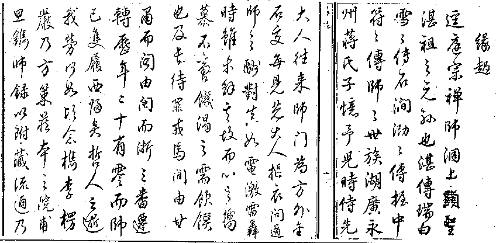
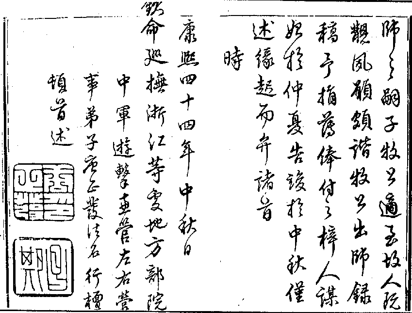

# 迳庭宗禅师语录



> **藏经**：嘉兴大藏经（新文丰版）（嘉兴藏）　**册次** 第 40 册（J40）　**编号** JB475　**部类** 诸宗部　**卷次** 2 卷　**篇幅** 32,294 字

> **卷／品**：0 卷 · 2 品



---



## 目录



  - [序](#序)

  - [序](#序-1)



---



缘起











------



### 序



帝王应运而兴，必有名世之人辅赞皇猷，不特攀龙附凤之俦匡襄左右，即方外释氏，莫不有特立通达之士阴翊王度，藻润太平之治化也。



盛朝开国以来，我世祖章皇帝既表彰六经，丕扬圣教，乃於万机之暇，敕封大觉、弘觉两禅师，安禅蕉园，时被顾问。今上圣天子缵绪前烈，留神空宗，忧世觉人之心，真亲受灵山嘱付，现身金轮，阐扬大教者哉！肇不敏，承乏词垣，伏读中秘方策，经史之外，有禅典、传灯、会元诸书，大约载禅有五宗，若沩仰、云门、法眼已与宋运俱终，惟曹洞、临济至今久而愈茂，所谓二枝嫩桂久昌昌也。然济宗贵觌面全提，而洞宗则以绵密回互为要旨，故今之称洞宗者，显圣澄、寿昌经为最。经旺於江西，澄盛於三浙，澄传七人，弁山瑞、白雪其选也，雪三传迳庭宗禅师出焉。慨自有宋慈明示寂，清湘法道数百年寥寥无闻，国家鼎兴，粤西文运首推吾全，姻亲戚里后先登朝，皆已骧首天衢，黾勉王事。独山间林下，未闻释氏之徒蹶然兴起，不几仰负圣天子阐扬宗教之盛心哉？爰有博士弟子鸣岐唐公，与宗师为方外莫逆，愿布囊金为给孤主，相阴阳，观流泉，择吉壤，建南源梵刹以居师。由是德风远届，瓶锡云从，佛宇僧寮，随方涌出，华鲸鱼鼓，向彻青霄。夏则结制安禅，冬乃开炉打七。升堂问道，龙象蹁跹；入室垂机，狻猊蹈舞，而语录集焉。盛矣哉！慈明之后，释氏蹶然兴起者，非师也耶？历主望刹，延化周圆，师亦倦於津梁，归真返寂矣。康熙乙酉蒲月，昌期游戎，唐公之季子也，继志述事，聿刊师录，附藏流通，邮书都下，乞予序其简端。予固不文，然不敢以不文辞者，喜吾全得师而宗风炽然，使后之灯传不绝，阴翊王度，盖自师重兴始。



时康熙四十四年中秋日，赐进士出身、钦点翰林院庶吉士、同里蒋肇顿首拜譔。



迳庭宗禅师语录目次



缘起



------



### 序



卷上上堂



卷下小参  

晚参  

示众  

机缘  

佛事  

拈古  

颂古  

附塔铭



迳庭宗禅师语录卷上



嗣法门人行谦等编



住清湘南源洪圣寺



康熙壬寅年，师在永州府零陵县嶷山，受粤西全州众檀护及唐鸣岐偕男庭俊、伦俊、之俊、三俊、应俊等请，开南源洪圣禅寺，於八月初四日入院。



上堂。师至座前，拈疏召众，曰：「会麼？曹溪密旨、少室心宗，尽向大护法笔尖头显露了也。如有未见未闻者，仰烦维那表白。」宣毕，以拄杖指座，曰：「向上一路，千圣齐立下风，看宗上座为诸人当阳显露去也。」便升。拈香，曰：「者瓣香，至贵至尊、至广至大，端为祝延当今皇帝万岁、万岁、万万岁。」次拈香，曰：「者瓣香，奉为满朝文武、阖国公卿、本省督抚宪台藩臬司道府州县镇各位尊官，伏愿保合泰和，衍鸣珂於百世；匡扶鼎运，固磐石於万邦。」又拈香，曰：「者瓣香，根盘劫外、叶茂寰中，奉为现前请主、耆宿檀那齐登正觉之场，均履菩提之道。」复於怀中拈出香，曰：「此瓣香，烈如鸩毒，沾之则死不移时；利似霜锋，触之则丧不旋踵。𦶟向炉中，颛伸供养现住嶷山祝圣堂上传曹洞正宗三十世握中符大和尚，用酬法乳之恩。」敛衣，就座。参头白椎，曰：「法筵龙象众，当观第一义。」师震声一喝，曰：「声前荐得，落二落三；棒下承当，错千错万。纵饶口吞佛祖、眼盖乾坤，拈法界於针锋、置须弥於毛孔，犹是南源门下客作汉。还有当家种草麼？」问：「盈盈杲日正当阳，狮子嚬呻百兽藏，报国开堂即不问，度人玅法请师扬。」师曰：「光辉遍界更无私。」曰：「一叶落，天下秋；一尘起，大地收。因甚学人袈裟角收不得？」师曰：「自领出去。」曰：「白鹤本是凡间鸟，不遇苍松定不栖。」师曰：「钝。」曰：「秪如山河大地、草木丛林，借学人卧具出气又作麼生？」师便打，僧便喝；师又打，僧又喝；师连棒打退。乃曰：「宝镜当轩，神锋大展，祖佛俱泯、凡圣齐捐，碎明月珠、拆空王殿，铲尽五家糟粕、刮除二桂玄猷，直得虎骤龙骧、鸾翔舞凤，峰峦云霭、霄汉光腾。秪如祝圣开堂一句又作麼生？四海尽归王化里，何人不唱太平歌？」复举：「握老人命开堂偈曰：『师表人天百万围，古今不异任全威，弘开炉鞲烹龙象，大用楗椎决是非。电卷星驰平帖帖，水穷山尽独巍巍，从来佛祖行难到，却许南源格外机。』宗上座亦勉和一偈以复来命：『桂蕊芬芳岭外围，谨承师命仗餘威，乌藤倒卓惊三楚，麈尾横挥绝百非。平帖帖时平帖帖，峭巍巍处峭巍巍，嶷峰正令高千古，要契当阳第一机。』」喝一喝。参头结椎曰：「谛观法王法，法王法如是。」下座。



中秋，上堂。「灵山话月，曹溪指月，寒山比月，长沙玩月。」竖拂子，曰：「惟有南源者个月，不落圆兮不落缺。纵使南泉拂袖行，犹是文殊第二月。正恁麼时如何？」掷拂子。



重阳，上堂。「今朝九月九，黄花开笑口。」蓦拈拄杖，云：「拄杖喜登高，快饮茱萸酒，指地唤作天，面南看北斗，卓破太虚空，惊起泥牛吼，震动石敢当，眉毛尖上走。」



开炉，上堂。「南源绝无佛法禅道，亦无杀人刀、活人剑、金刚圈、栗棘蓬钝置人家男女，秪要诸人尽情放下、死尽偷心，向威音那畔更那畔打个觔斗，转过身来还须烂椎一顿，方堪缚清风、㓟明月、收子日、放午轮，不是强为，法如是故。」喝一喝。



冬至，上堂。「阴极阳回，日长夜短。直得雪埋万壑，隐显该通。月透千门，暗明不露。」遂竖拂子，曰：「且道者个还属阴阳日夜也无？迥然不落宫商调，作响敲空会者稀。」



上堂。「枯木花芳，锦绣少林春色；冰河燄发，𪸩煌洞岭元猷。妙旨全彰，贯通末后；无情说法，独露真风。所以，万象森罗，无一物而不彰至理；四时化运，无一事而不演真乘。若到南源者里，一点也用不著。何故？我王库内无如是刀。」



上堂。举：「世尊因五通仙人问：『世尊有六通，我有五通，如何是那一通？』佛名五通仙人，仙人应诺。佛曰：『那一通你问我？』世尊如是召，外道如是应，早已漏逗不少，何堪土上更加泥？即今若问南源：『如何是那一通？』声未绝，劈脊便棒。会麼？三汲浪高鱼化龙，痴人犹戽夜塘水。」



上堂。以拂子击禅床，曰：「闻麼？若闻，则聋却你耳。」复竖拂子，曰：「见麼？若见，则瞎却你眼。秪如不见不闻，毕竟如何即得？」挥拂子，曰：「见不见，须弥倒挂龟毛线；闻不闻，折角泥牛入洞庭。更有一机超佛祖，蟭螟眼里法王城。」



上堂。问：「佛法元要即不问，乞师直指本来心。」师曰：「火里冰。」曰：「如何是本来性？」师曰：「水中灯。」曰：「如何是佛？」师曰：「旷大劫来无面目。」曰：「如何是祖？」师曰：「今时那畔未曾睹。」僧礼拜，曰：「谢师指示。」师曰：「莫妄承当。」乃曰：「本来心，火里水。本来性，水中灯。旷大劫来无面目，今时那畔未曾睹。未曾睹，绝回互，遍界全彰浑不露。腊月莲花雪里芳，馨香扑鼻谁人悟？悟不悟，佛祖心肝尽倾吐。」



上堂。「掀翻香水海，放出鱼鳖蛟龙。推倒须弥卢，压死熊罴虎豹。横身宇宙，独步大方。左右逢源，高低得妙。纵饶与麼，犹是半提。且作麼生是全提一句？鸟鸡踏破澄潭月，玉兔掀翻午夜星。」



上堂。举：「金峰示众曰：『老僧二十年前有老婆心，二十年后无老婆心。』时有僧出问：『如何是二十年前有老婆心？』峰曰：『问凡答凡，问圣答圣。』曰：『如何是二十年后无老婆心？』峰曰：『问凡不答凡，问圣不答圣。』金峰虽然棒打石人头，嚗嚗论实事，若到南源门下，未肯点头在。」遂卓拄杖云：「有心耶？无心耶？在前耶？在后耶？凡圣耶？非凡圣耶？有人道得，堪与拄杖相见。」



元宵解冬期，礼千佛忏，上堂。问：「三千诸佛，秪闻其名，未睹其相。如何是诸佛相？」师曰：「牙齿一具骨，耳朵两片皮。」曰：「如何是诸佛名？」师曰：「胡张三，黑李四。」曰：「未审居何国土？」师曰：「三更红日朗，卓午月华明。」曰：「上元且不问，解冬乞师言。」师曰：「若到南岳去，须防滑石头。」乃竖拂子，曰：「三千诸佛向拂子尖上各现千丈报身，各坐菩提宝座，各为无量亿那由他众生出广长舌，而说偈曰：『元宵佳节，然灯放光，化被草木，赖及万方。东南西北，两脚奔忙，罔谈彼短，靡恃己长。』大众闻此妙偈，各证无生法忍。且无生法忍作麼生证？」便下座。



上堂。横按拄杖曰：「春水满四泽。」复竖拄杖曰：「夏云多奇峰。」左卓一卓曰：「秋月扬明辉。」右卓一卓曰：「冬岭秀孤松。此四句内，有一句主中宾，有一句宾中主，有一句宾中宾，有一句主中主。若人定当得出，一生参学事毕。」



上堂。举：「保福因僧侍立，乃曰：『你得与麼麤心？』曰：『某甲甚处麤心？』福拈土度与，曰：『抛向门外著。』僧抛了却来，曰：『甚处是某甲麤心？』福曰：『我见你筑著磕著，所以道你麤心。』保福用剑刃上事热瞒者僧即得，若待度土时，接来劈面便掷，者老汉虽有隐身之术，也只得筑著磕著。更听一偈：『白拈手段太尖新，逐块韩卢岂自明？一片婆心谁会得？空悬明镜照高岑。』」



上堂。举：「睦州示众曰：『裂开也在我，捏聚也在我。』时有僧便问：『如何是裂开？』州曰：『三九二十七，菩提涅槃，真如解脱，即心即佛。我且与麼道，你又作麼生？』僧曰：『某甲不与麼道。』州曰：『盏子扑落地，碟子成七片。』」师呵呵大笑曰：「睦州平地起骨堆，被者僧一拶，直得东扯西拽。当时若在，蓦面一掴，不惟与者饭袋子出气，免者老冻脓寐语无有了日。」



上堂。「嫩绿新红，西来大义；鲜花繁叶，劫外真机。丹凤彩无影林中，灵鹤巢不萌枝上，直得玉女停针、金童侧耳，直饶纵悬河之辩，欲说者段境界终不能得。山僧不惜口业，试为点破：四月清和雨乍晴，南山当户转分明，更无柳絮随风舞。」喝一喝，曰：「末后句𫆏？」便下座。



上堂。「殿角铃谈道，林间鸟话心。可怜西祖意，一一尽分明。」



上堂。「大象牵归藕窍中，乾坤倒挂入针锋，铁牛惊起虚空走，蹋碎云霄是几重？元途断，鸟道空，厮儿失却三元要，洞老忘怀五位功，护身符子休提起，燄里冰花朵朵红。」



上堂。「今朝四月念五，听我一一举数。六只草鞋三双，两轮日月如鼓。北斗昨夜起云，西岭今朝下雨。枝枝叶叶泪流，瓦砾石头叫苦。休叫苦，露柱摇头，灯笼起舞。」



上堂。「闻声悟道，见色明心。」震威一喝曰：「唤作声得麼？」竖拂子曰：「唤作色得麼？」复挥一挥曰：「薄雾筛红日，轻烟衬绿苔。若将实句会，埋没法王才。」复喝一喝。



解制，上堂。僧拟问，师震威一喝。僧拟对，师便打曰：「切莫辜负。」乃以拄杖打圆相曰：「四月十五不入者里，七月望日不出者里。」复卓拄杖曰：「卓破者里，丧却自己。」掷拄杖曰：「上大人，丘乙己。」



开炉，上堂。问：「升座说法，善别机宜。请问和尚，如何是纵？」师曰：「丝纶抛出轻收转，一任高低上下游。」曰：「如何是夺？」师曰：「刚才撒下缦天纲，纵使金鳞怎出头？」曰：「如何是杀？」师曰：「天魔丧胆。」曰：「如何是活？」师曰：「绝后再苏。」曰：「纵夺杀活蒙师指，向上宗乘事若何？」师便打。乃曰：「倾悬河之辩，施劈箭之机。荡元要於言前，勦正偏於句下。不动步而游弥勒楼阁，不返闻而入观音普门。若到南源，痛与三十。何况钩章棘句，巧说奇言。虽然事无一向，不妨第二门头屈曲垂手。不见僧问归宗曰：『如何是佛？』宗曰：『我说你不信。』曰：『和尚诚言，焉敢不信。』宗曰：『即汝便是。』曰：『如何保任？』宗曰：『一翳在目，空花乱坠。』马祖下出八十餘员知识，惟有归宗较些子。拣点将来，未免涂污人家男女。即今有问：『如何是佛？』但曰：『龙城雕来，一任诸方拣点。』」



上堂。「或搬砖，或弄瓦。有时粧聋，有时作哑。阿嫂非哥妻，师姑作大姐。尽日高歌笑不休，扑落虚空没可把。」举拂子曰：「举不顾，即差互。拟思量，何劫悟。」



上堂。「乾三连，坤六段，秤锤时把虚空钻。离中虚，坎中满，石鼓峰头撑石伞。震仰盂，艮覆碗，半夜雄鸡生鸭卵。兑上缺，巽下断，拈起须弥萤火煆。」卓拄杖。



上堂。「芰荷出水叠钱青，何处莺梭织柳阴？坐久不知山雨过，圆机滚滚撒珠珍。诸禅德！若作声色会，则穿却眼耳；不作声色会，则辜负见闻。毕竟如何即得？」便下座。



上堂。「山僧有一诀，杖挑水底月。惊起东海龙，变作南山鳖。咬杀石敢当，泰山迸出血。诸禅德！瞥不瞥？黄金鍊转黄，白玉生成白。」



上堂。「向上机七零八落，末后句东掷西抛，肘后符填沟塞壑，顶门眼耀古腾今。纵饶牙如剑树，口似血盆，到南源且令捞虾摝蚬。抑不得已，放一线道。」挥拂子曰：「百千三昧，无量妙义，悉被拂子泼撒满地，变作乾屎橛死猫头了也。五位君臣，三朝王子，唠唠嚷嚷而相谓曰：『报君知，莫莽卤，黄鹂啼破绿杨烟，白鹭踏翻荷叶雨。』」



上堂。「休休休处意绸缪，绿水青山兴转悠。有趣向没来由，剑去何劳更刻舟。留得五湖风月在，不愁无处下金钩。」



上堂。「今朝五月二十五，冬冬愁听升堂鼓。痴顽侍者几番催，打算枯肠无半语。少年只去弄泥团，老大而今自知苦。嗤嵩山，笑鲁祖，无言却把墙壁睹。气杀悬河瓶泻儿，积学徒将河沙数。」竖拂子曰：「争似南源拂子奇，东边摇了西边抚。挥空三百餘会经，摵碎云门一字普。」喝一喝。



上堂。竖拂子曰：「南源拂子，穿过三世如来鼻孔，触瞎历代祖师眼睛，截断尘沙界众生命根。」复挥拂子曰：「然后放开也在我，捏聚也在我。且道拂子得何三昧，有如是奇特？自从收得空王印，天上人间任自如。」



上堂。「溪声落落流千古，月色明明时往还。一段真机如会得，何须别透祖师关。」



开炉，上堂。「洪开大冶泼天红，钝铁顽铜尽化镕。金刚圈，栗棘蓬，能跳能吞未是雄。」顾左右曰：「既是能跳能吞，因甚麼未是雄？换骨洗肠重整顿，通身手眼更须参。」



上堂。「通玄峰顶，不是人间，心外无法，满目青山。韶国师大似徐六担板。南源随缘放旷，任性逍遥，或坐清风，或看明月。老干挺德山之棒，击碎元关；幽谷传临济之喝，顿空宾主。纵慧超鹙子，秪可默然；饶辩越满慈，实难启口。何故？山河及大地，全露法王身。」



上堂。问：「如何是黄花般若？」师曰：「分明月在梅稍上。」曰：「如何是翠竹真如？」师曰：「看到梅花早已迟。」僧礼拜曰：「谢师指示。」师打曰：「错。」乃举：「华严座主问大珠和尚曰：『禅师何故不许青青翠竹尽是法身，郁郁黄花无非般若？』珠曰：『佛真法身，犹如虚空。应物现形，似水中月。黄花若是般若，般若即同无情。翠竹若是法身，法身还能应用。座主会麼？』主曰：『不了此意。』珠曰：『若人见性，道是亦得，道不是亦得。随用而得，不滞是非。未见性人，说翠竹著翠竹，说黄花著黄花，说法身滞法身，说般若不识般若。所以皆成诤论。』二老名钦御座，道播乾坤。倾悬河之辩，施倒岳之机。捡点将来，不无渗漏。」遂高竖拄杖曰：「看看，此是黄花耶？翠竹耶？般若耶？真如耶？法身耶？虚空耶？」复卓拄杖下座。



上堂。「阳燄翻波，燎却舜若多神面门。」良久，云：「看老僧眉毛在麼？」僧出众，师便下座。



简亲王请上堂。师拈香曰：「此瓣香因植灵鹫，报感阎浮，奉为简亲藩下寿齐南岳，福等东溟。」敛衣就座，乃曰：「龙之种，麟之趾，大哉玉叶金枝，灏矣福基禄位。垂一言，万姓钦仰；行一令，阖国咸遵。万人丛里树高标，一世功名垂宇宙。汝等诸仁还有知恩者麼？王登宝殿，野老讴歌。」



上堂。竖拂子曰：「者里会得，鲁祖面壁。者里不会，子胡看狗。毕竟如何？」掷拂子曰：「收。」



住寿佛庵



康熙癸丑秋，师在南源，受柳州护法曾大受等请，於十月朔旦入院。



上堂。「一自嶷峰捋虎须，闲来世外探龙珠，如今垂钓深潭里，试看金鳞有也无？」问：「大振宗风杲日新，广度龙城百万人，秪如四众临筵作麼生度？」师曰：「霜钟夜半谈真谛，惹得寒梅笑不休。」曰：「如何是龙城境？」师曰：「天马腾空霄汉外，峨眉飞瀑岸山来。」曰：「如何是境中人？」师曰：「今朝逼上金猊座，满口无言话不成。」曰：「人境已经承指示，向上宗乘事若何？」师便打，乃曰：「若论此事，问似云兴、答如瓶泻，秪可热闹门庭，衲僧分上一点也用不著。何故？私通车马，官不容针。」遂竖拂子，曰：「看！看！释迦如来於拂子尖头放白毫相光，光贯十方微尘刹土诸佛顶门，十方微尘刹诸佛各放宝光，旋贯释迦如来顶门，释迦如来出慈和音而赞之，曰：『善哉！龙城四众俱从各省府县会聚此城，或现将军身，或现宰辅身，或现英雄豪杰身，或现才能技艺身，或现童男童女、长者居士、比丘比丘尼、优婆塞优婆夷等身，各各参寻古佛徽猷，显扬衲僧巴鼻。今我授记尔等，顿契心宗，各成佛道。直截承当，甚勿拟议。』」复击拂子曰：「释迦如来被山僧一击，仍旧入寂灭道场去也。且道授记诸仁还信得及麼？」高声曰：「鹞子过新罗。」



熊护法荐亡，请上堂。举：「道吾禅师携渐源檀门作吊，源拊棺曰：『生耶死耶？』吾曰：『生也不道，死也不道。』源曰：『为甚麼不道？』吾曰：『不道不道。』行至中途，源曰：『乞和尚为我道。若不道，打和尚去在。』吾曰：『打即任打，道即不道。』道吾乃药山克家之子，等闲出语，自然绝后光前，头端尾正。即今若有人问南源：『生耶死耶？』答曰：『逢人但恁麼问。』且道与古人相去多少？」



上堂。「跨狞龙，须用超方手段；擒猛虎，应施格外楗槌。一锤才下，迸裂顶门；半机聊施，豁开正眼。停思则万里白云，拟议则当面错过。有麼？有麼？」众无对。师云：「夜静水寒鱼不饵，满船空载月明归。」



上堂。曰椎竟，师曰：「第一义谛却被磬椎上座尽情道破，山僧秪可向第二门头重叠举示去也。」挥拂子，曰：「会麼？九月二十日却是行仁张善人诞辰。」又挥拂子，曰：「九月二十八日却又是行体陈护法生辰。且道拂子是何年何月生？若知拂子生，便知陈护法的生；知陈护法生，便知张善人的生；知张善人生，便知历代祖师、三世诸佛、森罗万象、情与无情的生。若总得知，试问寿量毕竟多少？」顾左右，曰：「前三三，后三三，万年石上千寻树，信手拈来为举扬。」复挥拂子，结椎，下座。



喻嘉澍诞，请上堂。「无阴阳地生苗，没影林中发干，千万劫愈茂愈繁，阿僧祗越英越秀。且道是个甚麼得恁般出类拔萃？」撺拄杖，曰：「看，看。」



熊护法寿，请上堂。卓拄杖曰：「者里会得，不由三祗顿悟真空，不越六尘了明智海。拈三千大千世界於针锋尖上，不费毫力；置百万亿须弥於藕丝孔中，那用纤能？建法幢於旌旗队里，现报身於武弁场中。披忍辱铠，挽回庞老家风；持智慧弓，点开维摩正眼。为宸廷之玉柱，作法苑之金汤。直得优昙现瑞，宝盖呈祥。且道是甚麼人境界？问取当齐熊护法。」



上堂。「翠竹绿，苍松青，更於何处觅真心？满目真乘如委悉，祖父从来不出门。」



住理山圣明寺



康熙甲寅蒲月，师在南源，受山主唐长明，及绅衿护法等请，於九月望旦，开理山圣明禅寺。



上堂。举如意曰：「护得空王如意珠，随机应化自如如。一茎草上琼楼现，百世洪规立壮图。」以如意左挥曰：「左也如意。」右挥曰：「右也如意。」复竖如意曰：「如意如意。」呵呵大笑，便下座。



上堂。「海月上山窗，石屋清彻底。幸有蟋蟀知，唧唧宣不已。今特举似人，开口说道理。谁是惺惺者，拈头便知尾。」遂顾左右曰：「佳作仁，可知礼。」



上堂。拈拂子，左边一拂曰：「东方甲乙木。」右边一拂曰：「西方庚辛金。」前一拂曰：「南方丙丁火。」后一拂曰：「北方壬癸水。中央且道是甚麼？」复竖拂子曰：「若道是拂子，又违了戊己土。若道是戊己土，又违了拂子。毕竟如何即得？」遂掷拂子曰：「参！」



开炉，上堂。「清溪梓童，幸有高明继美；云桥大士，欣逢达者知音。且道张子韶闻蛙声於月下、杨无为操没弦於寰中、王日休法化西方、庞居士财倾沧海，与今县主施财请法相去多少？者里缁素得出，一任苦海浪里横撑宝筏、荆棘丛中倒驾梯航；其或未然，暂时按下云头过，待等春来起蛰龙。」



上堂。问：「赵州布衫重七觔，意旨如何？」师曰：「多少人向觔两上觅？」曰：「赵州访二庵主，又是何意旨？」师曰：「多少人向拳上觅？」曰：「不从觔两、不向拳头，毕竟如何即得？」师曰：「短尾苍龙上碧天，痴人犹戽夜塘水。」问：「南泉斩猫意如何？」师曰：「一刀两段血淋淋。」曰：「赵州头戴草鞋又作麼生？」师曰：「讨甚护身符子？」曰：「秪如沩山道：『老牸牛来也。』意旨如何？」师曰：「奴见婢慇懃。」曰：「明日台山大会齐又作麼生？」师曰：「穿却天下衲僧鼻孔。」曰：「为甚麼沩山便放身卧？」师曰：「昨夜三更月到窗。」曰：「刘铁磨何故拂袖便行？」师曰：「作贼人心虚。」僧礼拜，师便打，乃曰：「赵州七觔衫，悬羊卖狗；庵主竖拳头，证龟成鳖；沩山老牸牛，有意气时添意气；台山大会齐，不风流处也风流。全身放倒，压碎虚空；拂袖便行，踏翻元路。惹得案山点头、龙川摆尾，殿前石狮子跳上梵天，撞著四天王，蓦头一击，转到须弥峰顶，哮吼一声，震落满天星斗，跌入深深海底。还有不假寸绳捡得出来底麼？如无，看拂子大显神通去也。」挥拂子，曰：「日月星辰归本位，山川草木尽辉煌。」



弁山且拙和尚讣至，上堂。举讣召众曰：「还知者老汉勦绝佛祖、扫空圣凡，将四十九年佛法尽情抖乱、一千七百葛藤彻底掀翻，尽大地人奈伊不何？近在弁山峰头踢倒法幢，撒手归去，人天失怙，龙象无依。宗上座久承提命，深荷钳锤，聊𦶟旃檀，用申葵赤。伏惟大慈哀怜摄受。」



余天吉供法服上堂。师展衣示众曰：「若道是鸡足山中底，又在大庾岭头；若道是大庾岭头底，又在理山手里。」遂披衣云：「直得通身显露，脱体全彰，尊贵难伦，人天钦仰。果能直下承当，何用山僧叨呾？」便下座。



住兴隆庵



康熙丙辰菊月，师在南源，受永州杨太守及监院等度请，於十月初八日入院。



上堂。师指法座曰：「极高峻，最宽广，步步踏著，要上便上。」遂升座。拈香曰：「此瓣香荫覆万亿人天，香满三千世界，𦶟向炉中，耑为祝延北阙帝主圣躬万岁，伏愿仁风荡荡，万民赓喜起之歌；德泽洋洋，四海荷雍熙之化。」次拈香曰：「此瓣香抛珍惜於义岭，绝踪迹於嶷山，第二回拈出，奉为现住嶷山传曹洞正宗三十世握中符大和尚，用酬法乳之恩。」敛衣就座。西堂白椎竟，师曰：「潇湘水合，逆流曹溪之源；楚粤山连，远接鹫峰之势。愚溪演新丰之调，澹岩悬宝镜之光，无情上座亘古宣扬，可惜真机长年空过，必须时穷刻究，直下脱体承当。正恁麼时，作麼生是安禅结制一句？从前汗马无人识，秪要重论盖代功。」结椎下座。



上堂。「云门乾矢橛，洞山麻三觔，赵州狗子，佛性有无。父母未生前面目，眼光落地时向甚麼处去？」喝一喝，曰：「姹女已归霄汉去，呆郎犹自火边蹲。」



住嶷山祝圣寺



康熙丁巳冬，握老人赴贵州请师，在南源受山主唐龙安、监院道融等请继席，於十月十五日入院。



上堂。问：「如何不是心？」师曰：「一茎眉毛重千觔。」曰：「如何不是佛？」师曰：「昨夜三更日头出。」曰：「如何不是物？」师曰：「黑是纸兮白是墨。」曰：「三句已蒙师指示，向上全提事若何？」师曰：「截断舌头。」乃曰：「以大圆觉为我伽蓝，身心安居平等性智。者里会得，㓟虚空而砌八角金盘，钻秤锤而穿九曲明珠。俄尔心穷力尽，眨眼便见眉毛。」



华严期满散，上堂。竖拂子曰：「於斯会得，何必福城东际始见文殊，楼阁门开方参慈氏？禅即是教，如水成波；教即是禅，似波成水。非教无以明其禅，非禅无以宗其教。珠走盘而盘走珠，纵横无碍；月映水而水映月，往复何殊？毛吞巨海，芥纳须弥，后先一道，今古同揆。若未会，方山枣柏大士在诸人背后。」



固山刘彦明升迁，请上堂。「春回大地，山山花鸟争奇；运转中天，处处祯祥焕彩。竹尾扫禅心而飘扬圣智，柳线穿祖印而妙契真如，头头彰劫外徽猷，物物露个中消息，一任刀鎗林里洞转法轮，生死海中普扬三昧，自然君臣道合，理事浑融。」挥拂子，曰：「雕弓已挂狼烟息，万里歌讴贺太平。」



过拈花庵，请上堂。「世尊拈花，迦叶破颜，直至而今作正传。」遂竖拂子，曰：「山僧拈起𨍏轹钻，竹筋鞭死猫头，鳖鼻蛇一大络索，若有担荷得去的，随处作主，遇缘即宗，是非窝里转大法轮，十字街头安禅打坐。虽然如是，且道庐陵米作麼价？」



百愚和尚讣至，上堂。「洞上一株大树，无端被一阵毘岚风和根倾折。且道甚处是他安身立命处？」举计音曰：「人间天上独称尊。」



上堂。「簷前细雨，点点滴滴。祖师牢关，明明历历。设若不委，再通消息。」抚几一下。



住曹源宝镜寺



康熙己未夏，师在南源，受永州本生蒋乡绅洎监院行袾请，於十月望日入院。



上堂。「三世诸佛，历代祖师，二桂五宗，无不从此法界流出，无不还归此法界。开选佛道场，续曹源正脉。人人顶门向天，个个脚跟踏地。正恁麼时，作麼生是正脉流通一句？愚溪水接曹溪水，嵛岭风高鹫岭风。」



开炉，上堂。「今日十方聚会，名为封拄杖头、结布袋口。殊不知钵盂安柄，额角栽须。若是大丈夫汉，岂受者般折挫？所以字翁开士特请升座，直捷举扬。记得张状元参宝印有省，偈曰：『春天月下一声蛙，撞破乾坤共一家。正恁麼时谁会得？岭头脚痛有玄沙。』此是现宰官身，弘扬正法之鉴。苟能向句下明得，高提祖印，纵辩玄机，起死回生，抽钉拔楔，饥鹰爪下分餐，猛虎口边夺食，非为分外。脱若未然，须向红炉煆过始得。」



玄契大师请上堂。问：「如何是类堕？」师曰：「龙宫虎穴闲游戏。」曰：「如何是随堕？」师曰：「酒肆淫房绝染尘。」曰：「如何是尊贵堕？」师曰：「千邦万国咸朝贺，独坐深宫不自尊。」曰：「曹山妙旨承师指，福山一句又如何？」师曰：「流通有分。」乃曰：「五位宗旨，彻底掀翻。三堕玄关，尽情剖露。於此领略，肩挑明月，腰裹清风，一任人间天上，此界他方，驾宝筏於迷津，泛慈航於苦海。其或未然，问取福山玄公，必为尔等道破。」



上堂。问：「如何是第一玄？」师曰：「嵛峰顶上浪滔天。」曰：「如何是第二玄？」师曰：「拂子尖头藏大千。」曰：「如何是第三玄？」师曰：「香炉开口笑青天。」曰：「如何是第一要？」师曰：「独足木鸡当午叫。」曰：「如何是第二要？」师曰：「白发儿童满口道。」曰：「如何是第三要？」师曰：「树树梅花雪里笑。」曰：「要玄妙旨承敷演，向上一句请师通。」师曰：「不打你者痴汉。」乃曰：「慈舟原即是渔舟，浪涌千峰最上头。要使狞龙上直钓，蟹虾螺蚌敢吞钩。」



上堂。竖拂子曰：「智者见之谓之智，仁者见之谓之仁，禅者见之谓之禅，戒者见之谓之戒。」挥拂子曰：「智者见之不是智，仁者见之不是仁，禅者见之不是禅，戒者见之不是戒。」复掷拂子曰：「无仁可立，无智可见，无禅可参，无戒可持。极生居士护持有年，今日恭请升座，记得张拙秀才参石霜，霜问：『公姓甚麼？』曰：『姓张名拙。』霜曰：『觅巧了不可得，拙从何来？』张公豁然，遂说偈曰：『光明寂照遍河沙，凡圣含灵共我家，一念不生全体现，六根才动被云遮。断除妄想重增病，趋向真如亦是邪，随顺世缘无罣碍，涅槃生死等空花。』张公如真金百炼，石老似九转灵丹，蓦拶相逢，秪消一点，且道是那一点？」喝一喝。



冰洁尼圆华严期，请上堂。问：「佛法遍一切处，如何是一切处佛法？」师曰：「且喜华严功德周。」曰：「周后如何行履？」师曰：「楼阁门前霜月淡，妙高峰顶日轮红。」乃拈拄杖曰：「香水重重佛境融，华严大义尽情通。善财空费南询力，一棒当阳示正宗。」卓一下。



上堂。举：「云门到乾峰，曰：『请师答话。』峰云：『到老僧也未？』门曰：『恁麼那！恁麼那！』峰曰：『将谓侯白，更有侯黑。』二大老虽则棋逢敌手、琴遇知音，未免傍观者哂。还有定当得者麼？」挥拂子，曰：「有意气时添意气，不风流处也风流。」



腊八日，蒋字臣请上堂。举：「宋时张宰相母秦国夫人参径山和尚，令看狗子无佛性话，忽一夜蓦然得个欢喜处，遂以偈呈山曰：『逐日看经文，如逢旧识人，莫言频有碍，一举一回新。』径山击节称善。秦国夫人虽是个女流，宛有丈夫之作。今字翁太君闻山僧升座亦得个欢喜处，且道他见个什麼？」良久曰：「待明星出现向诸人道。」



解冬期，上堂。问：「把住已凭师煆炼，放行一句事若何？」师曰：「紧捎草鞋。」曰：「黄檗指大愚，师今示何处？」师曰：「若往南山过，须防鳖鼻蛇。」曰：「只如遭他一口，如何调治？」师曰：「待绝后再苏向汝道。」曰：「承师妙用。」师曰：「莫妄承当。」乃曰：「前面万丈悬崖，后面千层峭壁。左有狞龙，右有恶虎。上是天罗，下是地网。动足则堕坑落堑，回首则粉骨碎身。你等得何三昧，能出如是圈缋？」拈拄杖曰：「者队痴汉，有甚麼救处？」下座，一齐打散。



住卧云山最胜寺



康熙庚申年冬，师在南源，受灌阳县众护法监院福日等请，於十月十三日入院。



上堂。「威音那畔，已落名言；透脱今时，终成话柄。纵饶离相离名，泥涂拽尾；假使无踪无迹，日下逃形。还会麼？芍药花开菩萨面，棕橺叶散夜叉头。」



解冬期，上堂。举：「世尊於楞严会上将白叠绾成六结因缘，世尊只知瞻前，全不顾后。」蓦拈拄杖，云：「秪如卧云拄杖本自无结，云何有解？拈起则从教船来、陆来，放下则一任东去、西去。虽然如是，今日又且不然。」遂卓两下，曰：「去底留住，住底遣去。」



上堂。「棒头开正眼，喝下碎虚空，两般俱勦绝，正法永流通。且道作麼生流通？竹上泉通竹下水，溪东花落溪西红。」



将军线国安大护法送人天师表额，请上堂。「人能弘道，法遇人尊。汉明帝高悬佛日而万国咸宁，唐中宗遥敬六祖而千邦肃静。侍郎问道於鸟窠，山谷究心於晦老。现国王之洪范，示宰官之规模。但自元运以来，法门秋晚。至我国朝之世，祖道崇隆。自古至今，罕逢斯盛。线大护法佛心将貌，荣位僧仪。旌旗队里，祖印高标。戎马行中，真风独露。虽然恁麼，犹是功动边事。且如何是尊贵一句？丹诏不须啣彩凤，万方悉已戴尧仁。」



住别尘庵



康熙辛酉春，师在南源，受粤西固山大护法刘彦明、王自荣等请，於正月望日入院。



上堂。「夙植金刚不坏心，而今拈出报皇恩。忠诚凛凛安天下，义勇堂堂定太平。扫尽烽烟归圣化，洗清云雾现天真。於今庆祝南山寿，特举经中一段因。经中道：『云何应住？云何降伏其心？』」挥拂子曰：「应如是住，如是降伏其心。」



行梁请上堂。呈拄杖曰：「木上座！能纵能夺，能杀能活，放之则周遍沙界，收之则摄入无踪，神机莫测，玅用难穷。且道木上座有何长处？空王宝殿犹不住，花街柳巷岂留踪？」



出队归，上堂。「十里一亭，五里一舖。两径青松，一条官路。澄澄满目烟光，湛湛一壶风月。鸢飞鱼跃，尽转法轮。马叫驴鸣，皆谭圣谛。」挥拂子，曰：「陋巷不骑金色马，回途▆著破襕衫。」



住福寿堂



康熙辛酉秋，师在南源，受零陵县众护法及监院清澄等请，於十月望日入院。



上堂。「末后一句，始到牢关。把断要津，不通凡圣。指天指地，不顾傍观。打车打牛，笑杀识者。果是个汉，向者里掀倒禅床，喝散大众，却较些子。若乃向奇言巧语上卜度，惭惶杀人。不见投子因僧问：『如何是一大事因缘？』子曰：『尹司空请老僧开堂。』投子可谓棒打石人头，嚗嚗论实事。即今若有人问山僧：『如何是一大事因缘？』即向他道：『潇湘水泛曹溪浪，福寿堂拈鹫岭机。』且道与投子同异何如？」



上堂。问：「人天交接即不问，如何是第一玄？」师曰：「波心泛铁船。」曰：「如何是第二玄？」师曰：「瓦砾解谈禅。」曰：「如何是第三玄？」师曰：「石头跳上天。」曰：「如何是第一要？」师曰：「明珠穿九窍。」曰：「如何是第二要？」师曰：「日头半夜照。」曰：「如何是第三要？」师曰：「畫鸟枝头叫。」曰：「三玄三要蒙师指，人法双忘事若何？」师打，曰：「也要吃棒始得。」曰：「水向石边流出冷，风从花里过来香。」师又打。乃曰：「冻锁山河，大地浑成银世界。水封泉石，寰中都是水晶宫。映彻本来面目，涵藏古佛心宗。会得底，一只孤鹤扑地双飞。若也未明，两个鸳鸯池边独宿。」



佛成道日，上堂。竖拂子曰：「明星出现了也，还见释迦老子在正觉山前大言不惭麼？他道一切众生具有如来智慧德相，但以妄想执著而不能证得。当时山僧若在，向他顶门一按，且道是智慧德相？是妄想执著？不惟戒定慧门冰消瓦解，抑使𬸚𬸦麒麟俱是瑞，栴檀薝卜一般香，免得打作两橛。」



起七，上堂。问：「洞山五位即不问，临济四喝请师分。」师曰：「劈碎看。」曰：「如何是一喝如金刚王宝剑？」师曰：「髑髅满地。」曰：「如何是一喝如踞地狮子？」师曰：「勦绝群狐。」曰：「如何是一喝如探竿影草？」师曰：「骨出皮穿。」曰：「如何是一喝不作一喝用？」师曰：「满口道无言。」僧便喝，师打曰：「乱叫作麼？」乃曰：「若论此事，登山须到顶，入海须到底，但向恁麼也不得、不恁麼也不得、恁麼不恁麼总不得处转得身、吐得气，始笑三个半壶壶半酒，哥哥丈母嫂嫂娘。其或未然……」喝一喝，云：「这是四喝中那一喝？」



上堂。问：「如何是宾中宾？」师曰：「乞丐沿街不顾贫。」曰：「如何是宾中主？」师曰：「游子归来见上祖。」曰：「如何是主中宾？」师曰：「策杖山前逢故人。」曰：「如何是主中主？」师卓拄杖曰：「天上天下我独尊。」曰：「向上全提又作麼生？」师便打。乃举：「远观颖禅师因僧问：『如何是长法身？』颖曰：『拄杖六尺。』曰：『如何是短法身？』颖曰：『盖方三寸。』曰：『恁麼则法身有二。』颖曰：『更有方圆在。』达观和尚一往只管看楼打楼。山僧即不然，若有人问：『如何是长法身？』『三寸。』『如何是短法身？』『六尺。』『恁麼则法身有二。』劈脊便棒。且道与古人是同是别？试辨看。」



住千佛林



康熙壬戌秋，师在南源，受零陵县众护法及监院德度等请，於十月朔旦入院。



开炉，上堂。「嵛山展衲僧巴鼻，湘水传列祖心印。若也会得，何须畫地为牢？设若狐疑，只得剋期取证。」以拂子向空畫一圆相，曰：「直须打破者牢关，枝枝珊瑚撑著月。」



大士圣诞，上堂。「圆通大士何年生？一声幽鸟送清音。若将耳听终难会，眼里闻声始契真。」



住贝叶林



康熙癸亥春，师在南源，受零陵县众护法及监院等请，於十月望日入院。



上堂。「劫外灵光，个中玄旨。分明一句无私，贵在当人领略。千手摸索不著，千眼顾鉴不到。直得案山点头，始有少分相应。」僧问：「德山入门便棒，临济入门便喝，贝叶入门又作麼生？」师曰：「遇茶吃茶，遇饭吃饭。」曰：「有句无句又何如？」师曰：「有事出坡，无事便坐。」曰：「恁麼则仲春深谷英华茂，二月庭前锦绣红。」师曰：「大似一联春意。」



上堂。「无影林中丹凤舞，不萌枝上叶丛丛。尽情揭露无人委，落尽春花流水红。」



上堂。「虚空扑落地，压倒洞庭秋，万象安何处？千峰倒卓头。还有知此意者麼？」问：「虚空扑落地有几片？」师打曰：「一片也不著。」曰：「承师慈示。」师曰：「莫躲跟，更道看。」曰：「若更道，头上安头。」师曰：「情知你道不得。」



湘山饭僧，上堂。拈拄杖，曰：「者片地自无量寿佛於唐时开辟以来，楼台显焕，宝塔棱层。我嶷山本师於顺治庚子弘开炉鞲，大振雷音。今日长明居士请山僧向者里复作香饭佛事，直得三世诸佛、一切有情总在者里扇炉的扇炉、煮茶的煮茶、献花的献花、勺水的勺水，现一切身，说一切法，接无量众，成无上觉。你等诸人还见麼？」复卓拄杖，曰：「千圣不知何处去？倚天长剑逼人寒。」



迳庭宗禅师语录卷上终



迳庭宗禅师语录卷下



嗣法门人行淡等编



小参



顺治己亥春，师在嶷山座元寮，受宝顶监院德圆请，住白云庵。



结夏，小参。问：「诸方休夏，为甚此处坐禅？」师云：「白云境况家风别，六月水花是处开。」乃云：「高登峰顶，低视人寰，观圣水而点滴清涟，驾铁船而去来无碍。耳畔真机，雷鸣足下；眼前奇色，月霁眉间。法法真体，头头玅用。且心空及第又作麼生？」卓拄杖，云：「棒头有眼明如日，要识真金火里看。」



解七，小参。「今朝六月初一，遍界烘烘赤日，灼开祖师面门，照破衲僧巴鼻。明明在处全彰，休向外边寻觅，堪叹六载雪山，可怜九年面壁。三登九上徒破草鞋，烟水百城空劳脚力，何若白云堂内打破生死牢关，大家一齐解七？且如何是解七的事？脚尖头踢出西来意。」



绝瑕寿请小参。师屈指曰：「一二三四五六七，七六五四三二一，从头至尾数将来，百劫千生无尽极。虽然数目甚分明，不知其中谁辨的？」



师诞日，小参。「父母未生已前，无处著名；㘞地一声以后，秪可傍通。拈花微笑，徒增绀目之沙；断臂安心，重益灵台之垢。德山用倾湫倒岳之棒，欺瞒婴儿；临济展疾风迅霆之喝，诳吓闾里。恁麼告报，恶水泼人；更若叨叨，诚为自谤。且道：无名、无相、无灭、无生又作麼生？佛祖位中留不住，夜来依旧宿芦花。」



解制，小参。「夜明廉外，木鸡啼子夜；明月堂前，刍犬吠天明。於斯会得，明露秋光；若也未然，暗藏春色。若是真正大丈夫汉，向者里翻转面皮，一刀两断。且解制一句作麼生道？路远夜长休把火，大家吹灭暗中行。」



住碧罗庵



开炉，小参。「重整家风，贵在当阳敲唱；全提祖令，必须格外钳锤。纵饶六臂三头一击粉碎，假使三贤十圣一火销镕。」蓦拈拄杖，云：「琉璃殿上长庚灿，玛瑙阶前瑞草香。」卓一卓。



供祖衣，小参。「灵山会上亲传，黄梅室中暗嘱，却被大猷都寺从达磨岭外携归，向碧罗堂中奉重，九十六种外道悉乃皈依，百千万亿人天咸皆稽首。正恁麼时如何？」遂拈起袈裟角，云：「缝里看。」



住毘卢庵



结冬，小参。举：「黄山谷请益於晦堂云：『佛法径捷处，乞师方便。』堂曰：『秪如仲尼道：「二三子以我为隐乎？吾无隐乎尔。」太史居常如何理论？』谷拟对，堂曰：『不是，不是。』一日，侍堂山行，睹岩桂盛放，堂曰：『此是甚麼香？』谷曰：『木樨花香。』堂曰：『吾无隐乎尔。』谷即豁然作礼，曰：『和尚恁麼老婆心切。』堂曰：『只要公到家耳。』晦堂曲垂方便，善用机筹，令山谷久疑顿息，畅快平生。拣点将来，秪解顺水推舟，不能逆风把舵。今日若有人乞指径捷，待声未绝，但云：『已是迂曲了也。』不惟使他直下知归，抑免堕於知见。还会麼？鲸吞海水尽，露出珊瑚枝。」



小参。「至道无难，惟嫌捡择。但莫憎爱，洞然明白。热不向火，冷不当风。爱旃檀之香，恶伊兰之臭。且道捡择不捡择，憎爱不憎爱。若捡点得出，嫩柳过墙连草缘。捡点不出，榴花逐水映山红。」



元旦，小参。「阳象初回，乾元新肇。翡翠帘前，子转身而就父；黄金殿上，臣退位以朝君。太平元有象，何妨凤舞鸾翔？造化本无私，一任龙吟虎啸。正恁麼时，如何是祝赞一句？宸庭有道三边静，万姓欢呼乐太平。」



小参。竖拂子，曰：「上大人，丘乙己。」拂一拂，曰：「化三千，七十士。」左右顾视，曰：「尔小生，八九子。会麼？」众默然。师曰：「佳作仁，可知礼也。」良久，曰：「汝等秪知上大上，千字文未梦见在。」复呵呵大笑，下座。



住莲池山



小参。「陆地莲开，现西方之玅境；紫云结盖，展东土之宗风。地即七宝之地，池原八德之池。烟霞楼阁，咸转根本法轮；水鸟树林，皆现色身三昧。何必普陀山上始见观音，上品莲开方参无量？」卓拄杖，曰：「溪声尽是广长舌，山色无非清净身。」



顺治辛丑春，师在莲池山秉握，老人命代席，嶷山唐至仁请小参。「悬宝镜於堂前，显露无私之照；设红炉於室内，全彰妙用之功。旧店新开，冷灶著火，离相离名的从头煆炼，向上向下的彻底销镕，不是尽法无民，且要觌体相见。」遂竖拄杖曰：「竿头丝线从君弄，不犯清波意自殊。」



小参。以拄杖横按，曰：「踞此座，行斯令，人天乞命，凡圣潜踪。纵饶八面玲珑，透彻不及；假使通身手眼，顾鉴无从。直得水河发焰，冻石生花，展大用於针锋，发全机於毫末，犹未许吃嶷山棒在。即今还有吃得者麼？」良久，掷拄杖，下座。



戒坛，小参。「若论此事，本自圆成，稍涉迟疑，白云万里。诸大德！会即便会，切莫眼目定动，见即瞎，闻即聋。若也错过，万劫难逢；脱或未然，志心谛听。」便说戒。



小参。以拂子打圆相，云：「月到天心处。」拂一拂，曰：「风来水面时。」良久，曰：「这般清意味，料得少人知。」一僧礼拜归位，师曰：「者是那一味？」僧拟议，师曰：「料得少人知。」



解冬期，小参。「洞帘高卷，布袋打开，去岁船来陆来，今朝东去西去，明眼人随处作主，死禅和逐境飘流。虽然如是，还须照顾话头。且道是甚麼话头？」以拄杖作挑行李势。



住青云庵



小参。「昨日雨，今朝雷，何须特地著疑猜？男儿自有冲天志，堪笑无端被活埋。众中有不被活埋者麼？」良久，云：「苍天，苍天。」



解制，小参。竖拄杖曰：「木上座或时为雨为霖，普资万象；或时为祥为瑞，广庇群生；或包括乾坤，丝毫不泄；或展开法界，物色齐明。虽然理事浑融，正偏兼带，且道解制一句又作麼生？横担楖栗无拘束，一任东西南北游。」



小参。举：「昔有二僧各住庵，旬日不会。一日相见，上庵主乃问：『多时不见，在庵中作甚麼？』下庵主曰：『在庵里造个无缝塔。』上庵主曰：『某甲也要造个，就师借个样子可不？』下庵主曰：『何不早道？恰被人借去也。』二老虽则明穿玉线、暗度金针，未免递相钝置。试问诸人：上庵主与麼问、下庵主与麼答，且道是借伊样、不借伊样？若捡点得出，许汝具一只眼。」



住快乐庵



开炉，小参。「大道绝偏圆，非耳目之所到；玄机超物表，岂情量之能该？直饶见色明心，犹是认贼为子；假使闻声悟道，终成指奴作郎。体露真常，未是纯清绝点；机轮活脱，早成滞壳迷封。若是出格英灵，断不堕此窠臼。所以道：『末后一句，始到牢关；把断要津，不通凡圣。』虽然如是，犹有向上一窍在。且如何是向上一窍？」喝一喝，下座。



起七，小参。「诸禅德！要明此个大事，贵乎自信自肯，猛著精彩，将从前习染底、学解底、积蓄底、册子上看底、闲谈中记底、善知识口边闻底，及四大五蕴、六根六尘、明暗色空、是非得失，尽情收作一束，抛向东洋大海，单单靠著本参话头，行住坐卧、折旋俯仰、穿衣吃饭、屙屎放尿，毕竟是个甚麼？孜孜无间，念念不停，时时刻刻追拶到结角罗纹处，更须努力一拶。㘞！原来脚跟下自有通天活路。若不蓝田射石虎，何人知是李将军？」



理山，上梁，小参。「灵源不昧，万古徽猷；正眼顿开，十方洞彻。东边龙吟雾起，西边虎啸风生。且道中间𫆏？」蓦卓拄杖，曰：「秪奉一人天地贵，从教诸道自分权。」便升梁。



避世小参。召众曰：「诸禅德！本源国土太平麼？若太平，正好吃铁钉饭、嚼木札羹，忽然嚼破舌头，自然萧然物外，一任楗椎龙象、陶铸圣凡，在在称尊、门门作主。且道如何是萧然物外一句？长安虽闹，我国晏然。」



小参。「达磨老子昔年将一只履放在白云峰顶，几千年来风吹日晒、雨打霜侵，竟无有人识得，今日觌面拈来。」遂以拄杖作挑势，曰：「看，看！不是皮造，亦非布成。还有识得者麼？无则西归去也。」便下座。



晚参



晚参。举：「南泉曰：『王老师自小养一头水牯牛，拟向溪东牧，不免犯国王水草；拟向溪西牧，不免犯国王水草，不如随分纳些些，总不见得。』南泉垂一言半句，应当与人解黏去缚、抽钉拔楔。秪如东边也犯、西边也犯，如何得随分纳些些？若是南源者，一头在东不东、在西不西，横身宇宙，处处逢源，动则森罗万象悉放光明，静则凡圣含灵咸皆敛迹。且道：与王老师相去多少？」



晚参。举：「香严曰：『若论此事，如人上树，口衔树枝，脚不踏枝，手不攀枝。树下忽有人问：「如何是祖师西来意？」若不对，违他所问。若对，又丧身失命。当恁麼时作麼生即得？』时有虎头上座出问曰：『树上即不问，未上树时请和尚道。』严乃呵呵大笑。香严真如金刚圈、栗棘蓬，吞吐不得。虎头上座虽善应来机，未免遭他惑乱。若遇南源，不消一个喷嚏。教他在树上也不得，在树下也不得。看他如何合煞。」



晚参。举：「殃崛摩罗尊者因持钵到一长者家，值妇产难，长者曰：『瞿昙弟子！汝为至圣，当有何法能免产难？』崛曰：『我乍入道，未知此法，待我回问世尊却来相报。』及返，具事白佛，佛告殃崛：『汝速去报言：「我从贤圣劫来未曾杀生。」』崛奉佛语疾往告之，其妇得闻当时分娩。者则公案不惟眼中无珠者识他不得，即大慧禅师曾被他惑，盖因他如八阵图一般，善识门户者自然出入似入无人之境，未透关隘者宁免沉迷？南源当初若作殃崛，待长者恁麼问便嘘一嘘，管教直下令产妇分娩。」



起七，晚参。「换骨脱胎，自然七通八达；转凡成圣，依然落二落三。俯仰折旋，岂能羁绊；行住坐卧，孰敢罗笼。若也信疑不定、心志不坚，行则逞情放意、坐则乱想胡思，闻警策则愤气翀天、遇闲谈则葛藤遍地，与麼参学了生脱死，直至弥勒下生。所以道：『参禅须是铁汉，著手心头便判。直取无上菩提，一切是非莫管。』正恁麼时，还有透纲的金鳞麼？」问：「结制小参即不问，打七勘验事如何？」师随声便打，僧便喝。师又打，僧又喝。师曰：「来者里弄鬼眼睛。」乃连棒打退。



晚参。举：「百丈上堂，有一老人随众听法，一日众退，惟老人不退，丈问：『汝是何人？』曰：『某非人也，於过去迦叶佛时曾住此山，因学人问：「大修行人还落因果也无？」某对曰：「不落因果。」遂五百生堕野狐身。今请和尚代转一语，贵脱野狐身。』丈曰：『汝问。』老人曰：『大修行人还落因果也无？』丈曰：『不昧因果。』老人於言下大悟，作礼曰：『某已脱野狐身，住在山后，乞师依亡僧津送。』丈乃领众至后山岩下，挑出一死狐，遂依法火葬。」师举毕，问傍僧曰：「夜来老鼠咬破油坛，你等知麼？」一僧曰：「不知。」师随声打曰：「堕也，堕也。」复以杖作挑起势曰：「百丈火葬，我者里活埋。」又僧出曰：「幸和尚高鉴。」遂抽身归众，师曰：「一队野狐。」拈棒一齐打散。



晚参。举：「乾峰示众曰：『举一不得举二，放过一著落在第二。』云门曰：『昨日有人从天台来，却往径山去。』峰曰：『明日不得普请。』一个高高峰顶立不露头，一个深深海底行不湿脚。山僧则不然。」乃顾左右曰：「路远夜长休把火，大家吹灭暗中行。」



晚参。按拄杖，曰：「进堂一七了也，本参还破了也未？若破，一任放旷於蜗角尖头，横身於蟭螟眼里，拈兔角而剥落鹘臭汗衫，以龟毛而牵转黑漆昆仑。直饶恁麼，犹是作略边事，须知更有格外一机在。策起眉毛，听取一偈：『脊梁铁铸紧捏拳，细究娘胎未出前，忽尔踏翻无缝罅，峰头浪涌泼中天。』」



晚参。举：「径山示众曰：『有一人一生修善，有一人一生造恶。善者一日偶犯不与取戒，恶者一念了悟自心。犯戒者即名为贼，了悟者即名为佛。二人同到径山，著那一人即是？著善人而却恶人，则是著贼而却佛；著恶人而却善人，则是怕恶而欺善。若二人俱著，则佛、贼不分；若二人俱不著，则善、恶不明。若决定指佛是恶人，则招谤佛之愆，入地狱如箭射；若指贼是善人，未有善人而做贼者，当人未具智眼在。到者里还有断得者麼？若断不得，径山为诸人断却。贼是善人为，佛是恶人做，佛贼善恶人，不出者两个。还会麼？』蓦拈拄杖，面前畫一畫，曰：『建昌纸贵，一状领过。』径山无端向善恶途中惑乱人家男女，末后不得一状领过，堪作甚麼？若到南源，未免吃棒有分。」遂竖拂子，召众，曰：「此是善耶？恶耶？佛耶？贼耶？」挥拂子，曰：「云中石笋茎茎嫩，燄里水花朵朵红。」



晚参。举子胡看狗公案毕，乃曰：「子胡狗子，古今孰不遭他毒口？若遇南源，待云：『看狗。』便好踏倒曰：『畜生，人也不识。』免使逢人乱咬。」



晚参。「无毛鹞子飞上天，翀破虚空作两边，须弥灯王忙去捉，针锋头上走三千。」喝一喝。



示众



示众，举：「世尊曰：『如我按指，海印发光。汝暂举心，尘劳先起。』黄面瞿昙无端打作两橛，未免遭人检点。」竖拂曰：「海印尘劳，总在拂子头上。」掷下曰：「看。」



大士诞日，示众。「鸟啼花笑，入理深谈；竹韵松吟，圆通妙旨。跨金狮於千峰顶上，却在十字街头；骑石虎於十字街头，却在千峰顶上。不是神通，亦非妙用。诸人信得及麼？如不信，问取观音大士。」



戒坛，示众。「凛凛朔风，纷纷瑞雪，毘卢遮那冻破面门，清净法身寒彻骨髓，毘尼境界齐彰，木叉家风大振。於斯会得，撩衣护钵总属千花台藏，开单展具无非心地法门，五篇七聚总是闲言，轻重开遮悉归剩语。其或未然……」拈袈裟，曰：「者里不得错过。」



示众。举：「金陵则监寺问青峰云：『如何是学人自己？』峰曰：『丙丁童子来求火。』后谒法眼，举前话，眼云：『上座作麼生会？』则曰：『丙丁属火，以火觅火，如将自己觅自己。』眼曰：『恁麼会又争得？』则曰：『某甲只恁麼，和尚作麼生？』眼曰：『汝问我，我为汝道。』则曰：『如何是学人自己？』眼曰：『丙丁童子来求火。』则於言下顿悟。西峰玅曰：『者则公案，自古至今觅一个不错会底人，如星中拣月。秪如则监寺於法眼言下悟去，要且不是顺朱具眼的，试辨看。』」师呵呵大笑，曰：「西峰老汉龙头蛇尾，直饶辨得，也是泥里洗土块。」



示众。举：「七贤女同游尸阤林，一女曰：『尸在者里，人在甚麼处？』一女曰：『作麼？作麼？』诸姊谛观，悉皆悟道，感得天帝释散花供养。女曰：『空中散花者何人？』曰：『某乃天帝释，见诸姊悟道，特来散花供养。凡诸姊所需，我皆供给。』女曰：『我家四事七珍悉皆具足，惟要三般物：一、要无根树子一株；二、要无阴阳地一片；三、要叫不响山谷一所。』释曰：『一切珍宝我皆有之，此三般物而我实无。』女曰：『汝若无，争解济人？』」师曰：「七贤女自不识羞，抛却家中宝藏，无端走在尸阤林里，嗅得些臭气，粧娇卖俏，撒尽风流。憍尸迦贪他小利，被索三般物，便乃悭吝不舍，未免取笑傍观。南源当时若在，见伊恁麼索，即与三顿痛棒。且看七贤女面皮安放何处？」



示众。「南山鳖鼻蛇，大雄山下虎，圆通死猫头，云门一字普，此意太郎当，切忌莫莽卤。是事且置，昨日有人从广西来，今朝却往湖广去，且道他所传何事？若有信可通，未免传言送语；若无信可通，可惜空费草鞋钱。去此二途，诸人试定当看。」



示众。「几树梅花笑满腮，真机点点甚奇哉，於中更有深深意，阵阵清香扑鼻来。」



示众。举：「长庆曰：『总是今日老胡有望。』保福曰：『总是今日老胡绝望。』二老一具杀人刀，一用活人剑，检点各与二十。何也？赏则均赏，罚则俱罚。」



示众。举：「弁山瑞祖因僧参次，自谓会曹洞宗旨，山乃举：『蛇咬虾蟆，如何救即双目不睹？』僧曰：『犹带识在。』山曰：『如何不救即形影不彰？』僧曰：『犹带情在。』山曰：『者乱统禅和，梦也未梦见洞山在。』遂一顿痛棒趁出。时克归维那问：『如何是救即双目不睹？』山曰：『芳草无艳色。』『如何是不救即形影不彰？』山曰：『铁壁放光明。』复颂曰：『芳草不艳呈真迹，铁壁放光露古颜。正去偏来全理事，没弦琴韵动关山。』弁山老祖丕振洞上宗旨，虽则光前裕后，捡点将来犹让玄孙一步。若问：『如何是救即双目不睹？』『红日更深归古洞。』『如何是不救即形影不彰？』『桂轮午后上青天。』更与颂出：『红日更深归古洞，桂轮午后上青天。个中无语炽然说，石鼓冬冬震大千。』」



示众。举：「僧问云门：『达磨九年面壁，意旨如何？』门曰：『念七。』」师曰：「三九念七，绝毫绝厘。有漏木杓，无漏笊篱。」



示众。举：「僧问赵州：『学人乍入丛林，乞师指示。』州曰：『吃粥也未？』曰：『吃粥了。』州曰：『洗钵盂去。』古今拈颂者极多，中的者亦鲜。山僧不惜眉毛，特为注破：和尚合掌，道士擎拳。下脚著地，抬头见天。更问如何，十万八千。」



示众。「纯清绝点，徒增性海之波；离相离名，早曳灵龟之尾。争如任情放去，随分收来，纵夺杀活而玉转珠回，倒弄横拈而珠回玉转？还有动弦别调者麼？夹路桃花风雨后，马蹄何处避残红？」



示众。师一日坐簷下，众集，师云：「佛法遍一切处，无一处而非佛法。若言其有，堕於常见；若言其无，堕於断见。言有、言无，难出四见。向者里透脱，则面面逢渠、头头合玅，通身庆快、脱体安然，信手拈来，无非格外真机。」喝一喝，归方丈。



落堂，示众。「那边底过者边来，切莫钉桩摇橹。」一僧便过。师曰：「者边事如何？」僧无对。师曰：「随波逐浪汉。」师复曰：「者边过那边去。」一众默然。师曰：「伎死禅和。」便打出堂。



示众。「者件事，人人本有、个个不无，尘点劫来，自家打失。今既发大愿，已到曹源。你看合郡诸檀，尽力维持，无非成就我等专一办道。所谓者里若不究根源，直待当来问弥勒。设或虚消信施，唐丧光阴，他日阎使君铁算盘打算饭钱不来敲鬼骨臀，莫道佛法无灵验。」



示众。「初一才起七，不觉七日周。未透祖师关，此心肯甘休。」拈拄杖曰：「向者里休去好。」掷拄杖。



落堂，示众。师卓拄杖曰：「此一著能大能小，能方能圆，能纵能夺，能杀能活。说有则踪迹不立，说无则遍满十方。长则尺不满寸，短则拄地擎天。或时弘开大义，或时泯灭真空。或时吞巨海，或时吐须弥。且道如今在曹源手里，又唤作甚麼舌头短？」



示众。「云渺渺，月皎皎，铁蛇横古路，行人打之遶。若是狮子儿，不向那边讨。既不向那边，者边又作麼生？」众无对。「村儿不解鲜鳞味，辜负渔郎到渡头。」



机缘



师参大义山且拙和尚，拙曰：「那里来？」师曰：「天圆山。」拙曰：「途中事如何？」师曰：「已到此处。」拙曰：「此是甚麼处？」师曰：「上是天，下是地。」拙曰：「吃茶去。」



次日，和尚入禅堂，问：「者僧昨日到的那？」师曰：「将谓和尚忘却。」拙曰：「即今道一句看。」师曰：「正午时。」拙云：「如何是午时底事？」师曰：「著衣过堂。」拙休去。



一夕，入方丈，拙云：「近日学语者多尽认识神为主，真可怜悯。」师曰：「识得不为冤。」拙曰：「汝试道看。」师曰：「一盏孤灯两岸明。」拙曰：「灯烬后如何？」师曰：「照天照地。」拙遂命颂，师即颂曰：「群暗从兹尽，光辉自此生，日来月复往，独尔越常明。」



一日，与居先禅师游山，到安乐林，围炉次，先曰：「古人道：『静夜钟声，寒潭月影。』随扣击以无亏，触波澜而不散。此犹是生死岸头事，如何得出生死？」师曰：「络索不少。」先曰：「汝已出生死耶？」师曰：「者汉话头也不识。」便出。先曰：「来！向火著。」师曰：「疑则别参。」先曰：「太煞滑头。」师不理。



师在嶷山西堂寮，一日领众入室，师问：「和尚未升座，某甲未入室时，且道如何接人？」山便打，曰：「正好吃棒。」师接住棒，熄灭灯烛，掀倒禅床便出。山曰：「不谬为嶷山西堂。」



落堂。僧问：「如何是觌面句？」师曰：「殿前步云桥。」曰：「如何是末后句？」师曰：「屋后飞来石。」曰：「秪如掀翻两头又作麼生？」师曰：「灵岳作舞。」僧礼拜，师曰：「切莫诈明头。」



慈容问曰：「近日事秪合如是。」师曰：「汝亲切道一句看。」曰：「山穷水尽。」师曰：「行到山穷水尽处，须知自有转身时。如何是转身一句？」曰：「东西南北。」师曰：「秪如四面逼煞时，汝作麼生出？」曰：「一线通霄。」师曰：「线断后如何？」容拟议，师震声一喝。



息念问：「入火不烧，入水不溺，乞师指示。」师拈竹篦曰：「唤作竹篦则触，不唤作竹篦则背，你作麼生会？」念礼拜，师曰：「汝曾在甚处住过？」曰：「与和尚同住。」师曰：「山僧住甚麼处？」僧曰：「适才吃瓜子，咬破舌头。」师曰：「秪如来时无口，舌头在甚麼处？」僧拟议，师便打。僧礼拜曰：「当面不识。」师曰：「自供免罪。」



灵芽入室，问：「一拳击碎虚空，竹篦安向何处？」师曰：「竹篦且置，还我碎的虚空来。」僧一喝，师以手拨空，曰：「竹篦𫆏？」僧拟议，师喝出。



师携吼震无诤游山，垂问曰：「千峰万峰，为甚此峰独峻？」诤曰：「也在和尚足下。」师曰：「身遍十虚，为甚麼那峰不到？」诤曰：「无栖泊处。」师曰：「万峰顶上一团瓢，为甚麼露而不盖？」诤曰：「八面玲珑。」师曰：「未在，更道。」诤曰：「不辞向和尚道，恐上纸墨。」师休去。



别牧入室作礼曰：「今日亲见和尚。」师曰：「座上无老僧，目前无阇黎，汝作麼生见？」牧曰：「无字也是多的。」师曰：「又道亲见和尚。」牧曰：「和尚是何心行？」师曰：「更须亲切道将来。」牧拂袖便行。师曰：「放过一著。」



巨声闻：「和尚终日教某甲做工夫，是何心行？」师曰：「你见个甚麼便恁麼道？」曰：「一物不存。」师拈瓯曰：「这个是甚麼？」声拟进语，师掷碎曰：「恁麼始得。」声礼拜。



僧入室，问曰：「我者里内不放出、外不放入，你从何来？」僧以手打圆相，畫破叉手而立。师曰：「你又到者里作麼？」曰：「若不经行阵，争得立功勋？」便退。师复落堂，问：「我的是我的，你的𫆏？」僧进前端立，曰：「一串穿却。」师曰：「如何是渠今正是我？」曰：「某甲不敢道。」师曰：「如何不道？」曰：「道著即祸生。」师曰：「且放过。」



僧问：「如何是三脚驴？」师曰：「步步颠。」曰：「如何是犀牛扇？」师曰：「撦破了。」



僧问：「炉鞲弘开，煆尽圣凡。秪如没身心人来，和尚如何安置？」师曰：「不可错怪山僧。」曰：「不到红炉里，焉知火后毛？」师便打。



打七，落堂。杨居士出，师按住曰：「脚跟下亲切道来。」士曰：「夜半日头红。」师曰：「日落后如何？」曰：「照天照地。」师曰：「天崩地裂，照个甚麼？」士喝，师便打。



谢守戎游竹石斋问德山托钵公案，师举手曰：「钵𫆏？」守罔措，师曰：「钵尚不知，托个甚麼？」曰：「毕竟为某说破。」师曰：「少间为公说。」



守又问曰：「闻马祖接石巩甚奇。」师曰：「那个男儿不丈夫？」曰：「马祖射一群，某只射半个。」师曰：「山僧半个也无，汝如何下手？」守踌躇，师打曰：「又射杀一个。」



守复问：「女子出定，如何是女子定？」师曰：「钵盂安柄。」曰：「罔明为甚麼出得？」师曰：「春回花自开。」曰：「文殊为甚麼出不得？」师曰：「秋到叶还落。」曰：「某甲不会，乞为我说。」师曰：「俗气不忘。」曰：「和尚不说，今日辜负我也。」师曰：「争怪别人。」遂示以偈曰：「个中一著许谁知，直下承当早已迟。若向言前亲荐得，再来棒下碎离微。」



高内翰奉命祭舜陵，差专使程天祚、刘机先赍法物金缕过参。才见，祚便问：「和尚赚我来，赚我来。」师曰：「自起自倒汉。」曰：「和尚好山水。」师曰：「莫眼花。」曰：「某甲失利。」茶次，曰：「和尚名震天庭，德钦寰宇，诚不易到者田地。」师曰：「耳闻不如目见。」曰：「见后如何？」师曰：「瞎。」曰：「某甲远来，和尚放宽些地步。」师曰：「何物不容？」曰：「恩主闻道风，差某远来，和尚将何答寄？」师曰：「长江流不尽，日月照无穷。」曰：「即此便是？别有长处？」师曰：「不是知音者，徒劳话岁寒。」曰：「如何是西来意？」师曰：「山花开似锦，涧水湛如蓝。」曰：「如何是祖师心？」师曰：「一茎眉毛重千觔。」曰：「某甲即得，外人闻知，笑和尚去在。」师曰：「罕遇知音。」曰：「远行足倦，暂且违教。」师曰：「放过即不可。」便打。



次早曰：「昨日公案未圆。」师曰：「仔细说来。」曰：「碗里饭，瓯里茶，事如何？」师曰：「细嚼味长。」曰：「和尚说道理即得，若在曹洞宗，欠绵密在。」师呵呵大笑曰：「大似吃饭不得，强道不饥。」复曰：「汝曾见甚麼人来？」曰：「和尚不妨疑著。」师打曰：「初生之犊不识虎。」曰：「草皇帝供养诸大善知识，有何功德？」师曰：「天晴日头出，落雨地下湿。」曰：「即今元皇向甚麼处安身立命？」师曰：「竹放云边浪，松收月下涛。」曰：「此语涉那一宗？」师曰：「梅花满地草鞋香。」曰：「某甲还京，有问：『南源佛法，将何詶答？』」师曰：「牙齿一具骨，耳朵两片皮。」



吴内翰出使安南，问：「入境闻德风，似优昙花；入寺阅尊录，如摩尼珠。颂云：『石女梳粧越样新，月眉云鬓彩霞裙。於中那转秋波趣，不是风流人岂明？』此颂句到、意到、理到、事到。请问：如何是那转秋波趣？」师云：「只许佳人独自知。」曰：「不是风流人岂明，又作麼生？」师曰：「深领来问。」曰：「如何是石女梳粧？」师曰：「燄里冰花。」曰：「如何是月眉云鬓？」师曰：「禾针穿雨线。」内翰遂酬偈曰：「千里同风意越伦，太行山遇普州人。知音何必重重举？达者须知暗里惊。」



佛事



兴隆开钟版。「佛祖规模，人天号令，人人透顶透底，个个彻始彻终。欲契洞上家风，试看兴隆作略。」遂击钟版。



伽蓝，升座。「凛凛忠心，卫皇图而永固；堂堂正气，护佛国以攸清。昔年普静言边鼻孔打失，今日嶷山堂上正眼豁开。」挥拂子，曰：「道场能作主，化外自来宾。」



百丈涧祖忌日上供。「洞山果、曹山酒、金牛饭、赵州茶、百千玅味，无量珍馐。且道纳受者谁？」合掌曰：「唵　誐誐曩　三婆嚩　伐日啰斛。」



灵机火。拈炬曰：「生平活泼泼，今日寂寥寥。虽然来去自由，犹欠末后一著。如何是末后一著？」掷炬曰：「一炉红焰翻身转，倒跨赤龙化大千。」



晏然都寺起龛。「三处丛林功最深，精勤誓入普贤门。於今撩起还乡去，留得馨香四海闻。」



灯明火。「灯明灯明，烁破面门。彻骨彻髓，曜古辉今。」



恒修起龛。「金风急，树凋零，篱下黄菊点点金，还乡句子分明示。」以拄杖指曰：「直往西方径路行。」



自诚火。「自诚自诚，戒德水清。了无回互，率性直行。赠君一把火，光前绝后人。」



鸣岐唐护法掩棺。以拂子指棺曰：「唐护法会麼？住世英雄，到者里全身放下；出群豪杰，於斯时一句全提。知幻即离，犹存幻知；幻离即觉，尚餘觉照。毕竟如何？盖地遮天无别事，为人自肯乃方亲。」



大根王护法起棺。「出世辽东，入灭西粤。既生死无定，任去来自由。弃富贵而出尘表，顿契色原非实。舍功名而趋净土，了知空亦何真。」以杖击棺曰：「出此解脱门，直超菩提路。」



猫落汤死。举火：「南泉刀下全身露，洪圣锅中更出奇。珍重者回毛脱尽，红炉焰里好安居。」



拈古



举：「青原思禅师问六祖大师：『当何所务即不落阶级？』祖曰：『汝曾作甚麼来？』曰：『圣谛亦不为。』祖曰：『圣谛不为，落何阶级？』原曰：『圣谛尚不为，何阶级之有？』祖曰：『如是如是，善自护持。』荡空凡圣，还他青原。拣别龙象，须是曹溪。然虽如是，龙归大海波涛静，云到苍梧气象闲。」



举：「僧问赵州：『万法归一，一归何处？』州曰：『我在青州做一领布衫，重七觔。』觔两分明，不无赵州。若问山僧：『万法归一，一归何处？』只向他道：『山前石头，大的大，小的小。』」



举：「台山婆子因僧问：『台山路向甚麼处去？』婆云：『蓦直去。』僧才行，婆云：『好个师僧，又与麼去。』后有举似赵州，州曰：『待我去勘过者婆子。』明日便去，亦如是问，婆亦如是对。州归，谓众云：『台山婆子！我为汝勘破了也。』赵州婆子，一对无孔铁锤，且道勘破那个？」



举：「沩山示众云：『老僧迁化后，往山前檀那家作头水牯牛，左肋书五字云「沩山僧某甲」。正恁麼时，道是沩山僧，却是水牯牛；道是水牯牛，却是沩山僧。』」师云：「道是沩山僧，却是水牯牛，恰；道是水牯牛，却是沩山僧，恰。当时若下得这两个恰字，教他脱沩山僧也不得，脱水牯牛也不得。且道利害在甚麼处？」



举：「德山一日托钵至法堂，雪峰遂问：『老汉！钟未鸣、鼓未响，托钵向甚处去？』山低头便归方丈。峰举似岩头，头曰：『大小德山未会末后句在。』山令侍者唤来问：『汝不肯老僧那？』头密启其意，山乃休去。明日升堂，果与寻常不同。头至僧堂前，抚掌大笑曰：『且喜老汉会末后句。虽然，也只得三年活。』者公案却是好笑，且道笑个甚麼？笑他父子泼油救火、平地兴波，明眼人前转见败缺。」



举：「芙蓉楷侍投子游园次，子度拄杖与楷，楷接便随行。子曰：『理合与麼。』楷曰：『与和尚提鞋挈杖，不为分外。』子曰：『有同行在。』楷曰：『那一人不受教。』子休去。至晚问楷：『早来说话未尽在。』楷云：『请和尚举。』子曰：『卯生日，戌生月。』楷即点灯来。子曰：『汝上来下去，总不徒然。』楷曰：『在和尚左右，理合如此。』子曰：『奴儿婢子，谁家屋里无？』楷曰：『和尚年尊，缺他不得。』子曰：『得与麼殷勤？』楷曰：『报恩有分。』动弦别调，玉转珠回，线去针来，明投暗合。投子芙蓉之谓欤？」



颂古



那咤太子



骨肉都还父母了，不知谁是不还身，於中若也能端的，红日三更透海门。



庐陵米价



庐陵米价玉无玼，觌面拈来佛祖迷，纵使机前先荐得，夕阳早已过辽西。



国师塔样



层层宝塔露尖新，八面玲珑万古明，却被应真添彩色，湘南潭北换人睛。



丹霞访国师



密不通风暗度津，龙生龙子更愁人，国师解展回天手，一箭双雕玅绝伦。



百丈三诀



三句吃茶珍重歇，看来浑似白拈贼，虽然肝胆向人倾，也是重添眼里屑。



洞山寒暑



回互机关换处奇，金针玉线少人知，大鹏展翅腾霄汉，堪笑[鳥*感][鳥*感]犹守池。



台山婆子



路向台山蓦直行，赵州婆子舌无筋，曹溪波浪如天阔，多少平人被陆沉。



德山托钵



团𪢮詶唱哩𪡏啰，平地高翻万丈波，秪活三年成败缺，令人千古话淆讹。



德山棒



扑天扑地拶将来，触著从教正眼开，截断圣凡生死路，金毛狮子展雄才。



德山验廓侍者



坐观成败运机筹，赚得便宜未肯休，七纵七擒谁解会，卧龙徒自枕清流。



文远礼佛



上林花弄正春浓，嫩绿新黄斗浅红，一阵狂风咸扫尽，青山还在白云中。



供养三世诸佛



木猿岭畔啼残月，畫鸟岩前唤晓风，一句顿超空界外，三山斜插淡云中。



洛浦家无白泽之图



行尽溪山休住足，究空玄玅莫安居，饥餐渴饮无餘事，何用高悬白泽图？



云门示众中有一宝



觌面相逢却不逢，疾行犹自且从容，回途拈出吹毛剑，劈碎虚空片片红。



乾矢橛



江上青山山上松，当年曾受大夫封，枯根曲直照江水，一夜轰雷尽化龙。



五祖演属牛人话



倏然平地掘深坑，埋没良家多少人，大似扬尘空里去，归来不觉一身尘。



钵啰娘



石碣篆文格未别，鴈书草法体难分，目连鹙子犹不识，分付禅流莫乱评。



慈明不动尊



不动尊兮提不起，拍手相将笑而矣，飞龙早已上青天，忍俊韩卢寻不已。



李驸马问慈明



杀活临时照用齐，逆来顺去许谁知，棋逢敌手机先玅，琴遇知音韵转奇。



不汝还者非汝而谁



不汝还兮复是谁，怀胎木马产金猊，灯笼露柱呵呵笑，惊起乌龟带雪飞。



见不能及



风来水面层层浪，荷出池心点点青，黄面瞿昙休弄舌，夜深云散碧天星。



一切贤圣皆以无为法而有差别



雨里移柑石上栽，夜深日晒便花开，随时结个无名子，寄与诸人莫乱猜。



高僧像



雾锁烟埋老冻侬，原来面目总雷同，唤回不费丹青力，快睹陈年上古容。



青州布衫



赵州衫子重七觔，无奈时人著秤称，踏转自家关捩子，方知认错定盘星。



临济三顿棒



旱地雷声劈面来，三遭毒手眼难开，可怜刻骨刲心恨，肋下还拳始快哉。



无位真人



吃饭穿衣绝覆藏，焚香扫地露真常，玲珑面面无遮障，鸟语山花共举扬。



普化踢倒饭床



冤家聚会义难容，搅海翻江厮炒穷，尽谓象龙频蹴踏，谁知扫地灭吾宗。



五位正偏



正中偏，夜深独坐正霜天，相逢觌面不相识，冷落梅花满地笺。



偏中正，玉人羞对菱花镜，鹭鸶飞入绿杨烟，金牛踏断虚空柄。



正中来，无影林中花正开，馨香扑鼻无人会，惹得虚空笑满腮。



兼中至。大鹏双展摩天翅，冲破云霄两半边，有意气时添意气。



兼中到，红炉燄里水花笑，无根无叶无枝条，寒光隐隐香风悄。



曹山三堕



> 羽毛鳞甲任毸毸，是处风光类莫该，马腹牛胎闲出没，浑无些子带归来。(类)



> 酒肆淫房频出入，花街柳巷任徘徊，浑身不带烟云气，踏遍天涯足未抬。(随)



> 九重深处不知名，宝殿霞封绝点尘，偏处不行玄不涉，逍遥何处不天真。(尊贵)



五位功勋



> 倒骑铁马出重城，走遍天涯计不成，特地归来忘所事，乾坤处处贺升平。(向)



> 金门投策五更寒，念念无违待漏闲，一震静鞭惊鹄立，全身瞻仰向龙颜(奉)。



> 倒跨金毛不露踪，灼然出没孰当锋？翻身踏碎虚空骨，惊起泥龙上九重(功)。



> 楖栗横肩是处行，玲珑八面露锋铓，直饶透出威音外，触著须知命已亡。(共功)



> 不向毘卢顶上行，宁从人世走烟尘？无锥无地两无涉，劫外翻身彻底贫。(功功)



黄龙三关



我手何似佛手，拈来当头便剖，劈开火里莲花，惊起须弥倒走。



我脚何似驴脚，踏翻四海五岳，山河颠倒奔驰，撞碎龙王脑壳。



人人尽有生缘，权实照用并拈，一击髑髅粉碎，恶声流播人间。



我手驴脚生缘，黄龙也须吃拳，若能如是会得，一镞直破三关。



平常无生句



江城五月落梅花，风送幽香满院赊，玉女寻踪无处入，纷纷狂蝶过邻家。



玄玅无私句



巧云霄汉夺天工，织锦成图玅莫穷，凤舞龙腾诸绣色，玄机浑不堕青红。



体明无尽句



摩尼珠宝绝尘埃，赤白青黄露出来，那畔今时随类现，光腾佛祖耀灵台。



迳庭宗禅师语录卷下终



塔铭



禅师讳德宗，字迳庭，零陵蒋氏子。髫龄以孝闻。年十三，思出世度其二亲。时无学和尚开讲於永州之大定庵，师遂摄衣其侧，言下若有契合。既而历访诸方，奈邂逅之徒卒非最上乘，意弗惬也。岁丁亥，偶聆金刚要旨，遂说偈二句曰：「金刚利刃人人具，般若灵光个个圆。」似有所得。阅古尊宿录。一夕，忽梦著僧伽黎执杖为僧，而出尘之念益决。未几，病且甚，人皆危之。师乃静坐匡床，万缘俱捐，不移时而病愈。后病复作，父兄始允其祝发。师遂礼东乐堂见渠为师，乃遍参天德、西莲、罗汉诸山。至天圆，闻义山且拙和尚，欣然往谒，问答相投，赠号曰义伟，谓义山得师伟器也。嗣侍方丈，且云：「近日参禅，尽以识神为本，不知正落生死坑里，真可怜悯。」师请问：「如何即不落识神？」且命颂灯。师即颂曰：「群暗从兹尽，光明自此生。日来月复往，独尔越常明。」且云：「天台韶国师通玄峰顶颂，后来知为王者师。汝颂亦复不亚他日，事未可知也。」一时与同侪酬唱，率能惊人。是冬，圆具解期，且赠偈云：「无党无偏卓卓中，森罗万象悉圆融。直须拨落千峰外，古镜重辉续正宗。」辛卯，师以母寿归省，劝二亲出家，因住水月庵。庵即师在俗时父兄创建以处师者。及归，父母皆在庵。阅数月，父忽病，师日侍汤药而禅定於旁，竟感异梦而苏，将转义山，而且公亦以书相促，不意父病复作，竟不起。师哀毁逾常，不获赴义山之招矣。丧次，中有僧无诤者，持嶷山老人语录至，师阅之，惊叹不已，乃帅僧晏然辈披荆剪棘，搆一宝王刹，迎嶷山居之，盖顺治癸巳岁也。乙未，师分座秉拂，偕众请嶷山开堂，师问：「炉鞲新开孰敢逢？佛魔从此绝行踪，正偏兼到齐拈却，更问如何是洞宗？」嶷云：「淡烟笼古木，旭日照新松。」其时机缘颇多，俱集录中，嶷山已早以法王子相待矣。师意欲单丁幽栖以终初愿，入方丈请假，嶷云：「法门秋晚，唱道在近，甚无疲倦。」师益谦让弗遑。丁酉，佛成道日，嶷山遂嘱累衣法，并偈曰：「佛佛授受，不堕功功，非偏非正，彻始彻终。全提正令兮魔外潜踪，荡尽功勋兮孰敢当锋？嶊异见，验象龙，正法眼藏永流通，若还欲识超方作，今日室中亲付侬。」师自此嗣法嶷山，为洞宗嫡脉云。师得法后，礼请者若曹、廖、张、罗诸君子，以及唐鸣翁善人，常屦满户外，师皆不惜出广长舌以开导之。壬寅，唐公请开南源洪圣寺，而州之总戎刘、刺史高皆相见恨晚。辛亥，石镇戎及楚粤宰官士庶延请者，争以师至为荣。癸亥，结春於贝叶林，秋初还山，命无诤继席。甲子二月，师上堂，举世尊涅槃公案毕，乃以杖横肩曰：「楖栗横担不顾人，直入千峰万峰去。」下座，忽语其徒无诤等云：「吾化缘将尽，尔宜珍惜法门，无负委托也。」四月初，过理山，示微疾。七月，还南源，值师诞辰，与大众论出世因，娓娓不倦。维那劝其静摄，师曰：「吾有不病者在，毋烦虑也。」至九月初六辰刻，呼侍僧机先，命作辞世斋。是晚，悲风四起，猿鸟哀鸣，树折石飞，土人闻空中有钟鼓声。届旦，师语侍者曰：「山僧行矣。」侍者即呼首座率众至，师结跏趺坐，告众以大事难明，流光迅速，谆谆诚勉。时有僧执笔索偈，师拈笔示曰：「是偈耶？非偈耶？」众默然，遂阁笔敛袖曰：「善观。」良久，溘然而化。师生於前明天启辛酉八月四日，世寿六十有四，法腊三十有五，寂於康熙甲子九月初七日。门人无诤等奉全身建塔於南源本山寺右。师坐道场十有五处，有语录上下二卷行世。嗣法门人曰无诤、谦维、素淡、悬柏、袾别、牧纯、戒月、怀云、涛潭、别浪、海自、昙希、香生、唐居士九人而别。牧纯偕香生、唐公谓师与允恭夙契有年，乞为塔上之铭，因念昔与师为方外交，虽不敢谓有杨李之风，然亟承砥砺，谊实难辞，遂不揣荒陋而为之铭。铭曰：



> 鼻祖东涉，一花五叶。洞脉渊源，支分派接。  

> 代有伟人，递转法轮。正偏回互，五位君臣。  

> 太阳投子，沿流不止。石伞止风，世济其美。  

> 爰挺嶷岗，遍坐道场。粤西慧日，师实光扬。  

> 南源师席，惟师开辟。唐公绐孤，方外金石。  

> 漓江滂沱，宝顶嵯峨。千秋百世，镇窣堵波。



赐进士第、翰林院检讨、壬午科江西典试主考、前庶吉士昭平陈允恭顿首拜譔。



疑山握中符禅师塔铭(附)



僧何以塔为？表法身常住耳。塔何以铭为？示声教不朽耳。然必其人果有奇节异行，足为世所取重者，岂可概望之天下乎？吾於握中符禅师，则见一人焉。禅师讳智符，字握中，别号疑山，楚南零陵人也。父唐，母彭，所生四子，师居最少。幼孤，出继于季父。十岁母逝，季父为僧。师每省于庵，因闻先佛遗言：「若不洞明心地，断不能了生死轮回。」遂感叹，亦欲出家，白父不允。乃潜往大定庵，礼弘忍师剃落，时年十有三矣。次年秋，值无学和尚於本庵开戒，遂授以七条。随往云山，研究毘尼，并听诸经论。久之，知算沙无益，乃造南岳，谒山茨际，不契。复往西山，参邃谷源。值源外出，师迎于舟，一见便问：「某生死未明，乞师指示。」源叱之，师礼而立，乃示以万法归一话，师遂服勤随侍焉。及源归西山，授师满分尸罗，命居择木寮，朝参夕究，寝食俱忘。一夜，殿上经行，忽睹天开金色，殿堂俱赤，天上神人著青黄赤白之衣，霎然隐去，如是者三。因忆《楞严》阴魔之说，遂不以为然。后因炊饭次，饭未熟，火忽暗，乃起拨火，蓦然迸发，通庵皆然。乃大骇，俄顷顿没，不觉通身冷汗，如卸万斤重负相似。忽厉声曰：「元来佛法是者个道理。」源闻乃拈杖问曰：「汝见个甚麼？」师曰：「煮饭供养和尚。」源曰：「饭熟后如何？」师遽出方丈曰：「洗铫罐去。」源休去。师呈偈有「欲询万法端的旨，火里金莲色更新」之句。源问：「如何是万法归一？」师曰：「眼横鼻直。」曰：「一归何处？」师曰：「红炉燄上雪花飞。」曰：「未在更道。」师曰：「明日来向和尚道。」拂袖便行。次日源问：「昨日公案未圆在。」师曰：「将谓和尚忘却。」曰：「情知你道不得。」师曰：「恰被和尚道著。」源便打，师便喝，源又打，师接住棒曰：「今日起动和尚。」源休去。甲申过江西参崆峒教，次参宝华忍，忍问：「那里来？」师曰：「崆峒。」忍举竹篦曰：「崆峒还有者个麼？」师曰：「不会。」曰：「因甚不会？」师曰：「若会则和尚无立地处。」忍便打，师便喝，忍又打，师曰：「大有人笑和尚去在。」曰：「过在甚麼处？」师曰：「再犯不容。」拂袖便行。忍起身曰：「站著，我与你道。」师曰：「少卖弄。」竟出。次参谷山慈，一见便喝。山曰：「好喝。」师曰：「瞎。」山便打，师曰：「瞎。」山又打，师曰：「瞎。」山连打，师曰：「瞎瞎。」山归方丈。师曰：「勘破了也。」次谒孤崖聪於洞山，聪问：「坐的非老僧，立的非阇黎，汝作麼生会？」师曰：「会即不堪。」曰：「因甚麼𫆏？」师便喝，曰：「者一喝明甚麼边事？」师曰：「疑杀天下人。」聪曰：「且莫艸艸。」师曰：「是何言欤？」拂袖便行。一日因僧持百丈泐老人语录至，师目未终，乃大惊曰：「当今海内尚有如是之宗匠耶？」遂怀香参谒。丈一见，便问：「何方人？」师曰：「湖南。」曰：「曾在甚处住过？」师曰：「各处俱住过。」曰：「那里住过麼？」师曰：「那里到过不堪住。」曰：「为甚麼不住？」师曰：「住则祸生。」曰：「你秖到者里，未曾到那里。」师曰：「若未到，焉知祸生？」丈休去，因嘱曰：「古人道：『悟则不无，更须受用得著。』倘於一切逆顺境界透脱不过，便唤作徒尚空言耳。」师闻，愈加猛励。后因病，拽被盖，忽大悟，从前知见涣然冰释，乃曰：「和尚所言诚不虚也。」一日，因作先百丈忌，丈问：「且道先师还来也未？」师唤侍者，者应诺，师曰：「收了供去。」丈曰：「老和尚向汝道甚麼？」师曰：「智符若道，又是传言送语了。」丈低头归方丈，师曰：「者老汉脚跟犹未点地在。」丁亥冬，丈命呈行脚，复以五位纲宗一一徵验，师立为颂出，丈乃喜曰：「见地清白，机用超群，堪为当家种艸。」遂以大法嘱之，为洞宗三十世。己丑，丈示寂，师以弟子礼终，转湖南省亲，还大定庵，监院独独及宪庭陈居士留结夏期毕，隐云壑二载。癸巳冬，楚、粤两省护法开建疑山，明年迎师入院。乙未开堂，衲子闻风麇至，遂成丛席。丙申迁全州湘山，前后两次开炉，相继开上方。康熙戊辰十月示微疾，至廿三夜子时书偈曰：「明日冬甲子，大事毕于此。夜半太阳晖，千峰载不起。」黎明端坐而逝。师生于明天启乙丑二月二十四日，世寿六十三，僧腊四十五，坐三十夏道风蔼。著语录十餘卷行世，门弟子奉全身塔于升乡之上方。乌乎！师幼起寒微，诗书素未经目也，而上堂垂示与夫赠答诸篇什，率皆称性所发，矢口成音，虽积学淹贯，亦逊其敏捷。此师悟入之深，故其言之博辩宏肆有若是也。楚粤间凡声教所敷，无论士庶公卿、舆儓胥吏，薰良而善从者盖数千人，此师过化存神之妙，故其德之入人之深有若是也。嗣法者数人，如迳庭宗公、一麟足公，皆各分化一方，不殊大鉴之於青原，此师钳锤之妙，故其得人之盛有若是也。乌乎！岠生也晚，而又在数里之外，常恨弗获登师之门以观法化之盛。兹因师之孙别牧纯公从湖南来，出师状索余为塔上铭，自愧袜才无所长，曷敢为大尊宿作描真语？但岠与师派同其源，分属犹子，且又素所敬慕者，则是铭也又奚敢辞？故撮其大略而为之铭曰：



> 我曹洞宗，崛起湘东，乃有智人，号符握中。  

> 始造西山，偶因炊爨，一拨星飞，前后际断。  

> 崆峒宝华，遍参作家，谷山洞岭，看弄爪牙。  

> 我坐你立，宾主翕翕，石火电光，追之莫及。  

> 僧特语录，焚香快读，嗟今海内，有此尊宿。  

> 爰登百丈，以扣宗匠，交互施陈，当机不让。  

> 那里到过，住著则祸，直下来也，全机俱破。  

> 机缘契合，乃呈行脚，大统纲宗，两手付托。  

> 其师既寂，旋归旧籍，云壑二载，疑山斯辟。  

> 从此开发，道行楚粤，为照世灯，作济河筏。  

> 士庶公卿，儓舆胥吏，无畏法音，罔不希冀。  

> 凤凰𬸚𬸦，麒麟头角，师胜资强，子啐母啄。  

> 大事已毕，便归寝室，皓月团𪢮，峰峦崒嵂。  

> 我作此铭，如镜鉴形，万亿斯载，永以为箴。



时康熙乙酉桂月之望传曹洞正宗三十一世楚襄法姪仁岠顿首拜撰

