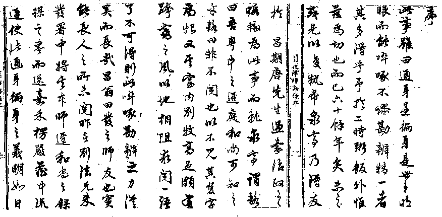
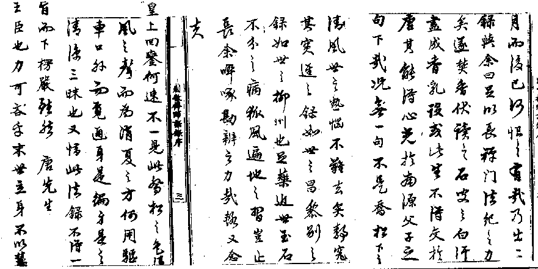
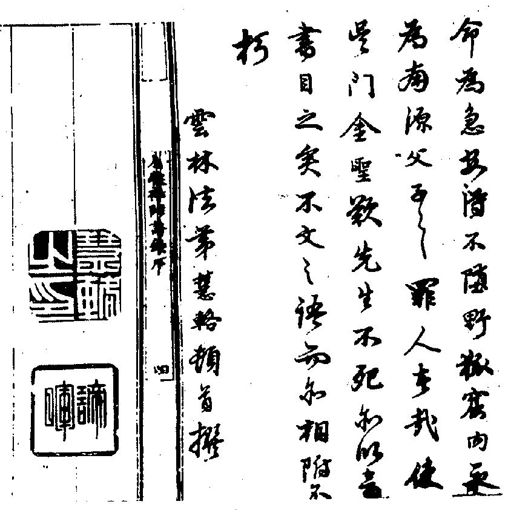

# 别牧纯禅师语录



> **藏经**：嘉兴大藏经（新文丰版）（嘉兴藏）　**册次** 第 40 册（J40）　**编号** JB476　**部类** 诸宗部　**卷次** 1 卷　**篇幅** 16,917 字

> **卷／品**：0 卷 · 1 品



---



## 目录



  - [序](#序)



---



### 序















别牧纯禅师语录



门人福月等编



住全州南源洪圣寺



康熙己巳年，师在三吾曹山，受全州众绅衿及同门、两序、诸山耆宿等请，於十月望日入院。



据室。拈拄杖曰：「先师於此打凤罗龙、烹佛炰祖，直得浪涌三湘、雷轰百粤。今日不肖到来，合作麼生？」卓拄杖曰：「大地火发也。」喝一喝。



当日唐山主法弟行檀，率姪唐辅、唐玮、唐璇、世机与众檀护及本山法属等请上堂。师拈疏曰：「此是曹溪逆流来底，先老人一十五坐道场阐扬不尽，今被现前诸护法笔端点出。诸仁直下荐得，便可龙骧云起、虎啸风生；设或未然，试听饶舌。」宣疏罢，指座曰：「者座七金山子，壁立当阳，多少人攀揽不及？山僧今日略显神通，为诸仁透顶透底去也。」遂升。拈香曰：「摘破香囊薰大国，掣开天窍吼真风，专祝佛心天子万寿无疆。」次拈香曰：「此香植众德本、现随类身，奉为本省当道文武尊官、缙绅士庶、檀越山主、列刹耆宿、两序大众，速悟本真、同明般若。」复於怀中出香曰：「此香廿载追随，含冤未报；一生受屈，饮恨难伸。今日对众拈出，𦶟向炉中，端为供养传洞上正宗三十一世开南源理山第一代迳庭宗老和尚，以酬法乳。」白椎竟，迺拈拄杖曰：「祖翁田地，四至分明；树子中心，千秋荣茂。虽然，须是真正血脉，始可受用稳密；若是豹胆熊心，终难相续。所以，先师於此拶开锦绣乾坤、放出斩新日月。山僧虽欲通津把断，宝剑光寒，其奈今日子承父业，事在当行。且道转位回机、承先启后一句作麼生道？」卓拄杖曰：「𨱄斧劈开天地秀，灵苗花发未萌枝。」结椎，下座。



当晚小参。「若论此事，向山僧未出曹山已前荐得略较些子，若待山僧拈个死猫头与你横吞竖咬，早是万里崖州。所以，青原一见曹溪，便道阶级不落；药山再到石头，始知一物无为。云岩於良久处而豁示全机，洞山於睹影时而深明的旨，以至我龙华瑞祖出四十餘员知识，个个门风壁立，惟有石涧老祖崛起百丈雄峰、跌落九嶷山势，玲珑峭拔，转见孤危。故我先师不顾危亡，尝以百问质之师翁，翁深器之，所以室中用险崖机煆炼衲子，山僧二十年前曾遭毒手，今日被业风吹到者里，只要觅个勇敢汉为山僧出气。有麼？有麼？」良久曰：「缦天网子百千重。」



曹山受南源请，小参。「宝印未彰，文彩已露，锋铓不犯，至化无为。近时短贩，一味说心说性；明眼检责，冷灰终无豆爆。山野一向退埽闲云、投老嵒壑，何意高贤降心孤陋？既无逊避之门，只得勉力相承，以了先师未了公案。且先师有甚公案未了𫆏？故园田地虽平坦，惭愧儿孙未易耕。」



开炉，上堂。问：「青狮久冷、白壁垂秋，昨日双峰𨁝跳、今朝天柱回翔，未审是何宗旨？」师曰：「缺鼻金针穿玉线，鸳鸯绣出五更啼。」曰：「一枝无孔笛，吹起少林春。」师曰：「銕酸馅子莫囫囵吞好。」曰：「秖如开炉结制又作麼生？」师便打，曰：「恁麼则浯溪浪涌漓江月，照彻孤松独秀寒。」师曰：「休念篇章。」问：「选佛场开，龙骧虎骤，四众骈阗，施何法要？」师云：「霹雳过头犹瞌睡。」曰：「一众咸惊。」师曰：「惜取眉毛。」曰：「洞帘高卷，宝镜重辉去也。」师曰：「赞叹即得。」乃曰：「青狮久冷、白壁垂秋，蓦地双峰𨁝跳，直得天柱回翔。横身拶入底，里许暗穿玉线；放情平地底，鸳鸯绣出金针。无孔笛子两头吹，岂是五音六律？若或囫囵吞个銕酸馅子，霹雳过头犹作瞌睡，更来选佛场里念篇章、宝镜台前施鉴觉，有甚麼语话分？然则洞帘初卷、炉鞴弘开，作麼生是条令斩新一句？」卓拄杖曰：「照顾眉毛。」



腊八上堂。竖拂子曰：「夜半正明，天晓不露，者里直下承当，一任丹霄独步。昨夜正觉山前悟底，恰是妄想执著。且道智慧德相在甚麼处？」良久云：「勘破了也。」



元旦上堂。拈拄杖曰：「新年华、新气象，头戴宝华冠、手执吉獠棒，趁云嵒狮子、跨嘉州大象。拍手高歌庆有年，诞生王子喜难量，山中佛法苦无多，雪里乌鸡啼柳上。」卓拄杖一下，问：「祖师西来，不立文字，千七百葛藤因何而有？」师曰：「莫𡱰沸！」「如何是诞生王子？」师曰：「花冠映夺天光赤。」「如何是朝生王子？」师曰：「尽力推爷向里头。」「如何是末生王子？」师曰：「十载辛勤拥敝裘。」「如何是化生王子？」师曰：「玉关风动月华明。」「如何是内生王子？」师曰：「黄阁帘垂不露颜。」曰：「五位王子蒙师指，新年佛法是如何？」师打曰：「拄杖开封，大吉利市。」



解冬，上堂。「今朝正月十五，拄杖无端起舞，打开金锁玄关，放出南泉水牯，一任谿东谿西，莫犯国王水土。直饶随分纳些些。」卓拄杖曰：「拄杖子犹未敢相许。」



浴佛，小参。问：「世尊才生便乃指顾称尊，古人尚唤他作传语人，是不？」师曰：「鬌髻童儿早白头。」曰：「秖如云门一棒，是报恩？是雪屈？」师曰：「玉笛横吹天地晓。」曰：「与麼则棒下无生忍、临机不见师。」师打曰：「者传言送语汉！」乃曰：「鬌髻童儿早白头，玉笛横吹天地晓，指顾称尊显妙机，传言送语入荒草。撞著云门报不平，当头一棒实难讨。且道是报恩耶？雪屈耶？」卓拄杖曰：「吃李惯向赤边咬。」



天中节，小参。「今朝五月五，不打薅耘鼓，瑞草长阑干，金锹不动土。忽然走出个岑大虫。」以拄杖撺向众前作怖势云：「切莫认作沙老虎。」乃骤步归方丈。



开炉，小参。拈拄杖曰：「今朝十月十五，处处霜花遍普，好看露地白牛，变作南山猛虎。吞却三世如来，有甚众生可度？」遂掷拄杖，下座。



腊八上堂。祖意才出，师拈拄杖作钓势曰：「垂丝千尺，意在深潭，离钩三寸，子何不道？」曰：「赖遇某甲不似夹山。」便抽身归众，师曰：「已被柳条穿却。」乃竖拄杖曰：「秖者个撑天拄地、耀古腾今，雪山六载摸索不著，少林九年觑他不破。山僧今日拈来，障回曹源万派、鼓起洞水逆流，多少人向者里觅他起处不得？小子识之，硬却脊梁，转为流通，勿令断绝。听吾偈曰：『曹溪一滴，洞泽之源，超越兼到，不落正偏。临机杀活，迥绝廉纤，全提正令，魔佛齐蠲。宝镜辉空光愈远，南源正脉永流传。』」



佛开光，伯昌蒋居士祈嗣，请上堂。问：「权挂垢衣云是佛，却披珍御复名谁？」师曰：「一切人瞻仰有分。」曰：「即今毫光闪烁又作麼生？」师曰：「且喜珠回玉转。」曰：「恁麼则因斋庆赞去也。」师曰：「昼三夜三好著力。」乃曰：「迢然玉树，鹤不栖巢，宝剑横挥，宁容凑泊？直使苔生古殿，祖佛平沉，放一线道，便见瓶抽玉印、花发长春。且道摩耶夫人生下五百太子，毕竟那个合作主中之主？」竖拂子曰：「容颜甚奇妙，光明照十方。」复举：「裴相国一日托一尊佛请黄蘗安名，蘗召云：『裴休。』休应诺，蘗曰：『与汝安名竟。』」师曰：「黄蘗虽是作家，怎奈错过者多？今日蒋护法镂此旃檀瑞像，请山僧升座，只要出他古人一头地。」遂高声曰：「居士！」士举首，师曰：「檀越已后踏毘卢顶上行。」复挥拂子，下座。



师诞日上堂。问：「两轮日月悬天烛，大地山河拱玉盘，拈来庆祝南山寿，未审吾师意若何？」师曰：「放鹤出银笼，不知天地晓。」曰：「与麼则鹏飞程九万、桃熟岁三千？」师曰：「舌上覆金钱。」问：「昔韩公问大颠：『春秋多少？』颠举数珠，公不会，颠曰：『昼夜一百八。』此意如何？」师曰：「今朝热似昨日热。」曰：「秪如摈首座又作麼生？」师曰：「你也须具惭媿始得。」曰：「与麼则杖头别有金刚眼，指出须弥作寿山。」师曰：「吐得黄金堪作甚？」问：「庆祝南山即不问，君臣五位请师宣。」师曰：「我不解打瓦卜。」曰：「如何是君？」师曰：「九重深处不知尊。」「如何是臣？」师曰：「鹄立甚分明。」「如何是臣奉君？」师曰：「直扣尧阶却借勋。」「如何是君视臣？」师曰：「密室常悬鉅鹿心。」「如何是君臣道合？」师曰：「明月芦花仔细看。」乃曰：「那畔一著，露柱怀胎；今世门头，灯笼发笑。」蓦拈拄杖曰：「昨夜山僧拄杖子向望佛峰顶打个喷嚏，惊起湘山无量寿佛，放一十二道宝光，射到南源寺里，复於光中而屈指曰：『甲乙丙丁、丁丙乙甲，欲穷寿量，了不可得。』大众见麼？者里见得，说甚不萌枝上桃熟三千，无影林中鹏程九万？一任横吹玉管、韵出青霄，转南山作北极也得，协正偏合君臣也得，所以道：今日热似昨日热；其或不然，直饶吐得黄金，也是三家村里打瓦卜汉！」掷拄杖，下座。



先老人十周忌，上堂。师良久曰：「云岩秖者是，睹水妙逢渠，体向朕兆未分际，宝剑横抽；用在功勋不犯时，金针密刺。於此见得，始知我先老人於甲子秋踊身入雷奋迅底作略至今尚在，只是尽大地人不敢正眼觑著。兹值十周忌辰，山僧不免全机露布。」喝一喝。复举：「渐源一日持锹上石霜法堂，从东过西、从西过东，霜曰：『作麼？』曰：『觅先师灵骨。』霜曰：『洪波浩渺，白浪滔天，觅甚灵骨？』曰：『正好著力。』霜曰：『我者里针劄不入，著甚麼力？』源便出。」师云：「二大老尽力激扬，要且觅先师灵骨不著。南源今日或有人持锹觅先师灵骨，直向道：『先师肉犹暖在，你作恁麼去就？』便与连棒打出。不惟顿使枯木龙吟，抑免后人向髑髅里瞠眼。」



腊八圆戒，上堂。问：「波罗提木叉曲为中下，如何是向上全提？」师便打，曰：「三教家风还有优劣也无？」师曰：「你即今问那一教？」曰：「如何是牟尼家风？」师云：「破草鞋无耳。」「如何是仲尼家风？」师曰：「锦上绣金龙。」「如何是希尼家风？」师曰：「万壑清风，一溪明月。」乃曰：「识得则事同一家，不识则理有千差，拣点将来，总是捏目生花。优波离尊者常在诸人鼻孔里放光动地，你等还信得及麼？如未信，且把钵袋子高高阁在眉棱尖上，急著眼觑，忽然觑亦不见，打失钵袋子，拄杖不在，苕帚柄聊与三十。」



元旦上堂。问：「元正启祚，万物咸新。如何是新年头佛法？」师曰：「红日光天德。」曰：「万邦咸稽首，齐贺圣明君。」师曰：「万人家外鸟啼春。」问：「金銮赡天斗、玉笏奏瑶阶。如何是丕赞皇图句？」师曰：「一朵优昙呈瑞彩，满天花雨落缤纷。」曰：「秪如双角峰高，鹤翀霄汉；湘江水急，鱼透龙门。正恁麼时，还有宾主也无？」师曰：「臣在门里，王不出门。」曰：「恁麼则渔樵歌满路、野老贺丰年。」师曰：「放子三十棒。」乃曰：「天高地厚，日月维新，灯笼发笑、露柱扬声。仰祝当今皇帝、万国来宾。」蓦竖拄杖曰：「且道木上座还有新旧也无？」掷下曰：「黄河三千年一度清。」



师诞日上堂。问：「万象之中能作主，春秋不涉事如何？」师卓拄杖三下曰：「恁麼则不逐四时凋也。」师又卓一下曰：「秖如未离兜率，已降皇宫；未出母胎，度人已毕。和尚今日升堂又作麼生？」师曰：「八十翁翁入场屋，真诚不是小儿戏。」僧拟议，师打曰：「者掠虚汉！」问：「先天地而不老、后天地而不少，较师寿量若何？」师曰：「昨日薰风凉殿角，今朝红日上双峰。」曰：「与麼则双峰峥百粤、一滴涌三湘？」师曰：「狗子尾巴书卍字。」乃曰：「苏州有、常州有，万象之中师子吼，从来不逐四时凋，万里青天棒不饶。昨宵拄杖生光怪，要打雪山个褦襶，未离兜率降王宫，笑杀明州憨布袋。且道薰风南来明甚麼边事？」卓拄杖曰：「狗子尾巴书卍字。」



普同塔合尖，谢唐山主、昌翁护法及阖府众文学、缁素等上堂。问：「法不孤起，仗境方生，如何是目前无法、意在目前？」师曰：「有眼无耳朵，六月火边坐。」曰：「秪如今日升座，毕竟得何利益？」师曰：「天不能盖、地不能载。」问：「乘骏驷，扫妖氛；抽宝剑，斩痴顽。秪如海晏河清又作麼生？」师曰：「浮图今日合尖。」曰：「恁麼则永劫清凉总赖和尚也。」师曰：「三十棒留待别时。」曰：「曹溪白浪滔天地，独秀清风贯古今。」师曰：「无镞箭穿红日影，休将脂粉媚秋波。」曰：「和尚是何心行？」师曰：「阇黎也不得艸艸。」乃竖拂子曰：「者所无缝塔，在威音已前早是圆落落地，只为诸人工力不到，所以荆蓁荒秽不能发现。幸有大力檀越不惜只手，亲为诸人从地涌出，可谓栏楯五千、宝铃万亿，烟霞绚彩、日月流辉。山僧到者里，只得庆赞有分。」遂挥拂曰：「此日浮图成七级、他时福寿永千秋。」复举：「昔有二庵主，一日，下庵主问上庵主曰：『者几日在庵作甚麼？』曰：『造一座无缝塔。』曰：『我亦要造一个，借塔样看。』曰：『何不早说？适被人借去也。』」师曰：「者没担当汉，可惜放过。若是南源，待道借塔样看，便叉手近前而立，拟议不来，拳到便行，岂不俊快？」



山主唐文学昆仲为先太君入殓，请升座。拈拂子左挥曰：「儒中圣贤请过者边。」右挥曰：「玄流仙客请过者边。」中间横案曰：「黄面瞿昙一齐按下。还有向者里转得身、吐得气的麼？」问：「老善人谢世，毕竟生何国土？」师曰：「日轮正卓午。」曰：「与未生时是同是别？」师打曰：「你道是同是别？」曰：「与麼则刹刹尘尘皆净土也。」师曰：「噇酒糟汉！」乃竖拂子曰：「秖者一物，竖穷三际、横亘十方，散乾盖以无遗、入微尘而罔措。所以天得之以清，地得之以宁，君臣父子得之各发其真，老善人得之淳懿贞洁。半世孀居，兹值撒手之际，特召山僧举扬末后一段光明，殊不知山僧是个杜拗子，语言文字总没交涉，只好向第二门头与诸公通个消息。」遂以拂子击几曰：「啰哩哩啰哩，刹刹尘尘知几几？光前裕后谩商量，物物头头自家底。既是自家底，又商量个甚麼？同到棺前，据款结案。」



封棺。「昨日莲池雨、今朝日鼓升，六十餘年事，分明燄里冰。权且为盖覆，一任荫儿孙。」



退院，上堂。「山僧自来清湘，一味种田博饭，不敢将禅道佛法教坏人家男女，且喜逗到今朝唱个归山曲子。」乃扣杖而歌曰：「千年田、八百主，几番耕遍经风雨？而今犁耙已全抛，剩得沩山个水牯，短笛横吹归去来，高歌一曲忘今古。」适有僧出，师以杖挃退曰：「前村烟雨里，别日再商量。」掷拄杖，下座便行。



三吾曹山集圣寺



师於康熙甲子春住院，至甲戌冬十月十五日开炉上堂。拈香祝圣毕，次拈香曰：「此香拈出则分文不值、盖覆则递相辜负，供养开山第一代受业弘觉先师，髑髅打得丁当响，莫怪儿孙意气豪。」复拈香曰：「此香冰棱上度来、火燄里拾得，次第二回拈出，端奉传洞上正宗三十一世迳庭宗先老和尚，不图明冤雪屈，秖贵彻始彻终。」遂趺坐。白椎竟，问：「师唱谁家曲？宗风嗣阿谁？」师曰：「木人夜半绣花冠，石女天明打破镜。」僧乃进前三步作女人拜，师曰：「我不可承嗣先南源不得。」问：「炉鞴弘开即不问，如何是子承父业？」师曰：「铁牛生玉象。」曰：「未审有何祥瑞？」师曰：「石马产金猊。」曰：「与麼则天子峰前龟凤舞，鴈王岐下普门开。」师打曰：「切忌妄流通。」问：「钓掷清湘即不问，网罗曹岳事如何？」师曰：「离钩三寸何不道？」僧礼拜，师曰：「山僧今日失利。」乃曰：「钓掷清湘、网罗曹岳，浯溪渡口，截断要津，直得铁牛生玉象、石马产金猊，此犹是我弘觉先师二十餘年烧折脚铛、煮庐陵米，接待往来的闲家具。不肖今日就炉打铁，秪要拨转天下衲僧碧落青霄的活计，有麼？有麼？」卓拄杖曰：「后五日看。」



当晚小参：「圆通不开生药铺，单单只卖死猫头。山僧即不然，曹山开个生药铺，单单不卖死猫头。且道圆通是？曹山是？定当得出，许你具参学眼；如定当不出，拄杖子九十日后算饭钱，打折驴腰去在。」



起七，小参。举云门糊饼话毕，乃曰：「三六九、一五七，糊饼馒头仔细疑，金沙滩头马郎妇，一双红杏换消梨。」喝一喝。



上堂。「恁麼也不得、不恁麼也不得，手指空时天地转；恁麼也得，不恁麼也得，回途石马出纱笼。到个里，始知诞生王有父，不堕功功；金轮宝华冠，宁容借借？芦花了无异色，月船不犯西东。正恁麼时，如何是密移一步？待天子峰向你点头，好来吃曹山痛棒。」



遂如上人为父祝寿，请上堂。「瀑布流、青山走，一片白云不露丑，昨宵王母暗抛梭，蓦地翻身过北斗，等闲桃熟岁三千，觌面相逢张果叟。报诸人，还知不？踏著葫芦颠倒颠，翻然一笑无何有。」问：「未生已前是甚麼？」师曰：「打破镜来，与汝相见。」曰：「早已相见了也。」师曰：「观音峰那边为甚不见？」僧乃弹指一下归众，师曰：「浣盆，浣盆！」



雪霁小参。「雪覆嵛峰、云开衡岳，无位真人冻得七花八裂，惊起曹山颠酒汉，𨁝跳上非非想天，忽地轰个晴空霹雳，直得死蛇惊出艸、枯骨作龙吟。你等还觉眼瞬耳热也未？」遂拈拄杖下座。



洪明山主请上堂。「拶碎功勋，全超一色，双锁金针，红炉片雪。名不得、状不得，藏锋出就当头截，维摩老子解翻身，钵盂走过香积国，倒一说、对一说，明暗双双的时节。秪如名不得、状不得又作麼生？少间洪明居士为汝辨别。」问：「如何是宾主相见句？」师曰：「山僧自来浯溪，未曾遇著一人。」「如何是宾中主？」师曰：「同行无伴侣。」「如何是主中宾？」师曰：「枯木却逢春。」「如何是宾中宾？」师曰：「瞎子遇盲人。」「如何是主中主？」师曰：「从来不出户。」曰：「宾主蒙师指，庆赞作麼生？」师曰：「少顷僧堂里与你一顿。」曰：「谢师荅话。」师打曰：「情知你要先吃。」



腊八小参。竖拂子曰：「正觉山前做艸贼底，唤者个作智慧德相，你诸人唤作甚麼？直饶向者里见得分明、说得透脱，正好朝打三千、暮打八百。何故？不见道：『只许老胡知，不许老胡会。』」



解冬，上堂。拈拄杖曰：「三世诸佛，口挂壁上。」卓一下曰：「黧奴白牯，放光动地。」划一划曰：「截断许多葛藤，放你转身吐气，一任腰包顶笠，紧帩艸鞋，竿木随身，逢场作戏，只是前面撞著石敢当，问你如何是本来面目？你作麼生抵对？若抵对不得，切莫道我从曹山来。」复举：「弁山瑞祖解制，因僧问：『金钩玉线将收挽，鲸鲵忽现时如何？』祖曰：『虚空撒下缦天网，纵有飞鳌怎出头？』曰：『拏云攫雾去也。』祖曰：『霹雳一声魄胆碎。』曰：『三级浪高鱼化龙，渔翁空戽夜塘水。』祖曰：『已被柳条穿却。』泰春沄云：『宁可倒岳倾湫，断不把赤稍鲤鱼濡沫在虀瓮里，先弁山真个口苦心甜。』拈拄杖划一划曰：『於今浪静云开，山僧未要作者般行户，秖如丝纶池上还获得有几点凤毛？』掷拄杖曰：『千。』」师曰：「弁山固是口苦心甜，泰春亦乃口甜心苦，曹山为你㓟腹剜心，还知落处麼？」拽拄杖下座，旋风打散。



圆藏经启万佛忏，蒋阳生、茂生居士报亲，请上堂。竖拂子曰：「辉天鉴地、括古囊今，范围四生、梯航三有，总不出山僧拂子头上。於此荐得，无恩不报、无罪不忏；其或未然，竖起金刚铁脊骨，万人丛里好加参。」挥拂下座。



启万佛期，开先曾居士为母设斋，请上堂。问：「问似云兴、荅如瓶泻，犹是鼓粥饭气，未审绝韵之音如何举唱？」师曰：「饥来吃饭、渴时饮水。」曰：「庭前古柏栖丹凤，屋后苍松隐卧龙。如何是曹山境？」师曰：「一溪流水冷，万壑竹松青。」曰：「头戴华冠人不识，耳垂卓朔少知音。如何是境中人？」师曰：「从来不合伴。」曰：「浯溪逆浪里，复睹洞帘开。」师曰：「你且信取一半。」乃曰：「云封四野、冻锁千谿。文殊堂里万菩萨，镇日拥毳围炉，蓦地被人觑见，将钵里饭、桶里水倾在面前。天寒日短，两人一碗。你等若也沾他点滴，管取一饱忘百饥。然虽如此，米里有沙，莫言不道。」



上堂。师据坐，蓦拈拂子向虚空点𠁼，便掷。良久，旅门出，众展拜，师竖拂子，门收具，拂袖归众，师放下拂子曰：「汝因甚不白椎？」门曰：「将谓和尚忘却。」师曰：「我听不清，你再说看！」门却结椎云：「谛观法王法，法王法如是。」师便下座。送至方丈，师曰：「今日好一场曲调，只是不著便。」门曰：「且喜天下人不奈老汉何！」师曰：「来日不得普请。」



分座秉拂



康熙辛酉秋，老和尚赴广西，命师代主南源席秉拂。问：「子承父业即不问，如何是出格为人句？」师曰：「翻身狮子大家看。」曰：「龙生金凤子，翀破碧琉璃。」师曰：「有棒不打你者驴汉。」问：「绍隆师位，万指钦依，五位正偏，愿垂指示。」师曰：「洞山过去久矣！」「如何是正中偏？」师曰：「清湘潭底火烧天。」「如何是偏中正？」师曰：「白面峰头霜月静。」「如何是正中来？」师曰：「倒跨泥牛上五台。」「如何是兼中至？」师曰：「雪刃笼身无所畏。」「如何是兼中到？」师曰：「鹤翀霄汉乾坤老。」曰：「正偏五位蒙师指，绍隆师位是如何？」师曰：「石女夜抛梭，织锦於西舍。」乃曰：「从来把住信难通，争肯轻为擅露锋？今日无端开线道，却令铁马吼金风。」蓦卓拄杖曰：「如今翡翠帘开、丝纶妙转。明月堂前，鸾啼玉树；太阳门下，凤舞丹霄。作麼生说个转位投机句子？秪奉一人天地贵，从教诸道自分权。」



中秋示众。「心月孤圆、光吞万象，南源拄杖子化为龙，搅翻乾坤去也。且道光境在甚麼处？者里若不翻转面皮，争得与古人相见？」



结冬，小参。拈拄杖曰：「收回大地春风，打个丁香结子，四方八面，迥绝孤危。向者里挨过荆棘林、伐却旃檀树，始信腊月莲花不尔欺也。」卓拄杖一下。问：「红炉迸出铁蒺藜，舌剑唇枪难下口。不犯锋铓，请师速道！」师曰：「老僧打退鼓。」曰：「定乾坤剑没人情，擒虎兕机忘圣解。且道是甚麼人作略？」师曰：「莫是上座麼？」僧拟对，师便打。



起七，小参。「须弥山，高突兀，虚空里，钉铁橛。截断天下衲僧脚跟、拶透历代祖师命脉，鞭起海底泥牛、耕破碧潭皎月。别！别！打刀须是邠州铁。」



策发新戒。「还丹一粒，点铁成金，至理一言，转凡成圣。」遂竖如意曰：「者里荐得，何必威仪三千、细行八万？直下掀翻优波离窠臼、穿过卢舍那脑盖，方知高沙弥终日晏坐长安，大好一场曲调；如或不然，饶你走到赫赫天光，狮子座上古佛与你授记过来，也只是个三家村里撮马粪汉，有甚麼限？」掷如意。



腊八小参。问：「明星未睹时如何？」师曰：「照破髑髅。」曰：「睹后如何？」师曰：「黑漫漫地。」曰：「正睹时如何？」师曰：「瞎！」曰：「千年无影树，今时没底靴。」师便打。乃曰：「明星未睹髑髅破，睹后依旧黑漫漫。正睹时，眼睛不离眉下、耳朵只在面傍，山僧不解掠虚，与你道个瞎，正是千年无影树、今时没底靴。若更说迷说悟、分妄分真，大似渴鹿逐阳燄，南源拄杖子未到你在。」



示众。「若论此事，本来现成，毫没造作，所以四十九年未曾说著一字，末后拈花早已为蛇添足，何况三乘十二分、千七百络索，与他有甚麼交涉？虽然如是，你等莫见恁麼说便作无事会，直须单提一句无义味话，如大火聚相似，触不得、背不得，眨眼即燎却眉毛。果能如是，管教克期取证；不然，只知事逐眼前过，不觉老从头上来。」



除夕示众。举牛过窗櫺话问众曰：「头角四蹄俱过，为甚尾巴过不得？」祖意出曰：「爆竹声中金凤舞。」师曰：「牛头语？牛尾语？」意曰：「一拶粉碎。」师曰：「皮毛在什麼处？」曰：「阳燄烹新绿，春光炙嫩红。」师曰：「放子三十棒。」又问旅门曰：「你作麼生？」门曰：「灯烛𪸩煌。」师曰：「牛头语？牛尾语？」曰：「和尚幸是大人。」师曰：「须还我皮毛始得。」曰：「直得天下人摸索不著。」师曰：「也好与三十棒。」曰：「和尚是何心行？」师不顾。乃曰：「适才山僧恁麼问、诸人恁麼答，正是向洪波浪里采取镇海明珠，且道明珠即今在甚麼处？」蓦卓拄杖曰：「菩萨龙王行雨润，遮身向上数重云。」



旅门行脚回，茶话。师问：「三登九上、烟水百城，不过要明向上一著，秪如向上一著作麼明？」门曰：「到江吴地尽，隔岸越山多。」师曰：「到即不问，如何是隔？」曰：「请和尚吃茶。」师乃笑顾众曰：「此子昔年随侍山僧，将谓诸方佛法别有奇特，今日归来依旧眉生睫上，诸人还信得及麼？若信得及，不动步而游遍刹海；不然，历尽天涯总是痴狂外边走。是事且置，秪如明月堂前，子转身而就父，为甚父全不顾？白云笼岳顶，浑不露崔嵬。」



除夕晚参。举：「太平法演禅师示众曰：『太平不会禅，一向外边走，腊月三十日，赢得一张口。』太平虽是本色为人，争奈舌头拖地？山僧别有道处：『南源却会禅，一向但高眠，腊月三十日，阎王算饭钱。』且道与古人相去多少？」



解七。师卓拄杖曰：「进堂今一七，大事都了毕，石女夜生儿，正好通消息。」旅门出，师曰：「昨日有一问在阇黎处，还记得麼？」门曰：「将谓和尚忘却。」师曰：「即今道看！」曰：「老婆心得恁麼切？」师曰：「座上无老僧，目前无阇黎。子作麼生会？」门便喝，师便打，门约住曰：「今日起动和尚。」师便休。祖意出，师曰：「子作麼生？」意礼拜了，卓然而立。师曰：「参甚麼话头？」曰：「沙弥主！」师曰：「如何是沙弥主？」曰：「虚空吞皓月。」师曰：「虚空粉碎又作麼生？」意便喝，师打曰：「者沙弥犹挂唇齿在。」



机缘



一日，问自昙：「大师那里来？」曰：「镢地来。」师曰：「无阴阳地作麼生镢？」曰：「正好著力。」师曰：「著甚麼力？」昙拟议，师便掌。



到龙城华容寺，岐应和尚问：「大师是洞宗那？」师曰：「和尚莫寱语。」岐曰：「山僧今日却被大师折倒。」师曰：「立鱼峰高多少？」岐曰：「者是龙城底，如何是大师底？」师曰：「老老大大作者个语话。」



旅门出关，茶次，师举洞山掇退果桌话问：「洞山道：『常在动用中，动用中收不得。』子作麼生会？」门唤沙弥曰：「与我过茶瓶来。」师曰：「首座道：『过在动用中，因甚不得果子吃？』」门曰：「洞山合吃某甲手中棒。」师曰：「情知你要果子吃。」门作呕势。师曰：「你已后疑杀天下人去在。」



甲戌腊八日，召众入室，旅门才作礼，师便问：「啐啄同时即不问，如何是正中偏？」门曰：「枯木龙吟午夜前。」「如何是偏中正？」曰：「日里霜花迷晓镜。」「如何是正中来？」曰：「倒骑铁马过天台。」「如何是兼中至？」「箭锋相拄无回避。」「如何是兼中到？」曰：「大地撮来无剩少。」师乃拈起手卷曰：「向者里更道看。」门又作呕势，师授之曰：「要且殃累你。」



祖意行脚回，师问：「者数年到那些所在？」曰：「南岳天台、湖北天然、南京天界、扬州天宁。」师伸手曰：「还我艸鞋钱来。」曰：「某到天宁，被索此钱，直得无言可对、无理可伸。」师打曰：「瞒天宁即得。」意珍重下去。次日复谓曰：「泗洲大圣为甚却向扬州出现？」意曰：「问者不唧溜汉作麼？」师曰：「也不得艸艸。」意曰：「和尚也不得杜撰。」师曰：「你已后向老僧头上屙去在。」



晚参，可绍出，礼拜，师问：「汝参甚麼话？」曰：「竹篦子。」师曰：「不触不背，毕竟唤作甚麼？」曰：「两眼对两眼。」师曰：「离却两眼，向甚处相见？」曰：「今朝雨打阶前湿。」师以竹篦划一划曰：「更向者里道看！」可拂袖便行，师曰：「掉棒打月。」



己卯腊八，众入室，礼拜次，师举僧伽黎谓可绍曰：「大庚岭头提不起，为甚却在山僧手里？」绍曰：「盖覆乾坤。」师曰：「石头路滑人难到，子因何得到者里？」绍曰：「足下无私。」师曰：「座上无老僧，目前无阇黎。如何是觌体相承句？」绍曰：「难瞒大众。」师遂付以信物。



到粤西，邂逅云外上座。师曰：「既是云外，因甚却在者里？」曰：「今日小出大遇。」师曰：「作家。」云拟对，师笑曰：「休！」



云石问：「大师是何心行，教人看话头？」师曰：「你见个甚麼道理便与麼道？」曰：「适才堂中吃茶，咬得舌头痛。」师曰：「别日来与你一顿。」曰：「恩大难酬。」师曰：「识甚好恶？」



雪夜垂问：「朔风凛凛逼人寒，且道天寒、人寒？」云石曰：「大家在者里。」师曰：「恁麼则寒时寒杀、热时热杀。」石便喝，师曰：「三十年后无人处斫额望汝。」



僧参，师问：「那里来？」曰：「沩山。」师曰：「沩山笑里有刀是不？」曰：「和尚何得自伤己命？」师曰：「阿㖿阿㖿！」僧曰：「苍天苍天！」师乃大笑。



僧参，师问：「那里来？」曰：「南岳。」师曰：「思大禅师曾向汝道甚麼？」僧茫然，师曰：「汝不从南岳来。」



问：「诵经坐禅，是一是二？」师曰：「千峰势到岳边止，万派声归海上消。」



二僧参，师曰：「那里来？」曰：「丹霞。」师曰：「木佛烧却也未？」僧伫思，师打曰：「丹霞火烧，我者里活埋。」一僧曰：「他不会和尚意。」师曰：「你又作麼生？」僧礼拜，师曰：「院主眉毛在麼？」僧无对，师亦打。



一僧送菩提叶，师曰：「菩提本无树，叶从何处来？」曰：「和尚谩学人即得。」师曰：「保福道底。」



问：「如何是家乡消息？」师曰：「夜半木鸡啼晓户，三更红日照阶庭。」



问：「寒松冻锁，音韵在甚麼处？」师曰：「若将耳听终难会，眼里闻来方始知。」僧不领，师示以颂曰：「此事明明绝见闻，寒松冻锁露真音，霜钟昨夜传消息，谁是其人著眼听？」



居士问：「弟子欲出家，得不？」师曰：「拟问即不得。」曰：「为甚麼不得？」师曰：「你是那里人？」曰：「衡阳。」师曰：「待回雁峰点首，即向汝道。」士罔措。须臾又问：「弟子有疑未决。」师曰：「将疑来与汝决。」士伫思，师笑归方丈。



佛事



南源开钟版。举椎曰：「法王号令、佛祖箴规，把住则河清海晏，放行则电掣雷奔。适蒙老人垂命，把柄在纯上座手里。且道放行是？把住是？」蓦击钟板曰：「纵横全在我，收放更由谁？」



曹山悬钟。「新出红炉，千灵共仰；高升宝殿，万圣同钦。而况圆音落落、妙体如如。忽有人向楗椎下打著本命元辰落处，也不辜负今日檀信脂膏。即今正合当行，作麼生是大用全提一句？」遂击钟曰：「匉訇直下当头截，万派千江水逆流。」



曹山前殿上梁。师以拄杖向上指曰：「一茎艸上现琼楼玉殿，不是神通妙用，亦非法尔如然。且道凭何节目得恁麼撑天拄地？者里委悉得，始知一梁一柱、一瓦一砖，无非先业师愿力之所成就。纯上座不过圆成未了旧案，且鼎新轮奂一句作麼生道？」遂升梁曰：「无影林中撑玉柱，从教劫石纪春秋。」



戊辰冬，嶷山握师翁讣至，设供。「人从衡岳来，接得嵛峰信，报道师翁老和尚於十月廿四日入师子奋迅三昧去也。佛日潜晖、祖灯匿耀。」乃竖拂子曰：「看看！老和尚却向纯上座拂子头上出现，大众还见麼？若见，可谓五色祥麟步大千，竺土仙心密相付；其或不然，潭潭禁殿无人侍，忍俊韩卢空上阶。」



埽上方握师翁塔。拈香曰：「盖覆将来，未免递相钝置，不如当阳拈出，供养我洞上三十世开嶷山、上方两祖庭先师翁老和尚，从教石伞高撑，一任遮天盖地。不肖纯亲从南源而得师翁所遗折脚铛子，随处住山，甲子入浯溪，己巳上双角，皆祖力也。今以瓣香杯茗向师翁窣堵波前尽情陈白，且道师翁还肯鉴照也无？」拈拂子向空点一点曰：「秖凭一本无根树，放出湘源万派春。」



闻先和尚讣到，南源龛前上供。拈香曰：「此乃针劄不入、斧劈不开，自三月拜别座前，拟向千人万人把不住处相续主中之主，岂知老人而遽全机独脱，云封古殿、月锁松岑？正恁麼时，作麼生两得相见？」以坐具打○相曰：「宝镜光寒湘水远，金风体露桂林秋。」



先和尚三周烧香。「几回受屈冰肠断？特地思量特地惊，当时错怪茅长短，今日原来地不平。不肖㓟肝沥胆，奉重遗谟，不意老人於甲子九月七日覆却无▆铁船，独步东山水上，致合古镜无辉、千光失照，兹▆三周，聊焚海岸。且道先师还纳受也无？玉堂夜静▆尊贵，想到清湘月更明。」



住南源日，先和尚塔前设供。「千峰齐突兀，漓水吼雷霆，枝派暗流注，灵苗匝地春。洞源血脉，自古自今，唤作报德酬恩，管教入地狱如箭。」



云天、云程埽先老人塔，请师拈香。云：「金花开玉树，瑞艸长灵根，亲禀金刚地，难酬至训恩。正与麼时，作麼生与先和尚相见？」乃顾二上座曰：「莫恋旧窠窟，何处不逢渠？」



为业师造塔合尖。「黄金世界，白银碧落，端居拱密，须是其人。合缝磨棱，还他妙手，不肖酌水然香，岂但酬恩报德？」乃以拄杖指塔顶曰：「层落落、影团团，千古万古与人看。」



业师灵骨归曹山，设供。「龙归大海，就位忘功；凤返丹山，回途得妙。」蓦顾左右曰：「还识先师面目麼？南山竹、北地水，一任花簇簇、锦簇簇。牛产麒麟、鸡生𬸚𬸦。」



狮峰诤和尚讣至，设供。师拈香云：「狮岩峭拔势凌空，独步全超不借中，蓦地翻身天地窄，石人衫破没人缝。」喝一喝，便烧。



为御文玺兄厝骼。「秖者物，非他物，分明一具黄金骨，同根莫怪急相煎，翻身踏碎琉璃国。而今照尽月潭空，正是归根得旨底时节。咄咄咄！」



聚贤庵觉悟起龛。「乍雨乍晴春三月，和风拂拂为君决，生缘湖楚路头穷，住持全粤人人悦。律行精严谁不知？冰清玉洁人中月，今朝撩起行便行，恰是清明好时节。」喝一喝。



毘卢庵正权起龛。以拄杖击龛曰：「还知者上座数十年行履处麼？始则辅弼先老人，开炉鞴煆炼圣凡；继则翼赞南源，输丹衷共打车牛。不意今日向无影林中唱还乡曲子去也。且道如何是他转身一句？」又击龛一下云：「出门不踏来时路，玉凤穿开碧落天。」



含明起龛。「光含万象，明明炭里藏身；体露金风，莫守寒岩异艸。密移一步看飞龙，那畔今时浑不照。」



灵源起龛。「触目不会道，运足焉知路？」以杖指曰：「直入千峰万峰去。」



心融封龛。师拈封条云：「有佛处不得住、无佛处急走过，三千里外摘杨花，曹山为你重说破。不萌枝上玉花开，炭里藏身光闪烁。」便封。



至福起龛。「掣开金锁、劈碎牢关，玉转珠回，随缘自在，直踏毘卢顶上行，夜深红日凌虚碧。」



埽先慈行仁比丘尼塔。「粉骨碎身未足酬，一句了然超百亿。且道是那一句？者里缁素得出，方知我母戒凛冰霜，不露末山之顶；纯上座汲水供薪，总成旱地莲花。如或未委……」遂炷香曰：「泥牛吼落三更月，石女天明泪湿衣。」



长龄尼封龛。「放下闺阁物，悬崖便撒手，浑不挂机丝，全身藏北斗。」



颂古



世尊初生。



当阳抛出铁蒺藜，电走雷奔天地黑，跛脚阿师正令行，云收雨散空狼籍。



南泉斩猫。



宝剑横挥，佛魔齐殄，换骨抽筋，风飙电卷。纵是克家儿，也被血腥染。



灵云见桃花。



眼里瞳人踢绣毬，从教何处不风流？三郎拨转桃花浪，更下深潭月一钩。



赵州狗子佛性。



吹毛在握，夜光走盘，鸩蜜并施、有无俱掀。变化苍龙兮，不容宿于死水；闪烁白云兮，岂肯恋于穷山？看看看！直须坐断两头关。



大明宝禅师上堂：「轮王宝藏，如赤穷底人；酒店腰带，如大富底事。掉转身来，撞著没面目汉，要拳便拳、要踢便踢。又谁知我洞上宗风，别有踞虎头、收虎尾的宗旨？会麼？玉犬彻夜行，不知天上晓。」



机轮转处绝周遮，电闪星驰羡作家，白骼树稍鱼扇子，碧波池上鸟翻车。



西京少室雪庭裕禅师问僧：「面壁石还有看见达磨影者麼？」僧曰：「今日幸遇和尚。」师曰：「拄杖子幸遇上座，乞供养他一顿。」僧曰：「恩大难酬。」师掷拄杖曰：「胀杀怀州牛。」



钓鳌须是钓鳌手，透网还他透网鳞，霆激雷轰风雨后，满船明月照通津。



云居膺禅师参洞山，山问：「甚处来？」曰：「踏山来。」山曰：「那个山堪住？」曰：「那个山不堪住？」山曰：「国内总被阇黎占去也。」曰：「不然。」山曰：「恁麼子得个入路？」曰：「若有路，即与和尚隔山去也。」山曰：「子后千人万人把不住在。」



鸾凤翱翔六合云，天旋地转海山昏，夜明帘外清风远，鹤出银笼玉殿深。



雪峰、嵒头、钦山同参德山。钦山问：「天皇也恁麼道、龙潭也恁麼道，未审和尚作麼生道？」山曰：「汝试举天皇、龙潭底看！」钦拟议，山便打。钦山被打，归延寿堂曰：「是即是，秖是打我太煞。」嵒头曰：「你恁麼，他后不得道见德山来。」



劈面来时白浪掀，棒头落处见渊源，神驹十影追难及，独许祥麟步大千。



高峰枕子。



天无路上地无门，罔象重逢坠险坑，回首不知天外晓，珊瑚杲杲焕龙睛。



芙蓉楷禅师上堂，拈拄杖曰：「者里荐得，犹是诸佛建立边事，直饶东涌西没，卷舒自在，也未梦见七佛以前消息。须知有一人不受教诏，若识此人，参学事毕。」



蜕甲鲸鲵不滞滩，翱翔六合倩谁看？芙蓉江上秋风冷，只许严陵把钓竿。



太原王山体禅师，发明洞上宗旨曰：「既有尊贵底位，须明尊贵底人。须知尊贵底人不出尊贵之位，方明尊贵不落阶级。」



禁殿苔封夜未央，珠帘倒卷一天霜，钟沉鼓寂纶音静，月皎晴空下玉堂。



达磨见梁皇。



御炉香暖紫云屯，宝髻从教豌豆倾，烂坏眉毛收不得，至今红臭染枫庭。



投子青禅师上堂：「洪波浩渺，白浪滔天，镇海明珠，在谁收掌？」卓拄杖曰：「百杂碎。」



机轮转处乾坤窄，大用全彰电火迟，拄杖揭开红日眼，离娄空堕一双眉。



西京还源遇禅师，因僧问：「如何是西来大意？」师曰：「风送泉声来枕畔，(天然沄云：错！)月移花影到窗前。(沄云：错！)」



枕畔风生、窗前月落，花影泉声，都来是错。且道还源错，何似天然错？祥麟只有一只角。



天童玨上堂：「劫前运步、世外横身，妙契不以意到。」



秋风秋雨上林稍，叶落寒潭夜泣蛟，回首不堪明白里，凭阑醉饮写芭蕉。



石霜诸因僧问：「如何是头？」师曰：「直须知有。」「如何是尾？」师曰：「尽却今时。」「有头无尾时如何？」师曰：「吐得黄金堪作甚麼？」「有尾无头时如何？」师曰：「犹有依倚在。」「头尾相称时如何？」师曰：「渠不作个解会，亦未许渠在。」



口甜心苦论家私，王库从来岂有斯？傍户痴呆徒侧耳，累他空堕两茎眉。



少室凝然改禅师〈辞众偈〉曰：「寿年八十七，出息复入息，撒手威音外，绵绵与密密。」



冻齈临死不甘休，呕出心肝挂树头，转向那边惆怅望？沧浪无限涨深秋。



云门湛祖因僧问：「如何是超然不借借？」祖曰：「我听不清，你再说看。」曰：「学人不肯在。」祖曰：「此是借。」僧喝，祖曰：「犹是借。」僧又喝，祖曰：「百喝后作麼生？」僧拜曰：「推散大众去也。」便归众，祖曰：「三十棒且待别时。」



暴虎凭河，徒夸敏手，宝镜当台，难逃妍丑。



百丈涧和尚参瑞祖，因闻梆声有省，祖曰：「道道！」师曰：「石女吹箫声喇喇。」祖曰：「子转身而就父，为甚父全不顾？」师曰：「夜深云掩岫，木女睡鼾鼾。」



夜深云岫睡鼾鼾，师子翻身星斗寒，石女一声无孔笛，从教千古竞头看。



南源先和尚因僧问：「炉鞴弘开，煆尽圣凡。秖如没身心人来，和尚如何安置？」师曰：「不可错怪山僧。」曰：「不到红炉里，焉知火后毛？」师便打。



赏罚分明白棒饶，通红炉鞴不曾烧，圣凡情尽无餘事，火里方知有凤毛。



别牧纯禅师语录(终)



行实



康熙丁丑夏，门人福困等请师说行实，师再三不允，困等益请曰：「伏望慈悲，启迪后昆。」师乃曰：「予楚之三浯人，族姓李，父字德吾，母刘氏，生於明崇祯戊寅五月二十日。诘旦，有老僧过庐而问曰：『君家昨生儿是否？』父曰：『是。』僧曰：『此是善中之宝，宜名善宝。』父稽首谢之。在襁褓不茹荤，丱角时常随母入庵，闻经声辄合掌跪听，且好跏趺，里人多异之。五岁父亡，而多病，母常祷于佛曰：『此儿成人，即舍为僧。』及年十五，一夕梦金甲神持杵追至险绝之处曰：『汝速归依三宝。』方应诺，即惊寤，于是出尘之志决矣！遂辞母，母不许。一日，自忖泡幻不真，无常迅速，乃宵遁福缘庵礼弘觉师薙落，时顺治乙未岁也。未几，侍师往嶷山秉沙弥戒，山令随众作务。自念大事未明，岂可唐丧光阴？即入方丈求指示，山开示看本来面目话，久之无所入。一日，忽闻猫叫有省，山问：『父母未生前，那个是你本来面目？』予便礼拜，山曰：『意旨如何？』予推散大众便出，山顾众曰：『你看者沙弥却有些气息。』山一日又问：『今日作何务？』曰：『作饭。』山曰：『如何是作饭底事？』曰：『供养大众。』山休去。明年，闻嶒山讲《楞严经》，余趋座下问：『楞严妙旨即不问，如何是大佛顶？』山便打，余一喝，山又打，余约住棒曰：『莫错打某甲。』山曰：『错不错且置，还我清切句来。』予曰：『和尚也须珍重。』山曰：『汝曾见甚麼人来？』曰：『一向亲近嶷山。』山曰：『怪得恁麼滑头。』予嘘一嘘便出。期毕，闻迳和尚碧云庵结冬，往礼拜，尚问：『汝听《楞严》耶？』曰：『是。』尚曰：『如何是常住真心？』曰：『不变易者。』尚曰：『作麼生是不变易底？』余珍重而出，尚曰：『大好不变易。』是岁顺治己亥，腊八圆具，明年随尚主席嶷山。壬寅同创南源，充堂司职。入室时，尚问：『堂中事作麼生？』曰：『后园驴吃艸。』尚曰：『你那里得者消息来？』余曰：『不辞向和尚道，恐墙壁有耳。』尚打曰：『记取者一棒。』予嘘一声便出。尚一夕举南泉斩猫话未了，余近前曰：『和尚低声。』尚曰：『赵州戴艸鞋，明甚麼边事？』予曰：『某终不作者野狐见解。』尚曰：『你又作麼生？』余一喝，尚曰：『住住！且莫艸艸，要做洞上儿孙，直须机纽含於枢口、锦丝吐於梭肠始得，不是一棒一喝、一语一默便为了当。』予闻悚然，复倍精彩。至五鼓，闻钟声，忽汗下如雨，从前所得当下冰释。黎明入方丈，尚见，笑而已。明年，命掌监院事，示偈曰：『纲维四众已多年，荷担杨岐迈古贤，撑拄法门坚似铁，何须更问祖师禅？急努力，莫迟延，异日儿孙遍大千。』自荷院事，虽祁寒溽暑，未尝少惮。一日，念劬劳罔极莫可报答，出家儿能引亲回头同出苦海，庶可报之。寻於寺左建松烟阁，延母入山，薙染圆具，礼华严、弥陀，精勤熏修，日夜匪懈者十年。至康熙丁巳，先师令侍者唤入方丈，嘱以偈曰：『法王正合，鼻祖真宗，超越兼到，荡尽功功。劈明暗而勦空借借，埽正偏而破除空空。灭有见、绝无踪，南源正脉永流通。』余以力不堪任，恳辞再三，尚曰：『勿多言，尔异日南源主人也。』仍命典西堂。至辛酉，尚诞前三日，榜示四众，命予代席。甲子春，退居曹山，自谓刀耕火种以了餘生，不意己巳又有南源之请，於是拆东补西；六年甲戌，复有曹山结制之请。至今年登耳顺，欲卜嵒栖未遂素志。兹因尔等坚请，只得将从前败阙漏逗一上。」福困等率众礼谢而退。

