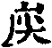
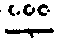

# 竺峰敏禅师语录



> **藏经**：嘉兴大藏经（新文丰版）（嘉兴藏）　**册次** 第 40 册（J40）　**编号** JB483　**部类** 诸宗部　**卷次** 6 卷　**篇幅** 97,860 字

> **卷／品**：0 卷 · 3 品



---



## 目录



  - [竺峰敏禅师语录序](#竺峰敏禅师语录序)

  - [序](#序)

  - [竺峰敏禅师语录序](#竺峰敏禅师语录序-1)



---



### 竺峰敏禅师语录序



西蜀自大隋、南堂、昭觉、楚山之后，山川寥落，殆将百年。俄有亚圣大人蔪然出於巴西汶水间，即吹万师翁。翁少游村落，获《大慧杲禅师录》，读之，叹曰：「此苦海之宝筏、照夜之明炬也。恨生非其时，与此老游焉。」遂造朝阳，谒联池禅师，扣出世法。久之，循其源，池盖杲十三世之的孙，而銕牛远之高弟也。因请益，不用音声语话，未契心要，庵於郡之佛子山，三周寒暑，再见池于朝阳，拜而问曰：「毕竟如何现出？」池以手掩翁口，豁然大悟，乃嘱曰：「禅林下衰，宗教异矣。唯子可起临济之仆，子其勉诸。」遂遍游海内。当万历戊午间，翁乃一杖南来，开法于衡之湖东。未几退院，欲投老西山，将为终焉之计。舟次浯江，会御史鍾冲田公，见而礼之，退谓乡先生曰：「吾阅人多矣，万师真僧中龙也。」遂勉留，建刹，于郡城之北开法焉，四方之学侣川输云委，宗风由是而兴。越二十年，翁化去，郡绅士以庆忠师聚云家嗣请继住持。不逾年，应平都之请。又明年，转吟翁东明。所至法席更易，道大显著，王臣贵人愿见而不获者，方之聚云犹盛焉。从其游者，诜诜辈出，棋布名山，虽古积翠云庵，莫能过之。而其伯仲之秀拔者，乃复有治平敏公禅师焉。师自驱乌时，与予同学于庆忠之门，予以齿先、法先，师则以兄事予，故予以弟亲之。当夫龆龀之间，聆其言辞，便尔超卓，苟非自性宗通、见道晓然，安能吞吐六合者哉？又十年，予游东吴，南穷会稽、浩然，休於别山之下，庆忠老人以信衣耑东明、高峰二师授予，是年开法长龙。秋九月，老人坐化，郡人士并耆硕之先辈者，以治平之席未可空旷，轮师继之。明春，衲子竞传新开法语来，详味其提唱宗脉，雷砰电射，投卷叹曰：「吾弟妙年之作，置之风穴、雪窦间，未知雌雄，矧而更十年？十年之外，又未知何如。」有师如此，宁畏法道寂寥哉？呜呼！聚云起佛日之道於凋零之秋，庆忠又大振於天下，诸先辈播而光烈之，师能抚而守之，可谓集诸老之大成者，安得不为法门之厚望哉？



时康熙辛亥中秋之吉晴川愚兄至善撰



目录



------



### 序



请启  

卷一上堂



卷二上堂  

小参  

示众  

茶话



卷三机缘  

佛事  

问荅  

法语



卷四诗  

颂  

歌  

赞



卷五书问  

联芳  

杂述



卷六住浙江嘉兴府楞严禅寺语录



郡侯杨公请启



伏以赤帜竖，临江盛矣，曹源永润；法席开，巴国俨然，鹫岭长存。振狮音已有年，六通圆彻；驾车牛于无尽，四众咸依。恭惟竺翁大和尚，不违本誓，应运阎浮，祖印高提，大阐五宗之旨；慈心广运，频施六度之仁。诚哉世出世间之能人，卓尔双径聚云之克胄。(藩)等虽刀宦海，恒为国命以奔劳，幸莅云根，且得民心而趋善，金汤有自，莫透玄要之关，敬启无缘，敢亲棒喝之益，率民渴仰，伫候雷音，临启曷胜懽忭之至。



　法弟杨国藩　汪允吉　贺　勋　黄　华



> 程　鼎等顿首



副府刘公请启



伏以白马西来，已成文字之案；一苇东渡，遂开棒喝之宗。悟彻飞鸢，提醒处扭转鼻孔；妙演真谛，亲切时点动石头。欲扫一切野狐，请推无上法宝。恭惟竺翁大和尚，派演临济，光启庆忠，缔造经营，肯搆肯堂辉鹿苑；语言法象，即心即佛胜柳溪。注法雨于不二门中，覆慈云于大千界内。飞锡二载，到处金鳌下钓丝；柸渡一朝，依旧鸳鸯留绣带。(彪)等敬诹如来成道之日，奉为祗圆结制之期。雪意横窗，岭上梅花初漏白；霜威动地，阶前刍草尚留青。伏愿慈航普渡，花雨高飞，竖指天龙，说不尽一生受用，擎拳大藏，悉从此百棒皈依，则觉海长通，合老少智愚，各证面目；优钵焕彩，举山川日月，咸昭盛化休光矣！(彪)等临启，曷胜依皈。谨启。



　法弟刘　彪　黄世捷　张正茂　向　斌



> 陈奕世仝顿首



阖郡众绅衿请启



伏以灯派分来，久瞻翠屏山色；法幢拥处，岂同白社风流？有著即非，无因不在。恭惟竺翁大和尚，大慧远孙，庆忠嫡子：阐宗旨于若存若亡，独著苦心；开祖刹于为创为守，洪坚愿力。况兹临江之地，夙荷指南；若乃治平之区，实为祖院。孤塔高耸，语言文字，尚留铁道人清风；众卉争妍，诗酒豪家，尤颂白香山遗迹。重荣衰柳，讵非人杰地灵；大振宗风，倍仰孙谋祖德。(𧳝)等自惭钝根，莫聆上乘。云山旧雨，欲觅无从；木樨新香，愿闻谁指。用是，拂彼松阴，整此法席，黑地窥明月，凭公指头，青州大布衫，在谁身子？四众望切，茫茫大海，不知何处有慈航；三径未荒，寂寂门庭，应于个中宣祖意。鸡犬迎故主，欲笑欲歌；草木沾新香，生荣生艳。伏愿香树常森，金城永峙。浮杯以渡，不愁鬼哭山空；方丈既归，依然父堂子搆。认佛将心心即佛，随缘不变变随缘，则山髻浮青，再现皈依之路；而村墟簇绣，咸生欢喜之心矣。(𧳝)等临启翘企，不胜顶礼。



　法弟子黄　𧳝　黄　炜　周　镐



同阖郡绅衿四众等顿首拜



阖郡四众等请启



伏以派衍无疆，一滴曹源泓字水；薪传不烬，千株大树荫屏山。法席新开于治平，道脉亲承乎方丈，源流有自，继述无差。恭惟竺翁大和尚，岷峨鍾秀，滟滪发祥，出本非常，马簸箕今朝又见；生原不偶，勤巴子此日再来。为临济嗣法之远孙，乃庆忠入室之真子。髫年祝发，巾瓶提挈多时；记室操觚，墨砚研磨已久。如瓶注水，承当处不论有言无言；似芥投针，应机时岂云或出或入？允宜光前而裕后，所应绍祖以承宗；付嘱匪自而今，担荷已曾在昔。值兹老人退席之后，正乃大师主法之时。公道可凭，咸推尊而不二；主张有定，实阴隙于无他。伏愿猊座高登，狮音大吼，为玄为要，一番戈甲，重新立主立宾，随处设施称异，永传聚云之血脉，长光双径之门庭，法雨频滋，宗风大展。(庆)等无任踊跃，懽忭之至。



　法弟子罗灯庆　王灯用　郭灯道　彭灯澄



> 苟灯祥　何灯黎　吴灯皓　郭灯导  

> 吴灯昆　张灯皎  

> 衣末满德净禄慧坚慧深  

> 慧能慧全仝顿首



阖郡绅衿士庶等请启(代理方广禅院)



伏以杯渡江上，曾开西国之宗；飞锡峰头，尚启东林之寺。况此临江之盛刹，旧衍法派于隆昌。一线孤悬，直溯西来印证；群情共仰，莫不北面皈依。人与天通，事从缘起。恭惟竺翁大和尚，道识九如，心通三昧。参宗旨于临济，掩关即是深山；创祗园于柳溪，随处皆成净土。缅兹东明古院，昔称佛日绀宫。胜国纶音，特敕招提之美；桑田沧海，久渺衣钵之传。苟非法栋支持，能保精蓝再盛？罗钰、允贞等，夙钦道力，敬迓云𫐌；念此刹乃云根名胜之区，惟和尚有慈航普渡之愿。一肩两荷，瓶钵到处是生涯；五觉三皈，棒喝聆时皆龙象。伏愿　猊旄夙驾，麈拂遥临。鹿苑重新，亦是栴檀继迹；鸡林再造，挹兹青翠浮光。从此霜月钟声，尽人拈花之案；抑且樵歌牧唱，无非击竹之机。四众倾心，千秋奇遇。临启无任稽首翘望之至。谨启。



　法弟子罗　钰　杜允贞　苟履端　刘大勋同



　阖郡绅衿四众等仝顿首拜



竺峰敏禅师语录卷之一



嗣法门人性(鉅　湛)等编



住四川忠州敕建振宗禅寺



康熙戊申十月朔一日，本郡文武缙绅士庶、诸山耆宿四众等请师继席。



上堂。拈疏云：「即此用，离此用，文彩全彰；离此用，即此用，点畫不露。去此二途，合作麼生？」喝一喝。维那宣启毕，师升座，拈香云：「此瓣香，鹫岭密嘱传来，索诃亲承拈出，𦶟向炉中，敬祝当今皇帝万岁，阖国公卿、本郡文武、缙绅、士庶、檀越，伏愿元首明良，股肱昌茂，长为法海栋梁，永作擎天柱础。此瓣香，非三非一、即一即三，𦶟向炉中，奉为现前诸位和尚、薙发二位尊师、诸山耆宿、四众等，用酬训导，并谢匡扶。此瓣香，石峰院里植根、灵峰座下发药，而今焰露烟冲，𦶟向炉中，供养临济二十六世上铁下壁先师老和尚，用酬法乳之恩。」敛衣就座。维那白椎云：「法筵龙象众，当观第一义。」师云：「若论第一义，未举足时早已踏碎了也，未开口前早已华擘了也，那堪登曲录木、露丑张乖？山僧自入者个社火场头，惟具一行铁脊骨、一个不变心，至于禅道佛法，毫无些子留滞胸中、填塞肚里，今日被檀越四众等无端举向人天众前，睁眼看著、张耳听著，毕竟道个甚麼，以为承先启后底一句？」良久云：「溪头柳映千春茂，树里花飘万古香。」维那再白椎云：「谛观法王法，法王法如是。」师下座。



庆忠老人灵殖入塔，上堂。「一番景过一番新，梅绽香舒巧样呈，惟有者些浑四序，都卢无变亦无更。作麼生是无变无更底道理？莫是宝塔重新、总持不动，唤作无变无更得麼？错。莫是舍利流辉、眼存青白，唤作无变无更得麼？错。莫是新长老摇唇鼓舌、重打葛藤，四众等法谊如故、道念恒存，唤作无变无更得麼？错。若会得者三错，堪报老人莫报之恩，可了老人未了之案；其或未然，再扬家丑一上。深愿弘慈无缝鏬，乘时撇下铁榼𣜂，惹得儿孙复效颦，道四拿三成话杷。」蓦竖拳，云：「四四三三，七七八八。」



上堂。举：「南泉和尚为马大师设斋，问众云：『且道大师来麼？』有道：『待有伴即来。』有道：『合取钵盂。』有道：『真堂前更下一分饭。』」师云：「今日承众耆德亦为先老人周忌设斋，治平者里不必问去问来、添盐搭醋，但只因斋庆赞。」蓦竖拄杖，云：「此是老人全提作用句。」横按拄杖，云：「此是老人随机普应句。」靠拄杖，云：「此是老人罢钓收纶句。此日一周已满，且道斩新条令一句又作麼生？」喝一喝，云：「虽然旧阁闲田地，一度赢来方始休。」复卓拄杖一下。



说戒，上堂。拈香，云：「此是戒，处处圆成观自在。」𦶟炉中，云：「此是定，尘尘顿证毘卢印。」香烟四面拂，云：「此是慧，一一从心皆三昧。三学圆恒沙，诸佛体同然。即今现前四众作麼分解？」抚案，云：「各人自扫门前雪，莫管他家屋上霜。」



佛诞，上堂。问：「净法界身，本无出没；大悲应念，示现受生。作麼生是应现受生一句？」师云：「昔日牵犁，今朝拽钯。」进云：「年年此日，岁岁今朝，历历举扬，重重利益。即今应机利物一句请和尚道。」师云：「且喜同参共赞扬。」进云：「恁麼则人人共沾法利，个个悉睹慈光。」师云：「龙得水时添意气，虎逢山色长威狞。」乃云：「指天指地何太忙，周行七步忒惆怅，只缘一点轻逗露，今古遗流作话扬。须知话里有玄机，燕语莺声唤不齐。唤不齐，令转移，顺风吹，逆风吹，流水不腐枢不蠹，日轮香象自依依。斯迺阖郡檀越乘兹圣诞庆贺升平，启请山僧代为表扬，毕竟表扬一句作麼生道？」良久，云：「佛日皇风钦永固，刹尘界海乐唐虞。」



佛成道日，师掩关，文武官绅请上堂。问：「动静不关情，此是道人真实句。如何是动静不关情？」师以拄杖卓一卓，进云：「如何是真实句？」师云：「渡江拾得几文钱。」乃云：「年来不欲施慧智，舌头早已挂于壁，木石土块发神机，拖泥带水闲游戏。刚拟憩息暂停枢，又被词林相勉逼，轰动阖郡文武悉檀，一时雾涌云兴骤集。到者里，一点明星是瞒顸，万道文光射紫极，启我登此曲录床，开口令人成笑具。非醒醒，非寂寂，强中强，吉中吉，僧金咤，波罗密。」良久，云：「揭谛，揭谛，孙宾暂且收舖。」



上堂。「祖师心印，壮似铁牛之机，去即印住，住即印破，不去不住又作麼生？所以道：万法本闲，惟人自闹；闹者任闹，我国晏然。山僧年来隐静天台，只见天台风景，牧唱樵歌，山鸣谷应，闲观流水，静听松涛，于不睹不闻边少露风规。今日复归治平，风景如旧，禅室依然，四众云臻，人天交庆，复于无声无臭里略通消息。恁麼告报，且道住城廓、居山林还有优劣也无？」良久，云：「绣带鸳鸯留得在，金针知落阿谁边？」复举：「东坡居士参佛印禅师，印曰：『此间无学士坐处。』士曰：『暂借和尚四大作禅床。』印曰：『老僧有一问，如荅得，即借坐；如或不能，输下玉带。』士曰：『请问来。』印曰：『四大本空，五蕴非有，向甚麼处坐？』士无对，遂留取玉带，永镇山门。」师云：「苏公可谓有心无胆，印老却也特甚张乖。今日护法诸绅士若向治平借坐，山僧即便两手交付。因甚恁般快可？为应苍生霖雨望，人人夺得锦标还。」



上堂。僧问：「钟未鸣，鼓未响，和尚向甚麼处去来？」师云：「东家有，西家有。」进云：「如何是祖师西来的的大意？」师随声便喝，云：「审。」问：「声色全彰即不问，只今一句又作麼生？」师云：「屏山烟淡淡，字水月涓涓。」进云：「眉毛挂剑时如何？」师云：「默默闲闲语莫罄。」进云：「扭转舌根时如何？」师云：「磊磊落落畫难齐。」僧礼拜，乃云：「一番雨过一番凉，一度逢斋一度饱，不向个里嘴都卢，却缘堂上生青草。报君知，晓不晓？昔日庞公问马大师：『不与万法为侣者是甚麼人？』大师云：『待汝一口吸尽西江水即向汝道。』大众！大师吸尽西江水，庞公深穷只到底，争似金刚妙应坚，明月清风安可比？安可比？」卓拄杖，云：「萨多悉普咤，摩尼杜噜哩。」



佛诞，镇台刘公装弥陀圣像成，请上堂。拈拄杖，云：「只者个，天得此以清，地得此以宁，王侯得此以贞，将相得此以佐　圣明，衲僧得此，符到奉行。」卓一卓，云：「释迦老子来也，百万亿光明云、百万亿音乐云、百万亿吉祥宫殿云、百万亿缯彩幡盖云，所以道：昔曾处此菩提座，是故此处最吉祥。」复作接引势，云：「无量寿降生也，将军身、宰官身，随心应现；现在世、未来世，在处圆成。作麼生是圆成边事？长至日，一线添；地雷复，柳含烟。一气无私含有象，岭梅独自占魁先。兰芳桂馥竞时灿，松茂竹苞耐岁寒。三锡自尔邀天爵，五福荣臻益寿延。恁麼告报，设有个旁不甘的出来道：『兹乃镇台刘公表圆功德、庆祝佛诞，为甚麼露出如许葛藤？』山僧但向道：『唯有衲僧浑四序，随缘普化一声雷。』」喝一喝。



腊八，说戒，上堂，竖拂子，云：「只者些子万应灵丹，阿谁无分？总为不了目前，因之种类各别。故我大觉世尊于雪山午夜叹曰：『奇哉，奇哉！一切众生具有如来智慧德相，皆因妄想执著而不证得。』所以，法华会上献珠，记八岁龙女；涅槃会中掷刀，可千数屠儿。人人鼻孔辽天，个个脚跟著地。」以拂子一拂，云：「村歌社舞随时乐，畦田水口自分明。」



郡侯刘公建兰盆会，请上堂。竖拂子，云：「此是郡侯刘公一片和济弘仁。」拂一拂，云：「此是众善信一段报本懃恳。」放下拂子，云：「治平且自因斋庆赞，龙象腾腾，水云楚楚，一轮红日正当午，满盆和乐任饱餐，一派清音信欢舞。五四三，三四五，返魂香，涂毒鼓。」喝一喝，云：「甜瓜彻蒂甜，苦瓠连根苦。」



上堂。「九十春光刚已过，欣逢初夏日偏长，拟为得遂翛然志，无端依旧为人忙。且道毕竟为著谁忙？」喝一喝，云：「剑为不平离宝匣，药因救病出金瓶。」



佛诞，上堂。「毘岚园里曾现瑞，今古流传话不休，岂是儿孙轻播弄，事到头来不自由。」蓦竖拂子，云：「只这些子，目今一会，若男、若女，乃真、乃俗，各各圆成，各各具足，那里是具足处？」良久，云：「情因款洽情无限，话到投机话转长。」



义卿陈居士表圆功德，请上堂。问：「治平重建，法席初开，且道即今有何言句为人？」师云：「堂前灯演月，岭上树吟龙。」进云：「此是为人一句，且道最上宗乘事若何？」师云：「的的问，的的荅，信口随声阿喇喇。」进云：「年年正月半，家家灯灿烂，且道是神通妙用？是法尔如然？」师云：「还见月轮麼？」进云：「昔日聚云三关，今请和尚荅出。如何是脚掌掉后句？」师云：「适出方丈，忘却了也。」「如何是鼻孔朝天句？」师云：「眉棱书七字。」「如何是脑后具眼句？」师云：「足底涌红轮。」进云：「三关已蒙师指示，义卿善士若何酬？」师云：「指上南山秀，袖里东海宽。」乃云：「第一义，难窥觑，棒打石人头，曝曝论实事。是何事𫆏？古德云：『十五日已前，水涨船高，十五日已后，泥多佛大，正当十五日，东海鲤鱼打一棒，雨似盆倾，秪得三千大千世界悉皆欢喜。』治平今则不然，十五日已前，火树高悬，午夜银花，灿烂中天；十五日已后，露地泥牛徵歌舞，空中石虎泛波涛；正当十五日，的的与历历，一文大光钱买得个油糍，合众饱齁齁，圆满波罗密。且道庆餘福远一句又作麼生？」以拄杖畫○，云：「百万亿座世界花，阿谁不在花光里？」卓一卓。



佛诞，上堂。「昔日云门意气麤，欲将冷棒击真如，谁知话说难收拾，今古人传不丈夫。个中更有具丈夫气概者麼？」良久，复举：「庆忠老人云：『世尊初生，一手指天，一手指地，张乖太甚；周行七步，目顾四方，著忙太甚；云门要一棒打杀，不平太甚；山僧举向人天众前，扬恶太甚。』」师云：「者般说话，虽是就下平高，未免顶门著刺。治平则不然，父为子隐，子为父隐，直在其中矣。且道其中底又作麼生？」以拄杖畫○相，云：「稽首皈依净妙圆，千丈化身曾庇荫。」



中元，上堂。问：「年年七月半，户户重打筭，夜来烧纸钱，白昼献斋馔。此是在家报本底道理，今日和尚分中又当如何？」师云：「唯斯一滴水，四海润群灵。」进云：「现前文武四众庆贺中元，各各三世宗亲即今如何得超度去？」师云：「香烟飞白鹤，烛影闪金龙。」进云：「此是利益过去一句，现在一句又作麼生？」师便喝，进云：「即今有个本无生死、亦无去来底人，座上还见麼？」师云：「既无背面，岂用安排？」问：「心、佛、众生，三无差别，无差别法作麼举扬？」师云：「祗园林下月横秋。」进云：「我、人、寿者，四相皆空，四空相中作麼提唱？」师云：「咤腻峰头都哆唎。」进云：「行、住、坐、卧，范圣围贤，四威仪中作麼行履？」师云：「一坐楼台六处窗。」进云：「差别仪相蒙指策，幽显齐资法若何？」师云：「不因前举似，后话也难圆。」进云：「即今盂兰会启，郡主金汤、交互激扬一句作麼生道？」师云：「话头既举，注脚分明。」进云：「恁麼则仁风善政垂千古，法雨瓶倾洒万民。」师云：「秋深众宝登，庆餘千佛记。」乃云：「第一义，没遮拦，星在秤兮不在盘。提挈群灵唯赤手，点惺枯骨有金丹。」以拄杖畫[○@人]相云：「此是觉法自性性意生身。于斯荐得，匪特天地泰济、水火泽孚，文经武纬荣三锡，士民商贾庆九如。」复畫[○@、]相云：「此是三昧乐正受意生身。于斯荐得，岂但冥阳普滋、真俗均注，和罗香消浑饥寒，漏尽娑婆亲故步。」复畫[十○]相云：「此是种类遍现无行作意生身。于斯荐得，直下倒驾无首龙，横跨不咥虎，溪山不换傲王侯，云月无拘迭宾主。既尔恁麼，应时纳祐一句又作麼生？」复畫○相云：「金瓯允覆晶灯彻，冰镜腾辉玉露浓。」



佛诞，上堂。举：「外道问世尊：『不问有言，不问无言。』世尊良久，外道赞叹云：『世尊大慈大悲，开我迷云，令我得入。』作礼而去。阿难白世尊云：『外道见何道理，便恁麼去？』世尊曰：『如世良马，见鞭影而行。』古德颂云：『机轮曾未转，转必两头走；明镜忽临台，当下分妍丑。妍丑分兮迷云开，慈门何处惹尘埃？因思良马追鞭影，千里神驹唤不回。』唤得回，本是无孔笛，何用楚歌吹？且道是重宣佛德、庆祝圣诞耶？还是表达众诚、协应时节耶？」良久，云：「簷声不断前旬雨，电影常连后夜雷。」喝一喝。



弇井众善信建万佛会，请上堂。问：「年逢正月半，灯光处处灿。瑞气绕琼宫，白鹿啣泉献。未审是万佛俱临？是天官降诞？」师云：「鹿溪水映玉，凤岭石留云。」进云：「人天聚会，四众云臻，且道有何法要指示？」师云：「杖头有眼明如日。」进云：「有恒禅德诱众檀建胜会，和尚如何利益檀那？」师云：「水中盐味别，色里胶青莹。」乃畫[○/(○*○)]相云：「三阳泰，品物亨。柳条舒嫩色，梅萼吐青英。灯火时方胜，芝兰雅自馨。报恩恩普报，锡福福骈臻。千祥频至止，万佛悉云临。惟有拄杖迥然别，出入收放任纵横。动应住，坐应行，一颗摩尼衣下亲。在在常具足，法法总圆成。」复举：「文殊思业禅师少为屠宰，一日戮猪次，洞彻心源，遂述偈曰：『昨日夜叉心，今朝菩萨面。菩萨与夜叉，不隔一条线。』」师云：「只者不隔二字，从上圣贤、千佛万佛，由斯而转大法轮，由斯而成等正觉。即今一会，若文若武、乃真乃俗，莫不由斯从心自在。」畫○相云：「一轮重应乾坤朗，大地山河总是春。」



佛诞，上堂。问：「昔日世尊初生时，道个『天上天下惟吾独尊』，那里是他独尊处？」师云：「明破即不堪。」进云：「既是独尊，因甚云门要一棒打杀？」师云：「山僧拄杖子未曾恶发。」问：「不问有言、不问无言，和尚作麼打当？」师云：「花族族，锦族族。」进云：「佛未出世时，且道是那个降诞？」师云：「南地田兮北地陆。」进云：「且喜当年此日，此日当年。」师云：「者句道得恰。」乃云：「云从龙，风从虎，圣人出而万物睹。睹个甚麼？睹云兴，睹鹤舞，睹满座文质彬彬，睹阖会象龙楚楚，睹山水之悠悠，睹星恒之𦙗𦙗，睹在在慧炬长明，睹人人寿算莫数。逆数，顺数，数到治平院里，主中自有宾，宾中自有主，宾主混融时，的的箭后路。」复举：「老宿拈拄杖示众云：『古人到者里，因甚不肯住？』众无语，自代云：『为他途路不得力。』复云：『毕竟如何？』又自代云：『楖栗横担不顾人，直入千峰万峰去。』」师云：「者汉虽然就势抽身，未免锋铓忒露。治平则不然。」蓦竖拄杖，云：「杖头奉重已多年，拨著南边动北边，一扑只教三跳网，大千沙界一毫端。」卓一卓，云：「关。」



中元，上堂。问：「越祖超宗即不问，如何是庆贺中元句？」师云：「露滴芙蓉湿，风吹菡萏香。」「如何是众姓报本追宗句？」师云：「莲开九品，光迓三菩。」进云：「众生遇此日，眉棱俱打失，世尊称为欢喜。且道佛又是甚麼心行？」师云：「还识佛面麼？」进云：「佛与众生无二，因甚又有差别？」师云：「且退，且听。」乃云：「秋旭忒阳晖，群灵思溥泽，良哉傅大士，在在寻弥勒。弥勒真弥勒，分身千百亿，时时度时人，时人不自识。那里是分身济度处？十缠融十智，十使应十通，十轮厮养卒，十地客作工，无厌斯饱满，胜热悉淘溶，满目青黄凭荐取，一人行健万事丰。且道因斋庆赞又作麼生？」良久，云：「菩提果熟珠光灿，泡影云开觉树新。」



师诞说戒兼李公子启名，上堂。竖拄杖云：「山僧行年五十七，龙虎水云今会聚，拄杖非是我同年，拂子予方长一岁，百千万亿数旋元，七八五十更增一，索我毘尼福田开，从予宗谱寿禄裕，百宝摩尼一颗珠，非俗非真非圣谛，赤手夺得锦标还，有意气时添意气。」乃举：「乾峰上堂云：『举一不得举二，放过一著，落在第二。』云门出众云：『昨日有人从天台来，却往径山去。』峰云：『典座明日不得普请。』看来二老，一个深设陷坑、一个直透重围，虽然不露锋铓，未免掠虚话堕。争如治平今日，百般俱举，万缘乐利，饱柴饱水，斋备茶备，启名底五福骈臻，求戒底三学圆具。既尔如斯，且道阿腻咤天今日几人作舞？电卷星驰休拟议，德山临济喝如雷。咄！」



佛成道，映、悟二上座请上堂。问：「世界未成，佛未出世，毕竟是谁成道？」师云：「庭前风拂拂，寺后竹参参。」进云：「即今悟、映二师建设胜会，迎请升座，还是因斋庆赞？是普利群生？」师云：「日轮正卓午。」进云：「殿阁重修，功德圆满，人天聚会，凡圣同居。且道表圆一句又作麼生？」师云：「云淡月涓涓。」进云：「即今荐拔两谛宗亲，作麼生得超度去？」师云：「莲花深夜一枝开。」进云：「恁麼则四恩已报，三有均资。承先启后一句作麼生？」师云：「三三如九。」进云：「存者均沾德泽，亡者获以超升。五家宗旨，乞垂方便。」师云：「逐一问将来。」进云：「如何是云门宗？」师云：「辣。」「如何是法眼宗？」师云：「达。」「如何是沩仰宗。」师云：「匣。」「如何是临济宗？」师云：「匝。」「如何是曹洞宗？」师云：「合。」「如何是君？」师云：「端拱无为。」「如何是臣？」师云：「赞勷治化。」「如何是臣向君？」师云：「丹心奉圣明。」「如何是君视臣？」师云：「金阙显诸伦。」「如何是君臣道合？」师云：「元首明良，股肱昌茂。」乃云：「嘉平出队陟山蓝，雾释云开宇宙宽。圣瑞匪唯敷万亿，应身奚啻显三千？明星十类迥超卓，道悟九幽彻本源。点缀华严净土境，一圆一切普周圆。作麼生说个周圆边事？」乃举：「香严闲再参沩山，山问：『闻汝在百丈先师处问一荅十、问十荅百，此乃聪明识解，父母未生前道将一句来。』严竟不能荅，将从前所习遍觅无对，遂乞山说破，山曰：『我若说破，汝翌日骂我去。』严乃曰：『畫饼不能充饥。』遂奋志住庵。一日，刈茅、抛瓦、击竹，忽然大悟，遥礼沩山曰：『和尚大慈，恩逾父母，当时若说破，焉有今日？』遂述颂曰：『一击忘所知，更不假修持。动容扬古路，不堕悄然机。处处无踪迹，声色外威仪。诸方达道者，咸言上上机。』沩举似仰山，山曰：『须待某勘过。』问严曰：『闻汝有省，试道看。』严又颂曰：『昔年贫，未是贫，今朝贫，始是贫。昔日贫，有卓锥地，今朝贫，锥也无。』仰曰：『如来禅许汝会，祖师禅未梦见在。』严又颂曰：『我有一机，瞬目视伊。若人不会，别唤沙弥。』仰曰：『且喜贤师弟会得祖师禅。』」师云：「者话虽是从上师资敲激、手足唱酬，未免遭人检点。争如即今映、悟二上座，一味本分清操，百般方便接待；有为弗弃，无为不遗；生成恩、覆荫恩，一诚表荅，归于明月清风；如来禅、祖师禅，信手拈来，指点苍松翠竹。者段素履行藏，且道与睹星悟道、击竹明心还有优劣也无？」良久，云：「定光金地遥招手，智者江陵暗点头。」



黎贵之檀越就萧公祠建预修道场，请上堂。「仲冬望旦晨，应请白衣阁，谈吐浑词锋，动止露头角。借座萧公祠，庙容何卓约？谛思此公因，咸向惠施获。正直复公平，慈仁与利乐，袭爵封侯王，应身证妙觉。人向此中修，各从个里作，一生陪百生，一著高千著。那里是倍增高超处？古德云：『十五日已前水涨船高，十五日已后泥多佛大，正当十五日，面前迥壁立，更拟问如何，回头日又出。』日出后又作麼生？一阳丁来复，梅开雪岭生香；七日见天心，谷暖桂兰灿秀。到这里，泥牛含笑，石女讴歌，虽是恁麼人，始应恁麼候。候即不问，谁是其人？萧君侯既彰前辄，黎善士今步后程，虽然圣凡杳隔，却也借庇威灵。且神威作麼烜赫𫆏？」良久，云：「宝幢飙𩙥光昭汉，韶铎铿鍧应紫宸。」



上堂。举：「古德云：『二月阳春仲，山花任自开。丈中风扫地，天上月临台。露柱黄昏笑，灯笼晓夜哀。若问他家信，庚方向月歪。』」师云：「治平则不然，二月旬初朔，心花叩我开。兰芳香已播，桂秀喜新培。追先迎五福，裕后植三台。若问他家姓，繁英郁郁来。恁麼告报，与古人是同？是别？若谓同，一溪杨柳一溪风；若谓别，千江有水千江月；也不别，也不同，泥钟石磬齐敲拍，青牛白马会心宗。」复卓拄杖：「瓶泻酬庭柏，云兴指涧松。」



说戒，上堂。「雪山六载蒲萄露，少室九年壳漏攒，付与儿孙勤守护，一圆一切普周圆。摄善法戒，诸恶莫作；摄律仪戒，众善奉行；饶益有情戒，普度一切众生。诸恶莫作，由之瑟，奚为于丘之门；众善奉行，升堂也，未入于室也；普度一切众生，谩说翻觔斗，徒劳扑镜痕。虽然暂借东皇令，唤转春风暖上林，桃李芬芳争艳丽，象龙蹴踏长威狞。即今一会，优波离、肉身祖、高沙弥，斑斑济济；佛陀耶、达磨耶、僧伽耶，楚楚彬彬。且道斩新越例一句又作麼生？」良久，云：「条分缕析匪惊众，攫雾拏云可萃伦。」



举鉴堂上座秉拂，兼嘱庆堂上座，上堂。「三十餘年泛钓舟，金鳞透网逐时收。而今破浪吞钩也，正令堂堂露尾头。尾即不问，如何是头？鉴上座务须钳锤毒辣，庆上座必欲手眼全周。全周一曲分明在，四海烟波任遨游。」



白应聘居士装地藏像成，请上堂。问：「今朝下元十五，堂中集众打鼓，迎请升座说法，石人跳出作舞。因甚石人作舞𫆏？」师云：「拄杖口似悬河，道个苏噜苏噜。」进云：「即今应聘檀越崇建绀殿、装塑金容，未审有何利益？」师云：「拾金原是窖金人。」进云：「圆满一句作麼生？」师云：「如是作，如是受。」师乃竖拄杖，云：「只者个，量难穷。小阳节届，大德攸宗。三元朗朗，九五重重。匪特解厄庆诞，实乃利济功隆。坤道允宜厚载，𭷓惠自尔舍弘。唯有衲僧意气别，一条拄杖活如龙。随操纵，任迎逢，凡圣从教立下风。脱却帽，卸却笼，随缘放旷任西东。不立有，不立空，熨斗煎茶铫不同。」举：「梁武帝问达磨初祖曰：『朕绍位已来，书经造像、建寺度僧，不可胜纪。且道有何功德？』祖曰：『实无功德。』帝曰：『以何无功德？』祖曰：『此是人天小果，有漏之因，如影随形，虽有非实。』帝曰：『如何是真功德？』祖曰：『净智妙圆，体自空寂。』」师云：「如是功德，不以世求。检点将来，武帝恰似斗宝赛富，尽情搬出家珍；初祖却乃漆圆方竹杖，蒙却紫茸毡，致令佛心天子分疏不下。今日设有问：『应聘居士圆满功德，毕竟有何所示？』但向道：『如是作，如是受，如是庄严，如是成就。协应人天，洪荒宇宙。笊篱有漏，木杓无漏。如是如是，括囊无咎。』」以拄杖畫[○@│]相，云：「宝轮金锡互旋元，山海绵绵恒庇佑。」



> 弟子性灿徒空(五　六)捐衣赀刊刻



> 老和尚语录第一卷。



竺峰敏禅师语录卷之一终



竺峰敏禅师语录卷之二



嗣法门人性(鉅　湛)等编



住四川忠州敕建振宗禅寺



康熙丁卯佛成道日，阖郡文武官绅、四众等请师复住治平禅寺，结制上堂。拈疏云：「应现妙圆身，锦绣任铺陈，珠玑错落处，维那诵分明。」宣毕，师顾座，喝一喝云：「要逼生蛇化活龙，剔起眉毛看恶发。」遂升。拈香云：「此瓣香，光昭日月，焰覆乾坤，𦶟向炉中，奉祝当今皇帝万岁万万岁！皇后齐年！太子千秋！伏愿紫极凝禧，日祝圣朝长有道；前星耀彩，同归觉海永无疆。此瓣香，秉灵山之嘱，显妙应之威，𦶟向炉中，奉为满朝文武、阖国公卿、本郡文武官宰、众护法，伏愿泽倍▆霖，股肱盐梅，襄圣治功愈细柳，山河带𥗠著徽猷。此瓣香，源同泗水，脉洽曹溪，𦶟向炉中，奉为阖郡檀那、本山耆宿，伏愿永为法海津梁，恒作丛林山斗。此瓣香，分弗为两，析不成三，𦶟向炉中，奉上高峰得戒和尚、薙发二位尊师，伏愿三聚严明，法法心传清白；五株挺秀，时时针下顶门。此瓣香，生于无影之墟，产于不响之谷，向推不开、卸不下处承当，无安排、莫可说处启口，兹则二番拈出，𦶟向炉中，供养传灵山道脉六十三世上铁下壁先师老和尚，用酬法乳之恩。伏愿庆衍寂光，二株嫩桂行行秀；渊长道脉，双灿新篁个个鲜。」敛衣就座。白椎竟，问：「圣明统御，万国咸宁，道合君臣，河清海晏。正恁麼时，和尚又作麼生？」师云：「惯用灵蛇，势赫赫万层。」进云：「本郡文武官宰、绅衿护法请开选佛场，有何利益檀度？」师云：「活捉生马，威昂昂千里。」进云：「恁麼则寿如山，福如海，瓜瓞绵绵，簪缨蔼蔼。」师云：「谛当更谛当。」问：「聚云心印，临济纲宗。如何是临济第一句？」师云：「前三三，后三三。」「如何是第二句？」师云：「七不成，八不就。」「如何是第三句？」师云：「茶斟三个枣。」进云：「恁麼不独衲僧咸有庆，文经武纬尽恩荣。」师云：「且喜小出大遇。」问：「至道真乘，本无言说；应机接物，须赖激扬。至道真乘即不问，应机接物事如何？」师云：「曹溪有路人皆到。」进云：「岭畔寒梅新发秀，山头瑞雪斗芳妍。未审是神通妙用？法尔如然？」师云：「信是谁人得得来。」进云：「恁麼从此治平扬法化，千邦万国荷真风。」师云：「今日恰遇同参。」乃卓拄杖，云：「恁麼，恁麼，几度频临江上望，寒梅花向雪中开；不恁麼，不恁麼，嫩柳摇金线，且要应时来。试看释迦老子，明星一点、奇哉三叹，譬说喻说、论教论宗，以至调跛驴、医瞎马，不过应个时节；又看历代祖师，说什麼谨严、高古、细密、简明、亲切、转身、异类，末后拈麈柄、说脱空，不过应个时节。秪如现前护法四众等请山僧开炉选佛、结百念期，致令他畫地为限，又令披五条、七条、二十五条，一皈依、二皈依、三皈依，路从平处险，人向静中忙，且道是应时节？不应时节？」复卓一卓，云：「本是江湖一钓翁，自南自北自西东。」复举：「波斯匿王问世尊：『圣义谛中还有世俗谛否？若言其有，智不应一；若言其无，智不应二。一、二之义，其义云何？』佛言：『大王！汝于过去龙光佛时曾问此义。我今无说，汝今无闻。无说无闻，是名一义？二义？』」师云：「看他波斯匿王意欲连科及第，世尊即将名覆金瓯。今日众中若有问一义？二义？山僧但抚掌呵呵。何故𫆏？自从舞得三台后，拍拍原来总是歌。」结椎，下座。



闻一上座请上堂。问：「先哲道：『一喝分宾主，照用一齐行。』秪如两堂首座未下喝时，照用在甚麼处？」师云：「露声风走叶，山色石留云。」进云：「既喝之后，照用历然，日午三更，何须点缀？」师云：「刹竿头上仰莲心。」进云：「恁麼宾主全收一句自道去也。」师云：「试道看。」进云：「掬水月在手，弄花香满衣。」师云：「得便宜处失便宜。」乃举：「洞山参云门，门云：『近离甚处？』山云：『查渡。』门云：『夏在甚处？』山云：『湖南报慈。』门云：『几时离彼？』山云：『八月二十五。』门云：『放汝三十棒。』明日，洞山复问云：『昨日蒙和尚放三顿棒，不知过在甚麼处？』门云：『饭袋子，江西、湖南便恁麼去？』山于言下有省，作礼起，乃曰：『他日向孤峰顶上盘结草庵，不蓄一粒米，不栽一茎菜，接待十方衲子，尽与伊抽钉拔楔，脱却赤脂帽子，卸却滑臭布衫，令他脱洒洒地作个庆快衲僧，好不俊哉！』门云：『汝身如椰子大，开如许大口。』」师云：「恁麼说话，恰似大虫戴纸帽，好笑又惊人，若不是治平约法三章，未免被他瞒顸一上。今日闻一禅人远来办供，山僧亦不问渠过所邮程，但道：『逢著家中人，便说家里话，六月卖松风，恐其难定价。』既是价值未定，再示一偈以酬志诚：冲开桃浪展纶丝，烧尾无容淹别虀，鳞翼养成随奋勇，雷轰电掣应当时。」喝一喝。



傅晋美居士祈嗣，请上堂。问：「赤帝乘权，一片椒花现瑞；朱明司令，满园桃实敷荣。睹物兴慈即不问，应时及节事如何？」师云：「日永风和善庆优。」进云：「即今晋美檀越启请和尚升座，如何是箕裘有托一句？」师云：「桂子应时发，心花次第开。」进云：「恁麼则彩凤驾祥云飞出，石麟随吉梦迎来。」师云：「快须领取问头。」乃云：「夏日长，届麦秋，雨旸若，万象优，海印重光徵兆瑞，山悠悠自水悠悠，三柸浊酒娱岁月，一炷心香注圣流。平息了，万事周，一颗摩尼衣下收，既是衣珠在掌，不免主宾酬唱一上。昔有一官人参南堂和尚，咨决心要，堂使其好处提撕，适入厕，俄闻秽气，急以手掩鼻，豁然自省，即呈偈曰：『从来姿韵爱风流，几笑时人向外求，万别千差无觅处，得来原在鼻尖头。』」师云：「者汉得之虽易，不无鼻孔心酸，争似晋美居士无二乃性、恒一其心？但述一偈以酬来意：桂栽自是英华起，九九还能喜香波，目下有枝荣辅弼，玄仍台上鴈行多。」



浴佛，解制，上堂。问：「天上天下，惟吾独尊。如何是独尊底一句？」师竖拄杖，云：「还见这个麼？」进云：「恁麼则丹凤引雏朝帝阙，江鱼带子跃龙门。」师云：「八棒对十三。」问：「云淡山增翠，风轻柳弄丝。云月溪山即不问，济上家风事若何？」师云：「忤逆闻雷不等闲。」进云：「如何是第一玄？」师云：「扑碎大光钱。」「如何是第二玄？」师云：「中间没半边。」「如何是第三玄？」师云：「榴火带雪鲜。」「如何是第一要？」师云：「闪电光中觅朕兆。」「如何是第二要？」师云：「情殷事急却难道。」「如何是第三要？」师云：「眉棱角上露七窍。」进云：「玄要已蒙师指示，转身脱体一句作麼生？」师云：「江畔何年月？江月照何人？」乃云：「九龙洗未尽，五分却绸缪。一年浇一度，慇懃不记秋。奉祝乾矢橛，心香满石楼。结束布袋口，饱参无所求。太平寰宇定，何用觅封侯？解开布袋口，趁起水牯牛。山中水草足，市上米盐稠。米盐稠，甚风流？碧池双鴈舞，惊起睡鱼游。治平今日若欲就机打劫，未免累及当人。只饶劈筈夺窝，甚是难为作者。毕竟如何是护末慎初、全始全终一句？」良久，以拄杖畫



相云：「来朝更有新条例，七珍八宝一齐收。」



上堂。「唯之与阿，相去几何？善之与恶，相去何若？湿纸里狻猊，单丝控麟角，沩山牛一头，杨岐驴三脚，潘阆倒骑归，颠杀黄潘绰。一错、二错、三错、四错，还有不错者麼？」举：「石头和尚问庞居士曰：『汝日用事作麼生？』士云：『若论日用事，却没起口处。』乃呈偈云：『日用事无别，唯吾自偶偕，头头非取舍，处处勿张乖。朱紫谁为号，丘山绝点埃，神通并妙用，运水及搬柴。』兹晨乃江南善信启请山僧演说般若，领最上乘，因甚一味打他葛藤？不见道，借婆帔子拜婆年，火里莲开朵朵鲜，燕语莺啼浑不顾，倒骑鹤舞腻咤天。」复喝一喝，云：「停机伫思，钉锭胶黏。」



上堂。「春雨连霄泽有餘，清明已过衫𫄨绤，到来不用潜头角，堂堂必表而出之。且道有何所表？」举：「庞居士云：『难，难，十石油麻树上摊。』穿钉靴，拄拐棍。庞婆云：『易，易，百草头边祖师意。』脱却笼头卸却驼。灵照云：『也不难，也不易，饥来吃饭倦来睡。』簷前铁马信风敲，室内尘埃倩谁扫？检点将来，庞老一家大似同行不同步、同志不同巧，争似渰井一会善信，各各信念恒嘉，岁岁檀施不少。所谓昔曾播此菩提果，今复慇懃伸礼觐，索盐奉马妙机先，山海悠悠时衍庆。」喝一喝，云：「吼遍吼，等遍吼；震遍震，等遍震。」



千日钟会圆满，上堂。问：「东风解冻，春色鼓上林之机；率土流辉，天官赐悠宁之福。如何是庆贺上元句？」师云：「悃忱通帝座，香烟满石楼。」进云：「选佛场开，幽明两利，于中透顶透底，东涌西没，且道是甚麼人？」师云：「风暖鸟声碎，日高花影重。」进云：「如是则天上独尊去也。」师云：「恁麼中却不恁麼。」问：「鸿钧聿转，兰箭舒香，景物维新即不问，当机觌面事如何？」师云：「榕树增新蔼，翠竹拂晴云。」进云：「银花发焰，满月照临，混融其间，有何分别？」师云：「紫宸以降，帝星贲临。」进云：「金声远彻，玉振遐闻，幽显咸沾，获大利乐。圆满后又作麼生？」师云：「大扣大应，小扣小应。」乃云：「专持一藏真诠，生受三年木铎，六道四生释漏缠，三贤十圣卸笼络，任他迟驽驰骀，休话俊鹰俊鹗，明镜扑翻理事融，翛然蓦直长安过。过不过，牛过窗棂，蚁旋空磨。夫如是，则知过去贵贱存亡、真俗男女、有情无情、人非人等决定成佛，未来贵贱存亡、真俗男女、有情无情、人非人等决定成佛，现在贵贱存亡、真俗男女、有情无情、人非人等决定成佛。既尔各各成佛，在在满圆，即今阖会诸仁者转功就位、透体逍遥一句又作麼生？」良久，云：「无不住兮无所住，四方八面总金刚。」



康熙三十五年五月廿八日，师受阖郡文武、绅衿、护法、诸山耆德、四众等公请，住万聚山方广禅寺。入院，三门。「登斯方广门庭，具斯威德自在，等闲拨动机关，永获旋元三昧。那里是旋元处？」入门云：「日月照临，乾坤覆载。」



接引天王殿。「拈举捧垂，是一是二？雨顺风调，不三不四。大家会聚一堂，都卢谈甚妙义？是何义？百般神用总昭彰，一曲无生亲的历。」



韦驮。「三洲感应，百劫修营，六六数足，九九功成，都向个里应用，从教护法安僧。」良久，叩齿云：「唵啮𡄦，唵部𡄦。」



佛殿。「丈六身，一茎草；一茎草，丈六身。乾屎橛，麻三斤；琉璃盏，破沙盆。将来缚作一束，重教法令斩新。毕竟如何斩新？」展具，云：「庆喜刹竿再扶起，饮光色笑益转忻。」



祖师。「西天四七，东土二三，分灯续焰，递代开山，都向此中煆炼，更教莫受人瞒。作麼得不瞒去？谩云珠在渊而辉自媚，须令冰寒于水青出蓝。」



方丈。「丈短尺长，矩圆规方，拈弄自在，纵夺靡常。圣凡魔外潜伏，悲智愿行挥彰。若何彰？」良久，云：「然诺千金，伫思百棒。」



即于是日请上堂。拈香毕，问：「座上烛影辉煌，炉内檀烟缥缈，东明胜境即不问，佛日三关请师宣。」师云：「大坐当轩八万门。」进云：「石硚溪烟波汹涌，峻急流白浪翻空，学者欲登彼岸，从何处过得？」师云：「渔人泛远浦，燕子舞新巢。」进云：「方广山奇峰绝顶，峭壁岩险峻崎岖，鸟道不通，学人从甚麼处进步？」师云：「踏穿波底月，擉破水中天。」进云：「幽僻山房，夜明帘烟霞霭霭，铁门阃紫雾重重，纵千手眼，觑亦无门，参玄道者从何处相见？」师云：「一声款乃曲，渔父起沧浪。」进云：「三关今已蒙师指，四众云臻事若何？」师云：「铁船现瑞，宝鼎呈祥。」进云：「古人道：『夫说法者，须应时及节。』如何是应时及节处？」师云：「千人共睹，万姓同瞻。」进云：「恁麼则缁素咸承般若力，佛日堂前显祖风。」师云：「掀翻旧案，整理新条。」乃云：「建法幢，立宗旨，黏带齿牙，拖拽泥水；翻旧案，整新条，佛祖欢腾，人天忻喜。作麼生是人天忻喜处？良因此院传灯失绪，万事灰颓；适当剥而云复，否极泰来。今一旦而感郡侯大护法起再造之深仁，阖郡绅衿檀越兴恻懚之厚德，诸山耆旧怀不忍之盛心，启请山僧兼主斯院，演最上乘，山僧只得顺水行船、随波鼓棹，涂胭抹粉一上，任般酬酢。且道：是翻旧案、整新条耶？是建法幢、立宗旨耶？是酬檀信、表护念耶？」良久，卓拄杖，云：「皇风广沛辉朝野，佛日重轮耀祖灯。」



庆堂上座为严师入塔，请上堂。问：「威音劫外，父母未生，这点灵光，从何处发？」师云：「风雨逐时节。」进云：「既生已后，大限若穷，又向何处去？」师云：「日月应升恒。」进云：「建法筵，设胜会，报师恩，表檀信，圆满后又作麼生？」师云：「莲开九品，桂荫双株。」乃云：「策杖崔嵬兴趣赊，穿云透雾泽交加，圆因圆果理全备，觉己觉他事靡涯。报德应须弘法利，酬恩尤意灿心花，我来徵验主中主，始信风流足富家。阿那个是风流足富边事？」举：「曹山问纸衣道者：『如何是纸衣？』者云：『一裘才挂体，万法悉皆如。』山云：『如何是纸衣下事？』者应诺诺，便尔趋寂。山遂抚之曰：『汝只解恁麼去，不解恁麼来。』者开目问曰：『一灵真性、不假胞胎时如何？』山云：『未是妙。』者云：『如何是妙？』山云：『不借借。』诸仁者！倘于这里亲证一回，匪特恒心耆旧脱体逍遥，庆堂上座全身担荷，致令过去底秘密圆觉、证入圆觉，现在底具足圆觉、住持圆觉，未来底荷担圆觉、守护圆觉，即今一会，乃真乃俗，若存若亡，情与无情，人非人等，莫不具斯圆觉之体，发斯圆觉之用。虽然，设有个不属圆觉、不属过去、不属现在、不属未来，作麼与伊打当？」竖拄杖云：「挥如意，坠天花，抚箜篌，飞雪霰，一轮灿烂影婆娑，婆舌婆心巧方便。」卓一卓。



倚天山千江化士募众装普贤圣像成，请上堂。竖拄杖，云：「鼎搆名山胜境，镢锄独斧务要锋铓；开凿人天正眼，智剑慧刀必须猛利。红炉经锻炼，钝铁顽铜悉尔销烁；裁成归巧手，布漆沙泥咸放光明。所以古人云：『我以普贤殊胜行，无边胜福皆回向，普愿沉溺诸众生，速往无量光佛刹。』恁般说话，须是顺朱填墨，山僧今日却与抹粉涂胭：『我以普贤殊胜行』，在庵斯案创伊始，千江厥果功甫备；『无边胜福皆回向』，高低岳渎，共转根本法轮，大小麟毛，普现色身三昧；『普愿沉溺诸众生』，长者长法身，短者短法身，拾金原是窖金人；『速往无量光佛刹』，应以宰官、将军身得度者，即皆现之而为说法，应以婆罗门、居士、妇女等身得度者，即皆现之而为说法，应以比丘、比丘尼身得度者，即皆现之而为说法。况值天官锡福，适当火树烁煌，在在庄严毘卢性海，头头共证普贤胜行，因甚又道善财童子过不可说不可说世界，而犹不知普贤一毛孔中事？试问：即今在会诸仁者，还知普贤毛孔中事也麼？」良久，云：「刹那阅历亿千劫，弹指圆成八万门。」



送庆忠老人舍利下江南，辞院，上堂：「三十餘年前住此，脑门著地，三十餘年后去此，脚板朝天。脑门著地，竹木土石尽发光明；脚板朝天，山水烟云悉增耀丽。所以道：去是住之因，住是去之果，去住果因周，万物备于我。备于我，卒未休，去住返观我，纵横得自由。作麼生说个去住自由底道理？昔释迦如来双树烟飞之后，收取舍利八斛四斗，后为铁轮天子役诸鬼神造成八万四千宝塔，遂问耶舍尊者安置之方，尊者乃竖五指，放八万四千光，随光尽处各安一座，我震旦国中只落九所。吾师舍利不减其数，幸值金轮现瑞、象宝呈祥，不欲震威乃服，遣使归降，直令望风顺化。夫如是，匪特草木沙砾咸获祯嘉，则河山界海在在遍满。虽然，且道响应在甚麼处？」良久，云：「修篁万个冲霄斗，嫩桂千株荫满庭，凤阁龙楼频指顾，皇图佛日永昭荧。」



普陀法雨和尚赍敕黄到寺，改治平为振宗，名祖塔为妙光，谢恩上堂。拈香毕，僧问：「皇风浩荡，四海讴歌。今幸普陀和尚光辉祖室，奏请御额，和尚如何报称？」师云：「波斯鼻孔吼如雷。」进云：「聚云门庭，四代丕兴。忽遇上上人来时如何？」师云：「龙庭俯坐展宸恩。」进云：「中下人来时如何？」师云：「探花仍作探花郎。」进云：「犹有一人呵呵大笑，和尚作麼生接？」师震威一喝，进云：「恁麼则天上天下称尊去也。」师云：「遥祝万寿以无疆。」乃拈敕黄云：「天书颁自九重城，敕下咸令六合清。二谛嵩呼辉梵苑，三生应感沐鸿恩。金轮巩固重轮美，玉叶荣敷奕叶芬。法雨频滋无限意，须弥寿量衍升恒。兹乃法雨和尚一段辉煌祖室、惇诚报本荣亲之至谊，致令法院获振宗之美，窣堵显妙光之誉，报慈有添筹之懿。即今敕黄远降，光贲山林，阖郡文武、宰官、绅衿、四众云集振宗，(臣)僧幻敏毕竟谢恩赞祝一句又作麼生道？」安敕黄云：「祖佛忻腾兰桂永，地交天泰海山铭。」



丰之周居士启法名，请上堂。问荅毕，乃云：「佛法在世间，不离世间觉，离世觅菩提，恰如求兔角。兔角杖，龟毛拂，运用施为无不足，无足足处快承当，寿者寿兮福者福。云何为寿？甚麼作福？」喝一喝，云：「丰之性任圣贤心，昙荫芬芳馨永馥。」



佛诞，众姓供灯启名，请上堂。竖拄杖，云：「一华百亿国，一国一释迦，各坐菩提树，一时成佛道。斯乃证道边事，即今降生又作麼生？不计程途，宁列功课？比玉之无瑕，若金之试火，梅雨洒群灵，昙花飘宝座，事事靡由他，头头唯在我。一我、二我、万亿我，恒河沙数莫能穷，微尘刹土咸安妥。」举乾峰上堂公案，师云：「古人虽是机扣乘时，怎如振宗权实双具？启名底乐利亨嘉，诱引底寿禄齐备，若文、若武，真谛、俗谛，个个欢欣，行行溥济。」喝一喝，云：「各各长明智慧灯，人人永证菩提记。」



小参



审戒，小参。举：「古德云：『有二比丘犯婬杀，波离云光增罪业，维摩大士为指陈，犹如赫日消冰雪。』」师云：「古人恁麼道，虽是截长补短，然而舍重从轻。治平今日又且如何？有过须应改，无功勿妄陈，功过两不立，衣钵自绳绳。恁麼批判，与古人相去多少？」喝一喝，云：「龙蛇易辩，衲子难瞒。」



乾一禅人对灵小参。「幼而离尘，壮则参师，得失无关，智行颇齐，性直言直，终始如之，此是禅人生平践履处。来不占天，去不占地，三昧水中，一场游戏，此是禅人临行撇脱偈。且道不终不始、无来无去一句又作麼生？」畫○相云：「此夜一轮隐，清光何处无。」



微明上座对灵小参。「祖室维新，至愿未已，遽尔云归，似忧似喜。作麼忧？法门凉薄孰与俦？作麼喜？乐邦胜友寻芳侣。芳侣相逢话转长，一曲无生乐未央。」喝一喝，云：「莲胎切忌频耽著，还期点雪贵当阳。」



桂轮和尚应九，小参。「昔九峰乾为石霜和尚侍者，霜入灭，众举首座以继住持，峰云：『待验过方可。』乃云：『先师道：「休去，歇去，一念万年去，寒灰枯木去，古庙香炉去，一条白练去。」未审明甚麼边事？』座云：『明一色边事。』峰不肯，座云：『装香来，香烟起处某坐脱不得，则不会先师意。』装香来，首座遽尔坐脱。峰乃抚背，云：『坐脱立亡即不无，先师意未梦见在。』」师云：「九峰虽是逼生蛇化活龙，致令首座连枣囫囵吞，怎似我桂轮和尚执侍聚云老师翁，又侍庆忠先老人，可谓高起前哲，独步先贤，一念万年，恒久不变。兹乃首九之期，治平到来无以为念，且道毕竟亲承入室一句又作麼生？」良久，畫○相，云：「流水不翻金碧浪，一轮孤朗海中栖。」



石砫宣慰沈太夫人仙游，司君马公请对灵小参。拈拂子畫○相，云：「还见麼？治平月，南滨水，两两相将，互映终始。作麼生说个终始互映底道理？如我司君大护法慈母沈太夫人，具大福德，发大信心，皈依三宝，敬重大乘，数十年来，一毫无间，于我法门可谓世叨弘护，历荷檀施。倏闻一旦仙游，是以山僧踏雪登山、拖泥带水，特特到来，毕竟有何叮嘱？昔日七贤女游逝多林，一女曰：『尸在者里，人向甚麼处去？』一女曰：『作麼，作麼？』诸姊谛观，各各契悟。感帝释散花，欲留供养，诸姊曰：『我家四事七珍，悉皆具足，唯要三般物：一、要无根树一株，二、要无阴地一片，三、要叫不响山谷一所。』帝释曰：『一切所须，悉皆供给；若三般物，我实无有。』诸姊曰：『汝若无此，争解济人？』者个公案至今诚为不了，山僧特为表出：无根树荫无忧瑞，无阴阳地最坚牢；不响山谷无虚应，始信圆通显现。饶恁麼告报，且道太夫人一灵真性，与诸贤姊脱体逍遥，稳步莲阶去也无？」良久，复畫



。



刘将军对灵，小参。「补天浴日勋愈著，福国裕民泽倍殷，自是龙图亲带砺，森森兰桂享芳荣。此是我刘公大将军生平血力、精忠冠世处，且道即今一灵真性又向甚麼处安身立命？」良久，抚棺三下，云：「谩恋莲胎亲八德，早承佛记悟三生。」



审戒，小参。举：「古德云：『心地无贪自性戒，心地无嗔自性定，心地无痴自性慧，不增不减白金刚，身去身来常三昧，如鸟空中只麼飞，无取无舍无憎爱，触境但似水无心，在世纵横有何事？若会应处本无情，始得名为观自在。』」师云：「这话只解顺水推船，未识逆风把柁。不见三祖启二祖曰：『弟子身患诸苦，乞师忏罪。』二祖云：『将罪来，与汝忏。』三祖良久，曰：『觅罪了不可得。』二祖云：『与汝忏罪竟。』于斯领略，更有甚麼轻垢难遮？倘或迟疑，再示一偈：罪福俱空空亦空，无心绳子系虚空；冻岭梅英香喷鼻，从教雪火一炉红。」



太皇太后哀诏至，设供，小参。「大根大器大力量，荷担大事不寻常，一毛头上露消息，遍界明明不覆藏。那里是不覆藏处？所谓圣量如空不可思议，圣德如空不可思议，圣智如空不可思议，圣慧如空不可思议，圣胄如空不可思议，圣彻如空不可思议，圣慈如空不可思议，圣泽如空不可思议。既叨荷如斯不可思议覆帱之德，即今太皇太后哀诏遍闻，(臣)僧虽属方衣，毕竟以何报荅？」良久，𦶟香炉中，云：「慈灵乘愿归安养，兰桂永馨荫索诃。」



白云庵在旦耆宿对灵小参。「忆昔南滨初遘时，温风和气已深知，别来青黄犹未纪，烽烟火燧几奔驰。惟有素履常不变，古道古心恒自持，因思本源归故里，如幻幢幡在处起。刹竿相望仰兴隆，振起本地旧家风，谁知一旦西风急，摧残木叶归根息。归根得旨复何言，严华法界总现前，来我治平酬夙愿，楼阁门开是几年？既尔，华藏庄严、楼阁门开，且道善财童子与白云比丘，共履一百一十游城，参礼五十三员知识，今日毕竟以何为验？」良久，云：「在在圆成华藏海，头头顿证毘卢印。」



觉庵上座披剃，小参。「丈夫气慨，决烈坚刚，一尘不挂，直下承当。且道承当后又作麼生？」良久，云：「自度度人度一切，还期界海作津梁。」



应真法兄和尚对真小参。「祖室维新悲愿周，餐风沐雨建徽猷，到头云月清光霭，结角松萝素影浮。古观峰高潜白鹭，珍珠帘卷卧泥牛，我来欲问抽身句，雨洒山花泪点头。恁麼告报，是表法谊耶？全乡曲耶？」良久，云：「分灯续焰勿忘嘱，云根枳水一毫收。」



审戒，小参。「假借四大以为身，心本无生因境有；前境若无心亦忘，罪福如幻起亦灭。此是先佛为汝等示出百尺竿头，山僧今为汝等更进一步：『假借四大以为身』，离婆离婆帝；『心本无生因境有』，求诃求诃谛；『前境若无心亦忘』，陀啰尼谛　尼诃啰谛；『罪福如幻起亦灭』，毘尼揭谛　真宁乾谛　娑诃。虽然，进步竿头，山僧再为汝等洗雪一上。」乃举：「僧问长沙岑和尚：『如何转山河大地归自己去？』岑曰：『如何转自己成山河大地去？』僧曰：『不会。』岑曰：『湖南城下好养民，米贱柴多足四邻。』僧无语，岑示偈曰：『谁问山河转，山河转向谁？圆通无两畔，法性本无归。』汝等于斯领略，有何罪福犯持？其或未然，当初只道茅长短，烧了方知地不平。」



含波禅人为大川和尚毕九设供，请小参。「地、水、火、风，均名四大，机思稍迟，未免滞挂。若一念不疑，地不能碍；若一念不爱，水不能溺；若一念不瞋，火不能烧；若一念不喜，风不能飘。如此即是无依道人。佛从无依生，若悟无依佛，亦不立者般说话，可谓称水和泥。治平今日更须泥里洗土。何也？大川和尚于无方一时四大分解，师资远隔，含波禅人特到治平，欲诣报惠酬恩，遽尔四大乖和，弗获从心，值兹毕九之期，恭就祖堂，耑设清供，礼请山僧代为表荅。且道：师资会聚，祖孙一堂，毕竟有何话会？」良久，云：「依离聚散了无关，亲炙遥陈总一般，悲愿勿忘勤祖室，烈焰炉中涌雪团。」



辅爵昆玉荐严，请小参。「化人诘阳燄，谷响荅潮淙，一切法如幻，罪福本来空。既是罪福皆空、诸法如幻，且道孝士周辅爵昆玉这段报本哀悃何所表荅？山僧代为以空拶空、以幻立幻去也。那里是以空拶空𫆏？居官一品未为荣，食粟万钟奚足富？去住亨贞功德齐，丈夫意气迥超卓。那里是以幻立幻？森森兰桂满庭芳，斑斑玉笋沿阶聚，哭送斜阳欲恨谁？男儿各具冲天志。者些且置，试问诸人：即今凤宇居士音容俨在，且道一灵真性在甚麼处？诸人若于者个关头谛当分明，匪特先灵有据、孝悃得伸，目前在会诸人乃宗乃祖、若冤若亲一时普荐。作麼普荐𫆏？」良久，云：「石人含笑觅知音，木马游程不记春，遗泽孝慈津济远，应时纳祐蛰雷轰。」喝一喝。



文学佑臣荐严，请小参。师竖拄杖，云：「大道在目前，水是水，山是山；玄机超物外，佛非佛，凡非凡。恁麼荐得，一味生擒活捉，百般大用天然，去住迥离回互，生死了不相关，任尔奴呼十圣，从教婢唤三贤；其或未然，山僧述而不作、信而好古，窃比于我老彭。」乃举：「陆亘大夫问南泉和尚：『弟子家中有片石，或时坐、或时卧，欲镌作佛，得否？』泉曰：『得。』大夫曰：『莫不得否？』泉曰：『不得。』云岩晟拈云：『坐即佛，不坐即非佛。』洞山价曰：『不坐即佛，坐即非佛。』天童觉曰：『转功就位、转位就功虽是洞山父子始得，且南泉意作麼生？直是针锥不入。』」师云：「洞山父子转功就位，致令天童路见不平，只得南泉针锥不入。即今文学范佑臣父子转位就功，山僧未免敷演伽陀，重宣斯义，追感先灵意志慇，思酬罔极启无生，月中丹桂和云拔，火里青莲带露擎，七日喜联七夕巧，九品协应九阶莹，泥牛木马咸歌唱，遗泽餘光荫满庭。虽然如是，且道不涉功位一句又作麼生？」良久，卓拄杖，云：「唵摩尼莎癹咤度噜伽多咛。」



宣慰司君马公对灵小参。「六十年前，先师以无上心印一印印定，我公大护法即以如幻三昧两谛亲承、赤肩担荷，是以六十年来用斯三昧，忠君孝亲存笃敬，逃禅味道适慇懃；用斯三昧，操觚染翰珠玑落，酌酒敲诗星斗零；用斯三昧，荫子荣孙芳世泽，老安少敬乐亨贞；用斯三昧，楂梨兰桂斑斑美，河带山铭在在新。者是我公如幻履践，目今六十年后治平越历关山特特到此，毕竟如何以表来意？」良久，云：「法源世谊两相关，带水拖泥讵等闲？海印金章频焕发，嘉声千古播人寰。」



止水禅人小参。「毕一生行苦功勤，值终身方袍圆顶，胡期一旦遽亡羊？真俗惶惶心未泯。山僧今为尔攸分，慎勿抱镜而狂骋，谓尔为掷锡腾空，不见铎声振醒；谓尔为入石穿山，遍觅茫无隐疹。幽邃寒霜谩栖其，荒林埜吹须猛省，生死罪福等空花，去住因缘如电影，止归方寸戒珠圆，水净寒潭孤月炯。既是珠现月明，今日山僧更有甚麼叮嘱？」畫[○@水]相，云：「相空空相两忘缘，纤尘涓滴归予艇。」复作撑篙势，云：「渡来，渡来。」审戒，小参。「假有原非有，真空本不空，空假齐坐断，雪火一炉红。红炉雪点快乘机，正是梅香喷鼻时，喷鼻梅花香九九，应时及节颇相宜。作麼生是应时及节𫆏？昔僧参一尊宿，才展卧具，宿云：『不用通时暄，还我文彩未彰时道理来。』僧云：『某甲有口哑却即得苦死，觅个腊月扇子作麼？』宿作打势，僧把住拄杖，云：『还我未拈棒时道理。』宿云：『随我者随之南北，不随我者苦住东西。』僧云：『随与不随且置，请师拈出南北东西。』宿便打。」师云：「即今看来，这棒未尝有著落，这话未曾有折角，文彩未彰时已自带齿黏牙，棒喝未施处早已伤锋犯锷，争似治平今日轻重遮难潜消，大小根尘殒获，一味哆哆啝啝，百般洒洒脱脱，为甚麼迥卓荦？」喝一喝，云：「彩凤五色毛，祥麟一只角。」



文学李克俊昆玉荐严，请小参。竖拄杖，云：「这个本无来去，生死了不相关，鴈过长空掉影，月沉寒水辉渊。所以道：一圆一切圆，不待水银堕地；一觉一切觉，岂容古镜重研？作麼生说个一圆一切圆、一觉一切觉底道理？」乃举：「枢密师川徐公侍父龙图谒法昌灵源和尚，论道终日，公闻之，藐如也。后法昌和尚于谈笑间坐脱，公异之，始笃信。及丁父忧，念无以报罔极，乃请灵源和尚就孝址说法。源升座，问荅毕，乃曰：『诸仁者！只如龙图读万卷书，如水传器，涓滴不移，寻常著在甚麼处？即今舍识之后，这万卷书又向甚麼处著？』公于座下洒然自得，遂曰：『吾无恨矣。』源下座，问曰：『学士见个甚麼道理便恁麼道？』公曰：『若有所见，则钝滞和尚去也。』源曰：『恁麼则老僧不如。』公曰：『和尚是何心行？』源乃大笑。这个公案恰恰符同。何也？相辅檀越在日，每常对山僧云：『持诵般若，文学昆玉亦未尝知。』今请对灵址演说般若，山僧不必问其心持万卷、德积千鍾，一味惟斯阿伽陀，十二时中安乐禁，匪特文学昆玉洒然自得、哀恨殒销，顿令过去椿严逍遥极乐、现存萱慈亨吉庭帏，益俾即今一会诸人若存若殁莫不交光相错、撒手舒徐，为甚这般灵应？」击拄杖，云：「木人抱板云中拍，石女将笙劫外吹，德器敷盈于海印，芳英懿美遍寰区。」



奇秀孙居士请为母王道人对灵小参。「见闻如幻瞖，三界若空华。闻复瞖根除，尘消觉圆净。净极光通达，寂照含空里。却来观世间，犹如梦中事。」高声唤云：「王道人！汝还知非梦非幻、即假即真、无去无来、不变不更底道理麼？」良久，畫○云：「事佛精勤数十秋，纯清绝点果因周。一轮宝鉴旋元发，桂馥兰芳荫百秋。」



愚若贤座除荐二亲请小参。「万里离师为报亲，冀酬罔极启能仁，蓼莪惭诵哀衷切，贝叶弘敷法利殷。昨夜明星光皎洁，今朝紫臂影飞腾，应时协节无差互，洵是因真果亦深。山僧既应其请，今值佛成道之晨，作麼生说个因真果实底道理？昔大孝释迦如来初生七日，其母摩耶夫人便生忉利，迨后睹星悟道，乃上升忉利天宫为母说法，以助往生卓越之因。又慈明和尚幼岁披缁，一日持银盘为母氏寿，母曰：『子尽弃所爱而出家，今返持此以献，将累我於地下矣。』慈明自尔奋志参方，竟为一代大宗匠，盖慈母警发也。用是观之，全在子之尽心於道以光像季法轮，正不在父母之贤否也。苟摩耶之圣而悉达，不能持坚固愿力为大法王，安有佛母之名流传于他方此土哉？兹者愚若贤座不上忉利就园庐以资荐双亲，不持银盘效营盆饭众而超度考妣，恁般行履，且道与大孝能仁、慈明老汉个中还有优劣也无？」以拂子畫○云：「亲疏普利安莲土，真俗同盟振祖猷。」



示众



示众。举：「雪窦和尚偈云：『客从远方来，遗我径寸壁，中有四个字，字字无人识。』佛鉴和尚云：『客从远方来，遗我径寸壁，中有四个字，不必重拈出。』高峰和尚云：『客从远方来，遗我径寸壁，中有四个字，字字无平仄。』山僧今示一偈：人从东厕来，却往西厨去，拾个乾矢橛，烂嚼甜如蜜。试问：汝等还知嗞味麼？如或未知，次第出班领取。」



考功，示众。「古德道：『句中意，意中句，须弥耸于巨川；句铲意，意铲句，烈士发乎狂矢。』秪待牙如剑树，口似血盆，徒骋玄锋，虚张意气。所以，净名杜口，早属繁词；摩竭掩室，已扬家丑。自餘从上老古锥，尤向孤峰顶上挐云吐雾，玩弄神机，脚跟下各与三十。且道：过在什麼处？机关不是韩光作，莫把胸襟当等闲。古德既如斯道，山僧又恁麼举，且道：是激扬先德？是鼓厉后昆？」良久，喝一喝，云：「菩萨蛮，行香子，双双队队钓锦鲤。」



示众。「昨宵香罢验禅人，蝉噪哇鸣惊众群，为甚春初行秋令？六月炎炎火炼冰。又道：踏著秤锤原是铁，是铁是铜迥未分，哆哆啝啝刚一会，掉背踏翻明月村。倦来拟把双眸合，雷雨交参应候临，钟鼓频敲方暂止，板首壁爆三四声。为是声来耳边过？为是耳向声中寻？莫是显唱济宗旨？宾看主来主看宾。纵夺料拣潜施设，照用棒喝暗相陈，如斯一一亲领略，可谓体佛向上人。荆棘林中撒手过，夜明帘外纵步行，山僧今特为举示，从教冤债自分明。」



考功示众。举：「兴化为克宾维那曰：『汝不久当为唱导之师。』宾曰：『不入者保社。』化曰：『会了不入？不会不入？』宾曰：『总不与麼。』化便打，曰：『克宾维那法战不胜，罚钱五贯作饡饭一堂。』次日，克宾自白槌门：『克宾维那法战不胜，罚钱五贯作饡饭一堂，仍须出院。』云居舜和尚曰：『然则大冶精金应无变色，争奈兴化令行大严？若不是克宾，大难承当。总似而今泛泛之徒，翻转面皮多少时也？』大慧老祖曰：『云居恁麼批判，未免拗曲作直。径山则不然，要作临济烜赫儿孙，须是翻转面皮始得。』」师云：「然则兴化师资法令如斯行，诸老又恁麼断，山僧今又如斯举，汝等还是觌面承当底是？翻转面皮底是？是又是个甚麼？」良久，击禅床，云：「易分雪里粉，难辩墨中煤。」



示众。举：「古德云：『他人住处我不住，他人行处我不行，不是与人难共聚，大都缁素要分明。』大慧祖云：『他人住处我亦住，他人行处我亦行，瞥喜瞥瞋何所事？新罗日午打三更。』」师云：「治平亦有一偈：他人住处勿贪程，他人行处莫躲跟，分得分明太忒杀，分明分得忒煞人。恁麼告报，且道与古人相去多少？」喝一喝，云：「绿竹丛中栖彩凤，桃花浪里跃金鳞。」



铸钟，示众。「二仪作鼎炉，两轮为冶炼，橐兮籥兮扇鼓风雷，安那般那恬息智焰，一切坚碍倩尔销融，万种昏蒙赖伊烁焕，九畴八卦由此发生，五音六律凭斯应现，上穷阿腻巅顶，下彻波咤底岸，动涌激，震吼遍，妙应观音巧方便。且道根尘不偶、观听旋元一句又作麼生？」良久，喝一喝，云：「洪声朗彻三千界，大器包含八万门。」



示众。「古德云：『天生一穴，藏吾枯骨，骨朽成土，土能生物，结个葫芦挂赵州壁，永脱轮回，超三世佛。』山僧则不然。穴从何生？骨向甚出？那块属土？若个是物？葫芦架悬，赵州壁突，顿断轮回，扑翻魔佛。恁麼道，与古人相去多少？三九五十三，六八四千六。」



示众。「拈花微笑，千载系驴橛；断臂安心，万代葛藤窝。自餘甚麼烂冬瓜、破沙盆，到底洗雪不净；又复搬出七斤衫、一口剑，至今擒纵难舒。其间机分万状、派列五宗，总是陈年滞货求售莫由，惹起一夥赛宝斗富底哄闹无休、摩娑靡罄。用沩仰，五百星辰一齐下，从教如象又如马。骋临济，暗淡滩头拴赤鲤，迷魂阵上闪红旗。显云门，东海巨鳌眉溅血，南山焦尾舌抽魂。法曹洞，乌鸡啮雪火星飞，玉兔吞煤石蟹舞。展法眼，大地山河绝点尘，清风皓月无收管。看来真个是趋炎赴热人皆厌，事到头来不自由。山僧今为一笔勾下，免教辜负海沤。」



送庆忠老人舍利下两浙，辞院，示众。「仰弥高，钻弥坚，瞻在前，忽在后，木鸡啼，华鲸吼，虽则公案现成，却落些儿窠臼。那里是落窠臼处？香林四十年始得打成一片，死守聊城；南泉牧牛数十春秋，鞭绳忒短；赵州三十年不杂用心，唐丧目前。古人这些行脚，故是攧斤播两，未免头露尾藏。争如山僧住兹将四十载，一味痴痴讷讷，百般济济牄牄，木头竹屑沿壁涂红抹白，泥团土块满座金碧辉煌，任他许多纷闹，于己毫没囊藏。昔年曾染小恙，偶拈一偈略张。」乃曰：「一番白布单，盖将四十年，今日撦破了，免罚饡饭钱。语虽戏句，情有感伤，不感世路之失伦失绪，惟冀祖席之毋弛毋荒。恒将塔傍规石，日砥日砺；每临磬铭钟诫，时体时详。趋向母焚檀粜炭，裁成忌衣转为裳。操修靡效客作，出处休类牙行。佛祖门庭莫混滥，先人面目谩改常。因果倘不顾忌，宪网定是昭彰。不忍言射影含沙刺疾，难堪见火床肉地坚长。初祖遇毒明矣，思师立誓诚良。以兹看来，然则作斯堂者，必有损益；住斯院者，讵免否臧？当法琴瑟琵琶头角，毋怀魑魅魍魉肝肠。尤冀具一肩担荷，慎毋示两袒革囊。现凤毛麟趾贞兆，泯狮虫驴脚行藏。断文殊剑，以破高坚前后之公案；折普贤杖，用驱鸡啼鲸吼啾喤。四恩赖以普报，三宝於是辉扬。不解脚跟掉转，定遭炉炭镬汤。试问诸仁者：炉炭镬汤里还有安身处也无？」良久，云：「欸乃一声夺赛彩，邮程万里获徵祥。」



铸钟垂诫示众。「新供灯田，业非一主，边界交参，务须照契镌铸，确为远久定规。虽曰供佛济众之恒产，乃属十方龙天之常住，抑先人道德感招之所致耳。凡住斯院、执斯事者，毋以一丝一粟妄授私侵，毋以针芥毫毛徇情予夺，毋耽异味另爨私煎，毋隐众园什物顾旧滋亲，自招片纸疋绢之酬、截舌耕犁之报。凡办斯庄、直斯岁者，毋以石斗升合曲情瞒昧，毋以块石篑土潜为易移，毋以寸田尺地阴相侵凌，毋以园林竹树不语伐斫，致遭猪首驴脚之形、毛癞压油之殃。凡护此院、悉斯檀者，毋嗜酒荤货殖互为恣牵，毋取苞苴逢迎交相狎近，不持空杯有犯，自尔饬诫无违，必感五桂三锡之祯祥、编竹还带之响应。夫如是，则僧众遵佛制祖规，竭力精修以报荅四恩；檀信秉灵山之遗嘱，慇勤崇信而护助三宝。常为祝　国保境之福田，永作明心见性之净土。倘或故违，伽蓝昭鉴。」



方广禅院示众。「万聚山般般具足，方广院法法圆成，都来恒布福慧田，自是永归华藏海。意其运转随机，必也舒陈有据，示一境而诸缘合辄，立一法以万汇协符。智行双彰，长子少男落节；权实并显，屠儿龙女失威。大人境界互圆通，末代招提宜规畫，虽住山拄杖不假庄严，然建化门庭尤贵施设。理无二致，事有千差，差之毫厘，失之千里。谛观斯院，先贤上达，后裔下驰，良由岐路亡羊，顿令宗纲失绪。闻戒多持戒少之严警，览者自当心寒；承恩易报恩难之佳训，聆之益令身栗。忆其为栋为梁，必焉可法可则。昔也应朝聘，锡紫衣，辞帝阙，乐山居，遂受施姓布金之请，开兹石窝方广之场。三关险峻，验尽四海英灵；一众倾诚，换回博地风月。两州郡宰肃皈依，十方善信虔拱伏，可云盛矣！迨后袭僧首，冠诸山，城衙山舍任安居，绅士名人咸卫护，亦谓优欤！讵知狮弦艰续，水乳易参，兼值劫火燔燎，僧众零落，遂致常住颓圮之若斯，尤幸剥而云复。感八十有六老僧之勤恳，耑祈郡侯再造之弘仁，是以阖郡绅衿檀越以见怜，诸山耆艾禅德怀不忍，爰兴继绝举废之词、恻隐抚恤之劝，谆延山埜两院兼主一肩担荷。第深思熟揣，德凉才浅，难堪是责，总以不忍之心舆议难却，只得勉应其诚，螳臂于斯。矧其间漏獘日久，弗辞口业叮咛，俾整先贤之懿范，聿开人天之正眼，令佛制祖规以不磨，檀护僧行而不滥，端肃仪型，彰陈条例。不许另爨私食，取截舌报；不许种植五辛，秽污伽蓝；不许茹荤饮酒，坠堕沸屎；不许蓄养孳牲，贩卖经营；不许私赴念诵，常住不勤；不许竹木风水，斫伐徇情；不许针芥丝粟，顾旧滋亲；不许僧俗串结，苞苴妄行；不许常住边界，寸土私侵；非吊慰应请学行散众，不许独过俗门；非岁腊节会老幼妇女，不许擅入丛林。已上略述数款，务须一一遵行。依之者，缁素兰芳桂秀；违之者，稚耄活陷生沉。因果毫忽不爽，报应时刻有徵，体斯真操实履，确为后学准绳，四恩由斯普报，三有赖是资薰。更有末后一句，慇慇拭望诸人，那里是慇望处？六度誓勤光佛日，四洪愿切衍心灯。」



茶话



小除茶话。「古德云：『五蕴山头有一片放光石，从眼门放光，照见山河大地；从耳门放光，采听一切音响；从鼻门放光，通闻一切香臭；从口门放光，出纳一切语言。祗是被无名、执著二种笼络，虽在光天化日之下，犹然黑暗不自觉知。倘有智者善将此石镌作一尊古佛，不但观音、势至、文殊、普贤齐来唱和，即过去庄严劫、现在仁贤劫、未来星宿劫，三世诸佛同声赞扬。汝等若於行时无无明、无执著，便镌一尊行佛；于住时无无明、无执著，便镌一尊住佛；于坐时无无明、无执著，便镌一尊坐佛；于卧时无无明、无执著，便镌一尊卧佛。于斯荐得分明，乃至一切折旋俯仰悉皆放光动地。其或未然，只待汝等洗面摸著鼻孔、吃饭咂著舌头、经行撞著露柱、饮茶荡著口唇。』呸！原来这个就是说话之头。方知古德亦非诳语，山僧不是口业。始信道：大尽必然三十日，小除原是廿四期。送旧迎新何所事？一声爆竹应时机。」喝一喝。



檀信请茶话。举：「长髭旷禅师，有僧为点茶，三巡后便问：『不负从上诸圣，如何是长髭第一句？』旷曰：『有口不能言。』僧曰：『为什麼有口不能言？』旷乃颂曰：『石狮子，木女儿。第一句，诸佛机。言不得，也大奇。直下是，莫狐疑。』良久，云：『是第一句？第二句？』僧曰：『不一，不二。』旷曰：『见利亡锥，犹自多在。』僧礼拜，旷拈起盏子，曰：『直下不负从上诸圣。』僧曰：『直指人心，见性成佛，又作麼生？』旷放下盏子，便归方丈。僧随后入，旷翘一足，曰：『大地不容针，汝从何处来？』僧曰：『直是维摩也缄口不得。』旷曰：『偶示之间，又逢猛虎。』僧作虎声，旷以拄杖作亚鎗势，僧却把住，曰：『大地不容针，何处得这个来？』旷曰：『不但维摩，文殊也缄口不得。』僧曰：『著箭虎不可当。』旷与一掌，推出方丈。后老宿颂曰：『是精识精，是贼识贼。猛虎鳖蛇，释迦弥勒。观音势至，寒山拾得。一盏清泉，古今规则。』」师云：「既是为规为则，且道即今一会，释迦、弥勒胥临，观音、势至咸聚，寒山、拾得安处？矧其罗列满盘，斑济阖席，稚壮共饮，咸淡同餐，规则又在于何？」复举鍾，云：「七碗快酬且随分，千杯酣醉谩同流。」



茶话。举：「马颊山本空禅师垂语云：『祗这施为动转，还合得本来祖翁麼？若合得，十二时中无虚弃道理；若合不得，吃茶说话往往唤作茶话在。』僧便问：『如何免得不成茶话去？』空曰：『汝识得口也未？』僧曰：『如何是口？』空曰：『两片皮也不识。』僧曰：『如何是本来祖翁？』空曰：『大众前不要牵爷恃娘。』僧曰：『大众忻然去也。』空曰：『你点大众性看。』僧作礼，空曰：『伊往往道一性一切性在。』僧欲进语，空曰：『辜负平生行脚眼。』后南堂颂曰：『参禅学道莫匆匆，动转无非触祖翁。口在面门犹不见，吃茶清话故难通。水中盐味如相似，色里胶青信不空。欲得不招无间业，莫将情解谤宗风。』」师曰：「恁般拈弄，虽是应机而发，其间两两有些滞搭。是何滞搭？举措匆匆，动触祖翁，水盐味似，胶色不空。且道还落情解？不落情解？是谤宗风？不谤宗风？」良久，抚案云：「竹凛严霜枝逾茂，树沾春露叶更浓。」



> 弟子性灿徒空(五　六)捐衣赀刊刻



> 老和尚语录第二卷。



竺峰敏禅师语录卷之二终



竺峰敏禅师语录卷之三



嗣法门人性(鉅　湛)等编



机缘



师与童真善和尚同庚，年方十三。一日，庆忠老人入堂围火，指火命善偈。善曰：「赤光闪灼，紫焰盘旋。既能点雪，又灿金莲。」忠打善一掌，归方丈，复指灯命师作偈。师曰：「光如闪电，虚空可彻。未来作灯，是铜是铁？」时三目老人见之，徵曰：「是铜是铁？」师曰：「火里波浪起。」忠异之，问：「汝名甚麼？」师曰：「幻敏。」忠曰：「幻敏已前。」师曰：「海底青天外。」忠曰：「幻敏已后。」师曰：「佛法永无穷。」忠曰：「甚麼处见？」师曰：「灵峰山下在安期。」目曰：「期解后如何？」师曰：「虚空大地。」目曰：「落在甚处？」师顿足。目曰：「有足顿，无足顿个甚麼？」师曰：「和尚也莫太认真。」忠大笑。目复问善，善曰：「火里炼真金。」忠曰：「大众何不看二沙弥这般荅话？」



师阅经次，庆忠老人曰：「眼中常见如是经典，只这便是？为复别有？」师曰：「和尚只须恁麼会。」忠曰：「离却纸墨道将来。」师曰：「东边风也不多。」忠曰：「这小师！」



师自五云归，忠问曰：「闻汝惯打人。」师曰：「和尚仔细。」忠曰：「汝走路穿甚麼？」师曰：「草鞋。」忠曰：「狞牙生也未？」师翘一足。忠曰：「那个𫆏？」师曰：「问者话作麼？」忠曰：「三空说汝掌他，要将汝来处治。」师曰：「早与他说过了也。」忠曰：「作麼生说？」师曰：「盗一赔九。」



高峰和尚问师：「麻三斤意旨如何？」师云：「说破不值钱。」峰云：「如何是佛？」师云：「石香炉。」峰云：「脱体道一句来。」师云：「这殿二百年。」



师问僧：「汝昔住楞伽山来？」僧云：「曾住。」师云：「楞伽有个夜叉王，汝得见麼？」僧云：「时时使用。」师云：「大慧菩萨当机一百八问，汝尽领略不？」僧云：「不信道。」师云：「此是一百八问前，一八问后底。」僧云：「莫！莫！莫！」师云：「花如解语傍人笑，草不知名随意生。」



佛事



挂钟



竖拄杖，云：「金阇黎，木上座，吾今为汝定功课，晨昏缓急毋违时，昼夜循环靡间错，三百六十运周天，八万四千兴妙觉。大扣大应、小扣小应，如万籁之鼓吹；高处高平、低处低平，若诸源之汇合。文经武纬恩命隆，坐贾行商利乐大，苦轮烽燧悉殒忘，梵铎鍧声总超卓。」以拄杖三击，云：「唯斯轻敲重击莫轻瞒，人人证取古观音一座。」



入关



「尽大地是伽蓝，有何关键？遍法界为禅塌，迥绝遮拦。恁麼！恁麼！兔角杖挑潭底月；不恁麼！不恁麼！龟毛绳系须弥风。既如斯，何故又作这段行藏？良因一向今时，不免追求古道。高峰掩关三十餘载，低低处看之不足；南泉牧牛数十春秋，高高处平之有餘。看来！看来！真个！真个！怎如今日一齐收归治平？无论山岩林壑，不拘年月时期。虽然，且道关内人还知关外事麼？」卓拄杖，云：「夜深不向芦湾宿，迥出中间与两头。」横肩拄杖入关。



庆忠老人起龛



「全彰独露，把住放行，神出鬼没，弄假像真，有纵有夺，立主立宾。且今日底事又作麼生？」良久，云：「特启老汉出队，某等如法奉行。」



入塔



卓拄杖，云：「八山二十四，向此向利贞。山龙水龙俱备，天盖地席生成。续祖绍宗迢递，峰峦叠嶂峥嵘。法无吉凶趋避，天然本自称尊。」顾视四方，云：「前后左右，水口华表，一一舖陈。既是恁麼地，总归恁麼人。伏惟老汉珍重证盟。且阿那个是证盟底事？嫩桂既已光普觉，双竹仍应显治平。」连喝三喝。



首九设供



「龙象逝，栋梁摧，法海竭，法山颓，佛祖之道孰与扶颠持危？幸有法眼留得在，而今分付与阿谁？」良久，𦶟香，云：「将此身心奉尘刹，是则名为报师恩。」



聚云师翁设忌



「瞻遗教，读遗编，精悍之色在眉间，迎风掌，辊肚拳，直汉从来不受瞒。试问诸人：今日设供，为复仍遵遗范？为复别有施陈？若遵遗范，问荅册子现成；若别施陈，未是本分草料。毕竟如何？」热香云：「唯斯一滴云根水，逆溯等源冤报冤。」喝一喝。



塑庆忠老人真成安座



「者尊慈，忒络索，乍喜乍瞋，若善若恶。喜也，和气春风没大千；怒兮，披毛戴角迷山岳。者回铁面斩新，端的不可放过。」喝一喝，云：「日日香烟夜夜灯，稽首皈依净智妙觉。」



老人周年设供



「郎当汉，老贼头，头角潜藏尾不收，赃私既露无容隐，报道今朝是一周。作麼生说个周底道理？」热香云：「休！休！儿孙自有儿孙福，莫为儿孙作远忧。」



庆忠老人圆塔



「无缝塔浑浑沦沦，多宝塔堆堆叠叠。争似我庆忠祖塔，八面玲珑，当阳迥卓。虽然如是，纵有片石篑土，俱属某甲安排。且道安排后又作麼生？条条嫩桂竞时茁，个个新篁越样筠。」



礼聚云祖塔



「忆昔师翁有三转语，以验天下衲僧，名曰三关。若能的的透得，方许亲见聚云：第一要脚掌掉后，第二要鼻孔朝天，第三要脑后具眼。不肖法孙聊将作供，以表心诚。如何是脚掌掉后？自从得入琉璃殿，四壁光明照十方。如何是鼻孔朝天？月华二八星三五，丁丁漏永冬冬鼓。如何是脑后具眼？虚空唼尽眉毛髓，麦浪堆中钓巨鳌。恁麼告报，还可报德酬恩也无？」插香，云：「伏冀常光，永垂慈鉴。」



庆忠老人设忌



「别却慈音念载餘，搬砖弄瓦信时宜，牵犁负重无休歇，怒臂勉焉苦任持。唯有深冤难洗雪，一年一度热枯枝，头蹄尾角幸齐也，者句难将觌面题。」目顾四方，插香云：「儿孙得力，祖父不知。」



礼佛日东明和尚塔



「窣堵巍峨万聚中，年深不见雪炉红，头角潜藏知多少？今日重来理旧踪。虽是旧踪重理，誓欲条令分明，毕竟如何？」𦶟香，云：「同源共本联芳盛，拨火传薪焰续荣。」



体如和尚起龛



「急急收归祖堂，行行方规细矩，聚首刚自旬五，一旦忙寻只履，伸出无手空拳，直下令人悲喜。喜则喜其去住翛然，悲则悲其法栋颓圮，而今头角全收，谩道无隐乎尔。」喝一喝，云：「入室既不依位次，且从出户听安排。」



下火



「正觉峰头金毛走，惊起法身藏北斗。体性如如妙用彰，管他知有不知有。作麼体？铁漆昆仑镇海底。作麼用？烈烈轰轰看变动。如如之体本自然，不属先天与后天。体老汉！火把子既属治平，又作麼生打当？」畫○相云：「旋空紫焰自天垂，闪灿金蛇从地涌。」



起骨



拈骨，云：「者一片，乌鸡夜绣空王殿。」次拈，云：「者一片，屈指数文寻不见。」复拈，云：「者一片，雪月霜花陈素练。既尔如斯，体老汉者些络索作麼检点？」投骨入瓶，云：「破镜断劫红丝线，云里不看仙人面。」



安座



「来只恁麼来，去只恁麼去，来去甚优游？是真归向处。」抚案一下云：「回互不回互，回而更相涉，不尔依位住。」



绳若禅人下火



「性火真空，性空真火，两路坦平是真实。果作麼得坦平去？」撺火炬，云：「谁家别馆池塘里，一队鸳鸯畫不成。」



天峰和尚下火



「入世烈烈轰轰，出世洒洒脱脱，胸藏万卷无关，去住千番岂著？只向炉头坐忘，不用摇铃振铎。今日火把落在治平手中，更有一事须问过。问个甚麼？若向别峰相见时，传语嵩山破灶堕。」



石琦上座起龛



「辅弼祖庭智行悠，倏焉一旦快乘舟，莲池胜友须云集，来往莫与路为雠。莫为雠，唤回头，唤回头，识我否？」喝一喝，云：「春雷才鼓动，惊起睡鱼游。」



下火



竖火炬，云：「此是佛体性三昧。」以火炬畫○相，云：「此是大受用三昧。」以火炬左右拂，云：「此是耀见照明三昧。既尔，诸般三昧一时具足。今有现前方便，也须亲证始得。」撺下火炬，云：「回风闪电走金蛇，烁石流光飞素练。」



起骨



「即此物，非他物，去住明明无拘束。无拘束处任优游，任优游兮咸具足。」以手捧骨瓶云：「棹拨清波意自殊，一声欸乃春江绿。」



入塔



「尽大地是骨身，作麼生入土？尽大地是真土，向什麼处安身？要知土与身无异，水与石相亲，相亲相感成和合，端的其中坚住人。」喝一喝，云：「八卦炉中亲安养，五行铛内乐生成。」



笑传禅人下火



「削发衣缁三十年，因吾度汝远尘缘，而今自度寻安养，无毛铁鹞满空旋。」下火炬云：「饮光笑破无餘事，得旨归根在在传。」



明心禅人起龛



「入室不住白云床，出户岂行青草地？于斯得见境中人，四方八面无遮蔽。」喝一喝，云：「春阳鼓动雷惊蛰，法法头头体自然。」



下火



「生缘于楚山楚水，破梦于蜀地蜀川，邮程既无阻隔，去来了不相关。尔直下悟明心地，山僧岂肯盖被瞒顸？」撺下火炬，云：「暂借八人相护送，收回一点镇金丹。」



起骨



「繁柯脱落尽，唯一真实在。在在总圆成，往返无罣碍。勿于无碍处停留，珍重从前六不收。收不收？」以骨入瓶，云：「直教瓶破雀飞去，祖意明明百草头。」



入塔



「若人识得心，大地无寸土。既无寸土，即今明心禅人又向甚麼处安措？」乃捧瓶入塔，云：「春回劫外满庭芳，十二时中安乐禁。」



慎初禅人下火



「壮年持素，暮岁披缁，坚修白业，具足毘尼。倏焉而逝，遽尔云归，今则泥水堆聚，山僧为汝主持。」撺下火炬，云：「护末慎初冰炼火，收因结果藕藏丝。」



密行大德起龛



「新住华光室，疾去华光城。华光铁面无改变，尔今快可觅前程。那里是前程𫆏？上下行人蓦直去，布桥溪畔且暂停。」



下火



「行亦禅，坐亦禅，语默动静体安然。纵遇风刀常坦坦，假饶毒药也闲闲。此是道人真实蜜行边事。即今四大分散，泥水堆聚，作麼与伊排解？」撺下火炬，云：「蜜焉行足金光灿，撒手悬岩道果成。」



起骨



拈骨，云：「者一片，那一片，也曾红炉经锻炼，炼磨诸垢悉归空，空性俱销何更换？换不换？」以骨投瓶，云：「从教扑碎成团也，蜜谛行深真彼岸。」



入塔



「家乡庐墓可相亲，何须九上与三登？一天云散长空净，千林叶落自归根。归根何用寻安养？便就佳城窣堵成。且道裕后一句又作麼生？」乃捧瓶入塔，云：「故园丛桂应时茁，蜜行功深果亦深。」



常明大德起龛



「乘愿而来，应时而去，来去分明，有本可据。且道有何据？」畫○相云：「归家不住白云床，出户岂行芳草地。」



下火



「叶落自归根，水澄月应现。庄严素法身，如精金百炼。那里是锻炼处？」撺下火炬，云：「点起常明不夜灯，通身涌出祥光焰。」



汾阳和尚应九



「普门脱去，和尚深为惜之；和尚归乡，弟等特来作奠。虽然奠惜不同，要且去来无别。不同底，素马含悲泪满腮，玉露惊风凄落叶；无别底，钟鸣鸡唱海潮音，漏残天晓昆仑色。兹乃老汉三九，治平作麼生说个无去来、不变更底道理？」良久，云：「别！别！拍掌呵呵，寒山拾得。」



乔松和尚设供



「蜀之山，楚之水。拄杖头边，芒鞋脚底。适聆和尚圆寂楚中，治平不独扼腕心酸，且自点茶与和尚湿嘴，道是以表法谊，以慰哀衷。」俯膺良久，喝一喝。



眉山和尚设供



「心如铁石，性似坚刚，一点颠不折，到处为人忙。虽然如是，且道汉阴荳价、米价又作麼生？」良久，云：「粗茶薄供，伏惟尚飨。」



紫垣上座起龛



「廿间方离治平，朔初便尔告寂。去住虽自恬然，不无藏头露迹。头作麼藏？瞌睡虎耽耽捐，消破衲袄层层卸释。治平特特到来，为伊一一分析。」以手引龛云：「不二门中非久停，一条大道如弦直。」



下火



「万缘到此若冰灰，一衲终身没被盖，炼得身形似鶆形，清操素履诚堪爱。虽则可爱可亲，未证遍圆三昧。那里是遍圆处𫆏？」撺火炬，云：「金蛇灼破面门开，谛哩杜噜殒空界。」



俱非上座起龛



「生缘七十一年，薙缁四十四载，复归祖室蜕然，是谓因该果海。因果圆时事事谐，临行一语动予怀，予怀深恸重叮嘱，灯笼援壁上天台。」喝一喝，云：「宝所从心欲，黄道自天开。」



下火



「百昌到此总俱非，万有於兹属梦电。泥人含笑鼓春风，铁鹞旋空飞紫焰。吾今为汝悉安排，一一从心皆方便。」以火炬畫



云：「甲乙先生脑后眼，丙丁童子面前人。面前脑后应时发，五叶一花在在新。」



起骨



「出彼入此，迥脱依倚。八万四千附巽宫，三百六十归艮止。」以骨投瓶云：「鸳鸯绣出百花开，春光灿烂无伦比。」



安位



「来亦如斯，去亦如斯，动亦如斯，静亦如斯。如斯真境界，曷莫非所宜？山僧为汝悉安心，无位真人迥面壁。」



起瓶



「艮其背不获其身，行其庭不见其人。」乃举骨瓶云：「脱体逍遥日，转功就位晨。」



入塔



「飘萧黄叶自归根，淡荡紫烟相应现。于斯得见境中人，体素素兮光艳艳。谓是坎盈离虚，却也风升水涣。天文地曜总干斡，吾徒自有真方便。何所便？」捧瓶入塔云：「蟾窟秋高桂子繁，莲池水湛心珠灿。」



恒心禅德起龛



「离其所离，幻上何妨立幻？遣其所遣，空中更不容空。治平只教幻空不立，离遣消融，更於何处觅行踪？」以手引龛云：「园林好倩清江引，普天乐送风入松。」



入塔



「四山拱向，万派归宗。峰峦迢递，云水崇隆。满座与半座，端的住其中。」捧瓶入塔，云：「无尽藏中，具足安养。多子塔前，肇启古风。」



安位



「乐彼安此，景行行止。好休即休，可已而已。」畫◎云：「珍重其中不动人，一元灿灿无终始。」



慈运和尚应九



「忆昔相违时，形容尤镢铄。正期展钓丝，倏尔敛头角。行庭不见人，入室空思索。登山涉水来，特地问行脚。不问七十七年前胁下来生，不问七十七年后指期坐脱。阿兄之法社原有定衡，阿兄之道脉先已嘱托。值兹四九之辰，薄供清茗聊酌。恰逢节届书云，适丁阳生阴铄。不唯一线重添，且喜二谛和合。虽然如是，且道手足至谊毕竟有何表白？」良久，𦶟香，云：「绳绳衣钵付儿孙，袅袅香烟辉梵阁。」



埜云老和尚封龛



「倏焉坐脱，忽尔悠行，辞楼陟殿，换斗移星，个是恁般潜头露尾，顿令某等关键至谊难以名陈。为甚难陈𫆏？」掩龛，云：「心香血泪和烟袅，龛阁苔封露印文。」



起龛



「举起则诸缘和合，放下则百道咸亨。不举不放又作麼生？满山黄叶落，一迳菊花新。且自出队柳溪岸畔，商确公案丙丁。」



下火



竖火炬，云：「目今公案已圆成，从教一举一回新。那里是一回新处？如老和尚涅槃偈云：『七十三年如露电，错筭不为瞒。临行一句阿谁荐？某等自有安排。泥牛啣月吸秋波，明明明；铁马嘶风吞素练，得得得。』」良久，云：「鉴。只这一字，尤是某等疑处。何也？三世诸佛从此而转大法轮、历代祖师从此而成等正觉、天下善知识从此而说法利生、我老和尚从此而证火光三昧。诸仁者！要识火光三昧麼？」撺火炬，云：「足底涌出一轮云，百亿弥卢光灿灿。」



挂真



「朝往西天，不移寸步。暮归东土，寸步不移。寸步不移，孰与偕跻？道脉源源有所思，且道思个甚麼？横跨绿猊辉祖室，倒骑白象耀须弥。」



起骨



「七十三年前望后三日是老和尚卸殿时，七十三年后望前三日是老和尚脱壳时，兹当望后二日是老和尚归圆时，作麼生得归圆去？」乃投骨入瓶，云：「无动无摇本无住，不增不减自金刚，从教六六还归九，万蕊千葩奕叶芳。」



安位



「五十餘年相依，一旦撒手便去，有去即是有来，无住应归有住，往来去住无关，瞥尔绝其回互。绝回互，唵哑斛。」捧瓶安云：「清风明月难为俦，权倩个中光主顾。」



首九拈香



「九月廿一日乃先老人忌辰，适当老和尚首九，作麼说个九底道理？莫是洒枝珠露坠，笼竹淡烟横，雵花堆砌玉，菊蕊满铺金，三三连合数，五四结成邻。这些姑置，即今又作麼生？」𦶟香，云：「儿孙忻敬供萍藻，祖父欢腾享觉灵。」



百期设供



「一百日已前，顶门吐出三春雾；一百日已后，足指嘘回万窍风。即今正当一百日矣，毕竟如何？」𦶟香，云：「罗列满盘信饱餐，香烟在在无穷者。」



惺中禅人下火



「叶坠如飘金，簷溜似牵绳，几杵钟声急，惊惺梦中人。既尔梦中惊惺，山僧务令点到奉行。」撺火炬，云：「勿论水湿火燥，总教源远焰荧。」



自皈大德封龛



「末后一句始到牢关，把住要津，不通凡圣。既是凡圣不通，牢关把定，即今有何叮嘱？」以手左右拂云：「乾坤阖辟无回互，兰桂腾芳有准绳。」



起龛



「白云覆青山，青山不露顶。珍重脑后腮，面目时惺惺。作麼生得惺惺去？」引龛云：「莲生周道任优游，直入华光常极乐。」



下火



「阖宅熏修，全家解脱。谓是庞老家风，然而剩彼一著。若将灵照机语，必矣用其卓荦。」以火炬打○相云：「自皈依后总攸归，法法金星恒闪灼。」



起骨



拈骨，云：「学道如钻火，逢烟切莫休，只待金星现，归家始到头。作麼是到头边事？」投骨入瓶，云：「收聚列开随转换，俗真二谛总圆成。」



安位



「住是去之因，去则住之果。去住两恬然，何莫非安妥。」以手指瓶云：「一香一灯一礼，而安而静而宁。」



满足忍禅人下火



「昨宵脱鞋袜，今朝不复穿，一觉睡满足，长鼾不记年。」撺火炬，云：「昔曾任意挥支体，兹当应手灼头颅。」



灿旨禅人下火



「师资相聚未经年，瞥尔便觅归乡路，随流得妙快抽身，趁水行船适济渡。若问过所邮程，山僧为汝分付。分付个甚麼？」下火，云：「灿烂个中端的旨，八人约尔难回互。」



满足禅人入塔



「到处可安身，唯此非赁屋，傍祖依先茔，满愿从心足。」以瓶入塔云：「栽松植竹总一如，脱胞入土匪二物。」



玉溪和尚起龛



「闭门打睡，接上上机；顾鉴嚬呻，曲为中下。兹则机毕顾周，更有一事相酬，且道酬个甚麼？」以手引龛，云：「快驰铁马乘黄道，趁起泥牛践故邮。」



下火



「一喝亲承数十年，正偏兼至意幽玄，而今钓罢潜安养，称水和泥适快然。」撺火炬，云：「旋空紫焰应手发，互野金光衬足周。」



安位



「行住坐卧，这个无个。本绝去来，宁列功课。若向则乖，若背则错。错不错？」安位云：「洗足讫已，敷座而坐。」



起骨



拈骨，云：「玉洁溪本澄清，莹然如镜初洗，良因一点灼然，致令千派汇济。那里是汇处？」乃投骨，云：「薪火传持不计秋，𡀖啰嚩唎呾哆哩。」



正庭居士下火



「出世乐世，居尘脱尘，两谛了了，来去分明。」撺火炬，云：「燎却眉毛烧却须，清凉国内永安宁。」



蜜海禅德起龛



「有佛处不得住，无佛处急走过。三千里外，逢人不得错举。如何得不错去？」喝一喝，云：「从心所欲不逾矩。」



下火



「烟云会合处，泥水已圆成。火把落在吾手，法令自尔当行。」撺火炬，云：「密密金光休弥覆，腾腾焰逐海生云。」



宝月禅人入塔



「数载劫运变迁，尔苦心坚志守此。倏焉一旦西归，临行却欲去彼。虽然水际波恬，争似乐土依止。山僧今为汝安排，究竟何曾离者里。」良久，畫○相云：「乾坎艮震巽离坤，一月千江只这是。」



安土地



「百昌因之维均，万穗赖以生成。匪特山门清净，允宜保境护生。山门净则六时祝诵，方境宁则众姓庥祯。他时功圆果满日，证取金刚不坏身。虽然如是，更有一事要叮咛：王老师前休口快，重添香著露灵明。」



静禅禅人下火



「闹市城中隐静禅，本来面目悉周全。而今掉臂寻端的，鼻孔依然没半边。且道阿谁与他圆得？」撺下火炬，喝一喝。



问荅



僧问：「如何是夺人不夺境？」师云：「老树飘孤叶，条风带晚香。」「如何是夺境不夺人？」师云：「有兴何妨傲，无情岂是顽？」「如何是人境两俱夺？」师云：「斜映遥难见，横遮近若无。」「如何是人境俱不夺？」师云：「水声清洗耳，山色翠凝眸。」



僧问：「如何是第一句？」师云：「山房增树覆，洞口有云封。」「如何是第二句？」师云：「鹤起随风舞，龙游带雨还。」「如何是第三句？」师云：「四面滩声水，几番花信风。」



僧问：「如何是第一玄？」师云：「乌鸡啼岭后，铁马舞岩前。」「如何是第二玄？」师云：「吟残山畔月，韵落水中天。」「如何是第三玄？」师云：「潭底水抽骨，石中火灿莲。」「如何是第一要？」师云：「波深鱼怯钓。如何是第二要？」师云：「风响马惊鞭。」「如何是第三要？」师云：「叶抽林换色，花落地生香。」僧云：「玄要蒙师指，脱体又作麼生？」师云：「㘞。」



僧问：「如何是一喝如金刚王宝剑？」师云：「光华掩太极。」「如何是一喝如踞地狮子？」师云：「毒雾罩乾坤。」「如何是一喝如探竿影草？」师云：「采花归别坞，带雨入深村。」「如何是一喝不作一喝用？」师云：「残月纱窗疑梦影，淡烟流水信行云。」



僧问：「如何是宾中宾？」师云：「隐隐烟笼竹，凄凄鹃叫林。」「如何是宾中主？」师云：「寻枝摘叶随他技，错节盘根让我能。」「如何是主中宾？」师云：「楼高招夜月，门厂吸晴岚。」「如何是主中主？」师云：「灯笼露柱谈般若，狗子猫儿演密诠。」



僧问：「如何是先照后用？」师云：「知味必尝胆，识人须验心。」「如何是先用后照？」师云：「棹穿波底月，船压水中天。」「如何是照用同时？」师云：「蟾窟攀双桂，龙门钓六鳌。」「如何是照用不同时？」师云：「圣解凡情俱殒，阳消阴息胥灰。」



僧问：「如何是一同一质？」师云：「銕不墨兮铜不血。」「如何是二同大事？」师云：「草鞋狞似虎，拄杖活如龙。」「如何是三总同参？」师云：「千点花飞千点雨，一重云锁一重门。」「如何是四同真智？」师云：「赵州茶辛，金牛饭辣。」「如何是五同遍普？」师云：「一指悬海印，半偈续灯传。」「如何是六同具足？」师云：「春有百花秋有月，夏有凉风冬有雪。」「如何是七同得失？」师云：「坐将琴作伴，行有鹤相随。」「如何是八同生杀？」师云：「桃萼凭时放，溪云应候临。」「如何是九同音吼？」师云：「一击惊天地，万籁响雷霆。」「如何是十同得入？」师云：「千山平若掌，一路滑如苔。」



僧问：「如何是超宗异目？」师云：「挥毫吐瑞凤，击剑引真龙。」「如何是齐眉共躅？」师云：「客来呼煮茗，僧过但焚香。」「如何是影响音闻？」师云：「依稀梧坠月，彷佛柳随风。」



僧问：「如何是佛正法眼藏带？」师云：「覆嶂霞千里，照溪月一轮。」「如何是佛法藏带？」师云：「树长宜遮屋，泉流直到厨。」「如何是理贯带？」师云：「花雨禅心寂，松风鹤梦恬。」「如何是事贯带？」师云：「梅花飘伴雪，刍草动牵香。」「如何是理事纵横带？」师云：「籍草问花，泛酒登坛，载笔题桥。」「如何是屈曲垂带？」师云：「月嫌星淡横天照，花怯春寒傍火开。」「如何是妙协兼带？」师云：「物外逍遥怯午梦，空中笑语憩朝参。」「如何是金针双锁带？」师云：「竹里晨烟茶龟煖，床头夜月纸窗荧。」「如何是平怀常实带？」师云：「信手拈来随运用，和盘普请洵餐尝。」



僧问：「如何是我手何似佛手？」师云：「兴酣摇五岳，诗狂傲九州。」「如何是我脚何似驴脚？」师云：「一鼾唯自足，万象任他推。」「如何是人人有个生缘？」师云：「埜鹤孤云堪合伴，苍梧翠柏信为宾。」



僧问：「如何是第一句？」师云：「銕蒺藜。」「如何是第二句？」师云：「红衲袄。」「如何是第三句？」师云：「破沙盆煮烂冬瓜。」



僧问：「如何是一喝如吹毛剑？」师云：「光芒射斗牛。」「如何是一喝如踞地狮子？」师云：「精华贯日月。」「如何是一喝如探竿引草？」师云：「渔翁鼓棹让西流。」「如何是一喝不作一喝用？」师云：「春有秋有，种先收后。」



僧问：「如何是初日分以恒河沙等身布施？」师云：「流水常存今古脉，高山不断去来云。」「如何是中日分复以恒河沙等身布施？」师云：「槐阴满地日罩午，梦觉流莺时一声。」「如何是后日分亦以恒河沙等身布施？」师云：「采花蜂股重，释箨笋稍轻。」



僧问：「以一重去一重即不问，不以一重去一重时如何？」师云：「阿谁扶上马，不惺下楼时。」



僧问：「如何是那边事？」师云：「鸟飞不度，水泄不通。」「如何是这边事？」师云：「拗直作曲，叱石成羊。」



僧问：「如何是就理藏锋？」师云：「之乎也者破草鞋。」「如何是就事藏锋？」师云：「小市经纪夸大口。」「如何是理事俱藏锋？」师云：「无弦夜弄师襄调，六月杨花雪里看。」「如何是不涉理事藏锋？」师云：「石女波中拍板，木人火里嘶风。」



僧问：「如何是正中偏？」师云：「乌鸡啼晓日，漏罢理归帆。」「如何偏中正？」师云：「玉枢笔札空花里，石镜英贤寤寐中。」「如何是正中来？」师云：「宝匣粧金印，珠帘挂玉钩。」「如何是兼中到？」师云：「养气节刚方正直，存心术广大公平。」「如何是兼中到？」师云：「胸中万卷英雄谱，笔下千言道德诠。」



僧问：「如何是君？」师云：「龙楼祥瑞气，凤阁耀独尊。」「如何是臣？」师云：「逐电追风速进策，腾霄摩汉早为仪。」「如何是臣向君？」师云：「旰食宵巾不弹劳。」「如何是君视臣？」师云：「龙庭俯坐看文章。」「如何是君臣道合？」师云：「紫气腾草莽，金焰覆林丘。」



僧问：「如何是向？」师云：「一堂成昼锦，百捷伫时熙。」「如何是奉？」师云：「玉书传诏切，金甲受降勤。」「如何是功？」师云：「一天见庆云景宿，四时荷甘雨和风。」「如何是共功？」师云：「谋出万全自克敌，战期百胜早安邦。」「如何是功功？」师云：「神武宣威不杀，皇仁普泽容降。」



僧问：「如何是诞生王子？」师云：「奋武揆文开日月，世勋国宪奠山川。」「如何是朝生王子？」师云：「皇恩帝祉齐臻萃，弘壁纶章总注临。」「如何是末生王子？」师云：「荧彗销瑞象，欃枪变景云。」「如何是化生王子？」师云：「玉书传诏远，金册纪功隆。」「如何是内生王子？」师云：「壮猷定敷元老，风纪永著宰仪。」



僧问：「如何是内绍？」师云：「天朝颁壮瑞，帝命建鸿猷。」「如何是外绍？」师云：「仗钺临戎勷帝业，运筹逐鳄佐朝威。」



僧问：「如何是见渗漏？」师云：「云遮海峤隐，月掩山村斜。」「如何是情渗漏？」师云：「无穷生意壳，不了工夫团。」「如何是语渗漏？」师云：「蝉以翼鸣，龙从角听。」



僧问：「如何是敲唱俱行？」师云：「洗甲天河转，麾旌海岳倾。」「如何是金锁玄路？」师云：「关牢须击碎，石滑务掀翻。」「如何是不堕凡圣？」师云：「鱼跃江头新祖意，风吹水面旧文章。」



僧问：「如何是类堕？」师云：「负重耕犁快啰哩，移真失性乐哆啝。」「如何是随堕？」师云：「弥勒歌楼去，观音酒肆来。」「如何是尊贵堕？」师云：「风月叠互为宾主，溪山不换傲王侯。」



僧问：「如何是粗入细？」师云：「牛车布锦文。」「如何是细入粗？」师云：「针眼打秋千。」进云：「二途俱不涉又作麼生？」师云：「混江龙。」



僧问：「如何是佛？」师云：「尾大头细一堆堆。」「如何是法？」师云：「纸短话长重滴滴。」「如何是僧？」师云：「项促脚粗走忙忙。」进云：「若此究竟时如何？」师云：「红衲袄。」



僧问：「十二时中如何践履？」师云：「穿衣吃饭劳身口。」进云：「脱体一句又如何？」师云：「板橙棹脚。」



僧问：「如何是想生？」师云：「常因送客处，忆得别家时。」「如何是相生？」师云：「山光晴后绿，树色晓来青。」「如何是流注生？」师云：「雪融山骨露，风过水鳞斑。」



僧问：「如何是然灯前？」师云：「酒渴思吞海，诗狂欲上天。」「如何是然灯后？」师云：「已换新日月，不恋旧乾坤。」「如何是正然灯？」师云：「高树云连碧，深岩月挂银。」



僧问：「如何是本来照？」师云：「云铺千树玉，月散万株花。」「如何是寂照？」师云：「隔篱鸡犬静，枕石梦魂清。」「如何是常照？」师云：「未许争春暖，偏宜耐岁寒。」



僧问：「如何是函盖乾坤句？」师云：「直上青霄外，云月一扫空。」「如何是截断众流句？」师云：「六龙竞跃海，一鹗独横秋。」「如何是随波逐浪句？」师云：「云行如驶马，杯渡不惊鸥。」



僧问：「如何是提婆宗？」师云：「玉山云影合，银浦月华重。」「如何是吹毛剑？」师云：「神威冲斗柄，问气压山川。」问：「祖意教意，是同是别？」师云：「淡云村舍外，流水小桥边。」



僧问：「如何是即物契神？」师云：「鸡鸣方就枕，鹤舞势冲霄。」「如何是示机？」师云：「杖击无容佛，砖磨岂注颜？」「如何是毘卢顶？」师云：「壁立山三座，岭横水一湾。」「如何迦叶门前？」师云：「大地黄金用不尽，长河白乳饮无穷。」「如何是三界唯心？」师云：「人面迁兽面，銕山易金山。」「如何是万法唯识？」师云：「一体分千臂，三身显六通。」



僧问：「如何是闻闻？」师云：「听声风摆柳，应响竹敲门。」「如何是闻不闻？」师云：「放闲即过日，行到若经年。」「如何是不闻闻？」师云：「眼后眼前云，脚头脚底山。」「如何是不闻不闻？」师云：「真个世情惟逸睡，不纳燕子不开帘。」



僧问：「如何是临济下事？」师云：「晴空轰霹雳，平地动戈矛。」「如何是云门下事？」师云：「露柱挥双目，虚空竖两眉。」「如何是曹洞下事？」师云：「似暗还明匪月影，将开未吐拟花神。」「如何是沩仰下事？」师云：「打破壶公术，扑落杯渡篅。」「如何是法眼下事？」师云：「凿石引流水，开门放好山。」



僧问：「如何治平境？」师云：「屏山列岸外，石镜涌江间。」「如何是境中人？」师云：「一条拄杖如龙活，两堂云水似虎狞。」进云：「人境已蒙师指示，向上关头事若何？」师云：「伯夷、叔齐，姓墨胎氏。」



僧问：「如何是句到意不到？」师云：「片言才讽刺，一夜闹天明。」「如何是意到句不到？」师云：「扫石烹茶看十日，推窗待月坐三更。」「如何是意句俱到？」师云：「畫工翻旧谱，诗士获耽嘉。」「如何是意句俱不到？」师云：「情淡话无趣，心忙言不周。」



僧问：「古镜未磨时如何？」师云：「梁高茅露骨，芦久壁生芽。」「磨后如何？」师云：「穿花蛱蝶深深见，点水蜻蜓款款飞。」「磨与未磨时如何？」师云：「嫩云西岫东拖水，小竹横烟顺接风。」



僧问：「牛头未见四祖时如何？」师云：「春水满四泽。」「见后如何？」师云：「夏云多奇峰。」「见与未见时如何？」师云：「秋月扬明晖，冬岭秀孤松。」



僧问：「如何是佛？」师云：「高高大大。」「如何是道？」师云：「滔滔坦坦。」「如何是禅？」师云：「凹凹凸凸。」曰：「毕竟如何？」师云：「露柱怀胎，三门生耳。」



僧问：「如何是死句？」师云：「门内石敢当。」「如何是活句？」师云：「市上旃陀罗。」「如何是死中有活？」师云：「石敢当起舞。」「如何是活中有死？」师云：「旃陀罗入井。」「不死不活时如何？」师云：「将谓你是个人。」



僧问：「狮子未出窟时如何？」师云：「诸佛众生仗恩力。」「出窟后如何？」师云：「群灵庶类悉威降。」「出与未出时如何？」师云：「张公吃酒李公醉，却使张公没好气。」



法语



寄衡极禅人。「光阴似箭，日月如梭，为学者诚能于中把定作主，庶不被有为诸法所苦。适聆令祖先寂升之继化山野，可胜伤感。何也？伤则伤其老之可恸，感则感其少尤当惜，不惜其年光之短而惜其相遘之浅，不惜相遘之浅尤惜露电之迫人。贤座倘于露电间一眼觑破，收回脚跟、掉转鼻孔，则彭殇奚二致？生佛宁两途？个里转得身、吐得气，始信圆通过岭非千里，治平度山岂万程？千里万程原不隔，一回举足一回新。那里是维新之处？俟贤座来，治平另有说话。」



寄闻一上座。「死生变革，恩爱别离，如幻一观，电光泡影。然亦有深为关切者。何也？如上座有生出处之际遇，以父子而为师为资，经患难而靡间靡隔，朝暮是依，息作相应。今一旦长逝，其情事感伤，讵笔舌可悉谕？然又有可法者焉。昔大觉世尊才生七日，母氏便生忉利，道成乃升天说法，以助卓越之因。上座方荷大任，令师遽尔西游，且道与世尊同别？故经云：『假使顶戴经尘劫，身为床座遍三千。若不传法救迷情，毕竟无有报恩者。』以斯看来，全不在哀恸感伤而为至孝也。唯上座勗之。」



示自觉大德。「人世莫苦於生死，恩爱靡重於别离，此乃俗谛中事也。达苦乐为一致，视冤亲无二途，出家儿虽是如斯，然亦实有深於关切者。如大德之师徒，以入世之子母而为出世师资，且也同度患难，共历干戈，恬然乐道，兼之高年幼壮，勤修功德，可羡可嘉，恢复故园，为法为则。山僧方期永作敬田，广新仪范，倏闻纯持一旦脱化，且权让彼灵照先吾一筹。大都学道人必须打破这个关捩，便知自性弥陀时时与纯持引导，随心势至在在共纯持参陈，又奚俟山僧笔舌之嘱慰耶？虽然，更要自觉主人一观自在，深契菩萨之十种如幻三昧可也。」



示王居士。「乐善不倦，见义勇为，此性天之真诚，亦大丈夫之能事。匪承夙愿，孰能恒久而不变哉？但邮程故假资粮，到家务须洒脱。居士於升堂入室，胸中宁无芥带乎？舌根头曾不被赵老无字杜塞乎？麻三斤、乾屎橛亦不黏牙绊齿乎？如上一一颖脱，治平拭目有望。其或未然，姑拈则古人公案以似居士，於斯研穷密究，则持经静坐、送往迎来，何曾辜负居士？居士又何尝忘却山僧？倘或过我治平拄杖子，这回讵可慢过居士耶？呵呵。」



> 嗣法门人性印徒海(觉　澄　清　明　治)孙寂(寿　长)



> 捐赀刊刻  

> 本师老和尚语录第三卷。



竺峰敏禅师语录卷之三终



竺峰敏禅师语录卷之四



嗣法门人性(鉅　湛)等编



诗偈



赠刘郡侯



福星临照已餘年，允矣韩公扣大颠，讵谓衣留于法社，还期火里灿金莲。



步刘郡侯韵



法幢维竖锦江头，吸岳鲸流际此楼，一目河山频指顾，渔舟唱起宿沙鸥。



薰风拂拂满江嵋，晏坐披襟胜下帷，徽忽炎尘须荡戬，勿留清思扰禅规。



赠别刘镇台



百战曾经喜太平，锦还宁暇记功程，玉鞭金马荣三锡，明月清风富一生。



祝杨郡侯



公餘纵目望江山，万象欣逢大有年，星灿长庚光普烛，樵歌牧唱乐仁贤。



次朱檀越韵



乘时枉驾事纷纷，未暇与君话返魂，惠我名香应手𦶟，芳馨远播赛花村。



题走马灯



忙忙奔走绝机思，无得无求孰可齐，奈有丹心常不歇，周行任运到何时。



鼓灯



禾山三弄播诸方，敲拍而今迥异常，觌体高悬狮子窟，眼闻耳见任承当。



橘灯



灼灼如金明不夜，隐显无私岂自欺，不是一番经透脱，暗中消息有谁知。



赠云空禅宿



先世曾沾护念真，惭予何德荷慇懃，感今忆昔频惆怅，一握清风达素心。



赠刘镇台



山满常看荣禄公，应知先代受华封，而今泽茂根株永，名遂功成势若龙。



祝黄守府



桂月秋高景色赊，鉴湖黔水瑞偏嘉，昌期五百乘云聚，杰士三千庆彩华。



寿汪护法



云滋露浥艳阳天，握得灵符济世丹，硕果三千欣永岁，大椿八百庆长年。



祝武郡侯



翩翩鹤驾庆呈祥，瑞蔼全川德宿昌，蟠果三千莹劫石，大椿八百荫甘棠。



示乐庵居士



存诚履道合天机，应现弘模孰可齐，如来妙谛中孚永，衍庆乐庵济世奇。



示唯庆居士



处世常存济世心，随缘广布福频增，珪璋恒抱殊光耀，为庆为祥日益新。



示觉庵上座



金𫔇拭医用无穷，应世因跻大觉功，返闻闻性闻熏复，竿头进步悟圆通。



示鉴空禅人



逾城意志已多年，一念因真果自圆，性璞直教轻剖琢，鉴空朗彻映三千。



示张道人



启我尸罗步善财，重重楼阁指弹开，福田广布人天喜，觉果圆成万德辉。



次荅胡公韵



卓荦丰神迥脱尘，宦场潇洒应真身，逃禅有兴邀清鉴，万里缘牵适至人。



示允应禅人



昔日空生曾晏坐，诸天赞叹雨花滋，於今兆出桐山上，允应昙华灿嫩枝。



募修曲水庵



有缘即住住随缘，缘在山环水曲间，曲水插标何所事，七文一笠莫轻瞒。



复学正陶公



古往今来著眼看，了知非佛亦非仙，冀餐真味原无味，月在天边云在山。



示觉荫居士



佛性堂堂越萃伦，翛然琙润洵耆英，觉华荫远期龄壮，无罄功勋允克成。



示慈荫居士



觉照时时自性明，一朝颖悟悟无生，慈灵琈信迥通彻，荫覆群芳喜乐荣。



示贤荫居士



圣贤经济讵寻常，玉琇莹滋永灿光，直入真如无限量，慈膏荫著锡天长。



示福荫居士



百宝摩尼信手榷，福源慧海总超卓，跃然获证荫无涯，高竖菩提坚且确。



示恒觉居士



法性须知物物全，拈来黄叶胜金钱，家珍宝惜恒昭觉，顿令因圆果倍圆。



示昙荫居士



兔角杖子龟毛拂，运用施为无不足，圣贤事业贵丰亨，在在昙花荫馥郁。



步庆忠老人山居五首



雾烟满地似银盘，极目遥看不见村，野径曲岐藏宇宙，荒畦连断合乾坤。月明未许经常榻，日暖无妨过别门，养就白牛全水草，入廛岂类出溟鲲。



采得黄蔬当野芹，频炊犹胜合欢欣，扫尘岂为来霜月？趺座唯期布法云。不是闭门徒学解，恐经出户惹闲文，恩酬匪但还三𡎺，席卷胸开莫厌纷。



嚼碎虚空一物无，就中那更有精粗，云移朗月磨新镜，雪占青山压老喁。梅放花开香已播，鹤鸣子和咏无孤，拟将个事频拈出，只恐时人畫作图。



重阳九九与冬连，补衲添衣乐自然，雪点红炉焰说法，瓶煎白滚水谈禅。心猿𨁝跳龟毛缚，意马驰奔兔角拴，但把纤尘循念释，免教声色逐流传。



高悬赤帜俟屠儿，怎奈红尘路转岐，丝钓徐舒探锦鲤，繁柯脱落露霜梨。绳床铁脊隳三体，跌膝金刚竖两眉，圣智大心虽志远，等闲犹自隔籓篱。



次韵荅宝善居士



味道餐松岂复晕，还期疏淡映恒星，烧猪煮酒凭君美，种蔬培瓜任我精。独坐虚窗伤翠鸟，偕行岭畔感鹂莺，堪嗟岁月增如许，肯饱甘肥醉万春。



建新城有感



从来丕极泰旋生，历岁烽烟似野尘，万里江山含杂燧，一天风月隐艰辛。微危再诵包桑易，得德还歌乐土人，几度频观松雪操，依稀节候显忠臣。



中秋无月



金风飒飒渐连低，已是清光正满时，斜玩碧空云漫砌，细看蟾色影微移。银缸拟设光堪待，冰鉴虽悬朗映迟，为爱良宵无遣适，因兹故忆庭芳诗。



喜晴



雾消云散海山宽，策杖频瞻兴自欢，倦鸟翩翩鸣脱裤，游人冉冉笑弹冠。芒鞋紧捎随登陟，楖栗横担任往还，为惜世波常汩没，曾将晴雨几回看。



午日苦雨



频滋霖雨弗时休，出入难教涉远游，簷滴潺潺畦鼓乱，鸟音寂寂莺梭收。阳光鉴翚浮云护，蒲水柸倾野濬流，好把阴霾一扫尽，翛然行乐绝追求。



除夕



追随函丈入廛居，出没蹉跎已夕除，节庆不同风月子，升迁一任去来舆。烹泉共话年丁永，把赋频敲岁正餘，钟罢更残人影乱，参参云水自成渠。



午夜即事



喜参炉鞲锻诸方，雁落鱼沉列两行，律数闲推将巽短，轮光重照映庚长。满声不是龙舟鼓，异味无干虎艾香，更羡林泉非市井，唯期点雪贵当阳。



元宵



日旋薄暮崦嵫斜，锣鼓惊敲送晚霞，转觉冰壶升岛屿，忽看星斗焕龙蛇。光生火树连宵昼，色借金鹅晃露华，灯灿月明人不夜，谩将消息与吾家。



步胡部院被执二首



幻海劳劳转觉深，何如破梦隐山林，搬柴运水元常事，吃饭穿衣杂用心。语后投机炉点雪，言前荐得眼飘金，世间若限英灵者，谁把浮华易翠岑。



无数情怀说向谁，唯存短句赋轻辞，须知骤雨无终夕，怎奈浮生有了时。解带留衣闻早矣，挂冠选佛觉迟而，白云几度聚还散，一颗红轮任所之。



寄同参



一自五云握别时，群鸿南北影参差，忽闻花雨欣无罄，弗共埙箎恨莫移。梅放已随残雪萃，松孤讵谓暖春迟，重逢若折宾主句，还羡相将鼎鼐之。



步韵



霏霏细雨释炎悬，雾集云兴若尚贤，暑热弗知经几几，温寒何止较千千。统观万汇同苍犬，始信流光若逝川，漫把溪山频啸傲，年年雅自看周旋。



新秋有怀



秋晚阴凝计入山，山中成现许多般，枯枝旋拾炊蔬饭，煨芋时熬当素食。夹岸芦花风剡白，满林枫叶露凝丹，细将物理闲推测，个是心空奈岁寒。



闲来园畔检文无，瞥见般般景物殊，马齿侵蔬锄铲漏，茑萝援树斧斤芜。古道迷原趋鸟道，性珠汩杂舍鱼珠，应怜场社竞浮者，曾究先贤意也乎。



几回林下忆吾曹，若个盟偕管鲍交，树静寒凝霜凛冽，兰凋臭隐菊芳娇。群鸿展转依沙岸，孤鹤翱翔舞碧霄，珍重渔翁休拨棹，等闲惊起易新巢。



孰道吾侪肆志高，其如节候不相饶，折篱补壁工轮技，覆雨番云斗转扚。石鼓轻敲期唱和，凤凰鸣嘎待摩霄，法门虫豸诚如许，信是畴能夺锦标。



寓石鼓和马文学韵二首



羊肠曲径几经穿，为羡幽兰隐谷泉，秋气恬然云淡淡，新晴皓杳月涓涓。禅心岂况沾泥絮，杰士宁同脱壳蝉，好把缘思齐放下，何人老去再童年。



盘陀叠膝雅欢娱，那问轩居过也无？拭涕尚闲空懒瓒，存情起见障文殊。循环日月为灯火，俛仰乾坤作屋庐，撒手悬岩须荐取，非仙非释亦非儒。



步涪陵陈先生韵(时天使惠藏佛如寸许)



微尘刹土皆是佛，展握何分掌与拳？机熟谩存常断见，相空宁滞有无边？若以色见真非见，始信因圆果自圆，於此别开青白眼，灵峰嘱记浑周全。



四八端严非法身，为怜族姓应于人，传来天使忻留带，转示高明羡拨尘。有意桃源殊昔果，无心胥国洵前因，从教妙相周沙界，争似渠侬一念真。



赠余郡侯



福星光灿霭苍穷，瑞气腾腾映蜀东，遐迩民歌五裤乐，高低麦秀两岐穜。神清宇水莹如玉，政肃岷山赋厥躬，可是灵峰曾付嘱，从教缁素沐仁风。



过白岩访众禅德



先哲曾经几共游，吾侪雅自荷绸缪，主宾意适牵诗兴，手足盟心振祖猷。殿阁巍巍金像古，园林郁郁素光浮，感今忆昔俦堪述，允矣同撑藏海舟。



祝杨郡侯



重周花甲兆天间，紫极凝禧沛泽长，佛性依依滋翠柳，民心乐乐荫甘棠。三千蟠实馨香永，九转灵丹应济昌，埜外何能兴祝献，持将山海伴壶觞。



和朱檀越韵二首



竖帜江头展钓矶，时闻鹃语唤人归，遥看陇树春光丽，俯阅园蔬翠带肥。日午风和开竹迳，时清气淑启柴扉，曾经破浪垂香饵，为羡金鳌掣电飞。



徜徉埜外洵优游，踏遍乡关杜远丘，雨过晓山青欲滴，烟凝晚岸淡如流。词林楚楚忻翘首，顽石斑斑解点头，大道堂堂随指顾，谩将中阃作郊邮。



步庆忠老人咏莲六首



竖草拈花构沼台，为因族姓结莲胎，二三宁待文殊指，六八亲承法藏来。火宅馨香真可羡，污泥馥郁洁堪栽，为轮为座凭君荐，一念绳真即便开。



曾陪茂叔敞瞿塘，无限清荫满院凉，风鹤频惊茎实泯，史书唯载姓名长。云根固植非情爱，浯水闲滋启异香，拔帜竖竿悲愿切，眉端弗吝白毫光。



清池叶映镜团云，水面风停意更欣，露滴扑翻波底月，鱼游压落斗稍文。花开好把无生荐，浪破何由漏习闻，冰湛渊沉逸兴杳，满塘菡萏自芳芬。



凭阑凝思白莲香，出息还将入息长，颜色雪鲜难点缀，藕丝空静绝驰张。无尘茂叔比君子，有艳杨思况六朗，两谛共欣同别异，一轮独自露清光。



炎天没事漫周行，掩盖重重叠护阴，风递荷香根不偶，日穿池影照无侵。觉初倩尔开清思，梦晓凭伊捧智心，镜破见空花烂熳，宁容识浪起幽深。



垂钩尤忆火中蕖，牛粪常将热土芝，悲愿誓同不请友，慈衷故示采莲师。东林社结分阶品，西蜀炉开有便宜，若个搅翻无垢面，倒跨铁马杜闲词。



初夏寓观音庵苦雨感赋



登临访故庆檀波，梅雨流涟没涧柯，一曝十寒生最少，五更三点漏偏多。阳舒须倩拏云手，雾释维期鼓棹歌，几度凭栏观瀑涨，缘追斯匿睹恒河。



和宣慰马司君宜亭韵



河山带砺乐亨嘉，递代恩荣仰丽华，金谷觞添斑袖舞，玉楼瑞蔼彩云遮。桂兰棠棣联芳盛，琴瑟埙箎唱和赊，巧构营为深似海，棂开八面任天涯。



步学正卢公韵



公辔临时喜暂攀，清风拂拂满林间，芬芳桃李开窗面，淡荡溪光映斗山。挥麈谈玄摅圣虑，论经化俗解民顽，相将拟话无生句，山水悠悠景色斓。



重游方广有怀



巍峨祖脉倚天山，层叠峰峦涌铁船，野迳曲岐迷古道，荒烟幕覆隐宗传。重轮佛日真身显，再沐皇风觉果圆，更冀寂光时照拂，心花开灿阐优昙。



秋日过观音寺访嵩璞耆德



新秋火镜尚高悬，兴适还期访旧贤，妙湛身心三十二，陀罗手臂万百千。山横玉案来东岭，水遶吟龙出右川，喜雨不须频作赋，相将一笑却归旋。



辞院出关感赋三首



二十餘年住此中，棘林变作梵王宫，积铢累寸恢先绪，茹蘗饮冰鉴古风。蜗角蝇头匪事志，鸟居鱼食信参同，鸱鸢吓鹓徒张喙，萤燄难将𦶟海空。



三载工夫未克周，池鱼无妄起魔钩，菩提种布终成果，叉聚形开始就头。天地蘧庐凭任运，山河关键洵遨游，可怜簷外饭生雀，朝暮无餐空闹啾。



谩谓吾侪轻浪游，滔滔虐焰苦搜求，钵囊检点徒羞涩，杖履追随适去留。一片痴心唯自解，千斤重担倩谁酬？竿头掉拨图真化，不钓金鳞誓不休。



谢学正陶公元日惠念珠



昼夜轮来百八数，数完理极任周旋，性天月朗光明洁，识海波恬珠媚鲜。韩子留衣辉法苑，苏公解带镇林泉，何如今日齐穿贯，一颗圆时万颗圆。



临江八景总题



鲸音大振觉群生，桂魄光浮夜气清，顽石含瑛鉴照朗，灵虫贡宝物华明。暮烟宛转山拖练，涧水委蛇地涌琼，卷幔天河频倒泻，阳回淑景万方荣。



吊恒心禅德



守道精操数十秋，培元梓干衍宗猷，满期东建新莲社，讵意西归预圣流。君愿既周功早熟，予怀深恸愧迟留，了知个里无来去，恒灿心化五叶优。



泸陵白塔



肩级玲珑势接天，登临一望邈山川，游人簇杂蚁旋磨，奉像萧疏石绽莲。二水遶环双应现，四方拱峙总殊妍，到来未暇论宾主，共座分居各晏然。



咏梅兼柬圆森、去文二座



双株频绽逗先春，我过寻幽意可人，喷鼻直须经九上，还拳尤喜越三登。冰肌傲雪偕微笑，玉骨凌霜凝化神，众美群芳欣赏鉴，成圆调鼎洵舒陈。



题灯



微尘普现一灯中，一灯悉具微尘义，试观一一灯光明，究竟咸借油薪力。我有灵明不借者，历历明明莫可把，颠拈倒弄任施呈，岂是寻常之乎也？



赠别童兄和尚



遽奋搏风翼，摩天邈万程，出北诚佳赏，图南意更殷。劲翮超群羽，挺特杰时伦，翛然难比况，卓约讵可评。壮志宁如此，谁为竞流行，杳渺天地间，一目尽烟尘。湖海钩竿别，乾坤局调新，高超千圣轨，独步祖庭𬮱。伫闻花雨霭，还期龙象腾，杖锡今飞也，埙箎异地鸣。去去难为别，蓬帆忆远云，致怀聊以赠，愿启少林春。



赠别李镇台



忆昔武侯初，泽隆于蜀地，殷勤尽国忠，忧恤乐民义。辅弼壮千夫，谋猷冠万帅，移星换斗机，浴日补天智。夷夏仰殊勋，叟童怀去思，博施念未灰，遗荫情何寄。再见韦皋仁，重逾淑度治，呼禽布胜因，感羽辉舍利。爰古以验今，畴能芳厥绪，弗惮运筹功，唯守安常志。公赋三生约，我承两谛备，缁侣庆檀波，黔黎乐荫庇。德师自融融，福源亦易易，丁斯鼎革时，潜御韬藏辔。大树应方荣，细柳聿增翠，伟哉过量人，佛果永斯记。



祝宣慰马司君



紫气腾函关，庚星耀倚天，八纮云冉冉，四面水涟涟。桃熟降王母，榴开醉李仙，鹿车欣御伍，鹤驾喜盘旋。文物多师古，词锋伴友贤，玉堂光不夜，金谷酒如泉。铁券分符永，铜章浥露渊，宜亭增晏乐，阆苑益真诠。味道瑶池上，逃禅象帝先，法源二谛共，谊结三生缘。赵老时携晋，宝公岁满延，依依何以颂，愿济海山绵。



新秋有怀



飒飒凄风至，萧然景物殊，云迷古道隐，雨滴径庭芜。法系凭他滥，禅心雅自符，报予林下客，守志急其孤。



中秋无月有感



寒蛩经噪砌，隙晷影频移，人谓秋中节，我伤法晚时。桂轮悬帐幕，冰鉴覆帘帷，宁肖蟾宫步，连空一扫之。



步刘郡侯韵



两谛何殊别，唯空与未空，慈云周性海，惠泽溥仁风。报国心丹赤，投机雪点红，世间出世法，贞越讵能穷。



寓石鼓和马文学韵



石鼓声传久，推敲意可人，炉山空秀丽，锦水益清新。隐士昂藏志，衲僧散淡身，融通不二旨，相共话无生。



赠余三护法



锦水一澄清，唯君惠泽深，干旋舒壮志，经济冠元勋。渔牧关城阅，琴堂座席焄，相期话不二，两谛喜春昕。



赠吴郡侯



梅灿喜芳妍，馨香播九天，阳春洵有脚，爱旭映全川。里巷歌声遍，关城瑞气延，林泉何以颂，可是应金仙。



祝嵩山居士



二载隐天台，埜心雅快哉，采芝寻古道，煨芋待英才。宝掌乘云集，安期驾鹤来，南星庚耀朗，共赴海门开。



示闻一上座



祖庭拭望久，机叩应临时，青眼恒瞻盻，赤肩每在期。开胸随纵夺，卷席任成禠，卓尔彻天跃，垂钩四海涯。



示泰来上座



君为我而至，为君我特回，寻源探虎穴，达岸鼓云雷。头角兴竞出，掌拳俱拓开，抟风宜奋翮，泰运自天来。



赠睿珍上座



担荷经年久，参差谩跻攀，乾坤朗若鉴，今古镇如山。祖道勤珍惜，宗纲莫放闲，行行须颖脱，宜阐上头关。



赠马司君



应现主中主，天然尊贵殊，玉楼悬古镜，金册篆新符。二谛怀无间，三生约有孚，灵明原卓荦，进步足良图。



祝武郡侯



庚耀灿浯水，筹添澍岛莱，仁人跻寿域，庶物乐春台。权应五骢瑞，维期万户才，林泉时祝颂，指日仰三台。



祝刘镇台



喜留筹添屋，欣闻里巷歌，天香云结篆，桂子月繁科。一路威声远，三秋露沛多，舞松连紫气，惠泽孰能过。



祝黄守府



节度重临蜀，涪陵紫气陈，松屏增列翠，黔水益澄清。上苑桂棠永，瑶池桃藕荣，萍心何以晋，山海庆同春。



寿汪三护法



九十春光遍，关城景物嘉，翠屏朝献彩，紫极晚飞霞。日啖冰桃藕，时餐玉李瓜，埜情何以赠，芹藻赛丹沙。



赠马护法(代作)



灵峰亲记莂，法社喜同源，支许耽岩谷，李杨振教门。金章荫祖德，铁券镇宗藩，两谛钦担荷，依依介一言。



赠俗兄



手足重逢日，依依儒释亲，两间成皓首，一气度玄津。慧远邀莲社，渊明醉本真，就中称快处，济济荫琼林。



赠俗姪



至亲喜再遘，一日胜於年，逸翮知元壮，修鳞洵夙缘。家传维启后，世业已光前，埜外俦堪赠，吾宗庆跃然。



赠学正邹檀越



多年怀夙愿，君为我成圆，藏海重轮永，寿山巩固延。千秋经史聚，亿代桂兰联，更冀三台耀，常持佛日宣。



登重龙山(上有龙池水、来鹤亭)



览胜重龙上，登临眼界超，鹤来拟丁令，杯渡换王乔。企足扪星斗，凝眸远市朝，惟池高且洁，饮鉴涤烦嚣。



再步重龙兼柬罗学正



重龙称胜趣，泉压众山川，源自定中发，鹤从空里旋。凭栏低市井，倚树挹云仙，追昔古资治，幸今仰二天。



赠重龙住持



曩昔水观出，而今山厌看，水山转旧局，日月运新丸。具是坚贞操，持斯方便竿，濯缨濯足者，慎毋自轻瞒。



即事偶占



踏遍云山趣，大都洵夙缘，君来胡应现，我至即还编。苇渡疑真教，桴浮匪浪传，栖栖何所事，界海任翛然。



和学正熊公



忆昔贤芳躅，遐心憩辋川，优游唯学道，笑傲喜逃禅。反第还皈佛，投机法悟仙，相将语不二，谩自谓幽玄。



其二



谛观诸万象，山静水忙忙，老树枝苍翠，新林叶淡黄。松筛金粉腻，池茁白莲香，若个能齐物，来同共饮光。



五言



重龙山晚眺



重龙晚眺望，夕照挂枝斜，坐乐观鱼藻，行吟听井蛙。



其二



龙山高且洁，池水甘而匀，树曲如虬伏，石横似虎蹲。



临江八景



翠屏春晓



翠出群峰外，倚天势莫休，挺然拥岸立，淑气满林丘。



紫极晚烟



淡淡如铺练，横拖紫极前，详观其出处，远罩夕阳边。



治平晨钟



鍧声彻太虚，震起斗杓矶，惊醒群生梦，行行得自挥。



巴台夜月



玉魄正悬空，渔人鼓浪中，棹穿一天碧，钓起满江红。



鸣玉浮沙



溪涌金沙聚，人游玉带围，相逢不是路，来往步如飞。



西岩瀑布



谁将此素绒，闪烁挂悬空，织造多机巧，丝毫不费工。



石台照镜



顽石解含情，溶溶若鉴莹，屋庐皆端映，竹树弗倒生。



五龙托宝



江头堆异碛，宛转若虬龙，共捧团𪢮石，回环洵水冲。



平都山



仙去名犹在，山空水益清，我来才展拜，伫听鹿长鸣。



拈颂



聚云师翁荅汉月禅师四问。



第一问：「正睡著时，与死了烧了，心之与性，牙齿打不著，须向这里希取大用。如何是此处大用？」



荅云：「南泉猫儿，赵州狗子。」



颂：「捏不成团拨不开，如如了了自徘徊，旋元根境离回互，弥勒徒劳顾善财。」



第二问：「沿流不止，绝却真照，照不到处，如何是吹毛用了急须磨，且道磨个甚磨？」



荅云：「铁棱角丁丁拐拐，水鸟针飙飙潇潇。」



颂：「线断重联镜破圆，前三后四了无关，磨棱合缝阿谁鉴？黑漆昆仑一串穿。」



第三问：「用处既已脱却心性，且莫在离心性处躲根，除此二边，如何相见？」



荅云：「朝拂南浦云，暮卷西山水。」



颂：「独露全彰空劫前，雾销云净月华鲜，渔翁棹破三更梦，野鹤枝啼半夜天。」



第四问：「近世野狐都说心性禅，不知姓张姓李？请禅师代荅一转语，贵图天下衲僧脱却腥臭。」



荅云：「麻姑掷米去，丁令化鹤归。」



颂：「百家姓赵从头错，彼错此错错莫休，错错顿令错亦错，一天霜月晒骷髅。」



举聚云师翁问汉月禅师四问。



第一作相问：「用水一碗，贮米七粒，架茅草十字在上，请道是甚麼义？」



荅云：「扑翻明镜换乌珠，粉碎虚空抽横骨。」



颂：「一二三四五六七，七六五四三二一，颠拈倒弄行摩诃，摩诃般若波罗蜜。」



第二问：「▆▆沩仰九十六种圆相收在六义，这个收在那一义？」



荅云：「陈公睡重，胁老眠轻。」



颂：「一团和气鼓春风，八万四千数莫穷，只在寻常方寸里，熨斗煎茶铫不同。」



第三问：「古人道：『八角磨盘空里走。』不知是空走磨？磨走空？」



荅云：「跌宕二仪，摩娑六子。」



颂：「日月笼中鸟，乾坤马上毛。放去也轰雷掣电，收来兮静浪潜涛。俯仰折旋无不是，何如毕吏饮酕醄。」



第四问：「老鼠吞大象，虾蟆口咬著。吞不入，拖不出。苍头老儿跳一步，请下一转语。」



荅云：「风吹石臼眼麻迷。」



颂：「六根互用碗脱臼，四大抽添眉结绦，寄语时人休顾恋，一声欸乃彻云霄。」



举：「聚云师翁令僧问破山禅师：『智不到处，切忌道著，道著即头角生。』语未终，山便啐。僧云：『作麼生会？』山云：『会个甚麼？』僧作礼，山与一踏。僧云：『还有麼？』山拟取棒，僧便出。」师闻之，呵呵大笑。



拈云：「啐与踏，棒与掴，是耶？非耶？至今诚为不了之案。何也？谩道笑里无刀。」



颂：「卦爻未动早蒙屯，况复披云更露文，争似东风一吹绽，千红万紫逐时昕。」



举：「刘墨仙居士持圣恩录与聚云，坐间论及杨岐、九峰之语，云问曰：『正恁麼时，杨岐在前，九峰在前？』士良久，遂问：『和尚作麼生？』云便喝。士曰：『这一喝是前是后？』云翘一足，士便礼拜。」



拈云：「唱喁和于，乃后先之启迪；喝中棒下，实宾主之机锋。个中还有不蹈此辄者麼？也是徐六担板。」



颂：「问道何如见道真，敲枷打锁贵无心，翘伸参礼髑髅露，已觉回头错应人。」



举：「聚云听晚课毕，问僧云：『僧是自己，又皈个甚麼？』僧云：『和尚也须归方丈。』云曰：『用归作麼？』僧趋前而立。云曰：『好个临终西方境，分明在目前。』僧云：『用临终作麼？』云曰：『我是死了不曾埋底。』僧云：『若活来，西方则无矣。』云曰：『如佛度一切。』」



拈云：「好个西方境，无端添了许多狼藉，且道如何与伊？除却数声清磬是非外，一个闲人天地间。」



颂：「求人莫若求己，倚门傍户暂止。家家路透长安，未识长安程几。程几几，方寸里，一元灿灿，三轮济济。」



举：「聚云问僧：『汝自金粟来，如何是金粟得力句？』僧云：『白云覆青山，青山不露顶。』云曰：『此是意识家语。如何是得力句？』僧云：『虚空粉碎，大地平沉。』云曰：『此是义学家语。如何是得力句？』僧云：『一拳打破时如何？』云曰：『此是衲僧家语。如何是得力句？』」



拈云：「路遥知马力，日久见人心，虽然言端语的，未免苦口叮咛。要识叮咛处麼？一番遇饭一番饱，一度闻雷一度惊。」



颂：「肩担日月步风云，俯视乾坤灰线痕，线断焰销绝朕迹，从教鹃鸟叫深林。」



举：「聚云阅五代史次，僧问云：『既是死了不曾埋底，又如何荅得话？』云曰：『唐以刘瓒为秦王传。』」



拈云：「侬家不管兴亡事，尽日和云占洞庭。」



颂：「剔透肯綮不留筋，庖丁刃发若新硎，停刀四顾俦能解，烟水茫茫泡影明。」



举：「僧问聚云：『世尊道：「天上天下，唯吾独尊。」为甚麼云门要一棒打杀？』云曰：『路见不平，傍人铲削。』进云：『既打杀，为何将与狗子吃？』云曰：『一报还一报。』」



拈云：「从教冤债自分明，千古万古阿喇喇。」



颂：「见得分明用得亲，不平还有不平人，个中娱乐无穷已，那肯轻将持赠君。」



举：「僧问聚云曹洞宗旨，云曰：『汝曾问过人麼？』僧云：『曾问瑞象来。』云曰：『渠作麼生荅？』僧云：『他竖五指。』云曰：『死汉！还问甚麼人？』僧云：『问万峰。』云曰：『渠作麼荅？』僧云：『他打五棒。』云曰：『死汉！』僧便问：『如何是君向臣？』云打僧一扇。『如何是臣奉君？』云将扇一旋。『如何是君？』云竖起扇。『如何是臣？』云横按扇。『如何是君臣道合？』云掷下扇。僧便礼拜。」



拈云：「东坡羹，看破天下禅和子；聚云扇，验尽世上野狐禅。若遇醉卧雨中，并其一而亡之者来，又作麼与伊打当？」



颂：「机不离位堕毒海，乘时打劫陷深坑，奉向共功功弗共，日午三更调转新。」



举：「聚云问书记云：『会写不怕笔头桩。』记云：『不打这鼓笛。』云打云：『不打这鼓笛。』记云：『无手人又作麼生？』云打云：『不打这鼓笛。』记云：『草里汉。』云复打云：『不打这鼓笛。』」



拈云：「皮也无，打甚麼鼓？鼓也无，打甚麼皮？虽未烂额燋头，难为毘鼓毕地。」



颂：「鞀鼓年年闹不休，何人善解汨江愁，满声直透云霄也，免使华亭覆却舟。」



举：「聚云问僧：『唤作竹篦则触，不唤作竹篦则背。首山念唱道：「大慧依样畫葫芦。」聚云又作麼生？』僧云：『铁棱角笑杀水乌龟。』云便打。」



拈云：「虽然不借阳和令，自在东风暖上林。」



颂：「颠拈倒弄惯施为，唱道依摸总属痴，菱角乌龟开夜晏，从教一击亡所之。」



举：「聚云因僧多慕朝海，乃云：『海虽阔大，都是川水流去底。』僧云：『未审川水在甚麼处流来？』云唤侍者云：『盘中菜著些醋好。』」



拈云：「海水虽川水汇源，却也咸淡各别，无端添醋，其中可谓酸咸得所。」



颂：「万派朝宗入海源，酸咸苦涩一般餐，舌头好教知温暖，唼著些儿心胆寒。」



举：「聚云因侍者设桌太远，云自撤近前。者云：『君子离台三尺。』云曰：『小人𫆏？』者云：『挨桌磕膝。』云曰：『衲僧分上。』者无语。」



拈云：「中庸之为德，全在体物而不可移。侍者幸自不语，若语，未免反了中庸。」



颂：「踢倒饭床卷却席，小人君子两难立。面皮翻转衲僧机，无言有语只这是。是不是，王老庄中吃油糍，土地至今犹害噎。」



举聚云示四字。







拈云：「头戴刚叉帽，身穿衲结衣。」



颂：「鱼游江水月当空，散步徜徉兴趣浓，木马泥牛凭运转，银河斗柄直朝东。」







拈云：「看他家事忙，且道承谁力？」



颂：「几度凭栏数白云，山头石畔恰相应，脚跟弗动闲观听，鸟语溪声演梵音。」







拈云：「舌端涌素马，鼻息纳金牛。」



颂：「烟岚为盖月为灯，铁脊隳空万境澄，耳里厌闻吴鼠闹，眼中讵视黔驴鸣。」







拈云：「翻身那管布单破，普天匝地一声雷。」



颂：「地作枕兮天作衾，一齁鼾梦老乾坤，黄粱熟矣华胥觉，唤醒从前错悟人。」



举：「聚云师翁示众云(没量大人被语默里转)：『拨尘见佛(抖擞破▆瓦)，佛亦是尘(光耀恒沙数)。问了荅了(儿啼女哭)，直下翻身(还须击碎髑髅)。请君再进一杯酒(争似卢仝七碗茶)，西出阳关无故人(脑后见腮，莫与往来)。』」



拈云：「一等没弦琴，三换无孔笛。」



颂：「淡淡烟笼树影横，松涛竹咏杂溪声，谁知陌上黄鹂啭，露出深闺幽隐情。」



华严三观颂



色空无碍，云飞天外，飙飙飖飖，霮霮䨴䨴。景静物闲，神融意醉，没头没脑，大虚粉碎。



理事无碍，须弥投芥，不宽不窄，稳持稳载。无正无偏，不触不背，纵夺卷舒，我观自在。



事事无碍，蛇虫蜂虿，活捉生擒，贵买贱卖。六道逍遥，四生萃类，不乞一文，放下布袋。



十二时歌



鸡鸣丑，惊起子胡那只狗，声吠啀喍醒齁鼾，角催呜咽寒星斗。慢思惟，慵动口，下榻更衣正抖擞。究竟坚持获法身，妙音清梵勤操守。



平旦寅，曙光灼破广寒城，琉璃殿上逍遥过，碧玉阶前坦荡行。不羡贵，不忧贫，乾坤让我一闲身。耽名逐利轻浮子，乐隐修真散淡僧。



日出卯，光辉万象分妍好，无弦曲调协妙音，没底篮儿盛至宝。徇贤愚，随拙巧，一齐附入灵云老。桃萼芳鲜医眼沙，梅核浑沦塞口枣。



食时辰，收折巾单入众行，撞著饭头横铁橛，返闻奯老度金针。末后句，让当仁，从教同吐不同吞。吸乾沧海母劳舌，嚼碎虚空不动唇。



禺中巳，搬柴运水原常事，拾得一头抛一头，解空四句非四句。莫踟蹰，休拟议，折旋俛仰无不是。两翼蜻蜓俱摘却，一枚铁钉恰相似。



日南午，时御白牛亲步伍，掩耳偷铃楼子歌，夺精卖肥盘山脯。唱者唱，舞者舞，脱落繁柯毋滞阻。得得扑翻布袋钱，斑斑倒跨丰干虎。



日昳未，明白转身亲异类，缩尾伸头假颠狂，张牙露爪闲游戏。脱功勋，卸尊贵，若不拿三便道四。雉雀冲霄羊角抟，野狐阵鼓金毛队。



晡时申，忙著蓑衣整钓纶，樵子负薪担雾重，牧童横笛隔烟轻。小释迦，老华亭，者回负命有金鳞。短舠巨楫俱抛弃，饵月钩云一并吞。



日落酉，分咐泥猪并癞狗，朝去暮来勤把捉，出作入息牢坚守。叩妙玄，问知有，管他阴六与阳九。拟于天际觅南辰，已自袖中藏北斗。



黄昏戌，缕腰绳子常收束，夜明帘外快抽身，荆棘林中谩住足。莫瞒顸，勤照烛，宁分稚壮与真俗。薪传一盏无尽灯，焰覆三尊常住佛。



人定亥，玉魄悬空银色界，不须黑夜扮观音，宁向太阳粧自在。原本有，非借贷，何必囊藏与被盖。蕉鹿既空心性恬，华胥早觉梦魂快。



半夜子，於穆缉熙存敬止，泥牛啣月卧深潭，木马嘶风栖涧底。饮琼浆，餐玉醴，个个无裈长者子。自觉觉他三觉圆，后天天复先天启。



赞



庆忠老人真



稽首礼师像，像兮不可拟。翘勤赞师真，真兮妙难比。赞礼俱莫及，冤结何时已。劈筈夺窝，贯便神锋。就机打劫，徵入骨髓。惹得儿孙苦效颦，向道眉毛生板齿。那里是毛生处𫆏。袅袅香烟白鹤飞，轰轰雷电金光紫。喝一喝。



庆忠老人半影



眉横鼻直睛青，广颡丰颐，月面卷轴，丈室相亲，原来只是者汉。唯其个里丹衷，匪轻可以称赞。继起也，狐涎势若消霜；整颓兮，细轨洞然悬鉴。噫！赃私露，出没遮栏，一任大小半满，在在处处，随宜应现。



释迦栴檀瑞像(有恒禅人请)



大哉能仁，示兹瑞像。不居王宫，岂住天上。刹尘遍满，匪虚匪诳。一瞻一礼莫轻瞒，是则有恒真供养。



送子观音



童子在膝，紫竹参天。抚摩顾注，慈意宛然。婆心急切，悲愿恒圆。龙女近侍，善财遥瞻。意其有法说兮，休从眼听；意其无相睹兮，毋用耳观。如此方得大自在，夫是之谓有灵有感，有因有缘。



祖峰和尚



认真即假，以假为真，真假不立，赞颂何云？何所云，却有凭。凭君崛起祖室，凭君丕显门庭，门庭祖室重恢拓，从教依钵自绳绳。



徐见宇善士



耄耋介寿兮，瑞蔼忠南。玉笋斑济兮，永永厥传。涂染丹青兮，猊像生严。手执箑扇兮，舒卷优闲。兰芳桂秀兮，於斯见焉。赞谕莫可纪及兮，从教香烟绵邈，万亿斯年。



徐孺人



手轮一百数循环，靡罄靡穷。坤德卓尔厚载，楂梨橘抽崇隆。念念欣从乐土，心心注想金容。酌水献花勤顶礼，弥陀亲记获圆通。



松下达磨



昔将只履西归，今则双屣仍见，芦苇变作葫芦，担头少却经卷。总是丹青妄涂摸，致令吾祖巧应现，轮珠叠膝信安排，未识婆心那一片。是何婆心𫆏？咦！松阴争似嵩山坚？壁面何如亲觌面？



观音



童子浑濯，狻猊威狞。两两互相参礼，巍巍叠坐慈尊。这慈尊，勿外寻。在迩而求诸远，在己而求乎人。其人，其人。水月珠珍原在海，鉼[金*弁]钗钏讵逃金。



面壁达磨(二)



三三挨过年头，一一不知月尾。苦苦面壁何雠，默默腰雪失理。大家徒费痴肝肠，他咱原是我的。你、你、你，都卢是个真师真弟子。



脊骨刚似銕，心胆迳如风。九载熊山阒寂，一花少室崇隆。尽属悬疣负赘，徒自避影逃空。还知后面底人麼？才也养其才，忠也养厥忠。



渡江达磨(二)



犯人苗稼摘芦枝，拨浪穿沙涉水泥。不是无端轻卖弄，总为痴心未化而。那里是，未化处，忙携只履潜归去，又被宋云识得伊。识得也，却无词，嘴乌面黑到斯时。



对梁皇云不识，一苇航飘然去。虽是浪静波恬，争奈闷来多睡。至今犹未醒醒，鼾声遍震天地。且幸长年懵懂，稍觉时，势须还神光那一臂。



自赞



原名治平祖堂，敕建振宗禅寺。维其创造兼守，不惜脑门著地。一味素分安贫，百般外缘不事。弗拈三要三玄，务徵末后一句。非又不非，是却不是。脚跟掉动解谈禅，鼻孔无声演妙义。噫！(妙微上座请)



功无一点，事有千错，株守振宗三十载餘，偶游江浙四八月个，无端描写陋形，却是照程列课。谓是竺峰耶？可诺则诺；谓非竺峰耶？将错就错。错不错，高竖两道粗眉，一任诸人说长短，论醍醐、谈毒药。咦！(浑玉上座请)



本无位次，何用安排？不偏不倚，如去如来。强将图形畫影，洵是火里莲开，莲开从教香九九，灯笼露柱舞三台。久踞振宗寺，远往江浙回，回还迥无有何定？水边林下畅予怀。畅余怀，雅快哉！昙林瑞荫香烟永，麈尾飞扬慧炬辉。(昙荫居士请)



见初禅人



手持一百八，循环合其数。见见之时念不妄，兀兀其问醒初步。梓枝挺秀真俗芳，花蕊芬荣枝叶裕。云是像兮瞩之不见其光，言非像兮却之端有本据。是何据，六字耑持圣德昭。生生顶礼波罗蜜谛。



> 嗣法门人性印徒海(觉　澄　清　明　台)孙寂(寿　长)



> 捐赀刊刻  

> 本师老和尚语录第四卷。



竺峰敏禅师语录卷之四终



竺峰敏禅师语录卷之五



嗣法门人性(鉅　湛)等编



书问



复沈县尹



掀翻界地若为酬？擢破虚空谁可补？直谓大居士所阅者先老人录耳，讵意(某)等俱被青睛赏鉴耶？誉(某)乎？冤(某)甚矣！苍天！苍天！翰札谆谆，诚有未见老人之叹，然老人鼻孔既落居士手中，老人面目未尝不在居士眼里，似亦可以无憾。舌头在口，居士业已自信，更复何说？远承遣莫，兼荷诔辞，老人这段光明却又向居士笔尖头流辉去矣。所请舍利如命数十颗，幸珍重藏之，敬寄老人遗杖一茎、字帖一本，一任我大居士焚之折之，惟不作吾宗话柄可耳。



候童真和尚



恭惟吾兄，道行海国，名振蜀川。棒喝齐施，满地狐涎消曝雪；宗教俱敞，遍空花雨蔼晴烟。匪特布千古徽猷，亦抑启百代异业。敬之深矣，庆亦悠欤！(弟)迺樗散劣质，忝同社火甄陶。赧承丽泽相滋，愧未青蓝企及。年来雁行折阵，徒切春树暮云。素鲤频临，一代时师收眼角；佳编三复，万里英豪纳鉴中。更祈折摄等慈文，顿使顽懦解便僻。跻攀莫定，把臂誓期。大家打鼓弄琵琶，一众登堂欢燕翼。俚辞裁复，郢笔当挥。



候嵩山马司君



百辰拱聚，万汇敷荣。榴开壮不老之丹，桃熟庆无疆之福。正鹤筭与时偕臻，宝箓并日俱永矣。贺贺。曩接翰教，足徵注念。总缘去不忍恝之心，不无一番濡滞，是以未遑报命。夏初承贵治谭门众檀信重为挽留，故尔暂借一枝於新圣耳。缅想大檀越法谊攸关，同风千里，自是不以远近内外殊观也。适兹岳降，理合登堂，快睹百寿圆开，欣聆千秋岁永。携云门，邀赵老，庶宜亭真乐，别增野趣。其如拄杖子不力，徒增恋慕已耳。聊申贺私，曷胜神往。



复杜瑞兰居士



桃李培春树，经书掩目扉，正居士乐自然，天地快清净之神魂。荷！荷！治平这舖功德，承诸檀极力劻勷，于月八已将圆满矣。唯恒尝守护，道谊愈嘉，下手点眼者能有几哉？姑拈则古人公案以似。昔张拙秀才参石霜和尚，霜问曰：「秀才何姓？」曰：「姓张名拙。」霜曰：「觅巧了不可得，拙自何来？」才有省，即呈偈云云。居士但将这公案朝参暮叩，念念予怀，则仓忙壮稚无二乃心，巧拙贤愚唯一其志，如是匪特松蕙穿针，自应金针刺腐耳，有何难易苦乐之足云乎？



复童和尚



济北之道，慧祖重光。朝阳之传，云翁鼎振。微我先老人，於干戈劫焰中，转大法轮。俦能克昌厥后，丕显宗猷哉。吾兄年来，戮力法门，苦心苦志。纶竿指处，收尽奇英，第未识负命金鳞有几耶？今别和尚，又将派汇南洋，益知我慧祖之道，源远而流长也。(弟)几欲顺舟，与兄共赏普陀胜迹。无何，忠郡文武护法，再四挽留。去不忍恝，住则神疲话聚，姑有待耳。吾兄倘怀故里蓍簪，远迩图新大业。俾一灯联灯，以至无尽灯，一传再传，直欲千万传。在在甘露门开，头头刹竿幢建，正符仙箕所谓逢虎大阐，风声遍动明矣。关山修阻，恼我遐思。寤寐时通，笔舌难罄。



又



兰芳春谷，菊绽秋篱。彼物物也，而能顺序与推，应时不爽者如是。矧兹法运兴隆，因缘辐辏，又岂偶然哉？目今别公海上独步，吾兄在处卓标，我老人与三和尚，寂光中不言而慰，不介而符。易东道南之庆，匪笔舌所能悉矣。唯(弟)株守治平，痴拙自甘。年来铸造诸功德，兼启三载幽明，两利胜会。虽则称水和泥，似觉劳劳靡息，欲罢不能。良由福慧二严，未获精诚纯萃，故尔举动维艰，亲教愈远。吾兄迩者作略新奇，道声蔼著，自是人天爱戴，神鬼钦尊。则在在广建赤帜，头头奋发狻猊，四海英贤，畴不欣其径山桢干益荣，佛日轮光普耀？致若妄庸魔吐，何烦芥带齿颊哉？萤火讵伤日月之明乎？地远衷长，颖楮难悉。



复别庵和尚



聚云先师翁曾於朝阳洞中识得径山一口慧泉，在在标名，时时显字，是以涉海入吴，适闽过越，方向湖东院里轻轻逗露腥芗，诸方将来锦水江干、三目山顶，激扬涌沸，雾骤云兴，一时麇至者夥矣。得我先老人继起，尽此一派曹源，直入干戈劫火中，振鬣无休，霏洒靡罄。嗣后玉印江头又得解担於高峰和尚，复搅长河收入一滴，持向檇李鸳湖一番洗雪，源源本本，冤结无休。今和尚卓尔汇含南溟，奚啻抟风九万、激水三千？诚所谓斩新日月，特地乾坤。(某)虽放酣丘壑，而志愿足矣。但未识这点真源，从教永住白花，按时潮候，更须杯渡，普济群灵也耶？云月虽通，关河未免，少间屡承索我赃私。至若(某)之素志，实懒且拙，矧年来株守治平，日与木石撕结，虽有数则唾餘，无乃应时塞责，讵可遗臭诸方？频烦注念，增愧愧耳。读诸佳编，著作清新，发药超迈，暂尔皇恩远沛，天使云临，伫见紫衣光贲，佛日重轮矣。唯冀深稳德性，大展金𫔇，谩谓智老再世，即起从上而问，亦莫是过者，笔莫悉衷，神与俱往。



又



王老师修行无力，却被鬼神觑破，土地前更添一分，治平拄杖今将𨁝跳，又为檀信东扯西拉，那一分毕竟指向甚处安著好？细读历历佳编，绰绰然确有回天之势，益思隐隐愚衷，急急焉恨无缩地之谋，恁麼也不得，不恁麼也不得，恁麼不恁麼总不得，和尚其何以宽慰我心耶？致若晤聚商酌之缕衷，愚若贤座自为备述，兹不赘。



复体如和尚



白露凝寒梧叶坠，玉轮皎洁桂香飘，正和尚德化维新，道行普应时也。羡羡！(弟)年来木石劳劳靡息，虽暂渡江南，休静三载，无何治平未得卸肩，客冬又被郡人士再㘞挽归，了此虫豸。和尚闻之，惜乎慰耶！屡承翰教盛贶，不为礼数优渥，兼之奖誉过情，颔愧良多。近闻拄杖芒鞋有𨁝跳之意，特走奉迎，倘慨惠然，讵独手足得以聚谈？益令两谛渴尘一泻，倏闻烽烟之传，而道人拄杖所指，自有龙天拱护。况治平、新圣相望咫尺，南北丛席任意安居，幸勿迟疑，解我悬念。



复醒彻和尚



天地蘧芦也，长揖者只经一宿；古今传舍也，采真者无容半偈。斯语匪独为世谛而言，即林下人亦莫是过者。自癸卯别后，再图聚首，讵意甲寅变起仓卒，急归治平圆成祖塔。逮塔工稍就，而祖席缺如，复为匏系。虽年来沧桑几度，日与木石撕结，劳劳未已，是以手足各天，衡音杳若。甲子冬，暂渡江南，渐图白下。无何，忠、石两地诸檀信再四挽留，只得勉焉，寓锡於新圣院耳。适接手翰，依依宛如觌面，所云秋晚后进，目击心伤，在在同况。唯冀吾兄深稳德性，益增遐龄，与赵老宝公把手共游，则狮子庵中多狮子子，两谛光扬端有厚望在焉。



候嵩山马司君



倏焉山林，忽尔城市，城市山林虽别，然而斗柄犹在河汉间也。二载隐静天台，叨荷福庇，已将口挂壁上，饱饫烟霞，心鬯神怡。讵意客冬又为忠郡官绅士庶责以大义，勉归治平，整理祖室。是以匆匆渡北，未及音闻，遂结百廿期场，仗赖远注周圆矣。法乳之恩，虽获少酬先老人之万一；柴米盐酱，未免挽撒如许大护法。可是为(某)惜耶？喜耶？倘或二途不涉，试问南宾主人还肯合本图利也无？



候黄星马檀越



鹫岭花犹茂，嵩山髓不枯。益知南宾城中，金粟应身有在也。荷！荷！(某)年餘隐静天台，每承远注，闲来采茹拾芝，大快雅志。客冬为忠郡诸檀夺我所好，复归治平，重理葛藤，建其百廿制期，已荷周圆。虽则少酬先老人法乳之恩，然而创业维艰，守成亦不易易耳。我公其何以为(某)善策耶？肃裁代面，不宣。



候石司马新君



暌违台教，裘葛屡更。虽日与木石撕结，然孜孜拭目觅种子，隐隐伊人意可怀。近者偶寓十方堂中，阅云兄和尚法录，始知云老汉一时谢担，大居士两谛亲承。眼目人天，讵同小小。聚云一宗，灯灯续焰，端有厚望在於南宾山斗矣。肃椷申候，以致永怀。



镞可中马檀越



昔庞老将家财悉沉沧海，阖宅熏修。今我公率身家隐处市廛，幻视尘境。正净名所谓不起灭定而现诸威仪，不舍道法而现凡夫相。其性天之乐，声臭之旨，舍是又奚从而他适哉。今幸聚云法脉，光著南海。我公聆之，能不跃然耶。(某)拟送先老人舍利，於中建塔。肯慨捐一分栴檀，遥申普陀代𦶟否？别和尚来书云，有续灯正统之编。我公护法，入室有年。可中居士，宁不与子韶无尽，并耀联芳乎？笔舌聊通，企仰莫罄。



贺刘镇台寿



恭惟镇台大檀越台台，五百名世，八千大椿。膺天宠以永年，辉增南极；录仙斑而益庆，泽沛东川。多祝媲美于华封，誉望称隆乎郡国。士民感仰，泉石欢腾。(某)行愧前贤，功惭宿哲。霞可餐，水可啜，愿学古人；誓未果，关未周，有辜护法。频蒙檀荫，方图琼报之未能；喜值鹤龄，适幸嵩呼之有自。三生石上，每怀夙遘良缘；万福堂中，弗获躬趋令旦。敬具不腆之私，敢曰甘泉菊水；伏乞如空之纳，窃云棠咏松阴。德盛千秋，芳流亿祀。伏冀椒花日啖，石髓时滋。巨富庞公，宝船永济江海；须达长者，金砖常注祗园。五福骈臻，九如耀丽。谨启。



候嵩山马司君



宜亭佳制，巧夺天工。骚客品题，光莹斗极。虽未目睹耳食之大畅埜怀，向者我公屡索俚句，第年来木石撕结，笔砚尘生，胸襟茅塞，是以迟迟未复，抱慊良多。今渡江南来，急欲躬览胜概。无何，关居数载，足步维艰。故尔暂寓十方，俟春温冻解，意转棹别图矣。则笑亭借座之缘，姑有所待。至若治平祖堂、祖塔、宝圣两代录板，统祈远垂照拂，感佩匪独(某)等也。先老人寂光中，自是订嘱有在。



复千峰和尚



古人才下禅床，已谓只得半藏；治平今日务须一一翻阅，始获正令全提。恁麼不恁麼，和尚坚密不动之体，自是在在安恬、时时保惜，老婆禅脱空话，岂容张喙於侧耶？尤幸线脉悠长，势藉重光祖室，其鼯鼠声潜踪潜迹，宝公寿益著益增，俾三藏参礼於兰院，戒贤引赞乎竺天，两谛攸赖，四众钦崇，正有日也。万望强饭宽怀，龙天耑为拥肃，率兹暂复并谢。



复马新君



倚天恒巍峙，万寿永峥嵘。祖孙迢递，瓜瓞联芳，正我檀越桥梓同跻寿域，共享升平时也。适闻尊翁大人倏尔仙游，不胜悲感交集。悲则悲其尊大人回头觉早，撒手忒迟；感则感其我公春秋鼎盛，政事维新。至若悲感不相关一句，却也瞒我公些子不得。那里是瞒不得处𫆏？老安少怀崇矜式，富庶教养壮舆图。肃裁暂复，俟容耑刍。



又



曩接南宾方丈稿，益知亲承付嘱之有在也。第踞此室者，未审借座灯王、取饭香积，令其三万二千狮子座宽容充足否？且道入室后还有事也无？倘能于斯颖脱，则在在甘露门开，处处赤帜星布，正所谓一滴狮乳迸撒七斛驴乳矣。灵山一会，俨然常住，我公付嘱，卓尔荷担，彼啧啧榆枋者，何足与之较量哉？



复学正邹檀越



一庭春色入文章，满眼英才争艳丽。檀越无穷雨花，政尔与时臻新矣。羡羡。曩者两候江头，竟未躬亲握别，怅歉何似。嘉平得接华翰，始悉仙任早升，门墙济济。总之入此堪忍场头，难免这番局套。虽则暂履元阶，伫见萃升指日。唯等以如幻一观，在在皆为游戏三昧耳。夫如是，则云路与林泉靡隔，宦游共埜乐何殊。统俟治平千日，钟会圆时，少遂峨眉青城之念，又得快赏逍遥胜境，促膝谈心，话旧端有日也。肃裁暂复，曷胜翘企。



复笑旨上座



丁卯，嘉平掌老人亲持宝器，寄我治平社火炉中，几经锻炼，讵知此物恶辣，无端烟焰迅发，故山埜示以科发少年之语，信不虚也。遽尔图南适北，光射东洋，气冲吴越，而且揭露我之赃私，遥函数至，乃知不负之心昭廓也。尤冀上座珍惜此器，将来扑碎成团，潜符密用，兼复恒亲镇海，令其白花稳过，素质无侵，俾掌老人得所寄，而山埜满所望，亦抑令镇海分厥宗绪耳。衍庆宗谱，光耀人天，端有厚望在焉。



复海若众座



虽有智慧，不如乘势；虽有镃基，不如待时。此古人确乎不可拔之定论。第像末之际，道假人弘，守经行权，随宜所适。众座既念承接不易，报德实难。即此一念，可以绍续宗传，恢弘先绪，莫不由斯致也。山埜几有径山礼塔，普陀览胜之游。且於众座决志向上者，相拉其往。其如檀信再四挽留，且将内外诸务安妥，大觉更增起免。众座各乘本愿，毋忘先人遗嘱，早归祖室，同入社火。重经锻炼，三拳一掌，报德酬恩，始不辜人负己，亦稍遂山野拭望众座之素心也。雷此暂复，不尽。



候武贞刘文学昆玉



梵铎新成，知音喜遘，虽未获亲炙光仪，然已饱饫惠爱，兼复信施。且贤昆玉芳名，载铸钟鼎，永为万代之传，恒布三生之果。盈盈带水，鼓棹匪遥，倘肯乘兴遨游，则莲社之约，又借沛露於黔水，滋培多矣。治平纵无沽酒以待，却存煨芋可将。春光明媚，景物辉煌，桃柳芳荣於紫陌，桂兰森茂於芸窗，斑斑玉笋，实堪娱乐。尤冀溟抟跃海，逸翮靡天，留笏住檀林，慎勿谓苾刍生妄想也。



寄况盈冲昆玉



人生如旅泊，住则随缘，去则亡矣。彼所得能几何？如令师觉庵上座之住世出世也，其所得者多，而所益不少。何也？上座生平以仁济为心，其应上接下，咸皆等之以慈，且好义勇为，乐善不倦。及乎一旦应梦而兴出尘之想，恩爱不能留、骨肉莫可阻，竟赴山埜座下，毅然薙发剃须，披缁茹蘗。数年来，孜孜矻矻，以圆通是念，功行日新，持诵不掇。逮山野躬临其境，深探厥心，虽病势垂危，而意志无二。虽未观其脱去洒然，其操心笃实处，自尔稳步莲阶，一超直入如来地，信不诬矣。贤昆玉慎勿过恸，唯善继、善述恒以佛事为心，则尽孝报恩，统在是矣。握管心酸，笔舌难罄，贤昆玉最之。



▆▆▆上座



乘势待时，各适所宜。上座品识卓荦，精操於南浦已有年矣；山埜采听拭望，把钓於临江讵无谓乎？但其聚头日浅，钳锤靡致毒辣；观时下手，机括谩露锋铓。菊月廿间得接来翰，益觉拄杖子慢过上座良多。倘或鼓棹再游，切忌累及参莲上座，亦勿谓山埜重重错爱好。今於十月中旬确有普陀之行，棹已买定，晤睿上座可与共订前约，溯舟顺流，行止缓急唯众上座裁之。



候若石和尚



治平祖席，螳臂支撑，几去复来，虫豸未了。客冬阖郡文武官宰、绅衿护法，共结百廿期制者，令其同门诸耆德上座咸皆云集，不特以表数年未举之禅规，亦令后生晚进知有先人面目也。讵意远近相闻不一，是以法筵中皓首庞眉弗获齐聚耳。今於月八佛诞圆满，倘不辞跋涉，出江一晤，兹又社火炉头一番鼓动也。盛惠附厨，统谢并候。



复蓉城叶檀越



春光鬯茂，景物舒融，檀越寿禄与时序偕臻，持诵协道，念益进矣。羡羡。但以江山迢递，寤寐不无关怀，幸尔云月相通，遐迩未尝少间。其所惠施，如数收明，已供大悲像前，长年奉献。缘以来人归缓，因之修谢致迟。缅想檀越无相心灯与金刚真体，时时灿烂、在在光辉，匪特蓉城远映浯江，展转光遍天下，庶不负十数年弘护之至意，亦抑得进彼此相遇一段奇缘。倘能直下承当，极力顿断，则慧灯悠永，心焰长莹，治平有厚望在焉。



复黄陈众檀越



弘彰法化，一方之盛举也；大阐宗乘，诸檀之盛心也。具盛心而成盛举，则遐迩学行有不闻风美成厥果者哉？山埜满拟一至，饱饫信施，其如拄杖子有普陀之游，确於十月廿间，棹已买定，是以弗克领悉盛筵。至若本堂内外学行，亦以山埜束装在即，统未能应命。俟容挽棹归来，重新社火，复增护助，正有日也。肃兹率复，不戬。



复学正邹檀越



莫轻视此身，三才在此六尺；莫轻视此身，千古在此一夕。大丈夫之志，当自求入火不焦、入水不濡之道，▆大安稳，方为胜义，而欲世界之不水不火不可望矣。檀越倘于焦濡不涉间深契如幻，则一切愁魔怒▆尽▆护法善神，一切惫魔困魔悉为富相长者。夫▆▆匪特埜衲在在金汤永赖，四海处处甘露益沛济▆疆矣。述此而谈，似觉迂古忒甚，然亦不诳不妄▆也。言外百千三昧法，因风说与个中人。



又



▆▆境中，峰岑拱峙；阳安署里，桃李芳妍。大都孰占▆▆，信是东君掌握。荅幸我公梓枝挺萃，尺壁腾光▆▆义教家传，故衣钵不从外得也。▆亿溟抟大展▆▆高翔，伫见紫泥封报；鴈塔名题，即丛林草木更▆▆▆俾亭有衣而室有带，讵非彼此千载之奇遘▆。准提圣像，如命附来。然大士之愿，有求皆应，无感▆通。我公信能诚笃，则响应必矣立验。至若进步竿头，又当於持诵外觅大士之真体也。缕缕心悰，笔舌难悉。



联芳偈



嘱鉴堂上座



功行隆时，▆尔龙天鉴格；主宾洽处，务须针芥符投。致令法系悠长，益俾宗谱绵远。鉴上座曩受具足於先师座下，复经策进於天台山中，济众无方，参陈有据。值兹溯流循本盛举，何妨称水和泥？添嘉直指渊源，全彰授受。听吾偈：天台三载意慇懃，接待唯斯一念诚；砥柱中流捍水▆，屏垣法海涌金城。千江月朗千江印，万里云开万里明；直下钩竿须验取，为霖普济润苍生。



嘱庆堂上座



川兄法系遥相委，衣钵真传信属吾，踏遍天涯徵四足，香浮海国荫双株。机锋妙密浑兼带，节候巧彰应合符，拄杖拂茎齐付与，罗龙御象衍宗图。



代嘱正幢禅座



十方三世已亲承，法海幢幢正可人，深养翼鳞头尾具，慈膏布露洽群英。



嘱觉堂上座



龙头自古属耆英，守道淳真徇化衡，末代规绳勤整肃，先贤▆范快挥莹。精蓝鼎搆殊王舍，法苑枝分耀觉城，祖佛家风凭展演，宏施棒喝震雷轰。



嘱净修大德



数代亲依志愿清，庄严万德证无生，千斤重担宜承接，亿世崇功允克成。铁磨神机随互换，末山妙用洵舒陈，骑狮坐象频昭著，衣钵薪传信受行。



嘱济堂知藏



泗水曹溪共一源，超然起鲁更齐贤，持竿持铎开方便，立主立宾应化权。入室务须勤细轨，酬恩谩用展粗拳，堂堂普济周沙界，佛祖心传总荷肩。



代嘱继堂上座



庆忠法席中兴地，继起其中意可人，直教授受辉真谛，顿令原源耀祖𬮱。随机建设彰权实，就势安身立主宾，胁下还拳凭展拓，昙华开灿逐时新。



嘱诲堂藏主



宝圣丛中育圣胎，养成头角喜滋培，重圆藏海师资庆，再展嘉猷祖祢恢。入室维持冰炼火，开筵惯用雪烹煤，个中消息随收放，灼灼优昙羡倍栽。



嘱永堂书状



双株开绽已多年，在在逢渠洵有缘，魏水植根枝永固，平山培果叶繁鲜。埙箎叠奏无生曲，手足偕弹没影弦，九上三登勤策砺，灯灯续焰演心传。



嘱彻堂上座



薙染曾将个事期，迥然阔彻悟无思，已经密记亲承矣，更忆弘扬代嘱之。二谛相关关法印，三乘演应应当机，拈花旨意微舒笑，灿烂人天振祖规。



嘱硕堂上座



历载殷殷雅谊孜，诚心济众实称奇，杏林硕荫祗林茂，蟠果长荣觉果滋。世事挥荣崇法范，人情益裕衍宗枝，三拳一掌凭施设，道脉亲承正遍知。



嘱月堂知藏



禀赋绳诚意志谆，三坛演习越当仁，棒头早已舒青眼，麈尾今应系赤鳞。倒跨金猊辉北极，直撑铁艇耀东明，法门砥砫倚天峙，华果繁英万汇匀。



杂述



募铸四十八愿洪钟引



治平晨钟，乃八景之标著；镇居左臂，实万姓之屏垣。昼夜一百八声，鍧声振醒齁鼾梦；周圆四十八愿，慈愿感招仁济心。须知循去，即是环来；要识得收，仍归广种。砥砫城郭，叮冬鼓角协铿锵；补障黉宫，罗列楼台兴壮丽。鸿铭永铸，懿范恒新。



新铸钟磬铭



佛佛授受，祖祖联芳。钳锤扣击，钟磬铿锵。繄维治平，卓竖法幢。陶凡铸圣，拓梯设𦨞。砥砫水口，屏障黉宫。缁素饶益，文武兴崇。福山蔼盛，慧海融通。大器聿圆，洪范攸钟。据座居此，严守意城。毋嗜蝇利，毋耽蜗名。十戒毋违，五辛毋亲。宝莲可诫，僧护允箴。恢扬道脉，肇启法源。个个狻猊，片片栴檀。六度常勤，四誓益坚。梵韵遍满，妙应绵延。返闻闻性，自觉觉他。时新宝铎，日灿心花。运周劫石，量等恒沙。声传亿祀，永振无涯。



募塑功德引



巨舫将成，必须珍藏满载；大厦甫就，务期金碧庄严。矧兹治平禅院，先康创修，本朝重建。通州关水口，阖郡总福田。殿角容仪，虽可壮观；赞佐神祗，尤属缺典。保境护国，风调雨顺，▆仗四大天王；应供利生，虎伏龙降，咸推十八尊者。驯狮驾象，四板首位，慈荫昭彰；济世裕民，八部龙神，恩波浩荡。昔曾同受灵山记，今复偕撑般若舟。冀其一人而独建一尊，或引众手以共襄众像。现为丛林功德主，当证头陀金色身。施受无差，果因不昧。涓涓檀露频滋润，蔼蔼桂兰永绽荣。亿代招提，万年香火。



募重修普乐寺引



大厦将成，必鸠众材而结搆；宝鼎欲举，誓藉众力以维持。普乐丛林，创建多代，今也梁颓栋朽，势觉难以久支。住居禅人，重新有志，奈橐罄囊空，力不能逮，敬持短疏，竭募洪仁。总之，为善务在普施，享福斯由乐舍。七文一笠，瑶池魏阙匪轻酬；杓食杯浆，玉宇巍利奚小庆？粟帛金钱随喜布，栋梁椽柱任钦陈。一去即是一来，幸毋烦苦生厌；有收还归有种，疾须踊跃欢抒。佛事八万四千门，头头合辙；公案一千七百则，法法圆成。有愿斯从，无私不服，个个普臻功德主，人人乐享太平春。绀殿维新，慈容允固。



募庆佛诞引



一年一度益油薪，感应道交难比况。玛瑙阶前紫气腾，琉璃殿上玉毫放。朝天慧炬照无私，彻夜晶灯辉有象。施也一任乐随缘，受兮讵谓为虚妄。良田福种洵滋培，粟帛金赀厥肸蚃。合会勷成功德林，大家圆满光明藏。普劝人人著意看，者回始信没遮障。从教觌面露堂堂，庆祝绵绵山海量。



募疏



檀度恒开，唯羡家常添钵满；惠施乐竭，务期囊底益金赀。诗称求福不回，易嘉作善餘庆。洵惟一源合辙，九彰三教同途。不拘粟帛金钱，共襄栋梁椽柱。庄严精舍，时时得见巨富庞公；结搆祗园，在在相逢给孤长者。昔曾金砖迥布，今且绀殿聿新。无福不臻，有缘斯度。



又



七文生象魏，一饭诞瑶池。因果元不昧，施受应无虚。正好乘时布种，且共称水和泥。泥多佛大香烟永，水涨船高橹棹齐。



募修万聚山方广禅院疏



万聚巍峨，先贤曾荷皇恩锡；倚天崒嵂，后裔维祈佛日莹。昔也洪辉祖印钳锤，兹则拭望人天眼目。讵知狮乳任器，益徵鸾胶续弦。缣缘泣路悲丝之迷离，兼值劫火烽烟之迁革。象龙落寞，栋宇圮颓。虽曰年来微功渐培，其如今日大观未备。故撑大厦，非一木而为力；且举巨鼎，籍众手以劻扶。幸际德星照临，巨富庞公称佛国；敢叩仁人溥济，给孤长者应人间。布粟金珠，多寡随心播植；栋梁椽柱，长短任意施陈。七文一笠无虚酬，瑶池魏阙；五茎半杓有实据，宝座琳宫。庶方广法席以再彰，三关历历喜崇建；俾檀度良田而更拓，五福源源快落成。石桥溪水益清新，祗树心华增曜丽。遐迩胥庆，缁素腾欢。



募修白云庵疏



一坞白云，补衲遮头用无尽；数椽草室，栖真容膝乐有餘。胡为区区事丰屋，乃尔矻矻叩檀门？良由独觉匪遍行之俦，聿开普度；自了违萨埵之愿，聊展化缘。白云庵者，在旦上人昔与亲族创其始，含波禅座今募檀信勷厥终，先后两两合尖落成，缁素各各同圆甫就。无心出岫，清风明月喜相从；有意捐金，锡树布园随播植。庶几香火永盛，益令功德日新，庆衍三轮，福臻二谛。



法派



慧幻应观方，苇乘洵普航。西来明大意，东震建真幢。道脉恒辉远，宗源永绍芳。严华法界海，觉果镇圆常。



> 嗣法门人性应裔刊



竺峰敏禅师语录卷之五终



------



### 竺峰敏禅师语录序



夫宗门相传，拈槌竖拂，阐晰元微大梦，在直指人心，见性成佛而已，谓语言文字可以不立也。然《楞严经》曰：「佛以法为身，清净如虚空。」又曰：「▆圣所知，▆相授受。」夫文，载道之舆也，旷古今而百千其世，夫孰能知？尽虚空界，无非佛法，一灯相照，灯灯相续。故余以为非文与言，无以诏大千而授久远。西蜀竺峰禅师，▆道契真，见地洞彻，早年受付嘱於铁壁老人，自铁壁而上，为吹万，为月明，为铁牛，以至於大慧，源远流长，法乳相承，而竺师尤空视一切，勇猛超卓，诚梁栋之茂材，荷担如来实际之理地者欤！岁壬午，蹇裳东渡，泛杯南海，复自南海赴我禾楞严禅席之请，惠然卓锡，所以弘玅觉而启幽迷者，莫不粲然条理。其门人录其语、其文、其诗，集为一卷，寿之梨枣，固已如甘露之沃人，香风之袭众矣。兹复以前后之语而录者，汇而集之，斐然累帙焉。盖师之主席於蜀之治平已久，炉锤烹鍊之下，承其造就而入室者，不可胜计。夫是以缁素倾心，奔走恐后。今流览其录，恍焉若日月之中天，大烛昏衢，津梁后学，何异乎大慧再来？因益叹夫文与言之不可以不立也。曩余备官朝宁，尝奉使南海，遥瞻洛伽之胜，谓此中缁流，当必多颖脱根尘，超凡入圣，如昔之南岳、云门其人者，神通具足者乎！乃不图於竺师而亲见之。庚辰，余蒙恩予告还里，优游於水边林下，咏歌太平之餘，得与竺师研求真乘，为鬓丝禅榻之游焉，讵非幸与？夫楞严，古刹也。自宋五百餘载以来，英灵高衲，后先辉映。今得竺师建立法幢，高竖宗风，提唱其间，将使济慈航，千彼岸，合人天而景从，昭慧日於当阳，了我物而一致。狮音震彻，龙象蹴踏，余且拭目而聿观其盛已。是为拜。



时康熙四十三年岁次甲申孟秋上浣赐进士第、光禄大夫、予告经筵讲官、礼部尚书加二级、秀水法弟杜臻遇徐氏拜撰



浙江嘉兴▆郡缙绅护法公启



伏以凌空宝铎，标法苑之金汤；遍界祥云，沛香林之花雨。锻烹凡圣，凭藉炉锤。恭惟竺翁大和尚，秀毓西川，名高东国。道嗣妙喜，剔五夜之昏灯而燃之载焰；法传杲祖，衍一丝之慧命乃续以遐昌。梅子熟也，悟心即是佛之传；木樨香乎，会我无隐尔之旨。眼光烁破，直教大地平沉；心印提将，莫不普天率服。昔年住锡治平，瞻杖履而远近动色；今日浮杯浙水，振钟鼓而缁素倾心。允矣！栴檀林里，都是良材；狮子窟中，原无异族。敝邑楞严古寺，创始有宋；长水法师，中兴於前。明达观古德，流通梵典，兼诸家宗教之书；安顿僧徒，接四海水云之侣。名蓝不宜废坠，须待人而后兴；舆情久切瞻依，愿择贤以为事。伏候拄杖携持，速命出山之驾；袈裟披拂，遄登泛海之舟。敬布芜缄，肃伸虔悃。临启无任颙切之至。



> 法弟杜　臻　朱彝尊　毛延芳　马寿谷



> 徐嘉炎　袁定远　屠又良　何　崇  

> 沈瞻日　谭有年　沈缵曾　张联箕  

> 朱彝爵　朱建子　项维聪　陈廷炜  

> 杜云鸿　沈京文　张龙骧　沈　绾  

> 朱象鼎　马登岱　贺方来　项维贞  

> 沈树声　徐天稽　周兰森　万必大  

> 朱德遴　赵　璠　李含泽　朱魏云  

> 陈　荃　虞元标　倪凤喈　朱　泓  

> 陆　章　李含溍　朱丕武　袁萃生  

> 虞元枋　严　侗　朱丕麟　袁隽生  

> 朱　泰　于锡畴仝顿首拜  

> 楞严十地衣末祖振　演智　行广  

> 上瞻　性澄　源彻  

> 圆碧　慧容　宽慈  

> 经房衣末照清仝顿首拜



竺峰敏禅师语录



书状性珩　录



住浙江嘉兴楞严禅寺



康熙壬午季夏朔九日，师受浙省臬宪于公、太尊佟公、邑侯于公、陈公暨阖郡缙绅、本寺耆旧公请入院。



三门



「密因修证路，究竟坚固门，凤麟随类萃，龙象任升腾。务从山僧举趾，洵尔大步宽行。」便入。



弥勒天王



「相逢便展笑容，硕颅丰颡皤腹。在在欲觅个人，雨顺风调其足。足更足，他咱我你是何物？」



韦驮。「示现童真体，位证最后尊。佛佛钦辅佐，法法允干城。末代规绳尤冀整，堂堂宝杵万千斤。」



伽蓝。「千载密护，慧眼灵通。毋捡其过，维建厥功。格兮度兮随变幻，祗林亿代永丰隆。」



祖师。「老苍头，少风流，四七二三鼓鬣无。休休休，儿孙自有儿孙福，莫为儿孙作远谋。」



佛殿



「佛以无心悟，心因有佛迷。佛心俱不著，直下便知归。知归后又作麼生？」乃展礼云：「云门棒下落空，黄蘗眼中著刺。」



方丈。「入如是室，坐如是座，魔佛潜销，人天协合，俊快衲僧，切忌卜度。」据座，喝一喝。



即於是日请上堂。拈疏云：「三教同源，万灵合辄，个中点昼分明，一任珠玑错落。」度疏云：「维那分明宣说。」指座云：「大佛顶毘卢座，睁眼觑著，举步踏著。」喝一喝云：「过。」遂升。拈香云：「此瓣香，光昭明汉，泽浃唐虞，𦶟向炉中，奉祝当今皇帝万岁万万岁，皇后齐年，太子千秋，文武官僚高增禄位，伏愿一人行健，四海讴歌钦圣化，百辟崇功，万邦鼓腹乐升平。此瓣香，智偕姜傅，才并伊周，𦶟向炉中，奉为本省当事臬宪于公府主邑侯暨阖郡文武护法，伏愿扬文奋武，各晋葵衷勷帝业，出将入相，咸舒忠悃壮皇图。此瓣香，派发尼山，源汇鹫岭，𦶟向炉中，奉为阖郡请主缙绅檀护、中兴本院紫柏大师、洎阖院耆德，伏愿隐显无私，同莹法海光佛日，真俗不二，再芳莲社续心灯。此瓣香，针锥不入，斧凿难开，𦶟向炉中，奉酬高峰得戒和尚、薙发二位尊师，伏愿尸罗永固，三聚萃精严妙谛，海印恒辉，二株挺秀衍薪传。此瓣香，执鞭二十餘载，守栏三十多春。兹则第四回拈出，𦶟向炉中，供养传灵山道脉六十三世西蜀治平堂上过去本师上铁下壁老和尚，用酬法乳之恩。伏愿寂光照远，禅丹颂投般若聚；慧脉渊长，问答录传功德林。」敛衣就座。普陀和尚白槌毕，僧问：「未离南海，已到楞严。如何是不动尊？」师云：「大地一伽蓝。」进云：「于一毫端现宝王刹，坐微尘里转大法轮。如何是转法轮句？」师云：「天高群象正。」进云：「《金刚经》云：『一切阿耨多罗皆从此经出。』如何是此经？」师云：「切勿数墨寻行。」进云：「即今四众临筵，未审将何指示？」师云：「夏日蒸于火，殿阁转微凉。」进云：「青山不锁常飞势，沧海咸知来处高。」师云：「拄杖子放汝不过。」进云：「一夜落花雨，满城流水香。」师云：「听取令行时。」问：「钟鼓交加即不问，鹏程一举是如何？」师云：「海阔从鱼跃。」进云：「妙庄严路作麼亲登？」师云：「天空任鸟飞。」进云：「两堂龙象如何安排？」师云：「地似赤乌临白马，法兼拍板振揵椎。」进云：「拟把心香盘中献，又得荷花放满池。」师云：「一念因真，千生果实。」乃云：「阅历天涯境，云月总如然，千峰同一聚，万派总归源。忽无张起灭，倏幻示抽添，蜃楼现礁畔，海市涌潮端。犬吠白云里，鸡鸣赤水间，踏遍梅岑石，饱餐椒顶泉。午渡乘风快，山阴夜兴便，拟唱还乡曲，误入采莲船。采莲船上清江引，转声又调鹧鸪天。鹧鸪天，忒无端，恰值普陀法雨和尚把住柁尾、檇李缙绅悉檀阻著船头，致令山僧退鼓难挝、隐身没术，不唯逢场作戏，且要老店新开。既尔如斯，即今舖面作麼施展？」乃举：「僧问同安和尚：『如何是和尚家风？』安云：『金鸡抱子离霄汉，玉兔怀胎入紫微。』僧云：『忽遇客来，将何管待？』安云：『金果早朝猿摘去，玉花晚后凤啣来。』」师云：「同安和尚虽是丰俭随家，未免将来送去唐丧时光。若问新楞严：『如何是和尚家风？』答云：『芒鞋踏月离岩岸，拄杖挑云入市廛。』『忽遇客来，将何管待？』答云：『冰铛漫煮銕钉饭，云甑频煨木札羹。』恁般施设，与古人优劣姑置毋论，且不误主顾一句又作麼生？」良久，云：「嘉禾森蔚祗林茂，长水澄莹法海清。」卓拄杖，结槌，下座。



当晚小参。举：「古德云：『乍住城隍寺，无东又缺西，汝才开眼看，我便放头低。须发白如雪，身心烂似泥，本来无佛法，何处是全提？』」师云：「古人虽是看病用方，未免针灸忒毒。山僧今则不然，迹寄楞严无定期，到来那复论东西？五更钟彻香烟杳，三板声敲月影低，漫拨祖机机彀筈，闲持心印印空泥。个中可是忘宾主？休问全提及半提。恁麼告报，且道与古人相去多少？」良久，云：「空通风送屋，鸡栖溪齐啼。」



茶话。举：「赵州祖师问僧：『曾到赵州麼？』僧云：『曾到。』州云：『吃茶去。』又问僧云：『曾到赵州麼？』僧云：『不曾到。』州云：『吃茶去。』院主白州云：『未曾到吃茶去且从，曾到因甚也要吃茶去？』州唤院主，主应诺，州云：『吃茶去。』」师云：「曾到吃茶去，无数落花红满地；未曾到吃茶去，嘉禾景色山秀丽。院主切忌贪双杯，清风匝地有何极？有何极？一二三四五六七。」



立两序，小参。「杨岐盏辉煌千古，宝寿姜辛竦万年。慧祖洗筹，始见指头烜赫；沩老作饭，终归匙下收除。法轮宛转推五祖，号令森严颂克宾。都是这般傀儡，今古搬弄靡休。生旦丑末凭伊扮，果因福慧务全周。那里是全周边事𫆏？休令滴浆寸舌苦，毋教片纸疋䌷酬。」



晚参。「昔大明神宗年间，紫柏大师偕陆五台先生洎诸缙绅兴复楞严古刹，五台先生之弟云台独建此禅堂五楹，紫大师遂题联云：『若不究心，坐禅徒增业苦；如能护念，骂佛尤益真修。』用血书之，即今此语犹存，此堂现在。试问诸昆仲：建堂书联之人向甚麼处去？若识此人去处，便知念佛是谁；若识念佛之人，便知万法归一；识得万法归一，便知庭前柏树子。所以古德颂云：『赵州柏树太无端，境上施为也大难，处处绿杨堪系马，家家门首透长安。』那里是长安之所？鸿雁长飞光不度，鱼龙潜跃水成文。」



中秋示众。举：「古德云：『吾心似秋月，光明真皎洁，无物堪比伦，教我如何说？』又云：『吾心似灯笼，点著内外红，有物堪比伦，来朝日出东。』」师云：「恁麼拈弄，可谓事合理融。楞严即今也要应个时节：吾心本无心，无心何处寻？秋深与冬暮，无变亦无更。作麼说个无变无更底道理？手持经卷孤危坐，门外佳宾懒送迎。」



径山礼大慧祖塔座，元玉峰和尚同两序耆旧请上堂。竖拄杖，云：「三十餘年展钓舟，冲寒冒暑策同俦，而今棹拨临安境，破浪金鳞直上钩。就中有一钓便上者麼？」良久，乃云：「第一义，绝商量，时节至，理自彰，峨眉月映西湖水，锦江风送古餘杭。昔日升堂方入室，今朝入室后升堂，到来不用论宾主，端然衣锦自还乡。作麼生说个衣锦还乡底道理？忆昔开山钦祖缚茅於斯，鹿豕为侣，迨乎德化日滋，龙神献地，异类归驯，皇风沛注，一国师之至。我大慧老祖两奉诏旨住此，万方英豪聚此，棒头触背齐施，说法如云如雨，是以聚云师翁拾此臭味於锦江岸畔、三目山中，轻轻逗露，腥蚃诸方，发药匪特五车，展演奚唯四院？洎我庆忠先师持此於劫火焰中、干戈丛里，霏洒靡罄，鼓鬣宁休？后於玉印江头抡材，交卸高峰老人，老人持此向檇李鸳湖，将三世赃私陆沉于法海深渊。嗣至别公和尚汇此于南洋道岸、白花山间，讵谓千株竞放，实乃万派潮宗，又向於祖山一番振此。故尔，山僧冲炎冒暑，特特到此，又承玉峰和尚、阖山耆旧必欲山僧升此。虽然，暂应其诚，可谓先入吾祖之室，后升吾祖之堂。且祖孙相见，亲承入室一句又作麼生？」良久，云：「尤冀皇风辉旧绪，挽回佛日振新猷。」



礼大慧祖塔。「巍巍永镇凌霄顶，旷劫如如不动摇，自是鹏抟超九万，大人境界适逍遥。那里是逍遥处𫆏？忆昔吾祖悬河词泻倾甘露，广长舌吐溢慈膏，禽鱼水石咸蒙润，草木河沙悉感昭。至今峰峦叠嶂仍规畫，楼阁零星拟变爻，远孙万里来亲觐，寂寂常光不露颜。吾祖面目悠且久，既望之月满而圆，作麼生说个悠久满圆底道理？」𦶟香，云：「薪传七叠天辉灿，烟透九重光焰绵。」



送舍利至普陀，法雨别庵和尚引座请上堂。僧问：「双林示双趺，熊耳遗空圹，隐峰之倒化，性空之水葬，未审治平老祖归真时有何嘉瑞？」师云：「盘陀晓日永光荣。」进云：「恁麼则溥施最后法檀也。」师云：「无边界海一时新。」进云：「大庾衣钵何人得？少室真灯付阿谁？」师云：「法雨宝座恒辉烁。」进云：「若不问过，焉知端的？」师云：「打中间底。」进云：「秪如无去亦无来，无生亦无灭，又作麼生？」师云：「莲洋午渡乘风快。」僧顾左右云：「分明记取。」师云：「切忌妄流传。」进云：「敢为流芳。」师云：「恁麼中却不恁麼。」僧掩耳归位。师云：「呿呬呿呬。」僧问：「翻转面皮，呵佛骂祖，如何是夺人不夺境？」师云：「洛伽灯火羡常明。」进云：「脚跟踏遍沧海，如何是夺境不夺人？」师云：「弥勒真弥勒。」进云：「把住要津，不通凡圣，如何是人境两俱夺？」师云：「踢倒傀棚罢歌舞。」进云：「觌面相逢，贯通今古，如何人境俱不夺？」师云：「千家庆灯火，万户乐笙歌。」进云：「人境已蒙师指示，老和尚送舍利到山升座如何施设？」师云：「无尾螺泛夜杭舟。」进云：「莫是南来礼祖塔，共聚子孙酬？」师云：「知即得。」乃云：「虚空启口问须弥，积愫凝诚是几时？舜若多知欣悉谛，烁迦那转演嘛𠵸，倒骑白象腾云汉，横跨青狮陟海隅，至止三摩真胜地，主人欢聚喜相归。作麼生道个欢聚喜归底边事？昔日世尊设利那，收来八斛四斗多，或炭或灰无忧聚，若牙若发迦叶波，天地龙宫咸敛集，随光应现以安和，吾师舍利无增减，刹刹尘尘悉遍满。唯我别公谊笃殷，人书数致几叮宁，幸逢金轮御极际，详观万汇总熙平。况复大智愿海实渊渊，大士慈云真霭霭，渊渊霭霭互绸缪，不风流处也风流，吾今顶戴亲捧至，纵夺成褫得自由。自由也竟如何？」喝一喝，云：「百万山河臻普噜，亿千界海衍摩诃。」



信善戚维新妻张氏领众姓男女等为千手眼大悲菩萨上镜光，请上堂。师竖拂子云：「大圆镜智性清净，平等性智心无病，妙观察智见非功，成所作智同圆镜。五八六七果因转，但有其名无实性，若於转处不留情，繁兴永处那伽定。祖师镜智早已安措分明，即今菩萨镜光与阖会善男信女一段至诚心光又作麼生安置？若安向前，菩萨示兹千手，各各拈弄有分；若安向后，菩萨纵具千眼，在在窥觑无从。作麼生示以无前无后底安置？」良久云：「红炉几度曾经炼，橐籥安般随互换，无动无摇任卷舒，精金跃冶胡更变。变不变……」畫圆相云：「满愿从心，常光永鉴。」



为法云淹泽庵尊宿举火。师把火炬，云：「八叶薪传芳炜𤇹，八人递送盛𪸩煌，八万四千凭灼焕，三百六十灿周详，廿七有零支旧住，一点无私炼真藏。此是我泽翁老宿本具三昧真火，早自施设了也。即今众耆德复延山僧到来，毕竟又作麼生打当？」良久，以火炬左右拂，云：「法云遍覆琉璃界，智焰庄严琥珀光。」



上元，上堂，嘱维那万堂、书记遍堂、藏主蔚堂。问：「今朝上元十五，集众上堂打鼓，如何是佛法流通句？」师云：「万象光含紫极高。」进云：「瓜瓞绵延事若何？」师云：「春未到时先有信，风才过处便生香。」进云：「且道是神通玅用，法尔如然？」师云：「家家灯火，户户笙歌。」乃竖拄杖，云：「黄面老子拈花，粧点龙文耀北阙；金色头陀破颜，激扬麟角奋南溟。快骑纸马渡江，漫诱蜡人炙火，牵惹得四七二三一，个个扪空窃响，露尾潜头。逮后一夥不唧溜底，又说甚麼三玄四喝，纵夺主宾，五位君臣，偏正回互？更有红炉内夺枪旗，电影中觅朕兆，高设迷魂阵，密布连环圈，盘根错节，枝上生枝。山僧辊入这夥水牯牛队中，牵犁负重，三十六春秋，几番洗雪难清，累次摆脱不下，欲卸铁枷项下，须觅金臂肩担。而今且自乘时乘势，相篓打篓，重重与伊计算。且道算个甚麼？一二三四子当机，千万亿载堂轮奂，旋风𨍏轹演三台，动涌吼击等震遍。」卓拄杖，下座。



万堂、遍堂、蔚堂三上座请上堂。问：「炉内檀烟蔼瑞，堂前烛影呈祥，三位大师设斋，和尚毕竟如何施设？」师云：「云从龙，风从虎。」进云：「施设后又作麼生？」师云：「圣人作而万物睹。」进云：「年逢喜事频频举，如何得七八九十一串穿？」师云：「水流今古脉，山聚去来云。」问：「乾坤山色丽，岩谷桂兰香，钟鼓交参即不问，项下铁枷作麼放下？」师云：「一五二五三四五。」进云：「昔日世尊说法未存一字，和尚即今说个甚麼？」师云：「善思善听。」乃云：「云从龙，风从虎，圣人作而万物睹。睹个甚麼？睹两堂之龙象彬彬，四海之凤麟楚楚，一五二五三四五，五五二十五，京垓载正悉旋元，无量阿僧祇莫数。」复举：「圆悟老祖举慧祖首座上堂云：『鹘儿未出窠，已有摩霄志；虎子未绝乳，已有食牛气。况复羽翼成，况复爪牙备，奋迅即惊群，八面清风起，一条脊梁坚似铁，一根白棒掀天地，相与建法幢，展衲僧巴鼻。』」师云：「悟祖恁麼道，虽是激扬之语，仔细检点，未免有舐犊之私。不肖远孙则不然，萃伦须用英灵汉，敌胜还他狮子儿，万千遍满微尘刹，光蔚人天不可思。恁麼道与吾祖相去多少？」喝一喝，云：「知。」



法雨和尚请师为铁祖舍利、高峰老和尚衣钵、护国童真和尚灵骨起龛



「其入而微，其出而离，离微俱不涉，端归上上机。上上机，任所之。」喝一喝，云：「三座骧驰狮子窟，百千诸佛竖降旗。」



入塔



「威音劫外无位次，用世门头立主宾，云笼岳麓千株茂，日镇长空万派清。海印蜀山频焕发，白花双径互辉腾，师资协聚联芳盛，手足囊成衍庆荣。此是法雨主人十数年来一段孝谊惇诚，今将庆忠先师舍利、高峰老和尚衣钵、护国童兄灵骨各竖窣堵波，师弟大家和合团𪢮，洵属主人功德福聚。兹乃三位老汉转功就位之辰，毕竟如何道个原始要终、裕后光前底句？」良久，云：「千条万缕行行紫，五叶一花在在新。」



法雨寺高峰老和尚忌晨设供



「崇圣堂中叨荷毘尼，石龙院里蒙承教铎，二三载亲炙依依，十七年远违落落。关中瓣香遥陈，愧未躬申刍汋，白花岩畔梦里先逢，正续堂中到此方觉。父子祖孙济楚英威，麟凤象龙彬森卓荦，冀老和尚常光寂照永昭垂，俾法雨主人丹诏紫章辉大觉，幻敏一点冤衷直至而今未雪。道是那一点𫆏？」𦶟香，云：「袅袅白鹤满庭阶，片片赤心倾海岳。」



震天禅座封龛



「杖策渡南来，沿途风雨济，忽遇震天雷，蓦直过关去。虽然关隘无拘，要问过所本据是何据𫆏？」以手指龛，云：「明明没覆藏，如如不动地。」



起龛



「不居位次，讵属安排？随其所指顾，一路碧於苔，弗居银色界，莲向火中栽。作麼栽？」以手引龛，云：「大道如弦直，翛然任意裁。」



举火



「越水乘流泛，船窗掩复开。晴云随岫涌，骤雨落花来。既尔泥水会合，无妨霹雳相摧。」撺下火炬，喝一喝，云：「一声震处乾坤烈，灼破虚空万虑灰。」



席绍芳昆玉为母沈氏请对灵



师据座抚案云：「沈道人惺惺著。」以拂子打圆相云：「还识这个麼？道人六十九年已前持家治业、教子训孙唯凭这个。既尔舍识，则六十九年已后逍遥乐土、抖擞莲邦亦凭这个。夫如是，正所谓：生本无生，倒骑铁马任挥腾；灭原不灭，横驾泥牛洵炜烨。挥腾炜烨应乘机，桂蕊兰芳合时节。是甚麼时节？」喝一喝云：「风飘蜡炬和烟袅，露滴苍梧伴月圆。」



礼巫山慈祥和尚塔



「巫山云，巴江雾，主人出没离回互，离回互处弗应时，只咫天涯安厥数。倏焉相隔旬餘秋，未展刍诚衷曷诉？到来面目益方新，巍巍窣堵金光聚，感承丽泽洵有年，法乳均滋源本据。据款结案又作麼生？」𦶟香，云：「五峰秀发显当仁，二桂联芳馨后裕。」



礼慈常道兄塔



「难兄难弟，法乳源深。班班玉笋，济济金鳞。唱喁和于循位次，师作资随叠主宾。塔影双垂双映，道脉日益日新。新篁万个英芳绽，云石千方篆绮文。」



芜湖护国童真和尚设供



「三十七年前曾於宝圣山中为兄送行，三十七年后拟於护国院里快聆慈音，讵期金风无情，吹落梧桐一叶。虽然法幢摧折，且喜后裔亲承。维思蜀山迢递兮刍音杳隔，鸠水渊澄兮点滴心倾，倾心泻胆衷莫罄，法乳渊深恨益深。即今手足至谊作何表白？」良久，𦶟香，云：「金炉焰灼冲霄汉，慧鉴光昭达本真。」



万堂首座请上堂。问答毕，举：「虔峰上堂云：『举一不得举二，放过一著落在第二。』云门出众云：『昨日有人从天台来，却往径山去。』峰云：『典座明日不得普请。』」师云：「虔峰举一不得举二，兴适江山皆入句，醉餘天地总为家。云门从天台来、往径山去，千点花飞千点雨，一重云锁一重门。致若典座不暇普请，却倩座元兼理监院。且道意在於何𫆏？箕裘克绍本天然，燮理裁成应化权，金狻每将兔角系，玉麟惯用龟毛牷。揆文奋武辉尘刹，激浊扬清耀海渊，究竟其间坚固境，果因福慧总周圆。」以拄杖畫○○○。



嘱万堂维那



克宾法战快乘时，左右逢原任所之，棒喝临机无郢垽，钳锤在握有箴规。索诃砥柱行行建，界海津梁在在支，两手当阳亲付授，从教雨化遍天涯。



嘱遍堂书记



昔觐童兄於护国，担簦千里入楞严，一茎拄杖原同辄，万法殊途务合尖。缚象拏龙头角劲，操觚染翰笔毫铦，亲承委嘱凭施设，遍界慈霖溥济宽。



嘱蔚堂藏主



涉海登山至普陀，相将拉我蔚嘉禾，累呈偈句吾编削，历访名贤自琢磨。戴角金狮凭应现，无文铁印任摩娑，上元节届灯荧湛，万道圆光映索诃。



嘱杰堂堂主



涉海穿山喜共游，森罗万象悉全收，千徵百诘投吾彀，九上三登振祖猷。宾主唱酬欣颖脱，权衡稳握应维钩，翛然赤胆传心印，一叶五花任遍周。



嘱豁堂圣僧



果正因圆信饱参，善财遍觅乐指南，当机豁彻百千亿，撒手顿超五十三。智积勤施六度筏，功深直荷万觔担，二株桂荫芳馨永，界海重敷优钵昙。



庆忠老人楞严



「职理巾觚二十一龄，违别慈音三十五春。丈室旅亭惟一志，治平楞严无二人。普陀诚意频相召，捧持万里涉南溟。祖山镇海悉安妥，得意锦还宁计程。檇李悉檀重邀约，杖头掉转入嘉兴。至止究竟坚固地，了无一物可相陈。未备乡椒里茗，聊申越笋海芹。忆其一一鉴格，尤希法法益新。作麼生是益新处？」𦶟香，云：「薪分焰续衷难罄，海阔天高愿主盟。」



庆忠老人赞(法雨和尚首座西竺师请)



追随二十餘载，株守三十多春，一味养成露地，百般护植霜筠。稚壮职理，携瓶挈笠，暮龄顶戴，远涉长征。窣堵波已建高峰并祖席，设利那归安双迳与梅岑？虽系法雨主人，恢弘笃谊益晋。不肖幻敏，穷赤愚诚，新冤旧债犹未了，纸帧子上要我点缀分明。是阿那个要分明𫆏？西传正续脉，竺土大仙心。



高峰老和尚赞(西首座请)



高高山顶立，深深海底行。两间俱坐断，万法悉维新。绳绳衣钵奠定乎白花智岸，班班龙象鼎峙夫赤县神京。丝丝皓发盈头雪，片片婆心遍地金。纵夺成褫无虚也，更要於中等个人。且道等著阿谁？法雨和尚胤子，原是老人嫡孙。



紫柏大师赞



娑婆砥柱，法海神龙。恢复楞严地，光显大觉风。振千二百众之纲纪，撤九十六种之籓笼。谓师逝兮，双径双株恒应现；谓师住也，只履只影竟何从。惟其密藏密行之究竟坚固，则长水长源之懿范悠隆。



功德林赞



三生愿重，二谛功深。创斯般若聚，建厥功德林。布金布粟随捐佐，竖竿竖草信施陈。同受灵峰记莂，共荧少室薪灯。唯诸公发欢喜，远离垢而证夫不动；致方外现难胜，善焰慧而超乎法云。



云祖铁祖高峰老和尚共轴(接待监院师请)



仰在其上，瞻在其左，顾在其右，看来的是祖父师孙，丹青和合，团𪢮巧就，不舒赤手与空拳，便要拈花并弄尘。似这般底婆舌婆心，端然罔续牟尼之后，且道后面还有拔萃者麼？从教接待永流芳，梅岭分灯光宇宙。



复嘉兴阖郡护法缙绅启



伏以熙朝元鼎，灵山曾付昙华；法海慈航，翰苑新开觉路。莲社蒙青云之荫，灯图染白雪之馨。山斗恒依，金汤永仗。恭惟阖郡大护法，鸳湖桢干，麟阁英姿。辉扬鹫岭家风，骊珠衣下朗；丕显尼山铎范，海印掌中观。现三十二应之容仪，启千七百之公案。木樨枝上香喷喷，闻来洵属君焉；柏树庭前实离离，指出果瞒谁也？心灯赖续，慧焰希荧。(某)行愧前贤，才惭往哲。龆年薙发於西蜀，短褐莫睹纷华；暮齿远涉乎南洋，长驱为了先绪。讵意普陀方丈彊相牵，拖犁拽钯；更叨檇李悉檀就拉著，称泥和水。掉臂持竿去，杵臼空明镜之题；挥麈入廛来，丈室近留衣之主。名蓝拟振，螳臂奚支？伏冀护教仁人，慈心永固；布金长者，善绩弥彰。不揣鲁质颓龄，谬应▆加台命。肃兹暂复，曷胜悚惶？谨启。



千手千眼大慈大悲观世音菩萨偈兼庆法雨禅院落成



稽首慈悲大教主，发僧那以济群生。千手千眼俦能数，大慈大悲孰与京。无畏慈力证妙果，救苦悲愿赈愚盲。旋通眼听音愈巧，返应心闻观转勍。敛则双手并双眼，放之千臂执千枰。大处大圆敷大器，杜德杜机而杜衡。浩浩汤汤沧海量，馨馨郁郁白花英。薰闻慈洽千根利，旋见悲凝万虑清。至止补旦三摩地，选胜蓬莱八德瀛。千步金沙衬足稳，万年灯火夺日精。或施大智伊始创，或酬大愿中兴成。离离错出千手运，总总幻现千眼莹。分形与乐拔诸趣，注念齐滋主众盟。三十二应咸迪吉，千百亿身胥泰亨。九龙殿敞九重御，万佛楼开万姓祯。汪洋硕映琉璃景，晃朗高昭水月晶。千年祝颂千邦庆，千岁欢呼千手擎。千桢万柱载椽拱，千砖万瓦正棂闳。乌革翚飞焕星斗，法雨普济跃鲲鲸。足徵大士萨埵行，益属吾皇慈惠荣。　帑金三锡衣重紫，　宸翰频颁谥倍旌。天花广播霏霏落，　圣泽鸿均霭霭盈。普门阔辟纤流纳，童子遍参巨宝呈。试观千手眼施设，洵渠一毫忽屯蒙。返闻闻性潜机纽，原来鼻直眼眉横。千手互摄千方便，千眼融通千等平。平等方便俱捐弃，千千手眼了何评。世人手眼双视执，莫不参差而蔽萦。慈念示兹千手眼，良缘族姓策铃铮。大行大用矫如山，千万亿劫靡沉薨。大誓大愿渊若海，草木沙砾灿光明。棒喝钳锤飞电闪，潮音梵韵迅雷轰。纵也千般万亿类，收兮一微尘粟茎。茎粟算数齐荡戬，粉碎虚空不计程。龟哥眼里排岳渎，蟭螟睫上展维纮。无手抛捘织古锦，石女怀胎妊俊丁。此是吾宗真实具，拈来扮作大士缨。点缀严华法界海，须弥亿兆极微琼。



和东坡苏公游径山七言古(三首)



极目岧峣万叠山，五峰攒拱涌临川，周围环布杉松密，高下齐辉日月旋。殿阁巍峨真佛上，阶亭浸润古龙渊，苏公向拟参钦化，韩子曾为访大颠。存心味道冰种火，著意求玄石绽莲，竹根节错盘蚯蚓，树老枝湾陟蜿蜒。喝石引文知避世，灵鸡听法解逃禅，春至岩花铺玉锦，秋零榆叶坠金钱。兴适倚松闲下顾，倦游枕石乐高眠，丝丝瀑布悬轴畫，片片归云放纸鸢。三冬雾重多寒栗，九夏风清没暑煎，粥饭随缘称抖擞，起居任意得宜便。鶤跃三千恣逸兴，鹏抟九万快翛然，思今感古怀无罄，佛日祈辉亿万年。



池头缨足随其濯，尤忆洗心参普觉，满山尘净洵追寻，阖院风清凭把握。兔向钦师绝爱缠，石从巾子远硗确，纤毫才展越千峰，跬步方伸跨五岳。鼻恶休留郢匠挥，性珠奚俟良工琢？动兮方拟月几望，转焉顿觉旬初朔。松花风弄筛金粉，岩溜丝牵坠玉璞，有翅蜻蜓勿追求，无尾蜗螺休拈捉。餐霞啗石隐烟萝，凭虚御风远刀槊，半山亭畔望天涯，极顶峰头窥海角。无言童子解呈机，参饱道人务绝学，凝眸双迳迈三清，信步一乘离五浊。倏闻埜鸟语关关，侧听林禽鸣啄啄，一法透时万象空，邮亭假馆奚辞数？



天地蘧庐我揖客，觉来到处触声色，声色丛中不动爻，丈夫自佩黄金骨。春去夏来炎气蒸，秋深令肃纵苍鹰，独唯双径人天应，四时常住耀心灯。灯灯续焰达人至，坐卧经行长相似，水月云山总弃捐，吾宗原不立文字。



又步苏公五言



适从别峰来，直往径山去，四面水潺湲，一溪烟蒙雾。策杖过短墙，牵衣涉劲渡，梵音出云霄，钟响驰林暮。雨微下箬笠，风紧捎芒屦，重重忆远程，踏踏警初步。龙象肃参陈，主宾敬回顾，寄语周游者，急追向上路。



巫山十二峰



嵯峨卓立势冲霄，夹岸频瞻景色饶，砥定全川思怙恃，障回元海适逍遥。楚王梦想偕槐国，神女云兴混鹿樵，今古标题知几许，谁能斡转斗中杓。



祝法雨和尚



大术攀枝讵偶尔，降真御世锡麟趾，鹏抟九万跃天衢，椿荫八千辉锦里。香象祥称二足尊，玉龙庆蔼五宗纪，吾门数代隐岷江，山海重光新直指。



过金山步苏公韵



镇定中流远岸倾，嚣尘泡影鉴分明，浮杯几渡烟波稳，把钓悬知识浪清。佛国庄严辉昼锦，　皇图点缀跃春晴，遥瞻沧海难量测，界地宛同一叶轻。



寄怀载孺俗兄



重逢遽别属仓然(劫燮始晤)，为法周游情暗牵；万里关河唯弟适，千年烟嗣赖兄传。班班麟趾家声永，济济衣冠裔续延；更冀颐龄勤净土，巴园再灿火中莲。



咏十姊妹花



轻红重绿傍篱西，丛簇依依似姊㜎，风过引香添满袖，月移卷幔入深闺。游蜂遶遶怯难近，舞蝶翩翩畏莫稽，若限娇容空露泡，才郎谩自忆梅凄。



过湖口阻雨



为酬夙愿往，寒暑讵辞劳，沿路波涛静，连宵风雨骚。漏篷如线注，短棹似油熬，彻夜无宁息，鱼龙混战鏖。



赠玉峰和尚



佛道深於海，回澜忆杰人，五峰耸似旧，双径辟来新。志壮舒神臂，心空转法身，卓哉超圣轨，独握祖经纶。



赠臬宪于公护法



夙受灵峰印，檀波递代芳，遗荣蜀泽永，沛露越恩长。奕叶荣金带，仍云锡玉玮，林泉恒祝颂，山海庆无疆。



赠佟太尊



恩荣世泽延，樾荫遍山川，紫阁称元鼎，黄堂肃化权。万方供玉烛，亿户应金仙，埜外奚堪献，烹泉代绮筵。



渡钱塘江



邮程几万里，冒暑渡钱塘，不知江水阔，思惟心绪长。普陀未达岸，舍利已舒光，昼夜乘风快，鹏抟势杳茫。



和阿诺和尚韵兼赠之



拈花示的旨，衍化在儿孙，拔却虚空楔，扫除泡影痕。重编今古法，抱道乾坤喧，尤冀新颜笑，长光鹫岭门。



飞来峰



理公曾直指，云是飞来峰，猿洞白云锁，雀巢紫雾封。石苍蹲似虎，树老曲犹龙，灵隐仰屏障，清流匝数重。



普陀十二景



梅湾春晓



一枝开放占魁先，梅子丹成洵有年，可是慈仁悲愿重，频滋淑气耀山川。



茶山夙雾



浓浓淡淡隐岩龛，重若凝云轻若岚，分付巽郎勤荡拂，母令雀舌减餘甘。



古洞潮音



声来耳处耳闻声，声耳交参无二鸣，古洞就中原不动，返闻闻性海潮清。



龟潭寒碧



文明十兆应祯祥，争似渊潜圣泽乡，获沐慈悲三昧水，碧潭清冷铁莲香。



天门清梵



铿锵协合韵瑯然，展演蜂坛越梵天，除却见闻消息外，了知空劫太音先。



磐陀晓日



跌膝磐陀万虑灰，梵韵潮音声隐回，清飙乍拂金轮转，万道赪光涌浪开。



千步金沙



西竺运将砖数顷，东洋又展沙千步，良由给孤志念殷，大士如来亲嘱付。



莲洋午渡



莲池九品若何阶，自在慈航任往回，转柁推蓬日罩午，直登彼岸见如来。



罏峰翠霭



宝鼎遥陈碧汉中，半浮沧海半悬空。四山供列汪洋汇，一线香和翠影融。



钵盂鸿灏



鸡足传持遗至圣，梅岑显现护真龙。千江一月无虚也，应量鸿兮悲愿浓。



静室茶烟



数椽巧搆傍山阴，煮茗频煨折脚铛；七碗兴浓犹未罄，清风习习淡烟横。



洛伽灯火



百千光彻百千应，万亿灵通万亿荧，一点就中何限际，灯传无尽耀山溟。



赠香积祥和尚



水秀山明古禹杭，应真递代蔼慈光，本源授受无虚也，宝鼎薪传奕叶香。



楞严八咏和同岑和尚韵



龙亭(前朝御赐藏经敕书刻于内)



贝叶锦庄衣紫黄，先朝敕赐护真藏，龙亭石碣千年在，个里深衷属道旁。



紫柏院(供达观大师真)



恢复楞严达市朝，千山万水讵辞劳，真衷懿范垂今古，万道神光透碧霄。



功德林(供建殿刻经诸护法神主)



嘱自灵峰应宰官，布金布发孰为难？福田法海成永镇，缁素弘功却暑寒。



书本经坊



梵叠方书字一同，缘因僻壤遍周通，就中会得真言句，玉屑无留在眼中。



禅堂



创自云台樾荫香(五台先生弟)，满堂龙象事悠长，主宾互换心无易，留得芳名递代扬。



笠院(中峰国)



山林市水总皆居，何事笠蓬有剩餘，不奉九重安隐乐，权依紫柏伴清虚。



十地静室



欢欣离垢发光阴，焰慧难胜不动邻，善现远行随布列，法云普散遍丛林。



放生池



沿流深远异诸泉，萍藻漪漪若镜天，跃鲤游龙随混世，优洋直达莲池边。



渡湖



宿鸟惊棹飞去，渔人荡桨归来，岸边桃红柳绿，殊胜三岛蓬莱。



滟滪堆



谁将拳石子，卓立紧关端，淹形若象马，滞舟上下难。



宿巫山



夜宿巫山寺，绸缪话旧游，五峰欣秀发，二桂喜芳稠。



泊观音洲



夙怀南海愿，在在获圆通，云月垂钩饵，乾坤作邸篷。



登晴川阁



徜徉临水浒，潇洒陟层楼，俯视双飞燕，趋跄若蚍蜉。



望黄鹤楼



隔岸羡游仙，映波影御鹤，鳞鳞顷亿家，若个挥先铎。



过小孤山



万里无云净，八方有水涟，殿阁悬空出，一柱独擎天。



望大孤山



湖光千顷碧，波面一痕青，遥盻云联水，乘流渡短汀。



庐山



翘企庐山高，未知头与面，烟笼白鹤坞，日罩青牛𪩘。



夜过虎丘



乘风龙背适，带月虎丘游，夜卒招呼急，疑惊石点头。



姑苏红虾池



遇贤曾混世，饮啖总无稽，吞吐从中变，赪虾跃满隄。



鸡冠花



紫红开绽繁，队列似鸡冠，厮斗因风鼓，争先势未阑。



游湖(二首)



亭和山影合，天与水光连，四望迥无际，隐微出岫尖。



芙蕖绽满隄，柳浪漾林西，亭阁高低敞，鹤鸥上下飞。



法雨晚步



金沙缓步回，潮响吼如雷，残月挂书案，餘霞衬石苔。



法华洞



优游古洞行，袖拂岭头春，草砌岩龛密，苔封石屋璘。



梵音洞



万姓肃皈依，岩悬妙相威，笻携朝旭至，笠带晚烟归。



迟归



早起寻山去，归来夜已深，流萤遶殿砌，促织闹阶阴。



乘兴



林间一放情，万籁鼓篁鸣，风摩天色净，云拭月华清。



语溪



泉声枕上闻，呜咽闹斜曛，长短随千派，消溶未十分。



大佛头(二首)



湛湛满湖月，巍巍半法身，全躯何不现，等视一微尘。



多方惠济人，湖畔设慈津，行愿胡深重，至今只半身。



西湖十景



(断桥残雪)



四山杂碎玉，两岸滞行人，我欲收餘琐，恐惊深卧鳞。



苏堤春晓



堤自何年筑，柳垂万古青，同乡曲未启，淑气满池亭。



平湖秋月



鼓棹御风微，一轮正满肥，停桡频四顾，万里沃清辉。



曲苑风荷



重叠阁依漪，青荷布满池，仁风轻一播(俱系御题)，是处仰丕思。



三潭映月



四望诸峰净，三潭一月清，百般称盛赏，万岁乐餘荣。



花港观鱼



红白满湖香，鱼游适圉洋，庄生真乐处，孰共再论量。



柳浪闻莺



夹岸绿杨垂，映波鱼怯钓，黄鹂忽啭枝，唱出无生调。



两峰插云



南北峙相对，俯观万象空，湖心亭畔月，灼映梵王宫。



雷峰西照



曾经锻炼久，赪色出林稍，更罩西阳焰，始终不动爻。



南屏晚钟



暮景看无罄，归鸦栖未定，钟声出麓间，响彻千山应。



岳王坟



正气千秋范，纲常万古箴，至今枝南向，庙墓镇如琛。



写意



春花方满谷，秋黍已遍穜，一目观如幻，万缘视属空。



晏坐



兀兀浑忘眠，红日射窗穿，琴书供旧案，莺语话新篇。



咏老少年



拟赋凌霜质，确存傲雪心，顶红壮耋健，枝碧显龆▆。



> 捐衣赀刊刻



> 　本师和尚住浙江嘉兴楞严寺录一卷  

> 弟子(性（应　玮）)　孙(空（暟）)



竺峰敏禅师后录目次



卷上上堂  

小参



卷下示众  

茶话  

佛事  

赞偈  

(附)塔铭  

行状



竺峰敏禅师后录卷上



嗣法门人性济录



康熙四十四年乙酉，阖郡文武官宰绅衿、原任葭州太守振翁、大护法、四众等，请师再住敕建振宗禅寺。结制，请上堂。拈请启云：「笔灿珠玑，文铺锦绣，个里机关，行行漏逗。」付维那宣读毕，师云：「踏开报化顶，劈破玄黄圈，直中取，曲中探，纵夺由来不等闲。」遂升座。拈香云：「此瓣香至健至厚，硕智硕明，𦶟向炉中，敬祝当今皇帝万岁万万岁、皇后齐年、太子千秋、满朝文武、阖国公卿，伏愿金轮焕彩，福荫万邦滋世泽，玉叶腾辉，恩笼兆姓沐深仁。」次拈香云：「此瓣香应现无虚，亲承有自，𦶟向炉中，奉为本州阖郡文武官宰绅衿、太守振翁、建会期主众、大护法等，伏愿奋武揆文，甫晋伊周之业，参玄味道，宏开杨李之门。此瓣香同株共蒂，发燄联辉，𦶟向炉中，专为得戒和尚、薙发尊师，伏愿宗律弘彰，金燄玉辉驴觑井，俗真普耀，雪花炉火箭开胸。此瓣香数回推谢未能，几度洗雪不下，兹▆第五番拈出，𦶟向炉中，供养当士堂上上铁下璧老和尚，用酬法乳之恩，伏愿棒喝施时，顿令虚空粉碎，楗椎举处，从教大地平沉。」敛衣就座，维那白锤云：「法筵龙象众，当观第一义。」师竖拄杖云：「爱闲不打鼓山鼓，投老立登楼子楼，无心应物无不济，有意抛纶有便收。有麼？有麼？」僧问：「阖郡文武官宰、绅衿护法敦请和尚开选佛场，锻炼凡圣，如何是为人处？」师云：「棒头有眼明如日。」进云：「抛三弄两，已正全提，出格人来，如何施设？」师云：「任尔横抛竖拽。」进云：「大开炉鞴，点铁成金，至理一言，转凡成圣。如何是至理一言？」师云：「之乎也者破草鞋。」问：「山花似景，涧水如蓝，大道目前即不问，汾阳四句请师分。」师云：「逐一问将来。」进云：「如何是接初机句？」师竖拄杖，云：「见麼？」进云：「如何是辨衲僧句？」师云：「点动便行。」进云：「如何是行正令句？」师云：「拨著阿喇喇。」进云：「如何是定乾坤句？」师云：「大地山河同一片。」进云：「汾阳四句蒙师指，为国开堂事若何？」师云：「棋花昨夜发祥柯。」进云：「贺公护法供斋，请求法要，毕竟得何祥瑞？」师云：「三三两两联科第。」问：「内不放出，外不放入时如何？」师云：「蟭螟吞大象。」进云：「满堂龙象皆成队，谁是灵山第一人？」师云：「从教鼻孔辽天。」进云：「天命之谓性，如何是性？」师云：「顿令脑门著地。」进云：「率性之谓道，如何是道？」师云：「曲如弦，直似带。」进云：「修道之谓教，如何是教？」师云：「满座衣冠济济，阖堂龙象彬彬。」乃云：「霜月照，朔风吹，昼夜敲推何所为？第一义谛叵难测，九十日中休坐驰。急猛省，谩迟疑，免使檀那把韵催，金紫行中歌妙梵，簪缨队里鼓玄词。虽然如是，且道联腔合拍在甚麼处？」举：「云门禅师到江州，陈操尚书供斋次，问云：『儒书中即不问，三乘十二分教自有座主，作麼生是衲僧行脚事？』门云：『尚书曾问几人来？』书云：『即今问上座。』门云：『即今且置，作麼生是教意？』书云：『黄卷赤轴。』门云：『此是文字语言，作麼生是教意？』书云：『口欲谈而辞丧，心欲缘而虑忘。』门云：『口欲谈而辞丧为对执著，心欲缘而虑忘为对妄想，作麼生是教意？』书无语。门云：『见说尚书持《法华经》，是否？』书云：『是。』门云：『经中道：「一切治生产业皆与实相不相违背。」且道非非想天几人退位？』书又无语。门云：『尚书且莫草草。三经五论，衲僧抛却十年、二十年尚不奈何，尚书又怎得？』尚书云：『某甲罪过。』」师云：「今日太守振翁大护法亦设安期普斋，然翁亦不问山僧行脚事，山僧亦不问翁教意，且与绅衿、四众等启请山僧开选佛场，况选佛俨同选官，选官何殊选佛？且道选官、选佛大同一句又作麼生？」良久，云：「锦还共庆千祥集，再造同荣万福臻，十有九如恒耀丽，从教各各播嘉声。」再白锤，云：「谛观法王法，法王法如是。」师下座。



[冾/井]井金刚会文学众信启法名，请上堂。竖拄杖，云：「唤作清净法身，鸟栖无影树，花发不萌枝。」以拄杖畫○，云：「唤作圆满报身，碧眼难开口，黄头讵展眉？」横按拄杖，云：「唤作千百亿化身，不骑金色马，岂著紫罗袍？所以道：三佛形容总不真，眼中瞳子面前人。若能识得家中宝，啼鸟山花一样春。作麼生说个一样底道理？」卓一卓，云：「会麼？卢祖师得斯而留肉身，川禅师悟斯以示拈颂，乃至击石敲筠、登酒楼、睹肉案，莫不由斯获证。蟒听斯以生天，龙闻斯而悟道。即今[冾/井]井一会文学众善士，信斯而持诵精专，觉斯以兴斋办供，启请山僧升于斯座，演最上乘兼取法名，可谓截琼枝寸寸是玉，析旃檀片片皆香，以斯酬宗亲而福资益利，以斯培兰桂而奕叶荣敷。虽然，且道德业攸归更有何据？」良久，云：「三心五眼恒冰释，四相六通总洞融，趁起铜头扬凤岭，挽回铁额镇狮峰。」复卓一卓，下座。



佛成道，普贤众大德请上堂。「日月出矣，爝火不息，其於光也，不一眇乎？时雨注矣，尚犹溉灌，其於功也，不一劳乎？明星现矣，各各如来道已圆成，其於事也，不一赘乎？况复体毘履悉替那班班上趋，释曷攞阿夷恬济济直进，惹得一夥兴起大慈、发斯大行，恒为玉洁冰清，永教淑德莹净，素怛览、毘柰耶、阿毘昙头，究竟末山主非女非男，刘铁磨旋闻旋听。既尔如是，作麼生说个功成悟证底道理？」良久，云：「福慧齐资昭五眼，自他俱利耀三明。」卓拄杖一下。



元旦，上堂。问：「昨日乃一岁之终，今朝是一岁之始。且道：如何是新年头佛法？」师云：「雨滋兰箭茁，露润笋茎鲜。」进云：「处处村歌社饮，家家宴乐华筵。如何是祝圣句？」师云：「万年松荫九华峰。」进云：「旧年尾，新年头，去旧换新即不问，大振宗风事若何？」师云：「眉毛拖地，脚指朝天。」进云：「结制三冬今将半，负命鲸鳞几上钩。」师便喝。进云：「塞外将军猛，朝中天子尊。」师云：「如何得截断众流去？」僧喝一喝，便礼拜。师云：「仔细眉毛。」乃举：「古德云：『云淡风轻处，尧天舜日新。雨滋兰竹茂，月映斗星横。伏虎山头啸，潜龙海内声。乾坤踏破后，大地吼雷音。』」师云：「古德恁麼道，虽是应候乘时，振宗今日却要斩新条例。那里是斩新处𫆏？四十复添五，乾坤一统新。万邦兴乐顺，亿土化顽横。士庶嵩呼语，林泉祝颂声。唯拈斯一瓣，八表足元音。兹乃丙戌元旦之辰，(臣)僧幻敏唯拈此一瓣上祝吾君之寿，则山无量、海无量、无量寿、无量寿，福尽尘沙数，莫能罄其涯际。唯此一瓣上祝吾君之筭，则那由他阿僧祇不可说、不可说，转遍林毛端，奚足完厥限量？唯此一瓣敬祝满朝文武公卿、合郡宰官、绅衿护法，则隐显功勋，耀丽朝野，禄位荣增。虽然如是，且道：地天泰济、律吕调阳一句又作麼生？」良久，云：「日月重轮鉴照永，海山崇涌物华新。」



[冾/井]井众善信请上堂。僧问：「心佛众生等无差别，无差别法作麼举扬？」师云：「风暖鸟声碎。」进云：「即今众檀信启请和尚升于此座，当说何法？」师云：「日高花影重。」进云：「恁麼则缁素同乘般若力，圣贤共聚菩提场。」师云：「好好修事著。」问：「钟鼓齐鸣，两序交参，今日消息即不问，古人公案请师宣。」师云：「问将来。」进云：「如何是有句无句，如藤倚树？」师云：「休坐万年床。」进云：「树倒藤枯，句归何处？」师云：「莫踏断头枝。」进云：「如何是转身句？」师云：「汝转得也未？」进云：「学人转身去也。」师云：「盲人趁大队。」问：「如何是振宗境？」师云：「庭前风走叶。」进云：「如何是境中人？」师云：「拄杖任纵横。」进云：「如何是夺人不夺境？」师云：「山花鸟语宣明。」进云：「如何是夺境不夺人？」师云：「袖拂烟霞尽。」进云：「如何是人境两俱夺？」师云：「却令行行坐断。」进云：「如何是人境俱不夺？」师云：「明月清风入我怀。」进云：「人境已蒙师指示，向上宗乘事若何？」师云：「醉老乾坤不识春。」乃云：「门外春将半，百花次第开，山童不用折，幽鸟自啣来。露柱歌檀板，灯笼和卷怀，施受无差互，事理总兼该。那里是无差兼该底道理？」举：「太守许公得法于洞山和尚，一日入上蓝寺，问：『首座年多少？』座云：『六十八。』公曰：『僧腊多少？』座曰：『四十七夏。』公曰：『圣僧得几夏？』座曰：『与虚空齐受戒。』拍板头，曰：『下官吃饭不似首座吃盐多。』」师曰：「这个公案事理与今日相符。何也？只如[冾/井]井一会众檀信，自振宗开建数十年来，岁岁惠施不缺，年年调鼎无虚，可谓吃饭不似吃盐多。即今办斋设供，启请上堂，却又吃饭不似吃盐少。就中多少价值勿论，且道唱酬响应在甚麼处？」竖拄杖，云：「为斯一味相应草，追呼何用仙陀婆？慧齐福足益庆永，果正因周辉耀多。」卓拄杖，下座。



信士周世臣荐亲，请就萧公祠上堂。僧问：「昨日是十五，家家门前闹花鼓；今朝是十六，火树银花满俱足。此是庆贺上元边事，如何是主中宾？」师云：「山僧入门须进礼。」进云：「如何是宾中主？」师云：「住持有念急寻茶。」进云：「如何是主中主？」师一喝，云：「大坐当轩任所之。」进云：「如何是宾中宾？」师云：「门外行人凭揖让。」进云：「即今周施主母子建斯胜会，敦请和尚当说何法？」师云：「紫极凝烟永，玉溪泛水长。」进云：「毕竟存亡有何利益？」师云：「榕树势参参，风声响飒飒。」问：「昔日灵山一会，今朝正觉当时，如何是佛宝？」师云：「独独慈尊，双双大士。」进云：「如何是法宝？」师云：「满座任敷宣。」进云：「如何是僧宝？」师云：「彬彬楚楚列两行。」进云：「三宝拈向一边，眉间挂剑时如何？」师震威一喝。进云：「某甲领取去也。」师云：「珍重二三。」问：「人天庆集，景物增辉，周居士母子同作有为佛事，共建无漏道场，毕竟功归何所？」师云：「老梅绽玉参差白，嫩柳舒金浅淡黄。」进云：「菩提本是善人植，待得春深花自开。」师云：「东岩瀑布急，西涧层峦高。」乃云：「元宵灯火盛，万姓乐熙和，座借萧公第，杖探萨埵波。酬恩滋万德，赐福应三多，韶铎齐鸣普，清音遍大罗。那里是周遍处？」举：「古德云：『十五日已前，春雨如膏；十五日已后，春光似箭；正当十五日，管弦沸月宣和气，灯火烧空夺夜寒。』」师云：「古人以前后分次第，山僧今日却用节候应当机；十五以前，灯灿玉虫花更发，指弹箜引呗还吹；正当十五日，明月在天灯在市，游人如蚁夜如年；十五日以后，既望之月圆而满，载阳之旭悠且长，布果崇功随响应，培兰植桂自昭彰。恁麼告报，与古人优劣异同姑置勿论，且道庆餘福远一句又作麼生？」良久，云：「坐贾行商咸泰济，资生利逝总祯祥。」



解制，上堂。问：「春风拂拂，圣制功圆，法令当行，请垂法要。」师云：「云散家家月。」进云：「四众云臻，十方坐断，把住即是？放行即是？」师云：「春来树树花。」进云：「古人道：『牛过窗櫺头角易，惟有尾巴最难去。』即今和尚又作麼生？」师云：「任运优游唱卷阿。」进云：「突出首罗三只眼，虎头虎尾一齐收。」师云：「遮天盖地把英雄。」进云：「恁麼则大众沾恩去也。」师云：「一任扪摸。」进云：「惟有振宗无更易，选佛场开不记春。」师云：「满座清风一握收。」堂主问：「冬月十五谓之始，二月十五谓之终，如何是全始全终一句？」师云：「鼓声钟响一齐鸣。」进云：「如何是一喝如金刚王宝剑？」师震威一喝。进云：「如何是一喝如踞地狮子？」师云：「怒悻悻，瞋燄燄。」进云：「如何是一喝如探竿影草？」师云：「好好问将来。」进云：「如何是一喝不作一喝用？」师云：「何不问前面底？」僧礼拜，师云：「无为无所为。」乃云：「日月刹那转，光阴倏忽过，九十期已满，任运唱卷阿。其始也，一阳丁来复，梅开雪岭生；香既满兮，万卉正芬芳，桃灿枝头争结实。所以道：期终念未终，严规绳千在在；制解意莫解，绵功候于年年。到这里，玉麒麟单丝莫系，金狻猊兔角难拴，致令合郡文武官宰、绅衿、众檀越，如日如月、如山如海、如玉如金、如松如柏、如如不动，益俾两堂龙象、十方衲子有解有结、有去有来、有收有放、有纵有夺、有因有果。那里是因果分明处𫆏？本州郡主、葭州太翁与合郡绅衿、四众等添炭益薪，营斋送供，总教个个名覆金瓯；现任镇府、合营将领专设绳陀，表圆功德，尤祈各各勋标麟阁。虽然如是，且道：尽善尽美、全始全终一句又作麼生？」良久，云：「安和内外享餘庆，调摄俗真乐远荣，八解六通心地印，九如十有总亨贞。」喝一喝。



金刚会众弟子启名，请上堂。问：「法不孤起，仗境方生；道不虚行，遇缘即应。遇缘即应即不问，因斋庆赞事如何？」师云：「有花如遇优昙放，无水不为甘露流。」进云：「即今佛会众居士求取法名，敦请和尚升于宝华王座，毕竟功归何所？」师云：「宝网珠常晓，瑶阶树永新。」进云：「弘开法道四十餘年，且问末后一著谁人担荷？」师云：「一三五九二四六。」进云：「恁麼则海上蟠桃重结子，月中嫩桂又生枝。」师云：「逆数数逆逆还源。」问：「狮子未出窟时如何？」师云：「八面威风。」云：「已出窟时如何？」师云：「威风八面。」云：「出与未出时又作麼生道？」师云：「云从龙，风从虎。」乃云：「昨夜东风鼓，吹我中心际，双荫复双垂，联芳发亿祀，一窝六七子，连科并及第，匪特感三生，实乃光二谛，一圆一切圆，展转无差互。那里是重圆无差互底道理？」举：「明昭谦和尚到双嵒吃茶次，嵒曰：『某甲致一问，道得便舍院与阇黎住，若道不得即不舍院。』遂：『举《金刚经》云：「一切诸佛及诸佛阿耨多罗三藐三菩提法皆从此经出。且道是何人说？」』昭曰：『说与不说，拈向一边，决定唤甚麼作经？』嵒无对。昭又曰：『一切圣贤皆以无为法而有差别，则以无为法为极则，凭何而有差别？秖如差别，是过？不是过？若是过，一切圣贤悉皆是过，决定唤甚麼作差别？』嵒又无语。昭曰：『噫！雪峰道底。』」师云：「双嵒音韵不熟，明昭切脚不真，致令垛生招箭，怎如高盈山金刚会众善士月月持诵不辍、年年功德益新？且也庄严金像、铸造洪钟，又向振宗禅期营斋供众，觅取法名，启请山僧升于此座，演最上乘。且道与雪峰道底是同？是别？就中还有徵兆也无？」良久，云：「宗源道脉属吾传，两谛相承讵偶然？四七二三难数量，金刚妙应愈贞坚。」



佛诞，合郡檀越供长年灯，洎佛会众居士启名，请上堂。竖拄杖云：「一华百亿国，一国一释迦，各坐菩提树，一时成佛道。斯乃证道边事，即今降生一句又作麼生？不记程途，宁列功课？比玉之无瑕，若金之试火，梅雨润群灵，昙华飘宝座。事事靡由他，头头唯在我，一我、二我、三四我，恒河沙数莫能穷，微尘刹土咸安妥。」复举：「乾峰上堂云：『举一不得举二，放过一著，落在第二。』云门出众云：『昨日有人从天台来，却往径山去。』峰云：『典座明日不得普请。』」师云：「古人虽是应机乘时，怎如振宗权实兼具？那里是兼具处？启名底乐利亨嘉，诱引底寿禄齐备，若文、若武，真谛、俗谛，个个欢欣，人人普济。作麼普济𫆏？」喝一喝云：「年年长明智慧灯，各各永证菩提果。」



优昙院辉、体二禅座荐师，请上堂。「法苑蔼千祥，新阳辉万象。草木悉蒙屯，象龙兴泰壮。僧那念已周，阿波循数量。所以鉴上座精勤夙愿，今已表酬；众檀信捐资庄严，弘功难量；众法眷孝谊惇惇，心诚雅尚。可谓一圆一切普成圆，十圣三贤回所向。如何说个圆成回向底道理？」举：「僧问镜清和尚：『新年头还有佛法也无？』清云：『有。』僧云：『如何是新年头佛法？』清云：『元正启祚，万物咸新。』僧云：『谢师答话。』清云：『镜清今日失利。』又僧问明教宽和尚：『新年头还有佛法也无？』教云：『无。』僧云：『日日是好日，年年是好年，因甚道无？』教云：『张公吃酒李公醉。』僧云：『老老大大，龙头蛇尾。』教云：『明教今日失利。』佛鉴勤颂云：『新年佛法镜清有，须是亲言出亲口。新年佛法明教无，西天胡子没髭须。堪笑两人同失利，南海波斯失却鼻。太平可是忒郎当？还如雪上更加霜。岁寒孙宾收却铺，钓鱼船上谢三郎。』」师云：「恁麼酬酢，可谓善应机宜。振宗今日不免唱和一上：新年佛法在处有，仰面南辰看北斗。新年佛法何地无？极目山河总畫图。檀信僧伽皆获利，佛陀达磨任招呼。优昙硕灿馨香永，常乐恒安奕叶敷。可向个中深颖脱，刹尘界海总如如。恁麼告报，与古人优劣姑置勿论，应时纳祐一句又作麼生？」喝一喝，云：「四境春融千佛荫，十方衍庆万灵欢。」



金玉振居士请上堂。「金音方乐典，玉振卒章陈，对境随拈示，逢场任剖分。雨过鸠声滑，风来蝶翅轻，土饶稼穑茂，地静物华荣。报恩恩普报，锡福福骈臻，祖祢齐超脱，冤亲胥荐伸。滞魄幽魂咸卓荦，山光鸟语尽知音。作麼生说个尽知音底道理？」举：「僧问赵州祖师：『如何是西来意？』州云：『庭前柏子。』僧云：『和尚莫将境示人。』州云：『老僧不将境示人。』僧复云：『如何是祖师西来意？』州云：『庭前柏子。』」师云：「这张公案拈颂甚多，颖脱实少。今日若有问山僧：『如何是西来意？』但向他道：『当场榕树双株萃，隔岭春光万象芬。』恁般告报，且道是即境明心耶？是逢场作戏耶？」良久，喝一喝，云：「露滴菩提枝灿玉，花开觉树果舒金。」



羽仙耆德请上堂。拈香，云：「此是羽仙耆德一段报本精诚。」𦶟香炉中，云：「此是耆德修因植福张本。」以香烟四面拂，云：「此是耆德普施利济慈仁。矧耆德住兹十有餘年，自捐衣赀，诱引檀信，庄严梵相，维新精蓝，修圆窣堵。即今年将期耋，复建胜会，启请山僧升于此座，表圆功德。毕竟如何是表圆一句？昙花硕灿桐山上，老干抽条固本根，荐远追先崇福慧，修因植果荫云仍。无弦琴韵随调和，有相条章次第陈，启我心宗无别旨，名称功德普皆闻。作麼得普闻去？」良久，云：「铁牛耕野乾坤阔，木马春游山海臻。」喝一喝。



佛诞，金刚会众善信启名，请上堂。「清和运际旭长舒，遍野芬芳万卉敷，鼓动槐风穿玉叶，盆倾梅雨沐金躯。文经武纬欣嵩祝，白叟黄童庆岳呼，敬献长年灯普烛，海山辉耀乐唐虞。无生调，正协符，一曲两曲，任意欢娱。那里是任意处？一三四六解乘机，恰值群英赞颂时，如是我闻并信受，期颐耄耋洵绳持。作麼得绳持不动去？」良久，云：「无住无生无住著，四面八方总遍知。」



说戒，小参。「心因境以了，境会心而成，心境无差互，日午打三更。日午三更令莫移，正是炉红雪点时，雪点红炉燄说法，忙忙撞著卢祖师，两两相将犹未决，无端牵惹高沙弥。高沙弥，卢祖师，个个收回讵放渠？那是不放处？」举：「则监寺问青峰和尚：『如何是自身已？』青云：『丙丁童子去讨火。』僧后遇法问和尚，问云：『曾见甚麼人？』僧云：『青峰和尚。』眼云：『有何言句？』僧举前话，眼云：『上座作麼生会？』僧云：『丙丁属火，以火求火。』眼云：『恁麼会又怎得？』僧云：『某甲只如此，和尚又作麼生？』眼云：『你问来。』僧云：『如何是自己身？』眼云：『丙丁童子去讨火。』僧大悟。」师云：「前面如是问，青峰恁麼答，这僧却也抛枷打锁；后面如是问，法眼恁麼答，这僧为甚麼掉转脚跟？试问诸昆仲：抛枷打锁底是？掉转脚跟底是？倘能于斯荐得，何须三登九上？胡用五条、七条、二十五条？设或未能，宝盖层层呈聚宝，龙潭曲曲护真龙。」



羯磨，小参。「万法自心生，诸缘唯性晓，本来迷悟人，只要当下了。作麼生是当下了脱边事？」举：「俱𦙆和尚初住庵时，有比丘尼来，戴笠执锡，遶师三匝，曰：『道得即放下笠子。』如是三问，胝皆无对，尼便去。胝曰：『日势稍晚，何不且住？』尼曰：『道得即住。』胝又无对。尼去后，胝叹曰：『我虽处丈夫之形，而无丈夫之气，不如弃庵往诸方参寻善知识。』其夜，山神告曰：『不须离此，将有肉身菩萨来为和尚说法也。』逾旬，果天龙和尚到庵，胝乃迎礼，俱呈前事，龙竖一指示之，𦙆当下大悟。自此，凡有参问，唯竖一指。有一供过童子，人问事，亦竖指相对。人问胝曰：『和尚！童子亦会佛法。』𦙆遂潜刀于袖，乃问童曰：『闻汝会佛法，是否？』童曰：『是。』胝曰：『如何是佛？』童竖指，胝以刀断其指，童叫唤走出，胝唤童，童回首，胝曰：『如何是佛？』童举手不见指头，豁然大悟。及胝顺世，乃云：『吾得天龙一指头，一生受用不尽。』」师云：「汝等于斯指头毕竟如何相见？若于竖指处会得，朝观松鹤摩天舞，暮看嵒猿挽树旋；若于断指处会得，倒跨绿猊披云跃，横驾苍龙挟雨飞。其或未然，洗足收衣安乐禁，轻遮重难总冰灰。」



岁夜，小参。「古德爱烹露地牛，山僧不放焦尾虎，纵夺成褫总自如，乘时建立主中主。那里是主中之主？」举：「香严闲禅师在百丈和尚会下问一答十、问十答百，洎丈迁化，遂参沩山，山问：『汝在百丈先师处问一答十、问十荅百，此是聪明伶利所使，父母未生前道一句来。』严被一问，茫然莫对，遂将往常所习欲寻酬答，竟不能得，乃叹曰：『畫饼不可充饥。』屡乞沩山说破，山曰：『我若说似汝，汝已后骂我去。我说底是我底，终不干汝事。』严遂将平日所蓄文字烧却，曰：『此生不学佛法，且作个长行粥饭僧，免役心神。』乃泣辞沩山，直过南阳忠国师遗迹憩止焉。一日，芟除草木，偶抛瓦砾，击竹作声，忽然大悟，乃沐浴焚香，遥礼赞曰：『和尚大慈，恩逾父母，当时若为我说破，何有今日？』乃述偈曰：『一击忘所知，更不假修持。动容扬古路，不堕悄然机。处处无踪迹，声色外威仪。诸方达道者，咸言上上机。』沩山谓仰山曰：『此子彻也。』仰曰：『此是意识所成，待某验过。』仰见严曰：『和尚赞师弟发明大事，试说看。』严举前颂，仰曰：『此是夙昔记持，别更说看。』严又颂曰：『去年贫，未是贫；今年贫，始是贫。去年贫，犹有卓锥地；今年贫，锥也无。』仰曰：『如来禅许汝会，祖师禅未梦见在。』严复颂曰：『我有一机，瞬目视伊。若人不会，别唤沙弥。』仰报沩曰：『且喜闲师弟会得祖师禅。』」师云：「诸昆仲！若要会如来禅，明朝必定是新年，三百六十从斯始，七十二候听周旋。要会祖师禅，方不方兮圆不圆，夺来嚼碎又成团，从教一法总无著，信口都是还丹药，毘啰挐羯露单毫，臂卑履也戴双角。」喝一喝。



鉴堂上座首九，小参。「天台千日意勤恳，嗣则廿年担个事，千日廿年浑莫论，唯斯一念恒周备。那里是一念周备处？龆龄厌荤辛，童岁乐薙染，割爱遽离亲，礼佛习梵典。唯兹一念麼？跳出干戈林，直越饥馑世，无动亦无摇，坦荡而舒志。唯兹一念麼？重新常乐院，济众广福田，招引孤独类，遐迩悉相传。唯兹一念麼？直接曹溪源，永续单传燄，在在竖刹竿，时时开普便。唯兹一念麼？再辟优昙林，大启功德案，插草信手成，指挥美轮奂。唯兹一念麼？年逾七十三，说偈而坐脱，法众恒济楚，音容俨历落。即今一九已周，且道这一念又向何处安著？诸人倘于这里谛信的当、了了分明，匪特鉴上座永证涅槃，致令一会法众常乐常安。其或未然，更听一偈：铁鹞腾空啖紫极，泥牛跃海吸长鲸，九夏榴花红似火，三秋桂蕊赤如金。」



嘱祖堂监院兼交方丈，上堂。「世尊拈花，迦叶微笑，紫烟若练当空挂，苍树如龙觌面呈。宝偈宣扬，金襕密嘱，烹冰煮雪浑无朕，逐电追风妙有声。更餘甚麼纵夺主宾，遍正君臣，高严平实，细密简明？九十六种迷魂套，千七百则葛藤椿，将谓铠横疑是懆，谁知腔正实无肠？不见古德颂汾阳十智同真云：『十智同真面目全，于中一智是根源，而今要见汾阳老，劈破三玄作两边。』振宗今日锦上铺花，也有些子盈轮宝月随舒展，满袖清风恁遍扬，两手双交无限际，二三四七总祯祥。恁麼告报，毕竟归何位次？」良久，云：「辉煌朗耀杨岐盏，毒辣辛咸宝寿姜。」



竺峰敏禅师后录卷上终



竺峰敏禅师后录卷下



嗣法门人性济录



示众



示众。「举古明今，总要掉唤汝等识性；拈槌竖拂，必要拨转汝等枢机。古有四禁四依，山僧今为汝逐一示出。古德云：『莫行新处路，堂堂出入何顾伫？不挂本来衣，青州布衫价值低。何须正恁麼？任运优游唱啰哩。切忌未生时，月映长江水畫眉。』又云：『依法不依人，淫防酒肆寻观音；依义不依语，乾矢橛头清风起；依智不依识，三行咒咀吽𠶹唎；依了义不依了义，不萌枝架秋千势。』如上闲言剩语，总要开汝等舌头上十字关，断汝等足下五色线。毕竟如何得速开疾断去？」良久，云：「法法无容掉背走，忙忙进取话头来。」



示众。「今日打七三期了，山僧不欲长篇短句聒闹诸人，但与汝落草而谈，举则公案，汝等一一透顶透底，方可挽回末运，克振家声。其餘差别机缘、肴讹公案，庶不牵绊脚跟，粘带唇齿。僧问赵州：『万法归一，一归何处？』州云：『我在青州作领布衫，重七斤。』」后堂便问：「如何是青州衫？」师云：「不在南山与北山。」复示偈云：「后堂问我青州衫，不在南山与北山，黄河水遶三三曲，青草湖连六六湾。湾湾曲无涯际密，波罗撞著僧揭谛，个个临场用得亲，堪为诸祖供养具。」



元宵，示众。「春山叠乱青，春水漾虚碧，寥寥天地间，独立望何极？望何极，寻所据，策马云外行，穿靴水上立，问取一点明，几个知端的？但见走马人物奔忙，鳌山烟火盛炽，玉龙宛转周旋，金狮昂轩猛利，只知逐境徬徨，忘却中心四字，殷勤反覆叮咛，个个默而未识。不是上元一品、不是天官赐福、不是品物亨贞、不是文武兼济，试问汝等就中还有识四字者麼？倘若识得，不妨出班道取；其或未然，见闻声色莫轻颟，食息起居毋妄弃。」



茶话



茶话。西堂出班云：「新戒设茶，特请老和尚普施慈霖。」师云：「古人道：『酽茶三五碗，意在镢头边。』即今意在那里？」堂喝一喝，师云：「须知落处好。」乃云：「新戒设普茶，黑豆已生芽。西堂请茶话，买卖两不赊。那里是两不赊处？」举：「沩山与仰山摘茶次，沩谓仰山云：『终日秖闻子声，不见子形。』仰撼茶树，沩曰：『子秖得其用，不得其体。』仰曰：『未审和尚如何？』沩良久，仰曰：『和尚秖得其体，不得其用。』沩曰：『放汝三十棒。』仰曰：『和尚棒某甲吃，某甲棒教谁吃？』沩曰：『放子三十棒。』」师云：「前头三十棒，富嫌千口少；后来三十棒，贫恨一身多。只饶说个不前不后，未许囫囵吞枣。毕竟如何？三盏清泉众悦乐，一杯甘露自清凉。」



除夕茶话。维那出班云：「两序龙象，望老和尚慈悲开示。」师举茶杯云：「识得山僧这个麼？」那云：「乞垂法语普施。」师云：「木人戴草随言舌，满座频倾任量啜，卢仝七碗洵淡浓，振宗一盏愈亲切𫆏。」乃举：「古诗云：『一碗喉吻润，带齿粘牙尤滞龈；二碗散孤闷，寂寂惺惺成疴病；三碗肌骨清，癞马枯椿击转深；四碗通仙灵，西出阳关无故人；五碗、六碗、七碗吃不得也，吸乾沧海实平常，但觉两腋习习清风生，假饶直入非非想，也则不如归去来。』」师云：「这般批判，且道是抑扬先哲、激励后昆耶？」良久云：「信手和杯吞入腹，百亿须弥光熇熇。」



上元茶话。堂主问：「今朝正十四，两堂龙象济济，监院大师设茶，特请和尚垂慈。」师云：「汝须再酌一杯好。」云：「如何是十五日以前事？」师云：「灯火燄冲霄，锣鼓声闹市。」云：「如何是十五日以后事？」师云：「然灯善逝登华座，琉璃光王镇宝台。」云：「正当十五日，和尚又作麼生道？」师云：「五百星辰一齐下，空中倒卷长生畫。」乃云：「云门饼、赵州茶，饮之喉吻润，唼著嚗齿牙，面果子搅住线搭絮，米𲋕饼裹著浪涛沙，锣鼓声中含雪曲，灯光影里协露华，到口休说酸咸𬪩淡，坐席勿论你我他咱，个个无倱长者子，大家齐来听采茶。」良久云：「从教胜令带大讶鼓，勿令行香子趁鹅鸭满渡船。」



除夕茶话。「大尽三十日，小尽二十九，执事设普茶，知有不知有？杜甫无诗不成句，李白无酒不题诗，振宗吃茶须说话，不知若个擅当机？」僧出云：「对面不识。」师震威一喝，僧作礼云：「且喜爆竹一声除旧，梅花万点增新。」师云：「咄！咄！咄！」应爆竹，复喝一喝。



佛事



挂钟板



「二上座，迥超卓，声应响随，铿锵协合。勿于那畔躲根，好向这边安著。佛祖听令遵行，龙象横趋直过。过不过？」敲板一下，钟一下，喝一喝。



礼酆邻聚云师太舍利塔拈香



「平山常拱峙，枳水益悠洋，重叠峰峦拥，循环日月光。设利那至止，福荫远隆昌。那里是福荫远隆处𫆏？双径峰头在在联芳续燄，普陀嵒畔永永熏闻瑞香，山高水杳知音富，地阔天空识鉴饶，为忆本源旋故里，无劳鼓喙肆虚张。今日法孙远远到来，毕竟有何实据？」良久，云：「紫茸苹藻随心献，炼臂刳肠任意量。」



礼灼然和尚并外祖祇园主塔拈香



「一直如矢，一清如水，破衲单瓢，终身行履，此是先师赞扬和尚之语。一直如钩，一曲如弦，豁开九有，劈破三玄，此是小姪光显和尚之词。即今开山师、祇园主，共聚同莹，(幻敏)万里归来，毕竟有何表白？」良久，𦶟香，云：「二谛矢心恢重誓，三生悲愿勿轻忘。」



礼聚云祖塔拈香



「龙屋湾狻猊济济，鹫峰岭𬸚𬸦纷纷，翠屏紫极恒拱护，青山绿水互环旋。师翁神足遍大地，儿孙鼻孔解撩天，兹逢中元佳节，要与师翁打筭饭钱。作麼生打筭𫆏？」良久，𦶟香，云：「兜那婆𦶟倾肝胆，毕力迦熏透顶门。」



礼九峰、汾阳、般若、四维、懋谷众法兄和尚塔拈香



「同源法乳，谊若金珂，生聚阿兰若，逝共窣堵波。四七二三侣，孰剩孰为多？惟冀勿忘夙誓，振厥末代沉疴。今则法弟远别归来，媿其无物堪陈，白云朵朵庄点，赤心片片殷勤，但拈旃檀作供，却指明月为灯。最喜竹苞松茂，益欣桂秀兰馨，流水常存今古脉，草花木树总知音。那里是知音处？」𦶟香，云：「六木森排山点供，四维罗列海潮文。」



鉴堂上座封龛



「阖辟从方便，卷舒任自由，乘时应候去，辞楼谢殿周。虽尔辞谢了了，个里犹剩关头，且道是何关头𫆏？」以手掩龛，云：「槛外草芊紫露罩，室中龛倩白云封。」



起龛



「登山不碍高，入林何嫌密。高密林山水，无适非所自。那里是意适处？熏风拂拂满庭芳，信步迢迢劈箭急。」



举火



「四大尽皆空，唯空无不通。空通随互换，雪火一炉红。红炉雪点快乘机，正是薪传燄续时。」以火炬畫○云：「薪传燄续无穷已，重轮宝鉴满天辉。」



挂真



「将真以换假，弄假却成真。真假洵焕发，衣钵自绳绳。绳绳衣钵何纪极，永镇如如不动尊。」



起骨



师拈二块骨，云：「一人归两聚，如是彼得三。三一共给我，法法尽安恬。两两恒荫覆，在在悉周圆。何所圆？」乃投骨二瓶，云：「八万四千付广莫，三百六日应周天。」



常乐院入塔



「造化本无情，幻现诸山水。动静实悠悠，吾人寻至止。在在乐常安，互应有终始。作麼是互应终始边事？」入塔，云：「溪环万派汇真源，安列千峰辉妙旨。」



优昙院入塔



「创建阿兰若，旋筑窣堵波。波恬恒镇静，境肃益安和。何得镇静安和去？」乃入塔云：「苍松翠竹行行秀，嫩桂幽芝郁郁多。」



安位



「新堂安旧主，殿阁转清凉。举日乾坤阔，推窗日月光。室里香烟盛，庭前奕叶芳。」良久，畫○云：「优昙昙荫馨香永，法雨雨滋沛泽长。」



正知大德起龛



「应正遍知意幽玄，收来放去乐恬然。无端惊醒庄周梦，水绿山青任纵观。那里是纵观处？」畫○相云：「一轮杲旭随西指，百道神光脑后看。」



举火



「生缘九九有零，著缁七七餘数，行藏去住端严，动止安闲优裕。群黎乐乐钦从，众姓依依拱护，园林妙相维新，撒手翛然蜕去。山僧今既到来，特为大德安措。作麼生安措𫆏？」撺下火炬，云：「丙丁童子洵纵横，遍体金光齐透露。」



安位



师指位，云：「离其所离，幻上何妨立幻？遣其所遣，空中更不容空。既离幻，又脱空，个中消息与谁同？」乃安位，云：「百灵拱聚香烟永，万行庄严兰桂崇。」



起骨



「去住等空花，往来如电拂。百炼出红炉，千般推具足。那里是具足处？」乃投骨入瓶，云：「收归宝藏任营为，万亿须弥光熇熇。」



入塔



「天地氤氲，万物化生。乾坤阖辟，永镇一灵。长成枝叶，覆荫云仍。个中永作主，大地正知音。作麼生是知音底道理？」捧骨入瓶，云：「不响谷声随应感，无阴阳地总维新。」



觑井耆德入塔



「生于宦室家，幼入缁俦侣，精洁护毘尼，性直而言矢。依吾信受行，全终复全始，今朝四大分，特请为直指。且道指归何所？」捧骨入塔，云：「厚载厚持洵意安，福餘荫远靡他自。」



安位



「适入于彼，又安于此，彼此恬然，何莫非尔？既然如是，毕竟归重阿谁？」乃安位云：「熏风拂地快承当，榕树参天须荐取。」



睿珍上座举火



「谓尔是法门中人，咫尺之间因甚不归祖刹？谓尔非法门中人，昙华室里多年亲承挂搭。到而今是非去住休论量，山僧个里自然有赏有罚。那里是赏罚分明处？」撺下火炬，云：「红炉烁尽万缘灰，桐柏山头新桂发。」



起骨



师拈骨，云：「这一片，那一片，东也有，西也有，八万四千竟落谁？其中一段属吾手。既属吾手，今当为尔一一分剖。作麼分剖𫆏？」投骨入瓶，云：「从教虚空粉碎也，腊月莲花开九九。」



赞偈



高峰三老和尚赞(紫溪请)



鹤发𩬔𩬔，蚕眉峻峙。据座威仪，形容节次。肘头动露玄机，脚底谈宣妙义。拄杖直指撑天，拂子英风盖地。多少俊叉衲僧，从教脑门击碎。不击碎，徒虚弃。而今公案紫溪圆，奕叶联芳增耀丽。匪特祖武克绳，却乃遗谋燕翼。咦！不是冤家不是儿，桂秀兰馨，薪传亿祀。



金山图赞(尚有德居士请)



昔贤解带镇护今上运宝庄严，襄成殊胜佛国，益光海印法筵，山水布，若棋局。日月转，如弹丸。楼阁笼云匝地，竹树嵌石参天。亭塔巍峨壮丽，栏楯错落蜿蜒。宸翰仁风浩浩，御题圣泽渊渊，洋里龙舟竞渡，就中僧侣宜潜。可是迦文化迹，适当慈氏舒权。去来卓尔旋复，因果於焉圆满。如何是圆满功德𫆏？咦！点缀严华净土境，若行若坐任翛然。福海寿山恒巩固，擎天砥柱亿千年。



鉴堂上座赞(体宗请)



住兹四十餘载，生齿七十零三，纷华了无少事，济众却有多般。直绍单传，开人天之正眼；重新梵苑，广檀信之福田。麈尾辉扬狮象裘，棒头落点薪灯传。噫嘻哉！只是之谓因该果海，果彻因缘。



又赞(觉宗请)



随缘欣快活，任性适逍遥，插草从心建，持竿信手标。千山拱伏图畫锦，万派回环达海潮，于中现出灵云面，个里掀翻投子桡。凤麟济楚，龙象英豪。咦！麈柄高挥意愿足，优昙开建智光昭。



祝郡侯金公大护法



四海仰雍熙，慈膏沛露滋，仁山臻履吉，寿域衍昌期。兄弟荣华衮，叟童献紫芝，适邀仙子届，野外益添杯。



寄郡侯朱公大护法



嘉禾叨樾荫，枳水益帡幪，曩任灵峰记，夙勤平麓功。三生愿有准，万姓福无穷，权应现甘棠，英荣黄阁风。



祝马司君



嘉平喜岳降，树喷适芳英，万寿辉紫极，九重耀朝庚。大椿畴可量，蟠果献为评，山海壮华祝，筹添奕世荣。



示紫溪法姪孙



荷担个事志非轻，行解冥符捍法城，信手弘功溥济世，紫溪柳荫允芳荣。



示胡先贵，寰名琎，号祥荫



美石含璋越萃精，圆通真谛果因成，金刚妙应恒周遍，普荫群灵在处祯。



示刘朝佐汉卿，名璥，号硕荫



道法原非分外求，敬之如在玉莹周，个中恒具金刚体，万德庄严硕荫悠。



示蔡永贵九鼎，名玘，号普荫



四相皆空般若明，菩提智果普芳英，从教透彻本来面，佩玉玲珑荫世荣。



示刘显云荣衢，名𬍛，号崇荫



耄耋颐龄间世瑛，频将妙应演无生，诵持永远崇功课，荫覆云仍觉果新。



示黄起凤腾霄，名𤩒，号绳荫



一念绳真念念周，闻持信受任优游，超然直步长生上，撒手逍遥玉树稠。



吊悟彻耆德



拂拂金风势渐低，西归只履遽相催，瑶阶切忌频耽著，回首阎浮度世师。



吊冰壶上座



法道垂秋忆杰人，杰人继逝恸予心，薪传燄涌炉配雪，电影光腾火炼冰。界外乾坤空泡沫，壶中日月映幽林，我来欲究西宗旨，符兆九华容更新。



吊净修大德



金风凛冽起人思，倏听哀鸿声遍知，杖拂高卷安养界，重来振理本伽黎。



吊乐居士



善行优隆荫世长，桂兰馥蔚永芬芳，莲池胜友亲和合，撒手逍遥极乐邦。



联芳



嘱祖堂监院



挈笠携瓶已有年，登堂入室洵当然，株株嫩桂竞时茁，朵朵寒梅斗雪鲜。果熟馨香功济济，因周秘密行绵绵，祖庭担荷宗传永，铁脊持撑祯兆联。



嘱兆堂藏主



不先不后惯当头，洵属吾宗正敲雠，养翼修翎经几载，还拳报掌历多秋。心源密付乾坤阔，性地稳持藏海周，宾主唱酬迥卓荦，金𫔇硕展兆祯悠。



嘱德堂上座



一言为重胜千觔，气概天然迥出群，入室曾亲须进步，升堂演化正芳芬。立功立德洪宗谱，崇古崇英耀祖君，狮象麟龙随蹴踏，宝华焕彩任敷芸。



嘱宪堂知众



杯渡乘篅汛普航，穿山涉海任施张，直收曲取随拈弄，暗纵明擒信展扬。二桂荣敷光祖室，五峰秀发耀宗纲，吾今亲授匪虚也，棠棣联芳荫永昌。



嘱觌堂知客



幼岁曾将大器期，殷殷拭望已多时，门庭振起分权实，道脉亲承应扣基。闹市场间寻法友，笙歌丛里觅良知，就中识得主中主，竖拂拈槌任所之。



嘱晓堂书记



予昔曾遇萧侯寺，山水人情悉信心，紫雾晚凝北渡口，玉溪晓映东山森。宝镜堂堂悬藻鉴，金光朗朗耀冰林，吾将付嘱匪轻授，法化宣时贯古今。



嘱杲堂掌教



明明杲日耀东头，照彻乾坤不记秋，万卉芬敷云霭霭，千葩馥郁水悠悠。法化相承凭任运，宗源继起荫优游，从今叶茂花争艳，方广兴隆绍续周。



嘱几堂知藏



梵院堂堂悬玉印，法门砥柱汛雄奇，遥传鹫岭千枝远，直接曹源万派枝。绍续有由原有据，昭彰无隐妙无私，几云云几随收放，一颗圆明任意施。



嘱灿堂上座住峨眉山



峨眉鼎搆已多年，几度逢渠洵有缘，入室不须重勘验，酬恩那用展粗拳。持竿持鋍垂方便，立主立宾应化权，法道洪宣凭硕灿，一花五叶永芳传。



嘱耀堂上座



绳持厚重正可思，法道弘彰拟称时，光耀人天辉祖室，显扬嫡脉立纲基。永传普化明宗绪，继起承先育嫩枝，五叶一花频灿烂，芬敷硕发任荣施。



代嘱立堂法姪



单传原不立言诠，参访曾经几法筵，虽未三登与九上，雅从百炼及千研。安心更拟铜头露，励志远须铁砚穿，节候乘时兴变动，弘彰雨化洵宜然。



代嘱茂堂法姪



桐山嫩桂茁多年，苍翠而今茂更鲜，云覆荫隆铺界地，雨滋泽渑注人天。昂提从教如龙跃，动变应知似虎旋，代嘱由吾亲验实，挥扬六度显冥权。



代嘱容也法孙



宝藏玲珑护法海，玉潭渊湛育真龙，本源授受匪虚也，应量弘知祖道隆。



代嘱玉堂法姪



吾师初创庆忠刹，委任慈兄历多年，授受无虚宜猛发，原源本据应当然。宝花盈室天花灿，玉叶满堂一叶宣，洪敷法化乘时也，从教直旨利人天。



代嘱果堂法姪



执侍吾兄历有年，三呼三唤应当然，临行未获分囊袋，别后方知觅库钱。始终一念追师范，出入多般意本源，报恩弘化从予授，果满因周遍界传。



代嘱体宗法孙



溪头常乐信悠然，道脉传持是几年，递代相乘源有据，一光应满百千圆。



代嘱觉宗法孙



优昙灼灿临江境，馥郁馨香意可人，继启承心辉祖室，缤纷花雨润宗亲。



嘱朱昙馥居士



应现王臣护佛臣，灵山亲嘱洵当人，而今硕发昙华灿，桂馥兰馨递代蓁。



嘱况柄衡广化居士



昔日维摩谈不二，而今广化悟原一，一三二四任收除，法法弘宣宣秘密。



辞世别郡侯施公



一见喜知音，依依德爱匀，承颜方数度，别意重千钧。爵禄祈褒尚，振宗仰鉴亲，临行奚赠嘱，在在颂鸿仁。



辞世遗偈



幻空空幻两交驰，幻证幻修电影挥，幻去幻来空幻梦，幻生幻灭幻原离。龟毛绳系虚空髻，兔角▆拴▆沌眉，铁树花开香喷喷，冰河燄发火离离。咦！



> 绂



> 鉴绍  

> 嗣法门人性济法孙空铎曾孙法　捐赀刊刻  

> 铨纪  

> 绪



竺峰敏禅师后录卷下终(后附塔铭行状)



竺峰敏禅师塔铭(有序)



钦定乙丑会魁赐进士出身翰林院侍读四明仇兆鳌顿首撰



粤自西旨东流，宗分五派，于中权实兼用，棒喝齐施，轰晴空之霹雳，舞当场之太阿，临济一宗称独盛焉。迨十二传得径山杲，开悬河之口，施掣电之机，说尽人间禅病，断除末世疑网，临济宗风为之一振。又十四传得聚云真，博搜群集，提挈五宗，绍将坠之绪，衍不尽之灯，临济宗风为之再振。普陀别公系出聚云，唱其宗风于海上。予自史馆给假旋里，日与交游，因得探其源流。康熙癸未，翠华南幸，予与别公同迎驾于吴门。会别公奏请振宗寺额，引及竺峰禅师，并详奏其行道始末，上为嘉叹久之。予退而询其由来，始知竺峰禅师，别公诸父行也，现住嘉禾楞严。于是渴慕师名，正欲叩其渊源，乃师又赍御额西还，诚令人可望而不可即矣。予还史馆，倏经数载。今夏，师之门人状师平生行业，托别公为之价绍，请铭于予。按状师，西蜀酆陵人，姓徐氏，世业儒。师生而颖异，十岁薙发，侍庆忠老人，能机辩，善偈颂。圆具后，掌记室廿有一载，而忠顺世，师遂继其席。以守为创，缺者补之，倾者修之，土木瓦石，拮据维勤；以怒为慈，顽者治之，懦者扶之，凡圣贤愚，劝诱匪懈。寻迁郡之方广，主浙之楞严。誉望日隆，法化广衍。震雷霆之棒喝，施妙密之钳锤。入其门者，咸获妙证；叩其室者，俱契真诠。凡夫冠裳名教之伦，接其音容，承其色笑者，莫不虚往实归。末季之世，大振临济宗风，舍师其谁欤？迨晚年，复归振宗。奉睿藻之光华，戴天恩之眷注，直令法社梵宫，腾辉焕彩，佛日同化日以争丽，宗风偕仁风以并扇也。猗欤盛哉！丁亥三月朔日，偶示微恙，真俗问候，应对如常。初十日，书嘱偈数章。十二日卯时，沐浴更衣，集众训诫。援笔书偈，别郡主施公。复书遗偈云：「幻空空幻两交驰，幻证幻修电影挥。幻去幻来空幻梦，幻生幻灭幻原离。龟毛绳系虚空髻，兔角杖拴混沌眉。铁树花开香喷喷，冰河燄发火离离。咦！」掷笔趺坐而逝。荼毘，烟飞五色，旋结不散。起骨数齿不坏，得黄金琐子骨三茎，舍利无数。餘骼重如金石，须发坚若琉璃。呜呼！非师之白业清净，乌能有此？距生于崇祯戊寅十二月十五日亥时，世寿七十，僧腊六十五。坐道场度弟子一百二十餘人，嗣法弟子三十三人。语录八卷，附藏流通。师之行业昭著，服其化者，类能传述。予安得不为之铭？铭曰：



> 浮屠设教，肇自西乾，法行震旦，  

> 化衍三千。五宗分派，浪起滹沱，  

> 双径承之，流遍支郡。气郁而蒸，  

> 旋起聚云，广注法雨，化为甘霖。  

> 爰有庆忠，开厥振宗，传者维师，  

> 德重道隆。赤肩担荷，几四十载，  

> 兼摄方广，弘开藏海。道行两浙，  

> 声达九重，  

> 圣藻光铓，焕彩梵宫。法幢摧折，  

> 宝珠夜沉，巴台月落，黯淡翠屏。  

> 不迁不变，惟黄金骨，高竖窣堵，  

> 镇兹山麓。



竺峰禅师行状



师讳幻敏，字竺峰，酆陵徐氏子，世业儒。师生而颖异，六岁读孔孟书，能记善解。十岁与万峰善禅师同薙发作沙弥，事庆忠老人。时门下学徒云集，咸推二沙弥有机辩，且善偈颂，声振一时。师兼沉默寡言，识者知其必成大器。一日忠指灯命师作偈，师应声曰：「光如闪电，虚空可彻。未来作灯，是铜是铁。」时三目和尚见之，徵曰：「是铜是铁？」师曰：「火里波浪起。」忠异之，问：「汝名甚麼？」师曰：「幻敏。」忠曰：「幻敏以前？」师曰：「海底青天外。」忠曰：「幻敏以后？」师曰：「佛法永无穷。」忠曰：「甚麼处见？」师曰：「灵峰山下在安期日。」曰：「期解后如何？」师曰：「虚空大地。」目曰：「落在甚麼处？」师顿足。目曰：「有足顿，无足顿个甚麼？」师曰：「和尚也莫太认真。」忠大笑。一日阅经次，忠曰：「眼中常见如是经典。只这便是？为复别有？」师曰：「和尚直须恁麼会。」忠曰：「离却纸墨道将一句来。」师曰：「东边风也不多。」忠曰：「者小师。」寻受具于崇圣。再参五云，机益迅捷，遂自五云归省老人。忠见曰：「闻汝惯打人。」师曰：「和尚也须仔细。」忠曰：「汝走路穿甚麼？」师曰：「草鞋。」忠曰：「狞牙生也未？」师翘足。忠曰：「那个𫆏？」师曰：「问者话作麼生？」忠曰：「三空说汝掌他，要将汝来处治。」师曰：「早与他说过了也。」忠曰：「作麼生说？」师曰：「盗一赔九。」忠曰：「吾助汝远来。善曰童真，汝名童行。」后值除夕，师献席灯。忠书偈嘱曰：「无根树上九灯传，果系橘金枝叶鲜。稍稍借力油灯火，照开新旧乐人天。」命掌记室，执侍座下廿有一年。康熙戊申岁，忠示寂，众举师继席。冰兢自持，克己惠众。举扬大法，朝暮不倦。老人之中兴振宗也，惟经楼甫成，土木之功肇始。师则每事身先，造殿造塔，三年之内，焕然一新。寻退居郡之石鼓寺，请同门普门显禅师轮继住持。若曰：「祖庭公所，非一人等擅之地耳。」乃显师三年后亦谢去。众议仍延师返，坚请乃就。时当地方风鹤狼烟四起，都人士聚散无常，禅衲子去来匪定。师之挺身守此，良多苦心焉。迨乙丑丁卯间，海宇升平，缙绅向化，缁衲云兴。法席之盛，较庆忠老人初创时，犹或过之。丙子，兼摄郡之方广。丁巳，赍庆忠老人舍利南下，寓居普陀。壬午，主嘉禾楞严。司徒杜公、太守袁公倡先持卫，合郡绅士，咸相皈礼，提唱元音，宗风蔚起。师之接人，一以真实，钳锤辛辣处，愈令人痛快难忘也。癸未春，今上南巡，驻跸苏州普陀别庵。禅师迎驾命题，应制之际，因得从容详奏师始末。上闻而嘉叹，遂御书振宗禅寺额，钦赐还蜀。次年，千岁亦睿书藏海慈波额赐楞严，皆师之盛德感召，千载一时，非偶然也。自敕黄临忠郡，治平古刹重颁新纶，庆忠祖塔御题妙光，远迩欣瞻，缁素景从，伐鼓敲钟无虚日，朝参暮请无宁晷。师年近古稀，老而益壮，诚为道忘躯乃尔也。无何，丁亥三月朔日偶示微恙，本郡文武官宰、缙绅故旧竞来问候，师应对如常，于初十日书嘱偈数章。十二日五鼓，沐浴集众，援笔书偈别郡侯施主，复书遗偈云：「幻空空幻两交驰，幻证幻修电影挥，幻去幻来空幻梦，幻生幻灭幻原离。龟毛绳系虚空髻，兔角杖拴混沌眉，铁树花开香喷喷，冰河燄发火离离。咦！」书毕，复谆诫众，于卯时趺坐而逝。茶昆烟飞，五色旋空，盖顶起骨，数齿不坏，得黄金琐子骨三茎、舍利无数，其餘骨殖重如金石，须发坚似琉璃，建塔于庆忠祖塔之右。师生于崇祯戊寅十二月十五日亥时，卒于丁亥三月十二日卯时，住世七十，僧腊六十五。坐道场度弟子百人、嗣法弟子三十三人、嗣法居士十八人，语录八卷附楞严大藏流通。弟子不敢扬师之美，谨就师之平实履践、应世因缘，彷佛大概为如是云耳。



门人性济谨状

