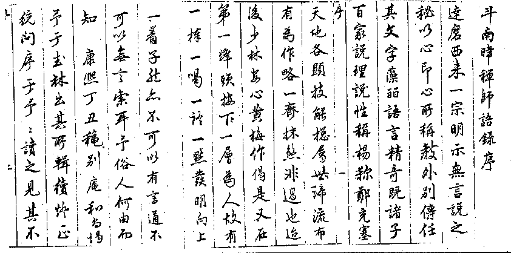
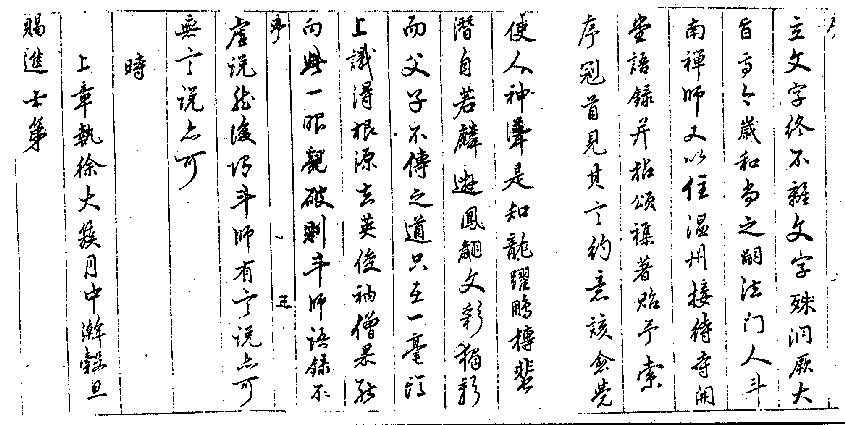
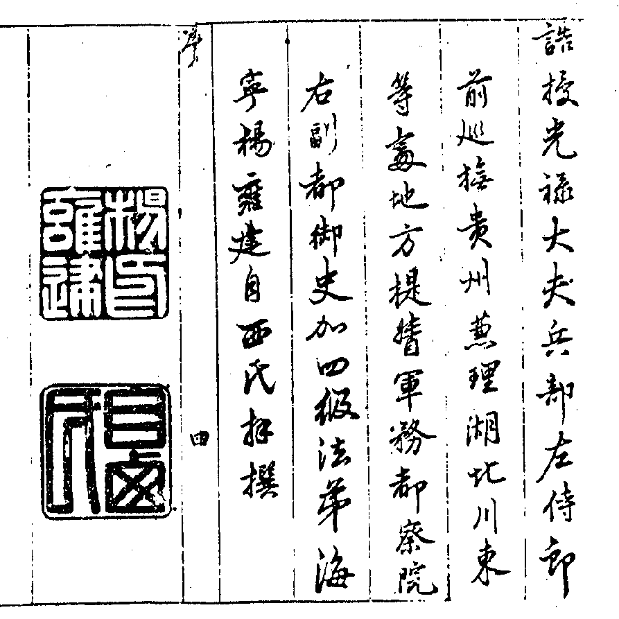

# 斗南𬀩禅师语录



> **藏经**：嘉兴大藏经（新文丰版）（嘉兴藏）　**册次** 第 40 册（J40）　**编号** JB488　**部类** 诸宗部　**卷次** 3 卷　**篇幅** 21,025 字

> **卷／品**：0 卷 · 1 品



---



## 目录



  - [斗南𬀩禅师语录序](#斗南𬀩禅师语录序)



---



### 斗南𬀩禅师语录序















斗南𬀩禅师语录卷之上



侍者普润记录



住温州接待禅寺



康熙三十五年丙子五月初五日，师受温郡缙绅周公长茂等公请入院。



山门。「解脱门开，周围天壁。龙象交参，如何委悉？」卓拄杖，云：「从斯入者，永无退失。」



弥勒。「天上无弥勒，地下无弥勒，蓦然相撞著，元来是者贼。」顾左右云：「贼！贼！心不负人，面无惭色。」



韦驮。「感应三洲，随方显迹。内外障消，全仗渠力。若有非为，曲不藏直。」



佛殿。「洞山言端，云门语的。今日新长老，当阳重举出。」展坐具，作礼三拜。



伽蓝。「广大道场，尽是木头土块。法门者般寥落，你也不生惭愧。直须宾主同心，方显灵山一会。」



祖师。「西天东土，一队秃奴，神光性燥，达磨心粗。」插香云：「以此验今时，正宗赤手扶。」



据室。卓拄杖云：「据此室，行此令，横按莫邪，高悬宝镜，佛祖魔军，侧耳谛听。」复卓一卓云：「咄！」当日众护法请上堂。拈疏云：「识得一，万事毕，一毫端上通消息，者消息也要维那重宣出。」宣疏毕，指法座云：「宝华王座作麼升步？直下无私，向上一路。」拈香祝圣毕，次拈香云：「此瓣香惠众萌芽，嵩岩增长，不受护国深培，却承灵隐滋养，业风吹到普陀，顿教遍界芬芳。今日信手拈来，𦶟向炉中，专伸供养现住普陀镇海堂上传临济正宗第二十八世上别下庵统老和尚，用酬法乳之恩。」敛衣就座。宗要和尚白槌云：「法筵龙象众，当观第一义。」师云：「杲日当空，光明赫奕，朗耀祖灯，宗风振起，花雨缤纷，普天匝地，随处称尊，有权有实，主宾照用，杀活临时。」竖拄杖云：「所以木上座有时在孤峰顶上，合水和泥，不背一人；有时在闹市街头，青眉白眼，不向一人。敲空作响，击木无声，全体作用，点铁成金，非涉神通玄妙，却缘公案现成。惟愿大家出手，扶起破裂沙盆。」召众云：「还有出手者麼？更听一颂：珠悬镇海乾坤静，斗拱星辰朗太虚，本地风光辉宇宙，一轮红日遶须弥。」结槌云：「谛观法王法，法王法如是。」师下座。



元旦，上堂。问：「昨日今朝即不问，新年一句请师宣。」师云：「爆竹一声催腊去，梅花几点送春来。」进云：「不新不旧一句又作麼生？」师云：「能为万象主，不逐四时凋。」进云：「新年旧岁蒙师指，如何是父母未生前本来面目？」师云：「拈起驴头尾上安。」进云：「恁麼则眉横鼻直去也。」师云：「切莫错认。」问：「如何是第一义？」师云：「未礼拜前向汝道了。」进云：「礼拜后如何？」师云：「有棒不打你。」僧礼拜，乃挥拂子，云：「一念万年，万年一念，绵绵密密，打成一片，凭他说前论后、换旧添新，戴新帽、著新衣，高拱手、深作揖，拜张三、谢李四，列锦铺花，擎拳舞掌，观灯玩月，色色随缘。设若未能，切须看个话头，如银山铁壁，左不得、右不得；如嚼铁馒头，吞不得、吐不得；如夜入暗室，进不得、退不得。忽然时节到来，鸦鸣鹊噪，爆竹一声，自然推门落臼，如杲日丽天，无所不照，者才是真新年也，头头受用，物物现成。然虽如是，且道：新年到来，旧岁从甚处去？」拈拄杖，过左手，云：「从者里去。新春从甚处来？」拈拄杖，过右手，云：「从者里来。正恁麼时，不来不去、不新不旧一句又作麼生？心包太虚，怀藏日月。」



上堂。「寒梅带雪池塘外，绿柳拖金曲水边。箫管声中发妙旨，烟霞堆里绝言诠。」卓拄杖，云：「露柱灯笼开口笑，本无新旧落人间。」



法雨老和尚书到，上堂。举书云：「只者个千里传来，蒙师眷注，文不加点，肘后符露八字，打开无尽仓库。接待者里，虽是藏无粒米云厨，餐餐充足，龙蛇混杂，凡圣同居，不能弘扬祖道，岂把法门涂污？遥念吾师深恩，恒把衣珠卫护。正当恁麼时，日用无私一句又作麼生？路遥知马力，日久见人心。」



恒月、文光两上座领众信朝海归，请上堂。问：「卓锡九山闲觉路，法坛大启梵王宫。有一个全体作用、不涉程途的，到来如何接待？」师卓拄杖，云：「白棒赤条条。」进云：「临济三玄，更请曲垂方便。」师云：「听尔葛藤。」进云：「如何是第一玄？」师云：「呈桡薄海浪滔天。」「如何是第二玄？」师云：「杖敲潭底月婵娟。」「如何是第三玄？」师云：「离岸横撑无底船。」「如何是第一要？」师云：「梵音洞口羊肠道。」「如何是第二要？」师云：「栴檀林里金狮哮。」「如何是第三要？」师云：「眼底闻声向上窍。」进云：「玄要齐拈无个事，九天云净鹤飞高。」师云：「又恁麼去也。」乃挥拂子，云：「胜地名山，一毫端出，万派朝宗，镇海独步，梵音现相，磐陀趺坐，佛国天然，栴檀馥郁，说法圆通，因缘会遇，四众临筵，切忌错过。」复拂一拂，云：「正当恁麼时，在家舍不离途中。在途中不离家舍一句作麼生？千里特来呈旧面，相逢相见笑呵呵。」掷拂子，下座。



退院，上堂。拈拄杖云：「昨日今朝事不同，江心船便好开篷，一双穷相持竿手，到处垂纶秪钓龙。」曳杖便行。



住无锡慈云禅寺。



康熙三十九年庚辰七月十二日，师受邑侯李公护法，阖邑缙绅黎媚邹公、勗如杨公等公请，暨方丈老人慈命入院。



三门。「要津把断，栖泊无从，豁开户牖，聊通一线。」卓拄杖便入。



佛殿。「惟吾独尊。往者不可谏；未说一字。来者犹可追。干蛊云门较些子，人情分上且施为。」展具作礼。



伽蓝。「沙盘成破，杓柄短长，丛林巨细，惟君承当。」插香，云：「𦶟此一瓣无餘事，只图重起热心肠。」



祖师。「终朝都卢著嘴，成得甚麼边事？从今放开两道眉，方始有些生气。」



方丈。「拈一放一，拿三道三，此是本师老人打凤罗龙的所在。𬀩上座子承父业，且作麼生展演？」卓拄杖，云：「男儿自有冲霄志，不向如来行处行。」是日，请上堂。拈疏，云：「七纵八横，明明历历，文彩齐张，开权显实。若还未辨端由，却听当阳表白。」指法座，云：「须弥山，狮子座，欲登便登，要坐即坐，拟议思量，当面错过。」顾视左右，云：「如何是不错过的？」喝一喝，遂升。拈香祝圣毕，次拈香，云：「此瓣香，芳蒂灵根，冰清玉洁，威音那畔了无枝叶，法雨堂中常为此切。第二回拈出，𦶟向炉中，专申供养前领高峰、现住普陀、永寿、圣因、径山及当山堂上六坐道场传临济正宗第二十八世本师上别下庵统老和尚，用酬法乳之恩。」敛衣就座。弘慧大师白槌，云：「法筵龙象众，当观第一义。」师以拂子拂一拂，云：「道本无言，因言显道。众中若有显道者，不妨出来相见。」本悟大师问：「蛟龙喜得风云际，顷刻升腾上九霄。如何是升腾一句？」师云：「丽珠光灿烂，蟾桂影婆娑。」进云：「分身宇宙行慈化，垂手尘寰剔慧灯。此是方丈老人寻常作略，今日新和尚分中如何施设？」师云：「一株玉树绽新花，满眼看来无异色。」进云：「圣天子颁临宸翰，老和尚命授法幢，吾兄如何担荷？」师云：「愿同化日光天下，力振宗风遍大千。」进云：「可谓掀翻海岳行新令，不须鼓动口唇皮。」师云：「借光始得。」乃云：「行无虑，住无忧，东瓯卓锡过明州。缤纷法雨吾师化，　御赐慈云逸兴优。墙壁生光新意气，辉煌殿阁旧春秋。尧天舜日今犹昔，满路歌谣乐未休。群生且道承谁力？人我双忘理事周。鲲鲸得水成龙去，万类沾恩得自由。」拈拄杖卓一卓，云：「双径高峰齐喝彩，不风流处也风流。」再白槌，师下座。



开炉，西堂慧通大师领许氏夫人请上堂。问：「为国开堂即不问，说戒安禅事若何？」师云：「锦上铺花又一重。」问：「山不在高，有仙则名；水不在深，有龙则灵。如何是慈云境？」师云：「万岁台前光灿烂。」进云：「如何是境中人？」师云：「闹市街头高著眼。」进云：「人境已蒙师指示，向上还有事也无？」师云：「向下会取。」乃卓拄杖，云：「钳锤在握，炉鞲风高，顽铜钝铁，触著镕销，三贤十圣，脑裂头焦，更加一顿，法器坚牢，跃冶莫邪，出匣吹毛，杀佛杀祖，斩尽狐妖，纵横自在，任运逍遥，要见便见，觌体相遭，思量拟议，地远天遥。」复卓一卓，云：「会麼？若还不会，更为颂出：西堂为众婆心切，许氏斋僧插髻高，亲得一回白汗出，黄金万两一时消。」



说戒，浙江抚军张大护法请上堂。师以拂子打圆相，云：「形同法同，天同地同，圣同凡同，僧同俗同，山河大地一切皆同。大众还信得及麼？若信不及，与你葛藤一上，灵光独耀，迥脱根尘，体露真常，心性无染。大地众生各有一段光明，辉天鉴地，耀古腾今，不变不迁，无向无昔，修证不无，染污不得，云收雨霁，杲日当空。虽然，犹是体上相应，更须单刀直入，大用现前，胡来胡现，汉来汉现。且道如何是即今的大用？苏州有，常州有，无锡城畔，惠涧东流，万法为侣，吸尽西江，擎茶洗钵，通身灵妙，触目文殊三昧，满耳圆通面门，慈云境界超群，优波离置在甚麼处？今日大檀设斋，少顷持钵应供。」



说戒，琇如大师请上堂。问：「法雨宗风即不问，目前一句是如何？」师云：「王令已行天下遍，将军塞外绝烟尘。」进云：「即今设供饭僧有何祥瑞？」师云：「财法二施。」问：「雪覆千山即不问，五家宗旨请师宣。」师云：「五家无宗旨。」僧拟问，师便打，僧喝，师连棒打退，乃云：「应供波离说向伊，披衣展钵莫迟疑，若能觌体承当去，三世如来把手携。」复举：「世尊一日敕阿难：『食时将至，汝当入城持钵。』阿难应诺，世尊曰：『汝既持钵，须依过去七佛仪式。』阿难便问：『如何是七佛仪式？』世尊召阿难，阿难应诺，世尊曰：『持钵去。』」师云：「世尊持钵，慈云展钵，且道是同是别？今日琇大师设斋，大众食时切忌向鼻孔里入。」卓拄杖，下座。



佛成道，洪滋大德请上堂。卓拄杖，云：「释迦老子，苦行生疲。睹星悟道，偷心未死。指东话西，不识羞耻。堪笑云门，痛处加锥。」复卓一卓。



上堂。竖拂子，云：「只者个，三世诸佛说不著，历代祖师说不著，天下老和尚说不著。」拂一拂，云：「山僧即今说著了也。众中还有信得及者麼？」击禅床，下座。



小参



小参。问：「向威音前道则触，向威音后道则背，如何是不触不背的句？」师云：「觅火和烟得，担泉带月归。」进云：「眉毛分八字，鼻孔向下垂，如何是超格的句？」师云：「难得到者地位。」进云：「一堂风冷淡，千古意分明。」师云：「且喜领话。」问：「丹霞烧木佛，意旨如何？」师云：「亲见丹霞始得。」进云：「院主因甚眉须堕落？」师云：「多少人向者里疑著？」进云：「鸳鸯绣出从君看，不把金针度与人。」师云：「逢人切莫错举。」进云：「文殊是七佛之师，因甚出女子定不得？」师云：「相识满天下，知心能几人？」进云：「罔明是初地菩萨，因甚出得女子定？」师云：「莫谤他好。」僧打○相，云：「还出得者个麼？」师云：「败阙不少。」问：「如何是真实境？」师云：「昨日雨，今日晴。」进云：「如何是虚妄境？」师云：「未开口前早已错。」进云：「其如宝珠池终日开口，紫霞峰未守点头。」师云：「明眼人难瞒。」乃云：「照用双行，杀活并举，大开炉鞴，点铁成金，饶他踢倒紫霞峰、吸乾宝珠池，向红炉里著脚、烈燄中安身，到者里只教上天无路、入地无门，缓缓地将渠脑后一捏，然后东西自辨、南北自分，便觉胸包天地、见出古今。者些且置，圆期一句究作麼生？」喝一喝，云：「犀因玩月纹生角，象被雷惊花入牙。」



小参。「残冬方去，春色初来，法王号▆▆用安排，堪笑东君多漏泄，雪凝东岭露梅腮。」



解七，小参。竖竹篦，云：「金能剋木，木能生火，信手拈来，烹佛烹祖，照用同时，不背不触。」召众，云：「背触且置，七期告圆一句又作麼生？」众举首，旋风打散。



元旦，小参。「年年正月初一，个个眉横鼻直。」横按拄杖，云：「若向者里见得，一一何劳拈出？」



除夕，小参。「腊月三十，年穷岁毕，野鬼闲神，自生荆棘，十圣三贤，魂飞胆裂，弥勒释迦，倚墙靠壁。」卓拄杖，云：「只得木上座心不负人，面无惭色。且道分岁一句又作麼生？」良久，云：「玉烛银灯光灿烂，来朝齐贺太平年。」上元，文光上座请为雪友禅宿对灵小参。「雪老阇黎出处甚奇，西域灵山移来者里，妙用无穷，不可思议，忽尔知归，方寸不离，特拈一偈，觌面提持。偈曰：昔年苦行赤条条，独立孤标万象超，言下顿圆无漏智，辉辉灯月甚逍遥。」



小参。「云门饼，赵州茶，粗中有细。渴时饮，饥时餐，大用现前。若涉拟议，面里有沙。」



秉拂



大士诞日，受嘱秉拂。「莫谓龙天推出，漫言果熟香飘，昔在万八峰前独荐，今向普陀崖畔承当，只因符到奉行，故尔当机不避，啐啄同时，乾坤震应，正令全提佛祖家风。今值大士圣诞，四众云臻，诸兄推举𬀩上座提唱向上宗乘，若论者一著子，岂可轻易？因堂头和尚严命，不敢辜负人天，众前岂肯囊藏？正当恁麼时，直得与诸兄露个消息去也。」举拂子，云：「诸佛诸祖自此授受，从劫至劫无有得失，还见麼？」击拂子，云：「大庾岭头提不起，而今遍界不曾藏。」



机缘



师参灵隐，因僧问硕和尚：「十方同聚会，个个学无为，如何是无为法？」灵便打。僧云：「既是无为法，因甚麼显大机大用？」灵云：「你道大机大用是有为法麼？」僧无语。灵置一瓮于方丈前，命众各作拈颂，投入瓮中，如有出格见解者，即付钵袋。众投毕，首座问灵云：「者一瓮未知有几个好的？」灵云：「半个也无。」座云：「和尚看过了麼？」灵云：「隔瓮子看过了。」灵问师云：「你道隔瓮子作麼生看？」师打灵一掌云：「用瓮子作麼？」灵呵呵笑云：「是汝始得。」师拂袖便出。



师参护国梦和尚，呈颂次，梦云：「生从何来？」师云：「新生月照天。」国云：「死从何去？」师云：「路在脚头边。」国云：「生来死去，是同是别？」师云：「苦瓜连根苦，甜瓜彻蒂甜。」国打云：「苦瓜连根苦，甜瓜彻蒂甜。」师云：「明眼宗师因甚随人起倒？」



师到雪窦，弘远和尚问：「甚处来？」师云：「天台来。」窦云：「护国国清安否？」师云：「太平万年。」窦云：「石桥因甚麼作两橛？」师云：「和尚何得掩耳偷铃？」窦云：「你还不知麼？」师云：「岂敢妄通消息？」窦云：「如何是真消息？」师低头吃茶。窦云：「盏子扑落地，碟子成七片，又作麼生？」师云：「东西十万，南北八千。」



师在雪窦为茶头，一日，雪窦上堂，师出问：「拨尘见佛事如何？」窦云：「你是个死猫儿。」师云：「狮子儿也不识。」窦云：「试哮吼看。」师云：「只恐惊杀野狐狸。」窦拈棒，师便喝。窦归方丈，召师至，问云：「适来者一段公案，你还记得麼？」师作听势，窦打一掌，云：「是赏你？是罚你？」师云：「老老大大，伎俩如此。」窦云：「烧茶去。」师近前扭窦须，窦云：「你又脚荒手乱作麼？」师云：「冷灶里一把，热灶里一把。」窦云：「东摸西摸，有甚了期？」师云：「镬汤无冷处。」



师回惠众剃度，法师问：「诸方为子说甚麼？」师云：「请法师珍重口门。」法师云：「曾到沩山麼？」师云：「到。」法师云：「水牯牛事作麼生？」师云：「和泥合水，拖犁拽杷。」法师云：「我问子水牯牛，子便道拖犁拽杷；问汝如何是佛？作麼生道？」师向露柱作女人拜云：「珍重！」法师罔措，师拍掌而去。



师到澄心，洪明和尚竖竹篦问：「唤作竹篦则触，不唤作竹篦则背，毕竟唤作什麼？」师云：「颠倒不少。」洪便打，师夺竹篦云：「速道！速道！」洪良久，师打地云：「放过则不可。」



师参法雨老人，雨问云：「从甚处来？」师云：「金陵来。」雨云：「曾到报恩麼？」师云：「曾到。」雨云：「报恩塔放光也未？」师云：「换却天下人眼睛。」雨竖拳云：「还换得者个麼？」师云：「正眼难瞒。」雨云：「如何是正眼？」师指旁僧云：「者瞎驴！」雨便打，师便喝；雨又打，师礼拜。



师在法雨板首寮打七次，法雨老人遣侍者送竹篦三块，者云：「内有一块是和尚的。」师问雨：「适才侍司道：『内有一块是和尚的。』未审是那一块？」雨云：「第四块是。」师竖竹篦，云：「者一块𫆏？」雨云：「总任里许。」师遂打，云：「恁麼则借婆衫子拜婆年。」



师与天柱和尚同入堂，柱云：「好一堂师僧，没个大彻大悟的。」师云：「瞎汉！那个不是大彻大悟的？」柱云：「瞎汉！那个是大彻大悟的？」师召众云：「者两瞎还有亲疏也无？」众无语，师代云：「一对跎子相逢著，世上于今没直人。」



法雨老人入堂，垂问：「无梦无想主人公在甚麼处？」众无对。师就地卧，作鼾声。雨云：「好瞌睡！」师云：「者老汉话头也不识。」师问法雨：「如何是祖师西来意？」雨云：「一株老梅树，两个大丫叉。」师云：「只得其体，不得其用。」雨云：「汝作麼生？」师举足便行。雨云：「意旨如何？」师云：「多时不洗，臭气熏人。」



师问僧：「如何是本来面目？」僧云：「吃茶。」师云：「昨日道吃茶，今日又道吃茶。」僧无对。师代云：「怎奈明日何？」



法雨问师：「山僧心痛，子还医得麼？」师云：「和尚是无心道人，从甚处痛来？」雨骤步归方丈。师云：「者老汉被我一问，直得口哑。」旁僧云：「莫谤和尚好。」师打僧一掌。僧云：「为甚麼打某甲？」师云：「寄与堂头和尚。」僧云：「何故？」师云：「切忌装模作样。」



法雨从径山归，集众出迎次，师问众：「古德云：『有一人在途中不离家舍，有一人在家舍不离途中。』因甚麼又要鸣钟擂鼓迎接和尚？」众下语不契，师代云：「怎奈老汉披毛戴角何？」



师问僧：「你在那一寮？」僧云：「藏楼上。」师云：「当何职事？」僧云：「香灯。」师云：「香灯事作麼生？」僧云：「满室香云人定后，半窗明月夜来迟。」师云：「本分事𫆏？」僧云：「钟板分明。」师便打。



师问沙弥：「甚处来？」弥云：「松云庵来。」师云：「谁叫你来？」弥云：「自己来。」师云：「谁是你自己？」弥云：「我𫆏？」师云：「我是阿谁？」弥云：「法成。」师云：「未有名字以前唤作甚麼？」沙弥无对，师喝出。



师游山次，见岩上有慧济禅院四字，问僧云：「慧济在甚麼处？」僧云：「前去半里。」师指岩云：「者里是甚麼所在？」僧无对。师云：「只因太近。」有童子云：「只因太远。」师云：「过在甚麼处？」童云：「路径太多。」师云：「你的路头在甚麼处？」童以棍子畫地云：「在者里。」师云：「从此入者不得忘却。」童云：「不忘却。」师云：「秪恐不是玉，是玉也大奇。」



僧问：「狮子窟中无异兽，因甚麼野猪、兔、鹿成群？」师云：「家无滞货不富。」僧礼拜，师云：「会麼？」僧拟议，师托开云：「野猪儿。」



师入堂，僧问：「无梦无想，主人公在什麼处？」师云：「瓮里何曾走却鳖？」僧云：「秪如梦想到又作麼生？」师云：「惺惺著。」僧拂袖便行，师云：「你见个甚麼道理？」僧便喝，师云：「切忌妄承当。」



东瓯蒋总戎问师云：「得业何处？」师云：「普陀。」蒋云：「普陀是别庵和尚麼？」师云：「是。」蒋云：「甚处人？」师云：「西蜀。」蒋云：「多少众？」师云：「或千餘，或十百。」蒋云：「因甚如此？」师云：「法无定相。」蒋云：「师是何处人？」师云：「台山。」蒋云：「数闻有金身罗汉，因甚麼杳无消息？」师云：「护法何得贵耳贱目？」蒋云：「某实不识。」师云：「果然。」



僧问：「和尚谕僧：『直夜行，不打灯者下签。』忽遇个双目不见的人作麼生？若不下签，又违和尚令；若下签，他又是个光明。毕竟如何即是？」师云：「一朝权在手，便把令来行。」



僧问：「毛吞巨海，因甚麼大树被水冲去？」师云：「若不卖俏，怎得风流？」



僧问：「芥纳须弥，因甚麼皇上赐琉璃瓦数十万，盖菩萨顶不遍？」师云：「法门广大。」



僧问：「法雨寺居大洋海中，为甚麼无水吃？」师云：「阿谁欠少？」



僧问：「海上横行底人，脚跟下因甚麼乾巴巴地？」师云：「月穿潭底水无痕。」



僧问：「名山受天下人供养，阎罗老子索饭钱，或将金银钱宝、头目髓脑等物与他，他一切不要，毕竟将甚麼与他？」师云：「数本敲窗花有意，几竿对客竹无心。」僧拟议，师云：「切莫向鬼窟里作活计。」



僧问：「马见便嘶，驴见便扑，永寿桥上石狮子镇日相对，因甚麼不怒？」师云：「同道者方知。」



僧问：「如何是祖师西来意？」师云：「冬瓜藤上结葫芦。」进云：「葫芦有多少子？」师竖拳云：「一个。」进云：「恁麼正欠参在。」师云：「还我话头来。」僧罔措，师便打。



拈



大事未明，如丧考妣；大事已明，如丧考妣



「明与不明，普化摇铃；哀与不哀，裂石迸灰。无有一人著紧，好似担雪填井。若道恁麼便是，总是依样畫饼。大众！尽力道不出底句，还有人道得麼？试出道看。其或未然，留与诸方检点。」



青林挑柴



「若作出坡会，狼籍不少；若作道理会，弄巧成拙。当时若遇𬀩上座，一到便骂：『者野狐精，以己方人。』待他才开口，一棒打杀。何故𫆏？车不横推，理无曲断。」



国师三唤侍者



「国师三唤，如虫御木；侍者三应，偶尔成文。秖如国师道：『将谓吾孤负汝，谁知汝孤负吾。』意作麼生？鲸吞海水尽，露出珊瑚枝。」



南泉住庵



「南泉虽是见机而作，未免随人起倒。者僧虽善饱食安眠，犹是梦里做梦。」



斗南𬀩禅师语录卷之中



侍者法权记录



颂古



世尊初生。



无事出头不识羞，周行七步逞风流，云门一棒惊天地，直至如今痛未休。



睹明星悟道。



天下独尊话已行，言颠语倒可怜生，雪山重睹明星后，失却当年眼里睛。



拈花。



逢场作戏有来因，做处分明见处亲，迦叶欣然开正眼，一番提起一番新。



殃崛救产。



殃崛救产快如风，报语传言不废功，谩说瞿昙行方便，出窠玉兔本然空。



无梦无想，如何是大用现前？



梦想俱无体用全，团团明月水中天，鸳鸯独立芦花岸，孤雁双飞遶翠烟。



新妇骑驴阿家牵。



骑驴新妇阿家牵，行到山穷水尽边，南北东西无去处，等闲摸者竹筋鞭。



末后句。



湘之南，潭之北。波澜声浩浩，渔父休思索。溪西鸡齐啼，屋北鹿独宿。



盐官一日唤侍者：「将犀牛扇子来。」者云：「破也。」官云：「扇子既破，还我犀牛儿来。」



扇子随身不计年，问来酬去绝言诠，时人莫谓无踪迹，浅角新蹄现大千。



云栖莲池大师因王侍郎问：「夜来床头老鼠唧唧，说尽一部《华严经》。」莲云：「猫儿突出时如何？」王无语。莲代云：「走却法师，留下讲案。」



鼷鼠三更转法轮，乌圆𨁝跳遁深村，豁开露柱通身眼，遍界难藏吼一声。



师姑元是女人作。



师姑元是女人做，三世如来觑不破，夜夜朝朝抱佛眠，风流却向阿谁说。



婆子烧庵。



老婆一片热心肠，放火烧庵别有长，枯木寒岩光灿烂，者僧逐出姓名扬。



前有刀兵，后有猛虎；左有水，右有火。如何是出身一路？



天堂蓦直去，地狱要亲临，十方俱坐断，不辨是非门。



赵州问僧：「曾到此间麼？」曰：「到。」州云：「吃茶去。」又问一僧：「曾到此间麼？」云：「不曾到。」州云：「吃茶去。」院主问曰：「为甚麼到也云吃茶，不曾到也云吃茶？」州召院主，主应诺。州云：「吃茶去。」



本色宗师一味禅，不曾曾到尽悲怜，和盘托出无人吃，狼籍馨香满大千。



举：「古德云：『昨夜好风。』僧云：『昨夜好风。』德云：『吹折门前一株松。』僧云：『吹折门前一株松。』又见一僧云：『昨夜好风。』僧云：『甚麼风？』德云：『吹折门前一株松。』僧云：『甚麼松？』」



怒气冲天动地雷，顺风吹了逆风吹，团团荷叶凭空舞，浴浪红菱尖似锥。



五台山秘魔岩和尚，常持一木杈，每见僧来礼拜，即杈却颈曰：「那个魔魅教汝出家？那个魔魅教汝行脚？道得也杈下死，道不得也杈下死。速道，速道！」学徒鲜有对者。一日，霍山通和尚访师，才见不礼拜，便撺入怀里。师拊通背三下，通起拍手曰：「师兄三千里外赚我来。」便回。



五台台上老魔军，终▆持杈问别人，魔子魔孙魔眷属，相逢相见芥投针。



大慈寰中禅师上堂云：「山僧不解答话，秪能识病。」时有僧出，师便归方丈。



毒药醍醐作者知，铜头铁额不无疑，机先若具超方眼，觌面亲呈已是迟。



古人云：「万法从心生，诸缘惟性晓。本无迷悟人，只要今日了。」既无迷悟，了个甚麼？



兔角杖挑潭底月，龟毛拂系岭头风，一时抛向沧溟外，撒手回途不见功。



赵州卧雪。



弄假成真博古今，何须陆地别升沉？从来末后无言说，一字搜空万劫心。



百丈野狐。



前身后现几人知，昧落淆讹已钝机，堕脱从来无此事，今朝更举惹人疑。



大颠摈首座。



海乾龙现爪，时至涌金波，春王行正令，乾坤玉浪铺。



又



扶他未出葛藤时，拨转乾坤向上机，喜遇春风三月里，鹧鸪啼在百花枝。



百丈开田。



惊天动地除荆棘，掷地金声又一堆，王令已行天下遍，中原共亨太平时。



射虎。



将军射石虎，弄巧传今古。错认定盘星，枉费千钧弩。顶门著一箭，何必多辛苦。



南泉斩猫。



信手拈来全杀活，当机无语命难饶，虽然不解翻腾去，戴履回头亦是高。



灵云见桃花。



桃花灼灼报君知，纵使无疑早已迟，堪笑灵云无意志，等闲失却眼中珠。



牛过窗櫺。



一踏黉门开，铁牛过櫺来，头头无罣碍，拍拍舞三台。



悬崖撒手。



悬崖撒手便承当，拄杖成龙岂覆藏？更有冲天千尺浪，禹门风急甚猖狂。



百尺竿头重进步。



百尺竿头重进步，一条蓦直长安路，到家不必询途程，吃饭穿衣仍旧故。



兴化摈维那。



驱耕夺食有来由，占断云山万壑秋，鞭起铁牛犁皓月，个中恩大实难酬。



百丈再参。



蓦然一喝，天迸地裂，装聋作哑，应时及节。



德山托钵。



明头出兮暗头回，惹得儿孙笑脸开。父子蓦然齐看破，灯笼露柱吼如雷。



龙潭吹灯。



纸灯灭处口难开，旷劫无明当下灰，明暗色空无隔碍，一条白棒舞三台。



黄龙三关。



我手何似佛手，不辨粗细好丑，随缘接物利生，惊起象龙哮吼。



我脚何似驴脚，不被毘尼缠缚，举步踏杀众生，瞎汉不妨疑著。



人人有个生缘，纵横自在安然，日用光明历历，饥时吃饭倦眠。



万法归一。



五百东来五百西，一枝高出众枝低，自从猿鹤归来后，野鸟山鸡不敢啼。



一归何处？



万法明明说向伊，霜风凛凛水生皮，团团红日当空照，隔岸渔翁坐钓矶。



云林和尚小参，云：「一人办道，忙杀伽蓝。云林八百禅和因甚日日绝粮？还是伽蓝不灵？还是人不办道？」



几百禅和住此山，阿谁不透祖师关？莫道伽蓝不灵验，日日绝粮顿顿餐。



又举：「大事未明，如丧考妣。大事已明，如丧考妣，因甚不见有一人哀戚者？」



昨夜三更月到窗，晓来雪上又加霜，明明一片清平地，何事将军急著慌。



又举：「青林和尚凡僧参见，先担柴三转，方乃入堂。还是教伊出坡？还是别有方便？」



不是担柴不是禅，法王法令验愚贤，人天榜样明今古，看破青林直甚钱。



大随庵侧有龟，僧问：「一切众生皮裹骨，者个众生骨裹皮。」师拈草鞋覆龟背上，僧无语。



骨生肉外外生皮，六合乾坤陆地移，一只草鞋轻覆却，青天白日黑迷迷。



高峰垂问六则



大彻底人本脱生死，因甚命根不断？



大彻不大彻，燄里寒冰结。冻杀天下人，通身冷似铁。



佛祖公案本是一个道理，因甚明与不明？



明与不明，罗什吞针。志公啖鸽，少遇知音。



大修行人当遵佛行，因甚不守毘尼？



佛行毘尼本自遵，现成草料满乾坤，云门胡饼如天大，不搆师僧一口吞。



杲日当空，无所不照，因甚被片云遮却？



杲日当空无不照，白云一片呈巧妙，乘风布雨等寻常，本体太清仍皎皎。



曹山三堕。



走遍天涯海角头，背驼星月望江游，归来踏断曹溪路，超出人间第一流。



吃油糍。



吃些油糍饱，天明不觉晓，说向侍者知，庄主添烦恼。



临济三顿。



棒下叮咛闪电机，梧桐风埽凤离栖，大愚一拶翻身转，当下还拳捋虎须。



庭前柏树子。



祖师柏子应时机，惹得儿孙说是非，脱壳灵龟不费力，可怜钝鸟逆风飞。



万缘放下。



吹毛举起命如丝，斩断尘劳用几时？大事未明须急急，万缘放下莫迟迟。



彻底掀翻是与非，三山四海总忘机，万缘放下无寻处，石女溪边把手归。



才入灵山选佛场，万缘放下即家乡，默然忘却来时路，不是愁人也断肠。



肇法师云：「天地与我同根，万物与一体。」



虚虚实实任君猜，根叶何曾有一枚。意气不从天外得，金乌夜半照苍苔。



《维摩经》三十二，菩萨各说不二法门，文殊云：「我于一切法，无言无说，无示无识，离诸问答，是为菩萨入不二法门。」殊又问维摩，摩默然。殊叹曰：「乃至无有语言文字，是真入不二法门。」时与此众中五千菩萨，皆入不二法门，得无生忍。



法门无二何劳讲，此处无金三十两，不是维摩行正令，瞎驴成队觜疯痒。



岩头撑船。



江心独立露堂堂，广渡群迷上铁航，舞掉呈桡称好手，老婆不是假颠狂。



曹山因僧问：「雪覆千山，为甚孤峰不白？」师曰：「须知有异中异。」曰：「如何是异中异？」师曰：「不堕众山色。」



雪覆千山水满溪，孤峰初夜月峨眉，清虚鸟道潜踪迹，那畔风光几个知。



栽松次，同参问：「大地无寸土，松向甚麼处栽？」答云：「高著眼。」



磐陀石上栽松树，不假阳春岁岁奇，大地原来无寸土，即今何处著阇黎？



观音菩萨将钱买胡饼，放下手却是个馒头。



胡饼馒头袖里蒸，惯将黑豆换珠珍。相看会是瑶台夜，斜掩重门谁识真。



法眼益和尚因僧问：「声色二字如何透得？」师召大众曰：「诸上座！且道者僧还透得也未？若会得，者僧问处透声色也不难。」



声色殷勤问主人，南山骤雨北山云，等闲识得东风面，万紫千红总是春。



疏山匡仁禅师问大沩：「有句无句，如藤倚树，树倒藤枯，句归何处？」沩放下泥盘，呵呵大笑。师曰：「某甲三千里来特为此事，何得相弄？」沩曰：「向后独眼龙为子点破。」后举前话问明招，招曰：「却使沩山笑转新。」师于言下大悟。



树倒藤枯问若何，泥盘放下绝淆讹。独龙点破其中旨，始觉从前错路多。



临济凡见僧入门便喝。



骤雨空中霹雳声，乱云堆里木人惊，红光闪烁随收去，电后风轻海岳清。



百丈因僧问：「如何是奇特事？」丈云：「独坐大雄峰。」僧便礼拜，丈便打。



象王独坐大雄峰，拟犯吹毛更不容，狮子窟中无异兽，千妖百怪尽潜踪。



临济上堂次，两堂首座相见，同时下喝。僧问师：「还有宾主也无？」师曰：「宾主历然。」师召众曰：「要会临济宾主句，问取中二首座。」



两个泥牛气不和，倾肠倒腹吼山坡，宗师愍物分缁素，临济纲宗有几多。



沩山示众曰：「老僧百年后，向山下作一头水牯牛，左胁书五字曰：沩山僧某甲。此时唤作沩山僧，又是水牯牛；唤作水牯牛，又是沩山僧。唤作甚麼即得？」仰山出，礼拜而退。



堪笑沩山老牯牛，争名夺利在阎浮，强中自有强中手，一拜当阳万事休。



五祖弘忍大师，前身在靳州西山栽松，遇四祖告曰：「吾欲传法与汝，汝已年迈，汝若再来，吾尚迟汝。」师诺，遂往周氏家女托生。因抛浊港中，神物护持，至七岁为童子。四祖一日往黄梅县，逢一小儿，骨相奇秀，乃问曰：「子何姓？」曰：「姓即奇，非常姓。」祖曰：「是何姓？」曰：「是佛性。」祖曰：「汝无性耶？」曰：「性空故。」祖默识其法器，即俾侍左右。后令出家，付衣法，居黄梅东山。



钝鸟移巢脱壳龟，阎浮卖弄几多回。舍身受法传心印，莫是遭他授记来。



德山小参，示众曰：「今夜不答话，问话者三十棒。」时有僧出礼拜，师便打，曰：「某甲话也未问，和尚因甚麼打某？」师曰：「汝是甚麼处人？」曰：「新罗人。」师曰：「未跨船舷，好与三十棒。」



即言说兮离言说，祖印高悬挥巨阙，触著轻轻裂脑门，至今遍地流红血。



德山凡见僧入门便棒。



入门便棒，烟尘埽荡。日午三更，星稀月朗。



东寺问仰山：「甚处人？」山曰：「广南人。」师曰：「我闻广南有镇海明珠，是否？」曰：「是。」师曰：「此珠如何？」曰：「白月即隐，黑月即现。」师曰：「将得来否？」曰：「将得来。」师曰：「何不呈似老僧？」曰：「某甲昨到沩山，被索此珠，直得无言可对，无理可伸。」师曰：「真狮子儿，善能哮吼。」



明珠镇海自承当，白月收藏黑月光，无言可对全体露，狮儿哮吼不寻常。



僧问：「如何是曹源一滴？」



真源一滴本无多，狼籍溪声挂薜萝，识得千江非二月，碧潭皎皎浸山河。



世尊因五通仙人问云：「佛有六通，我有五通，如何是那一通？」世尊召仙人，仙人应诺。世尊白：「那一通，你问我。」



问佛仙人那一通，倒插杨柳顺插松，红桃片片如红雨，狼籍馨香在梦中。



善财采药。



野草闲花遍界青，当阳拈出法非轻，膏肓有病来医者，杀活临时不顺情。



僧问玄沙：「如何是清净法身？」沙曰：「脓滴滴的。」



滴滴通身是烂脓，盐瓶出水又生虫。铜壶漏永何时歇，清净还归大海中。



洞山麻三斤。



指麻随问说三斤，分付行家直几文，酬价不成无处卖，争长道短乱纷纷。



临济后居大名府兴化寺东堂。咸通八年丁亥四月十日，将示灭，说传法偈曰：「沿流不止问如何，真照无边说似他。离相离名人不禀，吹毛用了急须磨。」复谓众曰：「吾灭后，不得灭却吾正法眼藏。」三圣出曰：「怎敢灭却和尚正法眼藏？」师曰：「已后有人问你，向他道甚麼？」圣便喝。师曰：「谁知吾正法眼藏向者瞎驴边灭却？」



父子叮咛叹别离，瞎驴灭却绝狐疑，玄关倒锁人难见，九曲珠通暗里移。



赵州勘二庵主。



动地惊天事稀奇，呼神唤鬼惹人悲，千邦万国吾王化，斩将封侯陷虎机。



青原因僧问：「如何是佛法大意？」原云：「庐陵米作麼价？」



僧问青原原问僧，庐陵米价作麼生？太平天子寰中敕，塞外将军绝信音。



唤作竹篦子则触，不唤作竹篦子则皆，毕竟唤作甚麼？



触则难容背则非，谁人道得两无疑？知音不必频频举，八面风生大展眉。



六祖风旛。



风旛争斗夺输赢，自有傍人抱不平，意气不从心外得，碧潭才动水生纹。



临济访平田，于路见一嫂使牛，师问嫂：「平田路向什麼处去？」嫂将牛打云：「者畜生诸处走，到者里不知路。」师曰：「我问平田路向甚麼处去？」嫂云：「者畜生养来五载尚使不得。」师云：「欲观前人，先观所使，便有抽钉拔楔之意。」



郁郁青青问路头，闲花野草惹人愁，麒麟唤作生无底，转语轻酬驾嬴牛。



赵州因僧问：「万法归一，一归何处？」师曰：「老僧在青州作得一领布衫，重七斤。」



衫子当阳示七斤，拈来万法更鲜新，和泥合水无人识，洗到驴年也不清。



赵州因僧问：「某甲乍入丛林，乞师指示。」师曰：「吃粥了也未？」曰：「吃粥了也。」师曰：「洗钵盂去。」僧忽然省悟。



志气冲天乍入山，一言透过上头关，钵盂荡出虚空界，本地风光自往还。



有雪窦化主省宗问兴教坦：「诸佛未出世，人人辽天，出世后为甚麼杳无消息？」教云：「鸡足峰前风悄然。」宗曰：「未在，更道。」教云：「大雪满长安。」宗曰：「谁人知此意？令吾忆南泉。」拂袖归众，更不礼拜。教云：「新兴教今日失利。」便归方丈，令人请宗至室，教云：「适来错抵一转语，人天众前何不礼拜盖覆却？」宗曰：「大丈夫膝下有黄金，怎肯礼拜无眼长老？」教云：「我别有语在。」宗乃理前语，至未在更道处，教曰：「我有三十棒寄打雪窦。」宗便礼拜。



两刃交锋断不饶，锋前电后逞英豪，三十乌藤相寄处，杀人更有活人刀。



梁王问达磨：「如何是圣谛第一义？」



廓然无圣真消息，一句了然超百亿。莫谓梁玉不丈夫，释迦弥勒难相识。



云盖僧化瓦。



瓦盖云遮不教多，霖霖法雨满山河，重重殿阁金风露，布地金砖选佛窠。



赵州看台山婆子。



显赫宗风老赵州，丛林万古立宗猷，台山觑破狼烟息，何必儿孙动地愁。



举圆照本禅师问义天僧曰：「《华严经》三身佛，报身说耶？化身说耶？法身说耶？」义曰：「法身说。」师曰：「遍周沙界，当时听众何如蹲立？」义茫然无对。



花果同时岂偶然，红炉鞴里结红莲，根源充满乾坤外，一句迥超万象前。



沩山摘茶。



龙吟雾起别机亲，虎啸风生亘古今，玉转珠回呈体用，丝来线去暗抽身。



香岩上树。



好把根源认得真，羚羊挂角已相亲，虎头树下回言问，只得欣欣笑一声。



口咬枯枝不踏攀，如何透得祖师关？知音说与知音听，不是知音莫与谈。



声色外一句。



柳绿桃红黄鸟啼，云收雨霁照寰熙？当阳觌面都拈了，孟八郎君知不知。



忠国师勘验大耳三藏。



大耳通身本现前，国师平地起狼烟？南北东西尽敌处，个中谁识太平年。



雪峰因三圣问：「透网金鳞以何为食？」师曰：「待汝出网来向汝道。」圣曰：「一千五百善知识，话头也不识。」师曰：「老僧住持事繁。」



白浪滔天艇自开，丝纶轻举上钩来，金鳞透网冲天起，得意渔翁转钓台。



雪峰鼇山成道。



心头未稳话头亲，举似师兄当面嗔，两次三番都铲却，从今流出自家珍。



疏山寿塔。



使尽三文无价珍，一番拈出一番新，放光古佛重注脚，堕落眉须绝点尘。



寻牛。



深山旷野用心多，鸟道行行事若何？紧俏草鞋勤进步，抬眸又见白云过。



见迹。



枯木岩前路百条，独行无语意何超？倏尔长空云散尽，留得参天角影高。



见牛。



独立岩前㘞一声，万机消尽不容情，峥嵘头角分明露，任是丹青畫不成。



得牛。



荒坵蓦地忽相逢，信手牵来不放松，𨁝跳狂心还不歇，一回入手且从容。



牧牛。



连朝随看不相离，芳草岩中适性宜，满目林泉凭受用，饥餐渴饮复何疑。



骑牛。



溪边石立觉堪骑，短笛频吹绿草时，燕语声从天外落，直身高跨乐无私。



忘牛。



全体清闲不冗求，从今坐断碧峰头，青山绿水依然在，寂寞无形不用收。



双忘。



彻底掀翻是与非，三山四海共忘机，干戈不动常安乐，谩说当年小室惟。



还源。



虎伏岩隈鱼跃渊，寒梅带雪弄轻烟，而今春色从天降，堪笑当年孟浩然。



垂手。



总教田地不荒芜，且将蜜枣换葫芦。垂手应怜门外汉，半钩新月落江湖。



南阳忠国师因化缘将毕，乃辞唐代宗。帝曰：「师灭度后，弟子将何所托？」师曰：「告檀越造取一所无缝塔。」曰：「就师请取塔样。」师良久曰：「会麼？」曰：「不会。」师曰：「贫道去后，有侍者应真却知此事。」师迁化后，帝诏应真问：「此意如何？」真述偈：「湘之南，潭之北，中有黄金充一国。无影树下合同船，琉璃殿上无知识。」



化缘既毕又贪嗔，欲化君王无价珍，塔样撑天无缝罅，总教立地作黄金。



斗南𬀩禅师语录卷之中终



斗南𬀩禅师语录卷之下



侍者法权记录



偈



眼耳鼻舌身意(六首)



昼夜交辉朗太虚，明如日月照无私，瞎驴灭却年前事，宇宙茫茫几个知。



四维上下悉皆闻，一击忘知丧胆魂，霹雳声中消息尽，从斯塞断是非门。



面门独露一孤峰，玉洞无私两道通，臭去香来瞒不得，但将矢橛振宗风。



铜唇铁舌解谈空，遍覆三千不记功，七七九年无一字，至今狼籍海龙宫。



烟霞洞里陪鸡犬，荆棘林中作主人，长卧白云闲作梦，驴胎马腹亿分身。



癞马枯椿事莫期，瞻之前后播鎗旗，太平本是将军定，倒弄横拈任意骑。



四威仪



山中行，花鸟无心自作吟，相识知音天下少，三生石上旧时人。



山中住，挂角羚羊无影树，白日木鸡醒醒啼，金乌下兔追风去。



山中坐，慈愍利名人两个，但把红尘早脱身，莫嫌老衲袈裟破。



山中卧，流水溪边几梦过，石洞草深常入定，翻身忘却来时路。



题石女夫人



此女从来不嫁君，如何唤作石夫人？梳粧月镜星帘下，赤体穿衣挂白云。



题淡和尚



者个和尚，千了百当。佛法世法，双收双放。笔走龙蛇，真个人天榜样。



室中礼忏有感



谩说微尘劫数多，生前培植苦娑婆，要知末后真消息，彼岸何曾隔海波。



采柏子



开花结子正初冬，采落银花露雪容，粉骨碎身输敌手，从教光夺日头红。



老僧崖



圆颅方服僧仪全，何代游来住此巅？一念不生浑是定，逢人不解口谈禅。



诵经



胸襟流出舌尖头，得意忘言不外求，四十九年无一字，瞿昙有口也难酬。



示僧



但遇明师是胜缘，何须特地远追攀？但能直下翻身去，烦恼菩提一体圆。



看花



一园红白应时开，风拂清香扑鼻来，几度倚栏频玩处，月明帘影共徘徊。



劝母念佛



子欲归家有一言，菩提不退好心田，但能识破多生梦，佛母从登上品莲。



考工



一粒金丸永不离，今朝举起更无疑，几回炉内翻筋斗，者个何曾有是非。



示沙弥



沙弥来请法，与他一耳掴，若向掌上会，天长并地阔。



月下偶成



终日群居别有天，随缘任运自安然，个中消息谁能识，明月当空不露言。



夜闻板声



空谷传声响似雷，更深更下一楗椎，虚堂寂静无人到，独许天心皓月来。



飞来峰



生成体段巧玲珑，特地飞来显妙容，顶上莲花藏日月，周围千佛绕灵峰。



参云林和尚



水涨船高风又来，扬帆架橹出天台，梢公力勇船头硬，撞倒云林老古锥。



步玉开师原韵



碧玉初开漫露踪，粗雕细琢欲成功，本来妙体如明得，规矩方圆任变通。



打碎钟子



拶碎虚空㘞一声，当阳拔出眼中钉，通身白汗青天雨，杲日重消火里冰。



示透宗还豫章



学道先须透此宗，叮咛此去悟心空，忽然吸尽西江水，长舌原来在口中。



除夕



东村王老夜烧钱，现出红炉火里莲，历劫坦然无变色，大家齐唱太平年。



拄杖



秘密深藏万八峰，龙天推出振宗风，拈来插向沧溟外，扫尽妖狐信不通。



爆竹



亲遭毒手几多回，轻易人前口不开，时节到来全体用，迸山倒岳发寒灰。



赠闻旨道兄



洞彻无生倒命根，一闻千悟是奇入，从今更不疑他物，满腹丝纶别有文。



赠树文道兄



钟山分袂各东西，落叶残红恨别离，肠断三更心粉碎，不知何日又逢师。



树文兄留别



锡共钟山寺，相谈百日期，与君分袂去，回首意难离。



茶钟堕地不碎



掷地金声吃一惊，一番提起一番新，当阳扑出无人识，固有天然不坏身。



和树文兄原韵



紫金城畔紫金峰，过出人间事不同，灵鹫俨然无二处，今朝重振旧家风。



赠香谷师



佛法无多识者稀，奔南走北枉呈机，直饶熟读三千卷，荡子归家失路迷。



化木鱼偈



金光烁烁口微开，触著轰轰动地雷，一遇知音出只手，大家齐唱法王来。



赠微笑轩行实贤弟



微笑轩中一作家，金襕传后隐光华，他时格外寻知己，拈起灵山不老花。



赠妙有关主法师



向上圆关不外通，经行坐卧任从容，时将一滴曹溪水，遍洒天台万八峰。



化斋



初秋夏末到东瓯，接待无粮不自由，云水都来要饭吃，我今权作老金牛。



别飞泉法师



作偈吟诗话旧交，奇言妙句意何超，挥毫写出当年事，竹榻篷窗共一宵。



其二



此际重逢话夙缘，溪边分袂水涓涓，九秋暂别他山去，万里瞻风望月圆。



赠愚若兄掩关



大海潮声日夜喧，阿兄求静隐松源，寂然不动无边际，佛祖难窥第一关。



为新大德开淡斋



留情淡处律精严，清白甘泉涌舌尖，嚼碎茎虀明底事，诸方五味不须参。



赠玉轮朱居士诵经



佛法无多说向君，持经展卷过平生，有时㘞地一声去，三世如来把手行。



赠朱居士游山



太平何事赖人修，突兀名区任意游，南北东西无阻碍，回途须用自甘休。



赠奉先顾居士



世事人情懒去亲，闲房静坐乐天真，四恩总报无多子，宇宙茫茫见一人。



赠孟入陈居士参禅



道义相交不倦谈，西来祖意好追参，要知向上超玄路，剔起眉毛脑后看。



步注居士原韵



玉堂光灿透玄微，霹雳声中不动衣，堪笑时人犹不觉，谁知目下自生机。



示分唇海沙弥



弥勒口开有甚奇，不如者个小沙弥，逢人懒说西来意，笑破口门两片皮。



搬砖偶成



抛砖引玉上虚堂，凛凛威风不可当，万象森罗齐举手，一家有事百家忙。



水笕



万法囊藏在腹中，吞而复吐养蛟龙，光吞日月乾坤大，一派曹源正脉通。



游虎丘口占



虎丘山上白云家，客到浓煎谷雨茶，顽石心空能点首，时人徒看眼前花。



灯下偶成



黄金出汁苦心知，费尽钳锤照用时，古佛燃灯光世界，至今者点不曾移。



石柱峰



拄地撑天玉柱峰，龙门倒插半空中，清溪落落冲潮去，隔岸骚人信未通。



登月台观瀑



瀑布翻空何处来，惊天动地吼如雷，远观一片银山壁，近视珍珠洒月台。



坐禅



磨裆擦裤几多年，丧尽身心不会禅，再上蒲团闲作梦，何须特地起狼烟。



舟中阻风，作以慰众



扁舟荡漾泊琳宫，暂尔苍天鼓逆风，自是观音舒法力，管教巽女转神通。一寻柔橹浮沧海，三道轻帆挂碧空，千步银沙亲玉趾，金仙洞里见慈容。



赠道原法师



道在中原不变迁，包含万象利人天，喜君广有超方作，妙喻微言满大千。



搬瓦



握土成金上法堂，狮儿齐立几何行？争先头角翻空舞，古殿重增旧日光。



慕得然道兄善书畫偶成



作略君家得自然，笔尖才动化三千，丹青点破澄潭月，铁砚磨开长夜天。



佛事



地藏开光



「九华峰顶现金身，何似庄严色相新？者里一毫能著眼，放光无处不称尊。」



弥勒安位



「理法界，不动纤尘；事法界，纵横自在；理事无碍，法界重重。殿阁峥嵘，处处应身化现。布袋打开，珠回玉转；信手拈来，点铁成金。三贤十圣，情与无情，从地涌出，不令而行。」以拂子打○相，云：「过、现、未来，总不曾离却者里，又不曾住却者里。大众且道：毕竟在甚麼处？」击香几，云：「相逢拍掌呵呵笑，天上人间得自由。」



韦驮安位



喝一喝，云：「虚空震动，大地辉腾，法不孤起，令不虚行，顶天立地，护国安民，威灵显赫，古刹重兴。正当恁麼时一句作麼生？殿阁峥嵘新气象，金汤卫护旧家风。」



募天王殿进关



「未游华藏界，先入蜗牛角，佛眼觑不破，千圣难模索。者个大愚人，无参亦无学，忽起佛法见，将错与就错，等个人儿来，梵刹兴工作。即今事若何？放下旧蒲团，高挂钵囊著。」



挂梆板



师拈槌云：「鸿鸣轻击，天呼地应。金牛吃饭来，赵州洗钵去。施者受者，果因不昧。众中若有弥勒肚皮、维摩手段，可使斗金日费，饥餐饱睡。设若五观未明，者里切须仔细。」击梆板云：「咦！」



出关



「闭户无求，活埋此处。眨眼三年，须臾便过。乞我一文，功成德聚。施者受者，必获如意。且道以何为验？」蓦指柜云：「此处无金三十两。」



剃度师示寂拈香



「化身应世，唯我本师。方外域中，化导靡穷。某蒙剃度，拔济恩崇。思悟别传，于焉西东。只期大树，长作帡幪。讵料涅槃，觌面难逢。虽无生灭，宁不怆伤。音容永隔，舍利流光。山高水深，夕瞻朝望。谨具杯茗，匍匐登堂。师其来格，鉴此瓣香。」



为母疾割股焚香



「肉随刀转，血泻泉流，拆肉还母，恩大难酬。信手拈来，旃檀一片，热向炉中，诸佛证鉴。然虽如是，全身现出寻常事，忉利天宫去复回。」



复然顶



「祈母患愈，烧身烧臂，直下忘躯，顶𩕳著地。」



为火头僧举火



「昔日烧火，今被火烧，烈燄光中，任运逍遥。且道功圆行满事作麼生？」高声云：「放下著。」



入塔



「威音那畔，任意纵横，大开门户，全身直入。」下灵骨云：「欲识安身立命处，会取当阳霹雳声。」鸣指一下。



为松崖禅人举火



「重阳九月里，金风遍界吹。未晓登高去，天明拂袖归。泥牛吼水面，海底火星飞。无根松树砍将来，置向红炉烧死灰。」



为无碍禅人举火



「透过金刚圈，吞却栗棘蓬。通身显妙用，踏破太虚空。」掷下火炬云：「日轮不觉沉西去，随身干木彻天红。」



为雪松沙弥入塔



「冬至月中，日风夜风。沙飞石走，吹倒雪松。且道叶落归根事作麼生？近水楼台先得月，向阳花木早逢春。」



为园头一念举火



「昔年空手把锄头，今日步行骑水牛，撒手到家情念尽，更无一物可存留。虽然如是，且道即今事作麼生？」撺火炬，云：「识得衣中宝，翻身迸火星。」



为梵音洞佛子舍身举火



「清净法身求善因，圆满报身招恶果，百亿化身现虚空，粉骨碎身超佛祖。」举火炬，云：「还见观音大士麼？劫火洞然毫末尽，顶门突露一轮红。」



为莲彰禅师起龛



「铁壁银山万丈深，上天无路地无门。从斯透过玄关去，天空海阔任纵横。」



举火



「昨夜一阵毘岚风，吹倒门前一株松，直至树倒藤枯后，更有莲花火里红。」以火炬打○相，云：「还见麼？剔起眉毛脑后看。」



入塔



举灵骨云：「只者个，不在内、不在外、不在中间，且道在甚麼处？」良久，云：「直下分明说向伊，朔风凛凛雨声微，莲洋浪涌金沙岸，斗转星移月映溪。正当恁麼时，藏踪隐迹又作麼生？即今放下黄金骨，切莫分身两处看。」



为灵隐禅人起龛



「出入分明不尔欺，个中何更有狐疑？但能觑见来时路，踏过毘卢任所之。」



举火



「闪烁灵光透上头，即今毫发不容留，眼睛突出虚空笑，燄里翻身辊火毬。」



入塔



鸣指一下，云：「空谷传声，乾坤震应，灵光隐隐，却是如来真性。即今粉骨碎身，且向甚处立命？者里欲住便住，当定即定，塞破牢关，听吾号令。」复鸣一下。



为石元禅人起龛



「古人休去、歇去、冷啾啾去、一条白练去、古庙香炉去、一念万年去，者汉毕竟向甚麼处去？」顾视左右，云：「大家送出去。」



举火



「一向阶前洒埽，献花供水，忽尔露布踏翻，切忌见神见鬼。」举火炬，云：「烈燄光中，荐取本踪。」



入塔



「风和日暖，桃红李白。趁此水涨船高，休待潮落石出。正恁麼时，乐业成家，承谁恩力？咄？船到桥门自然直。」便下骨。



为云水僧起龛



「游遍天涯，孤峰独宿，踏倒须弥山，忘却来时路。」举数珠云：「若向者里见得，无来无去，无迷无悟；其或未然，雨后苔青，急须走过。」



举火



举火炬云：「咄咄！水朝东，星拱北，桃自红，柳自绿，鱼化龙，笋成竹，泥牛撞入海，山前鹿独宿，急荐主人翁，烧却娘生屋。」



为患毒僧入塔



「清净本然，异类之质。臭气冲天，烂脓滴滴。撞著无情汉子，抛向红炉蒸炙。镕作一袋真金，果然好个消息。趁此户牖大开，透过铜墙铁壁。」



为雪如禅人入塔



「咄哉雪如！吾今问渠：本来何面目？将甚作真如？」举骨衬云：「言下知端的，放下便安居。」



为李氏道人举火



「幻寄东瓯，六十餘秋。离乡别井，昨寓明州。大士亲见，到岸忘舟。」下火云：「者段光明无间断，满船空戴月明归。」



为性空上座入塔



「赤日当空照大千，性空空尽体超然，悠悠莫论途中事，且入浮屠仔细看。」



为无碍禅人入塔



「咄！禅不须参，教不须看，百年三万六千朝，返覆元来是者汉。」举灵骨云：「还会麼？掷地金声，有眼者见。正恁麼时，符到令行又作麼生？夹路桃花风雨后，马蹄何处避残红？」



为道林上座起龛



「者个师僧常演妙音，撒手归家撩起便行，向上一路又作麼生？」喝一喝，云：「蓦直去。」



为彻凡禅师起龛



「死中得活，活中死去。涅槃堂前，岂容久住？符到奉行，路在甚处？」以手指云：「这里去。」



为戒全禅师封龛



「门门非别门，户户还自户。识得个中人，大虫原是虎。不须露爪牙，虚空加封锁。」



起龛



指龛，云：「从来寸步不曾离，此日当阳说向伊。昨夜禅那无影树，秋风飒飒落寒枝。时至归根留不住，铁牛无脚逐云飞。」击龛，云：「起。」



举火



「戒全全戒定纲宗，振起禅那正脉通，长啸一声消息尽，得处何须更费工？昔年换个破灯盏，掷下炉中彻底红，大地秋光都漏泄，落霞孤鹜听西东。」遂下火。



为火头道士起龛



「方外得得来，聚会学无为，才到选佛场，瞥然即便归。心空何处去？及第更由谁？」喝一喝，云：「看脚下。」



举火



「今朝六月七，道人著气急。杲日正当空，大千红燄逼。流出汞中金，工夫多狼籍。阿呵呵，识不识，薰风自南来，为汝通消息。」遂下火。



为秋月禅人起龛



「来时头戴中秋月，慧鉴胸藏不夜天。海外欲行无异路，最初一步更为先。」



举火



「生在金陵，死在者里。倒断命根，无嗔无喜。迥脱根尘，投大火聚。烈燄光中，切须荐取。」



斗南𬀩禅师语录卷之下终

