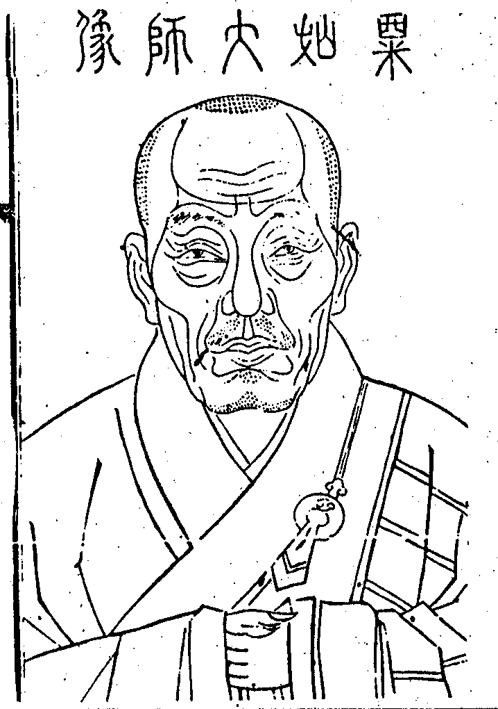

# 博山粟如瀚禅师语录



> **藏经**：嘉兴大藏经（新文丰版）（嘉兴藏）　**册次** 第 40 册（J40）　**编号** JB490　**部类** 诸宗部　**卷次** 6 卷　**篇幅** 50,036 字

> **卷／品**：0 卷 · 3 品



---



## 目录



  - [粟如瀚禅师语录序](#粟如瀚禅师语录序)

  - [粟老和上语录后序](#粟老和上语录后序)

  - [青原三十三世博山第六代住持粟如瀚大师塔铭并序](#青原三十三世博山第六代住持粟如瀚大师塔铭并序)



---



粟如大师像







自赞



踞坐博岭四十餘年，大寿昌先宗传，达摩不传？咦！传不传，虚空钉橛，矢上加尖。咄咄！



嗣法门人传鹏敬述



------



### 粟如瀚禅师语录序



神宗末年，吾宗之在天下，太白、石伞而外，於西汪则唯博山焉。博山法道严整，门庭孤峻，学者非出类拔萃流，罕有能登其门者。以故能登之者，皆系出伟人如瀛山訚公、檀度密公辈，即在古亦所难得。今其儿孙遍天下，凤岭一席，代不乏人。古云：「源之清远者，流必长。」此其是也。粟如瀚禅师出雪涧奉公之门，奉公与瀛山訚公为昆季，皆老博山室中真子，其钳锤妙密、严整孤峻之风，世能熟鍊，故所出克绍箕裘者比比也，而禅师尤能於头角中杰出一斑。吾石伞一枝，虽不敢少让，然亦不敢不让。己酉元宵前三日，承乏博山以来，所有为众拈提语若干，门人录梓成帙，索序於余。余虽不敏，以私淑之至，又安敢以不文辞？於是书数语简端，聊以志景仰万一。若其照用杀活、主宾纵夺，与夫说法自在之妙、接物变幻之巧，具眼者请以全帙观，则得之也。然则博山一枝，法道益有所寄重，其在是乎？



时岁次庚戌中夏之吉，钱塘白岩净符书於待庆堂。



------



### 粟老和上语录后序



古德云：打破大唐国里，觅个禅师不可得。由斯言之，师以禅名耶？抑禅以师名耶？此其故，吾於先师粟老和上其人得之矣。先师以尊人会夏鼎已迁、有殷革命之际，忠愤卒官，遂继志身隐，披缁林泉，高风劲节，人拟夷齐。至於匡徒住院，固其夷然所不屑者，盖先师之志以禅逸也，非欲以禅师之名跻於前而标於后也。及涧大父年耄，郡侯易庵高公暨四众坚请，不得已，继席博山，应期瀛山、高泉焉。爰有《三会录》梓行於世，世皆仰为破热清凉散，照夜光明幢久矣。惜卷帙浩繁，人多艰於负挟，遐方异地虽闻先师之名，睹先师之录者少。今於先师法录中择其的的提持本分，只著子者汇为六卷，梓而送附嘉兴楞严寺流行，使未睹者得而睹之，亦俾后之学者或於一言半句之下得脱略窠臼，动彻本地风光，是之谓能自得师也。即谓师以禅名也可，谓禅以师名也可，谓斯录为禅师也亦无不可。是为序。



时康熙五十一年，岁次壬辰，夷则月自恣日，住博山门人传鹏焚香拜手譔。



粟如瀚禅师语录总目



卷之首序文(二则)



第一卷住博山能仁寺语录上堂一



第二卷住博山能仁寺语录上堂二



住高泉语录上堂  

小参  

示众



住瀛山语录上堂  

小参



第三卷再住博山语录上堂三



第四卷住博山语录小参



第五卷住博山语录示众一



再住博山语录示众二  

秉拂  

入室机缘



第六卷拈颂  

佛事  

佛祖赞  

自赞  

诗偈  

行状  

塔铭  

塔记



目次毕



粟如瀚禅师语录卷之一



嗣法门人传鹏编



住信州博山能仁寺上堂一



师於康熙己酉正月十二日，受信州郡伯易庵高公，暨现任诸大护法，并七邑绅衿，诸大檀越，及同门云怡玄三大师，本寺两序，诸山耆旧请开堂。



受请上堂。举如意云：「一家有事百家忙，师命频催难躲藏，矧乃郡侯重抑逼，无何勉强为登堂。秪如登堂作个甚麼？」击如意云：「伫看碧天云气静，一轮明月印千江。」



佛殿。「麻三觔，乾屎橛，是什麼？」展具，云：「今朝盖覆将来，免教重重漏泄。」



韦驮。「卫法安僧，摧邪辅正。外道天魔……」以具打○相，云：「咸遵此令。咄！」



伽蓝。「有者片地，赖君守护，此地未生，当何所务？伽蓝神须照顾。」



祖师。「你扶头，我把尾，抬搦交加，瞒神吓鬼。」



据室。「偏不附物，正岂立玄？机轮转处，及尽𦆆纤。直饶佛祖到来，总教一顿麤拳。」



拈疏。「当道檀护、七邑绅衿、法门昆季、诸山勤旧，毛锥未动已前，早为诸人说大义竟，诸人还信麼？脱或迟疑，仰劳维那重宣。」



指座。「欲仰弥高，欲钻弥坚，信步踏著，地转天旋。」遂升，拈香。「此一瓣香，知恩有自，荷炤无私，奉为国王万寿，宰辅簪缨，郡邑当道，绅衿檀护，永作民生依怙，常为济世甘霖。」



「此一瓣香，荆榛丛里日闻虎啸龙吟，瓦砾场中高耸琼楼玉殿，不是先声露布，秪贵酌水知源。𦶟向𬬻中，供养传　曹洞正宗二十七世重兴博山异祖和尚。此一瓣香，既非自然，不由造作，昔年嗅著归云室，一旦冲开面壁轩，端申供养前住瀛山高泉即此堂上本师涧和尚，用酬法乳。」敛衣就座。怡西堂白椎竟，出问：「第一义谛即不问，利生接物事如何？」师云：「春云横海上，金翅搅龙门。」进云：「圣人出世，万物欣睹；和尚出世，人天钦仰。未审相去多少？」师云：「岛屿分诸国，星河共一天。」进云：「洞上纲宗掀转处，博山法道复重新。」师云：「还须共出只手。」进礼退，玄西堂问：「诸葛昔年称隐者，茆庐坚请出山来，虽然出处有时，因甚前收后放？」师云：「松花若也沾春力，根在深岩也著开。」进云：「老人六年抑逼，和尚坚执不从，今日一诺而就，为复前收后放？为复出处有时？」师云：「谁人知此意？令我忆鍾期。」进云：「木人岭上轻开口，石女溪边笑点头，且道是节拍？非节拍？」师云：「打面还他洲土麦，唱歌须是帝乡人。」进云：「恁麼则一曲无弦琴，惟师弹得妙。」师云：「妙舞自应夸遍拍，三台元要大家摧。」进作礼。问：「从上宗乘即且置，四转功位事如何？」师云：「我坐你立。」进云：「如何是转功就位？」师云：「无水不朝东。」「如何是转位就功？」师云：「云自帝乡出。」「如何是功位齐彰？」师云：「梅花雪里香。」「如何是功位齐隐？」师云：「日落山水静。」进云：「功位已蒙剖露，全提一句更请垂慈。」师便打。问：「攒花簇锦不用拈提，五位功勋请师揭示。」师云：「黄叶休遮眼，青云自有阴。」进云：「如何是向？」师云：「万派皆归海。」「如何是奉？」师云：「葵花向日倾。」「如何是功？」师云：「高枕石头眠。」「如何是共功？」师云：「石火迸青天。」「如何是功功？」师云：「寒尽不知年。」进云：「曹洞门庭蒙指示，别展鎗旗作麼生？」师云：「礼拜直须头点地。」问：「为众开堂人共仰，临济家风事若何？」师便打。进云：「如何是夺人不夺境？」师云：「昔人已乘白云去，此地空餘黄鹤栖。」「如何是夺境不夺人？」师云：「日暮乡关何处是？烟波江上使人愁。」「如何是人境两俱夺？」师云：「吴宫花草埋幽径，晋代衣冠作古坵。」「如何是人境俱不夺？」师云：「新丰市里行人度，小苑城边猎马回。」进云：「人境荷师指示，狮子出窟时如何？」师云：「众兽近不得。」进云：「如何是狮子窟？」师云：「不见野狐踪。」「如何是狮子吼？」师云：「裂破你脑门。」「如何是狮子儿？」师云：「你试嚬呻看。」僧迟疑，师便打，乃挥拂子，云：「大众！三台铁锯舞弄多载，趁起泥牛耕翻大海，天神河伯喜共证明，露柱灯笼特来撞彩，直得万派朝宗，灵鹫甲鳌腾叆。」蓦竖拂子，云：「看！看！争如通玄峰端拱自在？且道符到奉行一句又作麼生？玉玺才彰文，万邦齐卸铠。」复举：「僧问曹山：『佛未出世时如何？』山曰：『曹山不如。』曰：『出世后如何？』山曰：『不如曹山。』」师云：「曹山老汉与麼荅话，大似情存向背，见处偏枯。新博山又且不然，今日或有问：『佛未出世时如何？』向道：『眉横眼上。』『出世后如何？』『舌在口中。』山僧恁麼荅话，且道与曹山相去多少？具眼者试辨看。」怡西堂再白椎，师下座。



元宵，上堂。问：「年年正月十五，处处兢赏元灯，未审和尚者里是何家风？」师竖拂，云：「见麼？」进云：「如何是人人本具、个个不无底句？」师云：「阇黎脚跟未点地在。」进云：「随家丰俭元平等，弊服华房各任真。」师云：「唤甚麼作随家丰俭？」僧一喝，师便打，乃云：「金乌急，玉兔速，人世韶华如转轴，元旦才过又上元，衲僧拄杖休狂逐。且作麼得不狂逐去？譬如今夜月，皎洁无遮碍；又若元宵灯，光本非分外。一一出天然，风流不俟丐，才起玩著心，雾霭浮云昧。」以拂子打○相，云：「者个还昧得麼？比拟空教业识茫，历劫圆明绝覆盖。」



上堂。「秧已长，茶已老，久雨忽然晴，农夫愁顿扫。大众！农夫固是，衲僧如何？晓看白头东畔出，商量作务闹浩浩。」



西堂怡大师请上堂。问：「设斋申请即不问，五位王子望垂慈。」师云：「贪观天上月，失却手中桡。」「如何是诞生王子？」师云：「须信深宫隐不出。」「如何是朝生王子？」师云：「纵高争柰有天何？」「如何是末生王子？」师云：「几番嗔喜少人知。」「如何是化生王子？」师云：「万国歌谣贺太平。」「如何是内生王子？」师云：「除却须弥不是山。」师诘僧云：「你底王子𫆏？」僧无语，师云：「下坡不走，快便难逢。」便打，乃云：「行年不惑一无成，搔首忽惊白发生。抛玉引砖勤法请，因风帆便话生平。悬想南询结伴，宛在目前；法社相将匡扶，谁同出手？皮肤脱落，贞实幸存；霜雪飘飖，益坚松操。正恁麼时，且如何是龙吟雾起、虎啸风生一句？妙舞自应夸遍拍，三台元是大家摧。」复举：「大愚芝示众云：『三世诸佛不知有，黧奴白牯却知有。』」语讫，师云：「大愚老汉东扯西拽，话作两橛。博山要问伊：黧奴白牯向者里放光动地。且道者里是甚麼所在？莫瞒人好。」



西堂玄大师请上堂。玄出问：「南辰合掌，北斗和南，俱已祝竟，如何是和南自受用三昧？」师云：「常持经卷倚松立，笑问客从何处来？」进云：「尘点虚空穷寿量，直透威音更那边？」师云：「匝地红轮秀，海底不栽花。」进云：「报母说法於忉利，庆生修忏於堂中，且道是同？是别？」师云：「昔日梅溪余子介，今朝瀛博粟山僧。」进云：「毕竟意旨如何？」师云：「一个鼻孔，两处出气。」进云：「恁麼则昔日世尊，今朝和尚。」师云：「莫涂污人好。」乃云：「奯公难其兄，存公难其弟，昔年遗范至今存，此日流风相媲美。兄呼弟应自寻常，举世蒙蒙聋瞆起，抬眸节彼鳌山巅，卓绝典型时仰止。出胸襟，盖天地，尖新音韵出青霄，阳春白雪知几几？一回举起一回新，谁知此道而在迩？虽然，因斋庆赞又作麼生？十四是四十，何劳重屈指？」



合山大众请上堂。问：「世尊未出母胎，度人已毕；和尚未出方丈，说法已竟。又要升堂作麼？」师云：「争怪得山僧？」进云：「正当和尚华诞一句又作麼生？」师云：「斩新日月年年长，不老乾坤岁岁同。」进云：「春风浩浩，慧日辉辉，共祝无疆之寿。如何是无疆之寿？」师云：「脚跟下看取。」进云：「乔松万古秀，仙鹤笑春秋。」师不顾。「问：师登宝座，人天敬仰，正偏五位，望师指示。」师云：「灵龟无卦兆，空壳不劳钻。」进云：「如何是正中偏？」师云：「枯木花开色更鲜。」「如何是偏中正？」师云：「反手书空字不成。」「如何是正中来？」师云：「泥龙出海亦奇哉。」「如何是兼中至？」师云：「相逢话尽平生志。」「如何是兼中到？」师云：「寒鸦不向深林噪。」进云：「正偏五位蒙师指，向上宗乘事如何？」师云：「小心勤侍老和尚，莫教我师暗生嗔。」僧礼退。师乃云：「山僧四旬母难，大众请举宗乘。言前荐得，落在今时；句下承当，迷头认影。教山僧向诸人面前说个甚麼？既不容推委，只得勉强相从。衲僧家延一日为一劫非异，促一劫为一日何奇？竿木随身，正好逢场作戏；莫邪在手，何妨杀活同时？因斋庆赞，应时纳吉即且置，圆成本具不落数量，毕竟是个甚麼？」卓拄杖，云：「打鼓犒劳三军，黄金且和沙卖。」



瀛山两序请上堂。玄西堂问：「少年曾诀龙蛇阵，老大还同稚子歌，未审道合君臣是何曲调？」师云：「药因救病出金瓶，何妨打瓦复钻龟？」进云：「如何是君？」师云：「须信乾坤只一人。」「如何是臣？」师云：「两班济济立朝门。」「如何是君视臣？」师云：「圣哲文明鉴众情。」「如何是臣向君？」师云：「一片丹心常捧日。」「如何是君臣道合？」师云：「讴歌万国乐升平。」进云：「秪如东胜神洲打鼓，西牛货洲上堂，意作麼生？」师云：「常年不出博峤，瀛席三载住持。」进云：「恁麼通玄腾瑞色，二老尽横趋。」师云：「有劳法重，代为伸请。」乃云：「南瞻部洲说法，声震西瞿耶尼，长年不出博峤，瀛席久称住持，兹瀛山两序为山僧四旬，特来庆祝。木土座蓦出众云：『某等年来虽则勤劳，无非成就自己福荃，今日欣逢师寿，为众乞请法施，余喜不胜，聊为解颐。』」挥拂子云：「云出岫，日已阑，二老亭前眉对攒，尘埋法座难堪眼，地涌花宫进步跚，狰狞牙爪称狮子，破院风光兴未寒。虽然，山僧有生且从庆祝，无生又作麼生？衣里明珠光灿烂，罗浮原在广之南」。



诸法属制法被为师庆诞，请上堂。问：「苍松翠竹，韵似琴声，齐祝南山，未审流庚多少？」师云：「文殊算不清。」进云：「虽然者里无伸献，权把须弥祝寿山。」师云：「唤甚麼作须弥？」进云：「层峦添瑞色，万卉解生花。」师云：「莫错认。」进云：「祖翁规鉴，今日犹存。」师云：「再来不值半文钱。」问：「世尊降诞，九龙吐水沐金躯；和尚生辰，四众云趋共瞻礼。且道是同？是别？」师云：「屋角梅开遍，溪畔柳扬眉。」进云：「𬬻烟飘渺腾华座，为祝吾师不老春。作麼生是不老春？」师云：「手执夜明符，几个知天晓？」进云：「和尚甲子，人所共知。」拈袈裟角，云：「未审者个春秋几何？」师云：「一字不著畫。」进云：「和尚春秋与者个春秋相去多少？」师云：「你已算了。」乃竖如意，召众，云：「云从龙，风从虎，圣人作而万物睹。凡事出自天然，管取超佛越祖。设或造作安排，流入今时队伍。作麼是超佛越祖底句？」放如意，云：「真如若守自性，也是钉桩摇橹。」



结制，上堂。「尘世尚珠玉，我视若尘土；出世尚佛祖，我眼兼嬾睹。不是逞我人，亦非强作主，衲僧合如斯，谁出不由户？胡为诸仁者，参禅结社火？结社火，何似鼠粪投鼎釜？」遂以手连招，云：「快须归去来，免受伶俜苦。」喝一喝。



解制，上堂。「春水漾虚碧，春山叠乱青，几多未归客，梦里说惺惺。惺不惺，蜘蛛结网打蜻蜓；不惺惺，堪笑乌梅咬铁钉。莺语枝头声琐碎，当机不荐任浮萍，前途忽过把关汉，切忌无言意自扃。」



上堂。师以拄杖作摇掳势，云：「急著力，莫遨游，恰如此日斗龙舟，勇猛进前先到岸，因循退缩便随流，虽然得失浑闲事，落节归来满面羞。大众！秪如不居两岸、不住中流，还识机宜也无？」喝一喝，云：「几度黑风吹大海，未曾闻道钓舟倾。」



中秋，上堂。师云：「水落石出，山高月小，大道弦直，切忌之遶。众中还有识得者麼？」僧问：「一叶落，天下秋；一尘起，大地收。请问和尚是何意旨？」师云：「金风吹碧汉，是谁共知音？」进云：「夜来一阵狂云起，未审秋光在何处？」师云：「未离悔底千峰黑，才到中天万国明。」进云：「端的风光不让人。」师云：「且礼拜著。」乃云：「秋风吹落叶，秋露湿衣巾，当此银蟾夜，谁怜未归人？未归人，楚复秦，两鬓萧萧成底事，一回凄切一回嗔。云山飘渺万千隔，客路因循日痛呻，自己伏藏原稳密，何须向外苦追寻？虽然，未归底人且止，秪如已归底人如何话会？」以拂子打○相，云：「一轮明月映天心，四海生灵荷照临，何必西风撼丹桂？碧霄重送九秋音。」



结制，义天监院请上堂。「故乡相去廿餘里，往事回思二十年，荡尽家园无一物，空拳聊对众人前。还有麼？还有麼？」问：「逆流洞水滔天起，倒插青荆遍地生，今日和尚行正令，如何施设定君臣？」师云：「只为愚𫘤啼不止，遂将黄叶作金钱。」进云：「五位君臣即不问，如何是正中偏？」师云：「月落霜满天。」「如何是偏中正？」师云：「云覆通玄顶。」「如何是正中来？」师云：「铁锯舞三台。」「如何是兼中至？」师云：「花街任游戏。」「如何是兼中到？」师云：「到家不问道。」进云：「五位正偏蒙师指，向上宗乘事若何？」师云：「地下辊辑辘。」问：「鸣键升座，凡圣交参，毕竟所为何事？」师云：「为汝不了。」进云：「个个眉毛横眼上，今朝打七复奚为？」师云：「采得百花成蜜后，为谁辛苦为谁甜？」进云：「岭上木人才启口，溪边石女展双眉。」师云：「闲言语。」进云：「和尚𫆏？」师云：「放汝三十棒。」乃云：「虚空按下云头，不许南北东西，拶得一回白汗，试看谁悟谁迷？诸昆仲！当此之际，亘天烈燄，蚊蚋难泊，峻滩急水，鱼龙罕栖，直须通身无影像，举步绝行踪，始得物我不二，夷险一齐。其或未然，饶彼赤眼铜睛，瞻仰有分，擎头戴角，望风莫跻。大众！且道：作麼生得通身无影，举步绝踪去？」喝一喝，云：「任大也须从地起，纵高争柰有天兮？」复举：「大愚示众云：『竖穷三际，横遍十方，拈起也帝释心惊，放下也地神胆颤，不拈不放唤作甚麼？』自云：『虾蟆。』」师云：「大愚示众，美则美矣，惜乎错安名字。博山又且不然，秪如不拈不放唤作甚麼？宁可截舌，不犯国讳。」



腊八，印可禅人同众新戒请上堂。玄西堂问：「母胎才出称尊大，六载雪山复若何？」师云：「不因岭上寒梅放，争见春光处处同？」进云：「既是春光处处同，因甚又道但以妄想执著而不证得？」师云：「春色无高下，花枝有短长。」进云：「秪如远来乞戒，复从求法，未审还有法说也无？」师云：「一轮明月映天心，四海生灵荷照临。」玄顾视左右云：「恁麼则和尚说法已竟，新戒各宜荐取。」师云：「犹喜西风撼丹桂，碧霄重送九秋音。」乃云：「乞具远来甚善哉，殷勤请法为登台，须知夜睹明星事，说向灯笼笑破腮。且道笑个甚麼？」拍案云：「姹女已归霄汉去，呆即犹自立空阶。」复举：「瑯琊因僧问：『拈椎竖拂即不问，瞬目扬眉事若何？』琊云：『赵州亲见南泉来。』僧云：『学人未晓。』琊云：『今冬多雨雪，贫家怎柰何？』」师云：「瑯琊血心片片，惜乎不遇其人。山僧当时若见道：『今冬多雨雪，贫家怎柰何？』便进云：『请问瑯琊是贫？是富𫆏？』」



上堂。「一年将尽夜，万里未归人。沉思生惆怅，倾泪湿衣巾。山水何曾阻，人心自隔津。欲归归便得，曷用苦劳神。谩劳神，几度木兰舟上望，不知原是此花身。」



元旦，上堂。问：「一元资始，万物皆新，且道佛法还有新旧也无？」师云：「虚空挂彩色，大地尽欢呼。」进云：「木人占吉兆，夜半露龟爻，未审是什麼人证据？」师云：「灯笼说去，露柱传来。」进云：「秪如天地未形，四时不立，龟爻向甚麼处看取？」师云：「牧童遥指杏花村，不萌枝上春色晓。」进云：「妙体本来无处著，通身那更有踪由？」师云：「一众瞻之仰之。」问：「元正启祚，万物咸新，秪如通玄峰未审作何颜色？」师云：「黄叶落时风骨露，春来依旧石斓斑。」进云：「恁麼则嫩桂蕃昌，大抵枝头春色好。」师云：「一枝圣箭曾向龙池穿出，半角灵山还从鹫岭来麼？」进云：「棋逢敌手难藏拙，琴遇知音正好弹。」师云：「力干山河同带砺，傍分帝化奏肤功。」进云：「非师不举。」师云：「股肱良哉。」问：「春风拂拂遍天涯，异草灵枝尽发芽，记得劫前横铁树，至今几度觉开花？且道铁树花开还涉春秋也无？」师云：「识得枝头意，在处乐笙歌。」进云：「触来馥郁香腾座，为庆吾师新岁华。还是庆岁华是？还是庆和尚是？」师云：「万仞崖头书寿字。」进云：「恁麼一曲阳春从此得，当机举出向人夸。」师云：「千峰势到岳边止，万派还归海上消。」乃云：「适来欢喜地菩萨扬声叫云：『万物咸新，元正启祚，木马嘶风，泥牛吐雾，佛法日新，家风显露，一机顿发，千机兢赴，君臣道合，正偏回互，某等趋亦趋，步亦步。』予喜云：『但得事事如举，不用山僧嘱付。』正恁麼时，忽有个傍不甘底汉出来道：『华王座上宜为人天解粘去缚，何得世谛流布？』山僧向云：『不见道：等闲识得东风面，万紫千红总是春。』」



结制，立僧，上堂。元首座问：「黄叶纷纷明祖意，安禅结制复奚为？」师云：「频呼小玉元无事，秪要檀郎认得声。」进云：「时听焦桐弹此曲，座中几个解知音？」师云：「我已无端落荒草，直须相累入深村。」进云：「休将琐琐人间事，换我悠悠林下闲。」师云：「祖翁旧阁闲田地，料理须凭弟赞兄。」进云：「恁麼则妙印手提烟塞静，傍分帝命为传持。」师云：「虚空点首，大地和南。」座礼退，师乃拈拄杖，云：「大众！心既真，行本直，横拈倒弄几人识？先师曾用十餘年，我亦全凭者个力。探竿影草验正邪，逆顺场中堪作式，西堂手眼自圆明，拔楔抽钉兼妙密。龟毛结网三千丈，把住放行看纵抑。诸昆仲！放行则且止，把住一句作麼生？」卓拄杖，云：「黄河冻合锁纤流，法身露出难藏匿。」



腊八，藏明禅德请上堂。玄大师问：「任从三尺雪，白不到孤峰，未审孤峰凭个甚麼不被雪霜？」师云：「能为万象主，不逐四时凋。」进云：「瞿昙早得师亲指，免受雪山六载寒。」师云：「不到乌江畔，知他未肯休。」进云：「寒山忘却来时道，拾得相将携手归。」师云：「家住深山更觅山，眼开何处著羞惭？」进云：「灼然，灼然。」师云：「屈原若不逢渔父，千古谁人论独醒？」玄礼退。师乃拂拂子，云：「正觉峰头烂葛藤，山僧今日要斩绝，那个男儿不丈夫，瞿昙何用强分别？引得禅流向外寻，草鞋踏破不肯歇，现前一众许多人，习以成风困途辙。众中莫有为黄面出气者麼？试出来分雪。」卓拄杖，云：「纵然分雪得行，须防平地著跌。」喝一喝。



元旦，三木监院请上堂。玄座元问：「白雪已铺银世界，杲日当空事若何？」师云：「山河呈旧面，草木献新容。」进云：「万叠青山如洗出，谁是居尘不染人？」师云：「绿杨芳草岸，何处不称尊？」进云：「一点阳春尘刹里，直教四海乐无为。」师云：「世祖成功三十六，云台何似钓台高？」进礼拜，归众。问：「六花飞瑞，预兆丰年；野老讴歌，各安旧业。旧业且置，如何是新正一句？」师云：「日月光天德，山河壮林居。」进云：「户外虽添迟日景，窗前犹点旧年灯。」师云：「新旧即不问，唤甚麼作灯？」进云：「知音不用频频举，达者分明暗里惊。」师云：「诚狮子儿，一拨便转。」乃云：「雨雪以时，人物安然；春光匝地，三千大千。忘机山鸟，乐此林泉；随时应节，共庆新年。大众！还识得山鸟庆新年麼？」以手鼓翅，作白鹇鸣，云：「一唱已开千户晓，几人解觉五更先？」



结制，冬监院请上堂。座元玄大师问：「一向川摇岳击，而今海晏河清，再整炉锤，凭谁恩力？」师云：「意气不从天地得，行藏岂为势时摧？」进云：「灵苗瑞草和根拔，未审此间作麼生？」师云：「不许夜行，投明须到。」进云：「果然文彩全彰处，三十年后祖灯新。」师云：「如何是祖灯新一句？」进云：「泥牛吼处天关转，木马嘶时地轴摇。」师云：「轻轻蹑足龙门过，惹得清风动地来。」进云：「起动和尚。」师云：「请公尊重。」乃云：「势异时难在所然，山中监院请安禅，鎗林火聚忘烧割，铁壁银山志愈坚。」击如意，云：「向者里荐去，休言佛祖，谩说愚贤，脱或沉吟，以夜为日，失食忘眠，秤锤捏出黄金汁，顽石深钻自见烟，一朝蓦地相逢处，新妇骑驴阿家牵。」



涧老和尚八旬诞日上堂。乃挥拂子云：「白发人今转翠阿，盂峰犹自碧嵯峨，谩随世谛生欣戚，正法难扶可柰何？道旷无涯休指注，瞠开两眼哭还歌。吾师寿量非言说，莫将幻影论生灭，披蓑垂钓有多般，照尽潭空谁辩别？花甲云添二十年，灼然痴守旧途辙。恁麼唤先师今日八旬大诞得麼？」良久，云：「老鹤虽移松顶巢，风吹不动天边月。」



元旦，召监院请上堂。玄座元问：「岁华昨已结，韶景又重新，毕竟承谁恩力？」师云：「手执夜明符，几个知天晓？」进云：「知者如何？」师云：「玉蕴荆山媚，珠腾大海光。」进云：「若然，人人抱璧，个个怀珠。」师云：「璧即且置，珠试呈看。」进云：「一丸当面掷，大地著眼看。」师云：「好语忽将来。」进云：「咦。」师云：「禹力不到处，水声流向西。」座礼退，师乃挥拂子，云：「求名者趋朝，求利者入市，百艺与九流，皆从今日起。惟有林下人，不逐外物使，优游泉石间，任运乐行止，事来随拨置，事去仍复尔。如斯举似，还有佛法也无？有则头上安头，无则拨波求水。去此二途，若为定当？」击拂子，云：「岭梅枝上鹊声新，五湖四海春王里。」



结制，上堂。问：「玅体本来无位次，石霜王子意如何？」师云：「休拈古调单于曲，不落宫商试举看。」进云：「如何是诞生？」师云：「呱声未绝称尊贵。」「如何是朝生？」师云：「汾阳终始列臣班。」「如何是末生？」师云：「白水源来承汉祚。」「如何是化生？」师云：「大唐基业赖秦王。」「如何是内生？」师云：「拱默威严孰敢量？」进云：「师踞猊床，当指何生？」师云：「不离当处常寂然，指即知君不可见。」进云：「若然，今日结制翻成虚设。」师云：「几度扣门招不出，将身直入里头看。」进顾左右，云：「灼然婆心彻困，大众须知。」师云：「知底事作麼生？」进云：「陋巷不骑金色马，回途却著破褴衫。」师云：「咦。」问：「昨夜寒风起，今朝匝地霜，风霜即且置，此事请商量。」师云：「寒鸦衔月叫，回鴈怯霜栖。」进云：「金风吹玉管，那个是知音？」师云：「流水高山无限意，笑看得得觅鍾期。」进云：「一种没弦琴，惟师弹得妙。」师云：「涂污不少。」迺云：「黄叶落，三冬迫，千山万木颜非昔，主人何事别家乡？甘作五湖羁旅客。云冉冉，依谁宅？累我枯肠多感惜，觅天掘地几经遭，鞭牛打车成虚役，窠臼踏翻消息无，方知一向枉搜索。曲曲垂慈，若何指陈？此日规模岁岁同，忘餐废寝屡晨夕。」



解制，上堂。以如意打○相，云：「拨出云中月，四海白如昼。水寒鱼不饵，钓者岂疏漏？解网释结，是何气象？吕尚从今倦下钩，成汤自此停冬狩。」



上堂。「人人顶门上辉大宝光，个个脚跟下纵横十字。因甚问著本命元辰，十人有五双拟议。山僧恁麼拈提，也是一场特地。」



除日，上堂。「此际迎新送旧年，东村王老夜烧钱，山僧不免依条例，饭后长伸两脚眠。如斯举似，还有为人处也无？自是一般清意味，如何对境复茫然？」



元旦，上堂。问：「青山呈旧面，黄鸟弄新声，还当得新年佛法也无？」师云：「机丝不挂梭头事，文彩纵横意自殊。」进云：「天无私盖，地无私载，又作麼生？」师云：「一气不言含有象，万灵何处谢洪恩？」进云：「红日高悬映宝栏，一年好景大家看。」师云：「你唤甚麼作红日？」进云：「切忆洞上之言。」师云：「夜深须识把针人。」迺云：「天得一以清，地得一以宁，圣人得一天下和平，衲僧得一事事现成，拄杖子得一任运腾腾。古德恁麼提持，博山要且不然，二繇一有，一亦莫守，拈三门来佛殿里，将太虚藏北斗，三世诸佛瞠睛有分，历代祖师望风稽首，不是神通玅用，亦非三三当九，借婆衫子拜婆年，风流餘韵还知否？」



端节，上堂。「耿耿衷肠赴汨罗，千秋热血冷江波，江波冷向君王问，为问君王会也麼？三闾大夫孤忠可掬，未免激浊扬清，坐守一色。若知瞿昙心，不妄取过去法，亦不贪著未来事，不与现在有所住，又何用斋志泉源、屈沉死水？且如何得应时适宜去？三年逢一闰，五月两端阳。」



中秋，上堂。「不是心，不是佛，不是物。毕竟是甚麼？不是心，不是佛，不是物。白云乍可来青嶂，明月难教下碧天。」



结制，上堂。「我患肠疯才歇，诸人心病复起。带累疲弊不堪，晨昏一番料理。作麼生料理？不许凿壁偷光，拨波求水。」



解制，上堂。「汝步渠亦步，汝趋渠亦趋。欲觅渠起处，直路翻成迂。何况向外求，愚人益自愚。然则迥超途辙又作麼生？销兵放马后，鼓腹乐何如？」



开山异和尚百岁，上堂。问：「百年三万六千朝，反覆元来是者汉，未审者汉还有反覆也无？」师云：「暂时自肯绝追寻，历劫何曾异今日？」进云：「且道异祖今日毕竟是生耶？死耶？」师云：「识得目前无异路，何妨阴寿与阳年？」进云：「若然，腊月莲花随手献，不知谁是破颜人？」师云：「莫是上座麼？」进拟议，师喝，问：「尽道祖翁今日生，即今祖翁在甚处？」师云：「一度风雨一度寒。」进云：「如何是和尚为人句？」师云：「寒尽春来暖气宽。」进云：「如何是过去世？」师云：「是水皆含月。」「如何是现在世？」师云：「无山不带云。」「如何是未来世？」师云：「泣露千般草。」进云：「三世已蒙师指，超佛越祖若何？」师云：「三十棒。」乃挥拂，云：「因今念往事，千古真厥轨，往事验今时，堪悲不堪视。吾祖挝毒鼓，曾贯金陵耳，法幢耸西江，震旦绝伦比。我生法运移，私心实仰止，灵鹫峰前拆却本，博峤花开在碓嘴。谁道馨香六载餘？枝干亭亭望标起，株株随分扫落黄，大寿逢时愧疏礼。诸昆仲！当自委，法身寿量等太虚，谩谓今朝百岁已。虽然，不唤作百岁，茫茫匝地普天，人人拨波求水；若唤作百岁，尽向空中觅鸟迹，蹉过目前秪者是。毕竟如何？大抵还他肌骨好，不须对镜畫娥眉。」



上堂。「惊看日月跳双丸，欲觅安居无处安。荆棘林中下脚易，泥途有刺避还难。心拟进，步仍跚。咄！三界蜃楼何足羡，休把归期屈指端。」



元旦，上堂。问：「梅花呈笑面，杨柳展欢眉，祖意分明甚，如何应此时？」师云：「堂前客拜年。」进云：「新旧交参又作麼生？」师云：「杲日丽中天。」进云：「口吞佛祖，眼盖乾坤。」师竖拂子，云：「你还吞得者个麼？」进云：「达者须知暗里惊。」师云：「伶俐衲僧。」问：「阃外威权良有准，不伤风化自升平。升平气象，请和尚指出。」师云：「六龙乘云御九天。」进云：「年来喜得新消息。」师云：「你还识不伤风化者麼？」进云：「能为万象主，不逐四时凋。」师云：「玉帛朝回望帝乡，鸟孙归去谩称王。」问：「爆竹一声催腊，桃符万户迎春，未审衲僧家作个甚麼？」师云：「门前喜有长松柏，时听子规来上啼。」进云：「松柏岁寒操不易，子规几度去还来？」师云：「作麼生见得？」僧一喝，师云：「又恁麼去。」迺云：「屋后梅开遍，堂前客拜年，韶光岁复岁，须委迁不迁。诸昆仲！唤甚麼作不迁？莫是天地位、万物育麼？莫是四时行、百物生麼？莫是长安征战、我国晏然麼？是则固是，然犹未然。毕竟唤什麼作不迁？年来喜得新消息，六龙乘云御九天」。



元宵，上堂。「堂前室里灯，照烛尚辉煌。天上水中月，清光不如常。更怜歌舞地，猿叫断人肠。故国已荒虚，支身惟口粮。巢居既弗可，穴处复难藏。辟谷已无术，休粮幸有方。如何是休粮方？但能饭向无心碗，自有人提折脚铛。」喝一喝。



粟如瀚禅师语录卷之二



嗣法门人传鹏编



住信州博山能仁寺上堂二



诞日上堂。「四十五年前，过去事已过去了；四十五年后，未来事诚然未来；正当现在，变幻纷纭，刻刻不住。何者即是？」拈起拄杖，云：「腾腾任运无今古，岂肯钉桩去摇𫇛？有时虚堂兀坐，似愚若鲁；有时赤手入廛，张弓架弩。羚羊挂角绝形踪，丹凤翀霄因风舞，一卉开时蜂竞采，苗枯花谢谁依怙？」卓拄杖，云：「皓月当窗清梦回，此道今人弃如土。」



因事上堂。「小儿曹，小儿曹，随时异素操。恍若秋前树，叶落声萧𩙫。松间箕踞者，睹此亦疲劳。还有卓立不群者麼？脱尽皮肤贞实在，白云去后见山高。」



上堂。「博山有一诀，寻常未轻说。今日特拈出，诸人试分别。」击如意，云：「风不待月而凉，火不待日而热。」



结制，上堂。「闭门瞌睡，接向上机；从苗辩地，为怜中下。博山恁麼，接上机耶？怜中下耶？」蓦击如意，云：「秪此风堕叶，唤作止啼钱。」



上堂。「海神喜欲移天柱，大地纷纷相耳语，碧眼胡僧笑点伊，始知一向凿空举。我昔曾从此处来，张拳奋臂亦同侣，妄情消，绝意绪，狂心顿歇肯自许？夜明帘外听朝君，古镜台前息烟炬，照用机轮事事忘，安容更道振戈旅？虽然一向凿空，胡僧伎俩可施，此念未兴，指点甚麼？咦！鼠粪休教投鼎釜。」(因耿藩请师易服从戎，故云。)



上堂。「尊贵重重古殿封，时闻阃外奏旋功。野僧未识承谁力，睡觉窗前日已红。今非昔，复匆匆。熨斗煎茶铫不同，拈起簸箕别处春。相逢谩话朝堂事，更嫌身在此山中。」



元旦，上堂。座元大师问：「不落窠臼即且置，斩新条令意如何？」师云：「山河无阻碍，春光触处周。」进云：「莫是皇风一片，封疆不守麼？」师云：「依稀相似，彷佛不同。」进云「端的一句又作麼生？」师云：「寒山与拾得，笑插岭头梅。」进云：「与麼野老门前不话朝堂之事。」师云：「朝堂之事不妨道看。」进云：「是汉是秦俱不识，五更但听上方钟。」师云：「刹竿头上风车子。」问：「第一义首座大师一椎打就，即今拈香祝圣，请和尚道。」师云：「雨过溪光淡，云开岳色新。」进云：「庭前瑞气祥云霭，屋后梅花斗雪开。」师云：「家乡咫尺路非遥，贪寻风景隔云霄。」乃云：「案山呈旧面，幽鸟弄新声，毛头星不现，良人罢远征。文殊、普贤无端起佛见、法见，被山僧痛棒趁出。众中还有不甘者麼？」众不出，师云：「鼓腹乐升平。」



结制，上堂。「结绳政，简且约，指天交质费穿凿。言多去道日转远，守默忘缘成造作。才有丝头便盖覆，迥绝无依始宽廓。既然，博山因甚循条攀例，添人粘缚？咄！不得春风花不开，花开还藉风吹落。」



上堂。「蕨长千峰已竖拳，夷齐何事尚忧煎？春风穆穆翻成妒，羞对商山话旧缘。如何是旧缘？说向人前黑了天。」



上堂。「桃李斗芳菲，嗟我忧盈抱。时运日推迁，少壮亦已老。多为人事愁，谁觉身枯稿。嗟哉复嗟哉，堪悲不堪道。诸昆仲！既堪悲，为什不堪道？不识大哥妻，原来是嫂嫂。」



上堂。「成住坏空，不从他得。喜怒哀乐，复更由谁？对境能忘取舍，何妨建立随时。设或情存向背，全身没陷淤泥。超透一路，还识得麼？虾蟆蚯蚓过东海，无毛鹞子扑天飞。」



上堂。云：「荆棘丛中翻身，声色头边坐卧，且道什麼人境界？」座元大师出云：「良哉观世音，全身入荒草。」师云：「我行荒草里，汝又入深村。」进云：「因谁致得？」师亦云：「因谁致得？」进云：「佛祖位中留不住，行於异类且徘徊。」师云：「浩浩红尘里，灼然见故人。」进云：「咦。」师亦咦。乃云：「天上鸟，水中鱼，缘境相忘，饮啄徐徐，横冲直撞浑无碍，飞腾游泳乐何如？」以拂子打○相，云：「还见麼？不拨自转盘走珠，无私独运若蟾蜍。」



中秋，上堂。「秋露既白，秋叶抽黄，离群孤鴈，哀怨凄凉，时节仍旧，人事非常。如何是仍常事？云外天飞镜，岩前桂吐香。」



元旦，上堂。忽雷震，僧问：「时节若至，其理自彰；时节未至，因甚雷动中天？」师云：「大用现前，不存轨则。」进云：「为复是冬行春令？为复是玅用神通？」师云：「但看棚头弄傀儡，抽牵全是里头人。」进云：「万邦歌有道，四海乐无为。」师云：「如何是无为景象？」进云：「鼓腹不知尧舜力，村歌社舞乐升平。」师云：「好语忽将来。」问：「殷殷雷震雨汪洋，个中消息请师扬。」师云：「溪边嫩竹迎风舞，岭上老梅斗雨开。」进云：「且道是当风指竹，法尔如然？」师云：「相见人人笑脸开。」进云：「翀霄定是凤凰儿。」师云：「你试翀霄看。」进云：「请师高著眼。」师云：「钝鸟不离窠。」乃云：「天本高，地本深，雷忽震，烈风行，云作雨澍，万类育成，祖意西来，谁更外寻？既不外寻，何者即是？」卓拄杖，云：「一点阳春尘刹遍，拈来大地尽黄金。」复卓一卓。



上堂。「定盘星，谁不睹？历历分明不覆藏，无端特地寻泥土。钩头意，试吞吐，收纶掷钓事何常？清波不犯超今古。还会麼？夜半正明，天晓不露。」



上堂。「众鸟翱翔绕树啼，凭栏望彼欲何栖？去年巢寄南山下，今岁巢空北向迷。世外逍遥随分好，青萝争得与云齐？」喝一喝，云：「路逢死蛇莫打杀，无底篮儿盛将归。」(民失居所，避乱无策，故云。)



心空选上座入塔，上堂。歇记室问：「闻道心空法亦空，请师升座复奚为？」师云：「玉露垂青草，金风动白苹。」进云：「恁麼则空禅人久旱逢甘雨，他乡遇故知。」师云：「相看满船歌白雪，不知霜露入秋衣。」进云：「不因夜来鴈，谁怜去路人？」师云：「白雪作麼生和？」进云：「请师听。」师云：「谁是节拍人？」进云：「某甲礼拜去也。」问：「既知心本是空，未审来选甚麼？」师云：「谁识是当人？」进云：「二边浑莫立，中道不须安。」师云：「鲸吞海水尽，露出珊瑚枝。」进云：「家家有路透长安。」师云：「路在甚处？」进云：「看脚下。」师云：「错。」乃云：「人人本有，醒醒灵灵；个个圆成，灵灵醒醒。不从已叩，徒向外求。著妙著玄，大似望风捕影；觅生觅死，何如掘地讨天？撞入涅槃城，未许心空及第；弗住无生国，须知孝满曹山。子顺母慈，虽称奉重；珠藏玉韫，贵在掀翻。是什麼人分上事？尘中有佛呼来选，身里无家向此宗。」喝一喝。



上堂。拈起拄杖云：「还见麼？认著依然还不是。」卓拄杖云：「还闻麼？若将耳听终难会。」横按拄杖云：「是甚麼？混则知处，类之不齐。」掷下拄杖云：「毕竟是个什麼？海神知贵不知价，留与人间光照夜。」



上堂。「博山机，亦何奇？昔时雷厉风行，壁立崄巇；年来平田浅草，与世推移。」蓦竖拄杖，云：「谩道生来无定力，逆风吹又顺风吹。」



立义天西堂，上堂。「化外来宾，河清海晏，南窗坦腹，高卧羲皇，尽知时清，物泰节候。忽若杨子江吞却鄱阳湖，报恩塔撞倒东西梁，是甚麼节候？」良久，云：「问取义天西堂。」



元座元受请，引座上堂。歇记室问：「举一不得举二，放过一著落在第二，意旨如何？」师云：「香柑林老已经霜，拈出凭君仔细尝。」进云：「南枝向暖北枝寒，莫是春风有两般？」师云：「如何是两般底事？」进云：「近水楼台先得月，向阳花木易为春。」师云：「一气不言含有象。」进云：「波里虽彰明月印，入山推出宿云来。」师云：「赖汝竭力。」乃云：「旧令虽是全彰，新条又将拈出。承虚接响，便来问性问心；拨草瞻风，更从觅佛觅祖。狮子座上指北呼南，象王室中扬眉瞬日。额间挂剑，机用显杀活同时；肘后悬符，文彩示纵横自在。花开峤翠即且止，敲唱双行意若何？」卓杖，云：「涧水源从洵水出，宿云日照博山青。」复举：「三圣道：『我逢人即出，出即不为人。』兴化道：『我逢人即不出，出即便为人。』」师云：「二老生涯各立则固善，若用出处为人，曲折不少。博山今日恁麼，是为人耶？不为人耶？」喝一喝，云：「平生肝胆向人倾，相逢谩道不相识。」



鼓山为霖老和尚命一脉老宿扫祖塔，请上堂。问：「凤岭嵯峨即不问，屴崱峰高势若何？」师云：「叶落风骨露。」进云：「常因送客处，忆得别家时。」师云：「家中事作麼生？」进云：「五九尽逢春。」师云：「错。」问：「迷之与悟相去几何？」师云：「鼻头在眼下。」进云：「迷悟堆里横身，得失丛中逞俊，又作麼生？」师云：「荣辱偏随骑马人。」进云：「有意气时添意气，不风流处也风流。」师云：「如何是你风流处？」进云：「山尖月一弯，物外任安闲。」师云：「未是你安闲处。」僧一喝，师云：「怎得安闲？」迺云：「久疑顿释，洒落何如？远客归家，庆快难比。脉禅德见师翁屴崱峰头已露当家种子，永季祖为法叔雷鸣石鼓藉其再世杨岐，既妙转功，回途策杖扫黄博岭，请法山僧忆龙牙道：『一切名山到因脚，辛苦年深与袜著，而今老大不能行，手里把个破木杓。』白云端云：『龙牙老人可谓熟处难忘。』」师云：「龙牙长行思住，果然熟处难忘，岂免白云拣点？脉禅德长住思行，了忘担荷，博山为彼依实供通。辛苦年深著黑裘，几翻欣厌几翻休，而今脱体无拘束，一切名山信步游。游则且从，秪恐为法叔未许久假。」



退院，上堂。义西堂问：「劫火洞然，大千俱坏，和尚得何三昧，博山宛然如故？」师云：「要识真金火里看，杖头有眼明如日。」进云：「从前汗马无人识，今日方称盖代功。」师云：「春燕雏成移旧垒，午鸡啼罢啄阴阶。」进云：「功成不住虽堪羡，退己让人益见奇。」师云：「屈原若不逢渔父，千古谁人论独醒？」进云：「南峦一阵薰风起，推出山中久宿雪。」师云：「推出后如何？」进云：「大家扶起破砂盆。」师云：「有是哉？」歇后堂问：「撒手端然坐，白云深处闲，迁有为人也无？」师云：「深林人不知，明月来相照。」进云：「铁牛不吃栏边草，灵雀岂栖无影林？」师云：「夜半穿云去，天明戴帽归。」进云：「若然，绿杨芳草岸，何处不称尊？」师云：「一任瞻仰。」问：「开基刱业前王事，端拱持盈后帝心，如何是端拱持盈底事？」师云：「四海浪平龙睡稳。」进云：「恁麼剑戟尽为农器用。」师云：「九天云静鹤飞高。」进云：「大家齐听太平音。」师云：「你试听听。」进云：「莺栖燕市笙歌闹，月白风清四野欢。」师云：「听得一半。」迺云：「鲸波静，狼烟息，高岗鸣凤振云翼，鸱鸮踞地仰天嗤，翱翔欲展翅无力，不如归者不如归，自是不归归便得。还见麼？春燕雏成移旧垒，午鸡啼罢啄阴阶。」



永丰邑侯、齐邑镇陈，暨绅衿等为师造像落成，玄和尚请上堂。「蓦然突出峰头，笑他乾坤倒走；激扬本地风光，累我现前诸友。还见否？瞻之在前，忽然在后。」



住信州高泉语录



师甲辰四月八日在宿云，受信州上永绅衿及当山勤旧请，住高泉寺，於廿一日入院。



上堂。僧问：「冲开碧落松千尺，截断红尘水一溪时如何？」师云：「一九当面掷，大地著眼看。」进云：「石鼓才闻天地震，木马嘶风出汉秦，又作麼生？」师云：「天左旋，地右转。」进云：「恁麼则高泉一滴真甘露，洒作山河大地春。」师云：「引不著。」乃云：「慵说道，嬾谈禅，按下云头住葛仙，四众无端频逼促，又携瓢笠到高泉。刹竿重竖，全赖英贤，要绍寿昌祖风，直须努力耕田。耕田固是，还识得扶犁者麼？」卓杖，云：「紫霞涧中飞片雪，龙资寺里浪滔天。」



端节，上堂。「玉几峰前，白字碑文独露；龟泉井畔，青松当道全彰。若向者里领略，何妨斗舟插蒲？如或未委，三玄池映峰头月，太极窝名四海传。」



小参。「我知你知，你见我见，心佛众生，何曾隔线？不惜茎眉，重为方便。」掷拄杖，云：「海神不贵夜明珠，满把撮来掷人面。」



小参。「千仓盈，万箱益，收藏宜及时，活计贵精术，叮咛学道流，个事须委悉，荏苒度朝昏，苦在三十日。个事现成，委悉甚麼？雨打风吹草里埋，问著依然云不识。」



小参。「一翻雨，一翻风，仲春犹寒，白雪弥空。询老农，卜岁丰，谓言九九将尽，犁锄正好施功，天道一从人见，西成勤堕不同。莫朦胧，打著南边动北边，东山烧火西山红。虽然，西成在勤堕，顿悟又如何？东卜与西卜，迢迢隔万峰。」



示众。「叮咛莫逐情牵，迷悟自分愚贤，惺惺主人牢记，空花世事虚缘。如实证，如实传，佛祖不值半文钱，秪此莫是到家行履麼？咦！泼油救火殊堪笑，雪上加霜更可怜。」



住信州瀛山语录



师丁未正月二十一日，受玉山诸当道合邑乡绅文学檀护暨本山勤旧监院执事启请主瀛山，至二月十五入院，迨庚戌又二月一日始开堂。



受请。举如意云：「如意有时壁立万仞，有时平高就下，有时八字打开，有时浑无缝罅，应机示现又作麼生？看风用帆，倾湫倒泻。」



三门。「遇缘即应，不惮羊肠，信步直入，何用商量？」



佛殿。「不是心，不是佛，不是物，是个甚麼？咄咄咄！」



韦驮。「任即赴，赖拥护。护甚麼？露。」



伽蓝。「不以时艰，有辜面命。为翰为屏，乃恭乃敬。」



祖师。「一堂商量旧题目，痴人错向东西卜。作麼生得不错去？六六依然三十六。」



雪和尚像前。「风来松说偈，人去雪犹关。雀角声生处，鹤惊知几般。今朝得展座，相对笑开颜。」



据室。「错然则吉，不可犯忤。拔楔抽钉，英灵失措。」喝云：「抛出栗棘蓬，试看谁吞吐？」



指座。「露堂堂，绝覆藏。脱未委，雪加霜。」遂升。



拈香祝圣毕，次拈香云：「此一瓣香供养开山法伯雪关和尚。」复拈香云：「此瓣香曾向博山拈出，今到归云室里，何妨锦上添花？供养传洞上二十八世博瀛普宁堂上本师涧和尚，用酬法乳。」敛衣就座。云岫大师白槌毕，玄大师问：「赴感随机，无方不应，逆风把柁，意作麼生？」师云：「雪后始知松柏操，事难方见丈夫心。」进云：「世尊不起树王而升忉利，和尚未离博峤早住瀛山，且道相去多少？」师云：「夜半石人无影像，纵横须辨往来源。」进云：「恁麼则砂盆扶起，法鼓重鸣。」师云：「来朝更有新条任，恼乱春风卒未休。」进云：「伫听雷音。」师云：「请公尊重。」问：「实篆烟腾笼岳顶，禹门三汲浪滔天，个中消息即不问，耀古腾今事若何？」师云：「金锤影动，宝剑光寒。」进云：「恁麼则寂寂无音去也。」师云：「碓嘴使开花。」进云：「泥牛吼出扶桑国，木马嘶归浪苑洲。」师云：「念得好听。」乃云：「邑侯昔日请登台，三载住持口嬾开，语默都卢存此道，春兰秋菊不须猜。大众！如何是此道？莫是转功就位、转位就功麼？莫是观机利钝、收放有时麼？莫是普应多方、大功不守麼？莫是因该果海、果彻因源麼？且喜总没交涉。毕竟如何是此道？」蓦挥拂子云：「当年面上重安鼻，脑后今朝更畫眉，初学久参应辨别，当机杀活谩称奇。」云大师结槌，师下座。



当晚，小参。「雪峰道：『望州亭与汝相见了也，乌石岭与汝相见了也，僧堂前与汝相见了也。』既一一相见，又用说个甚麼？」复举：「慈明示众云：『一切圣贤皆以无为法而有差别，前是案山，后是主山，唤甚麼作无为法？』良久，云：『向下文长，付在来日。』山僧又且不然，一切圣贤皆以差别法而证无为，上是天，下是地，又唤甚麼作差别法？白日青天，切忌说梦。」



请云大师主瀛山席，引座上堂。问：「错节盘根尝不避，大功不宰事如何？」师云：「春燕雏成辞旧垒，九皋鸣后过龙池。」进云：「鸡足兄呼弟应，甲鳌弟应兄呼，未审还有分别也无？」师云：「栏杆虽共倚，山色不同观。」进云：「如是则瀛博谦光，诸方迥异。」师云：「虚空挂彩，有眼皆见。」进云：「阳春雪曲清音远，二老亭前笑展眉。」师云：「鍾期既遇，奏《流水》以何惭？」乃云：「钟声才罢鼓声催，收放临时亦壮哉，坐见白云归远岫，不须造作与安排。大众！还知山僧做处麼？瀛山仔任三载周全，特请云岫息我劳肩，不独推同门光前烈，抑亦定继席起后贤，破院声光自兹远播，阳春白雪广为流传。」喝云：「且道者一喝是远播？是流传？少待新和尚为汝敷宣。」



元宵，小参。「众生盲昧所亲，秪调合觉背尘，谁知觉亦非真？空劳役役心神，毕竟那个是亲？」以如意打○相，云：「光辉万古常如旧，不似人间一夜新。」



端午，小参。「山苍苍，水涓涓，遥忆怀沙人可怜，不斗龙舟情已惨，龙舟斗处忠魂牵。舞棹者，复何然？藏身谩道无踪迹，夜叉曰把珊瑚鞭。没踪迹处莫藏身，蚯蚓虾蟆上梵天，正当此时，瀛山奚为？角黍菖蒲聊应节，不将闲事挂心田。」



中秋，小参。「瀛山门下无法可说，每逢中秋团𪢮赏月，惊看地转天旋、云蒸雾结，可怜挈挈波波、东倒西跌，刀山剑树皮穿骨裂，镬汤炉炭灌铜饮铁，此时得暂回光，鼎沸场中顿歇。既无法说，道底甚麼？太虚空中切忌钉橛。」



粟如瀚禅师语录卷之三



嗣法门人传鹏编



再住信州博山能仁寺上堂三



师於康熙丙寅年十二月二十四日，剖监院暨两序、合山大众，启请再主祖席。



上堂。问：「昔年让位推贤，今朝复主祖席时如何？」师云：「青山不约常当户，流水无心自入池。」进云：「复布东君令，花开上苑春。」师云：「试瞠眼看。」进云：「旧辞连韵唱，远▆送青来。」师云：「嗄。」迺鼓掌作鸡鸣，云：「午鸡啼罢啄阴阶，复唱千门曙色开，金果秪因猿摘去，玉花还待凤啣来。」击如意，云：「不惜通身混泥水，坐看铁锯舞三台。」



上堂。问：「寿山叠翠群瞻仰，不落千支请举看。」师云：「类之不齐，混则知处。」进云：「绿竹不因风起舞，红桃争得笑春风？」师云：「红桃试呈看。」僧作呈势，师云：「分明月在梅梢上，寻到梅梢月已迟。」迺云：「若效杜口毘耶，有负来意；或乃随邪逐恶，未免眉毛打失。毕竟如何？」以拂打○相，云：「虚空彩绘，寿山突出，背看分明，正观难识。明如渗兮暗如日，千眼大悲辨莫及。虽然，笔端未形，寿山在甚麼处？」喝云：「傲古凌今无等匹。」



灵鹫义和尚请上堂。问：「一人有庆，海众云臻。如何是一人之庆？」师云：「水上卓红旗。」进云：「如何是海众云臻？」师云：「瞻之仰之。」进云：「恁麼雷音吼出天花落，法雨倾时大地春。」师云：「错。」乃挥拂云：「至理无言，何用饶舌？三拜归位，亲切亲切。」喝一喝。



安两序，上堂。云：「云从龙，风从虎，博山拄杖谁与伍？等闲卓出人前，也是泥上加土。」掷杖，下座。



元旦，上堂。师良久，喷嚏一声，云：「识得麼？年是新年，日是新日，腾腾任运，无固无必。」复喷嚏一声，云：「大吉。」



上堂。「巍巍不动尊，足不离地走，觌面弗僊陀，面南看北斗。识得麼？瞬目落二三，何用重开口？」问：「不动尊因甚足离地走？」师云：「切忌形影觅。」僧拟议，师云：「迢迢与我疏。」



上堂。云：「脚跟如钉，脊梁似铁。正说邪说，胡说乱说。相席打令，看孔著楔。脱或触境生心，随时起灭。」喝云：「道火何曾烧著舌？」



重建涧老和尚塔院峻工，上堂。问：「太虚请问如何点缀？」师云：「矢上加尖。」进云：「恁麼则一翻拈出一翻新。」师云：「你试拈出看。」进云：「虚空挂彩，有眼皆见。」师云：「瞻仰有分。」迺云：「椽折梁倾，触目眉结，一旦重新，家风自别。塔影光摇彻太虚，老僧试为重点缀。何点缀？开基筹畫日经营，坐对奇峰今复别。」



上堂。问：「催耕日夜鸣，嬾人睡不醒。睡醒时如何？」师云：「吃粥吃饭。」进云：「和尚如何行履？」师云：「吃饭吃粥。」进云：「谢师指示。」师云：「杓卜听虚声。」迺云：「幻躯匪坚，长庚晓月，夏长秋收，时时漏渫。目前岐路如蒙昧，开眼未免堕途辙。秪如无明实性即佛性，幻化空身即法身又如何？云霞万里收，明月光皎洁。」



除夕，上堂。问：「一年将尽夜，万里未归人。」师云：「归家时如何？」进云：「不因岭上梅花放，春色焉知万户同？如何是同的事？」师云：「冷暖应自知。」迺云：「残腊将尽，多见尖仪，白发头陀，懽笑展眉。胸怀非别，人世忘思，千圣不慕，己灵重谁？倦来即睡，任唤痴痴。」



元宵，上堂。问：「堂前灯且止，云里月何在？」师云：「剔起眉毛向上看。」进云：「阿谁得见？」师云：「切忌天上觅。」僧拟议，师打，云：「拟思隔万山。」迺云：「堂前灯，云里月，个事明明漏渫，更问如何，红炉觅雪。」



上堂。问：「如何得随缘任运去？」师云：「相逢且吃茶。」进云：「莫便是安身立命处麼？」师云：「净地却迷人。」迺云：「著玄妙，诚颠倒，菩提涅槃是什麼？真如佛性不堪道，一回举起一回新，几度拈来几度埽。毕竟如何？佛祖等视若浮云，任运随缘非所好。」



上堂。问：「幻合幻离是个甚麼？」师云：「扑落非他物，纵横不是尘。」进云：「恁麼几般云色出峰顶，一样泉声落涧中。」师云：「莫将支遁鹤，误作右军鹅。」迺云：「来何来？去何去？昧却主人公，遍地觅本据，忽听子规啼，惭惶无避处。是甚麼物？恁麼来兮恁麼去。」



上堂。问：「横吞世界、倒跨须弥的人，未审还称到家也无？」师云：「有为终不贵。」迺云：「秀才忙忙赴考，衲僧时时打扫，扫圣扫凡扫虚空，才著些儿便颠倒，八角磨盘空里走，莫守寒岩异青草。」



上堂。「殷嗟麦秀，周悼黍离。兴歌写怨，凄以其悲。顾瞻松柏，劲干挺枝。新蒲细柳，颜色时移。警心触目，耿耿于兹。雨露之思，中怀怅而。虽然，视三界如梦幻，目兴废若沤花的人，又且如何？咄！逆之则嗔，顺之则喜。」



元宵，上堂。「灯是灯，月是月，三岁孩儿解甄别。灯非灯，月非月，铁额铜头尽结舌。灯月交辉，如何说说？夜半正明，天晓不露。」



上堂。「秪者是，错认珍，思量分别，建立乖真，直饶点即便到，不向外寻，也是杓卜听虚声，开眼著埃尘。虽然，法随法行，法幢随处建立，未审建立何法？咦！倒腹倾肠如未委，君向潇湘我向秦。」



上堂。「屋后数株老梅，山前一派烟霞。家风清贫如洗，囊无一物堪夸。更问西来祖意，不敢掜目生花。」



上堂。「说无著无，说有著有，竞趋两头，茫然失守。有不著有，无不著无，脱体无依光独露，赵州东壁挂葫芦。」问：「水涨前溪，鸟啼林树，春际物类如然，未审衲僧做处如何？」师云：「趁起泥牛耕陇上，笑看儿童捉柳絮。」进云：「只图海岳求知己，休论人世与浮沉。」师云：「谩借他人力，叩己得安闲。」僧作礼，云：「诚哉师言！」师云：「逢人切忌错举。」



上堂。举：「僧问赵州：『如何是道？』州云：『墙外的。』」师云：「墙外底不是道，动步即错休外讨。百城烟水日茫茫，看来已是自颠倒。相逢谁非地行僊？何处不是蓬莱岛？报诸人，谩学杓卜听虚声，须信衣珠光皎皎。」



上堂。「初伏天，十分热，夹背汗流，扇摇不歇，佛法也大有，牙痛弗能说。」



上堂。问：「无为无事人，因什犹是金锁难？」师云：「青天也须吃棒。」进云：「坐著白云时如何？」师云：「绝点纯青阶下人，密移一步看飞龙。」迺云：「不信本来具足，常年东卜西卜，秪图入海算沙，未肯回光返瞩。须知密在汝边，无劳遍叩名宿，山僧恁麼告报，也是瑕生白玉。」



上堂。问：「骑牛觅牛即不问，骑牛到家时如何？」师云：「长伸两脚眠。」进云：「出头天外看，谁是者般人？」师云：「海底红轮秀，石上不栽花。」迺云：「祖席支撑四十年，搪风抵雨老犹坚，而今拟就闲闲地，拓出圆明照大千。且道圆明即今什麼处觅？即知君不可见，不离当处常寂然。」



上堂。「今朝十月十五，处处撒沙撒土。耳闻喝以雷轰，眼见张弓架弩。须知不尽如然，弗入他家队五。饱餐伸脚打眠，熟睡憨憨到午。有问向上宗乘，谩将鼠粪投釜。」问：「自从少室分灯后，各展宗猷振祖风。当年饥餐渴饮的人，祖风又作麼生振？」师云：「更嫌何处不风流？」



上堂。「说真说妄，说妙说玄。镜花水月，春云晓烟。须弥太虚，历无变迁。但能无欲无依，迥超格量如然。咄！虽然比拟恰好，也是矢上加尖。」



上堂。「布被冷，何时节？千山万山落红叶。佛祖於我如浮云，那记人间闲岁月？无端逼向法堂前，令人转忆维摩诘。不觉通身冷汗流，白醭口生无可说。」



粟如瀚禅师语录卷之四



嗣法门人传鹏编



住信州博山能仁寺小参一



当晚，小参。「雨落地湿，云开月出，个事圆成，胡不委悉？众中还有委悉者麼？」问：「昔日达法禅师於毫端上现宝王刹，今朝和尚於微尘里转大法轮，秪如法轮作麼生转？」师云：「是铛皆铁铸。」进云：「铁锯舞三台又作麼生？」师云：「日食三餐，夜眠一宿。」进云：「当轩毒鼓师亲击，遐迩皆闻振祖风。」师云：「不劳赞叹。」乃云：「今朝正月，十二当道，檀信光贲，曲盝床上，阿师语言，不须禁忌。何故？治生与产业，皆归第一义。」



小参。问：「端阳佳节即不问，利生接物事如何？」师云：「临渊无限伤心事，安得黄金铸屈原？」进云：「才过四月节，不觉便端阳，未审佛法相去多少？」师云：「埜老不知尧舜力，冬冬打鼓祭江神。」进云：「寒则苦寒，热则酷热，是什麼人境界？」师云：「且礼拜著。」问：「两个泥牛斗入海，直至於今无消息，未审屈原大夫即今在什麼处？」师云：「阶前绿暗红稀，拟议翻成途辙。」进云：「恁麼则藏身处没踪迹，没踪迹处莫藏身。」师云：「紧捎草鞋。」僧喝，师云：「好追青霄凤，莫学野啼鸡。」乃云：「斗龙舟，巧施设，木童唱巴歌，石女和白雪。问渠何因缘，报道端阳节？举世竞纷华，博山风景别。不贴桃符神，俗例尽蠲绝。有问祖师禅，到此都消灭。」击拂子云：「既知此日是端阳，何用叨叨更饶舌？」



小参。「安夏结冬，诸方旧制，惟有博山十分次第，库司打点灯油，行者整单扫地，公案见成，何处不是？直饶直下承当，未免落在第二，何况努目睁睛，思惟拟议，剋期取证，以悟为期？似者等不唧溜汉，引得虚空笑破唇皮。众中还有不拘制限者麼？出群须是英灵汉，敌胜还他狮子儿。」



小参。「细雨止，白雪飞，黄叶堆堆，黍稷离离。昨夜乌龟变作鳖，水神抚掌笑嘻嘻。咦！秪恐不是玉，是玉也大奇。」



小参。「刺骨寒威风凛冽，嘉州大象冻出血。山门掩面不堪观，厨库见之惊吐舌。莫吐舌，不得寒风花怎泄？」



小参。举竹篦云：「若向这里会得，疴屎放尿无非神通妙用；若不会，直饶四禅八定也是业识茫茫。诸禅者！须宜各各剔起眉毛，向无可著力处著力、无可用心处用心，忽然㘞地一声，方知钗镮虽异，金体则一；瓶盘虽殊，土质不二；圣凡虽差，者个本同。且如何是者个？」击竹篦，云：「吽，吽。」



小参。「休休休，几个金鳞上直钩；歇歇歇，拶得虚空头脑裂。任他指鹿为马、证龟作鳖，堪笑厚面老迦叶，火里莲花斗雪开，倒搓龟毛缚娑竭。」



小参。「擎拳竖指破草鞋，良久默然鬼活计，若是超宗越格郎，争肯为人食残涕？」遂掷下拄杖，归方丈。



小参。「光晃晃，明历历，人人眼在面门田。▆又道不识，秪为分明甚，翻令信不及。」



小参。「佛殿笑嘻嘻，尊者皱双眉，为甚如此？裸形国内夸服饰，想君太煞不知时。」



小参。「日日锥，夜夜考，落花满地谁能扫？三脚虾蟆逞神通，翻身跳过东海岛，惊起龙王努眼睛，觌面逢渠要速道。虽是维那有入头，痛棒热喝。非草草。何故？直下承当犹是钝，况复回头而转脑？」



小参。「七日弹指过，念之泪欲潸。因怜云水客，昼夜不得闲。大道直如弦，行人自为艰。我言如不信，一任走千山。秪如信后又作麼生？陋巷不骑金色马，回途却著破褴衫。」



小参。「愁愁，个事不明两泪流；喜喜，忽然撞著自家底；歇歇，等闲拔却眼中屑。南北东西任去来，苏秦休掉三寸舌。」



小参。「秋菊开，黄叶落，祖意甚分明，当人胡不觉？特地一场愁，无绳而自缚。休自缚，麒麟只有一只角。」



小参。「今日不说法语，只有一句记取。且道是那一句？现公案，不须举。」



小参。「向来把断关津，今夜放开一线。」顾左右云：「座中且喜尽颜回，胡云望道而未见。」



小参。「数载向外求，逢此倍生愁。今朝蓦觑破，隐隐觉惭羞。且道识羞后又作麼生？何妨头上更安头？」



小参。「持戒但束身，非身无所束，且道唤甚麼作身𫆏？众中还有道得者麼？如无，山僧为诸人下个注脚：上玉永丰，不离湖东，强分疆界，对面千峰。」



遣义天、一庵二禅入广募刻　《异祖全录》，小参。「昆山美玉久埋土，丽水精金何处所？要得光辉目下生，还须有力人提取。且道谁是有力人？」竖拂子，云：「欲理旧词连韵唱，三千里外逢人举。」



端阳，小参。「岁岁说真实，说假借，说出格，向上说，举古明今，说千说万，说不出这个时节。且道是甚麼时节？五月五，处处热。」



中秋，小参。「皎洁永轮彻夜悬，笙歌处处乐欣然，贪观天上殊堪笑，比拟寒山亦可嫌。」打○相，云：「觌面清光如不荐，依然犹自落前川。」



小参。「屈指算，七过半，咬定牙关，切莫把玩。」蓦喝，云：「且道者一喝是把玩？非把玩？」众迟疑，以杖趁散大众，归方丈。



除夜，小参。「才见百花开，又看雪子落，一年烦闷过，转念旧极乐，五湖参学人，对此须应觉。觉觉，铁秤槌，硬确确，乌龟壳，空索索，荣枯得失不相关，梦里生缘徒把捉。即今如何？窗前虽点旧年灯，城上将吹新岁角。」



小参。「才贺新年，又二月一，迅速时光，诚若箭急，一犁风雨出山前，几人解道脚不湿？嗄！」



上元起七，小参。「百花开，天地秋，歌舞场中眉忽愁。上是天，下是地，此语不入时流意。东作西，南作北，昼三夜三寻轨则。僧堂灯火正高辉，无端特地生迷惑。」



小参。「天上无弥勒，地下无弥勒，弥勒毕竟在甚麼处？」掷杖，云：「直下来也，急著眼觑。」



小参。「明明祖师禅，岸柳舞轻烟。当机如蹉过，纸里复麻缠。」



小参。「米价撩天索，寻思经几回。休粮方本有，人苦不知裁。归去来，归去来，兔角谩将眼里栽，作麼得迥绝依倚？」喝云：「雷鸣惊蛰，日暖花开。」



小参。「白刃横空秋气寒，积尸遍野目心酸，舍生取义诚难事，难事而今已泛观。不见永嘉道：『了了见，无一物，大千沙界海中沤，一切圣贤如电拂。』伶俐汉一历耳根，更不随群逐队。何故？他人住处我不住，他人行处我不行，不是与人难共聚，大都缁素要分明。」



小参。「诸佛未出世，白璧自光辉；达磨从西来，黄金遭埋土。伶俐者更不周由者也，迟钝汉一向拨迷求悟。山僧如是拈提，是伶俐？是迟钝？逢人但恁麼举。」



小参。「个里久不平，人苦不知觉。以故犯霜锋，积骨如山岳。道路长荆蓁，狐狸穿屋角。触目心生悲，岂忍求欢乐？愁苦惨伤置一边，平与不平谁把握？唐虞揖让见讴歌，秦汉旌旗动帷幄。」



小参。「举步涉危机，回途日迟迟。可怜一双足，长年带水泥。诸禅德！豺虎群中自在，是非海里横身底𫆏？同门出入不相识，一回见面一回疑。」



元宵，小参。「旧公案，重判断。」掷下拄杖，云：「断，谩道元宵正月半。」



小参。「志非不高，谋非不深，放过一著，枉用搜寻。不放过底如何？觌面相呈，诚为费力，隔山相见，未是知音。」割稻完，小参。「风吹不入，雨打不湿，虽然各各本有，也要及时收拾。唤什麼作本有底？扪槌拍板绝商量，谷满仓兮米满箱，但见四维成一片，更於何处觅封疆？」病起，小参。「一声㘞地，谁与我来？瞥然翻身，谁与我去？卸却者皮囊，毕竟何凭据？休多虑，前既不来今不去，笑看三台舞铁锯。」



小参。「珠产渊，玉生璞，赖彼先知觉后觉，到处相逢摸象流，明珠美玉谁取琢？恶郑声，乱雅乐，清者清兮浊者浊，冷眼冷耳耐看听，拟扫清浊诸龌龊。」拈拄杖，云：「者一点还扫得去麼？野火烧不尽，春风吹又生。」



小参。「著法被法缚，著佛被佛碍。一切总不著，撞入无为袋。」以拂打



相云：「八角磨盘空里走，宛转纵横绝向背。」



小参。拈拄杖云：「云从龙，风从虎，此语由来贯今古，不是山僧欲强排，圣人作而万物睹。睹底是甚麼？」掷下拄杖。



小参。「爱憎取舍，由识情转。随其所转，轮回岂免。枉作枉受，缘遇明显。智者厌离，愚人自茧。见既差殊，悬隔匪鲜。何以转得情识去？有风恣渺茫，无风弄清浅。险。」



小参。「玉转珠回星电逐，春风和气盈幽谷。花簇簇，锦簇簇，纡怀顿觉醒心目。往事于今三十年，一声长啸快忧独。如何是往事？切忌东卜西卜。」



小参。「识得一，万事毕。其然，岂其然乎？博山三十年前奴郎不辩，一物不干怀，百事不为念；三十年后缁素分明，人情稍不周於念虑，是非不旋踵而至。因什如此？到江吴地尽，隔岸越山多。其然，岂其然乎？」



小参。「一念未生，凡圣历然。说向人不得，举似人不得。夜半乌鸡头戴雪，东土西天作轨则。吽，急急如律令。」



小参。「蓦地惊残梦，枕畔语諵諵，已识从前错，休更说二三，出门相见无他事，秪将此语播东南。」



小参。「古德道：『若人识得心，大地无寸土。』博山不恁麼：若人识得心，何地不是土？」



再住博山能仁寺小参二



小参。挥拂子，云：「宗非宗，教非教，欲盖弥彰，点即不到。宝印当风绝商量，三寸舌头胡乱扫。曲曲垂慈作麼？」喝云：「十成好个金刚钻，本自天然非作造。」



元宵，小参。「栖凤岭头，一带峰峦秀异；浴龙池上，几多花鸟争春。灯月交辉，掩映层岩流壑；人境不夺，何妨幻有幻无？坐断千差，顿使正偏不立；同风万里，暗惊节序推迁。还见得麼？才方正月初一，又是十五元宵。」



除夕，小参。「凤岭风规秪听缘，随家丰俭度残年。叮咛珍重归堂去，一任鼾呼高枕眠。」



小参。「牡丹吐，十分娆，阵阵香风破寂寥，蓦地回头亲触著，圣见凡情当下消。」



起七，小参。「不许扶篱摸壁，秪贵悬岩撒手，一朝绝后再苏，始信三三是九。」喝云：「虾跳何曾出斗？」



考工，小参。「逐次挨排按过，个个耳闻目睹。惟有堂头未彻，其餘超佛越祖。堂头因什未彻？秪为向人撒沙撒土。」



解制，小参。「柳舒绿，桃破腮，台与岳，任去来。前途忽遇黑面，应须低首思裁。咦！何得平地骨堆？」



出队，小参。问：「牛过窗櫺，四蹄尾巴俱过后如何？」师云：「绿杨芳草岸，何处不称尊？」进云：「恁麼则东触？西触？」师云：「正好牵犁抴耙。」进云：「未审鼻头绳索何在？」师云：「者畜生。」迺云：「直不藏曲，曲不藏直，曲直既分，大地咸识。曲直未形，阿谁隐匿？打鼓普请看，急急如令敕。」



小参。「弓影杯中，心疑是蛇，求医觅药，胸次如麻，盖为所见不真，枉向人前咨嗟。且如何得息疑去？再坐盘中弓落琖，饥时吃饭渴饮茶。」



小参，师以如意打○相，云：「卧石眠云三十年，不将一物置心田。而今往事重拈出，笑破枯椿觜半边。且那里是可笑处？咄！说向人前黑了天。」



师请玄和尚继席，后因人心向背，复为首众，小参。「亭亭百尺树，结根东山谷。枝干若常材，刚健异众木。畫栋非所愿，甘自住云屋。岁久皮肤秃，苍苍殊可掬。为爱新梅喷雪香，因兹盘翠在高岗。而今又忆梅孤冷，就下平舖风与霜。且图个什麼？咦！切忌错商量。」问：「退己让人，屈曲垂带时如何？」师云：「屈曲垂带，退己让人。」进云：「端的意旨，试请道出。」师云：「陋巷不骑金色马，回途却著破褴衫。」进云：「恁麼看风用帆，事无一向。」师云：「借他拍板与门槌，我且逢场而作戏。」进云：「月船不犯东西岸，始信篙人用意良。」师云：「雪后松柏操，仔细好生看。」



除夕，小参。「随缘随分野僧家，此际如何度岁华？两岸梅花开未了，通红瓦灶煮春茶。正恁麼时，还有佛法也无？一滴沾唇消傀儡，人前何用更抛沙？」



因事小参。问：「弃本逐末，未审是何怀抱？」师云：「贪他一粒米，失却半年粮。」进云：「唤甚麼作一粒米？」师云：「拟心即错，动念即乖。」迺云：「老汉生平性燥，不会巧言，一味直道翻思，爱推屋乌缄口，一任颠倒相逢，但唤吃茶，逆耳拂心尽扫。扫则固是，拈示奚为？秪图蛇惊，不惜打草。」



小参。「饥餐渴饮，起坐困眠。圣凡一致，愚智皆然。三登九上，徒涉山川。一拨便转，未脱𦆆纤。更或沉思，苍天苍天。」



小参。举：「玄沙坐次，见地上一点白，指问侍者曰：『见麼？』者曰：『见。』如是三问、者三对。沙曰：『你也见、我也见，因甚道不会？』」师云：「玄沙坐久成劳，眼里空花乱坠，自迷迷人，侍者枉遭魇魅。设遇英俊衲僧，待指白云：『见麼？』向道：『和尚眼花作麼？』看者老汉又作何伎俩？虽然，还有为玄沙雪屈者麼？试出道看。」良久，云：「几度叩门招不出，将身直入里头看。」



对灵，小参。挥拂，云：「沧桑经几变，铜驼卧草中。凄其旧阀阅，兰挂影淡浓。风木徒餘韵，蒸尝谁与供？沤花非把捉，聊以代天功。要识代天功麼？禹力才施处，水声流向东。」蓦一喝。



小参。「春馥郁，夏繁华，零落秋风冬敛葩。更爱门前平植梅，不嫌冷淡亦敷花。」



粟如瀚禅师语录卷之五



嗣法门人传鹏编



住信州博山能仁寺示众一



示众。「农夫耘田作坝，衲子安居度夏，一一天真明妙，咄哉知音者寡。且道谁是知音者？」卓拄杖，云：「露柱灯笼，泥牛木马。」



诵戒，示众。「池中莲，亦俊哉！生长污泥里，洁白异众材，且不畏风雨，挺然出水来。我怀时有素，相见乐倾杯，胡为人不如，展转受尘埃？众中还有洁白异卉不受尘埃者麼？莫教佛殿脊，笑破一双腮。」



示众。「禾镰才放下，觅甚残涕唾？不惜脚皮穿，甘心忍饥饿。参遍百十城，日用还蹉过？不蹉过是甚麼？穿衣吃饭，闲坐困卧。咄！」



示众。「日渐短，夜渐长，千林落黄叶，岩桂独飘香。不会吾无隐，转转错商量。大众，作麼得不错去？尘中虽有隐身术，争似全身入帝乡？」掷下拄杖。



示众。师拍案云：「二由一有，一亦莫守。春草芊芊，乾坤倒走。顺逆不拘，数目不落。又作麼生？猴愁搂搜头，狗走抖擞口。」



示众。「悬肘后符，竖顶门眼。驱耕夺食，意句俱铲。」卓杖，云：「铲！铲！因时制宜，谩学担板。」



示众。「我今真实说，大众应谛信。」良久，云：「数日口痛。」



二月十五，示众。师云：「春日迟迟，鸟鸣嘻嘻，瞻彼返哺，动我悲思。亲葬咫尺，欲奠何羇？翘首东山，涕泪盈池。食人食兮忧人忧，不遑移念於他之大众。古人云：『父母非我亲，谁是最亲者？』」喝云：「花开碧岫山粧面，月印寒潭水畫眉。」



示众。举：「古云：『无病即是安，无愁即是乐。若起安乐心，只恐愁病作。』」师云：「古人虽得安乐法门，究竟不知愁病起处。博山敢问：病是谁病？愁是谁愁？安是谁安？乐是谁乐？但能一念回光，即脱二乘羇缚。大众！脱缚后又作麼生？」良久，云：「切忌平居无病服药。」



示众。「驱耕夫之牛，夺饥人之食，此是博山寻常做▆，临机互换又作麼生？」喝云：「依稀似曲才堪听，又被风吹别调中。」



因事示众。「情念胜道念，临终被业牵。道念胜情念，临终能转业。作麼生得道胜情去？」卓杖，云：「水不待月而凉，火不待日而热。」



示众。「今朝六月十五，暑日炎炎似火。热则普天普地，那容东避西躲？正恁麼时，病僧如何？镬汤炉炭惯安身，从来无可无不可。」



示众。「参天谋，入地巧，明眼衲僧直笑倒。灵苗瑞草和根枯，禾熟不临田里讨。足蹈大方，身栖物表，烦恼海中为雨露，取舍行藏得恰好。时难势异，又且如何？铁牛不怕狮子吼，何妨万物常围遶？」



示众。「行同行，住同住，行住不相离，花开无影树。嗄！」



刻祖录成，示众。「祖翁田地及时耕，言说法身日已行，打鼓当阳普请看，喜闻玉振兴金声。聋者如何？」卓杖，云：「觌面击开无尽藏，更嫌何处不分明？」



示众。「四十才过雪满头，自斟自酌自含羞，晨昏竞业成何事？究竟几时得了休？休！休！接物利生沙压油，不风流处也风流。」



示众。「罕见百年人，何劳千岁忧？纵然计较成，辛苦为谁留？黄菊谩夸霜后色，白云红叶满荒丘。」



示众。「石压笋斜出，源清流自长，泾渭混其澜，由兹叹滥觞。不为物转，道是阿谁？通玄峰顶石，几度见沧桑？」



示众。「冬寒夏热，凉生暑灭，身世浮脆，妄情靡竭。咄！成佛作祖，是真是妄？」



示众。「个事虽非急求，要且弗宜缓赴，长年粪里藏身，蹉过金乌玉兔。」卓拄杖，云：「触目不会道，运足焉知路？」



示众。师垂问：「自是不归归便得，五湖烟景有谁争？因甚家乡咫尺，欲归尤难？」座元大师云：「年来家荡尽，免作屋中愚。」一僧云：「动步即错。」师代云：「险。」乃云：「菊残黄叶落，四望俱寥廓，咄咄老瞿昙，虚空徒描摸。何描摸？正觉山头一场迷，四十九年费穿凿。博山恁麼告报，任他诸方贬剥。」



示众。「商勤求财，士勤求禄，农勤求谷，衲僧勤求个甚麼？切忌妄想。」



示众。「有田不耘，有屋不住，浑身脱落，兢兢是惧。浑身既脱落，更惧个甚麼？背触俱非，如大火聚。」



示众。「古人云：『佛法大有，秪是牙痛。』博山今日即不然，佛法全无，秪知舌痛。」



示众。「苦乐逆顺，逆顺苦乐。适遘此时，操守自若。是非失心，凭谁寄托？切忌道著。」



示众。「怀人久未归，一夕忽相晤，秉烛叙寒暄，旷情俱剖露。惟有黄泉客，冥冥诚难步，去路日已远，懊恼向谁诉？悲喜不干，试道道看。狂风暴雨时，明月光如故。」



示众。「垛招箭，急须荐，嘉州大像身陷泥犁，陕府铁牛曲曲旋转。秋空黄叶日纷纷，宇宙寥寥何所见？」竖如意，云：「铁树花开，冰河发燄。」



元夜示众。「梧庵监院启请开示，试问：两序执事齐集麼？」参头云：「齐集。」「各寮杂职俱到麼？」参头云：「俱到。」「一众度岁华，何敢更抛沙？既为风头稍硬，维那当云：『谢茶。』」



示众云。「个里乱蓬蓬，谁识主人公？叮咛恐损德，咄咄怪书空。墙壁瓦砾，放大光明，黄鍾大冶，土面尘蒙。唤那个是主人公？任从沧海变，终不与君通。」



示众。师垂问：「大鹏展翅盖十洲，篱边之物空啾啾。且道啾啾意在於何？」一僧云：「篱边之物空啾啾。」一僧云：「妄想。」一僧云：「特地一场愁。」乃喝一喝，云：「雷鸣大地，聋者不闻；月照中天，盲人莫睹。莫睹则黑白何分？不闻则重轻岂辨？所以出言吐气，笑杀傍观；摸壁扶篱，焉知大道？遇斯痼疾，谁是医王？」顾视左右，云：「那个不是？」



再住博山能仁寺示众二



元旦，示众。「旧岁去，新岁来，山门依旧向南开。相呼相贺成何事？惹得灯笼笑破腮。笑什麼？新年本是旧年人，不烦造作与安排。」



示众。「扇不辍，暑炎炎，超超物外，日见优煎。镬汤炉炭安身，是谁解使如然？咄！是谁解使如然？」



示众。「侧听蜾蠃嘱，频呼类我形，一朝形相似，鼓翼去不停。先觉警冥语，当时念醒醒，幻离与幻合，等视若浮萍。醒醒的人，日用应缘何事？」良久，云：「昼见日兮夜见星。」



示众。「树将稠而鸟集，池既成而月临。尘中诚能作主，化外自然来宾。心王才逐物转，阃内日见呻吟。且作麼得不被物转去？没柄锄头振祖道，坐看枯木斗芳春。」



安卞玉监院，示众。「玉在山而木常润，珠在渊而崖不枯。英俊丛林杰出，声光盈益五湖。龙吟雾起，虎啸风生，是何气象？咦！秪奉一人天地贵，从教百职自陈敷。」



示众。「日夜追考，明眼笑倒，皮下有血，倒断宜早。且▆考又考个甚麼？识得饭是米做，也要打破你脑。」



示众。「诸方时时说禅，博山日日司菜。更问祖意西来，锄头𣃁破土块。金刚与土地揩背，笑杀明州布袋。」



示众。举：「米胡令僧问仰山云：『今时人还假悟也无？』仰云：『悟即不无，怎柰落在第二头？』米深肯之。」师云：「米胡探竿在手，验尽圣凡优劣；仰山向上提持，佛祖齐立下风。接拍酬唱，足堪脍炙人口；捡点将来，未免二俱有失。何故？道泰不传天子令，时清休唱太平歌。」



示众。「绝百非，离四句，坐断两头中不住。大悲手眼见难寻，鹙子叉手觅本据。等闲觑破出现成，始悔从前向外娶。还识现成者麼？流水无心自入池，白云投户还飞去。」



示众。「三登投子，水底觅鱼踪；九上洞山，空中寻鸟迹。直饶玄沙知痛便归去，争如当时不出门？未审不出门的人有甚长处？」拂拂，云：「饥餐渴饮无餘事，日上栏杆方启扉。」



示众。「老冻侬，惯脱空，唤南作北，问瓮答钟。谩言颟顸佛性，玉石朦胧。须知一片老婆心，东山烧火西山红。」



示众。「如是如是，龙眠死水；不是不是，觌面千里。堪笑流支三藏，打落达磨板齿。何故？人人本自然，何必分皮髓？」



摘桕，因事示众。「怜尔愚，鼓唇皮，牧樵议国储，恐非尔所宜。立功与立嫡，权衡有司持，譬若收乌桕，摘子先寻枝。指挥由发纵，成功藉众为，千搥复百拶，大地发光辉。愚惷儿，谩痴痴，往来生死道，积骨如须弥，不肯暂回省，安有出头期？秪如死生不二、物我一如，又作麼生权衡？咦！任大也须从地起，纵高争得与天齐？」



示众。「坡务将毕，力宜参禅，虚空扭合，密密绵绵。洗面一朝摸著鼻，始知掘地去寻天。」



示众。「畏寒时欲夏，苦热复思冬。妄想能消灭，安身处处同。云栖师翁揭示人情丝毫无差，若论本分提持，未免打作两橛。畏寒欲夏、苦热思冬的是个甚麼？妄想倏生、能消妄想又是个什麼？贴肉汗衫能脱却，何妨寒热逞风流？」



示众。「黄金之黄，白玉之白，识取慧光，超方越格。虽然黄白未彰，是个甚麼？莫向曾参问曾晢，从来孝子讳爷名。」



示众。「秪者物，也大奇，软似金刚硬似泥。同门出入不相识，动转施为复何知？知混则知处类弗齐。」



起七，示众。「安禅刻日取证，不许丝毫走作。直得昼三夜三，昏沉妄想脱落。蓦然㘞地一声，始知从前大错。错！更嫌何处不风流？特地无绳而自缚。」



送剖座元省亲，示众。「烟水百城去日长，脚跟线断忆生娘。此行归省无他嘱，策杖应须达本乡。编蒲志慕陈尊宿，向里推爷继石霜。金锁玄关留不住，迥超向背好商量。咦！月船不犯东西岸，始信篙人用意良。」



中秋，示众。「月月，处处光辉明皎洁，更深谩教黑云生，万象森罗烟霞结。烟霞结时，月在甚麼处？」良久，云：「𫆏。」



安两序，示众。「量才补职，凭谁之力？蓦地相逢，应须办的。咄！识不识，超超物外自悠然，指挥犹胜金轮敕。」



示众。「冬已暮，日迟迟，老猿枝上啼。祖翁旧田地，毕竟付与谁？咦！抵雨搪风者，诸方试品题。」



首座寮秉拂



除夕，秉拂。问：「多子塔前分座后，博山今日更希奇。希奇一句作麼生道？」师云：「灯花预报明朝喜，爆竹先传来岁新。」进云：「丰俭随家即不问，烹牛度岁意如何？」师云：「你还知滋味麼？」进云：「茶逢故旧频添盏，琴遇知音调转清。」师云：「狮子窟中，果无异兽。」问：「世尊升座默然，师今升座更说甚麼？」师云：「侧耳，侧耳。」进云：「如何是最初句？」师云：「灯光晃耀。」进云：「如何是为人句？」师便喝。进云：「末后一句更请垂慈。」师云：「看脚下。」进云：「谢师指示。」师便打，乃云：「师命频频下薜萝，不容静处萨婆诃，相逢狭路难回避，逼向人前唱哩啰。若论个事，不涉言诠，安容造作？直饶释迦掩室摩竭、净名杜口毘耶，正眼观来翻成多事，更乃说心说性，岂不辜负己灵？既然如是，更说个甚麼？兹蒙和尚慈命，只得借常住茶果打个口鼓，小尽二十九，乾坤颠倒走；大尽三十日，乌龟钻破壁。若委悉，高挂钵囊，参学事毕；不委悉，触涂成滞，展转荆棘。众中还有委悉者麼？爆竹声中一岁除，明朝又是正月一。」



元旦，秉拂。「形迹未露，猎犬难寻；头角既彰，不可放过。还有不放过者麼？」问：「赵州茶、云门饼即不问，如何是正中偏？」师云：「千年古井发祥烟。」「如何是偏中正？」师云：「白发老僧常入定。」「如何是正中来？」师云：「脱壳乌龟上天台。」「如何是兼中至？」师云：「两刃交锋休拟议。」「如何是兼中到？」师云：「半夜青衫不用皂。」进云：「秪如灯笼露柱对谈何事？」师云：「灯笼露柱分明说，何必叨叨再举扬？」乃云：「四海狼烟息，老将真自在，左转并右旋，纵横总无碍，归马华山阳，嬾更著衣铠。」击拂子，云：「年来瑞气遍乾坤，四时八节不相悖。」



秉拂。「月照千峰白，灯燃万户明。分明祗者是，拟议涉途程。还有不涉途程者麼？」问：「如何是从上来事？」师云：「灯月交辉处，凭君仔细看。」进云：「不入惊人浪，难逢称意鱼。」师云：「莫是称意鱼麼？」进云：「析旃檀片片皆香，截琼枝寸寸是玉。」师云：「爆竹喧天地，聋人争得闻？」乃云：「香灯广罗列，茶果亦周备，今岁新年头，事事实堪记。龙池逞神通，凤岭演大义，引得杨岐驴，三脚忙忙地，走到畫堂前，开口无顾忌。且道：唤什麼作大义？」以如意打○相，云：「若向者里荐得，此夜红尘堆里社舞村歌、林下水边逢场作戏，一一示本来面目、头头彰根本妙智；脱或未然，相逢不饮空归去，洞口桃花也笑人。」



入室机缘



师问僧：「不识主人公，到处随客走。识得后如何？」僧云：「穿衣吃饭。」师云：「你是识得底人？未识底人？」僧云：「某甲不敢向和尚眼里撒砂。」师云：「柰者粒何？」僧礼拜，师棒出。次一僧云：「闲持经卷倚松立，笑问客从何处来？」师云：「我即不然。」僧云：「和尚作麼生？」师云：「到处随客走。」



问僧：「种树不培根，枝枯叶先落。学道不务本者如何？」僧云：「堪为后学典型，留待别时供养。」师云：「因甚更待别时？」僧云：「争柰诵戒何？」师打云：「是务本？是供养？」僧云：「早知和尚心行。」师云：「当识痛棒。」



问僧：「今生过去种，未来今日修。作麼生修？」僧云：「拟心即错。」师云：「恁麼则绝修去也？」僧云：「染污即不得。」师云：「修证即不无𫆏？」僧拟议，师便棒。次一僧云：「日食三餐，夜眠一宿。」师打云：「嬾汉！」僧无语。师云：「去。」次一僧云：「和尚不得教坏人家男女。」师云：「你为甚教坏人家男女？」僧云：「因和尚致得。」师云：「不得推恶离己。」



问僧：「数日拖蔗煎糖，己躬下事，如何体当？」僧云：「拖蔗煎糖。」师云：「承谁恩力？」僧云：「某甲是洞下儿孙。」师云：「莫是大唐天子及冥王麼？」僧云：「宁可截舌，不犯国讳。」师云：「尘中虽有隐身术，争似全身入帝乡？」僧打傍僧一坐具，云：「因谁致得？」师云：「谁因致得？」



问僧：「难！难！难！是遣情，难情毕竟作麼生遣？」僧云：「识得不为冤。」师云：「未识时如何？」僧云：「急须挥剑。」师云：「上座！犬似识者。」僧掩耳出。师云：「未动脚跟，早吃三十拄杖。」问僧：「念地狱苦，发菩提心，菩提心作麼生发？」僧云：「念地狱苦。」师云：「视地狱如四禅天乐底人，你还念他否？」僧云：「吃茶去。」师云：「寒山逢拾得，拍手笑呵呵。」僧云：「嗄！」师云：「咦！」侍者云：「白璧本无瑕，雕文恐丧德。」师云：「白璧呈看。」者和南。师云：「瑕生也。」



问僧：「纵遇锋刀常坦坦，假饶毒药也闲闲。以何操履得到此地？」僧云：「胡来胡现，汉来汉现。」师云：「胡汉不来，现个甚麼？」僧云：「家无白泽之图，也无如是妖怪。」师云：「因何致得？」僧云：「是非不到钓鱼处，荣辱偏随骑马人。」师云：「灼然。」



问僧：「世尊三七思惟，究竟是何心行？」僧云：「怜儿不觉丑。」师云：「觉得山僧丑麼？」僧云：「为众竭力，祸出私门。」师云：「相识满天下，同心能几人？」僧作吐势。师云：「城门失火，殃及池鱼。」



问僧：「实心能不改，方见松柏操。唤甚麼作实心？」僧云：「春至百花开，秋来黄叶落。」师云：「因甚被时候转却？」僧云：「坐却白云宗不妙。」师打云：「杖头有眼明如日。」僧拟进语，师云：「转却了也。」



问僧：「你还识羞麼？」僧云：「满面尘埃。」师云：「昨夜底？今早底？」僧一喝，师云：「歇驰行路，你因甚吃惊？」僧转身一匝，师云：「是甚麼人境界？」僧云：「是甚麼人境界？」师云：「莫是传麟境界？」僧复喝，师云：「除却喝，亲切道看。」僧云：「知音不在频频举。」师云：「达者须知暗里惊。」僧云：「惊个甚麼？」师云：「礼拜著。」



问僧：「事出主意，协和众心，作麼生见得众心协和处？」僧云：「天上有星皆拱北。」师云：「世间何事𫆏？」僧云：「一夜落花雨，满城流水香。」师打云：「应吃者一棒。」



剖座元一日秉佛后，入室问讯，师曰：「秉佛事作麼生？」师云：「灵机默运乾坤转，宝镜高悬星斗寒。」师云：「那边事𫆏？」元曰：「月堂照处朝君父，直扣尧阶不借功。」师曰：「未在，更道。」元扯侍僧云：「你为甚不抵对和上？」者拟议，元打侍一掌，云：「这一掌合是堂头老汉吃。」师云：「不柰船何，打破斛斗。」元复掌侍云：「切忌多嘴。」便出。



粟如瀚禅师语录卷之六



嗣法门人传鹏编



拈颂



达磨因武帝问：「如何是圣谛第一义？」祖曰：「廓然无圣。」帝曰：「对朕者谁？」祖曰：「不识。」



拈曰：「武帝争之不足，达磨让之有餘，端的在什麼处？不识！不识！」



颂曰：「西天虽盛化，东土却伶俜。拟欲张牙爪，谁知屈帝庭。」



司空璨信心铭曰：「六尘不恶，还同正觉。」



拈曰：「唤什麼作六尘？唤什麼作正觉？但见皇风成一片，更於何处觅封疆？」



颂曰：「六尘不恶，众生诺诺。还同正觉，翻成穿凿。休穿凿，弄斧班门总是错。」



黄梅信一日路逢一小儿，骨相奇秀，异乎常童。信问曰：「子何姓？」曰：「姓即有，不是常姓。」信曰：「是何姓？」曰：「是佛姓。」信曰：「汝无姓耶？」曰：「姓空故无。」祖默识其法器。



拈曰：「路逢达道人，不将语默接。四祖叨叨问：姓眼在什麼处？」



颂曰：「言行不相应，灼然此佛子，虽为再来人，未必偷心死。」



曹溪能寓法性寺，因风飏刹旛，有二僧对论，一曰旛动，一曰风动，持论不决。能乃曰：「不是风动，不是旛动，仁者心动。」



拈曰：「大小祖师，错下名言。博山则不然，不是风动，不是旛动，不是心动。有问：『毕竟如何？』动也，动也。」



颂曰：「蓦地忽拈来，风旛论已迟。只恐不是玉，是玉也大奇。」



青原思令石头迁驰书与南岳让，且嘱曰：「回时吾有个𨱄斧子与汝住山因缘。」



拈曰：「久要不忘平生之言，思祖固得之矣。言在飞龙之前，行在跛鳖之后，石头岂能免乎？虽然，垂下足处还当得𨱄斧子麼？切忌驴鞍桥作阿爷下颔。」



颂曰：「贪他一粒米，失却半年粮。要觅住山斧，还须自主张。」



石头迁因药山问：「三乘十二分教，惟俨麤知。常闻南方直指人心，见性成佛，实未明了因缘。」



拈曰：「药山一样设问，石头马祖一样应答，因什石头言下不会，马祖句下省去？噫！石压笋斜出，岩悬花倒生。」



颂曰：「一是一切是，一非一切非。恁麼不恁麼，两两岂相违。」



药山俨久不升座，院主白曰：「大众久思法诲，请和尚说法」因缘。



拈曰：「古今品评，尽谓药山升座，壁立万仞，及至院主一拶，忘前失后。殊不知古佛无家风，对扬遭贬剥，何待院主问时，始见龙头蛇尾？博山恁麼判断，还遭人检点麼？自首者免罪。」



颂曰：「靡不有其初，鲜能有其终。药山与院主，对坐隔千峰。」



洞山价因僧问：「寒暑到来，如何回避？」山曰：「何不向无寒暑处去？」曰：如何是无寒暑处？山曰：「寒时寒杀阇黎，热时热杀阇黎。」



拈曰：「事存函盖合，理应箭锋拄，洞山可称作家。秪如寒暑不相干，未审是甚麼人行履？彼既丈夫我亦尔，不应自轻而退屈。」



颂曰：「名显声弥隐，身逃迹愈彰。洞山寒暑句，切忌错商量。」



梁山观上堂，因真园头出问：「家贼难防时如何？」山曰：「识得不为冤」因缘。



拈曰：「梁山酬机，千古号称白璧，怎柰二十代后有个博山不肯点头？当时待问：『家贼难防时如何？』若道得两个贼字，不独令真公当下脱却鹘臭布衫，亦免自己袈裟打湿。」



颂曰：「不假鎗旗力，问谁知此恩？同门常出入，识得不为冤。」



太阳玄上堂：「夜半乌鸡抱鹄卵，天明起来生老鹳。鹤毛鹰嘴鹭鸶身，却共乌鸦为侣伴。高入烟霄，低飞柳岸。向晚归来仔细看，依稀却似云中鴈。」



拈曰：「太阳恁麼拈示，足微老婆彻困，却是遭人笑怪。既类之不齐，混则知处，又用许多描摸作麼？」



颂曰：「夫子不识字，达磨不会禅。太阳徒比拟，纸里复麻缠。」



投子青因僧问：「师唱谁家曲，宗风嗣阿谁？」子曰：「威音前一箭，射透两重山」因缘。



拈曰：「射透两重山，投子好只箭。且道唤甚麼作箭？逢人不得错举。」



颂曰：「欲知荆玉异，须透威音前。人事虽云别，岁寒心愈坚。」



芙蓉楷在投子作典座，子曰：「厨务勾当不易。」蓉曰：「不敢。」因缘。



拈曰：「博山敢问芙蓉：『为人自肯乃方亲，因甚要和尚放他闲去？』若然，秪恐忙杀。」



颂曰：「受禄无功汉，自应趁出山。谓怜惜勤苦，且放尔闲闲。」



长芦了禅师上堂：「处处觅不得，秪有一处不觅自得。且道是那一处？」良久，云：「贼身已露。」



拈曰：「处处不觅自得，秪有一处觅即不得。且道是那一处？已露贼身，放过不可。」



颂曰：「一处不须觅，银山与铁壁，直饶亲透过，端的非端的。」



普照辨因大明宝问：「离四句，绝百非，请师直指西来意。」照曰：「昨日有人恁麼问」因缘。



拈曰：「青州用处，打著南边动北边。大明可惜不知痛痒，直饶汗流夹背，究竟已迟八刻。」



颂曰：「明修暗已度，何必重吞吐。离却百非外，应须自反顾。」



王山体示众：「既有尊贵之位，须明尊贵底人。须知尊贵底人不处尊贵之位，方明尊贵不落阶级。」



拈曰：「我有三十棒要打太原。为什麼？不合推人落在阶级？」



颂曰：「得到家山后，黄金当土用。未明尊贵人，难免多珍重。」



雪岩满初参普照，照曰：「兄弟年少，正宜力参，老僧当年念念以佛法为事。」岩避席，进曰：「和尚而今如何？」照曰：「如生冤家相似。」岩曰：「若不得此语，几乎枉行千里。」照下禅床，握岩手曰：「作家那！」



拈曰：「普照善能相头卖帽、看风用帆，秪是胆小。当时待雪岩曰：『而今又如何？』不妨再道个『念念以佛法为事』，岂不令者汉一生疑杀？」



颂曰：「看风便用帆，收放不离手。赚杀满禅和，随群千里走。」



万松秀示众：「机轮转处，智眼犹迷；宝镜开时，纤尘不度。开拳不落地，应物善知时，两刃相逢时，如何回互？」



拈曰：「激扬曹洞心髓，发明正偏回互，报恩固称好手，还有遭人检点处也无？鸳鸯枕上双行泪，半是思君半恨君。」



颂曰：「孝子讳爷名，从来出至情。拟心欲回互，明镜已痕生。」



雪庭裕因僧问：「如何是祖师西来意？」庭曰：「待乳峰点头，即向汝道。」



拈曰：「雪庭恁麼荅话，若论西来意，犹隔乳峰在。」



颂曰：「乳峰点首处，万派悉朝宗。石上春烟起，幽禽噪古松。」



灵隐泰上堂：「尘劫来事，只在於今。河沙妙德，总在心源。试教伊觌面相呈，便不解当风拈出。且道过在甚麼处？」卓拄杖，曰：「秪为分明极，翻令所得迟。」



拈曰：「灵隐河边卖水，日下挑灯；博山当阳捉败，要伊吃棒。得麼？官不容针，私通车马。」



颂曰：「托出镇海珠，光辉彻昼夜，分明觌面呈，是谁能著价？」



宝应遇，因僧问：「如何是西来的的大意？」应曰：「风送泉声来几畔，月移花影到窗前。」



拈曰：「西来的意本自分明，宝应不合将泉声花影笼罩一上。且道作麼生免得？待虚空扑落，即向汝道。」



颂曰：「祖意谈风月，钻龟复打瓦。字经三写后，鸟焉已成马。」



少室俱空斌，僧问：「如何是空劫已前底事？」空曰：「乌龟向火。」



拈曰：「乌龟向火，还有向者里见得者麼？」顾视左右，云：「啼得血流无处用，不如缄口过残春。」



颂曰：「空劫已前事，还宜话别峰。乌龟向火坐，争免露尘踪。」



月舟载掩关，因阅万松拈提古宿机缘若面墙者，久之忽有省，乃曰：「曹洞宗风有织锦回文之功，非针线细密、盘旋回互、不触当头者，不能与伊作主也。」既而翻然出关，参无方从公乃大了彻，从抚而印之。



拈曰：「回文织锦，原不借他人之力，翻然参从，岂别有所得耶？脱或未信，几度关中招不出，将身且向外头看。」



颂曰：「不识把针人，要伊作主宰。虽然得大彻，犹似隔沧海。」



廪山忠祖参宗镜，问曰：「古人道：『见性成佛。』作麼生得见性成佛？」镜曰：「性如舌在口里，要见作麼？佛是乾屎橛，要成作麼？」师无语。镜口：「汝但看佛，如何是乾屎橛？」师由是服勤二载，深有悟入。一日辞归，镜付以偈曰：「宗镜门下一株松，不知历夏与经冬。人间未许闲相识，长年占断白云封。白云封，日正红，一株迸出笑春风。」后归隐廪山，人无知者。一日，因寿昌经与人论金刚义甚快，师闻之笑曰：「宗眼不明，非为究竟。」昌大惊，便问：「如何是宗眼？」师拂衣而起，於是四众响风，履盈户外。



拈曰：「廪山远祖本是个净白衲僧，无端撞入宗镜，被他恶水重泼，抱痛归隐。遇著祖翁问个宗眼，便乃拂衣而起，直得屎橛臭气遍界难藏。虽然，即今还有闻共气息者麼？」遂掩鼻，云：「恶。」



颂曰：「性如舌在口，佛似一橛屎。所以问宗眼，拂衣而便起。」



寿昌经祖问僧：「赵州道：『台山婆，我为汝勘破了也。』毕竟勘破在什麼处？」僧曰：「和尚今日败阙了也。」昌曰：「老僧一生也不柰何，好教你知。若实会，举似来看。」僧拟进语，昌打一棒，云：「者掠虚汉。」



拈曰：「寿昌老汉虽具陷虎机，只是难瞒识者。者僧平地吃交，直是堪怜。当时待伊说个老僧一生也不柰何，即向他道：『恁麼那？』直教者老汉有棒也拈不出。」



颂曰：「勘破在何处？验僧凭甚据？机轮忽转时，拟议棒难恕。」



博山来祖因寿昌以玄则禅师荅僧问龙吟雾起，虎啸风生话命颂，师颂云：「杀活争雄各有奇，糢糊肉眼曷能知？吐光不遂时流意，依旧春风逐马啼。」



拈曰：「杀人须用活人刀，活人须用杀人剑。还有知得师翁用处者麼？杀活争雄各有奇，糢糊肉眼曷能知？虽然，师翁无此语，莫谤师翁好。」



颂曰：「虎啸风生话，行人自易难。不随时流意，应知羡博山。」



雪涧奉本师上堂：水之湄，山之麓，是处是桃花，是处是修竹，红者红兮绿者绿，一般性质出天然，直者直兮曲者曲，知归谩谓许灵云，善用休夸只多福，究竟其中委宛情，总是畫蛇重添足。不添足，六六谁云三十六？拈头作尾尾为头，饥来吃饭困来宿。咄！



拈曰：「拈红作绿，指直作曲，此是老汉寻常茶饭，还有识他当机杀活处麼？灵云多福，被他推落万丈深坑；博山不忍坐观，要为古人出气。敢问老汉：平地坑人又作麼生？」



颂曰：「桃花与修竹，总是一般春。旧阁闲田地，拈来越样新。」



二商人舁猪



颂曰：



探竿原为验来由，你既心无我亦休。直下若然亲识得，不风流处也风流。



德山托钵



颂曰：



贼无种，相鼓弄。笑岩头，乾打哄。



云门法身两般病、两般光



颂曰：



病是谁病？光是谁光？云门老子，不胜郎当。



佛事



圆觉大士开光。「今佛放光明，天然非雕琢，助扬实相义，炯炯鉴五浊。诸昆仲！要识今佛放光麼？」以笔点光，云：「难免雕琢。」



重装伽蓝闲光。「相将法社为屏翰，必有邻兮德不孤，坐看一堂新气象，慧光赫赫振规模。」



云栖太祖忌日拈香。「太翁一自归安养，踞位称师满大千，风雨滔滔浊浪恶，众生沉溺望谁怜？酸心难禁临筵泪，焉得翁来再鼓鞭？」



寿昌太祖忌日，拈香。「一镢锄开先博山，苍松翠柏共攒攒，太翁忌奠聊呈献，象任驴乘力岂殚？」遂作女人拜，云：「下里巴歌从节拍，自来雪曲和人难。」



峰顶老和尚忌日，拈香。「五云月照鹅湖峰，梵网应知撒向东，突出高标竖博岭，南山烧火北山红。」遂竖拳，云：「岁岁堂前陈供奠，幸缘今日恰相逢。」



扫开山异祖和上塔。「市尾街头是宝林，忍看古佛亦盈盈，师翁堂奥始终密，谁效诸方造次行？今日塔前陈供养，盖由师命逼频频。虽然，毕竟门庭作麼生克绍？」拈袈裟角，云：「万方龙象袈裟下，百亿山河拄杖生。」



开山老和尚诞辰，拈香。「大唐谁说无禅师？过水逢渠应自知，九十六年今日事，黑头产得白头儿。大众！如何是今日事？粗香一炷茶三盏，祈我师翁来格之。」



开山和尚百岁。「吾祖有大愿，岂住涅槃城。兹逢百岁日，泪雨洒盈盈。再整颓纲句，聊藉此香呈。早醒彼长夜，顿回天地心。」



雪关和尚诞辰，拈香。「六载关中，时刻鞭牧，一朝出山，东触西触，不肯门庭首克绍，大地至今歌雪曲。正恁麼时，且道如何是八十五年前底事？」良久，云：「谷呱谷呱。」



古航和尚忌辰，拈香。「曾辊雪峰毬，复击博山鼓，壁立视诸方，不将一语吐。去世虽云十五秋，凌霜劲节范今古。」



浪和尚忌辰，拈香。「宗门柱石，众生梯航，弘法是任，普应多方。缘天楼畔相期后，切切於衷弗暂忘，今日一回特举及，殷勤聊热此炉香。」



为涧老和尚挂真。「荷担大法二十餘年，盘根错节，松操益坚，起法门颓纲，激后进英贤，且道是甚麼人行履？」展真云：「看看，夜半乌鸡头戴雪，此语从教天下传。」



为涧老和尚起龛入塔。「师归密室，法属云集，大众瞻仰，取足后悔弗及。悔弗及，水上东山行不住，三个木人相对泣。」



涧老和尚诞辰，拈香。「披衣踞坐法堂前，风景依稀似去年，侧耳不闻师謦咳，低头难禁泪潸然。苍天苦，苦苍天，却悔当年错仔扃，忘躯出众怡师老，师今已矣复何宣？苍天苦，哭苍天，郁郁旃檀炉内𦶟，空疏祈恕不成筵。」



涧老和尚诞日，塔成合尖。「期完窣堵庆师生，今值师生窣堵成，独是不堪瞻仰处，峰前惟见晓猿惊。噫！无涧老和尚二周。舞风老鹤忘归栖，巢满白云树满枝，绿暗阶前经两度，空怀健翮望天涯。正恁麼时，先师还受供也未？谩道来时已无口，香烟起处见端倪。」



涧老人三周。「九夏雪飞还记否，摧残大树已三年。阴凉回首知何处，路上行人苦怨天。慰诸人，谩含冤，孝满曹山称酒颠。」



送鼎湖栖壑和尚入法会堂。「双桂移栽岭外山，天香阵阵布人间。宝林风送归根旨，大树堂中会祖班。」



送嗣部黄元公入法会堂。师捧神主云：「恭惟海岸居士，道眼圆明，行藏卓绝，贞忠贯日，儒释作则。入先祖阃奥，心髓相符；探诸方门庭，对机鲜忒。续灯录上星光灿灿餘辉，博峤堂中也少此位不得。」遂安位。



送中天剡和尚木主入法会堂。「跳出葛藤进博山，天中归去接愚顽，风刀解体都忘顾，剩有闲名宇宙间。」遂拈起木主云：「且道今日事如何？浩浩宇宙旧题目，父兄聚首共盘桓。」



修普同塔起工，拈香。「尔安我安，彼此喜欢，日炙风吹，岂忍坐看？」卓拄杖，云：「今日特为重整顿，眉毛剔起好生观。」喝一喝。



普同塔完工，拈香：「旧公案已结断，团𪢮无缝鏬，打鼓普请看。」以坐具打○相，云：「看！看！凡圣都卢在此中，灵光一道腾霄汉。」



葬叔奠茶



「停寄荒园四十年，沧桑眼底几更迁。堪嗟身后寒犹寂，一脉谁能断复连。世事自来如晓露，高怀岂为幻情牵。不将俗套重相告，聊敬杯茶一陌钱。」



芦田和尚讣至。「去秋接得西江信，祖诞相期来问讯，拄杖如何不顺情？鴈王芦里先惊阵。要识不顺情处麼？未许节上生枝，流水行云谩趁。」



宗瑞昙书记火。「历年蔗墨书空，毕竟以何为宗？燄里优昙呈瑞，一枝迸笑春风。」



奇生端上座火。「法社正期著力，何事匆匆便去？快须撇转头来，听我为君指注。」掷炬，云：「西方极乐虽殊，未许禅人长踞。」



无名氏火。「姓不得，名不得，唤你作甚麼？霜飒飒，雨萧萧，老年行脚兴犹高。破衲幪头归去也，西方国土任逍遥。」



体一火头火。「挈挈跛跛，经年烧火。抛下柴头，帖帖妥妥。山僧无物酬君劳，聊赠红莲花一朵。」



一亨净头火。「昔浴我水，今酬汝火。得牛还马，无可不可。」



正根禅人火。举火炬云：「不昧天真，根培正因，十四年来，矢志日新。作麼生是日新的事？几番招手不思归，俗舍常言非我亲。」



拈来茎禅人火。「茎草拈来，觌体全彰，还家就路，不用商量。」



程内人起柩。「斜阳入屋角，倦鸟返幽栖。就位在今日，相携归故溪。」挥锄云：「放汝出头地，毋淹此水泥。」



举火。「门里出身易，身里出门难。嫁衣能脱却，随处是家山。且道娘未生时脱个甚麼？得到家山后，风光仔细看。」



复初真禅人火。「初年析薪，老复担荷，斧弥柯消，须识者个。」下火云：「诺。」



永崖大师起龛。「初春秉拂，一众欣然，忽闻别偈，令我忧煎。人道汝头正尾正，我道汝孝行未全。那里是未全处？」以手拽龛，云：「新妇骑驴阿家牵。」



照已知藏火。「历年执事丛林，羡汝难行能行。照破目前万缘，己躬事作麼生？识得灯原是火，何妨幻影变更。」



慧通上座火。「慧日高悬，在处皆通；月落猿啼，对面千峰。坚上座！还识明暗不隔底麼？叮咛损君德，无言终有功。」



冰剑禅人火。「呼唤不回头，安然蓦直去。」掷火苣云：「指点风光见本真，冰山剑树等闲具。」



双轮都管火。「一不成只，两不成双。机轮转处，黑豆生光。」



印雪监院起龛。「要识毘卢印子，请看草鞋蹋雪，而今将逐符行，特来为汝一说。」卓拄杖，云：「起。」



迥如耆宿起龛。「识得一，万事毕，住岸却迷人……」以手引龛云：「翻身在此日。」



德容禅人火。「大地鼎沸，汝何免苦？惟德乃容，携归乐土。睹赤手空拳恁麼行，弥陀记取是慈父。」



慈荫知宾火。「进前思退后，退后复思前。一朝火性发，烧尽者缠绵。栽松道者机缘熟，再来慈荫覆三千。」



玄和尚封龛。「逆行顺行，东拄西撑，虚空扑落，满目云生。咄！」



起龛。「罗龙打凤，於今八年，适当此际，何以为宣？咦！约则退后，抴则向前。」



入祖堂。「新妇骑驴阿家牵，难禁临风两泪涟。含哀相送入家会，芳名千古并先贤。」



灵鹫义和尚起龛。「耳食讣音，眼泪盆倾，失我良徒，哭不成声。」遂云：「起。还期莫恋，安养早回，伴我餘生。」



举火。「恭惟灵鹫义长老，建梵刹於荆棘丛中，远近仰止；耕风雨於光相洞边，缁素钦风。今朝果满功成，如何折合？」下火，云：「磨盘八角走空中，象王惊起火中吼。」



素鹤禅师灵骨入塔。「紫云岩畔紫云封，岩主了忘一色功，云散岩空流水杳，通玄犹自觅遗踪。还见鹤禅师遗踪麼？」入骨，云：「翱翔霄汉出银笼。」



影庵枥禅人火。「觑破浮光幻影，庵居何以会计？」下火云：「触目西方现前，猜徘拟议尘蔽。」



继宗博书记火。「继先宗，胡弗然？」下火，云：「应须然。换却皮囊重会面，不妨再吃老僧拳。」



佛祖赞



岩头观音赞



头无宝冠，身无璎珞，似厌尘圜，有偏孤卓。我思大士心不然，箕踞而下视兮，悲众生之痴缚；临崖於万仞兮，看谁向此栖泊？无语声如雷，身心等寥廓，稽首赞叹莫能穷，徒向虚空乱描摸。



涧老和尚真赞



居恒克己，出曰利生。随缘去住，为法权衡。曰缁曰素，无不倾诚。道场四座，电掣雷轰。此皆人人耳目所共，故敢露布先声。至於临机杀活，拔楔抽钉，又岂不肖弘瀚所能定评。咦！



玄祚和尚赞



瞻彼丰神，如山嵯峨，酬机说法，海水腾波。辅予首众，春日融和，住持八载，百折不磨。孝友持躬人共羡，谦恭下士誉言多，掉臂临行普请句，至今大地共吟哦。



剖云长老影赞



不惧势易时艰，赤心荷担祖席。九载起废扶倾，不用腕头气力。锻凡炼圣称敏手，海纳山容咸景式。此由秉多生志愿，得果熟香飘於今日。



自赞



义天仁维那请



祝发佯狂，四海名传，虽登曲盝，实出偶然。咦！雪操冰肠众委悉，空拳斗富使人嫌。



水崖响书记请



二十年前，倔强难羇。二十年后，与世推移。牛兮马兮任人呼，佛手驴脚应时施。



剖云鹏长老请



踞坐博岭，四十餘年。大寿昌，先宗传，达磨不传。咦，传不传，虚空钉橛，矢上加尖。



岐超祖监院请



一杖欲撑天地，双眸炯炯古今，事难灼然不避，立志俨若刚金。谁云迢迢物外？分明盛世顽民，唤作博瀛住持，秪恐眼里无筋。



卞玉璋监院请



是真非相，是相非真。耳提面命，时刻亲承。一回拈出，堪为证明。



慈引导后堂请



者丑形，绝俦侣。慈孙索赞，不辞与语。检点平生无过人，应世任缘独自许。



一庵达知藏请



不畏风雨，挺出众前。我怀有素，相对相怜。谩相怜，恶态从教天下传。



宿云空青监院请



碧云嵯峨，磊落山阿，葛洪去后神僊少，尔我来时佛祖多。两眼对两眼，诸人还会麼？(与玄大师同轴。)



瀛山召监院请



立志事难弗避，躬行敬恕谦让，学儒未遂便逃禅，博瀛名称粟和尚。似者等不唧溜汉，秪好塞壑填沟，那堪写出归云堂里供养？



德心元悦众请



弗作牛后，宁为鸡口。一向囊藏被裤，此日出乖露。丑丑丑，使得时辰颠倒走。



慈荫苍维那请



眼空佛祖，随机收放。起坐同时，难写行状。毕竟是何模样？有时让而不任，有时任而不让，大地致今多怨望。



道庵禅人请



七尺之躯，堂堂可羡。踞坐俨然，阿谁不见。更写丹青，云遮日面。



诗偈



和鹅湖大师一衲遮身十首



一衲遮身百事荒，任呼牛马也无妨。可怜逐妄迷真者，不信阎浮即乐邦。识得娘生真面目，何愁向外著空忙。更能坐断两头后，烈火光中飞雪霜。



一衲遮身百事新，犹然还是旧时身。自从家国倾亡后，但觉容颜不复嗔。夺食驱耕浑底事，利生接物枉劳神。而今休问长安道，堪笑纷纷辨假真。



一衲遮身百事闲，清风明月可盘桓。对宾何复逞机用，招友唯知恣笑谈。三藏偏圆如拭纸，二乘滞寂怕狂澜。玄珠一自高悬后，瞬目扬眉若唾残。



一衲遮身百事浮，金针玉线自相投，悟来洗面重安鼻，那对菱花更怖头？𥌓色未分人尽望，虚名已扫迹无留，回思昔日憨和尚，不著欢兮不著愁。



一衲遮身百事休，大洋海底任遨游。浑忘岁月居山计，不说玄机谢客谋。慈父因怜穷子苦，浮生多为别人愁。锄头放下方堪睡，蹄角何劳辨马牛。



一衲遮身百事无，单丁犹自胜千夫。高僧壁上人皆问，小塔尖新谁索图？灵鹫峰前流毒乳，黄梅林里逐真卢。但能事上通无事，铁笛横吹泛五湖。



一衲遮身百事飘，冰凌剑刃悉逍遥。玄机妙语家风浅，白雪阳春曲调高。手段谩夸超碧汉，神谋更有出青霄。年来学就千般嬾，砂米慵将一水淘。



一衲遮身百事勾，不求如意更何愁。门前有路从人过，囊里无钱任贼偷。树影飘摇如侣伴，蝉声断续若歌讴。兴来搔首江头望，触处生涯逐水浮。



一衲遮身百事完，营营逐逐也闲闲。入廛垂手非容易，大用繁兴未是难。海水掀翻衣不湿，月堂步出夜将阑。笑看宴坐无言者，花雨纷纷落满岩。



一衲遮身百事忘，拈来茎草放毫光。地炉深拨三冬煖，羽扇轻招六月凉。售价不须居闹市，求真何必外皮囊？曾闻晦老瞒山谷，觌面唯言岩桂香。



建昌即事



满目乱烟何日停，建桥徒有太平名。邻州符节不相信，当道风光见旧情。解缆无妨南北岸，张帆一任东西行。沿江已绝鱼龙跃，相对惟闻过客惊。



宿宝坊寺



停棹登舆过宝坊，入门钟鼓韵琅琅。规模广大思先制，景物幽闲在僻疆。雾密每招玄豹隐，林疏已退野狐藏。庞眉老叟情偏惬，向我长言到夜央。



礼廪山太祖塔



廪山何嵯峨，今古绝攀仰。节彼小山松，盘根於此上。经冬历夏时，为世作标榜。虽谓高难俦，宝方在其掌。松花春到来，遍地见繁广。我亦媿枝条，登临动遐想。



礼寿昌老祖塔



太翁守拙卧田园，遍地而今尽子孙。壮岁披缁人擅美，老年拽耙行难论。冲风冒雨家常事，枵腹驱耕古范存。跋涉溪山呈片纸，敢云堂上用酬恩。



夜泊抚州



▆泊抚桥下，惊涛欲泼天。不惟愁过客，犹且禁行船。衣薄蓬偏漏，心烦夜不眠。谁知出世者，也费度关钱。



雨中望龟峰



烟雨霏霏洒碧空，龟峰独不露巃嵷。同行见我频相问，笑指烟云翠霭中。



访友不遇



张帆忽忆旧同游，故尔江边暂系舟。扣户不知何处去，聊将纸笔记因由。



过益王坟



碣石犹然冷墓田，青青芳草塞莹边。铜驼已仆不堪语，聊对姑山问旧缘。



吊寿昌竺和尚



烽火祖庭留瓦砾，八年杰阁耸云端。睹兹难禁酸心泪，回忆归云塔影寒。



清湖午夜



雨餘山色十分青，一片斜晖伴我行。叮嘱舟人轻鼓棹，莫教娑竭梦魂惊。



吊屈原(二首)



已遇波涛险，深知林下安。屈平何所事，偏自入狂狷。



问我同舟，知屈子否？屈子不知，是谁之咎？



泊龙井



江水潺潺，白日闲闲。狂风忽作，宿此龙湾。



寄云大师



先师曾嘱入归云，珍重怀香未敢焚。偶向座中轻一拨，甲鼇峰顶起氤氲。



怀怡大师



悬思此际亦逍遥，池畔经行日几遭。游罢归来无一事，呼童研墨写芭蕉。



雨夜忆玄大师



此夜临筵忆弟居，遥知瓢笠挂乡庐。未逢南国归来鴈，那得平安一纸书。



中秋示烈生禅师



每逢八月喜中秋，今夜胡为兴转愁。岭上白云散欲尽，闷来谁共语高楼。



示义天仁禅人



豹眼睁睁冷看人，云藏雾隐几经春。等闲纵步出林去，哮吼一声天地瞋。



示牧庵念禅人



瓶砵先随六载矣，即今丈室仍驱使。三呼三唤诺声连，负汝负吾谩启齿。



示定慧诰禅人



花落任风扫，田耕趁雨栽。徘徊休待暮，纵步返林隈。



示诺然召禅人



门前三径曲，桥下一溪幽。博岭与瀛岫，风光任所游。



示印雪冬禅人



尔父当年曾嘱托，抽钉拔楔解粘缚。拏云攫雾技千般，荐福曾酬一字。莫莫莫，麒麟只有一只角。



示歇驰观禅人



昔年随父入招提，终日鼾鼾恼竹篦。落地金钱惊睡起，思亲泪雨涨前溪。



示冰崖响禅人



虎视牛行谁识得，人前惯作白拈贼。纵横妙用在临时，直使虚空都逼塞。



示一庵达禅人



拨草瞻风何倜傥，当仁犹善识收放。博山机契祖灯新，𫗪马𫗪驴真可尚。



示剖云鹏长老



圣箭灵源穿出，阿谁直下支当？横拈倒用羡子，坐看日射诸方。



示立夫杰维那



一向浮沉，不拘凡圣。杰出人前，吾道有庆。



示岐超祖监院



杨岐畴昔辅慈明，一段风光播宇寰。监院博峤今卸事，千钧祖任复期担。



示▆▆▆禅座



月照寒潭清彻底，神龙不肯守其中。今朝勘验机缘在，此去随方建我宗。



示▆▆▆上座



诸方遍历几经年，今日机投信有缘。特把寿昌没柄镢，嘱君随处利人天。



临终自说封龛



「尘说刹说炽然说，袋口结却深藏舌。」遂封云：「虽然不语声如雷，若将耳听头脑裂。」



起龛



转功就位，转位就功，金锁玄关齐裂断，群象蹴踏趁游龙。要识龙麼？奋迅风雷惊宇宙，潜藏烟雾拥千峰。



挂像



「描不成，畫不就。」遂展像云：「眼横鼻直，一场漏逼。咦！」



封塔



步月桥，睹池水，出处行藏秪这是，不许龙眠百尺潭，推爷还宜直向里。咦！坐看冰河发燄，花生碓嘴。嗄！



博山粟如瀚禅师行状



师讳弘瀚，字粟如，勺庵其别号也。世居江西广永丰邑东之梅溪，明凤阳司理忠贞余公子，昆季三，师出仲焉。自幼天资颖异，补弟子员。年十六，以尊人受知唐邸，得召见，赐荫袭，不受让兄，复赐克敦孝友宠额，仍授兵部职，从戎立效。定鼎后，终不改尊人忠贞之志，矢心忠孝。二十一龄，弃而为僧，师事博山雪涧，奉祖示以船子藏身公案，默究之。后随祖住瀛山，一夕闻鬼啸，顿契破灶堕因缘。质见祖，祖曰：「侍者将粪箕来。」师掩鼻即出，自是应机无碍。一日，因闻涧祖示众云：「近来瀛山佛法变了。或问：『有梦有想主人公』，我便掷下竹篦；『无梦无想主人公』，我便竖起竹篦。」处，复致疑於胸。年二十四，值母逝，尽孝治丧，哀毁骨立。及后往参灵隐礼公，礼诘云：「世尊拈花意旨如何？」师云：「无风起浪。」礼云：「迦叶微笑又作麼生？」师云：「忍俊不禁。」礼云：「拈花微笑毕竟事如何？」师云：「好似雪上加霜。」礼云：「大众看看！此是诸方付法之流，在我灵隐犹未放过。」遂安面壁轩打七。至第六日晨，正睡间，僯单忽以手拍师云：「水来了，洗面去。」始顿释碍膺。入见礼，礼云：「作什麼？」师云：「和上已下烟波饵，曾有金鳞上钓无？」礼曰：「上座𫆏？」师曰：「美食不中饱人餐。」礼曰：「你得个什麼消息？」师展两手，礼云：「莫草草。」师掩耳而出。礼复索颂本参，师即於礼座援笔颂曰：「睡中主，无舌童儿笑语语，霜餘叶落村原间，惭愧人前多错举。」礼阅颂曰：「且喜上座吃棒有分。」解七后从受具，次年辞礼归葬母，礼坚留不获，乃勉曰：「上座年当富强，宜自砥砺，他日归嗣博山，勿淹他家虀瓮。」师拜别，归瀛山省涧祖，祖见遽问：「此时下路，佛法浩浩，因甚归觐老僧？」师曰：「相逢且吃茶。」祖曰：「且莫开此大口。」师曰：「和上更请一杯。」▆宗宝和尚扫塔博山，师晋谒，因问：「从上葛藤即不问，如何是第一义宾？」曰：「上座未离瀛山，早已与你道了。」师云：「即今请师重宣。」宝曰：「你作麼生道？」师云：「人人山外路，路路透长安。」宝曰：「你那里学来的？」师喝云：「不妨疑著。」宝云：「也不消得。」师拂袖便出。是冬，浪杖人主博山席，涧祖命师持书候杖人，值博山常住失牛，杖人晚参，旁僧推师出，师问：「博山既有把关在，因甚常住失却牛？」杖人云：「是谁之过？」师一喝，杖亦喝，师云：「恁麼则觌面全提犹费力，隔山相见始知音。」杖云：「打折你驴腰。」师云：「转为流通去也。」杖人见师风骨俊捷、机辨无碍，延师入方丈，谓曰：「汝师年迈，颖学远隐，汝当为吾首众，他日继住此席，庶不负吾南来为先博山求人之念。」师以侍祖年老辞，遂持复书归瀛。适绿林四起，师偕同志数友结茆於玉之净名，接涧祖避乱。未几，净名亦遭兵燹。冬，涧祖受请住高泉。丙申春，杖人以博山旧住相背，决意退去，复勒师至，命烈生和上各执事扶师立住，向师作礼云：「吾千里来住博山，实为求先博山座下贤能继此法席。今公机辩雄捷，可称吾家圣箭，起先博山法道，舍公其谁？当听吾言，幸无固执。」师以涧祖在，固辞不允，杖人始从师言，请涧祖再住博山。祖视篆后，立师首众，众皆折伏，内外肃然。结冬，祖命师代座，师辞免。解七后，禁足关中岁餘。戊戌夏，师乞假同玄叔隐静宿云。己亥冬，归省祖，祖复以博山院事命师肩，坚辞不获，乃劝出书延耕庵和上。明年庚子春，祖命师与玄叔持公启接耕庵於介冈，耕庵订涧祖七旬诞后来山。秋，复偕玄叔走吊杖人於南都摄山，晤竺庵和上，出接耕庵书稿陈竺，竺劝云：「贤弟当继主博山席，何事推让？」师以慎重法门对。辛丑，修大殿祖塔。涧祖诞后，复遣人持书速耕庵主博山，耕庵复书苦辞，引身远去，师乃集众议为涧祖建寿塔於莲花峰下。壬寅，祖命师同玄叔募修雪关和上窣堵。癸卯，集刻《涧祖录》。甲辰，受上永檀护请，应住高泉。乙巳冬，涧祖病笃，召师归，集众嘱继博山住持，师倾泪拜受衣拂。越月，涧祖病愈，师仍将衣拂送入方丈。丙午，祖命师作源流拈颂付梓。丁未春，玉邑郭中尊及当道绅𫄛、文学瀛众请主瀛山席，师念雪伯祖创建、涧祖继兴之地，遂应请住持。夏，随涧祖扫塔寿昌。戊申冬，涧祖偶微疾，命师代座说戒，始从祖命受印嘱也。次年己酉春，信郡伯易庵高公联合郡宰官、七邑绅𫄛、同门法属、本山勤旧、诸山硕德公请师开堂博山，於是修葺殿庭，建涧祖塔，塔院百废悉举，门庭焕然一新。时异太祖座下嗣法门人各皆旺化，惟雪关伯祖法道寥寥，鲜继起者，师尝致己叹焉，乃退瀛山之席，推云岫峦公衍关伯祖法脉。师座下时英材济济，或劝师立己嗣，师云：「吾不欲以祖庭视为己业。」越年辛亥，编刻异太祖《法录》二部，费五伯金，一送附藏，一存山流通。曩永邑遭金籓变乱，人民死伤万计，枯骸遍地，师启邑侯夏收葬之。师尽孝终身，为父忠贞公立墓道，建敕葬牌坊，重砌坟茔，镌刻文集。或讥师善知识，香资不宜俗用。师答云：「尔岂不见昔佛世尊父净梵王薨，躬率弟子负棺殓葬乎？又教中载佛言：『父母有正信者，当全奉衣钵资供养。』吾先君先慈精忠劲节，余为佛奴，佣工之资以供父母，似可无媿。」甲寅变乱，伪将汪文生启耿藩，欲师易服从戊，耿命伪道金传谕至山，师毅然鸣鼓示众，有「照用机轮事事忘，安容更道振戈旅」之句。却耿藩书略云：「瀚不时之人，偷生方外，休心息念已三十年，有蒙注存，强以攘臂，岂仁人君子所为哉？若为著袈裟坏法门，则虽节节支解，决不肯也。前於汪某致言，即以一字绝之，今护法误听其启，苟必来相劝勉，则一钵五湖何所芛寓？博山堂堂祖席，一任令将军辈绝其炉烟，鞠为茂草而已矣，夫复何言？」耿接书，知不可强，乃止。乱中有劝师远遁者，师云：「无事而居，有事而去，吾不为也。」尝誓以身殉寺，以寺殉祖，日见兵骑往来盈千累百，惟以慈心善口靡不摄服，信州士民依山避难不下数万，皆得保全，实师力也。及治平郡伯易庵高公见师却耿藩书，大为赞服曰：「此真节义丈夫，不惟有光佛门，抑且名垂千古。」谕邑侯齐雕像为千秋供，待修郡志则登之。己未，师避席与弟玄祚裕叔，当道固留弗克。庚申，众弟子为师建寿塔於东峰之上。永邑侯逊夫郁公与师莫逆交，后补任峡江，送金为师置香灯田供塔院。丙寅，玄叔八灭，七众复请师再住博山。十年间，装饰殿中两庑圆觉圣像，移搆涧祖塔院，山中房舍、灵木、清湖等庄坏者，悉举新之。乙亥冬，师躬至县，白当道檀护，命鹏继博山席，退逸狮子堂。丙戌二月十九，示微恙，侍者进药饵，师笑云：「老僧非病，会当行矣。」至廿四，师坐於中堂，命侍僧呼鹏辈至，师示众云：「死生诚梦幻，聚散云去留。灯笼语露柱，诺诺频点头。即今事如何？八角磨盘空里走，更嫌何处不风流？」复手书封龛、起龛、挂帧、入塔诸偈，付鹏依时宣读。至廿七日申刻，师端坐，鹏辈再请开示，师复说偈云：「生平爽直快绝，七十七年漏泄。如今撒手便行，大冶炉飞片雪。」偈毕，敛目而逝。师生於明崇祯庚午年二月初三日巳时，世寿七十七，僧腊五十四。说法三坐道场，有三会录行世。塔全身於东峰之阳。其嗣法弟子：灵鹫仁、冰崖响、梦笔观、博山鹏、石庵祉、如愚恩、起范智、凤林杰、迥超英、▆▆▆、▆▆▆、二苏轼等，共剃度纳戒弟子不可胜计。师睿智天纵，愿力夙乘，弃轩冕於茂龄，置身心於空寂，彻佛祖渊源，为人天眼目，忠孝出之天性，慈爱本乎自然，平常极其谨持，临事勇往不怯，自奉俭约，济人急难，倾囊不吝，目人平等，无分亲疏贵贱，温颜软语，礼敬如一，主持丛席，正己率人，或犯规矩，罚而不恕。故开堂说法三十年，坐道场三座，湖海仰为准绳，接引方来，启迪禅衲，正颜厉己，不假色笑，开发正见，光明显露，如青天白日，人人自以词臻奥，不复悲丝泣岐，所以诸方称师踞位、出师座下者，莫不佩服其德。至於入室呈机投解，则如铜山铁壁，莫可攀缘。末年退逸甘苦，同众或弟子另设饮食供奉，尝叱退之。此师之生平大既自至，其道之精微又非笔墨可形容。窃尝闻老衲昔德曰：「据曲盝木，称善知识。今天下滔滔，皆是若粟和尚之血心，视身体如鸿毛，护祖庭如眼目，言行相应，纵横机辩，异目超宗，宇内诚指不多屈者。」呜呼！先师传先世法道，撑祖席门庭五十餘年，劳心焦思，不致先声殒越，还使祖道重光，可谓超逸绝尘，无媿为异祖家孙、宗门圣箭者也。



时　康熙四十有五年五月上浣之吉，不肖嗣法继住山门人传鹏敬焚香百拜谨状。



------



### 青原三十三世博山第六代住持粟如瀚大师塔铭并序



博山一席，自南唐韶国师开创以来，为天下选佛胜场。继而子琼、无隐、悟本诸老，前后媲美，振耀一时。频登法座，琅琅有声。中遭毁废，败瓦颓垣，不振者久矣。迨明无异和尚，佩寿昌法印，乘愿重兴，挥麈据席，音吼如潮，来集者数千人。余冏卿大成、徐魏国公弘基、刘太史若宰，冠履相错，皆顶礼师事之。二传而雪涧老人提唱海内，曹溪一灯未艾也。三代粟如大师，以忠孝愿力，翻然向般若路中，屏弃一切，假经声佛号，以销磨其壮心浩气。沧洲劫火之思，岂苟然哉！今秋，予同参戎刘公孝思、上饶令刘公思沛，入山寻谒尊宿。时秋光欲满，山翠扑人，满院樨香勃勃，欲效黄山谷问无隐大义于晦堂故事。既而周行塔藏，本山住持剖云禅师为乞铭。出其帙，乃粟如大师状也。按状：师讳弘瀚，永丰人，明凤阳司理忠贞余公祚徵次子也。母施，诰封恭人。天资颖异，幼补弟子员。年十六，以尊人受知唐邸，得召见，赐荫袭，不受让兄。后赐克敦孝友宠额，仍授职从戎，奉敕祭葬。乃矢志忠孝，弃青云，事白业。年二十一，事博山涧，参船子藏身公案。后随涧住瀛山，一夕闻鬼啸，顿契破灶堕因缘。质见涧，涧曰：「侍者将粪箕来。」师掩鼻即出，自此应机无碍。丁母忧后，往参灵隐礼公，安面壁轩打七。至六日晨，正睡间，僯单忽以手拍师云：「水来了，去洗面。」始顿释碍膺。入见礼云：「和上已下烟波饵，还有金鳞上钓无？」礼云：「上座𫆏？」师云：「美食不中饱人餐。」礼索颂本参，师即於礼座援笔颂曰：「睡中主，无舌童儿笑语语。霜餘叶落村原间，惭愧人前多错举。」礼惊异，留师为第一座。次年，辞归葬母，省涧老人于瀛山。时浪杖人主席博山，师为涧持书上，杖人见师风骨俊捷，机辩无碍，目为法门圣箭，欲以博山席逊师，师卒以奉涧。涧视篆，立师首，众内外翕伏。甲辰，应住高泉。丁未，受玉令郭请，主瀛山。戊申冬，涧病笃，始承印嘱。己酉春，受郡伯高请，乃开堂於博山焉。次年，汇刻无异和尚广录，附藏流通。甲寅，耿逆变，欲师易服从戎，伪将汪文生、伪道金传谕至山，师作书却之甚坚。然尊礼贤者，素善接人，虽干戈扰攘，而凶人丑类亦不忍犯。至博山，祖席不致绝其炉烟，鞠为茂草，且信之士民依山避难者以万计，悉得保全，皆师力也。事平，郡伯高公纪其事，拟登信乘，因迁升未果，乃谕永令齐雕师像供塔院。师主法席三座，前后住博山凡廿有一年云。呜呼！师之弘毅之概，津津犹在，倘非大乘法器，世所难拘，易青衿而缁之，安得不为国之光、邦之彦？不则，屈於威武，蹈一时之赫奕，奋人天之号令，加诸於刁斗之间，则今日照世真灯，未必不为燐燐野火也。然则推师之为忠於佛，较乃父之为忠於国，又何歉乎？纪师生则明崇祯庚午二月初三巳时，世寿七十七，僧腊五十四；殁则今康熙四十五年丙戌二月二十七申时也。临期顾命，宛同鹤树。终谭自说辞世封龛、起龛、封塔等语，已刻行世，兹不复赘。嗣法门人传鹏、传杰等，奉全身塔于东峰之阳，师所莁也。予从剖公请而为之铭曰：



> 峨峨博峤，郁郁祖庭。贤人哲匠，连袂而升。  

> 象哮狮吼，霞蔚云蒸。惟师再起，琅琅有声。  

> 溯源先世，国彦邦桢。臣死君辱，子报父生。  

> 夙乘愿力，超出尘情。为儒环堵，为释干城。  

> 拳拳报本，照世真灯。忠国忠佛，匪曰岐程。  

> 初入灵隐，顿悟圆明。拈槌竖拂，高踞博瀛。  

> 慈风侠骨，祖席长膺。莲开瑞瓣，花雨香城。  

> 身支冠逆，履险如平。山摇海沸，风静水澄。  

> 闲名谢却，东峰敛形。石藏屹屹，如冈如陵。  

> 铭以系之，存顺殁宁。



奉政大夫、同知广信府事、新升中宪大夫、广东惠州府知府、武清法弟赵璘顿首拜撰。



青原三十三世博山第六代住持粟如瀚禅师道行塔院记



宗风不坠，待其人而后传。非法传之难，实传人之▆，故有传人而后有传法。一灯相续，绵延不熄，自非夙因不昧，秉性坚贞，安能恢拓祖庭，振兴来学，以畅厥宗旨哉？余所交粟如大师，洵世所希觏者。师讳弘瀚，字粟如，别号勺庵，世居江右广永丰之梅谿。父余公，为明凤阳司理，著节忠贞。母施，封恭人。昆季三，师其仲也。生而天资颖异，弱龄入邑庠，以尊人受知唐邸，赐荫袭，义让乃兄，爰赐以克敦孝友旌额，仍授以职。定鼎后，年方廿一，即弃儒从释，北面博山，雪涧和尚示以船子藏身公案。继随涧住瀛山，一夕闻鬼啸，顿悟破灶堕因缘。廿四岁，值母丧，尽力致哀，往参灵隐礼公，大彻法源，归瀛省涧。时浪杖人主博山，涧命持书往候，见师机辩雄捷，再四殷留，以继博山法席。缘以涧在，固辞逊涧。及涧再住博山，立师首众，内外翕伏。继为涧公刻语录，建寿塔。甲辰，应住高泉，亦涧公住地也。乙巳冬，涧公病笃，召师归受衣拂，病间仍归之。丁未春，玉邑郭侯偕绅衿延住瀛山。戊申冬，始从涧公命归受印，嘱开堂博山。於是重葺殿庭暨涧公塔院，门庭一新，百废具举。陆续清理灵木、清湖等庄，义推云岫峦公住瀛山，以衍师伯雪关法脉。或有劝望己嗣者，师云：「吾不欲私祖庭为己业也。」又不惜重赀编刻其祖异公法录。昔永邑遭金变，骸骨山积，师启邑侯殓瘗之，为父忠贞公立墓道坊表，镌刻文集，一如世尊之率僧徒葬其亲净梵王，全奉衣钵资以供其父母，师亦犹行古之道也。甲寅乱，魏将汪启耿藩，欲师易服从戎，师以书坚却之，耿知其难强而止。尝誓以身殉寺，保全依山避难数万人。事平，郡伯高公称为节义丈夫，待编志传之千古，所以法派繁衍，而博山鹏师尤嗣法之特出者也。己未，师随避席，推法弟弘裕字玄祚，时当道固留弗克。丙寅，玄祚圆寂，七众仍延师住博山，立鹏师首座。十年间，复修殿中两庑圆觉圣像，山中房舍坏者悉葺新之。乙亥冬，师白当道檀护，命鹏师继博山席，师退逸狮子堂。忆师自亲涧公以来，闲出参访，归根祖庭，开堂说法三十餘年，坐三道场，纪载三会录中，湖海奉为楷模。於戏！吾阅世之所称善知识者亦不乏，求其能如我师之弃儒入道，报恩生成，孝友辞让，利演群生，不避艰险，坚贞自守，始终不易，呵护一山，嗣广灯传者，盖戛戛乎难之。法门龙象，舍师其谁？余守信州，与师往还，久而弥笃。别才两载，讵师於今年丙戌二月廿七圆寂，距其庚午生年，世寿七十有七。先数日，师预示挂帧入塔诸偈，临诀撒手便行，诚如偈云「大冶烟飞片雪」也，何解脱至此？法嗣鹏等先为师建寿藏於东峰，永邑侯郁公逊夫旧与师最契，补任峡江，犹赍金为师置香灯田供塔院。今鹏师恐其历久而烟没不彰，以余与师素莫逆，而深悉其生平，不远千餘里持书至金陵，请为之记。余不敏，为质言其实，俾世之览者亦可以想见师之为人，闻风而兴感矣。



时康熙四十五年，岁次丙戌，孟秋月上浣之吉，敕封中宪大夫、原知广信府事、燕山法弟张国祯顿首拜譔。



> 嗣祖住博山法孙一导率监院光和等，刻



> 　粟老和上法录六卷，送藏流通。伏愿宗风永  

> 扇，法道昌隆。行海与愿海齐深，道山共寿  

> 山并固。　时甲午桂月上浣之吉题。



粟如瀚禅师语录卷之六终

