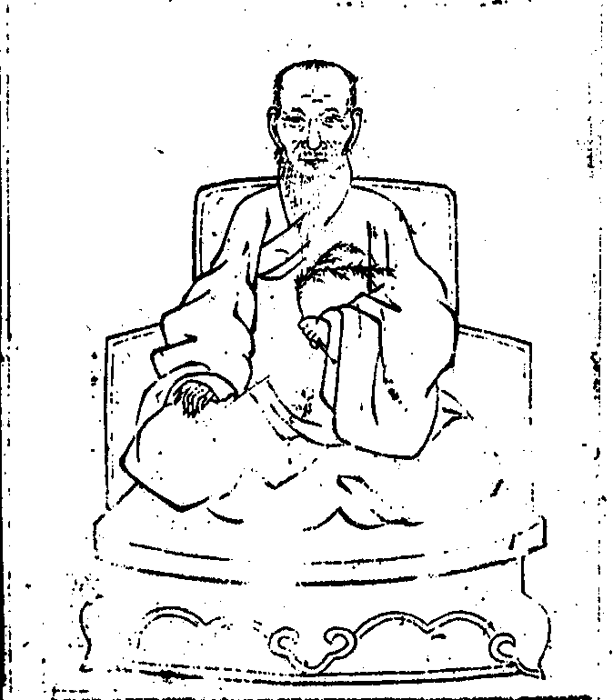

# 磬山牧亭朴夫拙禅师语录



> **藏经**：嘉兴大藏经（新文丰版）（嘉兴藏）　**册次** 第 40 册（J40）　**编号** JB493　**部类** 诸宗部　**卷次** 6 卷　**篇幅** 56,870 字

> **卷／品**：0 卷 · 1 品



---



## 目录



  - [语录序](#语录序)



---



册上小影



朴夫拙自泐。



瞎汉，少卖弄。看你瞎卖弄，一生卖弄得去麼？虽然，瞎从光过去，光未瞎过来。不信，试光弄看。



石坛我庄石床三子请







------



### 语录序



禅学尚矣，而最上一乘，永超三界，唱提手眼，点勘人天，时节因缘，较然不爽。牧亭大师开堂庆云，参徒甚盛，嗣以结集语录相示，披读之餘，慨然永叹。盖以佛法之日坏也，人心不古，而善缘益轻，譬之今人，心乐长安，而迷不识路，则其至也，必无日矣。抑问涂必於已经，而遇彼导师，寔未亲到，则其至也，益无日矣。然则佛法之坏，学人之过，而亦不尽学人之过也。大师砥柱颓波，仔肩此道，扣洪钟於龙象哀鸣之日，振迦音於鱼龙混处之时，极力为人，老婆心切。要知此事，本自圆成，非从人得，生死不相干之地，鬼神觑不破之机，凿开鸿蒙，打破漆桶，三五周天，斗杓司令，先天一著，一箭惊人，九重铁鼓，自然冰涣，当阳独露，耀古腾今，粉碎虚空，全身独现矣。予本钝根，兼撄尘网，但幼慕宗乘，夙遇奇缘。犹忆岁在辛巳，忽於海福禅寺，重遇庐梦老人。茶广商量，颇蒙印可。继承过访，师亦与焉。指示精通，直截了当。庐梦老人者，黄梅正派，即师得法本师也。老人圆寂，廿载於兹。幸又得师，开示非少。譬之饮水，冷暖在心。灌顶醍醐，宁忘所自。但痛众生，罔明大事。循环业根，紏缠因缘。难以圆满三身，安望种成四智。岂知珠本在衣，灯即是火。兹读语录，渺然长怀。窃谓裨益参徒，所益犹少。而居今之日，其有功於此道良多也。用赘简端，如临法会。佞佛之谓，所不敢辞。亦望诸山，全提共唱。师其将谓彼自无疮，而慎勿伤之也哉。



雍正十一年岁在癸丑阳月李焞敬题



磬山牧亭朴夫拙禅师语录目次



序一  

目录  

卷第一住鄱阳剑溪永镇禅寺语录



卷第二住霸陵白鹭渡西汀寺语录



卷第三丰城庆云寺说戒语录  

浮梁圆通庵说戒语录  

崇仁天竺寺说戒语录



卷第四住临川青云艸庵语录



卷第五勘辨  

机缘  

代古  

拈古  

颂古



卷第六偈赞传  

佛事  

洞虚禅师塔铭



磬山牧亭朴夫拙禅师语录目次



磬山牧亭朴夫拙禅师语录卷之一



住鄱阳剑溪永镇禅寺语录



比邱(石坛、光模、石丈、岳麓)等编



师於雍正四年冬，在乐平凤凰山受请，至腊月初三日入院。



山门。「以字不成，八字不是，出出入入，千千万万。若有一个识得，许他与我同门。」复云：「且缓，且缓。」拽杖便入。



韦驮。「季法危如累卵，还记灵山亲嘱付麼？」复云：「险。」



伽蓝。「是你是我，举院灵聪，一家担荷。宁可杀人不贬眼，不可见人面似火。」(金面关圣)



祖师。「祖祖祖，太莽卤。禅禅禅，几何般？道道道，直下扫。快与我飏向鄱阳湖里𫗪鱼。且道过在甚麼处？」遂以手捏鼻，云：「臭。」



佛殿。「者个没底厕坑子，谩道释迦老子跳不出，直饶三世诸佛、历代祖师以至天下诸大善知识，尽在里许头出头没。拙上座到来，毕竟如何？」遂大展，云：「掩。」



据室。「任是透金刚圈、吞栗棘蓬汉，来到者里，汗臭气未嗅你在。若要拙上座手中棒，吃三更鼓、戴网巾且去买了草鞋著。」



拈众檀护疏。「裈无裆，裤无口，头上青尘三五斗。个是拙上座三十年水边林下，一个安乐法门底。缘业风吹来厥土，万般存此道，一味信前缘。」



法座。「未离兜率，已降皇宫；未出母胎，度人已毕。既度人毕，拙上座据此曲盝又度个甚麼？验在目前。」遂升，拈香，云：「此一瓣香，皇图齐北极，圣寿等南山，端为祝延今上皇帝圣躬万岁，万岁，万万岁。



「陛下伏愿风不鸣条，雨不破块，民不失所，路不拾遗，君臣道合，主宾肃雍，老安幼怀，财丰物阜，永乐无为之化。



「此一瓣香，肩荷乾坤，手擎日月，奉为阖朝文武采寮属、现前护法功德林，墙堑宗风，金汤法社，不忘当年付嘱，共增此日禄康。



「此一瓣香，头头上明，物物上了。奉为诸山老宿，为日月之眼目，作乾坤之须眉。补处名蓝，化缘寰宇。



「此一瓣香，慈如冬日，和若春风，灵同夏云，鉴并秋月，光天灼地去也。



「此一瓣香，不假天降，亦非地生，若铁蒺藜出红炉，星光爆灿，孰敢正眼觑著？今当人天众前尽情揭露了也。供养庆云堂上古云沛老和尚，以酬法乳之恩。」敛衣就座。昆池大师白椎云：「法筵龙象众，当观第一义。」师云：「迨举磬椎，已落第二义了也。毕竟如何是第一义？庐岳峰鼻孔撩天，鄱阳湖舌头拖地，众中如有摸得到者，请出相见。」僧问：「天开地辟，海晏河清，人人尽乐尧天，个个咸沾舜日，临济宾主、洞山君臣俱不问，师登宝座，端为祝延。」师云：「一个苍生是一年。」进云：「果然句盖乾坤，功弘宇宙。」师云：「莫涂乌我好。」进云：「涂乌一上。」师打云：「且道是赏你？是罚你？」进云：「抛砖得玉，吐气扬眉。」师以手拨开眉毛云：「猫。」进云：「法王座上无偏党，拾得寒山笑不休。」师云：「笑个甚麼？」僧亦拨开眉毛云：「猫。」师云：「可怜猎犬无灵性，秪向枯桩旧处寻。」问：「金炉香袅，宝座花敷，凡圣交参，人天瞻仰，且道有何祥瑞？」师云：「碓觜开花。」进云：「如何是未出方丈底佛法？」师云：「焦砖打著连底冻。」进云：「如何是已出方丈底佛法？」师云：「急水滩头蹴绣毬。」进云：「永镇家风又若何？」师打云：「今日拄杖开张发市。」进云：「不受一番寒彻骨，怎得梅花扑鼻香？」师云：「不信道。」问：「向上宗乘即不问，进门一句事若何？」师云：「千二百五十人俱，粥足、饭足，牛进千头、马进百匹，水足、草足，事事如意，免得诸人叫屈。」进云：「秪如三圣道：『逢人即出，出即不为人。』是如何？」「卤莽如僧。」进云：「兴化道：『逢人即不出，出即便为人。』又作麼生？」「依稀似佛。」进云：「谢师指示。」师云：「此去城中仅十里。」僧礼拜，师云：「莫道无事好。」僧出，师以杖约住，云：「入院事繁，向晚再问。诸人秪知问佛、问法，得知佛法来处，『佛身充满於法界』，塞破虚空，『普现一切群生前』，蝇子撒卵，『随缘赴感靡不周』，草鞋踏断四条觔，『如恒处此菩提座』，也是三家村里土地相似。山僧既据此座，祖令当行。」蓦喝一喝，云：「大众！狮子吼？野干鸣？」顾左右，云：「野干鸣即狮子吼，狮子吼即野干鸣。不见道：『天地与我同根，万物与我一体。』春生秋杀，阴闭阳开，鱼跃鸢飞，水动山静，月明钟沉五夜，梅开雪霁九重。到斯时，正好伸脚打眠，悠悠度岁。无端被汝诸人推向十字街头打开布袋，秪得将者些葛藤尽情抖擞出来，撒向诸人面前，耳里、眼里无不释迦老子。还见麼？若未见，山僧重为唤出。」遂以手拨开眉毛，云：「猫。」复喝一喝，云：「若不喝退，险些撞著南泉。」复举：「简堂禅师云：『圆通不开生药舖，单单只卖死猫头。不知那个无思算，吃著通身冷汗流。』简老才展舖席，便要悬羊卖狗，难免诸方捡责。山僧则不然，永镇既开生药舖，何须要卖死猫头？四方主顾来寻我，痛处一针白汗流。还契诸人也无？」良久，云：「鸳鸯绣出从君看，不把金针暗度人。」结椎，下座。



当晚小参。举：「僧问乾峰云：『十方薄伽梵，一路涅槃门，未审路头在甚麼处？』乾以拄杖子划一划，云：『在者里。』」师云：「错！僧以前话复问云门，门曰：『扇子𨁝跳上三十三天，筑著帝释鼻孔；东海鲤鱼打一棒，雨似盆倾。』错！设有个汉出来道：『拙上座与麼批判，还契二大老也无？』向他道：『错！』何故？更有一错，未敢向汝诸人道破。且道是那一错？拙上座未出海福门是错，致令数年已来东冲西撞、皮穿骨露，立无卓锥之地，错。及乎今日到了永镇，见此篱穿壁倒、有盐无醋，不惟厨空、库空、仓空、箱空、坛空、瓮空、缾空、罐空、盆空、甑空，连锥也无，错。未晚，忽见诸人各各默然，或坐、或立，将觜卢都挂得提壶。山僧不觉通身汗流，秪得背手仰空向外打个低都，唱曲鹧鸪一场：糢糊糢糊不糢糊，总是低打都打低，都唱鹧鸪挂提壶，嘴𠰷都呼𠰷乎𠰷，摩啰呼𠰷娑婆诃。」



师在凤凰山受请，小参。「髼头垢面许多年，鼻涕吊来到觜边。一自众中呈丑拙，从兹不值半文钱。因此遁迹三江海福，一任春来鸟语、秋去花残，草也未敢动著一茎。几回引颈一尺，连忙缩头十寸。虽是蚖蛇恋窟，幸无玷辱先师。谁知业报到来，无端打个喷嚏，触犯罗计孛星，上孛下、东孛西，孛来孛去，孛至凤凰山。盖缘修行无力，又被伽蓝觑破，遂令鄱阳永镇众檀护并合山老宿向枯木糁花。所以道：『欲识佛性义，当观时节因缘。时节若至，其理自彰。』众中莫有端的此理者麼？」良久，云：「不因柳毅传书信，何缘得到洞庭湖？」



请两序，上堂。「天高群象正，落霞孤鹜齐飞；海阔百川潮，秋水长天一色。所以道：同明相照，同类相求。云从龙，风从虎，圣人作而万物睹。毕竟睹个甚麼？」蓦喝一喝，云：「兵随印转，将逐符行。」



开钟板。「频呼小玉元无事，秪要檀郎认得声。」遂击一声，云：「大众！还认得者一声麼？」侧耳作听势，云：「象龙蹴踏难分处，一片皇风四海闻。」



开云板。师问：「典座在麼？」曰：「在。」「者是佛祖慧命，大众性命在尔一人手里。尔若二时粥饭稍不精洁，我就兜脑一椎。」遂击一下，以椎掷地，云：「侍者与彼拾起锅铲柄。」复云：「好个铜头铁额汉。」



佛成道，小参。参头石桥问：「未离兜率，已降皇宫；未出母胎，度人已毕。此理如何？」师云：「莫妄想。」进云：「既度人毕，因甚睹明星始大悟？」师云：「更莫妄想。」进云：「未审悟个甚麼？」师云：「鼻孔没半边。」进云：「将谓别有。」师云：「不快漆桶。」进云：「恁麼为人去也。」师嘘一声，云：「只道你是个禅客。」进云：「过去诸佛亦如是，现在诸佛亦如是，未来诸佛亦如是。」师云：「速礼三拜。」进云：「莫是和尚亲切处麼？」师云：「一掌一握血，一棒一条痕。」进云：「何须重下注脚？」师云：「聋。」进云：「是现大人相那？」师拈杖，云：「者尿床鬼子那里学得许多虚头？」头礼拜。师云：「了。」乃云：「阿呵呵！笑甚麼？我笑释迦老子於正觉山前寝绳床、食麻麦，饿得骨瘦岩巉、眼花燎乱，说甚麼睹明星大悟？岂不是夜半见鬼？犹道：『奇哉！怪哉！一切众生具有如来智慧德相，但以妄想执著不能证得。』又是口里狐涎，脚跟下好与二十拄杖。怪道云门大师要一棒打杀狗子吃，贵图天下太平。脚跟下亦该二十，免得后代儿孙一人传十、十人传百、百人传虚，教坏人家男女。永镇与麼批判，亦该亲领二十。何故？见怪不怪，其怪自坏。虽然，我更要问你：释迦老子是甚麼？」复云：「猫儿狗子也不识。」



立祖牌。「设供你者一队牙如剑树、口似血盆底野狐种族，到一处聚首蝉联，嘴嘴哝哝，商量个甚麼？莫是东家杓柄长短、西家锅子大小麼？实拙不肖，忝为野狐苗裔，然却党理不党亲，折箸搅黄河，做就一盆木札太羹，用玄沙片纸一一将唇吻封你一个密不通风。何也？啼得血流无用处，不如缄口过残年。」



设本山前代耆旧供。「饮泉水，贵地脉，牌上无名过一边。」遂拈香，云：「点。」



除夕晚参。「醉汉正酣度岁杯，穷神打叠送穷才。谩言永镇年无米，牛粪火儿没得煨。十八高贤散打坐，咬牙怒目口慵开。劝诸人，休戚哀，东村王老烧钱纸，野鬼闲神都请来。」



元旦，上堂。「尧风荡荡，舜日雍雍。凤历颁宸，九重阊阖开黄道；龙文绚斗，万国衣冠拜冕旒。黎元乐无虞，河清海晏；岳牧宣有道，鼓腹讴歌。家家灯烛𪸩煌，处处笙歌嘹喨。阳春赓白雪，彩凤舞丹霄。辛盘椒酒贺新年，兰英桂种；淑气惠风迎化日，云霁雪消。墙角几点梅花，漏泄天机之数；空中一声爆竹，唤醒雷霆之威。」蓦喝一喝，云：「而今四海宾贡，何用砲火喧天？」



元宵，小参。僧问：「春灯莫厌月糢糊，春月应怜灯影孤，风雨若教今夜占，烛龙治水失明珠。请师示珠。」师打，云：「拨著动著，放光动地。」进云：「龙得水时添意气。」师云：「试飞腾看。」僧提起坐具疾行，师云：「白云万里。」问：「此夜金吾不禁，是处火树银花，未审永镇有何施设？」师以拄杖作天矫盘龙势，云：「大众看看。」进云：「者老汉伎俩已尽。」师云：「知恩者少。」僧拂袖归位，师云：「负义者多。」乃云：「过年不觉月过半，堪叹光阴忙似钻，永镇初住米柴无，又值当家没打算，直欲祖师将身卖(风俗：家户僧送祖师图乞米，永镇随例)，连朝逼得无处窜，雨雪纷纷泥滑滑，拟作填沟塞壑汉，今朝又是上元宵，火树银花没得看。」蓦卓拄杖，云：「长老！长老！你且莫只，我有个区处奉慰，权且应个时节。拄杖子！你有甚麼区处？当速领教。」复卓一卓，云：「我记昔年随侍郢南定省，路经鄂渚黄鹤楼访吕祖，承彼教一道铁笛，名曰闹元宵。今夜何不大演一道？一以恭迎春王(是日立春)，一以大众普乐。」良久，云：「冤家！冤家！年来少温，忘却了也。拄杖子！你若纪得，烦吹一道，代壮体脸。」又卓一卓，云：「谛听！」遂横拄杖作吹笛势，乃高声歌曰：「五六五，尺仕仁，五六工，六五五五。」复云：「秖合吹到者里。拄杖子！今者上元佳节，柴无米无，举院眼怒，鼓得与麼快活，正谓黄蘗树下弹琴，苦中作乐。」蓦拈拄杖连卓，云：「有意气时添意气，得风流处且风流。」抚掌呵呵大笑，下座。



晚参。举：「庆云先老和尚示众云：『草色青青柳色黄，桃花历乱李花香。东风不会吹愁去，春日偏能惹恨长。』者些说话，正法眼藏、涅槃妙心、临济料拣、云门三句、曹洞五位、沩仰义海、法眼心识，尽情揭露了也，秪是贾至居士不知落处，千生万劫承当个诗翁。众中还有知得落处者麼？若有，不妨将山僧拽下禅床烂捶一顿，自然明窗下安排；脱或未然，与你指个直截根源：春雨如膏，春云似鹤，春鸟关关，春泉濯濯。」师云：「老人只知开口笑，不觉舌头长，殊不知齿不关风，开口便落一东二冬。此处无银二两，俗人沽酒三筒，岂不又添一翁？拙上座则不然，草色青青柳色黄，桃花历乱李花香，东风不会吹愁去，春日偏能惹恨长。与麼举略较些子。诸仁者还委悉麼？试敲推看，其或未然，再与你注个唐诗直解：春雨如膏，春云似鹤，春鸟关关，春泉濯濯。且道是祖师心印？是仲尼鼻孔？」众无语。遂抚案云：「黄金难铸鍾子期。」



升座。「见桃花无疑，自瞒不少；击竹不堕，悄然痴狂。外走出门，筑破脚指，钝置煞人；平地上吃交，笑杀旁观。隔江招手，横趋而去，也是凭空著魅。者一队汉大似抱薪救火、吃盐止渴，岂啻梦中说梦？实情好与二十拄杖。猛虎不食伏肉，胡蜂岂恋旧窠？所以道：世尊三昧，迦叶不知；迦叶三昧，阿难不知；阿难三昧，和修不知；和修三昧，优波鞠多不知；优波鞠多三昧，祖祖不知。既是祖祖不知，因甚临济大师又道：『谁知吾正法眼藏向者瞎驴边灭却？』致令后代儿孙个个醉饮鸩毒、气鼓丛林。拙上座不敏，二十年前无端被个没意志的老汉亦饮一剂，胀得目空宇宙、气塞乾坤，行住坐卧、动转施为不得自由，如参竹篦公案，触不得、背不得、左不得、右不得，幸遇朗山《人天眼目》，善识人家痛痒，信手一爬，恰恰爬著山僧不上不下的去处。正所谓：逢著家里人，当说家里话。且道：家里话作麼生说？」遂以拄杖作钓势，云：「秋潭彻底鲸深浸，百尺丝纶钓得归。无底篮儿暂盛著，养成头角纵横飞。」收杖，下座。



佛涅槃，上堂。师振威一喝，云：「一声砲响，死伤积野。众中还有不顾危亡、奔流度刃者麼？」一僧出，便喝。师唤值岁，云：「曳出者死尸去。」进云：「哀哉，哀哉。」师云：「棺材里瞠眼睛。」进云：「伏惟尚飨。」师以拂子作振铃势，云：「吽，吽。」问：「芳草碧嘶韩干马，绿杨影系戴嵩牛。如何是境中人？」师云：「我行芳草里，汝又入深村。」进云：「如何是夺人不夺境？」「惟见碧流水，曾无黄石公。」「如何是夺境不夺人？」「子房未虎啸，破产不成家。」「如何是人境俱夺？」「叹息斯人去，萧条徐泗空。」「如何是人境俱不夺？」「我来圯桥上，怀古钦英风。」进云：「人境已蒙师指示，瞿昙此日何处行？」师云：「山家养狗忽生子，长大柴门吠落花(时寺产狗子)。」进云：「因甚到恁麼地？」师云：「却被阇黎带累。」进云：「是某甲罪过。」师云：「险。」问：「世尊因七贤女游尸陀林，一女指尸，云：『尸在者里，人向甚处去？』请师指示。」师云：「仰蜂粘落絮，行蚁上枯梨。」「一女云：『作麼，作麼？诸姊谛观，各各契悟。』感帝释散花，云：『惟愿圣姊有何所须，当终身供给。』女云：『我家四事、七珍悉皆具足，惟要三般物：一、要无根树子一株。』如何是无根树子？」师云：「叶覆大千沙界，身廓充塞十虚。」进云：「『二、要无阴阳地一片。』如何是无阴阳地？」师云：「看脚下。」复云：「滑。」进云：「『三、要叫不响山谷一所。』如何是叫不响山谷？」师云：「哑却你口，塞却你耳。」进云：「『一切所须我悉有之，此三般物我实无有。』女云：『汝若无此，争解济人？』帝释罔措。又作麼生？」师唤首座，云：「你看者僧驱我入地狱。」僧抖袖归位，云：「恁麼则散花去也。」师云：「又是一杓恶水蓦头浇。」乃云：「正觉山前鬼见身，金棺复把双趺申，祸根谁识从兹起？冤气髑髅遍界新。於戏！相逢不饮空归去，洞口桃花也笑人。」复举：「东山蕉祖升座，云：『若谓释迦老子决定入灭，急请诸人捶杀自己；若谓释迦老子决定不灭，急请诸人捶杀山僧；若谓灭而不灭、不灭而灭，山僧与诸人一齐人涅槃堂有分。然则毕竟如何即得？』便下座。」师云：「堪笑蕉祖者些说话，太似三家村里骂鸡婆，秪要口里说得出，不顾浑身当落何趣，几乎带累大众一齐入拔舌地狱，岂啻三尺童子捉蒙？然释迦老子去处犹未梦见在。敢问诸人：释迦老子今日毕竟归何处去？」遂靠拄杖，下座。



久雨，示众。「万法是心光，诸缘惟性晓。本无迷悟人，秪要今日了。」击拂子，云：「大众还了也未？」复挥一下，云：「若道了，因甚古人又道簷声不断前旬雨，电影还连后夜雷？」蓦喝一喝，乃高声唤侍者，云：「快持瓦钵，床头支漏，雷风电雨又来了。」拈起拄杖连喝，遂旋风打散。行者出，师以杖指势，云：「尿床鬼子，者里犹是一点长漏。」



早参。「春眠不觉晓，处处闻啼鸟，夜来风雨声，花落知多少？」遂以手捏鼻孔作鸠啼势，云：「鹁鸠呱呱，鹁鸠呱呱。」复三唤侍者，不应，乃连掌之，云：「者尿床鬼子，天明多时犹在者里瞌睡。」便下座。



出队归，晚参。「千人排门不如一人拔关，若一人拔关，千人、万人得到无为安乐之地。诸仁者！永镇虽然清苦，且喜人人脚跟踏在无为安乐地上。堪笑山僧一月以来总在外边之绕，如珠走盘，周旋无停。敢问诸人向甚处著眼？所以道：『有一人常在途中、不离家舍，有一人常在家舍、不离途中。』向者里辨得那一人常在家舍、不离途中，那一人常在途中、不离家舍，绝无丝毫拟议，许他脚跟果踏无为安乐之地。其或未然，只恐诸人在家忙不彻，山僧处处常安乐。」



清明日，小参。「野花红，湖水绿，柳莺啼，花风郁。羹正香，饭又熟，行人平地跶一交，荒原何处号天哭？咄！新冢垒垒近屋边，家家祭扫各纷然，独怜戍妇江边苦，遥望沙场烈纸钱。」遂以拂子作振铃势，云：「吽！吽！」



浴佛，上堂。师拈拄杖，云：「一举四十九，大家出只手，扶起破沙盆，灌浴成垢咎，撞著跛云门，活活打杀无处走。」复卓一卓，云：「瞿昙休走，我与你卜一兆看：一、二、三、四、五，金、木、水、火、土，前朱雀、后玄武，左青龙、右白虎，元来木星触犯当年太岁，遣修罗闹入紫微宫。」蓦喝一喝，云：「好，好，紫微照破汤之盘。铭曰：『苟日新，日日新，又日新，否极泰来。』康诰曰：『作新民，而且鹿苑迪吉。』诗曰：『周虽旧邦，其命维新，元亨利贞。』大众！是大神咒？是大明咒？是无上咒？是无等等咒？」复喝一喝。



结夏，小参。「阿呵呵，笑甚麼？八十翁翁入场屋，真诚不是小儿戏。鹄头白，乌头黑，也是推车就了壁。然则，国清才子贵，家富小儿娇。道得也，叉下死；道不得也，叉下死。螭吻咬杀屋梁脊，灯笼倩露柱解交。磨盘不甘，唆起山门，倒骑佛殿，入厕房里，昼夜遶百千匝。风吹石曰：『窃见捏鼻一笑，苕帚责打筹予三十。流水下滩非有意，白云出岫本无心。』江西马𥳽箕，三十年不少盐酱，还是对众语？是落草谈？张公吃酒李公醉，西街廖胡子东倒西歪，东村王大姐口里酒气逼人。所以，释迦老子道：『若有一人发真归源，十方虚空悉皆消殒。』邓师翁道：『若有一人发真归源，十方虚空筑著磕著。』圆悟和尚道：『若有一人发真归源，十方虚空锦上铺花。』楚石禅师道：『若有一人发真归源，十方虚空针劄不入。』永镇道：『若有一人发真归源，十方虚空普入地狱。』诸仁者！前是镬汤炉炭，后是碓捣磨磨，左是铁床沸屎，右是拔舌犁耕。试问：作麼生得出？」良久，云：「小心挨过七月半，放你出来打乱窜。」



端午，小参。「日到中天，诸魅群邪远殄；人临五日，赤口白舌消除。蚰蜒蚊蚋潜踪，蜈蚣虺蛇遁迹，五色彩丝续长命，胡用药采天台？万人藂里夺孤标，自是湖归范蠡。处处龙舟竞渡，鼍鼓逢逢；家家角黍招魂，艾旗闪闪。不须怀沙作赋，且就沧浪濯缨。然虽如是，曲奏天中则且置，万人藂里夺孤标一句作麼生道？」振威喝一喝，下座。



解夏，示众。「秋风凉，秋夜长，羁旅客，思故乡。敢问大众：到家里人必藉阿谁之力？」唤侍者，曰：「掇退香案，待我好申脚动手。」遂申起手，云：「我手何似佛手？」复垂下脚，云：「我脚何似驴脚？会得此脚，牛脚、马脚、有脚、无脚，无不是者一脚；会得此手，大悲千手、百手，无不是者一手；东街胡张三醉得东倒西歪、黑李四白扇过头，亦无不是者一手、者一脚；以至十二时中穿衣、吃饭、屙屎、放尿、烧香、扫地、合掌、摇头、迎宾、送客，无不是者一手、者一脚；超佛越祖、屠牛宰羊，无不是者一手、者一脚。云门大师道：『扇子𨁝跳上三十三天，触著帝释鼻孔；东海鲤鱼打一棒，雨似盆倾。』又不是者一手、者一脚；赵州道：『我在青州作领布衫重七斤。』又不是者一手、者一脚；麻三斤、乾矢橛、锯𨱕、秤锤、板齿、生毛狗子无佛性、怀州牛吃禾、益州马腹胀、天下觅医人灸猪左膊上，又不是者一手、者一脚。所以道：『无手人行拳，无舌人解语，无手人打无舌人，无舌人连忙道个不必。』如何是不必底事？诸仁者！整日嘴嘴哝哝，只解口说，直要手脚能说，方是真说。莫秪在长连床上不是脚痛，便是腿酸，或是一个筋斗打至三十三天、或是一个大鼾撼动一十八重地狱，带累山僧波波咤咤、罗罗结帝，生陷无间。今晚劝诸人且漫去思想，收拾行李，紧捎草鞋，明日绊那个作伴好游山玩水、那个藂林明窗净几好过冬，试将主人公三字权帖鼻尖头上看看，看得好，自此一二三、三而再，看来看去，终久有日，看至前如银山万仞、后如铁壁千叠，要进进不得、要退退不得，到者里然后向万仞头挨得一线入、千叠中拶得一缝开，如此白汗出得几身，再将主人公与释迦(老子)鼻孔比一比，那个长、那个短，可是一洞通风不？」复又申出手脚：「看看我手可似佛手、我脚可似驴脚，那时那里痛，唤释迦老子与我揩一揩；那里酸，唤释迦老子与我搥一搥；那里痒，唤释迦老子与我爬一爬。动转施为任你自己，不然徒在东个藂林搅到西个丛林、西个丛林搅到东个丛林，听得行者鼓向三通，长老上坐、诸人旁立，眼盵瞪地看著上头两片皮动，或将古人公案囫囵念上一个，或将陈烂葛藤东扯西拽扒上一顿，或拈拄杖卓一卓、喝一喝，或扬一眉、瞬一目、竖一拳、动一指，便道：『长老为我说。』秪问你东村王大姐满面水粉、一觜胭脂，终日深藏闺阁，见人低头缩颈，是为你说、不为你说？不见古人道：『牛动尾巴便将作等闲。』殊不知，簷声不断前旬雨，电影还连后夜雷。又道：『你是那里人？』曰：『新罗人。』曰：『未跨船舷早已三十棒。』能向未跨船舷早已三十棒处爬得些子痛痒，方才许你展开驴脚、申出佛手，好吃山僧手中痛棒。其或未然，漫道我瞒你，你更瞒我太杀也。若到诸方，分明举似。」



中秋，上堂。僧问：「天上月正圆，人间月方半。既是天上月正圆，因甚人间月方半？」师遂展两手，云：「此夜甚分明。」便下座。



九日，小参。「独在异乡为异客，每逢佳节倍思亲，遥知兄弟登高处，遍插茱萸少一人。大众！且道：者一人是阿谁？羞将短发还吹帽，笑倩旁人为整冠。」



大悲诞日，师过回龙庵，丹崖方水、玉渊半偈祝发，请升座。「丹霞烧木佛，冷灰豆爆，拨取一堆灰，舌头拖地，院主须眉堕落，筑著磕著。山僧适过回龙，喜值大悲降诞，翠竹黄花各呈欣容，不须木佛烧火，亦不见有一人须眉堕落，秪见伊一队初地菩萨苦被须发缠绕，请法去缚。吾今不教伊成佛作祖去，亦不教伊向驴胎马腹去，亦不教伊情识漏尽、苦乐双忘去，亦不教伊智过鹙子、察尽秋毫去。但各将一把断命刀子，教伊向无始劫前把命根一刀两断，更向波波咤咤罗罗城中重重打过，然后见佛杀佛、见祖杀祖、见魔杀魔，杀尽始安居。若有纤毫，便是翳生。所以道：『你若无心我便休。』毕竟以何为验？观世音菩萨将钱买胡饼，放下手却是馒头。」击拂子，下座。



示众。「数月以来，雪峰道的，未及与诸人说佛法。今晚稍暇，试问我提尔挈、我递尔接、我坐尔歇，阿家尝醋三尺喙，新妇洗面摸著鼻。因甚山是山、水是水，僧是僧、俗是俗？咄！三尺浪高鱼化龙，痴人犹戽夜塘水。」



开炉。「年年十月十五，诸方结制开炉，永镇不入保社，依旧东壁胡芦。整日东捞西摝，厨库升斗未储，八字尚无一丿，人人徒手愤呼。此事不是儿戏。军行一马一夫，如同背水，缩军临阵，上天无途。虽然，殊不知尽大▆是个大冶红炉，只要诸人自己刻刻照顾眉毛，不消山僧那。」遂咳嗽一声，云：「谩谓释迦老子、三世诸佛、历代祖师、天下诸大善知识、天地日月星辰、山河大地、草木藂林、森罗万象、情与无情，将根断贯索子缚作一束，抛向大洋海里，顿时火发，烧至三十三天，化作一堆灰。试问诸人：唤什麼作自己？唤什麼作释迦老子？唤什麼作三世诸佛、历代祖师、天下诸大善知识？唤什麼作天地名象？说什麼西天四七、唐土二三？到者里，直饶诸方分得门、辨得户，无论甘与不甘，悉要吃山僧手中痛棒。何故？剑为不平离宝匣，药因救病出金瓶。」复举：「法昌以一力挝鼓升座，曰：『法昌今日开炉，行脚僧无一个，惟有十八高人缄口围炉打坐。不是规矩严，难免见诸人话堕，直饶口似秤锤，未免灯笼勘破，不知道绝功勋，安用修因证果？』喝一喝，云：『但能一念回心，即脱二乘羁锁。』」师云：「大小法昌通身泥水，要脱二乘羁锁，自己作贼，禁人犯夜。永镇者里惜无者辈古锥，有则无论凡圣，推向大冶红炉锻鍊一过。何故？要识真金火里看。」遂连声击竹篦，云：「鄱阳湖里火发，各人照顾眉毛。」



此峰和尚至，小参。师唤监寺云：「向辱此峰和尚见过，永镇他出失待，今者毕竟如何？家贫难办素食，事忙不及草书，向下文长，付在来日。」



请此峰首座，小参。「天得一以清，劈开华岳连天碧；地得一以宁，放出黄河彻底清；圣人得一以治天下也。是君子务本，所以，西伯而兴渭水，蜀帝以起南阳。永镇得一则且置，扶起刹竿一句作麼生道？」良久，云：「大家归堂，问取东单第一座。」



起七，小参。「骂人莫点心，打人莫打脸，要做过量人，事事要打点。成佛作祖要打点，参禅学道要打点，烧香扫地要打点，合掌摇头要打点，沽盐买醋要打点，运水搬柴要打点，穿衣吃饭要打点，屙屎放尿要打点，迎宾送客要打点，人前召沸要打点。莫待三十夜到来，见著黑面阎老子，只恐诸人打点不彻，有召难沸。拙上座有生以来，时时事事无不打点，即论日前起期告香之夜，被尔诸人自朝直忙到晚，秪一刻不曾打点，三阵击子迎至堂中，信口胡说乱道，自家不知道在那里去了。末后举个法昌开炉的公案，举至但能一念回心，即脱二乘羁锁，截然忘却了也。由是默坐良久，待得心回，箭去久已，只得召起大众曰：『鄱阳湖里火发，各人照顾眉毛。』大家懡㦬一场，今夜起七无端说到者里，又是漏逗不打点。试问诸人！那底是脱得羁锁处？」遂高声云：「大众！你看永镇眉毛还在麼？」



解七，小参。「大众！闭门家坐，祸从天来。昨夜山僧梦见伽蓝告报：『鄱阳仅三百年来，不闻甚麼佛，亦不知甚麼法。汝乃何方知识？带此一班婆罗门来我永镇，终日说黄道黑，昼夜遶百千匝，踏翻鄱湖，振得地摇陆动，须弥倒卓，撼落帝释花冠。帝释罔措，乃遣烧香童子具将上事命下。铁围阎老子闻得，诚惶诚恐，稽首顿首，手圭膝步，仰对天庭，曰：「请息天怒，此事不难，臣等立差五方恶卒往永镇伽蓝追索上赍。」』昨夜永镇伽蓝追得无处回避，只得告禀山僧，山僧再三劝勉不得，伽蓝即刻领五方恶卒来与诸人索取花冠。众中何人拾得？预与山僧通个消息。不然，待彼到来，吾亦无奈。各人自扫门前雪，不管他人瓦上霜。」



沙弥戒本空大德请上堂。僧问：「拟申一问，师还答否？」师云：「用得龙王几点风。」进云：「佛祖玄机即不问，浮山九带事如何？」师云：「记得话头麼？如何是佛法眼藏带？竹头木楔。佛法藏带？残羹馊饭。理贯带？循途守辙。事贯带？撒土扬沙。理事纵横带？魔宫虎穴。屈曲垂带？披毛戴角。玅协兼带？金声玉振。金针[靄-曷+隻]锁带？寒山拾得。平怀常实带？穿衣吃饭。」进云：「九带已蒙师指示，三玄三要再披宣。」师云：「又是一题。头第一玄天，第二玄地，第三玄人。第一要，生，事之以礼；第二要，死，葬之以礼；第三要，时，祭之以礼。」进云：「万古碧潭空界月，再三捞摝始应知。」师云：「赤土涂牛奶。」问：「涅槃心易晓，差别智难明。如何是差别智？」师云：「杖失双瞳瞽。」进云：「那伽常在定，无有不定时。秪如女子在定，文殊出他作麼？」师云：「死水不藏龙。」进云：「文殊既为七佛之师，因甚出女子定不得？」师云：「满罐不动。」进云：「罔明下方菩萨，因甚却又出得？」师云：「半罐丁东。」进云：「恁麼则一声石磬，唤聋天下人耳朵去在。」师云：「多年历日。」问：「因戒生定，因定发慧。请问，还有不从戒而得定慧者麼？」师竖拂子，云：「会麼？」进云：「某甲不会，和尚道。」师云：「你拟追上我壁。」进云：「是何心行？」师云：「山僧罪过。」进云：「谢师指示。」师云：「少选随例餐𫗰子，也得三文买草鞋。」问：「舟航鄱水新无迹，霹雳丰城旧有声，维摩丈室容三万二千狮子座，因甚永镇戒坛仅容十数辈？」师云：「寸长尺短。」进云：「如何是沙弥戒？」「杀。」「如何是比邱戒？」「盗。」「如何是菩萨戒？」「淫。」进云：「三戒蒙师指，宗乘事若何？」师云：「我更问你，如何是妄？」进云：「恩大难酬。」师云：「就来妄。」乃云：「今朝腊月一，杀盗淫妄毕，山僧无法说，般若波罗蜜。」遂顾左右，云：「者里浮山九带得麼？临济三玄要得麼？诸子戒定慧得麼？所以世尊道：『止止不须说，我法玅难思，诸憎上慢者，闻必不敬信。』是说未说？『摩尼珠人不识，如来藏里亲收得。』不问你，罔明出得女子定，文殊出不得，即今珠在甚处？」良久，云：「万古碧潭空界月，再三捞摝始应知。」复举：「清净行者不上天堂。」师云：「和身屎里滚」；「破戒比邱不入地狱。和身屎里滚。龙池珍祖云：『清净行者却入地狱，和身屎里滚；破戒比邱却上天堂，和身屎里滚。』大小珍祖好人不肯做，直要屎里卧，带累永镇今日亦在厕坑里头出头没。」乃召本空大德，云：「闻得些子臭气麼？」复云：「穿过你髑髅。」



因雪，早参。「呀！大众！普天匝地昨夜被雪山白牛一口吞尽了也，敢问汝等即今向什麼处安身立命？」众无语，乃以竹篦作李三娘涓水势，且歌且叹曰：「天既要发风，就不要下雪；既要下雪，就不要发风。有朝太阳一出，雪，雪，那时你在那里？」复召大众云：「你看狂风飘雪又来了。」遂旋风打散。



因伐树，晚参。「古云：『有句无句，如藤倚树；树倒藤枯，句归何所？』汝等向者里如何下一语惬得老僧意？」众下语皆不契，师云：「自道去也。永镇伐木，锯舞三台，触犯月光童子。」遂舒十指，云：「掩却太阳，向大洋海里攃一把塳尘，黑风从中猛起，鄱湖白浪滔天，拍倒芝城荐福寺。张睢阳见陶侃母古冢，偃卧不安；风雨山拈起磨刀石，向杨子江里一掷，折断五老峰铁梁脊。顷刻，庐山三百六十庵主悉来与诸人从事。试问诸人：向甚处回避得过？」



托钵归，粥后示众。「诸兄弟！昨日托钵心苦，永镇无甚犒劳，现前公案举似。僧问赵州：『学人乍入藂林，乞师指示。』州云：『吃粥了也未？』僧云：『吃粥了也。』州云：『洗钵盂去。』其僧大悟。」师云：「此话如金矢法，悟者如金，不悟如矢。所以径山云：『如今诸方有种瞎汉，往往向洗钵盂去会了。』敢问大众，不向洗钵盂会，向甚处会？」乃唤监寺云：「昨日托钵归，得米多少？」寺云：「二石八斗。」师叱云：「永镇好监寺，数也不会算，八斗二石也不识。且听一颂：吃粥了也洗钵盂，此僧粗糙失威仪，叮咛诸人牢拈柄，打破明朝将甚持？」复云：「咦！更参三十年。」



腊八日，早参。「刹尘心念可数知，大海中水可饮尽，虚空可量风可系，无能尽说佛功德。」乃顾左右，云：「还委悉麼？」复云：「雍正五年，岁在丁未，十二月佛成道日，是冬雪少，风景晴畅，恭惟诸人戒期起居多福。珍重。」



菩萨戒清泰大德请上堂。师拈拄杖云：「山僧今日佛来也打，魔来也打，神来也打，鬼来也打，来也打，不来也打。参！」头才出，师收杖云：「可惜打你不著。」头便喝，师云：「临济四喝是那一喝？」头又喝，师亦喝。进云：「如何是金刚王宝剑？」「尸横万里。」「如何是踞地狮子？」「狐兔潜踪。」「如何是探竿影草？」「识得你。」「如何是一喝不作一喝用？」师连声喝退。进云：「者老汉生怕烂却。」师云：「养子不及父，家门一世衰。」烧香问：「古人道：『一不杀生，因甚南泉斩猫？』」师云：「莫惊恐。」「二不偷盗，因甚临济白拈？」「先师曾踏脚跟去。」「三不婬欲，因甚阿难入摩登女室？」「好个入路。」「四不妄语，因甚世尊虚设化城。」「不得你成佛？」香便喝，师云：「几乎打破我香炉。」问：「世尊道：『未出母胎，度人已毕。』因甚世尊复睹明星始悟？」师云：「待打破髑髅再向你道。」进云：「毕竟悟个甚麼？」师云：「髑髅水出。」进云：「者是旧句，如何是新句？」师云：「今日冷似昨日。」进云：「如何是夺人不夺境？」「雪。」「夺境不夺人？」「寒。」「人境俱夺？」「卧。」「人境俱不夺？」「赏。」进云：「好个作家宗师。」师云：「有甚共话处？」问：「清泰大德请法舍那如来放光，还是两彩一赛？还是别有淆讹？」师云：「天左转，地右旋。」进云：「因甚永镇门外水，自古向西流？」师云：「不妨奇特。」进云：「莫是和尚家风麼？」师云：「莫谤他好。」进云：「看者阿师纳败。」师自掌嘴，乃云：「清泰大德请法舍那如来放光，还是两彩一赛？还是别有淆讹？天左转，地右旋，所以世尊未离兜率已降皇宫，未出母胎度人已毕。因甚临济又道有时夺人不夺境，有时夺境不夺人，有时人境俱夺，有时人境俱不夺？临济大师五戒也不持，何得逢人便喝？千喝万喝也是胡喝乱喝。永镇门下一喝用不著，佛来也打，魔来也打，神来也打，鬼来也打，来也打，不来也打，打打！直要打破你底髑髅，髑髅水出不向你道。何故？永镇门前水，自古向西流。饶你有白拈斩猫设化城，入得摩登伽女室，一齐按下云头，有个汉出来道：『看者老汉生怕烂。』却养子不及父，家门一世衰，又来纳败。」师自掌觜，复喝一喝，云：「几乎打破我香炉。」



上堂。师举：「保宁禅师上堂云：『山僧今日入拔舌地狱去也。』遂以手拽舌云：『阿㖿！阿㖿！』」师云：「大小保宁惯用鬼家活计，以当平生极则。若山僧当日在旁，只轻轻向彼耳朵云：『和尚今日方才识得我黑面老子那！』直饶保宁通身是口，无处比数，无令今日个个杜蛮禅。」



上堂。举：「德山小参，云：『山僧今日不答话，问话者三十棒。』一僧才出，山便打，僧云：『某甲话也未问，因甚便打？』山云：『你是那里人？』僧云：『新罗人。』山云：『未跨船舷早已三十棒。』」师云：「德山本欲觅个咬人狮子，无奈者僧是个逐块底韩卢。当时若是山僧，待他道：『问话者三十棒。』秪消道个：『谢师答话竟。』直要德山口似悬河，到者里也要舌结，自合倒戈卸甲去也。何故？人平不语，水平不流，何须彼云『未跨船舷早已三十棒。』带累德山绊入葛藤窝里，至今无出头分在。」



电机大师至，上堂。举：「五祖绿雨和尚住庐山九奇峰，大乾和尚入山相访，才坐次，乾问云：『居此深山穷谷，有何意思？』绿云：『若无意思，争引得人到者里？』乾云：『这里将谓老兄忘却。』绿云：『若不忘却，到不得者里。』乾云：『领教。』绿云：『又是从头起。』」师云：「二老若无后语，险些被这里活埋，至今无有转身处。何也？既是家里人，安得灶前坑之深、东厕▆之高？在这里也不识，一个东边瞎冲、一个西边瞎撞，几乎将露柱鼻孔撞去半边。山僧昨承大师远过，正所谓：『一回相见一回老，能得几时为弟兄？』自是炊无米饭、点没油羹，问以诗、答以礼，何必驴唇马觜至论者也之乎？山僧只合一笑，且道：笑个甚麼？与人恭而有礼？」复云：「又是习气不除。」



元旦，上堂。「元正启祚，万物咸新一句作麼生道？」复云：「颠倒颠，新妇骑驴阿家牵，借婆衫子拜婆年。」遂对露柱作女人三拜。复举：「香严云：『去年贫，未是贫；今年贫，始是贫。去年贫，犹有卓锥之地；今年贫，锥也无。』真净云：『去年富，未是富；今年富，始是富。去年富，唯有一领黑骖布衫；今年添得一条百衲袈娑。』岁朝抖擞呈禅众，实谓风流出当家。香严贫则贫矣，只是不合家丑外传，逢人叹气；真净富则富矣，又不合卖弄家私，逢人夸豪。若论贫，贫不过永镇，富，富不过永镇，富不过永镇满堂阿师。那个衣里无珠？奈彼不能舍用；贫不过永镇满堂无位真人，那个身挂寸丝？奈彼无绳自缚。虽然，但贫不叹贫、富不夸富，仲尼曰：『素富贵，行乎富贵；素贫贱，行乎贫贱。』即如今日山僧同大众处此尧风舜日，天下晏然，正谓一人有福，兆民赖之，当唱万年欢，岂非素快活行乎快活？众中还有知得山僧快活处麼？」抚掌大笑，下座。



解制，上堂。举：「有佛处不得住，无佛处急走过。」师云：「白云万里。三千里外，逢人不得错举。白云万里，恁麼则不去也。白云万里摘杨花，摘杨花白云万里。永镇明日设有人来告假，各与草鞋一緉，白云万里。何故？不见达观颖禅师云：『诸方钩又曲，饵又香，奔走犹如蜂抱王。因圣者里钩又直，饵又无，犹如水底捺葫芦。』永镇尤不然，钩又秃，饵又穷，犹如落叶舞狂风。」复云：「白云万里。」



退院，上堂。「世事悠悠，不如山邱，作麼生是山邱底事？渔翁傍晚曲嵒宿，晓汲青湘然楚竹，烟消日出不见人，款乃一声山水绿。」遂与大众拱别，作摇𫇛势，云：「款乃，款乃，款乃。」下座。



磬山牧亭朴夫拙禅师语录卷之二



住霸陵白鹭渡西汀寺语录



比邱(我庄、源白、石帆、达川)等编



师於雍正八年春，在鄱阳永镇寺受请，至四月初八日入院。



山门。「此是云门一字关，试问诸人作麼生得入？」振威喝一喝，云：「一踏鸿门两扇开。」



佛殿。「日面月面，觌面相见。纤毫拟议，君往西秦，我之东鲁。」蓦喝一喝云：「何得入门便触忤。」遂大展九拜。



伽蓝。「大觉为伽蓝，身心安居，平等性智。」复云：「深山藏独虎，浅草露群蛇。」



「达磨只履西归，钝置黄面老子，九年面壁，气饮天下儿孙，且道过在甚麼处？」遂又十指掩面作窥势，云：「阿姐，阿姐！」



入室。「书头教娘勤作息，书尾教娘莫瞌睡。坐断中间，不落窝臼，未免法报化身叫屈。摩竭阤亲行此令，毗耶离已现神通。还委悉麼？」以拄杖卓一卓，喝一喝。



是日，山主公请上堂。师指法座召众云：「者是什麼所在？」蓦喝一喝，云：「狮子吼时芳草绿，象王行处落花红。」便升。



拈香，云：「此一瓣香，山河为寿，日月是心，端为祝延今上皇帝圣躬万岁万岁万万岁陛下，伏愿高履羲皇之世，永戴陶虞之天。



「此一瓣香，西汀第二回拈出，供养灵虚堂上杀人不眨眼的古云沛老和尚，以酬法乳之恩。」敛衣就座。维那白椎云：「法筵龙象众，当观第一义。」师云：「第一义，蚊子上铁牛，无你下嘴处。众中莫有不甘者，试申嘴看。」僧问：「法不孤起，仗境方生；道不虚行，遇缘即应。和上今登宝座，应个什麼因缘？」师云：「尧天舜日。」进云：「域中日月纵横挂，一亘晴空万古脊。」师云：「瞎老婆吹火。」进云：「如何是先照后用？」师云：「猴愁搂搜头。」「先用后照？」「狗走抖擞口。」「照用同时？」「溪西鸡齐啼。」「照用不同时？」「屋北鹿独宿。」进云：「照用蒙师指，那事更如何？」师云：「大众看者僧忘却了也。」进云：「低声，低声。」师云：「才学搓弹子，便要捏金刚。」问：「天垂宝盖，地涌金莲，帝释散花，牧女献供，且道西汀有何祥瑞？」师云：「五日一风，十日一雨。」进云：「又道世尊说法四十九年，未曾说著一字，师登曲盝，今说何法？」师乃良久。进云：「莫是和上受用处麼？」师云：「参。」进云：「文不加点，工岂浪施？」师云：「谢三娘秤银。」问：「举步涉千岐，孤坐又成迷，如何得恰好？」师云：「饥得食，寒得衣。」进云：「如何是海里泥牛啣月走？」「剜肉作疮。」「崖前石虎抱儿眠？」「吃盐救渴。」「铁蛇钻入金刚眼？」「敲冰取火。」「昆仑骑象鹭鸶牵？」「掘地觅天。」进云：「狮弦方一奏，曹源正脉通。」师云：「学语之流。」乃云：「海里泥牛啣月走，崖前石虎抱儿眠，铁蛇钻入金刚眼，昆仑骑象鹭鸶牵。高峰大师云：『此四句中有一句能杀、能活、能纵、能夺，众中若有检点得出，管取参学事毕。』」遂顾左右，云：「大众！且道是那一句？试出检点看。」良久，云：「如无，今日山僧打令之初岂肯颟顸？不惜口业与汝诸人注破。若论参学二字，笑不成、哭不就，未出门平地吃交，便证古云：『者一交，者一交，万两黄金也合消。头上笠，腰间包，清风明月杖头挑。』既出门，复尔筑破脚指，亦云：『悔不慎当初，谁道九九八十一依旧？』无尽居士曰：『赵州八十犹行脚，秪为心头未悄然，及至遍参无一事，始知空费草鞋钱。』总是打鼓弄琵琶，还他一会家，木人能抚掌，石女解煎茶，云散天边月，春来树上花，善财参遍处，黑豆未生芽。是以退养三江海福，一任春去秋来三十年。不纪裈无裆、裤无口，头上青尘三五斗，只见双双瓦雀行书案，点点杨花入砚池，闲坐小窗读周易，不知春去几多时？间与士大夫一觞一咏，亦足以畅叙幽情，无端被一阵业风吹至鄱阳永镇庵，到此间又有此间境界，云横不断青山，潮落无边沧海，日与四海高流共谭般若，夜载扁舟明月独卧芦花，至落霞孤鹜齐飞，秋水长天一色。斯时也，岂怜犹有身于人世中？相将两载，讵意今春修褉，又蒙诸君以斯席见招？余因抚掌而笑曰：『好事堆堆叠叠来，不须造作与安排，落溪黄叶水推去，横谷白云风卷回。』众中还有知得山僧快活处麼？」良久，云：「是处是慈氏，无门无善财。」复举：「庞居士参马大师云：『不与万法为侣者是什麼人？』大师云：『待汝一口汲尽西江再向汝道。』」师云：「大师虽则唱高和寡，未免难遇知音。西汀也要狗尾续貂。今日设有问：『不与万法为侣者是什麼人？』但向道：『万国醉心尝大鼎，相逢携手上高台。』」遂合掌向空云：「愿以此功德，普及於一切，我等与众生，皆共成佛道。」结椎，下座。



当晚小参。举：「古德云：『六十年前狼籍，东壁打到西壁，而今收拾归来，依旧水连天碧。』」师云：「古人虽得一场孤峻，未免露出家丑，山僧固且臂长袖短，从来不肯低人。亦有一偈举似诸方冻脓：昨夜东风狼籍，飘扑花残四壁，直眠日出通红，万里天空一碧。大众！二偈还有优劣也无？若道有，辜负古人；道无，违背山僧。毕竟如何？」良久，云：「莫将闲学解，埋没祖师心。」



安两序，上堂。「万法归一，一归何处？东涧水流西涧水，南山云起北山云。」挥拂子，下座。



上堂。「莺啼燕语，水绿山青。人人怀沧海之珠，个个抱荆山之璧。龟毛拂子拂，兔角扇子扇。又谁管你米里有虫，麦里有面。盏子扑落地，碟子成七片。狗子无佛性，问伊是谁见。见不见，倒骑泥牛入佛殿。」



升座。师问：「万法归一，一归何处？」众下语皆不契，师曰：「自道去也。蜻蜓许是好蜻蜓，飞来飞去不曾停，被我捉来捏去两边翼，恰似一枚大铁钉。」



上堂。拈拄杖云：「芭蕉和上云：『你有拄杖子，我与你拄杖子；你无拄杖子，我夺却你拄杖子。』既无拄杖子，夺个甚麼？」复横拄杖云：「横按莫邪全正令，太平寰宇斩痴顽。」



小参。「万里八九月，一阵西北风。空庭飞乱叶，返景叫孤鸿。噫！自南自北，自西自东。」



因雪，晚参。「千山鸟飞绝，万境人踪灭，孤舟蓑笠翁，独钓寒江雪。」遂以拄杖作钓势，云：「众中若有锦鳞，不妨冲风破浪。」一僧才出，师收钓，云：「惯钓鲸鲵沉巨浸，却嗟蛙步辗泥沙。」便下座。



谢诸山供大衣，上堂。师拈香，云：「此一瓣香，如天普盖、似地普擎，直透我皇大清国里上下四维，八表之外、六合之内，君君、臣臣、父父、子子，和上、阿阇黎，同坛尊证，上、中、下座，信施檀樾、善恶知识，情与无情焕然等现，更有针锋许山僧今日不得如来衣之所覆。何故？不见道：八花毬子上，何用绣红旗？」白椎竟，师曰：「更有玛瑙阶前布赤砂者麼？」僧问：「古人道：『终日著衣，未曾挂著一缕丝。』是如何？」师云：「行到水穷处，坐看云起时。」进云：「今日和上全披法服那？」师云：「你犹妄想在。」进云：「不妄想时如何？」师云：「好披法服。」僧拜下，云：「谢师受记。」师云：「万里望乡关。」乃云：「七斤布衫毫不假，十方世界覆无罅，可怜一辈杜蛮禅，赚杀陈年衣线下。」遂提起袈裟角，召众，云：「现前诸兄弟个个尽披如来法服，须知衣线下有一大事因缘。若论者一大事因缘，岂敢覆藏？拙乃一介驽骀，道昧德微，过承诸师友千般至诚、万种曲爱，阿誉化工锦，彤云衬白练，水路通天河，针线抽昼夜，钩新月环红日，剪尺清风斗柄，刹那间造成一领万德庄严无上福田大衣，挂向须弥山上，长短宽狭、金针玉线，从头至足、周身四体正合其宜。所以，迦文昔日以丈六金斓袈裟披千尺弥勒佛身，佛身不长，袈裟不短。」复召众，云：「诸兄弟！丈六袈裟、千尺佛身烛然有异，因甚长短不殊？透得者个针孔过，方知衣线下事；其或未然，莫谓辜负诸师虔诚，秪恐带累山僧披此法服，脱落梵志没底靴，换取云光破蓝衫。」复喝一喝。举：「僧问东山冈祖云：『龙披一缕，金翅远遁。比邱全披法服，因甚被狗咬？』祖云：『再犯不容。』尽谓我祖虽有沧海之量，却无决断之才，难免白玉无瑕。当时若问小孙，向道：『现大人相。』岂不毅然丈夫，彼此不令矛盾？还惬得祖意麼？」复云：「鸳鸯各样，针线一般。」掷拂子，下座。



师至万年回龙庵，值九月十九初度日，监寺请上堂。「净法界身，本无出没；大悲愿力，誓现受生。」遂以双拳置额，云：「大众看看，山僧今日向山前檀樾家作头水牯牛去也。相救，相救。就中设有个汉出来道：『陋巷不骑金色马，回头却著破蓝衫。』咄！过去诸佛亦如是，现在诸佛亦如是，未来诸佛亦如是。」复摇手，云：「莫不是麼？永镇若不披毛戴角，汝等诸人今日争得见大悲降诞？」复云：「山僧髫龀学佛，子职多亏。今母难之辰，羞见宾客，远避回龙，又蒙律庵监寺设斋，更请升座，激扬佛法。若论佛法二字，老胡未曾梦著，岂拙者哉？拟效诸方吟哦几句奇新妙语，对众喃喃，便道利益人天。其奈私心未降，莫若就事论事，即将己躬五十年亲历亲证揭露一上。纪得古人有则公案，诸方唤作香严上树，恰恰于拙分上描也描不成、畫也畫不就。如人上树，口啣树枝、手不攀枝、脚不踏枝，设树下有人问西来意，答他丧身失命；不答，违他来意。毕竟如何始得？」遂以手作，云：「那捻拢拳头、攃开手看，是容易做？是难？也不难？也不易？忆昔广南吃荔枝，壳核剥教干净了，送君口里何猜疑？」



上堂。举：「汾阳示众云：『夫说法者，须具十智同真。若不具，邪正不辨、缁素不分，不能为人天眼目决断是非，如鸟飞空而折翼、如箭射的而断弦。弦断故，射不中的；翼折故，空不能飞。弦壮翼牢，空的俱彻。作麼生是什智同真？与诸人一一点出：一、同质；二、同大事；三、总同参；四、同真智；五、同遍普；六、同具足；七、同得失；八、同生杀；九、同音吼；十、同得入。还有点得出底麼？不吝慈悲，试出来道看。若点不出，未具参学眼在，却须辨取。要识是非，面目见在。』喝一喝，下座。汾阳与麼说话，大似藞苴与虚空安耳穴，殊不知虚空无体、法身无相。试问耳穴作麼生安？带累后代儿孙个个向耳穴里觑。阿姐要见法身，待打破虚空著。」喝一喝。「众中还有与汾阳老子吐气者麼？试出问看。」僧问：「如何是十智同真？」「待你脱下娘生裤，再向你道。一、同质，朝劳洗面，暮劳裹脚；二、同大事，与你商量不得；三、总同参，一双穷相手，未揖等闲人；四、同真智，蹑足附耳，六出奇计；五、同遍，普量周沙界；六、同具足，不欠一毫头；七、同得失，输赢今生；八、同生杀，割肝疗姑；九、同音吼，阇黎莫召沸；十、同得入，莫在门外立。与甚麼人同得入？东村王大姐。与谁同音吼？狐郎野干。作麼生同生杀？剑为不平离宝匣，药因救病出金瓶。何物同得失？剜肉医疮。那个同具足？碌砖。何物同遍普？大如芥子许。何人同真智？瞎老婆吹火。孰能总同参？十字街头破草鞋。那个同大事？纲常一担肩。何物同一质？者一语被你问得口哑，汾阳老子只得缩头去也。」复云：「㘞。」便下座。



浴佛日，上堂。举：「城东有一老母与佛同生，不欲见佛，每见佛来即便回避。虽然如此，四顾东西总皆是佛。遂以手掩面，乃十指掌中无不是佛。」师代云：「谁家别馆池塘里，一对鸳鸯畫不成。」又云：「两个无孔铁锤。」又别云：「不是冤家不聚头。」复颂云：「狭路冤家不奈何，从来丈夫怕老婆，摣破者些关捩子，两口无舌会也麼？」



小参。师以拂子打○此相，云：「尽大地不出者个。」复中间点一点，云：「但有一人真证实得，墙壁瓦砾悉生光辉。不见世尊道：『一人发真归源，十方世界悉皆消殒。』何须更待挝鼓入室，拈椎竖拂，人天围绕，凡圣交参，山禽聚集，牛动尾巴，便将作等闲？虽然，到者底，千手大悲摸不著，摩醯三眼岂能窥？所以，诸佛三昧，众生不知；众生三昧，诸佛不知。何故？要使葛藤窝里作窃，不是白拈；十字街头拾遗，亦非正贼。直饶向猛虎口边夺食、饥鹰爪下翻身，别有出格神机，终不守株待兔。众中莫有与麼人麼？」击拂子，云：「龙生金凤子，冲破碧琉璃。」



尼僧领众女弟子上堂。「法不孤起，仗境方生；道不虚行，遇缘即应。诸仁者！还会今日的境缘麼？」良久，云：「我会耶？我会邪？十个指头八个又，织锦回纹掷金梭，岂比江上浣银纱？纵解㨢拢复拨挑，莫向马上䜣琵琶。牡丹一捻红，妒杀石榴花，和丸划荻训虽别，剪发啮指谊尤奢。嗄！嗄！嗄！卖扇婆日将手遮。」卓拄杖，喝一喝，云：「是大明咒？是无上咒？是无等等咒？」以杖划一划，云：「能除一切苦，真实不虚举。昔台山路上有一婆子，每逢僧问曰：『台山路向甚处去？』婆曰：『向那蓦直去。』僧乃去。婆曰：『好个师僧！又恁麼去也。』赵州一日曰：『待老僧去勘过者婆子。』遂至台山路上，值婆，赵州亦如前问：『台山路向甚处去？』婆亦如前答曰：『向那蓦直去。』州便归，婆亦曰：『好个师僧，又恁麼去也。』州至家，举似大众曰：『台山婆子为汝勘破了也。』」师云：「敢问诸人，那里是赵州勘破处？知得，不妨举似山僧；不然，山僧不惜三寸与你诸人说破。者则公案尽谓赵州勘破婆子，殊不知赵州未出方丈早被婆子勘破了也，何待更向台山路上打一之遶，便是落七落八？不见道：『一念未生全体现，六根才动被云遮；有念尽为烦恼锁，无心端坐水晶宫。』又道：『未跨船舷，早已三十棒。』向者里拶得一路开、挨得一线入，许你诸人看得赵州勘破婆子；其或未然，只恐诸人被婆子勘破也。还委悉麼？牢听一颂：婆子万里不见草，赵州出门便是草，带累山僧草里辊。好好好，昨夜霸陵日杲杲，还知山僧乐处麼？」呵呵大笑，下座。



晚参。举：「赵州路逢一婆子，问曰：『甚处去？』婆曰：『偷赵州笋去。』曰：『设遇著赵州。』是婆便掌，州乃休去。」师召大众曰：「赵州频日说禅泻屎相似，因甚遇此臭婆一掌懡㦬便休？须知婆子贪观江上浪，失却手中桡。然赵州虽是苟忍，一时私心好不欣幸，犹乞儿见小利。若是山僧，向他掌后，更问曰：『再偷笋麼？』他若拟议，我随连掌。何故？杀人须见血，为人须为彻，且不令后人个个虎头蛇尾。」



退院，上堂。「古人道：『尽大地收来，只一芥子许。』敢问诸人：者一芥子消归何处？」云：「处处杨柳堪系马，家家有路透长安。」又云：「是水皆归海，无山不带云。」喝一喝，下座。



雍正辛亥年丰城庆云寺弘戒语录卷之三



「戊午今年五十四，十年前眼睛生刺，皓皓须鬓白似银，行行腰膝酸于醋。无端白日被鬼迷，一病通身烂似泥，天网恢恢针不漏，井中做事有人知。使我栖庙蚬子般，睢阳神前酒台盘，鄱阳九泛惟天堑，破浪乘风滚雪团。告诸人，骨毛寒，口似血盆䜣得乾。讵意庆云李山主同法云监寺，忽向枯木糁花，寒崖发焰，请拙代佛毘尼，激扬佛法。拙自受请以来，回首鄱阳故事，肚角内不啻痫了一个无名肿毒，怀在衣里，行住坐卧，痛肿不乐。想此庆云昔蒙彼师孔屿和上召赁先师，今又蒙彼召赁拙上座，扶起刹竿，高挂招牌，旧舖新开，主顾齐来，不惟货物不备，要且虑米虑柴。虑至今日，展了舖面，聊升此座。复见新戒到来，众师安单，将人事一齐毕了，不觉衣内无名毒上自穿一窍，顷刻流落多少脓血，以上毒气渐渐消除，其奈患处难於收工。又虑三十日结坛，并比邱坛里见说：『道高一尺，魔高一丈。』况拙薄德尟修，素所不能拒口，内中设有一个气粗行者，触怒大力魔王，挑唆禅和子毛病，再加吃些发物，攻发拙上座无名旧毒，者包脓血没处可消。然则毕竟如何？」良久，云：「有了，有了。不免唤汤药向东湾余家中三官赎他一张膏药，将此烂处紧紧贴著，省得流脓流血，以后烂越不说。何故？曾经霜雪苦，杨花落也惊。」举：「芥庵禅师阅老和上语录，问火头：『火作麼生烧？』头无语，老和上代云：『冷灶著一把，热灶著一把。』侍者在傍问和上：『火作麼生烧？』芥就地拈起一茎草作吹势，者云：『莫弄虚。』芥云：『著也，著也。』者拟议，芥云：『燎却面门。』」师云：「漫谓燎却者僧面门，不知芥庵老官眉毛还在麼？今日设问拙上座：『火作麼生烧？』亦就地拈起一茎草作吹势，待他云：『莫弄虚。』拦腮便掌，云：『瞎汉！我弄虚，你今日争得庆云寺里斋吃？』他若拟开口，连掌问云：『还委悉麼？』随托开，云：『手执夜明符，几个知天晓？』」击拂子，下座。



开钟板。蓦喝一喝，召大众云：「什麼声？」复云：「狮子哮吼声、象王蹴踏声、钟铃锣鼓声、琴瑟箜篌声，不是牛声、马声、猪声、狗声、鸡声、猫儿声，不是风声、水声、火声、天籁声、地籁声、热碗鸣声，亦不是什麼声？且听。」遂击三板一钟，云：「堂中三板止静，尔等不得高声。」



开云板。顾左右云：「诸仁者，参禅如甑蒸饭，一气便要蒸熟。岂不见一声云板堂中响，清净法身辊将来？验在目前。」遂击云板，指众云：「那千二百五十人俱皆是大阿汉。」



谢衿绅黄次山男秀初入山供米，上堂。「投佛毘尼学四禅，法轮未转食轮先，饶伊粟粒须弥重，硬著肩头一担肩。要是恁麼人，方行恁麼事，所以演祖道：『人之性命事，第一须是○，欲得成此○，先须妨於○。』若是真○人○○，演祖虽是一个救世良医，究竟说真方、卖假药，也是疮疣瘢上著艾灸。若是人之性命事，漫谓六个○，即就千个○、万个○，出不得我黄护法乔梓者一个○。何故？他只知行好事，不必问前程，谁管你庆云寺里细切冬瓜、烂煮萝卜，横咬竖嚼，饱睡鼾鼾？虽然如是，但古云：『入道不通理，复身还信施，长者八十二，其树不生耳。』沙门佛子口吃施主饭、身穿施主衣，将什麼报答施主？」良久，云：「佛祖位中留不住，锦衣藂里任逍遥。」



衿绅蔡渭宾、汉奇质先露赓书存宣侯九瞻天纬赞尧逊修友兰，上堂。「古德云：『二十年前著意猜，几回曾把此心灰。而今潦倒成知己，李白原来是秀才。』大众！你道太白先生当日作秀才时所恃何长？恃在一管花笔，三升酕醄，临池雨洒，青鸾白凤，左右翩翻，三坟五典，九邱八索，六韬三略，诸子百家，傍门小教，倚马而待。偶呈知章，即解金貂换酒饮之。然者些伎俩犹是日用边事，贤在殿上使力士脱靴，盖谓气吞宇宙，明并日月。是气也，至大至刚，塞乎天地之间，直透尧、舜、禹、汤、文、武、周公、孔子一线耳。后人因此一线仰高钻坚，仰线将太白以上那些络索一贯贯却，挂向翰苑东壁上，文不加点，惟在羹墙树赤帜者。鲁班虽巧，傍线而行，虽不中不远矣。其餘仁者见之谓之仁，智者见之谓之智，百姓日用而不知，故君子之道鲜矣。何也？岂不见东壁图书府，西园翰墨林，诵诗闻国政，讲易见天心。位窃和羹重，恩叨醉酒深，再歌春兴曲，情竭为知音。仲尼曰：『吾祷久矣。』」举：「云岩示众云：『有个人家，儿子问著，无有答不得者。』洞山问云：『他家屋里有多少典籍？』曰：『一字也无。』山云：『争得恁麼多知？』曰：『日夜不曾睡。』山云：『问一段事得麼？』曰：『道得即不道。』后楚石禅师云：『道得即不道。作麼生会？长恨春归无觅处，谁知转入此中来？』拙上座别行一路去也。应知村店酒，难醉玉楼人。」



舒中会护法过访，上堂。举：「昔有秀才问长沙：『某甲曾看《千佛经》，百千诸佛但见其名，未审居何国土？』长沙召秀才，才应诺。沙云：『黄鹤楼崔颢题后，居士还曾题否？』才曰：『不曾。』沙云：『得闲题取一篇好。』」师云：「长沙本拟道个崔颢题黄鹤，具有多少奇特？殊不知秀才仰他来意，作个顺水著篙，轻轻答个不曾。设沙无后语，洎乎打破蔡州，带累天下衲僧千古被个不曾活活埋却。山僧今日党理不党亲，且听：不曾唐言非梵语，天下衲僧提不起，累得石人口哑开，不销知人一掉嘴。争似我舒护法冒雪见访，促膝谈心，细切清风，薄▆明月，也不题诗，也不答对。何故？伯牙与子期，不是闲相识。」



罗象坤乡宾请升座。「天地以气为主，气候一齐，运化合节，四时行焉，百物生焉。人身以心为主，心王一正，形神晏然，尘氛不扰，动止安庠。万邦以天子为主，天子一御，风调雨顺，国泰民安。一方以父老为主，父老一端，风俗敦厚，乡邻和睦。所以我鍾陵罗长者为人方正，处世和平，可以蹑𪨗朝天子，杖藜谒相公，孰不瞻之仰之？今日特特入山饭僧，更请山僧升座说法，且道说何法要？以上所供，皆是诣实。」复举：「陆亘大夫问南泉云：『弟子家中有一片石，有时坐，有时卧，拟镌作佛，得麼？』泉云：『得。』亘云：『莫不得麼？』泉云：『不得。』南泉矮子观场，随人起倒；陆亘猫儿捕鼠，鼠逃踪忘。一个半斤，一个八两，今日到来，一齐按下云头。何也？庆云门下我罗公，家中也有一片石，坐就坐，卧就卧，也不屑问山僧镌作佛，得麼？山僧固不肯驴唇马嘴，无事到来闲说话，一杯茶后一杯茶，相逢自有知音知，何必清风动天地？」



新戒石坛朗文上堂。僧问：「清净行者不上天堂，是如何？」师云：「妙在不上天堂。」进云：「破戒比邱不入地狱，又作麼生？」师云：「妙在不入地狱。」进云：「未在，更道。」师云：「何不更问？清净行者不上天堂，劈开华岳连天碧。又云漆桶放光。破戒比邱不入地狱，放出黄河彻底清。又云放光漆桶。」僧拟议，师云：「何不更问？」僧无语，师云：「带累山僧口哑。」乃云：「粗言及细语，皆归第一义。山僧有语一则：非黄、非黑，非红、非白，非远、非近，非粗、非细，非上、非下，非在中间。是那一则语？试道看。」遂问：「二引请在众麼？」云：「在。」「适才羯磨诣白方丈，昨夜诸沙弥未曾尽情发露，今当人天众前，必须决择分明，烦召众上。」众立定，引请曰：「胡跪合掌。」师云：「沙弥等清净默然故，是事如是，持能持否？」答曰：「能持。」师云：「恐后无凭，立此存照。」蓦喝一喝，下座。



外翰李双峰掌亭文谕，遣使入山饭僧，升座。僧问：「昨日师举曰：『粗言入细语，皆归第一义。』如何是第一义？」师向使者曰：「诸位老爷在家安否？」曰：「安。」师云：「吾常於此切。」众不散。复举：「庞公问马祖云：『不与万法为侣者是谁？』祖云：『待你一口吸尽西江，再向尔道。』」师云：「马祖道虽太煞道，也只道得一半。那一半？秪为分明极，翻因失照迟。今日设问山僧：『不以万法为侣者是谁？』向道：『饶伊笔参造化，铎振三千，不向伊道。』何故？彼自无疮，慎勿伤之。」复召专使云：「归对诸位老爷分明举似。」



名上国学祈嗣，上堂。僧云：「庆云叆叇即不问，露柱怀胎事若何？」师云：「铁凤产金鸡。」进云：「恁麼三玄齐合掌，五位尽欢呼。」师云：「诸方闻得眼睛出火，喉咙生烟。」进云：「五位则且置，如何是第一玄？」「跛鳖抓渔船。」「第二玄？」「瞎驴铁索拴。」「第三玄？」「猴子学跳圈。」「第一要？」「碑压赑屭笑。」「第二要？」「螳螂擒蝉叫。」「第三要？」「蜡蚤裤裆跳。」进云：「大似西来意。」师云：「鸡啣灯盏走，鳖咬钓鱼竿。」僧礼拜，师云：「惯钓鲸鱼沉巨浸，却嗟蛙步展泥沙。」复二僧并出，师云：「一点水墨，两处成龙。」一僧归位，一僧复拟问，师云：「只恐不是玉，是玉也大奇。」乃云：「昨夜灯花结蕊，今朝喜鹊噪簷，看是阿谁来到？谁知应我邹君入山祈祷请法饭僧。佛云：『止止不须说，我法玅难思，诸憎上慢者，闻必不敬信。』如有信得及者，谛听谛听。上大人，邱乙己，化三千，七十士，尔小生，八九子，佳作仁，可知礼也。」蓦拈拄杖云：「说犹未了。拄杖子在旁涌身高七多罗树，佯狂叫云：『好笑好笑，牧亭长老，尝见你气吞宇宙、眼盖乾坤，今乃何得将三尺童子顺朱底上大人来人天众前当法说？不惟妄谈佛法，东溪令贵游活活被你羞杀，我见诸方孰不攒花簇锦四六章句？噫！频素伎俩今在何处？』山僧被他一拶，直得无言可对、无理可申，退身三步，只得扯个淡云：『拄杖子！你一生秪解助强凌弱、胡溷打人，究竟佛法何曾梦著？此语如金矢法，信者如金、不信如矢。不见道：「应以佛身得度者，即现佛身而为说法；应以宰官身得度者，即现宰官身而为说法；应以童男童女身得度者，即现童男女身而为说法。」佛身宰官则且置，童男女身法作麼生说？』金鸡抱子离霄汉，玉兔怀胎入紫微，以何为验？」遂以手作斗势云：「斗虫虫，虫虫飞，斗虫虫，虫虫飞。」更听一偈：「昨夜东风发得恶，五更掣断麒麟索，六丁六甲拏不住，走向君家露头角。」击拂子下座。



檀樾舒位中君木义、行平宇公望，上堂。「搅长河为酥酪，变大地作黄金，且道供养什麼人？十方薄伽梵，一路涅槃门，更要问你路头在甚麼处？求长寿得长寿，求富饶得富饶，求官位得官位，求男女得男女，或有水火盗贼侵扰，并狮子、虎狼、熊罴、恶蝎、蜈蚣、蚰蜒、蚊蚋等怖，恶梦、恶相、诸不吉祥皆悉隐没，不能为患。更有一事不曾道著，且道是何事？」良久，云：「忘却了也。」遂合掌向空问讯，云：「南无佛，南无法，南无僧，你又作麼生？」便下座。



上堂。维那白椎云：「法筵龙象众，当观第一义。」师云：「第一义，鸿蒙未判，两仪未分，混沌一毬，你肚里有我，我肚里有你，大家一团和气，刚被维那一椎百杂碎了也。如今天是天、地是地，日月星辰、山河大地、草木藂林，森罗万象，情与无情焕然等现，君君臣臣、父父子子、昆弟夫妇，有宾有主、有人有我，门户竞开，各自分疆列界，中间无端突出一个嬴秦氏，蚕食天下、并吞六国，子房先生旁观不分，一击博沙嬴秦，水中打失无位真人鼻孔没半边，无位真人宽洪大量，依旧无我相、无人相、无众生相、无寿者相，乃至无无明亦无无明尽，所以无手人行拳、无舌人解语，忽无手人打无舌人，无舌人连忙道个不必。不必里事作麼生？黄颠仙入山饭僧，请法忏罪。」蓦喝一喝云：「颠仙忏罪毕。」



原书阙。



「阿谁会著？倩他教你著去。」乃云：「露胸跣足，匙挑不上，烂东瓜、干屎橛，总是庆云寺里厕坑粪渣滓。观诸人虽与山僧相处未久，却被臭气熏拶不已，分付直岁打三阵普梆，劳我新戒诸位大德普请出坡，一一扬向七星墩之下、坡之上，来年春至，禾秀麦实，使我监寺也博一笑。」曰：「去腊戒期别无所餘，只落得一二百担恶浊，今者赢来一番好收成。众请归堂，想亦无分。」众礼拜，内有叩头作声者，师云：「是谁扑碎常住臭粪桶？赔须卖身。」



乾隆丙辰元年冬月浮梁圆通庵弘戒法语



指法座，云：「高悬古镜，列万象於台前；横按莫邪，截群机於句下。且道阿谁境界？」拽杖便升。



祝圣毕，五龙法翼大师白椎云：「法筵龙象众，当观第一义。」师云：「言下未申霹雳舌，锋前已泄法王机。西河狮子把断要津，客作僧作麼生得过？」



大师问：「狮幢邂逅降昌江，振起圆通大道场，草木昆虫咸被化，灯笼绝倒放慈光。昔日渔父误入桃源，启问和尚，未审得甚麼边事？」师云：「石笋抽条。」进云：「后来张骞泛槎，误入斗牛宫中，又得甚麼边事？」师云：「鼻头依旧向下垂。」进云：「今日和尚误入圆通，开炉设戒，又得甚麼边事？」师云：「你看山僧眉毛还在麼？」进云：「且道与二老是同是别？」师以手招云：「归去来，归去来。」进云：「火烧松树乌龙现，雪覆巉岩白虎蹲。」师云：「绝好一联。」进云：「蒙师慈答，伏惟珍重。」师云：「毋烦久立。」问：「向上宗乘即不问，如何是圆通境？」师云：「鹁鸠林吞紫云嵒。」进云：「如何是圆通事？」师云：「莫犯波夷提。」进云：「圣主命天下衲僧精进毘尼，以何报答？」师云：「铁树开花是一年。」进云：「谢师证盟。」师云：「圣德自主张。」乃云：「诸佛未出世，祖师不西来，佛法遍天下，谈玄口不开。天左转，地右旋，日日日东升，月月月西坠，潮落无边沧海，云横不断青山，空谷传声，虚堂习听，墙壁瓦砾，大地山河，草木昆虫，刹说尘说，炽然说，无间歇，何须更待云门关捩子、法眼惟心识、曹洞五位、临济三玄、沩仰父子嬉戏？不见道：『无边刹境，自他不隔於毫头；十世古今，始终不离於当念。』处处无非佛事，头头悉是道场，酒肆淫房毫无罣碍，魔宫虎穴任便逍遥。到个里不妨随处作主，遇缘即宗，法随法行，法幢随处建立，于一毫端现宝王刹，坐微尘里转大法轮，理无碍、事无碍，心亦如、境亦如，有时拈一茎草作丈六金身、有时拈丈六金身作一茎草，释迦不先、迦叶不后，文殊、普贤、观音、弥勒𫆏？唤来与老僧洗脚了。脚跟下各领二十拄杖，一齐趁入水牯牛队里去也。何故？我不曾向紫罗帐里攃珍珠与汝诸人在。今者圆通监寺嵩胤请拙毘尼饭僧升座。适才者些说话，不是索盐奉马，还是指煤为墨，敢劝诸人记得六祖在法性寺见二僧议论风旛话，一云风动，一云旛动。祖云：『非风旛动，仁者心动。』」适师打一喷嚏，乃问众云：「还见祖师麼？听记一颂：寻春并辔出东郊，带得诗来马上敲，著意寻春春不见，东风吹上海棠梢。」挥拂子，下座。



据室。师指云：「者是什麼所在？」随跶一交，云：「将头不猛，带累三军。参！扶我起来。」乃顾左右，云：「无人知此意，令我忆南泉。即今南泉𫆏？」遂据座，以杖作把梢势，云：「行船须是把梢人。」



上堂。「第一句下荐得，佛祖乞命；第二句下荐得，天魔胆落；第三句下荐得，猛虎当路坐。三句外更有一句，诸人若还荐得，能杀、能活，能纵、能夺，有照、有用，有权、有实，有宾、有主。且道是那一句？山僧五处住山未曾举著，三藏十二部一切修多罗未曾道著，今日布施诸人去也，试道看。浮梁圆通寺说戒，剑江本岳、芝城普圣二乃求戒领袖，设斋一筵供众。顾左边云：『少选，你也有分。』顾右边云：『你也有分。灯笼有分、露柱有分、磨盘有分、碓臼有分、十字街头破草鞋有分、泰山庙里石敢当有分，以至帡幪之下、八表之外、六合之内，情与无情悉皆有分，秪是无位真人无分。何故？奈他无舌头。』我更要问你，将甚麼说法？」复云：「急著眼听。」便下座。



上堂。问：「三脚驴子弄蹄则且置，八角磨盘空里走，此理如何？」师云：「河清海晏。」进云：「南泉斩猫，因甚不守杀戒？」师云：「大用现前。」「婆子偷赵州笋，因甚不守盗戒？」「忍俊不禁。」「阿难入摩登伽女室，因甚不守淫戒？」「以己妨人。」「世尊设化城，因甚不守妄戒？」「被你带累。」进云：「毘卢心印，谢师指示。」师云：「杓卜听虚声。」问：「圆通戒坛，佛声号号，如何是佛？」师云：「金刚脚下泥鬼子。」进云：「如何法？」师云：「王道士手中令牌。」进云：「如何是僧？」师云：「吹月引鸾鸣。」进云：「佛法僧已蒙师示，三玄三要再披宣。」师云：「又是从头起，第一玄是你家大父、第二玄是你家令君子、第三玄是你足下。第一要请进，第二要告茶，第三要多慢。」进云：「果是作家宗师。」师云：「苍天，苍天。」乃云：「大通智胜佛，十劫坐道场，佛法不现前，不得成佛道。诸仁者！即如圆通戒坛，夜夜佛声号号，知得个佛是什麼？佛者，觉也；觉者，悟也。悟又悟个什麼？一日十二时中语默笑傲，知得是个什麼？冷地回头，皆藉佛力，直如冤仇平等，方才许你名为出家衲僧。不见道：夜夜抱佛眠，朝朝还共起，起坐镇相随，语默同居止，纤毫不差移，如形影相似。欲识佛去处，只者语声是。」蓦喝一喝，云：「库司在众麼？」曰：「在。」「昨夜伽蓝告报山僧：『米里有虫，麦里有面，厨库僧堂，三门佛殿，盏子扑落地，碟子成七片。』你作库司，因甚不去照管？少选广盛真愿新戒设斋，将甚家伙使用？谩道景德镇磁器贱煞在。一日即烧九千九百九十九个，若无那一个，汝等诸人将甚麼吃饭？你若道得那一个则已，道不得，罚斋一堂供。」众司拟议，师云：「念汝戒期勤劳，代为说破。」复云：「父母所生口，终不与汝说。」



摘钟板。「急水滩头蹴绣毬，静不如动；焦砖打著连底冻，动不如静。到个里，孟八郎汉也用不著，徐六担板也用不著。令自山僧。」复云：「封。」



比冬十二月崇仁天竺寺说戒法语



指法座云：「为法来也，为座来也。驾头已入[尒/口]元殿，犹向空街击净鞭。」便升。



白椎竟，师云：「水向石边流出冷，风从花里过来香，百花藂里过，还有不沾身者麼？」问：「鄱湖风送来天竺，天竺胜境即不问，祖师如何不会禅？」师云：「谁教他鼻孔没半边？」进云：「夫子如何不识字？」师云：「美食不充饱人餐。」僧礼谢，师云：「劄。」问：「世尊拈花，意旨如何？」师云：「点起满堂红。」进云：「迦叶微笑又作麼生？」师云：「吹灭暗中行。」进云：「百万人天，且道悟有几人？」师云：「尖斗量不尽。」进云：「谢师指示。」师云：「两个是一双。」进云：「勘破了也。」师掷杖示之。一僧出，以坐具打圆相，云：「是甚麼？」师云：「杜撰禅和，如麻似粟。」僧拂袖归位，云：「无人知此意，令我忆南泉。」师云：「家富小儿娇。」问：「坛中说戒即不问，且道向上事如何？」师云：「扇子𨁝跳上三十三天，筑著帝释鼻孔，东海鲤鱼打一棒，雨似盆倾。」进云：「某甲即不然。」师云：「你又作麼生？」进云：「扇子𨁝跳上三十三天，筑著帝释鼻孔，东海鲤鱼打一棒，雨似盆倾。」师云：「狮儿端的掀狮案，凤子果能宿凤巢。」僧指师云：「者老汉纳败。」师召后堂，云：「养子莫惜饭米多。」问：「刹竿头上深深礼拜，如何接待？」师卓杖，云：「拄杖透过三十三天。」进云：「二十四诸天，文的文、武的武，向那里安身立命？」师云：「急须礼拜。」进云：「教曰是法平等，因甚又有僧相不一？」师云：「那里是不一处？」僧拟议，师云：「作家，作家。」乃云：「八角磨盘空里走，黄河一度清。金毛狮子化作狗，笑杀旁观。拟欲将身北斗藏，死水不潜龙。背手合掌南宸后，怜儿不觉丑。拙上座连月以来，自觉惭皇，不啻一个失婚女子，终朝与人做媒，自家头白。所以道：『只知事逐眼前过，不觉老从头上来。』昨在𧏖川拖泥带水，今来昭武带水拖泥。知者道是牵犁拽耙，不知者道是利锁名缰。仔细低回，自家好笑。且道笑个甚麼？笑那十字街头打关王卦的刘铁嘴，手里捏了两片筶子，终日砐磕敲，午炊未举早餐消。行遍长街并短巷，没个秕钱插在腰。泰山庙里石当敢，闻得从空跃出，激切指责而呵曰：『朴夫长老！尽谓你是一个明眼宗师，谁知你是一个流俗阿师。我天竺寺从弥勒下生，今日请戒，始作稀有广大佛事。请你华王座上打卦，把将一把火，照看脸皮厚多少。』山僧被他一拶，通身汗流，诚惶诚恐，如面至尊曰：『酒逢知己饮，诗向会人吟。相识满天下，知心能几人。』他说事则事，只是未在。随向井里把一把塳尘一攃，紫气腾空，骑起山上鲤鱼而高歌曰：『黯淡滩，黯淡滩，十只船儿九只翻。惟有三山陈上舍，肩把伞儿岸上行。奈我何，莫把是非来辩我，浮生穿凿不相关。』」复云：「实拙才疏德寡，一向仰卧云霄，无愿入廛垂手。今者何幸，宠遇恩光，更喜大城庵求戒。融星请拙升座，不免河边卖水、米店夸糠，岂能尽善？」举：「宋太宗皇帝幸相国寺，问看经僧：『是什麼经？』对曰：『人皇经。』曰：『既是寡人经，却在卿手里。』僧无对。」师云：「太宗虽是日月无私，奈明珠投暗，争似我皇圣德浩荡，　诏以毘尼示天下衲僧，芟榛净秽，缁素分明，使岩穴之士枯木回春、寒崖发焰，孰不嵩祝万万年？臣即驽骀，难逃至化，且遇现前诸位缙绅先生，共将补衮调羹手，拨转如来正法轮。」



据室。「者里虽是与汝诸人解粘去缚底处所，然座上无老僧，目前无阇黎，石火电光，拟议之间，丧身失命。何故？看脚下。」复云：「滑。」



开钟板。「尽谓顶门眼正、肘后符灵，马大师传八十四员善知识，个个屙漉漉地，惟有归宗略较些子。今日到来，一齐按下云头，逐一勘过了，打到个里，无论他甘与不甘，山僧秪要令行。」遂击一声。



开云板。「古人云：『变熟成生则易，变生成熟则难。』难易则且置，不立生熟一句作麼生道？冷灶著一把。」遂击一声云：「此乃金石之言。」



上堂。白椎竟，师云：「山僧未出天竺方丈，早是第一义了也。待诸人三阵击子迎至大乘堂上，岂止落二落三，直得七花八裂去也。不见道：『有念尽为烦恼锁，无心端坐水晶宫。』虽然，直饶截断古今葛藤、掀翻是非窝臼，犹是泥里洗土。我更要问你诸人：抚州东文昌桥与西文昌桥终日斗额则且置，千金坡水浒寺前独角铁牛时时刻刻在汝诸人鼻孔出入是第几机？道得者，先师钵囊子对众两手分付，试出众道看。」众无语。「如无，山僧自道去也。大乘寺传旺设斋供众，少选随例餐锤子，也得三文买草鞋。」



上堂。问：「山河天子寿，日月圣人心，　诏天下衲僧悉以三坛具满，以何报谢圣恩？」师云：「陛下万岁，万岁，万万岁。」进云：「设高沙弥到来又作麼生？」「正好与他然香九炷。」进云：「恁麼则难逃　至化。」师云：「几乎撞破露柱鼻孔。」问：「万法归一，一归何处？」师以杖约住，云：「谛听，一归何处？宿日残年，茅堂何其月冷？今冬腊月，竹户不甚风凄。冰枯雪稿之时，正觉珠温玉暖；鼓寂钟沉之候，翻成蜀锦吴绫。到个里，正是补处弥勒，卍字当胸，又有何戒可受？何道可悟？何佛可成？祖师鼻孔撩不著，仲尼舌头说不申。然虽如是，毕藉阿谁之力，藂林寺揭王字升济庵得饱参，荐福梵刹一棒擢瞎，以何为验？」掷下拄杖，云：「是甚麼？是一枚铁钉。有个汉出来道：『不是，不是，是个蜻蜓。许你不枉见牧亭。』」



上堂。一僧出，师云：「作家相见则且置，赤眼撞著火柴头是如何？」僧便喝，师云：「好个护身符子。」僧复问：「闹哄哄，天崩地裂；静悄悄，鬼家活计。正恁麼时，如何施设？」师振威一喝。进云：「世尊睹星悟道，未审睹何星而悟？」师云：「切忌错认定盘星。」进云：「天竺今日三坛完备，众中果有几人具庆？」师云：「无星盘子打不下。」进云：「末二位请法饭僧，领何福慧？」师云：「灯笼跳上梵阙。」问：「拄杖在曲盝床上，佯狂大叫作什麼？」师云：「打破髑髅。」「草鞋在十字街头，乱打𨁝跳作什麼？」师云：「四条筋未断。」进云：「磨盘放戒，灯笼发心，东西南北，向何处皈依？」师云：「虚空钉橛桩。」僧礼谢，师云：「切莫诈明头。」师以拄杖东边卓一卓，云：「明星现耶？」复向西边卓一卓，示：「世尊悟耶？」放下拄杖，云：「总是瞎猫撞著死老鼠，推车就壁，如灵龟负图，自取丧身之兆。不见道：『夜半风霜坏肚皮，青白地上屎离离，渠侬不自知惭愧，犹向空街诉洁词。』所以家无白𤝢之图，必无如是妖怪。就中有个汉出来道：『长老坐不知立，饱不知饥，秪会坐家说太平话。』向道：『苍天！苍天！我固不敢轻於汝等，汝等皆当作佛。』」乃高声唤云：「义竭慧鹤，空将未归意，说与欲行人。」



磬山牧亭朴夫拙禅师语录卷之三终



磬山牧亭朴夫拙禅师语录卷之四



住临川青云艸庵语录



比邱(鹿柴、本岳、石床、融星)等编



师於乾隆丁巳年二月在渊默艸堂受请，至四月初八日入庵。



山门。「尽大地是个华藏世界海，立一门字便是之遶，拙上座却要锦上铺花。」弹指一声，云：「重重楼阁门开。」复云：「步。」



韦驮。「昔日灵山付嘱，共著一条破裈，还是你行我行。泥多佛大，水长船高。」



佛殿。「老胡到一处便疴，远孙把一幅抹巾随后拂亦不彻。」遂以卧具作拂势，云：「又加一层搕𢶍。」



伽蓝。「清净伽蓝，孰敢攃沙？无柴无米，问你当家。」



祖堂。「适见者一堂老古锥，好不惭惶。居下者越鼻瞎眼，返憎长上断臂缺齿，致令门风断绝，香火寥落。拟将藞苴大家捏起，又恐傍妒吃醋。道我下房新妇入门，便来邀媚阿翁。争似门前瑞草，好事不无。」连作女人拜云：「少敬，少敬。」



入室。「百尺竿头一布巾，分明写出酒家春。相逢不饮空归去，洞口桃花也笑人。」以杖挂幅巾，高声唤曰：「卖酒，卖酒。」众无语，遂放下。众礼拜，师云：「瓮也未臭，你者一队汉在。」



拈本山耆旧书。「田地千年八百主，郎当屋舍没人修，家声惭愧杨岐后，雪老冰枯又出头。者是从上诸祖卖身底契券子，因甚得来王老师手里？一字入公门，九牛拔不出。以上所供并是诣实。」复云：「也须维那宣过。」



指法座，云：「泥牛吼处天关转，木马嘶时地轴摇，要提无为毗卢印，须向千峰顶上行。且道如何进步？」便升。拈香，云：「日月光天德，山河壮帝居，太平无以报，愿上万年书。开书劈头第一句作麼生道？今上皇帝圣躬万岁万万岁，满朝文武、合国公卿并现前垂护诸位衿绅先生一炉炳却，伏愿天长地久。」



「此一瓣香，吃果问种，饮水思源，供养开山历代老古锥。」



怀中出香，云：「者从无始劫来，搕下一星火种，今当人天众前拨开，烧尽山河大地去也，供养灵虚堂上古云沛老禅师，以酬法乳之恩。」



维那白椎竟，师云：「第一义，大道无向背，至理绝言诠。尽华藏世界海，穷虚空边际，都卢是个金刚眼。且作麼生观？若尔观者，名为正观；不尔观者，名为邪观。设有邪正不分者，出众请益。」问答不录。师召侍者云：「今日初几？」者云：「初八。」师云：「阿呵呵！堪笑释迦老子在摩耶夫人腹中病入膏肓，非世所医，及生下时，正觉起处不得。遂以一手指天，一手指地，周行七步，目顾四方道：『天上天下，惟吾独尊。』如虎戴角，如龟负图，横身宇宙，绝地遮拦。所以云门道：『当时我若在傍，一棒打死与狗子吃，贵图天下太平。』到个底，尽谓定光招手，识者点头，离相离名，绝尘绝迹。殊不知金乌东逐，玉兔西征，恰似赤眼撞著火柴头。何故？老胡好肉剜疮，云门抱薪救火，一向大洋海底走马，一向须弥山顶行船，总是节外生枝，无风起浪。若据山僧见处，各与二十拄杖，贬入无生国里，庶几达磨一宗不至扫地。其或未然，直得寸丝不挂，犹有赤骨律在；万里无片云处，犹有青天在。不见道：『无边刹境，自他不隔於毫端；十世古今，始终不离於当念。』明明历历，物物头头，放大宝光，开正法眼，运般若力，复太古风。大众！时平道泰，天清地宁，一人高拱无为，万物各得其所。即今现前维摩居士、诸山老宿命拙升座，举扬个事，林下衲僧如何图报？共持清净无为化，仰祝吾皇亿万春。」复举：「三圣道：『我逢人即出，出即不为人。』」师云：「具虎头。兴化道：『我逢人即不出，出即便为人。』」师云：「收虎尾。堪笑二大老共行山路，各看风烟。山僧今日拼将通身泥水，且道出即是？不出即是？」便下座。



当晚，举：「临济示众云：『赤肉团上有一无位真人，尝在汝等诸人面门出入，未证据者看看。』一僧出问：『如何是无位真人？』济下绳床搊住云：『道！道！』僧拟议，济托开云：『无位真人是什麼乾屎橛？』」师云：「大小临济幸遇者僧是个逐块底韩卢，及弄至前不得，连忙抛个屎橛，至今不得开交。设使今日得个咬人底狮子，弄至山僧前如何合散？向道：『三十年作侩子手，要个肥汉剐不可得。』」



示众。「灵光未兆，万汇含太虚；一气既彰，华开世界起。是以八字打开，抖擞葛藤，心不是佛，智不是道，开口即错，动念即乖。不是心，不是佛，不是物，是个什麼？祖师心印，状似铁牛之机，去即印住，住即印破。」振威一喝，云：「者是灵山单传正音，少室密付的旨。牛头没，马头回，千圣不知；前三三，后三三，河沙莫筭。将东弗于逮掇过西瞿邪尼，南赡部洲拍板北郁单越起舞，触著扇子𨁝跳上天，东海鲤鱼发怒，雨似盆倾。所以道：『有一物，上拄天，下拄地，明如日，黑似漆，长在动用中，动用中收不得。』且道：过在甚麼处？」曰：「过在动用中。洞山掇退果榼，用尽平生，争似猫儿上露柱？金刀剪不破，彩笔畫难成，火不能烧，水不能溺，骑声盖色，玉转珠回，直得如天普盖、如地普擎、如日普照、如风普凉，乃至山川社稷，河洛星辰，人物鱼鸟，草木昆虫，亭台沼沚，市廛车马，墙壁瓦砾，竹头木屑，龟毛兔角，魑魅魍魉，森罗万象，情与无情，莫不辉腾今古，迥绝见闻。所以一家有事百家忙，如我按指，海印发光。不见道：『有物先天地，无形本寂寥。能为万象主，不逐四时凋。』既不逐四时凋，因甚教中又道：『譬诸卉木藂林，皆一云所覆，一雨所润，然有大根大茎，大枝大叶，中根中茎，中枝中叶，小根小茎，小枝小叶，红底自红，绿底自绿，薰者自薰，莸者自莸，甜者自甜，苦者自苦，春生秋杀，夏荣冬枯，荆直棘曲，鹄白鸟玄，鹤胫自长，凫胫自短，车不横推，理无曲断。』即如现前大众，出一藂林，入一保社，成佛作祖，披毛戴角，菩提涅槃，灵苗智种，是龙上天，是蛇窜草，将为随一切性，一任愤愤悱悱，却成烦恼不烦恼𫆏？摩尼珠人不识，如来藏里亲收。即今珠在甚麼处那？」良久，云：「海神知贵不知价，留与人间光照夜。」



示众。举：「释迦老子灵山会上说大般若，舍利弗於佛前问须菩提：『梦中说六波罗蜜与觉时是同？是别？』须菩提云：『此义幽深，吾不能说。会中有弥勒大士次补佛处，可往问之。』弥勒云：『谁为弥勒？谁是弥勒者？』」师云：「堪笑者队呓语汉，诫人起早，自己犯夜，只管梦中说梦，殊不知开口咬舌。此地无银二两，俗人沽酒三升。然则是你者队汉，佛法不得到今日；不是你者队汉，佛法不得到今日。鸳鸯枕上两行泪，半是思君半恨君。」



示众。「高超十地，不历僧伽，物我一如，身心平等，披毛戴角异中行，只恐回来自不识。」遂作牛叫三声，云：「咦！南无佛，南无法，南无僧，南无麻三斤，南无干矢橛，南无庭前柏树子，南无青州做领布衫重七斤。」复云：「愿以此功德，普及於一切，我等与众生，皆共成佛道。」



示众。「兔角不用无，牛角不用有，两两不成双，三三亦非九，夜来空手把锄头，天晓面南朝北斗。」蓦喝一喝，云：「九九八十一，皆归有道君。」



示众。「一元和，二佛驮，三达磨，是什麼碗脱丘？到个里，唤作函盖乾坤句，得麼？唤作随波逐浪句，得麼？唤作截断众流句，得麼？三句则且置，如何是碗脱丘？急急如律令。」



示众。「驴事未了，马事又催，风吹石臼遍界走，灯笼沿壁上天台，直得歇去，一声木鱼单前响，曷啰咀那滚将来。」掷下拄杖，云：「今古长如白练飞，一条界破青山色。」



磬山牧亭朴夫拙禅师语录卷之四终



磬山牧亭朴夫拙禅师语录卷之五



勘辨



僧参，师遂展两手，僧便去。师云：「且缓去，我有事与你商量。」僧回首，师起身便去。



僧参，师蓦拈拄杖横案上，僧云：「与麼不著便。掉身便出。」师云：「缓去，商量得一事麼？」僧回首，师便打。



复一僧参，师亦拈拄杖横案上，僧亦出，师云：「缓去，有事商量。」僧径去，师随后作听势。僧回首，师亦打。



僧参，师唤侍者递棒来，僧随困倒。侍者高声云：「诸方火葬，我这底活埋。」师打云：「不快漆桶。」



僧参，师唤侍者递棒来，者遂递棒与师接，才接，者便缩却，师连掌云：「不快漆桶。」



僧参，师云：「作麼？」僧云：「特来礼拜和尚。」师云：「鬼打十七。」僧便喝，师云：「挣麼漆桶？」僧礼拜，师云：「了。」



一僧参，入门便喝。师云：「𡰪沸。」僧以手捏鼻作恶势，师遂鸣指二下。



适傍一舌。士云：「请师喝我一声看。」师便喝。士云：「𡰪沸。」师连唾作声。士云：「请侍者。」师：「快将杖来赶狗。」师连棒趁出。复召云：「居士何在？」士应诺。师云：「再啖嚃看。」



僧参，半展坐具，云：「展即是？不展即是？」师唤侍者，云：「你看这僧，一只脚在门里，一只脚在门外。」者云：「作麼？」师打，云：「打你脚跟不稳。」僧罔措，者云：「你还吃得棒也未？」师掷棒不顾。



僧礼罢，师云：「吃茶去。」僧云：「口不乾。」迳去，师云：「担板汉。」一僧方丈门过，师招手云：「吃茶去。」僧云：「吃了茶。」师云：「何妨再吃杯？」僧作恶势，师云：「你昨夜睡寒了。」僧仰空一唾，师唤行者：「将苕帚、粪箕来。」僧罔措，师云：「拽出病僧去。」



僧参，师云：「你是那里人？」僧云：「临川。」师云：「原来是我同乡，侍者点茶来。」僧云：「美食不充饱人餐。」师下座，搊住云：「你因甚早朝吃粥晚叫饥？」僧无语，遂打出。



僧拜起，师蓦喝一喝，僧亦喝，师云：「我喝你也喝，何得与麼无去就？」僧云：「棒下无生忍，临机不见师。」师遂递棒与僧云：「请！请！」僧拟议，连棒趁出。



僧才进门，师便招手，僧拂袖便出，师云：「作家，作家。」僧转身向露柱作女拜，师连打三棒，云：「且道是赏你？是罚你？」僧拟议，师云：「作家，作家。」



僧参，师掉面向壁不顾，僧云：「可煞不撞彩。」师云：「如今灵山是阿谁主教？」僧云：「岂不是老胡？」师云：「又道不撞彩。」僧便喝，师云：「撞彩。」



僧入门，师便喝，僧随掩耳，师云：「不快漆桶。」僧云：「谢师指示。」师云：「庭前绿树啭黄鹂。」僧作重听势，师云：「不快漆桶。」



机缘



此峰首座大师至，师云：「今日什麼风？」座云：「东风西风，南风北风。」师唤侍者：「快点茶来，与我大师湿口。」座云：「啼得血流无用处。」师云：「请坐，莫使性。」座推倒桌子云：「今日不是和尚穷到底。」师吐舌。



一日，又与首座同过鄱湖，座诘云：「师於此间度人，今日因甚又假他人舟楫过湖？」师云：「家无小厮，不成君子。」座便喝，师云：「喝什麼？」座又喝，师云：「只见波涛涌，不见龙王宫。」座抚膝云：「在这里。」师云：「钉桩摇橹，胶柱调弦。」座云：「剑去久已，何劳刻舟？」师云：「作家，作家。」座云：「贼，贼。」师挥一拳云：「贼在这里，赃在甚麼处？」座推倒师，师唤三老云：「相救，相救。」三老推开座云：「你做甚麼？」座云：「今日不是三老相救，又要穷到底。」师乃吐舌良久。



师一日独处屏处，一僧寂然经后过，师云：「是人？是鬼？」僧鸣指一下，云：「苦瓜连根苦。」师便休去。僧寻举似首座，座云：「汝被和尚掘坑深埋了也。」闻至师，师使侍者唤座至，问：「果是否？」座云：「是。」少选，师挈杖扯座同至厕窖前，递杖与座，云：「将我打杀，推此中则已；否则，将你打杀，即推此中。打麼？打麼？」座云：「甜瓜彻蒂甜。」师复休去。少选，座以抹巾搭右肩，背手向师问讯，师云：「山僧那里落节，你更这里拔本。」痛棒趁出。



一日，师枕肱隐几上，昆池元座近前作听势，师举首云：「座吃就吃，啗啄甚麼？」适侍者阶下扫地，座至阶向者云：「和尚那里劳你这里逸？」师云：「白云万里。」座便喝，师云：「白云万里。」座连喝两喝，师云：「白云万里。」曰：「白云万里。」



一僧同师行经狭路，值人牵老牛相撞，僧抚牛背云：「这畜生谁教得？」师於地上拈一茎草啣口中，僧乃顿足作悲声云：「和尚因甚到与麼地？」师云：「我不如此，争麼得你为人？」



侍者侍师于花下徙倚，见猫儿捉蝴蝶戏，者以扇扑蝶飞去，猫遂叫连声。师向者云：「漫谓众生苦，更有苦众生。」者云：「谁教他怜春色？」师云：「可是熟处难忘麼？」者嘘一嘘，师云：「撞了你那里？」者拟议，师引手与心头摩一摩。



郢川侍者因事远出，依路雪里辊，至家值师饭粢，师问：「尽大地被雪山白牛吞却了也，你从那里得来？」者高声号云：「冷！冷！」师云：「镬汤无冷处。」者云：「教我从那里吐气？」师与粢一盘，云：「我更要矢上加尖。」者云：「不受一番寒彻骨，争得梅花扑鼻香？」



师患河鱼疾，夹月不愈，渡参头侍药，师语云：「连月申冤叫苦，一十八重地狱重重打过，今困沸屎，如何得过？带累子于波波咤咤中度时。」头云：「某甲愿替和尚。」师云：「待你打破粪桶著。」头云：「奈和尚不疴硬底。」师云：「你更驱我入无间，还道替我？」头云：「也是和尚熟处难忘。」师云：「你近前来，我说示你。」头来前，师遂扭鼻，痛令失声，云：「相随来也。」



问：「念佛是谁？」师云：「火里跳出铁乌龟。」僧云：「某甲只管看。」师云：「惟恐不是玉，是玉也大奇。」



问：「不思善，不思恶，正恁麼时如何？」师云：「冰枯雪稿银世界。」僧云：「和尚在里安身立命那？」师云：「雪上又加霜。」



问：「赵州道：『我在青州做领布衫，重七斤。』意旨如何？」师将僧一脚踏倒，云：「赵州道：『我在青州做领布衫，重七斤。』速道！速道！」僧拟议，师复扶起，云：「我不相救，洎被七斤布衫蒙杀。」



问：「无梦、无想、无见、无闻，主人公落在什麼处？」师云：「我更要问你：万里不挂片云，青天也须吃棒。吃得棒也未？」僧云：「吃得又如何？」师云：「待你无梦、无想、无见、无闻，再向你道。」



问：「大通至胜佛，十劫坐道场，佛法不现前，不得成佛道。」曰：「洎合停囚长智。」



问：「文殊出不得女子定。」曰：「夹岸桃花风雨后，马蹄何处避残红。」又曰：「项上著枷，腰上著械。」「罔明却又出得？」曰：「相逢尽道休官好，林下何曾见一人。」又曰：「腰上著械，项上著枷。」「出与不出是如何？」曰：「逼塞杀人。」又曰：「劄。」



问：「牛头未见四祖，百鸟啣花献供。」曰：「一家有事百家忙。」又曰：「闲见后因甚杳无消息？」曰：「掩息如灰功干毕。」又曰：「了。」



问：「正法眼藏带。」曰：「无孔铁锤。」「佛法藏带。」曰：「揩𡰪故纸。」「理贯带。」曰：「秀才说书。」「事贯带。」曰：「蚁子食铁。」「理事纵横带。」曰：「裤裆蜡蚤。」「屈曲垂带。」曰：「拖泥带水。」「玅协兼带。」曰：「公不离婆。」「金针双锁带。」曰：「船不离柁。」「平怀常实带。」曰：「破絮换姜。」



问：「如何是五家宗旨？」曰：「我只知一家。」曰：「和尚莫担板。」曰：「你穿铁草鞋。」曰：「临济宗。」曰：「晴空轰霹雳。」「云门宗。」曰：「滂沱倒翻盆。」「曹洞宗。」曰：「落花绣水面。」「沩仰宗。」曰：「骨肉遇长亭。」「法眼宗。」曰：「乡谈带鸟音。」僧拟议，曰：「何不更问永镇宗？」曰：「留与和尚自家道。」曰：「只谓吾辜负汝，谁知汝却辜负吾。」



问：「德山托钵，意旨如何？」曰：「商鞅立法。雪峰作饭，头适晒巾次，见山托钵至堂，曰：『者老汉！钟未鸣，鼓未响，托钵向甚处去？』山乃低头归方丈。」曰：「自毙。是以雪峰举似崖头。头曰：『老汉未会末后句在。』」曰：「安赃坑陷。遂闻於方丈。山命侍者唤头至，曰：『你不肯老僧那？』头密启其意。」曰：「官法如炉。明日，德山升座，果与寻常不同。」曰：「所供诣实。头云：『且喜老汉会末后句。然虽如是，秪得三年活。』」曰：「划地为牢。德山三年果化去。」曰：「据款结案。」



代古



五台山秘魔岩和尚常持一木叉，每见僧来礼拜，即叉颈曰：「那个魔魅教汝出家？那个魔魅教汝行脚？道得也叉下死，道不得也叉下死。速道！速道！」僧无对。师代云：「这老汉何得见人攃屎攃尿？」



临济大师因入军营赴斋，门首见员僚，师指露柱问：「是凡是圣？」僚无语。师代云：「恭候大师久矣。」



南泉上堂云：「王老师卖身去也，还有人买麼？」一僧出云：「某甲买。」师云：「不作贵，不作贱，汝作麼生买？」僧无语。师代云：「东风暗点头。」



宋太宗因僧朝，问：「甚处来？」僧云：「庐山卧云庵。」宗云：「朕闻卧云深处不朝天，因甚到此？」僧无对。师代云：「日月无私照。」



昔有官人入镇州天王院，睹神像，问院主云：「此是甚麼功德？」主云：「护国天王。」官云：「秪护此国，遍护餘国麼？」主云：「在秦为秦，在楚为楚。」官云：「腊月三十日打破蔡州城，天王向甚麼处去？」主无对。师代云：「到底老成。」



裴相国启建法会，问僧：「看甚麼经？」僧云：「《无言童子经》。」裴云：「有几卷？」僧云：「两卷。」裴云：「既是无言，因甚却有两卷？」僧无对。师代云：「三段不同，收归上科。」



昔道士在佛殿前背佛坐，僧云：「道流！莫背佛。」士云：「贵教中道：『佛身充满於法界。』向甚麼处坐？」僧无语。师代云：「无你安身立命处。」



玄沙在云峰时，有光侍者问沙云：「师兄参得禅，某甲打铁船下海去。」沙住后问光云：「打得铁船也未？」光无对。师代云：「若要了，大纳小。」



仰山一日指雪狮子问众云：「有过得此色者麼？」众无对。师代云：「将谓将谓，原来原来。」



沩山令侍者唤第一座，座便至，沩云：「我唤第一座，汝来作麼？」座无对。师代云：「老汉忘却了也。」



疏山因僧问：「如何是诸佛师？」山云：「何不问疏山？」僧无对。师代云：「猫。」



钦山与岩头、雪峰坐次，洞山行茶来，钦乃开眼，洞云：「甚麼处去来？」钦云：「入定来。」洞云：「定本无门，从何而入？」钦无语。师代云：「遣去又呼来。」



僧问赵州：「毘目仙人执善财手见微尘佛时如何？」州乃执僧手云：「你即今见个甚麼？」僧无语。师代云：「深领者一语。」



佛眼问僧云：「上座未来此间时无一人，上座既来此间后有一人。上座秪是一人，为甚麼成有成无？」僧无对。师代云：「用尽自己心，笑破他人口。」



云盖山僧乞瓦造殿，有官人问：「既是云盖，何用乞瓦？」僧无对。师代云：「莫作野狐见解。」



投子示众云：「汝等诸人尽道我实头，若出门三步，有人问你：『作麼生是投子实头处？』作麼生道？」众无语。师代云：「依教奉行。」



昔有僧到曹溪，因守衣钵僧提起衣云：「此是大庾岭头提不起底。」溪云：「为甚却在上座手里？」僧无对。师代云：「东家死人，西家举哀。」



昔有僧持钵至长者家，偶为犬伤，长者因问：「龙披一缕，金翅不吞，大师全披法服，因甚却被狗咬？」僧无对，师代云：「因被法服。」



宋太宗幸开宝塔，问僧：「卿是甚人？」僧云：「塔主。」帝云：「寡人塔为甚麼卿作主？」师代云：「幸陛下亲谥。」



高丽国来钱塘造观音圣像，及舁上船，竟不能动，因请入明州开元寺供养。后有设问：「无刹不现身，为甚麼圣像不去？」高丽国无对者。师代云：「急水滩头下钓丝。」



昔有古德垂语云：「我三十年前曾断一人命根，而今日夜忧愁，如何免得？」众无对。师代云：「驴年著。」



昔有僧化金镀佛，有官人问云：「本望佛度弟子，因甚要弟子度佛？」僧无对。师代云：「可作佛弟子。」



寂大师进三界图，帝云：「朕居何界？」寂无对。师代云：「天子万年。」



洞山行脚次，见一官人云：「弟子要注三祖《信心铭》，得麼？」山云：「才有是非，纷然失心，作麼生注？」官无对。师代云：「一状领过。」



雪峰问僧：「甚处来？」僧云：「覆船。」峰云：「生死海未渡，因甚覆却船？」僧无对。师代云：「他家曾踏上头关。」



僧问龙牙：「如何是祖师西来意？」牙云：「待石乌龟解语，即向汝道。」僧云：「石乌龟解语也。」牙云：「向汝道甚麼？」僧无语。师代云：「问和尚尊位若何？」



陈操尚书斋僧次，乃自行食。僧方展手，操却缩手，僧无语。师代云：「明公哭邪？」



昔广南有僧住庵，偶大王出猎，吏人报云：「庵主！大王来，请起。」主云：「非但大王，佛来亦不起。」王闻，乃问：「佛岂不是卿师？」主云：「是。」王云：「见师为甚麼不起？」主无语。师代云：「未是报恩处。」



宋太宗幸相国寺，问看经僧曰：「是甚麼经？」曰：「《人王经》。」曰：「既是寡人经，因甚却在卿手里？」无对。师代云：「皇恩是普。」



僧入对次，奏曰：「陛下还记得麼？」曰：「甚处相见来？」曰：「灵山一别，直至如今。」曰：「以何为验？」无对。师代云：「野老含哺鼓腹，牧童击壤讴歌。」



京寺回禄藏经毁，僧乞宣赐，召问：「昔日摩腾不烧，如今为甚却烧？」无对。师代云：「符到奉行。」



神人报曰：「请陛下发菩提心。」因早朝，宣问左右街：「菩提心作麼生发？」无对。师代云：「人王说法竟」。



或问僧：「承闻大德讲得《肇论》，是否？」曰：「不敢。」曰：「《肇论》有物不迁义，是否？」曰：「是。」或人遂以茶盏就地扑破，曰：「这个是迁不迁？」无对。师代云：「好个血性汉子！」



有一行者随法师入佛殿，行者向佛而唾，法师曰：「行者少去就，何以唾佛？」行者曰：「将无佛处来与某甲唾。」法师无对。师代云：「劈面便唾。」



台州六通院僧欲渡船，有人问：「既是六通，为甚麼假船？」无对。师代云：「不得放过。」



死鱼浮於水上。有人问僧：「鱼岂不是以水为命？」曰：「是。」曰：「为甚却向水中死？」无对。师代云：「叶落归根。」



圣僧像被屋漏滴，有人问：「既是圣僧，因甚麼有漏？」无对。师代云：「不得众生成佛。」



偃台感山主到圆通院相看，第一座问云：「圆通无路，山主争得到来？」无对。师代云：「左右不曾离。」



有僧入冥，见地藏菩萨。地藏问：「是你平生修何行业？」僧曰：「念《法华经》。」曰：「『止止不须说，我法妙难思。』为是说？是不说？」无对。师代云：「亲得能仁证盟。」



鹞子趁鸽子飞向佛殿栏杆颤，有人问僧：「一切众生在佛影中常安常乐，鸽子见佛为甚麼却颤？」无对。师代云：「可怜愍生。」



一僧与童子上经了，令持经著函内，童子曰：「某甲念底著向那里？」无对。师代云：「明日上经又请来。」



先净照禅师问楞严大师：「经中道：『若能转物，即同如来；若被物转，即名凡夫。』秪如升元阁作麼生转？」严无对。师代云：「被汝一拶，直得上壁。」



有人问僧：「点甚麼灯？」僧曰：「长明灯。」曰：「甚麼时点？」曰：「去年点。」曰：「长明何在？」无对。师代云：「争怪老僧？」



附高峰大师六问著语



「大彻底人本脱生死，因甚命根不断？」



师云：「矢上加尖。」



又「不须重下注脚。」



「大修行人当遵佛行，因甚不守毘尼？」



师云：「因大修行故。」



又「好吃山僧手中痛棒。」



「杲日当空，无所不照，因甚被片云遮却？」



师云：「大用现前。」



又「和尚又打成两橛。」



「尽大地是个火坑，得何三昧不被烧却？」



师云：「正是安身立命处。」



又「何处不称尊？」



「佛祖公案是一个道理，因甚有明有不明？」



师云：「不许夜行，投明须至。」



又「堕坑落堑。」



「人人有个影子，寸步不离，因甚踏不著？」



师云：「驴年。」



又「待汝脚跟红线断，再向道。」



拈古



举：「世尊在灵山会上拈花示众，是时众皆默然，唯迦叶尊者破颜微笑。世尊曰：『吾有正法眼藏，涅槃妙心，实相无相，微玅法门，不立文字，教外别传，付嘱摩诃大迦叶。』」



拈云：「大小世尊，好似越人于长安市上搓泥丸、捏粉孩，只博市儿一哂。金色头陀，佛口蛇心，随邪逐恶，带累后代儿孙，一盲引众盲，相牵入火坑，至今分为五家，各自门风高峻，称杨称郑。当时见他拈花，即向前去：『咄！这野狐精少卖弄。』要他自缩头去，倒退三千，贵图天下太平。你道正法眼藏、涅槃妙心是甚麼？大黄、巴豆、砒霜、鸩屎也不识。」



举：「世尊一日升座默然而坐，阿难白椎云：『请世尊说法。』世尊云：『会中有二比邱犯律行，故我不说法。』阿难以他心通观是比邱是，遂乃遣出。世尊还复默然。阿难又问：『适来二比邱犯律，是二比邱已遣出，世尊何不说法？』世尊云：『吾誓不为二乘声闻人说法。』便下座。」



拈云：「重叠关山路。」



举：「世尊在忉俐天为母说法，优填王思佛，命匠雕旃檀像。及至世尊下来，像亦出迎，三唤三应，乃云：『无为真佛，实在我身。』」



拈云：「依稀似曲，又被风吹。」



举：「经首题八字。昔有僧问地藏琛和尚：『以字不成，八字不是，未审是甚麼字？』藏曰：『看取下注脚。』」



拈云：「地藏道虽恁麼道，仍未发明大藏意旨。永镇与汝诠破：不二门无向，何用破吞头？」



举：「《般若心经》是大神咒，是大明咒，是无上咒，是无等等咒，能除一切苦，真实不虚。」



拈云：「山鬼伎俩有尽，老僧不见不闻无穷。」



举：「《圆觉经》：『居一切时，不起妄念。於诸妄心，亦不息灭。住妄想境，不加了知。於无了知，不辨真实。』」



拈云：「夜梦不祥，书壁大吉。」



举：「大通智胜佛，十劫坐道场，佛法不现前，不能成佛道。」



拈云：「早朝吃白粥，晚间又叫饥。」



举：「常啼菩萨卖心肝学般若。既卖却心肝，将甚麼学般若？」



拈云：「泥里洗土。」



举：「丰干禅师欲游五台山，向寒山拾得云：『你共我去游，便是我同流；若不去，不是我同流。』山云：『你去游作甚麼？』干云：『礼文殊。』山云：『你不是我同流。』」



拈云：「五更侵早起，更有夜行人。」



举：「昔婆子供养一庵主，经二十年，常令一二八女子送饭给侍。一日，令女子抱定，曰：『正恁麼时如何？』主曰：『枯木倚寒崖，三冬无暖气。』女子举似婆，婆曰：『我二十年秪供养得个俗汉。』遂遣出，烧却庵。」



拈云：「婆子即有怜璧之心，此僧决无割城之意，一向辋川雪图露出破蕉，一从瑶台月下袭出天香，饶是好手相呈，活了的死不得，死了的活不得，难免红炉点雪，又怪得婆子放出撒尿的手脚，遣出烧庵，以为千古佳话。若向女子抱定时，轻轻道个『你若无心我便休』，不惟婆子一番疑了一番疑，要令天下人疑到大尽三十，小尽二十九。」



举：「云门文偃禅师因僧问：『如何是诸佛出身处？』师云：『东山水上行。』」



拈云：「鲸吞海水尽，露出珊瑚枝。」



举：「云门因僧问：『如何是超佛越祖之谈？』门云：『糊饼。』」



拈云：「虚空背上穵窟竉。」



举：「南泉住庵时，有一僧到，师向道：『我上山作务，待斋时作饭自吃了，送一分上来。』少时，其僧作饭自吃了，却一时打破家伙，就床卧。师待不见来，遂归。见僧卧，师亦去一边卧，僧便起去。师住后曰：『我往前住庵时，有个伶俐道者，直至如今不见。』」



拈云：「赤眼撞著火柴头。」



举：「赵州因僧问：『学人乍入藂林，乞师指示。』师云：『吃粥了也未？』曰：『了也。』师云：『洗钵盂去。』其僧大悟。」



拈云：「大小赵州把佛法禅道即当，小儿舐涕总是不奈便何。这僧从钵盂柄上沾得些子涕餘以当平生，与麼批判，设有不甘底，别甑炊香饭。」



举：「文远侍者礼佛次，赵州见之便打。者云：『礼佛也是好事。』州云：『好事不如无。』」



拈云：「侍者妄空启告，赵老矢上加尖，一对无孔铁锤，难免旁观者哂。」



举：「南岳让禅师遣僧验马祖，祖曰：『自从胡乱后，三十不少盐酱。』」



拈云：「祖父从来不出门，还家依旧儿孙事。」



举：「马祖一日升堂，百丈卷却席，祖便下座。」



拈云：「父要剔起满堂红，子要吹灭暗中行，殊不知灯台日日擎灯盏，水架朝朝架水盆，还委悉麼？」便下座。



举：「祖因僧问：『离四句，绝百非，请师直指西来意。』祖曰：『我今日劳倦，不能为汝说，问取智藏去。』僧问西堂，西堂曰：『何不问和尚？』曰：『和尚教我来问。』西堂曰：『我今日头痛，不能为汝说，问取海兄去。』僧问百丈，百丈曰：『我到这里却不会。』僧回举似祖，祖曰：『藏头白，海头黑。』」



拈云：「犀因玩月纹生角，象被雷惊花入牙。」



举：「临济义玄禅师出世后，唯以棒喝示徒，凡见僧入门便喝。」



拈云：「驴鸣犬吠作麼？」



举：「德山宣鉴禅师，凡见入门便棒。」



拈云：「待他棒时，不消轻轻道个：『我见鍊师红炉头个个会禅𫆏？』要他自去，倒干卸甲不彻。」



举：「临济会下两堂▆座齐下喝，僧问：『还有宾主也无？』济云：『宾主历然。』」



拈云：「口是祸门。」



举：「清凉法眼禅师举柏树子话问觉铁觜：『承闻赵州有此话，是否？』觉云：『先师无此语，莫谤先师好。』师云：『真狮子儿。』」



拈云：「法眼认奴作郎，铁觜证龟成鳖，捡点将来，二俱不无渗漏，各罚搬柴三转。」



举：「沩山僧又是水牯牛，唤作水牯牛又是沩山僧，唤甚麼即得？」



拈云：「好个匏瓜印子，试问阿谁打得？」



举：「杨岐方会禅师问僧：『栗棘蓬你作麼生吞？金刚圈你作麼生跳？』」



拈云：「千人排门，不如一人拔关，千人万人得到无为安乐之地。虽然……」顾左右云：「诸兄弟！还知险麼？狡兔营三窟，假鸡唱四更。」



举：「圆悟佛果禅师举：『僧问云门：「如何是诸佛出身处？」门云：「东山水上行。」若是天宁则不然。忽有人问：「如何是诸佛出身处？」只向他道：「薰风自南来，殿阁生微凉。」』」



拈云：「百花毬子上，何用绣红旗？永镇则不然，如何是诸佛出身处？南昌故郡，洪都新府。」



举：「雪嵒祖钦禅师问高峰：『万法归一，一归何处？』峰云：『狗舐热油铛。』钦云：『那里学得这虚头来？』峰云：『和尚疑则别参。』」



拈云：「钦祖从半空抛个堑子，高峰望空一口咬著，紧紧不放不得，连慌向老鼠尾巴打一秤锤，至今两人无有出身之路。」



举：「药山久不升座，院主曰：『大众久思和尚示诲。』师云：『打钟著。』众才集，师便下座，归方丈。主随后问曰：『和尚既许为大众说法，为甚一言不措？』师曰：『经有经师，论有论师，争怪得老僧？』」



拈云：「此则公案，诸方尽谓院主未具眼在，殊不知院主把住定星盘子，要大众与药山立定行市。然药山本是个知行识市底人，秤头半斤、秤尾八两，准准斤十六。众中还知得药山公道处麼？若使毫厘有差，山僧敲个牙齿凑你诸人。」以拄杖划一划，复謦欬一声，下座。



举：「南阳慧忠国师因代宗命试验西天大耳三藏，师问曰：『汝得他心通邪？』曰：『不敢。』师云：『汝道老僧即今在甚麼处？』藏曰：『和尚是一国之师，何得却去西川看竞渡？』良久，再问曰：『汝道老僧即今在甚麼处？』藏曰：『和尚是一国之师，何得却在天津桥上看弄猢狲？』师良久，复问曰：『汝道老僧即今在甚麼处？』藏罔测，师叱曰：『这野狐精！他心通在甚麼处？』藏无对。」



拈云：「风恬浪静，骖飞尘起，花开蝴蝶飞，树倒猢狲散。」蓦抚膝云：「这冤家还会这走马灯麼？如不会，试吹灭灯看。」



举：「汾阳昭禅师示众云：『识得拄杖子，行脚事毕。』晓庵和尚：『识得拄杖，正好行脚。』绿雨叔翁云：『二大老总被拄杖折倒。』」



拈云：「永镇则不然，识得拄杖子，挈或有分，吃则未然。此理如何？龙门不宿死尸，得被拄杖折倒。」



举：「高峰原玅禅师谒雪嵒钦，入门，钦便问：『谁与你拖这死尸来？』声未绝，便打出。」



拈云：「黄鹤楼中吹玉笛，江城五月落梅花。后因睹五祖演真赞云：『百年三万六千朝，返覆原来是这汉。』蓦然打破死尸之疑。」师云：「黄鹤楼中吹玉笛，江城五月落梅花。一日，钦问：『日间皓皓，作得主麼？』曰：『作得主。』」师云：「黄鹤楼中吹玉笛，江城五月落梅花。钦云：『睡梦中作得主麼？』曰：『作得主。』」师云：「黄鹤楼中吹玉笛，江城五月落梅花。钦云：『正睡著，无梦无想，无见无闻，主在甚麼处？』峰无对。」师云：「黄鹤楼中吹玉笛，江城五月落梅花。」一时不觉手之舞之，足之蹈之，高声而言曰：「落梅花！落梅花！待汝正睡著，无梦无想，无见无闻，主在甚麼处？再向你道。直得六▆▆同宿道友推落枕子，堕地作声，廓然打彻。」师云：「也是赤土涂牛奶。」



举：「大慧宗杲禅师举竹篦问僧曰：『唤作竹篦则触，不唤作竹篦则背。速道！速道！』僧曰：『和尚放下竹篦即道。』师放下，僧拂袖便出。师曰：『侍者认取这僧。』又举问僧，僧曰：『瓮里何曾走却鳖？』师下禅床擒住，曰：『此是谁语？』僧曰：『实不敢瞒，此是竹庵教某。』师连打数下，曰：『分明举似诸方。』」



拈云：「杲禅师畫地为牢，竹庵安赃坑陷，各与前三三；二僧一得一失，各与后三三。设有个汉出来道：『和尚𫆏？』向道：『不少。何故？镬汤无冷处。』」遂连卓拄杖三下，云：「永镇门下恰似个打油翁，张打油，李打油，不打浑身只打头。」复卓拄杖三下。



举：「韩大伯：『一兔横身当古路，苍鹰才见便生擒，后来猎犬无灵性，空向枯桩旧处寻。』箬庵问祖云：『衲僧须恁麼始得。』天笠珍和尚云：『恁麼衲僧正好吃棒。』」



拈云：「二大老意在重赏必有勇夫。殊不知一言既出，驷马难追。若在永镇门下，携瓶挈溺未得在。」



举：「东山冈祖升座，顾左右云：『山僧一向语人，以目不以口。』便下座。蕉叔翁云：『大小先师打作两橛。』」



拈云：「堪笑冈、蕉二大老处番揖让之境，闻著弹冠便欲洗耳。假使如仲尼，动则伐檀削迹，举皆耳食，饶你语人以目不以口，抑亦视为魔魅，何暇叔翁小为两橛？得似永镇一向惯以顶门语人，倩孰听之？所以道：『啼得血流无用处。』」



举：「乾峰云：『举一不得举二，放过一著落在第二。』云门出众云：『昨日有人从天台来，却往径山去。』峰云：『分付典座来日不得普请。』天笠和尚云：『一人向狐峰顶上捞虾，一人在大洋海底搏兔，直饶好手相呈，也是泥里洗土。理安今日总不放过，普请搬柴三转。且道与古人相去多少？』挥拂子云：『铁轮天子寰中敕，帝释宫中放赦书。』绿雨和尚云：『乾峰、云门不得放过，理安和尚放过不得，东山今日一齐放过去也。』掷拄杖云：『三十年后。』」



拈云：「四大老无论放过不放过，拄杖恶有分在？苕帚柄人各难免三十。何故？据款结案。」



举：「国师三唤侍者，侍者三应，师曰：『将谓吾辜负汝，谁知汝辜负吾？』玅喜云：『国师还见侍者麼？侍者还见国师麼？』南涧问祖云：『大小玅喜前不遘村，后不迭店，要见国师、侍者，三生六十劫。』绿雨和尚云：『玅喜不见国师、侍者则且置，试问诸人：还见南涧师翁麼？三生六十劫。』」



拈云：「诸人要见南涧师翁，拼将三生六十劫，或有扶篱摸壁，依稀彷佛。若是绿雨瞎驴要见诸人，须是驴年始得。诸师闻，恐叫屈，向道：『同坑无异土。』」



举：「南涧箬庵通问禅师因僧问：『大悲千手眼，阿那个是正眼？』问云：『急水滩头下钓丝。』」



拈云：「问祖极力道，只得半倾。若要螺纹十足，还欠小孙一火。试道看。曰：『急水滩头下钓丝。』大众以为如何？」复云：「共行山路，各看风烟。」



举：「冬日慈明挂榜僧堂前，作此字



，其下注曰：『若人会得，不离四威仪中。』首座见曰：『和尚今日放参。』庆云先师曰：『慈明向虚空里畫成五百尊罗汉，个个神通自在。首座不知好恶，唤作酆都城里鬼子母，贬向二铁围山。山僧忍俊不禁，放出与诸人相见。』掷下拂子云：『急著精彩。』」



拈云：「鼓弄毒气藂林，无论河北江西，大若到了冬日，尽有几个姑娘禅和，须将牛栏、马枥、破稿荐、烂篱笆、瓜棚、豆架都要打扫一番，此是慈明本意。首座不谙时务，且去禅堂悉启明窗亮几，铺张蒲团席子，大衒体脸。蓦拶遭著先师穷神那咤与婆竭斗宝，其奈穷气未降，摆出许多泥罐、瓦灶、竹头、木屑、堑子、碌砖，正所谓粪扫堆头，重添搕𢶍。永镇恰值时荒岁歉，睹此伤心，要与慈明雪屈。聊将一把火向马枥、牛栏、左右、前后、蚊虫、蜡蚤、苍蝇、猫貍尽情驱除了也，更于禅堂垂帘卷席，钉他一道桃符，曰：『觉天敕旨宝篆秘蜜金章，唵伽啰帝邪莎阿，急急如律令。』若到诸方，分明举似。」



颂古



世尊初生，云门要一棒打杀。



野地荒田人懒耕，一犁耕动竞相争。斜阳畫破青山色，楚尾吴头界现成。



世尊睹明星。



恭贺雪山老不才，无端见鬼说奇哉。眼睛留不一双住，几点明星焕失回。



世尊升座，文殊结椎。



爷做贼，子出首，告到官，官不究。



世尊因五通仙人问：「如何那一通？」



那一通，汝问我。仙花敢碍动，碍动即成祸。



世尊因外道问：「不问有言，不问无言。」



川流昼夜不差池，冷暖年来只自知。片片落花随流水，悠悠流水照花枝。



文殊三处结夏。



尘尘刹刹尽圆融，万别千差一贯通，拈起珊瑚枝上月，光明炯炯照无穷。



维摩示疾，佛使文殊问疾。



缠枝牡，牡缠枝。纵使洛阳夸国色，也须绿叶相扶持。



善财初诣娑罗林中参文殊。



善财参遍处，黑豆未生芽。再去礼文殊，散宅又破家。



清净行者不上天堂，破戒比邱不入地狱。



君住湘江头，妾住湘江尾。相思不相见，共饮湘江水。



殃崛产难。



松髻斜簪茉莉花，琉璃井里钓虾蟆。咬脐生下何知母，寄与刘郎不在家。



即心即佛，非心非佛不是心。



树头树尾觅残红，一片西飞一片东。自是桃花贪结子，却教人恨五更风。



麻三斤。



一句家常语，佛亲道不到。三藏十二部，未必尽其奥。



乾矢橛。



你道不是货，我道不是货。蓦拶相逢，劈面便唾。你也没量罪过，我也没量罪过。



匙挑不上。



闻汝行藏，是何模样？一堆烂泥，匙挑不上。



臭粪桶。



这个臭粪桶，谁人打得破？直下便承当，犹怜是滞货。



南泉斩猫。



口似秤锤问著哑，猫头爪切血交洒。赵州戴履早归来，免得两堂狼藉下。



文殊普贤，昨夜相打。



净裸裸，赤洒洒，人到不识羞，寸丝都不挂。



吃茶去。



苏张无谋，只凭舌头。吃了茶去，塞却咽喉。



狗子无佛性。



楔不楔，瓮里何曾走却鳖。金刚脑后一秤锤，拶出泥牛遍体血。



东山水上行。



世有冒名人，妄号佛出身。跣膊吊考打，一领铁头巾。



镇州出大萝卜头。



御沟拾红叶，阳关赠弱鞭。杨州琼花观，栽头见毒消。



不与万法为侣者甚麼人。



一口吸尽西江水，吐却舌尖缩却头。只谓临崖看浒眼，谁知特地一场愁。



一喝耳聋三日。



偶被耶𢞞，步步相随。屋倒崖崩，魂丧胆飞。



明头来，明头打。



黯淡滩，黯淡滩，十只船儿九只翻。唯有三山陈上舍，肩把伞儿岸上行。奈我何！



代宗命忠国师验西天大耳三藏。



鱼行水浊，鸟飞毛落。一入西山，杳无消息。



保寿开堂，三圣推出一僧，便打。



逢人且说三分话，未可全抛一片心。不见相知临白首，几番按剑意沉吟。



大颠摈首座。



枇杷不是这琵琶，只为当年识字差。若使琵琶能结果，满城箫管尽开花。



兴化摈维那。



翻穿没底靴，倒著破蓑衣。穷到无穷处，虚空剥了皮。



德山托钵。



德山真好笑，父子同卖俏。及俏卖不去，性命都不要。



二婆竖拳，有麼？有麼？



众鸟高飞尽，孤云独去闲。相看两不厌，只有敬亭山。



灵云见桃花，敢保老兄未彻。



年来剑客趁啼莺，烂熳桃花灼眼睛。向道莫行三峡路，果闻猿叫断肠声。



三顿痛棒。



瞠开阿傍眼，吐出老婆心。毒气无消处，风雷势欲沉。



常啼菩萨卖心肝学般若。



罪从心起将心忏，心若忘时罪亦忘。心忘罪灭两俱空，是则名为真忏悔。



磬山牧亭朴夫拙禅师语录卷之五终



磬山牧亭朴夫拙禅师语录卷之六



偈、赞、传



示石幢航后堂。「没底海航好渡波，法门八万四千多。含灵蠢动皆身肉，拍手大家唱凯歌。」(一字渡波)



示非子蕃书藏。「非子非子是阿谁，依旧鼻孔向下垂。惯在虎头截兔角，欣从铁凤产金鸡。」



示律庵和都监。「前三三与后三三，牵牛老翁是同参。翻得娘生面皮转，文喜断不住律庵。」



示石坛模书记。「折鼎克模朴且顽，苔痕蠹蚀自斑斑。家声惭愧韶阳后，个个跛行成肚蛮。」(一字鼎铭)



示石丈昆烧香。「源头本自发昆麓，不悉川流遶岳香。且待禹门三级浪，为云为雨任风狂。」



示石床星侍者。「天布景星夕影斜，求珠辗转向泥沙。虎头戴角出荒艸，咬杀南山鳖鼻蛇。」



示石陵▆真子。「白拈父子扬家丑，无有舌头无有口。天下由兹起祸胎，家门灭却瞎驴手。」



示我庄白真子。「横挑楖栗两肩酸，拟掷渔翁作钓竿。交折人天明白了，从今齿不向人寒。」



陲亭茶缘起。「绿杨树里蝉声乱，紫陌尘中日影斜。谩道白云无个事，逢人便与一瓯茶。」



募经偈。「▆▆▆▆不相宜，了义义何得了时。四旬才离非百绝，浑身▆已堕泥犁。」



募桥引。「银汉仙槎通弱水，青云坦道透长安。参天乔木寸苗养，贯日白虹万里看。达人自审。」



达磨像赞



西天无站话分，流落东土卖样。胡臊眉麤目突，面黑齿版气行。胸无一点墨水，做的瞎眼和尚。问著口似秤锤，对圣不自揣量。及乎渡苇少室，装聋打𫘤停当。玷辱儿孙饮气，个个悬吊壁上。咦！看你如何下来，遍地羊头价长。



题岳武穆墨庄神迹



忆辛巳如武林，礼将军墓，吟诗一绝，追维英风，怅望不已。今明经万纬持神迹属题，展对之下，如面铁甲。将军征西时，须眉欲动，英风逼人，侧视良久，难著一辞，书旧句为赞以还之。辞曰：闻著金牌草木泣，靖忠化作灵芝汁。风波亭上等寻常，万古上风输桧立。



题鍾馗



先生文出武归，笔投秦氏𨍏轹。咄嗟！斯文扫地，仗剑星斗芒落。龙蛇所恃文章，妖孽全凭韬略。气虹怒发冲冠，须眉剑戟倒卓。日月乾坤磨肩，山河社稷楔脚。真真口吐白凤，莫莫蝙蝠飞却。天上功名靡求，人间活鬼难捉。君不见？一股虫尸忙万蚁，味如嚼蜡蜡偏嚼，日出湖山咨息爝。



本师庐梦沛老人顶像赞



释迦弥勒将活剐，文殊普贤叱行者。终不於此取泥洹，一心愿去作马牛。咦！你也只到得者里。



又。佛祖冤家，枷锁项下。活剥泥牛，钻龟打瓦。半边鼻孔，落在谁者？作驴作马，可知礼也。



业师洞虚光老人顶像赞



梁园蛙吠月，塞曲雪征鸿。孤艇系烟柳，黄鹂啭雨松。除此一人，任大清国里遍寻一转，若有一个与此老共鼻孔出气者，王老师烧牛粪香，点狗尿茶，大展九拜。乃高声三唱曰：「你是我底的的薙染也，你是我底的的薙染也，你是我底的的薙染也。薙染者谁？麻姑老人洞虚也。𠻜此老不解与俗人拭涕。」时雍正己酉春王廿有二目心丧徒实拙氏识於鄱湖雪舫。



再题。鼻孔打失，何处著笔？桃兮不夭，柳兮不条；兰又靡香，梅又靡椿。日高花影兮斯重，风动松涛兮斯浓。噫！水中盐味，色里胶青；弥高弥坚，无声无臭。属谁手玅？拙自不肖。(相颇不像)



藏祖顶像赞



湖山蕉倚夕阳烟，草阁莺花人醉眠。杜宇啼残杨柳月，云霞片片拥渔船。



会师太赞



这瞎驴是何年瞎？冲上云居，撞著异木老瞎贼，瞎棒瞎打打折伊。打折伊，回来三脚弄跛蹄(师参话头)。产子不专鸣与飞，然则角者、鬣者、爪者、牙者，骨高毛长，特来齐一二，屎尿遍离离(谓楚琦、樵水两知识)。不惟毒气鼓藂林，黧奴白牯实相知。呜乎！这瞎驴蹄跛没了期，若非茂也(谓嵩安茂)孟八郎，蓦地张弩架箭孰敢为(弩箭，山名，嵩安奉师休老是山，故云)？



五龙和上传赞



王维尝以败蕉绘雪图，世皆以为异绝。余曰：「否。」何者？不见坡公云：「木有臞，石有晕，犀有通，以取妍於人，皆物之病也。若辋川，岂非其病乎？」昌江五龙庵禅师曰：「月庵者，讳朗，歙县程氏子，奕叶居宦。」师年十八，辄嗟曰：「一荣一枯，一寒一暑，循环理也，晴晦不爽耳。」卒外形骸，遂投紫云和上薙染焉。是以百城烟水，直踏草鞋筋断，颇饱藂林。其后嗣法，仍复归於五龙、紫云之门。下逮据室，犹以实际理地，不受一尘；佛事门中，不舍一法。住五十餘年，师固无所要於世，然僧俗不异师，而师亦不立异於僧俗也。但知穿衣吃饭，屙屎放尿，而鼻孔与仲尼、瞿昙一洞通风而已矣。所以七尺乌藤，未肯轻易打人。何故？曰：「好事不须频话会，留将和气暖丹田。」即或间有墨人韵士，例以一江枫瘦吟无迹，孤馆灯寒梦有声，乃来问於师。师又安惜绿杨芳樽，高楼远笛，并与烟蓑雪舫之兴也欤？至若平居，皆与常人等，所谓即此用，离此用是也。繇此思之，盖辋川雪图迹尔，故有坡公之说焉。若夫师之念水族，怜枯骨，长於景薄西山，惟以莲邦指家者，其皆赤子之本性，匪妍病也，夫何异之有？待乾隆二年十一月十二日，豫知时至，剃浴更衣，坐匡床，说偈谢众曰：「七十九年，洒洒落落，无禅可参，无道可学。绝圣离凡，任缘而泊，左之右之，光明极乐。」众寻请命后事，曰：「事事例我以生，惟语录行当郑重。」语毕，乃吉祥睡。复曰：「请大众为我念佛。」众才举佛号，遂脱化。因赠以偈曰：「素琴本无弦，藕船作导师，黄金终古贵，难铸鍾子期。」所以师之后裔济人多用藕花船云。其赞曰：「老古锥，无缝罅，铁围是道场，烊铜为般若。眉栽眼下，痴聋聩哑，拈椎竖拂，敲砖打瓦。狼藉堆头粪叠山，锦罗帐里珠交洒。无上正觉，臭鱼败鲊，昌江鼓筏，五龙拽耙。黧奴白牯参同契，文殊普贤侍卫者。佛来呵，魔来打，簉破虚空铁面门，飞红弹子出炉冶。猛虎铃频系，逆鳞珠惯下，爱摘莲花供弥陀，百八珠迥绝昼夜。拨动髑髅根尘，唤醒鳞甲变化。关西子，没头脑，认奴作郎，指鹿为马。戴角虎，鳖鼻蛇，紫胡狗，水牯牛，与杨岐驴到个底，远避三舍。诱儿投柜学做贼，儿能脱柜粧鼠诈。瞎驴逐队，黑地唱喏，铁围天子笑呵呵，拼将永劫作驴罢。」



白云铁觜像赞



嗟乎！人只在白云三门外望见竹苞松茂，未曾窥见室家之好，尽谓曰：「白云深处老僧窝，一犬吠虚、千猱啀实。」谁知你背地里镇日拈一把苕帚，东边一挥、西边一拂，是个以字不成、八字没一[必-心]，争奈者汉平生毫发难瞒拙上座，不但寻常见你拖一条黑黪布衫有前没后，犹见你甑箄顶上鼠穿一窍，到今日定星盘上著一无孔铁锤，岂非悬羊卖狗肉高抬时价？正眼看来，只含捏鼻一笑。何故？人平不语、水平不流，莫怪臊胡当门齿缺，从来不肯驴唇马觜。半斤偿你八两，还有信得及者麼？谛听，谛听。鸟啼春尽蝶西东，二十四番花信风，秪见主人常醉客，不闻客醉主人翁。



火柴头赞



髼头赤脚垢衣裳，诸行苦空号觉皇。折脚铛虚封上首，尖头屋小眇诸方。松风万本吟丘壑，竹月高枝奏凤凰。三个柴头架火里，天然文字已全彰。



题若海广阇黎像



广也广也老冻脓，八十年来兴颇浓。緉鞋狞似虎，乌藤活於龙。放下普化木铎，挂起投子油筒。床脚下种菜，钟楼上念赞。碓觜头栽松，霜鬓不裹头，项与杨岐同。拈却口，塞却鼻，屏却咽喉不通风。脸上刮得霜花落，气饮虾蟆吞大虫。昼夜摩挲一百八，偏袒危坐於其中。有人问我西来意，半天吊下黑雷公。黑雷公，砌下霜柑一颗红。



传



余家甲寅兵燹之餘，继丙寅先母终堂。先子视此，绝无子女态，意志豪放，飘然携琴书如子由，周览四海名山大川，过秦、汉之故都，求燕、赵之豪俊，恣观终南、嵩、华之高耸，顾滹沱、黄河之奔流，而后知天地之广大。曰：「天下奇闻壮观，尽出於山奔海立，沙起雷行，雨鸣树偃，幽谷大都，人物鱼鸟，其无一而不从意志豪放中而得之矣。」何其独不见一人乎哉？迨辛巳复归梓里，作八截句留别师弟故旧，犹记第二章云：「不揣敝貂问计非，梦魂尽是白鸥飞。扁舟四海为家舍，满载月明何处归？」由是解缆，破彭蠡烟，洞庭弄月。又欲上峨眉玩雪，不果。至巫峡，听猿夜啼，怅然返棹。转荆南，夜登王粲楼，斗酒自劳，解襟对明月而诘曰：「天地无人耶？」天下豪俊匪无也，诚难合者也。自此游兴稍倦，然意志愈加豪放，凡所得钱，饮之餘，悉与之贫人。适孟、仲二兄子英、子辉亦从客归，闻此，由家趋荆南，知父意志，并受室於沙市，养父老焉。遂各有子女二人。辛卯秋，不肖片瓢定省，窃喜健饭，起居皆便利，坚於迎归，恨贫不能携家返故里，且老年眷孙，盖终无归志。年八十四岁，己酉二月十一日，无病而终。痛二兄皆先世赖孙力，葬於王粲楼之西二里许。呜乎！余既削而髡矣，僧俗殊途，又迎归不果愿，每一念及，但纪古人云：「粉骨碎身未足酬，一句了然超百意。」且道是那一句？唯合什向空而号曰：「先子玉生李公，讳善，别字荆山；先母曾氏，字西田。二位肉身菩萨，同入大光明藏云耳。」



佛事



设幻祖供。举：「祖一日因事著褊衫，举椅子作女人拜云：『汝上座，我拜你为师。』时修祖失笑，呈偈云：『木人提唱笑呵呵，更著衣衫谁识他？昨日覸来是男子，今日还作老婆婆。』祖云：『此偈甚惬老僧意。』」师云：「者是二大老平日咬猪狗底手脚，今日被远孙一齐捉败，有班杜蛮禅和背地里捏鼻一笑。何故？江南人唱鹧鸪词，认作胡笳十八拍。还闻麼？若不闻，侧起牛耳。」



供修祖真。蓦召大众，云：「要识瞌睡虎，面目现在。(以下皆祖语)『披衣得大床大座，尽堪舞袖回旋；著锦看某水某山，不负敝貂驰走。风转滞帆得势，丹成拔屋皆仙。花木瓜长孙生子，有王、谢一种风流；白芙蕖集鹭藏鸥，用晋、宋诸贤故事。毛锥子敌连城玉价，非兔园册里学成；皮栲栳作掷地金声，是黄鹤楼前悟得。唱楼烦三百首，别传草木被文章；绣虎起西江十八滩，怒涨风云随棒喝。崩崖蛰户有雷霆，看清凉亦避；三舍洞门无锁钥，笑雄峰自隔重关。』(祖语止)虽然，一字入公门，九牛拔不出；拔得出，也是虚空背上穵窟。」遂拈香炷炉，云：「莫道脚下儿孙无长处好。」



设问祖供。「鳌头纳败兴偏浓，自臭不觉；称性专能打脱空夙习难忘；脸上刮得霜花落，悬羊卖狗；令行吴越气吐虹，做尽伎俩。远孙今日因𦶟一炉香，要与吾祖棒下血淋淋，冤魂髑髅通一线气，恨祖自无鼻孔。」



扫岗祖塔。「行冈千仞，望之畏然，故云：『高山仰止，景行行止。虽不能至，然心乡往之。』复读祖语录，至参无字话，忽有省，说偈云：『狗子无佛性，莫道说得好；闺女学做媒，自身也难保。』又读夹山参枕子落地机缘，颂曰：『久忆并州是故乡，而今身已到咸阳。若教忘却来时路，不是愁人也断肠。』」师云：「惟记来时路，自身故难保。不见蕉叔祖拈香云：『千仞岩高疲杀人，冤魂遍界髑髅新；比时因得未超荐，白日至今鬼见身。』如何是鬼？」复云：「𫆏！念道真言次第陈。」



栖云师翁忘供真。「脑后见腮，莫与往来。小孙虽未见师翁，腮宽腮狭，面短面长，只闻昔住东山，常在东厕后细洗㾾疮烂脚，天下衲僧未有一个不被臭气熏拶逼来。小孙未入社保，闻得也须作恶，今日要与诸人雪屈去也，仰师翁者盆恶水浇泼一上。」遂插香过，捏鼻云：「臭。」



灵虚本师老和尚讣音至，上供。「我生不愿见伊，直逃入罗刹鬼国，当时性命在伊手里，一任敲骨取髓，生也由伊，死也由伊，我向何处雪屈？」乃拈香，云：「好向者里雪屈麼？伊死不愿见我，即躲入驴胎马腹，今日鼻孔在我手里，一任横拖倒拽，生也由我，死也由我，伊又向甚处叫冤？」复以香炷炉，云：「莫向者里叫冤麼？」良久，云：「牛粪烧香狗尿茶，忤逆生死是冤家，黧奴白牯来荐飨，胀杀蚯蚓与虾蟆。」遂搥胸三下。



设此峰首座大师供。「生时行汝不赢，今日汝来行；生时说汝不赢，今日汝来说；生时吃汝不赢，今日汝来吃。请！请！」复云：「不吃了。」遂搥胸大号曰：「是我命也夫！是汝命也夫！呜呼哀哉！呜呼痛哉！尚飨。」



设昆池元座供。举：「僧问赵州：『真如凡圣皆是梦言，如何是真言？』州云：『唵部林㗶。』」师云：「恁麼，恁麼，铁轮天子寰中敕，帝释天宫放赦书。不恁麼，不恁麼，富嫌千口少，贫恨一身多。何故？不见道：『去年贫，未是贫；今年贫，始是贫。去年贫，犹有卓锥之地；今年贫，锥也无。』虽然，去年正当恁麼时，多前年三件事；今年正当恁麼时，多去年七件事，者十件事数不过者甚多。瑛大师若不同床睡，焉知被底穿？拙上座虽是一个不识羞的男子，也要缁素分明，去却七三存一，无觜猢狲吹觱栗。」遂侧耳作听势，云：「依稀似曲，又被风吹。」



火小园春侍者。「十八上破家，十八上作活，未是好手。争似我春侍者，十八上圆具，戒月孤高，十年内孰不瞻之仰之？迨廿七上，不惟破家散宅，恰值三十夜，只道贫无立锥之地，他竟锥也无。恨山僧命薄，太息早折。」遂搥胸二下。「然虽如是，攃手时犹示众曰：『小园小瞎秃，换手摸多年，摸到三十夜，火中生白莲。』大众！可是山僧谬语麼？」以炬打圆相掷下，云：「藉你证盟。」



封龛。「法王法力超群生，尝以法财施一切，久积净业称无量，导众以寂故稽首。恭惟雪峰堂上月庵大和上，大圆镜智，同古同今，流注真常，契物契我，体竭形消而不灭，金流朴散以长存。本如来无所住心，盖念风火地水；由众生有以合感，惟怜湿化卵胎。是以住世七十九年，不舍法界；阐化没休歇处，遍入尘劳。高名千古重如山，泥就泥、水就水，行普贤之愿海；弃国一身轻似叶，去就去、来就来，等观音之慈心。脱壳乌龟飞上天，金毛狮子(化作)狗，泥犁苦趣，逐类随形，饿鬼道中，他方此界。藏身处，没踪迹；没踪迹，莫藏身。到个底，果熟岂自昌江？花开何由歙县？虽然，直得红霞穿碧海、白日遶须弥，须知更有不动尊。如何是不动尊？今古长如白练飞，一条界破青山色。夫如是，则生未尝生、灭未尝灭、去未尝去、来未尝来，都卢是个如来藏体、真如正性。敢问我：月和上即今在什麼处？现前诸位桂子兰孙并诸山老宿还委悉麼？白玉毫归安养国，黄金骨锁莲花台。」遂递封皮，云：「封。」



供月庵和上饭。「说奢说孤特郎当，情义争似道义长？太息相逢一宿晚，令人饮恨到泉乡。小弟今日炊铁钉饭和木札羹，聊表殷勤，未审伊人还来鉴格也无？」遂插香，云：「过。」



火灵智大师。「个老儿，真卓荦，孤松挺秀三千绰，打雨敲风长鳞角。百尺悬崖上，根露讵可托？樵牧苦折攀，野火燎天灼。灵大师！谁家灶里火无烟？」以炬打圆相，掷下云：「者个本无著。」



无著大师起龛。「只履西归，未免触途狂见；九年面壁，犹为滞壳迷封。未有久动而不静，未有久静而不动。所以道：『若能转物，即同如来。』且道物作麼生转？金毛狮子喋屎狗，雪白象王推磨驴。」



行脚僧起龛。「桃灼灼，柳依依，浪游子，不肯归。」蓦喝一喝，云：「汝今还向何处去？」复以杖击龛，云：「相随来也。」



起龛。「来来来，灯笼沿壁上天台；去去去，生铁秤锤被虫蛀。也不来，也不去，饥来吃饭困时睡。阿呵呵！笑甚麼？八十翁翁入场屋，真诚不是小儿戏。孰又得似我圣登阿阇黎？罏鞲慵开，自是呵佛骂祖；钳锤惜运，岂止打雨敲风？一物不将来，那肯囫囵吞却？三番复趁出，真正无主孤魂，虽未九叩洞山，亦乃三登投子。及乎归来，头著枷、腰著械，拼将拖泥带水；医死马、弄死蛇，几乎犯手伤锋。彩凤舞丹霄，阳春赓白雪。到个里，白日作窃底站过一边，清风下载底徒劳竞出，说甚滴水不沾、寸丝不挂？直饶休去、歇去、冷愀愀地去、寒灰枯木去、古庙香炉去、一念万年去、一条白练去，犹是生死岸头事，须知更有向上事在。毕竟如何是向上事？」蓦抚龛，云：「鹞子过新罗。」



入塔。「狐峰岭上一轮秋，影倒东湾截众流，七十九年收不得，化条白练济南州。」顾左右云：「众中还见吾师大人相麼？」礼拜起云：「塔藏动也。」遂下龛。



莹观引请师封龛。「诸行无常，是生灭法，生灭灭已，寂灭为乐。世尊只解净地打绣毬，何能荆棘翻筋斗？若是我西来引请师，逍遥死生，优游人世，十字路头缚草庵，逢人便与一瓯茶，夕阳景里架长虹，一任渡人渡马，虽未开田说大义，亦乃驱水牯种田博饭，穵得一块畬，秧得一箩芋，何适而不乐？所以事师以孝为乐，课徒以慈为乐，抚弟以义为乐，接友以信为乐。有时艸帽麻衣，青鞋白袜，背手流观，鸢飞鱼跃，扬眉瞬目，语默笑傲，穿衣吃饭，屙屎放尿，沽盐买醋，运水搬柴，烧香扫地，合掌摇头，头头有出身之乐，何暇与俗人拭涕？虽然，秪见葫芦棚上挂东瓜，麦浪堆里钓得虾，谁在畫楼沽酒店，相邀来吃赵州茶。实拙，不是情识未乾，分上有所难逃，六十二年之卓卓，应酬阿师自己一盏。」遂递杯，云：「还受用麼？」复云：「掩息如灰功干毕，大悲千眼莫能窥。」云：「封。」



封龛。「一念普观无量劫，无去无来亦无住，如是了知三世事，超诸方便成十力。到个底，恰值冬至前后际断，添也添一丝毫不得、减亦减一丝毫不得，若要添减自由、纵横无碍，须是我会师太今日涅槃堂上、生死途中，螺纹结角、千层合尖，去来也由伊、逍遥也由伊、悲愍也由伊、华严海会也由伊、玅法莲花也由伊、玅湛总持也由伊、喝啰怚那也由伊、般若波罗伊、超佛越祖也由伊、泥猪疥狗也由伊、极乐国土也由伊，直至滴水不沾、寸丝不挂，明如杲日、宽若太虚，千圣不携、万机寝削，一念万年、万年一念总由伊。何以？不见《华严》偈云：『若人欲了知，三世一切佛，应观法界性，一切惟心造。』更有一事未曾造著，实拙即堕拔舌也须道破：风吹石臼遍哮吼，泥捏金刚水里走，抛却杨岐三脚驴，翻身跨上子胡狗。会师太遶膝儿孙悉在祖饯，但西出阳关无故人。牢记一偈：『赵氏连城璧，由来天下传，送君还旧府，明月满前川。』」遂遶龛一匝，云：「封。」



象举师封龛。「和尚子，莫妄想，起心动念是妄想、澄心息念是妄想、成佛作祖是妄想，往往将妄想灭妄想，无有了期，直饶掀翻海岳、踢倒须弥，搅长河为酥酪、变大地为黄金，在天普盖、在地普擎，於日烛昼、於月照夜，有时劫火变迁不存毫发、有时於一毫端现出娑婆，弹一指便开毘卢楼阁、拈茎草即为丈六金身，植旃檀林於八识田中、种铁蒺藜於无明山上，有如此神通、如此玅用，如龙得水、如虎靠山，玉转珠回，谁能得彀？所以道：『有一物，上拄天、下拄地，明如日、黑似漆，常在动用中，动用中收不得。』且道：过在甚麼处？过在动用中。」遂謦欬一声，复唤云：「理谦客来了，快擎茶来，岂不是生死岸头、业识边事？若果是出家血性汉子，自是迅雷不及掩耳。」蓦喝一喝，以拄杖卓一卓，云：「涂毒鼓挝无手人，龙门那许死尸宿？」



起龛。「文殊出不得女子定，死了活不得；罔明出得女子定，活了死不得。毕竟如何？我有明珠在我者里，拨著动著，放光动地。」遂振龛，云：「无毛鹞子拍天飞，钻破虚空脑后皮。」复云：「起。」



师徒同入塔。顾左右云：「尽大地是一只沙弥眼睛，试问诸人：向甚处与象公宝塔合尖？若有道得者，对众商量；如无，山僧却要锦上铺花。」遂下。师复云：「更有玛瑙阶前布赤纱者麼？」又下。徒云：「龙生金凤子，冲破碧琉璃。」



尘空维那封龛。「如来涅槃心，祖师正法眼，衲僧奇特事，知识解脱门，总是十字街头破草鞋，无端被汝抛在门角落里，多年狼籍不堪，今日呈似本山檀樾、诸山老冻脓，孰敢正眼觑著？众中还有不甘者麼？若有，不妨起死回生；如无，填沟塞壑。试听一颂：懒携瓢笠餐风露，一病通身烂似泥，千手大悲扶不起，假饶灵药也难医。咦！且待漆桶放光著。」



起龛。「十方薄伽梵，一路涅槃门，未审路头在什麼处送？」以拄杖划一划，云：「铁蛇横古路。」复喝一喝，云：「虾蟆𨁝跳上天，蚯蚓蓦过东海。」



火。「尘空尘空，南北西东，信脚踏翻，遍界火红。」以炬打圆相，云：「艸木昆虫，八面玲珑。」



移灵骨就塔。顾左右云：「诸仁者！还识者颗蜣螂丸子麼？是我空维那昔从粪扫堆头失却，今从粪扫堆头拾得。拙上座忍俊不禁，要与百杂碎了也，使他无复得失。」遂以杖击之，云：「还受用麼？」复卓一下，云：「用之则行。」



火耕雪亩。「不思善，不思恶，到个底，无栖泊。透出红罏金弹子，簉破虚空脑后㲉。」



奠典舆籍姪。「忆汝八龄来海福，夜坐团𪢮，辄戏先师膝前，默默如愚。师摩顶与枣栗啖，曰：『吾老矣，恐不能望此子成立，汝当成禠。』拙乃良久勉旃，此一空望也。九龄、十龄送塾师，训诂明句读，齿清章熟，能辨字讹，此二空望也。十一龄时，石桥辅樵水主云兴寺，三十初度，庐梦老人往贺，老人偶问石桥：『念佛是谁？』汝傍答曰：『破狗钵。』老人深项之，曰：『然。』此三空望也。时人间属予草书，命汝立旁，或牵纸，或研墨，飞舞间，苟有力不到者，其必曰：『败矣！』吾不能辩。至十四、十五，汝自能书已后，每一出，必骇能书长者，此四空望也。因小智慧，不免性刚，岸帻幼，惯不可易，及至终身受病之原，岂非在斯乎？呜呼！今年八月十六日，年方二十，所恨父母兄弟业债难还为怅，及至终身速汝命，亦非在斯乎？直自去冬受具归，秉智慧刀，执坚固箭，示病周期，霜面皑皑，冤亲杜绝，菩萨曾亲接引，鬼神无处摸索，只留一语，临终曰：『汝我茶毘场上再请相见。』此非谬言，事事是吾二十年中同师血心抚汝空望成立，今日参来，成个果熟风残公案。然吾向汝从不肯搬果子话，亦非家富儿娇，正所谓：『信道莫行三峡路，果闻猿叫断肠声。』汝还闻麼？其或未然，验在目前。」遂顿足以袖拭涕，随展两手，曰：「那。」复喝一喝，鸣指二下，云：「吽！吽！」



受业师洞虚老人封龛。高声重号。师曰：「出世难，未是难；入世难，始是难。何缘舐犊来尘寰？五十九年靡顷闲，今日劳薪底所间？且搥胸，泪漫潸，杜鹃啼血染山斑。实拙不孝，罪岂容诛？聊具无缝一所，说甚一念万年？任教安眠打鼾。」复云：「关。」



设供。「花街柳市一慵僧，狼籍鼻拥绝爱憎，识得麻姑端的处(老人家居麻姑，一号麻姑一小峰)，三江六月踏层冰。」遂咳嗽一声，唤广籍云：「师翁！和尚归也，快展匙钵。」



起龛。蓦召大众云：「拙上座昨夜适梦老人絮絮叨叨，授命平生颠末并身后数椿极紧要事，今当人天众前尽情揭露当阳。」曰：「老人姓詹氏，家居麻姑山麓，乳饮益藩裔苗。年十一，尘氛旰水，流亡丰城，哭苍冥兄弟生离、爷娘骨暴，胸中松竹云幙、眼里茅土血腥，劳生三江白业。海福叹师早世，奋志自立，承先藏祖临年卸众授家委业，嗣后一味谨慎忍辱，十方檀那不弃痴愚，至三月十八日亥时打破镇州，始得螺纹结角，拈却炙脂帽子、卸却鹘臭布衫，展开驴脚、申出佛手，明日即向无影树下为万灵▆▆长夜灯冲遍五无间狱去也，遗有平生颠末并身▆▆▆极紧要事未曾向汝道破。后继海福总务者▆▆▆▆一要僧行见人有礼、二要晨夕钟鼓分明、▆▆▆时粥饭精洁、四要勤编松竹园篱、未晚巡照门户、▆▆▆▆▆烛，更有不可说不可说阿僧祗劫已前▆▆▆▆▆案，尤当▆▆▆▆▆。」



▆▆▆▆▆▆▆▆▆▆▆▆▆▆▆山鬼伎俩，终▆▆▆▆▆▆▆无垠。汝当珍重。拙忽梦惊汗背，铭於心曰：「诗有之：『高山仰止，景行行止。虽不能至，然心乡往之。』又曰：『云从龙，风从虎，圣▆▆▆万物睹。』」乃顾左右云：「众中还睹麼？」良久云：「若▆▆▆▆▆。」高声云：「起。」



入塔。「平生与世不相宜，影水寒梅▆▆枝，不是东风穷彻骨，虚空捉得倒翻皮。所以道：▆▆▆，未是贫；今年贫，始是贫。去年贫，犹有卓锥之▆▆▆贫，锥也无。」召大众，云：「既是锥也无，因甚无影塔幢尾插天？」良久，云：「岂是西天无位次？要留东土作规模。」



附洞虚禅师塔铭



师讳心光，字灵鉴，号洞虚，旴江詹氏子。其大父为益府仪宾，国初挈家避乱吾乡，死丧殆尽，遂剃染於海福庵。师既戚於天潢，风度闲雅，而天性朴真，僧脑益高，戒行清苦，随顺世缘，绝无罣碍。海福庵当▆▆▆隘，但侩杂作，纷拏叫嚣，而庵复贫，分卫周旋，师▆▆恬如也。数十年僧俗不异师，而师亦不立异於僧俗也。辛丑年三月十八日，预言时至，趺坐示寂。壬寅年正月廿五日，塔於庆云庵之西偏。炖故与师往来，而牧亭大师者，於师为剃度师，今浮屠合尖，皆其力也。并令予铭之。铭曰：



「莫提起，徒乱人。重拈出，礼白云。」



时皇清康熙六十一年，岁次壬寅，春王正月壬午，士择选文林郎剑邑法弟李炖拜撰。



磬山牧亭朴夫禅师语录卷之六终

