# 增修教苑清规



> **藏经**：卍新纂大日本续藏经（新纂卍续藏）　**册次** 第 57 册（X57）　**编号** X0968　**部类** 诸宗部　**卷次** 2 卷　**篇幅** 68,464 字

> **卷／品**：0 卷 · 5 品



---



## 目录



  - [No. 968-A 教苑清规序](#no-968-a-教苑清规序)

  - [至正七年夏三月甲子金华黄溍序](#至正七年夏三月甲子金华黄溍序)

  - [至正七年春住天竺灵山教寺比丘大安序](#至正七年春住天竺灵山教寺比丘大安序)

  - [留请两序](#留请两序)

  - [留请两序](#留请两序-1)



---



### No. 968-A 教苑清规序



天台教苑清规，旧甞刻寘上天竺山之白云堂，后毁弗存。今圆觉云外法师自庆惧久将废坠，乃取故所藏本，重加诠次，正其舛误，补其阙轶，而参考乎禅律之异同，为后学复刻焉。昔者窃闻之，儒以礼立仁义，离礼於仁义，不可言儒；佛以律持定慧，离律於定慧，不可言佛。故虽佛以一切种智摄三界，必先用戒；菩萨以六波罗蜜化四生，不能舍律。盖自中土有佛法以来，僧多居於律寺，至百丈始别立禅居，此清规之所由作也。且古今殊时，人情亦异，帝王制礼，不能无所损益，佛氏之为法，其何独不然？律仪如圣人之有经礼，虽非后世所便习，而未甞不传於今；清规如先儒之有家礼，虽皆一时所订定，而未甞不本於古。百丈创为清规，以辅律而行；天台大师兼善毗尼，其后人亦因丛林之日用而折中之，以匡持其教，今教苑清规是也。历岁滋久，诸方所守百丈遗法，已互有不同，山家宜有不能与之尽合者。若夫通其变而以时措之，其致一也。云外师方究心路业，而能垂意於威仪节文之细如此，内外交相养之功，可谓两尽之矣，非来者所宜取法欤！是用不揆其凡陋，承命为序，系诸篇首云尔。



------



### 至正七年夏三月甲子金华黄溍序



No. 968-B



自山家教门所论行事，於经则有法华三轨弘经之术、四安乐行之戒，於传则有国清百录、教行录、天竺众制，其书粲然，靡不备矣。若乃渐渍圣训，讲肆积年，三业四仪，自然合道，上下浃洽，众用和睦，教道湮微。大抵学者安於苟简，流於俗习，动作饮食之间，揖让伏兴之节，或愆礼正，圆觉云外，法师清规之书所以立也。识者足以副其诚，昧者足以防其失，荡近世之流弊，创千载之宏规，可不务乎？



------



### 至正七年春住天竺灵山教寺比丘大安序



No. 968-C



至哉，大雄氏之化权也。行己化他，兼该无遗矣。使诸祖之居鹫岭，乞食城中，安禅树下，行己之道则同。使诸佛而住丛林，三千威仪，八百细行，化他之法亦不得而废焉。及兹像教之季，众愈盛而道则微，法愈兴而魔则炽。噫，亦必有由矣。往岁龙翔咲隐师校正百丈清规，定为九章，纲领粲然，将以救夫禅林之弊。今圆觉云外师复修教苑清规，折中古今，𨤲为十类，类以小序标表之，视白云堂旧所传则加详焉。呜呼，禅林之规既如彼，教苑之规又如此，规乎矩乎。在夫据大床大席者，发号施令，躬行而人率化，则何忧夫魔之弗弱，道之弗隆也。是则名为报佛恩，而国恩之报亦不外是。是知从魔事者，辜皇上之心。行数规者，其续慧命之种欤。且国朝先教而后禅律，是不可不修其书以张教本。於是集也，云外师请翰林学士晋卿黄公为之序。序所不及者，复俾野人掇而补之。善业所在，夫何敢辞。因时纪事，览者勿责其芜秽焉。



至正七年七月七日灵石山登善庵主张　雨书



增修教苑清规目录



天竺大圆觉教寺住持比丘　自庆　编述



卷上祝赞门第一圣节  

每日祝赞  

景命四斋日祝赞  

藏殿祝赞(初八日、廿三日)  

千秋节  

善月



祈禳门第二祈祷  

接官  

祈晴  

祈雨  

祈雪  

救日  

救月  

遣蝗  

谢晴  

谢雨



报本门第三如来降生  

如来成道  

如来涅槃  

国忌  

智者大师忌  

诸祖忌  

开山历代祖忌  

嗣法师忌  

檀越忌



住持门第四议举住持  

请新住持发专使  

专使到彼山  

专使特为新命煎点  

山门管待住持并专使  

新命辞众上堂茶汤  

西堂头首受请  

专使特为受请人煎点  

付承嗣法衣  

山门管待受请人并专使  

受请人辞众



新住持入院入院  

山门请新命斋  

开堂祝寿  

山门特为新命茶汤  

当晚普说  

檀越祠堂祖塔炷香讽经  

管待专使



------



### 留请两序



报谢参访出入  

交割什物  

两班勤旧煎点新住持



住持常用朔望上堂  

朔望僧堂并寝堂点茶  

会两序耆旧茶汤位次  

会西序茶汤  

特为大诸山煎点  

诸山到方丈煎点住持  

施主入山  

诸山相访(尊宿　尊长　法眷　嗣法　平交　邻对)



退院



两序门第五西序头首前堂首座  

后堂首座  

忏首  

书记  

维那  

知客  

侍者(烧香　书状　请客　衣钵)



东序知事都监寺  

监寺  

副寺  

典座



列职知殿  

知藏  

知浴  

净头  

水头  

庄主  

监收



请名德都讲  

两序进退  

侍者进退  

头首寮舍交割什物  

方丈管待新旧两班  

请两班归位



摄众门第六鬀发仪(白席　诸师　谢恩　䇿导　礼佛　落发　付衣　皈依　开严　祝赞)  

受戒护戒  

辨道具三衣  

坐具  

钵  

偏衫  

裙  

直裰  

滤水袅  

锡杖  

主杖  

如意  

拂子  

净瓶  

香炉奁  

刀子  

数珠



游方参请  

求住  

参堂  

大名胜作住  

江湖名胜求住  

迁斋  

谢挂塔  

请益



卷下安居门第七出草单  

出图帐  

启沙水  

结制  

都寺特为住持首座大众汤  

读清规榜  

住持特为首座大众茶  

前堂特为住持后堂大众茶  

住持两班点行堂茶  

直日须知(尔须知式)  

修大悲忏法  

住持开讲  

经行讽诵施生  

布萨仪(附梵音声图)  

都讲头首开讲  

维那点读  

三科习读  

锁试  

兰盆会  

解制(附　广仪　略仪)



诫劝门第八立制法(国清百录)  

授菩萨戒仪(教行录金园集)  

别立众制(天竺别集)  

训知事人(国清百录)  

警䇿将来  

日用轨则  

坐堂  

普请  

训童行  

月分须知



真归门第九住持示寂入龛  

请主丧  

请丧司职事  

孝服  

佛事  

移龛挂真读遗偈  

大夜上祭  

系念  

出丧挂真奠茶汤  

茶毗  

全身入塔  

灵骨入塔  

唱衣  

下遗书  

管待主丧及丧司执事人



亡僧抄劄衣钵  

浴亡入龛讽诵  

请佛事  

估衣  

伴灵  

大夜上祭系念  

送亡  

茶毗  

唱衣  

入塔  

板帐



法器门第十钟  

版  

木鱼  

椎  

磬  

铙钹  

鼓



增修教苑清规目录(终)



No. 968  

增修教苑清规卷上



天竺大圆觉教寺住持比丘　自庆　编述



祝赞门第一



普天之下，莫非王土；率土之濵，莫非王臣。自三公九卿百官以至於庶民，皆有常职，职不修而罚从之，故不得不尽其职也。况国家不以此责吾徒而优礼过之，盖尊其道而崇其教焉。尔为吾徒者，盍思所以报酬之道，其於盛演宗猷，阴翊王化，当尽其职，无或怠焉。



圣节



钦遇万寿圣节，启建金刚无量寿道场一月日。既报洪恩，礼加严肃，僧员不许给假。维那预令堂司行者，覆库司备榜纸、疏纸，仍预令诣书记寮行礼，禀云：(启建圣节，请制疏语。如书记缺，或西班耆旧，或维那自制，不则用现成疏语，见后。)制毕，书疏维那带行仆，捧盘袱上方丈行礼，请住持佥疏毕，行者就覆住持，来早启建。维那仍备榜，张于山门之右。(榜疏并用黄纸书名，别用红纸。)制簿差僧上殿，簿中并书双字名。先住持，次两班僧众，依其戒次，量众多少，具写差单，排定日分，周而复始。至日，各整威仪，候鸣大钟上殿，至晚鸣大钟下殿。如有官员入山拈香，鸣钟集众，讽经祝赞，是日住持若不升座，只就大殿行祝赞礼。若升座，侍者先一日令堂司行者，斋后僧堂前挂上堂牌，仍覆两班云：(来早方丈和尚升座。)次日五更开静后，鸣各处板三下，众坐堂。待头首入堂，鸣僧堂钟三下，鸣大钟后，鸣法鼓。住持出厅坐，侍者、行者随出问讯，分列侧立。烧香侍者即往法座左侧立，候众入。皷转第二通，西班头首出堂，领大众入法堂，朝东序问讯，至座前就西序立，大众鴈列于后。参头领众行者出堂，先列库厅下对立。亦候鼓转第二通，东班知事出库厅，众行者问讯。随后入法堂，朝西序问讯。至座前，就东序立。行者退列于后，留侍者位。两序相对，略问讯。侍者即回茶堂，请住持。住持候鼓转三通，起轿。侍者后行，至法座前。冬月则去帽，大众亦去帽，皆望尘问讯。住持和南登座，侍者侧边，随上法座。以香合盖，盛片香捧上。住持拈香祝寿毕，侍者接香，以双手插炉中，右手拈从香，略问讯。侍者下座，住持趺坐。侍者、同事俱叉手出班。小者先引过西，近座前列一行，对住持问讯毕，烧香。侍者引班，合掌归位，东序后立。次首座领同事叉手出班，列香椅里，对住持问讯。大众同问讯毕，首座引班，合掌复位，略问讯，东序接问讯。次知事俱叉手出班。副寺先引至西边，列香椅里，对住持问讯。众行者随问讯毕，都寺引班，合掌复位，略问讯，西序接问讯。次东堂名德，西堂出班，列近座前，对住持问讯毕，侍者登座，右手捧香合，左手上香，转身向住持问讯(谓之代众请法)，退立座侧。住持执拂子，揖众讲演(云云)毕，座上回向云：(其月某日，钦遇万寿圣节。某寺预於某月某日，启建金刚无量寿道场一月日。逐日轮僧上殿，披阅经文。今辰开启，住持臣僧某，升于此座，讲演妙义。所集洪因，端为祝延　圣寿万安)。结座毕，白云：(大众具威仪，诣大佛殿，启建　万寿圣节，谨白)。即鸣殿钟，住持领众到殿上，依次立定。住持先烧香点茶，上首知事递上，侍者下茶。次行者鸣䟦，维那转身炉前，面外立，揖香。侍者捧香合，住持上香。次两序叉手，依次两两对出，朝佛问讯。上香毕，复相朝，转身问讯，归位。后东堂、大西堂，出班烧香，归位讫。维那最后转身，问讯烧香，归位立。首座举：南无无量寿佛。众和：同展三拜(为䜣佛祝寿也)。毕，众收具。住持不收具，就跪。知客跪进提炉，侍者跪进香合。住持烧香，维那宣疏，白佛云：(王中之王，位列百王之上；圣中之圣，道逾千圣之前。仰冀洪慈，俯垂昭鉴。今辰启建　万寿圣节，有疏云云)。疏式见后。维那宣疏毕，知客跪接提炉，行者收具。首座举：楞严呪。行道呪毕，首座举：无量寿佛号。维那回向云：(仰冀洪慈，再垂昭鉴。启建万寿圣节，讽演秘章，称扬圣号。所集洪因，端为祝延　今上皇帝圣躬。众和：万岁！万岁！万万岁！祝陪　天算无量寿佛，十方三世一切诸佛，一切云云)。满散



圣节亦如前。住持如到公宇，随官祝赞，首座偏位跪，堂司行者跪进提炉，座司茶头跪进香合，烧香宣疏毕，堂司行者复跪接提炉。(佛降生与成道等日，点茶、出班、烧香并同。)



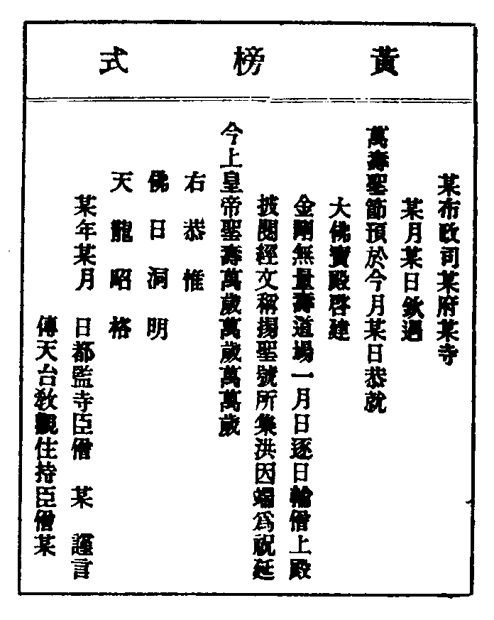



疏语。



教建疏(首如前榜语书)。



右伏以　均天之大，荡荡乎无能名焉；　与日竝明，皜皜乎不可尚已。戴　德罔知高远，叨　光莫喻照临。欲殚臣子之忠诚，敢效华封之虔祝。梵书五千卷，演二十重华藏，尽入提封；妙旨六万言，会百亿国小王，咸归至化。少伸涓效，上报　洪恩。恭愿后天不老，行地无疆。　寿举玉巵，　翠跸永朝於长乐；功成丹鼎，黄河屡见於清流。谨疏。　某年某月　日疏。



满散疏。



右伏以　天生　圣人，为天下生民之主；　国有大命，在国家有道之归。　唐虞雍熙，文武兼济。逾万年而得寿，　覆寿无私；预一月以为期，虔蕲有在。恭愿天之覆，地之载，配德惟均；　商尚质，周尚文，推功复倍。效　富寿多男之至祝，衍蛮夷一统之　不图。谨疏。　年月　日疏。



每日祝赞



大众每日凌晨上殿，侯立定，先举大悲呪一徧，称南无无量寿佛。维那回向云：(仰冀洪慈，俯垂洞鉴。上来讽诵秘章，称扬圣号，所萃洪因，端为祝延　今上皇帝圣寿万安，祝陪　天筭云云)。



景命四斋日祝赞



前一日晚，堂司行者覆方丈，两班单寮挂牌。次早，殿钟绝，众集，举无量寿呪(或举大悲呪，或举消灾呪)，称南无无量寿佛。众和三声，维那回向(仰冀洪慈，俯垂洞鉴。四斋吉旦，谨集臣僧，恭趋宝殿，讽演秘章，称扬圣号。所集洪因，端为祝延　今上皇帝圣躬（大众同称）万岁，万岁，万万岁，　祝陪　天筭无量寿佛仁王菩萨摩诃萨云云。若朔望随日审改，正月则云孟春，餘月例知)。



藏殿祝赞(初八日、二十三日)



此二斋日，侵晨登殿祝赞。粥罢，鸣僧堂前钟。藏殿鸣钟鼓，令直藏殿人转藏。众集，首座举楞严呪，绕藏行道。呪毕，立定，举南无释迦牟尼佛、南无无量寿佛、南无佛顶首楞严、南无护法诸天菩萨(众各和三声)。维那回向(仰冀洪慈，俯垂洞鉴。四斋吉旦，谨集僧众，恭趋藏殿，运转天宫法轮宝藏，讽演秘章，称扬圣号。所华洪因，先为祝延　今上皇帝圣寿万安，次冀佛日增辉，法轮常转，无量寿佛、仁王菩萨云云。或无轮藏，有实藏处，亦宜行之，但除运转之语)。



千秋节



至期之前一日晚，堂司行者覆方丈，两班单寮并挂牌。次早登殿，举棱严呪。维那白佛回向(大圆满觉，应迹西乾。身包太虗，量周沙界。仰冀洪慈，俯某洞鉴。某路某寺，某月某日，恭遇　皇太子千秋令节。谨集僧众，恭趋宝殿。讽演秘章，称扬圣号。所萃洪因，仰祝　皇太子睿筭千秋。殿下恭顺，祇膺茂典，位副青宫。温文光三善之名，继照𭜴重离之庆。十方三世，一切云云)。



善月



正、五、九月为三长斋，世称善月。每月建祈福道场。先一日，堂司行者覆住持两班，并挂善月牌於殿前，具经单，并置簿。差僧每日鸣大钟，登殿看经祝赞。至放鍾下殿终，月列经目，具疏满散。(提尔经云：诸天帝释、太子使者、阎罗鬼神，俱用正、五、九月旦日案行。王民等为善恶者，四时交代。岁终三覆，以校与四王。一月六奏，使无枉错。覆校众生罪福，作善降祥，不善降殃。自随开皇三年，诏天下正、五、九月及六斋日，不得杀生命。唐武德二年，诏天下正、五、九月十斋日，不得行刑屠钓。逮今　圣朝，遵行尤笃。各寺凡届斯期，毋或怠也。○世人以此三月忌上任者，避行刑故耳。)



祝赞门第一



祈禳门第二



佛以慈悲为化，天以好生为德。然而下民自孽，致感失经背常之事，吾徒当本国朝度僧之意，为民祈祷，宜加精恪，昭回佛天慈好之心，庶几祸消未萌，菑变为福。其如是，复何安居逸食之媿乎？



祈祷



凡遇祈祷，住持预集两班茶议，令库司备办供仪，提调洒扫门径廊庑，严治坛场，敷陈香灯花幡，巡警大小寮舍斋洁。复令头首制疏意回向，堂司行者挂牌报寮。至日，殿上营列供养，住持专加虔谨，僧众各务整肃。三日为期，於斋粥二时，鸣钟集众，登殿讽诵祈祷。初时，首座举南无过去正法明如来(云云)，制语启白，举大悲呪若干徧。行道立定，亟称(观世音菩萨及护法诸天菩萨)圣号，和合十声，维那回向(仰冀佛慈，俯垂昭鉴，某路某寺住持比丘某盖为知，如后各列)。复举圣号，和各十声毕(十方三世一切诸佛一切云云)。餘时举唱回向同前，但免启白。三日后，如未蒙感格，则以本寺僧众若干员，分作几引，每引讽呪若干徧，称号恳切祈祷。如是相继，轮流不断，从朝至暮，以感应为期。兼复别修功果，必期至効，方可满散忏谢(如有灾异，亟欲祈祷，止如上规，直通意旨启白)。



接官



官员入山祈祝，或先报至，即令堂司行者覆住持，两班挂接官牌，令人远探。候将及山门，鸣钟，住持执提炉，领众门迎至殿，拈香设拜。知事当预问官御情旨，转达住持、头首知会，慎不可忽。举呪称号回向(或住持或头首不拘)毕，请归方丈。或法堂设位献茶，祇待如仪。或游覧陪从话语，勿谈世事。或法门、山门急务，当量便申禀，不可造次，有伤大体。去时鸣钟，大众门送(若迎送大官，鸣楼钟，次则鸣僧堂前钟)。



祈晴



(无垢清净光，慧日破诸暗，能伏灾风火，普明照世间。)



霖雨不休，万物莫遂厥性。陂塘欲决，四民咸以为忧。匪太阳照临匿私，实品彚业累感召。特伸祈恳，望赐昭彰。由是谨於某月某日，启建祈晴道场。每日集众，讽诵秘章，称扬圣号功德。祈祷常住三宝，大悲观世音菩萨，奉福护法列席诸天帝释尊天，四门天王，日宫大阳天子(云云)。平等祈求，乞彰感应。伏愿扫荡阴霾，俾式乾于后土。豁舒杲日，庶廓净於天倪。地利丰饶，天时顺序。



祈雨



(悲体戒雷震，慈意妙大云，澍甘露法雨，灭除烦恼燄。)



水为物命，岂胜烁石之威。食是民天，深切望霓之叹。由下地同业所感，非上天鉴物有偏。欲遂济通，须凭祈扣。由是谨於某月某日，启建祈雨道场。每日集众，讽演秘章，称敭圣号，功德祈祷(云云)。奉福护教，列席诸天五方行雨龙王，六合雷公电姥，风伯雨师，雨部圣众，诸处溪源潭洞隐显龙王，岳渎山川，灵坛社庙(云云)。平等祈求，乞彰感应。伏愿电掣雷匐，起蛟龙於川泽。云行雨施，苏禾稼於田畴。庶五糓之有秋，俾四民之乐业。



祈雪



冬令如春，虑致下民瘴疠；腊前未雪，曷期来岁丰穰。敬摅一众之精诚，愿覩六华之祥瑞。仰惟洪造，俯赐详明。由是集众，讽诵秘章，称扬圣号功德，祈祷常住二宝大慈观世音菩萨、奉福护法诸天帝释尊天(云云)，平等祈求，乞彰感应。伏愿千里飞花，平地瑞占於盈尺；九秋多稔，生民欣贺於有年。藏伏祲氛，导宣和气。



救日



累德重光，环四洲皆仰临照；行天失度，极八方咸起震惊。虽凭历纪之推祥，恐罹阴沴之阨数。欲复金轮，还瞻旧观，须依绀相，曲示周旋，輙启祈祷，用徇救护。由是集众，讽诵秘章，称扬圣号，祈祷常住三宝观世音菩萨、日光菩萨、奉福护法诸天、三界万灵、满空圣众，平等祈求，乞彰感应。伏愿光回宇宙，气恊阴阳。天下晏如，岂用眩戈挥之伎；太平有象，孰须形盆覆之讥。四方咸颂尧声，八表同光舜德。



救月



(大智精进佛世尊，我今归命稽首礼，是罗候罗恼乱我，类佛怜愍见救护。)



蟾蜍届望，一轮正满於兹宵；罗彗肆妖，全璧适亏於今夕。故星纪躔入月纪，乃天心警诫人心。欲万方重仰清光，当此际合陈大造。由是集众，讽诵秘章，称扬圣号功德，祈祷常住三宝大悲观世音菩萨、月光菩萨、奉福护法诸天权实真宰、三界万灵、满空圣众，平等祈求，乞彰感应。伏愿冰轮完复，不靳玉斧之修；白兔重苏，还戢金罂之旧。大地山河普照，广寒宫殿咸开。万象光昭，九霄色正。



遣蝗



飞蝗入境，惊看蔽天遮野而来。异物为灾，宁免戕稼害禾之惨。遗捕故凭於官守，蹂践何补於耕农。敢仗妙用之功，式畀祆禳之福。由是谨於某月某日，集众讽诵秘章，称念圣号功德，祈祷(云云)。奉福护法，列席诸天，三界二仪，满空真宰，阴阳造化，赏罚圣贤(云云)。平等祈求，乞彰感应。伏愿慈风猛扇，遣绳绳缉缉於无何有之乡。愿海周流，荡蠢蠢蜚蜚於常寂灭之理。非但遣一物之灾异，抑将同六合以欢心。



谢晴



灵耀宣光，千里霁华开望眼；苍生仰德，八纮晴色动欢心。自非大道垂鉴之明，曷覩大阳启关之照？复陈涓善，敢答洪恩(云云)。伏愿求而輙应，已占丰岁之嘉祥；感而遂彰，更卜秋田之刈获。阴阳顺序，民物阜康。



谢雨



人或悖理，兼旬惊旱魃之威；天不遗民，一雨慰桑林之泽。凭兹优渥之润，顿济发生之心。既沐恩波，敢忘隆德(云云)。



伏愿八方称贺，人人怀击壤之歌；四海交欢，处处期鼓腹之咏。一味普益，万物增光。



祈禳门第二



报本门第三



法之为本至矣，佛祖之道由是而生焉，则凡有志於道者，可不知其本哉？一、大藏教本众生之性，诸佛揭而示之，诸祖对而扬之，以文字广第一义，流行世间，俾诵其书、修其道者，皆有以复性之本，陟佛祖之阶也。然生死幻有之质，推本於生成，尚知所以报，况诞育世出世无上法身者乎？诚能以出世妙道诱掖，庶彚尽复本性，报本孰加焉？又复国朝剏业垂统，先帝皆是果位，应御天下　大宝，法王亦以大权辅化，化事既终，咸归　证地，　覃恩所被，与教共隆，而使吾徒究复本性，得不追所自耶？其於讳日，拳拳恳恳，思而敬之。



如来降生(四月八日)



将届降生，住持专诚命库司预备供养，令行者於佛殿设毗蓝园香汤盆，安太子像，置二小杓於盆内。至日，敷陈供养并香汤毕，堂司行者覆打起。大众各具威仪，备香汤钱，候钟声，俱诣大殿，依次立。住持上香三拜，不收坐具，进前奉汤食。行者递上，侍者捧置于几。问讯毕，复位三拜，再上香，下𫎪，点茶，又三拜，收具。两序出班，维那揖香如前式。大众三拜，收具。住持跪炉，维那宣疏白佛云：(现大人相，充满太虗。深远雷音，徧周法界。巍巍乎高等须弥，晃晃乎明逾日月云云)。疏式见后。维那宣疏毕，首座举唱浴佛偈云：(我今灌沐诸如来，净智庄严功德聚。五浊众生令离垢，同证如来净法身)。　行道浴佛毕，立定，举安乐行，复行道经毕，复举佛号各三声毕，大众云：(愿灭三障诸烦恼，愿得智慧真明了。普愿罪障悉消除，世世常行菩萨道。十方三世云云)。



疏式



某路某寺住持末裔比丘(某)，　与众小比丘等，四月初八日，恭遇本师释迦如来大和尚降生之辰，谨备山殽野蔌，茗盌𬬻熏，专伸供养，讽诵　经文，称敭圣号，所集　功德，用酬　慈荫者。



右伏以千圣嗣兴，莫不由实道而成正觉；一法可赞，所谓以慈心而游世间。既膺人寿百岁之时，遂补贤劫四佛之处。取万二千国中央之地，示三十二相劣应之身。固敢为天下先，而自称人中胜。岂羡继天之贵，盖昭唯佛之尊。应迹如存，仰明星而犹朗；化仪虽往，想白虹而尚腾。适逢赐影之辰，少効惟馨之荐。奉匜香水，用沐金躯。集兹有作之熏，仰报难思之德。　本师释迦如来大和尚，伏愿弥隆至化，阐宗风复振　皇风；未丧斯文，寝邪法流通　正法。罄有相，证诸相非相之实相；统含生，悟无生受生之真生。等未来时，如　出兴日。谨疏。



如来成道(腊月八日，礼式同上，但去浴佛偈耳。)



非证而证，久证於尘点劫前；无成故成，近成於菩提树下。盖从本而垂迹，为行已而化他。降灵於覩史陀宫，利见於迦维卫国。视金轮而脱屣，指雪山为故家。分卫五人，燕坐六载。随机时有賖促，岂证道异过当？云散仪霄，自尔水月交际；春回嶰谷，不妨花柳芬菲。念化仪无得而称，惟内证尤不可示。熟前番人虽云已矣，愍末裔者其如之何？歆艶遗音，𪫟惕罔措。伏愿　俾末世优昙再瑞，复覩明星；使浇季甘蔗重荣，还瞻　慧日。



如来涅槃(二月望日)



镫夕后，住持令堂司行者报示新学，熟读遗教经，五日一次，诣首座前背试。至二月初一日为始，每日斋了，堂司行者覆打起，集众诣佛殿讽诵，净觉法师有礼文。四明、延庆至日，皆如天台祖忌行之。於法堂上置涅槃佛像，左右叙列涅槃会上结集诸法藏、结集诸菩萨僧、结集缘觉僧、结集声闻僧四位牌衔配之。近来诸方从简，就佛殿上食设拜而已，岂尽报本之诚乎？



疏语。



鹫岳膺期，显一乘而极唱；鶴林顾命，指三德以真归。自高山先照，示以出兴；至峻岭餘辉，云当入寂。知唱生而唱灭，恒常不变，法性本然；见令始而令终，会必有离，世相如是。医师背丧，贾客他行。花柳无私，俄洊逢於远日；苹蘩可荐，罔敢坠於遗风。式表芹诚，仰祈藻鉴。伏愿分身俯降，护身使佩於灵符；慧命长存，赎命见颁於重宝。庶令后裔，克绍先宗。



国忌



上宾日，届期先一日晚，库司令堂司行者覆住持两班，挂讽经牌报众。就法座上安　御座，用黄纸书　圣号牌位，严设香华灯烛供养之仪。至期，鸣僧堂前钟集众。住持上汤茶，首座举棱严呪。呪毕，举释迦楞严诸天号。维那回向云：(天上天下，圣主为尊。世出世间，法王自在。仰冀洪慈，俯埀昭鉴。某路某寺住持传教观僧某，今月某日，恭遇　某圣圣忌之辰，谨集僧众，讽诵秘章，称扬圣号。所集殊𬊫，上资　圣驾。供愿逍遥八极，仰翠舆玉辂之来仪；自在中天，享瑶关琼台之娱乐。十方三世云云)。



天台大师忌(十一月二十四日)○(维那和会礼数与说戒同)



将届忌辰，住持专诚命库司备供养之仪。维那预先和会人，借书畫器皿，分项掌管。复和会唱礼人员，三夜习仪。方丈初夜，库司次夜，堂司后夜。务尽孝思，毋或饕餮也。宿夜日，参头差行者，於法堂敷陈玩具，严饰祭筵。炉、瓶、香、几，一一如仪。上间设法衣、拂子、椸架、椅等。中间分列九祖、山家诸祖、山门始祖，并嗣法师等位，仍设祭筵。下间设部文、炉、瓶、椅等。当晚，堂司行者覆方丈。两班打起，鸣僧堂前钟集众。侯住持至，各去帽。头首举南无旋陀罗尼菩萨，右旋行香一匝。各归蒲团位，展具三拜，默运香华。散华毕，依忏主礼文，专诚修礼。候奉请时，住持起，上汤茶(正日上汤食𫎪茶，侍者一一恭进)。奉请后，仍请山家诸祖、山门始祖等，及嗣法师。请毕，赞叹。宿夜正日，维那读疏(或知客读疏，式见后)，前后堂首座缴疏。宿夜，唱诵前六段顶礼。正日，唱诵后六段顶礼。仍顶礼列祖毕，忏五悔讫，设三拜。头首举安乐行行道经毕，举佛号毕，众云(愿灭三障诸烦恼云云)。堂司行者唱云(知客请方丈、和尚、两班大众，就此献汤)。汤毕(维那备汤果，或请大众，或但请唱礼人，随山门例不同)。次行堂参头，领众诣筵讽经。正日辰时，常住点心，堂司行者打起，唱礼讽经，与宿夜同。至午时，大众起堂斋，维那请唱礼提调等人就寮斋。斋粥毕，堂司行者就僧堂覆住持两班，鸣僧堂前钟，诣供筵讽经毕，行者讽经(候礼时，首座居中，左右各三人，互相同声奉请，有声音者一人唱序)。○(知客去㡌，烧香下汤，维那汤果亦然)。



疏语。



古塔开扉，半座平分风月；灵山在目，三周俱付筌蹄。摧我慢自高之幢，示吾今亲证之地。陈隋应运，蛮貊同文。小根小茎，毋望洋向若而叹；大枝大叶，皆拔茆连茄而征。众丘绕司命逊其高寒，诸子驾安车鞭其觳觫。生民以来，未有愈高泰山北斗之具瞻；此舟过后，更无益重浮木盲龟之难值。玄珠休景，智鉴沉光。搅和酥酪之既成，收卷波澜而遐举。象武方绝尘於无何有，郑声将乱雅於侏离淫。允赖正音，洗空邪说。谬记刻舟之迹，輙营讳日之斋。撷芳於沼沚之毛，式资明信；展敬於涓埃之效，允答洪休。



法空宝觉智者大禅师。伏愿



有伴即来，招手勿忘於金地。如月初上，分身岂间於潢流。再振玄猷，庶昌厥后。



又疏。钧天韶护，合吾节乃张；凤凰麒麟，适其时则出。会斯文之将丧，故亚圣之倔兴。恭惟天台教主法空宝觉智者大禅师，豁见灵山，洗虞困之佛日；大訇木铎，鼓震旦之金声。贯一乘极唱之音，洞三际终穷之妙。午照揭矣，容鱼目之夺珠；大道廓如，空郑声之乱雅。帘月栢香而真法供养，江陵金地而顺物委蛇。获一旋陀罗尼，姑示迹中之迹；想三阿僧祇劫，已极天中之天。香风吹优昙钵华，铁鼓透那罗延箭。挹玉泉之源渺，霈一雨於梦中；仰华顶之峰高，降众魔於镜里。至若帝王师法，凡圣奉尊，皆吾祖之绪餘，奚下凡之足议？(某)等忝值示归双树，逮至千年。云仍近百世之孙，传续愧一丝之眇。魂摇鲸海，空怀四帝之雄姿；恩戴鳌山，莫覩二严之奇相。望江声而动哭，瞻斗气以凝悲。輙陈寒㵎之苹，聊奉惟馨之荐。呜呼！我祖罔极苍天。伏愿　下印千江，弥满一天之月；究竟六味，吹嘘九地之春。矜氛埃𫐖轕之秋，哀败种离披之极。药垂瞑眩，不举步而悟故乡；迹免竛竮，即此心而见真性。誓报难明之化，洞然无尽之灯。



诸祖忌



(章安尊者八月初七日忌，　荆溪尊者二月初五忌，　四明尊者正月初五日忌。)



山家诸祖忌辰，宜皆修敬。而於天台忌辰袷祀，礼也。章安结集荆溪记，述四明中兴，此三祖之功大於名教，故当表而出之。届期别祀，亦礼也。凡临忌辰，维那预令堂司行者覆方丈，两班挂牌，报众库司办供仪，隔宿於法座上挂真(真缺设牌)。至日，敷陈供仪，堂司行者覆方丈，两班鸣廊板，僧堂前钟集众。候住持至(不得覆𮔙)，鸣引二下，首座举南无某祖师菩萨，领众右旋，烧香一匝，立定。住持上香三拜，不收坐具，进𬬻前上汤、上食。侍者恭递，俟捧至几上，退就位，三拜，仍进前烧香、上𫎪。猷茶毕，复位三拜，收坐具。住持上片香，行者鸣行香钹，维那出班揖香，两序出班上香(式如前)，大众同展三拜。住持跪炉，维那宣疏(仰冀真慈，俯垂洞鉴云云，疏语如后)。毕，首座举安乐行(如前式)。若行宿礼，亦如之，但免出班上食而已。



章安尊者忌疏



得高忘筌，能即言说而为解脱；示月须指，故因文字以显总持。虑衡台过后以无闻，故荆扬住来而不惮。殆可庆喜同功并德，斯与智者默识心通。恭惟天台宝授结集法藏章安禅师、总持尊者，佩宿誓而复来，禀今师而善继。捷五行於目视，记万言於耳闻。由自任天下之难，故超出门人之上。菜食水斋，氷床雪被，不辞著述之劳；超云迈印，跨朗笼基，岂图讲说之胜。悲斯文之若坠，示甘露之在兹。东宫之法斾方还，内院之宝台已待。(某)等叨生法末，获奉圆闻。俄讳日之来临，痛深恩而罔报。聊伸菲供，少展涓诚。伏愿　再降摄静，白日群雄，不劳弹指；重复回澜，青毡旧物，𥩟听欬声。庶大教振开皇之风，俾末裔覩江陵之盛。



荆溪尊者忌疏



或荡於空，或胶於有，舍哲匠谁其正诸？既衷以理，既辟以文，𮨇圆宗巍然存矣。符掖轮游河之梦，专尊王贱伯之功。记诸部于台岭毗坛，数十万言云垂海立；来多士於吴门楚甸，几千百众凤翥龙翔。辞优诏以深藏，挈宏纲而独任。天扶杞国，日取虞渊。台衡教观，於是重明；灵岳箕裘，宜其远绍。(某)等滥同展卷，实切衔恩。适逢讳日於花朝，聊陈薄供；遥想灵龛於佛陇，莫覩真容。天台记主荆溪大师圆通尊者。伏愿悲誓所薰，即文字广第一义；遗编是赖，期自他入不二门。永俾邪徒，咸归正说。



四明尊者忌疏



圣祖往而玄化微，懔若县𮈔之引石。邪说行而间世出，明如杲日之旋空。岂唯爝火之息哉，宜载昙华之现耳。恭惟中兴教观法智大师四明尊者，幼生鄞水，神僧遗佛子之灵。初禀宝云，弥月讲心经之要。遂作学徒渊薮，真成法海舟航。鼓吹一乘，网罗众典。行天台难行之行，脇不至席四十餘年。记毗陵未记之文，手不停书几千万字。青襟蚁集，赤帜云张。中兴教观，舍师其谁。远绍箕裘，一人而已。何鶴林之变色，致梁木之缠悲。空抱遗编，难回寂定。(某)等痛适临於讳日，实常感於深恩。薄荐苹蘩，少酬埃滴。伏类　不忘冥护，永俾弘传。讲贯连环，同淳化天禧之岁。行门启钥，追乾符保恩之时。重振斯文，益昌厥后。



开山历代祖忌



开山祖。若法门重望，功被山门，宜如前诸祖设法堂上礼仪，亦须制疏，赞其功德。若历代忌届期，堂司行者预报库司，备供养，请祖堂位牌，就法堂中间铺设。粥罢集众，住持两序一行排立。住持上香汤食茶毕，大展三拜。首座举阿弥陀经行道，经终称圣号(弥陀、观音、势至等)，维那回向(因缘所生法，我说即是空。亦名为假名，亦名中道义。仰冀真慈，俯垂昭鉴。今月某日，山门伏值前住当山第几代某祖师斋忌之辰，营备菲仪，以伸供养。谨集比丘众，讽诵真乘，称𫾻圣号功德。奉为觉灵，增崇品位。伏愿十乘斋䇿，优游即入清凉池；三观弥修，任运同归秘密藏。再回寂定，重辉法灯云云)。或徒弟法眷、江湖道旧，俵𫎪请众讽经，维那回向(仰冀真慈，俯垂照鉴。徒弟比丘某等，伏值前住当山先师和尚某法师斋忌之辰，谨命同袍，讽诵真乘，称扬圣号云云)。○(若就祖堂下食，一位讽经，非礼也)。



嗣法师忌



嗣法师者，传道解惑。授受之际，得益非少，当知根源。凡遇忌辰，礼宜尽诚。须预计筭合用制供钱物，归常住置食设供，或自就方丈营办。隔宿，令堂司行者覆两班报寮。法堂上铺陈祭筵玩具，法座上挂真。宿夜，集众讽经。至日粥罢，鸣堂钟集众，对座鴈立。住持上香、上汤，三拜；又上食、上𫎪，三拜；上茶，又三拜(大众同三拜。盖在座下皆曰参学，故尊住持也。今诸方众中，或不拜者有之)。　维那宣疏(或住持叙意亲制，或书状侍者制)，首座举经，领众行道。住持则侍立座左。经毕，举佛号。众云(愿灭三障云云)，次行者讽经(宿夜同)。斋时，住持入堂烧香，大展三拜(以答众礼也)。归位，侍者行𫎪。当晚，就方丈备汤果，请两班江湖道旧(须令客头行者预请)。○(法眷俵𫎪、讽经如前)。



檀越忌



隔宿，堂司行者覆方丈，两班挂牌。库司预专人诣檀越家，请子孙到寺拈香，量宜迎接，复讲供仪。至日，就祠堂敷设。子孙至山已，集众住持，上香首坐，举弥陀经称号，维那回向(真如界内，绝生佛之假名；平等性中，无自他之形相。仰冀神仪，俯回昭鉴。今月某日，山门伏值故檀越某人称呼远忌之辰，营备菲仪，以伸供养。仍集合山大众，讽诵真乘，称念觉号，灼化财功德，专为神魂庄严报地。伏愿心游妙理，质托净邦。香风起处闻经，莲华开时见佛)。



化纸诵往生呪三徧毕(十方三世云云)。



报本门第三



住持门第四



夫我能仁之制，三月迁居，八秽靡畜，树石田里，皆许宣通，四事供输，十方应慕，虽有伽蓝，不居常产，无有住持之云也。教流震旦，官以九司，官舍谓有法度之处，名之曰寺，遂名僧舍，以安其众。必择齿德两尊，为众范模者而统领之，始有住持之称焉。至今国朝慎选，举其德行可以服众，言论可以警世，然后举而任之。苟其材德不称，虽耆耄不与焉。故凡登其选者，操大法之柄，诞敷圣言，启迪后学，昌法运於像季，惠生民於尘刹，乃所以裨　王化，光世教也，岂贪位苟禄所足尚哉！其或行不备，德不掩，负且乘，覆公𫗧者，厥惟艰哉！



议举住持



主席之位，不宜久虗。两序勤旧，先就库司会茶议定，具呈宗主、三宗、诸山知会。约日本寺大众、江湖名胜，公同保选履践端正、学识高明、允合舆论、厮次相应、堪服众望者，准使院通例，十名阄三名，然后填佥勘合申院。凡诸山知事勤旧，不可以乡人法眷私情贿赂，不择臧否，以玷教门。近代以来，树党徇私，德不称位，寺院废弛，宗风不竞，盖由此焉。戒慎惟谨。(公保既定，两班耆旧、诸山继时先佥草榆。)



请新住持(凡十件)



发专使



院堂阄拈既定，伺公帖下日，都寺往首座寮斟酌专使。次日，库司会两班勤旧茶，都寺烧香归位，白云：卜选住持某日入院，今请某某为专使。白毕，转椅烧香献汤。至晚，管待专使商议，差能事行者老郎预通书。次择人制山门疏、茶汤榜，榜用绢素，修广如法。为专使者西序中，或首座至维那，或西堂，或勤旧，必须知事一人同去。掌财议事，具写本寺所有产业什物，须知迎接仪从，一切必具。起程之日，专使诣诸寮相别，鸣僧堂前钟，集众相送。三门钉挂帐设，面里设特位，两序、勤旧光伴讲茶汤礼。如上首、知事去，则下首、知事行礼；如头首、勤旧去，则上首、知事行礼。揖座烧香归位，相伴吃茶。再起烧香，对专使揖香归位，相伴吃汤。专使起谢而去。



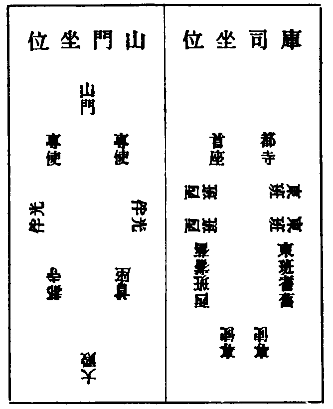



专使到彼山



专使至彼已，先访知客，同到库司。相见毕，送客位，安置行李。继访侍者，通覆住持。如蒙允请，令敷设卓[袖-由+犬]安。疏帖报两序至，住持出接。专使问讯，请趺坐。住持中立，专使插香。初展云：(某蒙山门使令，攀屈尊严。获奉慈颜，下情不胜威激之至。)二展云：(即日共惟新命，堂头和尚尊候，动止多福。)三大展三拜，住持答一拜。(某自揆疎谬，难膺此请。盛礼过厪，不胜皇媟。)专使捧呈疏帖，住持受。左右进卓，置几上看过。侍者揖专使坐，两班光伴，首坐分手。专使面住持坐，侍者烧香献茶。同来行仆参拜毕，两班送专使归。安下毕，住持即远礼回方丈。堂司行者鸣僧堂前钟，两班同大众诣方丈礼贺。众散，知客领专使巡寮毕，再诣方丈，呈纳本寺须知仪[泳-永+(從-彳)]什物。当晚，特为专使药石。至夜，汤果皆请大耆旧、两序、光伴、库司营办。



专使特为新命煎点



专使先与新命议定斋𫎪轻重，两序、勤旧、乡人、法眷、办事贴𫎪。斋料等费，专使亲送，钞纳库司置办。至日，专使诣方丈，插香拜请。初展云：(今辰午刻，就云堂特为煎点，伏望慈悲降重，下情不胜战汗之至)。再展云：(即日如前)。三触礼。住持曲身略答，令方丈请客行者同专使行者，禀请两班大耆旧，挂煎点牌报众。於僧堂内敷设主席位，於知客板头设专使位。至斋时，专使僧堂前，候住持入堂问讯，归位揖坐，归中问讯，揖众坐。圣僧前烧香，次上下间，次堂外烧香，归堂内住持前上下间，次堂外问讯，仍归中间问讯，退侧少立。候行食徧，再烧香，下住持𫎪，并两序、勤旧、大众𫎪毕，归位伴斋。俟折水出，鸣鼓，专使(再)起烧香，行礼同前。行茶徧，如前问讯，收住持盏。专使行礼，初展云：(某聊备䟽饭，伏蒙慈悲降重，下情不胜感激之至)。再展(叙寒温)。三触礼。送住持出，再归堂烧香，大展三拜，巡堂一匝，并外堂，复归内堂中间问讯，收盏。鸣钟三下，众退。专使继上方丈致谢，次诣库司谢办斋，再诣方丈请住持。至晚药石，至夜汤果，皆请两序、勤旧光伴。



山门管待住持并专使



库司会议管待。先一日，上首、知事诣住持前，插香拜请。次诣客位，禀请专使。令库司、客头请两序、勤旧、光伴备币。𫎪当如礼，不可轻蔑词语。行礼并与特为礼同。寝堂中敷住持高座，设专使、两序等位，如后式。同来仆从远接者，管待外，当别犒劳。○(山门管待新命，设中位，专使面坐。若住持特为专使，则与首座分手，不居中位。)



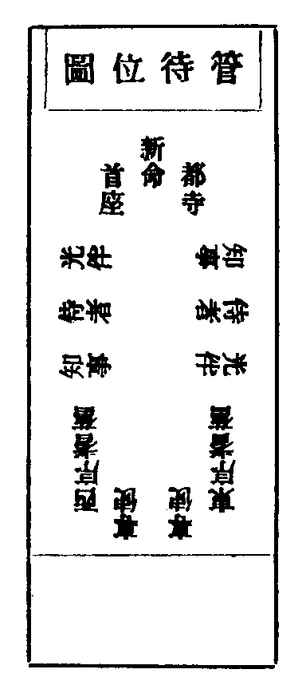



新命辞众上堂茶汤



至起程日，专使诣诸寮相别。新命上堂，致谢两序、勤旧、大众、法语。下座亲往，鸣鼓三下，向法座立，普与大众问讯。从西廊出，鸣大钟、诸法器。大众门送，行仆门外排立。山门钉挂帐设，中敷高座向内，首座向外，摄居主位。西堂勤旧分手光伴，东西序两边朝坐。上首、知事行礼，揖坐，揖香，归位。点茶，收盏，再起，烧香，揖香，归位。点汤，汤罢，起谢，上轿。两序、勤旧备轿远送，住持当力免之。鸣大钟，住持轿远方止。凡住持多因迁赴他山，僧行怀其宿憾，輙致唇吻传之。官员士庶，因一人无知，而使一寺蒙其恶名。老成耆宿，外护隣封，当戒戢之。然为住持者，凡事留遗爱可也。



西堂头首受请



专使到寺，先访知客问讯，略露请意。知客先令人到所请人寮，使备接专使。少顷，用拌袱盛书疏帖，同知客诣所请人寮，插香行礼(如请当代礼同)。毕，受请人就委知客同专使上方丈行礼，禀云(今某寺请某人为住持)。礼毕，继往诸寮。库司人事回寮，所请人送专使安下处歇息。至晚，请汤、果两班光伴。次日，方丈报两序并耆旧，同往所请人寮作贺。次第受贺讫，巡寮人事。当晚，方丈请新命专使，汤、果、药、石两班相伴。



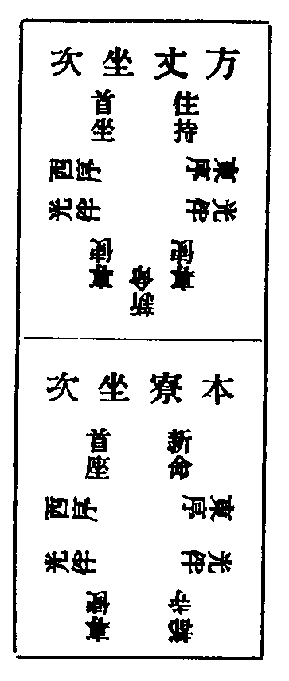



专使特为受请新命煎点



专使预送钱到库司，备办煎点。仍诣新命前，议定方丈𫎪，并两序勤旧、江湖名胜、乡人法眷等贴𫎪。至日粥罢，专使怀香诣方丈，触礼拜请(今晨午刻，就云堂聊备蔬饭，特为新命和尚。伏望慈悲，特垂降重)。复诣新命前拜请(同前礼)。方丈客头同专使行者，请诸寮挂煎点牌於僧堂内。住持对面设新命位，外堂知客板头设专使位。位持预分付请客行者。将至斋时，先请新命到方丈少坐。俟鸣板，僧众入堂，专使诣方丈，请住持(并)新命同赴堂。专使随入堂，先揖住持归位，次揖新命归位，次归中问讯，揖众坐，进炉前烧香(右手执合，左手上香)。左转身，先到住持前问讯，再烧香，到新命前问讯(餘礼同前)。下食，行𫎪，茶毕，先收住持盏。专使至住持前，初展云(某聊备蔬饭，伏蒙和尚降重，下情不胜感激之至)，再展(云云)，三触礼，住持略答。专使送住持出外堂中间，再回堂内，又收新命盏。专使至新命前二展(词语如前)，三触礼，新命略答，送新命出。专使再回堂内烧香，大展三拜，巡堂一匝，并外堂，归中问讯，谢大众。收盏，鸣钟三下，出堂。专使上方丈谢住持，次谢新命，次谢库司办斋，复请住持并新命。至晚药石，至夜汤果，皆请两班勤旧光伴(斯盖古礼，当力举行，近多泛简，俵𫎪而已)。



付承嗣法衣



佛祖传付，心心相照。师资授受，啐啄同时。灵山得记之俦，皆传如来教观。但缘兴在迦叶，故付别指一人。金口祖承，二十三传而至师子。而我二祖，北齐悟大论，三智一心中得，远承龙树，以授南岳。天台初见，南岳为说四安乐行，以教研心，妙悟三昧。继继承承，餘辉残照，以至于今。故知所传，教与观也。衣之所传，盖表信耳。嗟乎！流习之弊，忘本逐末，懵然不知承嗣者何事？曰师，曰弟子，是亦可羞也。夫　若新命嗣法於师，先与师之心腹人吐露其意，请求法衣。受衣日，恭诣师寝堂，师乃当中趺坐，略伸警䇿之语付衣。新命即抽故衣，披法衣，对师大展九拜而退。当日请新命斋，下𫎪。是晚药石，并请法眷光伴。



山门管待受请人并专使



隔宿，先令请客侍者诣新命寮，请新命专使。次日，就寝堂对中面里设新命位，左右设专使位，两序、勤旧、光伴、烧香、下𫎪等烧香，侍者行礼如常式。



受请人辞众



新命临行之日，粥罢，同专使上方丈插香拜辞。次诣库司诸寮辞别。库司预令人山门首钉挂帐，设敷位，鸣大钟，集众相送，讲茶汤，礼上首、知事，烧香(行礼与当代同)。若名德尊宿大西堂首座，则住持必须升座，新命亦须隔宿。令侍者同事使怀香诣方丈触礼，禀借法座。次日粥罢，於法座对面设新命位，座左亦设住持位，鸣鼓集众。住持升座，令侍者请新命坐(虽请亦不可据坐，有妨大众故也)，赞美新命之德，为法而出，劝请举扬，慰众渴仰法语，下座(古人有引座之法，即此谓也)。住持归座左，向外而立。专使同侍者至新命前问讯毕，新命出住持前问讯。次与两序大众问讯，升座，举扬叙谢，结座。下座，诣住持前触礼三拜。次向法座立辞，大众普同触礼三拜。从西廊出，众送门首，行茶汤礼如前。



新住持入院(凡一十件)



入院



若古法，入院腰包顶笠，至山门首下笠炷香。有法语，就僧堂前解包，屏处濯足，取衣披搭。入僧堂炷香，圣僧前大展三拜，参随人同拜。挂搭已，到佛殿拈香。有法语，大展三拜。次土地堂、祖堂炷香，各有法语。入方丈据室，有法语。次拜堂祝　圣。此是古法也，今则少有行之。新命到来，当看甚处安下。近则众往祇迎，远则两序勤旧而已。住持令专使预报，免众远迎。若安下处近，当办汤果，两序勤旧光伴。依选定日辰入院，库司令执局人隔宿排办，挂接住持牌报众。至时，鸣大钟诸法器，大众门迎，两行排立，行仆立大众外。新命到门烧香，转身立定。举法语，直入大殿烧香。举法语，大展三拜。鸣僧堂前钟，大众先归钵位立。新命入堂，圣僧前烧香，大展三拜，参随人同拜。维那至住持前问讯，引巡堂一匝。两序送新命归钵位，触礼一拜(或新命曾於本山办事，不巡堂)。次至土地堂、祖堂烧香，各有法语。至方丈据室，侍者进前炷香，问讯侧立。伺举法语毕，行者进卓笔砚，知事具状(见后)，备柈袱捧呈寺印。新命看封，付知事开封。新命视篆讫，就状上先花押，次题日子，使印於上。知事收状衣钵，侍者收印退卓。住持起立，知事全班进列香椅前。上首插香，同两展三礼。初展云：(兹者伏蒙和上光镇法班，山门不胜荣幸)。再展云：(即日时令谨时，共惟新命堂头大和尚尊候起居多福)。三触礼。次头首勤旧进前插香(香不受)。诸山等屮贺毕，客头行者喝云：(请诸山堂头和上、两班耆旧就座献汤)。汤毕，请官客、诸山点心。若前代住持别迁未赴，或退居东堂未据室前，讲交代礼。新命受屮贺了，鸣僧堂前钟，领众躬送前代归寮，对触礼一拜。次两班大众作贺东堂，归寮。次行仆皆当参拜。



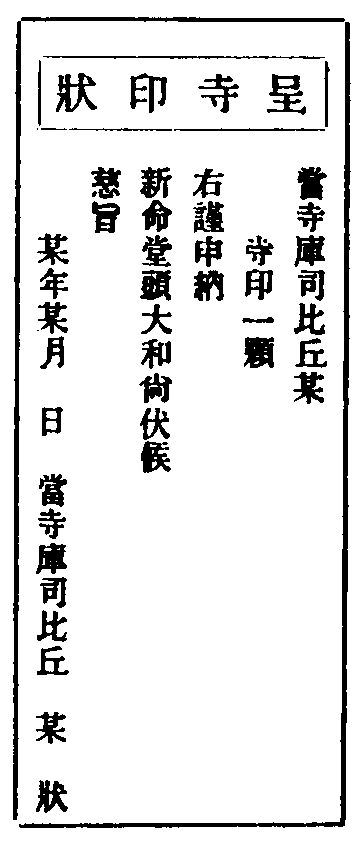



山门请新命斋



上首知事，候据室后人事稍毕，备袢袱炉烛具状(式见后)，怀香诣方丈请斋，两展三礼。初展云：(午刻就云堂备蔬饭祇迎，伏望慈悲，特垂降重，下情不胜战汗之至。)再展(叙寒温)，三触礼。住持略答，知事呈状方丈，客头收状库司，客头铺设僧堂内住持位，知事行礼，与特为管待同。



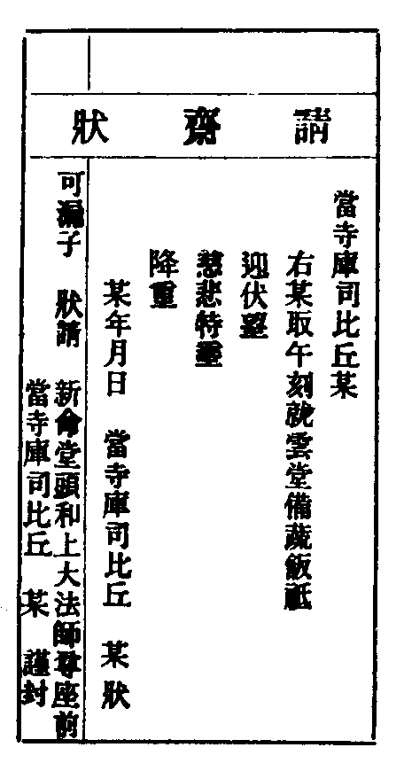



开堂祝寿



古之辇下列刹，　朝廷差官驰命敦请，或部使者，或郡县遣弊礼请，就某寺或本寺，官给钱料，设斋开堂。各官自有请疏及茶汤等榜，见诸名公文集。近来开堂，各寺自备。至时入院，侍者分付行者，铺设法座，覆诸寮，挂上堂牌，具写官员诸山名目，预呈住持。於座左设位，铺卓衣袱炉烛，排列疏帖。预先和会，维那宣公文，首座宣山门疏，以次头首或诸山江湖名胜，宣其餘疏。知事预请上首，诸山住持一员，白椎座前，对面排官员位。侍者覆方丈，鸣鼓众集。侍者同专使入请，住持出，铙钹旛华桃灯迎引，至法堂主位铺设处立。如受请时，未拈衣，抽衣，举法语，披法衣毕，专使进前，插香行礼。初展云：(伏蒙和尚光据法筵，下情不胜威激之至。)再展(叙寒温)，三触礼拜，住持答一拜。专使呈公文，住持受，举法语。专使接与维那宣读，行者扛疏。次山门诸山江湖疏，一一递上。有法语，分送宣读。若见任官请开堂，有疏，亲自捧𮞏。有法语，宣毕，住持转身香椅里，对座问讯，指座。有法语，登座，拈香祝圣。次拈　帝师省院台宪郡县文武官班香，侍者逐一度香，并烧从香。惟承禀香，住持怀中拈出，亲插炉中，歛衣趺坐。侍者下座，对住持问讯，两序出班问讯(礼与旦望上堂同)。诸山住持送入院者，亦出问讯。住持起立，礼毕复坐。侍者登座，烧香问讯。住持当令侍者请官员、诸山坐。诸山上首出白椎，鸣椎一下云：(法筵龙象众，当观第一义)。住持提纲毕，先叙谢官员、诸山、江湖、名胜、道旧(云云。此日开堂，端为祝圣，不敢多词叙陈)。专使、知事、头首、勤旧、大众，略题过耳。详在晚参普说时。叙陈结座毕，白椎人复鸣椎一下云：(谛观法王法，法王法如是)。下座，先受官员作贺毕，知事接送客位。管伴客头行者，即进炉烛一字，排列座前。专使插香，两展三礼毕，堂司行者喝云：(诸山人事)。次喝云：(西堂人事)。展礼，又喝云：(知事人事)。两展三礼，又喝云：(首座大众人事)。诸勤旧齐插香，同大众两展三礼。次江湖、名胜、道旧、法眷、乡人等展贺毕，进𦊱愚椅子据坐。侍者插香，大展三拜。小师、师孙插香三拜。次执局行者插香礼拜。次参头领众行者插香礼拜。次直厅、轿番、庄甲、作头、老郎、人仆参拜毕，住持即往客位，致谢官员、诸山毕。至斋罢，次第巡寮。诸斋同於一处，门外设香几、炉烛、坐位，各具威仪。伺住持至，於下首迎入，请趺坐。住持进香，首者答香，略叙寒温，致谢送出。或长廊分作几处设位，各头首寮亦於门内设位，下首迎送。古者行堂，亦往烧香一炷，当𮞕礼众行者，两行排立，问讯迎送。



山门特为新住持茶汤



茶汤榜，预张僧堂前上下间。库司仍具请状(式见后)，备拌袱炉烛，诣方丈插香拜请，免则触礼。禀云：(齐退，就云堂点茶，特为伏望慈悲降重。)禀讫，呈状。随令客头，请两序勤旧、大众光伴，挂点(茶汤)牌报众。僧堂内铺设住持位。斋退(鸣板三下，鼓鸣一通)，集众。知事揖住持入堂，归位揖坐。烧香一炷，住持前揖，香从圣僧后转，归中问讯立。伺下特为茶，往住持前揖，茶退身。圣僧后右出，炷香，展三拜起。引全班至住持前，两展三礼，送出。复归堂，烧香上下间，问讯，收盏退座。汤与茶礼同。



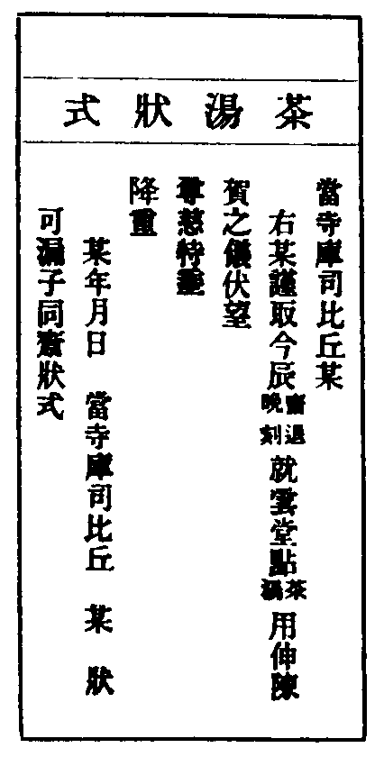



当晚普说



斋罢，侍者覆住持云：(今晚普说。)令堂司行者挂普说牌报众，令方丈听呌。茶头等於方丈厅设座，𦊱愚小法被、香炉、花瓶、烛台、彩袱，侍者具写专使、两序耆旧、江湖名胜、庵塔庄库、暂到入院侍者，或有官客、诸山留宿者，逐一列名，预用呈禀。候昏钟鸣，堂司行者禀侍者覆住持，次覆两班。鸣诸寮板三下，鸣法鼓一通，众集，两班归位立定。住持出登座，侍者、两班出问讯毕，住持举法语毕，叙谢。行者秉烛，侍者呈目：予先叙谢知事、头首、东堂、西堂、专使、勤旧、大众等，庶得详尽。结座下座，客头行者喝云：(方丈和尚请诸山和尚、两班、单寮、勤旧、诸山就方丈献汤。)知事送官客归客位汤果，住持伴诸山等汤果。



次日檀越祠堂讽经(并)历代住持塔所炷香



库司差人严设建寺舍田檀越祠堂，备办供养。粥罢集众，住持至，炷香上茶，汤毕归位。首座举经，维那向向。若前代住持塔所，当一一自去炷香上食设拜，并库司办祭具。



管待专使



知事预禀住持，议专使并宣疏帖人，𫎪资轻重，衣钵合备贴𫎪，须令合节。至日，寝堂钉挂铺设位次，请两序勤旧光伴，设专使特为位，请客侍者躬请专使，餘人则方丈客头禀请，礼与寻常特为同。



------



### 留请两序



两序俟管待专使毕，约诣方丈，咨禀告退。住持未可遽从，垂情委曲送出。侍者令客头、行者备柈袱、炉烛、汤具，住持带侍者诣库司诸寮勉留。客头先报退，聀人出门外右边，迎住持入居主位，分手坐。侍者烧香、行汤、收盏。住持尽礼劝留。若职过满，亦须宽耐。侯住持稍暇，再禀辞退。



报谢参访出入



入院之后，须参见府县官属，次谒檀越寄居官贵。近今参见官贵，以帕子为礼，须常预备，随时宜也。诸山须用门状，合报谢及相访处知事，逐一禀覆。若住持远出，令行者传语头首、知事，知会库司，探伺归期。令堂司行者，挂接和尚牌报众。候入山，鸣大钟，集众门迎。住持先令传语免之，出轿问讯(勿劳大众)，即往佛殿土地堂烧香。首座领众至方丈，住持接已问讯。众退，客头揖请两班耆旧献汤，略叙话而退。方丈行者插香礼拜，次参头领众行者礼拜毕，住持须巡寮报礼。若在城附郭，朝暮出入无时，不必讲行。或密回方丈，两序勤旧皆诣方丈问讯。



交割什物



入院后，会两序耆旧茶，详说山门事务。所有　御书、宝器、砧基、什物，先呈住持，次呈两序耆旧，眼同检示，逐一点对，交割明白。计筭财谷簿书，见管若干，具呈方丈，仍备榜晓示诸庄。须知诸方多於住持进退之际，作弊苛取，后患非轻，不可不审。



两班勤旧煎点住持



先一日，首座、知事、勤旧为首各一人，诣方丈插香，拜请住持，次请侍者、小师。至日，寝堂中设特为住持位，两序、勤旧位如常坐。侍者、小师问讯住持毕，就两序、勤旧末位坐。至时，首座请住持出，揖坐行礼。若免，即烧香，进前问讯，下𫎪。首座、知事、勤旧三人为首，问讯，归位坐。食毕，首座起身烧香，归位吃茶。若诸山道旧及办事、法眷、小师等，请寝堂煎点，礼同。但煎点人设位高下，临时斟酌。



住持常用(凡十件)



朔望上堂



前一日晚，侍者禀住持云：(来晨祝圣上堂。)令堂司行者挂上堂牌，覆两班。次早，侍者再禀住持，令客头行者敷陈法座，茶头行者烧香点烛，堂司行者鸣廓板各三下，报众坐堂。至鸣鼓，两序领僧行至法座前问讯，分班对立。(众中有不候领首至，先自立定者，非法也。)住持登座，拈香祝　寿毕，趺坐，两班问讯。侍者登座请法之后，(冬月，住持则云：天寒，各请覆顶。)叙谢，或先知事，或先头首，随山门例。次西堂耆旧僧众，或外有诸山住持，并大名字，座右设位，官客对座设位。(识礼尊法，则不坐也。)叙谢，则在两班先，即就法座下礼谢。次者，则后两班叙谢，即往方丈拜谢。古来山家，讲贯连环，宁拘朔望。近既疎缺，未免举行。端祝圣寿，当提唱宗乘。开导后毗，则举扬要义。若山门事务，自就方丈茶议，毋谈世谛，令众倦听。若名德、西堂、前堂首座，受他山请，则住持引座举扬。登座不拈香，及施主请升座等，皆不拘时。(餘式如前祝赞门。)



法座图



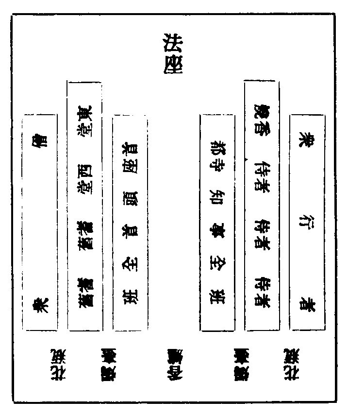



朔望僧堂(并)寝堂点茶



凡朔望粥鼓鸣时，方丈茶头备汤茶槃盏，置僧堂台上请客。行者候行钵水人出，就座请两序，并请耆旧问讯云(方丈和尚请小刻就寝堂献茶)。侍者候折钵水人出，归中问讯。圣僧前烧香，往上下间并外堂上下间问讯，归中问讯边立。鸣钟一下行盏，鸣钟一下行茶。茶行将半，侍者如前内外堂问讯，归中问讯退。鸣钟一下收盏，鸣钟三下下堂。方丈即鸣小板一通，众至问讯。板绝，众坐。侍者烧香(东首面内立，归中问讯。进炉前三步半小问讯。双手开合台，留左臂上，右手把底，复安盖上。右手烧香，把底安几上，双手拈盖合定，少问讯。左转身三步半问讯。茶至，问讯揖，茶退)。



会两序耆旧茶汤位次(东序耆旧至监寺，西序耆旧至维那。)



凡方丈会茶汤，首座分手。如首座缺员，下至知客分手，知事不宜分手，混杂西班位次，头首亦不杂东班位次。或遇大诸山来，则诸山分手，首座次位。若是山门节﨟，或小诸山来，亦只首座分手，诸山面住持排位。若蒙堂茶汤，住持不起，则蒙堂大耆旧居主位，首座分手。住持来赴，亦首座分手，则耆旧面住持设位。如大殿、法堂等处，凡缺住持，其位虗设，两班位次与常式同。



会西序茶汤



凡会西序，首座分手。其本山办事、诸方办事，随职高下分坐，职同次之(式见后)。近来多因位次争长，以致丛林盛礼废矣。为住持者，当公论之。宾有礼，主则择之，此之谓也。若库司会西序亦然。住持不起都寺作主，头首寮首座作主。首座不赴次，头首居主，与本山第一位分手。转本山次位，与江湖分手。



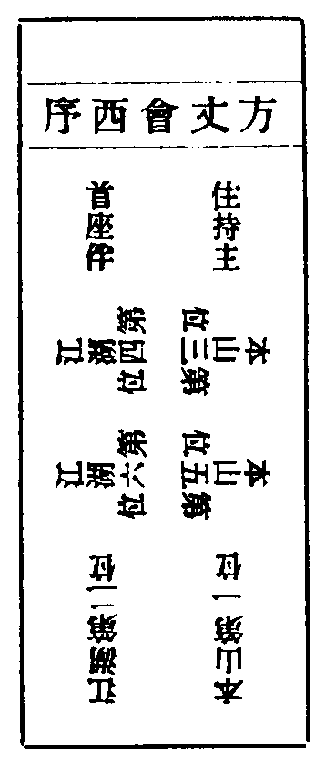



特为大诸山煎点



住持先一日，令行者擎柈袱，盛请书香炉、烛台、香合。侍者往烧香拜请，或免拜。次日，依名书照牌，用卓衣彩袱，陈设於方丈厅前。客至，预认照牌，侍者报住持接客。客进问讯，略叙寒温毕，侍者问讯，请特为人归位揖坐，左转身东南角立。伺俱坐定，侍者问讯，至香炉前侧身避，特为位小问讯烧香(例如前)。左转身去，特为人前问讯，转身东南角旧处立，大问讯烧光伴香。行者入卓，次第下食。候饭到时，衣钵侍者令行者擡𫎪出，侍者烧香问讯，特为人(同前)行𫎪。食罢，次第打茶鼓一通。鼓绝，侍者再烧香(例前)。行者进茶，侍者进，特为前问讯揖茶，又转身旧处立，问讯烧光伴香。行者收盏，打鼓三下，出卓，特为人进香案前拜谢。



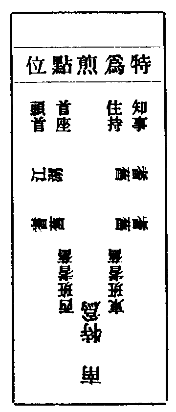



诸山到方丈煎点住持



凡诸山来煎点，住持须先一日访侍者，略序来意，同到方丈。侍者通报，伺住持出，具香拜请，不用书，为重平交人，却用请书。受请已，即令衣钵侍者引访库司侍者，传方丈语，委办食。是晚，令方丈请客头同带来行者，请两班西堂大耆旧光伴，侍者分付排设坐位。至时催客，客至，煎点人揖入位立定，煎点人方请住持出问讯，请归位揖坐，出香案前问讯，至香炉边小问讯，左手烧香，左转身至住持前问讯，转身香椅西问讯，烧光伴香归位。候饭至时，再烧香，至住持前问讯立，候擡𫎪，列住持前问讯归位。饭罢，即起烧香，至住持前问讯，茶至，再问讯揖茶，再转身香椅西，烧光伴香归位。行者收盏，退卓致谢。如或煎点大众，光伴挂煎点牌。至日，僧堂严设住持位，住持对面设煎点人位。若嗣法人到寺煎点，则设嗣法人位，居知客板头。火板鸣，大众赴堂，煎点人请住持，随住持入堂揖坐，转身圣僧前烧香，至住持前问讯，转圣僧后出，住持引手揖煎点人坐。行食徧，煎点人起，烧香下𫎪，问讯住持，及下众𫎪，行饭。饭毕，收钵，退住持卓。煎点人烧香，至住持前问讯，从圣僧后出，炉前问讯。鸣钟行茶徧，至住持前揖茶，复从圣僧后出，往住持前两展三礼。初展云(微礼潜尊，特辱降重，下情不胜威激之至)，再展(云云)，三触礼，送住持出。煎点人复归堂烧香，上下间问讯，谢光伴，复归中问讯。鸣钟收盏，往方丈谢降重，住持随至客位致谢。



施主入山



施主到寺，或先至知客寮，或至库司，引上方丈献茶，送安下处。若官贵大，施主当鸣钟集众接之，同上方丈献茶。若施主请升座，先请知事商议，同诣方丈炷香拜请。至日，铺设法座，座前设施主位，挂上堂牌。鸣鼓众集，知客同施主上方丈请住持。住持出，登座趺坐。施主座前设拜，知客揖引入位听法(但受礼就立坐，则慢法也)，下座拜谢。若斋僧，先与知事议定斋料用费，维那实具僧行数目。俵𫎪多寡，随施主之心，不可辄专。僧堂内设施主位，与住持分手。斋毕，知事陪施主僧堂少立，待大众出堂致谢。次住持、知事到客位谢。若有寄钱斋僧，住持须责付知事，尽数办供。俵𫎪不可互用，刻落招因带果(人天宝鉴云：湖南云盖山智禅师，夜坐方丈，忽闻焦灼气、枷锁声。即而视之，有荷火枷者，火犹起灭不停，枷尾倚於门阃。智惊问曰：汝为谁苦至斯极耶？荷枷者对曰：前住当山守顺也，不合互将檀越供僧物造僧堂，故受此苦。智曰：作何方便可免？愿曰：望为估直僧堂，填设僧供，可免尔。智以己赀如其言为偿之。一夕，梦颙谢曰：赖师获免地狱苦，生人天中，三生后复得为僧。今门阀烧㾗犹存。然颙公以供僧物作僧堂，皆僧受用，尚受互用之报若此。今丛林拨无因果，非惟互用，甚至窃取常住为己有者，宜何如哉)。



诸山相访(尊宿　尊长　法眷　嗣法　平交　隣封)



凡尊宿到寺，先须通门状。到方丈，即令挂接尊宿牌，鸣钟集众门迎。彼若尚简，则潜入寺。住持於寝堂具香烛相接，鸣僧堂钟，令报两班大众，插香问讯毕，众退。两班耆旧就陪坐，烧香吃茶毕，侍者插香礼拜，带来侍者、行者、人仆、轿从参拜。方丈、执局及参头领众行者、人仆、轿番以次参拜。侍者复烧香献汤罢，送客位，主居右，送入插香。客辞免，略叙寒温而出。两班参随别送安下。客头令备轿，住持同引巡寮报礼，侍者随侍(若以下诸山，则侍者引巡寮)。客头预报诸寮巡毕，住持同入方丈叙话。如有乡人道旧人事，复归安下相接。请客，侍者诣客位拜请云：(方丈拜请和尚，今晚就寝堂药石，伏望慈悲降重。)寝堂钉挂帐幕，设位(行礼如常式)。药石毕，复请汤果，皆请两序光伴。侍者覆来早上堂致谢。次早请汤，侍者烧香问讯。揖汤，行者问讯，仆从声嗟请粥。粥罢请茶，侍者再禀上堂，半斋点心。如大尊宿，则首座、众头首禀住持，劝请为众开示法要。住持先到客位陈意。若允，首座具状，两序、大众同诣客位，插香拜请。次请住持引座，挂牌报众，法座前左右排位。至时鸣鼓，住持同下法堂位前立。住持先引座(与常上堂同)下座，两班诣尊宿前问讯，尊宿往住持前问讯，归中普问讯。登座，侍者、两序出班问讯。住持问讯说法毕，下座，住持前问讯，普与大众问讯。住持、两序、大众随诣客位，插香拜谢。请客侍者具状，请特为管侍。山门置食备𫎪，方丈备贴𫎪，两班光伴行礼，与常特为同。若法眷尊长至，先讲诸山相见礼。毕，讲居中座，住持插香礼拜，讲法眷礼。方丈内坐，当让中位，亲自烧香。客力辞，侍者行礼，迎送如前。若嗣法、办事、法孙相访，当躬至方丈，住持即令鸣僧堂钟，集众人事。先请住持中坐，行弟子法眷礼。次讲诸山礼，接送同前，但特为管待。请客侍者炷香禀请，不具状。凡诸山相访，大小远近不同。若大诸山，当迎接如前尊宿礼。若次诸山平交者，斟酌中礼可也。若比近隣封从简者，径造方丈，免劳众，迎接礼如常式。



(请升座，请管待状式)。



(当寺首座比丘某。　右某，辄以来日，拜　请举扬宗旨，开示　后学。伏望　尊慈，俯埀　开允。谨状。　年　月　日具位状。　当寺住持比丘某。　右某，辄以今午，就寝堂聊备蔬饭。伏望尊慈，特埀降重。谨状。　年　月　日当寺住持比丘某状)。



(可漏子　状请　某处堂头和尚法师　具位　谨封)



退院



住持若年老有疾，不任化导，则雍容揖逊，求贤以自代。或心力疲倦，或缘法不顺，自宜知退。常住钱物，须要簿书分明。方丈什物，点对交割，具单目一样两本，茶会、两序、勤旧佥押，用寺记印，住持、库司各收一本为照，公请一人看守方丈。至退日，上堂叙谢，辞众下座，亲往挝鼓三下而退。若留本寺居东堂，相继住持者，须当尽礼温存。



住持门第四。



两序门第五



两序之职，皆为众设，纪纲丛林，讲行礼度，流通教观，模范后昆，于是系者曰西序焉。干蛊寺门，出纳帑庾，公心竭力，纤芥分明，于是务者曰东序焉。作兴法社，於斯二者，如身二臂，岂可偏乎？古人交互职之，备历繁重，及归师位，世出世法，任运应用，无不适宜。今岐分为二者，以至於东西相视，若传舍之阅过客，甚而相诋不相客者，何哉？盖始度者不闲於教训，又任者不择其贤否，故然耳。惟主斯柄者，慎之慎之。



西序头首(凡七职)



前堂首座



丛林表率，人天模范，专务说释，开发后昆。领众则中规合矩，赴堂则瞻前顾后。斋粥精粗，勉谕执事；僧行失礼，依法训惩。三轨匠物，常切在怀；部味教观，如凭几杖。垂恤老病，津送死亡，丛林之事，皆悉举行。然虽尊宿硕德，若住持以礼待之，亦为人而出，不以名位为较也。如诸大士赞扬佛化，犹文殊之助释迦，观音之辅弥陀，皆是古佛权现，为众上首。如此论之，岂轻任乎？



后堂首座



位居后板，辅赞宗风。讲说轨仪，晚生标格。举行礼乐，不异前堂。盖为众多，故分两职。既领此任，幸勿忽诸。



忏首



三昧忏法，惟自山家，任斯职者，宜须解行全备。若自既昏昏，焉能使人昭昭，务在表率行人，朝夕䇿导，敷陈启白，若对圣贤，坐诵绕旋，常存观道，能障所障皆泯，能忏所忏俱忘，终日加功，终日无作，先以无生理忏为主，方用事仪，事行既勤，理观弥进，当慕慈云，以为标格。或谓圆顿无如是行，良可愍焉。



书记



山门榜疏、书问、祈祷词语，应系文翰皆掌之。然住持专柄大法，何暇文字？而此职固不可缺。董斯职者，洞晓宗乘，兼通外典，亦非一日功也。且禅宗何其多，而斯宗何其少？非谓无其人，盖与维那位次高下，故退藏而不为也。若禅宗书记，位居首座之下，用彼格此，合居忏首之上。盖山家忏首，此任非轻，良以宗说俱通，解行全美，与首座等耳。书记位不可加其右者，盖由此焉。本宗维那，曾历烧香、知客等职，兼复点读说文，祈祷回向，历事繁重。若五山十刹者，职漏亦预保举，又乌得肯复让之？今立论云：若请书记，亦曾先历侍者、知客等职，然后量材擢用，助教海波澜，折冲外侮，亦须兼讲说文，则位外维那之上，职满预保，永为定式。昔上竺佛光会中有此山，在书记敕黄为之，名出班书记，岂维那不逊耶？若越次直上，问祈招之诗，不知者不在此论也。



维那



纲维众僧，委曲调摄。众有争竞，辨析和会。堂僧挂搭，验度牒真伪。或腊图位，排列审详。僧众病亡，调理津送。给假参假，观时举行。回向祈祷，极宜至诚。或有他缘，或暂出入，致委客司，权令摄之。点读说文，务开新学。说或布萨，珍重毗尼。天台忌辰，尽礼修敬。厥职烦难，莫越于此。(寄归传云：维那，华梵兼举也。维是纲维，华言也。那是梵语，删去羯磨陀三字也。僧史略云：梵语羯磨陀那，译为事知，亦云悦众，谓知其事，悦其众也。又声论翻为次第，谓知僧事之次第也。音义指归云：僧如网，假有德之人为纲绳也。)



知客



职典宾客。凡诸方尊宿官负檀越方来名胜，迎接交谈，礼宜典雅。随令行者通报方丈，然后陪上相见，量人重轻，斟酌行事。其旦过寮，常备柴炭灯油温存，暂到法堂诵文，汤茶照拂僧堂，粥饭管顾客僧。暂到死亡，主其丧事。堂僧圆寂，同管收支。维那在假，摄行其事。行远在迩，幸勿自夷。方溪嘉声，迨今未坠。



侍者　烧香　书状　请客　附　衣钵



入室。真子朝夕侍教，期契心宗。观出处语默之间，传部味教观之首。庆喜之侍瞿昙，章安之侍天台。佛祖重寄，其可忽诸？○凡住持开讲，则点对部文，预分科目。若讲唱、制作、咨禀，所以记录勿忘。习读、问答、锁试、取士，当以至公。辅赞法社，节腊特为通覆。相看、挂搭、烧香、行礼等事，烧香侍者之职也。○凡住持往复书问、启札、制作文字，先具草呈。如缺书记，山门一应文翰代之，书状侍者之职也。○凡住持应接宾客，管待尊宿，节腊特为具状行礼，请客侍者之职也。或维那、知客俱不赴众，或在假其行事，三侍者皆当摄之。若住持久出，则归众行立。暂出，则不离班位。



衣钵侍者之职，不立班。盖能纳忠救过，罗致人才，内外庶事，通变圆融，庶得上下雍容，东西和顺。若非丛林老成，不可任此。毋使后生晚辈，乱行败德，被悮非轻。



东序知事(凡四职)



都监寺



佛世设营事比丘，干辨众事，乃古之监院，今之都寺也。总寺门之庶务，勤香火於朝夕。祇接官员，礼辂施主。出纳钱谷，洁己公心。簿书时时稽攷，岁计种种有餘。训诲行童，役使仆𨽻。傥有过失，量情摈罚。毋恃威暴，惹起事端。庄库职务，举用均平。供众修造，常运胜心。接物待人，不可轻慢。施舍己责，振废滞，节器用。斋粥二时，心须赴堂。行仆行益，自然整肃。巨细事务，咨禀住持而行。庶见行不失职，众无谤言。夕惕若栗，则善始终。若苟图其身，以求厚焉，欲免得乎？任斯职者，关系非轻。住持必择其廉能公谨，腊高历事，为众推服者，预以礼聘之。然后众请职满，送归单寮。且古之单寮勤，旧虽大刹，数不满十，盖求其贤能廉干之艰耳。果得其人，或连年不易，或数请再充，为其无取於公乎？若神照之佐四明，石牕之辅宏智，可为龟鉴。



(宝积经云：佛告迦叶：我听二种比丘得营众事：一、能持净戒，二、畏於后世。复有二种：一、识知业报，二、有诸惭愧及以悔心。复有二种：一、阿罗汉，二、能修八背舍者。如是二种，我听营事。)



监寺



山门事务，都寺总之。盖以众多，复设监寺。应有常住金谷钱帛米麦出入，随时上历，收管支用。令库子每日具收支若干，佥定飞单呈方丈，谓之日单。或十日一次结算，谓之旬单。一月一结，一年通结，有无见管，谓之日黄总簿。外有米面五味各簿，皆须考筭。凡常住财物，虽毫末并是十方众僧有分，如非寺门外护官员檀越宾客迎送庆吊合行人事，并不可假名支破侵渔。其上下库子，须择有心力能书筭守己廉谨者为之。若有病僧合用供给之物，即时应付。如仓库疎漏，雀鼠侵耗，米麦蒸润，一切物色顿放守护，并须及时照管，母得暴殄。



副寺



副寺之职，盖副贰监寺分劳也。常住钱粮，眼同出纳，务在公心，母相私蔽。供给所需，常令备足。缺乏预谋上首，尅落常慎下流。每日措辨柴薪，至夜巡警火盗。责任非轻，宜加竭力。



典座



僧中净食，盖缘资益色身。身安则道隆，道隆则本立。故典斯职者，常怀真心供养可也。二时粥饭。一切斋供，当须精洁，务在丰饶。物料调和，捡束局务。至於粒米寸薪，不许弃贱。粥饭上桶，先望僧堂焚香设拜，次发过堂。二时就厨下粥饭，食不异众。训诲行者，习学经书。行益普请，毋得怠慢。循守规矩，均俵同利。抚恤园丁，栽种蔬菜。及时耘灌，不致荒芜。供给堂厨，常令富赡。傍公作善，宜运是心。



列职(凡七职)



知殿



常净几桉，时满灯油，圣像频常拂尘供养。每日修设，或遇风起，须灭香𬬻内火，结起旛脚，勿近琉璃。凡遇节候四斋日，开设殿门，以便往来瞻礼。其施主香钱、油钱，不得互用，亦任施主随心喜舍，切勿苦覔，令生猒心。



知藏



轮藏，乃梁傅大士愍世人不诵经文及不识字，故於双林道场创转轮藏，以奉经卷。其誓有曰：有能信心推之一匝，则与诵经其功正等。今诸方倣之，盖重法也。掌斯职者，常加点对函帙，铨次目录於中，缺者完之，损者补之，润者焙之，断者粘之。凡请经看诵者，逐函点付，看毕，一一交收入藏，庶免散失。



知浴



凡遇开浴，斋前挂牌。寒月五日一浴，暑天每日淋汗。铺设浴室，挂手巾，出面盆，整把鞋，铺脚布。参头差行者直浴。斋罢，浴头覆维那、首座、方丈毕，鸣鼓三下浴。圣桶内皆著少汤，烧香礼拜，想请圣浴。次第巡廊，鸣板三下徧。鸣鼓第一通，僧众浴；第二通末，头首浴；第三通，行者浴；三通末，知事浴；第四通，人力浴。监作、行者居末浴，就弹厌之。住持例在三鼓入浴(小合脱衣，浴中用屏风遮隔。行者若有故，二鼓入浴，不用屏遮，亦不入合，只就领首、板头解衣)。浴室外刊揭入浴资次，浴室内挂白字小牌(鸣板一声添汤，二声添水，三声则止)。浴中诫勿喧閙，浴罢照管火烛。如施主设浴，则课经回向。盖玅触宣明，成佛子住，则事无虗设矣。



净头



扫地装香，换筹洗厕，烧汤添水，须是及时。稍有狼籍，随即净治。手巾时常洁净，琉璃终夜长明。净桶把鞋，检点添换。凡供此职，皆是自发道心耳。



水头



预积柴薪，午夜烧汤，供大众沃盥。须早排面盆，点灯烛，备牙药，常洗手巾乾净。冬月烘焙，毋得汤冷，失事令众起念。



庄主



庄乃僧众喉衿，山门诸事所系根本。近时丛林凋弊，始自於庄，皮之不存，毛将安传？今略举一二，以为惩劝。一谋庄职，竞起争端，庄少人多，安能徧及？搆怨住持，上下不陆，一也。一充其职，离寺相远，靡所不为，致争起讼，供众钱粮，尽皆耗费，复积重逋，以累于后，因而纪纲不振，庄佃生侮，租课不还，二也。纵使老成能事充之，而州县应酧，吏胥管干，乡都职役，邻里富豪，皆合追陪，既启其端，稍有不及，便生衅隙，虽不明支，而巧立除破，庄门之费，倍於寺门，三也。请住持勤旧，毋循私情，恊心谋议，委廉干洁己者充之，慎勿轻举。庄主至庄，修理庄舍，补治塍塘，提督农务，抚安甲佃，些少事故，随时消弭，事关大体，申寺定夺，毋事刻剥，竭力运谋，使火佃有追思之心，常住有羡餘之益，方称厥任也。



监收



诸庄督歛，众僧命脉，请非其人，为害不少。皆由住持耆旧私任匪人者有之，因利曲徇者有之，为耆旧执事人连年占充者有之，托势求充者有之，树党分充者有之，角力争充者有之。蠧分害私，不可枚举。虽欲匡救，末如之何。傥得廉正勤旧，辅佐住持，公选区用，加礼敦请。至庄所日，点对簿书，分由甲佃，禳保庄门，加功课诵。勿纵淫祀，恣害物命。选日开仓，立限收米。趂於天晴，督责上仓，看辨米色，毋相私隐。斗斛出纳，务在公平。预留斋粮，津发归寺。三限取足，结帐明白。克己为念，奉众为心。毋苛取甲佃，毋亏损常住，则道福自然殊胜矣。(请监收日，会两序耆旧茶请，仍备管待。至下庄日，山门首讲茶汤礼，鸣钟集众门送。)



请名德都讲



大方都讲，丛林宿德，人天师范，宗乘唱导，法道系焉。礼宜严重，委曲控陈，再三劝请。如有允意，住持请两序归方丈，献茶白云：此间多众，宜得哲人讲演说释。山中幸有某人，学识高明，教道所系。烦两序同诣彼寮，拜请为山中都讲。白毕，同至彼。住持插香，同触礼一拜，起词云：(大众倾心，久思示诲。伏望慈悲，特赐开允。)答云：(幸获依栖，贵图藏拙。既蒙见举，不敢有违。)次日，特为上堂，举扬盛德。仍伸请辞，下座。同大众座下，炉前拜请毕，即请同上方丈，烧香献茶，两班耆旧光伴。茶罢，堂司行者鸣僧堂钟，大众同送归寮。住持对触礼一拜，送出。次两班大众问讯毕，即诣方丈致谢，两展(云云)，三触。仍往库司诸寮问讯，方丈备草饭。至晚，药石汤果，别日管待，并请两班光伴。此职若专讲说，则行道在头首之后，大众之前。若兼前堂，位居班首，进退不混，两序无交代也。(如都讲辞免，住持上堂，则就寝堂请，与请两班礼同。)



两序进退



头首乃丛林表率，务择才德相当者为之。近竞奢侈饮食财物为事，使守贫抱道之士愈甘退藏，法社何能振兴？知事乃山门重任，务择廉能相称者充之。古制大刹不过五人，今行院额设亦有定例。近多徇私，雷请归库。祇图丰己，未甞念公。常住渐虗，法门日弊。原究其始，咎归谁乎？若两班职事满日，待昏钟鸣，同诣方丈，插香触礼一拜，禀退知事，就纳库记钥匙。其中或有再留者，住持就便委曲和会，不允其退。次早亲到彼寮，侍者烧香点汤勉留。若新请两班，不可率尔。与其不得其人，不若不求其备。若果相称，未允所请，须委心腹人展转和会。惟首座、都寺，必住持亲往和会。至请之时，住持须具所请人目，并旧两班耆旧，令客头行者请粥罢会茶。其旧知事於内僧堂前，候行粥徧，直日人出，则入圣僧前问讯，烧香三拜，从圣僧厨后至椎边，鸣椎一下云：(某等昨蒙方丈和尚令，归库司充知事，一年已满，心力劳倦，告退归寮，谨白。)再鸣椎一下，往住持前，触礼一拜，巡堂一匝，中间问讯而退。粥罢，行者催请新旧两班及耆旧(新两班或请客侍者请)至寝堂，住持接入坐。侍者烧香茶毕，住持躬起烧香，众起立，伺住持归位，皆坐。住持白云：(前两序告退，此务不可缺人。今讲某人充头首，某人充知事，逐一标名清讫。)所请人进前逊辞，住持与大众归左边，所请人归右边，对触礼一拜。叙寒温毕，侍者揖新两班归特位，朝里列於两边坐定。侍者烧特为香，即至特位前问讯，退归中立。待行者下汤，侍者再到特位前揖汤，鸣法鼓一通，复归中间问讯，烧光伴香一炷。汤毕，鸣僧堂前钟，集众送新两班归寮。先住持送，次旧两班贺，次大众贺毕，住持同大众送旧两班归寮毕，新两班怀香诣方丈拜谢，令堂司行者引报处寮。住持请草饭、汤果、管待等如常式。(维那、僧知事退职，亦僧堂行礼，与知事同。)



侍者进退



请两班毕，旧侍者诣住持前咨禀云：(某等久侍和尚，今欲告退，伏望慈悲)。插香，大展三拜而退。住持令左右人和会新侍者定了后，批下堂司。维那先请首座，并请为侍者人，到维那寮问讯。坐定，烧香点茶毕，再烧香，朝首座叉手白云：(奉方丈和尚慈旨，请其上人充某侍者云云)。逐一白讫，首座转身，同维那主边，对侍者普触礼一拜(不讲汤礼)。即同出门，送首座毕，维那引侍者上方丈。住持出，维那进前禀云：(适奉慈旨，令请某人充某侍者，今引炷香礼拜)。住持居中坐，维那侧边坐。新侍者插香，大展三拜，衣钵侍者即出，接入内室吃茶。即令行者请知客上，同维那与衣钵侍者，送新侍者归寮。其餘头首等，次第作贺。知客光伴巡寮方丈，直厅挑灯。堂司行者报寮方丈，听呌请新旧侍者。当晚药石汤果，并就方丈内室。衣钵侍者相伴赴谢，必须到住持前问讯。凡方丈请两班头首等，则侍者必须别席。或头首寮，或库司，或他山来，就方丈煎点。侍者同席，无在



头首寮舍交割什物



寮舍什物，常住置辨不易，往往职事人视为传舍。及进退时，仆辈搬捵，荡然一空，使新人入寮舍者，茫无所措。库司当置簿一𠕋，具写诸寮交割什物，住持、知事佥定，仍分置小簿付诸寮，两相见对同。凡头首交替，库司令下库同堂司行者对簿点数。纵有损者，必须无物公界修补，失者本寮陪偿。缺典之物，库司措辨，增号上簿，庶免走失。头首寮舍，住持礼合照拂，若视如常，甚非尊贤任能之意。为头首者，既辨己事，亦宜相体，此是履历发轫之本耳。



方丈管待新旧两班



先一日午后，令请客头请新旧两班，仍请耆旧光伴。次日午刻催客，住持出接坐定(坐次与请时特位同)。侍者烧香，先至新头首特为前总问讯，次至新知事特为前总问讯，转身烧光伴香，入卓点汤下食毕。至行饭时，烧香下𫎪。饭毕，烧香点茶。鸣法鼓一通，侍者如前到新两班前问讯毕，再烧光伴香。茶罢，鸣鼓三下，退席。两班致谢，住持送。



请两班归位



请两班后，至第三日参前，住持令行者至新两班处请云：方丈和尚请来早就寝堂献汤归位。次早开长板时，催请至方丈，住持接坐，侍者烧香献汤。候鸣殿钟，住持同至大殿门首，一人侍者问讯头首，请归西班；一人侍者问讯知事，请归东班。举呪行道，回向毕，赴堂。侍者候两班入僧堂门，依上各揖，请归钵位，供头送钵。



两序门第五。



摄众门第六



道非众弗传，众非处弗居，故丛林之所由设也。吾祖智者，妙悟法华，而以止观之道，化被六十餘州，所至景从，累数千百人，曾不以众为嫌也。临寂语门人曰：吾以领徒太早，损己益他，盖虑后人不修内行，外招名誉者所深诫也。虽然，独学寡闻，世教尚讥，况出世妙道，不求之师友，畴能有闻乎哉？迩见簦笈之士，不惮劳远，一入於众，惟汲汲声利之求，鲜不为盲众所导者矣。苟能存意於古道，则不患名不立也。



鬀发仪(凡十科)



度僧乃续命传灯，佛法所系之大事，必择行堂屡试屡中，可适器任者为之。而　国朝屡降试经度僧　明诏，非不严重，初不为党名固位而设也。一有党固之病，而根于心，而收凶厉，累至于百，而未足遗毒之惨，使佛再世，亦莫理也。告切慎之。○行者初受度牒，以柈袱托呈本师及两序，各处插香体三拜，复请首座䇿导，维那引请，并梵音师选日设供。落发作法之处，律制令露地香水洒之，周匝七尺，四角悬幡。今时不定，或在法堂，法座上须设像，香华供养，座下左右设二师位并几，几上安香烛、花瓶、戒尺，排大众坐位，并作梵师位。若在大殿亦然，但二师之位宜对佛。若在僧堂，住持分手设䇿导师位，圣僧座右设梵师位，与䇿导师相对。得度人隔宿更衣沐浴，就行堂点茶，辞众剃头，留四围八髻并顶心周罗(梵语周罗，此云小髺)，复令堂司行者报寮挂牌。至日粥罢，鸣钟集众，方丈请䇿导师归寝堂分坐，伺钟绝起身，同至作法处，归位坐定行茶。於行堂用二卓，以柈袱置袈裟度牒於上，鸣钹，并引得度人出到土地堂、祖堂、佛殿，各处炷香，礼三拜毕，就作法近处立，伺待䇿导。其间教诫引用因缘，当随机开示，不必定一。今且作一途示法，具列十科(一白席，　二请师，　三谢恩，　四䇿导，　五礼佛，　六落发，　七付衣，　八归依，　九开发，　十祝赞)：



一、白席



众集已，维那起身，鸣椎一下，作梵师，作优波利梵(具说戒章，但改说戒二字为落发)。声绝，又鸣椎一下，大众说偈云(戒香、定香云云)。首座白席云：粤惟西方大圣人之垂化也，贯古今而不息，周细大以无遗者，其惟度人出家之制欤？盖剃发披衣，乃三世如来之仪范；出尘离俗，为十方檀信之福田。党能一日发心，尚获诸天胜报。原夫能仁降迹，当午夜以逾城；方便垂慈，越六年而成道。雷音既震，善来先度於五人；法雨才沾，羯磨繁兴於四海。洞启菩提之路，广开解脱之门。暨后汉明皇，感日光之通梦；摩腾大士，施神化以应机。虽万乘以皈依，曾魔外之未服。故经文圣像，凭烈𦦨以俨存；致正信大心，弃冠簪而求度。一时如司空刘峻等二百六十人，京师士庶三百九十人，王宫妃子一百九十人，道士吕惠通等六百二十人，并发心出家。释种从兹竞秀，昙华自此联芳。由汉永平迄今，越一千三百餘年，无论男女穷达，皆得出家，绍隆释种。人到于今，咸遵明训。今有本寺行者某人，正因出家，归心圣教，克勤道业，人称善焉。今奉帝恩，许容披剃，将从和尚乞求落发。若准律文，必须单白羯磨和僧，使大众知和合者善，或复房房语令知委。然此行童发心精进，众所知闻，羯磨之词，不繁宣秉，直令教授座主引入道场，与其披剃。谨白。



(若准律文，因诸比丘辄度人故，为俗讥诃。由是佛制：凡伽蓝中剃发者，必须单白和僧，意令合界通知。内无专辄，外绝讥诃。故当禀律科仪，先作羯磨可也。)○和尚秉法，阇黎答法。



问：(僧集否？)。答：(僧已集。)问：(和合否？)。答：(和合。)问：(不来诸比丘说欲及清净？)。答：(此无说欲及清净者。)问：(僧今和合，何所作为？)。答：(剃发和僧单白羯磨。)和尚云：(大众合掌，听作白：大德僧听！彼　某甲欲求某甲比丘剃发。若僧时到，僧忍听，与某甲剃发。白如是。)问：(作法成否？)。答：(成。)和尚云：(作法既成，请教授座主引入道场。)



二、请师(引请师，引行者至佛前，礼三宝三拜。引至和尚前，礼三拜，胡跪合掌。引请者云：)



夫儒敦事父，唯重於成身；释制依师，务存於学道。故使四仪轨范，籍此以琢磨；五分法身，因兹而成立。理宜竭诚事奉，故当克志陈词。恐汝未能，我今教汝：若言某甲处，当称自己名。其餘言词，皆随我道。(唱云：)



大德一心念！我某甲，今请大德为剃发和尚，愿大德为我作剃发和尚。我依大德故，得剃发出家，慈愍故。(三说)和尚答云：汝既殷勤三请，我当为汝作剃发和尚。(行者就礼一拜起，引请师引至䇿导师前，礼三拜，胡跪合掌。引请师教申三请，白云：)



夫猒处凡流，欣参宝位。将欲剪除於俗态，理宜警䇿於蒙心。矧在当仁，必由名匠。今为汝请某人，为落发阿阇梨。而况此师，诲人无倦，接物有方。故须专秉一心，恭陈三请。恐汝未能，我今教汝。若言某甲处，当称自己名。其餘言词，皆随我道。(唱云)



大德一心念！我某甲，今请大德为落发阿阇梨，愿大德为我作落发阿阇梨。我依大德故，得剃发出家，慈愍故。(三称)䇿导师答云：汝既恭陈三请，我当为汝作落发阿阇梨。所有教示，当须谛听。



三、谢恩(䇿导师允请，即就座为说云：)



善男子！须知出家之士，高超物表，为世福田，君不得而臣，父不得而子，应受人天恭敬供养。是故剃发著袈裟已，即参预三宝圣贤之数，虽君父且无设礼之仪，况餘人乎？以是则知非细事也。然而父母生汝，养育恩深，国王许容度汝，其功亦大。汝今应往明显处，拜谢国王及父母深恩厚德，然后却入道场，为汝落发。(行者就礼一拜起，引请师则引出明显处烧香，先拜国王，再烧香拜父母。)说辞亲偈，(引请师教行者逐句随念。)唱云：流转三界中，恩爱不能舍，弃恩入无为，真实报恩者。



四、䇿导(谢恩毕，乃脱俗服，出清信士度人经，去中著偏衫，入䇿导师前，胡跪听受法训。)



盖闻束发簪缨，世俗显成人之美。毁形坏服，释门彰入道之基。所谓选佛於僧，心空及第者也。善男子，汝今既慕为僧，合究为僧之志。且如何是为僧之志？须知道为一切众生开佛知见，是为僧之志。为一切众生示佛知见，是为僧之志。为一切众生悟佛知见，是为僧之志。为一切众生入佛知见，是为僧之志。若也果能如是，为僧果能如是，用心之时，便可变大地作黄金，搅长河为酥酪，供养於汝，未为分外。若坐玩岁月，虗消檀施，外若四仪之肃肃，内实众善之荒荒。以之望道，如南辕而适燕。以之谕理，如蒸沙而作糜。吾末如之何也己。慎诫之哉，慎诫之哉，不可自欺也。(䇿导毕，师执净瓶，以香汤灌顶。)说偈赞云：善哉大丈夫，能了世无常。舍俗趣泥洹，希有难思议。(此偈䇿导师唱，或引请者唱，行者随声应和。)



五、礼佛(䇿导师复云：)



善男子！既灌顶已，得去王之子，更须先往佛前，礼十方诸佛。(行者就礼一拜，起至佛前礼三拜。)说皈敬偈云：归依大世尊，能度三有苦。亦愿诸众生，普入无为乐。(引请者唱，行者逐句随和。)



六、落发(礼佛竟，引请者引至䇿导师所，近前胡跪，以净巾围肩。师说云：)



善男子！汝无始来，莫不增长憍慢，贪海纳流，致使流转生死，不能休息。我今为汝剃除须发，为除憍慢；著坏色衣，为除贪爱。少选之间，即与三乘贤圣仪相无别，可谓庆幸。夫剃除须发，乃表三界九地烦恼；四围之发，表下八地思惑；我与剃除顶上周罗，乃表非非想处第九一地烦恼。此惑㝡后难断，当往和尚处求为剃除。汝当志诚，莫生爱著。(鸣引)众念出家呗云：毁形守志节，割爱无所亲，出家弘圣道，誓度一切人。(出度人经)



七、圆顶授衣(䇿导与剃四围发竟，留顶上周罗，至和尚前，胡跪合掌。)



和尚问云：(今为汝去顶发，可不？)答：(尔。)和尚云：善男子！剃其发，所以去贪欲而断虗妄；坏其衣，是乃舍饰好而安淡泊。如昔阿阇梨与汝剃四围发者，表破下八地思惑；今则与汝去顶上周罗，表破非非想处上一地烦恼。此惑难断，才断此之烦恼，方曰出家，盖出三界家也。则可起万劫之沉沦，成佛道之轨则。可贵可尊，慎勿轻易。(和尚为灌汤剃顶上小髻，众人再念出家呗如前云云。　准知落发本是和尚，恐其烦久，故请阇梨为除餘发者，但留少许。和尚亲　今时先自剃作小髻，非本教意。剃落已竟，和尚授与袈裟，便顶戴受。受已，还与和尚。如是三反，和尚与著之。出善见论。)说偈云：



大哉解脱服，无相福田衣，披奉持戒行，广度诸众生。善男子！汝剃除周罗已竟，我今当授汝衣。然此衣者，准律制说，即五条是也。梵语安陀会，华言作务衣，须知此亦大僧所受用物。若沙弥，应依法著缦衣。无相条者，类时制方袍服也。今既初出家，当受三归戒，借著无在也。坐具，亦云随坐衣，梵云尼师坛，为护身、护衣、护僧卧具故，置左臂袈裟之下。凡著袈裟，不得向佛塔，上座、三师亦莫背，不得口衔及两手奋，当如法受持，名良福田，不可慢易。



八、归依(䇿导师前，胡跪合掌听说。)



善男子！汝今外仪已具，必须内解更明，内外相应，方为尽善。若准毗尼母论云：剃发著袈裟已，然后授三归、五戒、十戒等。然此五戒、十戒，於登坛时，当自授受，庶免破戒成障也。且今为汝翻邪归正，授三归依。盖翻无始邪心，归乎三宝正觉。从今已后，尽此形命，誓依佛师，誓学法藏，誓同僧海。汝当志诚，随声称唱。(引请者导唱)我某甲尽形寿归依佛。(法僧例佛三说)我某甲尽形寿归依佛竟，尽形寿归依法竟，尽形寿归依僧竟。惟愿三宝，哀怜摄受。(沙弥礼佛，行遶三匝。阿阇梨一说，或三说)



九、开发教诚(授三归依已，告云：)



善男子，汝今已遂出家，已除须发，已著袈裟，已是与诸佛列圣同其仪表。古德云：出家乃大丈夫事，非将相之所能为。以其可以弘荷三世佛乘，可济九流诸有，是诚非细务也。自今而往，慎勿怠堕，唐丧光阴。如吾佛世尊临灭度时，遗教有云：汝等昼则勤心修习善法，毋令失时。初夜后夜，亦勿有废。中夜诵经，以自消息。无以睡眠因缘，令一生空过，无所得也。是则依佛法僧，修出家行，起精进心，远离诸恶。当须諮白本师，置办三衣一钵，用拟受戒。此衣钵者，乃是三世诸佛正仪，贤圣沙门标致。九十五种外道，尚不知其名字。唯佛出世，示此未曾有法。若不自辨，或临时假借，当准律明判，定不得戒。由无戒故，一生虗受信施，将来当随恶道，长劫轮回，无由解脱。此非小事，切宜用心。必须择从明师，受具足戒。然后笃学大乘，阐扬教观，期登品位，继续祖灯，实吾之至望也。勗哉学子，毋怠毋忽。汝今当往佛前，礼敬三宝，陈自庆偈(沙弥至佛前，三其胡跪)。偈云(引请者唱，沙弥随说)：善哉值佛者，何人谁不喜。福愿与时会，我今获法利。



十、祝赞(或和尚，或阇梨，或引请，或表白，皆可。应执手炉上香，维那鸣推一下，回向云：)



上来剃僧，举扬佛事，所集功勋，奉祝　上界天龙八部、梵释四王、此土神祇、伽蓝真宰，各展威神，安僧护法。今上皇帝圣寿万安，文武官班，常居禄位，师僧父母，善恶知议，十方檀信，法界众生，承此善根，俱登彼岸，念清净法身毗卢遮那佛(十号云云毕)。作呗(处世界如虗空云云)。满散(沙弥至本师前礼三拜，礼䇿导师三拜，礼大众三拜毕，出门外下手立。众出问讯毕，诣本师前插香，大展九拜，诣各寮礼谢。每日早晚二时，至本师前问讯，咨禀参堂，礼如后式)。



受戒护戒



夫戒是正顺解脱之本，三学之要门，众善之初章。尸罗不清净，佛法不现前，三世诸佛，历代祖师，未尝不因戒而入道。若不受戒，非大僧数，是故应须受戒。受戒之后，复须护持五戒、十戒、二百五十戒，大乘十重、四十八轻戒，毋得有犯。犯戒之罪，如镜对像，果报昭然，思之察之。



办道具(凡一十七物)



将入丛林，先辨道具。中阿含经云：所蓄物可资身者，即是增长善法之具。菩萨戒经：资生顺道之具。



三衣(三衣者，大衣七条、五条也。味者呼七条偏衫裙为三衣，非也。)



一、僧伽梨(义翻杂碎衣，以条数多故。亦名众集时衣，入王宫聚落乞食说法时著。又大衣分为三品，每品有三。○下品九条、十一条、十三条，两长一短。○中品十五条、十七条、十九条，三长一短。○上品二十一条、二十三条、二十五条，四长一短)。二、郁多罗僧(此云上著衣，即七条也。两长一短，名中价衣。从用云：入众时衣，礼诵斋讲时著)。三、安陀会(此云中宿衣，谓近身住也。五条一长一短，名下衣。从用云：院内行道杂作衣)。○(衣名福田者，僧祇律云：佛住帝释石窟前，见稻田畦畔分明，语阿难言：过去诸佛衣相如是，从今依此作水衣。增辉记云：田畦贮水，生长嘉苗，以养形命。法衣之田，润以四利之水，增以三善之苗，以养法身慧命也。田衣之相如图)。



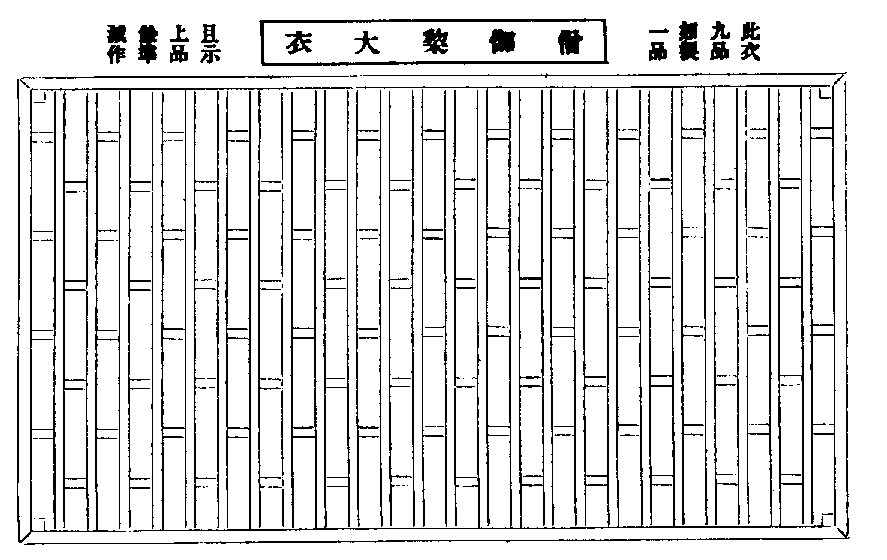



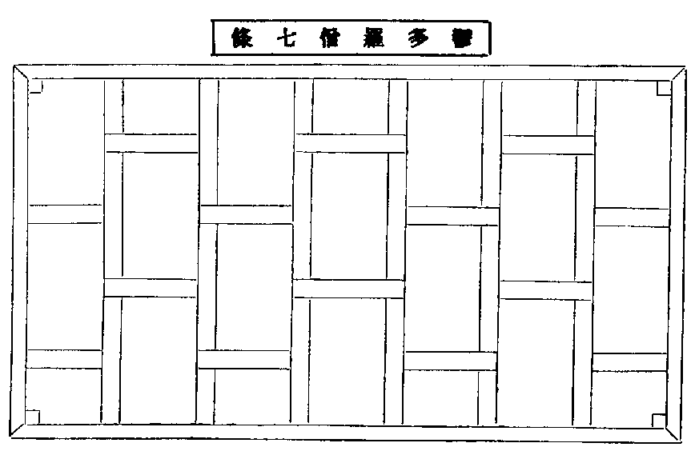



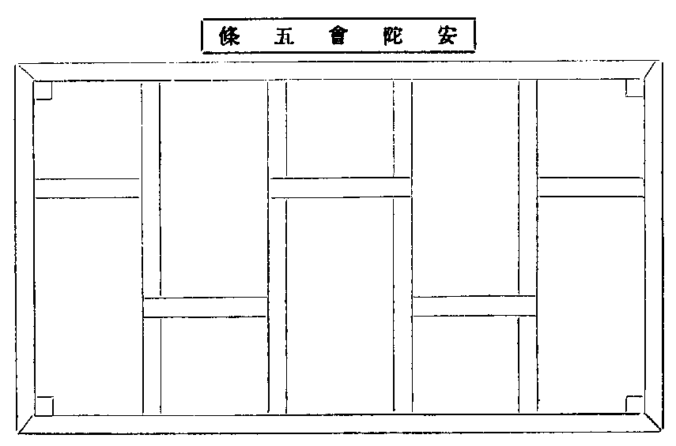



袈裟，此云不正色染，从色得名。会正云：准此是草，名可染衣。故将彼草，目此衣号，亦名坏色。即戒木中云：三种坏色，一一色中随意坏：若青、若黑、若木兰。僧祇谓：青，铜青也。黑，谓缁泥涅者。木兰，谓树皮可染作赤黑色。然此三色，名滥体别，须离俗中五方正色及五间色。○凡制三衣，当用布，不许绢细者。岂可用杀生之财，而为慈悲之服？智论云：如来著麤布僧伽梨。然其衣体，须求厚密，离诸华绮。律云：若细薄生疎，蕉葛生𥿾，并不可用。绫、罗、锦、绮、纱、谷、细绡，并非法物。今多不信佛语，贪服此等诸衣。○然此三衣，皆须加法。加五条法云：大德一心念！我比丘某甲，安陀会五条衣，爱一长一短，割截衣，持三说。餘二衣法，例尔可知。



坐具



梵语尼师坛，此云随坐衣，亦云坐具，如此方橙褥之类。僧祇云：律应量作，长佛二搩手(准五分，佛一搩手周尺二尺，则今长四尺也)，广一磔手半(即三尺也)，制法色同袈裟。



钵



梵语钵多罗，此云应器。章服仪云：堪受供者用之，名应器。(今略云钵，又呼云钵盂，即华梵兼名也。)善见云：三乘圣人，皆执瓦钵，乞食资生，四海为家，故名比丘。(僧祇云：钵是出家人器，非俗人所宜。十诵云：钵是恒沙诸佛标志，不得恶用。)佛制听用瓦钵、铁钵。(律云：大要有二，泥及铁也。)出曜经云：如来成道，已经七日，三贾客献食，佛不欲受。当观过去诸佛，为用何食？诸天空中，过去诸佛，皆用钵食，天王即奉。钵非巧匠所造，自然成就。复念四天四钵，取一舍三，则非其宜。尽取按为一钵。(又如佛本行集经。)十诵律云：钵、半钵、大键𨩲、小键钦。(键音虔，𨩲音咨。经音疏云：钵中之小钵，助钵用故。)四分律云：键𨩲入小钵，小钵入次钵，次钵入大钵。(此律言小钵，即十诵大键𨩲也。次钵，即半钵也。)钵支。(律云：钵不正，听作钵支。)



偏衫



律制只有僧祇支(此云覆膊衣，亦云掩腋衣)，此长覆左膊，及掩右掖，以衬袈裟。又制覆肩(华言覆肩，梵语未详)，掩於右膊。但西土人多祖膊，恐生讥过，故须掩之。然此二衣，亦同袈裟畟方，但无条叶耳。此方往古，并服祗支。至魏时，宫人见僧祖一肘，不以为善，始加右袖，两边缝合，谓之偏衫。截领开裾，犹存本相。故知偏衫左肩，即本祇支，右边即覆肩也(今接领开脊者，盖是魏遗制也)。



裙



梵语泥伐散那，唐言裙。诸律旧译，或云涅槃僧，或云泥洹僧，或译为内衣，或云圌衣(圌音舡，即贮米圆器，似圌而无盖，乃取其圆义云也)。



直裰



相传前辈见僧有偏衫而无裙，有裙而无偏衫，遂合二衣以为直裰。



滤水囊



增辉记云：为器虽小，其功甚大。为护生命，即慈悲之意。其在此也。南山钞有式样(文多不录)。若作漉水袋如杓形，漉讫还著水中(钞云：今有不肖之夫，见执漉囊者，言学律唯在於漉袋。然不知所为处深，损生妨道者，犹不畜漉袋。纵畜而不用，虽用而不泻虫，虽泻而损虫命。且存杀生一戒，尚不遵奉餘之威仪，见命常没其中)。根本百一羯磨云：水罗有五种：一、方罗(用绢三尺或二尺，随时大小作。绢须细密不透虫者，僧祗云虫太细。三、重作，又用密练绢作。若用疎绢、薄纱、纻布者，本无护生之意)。二、法瓶(阴阳瓶也)。三、君迟(以绢系口，以绳悬沉於水，待满引出)。四、酌水罗。五、衣角罗(言衣角者，非袈裟角也。以密绢方一探手，或系瓶口，或安钵盂中，滤水用也。　又四分律不得无漉袋行半由旬。　无者，袈裟角、漉　衣角。有二说不同)。然此五种是私用。若置於众处，当准寄归传式样，用绢五尺，两头立柱，钉钩著带系上，中以横杖撑开，下以盆盛等(慈觉大师赜公集经律凡三十一偈，又多不录，未谓世云滤罗难安多众。宗赜崇宁元年，於洪济院厨前井边安大水槛，上近槛唇别安小槛，穿角傍出，下安滤罗。倾水之时，全无迸溢。亦五大众沾足浴院后袈。故此僧行东司，亦皆滤水出家之本道也。后住长芦，说井滤水二十餘处。常住若不滤水，罪皈主执之人。普冀勉而行之)。



锡杖



梵云隙弃罗，此云锡杖，由振时作锡声故。十诵云声杖。三千威仪经云：持锡不得入众，日中后不得复持，(日中即知时。)不得檐於肩上。(锡杖经云：佛告比丘：汝等应受持锡杖。所以者何？过去、未来、现在诸佛皆执故。又名智杖，又名德杖，彰显智行功德本故。圣人之表帜，贤士之明记，道法之幢。迦叶白佛：何名锡杖？佛言：锡名轻也，倚依是杖，除烦恼出三界故。锡明也，得智明故。锡醒也，醒悟苦空三界结使故。锡疏也，谓持名与五欲疎断故。若二股六环，是迦叶佛制。若四股十二环，是释迦佛制。定字五百问云：持锡杖有多事，能警恶虫毒兽故。)



主杖



十诵律云：佛听蓄杖，其𥎞用铁，为坚牢故。斯盖行李之善助也。毗奈耶云：佛听柱杖，有二因缘：一为老瘦无力，二为病苦婴身故。(凡䇿杖，若见尊宿并二师，须投杖於地问讯。或是二师杖，必倚著处问讯。若为二师操杖，师有顾问，必把杖以对之。)



如意



梵云阿泥卢豆，此云如意，状如云叶，如此方篆书心字为人。天师说法称心，而执此者，外表仪相，故曰如意。昔隋炀帝请天台大师讲经，大师纵无碍之说，肆县河之辩，称悦帝心，特赐犀角如意耳。若释氏要览诚师所载云：如意，今讲僧执之，多是私记节文，祝辞於柄，备於忽忘，要时手执目对，如人之意，故名如意。据他所说，只如文殊执之，亦备忽忘邪？今说法者多执拂子，若私记节文，不知又书於何处？那庸鄙之谈，真齐东野人之语也。



拂子



律云：比丘患草虫，佛听作拂子。僧祇云：佛听作线拂、列氎拂、芒拂、树皮拂。若𤚐牛尾、马尾，并金银装柄者，皆不得执。



净瓶



梵语桾稚迦，旧略云军持，此云瓶。常贮水，随身以用净手。(寄归传云：凡水分净触，瓶有二枚，净者用瓦瓷，触者任用铜铁，出触以触水洗，入净以净水洗。)



香炉奁



香炉奁，盛香器也。或云炉并奁，乃二事也(菩萨戒经或本云香炉，无奁字)。



刀子



楞伽经云：为截袈裟故，听蓄四寸刀，头如月刃。今相承呼为护戒刀。僧史略云：戒刀皆是道具，为割衣故。刀名戒者，盖佛不许斫截一切草木，坏鬼神村故。草木尚戒，况其他也。



数珠



牟棃慢陀罗呪经云：梵语钵塞莫，梁云数珠，系念修业之道具也。木槵子经云：昔有国王名波流棃，白佛言：我国边小，频年冠疫，谷贵民困，我常不妄。法藏深广，不得遍行，惟愿垂示法要。佛言：大王！若欲灭烦恼，当贯木槵子一百八个，常自随身，志心称南无佛陀、南无达磨、南无僧伽，名乃过一字。如是渐次乃至千万，能满二十万遍，身心不乱，除谄曲，舍命得生炎摩天。若满百万遍，当除百八结业，获常乐果。王言：我当奉行。(百八结者，即见思惑。见惑开为八十八使。颂云：四谛欲界三十二，色无色各二十八，三界共成八十八，俱舍广明如是义。思惑合为十。颂云：欲界思有四，谓贪嗔痴慢，上二各除嗔，共成十思惟。已上见思共成九十八使。更加十缠。颂云：缠八无渐愧，烧悭并悔眠，及掉举昏沉，或十加忿覆。通前合为百八结。)



游方参请



新学欲出游方，须择有法可学处求挂塔。准律云：比丘有法有食处应住，有法无食处亦应住，无法有食处不应住。初到且过，具威仪，推熟於丛林能事者一人为参头，同到客司白云：(暂到相看。)知客出接，客云：(即日共惟判宾法师，尊候多福。久闻道誉，获奉瞻际。下情不胜感激之至。)答云：(山门多幸，荷蒙远临。)揖坐，烧香献茶，略询来历。客起谢，茶归且过。(或送客司围炉等处安歇。)知客即回礼，客接入问讯。知客云：(即刻共惟诸位尊长法师，尊候纳福。适承降重，特此拜谢。下情不胜感激之至。)答：(礼合相看，何劝降重。)参头自送知客出门。若欲礼拜住持，则先诣侍司相看，行礼如前。起身禀云：(某等特来礼拜和尚，敢烦侍者通覆。)侍者揖再坐，询问来历。若在粥罢，侍者即去。(欵坐少时，客某通覆。)继覆住持。如允，当时诣寝堂相看。若在斋后，侍者云：(请回安下处，客某通覆。)则覆住持。如允，次日早鍾鸣，侍者令客头报相看(如未暇，侍者诣安下处报礼，善言安慰)。粥罢，参头领众诣寝堂。侍者入禀住持出，参头进前云：(请和尚趺坐)。住持免即插香展具，又免即触礼一拜。问讯词云：(即日共惟堂头大和尚，尊候起居多福。某等久闻道风，兹者获奉慈颜，下情不胜喜跃之至)。毕，参头同众侧位就坐。侍者烧香献茶，住持有问，当实答，不得多语。起身炉前谢云：(重承降接，特此拜谢)。住持送出，参头止云：(和尚尊重)。随至侍司谢云：(适来有劳神用，特此拜谢)。归安下处，侍者回礼。参头接入，同众问讯云：(移刻共惟高侍法师，道体起居多福。礼合诣寮拜看，返辱降重，下情不胜威激之至)。侍者云：(山门多幸，特荷远临，报谢稽迟，下情不胜多愧)。若古礼，住持恭往，且过回礼，重远来也。今则无闻，但名胜相看，就送客位回礼。学子相看，就法堂下间，迎伺住持回礼，免烦降重。而五山大刹，则不回礼。半斋方丈请点心，当晚药石(又当晚特为汤，次日粥罢，请茶之礼，在住持行)。



求住



若求挂搭，再诣侍司问讯。少坐，起身禀云：(某等慕仰和尚道风，特来依栖座下，拜烦高侍通覆。)侍者顉话，具写求住人讳，呈覆方丈。如允，侍者次第求住持榜头下堂司。维那令行者请求住人茶，接入烧香。献茶毕，参头起禀云：(某等适奉方丈慈旨，令依附左右，伏望甄录。)答云：(山门多幸，同守寂寥。)参头同众各取度牒，递与维那，上戒腊簿。随即付还，送出归下处。各书方丈两序寮舍门状，各人各寮一纸。不得共名，亦不可白帋标头具名。(状如后式。)复各备大香一片。(近有率香钱省，是杜初心入道之路，非佛祖流通之心。凡百有位，当力免之。)次早，维那令堂司行者伺探方丈，有暇即报。求住人引到方丈通报，排立寝堂。候住持出问讯，参头进云：(请和尚趺坐。)各人进前插香。初展云：(某等仰慕和尚道风，特来依栖。极荷收录，下情不胜感激之至。)二展云：(即日共惟堂头大和尚尊候，动止多福。)大展三拜，住持略答一拜。求住人收具，问讯而退。次引至库司诸头首寮，通门状人事问讯。略插香，不受问讯讲礼。次各寮各斋人事。(堂司行者报云：新归堂人事，今止传语，多不相接，皆非礼也。若旧识乡曲，次日一一重访。)即归下处，伺头首还礼。(或不回礼者，非也。)



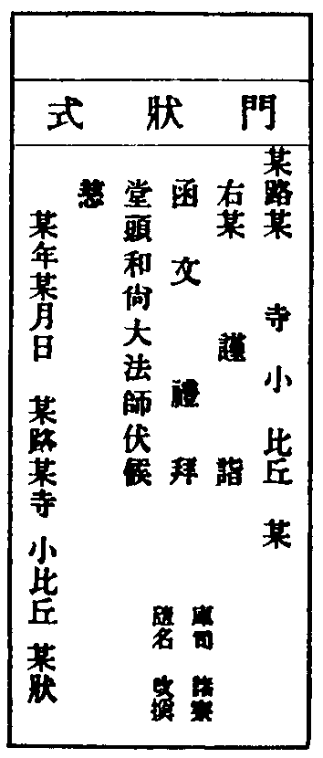



参堂



次早，待木鱼响时，参头领同归堂，众右手入堂，至圣僧前排立问讯。参头进前小问讯，袖出香合，右手拈香二炷，转身归位，同众大展三拜。参头领众到住持前排立问讯，从首座板头巡堂一匝，自上堂至下堂，次至外堂上下间问讯，再回圣僧前问讯，退就外堂，随众吃粥。下堂众出，同供头入内堂，认位挂钵。



大名胜作住



大方西堂名德首座，欲作住计，语次露意。住持当尊贤重德，当修治单寮，躬自点示，卓几、床铺、什物完备。别日，会两序勤旧茶。住持躬起烧香，复位立，白云：(某处西堂首座不弃，来此同守寂寥，烦两序勤旧同送归某斋脱著。)受送人进前云：(宿生庆幸，荷蒙收录。)同送至斋门。住持先送入，受送人揖住持归主位，问讯(云云)。送住持出，受送人转居主位，揖两班入。次勤旧入，问讯送出，即怀香诣方丈拜谢。知客引诣库司、头首寮、勤旧处回礼。别日，方丈特为管待。朔望请茶，并同勤旧之列。(此据望重者之礼，餘则量宣。)



江湖名胜求住



如欲求挂塔，或次日赴茶罢就禀，或别日粥罢，特诣方丈禀云：(某等仰慕和尚道风，持来依栖，伏望收录。)住持如允，则发榜头，烦首座请送。则首座令堂司行者，请受送人并知事一人、维那、侍者同至寮。首座则烧香献茶，白云：(住持发批：为某处某人远来，同守寂寥，烦两序同送归斋。)送入斋时，首座、居主代住持问讯毕，受送人归主位。首座转居客位，领知事、维那同问讯毕，怀香诣方丈拜谢。次至首座、库司、头首勤旧处问讯。若小刹历聀者，不在送例。又当取其人材，临时审量耳。



迁斋



方来兄弟，既挂塔归堂，行礼已办，不宜久寓下处，必迁斋舍。脱著看读，写迁斋状，诣堂司详禀维那(云云)。即捡斋舍簿，或未迁斋，或某斋人少，相议酌量，写斋名标，贴於状上。再禀维那备申，即诣侍司。侍者同上方丈呈状，住持题判，发下堂司。堂司行者，关请𬬭起，开斋门，对簿交点什物、卓凳、床具等顶。若后请假，亦须禀维那，同堂司行者，对簿交割什物完备，方许给假。近失点对，使每年措办，有揖常住。



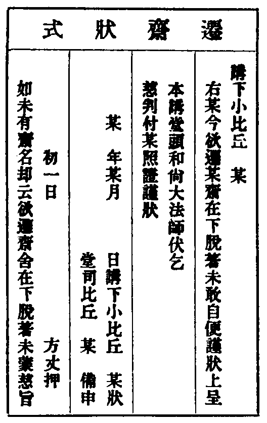



谢挂塔



凡求住已定，即谢挂塔。如住持以礼繁，待后来求住者，一同谢挂塔。如夏前归堂者，在四月八日谢。如祖忌斋归堂者，在十一月二十日谢。其戒腊在上者为参头。参头当具小图习仪，三人一引，每引一人为小参头，详记词语。仍令堂司行者，率各人香钱五伯文，烦侍者到方丈回香。约有几引，回香几片，就禀拟定何日谢挂塔。至日，侍者就寝堂设香几炉烛，参头领众依图列立。参头同侍者入，请住持出，归位立。参头同众斋，问讯毕，参头进前禀云：(请和尚趺坐)。退右足，侧转身，於香几右边空处出，行过复位。斋，问讯毕，参头同本引三人问讯。参头进炉前小问讯，怀中取香，双手插香右边空处，过复位。三人同门讯展具，住持展手约免之。参头进云：(某等宿生庆幸，获遂依栖，下情不胜喜跃之至)。退归位，问讯，再展具。住持复约免收具，再进前云：(即日时令谨时，恭惟堂头和尚尊候起居多福)。退归位，门讯，触礼三拜。住持略答。第一引问讯过，左边接班尾，三三趱上(插香词礼并同)。礼毕，普问讯而退。次日，方丈请点心。



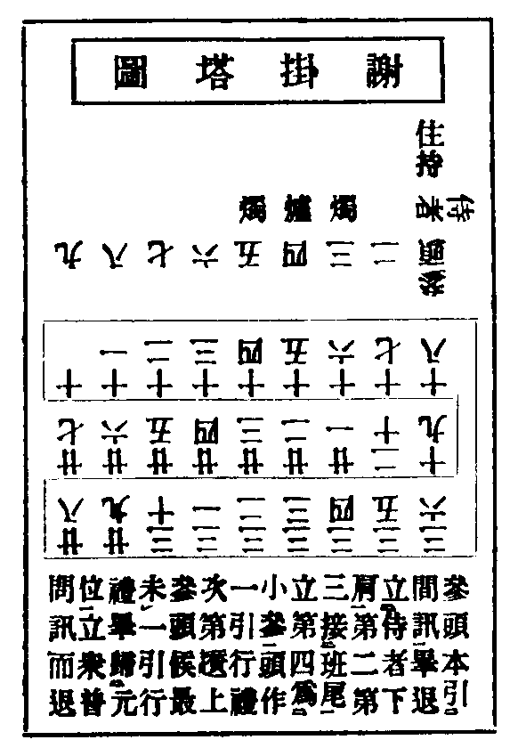



请益



凡欲请益住持，须先诣侍司详禀。侍者咨覆住持，如未允，烦再三陈请。如允，次早粥罢，各备大香一片，诣方丈，烦侍者通报。行者装香点烛，请益人鴈立於炉前，伺住持居中位坐问讯，俱诣前插香，退身大展九拜，收具进前问讯云：(某等禀惟惟钝，入道无门，伏望慈悲，不倦提诲。)退身下首，肃恭侧立，谛听法诲。(如新学者，兼诲以入众规矩。)如问来历，从实禀答，进前问讯而退。次诣侍司拜谢。或请益西堂，都讲首座则凂同门中一人预禀。如允所请，礼亦同前。师当规以日课授文，令其熟读。(粥罢塔衣，斋罢至夜，亦头持衣，俱诣法堂朗诵。)毋使泛观强记。日富月贫，当惜寸阴。右则焚膏继晷。若久历教庠，专明於解，未谙立行，师当悬取止观等文妙旨示之，令其顿修佛乘，依解立行。若不观心，如贫数宝。荆溪尊者云：观心乃是教行枢机，当观一念识心，德量无边，体性常住，诸佛众生，互摄无外。如帝网之一珠，影徧众珠，众珠之影，咸趣一珠。现前一念，亦复如是。初心学者，即以上品寂光而为观体，目足相资，则凉池可到矣。



摄众门第六。



增修教苑清规卷上



增修教苑清规卷下



天竺大圆觉教寺住持比丘　自庆　编述



安居门第七



安居门之制无他焉，不过戒游行，护物命，尅期修证而已。按律通制三时，此约一岁为三时也。今偏结夏月者，以夏中方寸之地悉有虫，苟无事游行，践伤物命，起过招谤，视餘二时为尤切焉。不然，岂修持惟在夏，而不在餘二时哉？若吾祖江陵九旬谈妙，玉泉一夏慈霔，当时预闻而造入者，盖足徵焉。今承其宗者，随处而居，慎择师友，即闻即行，圆破圆显，以验夫修证之实，非徒拘拘为蠢蠕之䘏也。



出草单



出单之日，或在三月初一日，则方来过於太早；或在四月初十日，维那窘於太迫。今定在四月初一日，不可易也。维那从公将登门戒次开顶书写(式见后)，令堂司行者先呈过两班，方呈住持批判(云云)。○(近有本山新戒，辅方落发，暮居方来大僧之上。稍或有违，便形唇吻。本师当准律法训之：先受戒者在前坐，后受戒者在后坐。不问老少，莫如外道痴人；坐无次第，如兵奴之法。我佛法中，若不如法次第坐者，犯轻垢罪。)挂僧堂前三日，皆在斋后。仍备卓子，上列笔砚。或有差悮，请自改正。盖防初上簿时，恐有错乱故也。三日后，依次上牌，并自各认本名戒次高下，不可越次乱法。近有好争作閙者，往往恃强挟私，互相涂抹，上殿拖扯，喧哗恼众，甚非所宜。犯者摈出。若果有差悮，当禀维那、首座，覆住持处置。



草单式



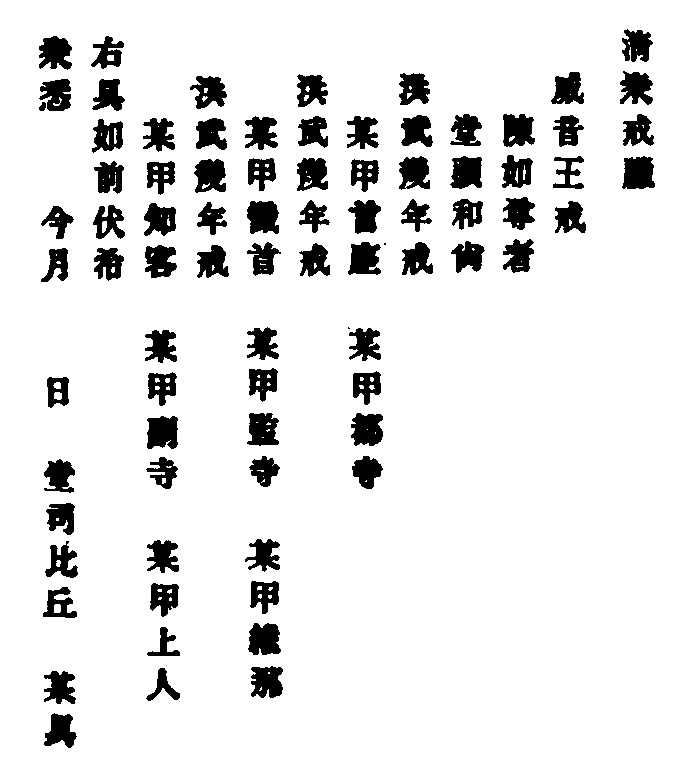



出图帐



草单既定，堂司写行道图(一依戒次)、钵位图、修忏图(以戒次分上下堂)、讲位图(倣於名字，以讲帙共者，从类排之)，惟钵位图当排西堂首座大名字为板头。排讫，於安居前一日，张道图於殿上，张钵位图於外僧堂。讲忏前一日，讲图张于法堂，忏图张于忏殿，并列香烛几案於前，令堂司行者报众，众搭衣看图认位。



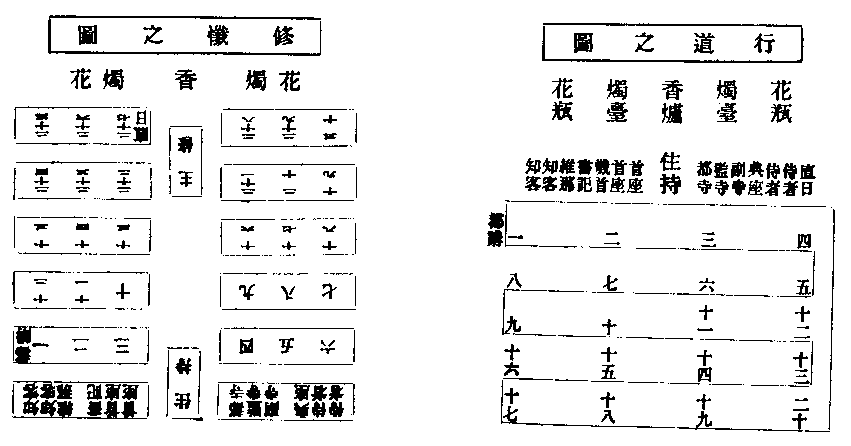



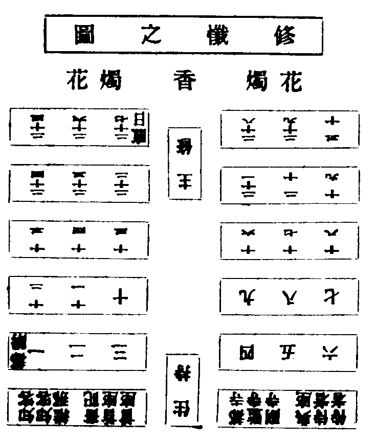



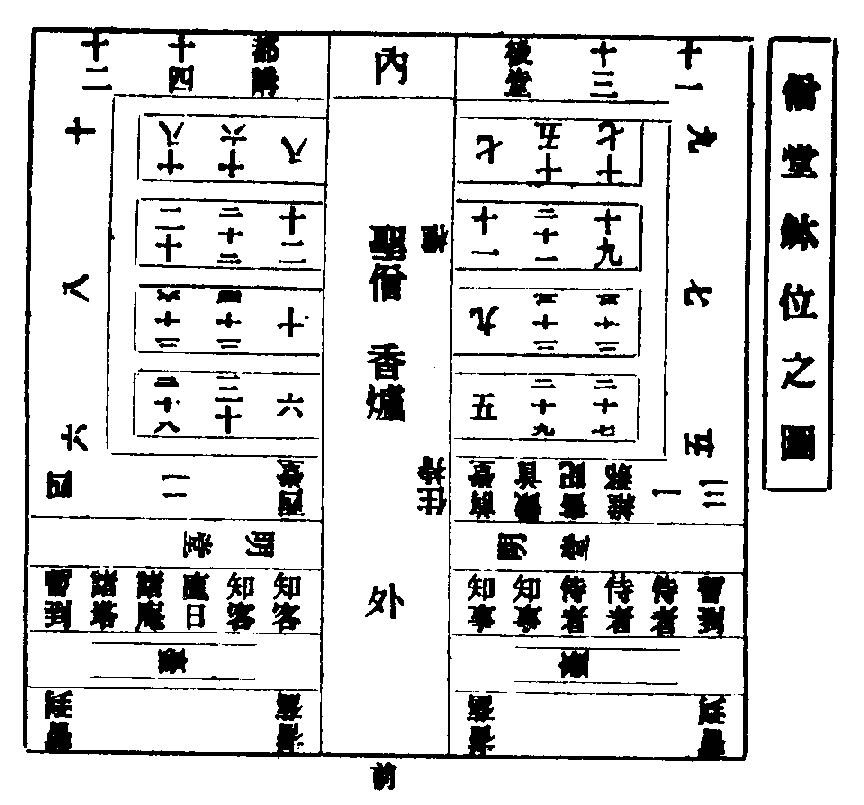



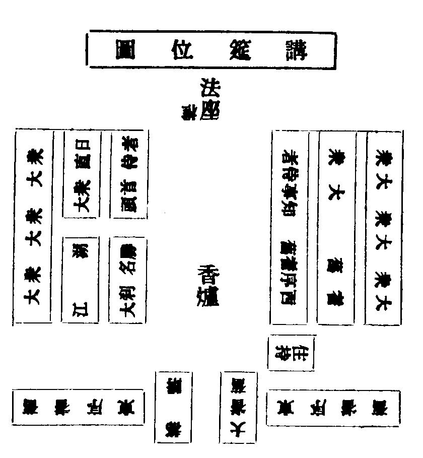



启沙水



安居将届，宜於前几日往来行礼，云拜白安居。近时多制了奔竞往来，甚违禁足之制。十四日早，堂司行者挂呪沙水牌。是日粥罢，鸣钟集众，登殿依位立。首座举南无过去正法明如来(众念云云)。后堂首座启白祈祷(如缺后堂，则忏首词云)，举大悲呪，行道立定。呪毕，亟称南无观世音菩萨十声，维那回向(如常普回向，但后改云：加持沙水，有大功能，有大力用，如斯祈扣，决望冥加)。再亟称菩萨号十声，十方三世(云云)。斋罢，鸣钟集众，诵呪举号，回向如上(但不启白)。次日二时、第三日，粥罢一时，诵呪回向亦如之(斋罢结制)。



结制



十六日浴头。斋罢，早开浴，诸殿堂然香点烛。维那写安居词句(式见后)，令堂司行者贴於佛殿左右柱上，即覆住持两班。鸣廓板毕，鸣僧堂前钟集众(各备坐具、香合)。登殿，复举南无过去正法明如来(云云)。前堂词语祈祷，举呪(众中少者四人，散洒沙水，差二仆挑灯，行者鸣引引众)。住持领众右旋，於诸天前行香，东出巡廓，至诸殿堂，烧香立定。呪歇，举号，维那回向(式如后)。再举呪，转西廊，入大殿，行道一匝，立定。呪毕，举号，维那回向(如常式)。毕，复举南无本师释迦牟尼佛，展坐具，三拜就跪。住持朝首座，白安居词语三遍(云云)。次首座朝住持白三遍，次左首大众白三遍，次右首大众白三遍。毕，住持云：(作法成否？)首座答云：(成。)收坐具(若依律文，两两对首行羯磨法)。堂司行者喝云：(大众就祖堂礼拜祖师)。首座举云：南无旋陀罗尼菩萨。行者鸣，引众至祖殿，烧香一匝立定，礼二拜。又举云：诸祖四依菩萨。礼一拜毕，收具。堂司行者喝云：(方丈和尚、两班耆旧大众，就法堂团拜)。住持领众至法堂围绕，住持与首座对首立定。住持白(云云)，大众普同触礼一拜，起问讯。堂司行者喝云：(两班耆旧大众，即今诣方丈礼贺)。首座领大众诣方丈，先首座插香，次知事插香，同两班人事，次耆旧，后江湖大众(参头各插)香，贺毕而退。次小师等礼拜，次侍者礼拜。首座复领大众至库司行礼，大众同诣头首寮行礼，住持次第巡寮(迎接如入院仪)。次知事诣头首寮行礼，两班同报诸(寮礼)。



安居词。句。



大德一心念！我比丘某甲，今依某教寺僧伽蓝大界内，前三月夏安居，房舍破，修治故。



(光句记云：依佛法一岁三时，以四月为一时，则没秋时。律中有三种安居，谓前、中、后也。四月十六日是前安居，十七日以去至五月十五日名中安居，五月十六日是后安居。若四月十六日结者，至七月十五日夜分尽名夏竟，是前三月是。　若不没秋、中、后安居，不名坐夏。以后安居至八月十五方解故。)



诸殿堂回向式



土地(明之曰灵，神之曰圣。神明既昭昭而不昧，感应则念念以无差。仰冀圣慈，俯回昭监。我此某寺，以朱明届炎，炎帝临司。乃慈尊禁足之辰，是释子护生之日。九旬辨道，克期破障以成功；一夏安居，祈赖神司而呵护。由是恭集大众云云。伏愿宗风益振，挽回列祖之玄猷；慧日长辉，不断后世之佛种。山门肃穆，海众安宁。檀信归从，法轮常转。十方三世，一切云云)。



韦天(藩屏佛化，盖本证之以深，保障山门，示大权而利益，仰冀云云。时维首夏，将事安居，欲理中外无魔，须假进修，有序云云。伏愿道场镇山岳之固，教海源河汉之长，三学与隆，四檀成集，公私并秦，火盗双沉云云)。



监斋(奥者，宰一寺之封疆；灶者，典众人之喉舌。威灵有正，正直无私云云。兹以薰风拂拂，适当结制之辰；杲日炎炎，正是安居之节。法轮当运，食轮为先。欲令香积之充餘，须藉神祇之匡护云云。伏愿晨炊夕㸑，无徒薪曲突之忧；斋鼓粥鱼，有法喜神悦之味)。



僧堂三日茶汤礼(结解二制并同)。



都寺特为住持首座大众汤



请结制。礼罢，都寺怀香诣方丈，触礼一拜，请云：(今晚就云堂，特为和尚、首座、大众点汤，伏望慈悲，特垂光降。)仍具汤榜(见后)，带客头行者，备柈袱、炉烛，诣前堂首座寮插香，触礼一拜，禀请(如前云云)，以榜呈纳。首座即令本领茶头，递付供头，贴僧堂前下间。库司仍令客头，请次头首、诸耆旧，并挂点汤牌於内。僧堂上下间，各排香几、炉袱。外堂亦须对圣僧厨，直排大香炉、花瓶。於圣僧厨边，设首座特位，与住持对面，差侍者直特位，各板汤具。至晚，堂司行者，鸣廊板各三下，大众归钵位。次头首入，最后首座入，各归本位。鸣钟三下，打板三通，都寺入，即揖首座归特位，仍揖后堂首座，补前堂位(如缺后堂，就揖次头首进板首)。从圣僧厨后右出，於内堂门边立。闻钟一下，出迎住持入堂，大众起立。住



持略问讯，不烧香，归位。都寺进前问讯，揖坐，转身归中立，问讯众坐，进圣僧前烧香。次上下间各烧香，出外堂烧香，回厨前安香合，至特位前问讯。厨后转至住持前问讯，巡堂一匝。及外堂，归堂中问讯，侧立。又鸣钟一下，先进住持、首座特为汤。都寺至住持、首座前揖汤，仍从圣僧厨后转。又鸣钟一下，行大众盏。又鸣钟一下，大众汤。候行汤将毕，都寺如前从前堂板头起，巡堂一匝。出外堂毕，行者先收住持盏。都寺进住持前问讯，初展云：(兹者聊备粗汤，伏承和尚降重，下情不胜威激之至。)二展云：(叙寒温。)三触礼。住持不答。都寺送住持出，归厨前转左立。首座从厨后右出，问讯谢汤。都寺送出，复归中烧香，仍上下间问讯，退。鸣钟一下，收盏下堂。钟三下，



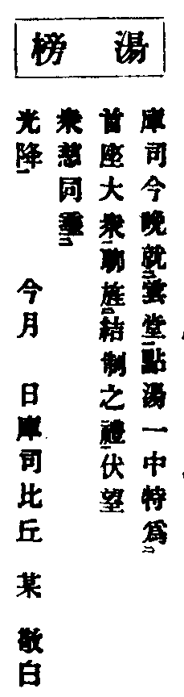



清规榜(维那预写榜，呈方丈佥押。或十六日，或十七日读。读毕，张挂僧堂。前三日，堂司行者杠之。)



十六日斋时，折钵水出，知客起烧香，中立读榜。



安居众法。



夫司南之车，本指迷者；照瞻之镜，元监邪人。无邪则镜何所施？不迷则车何所用？其游方之士，德学是求，岂俟小惩，然后能䇿？但后生罔识於己，解行事同公役，今不获已，须行严训。於坐制日，准国清百录及天竺众制，略示条件。



九旬禁足，辨道是谋。讲忏禅诵，靡遑食息。岂应疎散，浪有出入。於三月内，例不与假。除父母师长不幸缘故，仍须堂司保明，指日开给。如不遵约束，及托缘不实，擅自出入者，不许共住。  

晨忏昼讲，诵经习读说戒，并教苑常规，诸方通式。况当夏制，尤宜笃行。今除山门知掌局务，及病缘给假水，无论徒第耆旧，并须起众，饱食烂眠，軃避众法，虗消信施，深为不可。请维那於众集时，依次第排列。有不至者，抄名罸香五两，鸣椎忏谢。再犯倍罚，二犯不共住。其赴众不及时后至者，罸香三两。中间潜去者，罸香三两。  

斋粥二时，宜须早赴。木鱼既鸣，不许入堂，及展钵作声，匙箸堕地，含食笑语。食毕先起，违者罸香五两。  

众中仪矩，贵在庄肃，非特己事，亦生他善。凡众集处，不许接对戏笑，及出廊下，不得臂擐手巾，把手骤行，有乖威仪，违者罸香五两。  

斋粥二时，除有病缘打给外，餘并不许。亦不得僧堂前私自盛贮，违者重罸。  

凡在寮舍不问勤旧，当以禅寂看诵为事，不得私著僧俗等客宿食及茹荤饮酒，犯者不共住。一服饰礼仪自合如法，往来廊下须塔袈裟，斋中不得露白，违者罸香五两。  

新学之士，须秉志肃恭，亲附在上，授书熟诵，请益义理。其在上者，当示规矩，拘以日课，以待中夏挑试，通赏塞罸。  

僧名和合，忍辱义让，不许诤计。抗声厉色两竞者，各罚三七拜，对众忏谢。被骂不应者免。身手相交，不问轻重，并不共住。被打不动手者免。  

斋舍不许更互止宿，犯者不共住。弹琴奕碁，哥唱吟咏，诸杂鄙事，寔妨道业，皆不应为，违者罸七拜。  

作匿名书者寮，得实不共住。  

不守律仪、窃盗等事犯者，准清规行。



> 已上条件，宜各遵行。夫高翥者何患於虞罗，潜渊者宁畏於筌网。藉缘进道，得益良多。依众立身，宜须保护。请堂司遵行，毋使有违，自贴后悔。　今月　日示。　方丈花押。



住持特为首座大众茶



第二日，请客侍者具茶榜(见后)，备柈袱、𬬻、烛，带方丈，茶头捧之，诣首座寮，炷香触礼，请云：(堂头和尚今晨斋退，就云堂点茶，特为伏望降重。)以榜呈纳，贴僧堂前上间。客头行者请诸头首、知事、耆旧，挂点茶牌。斋时，长板鸣，请客侍者入堂，请僧前烧香一炷，左转身，大展三拜，巡堂一匝，请茶。仍出外堂，上下间问讯，转入圣僧前，问讯而退。候行者下堂，堂中仍设首座特位，对住持位，即鸣诸寮板三下。大众入堂，鸣茶鼓，烧香侍者行礼(并与都寺特为汤礼同，但不揖住持)。首座至住持前谢茶，初展云：(某兹蒙煎点，特此拜谢，下情不胜感激。)二展云：(即日孟夏云云。)三触礼三拜，住持答一拜。首座转身，从圣僧后右出，住持略送，复位。执盏侍者烧光伴香，上下间问讯。鸣钟一下，收大众盏。鸣钟三下，众下堂。



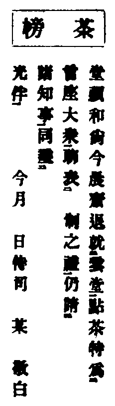



前堂特为住持后堂大众茶



第三日，首座诣方丈请茶，仍具茶状(见后)。诣后堂，首座请茶(如缺后堂，则请忏首)。行礼次第，大略同前，但不烧光伴香异耳。



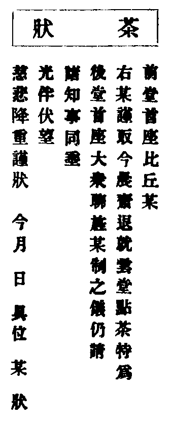



可漏子　状。请　后堂首座大众。　前堂首座比丘某谨封



住持两班点行堂茶(结解并同)



结制。住持僧堂点茶罢，侍者同客头至行堂点茶。客头预报，参头挂点茶牌报众，请典座光伴烧汤出盏。方丈预送茶侍者至，库司、典座接入，参头、堂主领众门迎。侍者代住持居主位，典座分手，侍者出中烧香复位，以手揖众坐。吃茶毕，典座送出，参头、堂主门送，即诣方丈谢茶。库司候方丈点茶罗，知事至行堂点茶，知事居主位，典座分手行礼，与方丈侍者同送出门，喝云：(参头大众诣库司谢茶)。库司茶头报云：(知事传语免谢茶)。头首僧堂点茶罢，令堂司行者报，参头挂牌报众，请典座光伴行礼，与库司同。(出门唱谢、唱免亦同)。



直日须知



维那於结制前预置条册一本，审定阇梨多少，依其戒次，从下至上，三日一轮，周而复始，以日逐规矩书之於前，以直日各名列之於后。维那賷诣方丈批判，初令堂司行者送至直日人斋中，至第三日晚讽诵毕，賷须知册、塔衣送至次直日人斋中，至三日满，展转递送，所有条章并见於后。直日人在侍者班末立。



须知式



公输虽巧，不舍规矩方圆；新学游方，须学丛林仪范。斯乃出众之鸿渐，入道之初门。直乎三日始终，毋得托缘推故。今将日用规矩，具陈于后。



晨朝大殿讽诵，候鸣殿钟，同侍者归班立。钟绝，鸣引二下。首座毕，呪约诵呪四五句，鸣引二下。行道毕，立定，鸣引二下。头首举号，鸣引一下。众和三声毕，鸣引一下(餘号例前)。维那回向，至十方三世一切诸佛，鸣引一下。一切菩萨摩诃萨，鸣引一下。摩诃般若波罗蜜，鸣引二下。引众赴堂。  

修忏，候鸣忏殿钟，归直日位立。钟绝，鸣引二下。至忏悔发愿毕，拜起，鸣引二下。主修举[方*　]唱佛号，每声鸣引一下。至称南无十方僧毕，即转身朝主修问讯，徐徐前行，[方*　]绕称佛菩萨名，各鸣引一下。候佛号三遍将毕，立定，鸣引二下。举三归依，至和南圣众，拜起，鸣引二下。举阿弥陀佛真金色毕，鸣引一下。举佛每十声，鸣引一下。至百声足，鸣引二下。举菩萨号各十声，各鸣引一下。至末菩，鸣引二下。举忏悔发愿回向偈，各鸣引一下。(十方三世，一切如前鸣引。)归僧堂。  

晨粥赴堂修忏毕，鸣引二下，先出殿门边，转身小问讯，徐徐鸣引，至内堂门外右边立，待众入。次住持入已，即入内堂右边立。候住持烧香归位，鸣引二下，众问讯，上床坐定。鸣入定，引三下，前重后轻(数十息，约持心经一卷)。鸣出定，引三下，前轻后重，问讯，出外堂直日位坐。闻钟鸣，即下禅床，慗肃威仪，缓行至内堂外右边侧立。皷转通，即入内堂圣僧前问讯，至炉前小问讯，左手烧香二炷小问讯，退行三步半又问讯，合掌右遶圣僧厨后，转至推所。皷绝，鸣椎一下，头首举展钵偈。偈毕，鸣椎一下，云：白大众，令白月一日晨朝，各记六念(初一至十五则云：白月自十六日以去，此月状黑月某日晨朝，各记六念毕)。鸣椎一下，回向云：晨粥殊利(先看逐日神示云云)。为此缘念，大众称清净法身毗卢遮那佛，鸣椎一下(以左手作盖势，侧按椎垫，右手打椎，高不过五寸，声绝方下椎，急缓合度)。每号一声，各鸣椎一下毕(良久)。又鸣椎，候行食遍，鸣椎一下，头首举施食偈。偈毕，鸣椎一下，默作五观。又鸣椎一下，头首举食偈，仍从厨后出，至圣僧前问讯，归直日位受食。伺折水出，即入堂圣僧前问讯，乃至椎所略问讯。视众裹钵毕，鸣椎一下，头首举食讫。偈毕，鸣椎一下，堂司行者鸣引，领大众诣殿堂讽诵，直日最后出堂。  

午斋：板鸣，随众入堂，归直日位坐。候鸣皷，下禅床，至内堂外右边立。候皷转，通僧堂前。钟鸣，入堂烧香(餘并如前)。  

开讲，候鸣僧堂前钟，随众诣法堂，归直日位坐。皷转第二通，起身至炉前问讯，上方丈住持前问讯，转身於侍者肩下立。候鼓转第三通，问讯，请住持起轿，随至法堂前。住持下轿，鸣引二下，大众起立。直日至西首立，住持烧香，转身问讯，鸣引二下，住持上座。直日从西首第二行入至椎所，伺住持烧香问讯，鸣引二下，趺坐讫，鸣椎一下。住持执手炉举偈(戒香、定香云云)，住持回向至为此念，大众诵号十声，每声鸣椎一下毕，住持复举除障开解称号，展帙毕，鸣椎一下，归位坐。说听功悳(至十方三世一切诸佛鸣椎一下，一切菩萨摩诃萨鸣椎一下，摩诃般若波罗蜜鸣椎一下)，住持下座，至大香炉前问讯，鸣引二下，众散。头首开讲并同，但初日至方丈请，次日以去诣寮请。  

斋罢，讽安乐行。候众下堂，鸣殿钟，归位立定。钟绝，鸣引二下。头首举经至品字，鸣引一下。诵至一者安住菩萨行处，鸣引二下。行道至后偈立定，鸣引一下。至见十方佛，鸣引一下。众合掌，经毕，鸣引二下。举号，鸣引如前。  

讽楞严，候鸣殿鍾，归直日位立。钟绝，鸣引二下，头首举呪一声，鸣引一下，众和诵至因陀啰耶，鸣引二下，行道诵至帝瓢，骤鸣引数下至每结尾，鸣引一下，头首复举下结如前，骤鸣引数下至第五结中，鸣引二下，立定。呪毕，鸣引二下，举号回向，鸣引如前。  

施食，候讽楞严回向毕，鸣引一下。众转身念南无十方佛至南无大悲观世音菩萨，鸣引一下。至第三遍讫，鸣引二下。举偈云神呪加持净饮食(八句偈毕)，鸣引一下。举呪，每徧呪引一下。至七徧足，鸣引二下。称四如来，每徧鸣引一下。至三徧足，鸣引二下。念汝等鬼神众(四句偈毕)，鸣引一下。念愿以此功德(四句偈毕)，鸣引一下。(十方云云，鸣引如前。)○(次第今依忏主方法，具如施食通览。)  

习读，候参后讽诵。至施生毕，直日疎疎鸣僧堂前钟，每声约诵大悲呪一遍。望住持挑灯至法堂，连鸣钟三下，歇。至法堂住持前问讯，鸣引二下，归直日位坐。候住持再鸣尺二下，起身。待住持付阄，高声云：某斋某人覆讲。或拈第二名，亦如之。喝讫，复位坐。次拈开科、诵文并同。至诵文毕，鸣引二下，众散。详如后正式。



轮次直日名字，周而复始。



其上人。　其上人。　其上人。　其上人。　其上人。



今。月。　日。　堂司具



> 方丈花押



修大悲忏法



四月二十日晨朝，启修大悲忏法。前一日，堂司行者覆住持两班诸寮，仍挂修忏牌报众。令直殿人铺设蒲团，堂司行者备手炉、烛台、散花，置於小几上，陈在主修之前。至日早，鸣殿钟，大众依图次归位立。所修行法次第，具如补助仪。凡仪理观，皆悉精熟。於此总持，生决定信，起精进心，於相无相，尽力修之。现世障恼皆除，净土往生不忒。广论利益，具载经文。



住持开讲



举忏之日，住持启讲。凡讲说训徒，乃住持当然之事。研几索隐，为学者当须究心。起讲之先一日，侍者禀住持，以约标书云：来日方丈开讲某文至某卷某科。令堂司行者贴开讲牌上，挂僧堂前。至日早粥，再请毕，堂司行者覆住持开讲。待下堂钟绝后，少顷，打静钟三下，持者分付行者并椅卓头排设讲位。堂司行者覆住持两班，鸣廊板及僧堂前钟毕，令鸣楼钟一十八下。鸣皷，住持出厅坐。皷转第二通，大众诵法华？嘱累品。鼓转第三通，住持乘轿。若法堂去方丈远，可令直日人先至法堂立待。住持至法堂前下轿，鸣引二下，众提坐具起立，接住持。住持归中烧香。若初起讲，应设三拜，收具问讯，从东入问讯，登座烧香，问讯趺坐。两班同进前，插香作礼。次耆旧，次江湖，次堂众，一一如之。(班首预率钱市香烛，次年但袖香合炷香，亦不必作礼。若新归者，仍用行之。)若有他山住持、西堂首座、道旧参讲者，若设拜，侍者须预进前止之。参毕，侍者揖请至对法座左右位坐。讲讫，叙谢，结下座。若名德参讲，住持即就炉前触拜还礼。若座下人及次者，则不必答礼也。凡他方参讲者，即令请客行者就诣方丈点心。



经行讽诵施生



於启忏日，至斋时，堂司行者候鸣下堂钟毕，即鸣殿钟集众，依次立定。头首举安乐行(谓饭食经行也)行道。至立定经毕，举[跳-兆+(虒-虎+((白-日)/一/巾))](南无释迦牟尼佛、南无妙法莲华经、南无文殊师利菩萨)回向(愿灭三障云)。是日参后，启楞严会。亦预於前一日，堂司行者覆启忏时，就覆建楞严会，并挂牌报众。至日晚，鸣僧堂前钟，集众立定。头首举呪行道。呪毕，普回向(云云)毕，众转身向外立施。当以右手按器，呪满七徧，弹七下，展臂行无畏施。然后以食泻净地上，想诸鬼鬼神食之(施食方法并观想等文，具如慈云尊者金园集)。



布萨仪



佛律布萨，众所宜遵，岂特维那己躬之事。今行事诸贤，维那和会，当如戒而住，以法自重。维那结制后，必预袖香，专诣各寮和会，答法、诵戒、秉白、行事人等。其间亦须备员，仍书各人名字，禀住持知会。住持令请客行者，请各人就方丈献茶。客至，烧香行礼(如常式)。茶罢，住持白云：(丛林盛事，说戒为要。将次举行，请第一座元答法：某诵戒，某梵音，某秉白，某某行事，某说净云云)。白已即起，普问讯送出。须预一日，就法堂敷设，请行事人习仪。必推习熟者，再四教之，莫待临时，有失仪度。习熟则止。(和会之次，说戒之时，管待礼随，山门讲行。)



一(四月)黑月十五日，广四重(餘略)。　二(五月)白月十五日，广十三、二不定(餘略)。　三(五月)黑月十五日，广三十(餘略)。　四(六月)白月十五日，广九十提舍(餘略)。　五(六月)黑月十五日，广众学(餘略)。　六(七月)白月十五日，不说戒(或诵遗教经)。



至日早挂牌(贴帪时，就法堂说戒，各备拈香一片)。直日於僧堂早粥时，伺展钵后，鸣椎一下，白云：大德僧听！今白月十五日(黑月则云：此月（大、小）黑月十（五、四）日)众僧和合(辰、申)时，就讲堂说戒，鸣椎一下，白大众。晨朝各记六念(如常)。若辰时说戒，粥罢开浴；若申时说戒，斋罢开浴。仍令洒扫法堂，排设椅凳，及排圣僧、住持二位於法堂东首面西，置椎於法堂西首面内，复排椅於西首面内(此乃秉白行事人位，或有排於住持对面者，非)。堂司行者於大炉前排手炉、花盘、筹匣、水盂、汤盂、手巾，并架置蒲团於香炉前，又排设座上香炉、花瓶、烛台、手炉等。珍重尸罗，不可率易(今作一途示法，具列十科)。



一、集众



○凡说戒日，库司候时至，预送点心归。堂司请诵戒及行事等人点心毕，维那令堂司行者，覆住持及两班。鸣廊板，及鸣僧堂前钟。大众集僧堂前，依钵位上下堂次，一一叉手对立，威仪整肃，不可笑语。住持至，则绝钟。首座立於住持肩下(为便答法)。梵音师对住持，诵戒师对首座，两班大众并依戒次上下堂立。秉白及行事人在於下堂大众之后，说净人在於上堂大众之后。唯直日二人，分对立於住持梵师之上，退后略远而立。众集已，鸣大钟至三下。直日鸣引二下云：(大众各念闻钟妙偈。)鸣引一下，众合掌云：(降伏魔力怨，除结尽无餘。露地击揵椎，比丘闻当集。诸欲闻法人，度流生死海。闻此妙响音，尽当云集此。)



二、入堂



○念闻钟偈毕，直日鸣引二下，略问讯於前。疎疎鸣引，引众依上下堂，两两并行。至讲堂香炉前，备一大盘，置於几上。大众各次第抛片香於盘中。住持对法座问讯，归位立定。次大众一一对法座问讯，就位，次第分上下堂立。秉白行事人於西首横椅立，说净人在首座后立(菜生此悬一位与说净者)。众齐立已，鸣引二下，众问讯。秉白云：大众各念入堂妙偈(持戒清净如满月，身口皎洁无瑕秽。大众和合无违诤，尔乃可得同布萨)。各展具，礼三拜(每拜鸣引一下)。众各胡跪。秉白云：(时众已集，上座欢喜)。住持云：(大众忆念！我比丘某甲　前布萨，至今布萨。於其中间，三业四仪，众多不善，恼乱大众。愿众慈悲，布施欢喜)。秉白再云：(大众一时各乞欢喜)。大众云：(大众忆念（云云如前）)。秉白云：(欢喜已)。鸣引一下，众收具而起。鸣引二下，众问讯，摄衣置具趺坐。



三、取净盂及筹



○秉白领行事四人，起身问讯。秉白先行，次四人随之，至香炉前。秉白居中间立，行事第一人在秉白右立，第二人左立，第三人又右立，第四人又左，同问讯。秉白烧香退身，同问讯，齐展具，礼三拜，不收具，起立问讯，叉手。秉白自问讯，回身向东转，至水盂前立，略问讯，胡跪诵水偈云：(八功悳水净诸尘，盥掌去垢心无染，执持禁戒无缺犯，一切众生亦如是。○盥手、拭巾，下皆例此。)偈毕，起身问讯，向西行，至汤盂前。行事第一人亦同问讯，回身至水盂前。二人须瞻顾，紧缓相待，同略问讯，胡跪。秉白诵汤偈云：(香汤薰沐澡诸垢，法身具足五分充，般若圆照解脱满，群生同会法界融。○盥水、拭巾，下皆例之。)偈毕，第一人诵水偈(如上)。偈毕，同起身。第二人亦同问讯，秉白归元立处。第一人亦随行至汤盂前，第二人亦绕至水盂前，同略问讯，胡跪说偈(云云)。毕，同起身。第三人亦同问讯终，至第四人诵偈毕，归位，一齐问讯，三步进前，略问讯，胡跪取筹，及执水盂、手巾。秉白举浴筹、偈於左右，以汤水浴筹云：(罗汉圣僧集，凡夫众和合，香汤浴净筹，布萨度众生。)此项行事，与律苑同，或有异者，并录子此，随方取舍。



从五人初至香炉前，礼三拜，不收具，起立，同问讯行事。第一人、第二人进前，小问讯，胡跪。第二人左边，先诵水偈(云云)。第一人左边，后诵汤偈(云云)。偈毕，二人俱起立，小问讯於秉白后，互过，互位立，问讯。仍同进前，小问讯，胡跪。第一人左边，先诵水偈(云云)。第二人右边，后诵汤偈(云云)。俱起，小问讯，退后，又问讯於秉白后，互过。第三人、第四人入补上手之位。第一人、第二人退立下手之位，同问讯。第三人、第四人进前，胡跪，说偈(云云)。毕，於秉白后互过，各复本位，同问讯。先二人进前，取水、汤、盂，次二人进前，取手巾(并行者递送)。四人转身，相朝秉白面内，同胡跪。秉白诵水、汤二偈毕，取筹(行者递至)，以筹略沾左右水、汤，举浴筹偈(云云)。



四、行水汤盂盥掌



○五人起身，平立问讯。秉白先行，至椎所面内立，四人随行。执水人至椎所，秉白揭椎袱，以手沾水於椎上。执巾人随至，以巾拂椎，口诵其偈。次执汤者亦如前。四人次第至僧前小跪，住持前小跪，大众前循行，各次第盥手拭巾诵偈。四人行毕，归中齐立问讯。二人进前安水汤盂，二人进前挂巾，退后同问讯，一拜收具，次第各归元位，问讯而坐。



五、行筹



○秉白鸣椎一下，唱云：(大德僧听！众中谁小？小者收护。○众中下三称)其行事第四人，初闻唱谁小？小者收护，即起立问讯。至秉白后，问讯略远，叉手立。秉白三称毕，鸣椎一下，云：(大德僧听！外有清净大沙门入。○外有下三称)若有客比丘，皆集此处。三称毕，鸣椎一下，再唱云：(大德僧听！此众小者已收护，外清净大沙门已入。内外寂静，无诸难事。堪可行筹，广作布萨。我比丘某甲，为僧行筹，作布萨事。僧当一心念作布萨。愿上中下座，各次第如法受筹。○愿字下三称)鸣椎一下。(如法受筹，并受嘱授人筹)僧众若少，但秉白授筹，小者收筹。僧众若广，分筹为二，作上下堂行之。秉白至圣僧住持前小跪，各授一筹。住持双手受之。(或同众展具跪受，或坐受)诵受筹偈云：(金刚无碍解脱筹，难得难遇如今果。我今顶戴欢喜受，一切众生亦如是。)收护人亦至僧前住持前小跪，双手接筹。住持诵还筹偈云：(具足清净受此筹，具足清净还此筹。坚固喜舍无缺犯，一切众生亦如是。)秉白次第循行，上堂分筹，众各受筹，诵受筹偈(云云)。如有事缘及病者不来听戒，当预书双字名，与受欲人说净。其受欲人则记不来者受若干筹。收护人次第收筹，众各还筹，诵还筹偈(云云)。其下堂二人授筹亦然。行毕，同至炉前蒲团上，胡跪互受筹。还筹了，起身。秉白至椎所，三人随至，排立於后。(若秉白自行筹，但留小者收筹，餘者复位。)鸣椎一下，唱云：(次行沙弥筹三称。)白云：(行沙弥筹。)每二人各从后板入，行沙弥筹毕，至法座后数筹，二人先出复位。收护一人捧筹右出，绕大炉转至住持前，胡跪上筹，白云：(大僧几员，少弥（几无）人。)起问讯，左入法座前，转右出归位。秉白徐至住持前跪，住持授筹云：(大僧几员，沙弥几（无人）。)秉白受筹，绕法座前，右转归椎所，鸣椎一下，唱云：(大德僧听！此住处一布萨，大僧几员，沙弥（几无）人，都合几人，各於佛法中清净出家，和合布萨。上愿佛教，中报四恩，下为含识。)鸣椎一下，白云：大众各念律中清净妙偈。众皆合掌，诵云：(清净如满月，净清得布萨，身口业清净，尔乃应布萨。)



六、请戒师



○秉白至炉前，安筹一拜，收具。诣住持前，展具一拜，胡跪云：(上座慈悲，为众说戒。)住持云：(此说戒事，坐次合当。但以言词浊钝，恐恼於僧。众中有某申律师，精诵毗尼，往彼告云：僧差说戒。)秉白收具，起问讯。绕法座前，转至戒师前，小问讯，低声云：(僧差说戒。)至梵师前，亦低声云：(大德梵音。)梵师、戒师，亦合掌坐而受之。秉白至椎所，鸣椎一下，唱云：(大悳僧听！僧差某甲律师，为众说戒。梵音某甲律师，升高座。)说戒人闻僧差二字，即起身至炉前，问讯烧香，礼三拜。(秉白戒师，须相瞻听，缓急声绝，拜毕。)拜毕，胡跪唱绝，鸣椎一下。戒师白云：(小比丘某甲，稽首和南，敬白大众：僧差说戒，恐有错护，愿同诵者指授。)收具，起立问讯。诣圣僧、住持前，各问讯。(又普问讯上堂大众，退至右边，普问讯下堂大众。)入至座下，问讯登座，烧香问讯，趺坐。



七、散花作梵



○行事四人起身，归炉前元处同问讯。二人进前小问讯，跪下取花柈复位。次二人进前问讯，跪执水盂复位。同问讯从东首散洒，绕座前一匝，秉白鸣椎一下，白云：散花说偈。大众同声诵云：(散花庄严净光明，庄严宝花以为帐，散众宝华遍十方，供养一切诸如来。)众皆合掌。梵师白云：(稽首礼诸佛，及法比丘僧，今演毗尼法，令正法久住。)梵音云：(优波离为首，及餘身证者，今说戒要义，诸贤咸共听。)散洒人归座前一行立问讯，进前转身相朝胡跪，并花为一盘，合水为一盂，置於花柈上。一人捧之起身，平立问讯，三人归位。捧柈者先面西逆行，洒水散花填於中间，须待听梵音，不缓不急行之。梵音将毕，然后结四方毕，至炉前问讯，进跪置柈归位。



八、请说戒



○秉白候梵音毕，鸣椎一下。行事一人起，至炉前敷具，礼三拜，就胡跪，执手炉白云：(传香说偈。○律师亦三上香。)众合掌诵云：(戒香（一上香），定香（二上），解脱香（三上），光明云台遍法界，供养十方无量佛，见闻普熏证寂灭。)然香人收具，问讯归位。直日鸣引一下，大众合掌，沙弥则出大界相外。戒师执手炉，诵四分戒本序。(从首偈诵至半月，半月说。)直日鸣引一下，戒师放手炉。住持叉手揖众，众皆叉手揖谢。住持秉法，首座答法。问：(僧集否？)答：(僧已集。)问：(和合否？)答：(和合。)问：(未受具戒者出？)答：(若有，则云：未受具戒已出。○无，则云：此众无未受具戒者。)问：(不来诸比丘，说欲及清净。)说欲者展具，胡跪，合掌白云：(若有，则云：大德僧听！彼比丘某甲、某甲，我受彼欲、清净。彼如法僧事，与欲、清净。○言某甲处，称彼讳名，一说收具复位。○如无，则云：此众无说欲及清净者。)答：(如有，则云：说欲及清净已。○如无，亦云：此众无说欲及清净者。)问：(谁遣比丘尼来请教诫？)。答：(此众无尼来请教诫。)问：(僧今和合，何所作为？)。答：(单白和僧说戒羯磨。)住持云：(单白和僧说戒结磨。○大德僧听！今（白、黑）月十（四、五）日，众僧说戒。若僧时到，僧忍听，和合说戒。○白如是。作法成不？)。答：(成。○或有一字落误，则云：不成，当重作。)住持云：(作法既成，高座说戒。)戒师即诵戒字。后七佛略戒，鸣僧堂前钟三下，召沙弥入堂。(无沙弥，则不鸣鍾。)诵至我虽般涅槃，当视如世尊，秉白先起身，就本位礼三拜，归椎所立。



九、再唱梵师下座



○梵音师候座上诵戒毕，唱神仙梵云：(神仙五通神，造设诸呪术。为彼惭愧者，揖诸不惭愧。如来立禁戒，半月半月说。已说戒利益，稽首礼诸佛。○处世界，如虗空。如莲华，不著水。心清净，超於彼。稽首礼，无上尊。)戒师下座，至大炉前烧香，礼三拜。(梵师、戒师互相瞻听梵音终时，拜亦同竟。)拜起，就胡跪秉白，鸣椎一下。戒师白云：(小比丘某甲致敬众僧足下：敬谢众僧，僧差说戒。三业不懃，多有忘失。愿僧慈悲，施以欢喜。)收具起，问讯归元位。



十、皈依三宝



○鸣椎一下，众敷具，秉白唱三皈依。(自归依佛，当愿众生，体解大道，发无上心。鸣引，大众一拜，鸣椎下同。一。自归依法，当愿众生，深入经藏，智慧如海。自归依僧，当愿众生，云云。上来布萨，无限良因，散沾沙界，和南圣众。)众拜起，就胡跪，同念自庆偈云：(诸佛出世第一快，闻法奉行安稳快，大众和合寂灭快，众生离苦解脱快。)收具起。若申时说戒，即施生(如常式)。直日鸣引二下，引众出堂。大众依上下堂。次从小者先出，两两并行，徐徐鸣引。引至僧堂前旧处，众立定。堂司行者鸣僧堂前钟三下，众同问讯而散。



(梵语布萨，此云净住。南山云：净身口意，依戒而住。毗奈耶云：意令半月半月，忆所犯事，对无犯人说露，冀改前𠍴。一则遮现在之更为，二则惩未来之慢法。故四分谓：若说戒日，无能诵者，当如布萨法，行筹告白，差一人说法诵经。夫行筹者，谓知僧数。又十诵云：为檀起问，僧不知数，佛令行筹。不知沙弥数，行筹数之。若人施布萨物，沙弥亦得。虽不往布萨羯磨处，由受筹故。四分：为受供行筹，通沙弥也。若未受十戒，亦得受筹，以同受供故。)



(梵语羯磨，天台禅门翻为作法。又指归云：羯磨，此云业。如俗之四民，各有其业。僧以说戒等事为业，故南山引明了论疏翻为业也。所作是业，亦翻所作。百论云：事也。若以义求，翻为辨事。谓施造遂法，必有成济之功焉。)



秉白梵音声图



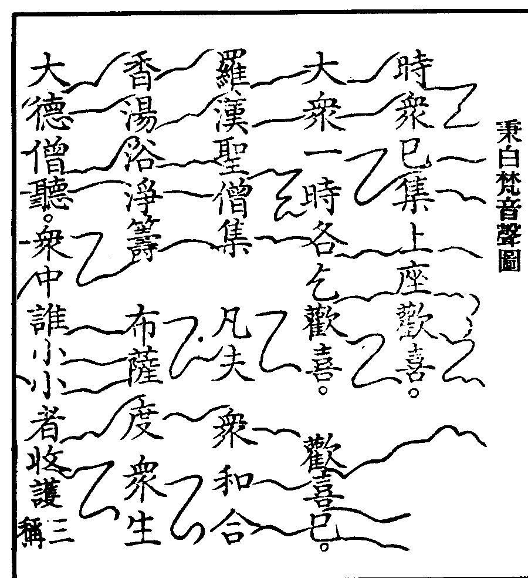



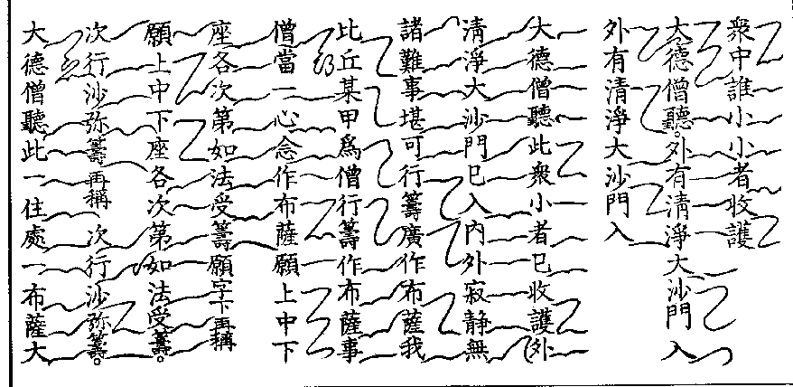



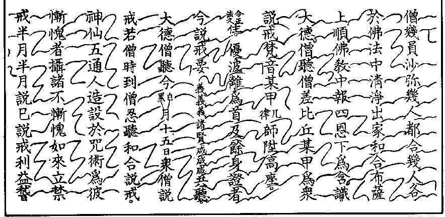



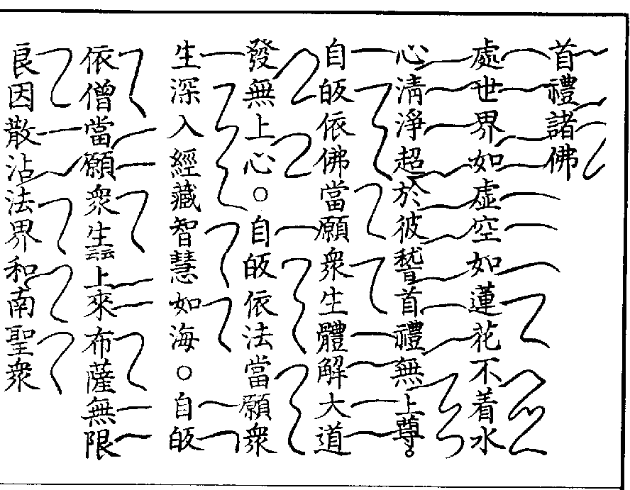



(梵呗者，赞咏之音也。梵云呗匿，华言止断也。由是外事已止也。断尔时寂静，任为法事。又云：诸天闻呗，心则欢喜，故须作之。长阿含经云：其梵声有五种：一者其音正直，二和雅，三清彻，四深满，五周遍远闻。)



都讲头首开讲



此土根性，从声入理。理本无说，理由说彰。五种法师，解说为最。法不孤起，理应劝请。住持开讲三五日后，先令侍者至前堂寮禀云：(方丈和尚拜屈首座讲，领众就法堂拜请都讲开讲。)次诣都讲寮禀云：(和尚拜请都讲，和尚为众开讲。○若次头首，则无此礼。)当日住持讲毕，白：(云云，烦首座领众请都讲开讲。○请次头首同。)白讫，即令听呌行者送香至首座前。首座伺住持下座出，即就领众法堂炉前，左立请都讲，右立首座，插香问讯云：(即日恭惟都讲大法师，尊候起居多福。兹奉方丈慈命，拜请为众讲演，伏望尊慈云云。)都讲答云：(自揣疎谬，何以尅当下情云云。)请后过二三日，预委令行者敷设法座等。前一日晚，令堂司行者覆住持两班，诸寮仍挂开讲牌报众。(另贴都讲二字，并其文某科於牌上。)至日粥罢下堂后，鸣钟四下，方丈预令行者请讲人点心，就留方丈寝堂分坐。堂司行者次第覆打起，鸣廊板，鸣僧堂前钟及大钟，鸣皷至三通。住持、讲人俱乘舆至法堂。住持归左首所，设位立。讲人烧香，礼三拜，问讯。至住持前问讯(谓借座也)。次问讯上下间。大众从右边入，至座前，归中小问讯。上座亦右入几，烧香问讯，略坐。候住持起身，即起身，退右边立。住持烧香点烛，同问讯。住持归位，即坐。次两序，次耆旧，次江湖，次大众，次第炷香点烛(各班首亦预率钱市香烛参讲)。问讯毕(各归位，讲人趺坐。鸣槌一下，执拂揖，众答揖)，提纲叙谢。结座下座，至炉前普问讯。归寮，即怀香诣方丈拜谢。堂司行者通报，诣库司、头首、耆旧、诸寮，各斋相谢。次日，就本寮，候皷鸣，至法堂烧香，不设拜。登座，举戒香偈(云云)，回向(云云)，展卷(云云)。餘头首开讲同。



维那点读



为学之要，先读四书。四书旨趣，深广难穷。本宗维那，亦非聊尔。是宜劝请，亦同前礼。(知客领众，座前致请。)随於一书，撮其英，发其奥，缉以成章，为学者敷演，名曰点读。一应出处，与开讲同。(但不拜，不登座，不鸣皷，不鸣椎。)就座下，於中设位。隔宿堂司行者，覆住持两班，诸寮挂牌报众。次早覆打起，鸣廊板，(各三下。)鸣大板三通，(以代法鼓。)维那烧香入位，(住持等次第炷香、点烛、问讯毕。)提纲叙谢，结座行谢礼，并与头首开讲同。后二日坐定，鸣尺二下，云：(稽首天台教主佛陇禅师，惟愿他心道眼，无碍见闻，冥勋加被。○南无旋陀罗尼菩萨。○众和三声，执拂子揖。众举语云云。结语毕，即起。)



三科习读



古德讲贯，岁无虗日。今教法衰微，德业浸废。学者见闻既寡，名位皇皇。故夏安居，讲次习读，以勉励才能，䇿勋后进。傥兹夺志不息，佛种慧命，殆庶几焉。将举习读，住持令侍者於三五日前，备纸诣各斋，与三科名：一、覆讲科(大刹知客侍者、甲刹维那、久住阇梨皆与焉)，二、开科科(阇梨诵文已毕，能看读者与之)，三、诵文科(初学阇梨、本山新戒与之)。与名毕，将日子具呈方丈佥押，免有进退。至习读日，令堂司行者挂习读牌。住持讲毕，归方丈。侍者至住持前，作三科阄(阄写某斋其人)，贮三合中封记。预令法堂座前，中设住持位(仍备书灯、香炉、烛台)。至参后，讽诵施生毕，住持归方丈(或歇讽诵)。直日诣侍司，侍者覆住持，令直日鸣僧堂前钟。候钟鸣一十餘下，挑灯起轿，至法堂略问讯，径入中位而坐(不欲惊众故也，众不起身)。行者捧三科合，并讲帙静尺於卓上。直日至前问讯，鸣引二下。知客令行者点大众汤。汤毕，住持鸣尺二下。大众展卷，详缓看阅。片时，再鸣尺二下。侍者与直日至住持前问讯，取覆讲阄合，对住持开封。住持拈一阄，付侍者展开，呈住持，付直日高声云：(某斋某覆讲)。拈第二名亦如之。覆讲之法，应覆住持当日所讲之义，不得别有异议，过於穿凿。若果有发明，符合文旨，则无在也。覆讲毕，侍者、直日再至住持前，取开科阄合，开封如前，付直日白云：(某斋某论师开科)。拈第二名亦然。开科者，乃开住持次日所讲之文。须预於请益师处，讲明文义，点对句读，及收开等法，毋致临时猖蹶也。开科毕，侍者同直日又至住持前，取诵文阄合，如前拈，付直日偈云：(某斋某上人诵文)。或二人，或三人，不拘诵文者，双手捧文帙，至炉前问讯。从在入，至住持前问讯。置文帙於住持前，再问讯。至直日位下坐，则诵所习之文。须言词精熟，详缓合宜。起尽可听者，赏纸笔等。如所诵稍长，住持或挑试接诵不辍，则卓上弹指止之。诵文者住声起身，至住持前问讯，取所诵文，回元处坐。其次并同。诵文毕，鸣引二下。住持先出，两班大众就到三科人各斋作贺。次日，三科人诣方丈、库司、头首、诸寮，各斋谢礼(十刹维那不预覆讲，必须新学说文)。



科目之式



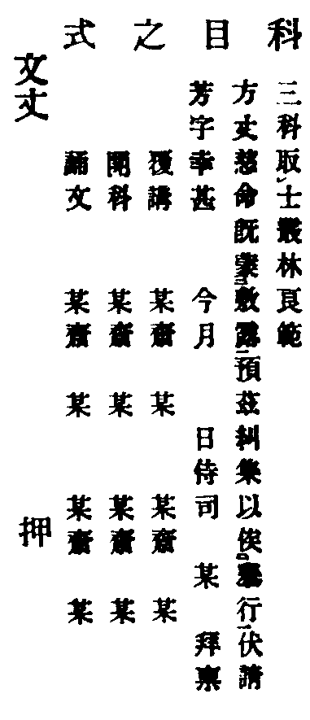



锁试



古来讲罢之后，行鎻试法，勘辨人才，䇿其未进。如烹金炉，𫓪水不存；如治玉斧，碔砆尽去。住持令侍者於四五日前，备纸抄覆讲开科人(泊名胜拔萃之士，欲预斯选者，同具呈方丈佥押，免有进退，择一静处)，开设绛帏，於中设大师像，敷陈供仪，仍排椅卓，广安四书大小部文，以备捡寻。侍者先一日，排位次图於帏外，令堂司行者排锁试牌，请见职头首全班、见职都寺一人，又请名德西堂首座二人、东序尊宿耆旧二人，来日就某处证明锁试。至日粥罢，堂司行者报预科人员，各认图位入位，不许怀带消文私叶。委监寺一人巡警，闲人毋得擅入喧杂。挂静牌众集已，各人烧香，候住持至，领众对像排立。住持进前烧香，同礼九拜，称南无旋陀罗尼菩萨。礼毕，各依位坐。侍者当中问讯烧香，令茶头行者行茶讫，侍者进纸笔，请住持出题目，或就讲次文中难辞，或就诸部祖文疑难处，试问二章，其词务在语简意显。侍者抄写於二章中难辞，文义深远者，送覆讲人，开科者次之。预科之人，仍各备笔墨纸砚，当思部味教观，援引诸文，一一伸答，须在理当，不尚词长。卷子式如后：若欲净手，俱在近便一处，不许托缘归斋，问请益师。如文出他人，量宜罚之。方丈分付库司，半斋备点心并午饭，皆就筵斋。客司点茶，斯在浴前，各要封号、斋名、双讳，纳卷子，朝大师像，问讯住持前，问讯而退。侍者写卷子数目若干道，携至方丈，交与衣钵侍者收受。住持次日看卷批判，取其优劣。若说义纯正，深於理致者，则当称赏之，拟擢职事。或言词疎谬，答不称问者，当以诫勗。若他白者，示以弹诃。批判之后，衣钵侍者照依元数，交与烧香侍者，当置一册子，发号抄写。住持批判词语毕，请与科人俱至，侍司眼同开封，见双字讳名分晓，对批判各人卷子，写名字於册中，仍携卷子呈覆住持。於兹方见各人平日看读工夫有浅深也。锁试之法，废久不行，今姑存之，俟有作兴者。昔四明尊者有绛帏问答三十章，试问四十二章，如教行录。其略云：褰绛帏，问诸子，其词惟要，其旨甚微，俾无或者兴布教之功，令不敏者夺强学之志(云云)。若诵文者，或五日策文，或答小难，别在一日，不可同混上二科也。



锁试位次之图



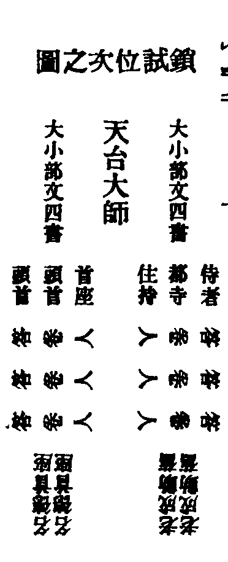



锁试卷式



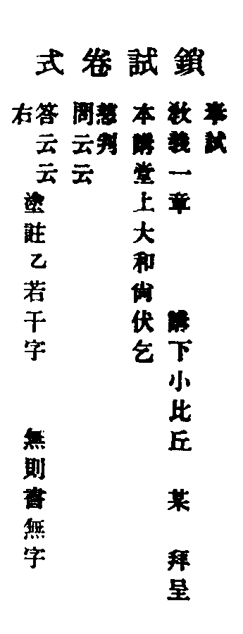



兰盆会



世徒谓以养亲为孝，而不知辱身辱名为不孝也。世徒谓割恩爱为不孝，而不知明出世道报恩为孝也。始吾世尊弃位舍亲，取证觉果，答地恩於迦维，报母恩於忉利，复肇兰盆，垂教将来，可谓大孝也矣。夫出家能如是，果何媿哉？不然，进退两难，不孝孰大焉？



七月初一日，启建兰盆会。隔宿，堂司行者覆方丈，两序诸寮挂牌报众，整肃忏殿，敷陈供养。至日早，鸣忏殿钟，众集。忏首举弥陀佛号，修小弥陀忏。其中叹佛偈已，制词启白(云云)。次日已去，众同白云：(我等同孝志，修行净土因。报答二亲恩，忏除三障罪。存者获福寿，亡者得超升。尽法界怨亲，同生安养国)。至三归依毕，举阿弥陀佛真金色(云云)。系念(弥陀佛一百声，观音、势至、清净海众若一十声)毕，回向云：(以此修行众善根，报答父母劬劳德。存者福乐寿无穷，亡者离苦生安养。四恩三有诸含识，三涂八难苦众生。俱蒙悔过洗瑕班，尽出轮回生净土)，十方三世(云云)。粥罢少顷，堂司行者覆打起，仍就忏殿修大弥陀忏。鸣忏殿钟，众依位立定。忏首举弥陀经(或兰盆经)，行香行道经毕(称弥陀佛三声)，展具敬礼。至赞佛已，继云：(我等同孝志云云)。至逆顺十心毕(称弥陀佛三声)，举忏悔文(五悔文皆如补助仪，但於我比丘某甲，增若为存亡父母，入至心忏悔等云云，小弥陀忏忏悔亦然)，至随喜回向毕(称阿弥陀佛四十八声)，即举发愿文(云云)毕，继云(愿所生父母，或今存在，或已终亡，随某所居，逐彼生处，惟愿阿弥陀佛、观世音菩萨、大势至菩萨，光明照烛，愿力摄持，三障消除，五根成立，发菩提愿，修净土因，存者得满报龄，终归宝刹，亡者即指诸趣，便托莲胎，覩妙相明心，听玄谈入位，现前受记，尘刹分身，广度有情，同登妙土，伏愿我等，孝顺之心深入，至道之法无遗，当来诸佛会中，同作应生眷属，二严等备，三觉俱圆，法性有边，愿心无极，尽入如来愿性海中。○发愿已，归命礼云云)，至三归依毕，举兰盆经(或弥陀经)。行道毕，不再举赞阿弥陀佛真金色等，即系念佛号百声，菩萨号若十声，回向云(以此修行众善根云云如前)。斋罢，覆打起，鸣忏殿钟，集众讽弥陀经(或兰盆经)，赞佛(云云)，称号(佛百声，菩萨若十声)，回向(如前)。参后，鸣钟集众，讽弥陀经、行道经毕，赞云(阿弥陀佛真金色云云)，系念佛号千声，菩萨号若百声(或若十声)，发愿云(愿所生父母云云如前)，转身施生(如常式)。库司每晚令参头轮差行者拨扇行汤，堂司行者正贴二人数牌，每一十声鸣磬一下，百声鸣引一下，千声鸣引二下，一人管大数，一人管小数，日日如之。至十五日，修大弥陀忏，至叹佛已，主修制词散忏，堂司行者预率众财送归库司，营备兰盆百味供养，仍覆书记制疏(书记如缺，维那自制，或用旧者，皆无，在疏式如后)。於斋前敷陈供养百味兰盆，务在丰洁辨己，堂司行者覆打起，集众面佛立定，首座举释迦佛号，众和同敷具，三拜，不收具。住持上汤进食，众同三拜，上茶，又同三拜，收具。维那宣疏毕，举兰盆经，举号(释迦、弥陀、观音、势至、海众)各三声，众发愿云(愿所生父母云云)。至晚，施斛满散(或就忏殿前，或水陆堂，或山门首，随各寺例)。



某路某寺住持比丘某，与比丘众，七月十五日，伏值目连大士救亲之辰，预於半月，熏修忏法，讽诵　经文，系念乐邦圣号。兹者满散修设　盂兰盆，　供养常住三宝，十方众僧，所集　殊勋，答报生身父母，历劫怨亲，法界含灵，同生　净域者。



伏以乾称父，坤称母，诚覆焘之不偏；　佛可尊，法可师，谓依归之有托。诸子厄穷於涂炭，至人利乐於尘凡。推　皇觉博济之心，物机遍赴；拔青提倒县之苦，缘感斯彰。教传百世之餘，时届七月之望。秋风乍起，悲游子念故乡；白云孤飞，想吾亲舍其下。况霜露沾濡而既降，乃焄蒿凄怆以难堪。生三年免于怀，岂胜言者？有一日用其力，孰拟报乎？奉兰盆供设之飧，行莲社忏摩之法。要期在昔，尅志于今。伏愿我等多生父母，历劫怨亲。枯发河千尺之狂澜，不留餘滴；净性空一轮之归月，高朗重辉。若没若存，常安常乐。谨疏。



某年七月　日疏。



解制(凡二仪)



自恣广仪



夏罢岁终之时，应举自恣之法。住持於三五日前和会，前堂首座答法，并上首、知法二人为五德，就备管待。十五日晚，维那请行事六人等献汤，至暮习行事。十六日早，直日於僧堂，伺展钵后，鸣椎一下，白云：(大德僧听！今黑月一日，众僧和合，辰时就某处自恣。)粥罢，即开浴。维那令堂司行者人仆，洒扫自恣处，按僧数排蒲团(如说戒坐位，不须排登椅)。仍具两蒲团，安於众僧前中间，拟二五德作法处。仍具香花、筹水、香炉、烛瓶等(如说戒式)。预备青白草若干束，随僧数多少办之。每束约二三十茎，长二尺许。用二箱袱置卓子上，安中间两柱前。又置小几案，於住持蒲团侧，安手炉、拂子。静尺须安一蒲团，在住持上肩，设圣僧位。已上并须维那捡点，悉令斋肃。时至诸殿堂，然点香灯。堂司行者覆打起，鸣廊板，鸣僧堂前钟。众集僧堂前，分作上下堂二行立。鸣大钟，诵闻钟偈(云云)。入堂，诵入堂偈(云云)。礼三拜，趺坐。五人起行事，及秉白词句，并如布萨仪中(但秉唱时，改说成二字为自恣)。秉白至唱筹数竟，下为含识声绝时，即云：(各诵律中清净妙偈。)众云：(清净如满月，清净得自恣，身口业清净，尔乃同自恣。)秉白：且立椎所行事。四人亦起，散花洒水(如说戒式)。秉白：鸣椎一下，举散花偈。众云：(散花庄严云云)。毕，众皆合掌。梵师作梵(稽首云云)。毕，更不用举传香、说偈、偈，但只住持执手炉，三捻香，举云：(戒香云云)。偈毕，秉白椎一下，归位坐。住持鸣尺二下，执拂子叉手揖众，众答揖。住持白席(云云，见后)。继说差人云：(西堂某法师为第一五德，座元某法师为第二五德，第一座某法师答所成法。住山某谨白。)鸣尺二下，住持、首座略转相朝(住持秉法，首座答法)。问：(僧集不？)。答：(僧已集。)问：(和合不？)。答：(和合。)问：(不来诸比丘说欲及清净。)说欲人互跪云：(大德僧听！彼比丘某某等，我受彼欲、自恣。彼如法僧事，与欲、自恣。○如无，则云：此众无说欲及自恣者。)答：(说欲及自恣已。○如无，则同前说欲者云无。)问：(僧今和合，何所作为？)。答：(单白和僧自恣羯磨。)住持云：(差受自恣人自一羯磨，大众同心证明作法。○词语如羯磨经中云：大德僧听！若僧时到，僧忍听，僧差比丘某甲、某甲作受自恣人。　自如是。)问：(作白成不？)。答：(成。)住持云：(大德僧听！僧差比丘某某作受自恣人。谁长老忍僧羞比丘某某作受自恣人者默然，谁不忍者说。僧已忍差比丘某某作受自恣人竟。僧忍默然故，是事如是持。)问：(结词成不？)。答：(成。)住持云：(作法既成，二五德出众行事。)二五德即收具香合，问讯离位，庠序而出，到中间二蒲团所立定。一斋问讯，分两边行，上香炉前，各三捻香，置香合於几案上。退身两傍，出蒲团位，问讯展具，三拜起对坐。少定，二人叉手互揖。第一五德云：(自恣单白羯磨，大众同心，证明作法。○词语如羯磨经中云：大德僧听！今日众僧自恣。若僧时到，僧忍听，和合自恣　自如是。)问：(作法成不？)。答：(作法成。)少顷，行事四人出，众前排立，一齐问讯。每边二人，分东西而上，各至草所。一人擎箱，一人分草。圣僧前、住持前，当跪授之。次者低身授之，不可平身抛掷。各各次第受草，说偈云：(吉祥童子施软草，如来受已成正觉。我等比丘学佛故，坐草自恣净三业。)诵毕，将草舒开，置坐具前地上，拟一身所跪之阔。其二五德草，隣位先与敷之，庶免临时忽遽。二箱行事，两头行来，中间结绝。行草既毕，放箱元处，出香炉前，一齐问讯归位。(行事出入，使有可观。)二五德即转身面佛，互跪合掌。第二人唱云：(一切僧就草座，偏祖右肩，胡跪合掌。)唱毕，二五德收具起身，两傍而出。第一五德至住持前，展具胡跪合掌。住持进前，胡跪草上。(就草座者，为忏众人不敢在高座，非成道坐草也。)合掌，对第一五德，三陈自恣词句。(见后。)第二人徐徐至首座前，展具胡跪。首座进前，草上胡跪，三陈自恣词句。(云云。)第一人又至首座下肩胡跪。三人同进前，草上胡跪，同陈自恣词句。(三说。)从是以下，三人为一引，同陈词句。(三说。)先上间，次下间，亦如是。二五德更互作对首毕，亦入元位，展具跪草，互为对首。自恣竟，仍至中间蒲团位，问讯如前。烧香袖香合，复归中位，展具礼一拜，胡跪。第一人唱云：(僧一心自恣竟。)收具问讯，退归本位。展具毕，大众起立，秉白至椎所。住持执手炉回向云：(上来恭依律范，行自恣法事。所华洪因，端为祝延　皇帝圣寿万安，皇太后、皇后齐年，皇太子睿筭千秋，文　武官班同增禄筭，国安民泰，时和岁丰。不尽良因，祝献护法诸天，报答四恩三有。伽蓝真宰，护教安僧。法界众生，同圆种智。为是缘念○清净法身云云。十佛号加天台大师号（乃至）波罗蜜)。梵人作处世界梵(如说戒中)。毕，鸣椎一下，唱三归依(如说戒中，亦须随拜鸣椎鸣引)。拜起就跪，众念自庆偈(如说戒中)。偈毕，若处狭，众多收具。右遶至佛前，排立问讯，展具立定，举释迦佛号。若自恣时，一面已立了，不须收具。头首举释迦佛号，住持炉前烧香，大众礼三拜，收具。至祖堂礼拜，收具。直日鸣引持呪，往土地堂、诸殿堂，谢安居护持之意。维那回向(式见后)。毕，引至法堂，团拜而散。往来人事、茶汤、三日等礼，并与结制同。　自恣白席(白席秉差，或住持，或首座，皆无在也)。圆觉伽蓝，统十方而无外。毗尼轨范，亘万古以同遵。开遮持犯，则纤粟无差。断割重轻，则秋毫不滥。住持佛法，纲纪僧伦。故兹坐夏之真规，严举护生之圣禁。盖鹿园始制，鶴树重宣。初篇虽在於摈科，餘绪乃关於忏法。使乘戒而俱备，庶定慧以克成。既扶助於圆宗，当谨遵於先宪。况此大方之宝刹，素为台教之名蓝。盛演斯宗，恢扬圣化。乃育德养才之困薮，实传道解惑之源流。学徒盛集於斯时，师道独尊於当代。续鹫领之慧命，阐龙猛之芳献。游泳寂灭道场，安住平等性智。兹值金飚应律，荐林壑之新凉。玉露溥秋，肃湖山之爽气。九旬之制告满，三事之道当陈。利者已能光洁六根，固若明珠之绝类；钝者犹恐难忘三业，宁免白玉之微　尽。随篇聚以忏扬，悉使根尘而泯净。今将紏举，毋得覆藏。当坐草以翘诚，犹负荆而谢罪。要须澡沃，必假忏宣。今请五德人，举行自恣法。所言自恣者，自谓自宣己罪，恣谓恣他举过。所谓五德者，则有二种：曰自恣，日举罪。不爱、不恚、不怖、不痴、不疑，知自恣非自恣，此是自恣五德也。若曰：知时不以非时，如实不以虗诳，利他不以揖减，柔和不以麤犷，慈心不以嗔恚，此乃举罪五德也。今请某人为第一座五德，某人为第二座五德。(某)学疎德薄，滥厕秉差。祇到高明，不胜皇惧。谨白。(若首坐白席，至请五德竟，即云：某为众答法云云)。自恣词句(书二式，贴於左右柱上)。大德一心念！众僧今日自恣，我比丘某甲亦自恣。若见闻疑罪，大德长老哀愍故语我。我若见罪，当如法忏悔。土地堂回向(安居三月，遵佛祖之典章；制满一期，籍神祗之麻庇。恭　大众肃诣灵祠，特讽衩章，称扬圣号，灼化财马功德，致谢云云。合堂真宰，谢已往之洪恩，锡将来之吉庆。山门宁静，海众咸安。三业冰清，四魔殄灭。公私火盗，时时允赖无虞；黍稷稻粱，岁岁常期满望云云)。



韦天前回向(护教流通，统三洲而匡持未运；受佛付嘱，辅四王而捍御外魔。仰冀云云。兹以金风扇野，白帝司方，当觉皇解制之辰，是众僧自恣之日云云。伏愿山门镇静，巍巍若九鼎之尊严；仓库丰盈，浩浩会百川之进益。警法侣正念，三障消除；俨梵宇美奂美轮，万祥骈集云云)。



监斋前回向(神威赫赫，常行赏罚之权；圣德巍巍，各有司存之职云云。兹者安居期满，解制当行。庆一众修道而有成，赖九旬禁足而元难云云。集兹殊利，仰答洪麻。所冀香积丰饶，运食轮而常转；法音镗鞳，祈海众以咸安。汤火无虞，诸缘吉庆云云)。



自恣略仪



十五日晚，堂司行者覆住持，两班诸寮挂解制牌报众。十六日粥罢，即开浴，鸣法器，集众诸大殿，如次立。住持至烧香，首座启白(云云)毕，举释迦号，众展具三拜，就跪。住持、首座略转身相胡，住持作首法(三白如前)。次首座作首法(三白)。次上间大众同作自恣法，又下间大众作自恣法。三白竟，住持问云：(作法成不？)首座答：(成。)收具，举大悲呪行道，诣诸殿堂致谢，回向(如前)。复举呪归殿，普回向致谢。堂司行者喝云：(大众诣祖堂礼拜，○法堂团拜，方丈礼贺。)三日行茶汤等礼，与结制同。(有处先诵呪诣殿堂，后作首法者，非。)



(自恣者，事钞云：九旬修道，精练身心，人多迷己，不自见过。理宜仰凭清众，埀慈诲示，纵宣己罪，恣僧举过。内彰无私隐，外显有瑕疵，身口托於他人，故云自恣。四分中云：安居竟自恣，则七月十六日为定。律又云：僧十四日自恣，尼十五日自恣。此谓相依问罪，故制异日。及论作法，三日通用，克定一期，十六日定。安居篇云：四月十六日结者，至七月十五日夜分尽讫，名夏竟，至明相出。摭华钞云：诸经律中，以七月十六日是比丘五分法身生养之日，则七月十五日是腊除也。僧不以俗年为计，乃数夏腊。腊，接也，谓新故之交接。)



安居门第七。



诫劝门第八



轮扁之斵，非运斤则其巧不施；造父之御，非执辔则其善不彰。是乃得之心，应之手，寓其神而造其妙也。然后世学艺者，亦不敢背其规矩而擅为焉，况学法王法者乎？天台一家，妙解妙行，其所成书，无非秘藏，其所思惟，无非佛法。至於国清、百录等书，尤切於规矩准绳者也。此皆得於心而应於外，所以动容中规，周旋中矩，埀百千载不可易，有不期然而然矣。今之初学，未造其妙，欲舍规矩，是学艺者之不及，则将奚取法焉？内省毋忽。



立制法(出国清百录)



夫新衣无孔，不可补之以缕；宿殖淳善，不可加之以罚。吾初在浮度，中处金陵，前入天台，诸来法徒，各集道业，尚不须软语劝进，况立制肃之。后入天台，观乎晚学，如新猿马，若不控鏁，日甚月增。为成就故，失三治一，蒱鞭示耻，非欲苦之。今训诸学者，略示十条，后若妨起，应须增损，众共裁之。



第一、夫根性不同，或独行得道，或依众解脱。若依众者，当修三行：一、依堂坐禅，二、别场忏悔，三、知僧事。此三行人，三衣六物，道具具足，随有一行，则可容受。若衣物有阙，都无一行，则不同止。  

第二、依堂之僧，本以四时坐禅，六时礼佛，此为恒务。禅礼十时，一不可阙。其别行僧行法竟，三日外即应依众十时。若礼佛不及一时，罚三礼对众忏；若全失一时，罚十礼对众忏；若全失六时，罚一次。维那四时坐禅亦如是。除疾碍，先白知事则不罚。  

第三、六时礼佛大僧，应被入众衣，衣无鳞陇，若缦衣悉不得。三下早集敷坐，执香炉胡跪，未唱诵不得，诵未随意，不散语话，叩头弹指，顿曳屣履，起伏参差悉罚。十、礼对众忏。  

第四、别行之意，以在众为缓故，精进勤修四种三昧，而假托道场，不称别行之意，捡挍得实，罚一次维那。  

第五、其知事之僧，本为安立利益，反作损耗，割众润己，自任恩情。若非理侵一毫，虽是众用，而不开白。捡校得实，不同止。  

第六、其二时食者，若身无病、病不顿卧、病已差，皆须出堂，不得请食入众。食器听用铁瓦、薰油二器，瓯椀匙筯悉不得以骨角竹木、瓢染皮蚌，悉不得上堂。又不得摚触己钵吸啜等声，含食语话自为求索，私将酱菜众中独噉，犯者罚三礼对众忏。  

第七、其大僧小戒，近行远行，寺内寺外，悉不得盗噉鱼肉辛酒，非时而食。察得实不同，止除病危笃，瞻病用医语，出寺外投治，则不罚。  

第八、僧名和合。柔忍故和，义让故合。不得诤计、高声、丑言、动色。两竞者，各罚三十，拜对众忏。不应对者，不罚。身手互相加者，不问轻重，皆不同止。不动手者，不罚。  

第九、若犯重者，依律治。若横相诬，被诬者不罚，作诬者不同止。若学未入众时过，众主不受学，众未摄故，彼自言比丘故入众来，犯重诬他者，治罚如前。  

第十、依经立方，见病处药，非於方吐，於药有何益乎？若上来九制听忏者，属忏无慙愧心，不能自新，此是吐药之人，宜令出众。若能改革，后亦听还。若犯诸制，捍不肯忏，此是非方之人，不从众网，则不同止。



大隋开皇十七年四月十五日，寺　僧(灌顶)受旨书制文，知堂上座(慧陈)秉制奉行。



授菩萨戒仪(教行录金园集)



原夫大乘菩萨戒者，菩萨道之根本，正觉果之因基。故梵网经云：戒如明日月，亦如璎珞珠，微尘众菩萨，由是成正觉。其求受之法，如前略明。若欲委知仪式，当依法智、慈云二尊者所制，具如教行录。金园集文广不录，须者往捡，但立科有多少之异，其意大同。



别立众制(天竺别集)



解行二科，学者所志。岂在他制，然后乃勤。后生无知，於己德学，事同公役。既不获已，须行严治。略示条件，后旋增损。(凡一十九条，其要者，略示於安居众法中。餘如彼文，须当一一遵行，兹不重列。)



训知事人(国清百录)



吾少婴勤苦，备历艰关，游学荆、扬、雍、豫，唯著一纳，三十餘年，冬夏不释体。上至天子，下至士民，虽有所施，受而不私。一果一缕，入众已后，尚无希念，况故侵之。所以然者，众宝尊重，若能增益，名甘露苑；若有灭损，即蒺䔧园。自饱自伤，因倒因起，可以意得，何俟多言。



夫人发心，随有所作，为读诵、听学、讲说、经行、忏悔、供养、舍力，未有首尾，慎莫中止，中止者违本心。若再有所作，至前止处，留难即起，修业不成，今生现障，后弥障道。此行人大忌，应须竭力，善始令终，业既坦然，报亦圆满，此亦可意得。昔有一寺，师徒数百，昼夜禅讲，时不虗弃。有净人窃听说法，闻已用心，每扬簸洮汰，系念存习，谓以净心扬簸不善，以禅净水洮汰不净。随有所作，念念用心，一时执爨，观火烧薪，念念就尽无常，迁逝复速。於是蹲踞窦前，寂然入定，火灭汤冷。维那惧废众粥，以白上座。上座云：此是胜事，众宜忍之，慎勿惊触，听其自起。数日方觉，往上座所，具陈所证，叙法转深。上座止曰：尔向所言，皆我境界，而今所说，非我所知，勿复言也。因而顾问：颇知宿命不？答云：薄知。又问：何罪为贱？何福易悟？答云：此贱身者，前世之时，乃是今日徒众。老者之师，亦是少者之祖师。徒众所学，皆昔所训。尔时多有私客，恒制约不敢侵众。忽有急客，輙取少菜，忘不倍备，由此谴责。今为众奴，前习未久，薄修易悟。宿命罪福，其事如是。一众闻此，悲不能胜。鉴镜若斯，岂可不慎。同学照禅师，於南岳众中，苦行禅定，最为第一。辄用众一撮盐作斋饮，所侵无几，不以为事。后行方等，忽见相起，计三年长，至数十斛。急令陪备，仍卖衣资，买盐偿众。此事非久，亦非传闻。宜以为规，莫令后悔。吾虽寡德行，远近颇相追寻。而隔剡岭，难为徒步。老病出入，多以众驴迎送。此是吾客私计功醻，直令彼此无咎。吾是众主，驴亦我得。既舍入众，非复我有。我不合用，非我何言。举此一条，餘事皆尔。



警诫将来



出家之士，当须守分为先，持戒为本。若行乖理之行，作不善道，非但自己之无置，抑亦有玷於丛林。佛戒精严，各当持守。且如来立乎禁戒，不得杀、盗、淫、妄言、绮语、恶口、两舌、贪、嗔、痴等恶。如有犯者，获罪不轻。钦惟。



国朝诫赖僧徒，奉遵佛制。除刑名重罪，例属有司外，若僧人自相干犯，当以清规律之。若非法妄为，若污行纵逸，若侵渔常住，若私窃钱物，若闘诤犯分，摇唇鼓舌，恼乱众者，轻则罚拜、罚钱、罚香、罚油，以榜示之。如关系钱物，则责状追陪。重则杖捶集众，烧衣钵，遣逐偏门而出，示以耻辱，令改过自新也。详此一条，制有四益：一、不污清众，生恭敬故；二、不毁僧形，循佛制故；三、不扰公门，省狱讼故；四、不扬外丑，护宗纲故；六、和同处。慎之！慎之！



日月轨则



大率新入丛林，先须洞明规矩，礼度合辙，恭敬系心。如阿含经云：不恭敬，不系心，而欲令威仪足者，无有是处。不备威仪，欲令学法满者，无有是处。学法不满，乃至欲得无餘涅槃者，无有是处。是故当勤学恭敬，系心畏慎也。日用常行，无非是道。四威仪中，毋请自忽。



早起



入众学道，当勤精进。睡不在人前，起不落人后。五更钟声未鸣，轻身先起，莫惊同斋。抖擞精神，摄心端坐，绎思日所诵文，或制作未完，或难疑未解。祖师有云：静处思微，道之正轨。次第转身下床，想念偈云：(从朝寅旦直至暮，一切众生自回护。若於足下悮伤形，愿汝即时生净土。唵逸帝律仪娑婆诃。)取手巾塔左手，轻开门户，年放帘箔，出后架，不得拖鞋。咳嗽作声，转手取桶洗面，不宜多汤嗽口，须低头吐水，以手引下，直腰吐水，恐溅隣桶，不得洗头。有四种自他不利：(污桶、腻巾、枯发、眼。)不得鼻内作声，不得喷水扑面，不得高声呕吐，不得涕唾污桶。



礼诵



若礼诵时，先念净口业真言。次披袈裟，则合掌顶戴。念云：(善哉解脱服，无相福田衣。我今顶戴受，世世常得披。唵悉陀耶娑呵)。折袈裟，须齐整置架上，问讯而去。坐具不得同挂架上。若登殿堂烧香，不得居中，当於下手边约三步半问讯。炷香，左转身三步半问讯。如遇长上烧香，必须小立相让。若礼拜，不得占中央(尊住持也)，不得出声课诵，不得行礼拜人头边过。五更钟鸣，想念偈云：(愿此钟声超法界，铁囲幽暗悉皆闻。三途离苦罢刀轮，一切众生成正觉)。至长板鸣，众俱诣殿。俟讽诵或礼忏，须各至诚。礼佛时，深知佛体不离我心，同一觉源，妙应斯感。一身徧至诸佛之前，一拜普消无边之罪。互跪，右膝著地。(以三处翘耸，故名互跪。天竺之仪也。)合掌，两手当心。(此方拱手为恭，西土合掌为敬。手本两边，今合为一，表不散诞，专至一心。法苑云：有指合而掌不合，或掌合而指开，良由心慢而惰散也。)拜则正身威仪，五体投地。(辅行云：双膝前诣，双手续施。后方额扣，肝胆委地。想佛足下施手承足，如对目前。若以中拇指相柱，或以掌承面，或捺地，并非仪也。)默想云：(能礼所礼性空寂，咸应道交难思议。我此道场如帝珠，释迦牟尼影现中。我身影现释迦前，头面接足归命礼。)礼餘佛菩萨。(但改释迦佛为异。若拜不运心，徒劳苦行。法苑云：虽有设拜心驰外，如碓上下，空无所获。)



赴堂



讽诵毕，归钵位。入堂时，须去帽，从南颊入，对圣僧问讯。不得中央及北颊入，盖尊住持也。(若修忏毕〔起〕堂，小者先行，分上下堂入。在上堂，右足先入；在下堂，左足先入。)合掌归位，先朝钵位，问讯隣位。即左转身，问讯对床坐者。(其左右及对面坐者，但合掌答问讯。若已先坐上中下座，后来亦须合掌。古云：不敬上中下座婆罗门，聚会无殊。)里帽上床，以右手歛左边衣袖，腋下厌定。复以左手歛右边衣袖，然后两手按床，两足拨鞋入床下。先缩左足，次收右足，竦身上近𮪸趺坐，敷袈裟盖膝上。不得露内衣，不得埀衣床。缘念登床偈云：(登此无碍解脱床，平等智慧清净光。)若斋时，候巡火板鸣入堂，木鱼响不得入堂，则令行者取钵外堂坐。木鱼鸣后，闻长板鸣下钵，擡身正起立定。然后左转身，合掌念偈云：(执持应器，当愿众生，成就法器，受人天供。)以左手拓钵，右手解钓。复以左手提钵，转身以钵加额，正蹲身放钵，免将腰背撞人。安钵左边净板上，不得顿身坐。候转鼓，僧堂应钟鸣，大众望尘合掌，表迎圣僧入堂。(古法则下床迎圣僧，或者谓迎住持也。○圣僧即宾头卢，受佛付嘱，住世应供，故伽蓝中立庙。法苑云：堂中圣僧，多云是陈如，非也。缘经律不令为立庙故，不起供故。)合掌毕，移钵安面前，合掌默想云：(佛生迦毗罗，成道摩竭陀，说法波罗奈，入灭俱𫄨罗。)闻椎声，头首举展钵偈：(若展钵时，当愿众生身心寂静，离诸麤暴。)众和毕，或想偈云：(如来应量器，我今得敷展。愿共诸众生，等三轮空寂。)然后解袱，展净巾覆膝上，折转袱三角，莫令埀下。次展钵单，仰左手取钵安单上，以两手大拇指迸取键𨩲，从小次第展开，不得敲磕作声。护第四、第五指为触指，不得用。仍折钵拭令小，近身横安匙筯袋，放钵拭下。出则先匙，入则先筯。把处为净头向上。肩钵刷安第三钵缝中，出半寸许，盛生饭。展钵竟，直日鸣椎一下云：(今白月几日，晨朝各记六念。)众默想(云云)。○(六念有二：其一式见后；其二云：念佛念法念僧宝，念戒念施念诸天，三业所修诸善根，回向众生及佛道。)毕，又鸣椎一下，回向(云云)。头首举佛号，众和合掌。不得手指参差，须当胸高低得所。不得以手枕膝上，不得以手托口边。(古云：参差合掌不当𦚾，两手交加插鼻中，拖履揭帘无欵细，呕声泄气逞英雄。)十念毕，行粥时，头首自唱施粥偈云：(粥有十利，饶益行人。果报无边，究竟常乐。○又偈云：持戒清净人所奉，恭敬随时以粥施。十利饶益於行者，色力寿乐辞清辩。宿食风除饥渴消，是名为药佛所说。欲得人天长受乐，应当以粥施众僧。此偈众和二偈，如用其一。)斋时唱食，亦有二偈：(偈云：三德六昧，施佛及僧。法界有情，普同供养。此偈头首自唱。○又偈云：此食色香味，上供十方佛。中奉诸贤圣，下及六道品。等施无差别，随感皆饱满。令今施者得，无量波罗蜜。此偈众同诵二偈，亦如用其一。)受食，以两手捧钵，或多或少，则以右手起止之。受食，默想偈云：(若受食时，当愿众生：具足戒满，一切菩提。)受一切味云：(若受味时，当愿众生：得佛上味，甘露满足。)若见钵满，想偈云：(若见钵满，当愿众生：具足饱满，一切善根。)行粥将徧，鸣椎一下，众作五观想云：(一、计工多少，量彼来处；二、㤔己德行，全缺应供；三、防心离过，贪等为宗；四、正事良药，为疗形苦；五、为成道业故，应受此食。)想毕，鸣椎一下，头首举食偈云：(若[良*列]食时，当愿众生：禅悦为食，法喜充满。)众和毕，上下肩，当以面相朝揖食。不得正面，以手摇曳两边。斋时，出生想念偈云：(汝等鬼神众，我今施汝供。此食徧十方，一切鬼神共。)出生之法，不过七粒，太少为悭。食匙筯头，不可出生。以右手取饭，於左手掌心按之，置钵刷上。(凡受食，则用出生。或不受食，却不可桶杓内摄饭出生。盖出生之设，谓分已所食与诸鬼神。夫出生有三缘：一、施旷野鬼及施鬼子母等。此曹本食肉啖人，佛化之，受戒不杀，乃嘱弟子随处施食。不能施者，非佛弟子。今斋堂各各出生是也。二、施饿鬼。今斋堂别具小斛，於食毕，众作法施之。或各具小生斛，夜间呪施是也。)大凡食法，不得将口就食，不得将食就口。取钵放钵并匙筯，不得有声，不得咳嗽，不得触鼻喷嚏。若自喷嚏，当以衣袖掩鼻。不得搔头，恐风屑落隣单钵中。不得挑牙，不得嚼饭啜羮作声。(四分戒本云：正意受食，平钵受饭，平钵受羮，羮饭俱食，以次食。不得挑钵中央食，不得以饭覆羮更望得，不得视比座钵中起嫌心，不得大抟饭食，不得张口待饭食，不得含食语，不得抟饭掷口中，不得遗落饭食，不得颊饭食，不噏饭食，不得舌䑛食，不得振手食，不得手把散饭食。)当随量受食，不得请折。律云：量腹而食。(增一云：多食致苦患，少食气力衰。处中而食者，如秤无高下。)不得将头钵盛湿食，不得将羡汁於头钵内淘饭食，不得桃菜於头钵内和饭食。如有菜滓，安钵后屏处。食时须看上下肩，不得太缓。未再请，不得刷钵，不得吮钵刷作声。食未至，不得生嗔动念。(古云：呆呆四顾起悲嗔，念食吞津咳𠻳频。　粥啜羮包满口，开单展钵响诸隣。)若用扇，不得扇隣位。如己怕风，白维那於外堂坐。若行者拨扇时，自不得用扇洗钵。以头钵盛水，次第洗次钵。小钵不得头钵内洗餘钵，并匙筯仍屈触指。不得漱水作声，不得吐水钵中，不得先以熟水洗钵。未折钵水，不得先收盖膝巾，不得以膝巾拭汗，不得以餘水沥地上。折水想念偈云：(我此洗钵水，如天甘露味。施与鬼神众，悉令得饱满。唵摩休罗细娑婆诃。)收钵，以两手大指迸定，次第而入里。毕，鸣椎，头首举食讫，偈：(小食已讫，当愿众生，所作皆办，具诸佛法。○饭食讫已色力充，依止十方三世雄。回因转果不待念，一切众生获神通。○二偈如诵其一。)众和食毕，不许先起。鸣椎之后，住持下地。大众挂钵，不得脚踏床缘下地，莫令袈裟塔床缘。须近前立，问讯出堂。



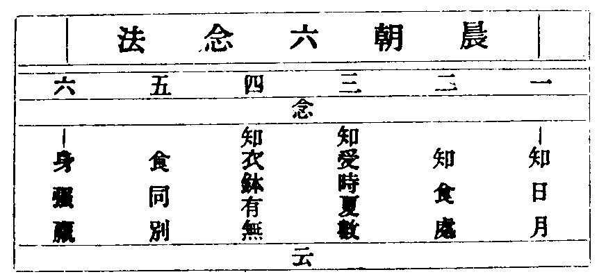



我比丘(某)今朝白月一日(乃至十五日随改)、黑月(大小)一日(乃至十五日十四日随改)。



我(无有)请处(僧常食念自赴)，　我今乞食。



我於某年某月某日某时受具，今若干夏。我今三衣钵(具缺)并受持长衣(已未)说净。



我今依众食，　我有某缘得别众食。



我今(无有)病(堪可行道，念须疗治)。



○(出僧祇律，不念结犯。)



(大师云：夫食者，众生之外命。若不入观，即润生死。须作观观之者，自恐此身内旧食，皆是无明烦恼，润益生死。今之所食，皆是般若。想於旧食，从毛孔次第而出。食既出已，心路即开。食今新食，照诸暗灭，成於般若。净名云：於食等者，於法亦等。以此食故，成般若食，能养法身。法身得立，即得解脱。是为三德。照此食者，非新非故，而有旧食之故，而有新食之新，是名为假。求故不得，求新不得，毕竟空寂，名之为空。观食者，自那可食为新？既无新食，那可得食者？而不离旧食养身，而新食重益，因缘和合，不可前后分别，名之为中。只中即假空，只空即中假，只假即空中，不可思议，名为中道。净名云：非有烦恼，非离烦恼，非入定意，非起定意，是名食法也。)



读诵



○殿堂讽诵毕，或归斋中看读，或诣法堂诵文，不得埀衣坐，不得曲肱枕头，不得聚头语笑，不得只手揖人。其新学读文於四书之中，当自四教仪而始。盖此一书，乃如来出世，五时施化，大小乘法，咸摄其中。先习此者，可知梗槩，渐入佛道故也。若看经，不得高声，不得长展经，不得埀下经带，不得拓经行诵。



(慈云云：念佛诵经，摄心要门。正心正意，如对尊容。云云。具如天竺续集。大师云：夫欲诵经，别座趺坐。观所坐之座，高广严好。次观八部四众，围绕听法。次须运心，观我能为法师，传佛正教，为四众说。想所出声，非但此一席众，乃至十方，皆得听受。名为假观。次观能说之人，所诵之经，何者是经？为经卷是？为纸墨是？诵者为心是诵？为口是诵？为龈腭和合而出？为有我身？为无我身？谁是诵者？观此四众，为是实有？为从想生？四众非有，无我能诵。是名空观。虽无所诵之经，而有经卷纸墨文字。虽无能诵之人，而有我身为众宣说。虽非内外，不离内外。虽非经卷，不离经卷。虽非身口，不离身口。从始至终，必无差谬。名不可思议。能作此解，能作此观，名为三观。於一心中，得不前不后，三观宛然。云云。具如观心诵经法。略录三观，餘须往捡。)



游行



○若游山时，草屦不得经行殿堂。(古云：衩袒不许登殿，草履莫践法堂。)不得殿前倚靠栏干。不得狷狂急走。(古云：行须〔縘〕步，习马胜之威仪。语要低声，学波离之轨范。)殿塔内不许闲行。(古云：无事不须登佛殿，等闲休向塔中行。不因换水添香火，纵有河沙福也倾。)廊下行须让耆宿。不得赤脚著僧鞋。不得把手共行。不得摇身掉臂。不得叉腰。不得蹲坐。不得戏笑。不得谈世谛是非。(古德云：别了双亲弃本师，访寻知识拟何为？不曾说著宗门事，白首无成过在谁？)



如厕



○欲登厕当行，须早作意，不得临时失仪。以净巾塔左手，不得道上为人作礼，亦莫受人礼。当叉手视地而行，脱直裰於笎上，以手巾系定作记认。右手提水至厕边，先须弹门三下，无人方入。已有人不得相逼。若多人住处，厕外有人，待急纵未了，且须出厕。若入厕换鞋，不得参差。安净桶在前，弹指三下(警噉粪鬼，免𪷽污之)。踞身令正，不得偏倚。或夜暗，用厕篦於孔中向前后划，令知长短、阔狭、正不正等。不得努气作声，不得涕唾，不得隔壁共人语。当直视前，不得低头下视，不得持筹划壁作字，不得多用筹。用筹了，当安筹盝中，不得餘处。左手洗净，护大指、二指、中指，当六七度用水洗(若比丘不洗净，得突吉罗罪。不得坐僧床座及礼三宝，设礼无福)。用水不得𪷽湿，不得大费用水。净桶安旧处，以乾手安内衣入袴。以乾手开门，左手提桶出。不得湿手拏门扇、门颊，右手挑灰后挑土。不得以湿手取灰土，后用皂角洗至肘前。入厕出厕逐一念呪。　入厕(大小便利，当愿众生弃贪嗔痴，蠲罪垢。○唵恨鲁陀耶娑呵)洗净(唵贺曩蜜栗底婆呵)净手(唵主加啰耶娑婆呵)净身(唵室利曳婆萨娑呵)去秽(唵拔枳罗脑迦咤婆呵)按律小遗亦洗净(按缨络经云：夫登溷者，不念此呪。假使以十恒河水洗[大/王]金刚际，亦不能净。凡登殿堂瞻礼，并无利益。奉劝受持，每呪诵七遍，是故鬼神常相拱诸。○详如天竺别集引三千威仪经纂示方法)。浴○凡开浴，以右手携浴具。律制：须持五条至门外，轻手揭帘，勿使有风。入下间门内，问讯归空处。揖左右人毕，先以五条手巾挂筦上。次小坐，脱袜起立，转身展袱，取浴具放一边。解上衣，未卸直裰，先脚下裳，以脚布囲身。次系浴裙，将袴袴折安袱内。将浴衫换身，挂直裰，与五条作一处。将手巾系定，内衣作一袱覆转(古云：三通鼓响入堂时，触净须分上下衣，语笑高声皆不可，莫将麤行破威仪)。拖鞋入浴，不得赤脚入室，须在下间空处，待次而浴，不得占上间(让头首耆宿故)，勿令汤水溅人及已拭浴者身，不得桶内泡脚，不得室内小遗洗僻处，不得将脚阁桶上，不得槽上揩脚，不得互相揩洗，当用巾布把两头磨背，勿搪二边邻坐，不得堂中洗衣，不得淋洗巾等滴槽中，不得安巾布槽上(古云：入浴披衫贵靖恭，需汤击板合送客，不应脚布安槽上，双足如何著桶中)，不得笑语，不得戽水，不得掇桶浇身，须当遮护浑身，勿令躶露，脚布不可离身，汤水不可多用，或有疮，或洗灸疮，或用疥药，宜后入浴，不得搀先，不得将公界手中拭面，出浴须揖上下肩而坐，次第著上衣，先披直裰，即著下裳，解浴裙，折脚布，安浴裙，免湿浴袱，揖左右出堂，若有设浴施主，随意课经，回向慈云，制入浴室，略知十事，如天竺别集(云云)。



坐禅



○凡学道者，覧教照心，研心作观。故诸祖畫讲夜禅，岁无虗日。夫坐禅之相者，若半加，以左脚置右䏶上。若全加，更上下右脚置左䏶，以左掌置右掌上，顿置左䏶。正身端直，鼻与脐对，平面正住，闭口令断外风。齿才相拄著，举舌向腭，闭眼才令断外光而已。次令气息调匀，心离昏散，即观现前刹那一念妄心。(四明尊者云：观一念识心，德量无边，体性常住。十方诸佛，一切众生，过现未来，虗空刹土，徧摄无外，咸趣其中。如帝网之一珠，似大海之一浪。浪无别体，全水所成。水既无边，浪亦无际。一珠虽小，影徧众珠。众珠之影，皆入一珠。众珠非多，一珠非少。现前一念，亦复如是。今观诸法即一心，一心即诸法。非一心生诸法，非一心含诸法。非前非后，无所无能。虽论诸法，性相本空。虽即一心，圣凡宛尔。即立即破，不有不无。境观双忘，待对斯绝。非言能议，非心可思。故强示云：不可思议微妙观也。)



夜分



○初夜之时，施食礼佛竟，或禅或诵，自在行之。当勤精进，慎莫放逸。(古云：频警光景，坐勿消时。俾夜作昼，勤而行之。)闻定钟，合掌念偈云：(闻钟声，罪业轻。智慧长，菩提生。离地狱，出火坑。愿成佛，度众生。)若贪睡者，眠转滋多。经云：勿以睡眠因缘，令一生空过。若睡重者，须少息解睡。律制：须披五条，右脇而卧。(为尊左肩衣也。)不得仰卧。仰为尸睡，覆为淫睡，故多恶梦。



四仪



○入丛林者，行住坐卧，莫越轨范。新学生疎，当以善言诱喻，勿起嫌心。不得衩袒廊下行。斋中不可露白斋前塔衣。斋罢持衣，不得弄数珠作声，而同戏物。放参后，不得出三门。不得无故入诸寮斋舍。昼三夜三，幸宜勤䇿。十二时中所为之事，佛经俱有遗诫，可不遵从。日用偈语，如前已明。有未列者，故兹重录。



睡时(若就睡时，当愿众生：一切安稳，得大自在。)  

起时(睡眠始窹，当愿众生：一切智觉，周愿十方。)  

洗手(事讫就水，当愿众生：出世法中，疾速而往。)  

洗面(以水洗面，当愿众生：得净法门，永无垢染。)  

登殿(若见佛时，当愿众生：得无碍眼，见十方佛。)  

登阁(上升楼阁，当愿众生：升正法楼，彻见一切。)  

瞻塔(见佛塔时，当愿众生：尊重如塔，受人天供。)  

礼塔(顶礼於塔，当愿众生：一切人天，无能见顶。)  

洗浴(洗浴身体，当愿众生：身心无垢，内外光洁。)  

濯足(若濯足时，当愿众生：具足神力，所行无碍。)  

摘草净手(摘草手中挪，还向水上波，此处无净水，净处萨婆诃。)



坐堂



凡僧堂茶汤，及朔望坐堂之法，并须著床里蒲团坐。盖床外三寸，里七寸，名净床。食时安钵，非坐处也。近人往往就外从便而坐，甚失法制，切须戒之。



普请



凡安众处，有必合资众力而办者，库司先禀住持，次令行者传语首座、维那，分付堂司。行者报众，挂普请牌(牌上贴云某时某处)，或闻木鱼，或闻鼓声，各持绊膊，塔左臂上，至普请处宣力。除老病外，并宜齐赴。普请之法，一为福田中植净业故，二为上下均力故(律云：因佛说扫地胜利时，诸老宿比丘皆弃禅诵扫地，佛止曰：我为知事人说。某知事人又不徧扫，佛令鸣犍椎总集共为之。此普请之始也)。



训童行



凡朔望上堂罢，参头行者令喝食行者报各局务，行堂前挂牌报众。昏钟鸣，行堂前鸣板三下。集众行者至佛殿祝赞后，诣方丈排立。参头入，请住持出趺座。参头缓声举云：(参)。众低声同云：(不审)。问讯拱听法诲毕，参头举云：(珍重)。众低声同和，问讯而退。如住持他缘，则喝食行者喝云：(奉方丈慈旨参)。众云：(不审)。次喝云：(放参)。众云：(珍重)。同问讯而退。次诣都讲寮、首座寮、库司参(参与免参，并同前礼)。○(训童行之法，当说出家因缘，或说规矩礼度，或说经中大意)。



月分须知



正月



岁朝，各寺祈祷，或修光明忏七昼夜，或三昼夜，或但供天三日，各随寺规。又行堂寮前，新岁元宵讽经，行堂维那白灯回向，寮前知客白灯回向。　初五日，法智尊者忌辰。但四明延庆，依子皐升法师礼文，如天台祖忌修设。今诸方当念中兴教观之功，亦宜修敬。若欲从简，亦须依山门历代住持忌同。



二月



住持、都讲、首座，当此之时，开春讲训众。



初五日，荆溪尊者忌。　十五日，佛涅槃。



三月



清明节，扫洒祖塔，上食，设礼，讽经。



禁采茶笋，荫𣝡山林。



四月



初一日，堂司出草单。　初八日，佛降生，库司严设毗蓝园浴佛，营备供养讽经。　十四日，起呪，呪沙水。二日，拟安居散洒。制后三日，行茶汤礼。　二十日，启讲忏，　住持开讲。　晦日，说戒。



五月



建青苗会三日，预出诵经。单日，　住持开讲，请头首开讲，　库司检点诸处整漏，疏浚沟渠。　十五日，说戒。



六月



隆暑罢讲，或不罢，在住持行之。古人行道，不惮寒暑，坐夏九旬，必期取证。住持首座，鞭䇿晚生，毋使怠惰。当效古人，行习读鎻试之法。　十四日，说戒。



七月



初一日，启兰盆会，要期半月。晨朝修小弥陀忏，粥罢修大弥陀忏，斋罢诵兰盆经，至晚诵弥陀经系念。预率众财修设斛食，至望日满散。　十六日，解制。



八月



初七日，章安尊者忌。　此月兄弟出入参访，装寒觐省，故不可废卷。然灯火可亲，又当勉之。



九月



启秋讲或说文字



十月



初一日，开炉。



十一月



冬至，或修光明忏，或供天冬斋，随寺规办方丈，请大众冬前点心。　二十四日，天台大师忌。



十二月



初一日，启。腊佛会要期一月。



初八日，佛成道营办供养，库司预备红糟。



岁终结呈诸色簿书。计筭钱谷。扫洒殿宇。习新岁修忏仪式。预备贺年物仪。分岁请大众汤果。



诫劝门第八。



真归门第九



吾佛灭度，诸弟子皆奔双林之丧，至於阇维八分舍利，建塔以藏，虔奉之礼，靡不致谨。今僧之示寂，虽不及吾佛声光之盛，然於送死事亡之礼，讵可废欤？夫释氏居丧之礼，不必如世俗之制，请遵天台大师之诫、东林远公之仪，凡弟子不服不哭，苟移哀於道，必至矣。准梵网明诲，若和尚、阇梨亡灭之日，及三七日至七七日，皆应讲说大乘经律，斯佛语也。但能退居励行，修香火斋戒之福，幽显兼益，奚则乖於孝哉？或有不知尔者，但窥衣盂之蓄，谋为己利，至於忿诤很闘，爪扶力攘，此且异类之所不为，而其人自视以为得计。吁！丑吾教者，匪斯徒其谁欤？



住持示寂



方丈示疾，觉知时至，当请两序勤旧点对封记。衣钵行李，准留浴殓。衣服亦行封记，并留方丈。差公谨行仆看守，以俟估唱。或有标拨俵散，须要公平。毋令恩怨不均，致后争竞。遗戒小师，不得披麻恸哭。(释子师亲或丧，痛自心起，何有不哭？但不得纵声称苍天罪逆之语。如佛灭度，弟子皆哭。未离欲者，宛转于地。五百问云：师亡，不得举声大哭，应小小泣泪。)



微薄，祇可从俭。请首座主丧，一切佛事并免。但举无常偈，同亡僧津送，勿费常住。若住持有功，於山门寺众念其遗爱，或衣钵稍丰，当如仪讲行丧礼。如有遗书，即当遣送。



遗嘱式



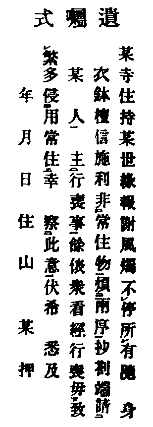



遗书之式



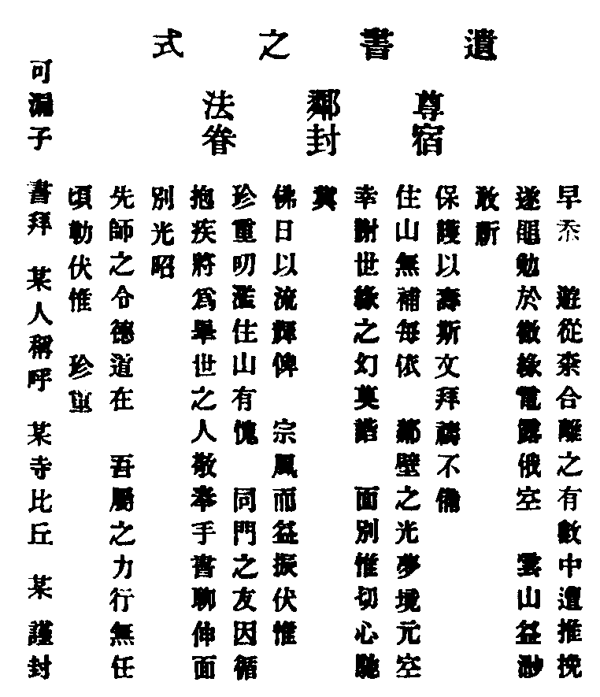



入龛



初示寂，侍者即令客头行者报两序诸寮。两序耆旧继时诣方丈吊慰毕，首座同两序耆旧商议发计状(式见后)。报诸山及发书。请人主丧，须诸山名德、隣封老成，或法眷尊长，或只本寺首座。如有遗命，遵行举请。小师、侍者、亲随人，当躬自洗浴、著衣、净发，入龛安排。寝堂置龛，遗偈贴於龛左，设几筵供养。鸣僧堂前钟，首座、大众至寝堂吊慰。小师讽经，维那述偈回向云：(因缘所生法，我说即是空。亦名为假名，亦名中道义。仰冀真慈，俯垂昭鉴。兹为堂头和尚示寂入龛之次，讽诵真乘，称场圣号。所集功德，奉为觉昙增崇，品位十方云云)。当夜讽诵、回向同前(但改入龛二字为停龛)。龛惟二时上粥饭，三时上茶汤。大众讽诵、维那回向并同。



讣状式



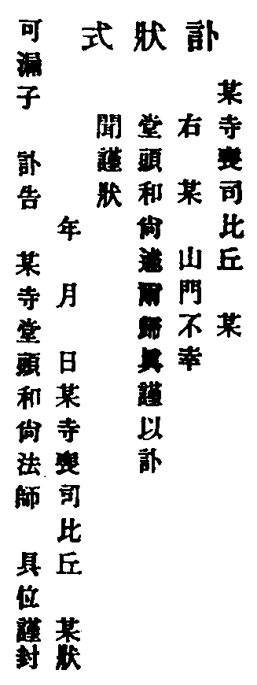



请主丧



凡主丧者，须老成名德，理合首座恭请，近乃见职。知客请主丧人至，鸣大钟，集众门，迎至龛前。炷香毕，入幕吊慰小师云：(法门不幸，和尚归真，且望节哀，以终大事。)小师触礼一拜。主丧仍慰两序大众云：(法门不幸，堂头和尚遽戢化权，敢冀大众力为住持后事。)首座答云：(尚赖和尚力赐主张。)大众问讯散，两序耆旧送主丧人归客位，插香展礼。主丧人居主位，首座分手坐定。首座起，烧香复位。献茶毕，小师列前插香，大展三拜。方丈执局及参头领众行者，相次插香礼拜后，方丈仆从参拜罢，献汤，送两序出。库司备点心，两序光伴，次第巡寮。



请丧司职事



主丧人巡寮回，两序、耆旧、小师随到客位，呈衣钵簿、遗墨等物。会茶，议请丧司职事。两序、耆旧各请一人掌财，庶绝浮议。仍请书记作祭文，回发书简。见职知客接外客，丧司公差库子、客头、茶头一行人管办事。仍具丧司合干人仆，排单揭示。主丧人须与首座计会所遗衣钵多少，约作三分：一分准孝服，并诸山讽经𫎪钱等用；一分准做斋等用；一分俵大众看经，并佛事板帐等用。请见职维那同议。主丧人须存公正，不可徇私。带行僧行，不得干预执役。仍议请一切佛事(资次见后)，并分孝服。如无布绢，折钱俵之。



孝服(释氏丧服，涅槃诸律并无其制。近有戴白披麻，深非所宜。若顺世仪服，从恩制著生。)



侍者小师(麻布裰)、两序(苎布裰)、主丧及法眷尊长(生绢裰)、耆旧办事乡人法眷、诸山(生绢腰帛)、檀越(生绢巾腰帛)、方丈行者(麻布裰)、方丈人仆作头(麻布巾衫)、诸仆甲佃(麻布巾)。



佛事



鎻龛  

法堂挂真  

对灵系念  

起龛  

山门首真亭挂真  

奠茶汤  

秉炬  

起骨  

入塔  

入祖堂  

全身入塔  

撒土



移龛挂真读遗偈(入龛毕，或三日，或一日，或继时移龛，置于法堂。)



入龛三日，闭龛铺设。法堂置龛西间，用麻布帏幕，前设香烛素华，中间生绢幙。法座上挂真牌，位列祭筵，用白纸作娑罗华八[木*封]，以簇座上，表双林之相。东间挂帐幙，设床座椸架，置平生道具之属，如事生之礼。灵前二时，上茶汤粥饭讽经(详见应师五衫集)，仍备挑灯、铙钹、华旛，鸣僧堂前鍾，集众龛前，讽经回向(同前，但云移龛之次)。移龛下法堂，请鎻龛佛事并挂真佛事毕，如有亲书遗偈，侍者捧呈主丧人及首座大众，则主丧躬接递与首座，以所书香炉上熏，授维那读过。丧司行者贴法堂中间上手幙上，小师列真前礼拜，归幙下。主丧炷香上茶汤礼真，两序耆旧大众以次炷香礼真，小师真左答拜毕，讽经回向(云云)。小师夜守龛帷，丧司列排祭次(见后)，贴法堂下间幙上。凡祭文，皆丧司书记为之。若檀越诸山来有前后，随时上祭不拘。若法眷门人上祭到门，知客接已，即报丧司，随送孝服，然后上祭。所有赙仪，丧司置簿攸受。



大夜上祭



丧司预多办祭食，准上祭人送钱回祭。先两班上祭，烧香，设三拜。维那读祭文毕，举大悲呪一遍，回向云：(上来讽诵功德，奉为新示寂堂显和尚增崇品位十方云云)。次第一一上祭毕，举大悲呪(回向同前)。若小师等上祭礼，九拜后行者，礼拜讽经。



人仆参拜  

祭次  

知事  

头首  

主丧  

西堂  

耆旧  

江湖  

大众  

办事  

旧侍者  

乡人  

法眷  

诸庵塔院  

嗣法  

门人  

小师  

师孙  

方丈行者  

六局行者  

行堂  

方丈人仆  

轿番  

老郎  

庄甲  

火客  

诸色作头



系念



维那同小师，前一日怀香诣客位，拜请主丧人，或请大诸山。大夜系念，预令对灵设座。至晚上祭毕，诵大悲呪三遍，洒净，开启白佛(云云)。毕，鸣鼓升座，祝香(云云)。趺座，两序座下问讯(如常式)。小师等插香，设三拜。第一时，提纲叙谢，结座坐，诵弥陀经(或一卷或二卷)，举阿弥陀佛真金色(云云)，称佛号一千声至百声。下座，领众行道菩萨各十声。主法人归座回向，伏愿(云云)，仰凭大众忏悔发愿(云云)。第二时、第三时，说示净土观门，各诵经、念佛、回向，并与前同。第三时毕，具疏诣龛前，躬自回向(法师用带行侍者烧香，或令其启白并回向等)。施食毕，小师拜谢。或三时各请诸山，或只举行一时，随衣钵丰约行之(三时中各行茶汤点心)。



出丧挂真奠茶汤



库司、丧司相关，提调丧仪。香亭、真亭、幢幡、呗乐，龛前伞椅、汤炉、挑灯、如意、拂子、香合、法衣等物。小师随龛后，鸣大钟、诸法器送丧。首座、大众至龛前，举心经。维那烧香，引小师拜请起龛。佛事。龛至山门首，请真亭挂真，奠茶汤，俱有佛事。两序大众门列，俟龛出已，维那朝内问讯，举弥陀佛号，大众齐念。主丧领众两两对出，左右行者俵雪柳，齐步并行，不得挨肩交语。都寺押丧，维那、知客依行丧𫎪(为首小师提炉引龛)。



茶毗



龛，至涅槃台。都寺上香茶了，维那进前烧香，引小师拜请秉矩佛事。维那念诵(是日则有新示寂堂头和尚，既机薪而已尽，乃应火以云亡。真身常寂，而无去无来；性火阇维，则示生示灭。仰凭大众，资助觉灵。南无西方极乐世界大慈大悲阿弥陀佛声。上来称扬圣号，恭赞化仪。出现世间，为作人天之眼目；率笼教纲，恢扬佛祖之关。处息化以归真，冀回光而返照。茶倾三奠，香𦶟一炉。奉送云程，和南圣众)。首座举楞严，维那回向(如前，但改茶毗之次)。次乡人举经，大众须同讽念毕，首座领众归寺斋。小师、乡人、法眷，守化收骨。斋罢，鸣僧堂钟集众，仍备仪从，迎骨回寝堂安奉，挂真供养讽经。二时上粥饭，三时上茶汤。每日大众讽经，灵骨入塔则止(如入塔日，遵大众讽经，或三日、五日外，餘日则小师、法眷讽经)。



全身入塔



龛至塔所，都寺上香茶毕，维那烧香，引小师拜请入塔佛事，举经讽诵，次第并与涅槃台同。但回向则云：(入昏之次)。侯掩扩毕，然后请撒土佛事，迎真回寝堂供养。主丧炷香礼真，次诸山、两序、大众、小师礼真毕，小师插香，大展三拜，谢主丧。次两序、大众谢主丧，词云：(山门不辛，先堂头和尚示寂，极荷主盟后事)。主丧答云：(仰荷匡扶，得无矌败)。主丧同丧司一行人巡寮致谢，次小师巡寮拜谢。每日真前，三范上茶汤，集众讽经，俟迎牌位入祖堂则止。或待新住持至，方入祖堂。有佛事



灵骨入塔



至期，隔宿准备仪从，正日鸣钟集众，都寺上香毕，请起骨佛事，送至塔所。请入塔佛事，讽经回向，并与全身入塔语同。迎真归𮄎堂供养，及谢主丧人等礼并同。



唱衣



至期，僧堂前或法堂上下间设众坐位，中间向里横安长卓，置笔砚大磬於上，鸣僧堂钟集众。首座与主丧分手，两序大众次第而坐。维那、知客、侍者面内，朝主丧位坐。维那念云：(留衣表信，乃列祖之埀规；以法破悭，禀先达之遗范。今兹估唱，用表无常。为是缘念清净法身毗卢遮那佛云云)。众念毕，开笼出衣钵，依号排席上。维那鸣磬一下，白云：(夫唱衣之法，盖禀常规。新旧短长，自宜照顾。磬声绝后，不得翻悔。谨白)。若法衣多，或结缘阄拈，或添留嘱，次第呈衣，维那拈唱。丧司合千人，贵在公心主行。维那定价打磬，行者瞻𮨇前后，喝定名字。知客写名上单，侍者依名发标。唱衣毕，结定钞数。主丧佥单，交钞取衣，不得徇私减价。主丧力主其事，今多作阄拈，甚息喧争。丧司当预前集两序耆旧，将抄劄衣钵除留遗嘱送外，估定新旧短长、价直高下，庶免唱衣临时纷纭。其法用小片纸，以千字文次第书字号，每一号两头书字，中用印记关防，量众多少，与丧司合千人封定。至期，呈过主丧两序，首座开封，知客分俵侍者，剪取其半。堂司行者捧盘盛之毕，以盘置首座侧，安水盆於下。维那拈衣唱价讫，首座临时呼一童行，盘中抖匀，信手拈半阄，递与首座，开看字号分晓，说与堂司行者，唱其字号。众人各开所执半阄，字号同者即应；如不愿唱此号，衣物则不应。三唱不应，首座以半阄投水盆中，再令撮起半阄，复唱起应者。堂司行者往收半号，到首座处，对同报与维那，称云：某物唱与某人。鸣磬一下，知客上单，侍者发标，堂司行者递与唱得人，衣物仍旧入龛。次第唱毕，维那鸣磬一下，回向云：(上来唱衣念诵功德，奉为示寂堂头和尚增崇品位十方云云)。众散，各自照价持标取衣。三日后不取者，依价出卖。其唱衣古法，收支单帐，见后亡僧总列。



下遗书



丧事毕，主丧请侍者、办事人充专使，分路驰送诸山法眷、檀越、官员遗书。唯尊宿相见对语，须择能事人充专使。至彼寺，首到客司相见。知客引见，侍司预备柈袱盛书物。侍者诣方丈通覆，住持当即相接，令请两班接遗书。专使进前问讯云：(请和尚趺坐)。若住持垂语，须下语插香展礼。住持免，则触礼如常。相看入座，烧香献茶毕，起炉前谢茶。再插大香一片，展礼禀云：(某处和尚某月某日归寂，遗书遗物令某驰送)。即呈书物。住持云：(法门衰落，不胜哀威)。两班候讲礼毕，进问讯。首座分手就坐，专使面住持退一位坐。茶罢起身，住持白云：(法门不幸，某处和尚归寂，不胜哀感)。行者备剪刀拓书物，侍者度书与住持，接就炉上熏，付侍者送与维那。行者度剪开缄读毕，侍者揖专使上，住持对面位坐。侍者烧香献汤，送专使归安下处。先住持问讯，次两序侍者问讯。知客引巡寮，先库司，次头首寮及耆旧诸寮。侍者禀请特为汤，汤罢药石。至晚，汤果大方。遗书至，两班光伴。以次者，两班上首，维那光伴，请书记作祭文。方丈祭文，或住持自作。江湖法眷办事，皆当致祭，侍者一一提调。次早，方丈请汤、唤粥罢，请茶。法堂下间，设灵几排祭。侍者覆上堂，行者报寮，挂上堂牌。座下备卓袱，盛书物。座前左排住持位，鸣鼓集众。住持出法座下，位前立。鼓绝，进香卓。知客引专使、住持前，行礼插香。初展云：(輙持遗墨，仰读尊慈，下情不胜惶恐之至)。再展云：(即日时令谨时，共惟堂头和尚，尊候起居多福)。三触礼拜，呈遗书。住持接书，炉上熏，付使者递。维那宣读，专使问讯，归知客班后立。住持升座(云云)。下座，诣灵几前，炷香、点汤、上祭、点茶、展拜。专使座右还拜。维那出班，揖住持烧香。侍者捧香，合两序出班。烧香毕，住持、两序展拜。维那宣祭文，住持复展拜，专使答拜。举大悲呪回向(上来讽经功悳，奉为某处和尚，增崇品位十方云云)。两班耆旧、江湖办事乡人，皆致祭，专使答拜(以下法眷、小师办事，则不答拜)。举呪回向(如前)。祭，举讽弥陀经，称圣号回向(因缘所生法云云，仰冀真慈，俯回昭鉴。上来讽演真乘，称扬圣号功德，奉为某处和尚，增崇品位云云)。毕，专使出灵前，两展三礼，谢住持，免则触礼。次巡寮致谢。然后山门管待专使，请两序光伴。若前住当山，一并入祖堂。讽经毕，就迎牌至祖堂。住持拈香安牌，有法语。安已，专使即拜谢住持。或无遗书遗物与当代住持，其徒自为入祖堂者。初至寺，见侍者，引见住持。插香展拜，就座烧香吃茶。起身禀意毕，送安下处。次到头首、库司、耆旧诸处相看，拟日办供俵𫎪。法堂致祭讽经牌，入祖堂。住持有法语，礼与前同。若嗣法师遗书，至方丈开书。两序先慰住持。法堂中间设祭，座前拈香，有法语。不得恸哭，应小小泣泪。上汤三拜，又上食、上𫎪三拜，上茶又三拜。读祭文毕，举大悲呪回向(云云)。两序并耆旧、江湖乡人、法眷、小师办事，皆有祭。住持居灵几之左(如有诸山及座下西堂法眷，与师为行辈者，上祭，则住持同专使答拜。以下者，则不答拜)。祭毕，讽弥陀经回向(同前)。首座领众慰住持云(法门不幸，令师和尚归寂。后学失依，不胜悲悼。尚冀堪忍，力行此道)。



管待主丧及丧司执事人



山门当备供𫎪，高下一一如仪。就方丈坐，仍请两班耆旧光伴首座，摄居主位。都寺行礼，与常特为同。茶毕，鸣钟集众，送主丧人。



亡僧



抄劄衣钵



凡有僧病革，同斋者率乡人、道旧，称念阿弥陀佛号，求佛慈光接引，使其正念现前。预令堂司行者，禀请方丈、两序，同到病人前，抄写口词(式见后)。直病人同维那、堂司行者，收拾衣物、行李，具单见数，一一封鎻。外留装亡衣服(直裰、内外衣裳、香合、数珠、鞋韈、净𩬊巾、收骨绵子等)合用之物，(并)所封行李，交点同斋人收管。若单寮耆旧行李多者，库司差人就房看守。其单帐锁匙，封押纳首座处。或病者不能分付住持，首座、维那力当主行。无行李者，亦须尽礼津送。若亡僧非生前预闻住持、两序、耆旧，及无亲书，不可擅自遗嘱衣物。



口词(抱病僧某。右某，本贯某州某姓，几岁，给到某处度牒，为僧某年到某寺挂搭。今来抱病，恐风火不定，所有随身行李，合烦公界抄劄。死后，望依丛林清规津送。)



(年　月　日抱病僧　某甲口词)。



浴亡入龛讽诵



如病僧瞑目同斋，即报维那，令堂司行者报烧汤。覆首座、知客、侍者，即令首座、维那、知客、侍者、四寮人仆，擡所封亡僧行李归堂司。覆库司，差人擡亡及龛浴舡，於涅槃堂安排浴亡。浴毕，净发，拭浴衣被，酌量分俵浴亡人手巾与净发人。维那提[升/目]，著衣入龛。龛前铺设椅卓位牌，牌上书云：(新圆寂某人，随聀称呼书)。备香灯供养现前僧众，讽空品经，称圣号回向(云云，但改入龛之次)。至夜，点长明灯，堂司行者预造雪柳幡花，排设整齐。若西堂大耆旧，别排祭筵挂真，上下间敷设七日，讽诵作功果，每晚俵经资。若次者五日，又次者三日。每日，直灵行者上粥饭，知事三时烧香上茶汤。堂司行者候斋粥下堂，即鸣引首座领众至龛前。住持烧香毕，举空品，称圣号回向(同前，则云停龛之次)。至晚，鸣僧堂前钟，集众讽弥陀经，称圣号，述偈回向(云云)。每日三时礼同。如乡人法眷俵𫎪讽经，则乡长烧香。如遇旦望景命日，免讽经，未可出丧。



请佛事



秉炬，必请住持举佛事。其餘锁龛、起龛、起骨、入塔佛事罢，那禀首座商议，依资次轮请头首为之(堂司置佛事簿，以备稽考轮清)。若亡者是西堂、单寮耆旧，衣钵稍丰，则添奠茶汤等佛事，轮请单寮、西堂首座及本山江湖名胜维那，诣方丈插香问讯，禀云(其人圆寂，某日茶毗，拜〔清〕和尚秉炬)，问讯而退。仍带侍者赍香，请头首礼同。如亡者有义小师，诣方丈等处拜请。



估衣



维那分付堂司行者，请住持、两序、侍者就堂司估衣，对众呈过衣笼，开封出衣物，排地上席内，逐件提起，呈过维那估直。首座、都寺、折中、知客、侍者上单排字号，就注价直在下，依号写小标，贴衣物上入笼。仍随号依价别写长标，以备唱衣时用。方丈、两序、诸寮舍，并不许以公用为公分去物件。或亡者衣钵稍丰，当放低估价利众，以荐冥福。



伴灵



其夜若不修设功果，候大众讽经散后，就龛前敷排椅凳，令堂司行者请两班，并大耆旧，或乡人法眷，或单请两班，或一夜，或至三夜，随其丰俭，量力举行。待众集，首座举大悲呪，酒净，对灵启白两土三宝，通疏意毕，众坐定。首座举诸品经，至后诵弥陀经，系念佛号千声，菩萨号各十声，再白佛，宣蔬，忏悔，发愿(云云)。散汤果𫎪，多寡不拘。



大夜上发系念



出丧前一日午后，堂司行者覆住持、两序、诸寮，挂牌报众，预报库司造祭食。至晚，鸣僧堂前钟集众。先住持致祭，侍者读祭文。次两班祭，维那读祭文。次耆旧、江湖、乡人、法眷各致祭(或各备祭食，或纳钱回禀)。毕，举大悲呪一徧，回向(上来讽经，功悳奉为新圆寂某人庄严报地十方云云)。举弥陀经，系念佛号千声，菩萨号各十声，回向(述偈云云。仰冀觉灵，俯回昭鉴。兹为新圆寂某人停龛之次，谨将遗下衣资，命现前大众讽演经文，系念圣号。功悳奉为觉灵庄严报地，再劳大众代为觉灵忏悔〔严〕愿云云。○如无衣钵，则除去将遗下衣资，但云上来大众讽演)。若大方名德、西堂、单寮、耆旧、有功山门者，如上举行。其次者，先住持上食，不制祭文。或先知事上食，住持至，烧香而已。如有乡人、法眷，致祭如前。毕，诵经、系念、回向同前。或衣钵稍丰，则请住持对灵说法紧念(或清都讲、首座，或三时、一时，如前示寂，住持系念同)。



送亡



凡出丧，库司预令监作办柴化亡，差拨行仆，铙钹鼓乐，旛华香烛，擡龛丧仪，一切斋备。堂司行者隔宿覆住持，两序挂送亡牌。粥罢鸣钟，堂钟集众，至龛前举心经。维那出烧香，请起龛。佛事受请人出班烧香，退身问讯。次住持前问讯，转身，然后与大众普同问讯。从西序边至龛右侧立，弹龛三下(云云)。毕，鸣鼓钹，舁龛出山门首，或挂真奠茶汤。维那仍请佛事首座领众两行挂立。待龛将行，维那面里对众当中问讯。首座举佛号，大众同念，两两次第在龛后行。各执雪柳行者排立门外，低头合掌待揖。僧众行尽，亦随后送，排对而行。维那随龛，都寺押丧。



茶毗



丧至涅槃台，知事烧香上茶。次住持上香归位，维那出烧香，请住持秉炬佛事。住持烧香，与众普同问讯法语毕。维那向龛念诵云：(是日则有新圆寂某人，了浮生之幻有，参性火之真空。舍五众和合之身，归三惠涅槃之藏。仰凭尊众，资助觉灵。南无西方极乐世界大慈大悲阿弥陀佛。众和十声毕。上来称扬十念，资助徃生。惟愿三智圆明□，真不昧。七珍林里，常闻天乐之音；入惠池中，高踞金莲之座。茶倾三奠，香𦶟一炉。奉送西归，和南圣众)。首座举楞严呪，知客回向云：(仰冀佛慈，俯回昭鉴。兹为新圆寂某人，茶毗之次，讽演秘章，称扬圣号功德。奉为觉灵庄严，报地十方云云)。乡人、法眷、道旧讽经伴化，维那往来捡视，堂司行者送伴化亡等人。饭至斋罢，收骨。或即日



塔，或迎回涅盘堂供养，讽经三日。



(凡亡僧不可搭袈裟从茶毗事，律明三衣唯许传授。若坐逝不坏，结塔以葬者，犹可以被於真体。若从茶毗火化之法，则不当披搭，自取烧衣违律之过。或谓亡僧无衣者，则当如冥祥记僧妙施衣之法云：南宋江陵龙华寺僧妙既亡之后，一夕归房，灵语弟子可：宋为无袈裟，可急为制，请僧设供，以衣施之，我可得也。宋如教饭僧。施衣既毕，比丘道猛即见妙身披衣入堂，依僧次坐，听经至散，乃不复见。今后可将亡僧袈娑，於唱衣时作阄拈法，於僧中施，不得披塔而焚化。他详如佛祖统纪第九卷中明。)



唱衣



茶毗后，堂司行者覆住持、两序、侍司。斋罢，僧堂前唱衣，仍挂唱衣牌报众。候斋下堂，排辨外，僧堂住持、首座分手位，两序对坐。入门，向里横安凳卓，卓上安笔砚声合用什物。地上铺席俱毕，堂司行者覆住持、两序、侍者，鸣钟集众。维那、知客、侍者同入堂，向里列坐。堂司行者供头喝食一行，　向住持、两序问讯，转身向维那、知客、侍者问讯毕，扛衣笼。住持、两序前巡，呈封记於首座处，请锁匙呈过，开取衣物，照字号次第排席上，空笼向内侧安。维那起立，鸣声一下，云：(浮云散而景不留残，烛尽　光　灭。今兹估唱，用表无常。仰凭大众，奉为圆寂某人，资助觉灵，徃生净土。为是缘念清净法身毗卢遮那佛云云)。十号毕，鸣磬一下，云：(夫唱衣之法，盖禀常规。新旧知长，自宜讽顺。磬声断后，不许翻悔。谨白)。再鸣磬一下，拈度牒於亡僧名字上，横剪破云：(亡僧本名度牒一道，对众剪破)。鸣磬一下，付与行者，捧呈住侍两序。堂司行者依号次第，拈衣物呈过，递与维那，提起云：(其号其物，估唱若干)。如估五贯，则从五伯唱起。堂司行者接声唱，众中应声次第增价。唱至伍贯，维那鸣，即鸣磬一下云：(打与五贯)。餘号并同。或同声应同价者，行云：喝。住云：(双破)。再唱起，鸣磬为度。堂司行者问定某人名字，知客写名上单，侍者照名发标，付供头行者递与唱得人，仍收唱过衣物入笼。一一唱毕，鸣磬一下，回向云：(上来唱衣，念诵功悳，奉为圆寂某人，庄严报地十方。云云)。近来为息喧乱，多作阄拈法(如前)。衣物过三日不取者，照价出卖。



(大毗婆沙论：问：命过比丘，衣钵云何得分？答：彼昔时亦曾分他财物，今时命过，他还分之。又律云：为分不均故，佛听集众，可卖共分。增辉记云：佛制分衣，本意为令在者见其亡物，分与众僧。作是思惟：彼既知斯，我还若此。因其对治，令息贪求。故今不省察，飜於唱卖之时，争价上下，喧呼取笑，以为快乐，悮之甚也。仁者宜忌之。)



入塔



唱衣毕，即造板帐。至第三日，出板帐於僧堂前，令众通知(如有不令成式及有侵欺，许以礼覆上下，核实改正。若无实迹，不得紊烦，违者合摈罚。为住持及执事者，须公亷平允，以身先服众可也)。出板帐毕，堂司行者预报众，挂送灰牌。至斯，鸣钟集众，请起骨佛事。送至塔所，请入塔佛事。入毕，知事封答，讽楞严呪回向(如前，但改入塔之次)。乡人讽经回向并同。



板帐式



大板帐，一千贯、二千贯为式。若有田土、金谷，归常住所。唱衣钱，依式做板帐外，均俵僧众。经钱、佛事钱并抽分钱，若三千、五千贯已上，议归常住设堂供，其餘不可妄用。抽分之例，如百贯，抽十贯与维那，维那又与堂司行者三七分之。如不满百贯，不得抽分。其经资，若众僧一伯，则佛事钱一贯，方丈倍之。其佛事一贯，又贴五伯。



中板帐四伯贯、五伯贯抽分俵众，佛事准前减作。



小板帐二百贯，百贯乃至十贯，除扛龛杂支外，一切结缘，住持首座力主之，库司备办之，大众愍念之，须当尽礼律送。人谁无死？



三等板帐  

大板帐  

中板帐  

小板帐



秉炬  

二十两  

一十两  

结缘下同



奠茶奠汤  

共二十两  

一十两



锁龛起龛  

共二十两  

一十两



起骨入塔  

共二十两  

一十两



维那茶毗佛事  

一十两  

五两



贴秉炬佛事  

一十两



贴七人佛事  

共三十五两



知客侍者把帐  

共二十两  

一十两



首座主丧  

五两  

二两



都寺押丧  

五两  

三两



抄剳估衣点心  

共一十两  

六两  

二两



龛前灯油  

一两  

五钱  

三两



常住回祭  

三两  

二两  

一两



烧浴汤  

五钱  

二钱  

一钱



浴亡  

二两  

一两  

五钱



净发  

一两  

五钱  

五钱



移龛擡亡  

二两五钱  

一两  

五钱



钉挂祭筵  

五钱  

三钱  

一钱



纸笔旛华雪柳  

一十两  

五两  

二两五钱



直灵上粥饭  

一两  

五钱  

三钱



库司客头报造祭  

五钱  

三钱  

一钱



管计出椀楪  

五钱  

三钱  

一钱



库子出给造祭  

五钱  

三钱  

一钱



监厨造食  

五钱  

三钱  

一钱



库司茶头上茶头  

五钱  

二钱  

一钱



方丈听呌捧香合  

五钱  

二钱  

一钱



库司贴茶捧香合  

五钱  

二钱  

一钱



贴堂司鸣廊板  

一两  

五钱  

三钱



参头差拨行者  

五钱  

二钱  

一钱



监作差拨人力  

五钱  

二钱  

一钱



头首二寮茶头  

一两  

五钱  

二钱



舁龛  

十五两  

七两五钱  

三两



铙钹  

二两五钱  

一两  

五钱



鼓乐  

三两  

一两五钱  

一两



扛香卓二人  

一两  

五钱  

三钱



挑灯执厅六人  

三两  

一两五钱  

九钱



俵雪柳柴枝  

五钱  

三钱  

一钱



方丈人仆送丧  

三两  

一两五钱  

五钱



化亡  

一两  

五钱  

三钱



监作𮞏火把  

五两  

三钱  

一钱



擡骨函  

一两  

五钱  

二钱



贴堂司呈衣  

五钱  

三钱  

一钱



供头𮞏唱衣标  

五钱  

三钱  

一钱



喝食行者撮阄  

五钱  

三钱  

一钱



主磬唱衣  

三两  

二两



四寮人仆扛衣笼  

一两  

五钱  

二钱



人仆扛凳卓  

一两  

五钱  

二钱



送壬𫎪钱  

五十两



俵僧众经钱  

六百两  

二百两



方丈两序造车点心  

五两  

三两  

一两



右具如前，永为定式，不许华支巧破。若曰设堂供，须通众公议，众曰可，方可举行。虽是随方毗尼，当准此为通例。凡立成式，必书诸板，示不可移易也。



收支单



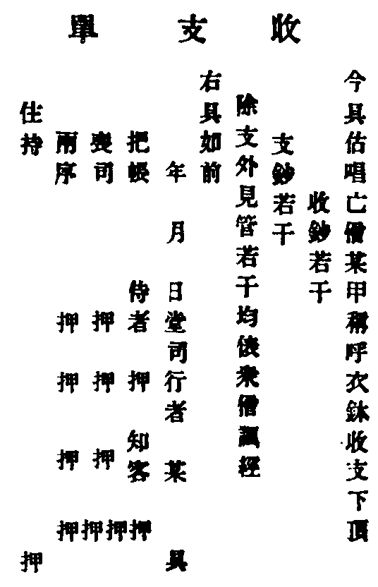



真归门第九



法器门第十



丛林法器，礼乐系焉。斋沐恭敬，服食寝兴，进退拜伏，讽诵讲说，日用威仪之间，莫不以而则之，依而诫约之。规矩所出，法度所存，不可一日废也。至若上感贤圣，下警昏蒙，息苦於无穷，昭信於后世，虽韶、均不足拟，淫哇之乐又恶足云。



钟



大镜号令，人天之设也。寅昏击之，警昏迷，觉幽暗。引杵宜缓，扬声欲长。凡三通，各三十六下，总一百八下。(古德颂云：前七后八，中间二十，疎疎发更埀，未后结三声，是则共当一日。)鸣钟者，想念偈云：(愿此钟声超法界，铁囲幽暗悉皆闻，闻尘清净证圆通，一切众生成正觉。)仍称观世音菩萨圣号，随号扣击，其利甚大。闻钟声者，亦当念偈称号。(杂譬喻偈云：闻钟嗔，现在缘果薄，来报受蛇身，所在闻钟声，卧者必须起，合掌发善心，贤圣皆欢喜。)凡遇圣节、善月、看经、上殿、下殿、如来降生、成道、涅槃、开讲、说戒、结制、解制、斋时，遇堂人定时，各一十八下。如接送官员、住持、尊宿，不以数限，库司主之。　僧堂钟，凡集众则击之。斋粥二时，应鼓鸣七下，下堂三下。结制、解制三日，茶汤每日各七下半。住持开讲，打静三下。头首开讲，打静四下。习读时，疎鸣一十八下。布萨时，下堂鸣三下，堂司主之。殿钟，晨朝上殿，接长板击之。若粥斋罢上殿，或讽诵，或修忏，与僧堂钟相应，接击之，知殿主之。



(增一阿含经云：若打钟时，愿一切恶道诸苦并皆停止。若闻钟声，得除五百亿劫生死重罪。付法藏经云：罽宾咤王以好杀死，作千头鱼，劒轮逸身，随斫随生。有罗汉充维那，依时打钟。闻声之时，劒轮住空。遗信白令长打，过七日已，受苦即止。又金陵志云：民有暴死入冥司，见有五木缧械者，告之曰：吾南唐先主也，以宋齐丘之譔杀和州降者，致此仗。汝归白嗣君，凡寺观鸣钟，当延之，令永吾受苦。惟闻钟则暂休，或能为吾造一钟尤善。民还具闻，后主因造大钟於清凉寺，镌曰：荐烈祖孝高皇帝朊幽出厄。)



版



大版於晨朝大钟绝后，长鸣三通。声绝，殿钟接鸣。斋时，长击三通。斋粥二时，鸣木鱼后三下，叠叠击之，谓之长版。儆戒火烛，鸣三下。报更，则随更次第击之。维那点读，则长鸣三通。方丈、库司、廊下诸寮小板，开静、开讲、集众，皆长击一通。开浴，报众生堂等，各鸣三下。方丈小版，住持外归，鸣三下。且望请两序耆旧献汤，叠叠鸣一通。



木鱼



斋粥二时，长击二通。普请僧众，长击一通。普请行者，二通。



(婆沙云：有僧违师毁法，堕鱼身，背上一树，风涛摇摆，出血苦痛。本师渡海，鱼遂作孽，云：汝不教我，致堕鱼报，今欲报怨。师曰：汝名甚麼？鱼曰：某甲。师令忏悔，复为设水陆追拔。夜梦鱼曰：已脱鱼身，可将我树舍寺，以亲三宝。师果见鱼树刻鱼形，悬挂惊众。)



椎



斋粥二时，僧堂内开钵念佛等白众皆鸣之，法堂上开讲时亦鸣之，并直日者主之。布萨时，秉白者鸣之，僧堂中椎。知事告退时，亦鸣之，法堂上椎。住持入院将说法时，诸山上首鸣之，谓之白椎也。(世尊一日升座，大众集定，文殊白椎云：谛观法王法，法王法如是。世尊即下座。)



磬



大殿早暮住持、知事行香时，直殿者鸣之。大众修诵时，堂司行者鸣之。唱衣时，维那鸣之。小引磬，堂司行者常随身，遇众讽诵鸣之，为起止之节。如披剃童行时，引请阇梨鸣之。安居中修诵时，则直日者鸣之。



(感应记云：阿难房前有一磬，可受五斗。四边黄金镂作过去佛教弟子文，鼻上以紫磨金为九龙形，背上立天人像。执椎击之，声振大千。音中亦说诸佛教诫弟子法。此磬梵天造，及佛灭后，娑竭龙王收归海中。○增辉记云：命未终时，长打磬，令其闻声，发其善思，得生善处。　大师临终语维那曰：大命终时，得闻钟磬，增其正念。惟长惟久，勿令声绝，以气尽为期。故今名为打无常钟、无常磬是也。)



铙钹



凡维那揖住持，两序出班上香时，藏殿祝赞转轮时，行者鸣之。遇送亡时，侍者披剃，大众行道，接新住持入院时，皆鸣之。(通典云：铜钹，其圆数寸，隐起如浮沤，贯之以韦，相击以和乐也。南蛮国大者图数尺。铙者，铙声铙铙也。)



鼓



法鼓。凡住持开讲、上堂，及头首开讲，并击三通(每通三椎九擂，先轻敲鼓磉三下，然后重手徐徐击之。二人相顾，使其系缓轻重，相参相应，音声和畅。起复连环，隐隐轰轰，若春雷之震蛰，似海潮之发音。第一通延声长击，少歇，转第二通。连声稍〔伇〕，更不歇声，就转第三通。候住持登座时，一级一下，待座上转身，双椎连打三下)。普说系念并一通，　茶鼓长击一通，侍司主之。　斋粥二时，鸣鼓各有前后三通(前三通起九下，中间每通十下，结三下，应钟一声。后三通起九下，至第二下，应钟半声。中间三通，每讫各应钟一声，结三下，钟同应三下)。　普请鼓长击一通，　更鼓早晚平击三通，餘随更次击之，库司主之。　浴鼓四通，次第候众击之(详见如知浴门)，知浴主之。



(僧祇律云：帝释有三鼓，若善法堂说法时，则打第三鼓。光明句云：击鼓诫进，肃众前驱。譬佛说法，[升/目]进深行也。)



已上法器，宜各有常度，毋令失准。若新住持入院，则诸山器一齐俱鸣。夫法器之名，梵语总称为犍稚(音地)。声论翻　磬，亦翻钟。五分律云：随有瓦、木、铜、铁鸣者，皆名犍椎。若迦叶结集，檛铜犍稚，此是钟也。若阿难升讲堂，击犍稚者，此是如来信鼓也。故丛林倣其制而用之，所以申号命，警昏蒙也。若夫大定常应，大用常寂，达声非声，不闻而闻，根尘泯净，任运常然，是为绝侍者不可思议之音闻也。



法器门第十。



洪武两子秋七月



僧录司右善世前住慈感讲寺释绍宗募缘重刊



左善世前住北禅讲寺释大佑劝缘助刊



左阐教天禧讲寺住持释溥洽劝缘助刊



上天竺讲寺住持如兰助缘



No. 968-D 书教苑清规后



明僧一如衔使本邦，寄此书於庐山寺中庵，从此相传，而人未徧知。余向在武城，偶得一览，而谓虗张浪设，傚於禅林之规；夜噉昏餐，违於觉王之制，岂足以匡吾徒也哉？虽然，取其可取，舍其可舍，则此书之行，不无小补。顷有欲镂于梓者，来求一辞，因书鄙怀，以附其后云。



贞享元年九月日南谿沙门光谦谨书

