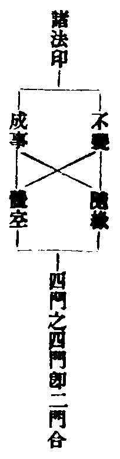

# 法界观披云集



> **藏经**：卍新纂大日本续藏经（新纂卍续藏）　**册次** 第 58 册（X58）　**编号** No. 1014（X1014）　**部类** 诸宗部　**卷次** 1 卷　**篇幅** 2,048 字

> **卷／品**：0 卷 · 0 品



---



法界观披云集



河朔平原　道通　述



夫三重法界，从下升上，渐次深广，智眼门中，观照玅境，因解起行，遗智忘言，自悟真体，然后起用，举一尘毛，摄入无碍，有十玄门，重重无尽，情与无情，普皆平等，难思玅境，於时现矣。



一、真空观。前二句八门，各有十字标，三字徵，二十字释。先结释，后结标。若改色字为十法界字，则法法即真。一、会色归空一、实色不即断空  

二、色相不即真空  

三、双拣断空实色  

四、幻色即真空



二、明空即色一、断空不即实色  

二、真空不即色相  

三、双拣实色断空  

四、真空即幻色



三、尽空之色与尽色之空互不相碍。看色见空，观空见色。  

四、泯绝无寄，心境不可得，无念而知，是为证行。



二、理事无碍门。理事互望不相离性为宗，不可分不坏相为因，如波与水，有十喻明法。初二门合辨大小一异六量。一、理望事全徧一尘，而非小宗，性不可分，故因如海在一波。  

二、事望理全帀，而非大宗不坏相故，因如小波帀大海。  

三、理望事同时，全徧诸波，宗性非异，故因如大海徧诸波。  

四、事望理俱时各帀。真理宗相非一故，因如诸波帀大海。  

五、理望事全徧一事，亦徧诸事，宗不可分故，因如水湿性。  

六、事望理一事全帀，诸事亦帀，宗相不坏，因如波波全帀。  

问：理既全帀一尘，何故非小？亦徧诸尘，何故非大？答：以非一异。理望事有四比量，事望理有四比量。  

问：尘外有理，则非全徧；尘外无理，分理不徧？答：以性融故，令多事无碍，内外俱全。理望事四量，事望理四量。



三、依理成事门不变之随缘量云：理望於事，有法定依理成宗；从缘无性，故因如依水成波。  

四、事能显理门成事之体。空量云：事望理有法，定能显理宗。事虗无体故，因如波虗令水现。  

五、理能夺事门。随缘之不变量云：理望於事，有法定能夺。事宗：离理无事因，如水夺波。  

六、事能隐理门。体空之成事量云：事望理有法，定能隐理宗，相用差别因，如波显隐水。  

七、理即事门，不变即随缘。量云：理望事有，法定非事，外宗是法，无我理因，如水即波。  

八、事即理门。成事即体。空量云：事望理有法，举体即真宗。缘成无自性，因如波即水。  

九、真理非事门。随缘即不变，不变非成事。量云：理望事有法，真理非妄。事宗所依，非能依因，如即波之水非波。  

十、事法非理门。体虗之成事，成事非不变。量云：事望理有，法全理之。事非理宗，性相异故。因如动相，非湿性。



三、周徧含融观。一、理如事门有五：一、如事显；二、如事差别；三、如事大小；四、如事变易；五、如事无量。　量云：真理望事俱时显现，宗体随相异因，如金为六道。  

二、事如理门有五：一、普徧；二、广大；三、徧三世；四、常住；五、本然。云一尘有法正徧，华藏含摄。华严宗唯心所现，故因如太虗空。  

三、事含理事门。存本一事而能广容，非一故不坏小相，非异故方为能含。有其四句：或一中含一，或一切含一切，或一中含一切，或一切中含一。量云：一尘不容无边，与理非一异故，如太虗空。  

四、通局无碍门。一、尘与理。非一即非异，不起菩提树，全徧十方界。非异即非一，虽徧一切尘，内不动本位。  

五、广狭无碍门，非一即非异。不坏一尘而容刹海，非异即非一。广容刹海，尘相不大，即见世间大小相即。  

六、徧容门。一尘望一切尘，有用能入，是普徧义；有相，是广容义。量云：一尘望一切尘，普徧即是广容，唯心故。如一镜徧九镜，摄九镜在一中。若广容，即徧一尘，徧自内，一切唯心现故。一镜容九，即是徧九内。  

七、摄入门。一切望一入，即是摄法无定性。如九镜入一镜，即摄一镜在九镜内。若一望一切摄，即是入法无定性。九镜摄一，即是入一。  

八、交涉门摄一入一，即是摄多入多，通有四句。一、一摄一切，一入一切，缘起相由故。如九镜为所摄，即为所入。  

二、一切摄一，一切入一，缘起相由故。如九镜摄一镜，即是入一镜。  

三、一摄一，一入一宗，缘起相由，如东镜摄西镜入东镜中。  

四、一切摄一切，即是入一切，十镜圆满，同时顿具。



九相在门，我摄餘法在他法中，他法亦摄餘法在我法中。一、一切摄一入一宗，如八镜摄南镜带入西镜。  

二、一摄一切入一宗，如东镜摄八镜带入西镜。  

三、一切摄一入一切宗，如九镜摄东镜入九镜。  

四、一摄一切入一切宗。如镜，镜之中有多多灯。



十、溥融门，具八九二门，两重四句，一是容多之一，多是容一之多，二门交络配属，即有八句，重重无尽，主伴互融，将此十门，入於一切法义，方成十玄之义。



法界观披云集(终)



刑部主事宜兴吴正志施赀刻此。大方广佛华严经吞海集下卷，法界观披云集一卷，嘉禾释道梅对，长洲徐普书，吴县仇鹏刻。



万历辛卯冬清凉山妙德庵识

