# 宗门玄鉴图



> **藏经**：卍新纂大日本续藏经（新纂卍续藏）　**册次** 第 63 册（X63）　**编号** X1256　**部类** 诸宗部　**卷次** 1 卷　**篇幅** 10,455 字

> **卷／品**：0 卷 · 0 品



---



No. 1256-A 玄鉴五宗引



直指单传，初无委曲，五宗不传之妙，谁敢举扬？后来法久成獘，生出异端，故五家依门傍户者，或设为五位君臣、四种料拣、三关九带、十智同真，门庭各立，互相提唱。虽则一期建立，讵知后代儿孙一个个堕在参天荆棘中，枝上牵枝、蔓中引蔓，山野自愧不能㘞地一声，为佛祖忠臣尽焚窠臼，今反将七百陈烂葛藤新飜一遍，𦘕蛇添足，难逃明眼人前白日见鬼矣。



万历丁未仲冬少室后参觉虗一识



No. 1256  

宗门玄鉴图



夫信迹者，先圣之蘧庐，后人之龟镜也。苟昧其源，焉能发明於大事哉？恐后学之流，以金沙混用，玉石同观，既迷宾主之谈，莫究尊卑之理。由是采古圣机玄之妙，总其纲要，作十二门，从流列派，各有所归，自浅及深，俱无异趣，名曰玄鉴图，庶择法眼详证焉。各随门类，略示方隅，餘可知矣。



普贤门。



如瑞岩自唤自应，大光作舞，投子起立，赵州抚膝，安国师瞬目，鸟巢吹布，毛宗师展两手，三玄体用，此皆在称理门也。



文殊门。



如明觉云：千峰寒色，雨滴岩花。逸和尚云：青青岩下竹，郁郁㵎边松。古德云：风从何来？雨作何色？或有人问，指目前山河大地一切物像是也。



观音门。



如国师抚掌，明觉敲床，药山打皷，沩山打木鱼，普化耳边振铃，玄沙以火筯敲火炉，至於击鼎问僧是也。



以理因向门。



如明觉云：国师走走，露柱牵牛向你鼻孔里。投子云：了角女子白头孙。玄沙云：三冬气盛，南星镇北斗，海底生红尘，山头起白浪等是也。



顺实依伍门。



如明觉云：眼看绿水，背靠青山。石头云：眼色耳音声。南泉云：问水答水，问虫答虫，昼见日，夜见星等。此当实玄，须是本分，不见前理，未可



法体自然门。



如明觉云：天际日上月下。云门云：南山起云，北山下雨，水底鱼，天上鸟，南地竹，北地木，火煖风凉，地坚水湿等是也。不可以夸言诠，不可以识心会。



密应藏锋门。



如明觉顾视左右，唤祖来，洗手敲床云：幻出。蓦拈拄杖下座。紫湖喝僧云：看狗！大慈问赵州，般若呵呵大笑，普化踢倒饭床等是也。



事门？理对门？



如明觉云：僧问：赵州亲见南泉否？答曰：镇州出大萝卜。巴陵云：鸡寒上树，鸭寒下水是也。此与前门事迹须异，皆是瞒人方便也。



寄事标玄门。



如雪峰答耽源云：中有黄金充一国。云门云：拄杖子化为龙。巴陵云：珊瑚枝枝撑著月。黄蘗云：大唐无禅师等是也。盖尽法不欲言，故托寄其事。如明觉云：莫谓水寒鱼不食，如今钓得满船归。



理绝诠事门。



云：担板禅和，如麻似粟。如外道问佛：不问有言，不问无言。如来良久等是也。



顺止归实门。



如百丈挂拂於旧处，僧推倒禅床出，雪峰掷下拂子，圆明靠却拄杖，明州背布袋是也。



已上十门，皆做此收归本分也。



全机尽法门。



但有所宗，皆不是全机；但有一路，亦不放过，皆不尽法。如大慈归方丈，明觉令南泉打赵州了赶出，又八面四方正好连架打是也。



又其餘麻三斤，九九八十一，青州作一领布衫，重七斤半话，一向是无依托，越於格量，故此不取。更有直示、密示等方便，如三玄八势中，明欲知图之收来所归体例，细详明觉，应可见也。



又三格门。



若从观音门入者，一切虾蟇、蚯蚓助汝发机。



若从文殊门入者，墙壁瓦砾助汝发机。



若从普贤门入者，举足动步，施为运用，无有不是助汝发机。



三玄论。



彦明上座堂中问天台韶国师曰：宗门举唱话路，大意如何？国师曰：大意不出三玄。问曰：何名三玄？国师云：一名实玄，二曰体玄，三曰用玄。问曰：何名为实玄？国师云：大凡问答不越常人，所谈皆合本分之事，乃名实玄。如僧问赵州云：如何是赵州？答曰：东门、西门、南门、北门。问云：如何是赵州主？答云：大王是。又如南泉与数僧行次，见池水。又如玉溪长老问法眼：如何是正法眼？答云：即今见色者是。又如拍毬、打地、指天、吹布毛，随其学人所问，称实而应。据斯体例，不露头角，不越常谈，不失机关，皆是本分之事。自古至今为本分实玄，便是宗门极则之法。问云：何名为实？答曰：不可以会解推究，无所名之，故谓之实也。问曰：何名为玄？答曰：历历灵灵，本是如是，故名为玄。问曰：何名本分？答云：是他法法，非无一物，亦不越常人言谈语话、行为动作，故为本分。问曰：何名不本分？答曰：说作妙觉菩提、佛性知见、凡圣因果，乃於无所得心中似有一个无名字，及无心得、无所得者，皆名不本分。问云：何名体玄？答曰：夫体玄者，乃是西天龙树祖师现大月轮真实体也，亦是一切众生天常真性本然之道，亦是大藏所谈极则，亦是古人接机岐路。只如上古拈椎竖拂、举指辊毬、自唤自应、狮子入窟法、杳然绝朕迹，皆表此本体也。问曰：既是大月轮真如实体性，何以古人破作泥水之谈，唤作弄精魂、掠虗头活计耶？答曰：为伊不识向上本分之事，但认浮相，谓称极则，所以破之也。问曰：何名用玄？答曰：夫用玄者，即是大月轮体上极然之用。从上古人皆用此法接机，如神会振身、大光作舞、普化邈真、从东过西、狮子出窟、藏身无路，皆表此大用也。问云：既是不思议极然之用，何以古人破为瓦砾、野狐精、风力所转，俱无实是耶？答曰：为伊不识向上本色之事，但弄浮相，执邪为真，如此破之。问曰：何为古人不肯真说，须假拈椎竖拂，委曲指示？答曰：名相之说，滞迹多端，疑误后学，恐成支离，柰不获已，所以如此。问曰：古人有哭有咲，是何也？答曰：笑者多赏，哭者多罸，赏罚不定。问曰：如上三玄论竟，只此三玄为别又有？答曰：此外更有三要。问曰：何名三要？一者先照后用，二者先用后照，三者照用同时。且



第一、先照后用者。○如学人来时，禅主先问：从甚麼处来？或云：彼师有何言句指示学人种种言句？禅主反问云：作麼生会？据斯体例，古人亦强名照要也。



第二、先用后照者。◎如学人来问祖师西来意，或问佛法大意，或问如何是学人本来面目，或问如何是极则事，禅主举起拂子，或以拄杖便打，或下禅床立，或𦘕圆相，或呈机要。据斯接机，古人亦强名用要也。



第三、照用同时者，◑如学人来发问端，禅主或竖起拂子云：诸方还有这个麼？或指空云：会麼？或学人见竖起拂子便礼拜，禅主云：这钝汉！或云：学人不会。禅主指露柱云：这个却会麼？学人或展坐具，或竖起拳掌，主云：这弄精魂汉！据斯接机，古人亦强名照用同时要也。



四大式论。



问曰：三玄三要之外，更有何法示徒？答曰：有四大式。



第一正利大式，如初祖在少林等是也。



第二平等大式，如禾山打鼓是也。



第三真假大式。通取前二式是也。



第四本分大式，如初祖见梁武帝时云不识是也。



八棒论。



问云：只这是，更别有？答曰：夫於一代宗门，更有数般体例，吾更为汝略陈梗概。且如引机垂语之棒，略有八种。问云：何名八棒？



第一触令支玄棒，今夜不答话，问话者三十棒。时有僧出礼拜，山便打是也。



第二、接机从正棒。如僧被打，云：某甲未问，为甚麼打？山云：汝是甚处人？僧云：新罗人。山云：未踏舡舷，好与三十棒。



第三、辩机提正棒。如参长老，威仪不肃，礼数怠慢，禅主便打是也。



第四、靠玄伤正棒。如大禅佛到仰山，翘足乃云：西天二十八祖亦如是，唐土六祖亦如是，和尚亦如是，某甲亦如是。仰山与四棒是也。



第五印顺宗乘棒，如禅主与学人问答，深有大契，禅主便打是也。



第六、盲枷瞎炼棒。如长老行棒，学人云：出棒！出棒！主更无酬对是也。



第七、考验虗实棒。如禅主反问，学人答至极则处，禅主便打是也。



又苦责愚痴棒，如学人来参长老，种种开示，学人一一不会，长老便打是也。



又如雪峰背负一束藤，路逢一僧便抛下，僧方拟取，雪峰踏倒是也。



第八、扫除凡圣棒。如道得也打，道不得也打，此方是正棒也。



五句论。



第一迷真句，如指一物及言非物，问学人是也。



第二出身句，如僧问赵州：离四句，绝百非，请师直指某甲西来意。师云：老僧恁麼死急是也。



第三、正宗无问句。如翠峰云：某甲上树，致将一问来是也。



第四，正宗无答句，如云到这里说得十成，犹是患謇汉是也。



第五末后句，如云太阿宝剑祖堂寒，千里应须息万端，莫待泠光轻问烁是也。



八、大势论。



第一天真大势，源其性海，离念圆明，不假安立，亦曾增减。石头休宣，百丈卷席，马祖下座，皆显本来不动。



第二秘密大势，如少林壁，观大寂无声，目击道存。



第三平安大势，四仪尽道，三业都禅，著衣吃饭，动转施为，无非佛事。



第四、直示大势明言。问：示汝等身中有个无位真人堂堂出入等，如云：和尚诚言，焉敢不信？师曰：即今便是佛等是也。



第五，呈似大势。如见人来，两手度□，拄杖从东过西，自唤自应，如道吾舞笏是。



第六收放大势，如明州布袋和尚，人问布袋下事，叉手而立是也。



第七、权设大势。如宗门中曲垂方便，问实答应，权被机害，皆借至理，故得此名。



第八省悟大势，如曹溪打神会，黄蘗打临济等是也。



已上略示方隅，具眼高人，无合滞迹。苟得歇头，真放心处，无适而非可也。



洞山祖师五位图。



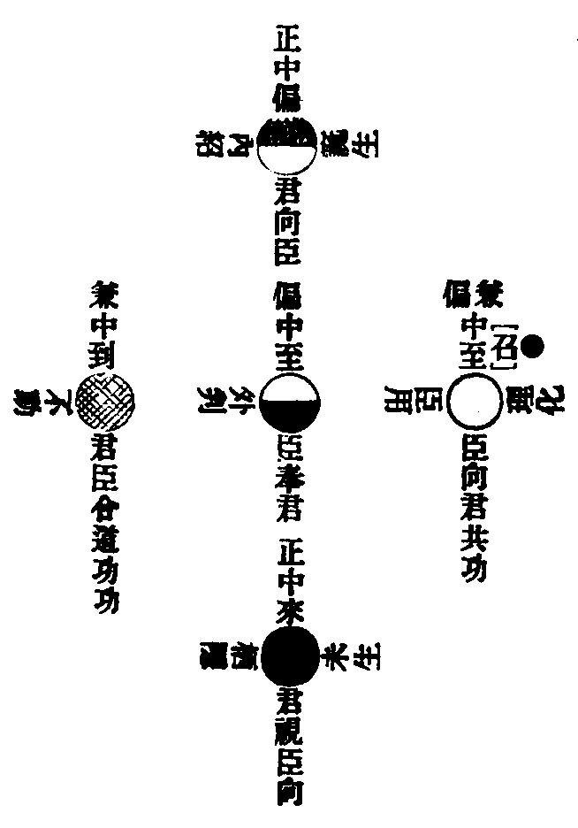



〔召〕



颂曰：



偏中归去极幽玄，正去偏来理事全。兼至去来明妙用，到兼何必逐言诠。须知正位非言说，朕兆依稀属有缘。语默岂能安世界，荡荡纵横鸟道玄。



慈明禅师五位颂。



大者本州刺史，二者把笔文章，三者放鹰走狗，四者外入人家。惟有五郎最小，家中侍奉爷娘。



大阳三句之图。



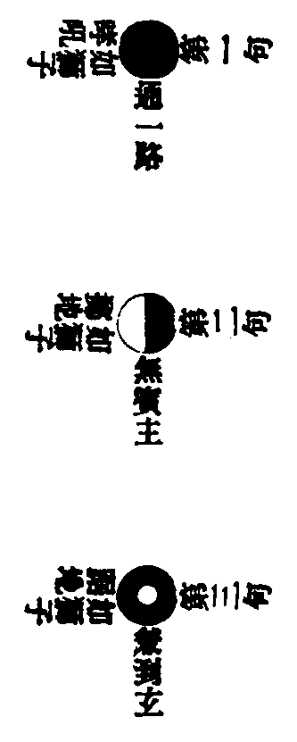



王子五位图



一诞生王子



王宫才降日，玉兔岂能离。未得无功旨，人天何太迷。



二朝生王子



白衣须拜相，此事未为奇。积代簪缨者，休云落魄时。



三末生王子



子时当作正，明暗在君臣。未离兜率界，乌鸡雪上行。



四化生王子



燄里寒氷结，杨花九月飞。泥牛吼水面，木马逐云嘶。



五内生王子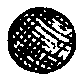



浑然藏理事，朕兆卒难明。威音王未晓，弥勒岂惺惺。



洞山偏正，五位圆相。



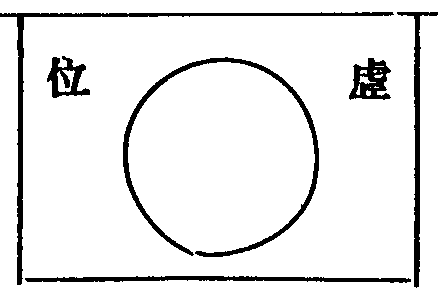



不共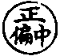



内绍　



，诞生　臣向君。



一色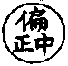



外判　



朝生　臣奉君



功　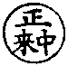



栖隐　



末生　君视臣。



共功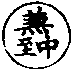



臣用　



化生　臣向君



功功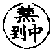



不动　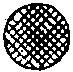



，内生　君向臣。



正中偏，夜深古殿鎻轻烟。寂寂苔封臣不立，密密光舒未兆前。



偏中正，玉人不亲临。台镜子。夜星沉，瑞气浓，依旧青山不露顶。



正中来，木人携杖火中回。趂起泥牛耕练色，放教石马践苍苔。



偏中至。转侧相逢全意气。交辉终不犯锋芒，大用纵横无变异。



兼中到，明暗尽时光不照。石人有志妙难穷，鲜栽绝顶无根草。



洞山偏正五位之图。



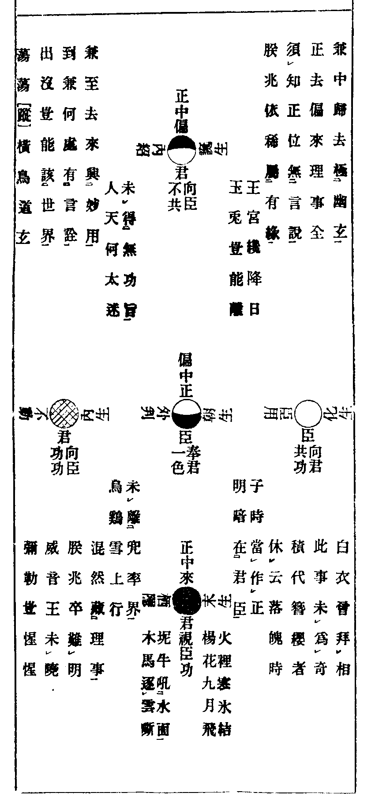



仰山九十六种圆相图



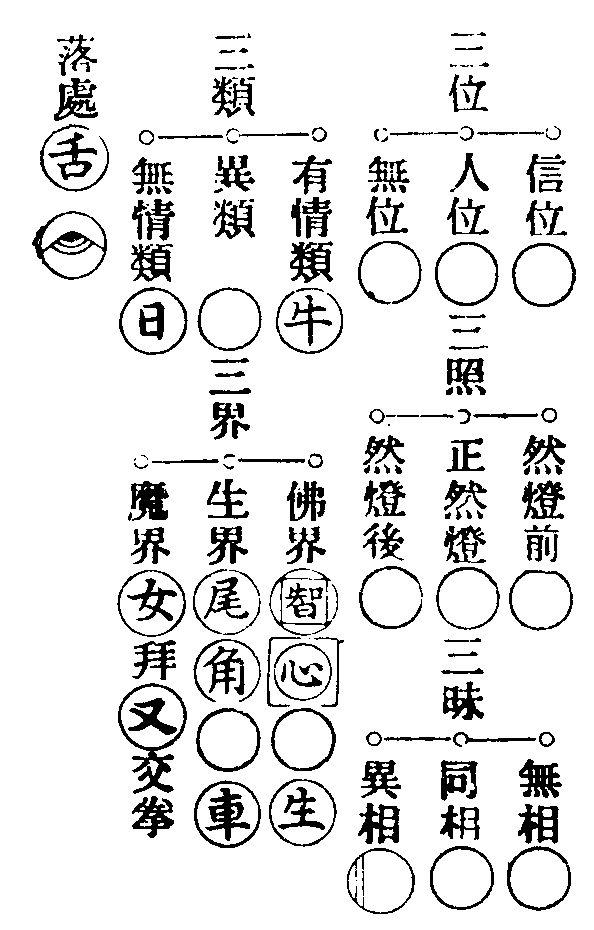



末门句。○　第一句(方员任器，头角全彰)。



日用句○　第二句(体用互收，名言不立)。



末后句。○　第三句(隐显无私，傍通这畔)。



修罗三昧，擎日月势。



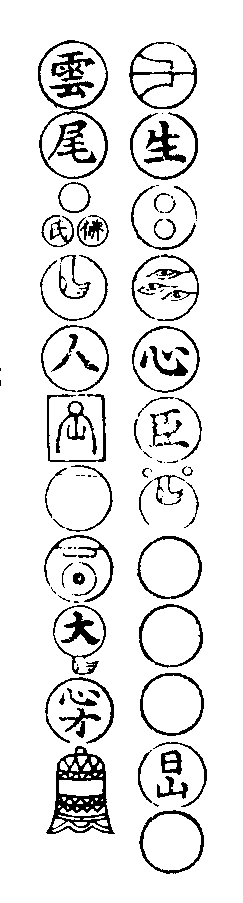



女人三昧，罗刹不隐。



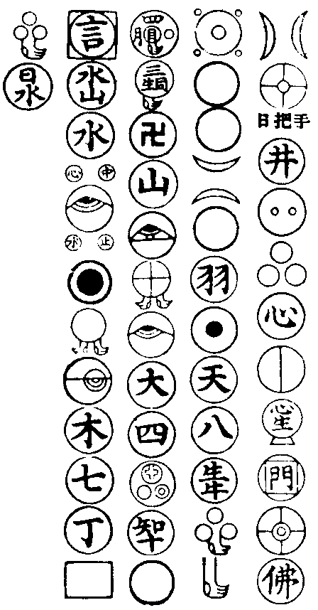



已上开为百二十，合为九十六种，总不出十九门施设也。



　一、垂示三昧门，　二、问答互唤门，　三、性起无作门，　四、缘起无碍门，　五、明机普互门，　六、昧合宾主门，　七、三生不隔门，　八、即幻明真门，　九、用了生缘门，　十、就生显法门，　十一、冥府生缘门，　十二、三境顺真门，　十三、随机识生门，　十四、海印收生门，　十五、密用灵机门，　十六、碎啄同时门，　十七、随随收放门，　十八、卷舒无住门，　十九、一多自在门。



圆收六门。



　一、圆相○　二、义海○○　三、昧机○○　四、多字学○○　五、意语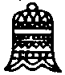



　六、默论○○



曹洞宗旨



达磨西来，不立文字；儿孙东出，酷泥言诠。才落名论，堪作甚麼？万一此藁流落人间，慎勿逐语生解，直饶声前荐得，句外承当，犹有一人大不肯在。纵识得此人，更参三十年，我道犹欠彻在。湛然居士从原题。



洞山五位投子清和尚序。



夫长天一色，星月何分？大地无偏，荣枯自异。是以法无异法，何迷悟而可及？心不自心，假言像而提唱。其言偏圆正倒，兼带叶通。其法也，不落是非，岂关万像？万像既融於水月，源派派混於金沙。不堕虗凝，回途复妙。



洞山五位颂。



正中偏。三更初夜月明前。相逢莫怪不相识，隐隐犹怀旧日嫌。



偏中正，失晓老婆逢古镜。分明觌面别无真，争柰迷头还认影。



正中来，无中有路隔尘埃。但能不触当今讳，也胜前朝断舌才。



偏中至，两辨相逢不相避。好手犹如火里莲，宛然自有冲天志。



兼中到，不落有无谁敢和。人人尽欲出时流，折合元来炭里坐。



卧龙山云庵老人评唱五位王子图颂。



正中偏。　注曰：古人借黑为正，假白示偏也。切忌当头，直要傍提，妙会宗祖。如云：要头一任将去。正者，是正位也。道个正位，已早落偏。言不当理，本位都无言说，但有言说，即属偏也。偏中不曾离本位，无生那涉语因缘，即是两意。人在语中圆得，如云：不落今时句，妙在未闻前。此是语中圆得底句，亦合两意。妙在体处，体即正体。不落今时句，句中须虗一位，不得当头道著，直须玄行，始得相应。半夜日头出，日午打三更，皆是兼中有语也。如云：木人半夜穿靴去，石女天明带帽归是也。直言露地已前，明妙也。道个露地白牛，明妙。法身犹是文采，直须文彩妙会，始得其旨也。



三更初夜月明前。　注曰：只是黑白未分时事。黑白两种，亦是文彩未生前，方是正中偏。有云：金殿豁开全体现，往来常在白云中。月明前，此句不堕有无，始得兴断也。



莫恠相逢不相识。　注曰：正是父子相见，君臣道合，唯一道如如，更与阿谁相识，不落第二门头。此明入宫不异体，为子全身而是父，只是各不相知。臣在门，王不出门，臣不知有君，君亦不知有臣，混然一致。此是儿孙得力，岂得不知。隐隐，幽暗不彰也。



隐隐犹怀旧日嫌。　注曰：初未识时，未有个肯处；见了后，方有个肯处。所以道：悟了还同未悟时，心无胜负自安宁。正位有云：妙语绝承当，个中无肯路。即是此路也。两句语非前句后句中不相似也，只是上下两句共明一意。



偏中正。　注曰：偏乃是今时句，太阳门下事名有句。正是正体，明月堂前事名无句。无句是宗，不得昧却。若於有句傍无句宗旨，即是偏中得正也。偏是左右人，正是尊贵人。常要时时奉他，须得心心无间，念念无差，始得与他相应。是故知有底人始解奉重，輙不得暂时违背。若暂时不在，如同死人。又偏是长老施设处，正是学人承当处，偏中得正也。缘中得正，不坐今时。缘是因缘语句，於因缘语句下得意，不滞因缘语迹。通父母未生前事，空劫外事，乃曰缘中得意，不坐今时也。只向语中转去，方有圆位。语言三昧下出身也。为因有语言，常通无语之意，从偏入正，方有圆位也。又偏属於今时六根六识也。正是那边，不落今时。只於六根六识下，明得那边人偏中得正。



失晓老婆逢古镜。　注曰：彰也，将之道不别有也，本来面目自此而彰也，方信道不从人得也。古镜者，雪峰云：此事如古镜，胡来胡现，汉来汉现。又玄中铭：夜明帘外，古镜徒辉。又云：打破镜来，与你相见。此意照在体无依，通身合大道，即是入正偏而来也。



分明觌面别无真。　注曰：恁麼会，自对分明不是物。



争柰迷头还认影。　注曰：认著不堪，不是本来头。如演若达多迷头认影，认著依前还不是也。



正中来。　注曰：入宫无异体，出塞将军才。此是回途转位，戴角披毛，何异类中来也。嘶风不及处，妙旨玄中分也。须今时中来，常要不落於今时也。



无中有路隔尘埃。　注曰：古人得位后，方得转身退位，从无入有，不借而借，此是转身一路也。有句云：受阴托胎全得妙，尘尘刹刹现全身，尘埃扑落非他物，纵横不是尘，妙中忽有句，句中忽有妙，妙在体处，此是玅中有句也。句中无得，如红炉焰里莲，看时有分，取即不可，此是句中无得也。



但能不触当今讳。　注曰：未审当今讳个甚麼？问取通事舍人去，谁敢道著？只要不犯当头，任从沧海变讳。依傍这个，不抛於位。依傍这个是叶通之语，这个是左右人位，是主位正位也。不抛位者，常要时中奉重，不得暂时抛位。若一念抛位，此便是不奉於君，悖臣逆子，可谓此人命如悬丝。所以古人道：暂时不在，如同死人，岂向经年度岁不在？句中有路不相触。句句之中，皆有出身一路，不犯当头也。



也胜前朝断舌才。　注曰：类之不齐，非谓无语。须有言语，善能回互。不犯当头，明暗全该。明是偏位，暗是正位。不犯当头，下句全体该摄也。如前朝姓李名知章，得利舌之用。凡为谈论，令人结舌杜口。如今若能傍参玄旨，妙会宗乘，更胜前朝利舌之用也。



(兼偏)中至。　注曰：从前有句中来。前来是正位，中来是有句。有句属今时，名偏位也。故指偏中至，是有句中来，机不回互。所谓以偏正两位，尽在机前括出，更不回互矣。



两辨相逢不相避。　注曰：此是作家弄险之处，谓以偏正交罗，明暗互用，如两辨相逢，善能回避，此是明暗双放也。如人弄珠，不触手，不落地也。不触手者，不住偏位也。不落地者，不坐正位也。此是作家始得其妙，如火焰里出身，岂不是好手也。



好手犹如火里莲。　注曰：此是往来句中，常有出身之路也。若是作家相见，如大冶精金，应无变色，无中忽有，坏有不得，明自体也。能为万象主，不逐四时凋也。



宛然自有冲天志。　注曰：檠天架海，气宇如王，不从他得，须是渠得。故云：丈夫自有冲天志，不向如来行处行。是他自有把定世界，函盖乾坤底手眼，所以气宇如王，不依他教也。



兼中到。　注曰：物物头头全得妙。此是玅叶处，始得句中不落有无，须叶带偏位中也。由体妙行玄，故得句中不落有无，即是双收也。



不落有无谁敢和。　注曰：无，言童儿能断和。此句合前有无极尽，此是符合前正中偏，黑白未分时事，此是不堕有无极尽也。不当头，是文采未生前，唯显体妙，全体该收，更无遗落，故言不当头全该也。



人人尽欲出时流。　注曰：人人尽欲超佛越祖，出今时流辈外去，谁道不藏锋，阿谁不待藏形泯迹，回头即露显，争奈回头坐他一色也。



折合元来炭里坐。　注曰：坐著即不堪折合，此方云割杀。为修行人不能超前绝后，元来却只在炭堆里坐割杀。所以道：若不回互，却坐他一色也。到这里，直须黑山内动地放光，死水里兴云吐雾，十字纵横，功勋不犯，则可也。



正中偏，偏中正，正中来，兼中至。兼中到，是未萌已前即正。谓众生迷故，当亲知识，即正悟入。从此得悟，即便谓之正中偏。既悟不可得，即合其正，谓之偏中正。乃悟真空，无偏无正，非有非无，非凡非圣，三头六臂，开方便门，未常道著也。无中唱出者，正中来也。本非情量，不在中边，千圣难以覰见。会即没交涉，坐在一色也。无为端拱，至尊至妙，即兼中至也。前之四位，要须父子圆明，复归其本。如人到家，不谈客尘之事，只是旧时人也。了却那边行履，却来这里作活计，乃是兼中到也。遂有君臣父子出世间之说也。偈曰：



> 迢迢空劫绝人行，却驾坭牛海底眠。  

> 休问偏来与正去，皎然红日夜东升。



沩仰宗。



残枝拨发无烟火，百丈深掐果有金。枯木开花明至道，寒灰吐𦦨晓真心。但能会取不会底好，不是别，正是你。佛若向外求解，将谓禅道且莫交涉，是名运粪自污心田，所以不是道。僧问：如何是道？山云：无心是道。还会麼？僧云：不会。山云：会取不会的好。僧云：如何是不会的？山云：只是你，不是别人看，一似死水里浸却。仔细观来，水里有些味，下口吃著，方知滋味。会与不会，时时对面，似影随身，非向非背。偈曰：



> 父子相逢岂偶然，一轮抛却海东边。  

> 机锋互唤人难会，体用如如用自玄。



仰山师先躭源处，因示圆相有省。后於沩山处，因渡水大悟。后开法住仰山，四方归敬。接物利生，乃因圆相辨的於人。然九十六种圆相，各有所由。於圆相中，书一牛字是纵意，书一佛字是夺意，书人字是肯不全意，书卍字是全许也。或示圆相，或点破畫破，掷却抹却，皆是绝意截断众流也。乃至更有多相，有权有实，体用宾主，纵夺互唤，机关褒杀活，此是入𫑮垂手，方便施设也。或师极则，语句大具，机用现前，不存轨则。



> 沩山与仰山。机暗独难言。飞鶴开䨥翼。  

> 明珠转一盘。方圆难可并，起坐不相干。  

> 手舞既足蹈，徒劳运右端。



临济宗。



喝下分明宾主全，电光石火里头看，山藤六十犹轻恕，恰似蒿枝拂一般。所以故有三玄．三要．四料拣．四宾主。三玄者，於一玄中全具三要也。三棒三喝，一语一默，凡所相见，宾主历然，即是玄中之要也。四料拣者，夺人不夺境，即法未空也。夺境不夺人，即人未空也。人境俱夺，即二空也。人境俱不夺，即三存也。



> 一喝分宾主。照用一时行。更有知端的。  

> 日午打三更。千秋林也晚，庭际菊初䦨。  

> 般若随缘内。真如不动关。霜飘红树老。  

> 风度碧潭寒。不落见知境，分明说似看。



> 临济好儿孙。三玄四主宾。休论佛与祖。  

> 那说圣凡伦。棒来如雨点，喝去似雷奔。  

> 拟议拦腮掌，谁能继祖灯。



> 临济好儿孙，多将棒喝论。拟动拈棒打。  

> 临行又业盆。休论佛与祖，那说圣凡伦。  

> 更生斯见解，东鲁覔西秦。



> 枯木堂前才抚掌，夜明帘外已讴歌。  

> 若将耳听终难会，眼里闻声不较多。



临济有三要　照　用，　照用齐行。



临济有七事：　杀人刀、　活人剑、　脚踏实地。



探竿影草，　向上关棙子。　格外说话，　衲僧巴鼻。



问：如何是杀人刀砍水不入？



如何是活人剑？伏尸万里。



如何是脚踏实地？七里八里十五里。



如何是向上关棙子？系驴橛子不直钱。



如何是格外说话人，从陈州来，却往澧州去？



如何是探竿影草？你曾到此间麼？



如何是衲僧巴鼻，凡圣不立踪。



云门宗。



瞿昙瞬，瞿昙瞬，迦叶直下承当。少室九年端坐，少室九年端坐。自从佛佛授手，祖祖传灯，唯此一心，更无异法，一心清净，更无三界也。故云：迷时三界有，悟后十方空。要知成道处，只在净心中。只见四山青又黄，那知岁月短和长。十二时如痴似讷，常教心勿染尘埃。人我无明，一时放下，经行坐卧，了无交涉。不是目前法，亦非心外机，直下才承当，分明无向背。一处明得，千处万处光辉；一言通时，千言万言一时透脱。非心非佛，拈向一边，举今拨向一处。只如诸人分上，还会得麼？若也证得，三世诸佛於中成道，神通变化於中流出，大地山河於中发现，九类四生於中长育圣胎。是知本来成佛，又为含藏识内贮积太多，用颠倒知见妄生巧伪。诸佛本是众生，盖因圆明性中廓然平等，以解脱为心，强名禅道。从此染净岐分，悟迷派列，如手作拳作掌，展速自由，不假他力。



> 截断众流一句传，乾坤函盖更幽玄。  

> 三关透脱知何处，逐浪随波利有缘。  

> 今古韶阳一句传，江南三月菊花鲜。  

> 行人莫染眸中屑，谁信灵云妙悟玄。



> 云门嗣雪峰。机与睦州同，理出千差外。  

> 言居一句中。九秋深夜雨，三月落花风。  

> 常见波斯说，蟭螟吞大虫。



法眼宗。



> 达境唯心万法空，南园春暖动和风。  

> 升元阁在御街里，曾听元音演莫穷。



地藏指庭前太湖石云：此块石在你心内。法眼於此言下大悟，乃作颂曰：三界唯心，万法唯识。唯识唯心，眼声耳色。不到耳声，何触眼色？耳声难成，眼色不立。色心不一，彼我无差。有人会得，腾唤吾家。见色便见心，通达理事境。借问出家人，出家何所证？若谓升天堂，杳南无生理。若谓证菩提，舍头还取尾。一贯之取舍，从此入堂堂。不挂南华华，不学华不学。却来却来，披衣学坐禅。禅若学坐的，非正亦非偏。经劫守闲静，未出生死边。为报参禅者，须信道中玄。且道如何是道中玄？现自宛然。六街钟韵鼓冬冬，即处舖金世界中。池长芰荷庭长栢，更寻何处覔真宗？



> 法眼一宗枝。玄中意自奇。直须明自己。  

> 更不假修持。门里分宾主，言中绝路岐。  

> 若论端的旨，打瓦更钻龟。



> 绝后重苏得旨深，拈来信手莫沉吟。  

> 须明劫外玄玄句，方契宗门佛祖心。



沩仰宗。



> 权分九十六圈挛，脱印相承有所传。  

> 垂手为人曾作拜，横身应物善交权。  

> 禅天云散心光显，义海波澄月影圆。  

> 明暗相参看变态，莫教辜负草鞋钱。



临济宗。



> 堂堂宾主历然分，无位真人不可亲。  

> 栗棘蓬中能出手，金刚圈里解翻身。  

> 腮边一掌机锋峻，肋下三拳意志新。  

> 胞次来能明七事，盲枷瞎棒枉劳神。



曹洞宗。



> 劫波空处妙难通，拟欲无功已堕功。  

> 偏正未曾离本位，君臣那肯异深宫。  

> 玉楼转侧方圆备，宝剑澄明理事同。  

> 云辇月娥归半夜，晚来烟雾尚朦胧。



云门宗。



> 睦州炉鞴雪峰锤，打就金毛狮子儿。  

> 三句揩磨区法则，十门规度别机宜。  

> 树凋叶落金风急，云淡天低晓日迟。  

> 情见到头窥不得，离心意识始方知。



法眼宗。



> 即俗明真总万方，法灋从此露堂堂。  

> 山河大地皆标格，草木丛林尽发扬。  

> 秋雨徧催棃叶老，春风齐折杏花香。  

> 义天觉海周沙界，窥管持蠡难忖量。



四与麼。



与麼与麼(纵也，明其事也)，不与麼不与麼(夺也，辨其理也)，与麼不与麼(先纵后夺，以事明理)，不与麼与麼(先夺后纵，以理辨其事。以有为无，唤事作理，非无作有，以理作事，事理非事，以此作用，立明其道。非理非事，如开拳成掌，握掌成拳，但了是手，拳掌俱是，而亦俱非，直得纤毫不立。所以道：掀翻大海鱼龙隐，踢倒须弥日月昏。纵以理为空下，总计其四也)。



宗门玄鉴图(终)

