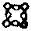

# 指月录



> **藏经**：卍新纂大日本续藏经（新纂卍续藏）　**册次** 第 83 册（X83）　**编号** X1578　**部类** 诸宗部　**卷次** 32 卷　**篇幅** 650,936 字

> **卷／品**：10 卷 · 1 品



---



## 目录



  - [No. 1578-A 水月斋指月录原序](#no-1578-a-水月斋指月录原序)

- [音释　卷一](#音释卷一)

- [音释　卷四](#音释卷四)

- [音释　卷七](#音释卷七)

- [音释　卷十](#音释卷十)

- [音释　卷十四](#音释卷十四)

- [音释　卷第十八](#音释卷第十八)

- [音释　卷二十一](#音释卷二十一)

- [音释　卷二十四](#音释卷二十四)

- [音释　卷二十八](#音释卷二十八)

- [音释　卷三十一](#音释卷三十一)



---



### No. 1578-A 水月斋指月录原序



嵆叔夜好锻，阮遥集好蜡屐，当其意之所适，视世之他好，杂陈於前，无足移也。此不必明哲，第无二子之僻者，皆能喻锻与屐无足尚，交𠷣其失所好已。而以二子之才之美，方其跌宕𬬻𫖔，婆娑火蜡之间，虽穷极要眇，以开之使勿好，有嗑然而笑耳，终不为之移已。及其既喻，则天地此𬬻𫖔也，万有此火蜡也，孰足控搏？孰足容与？程伯子浮云尧舜之业，以玩物丧志，目辑录五经语者，意不若是乎？人之好不齐，乃或尊锻而卑屐，君屐而𨽻锻，不亦过乎？予垂髫则好读竺坟，尤好宗门家言。及岁乙亥夏，侍管师东溟先生於郡之竹堂寺，幸以焦芽与沾甘露，开蔽良多。既而师则朝彻蝉蜕，五宗掩耳，不欲复闻。予则沈醋於是，恒语同辈，圣人六蓺之精蕴，诸所训诂，非读竺坟不能得其真。生於万物之中，而得为人，人而男，男而知读书，於书知竺坟，於竺坟知宗门，是犹𣪬乳而得雪山之牛，复能得酪於乳，得生酥於酪，而熟酥而醍醐哉？虽有他好，吾不移矣。此正予跌宕𬬻𫖔，婆娑火蜡时语也。於是在架之书，率多宗门家言，每读之，如一瓶一钵，从诸耆宿於长林深壑，虽人间世，波涛际天，埃𡏖蔽日，予席枕此，如握灵犀，得辟尘分流之妙，彼浡潏堀堁，莫能我侵矣。意适处辄手录之，当点笔意适，虽圭组见逼必谢之，儿穉牵挽必谢之，寒暑之薄肌骨，饥渴之迫脏腑，有不暇顾，肯复移意他好之杂陈耶？僻而至是，奚必人𠷣，予固自𠷣矣。至乙未，积录有三十二卷，适友人陈孟起见而误赏焉，孟起遂为录二本。会有黄州之役，过故里严道彻至斋中，亦误赏焉，遂以孟起本遗之。道彻遽欲授梓，予笑曰：此予嵆氏之锻，阮氏之屐也。凡所云意适者，皆鸩毒也，道之所以塞也。予既已喻其僻矣，子乃欲使有目者共𠷣其僻耶？坚止之。逮辛丑，予自昭武乞骸归，道彻欲梓此，意益坚，且曰：子谓此为僻，子则谓然，然可以已众僻。古之人不云乎，惟楔出楔至，为发愿偈，率其弟侄若子梓行之。予既不能止，遂不敢藏其僻，为次第缘起於其端，题之曰水月斋指月录。水月，幻也，而云指月，果有如盘山所云心月孤悬，光吞万象者乎？吾不可得而知也。其质之𬬻𫖔火蜡，



万历壬寅夏五月戊寅



那罗延窟学人瞿汝稷　槃谈书



No. 1578-B 刻指月录发愿偈(有述)



释典虽有宗教两涂，世尊云：吾四十九年住世，未曾说一字。则何教之非宗乎？顾宗门须凭实悟，毫不容伪。观古之尊宿，几十年点胸自许，直至末后为明眼人煅炼过，方始开省，则悟岂易言哉？及其悟后，奉戒愈精，检过愈密，甚至向折脚铛下入山磨炼，真悟人气象如此，岂非识法者惧乎？今之望见门头户口者，便谓已证已得，从而呵佛骂祖，放荡无检，声色货利，居然常人，而高谈阔论，明欺一世。噫！欺世乎？自欺乎？有日须眉堕落，呕血无及在，何得归罪於宗？偈曰：



> 世皆忏罪造福，我亦作福灭罪。  

> 惟有流传法宝，续佛慧命为最。  

> 愿我生生世世，不迷正路修行。  

> 直取菩提上果，徧度法界众生。  

> 还愿众生觉悟，修行不迷正路。  

> 聊凭标月指头，正见云开月露。  

> 逍遥性海之中，当体与佛全同。  

> 逐一销除夙习，次第到岸登峰。  

> 慎勿拨无因果，莽莽荡荡招祸。  

> 杀盗婬妄不除，岂得泥犂免堕。  

> 还有向上一言，头上便是青天。  

> 秋月梧桐滴露，春风杨柳含烟。



万历辛丑岁八月初三日　吴郡严澂和南书



指月录总目



卷之一



> 七佛



　毗婆尸佛　尸弃佛



　毗舍浮佛　拘留孙佛



　拘那含牟尼佛　迦叶佛



　释迦牟尼佛　附诸师拈颂诸经语句



卷之二



> 应化圣贤



　文殊菩萨　天亲菩萨



　维摩大士　善财



　须菩提尊者　无厌足王(紧那罗王附)



　舍利弗尊者　鸯崛摩罗尊者



　宾头卢尊者　障蔽魔王



　那咤太子　广额屠儿(文殊思业禅师附)



　秦䟦陀禅师　金陵宝志禅师



　双林善慧大士　南岳慧思禅师



　天台智者禅师　泗州僧伽大圣(万回附)



　天台丰干禅师　天台寒山子



　天台拾得子　明州布袋和尚



　法华志言大士　扣氷澡先古佛



　千岁宝掌和尚　懒残



　法顺大师　清凉澄观国师



卷之三



> 西天祖师



　一祖摩诃迦叶尊者　二祖阿难尊者



　三祖商那和修尊者　四祖优波毱多尊者



　五祖提多迦尊者　六祖弥遮迦尊者



　七祖婆须密尊者　八祖佛陀难提尊者



　九祖伏驮密多尊者　十祖脇尊者



　十一祖富那夜奢尊者　十二祖马鸣尊者



　十三祖迦毗摩罗尊者　十四祖龙树尊者



　十五祖迦那提婆尊者　十六祖罗睺罗多尊者



　十七祖僧伽难提尊者　十八祖伽耶舍多尊者



　十九祖鸠摩罗多尊者　二十祖阇夜多尊者



　二十一祖婆修盘头尊者



　二十二祖摩拏罗尊者　二十三祖鶴勒那尊者



　二十四祖师子尊者



　二十五祖婆舍斯多尊者



　二十六祖不如密多尊者



　二十七祖般若多罗尊者



　二十八祖菩提达磨尊者(章次列于东土祖师)



卷之四



> 东土祖师



　初祖菩提达磨大师　二祖慧可大祖禅师



　三祖僧璨鉴智禅师　四祖道信大医禅师



　五祖弘忍大满禅师　六祖慧能大鉴禅师



卷之五



> 六祖下第一世



　南岳怀让禅师　青原行思禅师



> 六祖下第二世



　江西马祖道一禅师(南岳让嗣南岳一世)



　南岳石头希迁禅师(青原思嗣青原一世)



卷之六



> 二祖旁出法嗣



　僧那禅师　向居士



> 四祖旁出法嗣



　牛头山法融禅师　牛头山智岩禅师(融禅师嗣)



　牛头山智威禅师(法持禅师嗣，持慧方禅师嗣，方岩禅师嗣。)



　安国玄挺禅师(威禅师嗣)　天柱崇慧禅师(二人)



　径山道钦禅师(鶴林玄素嗣素牛头威嗣)



　天台云居智禅师(佛窟惟则嗣，则牛头慧忠嗣，忠牛头威嗣。)



　鸟窠道林禅师(径山钦嗣)



> 五祖旁出法嗣



　嵩岳慧安国师　寿州道树禅师(北宗秀嗣)



　嵩岳破灶堕和尚(安国师嗣)　嵩岳元珪禅师(二人)



　终南惟政禅师(嵩山普寂嗣寂北宗秀嗣)



　嵩山峻极和尚(破灶堕嗣)



> 六祖旁出法嗣



　司空山本净禅师　南阳慧忠国师



　永嘉玄觉禅师　西京荷泽神会禅师



　圭峰宗密禅师(遂州道圆嗣，圆荆南惟忠嗣，忠磁州法如嗣，如荷泽嗣。)



卷之七



> 未详法嗣



　泗州塔头　讲肇论僧



　道流在佛殿(法师入佛殿)　六通院僧



　圣僧像　死鱼浮水



　冯延巳　问圣僧年



　偃台感山主　僧见地藏



　鹞子趂鸽　问无拣



　广南住庵僧　圆通和尚



　童子上经　先净照禅师



　曹溪主衣钵僧　高丽观音



　长明灯　护国天王



　五蕴偈　犬伤持钵僧



　宋太宗　茶陵郁山主



　因禅师　楼子和尚



　神照本如　上竺圆智



　公期和尚　云顶禅师



　终夏不说(老宿畜童)　二庵主



　举九年面壁　师子捉兔



　婆子烧庵　婆子到赵州



　跨驴人　肇法师



　双溪布衲　法海立禅师(天宁明附)



　幽栖和尚　老洞华严



　太瘤　欧阳文忠公



　医官僧　无鬼论



　古德油糍　定僧问弥勒



　元晓　修雅法师



　文通慧



卷之八



> 六祖下第三世上



　洪州百丈山怀海禅师(南二，马祖嗣。)



　池州南泉普愿禅师



卷之九



> 六祖下第三世下



　杭州盐官海昌院齐安国师(南二马祖嗣)



　庐山归宗智常禅师　明州大梅法常禅师



　池州鲁祖山宝云禅师　洪州泐潭常兴禅师



　洪州泐潭法会禅师　洛京佛光如满禅师



　婺州五泄山灵默禅师　幽州盘山宝积禅师



　蒲州麻谷宝彻禅师　湖南东寺如会禅师



　䖍州西堂智藏禅师　越州大珠慧海禅师



　池州杉山智坚禅师　水潦和尚



　澧州茗溪道行禅师　抚州石巩慧藏禅师



　袁州南源道明禅师　朗州中邑洪恩禅师



　潭州三角总印禅师　汾州无业禅师



　信州鹅湖大义禅师　京兆兴善惟宽禅师



　常州芙蓉大毓禅师　利山和尚



　松山和尚　唐州紫玉山道通禅师



　五台山隐峰和尚　泉州龟洋无了禅师



　南岳西园昙藏禅师　磁州马头峰神藏禅师



　潭州华林善觉禅师　乌臼和尚



　石臼和尚　镇州金牛和尚



　亮座主　百灵和尚



　则川和尚　忻州打地和尚



　潭州秀溪和尚　江西椑树和尚



　浮杯和尚　潭州龙山和尚



　蒙溪和尚　襄州庞蕴居士(四十七人)



　澧州药山惟俨禅师(青二石头嗣)



　邓州丹霞天然禅师　潭州大川禅师



　潮州灵山大颠禅师　潭州长髭嚝禅师



　潭州招提慧朗禅师　长沙兴国振朗禅师



　汾州石楼禅师　凤翔法门佛陀禅师



　澧州大同济禅师(十人)



　荆州天皇道悟禅师(据符碑嗣石头)



　天王道悟禅师(据丘碑嗣马祖未定宗派二人)



卷之十



> 六祖下第四世



　洪州黄檗希运禅师(南三，百丈嗣。)



卷之十一



> 六祖下第四世



　福州长庆大安禅师(南三百丈嗣)



　福州古灵神赞禅师　杭州大慈寰中禅师



　天台平田普岸禅师　瑞州五峰常观禅师



　潭州石霜性空禅师　广州和安寺通禅师



　洪州东山慧禅师　百丈山涅槃和尚(十人)



　赵州观音从谂禅师(南泉嗣)



　湖南长沙景岑禅师　鄂州茱萸山和尚



　衢州子湖利踪禅师　终南云际师祖禅师



　邓州香严义端禅师　池州灵鹫闲禅师



　日子和尚　苏州西禅和尚



　池州甘贽行者(十一人)



　洪州双岭玄真禅师(盐官嗣)



　芙蓉灵训禅师(归宗嗣)　汉南高亭和尚



　新罗大茅和尚　五台山智通禅师(四人)



　镇州普化和尚(盘山嗣)　寿州良遂禅师(麻谷嗣)



　虔州处微禅师(西堂嗣)　金州操禅师(章敬𣍯嗣，𣍯马祖嗣。)



　戒灵禅师(永泰湍嗣，湍马祖嗣。)　五台秘魔岩和尚



　湖南祇林和尚(三人)



卷之十二



> 六祖下第四世



　潭州沩山灵祐禅师(百丈嗣沩仰宗)



　潭州道吾宗智禅师(青三，药山嗣。)



　潭州云岩昙晟禅师　华亭船子德诚禅师



　宣州椑树慧省禅师　鄂州百岩明哲禅师



　澧州高沙弥(六人)



　京兆翠微无学禅师(丹霞嗣)



　吉州孝义性空禅师(二人)　仙天禅师(大川嗣)



　漳州三平义忠禅师(大颠嗣)



　马颊山本空禅师　本生禅师(三人)



　潭州石室善道禅师(长髭嗣)



　澧州龙潭崇信禅师(天一)



卷之十三



> 六祖下第五世



　睦州陈尊宿(南四，黄檗嗣。)　福州乌石灵观禅师(二人)



　益州大随法真禅师(长庆安嗣)



　福州灵云志勤禅师(二人)



　洪州新兴严阳尊者(赵州嗣)



　扬州光孝慧觉禅师　婺州木陈从朗禅师



　婺州新建禅师　杭州多福和尚



　益州西睦和尚(六人)



　明州雪窦常通禅师(长沙嗣)



　石梯和尚(茱萸嗣)　紫桐和尚(子湖嗣)



　日容远和尚(二人)



　襄州关南道吾和尚(关南常嗣，常盐官嗣。)



　漳州罗汉和尚(二人)



　瑞州末山尼了然禅师(高安愚嗣，愚归宗常嗣。)



　婺州金华俱胝和尚(天龙嗣，龙大梅常嗣。)



　袁州仰山慧寂禅师(沩仰宗沩山嗣)



　邓州香严智闲禅师　杭州径山洪𬤇禅师



　滁州定山神英禅师　京兆府米和尚



　元康和尚　襄州王敬初常侍



　郑十三娘(八人)



卷之十四



> 六祖下第五世



　镇州临济义玄禅师(黄檗嗣，临济宗。)



卷之十五



> 六祖第五世



　潭州石霜庆诸禅师(青四道吾智嗣)



　潭州渐源仲兴禅师(二人)　僧审禅师(云岩晟嗣)



　澧州夹山善会禅师(船子诚嗣)



　舒州投子大同禅师(翠微学嗣)



　郢州清平令遵禅师(二人)



　鼎州德山宣鉴禅师(天二，龙潭嗣。)



卷之十六



> 六祖下第五世



　瑞州洞山良价禅师(青四，云岩晟嗣，曹洞宗。)



卷之十七



> 六祖下第六世



　睦州刺史陈操居士(南五，陈尊宿嗣。)



　袁州南塔光涌禅师(沩仰宗仰山嗣)



　杭州无著文喜禅师(二人)　双峰古禅师(先双峰嗣，峰沩山嗣。)



　魏府兴化存奖禅师(临济宗临济嗣)



　魏府大觉和尚　镇州宝寿沼禅师



　镇州三圣慧然禅师　定州善崔禅师



　幽州谈空和尚　虎溪庵主



　覆盆庵主　桐峰庵主



　杉洋庵主　定上座



　奯上座(十二人)



　瑞州九峰道䖍禅师(青五，石霜诸嗣。)



　台州涌泉景欣禅师　邵武龙湖普闻禅师



　潭州云盖志元禅师　凤翔石柱禅师



　张拙秀才(六人)



　澧州洛浦元安禅师(夹山会嗣)



　抚州黄山月轮禅师　洛京韶山普寰禅师



　郓州四禅禅师　凤翔天盖山幽禅师(五人)



　鄂州岩头全奯禅师(天三，德山鉴嗣。)



　福州雪峰义存禅师　泉州瓦棺和尚



　襄州高亭简禅师(四人)



卷之十八



> 六祖下第六世



　抚州曹山本寂禅师(青五曹洞宗洞山嗣)



　洪州云居道膺禅师　抚州疎山匡仁禅师



　青林师䖍禅师　高安白水本仁禅师



　潭州龙牙居遁禅师　益州北院通禅师



　京兆蚬子和尚　越州乾峰和尚



　澧州钦山文𨗉禅师　九峰通玄禅师(十一人)



卷之十九



> 六祖下第七世



　吉州资福如宝禅师(南六，沩仰宗西塔穆嗣，穆仰山嗣。)



　郢州芭蕉慧清禅师(南塔通嗣)



　汝州南院慧颙禅师(临济宗兴化嗣)



　守廓侍者(二人)



　汝州西院思明禅师(宝寿沼嗣)



　宝寿第二世和尚(二人)



　洪州同安常察禅师(青六，九峰䖍嗣。)



　吉州禾山无殷禅师(二人)



　凤翔青峰传楚禅师(洛浦安嗣)



　袁州木平善道禅师(蟠龙文嗣，文夹山会嗣。)



　郢州桐泉山禅师(黄山轮嗣)



　台州瑞岩师彦禅师(天四岩头奯嗣)



　福州罗山道闲禅师(二人)



　福州玄沙师备禅师(雪峰存嗣)



　福州长庆慧棱禅师　漳州保福从展禅师



　福州鼓山神晏禅师　龙华照布衲



　明州翠岩令参禅师　越州镜清道怤禅师



　报恩怀岳禅师　安国弘𤦆禅师



　长生皎然禅师　越山师鼐禅师



　太原孚上座(十二人)



卷之二十



> 六祖下第七世



　抚州金峰从志禅师(青六曹洞宗曹山嗣)



　处州广利容禅师(二人)　洪州同安丕禅师(云居膺嗣)



　杭州佛日本空禅师　池州嵆山章禅师



　朱溪谦禅师　南康云居道简禅师(五人)



　护国守澄禅师(疎山仁嗣)　黄檗慧禅师



　伏龙奉璘禅师(三人)



　襄州石门献蕴禅师(青林䖍嗣)



　京兆重云智晖禅师(白水仁嗣)



　杭州瑞鹿幼璋禅师(二人)　报慈藏屿禅师(龙牙遁嗣)



　韶州云门文偃禅师(天四，雪峰存嗣，云门宗。)



卷之二十一



> 六祖下第八世



　吉州资福贞𨗉禅师(南七，沩仰宗资福宝嗣。)



　郢州芭蕉继彻禅师(芭蕉清嗣)　彭州承天辞确禅师(二人)



　汝州风穴延沼禅师(临济宗南院嗣)



　铁胡颕桥安禅师(二人)



　郢州兴阳归静禅师(西院明嗣)



　鄂州黄龙诲机禅师(天五，玄泉彦嗣，彦岩头奯嗣。)



　婺州明招德谦禅师(罗山闲嗣)



　漳州罗汉桂琛禅师(玄沙嗣)



　安国慧球禅师　福州大章契如禅师



　天台国清师静上座(四人)



　泉州招庆道匡禅师(长庆棱嗣)



　襄州鹫岭明远禅师。　太傅王延彬居士(三人)



　谷山行崇禅师(保福展嗣)　漳州报恩道熙禅师



　招庆省僜禅师(三人)　鼓山智岳禅师(鼓山晏嗣)



　报国照禅师(龙华照嗣)



　衢州乌巨仪晏禅师(镜清怤嗣)



　福州瑞峰志端禅师(安国瑫嗣)



　保福清豁禅师(睡龙溥嗣龙雪峰存嗣)



　四祖清皎禅师(白兆圆嗣，圆感潭资嗣，资德山鉴嗣。)



　大龙智洪禅师(二人)



　同安志禅师(青七，曹洞宗同安丕嗣。)



　卢山佛手行因禅师(鹿门真嗣。真曹山嗣)



　泉州龟洋慧忠禅师(草庵义嗣，义曹山嗣。)



　襄州广德义禅师(广德延嗣，延曹山嗣。)



　广德周禅师(二人)　石门慧彻禅师(石门蕴嗣)



　益州香林澄远禅师(天五，云门宗云门嗣。)



　韶州白云子祥禅师　鼎州德山缘密禅师



　岳州巴陵颢鉴禅师　随州双泉师宽禅师



　襄州洞山守初禅师　金陵奉先深禅师



　韶州双峰竟钦禅师　洞山清禀禅师



　北禅寂禅师　云门朗上座(十一人)



卷之二十二



> 六祖下第九世



　汝州首山省念禅师(南八，临济宗风穴嗣。)



　广慧真禅师(二人)　黑水和尚(天六黄龙机嗣)



　枣树第二世和尚　吕岩真人(三人)



　襄州清溪洪进禅师(罗汉琛嗣)



　升州清凉休复禅师　抚州龙济绍修禅师(三人)



　酒仙遇贤禅师(龙华球嗣球长庆棱嗣)



　鼎州梁山缘观禅师(青八，曹洞宗同安志嗣。)



　怀安云顶德敷禅师(护国远嗣，远护国澄嗣，澄疎山仁嗣。)



　随州智门光祚禅师(天六，云门宗香林嗣。)



　韶州大历和尚(白云祥嗣)　连州宝华和尚(二人)



　蕲州五祖师戒禅师(双泉宽嗣)



　荆南福昌惟善禅师(二人)　莲华峰祥庵主(奉先深嗣)



　蓝田县真禅师(般若柔嗣柔云门嗣)



　金陵清凉文益禅师(罗汉琛嗣，法眼宗。)



卷之二十三



> 六祖下第十世



　汾州太子院善昭禅师(南九，临济宗首山嗣。)



　并州三交智嵩禅师　叶县广教归省禅师



　潭州神鼎洪𬤇禅师　襄州谷隐蕴聪禅师



　汝州广慧元琏禅师　铁佛院智嵩禅师



　仁王院处评禅师　智门罕迥禅师



　丞相王随居士(十人)　圆通缘德禅师(天七清溪进嗣)



　郢州大阳警玄禅师(青九曹洞宗，梁山观嗣。)



　明州雪窦重显禅师(天七，云门宗智门祚嗣。)



　瑞州洞山晓聪禅师(文殊真嗣，真德山密嗣。)



　洞山自宝禅师(五祖戒嗣)



　潭州北禅智贤禅师(福严雅嗣，雅洞山初嗣。)



　南安岩自严尊者(西峰豁嗣，豁清凉则嗣，明云门嗣。)



　天台德韶国师(法眼宗法眼嗣)



　金陵清凉泰钦禅师　杭州灵隐清耸禅师



　洪州百丈道恒禅师　永明道潜禅师



　杭州报恩慧明禅师　云居清锡禅师



　漳州罗汉智依禅师　金陵报慈父𨗉禅师



　报恩玄则禅师　归宗䇿真禅师



　同安绍显禅师　观音从显禅师



　洛京兴善栖伦禅师　古贤院谨禅师(十五人)



卷之二十四



> 六祖下第十一世



　潭州石霜楚圆禅师(南十，临济宗汾阳嗣。)



　滁州瑯琊慧觉禅师　瑞州大愚守芝禅师



　舒州法华全举禅师　南岳芭蕉谷泉禅师



　安吉州天圣皓泰禅师(六人)　浮山法远禅师(叶县省嗣)



　润州金山昙颕禅师(谷隐聪嗣)



　唐州大乘德遵禅师　景清居素禅师



　驸马李遵勗居士(四人)



　东京华严道隆禅师(广慧琏嗣)文公杨亿居士(二人)



　舒州投子义青禅师(青十，曹洞宗，大阳嗣。)



　兴阳清剖禅师　罗浮显如禅师(三人)



　越州天衣义怀禅师(天八，云门宗，雪窦嗣。)



　宗道者　修撰曾会居士(三人)



　南康云居晓舜禅师(洞山聪嗣)



　杭州佛日契嵩禅师　太守许式居士(三人)



　荆门玉泉承晧禅师(北塔广嗣，广五祖戒嗣。)



　明州育王怀琏禅师(泐潭澄嗣，澄亦五祖戒嗣。)



　庐山圆通居讷禅师(延庆荣嗣，荣智门祚嗣。)



　潭州兴化绍铣禅师(北禅贤嗣)　洪州法昌倚遇禅师(二人)



　南康云居了元禅师(开先暹嗣，暹德山远嗣，远双泉郁嗣，郁云门嗣。)



　杭州永明延寿禅师(法眼宗韶国师嗣)



　杭州五云志逢禅师　杭州报恩永安禅师



　温州瑞鹿遇安禅师　温州瑞鹿本先禅师



　温州雁荡愿齐禅师　杭州兴教洪寿禅师(七人)



　洪州云居道齐禅师(清凉钦嗣)



　庐州栖贤澄湜禅师(百丈恒嗣)



卷之二十五



> 六祖下第十二世



　隆兴黄龙慧南禅师(南十一临济慈明嗣)



　袁州杨岐方会禅师　洪州翠岩可真禅师



　金陵蒋山赞元禅师　洪州大宁道宽禅师



　潭州道吾悟真禅师(六人)



　苏州定慧超信禅师(瑯琊觉嗣)



　越州姜山方禅师　宣州兴教坦禅师



　江州归宗可宣禅师　秀州长水子璇禅师(五人)



　南岳云峰文悦禅师(大愚芝嗣)



　安吉州西余端师子(龙华岳嗣岳谷隐聪嗣)



　东京芙蓉道楷禅师(青十一，曹洞投子嗣。)



　随州大洪报恩禅师



　东京慧林宗本禅师(天九云门天衣嗣)



　东京法云法秀禅师　延恩法安禅师



　礼部杨杰居士(四人)



　金陵蒋山法泉禅师(云居舜嗣)



　明州大海法英禅师(九峰韶嗣，韶泐潭澄嗣。)



　邢州开元法明上座(报本有兰嗣兰雪窦显嗣)



　佥判刘经臣居士(智海逸嗣逸开先暹嗣)



　杭州净土惟正禅师(法眼宗，净土素嗣，素崇寿稠嗣，稠法眼嗣。)



卷之二十六



> 六祖下第十三世



　隆兴黄龙祖心禅师(南十二，临济黄龙嗣。)



　隆兴宝峰克文禅师　潭州云盖守智禅师



　吉州隆庆庆闲禅师



卷之二十七



> 六祖下第十三世



　潭州泐潭洪英禅师　袁州仰山行伟禅师



　黄龙恭首座　安吉报本慧元禅师



　景福顺禅师　黄檗积翠永庵主



　延庆洪准禅师(十一人)



　舒州白云守端禅师(杨岐嗣)



　金陵保宁仁勇禅师　比部孙居士(三人)



　潭州大沩慕喆禅师(翠岩真嗣)　绍灯禅师(玉泉芳嗣，芳浮山远嗣。)



　邓州丹霞子淳禅师(青十二，曹洞宗芙蓉嗣。)



　洪州宝峰惟照禅师　襄州石门元易禅师



　东京净因自觉禅师(四人)



　东京法云善本禅师(天十，云门慧林本嗣。)



　投子修颙禅师(二人)　清献赵公(蒋山泉嗣，泉云居舜嗣。)



卷之二十八



> 六祖下第十四世



　隆兴黄龙悟新禅师(南十三，临济祖心嗣。)



　隆兴黄龙惟清禅师　隆兴泐潭善清禅师



　吉州青原惟信禅师　漳州保福本权禅师



　太史黄庭坚居士　秘书吴恂居士(七人)



　隆兴兜率从悦禅师(宝峰文嗣)



　东京法云杲禅师　隆兴泐潭文准禅师



　瑞州清凉慧洪禅师　南岳石头怀志庵主(五人)



　庐州罗汉系南禅师(云居祐嗣，祐及开元琦、保宁玑皆黄龙南嗣。)



　信州永丰慧日庵主(二人)



　泉州尊胜有朋讲师(开元琦嗣)



　庆元育王净昙禅师(保宁玑嗣)



　蕲州五祖法演禅师(白云端嗣)



　提刑郭正祥居士(二人)



　安吉上方日益禅师(保宁勇嗣)　灨州显首座(二人)



　洪州泐潭景祥禅师(大沩哲嗣)　和州光孝慧兰禅师(二人)



　真州长芦清了禅师(青十三，曹洞丹霞嗣。)



　明州天童宏智禅师(二人)



　江州圆通德止禅师(宝峰照嗣)



　衡州花药智朋禅师(二人)



　吉州青原齐禅师(石门易嗣)



　天台如庵主(天十一云门本觉一嗣一慧林本嗣)



　平江西竺尼法海禅师(二人)



　东京慧林怀深禅师(长芦信嗣，信慧林本嗣。)



　平江万寿如𪻺禅师　越州天衣如哲禅师



　大觉法庆禅师(法云白嗣，白法云秀嗣。)



　临安广福惟尚禅师(保宁英嗣英法云秀嗣)



卷之二十九



> 六祖下第十五世



　吉州禾山慧方禅师(南十四临济悟新嗣)



　华亭性空庵主　空室道人智通(三人)



　潭州上封本才禅师(黄龙清嗣)



　潭州法轮应端禅师　东京长灵守卓禅师(三人)



　隆兴黄龙道震禅师(泐潭清嗣)



　庆元天童普交禅师(泐潭乾嗣，乾东林总嗣，总黄龙南嗣。)



　江州圆通道旻禅师　庆元二灵知和禅师(三人)



　绍兴慈氏瑞仙禅师(开先瑛嗣瑛东林总嗣)



　丞相张商英居士(兜率悦嗣)　西蜀銮法师(法云杲嗣)



　隆兴云岩天游禅师(湛堂准嗣)



　隆兴九仙法清禅师(慧日雅嗣，雅宝峰文嗣。)



　眉州中岩蕴能禅师(大沩瑃嗣，瑃大沩秀嗣，秀黄龙南嗣。)



　怀安云顶宗印禅师(二人)



　成都信相宗显禅师(昭觉白嗣，白黄檗胜嗣，胜黄龙南嗣。)



　成都昭觉克勤禅师(五祖演嗣)



　舒州太平慧懃禅师　舒州龙门清远禅师



　彭州大随元静禅师　汉州无为宗泰禅师



　蕲州五祖表自禅师　嘉州九顶清素禅师



　元礼首座　法閦上座(九人)



　金陵俞道婆(瑯琊起嗣起白云嗣)



　东京净因继成禅师(智海平嗣，平大沩喆嗣。)



　建宁开善道琼禅师(泐潭祥嗣)



　杭州净慈慧晖禅师(青十四曹洞天童觉嗣)



　明州瑞岩法恭禅师(二人)



　舒州投子道宣禅师(天衣聪嗣，聪石门易嗣。)



卷之三十



> 六祖下第十六世



　嘉兴报恩法常首座(南十五，临济万年一嗣，一泐潭清嗣。)



　左丞范冲等五居士(圆通旻嗣)



　临安径山智策禅师(云岩游嗣)



　径山大慧宗杲禅师(昭觉勤嗣，语列此卷下两卷。)



　平江虎丘绍隆禅师　庆元育王端𥙿禅师



　台州护国景元禅师　平江南峰云辨禅师



　临安灵隐慧远禅师　建康华藏安民禅师



　成都昭觉道元禅师　潭州大沩法泰禅师



　眉州象耳袁觉禅师　临安中竺中仁禅师



　眉州中岩祖觉禅师　平江明因昙玩禅师



　成都昭觉道祖禅师　枢密徐俯居士



　郡王赵令衿居士　侍郎李弥远居士



　成都范县君(十八人)



　常德文殊心道禅师(太平懃嗣)　潭州龙牙智才禅师



　安吉何山守珣禅师(三人)



　温州龙翔士珪禅师(龙门远嗣)　南康云居善悟禅师



　隆兴黄龙法忠禅师(普庵印附)　衢州乌巨道行禅师



　南康云居法如禅师　南康归宗正贤禅师



　安吉道场明辩禅师　世奇首座



　给事冯济川居士(九人)



　台州石头自回禅师(大随静嗣)



　常德梁山师远禅师　莫将尚书居士



　龙图王萧居士(四人)



　无为冶父道川禅师(净因成嗣)



卷之三十一



　临安径山宗杲大慧普觉禅师语要上



卷之三十二



　临安径山宗杲大慧普觉禅师语要下



指月录总目(终)



No. 1578  

指月录卷之一



那罗延窟学人　瞿汝稷槃谈集



吴郡天池山人　严澂道澈甫较



后学梅岩释　开慧　捐资重梓



> 后学释　义行　重阅



七佛



▲毗婆尸佛(过去庄严劫第九百九十八尊)



偈曰：身从无相中受生，犹如幻出诸形象。幻人心识本来无，罪福皆空无所住。



长阿含经云：人寿八万岁时，此佛出世。种刹利，姓拘利若。父槃头，母槃头婆提。居般头婆提城，坐波波罗树下，说法三会，度人三十四万八千。神足二：一名骞茶，二名提舍。侍者无忧子方膺。



▲尸弃佛(庄严劫第九百九十九尊)



偈曰：起诸善法本是幻，造诸恶业亦是幻。身如聚沫心如风，幻出无根无实性。



长阿含经云：人寿七万岁时，此佛出世。种刹利，姓拘利若。父明相，母光曜。居光相城，坐分陀利树下，说法三会，度人二十五万。神足二：一名阿毗浮，二名婆婆。侍者忍行，子无量。



▲毗舍浮佛(庄严劫第一千尊)



偈曰：假借四大以为身，心本无生因境有。前境若无心亦无，罪福如幻起亦灭。



长阿含经云：人寿六万岁时，此佛出世。种刹利，姓拘利若。父善灯，母称戒。居无喻城，坐婆罗树下。说法二会，度人一十三万。神足二：一扶游，二郁多摩。侍者寂灭，子妙觉。



▲拘留孙佛(现在贤劫第一尊)



偈曰：见身无实是佛身，了心如幻是佛幻。了得身心本性空，斯人与佛何殊别。



长阿含经云：人寿四万岁时，此佛出世，种婆罗门，姓迦叶，父礼得，母善枝。居安和城，坐尸利沙树下，说法一会，度人四万。神足二：一、萨尼，二、毗楼。侍者善觉子上胜。



▲拘那含牟尼佛(贤劫第二尊)



偈曰：佛不见身知是佛，若实有知别无佛。智者能知罪性空，坦然不怖於生死。



长阿含经云：人寿三万岁时，此佛出世，种婆罗门，姓迦叶，父大德，母善胜。居清净城，坐乌暂婆罗门树下，说法一会，度人三万。神足二：一、舒槃那，二、郁多楼。侍者安和子导师。



▲迦叶佛(贤劫第三尊)



偈曰：一切众生性清净，从本无生无可灭。即此身心是幻生，幻化之中无罪福。



长阿含经云：人寿二万岁时，此佛出世。种婆罗门，姓迦叶，父梵德，母财主。居波罗奈城，坐尼拘律树下，说法一会，度人二万。神足二：一提舍，二婆罗婆。侍者善友子集军。　幻寄曰：始予录指月录，七佛第书其偈，阿含、化迹皆削焉。既见世之人粗闻即心即佛者，率多拨无报化，乃悟昔人载此之妙密。葢偈阐法身之极致，阿含示化迹之大略，可谓断常俱遣，事理两融者矣。传灯成於道原，而裁定於杨大年，其旨不苟也。因具录之。此录稍录神通，亦以此



▲释迦牟尼佛(贤劫第四尊)



姓刹利，父净饭王，母摩耶刹利氏。自天地更始，阎浮洲初辟已来，世为王佛，历劫修行，值然灯佛授记，於此劫作佛。后於迦叶佛世，以菩萨成道，上生覩史陀天，名护明大士。及应运时至，乃降神於摩耶。当此土周昭王二十四(正宗作九)年甲寅四月初八日，自摩耶右脇诞生。生时放大智光明，照十方世界，地涌金莲花，自然捧双足，一手指天，一手指地，周行七步，目顾四方曰：天上天下，惟吾独尊。



云门云：我当时若见，一棒打杀与狗子吃，贵图天下太平。　云峰悦云：云门虽有定乱之谋，且无出身之路。　琅琊觉云：云门可谓将此深心奉尘刹，是则名为报佛恩。　僧问九峰䖍云：承闻和尚有言：诸圣间出，祇是传语人。是否？曰：是。曰：世尊一手指天，一手指地，云：天上天下，惟吾独尊。为甚麼却唤作传语人？峰曰：祇为一手指天，一手指地，所以唤作传语人。



自降生后，种种神异，具如经言。至四十二(正宗作二十七)年，年十九，二月八日，欲求出家，而自念言：当复何遇？即於四门游观，见生老病死四等事，心有悲喜，而作思惟：此老病死，终可厌离。於是夜子时，有净居天人，於窓牖中，叉手白言：出家时至，可去矣。於是诸天捧所乘马足，超然凌虗，逾城而去，曰：不断八苦，不成无上菩提，不转法轮，终不还也。净饭王思甚，遣其臣劝谕，还宫者万计，确然不回。入檀特山修道，始於阿蓝迦蓝处三年，学不用处定，知非便舍。复至郁头蓝弗处三年，学非非想定，知非亦舍。又至象头山，同诸外道，日食麻麦。经於六年，世尊自思曰：今此苦行，非正解脱，吾当受食，而后成佛。即沐浴於尼连河，天为之偃树，世尊援之而出，受牧牛氏女所献乳糜。寻诣毕钵树下，天帝化人，撷瑞草以藉坐。景云祥风，四起纷披。天魔念世尊道成，且受折抑，率众作难，穷现可怖可欲诸境。世尊泊然不动，以指按地。地大震，魔皆颠仆，於是降之。故经云：以无心意无受行，而悉摧伏诸外道。先历试邪法，示诸方便，发诸异见，令至菩提。乃於穆王三年癸未(正宗作昭王三十三年戊寅)岁二月七日之夕，入正三昧。至八日明星出时，廓然大悟，成等正觉。乃叹曰：奇哉！一切众生，具有如来智慧德相。但以妄想执著，不能证得。时年三十矣(或云成道於腊月八日，以周正二月，乃夏正腊月也)。成道后六年，归为净饭王说法。王大喜，遣其族五百贵子，从之出家。　世尊一日升座，大众集定。文殊白椎曰：谛观法王法，法王法如是。世尊便下座。



芭蕉彻云：忙忙者，帀地普天。　雪窦颂云：列圣丛中作者知，法王法令不如斯。会中若有仙陀客，何必文殊下一椎。　幻寄曰：於斯荐得，则华严论所谓未离兜率，已降王宫；未出母胎，度人已毕。十世古今，始终不离於当念；无边刹境，自他不隔於毫端。是顾虎头画人影，虽得其神，而终是画香严上树。话雪峰望州亭，与汝相见了也。话玄沙三种病人，亡僧面前，触目菩提，深山岩崖，佛法高峰。见雪岩，岩问：睡著未梦主人，都是依样画猫儿。咦！此俱是画，如何是真？咄！不见云门云：且道非非想天，今有几人退位？过此更参三十年。



世尊一日升座默然而坐，阿难白椎曰：请世尊说法。世尊云：会中有二比丘犯律行，故我不说法。阿难以他心通观是比丘，遂乃遣出。世尊还复默然。阿难又白：适来为二比丘犯律，是二比丘已遣出，世尊何不说法？世尊云：吾誓不为二乘声闻人说法。便下座。



南堂静云：前箭犹轻后箭深。



世尊一日升座，迦叶白椎曰：世尊说法竟。便下座。　世尊在忉利天为母说法，优填王思佛，命匠雕栴檀像。及世尊下忉利天，像亦出迎。世尊三唤三应，乃云：无为真佛，实在我身。



咦！在那一个身？



世尊在忉利九十日，及辞天界而下，四众八部俱往空界奉迎。有莲花色比丘尼作念云：我是尼身，必居大僧后见佛。不如用神力变作转轮圣王，千子围绕，最初见佛，果满其愿。世尊才见，乃诃云：莲花色比丘！汝何得越大僧见吾？汝虽见吾色身，且不见吾法身。须菩提岩中宴坐，却见吾法身。



荐福怀云：莲花色比丘被热谩且致，还知瞿昙老人性命在别人手里麼？



世尊示随色摩尼珠，问五方天王：此珠所作何色？时五方天王互说异色。世尊藏珠，复擡手曰：此珠作何色？天王曰：佛手中无珠，何处有色？世尊曰：汝何迷倒之甚？吾将世珠示之，便强说有青、黄、赤、白色；吾将真珠示之，便总不知。时五方天王悉自悟道。　世尊因黑氏梵志献合欢梧桐花，佛召仙人放下著，梵志放下左手一株花；佛又召仙人放下著，梵志又放下右手一株花；佛又召仙人放下著，梵志曰：吾今两手俱空，更教放下个甚麼？佛曰：吾非教汝放舍其花，汝当放舍外六尘、内六根、中六识，一时舍却，无可舍处，是汝放身命处。梵志於言下悟无生忍。　世尊因普眼菩萨欲见普贤不可得见，乃至三度入定，徧观三千大千世界，觅普贤不可得见，而来白佛。佛曰：汝但於静三昧中起一念，便见普贤。於是普眼才起一念，便见普贤向空中乘六牙白象，



云居舜云：诸仁者且作麼生会？云居道：普眼推倒世尊，世尊推倒普眼。你道普贤在甚处？



世尊因五通仙人问：世尊有六通，我有五通，如何是那一通？佛召五通仙人，仙人应诺。佛曰：那一通你问我？



雪窦显云：老胡元不知有那一通，却因邪打正。　瑯琊觉云：世尊不知，可谓因正而打邪；五通不知，因邪而打正。　云峰悦云：大小瞿昙被外道勘破了，有旁不肯底出来，我要问你：作麼生是那一通？　翠岩芝云：五通如是问，世尊如是答，要且不会那一通。　宝叶源颂云：那一通，你问我，口是祸门，招因带果。惭愧慈悲大法王，丙乙离壬不属火。　断桥伦颂云：那一通，你问我，玄关倒插无须锁。等闲一掣掣得开，三个老婆相对坐。　妙喜云：今时有一种弄泥团汉，往往在那一通处错认定盘星。



世尊一日勅阿难：食时将至，汝当入城持钵。阿难应诺。世尊曰：汝既持钵，须依过去七佛仪式。阿难便问：如何是七佛仪式？世尊召阿难，阿难应诺。世尊曰：持钵去。　世尊因有比丘问：我於世尊法中，见处即有，证处未是，世尊当何所示？世尊曰：比丘某甲，当何所示？是汝此问。　世尊因耆婆善别音响，至一冢间，见五髑髅，乃敲一髑髅问耆婆：此生何处？曰：此生人道。又敲一曰：此生何处？曰：此生天道。又别敲一问耆婆：此生何处？耆婆罔知生处。　世尊因七贤女游尸陀林，一女指尸曰：尸在这里，人在甚处去？一女曰：作麼作麼？诸姊谛观，各各契悟。感帝释散花曰：惟愿圣姊，有何所须，我当终身供给。女曰：我家四事七珍悉具足，惟要三般物：一要无根树子一株，二要无阴阳地一片，三要呌不响山谷一所。帝释曰：一切所须，我悉有之。若三般物，我实无有。女曰：汝若无此，争解济人？帝释罔措，遂同往白佛。佛曰：憍尸迦，我诸弟子大阿罗汉不解此义，唯有诸大菩萨乃解此义。　世尊因地布发掩泥，献花於然灯佛。然灯见布发处，遂约退众，乃指地曰：此一方地，宜建一梵刹。时众中有一贤于长者，持标於指处插曰：建梵刹竟。时诸天散花相赞。　世尊尝於阿难行次，见一古佛塔，世尊便作礼。阿难曰：此是甚麼人塔？世尊曰：过去诸佛塔。阿难曰：过去诸佛是甚麼人弟子？世尊曰：是吾弟子。阿难曰：应当如是。　世尊因自恣日，文殊三处过夏。迦叶欲白椎摈出，才拈椎，乃见百千万亿文殊。迦叶尽其神力，椎不能举。世尊遂问迦叶：汝拟摈那个文殊？迦叶无对。



昭觉勤云：可惜放过一著，待释迦老子道：你欲摈那个文殊，便与一椎，看他作麼合杀？　云居元云：一家有事百家忙。



城东有一老母，与佛同生，不欲见佛，每见佛来，即便回避。虽然如此，回顾东西，总皆是佛。遂以手掩面，乃至十指掌中，总皆是佛。



雪窦显云：它虽是个老婆，宛有丈夫之作。既知廻避稍难，不免吞声饮气。如今不欲见佛即许你，切忌以手掩面。何故？明眼底觑著，将谓雪窦门下教你老婆禅。



世尊因文殊至诸佛集处，值诸佛各还本处，唯有一女人，近於佛坐而入三昧。文殊乃白佛：云何此人得近佛，而我不得？佛告文殊：汝但觉此女，令从三昧起，汝自问之。文殊绕女人三帀，鸣指一下，乃托至梵天，尽其神力而不能出。世尊曰：假使百千文殊，亦出此女人定不得。下方过四十二恒河沙国土，有罔明菩萨，能出此女人定。须臾，罔明大士从地涌出，作礼世尊。世尊勅罔明出，罔明却至女子前，鸣指一下，女子於是从定而出。



五云逢云：不惟文殊不能出此定，但恐如来也出此定不得。祇如教意，怎生体解？　翠岩真好问僧：文殊是七佛之师，因甚出女子定不得？罔明从下方来，因甚却出得女子定？莫有能对者。独英劭武方其问时，以手掐其膝而去。真笑曰：卖匙箸客未在。　洪觉范曰：教中有女子出定因缘，丛林商略甚众，自非道眼明白，亲见作家，未能明也。大愚芝禅师每问僧曰：文殊是七佛之师，为甚出女子定不得？罔明菩萨下方而至，但弹指一声，便能出定。莫有对者。乃自代云：僧投寺里宿，贼打不防家。予滋爱其语，作偈记之曰：出定只消弹指，佛法岂用工夫？我今要用便用，不管罔明文殊。云庵和尚见之，明日升座，用前话乃曰：文殊与罔明见处，还有优劣也无？若言无，文殊何故出女子定不得？只如今日行者击动法鼓，大众同到座前，与罔明出女子定，是同是别？良久曰：不见道：欲识佛性义，当观时节因缘。大众总是祖师门下客，参玄上士，试谛观看。若见得，出家事毕，解脱安乐，世俗尘劳，不用闲观。喝一喝，下座。云庵亦有偈曰：佛性天真事，谁云别有师？罔明弹指处，女子出禅时。不费纤毫力，何曾动所思？众生总平等，日用自多疑。　妙喜云：有一种商量古人公案，谓之针线工夫，又谓之郎君子弟禅。如商量女子出定语云：文殊是七佛之师，为甚麼出女子定不得？云：文殊与女子无缘。罔明是初地菩萨，为甚麼出得女子定？云：与女子有缘。下语云：冤有头，债有主。又有商量道：文殊不合有心，所以出女子定不得。罔明无心，所以出得。下语云：有心用处还成错，无意求时却宛然。又有商量道：文殊为甚麼出女子定不得？杓柄在女子手里。罔明为甚麼出得？如虫御木。又云：因风吹火。又云：争奈女子何邪？解甚者，至於作女子入定势、出定势，推一推，弹指一下，哭苍天数声，伏惟尚飨。拂袖之类，冷地看来，惭惶杀人。妙喜颂云：出得出不得，是定非正定。罔明与文殊，丧却穷性命。　圜悟勤颂云：大定等虗空，廓然谁辨的。女子与瞿昙，据令何条直。师子奋迅兮摇荡乾坤，象王回旋兮不资餘力。孰胜孰负，谁出谁入。雨散云收，青天白日。君不见马驹踏杀天下人，临济未是白拈贼。　尼妙总颂云：金不博金，水不洗水。两既不成，一何有尔。罔明文殊，靴里弄指。　天衣怀颂云：文殊托上梵天，罔明轻轻弹指。女子黄面瞿昙，看他一倒一起。　宝峰照颂云：拂拭瑶琴月下弹，调高雪曲和应难。五侯费尽平生志，从此诗书懒更看。　石门易颂云：坐拥群峰覆白云，鸎啼深谷不知春。岩前花雨纷纷落，午梦初回识故人。　佛灯珣颂云：瞿昙身心如泥，女子肝肠似铁。文殊贪寻锅子，罔明由来著楔。历观大地众生，不解闭门作活。不动干戈建太平，雨过青山如黛泼。　佛照光颂云：一亩之地，三蛇九鼠。仔细看来，是何面嘴。



殃崛摩罗因持钵至一长者门，其家妇人正值产难，长者曰：瞿昙弟子！汝为至圣，当有何法能免产难？殃崛语长者曰：我乍入道，未知此法，待我回问世尊，却来相报。乃返具事白佛，佛告殃崛：汝速去报言：我从贤圣法来，未曾杀生。殃崛奉佛语，疾往告之，其妇得闻，当时分㝃。



径山杲禅师游方时，以此因缘请益湛堂准禅师。堂曰：正𭺗著我痒处。这话是金矢法，不会如金，会得如矢。山曰：岂无方便？堂曰：我有个方便，只是你刬地不会。山曰：望和尚慈悲。堂曰：殃崛云：我乍入道，未知此法。待问世尊：未到佛座下，他家生下儿子时如何？佛言：我从贤圣法来，未曾杀生。殃崛持此语：未到它家，已生下儿子时如何？山当时理会不得。及见圆悟后，过虎丘，阅华严经，至菩萨登第七地证无生法忍，云：佛子！菩萨成就此忍，即时得入菩萨第八不动地，为深行菩萨，难可知，无差别，离一切相、一切想、一切执著，无量无边，一切声闻、辟支佛所不能及，离诸喧诤，寂灭现前。譬如比丘具足神通，得心自在，次第乃至入灭尽定，一切动心、忆想、分别悉皆止息。此菩萨摩诃萨亦复如是，住不动地即舍一切功用行，得无功用法，身口意业念务皆息住於报行。譬如有人梦中见身堕在大河，为欲渡故发大勇猛，施方便故即便寤𭔏，既寤𭔏已所作皆息。菩萨亦尔，见众生身在四流中，为救度故发大勇猛，起大精进故至此不动地，既至此已一切功用靡不皆息，二行相行皆不现前。此菩萨摩诃萨，菩萨心、佛心、菩提心、涅槃心尚不现起，况复起於世间之心。山於是豁然打失布袋，湛堂所说方便忽然现前。山后甞颂此因缘，其颂曰：华阴山前百尺井，中有寒泉彻骨冷。谁家美人来照影，不照其餘照斜领。鼓山珪公亦同颂云：月里仙娥不画眉，只将云雾作罗衣。不知梦逐青鸾去，犹把花枝葢面归。



世尊一日因文殊在门外立，乃曰：文殊，文殊，何不入门来？文殊曰：我不见一法在门外，何以教我入门？



报慈遂徵云：为复是门内语？门外语？沩山喆代云：吾不如汝。黄龙新云：文殊恁麼道，入得门？入不得门？若入得门，氷消瓦解。



无边身菩萨将竹杖量世尊顶丈六了，又丈六量到梵天，不见世尊顶，乃掷下竹杖，合掌说偈云：虗空无有边，佛功德亦然。若有能量者，穷劫不可尽。　世尊因乾闼婆王献乐，其时山河大地皆作琴声，迦叶起作舞。王问：迦叶岂不是阿罗汉？诸漏已尽，何更有餘习？佛曰：实无餘习，莫谤法也。王又抚琴三徧，迦叶亦三度作舞。王曰：迦叶作舞，岂不是习？佛曰：实不曾作舞。王曰：世尊何得妄语？佛曰：不妄语。汝抚琴，山河大地木石尽作琴声，岂不是？王曰：是。佛曰：迦叶亦复如是，所以实不曾作舞。王乃信受。



修山主问澄源禅师：乾闼婆王奏乐，直得须弥岌峇，海水腾波，迦叶作舞作麼生会？源云：迦叶过去世普作乐人来，习气未除。修云：须弥岌峇，海水腾波又作麼生？源休去。幻寄云：有底道：世尊以药去病，澄源以病去药。梦也未？梦见乾闼婆王在。



世尊在第六天说大集经，勅他方此土人间天上一切狞恶鬼神悉皆辑会，受佛付嘱拥护正法。设有不赴者，四天门王飞热铁轮追之令集。既集会已，无有不顺佛勅者，各发弘誓拥护正法。唯有一魔王谓世尊曰：瞿昙！我待一切众生成佛，尽众生界空，无有众生名字，我乃发菩提心。



天衣怀举云：临危不变，真大丈夫。诸仁者！作麼生下得一转语与黄面瞿昙出气？寻常神通妙用、智慧辨才都使不著，尽阎浮大地人莫不爱佛，到这里何者是佛？何者是魔？还有人辨得麼？良久，云：欲识魔麼？开眼见明；欲识佛麼？闭眼见暗。魔之与佛，一时穿却鼻孔。妙喜曰：天衣老汉恁麼批判，直是奇特。虽然如是，未免话作两橛。若向何者是佛？何者是魔处休去，不妨使人疑著，却云：开眼合眼，郎当不少。又云：拄杖一时穿却鼻孔，雪上加霜。妙喜却为黄面老子代一转语，待遮魔王如此道了，只向他道：几乎错唤你做魔王。此语有两负门，若人检点得出，许你具衲僧眼。



世尊因调达谤佛，生身入地狱，遂令阿难问：你在地狱中安否？曰：我虽在地狱，如三禅天乐。佛又令问：你还求出否？曰：我待世尊来便出。阿难曰：佛是三界导师，岂有入地狱分？调达曰：佛既无入地狱分，我岂有出地狱分？



翠岩真云：亲言出亲口。　湛堂准颂云：好笑提婆达多，入捺落十小劫波。虽然得三禅妙乐，吹布毛须还鸟窠。　松源岳颂云：地狱天堂八字打开，谁知无去亦无来？若言已得三禅乐，未免将身自活埋。



世尊因文殊忽起法见，佛见被世尊威神摄向二铁围山。



五云逢云：甚麼处是二铁围山？还会麼？如今人有起法见、佛见，五云与烹茶两瓯，且道是赏伊？罚伊？同教义？不同教义？　白云端云：大众！世尊当时无大人相，如今若有向承天这里起法见、佛见，承天终不敢教动著他。何谓如此？但得雪消去，自然春到来。五祖演云：白云则具大慈悲。遂拍手云：曼殊室利、普贤大士，不审今后更敢也无？自云：一度被蛇伤，怕见断井索。



世尊因灵山会上五百比丘，得四禅定具五神通未得法忍，以宿命智通，各各自见杀父害母及诸重罪，於自心内各各怀疑，於甚深法不能证入。於是文殊承佛神力，遂手握利劒持逼如来。世尊乃谓文殊曰：住住！不应作逆，勿得害吾，吾必被害为善被害。文殊师利！尔从本已来无有我人，但以内心见有我人，内心起时我必被害，即名为害。於是五百比丘，自悟本心如梦如幻，於梦幻中无有我人，乃至能生所生父母。於是五百比丘同赞叹曰：文殊大智士，深达法源底，自手握利劒，持逼如来身。如劒佛亦尔，一相无有二，无相无所生，是中云何杀？



天童杰云：为人须为彻，杀人须见血。文殊费尽腕头气力，且不知此剑来处，带累释迦老子通身是口，也分疏不下。五百比丘恁麼悟去，入地狱如箭射。忽若踏翻大海，踢倒须弥，云门扇子𨁝跳上天，筑著帝释鼻孔，东海鲤鱼打一棒，雨似盆倾，又作麼生商量？良久，云：自从舞得三台后，拍拍元来总是歌。



世尊因外道问：不问有言，不问无言。世尊良久，外道叹曰：世尊大慈大悲，开我迷云，令我得入。作礼而去。阿难白佛：外道得何道理，称赞而去？世尊曰：如世良马，见鞭影而行。



雪窦显云：邪正不分，过犹鞭影。又云：迷云既开，决定见佛。还许它同参也无？若共相委知，则天下宗师竝为外道伴侣；如各非印证，则东土衲僧不如西天外道。又颂云：机轮曾未转，转必两头走。明镜忽临台，当下分妍丑。妍丑分兮迷云开，慈门何处生尘埃？因思良马窥鞭影，千里追风唤得回。唤得回，鸣指三下。圜悟勤云：鸣指三下，是点破？是撒沙？径山杲云：邪正两分，正犹鞭影。　百丈恒举此请益法眼，语未终，法眼云：住！住！汝拟向世尊良久处会那？丈从此悟入。



世尊因波斯匿王问：胜义谛中有世俗谛否？若言无，智不应二；若言有，智不应一。一二之义，其义云何？佛言：大王！汝於过去龙光佛时，曾问此义：我今无说，汝今无听。无说、无听，是为一义、二义。



翠岩真云：波斯匿王善问不善荅，世尊善答不善问，一人理上偏枯，一人事上偏枯。翠岩当时若见，点一把火，照看黄面老面皮厚多少。　荐福怀云：诸仁者！大王分明问，世尊分明荅，宾主历然，作麼生说个无说无闻底道理？



世尊因外道问：昨日说何法？世尊曰：说定法。外道曰：今日说何法？曰：不定法。外道曰：昨日说定法，今日何说不定法？世尊曰：昨日定，今日不定。



五祖戒云：何得将别人物作自己用？　沩山喆云：世尊大似看楼打楼。大沩即不然，待问：昨日说定，今日何说不定？但云：非汝境界。　荐福怀云：黄面老被外道拶著，出自偶然。虽然如此，邪正未分。若人辨得，许你顶门具眼。



世尊！因有异学问：诸法是常耶？世尊不对。又问：诸法是无常耶？世尊亦不对。异学曰：世尊具一切智，何不对我？世尊曰：汝之所问，皆为戏论。　世尊甞在尼俱律树下坐次，因二商人问世尊：还见车过否？曰：不见。还闻否？曰：不闻。莫禅定否？曰：不禅定。莫睡眠否？曰：不睡眠。商人乃叹曰：善哉，善哉！世尊！乃觉而不见。　世尊因长爪梵志索论义，预约曰：我义若堕，当斩首以谢。世尊曰：汝义以何为宗？志曰：我以一切不受为宗。世尊曰：是见受否？志拂袖而去。行至中路有省，乃叹曰：我义两处负堕：是见若受，负门处粗；是见不受，负门处细。一切人、天、二乘不知我义堕处，惟有世尊、诸大菩萨知我义堕。回至世尊前曰：我义两处负堕，故当斩首以谢。世尊曰：我法中无如是事，汝当回心向道。於是同五百徒众，一时投佛出家，证阿罗汉。



天衣怀颂云：是见若受破家门，是见不受共谁论？匾担蓦折两头脱，一毛头上现乾坤。



世尊一日坐次，见二人舁猪过，乃问：这个是甚麼？曰：佛具一切智，猪子也不识。世尊曰：也须问过。



大阳玄云：不因世尊问，洎乎忘却。　地藏恩云：瞿昙老汉也是无端，大似节目上更生节目。忽被二人呵呵大笑，舁猪便行，一场懡㦬。



世尊在灵山会上，拈花示众。是时众皆默然，唯迦叶尊者破颜微笑。世尊曰：吾有正法眼藏，涅槃妙心，实相无相，微妙法门，不立文字，教外别传，付嘱摩诃迦叶。



白云端云：迦叶善观风云别气色。虽然如是，还觉顶门重麼？复颂云：尽说拈花微笑是，不知将底辨宗风。若言心眼同时证，未免朦胧在梦中。　僧问云峰悦：灵山拈花意旨如何？悦云：一言已出，驷马难追。迦叶微笑意旨如何？悦云：口是祸门。



世尊至多子塔前，命摩诃迦叶分座令坐，以僧伽黎围之，遂告曰：吾以正法眼藏密付於汝，汝当护持，并勅阿难副贰传化，无令断绝。而说偈曰：法本法无法，无法法亦法，今付无法时，法法何曾法？尔时，世尊说此偈已，复告迦叶：吾将金缕僧伽黎衣传付於汝，转授补处，至慈氏佛出世，勿令朽坏。迦叶闻偈，头面礼足曰：善哉！善哉！我当依勅恭顺佛教。　世尊临入涅槃，文殊大士请佛再转法轮，世尊咄曰：文殊！吾四十九年住世，未曾说一字，汝请吾再转法轮，是吾曾转法轮耶？



雪峰空云：且道世尊从文殊请，不从文殊请？



世尊於涅槃会上，以手摩胸，告众曰：汝等善观吾紫磨金色之身，瞻仰取足，勿令后悔。若谓吾灭度，非吾弟子；若谓吾不灭度，亦非吾弟子。时，百万亿众悉得契悟。



云峰悦云：然膏肓之病，不足以发药。云峰今日且作死马医，汝等诸人皮下有血麼？



尔时世尊至拘尸那城，告诸大众：吾今背痛，欲入涅槃。即往熈连河侧娑罗双树下，右脇累足，泊然宴寂。复从棺起，为母说法，特示双足化婆耆，并说无常偈曰：诸行无常，是生灭法。生灭灭已，寂灭为乐。时诸弟子即以香薪竞茶毗之，烬后金棺如故。尔时大众即於佛前以偈赞曰：凡俗诸猛炽，何能致火𦶟？请尊三昧火，阇维金色身。尔时金棺从座而举，高七多罗树，往反空中化火三昧，须臾灰生，得舍利八斛四斗，即穆王五十二(正宗作三十六)年壬申岁二月十五日也。自世尊灭后一千一十七年，教至中夏，即后汉永平十年戊辰岁也。　世尊涅槃日，迦叶最后至，世尊乃於椁中露双趺示之。



佛鉴懃颂云：未出王宫已涅槃，何须双足露金棺。致令迦叶双眉皱，庆喜门前倒刹竿。



诸师拈颂诸经语句



▲经题[米-木+八]字



僧问地藏堔：以字不成，八字不是，未审是甚麼字？藏曰：看取下注脚。径山杲颂云：以字不成八字非，烁迦罗眼不能窥，一毛头上重拈出，愤怒那咤失却威。幻寄曰：有以沤和二字释此者，是以柏树子话为三界唯心同一鼻孔，座主见也。



华严论



未离兜率，已降王宫。未出母胎，度人已毕。



径山杲颂云：利刃有蜜不须䑛，蛊毒之家水莫甞。不䑛不甞俱不犯，端然衣锦自还乡。



金刚经



若为人轻贱，是人先世罪业应堕恶道；以今世人轻贱故，先世罪业则为消灭。



雪窦显颂云：明珠在掌，有功者赏。胡汉不来，全无伎俩。伎俩既无，波旬失途。瞿昙！瞿昙！识我也无？复云：勘破了也。圆悟勤云：且道雪窦勘破瞿昙？瞿昙勘破雪窦？具眼者试定当看。



无我相，无人相。



庞居士问讲金刚经座主云：无我相，无人相，阿谁讲？阿谁听？主无对。士示偈云：无我亦无人，作麼有疎亲？劝君休历座，何似直求真？金刚般若性，外绝一纤尘，我闻并信受，才是假名陈。



文殊所说般若经



清净行者不入涅槃，破戒比丘不入地狱。



此山应颂云：饮官酒，卧官街，当处死，当处埋，寒山逢拾得，抚掌笑咍咍。　径山杲颂云：壁上安灯盏，堂前寘酒台，闷来打三盏，何处得愁来？　高峰妙颂云：涅槃地狱本无差，只为从前被眼遮，三脚驴儿才𨁝跳，镬汤罏炭是吾家。



圆觉经



居一切时不起妄念，於诸妄心亦不息灭，住妄想境不加了知，於无了知不辨真实。



径山杲颂云：荷叶团团团似镜，菱角尖尖尖似锥。风吹柳絮毛毬走，雨打梨花蛱蝶飞。师答林少瞻云：但将此颂放在上面，却将经文移来下面。颂却是经，经却是颂。如此做工夫看，莫管悟不悟。心头休要忙，亦不可放缓。如调弦之法，紧缓得其所，则曲调自成矣。　瑯琊觉禅师甞问讲僧曰：如何是居一切时不起妄念？对曰：起即是病。又问：如何是於诸妄心亦不息灭？对曰：息即是病。又问：如何是住妄想境不加了知？对曰：知即是病。又问：如何是於无了知不辨真实？对曰：辨即是病。觉公笑曰：汝识药矣，未诚药中之忌也。宝觉禅师则为之偈曰：黄花熳熳，翠竹珊珊。江南地煖，塞北春寒。游人去后无消息，留得云山到老看。



一切障碍，即究竟觉。



雪堂行颂云：枯树云充叶，凋梅雪作花。击桐成木响，蘸雪吃冬瓜。长天秋水，孤鹜落霞。



裴休为圆觉叙有云：终日圆觉而未甞圆觉者，凡夫也。具足圆觉而住持圆觉者，如来也。



宋径山慈辨禅师宝印别其语曰：具足圆觉，住持圆觉者，凡夫也。终日圆觉，未甞圆觉者，如来也。从容录。



楞伽经



五法三自性，八识二无我，



径山杲颂云：陕府铁牛白癞，嘉州大象耳聩。两个病痛一般，咄哉漆桶不快。



维摩经



须菩提持钵入维摩舍乞食。时维摩诘取钵盛饭，谓言：汝能於食等者，诸法亦等；诸法等者，於食亦等。如是行乞，乃可取食。乃至彼外道六师，是汝之师，彼师所堕，汝亦随堕，乃可取食。入诸邪见，不到彼岸；住於八难，不得无难；同於烦恼，离清净法。汝得无诤三昧，一切众生亦得是定。其施汝者，不名福田；供养汝者，堕三恶道。为与众魔共一手，作诸劳侣。汝与众魔及诸尘劳，等无有异。於一切众生而有怨心，谤诸佛，毁於法，不入众数，终不得灭度。汝若如是，乃可取食。



妙喜颂云：独坐许谁知，青山对落晖。花须连夜发，莫待晓风吹。



楞严经



佛谓阿难：见见之时，见非是见，见犹离见，见不能及。



竹庵珪云：落花有意随流水，流水无情恋落花。　径山杲颂云：春至百花开，秋来还落叶。黄面老瞿昙，休摇三寸舌。　海印信颂云：见不及处，江山满目。不覩纤毫，花红柳绿。白云出没本无心，流水滔滔岂盈缩。



汝等一人，发真归元，此十方空，皆悉销陨。



尼无著颂云：一人发真归元，十方虗空消陨。试问杨岐栗蓬，何似云门胡饼？



诸可还者，自然非汝；不汝还者，非汝而谁？



竹庵珪云：常恨春归无覔处，不知转入此中来。喝一喝，云：三十年后莫道能仁，教坏人家男女。　天目礼颂云：不汝还兮复是谁？残红落满钓鱼矶。日斜风动无人扫，燕子啣将水际飞。咄！咄！是无等等呪。



阿难复白佛言：若此妙明、真净、妙心本来徧圆，如是乃至大地、草木、蠕动、含灵本元真如，即是如来成佛真体。佛体真实，云何复有地狱、饿鬼、畜生？



卍庵颜颂云：双劒峰前古寺基，天尊元是一牟尼。时难只得同香火，莫听闲人说是非。



佛告阿难：吾不见时，何不见吾不见之处？若见不见，自然非彼不见之相。若不见吾不见之地，自然非物，云何非汝？



雪窦显颂云：全象全牛意不殊，从来作者共名模。如今要见瞿昙老，刹刹尘尘在半途。湛堂准颂云：老胡彻底老婆心，为阿难陀意转深。韩干马嘶芳草渡，戴嵩牛卧绿杨阴。



若能转物，即同如来。



白云端颂云：若能转物即如来，春至山花处处开。自有一双穷相手，不曾容易舞三台。



法华经



是法住法位，世间相常住，



朴翁铦颂云：世间相常住，黄莺啼绿树。真个可怜生，动著便飞去。



佛放眉间白毫相光，炤东方万八千世界。



圆极岑颂云：蛮奴赤脚上皇州，卖尽珍奇跨白牛。贪著市朝人作市，又随歌舞上官楼。多意气，好风流，月冷珠帘挂玉钩。分明忘却来时路，百尺竿头辊绣毬。



诸法从本来，常自寂灭相，



昔有僧诵此，忽起疑，日夕不置，忽闻莺声，顿然开悟，遂续前语为偈曰：诸法从本来，常自寂灭相。春至百花开，黄莺啼柳上。



假使满世间，皆如舍利弗，尽思共度量，不能测佛智。



破庵先颂云：雪子落纷纷，乌盆变白盆，忽然日头出，依旧是乌盆。



如来如实知见三界之相，无有生死若退若出，亦无在世及灭度者，非实非虗非如非异，不如三界现於三界。如斯之事，如来明见无有错谬。



圆极岑颂云：岣嵝峰头神禹碑，字青石赤形模奇。无目仙人才一见，便应抚掌笑嘻嘻。云暗苍龙化葛陂，就中一句是正颂。有人检点得出，许你具一只眼。



大通智胜佛，十劫坐道场，佛法不现前，不得成佛道。



径山杲颂云：燕坐道场经十劫，一一从头俱漏泄。世间多少守株人，掉棒拟打天边月。



指月录卷之一



指月录卷之二



应化圣贤



▲文殊菩萨



一日，令善财采药，曰：是药者采将来。善财徧观大地，无不是药，却来白曰：无有不是药者。殊曰：是药者采将来。善财遂於地上拈一茎草，度与文殊。殊接得，示众曰：此药能杀人，亦能活人。



首山念云：文殊大似掩耳偷铃。　瑯瑘觉云：文殊可谓诚实之言，要且额头汗出，口里胶生。　天童华云：大小文殊，被善财换却眼睛。　石田薰颂云：采药与用药，相逢一会家。杀人活人不眨眼，白玉无瑕却有瑕。



文殊问庵提遮女曰：生以何为义？女曰：生以不生生为生义。殊曰：如何是生以不生生为生义？女曰：若能明知地水火风四缘未甞自得，有所和合而能随其所宜，是为生义。殊曰：死以何为义？女曰：死以不死死为死义。殊曰：如何是死以不死死为死义？女曰：若能明知地水火风四缘未甞自得，有所离散而能随其所宜，是为死义。　庵提遮女问文殊曰：明知生是不生之理，为何却被生死之所流转？殊曰：其力未充。



进山主问修：山主明知生是不生之理，为甚麼却被生死之所流转？修曰：笋毕竟成竹去，如今作篾使还得麼？进云：汝向后自悟去在。修云：某甲所见祇如此，上座意旨如何？进指云：这个是监院房，那个是典座房？修乃礼谢。　简翁敬颂云：问处分明答处端，当机觌面不相瞒。死生生死元无际，月上青山玉一团。



文殊大士甞谓善住意天子云：汝今若能违背诸佛、毁谤法僧，吾即将同汝如是梵行。天子云：大士，今何故复如是语？大士云：天子，如汝意者，以何为佛？天子云：如如法界，我言是佛。大士云：天子，於汝意云何？如如法界可染著乎？天子云：弗也。大士云：以是义故，我如是说：汝今若能背毁佛法僧，吾将同汝如是梵行。　善住天子(准上应有意字，此或另是一天子)而白文殊：可共俱往如来之所咨受未闻，亦同此时如法问难。文殊云：尔莫分别取著如来。天子云：如来今在何所，令我莫著？文殊云：祇在目前。天子云：若如是者，我何不见？文殊云：尔若一切不见，是名真见如来。天子云：若见在前，云何戒我莫取著如来？文殊云：尔今见前何有？天子云：有虗空界。文殊云：如来者，虗空界。是故虗空界者，即是如来。此中无有一物可分别者。



大小文殊，趁著天子脚跟转。天子却惺惺，文殊未具眼。



▲天亲菩萨



从弥勒内宫而下，无著菩萨问曰：人间四百年，彼天为一昼夜，弥勒於一时中，成就五百亿天子，证无生法忍，未审说甚麼法？天亲曰：祇说这个法，祗是梵音清雅，令人乐闻。



荐福怀云：弥勒已是错说，天亲已是错传，山僧今日将错就错，与你诸人注破。良久，云：谛听！谛听！向下文长，付在来日。



▲维摩会上三十二菩萨各说不二法门。文殊曰：我於一切法无言无说，无示无识，离诸问答，是为菩萨入不二法门。於是文殊又问维摩：仁者当说何等是菩萨入不二法门？维摩默然。文殊赞曰：乃至无有语言文字，是菩萨真入不二法门。



雪窦举此，至仁者当说何等是菩萨入不二法门，不举维摩默然，便云：维摩道甚麼？又云：勘破了也。复颂云：咄这维摩老，悲生空懊恼。卧疾毗耶离，全身大枯槁。七佛祖师来，一室且频扫。请问不二门，当时便靠倒。不靠倒，金毛师子无处讨。圜悟勤云：如今禅和子便道无语是靠倒，且莫错认定盘星。　白云端颂云：一个两个百千万，屈指寻文数不办。暂时放在暗窻前，明日与君重计筭。



▲善财



参五十三员善知识。末后到弥勒阁前，见楼阁门闭，瞻仰赞叹。见弥勒从别处来，善财作礼曰：愿楼阁门开，令我得入。寻时弥勒至善财前，弹指一声，楼阁门开。善财入已，阁门即闭。见百千万亿楼阁，一一楼阁内，有一弥勒，领诸眷属，并一善财，而立其前。　善财因无著菩萨问曰：我欲见文殊，何者即是？财曰：汝发一念心清净即是。无著曰：我发一念心清净，为甚麼不见？财曰：是真见文殊。



▲须菩提尊者



在岩中宴坐，诸天雨花赞叹，者曰：空中雨花赞叹，复是何人？云何赞叹？天曰：我是梵天，敬重尊者善说般若。者曰：我於般若未甞说一字，云何赞叹？天曰：如是，尊者！无说我乃无闻，无说无闻是真说般若。　尊者一日说法次，帝释雨花，者乃问：此花从天得耶？从地得耶？从人得耶？释曰：弗也。者曰：从何得耶？释乃举手，者曰：如是，如是。



云门偃云：帝释举手处，与你四大五蕴、释迦老子是同是别？　妙喜曰：须菩提解空第一，生时家室尽空，世尊才升座，须菩提便出众云：希有，世尊！且道见甚麼道理便恁麼道？天亲菩萨作无量偈，只赞希有二字。圜悟禅师云：一句是一个铁橛。故六祖闻应无所住而生其心，便悟去。



▲无厌足王



入大寂定，乃勅有情无情皆顺於王。若有一物不顺於王，即入大寂定不得。



紧那罗王奏无生乐供养佛，乃敕有情无情俱随王去，若有一物不随王去，即去佛处不得。



▲舍利弗尊者



因入城，遥见月上女出城。舍利弗心口思惟：此姊见佛否？知得忍不得忍否？我当问之。才近便问：大姊往甚麼处去？女曰：如舍利弗与麼去。弗曰：我方入城，汝方出城，何言如我恁麼去？女曰：诸佛弟子当依何住？弗曰：诸佛弟子依大涅槃而住。女曰：诸佛弟子既依大涅槃而住，我亦如舍利弗与麼去。　舍利弗问须菩提：梦中说六波罗蜜与觉时同异？提曰：此义深远，吾不能说。会中有弥勒大士，汝往彼问。舍利弗问弥勒，弥勒云：谁是弥勒？谁名弥勒？　舍利弗问天女曰：何以不转女身？女曰：我从十二年来，求女人相了不可得，当何所转？即时天女以神通力，变舍利弗令如天女，女自化身如舍利弗，乃问言：何以不转女身？舍利弗以天女像而答言：我今不知云何转面而变为女身？



▲鸯崛魔罗尊者



未出家时，外道受教为憍尸迦，欲登王位，用千人拇指为花冠，已得九百九十九，唯欠一指，遂欲杀母取指。时佛在灵山，以天眼观之，乃作沙门，在鸯崛前，鸯崛遂释母欲杀佛。佛徐行，鸯崛急行，追之不及，乃唤曰：瞿昙！住！住！佛告曰：我住久矣，是汝不住。鸯崛闻之，心忽开悟，遂弃刃投佛出家。



▲宾头卢尊者



因阿育王内宫斋三万大阿罗汉，躬自行香，见第一座无人，王问其故，海意尊者曰：此是宾头卢位，此人近见佛来。王曰：今在何处？者曰：且待须臾。言讫，宾头卢从空而下，王请就座礼敬，者不顾，王乃问：承闻尊者亲见佛来，是否？者以手䇿起眉曰：会麼？王曰：不会。者曰：阿耨达池龙王曾请佛斋，吾是时亦预其数。



翠岩真云：且道甚麼处见？直饶雪天缥缈，湖光澹荡，且莫说梦。



▲障蔽魔王



领诸眷属一千年，随金刚齐菩萨觅起处不得。忽一日得见，乃问曰：汝当依何而住？我一千年觅汝起处不得。齐曰：我不依有住而住，不依无住而住，如是而住。



法眼云：障蔽魔王不见金刚齐即从，只如金刚齐还见障蔽魔王麼？妙喜曰：既觅起处不得，一千年随从底是甚麼金刚齐？云：我不依有住而住，不依无住而住。互相热谩。法眼道：障蔽魔王不见金刚齐即且从，只如金刚齐还见障蔽魔王麼？恁麼批判，也是看孔著楔。即今莫有知得妙喜起处底麼？随后咄云：寐语作麼？



▲那咤太子



析骨还父，析肉还母，然后现本身，运大神力，为父母说法。



▲广额屠儿



於涅槃会上，放下屠刀，立便成佛。自云是贤劫，千佛一数。



东山觉拈云：今时丛林将为广额是过去一佛，权现屠儿，且喜没交涉。又谓：广额是杀人不眨眼底汉，飏下屠刀，立便成佛，且喜没交涉。又道：广额飏下屠刀曰：我是千佛一数，这一佛多少分明，且喜没交涉。要识广额麼？夹路桃花风雨后，马蹄何处避残红？　文殊思业禅师，世为屠宰。一日，戮猪次，忽洞彻心源，遂弃业为比丘，述偈曰：昨日夜叉心，今朝菩萨面，菩萨与夜叉，不隔一条线。往见文殊心道禅师，道：佛鉴法嗣也。殊曰：你正杀猪时，见个甚麼便乃剃头行脚？师遂作鼓刀势，殊喝曰：这屠儿参堂去！师便下参堂。住文殊日，上堂，举赵州勘婆话，乃曰：勘破婆子，面青眼黑，赵州老汉，瞒我不得。



▲秦䟦陀禅师



问生：法师讲何经论？生曰：大般若经。师曰：作麼生说色空义？曰：众微聚曰色，众微无自性。曰：空。师曰：众微未聚，唤作甚麼？生罔措。师又问：别讲何经论？曰：大涅槃经。师曰：如何说涅槃之义？曰：涅而不生，槃而不灭。不生不灭，故曰涅槃。师曰：这个是如来涅槃，那个是法师涅槃？曰：涅槃之义，岂有二耶？某甲祇如此，未审禅师如何说涅槃？师拈起如意曰：还见麼？曰：见。师曰：见个甚麼？曰：见禅师手中如意。师将如意掷於地曰：见麼？曰：见。师曰：见个甚麼？曰：见禅师手中如意堕地。师斥曰：观公见解，未出常流，何得名喧宇宙？拂衣而去。其徒怀疑不已，乃追师扣问：我师说色空涅槃不契，未审禅师如何说色空义？师曰：不道汝师说得不是，汝师祇说得果上色空，不会说得因中色空。其徒曰：如何是因中色空？师曰：一微空故众微空，众微空故一微空。一微空中无众微，众微空中无一微。



高僧传作佛䭾䟦陀罗问鸠摩罗什语，佛䭾䟦陀罗乃佛大先弟子也。



▲宝志禅师



金陵东阳民朱氏之妇，上巳日闻儿啼鹰窠中，梯树得之，举以为子。七岁依鍾山大沙门僧俭出家，专修禅观。宋太始二年，发而徒跣，著锦袍，往来皖山劒水之下，以剪尺拂子拄杖头，负之而行。　梁武帝诏问：弟子烦惑未除，何以治之？答曰：十二。帝问：其旨如何？答曰：在书字时节刻漏中。帝益不晓。　帝又问：弟子何时得以静心修习？师曰：安乐禁。



幻寄曰：志公安乐禁及十二，其旨与达磨之不识德山棒、临济喝，皆自灵山拈花一脉相承，如涂毒鼓，如太阿劒，闻之者丧，婴之者断，不可以心思意解者。而或者谓十二乃十二因缘治惑药也，其在书字时节刻漏中，乃书之在十二时中也。安乐禁，禁者止也，至安乐时乃止耳，此所以为修习也。是以赵州庭柏为三界唯心，沩山拂子为附物显理者，同道座主奴也，何足以语此？　或者语出传灯录，梁武未识达磨，举朝亦不识志公。



帝甞诏画工张僧繇写师像，僧繇下笔輙不自定，师遂以指𠢐面门，分披出十二面观音，妙相殊丽，或慈或威，僧繇竟不能写。他日，与帝临江纵望，有物溯流而上，师以杖引之，随杖而至，乃紫栴檀也。即以属供奉官俞绍，令雕师像，顷刻而成，神彩如生。　师甞数日不食，无饥容，时或歌吟，词如谶记，灵迹炳著，士庶皆共事之。初，齐建元中，武帝谓师惑众，收付建康狱。既旦，人见其入市，及检狱如故。建康令以事闻，帝延之於华林园。忽一日，重著三布帽，亦不知於何所得之。俄豫章王、文惠太子相继薨，齐亦以此衰矣。由是禁师出入。至梁，乃下诏褒师，令勿复禁。　师问一梵僧：承闻尊者唤我作屠儿，曾见我杀生麼？曰：见。师曰：有见见，无见见，不有不无见。若有见见，是凡夫见；无见见，是声闻见；不有不无见，是外道见。未审尊者如何见？梵僧曰：你有此等见耶？



汾阳曰：不枉西来。



师垂语曰：终日拈香择火，不知身是道场。　又曰：京都邺都浩浩，还是菩提大道。



法眼别云：京都邺都浩浩，不是菩提大道。



又曰：如我身空诸法空，千品万类悉皆同。



云门云：你立不见立，行不见行，四大五蕴不可得，何处见有山河大地来？是你每日把钵盂噇饭，唤甚麼作饭？何处更有一粒米来？



大乘赞十首　大道常在目前，虽在目前难覩。若欲悟道真体，莫除声色言语。言语即是大道，不假断除烦恼。烦恼本来空寂，妄情递相缠遶。一切如影如响，不知何恶何好。有心取相为实，定知见性不了。若欲作业求佛，佛是生死大兆。生死业常随身，黑暗狱中未晓。悟理本来无异，觉后谁晚谁早。法界量同太虗，众生智心自小。但能不起吾我，涅槃法食常饱。(一)妄身临镜照影，影与妄身不殊。但欲去影留形，不知身本同虗。身本与影不异，不得一有一无。若欲存一舍一，永与直理相疎。更若爱圣憎凡，生死海里沉浮。烦恼因心有故，无心烦恼何居。不劳分别取相，自然得道须臾。梦时梦中造作，觉时觉境都无。翻思觉时与梦，颠倒二见不殊。改迷取觉求利，何异贩卖商徒。动静两忘常寂，自然契合真如。若言众生异佛，迢迢与佛常疎。佛与众生不二，自然究竟无餘。(二)法性本来常寂，荡荡无有边畔。安心取舍之间，被他二境回换。敛容入定坐禅，摄境安心觉观。机关木人修道，何时得达彼岸。诸法本空无著，境似浮云会散。忽悟本性元空，恰似热病得汗。无智人前莫说，打你色身星散。(三)报你众生直道，非有即是非无。非有非无不二，何须对有论虗。有无妄心立号，一破一个不居。两名由尔情作，无情即是真如。若欲存情觅佛，将网山上罗鱼。徒费工夫无益，几许枉用工夫。不解即心即佛，真似骑驴覔驴。一切不憎不爱，这个烦恼须除。除之则须除身，除身无佛无因。无佛无因可得，自然无法无人。(四)大道不由行得，说行权为凡愚。得理返观於行，始知枉用工夫。未悟圆通大理，要须言行相扶。不得执他知解，回光返本全无。有谁解会此说，教君向己推求。自见昔时罪过，除却五欲疮疣。解脱逍遥自在，随方贱卖风流。谁是发心买者，亦得似我无忧。(五)内见外见总恶，佛道魔道俱错。被此二大波旬，便见厌苦求乐。生死悟本体空，佛魔何处安著。只由妄情分别，前身后身孤薄。轮回六道不停，结业不能除却。所以流浪生死，皆由横生经略。身本虗无不实，返本是谁斟酌。有无我自能为，不劳妄心卜度。众生身同太虗，烦恼何处安著。但无一切希求，烦恼自然销落。(六)可笑众生蠢蠢，各执一般异见。但欲傍鏊求饼，不解返本观面。面是正邪之本，由人造作百变。所须任意纵横，不假偏躭爱恋。无著即是解脱，有求又遭罗罥。慈心一切平等，真如菩提自现。若怀彼我二心，对面不见佛面。(七)世间几许痴人，将道复欲求道。广寻诸义纷纷，自救己身不了。专寻他文乱说，自称至理妙好。徒劳一生虗过，永劫沉沦生老。浊爱缠心不舍，清净智心自恼。真如法界丛林，反作荆棘荒草。但执黄叶为金，不悟弃金求宝。所以失念狂走，强力装持相好。口内诵经诵论，心里寻常枯槁。一朝觉本心空，具足真如不少。(八)声闻心心断惑，能断之心是贼。贼贼递相除遣，何时了本语默。口内诵经千卷，体上问经不识。不解佛法圆通，徒劳寻行数墨。头陀阿练苦行，希望后身功德。希望即是隔圣，大道何由可得。譬如梦里渡河，船师渡过河北。忽觉床上安眠，失却渡船轨则。船师及彼渡人，两个本不相识。众生迷倒羁绊，往来三界疲极。觉悟生死如梦，一切求心自息。(九)悟解即是菩提，了本无有阶梯。堪叹凡夫伛偻，八十不能跋蹄。徒劳一生虗过，不觉日月迁移。向上看他师口，恰似失嬭孩儿。道俗峥嵘聚集，终日听他死语。不观己身无常，心行贪如狼虎。堪嗟二乘狭劣，要须摧伏六府。不食酒肉五辛，邪眼看他饮咀。更有邪行猖狂，修气不食盐醋。若悟上乘至真，不假分别男女。(十)　十四科颂十四首　菩提烦恼不二，　众生不解修道。便欲断除烦恼，烦恼本来空寂。将道更欲觅道，一念之心即是。何须别处寻讨，大道祇在目前。愚倒迷人不了。佛性天真自然，亦无因缘修造。不识三毒虗假，妄执浮沉生老。昔时迷日为晚，今日始觉非早。　持犯不二。　丈夫运用无碍，不为戒律所制。持犯本自无生，愚人被他禁系。智者造作皆空，声闻触途为滞。大士肉眼圆通，二乘天眼有翳。空中妄执有无，不达色心无碍。菩萨与俗同居，清净曾无染世。愚人贪著涅槃，智者生死实际。法性空无言说，缘起略无人会。百岁无智小儿，小儿有智百岁。　佛与众生不二。　众生与佛无殊，大智不异於愚。何须向外求宝，身田自有明珠。正道邪道不二。了知凡圣同途，迷悟本无差别。涅槃生死一如，究竟攀缘空寂。惟求意想清虗，无有一法可得。翛然自入无餘。　事理不二。　心王自在翛然，法性本无十缠。一切无非佛事，何须摄念坐禅。妄想本来空寂，不用断除攀缘。智者无心可得，自然无诤无喧。不识无为大道，何时得证幽玄。佛与众生一种，众生即是世尊。凡夫妄生分别，无中执有迷奔。了达贪嗔空寂，何处不是真门。　静乱不二。　声闻厌喧求静，犹如弃面求饼。饼即从来是面，造作随人百变。烦恼即是菩提，无心即是无境。生死即是涅槃，贪嗔如焰如影。智者无心求佛，愚人执邪执正。徒劳空过一生，不见如来妙顶。了达婬欲性空，镬汤罏炭自冷。　善恶不二。　我自身心快乐，翛然无善无恶。法身自在无方，触目无非正觉。六尘本来空寂，凡夫妄生执著。涅槃生死本平，四海阿谁厚薄。无为大道自然，不用将心畫度。菩萨散诞灵通，所作常含妙觉。声闻执法坐禅，如蚕吐丝自缚。法性本来圆明，病愈何须执药。了知诸法平等，翛然清虗快乐。　色空不二。　法性本无青黄，众生谩造文章。吾我说他止观，自意扰扰颠狂。不识圆通妙理，何时得会真常。自疾不能治疗，却教他人药方。外看将为是善，心内犹若豺狼。愚人畏其地狱，智者不异天堂。对境心常不起，举足皆是道场。佛与众生不二，众生自作分张。若欲除却三毒，迢迢不离灾殃。智者知心是佛，愚人乐往西方。　生死不二。　世间诸法如幻，生死犹若雷电。法身自在圆通，出入山河无间。颠倒妄想本空，般若无迷无乱。三毒本自解脱，何须摄念禅观。只为愚人不了，从他戒律决断。不识寂灭真如，何时得登彼岸。智者无恶可断，运用随心合散。法性本来空寂，不为生死所绊。若欲断除烦恼，此是无明痴汉。烦恼即是菩提，何用别求禅观。实际无佛无魔，心体无形无段。　断除不二。　丈夫运用堂堂，逍遥自在无妨。一切不能为害，坚固犹若金刚。不著二边中道，翛然非断非常。五欲贪嗔是佛，地狱不异天堂。愚人妄生分别，流浪生死猖狂。智者达色无碍，声闻无不恓惶。法性本无瑕翳，众生妄执青黄。如来引接迷愚，或说地狱天堂。弥勒身中自有，何须别处思量。弃却真如佛像，此人即是颠狂。声闻心中不了，惟只趁逐言章。言章本非真道，转加鬪争刚强。心里蚖虵蝮蝎，螫著便即遭伤。不解文中取义，何时得会真常。死入无间地狱，神识枉受灾殃。　真俗不二。　法师说法极好，心中不离烦恼。口谈文字化他，转更增他生老。真妄本来不二，凡夫弃妄觅道。四众云集听讲，高座论义浩浩。南坐北坐相争，四众为言(疑嫌)为好。虽然口谈甘露，心里寻常枯燥。自己元无一钱，日夜数他珍宝。恰似无智愚人，弃却真金担草。心中三毒不舍，未审何时得道。　解缚不二。　律师持律自缚，自缚亦能缚他。外作威仪恬静，心内恰似洪波。不驾生死船筏，如何渡得爱河。不解真宗正理，邪见言辞繁多。有二比丘犯律，便却往问优波。优波依律说罪，转增比丘网罗。方丈室中居士，维摩便即来诃。优波默然无对，净名说法无过。而彼戒性如空，不在内外娑婆。劝除生灭不肯，忽悟还同释迦。　境照不二。　禅师体离无明，烦恼从何处生。地狱天堂一相，涅槃生死空名。亦无贪嗔可断，亦无佛道可成。众生与佛平等，自然圣智惺惺。不为六尘所染，句句独契无生。正觉一念玄解，三世坦然皆平。非法非律自制，翛然真入圆成。绝此四句，百非如空。无作无依，　运用无碍。　我今滔滔自在，不羡公王卿宰。四时犹若金刚，苦乐心常不改。法宝逾於须弥，智慧广於江海。不为八风所牵，亦无精进懈怠。任性浮沉若颠，散诞纵横自在。这(应是遮)莫刀剑临头，我曰(应是亦)安然不釆。　迷悟不二。　迷时以空为色，悟即以色为空。迷悟本无差别，色空究竟还同。愚人唤南作北，智者达无西东。欲觅如来妙理，常在一念之中。阳𦦨本非其水，渴鹿狂趁忩忩。自身虗假不实，将空更欲觅空。世人迷倒至甚，如犬吠雷叿叿。　十二时颂。　平旦寅，狂机内有道人身。穷苦已经无量劫，不信常擎如意珍。若捉物，入迷津，但有纤毫即是尘。不住旧时无相貌，外求知识也非真。　日出卯，用处不须生善巧。纵使神光照有无，起意便遭魔事娆。若施功，终不了，日夜被他人我拗。不用安排只麼从，何曾心地生烦恼。　食时辰，无明本是释迦身。坐卧不知元是道，只麼忙忙受苦辛。认声色，觅疎亲，只是他家染污人。若拟将心求佛道，问取虗空始出尘。　禺中巳，未了之人教不至。假使通达祖师言，莫向心头安了义。只守玄，没文字，认著依前还不是。暂时自肯不追寻，旷劫不遭魔境使。　日南午，四大身中无价宝。阳𦦨空华不肯抛，作意修行转辛苦。不曾迷，莫求悟，任你朝阳几回暮。有相身中无相身，无明路上无生路。　日昳未，心地何曾安了义。他家文字没亲疎，不用将心求的意。任纵横，绝忌讳，长在人间不在世。运用不离声色中，历劫何曾暂抛弃。　晡时申，学道先须不厌贫。有相本来权积聚，无形何用要求真。作净洁，却劳神，万(应是方)认愚痴作近邻。言下不求无处所，暂时唤作出家人。　目入酉，虗幻声音不长久。禅悦珍羞尚不餐，谁能更饮无明酒。勿可抛，勿可守，荡荡逍遥不曾有。纵你多闻达古今，也是痴狂外边走。　黄昏戌，狂子施功投暗室。假使心通无量时，历劫何曾异今日。拟商量，却啾唧，转使心头黑如漆。昼夜舒光照有无，疑人唤作波罗蜜。　人定亥，勇猛精进成懈怠。不起纤毫修学心，无相光中常自在。超释迦，越祖代，心有微尘还质(应作窒)碍。放荡长如痴兀人，他家自有通人爱。　半夜子，心住无生即生死。生死何曾属有无，用时便用无文字。祖师言，外边事，识取起时还不是。作意搜求实没踪，生死魔来任相试。　鸡鸣丑，一颗圆光明已久。内外推寻覔总无，境上施为浑大有。不见头，亦无手，天地坏时渠不朽。未了之人听一言，只这如今谁动口。



洪觉范曰：志公十二时歌，大明佛祖要妙。然年代寖远，昧者多改易其语，以狥其私。其大害意者，如曰：夜半子心住，无生即生死。心法何曾属有无？用时便用没文字。乃作生死何曾属有无言则工矣，然下句血脉不贯。既曰生死不属有无，又曰用时便用，何哉？　幻寄曰：觉范於文字转接处求志公语脉，既其华，未既其实。使生死不属有无，不可用时便用，则心法不属有无，又何可用时便用？且知生之未甞生，死之未甞死，翛然而来，翛然而往，非生死不属有无，而用时便用乎？见有生死，则有心法；见无生死，则无心法。不见古人道：生死中无佛，则无生死耶？生死心法，同一幻泡，未可若是分别也。志公诸赞咏，拔善恶刺，裂凡圣网。苟会其旨，则踏毗卢顶𩕳上行；一以情求，则入地狱如箭射，真龙象蹴踏，非驴所堪也。



天监十三年冬，将卒，忽告众僧，令移寺金刚神像出置於外，乃密谓人曰：菩萨将去。未及旬日，无疾而终，举体香䎡。临亡，然一烛以付后阁舍人吴庆，庆以事闻，帝叹曰：大师不复留矣，烛者其以后事嘱我乎！因厚礼葬於鍾山独龙阜，仍令开善精舍勅陆倕制铭於冢内，王筠立碑於寺门，处处传遗像焉。



幻寄曰：可惜一枝烛，分付不著人，却作后事会。咦！若作佛法会，便好与梁武一坑埋却。因述颂云：达磨只履，携归𦵇岭。志公一烛，梁宫摇影。青阳已谢行人远，落花满堦月华冷。银河西横玉漏残，梦破辘轳鸣露井。



▲善慧大士者



婺州义乌县人。齐建武四年丁丑五月八日，降於双林乡傅宣慈家。本名翕，年十六，娶刘氏女，名妙光，生二子：普建、普成。二十四，与里人稽亭浦摝鱼，获已，沉笼水中，曰：去者适，止者留。人或谓之愚。会有天竺僧嵩头陀曰：我与汝毗婆尸佛所发誓，今兜率宫衣钵现在，何日当还？因命临水观影，见圆光宝葢，大士笑谓之曰：𬬻𫖔之所多钝铁，良医之门足病人。度生为急，何思彼乐乎？嵩指松山顶曰：此可栖矣。大士躬耕而居之。有人盗菽麦瓜果，大士见，即与篮笼盛去。日常营作，夜则行道。见释迦、金粟、定光三如来放光袭其体，大士乃曰：我得首楞严定，天嘉二年，感七佛相随，释迦引前，维摩接后，惟释尊数顾共语，为我补处也。其山顶黄云盘旋若葢，因号云黄山。　梁武帝请讲金刚经，士才升座，以尺挥案一下，便下座，帝愕然。圣师曰：陛下还会麼？帝曰：不会。圣师曰：大士讲经竟。　又一日，讲经次，帝至，大众皆起，士端坐不动。近臣报曰：圣驾在此，何不起？士曰：法地若动，一切不安。　大士一日披衲、顶冠、靸履朝见，帝问：是僧耶？士以手指冠。帝曰：是道耶？士以手指靸履。帝曰：是俗耶？士以手指衲衣。○有偈曰：有物先天地，无形本寂寥。能为万象主，不逐四时凋。　又曰：夜夜抱佛眠，朝朝还共起。起坐镇相随，语默同居止。纤毫不相离，如身影相似。欲识佛去处，祇这语声是。



保宁勇云：大众！傅大士此颂，古今不坠，一切人知。向此瞥地者固多，错会者不少。玄沙云：大小傅大士只认得个昭昭灵灵。洞山聪云：且道衲僧家日里还曾睡也无？此两转语，谁言世上无仙客？须信壶中别有天。保宁亦有一颂：要眠时即眠，要起时即起。水洗面皮光，啜茶湿却嘴。大海红尘飞，平地波涛起。呵呵阿呵呵，啰哩啰啰哩。



又曰：空手把鉏头，步行骑水牛。人在桥上过，桥流水不流。



断桥伦颂云：狗走抖擞口，猴愁搜搜头。瑞岩门外水，自古向西流。　张无尽见皓布裩，举大士此颂，皓曰：此颂得法身边事，颂不得法身向上事。无尽曰：请和尚颂。皓遂应声颂曰：昨夜雨霶亨，打倒葡萄棚。知事普请行者人力。拄底拄，撑底撑，撑撑拄拄到天明，依旧可怜生。



心王铭曰：观心空王，玄妙难测。无形无相，有大神力。能灭千灾，成就万德。体性虽空，能施法则。观之无形，呼之有声。为大法将，心戒传经。水中盐味，色里胶青。决定是有，不见其形。心王亦尔，身内居停。面门出入，应物随情。自在无碍，所作皆成。了本识心，识心见佛。是佛是心，是心是佛。念念佛心，佛心念佛。欲得早成，戒心自律。净律净心，心即是佛。除此心王，更无别佛。欲求成佛，莫染一物。心性虽空，贪嗔体实。入此法门，端坐成佛。到彼岸已，得波罗蜜。慕道真士，自观自心。知佛在内，不向外寻。即心即佛，即佛即心。心明识佛，晓了识心。离心非佛，离佛非心。非佛莫测，无所堪任。执空滞寂，於此漂沉。诸佛菩萨，非此安心。明心大士，悟此玄音。身心性妙，用无更改。是故智者，放心自在。莫言心王，空无体性。能使色身，作邪作正。非有非无，隐显不定。心性离空，能凡能圣。是故相劝，好自防慎。刹那造作，还复漂沉。清净心智，如世黄金。般若法藏，竝在身心。无为法宝，非浅非深。诸佛菩萨，了此本心。有缘遇者，非去来今。　陈太建元年己丑，有慧和法师，不疾而终。嵩头陀亦於柯山灵岩寺入灭。大士悬知曰：嵩公兜率待我，决不可久留也。时四侧花木，方当秀实，歘然枯瘁。四月二十四日，示众曰：此身甚可厌恶，众苦所集。须慎三业，精勤六度。若坠地狱，卒难得脱。又曰：吾去已，不得移寝床。七日，有法猛上人，持像及钟，来镇於此。弟子问：灭后形体若为？曰：山顶焚之。又问：不遂何如？曰：慎勿棺敛，但垒甓作坛，移尸於上。屏风周绕，绛纱覆之。上建浮图，以弥勒像镇之。又问：师之发迹，可得闻乎？曰：我从第四天来，为度汝等。次补释迦，及传普敏、文殊、慧集、观音、何昌、阿难，同来赞助。故大品经云：有菩萨从兜率来，诸根猛利，疾与般若相应。即吾身是也。言讫，趺坐而终，世寿七十有三。寻猛师果将到，织成弥勒像及九乳钟留镇之，须臾不见。大士道：具十餘事现在。



士於太清二年誓不食，取佛生日焚身供养。至日，白黑六十餘人代不食烧身，三百人剃心沥血和香，请大士住世士，愍而从之。士尝遣弟子致书梁武，中有云：上善略以虗怀为本，不著为宗，亡相为因，涅槃为果。中善略以治身为本，治国为宗，天上人间果报安乐。下善略以护养众生，胜残去杀，普令百姓俱禀六斋。梁武问：从来师事谁耶？曰：从无所从，来无所来，师事亦尔。昭明问：大士何不论义？曰：菩萨所说，非长非短，非广非狭，非有边非无边，如如正理，复有何言？梁武又问：何为真谛？曰：息而不灭。武曰：若息而不灭，此则有色，有色故钝。若如是者，大士不免流俗。曰：临财毋苟得，临难毋苟免。武曰：大士大识礼。曰：一切诸法不有不无。武曰：谨受大士来旨。曰：大千世界所有色象莫不归空，百川丛注不过於海，无量妙法不出真如，如来何故於三界九十六道中独超其最？视一切众生有若赤子，有若自己，天下非道不安，非理不乐。武默然，大士辞退。



▲南岳慧思禅师



姓李氏。顶有肉髻，牛行象视。少以慈恕闻於闾里。常梦梵僧劝出俗，乃辞亲入道。及禀具，常习坐，日唯一食。诵法华等经满千遍，又阅妙胜定经，叹禅那功德，遂发心寻友。时慧闻法师有徒数百(闻阅中观论，发明禅理，故遥禀龙树)，乃往受法。昼夜摄心坐夏，经三七日，获宿智通，倍加勇猛。寻有障起，四支缓弱，不能行步。自念曰：病从业生，业由心起。心缘无起，外境何状？病业与身，都如云影。如是观已，颠倒想灭，轻安如故。夏满犹无所得，深怀慙愧，放身倚壁。背未至间，豁尔开悟法华三昧最上乘门。　示众曰：道源不远，性海非遥。但向己求，莫从他觅。觅即不得，得亦不真。　偈曰：顿悟心源开宝藏，隐显灵通现真相。独行独坐常巍巍，百亿化身无数量。纵令逼塞满虗空，看时不见微尘相。可笑物兮无比况，口吐明珠光晃晃。寻常见说不思议，一语标名言下当。○又偈曰：天不能葢地不载，无去无来无障碍。无长无短无青黄，不在中间及内外。超群出众太虗玄，指物传心人不会。　甞以道俗所施金字般若、法华二经为众随文发解，复命门人智𫖮代讲，至一心具万行，有疑请决。师曰：汝所疑乃大品次第意耳，未是法华圆顿旨也。吾昔於夏中一念顿发，诸法现前。吾既身证，不劳致疑。𫖮即諮受法华，行三七日得悟。　陈光大六年六月二十三日，自大苏山将四十餘僧径趋南岳，乃曰：吾寄此山止期十载，已后必事远游。吾前身曾履此处。巡至衡阳，值一处林泉胜异，师曰：古寺也，吾昔曾居。俾掘之，基址犹存。又指岩下曰：吾此坐禅，贼斩吾首。寻得枯骸一具，自此化道弥盛。陈主屡致慰劳供养，目为大禅　师。因志公令人传语曰：何不下山教化众生？目视云汉作麼？师曰：三世诸佛被我一口吞尽，更有甚众生可教化？



玄觉徵云：且道是山头语？山下语？



师习慈忍行，奉菩萨三聚戒，衣服率用布，寒则加之以艾。　将顺世，谓门人曰：若有十人不惜身命，常修法华、般舟、念佛三昧、方等忏悔，期於见证者，随有所须，吾自供给。如无此人，吾即远去矣。时众以苦行事难，无有答者。师乃屏众，泯然而逝。小师云辩号呌，师开目曰：汝是恶魔，吾将行矣，何惊动妨乱吾耶？痴人出去。言讫长往。时异香满室，顶煗身輭，颜色如常。即太建九年六月二十二日也。



▲天台山修禅寺智者禅师



讳智𫖮，荆州华容人，姓陈氏。诞生之夕，祥光烛隣。幼有奇相，肤不受垢。七岁入果愿寺，闻僧诵法华经普门品，即随念之。忽自忆记七卷之文，宛如宿习。十五礼佛像，誓志出家。怳焉如梦，见大山临海际，峰顶有僧招手，复接入一伽蓝，云：汝当居此，汝当终此。十八丧二亲，於果愿寺依僧法绪出家。二十进具。陈乾明元年，谒光州大苏山慧思禅师。思一见乃谓曰：昔灵鹫同听法华经，今复来矣。即示以普贤道场，说四安乐行。师入观三七日，诵法华经，至药王品，曰：是真精进，是名真法供养如来。於是悟法华三昧，获旋陀罗尼。见灵山一会，俨然未散，宿通潜发，以所证白思。思曰：非汝弗证，非我莫识。此乃法华三昧前方便初旋陀罗尼也。纵令文字之师，千万不能穷汝之辩。汝可传灯，莫作最后断佛种人。



妙喜云：智者悟旋陀罗三昧，见灵山一会俨然未散，或者谓之表法。惟无尽居士阅首楞严经，至是人始获金刚心中处，忽思智者当时所证，见灵山一会俨然未散，非表法也。甞语余曰：当真证入时，全身住在金刚心中。李长者所谓无边刹境，自他不隔於毫端；十世古今，始终不离於当念。智者见灵山一会俨然未散，惟证是三昧者，不待引喻，默默自点头矣。又曰：而今未获旋陀罗尼者，还见灵山一会否？若见，以何为证？若不见，是真精进，是名真法供养如来。只恁麼念过，却成剩法矣。



太建元年，辞思住金陵阐化。凡说法不立文字，以辩才故，昼夜无倦。七年，谢遣徒众，隐天台山佛陇峰。有定光禅师，先居此峰，谓弟子曰：不久当有善知识领徒至此。俄尔师至，光曰：还忆畴昔举手招引时否？师即悟礼像之徵，悲忧交怀，乃执手共至庵所。其夜闻空中钟磬之声，师曰：是何祥也？光曰：此是犍椎集僧得住之象。此处金地，吾已居之。北峰银地，汝宜居焉。　师甞谓法华为一乘妙典，荡化城之执教，释草庵之滞情，开方便之权门，示真实之妙理，会众善之小行，归广大之一乘。遂出玄义曰：释名、辨体、明宗、论用，判教相之五重也。名则法喻齐举，谓一乘妙法，即众生本性，在无明烦恼不为所染，如莲花处於淤泥而体常净，故以为名。此经开权显实，废权立实，会权归实，如莲之华有含容开落之义，华之莲有隐现成实之义。亦谓从本垂迹，因迹显本。夫经题不越法、喻、人、单、复、具足，凡七种(单三、复三、具足一)，摄一切名妙法莲华，即复之一也(法譬为复)。名以召体，体即实相，谓一切相离实相无体故。宗则一乘因果开示悟入，佛之知见可尊尚故。用则力用，以开废会之义有其力故。然后判教相者，以如来一代之说，总判为五时八教。五时者，一佛初成道，为上根菩萨说华严时。二为小机，说阿含时。三弹偏折小，叹大褒圆，说方等时。四荡相遣执，说般若时。五会权归实，授三乘人及一切众生成佛记，说法华涅槃时。八教者，谓化仪四教，即顿、渐、秘密、不定也。化法四教，即藏(生灭四谛)、通(无生)、别(无量)、圆也(无作四谛，惟法华圆理，乃至治生产业，一色一香，无非实相)。　该三世如来所演，罄殚其致(四正三接，广如本教)，舍此皆魔说故。教理既明，非观行无以复性，乃依一心三谛之理(真俗中)，示三止观，一一观心，念念不可得，先空次假后中，离二边而观一心，如云外之月者，此乃别教之行相也。甞云：破一切惑，莫盛乎空。建一切法，莫盛乎假。究竟一切性，莫大乎中。故一中一切中，无假无空而不中，空假亦尔，即圆教之行相。如摩醯首罗天之三目，非纵横竝别故(第十四祖龙树菩萨偈云：因缘所生法，我说即是空。亦名为假名，亦名中道义。斯与楞严圆觉说奢摩他、三摩钵底、禅那三观，名目虽殊，其致一也。达磨大师以心传心，不滞名数，直为上上根智，俾忘筌忘意，故与此教同而不同。智者禅师穷理尽性，备足之门，故与禅宗异而非异也。)三观圆成，法身不素，即免同贫子也。尚虑学者昧於修性，或堕偏执，故复创六即之义，以绝斯患。一理即佛者，十法界众生，下至蟭螟，同禀妙性。从本以来，常住清净，觉体圆满，一理齐平故。(执名相者，不信即心即佛，覩此而生信也。)二名字即佛者，虽理性坦平，而随流者日用不知，必假言教外薰，得闻名字，生信发解故。(起信论云：以有妄想心，故能知名义。自此以下，简暗证者。)三观行即佛者，既闻名开解，要假前之三观而返源故。(圆教，外凡也。圆观五阴为不思议境，即五品位，大师示居此位。别教十信及藏通教，皆名资粮位。)四相似即佛者，观行功深，发相似用故。(内凡也。圆伏无明，入十信铁轮位，不断见思惑。至七信以去，见思惑自陨，得六根清净。如经云：父母所生眼，悉见三千界云云。思大禅师示居此位。若别教，乃地前三十心也。藏通皆名加行位。楞严经、唯识论三十心后，别立四加行。名位虽同，诠旨逈异，唯通悟者善巧融会。)五分真即佛者，三心开发，得真如用，位位增胜故。(发圆初住，即铜轮位也。如龙女一念成佛，现百界身，从此转胜，至等觉位。凡四十一心，尽目真因。分位虽殊，圆理无别。若别教即名十地，藏通皆言见道位。)六究竟即佛者，无明永尽，觉心圆极，证无所证故。(妙觉也。起信论云：始本不二，名究竟觉。仁王名寂灭上忍也。别教权佛，摄对圆行第二位耳。藏通二教，佛可知。)如上六位，既皆即佛，(不屈不滥。)通具法报化三身为正，(三宝三德，属对交络，乃至十种三法，含摄无遗。偈云：道识性般若，菩提大乘身，涅槃三宝德，一一皆三法。)随居四土为依。四土者，一常寂光，(法性土也。法身居之，身土相称。)二实报无障碍，(摄二受用也。自受用土，报佛自居。他受用土，登地菩萨所居。)三方便有餘，四净秽同居。(竝为应化土也。地前菩萨，二乘凡夫所居。)其实则非身非土，无优无劣。为对机故，假说身土，而分优劣。师得身土互融，权实无碍。故三十餘年，昼夜宣演，生四种益，具四悉檀。(悉，徧也。檀翻名施。禅师之法，徧施有情，随根得益。如云：世界悉檀，生欢喜益。云云。)门人灌顶，日记万言，而编结之，总目为天台教。　隋开皇十七年十一月十七日，帝遣使诏师。将行，乃告门人曰：吾今往而不返，汝等当成就佛陇南寺，一依我图。侍者曰：若非师力，岂能成办？师曰：乃是王家所办，汝等见之，吾不见也。(师初欲建寺，於石桥禅寂中，见阜帻绛衣三神人语曰：所欲建寺，今非其时。三国既一，当有大施主建之。寺建而国清，宜名曰国清。至隋开皇十八年，诏司马王弘依师所图，建国清寺。)二十一日，到剡东石城寺，百尺石像前不进。二十四日，顾侍者曰：观音来迎，不久应去。时门人智朗请曰：不审何位何生？师曰：吾不领众，必净六根，损己利他，获预五品耳。(五品弟子，即法华三昧前方便之位，与思大禅师昔语冥符。)命笔作观心偈，唱诸法门纲要讫，趺坐而逝。寿六十，腊四十。弟子等迎归佛陇岩。大业元年，诏使者送弟子智璪及寺额入山，赴师忌斋。到日集僧，开石室，唯覩空榻。时会千僧，至时忽剩一人，咸谓师化身来受供。师始受禅教，终乎灭度。常披一坏衲，冬夏不释。居天台二十二年，建大道场一十有二所，国清最居其后，及荆州玉泉寺等共三十六所。度僧一万五千人，写经一十五藏，造金铜塑畫像八十万尊。事迹甚广，具如本传。



▲泗州僧伽大师



唐高宗时，至长安洛阳行化，历吴楚间，手执杨枝，混於缁流。或问师何姓，即答曰：我姓何。又问师何国人，师曰：我何国人。



乌龙长老访冯济川，话次云：昔有官人问：泗州大圣何姓？云：姓何。官云：住何国？云：住何国。此意如何？龙云：大圣本不姓何，亦不是何国人。冯笑云：大圣决定姓何，住何国？往返数次，遂致书妙喜，乞断此公案。喜云：有六十棒，将三十棒打大圣，不合道姓何；三十棒打济川，不合道大圣决定姓何。若乌龙长老，教自领出去。



宿州民贺跋氏舍宅为伽蓝，师曰：此本佛宇。令掘地，果得古碑，云是香积寺，齐李龙建所创。又获金像，众谓然灯如来，师曰：普光王佛也。因以为寺额。景龙二年，诏迎住大荐福寺，中宗称弟子。三年三月三日示灭，勅就荐福寺漆身起塔，忽臭气满城。上祝送师归临淮，言讫，异香腾馥。



宝月问氷壶：慈云无不覆，为甚麼大圣不就荐福？壶云：不见道君子爱财？月云：此是洞山底，长老分上作麼生？壶云：你还觉髑髅痛麼？月云：恁麼则是处是慈氏？壶云：矢臭气。



中宗问万回：僧伽是何人？回云：观音化身。



万回。法云公，虢州阌乡张氏子。贞观六年五月五日生。弱龄，笑傲如狂。一日，令家人洒扫，云：有胜客来。是日，三藏玄奘自西国还，访之。公问印度风境，了如所见。藏作礼围绕，称是菩萨。有兄万年，久征辽左。母程氏，思其音信。公曰：此甚易耳。乃告母而往，至暮而还。及持到书，人因呼曰万回。其他灵迹甚多，不及录。



▲天台丰干禅师



不知何许人，居天台国清寺。剪发齐眉，衣布裘。甞诵唱道歌，乘虎入松门，众僧惊畏。本寺厨中有二苦行，曰寒山子、拾得。二人执㸑，终日晤语，潜听者都不解，时谓风狂，独与师相亲。一日，寒山问：古镜未磨，如何照烛？师曰：氷壶无影像，猿猴探水月。曰：此是不照烛也，更请师道。师曰：万德不将来，教我道甚麼？寒、拾俱礼拜。　师欲游五台，问寒、拾曰：汝共我去游五台，便是我同流。若不共我去游五台，不是我同流。山曰：你去游五台作甚麼？师曰：礼文殊。山曰：你不是我同流。师寻独入五台，逢一老人，便问：莫是文殊麼？曰：岂可有二文殊？师作礼未起，忽然不见。(赵州因沙弥举此，州代干云：文殊，文殊。)后回天台山示灭。　师凡有人问佛理，止答随时二字。　初，闾丘胤出牧丹丘，将议巾车，忽患头痛，医莫能愈。师造丘，以呪水喷之，立差。胤异之，乞一言。师曰：到任记谒文殊、普贤。曰：此二菩萨何在？师曰：即国清寺寒山、拾得也。胤后既至任，即入寺问师所在及寒、拾踪迹。僧道翘对曰：丰干旧院在经藏后，今閴无人矣。寒、拾二人现在僧厨执役。胤入师房，惟见虎迹。复问翘：师在此作何行业？翘曰：惟事春榖供僧，闲则讽咏。乃入厨访寒、拾，如下章叙之。



▲寒山子



本无氏族，始丰县西有寒、明二岩，以其於寒岩中居止得名也。容貌枯瘁，布襦零落，以桦皮为冠，曳大木屐。时来国清寺，就拾得取众僧残食及菜滓食之。或廊下徐行，或望空噪骂。寺僧以杖逼逐，拊掌大笑而去。　众僧炙茄次，将茄串向僧背上打一下。僧回首，山呈起茄串曰：是甚麼？僧曰：这风颠汉。山向旁僧曰：你道这僧费却我多少盐酱？　赵州游天台，路次相逢。山见牛迹，问州曰：还识牛麼？州曰：不识。山指牛迹曰：此是五百罗汉游山。州曰：既是罗汉，为甚麼却作牛去？山曰：苍天！苍天！州呵呵大笑。山曰：作甚麼？州曰：苍天！苍天！山曰：这厮儿宛有大人之作。　闾丘入厨，见山同拾得围罏语笑。丘致拜，二人连声咄叱，且笑曰：丰干饶舌。二人即相携出松门。闾丘又至寒岩礼谒，送衣服药物。二人高声喝之曰：贼！贼！便缩身入岩石缝中，唯曰：汝诸人各各努力。其石缝忽然而合。闾丘哀慕，令僧道翘寻其遗迹，得所书林间叶上及村墅屋壁辞颂，共三百餘首。后曹山寂禅师为之注释，谓之对寒山子诗，行於世。



▲拾得者



不言名氏。因丰干禅师山中经行，至赤城道侧，见儿孤啼，拾归国清，故名。后沙门灵熠摄受，令知食堂香灯。忽一日登座，与佛像对盘而餐，复于憍陈如上座塑形前呼曰：小果声闻。灵熠怒，因罢斥，令厨内涤器，每滤食滓，以筒盛之。寒山来，即与负去。　一日扫地，寺主问：汝名拾得，因丰干拾得汝归，汝毕竟姓个甚麼？拾得放下苕帚，叉手而立。寺主再问，拈帚扫地竟去。寺主罔测，寒山搥胸云：苍天！苍天！拾得却问：汝作甚麼？山曰：不见东家人死，西家助哀。二人作舞，哭笑而去。　国清寺半月，念戒众集，拾得拍手曰：聚头作想那事如何？维那叱之，拾得曰：大德且住，无嗔即是戒，心净即出家。我性与你合，一切法无差。　僧厨食为乌所啄，拾得以杖抶伽蓝神曰：汝食不能护，何能护伽蓝？是夕，神示梦合寺僧曰：拾得谴我。由是著异，呼曰：贤士。未几，与寒山隐石岩而逝。道翘纂寒山诗得偈，亦附焉。



▲明州奉化县布袋和尚



未详氏族，自称名契此。形裁腲脮，蹙额皤腹，出语无定，寝卧随地。常以杖荷一布囊，凡供身之具，尽贮囊中。入𫑮肆聚落，见物则乞醯[醢-右+(乞-乙+口)]鱼葅，才接入口，分少许囊中，时号长汀子布袋师也。甞雪中卧，雪不沾身，人以此奇之。或就人乞其货则售，示人吉凶，必应期无忒。天将雨，即著湿草履，途中骤行。遇亢阳，即曳高齿木屐，市桥上竖膝而眠，民以此验之。　有一僧在师前行，师乃拊僧背一下，僧回头，师曰：乞我一文钱。曰：道得即与你一文。师放下布袋，叉手而立。　白鹿和尚问：如何是布袋？师便放下布袋。问：如何是布袋下事？师便负之而去。



先保福和尚问：如何是佛法大意？师放下布袋义手。保福曰：为只如此，还更有向上事？师负之而去。



师在街衢立，有僧问：和尚在这里作甚麼？师曰：等个人。曰：来也，来也。(归宗柔和尚别云：归去来。)师云：汝不是这个人。曰：如何是这个人？师曰：乞我一文钱。　师有歌曰：只个心心心是佛，十方世界最灵物。纵横妙用可怜生，一切不如心真实。腾腾自在无所为，闲闲究竟出家儿。若覩目前真大道，不见纤毫也大奇。万法何殊心何异，何劳更用寻经义。心王本自绝多知，智者祇明无学地。非圣非凡复若何，不强分别圣情孤。无价心珠本圆净，凡名异相妄空呼。人能弘道道分明，无量清高称道情。携锡若登故国路，莫愁诸处不闻声。　又有偈曰：是非憎爱世偏多，仔细思量奈我何。宽却肚膓须忍辱，豁开心地任从他。若逢知己须依分，纵遇冤家也共和。若能了此心头事，自然证得六波罗。(此应是一偈，下章应别是一偈，灯录并作一偈，恐非。)我有一布袋，虗空无罣碍。展开徧十方，入时观自在。吾有三宝堂，里空无色相。不高亦不低，无遮亦无障。学者体不如，来者难得样。智慧解安排，千中无一匠。四门四果生，十方尽供养。吾有一躯佛，世人皆不识。不塑亦不装，不雕亦不刻。无一滴灰泥，无一点彩色。人画画不成，贼偷偷不得。体相本自然，清净非拂拭。虽然是一躯，分身千百亿。　又偈曰：一钵千家饭，孤身万里游。青目覩人少，问路白云头。　梁贞明三年丙子三月，师将示灭，於岳林寺东廊下，端坐磐石，而说偈曰：弥勒真弥勒，分身千百亿。时时示时人，时人自不识。偈毕，安然而化。其后复现於他州，亦负布袋，四众竞图其像。



▲法华志言大士



寿春许氏子。弱冠游东都，继得度於七俱胝院，留讲肆久之。一日，读云门录，忽契悟。未几，宿命遂通。独语笑，口吻嗫嚅，日常不辍。世传诵法华，因以名之。　丞相吕许公问佛法大意，师曰：本来无一物，一味却成真。　集仙王质问：如何是祖师西来意？师曰：青山影里泼蓝起，宝塔高吟撼晓风。又曰：请法华烧香。师曰：未从斋戒觅，不向佛边求。　国子助教徐岳问祖师西来意，师曰：街头东畔底。徐曰：某甲未会。师曰：三般人不会。　僧问：世有佛否？师曰：寺里文殊有。　问师：凡耶？圣耶？遂举手曰：我不在此住。　庆历戊子十一月二十三日将化，谓人曰：吾从无量劫来，成就逝多国土，分身扬化，今南归矣。言毕，右脇而逝。



宋仁宗始不豫，国嗣未立，大臣请择宗室贤者居京师。仁宗夜焚香默祷曰：翊日化成殿具斋，䖍请法华大士，俯临无却。左右莫闻也。清旦，道衣凝立而待。俄侍卫奏言：法华自右掖门直趋寝殿，禁兵呵止不得。仁宗笑曰：吾请之来耳。及至，竟升御榻而坐。仁宗以储嗣为问，索笔大书十三、十三数行，掷笔去。至英宗即位，乃濮安懿王第十三子也。



▲扣氷澡先古佛



建宁新丰翁氏子。母梦比丘，风神炯然，荷锡求宿。人指谓曰：此辟支佛也。已而孕。生於武宗会昌四年，香雾满室，弥日不散。年十三，求出家，父母许之。依乌山兴福寺沙门行全为师。咸通乙酉，落发受具。初以讲说为众所归，弃谒雪峰，手携凫茨一包、酱一器献之。峰曰：包中是何物？师曰：凫茨。峰曰：何处得来？师曰：泥中得。峰曰：泥深多少？师曰：无丈数。峰曰：还更有麼？师曰：转有转深。又问：器中何物？曰：酱。峰曰：何处得来？曰：自合得。峰曰：还熟也未？曰：不较多。峰异之，曰：子异日必为王者。师　初居温岭，继居将军岩。二虎侍侧，神人献地。为瑞岩院，学者争集。甞谓众曰：古圣修行，全凭苦节。吾今夏则衣楮，冬则扣氷而浴。故人号为扣氷古佛。　后住灵曜。上堂：四众云臻，教老僧说个甚麼？便下座。　有僧烧炭积成火龛，曰：请师入此修行。曰：真玉不随流水化，琉璃争夺众星明。曰：莫祇这便是麼？曰：且莫认奴作郎。曰：毕竟如何？曰：梅花腊月开。　天成戊子，应闽王之召。王敬礼谢茶次，师提起槖子曰：会麼？曰：不会。曰：人王法王，各自照了。留十日，以疾辞。至十二月二日，沐浴升堂，告众而逝。王与道俗备香薪苏油茶毗之，祥曜满山，获五色舍利。塔於瑞岩正寝。



▲千岁宝掌和尚



中印度人。周威烈十二年丁卯降神受质，则左掌握拳，七岁祝发乃展，因名宝掌。魏晋间东游此土，入蜀礼普贤，留大慈。常不食，日诵般若等经千餘卷。有咏之者曰：劳劳玉齿寒，似迸岩泉急。有时中夜坐，阶前神鬼泣。一日谓众曰：吾有愿住世千岁，今六百二十有六矣。故人以千岁称之。旋游五台，复南历衡岳、黄梅、匡庐，寻入建业。会达磨入梁，就而扣请，悟无生忍。武帝高其道腊，延供内庭。未几如吴，述偈曰：梁城遇导师，参禅了心地。飘零二浙游，更尽佳山水。遂徧探两浙名山。后居浦江之宝严，与朗禅师友善。每通问，遣白犬驰往，朗则使青猿。故有题朗壁者云：白犬衔书至，青猿洗钵回。云：显庆二年正旦，手塑一像，至九日成。谓门人慧云曰：此肖谁？云曰：与和尚无异。即澡浴易衣趺坐，谓云曰：吾住世已一千七十二年，今将谢世。听吾偈曰：本来无生死，今亦示生死。吾得去住心，他生复来此。又嘱曰：吾灭后六十年，有僧来取吾骨，勿拒。言讫而逝。入灭五十四年，有刺浮长老自云门至塔所，礼曰：冀塔洞开。少选，塔户果启，其骨连环若黄金。浮即持往秦望山，建窣堵波奉藏。以周威烈丁卯至唐高宗显庆二年，实一千七十二年，其在此土葢历四百餘岁云。



▲懒残



唐天宝初，衡岳寺执役僧也。退食，即收所餘而食。性懒而食残，故号懒残。邺侯李泌微时，在寺中读书。李固异人，能识微。察残所为，知不凡。每谓人曰：残师中宵梵唱，恒响彻山林。其音先凄惋而后喜悦，必谪堕之人。时将去矣。一夕，李潜往，道名瞻拜。师大诟曰：是将贼我。李拜益恭。师拨牛粪，火中出一芋，以半授李啗之。李捧食再拜谢。师曰：慎勿多言，领取十年宰相。后德宗使人召之，师寒涕垂膺。使者见而笑，令拭涕。师曰：我岂有工夫为俗人拭涕耶？竟不能致。刺史将祭岳祠，方修磴道。中夜风雷，一峰陨巨石，当道横卧。修磴者以十牛挽之，而又以数百人助挽，屹不动。师笑曰：无烦多力。遂履石。石盘旋而动，声若震雷。疾下，路遂开。人如神之。寺门外虎豹忽成群。师语众僧曰：为尔尽驱，彼授我箠。众以箠授师。才出寺，一虎遽衔师去，而虎豹亦随绝踪。师有歌曰：兀然无事无改换，无事何须论一段。直心无散乱，他事不须断。过去已过去，未来犹莫筭。兀然无事坐，何曾有人唤。向外觅工夫，总是痴顽汉。粮不畜一粒，逢饭但知[嗎-(烈-列)+廾](陟立切)。世人多事人，相趁浑不及。我不乐生天，亦不爱福田。饥来吃饭，困来即眠。愚人笑我，智乃知焉。不是痴钝，本体如然。要去即去，要住即住。身披一破衲，脚著娘生袴。多言复多语，由来反相悮。若欲度众生，无过且自度。莫谩求真佛，真佛不可见。妙性及灵台，何须受薰炼。心是无事心，面是娘生面。劫石可移动，个中无改变。无事本无事，何须读文字。削除人我本，冥合个中意。种种劳筋骨，不如林下睡兀兀。举头见日高，吃饭从头𢫫。将功用功，展转冥蒙。取即不得，不取自通。吾有一言，绝虑忘缘。巧说不得，只用心传。更有一语，无过直与。细如毫末，大无方所。本自圆成，不劳机杼。世事悠悠，不如山丘。青松蔽日，碧㵎长流。山云当幕，夜月为钩。卧藤萝下，块石枕头。不朝天子，岂羡王侯。生死无虑，更复何忧。水月无形，我常只宁。万法皆尔，本自无生。兀然无事坐，春来草自青。



▲法顺大师



姓杜氏，世传文殊化身也。降灵於雍州万年县，神迹炳著，不可胜纪。有患聋者投师，师呼之则聋愈。有患痖者投师，师与之言则痖愈。武功县僧为毒龙所魅，众掖以请师，师端拱面之坐。龙遂附病僧曰：大师所向，义无复留。寻即释然。师大弘华严圆顿之旨，作法界观，文简理尽，天下宗之。甞作法身颂曰：嘉州牛吃草，益州马腹胀。天下觅医人，灸猪左膊上。义学莫能窥其旨。餘具如本传。



▲清凉澄观国师



姓夏侯氏，山阴人。才供二笔，撰华严疏钞，穷圆顿之旨，神异种种，有识咸戴。化后，门人见有金甲神人空中翩然西逝，门人拜问：神何为？曰：取华严菩萨牙归供养耳。门人异之，遂启塔户视之，师容貌如生，而失二牙。以是知师为华严菩萨也。师有答皇太子问心要书，传灯载之，而妙喜正法眼藏亦具载焉。其词曰：至道本乎一心，心法本乎无住。无住心体，灵知不昧，性相寂然，包含德用，该摄内外，能深能广，非有非空，不生不灭，无终无始，求之而不得，弃之而不离。迷现量则惑苦纷然，悟真性则空明廓彻。虽即心即佛，惟证者方知。然有证有知，则慧日沉没於有地；若无照无悟，则昏云掩蔽於空门。若一念不生，则前后际断，照体独立，物我皆如，直造心源，无智无得，不取不舍，无对无修。然迷悟更依，真妄相待。若求真弃妄，犹弃影劳形；若体妄即真，犹处阴影灭。若无心忘照，则万虑都捐。若任运寂知，则众行爰起。放旷任其去住，静鉴觉其源流。语默不失玄微，动静未离法界。言止则双忘知寂，论观则双照寂知。语证则不可示人，说理则非证不了。是以悟寂无寂，真知无知。以知寂不二之一心，契空有双融之中道。无住无著，莫摄莫收。是非两忘，能所双绝。斯绝亦寂，则般若现前。般若非心外新生，智性乃本来具足。然本寂不能自现，实由般若之功。般若之与智性，翻覆相成。本智之与始修，实无两体。双亡证入，则妙觉圆明。始末该融，则因果交彻。心心作佛，无一心而非佛心。处处成道，无一尘而非佛国。故真妄物我，举一全收。心佛众生，浑然齐致。是知迷则人随於法，法法万差而人不同。悟则法随於人，人人一智而融万境。言穷虑绝，何果何因。体本寂寥，孰同孰异。惟忘怀虗朗，消息冲融。其犹透水月华，虗而可见。无心鉴象，照而常空矣。



指月录卷之二



指月录卷之三



西天祖师(诸祖事迹参传法正宗等传录)



▲一祖摩诃迦叶尊者



摩竭陀国人，姓婆罗门，父号饮泽，母号香至。过去世为金师，值毗婆尸佛般涅槃，四众起塔，有贫女得金珠，恳金师为补塔中佛像金面缺处，相与发愿，世世为无姻夫妻。由是因缘，九十一劫身皆金色。及此世，与紫金光尼复为夫妇。梵语迦叶波，此云饮光，葢以身光名。然夫妇皆清净自居，无世间想。旋复出家，修杜多行。会空中有神告曰：佛已出世，请往师之。尊者即趋礼释尊於竹林精舍。佛言：善来比丘。而须发自除。佛於众中称叹第一。后因拈花因缘付法，　尊者因外道问：如何是我我？者曰：觅我者是汝我。外道曰：这个是我我，师我何在？者曰：汝问我觅。　尊者一日踏泥次，有一沙弥见，乃问：尊者何得自为？者曰：我若不为，谁为我为？



洞山价云：莫要茶吃麼？



佛涅槃时，尊者在毕钵罗窟，以净天眼见世尊在熈连河侧入般涅槃，即至双树悲恋号泣。佛於金棺出示双足，尊者告诸比丘：佛已茶毗，金刚舍利非吾等事，宜当结集法眼无令断绝。乃说偈告曰：如来弟子且莫涅槃，得神通者宜赴结集。於是得神通者悉赴耆阇崛山毕钵罗窟。时阿难为漏未尽不得入会，后证阿罗汉果乃得入。尊者告众言：此阿难比丘有大智慧，所闻佛法如水传器无有遗餘，可请彼集修多罗藏。大众默然。尊者告阿难曰：汝今宜宣法眼。阿难闻语信受，观察众心而宣偈言：比丘诸眷属，离佛不庄严，犹如虗空中，众星之无月。说偈已礼众僧足，升法座而宣是言：如是我闻：一时佛在某处说某经教，乃至人天等作礼奉行。时尊者问诸比丘：阿难所言不错缪乎？皆曰：不异世尊所说。　结集既毕，尊者自念衰老，宜入定於鸡足山，以待弥勒。乃召阿难言：我今不久世间，今将正法付嘱於汝，汝善守护，听吾偈：法法本来法，无法无非法。何於一法中，有法有不法。偈已，阿难作礼奉命。尊者念如来舍利皆在，诸天凌虗，徧至塔庙，礼已而还。复以夙约往辞阿阇世王，遂杳然入鸡足山，席草而坐。自念：今我被粪扫服，持僧伽黎，必经五十七俱胝，六十百千岁，至於弥勒出世，终不致坏。乃语山曰：若阿阇世王及阿难来，汝当为开。去已复合。阿阇世王知尊者已入鸡足山，乃请阿难同至山。山果为开，见尊者入定俨然。王礼讫，欲以香薪茶毗。阿难曰：未可燔也。大迦叶方以禅定持身，俟慈氏下生，乃般涅槃。王闻敬叹，与阿难礼辞，山合如故。当此周孝王五年丙辰也。



按唐无畏三藏甞入山为尊者薙发，岂无畏至山亦为开耶？无畏必果位人也。



▲二祖阿难尊者



王舍城人，姓刹利帝，父斛饭王，实如来从弟也。多闻博达，智慧无碍，世尊以为总持第一。梵云阿难，此云庆喜，以如来成道日生，故名也。　一日，白佛言：今日入城，见一奇特事。佛曰：见何奇特事？者曰：入城见一攒乐人作舞，出城总见无常。佛曰：我昨日入城，亦见一奇特事。者曰：未审见何奇特事？佛曰：我入城时，见一攒乐人作舞；出城时，亦见乐人作舞。　者一日问迦叶曰：师兄！世尊传金缕袈裟外，别传个甚麼？迦叶召阿难，阿难应诺。迦叶曰：倒却门前刹竿著。



汾阳昭云：不问那知？翠岩芝云：千年无影树，今时没底靴。



者一日入竹林，闻比丘诵偈曰：若人生百岁，不见水潦鶴，不如生一日，而得覩见之。尊者因为正之曰：不然。佛云：若人生百岁，不解生灭法，不如生一日，而得解了之。(生灭法，觉范作诸佛机。解了之，解作决。)於是比丘以闻其师，其师曰：阿难老昏矣，吾语是也。异日，尊者复经竹林，见比丘诵偈如前者，诘之，闻述其师言，因念愚痴难化，入三昧，求尊圣为之证。於是地为之动，光明遽发。俄有一圣宿大士示现，而为之说偈曰：彼者念讽偈，实非诸佛意，今遇欢喜尊，而可依了之。彼师弟子竦敬，寻得二果。



幻寄曰：阿难果老昏，这僧不著，便受伊毒药。若向水潦鶴上打发，便可踏毗卢顶𩕳上行，何有二果？却受圣宿、小圣处分，一生埋没。



尊者将入涅槃，於恒河中流跏趺而坐。阿阇世王、毗舍离王皆在河侧，说偈劝请莫般涅槃者。答偈曰：二王善严住，勿为苦悲恋。涅槃当我静，而无诸有故。复念：我若向一国，则诸国或争，应以平等度诸有情。遂於恒河中流将入寂灭。是时山河大地六种震动，雪山有五百仙人，覩兹瑞应飞空而至，礼尊者足而白言：我当於长老而证佛法，愿垂大慈度脱我等。尊者默然受请，即变殑伽河悉为金地，为其仙众说诸大法。复念：先所度脱弟子应当来集。须臾，五百罗汉从空而下，为诸仙人出家受具。其仙众中有二罗汉：一名商那和修，二名末田底迦。尊者知是法器而告之曰：如来以正法眼付迦叶，迦叶入定而付於我，我今将灭复付於汝。汝受吾教，当听偈言：本来付有法，付了言无法。各各须自悟，悟了无无法。说偈已，复以正法眼嘱累商那和修，而谓末田底迦曰：昔佛记云：佛灭度后后五百岁中，汝当於罽宾国敷宣大法。言已，踊身虗空现十八变，入风轮奋迅三昧，而分身四分：一分惠忉利天，一分惠娑竭罗龙宫，一分惠阿阇世王，一分惠毗舍离王。各造宝塔而供养之。当此周厉王十二年癸巳也。



▲三祖商那和修尊者(亦名舍那婆斯)



姓毗舍多，父林胜，母憍奢耶，摩突罗国人也。在胎六年而生，梵云商诺迦，此云自然服，乃西域九枝秀草名。出则圣人降生，尊者生而此草出。昔如来行化至摩突罗国，见一青林，枝叶茂盛，语阿难曰：此林地名优留茶，吾灭后一百年，有比丘名商那和修，於此转妙法轮。后百岁，果诞和修，出家证道，受庆喜尊者法眼。至此林，遂降二火龙，龙受三归，遂施其地，以建梵宫。　尊者化缘既久，思付法者，寻於咤利国得优波毱多，以为给侍。因问毱多曰：汝年几耶？答曰：我年十七。者曰：汝身十七，性十七耶？答曰：师发已白，为发白耶？心白耶？者曰：我但发白，非心白。毱多曰：我身十七，非性十七。尊者知是法器，后三载，遂为落发受具，而以法眼付嘱之。付法偈曰：非法亦非心，无心亦无法。说是心法时，是法非心法。　尊者付法已，即隐於罽宾国南象白山中。后於三昧中，见毱多徒众多懈慢，乃往彼正之。毱多见师至，顶礼次，尊者以右手上指，即有香乳自空而注，问毱多曰：汝识之乎？毱多不测，遂入三昧观察，亦不能测。乃请曰：是果何三昧耶？尊者曰：是谓龙奋迅三昧。如是五百三昧，汝皆未之知。复曰：如来三昧，辟支不识。辟支三昧，阿罗汉不识。吾师阿难三昧，而我不识。今我三昧，汝岂识乎？是三昧者，心不生灭，住大慈力，𮞏相恭敬。其至此者，乃可识之。於是毱多弟子，皆伏而悔谢。尊者复为说偈曰：通达非彼此，至圣无长短。汝除轻慢意，疾得阿罗汉。五百比丘闻偈已，依教奉行，皆获无漏。尊者乃现十八变火光三昧，用焚其身。毱多收舍利，建塔於梵迦罗山。盖此周宣王二十三年乙未岁也。



▲四祖优波毱多尊者



咤利国人也。(亦名优波崛多，又名邬波毱多。)姓首陀，父善意。十七出家，二十证果。行化至摩突罗国，得度者甚众。由是魔宫震动，波旬愁怖，遂竭其魔力，以害正法。尊者即入三昧，观其所由。波旬复伺便持璎珞，縻尊者颈。尊者出定，取人狗蛇三尸，化为华鬘，䎡言谕波旬曰：吾此华鬘，酬汝璎珞。波旬大喜，引颈受之。即复三尸虫蛆臭坏，尽其神通，莫能去之。乃升六欲天，告诸天主。又诣梵王，求其解免。彼各告言：十力弟子所作神变，我辈凡陋，何能去之？波旬曰：然则奈何？梵王曰：汝可归心尊者，即能除断。复示偈曰：若因地倒，还因地起。离地求起，终无其理。波旬闻已，即下天宫，至尊者所，礼足哀忏。尊者曰：汝自今而往，於佛法更不相娆乎？波旬曰：誓向佛道。尊者曰：汝可自唱，皈依三宝。波旬合掌三唱，而三尸悉除，踊跃作礼而去。　因访一老比丘尼，入门乃触撒钵盂。尼曰：佛在日，六群比丘甚是粗行，数来我舍，尚不如是。尊者绍祖位人，得与麼粗行者休去。



汾阳昭代云：已知错误。



尊者在世化导，证果最多。每度一人，以一筹置於石室。其室纵十八肘，广十二肘，充满其间。最后有一长者子，名曰香众，来礼尊者，求出家。尊者问曰：汝身出家？心出家？答曰：我来出家，非为身心。尊者曰：不为身心，复谁出家？答曰：夫出家者，无我我故。无我我故，即心不生灭。心不生灭，即是常道，诸佛亦常。心无形相，其体亦然。尊者曰：汝当大悟，心自通达。宜依佛法僧，绍隆圣种。即为剃度，授具足戒。仍告之曰：汝父梦金日而生汝，可名提多迦。如来以大法眼藏，次第传授，以至於我。今复付汝，听吾偈言：心自本来心，本心非有法。有法有本心，非心非本法。付法已，乃踊身虗空，呈十八变，却复本座，跏趺而逝。提多迦以室内筹，用焚师躯，收舍利，建塔供养。即平王三十一年庚子岁也。



时号无相好佛。前此传法者，皆具禅法律三藏。自后律教别行，横分五部，传法者唯传禅门及经论。



▲五祖提多迦尊者



摩伽陀国人也。初名香众生时，父梦金日自屋而出，炤耀天地。前有大山，诸宝严饰。山顶泉涌，滂沱四流。后遇毱多尊者，为解之曰：宝山者，吾身也。泉涌者，法无尽也。日从屋出者，汝今入道之相也。炤耀天地者，汝智慧超越也。因为更今名。梵云提多迦，此云通真量。尊者闻已，踊跃述偈云：巍巍七宝山，常出智慧泉。回为真法味，能度诸有缘。毱多尊者亦说偈曰：我法传於汝，当现大智慧。金日从屋出，炤耀於天地。尊者闻偈，设礼奉持。　后至中印度，彼国有八千大仙，弥遮迦为首。闻尊者至，率众瞻礼。谓尊者曰：昔与师同生梵天，我遇阿私陀仙，授我仙法。师逢十力弟子，修习禅那。自此报分殊途，已经六劫。者曰：支离累劫，诚哉不虗。今可舍邪归正，以入佛乘。弥遮迦曰：昔阿私陀仙人授我记云：汝却后六劫，当遇同学，获无漏果。今也相遇，非夙缘耶？愿师慈悲，令我解脱。者即度出家，命诸圣授戒。其餘仙众，始生我慢。尊者示大神通，於是俱发菩提心。一时出家者乃告弥遮迦曰：昔如来以大法眼藏密付迦叶，展转相授而至於我。我今付汝，当护念之。乃说偈曰：通达本法心，无法无非法。悟了同未悟，无心亦无法。说偈已，踊身虗空，作十八变火光三昧，自焚其躯。弥遮迦与八千比丘同收舍利，於班茶山中起塔供养。即庄王七年己丑岁也。



▲六祖弥遮迦尊者



中印度人。既传法已，游化至北天竺国，见雉堞之上有金色祥云，叹曰：斯道人气也，必有大士为吾嗣。乃入城，於阛阓间，有一人手持酒器，逆而问曰：师何方来？欲往何所？祖曰：从自心来，欲往无处。曰：识我手中物否？祖曰：此是触器而负净者。曰：师识我否？祖曰：我即不识，识即非我。复谓之曰：汝试自称名氏，吾当后示本因。彼说偈答曰：我从无量劫，至於生此国。本姓颇罗堕，名字婆须蜜。祖曰：我师提多迦说，世尊昔游北印度，语阿难言：此国中，吾灭度后三百年，有一圣人，姓颇罗堕，名婆须蜜，而於禅祖当获第七。世尊记汝，汝应出家。彼乃置器礼师，侧立而言曰：我思往劫，甞作檀那，献一如来宝座。彼佛记我曰：汝於贤劫释迦法中，宣传至教。今符师说，愿加度脱。祖即与披剃，复圆戒相。乃告之曰：正法眼藏，今付於汝，勿令断绝。乃说偈曰：无心无可得，说得不名法。若了心非心，始解心心法。祖说偈已，入师子奋迅三昧，踊身虗空，高七多罗树，却复本座，化火自焚。婆须蜜收灵骨，贮七宝函，建浮图，寘於上级。即襄王十七年甲申岁也。



▲七祖婆须蜜尊者



北天竺国人。常服净衣，执酒器，游行里闬，或吟或啸，人谓之狂。及遇弥遮迦尊者宣如来往志，自省前缘，投器出家，受法行化。至迦摩罗国，广兴佛事。於法座前，忽有智者自称：我名佛陀难提，今与师论义。祖曰：仁者论即不义，义即不论。若拟论义，终非义论。难提知师义胜，心即钦服，曰：我愿求道，沾甘灵味。祖遂与剃度，而授具戒。复告之曰：如来正法眼藏，我今付汝，汝当护持。乃说偈曰：心同虗空界，示等虗空法。证得虗空时，无是无非法。即入慈心三昧。时梵王、帝释及诸天众俱来作礼，而说偈言：贤劫众圣祖，而当第七位。尊者哀念我，请为宣佛地。尊者从三昧起，示众曰：我所得法，而非有故。若识佛地，离有无故。语已，还入三昧，示涅槃相。难提即於本座起七宝塔，以塟全身。即定王十九年辛未岁也。



正宗付法偈后，有超身呈十八变，乃入慈心三昧，以趣寂定语。



▲八祖佛陀难提尊者



迦摩罗国人，姓瞿昙氏(正宗作瞿昙波氏)。顶有肉髻，辩捷无碍。受婆须蜜尊者法，行化至迦提国毗舍罗家，见舍上有白光上腾，谓其徒曰：此家有圣人，口无言说，真大乘器。不行四衢，知触秽耳。长者出致礼，问：何所须？祖曰：我求侍者。长者曰：我有一子，名伏䭾蜜多，年已五十，口未曾言，足未曾履。祖曰：如汝所说，真吾弟子。伏䭾闻之，遽起礼拜，而说偈曰：父母非我亲，谁是最亲者？诸佛非我道，谁是最道者？祖以偈答曰：汝言与心亲，父母非可比。汝行与道合，诸佛心即是。外求有相佛，与汝不相似。欲识汝本心，非合亦非离。伏䭾闻偈已，便行七步。祖曰：此子昔曾值佛，悲愿广大，虑父母爱情难舍，故不言不履耳。长者遂舍令出家。祖寻授具戒，付法说偈曰：虗空无内外，心法亦如此。若了虗空故，是达真如理。伏䭾承祖付嘱，即超身虗空，散众宝花，说偈赞曰：我师禅祖中，当得为第八。法化众无量，悉获阿罗汉。尔时，祖忽起本座，现大神变，却复本座，俨然寂灭。众即其所建塔，閟其全身。时景王十二年丙寅岁也。



▲九祖伏驮蜜多尊者



提伽国人，姓毗舍罗。行化至中印度，有长者香葢携一子而来，瞻礼曰：此子处胎六十岁(正宗作十六)，甞有一仙谓此儿骨相非常，今遇尊者，可舍令出家。祖即与落发。羯磨之际，祥光烛座，感舍利三七粒现前，自此精进忘疲。未几，祖遂付法，说偈曰：真理本无名，因名显真理。受得真实法，非真亦非伪。偈已，即入灭尽三昧而般涅槃。阇维，收舍利，建塔於那烂陀寺，即敬王三十五年甲寅也。



圭峰云：德力甚深，智慧广大。国王信邪，躬持赤幡，请诸论主论义。论主皆屈，王自论亦屈，遂改邪心。



▲十祖脇尊者



中印度人，姓氏未详。处胎六十年，将诞之夕，母梦白象载一宝座，座置一明珠，入门乃生。生而神光烛室，体有奇香。及长，虽谷食，绝无秽滓。本名难生，后侍九祖，执侍左右，未甞睡眠。谓其脇不至席，遂号脇尊者。初至华氏国，憩一树下，右手指地而告众曰：此地变金色，当有圣人入会。言讫，即变金色。时有长者子富那夜奢，合掌前立。祖问曰：汝从何来？曰：我心非往。祖曰：汝何处住？曰：我心非止。祖曰：汝不定耶？曰：诸佛亦然。祖曰：汝非诸佛。曰：诸佛亦非。(大愚芝云：祖师一问，童子一答，总欠会在。如今诸人作麼生会？妙喜曰：直饶如今会得，更参三生六十劫。)祖因说偈曰：此地变金色，预知有圣至。当坐菩提树，觉华而成已。夜奢复说偈曰：师坐金色地，常说真实义。回光而照我，今入三摩谛。祖即度出家，复具戒品而付法。说偈曰：真体自然真，因真说有理。领得真真法，无行亦无止。祖付法已，即现神变而入涅槃。化火自焚，舍利自空而下，不可胜数。四众盛以衣裓，随处建塔供养。时贞王二十二年己亥也。



▲十一祖富那夜奢尊者



华氏国人，姓瞿昙氏。父宝身，有子七人，祖最少。幼则与诸兄异尚，甞曰：若遇大士坐於道场，我则诣彼亲近随喜。及遇脇尊者，遂授法。祖教被无量，得果者且五百矣。后至波罗奈国，有一长者来趣其会。祖谓众曰：汝等识此来者耶？佛记圣者马鸣绍吾法者也。於是马鸣致礼问曰：我欲识佛，何者即是？祖曰：汝欲识佛，不识者是。彼曰：佛既不识，焉知是乎？祖曰：既不识佛，焉知不是？曰：此是锯义。祖曰：彼是木义。祖问：锯义者何？曰：与师平出。马鸣却问：木义者何？祖曰：汝被我解。马鸣豁然省悟，遂求剃度。祖谓众曰：此大士者，昔为毗舍利国王，以其国有一类裸人，如马裸露，王遂运神通，分身为蚕以衣之。后生中印土，马人感恋悲鸣，故号马鸣如来。悬记灭度后六百年，马鸣当於波罗奈国摧伏异道，度人无量。今正是智。遂付法偈曰：迷悟如隐显，明暗不相离。今付隐显法，非一亦非二。付法已，即现神变，湛然圆寂。众兴宝塔，以閟全身。当此土周安王戊戌岁也。



圭峰云：马鸣慢心，誓断舌以难祖。祖立二谛义，鸣即归投。宗镜录云：西天韵陀山中有一罗汉，名富楼那。马鸣往见，端坐林中，志气渺然，若不可测。鸣语之曰：沙门说之，敢有所明，要必屈汝。我若不胜，刎颈以谢。罗汉默然，容无负色，亦无胜颜。扣之数四，曾无应情。鸣退自思惟：我负矣，彼胜矣，彼安无言？故无可屈。吾以言之，虽知言者可屈，自吾未免於言，真可媿矣。遂投出家。二说与传灯不同，并识之。



▲十二祖马鸣大士者



波罗奈国人也，亦名功胜。以有作无作诸功德最为殊胜，故名焉。既受法於夜奢尊者，后於华氏国转妙法轮。忽有老人座前仆地，祖谓众曰：此非庸流，当有异相。言讫不见。俄从地涌出一金色人，复化为女子，右手指祖而说偈曰：稽首长老尊，当受如来记。今於此地上，宣通第一义。说偈已，瞥然不见。祖曰：将有魔来，与吾较力。有顷，风雨暴至，天地晦冥。祖曰：魔之来信矣，吾当除之。即指空中，现一大金龙，奋发威神，震动山岳。祖俨然於座，魔事随灭。经七日，有一小虫，大若蟭螟，潜形座下。祖以手取之，示众曰：斯乃魔之所变，盗听吾法耳。放之令去，魔不能动。祖告之曰：汝但归依三宝，即得神通。遂复本形，作礼忏悔。祖问曰：汝名谁耶？眷属多少？曰：我名迦毗摩罗，有三千眷属。祖曰：尽汝神力，变化若何？曰：我化巨海，极为小事。祖曰：汝化性海得否？曰：何为性海？我未甞知。祖即为说性海曰：山河大地，皆依建立。三昧六通，由兹发现。迦毗摩罗闻言，遂发信心，与徒众三千，俱求剃度。祖乃召五百罗汉，与授具戒。复告之曰：如来大法眼藏，今当付汝。汝听偈言：隐显即本法，明暗元不二。今付悟了法，非取亦非离。付嘱已，即入龙奋迅三昧，挺身空中，如日轮相。然后示灭四众，藏真体於龙龛，即显王三十七年甲午岁也。



一外道索祖论义，集国王、大臣及四众俱会论场。祖曰：汝义以何为？宗曰：凡有言说，我皆能破。祖乃指国王云：当今国土康宁，大王长寿，请汝破之。外道屈服。按宗镜，外道即马鸣，与论乃脇尊者。马鸣因此从脇尊者出家，与传灯及正宗牴牾。而宗镜复载韵陀山中语，则自矛盾矣。嵩公考据甚详，宗镜所记讹也。圭峰云：作妙伎乐，降诸伎人於乐音中，演说诸法苦、空、无我、贵贱。出家时，遇外国兵围，索九亿金钱，王以马鸣与之，方退。造甘蔗论十万偈，又造起信等论，善能开诱。起信论疏又谓大士鸣琴则马鸣，故称马鸣。



▲十三祖迦毗摩罗尊者



华氏国人也。初为外道，有徒三千，通诸异论。后於马鸣尊者得法，领徒至西印度。彼有太子名云自在，仰尊者名，请於宫中供养。祖曰：如来有教，沙门不得亲近国王大臣有势之家。太子曰：今我国城之北有大山焉，山有一石窟，可禅寂於此否？祖曰：诺。即入彼山。行数里，逢一大蟒，祖直前不顾，盘绕祖身。祖因与授三归依，蟒听讫而去。祖将至石窟，复有一老人素服而出，合掌问讯。祖曰：汝何所止？答曰：我昔甞为比丘，多乐寂静。有初学比丘数来请益，而我烦於应答，起嗔恨想，命终堕为蟒身，住是窟中，今已千载。适遇尊者，获闻戒法，故来谢尔。祖问曰：此山更有何人居止？曰：此去十里有大树，荫覆五百大龙。其树王名龙树，常为龙众说法，我亦听受耳。祖遂与徒众诣彼。龙树出迎曰：深山孤寂，龙蟒所居。大德至尊，何枉神足？祖曰：吾非至尊，来访贤者。龙树默念曰：此师得决定性明道眼否？是大圣继真乘否？祖曰：汝虽心语，我已意知。但办出家，何虑吾之不圣？龙树闻已悔谢。祖即与度脱及五百龙众俱受具戒。复告之曰：今以如来大法眼藏付嘱於汝。谛听偈言：非隐非显法，说是真实际。悟此隐显法，非愚亦非智。付法已，即现神变，化火焚身。龙树收五色舍利建塔。赧王四十一年壬辰也。



圭峰云：造无我论一百偈，此论至处，无不摧魔。



▲十四祖龙树尊者



亦名龙胜。少则能诵四韦陀，长而善知众艺，才辩神明。出家入石窟，栖止龙树，为龙众所归，遇摩罗尊者付法。后至南印度，彼国之人多信福业。祖为说法，𮞏相谓曰：人有福业，世间第一。徒言佛性，谁能覩之？祖曰：汝欲见佛性，先须除我慢。彼人曰：佛性大小？祖曰：非大非小，非广非狭，无福无报，不死不生。彼闻理胜，悉回初心。祖复於座上现自在身，如满月轮。一切众惟闻法音，不覩祖相。彼众中有长者子，名迦那提婆，谓众曰：识此相否？众曰：目所未覩，安能辨识？提婆曰：此是尊者现佛性体相，以示我等。何以知之？葢以无相三昧，形如满月。佛性之义，廓然虗明。言讫，轮相即隐。复居本座，而说偈言：身现圆月相，以表诸佛体。说法无其形，用辨非声色。彼众闻偈，顿悟无生，咸愿出家，以求解脱。祖即为剃发，命诸圣授具。　南印度有五千外道，兴大幻术。王与国人靡然从之，不知向佛。尊者感慨，易其威仪，白衣持幡，每俟王出，则趋其前，或隐或显，如是者七载。王一日忽异之，问曰：汝何者而前？吾行追之不得，纵之不去。者曰：吾是智人，知一切法。王曰：汝知诸天今何所为？祖曰：天今与修罗方战。王曰：何以明之？者曰：顷则徵矣。俄有戈戟手足，自空纷然而下。王遂大敬信，命诸外道皆归礼尊者。者悉化之，令归三宝。复造大智度论、中论、十二门论，垂之於世。后付法於迦那提婆。付法偈云：为明隐显法，方说解脱理。於法心不证，无嗔亦无喜。付法已，入月轮三昧，广现神变，复座凝然入寂。及七日，天雨舍利，尊者复於座指空语众曰：昔拘那含佛弟子摩诃迦尊者有三愿：一、为佛时，凡有圣士化度，则天澍雨，及其身皆为舍利；二、大地所生，皆堪为药，疗众生病；三、凡有智者，皆得所知微妙，以通宿命。今雨舍利，摩诃迦神力也。言已复寂。迦那提婆与众建塔，閟其全身。秦始皇三十五年己丑也。



圭峰云：豪贵家生，通四韦陀、天地、图谶。因与三友作妖术，败出家。诵尽阎浮经论，自谓为一切智人。大龙愍之，接入龙宫。悟已还出，化国王、婆罗门、外道无数，造论数十部。



▲十五祖迦那提婆尊者



南天竺国人也，姓毗舍罗。初求福业，兼乐辩论。后谒龙树大士，将及门，龙树知是智人，先遣侍者以满钵水寘於座前。尊者覩之，即以一针投之而进，欣然契会。



瑯琊觉颂云：龙猛盂中水，提婆毳上针。人人争得失，个个话浮沉。不覩云中雁，焉知沙塞深。农夫移片磉，磉下获黄金。



龙树即为说法，不起於座，现月轮相。语具龙树章。祖既得法，后至迦毗罗国。彼有长者曰梵摩净德。一日，园树生耳如菌昧，甚美。唯长者与第二子罗睺罗多取而食之。取已，随长尽而复生。自餘亲属皆不能见。祖知有宿因，遂至其家。长者乃问其故。祖曰：汝家昔曾供养一比丘，然此比丘道眼未明，以虗沾信施，故报为木菌。惟汝与子精勤供养，得以享之。又问：长者年多少？曰：七十有九。祖乃说偈曰：入道不通理，复身还信施。汝年八十一，此树不生耳。长者闻偈已，弥加叹伏，曰：弟子衰老，不能事师。愿舍次子，随师出家。祖曰：昔如来记此子当第二五百年为大教主。今之相遇，葢符宿因。即与剃发。　至巴连弗城，闻诸外道欲障佛法。计之既久，祖乃执长幡入彼众中。彼问祖曰：汝何不前？祖曰：汝何不后？彼曰：汝似贱人。祖曰：汝似良人。彼曰：汝解何法？祖曰：汝百不解。彼曰：我欲得佛。祖曰：我灼然得佛。彼曰：汝不合得。祖曰：元道我得，汝实不得。彼曰：汝既不得，云何言得？祖曰：汝有我故，所以不得。我无我我，故自当得。彼辞既屈，乃问祖曰：汝名何等？祖曰：我名迦那提婆。彼既夙闻祖名，乃悔过致谢。时众中犹互兴问难，祖折以无碍之辩，由是归伏。



正法眼藏云：西天禁断钟鼓，谓之沙汰。经於七日，祖运神通，登楼撞钟，诸外道众一时共集。至钟楼，其门封锁，乃问：撞钟者谁？祖曰：天。曰：曰：天者谁？祖曰：我。曰：我者谁？祖曰：你。曰：你者谁？祖曰：狗。曰：狗者谁？祖曰：你。曰：你是谁？祖曰：我。曰：我是谁？祖曰：天。如是往返七度，外道一众知自负堕，奏闻国王，再鸣钟鼓，大兴佛法。



告上足罗睺罗多而付法眼。偈曰：本对传法人，为说解脱理。於法实无证，无终亦无始。付法已，入奋迅定，身放八光而归寂灭，学众兴塔供养。汉文十九年庚辰也。



▲十六祖罗睺罗多尊者



迦毗罗国人也。行化至室罗筏城，有河名曰金水，其味殊美，中流复现五佛影。祖告众曰：此河之源，凡五百里，有圣者僧伽难提居於彼处。佛志一千年后，当绍圣位。语已，领诸学众，溯流而上。至彼，见僧伽难提安坐入定。祖与众伺之，经三七日，方从定起。祖问曰：汝心定耶？身定耶？提曰：身心俱定。祖曰：身心俱定，何有出入？提曰：虽有出入，不失定相。如金在井，金体常寂。祖曰：若金在井，若金出井，金无动静，何物出入？提曰：言金动静，何物出入？言金出入，金非动静。祖曰：若金在井，出者何金？若金出井，在者何物？提曰：金若出井，在者非金。金若在井，出者非物。祖曰：此法不然。提曰：彼义非著。祖曰：此义当堕。提曰：彼义不成。祖曰：彼义不成，我义成矣。提曰：我义虽成，法非我故。祖曰：我义已成，我无我故。提曰：我无我故，复成何义？祖曰：我无我故，故成汝义。提曰：仁者师谁得是无我？祖曰：我师迦那提婆证是无我。难提以偈赞曰：稽首提婆师，而出於仁者。仁者无我故，我欲师仁者。祖以偈答曰：我已无我故，汝须见我我。汝若师我故，知我非我我。难提心意豁然，即求度脱。祖曰：汝心自在，非我所系。语已，即以右手擎金钵，举至梵宫，取彼香饭，将斋大众。而大众忽生厌恶之心。祖曰：非我之咎，汝等自业。即命难提分座同食。众复讶之。祖曰：汝不得食，皆由此故。当知与吾分座者，即过去娑罗树王如来也。愍物降迹，汝辈亦庄严劫中已至三果，而未证无漏者也。众曰：我师神力，斯可信矣。彼云过去佛者，即窃疑焉。难提知众生慢，乃曰：世尊在日，世界平正，无有丘陵、江河、沟洫，水悉甘美，草木滋茂，国土丰盈，无八苦，行十善。自双树示灭，八百餘年，世界丘墟，草木枯瘁，人无至信，正念轻微，不信真如，惟爱神力。言讫，以右手渐展入地，至金刚轮际，取甘露水，以琉璃器持至会所。大众见之，即时钦慕，悔过作礼。於是祖命僧伽难提而付法眼。偈曰：於法实无证，不取亦不离。法非有无相，内外云何起？难提闻命，敬奉勤至。复说偈赞曰：善哉大圣者，心明逾日月。一光照世界，暗魔无不放。祖付法已，安坐归寂。四众建塔。汉武二十八年戊辰也。



▲十七祖僧伽难提尊者



室罗筏城宝庄严王之子也。生而能言，常赞佛事。七岁即厌世乐，以偈告其父母曰：稽首大慈父，和南骨血母。我今欲出家，幸愿哀愍故。父母固止之，遂终日不食，乃许其在家出家，号僧伽难提。复命沙门禅利多为之师，积十九载，未甞退倦。每自念言：身居王宫，胡为出家？一夕，天光下属，见一路坦平，不觉徐行，约十里许，至大岩前，有石窟焉，乃燕寂於中。父既失子，即摈禅利多出国，访寻其子，不知所在。经十年，祖得法受记已，行化至摩提国，忽有凉风袭众，身心悦适非常，而不知其然。祖曰：此道德之风也，当有圣者出世，嗣续祖灯乎？言讫，以神力摄诸大众，游历山谷。食顷，至一峰下，谓众曰：此峰顶有紫云如葢，圣人居此矣。即与大众徘徊久之，见山舍一童子，持圆鉴直造祖前。祖问：汝几岁耶？曰：百岁。祖曰：汝年尚幼，何言百岁？童曰：我不会理，正百岁耳。祖曰：汝善机耶？童曰：佛言：若人生百岁，不会诸佛机。不如生一日，而得决了之。祖曰：汝手中者，当何所表？童曰：诸佛大圆鉴，内外无瑕翳。两人同得见，心眼皆相似。彼父母闻子语，即舍令出家。祖携至本处，受具戒讫，名伽耶舍多。他时闻风吹殿铃声，祖问曰：铃鸣耶？风鸣耶？舍多曰：非风铃鸣，我心鸣耳。祖曰：心复谁乎？舍多曰：俱寂静故。祖曰：善哉，善哉！继吾道者，非子而谁？即付法眼。偈曰：心地本无生，因地从缘起。缘种不相妨，华果亦复尔。祖付法已，右手攀树而化。大众议曰：尊者树下归寂，其垂荫后裔乎？将奉全身於高原建塔。众力不能举，即树下起塔。前汉昭帝十三年丁未也。



圭峰云：尊者攀树化后，诸罗汉欲移之不得，以诸象力挽亦不动，遂就树下焚之，身尽树更蓊郁。



▲十八祖伽耶舍多尊者



摩提国人也。姓郁头蓝，父天葢，母方圣。甞梦大神持鉴，因而有娠，凡七日而诞。肌体莹如琉璃，未甞洗沐，自然香洁。幼好闲静，语非常童。持鉴出游，遇难提尊者得度。后领徒至大月氏国，见一婆罗门舍有异气。祖将入彼舍，舍主鸠摩罗多问曰：是何徒众？祖曰：是佛弟子。彼闻佛号，心神竦然，即时闭户。祖良久扣其门，罗多云：此舍无人。祖曰：答无者谁？(汾阳昭代云：洎合忘却。)罗多闻语，知是异人，遽开关延接。祖曰：昔世尊记曰：吾灭后一千年，有大士出现於月氏国，绍隆玄化。今汝值吾，应斯嘉运。於是鸠摩罗多发宿命智，投诚出家。授具讫，付法偈曰：有种有心地，因缘能发萌。於缘不相碍，当生生不生。祖付法已，踊身虗空，现十八变化火三昧，自焚其身。众以舍利建塔。汉成帝二十年戊申也。



▲十九祖鸠摩罗多尊者



大月氏国婆罗门之子也。昔为自在天人，见菩萨璎珞，忽起爱心，堕生忉利。闻憍尸迦说般若波罗蜜多，以法故升梵天，以根利故善说法要。诸天尊为导师以继祖，时至降月氏。后至中天竺国，有大士名阇夜多，问曰：我家父母素信三宝，而常萦疾瘵，凡所营作皆不如意。而我隣家久为旃陀罗行，而身常勇健，所作和合。彼何幸而我何辜？祖曰：何足疑乎？且善恶之报有三时焉。凡人但见仁夭暴寿，逆吉义凶，便谓亡因果，虗罪福。殊不知影响相随，毫厘靡忒，纵经百千万劫亦不磨灭。时阇夜多闻是语已，顿释所疑。祖曰：汝虽已信三业，而未明业从惑生，惑依识有，识依不觉，不觉依心。心本清净，无生灭，无造作，无报应，无胜负，寂寂然，灵灵然。汝若入此法门，可与诸佛同矣。一切善恶，有为无为，皆如梦幻。阇夜多承言领旨，即发宿慧，恳求出家。(正宗记：祖曰：汝何许人？可白父母而后出家。夜多曰：我国北印度也，去此三千里。然吾有小术，往返亦易。遂行其术与祖，须臾达彼。夜多既闻其父母，祖遂与授具。)既受具，祖告曰：吾今寂灭时至，汝当绍行化迹。付法眼偈曰：性上本无生，为对求人说。於法既无得，何怀决不决。又云：此是妙音如来见性清净之句，汝宜传布后学。言讫，即於座上以指爪𠢐面，如红莲开，出大光明，照耀四众，而入寂灭。阇夜多建塔以奉全身，当新室十四年壬午也。



▲二十祖阇夜多尊者



北天竺国人也。智慧渊冲，化导无量。后至罗阅城，敷扬顿教。彼有学众，惟尚辩论。为之首者，名婆修盘头(此云徧行)。常一食不卧，六时礼佛。清净无欲，为众所归。祖将欲度之，先问彼众曰：此徧行头陀，能修梵行，可得佛道乎？众曰：我师精进，何故不可？祖曰：汝师与道远矣。设苦行历於尘劫，皆虗妄之本也。众曰：尊者蕴何德行，而讥我师？祖曰：我不求道，亦不颠倒。我不礼佛，亦不轻慢。我不长坐，亦不懈怠。我不一食，亦不杂食。我不知足，亦不贪欲。心无所希，名之曰道。时徧行闻已，发无漏智，欢喜赞叹。祖又语彼众曰：会吾语否？吾所以然者，为其求道心切。夫弦急即断，故吾不赞，令其住安乐地，入诸佛智。复告徧行曰：吾适对众挫抑仁者，得无恼於衷乎？徧行曰：我忆念七劫前生，常安乐国。师於智者月净，记我非久当证斯陀含果。时有大光明菩萨出世，我以老故，䇿杖礼谒。师叱我曰：重子轻父，一何鄙哉！时我自谓无过，请师示之。师曰：汝礼大光明菩萨，以杖倚壁画佛面，以此过慢，遂失二果。我责躬悔过以来，闻诸恶言，如风如响，况今获闻无上甘露，而反生热恼耶？惟愿大慈，以妙道垂诲。祖曰：汝久植众德，当继吾宗。听吾偈曰：言下合无生，同於法界性。若能如是解，通达事理竟。祖付法已，於其座上，以首倒植象娑罗树枝，奄然而化。众欲阇维，百千人举之不能，乃至诸罗汉以神力举之，亦不能动。众乃炷香祝之，遂颓然委地。阇维，收舍利建塔，当后汉明帝十七年甲戌也。　初，月氏国王闻师德风，躬诣问法，修敬已，请开演。祖曰：大王来时好道，今去亦如来时。王叹服。



圆悟勤颂云：至简至易，最尊最贵。往还千圣顶𩕳头，世出世间不思议。弹指圆成八万门，一超直入如来地。



▲二十一祖婆修盘头尊者



罗阅城人也，姓毗舍佉，父光葢，母严一。家富而无子，祷於佛塔，母梦吞明暗二珠，因孕。经七日，有一罗汉名贤众至其家，光葢设礼，贤众端坐受之。严一出拜，贤众避席云：回礼法身大士。光葢疑之，贤众曰：汝妇怀圣子，生当为世灯慧日，故吾避之。然当一乳而生二子，一名婆修盘头，则吾所尊者也；二名刍尼(此云野鹊子)。昔如来雪山修道，刍尼巢於顶上，佛既成道，刍尼受报为那提国王。佛记云：汝至第二五百年，生罗阅城毗舍佉家，与圣同胞，今无爽矣。后一月，果诞二子。尊者婆修盘头，年十五，礼光度罗汉出家，感毗婆诃菩萨与之授戒，行化至那提国。彼王名常自在，有二子，长名摩诃罗，次名摩挐罗。王问祖曰：罗阅城土风与此何异？祖曰：彼曾三佛出世，今王国有二师化导。王曰：二师者谁？祖曰：佛记第二五百年有二神力大士出家继圣，一即王之次子摩挐罗。吾虽德薄，亦当其一。初，那提国有恶象为害，挐罗生而象息，至是三十年矣，人尚不知其所以息。王方同祖语，忽使者报有象巨万逼城，王忧之。祖曰：挐罗出，患解矣。王试命挐罗出，挐罗遂出城南向，象抚腹大喝，城为震动，群象颠仆，顷皆驰散。至是，人始知三十年之安以挐罗也。王大敬信，命挐罗依祖出家。祖即与授具付法偈曰：泡幻同无碍，如何不了悟？达法在其中，非今亦非古。付法已，踊身高半由旬，屹然而住。四众告曰：愿尊者无为神通，我辈欲收舍利。遂复座入寂。阇维，舍利建塔。汉殇帝十二年丁巳也。



圭峰云：通达一切修多罗义，分别宣说，广化众生，疑是天亲，未敢为定。



▲二十二祖摩挐罗尊者



姓刹帝利，父常自在王，受盘头尊者命。祖遂出家，传法至西印土。彼国王名得度，瞿昙种族，事佛精进。一日，於行道处忽现一塔，高尺四寸，欲举以供养，竭众力莫能举。王大会四众，问所由，众莫能知。祖曰：此阿育王塔，感王精进，故现耳。王曰：敢问法要？祖曰：佛法能具七事，去三物，乃可学。王问：三物、七事为何？祖曰：所去三物，贪、嗔、痴；所具七事，大慈、欢喜、无我、勇猛、饶益、降魔、无证人。所以明了不明了，以此耳。王闻已，曰：至圣难逢，世乐非久。即传位太子，出家七日而证四果。祖深加慰诲，曰：汝居此国，善自度人。今异域有大法器，吾当往化。得度曰：师应迹十方，动念当至，宁劳往耶？祖曰：然。於是焚香，遥语月支国鶴勒那比丘曰：汝教导鶴众，道果将证，宜自知之。时鶴勒那为彼国王宝印说修多罗偈，忽覩异香成穗。王曰：是何祥也？曰：西印土摩挐罗尊者将至，此信香也。王与鶴勒那俱西向作礼，祖亦以手东向三点於地答之。即辞得度，与其具通众凌虗趣月支国。鶴勒那与宝印迎祖至王宫供养。异日，鶴勒那问祖曰：我止林间，已经九白(印土以一年为一白)。有弟子龙子者，幼而聪慧。我於三世推穷，莫知其本。祖曰：此子於第五劫中，生妙喜国婆罗门家。曾以栴檀施於佛宇，作槌撞钟。受报聪敏，为众钦仰。又问：我有何缘，而感鶴众？祖曰：於第四劫中，甞为比丘。当赴会龙宫，汝诸弟子咸欲随从。汝观五百众中，无有一人堪任妙供。时诸弟子曰：师甞说法，於食等者，於法亦等。今既不然，何圣之有？汝即令赴会。坐是滥食，报为羽族。师弟夙缘，故今相随。鶴勒那曰：以何方便，令彼解脱？祖曰：吾有无上法宝，汝当听受，化未来际。乃说偈曰：心随万境转，转处实能幽。随流认得性，无喜亦无忧。鶴众闻偈，飞鸣而去。祖即踊身空中，呈十八变。返座指地，发一神泉。复说偈曰：心地清净泉，能润於一切。从地而涌出，徧济十方世(宗镜作徧满十方际)。偈已，泊然寂灭。鶴勒那与宝印王建塔，以奉全身。汉桓帝十九年乙巳也。



▲二十三祖鶴勒那尊者



月支国人，姓婆罗门，父千胜，母金光。以求子祷於七佛金幢，梦须弥顶有神童持金环云：我来。及诞而天雨花，国王以其有神，徵乳於宫中。宫嫔育之，即分身各为其子，有千许。王曰：我无储嗣，将育尔为太子。今者千身孰为正子哉？言已，一子放光，忽皆不见，而见於其父母家。王莫能如何。七岁，覩民间淫祠，恶其宰杀，入庙叱之，庙貌遂隳。乡党称之为圣子。至年二十二出家，栖一林间，九白诵大般若，感鶴众相随。三十得法，行化至中印土，为其王无畏海说法，感日月天子礼拜其前。王目见之，乃问祖：日月国土总有多少？祖曰：千释迦所化世界，各有百亿迷卢日月。我若广说，即不能尽。王闻忻然。时祖演无上道，度有缘众。有上足龙子早夭，其兄师子博通强记，事婆罗门。将塟龙子，而众力举其柩不能动。祖谓师子曰：昔汝弟欲冥福汝，而塑一佛像，汝方信婆罗门投於地。今汝弟虽谢世，犹欲感悟汝，故示斯异。汝亟供像，柩斯举矣。师子奉命而柩举。未几，婆罗门师死，师子乃归依尊者，问曰：我欲求道，当何用心？祖曰：汝欲求道，无所用心。曰：既无用心，谁作佛事？祖曰：汝若有用，即非功德。汝若无作，即是佛事。经云：我所作功德，而无我所故。师子闻是语已，即入佛慧。时祖忽指东北问曰：是何气象？师子曰：我见气如白虹，贯乎天地。复有黑气五道，横亘其中。祖曰：其兆云何？曰：莫可知矣。祖曰：吾灭后五十年，北天竺国当有难起，婴在汝身。吾将灭已，今以法眼付嘱於汝，善自护持。乃说偈曰：认得心性时，可说不思议。了了无可得，得时不说知。师子比丘闻偈欣惬，然未晓将罹何难。祖乃密示之，言讫，现十八变而归寂。阇维毕，分舍利，各欲兴塔。祖复现形空中，而说偈曰：一法一切法，一切一法摄。吾身非有无，何分一切塔。大众闻偈，遂不复分，就䭾都场而建塔。后汉献帝二十年己丑也。



▲二十四祖师子比丘尊者



中印度人，姓婆罗门。得法游方，至罽宾国。有沙门波利迦(或云波黎迦)，本习小乘禅。观其学徒有五：曰禅定，曰知见，曰执相，曰舍相，曰不语。祖谓持不语者曰：佛教勤衍般若，孰为不语而反佛说耶？谓舍相者曰：佛教威仪具足，梵行清白，岂舍相耶？谓执相者曰：佛土清净，自在无著，何执相耶？谓知见者曰：诸佛知见，无所得故。此法微妙，觉闻不及。无为无相，何知见耶？四众皆服从。惟禅定师达磨达者，闻四众义屈，愤悱而来。祖曰：仁者习定，何当来此？既至於此，胡云习定？彼曰：我虽来此，心亦不乱。定随人习，岂在处所？祖曰：仁者既来，其习亦至。既无处所，岂在人习？彼曰：定习人故，非人习定。我当来此，其定常习。祖曰：人非习定，定习人故。当自来时，其定谁习？彼曰：如净明珠，内外无翳。定若通达，必当如此。祖曰：定若通达，一似明珠。今见仁者，非珠之徒。彼曰：其珠明彻，内外悉定。我心不乱，犹若此净。祖曰：其珠无内外，仁者何能定？秽物非动摇，此定不是净。达磨达闻已，遂作礼曰：我於学道，葢虗劳耳。尊者幸有以教我。慇懃哀请。祖曰：诸佛禅定，无有所得。诸佛觉道，无有所证。无得无证，是真解脱。酬因答果，世之业报。於此法中，悉不如是。达磨达蒙祖开悟，心地朗然。祖既摄五众，名闻遐迩。方求法嗣，遇一长者，引其子问祖曰：此子名斯多，当生便拳左手，年二十矣，终未能舒。愿尊者示其宿因。祖覩之，即以手接曰：可还我珠。童子遽开手奉珠，众皆惊异。祖曰：吾前报为僧，有童子名婆舍，吾甞赴西海斋，受𫎪珠付之。今还吾珠，理固然矣。长者遂令出家。祖会众圣与授，具以前缘，故名婆舍斯多。祖即谓之曰：吾师密有悬记，罹难非久。如来正法眼藏，今当付汝。汝应保护，普润来际。偈曰：正说知见时，知见俱是心。当心即知见，知见即於今。祖说偈已，以僧伽黎密付斯多，俾之他国，随机演化。斯多受教，直抵南天。祖谓难不可以苟免，独留罽宾。时本国有外道二人，一名摩目多，二名都落遮，学诸幻法，欲共谋乱，诡为释子，潜入王宫。其王弥罗崛，遂灭毁释教，秉剑至尊者所，问曰：师得蕴空否？祖曰：已得蕴空。王曰：离生死否？祖曰：已离生死。王曰：既离生死，可施我头。祖曰：身非我有，何恡於头？王即挥刃断尊者首，白乳涌高数尺，王之右臂旋亦堕地，七日而终。太子光首叹曰：吾父何故自取其祸？延众忏悔。时象白山有仙人，深明因果，言师子与罗崛，往世皆为白衣，以嫉法胜故，阴戕於崛，乃今偿焉。众遂以祖报体建塔，当魏废帝齐王二十年己卯也。



玄沙备云：大小师子尊者头也不解作得主。　玄觉徵云：且道斩著斩不著？　汾阳昭别云：知师不恡。　雪窦显云：作家君王，天然有在。　翠岩芝云：当时尊者引颈，王便举刃，当恁麼时，有人出来谏得住麼？至今无人断此公案。如今衲僧作麼生断？　天童华拈诸师语云：玄沙云：大小尊者头也不解作得主。随氀㲣。玄觉徵云：且道斩著斩不著？将虾钓鳖。汾阳别云：知师不恡。将错就错。雪窦云：作家君王，天然有在。提水放火。翠岩芝云：当时王举剑，师子引颈，当恁麼时，有人谏得住麼？至今无人断此公案。如今衲僧作麼生断？莫要说梦。芭蕉云：卖宝撞著瞎波斯。诬人之罪。瑯琊云：罽宾好一口剑，争奈剑上无眼。尊者好个师子，要且不解，返踯贼过后张弓。复云：这一队汉被山僧剿绝了也，还见师子尊者麼？蓦拈拄杖，卓一下，云：修身慎行，恐辱先也。　黄龙新云：黄龙要问雪窦：既是作家君王，因甚臂落？径山杲云：孟八郎汉又恁麼去。　孤峰深颂云：本是山中人，爱说山中话。五月卖松风，人间恐无价。　永明颂云：尊者理非谬，玄沙语甚奇。首随锋刃落，彼此没毫厘。幻寄曰：大小永明作座主，见解唐突。般若



▲二十五祖婆舍斯多



罽宾国人，姓婆罗门。父寂行，母常安乐。初，母梦得神剑，因而有孕。既诞，拳左手，遇师子尊者付法(语在师子章)。后至中印度，国王迦胜设礼供养。有外道无我尊，先亦为王礼重，乃於王前论义，冀胜祖自重。谓祖曰：我解默论，不假言说。祖曰：孰知胜负？彼曰：不争胜负，但取其义。祖曰：汝以何为义？彼曰：无心为义。祖曰：汝既无心，岂得义乎？彼曰：我说无心，当名非义。祖曰：汝说无心，当名非义。我说非心，当义非名。彼曰：当义非名，谁能辨义？祖曰：汝名非义，此名何名？彼曰：为辨非义，是名无名。祖曰：名既非名，义亦非义。辨者是名，当辨何物？如是往返五十九番，外道杜口信伏(妙喜曰：婆舍斯多何用忉怛？当时若见它道：请师默论，不假言说。便云：义堕也。即今莫有与妙喜默论者麼？或　有衲僧出来道：义堕也。我也知你在鬼窟里作活计)。於时祖忽面北，合掌长吁曰：我师师子尊者，今日遇难，斯可伤焉。即辞王南迈。至南天，潜隐山谷，王天德迎请供养。王有二子，长曰德胜，凶暴而色力充盛。次曰不如蜜多，和柔而常婴疾苦。王以问尊者，为陈因果，王敬信受。有呪术师忌祖，寘毒食中，祖知而食之，彼反受毒，遂投祖出家。后六十载，德胜即位，惑外道说，因诘祖曰：师子尊者已遇罽宾国王难，何缘付法？祖出师子尊者所付僧伽黎示胜，胜命焚之，衣出五色光，薪尽如故，胜乃追悔致礼。初，胜欲抑尊者，不如蜜多往谏，因囚之。至是立出蜜多，蜜多遂求出家。祖问曰：汝欲出家，当为何事？蜜多曰：我若出家，不为其事。祖曰：不为何事？蜜多曰：不为俗事。祖曰：当为何事？蜜多曰：当为佛事。祖曰：王子智慧天至，必诸圣降迹。即度出家，侍祖六年。后於王宫受具，羯磨之际，大地震动，乃付法偈曰：圣人说知见，当境无是非。我今悟真性，无道亦无理。不如蜜多受偈已，问：衣可传乎？祖曰：此衣为难，故假以证明。汝身无难，化被十方，何假传衣？不如蜜多作礼，祖现神变，化三昧火自焚，平地舍利可高一尺。德胜王建浮图閟之，东晋明帝太宁三年乙酉岁也。



传法记云：祖踊身虗空，现十八变，放大光明，照耀天地。即於空中化火自焚，雨舍利不堕地，众以衣裓接之。又云：祖又名婆罗多那，又名婆罗多罗，此二名华云别业泉众。初，中天竺王苑有泉，热不可探。王迦胜以问祖，祖曰：泉热有三：一、下有热石，二、鬼业，三、神业。此神业也。因命𦶟香临泉，为其忏悔。须臾，有神见谢，得度脱。七日而泉清冷如常泉。故中竺、北竺复以二名称之。



▲二十六祖不如蜜多尊者



姓刹帝利，南印度王子。得法后，至东印度。其王坚固，奉外道师长爪梵志。祖至，王问曰：师来何为？曰：将度众生。曰：以何法度？曰：各以其类度之。梵志即化一大山於祖顶上，势且下压。祖指之，山遽移在彼众顶上。复以手按地，地动，五百外道皆不能立。梵志怖惧忏礼。祖复按地，地静；指山，山灭。王异日大治斋，集诸外道，恳祖预会。祖初不欲行，而知所会地将陷，乃往。王曰：师肻来耶？祖曰：吾非应供，来救死耳。此地已为龙窟，须臾当下陷。王恐，与其众如高原。反顾其地，已渊然成湫矣。王益敬信。祖为演法，且曰：王国有圣人，当继我法。先是，东印有婆罗门子，年二十，幼失父母，不知名氏。或自言璎珞，人遂名曰璎珞童子。丐行闾里，有问：汝行何急？即曰：汝行何缓？问：何姓？即曰：与汝同姓。人莫测之。一日，王与祖同车而出，璎珞稽首於前。祖曰：汝忆往事否？珞曰：我念往劫中与师同居，师演摩诃般若，我演甚深修多罗。今日之事，葢契昔因。祖顾王曰：此大势至菩萨也。继后出二人，一人化南印度，一人缘在震旦，九年却返此方。即以昔因故，名为般若多罗。付法偈曰：真性心地藏，无头亦无尾。应缘而化物，方便呼为智。付法已，即辞王曰：化缘已终，将归寂灭。愿王於最上乘，无忘外护。即还本座，现形如日。少顷，复呈十八变，出三昧火自焚，雨金色舍利。王以金塔閟之。东晋孝武太元十三年戊子也。



▲二十七祖般若多罗尊者



东印度人，得法后至南印度。彼王名香至，尊重供养，度越伦等，又施无价宝珠。时王有三子，曰月净多罗，曰功德多罗，曰菩提多罗，其季开士也。祖欲试其所得，乃以所施珠问三王子曰：此珠圆明，有能及否？月净、功德皆曰：此珠七宝中尊，固无逾也。菩提曰：此是世宝，未足为上，於诸宝中，法宝为上。此是世光，未足为上，於诸光中，智光为上。此是世明，未足为上，於诸明中，心明为上。此珠光明，不能自照，要假智光，光辨於此。既辨此已，即知是珠，既知是珠，即明其宝。若明其宝，宝不自宝，若辨其珠，珠不自珠。珠不自珠者，要假智珠而辨世珠，宝不自宝者，要假智宝以明法宝。然则师有其道，其宝即现，众生有道，心宝亦然。祖叹其辩慧，乃复问曰：於诸物中，何物无相？曰：於诸物中，不起无相。又问：於诸物中，何物最高？曰：於诸物中，人我最高。又问：於诸物中，何物最大？曰：於诸物中，法性最大。祖知是法器，以时尚未至，且默而混之(妙喜曰：说得道理好，归依佛法僧)。及香至王厌世，众皆号绝菩提多罗，独於柩前入定。经七日而出，遂依祖求出家。既受具，祖告曰：如来以正法眼付大迦叶，如是展转，乃至於我。我今嘱汝，听吾偈曰：心地生诸种，因事复生理。果满菩提圆，花开世界起。祖付法已，即於座上起立，舒左右手，各放光明二十七道，五色晃曜。又踊身虗空，高七多罗树，化火自焚，空中舍利如雨。大众建塔收供。当宋孝武大明元年丁酉也。



祖因东印度国王请斋次，王乃问：诸人尽转经，师独为何不转？祖曰：贫道出息不随众缘，入息不居蕴界，常转如是经百千万亿卷，非但一卷两卷。



指月录卷之三



------



## 音释　卷一



骞(苦贤切，音牵。)　撷(胡结切，音缬。捋取也。)　珣(须伦切，音荀。)　舁(云俱切，音于。对举也。)　琛(丑森切，音郴。)　咍(呼来切，海平声。笑声。)　蘸(庄陷切，斩去声。)　岌峇(忌立切，音及。口合切，音溘。高貌。)　岣嵝(音苟。楼山巅也。)　𠢐(邻溪切。)　叿(呼洪切，音烘。市人声。)　鏊(鱼到切，音傲。饼鏊。)　螫(施职切，音释。虫行毒。)　𫖮(养里切，音以。)　忩(与悤同。)　閴(苦臭切，倾入声。寂静也。)　伛偻(上於语切，下音楼。不伸也。)　嗫嚅(音捻。如多言也。又口动貌。)　窣(苏骨切，孙入声。)　襦(人余切，音。如短衣。)　墅(承与切，音竖。田庐也。)　[醢-右+(乞-乙+口)](呼改切，音海。肉酱。)　腲脮(音猥。腿肥貌。)　挽(武绾切，音晚。引车也。)　寖(同浸。音晋。进也，渐也。)　昳(杜结切，音绖。日昃。)　晡(奔谟切，音逋。申时。)　䎡(乳兖切，音软。罢弱也。)　倕(直追切，音埀。重也。又人名。)　靸(悉合切，糁入声。轻举貌。)　甓(皮亦切，平入声。瓴甋也。)　諮(与咨同。)　煗(与煖同。)　輭(乳演切，然上声。柔也。)　璪(子藁切，音早。玉饰，如水藻文。)　阌(符分切，音焚。地名。)　抶(尺栗切，音叱。笞击也。)　𢫫(卢谷切，音禄。椊也，手持也。)　谴(苦战切，牵去声。责问也，怒也。)　燔(符艰切，音烦。𦶟也，炙也。)　罽(音记。)　毱(渠玉切，音局。)　阛阓(音还。会市垣门也。)　闬(候干切，音翰。里门曰闬。又垣也。)　牴牾(音抵。误触忤也。)　赧(乃版切，难上声。面惭而赤也。)　磉(苏朗切，桑上声。柱下石。)　溯(音素。逆流而上曰溯。)　娠(之慎切，音震。妇怀孕也。)　瘵(侧卖切，音债。劳瘵。)　佉(丘於切，音区。与袪同。)　穗(徐醉切，音瑞。禾颕也。)　偁(古称字。)　𣯫𣯜(疏鸠切，音兜。当侯切，音搜。)



指月录卷之四



东土祖师



▲初祖菩提达磨大师者



南天竺国香至王第三子也。姓刹帝利，本名菩提多罗。后於般若多罗尊者得法，尊者谓曰：汝於诸法已得通量。达磨者，通大之义也，宜名达磨。因改今名。(祖问尊者：当往何国作佛事？者曰：汝虽得法，未可远游，且止南天。待吾灭后六十七载，当往震旦，设大法药，直接上根。慎勿远行，衰於日下。祖又曰：彼有大士，堪为法器否？千载之下，有留难否？者曰：汝所化之方，获菩提者，不可胜数。吾灭后六十餘年，彼国有难，水中文布，自善降之。汝至南方勿住，彼惟好有为功业，不见佛理。汝纵到彼，亦不可久留。听吾偈曰：路行跨水复逢羊，独自栖栖暗渡江。日下可怜双象马，二株嫩桂久昌昌。又问曰：此后更有何事？者曰：从是已去一百五十年，而有小难。听吾谶偈曰：心中虽吉外头凶，川下僧房名不中。为遇毒龙生武子，忽逢小鼠寂无穷。又问：此后如何？者曰：却后二百二十年，林下见一人，当得道果。听吾谶曰：震旦虽濶无别路，要假儿孙脚下行。金鸡解衔一粒粟，供养十方罗汉僧。复演诸偈，皆预谶佛教隆替。事具宝林传及圣胄集。)祖恭禀教义，服勤四十年。迨尊者顺世，遂演化本国。时有二师：一名佛大先，二名佛大胜多。本与祖同学佛陀䟦陀小乘禅观。佛大先既遇般若波罗尊者，舍小趣大，与祖竝化，时号为二甘露门矣。而佛大胜多，更分徒而为六宗：第一有相宗，第二无相宗，第三定慧宗，第四戒行宗，第五无得宗，第六寂静宗。各封己解，别展化源。祖喟然叹曰：彼之一师，已陷牛迹，况复支离而分六宗。我若不除，永缠邪见。言已，微现神力，至有相宗所，问曰：一切诸法，何名实相？彼众中有一尊长萨婆罗答曰：於诸相中，不互诸相，是名实相。祖曰：一切诸相而不互者，若名实相，当何定耶？彼曰：於诸相中，实无有定。若定诸相，何名为实？祖曰：诸相不定，便名实相。汝今不定，当何得之？彼曰：我言不定，不说诸相。当说诸相，其义亦然。祖曰：汝言不定，当为实相。定不定故，即非实相。彼曰：定既不定，即非实相。知我非故，不定不变。祖曰：汝今不变，何名实相？已变已往，其义亦然。彼曰：不变当在，在不在故。故变实相，以定其义。祖曰：实相不变，变即非实。於有无中，何名实相？萨婆罗心知圣师悬解潜达，即以手指虗空曰：此是世间有相，亦能空故。当我此身，得似此否？祖曰：若解实相，即见非相。若了非相，其色亦然。当於色中，不失色体。於非相中，不碍有故。若能是解，此名实相。彼众闻已，心意朗然，钦礼信受。祖瞥然匿迹，至无相宗所而问曰：汝言无相，当何证之？彼众中有波罗提者答曰：我明无相，心不现故。祖曰：汝心不现，当何明之？彼曰：我明无相，心不取舍，当於明时，亦无当者。祖曰：於诸有无，心不取舍，又无当者，诸明无故。彼曰：入佛三昧，尚无所得，何况无相，而欲知之？祖曰：相既不知，谁云有无？尚无所得，何名三昧？彼曰：我说不证，证无所证，非三昧故，我说三昧。祖曰：非三昧者，何当名之？汝既不证，非证何证？波罗提闻祖辨析，即悟本心，礼谢於祖，忏悔往谬。祖记曰：汝当得果，不久证之，此国有魔，非久降之。言已，忽然不现。至定慧宗所问曰：汝学定慧，为一为二？彼众中有婆兰陀者答曰：我此定慧，非一非二。祖曰：既非一二，何名定慧？彼曰：在定非定，处慧非慧，一即非一，二亦不二。祖曰：当一不一，当二不二，既非定慧，约何定慧？彼曰：不一不二，定慧能知，非定非慧，亦复然矣。祖曰：慧非定故，然何知哉？不一不二，谁定谁慧？婆兰陀闻之，疑心氷释。至第四戒行宗所问曰：何者名戒？云何名行？当此戒行，为一为二？彼众中有一贤者答曰：一二二一，皆彼所生，依教无染，此名戒行。祖曰：汝言依教，即是有染，一二俱破，何言依教？此二违背，不及於行，内外非明，何名为戒？彼曰：我有内外，彼已知竟，既得通达，便是戒行。若说违背，俱是俱非，言及清净，即戒即行。祖曰：俱是俱非，何言清净？既得通故，何谈内外？贤者闻之，即自惭服。至无得宗所，问曰：汝云无得，无得何得？既无所得，亦无得得。彼众中有宝静者答曰：我说无得，非无得得。当说得得，无得是得。祖曰：得既不得，得亦非得。既云得得，得得何得？彼曰：见得非得，非得是得。若见不得，名为得得。祖曰：得既非得，得得无得。既无所得，当何得得？宝静闻之，顿除疑网。至寂静宗所，问曰：何名寂静？於此法中，谁静谁寂？彼众中有尊者答曰：此心不动，是名为寂。於法无染，名之为静。祖曰：本心不寂，要假寂静。本来寂故，何用寂静？彼曰：诸法本空，以空空故。於彼空空，故名寂静。祖曰：空空已空，诸法亦尔。寂静无相，何静何寂？彼尊者闻师指诲，豁然开悟。於是六众咸誓归依，化被南天，声驰五印。经六十载，度无量众。后值异见王欲毁佛法。王，故祖之姪也。祖悯之，欲开其蒙。而六众亦各念：佛法有难，师将何所匡济？祖遥知众意，弹指应之。六众悉闻，云：此我师信响也。皆至祖所。祖曰：一翳蔽空，孰为翦之？前无相宗宗胜欲行，祖曰：汝虽辩慧，道力未全，且与王无缘。胜辞祖，竟至王所，广陈法要。王曰：汝今所解，其法何在？宗胜曰：如王治化，当合其道。王所有道，其道何在？王曰：我所有道，将除邪法。汝所有法，将伏何人？祖不起於座，悬知宗胜义堕，召波罗提曰：宗胜不禀吾语，与王论屈，汝急往救。波罗提曰：愿假神力。言讫，云：起足下。遂乘以见王。王正问宗胜，忽见愕然，忘其所问，而顾波罗提曰：乘空来者，是正是邪？提曰：我非邪正，而来正邪。王心若正，我无邪正。王虽惊异，而骄慢方炽，即摈宗胜令出。波罗提曰：王既有道，何摈沙门？我虽无解，愿王致问。王怒而问曰：何者是佛？提曰：见性是佛。王曰：师见性否？提曰：我见佛性。王曰：性在何处？提曰：性在作用。王曰：是何作用？我今不见。提曰：今现作用，王自不见。王曰：於我有否？提曰：王若作用，无有不是。王若不用，体亦难见。王曰：若当用时，几处出现？提曰：若出现时，当有其八。王曰：其八出现，当为我说。波罗提即说偈曰：在胎为身，处世为人。在眼曰见，在耳曰闻。在鼻辨香，在口谈论。在手执捉，在足运奔。徧现俱该沙界，收摄在一微尘。识者知是佛性，不识唤作精魂。王闻偈已，心即开悟，悔谢前非，咨询法要。(妙喜云：即今敢问诸人，那个是佛性？那个是精魂？)王复问波罗提：师承为谁？提曰：大王之叔菩提达磨也。王闻，遽𠡠近臣迎祖至王宫。祖为王忏悔往非，王闻泣谢，随诏宗胜归国。近臣曰：宗胜被谪时，已捐躯投崖矣。祖曰：胜尚在，召之当至。初胜受摈，耻不能正，王遂投身危崖。俄有神人以手捧承，置於岩上。胜曰：我忝沙门，当与正法为主，不能抑绝王非，是以捐身自责。神何佑助？愿示所以。於是神人乃说偈曰：师寿於百岁，八十而造非。为近至尊故，熏修而入道。虽具少智慧，而多有彼我。所见诸贤等，未甞生珍敬。二十年功德，其心未恬静。聪明轻慢故，而获至於此。得王不敬者，常感果如是。自今不疎怠，不久成奇智。诸圣悉存心，如来亦复尔。胜闻偈欣然，遂宴坐岩间。至是王遣使山中召胜，祖谓王曰：知胜来乎？王曰：未知。祖曰：再命乃来耳。使者至山，而胜辞果，再命乃至。　祖念东震旦国佛记后五百岁，般若智灯运光於彼，遂嘱弟子不若蜜多罗住天竺传法，而躬至震旦。乃辞祖塔，别学侣，且谓王曰：勤修白业，吾去一九即回。祖泛重溟，凡三周寒暑，达於南海。实梁普通七年庚子岁九月二十一日也。广州刺史萧昂具礼迎供，表闻武帝。帝遣使斋诏迎请，以十月一日至金陵。帝问曰：朕即位以来，造寺、写经、度僧不可胜纪，有何功德？祖曰：竝无功德。帝曰：何以无功德？祖曰：此但人天小果，有漏之因，如影随形，虽有非实。帝曰：如何是真功德？祖曰：净智妙圆，体自空寂。如是功德，不以世求。帝又问：如何是圣谛第一义？祖曰：廓然无圣。帝曰：对朕者谁？祖曰：不识。帝不悟。



雪窦颂云：圣谛廓然，何当辨的。对朕者谁，还云不识。因兹暗渡江，岂免生荆棘。阖国人追不再来，千古万古空相忆。休相忆，清风帀地有何极。顾视左右云：这里还有祖师麼？唤来与老僧洗脚。○别记云：帝后举问志公，公曰：陛下还识此人不？帝曰：不识。公曰：此是观音大士传佛心印。帝悔，欲遣使追请。公曰：莫道遣一使请阖国人去，他未采著在。圜悟勤云：武帝道不识，且道与达磨道底是同是别？似则也似，是即未是。人多错会道，前来达磨是答他禅，后来武帝是对他志公问，乃相识之识，且得没交涉。当时志公恁麼问，且道作麼生祇对？何不一棒打杀，免见涂糊。　志公化在天监十三年，相去已久，此必缪传。今录此者，以勤公拈语也。



祖知机不契，是月十九日潜回江北。十一月二十三日届洛阳，寓止嵩山少林寺，面壁而坐，终日默然，人莫之测，谓之壁观婆罗门。有僧神光，久居伊洛，博览群籍，善谈玄理，每叹曰：孔老之教，礼术风规；庄易之书，未尽妙理。近闻达磨大士住止少林，至人不遥，当造玄境。遂诣祖参承。祖常端坐面壁，莫闻诲励。光自惟曰：昔人求道，敲骨取髓，刺血济饥，布发掩泥，投崖饲虎。古尚若此，我又何人？值大雪，光夜侍立，迟明，积雪过膝，立愈恭。祖顾而悯之，问曰：汝久立雪中，当求何事？光悲泪曰：惟愿和尚慈悲，开甘露门，广度群品。祖曰：诸佛无上妙道，旷劫精勤，难行能行，非忍而忍。岂以小德小智，轻心慢心，欲冀真乘，徒劳勤苦。光闻祖诲励，潜取利刀，自断左臂，置於祖前。祖知是法器，乃曰：诸佛最初求道，为法忘形。汝今断臂吾前，求亦可在。祖遂因与易名曰慧可，乃曰：诸佛法印，即得闻乎？祖曰：诸佛法印，匪从人得。可曰：我心未宁，乞师与安。祖曰：将心来，与汝安。可良久曰：覔心了不可得。祖曰：我与汝安心竟。



芭蕉清云：金刚与泥人揩背。圜悟勤云：正当与麼时，法身在甚麼处？



越九年，欲返天竺，命门人曰：时将至矣，汝等盍言所得乎？有道副对曰：如我所见，不执文字，不离文字，而为道用。祖曰：汝得吾皮。尼总持曰：我今所解，如庆喜见阿閦佛国，一见更不再见。祖曰：汝得吾肉。道育曰：四大本空，五阴非有，而我见处，无一法可得。祖曰：汝得吾骨。最后慧可礼拜，依位而立。祖曰：汝得吾髓。乃顾慧可而告之曰：昔如来以正法眼付迦叶大士，展转嘱累而至於我。我今付汝，汝当护持，并授汝袈裟，以为法信。各有所表，宜可知矣。可曰：请师指陈。祖曰：内传法印，以契证心；外付袈裟，以定宗旨。后代浇薄，疑虑竞生，云吾西天之人，言汝此方之子，冯何得法？以何证之？汝今受此衣法，却后难生，但出此衣并吾法偈，用以表明其化无碍。至吾灭后二百年，衣止不传，法周沙界，明道者多，行道者少，说理者多，通理者少，潜符密证，千万有餘。汝当阐扬，勿轻未悟，一念回机，便同本得。听吾偈曰：吾本来兹土，传法救迷情，一花开五叶，结果自然成。祖又曰：吾有楞伽经四卷，亦用付汝。即是如来心地要门，令诸众生开示悟入。吾自到此，凡五度中毒。我甞自出而试之，置石石裂。缘吾本离南印，来此东土。见赤县神州，有大乘气象。遂逾海越漠，为法求人。际会未谐，如愚若讷。今得汝传授，吾意已终。(别记云：祖初居少林寺九年，为二祖说法。秖教外息诸缘，内心无喘。心如墙壁，可以入道。慧可种种说心性，曾未契理。祖秖遮其非，不为说无念心体。可忽曰：我已息诸缘。祖曰：莫成断灭去否？可曰：不成断灭。祖曰：此是诸佛所传心体，更勿疑也。)言已，乃与徒众往禹门千圣寺，止三日。有期城太守杨衒之，早慕佛乘。问祖曰：西天五印，师承为祖。其道如何？祖曰：明佛心宗，行解相应，名之曰祖。又问：此外如何？祖曰：须明他心，知其今古。不厌有无，於法无取。不贤不愚，无迷无悟。若能是解，故称为祖。又曰：弟子归心三宝，亦有年矣。而智慧昏蒙，尚迷真理。适听师言，罔知攸措。愿师慈悲，开示宗旨。祖知恳到，即说偈曰：亦不覩恶而生嫌，亦不观善而勤措。亦不舍智而近愚，亦不抛迷而就悟。达大道兮过量，通佛心兮出度。不与凡圣同躔，超然名之曰祖。衒之闻偈，悲喜交并，曰：愿师久住世间，化导群有。祖曰：吾即逝矣，不可久留。根性万差，多逢愚难。衒之曰：未审何人，弟子为师除得否？祖曰：吾以传佛秘密，利益迷涂，害彼自安，必无此理。衒之曰：师若不言，何表通变观照之力？祖不获已，乃为谶曰：江槎分玉浪，管炬开金锁。五口相共行，九十无彼我。衒之莫测，礼辞而去。时魏氏奉释，禅隽如林。光统律师、流支三藏者，僧中鸾凤，而议多与祖相违。祖玄风所被，有识咸归。彼徒生嫉，数加毒药，莫能中伤。至第六度，以化缘既毕，遂端居而逝。塟熊耳山，起塔定林寺。其年，魏使宋云𦵇岭回，见祖手携只履，翩翩而逝。云问：师何往？祖曰：西天去。云归，具说其事。及门人启圹，棺空，惟只履存焉。诏取遗履，少林寺供养。至唐开元十五年丁卯，为信道者窃在五台，今不知所在。



传灯载师示寂之日，为魏庄永安元年戊申十月五日。通论据史辨其讹，故今削去。　禾山方曰：死心先师每举只履西归话以问衲子，而实难明。诸方或谓之隐显，或谓不可有两个，或谓惟此一事实。若也恁麼，未识祖师意旨。诸人要见麼？浊中清，清中浊，勿谓麒麟生只角。西行东向路不差，大用头头如啐啄。莫莫，玄要灵机休卜度。



▲二祖慧可大师



武牢人，姬氏子。父寂，以无子，祷祈既久，一夕有异光照室，母遂怀姙，故生而名之曰光。少则超然，博极载籍，尤善谈老庄。后覧佛乘，遂尽弃去，依宝静禅师出家，徧学大小乘义。年三十三，返香山，终日宴坐。又八年，於寂默中，忽见一神人谓曰：将欲受果，汝其南矣。翌日，觉头痛如刺，欲治之，忽闻空中曰：此换骨也。往见静，述其事。静视之，见顶骨峣然，如五峰秀出，以有神异，更名神光。静语祖曰：汝相吉祥，而神令汝南，彼少林有达磨大士，必汝师矣。祖遂造少室，逮得法。至北齐天平二年，有一居士，年逾四十，不言名氏，聿来设礼而问祖曰：弟子身缠风恙，请和尚忏罪。祖曰：将罪来，与汝忏。士良久曰：觅罪了不可得。祖曰：与汝忏罪竟，宜依佛法僧住。士曰：今见和尚，已知是僧，未审何名佛法？祖曰：是心是佛，是心是法，法佛无二，僧宝亦然。士曰：今日始知罪性不在内，不在外，不在中间，如其心然，佛法无二也。祖深器之，即为剃发，曰：是吾宝也，宜名僧璨。其年三月十八日，於光福寺受具。自兹疾渐愈，执侍经二载。祖遂嘱累，付以衣法。偈曰：本来缘有地，因地种花生。本来无有种，花亦不曾生。又曰：汝受吾教，宜处深山。未可行化，当有国难。般若多罗悬记所谓心中虽吉外头凶者是也。吾亦有宿累，今往酬之。汝谛思圣记，勿罹世难。善去善行，俟时传付。　祖乃往邺都化导，四众皈依。三十四载，遂韬光混迹，变易仪相。或入酒肆，或过屠门，或习街谈，或随厮役。或问之曰：师是道人，何故如是？祖曰：我自调心，何关汝事。　后至筦城县匡救寺说法，有辨和法师正於其寺讲涅槃经，其徒多去之而从祖。和愤嫉，兴谤於邑宰翟仲侃。侃加祖以非法，祖怡然委顺。识真者谓之偿债。时年一百七矣。隋文帝开皇十三年癸丑三月十六也。塟磁州滏阳县东北七十里。唐德宗谥大祖禅师。



辨和，或云道恒。恒闻祖语，诋为邪说，遣徒破祖。其徒至，辄欣服不去。恒有遇之涂者，恒曰：我用尔许功开尔眼，今反尔耶？其徒曰：我眼本正，因师故邪。恒遂深怒，密谋兴谤，致祖非法。　皓月供奉问长沙岑和尚：古德云：了即业障本来空，未了应须偿宿债。只如师子尊者、二祖大师，为甚却偿债去？沙曰：大德不识本来空。月曰：如何是本来空？沙曰：业障是。曰：如何是业障？沙曰：本来空是。月无语。沙以偈示之曰：假有元非有，假灭亦非无。涅槃偿债义，一性更非殊。



▲三祖僧璨大师



不知何许人。以白衣谒二祖，得度传法。后隐於舒之皖公山，往来太湖县司空山。当后周毁法，祖深自韬晦，居无常处，积十餘载，人无能知者。至隋开皇十二年，有沙弥道信，年始十四，来礼祖曰：愿和尚慈悲，乞与解脱法门。祖曰：谁缚汝？曰：无人缚。祖曰：何更求解脱乎？信於言下大悟(统要云：信於是有省。又问：如何是古佛心？祖曰：汝今是甚麼心？曰：我今无心。祖曰：汝既无心，诸佛岂有耶？信于是顿息其疑)，服劳九载。后於吉州受戒，侍奉尤谨。祖屡试以玄微，知其缘熟，乃付衣法。偈曰：华种虽因地，从地种华生。若无人下种，华地尽无生。　祖又曰：昔可大师付吾法后，往邺都行化三十餘年。今吾得汝，何滞此乎？即适罗浮山，优游二载，却还旧址。逾月，士民奔趋，大设檀供。祖为四众广宣心要讫，於法会大树下合掌立化。隋炀大业二年丙寅十月十五日也。



祖说法三十餘年，绝口不谈其姓族乡邑，常语四祖云：有人借问，勿道於我处得法。



祖著信心铭曰：至道无难，惟嫌拣择。但莫憎爱，洞然明白。毫厘有差，天地悬隔。欲得现前，莫存顺逆。违顺相争，是为心病。不识玄旨，徒劳念静。圆同太虗，无欠无餘。良由取舍，所以不如。莫逐有缘，勿住空忍。一种平怀，泯然自尽。止动归止，止更弥动。惟滞两边，宁知一种。一种不通，两处失功。遣有没有，从空背空。多言多虑，转不相应。绝言绝虑，无处不通。归根得旨，随照失宗。须臾返照，胜却前空。前空转变，皆由妄见。不用求真，惟须息见。二见不住，慎莫追寻。才有是非，纷然失心。二由一有，一亦莫守。一心不生，万法无咎。无咎无法，不生不心。能由境灭，境逐能沉。境由能境，能由境能。欲知两段，原是一空。一空同两，齐含万象。不见精麤，宁有偏党。大道体宽，无易无难。小见狐疑，转急转迟。执之失度，必入邪路。放之自然，体无去住。任性合道，逍遥绝恼。系念乖真，昬沉不好。不好劳神，何用疎亲。欲取一乘，勿恶六尘。六尘不恶，还同正觉。智者无为，愚人自缚。法无异法，妄自爱著。将心用心，岂非大错。迷生寂乱，悟无好恶。一切二边，良由斟酌。梦幻空花，何劳把捉。得失是非，一时放却。眼若不寐，诸梦自除。心若不异，万法一如。一如体玄，兀尔忘缘。万法齐观，归复自然。泯其所以，不可方比。止动无动，动止无止。两既不成，一何有尔。究竟穷极，不存轨则。契心平等，所作俱息。狐疑尽净，正信调直。一切不留，无可记忆。虗明自照，不劳心力。非思量处，识情难测。真如法界，无他无自。要急相应，惟言不二。不二皆同，无不包容。十方智者，皆入此宗。宗非延促，一念万年。无在不在，十方目前。极小同大，忘绝境界。极大同小，不见边表。有即是无，无即是有。若不如是，必不须守。一即一切，一切即一。但能如是，何虑不毕。信心不二，不二信心。言语道断，非去来今。



圆悟勤云：人多错会道，至道本无难，亦无不难，只是唯嫌拣择。若恁麼会，一万年也未梦见在。　中峰本禅师作信心铭、辟义解，每两句下，申以示语。次述义解，乃作辟义，复系以偈，聊录二三。要之，大旨悉如是矣。　至道无难，唯嫌拣择。初示语云：神光烜赫，万灵罔测。踞群象之深渊，启重玄之大宅。临济用金刚王，发雷轰霆震之令，望影尤难；德山遣木上座，奋风驰电走之威，追踪莫及。陶形铸象，不居其有功；负海擎山，似觉其无力。黄面汉，四十九年有手，只好拏空；白拈贼，千七百个有口，惟堪挂壁。最现成，难委悉，拟向当阳指似伊，早是门前起荆棘。次述义解云：祖师道：至道无难，唯嫌拣择。义解者，谓此两句乃一篇之要纲，一铭之本旨。然信之一言，全该悟证，非信行之信也。如法华之诸子，於会权入实之际，作信解品，以述其怀。吾祖目之曰至道，唯佛证之曰菩提，众生昧之曰无明，教中彰之为本觉，皆一心之异名也。至若徧该名相，涉入色空，异辙殊涂，千条万目，岂乖优劣，靡隔悟迷，莫不由斯而著。如赵州之柏树子，杨岐之金刚圈，密庵之破沙盆，东山之铁酸馅，异端竝起，邪法难扶，则知至道之话行矣。该通事理，融贯古今，说个无难，早成剩语。然圣凡染净，极目全真，拣择情生，迥乖至体，是谓唯嫌拣择也。下文虽殊，悉禀其意。辟曰：依稀相似，彷佛不同。且至道二字，任你意解。谓无难之旨，须相应始得。自非心开神悟，妙契冥符，迥绝见知，超出言象者，望无难之旨，不啻天渊。於根境相对，差别互陈，不能当处解脱。拟将个无难不简择底道理，存乎胸臆，又岂止於认贼为子矣。故於此不能忘言。偈曰：至道不应嫌拣择，莫言拣择堕凡情。快须擉瞎娘生眼，白日挑灯读此铭。　良由取舍，所以不如。示语云：荐福莫，赵州无。雪峰放出南山鳖鼻，云门打杀东海鲤鱼。兴化赴村斋，向古庙里躲卒风暴雨。丹霞烧木佛，却教院主堕眉须。疑杀人间几丈夫。述义解云：祖师道：良由取舍，所以不如。义解者，谓此心既如太虗之圆，无相不具，一切皆如。你於染净法中，瞥生取舍，则不如也。辟曰：若是真正本色参学上士，见此等说话底人，便与劈面唾，不为性燥。葢像龙不能致雨故也。偈曰：取既非如舍不如，是牛谁敢唤为驴。大千沙界金刚体，也是重栽颔下须。　一种平怀，泯然自尽。示语云：不动道场，无生法忍。皓月照窻扉，清风拂屏枕。有佛处不得住，铁裹灯心。无佛处急走过，花铺蜀锦。三千里外摘杨花，十方虗空尽销陨。易商量，难定准。海底泥牛吃铁鞭，百草头边风凛凛。述义解云：祖师道：一种平怀，泯然自尽。义解者，谓取舍之情既尽，圣凡知见无依，自然一切处平常，一切处泯灭。辟曰：白日青天莫寐语好，即今眼见色耳闻声，唤甚麼作平怀不平怀？偈曰：泯然尽处事无涯，百草头边正眼开。生死涅槃俱揑碎，不知何处著平怀。　无咎无法，不生不心。示语云：太华山非险，沧溟海不深。卢仝月蚀诗有何难读，伯牙流水曲煞有知音。惟有东山暗号子，收来无缝罅，放去卒难寻。搅扰几多伶俐客，摩裩擦袴到于今。述义解云：祖师道：无咎无法，不生不心。义解者，谓此二句返上二句而言，谓无咎则万法自消，不生则一心自寂。法消心寂，至道之体冲然，不待得而得矣。辟曰：昔僧问赵州：学人乍入丛林，乞师指示。州云：吃粥了也未？僧云：吃粥了也。州云：洗钵盂去。此僧悟去。且道此僧当时悟无咎耶？悟无法耶？悟不生耶？悟不心耶？试定当看。偈曰：法法只因无咎咎，心心多谓不生生。寒猿夜哭巫山月，客路原来不可行。　中峰老人费尔许唇舌，要之不出圆悟大师数语也。今之人读此铭，顺文解义，未有出於所述义解者。然则自昔宗师深斥此，何哉？莫是拟心即差，不作义解则得麼？咦！去去西天路，迢迢十万餘。莫错领解，赚到腊月三十日，手忙脚乱，懊悔则迟也。



▲四祖道信大师者



姓司马氏，世居河内，后徙於蕲州广济县。生而超异，幼慕空宗，诸解脱门，宛如宿习。既嗣祖风，摄心无寐，胁不至席者六十年。于隋大业十三载，领徒众抵吉州，值群盗围城，七旬不解，万众惶怖。祖愍之，教念摩诃般若。时贼众望雉堞间若有神兵，乃相谓曰：城内必有异人。稍稍引去。唐武德甲申岁，师却返蕲春，住破头山，学侣云臻。一日往黄梅县，路逢一小儿，骨相奇秀，异乎常童。祖问曰：子何姓？答曰：姓即有，不是常姓。祖曰：是何姓？答曰：是佛性。祖曰：汝无姓耶？答曰：性空故无。祖默识其法器，即俾侍者至其母所，乞令出家。母以宿缘故，殊无难色，遂舍为弟子，以至付法。传衣偈曰：华种有生性，因地华生生。大缘与性合，当生生不生。　贞观癸卯岁，太宗向师道味，欲瞻风彩，诏赴京。祖上表逊谢，前后三返。第四度命使曰：如果不起，取首来。使至山谕旨，祖乃引颈就刃，神色俨然。使回以状闻，帝弥钦重。　高宗永徽辛亥岁闰九月四日，忽垂诫门人曰：一切诸法，悉皆解脱。汝等各自护念，流化未来。言讫，安坐而逝，寿七十有二，塔於本山。明年四月八日，塔户自开，仪相如生。尔后门人遂不敢复闭焉。



▲五祖弘忍大师者



蕲州黄梅人也。先为破头山中栽松道者，甞请於四祖曰：法道可得闻乎？祖曰：汝已老，脱有闻，其能广化耶？傥若再来，吾尚可迟汝。乃去。行水边，见一女子浣衣，揖曰：寄宿得否？女曰：我有父兄，可往求之。曰：诺，我即敢行。女首肯之，即回策而去。女，周氏季子也，归辄孕。父母大恶，逐之。女无所归，日佣纺里中，夕止於众馆之下。已而生一子，以为不祥，因抛浊港中。明日见之，溯流而上，气体鲜明，大惊，遂举之。成童，随母乞食，里人呼为无姓儿。逢一智者，叹曰：此子缺七种相，不逮如来。后遇信大师，得法嗣，化於破头山。　咸亨中，有居士姓卢，名慧能，自新州来参谒。祖问曰：汝自何来？卢曰：岭南。祖曰：欲须何事？卢曰：唯求作佛。祖曰：岭南人无佛性，若为得佛？卢曰：人即有南北，佛性岂然？祖令随众作务。卢曰：弟子自心常生智慧，不离自性，即是福田。未审和尚教作何务？祖曰：这獦獠根性太利，著槽厂去。卢礼足而退，便入碓坊，服劳於杵臼，昼夜不息。经八月，祖知付授时至，告众曰：正法难解，不可徒记吾言，持为己任。汝等各自随意述一偈，若语意冥符，则衣法皆付。时会下七百餘僧上座神秀者，学通内外，众所宗仰，咸推称曰：若非尊秀，畴敢当之？神秀窃聆众誉，不复思惟，乃於廊壁书一偈曰：身是菩提树，心如明镜台。时时勤拂拭，莫使惹尘埃。祖因经行，忽见此偈，知是神秀所述，乃赞叹曰：后代依此修行，亦得胜果。其壁本欲令处士卢珍绘楞伽变相，及见题偈在壁，遂止不画，各令念诵。卢在碓坊，忽聆诵偈，乃问同学：是何章句？同学曰：汝不知和尚求法嗣，令各述心偈，此则秀上座所述，和尚深加叹赏，必将付法传衣也。卢曰：其偈云何？同学为诵。卢良久曰：美则美矣，了则未了。同学诃曰：庸流何知，勿发狂言！卢曰：子不信耶？愿以一偈和之。同学不答，相视而笑。卢至夜密告一童子，引至廊下。卢自秉烛，请别驾张日用於秀偈之侧写一偈曰：菩提本无树，明镜亦非台。本来无一物，何处惹尘埃？祖后见此偈曰：此是谁作？亦未见性。众闻祖语，遂不之顾。逮夜，祖潜诣碓坊，问曰：米白也未？卢曰：白也，未有筛。祖以杖三击其碓，卢即以三鼓入室。祖告曰：诸佛出世，为一大事故，随机大小而引导之，遂有十地、三乘、顿渐等旨，以为教门。然以无上微妙秘密圆明真实正法眼藏付於上首大迦叶尊者，展转传授二十八世，至达磨居于此土，得可大师承袭，以至於今。以法宝及所传袈裟用付於汝，善自保护，无令断绝。听吾偈曰：有情来下种，因地果还生。无情既无种，无性亦无生。卢跪受讫，问：法则既受，衣付何人？祖曰：昔达磨初至，人未之信，故传衣以明得法。今信心已熟，衣乃争端，止於汝身，不复传也。且当远隐，俟时行化。所谓受衣之人，命如悬丝也。卢曰：当隐何所？祖曰：逢怀即止，遇会且藏。卢礼足已，捧衣而出。是夜南迈，大众莫知。五祖自后不复上堂，大众疑怪致问。祖曰：吾道行矣，何更询之？复问：衣法谁得耶？祖曰：能者得。於是众议卢行者名能，即共奔逐。祖既付衣法，复经四载，至上元二年，忽告众曰：吾今事毕，时可行矣。即入室安坐而逝，寿七十有四，塔於黄梅东山。



代宗谥曰大满，塔曰法雨。及宋遣师将平江南，祖肉身出血如泪珠，识者知李氏必亡也。



▲六祖慧能大师



姓卢氏。父行𤦆，母李氏。感异梦，觉而异香满室，因有娠。六年乃生，毫光腾空。黎明有僧来，语祖之父曰：此子可名慧能。父曰：何谓也？僧曰：惠者，以法惠济众生。能者，能作佛事。语毕，不知所之。祖不饮母乳，遇夜神人，灌以甘露。三岁父丧，母嫠居，家贫甚，幼则樵采鬻薪以养母。一日负薪过市中，闻客读金刚经，至应无所住而生其心，有所感悟，而问客曰：此何法也？曰：此金刚经。黄梅东山五祖忍和尚，恒教人诵此经。祖闻语勃然，思出家求法，乃乞于一客，为其母备岁储。遂辞母，直抵韶州，遇高行士刘志略，结为交友。尼无尽藏者，即志略之姑也，甞读涅槃经，师暂听之，即为解说其义。尼遂执卷问字，祖曰：字即不识，义即请问。尼曰：字尚不识，曷能会义？祖曰：诸佛妙理，非关文字。尼惊异之，告乡里耆艾，请居宝林寺。寺废已久，四众营缉，朝夕奔凑，俄成宝坊。祖曰：我求大法，止此何为？遂弃之。抵黄梅，参礼五祖，语在五祖章。当呈偈后，三鼓入五祖室。五祖复徵其初悟应无所住而生其心语，祖言下大彻。遂启五祖曰：一切万法，不离自性。何期自性，本自清净。何期自性，本不生灭。何期自性，本自具足。何期自性，本无动摇。何期自性，能生万法。五祖知悟本性，谓祖曰：不识本心，学法无益。若识本心，见自本性，即名丈夫，天人师佛。遂传衣法。(黄龙新禅师颂曰：六祖当年不丈夫，倩人书壁自涂糊。分明有偈言无物，却受他家一钵盂。妙喜曰：且道钵盂是物不是物？若道是物，死心老亦非丈夫；若道非物，争奈钵盂何？　金刚经悟缘。陆氏坛经初叙祖闻经有悟，不言至应无所住而有开入，惟云闻经有省。至三更入室时，五祖以袈裟围祖，不令人见，为说金刚经至应无所住而大彻。此从藏本坛经。三更入室，五祖徵金刚经，传灯不载其语。)五祖送祖至九江驿边，令祖上船，祖随即把橹。五祖曰：合是吾渡汝。祖曰：迷时师度，悟时自度。度名虽一，用处不同。能蒙师传法，今已得悟，只合自性自度。五祖云：如是，如是。以后佛法由汝大行。　祖礼辞，南行者两月，至大庾岭。僧惠明本将军，同数百人来，欲夺衣钵。明先趁及，祖掷衣钵於石曰：此衣表信，可力争耶？明举衣钵不能动，乃曰：我为法来？不为衣来？祖曰：汝既为法来，可屏息诸缘，勿生一念，吾为汝说。明良久，祖曰：不思善，不思恶，正与麼时，那个是明上座本来面目？惠明言下大悟，复问曰：上来密语密意外，还更有密意旨否？祖曰：与汝说者，即非密也。汝若返照，密在汝边。明曰：惠明虽在黄梅，实未省自己面目。今蒙指示，如人饮水，冷煖自知。今行者即惠明师也。祖曰：汝若如是，吾与汝同师黄梅，善自护持。明又问：惠明今向甚处去？祖曰：逢袁则止，遇蒙则居。明礼辞，还至岭下，谓众曰：向涉崔嵬，杳无踪迹，当别道寻之。趁众遂散。



后明居袁州蒙山，避祖讳，更名道明。



祖后至曹溪，物色之者稍稍闻，遂避难於四会之猎人队中，经十五载。时与猎人随宜说法，猎人令守网，有获悉放。每饭时，常以菜寄煑肉锅，或问，则对曰：但吃肉边菜。　仪凤元年正月八日，忽念说法时至，遂出至广州法性寺，值印宗法师讲涅槃经，寓止廊庑间。暮夜，风飏刹幡，闻二僧对论，一曰幡动，一曰风动，往复不已。祖曰：不是风动，不是幡动，仁者心动。一众竦然。



雪峰云：大小祖师，龙头蛇尾，好与二十棒。孚上座侍次𫜪齿，峰云：我与麼道，也好与二十棒。妙喜云：要识孚上座麼？犀因玩月纹生角。要识雪峰麼？象被雷惊花入牙。　雪窦举巴陵示众云：祖师道：不是风动，不是幡动。既不是幡，风向甚麼处著？有人与祖师作主，出来与巴陵相见。雪窦道：风动幡动。既是风，幡向甚麼处著？有人与巴陵作主，亦出来与雪窦相见。复颂云：不是幡兮不是风，衲僧於此作流通。渡河用筏寻常事，南山烧炭北山红。又：不是风幡何处著？新开作者曾拈却。如今蒙懂痴禅和，漫道玄玄为独脚。　育王普崇颂云：非风非幡无处著，是风是幡无著处。撩天俊鹘悉迷踪，踞地金毛还失措。阿呵呵！悟不悟，令人却忆谢三郎，一𮈔独钓寒江雨。　天台韶云：古圣方便，犹如河沙。祖师道：非风幡动，仁者心动。斯乃无上心印法门，我辈是祖师门下客，合作麼生会祖师意？莫道风幡不动，汝心妄动；莫道不拨风幡，就风幡通取；莫道风幡动处是什麼？有云：附物明心，不须认物。有云：色即是空。有云：非风幡动，应须妙会。如是解会，与祖师意旨有何交涉？既不许如是会，诸上座合如何知悉？若於这里彻底悟去，何法门而不明？百千诸佛方便一时洞了，更有甚麼疑情？所以古人道：一了千明，一迷万惑。上座岂是今日会得一，则明日又不会也？　智证传楞伽经偈曰：由自心执著，心似外境转。彼所见非有，是故说惟心。传曰：曹溪六祖隐晦时，号卢居士。甞客广州精舍，夜经行，闻两僧论风幡，一曰风动，一曰幡动。六祖前曰：肯使俗流辄与高论否？正以风旛非动，仁者心动耳。法空禅师深居五台山，每夜必闻有声，召曰：空禅。法空患之，久而自悟曰：皆我自心之境，安有外声哉？以法遣之，自后遂绝。夫言彼所见非有者，以风旛相待，无有定属。以无定属缘生，则名无生。六祖所示见境既尔，则空禅所悟闻尘亦然。首楞严曰：见闻如幻翳，三界若空华。闻复翳根除，尘消觉圆净。净极光通达，寂照含虗空。却来观世间，犹如梦中事者，渠不信夫。幻寄曰：予少读宋人诗：麦浪岂缘风滚滚，荷珠不为露涓涓。跃然喜，谓是风幡公案好注脚。及读雪峰、雪窦诸大老拈提语，爽然自失。洪公此传，未可过诸老门限也。



印宗延至上席，徵诘奥义。见祖言简理当，不由文字，乃曰：久闻黄梅衣法南来，莫是行者否？祖曰：然。印宗作礼，请衣钵出示大众，令瞻礼。宗复问曰：黄梅付嘱，如何指授？祖曰：指授即无，惟论见性，不论禅定解脱。宗曰：何不论禅定解脱？祖曰：为是二法，不是佛法。佛法是不二之法。宗又问：如何是佛法不二之法？祖曰：法师讲涅槃经，明佛性是佛法不二之法。如高贵德王菩萨白佛言：犯四重禁，作五逆罪，及一阐提等，当断善根佛性否？佛言：善根有二：一者常，二者无常。佛性非常非无常，是故不断，名为不二。一者善，二者不善。佛性非善非不善，是名不二。蕴之与界，凡夫见二，智者了达，其性无二。无二之性，即是佛性。印宗闻说，欢喜合掌。



真净和尚举：印宗问祖不二之法，祖云云。曰：诸禅德！彼时小巧禅道，早是中半丁也。如今丛林多是，惟论禅定解脱、无念无为。且道六祖底是？如今底是？分即是？不分即是？若分去，有违有顺、有是有非；若不分，又不辨邪正，埋没我宗乘。譬如世间道路，有直有迂、有险有善，其行路者，可行即行、可止即止。大众！还识泐潭老僧麼？良久，云：将此深心奉尘刹，是则名为报佛恩。



正月十五日，印宗会诸名德，为祖剃发。二月八日，就法性寺，智光律师授满分戒。其戒坛，即宋求那䟦陀三藏之所置也。三藏记云：后当有肉身菩萨，在此坛受戒。又梁末真谛三藏，於坛之侧，手植二菩提树，谓众曰：却后一百二十年，有大开士，於此树下，演无上乘，度无量众。祖受戒已，於此树下，开东山法门，宛如宿契。　次日，韦使君请益。师升座，告大众曰：总净心念摩诃般若波罗蜜多。复云：善知识！菩提般若之智，世人本自有之。只缘心迷，不能自悟，须假大善知识，示导见性。当知愚人智人，佛性本无差别。只缘迷悟不同，所以有愚有智。吾今为说摩诃般若波罗蜜法，使汝等各得智慧。志心谛听，吾为汝说。善知识！世人终日口念般若，不识自性般若。犹如说食不饱，口但说空，万劫不得见性，终无有益。善知识！摩诃般若波罗蜜，是梵语，此言大智慧到彼岸。此须心行，不在口念。口念心不行，如幻如化，如露如电。口念心行，则心口相应，本性是佛，离性无别佛。何名摩诃？摩诃是大。心量广大，犹如虗空，无有边畔，亦无方圆大小，亦非青黄赤白，亦无上下长短，亦无嗔无喜，无是无非，无善无恶，无有头尾。诸佛刹土，尽同虗空。世人妙性本空，无有一法可得。自性真空，亦复如是。善知识！莫闻吾说空，便即著空；第一莫著空。若空心静坐，即著无记空。善知识！世界虗空，能含万物色像，日月星宿，山河大地，泉源溪磵，草木丛林，恶人善人，恶法善法，天堂地狱，一切大海，须弥诸山，总在空中；世人性空，亦复如是。善知识！自性能含万法是大，万法在诸人性中。若见一切人恶之与善，尽皆不取不舍，亦不染著，心如虗空，名之为大，故曰摩诃。善知识！迷人口说，智者心行。又有迷人，空心静坐，百无所思，自称为大。此一辈人，不可与语，为邪见故。善知识！心量广大，徧周法界，用即了了分明，应用便知一切。一切即一，一即一切，去来自由，心体无滞，即是般若。善知识！一切般若智，皆从自性而生，不从外入，莫错用意，名为真性自用。一真一切真，心量大事，不行小道。口虽终日说空，心中不修此行，恰似凡人自称国王，终不可得，非吾弟子。善知识！何名般若？般若者，唐言智慧也。一切处所，一切时中，念念不愚，常行智慧，即是般若行。一念愚即般若绝，一念智即般若生。世人愚迷，不见般若，口说般若，心中常愚，常自言我修般若，念念说空，不识真空。般若无形相，智慧心即是。若作如是解，即名般若智。何名波罗蜜？此是西竺语，唐言到彼岸。解义离生灭，著境生灭起，如水有波浪，即名为此岸；离境无生灭，如水常通流，即名为彼岸，故号波罗蜜。善知识！迷人口念，当念之时，惟妄惟非，念念若行，是名真性。悟此法者，是般若法；修此行者，是般若行；不修即凡，一念修行，自身等佛。善知识！凡夫即佛，烦恼即菩提；前念迷即凡夫，后念悟即佛；前念著境即烦恼，后念离境即菩提。善知识！摩诃般若波罗蜜，最尊最上最第一，无住无往亦无来，三世诸佛从中出。当用大智慧，打破五蕴烦恼尘劳；如此修行，定成佛道，变三毒为戒定慧。善知识！我此法门，从一般若生八万四千智慧。何以故？为世人有八万四千尘劳；若无尘劳，智慧常现，不离自性。悟此法者，即是无念、无忆、无著，不起诳妄；用自真如性，以智慧观照，於一切法不取不舍，即是见性成佛道。善知识！若欲入甚深法界，及般若三昧者，须修般若行，持诵金刚般若经，即得见性。当知此功德无量无边，经中分明赞叹，莫能具说。此法门是最上乘，为大智人说，为上根人说；小根小智人闻，心生不信。何以故？譬如大龙下雨於阎浮提，城邑聚落，悉皆漂流，如漂枣叶；若雨大海，不增不减。若大乘人，若最上乘人，闻说金刚经，心开悟解，故知本性自有般若之智，自用智慧常观照故，不假文字。譬如雨水，不从天有，元是龙能兴致，令一切众生，一切草木，有情无情，悉皆蒙润，百川众流，却入大海，合为一体。众生本性般若之智，亦复如是。善知识！小根之人，闻此顿教，犹如草木，根性小者，若被大雨，悉皆自倒，不能增长。小根之人，亦复如是，元有般若之智，与大智人，更无差别。因何闻法，不自开悟？缘邪见障重，烦恼根深。犹如大云，覆葢於日，不得风吹，日光不现。般若之智，亦无大小，为一切众生，自心迷悟不同。迷心外见，修行覔佛，未悟自性，即是小根。若开悟顿教，不执外修，但於自心，常起正见，烦恼尘劳，常不能染，即是见性。善知识！内外不住，去来自由，能除执心，通达无碍，能修此行，与般若经，本无差别。善知识！一切修多罗，及诸文字，皆因人置，因智慧性，方能建立。若无世人，一切万法，本自不有。故知万法，本自人兴，一切经书，因人说有。缘其中人，有愚有智，愚为小人，智为大人。愚者问於智人，智者与愚人说法，愚人忽悟解心开，即与智人无别。善知识！不悟，即佛是众生；一念悟时，众生是佛。故知万法，尽在自心，何不从自心中，顿见真如本性？菩萨戒经云：我本元自性清净，若识自心见性，皆成佛道。净名经云：即时豁然，还得本心。善知识！我於忍和尚处，一闻言下便悟，顿见真如本性。是以将此教法流行，令学道者顿悟菩提，各自观心，自见本性。若自不悟，须覔大善知识解最上乘法者，直示正路。是善知识有大因缘，所谓化导令得见性，一切善法因善知识能发起故。三世诸佛、十二部经，在人性中本自具有，不能自悟，须求善知识指示方见。若自悟者，不假外求。若一向执谓须要他善知识方得解脱者，无有是处。何以故？自心内有知识自悟，若起邪迷妄念颠倒，外善知识即有教授，救不可得；若起正真般若观照，一刹那间妄念俱灭，识自本性；一悟即至佛地。善知识！智慧观照，内外明彻，识自本心；若识本心，即本解脱；若得解脱，即是般若三昧；般若三昧即是无念。何名无念？若见一切法，心不染著，是为无念。用即徧一切处，亦不著一切处，但净本心，使六识出六门，於六尘中无染无杂，来去自由，通用无滞，即是般若三昧自在解脱，名无念行。若百不思，常令念绝，即是法缚，即名边见。善知识！悟无念法者，万法尽通；悟无念法者，见诸佛境界；悟无念法者，至佛地位。善知识！后代得吾法者，将此顿教法门，於同见同行，发愿受持，如事佛故，终身而不退者，定入圣位。然须传授，从上已来，默传分付，不得匿其正法。若不同见同行，在别法中，不得传付，损彼前人，究竟无益。恐愚人不解，谤此法门，百劫千生，断佛种性。善知识！吾有一无相颂，各须诵取。在家出家，但依此修。若不自修，惟记吾言，亦无有益。听吾颂曰：说通及心通，如日处虗空。惟传见性法，出世破邪宗。法即无顿渐，迷悟有迟疾。只此见性门，愚人不可悉。说即虽万般，合理还归一。烦恼暗宅中，常须生慧日。邪来烦恼至，正来烦恼除。邪正俱不用，清净至无餘。菩提本无性，起心即是妄。净心在妄中，但正无三障。世人若修道，一切尽不妨。常见自己过，与道即相当。色类自有道，各不相妨恼。离道别覔道，终身不见道。波波度一生，到头还自懊。欲得见真道，行正即是道。自若无道心，暗行不见道。若真修道人，不见世间过。若见他人非，自非却是左。他非我不非，我非自有过。但自却非心，打除烦恼破。僧爱不关心，长伸两脚卧。欲拟化他人，自须有方便。勿令彼有疑，即是自性现。佛法在世间，不离世间觉。离世覔菩提，恰如求兔角。正见名出世，邪见是世间。邪正尽打却，菩提性宛然。此颂是顿教，亦名大法船。迷闻经累劫，悟则刹那间。　韦刺史问曰：弟子常见僧俗念阿弥陀佛，愿生西方。请和尚说，得生彼否？愿为破疑。祖曰：使君善听，慧能与说。世尊在舍卫城中，说西方引化经文，分明说去此不远。若论相说里数，有十万八千，即身中十恶八邪，便是说远。说远为其下根，说近为其上智。人有两种，法无两般。迷悟有殊，见有迟疾。迷人念佛求生於彼，悟人自净其心。所以佛言：随其心净，则佛土净。使君！东方人但心净，即无罪；虽西方人心不净，亦有愆。东方人造罪，念佛求生西方；西方人造罪，念佛求生何国？凡愚不了自性，不识身中净土，愿东愿西，悟人在处一般。所以佛言：随所住处恒安乐。使君！心地但无不善，西方去此不遥。若怀不善之心，念佛往生难到。今劝善知识，先除十恶，即行十万；后除八邪，乃过八千。念念见性，常行平直，到如弹指，便覩弥陀。使君！但行十善，何须更念往生？不断十恶之心，何佛即来迎请？若悟无生顿法，见西方只在刹那；不悟念佛求生，路遥如何得达？惠能与诸人移西方於刹那间，目前便见，各愿见否？众皆顶礼云：若此处见，何须更愿往生？愿和尚慈悲，便现西方，普令得见。祖曰：大众！世人自色身是城，眼耳鼻舌是门。外有五门，内有意门。心是地，性是王，王居心地上。性在王在，性去王无。性在身心存，性去身心坏。佛向性中作，莫向身外求。自性迷即是众生，自性觉即是佛。慈悲即是观音，喜舍名为势至。能净即释迦，平直即弥陀。人我是须弥，邪心是海水。烦恼是波浪，毒害是恶龙。虗妄是鬼神，尘劳是鱼鳖。贪嗔是地狱，愚痴是畜生。善知识！常行十善，天堂便至。除人我，须弥倒；去邪心，海水竭；烦恼无，波浪灭；毒害忘，鱼龙绝。自心地上觉性如来，放大光明，外照六门清净，能破六欲诸天。自性内照，三毒即除。地狱等罪，一时消灭。内外明彻，不异西方。不作此修，如何到彼？大众闻说，了然见性，悉皆礼拜，俱叹善哉。唱言：普愿法界众生，闻者一时悟解。祖曰：若欲修行，在家亦得，不由在寺。在家能行，如东方人心善；在寺不修，如西方人心恶。但心清净，即是自性西方。韦公又问：在家如何修行？愿为教授。祖曰：吾与大众作无相颂，但依此修，常与吾同处无别。若不作此修，剃发出家，於道何益？颂曰：心平何劳持戒，行直何用修禅。恩则亲养父母，义则上下相怜。让则尊卑和睦，忍则众恶无喧。若能钻木出火，淤泥定生红莲。苦口的是良药，逆耳必是忠言。改过必生智慧，护短心内非贤。日用常行饶益，成道非由施钱。菩提只向心覔，何劳向外求玄。听说依此修行，天堂只在目前。祖复曰：善知识！总须依偈修行。见取自性，直成佛道。法不相待，



幻寄曰：祖师教人除人我，去邪心，与秀师时时勤拂拭，是同是别？若道是别，别在甚处？若道是同，秀师何以不契黄梅？若道此是第二头语，祖师又云：依偈修行，直成佛道。不为第二头语也。於此彻证，始有参学分。不然，特是念言语汉，祖师虽日在前，末如之何？又当用大智慧打破五蕴烦恼尘劳，祖语也；无念、无忆、无著，祖训也。而对薛简则斥以智慧照破烦恼，对卧轮则云不断百思想，法道何不侔也？是以唤作竹篦则触，不唤作竹篦则背，不得有言，不得无言。须弥山乾矢橛、青州布衫、庐陵米价，皆使参学者入坛经之妙筏，必契此而后可云能读坛经也。今人读此者，率谓明白简易，无疑於心，而於诸方风驰电转之机，则又茫若，是未梦见坛经者也。果能契于坛经，彼风驰电转者，直家常茶饭耳，何复疑哉？



示众云：善知识！我此法门，以定慧为本。大众勿迷，言定慧别。定慧一体，不是二。定是慧体，慧是定用。即慧之时定在慧，即定之时慧在定。若识此义，即是定慧等学。诸学道人，莫言先定发慧，先慧发定各别。作此见者，法有二相：口说善相，心中不善；空有定慧，定慧不等。若心口俱善，内外一种，定慧即等。自悟修行，不在於诤。若诤先后，即同迷人，不断胜负，却增我法，不离四相。善知识！定慧犹如何等？犹如灯光，有灯即光，无灯即暗。灯是光之体，光是灯之用。名虽有二，体本同一。此定慧法，亦复如是。　又云：善知识！云何立无念为宗？只缘口说见性，迷人於境上有念，念上便起邪见，一切尘劳妄想，从此而生。自性本无一法可得，若有所得，妄说祸福，即是尘劳邪见。故此法门，立无念为宗。善知识！无者，无何事？念者，念何物？无者，无二相，无诸尘劳之心；念者，念真如本性。真如即是念之体，念即是真如之用。真如自性起念，非眼耳鼻舌能念。真如有性，所以起念；真如若无，眼耳色声当时即坏。善知识！真如自性起念，六根虽有见闻觉知，不染万境，而真性常自在。故经云：能善分别诸法相，於第一义而不动。　又云：此门坐禅，元不著心，亦不著净，亦不是不动。若言著心，心元是妄，知心如幻，故无所著也。若言著净，人性本净，由妄念故，葢覆真如。但无妄想，性自清净。起心著净，却生净妄。妄无处所，著者是妄。净无形相，却立净相，言是工夫。作此见者，障自本性，却被净缚。善知识！若修不动者，但见一切人时，不见人之是非善恶过患，即是自性不动。善知识！迷人身虽不动，开口便说他人是非长短好恶，与道违背。若著心著净，即障道也。　无相颂曰：迷人修福不修道，只言修福便是道。布施供养福无边，心中三恶元来造。拟将修福欲灭罪，后世得福罪还在。但向心中除罪缘，各自性中真忏悔。忽悟大乘真忏悔，除邪行正即无罪。学道常於自性观，即与诸佛同一类。吾祖惟传此顿法，普愿见性同一体。若欲当来覔法身，离诸法相心中洗。努力自见莫悠悠，后念忽绝一世休。若悟大乘得见性，虔恭合掌至心求。



此颂为拨无因果者录。



南岳怀让禅师礼祖，祖曰：何处来？曰：嵩山。祖曰：什麼物恁麼来？曰：说似一物即不中。祖曰：还可修证否？曰：修证即不无，污染即不得。祖曰：只此不污染，诸佛之所护念。汝既如是，吾亦如是。西天般若多罗谶汝足下出一马驹，踏杀天下人。应(一作病)在汝心，不须速说。



传灯祖问：什麼物恁麼来？让无语。遂经八载，忽然有省，乃白祖：某甲有个会处。祖曰：作麼生？让云云，与此同。



青原行思禅师参，祖问曰：当何所务，即不落阶级？祖曰：汝曾作什麼来？曰：圣谛亦不为。祖曰：落何阶级？曰：圣谛尚不为，何阶级之有？祖深器之，令首众。　永嘉玄觉禅师，少习经论，精天台止观法门，阅维摩经，发明心地。后遇左谿朗禅师激励，与东阳策禅师同诣曹溪。初到，振锡绕祖三帀，卓然而立。祖曰：夫沙门者，具三千威仪，八万细行。大德自何方来，生大我慢？曰：生死事大，无常迅速。祖曰：何不体取无生，了无速乎？曰：体即无生，了本无速。祖曰：如是，如是。于时大众无不愕然。觉方具威仪参礼，须臾告辞。祖曰：返太速乎？曰：本自非动，岂有速耶？祖曰：谁知非动？曰：仁者自生分别。祖曰：汝甚得无生之意。曰：无生岂有意耶？祖曰：无意谁当分别？曰：分别亦非意。祖叹曰：善哉！少留一宿。时谓一宿觉。　僧法海参，问曰：即心即佛，愿垂指谕。祖曰：前念不生即心，后念不灭即佛。成一切相即心，离一切相即佛。吾若具说，穷劫不尽。听吾偈曰：即心名慧，即佛乃定。定慧等等(灯下等字作持)，意中清净。悟此法门，由汝习性。用本无生，双修是正。法海言下大悟，以偈赞曰：即心元是佛，不悟而自屈。我知定慧因，双修离诸物。　僧智通看楞伽经约千餘徧，不会三身四智，礼祖求解其义。祖曰：三身者，清净法身，汝之性也；圆满报身，汝之智也；千百亿化身，汝之行也。若离本性，别说三身，即名有身无智。若悟三身，无有自性，即名四智菩提。听吾偈曰：自性具三身，发明成四智。不离见闻缘，超然登佛地。吾今为汝说，谛信永无迷。莫学驰求者，终日说菩提。通曰：四智之义，可得闻乎？祖曰：既会三身，便明四智，何更问耶？若离三身，别谭四智，此名有智无身也。即此有智，还成无智。复说偈曰：大圆镜智性清净，平等性智心无病。妙观察智见非功，成所作智同圆镜。五八六七果因转，但用名言无实性。若於转处不留情，繁兴永处那伽定。(转识为智者，教中云：转前五识为成所作智，转第六识为妙观察智，转第七识为平等性智，转第八识为大圆镜智。虽六七因中转，五八果上转，但转其名，而不转其体也。)通礼谢，以偈赞曰：三身元我体，四智本心明。身智融无碍，应物任随形。起修皆妄动，守住匪真精。妙旨因师晓，终无污染名。　僧志道覧涅槃经，至诸行无常，是生灭法。生灭灭已，寂灭为乐而生疑，礼祖求发明。祖曰：汝作麼生疑？对曰：一切众生，皆有二身，谓色身、法身也。色身无常，有生有灭。法身有常，无知无觉。经云：生灭灭已，寂灭为乐者，未审是何身寂灭？何身受乐？若色身者，色身灭时，四大分散，全是苦苦，不可言乐。若法身寂灭，即同草木瓦石，谁当受乐？又法性是生灭之体，五蕴是生灭之用。一体五用，生灭是常。生则从体起用，灭则摄用归体。若听更生，即有情之类，不断不灭。若不听更生，即永归寂灭，同於无情之物。如是则一切诸法，被涅槃之所禁伏，尚不得生，何乐之有？祖曰：汝是释子，何习外道断常邪见，而议最上乘法？据汝所解，即色身外别有法身，离生灭求於寂灭。又推涅槃常乐，言有身受者，斯乃执吝生死，躭著世乐。汝今当知，佛为一切迷人，认五蕴和合为自体相，分别一切法为外尘相，好生恶死，念念迁流，不知梦幻虗假，枉受轮回，以常乐涅槃翻为苦相，终日驰求。佛愍此故，乃示涅槃真乐，刹那无有生相，刹那无有灭相，更无生灭可灭，是则寂灭现前。当现前之时，亦无现前之量，乃谓常乐。此乐无有受者，亦无不受者，岂有一体五用之名？何况更言涅槃禁伏诸法，令永不生？斯乃谤佛毁法。听吾偈曰：无上大涅槃，圆明常寂照。凡愚谓之死，外道执为断。诸求二乘人，目以为无作。尽属情所计，六十二见本。妄立虗假名，何为真实义？唯有过量人，通达无取舍。以知五蕴法，及以蕴中我，外现众色象，一一音声相，平等如梦幻，不起凡圣见，不作涅槃解。二边三际断，常应诸根用，而不起用想，分别一切法，不起分别想。劫火烧海底，风鼓山相击。真常寂灭乐，涅槃相如是。吾今强言说，令汝舍邪见。汝勿随言解，许汝知少分。道闻已，踊跃作礼而退。　僧志彻，初名行昌，姓张，少任侠。自南北分化，二宗主虽忘彼我，而徒侣竞起爱憎。北宗既自立秀师为六祖，忌祖传衣，天下所闻，嘱行昌刺祖。祖心通，预知其事，置金十两於座间。昌怀刃入室，祖舒颈就之。昌挥刃者三，都无所损。祖曰：正剑不邪，邪剑不正。只负汝金，不负汝命。昌惊仆，久而方苏，求哀悔过，愿出家。祖以金授曰：汝且去，恐众或害汝。他日易形而来，吾当摄受。昌禀旨宵遁，遂出家精进。一日，念祖前命，过祖礼觐。祖曰：吾久念汝，汝何来晚？曰：蒙和尚赦罪，今虽出家苦行，难报深恩，其唯传法度生乎？弟子常覧涅槃经，未晓常无常义，乞和尚慈悲，略为宣说。祖曰：无常者，即佛性也。有常者，即善恶一切诸法分别心也。曰：和尚所说，大违经文。祖曰：吾传佛心印，安敢违於佛经？曰：经说佛性是常，和尚却言无常。善恶诸法乃至菩提心皆是无常，和尚却言是常。此则相违，令学人转加迷惑。祖曰：涅槃经，吾昔听尼无尽藏读诵一徧，便为讲说，无一字一义不合经文。乃至为汝，终无二说。曰：学人识量浅昧，愿和尚委曲开示。祖曰：汝知否？佛性若常，更说甚麼善恶诸法？乃至穷劫，无有一人发菩提心者。故吾说无常，正是佛说真常之道也。又一切诸法若无常(有心字非)者，即物物皆有自性，容受生死，而真常性有不徧之处。故吾说常者，正是佛说真无常义也。佛比为凡夫外道执於邪常，诸二乘人於常计无常，共成八倒。故於涅槃了义教中，破彼偏见，而显说真常、真乐、真我、真净。汝今依言背义，以断灭无常及确定死常，而错解佛之圆妙最后微言。纵览千徧，有何所益？行昌忽如醉醒，乃说偈曰：因守无常心，佛演有常性。不知方便者，犹春池拾砾。我今不施功，佛性而见前。非师相授与，我亦无所得。祖曰：汝今彻也，宜名志彻。　僧志常参祖，祖问：汝从何来？欲求何事？曰：学人近礼大通和尚，蒙示见性成佛之义，未决狐疑，望赐开示。祖曰：彼有何言句，汝试举看。曰：到彼三月，未蒙开示。以为法切，故中夜哀恳。大通乃曰：汝见虗空否？对曰：见。通曰：汝见虗空有相貌否？对曰：虗空无形，有何相貌？通曰：汝之本性，犹如虗空。返观自性，了无一物可见，是名正见。无一物可知，是名真知。无有青黄长短，但见本源清净，觉体圆明，即名见性成佛，亦名极乐世界，亦名如来知见。学人虽闻此说，犹未决了。乞和尚示诲，令无凝滞。祖曰：彼师所说，犹存见知，故令汝未了。吾今示汝一偈曰：不见一法存无见，大似浮云遮日面。不知一法守空知，还如太虗生闪电。此之知见瞥然兴，错认何曾解方便。汝当一念自知非，自己灵光常显现。常闻偈已，心意豁然。乃述偈曰：无端起知见，著相求菩提。情存一念悟，宁越昔时迷。自性觉源体，随照枉迁流。不入祖师室，茫然趣两头。　禅者智隍，初参五祖，自谓已得正受。庵居长坐，积二十年。祖弟子玄䇿，游方至河朔，闻隍之名，造庵问云：汝在此作什麼？隍曰：入定。䇿曰：汝云入定，为有心入耶？无心入耶？若无心入者，一切无情草木瓦石，应合得定。若有心入者，一切有情含识之流，亦应得定。隍曰：我正入定时，不见有有无之心。䇿曰：不见有有无之心，即是常定，何出何入？若有出入，即非大定。隍无对。良久问曰：师嗣谁耶？䇿曰：我师曹溪六祖。隍云：六祖以何为禅定？䇿曰：我师所说，妙湛圆寂，体用如如。五阴本空，六尘非有。不出不入，不定不乱。禅性无住，离住禅寂。禅性无生，离生禅想。心如虗空，亦无虗空之量。隍闻是说，径来谒祖。祖问曰：仁者何来？隍具述前缘。祖曰：诚如所言。汝但心如虗空，不著空见。应用无碍，动静无心。凡圣情亡，能所俱泯。性相如如，无不定时也。(灯录及正法眼藏皆无，汝但以下三十五字，止云：祖愍其远来，便埀开决。)隍於是大悟，二十年所得心，都无影响。其夜河北士庶，闻空中有声云：隍禅师今日得道也。　有一童子，名神会，年十三，自玉泉来参礼。祖曰：知识远来艰辛，还将得本来否？若有本，则合识主，试说看。会曰：以无住为本，见即是主。祖曰：这沙弥争合取次语？会曰：和尚坐禅，还见不见？祖以拄杖打三下，云：吾打汝痛不痛？对曰：亦痛亦不痛。祖曰：吾亦见亦不见。神会问：如何是亦见亦不见？祖云：吾之所见，常见自家过愆，不见他人是非好恶，是以亦见亦不见。汝言亦痛亦不痛，如何？汝若不痛，同其木石；若痛，则同凡夫，即起恚恨。汝向前见不见是二边，痛不痛是生灭。汝自性且不见，敢尔弄人？神会礼拜悔谢。一日，祖告众曰：我有一物，无头无尾，无名无字，无背无面，诸人还识否？神会出曰：是诸佛之本源，神会之佛性。祖曰：向汝道无名无字，汝便唤作本源佛性。汝向去有把茆盖头，也只成个知解宗徒。　唐中宗神龙元年，诏遣使薛简迎祖，祖以疾辞。简问曰：京城禅德皆云：欲得会道，必须坐禅习定。若不因禅定而得解脱者，未之有也。未审师所说法如何？师曰：道由心悟，岂在坐也？经云：若言如来若坐若卧，是行邪道。何故？无所从来，亦无所去。无生无灭，是如来清净禅。诸法空寂，是如来清净坐。究竟无证，岂况坐耶？简曰：弟子回京，主上必问。愿师慈悲，指示心要，传奏两宫及京城学道者。譬如一灯燃百千灯，冥者皆明，明明无尽。师曰：道无明暗，明暗是代谢之义。明明无尽，亦是有尽，相待立名。故净名经云：法无有比，无相待故。简曰：明喻智慧，暗喻烦恼。修道之人，若不以智慧照破烦恼，无始生死，凭何出离？祖曰：烦恼即是菩提，无二无别。若以智慧照破烦恼者，此是二乘见解。羊鹿等机，上智大根，悉不如是。简曰：如何是大乘见解？祖曰：明与无明，凡夫见二。智者了达，其性无二。无二之性，即是实性。实性者，处凡愚而不减，在贤圣而不增，住烦恼而不乱，居禅定而不寂。不断不常，不来不去，不在中间，及其内外。不生不灭，性相如如，常住不迁，名之曰道。简曰：师说不生不灭，何异外道？祖曰：外道所说不生不灭者，将灭止生，以生显灭，灭犹不灭，生说不生。我说不生不灭者，本自无生，今亦不灭，所以不同外道。汝若欲知心要，但一切善恶，都莫思量，自然得入清净心体，湛然常寂，妙用恒沙。简蒙指教，豁然大悟。礼辞归阙，表奏师语，诏加褒美。　僧问：黄梅意旨，甚麼人得？祖曰：会佛法人得。曰：和尚还得否？祖曰：我不会佛法。



径山杲颂云：蕉芭蕉芭，有叶无了。忽然一阵狂风起，恰似东京大相国寺里三十六院东廊下北角头王和尚破袈裟。毕竟如何？归堂吃茶。



蜀僧方辨来谒曰：善塑。祖正色曰：试塑看。方辨不领旨，乃塑祖真，可高七尺，曲尽其妙。祖观之曰：汝善塑性，不善佛性。酬以衣物，辨礼谢而去。　有僧举卧轮禅师偈曰：卧轮有伎俩，能断百思想。对境心不起，菩提日日长。祖闻之曰：此偈未明心地，若依而行之，是加系缚。因示一偈曰：惠能没伎俩，不断百思想。对境心数起，菩提作麼长。　延和壬子七月(是年初号太极，五月改延和，八月改先天)，命门人於新州国恩寺建报恩塔，仍令促工。先天二年夏末落成。七月一日，集徒众曰：吾至八月，欲离世间。汝等有疑，早须相问。为汝破疑，令汝迷尽。吾若去后，无人教汝。法海等闻，悉皆涕泣。惟有神会，神情不动。祖曰：神会小师，却得善不善等，毁誉不动，哀乐不生，餘者不得。数年山中，竟修何道？汝今悲泣，为忧阿谁？若忧吾不知去处，吾自知去处。吾若不知去处，终不预报於汝。汝等悲泣，葢为不知吾去处。若知吾去处，即不合悲泣。法性本无生灭去来，汝等尽坐，吾与汝说一偈，名曰真假动静偈。汝等诵取此偈，与吾意同。依此修行，不失宗旨。众僧作礼，请祖说偈。偈曰：一切无有真，不以见於真。若见於真者，是见尽非真。若能自有真，离假即心真。自心不离假，无真何处真。有情即解动，无情即不动。若修不动行，同无情不动。若覔真不动，动上有不动。不动是不动，无情无佛种。善能分别相，第一义不动。但作如此见，即是真如用。报诸学道人，努力须用意。莫於大乘门，却执生死智。若言下相应，即共论佛义。若实不相应，合掌令欢喜。此宗本无诤，诤即失道意。执逆诤法门，自性入生死。众闻偈已，普皆作礼。法海再拜问曰：和尚入灭，衣法当付何人？祖曰：吾忝受忍大师衣法，今为汝等说法，不付其衣。葢汝等信根纯熟，决定不疑，堪任大事。据达磨旧记，衣亦不合传矣。复曰：诸善知识，汝等各各净心，听吾说法。汝等诸人，自心是佛，更莫狐疑。外无一物而能建立，皆是本心生万种法。故经云：心生种种法生，心灭种种法灭。若欲成就种智，须达一相三昧、一行三昧。若於一切处而不住相，於彼相中不生憎爱，亦无取舍，不念利益成坏等事，安闲恬静，虗融澹泊，此名一相三昧。若於一切处行住坐卧，纯一直心，不动道场，真成净土，此名一行三昧。若人具二三昧，如地有种，含藏长养，成就其实。一相一行，亦复如是。我今说法，犹如时雨，溥润大地。汝等佛性，譬之种子，遇兹沾洽，悉得发生。承吾旨者，决获菩提。依吾行者，定证妙果。听吾偈曰：心地含诸种，普雨悉皆萌。顿悟花情已，菩提果自成。说偈已，复曰：其法无二，其心亦然。其道清净，亦无诸相。汝等慎勿观静，及空其心。此心本净，无可取舍。各自努力，随缘好去。　七月八日，谓门人曰：吾欲归新州，汝等速理舟楫。大众哀留甚坚。祖曰：诸佛出现，犹示涅槃。有来必去，理亦常然。吾此形骸，归必有所。众曰：师从此去，早晚可回？祖曰：叶落归根，来时无口。(法云秀云：非但来时无口，去时亦无鼻孔。)又问曰：正法眼藏，传付何人？祖曰：有道者得，无心者通。又问：后莫有难否？祖曰：吾灭后五六年，当有一人来取吾首。听吾记曰：头上养亲，口里须餐。遇满之难，杨柳为官。又曰：吾去七十年，有二菩萨从东方，一在家，一出家，同时兴化，建立吾宗，缔缉伽蓝，昌隆法嗣。又问佛祖传授次第，祖为详述摩诃迦叶而下至祖次第。　八月三日，复示众曰：吾灭度后，莫作世情悲泣雨泪，受人吊问，身著孝服，非吾弟子，亦非正法。但识自本心，见自本性，无动无静，无生无灭，无去无来，无是无非，无住无往。恐汝等心迷，不会吾意。今再嘱汝，令汝见性。吾灭度后，依此修行，如吾在日。若违吾教，纵吾在世，亦无有益。复说偈曰：兀兀不修善，腾腾不造恶。寂寂断见闻，荡荡心无著。说偈已，端坐至三更，谓门人曰：吾行矣。奄然迁化。於时异香满室，白虹属地，林木变白，禽兽哀鸣。十一月，广、韶、新三郡官僚暨门人僧俗争迎真身，莫决所之。乃焚香祷曰：香烟指处，师所归焉。时香烟直贯曹溪。十一月十三日，迁神龛并衣钵归曹溪。次年七月入塔，门人忆念取首之记，以铁漆固颈。入塔时，白光自塔起，上亘天，三日始散。祖春秋七十有六，葢年二十四而传衣，三十九祝发说法，利生三十七载。



开元十年八月，有张满者，受新罗僧贿，伪服衰绖为孝子，夜入塔盗祖首，欲持归供养。守塔者闻塔中有声，起视，满惊逸，而祖颈微有伤处。刺史柳无忝、县令杨侃共督捕得满。祖弟子令韬谓彼意在供养，且佛教慈悲，冤亲平等。柳守嘉叹，释满不治。　外纪云：祖至曹溪宝林，覩堂宇湫隘，不足容众，欲广之。遂谒里人陈亚仙曰：老僧欲乞檀那一坐具地。亚仙曰：和尚坐具几许濶？祖以坐具示之，亚仙唯然。祖展坐具，弥布曹溪四境，四天王各现其方。亚仙曰：和尚法力广大，他日兴造，愿存祖墓，餘愿尽舍为宝坊。然此地乃生龙白象来脉，只可平天，不可平地。寺后兴建，一依其言。先是西国智药三藏经其地，谓林峦泉水，宛如西天宝林，宜建一梵刹，一百七十年后，当有无上法宝於此演化。得道者如林，宜号宝林。韶州牧侯敬中表闻建寺，时梁天监三年。祖之来，适符其记。殿前有潭一所，龙常出没其间。一日现形甚巨，波浪汹涌，云雾阴翳，徒众皆惧。祖曰：尔能现大身，不能现小身。若为神龙，当能变化，以小现大，以大现小也。其龙忽没，俄顷复现小身，跃出潭面。祖展钵曰：你且不敢入老僧钵盂里。祖以钵承之，龙伏钵中不能动。持之上堂，为说法要，龙遂蜕骨而去。其骨长七寸许，首尾角足皆具，留传本寺。　林间录：曹溪大师将入涅槃，门人行瑫、超俗、法海等问：和尚法何所付？曹溪曰：付嘱者，二十年外於此地弘扬。又问：谁人？答曰：若欲知者，大庾岭上以网取之。圭峰立荷泽为正传的付，乃文释之曰：岭者，高也。荷泽姓高，故密示之耳。欲抑让公为旁出，则曰：让则曹溪门下旁出之泛徒，此类数可千餘。呜呼！逐鹿者不见山，攫金者不见人，殆非虗言。方密公所见惟荷泽，故诸师不问是非，例皆毁之。如大庾岭上以网取之之语，是大师末后全提妙旨，而辄以意求让公僧中之王，而谓之泛徒。详味密公之意，可以发千载之一笑。又云：老安国师有言曰：金刚经云：应无所住而生其心。无所住者，不依色，不住声，不住迷，不住悟，不住体，不住用。而生其心者，即一切法而显一心。若住善生心即善现，住恶生心即恶现，本心即隐没。若无所住，十方世界惟是一心。信知曹溪大师云：风幡不动是心动。修山主有偈曰：风动心摇树，云生性起尘。若明今日事，昧却本来人。幻寄曰：洪师诃密公意求网取，而以义路释风幡，正是徐六喻担板耳。不见修山主道：若明今日事，昧却本来人耶？咦！



指月录卷之四



指月录卷之五



六祖下第一世



▲南岳怀让禅师



金州杜氏子。唐仪凤二年四月八日降生，有白气上属天。太史奏之高宗。宗问：是何祥乎？对曰：国之法器，不染世荣。宗传勅金州太守韩偕亲往存慰。年十岁，惟乐佛书。有玄静三藏告师父母曰：此子若出家，必获上乘，广度众生。至垂拱三年，年十五，依荆州玉泉寺弘景律师出家。通天二年受戒，习毗尼藏。一日叹曰：夫出家者，当为无为法。天上人间，无有胜者。遇同学坦然，相与谒嵩山安公。安令诣曹溪。其见六祖悟缘，具六祖章中。师既得法，侍祖复十五年。先天二年，往衡岳，居般若寺。　开元中，有沙门道一，在衡岳常习坐禅。师知是法器，往问曰：大德坐禅图甚麼？一曰：图作佛。师乃取一砖，於彼庵前石上磨。一曰：磨作甚麼？师曰：磨作镜。一曰：磨砖岂得成镜耶？师曰：磨砖既不成镜，坐禅岂得作佛？一曰：如何即是？师曰：如牛驾车，车若不行，打车即是？打牛即是？一无对。师又曰：汝学坐禅，为学坐佛？若学坐禅，禅非坐卧。若学坐佛，佛非定相。於无住法，不应取舍。汝若坐佛，即是杀佛。若执坐相，非达其理。一闻示诲，如饮醍醐。礼拜问曰：如何用心，即合无相三昧？师曰：汝学心地法门，如下种子。我说法要，譬彼天泽。汝缘合故，当见其道。又问：道非色相，云何能见？师曰：心地法眼，能见乎道。无相三昧，亦复然矣。一曰：有成坏否？师曰：若以成坏聚散而见道者，非见道也。听吾偈曰：心地含诸种，遇泽悉皆萠。三昧华无相，何坏复何成。一蒙开悟，心意超然。侍奉九秋，日益玄奥。　入室弟子，总有六人。师各印可曰：汝等六人，同证吾身，各契其一。一人得吾眉，善威仪(常浩)。一人得吾眼，善顾盻(智达)。一人得吾耳，善听理(坦然)。一人得吾鼻，善知气(神照)。一人得吾舌，善谭说(严峻)。一人得吾心，善古今(道一)。又曰：一切法皆从心生，心无所生，法无能住。若达心地，所作无碍。非遇上根，宜慎辞哉。　有大德问：如镜铸像，像成后，未审光向甚麼处去？师曰：如大德为童子时，相貌何在？(法眼别云：阿那个是大德铸成底像？)曰：祇如像成后，为甚麼不鉴照？师曰：虽然不鉴照，谩他一点不得。　马大师阐化於江西，师问众曰：道一为众说法否？众曰：已为众说法。师曰：总未见人持个消息来。众无对。因遣一僧去，嘱曰：待伊上堂时，但问作麼生。伊道底言语，记将来。僧去，一如师旨。回谓师曰：马师云：自从胡乱后，三十年不曾少盐酱。师然之。



径山杲云：云门即不然，夜梦不祥，书壁大吉。



天宝三年八月十一日圆寂，塔於衡岳，谥大慧。



▲吉州青原山静居寺行思禅师



幼岁出家，参曹溪得法，语具六祖章。归住青原。　六祖将示灭，沙弥希迁问曰：和尚百年后，希迁当依附何人？祖曰：寻思去。及祖顺世，迁每於静处端坐，寂若忘生。第一座问曰：汝师已逝，空坐奚为？迁曰：我禀遗诫，故寻思耳。座曰：汝有师兄思和尚，今住吉州。汝因缘在彼，师言甚直，汝自迷尔。迁闻语，便礼辞祖龛，直诣静居参礼。师曰：子何方来？迁曰：曹溪。师曰：将得甚麼来？曰：未到曹溪亦不失。师曰：若恁麼，用去曹溪作甚麼？曰：若不到曹溪，争知不失？迁又曰：曹溪大师还识和尚否？师曰：汝今识吾否？曰：识又争能识得？师曰：众角虽多，一麟足矣。迁又问：和尚自离曹溪，甚麼时至此间？师曰：我却知汝早晚离曹溪。曰：希迁不从曹溪来。师曰：我亦知汝去处也。曰：和尚幸是大人，莫造次。他日，师复问迁：汝甚麼处来？曰：曹溪。师乃举拂子曰：曹溪还有这个麼？曰：非但曹溪，西天亦无。师曰：子莫曾到西天否？曰：若到即有也。师曰：未在，更道。曰：和尚也须道取一半，莫全靠学人。师曰：不辞向汝道，恐已后无人承当。　师令迁持书与南岳让和尚，曰：汝达书了速回，吾有个𨱄斧子与汝住山。迁至彼，未呈书便问：不慕诸圣，不重己灵时如何？岳曰：子问太高生，何不向下问？迁曰：宁可永劫受沉沦，不从诸圣求解脱。岳便休。(玄沙曰：大小石头被南岳推倒，直至如今起不得。)迁便回。师问：子返何速？书信达否？迁曰：书亦不通，信亦不达。去日蒙和尚许个𨱄斧子，祇今便请。师垂一足，迁便礼拜。寻辞往南岳。　荷泽神会参，师问：甚处来？曰：曹溪。师曰：曹溪意旨如何？会振身而立。师曰：犹带瓦砾在。曰：和尚此间莫有真金与人麼？师曰：设有，汝向甚麼处著？



玄沙云：果然。云居锡云：祇如玄沙道：果然是真金，是瓦砾？



僧问：如何是佛法大意？师曰：庐陵米作麼价？　开元二十八年十一月十三日，升座告众，跏趺而逝。



六祖下第二世



▲江西道一禅师



汉州什邡县人，姓马氏，故俗称马祖，或云马大师。容貌奇异，牛行虎视，引舌过鼻，足下有二轮文。幼岁於本邑罗汉寺出家，受具於渝州圆律师。开元中，习定於衡岳，遇让和尚，发明大事。同参六人，惟师密授心印。始居建阳佛迹岭，迁於临川，次至南康龚公山。(宋高僧传：先是此峰岫间，魑魅所居，人莫敢近，犯者灾衅立生。及师至，当宴息时，有神紫衣玄冠，致礼言：舍此地为清净梵场。语终不见。自尔猛鸷毒螫，变心驯扰。)大历中，连帅路嗣恭请师开法，四方学者云集座下。　僧问：和尚为甚麼说即心即佛？曰：为止小儿啼。曰：啼止时如何？师曰：非心非佛。曰：除此二种人来，如何指示？师曰：向伊道不是物。曰：忽遇其中人来时如何？曰：且教伊体会大道。



肯堂充即心即佛，颂云：美似杨妃离玉合，娇如西子下琼楼。日日与君花下醉，更嫌何处不风流？　牧庵忠非心非佛，颂云：二月风光景气浮，少年公子御街游。银床踞坐倾杯酒，三个孩童打马毬。



僧问：离四句，绝百非，请师直指西来意。师曰：我今日劳倦，不能为汝说，问取智藏去。僧问西堂，堂云：何不问和尚？僧云：和尚教来问。堂云：我今日头痛，不能为汝说，问取海兄去。僧又问百丈，丈云：我到这里却不会。僧却回，举似师，师曰：藏头白，海头黑。



圜悟勤云：若以解路卜度，却谓之相瞒。有者道：只是相推过。有者道：三个总识他问头，所以不答，总是拍盲地将古人醍醐上味著毒药在里许。所以马祖道：待汝一口吸尽西江水，即向汝道。与此公案一般。若会得藏头白海头黑，便会西江水话。这僧将一担蒙懂换得个不安乐，更劳他三大尊宿入泥入水，毕竟这僧不瞥地。虽然恁麼，这三个宗师却被担板汉勘破。如今只管向语言上作活计云：白是明头合，黑是暗头合。只管钻研计较。殊不知古人一句截断意根，须是向正脉里自看，始得稳当。所以道：末后一句始到牢关，把断要津不通凡圣。若论此事，如当门按一口劒相似，拟议则丧身失命。又道：譬如掷剑挥空，莫论及之不及，但向八面玲珑处会取。不见古人道：这漆桶，或云野狐精，或云瞎汉。且道与一棒一喝是同是别？若知千差万别只是一般，自然八面受敌。要会藏头白海头黑麼？五祖先师道：封后先生



问：如何是西来意？师曰：只今是甚麼意？　庞居士问：不昧本来人，请师高著眼。师直下覰。士曰：一种没弦琴，唯师弹得妙。师直上覰，士礼拜。师归方丈，士随后曰：适来弄巧成拙。



云峰悦云：且道是宾家弄巧成拙？主家弄巧成拙？若拣得出，三十棒一棒也较不得；若拣不出，明年更有长条在，恼乱春风卒未休。　妙喜曰：马祖觑上觑下则不无，争奈昧却本来人？居士虽然礼拜，浑囵吞个枣。马师归方丈，士随后入云：适来弄巧成拙，救得一半。



一夕，西堂、百丈、南泉随侍玩月次，师问：正恁麼时如何？堂曰：正好供养。丈曰：正好修行。泉拂袖便行。师曰：经入藏，禅归海，惟有普愿独超物外。



泐潭清云：是则全是，非则全非。后来神鼎道：只为老婆心切。神鼎恁麼道，大似金沙混杂，玉石不分。只如马大师道：经入藏，禅归海，惟有普愿独超物外。甚麼处是老婆心切处？还辨得麼？不省这个意，修行徒苦辛。



僧参次，师乃畫一圆相云：入也打，不入也打。僧才入，师便打。僧云：和尚打某甲不得。师靠拄杖休去。



雪窦显云：二俱不了，和尚打某甲不得。靠却拄杖，拟议不来，劈脊便棒。



问：如何是西来意？师便打。曰：我若不打汝，诸方笑我也。　问：如何得合道？师曰：我早不合道。　百丈问：如何是佛法旨趣？师曰：正是汝放身命处。　有小师躭源行脚回，於师前畫个圆相，就上拜了立。师曰：汝莫欲作佛否？曰：某甲不解揑目。师曰：吾不如汝。小师不对。　邓隐峰辞师，师曰：甚麼处去？曰：石头去。师曰：石头路滑。曰：竿木随身，逢场作戏。便去。才到石头，即绕禅床一帀，振锡一声，问：是何宗旨？石头曰：苍天！苍天！峰无语，却回举似师。师曰：汝更去问，待他有答，汝便嘘两声。峰又去依前问，石头乃嘘两声。峰又无语，回举似师。师曰：向汝道石头路滑。　有僧於师前作四畫，上一畫长，下三畫短。曰：不得道一畫长，三畫短。离此四字外，请和尚答。师乃畫地一畫，曰：不得道长短，答汝了也。



忠国师闻别云：何不问老僧？



有讲僧来，问曰：未审禅宗传持何法？师却问曰：未审座主传持何法？主曰：忝讲得经论二十餘本。师曰：莫是师子儿否？主曰：不敢。师作嘘嘘声。主曰：此是法。师曰：是甚麼法？主曰：师子出窟法。师乃默然。主曰：此亦是法。师曰：是甚麼法？主曰：师子在窟法。师曰：不出不入是甚麼法？主无对。(百丈代云：见麼？)遂辞出门。师召曰：座主！主回首。师曰：是甚麼？主亦无对。师曰：这钝根阿师！　洪州廉使问曰：吃酒肉即是，不吃即是？师曰：若吃，是中丞禄；不吃，是中丞福。　师问僧：什麼处来？云：湖南来。师云：东湖水满也未？云：未。师云：许多时雨水尚未满。



道吾云：满也。　云岩云：湛湛地。　洞山云：什麼劫中曾欠少？



一日谓众曰：汝等诸人，各信自心是佛，此心即是佛心。达磨大师从南天竺国来至中华，传上乘一心之法，令汝等开悟。又引楞伽经文，以印众生心地。恐汝颠倒，不自信此一心之法，各各有之。故楞伽经以佛语心为宗，无门为法门。夫求法者，应无所求。心外无别佛，佛外无别心。不取善，不舍恶，净秽两边，俱不依怙。达罪性空，念念不可得，无自性故。故三界惟心，森罗万象，一法之所印。凡所见色，皆是见心。心不自心，因色故有。汝但随时言说，即事即理，都无所碍。菩提道果，亦复如是。於心所生，即名为色。知色空故，生即不生。若了此意，乃可随时著衣吃饭，长养圣胎。任运过时，更有何事？汝受吾教，听吾偈曰：心地随时说，菩提亦祇宁。事理俱无碍，当生即不生。　僧问：如何修道？师云：道不属修。若言修得，修成还坏，即同声闻。若言不修，即同凡夫。曰：云何即得达道？师云：自性本来具足，但於善恶事上不滞，唤作修道人。取善舍恶，观空入定，即属造作。更若向外驰求，转疎转远。但尽三界心量，一念妄想，即是三界生死根本。但无一念，即除生死根本，即得法王无上珍宝。无量劫来，凡夫妄想，谄曲邪伪，我慢贡高，合为一体。故经云：但以众法合成此身，起时惟法起，灭时惟法灭。此法起时不言我起，灭时不言我灭。前念、后念、中念，念念不相待，念念寂灭，唤作海印三昧，摄一切法。如百千异流，同归大海，都名海水。住於一味，即摄众味；住於大海，即混诸流。如人在大海中浴，即用一切水。所以声闻悟迷，凡夫迷悟。声闻不知圣心本无地位、因果、阶级、心量，妄想修因证果，住其空定八万劫、二万劫，虽即已悟，却迷诸菩萨观。如地狱苦，沉空滞寂，不见佛性。若是上根众生，忽遇善知识指示，言下领会，更不历於阶级、地位，顿悟本性。故经云：凡夫有反覆心，而声闻无也。对迷说悟，本既无迷，悟亦不立。一切众生从无量劫来，不出法性三昧，常在法性三昧中，著衣吃饭，言谈祇对，六根运用，一切施为，尽是法性。不解返源，随名逐相，迷情妄起，造种种业。若能一念返照，全体圣心。汝等诸人，各达自心，莫记吾语。纵饶说得？河沙道理，其心亦不增；总说不得，其心亦不减。说得亦是汝心，说不得亦是汝心。乃至分身放光，现十八变，不如还我死灰来。淋过死灰无力，喻声闻妄修因证果；未淋过死灰有力，喻菩萨道业纯熟，诸恶不染。若说如来权教三藏？河沙劫，说不可尽，犹如钩锁，亦不断绝。若悟圣心，总无餘事。久立，珍重！　一日示众云：道不用修，但莫污染。何为污染？但有生死心，造作趣向皆是污染。若欲直会其道，平常心是道。何谓平常心？无造作，无是非，无取舍，无断常，无凡圣。故经云：非凡夫行，非圣贤行，是菩萨行。只如今行住坐卧，应机接物，尽是道。道即是法界，乃至？河沙妙用不出法界。若不然者，云何言心地法门？云何言无尽灯？一切法皆是心法，一切名皆是心名，万法皆从心生，心为万法之根本。故经云：识心达本源，故号为沙门。名等义等，一切诸法皆等，纯一无杂。若於教门中得随时自在，建立法界，尽是法界；若立真如，尽是真如；若立理，一切法尽是理；若立事，一切(应有法字)尽是事。举一千从，事理无差，尽是妙用，更无别理，皆由心之回转。譬如月影有若干，真月无若干；诸源水有若干，水性无若干；森罗万象有若干，虗空无若干；说道理有若干，无碍慧无若干。种种成立，皆由一心也。建立亦得，扫荡亦得，尽是妙用。妙用尽是自家，非离真而有立处。立处即真，尽是自家体。若不然者，更是何人？一切法皆是佛法，诸法即是解脱，解脱者即是真如。诸法不出於真如，行住坐卧悉是不思议用，不待时节。经云：在在处处，则为有佛。佛是能仁，有智慧，善机情，能破一切众生疑网，出离有无等缚。凡圣情尽，人法俱空。转无等轮，超於数量。所作无碍，事理双通。如天起云，忽有还无，不留踪迹。犹如畫水成文，不生不灭，是大寂灭。在缠名如来藏，出缠号净法身。体无增减，能大能小，能方能圆。应物现形，如水中月。滔滔运用，不立根苗。不尽有为，不住无为。有为是无为之用，无为是有为之依。不住於依，故云如空无所依。心生灭义，心真如义。心真如者，喻如明镜照像。镜喻於心，像喻於法。若心取法，即涉外因，即是生灭义。不取於法，即是真如义。声闻耳闻佛性，菩萨眼见佛性。了达无二，名平等性。性无有异，用则不同。在迷为识，在悟为智。顺理为悟，顺事为迷。迷则迷自本心，悟则悟自本性。一悟永悟，不复更迷。如日出时，不合於暗。智慧日出，不与烦恼暗俱。了心境界，妄想即除。妄想既除，即是无生。法性本有，有不假修。禅不属坐，坐即有著。若见此理，真正合道。随缘度日，坐起相随。戒行增薰，积於净业。但能如是，何虑不通。久立珍重。　师於贞元四年正月中，登建昌石门山。於林中经行，见洞壑平坦。谓侍者曰：吾之朽质，当於来月归兹地矣。及归，遂示疾。院主问：和尚近日尊候如何？师曰：日面佛，月面佛。



雪窦显颂云：日面佛，月面佛，五帝三皇是何物？二十年来曾苦辛，为君几下苍龙窟。屈堪述，明眼衲僧莫轻忽。



二月一日，沐浴跏趺入灭。世寿八十，僧腊六十。元和中，追谥大寂禅师。



▲南岳石头希迁禅师



端州高要陈氏子。母怀师，则不能茹荤。幼而徇齐，既冠，然诺自许。乡民多杀牛祀鬼神，师数毁祠夺牛归，岁恒数十。后造曹溪得度，见青原得法。　一日，原问师曰：有人道岭南有消息。师曰：有人不道岭南有消息。曰：若恁麼，大藏小藏从何而来？师曰：尽从这里去。原然之。　门人道悟问：曹溪意旨谁人得？师曰：会佛法人得。曰：师还得否？师曰：不得。曰：为甚麼不得？曰：我不会佛法。　僧问：如何是解脱？师曰：谁缚汝？问：如何是净土？师曰：谁垢汝？问：如何是涅槃？曰：谁将生死与汝？　师问新到：从甚麼处来？曰：江西来。师曰：见马大师否？曰：见。师乃指一橛柴曰：马师何似这个？僧无对。却回举似马祖，祖曰：汝见橛柴大小？曰：没量大。祖曰：汝甚有力。曰：何也？祖曰：汝从南岳负一橛柴来，岂不是有力？　问：如何是西来意？师曰：问取露柱。曰：学人不会。师曰：我更不会。　大颠问：道有道无俱是谤，请师除。师曰：一物亦无，除个甚麼？师却问：并却咽喉唇吻道将来。颠曰：无这个。师曰：若恁麼，汝即得入门。　道悟问：如何是佛法大意？师曰：不得不知。曰：向上更有转处也无？师曰：长空不碍白云飞。　问：如何是禅？师曰：碌甎。　问：如何是道？师曰：木头。　师因看肇论，至会万物为己者，其唯圣人乎？乃拊几曰：圣人无己，靡所不己。法身无象，谁云自他？圆鉴灵照於其间，万象体玄而自现。境智非一，孰云去来？至哉斯语也。遂掩卷不觉寝，梦与六祖同乘一龟，游泳深池之内。觉而念曰：灵龟者，智也。深池者，性海也。吾与祖师同乘灵智，游性海矣。遂著参同契曰：竺土大仙心，(雪窦著语云：谁是能举？)东西密相付。(惜取眉毛。)人根有利钝，(作麼生？)道无南北祖。(且欵欵。)灵源明皎洁，(抚掌呵呵。)枝派暗流注。(亦未相许。)执事原是迷，(展开两手。)契理亦非悟。(拈却了也。)门门一切境，(舍短从长。)回互不回互。(以头换尾。)回而更相涉，(这个是拄杖子。)不尔依位住。(莫错认定盘星。)色本殊质象，(岂辨开眸。)声元异乐苦。(还同掩耳。)暗合上中言，(心不负人。)明明清浊句。(口宜挂壁。)四大性自复，(随所依。)如子得其母。(可知也。)火热风动摇，(春氷自消。)水湿地坚固。(从旦至暮。)眼色耳音声，(海宴河清。)鼻香舌醎醋。(可凭可据。)然依一一法(重报君)，依根叶分布(好明取)。本末须归宗(惟我能知)，尊卑用其语(不犯之令)。当明中有暗(暗必可明)，勿以暗相遇(明还非覩)。当暗中有明(一见三)，勿以明相覩(无异说)。明暗各相对(若为分)，比如前后步(不知此)。万物自有功(旨尔宁止)，当言及用处(纵横十字)。事存函葢合(子细看)，理应箭锋拄(莫教错)。承言须会宗(未兆非相)，勿自立规矩(突出难辨)。触目不会道(又何妨)，运足焉知路(也不恶)。进步非近远(唱弥高)，迷隔山河固(和弥寡)。谨白参玄人(闻必同归)，光阴莫虗度(诚哉是言也)。　上堂：吾之法门，先佛传授。不论禅定精进，唯达佛之知见。即心即佛，心佛众生，菩提烦恼，名异体一。汝等当知，自己心灵，体离断常，性非垢净。湛然圆满，凡圣齐同。应用无方，离心意识。三界六道，性自心现。水月镜像，岂有生灭。汝能知之，无所不备。　师於唐天宝初，至衡山南寺。寺之东有石，状如台。乃结庵其上，时号石头和尚。南岳鬼神，多显迹听法，师皆与授戒。偶一日，见负米登山者。师问之，知为送供者。师愍之，明日即移庵下。梁端贞元六年示寂。德宗谥无际大师。



指月录卷之五



指月录卷之六



旁出法嗣



▲僧那禅师



姓马氏。少而神隽，年二十一讲礼易於东海，听者如市。一遇二祖，遂投出家。自是手不执笔，尽弃世典，惟一衣一钵一坐一食奉头陀行。后谓门人慧满曰：祖师心印非专苦行，但助道耳。若契本心，发随意真光之用，则苦行如握土成金。若惟务苦行而不明本心，为憎爱所缚，则苦行如黑月夜履於险道。汝欲明本心者，当审谛推察，遇色遇声未起觉观时，心何所之？是无耶？是有耶？既不堕有无处所，则心珠独朗，常照世间而无一尘许间隔，未甞有一刹那顷断续之相。满后亦奉头陀行，惟蓄二针，冬则乞补，夏则舍之。心无怖畏，睡而不梦。常行乞食，所至伽蓝则破柴制履，住无再宿。贞观十六年，於洛阳善会寺侧宿古墓中，遇大雪，旦入寺见昙旷法师。旷怪所从来，满曰：法有来耶？旷遣寻来处，四边雪积五尺许。旷曰：不可测也。甞示人曰：诸佛说心，令知心相虗妄。今乃重加心相，深违佛意。又增论议，殊乖大理。后於陶冶中无疾坐化。



▲向居士



幽栖林野，木食磵饮。北齐天保初，闻二祖盛化，乃致书曰：影由形起，响逐声来。弄影劳形，不识形为影本。扬声止响，不知声是响根。除烦恼而趣涅槃，喻去形而觅影。离众生而求佛果，喻默声而求响。故知迷悟一涂，愚智非别。无名作名，因其名则是非生矣。无理作理，因其理则争论起矣。幻化非真，谁是谁非。虗妄无实，何空何有。将知得无所得，失无所失。未及造谒，聊申此意，伏望答之。二祖回示曰：备观来意皆如实，真幽之理竟不殊。本迷摩尼谓瓦砾，豁然自觉是真珠。无明智慧等无异，当知万法即皆如。愍此二见之徒辈，申辞措笔作斯书。观身与佛不差别，何须更觅彼无餘。居士捧披祖偈，乃申礼觐，密承印记。



▲牛头山法融禅师



年十九，学通经史，寻阅大部般若，晓达真空。忽一日叹曰：儒学世典，非究竟法。般若真观，出世舟航。遂隐茅山，投师落发。后入牛头山幽栖寺北岩之石室，有百鸟衔花之异。唐贞观中，四祖遥观气象，知彼山有异人，乃躬自寻访，问寺僧：此间有道人否？曰：出家儿那个不是道人？祖曰：阿那个是道人？僧无对。别僧曰：此去山中十里许，有一嬾融，见人不起，亦不合掌，莫是道人麼？祖遂入山，见师端坐自若，曾无所顾。祖问曰：在此作甚麼？师曰：观心。祖曰：观是何人？心是何物？师无对，便起作礼曰：大德高栖何所？祖曰：贫道不决所止，或东或西。师曰：还识道信禅师否？祖曰：何以问他？师曰：向德滋久，冀一礼谒。祖曰：道信禅师，贫道是也。师曰：因何降此？祖曰：特来相访，莫更有宴息之处否？师指后面曰：别有小庵。遂引祖至庵所，遶庵惟见虎狼之类，祖乃举两手作怖势。师曰：犹有这个在。祖曰：这个是甚麼？师无语。少选，祖却於师宴坐石上书一佛字，师覩之竦然。祖曰：犹有这个在。师未晓，乃稽首请说真要。祖曰：夫百千法门，同归方寸。河沙妙德，总在心源。一切戒门、定门、慧门，神通变化，悉自具足，不离汝心。一切烦恼业障，本来空寂。一切因果，皆如梦幻。无三界可出，无菩提可求。人与非人，性相平等。大道虗旷，绝思绝虑。如是之法，汝今已得，更无阙少，与佛何殊？更无别法，汝但任心自在，莫作观行，亦莫澄心，莫起贪嗔，莫怀愁虑，荡荡无碍，任意纵横，不作诸善，不作诸恶，行住坐卧，触目遇缘，总是佛之妙用。快乐无忧，故名为佛。师曰：心既具足，何者是佛？何者是心？祖曰：非心不问佛，问佛非不心。师曰：既不许作观行，於境起时，心如何对治？祖曰：境缘无好丑，好丑起於心。心若不强名，妄情从何起？妄情既不起，真心任徧知。汝但随心自在，无复对治，即名常住法身，无有变异。吾受璨大师顿教法门，今付於汝。汝今谛受吾言，只住此山。向后当有五人达者，绍汝玄化。



僧问南泉：牛头未见四祖时，为甚百鸟衔花供养？泉云：只为步步踏佛阶梯。僧云：见后为甚麼不来？泉云：直饶不来，犹较王老师一线道。　云门举云：南泉只解步步登高，不解从空放下。僧问：如何是步步登高？门云：香积世界。如何是从空放下？门云：填沟塞壑。　僧问老宿：牛头未见四祖时如何？曰：如条贯叶。云：见后如何？曰：秋夜纷纷。　僧问赵州：牛头未见四祖时如何？州曰：饱柴饱水。曰：见后如何？曰：饱柴饱水。　一尊宿答前两问，皆云：贼不打贫儿家。



住后，法席之盛拟黄梅。唐永徽中，徒众乏粮，师往丹阳缘化。去山八十里，躬负米一石八斗，朝往暮还，供僧三百，二时不阙。三年，邑宰萧元善请於建初寺讲大般若经，听者云集。至灭静品，地为之震动。　博陵王问曰：境缘色发时，不言缘色起。云何得知缘，乃欲息其起？师曰：境色初发时，色境二性空。本无知缘者，心量与知同。照本发非发，尔时起自息。抱暗生觉缘，心时缘不逐。至如未生前，色心非养育。从空本无念，想受言念生。起发未曾起，岂用佛教令？问曰：闭目不见色，境虑乃便多。色既不关心，境从何处发？师曰：闭目不见色，内心动虑多。幻识假成用，起名终不过。知色不关心，心亦不关人。随行有相转，鸟去空中真。问曰：境发无处所，缘觉了知生。境谢觉还转，觉乃变为境。若以心曳心，还为觉所觉。从之随随去，不离生灭际。师曰：色心前后中，实无缘起境。一念自疑忘，谁能计动静？此知自无知，知知缘不会。当自检本形，何须求域外？前境不变谢，后念不来今。求月执玄影，讨迹逐飞禽。欲知心本性，还如视梦里。譬之六月水，处处皆相似。避空终不脱，求空复不成。借问镜中像，心从何处生？问曰：恰恰用心时，若为安隐好？师曰：恰恰用心时，恰恰无心用。曲谈名相劳，直说无繁重。无心恰恰用，常用恰恰无。今说无心处，不与有心殊。问曰：智者引妙言，与心相会当。言与心路别，合则万倍乖。师曰：方便说妙言，破病大乘道。非关本性谈，还从空化造。无念为真常，终当绝心路。离念性不动，生灭无乖误。谷响既有声，镜像能回顾。问曰：行者体境有，因觉知境亡。前觉及后觉，并境有三心。师曰：境用非体觉，觉罢不应思。因觉知境亡，觉时境不起。前觉及后觉，并境有三迟。问曰：住定俱不转，将为正三昧。诸业不能牵，不知细无明，徐徐蹑其后。师曰：复闻别有人，虗执起心量。三中事不成，不转还虗妄。心为正受缚，为之净业障。心尘万分一，不了说无明。细细习因起，徐徐名相生。风来波浪转，欲静水还平。更欲前涂说，恐畏后心惊。无念大兽吼，性空下霜雹。星散秽草摧，纵横飞鸟落。五道定纷纶，四魔不前却。既如猛火燎，还如利劒斫。问曰：赖觉知万法，万法本来然。若假照用心，只得照用心，不应心里事。师曰：赖觉知万法，万法终无赖。若假照用心，应不在心外。问曰：随随无拣择，明心不现前。复虑心暗昧，在心用功行，智障复难除。师曰：有此不可有，寻此不可寻。无拣即真择，得暗出明心。虑者心冥味，存心托功行。何(五灯作可)论智障难，至佛方为病。问曰：折中消息间，实亦难安怗。自非用行人，此难终难见。师曰：折中欲消息，消息非难易。先观心处心，次推智中智。第三照推者，第四通无记。第五解脱名，第六等真伪。第七知法本，第八慈无为。第九徧空阴。第十云雨被。最尽彼无觉。无明生本智。镜像现三业。幻人化四衢。不住空边尽。当照有中无。不出空有内。未将空有俱。号之名折中。折中非言说。安怗无处安。用行何能决。问曰。别有一种人。善解空无相。口言定乱一。复道有中无。同证用常寂。知觉寂常用。用心会真理。复言用无用。智慧方便多。言乱与理合。如如理自如。不由识心会。既知心会非。心心复相泯。如是难知法。永劫不能知。同此用心人。法所不能化。师曰。别有证空者。还如前偈论。行空守寂灭。识见暂时翻。会真是心量。终知未了原。又说息心用。多智疑相似。良由性不明。求空具劳已。永劫住幽识。抱相多不知。放光便动地。於彼欲何为。问曰。前件看心者。复有罗縠难。师曰。看心有罗縠。幻心何待看。况无幻心者。从容下口难。问曰。久有大基业。心路差互间。得觉微细障。即达於真际。自非善巧师。无能决此理。仰惟我大师。当为开要门。引导用心者。不令失正道。师曰。法性本基业。梦境成差互。实相微细身。色心常不悟。忽逢混沌士。哀怨愍群生。托疑广设问。抱理内常明。生死幽径彻。毁誉心不惊。野老显分答。法相媿来仪。蒙发群生药。还如色性为。　显庆元年。邑宰萧元善。请住建初。师辞不克。遂命入室。上首智岩。付嘱法印。将下山。谓众曰。吾不复践此山矣。时鸟兽哀号。逾月不止。庵前有四大桐树。仲夏之月。忽然凋落。明年正月二十三日。不疾而逝。窆於鸡笼山。



▲牛头山智岩禅师



曲阿华氏子，弱冠智勇过人。隋大业中为郎将，常以弓挂滤水囊，随所至自汲用，累立战功。年四十遂乞出家，入舒州皖公山，从宝月禅师。一日宴坐，覩异僧身长丈餘，谓之曰：卿八十生出家，宜加精进。言讫不见。甞在谷中入定，山水暴涨，师怡然不动，其水自退。有猎者遇之，遂改过修善。复有昔同从军者二人，闻师隐遯，共入山寻之。既见谓曰：郎将狂耶？何为住此？师曰：我狂欲醒，君狂正发。夫嗜色淫声，贪荣冐宠，流转生死，何由自出？二人感叹而去。师后谒融禅师，发明大事。甞谓师曰：吾受信大师真诀，所得都亡。设有一法胜过涅槃，吾说亦如梦幻。夫一尘飞而翳天，一芥堕而覆地。汝今已过此，见我复何云？



▲牛头山智威禅师



得法於法持禅师。法持，岩公法孙也。师甞有偈示门人慧忠曰：莫系念，念成生死河。轮回六趣海，无见出长波。忠答曰：念想由来幻，性自无终始。若得此中意，长波当自止。师又示偈曰：余本性虗无，缘妄生人我。如何息妄情，还归空处坐。忠答曰：虗无是实体，人我何所存。妄情不须息，即泛般若船。师知其了悟，遂付法。初，忠才见师，师即曰：山主来也。及忠甞出参访，师院中凌霄藤盛夏尽萎，左右欲伐之。师曰：不可，忠还则复茂矣。忠还，果然。既授法，出居延祚寺，奉法益严。生平一衲不易，器用惟一铛。甞有供僧谷两廪，盗者窥伺，虎为守之。县令张逊至山谒忠，问：有阿弟子？曰：有三五人。逊曰：可得见乎？忠敲禅床三，虎哮吼而出，逊惊怖而退。其神迹颇多，不具载。有安心偈曰：人法双净，善恶两忘。直心真实，菩提道场。大历四年六月十五日，集僧布萨讫，命侍者净发浴身。至夜，有瑞云覆其精舍，天乐四闻。诘旦，怡然坐化。风雨遽作，震折林木，复有白虹贯於岩壑。五年春，茶毗，获舍利不可胜计。



▲安国玄挺禅师



初参威禅师，侍立次，有讲华严僧问：真性缘起，其义云何？威良久，师遽召曰：大德！正兴一念问时，是真性中缘起。其僧言下大悟。



妙喜云：一念未兴时，不可无缘起也。或云：一念未兴，唤甚麼作缘起？我也只要汝恁麼道。



▲天柱崇慧禅师



僧问：达磨未来此土时，还有佛法也无？师曰：未来且置，即今事作麼生？曰：某甲不会，乞师指示。师曰：万古长空，一朝风月。僧无语。师复曰：阇黎会麼？曰：不会。师曰：自己分上作麼生？干他达磨来与未来作麼？他家来大似卖卜汉，见汝不会，为汝锥破。卦文才生，吉凶尽在汝分上，一切自看。僧曰：如何是解卜底人？师曰：汝才出门时便不中也。　问：亡僧迁化向甚麼处去也？师曰：灊岳峰高长积翠，舒江明月色光辉。



▲径山道钦禅师



马祖令人送书到，书中作一圆相。师发缄，於圆相中著一点，却封回。



忠国师云：钦师犹被马师惑。　径山杲云：马师仲冬严寒，钦师孟夏渐热，虽然寒热不同，彼此不失时节，忠国师因甚却道钦师犹被马师惑？还委悉麼？无风荷叶动，决定有鱼行。　雪窦云：径山被惑且置，若将呈似国师，别作个甚麼伎俩，免被惑去？有老宿云：当时坐却便休。亦有道：但与划破。若与麼，只是不识羞。敢谓天下老师各具金刚眼睛，广作神通变化，还免得麼？雪窦见处，也要诸人共知，只这马师当时畫出，早是自惑了也。



师在唐代宗宫中，见代宗来，起立。宗曰：师何以起？师曰：檀越何得向四威仪中见贫道？



妙喜云：不向四威仪中，又如何见国一？



崔赵公问：弟子出家得否？师曰：出家乃大丈夫之事，非将相之所能为。崔於是有省。



▲天台山云居智禅师



甞有华严院僧继宗问：见性成佛，其义云何？师曰：清净之性，本来湛然，无有动摇，不属有无、净秽、长短、取舍，体自翛然。如是明见，乃名见性。性即佛，佛即性，故曰见性成佛。曰：性既清净，不属有无，因何有见？师曰：见无所见。曰：既无所见，何更有见？师曰：见处亦无。曰：如是见时，是谁之见？师曰：无有能见者。曰：究竟其理如何？师曰：汝知否？妄计为有，即有能所，乃得名迷。随见生解，便堕生死。明见之人即不然，终日见未甞见，求名处体相不可得，能所俱绝，名为见性。曰：此性徧一切处否？师曰：无处不徧。曰：凡夫具否？师曰：上言无处不徧，岂凡夫而不具乎？曰：因何诸佛菩萨不被生死所拘，而凡夫独萦此苦，何曾得徧？师曰：凡夫於清净性中，计有能所，即堕生死。诸佛大士，善知清净性中，不属有无，即能所不立。曰：若如是说，即有能了不了人。师曰：了尚不可得，岂有能了人乎？曰：至理如何？师曰：我以要言之，汝即应念清净性中，无有凡圣，亦无了不了人。凡之与圣，二俱是名。若随名生解，即堕生死。若知假名不实，即无有当名者。又曰：此是极究竟处。若云我能了，彼不能了，即是大病。见有净秽凡圣，亦是大病。作无凡圣解，又属拨无因果。见有清净性可栖止，亦大病。作不栖止解，亦大病。然清净性中，虽无动摇，且不坏方便应用，及兴慈运悲。如是兴运之处，即全清净之性，可谓见性成佛矣。继宗踊跃礼谢而退。



▲鸟窠道林禅师



见秦望山长松盘屈如盖，遂栖止其上，故谓之鸟窠禅师。复有鹊巢於其侧，自然驯狎，亦目为鹊巢和尚。有侍者会通，一日欲辞去，师问曰：汝今何往？对曰：会通为法出家，和尚不垂慈诲，今往诸方学佛法去。师曰：若是佛法，吾此间亦有少许。曰：如何是和尚佛法？师於身上拈起布毛吹之，通遂领悟玄旨。



大沩秀云：可惜这僧，认他口头声色以当平生，不知自己光明盖天盖地。妙喜曰：恁麼批判，也未梦见。鸟窠在。　泐潭准和尚因侍者告辞，书偈授之云：鸟窠吹布毛，老婆为侍者。今古道虽同，宝峰不然也。二月三月时，和风满天下。在处百花开，远近山如画。岐路春禽鸣，高岩春水泻。头头三昧门，虗明周大野。好个真消息，书送汝归舍。衲僧末后句，嘘，是何言欤？　通后居招贤寺，茂龄为六宫使，唐德宗甚眷遇。春时见昭阳宫华卉敷荣，方玩赏间，忽闻空中有声曰：虗幻之相，开谢不停，能坏善根，仁者安可嗜之？通遂感动，哀恳德宗，求出家。笃留不可，遂赐归。因韬光法师而诣林公，不纳。通乞韬光，坚白曰：通七岁蔬食，十一受五戒，今年二十有二，而志不缘世法，竝未甞娶。今特以欲出家而休官，向愿甚确，乞师拯度。林公乃与披剃受具。通居常卯斋，昼夜精进，诵大乘经而习安般三昧，未几得法。后因武宗废教，入山深遯，莫知所如。俗姓吴氏，名元卿，杭州人。



初，师自径山归，至孤山永福寺，有辟支佛塔。时道俗共为法会，师振锡而入。韬光法师问曰：此之法会，何以作声？师曰：无声谁知是会？　白居易守杭时，入山谒师，问曰：禅师住处甚危险。师曰：太守危险尤甚。白曰：弟子位镇江山，何险之有？师曰：薪火相交，识性不停，得非险乎？又问：如何是佛法大意？师曰：诸恶莫作，众善奉行。白曰：三岁孩儿也解恁麼道。师曰：三岁孩儿虽道得，八十老人行不得。白作礼而退。



耆域者，天竺神僧也。晋惠末至洛阳，神通显著。有高足僧竺法行请域说法，域曰：众集乃可。法行乃集众，域升座曰：守口摄身意，慎勿犯诸恶，修行一切善，如是得度世。言已便默。法行复请曰：愿上人为授所未闻，如斯偈义，八岁童子亦已谙诵。域笑曰：八岁虽诵，百岁不行，诵之何益？人皆知敬得道者，不知行之自得道。悲夫！吾言虽少，行者益多也。



长庆四年二月十日，告侍者曰：吾今报尽。言讫坐亡。



有云名圆修者，或师谥耶？



▲嵩岳慧安国师



得法黄梅，徧历名胜，至嵩少，云：是吾终焉之地也。自尔禅者辐辏。有坦然、怀让二僧来参，问曰：如何是祖师西来意？师曰：何不问自己意？曰：如何是自己意？师曰：当观密作用。曰：如何是密作用？师以目开合示之，然於言下知归。让乃即谒曹溪。　初，隋炀帝甞徵师，不赴。及唐高宗徵师，亦不赴。武后时，以师礼迎师至辇下。后甞问师：甲子多少？师曰：不记。后曰：何不记耶？师曰：生死之身，其若循环，环无起尽，焉用记为？况此心流注，中间无间，见沤起灭者，乃妄想耳。从初识至动相灭时，亦只如此，何年月可记乎？后稽颡信受。中宗即位，益加钦礼。神龙三年，辞归嵩岳。三月三日，嘱门人曰：吾死，将尸向林中，待野火焚之。俄尔万回公来，见师猖狂，握手言论，旁侍倾耳，都不体会。至八日，闭户偃身而寂，春秋一百二十八。门人遵旨，舁置林中，果野火自然。阇维，得舍利八十粒。先天二年，建浮图供奉。



▲寿州道树禅师



得法於北宗秀，卜寿州三峰山，结茅而居。常有野人，服色素朴，言谈诡异，时忽化作佛及菩萨、罗汉、天仙等形，或放神光，或呈声响。师之学徒覩之，皆不能测。如此涉十年后，寂无形影。师告众曰：野人作多色伎俩，眩惑於人，只消老僧不见不闻。伊伎俩有穷，吾不见不闻无尽。



▲嵩岳破灶堕和尚



不称名氏，言行叵测。隐居嵩岳山坞，有庙甚灵，殿中惟安一灶，远近祭祀不辍，烹宰物命甚多。师一日领侍僧入庙，以杖敲灶三下，曰：咄！此灶只是泥瓦合成，圣从何来？灵从何起？恁麼烹宰物命！又打三下，灶乃倾破堕落。须臾，有一人青衣峩冠，设拜师前。师曰：是甚麼人？曰：我本此庙灶神，久受业报，今日蒙师说无生法，得脱此处，生在天中，特来致谢。师曰：是汝本有之性，非吾强言。神再礼而没。少选，侍僧问曰：某等久侍和尚，不蒙示诲，灶神得甚麼径旨，便得生天？师曰：我只向伊道是泥瓦合成，别也无道理为伊。侍僧无言。师曰：会麼？僧曰：不会。师曰：本有之性，为甚麼不会？侍僧等乃礼拜。师曰：破也，破也！堕也，堕也！



后义丰禅师举似安国师，安叹曰：此子会尽，物我一如。可谓如朗月处空，无不见者。难搆伊语脉。丰问曰：未审甚麼人搆得他语脉？安曰：不知者。



僧问：物物无形时如何？师曰：礼即唯汝非我，不礼即唯我非汝。其僧乃礼谢。师曰：本有之物，物非物也。所以道，心能转物，即同如来。



▲嵩岳元珪禅师



伊阙人，姓李氏，得法安国师，隐於岳之庞坞。一日，有神人率群从谒师，师覩其貌奇伟非常，乃问曰：善来仁者，胡为而至？彼曰：师宁识我耶？师曰：吾观佛与众生等，吾一目之，岂分别耶？彼曰：吾此岳神也，能生死於人，师安得一目我哉？师曰：吾本不生，汝焉能死？吾视身与空等，视吾与汝等，汝能坏空与汝乎？苟能坏空及汝，吾则不生不灭也。汝尚不能如是，又安能生死吾耶？神稽首曰：我亦聪明正直於餘神，讵知师有广大之智辩乎？愿授以正戒，令我度世。师曰：汝既乞戒，即既戒也。所以者何？戒外无戒，又何戒哉？神曰：此理也，我闻茫昧，止求师戒我身为门弟子。师即为张座、秉罏、正几，曰：付汝五戒，若能奉持，即应曰能；不能，即曰否。曰：谨受教。师曰：汝能不婬乎？曰：我亦娶也。师曰：非谓此也，谓无罗欲也。曰：能。师曰：汝能不盗乎？曰：何乏我也，焉有盗取哉？师曰：非谓此也，谓向而福淫，不供而祸善也。曰：能。师曰：汝能不杀乎？曰：实司其柄，焉曰不杀？师曰：非谓此也，谓有滥误疑混也。曰：能。师曰：汝能不妄乎？曰：我正直，焉有妄乎？师曰：非谓此也，谓先后不合天心也。曰：能。师曰：汝不遭酒败乎？曰：能。师曰：如上是为佛戒也。又言：以有心奉持而无心拘执，以有心为物而无心想身。能如是，则先天地生不为精，后天地死不为老，终日变化而不为动，毕尽寂默而不为休。信此，则虽娶非妻也，虽向非取也，虽柄非权也，虽作非故也，虽醉非惽也。若能无心於万物，则罗欲不为婬，福淫祸善不为盗，滥误疑混不为杀，先后违天不为妄，惽荒颠倒不为醉，是谓无心也。无心则无戒，无戒则无心。无佛无众生，无汝及无我，孰为戒哉？神曰：我神通亚佛。师曰：汝神通十句，五能五不能。佛则十句，七能三不能。神疎然避席，跪启曰：可得闻乎？师曰：汝能戾上帝，东天行而西七曜乎？曰：不能。师曰：汝能夺地祇，融五岳而结四海乎？曰：不能。师曰：是谓五不能也。佛能空一切相，成万法智，而不能即灭定业。佛能知群有性，穷亿劫事，而不能化导无缘。佛能度无量有情，而不能尽众生界。是为三不能也。定业亦不牢久，无缘亦是一期。众生界本无增减，亘(传灯作且)无一人能主其(传灯作有)法。有法无主，是谓无法。无法无主，是谓无心。如我解佛，亦无神通也。但能以无心通达一切法尔。神曰：我诚浅昧，未闻空义。师所授戒，我当奉行。今愿报慈德，效我所能。师曰：我观身无物，观法无常，块然更有何欲耶？神曰：师必命我为世间事，展我小神功。使已发心、初发心、未发心、不信心、必信心五等人，目我神踪，知有佛有神，有能有不能，有自然有非自然者。师曰：无为是，无为是。神曰：佛亦使神护法，师宁隳叛佛耶？愿随意垂诲。师不得已而言曰：东岩寺之障，莽然无树。北岫有之，而背非屏拥。汝能移北树於东岭乎？神曰：已闻命矣。然昬夜必有喧动，愿师无骇。即作礼而去。师门送而目观之，见仪卫逶迤，如王者之状。其夕果有暴风吼雷，栋宇摇荡。师曰：神言徵矣，众可无怖。诘日和霁，则北岩松栝，尽移东岭，森然行植。师谓其徒曰：毋令外知人将妖我。开元四年丙辰岁，嘱门人曰：吾始居寺东岭。吾灭，汝必置吾骸於彼。言讫，若委蜕焉。



▲终南山惟政禅师



得法於普寂，结庐太乙。唐文宗嗜蛤蜊，海民供递甚劳。一日御馔中有擘不张者，帝以其异，即焚香祷之，乃开。见菩萨形仪梵相具足，遂贮以金粟檀合，赐兴善寺，令僧众瞻礼。问群臣曰：斯何祥也？或奏师可备顾问，乃召师问其事。师曰：臣闻物无虗应，此乃启陛下之信心耳。故契经云：应以此身得度者，即现此身而为说法。帝曰：菩萨身已现，第未闻说法。师曰：陛下覩此为常耶？非常耶？信耶？非信耶？帝曰：希有之事，朕深信焉。师曰：陛下已闻说法竟。帝大悦，诏天下寺院各立观音像，留师内道场。师累乞归，乃诏住圣寿寺。武宗甫即位，师忽入终南隐居。人问何故，曰：吾避仇矣。后阇维，収舍利四十九粒而建塔焉。



▲嵩山峻极和尚



僧问：如何是修善行人？师曰：担枷带鎻。曰：如何是作恶行人？师曰：修禅入定。曰：某甲浅机，请师直指。师曰：汝问我恶，恶不从善。汝问我善，善不从恶。僧良久，师曰：会麼？曰：不会。师曰：恶人无善念，善人无恶心。所以道，善恶如浮云，俱无起灭处。僧於言下大悟。后破灶堕闻举，乃曰：此子会尽，诸法无生。



妙喜曰：争奈在髑髅前作妄想何？



▲司空山本净禅师



绛州人，张氏子。幼岁披缁於曹溪受记，住司空山。后因唐玄宗中使杨光庭采常春藤至山，见师议论超远，还奏阙庭。诏至内道场，与两街名僧硕学共扬佛理。有远禅师者问曰：禅师所见，以何为道？师曰：无心是道。远曰：道因心有，何得言无心是道？师曰：道本无名，因心名道。心名若有，道不虗然。穷心既无，道凭何立？二俱虗妄，总是假名。远曰：禅师见有身心是道已否？师曰：山僧身心本来是道。远曰：适言无心是道，今又言身心本来是道，岂不相违？师曰：无心是道，心泯道无。心道一如，故言无心是道。身心本来是道，道亦本是身心。身心本既是空，道亦穷源无有。远曰：观禅师形质甚小，却会此理。师曰：大德只见山僧相，不见山僧无相。见相者是大德所见。经云：凡所有相，皆是虗妄。若见诸相非相，即见其道。若以相为实，穷劫不能见道。远曰：今请禅师於相上说於无相。师曰：净名经云：四大无主，身亦无我。无我所见，与道相应。大德若以四大有主是我，若有我见，穷劫不可会道也。远闻语失色。师有偈曰：四大无主复如水，遇曲逢直无彼此。净秽两处不生心，壅决何曾有二意。触境但似水无心，在世纵横有何事？志明禅师问：若言无心是道，瓦砾无心亦应是道。又曰：身心本来是道，四生十类皆有身心，亦应是道。师曰：大德若作见闻觉知解会，与道悬殊，即是求见闻觉知之者，非是求道之人。经云：无眼耳鼻舌身意。六根尚无，见闻觉知凭何而立？穷本不有，何处存心？焉得不同草木瓦砾明杜口？师有偈曰：见闻觉知无障碍，声香味触常三昧。如鸟空中只麼飞，无取无舍无憎爱。若会应处本无心，始得名为观自在。真禅师问：道既无心，佛有心否？佛之与道，是一是二？师曰：不一不二。曰：佛度众生，为有心故。道不度人，为无心故。一度一不度，何得无二？师曰：若言佛度众生，道无度者，此是大德妄生二见。如山僧即不然，佛是虗名，道亦妄立。二俱不实，总是假名。一假之中，如何分二？曰：佛之与道，从是假名。当立名时，是谁为立？若有立者，何得言无？师曰：佛之与道，因心而立。推穷立心，心亦是无。心既是无，即悟二俱不实。知如梦幻，即悟本空。强立佛道二名，此是二乘人见解。师因说无修无作偈曰：见道方修道，不见复何修？道性如虗空，虗空何所修？徧观修道者，拨火觅浮沤。但看弄傀儡，线断一时休。法空禅师问：佛之与道，俱是假名。十二分教，亦应不实。何以从前尊宿皆言修道？师曰：大德错会经意。道本无修，大德强修。道本无作，大德强作。道本无事，强生多事。道本无知，於中强知。如此见解，与道相违。从前尊宿，不应如是。自是大德不会，请思之。师有偈曰：道体本无修，不修自合道。若起修道心，此人不会道。弃却一真性，却入閙浩浩。忽逢修道人，第一莫向道。安禅师问：道既假名，佛云妄立。十二分教，亦是接物度生。一切是妄，以何为真？师曰：为有妄故，将真对妄。推穷妄性本空，真亦何曾有故。故知真妄，总是假名。二事对治，都无实体。穷其根本，一切皆空。曰：既言一切是妄，妄亦同真。真妄无殊，复是何物？师曰：若言何物，何物亦妄。经云：无相似，无比况。言语道断，如鸟飞空。安慙伏。师有偈曰：推真真无相，穷妄妄无形。返观推穷心，知心亦假名。会道亦如此，到头亦只宁。达性禅师问：禅师至妙至微，真空双泯，佛道两忘。修行性空，名相不实。世界如幻，一切假名。作此解时，不可断绝众生善恶二根。师曰：善恶二根，皆因心有。穷心若有，根亦非虗。推心既无，根因何立？经云：善不善法，从心化生。善恶业缘，本无有实。师有偈曰：善既从心生，恶岂离心有。善恶是外缘，於心实不有。舍恶送何处，取善令谁守。伤嗟二见人，攀缘两头走。若悟本无心，始悔从前咎。又有近臣问曰：此身从何而来？百年之后，复归何处？师曰：如人梦时，从何而来？睡觉时，从何而去？曰：梦时不可言无，既觉不可言有。虽有有无，来往无所。师曰：贫道此身，亦如其梦。示偈曰：视生如在梦，梦里实是閙。忽觉万事休，还同睡时悟。智者会悟梦，迷人信梦閙。会梦如两般，一悟无别悟。富贵与贫贱，更无分别路。上元二年归寂，谥大晓禅师。



▲南阳慧忠国师



诸暨冉氏子。得法曹溪，居南阳白崖山党子谷，四十餘年不下山。道行升闻，肃宗以师礼迎，居千福寺。　西天大耳三藏到京，云：得他心通。帝命师试验，三藏才见师，便礼拜，立於右边。师问曰：汝得他心通那？对曰：不敢。师曰：汝道老僧即今在甚麼处？曰：和尚是一国之师，何得却去西川看竞渡？良久，再问：汝道老僧即今在甚麼处？曰：和尚是一国之师，何得却在天津桥上看弄胡孙？师良久，复问：汝道老僧只今在甚麼处？藏罔测，师叱曰：这野狐精！他心通在甚麼处？藏无对。



后有僧问玄沙，沙曰：汝道前两度还见麼？　僧问赵州：大耳三藏第三度不见国师，未审国师在甚麼处？州云：在三藏鼻孔上。僧后问玄沙：既在鼻孔上，为甚麼不见？沙云：只为太近。　白云端云：国师若在三藏鼻孔上，有甚难见？殊不知国师在三藏眼睛上。



一日唤侍者，者应诺。如是三召三应。师曰：将谓吾孤负汝，却是汝孤负吾。



妙喜云：丛林中唤作国师三唤侍者话，自此便有一络索。惟雪窦见透古人骨髓云：国师三唤侍者，点即不到。喜云：灼然。侍者三应，到即不点。喜云：却不恁麼。将谓吾孤负汝，谁知汝孤负吾？谩雪窦不得。喜云：谁道？复召大众云：好个谩雪窦不得。虽然如是，雪窦亦谩妙喜不得，妙喜亦谩诸人不得，诸人亦谩露柱不得。玄沙云：侍者却会。雪窦云：停囚长智。喜云：两彩一赛。云门道：作麼生是国师孤负侍者处？会得也是无端。雪窦云：元来不会。喜云：雪峰道底。云门又云：作麼生是侍者孤负国师处？粉骨碎身未报得。雪窦云：无端，无端。喜云：垛生招箭。法眼云：且去，别时来。雪窦云：谩我不得。喜云：却是法眼会。兴化云：一盲引众盲。雪窦云：端的瞎。喜云：亲言出亲口。玄觉徵问僧云：甚处是侍者会处？僧云：若不会，争解恁麼应？觉云：汝少会在。又云：若於此见得去，便识玄沙。喜云：惭惶杀人。翠岩芝云：国师侍者总欠会在。喜云：犹较些子。投子云：抑逼人作麼？雪窦云：躲根汉。喜云：理长即就。复云：惟有赵州多口阿师，下得个注脚，令人疑著。僧问：国师三唤侍者，意旨如何？州云：如人暗中书字，字虽不成，文彩已彰。雪窦便喝。喜云：且道这一喝，在国师侍者分上，在赵州分上？随后喝一喝，复云：若不是命根，五色索子断，如何透得这里过？雪窦云：若有人问雪窦，雪窦便打，也要诸方检点。喜云：作贼人心虗。雪窦复有一颂云：师资会遇意非轻。喜云：此语有两负门，无事相将草里行。喜云：普州人送贼，负汝负吾人莫问。喜云：放待冷来看，任从天下竞头争。喜云：只今休去便休去，若觅了时无了时。复云：你若求玄妙解会，只管理会国师三唤侍者话。那里是国师孤负侍者处？那里是侍者孤负国师处？有甚麼交涉？鵞王择乳，素非鸭类，遮个便是国师用劒刃上事。　又云：国师还见侍者麼？侍者还见国师麼？



南泉到参，师问：甚麼处来？曰：江西来。师曰：还将得马师真来否？曰：只这是。师曰：背后底𫆏？南泉便休。



长庆云：大似不知。　保福云：几不到和尚此间。　云居锡云：此二尊宿尽扶背后，只如南泉休去，为当扶面前扶背后？



肃宗问：如何是十身调御？师乃起立曰：会麼？帝曰：不会。师曰：与老僧过净瓶来。又曰：如何是无诤三昧？师曰：檀越蹋毗卢顶上行。帝曰：此意如何？师曰：莫认自己清净法身。



妙喜曰：诸人要见忠国师麼？只在你眼睛里，开眼也蹉过，合眼也蹉过。既在眼睛里，为甚麼却蹉过？妙喜恁麼道，也蹉过不少。



肃宗到，师指石师子云：陛下！这石师子奇特，下取一转语。帝曰：朕下语不得，请师下语。师曰：山僧罪过。后躭源问：皇帝还会麼？师曰：皇帝会且致，你作麼生会？



玄沙备云：大小国师被侍者勘破。



肃宗请看戏，师曰：檀越有甚心情看戏？



妙喜举云：法云圆通禅师。曰：且道国师在甚处著到？妙喜敢问诸人：且道圆通禅师在甚处著到？於斯见得三老相去不远。



师因丹霞来访，值睡次，乃问侍者躭源云：国师在否？者曰：在即在，祇是不见客。霞云：太深远生。者云：莫道上座佛眼也覰不见。霞云：龙生龙子，凤生凤儿。师睡起，侍者举似师，师打二十棒趁出。丹霞闻云：不谬为南阳国师。



天童华云：侍者吃棒出院，千载一时，然归宗岂免眼热？丹霞虽是好手，争奈落在国师网子里？诸人还辨得麼？苟或未然，犹握金鞭问归客，夜深谁共御街行？　径山䇿云：国师幸自高眠，侍者播扬家丑，不因多口丹霞，争见国师哮吼？敢问大众：国师既在，为甚麼不见客？向这里见得破，非唯知躭源落节，亦见自己有出身之路。虽然如是，莫将闲学解，埋没祖师心。



师问紫璘供奉：甚处来？云：城南来。师云：城南草作何色？云：作黄色。师乃问童子：城南草作何色？云：作黄色。师云：只这童子，亦可帘前赐紫，对御谈玄。



妙喜云：你道国师说老婆禅，拖泥带水，得麼？



师问紫璘供奉：佛是甚麼义？曰：觉义。师曰：佛曾迷否？曰：不曾迷。师曰：用觉作麼？



妙喜曰：若不入水，争见长人？



供奉注思益经。师曰：凡注经，须会佛义始得。曰：若不会佛意，争解注经？师令侍者盛一椀水，中著七粒米，椀面安一只箸，问奉：是甚麼义？奉无语。师曰：老僧意尚不会，何况佛意？



沩山果云：供奉先锋有作，殿后无功。当时才见国师问：是甚麼义？只对云：草本。不劳拈出，踢倒便行，直饶国师通身是口，也无说处。



师问禅客：从何方来？禅客曰：南方来。师曰：南方有何知识？曰：知识颇多。师曰：如何示人？曰：彼方知识，直下示学人。即心是佛，佛是觉义。汝今悉具见闻觉知之性。此性善能扬眉瞬目，去来运用，徧於身中。挃头头知，挃脚脚知，故名正徧知。离此之外，更无别佛。此身即有生灭心性，无始以来，未曾生灭。身生灭者，如龙换骨，蛇蜕皮，人出故宅。即身是无常，其性常也。南方所说，大约如此。师曰：若然者，与彼先尼外道，无有差别。彼云：我此身中，有一神性。此性能知痛痒，身坏之时，神则出去。如舍被烧，舍主出去。舍即无常，舍主常矣。审如此者，邪正莫辨，孰为是乎？吾比游方，多见此色，近尤盛矣。聚却三五百众，目视云汉，云是南方宗旨。把他坛经改换，添糅鄙谈，削除圣意，惑乱后徒，岂成言教？苦哉！吾宗丧矣。若以见闻觉知是佛性者，净名不应云：法离见闻觉知。若行见闻觉知，是则见闻觉知，非求法也。僧又问：法华了义，开佛知见，此复若为？师曰：他云开佛知见，尚不言菩萨二乘，岂以众生痴倒，便同佛之知见耶？僧又问：阿那个是佛心？师曰：墙壁瓦砾是。僧曰：与经大相违也。涅槃云：离墙壁无情之物，故名佛性。今云是佛心，未审心之与性，为别不别？师曰：迷即别，悟即不别。曰：经云：佛性是常，心是无常。今云不别，何也？师曰：汝但依语，而不依义。譬如寒月，水结为氷。及至暖时，氷释为水。众生迷时，结性成心。众生悟时，释心成性。若执无情无佛性者，经不应言三界唯心。宛是汝自违经，吾不违也。问：无情既有佛性，还解说法否？师曰：他炽然常说，无有间歇。曰：某甲为甚麼不闻？师曰：汝自不闻。曰：谁人得闻？师曰：诸圣得闻。曰：众生应无分耶？师曰：我为众生说，不为诸圣说。曰：某甲聋瞽，不闻无情说法，师应合闻。师曰：我亦不闻。曰：师既不闻，争知无情解说法？师曰：赖我不闻。我若得闻，则齐於诸圣。汝则不闻我说法。曰：众生毕竟得闻否？师曰：众生若闻，即非众生。曰：无情说法，有何典据？师曰：不见华严云：刹说众生说，三世一切说。众生是有情乎？曰：师但说无情有佛性，有情复若为？师曰：无情尚尔，况有情耶？曰：若然者，南方知识云：见闻觉知是佛性。应不合判同外道。师曰：不道他无佛性，外道岂无佛性耶？但缘见错，於一法中而生二见，故非也。曰：若俱有佛性，且杀有情，即结业互酬，损害无情，不闻有报。师曰：有情是正报，计我我所而怀结恨，即有罪报。无情是其依报，无结恨心，是以不言有报。曰：教中但见有情作佛，不见无情受记。且贤劫千佛，孰是无情佛耶？师曰：如皇太子未受位时，唯一身耳。受位之后，国土尽属於王，宁有国土别受位乎？今但有情受记，作佛之时，十方国土悉是遮那佛身，那得更有无情受记耶？曰：一切众生尽居佛身之上，便利秽污佛身，穿凿践蹋佛身，岂无罪耶？师曰：众生全体是佛，欲谁为罪？曰：经云：佛身无𦊱碍。今以有为窒碍之物而作佛身，岂不乖於圣旨？师曰：大品经云：不可离有为而说无为。汝信色是空否？曰：佛之诚言，那敢不信？师曰：色既是空，宁有罣碍？曰：众生佛性既同，只用一佛修行，一切众生应时解脱。今既不尔，同义安在？师曰：汝不见华严六相义云：同中有异，异中有同。成坏总别，类例皆然。众生佛虽同一性，不妨各各自修自得，未见他食我饱。曰：有知识示学人，但自识性了无常时，抛却壳漏子一边，著灵台智性，迥然而去，名为解脱。此复若为？师曰：前已说了，犹是二乘外道之量。二乘厌离生死，欣乐涅槃。外道亦云：吾有大患，为吾有身，乃趣乎冥谛。须陀洹人八万劫，餘三果人六四二万劫，辟支佛一万劫住空定中，外道八万劫住非非想中。二乘劫满，犹能回心向大，外道还即轮回。曰：佛性一种为别？师曰：不得一种。曰：何也？师曰：或有全不生灭，或半生半灭半不生灭。曰：孰为此解？师曰：我此间佛性全无生灭，汝南方佛性半生半灭半不生灭。曰：如何区别？师曰：此则身心一如，身外无餘，所以全不生灭。汝南方身是无常，神性是常，所以半生半灭，半不生灭。曰：和尚色身，岂得便同法身不生灭耶？师曰：汝那得入於邪道？曰：学人早晚入邪道？师曰：汝不见金刚经：色见声求，皆行邪道。今汝所见，不其然乎？(云门云：身心一如，身外无餘。山河大地，何处有耶？　神鼎𬤇云：国师与麼道，龙头蛇尾。　东禅觐云：国师与这僧，离色声相见，即色声相见。若离色声相见，何异南方知识半生半灭？若即色声相见，又道色见声求，是行邪道。众中莫有为国师作主者麼？我且问你，既是身心一如，身外无餘，为甚麼泡幻之身，不同法体？)曰：某甲曾读大小乘教，亦见有说不生不灭，中道见性之处；亦见有说此阴灭，彼阴生，身有代谢，而神性不灭之文。那得尽拨同外道断常二见？师曰：汝学出世无上正真之道，为学世间生死断常二见耶？汝不见肇公云：谭真则逆俗，顺俗则违真。违真故迷性而莫返，逆俗故言淡而无味。中流之人，如存若亡，下士拊掌而笑之。汝今欲学下士笑於大道乎？曰：师亦言即心是佛，南方知识亦尔，那有异同？师不应自是而非他。师曰：或名异体同，或名同体异，因兹滥矣。只如菩提涅槃，真如佛性，名异体同；真心妄心，佛智世智，名同体异。缘南方错将妄心言是真心，认贼为子。有取世智称为佛智，犹如鱼目而乱明珠，不可雷同。事须甄别。曰：若为离得此过？师曰：汝但子细返观阴入界处，一一推穷，有纤毫可得否？曰：子细观之，不见一物可得。师曰：汝坏身心相耶？曰：身心性离，有何可坏？师曰：身心外更有物否？曰：身心无外，宁有物耶？师曰：汝坏世间相耶？曰：世间相即无相，那用更坏？师曰：若然者，即离过矣。　常州僧灵觉问曰：发心出家，本拟求佛。未审如何用心即得？师曰：无心可用，即得成佛。曰：无心可用，阿谁成佛？师曰：无心自成佛，成佛亦无心。曰：佛有大不可思议，为能度众生。若也无心，阿谁度众生？师曰：无心是真度生。若见有生可度者，即是有心，宛然生灭。曰：今既无心，能仁出世说许多教迹，岂可虗言？师曰：佛说教亦无心。曰：说法无心，应是无说。师曰：说即无，无即说。曰：说法无心，造业有心否？师曰：无心即无业。今既有业，心即生灭，何得无心？曰：无心即成佛，和尚即今成佛未？师曰：心尚自无，谁言成佛？若有佛可成，还是有心。有心即有漏，何处得无心？曰：既无佛可成，和尚还得佛用否？师曰：心尚自无，用从何有？曰：茫然都无，莫落断见否？师曰：本来无见，阿谁道断？曰：本来无见，莫落空否？师曰：无空可落。曰：有可堕否？师曰：空既是无，堕从何立？曰：能所俱无，忽有人持刀来取命，为是有是无？师曰：是无。曰：痛否？师曰：痛亦无。曰：痛既无死，后生何道？师曰：无死无生亦无道。曰：既得无物自在，饥寒所逼，若为用心？师曰：饥即吃饭，寒即著衣。曰：知饥知寒，应是有心。师曰：我问汝有心，心作何体段？曰：心无体段。师曰：汝既知无体段，即是本来无心，何得言有？曰：山中逢见虎狼，如何用心？师曰：见如不见，来如不来。彼即无心，恶兽不能加害。曰：寂然无事，独脱无心，名为何物？师曰：名金刚大士。曰：金刚大士有何体段？师曰：本无形段。曰：既无形段，唤何物作金刚大士？师曰：唤作无形段金刚大士。曰：金刚大士有何功德？师曰：一念与金刚相应，能灭殑伽沙劫生死重罪，得见殑伽沙诸佛。其金刚大士功德无量，非口所说，非意所陈。假使殑伽沙劫住世，说亦不可得尽。曰：如何是一念相应？师曰：忆智俱忘，即是相应。曰：忆智俱忘，谁见诸佛？师曰：忘即无，无即佛。曰：无即言无，何得唤作佛？师曰：无亦空，佛亦空。故曰：无即佛，佛即无。曰：既无纤毫可得，名为何物？师曰：本无名字。曰：还有相似者否？师曰：无相似者，世号无比独尊。汝努力依此修行，无人能破坏者，更不须问。任意游行，独脱无畏，常有河沙贤圣之所覆护。所在之处，常得河沙天龙八部之所恭敬，河沙善神来护，永无障碍，何处不得？赵遥



妙喜举至殑伽沙劫住世说亦不可得尽止，复云：遮僧当下大悟，如睡梦觉、如莲花开。似这般底，便是金刚圈、栗棘蓬。你若吞不得、透不得，不见古人行履处，定起谤无疑。透得这里，方能作大舟航，不著此岸、不著彼岸、不著中流。善知识！下得这般手脚、入得这般窠窟，方始为得人。师家若不具许多差别眼目，如心性上得个解路入处底，定不爱击石火、闪电光，却爱这般说话，又却错做实法会了；如一机一境、一棒一喝上得个入处底，定不爱这般说话，又是错会了。真所谓所见不同，互有得失。教中所谓菩萨见水如甘露、天人见水如琉璃、凡夫见水是水、饿鬼见水如脓血是也。或有个爱高禅底衲子出来道：妙喜！有如是等见耶？即向他道：逢人但恁麼举。



僧问：古德云：青青翠竹，尽是法身。郁郁黄花，无非般若。有人不许，云是邪说。亦有信者，云不思议。不知若为？师曰：此盖普贤、文殊境界，非诸凡小而能信受，皆与大乘了义经意合。故华严经云：佛身充满於法界，普现一切群生前。随缘赴感靡不周，而常处此菩提座。翠竹既不出於法界，岂非法身乎？又般若经云：色无边故，般若亦无边。黄花既不越於色，岂非般若乎？深远之言，不省者难为措意。於是禅客作礼而去。又华严座主问大珠和尚曰：禅师何故不许青青翠竹尽是法身，郁郁黄花无非般若？珠曰：法身无象，应翠竹以成形。般若无知，对黄花而显相。非彼黄花翠竹，而有般若法身。故经云：佛真法身，犹如虗空。应物现形，如水中月。黄花若是般若，般若即同无情。翠竹若是法身，翠竹还能应用。座主会麼？云：不会。珠云：若见性人，道是亦得，道不是亦得，随用而说，不滞是非。若不见性人，说翠竹著翠竹，说黄花著黄花，说法身滞法身，说般若不识般若，所以皆成诤论。座主礼谢而去。



妙喜云：国师主张青青翠竹，尽是法身主张到底；大珠破青青翠竹，不是法身直破到底。老汉将一个主张底、一个破底收作一处，更无拈提，不敢动著他一丝毫，要你学者具眼透国师底金刚圈，又吞大珠底栗棘蓬，具眼者辨得出，不具眼者未必不笑。又云：众中商量道：二尊宿恁麼切磋，一人得其体，一人得其用。得其用者，事上建立；得其体者，理上扫除。所谓实际理地不受一尘，佛事门中不舍一法。我为法王，於法自在，或抑或扬，无得无失。恁麼见解，唤作矮子看戏。妙喜见处，也要诸人共知。不见道：破驴脊上足苍蝇。



僧问：若为得成佛去？师曰：佛与众生一时放却，当处解脱。曰：作麼生得相应去？师曰：善恶不思，自见佛性。曰：若为得证法身？师曰：越毗卢之境界。曰：清净法身作麼生得？师曰：不著佛求耳。曰：阿那个是佛？师曰：即心是佛。曰：心有烦恼否？师曰：烦恼性自离。曰：岂不断耶？师曰：断烦恼者即名二乘，烦恼不生名大涅槃。曰：坐禅看静，此复若为？师曰：不垢不净，宁用起心而看净相？问：禅师见十方虗空是法身否？师曰：以想心取之，是颠倒见。问：即心是佛，可更修万行否？师曰：诸圣皆具二严，岂拨无因果耶？　师将涅槃辞代宗，代宗曰：师灭度后，弟子将何所记？师曰：告檀越造取一所无缝塔。帝曰：就师请取塔样。师良久曰：会麼？帝曰：不会。师曰：贫道去后，弟子应真却知此事，乞诏问之。大历十年十二月十九日右脇而逝，塔於党子谷。后诏应真问前语，真良久曰：圣上会麼？帝曰：不会。真述偈曰：湘之南(雪窦著语云：独掌不浪鸣)，潭之北(两手鸣聒聒)，中有黄金充一国(山形拄杖子)。无影树下合同船(海晏河清)，琉璃殿上无知识。



拈了也。复颂云：无缝塔，见还难，澄潭不许苍龙蟠。层落落，影团团，千古万古与人看。



▲永嘉玄觉禅师



到曹溪，语具六祖章中。回温江，学者辐辏，号真觉大师。著证道歌及禅宗悟修圆旨，自浅之深。庆州刺史魏静缉叙成十篇，名永嘉集，并行於世。



西竺称为东土大乘论。



证道歌曰：君不见，绝学无为闲道人，不除妄想不求真。无明实性即佛性，幻化空身即法身。法身觉了无一物，本源自性天真佛。五阴浮云空去来，三毒水泡虗出没。证实相，无人法，刹那灭却阿鼻业。若将妄语诳众生，自招拔舌尘沙劫。顿觉了，如来禅，六度万行体中圆。梦里明明有六趣，觉后空空无大千。无罪福，无损益，寂灭性中莫问觅。比来尘镜未曾磨，今日分明须剖析。谁无念，谁无生，若实无生无不生。唤取机关木人问，求佛施功早晚成。放四大，莫把捉，寂漠性中随饮啄。诸行无常一切空，即是如来大圆觉。决定说，表真乘，有人不肯任情徵。直截根源佛所印，摘叶寻枝我不能。摩尼珠，人不识，如来藏里亲收得。六般神用空不空，一颗圆光色非色。净五眼，得五力，唯证乃知难可测。镜里看形见不难，水中捉月拈争得。常独行，常独步，达者同游涅槃路。调古神清风自高，貌顇骨刚人不顾。穷释子，口称贫，实是身贫道不贫。贫则身常披缕褐，道则心藏无价珍。无价珍，用无尽，利物应机终不恡。三身四智体中圆，八解六通心地印。上士一决一切了，中下多闻多不信。但自怀中解垢衣，谁能向外夸精进。从他谤，任他非，把火烧天徒自疲。我闻恰似饮甘露，销融顿入不思议。观恶言，是功德，此则成吾善知识。不因讪谤起冤亲，何表无生慈忍力。宗亦通，说亦通，定慧圆明不滞空。非但我今独达了，恒沙诸佛体皆同。师子吼，无畏说，百兽闻之皆脑裂。香象奔波失却威，天龙寂听生欣悦。游江海，涉山川，寻师访道为参禅。自从认得曹溪路，了知生死不相干。行亦禅，坐亦禅，语默动静体安然。纵遇锋刀常坦坦，假饶毒药也闲闲。我师得见然灯佛，多劫曾为忍辱仙。几回生，几回死，生死悠悠无定止。自从顿悟了无生，於诸荣辱何忧喜。入深山，住兰若，岑崟幽邃长松下。优游静坐野僧家，閴寂安居实潇洒。觉即了，不施功，一切有为法不同。住相布施生天福，犹如仰箭射虗空。势力尽，箭还坠，招得来生不如意。争似无为实相门，一超直入如来地。但得本，莫愁末，如净琉璃含宝月。既能解此如意珠，自利利他终不竭。江月照，松风吹，永夜清宵何所为。佛性戒珠心地印，雾露云霞体上衣。降龙钵，解虎锡，两钴金环鸣历历。不是标形虗事持，如来宝杖亲踪迹。不求真，不断妄，了知二法空无相。无相无空无不空，即是如来真实相。心镜明，鉴无碍，廓然莹彻周沙界。万象森罗影现中，一颗圆明非内外。豁达空，拨因果，莾莾荡荡招殃祸。弃有(应是空)著空(应是有)病亦然，还如避溺而投火。舍妄心，取真理，取舍之心成巧伪。学人不了用修行，真成认贼将为子。损法财，灭功德，莫不由斯心意识。是以禅门了却心，顿入无生知见力。大丈夫，秉慧劒，般若锋兮金刚𦦨。非但能摧外道心，早曾落却天魔胆。震法雷，击法鼓，布慈云兮洒甘露。龙象蹴蹋润无边，三乘五性皆醒悟。雪山肥腻更无杂，纯出醍醐我常纳。一性圆通一切性，一法徧含一切法。一月普现一切水，一切水月一月摄。诸佛法身入我性，我性还共如来合。一地具足一切地，非色非心非行业。弹指圆成八万门，刹那超却三祇劫。一切数句非数句，与吾灵觉何交涉。不可毁，不可赞，体若虗空没涯岸。不离当处常湛然，觅即知君不可见。取不得，舍不得，不可得中祇麼得。默时说，说时默，大施门开无壅塞。有人问我解何宗，报道摩诃般若力。或是或非人不识，逆行顺行天莫测。吾早曾经多劫修，不是等闲相诳惑。建法幢，立宗旨，明明佛敕曹溪是。第一迦叶首传灯，二十八代西天记。法东流，入此土，菩提达磨为初祖。六代传衣天下闻，后人得道何穷数。真不立，妄本空，有无俱遣不空空。二十空门元不著，一性如来体自同。心是根，法是尘，两种犹如镜上痕。痕垢尽除光始现，心法双亡性即真。嗟末法，恶时世，众生福薄难调治。去圣远兮邪教深，魔强法弱多怨害。闻说如来顿教门，恨不灭除令瓦碎。作在心，殃在身，不须怨诉更尤人。欲得不招无间业，莫谤如来正法轮。栴檀林，无别树，郁密森沉师子住。境静林闲独自游，走兽飞禽皆远去。师子儿，众随后，三岁即能大哮吼。若是野干逐法王，百年妖怪虗开口。圆顿教，勿人情，有疑不决直须争。不是山僧逞人我，修行恐落断常坑。非不非，是不是，差之毫𨤲失千里。是即龙女顿成佛，非即善星生陷坠。吾早年来积学问，亦曾讨疏寻经论。分别名相不知休，入海筭沙徒自困。却被如来苦诃责，数他珍宝有何益。从来蹭蹬觉虗行，多年枉作风尘客。种性邪，错知解，不达如来圆顿制。二乘精进勿道心，外道聪明无智慧。亦愚痴，亦小𫘤，空拳指上生实解。执指为月枉施功，根境法中虗揑怪。不见一法即如来，方得名为观自在。了即业障本来空，未了先须偿宿债。饥逢王膳不能餐，病遇医王争得瘥。在欲行禅知见力，火中生莲终不坏。勇施犯重悟无生，早时成佛於今在。师子吼，无畏说，深嗟蒙懂顽皮靼。秖知犯重障菩提，不见如来开秘诀。有二比丘犯婬杀，波离萤光增罪结。维摩大士顿除疑，犹如赫日销霜雪。不思议，解脱力，妙用河沙也无极。(传灯作此，即成吾善知识。)四事供养敢辞劳，万两黄金亦销得。粉骨碎身未足酬，一句了然超百亿。法中王，最高胜，河沙如来同共证。我今解此如意珠，信受之者皆相应。了了见，无一物，亦无人，亦无佛。大千沙界海中沤，一切圣贤如电拂。假使铁轮顶上旋，定慧圆明终不失。日可冷，月可热，众魔不能坏真说。象驾峥嵘谩进涂，谁见螗螂能拒辙。大象不游於兔径，大悟不拘於小节。莫将管见谤苍苍，未了吾今为君决。



慈明和尚示众云：无明实性即佛性，幻化空身即法身。诸仁者，若也信得去，不妨省力。可谓善财入弥勒楼阁，无边法门悉皆周徧，得大无碍，悟法无生，是谓无生法忍。无边刹境，自他不于隔毫端；十世古今，始终不离於当念。且问诸人，阿那个是当念？只如诸人，无明之性即是汝本觉妙明之性。盖谓不了生死根源，妄执为实，随妄所转，致堕轮回，受种种苦。若能回光反照，自悟本来真性不生不灭，故曰无明实性即佛性，幻化空身即法身。只如四大五蕴不净之身，都无实义，如梦如幻，如影如响，从无量劫来流浪生死，贪爱所使，无暂休息，出此入彼，积骨如毗富罗山，饮乳如四大海水。何故？为无智慧，不能了知五蕴本空，都无所实，逐妄受生，贪欲所拘，不得自在故。所以世尊云：诸苦所因，贪欲为本。若灭贪欲，无所依止。汝等若能了知幻身虗假，本来空寂，诸见不生，无我、人、众生、寿者，诸法皆如，故曰幻化空身即法身。法身觉了无一物，惟听法说法，虗玄大道，无著真宗，故曰本源自性天真佛。又曰：五阴浮云空去来，三毒水泡虗出没。若如是者，是为度一切苦厄，乃至无量无边烦恼知解悉皆清净，是为清净法身。若到遮个田地，便能出此入彼，舍身受身，地狱天堂，此界他方，纵横自在，任意浮沉，应物舒光，随机逗教，唤作千百亿化身。与麼说话，可谓无梦说梦，和泥合水，撒屎撒尿，不识好恶。乃呵呵大笑云：若向衲僧门下，十万八千未梦见他汗臭气在。虽然如是，事不得一向，但以假名字引导於众生。喝一喝。



永嘉集篇目大旨。　慕道志仪第一。夫欲修道先须立志，及事师仪则彰乎轨训，故标第一明慕道仪式。　戒憍奢意第二。初虽立志修道善识轨仪，若三业憍奢妄心扰动何能得定？故次第二明戒憍奢意也。　净修三业第三。前戒憍奢略标纲要，今子细检责令粗过不生，故次第三明净修三业戒乎身口意也。　奢摩他颂第四。已捡责身口令粗过不生，次须入门修道渐次不出定慧，五种起心六种料拣，故次第四明奢摩他颂也。　毗婆舍那颂第五。非戒不禅非禅不慧，上既修定定久慧明，故次第五明毗婆舍那颂也。　优毕叉颂第六。偏修於定定久则沉，偏学於慧慧多心动，故次第六明於优毕叉颂等於定慧令不沉动，使定慧均等舍於二边。　三乘渐次第七。定慧既均则寂而常照，三观一心何疑不遣？何照不圆？自解虽明悲他未悟，悟有深浅，故次第七明三乘渐次也。　事理不二第八。三乘悟理理无不穷，穷理在事了事即理，故次第八明事理不二，即事而真用祛倒见也。　劝友人书第九。事理既融内心自莹，复悲远学虗掷寸阴，故次第九明劝友人书也。　发愿文第十。劝友人虽是悲他，专心在一情犹未普，故次第十明发愿文誓度一切。　复次观心十门，初则言其法尔，次则出其观体，三则语其相应，四则警其上慢，五则戒其疎怠，六则重出观体，七则明其是非，八则简其诠旨，九则触涂成观，十则妙契玄源。　第一、言法尔者。夫心性虗通，动静之源莫二；真如绝虑，缘计之念非殊。惑见纷驰，穷之则唯一寂；灵源不状，鉴之则以千差。千差不同，法眼之名自立；一寂非异，慧眼之号斯存。理量双消，佛眼之功圆著。是以三谛一境，法身之理常清；三智一心，般若之明常照。智境冥合，解脱之应随机；非纵非横，圆伊之道玄会。故知三德妙性，宛尔无乖；一心深广难思，何出要而非路？是以即心为道者，可谓寻流而得源矣。　第二、出其观体者。只知一念即空不空，非空非不空。　第三、语其相应者。心与空相应，则讥毁赞誉，何忧何喜？身与空相应，则刀割香涂，何苦何乐？依报与空相应，则施与劫夺，何得何失？心与空不空相应，则爱见都忘，慈悲普救。身与空不空相应，则内同枯木，外现威仪。依报与空不空相应，则永终贪求，赀财给济。心与空不空、非空非不空相应，则实相初明，开佛知见。身与空不空、非空非不空相应，则一尘入正受，诸尘三昧起。依报与空不空、非空非不空相应，则香台宝阁，严土化生。　第四、警其上慢者。若不尔者，则未相应也。　第五、戒其疎怠者。然渡海应须上船，非船何以能渡？修心必须入观，非观无以明心。心尚未明，相应何日？思之勿自恃也。　第六重出观体者，只知一念即空不空、非有非无，不知即念即空不空、非非有、非非无。　第七明其是非者，心不是有，心不是无；心不非有，心不非无。是有是无即堕是，非有非无即堕非。如是只是是非之非，未是非是非非之是。今以双非破两是，是破非是犹是非；又以双非破两非，非破非非即是是。如是只是非是非非之是，未是不非不不非、不是不不是。是非之惑，绵微难见，神清虑静，细而研之。　第八简其诠旨者，然而至理无言，假文言以明其旨；旨宗非观，藉修观以会其宗。若旨之未明，则言之未的；若宗之未会，则观之未深。深观乃会其宗，的言必明其旨。旨宗既其明会，言观何得复存耶？　第九触涂成观者，夫再演言词，重标观体，欲明宗旨，无异言观。有逐方移方(方，五灯作言，上方同)，移(五灯作言)则言理无差，无差则观旨不异。不异之旨即理，无差之理即宗。宗旨一而名二，言观明其弄引耳。　第十妙契玄源者，夫悟心之士，宁执观而迷旨？达教之人，岂滞言而惑理？理明则言语道断，何言之能议？旨会则心行处灭，何观之能思？心言不能思议者，可谓妙契环中矣。　先天二年十月十七日，安坐示灭，塔于西山之阳。



▲西京荷泽神会禅师



见六祖，语具六祖章中。弟子光宝问：眼耳缘声色时，为复抗行？为有回互？师曰：抗互且寘，汝指何法为声色之体乎？宝曰：如师所说，即无有声色可得。师曰：汝若了声色体空，亦信眼耳诸根及与凡与圣平等如幻，抗行回互，其理昭然。宝顿领悟，即日发去，隐於蒙山。　一日，乡信至，报二亲俱亡。师入堂白槌曰：父母俱丧，请大众念摩诃般若。然才集，师便打槌曰：劳烦大众。下座。



▲圭峰宗密禅师



果州西充何氏子。髫齓通明儒典，弱冠将赴举，见圆和尚，遽落䰂受具。一日赴府吏任灌斋，以次受经，得圆觉读之，感悟流涕。归白圆，圆曰：此佛授汝耳，汝当大弘圆顿之教。令徧参。因谒荆南忠公(南印)，忠曰：传教人也。复谒洛阳照公(奉国神照)，照曰：菩萨中人也。抵襄阳，得清凉国师华严疏，於病僧处夙未经目，即为众讲说，听者云集。有泰恭者，不胜庆遇，至断臂酬恩。师遣书先诣清凉，叙师资礼。讲毕，乃躬诣观国师，执弟子礼。观国师曰：毗卢华藏能随我游者，其汝乎？师预观之室，日臻玄奥。筌象都亡，回住鄠县草堂寺。未几，住终南圭峰寺。太和徵至都，赐紫。天子而下悉归慕参扣，相国裴休独称入室。师以禅教互相非毁，乃著禅源诠以通之。其都序略曰：禅是天竺之语，具云禅那，此云思惟修，亦云静虑，皆定慧之通称也。源者，是一切众生本觉真性，亦名佛性，亦名心地。悟之名慧，修之名定，定慧通明为禅。此性是禅之本源，故云禅源，亦名禅那。理行者，此之本源是禅理，忘情契之是禅行，故云理行。然今所述诸家述作，多谭禅理，少说禅行，故且以禅源题之。今时有人但目真性为禅者，是不达理行之旨，又不辨华竺之音也。然非离真性，别有禅体。但众生迷真合尘，即名散乱。背尘合真，方名禅定。若直论本性，即非真非妄，无背无合，无定无乱，谁言禅乎。况此真性，非惟是禅门之源，亦是万法之源，故名法性。亦是众生迷悟之源，故名如来藏藏识(出楞伽经)。亦是诸佛万德之源，故名佛性(涅槃等经)。亦是菩萨万行之源，故名心地(梵网经云，行菩萨道之根本)。万行不出六波罗蜜，禅者但是六中之一，当其第五，岂可都目真性为一禅行哉。然禅定一行，最为神妙，能发起性上无漏智慧。一切妙用，万行万德，乃至神通光明，皆从定发。故三乘人，欲求圣道，必须修禅。离此无门，离此无路。至於念佛求生净土，亦修十六观禅，及念佛三昧，般舟三昧等也。又真性即不垢不净，凡圣无差。禅门则有浅有深，阶级殊等。谓带异计，欣上厌下而修者，是外道禅。正信因果，亦以欣厌而修者，是凡夫禅。悟我空偏真之理而修者，是小乘禅。悟我法二空所显真理而修者，是大乘禅(上四类，皆有四色四空之异也)。若顿悟自心本来清净，元无烦恼，无漏智性，本自具足，此心即佛，毕竟无异，依此而修者，是最上乘禅。亦名如来清净禅，亦名一行三昧，亦名真如三昧。此是一切三昧根本。若能念念修习，自然渐得百千三昧。达磨门下，展转相传者，是此禅也。达磨未到，古来诸家所解，皆是前四禅八定。诸高僧修之，皆得功用。南岳天台，令依三谛之理，修三止三观。教义虽最圆妙，然其趣入门户次第，亦只是前之诸禅行相。唯达磨所传者，顿同佛体，迥异诸门。故宗习者，难得其旨。得则成圣，疾证菩提。失即成邪，速入涂炭。先祖革昧防失，故且人传一人。后代已有所凭，故任千灯千照。洎乎法久成弊，错谬者多。故经论学人，疑谤亦众。原夫佛说顿教渐教，禅开顿门渐门。二教二门，各相符契。今讲者偏彰渐义，禅者偏播顿宗。禅讲相逢，胡越之隔。宗密不知夙生何作，熏得此心。自未解脱，欲解他缚。为法忘於躯命，愍人切於神情。(亦知净名经云：若自有缚，能解他缚，无有是处。然欲罢不能，验是宿习难改故。)每叹人与法差，法为人病。时别撰经律论疏，大开戒定慧门。显顿悟资於渐修，证师说符於佛意。意既本末而委示，文乃浩博而难寻。泛学虽多，秉志者少。况迹涉名相，谁辨金𨱎。徒自疲劳，未见机感。虽佛说悲增是行，而自虑爱见难防。遂舍众入山，习定均慧。前后息虑，相继十年。微细习情，起灭彰於静慧；差别法义，罗列现於空心。虗隙日光，纤埃扰扰；清潭水底，影像昭昭。岂比夫空守默之痴禅，但寻文之狂慧者也。然本因了自心而辨诸教，故恳情於心宗；又因辨诸教而解修心，故䖍诚於教义。教也者，诸佛菩萨所留经论也；禅也者，诸善知识所述句偈也。但佛经开张，罗大千八部之众；禅偈撮略，就此方一类之机。罗众则莽荡难依，就机则指的易用。今之纂集，意在斯焉。　萧俛相公呈己见解，请师注释。荷泽云：见清净体於诸三昧，八万四千诸波罗蜜门，皆於见上一时起用，名为慧眼。若当真如相应之时(师注：善恶不思，空有不念。下细字皆是师注)，万化寂灭(万法俱从思想缘念而生，皆是虗空，故云化也。既一念不生，则万法不起，故不待泯之，自然寂灭也)，此时更无所见(照体独立，梦智亡阶)。三昧诸波罗蜜门，亦一时空寂，更无所得(散乱与三昧，此岸与彼岸，是相待对治之说。若知心无念，见性无生，则定乱真妄，一时空寂，故无所得也)。不审此是见上一时起用否(然见性圆明，理绝相累，即绝相为妙用，住相为执情。於八万法门，一一皆尔。一法有为一尘，一法空为一用。故云：见清净体，则一时起用矣)。



山南温造尚书问：悟理息妄之人，不复结业，一期寿终之后，灵性何依？师曰：一切众生，无不具有觉性，灵明空寂，与佛何殊？但以无始劫来，未曾了悟，妄执身为我相，故生爱恶等情，随情造业，随业受报，生老病死，长劫轮回。然身中觉性，未曾生死，如梦被驱役，而身本安闲，如水作氷，而湿性不易。若能悟此性，即是法身，本自无生，何有依托？灵灵不昧，了了常知，无所从来，亦无所去。然多生妄执，习以性成，喜怒哀乐，微细流注。真理虽然顿达，此情难以卒除，须常觉察，损之又损，如风顿止，波浪渐停，岂可一主所修，便同诸佛力用？但可以空寂为自体，勿认色身，以灵知为自心，勿认妄念。妄念若起，都不随之，即临命终时，自然业不能系，虽有中阴，所向自由，天上人间，随意寄托。若爱恶之念已泯，即不受分段之身。自能易短为长，易粗为妙。若微细流注，一切寂灭。唯圆觉大智，朗然独存。即随机应现千百亿化身，度有缘众生，名之为佛。宗密先有八句偈，显示此意。曾於尚书处诵之，奉命解释。今谨注释如后。偈曰：作有义事，是惺悟心。(义谓义理，非谓仁义恩义。意明凡所作为，先详利害。须有所以，当於道理，然后行之。方免同惛醉颠狂之人也。就佛法中，有三种义，即可为之。一益资色身之事，谓衣食医药房舍等，世间义也。二资益法身，谓戒定慧六波罗蜜等，第一义也。三弘正法，利济群生也。乃至为法诸餘缘事，通世出世也。)作无义事，是狂乱心。(谓凡所作为，若不缘上三般事，即名无义也。是狂乱者，且如世间狂人醉人，所徃不拣处所，所作不量是非。今既不择有何义利，但纵情妄念，要为即为，故如狂也。上四句，述业因也。下四句，述受果报云。)



狂乱随情念，临终被业牵。(既随妄念，欲作即作，不以悟理之智简择是非，犹如狂人。故临终时，牵於业道，被业所引，受当来报。故涅槃经云：无明郎主，贪爱魔王，役使身心，策如僮仆。)



惺悟不由情，临终能转业。(情中欲作，而察理不应，即须便止。情中不欲作，而照理相应，即须便作。但由是非之理，不由爱恶之情，即临命终时，业不能系，随意自在天上人间也。通而言之，但朝暮之间，所作被情尘所牵，即临终被业所牵而受生。若所作所为，由于觉智，不由情尘，即临终由我自在而受生，不由业也。当知欲验临终受生自在不自在，但验寻常行心於尘境自由不自由。)



林间录引师前偈曰：阅唐史，李训之败，被缘衣诡言黜官，走终南依密。密欲匿之，其徒不可，乃奔凤翔，为盩厔吏所执。训死，仇士良捕密诘之，怡然曰：与训游久，吾法遇难则救，初无爱憎，死固吾分。予谓比丘与唐士大夫交者多，或见传记多犯法辱教，而圭峰独超然如此，为史者亦欣然点笔疾书，盖其履践之明也。观其偈，则无不欲透脱情境，譬如香象摆坏铁锁，自在而去，岂若蝇为唾所污哉！智证传引此偈曰：朝奉大夫孙于之嫂，年十九而寡，自誓一饭终身，诵法华经不复嫁。于守高安，嫂年已七十餘，面目光泽，举止轻利。政和六年夏六月，忽收经帙，料理服玩与侍妾。于问其故，笑曰：我更三日死矣。果如期而逝。韩子苍问予曰：人之将终，有前知者，何术致之？予曰：譬如牛乳，以酵发之，虽缘缘之中无有作者，久而成酪。非自外来，生乳中故；非自能生，以酵发之故。缘缘成熟，忽然成就。乃有偈，其略曰：酪出乳中无别法，死而何苦欲先知？如某夫人华年休息，白首见効，凡五十餘年，心心无间，自然前知，化日酪出乳中也。然观圭峰偈语，恐于死时未得自在，以其皆理障故。如本朝太祖皇帝将问罪江南，后主遣其臣徐铉入对，欲以舌辩存国。既见，曰：江南国主如子事父，以事陛下，奈何欲伐之？太祖曰：父子异居，可乎？铉愕然无以对。今平生知诵圭峰之偈语，至於临终，为徐铉之愕然是也。　林间录又引师答温尚书书，具载其辞，复列韩侍郎与晦堂问答，而觉范於后稍有所评，并录於此。韩侍郎宗古以书问晦堂老师曰：昔闻和尚开悟，旷然无疑，但无始以来烦恼习气未能顿尽，为之奈何？晦堂答曰：敬承中书谕及昔时开悟，旷然无疑，但无始以来烦恼习气未能顿尽，为之奈何？然心外无剩法者，不知烦恼习气是何物而欲尽之，若起此心，翻成认贼为子也。从上以来，但有言说，乃是随病设药，纵有烦恼习气，但以如来知见治之，皆是善权方便诱引之说。若是定有习气可治，却是心外有法而可尽之，譬如灵龟曳尾於涂，拂迹迹生，可谓将心用心，转见病深。苟能明达心外无法，法外无心，心法既无，更欲教谁顿尽耶？伏奉来谕，略叙少答，以为山中之信耳。二老，古今之宗师也，其随宜方便，自有意味，初无优劣。然圭峰所答之词，正韩公所问之意，而语不失宗，开廓正见，以密较之，晦堂所得多矣。　又林间录曰：草堂禅师牋要曰：心体灵知不昧，如一摩尼珠，圆照空净，都无差别之相。以体明故，对物时能现一切色相，色自差而珠无变易，如珠现黑。时人以珠为黑者，非见珠也；离黑觅珠者，亦非见珠也；以明黑都无为珠者，亦非见珠也。马祖说法，即妄明真，正如以黑为珠。神秀说法，令妄尽方见觉性者，离妄求真，正如离黑觅珠。牛头说法，一切如梦，本来无事，真妄俱无，正如明黑都无为珠。独荷泽於空相处，指示知见，了了常知，正如正见珠体，不顾众色也。密以马祖之道，如珠之黑，是大不然。即妄明真，方便语耳。略知教乘者，皆了之。岂马祖应圣师远谶，为震旦法主。出其门下者，如南泉、百丈、大达、归宗之徒，皆博综三藏，熟烂真妄之论，争服膺师尊之，而其道乃止於如珠之黑而已哉。又以牛头之道，一切如梦，真妄俱无者，是大不然。观其作心王铭曰：前际如空，知处迷宗。分明照境，随照冥蒙。纵横无照，最微最妙。知法无知，无知知要。一一皆治知见之病。而荷泽公然立知见，优劣可见，而谓其道如明黑，都无为珠者，岂不重欺吾人哉。至如北秀之道，顿渐之理，三尺童子知之，所论当论其用心。秀公为黄梅上首，顿宗直指，纵曰机器不逮，然亦饫闻饱参矣，岂自甘为渐宗徒耶。葢祖道於时疑信半天下，不有渐，何以显顿哉。至於纷争者，皆两宗之徒，非秀心也。便谓其道止如是，恐非通论。吾闻大圣应世，成就法道，其权非一，有冥权，有显权。冥权即为异道，为非道。显权则为亲友，为知识。庸讵知秀公非冥权也哉。



指月录卷之六



------



## 音释　卷四



姙(如禁切，音任。孕也。)　峣(餘招切，音遥。高貌。)　聿(以律切，云入声。循也，惟也，述也，日也。)　筦(古缓切，音管。)　滏(扶古切，音辅。水名。)　侃(空罕切，刊上声。刚直也。)　诋(典礼切，音邸。诃也，讦也。)　擉(测角切，音娖。以杈刺泥中取物也。)　擦(初戞切，音察。摩也。)　獦(音葛。獦狚，兽名。)　獠(连条切，音聊。与䝤同。)　绖(姓结切，音耋。丧服。)　躔(诸延切，音蝉。践也。)　縠(胡谷切，音斛。罗縠。)　䰂(此宰切，音采䰂。髻。)　髫(田聊切，音迢。小儿埀发。)　灊(慈盐切，音潜。水名。)　鄠(侯切，古胡上声。县名。)　挃(职日切，音质。获禾声。)　泐(历德切，音勒。)　逶迤(音威。夷行貌。)　讪(所晏切，山去声。谤也。)　蹭镫(音寸。邓失道。又困顿也。)　盩厔(音周。质，汉县名。)　𨱄(吐纳切，音突。钝也。)　徇(与循同。)



指月录卷之七



未详法嗣



▲泗州塔头侍者及时锁门，有人问：既是三界大师，为甚麼被弟子锁？侍者无对。



法眼代云：弟子锁，大师锁。　法灯代云：还我锁匙来。　又老宿代云：吉州锁，虔州锁。



▲或问僧：承闻大德讲得肇论，是否？曰：不敢。曰：肇论有物不迁义，是否？曰：是。或人遂以茶盏就地扑破，曰：这个是迁不迁？无对。



法眼代抚掌三下。



▲有道流在佛殿前背坐，僧曰：道士莫背佛。道流曰：大德，本教中道佛身充满於法界，向甚麼处坐得？僧无对。



法眼代云：识得汝。



又有一行者随法师入佛殿，行者向佛而唾，法师曰：行者少去就，何以唾佛？行者曰：将无佛处来与某甲唾。法师无对。



沩山云：仁者却不仁者，不仁者却仁者。　仰山代法师云：但唾行者。又云：行者若有语，即向伊道：还我无行者处来。



▲台州六通院僧欲渡船，有人问：既是六通，为甚麼假船？无对。



天台韶代云：不欲惊众。



▲圣僧像被屋漏滴，有人问：既是圣僧，为甚麼有漏？



天台韶代云：无漏不是圣僧。



▲死鱼浮於水上，有人问僧：鱼岂不是以水为命？曰：是。曰：为甚麼却向水中死？无对。



天龙机代云：是伊为甚麼不向岸上死？



▲江南相冯延巳与数僧游鍾山，至一人泉，问一人𭥚：许多人争得足？一僧对曰：不教欠少。乃别云：谁人欠少？



法眼别云：谁是不足者？



▲有施主妇人入院，行众僧随年钱。僧云：圣僧前著一分。妇人曰：圣僧年多少？无对。



法眼代云：心期满处即知。



▲偃台感山主到圆通院相看，第一座问曰：圆通无路，山主争得到来？无对。



归宗柔代云：不期又得相见。



▲有僧入冥，见地藏菩萨。地藏问：是你平生修何业？僧曰：念法华经。曰：止止不须说，我法妙难思。为是说，是不说？无对。



归宗柔代云：此回去敢请流通。



▲鹞子趁鸽子飞向佛殿栏干上颤，有人问僧：一切众生在佛影中常安常乐，鸽子见佛为甚麼却颤？无对。



法灯代云：怕佛。



▲官人问僧：名甚麼？曰：无拣。官人曰：忽然将一碗沙与上座，又作麼生？曰：谢官人供养。



法眼别云：此犹是拣底。



▲广南有僧住庵，国主出猎，人报庵主：大王来，请起。曰：非但大王，佛来亦不起。王问：佛岂不是汝？师曰：是。王曰：见师为甚麼不起？无对。



法眼代云：未足酬恩。



▲僧问圆通和尚：一尘才起，大地全收。还见禅床麼？圆通曰：唤甚麼作尘？又问法灯，灯曰：唤甚麼作禅床？



东禅齐云：此二尊宿语，还明伊问处？不明伊问处？若明伊问处，还得尽善也未？试断看。忽然向伊道：你指示我，更要答话。又作麼生会？莫道又答一转子。



▲有僧与童子上经了，令持经著函内。童子曰：某甲念底著向那里？



法灯代云：汝念甚麼经？



▲先净照禅师问楞严大师：经中道：若能转物，即同如来。若被物转，即名凡夫。祇如升元阁作麼生转？严无对。



汾阳代云：彼此老大。



▲有僧到曹溪守衣钵，僧提起衣曰：此是大庾岭头提不起底。曰：为甚麼在上座手里？无对。



云门云：彼此不了。又云：将谓是师子儿。



▲昔高丽国来钱塘刻观音圣像，及舁上船，竟不能动，因请入明州开元寺供养。后有设问：无刹不现身，圣像为甚麼不去高丽国？



长庆棱代云：现身虽普，覩相生偏。　法眼别云：识得观音未？



▲有人问僧：点甚麼灯？僧曰：长明灯。曰：甚麼时点？曰：去年点。曰：长明何在？无对。



长庆棱代云：若不如此，知公不受人瞒。　法眼别云：利动君子。



▲有官人入镇州天王院，覩神像，因问院主曰：此是何功德？曰：护国。天王曰：祇护此国，徧护餘国？曰：在秦为秦，在楚为楚？曰：腊月二十九日打破镇州城，天王向甚处去？主无对。



▲老宿有偈曰：五蕴山头一段空，同门出入不相逢。无量劫来赁屋住，到头不识主人公。



有老宿云：既不识他，当初问甚麼人赁？



▲有僧持钵到长者家，偶为犬伤，长者指袈裟曰：龙披一缕，金翅不吞，大师全披法服，为甚却被狗𫜪？



▲宋太宗幸相国寺，问看经僧曰：是甚麼经？曰：仁王经。曰：既是寡人经，因甚却在卿手里？无对。



雪窦代云：皇天无亲，惟德是辅。



幸开宝塔，问僧：卿是甚人？曰：塔主。曰：朕之塔因甚卿作主？无对。



雪窦代云：阖国咸知。



僧朝宗问：甚处来？曰：庐山卧云庵。曰：朕闻卧云深处不朝天，因甚到此？无对。



雪窦代云：难逃至化。



僧入对次，奏曰：陛下还记得麼？曰：甚处相见来？曰：灵山一别，直至如今。曰：以何为验？无对。



雪窦代云：贫道得得而来。



京寺回禄藏经毁，僧乞宣赐。召问：昔日摩腾不烧，如今为甚却烧？无对。



雪窦代云：陛下不忘付嘱。



宗甞梦神人报曰：请陛下发菩提心。因早朝，宣问左右街：菩提心作麼生发？无对。



雪窦代云：实谓古今罕闻。



▲茶陵郁山主不曾行脚，因庐山有化士至，论及宗门中事，教看。僧问法灯：百尺竿头如何进步？灯曰：恶。凡三年。一日，乘驴度桥，一蹋桥板而堕，忽然大悟。遂有颂云：我有神珠一颗，久被尘劳关锁。今朝尘尽光生，照破山河万朵。因兹更不游方。师为白云端禅师得度师。



▲唐朝因禅师微时，甞运椎击土次，见一大块，戏椎猛击之，应手而碎，豁然大悟。



▲楼子和尚，不知何许人，亦不知其名氏。一日，偶经游街市间，於酒楼下整韈带次，闻楼上人唱曲云：你既无心我也休。忽然大悟，因号楼子焉。



▲神照本如法师甞以经王(此字应讹)请益四明尊者，者震声曰：汝名本如。师即领悟，作偈曰：处处逢归路，头头达故乡。本来成现事，何必待思量。



▲临安府上竺圆智证悟法师，台州林氏子。依白莲仙法师，问具变之道。莲指行灯曰：如此灯者，离性绝非，本自空寂，理则具矣。六凡四圣，所见不同，变则在焉。师不契。后因扫地诵法华经，至知法常无性，佛种从缘起，始谕旨告莲。莲然之。师领徒以来，常患本宗学者胶於笔录，至以天台之传为文字之学。南宗鄙之，乃谒护国此庵元禅师。夜语次，师举东坡宿东林偈(坡偈：溪声便是广长舌，山色岂非清净身。夜来八万四千偈，他日如何举似人)，且曰：也不易到此田地。庵曰：尚未见路径，何言到耶？曰：溪声便是广长舌，山色岂非清净身。若不到此田地，如何有这个消息？庵曰：是门外汉耳。曰：和尚不吝，可为说破。庵曰：却祇从这里猛著精彩覰捕看。若覰捕得他破，则亦知本命元辰落著处。师通夕不寐，及晓钟鸣，去其秘蓄，以前偈别曰：东坡居士太饶舌，声色关中欲透身。溪若是声山是色，无山无水好愁人。(这汉思量了一夜，却寱语：东坡门外汉，这汉未及门。)持以告此庵。庵曰：向汝道是门外汉。(且道是赏伊罚伊？莫错好。)师礼谢。　俄有化马祖殿瓦者，求语发扬。师书曰：寄语江西老古锥，从教日炙与风吹。不是儿孙无料理，要见氷消瓦解时。此庵见之，笑曰：须是这阇黎始得。



▲公期和尚因往罗汉，路逢一骑牛公子。师问：罗汉路向甚麼处去？公拍牛曰：道！道！师喝曰：这畜生！公曰：罗汉路向甚麼处去？师却拍牛曰：道！道！公曰：直饶恁麼，犹少蹄角在。师便打，公拍牛便走。



▲福州山东云顶禅师。有居士问：洞山道，有一物上拄天，下拄地，未审是甚麼物？师曰：担铁枷，吃铁棒。曰：天地黑，山河走。师曰：阎老殿前添一鬼，北邙山下卧千年。曰：快活！快活！师曰：也是野狐吞老鼠。



▲昔有一老宿，一夏不为师僧说话。有僧叹曰：我祇恁麼空过一夏，不敢望和尚说佛法，得闻正因两字也得。老宿闻乃曰：阇黎莫𧬊速，若论正因，一字也无。道了扣齿云：适来无端不合与麼道。隣壁有一老宿闻曰：好一釜羹，被一颗鼠粪污却。



雪窦代云：谁家釜里无一两颗？



又一老宿畜一童子，并不知轨则。有一行脚僧到，乃教童子礼仪。晚间见老宿外归，遂去问讯。老宿怪讶，遂问童子曰：阿谁教你？童曰：堂中某上座。老宿唤其僧来问：上座傍家行脚是甚麼心行？这童子养来二三年了，幸自可怜生，谁教上座教坏伊？快束装起去。黄昏，雨淋淋地被趂出。



法眼云：古人恁麼显露些子家风甚怪，且道意在於何？



▲昔有二庵主，旬日不相见。忽相会，上庵主问下庵主：多时不相见，向甚麼处去？下庵主曰：在庵中造个无缝塔。上庵主曰：某甲也要造一个，就兄借取塔样子。下庵主曰：何不早说，却被人借去了也。



法眼云：且道是借他样不借他样？



▲昔有一老宿曰：祖师九年面壁，为访知音。若恁麼会得，吃铁棒有日在。又一老宿曰：祖师九年面壁，何不惭惶？若恁麼会得，更买草鞋行脚三十年。



瑯琊觉云：既不然，且道祖师面壁意作麼生？良久，云：欲得不招无间业，莫谤如来正法轮。



▲昔有一老宿，因僧问：师子捉兔亦全其力，捉象亦全其力，未审全个甚麼力？老宿曰：不欺之力。



法眼别云：不会古人语。



▲昔有婆子供养一庵主，经二十年，常令一二八女子送饭给侍。一日，令女子抱定曰：正恁麼时如何？主曰：枯木倚寒岩，三冬无煖气。女子举似婆，婆曰：我二十年祇供养得个俗汉。遂遣出，烧却庵。



▲昔有婆子临斋入赵州法堂，云：这一堂师僧总是婆婆生得底，唯有大底孩儿五逆不孝。州才顾视，婆便出去。



▲昔有跨驴人问众僧：何往？僧曰：道场去。其人曰：何处不是道场？僧殴之曰：这汉没道理，向道场里跨驴不下。



▲肇法师在姚秦临刑时，说偈曰：四大元无主，五阴本来空。将头临白刃，犹似斩春风。



玄沙云：大小肇法师，临死犹寱语。



▲双溪布衲如禅师因嵩禅师戏以诗悼之曰：继祖常吾代，生缘行可规。终身常在道，识病嬾寻医。貌古笔难写，情高世莫知。慈云布何处，孤月自相宜。师读罢，举笔答曰：道契平生更有谁，闲卿於我最心知。当初未欲成相别，恐误同参一首诗。投笔坐亡。六十年后，塔户自启，真容俨然。



▲处州法海立禅师，因徽宗革本寺作神霄宫，师升座谓众曰：都缘未彻，所以说是说非；盖为不真，便乃分彼分此。我身尚且不有，身外乌足道哉？正眼观来，一场笑具。今则圣君垂旨，更僧寺作神霄，佛头添个冠儿，筭来有何不可？山僧今日不免横担拄杖，高挂钵囊，向无缝塔中安身立命，於无根树下啸月吟风，一任乘云仙客来此呪水书符，叩牙作法。他年成道，白日上升，堪报不报之恩，以助无为之化。祇恐不是玉，是玉也大奇。然虽如是，且道山僧转身一句作麼生道？还委悉麼？掷下拂子，竟尔趋寂。郡守具奏，诏仍改寺额曰真身。



又汝州天宁明禅师改德士日，登座谢恩毕，乃曰：木简信手拈来，坐具乘时放下。云散水流去，寂然天地空。即敛目而逝。



▲幽栖禅师因僧为师造寿塔毕，师乃领众看塔，即入塔内端坐，云：一客不烦两主人。便告寂。众僧竞唤云：和尚许多年住世，不可便即恁麼去。遂舁归。主事办斋了，师复上堂告众曰：不得唤作是，不得唤作非，汝唤作甚麼？时有僧出：承闻和尚有言：不得唤作是，不得唤作非。未审唤作甚麼？师便珍重告寂。



▲魏府老洞华严甞示众曰：佛法在日用处、行住坐卧处、吃茶吃饭处、语言相问处、所作所为处，举心动念又却不是也。又曰：时当缺减，人寿少有登六七十者。汝辈入我法中，整顿手脚未稳，早是三四十年，须臾衰病至，衰病至则老至，老至则死至。前去几何，尚复恣意，何不初中后夜纯静去？文潞公镇北京，洞老来谒别，文潞公曰：法师老矣，复何往？对曰：入灭去。潞公笑谓其戏语。归与子弟言，其道韵深稳，谈笑有味，非常僧也。使人候之，果入灭矣，叹异久之。及阇维，亲往视火，以琉璃瓶置座前，祝曰：佛法果灵，愿舍利填吾瓶。言卒，烟自空而降，布入瓶中，烟灭如所愿。潞公自是竭诚内典，恨知之暮也。



▲太瘤，蜀僧。居众甞叹佛法混滥，异见蜂起，乃曰：我参禅若得真正知见，当不惜口业。遂发愿礼马祖塔，长年不辍。忽一日，塔放白光，感而有悟。后徧至丛林勘验，老宿过雪窦山前云：这老汉口里水漉漉地。雪窦闻其语，意似不平。及太见雪窦，窦云：你不肯老僧那？太云：老汉果然口里水漉漉地。遂摵一坐具便出。直岁不甘，中路令人殴打，损太一足。太云：此是雪窦老汉使之，他日须折一足偿我。后果如其言。太后至都下，放意市肆中。有官人请居家供养，太屡告辞，官人确留，愈加敬礼，每使侍妾馈食。一日，见官人至，故挑其妾，官人以此改礼，遂得辞去。不数日，閙市中端坐而化。



▲欧阳文忠公昔官洛中，一日，游嵩山，却去仆吏，放意而往。至一山寺，入门，修竹满轩，霜清鸟啼，风物鲜明。文忠休於殿陛旁，有老僧阅经自若，与语，不甚顾答。文忠异之，问曰：道人住山久如？对曰：甚久也。又问：诵何经？对曰：法华经。文忠曰：古之高僧，临生死之际，类皆谈笑脱去，何道致之耶？对曰：定慧力耳。又问：今乃寂寥无有，何哉？老僧笑曰：古之人念念在定慧，临终安得乱？今之人念念在散乱，临终安得定？文忠大喜，不自知膝之屈也。



谢希深有文记其事。



▲盐官会下有一主事僧，忽见一鬼使来追，僧告曰：某甲身为主事，未暇修行，乞容七日得否？使曰：待为白王，若许即七日后来，不然须臾便至。言讫不见。至七日后，觅其僧了不可得。后有人举问一僧：若被覔著时，如何抵拟他？



洞山代云：被他觅得也。



▲昔有官人作无鬼论，中夜挥毫次，忽见一鬼出云：汝道无我𫆏？



五祖演云：老僧当时若见，但以手作鹁鸠嘴，向伊道：谷呱呱。



▲昔有古德，一日不赴堂，侍者请赴堂，德曰：我今日在庄上吃油糍饱也。侍者曰：和尚不曾出入。德曰：汝去问庄主。者方出门，忽见庄主来谢：和尚到庄。



径山杲颂云：和尚不赴堂，庄主谢临屈。一字入公门，九牛拔不出。　颂古指为南泉事。会元列鵞湖孚章中。



▲昔有外道问一入定僧云：轮王众生种，非佛非罗汉，不受后有身，是甚麼义？僧便入定以问弥勒，却出定述弥勒语，答云：譬如陶师埏埴成器。



▲唐僧元晓者，海东人。初航海而至，将访道於名山。独行荒陂，夜宿冢间，渴甚，引手掬於穴中，得泉甘凉。黎明视之，髑髅也。大恶之，尽欲呕去。忽猛省，大叹曰：心生则种种法生，心灭则髑髅不二。如来大师曰：三界唯心，岂欺我哉！遂不复求。师还海东，疏华严经。



林间录曰：玄沙备禅师薪於山中，旁僧呼曰：和尚看虎。玄沙见虎，顾僧曰：是你。灵润法师山行野烧，迅飞而来，同游者皆避之。润安步如常，曰：心外无火，火实是心。谓火可逃，无由免火。火至而灭。严阳尊者单丁住山，蛇虎就手而食。归宗常公刈草，见蛇芟之。傍僧曰：久闻归宗，今日乃见一麤行沙门。常曰：你麤我麤耶？吾闻亲近般若有四种验心，谓就理、就事入、就出、就事理之外。宗门又有四藏锋之用，亲近以自治，藏锋之用以治物。



▲唐修雅法师听诵法华经歌。山色沉沉，松烟羃羃。空林之下，盘陀之石。石上有僧，结跏横锡。诵白莲经，从旦至夕。左之右之，虎迹狼迹。十片五片，异花狼籍。偶然相见，未深相识。知是古之人，今之人，是昙彦，是昙翼。我闻此经有深旨，觉帝称之真妙义。合目冥心子细听，醍醐滴入焦肠里。佛之意兮祖之髓，我之心兮经之旨。可怜弹指及举手，不达目前今正是。大矣哉，甚奇特，空王要使群生得。光辉一万八千土，土土皆作黄金色。四生六道一光中，狂夫犹自问弥勒。我亦当年学空寂，一得无心便休息。今日亲闻诵此经，始觉驴乘匪端的。我亦当年不出户，不欲红尘沾步武。今日亲闻诵此经，始觉行行皆宝所。我亦当年爱吟咏，将谓冥搜乱禅定。今日亲闻诵此经，何妨笔研资真性。我亦当年狎儿戏，将谓光阴半虗弃。今日亲闻诵此经，始觉聚沙非小事。我昔曾游山与水，将谓他山非故里。今日亲闻诵此经，始觉山河无寸地。我昔心猿未调伏，常将金锁虗拘束。今日亲闻诵此经，始觉无物为拳拲。师诵此经经一字，字字烂嚼醍醐味。醍醐之味珍且美，不在唇，不在齿，只在劳生方寸里。师诵此经经一句，句句白牛亲动步。白牛之步疾如风，不在西，不在东，只在浮生日用中。日用不知一何苦，酒之肠，饭之腑，长者扬声唤不回。何异聋，何异瞽，世人之耳非不聪，耳聪特向经中聋。世人之目非不明，目明特向经中盲。合聪不聪，合明不明，辘轳上下，浪死虗生。世人总识师之音，谁人能识师之心。世人总识师之形，何人能识师之名。师名医王行佛令，来与众生治心病。能使迷者醒，狂者定，垢者净，邪者正，凡者圣。如是则非但人恭敬，亦合龙赞咏，鬼赞咏，佛赞咏。岂得背觉合尘之徒，不稽首而归命。



▲僧文通慧者，河南开封府白云寺僧也。其师令掌盥盆，偶有市鲜者濯於盆，文恚击之，遽陨。因潜奔华州总持寺，久之为长老，盖二十年餘矣。一日，忽语其徒曰：二十年前一段公案，今日当了。众问故，曰：日午当自知之。遂趺坐以俟。时张浚统兵至关中，一卒持弓矢至法堂，瞪目视文，将射之。文笑曰：老僧相待久矣。卒曰：素未相面，今见而恚，心不可遏，即欲相戕，何耶？文语以昔故，卒遽说偈曰：冤冤相报何时了，劫劫相缠岂偶然。不若与师俱解释，如今立地往西天。视之，已立化矣。文即索笔书偈曰：三十三年飘荡，做了几番模样。谁知今日相逢，却是在前变障。书毕，泊然而化。(一统志)



指月录卷之七



指月录卷之八



六祖下第三世



▲洪州百丈山怀海禅师



福州长乐人，王氏子。儿时随母入寺拜佛，指佛像问母曰：此为谁？母曰：佛也。师曰：形容与人无异，我后亦当作佛。丱岁离尘，三学该练，参马大师为侍者。檀越每送斋饭来，师才揭开盘盖，马大师便拈起一片胡饼示众云：是甚麼？每每如此，经三年。一日，侍马祖行次，见一群野鸭飞过。祖曰：是甚麼？师曰：野鸭子。祖曰：甚处去也？师曰：飞过去也。祖遂把师鼻扭，负痛失声。祖曰：又道飞过去也。师於言下有省。(雪窦颂：野鸭子，知何许？马祖见来相共语。话尽云山水月情，依然不会还飞去。却把住道道。)却归侍者寮，哀哀大哭。同事问曰：汝忆父母耶？师曰：无。曰：被人骂耶？师曰：无。曰：哭作甚麼？师曰：我鼻孔被大师扭得痛不彻。同事曰：有甚因缘不契？师曰：汝问取和尚去。同事问大师曰：海侍者有何因缘不契，在寮中哭告和尚，为某甲说。大师曰：是伊会也，汝自问取他。同事归寮曰：和尚道汝会也，教我自问汝。师乃呵呵大笑。同事曰：适来哭，如今为甚却笑？师曰：适来哭，如今笑。同事罔然。次日，马祖升座，众才集，师出卷却席，祖便下座。师随至方丈，祖曰：我适来未曾说话，汝为甚便卷却席？师曰：昨日被和尚扭得鼻头痛。祖曰：汝昨日向甚处留心？师曰：鼻头今日又不痛也。祖曰：汝深明昨日事。师作礼而退。　师再参，侍立次，祖目视绳床角拂子，师曰：即此用？离此用？祖曰：汝向后开两片皮，将何为人？师取拂子竖起，祖曰：即此用？离此用？师挂拂子於旧处，祖振威一喝，师直得三日耳聋。未几，住大雄山，以所处岩峦峻极，故号百丈，四方学者麏至。一日，谓众曰：佛法不是小事，老僧昔被马大师一喝，直得三日耳聋。黄檗闻举，不觉吐舌。师曰：子已后莫承嗣马祖去麼？檗曰：不然。今日因和尚举，得见马祖大机之(应作大)用，然且不识马祖。若嗣马祖，已后丧我儿孙。师曰：如是，如是。见与师齐，减师半德。见过於师，方堪传授。子甚有超师之见。檗便礼拜。



沩山问仰山：百丈再参马祖因缘，此二尊宿意旨如何？仰曰：此是显大机大用。沩云：马祖出八十四人善知识，几人得大机？几人得大用？仰云：百丈得大机，黄檗得大用，餘者尽是唱导之师。沩云：如是，如是。　汾州云：悟去便休，更说甚麼三日耳聋？石门云：若不三日耳聋，争得悟去？汾州云：我与麼道，较他石门半月程。　东林总云：当言不避截舌，当罏不避火迸。佛法岂可曲顺人？东林今日向骊龙窟内争珠去也。百丈大智，不无他三日耳聋，汾州、石门争免个二俱瞎汉？只这三老，还曾悟去也无？良久，云：祖祢不了，殃及儿孙。　又汾阳颂云：每因无事侍师前，师指绳床角上悬。举放却归本位立，分明一喝至今传。　雪窦拈云：奇怪诸禅德！如今列其派者甚多，究其源者极少，总道百丈於喝下大悟，还端的也无？然刀刁相似，鱼鲁参差，若是明眼汉，瞒他一点不得。只如马祖道：汝向后开两片皮，将何为人？百丈竖起拂子，为复如虫御木？为复啐啄同时？诸人要会三日耳聋麼？大冶精金，应无变色。圜悟勤云：雪窦道：诸人要见三日耳聋麼？大冶精金，应无变色。这语句沉却多少人了也。雪窦要出气，露一机一境，千古万古扑不破，诸人且莫错会好。大慧杲自泐潭准和尚处将谒圜悟勤，过张无尽。一日，无尽谓曰：余阅雪窦拈古，至百丈再参马祖因缘曰：大冶精金，应无变色。投卷叹曰：审如是，岂得有临济今日耶？遂作一颂曰：马师一喝大雄峰，深入髑髅三日聋。黄檗闻之惊吐舌，江西从此立宗风。后平禅师致书云：去夏读临济宗派，乃知居士得大机大用，且求颂本。余作颂寄之曰：吐舌耳聋师已晓，搥胷祇得哭苍天。盘山会里飜筋斗，到此方知普化颠。诸方往往以余聪明博记，少知余者。师自江西法席来，必能辨优劣，试为余言之。大慧曰：公见处与真净死心合。张曰：何谓也？大慧举真净颂曰：客情步步随人转，有大威光不能现。突然一喝双耳聋，那咤眼开黄檗面。死心拈云：云岩要问雪窦：既是大冶精金，应无变色，为甚麼却三日耳聋？诸人要知麼？从前汗马无人识，祇要重论盖代功。张拊几曰：不因公语，争见真净死心用处？若非二大老，难显雪窦、马师。尔



住后，马师寄三瓮酱至。师集众上堂，开书了，拈拄杖指瓮曰：道得即不打破，道不得即打破。众无语。师打破，归方丈。　马祖一日问师：甚麼处来？师曰：山后来。祖曰：逢著一人麼？曰：不逢著。祖曰：为甚麼不逢著？曰：若逢著，即举似和尚。祖曰：甚麼处得这消息来？曰：某甲罪过。祖曰：却是老僧罪过。　有僧哭入法堂来，师曰：作麼？曰：父母俱丧，请师选日。师曰：明日来，一时埋却。　沩山、五峰、云岩侍立次，师问沩山：并却咽㗋唇吻，作麼生道？山曰：却请和尚道。师曰：不辞向汝道，恐已后丧汝儿孙。又问五峰，峰曰：和尚也须并却。师曰：无人处斫额望汝。又问云岩，岩曰：和尚有也未？师曰：丧我儿孙。



雪窦颂云：却请和尚道，虎头生角出荒草。十洲春尽花凋残，珊瑚树林日杲杲。和尚也并却，龙蛇阵上看谋略。令人长忆李将军，万里秋空飞一鹗。和尚有也未？金毛师子不踞地。两两三三旧路行，大雄山下空弹指。



师每上堂，有一老人随众听法。一日众退，唯老人不去。师问：汝是何人？老人曰：某非人也，於过去迦叶佛时，曾住此山。因学人问：大修行人还落因果也无？某对云：不落因果，遂五百生堕野狐身。今请和尚代一转语，贵脱野狐身。师曰：汝问。老人曰：大修行人还落因果也无？师曰：不昧因果。老人於言下大悟，作礼曰：某已脱野狐身，住在山后，敢乞依亡僧律送。师令维那白椎告众：食后送亡僧。大众聚议：大众皆安涅槃堂，又无病人，何故如此？食后，师领众至山后岩下，以杖挑出一死野狐，乃依法火葬。师至晚上堂，举前因缘。黄檗便问：古人错祇对一转语，堕五百生野狐身。转转不错，合作个甚麼？师曰：近前来，向汝道。檗近前打师一掌。师笑曰：将谓胡须赤，更有赤须胡。时沩山在会下作典座，司马头陁举野狐话问典座：作麼生？座撼门扇三下。司马曰：太粗生！座曰：佛法不是这个道理。



真净颂云：不落藏锋不昧分，要伊从此脱狐身。人人尽道休官好，林下何曾见一人？　真如喆颂云：大冶洪罏，烹佛烹祖。规模镕尽，识者罔措。　僧问径山杲云：大修行人还落因果也无？前百丈道：不落因果，为甚麼堕野狐身？径云：逢人但恁麼举。僧曰：祇如后百丈道：不昧因果，为甚麼脱野狐身？径云：逢人但恁麼举。僧云：或有人问径山：大修行底人还落因果也无？未审和尚向他道甚麼？径曰：向你道：逢人但恁麼举。杲复有颂云：不落不昧，石头土块。陌路相逢，银山粉碎。拍手呵呵笑一场，明州有个憨布袋。　雪峰道圆禅师依积翠日，宴坐下板，闻二僧举野狐话，一云：不昧因果，也未脱得野狐身。一云：不落因果，又何曾堕野狐来？师闻之耸然，因诣积翠庵，渡㵎猛省，因见南公叙其事，未终，涕交頥。南公令就侍者榻熟睡，睡觉，忽起作偈曰：不落不昧，僧俗本无忌讳。丈夫气宇如王，争受囊藏被盖？一条楖𣗖甚纵横，野狐跳入金毛队。南公见，为之助喜。



问：如何是奇特事？师曰：独坐大雄峰。僧礼拜，师便打。　普请镢地次，忽有一僧闻鼓鸣，举镢头大笑，便归。师曰：俊哉！此是观音入理之门。师归院，乃唤其僧问：适来见甚麼道理便恁麼？曰：适来肚饥，闻鼓声归吃饭。师乃笑。



镜清云：当时沩山有此一僧。鼓山云：当时沩山无此一僧。　圜悟勤云：这僧洪音大振，直得一千五百人大善知识眼目定动，及乎勘证将来，却打个背飜筋斗。若不是沩山，争见汗马功高？后来道有此一僧，只得一半；道无此一僧，只得一半。今日板声、钟声、鱼声、鼓声齐振，或有个拍手呵呵大笑，直向伊道：观世音菩萨来也。　此章或列于沩山章，故诸师皆云沩山。此从传灯录。



僧问西堂：有问有答即且置，无问无答时如何？堂曰：怕烂却那！师闻举，乃曰：从来疑这个老兄。曰：请和尚道。师曰：一合相不可得。　师谓众曰：有一人长不吃饭不道饥，有一人终日吃饭不道饱。



临济示众云：一人在孤峰顶上，无出身之路；一人在十字街领，亦无背面。那个在前？那个在后？不作维摩诘，不作傅大士。珍重！又云：有一人论劫在途中，不离家舍；有一人离家舍，不在途中。阿那个合受人天供养？妙喜拈临济语云：贼身已露。



云岩问：每日区区为阿谁？师曰：有一人要。岩曰：因甚麼不教伊自作？师曰：他无家活。



云岩煎茶次，道吾问：煎与阿谁？岩曰：有一人要。曰：何不教伊自煎？岩曰：幸有某甲在。又药山问云岩：作甚麼？岩曰：担屎。山曰：那个𫆏？岩曰：在。山曰：汝来去为谁？岩曰：替他东西。山曰：何不教并行？岩曰：和尚莫谤他。山曰：不合恁麼道。岩曰：如何道？山曰：还曾担麼？



师令僧去章敬处，见伊上堂说法，你便展开坐具，礼拜起，将一只鞋以袖拂却上尘，倒头覆下。其僧到章敬，一依师旨。章敬云：老僧罪过。



黄龙新云：百丈逞尽神通，不如章敬道个老僧罪过。



僧问：抱璞投师，请师一鉴。师曰：昨夜南山虎𫜪大虫。曰：不谬真诠，为甚麼不垂方便？师曰：掩耳偷铃汉。曰：不遇中郎鉴，还同野舍薪。师便打。僧曰：苍天！苍天！师曰：得与麼多口。曰：罕遇知音。拂袖便行。师曰：百丈今日输却一半。(佛鉴云：虽得一场荣，刖却一双足。)至晚，侍者问：和尚被这僧不肻了便休。师便打。者曰：苍天！苍天！师曰：罕遇知音。者作礼。师曰：一状领过。　赵州参，师问：近离甚处？曰：南泉。师曰：南泉近日有何言句？曰：未得之人，直须悄然。师曰：悄然一句且置，茫然一句作麼生道？州进前三步，师便喝。州作缩身势，师曰：大好悄然。州便出去。



或作。州曰：未得之人，直须悄然。师便喝。州作怕势。师曰：大好悄然。州作舞而出。



师有时说法竟，大众下堂，乃召之。大众回首，师曰：是甚麼？



药山目之为百丈下堂句。



上堂：灵光独耀，迥脱根尘。体露真常，不拘文字。心性无染，本自圆成。但离妄缘，即如如佛。　问：如何是大乘顿悟法要？师曰：汝等先歇诸缘，休息万事。善与不善，世出世间，一切诸法，莫记忆，莫缘念。放舍身心，令其自在。心如木石，无所辨别，心无所行。心地若空，慧日自现，如云开日出相似。但歇一切攀缘，贪嗔爱取，垢净情尽，对五欲八风不动，不被见闻觉知所缚，不被诸境所惑，自然具足神通妙用，是解脱人。对一切境，心无静乱，不摄不散，透过一切声色，无有滞碍，名为道人。善恶是非，俱不运用，亦不爱一法，亦不舍一法，名为大乘人。不被一切善恶、空有、垢净、有为无为、世出世间、福德智慧之所拘系，名为佛慧。是非好丑、是理非理、诸知见情尽，不能系缚，处处自在，名为初发心菩萨，便登佛地。　问：对一切境，如何得心如木石去？师曰：一切诸法，本不自言空，不自言色，亦不言是非垢净，亦无心系缚人。但人自虗妄计著，作若干种解会，起若干种知见，生若干种爱畏。但了诸法不自生，皆从自己一念妄想颠倒取相而有。知心与境本不相到，当处解脱。一一诸法，当处寂灭，当处道场。又本有之性，不可名目。本来不是凡，不是圣，不是垢净，亦非空有，亦非善恶，与诸染法相应，名人天二乘界。若垢净心尽，不住系缚，不住解脱，无一切有为无为缚脱心量，处於生死，其心自在，毕竟不与诸妄虗幻、尘劳蕴界、生死诸入和合，迥然无寄，一切不拘，去留无碍，往来生死，如门开相似。夫学道人若遇种种苦乐、称意不称意事，心无退屈，不念名闻利养衣食，不贪功德利益，不为世间诸法之所滞碍，无亲无爱，苦乐平怀，粗衣遮寒，粝食活命，兀兀如愚如聋，稍有相应分。若於心中广学知解，求福求智，皆是生死，於理无益，却被知解境风之所漂溺，还归生死海里。佛是无求人，求之即乖；理是无求理，求之即失。若著无求，复同於有求；若著无为，复同於有为。故经云：不取於法，不取非法，不取非非法。又云：如来所得法，此法无实无虗。若能一生心如木石相似，不被阴界五欲八风之所漂溺，即生死因断，去住自由，不为一切有为因果所缚，不被有漏所拘。他时还以无因缚为因，同事利益，以无著心应一切物，以无碍慧解一切缚。亦云应病与药。　问：如今受戒，身口清净，已具诸善，得解脱否？师曰：少分解脱，未得心解脱，亦未得一切处解脱。曰：如何是心解脱及一切处解脱？师曰：不求佛法僧，乃至不求福智知解，垢净情尽，亦不守此无求为是，亦不住尽处，亦不欣天堂、畏地狱，缚脱无碍，即身心及一切处皆名解脱。汝莫言少分戒身口意净，便以为了，不知河沙戒定慧门、无漏解脱都未涉一毫在。努力向前，须猛究取。莫待耳聋眼暗，面皱发白，老苦及身，悲爱缠绵，眼中流泪，心里慞惶，一无所据，不知去处。到恁麼时节，整理手脚不得也。纵有福智名闻利养，都不相救。为心眼未开，唯念诸境，不知返照。复不见佛道，一生所有善恶业缘，悉现於前。或欣或怖，六道五蕴，俱时现前。尽敷严好舍宅，舟船车轝，光明显赫，皆从自心贪爱所现。一切恶境，皆变成殊胜之境。但随贪爱重处，业识所引，随著受生，都无自由分。龙畜良贱，亦总未定。问：如何得自由分？师曰：如今得即得，或对五欲八风，情无取舍。悭嫉贪爱，我所情尽，垢净俱亡。如日月在空，不缘而照。心心如木石，念念如救头。然亦如香象渡河，截流而过，更无疑滞。此人天堂地狱所不能摄也。夫读经看教，语言皆须宛转归就自己。但是一切言教，祇明如今鉴觉自性。但不被一切有无诸境转，是汝导师。能照破一切有无诸境，是金刚慧。即有自由独立分。若不能恁麼会得，纵然诵得十二韦陀典，祇成增上慢，却是谤佛，不是修行。但离一切声色，亦不住於离，亦不住於知解，是修行。读经看教，若准世间，是好事。若向明理人边数，此是壅塞人。十地之人脱不去，流入生死？河。但是三乘教，皆治贪嗔等病。祇如今念念若有贪瞋等病，先须治之，不用求覔义句知解。知解属贪，贪变成病。祇如今但离一切有无诸法，亦离於离，透过三句外，自然与佛无差。既自是佛，何虑佛不解语？祇恐不是佛，被有无诸法缚，不得自由。以理未立，先有福智，被福智载去，如贱使贵。不如先立理，后有福智。若要福智临时作得，撮土成金，撮金为土，变海水为酥酪，破须弥为微尘，摄四大海水入一毛孔，於一义作无量义，於无量义作一义。伏惟珍重。　夫语须辨缁素，须识总别语，须识了义不了义教语。了义教辨清，不了义教辨浊。说秽法边垢拣凡，说净法边垢拣圣。从九部教说，向前众生无眼，须假人雕琢。若於聋俗人前说，直须教渠出家持戒，修禅学慧。若是过量俗人，亦不得向伊与麼说，如维摩诘、傅大士等类。若於沙门前说，他沙门已受白四羯磨讫，具足全是戒定慧力，更向他与麼说，名非时语，说不应时，亦名绮语。若是沙门，须说净法边垢，须说离有无等法，离一切修证，亦离於离。若於沙门中剥除习染，沙门除贪瞋病不去，亦名聋俗，亦须教渠修禅学慧。若是二乘僧，他歇得贪瞋病去尽，依住无贪将为是，是无色界，是障佛光明，是出佛身血，亦须教渠修禅学慧。须辨清浊语。浊法者，贪瞋爱取等多名也。清法者，菩提涅槃解脱等多名也。只如今鉴觉，但於清浊两流，凡圣等法，色声香味触法，世间出世间法，都不得有纤毫爱取。既不爱取，依住不爱取将为是，是初善，是住调伏心，是声闻人，是恋筏不舍人，是二乘道，是禅那果。既不爱取，亦不依住不爱取，是中善，是半字教，犹是无色界，免堕二乘道，免堕魔民道，犹是禅那病，是菩萨缚。既不依住不爱取，亦不作不依住知解，是后善，是满字教，免堕无色界，免堕禅那病，免堕菩萨乘，免堕魔王位。为智障、地障、行障，故见自己佛性，如夜见色。如云：佛地断二愚：一、微细所知愚，二、极微细所知愚。故云：有大智人，破尘出经卷。若透得三句过，不被三段管。教家举喻，如鹿三跳出网，唤作𫑮外佛，无物拘系得渠，是属然灯后佛，是最上乘，是上上智，是佛道上立。此人是佛有佛性，是导师，是使得无所碍风，是无碍慧，於后能使得因果福智自由，是作车运载因果。处於生，不被生之所留；处於死，不被死之所碍；处於五阴，如门开不被五阴碍。去住自由，出入无难。若能与麼，不论阶梯胜劣，乃至蚁子之身。但能与麼，尽是净妙国土，不可思议。此犹是解缚语，彼自无疮，勿伤之也。佛疮、菩萨等疮，但说有无等法，尽是伤也。有无管一切法。十地是浊流河，众作清流，说竖清相，说浊过患。向前十大弟子，舍利弗、富楼那、正信阿难、邪信善星等，个个有榜样，个个有则候，一一被导师说破，不是四禅八定。阿罗汉等住定八万劫，他是依执所行，被净法酒醉故。声闻人闻佛法，不能发无上道心，所以断善根人无佛性。教云：唤作解脱深坑可畏之处，一念心退堕地狱，犹如箭射。亦不得一向说退，亦不得一向说不退。祇如文殊、观音、势至等，却来须陁洹地，同类诱引，不得言他退。当与麼时，祇唤作须陁洹人。祇如今鉴觉，但不被一切有无诸法管透三句，及一切逆顺境得过，闻百千万亿佛出世间，如不闻相似，亦不依住不闻，亦不作不依住知解。说他这个人退不得，量数管他不著，是佛常住世间，而不染世法。说佛转法轮退，亦是谤佛法僧；说佛不转法轮不退，亦是谤佛法僧。肇公云：菩提之道，不可图度。高而无上，广不可极；渊而无下，深不可测。语也，垛生招箭。言鉴觉，犹不是从浊辨清。许说如今鉴觉，是除鉴觉外别有，尽是魔说。若守住如今鉴觉，亦同魔说，亦名自然外道。说如今鉴觉是自己佛，是尺寸语，是图度语，似野干鸣，犹属黐胶门。本来不认自知自觉是自己佛，向外驰求覔佛。假善知识说出自知自觉，作药治个向外驰求病。既不向外驰求，病瘥须除药。若执住自知自觉，是禅那病，是彻底声闻，如水成氷，全氷是水，救渴难望。亦云：必死之病，世医拱手。无始不是佛，莫作佛解。佛是众生边药，无病不要吃药，药病俱消。喻如清水，佛是甘草和水，亦如蜜和水，极是甘美。若同清水边数，则不著不是，无是本有。亦云：此理是诸人本有，诸佛菩萨唤作示珠人。从来不是个物，不用知渠解渠，不用是渠非渠。但割断两头句，割断有句不有句，割断无句不无句。两头迹不现，两头捉汝不著，量数管汝不得。不是欠少，不是具足。非凡非圣，非明非暗。不是有知，不是无知。不是系缚，不是解脱，不是一切名目。何以不是实语？若为雕琢虗空，作得佛相貌。若为说道虗空，是青黄赤白作得。如云：法无有比，无可喻故。法身无为，不堕诸数。故云：圣体无名不可说，如实理空门难凑。喻如大末虫，处处能泊，惟不能泊於火𦦨之上。众生心亦尔，处处能缘，惟不能缘於般若之上。参善知识，求覔一知一解，是善知识魔，生语见故。若发四弘誓愿，愿度一切众生尽，然后我始成佛，是菩萨发智魔，誓愿不相舍故。若持斋戒，修禅学慧，是有漏善根。纵然坐道场，示现成等正觉，度恒沙数人，尽证辟支佛果，是善根魔，起贪著故。若於诸法都无贪染，神理独存，住甚深禅定，更不升进，是三昧魔，久躭玩故。至上涅槃，离欲寂静，是魔业。若智慧脱若干魔网不去，纵解百本韦陁经，尽是地狱滓。若覔如佛相似，无有是处。如今闻说，不著一切善恶有无等法，即为堕空。不知弃本逐末，却是堕空也。求佛求菩提，及一切有无等法，是弃本逐末。祇如今粗食助命，补破遮寒，渴则掬水吃。餘外但是一切有无等法，都无纤毫系念，此人渐有轻明分。善知识！不执有，不执无，脱得十句魔语。(师语录中又云：秖如今但无十句浊心：贪心、爱心、染心、瞋心、执心、住心、依心、著心、取心、恋心。但是一句，各有三句外，个个透过三句外。但是一切照用，任听纵横；但是一切举动施为，语默啼笑，尽是佛慧。未审十句浊心，即十句魔语否？要当不外此意。)出语不系缚人。所有言说，不自称师，说如谷响，言满天下，无口过，堪依止。若道我能说，能解说，我是和尚，汝是弟子，者个同於魔说。无端说道：目击道存，是佛不是佛，是菩提、涅槃、解脱等。无端说：一知一解，见举一手，竖一指云：是禅是道。者个语系缚人，未有住时，祇是重增比丘绳索。纵然不说，亦有口过。宁作心师，不师於心。不了义教。有人天师，有导师。了义教中，不为人天师，不师於法。未能依得玄鉴，且依得了义教，犹有相亲分。若是不了义教，祇合聋俗人前说。祇如今但不依住一切有无诸法，亦不住无依住，亦不作不依住知解，是名大善知识。亦云：惟佛一人是大善知识，为无两人，餘者尽名外道，亦名魔说。如今祇是说破两头句，一切有无境法，但莫贪染及解缚之事，无别语句教人。若道别有语句教人，别有法与人者，此名外道，亦名魔说。须识了义教、不了义教语，须识遮语、不遮语，须识生死语，须识药病语，须识逆顺喻语，须识总别语。说道修行得佛，有修有证，是心是佛，即心即佛，是佛说，是不了义教语，是不遮语，是总语，是升合担语，是拣秽法边语，是顺喻语，是死语，是凡夫前语。不许修行得佛，无修无证，非心非佛，亦是佛说，是了义教语，是遮语，是别语，是百石担语，是三乘教外语，是逆喻语，是拣净法边语，是生语，是地位人前语。从须陁洹向上直至十地，但有语句，尽属法尘垢；但有语句，尽属烦恼边收；但有语句，尽属不了义教。了义教是持，不了义教是犯。佛地无持犯，了义、不了义教尽不许也。从苗辨地，从浊辨清。祇如今鉴觉，若从清边数，鉴觉亦不是清，不鉴觉亦不是(此处有脱误)，清亦不是，不清亦不是，圣亦不是，不圣亦不是，见水浊，说水浊过患。水若清，都无可说，说却浊他水。若有无问之问，亦有无说之说。佛不为佛说法，平等真如法界，无佛不度众生，佛不住，佛名真福田。须辨主客语，贪染一切有无境法，被一切有无境惑乱。自心是魔王，照用属魔民。祇如今鉴觉，但不依住一切有无诸法，世间、出世间法亦不作，不住知解，亦不依住无知解。自心是佛，照用属菩萨心。心(应衍)是主宰，照用属客尘。如波说水，照万象以无功。若能寂照，不自玄旨，自然贯串於古今。如云：神无照，功至功常存，能一切处为导师。众生性识，他为未曾踏佛阶梯，是黐胶性。多时黏著有无诸法，乍吃玄旨药不得，乍闻格外语，他信不及。所以菩提树下，四十九日默然思惟，智慧冥朦难说，无可比喻。说众生有佛性，亦谤佛法僧；说众生无佛性，亦谤佛法僧。若言有佛性，名执著谤；若言无佛性，名虗妄谤。如云：说佛性有，则增益谤；说佛性无，则损减谤；说佛性亦有亦无，则相违谤；说佛性非有非无，则戏论谤。始欲不说，众生无解脱之期；始欲说之，众生又随语生解，益少损多。故云：我宁不说法，疾入於涅槃。向后返寻过去诸佛，皆说三乘法。向后假偈说假立名字，本不是佛，向渠说是佛；本不是菩提，向渠说是菩提、涅槃、解脱等。知渠担百石担不起，且与渠一升一合担；知渠难信了义教，且与渠说不了义教。且得善法流行，亦胜於恶法。善果限满，恶果便到。得佛则有众生到，得涅槃则有生死到，得明则有暗到。但是有漏因果飜覆，无有不相酬献者。若欲免见飜覆之事，但割断两头句，量数管不著。不佛不众生，不亲不疎，不高不下，不平不等，不去不来，但不著文字，隔渠两头，捉汝不得。免苦乐相形，免明暗相酬。实理真实亦不真实，虗妄亦不虗妄，不是量数物，喻如虗空不可修治。若心有少许作解，即被量数管著，亦如卦兆被金木水火土管，亦如黐胶五处俱黏，魔王捉得，自在还家。夫教语皆三句相连，初中后善。初直须教渠发善心，中破善心，后始名好善。菩萨即非菩萨，是名菩萨法。非法非非法，总与麼也。若祇说一句，令众生入地狱。若三句一时说，渠自入地狱，不干教主事。说到如今鉴觉，是自己佛，是初善。不守住如今鉴觉，是中善。亦不作不守住知解，是后善。如前属然灯后佛，祇是不凡亦不圣。莫错说佛非凡非圣。此土初祖云：无能无圣为佛圣。若言佛圣者，亦非九品精灵。龙畜等类，及释梵已来，皆能通变。上品精灵，亦知古今百劫时事，岂得是佛？如阿修罗王，身极长大，敌两倍须弥山。与帝释战时，知力不如，领百万兵众，入藕丝孔里藏。通变辩才不少，他且不是佛。教语节级奢缓，升降不同。未悟未解，唤作贪瞋。悟了，唤作佛慧。故云：不异旧时人，祇异旧时行履处。　问：斩草伐木，掘地垦土，为有罪报相否？师云：不得定言有罪，亦不得定言无罪。有罪无罪，事在当人。若贪染一切有无等法，有取舍心在。透三句不过，此人定言有罪。若透三句外，心如虗空，亦莫作虗空想，此人定言无罪。又云：罪若作了道，不见有罪，无有是处。若不作罪道，有罪亦无有是处。如律中本迷煞人，及转相煞，尚不得煞罪，何况禅宗下相承。心如虗空，不停留一物，亦无虗空相，将罪何处安著？　古若有今，今亦有古。古若有佛，今亦有佛。如今若得，直至未来际得。祇如今一念一念，不被一切有无等法管。自古自今，佛祇是人，人祇是佛，亦是三昧定。不用将定入定，不用将禅想禅，不用将佛覔佛。如云：法不求法，法不得法，法不行法，法不见法。自然得法，不以得更得。所以菩萨应如是正念，於法罄然独存，亦无知独存之法。智性自如如，非因所置。亦名体结，亦名体集。不是智知，不是识识。绝思量处凝寂，体尽忖度永亡。如海大流尽，波浪不复生。亦云：如大海水，无风帀帀之波，忽知帀帀之波。此是细中之粗。亡知於知，还如细中之细，是佛境界。从此初知，名三昧之顶，亦名三昧王，亦名尔焰智。出生一切诸三昧，灌一切诸法王子顶。於一切色声香味触法刹土，成等正觉。内外通达，悉无有阂。一色一尘一佛，一色一切佛，一切色一切尘，一切佛一切色声香味触法，亦复如是。一一徧满一切刹土，此是细中之粗，是善境界，是一切上流。知觉闻见，亦是一切上流。出生入死，度一切有无等，是上流所说，亦是上流涅槃，是无上道，是无等等呪，是第一之说。於诸说中，最为极深，无人能到，诸佛护念。犹如清波，能说一切水清浊深流广大之用。诸佛护念，行住坐卧。若能如是，我时为现清净光明身。又云：如汝自等语等，我亦如然。一佛刹声，一佛刹香，一佛刹味，一佛刹触，一佛刹事，悉皆如是。从此上至莲花藏世界，纵广总皆如是。若守初知为解，名顶结，亦名堕顶结，是一切尘劳之根本。自生知见，无绳自缚所知，故系世有二十五。又散一切诸烦恼门，缚著於他。此初知，二乘见之，名为尔𦦨识，亦名微细烦恼，即便断除。既得除已，名为回神住空窟，亦名三昧酒所醉，亦名解脱魔所缚。世界成坏，定力所持，漏向别国土，都不觉知，亦名解脱深坑可畏之处。菩萨悉皆远离，　为求无上菩提涅槃，犹是邪愿。於自己五阴，被人割截，都无烦恼，亦无一念生彼我心。若依住，无一念，将为是，此名法尘垢。十地之人脱不去，流入生死河。而彼心持我慢，识逐利名者云：我得一切无碍，祇是自诳　此土。初祖云：心有所是，必有所非。若贵一物，则被一物惑。信被信惑，不信又成谤。莫贵莫不贵，莫信莫不信。　问：如何是有情无佛性，无情有佛性？师云：从人至佛，是圣情执。从人至地狱，是凡情执。祇如今但於凡圣二境，有染爱心，是名有情无佛性。祇如今但於凡圣二境，及一切有无诸法，都无取舍心，亦无无取舍知解，是名无情有佛性。祇是无其情系，故名无情。不同木石太虗，黄花翠竹之无情，将为有佛性。若言有者，何故经中不见受记而得成佛者？祇如今鉴觉，但不被有情改变，喻如翠竹。无不应机，无不知时，喻如黄花。又云：若踏佛阶梯，无情有佛性。未踏佛阶梯，有情无佛性。



大小百丈作小乘见解，莫是未曾见南阳？



未悟未解时名母，悟了名子。亦无无悟解知解，是名母子俱丧。　一切言教，祇是治病。为病不同，药亦不同。所以有时说有佛，有时说无佛。实语治病，病若得瘥，个个是实语治病。若不瘥，个个是虗妄语。实语是虗妄语，生见故。虗妄是实语，断众生颠倒故。为病是虗妄，祇有虗妄药相治。　圣地习凡因，佛入众生中，同类诱引化导，同渠饿鬼肢节火然，与渠说般若波罗蜜，令渠发心。若一向在圣地，凭何得至彼共渠语？佛入诸类，与众生作船筏，同渠受苦，无限劳极。佛入苦处，亦同众生受苦。佛祇是去住自由，不同众生。佛不是虗空受苦，何得不苦？若说不苦，此语违负。等闲莫说，错说佛神通自在不自在。且慙媿人，不敢说佛是有为是无为，不敢说佛自由不自由。除赞药方外，不欲得露现两头丑陋。教云：若人安佛菩提，置有所是边，其人得大罪。亦云：如不识佛人前，向渠与麼说，无过。如无漏牛乳，能治有漏病。其牛者，不在高原，不居下隰。此牛乳堪作药，高原喻於佛，下隰喻於众生。如云：如来实智法身，又无比(应作此)病。辩才无碍，升腾自在，不生不灭，是名(应作明)。生老病死，疼痛㿇㿇，是暗。吃菌羹，患痢疾而终，是暗。为藏明头迹，明暗都遣。莫取无取，亦无无取。他不明不暗王宫生，纳耶输陁罗八相成道。声闻外道，妄想所计。如云：非杂食身。纯陁云：我知如来决定不受不食。第一须具两只眼，照破两头事。莫祇带一只眼，向一边行，即有那一边。到功德天，黑暗女相随。有智主人，二俱不受。祇如今心如虗空相似，学始有所成。西国高祖云：雪山喻大涅槃。此土初祖云：心心如木石。三祖云：兀尔忘缘。曹溪云：善恶都莫思量。先师云：如迷人不辨方所。肇公云：闭智塞聪，独觉冥冥者矣。文殊云：心同虗空故，敬礼无所观。甚深修多罗，不闻不受持。祇如今但是一切有无诸法，都不见不闻，六根杜塞。若能与麼学，与麼持经，始有修行分。者个语逆耳苦口，可中与麼作得。至第二第三生，能向无佛处，坐大道场，示现成等正觉。变恶为善，变善为恶。使恶法教化十地菩萨，使善法教地狱饿鬼。能向明处解明缚，能向暗处解暗缚。(又云：从色界向上，布施是病，悭贪是药。从色界向下，悭贪是病，布施是药。又云：从人至佛是得，从人至地狱是失。是非亦然。三祖云：得失是非，一时放却。)撮金成土，撮土成金，百般作得，变弄自由。於恒沙世界外，有求救者，婆伽婆即披三十二相，现其人前，同渠语音，与渠说法，随机感化，应物殊形，变现诸趣，离我我所，犹属彼边事，犹是小用，亦是佛事门中收。大用者，大身隐於无形，大音匿於希声，如木中之火，如钟鼓之声，因缘未具时，不可言其有无，傍报生天，弃之如涕唾。菩萨六度万行，如乘死尸过岸，如在牢狱厕孔得出。佛披三十二相，唤作垢腻之衣，　无善缠，无恶缠，无佛缠，无众生缠，量数亦然，乃至都无一切量数缠，故云佛是出缠过量人。贪爱知解义句，如母爱子，惟多与儿酥吃，消与不消，都总不知。此语喻十地受人天尊贵烦恼，生色界无色界禅定福乐烦恼，不得自在神通飞腾隐显徧至十方诸佛净土听法之烦恼，学慈悲喜舍因缘烦恼，学空平等中道烦恼，学三明六通四无阂烦恼，学大乘心发四弘誓愿烦恼，初地二地三地四地明解烦恼，五地六地七地诸知见烦恼，八地九地十地菩萨双照二谛烦恼，乃至学佛果百万阿僧祇诸行烦恼，惟贪义句知解，不知却是系缚烦恼，故云见河能漂香象。　若执本清净本解脱，自是佛自是禅道解者，即属自然外道。若执因缘修成证得者，即属因缘外道。执有即属常见外道，执无即属断见外道，执亦有亦无即属边见外道，执非有非无即属空见外道，亦云愚痴外道。祇如今但莫作佛见涅槃等见，都无一切有无等见，亦无无见名正见，无一切闻亦无无闻名正闻。　文殊是七佛祖师，亦云是娑婆世界第一主首菩萨，无端作见佛想闻法想，被佛威神力故，左降二铁围山，不是不解，特与诸学人作标则，令诸后学人莫作与麼见闻，但无一切有无等法有无等见，一一个个透过三句外，是名如意宝，是名宝华承足。若作佛见法见，但是一切有无等见，名眼翳见所见，故亦名见缠，亦名见盖，亦名见孽。祇如今念念及一切见闻觉知，及一切尘垢祛得尽，但是一尘一色总是一佛，但起一念总是一佛，三世五阴念念谁知其数，是名佛𨸆塞虗空，是名分身佛。



师甞云：但有举心动念，尽名破戒。此念云何名分身佛？天魔波旬覔菩萨，一念起处便拟扑倒。此起念处可覔否？若不可覔，见佛闻法底文殊云何降二铁围山？



信著一切法，名信不具，亦名信不圆，亦名偏信不具，故名一阐提。如今欲得蓦直悟解，但人法俱泯，人法俱绝，人法俱空，透三句外，是名不堕诸数。人是信法者，　佛是缠外人，无纤毫爱取，亦无无爱取知解，是名具足六度万行。若要庄严具，种种皆有。如不要，则亦不失他，使得因果福智自由。　问：从上祖宗皆有密语，递相传授如何？师曰：无有密语，如来无有秘密藏。祇如今鉴觉语言分明，覔形相了不可得，是密语。从须陀洹向上直至十地，但有语句，尽属法之尘垢；但有语句，尽属烦恼边收；但有语句，尽属不了义教；但有语句，尽不许也。了义教俱非也，更讨甚麼密语？　供养者，净三业，前际无烦恼可断，中际无自性可守，后际无佛可成，是三际断，是三业清净，是三轮空，是三檀空。云何比丘给侍於佛？所谓不漏六根者，亦名庄严，空无诸漏；林树庄严，空无诸染；花果庄严，空无佛眼。　问：语也。垛生招箭，言既垛生，不得无患。患累既同，缁素奚别？师云：但却发箭，涂中相拄。如其相差，必有所伤。谷中寻响，累劫无形。响在口边，得失在於来问。却问所归，还被於箭。　问：大通智胜佛，十劫坐道场。佛法不现前，不得成佛道。如何？师云：劫者，滞也，亦云住也。住一善，滞於十善。西国云佛，此土云觉。自己鉴觉，滞著於善。善根人无佛性，故云佛法不现前，不得成佛道。触恶住恶，名众生觉；触善住善，名声闻觉；不住善恶二边，不依住将为是者，名二乘觉，亦名辟支佛觉；既不依住善恶二边，亦不作不依住知解，名菩萨觉；既不依住，亦不作无依住知解，始得名为佛觉。如云佛不住佛，名真福田。若於千万人中，忽有一人得者，名无价宝，能於一切处为导师。无佛处云是佛，无法处云是法，无僧处云是僧，名转大法轮。



僧问临济：大通智胜佛，十劫坐道场，佛法不现前，不得成佛道。未审此意如何？乞师指示。济云：大通者，是自己於处处达其万法无性无相，名为大通。智胜者，於一切处不疑，不得一法，名为智胜。佛者，心清净光明，透彻法界，得名为佛。十劫坐道场者，十波罗蜜是。佛法不现前者，佛本不生，法本不灭，云何更有现前？不得成佛道者，佛不应更作佛。古人云：佛常在世间，而不染世间法。道流！你欲得作佛，莫随万物，心生种种法生，心灭种种法灭，一心不生，万法无咎。世与出世，无佛无法，亦不现前，亦不曾失。设有者，皆是名言章句，接引小儿，施设药病，表显名句。且名句不自名句，还是你目前昭昭灵灵，鉴觉闻知照烛底，安一切名句。　洪觉范智证传曰：经盖甞言：若人散乱心，入於塔庙中，一称南无佛，皆已成佛道。岂一部之经，首尾自相违戾？曰：予论此经，盖皆象也。圣人非不欲正言，以有不可胜言者，惟象为能尽其意。佛意以智身，不可以三昧处求故也。以智体无所住，无所依故。若生想念，愿乐见之，即如所应现，无有处所依止故。犹如空谷响，但有应物之音，若呼之即应，无有处所可得。故华严经曰：有欲见普贤身及座者，但生想念是也。夫於散乱心时，一念佛号，便得觉道；但生想念，即见普贤。而十劫在定，谓佛法不现；徧会推求，谓普贤不见。非钝根所知之境也。　幻寄曰：三师谈法华，如韩婴说诗，断章取义，好处不无。欲见大通，智胜只得一边。



常嗟今日所依之命，饥不得食则死，寒不得衣则死，被四大把定，不如先达者入火不烧，入水不溺，要烧便烧，要溺便溺，去住自由。十地菩萨亦水不能溺，火不能烧，倘要烧且不可得烧，他被量数管定。佛则不与麼，使得四大风水自由。



瑯琊云：药王十地，何以烧得？幻寄云：瑯琊未识药王。



智浊照清，慧清识浊。在佛名照慧，在菩萨名智，在二乘及众生边名识，亦名烦恼；在佛名果中说因，在众生名因中说果；在佛名转法轮，在菩萨名法轮转；在菩萨名璎珞庄严具，在众生名五阴丛林；在佛名本地无明，是无明明。故云：无明为道体，不同众生暗蔽无明。彼是所，此是能；彼是所闻，此是能闻；不一不异，不断不常，不来不去；是生语句，是出辙语句；不明不暗，不佛不众生，总与麼也。　师凡作务执劳，必先於众。主者不忍，密收作具，而请息之。师曰：吾无德，争合劳於人？既徧求作具不获，则亦不食。故有一日不作，一日不食之语，流播诸方。唐元和九年正月十七日归寂，谥大智禅师。



▲池州南泉普愿禅师



郑州新郑人，姓王。依大隗山大慧禅师受业，嵩岳受具。初习相部及毗尼，既游讲肆，历听楞伽、华严，入中百门观，精练玄义。后扣大寂之室，顿然忘筌，得游戏三昧。一日，为众僧行粥次，马祖问：桶里是甚麼？师曰：这老汉合取口作恁麼语。祖便休。自是同参无敢诘问。贞元十一年，憩锡池阳，不下南泉三十餘载，诸方目为郢匠。　南泉山下有一庵主，人谓曰：近日南泉和尚出世，何不去礼见？主曰：非但南泉出世，直饶千佛出兴，我亦不去。师闻，乃令赵州去勘。州去便设拜，主不顾。州从东过西，又从西过东，主亦不顾。州曰：草贼大败。遂拽下帘子便归。举似师，师曰：我从来疑著这汉。次日，师与沙弥携茶一瓶、盏三只到庵，掷向地上，乃曰：昨日底！昨日底！主曰：昨日底是甚麼？师於沙弥背上拍一下，曰：赚我来！赚我来！拂袖便回。



雪窦显云：大小南泉、赵州，被这担板汉勘破。



赵州问：道非物外，物外非道。如何是物外道？师便打。州捉住棒，云：已后莫错打人。师曰：龙蛇易辨，衲子难瞒。



雪窦显云：赵州如龙无角，似蛇有足，当时不管尽法无民，直须吃棒了趁出。



玩月次，僧问：几时得似这个去？师曰：王老师二十年前亦恁麼来。曰：即今作麼生？师便归方丈。　师一日问黄檗：黄金为世界，白银为壁落，此是甚麼人居处？檗曰：是圣人居处。师曰：更有一人居何国土？檗乃叉手立。师曰：道不得，何不问王老师？檗却问：更有一人居何国土？师曰：可惜许！　师问黄檗：定慧等学，明见佛性，此理如何？檗曰：十二时中不依倚一物。师曰：莫是长老见处麼？檗曰：不敢。师曰：浆水钱且置，草鞋钱教阿谁还？



妙喜曰：不见道：路逢剑客须呈剑，不是诗人莫献诗。



师参百丈涅槃和尚，丈问：从上诸圣还有不为人说底法麼？师曰：有。丈曰：作麼生是不为人说底法？师曰：不是心，不是佛，不是物。丈曰：说了也。师曰：某甲只恁麼，和尚作麼生？丈曰：我又不是大善知识，争知有说不说？师曰：某甲不会。丈曰：我忒煞为你说了也。



雪窦显颂云：佛祖从来不为人，衲僧今古竞头走。明镜当台列象殊，一一面南看北斗。斗柄垂，无处讨，拈得鼻孔失却口。



师与鲁祖、归宗、杉山四人离马祖处，各谋住庵。於中路相别次，师插下拄杖云：道得也被这个碍，道不得也被这个碍。宗拽拄杖打师一下云：也只是这个，王老师说甚麼碍不碍？鲁云：只此一句语，大播天下。宗曰：还有不播者麼？鲁曰：有。宗曰：作麼生是不播者？鲁作掌势。　师同鲁祖、杉山、归宗吃茶次，鲁祖提起茶盏云：世界未成时，便有这个。师云：今人祇识这个，未识世界。宗云：是。师云：师兄莫同此见麼？宗却拈起盏云：向世界未成时道得麼？师作掌势，宗以面作承掌势。　麻谷持锡到章敬，遶禅床三帀，振锡一下，卓然而立。敬云：是！是！(雪窦云：错！)谷又到师处，亦遶禅床三帀，振锡一下，卓然而立。师云：不是！不是！(雪窦云：错！)谷云：章敬道是，和尚为甚麼道不是？师云：章敬即是，是汝不是。此是风力所转，终成败坏。



雪窦颂云：此错彼错，切忌拈却。四海浪平，百川潮落。古䇿风高十二门，门门有路空萧索。非萧索，作者好求无病药。圜悟勤云：须是明取两错始得。雪窦要提活泼泼处，所以如此。若是皮下有血底汉，自然不向言句中作解会。有者道：雪窦代麻谷下这两错，有甚麼交涉？殊不知古人著语，锁断要关，这边也是，那边也是，毕竟不在这两头。庆藏主道：持锡遶禅床。如是不是俱错，其实亦不在此。　沩山喆云：章敬道：是也，落在麻谷彀中。南泉道：不是也，落在麻谷彀中。大沩即不然，忽有人持锡遶禅床三帀，卓然而立，但向伊道：未到这里，好与三十棒。



盐官谓众曰：虗空为鼓，须弥为椎，甚麼人打得？众无对。有僧举似师，师云：王老师不打这破鼓笛。



法眼别云：王老师不打。　黄龙心云：南泉法眼，只知瞻前，不知顾后。且如盐官道：虗空为鼓，须弥为椎。什麼处是破处？还检点得出麼？直饶检点得破处分明，我更问你覔鼓在。



师与归宗、麻谷同去参礼南阳国师。师於路上畫一圆相曰：道得即去。宗便於圆相中坐，谷便作女人拜。师曰：恁麼则不去也。宗曰：是什麼心行？师乃相唤便回，更不去礼国师。



雪窦颂云：由基箭射猿，绕树何太直？千个与万个，是谁曾中的？相呼相唤归去来，曹溪路上休登陟。复云：曹溪路坦平，为甚麼休登陟？



有一座主辞师，师问：甚麼处去？对曰：山下去。师曰：第一不得谤王老师。对曰：争敢谤和尚？师乃喷嚏曰：多少？主便出去。



云居膺云：非师本意。　先曹山云：赖也。　石霜云：不为人斟酌。　长庆云：请领话。　云居锡云：座主当时出去，是会不会？



师一日掩方丈门，将灰围却门外，曰：若有人道得，即开。或有祇对，多未惬师意。赵州曰：苍天！师便开门。　陆大夫与师见人双，陆指骰子曰：恁麼不恁麼，正恁麼信彩去时如何？师拈起骰子曰：臭骨头！十八。　陆大夫向师道：肇法师也甚奇怪，解道：天地与我同根，万物与我一体。师指庭前牡丹花曰：大夫！时人见此一株花，如梦相似。陆罔测。



雪窦颂云：闻见觉知非一一，山河不在镜中观。霜天月落夜将半，谁共澄潭照影寒。圜悟勤云：南泉小睡语，雪窦大睡语。虽然作梦，却作得个好梦。前头说一体，这里说不同。闻见觉知非一一，山河不在镜中观。若道在镜中观，然后方晓了，则不离镜处。山河大地，草木丛林，莫将镜鉴。若将镜鉴，便为两段。但只可山是山，水是水，是法住法位，世间相常住，山河不碍眼光。且道向甚麼处观？还会麼？到这里，向霜天月落夜将半，这边与你打并了也，那边你自相度。还知雪窦以本分事为人麼？谁共澄潭照影寒，为复自照，为复共人照？须是绝机绝解，方到这境界。即今也不要澄潭，也不待霜天月落，即今作麼生？　径山杲云：若向理上看，非但南泉谩他，陆亘大夫一点不得，亦未摸著他脚跟下一茎毛在。若向事上看，非但陆亘大夫谩他，南泉一点不得，亦未梦见他汗臭气在。或有出来道：大小径山，说事说理。只向他道：但向理事上会取。复有颂云：天地同根伸一问，未曾擡步已亡家。无阴阳地花重发，玉本无瑕却有瑕。　法昌遇一日与讷首座修花坛次，乃问：南泉道：时人见此一株花，如梦相似。且道你见似个甚麼？讷云：只是一株花。遇云：与麼则你也在南泉窠窟里。讷云：古人意作麼生？遇云：拈砖来。讷过砖了，又问遇云：古佛过去久矣，



师入宣州，陆亘大夫出迎，指城门曰：人人尽唤作雍门，未审和尚唤作甚麼？师曰：老僧若道，恐辱大夫风化。曰：忽然贼来作麼生？师曰：老僧罪过。　陆又问：弟子家中有一片石，或时坐，或时卧，如今拟镌作佛，得否？师曰：得。陆曰：莫不得否？师曰：不得。



云岩云：坐即佛，不坐即非佛。　洞山云：不坐即佛，坐即非佛。　天童觉云：转功就位，转位就功，还他洞上父子。且道南泉意作麼生？直是针锥不入。



问：父母未生时，鼻孔在甚麼处？师曰：父母已生了，鼻孔在甚麼处？　师问神山：何处来？神山云：打罗来。师曰：手打？脚打？山无语。师曰：你问我，我与你道。山如问，师曰：分明记取，已后遇明眼人举似他。　师问座主：讲甚麼经？座主云：弥勒下生经。师云：弥勒几时下生？主云：现在天宫未来。师云：天上无弥勒，地下无弥勒。



洞山价举问云居膺，居云：天上无弥勒，地下无弥勒，未审谁与安名？洞山被问，直得禅床振动，乃云：吾在云岩曾问老人，直得火罏振动，今日被子问，直得通身汗流。　大阳玄云：如今老僧举起，也有解问者，致将一问来。乃云：地动也。　径山杲云：禅床动、火罏动、地动即不无，三个老汉要见南泉，直待弥勒下生始得。忽有个汉出来道：天上无弥勒，地下无弥勒，却教甚麼人下生？又向他作麼生祇对？但向他道：老僧罪过。



师住庵时，有一僧到庵，师向伊道：我上山去作务，待斋时作饭自吃了，送一分上来。少时，其僧作饭自吃了，却一时打破家事，就床卧。师待不见来，便归庵。见僧卧，师亦就伊边卧，僧便起去。师住后曰：我往前住庵时，有个灵利道者，直至如今不见。



翠岩、芝云：两个汉前不至村，后不至店。



问：十二时中以何为境？师曰：何不问王老？师曰：问了也。师曰：还曾与汝为境麼？　僧问：师归丈室，将何指南？师曰：昨夜三更失却牛，天明起来失却火。　师因东西两堂争猫儿，师遇之，白众曰：道得即救取猫儿，道不得即斩却也。众无对，师便斩之。赵州自外归，师举前语示之，州脱履安头上而出。师曰：子若在，即救得猫儿也。



又归宗禅师刬草次，有讲僧来参，忽有一蛇过，师以鉏断之。僧曰：久向归宗，原来是个粗行沙门。师曰：你粗？我粗？曰：如何是粗？师竖起鉏头。曰：如何是细？师作斩蛇势。曰：与麼则依而行之。师曰：依而行之且置，你甚处见我斩蛇？僧无对。　雪峰问德山：南泉斩猫意如何？德山以拄杖便打趁出，复召云：会麼？峰云：不会。山云：我与麼老婆心犹自不会。　盐官尚禅师问觉印：南泉斩猫意旨如何？印曰：须是南泉始得。印即以前语诘之，尚不能对。至僧堂，忽大悟云：古人道：从今日去，更不疑天下老和尚舌头。信有之矣。述偈呈印曰：须是南泉第一机，不知不觉蓦头锥。觌面若无青白眼，还如𪂶𪂶守空池。举未绝，印竖拳云：正当恁麼时作麼生？尚掀倒禅床，印遂喝。尚云：贼过后张弓。　圜悟勤云：这斩猫话，天下丛林商量浩浩地。有者道：提起处便是。有底道：在斩处且得。都没交涉。他若不提起时，亦帀帀地作尽道理。殊不知古人他有定乾坤底眼，有定乾坤底剑。你且道毕竟是谁斩猫儿？只如南泉提起云：道得即不斩。当时忽有人道得，且道南泉斩不斩？所以道：正令当行，十方坐断。出头天外看，谁是个中人？其实当时元不斩，此话亦不在斩与不斩处。此事知如此分明，不在情尘意见上讨。若向情尘意见上讨，则孤负南泉去。但向当锋剑刃上看，是有也得？无也得？不有不无也得？所以古人道：穷则变，变则通。而今人不解变通，只管语句上走。南泉恁麼提起，不可教人合下得甚语，只要教人自荐，各各自用自知。若不恁麼会，卒摸索不著。又云：南泉云：子若在，救得猫儿。真个恁麼不恁麼？南泉云：道得即不斩，如击石火，似闪电光。赵州头戴草鞋出，他参活句，不参死句，日日新，时时新，千圣移易，一丝毫不得。须是运出自己家珍，方见古人全机大用。　真净云：大众，只如赤眼斩蛇，向其僧道：我粗你粗。且道古人见处作麼生？遂举拂子云：今日归宗举拂子，与当时归宗斩蛇，是同是别？良久云：人人有个天真佛，妙用纵横总不知。今日分明齐指出，斩蛇举拂更由谁？又云：南泉斩猫儿，归宗斩蛇，丛林中商量，还有优劣也无？优劣且止，只如赵州戴靸鞋出去，又作麼生？若也於此明得，德山诃佛骂祖，有甚麼过？於此不明，丹霞烧木佛，院主眉须落。所以祸福无门，惟人自召。喝一喝下座。　妙喜云：归宗斩蛇，南泉斩猫儿，学语之流，多谓之当机妙用，亦谓之大用现前，不存轨则。殊不知总不是这般道理，具超方眼，举起便知落处。若大法不明，打瓦钻龟，何时是了？　雪窦显南泉斩猫颂：两堂都是杜禅和，拨动烟尘不奈何。赖得南泉行正令，一刀两段任偏颇。　赵州戴鞋颂：公案圆来问赵州，长安城里任闲游。草鞋头戴无人会，归到家山即便休。



师示众云：唤作如如，早是变了也。如今师僧须向异类中行。归宗云：虽行畜生行，不得畜生报。师云：孟八郎汉又与麼去也。



德山、密云、南泉中毒也。　保宁勇颂云：张公移住在深村被贼潜身入后门。锅子一时偷去了更来敲瓦玩儿孙。　道吾宗智禅师离药山见师，师问：阇黎名甚麼？吾曰：宗智。师曰：智不到处作麼生？宗吾曰：切忌道著。师曰：灼然，道著即头角生。三日后，吾与云岩在后架把针，师见乃问：智头陀前日道：智不到处切忌道著，道著即头角生。合作麼生行履？吾便抽身入僧堂，师便归方丈。吾又来把针，云岩曰：师弟为何不祇对和尚？吾曰：你不妨灵利。岩不荐，却问师：智头陀为甚不祇对和尚？师曰：他却向异类中行。岩曰：如何是异类中行？师曰：不见道：智不到处切忌道著，道著即头角生。直须向异类中行。岩亦不会。吾乃与岩归药山，岩举前话问山，山曰：子作麼生会？岩无对，山乃大笑。岩复问：如何是异类中行？山曰：吾今日困倦，且待别时来。岩曰：某甲特为此事归来。山曰：且去。岩便出。吾在方丈闻岩不荐，不觉𫜪得指头血出，却下来问岩：师兄去问和尚，那因缘作麼生？岩曰：和尚不与某甲说。吾便低头。　赵州问：异即不问，如何是类？师以两手拓地，州近前一踏踏倒，却向涅槃堂里呌：悔！悔！师令侍者问曰：悔个甚麼？州曰：悔不更与两踏。



师云：文殊、普贤昨夜三更相打，每人与二十棒，趁出院了也。赵州云：和尚棒教谁吃？师曰：王老师过在甚麼处？州乃作礼。



石庵玿颂。是贼识贼精识精，南泉无过强惺惺。赵州礼拜归堂去，前箭犹轻后箭深。　径山杲颂。南泉无过，口能招祸。赵州礼拜，草贼大败。径山不管，结案据欵。文殊普贤，且过一边。



师曰：我十八上便解作活计。



赵州云：我十八上便解破家散宅。



师示众云：江西马祖说即心即佛，王老师不恁麼道：不是心，不是佛，不是物。恁麼道有过麼？赵州礼拜而出。时有一僧随问赵州曰：上座礼拜便出，意作麼生？州曰：汝却问取和尚。僧乃问：适来谂上座意作麼生？师曰：他却领得老僧意旨。



黄龙心云：古人恁麼道，譬若管中窥豹，但见一斑。设使入林不动草，入水不动波，犹是骑马向氷凌上行。若是射雕手，何不向蛇头揩痒？良久，云：鸳鸯绣出自金针。　径山杲云：两个老汉虽善靴里动指头，殊不知旁观者丑。



师问僧云：夜来好风。僧云：夜来好风。师云：吹折门前一株松。僧云：吹折门前一株松。次问一僧云：夜来好风。僧云：是甚麼风？师云：吹折门前一株松。僧云：是甚麼松？师云：一得一失。



赵州到一庵主处，问：有麼？有麼？主竖起拳头。州曰：水浅不是泊船处。便行。又到一庵主处，问：有麼？有麼？主亦竖起拳头。州曰：能纵能夺，能杀能活。便作礼。　赵州闻沙弥喝，向侍者曰：教伊去。者乃教去，沙弥便珍重。州曰：沙弥得入门，侍者在门外。　法眼因僧来参次，眼以手指帘，寻有二僧齐去卷帘。眼云：一得一失。



上堂：王老师自小养一头水牯牛，拟向溪东牧，不免犯他国王水草；拟向溪西牧，不免犯他国王水草。不如随分纳些些，总不见得。



云门云：且道牛内纳？牛外纳？直饶你说得纳处分明，我更问你覔牛在。　云峰悦云：说甚纳些子？尽乾坤大地，色空明暗，情与无情，总在翠岩这里。放行则随缘有地，把住则逃窜无门。且道放行好？把住好？幻寄云：随邪逐恶汉。



上堂：王老师卖身去也，还有人买麼？一僧出曰：某甲买。师曰：不作贵，不作贱，汝作麼生买？僧无对。



卧龙代云：属某甲去也。　禾山代云：是何道理？　赵州代云：明年与和尚缝一领布衫。　雪窦显云：虽然作家竞买，要且不善轮机。且道南泉还肯麼？雪窦也拟酬个价直，令南泉进且无门，退亦无地，不作贵，不作贱，作麼生买？别处容和尚不得。



师云：三世诸佛不知有，狸奴白牯却知有。



大沩智云：三世诸佛既不知有，狸奴白牯又何曾梦见？灼然须知向上有知有底人始得。且作麼生是知有底人？吃官酒，卧官街，当处死，当处埋，沙场无限英雄汉，堆山积岳露尸骸。　径山杲颂：三世诸佛不知有，老老大大外边走，眼皮盖尽五须弥，大洋海里翻筋斗。狸奴白牯却知有，瀑布不溜青山走，却笑无端王老师，错认簸箕作熨斗。



师巡堂次，牵一头牛入堂。首座以手拊牛背一下，师便休去。赵州以草二束，放在首座前。　师至庄所，庄主预备迎奉。师曰：老僧居常出入，不与人知，何得排办如此？庄主曰：昨夜土地报道，和尚今日来。师曰：王老师修行无力，被鬼神觑见。侍者便问：和尚既是善知识，为甚麼被鬼神觑见？师曰：土地前更下一分饭。



玄觉云：甚麼处是土地前更下一分饭？　云居锡云：是赏伊罚伊？只如土地前见是南泉不是南泉？　天童觉云：老僧当时若见庄主与麼道，便与捉住云：放汝不得。何故？不见道：来说是非者，便是是非人。　因圣颕云：南泉被这僧一问，不免向鬼窟里作活计。



师问维那：今日普请作甚麼？对曰：拽磨。师曰：磨从你拽，不得动著磨中心树子。那无语。



保福代云：比来拽磨，如今却不成。　法眼代云：恁麼即不拽也。



上堂：然灯佛道了也。若心诸所思，出生诸法，虗假不实。何以故？心尚无有，云何出生诸法？犹如形影分别虗空，如人取声安置箧中，亦如吹网欲令气满。故老宿云：不是心，不是佛，不是物。且教你兄弟行履。据说十地菩萨住首楞严三昧，得诸佛秘密法藏，自然得一切禅定解脱神通妙用，至一切世界普现色身，或示现成等正觉、转大法轮、入涅槃，使无量入毛孔演一句经，无量劫其义不尽，教化无量亿千众生得无生法忍，尚唤作所知愚。极微细所知愚，与道全乖。大难，大难！珍重！　上堂：诸子，老僧十八上解作活计。有解作活计者，出来共你商量，是住山人始得。良久，顾视大众，合掌曰：珍重！无事各自修行。大众不去。师曰：如圣果大可畏，勿量大人尚不奈何。我且不是渠，渠且不是我，渠争奈我何？他经论家说法身为极则，唤作理尽三昧、义尽三昧。似老僧向前，被人教返本还源去，几恁麼会祸事？兄弟，近日禅师太多，觅个痴钝人不可得。不道全无，於中还少。若有，出来共你商量。如空劫时，有修行人否？有无作麼不道？阿你寻常巧唇薄舌，及乎问著，总皆不道。何不出来？莫论佛出世时事。兄弟，今时人担佛著肩上行，闻老僧言：心不是佛，智不是道。便聚头拟推。老僧无你推处。你若束得虗空作棒，打得老僧著，一任推。时有僧问：从上祖师至江西大师，皆云：即心是佛，平常心是道。今和尚云：心不是佛，智不是道。学人悉生疑惑，请和尚慈悲指示。师乃抗声答曰：你若是佛，休更涉疑。却问老僧：何处有恁麼傍家疑佛来？老僧且不是佛，亦不曾见祖师。你恁麼道，自觅祖师去。曰：和尚恁麼道，教学人如何扶持得？师曰：你急手托虗空著。曰：虗空无动相，云何托？师曰：你言无动相，早是动也。虗空何解道我无动相？此皆是你情见。曰：虗空无动相，尚是情见。前遣某甲托何物？师曰：你既知，不应言托。拟何处扶持他？曰：即心是佛既不得，是心作佛否？师曰：是心是佛，是心作佛。情计所有，斯皆想成。佛是智人，心是采集主。皆对物时，他便妙用。大德莫认心认佛。设认得是境，被他唤作所知愚。故江西大师云：不是心，不是佛，不是物。且教你后人恁麼行履。今时学人披个衣服，傍家疑恁麼闲事，还得否？曰：既不是心，不是佛，不是物。和尚今却云：心不是佛，智不是道。未审若何？师曰：你不认心是佛，智不(此字应衍)是道。老僧勿得心来，复何处著？曰：总既不得，何异(或作与，非)太虗？师曰：既不是物，比什麼太虗？又教谁异不异？曰：不可无他不是心，不是佛，不是物。师曰：你若认这个，还成心佛去也。曰：请和尚说。师曰：老僧自不知。曰：何故不知？师曰：教我作麼生说？曰：可不许学人会道。师曰：会甚麼道？又作麼生会？曰：某甲不知。师曰：不知却好，若取老僧语，唤作依通人，设见弥勒出世，还被他挦却头毛。曰：使后人如何？师曰：你且自看，莫忧他后人。曰：前不许某甲会道，今复今某甲自看，未审如何？师曰：冥会妙会，许你作麼生会？曰：如何是妙会？师曰：还欲学老僧语，纵说是老僧说，大德如何？曰：某甲若自会，即不烦和尚，乞慈悲指示。师曰：不可指东指西赚人，你当哆哆和和时，怎麼不来问老僧？今时巧黠，始道我不会，图甚麼？你若此生出头来，道我出家作禅师，如未出家时，曾作甚麼来？且说看，共你商量。曰：恁麼时某甲不知。师曰：既不知，即今认得，可可是邪？曰：认得既不是，不认是否？师曰：认不认是什麼语话？曰：到这里某甲转不会也。师曰：你若不会，我更不会。曰：某甲是学人即不会，和尚是善知识合会。师曰：这汉向你道不会，谁论善知识？莫巧黠看他。江西老宿在日，有一学士问：如水无筋骨，能胜万斛舟。此理如何？老宿云：这里无水亦无舟，论什麼筋骨？兄弟，他学士便休去，可不省力？所以数数向道：佛不会道，我自修行。用知作麼？曰：如何修行？师曰：不可思量得，向人道恁麼修恁麼行大难。曰：还许学人修行否？师曰：老僧不可障得你。曰：某甲如何修行？师曰：要行即行，不可专寻他辈。曰：若不因善知识指示，无以得会。如和尚每言：修行须解始得。若不解，即落他因果，无自由分。未审如何修行，即免落他因果？师曰：更不要商量。若论修行，何处不去得？曰：如何去得？师曰：你不可逐背(应是辈字)寻得。曰：和尚未说，教某甲作麼生寻？师曰：纵说何处觅去，且如你从旦至夜，忽东行西行，你尚不商量道去得不得，别人不可知得你。曰：当东行西行，总不思量，是否？师曰：恁麼时，谁道是不是？曰：和尚每言：我於一切处而无所行，他拘我不得，唤作徧行三昧，普现色身。莫是此理否？师曰：若论修行，何处不去？不说拘与不拘，亦不说三昧。曰：何异有法得菩提道？师曰：不论异不异。曰：和尚所说修行，迢然与大乘别，未审如何？师曰：不管他别不别，兼不曾学来。若论看教，自有经论。座主！他教家实大可畏，你且不如听去好。曰：究竟令学人作麼生会？师曰：如汝所问，元只在因缘边看，你且不奈何。缘是认得六门头事，你但会佛那边，却来我与你商量。兄弟！莫恁麼寻逐不住，恁麼不取古人语。行菩萨行，唯一人行。天魔波旬领诸眷属，常随菩萨后，觅心行起处，便拟扑倒。如是经无量劫，觅一念异处不可得，方与眷属礼辞，赞叹供养，犹是进修位。中下之人，便不奈何，况绝功用处？如文殊、普贤，更不话他。兄弟！作麼生道行是无，觅一日行底人不可得？今时傍家，从年至岁，只是觅究竟，作麼生空弄唇舌生解？曰：当恁麼时，无佛名、无众生名，使某甲作麼图度？师曰：你言无佛名、无众生名，早是图度了也，亦是记他言语。曰：若如是，悉属佛出世时事了，不可不言。师曰：你作麼生言？曰：设使言，言亦不及。师曰：若道言不及是及语，你虗恁麼寻逐，谁与你为境？曰：既无为境者，谁是那边人？师曰：你若不引教来，即何处论佛？既不论佛，老僧与谁论这边那边？曰：果虽不住道，而道能为因，如何？师曰：是他古人，如今不可不奉戒。我不是渠，渠不是我，作得伊如狸奴白牯，行履却快活。你若一念异，即难为修行。曰：云何一念异难为修行？师曰：才一念异，便有胜劣二根，不是情见。随他因果，更有什麼自由分？曰：每闻和尚说，报化非真佛，亦非说法者，未审如何？师曰：缘生故非。曰：报化既非真佛，法身是真佛否？师曰：早是应身也。曰：若恁麼，即法身亦非真佛。师曰：法身是真非真？老僧无舌不解道，你教我道即得。曰：离三身外，何法是真佛？师曰：这汉共八九十老人相骂，向你道了也，更问甚麼离不离？拟把楔钉他虗空。曰：伏承华严经是法身佛说，如何？师曰：你适来道什麼语？其僧重道(或作问)，师顾视叹曰：若是法身说，你向甚麼处听？曰：某甲不会。师曰：大难！大难！(传灯至此云：好去！珍重！遂止。而师语录复有下文)汝看亮座主是蜀中人，解讲三十二本经论。於江西讲次，来见开元寺老宿。宿问：见说座主解讲经，是否？主云：不敢。宿云：将什麼讲？主云：将心讲。宿云：心如工伎儿，意如和伎者，争解讲得？主云：莫是虗空讲得？宿云：却是虗空讲得。主拂袖便行。宿召座主，主回首。宿云：是什麼？主便开悟。兄弟看他快利麼？僧云：据和尚说，即法身说法。师云：若如是会，早是应身了也。僧云：既是应身，岂无说法者？师云：我不知。云：某不会。师云：不会却好，免与他分疎。问：教中道：法身大士会处即见法身佛，地位菩萨即见报身佛，二乘唯见化身佛。莫是此理否？师曰：我眼不曾看教，兼无耳孔不曾听，你自看取。若如是忆持，即已后始不奈何。如似弄珠，说珠光徧，有金盘在即得。忽被拈却金盘，去何处弄珠？向什麼处寻他光徧与不徧？学人礼拜，和尚笑云：大难！大难！古人骂你，唤作田猎渔捕，唤作搬粪人。好去！珍重！　示众：真理一如，潜行密用，无人觉知，呼为(应有无字)渗智，亦云无渗。不可思议，等空不动性，非生死流。道是大道，无碍涅槃，妙用自足，始与一切行处而得自在。故云：於诸行处，无所而行。亦云：徧行三昧，普现色身。只为无人知他，用处无踪迹，不属见闻觉知。真理自通，妙用自足，大道无形，真理无对，所以不属见闻觉知，无麤细想。如云：不闻闻是大涅槃道，这个物不是闻不闻。僧问：大道不属见闻觉知，未审如何契会？师云：须会冥契自通。亦云：了因非从见闻觉知有。见知属缘，对物始有。者个灵妙，不可思议，不是有对。故云：妙用自通，不依傍物。所以道：通不是依通。事须假物，方始得见。所以道：非明暗法，离有离无，潜理幽通，无人觉知。亦云：冥会真理，非见闻觉知。故云：息心达本源，故号如如佛，毕竟无依自在人。亦云：本果不从生因之所生。文殊云：惟从了因之所了，不从生因之所生。从上已来，只教人会道，更不别求。若思量作得道理，尽属句义。三乘五性义理，无不唤作行履，处处受用具足即得。若论道，即不是一向躭著，被他识拘。亦云：世间智。教云：一向躭著三藏学者，为田猎渔捕，为利养故，煞害大乘。亦云：贪欲成性。所以云：佛不会道，我自修行，我自有妙用。亦云：正因了六波罗蜜空，即物拘我不得。所以祖师西来，恐你诸人迷著因果地位，故来传法救迷情，顿悟花情已。性是花种性，亦云菩提花。故江西老宿云：不是心，不是佛，不是物。先祖虽说即心即佛，是一时间语，空拳黄叶止啼之说。如今多有人唤心作佛，唤智为道，见闻觉知皆是道。若如是会者，何如(应作殊)演若达多迷头认影？设使认得，亦不是汝本来头。故大士诃迦旃延：以生灭心说实相法，皆是情见。若言即心即佛者，如兔马有角；非心非佛，牛羊无角。汝心若是佛，亦何用非他？有无形相，以何是道？所以教中不许宁作心师，不师於心。心如工伎儿，意如和伎者，故云佛有道心。(此处有脱误，原录如是，姑因之。)不离见闻觉知，皆属因缘而有，皆是照物而有，不可常照，所以心智俱不是道。且大道非明暗法，虽(应作离)有无数，数不能及。如空劫时，无佛名，无众生名，与麼时正是道。只是无人觉知，见他数不及他，唤作无名大道，早属名句了也。所以真理一如，更无思想。才有思想，即被阴拘，便有众生名，有佛名。佛出世来，唤作三界智人。只如未出世时，唤作什麼？如云：不得而得，有无而兴。大慈佛出世，只令人会道，体非凡圣，唤作还源归本，体解大道。今日既如是会道，即无量劫来，六道四生，皆有去来，是暂时行履处。先圣本行集云：我无所不行。一切众生，虽在如是行处，为无了因，故生贪欲，名为在缠，不得自在。暂时岐路，云驶月运，舟行岸移，众生妄想，物无不住，岂况理能迁变？今既如是会，却向里许行履，不同前时。为了因会本果故，了阴界空、六波罗蜜空，所以得其自在。若不向里许行履，如何摧剉得五种贪、二种欲？不守住声闻，随於劫数。所以诸佛菩萨，具福智二严，为了因了六波罗蜜空体者个受用，所以不存知见，始得自在。若有知见，即属地位，便有分剂心量，被因果隔，唤作酬因答果。佛不得自在，所以大圣诃他为内见外见。情量不尽，二障二愚，所以见河能漂香象。真理无形，如何知见？大道无形，理绝思量。今日行六波罗蜜，先用了因会本果，故了此物是方便受用，始得自由。去住自在无障碍，亦云方便勤庄严，亦云微妙净法身，具相三十二，只是不许分剂心量。若无如是心，一切行处乃至弹指合掌，皆是正因，万善皆同无终(此字应是作字)，始得自在。所以天魔外道求我不得，唤作无住心，亦云无渗智。不思议妙用自在，菩提涅槃皆是修行人境界，皆属明句。若会本来非凡物，即水不能洗水。何以故？本来无物故。经云：我王库中实无如是刀。又云：功德天、黑暗女、有智主人，二俱不受。所以道非明暗，故云性海不是觉海。觉海涉缘，即须对物，他便妙用，无人觉知，唤作极微细透金色水尘。菩萨所因，唤作受用具。若水不洗水，即体不是明暗，亦云无渗智，又云无碍智。若如是，即一切处拘我不得。如今更别求建立义句，觅胜负知解语言。言众生劣，有佛圣救众生，求佛菩提，皆属贪欲，亦云破戒比丘，与道悬隔。大道无明，未曾有暗，非三界摄，非去来今。如来藏实不覆藏，师子何曾在窟？五阴本空，何曾有处所？且法身无为，不堕诸数；法无动摇，不依六尘。故经云：佛性是常，心是无常。所以智不是道，心不是佛。如今且莫唤心作佛，莫作见闻觉知会者个物。且本来无许多名字，妙用自通，数量管他不得，是大解脱。所以道：人心无住处，踪迹不可寻。故云：无渗智、不思议智。看他池州崔使君问五祖大师云：徒众五百，何以能大师独受衣传信？餘人为甚麼不得？五祖云：四百九十九人尽会佛法，惟有能大师是过量人(是过量人或作不会佛法)，所以传衣信。崔云：故知道非愚智。便告大众：总须记取。师云：记得属第六识，不堪无事。珍重！　又云：暂时披垢腻之衣来为人说破，不是凡圣物。他家早晚与人为因，亦不曾与人为果。若与人为因，即不自在，被因果所拘，不得自由。佛未出世时，无人会得；若出世边论，还许少分会。但以冥理自通，无师自尔，本自无物。由是见闻觉知即是报化，所以三十二相异体故。若离彼，即同如来报化，佛总打却，何处存立？不是不许。只如弥勒又作凡夫，他炽然行六波罗蜜，他家触处去得，因什麼便不许他？他不曾滞著凡圣，所以那边会了，却来这边行履，始得自由分。今时学人多分出家，不肯入家，好处即认，恶处即不认，争得？所以菩萨行於非道，是为通达佛道。他家去住得自由且如何？若知，即被知处所拘；若不恁麼，争得不许他？他者个定不曾变异，若不定，即属造化也。他那个早晚曾变动？所以十二分教决定不是我，我即向十二分教中行履得。若十二分教是我，即受变也。　又云：大道一如，无师自尔。若能如如不变，故不曾迷。报化非真佛，莫认法身。凡圣果报皆是影，若认著，即属无常生灭也。粗细而论，纤毫不立。穷理尽性，一切全无。如世界未成时，洞然空廓，无佛名，无众生名，始有少分相应。直向那边会了，却来这里行履，不证凡圣果位。据本而论，实无少法可得，岂况三乘五性差别名数？但是有因有果，尽属无常生灭也。　又云：心如枯木，始有少许相应。　又云：但会取无量劫来性不变异，即是修行。妙用而不住，便是菩萨行。达诸法空，妙用自在。色身三昧炽然，行六波罗蜜空，处处无碍。游於地狱，犹如变观(准法华，变当作园)。不可道伊不得作用。众生无量劫来，迷於本性，不自了体。云尘暂翳，著诸恶欲。云驶月运，舟行岸移。暂时岐路，不得自在。种种受苦，不自觉知。乃至今日，会取从来性，与今日不别。　师将顺世，第一座问：和尚百年后，向甚麼处去？师曰：山下作一头水牯牛去。座曰：某甲随和尚去，还得也无？师曰：汝若随我，即须衔取一茎草来。师乃示疾。大和八年甲寅十二月二十五日凌晨，告门人曰：星翳灯幻亦久矣，勿谓吾有去来也。言讫而逝。世寿八十七，腊五十八。



指月录卷之八



指月录卷之九



六祖下第三世



▲盐官海昌院齐安国师



有讲僧来参，师问座主：蕴何事业？对曰：讲华严经。师曰：有几种法界？曰：广说则重重无尽，略说有四种。师竖起拂子曰：这个是第几种法界？主沉吟。师曰：思而知，虑而解，是鬼家活计。日下孤灯，果然失照。



保福闻，云：若礼拜，即吃和尚棒。　禾山代云：某甲不烦，和尚莫怪。　法眼代拊掌三下。　妙喜曰：两段不同，收归上科。



僧问大梅：如何是西来意？大梅曰：西来无意。师闻乃曰：一个棺材，两个死汉。



玄沙云：盐官是作家。　雪窦云：三个也有。复颂云：活中死眼，无作有用。方寸不移，十方独弄。巧拙不到处，盐官有出身。亲言出亲口，鸡犬閙比隣。　黄龙新云：雪窦道：三个也有。是死汉？是活汉？具眼者请试甄别。　昭觉勤云：一串穿却。



师一日唤侍者曰：将犀牛扇子来。者曰：破也。师曰：扇子既破，还我犀牛儿来。者无对。



投子代云：不辞将出，恐头角不全。　资福代作圆相，心中书牛字。　石霜代云：若还和尚即无也。



保福云：和尚年尊，别请人好。　云居舜云：三伏当时正须扇子，为侍者不了事。虽然如是，盐官太絮，何不大家割舍？侍者当时若见盐官道：扇子既破，还我犀牛儿来。便向道：已飏在搕𢶍堆上了也。



▲庐山归宗寺智常禅师



上堂：从上古德，不是无知解。他高尚之士，不同常流。今时不能自成自立，虗度时光。诸子莫错用心，无人替汝，亦无汝用心处。莫就他觅，从前祇是依他解。发言皆滞，光不透脱，祇为目前有物。　问：如何是玄旨？师曰：无人能会。曰：向者如何？师曰：有向即乖。曰：不向者如何？师曰：谁求玄旨？又曰：去！无汝用心处。曰：岂无方便门，令学人得入？师曰：观音妙智力，能救世间苦。曰：如何是观音妙智力？师敲鼎盖三下，曰：子还闻否？曰：闻。师曰：我何不闻？僧无语，师以棒趁下。　大愚一日辞师，师问：甚处去？愚曰：诸方学五味禅去。师曰：诸方有五味禅，我这里只有一味禅。愚便问：如何是一味禅？师便打。愚忽然大悟，云：嗄！我会也。师云：道！道！愚拟开口，师又打趁出。愚后到黄檗，举前话。檗上堂曰：马大师出八十四人，善知识问著，个个屙漉漉地，祇有归宗较些子。



资福先云：归宗幸是好一味禅，无端伤盐伤醋，却成五味了也。如今忽有人来辞去诸方学五味禅，只向他道：善为道路。若是个汉，必然别有生涯。



师入园取菜次，乃画圆相，围却一株，语众曰：辄不得动著这个。众不敢动。少顷，师复来，见菜犹在，便以棒趁众僧曰：这一队汉，无一个有智慧底　刺史。李渤问：教中所言：须弥纳芥子，渤即不疑；芥子纳须弥，莫是妄谈否？师曰：人传使君读万卷书籍，还是否？曰：然。师曰：摩顶至踵如椰子大，万卷书向何处著？李俛首而已。李异日又问：一大藏教明得个甚麼边事？师举拳示之曰：还会麼？曰：不会。师曰：这个措大，拳头也不识。曰：请师指示。师曰：遇人则涂中授与，不遇即世谛流布。　师有颂云：归宗事理绝，日轮正当午。自在如师子，不与物依怙。独步四山顶，优游三大路。欠呿飞禽坠，嚬呻众邪怖。机竖箭易及，影没手难覆。施张若弓伎，裁剪如尺度。巧镂万般名，归宗还似土。语默音声绝，旨妙情难措。弃个眼还聋，取个耳还瞽。一镞破三关，分明箭后路。可怜大丈夫，先天为心祖。



▲明州大梅山法常禅师



初参大寂，问：如何是佛？寂曰：即心是佛。师即大悟，遂之四明梅子真旧隐缚茆燕处。寂闻师住山，乃令僧问：和尚见马大师得个甚麼，便住此山？师曰：大师向我道即心是佛，我便向这里住。僧曰：大师近日佛法又别。师曰：作麼生？曰：又道非心非佛。师曰：这老汉惑乱人，未有了日。任他非心非佛，我祇管即心即佛。其僧回举似寂，寂曰：梅子熟也。　庞居士欲验师，特相访。才见便问：久向大梅，未审梅子熟也未？师曰：熟也。你向甚麼处下口？士曰：百杂碎。师伸手曰：还我核子来。士无语。



大愚、芝云：此二人前不至村，后不至店。



僧问：如何是佛法大意？师曰：蒲花柳絮，竹针麻线。　夹山与定山同行，言话次，定山曰：生死中无佛，即无生死。夹山曰：生死中有佛，即不迷生死。互相不肯，同上山见师。夹山便举问：未审二人见处，那个较亲？师曰：一亲一疎。夹山复问：那个亲？师曰：且去，明日来。夹山明日再上问，师曰：亲者不问，问者不亲。



夹山住后，自云：当时失一只眼。　英邵武举此问法昌遇云：此个公案作麼生？遇便打。英云：一场儱倥。遇云：你试下转语。英云：一状领过。遇云：矮子看戏。



大梅山旁有石库，相传神仙置药之所。一夕，师梦神人告之曰：君非凡夫，石库中有圣书，受之者为地下主，不然亦为帝王。师於梦中答曰：昔僧稠不顾仙经，其卷自亡。吾以涅槃为乐，厥寿何啻与天偕老耶？神曰：此地灵府，俗人居此，立致变怪。师曰：吾寓迹梅尉之乡耳，非久据也。



幻寄曰：道流还识大梅意麼？作麼生是涅槃乐？急须著眼看仙人，莫看仙人手中扇。



忽一日，谓其徒曰：来莫可抑，往莫可追。从容间，闻鼯鼠声，乃曰：即此物，非他物，汝等诸人善自护持，吾今逝矣。言讫示灭。



永明寿禅师赞云：师初得道，即心是佛。最后示徒，物非他物。穷万法源，彻千圣骨。真化不移，何妨出没。　雪窦显云：这汉生前卤莽，死后颟顸。即此物，非他物，是何物？还有分付处也无？有般汉不解截断大梅脚跟，只管道：贪程太速。



▲池州鲁祖山宝云禅师



寻常见僧来，便面壁。南泉闻，乃云：我寻常向僧道：佛未出世时会取，尚不得一个半个。他漝麼驴年去。



玄觉云：为复唱和语不肯语？　保福问长庆：祇如鲁祖节文在甚麼处，被南泉恁麼道？长庆云：退己让於人，万中无一个。　罗山云：陈老师当时若见，背上与五火抄。何故？为伊解放不解收。玄沙云：我当时若见，也与五火抄。云居锡云：罗山、玄沙总恁麼道，为复一般别有道理？若择得出，许上座佛法有去处。玄觉云：且道玄沙五火抄，打伊著不著？　径山杲云：鲁祖不得南泉，几乎觑破壁。



师因僧问：如何是不言言？师曰：汝口在甚麼处？曰：无口。师曰：将甚麼吃饭？僧无对。



洞山代云：他不饥，吃甚麼饭？



▲泐潭常兴和尚



南泉至，见师面壁，泉乃拊师背。师问：汝是阿谁？曰：普愿。师曰：如何？曰：也寻常。师曰：汝何多事？



妙喜曰：也须验过。



▲泐潭法会禅师



问马祖：如何是祖师西来意？祖曰：低声近前来，向汝道。师便近前，祖打一掴曰：六耳不同谋，且去，来日来。师至来日，独入法堂曰：请和尚道。祖曰：且去，待老汉上堂出来问，与汝证明。师忽有省，遂曰：谢大众证明。乃绕法堂一帀便去。



▲洛京佛光如满禅师



唐顺宗问：佛从何方来，灭向何方去。既言常住世，佛今在何处？师答曰：佛从无为来，灭向无为去。法身等虗空，常住无心处。有念归无念，有住归无住。来为众生来，去为众生去。清净真如海，湛然体常住。智者善思惟，更勿生疑虑。帝又问：佛向王宫生，灭向双林灭。住世四十九，又言无法说。山河与大海，天地及日月。时至皆归尽，谁言不生灭。疑情犹若斯，智者善分别。师答曰：佛体本无为，迷情妄分别。法身等虗空，未曾有生灭。有缘佛出世，无缘佛入灭。处处化众生，犹如水中月。非常亦非断，非生亦非灭。生亦未曾生，灭亦未曾灭。了见无心处，自然无法说。帝闻大悦，益重禅宗。



▲五泄山灵默禅师



初谒马祖，次谒石头，便问：一言相契即住，不契即去。石头据坐，师便行。头随后召曰：阇黎！师回首。头曰：从生至死，祇是这个。回头转脑作麼？师言下大悟，乃拗折拄杖而栖止焉。



洞山云：当时若不是五泄先师，大难承当。然虽如此，犹涉在途。　长庆云：险。　玄觉云：那个是涉在途处？有僧云：为伊三寸途中荐得，所以在途。玄觉云：为复荐得自己？为复荐得三寸？若是自己，为甚麼成三寸？若是三寸，为甚麼悟去？且道洞山意作麼生？莫乱说，子细好。



元和十三年三月二十三日，沐浴焚香，端坐告众曰：法身圆寂，示有去来。千圣同源，万灵归一。吾今沤散，胡假兴哀？无自劳神，须存正念。若遵此命，真报吾恩。倘固违言，非吾之子。时有僧问：和尚向甚麼处去？师曰：无处去。曰：某甲何不见？师曰：非眼所覩。(洞山云：作家。)言毕，奄然而化。



▲幽州宝积禅师



因於市肆行，见一客人买猪肉，语屠家曰：精底割一斤来。屠家放下刀，叉手曰：长史，那个不是精底？师於此有省。又一日出门，见人舁丧，歌郎振铃云：红轮决定沉西去，未审魂灵往那方？幕下孝子哭曰：哀！哀！师身心踊跃，归举似马祖，祖印可之。住盘山宝积，　僧问：如何是道？师便咄。僧曰：学人未晓。师曰：去！　上堂：心若无事，万法不生。意绝玄机，纤尘何立？道本无体，因体而立名。道本无名，因名而得号。若言即心即佛，今时未入玄微。若言非心非佛，犹是指踪极则。向上一路，千圣不传。学者劳形，如猿捉影。



慈明曰：向上一路，千圣不然。　杨岐曰：口上著。　白云端颂：盘山向上路何言，罕见行人耳有穿。口上著来无咬处，方知千圣不能传。　径山杲颂：不传不然，海口难宣。昆仑顶上，驾起铁船。



上堂：夫心月孤悬，光吞万象。光非照境，境亦非存。光境俱亡，复是何物？(妙喜云：千年常住一朝僧。)禅德！譬如掷劒挥空，莫论及之不及。斯乃空轮无迹，劒刃无亏。若能如是，心心无知。(妙喜云：咄咄咄！我王库内无如是刀。正法眼藏作二则，已下语不录。)全心即佛，全佛即人。人佛无异，始为道矣。　上堂：禅德！可中学道，似地擎山，不知山之孤峻；如石含玉，不知玉之无瑕。若如此者，是名出家。故导师云：法本不相碍，三际亦复然。无为无事人，犹是金锁难。所以灵源独耀，道绝无生。大智非明，真空无迹。真如凡圣，皆是梦言。佛及涅槃，竝为增语。禅德！直须自看，无人替代。　上堂：三界无法，何处求心？四大本空，佛依何住？璇玑不动，寂尔无言。觌面相呈，更无餘事。珍重！



掩室开颂。山舍无尘分外清，石榴花发透帘明。槐阴满地日卓午，梦觉流莺时一声。　愚谷囦颂。依依杨柳欲藏鸦，社后东风卷落花。理䇿邀朋何处好，山南山北看桑麻。　雪窦显颂三界无法何处求心二句。三界无法，何处求心。白云为盖，流水作琴。一曲两曲无人会，雨过夜塘秋水深。



师将顺世，告众曰：有人邈得吾真否？众将所写真呈，皆不契师意。普化出曰：某甲邈得。师曰：何不呈似老僧？化乃打筋斗而出。师曰：这汉向后掣风狂去在。师乃奄化。



▲麻谷宝彻禅师



侍马祖行次，问：如何是大涅槃？祖曰：急。师曰：急个甚麼？祖曰：看水。　师同南泉、归宗谒径山，路逢一婆，乃问：径山路向甚处去？婆曰：蓦直去。师曰：前头水深过得否？婆曰：不湿脚。师又问：上岸稻得与麼好，下岸稻得与麼怯。婆曰：总被螃蟹吃却也。师曰：禾好香。婆曰：没气息。师又问婆：在甚处住？婆曰：祇在这里。三人至店，婆煎茶一瓶，携盏三只至，谓曰：和尚有神通者即吃茶。三人相顾间，婆曰：看老朽自逞神通去也。於是拈盏倾茶便行。



▲东寺如会禅师



常患门徒诵大寂即心即佛之谈不已，谓：佛於何住而曰即心？心如畫师而云即佛？遂示众曰：心不是佛，智不是道，剑去远矣，尔方刻舟。



虗堂愚颂云：昨日因过竹院西，隣家稚子隔溪啼。山寒水肃半黄落，无数归鸦卜树栖。



仰山参，师问：汝是甚处人？仰曰：广南人。师曰：我闻广南有镇海明珠，是否？仰曰：是。师曰：此珠如何？仰曰：黑月即隐，白月即现。师曰：还将得来也无？仰曰：将得来。师曰：何不呈似老僧？仰叉手近前曰：昨到沩山，亦被索此珠，直得无言可对，无理可伸。师曰：真师子儿，善能哮吼。仰礼拜了，却入客位，具威仪，再上人事。师才见，乃曰：已相见了也。仰曰：恁麼相见，莫不当否？师归方丈，闭却门。仰归，举似沩山。沩曰：寂子是甚麼心行？仰曰：若不恁麼，争识得他？



▲西堂智藏禅师



与百丈、南泉同入大寂之室。李尚书甞问僧：马大师有甚麼言教？僧曰：大师或说即心即佛，或说非心非佛。李曰：总过这边。李却问师：马大师有甚麼言教？师呼李翱，李应诺。师曰：鼓角动也。　普请次，师曰：因果历然，争奈何！争奈何！有僧出，以手托地。师曰：作甚麼？曰：相救！相救！师曰：大众，这个师僧犹较些子。僧拂袖便走。师曰：师子身中虫，自食师子肉。



昭觉勤云：西堂洞明纲要，始终正令全提，这僧异类中行，争奈龙头蛇尾？敢问大众：因果历然一句作麼生道？是则龙女顿成佛，否则善星生陷坠。



僧问：有问有答，宾主历然。无问无答时如何？师曰：怕烂却那！



后有僧举问长庆，庆云：相逢尽道休官好，林下何曾见一人？



有一俗士问：有天堂地狱否？师曰：有。曰：有佛法僧宝否？师曰：有。更有多问，尽答言有。曰：和尚恁麼道，莫错否？师曰：汝曾见尊宿来耶？曰：某甲曾参径山和尚来。师曰：径山向汝作麼生道？曰：他道一切总无。师曰：汝有妻否？曰：有。师曰：径山和尚有妻否？曰：无。师曰：径山和尚道无即得。俗士礼谢而去。



▲越州大珠慧海禅师



建州朱氏子。初参马祖，祖问：从何处来？曰：越州大云寺来。祖曰：来此拟须何事？曰：来求佛法。祖曰：我这里一物也无，求甚麼佛法？自家宝藏不顾，抛家散走作麼？曰：阿那个是慧海宝藏？祖曰：即今问我者是汝宝藏，一切具是，更无欠少。使用自在，何假外求？师於言下自识本心，不由知觉，踊跃礼谢。师事六载，后以受业师老，遂归奉养。晦迹藏用，人莫能识。潜著顿悟入道要门论一卷，法姪玄晏窃呈马祖。祖览讫，告众曰：越州有大珠，圆明光透，自在无遮障处也。众因寻访依附，师谓曰：我不会禅，竝无一法可示於人。僧问：拟伸一问，师还对否？师曰：深潭月影，任意撮摩。问：如何是佛？师曰：清谈对面，非佛而谁？众皆茫然。(法眼云：是即没交涉。)僧良久，又问：师说何法度人？师曰：贫道未曾有一法度人。曰：禅师家浑如此。师却问：大德说何法度人？曰：讲金刚经。师曰：讲几座来？曰：二十餘座。师曰：此经是阿谁说？僧抗声曰：禅师相弄，岂不知是佛说耶？师曰：若言如来有所说法，则为谤佛，是人不解我所说义。若言此经不是佛说，则是谤经，请大德说看。僧无对。师少顷又问：经云：若以色见我，以声音求我，是人行邪道，不能见如来。大德且道阿那个是如来？曰：某甲到此却迷去。师曰：从来未悟，说甚却迷？曰：请禅师为说。师曰：大德讲经二十餘座，却不识如来。僧礼拜曰：愿垂开示。师曰：如来者是诸法如义，何得忘却？曰：是诸法如义。师曰：大德是亦未是？曰：经文分明，那得未是？师曰：大德如否？曰：如。师曰：木石如否？曰：如。师曰：大德如同木石如否？曰：无二。师曰：大德与木石何别？僧无对。良久，却问：如何得大涅槃？师曰：不造生死业。曰：如何是生死业？师曰：求大涅槃是生死业，舍垢取净是生死业，有得有证是生死业，不脱对治门是生死业。曰：云何即得解脱？师曰：本自无缚，不用求解。直用直行，是无等等。曰：禅师如和尚者，实谓希有。礼谢而去。　上堂：诸人幸自好个无事人，苦死造作，要担枷落狱作麼？每日至夜奔波道：我参禅学道，解会佛法。如此转无交涉，也只是逐声色走，有何歇时？贫道闻江西和尚道：汝自家宝藏一切具足，使用自在，不假外求。我从此一时休去。自己财宝随身受用，可谓快活。无一法可取，无一法可舍。不见一法生灭相，不见一物去来相。徧十方界，无一微尘许不是自家财宝。但自子细观察，自心一体，三宝常自现前，无可疑虑。莫寻思，莫求觅，心性本来清净。故华严经云：一切法不生，一切法不灭。若能如是解，诸佛常现前。又净名经云：观身实相，观佛亦然。若不随声色动念，不逐相貌生解，自然无事去。莫久立，珍重！此日大众普集，久而不散。师曰：诸人何故在此不去？贫道已对面相呈，还肯休麼？有何事可疑？莫错用心，枉费气力。若有疑情，一任诸人恣意早问。时有僧问：云何是佛？云何是法？云何是僧？云何是一体三宝？曰：心是佛，不用将佛求佛。心是法，不用将法求法。佛法无二，和合为僧，即是一体三宝。经云：心佛与众生，是三无差别。身口意清净，名为佛出世。三业不清净，名为佛灭度。喻如嗔时无喜，喜时无嗔。唯是一心，实无二体。本智法尔，无漏现前。如蛇化为龙，不改其鳞。众生回心作佛，不改其面。性本清净，不待修成。有证有修，即同增上慢者。真空无滞，应用无穷。无始无终，利根顿悟。用无等等，即是阿耨菩提。心无形相，即是微妙色身。无相，即是实相法身。性相体空，即是虗空无边身。万行庄严，即是功德法身。此法身者，乃是万化之本，随处立名。智用无尽，名无尽藏。能生万法，名本法藏。具一切智，名智慧藏。万法归如，名如来藏。经云：如来者，即诸法如义。又云：世间一切生灭法，无有一法不归如也。　维摩座主问：经云：彼外道六师等，是汝之师。因其出家，彼师所堕，汝亦随堕。其施汝者，不名福田。供养汝者，堕三恶道。谤於佛，毁於法，不入众数，终不得灭度。汝若如是，乃可取食。今请禅师明为解说。师曰：迷徇六根者，号之为六师。心外求佛，名为外道。有物可施，不名福田。生心受供，堕三恶道。汝若能谤於佛者，是不著佛求。毁於法者，是不著法求。不入众数者，是不著僧求。终不得灭度者，智用现前。若有如是解者，便得法喜禅悦之食。又问：般若经云：度九类众生，皆入无餘涅槃。又云：实无众生得灭度者。此两段经文，如何会通？前后人说，皆云实度众生，而不取众生相。常疑未决，请师为说。曰：九类众生，一身具足，随造随成。是故无明为卵生，烦恼包裹为胎生，爱水浸润为湿生，歘起烦恼为化生。悟即是佛，迷号众生。菩萨只以念念心为众生。若了念念心体俱空，名度众生也。智者於自本际上，度於未形。未形俱空，即知实无众生得灭度者。　道光座主问曰：禅师用何心修道？师曰：老僧无心可用，无道可修。曰：既无心可用，无道可修，云何每日聚众，劝人学禅修道？师曰：老僧尚无卓锥之地，甚麼处聚众来？老僧尚无舌，何曾劝人来？曰：禅师对面妄语。师曰：老僧尚无舌劝人，焉解妄语？曰：某甲却不会禅师语论也。师曰：老僧自亦不会　讲止观。座主问：禅师辨得魔否？师曰：起心是天魔，不起心是阴魔，或起不起是烦恼魔。我正法中，无如是事。曰：一心三观，义又如何？师曰：过去心已过去，未来心未至，现在心无住。於其中间，更用何心起观？曰：禅师不解止观。师曰：座主解否？曰：解。师曰：如智者大师，说止破止，说观破观。住止没生死，住观心神乱。且为当将心止心，为复起心观观？若有心观，是常见法。若无心观，是断见法。亦有亦无，成二见法。请座主子细说看。曰：若如是问，俱说不得也。师曰：何曾止观？　维摩座主问：经云：诸菩萨各入不二法门，维摩默然。是究竟否？师曰：未是究竟。圣意若尽，第三卷更说何事？座主良久曰：请禅师为说未究竟之意。师曰：如经第一卷是引众呵十大弟子住心，第二诸菩萨各说入不二法门，以言显於无言。文殊以无言显於无言，维摩不以言不以无言，故默然收前言语。故第三卷从默然起说，又显神通作用。座主会麼？曰：奇怪如是。师曰：亦未如是。曰：何故未是？师曰：且破人执情，作如此说。若据经意，只说色心空寂，令见本性。教舍伪行入真行，莫向言语纸墨上讨意度，但会净名两字便得。净者，本体也。名者，迹用也。从本体起迹用，从迹用归本体。体用不二，本迹非殊。所以古人道：本迹虽殊，不思议一也。一亦非一。若识净名两字假号，更说甚麼究竟与不究竟？无前无后，非本非末，非净非名，只示众生本性不思议解脱。若不见性人，终身不见此理。　讲华严座主问：禅师信无情是佛否？师曰：不信。若无情是佛者，活人应不如死人，死驴死狗亦应胜於活人。经云：佛身者，即法身也。从定戒慧生，从三明六通生，从一切善法生。若说无情是佛者，大德如今便死，应作佛去。



入井救人



问：佛法在於三际否？师曰：现在无相，不在其外。应用无穷，不在於内。中间无住处，三际不可得。曰：此言大混。师曰：汝正说混之一字时，在内外否？曰：弟子究检，内外无踪迹。师曰：若无踪迹，明知上来语不混。　曰：如何得作佛？师曰：是心是佛，是心作佛。曰：众生入地狱，佛性入否？师曰：如今正作恶时，更有善否？曰：无。师曰：众生入地狱，佛性亦如是。



张汤儿时诘鼠案



三藏法师问：真如有变易否？师曰：有变易。藏曰：禅师错也。师却问：三藏有真如否？曰：有。师曰：若无变易，决定是凡僧也。岂不闻善知识者，能回三毒为三聚净戒，回六识为六神通，回烦恼作菩提，回无明为大智。真如若无变易，三藏真是自然外道也。藏曰：若尔者，真如即有变易也。师曰：若执真如有变易，亦是外道。曰：禅师适来说真如有变易，如今又道不变易，如何即是的当？师曰：若了了见性者，如摩尼珠现色，说变亦得，说不变亦得。若不见性人，闻说真如变易，便作变易解会；说不变易，便作不变易解会。藏曰：固知南宗实不可测。　问：三教同异？师曰：大量者用之即同，小机者执之即异。总从一性上起用，机见差别成三。迷悟由人，不在教之同异也。



▲杉山智坚禅师



初与归宗、南泉行脚时，路逢一虎，各从虎边过了。泉问归宗：适来见虎似个甚麼？宗曰：似个猫儿。宗却问师，师曰：似个狗子。又问南泉，泉曰：我见是个大虫。



大沩智云：三个老汉聚头寐语，若要彻一时，参取这大虫始得。



师吃饭次，南泉收生饭，乃曰：生𫆏？师曰：无生。泉曰：无生犹是末。泉行数步，师召曰：长老！泉回头曰：作麼？师曰：莫道是末。　普请择蕨次，南泉拈起一茎曰：这个大好供养。师曰：非但这个，百味珍羞他亦不顾。泉曰：虽然如是，个个须甞过始得。



翠岩芝云：只如杉山与麼道，还有免得麼？若免得去，未具眼在；若免不得，又违前话。



▲水潦和尚



问马祖：如何是西来的的意？祖乃当胸踏倒。师大悟，起来拊掌呵呵大笑云：也大奇！也大奇！百千三昧、无量妙义，只向一毛头上一时识得根源去。乃作礼而退。师后告众云：自从一吃马祖踏，直至如今笑不休。



蒋山泉云：忽然瞥地，更是好笑。



▲澧州茗溪道行禅师



甞曰：吾有大病，非世所医。



后僧问曹山：古人曰：吾有大病，非世所医。是甚麼病？山曰：攒簇不得底病。曰：一切众生还有此病也无？山曰：人人尽有。曰：和尚还有此病也无？山曰：正觅起处不得。曰：一切众生为甚麼不病？山曰：一切众生若病，即非众生。曰：未审诸佛还有此病也无？山曰：有。曰：既有，为甚麼不病？山曰：为伊惺惺。



▲抚州石巩慧藏禅师



本以弋猎为务，恶见沙门。因逐鹿从马祖庵前过，祖乃逆之。师遂问：还见鹿过否？祖曰：汝是何人？曰：猎者。祖曰：汝解射否？曰：解射。祖曰：汝一箭射几个？曰：一箭射一个。祖曰：汝不解射。曰：和尚解射否？祖曰：解射。曰：一箭射几个？祖曰：一箭射一群。曰：彼此生命，何用射他一群？祖曰：汝既知如是，何不自射？曰：若教某甲自射，直是无下手处。祖曰：这汉旷劫无明烦恼，今日顿息。师掷下弓，投祖出家。



雪窦显云：马师一箭一群，信彩射得，有甚用处？不如石巩一箭一个，却是好手。雪窦今日效古人之作，拟放一箭，高声唱曰：看箭！又云：中也。　翠岩芝云：马祖一箭一群，犹未善在。山僧一箭，射蠢动含灵，无不中者。虽然如是，只道得一半，更有一半，留与诸上座道。



一日，在厨作务次，祖问：作甚麼？曰：牧牛。祖曰：作麼生牧？曰：一回入草去，蓦鼻拽将回。祖曰：子真牧牛。师便休。师住后，常以弓箭接机。



载三平章。



问西堂：汝还解捉得虗空麼？堂曰：捉得。师曰：作麼生捉？堂以手撮虗空。师曰：汝不解捉。堂却问：师兄作麼生捉？师把西堂鼻孔拽。堂作忍痛声曰：太煞！拽人鼻孔，直欲脱去。师曰：直须恁麼捉虗空始得。



▲袁州南源道明禅师



洞山参，方上法堂，师曰：已相见了也。山便下去。明日却上，问曰：昨日已蒙和尚慈悲，不知甚麼处是与某甲已相见处？师云：心心无间断，流入於性海。山曰：几合放过。



▲中邑洪恩禅师



仰山问：如何得见佛性义？师曰：我与汝说个譬喻。如一室有六牕，内有一猕猴，外有猕猴从东边唤猩猩，猩猩即应。如是六牕俱唤俱应。仰山礼谢起曰：适蒙和尚譬喻，无不了知。更有一事，祇如内猕猴睡著，外猕猴欲与相见，又且如何？师下绳床，执仰山手作舞曰：猩猩与汝相见了。譬如蟭螟虫在蚊子眼睫上作窠，向十字街头呌云：土旷人稀，相逢者少。



云居锡云：中邑当时若不得仰山这一句，何处有中邑也？　信相宗显禅师举至与汝相见了也，曰：诸人要见二老麼？我也与你说个譬喻。中邑大似个金师，仰山将一块金来，使金师酬价，金师亦尽价相酬。临成交易，卖金底更与贴秤。金师虽然暗喜，未免心中偷疑。何故？若非细作，定是贼赃。



▲潭州三角山总印禅师



示众曰：凡说法须用应时应节。时有僧出问曰：四黄四赤时如何？师曰：三月杖头挑。曰：为甚麼满肚皮贮气？师曰：争奈一条绳何？曰：如何得出气去？师曰：直待皮穿。　僧问：如何是三宝？师曰：禾麦豆。曰：学人不会。师曰：大众欣然奉持。　又示众云：若论此事，眨上眉毛早已蹉过了也。时麻谷出问：眨上眉毛即不问，如何是此事？师云：蹉过也。谷乃掀禅床，师便打。



雪窦显云：两个有头无尾汉，眉毛未曾眨上，说甚麼此事蹉过？寻有僧问：眉毛为甚不眨上？窦便打。　长庆代云：悄然。　妙喜拈曰：蹉过麻谷也不知。



▲汾州无业禅师



谒马祖，祖覩状貌奇伟，语音如钟，乃曰：巍巍堂堂，其中无佛。师礼跪而问曰：三乘文学，粗穷其旨。常闻禅门即心是佛，实未能了。祖曰：祇未了底心即是，更无别物。师曰：如何是祖师西来密传心印？祖曰：大德正閙在，且去，别时来。师才出，祖召曰：大德！师回首。祖曰：是甚麼？师便领悟，乃礼拜。祖曰：这钝汉礼拜作麼？



云居锡云：甚麼处是汾州正閙？　高僧传云：马祖谓师曰：只未了底心即是，更无别物。不了时即是迷，若了即是悟。迷即众生，悟即是佛。道不离众生，岂更有别佛？亦犹手作拳，拳全手也。师言下豁然开悟，涕泪悲泣，向大寂曰：本谓佛道长远，勤苦旷劫，方始得成。今日始知法身实相，本自具足。一切万法，从心所生。但有名字，无有实者。大寂曰：如是，如是。一切法性，不生不灭。一切诸法，本自空寂。经云：诸法从本来，常自寂灭相。又云：毕竟空寂舍。又云：诸法空为座。此即诸佛如来住此无所住处。若如是知，即住空寂舍，坐法空座。举足下足，不离道场。言下便了，更无渐次。所谓不动足而登涅槃山者也。赞公述此，不知其所自来。中不载正閙语，尤不可晓。姑附录广闻见。



师既住后，学者致问，多答之曰：莫妄想。



击节录。举僧问汾州无业国师：如何是佛？国师云：莫妄想。雪窦拈云：塞却鼻孔。僧又问：如何是佛？国师云：即心是佛。雪窦拈云：拄却舌头。圜悟云：正当恁麼时，舌头又拄却，鼻孔又塞却，还有转身吐气处也无？便打。



师曰：诸佛不曾出世，亦无一法与人。但随病施方，遂有十二分教。如将蜜果换苦葫芦，淘汝诸人业根。　又云：他古德道，人得意之后，茅茨石室，向折脚铛中煑饭。吃过三二十年，名利不干怀，财宝不为念。大忘人世，隐迹岩丛。君王命而不来，诸侯请而不赴。岂同我辈贪名爱利，汩没世涂，如短贩人。　又云：学般若菩萨，不得自谩。如氷棱上行，似劒刃上走。临终之时，一毫凡情圣量不尽，纤尘思念未忘。随念受生，轻重五阴。向驴胎马腹里托质，泥犁镬汤里煑煠。一徧了，从前记持忆想，见解智慧，都卢一时失却。依前再为蝼蚁，从头又作蚊䖟。虽是善因，而遭恶果。且图甚麼？兄弟，只为贪欲成性，二十五有向脚跟下系著，无成办之期。祖师观此土众生，有大乘根性，惟传心印，指示迷情。得之者，即不拣凡之与圣，愚之与智。且多虗不如少实。大丈夫儿，如今直下便休歇去，顿息万缘。越生死流，迥出常格。灵光独照，物累不拘。巍巍堂堂，三界独步。何必身长丈六，紫磨金辉，项佩圆光，广长舌相。若以色见我，是行邪道。设有眷属庄严，不求自得。山河大地，不碍眼光。得大总持，一闻千悟，都不希求一餐之直。汝等诸人，倘不如是，祖师来至此土，非常有损有益。有益者，百千人中，捞漉一个半个，堪为法器。有损者，如前已明。从他依三乘教法修行，不妨却得四果三贤，有进修之分。所以先德云：了即业障本来空，未了还须偿宿债。　唐宪宗屡召，师皆辞疾不赴。暨穆宗即位，思一瞻礼，乃命两街僧录灵阜等，赍诏迎请。至彼作礼曰：皇上此度恩旨，不同常时。愿和尚且顺天心，不可言疾也。师微笑曰：贫道何德，累烦圣主。且请前行，吾从别道去矣。乃澡身剃发。至中夜，告弟子惠愔等曰：汝等见闻觉知之性，与太虗同寿，不生不灭。一切境界，本自空寂，无一法可得。迷者不了，即为境惑。一为境惑，流转不穷。汝等当知，心性本自有之，非因造作。犹如金刚，不可破坏。一切诸法，如影如响，无有实者。经云：惟此一事实，餘二则非真。常了一切空，无一物当情。是诸佛用心处，汝等勤而行之。言讫，跏趺而逝。茶毗日，祥云五色，异香四彻。所获舍利，璨若珠玉。



▲信州鵞湖大义禅师



唐宪宗诏入麟德殿论义，有法师问：如何是四谛？师曰：圣上一帝，三帝何在？法师无语。又问：欲界无禅，禅居色界，此土凭何而立？禅师曰：法师祇知欲界无禅，不知禅界无欲。曰：如何是禅？师以手点空，法师又无对。帝曰：法师讲无穷经论，祇这一点，尚不奈何。师却问诸硕德曰：行住坐卧，毕竟以何为道？有对：知者是道。师曰：不可以智知，不可以识识，安得知者是乎？有对：无分别者是。师曰：善能分别诸法相，於第一义而不动，安得无分别是乎？有对：四禅八定是。师曰：佛身无为，不堕诸数，安在四禅八定耶？众皆杜口。(妙喜曰：相骂饶你接嘴，相唾饶你泼水。)师却举顺宗问尸利禅师：大地众生如何得见性成佛？利曰：佛性犹如水中月，可见不可取。因谓帝曰：佛性非见必见，水中月如何攫取？帝乃问：何者是佛性？师对曰：不离陛下所问。帝默契。　有僧乞置塔，李翱尚书问曰：教中不许将尸塔下过，又作麼生？僧无对。却特诣师，举前语请答。师曰：他得大阐提，



▲京兆兴善惟宽禅师



僧问：狗子还有佛性否？师曰：有。曰：和尚还有否？师曰：我无。曰：一切众生皆有佛性，和尚因何独无？师曰：我非一切众生。曰：既非众生，莫是佛否？师曰：不是佛。曰：究竟是何物？师曰：亦不是物。曰：可见可思否？师曰：思之不及，议之不得，故曰不可思议。　问：道在何处？师曰：祇在目前。曰：我何不见？师曰：汝有我故，所以不见。曰：我有我故即不见，和尚还见否？师曰：有汝有我，展转不见。曰：无我无汝，还见否？师曰：无汝无我，阿谁求见？



▲常州芙蓉太毓禅师



因行食到庞居士前，士拟接，师乃缩手曰：生心受施，净名早诃。去此一机，居士还甘否？士曰：当时善现岂不作家？师曰：非关他事。士曰：食到口边，被他夺却。师乃下食。士曰：不消一句。



昭觉勤云：善现作家，芙蓉奇特，尽被庞居士一时领过了也。只如居士道：不消一句。且道是那一句？端坐受供养，施主蒙安乐。



▲利山和尚



僧问：众色归空，空归何所？师曰：舌头不出口。曰：为甚麼不出口？师曰：内外一如故。



▲松山和尚



同庞居士吃茶。士举槖子曰：人人尽有分，为甚麼道不得？师曰：祇为人人尽有，所以道不得。士曰：阿兄为甚麼却道得？师曰：不可无言也。士曰：灼然！灼然！师便吃茶。士曰：阿兄吃茶，为甚麼不揖客？师曰：谁？士曰：庞公。师曰：何须更揖？后丹霞闻，乃曰：若不是松山，几被个老翁惑乱一上。士闻之，乃令人传语霞曰：何不会取未举槖子时？



矢上加尖，旁观呕哕。



▲唐州紫玉山道通禅师



于𬱖相公问：如何是黑风吹其船舫，漂堕罗刹鬼国？师曰：于𬱖客作汉，问恁麼事作麼？于公失色。师乃指曰：这个便是漂堕罗刹鬼国。公又问：如何是佛？师唤相公，公应诺。师曰：更莫别求。药山闻曰：噫！可惜于家汉，生埋向紫玉山中。公闻，乃谒见药山。山问曰：闻相公在紫玉山中大作佛事，是否？公曰：不敢。乃曰：承闻有语相救，今日特来。山曰：有疑但问。公曰：如何是佛？山召于𬱖，公应诺。山曰：是甚麼？公于此有省。



昭庆共罗山举次，庆云：药山一等是道，甚是奇特。云：泥有隔。罗山云：大师也不得草草，当时赖遇于相公，可中草窠里若拨著个焦尾大虫，何处有药山也？庆云：作麼生？罗山云：还知于相是煅了金麼？



▲五台山隐峰禅师



邓氏子。屡参马祖、石头法席，后於马祖言下相契。　师问石头：如何得合道去？头曰：我亦不合道。师曰：毕竟如何？头曰：汝被这个得多少时耶？　石头刬草次，师在左侧，叉手而立。头飞刬子，向师前刬一株草。师曰：和尚祇刬得这个，不刬得那个。头提起刬子，师接得，便作刬草势。头曰：汝祇刬得那个，不解刬得这个。师无对。



洞山云：还有堆阜麼？



师推车次，马祖展脚在路上坐，师曰：请师收足。祖曰：已展不缩。师曰：已进不退。乃推车碾损祖脚。祖归法堂，执斧子曰：适来碾损老僧脚底出来。师便出，於祖前引颈，祖乃置斧。　到南泉，值众参次，泉指净瓶曰：铜瓶是境，瓶中有水，不得动著境，与老僧将水来。师拈起净瓶，向泉面前泻，泉便休。　到沩山，便入堂，於上板头解放衣钵。沩闻师叔到，先具威仪，下堂内相看。师见来，便作卧势，沩便归方丈，师乃发去。少间，沩山问侍者：师叔在否？曰：已去。沩曰：去时有甚麼语？曰：无语。沩曰：莫道无语，其声如雷。　师在襄州破威仪堂，只著衬衣，於砧椎边拈椎云：道得即不打。於时大众默然，师便打一下。



法眼益云：邓隐峰奇怪甚奇怪，要且不打著。又云：其时一众出自偶然。翠岩芝云：此语有勘破处，且道勘破阿谁去？雪窦云：果然，果然。



师冬居衡岳，夏止清凉。唐元和中，荐登五台。路出淮西，属吴元济阻兵，违拒王命。官军与贼军交锋，未决胜负。师曰：吾当去解其患。乃掷锡空中，飞身而过。两军将士仰观，事符预梦，鬪心顿息。师既显神异，虑成惑众，遂入五台。於金刚窟前将示灭，先问众曰：诸方迁化，坐去卧去，吾甞见之。还有立化也无？曰：有。师曰：还有倒立者否？曰：未甞见有。师乃倒立而化，亭亭然其衣顺体。时众议舁就茶毗，屹然不动。远近瞻覩，惊叹无已。师有妹为尼，时亦在彼，乃拊而咄曰：老兄畴昔不循法律，死更荧惑於人。於是以手推之，偾然而踣。遂就阇维，收舍利建塔。



▲龟洋无了禅师



甞有虎逐鹿入庵，师以杖格虎，鹿得脱去。将示化，述偈曰：八十年来辨西东，如今不要白头翁。非长非短非大小，还与诸人色相同。无来无去兼无住，了却本来自性空。偈毕，俨然告寂。瘗於正堂垂二十载，为山泉淹没。门人发塔，见全身水中而浮。闽王闻之，遣使舁入府庭供养。忽臭气远闻，王焚香祝之曰：可还龟洋旧址建塔。言讫，异香普薰，倾城瞻礼，遂塔於龟洋。



隐峰、无了，皆於化后假四大说法。



▲南岳西园昙藏禅师



一日，自烧浴次，僧问：何不使沙弥？师抚掌三下。



僧举似曹山，山云：一等是拍手抚掌。就中西园奇怪，俱胝一指头禅，盖为承当处不谛当。僧却问曹山：西园抚掌，岂不是奴儿婢子边事？山云：是。云：向上更有事也无？山云：有。云：如何是向上事？山叱云：这奴儿婢子！



东厨有一大蠎，长数丈，张口呀气，毒𦦨炽然。侍者请避之，师曰：死可逃乎？彼以毒来，我以慈受。毒无实性，激发则强。慈苟无缘，冤亲一揆。言讫，其蠎按首徐行，倐然不见。



▲磁州马头峰神藏禅师



上堂：知而无知，不是无知而说无知。便下座。



南泉云：恁麼依师道，始道得一半。黄檗云：不是南泉驳他，要圆前话。　中庵空颂云：从头数到一二三，倒数却成三二一，直饶会尽大衍筭，掐指巡文数不出。　幻寄曰：大小诸祖师俱说不了话，若问：如何是了话？咄！



▲潭州华林善觉禅师



常持锡杖，夜出林麓间，七步一振锡，一称观音名号。夹山问：远闻和尚念观音，是否？师曰：然。山曰：骑却头时如何？师曰：出头即从汝骑，不出头骑甚麼？山无对。　僧参，方展坐具，师曰：缓！缓！曰：和尚见甚麼？师曰：可惜许磕破钟楼。其僧从此悟入。　观察使裴休访之，问曰：还有侍者否？师曰：有一两个，祇是不可见客。裴曰：在甚麼处？师乃唤大空、小空。时二虎自庵后而出，裴覩之惊悸。师语虎曰：有客且去。二虎哮吼而去。裴问曰：师作何行业，感得如斯？师乃良久曰：会麼？曰：不会。师曰：山僧常念观世音。



空音湛颂云：僧来展具已输筹，常念观音独不休。雕虎风生君未会，可怜空磕破钟楼。



▲乌臼和尚



玄、绍二上座参，师乃问：二禅客发足甚麼处？玄曰：江西。师便打。玄曰：久知和尚有此机要。师曰：汝既不会，后面个师僧祇对看。绍拟近前，师便打曰：信知同坑无异土。参堂去！



雪窦显云：宗师眼目须是恁麼，如金翅鸟擘海，直取龙吞。有般汉眼目未辨东西，拄杖不知颠倒，只管说照用同时，人境俱夺。　圜悟云：雪窦明辨古今，分别邪正，若不知有，争恁麼道？虽然，只见乌臼放行。要明乌臼把住处麼？直得释迦、弥勒犹为走使，据令而行，尽大地人竝须吃棒。



问僧：近离甚处？曰：定州。师曰：定州法道何似这里？曰：不别。师曰：若不别，更转彼中去。便打。僧曰：棒头有眼，不得草草打人。师曰：今日打著一个也。又打三下，僧便出去。师曰：屈棒元来有人吃在。曰：争奈杓柄在和尚手里。师曰：汝若要，山僧回与汝。僧近前夺棒，打师三下。师曰：屈棒！屈棒！曰：有人吃在。师曰：草草打著个汉。僧礼拜。师曰：却与麼去也。僧大笑而出。师曰：消得恁麼，消得恁麼。



佛性泰颂。相见不虗图，分明付与渠。汝醉我扶起，我倒汝还扶。交互为宾主，相将入帝都。高歌大笑九衢里，天上人间我与尔。　雪窦颂。呼即易，遣还难，互换机锋子细看。劫石固来犹可坏，沧溟深处立须乾。乌臼老。乌臼老，几何般，与他杓柄太无端。　幻寄曰：多少人在雪窦颂上敲砖打瓦，不知雪窦命脉在乌臼棒头上。



▲石臼和尚



初参马祖，祖问：甚麼处来？师曰：乌臼来。祖曰：乌臼近日有何言句？师曰：几人於此茫然？祖曰：茫然且置，悄然一句作麼生？师乃近前三步，祖曰：我有七棒寄打乌臼，你还甘否？师曰：和尚先吃，某甲后甘。



▲镇州金牛和尚



每自做饭，供养众僧。至斋时，舁饭桶到堂前作舞，呵呵大笑曰：菩萨子吃饭来！



长庆棱云：大似因斋庆赞。　大光诲因僧问云：长庆道因斋庆赞，意旨如何？光乃作舞，僧礼拜。光云：见甚道理便礼拜？僧却作舞。光云：这野狐精。　雪窦显云：虽然如是，金牛不是好心。　圜悟勤云：且道大光云这野狐精，与藏头白海头黑，是同是别？这漆桶又道好师僧，且道是同是别？　雪窦显颂：前箭犹轻后箭深，谁云黄叶是黄金。曹溪波浪如相似，无限平人被陆沉。



▲亮座主



蜀人也，颇讲经论。因参马祖，祖问：见说座主大讲得经论，是否？师曰：不敢。祖曰：将甚麼讲？师曰：将心讲。祖曰：心如工伎儿，意如和伎者，争解讲得？师抗声曰：心既讲不得，虗空莫讲得麼？祖曰：却是虗空讲得。师不肯，便出。将下堦，祖召曰：座主！师回首。祖曰：是甚麼？师豁然大悟，便礼拜。祖曰：这钝根阿师，礼拜作麼？师曰：某甲所讲经论，将谓无人及得。今日被大师一问，平生功业一时氷释。礼谢而退。乃隐於洪州西山，更无消息。



僧问真净：如何是道？真净曰：宝公云：若欲将心求佛道，问取虗空始出尘。汝今求佛道，虗空向汝道甚麼？其僧於是大悟於言下。　妙喜曰：如今讲人才闻宗师说，却是虗空讲得，便向虗空里东捞西摸。



▲百灵和尚



一日，与庞居士路次相逢，问曰：南岳得力句，还曾举向人也无？士曰：曾举来。师曰：举向甚麼人？士以手自指曰：庞公。师曰：直是妙德空生，也赞叹不及。士却问：阿师得力句，是谁得知？师戴笠子便行。士曰：善为道路。师更不回首。



径山杲云：这个话端，若不是庞公，几乎错举似人。虽然如是，百灵输他庞老一著。何故？当时若不得个破笠头遮却髑髅，有甚面目见他庞公？



▲则川和尚



摘茶次，庞蕴曰：法界不容身，师还见我否？师曰：不是老师，洎答公话。士曰：有问有答，盖是寻常。师乃摘茶，不听。士曰：莫怪适来容易借问。师亦不顾。士喝曰：这无礼仪老汉，待我一一举向明眼人。师乃抛却茶篮，便归方丈。



雪窦曰：则川只解把定封疆，不能同生同死。当时好与捋下幞头，谁敢唤作庞居士。



一日在方丈内坐，士来见乃曰：只知端居丈室，不觉僧到参时。师垂下一足，士便出。行三两步却回，师乃收足。士曰：可谓自由自在。师曰：我是主。士曰：阿师只知有主，不知有客。师唤侍者点茶，士作舞而出。



达磨一宗，扫地尽矣。



▲忻州打地和尚



自江西领旨，常晦其名。凡学者致问，唯以棒打地示之，时谓之打地和尚。一曰，被僧藏却棒，然后致问，师但张其口。僧问门人曰：祇如和尚每日有人问，便打地，意旨如何？门人即於灶内取柴一片，掷置釜中。



妙喜曰：养子不及父，家门一世衰。



▲潭州秀溪和尚



谷山问：声色纯真，如何是道？师曰：乱道作麼？山却从东过西立。师曰：若不恁麼，即祸事也。山又从西过东立。师乃下禅床，方行两步，被谷山捉住曰：声色纯真事作麼生？师便打一掌。山曰：三十年后，要个人下茶也无在。师曰：要谷山这汉做甚麼？山呵呵大笑。



▲江西椑树和尚



卧次，道吾近前，牵被覆之。师曰：作麼？吾曰：盖覆。师曰：卧底是，坐底是？吾曰：不在这两处。师曰：争奈盖覆何？吾曰：莫乱道。



▲浮杯和尚



凌行婆来礼拜，师与坐吃茶。婆乃问：尽力道不得底句，分付阿谁？师曰：浮杯无剩语。婆曰：未到浮杯，不妨疑著。师曰：别有长处，不妨拈出。婆敛手哭曰：苍天中更添冤苦。师无语。婆曰：语不知偏正，理不识倒邪，为人即祸生。后有僧举似南泉，泉曰：苦哉！浮杯被这老婆摧折一上。婆后闻笑曰：王老师犹少机关在。澄一禅客逢见行婆，便问：怎生是南泉犹少机关在？婆乃哭曰：可悲！可痛！一罔措。婆曰：会麼？一合掌而立。婆曰：伎死禅和，如麻似粟。一举似赵州，州曰：我若见这臭老婆，问教口痖。一曰：未审和尚怎生问他？州便打。一曰：为甚麼却打某甲？州曰：似这伎死汉，不打更待几时？连打数棒。婆闻却曰：赵州合吃婆手里棒。后僧举似赵州，州哭曰：可悲！可痛！婆闻此语，合掌叹曰：赵州眼光烁破四天下。州令僧问：如何是赵州眼？婆乃竖起拳头。僧回举似赵州，州作偈曰：当机觌面提，觌面当机疾。报汝凌行婆，哭声何得失？婆以偈答曰：哭声师已晓，已晓复谁知？当时摩竭国，几丧目前机。



▲潭州龙山和尚



洞山与密师伯行脚，见溪流菜叶，洞曰：深山无人，因何有菜随流？莫有道人居否？乃相与拨草溪行。五七里间，忽见师羸形异貌，放下行李问讯。师曰：此山无路，阇黎从何处来？洞曰：无路且置，和尚从何而入？师曰：我不从云水来。洞曰：和尚住此山多少时耶？师曰：春秋不涉。洞曰：和尚先住，此山先住？师曰：不知。洞曰：为甚麼不知？师曰：我不从人天来。洞曰：和尚得何道理，便住此山？师曰：我见两个泥牛鬪入海，直至於今绝消息。洞山始具威仪礼拜，便问：如何是主中宾？师曰：青山覆白云。曰：如何是宾中主？师曰：长年不出户。曰：宾主相去几何？师曰：长江水上波。曰：宾主相见，有何言说？师曰：清风拂白月。洞山辞退，师乃述偈曰：三间茅屋从来住，一道神光万境闲。莫把是非来辨我，浮生穿凿不相关。又曰：一池荷叶衣无数，满地松花食有餘。刚被世人知住处，又移茅屋入深居。因烧庵，不知所如，故人亦称隐山和尚。



▲蒙溪和尚



问僧：甚处来？僧云：定州来。师曰：定州近日有甚奇特事？僧曰：某甲旦过，但闻盐贵米贱，苦无奇特事。师曰：我这里也只如此粗粥淡饭与僧，别无奇特事。你又来这里觅个甚麼？僧曰：某甲不会，乞师慈悲。师曰：赖你不会。若会，我即输汝一半道理。首座晚间上问曰：和尚适来勘僧，为甚麼道输汝一半道理？师云：赖得汝举，老僧洎合忘却。首座曰：请和尚为某甲说。师曰：你即忘前失后，我又失后忘前。座方去，师唤转曰：却不得举著。近日师僧但说盐贵米贱，竝不将佛法为事，频频举著，丧却你性命不难。



▲襄州居士庞蕴者



衡州衡阳县人也，字道玄。世本儒业，少悟尘劳，志求真谛。唐贞元初，谒石头，乃问：不与万法为侣者是甚麼人？头以手掩其口，豁然有省。后与丹霞为友。一日，石头问曰：见老僧以来，日用事作麼生？士曰：若问日用事，即无开口处。乃呈偈曰：日用事无别，惟吾自偶谐。头头非取舍，处处没张乖。朱紫谁为号？丘山绝点埃。神通并妙用，运水及搬柴。头然之，曰：子以缁耶？素耶？士曰：愿从所慕。遂不剃染。后参马祖，问曰：不与万法为侣者是甚麼人？祖曰：待汝一口吸尽西江水，即向汝道。士於言下顿领玄旨。



大慧语录云：士初谒马祖，问：如水无筋骨，能胜万斛舟时如何？祖曰：我这里无水亦无舟，说甚麼筋骨？士於言下顿息诸缘，遂向南岳见石头云云。与此少异。



至药山，山命十禅客相送至门首，士乃指空中雪曰：好雪片片，不落别处。有全禅客曰：落在甚处？士遂与一掌，全曰：也不得草草。士曰：恁麼称禅客，阎罗老子未放你在。全曰：居士作麼生？士又掌曰：眼见如盲，口说如痖。　士见丹霞，霞作走势，士曰：犹是抛身势，作麼生是嚬呻势？霞便坐，士以拄杖划地作七字，霞於下划个一字，士曰：因七见一，见一忘七。霞便起去，士曰：更坐少时，犹有第二句在。霞曰：向这里著语得麼？士遂哭出去。



或作士以拄杖畫地作七字，於下畫个一字，曰：因七见一，见一忘七。霞便起去。



偈。心如境亦如，无实亦无虗。有亦不管，无亦不拘。不是圣贤，了事凡夫。易复易，即此五蕴有真智。十方世界一乘同，无相法身岂有二。若舍烦恼入菩提，不知何方有佛地。　又。护生须是杀，杀尽始安居。会得个中意，铁船水上浮。



圜悟举此偈云：且道杀个甚麼？杀众生物命，凡夫见解；杀六贼烦恼，座主见解；杀佛杀祖，大阐提人见解。衲僧分上毕竟杀个甚麼？试定当看。僧问：未审杀个甚麼？师曰：大有人疑著。曰：学人到这里，直得步步绝行踪时如何？悟曰：未有金刚王宝剑在。圜悟又云：只如护生须用杀，且道杀个甚麼？便有禅和子道：不是杀物命，只是杀无明贼，杀烦恼贼，杀六根六尘贼，杀争人争我贼。虽然一期也似，要且未梦见衲僧脚跟头。既是护生，须是明杀意。如何是杀意？崄！若向个里辨得出，便可放一线道，浩浩之中，管取坐断天下人舌头，然后始杀得尽。然虽如是，释迦老子也杀不尽，迦叶也杀不尽，西天二十八祖也杀不尽，唐土六祖也杀不尽。要明不尽底，须是放却从前已后见解明暗，玄妙理性，殊胜奇特，洁净刬除，不留毫末，也不到极尽处。只如正尽处合作麼生？还委悉麼？深山大泽无人到，聚头正好共商量。　中峰本云：莫是杀人与护生，一念平等麼？恁麼商量，瞎人眼目。



士悟，后以舟尽载珍槖数万，沉之湘流，举室修行。有女名灵照，常鬻竹漉篱，以供朝夕。有偈曰：有男不婚，有女不嫁。大家团栾头，共说无生话。



径山杲示罗快然云：昔庞居士有言：有男不婚，有女不嫁，大家团栾头，共说无生话。后来元丰间有个士人，谓之无为居士，姓杨名杰字次公，甞参前辈，於宗门中有真实得力处，曾和庞公此偈云：男大须婚，女大须嫁，讨甚闲工夫，更说无生话？者两个俗汉子，将他十方常住一片田地，不向官中印契，各自分疆列界，道我知有，而时时向无佛处称尊。当时亦有个不平底，谓之海印信禅师，时住苏州定慧，因见无为此偈，亦有一偈曰：我无男婚，我无女嫁，困来便打眠，谁管无生话？这三个老汉说此三偈，快然居士开眼也著、合眼也著、不开不合也著，妙喜只得冷地看，看即不无。毕竟快然居士向开眼处著到耶？合眼处著到耶？不开不合处著到耶？若向开眼处著到，则落在庞公圈䙌里；若合眼处著到，则落在杨无为圈䙌里；在不开不合处著到，则落在海印禅师圈䙌里。快然见恁麼说，定道总不恁麼；若总不恁麼，又落在妙喜圈䙌里。要出三老圈䙌则易，要出妙喜圈䙌则难。快然毕竟如何出得？待归延平嫁了女，却缓缓地来为你说破。



庞婆入鹿门寺作斋，维那请疏意回向，婆拈梳子插向髻后，曰：回向了也。便出去。　士一日庵中独坐，蓦地云：难！难！十石油麻树上摊。庞婆接声云：易！易！百草头上祖师意。灵照云：也不难，也不易，饥来吃饭困来睡。



妙喜曰：此三人同行不同步，同得不同失。若以心意识博量卜度，非独不见三人落著处，十二时中亦自昧却本地风光，不见本来面目，未免被难易不难易牵挽，不得自在。欲得自在，将此三人道底作一句看，妙喜已是拖泥带水下注脚了也。



士坐次，问灵照曰：古人道：明明百草头，明明祖师意。作麼生？照曰：老老大大作这个语话。士曰：你作麼生？照曰：明明百草头，明明祖师意。士乃笑。



径山杲云：庞居士先行不到，灵照女末后太过，直饶齐行齐到，若到云门，一坑埋却。且道过在甚麼处？明明百草头，明明祖师意。



士卖竹漉篱，下桥吃扑。灵照见，亦去爷边倒。士曰：你作甚麼？照曰：见爷倒地，某甲相扶。士曰：赖是无人见。　士将入灭，谓灵照曰：视日早晚及午以报。照遽报：日已中矣，而有蚀也。士出户观次，灵照即登父座，合掌坐亡。士笑曰：我女锋捷矣。於是更延七日。州牧于公𬱖问疾次，士谓之曰：但愿空诸所有，慎勿实诸所无。好去世间，皆如影响。言讫，枕于公膝而化。遗命焚弃江湖。



士语录载无名子序焚弃江湖下复云：旋遣使人报诸妻子，妻闻之曰：这愚痴女与无知老汉不报而去，是何忍也！因往告子，见𣃁畬曰：庞公与灵照去也。子释鉏应之曰：嗄！良久，亦立而亡去。母曰：愚子痴一何甚也！亦以焚化。众皆奇之。未几，其妻乃徧诣乡闾，告别归隐。自后沉迹敻然，莫有知其所归者。其事更奇卓，并志之。此



▲澧州药山惟俨禅师



绛州韩氏子。年十七出家，纳戒衡岳。博通经论，严持戒律。一日叹曰：大丈夫当离法自净，谁能屑屑事细行於布巾耶？首造石头之室，便问：三乘十二分教，某甲粗知。甞闻南方直指人心，见性成佛，实未明了。伏望和尚慈悲指示。头曰：恁麼也不得，不恁麼也不得，恁麼不恁麼总不得。子作麼生？师罔措。头曰：子因缘不在此，且往马大师处去。师禀命，恭礼马祖，仍伸前问。祖曰：我有时教伊扬眉瞬目，有时不教伊扬眉瞬目。有时扬眉瞬目者是，有时扬眉瞬目者不是。子作麼生？师於言下契悟，便礼拜。头曰：你见甚麼道理便礼拜？师曰：某甲在石祖处，如蚊子上铁牛。祖曰：汝既如是，善自护持。(法云秀云：石头有个无孔铁椎，大似分付不著药山。虽过江西悟去，争奈平地上吃交。有甚麼扶策处？具眼者试辨看。　五祖演云：老僧在众日，闻兄弟每商量道：即心即佛也不得，不即心即佛也不得。若恁麼说话，敢称禅客？殊不知古人文武兼备，韬略双全。山僧见处，也要诸人共知。只见波涛涌，不见海龙宫。　径山杲云：好个话端，阿谁会举？举得十分，未敢相许。)侍奉三年。一日，祖问：子近日见处作麼生？师曰：皮肤脱落尽，惟有一真实。祖曰：子之所得，可谓协於心体，布於四肢。既然如是，将三条篾束取肚皮，随处住山去。师曰：某甲又是何人，敢言住山？祖曰：不然。未有常行而不住，未有常住而不行。欲益无所益，欲为无所为。宜作舟航，无久住此。师乃辞祖返石头。一日，在石上坐次，石头问曰：汝在这里作麼？曰：一物不为。头曰：恁麼即闲坐也。曰：若闲坐即为也。头曰：汝道不为，不为个甚麼？曰：千圣亦不识。头以偈赞曰：从来共住不知名，任运相将祇麼行。自古上贤犹不识，造次凡流岂可明？



妙喜曰：物是实价，钱是足陌。



石头垂语曰：言语动用没交涉。师曰：非言语动用亦没交涉。头曰：我这里针劄不入。师曰：我这里如石上栽花。头然之。　住药山，后海众四集，遵布衲浴佛，师曰：这个从汝浴，还浴得那个麼？遵曰：把将那个来。师乃休。



长庆云：邪法难扶。　玄觉云：且道长庆恁麼道，在宾在主？众中唤作浴佛语，亦曰兼带语，且道尽善不尽善？　黄龙南禅师住同安日，示众云：今朝四月八，我佛降生之日，天下精蓝皆悉浴佛。记得(举浴佛公案)云云。大众！古人随时一言半句，亦无巧妙；今人用尽心力安排，终不到他境界。众中商量，或有道：这个是铜像，那个是法身。铜像有形，可以洗涤；法身无相，如何洗得？药山只知其一，不知其二，被遵公靠倒，直得口似匾担，不胜懡㦬。又云：古德垂问：只要验人问汝那个？便道：把将那个来。正是随声逐色，𫜪他言句，上他圈䙌。药山见伊不会，所以便休。又道：药山恁麼来，早是无事生事，好肉上剜疮。遵公不见来病，却向灸疮瘢上更著艾爝。有云：古人得了，逢场作戏，无可不可，何高何低，彼此知有，自是后人强生分别。如前所解，盖不遇人，一失其源，迷而不复，所以只凭识心思量计较，以当宗乘。殊不知有作思惟从有心起，用此思惟辨於佛境，如取萤火烧须弥山，纵经尘劫，终不能著。是故行脚高人切须自看从上来事合作麼生，毕竟将何敌他生死，勿以少许粗浮识见自作障碍，佛法不是这个道理。同安今日不避口业，与汝诸人说破，此二尊宿一出一入，未见输赢，三十年后不得错举。　幻寄曰：同安且须自检，一出一入，未见输赢，何异他逢场作戏？何高何低？三十年后求错举者，便是幻寄。



坐次，道吾、云岩侍立。师指按山上枯荣二树，问道吾曰：枯者是，荣者是？吾曰：荣者是。师曰：灼然一切处，光明灿烂去。又问云岩：枯者是，荣者是？岩曰：枯者是。师曰：灼然一切处，放教枯澹去。高沙弥忽至，师曰：枯者是，荣者是？弥曰：枯者从他枯，荣者从他荣。师顾道吾、云岩曰：不是，不是。



草堂清颂云：云岩寂寂无窠臼，灿烂宗风是道吾。深信高禅知此意，闲行闲坐任荣枯。



院主报：打钟也，请和尚上堂。师曰：汝与我擎钵盂去。曰：和尚无手来多少时？师曰：汝祇是枉披袈裟。曰：某甲祇恁麼，和尚如何？师曰：我无这个眷属。　谓云岩曰：与我唤沙弥来。岩曰：唤他来作甚麼？师曰：我有个折脚铛子，要他提上挈下。岩曰：恁麼则与和尚出一只手去也。师便休。　园头栽菜次，师曰：栽即不障汝栽，莫教根生。曰：既不教根生，大众吃甚麼？师曰：汝还有口麼？头无对。　问：平田浅草，麈鹿成群，如何射得麈中主？师曰：看箭！僧放身便倒。师曰：侍者拖出这死汉！僧便走。师曰：弄泥团汉有甚麼限？



雪窦显拈云：这僧三步虽活，五步须死。复颂云：麈中主，君看取，下一箭，走三步。五步若活，成群趁虎，正眼从来付猎人。复高声云：看箭。



看经次，僧问：和尚寻常不许人看经，为甚麼却自看？师曰：我祇图遮眼。曰：某甲学和尚还得也无？师曰：你若看，牛皮也须穿。



长庆云：眼有何过？玄觉云：且道长庆会药山意，不会药山意？　汾阳昭颂。彻底更何疑，觑穿会者稀。叮咛由付嘱，句句是玄机。



师看经次，柏岩云：和尚休猱人得也。师卷却经云：日头早晚？岩云：正当午也。师云：犹有这文彩在。岩云：某甲无亦无。师云：汝太煞聪明。岩云：某甲只恁麼，和尚尊意如何？师云：我跛跛挈挈，百丑千拙，且恁麼过。　师与道吾说：茗溪上世为节察来。吾曰：和尚上世曾为甚麼？师曰：我痿痿羸羸，且恁麼过。时曰：凭何如此？师曰：我不曾展他书卷。　师晚参云：我有一句子，待特牛生儿即向汝道。时有僧便出云：特牛生儿也祇是和尚不道。师唤侍者：将灯来。其僧便抽身入众。



洞山价云：这僧会只是不肯礼拜。　投子青云：且道甚处是这僧会底道理？若道得，可为这僧雪屈；若道不得，却被药山瞒。　昭觉勤云：夹山即不然，有一句子，威音已前道与诸人了，或有问：明头合？暗头合？只向伊道：龙遇水时添意气，虎逢山色长威狞。



师问庞居士：一乘中还著得这个事麼？士曰：某甲祇管日求升合，不知还著得麼？师曰：道居士不见石头得麼？士曰：拈一放一，未为好手。师曰：老僧住持事繁。士珍重！便出。师曰：拈一放一，的是好手。士曰：好个一乘问宗，今日失却也。师曰：是！是！　师因僧问：学人有疑，请师决。师曰：待上堂时来，与阇黎决疑。至晚上堂，众集，师曰：今日请决疑，上座在甚麼处？其僧出众而立，师下禅床把住曰：大众！这僧有疑。便与一推，却归方丈。　问饭头：汝在此多少时也？曰：三年。师曰：我总不识汝。饭头罔测，发愤而去。　问僧：年多少也？僧云：七十二也。师云：是年七十二那？僧云：是。师便打。　师坐次，僧问：兀兀地思量甚麼？师曰：思量个不思量底。曰：不思量底如何思量？师曰：非思量。　问：己事未明，乞和尚指示。师良久，曰：吾今为汝道一句亦不难，祇宜汝於言下便见去，犹较些子。若更入思量，却成吾罪过。不如且各合口，免相累及。　师令供养主抄化甘贽，行者问：甚处来？曰：药山来。甘曰：作麼？曰：教化。甘曰：将得药来麼？曰：行者有甚麼病？甘便舍银两锭，意山中有人必不受此。主归纳疏，师问曰：子归何速？主举前话，师曰：速送还他，子著贼了也。主遂送还，甘曰：由来有人益金以施。　师久不升座，一日，院主白云：大众久思和尚示诲。曰：打钟著。时大众才集定，便下座归方丈。(妙喜曰：葛藤不少。)院主随后问云：和尚许为大众说话，为甚麼一言不措？师曰：经有经师，律有律师，争怪得老僧？



妙喜曰：笑杀人。　荐福怀云：药山还见院主麼？院主还见药山麼？三十年后遇著作家，不得错举。



问：学人拟归乡时如何？师曰：汝父母徧身红烂，卧在荆棘林中，汝归何所？曰：恁麼则不归去也。师曰：汝却须归去。汝若归乡，示汝个休粮方子。曰：便请。师曰：二时上堂，不得𫜪破一粒米。　师与云岩游山，腰间刀响，岩问：甚麼物作声？师抽刀蓦口作斫势。　朗州刺史李翱问师：何姓？师曰：正是时。李不委，却问院主：某甲适来问和尚姓，和尚曰：正是时。未审姓甚麼？主曰：恁麼则姓韩也。师闻乃曰：得恁麼不识好恶？若是夏时对他，便是姓热。　李初向师玄化，屡请不赴，乃躬谒师。师执经卷不顾，侍者曰：太守在此。李性褊急，乃曰：见面不如闻名。拂袖便出。师曰：太守何得贵耳贱目？李回拱谢，问曰：如何是道？师以手指上下曰：会麼？曰：不会。师曰：云在青天水在瓶。李欣然作礼，述偈曰：鍊得身形似鶴形，千株松下两函经。我来问道无餘话，云在青天水在瓶。李又问：如何是戒定慧？师曰：贫道这里无此闲家具。李罔测玄旨。师曰：太守欲保任此事，须向高高山顶立，深深海里行。闺合中物舍不得，便为渗漏。



张无尽颂云：云在青天水在瓶，眼光随指落深坑。溪花不耐风霜苦，说甚深深海底行。



师一夜登山经行，忽云开见月，大啸一声，应澧阳东九十里许。居民尽谓东家，明晨迭相推问，直至药山。徒众曰：昨夜和尚山顶大啸。李赠诗曰：选得幽居惬野情，终年无送亦无迎。有时直上孤峰顶，月下披云啸一声。　上堂：祖师祇教保护，若贪嗔起来，切须防御，莫教掁(直庚反)触。是你欲知枯木石头，却须担荷，实无枝叶可得。虽然如此，更宜自看，不得绝却言语。我今为汝说这个语，显无语底。他那个本来无耳目等貌。时有僧问：云何有六趣？师曰：我此要轮，虽在其中，元来不染。问：不了身中烦恼时如何？师曰：烦恼作何相状？我且要你考看。更有一般底，只向纸背上记持言语，多被经论惑。我不曾看经论䇿子，汝只为迷事走失，自家不定，所以便有生死心。未学得一言半句、一经一论，便说甚麼菩提涅槃、世摄不摄？若如是解，即是生死。若不被此得失系续，便无生死。汝见律师说甚麼尼萨耆突吉罗，最是生死本。虽然恁麼，穷生死且不可得。上至诸佛，下至蝼蚁，尽有此长短好恶大小不同。若也不从外来，何处有闲汉掘地狱待你。你欲识地狱道，只今镬汤煎煑者是。欲识饿鬼道，即今多虗少实，不令人信者是。欲识畜生道，见今不识仁义，不辨亲疎者是。岂须披毛戴角，斩割倒悬。欲识人天，即今清净威仪，持瓶挈钵者是。保任免随诸趣，第一不得弃这个。这个不是易得，须向高高山顶立，深深海底行。此处行不易，方有少相应。如今出头来，尽是多事人，覔个痴钝人不可得。莫只记䇿子中言语，以为自己见知。见他不解者，便生轻慢。此辈尽是阐提外道，此心直不中，切须审悉。恁麼道，犹是三界边事。莫在衲衣下空过，到这里更微细在。莫将谓等闲，须知珍重。　太和八年十一月六日，临示寂，呌曰：法堂倒，法堂倒。众皆持柱撑之。师举手曰：子不会我意。乃告寂。弟子奉全身塔於院东隅。



▲邓州丹霞天然禅师



本习儒业，将入长安应举，方宿於逆旅，忽梦白光满室。占者曰：解空之祥也。偶禅者问曰：仁者何往？曰：选官去。禅者曰：迁官何如选佛？曰：选佛当往何所？禅者曰：今江西马大师出世，是选佛之场，仁者可往。遂直造江西。才见祖师，以手拓幞头额。祖顾视良久，曰：南岳石头是汝师也。遽抵石头，还以前意投之。头曰：著槽厂去。师礼谢，入行者房，随次执㸑役，凡三年。忽一日，石头告众曰：来日刬佛殿前草。至来日，大众诸童行各备锹镢刬草，独师以盆盛水沐头，於石头前胡跪。头见而笑之，便与剃发，又为说戒。师乃掩耳而出，再往江西谒马祖。未参礼，便入僧堂内，骑圣僧颈而坐。时大众惊愕，遽报马祖。祖躬入堂视之，曰：我子天然。师即下地礼拜，曰：谢师赐法号。因名天然。祖问：从甚处来？师曰：石头。祖曰：石头路滑，还跶倒汝麼？师曰：若跶倒，即不来也。乃杖锡观方。　过慧林寺，遇天大寒，取木佛烧火向院。主诃曰：何得烧我木佛？师以杖子拨灰，曰：吾烧取舍利。主曰：木佛何有舍利？师曰：既无舍利，更取两尊烧。主自后眉须堕落。



保宁勇云：院主眉须堕落即且置，且道丹霞眉毛还在也无？若也见得，与古佛同参。若也不见，切忌拨无因果。　真净上堂云：丹霞烧木佛，院主眉须落。蓦拈拄杖云：不是木佛。便掷下云：谁敢烧你？拟即眉须堕落，不拟又且如何？高声云：行者拈取拄杖。　天童华云：诸方商量道，院主忽起疑心，以致斯祸。不知院主买铁得金，一场富贵。　僧问云峰悦：丹霞烧木佛，意旨如何？峰曰：横三竖四。曰：院主为甚麼眉须堕落？峰曰：七通八达。　僧举问天宁卓，宁曰：猫儿会上树。僧曰：早知如是，悔不如是。宁曰：惜取眉毛。　僧问云峰志璇：丹霞烧木佛，院主为甚麼眉须堕落？云曰：一人传虗，万人传实。曰：恁麼则不落也。云曰：两重公案。曰：学人未晓，特伸请益。云曰：筠袁虔吉，头上插笔。　文殊道颂云：彭祖八百乞延寿，秦皇登位便求仙。昨夜天津桥上过，石崇犹自送穷船。



谒南阳忠国师。



初见国师，语具国师章中。



明日再往礼拜，见国师便展坐具，国师曰：不用，不用。师退后，国师曰：如是，如是。师却进前，国师曰：不是，不是。师绕国师一帀便出。国师曰：去圣时遥，人多懈怠，三十年后觅此汉也难得。　访庞居士，见女子灵照洗菜次，师曰：居士在否？女子放下菜篮，叉手而立。师又问：居士在否？女子提篮便行，师遂回。须臾，居士归，女子乃举前话，士曰：丹霞在麼？女曰：去也。士曰：赤土涂牛嬭。



蒋山懃云：丹霞从苗辨地，灵照因语识人。放下菜篮，当处发生；提起菜篮，随处灭尽。居士云：赤土涂牛嬭，屋里贩扬州。且道毕竟如何？各自散去，免增话会。



又一日，访庞居士，至门首相见。师乃问：居士在否？士曰：饥不择食。师曰：庞老在否？士曰：苍天！苍天！便入宅去。师曰：苍天！苍天！便回。　师问庞居士：昨日相见，何似今日？士曰：如法举昨日事来，作个宗眼。师曰：祇如宗眼，还著得庞公麼？士曰：我在你眼里。师曰：某甲眼窄，何处安身？士曰：是眼何窄？是身何安？师休去。士曰：更道取一句，便得此话圆。师亦不对。士曰：就中这一句，无人道得。　师与庞居士行次，见一泓水。士以手指曰：便与麼也还辨不出。师曰：灼然是辨不出。士乃戽水泼师二掬。师曰：莫与麼！莫与麼！士曰：须与麼！须与麼！师却戽水泼士三掬。师曰：正与麼时，堪作甚麼？士曰：无外物。师曰：得便宜者少。士曰：谁是落便宜者？　士来访师，於师前立少时，便出去。师不顾，士却来坐。师却来士前立少时，便归方丈。士曰：汝出我入，未有事在。师曰：这老翁出出入入，有甚了期？士曰：略无些子慈悲。师曰：引得个汉到这田地。士曰：把甚麼引？师拈起士幞头曰：恰似个师僧。士拈幞头安师头上曰：恰似个俗人。师应诺三声。士曰：犹有些子气息在。师抛下幞头曰：恰似个乌纱巾。士亦应诺三声。师曰：昔时气息，争解忘得？士弹指三下曰：动天动地。　师因去马祖处，路逢一老人与一童子。师问：公住何处？老人曰：上是天，下是地。师曰：忽遇天崩地陷，又作麼生？老人曰：苍天！苍天！童子嘘一声。师曰：非父不生其子。老人便与童子入山去。　问僧：甚麼处宿？曰：山下宿。师曰：甚麼处吃饭？曰：上下吃饭。师曰：将饭与阇黎吃底人，还具眼也无？僧无对。



长庆问保福：将饭与人吃，感恩有分，为甚麼不具眼？福云：施者受者，二俱瞎汉。庆云：尽其机来，还成瞎否？福云：道某甲瞎得麼？玄觉徵云：且道长庆明丹霞意，为复自用家财？天童华云：丹霞既已龙头蛇尾，长庆、保福只得将错就错。虽然，二三老宿且不知老(应作者)僧落处，具择法眼者，试请辨看。雪窦显颂：尽机不成瞎，按牛头吃草。四七二三诸祖师，宝器持来成过咎。过咎深，无处寻，天上人间同陆沉。　汾阳昭代僧云：若不上山，争识丹霞？　保宁勇代僧云：今日被和尚勘破。



上堂：阿你浑家，切须保护。一灵之物，不是你造作名邈得，更说甚荐与不荐？吾往日见石头，亦祇教切须自保护，此事不是你谈话得。阿你浑家，各有一坐具地，更疑甚麼禅？可是你解底物，岂有佛可成？佛之一字，永不喜闻。阿你自看，善巧方便，慈悲喜舍，不从外得，不著方寸。善巧是文殊，方便是普贤。你更拟趁逐甚麼物？不用经求，落空去。今时学者，纷纷扰扰，皆是参禅问道。我此间无道可修，无法可证。一饮一啄，各自有分，不用疑虑。在在处处，有恁麼底。若识得释迦，即老(老当从传灯录作者)凡夫是。阿你须自看取，莫一盲引众盲，相将入火坑。夜里暗双陆，赛采若为生。无事，珍重！　长庆四年六月，告门人曰：备汤沐浴，吾欲行矣。乃戴笠䇿杖受屦，垂一足，未及地而化去。



▲潭州大川禅师



江陵僧参，师问：几时发足？江陵僧提起坐具。师曰：谢子远来。下去！僧遶禅床一帀便出。师曰：若不恁麼，争知眼目端的？僧拊掌曰：苦杀人！洎合错判诸方。师曰：甚得禅宗道理。



僧举似丹霞，霞曰：於大川法道即得，我这里不然。曰：未审此间作麼生？霞曰：犹较大川三步在。僧　拜，霞曰：错判诸方者多。　洞山云：不是丹霞，难分玉石。　幻寄云：这僧中大川老拳，却还丹霞毒手。洞山道：不是丹霞，难分玉石。如今分也，是玉是石？



▲潮州灵山大颠宝通禅师



初参石头，头问：那个是汝心？师曰：见言语者是。头便喝出。经旬日，师却问：前者既不是，除此外何者是心？头曰：除却扬眉瞬目，将心来。师曰：无心可将来。头曰：元来有心，何言无心？无心尽同谤。师於言下大悟。(妙喜曰：且道大颠悟得个甚麼？)异日侍立次，头问：汝是参禅僧，是州县白蹋僧？师曰：是参禅僧。头曰：何者是禅？师曰：扬眉瞬目。头曰：除却扬眉瞬目外，将你本来面目呈看。师曰：请和尚除却扬眉瞬目外鉴。头曰：我除竟。师曰：将呈了也。头曰：汝既将呈，我心如何？师曰：不异和尚。头曰：不关汝事。师曰：本无物。头曰：汝亦无物。师曰：既无物，即真物。头曰：真物不可得，汝心见量意旨如此也。大须护持。　住后，上堂：夫学道人，须识自家本心，将心相示，方可见道。多见时辈，祇认扬眉瞬目，一语一默，蓦头印可，以为心要。此实未了。吾今为你诸人分明说出，各须听受。但除却一切妄运想念见量，即汝真心。此心与尘境及守认静默时，全无交涉。即心是佛，不待修治。何以故？应机随照，泠泠自用。穷其用处，了不可得。唤作妙用，乃是本心。大须护持，不可容易。　僧问：其中人相见时如何？师曰：早不其中也。曰：其中者如何？师曰：不作个问。　韩文公一日相访，问师：春秋多少？师提起数珠曰：会麼？公曰：不会。师曰：昼夜一百八。公不晓，遂回。次日再来，至门前见首座，举前话问：意旨如何？座扣齿三下。及见师，理前问，师亦扣齿三下。公曰：元来佛法无两般。师曰：是何道理？公曰：适来问首座亦如是。师乃召首座问：是汝如此对否？座曰：是。师便打趁出院。



汾阳昭颂云：解展机锋是大颠，明知不是小因缘。一般扣齿丛林异，出院韩公始得闲。



文公又一日白师曰：弟子军州事繁，佛法省要处，乞师一语。师良久，公罔措。时三平为侍者，乃敲禅床三下。师曰：作麼？平曰：先以定动，后以智拔。公乃曰：和尚门风高峻，弟子於侍者边得个入处。　僧问：苦海波深，以何为船筏？师曰：以木为船筏。曰：恁麼即得度也。师曰：盲者依前盲，痖者依前痖。　一日，将痒和子廊下行，逢一僧问讯次，师以痒和子蓦口打曰：会麼？曰：不会。师曰：大颠老野狐，不曾孤负人。



▲潭州长髭旷禅师



曹溪礼祖塔回，参石头。头问：甚麼处来？曰：岭南来。头曰：大庾岭头一铺功德成就也未？师曰：成就久矣，祇欠点眼在。头曰：莫要点眼麼？师曰：便请。头乃垂下一足，师礼拜。头曰：汝见个甚麼道理便礼拜？师曰：据某甲所见，如红炉上一点雪。



玄觉徵云：且道长髭具眼祇对？不具眼祇对？若具眼，为甚麼请它点眼？若不具眼，又道成就久矣。且作麼生商量？　法灯代云：和尚可谓眼昏。



师见僧问讯次，师曰：步步是汝证明处，汝还知麼？曰：某甲不知。师曰：汝若知，我堪作甚麼？僧礼拜。师曰：我不堪，汝却好。　庞居士到，师升座，众集定。士出曰：各请自检好。却於禅床右立。时有僧问：不触主人翁，请师答话。师曰：识庞公麼？曰：不识。士便搊住曰：苦哉！苦哉！僧无对。士便拓开。师少间却问：适来这僧还吃棒否？士曰：待伊甘始得。师曰：居士祇见锥头利，不见凿头方。士曰：恁麼说话，某甲即得。外人闻之，要且不好。师曰：不好个甚麼？士曰：阿师祇见锥头尖，不见凿头利。　僧参，遶禅床一帀，卓然而立。师曰：若是石头法席，一点也用不著。僧又遶禅床一帀。师曰：却是恁麼时，不易道个来处。僧便出去。师乃唤，僧不顾。师曰：这汉犹少教诏在。僧却回曰：有一人不从人得，不受教诏，不落阶级，师还许麼？师曰：逢之不逢，逢必有事。僧乃退身三步，师却遶禅床一帀。僧曰：不惟宗眼分明，亦乃师承有据。师乃打三棒。　问僧：甚处来？曰：九华山控石庵。师曰：庵主是甚麼人？曰：马祖下尊宿。师曰：名甚麼？曰：不委他法号。师曰：他不委，你不委。曰：尊宿眼在甚处？师曰：若是庵主亲来，今日也须吃棒。曰：赖遇和尚，放过某甲。师曰：百年后讨个师僧也难得。　李行婆来，师乃问：忆得在绛州时事麼？婆曰：非师不委。师曰：多虗少实在。婆曰：有甚讳处？师曰：念你是女人，放你拄杖。婆曰：某甲终不见尊宿过。师曰：老僧过在甚麼处？婆曰：和尚无过，婆岂有过？师曰：无过底人作麼生？婆乃竖拳曰：与麼总成颠倒。师曰：实无讳处。　师见僧，乃擒住曰：师子儿，野干属。僧以手作拨眉势，师曰：虽然如此，犹欠哮吼在。僧擒住，师曰：偏爱行此一机。师与一掴，僧拍手三下，师曰：若见同风，汝甘与麼否？曰：终不由别人。师作拨眉势，僧曰：犹欠哮吼在。师曰：料想不由别人。　僧问：不负从上诸圣，如何是长髭第一句？师曰：有口不能言。曰：为甚麼口不能言？师乃颂云：石师子，木女儿。第一句，诸佛机。言不得，也大奇。直下是，莫狐疑。良久云：是第一句，第二句？曰：不一不二。师曰：见利忘锥，犹自多在。僧礼拜，师拈起盏子云：直下不负从上诸圣。曰：直指人心，见性成佛，又作麼生？师放下盏子，便归方丈。僧随后入，师翘一足云：大地不容针，汝从何处来？曰：直是维摩也缄口不得。师曰：偶尔之间，又逢猛虎。僧便作虎声，师以拄杖作亚鎗势，僧却把住云：大地不容针，何处得这个来？师曰：不但维摩，文殊也缄口不得。曰：著箭虎不可当。师与一掌，推出方丈。



▲潭州招提寺慧朗禅师



初参马祖，祖问：汝来何求？曰：求佛知见。祖曰：佛无知见，知见乃魔耳。汝自何来？曰：南岳来。祖曰：汝从南岳来，未识曹溪心要。汝速归彼，不宜他往。师归石头，便问：如何是佛？头曰：汝无佛性。师曰：蠢动含灵，又作麼生？头曰：蠢动含灵，却有佛性。曰：慧朗为甚麼却无？头曰：为汝不肯承当。师於言下信入。住后，凡学者至，皆曰：去！去！汝无佛性。其接机大约如此(时谓大朗)。



▲长沙兴国寺振朗禅师



初参石头，便问：如何是祖师西来意？头曰：问取露柱。曰：振朗不会。头曰：我更不会。师俄省悟。住后，有僧来参，师召：上座！僧应诺。师曰：孤负去也。曰：师何不鉴？师乃拭目而视之，僧无语(时谓小朗)。



▲汾州石楼禅师



僧问：未识本来性，乞师方便指。师曰：石楼无耳朵。曰：某甲自知非。师曰：老僧还有过。曰：和尚过在甚麼处？师曰：过在汝非处。僧礼拜，师便打。　问僧：近离甚处？曰：汉国。师曰：汉国主人还重佛法麼？曰：苦哉！赖遇问著某甲，若问别人即祸生。师曰：作麼生？曰：人尚不见，有何佛法可重？师曰：汝受戒得多少夏？曰：三十夏。师曰：大好不见有人。便打。



▲凤翔府法门寺佛陀禅师



寻常持一串数珠，念三种名号，曰：一释迦，二元和，三佛陀。自餘是甚麼椀跶丘，乃过一珠，终而复始，事迹异常，人莫能测。



▲澧州大同济禅师



米胡领众来，才欲相见，师便拽转禅床，面壁而坐。米於背后立少时，却回客位。师曰：是即是，若不验破，已后遭人贬剥。令侍者请米，米却拽转禅床便坐。师乃遶禅床一帀，便归方丈。米却拽倒禅床，领众便出，　访庞居士。士曰：忆在母胎时，有一则语，举似阿师，切不得作道理主持。师曰：犹是隔生也。士曰：向道不得作道理。师曰：惊人之句，争得不怕？士曰：如师见解，可谓惊人。师曰：不作道理，却成作道理。士曰：不但隔一生两生。师曰：粥饭底僧，一任检责。士鸣指三下。　一曰：见庞居士来，便掩却门。曰：多知老翁，莫与相见。士曰：独坐独语，过在阿谁？师便开门。才出，被士把住曰：师多知，我多知？师曰：多知且置，闭门开门。卷之与舒，相较几许？士曰：祇此一问，气急杀人。师默然。士曰：弄巧成拙。　问：十二时中如何合道？师曰：汝还识十二时麼？曰：如何是十二时？师曰：子丑寅卯。僧礼拜。师示颂曰：十二时中那事别，子丑寅卯吾今说。若会惟心万法空，释迦弥勒从兹决。　一日，问庞居士：是个语言，古今少人避得。只如庞公还避得麼？曰：诺。师再举前话。士曰：甚麼处去来？师曰：非但如今，古人亦有此语。士作舞而出去。师曰：风颠老，风颠老，自过教谁检？　士来访，提起笊篱唤曰：大同师，大同师。师不顾。士曰：石头一宗，瓦解氷消。师曰：若不得庞公辈，灼然如此。士抛下笊篱曰：宁教不直一文钱。师曰：钱虽不直，欠他又争得？士作舞而退。师乃提起笊篱曰：庞公，庞公。士曰：你要我笊篱，我要你木杓。师作舞而退。士抚掌笑曰：归去来，归去来。



南岳青原宗派未定法嗣



▲荆州天皇道悟禅师



婺州东阳张氏子，神仪挺异，幼而生知。年十四，恳求出家，父母不许，遂减食饮，父母不得已许之。及出家，精修梵行，风雨昏夜，宴坐丘冢，离诸怖畏。谒径山国，一受心法，服勤五载。复谒马祖，重印前解，依止二夏。后谒石头而致问曰：离却定慧，以何法示人？头曰：我这里无奴婢，离个甚麼？曰：如何明得？头曰：汝还撮得虗空麼？曰：恁麼则不从今日去也。头曰：未审汝早晚从那边来？曰：道悟不是那边人。头曰：我早知汝来处也。曰：师何以赃诬於人？头曰：汝身现在。曰：虽然如是，毕竟如何示於后人？头曰：汝道谁是后人？师从此顿悟，罄殚前二哲匠言下有所得心。



妙喜曰：且道悟得个甚麼？



后居天皇，客无贵贱，皆坐而揖。江陵尹右仆射裴公稽首问法，师接之无加礼，裴愈归向。　元和丁亥四月示疾，命弟子先期告终。至晦日，大众问疾，师蓦召典座，座近前，师曰：会麼？曰：不会。师拈枕子抛於地上，即便告寂。寿六十，腊三十五。



嗣石头，住城东。弟子三人：慧真、文赉、幽闲。协律郎符载撰碑。传灯所录，悉同符碑，而误以龙潭列师法嗣。



▲天王道悟禅师



渚宫崔氏，汉子玉之胤。十五出家，二十三受戒，三十谒石头，频沐指示而不契。次谒忠国师，三十四与国师侍者应真南还谒马祖。祖曰：识取自心本来是佛，不属渐次，不假修持，体自如如，万德圆满。师於言下大悟。祖嘱曰：汝若住持，莫离旧处。师蒙旨已，便返荆门。去郭不远，结草为庐。节使来访，师不为加礼。使怒，擒师掷江中。及归，见徧衙火发，且闻空中天王神嗔责声，遂哀悔设拜，烟焰顿息，宛然如初。乃躬往江边迎师，见师在水都不湿衣，益自敬重，於府西造天王寺供师。　龙潭信问：从上相承底事如何？师曰：不是明汝来处不得。潭曰：这个眼目几人具得？师曰：浅草易为长芦。　僧问：如何是玄妙之说？师曰：莫道我解佛法好。曰：争奈学人疑滞何？师曰：何不问老僧？曰：即今问了也。师曰：去！不是汝存泊处。　师常云：快活！快活！及临终时呌：苦！苦！又云：阎罗王来取我也。院主问曰：和尚当时被节使抛向水中，神色不动，如今何得恁麼地？师举枕子云：汝道当时是？如今是？院主无对，便入灭。当元和三年(林间录作十三年戊戌)戊子十月十三日也。年八十二，坐六十三夏。



嗣马祖，住城西。弟子一人，龙潭崇信。荆南节度使丘玄素撰碑。又唐闻人归登南岳碑、圭峰笒裴相国宗趣状、权德舆马祖塔铭，皆以天王为马祖嗣。佛国白达、观颕、吕夏卿、张无尽皆著辩，证传灯之误。独其时同，其他同。其参谒石头，马祖同，故犹不能不阙疑。且药山参石头，头谓因缘当在马祖处，山旋於马祖处大悟而竟。嗣、头皆释迦之胤，何彼此足分析耶？



指月录卷之九



------



## 音释　卷七



𧬊(先齐切，音西。悲声。)　拲(居竦切，音拱。罪人两手共一木曰拲。)　瞪(除庚切，音枨。直视貌。)　呱(攻乎切，音姑。小儿啼声。)　麏(苦允切，音稛。鹿属，善聚散者。)　轝(云俱切，音于。两手对举之车。又轿谓肩轝。)　驶(师止切，音使。马疾行也。)　刖(音月。断足也。)　嚏(丁计切，音帝。鼻塞喷嚏。)　彀(居候切，音姤。弓矢持满也。)　㿇(直入切，音昔。小痛也。)　菌(音郡。地蕈之小者。)　玿(时招切，音韶。美玉。)　搕𢶍(克合切，堪入声。昨答切，音杂。)　鼯(音吾。)　囦(古渊字。)　悸(音忌。心动貌。)　掁(直庚切，音橙。触也，撞也。)　赉(洛代切，音徕。赐也。)　𪂶(胡谗切，音咸。鸟也。)



指月录卷之十



六祖下第四世



▲洪州黄檗希运禅师



闽人也。幼於本州黄檗山出家。额间隆起如珠，音辞朗润，志意冲澹。后游天台，逢一僧，与之言笑，如旧相识。熟视之，目光射人。乃偕行。属㵎水暴涨，捐笠植杖而止。其僧率师同渡。师曰：兄要渡，自渡彼。即褰衣蹑波，若履平地。回顾曰：渡来！渡来！师曰：咄！这自了汉。吾早知，当斫汝胫。其僧叹曰：真大乘法器，我所不及。言讫不见。至洛京行乞，吟添钵声。有一妪出棘扉间曰：太无厌生！师曰：汝犹未施，责我无厌，何耶？妪笑而掩扉。师异之，进而与语，多所发药。师须臾辞去。妪告之曰：可往南昌见马大师。至南昌，马大师已示寂。遂往石门谒塔。时百丈禅师庐於塔旁，乃往参丈。丈问：巍巍堂堂，从何方来？师曰：巍巍堂堂，从岭南来。丈曰：巍巍堂堂，当为何事？师曰：巍巍堂堂，不为别事。便礼拜。问曰：从上宗乘，如何指示？丈良久。师曰：不可教后人断绝去也。丈曰：将谓汝是个人。乃起入方丈。师随后入曰：某甲特来。丈曰：若尔，则他后不得孤负吾。丈一日举再参马祖被喝话，师遂领旨(见百丈章)。丈一日问师：甚麼处去来？曰：大雄山下采菌子来。丈曰：还见大虫麼？师便作虎声。丈拈斧作斫势，师即打丈一掴。丈吟吟而笑，便归。上堂曰：大雄山下有一大虫，汝等诸人也须好看。百丈老汉今日亲遭一口。



碧岩集载：师参丈，不为别事，后云：丈因深器之。次日辞丈，丈云：何处去？师云：礼拜马大师去。丈云：大师已迁化去也。(圜悟云：你道黄檗恁麼问，是知来问？是不知来问？)师云：某甲特去礼拜，福缘浅薄，不及一见，未审平日有何言句？丈举再参被一喝，三日耳聋语，师闻不觉吐舌。丈曰：子已后莫承嗣马大师去否？师曰：不然。今日因闻师举，得见马祖大机大用，且不识马祖。若嗣马祖，已后丧我儿孙。丈曰：见与师齐，减师半德；见过於师，方堪传授。子甚有超师之作。(圜悟又云：你道黄檗恁麼问，是知来问？是不知来问？)再参公案，已见百丈章，而此复录，以圜悟拈语也。事之异同，所不必论。　添钵公案，会元、颂古统要皆作临济，此从古尊宿语录及林间录入师章中。



丈一日因普请开田回，问师曰：运阇黎开田不易。师曰：随众作务。丈曰：有烦道用。师曰：争敢辞劳？丈曰：开得多少田？师将镢筑地三下，丈便喝，师掩耳而去。　师在南泉普请择菜次，泉问：甚麼处去？曰：择菜去。泉曰：将甚麼择？师竖起刀，泉曰：祇解作宾，不解作主。师以刀点三下，泉曰：大家择菜去。　一日，捧钵向南泉位上坐，泉入堂见，乃问：长老甚年行道？师曰：威音王已前。泉曰：犹是王老师儿孙，下去！师便过第二位坐，泉休去。



沩山云：欺敌者亡。仰山云：不然，须知黄檗有陷虎之机。沩山云：子见处得与麼长。　雪窦云：可惜王老师，只见锥头利。我当时若作南泉，待伊道威音王已前，即便於第二位坐，令黄檗一生起不得。虽然如此，也须救取南泉。　妙喜曰：何待问他甚年行道，才入堂，见他在主位，便捧钵向第二位坐，直饶黄檗有陷虎之机，拟向甚处施设？



泉一日曰：老僧有牧牛歌，请长老和。师曰：某甲自有师在。师辞南泉，泉门送，提起师笠曰：长老身材没量大，笠子太小生。师曰：虽然如此，大千世界总在里许。泉曰：王老师𫆏？师戴笠便行。　师在盐官殿上礼佛次，时唐宣宗为沙弥，问曰：不著佛求，不著法求，不著僧求，长老礼拜当何所求？师曰：不著佛求，不著法求，不著僧求，常礼如是事。弥曰：用礼何为？师便掌。弥曰：太粗生！师曰：这里是甚麼所在，说粗说细？随后又掌。　师曾散众在洪州开元寺，裴相国休一日入寺，行次，见壁畫，问寺主：这畫是甚麼？寺主曰：高僧真仪。公曰：真仪可观，高僧何在？寺主无对。公曰：此间有禅人否？曰：近有一僧投寺执役，颇似禅者。公遂请相见，曰：休适有一问，诸德吝辞，今请上人代酬一语。师曰：请相公垂问。公举前语，师朗声曰：裴休！公应诺。师曰：在甚麼处？公当下知旨，如获髻珠，延入府署，执弟子礼。



径山杲禅师因李参政到山，举此公案，拈云：裴公将错就错，脱尽根尘；黄檗信口垂慈，不费心力。似地擎山，不知山之孤峻；如石含玉，不知玉之无瑕。虽然如是，黄檗只有杀人刀，且无活人剑。今日大资相公或问云门：真仪可观，高僧在甚麼处？云门亦召云：相公！相公！若应诺，云门即向道：今日堂中特谢供养。



裴一日托一尊佛於师前，跪曰：请师安名。师召曰：裴休。公应诺。师曰：与汝安名竟。公礼拜。　裴一日请师至郡，以所解一编示师。师接置於座，略不披阅。良久曰：会麼？裴曰：未测。师曰：若便恁麼会去，犹较些子。若也形於纸墨，何有吾宗？裴乃赠诗一章曰：自从大士传心印，额有圆珠七尺身。挂锡十年栖蜀水，浮杯今日渡漳濵。一千龙象随高步，万里香花结胜因。拟欲事师为弟子，不知将法付何人？师亦无喜色。



裴既领旨，复博综教相，以弟子礼事师，以昆仲友圭峰。甞亲书大藏经五百函，所制法苑文字，诸方重之。



师因有六人新到，五人作礼，中一人提起坐具，作一圆相。师曰：我闻有一只猎犬甚恶。僧曰：寻𦏰羊声来。师曰：𦏰羊无声到汝寻。曰：寻𦏰羊迹来。师曰：𦏰羊无迹到汝寻。曰：寻𦏰羊踪来。师曰：𦏰羊无踪到汝寻。曰：与麼则死𦏰羊也。师便休去。明日升堂曰：昨日寻𦏰羊僧出来。僧便出。师曰：昨日公案未了，老僧休去，你作麼生？僧无语。师曰：将谓是本色衲僧，元来祇是义学沙门。便打趁出。　师一日揑拳曰：天下老和尚总在这里。我若放一线道，从汝七纵八横。若不放过，不消一揑。僧问：放一线道时如何？师曰：七纵八横。曰：不放过不消一揑时如何？师曰：普。　师上堂，大众才集，师拈拄杖一时打散。复召大众，众回首。师曰：月似弯弓，少雨多风。问：如何是西来意？师便打。　一日上堂，大众云集。乃曰：汝等诸人欲何所求？以拄杖趁之，大众不散。师却复坐曰：汝等诸人尽是噇酒糟汉，恁麼行脚，取笑於人。但见八百一千人处便去，不可图他热閙也。老汉行脚时，或遇草根下有一个汉，便从顶门上一锥。看他若知痛痒，可以布袋盛米供养他。可中总似汝如此容易，何处更有今日事也？汝等既称行脚，亦须著些精神好。还知道大唐国里无禅师麼？时有僧问：诸方尊宿尽聚众开化，为甚麼却道无禅师？师曰：不道无禅，祇是无师。(沩山问仰山：作麼生？仰云：鵞王择乳，素非鸭类。沩云：此实难辨。　五祖戒出，僧语云：谢和尚说得道理好。承天宗云：五祖戒眼照四天下，要见黄檗犹未可。若要扶竖正法眼藏，须是黄檗宗师。　石门聪云：黄檗埀示，不妨奇特。才被布衲拶著，失却一只眼。　径山杲云：且道是醍醐句？是毒药句？又颂：身上著衣方免寒，口边说食终不饱。大唐国里老婆禅，今日为君注破了。　佛鉴懃颂：黄檗山中明示众，大唐国里暗藏身。袈裟一角犹拖地，谁是丛林有眼人？　佛慧泉颂：无师充塞大唐国，噇酒糟汉会不得。竹寺闲过春已深，落花乱点莓苔色。)阇黎不见，马大师下有八十四人坐道场，得马师正法眼者止两三人，庐山归宗和尚是其一。夫出家人，须知有从上来事分始得。且如四祖下牛头，横说竖说，犹未知向上关棙子。有此眼目，方辨得邪正宗党。且当人事宜，不能体会得，但知学言语念，向皮袋里安著，到处称我会禅，还替得汝生死麼？轻忽老宿，入地狱五箭。我才见汝入门来，便识得了也。还知麼？急须努力，莫容易事。持片衣口食，空过一生。明眼人笑汝，久后总被俗汉筭将去在。宜自看远近，是阿谁面上事。若会即便会，若不会即散去。珍重。　示裴公美曰：诸佛与一切众生，唯是一心，更无别法。此心无始已来，不曾生不曾灭，不青不黄，无形无相，不属有无，不计新旧，非长非短，非大非小，超过一切限量名言踪迹对待。当体便是，动念即乖。犹如虗空，无有边际，不可测度。惟此一心即是佛，佛与众生更无别异。但是众生著相外求，求之转失。使佛觅佛，将心捉心，穷劫尽形，终不能得。不知息念忘虑，佛自现前。此心即是佛，佛即是众生。为众生时，此心不减。为诸佛时，此心不添。乃至六度万行，河沙功德，本自具足，不假修添。遇缘即施，缘息即寂。若不决定信此是佛，而欲著相修行，以求功用，皆是妄想，与道相乖。此心即是佛，更无别佛，亦无别心。此心明净，犹如虗空，无一点相貌。举心动念，即乖法体，即为著相。无始已来，无著相佛。修六度万行，欲求成佛，即是次第。无始已来，无次第佛。但悟一心，更无少法可得，此即真佛。佛与众生一切无异，犹如虗空无杂无坏。如大日轮照四天下，日升之时明徧天下，虗空不曾明；日没之时暗偏天下，虗空不曾暗。明暗之境自相陵夺，虗空之性廓然不变。佛及众生心亦如此。若观佛作清净光明解脱之相，观众生作垢浊暗昧生死之相，作此解者，历？河沙劫终不得菩提。为著相故，唯此一心，更无微尘许法可得，即心是佛。如今学道人不悟此心体，便於心上生心，向外求佛，著相修行，皆是恶法，非菩提道。供养十方诸佛，不如供养一个无心道人。何故？无心者，无一切心也。如如之体，内如木石不动不摇，外如虗空不塞不碍，无能所、无方所、无相貌、无得失。趋者不敢入此法，恐落空无栖泊处，故望崖而退。例皆广求知见，所以求知见者如毛，悟道者如角。文殊当理，普贤当行。理者，真空无碍之理；行者，离相无尽之行。观音当大慈，势至当大智。维摩者，净名也。净者，性也；名者，相也。性相不异，故号净名。诸大菩萨所表者，人皆有之，不离一心，悟之即是。今学道人不向自心中悟，乃於心外著相取境，皆与道背。恒河沙者，佛说是？沙，诸佛菩萨、释梵诸天步履而过，沙亦不喜；牛羊虫蚁践踏而行，沙亦不怒；珍宝馨香，沙亦不贪；粪尿臭秽，沙亦不恶。此心即无心之心，离一切相，众生诸佛更无差别。但能无心，便是究竟。学道人若不直下无心，累劫修行，终不成道，被三乘功行拘系，不得解脱。然证此心有迟疾，有闻法一念便得无心者，有至十地乃得无心者。长短得无心乃住，更无可修可证，实无所得，真实不虗。一念而得，与十地而得者，功用恰齐，更无深浅，祇是历劫枉受辛勤耳。造恶造善，皆是著相。著相造恶，枉受轮回；著相造善，枉受劳苦。总不如言下便自认取本法。此法即心，心外无法；此心即法，法外无心。心自无心，亦无无心者。将心无心，心却成有，默契而已，绝诸思议。故曰：言语道断，心行处灭。此心是本源清净，佛人皆有之，蠢动含灵，与诸佛菩萨一体不异。祇为妄想分别，造种种业果。本佛上实无一物，虗通寂静，明妙安乐而已。深自悟入，直下便是圆满具足，更无所欠。纵使三祇精进修行，历诸地位，及一念证时，祇证原来自佛，向上更不添得一物。却观历劫功用，总是梦中妄为。故如来云：我於阿耨菩提，实无所得。若有所得，然灯佛则不与我授记。　问：何者是佛？师云：汝心是佛，佛即是心。心佛不异，所云即心即佛。若离於心，别更无佛。云：若自心是佛，祖师西来，如何传授？师云：祖师西来，惟传心佛。直指汝等心，本来是佛。心心不异，故名为祖。若直下见此意，即顿超三乘。一切诸位，本来是佛，不假修成。云：若如此，十方诸佛出世，说於何法？师云：十方诸佛出世，祇共说一心法。所以佛密付与摩诃大迦叶。此一心法体，尽虗空，徧法界，名为诸佛。理论者个法，岂是汝於言句上解得他，亦不是於一机一境上见得他。此意唯是默契得者一门，名为无为法门。若欲会得，但知无心，忽悟即悟。若用心拟学取，即转远去。若无岐路心，一切取舍心。心如木石，始有学道分。云：如今现有种种妄念，何以言无？师云：妄本无体，即是汝心所起。汝若识心是佛，心本无妄，那得起心更认於妄？汝若不生心动念，自然无妄。所以云：心生则种种法生，心灭则种种法灭。云：今正妄念起时，佛在何处？师云：汝今觉妄起时，觉正是佛。可中若无妄念，佛亦无。何故如此？为汝起心作佛见，便谓有佛可成。作众生见，便谓有众生可度。起心动念，总是汝见处。若无一切见，佛有何处所？如文殊才起佛见法见，便贬向二铁围山。云：今正悟时，佛在何处？师云：问从何来？觉从何起？语默动静，一切声色，尽是佛事，何处觅佛？不可更头上安头，嘴上加嘴。但莫生异见，山是山，水是水，僧是僧，俗是俗，山河大地，日月星辰，总不出汝心。三千世界，都来是汝个自己，何处有许多般？心外无法，满目青山。虗空世界，皎皎地无丝发许与汝作见解。所以一切声色，是佛之慧目。法不孤起，仗境方生。为物之故，有其多智。终日说，何曾说？终日闻，何曾闻？所以释迦四十九年说，未甞说著一字。云：若如此，何处是菩提？师云：菩提无是处。佛亦不得菩提，众生亦不失菩提。不可以身得，不可以心求。一切众生，即菩提相。云：如何发菩提心？师云：菩提无所得。你今但发无所得心，决定不得一法即菩提心。菩提无住处，是故无有得者。故云：我於然灯佛所，无有少法可得，佛即与我授记。明知一切众生，本是菩提，不应更得菩提。你今闻发菩提心，将谓一个心学取佛去，唯拟作佛。任你三祇劫修，亦祇得个报化佛。与你本源真性佛，有何交涉？故云：外求有相佛，与汝不相似。　又云：是法平等，无有高下，是名菩提。即此本源清净心，与众生诸佛，世界山河，有相无相，徧十方界，一切平等，无彼我相。此本源清净心，常自圆明徧照。世人不悟，祇认见闻觉知为心。为见闻觉知所覆，所以不覩精明本体。但直下无心，本体自现。如大日轮，升於虗空，徧照十方，更无障碍。故学道人，惟认见闻觉知施为动作，空却见闻觉知，即心路绝无入处，但於见闻觉知处认本心。然本心不属见闻觉知，亦不离见闻觉知。但莫於见闻觉知上起见解，亦莫於见闻觉知上动念，亦莫离见闻觉知觅心，亦莫舍见闻觉知取法。不即不离，不住不著，纵横自在，无非道场。　若欲得知要诀，但莫於心上著一物。言佛真法身，犹若虗空。此是喻法身即虗空，虗空即法身。常人谓法身徧虗空处，虗空中含容法身。不知法身即虗空，虗空即法身也。若定言有虗空，虗空不是法身。若定言有法身，法身不是虗空。但莫作虗空解，虗空即法身。莫作法身解，法身即虗空。虗空与法身无异相，佛与众生无异相，生死与涅槃无异相，烦恼与菩提无异相，离一切相即是佛。凡夫取境，道人取心。心境双亡，乃是真法。忘境犹易，忘心至难。人不敢忘心，恐落空无捞摸处。不知空本无空，唯一真法界耳。　问：如何是见性？云：性即是见。见即是性，不可以性更见性。闻即是性，不可以性更闻性。祇你作性见，能闻能见性，便有一异法生。他分明道：所可见者，不可更见。你云何头上更著头？他分明道：如盘中散珠，大者大圆，小者小圆。各各不相知，各各不相碍。起时不言我起，灭时不言我灭。所以四生六道，未有不如时。且众生不见佛，佛不见众生；四果不见四向，四向不见四果；三贤十圣不见等妙二觉，等妙二觉不见三贤十圣；乃至水不见火，火不见水；地不见风，风不见地；众生不入法界，佛不出法界。所以法性无去来，无能所见。既如此，因什麼道我见我闻，於善知识处得契悟？善知识与我说法，诸佛出世与众生说法？迦旃延祇为以生灭心传实相法，被净名诃责。分明道：一切法本来无缚，何用解他？本来不染，何用净他？故云：实相如是，岂可说乎？汝今祇成是非心、染净心，学得一知一解，绕天下行，见人便拟定，当取谁有心眼？谁强谁弱？若也如此，天地悬殊，更说什麼见性？　问：既言性即见，见即性，祇如性自无障碍，无剂限，云何隔物即不见？又於虗空中近即见，远即不见者如何？师云：此是你妄生异见。若言隔物不见，无物言见，便谓性有隔碍者，全无交涉。性且非见非不见，法亦非见非不见。若见性人，何处不是我之本性？所以六道四生、山河大地，总是我之性净明体。故云：见色便见心，色心不异故。祇为取相作见闻觉知，去却前物，始拟得见者，即堕二乘人中，依通见解也。虗空中近则见，远则不见，此是外道中收。分明道：非内亦非外，非近亦非远。近而不可见者，万物之性也。近尚不可见，更道远而不可见，有什麼意旨？　问：佛穷得无明否？师云：无明即是一切诸佛得道之处，所以缘起是道场。所见一尘一色，便合无边理性。举足下足，不离道场。道场者，无所得也。我向你道：祇无所得，名为坐道场。云：无明者，为明为暗？师云：非明非暗，明暗是代谢之法。无明且不明亦不暗，不明祇是本明。不明不暗，祇者一句子乱却天下人眼。所以道：假使满世间，皆如舍利弗，尽思共度量，不能测佛智。其无碍惠(当作慧)出过虗空，无你语论处。释迦量等三千大千世界，忽有一菩萨出来一跨，跨却三千大千世界，不出普贤一毛孔。你如今把什麼本领拟学？他云：既是学不得，为什麼道归源性无二，方便有多门？如之何？师云：归源性无二者，无明实性即诸佛性。方便有多门者，声闻人见无明生、见无明灭，缘觉人但见无明灭、不见无明生，念念证寂灭。诸佛见众生终日生而无生、终日灭而无灭，无生无灭即大乘果。所以道：果满菩提圆，花开世界起。举足即佛，下足即众生。诸佛两足尊者，即理足、事足、众生足、生死足、一切等足，足故不求是。你今念念学佛，即嫌著众生。若嫌著众生，即是谤他十方诸佛。所以佛出世来，执除粪器、蠲除戏论之粪，祇教你除却从来学心。见心除得尽，即不堕戏论。亦云：搬粪出，祇教你不生心。心若不生，自然成大智者，决定不分别。佛与众生，一切尽不分别，始得入我曹溪门下。故自古先圣云：少行我法门，所以无行为我法门。祇是一心门，一切人到这里，尽不敢入。不道全无，祇是少人得，得者即是佛。珍重！　夫学道者，先须并却杂学诸缘，决定不求，决定不著。闻甚深法，恰似清风届耳，瞥然而过，更不追寻，是为甚深。入如来禅，离生禅想。从上祖师，唯传一心，更无二佛。指心是佛，顿超等妙二觉之表，决定不流。至第二念，始似入我宗门。如斯之法，汝取次人到者里，拟作麼生学？所以道：拟心时被拟心魔缚，非拟心时又被非拟心魔缚(应有魔字)。非外来出自你心，唯有无神通菩萨，足迹不可寻。若以一切时中，心有常见，即是常见外道。若观一切法空，作空见者，即是断见外道。所以三界唯心，万法唯识，此犹是对外道邪见人说。若说法身以为极果，此对三贤十圣人言。故佛断二愚：一者微细所知愚，二者极微细所知愚。佛既如是，更说什麼等妙二觉来？所以一切人，但欲向明，不欲向暗。但欲求悟，不爱烦恼无明，便道佛是觉，众生是妄。若作如是见解，百劫千生，轮回六道，更无断绝。何以故？为谤诸佛本源自性故。他分明向你道：佛且不明，众生不暗，法无明暗故。佛且不强，众生且不弱，法无强弱故。佛且不智，众生且不愚，法无愚智故。是你出头总道解禅，开著口便病发。不说本，祇说末。不说迷，祇说悟。不说体，祇说用。总无你话论处。他一切法，且本不有，今亦不无。缘起不有，缘灭不无。本亦不有，本非本故。心亦不心，心非心故。相亦非相，相非相故。所以道：无法无本心，始解心心法。法即非法，非法即法。无法无非法，故是心心法。忽然瞥起一念，了知如幻如化，即流入过去佛。过去佛且不有，未来佛且不无，又且不唤作未来佛。现在念念不住，不唤作现在佛。佛若起时，即不拟他是觉是迷，是善是恶，辄不得执滞他，断绝他。如一念瞥起，千重关锁锁不得，万丈绳索索他不住。既若如是，争合便拟灭他止他。分明向你道尔𦦨识，你作麼生拟断他。喻如阳𦦨，你道近，十方世界求不可得。始道远，看时祇在目前。你拟趁他，他又转远去。你始避他，他又来逐你。取又不得，舍又不得。既若如此，故知一切法性自尔，即不用愁他虑他。如言前念是凡，后念是圣，如手翻覆一般。此是三乘教之极也。据我禅宗中，前念且不是凡，后念且不是圣。前念不是佛，后念不是众生。所以一切色是佛色，一切声是佛声。举著一理，一切理皆然。见一事，见一切事。见一心，见一切心。见一道，见一切道。一切处无不是道。见一尘，十方世界山河大地皆然。见一滴水，即见十方世界一切性水；又见一切法，即见一切心，一切法本空，心即不无，不无即妙有，有亦不有，不有即有，即真空妙有。既若如是，十方世界不出我之一心，一切微尘国土不出我之一念。若然，说甚麼内之与外？如蜜性甜，一切蜜皆然，不可者个蜜甜，餘底苦也，何处有与麼事？所以道：虗空无内外，法性自尔；虗空无中间，法性自尔。故众生即佛，佛即众生，众生与佛元同一体；生死涅槃，有为无为，元同一体；世间出世间，乃至六道四生，山河大地，有性无性，亦同一体。言同者，名相亦空，有亦空，无亦空，尽恒沙世界元是一空。既若如此，何处有佛度众生？何处有众生受佛度？何故如此？万法之性自尔。故若作自然见，即落自然外道；若作无我无我所见，堕在三贤十圣位中。你如今云何将一尺一寸便拟量度虗空？他分明向汝道：法法不相到，法自寂故，当处自住，当处自真。以身空故名法空，以心空故名性空，身心总空故名法性空，乃至千途异说，皆不离你之本心。如今说菩提涅槃、真如佛性、二乘菩萨者，为指叶为黄金拳掌之说？若也展手之时，一切大众，若天若人，皆见掌中都无一物。所以道：本来无一物，何处有尘埃？本既无物，三际本无所有。故学道人单刀直入，须见者个意始得。故达磨大师从西天来至此土，经多少国土，祇觅得可大师一人，密传心印，印你本心。以心印法，以法印心。心既如此，法亦如此。同真际，等法性。法性空中，谁是授记人？谁是成佛人？谁是得法人？他分明向你道：菩提者，不可以身得，身无相故；不可以心得，心无相故；不可以性得，性即便是本源自性天真佛故；不可以佛更得佛，不可以无相更得无相，不可以空更得空，不可以道更得道。本无所得，无得亦不可得。所以道：无一法可得，祇教你了取本心。当下了时，不得了相，无了无不了相，亦不可得。如此之法，得者即得，得者不自觉知，不得者亦不自觉知。如此之法，从上已来，有几人得知？所以道：天下忘己者有几人？如今於一机一境、一经一教、一世一时、一名一字，六根门前领得，与机关木人何别？忽有一人出来，不於一名一相上作解者，我说此人，尽十方世界，觅者个人不可得，以无第二人故。继於祖位，亦云释种，无杂纯一。故言：王若成佛时，王子亦随出家。此意大难知，祇教你莫觅，觅便失却。如痴人山上呌一声，响从谷出，便走下山趁。及乎觅不得，又呌一声，山上响又应，亦走上山上趁。如是千生万劫，祇是寻声逐响人，虗生浪死汉。汝若无声即无响。涅槃者，无闻无知无声，绝迹绝踪。若得如是，稍与祖师隣房也。　上堂云：即心是佛，上至诸佛，下至蠢动含灵，皆有佛性，同一心体。所以达磨从西天来，惟传一心法，直指一切众生本来是佛，不假修行。但如今识取自心，见自本性，更莫别求。云何识自心？即如今言语者，正是汝心。若不言语，又不作用，心体如虗空相似，无有相貌，亦无方所，亦不一向是无，有而不可见。故祖师云：真性心地藏，无头亦无尾。应缘而化物，方便呼为智。若不应缘之时，不可言其有无；正应之时，亦无踪迹。既知如此，如今但向无中栖泊，即是行诸佛路。经云：应无所住而生其心。一切众生轮回生死者，意缘走作，心於六道不停，致使受种种苦。净名云：难化之人，心如猿猴。故以若干种法制御其心，然后调伏。所以心生种种法生，心灭种种法灭。故知一切诸法皆由心造，乃至人天地狱、六道修罗尽由心造。如今但学无心，顿息诸缘，莫生妄想分别。无人、无我、无贪瞋、无憎爱、无胜负，但除应如许多种妄想，性自本来清净，即是修行菩提法。佛等若不会此意，纵你广学，勤苦修行，木食草衣，不识自心，皆名邪行，尽作天魔外道、水陆诸神。如此修行，当复何益？志公云：本体是自心作，那得文字中求？如今但识自心，息却思惟，妄想尘劳自然不生。净名云：唯置一床，寝疾而卧，心不起也。如今卧疾攀缘都息，妄想歇灭，即是菩提。如今若心里纷纷不定，任你学到三乘、四果、十地、诸位合杀，祇向凡圣中坐，诸行尽归无常，势力皆有尽期。犹如箭射於空，力尽还堕，却归生死轮回。如斯修行，不解佛意，虗受辛苦，岂非大错？志公云：未逢出世明师，枉服大乘法药。如今但一切时中，行住坐卧，但学无心，亦无分别，亦无依倚，亦无住著，终日任运腾腾，如痴人相似。世人尽不识你，你亦不用教人识不识心，如顽石头都无缝罅。一切法透汝心不入，兀然无著，如此始有少分相应。透得三界境过，名为佛出世。不漏心相，名为无漏智。不作人天业，不作地狱业，不起一切心，诸缘尽不生。即此身心是自由人，不是一向不生，祇是随意而生。经云：菩萨有意生身是也。忽(疑讹)若未会无心著相而作者，皆属魔业。乃至作净土佛事，并皆成业，乃名佛障。障汝乃故被因果管束，去住无自由分。所以菩提等法，本不是有。如来所说，皆是化人。犹如黄叶为金，权止小儿啼。故实无有法名阿耨菩提。如今既会此意，何用区区？但随缘消旧业，更莫造新殃。心里明明，所以旧时见解，总须舍却。净名云：除去所有。法华云：二十年中，常令除粪。只是除去胸中作见解处。又云：蠲除戏论之粪。所以如来藏本自空寂，并不停留一法。故经云：诸佛国土，亦复皆空。若言佛道是修学而得，如此见解，全无交涉。或作一机一境，扬眉动目，祇对相当，便道契会也，得证悟禅理也。忽逢一人不解，便道都无所知。对他若得道理，心中便欢喜。若被他折伏不如他，便即心怀惆怅。如此心意学禅，有何交涉？任汝会得少许道理，祇得个心所法，禅道总没交涉。所以达磨面壁，都不令人有见处。故云：忘机是佛道，分别是魔军。此性纵汝迷时亦不失，悟时亦不得。天真自性，本无迷悟。尽十方虗空界，元来是我一心体。纵汝动用造作，岂离虗空？虗空本来无大无小，无漏无为，无迷无悟。了了见无一物，亦无人，亦无佛。绝纤毫的(疑讹)量，是无依倚，无粘缀。一道清流，是自性无生法忍，何有拟议？真佛无口，不解说法。真听无耳，其谁闻乎？珍重！　又云：但无一切心，即名无漏智。汝每日行住坐卧，一切言语，但莫著有为法，出言瞬目，尽同无漏。如今末法，向去多是学禅道者，皆著一切声色。何不与我心心同虗空去，如枯木石头去，如寒灰死火去，方有少分相应。若不如是，他日尽被阎老子拷你在。你但离却有无诸法，心如日轮，常在虗空，光明自然，不照而照，不是省力底事。到此之时，无栖泊处，即是行诸佛行，便是应无所住而生其心。此是你清净法身，名为阿耨菩提。若不会此意，纵你学得多知，勤苦修行，草衣木食，不识自心，尽名邪行。　又云：你如今一切时中，但学无心，久久须实得。为你力量小，不能顿超。但得三年五年或十年，须得个入头处，自然会去。　为有贪瞋痴，即立戒定慧。本无烦恼，焉有菩提？故祖师云：佛说一切法，为度一切心。我无一切心，何用一切法？本源清净，佛上更不著一物。譬如虗空，虽以无量珍宝庄严，终不能住。佛性同虗空，虽以无量功德智慧庄严，终不能住。但迷本性，转不见耳。所谓心地法门，万法皆依此心建立。遇境即有，无境即无，不可於净性上转作境解。所言定慧鉴用，历历寂寂惺惺，见闻觉知，皆是境上作解，暂为中下根人说即得。若欲亲证，皆不可作如此见解。　言化城者，二乘及十地、等觉、妙觉，皆是权立接引之教，并为化城。言宝所者，乃真心本佛自性之宝。此宝不属情量，不可建立。无佛无众生，无能无所，何处有城？若问：此既是化城，何处为宝所？宝所不可指，指即有方所，非真宝所也。故云：在近而已，不可定量言之，但当体会契之即是。　言阐提者，信不具也。一切六道众生，乃至二乘，不信有佛果，皆谓之断善根阐提。菩萨者，深信有佛法，不见有大乘小乘，佛与众生同一法性，乃谓之善根阐提。　凡人多为境碍心，事碍理，常欲逃境以安心，屏事以存理，不知乃是心碍境，理碍事。但令心空境自空，但令理寂事自寂，勿倒用心也。凡人多不肯空心，恐落於空，不知自心本空。愚人除事不除心，智者除心不除事。　菩萨心如虗空，一切俱舍。所作福德，皆不贪著。然舍有三等：内外身心，一切俱舍。犹如虗空，无所取著，然后随方应物，能所皆忘，是为大舍。若一边行道布德，一边旋舍，无希望心，是为中舍。若广修众善，有所希望，闻法知空，遂乃不著，是为小舍。大舍如火烛在前，更无迷悟。中舍如火烛在旁，或明或暗。小舍如火烛在后，不见坑穽。故菩萨心如虗空，一切俱舍。过去心不可得，是过去舍。现在心不可得，是现在舍。未来心不可得，是未来舍。所谓三世俱舍。　自如来付法迦叶已来，以心印心，心心不异。印著空，即印不成文。印著物，即印不成法。故以心印心，心心不异。能印所印，俱难契会，故得者少。然心即无心，得即无得。　佛有三身：法身说自性虗通法，报身说一切清净法，化身说六度万行法。法身说法，不可以言语音声、形相文字而求。无所说，无所证，自性虗通而已。故曰：无法可说，是名说法。报身化身，皆随机感现。所说法，亦随事应根，以为摄化，皆非真法。故曰：报化非真佛，亦非说法者。　问：本来无一物，无物便是否？师云：无亦不是。菩提无是处，亦无无知解。　问：祇如目前虗空，可不是境，岂无指境见心乎？师云：甚麼心教汝向境上见？设汝见得，祇是个照境底心。如人以镜照面，纵然得见，眉目分明，元来祇是形像，何关汝事？云：若不因照，何时得见？师云：若也涉因，常须假物，有什麼了时汝不见？他向汝道：撒手似君无一物，徒劳谩说数千般。云：他若识了，照亦无物耶？师云：若是无物，更何用照？你莫开眼寱语去。　才作佛见，便被佛障；作众生见，被众生障；作凡作圣、作净作秽等见，尽成其障。障汝心故，总成轮转。犹如猕猴，放一捉一，无有了期。　十方诸佛实无少法可得名为阿耨菩提，祇是一心，实无异相，亦无光彩，亦无胜负。无胜故无佛相，无负故无众生相。云：心既无相，岂得全无三十二相、八十种好化度众生耶？师云：三十二相属相，凡所有相皆是虗妄。八十种好属色，若以色见我，是人行邪道，不能见如来。　问：无边身菩萨为甚麼不见如来顶相？师云：实无可见。何以故？无边身菩萨便是如来，不应更见。祇教你不作佛见，不落佛边；不作众生见，不落众生边；不作有见，不落有边；不作无见，不落无边；不作凡见，不落凡边；不作圣见，不落圣边。但无诸见，即是无边身。若有见处，即名外道。外道者，乐於诸见，菩萨於诸见而不动。如来者，即诸法如义。所以云：弥勒亦如也，众圣贤亦如也。如即无生，如即无灭，如即无见，如即无闻。如来顶即是圆见，亦无圆见，故不落圆边。所以佛身无为，不堕诸数。权以虗空为喻，圆同太虗，无欠无餘，等闲无事。莫强辨他境，辨著便成识。所以云：圆成同识海，流转若飘蓬。　学道人莫疑四大为身，四大无我，我亦无主，故知此身无我亦无主。五阴为心，五阴无我亦无主，故知此心无我亦无主。六根、六尘、六识，和合生灭，亦复如是。十八界既空，一切皆空，唯有本心，荡然清净。　学般若人，不见有一法可得，绝意三乘，惟一真实，不可证得。谓我能证能得，皆增上慢人。法华会上，拂衣而去者，皆斯徒也。故佛言：我於菩提，实无所得，默契而已。凡人临欲终时，但观五蕴皆空，四大无我，真心无恒，不去不来。生时性亦不来，死时性亦不去，湛然圆寂，心境一如。但能如是直下顿了，不为三世所拘系，便是出世人也。切不得有分毫趣向。若见善相，诸佛来迎，及种种现前，亦无心随去。若见恶相，种种现前，亦无心怖畏。但自忘心，同於法界，便得自在。此即是要节也。　惟直下顿了自心本来是佛，无一法可得，无一行可修，此是无上道。　问：教中云：销我亿劫颠倒想，不历僧祇获法身者，如何？师云：若以三无数劫修行，有所证得者，尽恒沙劫不得。若於一刹那中，获得法身，直了见性者，犹是三乘教之极谈也。何以故？以见法身可获故，皆属不了义。教中收　我此禅宗，从上相承已来，不曾教人求知求解，只云学道，早是接引之辞。然道亦不可学，情存学解，却成迷道。道无方所，名大乘心。此心不在内外中间，实无方所。第一不得作知解，只是说汝如今情量处。情量若尽，心无方所。此道天真，本无名字。　问：从上来皆云即心是佛，未审即那个心是佛？师云：你有几个心？云：为复即凡心是佛，即圣心是佛？师云：你何处有凡圣心耶？云：即今三乘中说有凡圣，和尚何得言无？师云：三乘中分明向你道：凡圣心是妄。你今不解，反执为有，将空作实，岂不是妄？妄故迷心。汝但除却凡情圣境，心外更无别佛。祖师西来，直指一切人全体是佛。汝今不识，执凡执圣，向外驰骋，还自迷心。所以向汝道：即心是佛。一念情生，即堕异趣。无始已来，不异今日。无有异法，故名成等正觉。云：和尚所言即者，是何道理？师云：觅甚麼道理？才有道理，便即心异。云：前言无始已来，不异今日。此理如何？师云：祇为觅故，汝自异他。汝若不觅，何处有异？云：既是不异，何更用说即？师云：汝若不认凡圣，阿谁向你道即？即若不即，心亦不心。可中心即俱忘，阿你更拟向何处觅去？　问：妄能障自心，未审而今以何遣妄？师云：起妄遣妄亦成妄。妄本无根，祇因分别而有。你但於凡圣两处情尽，自然无妄。更拟若为遣他，都不得有纤毫依执，名为我舍两臂，必当得佛。云：既无依执，当何相承？师云：以心传心。云：若心相传，云何言心亦无？师云：不得一法，名为传心。若了此心，即是无心无法。云：若无心无法，云何名传？师云：汝闻道传心，将谓有可得也。所以祖师云：认得心性时，可说不思议。了了无所得，得时不说知。此事若教汝会，何堪也？　问：佛度众生否？师云：实无众生。如来度者，我尚不可得，非我何可得？佛与众生皆不可得。云：现有三十二相及度众生，何得言无？师云：凡所有相，皆是虗妄。若见诸相非相，即见如来。　问：和尚现今说法，何得言无僧亦无法？师云：汝若见有法可说，即是以音声求我。若见有我，即是处所。法亦无法，法即是心。所以祖师云：付此心法时，法法何曾法？无法无本心，始解心心法。实无一法可得，名坐道场。道场者，祇是不起诸见，悟法本空，唤作空如来藏。本来无一物，何处有尘埃？若得此中意，逍遥何所论？　问：诸佛如何行大慈悲，为众生说法？师云：佛慈悲者，无缘故名大慈悲。慈者不见有佛可成，悲者不见有众生可度。其所说法，无说无示。其听法者，无闻无得。譬如幻士为幻人说法。者个法，若为道我从善知识言下领得，会也悟也。者个慈悲，若为汝起心动念，学得他见解，不悟自心，究竟无益。　问：如何是出三界？师云：善恶都莫思量，当处便出三界。如来出世，为破三有。若无一切心，三界亦非有。如一微尘，破为百分，九十九分是无。一分是有，摩诃衍不能胜出。百分俱无，摩诃衍始能胜出。　祖师直指一切众生本心本体，本来是佛，不假修成，不属渐次，不是明暗。不是明故无明，不是暗故无暗。所以无无明，亦无无明。尽入我此宗门，切须在意。如此见得，名之为法。见法故，名之为佛。佛法俱无，名之为僧。唤作无为僧，亦名一体三宝。夫求法者，不著佛求，不著法求，不著众求，应无所求。不著佛求故无佛，不著法求故无法，不著众求故无僧。　问：如何是道？如何修行？师云：道是何物，汝欲修行？问：诸方宗师相承，参禅学道如何？师云：接引钝根人语，未可依凭。云：此即是接引钝根人语。未审接上根人，复说何法？师云：若是上根人，何处更就人觅他？自己尚不可得，何况更别有法当情？不见教中云：法法何状？云：若如此，则都不要求觅也。师云：若与麼，则省心力。云：如此则浑成断绝，不可是无也。师云：阿谁教他无？他是阿谁？你拟觅他。云：既不许觅，何故又言莫断他？师云：若不觅便休，即谁教你断？你见目前虗空，作麼生断他？云：此法可得便同虗空否？师云：虗空早晚向你道有同有异？我暂如此说，你便向这里生解。云：应是不与人生解耶？师云：我不曾障你。要且解属於情，情生则智隔。云：向这里莫生情，是否？师云：若不生情，阿谁道是？　问：六祖不会经书，何得传衣为祖？秀上座是五百人首座，为教授师，讲得三十二本经论，云何不传衣？师云：为他有心是有为法，所修所证将为是也。所以五祖付六祖，六祖当时祗是默契，得密授如来甚深意，所以付法与他。汝不见道：法本法无法，无法法亦法。今付无法时，法法何曾法？若会此意，方名出家儿，方好修行。若不信，云何明上座走来大庾岭头寻六祖？六祖便问：汝来求何事？为求衣？为求法？明上座云：不为衣来，但为法来。六祖云：汝且暂时敛念，善恶都莫思量。明乃禀语六祖云：不思善，不思恶，正当与麼时，还我明上座父母未生时面目来。明於言下忽然默契，便礼拜云：如人饮水，冷煖自知。某甲在五祖会中，枉用三十年工夫，今日方省前非。六祖云：如是。到此之时，方知祖师西来，直指人心，见性成佛，不在言说。岂不见阿难问迦叶云：世尊传金襕外，别传何物？迦叶召阿难，阿难应诺。迦叶云：倒却门前刹竿著。此便是祖师之标榜也。甚生(二字疑误)阿难三十年为侍者，祇为多闻智慧，被佛诃云：汝千日学慧，不如一日学道。若不学道，滴水也难消。　问：圣人无心即是佛，凡夫无心莫沉空寂否？师云：法无凡圣，亦无沉寂。法本不有，莫作无见。法本不无，莫作有见。有之与无，尽是情见，犹如幻翳。所以云：见闻如幻翳，知觉乃众生。祖师门中，只论息机忘见，所以忘机则佛道隆，分别则魔军炽。　问：心既本来是佛，还修六度万行否？师云：悟在於心，非关六度万行。六度万行，尽是化门接物度生边事。设使菩提、真如、实际、解脱、法身，直至十地、四果、圣位，尽是度门，非关佛心。心即是佛，所以一切诸度门中，佛心第一。但无生死烦恼等心，即不用菩提等法。　问：若无心，行此道得否？师云：无心便是行此道，更说什麼得与不得？且如瞥起一念便是境，若无一念，便是境亡心自灭，无复可追寻。　问：如何得不落阶级？师云：终日吃饭，未曾𫜪著一粒米；终日行，未曾踏著一片地。与麼时，无人我等相，终日不离一切事，不被诸境惑，方名自在人。更时时念念不见一切相，莫认前后三际，前际无去，今际无住，后际无来，安然端坐，任运不拘，方名解脱。努力！努力！此门中千人万人，只得三个五个，若不将为事，受殃有日在。故云：著力今生须了却，谁能累劫受餘殃？　问：本既是佛，那得更有四生六道、种种形貌不同？师云：诸佛体圆，更无增减，流入六道，处处皆圆，万类之中，个个是佛。譬如一团水银，分散诸处，颗颗皆圆，若不分时，祗是一块。此一即一切，一切即一，种种形貌，喻如屋舍，舍驴屋入人屋，舍人身至天身，乃至声闻、缘觉、菩萨、佛屋，皆是汝取舍处，所以有别。本源之性，何得有别？　唐大中年，终於本山，谥断际禅师。



指月录卷之十



指月录卷之十一



六祖下第四世



▲福州长庆大安禅师



造百丈，礼而问曰：学人欲求识佛，何者即是？丈曰：大似骑牛觅牛。师曰：识得后如何？丈曰：如人骑牛至家。师曰：未审始终如何保任？丈曰：如牧牛人执杖视之，不令犯人苗稼。师自兹领旨，更不驰求。　同参祐禅师创居沩山，师躬耕助道。祐归寂，众请主法。上堂：汝诸人总来就安，求觅甚麼？若欲作佛，汝自是佛。担佛傍家走，如渴鹿趁阳𦦨相似，何时得相应去？汝欲作佛，但无许多颠倒攀缘、妄想恶觉、垢欲不净。众生之心，便是初心正觉佛，更向何处别讨？所以安在沩山。三十年来，吃沩山饭，屙沩山矢，不学沩山禅。祇看一头水牯牛，若落路人草，便把鼻孔拽转来；才犯人苗稼，即便鞭挞。调伏既久，可怜生受人言语。如今变作个露地白牛，常在面前，终日露迥迥地，趁亦不去。汝诸人各自有无价大宝，从眼门放光，照见山河大地；耳门放光，领釆一切善恶音响。如是六门，昼夜常放光明，亦名放光三昧。汝自不识取，影在四大身中，内外扶持，不教倾侧。如人负重担，从独木桥上过，亦不教失脚。且道是甚麼物，任持便得如是？且无丝发可见。岂不见志公和尚云：内外追寻觅总无，境上施为浑大有。珍重！　师室中每问僧：有句无句，如藤倚树子，意何如？



罗山道闲禅师在禾山，因清贵上座说话次，贵云：天下无第一人，大小沩山犹输他道吾。闲云：有甚麼语输他？贵举：石霜辞沩山，才礼拜起，沩山问：有句无句，如藤倚树，子意如何？霜无对。却到道吾，吾问：甚处来？霜云：沩山来。吾云：有甚麼言句？霜遂举前话，吾云：汝何不道取？霜云：祇为道不得。吾云：汝为我看庵，待我与你报讐去。吾往沩山，山泥壁次，忽回首见道吾在背后，山便云：智头陀因何到在此？吾云：某甲不为别事来，祇为和尚问诸道者：有句无句，如藤倚树，还是也无？沩云：是。吾便问：树倒藤枯时如何？沩山呵呵大笑，被道吾捺向泥里，沩山总不管。贵上座举了云：这个岂不是沩山输与他道吾？罗山云：上座三十年后，若有把茅盖头，切忌举著这个话。贵不肯，却与道吾作主，被罗山擒下地云：白大众，各请停喧，某甲今日与清贵上座直为沩山雪屈话，且须侧聆。贵云：知也，知也。便礼拜。罗山云：何不早道？你还识道吾麼？只是馆驿里本色撮马粪汉。



问：此阴已谢，彼阴未生时如何？师曰：此阴未谢，那个是大德？曰：不会。师曰：若会此阴，便明彼阴。　问：黄巢军来，和尚向甚麼处回避？师曰：五蕴山中。曰：忽被他捉著时如何？师曰：恼乱将军。



▲福州古灵神赞禅师



本州大中寺受业。后行脚遇百丈开悟，却回受业。本师问曰：汝离吾在外，得何事业？曰：竝无事业。遂遣执役。一日因澡身，命师去垢。师乃拊背曰：好所佛堂，而佛不圣。本师回首视之。师曰：佛虽不圣，且能放光。本师又一日在窓下看经，蜂子投窓纸求出。师覩之曰：世界如许广阔不肻出，钻他故纸驴年去。遂有偈曰：空门不肻出，投窓也太痴。百年钻故纸，何日出头时。本师置经问曰：汝行脚遇何人？吾前后见汝发言异常。师曰：某甲蒙百丈和尚指个歇处，今欲报慈德耳。本师於是告众致斋，请师说法。师乃登座，举唱百丈门风曰：灵光独耀，迥脱根尘。体露真常，不拘文字。心性无染，本自圆成。但离妄缘，即如如佛。本师於言下感悟曰：何期垂老得闻极则事。师后住古灵，聚徒数载。临迁化，剃浴声钟告众曰：汝等诸人还识无声三昧否？众曰：不识。师曰：汝等静听，莫别思惟。众皆侧聆，师俨然顺寂。塔存本山。



▲大慈寰中禅师



上堂：山僧不解答话，祇能识病。时有僧出，师便归方丈。



法眼云：众中唤作病在目前不识。　玄觉云：且道大慈识病不识病？此僧出来是病不是病？若言是病，每日行住不可总是病；若言不是病，出来又作麼生？　雪窦拈云：大凡扶竖宗乘，须辨个得失。且大慈识病不答话，时有僧出便归方丈；雪窦识病不答话，或有僧出劈脊便棒；诸方识病不答话，有僧出必然别有长处。敢有一个动著，大唐天子只三人。　虗堂愚颂：轻如毫末重如山，地角天涯去复还。黄叶陨时风骨露，水边依旧石斓斑。



赵州问：般若以何为体？师曰：般若以何为体？州大笑而出。明日，州扫地次，师曰：般若以何为体？州置帚，拊掌大笑。师便归方丈。　僧辞，师问：甚麼处去？曰：江西去。师曰：我劳汝一段事，得否？曰：和尚有甚麼事？师曰：将取老僧去，得麼？曰：更有过於和尚者，亦不能将去。师便休。僧后举似洞山，山曰：阇黎争合恁麼道？曰：和尚作麼生？山曰：得。



法眼别云：和尚若去，某甲提笠子。　天童云：大慈合伴不著。这僧不如独行，也须是恁麼始得，直饶大慈古佛也不奈这担板汉何。且道别有甚麼长处？



山又问其僧：大慈别有甚麼言句？曰：有时示众曰：说得一丈，不如行取一尺。说得一尺，不如行取一寸。山曰：我不恁麼道。曰：和尚作麼生？山曰：说取行不得底，行取说不得底。



云居云：行时无说路，说时无行路，不说不行时，合行甚麼路？　洛浦云：行说俱到，即本分事无；行说俱不到，即本分事在。



▲天台平田普岸禅师



访茂源和尚，源才起迎，师近前把住云：开口即失，闭口即丧，去此二途，请师别道。源以手掩鼻，师放开云：一步较易，两步较难。源云：著甚死急？师云：若非是师，不免诸方点检。　僧参，师打一拄杖，其僧近前把住拄杖，师曰：老僧适来造次。僧却打师一拄杖，师曰：作家！作家！僧礼拜，师把住曰：是阇黎造次。僧大笑，师曰：这个师僧今日大败也。　临济访师，到路口，先逢一嫂在田使牛，济问嫂：平田路向甚麼处去？嫂打牛一棒曰：这畜生到处走，到此路也不识。济又曰：我问你平田路向甚麼处去？嫂曰：这畜生五岁尚使不得。济心语曰：欲观前人，先观所使。便有抽钉拔楔之意。及见师，师问：你还曾见我嫂也未？济曰：已收下了也。师遂问：近离甚处？济曰：江西黄檗。师曰：情知你见作家来。济曰：特来礼拜和尚。师曰：已相见了也。济曰：宾主之礼，合施三拜。师曰：既是宾主之礼，礼拜著



▲瑞州五峰常观禅师



因僧辞，师曰：汝诸方去，莫谤老僧在这里。曰：某甲不道和尚在这里。师曰：汝道老僧在甚麼处？僧竖起一指，师曰：早是谤老僧也。



▲潭州石霜山性空禅师



僧问：如何是祖师西来意？师云：如人在千尺井中，不假寸绳，出得此人，即答汝西来意。僧曰：近日湖南畅和尚出世，亦为人东语西话。师唤沙弥：拽出这死尸著。



沙弥即仰山，山后问躭源：如何出得井中人？源曰：咄！痴汉，谁在井中？山复问沩山，沩召慧寂，山应诺，沩曰：出也。仰山住后，常举前语谓众曰：我在躭源处得名，沩山处得地。



▲广州和安寺通禅师



礼佛次，禅者问：座主礼底是甚麼？师曰：是佛。禅者乃指像曰：这个是何物？师无对。至夜，具威仪礼问：今日所问某甲，未知意旨如何？禅者曰：座主几夏耶？师曰：十夏。禅者曰：还曾出家也未？师转茫然。禅者曰：若也不会，百夏奚为？乃命同参马祖。及至江西，祖已圆寂。遂谒百丈，顿释疑情。师住后，一日召仰山：将床子来。山将到，师曰：却送本处著。山从之。师召慧寂，山应诺。师曰：床子那边是甚麼物？山曰：枕子。师曰：枕子这边是甚麼物？山曰：无物。师复召慧寂，山应诺。师曰：是甚麼？山无对。师曰：去！



通禅中毒，旁及仰山。



▲洪州东山慧禅师



同大于、南用到茶堂，有僧近前不审。用曰：我既不纳汝，汝亦不见我，不审阿谁？僧无语。师曰：不得平白地恁麼问伊。用曰：大于亦无语那。于把定其僧曰：是你恁麼，累我亦然。便打一掴。用大笑曰：朗月与青天。　大于侍者到，师问：金刚正定，一切皆然。秋去冬来，且作麼生？者曰：不妨和尚借问。师曰：即今即得，去后作麼生？者曰：谁敢问著某甲？师曰：大于还得麼？者曰：犹要别人点检在。师曰：辅弼宗师，不废光彩。侍者礼拜。



▲百丈山涅槃和尚



一日谓众曰：汝等与我开田，我与汝说大义。众开田了，归请说大义。师乃展两手，众罔措。



▲赵州观音院真际从谂禅师



曹州郝乡人也，姓郝氏。童稚於本州扈通院披剃，未纳戒便抵池阳参南泉。值泉偃息而问曰：近离甚处？师曰：瑞像。泉曰：还见瑞像麼？师曰：不见瑞像，祇见卧如来。泉便起坐，问：汝是有主沙弥，无主沙弥？师曰：有主沙弥。泉曰：那个是你主？师近前躬身曰：仲冬严寒，伏惟和尚尊候万福。泉器之，许其入室。他日问泉曰：如何是道？泉曰：平常心是道。师曰：还可趣向也无？泉曰：拟向即乖。师曰：不拟争知是道？泉曰：道不属知，不属不知。知是妄觉，不知是无记。若真达不疑之道，犹如太虗，廓然荡豁，岂可强是非耶？师於言下悟理，乃往嵩岳瑠璃坛纳戒，仍返南泉。　一日问泉曰：知有底人向甚麼处去？泉曰：山前檀越家作一头水牯牛去。师曰：谢师指示。泉曰：昨夜三更月到窓，



云峰悦云：若不是南泉，洎被打破蔡州。



师在井楼上打水次，见南泉过，便抱柱悬却脚曰：相救！相救！南泉上胡梯曰：一二三四五。师少顷却去礼谢曰：适来谢相救。　师在南泉时，泉牵一头水牯牛入僧堂内，巡堂而转。首座乃向牛背上三拍，泉便休去。师却将一束草安首座面前，首座无对。　南泉上堂，师出问：明头合？暗头合？泉便下座，归方丈。师曰：这老和尚被我一问，直得无言可对。首座曰：莫道和尚无言好，自是上座不会。师便打一掌曰：此掌合是堂头老汉吃。　师到茱萸，执拄杖於法堂上，从东过西。萸曰：作甚麼？师曰：探水。萸曰：我这里一滴也无，探个甚麼？师以杖倚壁便下。



瑯琊觉云：势去奴欺主，时衰鬼弄人。　大慧杲云：钩在不疑之地。



到道吾才入堂，吾曰：南泉一只箭来也。师曰：看箭。吾曰：过也。师曰：中。



或作茱萸上堂曰看箭，师亦曰看箭云云。　雪窦云：二俱作家，盖是茱萸、赵州；二俱不作家，箭锋不相拄。直饶齐发齐中，也只是个射垛汉。



到黄檗，檗见来，便闭方丈门。师乃把火於法堂内，呌曰：救火！救火！檗开门捉住曰：道！道！师曰：贼过后张弓。



雪窦显云：直是好笑，笑须三十年。忽有个衲僧问雪窦：笑个甚麼？笑贼过后张弓。



师行脚见二庵主，一人作丫角童，师问讯，二人殊不顾。来日早晨，丫角童将一铛饭来放地上，分作三分，庵主将席子近前坐，丫角童亦将席近前相对坐，亦不唤师，师乃亦将席子近前坐。丫角童目顾於师，庵主云：莫言侵早起，更有夜行人。师云：何不教诏这行者？庵主云：他是人家男女。师云：洎合放过。丫角童便起，顾视庵主云：多口作麼？丫角童从此入山不见。　师到投子处对坐斋，投子将蒸饼与师吃，师曰：不吃。不久下胡饼，投子教沙弥度与师，师接饼，却礼沙弥三拜。　师到云居，居云：老老大大，何不觅个住处去？师云：作麼生是某甲住处？居云：山前有个古寺基。师云：和尚自住取。又到茱萸，萸云：老老大大，何不笕个住处？师云：甚麼处是某甲住处？萸云：老老大大，住处也不知。师云：三十年弄马骑，今日却被驴子扑。　师到一庵主处，问：有麼？有麼？主竖起拳头，师曰：水浅不是泊船处。便行。又到一庵主处，问：有麼？有麼？主亦竖起拳头，师曰：能纵能夺，能杀能活。便作礼。



瞎堂远颂云：换手搥胷哭老爷，棺材未出死尸斜，不如掘地深埋却，管取来年吃嫩茄。　圜悟勤云：佛祖命脉，列圣钳锤，换斗移星，经天纬地。有般汉未出窠窟，只管道舌头在赵州口里，殊不知自己性命已属他人。若能握向上纲宗与二庵主相见，便可以定龙蛇、别缁素，正好著力。还知赵州落处麼？切忌颟顸。　姜山爱云：赵州只见锥头利，不见凿头方。　云居舜云：赵州当时甚生意气，要且鼻孔在二庵主手里。



僧问师：学人乍入丛林，乞师指示。师云：吃粥了也未？云：吃粥了也。师云：洗钵盂去。其僧因此大悟。



云门云：且道有指示无指示？若言有，赵州向伊道个甚麼？若言无，这僧为甚悟去？　云峰悦云：云门不识好恶，恁麼说话，大似为蛇画足。云峰则不然，这僧恁地悟去，入地狱如箭射。　妙喜曰：云门老汉，大似阿修罗王，托动三有大城，诸烦恼海。随后喝云：寐语作甚麼？复云：云峰虽善背手抽金镞，翻身控角弓，争奈蹉过云门何？又云：赵州与这僧，若不得云门，一生受屈。而今诸方有一种瞎汉，往往尽作洗钵盂话会了。　雪窦显云：我不似云门为蛇画足。直言向你道，问者如虫御木，答者偶尔成文。虽然与麼，瞎却衲僧眼，作麼生免得此过？诸仁者要会麼？还尔赵州吃粥也未？拈却这僧吃粥了也，雪窦与你拄杖子归堂。　湛堂准颂云：之乎者也，衲僧鼻孔，大头向下。禅人若也不会，问取东村王大姐。



师示众云：此事的的，没量大人出这里不得。老僧到沩山，见僧问：如何是祖师西来意？山云：与我过床子来。若是宗师，须以本分事接人始得。时有僧问：如何是祖师西来意？师曰：庭前栢树子。曰：和尚莫将境示人。师曰：我不将境示人。曰：如何是祖师西来意？师曰：庭前栢树子。



后法眼问光孝觉曰：近离甚处？曰：赵州。眼曰：承闻赵州有栢树子话，是否？曰：无。眼曰：往来皆谓赵州有此语，上座何得道无？曰：先师实无此语，和尚莫谤先师好。　径山杲云：若道有此语，蹉过觉铁嘴；若道无此语，又蹉过法眼；若道两边都不涉，又蹉过赵州。直饶总不恁麼，别有透脱一路，入地狱如箭射。毕竟如何？举起拂子云：还见古人麼？喝一喝。　五祖演云：如何是祖师西来意？庭前栢树子。恁麼会便不是了也。如何是祖师西来意？庭前栢树子。恁麼会方始是。径山杲云：要识五祖师翁麼？脑后见腮，莫与往来。　云居祐举栢树子话云：奇哉！古圣垂一言半句，可谓截断圣凡门户，直示弥勒眼睛，今昔无坠。众中异解多涂，商量非一，埋没宗旨，错判名言。或谓青青翠竹尽是真如，郁郁黄花无非般若；或谓山河草木物物皆是真心显现，何独庭前栢树子乎？尘毛瓦砾都是一法界中重重无尽，理事圆融；或谓庭前栢树子才举便直下荐取，觌体全真，拟议之间早落尘境，须是当人作用，临机相见，或棒或喝，或擎起拳头衣袖一拂，这个眼目如石火电光相似；或谓庭前栢树子更有甚麼事，赵州直下为人实头说话，饥来吃饭，困即打眠，动展施为尽是自家受用。如斯见解，如麻似粟，皆是天魔种族、外道邪宗，但取识情分别，用心取舍，强作知见，何不游方徧历，求善知识决择身心？略似个衲僧，古来自有宗门师范，我佛心宗，释梵诸天拱手敬信，三贤十圣罔测其由。乃举拂子云：若向这里悟去，山河大地与汝同参。复顾左右云：道林争敢压良为贱？　佛日才颂：赵州庭栢，说与禅客。黑漆屏风，松椤亮槅。　叶县省和尚因僧请益栢树子话，省曰：我不辞与汝说，还信麼？曰：和尚重言，争敢不信？省曰：汝还闻簷头雨滴声麼？其僧豁然，不觉失声云：㖿！省曰：汝见个甚麼道理？僧以颂对云：簷头雨滴，分明历历。打破乾坤，当下心息。　真如院方禅师参瑯琊，惟看栢树子话，每入室，陈其所见，不容措辞，甞被喝出。忽一日大悟，直入方丈曰：我会也。瑯琊曰：汝作麼生会？方曰：夜来床荐煖，一觉到天明。瑯琊可之。　雪窦显在大阳时，有客举光孝觉语问曰：觉，赵州侍者，眼问栢树因缘，乃言无此语，而眼肯之，其旨安在哉？显曰：宗门抑扬，宁有轨辙乎？时有苦行名韩大伯侍其旁，辄匿笑去，显诘其笑故，韩曰：笑知客智眼未正，择法不明。显曰：岂有说乎？韩对以偈曰：一兔横身当古路，苍鹰才见便生擒。后来猎犬无灵性，空向枯桩旧处寻。显阴异之，因结以为友。后显得法於智门，唱导於雪窦，称云门中兴。甞经行植杖，众衲环之，显问：有问云门：树凋叶落时如何？门曰：体露金风。云门答：这僧耶？为解说耶？有称宗上座者曰：待老汉有悟处即说。显惊视之曰：非韩大伯乎？曰：老汉瞥地也。显因集众，乞升座说法焉。



师一日於雪中倒卧，曰：相救，相救。有僧便去身边卧，师便起去。



翠岩芝云：此僧在赵州圈䙌里，有人出得麼？



师问新到：曾到此间麼？曰：曾到。师曰：吃茶去。又问僧，僧曰：不曾到。师曰：吃茶去。后院主问曰：为甚麼曾到也？云：吃茶去。不曾到也？云：吃茶去。师召院主，主应诺。师曰：吃茶去。



僧到睦州，州问：曾到赵州麼？僧云：曾到。州云：有何言句？僧举吃茶话，州云：惭愧！却问赵州：意作麼生？僧云：只是一期方便。州云：苦哉！赵州被尔将一杓屎泼。便打。州却问沙弥：尔作麼生？沙弥便礼拜，州亦打。僧问沙弥：适来和尚打尔，意作麼生？弥云：若不是我和尚，不打某甲。　雪窦举云：这僧克由叵耐，将一杓屎泼他二员古佛。诸上座！若能辨得，非惟赵、睦二州雪屈，亦乃翠岩与天下老宿无过；若辨不得，到处泼人，卒未了在。



问：狗子还有佛性也无？师曰：无。曰：上至诸佛，下至蝼蚁，皆有佛性。狗子为甚麼却无？师曰：为伊有业识在。又僧问：狗子还有佛性也无？师曰：有。曰：既有，为甚麼入这皮袋里来？师曰：知而故犯。



妙喜恒举此则语至无字，令学者参云：佛语、祖语、诸方老宿语，千差万别，若透得个无字，一时透过，不用博量，不用注解，不用要得分晓。又云：不得作有无商量，不得作真无之无卜度，不用向开口处承当，不用向举起处作道理，不用堕在空寂处，不用将心等悟，不用向宗师说处领略，不用掉在无事甲里，但行住坐卧，时时提撕狗子还有佛性也无。无提撕得熟，口议心思不及，方寸里七上八下，如生铁橛，没滋味时，切莫退志。得如此时，却是个好底消息，忽然打失布袋，不觉拊掌大笑矣。又云：茶里、饭里，喜时、怒时，净处、秽处，妻儿聚头处，与宾客相酬酢处，办公家职事处，了私门婚嫁处，都是第一等做工夫提撕举觉底时节。又云：既有个趋向狗子无佛性话，冷地里慢提撕则个，若道知是般事便休，我说此人智眼未明在。妙喜虽似平地起风雷，然亦不出雪峰道底。



师因侍者报：大王来也。师云：万福，大王！者云：未到在。师云：又道来也。



黄龙南云：头头漏泄，罕遇仙陀。侍者只解报客，不知身在帝乡。赵州入草求人，不觉浑身泥水。



秀才。问：佛不违众生所愿，是否？师曰：是。曰：某甲欲觅和尚手中拄杖，得否？师曰：君子不夺人所好。曰：某甲不是君子。师曰：我亦不是佛。　僧问：如何是道？师曰：墙外底。曰：不问这个道。师曰：你问那个道？曰：大道。师曰：大道透长安。　问：如何是佛？师曰：殿里底。曰：殿里者岂不是泥龛塑像？师曰：是。曰：如何是佛？师曰：殿里底。　问：和尚姓甚麼？曰：常州有。问：甲子多少？曰：苏州有。　问：如何是赵州？曰：东门、西门、南门、北门。　问：如何是祖师意？师敲床脚。曰：祇这莫便是否？师曰：是即脱取去。　问：如何是毗卢圆相？师曰：老僧自幼不曾眼花。曰：岂不为人？师曰：愿汝常见毗卢圆相。　官人问：和尚还入地狱否？师曰：老僧末上入。曰：大善知识为甚麼入地狱？师曰：我若不入，阿谁教化汝？　问：久向赵州石桥，到来祇见略彴。师曰：汝祇见略彴，且不见石桥。曰：如何是石桥？师曰：度驴度马。曰：如何是略彴？师曰：个个度人。　师因与文远行，乃指一片地曰：这里好造个巡舖。文远便去路旁立曰：把将公验来。师遂与一掴。远曰：公验分明过。　师与文远论义曰：鬬劣不鬬胜，胜者输果子。远曰：请和尚立义。师曰：我是一头驴。远曰：我是驴胃。师曰：我是驴粪。远曰：我是粪中虫。师曰：你在彼中作甚麼？远曰：我在彼中过夏。师曰：把将果子来。　师在东司上见远侍者过，蓦召文远，远应诺。师曰：东司上不可与汝说佛法。　问菜头：今日吃熟菜？吃生菜？头拈起菜呈之。师曰：知恩者少，负恩者多。　师示众云：今夜答话去也，有解问者出来。时有僧出作礼，师曰：比来抛砖引玉，却引得个墼子。



法眼举：问觉铁嘴：先师意作麼生？觉云：如国家拜将。乃问：甚人去得？或有人出云：某甲去得。须云：汝去不得。法眼云：我会也。　长庆棱问觉铁嘴：那僧才出礼拜，为甚麼便指为墼子？觉云：适来那边亦有人恁麼问。庆云：向伊道甚麼？觉云：亦向伊恁麼道。



师因二僧相推不肯作第一座，主事白师，师曰：总教作第二座。事曰：第一座教谁作？师云：装香著。事曰：装香了也。师曰：戒香、定香、慧香、解脱香。



天童华云：赵州下一槌，不妨惊群动众，子细点检将来，也是泥里洗土块。若是荐福门下，不用相推，第一座也有人，第二座也有人，第三座也有人。虽然如是，不免从头注破，第一座铁眼铜睛覰不破，第二座阳春白雪无人和，第三座真实身心同达磨。且道与赵州是同是别？若也会得，许你具一只眼；若也不会，也许你具一只眼。有个衲僧出来道：总不恁麼时如何？对他道：切忌向鬼窟里作活计。



师示众曰：才有是非，纷然失心。还有答话分也无？有僧出，拊侍者一下曰：作不祇对和尚。师便归方丈。后侍者请益：适来僧是会不会？师曰：坐底见立底，立底见坐底。



无相范颂曰：坐底见立底，立底见坐底。咄哉老赵州，白日眼见鬼。



有僧举才有是非话似洛浦，浦扣齿。又举似云居，居曰：何必？僧回举似师，师曰：南方大有人丧身失命。曰：请和尚举。师才举前语，僧指旁僧曰：这个师僧吃却饭了，作恁麼语话？师休去。　示众：佛之一字，吾不喜闻。



幻庵觉拈云：诸人切忌恁麼会。既不恁麼会，又作麼生会？乃颂曰：佛之一字不喜闻，去年依旧今年春。今年春间降大雪，陆墓乌盆变白盆。



因僧侍次，遂举火问曰：这个是火，你不得唤作火，老僧道了也。僧无对。复䇲起火曰：会麼？曰：不会。师曰：此去舒州有投子和尚，汝往礼拜问之，必为汝说因缘。相契不用更来，不相契却来。其僧到投子，子问：近离甚处？曰：赵州。子曰：赵州有何言句？僧举前话，子曰：汝会麼？曰：不会。乞师指示。子下禅床行三步，却坐问曰：会麼？曰：不会。子曰：你归举似赵州。其僧却回举似师，师曰：还会麼？曰：不会。师曰：投子与麼不较多也。　僧问：二龙争珠，谁是得者？师曰：老僧祇管看。



雪窦显云：看即不无，争即不得。且道扶这僧，扶赵州？



上堂：至道无难，唯嫌拣择。才有语言，是拣择？是明白？老僧不在明白里，是汝还护惜也无？时有僧问：既不在明白里，护惜个甚麼？师曰：我亦不知。僧曰：和尚既不知，为甚道不在明白里？师曰：问事即得，礼拜了退。



雪窦显拈云：赵州倒退三千。复颂云：至道无难，言端语端，一有多种，二无两般。天际日上月下，槛前山深水寒，髑髅识尽喜何立？枯木龙吟消未乾。难！难！拣择明白君自看。



僧问：至道无难，唯嫌拣择。是时人窠臼否？师曰：曾有人问我，老僧直得五年分疎不下。



雪窦显云：识语不能转，死却了也，好与二十棒。这棒须有分付处，若辨不出，且放此话。大行　天童觉颂云：五年分疎不下，一句元无缝罅。只知推过商量，谁信分明酬价。玲珑底相知，卤莽底相讶。宁可与晓事人相骂，不可共不晓事人说话。



问：至道无难，唯嫌拣择。才有语言是拣择，和尚如何为人？师曰：何不引尽此语？僧曰：某甲祇念到这里。师曰：至道无难，唯嫌拣择。



白云端颂云：驱山塞海也寻常，所至文明始是王。但见皇风成一片，不知何处有封疆。



问：至道无难，唯嫌拣择。如何是不拣择？师曰：天上天下，唯我独尊。曰：此犹是拣择。师曰：田库奴，甚处是拣择？僧无语。



无庵全颂云：当门一脉透长安，游子空嗟行路难。不是人前夸俏措，金锤击碎万重关。　法宗禅师参雪窦，窦令参至道无难，唯嫌拣择，於此有省。一日，雪窦问宗：至道无难，唯嫌拣择，意作麼生？宗云：畜生！畜生！后隐居投子，常以袈裟裹草鞋经文。僧问：如何是道者家风？宗曰：袈裟裹草鞋。曰：意旨如何？宗曰：赤脚下桐城。　圜悟勤云：人多错会道，至道本无难，亦无不难，只是唯嫌拣择。若恁麼会，一万年也未梦见在。



师与官人游园次，兔见惊走，遂问：和尚是大善知识，兔见为甚麼走？师云：老僧好杀。　问院主：甚麼处来？主曰：送生来。师曰：鵶为甚麼飞去？主曰：怕某甲。师曰：汝十年知事，作恁麼语话？主却问：鵶为甚麼飞去？师曰：院主无杀心。　僧辞，师问：甚处去？曰：闽中去。师曰：彼中兵马隘，汝须回避始得。曰：向甚处回避？师曰：恰好。　僧游五台，问一婆子曰：台山路向甚处去？婆曰：蓦直去。僧便去。婆曰：好个师僧，又恁麼去。后有僧举似师，师曰：待我去勘过。明日，师便去，问：台山路向甚处去？婆曰：蓦直去。师便去。婆曰：好个师僧，又恁麼去。师归院，谓僧曰：台山婆子为汝勘破了也。



雪窦显到曾学士处，曾问：甞与清长老商量赵州勘婆话，端的有勘破处麼？窦云：清长老道个甚麼？曾云：又与麼去也。窦云：清长老且放过一著，学士还知天下衲僧出这婆子圈䙌不得麼？曾云：这里别有个道处，赵州若不勘破，婆子一生受屈。窦云：勘破了也。　真净云：赵州若点检来，也好吃婆手中棒。且道赵州过在甚麼处？若知赵州过，方解不受人谩。归宗门下莫有不受人谩底麼？喝一喝，下座。　玄觉云：前来僧也恁麼道，赵州去也恁麼道，甚麼处是勘破婆子处？又云：非惟被赵州勘破，亦被这僧勘破。　径山杲颂：天下禅和说勘破，争知赵州已话堕。引得儿孙不丈夫，人人点过冷地卧。　蒙庵岳颂：本是山中人，爱说山中话。五月卖松风，人间恐无价。



问：如何是玄中玄？师曰：汝玄来多少时耶？曰：玄之久矣。师曰：阇黎若不遇老僧，几乎玄杀。　问：万法归一，一归何所？师曰：老僧在青州作得一领布衫，重七斤。



雪窦颂。编辟曾挨老古锥，七斤衫重几人知。而今抛向西湖里，下载清风付与谁。



僧写师真呈，师曰：且道似我不似我？若似我，即打杀老僧；不似我，即烧却真。僧无对。



玄觉云：留取供养。



师托起钵曰：三十年后若见老僧，留取供养。若不见，即扑破。别僧曰：三十年后敢道见和尚？师乃扑破。　师问僧：曾看法华经麼？曰：曾看。曰：衲衣在空闲，假名阿练若，诳惑世间人。尔作麼会？僧拟礼拜，师曰：尔披衲衣来麼？曰：披来。师曰：莫惑我。曰：作麼得不惑去？师曰：莫取我语。



雪窦举云：大小赵州，龙头蛇尾，诸人若能辨得，便乃识破赵州；如或不明，个个高拥衲衣，莫惑翠峰好。



问：初生孩子还具六识也无？师曰：急水上打毬子。僧却问投子：急水上打毬子，意旨如何？子曰：念念不停留。　埽地次，僧问：和尚是大善知识，为甚麼扫地？师曰：尘从外来。曰：既是清净伽蓝，为甚麼有尘？师曰：又一点也。　问：恁麼来底，师还接否？曰：接。曰：不恁麼来底，师还接否？曰：接。曰：恁麼来者从师接，不恁麼来者如何接？师曰：止止不须说，我法妙难思。　有一婆子，令人送钱请转藏经。师受施利了，却下禅床转一匝，乃曰：传语婆，转藏经已竟。其人回举似婆，婆曰：比来请转全藏，如何祇为转半藏？



径山杲云：众中商量道：如何是那半藏？或云：再绕一匝。或弹指一下，或咳嗽一声，或喝一喝，或拍一拍，恁麼见解，只是不识羞。若是那半藏，莫道赵州更绕一匝，直饶百千万亿匝，於婆子分上只得半藏；设使更绕须弥山百千万亿匝，於婆子分上亦只得半藏；假饶天下老和尚共如是绕百千万亿匝，於婆子分上也只得半藏；设使山河大地森罗万象，若草若木，各具广长舌相，异口同音，从今日转到尽未来际，於婆子分上亦只得半藏。诸人要识婆子麼？良久，云：鸳鸯绣出从君看，不把金针度与人。



问：承闻和尚亲见南泉，是否？师云：镇州出大萝卜头。



圜悟勤云：有者道：镇州从来出大萝卜头，天下皆知；赵州从来参见南泉，天下皆知。这僧更问，所以道镇州出大萝卜，且得没交涉。江西澄散圣判谓之东问西答，唤作不答话，不上他圈䙌。若恁麼会，争得远录？公云：此是旁瞥语，收在九带中。若恁麼会，梦也未梦见在，更带累赵州去。



官人问：丹霞烧木佛，院主为甚麼眉须堕落？师云：官人宅内变生作熟是甚麼人？云：所使。师云：却是他好手。　马大夫问：和尚还修行也无？师云：老僧若修行即祸事。云：和尚既不修行，教甚麼人修行？师云：大夫是修行底人。云：某甲何名修行？师曰：若不修行，争得扑在人王位中，𫗪得来赤冻红地，无有解出期。大夫乃下泪拜谢。　问：作何方便，即得闻於未闻？师云：未闻且置，你曾闻个甚麼来？　问：不离言句，如何得独脱？师云：离言句是独脱。云：适来无人教某甲来。师云：因甚麼到此？云：和尚何不拣出？师云：我早个拣了也。　师问僧：甚处来？曰：江西来。师曰：赵州著在甚麼处？僧无对。　问：不见边表时如何？师指净瓶云：这个唤作甚麼？云：净瓶。师曰：大好不见边表。　有僧问：生死二路，是同是别？师以颂答云：道人问生死，生死若为论？双林一池水，朗月耀乾坤。唤他句上识，此是弄精魂。欲会个生死，颠人说梦春。　洞山问僧：甚处来？曰：掌鞋来。山曰：自解依他。曰：依他。山曰：他还指阇黎也无？僧无对。师代云：若允即不违。　保寿问胡钉铰：汝莫是胡钉铰麼？曰：不敢。寿曰：还钉得虗空麼？曰：请和尚打破虗空来。寿便打。胡曰：和尚莫错打某甲。师曰：向后有多口阿师与你点破在。胡后到师处，举前话。师曰：汝因甚麼被他打？胡曰：不知过在甚麼处？师曰：祇这一缝尚不奈何。胡於此有省。师曰：且钉这一缝。



雪窦显举云：我要打这三个汉，一打赵州不合瞎却胡钉铰眼，二打保寿不能塞却赵州口，三打胡钉铰不合放过保寿。蓦拈拄杖云：更有一个大众一时退。击禅床一下。



师问新到：离甚麼处？云：雪峰。师云：雪峰有甚麼言句？云：雪峰寻常道：尽十方世界都来是沙门一只眼。你等诸人向甚麼处屙？师云：阇黎若回，寄个锹子去。　师问僧：甚处来？曰：摘茶来。师曰：闲



云盖智颂。道著不著，何处摸索。背后龙鳞，面前驴脚。反身筋斗，孤云野鶴。阿呵呵！



新到参，师曰：甚处来？曰：南方来。师曰：佛法尽在南方，汝来这里作甚麼？曰：佛法岂有南北耶？师曰：饶汝从云居、雪峰来，祇是个担板汉。



崇寿稠云：和尚是据客置主人。



师闻沙弥喝参，向侍者曰：教伊去。者乃教去，沙弥便珍重。师曰：沙弥得入门。侍者在门外，　师问一婆子：甚麼处去？曰：偷赵州笋去。师曰：忽遇赵州又作麼生？婆与一掌，师休去。



瞎堂远颂云：去若丘山重，来如一羽轻。去来无别路，倾盖白头新。



师因有老宿问：近离甚处？师云：滑州。宿云：几程到这里？师云：一跶到。宿云：好个捷疾鬼。师云：万福大王。宿云：参堂去。师应喏喏。　师一日到僧堂后，逢一僧，乃问：大德总向甚处去？僧云：普请去。师遂於袖中取刀度与，云：老僧住持事繁，请上座为我折倒却。便引颈向前，其僧便走。　僧辞，师曰：甚处去？曰：诸方学佛法去。师竖起拂子，曰：有佛处不得住，无佛处急走过。三千里外，逢人不得错举。曰：与麼则不去也。师曰：摘杨花，摘杨花。



径山杲颂云：有佛处，不得住，生铁秤锤被虫蛀。无佛处，急走过，撞著嵩山破灶堕。三千里外莫错举，两个石人相耳语。恁麼则不去也，此话已行徧天下。摘杨花，摘杨花，唵嚤呢哒哩吽㗶咤。



尼问：如何是密密意？师以手掐之。尼曰：和尚犹有这个在。师曰：却是你有这个在。　问：十二时中如何用心？师曰：汝被十二时辰使，老僧使得十二时。乃曰：兄弟莫久立，有事商量，无事向衣钵下坐穷理好。老僧行脚时，除却二时粥饭是杂用心处，除外更无别用心处。若不如是，大远在。　又谓众曰：你若一生不离丛林，不语五年十载，无人唤你作痖汉，已后佛也不奈你何。你若不信，截取老僧头去。　上堂：金佛不度罏，木佛不度火，泥佛不度水，真佛内里坐。菩提涅槃，真如佛性，尽是贴体衣服，亦名烦恼。实际理地，甚麼处著？一心不生，万法无咎。汝但究理，坐看三二十年。若不会，截取老僧头去。梦幻空华，徒劳把捉。心若不异，万法一如。既不从外得，更拘执作麼？如羊相似，乱拾物安向口里。老僧见药山和尚道：有人问著，但教合取狗口。老僧亦教合取狗口。取我是垢，不取我是净。一似猎狗，专欲得物吃。佛法在甚麼处？千人万人，尽是觅佛汉子，於中觅一个道人无？若与空王为弟子，莫教心病最难医。未有世界，早有此性。世界坏时，此性不坏。一从见老僧后，更不是别人，祇是个主人公。这个更向外觅作麼？正恁麼时，莫转头换脑。若转头换脑，即失却也。僧问：承师有言：世界坏时，此性不坏。如何是此性？师曰：四大五阴。曰：此犹是坏底，如何是此性？师曰：四大五阴。



法眼云：是一个两个？是坏不坏？且作麼生会？试断看。　妙喜曰：军营里大王。　雪窦颂：泥佛不度水，神光照天地。立雪如未休，何人不雕伪？金佛不度罏，人来访子湖。牌中数个字，清风何处无？木佛不度火，常思破灶堕。杖子忽击著，方知孤负我。



示众云：兄弟！若从南方来者，即与下载；若从北方来者，即与装载。所以道：近上人问道即失道，近下人问道即得道。兄弟！正人说邪法，邪法亦随正；邪人说正法，正法亦随邪。诸方难见易识，我这里易见难识。　又云：此事如明珠在掌，胡来胡现，汉来汉现。老僧拈一枝草作丈六金身用，将丈六金身作一枝草用，佛即是烦恼，烦恼即是佛。



又僧问：未审佛是谁家烦恼？师曰：与一切人烦恼。曰：如何免得？师曰：用免作麼？



又云：老僧此间即以本分事接人。若教老僧随伊根机接人，自有三乘十二分教接他了也。若是不会，是谁过欤？已后遇著作家汉，也道老僧不孤负他。但有人问以本分事接人，　师自受南泉印可，乃归曹州省受业师。亲属闻师归，咸欲来会。师闻曰：俗尘爱网，无有了期。已辞出家，不愿再见。遂携瓶锡，徧历诸方。常谓七岁儿童胜我者，我即问伊。百岁老翁不及我者，我即教他。及往赵州观音院，燕赵二王同至院见师，师端坐不起。燕王问曰：人王尊耶？法王尊耶？师曰：若在人王，人王中尊。若在法王，法王中尊。二王闻之，欢然敬服，乃同供养。师志效古人，住持枯稿。僧堂无前后架，旋营斋食。绳床一角折，以绳系残薪支之。屡有愿为制新者，师不许也。住持四十餘年，未甞以一书告檀越。唐乾宁四年十一月二日，右脇泊然而寂，寿一百二十岁，谥真际大师。



▲湖南长沙景岑招贤禅师



上堂：我若一向举扬宗教，法堂前须草深一丈。事不获已，向汝诸人道：尽十方世界是沙门眼，尽十方世界是沙门全身，尽十方世界是自己光明，尽十方世界在自己光明里，尽十方世界无一人不是自己。我常向汝诸人道：三世诸佛，法界众生，是摩诃般若光。光未发时，汝等诸人向甚麼处委悉？光未发时，尚无佛无众生消息，何处得山河国土来？时有僧问：如何是沙门眼？师曰：长长出不得。又曰：成佛成祖出不得，六道轮廻出不得。僧曰：未审出个甚麼不得？师曰：昼见日，夜见星。曰：学人不会。师曰：妙高山色青又青。



妙喜曰：熟处难忘。



师与仰山玩月次，山曰：人人尽有这个，祇是用不得。师曰：恰是倩汝用。山曰：你作麼生用？师劈胷与一蹋，山曰：㘞！直下似个大虫。自此诸方称为岑大虫。



长庆云：前彼此作家，后彼此不作家。乃别云：邪法难扶。



游山归，首座问：和尚甚处去来？师曰：游山来。座曰：到甚麼处？师曰：始从芳草去，又逐落花回。座曰：大似春意。师曰：也胜秋露滴芙蕖。



雪窦著语云：谢答话。复颂云：大地绝纤埃，何人眼不开？始随芳草去，又逐落花回。羸鶴翘寒木，狂猿啸古台。长沙无限意，咄！



有秀才看千佛名经，问曰：百千诸佛，但见其名，未审居何国土？还化物也无？曰：黄鶴楼崔颢题后。秀才还曾题也未？曰：未曾。曰：得闲题取一篇好。



黄龙新颂云：黄鶴楼前法战时，百千诸佛竖降旗。问渠国土归何处，赢得多才一首诗。



问：本来人还成佛也无？师曰：汝见大唐天子，还自种田割稻麼？曰：未审是何人成佛？师曰：是汝成佛。僧无语。师曰：会麼？曰：不会。师曰：如人因地而倒，依地而起，地道甚麼？　问：向上一路，请师道。师曰：一口针，三尺线。曰：如何领会？师曰：益州布，扬州绢。　僧问师同参会和尚曰：和尚见南泉后如何？会默然。僧曰：和尚未见南泉已前作麼生？会曰：不可更别有也。僧回举似师，师示偈曰：百尺竿头不动人，虽然得入未为真。百尺竿头须进步，十方世界是全身。僧便问：祇如百尺竿头如何进步？师曰：朗州山，澧州水。曰：不会。师曰：四海五湖皇化里。



妙喜曰：要见长沙，更进一步。若有人问：如何是遮一步？待我欵欵地与你葛藤。



竺尚书问：蚯蚓斩为两段，两头俱动。未审佛性在阿那头？师曰：莫妄想。曰：争奈动何？师曰：会即风火未散。书无对。师唤尚书，书应诺。师曰：不是尚书本命。曰：不可雕却。即今祇对，别有第二主人。师曰：唤尚书作至尊得麼？曰：恁麼总不祇对时，莫是弟子主人否？师曰：非但祇对与不祇对时，无始劫来是个生死根本。示偈曰：学道之人不识真，祇为从来认识神。无始劫来生死本，痴人唤作本来人。



灯录作两则，风火未散上作一则，师唤尚书下又作一则，语亦小异。此从宗门统要，正法眼藏。妙喜曰：即今祇对者，既不是本来人，却唤甚麼作本来人？良久曰：我恁麼道，且作死马医。　又皓月供奉问师：蚯蚓断为两段，两头俱动，未审佛性在阿那头？师曰：动与不动，是何境界？曰：言不干典，非智者之所谈。祇如和尚言：动典不动，是何境界？出自何经？师曰：灼然！言不干典，非智者之所谈。大德岂不见首楞严云：当知十方无边不动虗空，并其动摇地水火风，均名六大，性真圆融，皆如来藏，本无生灭。复示偈曰：最甚深，最甚深，法界人身便是心。迷者迷心为众色，悟时刹境是真心。身界二尘无实相，分明达此是知音。



问：如何转得山河国土归自己去？师曰：如何转得自己成山河国土去？曰：不会。师曰：湖南城下好养民，米贱柴多足四隣。僧无语。师示偈曰：谁问山河转，山河转向谁？圆通无两畔，法性本无归。　问：南泉道：三世诸佛不知有，狸奴白牯却知有。为甚麼三世诸佛不知有？师曰：未入鹿苑时犹较些子。曰：狸奴白牯为甚麼却知有？师曰：汝争怪得伊？　问：和尚继嗣何人？师曰：我无人得继嗣。曰：还参学也无？师曰：我自参学。曰：师意何如？师示偈曰：虗空问万象，万象答虗空。谁人亲得闻，木义丱角童。　示众：若心是生，则梦幻空华亦应是生。若身是生，则山河大地、万象森罗亦应是生。　问：教中说幻意是有耶？师曰：大德是何言欤？曰：恁麼则幻意是无邪？师曰：大德是何言欤？曰：恁麼则幻意是不有不无邪？师曰：大德是何言欤？曰：如某三明尽，不契於幻意。未番和尚如何明教中幻意？师曰：大德信一切法不思议否？曰：佛之诚言，那敢不信？师曰：大德言信，二信之中是何信？曰：如某所明，二信之中是名缘信。师曰：依何教门得生缘信？曰：华严云：菩萨摩诃萨以无障无碍智慧，信一切世间境界是如来境界。又华严云：诸佛世尊悉知世法及诸佛法性无差别，决定无二。又华严云：佛法世间法，若见其真实，一切无差别。师曰：大德所举缘信教门甚有来处，听老僧与大德明教中幻意。若人见幻本来真，是则名为见佛人。圆通法法无生灭，无灭无生是佛身。　华严座主问：虗空为是定有，为是定无？师曰：言有亦得，言无亦得。虗空有时但有假有，虗空无时但无假无。曰：如和尚所说，有何教文？师曰：大德岂不闻首楞严云：十方虗空生汝心内，犹如片云点太清里。岂不是虗空生时但生假名？又云：汝等一人发真归元，十方虗空悉皆销殒。岂不是虗空灭时但灭假名？老僧所以道，有是假有，无是假无。　问：如何是文殊？师曰：墙壁瓦砾是。曰：如何是观音？师曰：音声语言是。曰：如何是普贤？师曰：众生心是。曰：如何是佛？师曰：众生色身是。曰：河沙诸佛体皆同，何故有种种名字？师曰：从眼根返源名文殊，耳根返源名观音，从心返源名普贤。文殊是佛妙观察智，观音是佛无缘大慈，普贤是佛无为妙行。三圣是佛之妙用，佛是三圣之真体。用则有河沙假名，体则总名一薄伽梵。　问：南泉迁化向甚麼处去？师曰：东家作驴，西家作马。曰：学人不会此意如何？师曰：要骑即骑，要下即下。　三圣令秀上座问曰：南泉迁化向甚麼处去？师曰：石头作沙弥时，参见六祖。秀曰：不问石头见六祖，南泉迁化向甚麼处去？师曰：教伊寻思去。秀曰：和尚虽有千尺寒松，且无抽条石笋。师默然。秀曰：谢和尚答话。师亦默然。秀回举似三圣，圣曰：若恁麼，犹胜临济七步。然虽如此，待我更验看。至明日，三圣上问：承闻和尚昨日答南泉迁化一则语，可谓光前绝后，今古罕闻。师亦默然。　问：亡僧迁化甚麼处去也？师示偈曰：不识金刚体，却唤作缘生。十方真寂灭，谁在复谁行？



林间录曰：长沙岑禅师因僧亡，以手摩之曰：大众，此僧却真实为诸人提纲商量，会麼？乃有偈曰：目前无一法，当处亦无人。荡荡金刚体，非妄亦非真。又曰：雪峰和尚亦因见亡僧，作偈曰：低头不见地，仰面不见天。欲识金刚体，但看髑髅前。玄沙曰：亡僧面前正是触目菩提，万里神光顶后相。有僧问法眼：如何是亡僧面前触目菩提？法眼答曰：是汝面前。又问：迁化向甚麼处去？答曰：亡僧几曾迁化？进曰：争奈即今何？答曰：汝不识亡僧。天衣怀云：亡僧面前即且置，只如活人背后底是甚麼？近代尊宿不复以此旨晓人，独晦堂老师时一提起，作南禅师圆寂日偈曰：去年三月十有七，一夜春风撼筹室。三角麒麟入海中，空餘片月波心出。真不掩伪，曲不藏直。谁人为和雪中吟，万古知音是今日。又云：昔人去时是今日，今日依前人不来。今既不来昔不往，白云流水空悠哉。谁云秤尺平，直中还有曲。谁云物理齐，种麻还得粟。可怜驰逐天下人，六六元来三十六。



皓月供奉问：天下善知识证三德涅槃也未？师曰：大德！问果上涅槃，因中涅槃？曰：问果上涅槃。师曰：天下善知识未证。曰：为甚麼未证？师曰：功未齐於诸圣。曰：功未齐於诸圣，何为善知识？师曰：明见佛性，亦得名为善知识。曰：未审功齐何道，名证大涅槃？师示偈曰：摩诃般若照，解脱甚深法。法身寂灭体，三一理圆常。欲识功齐处，此名常寂光。曰：果上三德涅槃已蒙开示，如何是因中涅槃？师曰：大德！是



进山主问修山主曰：明知生是不生之理，为甚麼为生死之所流转？修曰：笋毕竟成竹去，如今作篾使还得麼？进曰：汝向后自悟去在。修曰：某所见祇如此，上座意旨又如何？进指曰：这个是监院房，那个是典座房。修即礼谢。



初，师久依南泉，有投机偈曰：今日还乡入大门，南泉亲道徧乾坤。法法分明皆祖父，回头慙愧好儿孙。泉答曰：今日投机事莫论，南泉不道徧乾坤。还乡尽是儿孙事，祖父从来不出门。



▲鄂州茱萸山和尚



上堂，擎起一橛竹曰：还有一虗空里钉得橛麼？时有灵虗上座出众曰：虗空是橛。师便打。虗曰：莫错打。师便下座。



云门偃云：矢上加尖。有僧云：和尚适来与麼道那？门云：搥钟谢响，得个虾蟇出来。



▲衢州子湖岩利踪禅师



於门下立牌曰：子湖有一只狗，上取人头，中取人心，下取人足，拟议即丧身失命。临济会下二僧来参，方揭帘，师喝曰：看狗！僧回顾，师便归方丈。　或有人问：子湖狗！师曰：嘷！嘷！僧无语，师便归方丈。　刘铁磨参，师曰：汝是刘铁磨否？曰：不敢。师曰：左转右转？曰：和尚莫颠倒。师便打。　与胜光和尚鉏园次，师蓦按镢，回视光曰：事即不无，拟心即差。光便问：如何是事？被师拦胸踏倒，光从此有省。　僧问：自古上贤还达真正理否？师曰：达。僧曰：真正理作麼生达？师曰：霍光当时卖假银城与单于，契书是甚麼人作？僧无语。　示众：诸法荡荡，何绊何拘？汝等於中自生难易，心源一统，绵亘十方，上上根人自然明白。不见南泉道：如斯痴钝，世且还稀。历历分明，有无不是。只少个丈夫之志，致见如斯疲劳。汝欲得易会麼？自古及今，未曾有一个凡夫圣人出现汝前，亦无有一善语恶语到汝分上。为甚麼故？为善善无形，为恶恶无相。既已无我，把甚麼为善恶？立那个是凡圣？汝信否？还保任否？有甚麼廻避处？恰似日中逃影相似，还逃得麼？今之既尔，古之亦然，今古齐时，汝还讳得麼？佛法玄妙，了得者，自相䇿发无为，小缘妨於大事。汝不见道：宁可终身立法，谁能一旦忘缘？仁者要得会禅麼？各归衣钵下看。　示众：幸自可怜生苦死，向人前讨些子声色唇吻作麼？我且问你：声色两字作麼生讨得？还会麼？我道：声色如泡。为复为你说破？为复为你讨声色？试商量看。莫生容易，志刚用心，若了根源，终非他物。譬如圆镜，男来男现，女来女彰，乃至僧俗青黄、山河万物，随其色相，一镜传辉，不可是镜有多般，但能映物而露。仁者还识得镜未？若不识镜，尽被男女青黄、山河类等碍汝光明，有甚麼出气处？若识镜去，乃至青黄男女、大地山河、有想无想、四足多足、胎卵情生、天堂地狱，咸於一镜中悉得其分剂长短劫数，若色若空，竝能了之，更非他物。汝岂不闻：诸法如义，光阴箭速，莫漫悠悠，大事因缘，决须了取。僧问：如何是大圆镜？师云：一切物著不得。进云：为甚麼一切物著不得？师云：汝是一切物，还著得汝否？　仁者本自具足，本自周备，直教无纤尘法碍你眼光始得。若有微尘底不尽，不是一生半劫赚汝皮囊。汝性命根境法中造诸妖怪，山精鬼魅附汝行持，得少为足。鼓弄片皮，於佛法却为毒害。讥礼塔庙，毁彼持经。师子身中虫，自食师子身中肉。　仁者岂不见目前太虗，还有纤毫欠少处麼？若也於中体得这个消息，不妨出得凡圣境界，了得世间出世间之智。一法既尔，万法亦然。仁者还乐也无？　示众：天上人间，轮廻六道，乃至蠢动含灵，未曾於此一分真如中有些子相违处。还信麼？还领受得麼？大凡行脚，也须具大信根，作个丈夫始得。何处得与麼难信他？古人只见道个即心是佛，即心是法，便承信去。随处茅茨石室，长养圣胎，只待道果成熟。汝今何不效他行取？仁者可煞分明，竝无参杂。治生产业，与诸实相不相违背。　初，子湖山下有陶家无子，夫妇日夕焚祷。师一日过而问曰：尔何所祈？陶告之故。师曰：汝施我竹，我施汝子。陶遂施竹。其夕感异梦，随举一男。众因号师神力禅师。　广明中，无疾归寂，塔於本山。



▲荆南白马昙照禅师



常曰：快活！快活！及临终时，呌：苦！苦！又曰：阎罗王来取我也。院主问曰：和尚当时被节度使抛向水中，神色不动，如今何得恁麼地？师举枕子曰：汝道当时是，如今是？院主无对。



法眼代云：此时但掩耳出去。



▲终南山云际师祖禅师



初参南泉，问：摩尼珠人不识，如来藏里亲収得。如何是藏？泉曰：与汝往来者是。师曰：不往来者如何？泉曰：亦是。曰：如何是珠？泉召师祖，师应诺。泉曰：去！汝不会我语。师从此信入。



雪窦显云：百尺竿头作伎俩，不是好手。这里著得只眼，宾主互换，便能深入虎穴。或不恁麼，纵饶师祖悟去，也是龙头蛇尾汉。　圜悟云：南泉一期垂手，收放擒纵则不无，要且未见向上事在。只如尽大地是如来藏，向甚麼处著珠？尽大地是摩尼珠，向甚麼处著藏？若明得有转身处，许你具一只眼。



▲邓州香严下堂义端禅师



僧问：某甲曾辞一老宿，宿曰：去则亲良朋，附善友。某今辞和尚，未审有何指示？师曰：礼拜著。僧礼拜，师曰：礼拜一任礼拜，不得认奴作郎。



▲池州灵鹫闲禅师



上堂：是汝诸人本分事，若教老僧道，即是与蛇畫足。时有僧问：与蛇畫足即不问，如何是本分事？师曰：阇黎试道看。僧拟再问，师曰：畫足作麼？



▲日子和尚



因亚谿来参，师作起势。谿曰：这老山鬼犹见某甲在。师曰：罪过！罪过！适来失祇对。谿欲进语，师便喝。谿曰：大阵当前，不妨难御。师曰：是！是！谿曰：不是！不是！



赵州云：可怜两个汉，不识转身句。



▲苏州西禅和尚



僧问：三乘十二分教则不问，如何是祖师西来的的意？师举拂子示之。其僧不礼拜，竟参雪峰。峰问：甚麼处来？曰：浙中来。峰曰：今夏甚麼处？曰：西禅。峰曰：和尚安否？曰：来时万福。峰曰：何不且在彼从容？曰：佛法不明。峰曰：有甚麼事？僧举前话，峰曰：汝作麼生不肯伊？曰：是境。峰曰：汝见苏州城里人家男女否？曰：见。峰曰：汝见路上林木池沼否？曰：见。峰曰：凡覩人家男女林木池沼总是境，汝还肯否？曰：肯。峰曰：祇如举起拂子，汝作麼生不肯？僧乃礼拜曰：学人取次发言，乞师慈悲。峰曰：尽乾坤是个眼，汝向甚麼处蹲坐？僧无语。



▲池州甘贽行者



一日，入南泉设斋，黄檗为首座。行者请施财，座曰：财法二施，等无差别。甘曰：恁麼道，争消得某甲𫎪？便将出去。须臾，复入曰：请施财。座曰：财法二施，等无差别。甘乃行𫎪。



翠岩真云：甘贽行者，黠儿落节，黄檗施财，何曾梦见？妙喜举翠岩语云：一等是随邪逐恶，这云居罗汉较些子。



又一日，入寺设粥，仍请南泉念诵。泉乃白椎曰：请大众为狸奴白牯念摩诃般若波罗蜜。甘拂袖便出。泉粥后问典座：行者在甚处？座曰：当时便去也。泉便打破锅子。



妙喜云：心不负人，面无慙色。颂云：南泉打破闲家具，浩浩诸方作话看。今日为君重举过，明明历历不颟顸。



▲洪州双岭玄真禅师



初问道吾：无神通菩萨为甚麼足迹难寻？吾曰：同道者方知。师曰：和尚还知否？吾曰：不知。师曰：何故不知？吾曰：去！你不识吾语。师后於盐官处悟旨焉。



▲福州芙蓉山灵训禅师



初参归宗，问：如何是佛？宗曰：我向汝道，汝还信否？曰：和尚诚言，安敢不信？宗曰：即汝便是。师曰：如何保任？宗曰：一翳在眼，空华乱坠。



法眼云：若无后语，有甚麼归宗？



师辞，宗问：甚麼处去？师曰：归岭中去。宗曰：子在此多年，装束了，却来为子说一上佛法。师结束了上去。宗曰：近前来。师乃近前。宗曰：时寒，途中善为。师聆此言，顿忘前解。



▲汉南高亭和尚



有僧自夹山来礼拜，师便打。僧曰：特来礼拜，何得打某甲？僧再礼拜，师又打趁。僧回举似夹山，山曰：汝会也无？曰：不会。山曰：赖汝不会，若会即夹山口痖。



▲新罗大茅和尚



上堂：欲识诸佛师，向无明心内识取。欲识常住不凋性，向万物迁变处识取。



▲五台山智通禅师(自称大禅佛)



初在归宗会下，忽一夜连呌曰：我大悟也。众骇之。明日上堂，众集，宗曰：昨夜大悟底僧出来。师出曰：某甲。宗曰：汝见甚麼道理，便言大悟？试说看。师曰：师姑原是女人做。宗异之，师便辞去。宗门送与提笠子，师接得笠子，戴头上便行，更不回顾。后居台山法华寺，临终有偈曰：举手攀南斗，回身倚北辰。出头天外看，谁是我般人？



▲镇州普化和尚者



不知何许人也。师事盘山，密受记莂，而佯狂出言无度。暨盘山顺世，乃於此地行化。或城市，或冢间，振一铎曰：明头来，明头打。暗头来，暗头打。四面八方来，旋风打。虗空来，连架打。一日，临济令僧捉住曰：总不恁麼来时如何？师拓开曰：来日大悲院里有斋。僧回举似济，济曰：我从来疑著这汉。



五祖演举云：若是五祖即不然，有人问：总不恁麼来时，如何和声便打？是他须道五祖盲枷瞎棒，我只要你恁麼道。何故？一任举似诸方。



凡见人无高下，皆振铎一声，或将铎就人耳边振之，或附其背。有回顾者，即展手曰：乞我一钱。　师见马步使出喝道，师亦喝道，作相扑势。马步使令人打五棒，师曰：似即似，是即不是。　师甞於阛阓间摇铎唱曰：觅个去处不可得。时道吾遇之，把住问曰：汝拟去甚麼处？师曰：汝从甚麼处来？吾无语，师掣手便去。　临济初开堂，师首往赞佐。唐咸通初，将示灭，乃入市谓人曰：乞我一个直裰。人或与披袄，或与布裘，皆不受，振铎而去。临济令人送与一棺，师笑曰：临济厮儿饶舌。便受之。乃辞众曰：普化明日去东门死也。郡人相率送出城，师厉声曰：今日葬不合青乌。乃曰：明日南门迁化。人亦随之。又曰：明日出西门方吉。人出渐稀，出已还返，人意稍怠。第四日，自擎棺出北门外，振铎入棺而逝。郡人奔走出城，揭棺视之，已不见，惟闻空中铎声渐远，莫测其由。



▲寿州良遂禅师



参麻谷，谷见来，便将鉏头去鉏草。师到鉏草处，谷殊不顾，便归方丈，闭却门。师次日复去，谷又闭门。师乃敲门，谷问：阿谁？师曰：良遂。才称名，忽然契悟，曰：和尚莫谩良遂，良遂若不来礼拜和尚，洎被经论赚过一生。谷便开门相见。及归讲肆，谓众曰：诸人知处，良遂总知；良遂知处，诸人不知。



▲虔州处微禅师



僧问：三乘十二分教，体理得妙，与祖意是同是别？师曰：须向六句外鉴，不得随声色转。曰：如何是六句？师曰：语底默底，不语不默，总是总不是，汝合作麼主？僧无对。　问仰山：汝名甚麼？山曰：慧寂。师曰：那个是慧，那个是寂？山曰：祇在目前。师曰：犹有前后在。山曰：前后且置，和尚见个甚麼？师曰：吃茶去。



▲金州操禅师



请米和尚斋，不排坐位。米到，展坐具礼拜。师下禅床，米乃坐师位，师却席地而坐。斋讫，米便去。侍者曰：和尚受一切人钦仰，今日坐位被人夺却。师曰：三日后若来，即受救在。米三日后果来，曰：前日遭贼。



▲湖南上林戒灵禅师



初参沩山，山曰：大德作甚麼来？师曰：介胄全具。山曰：尽卸了来，与大德相见。师曰：卸了也。山咄曰：贼尚未打，卸作甚麼？师无对。仰山代曰：请和尚屏却左右。沩山以手指曰：喏！喏！师后参永泰，方谕其旨。



永泰灵湍马祖法嗣



▲五台山秘魔岩和尚



常持一木叉，每见僧来礼拜，即叉却颈曰：那个魔魅教汝出家？那个魔魅教汝行脚？道得也叉下死，道不得也叉下死。速道！速道！学徒鲜有对者。霍山通和尚访师，才见不礼拜，便撺入怀里。师拊通背三下，通起拍手曰：师兄，三千里外赚我来！三千里外赚我来！便回。



▲湖南祇林和尚



每叱文殊、普贤皆为精魅。手持木剑，自谓降魔。才见僧来参，便曰：魔来也，魔来也。以剑乱挥，归方丈。如是十二年后，置剑无言。僧问：十二年前为甚麼降魔？师曰：贼不打贫儿家。曰：十二年后为甚麼不降魔？师曰：贼不打贫儿家。



指月录卷之十一



指月录卷之十二



六祖下第四世



▲潭州沩山灵祐禅师



福州长谿赵氏子。年十五出家，依本郡建善寺法常律师剃发，於杭州龙兴寺究大小乘教。二十三游江西参百丈，丈一见许之入室，遂居参学之首。侍立次，丈问：谁？师曰：某甲。丈曰：汝拨罏中有火否？师拨之曰：无火。丈躬起深拨得少火，举以示之曰：汝道无这个𫆏？师由是发悟，礼谢陈其所解。丈曰：此乃暂时岐路耳。经云：欲识佛性义，当观时节因缘。时节既至，如迷忽悟，如忘忽忆，方省己物不从外得。故祖师云：悟了同未悟，无心亦无法。祇是无虗妄凡圣等心，本来心法元自备足。汝今既尔，善自护持。次日同百丈入山作务，丈曰：将得火来麼？师曰：将得来。丈曰：在甚麼处？师拈一枝柴吹两吹，度与百丈。丈曰：如虫御木。



妙喜曰：百丈若无后语，几被典座热瞒。　高僧传云：冠年剃发，三年具戒。时有钱塘上士义宾，授其律科。及入天台，遇寒山子於涂中，谓师曰：千山万水，遇潭即止，获无价宝，赈賉诸子。乃造国清，遇拾得，复申前意。师遂诣泐潭，谒大智，顿了祖意。　宗门统要云：师至国清受戒，寒山子遂与拾得子往松门接师。才到，二人从路两边透出，作大虫吼三声，师屹然无对。寒山云：自从灵山一别，迄至於今，还相记麼？师亦无对。拾得拈起拄杖云：老兄唤这个作甚麼？师又无对。山云：休！休！别后伊三生作国王，总忘却也。



司马头陀见百丈，谈沩山之胜，宜结集法侣，为大道场。丈因语众曰：若能对众下得一语出格，当与住持。即指净瓶问曰：不得唤作净瓶，汝唤作甚麼？时华林觉为首座，师为典座。林曰：不可唤作木𣔻也。丈乃问师，师踢倒净瓶便出去。丈笑曰：第一座输却山子也。师遂往焉。是山峭绝，敻无人烟，虎狼纵横，莫敢往来。师拾橡栗充食者五七年。一日，念道在接物利生，独居非是。乃出至山口，语虎狼曰：我若於此山有缘，汝等各自散去。若其无缘，我充尔腹。言讫，虫虎四散，师乃回庵。未几，嬾安上座同数僧从百丈所来辅佐曰：某与和尚作典座，俟众至五百乃解务。於是人稍稍集。厥后禅学辐辏，风动天下，称沩仰宗焉。　上堂：夫道人之心，质直无伪，无背无面，无诈妄心。一切时中，视听寻常，更无委曲。亦不闭眼塞耳，但情不附物即得。从上诸圣，祇说浊边过患。若无如许多恶觉情见想习之事，譬如秋水澄渟，清净无为，澹泞无碍。唤他作道人，亦名无事人。时有僧问：顿悟之人更有修否？师曰：若真悟得，本他自知时，修与不修是两头语。如今初心虽从缘得，一念顿悟自理，犹有无始旷劫习气未能顿净。须教渠净除现业流识，即是修也。不可别有法教渠修行趣向。从闻入理，闻理深妙，心自圆明，不居惑地。纵有百千妙义抑扬当时，此乃得坐披衣，自解作活计始得。若以要言之，则实际理地不受一尘，万行门中不舍一法。若也单刀直入，则凡圣情尽，体露真常，理事不二，即如如佛。　仰山问：百千万境一时来作麼生？师云：青不是黄，长不是短。诸法各住自位，非干我事。仰乃作礼。　仰山问：如何是祖师西来意？师指灯笼曰：大好灯笼。仰曰：莫祇这便是麼？师曰：这个是甚麼？仰曰：大好灯笼。师曰：果然不见。　师摘茶次，谓仰山曰：终日摘茶，祇闻子声，不见子形。仰撼茶树，师曰：子祇得其用，不得其体。仰曰：未审和尚如何？师良久，仰曰：和尚祇得其体，不得其用。师曰：放子三十棒。仰曰：和尚棒某甲吃，某甲棒教谁吃？师曰：放子三十棒。



玄觉云：且道过在甚麼处？



师问仰山：生住异灭，汝作麼生会？仰曰：一念起时，不见有生住异灭。师曰：子何得遣法？仰曰：和尚适来问甚麼？师曰：生住异灭。仰曰：却唤作遣法。　师问仰山：妙净明心，汝作麼生会？仰曰：山河大地，日月星辰。师曰：汝祇得其事。仰曰：和尚适来问甚麼？师曰：妙净明心。仰曰：唤作事得麼？师曰：如是！如是！　上堂，僧出曰：请和尚为众说法。师曰：我为汝得彻困也。僧礼拜。



后人举似雪峰，峰曰：古人得恁麼老婆心切。玄沙云：山头和尚蹉过古人事也。雪峰闻之，乃问沙曰：甚麼处是老僧蹉过古人事处？沙曰：大小沩山被那僧一问，直得百杂碎。峰乃骇然。



师坐次，仰山入来。师曰：寂子速道，莫入阴界。仰曰：慧寂信亦不立。师曰：子信了不立，不信不立？仰曰：祇是慧寂，更信阿谁？师曰：若恁麼即是定性声闻。仰曰：慧寂佛亦不立。　师问仰山：涅槃经四十卷，多少是佛说，多少是魔说？仰曰：总是魔说。师曰：已后无人奈子何！仰曰：慧寂即一期之事，行履在甚麼处？师曰：祇贵子眼正，不说子行履。　师一日唤院主，主便来。师曰：我唤院主，汝来作甚麼？主无对。又令侍者唤第一座，座便至。师曰：我唤第一座，汝来作甚麼？座亦无对。



曹山代院主云：也知和尚不唤某甲。代第一座云：若令侍者唤，恐不来。



师问仰山：何处来？仰曰：田中来。师曰：禾好刈也未？仰作刈禾势。师曰：汝适来作青见，作黄见，作不青不黄见？仰曰：和尚背后是甚麼？师曰：子还见麼？仰拈禾穗曰：和尚何曾问这个？师曰：此是鵞王择乳。　师一日见刘铁磨来，师曰：老牸牛，汝来也。磨曰：来日台山大会斋，和尚还去麼？师乃放身作卧势，磨便出去。



雪窦显颂云：曾骑铁马入重城，勅下传闻六国清。犹握金鞭问归客，夜深谁共御街行。



僧问：如何是道？师曰：无心是道。曰：某甲不会。师曰：会取不会底好。曰：如何是不会底？师曰：祇汝是，不是别人。复曰：今时人但直下体取不会底，正是汝心，正是汝佛。若向外得一知一解，将为禅道，且没交涉。名运粪入，不名运粪出，污汝心田，所以道不是道。　合酱次，问仰山：这个用多少盐水？仰曰：某甲不会，不欲祇对。师云：却是老僧会。仰云：不知用多少盐水？师云：汝既不会，我亦不答。晚间，师却问仰山：今日因缘，子作麼生主持？仰云：待问即答。师云：现问次。仰云：耳背眼昬，见闻不晓。师云：凡有问答，出子此语不得。仰礼谢。师云：寂子今日忘前失后，不是小小。　师方丈内坐次，仰山入来。师曰：寂子近日宗门令嗣作麼生？仰曰：大有人疑著此事。师曰：寂子作麼生？仰曰：慧寂祇管困来合眼，健来坐禅，所以未曾说著在。师曰：到这田地也难得。仰曰：据慧寂所见，祇如此一句也著不得。师曰：汝为一人也不得。仰曰：自古圣人尽皆如此。师曰：大有人笑汝恁麼祇对。仰曰：解笑者是慧寂同参。师曰：出头事作麼生？仰遶禅床一帀。师曰：裂破古今。　师睡次，仰山问讯，师便回面向壁。仰曰：和尚何得如此？师起曰：我适来得一梦，你试为我原看。仰取一盆水与师洗面。少顷，香严亦来问讯。师曰：我适来得一梦，寂子为我原了，汝更与我原看。严乃点一椀茶来。师曰：二子见解过於鹙子。　师坐次，仰山从方丈前过。师曰：若是百丈先师见子，须吃痛棒始得。仰曰：即今事作麼生？师曰：合取两片皮。仰曰：此恩难报。师曰：非子不才，乃老僧年迈。仰曰：今日亲见百丈师翁来。师曰：子向甚麼处见？仰曰：不道见，祇是无别。师曰：始终作家。　师问仰山：即今事且置，古来事作麼生？仰叉手近前。师曰：犹是即今事，古来事作麼生？仰退后立。师曰：汝屈我，我屈汝。仰便礼拜。　仰山、香严侍立次，师举手曰：如今恁麼者少，不恁麼者多。严从东过西立，仰从西过东立。师曰：这个因缘，三十年后如金掷地相似。仰曰：亦须是和尚提唱始得。严曰：即今亦不少。师曰：合取口。　一日，师翘起一足，谓仰山曰：我每日得他负载，感伊不彻。仰曰：当时给孤园中与此无别。师曰：更须道始得。仰曰：寒时与他袜著，也不为分外。师曰：不负当初，子今已彻。仰曰：恁麼更要答话在。师曰：道看。仰曰：诚如是言。师曰：如是，如是。　师谓仰山曰：汝须独自回光返照，别人不知汝解处，汝试将实解献老僧看。仰曰：若教某甲自看，到这里无圆位，亦无一物一解得献和尚。师云：无圆位处，原是汝作解处，未离心境在。仰曰：既无圆位，何处有法？把何物作境？师曰：适来是汝作与麼解，是否？仰曰：是。师云：若恁麼，是具足心境法，未脱我所心在。元来有解献我，许汝信位显，人位隐在。



此则独见於正法眼藏、会元，诸书都不载。　仰山和尚因僧思𨜶问：禅宗顿悟，毕竟入门的意如何？仰曰：此意极难。若是祖宗门下，上根上智，一闻千悟，得大总持。其有根微智劣，若不安禅静虑，到这里总须茫然。曰：除此一路，别更有入处否？仰曰：有。曰：如何即是？仰曰：汝是甚处人？曰：幽州人。仰曰：汝还思彼处否？曰：常思。仰曰：能思者是心，所思者是境。彼处楼台林苑，人马骈阗，汝反思底，还有许多般也无？(正此下有僧于言下有省一句。)曰：某甲到这里，总不见有。仰曰：汝解犹在心，信位即得，人位未在。曰：除却这个，别更有意也无？仰曰：别有别无，即不堪也。曰：到这里作麼生即是？仰曰：据汝所解，祇得一玄，得坐披衣，向后自有看。(此则正法眼藏、五灯会元皆载。)



师一日见香严、仰山作饼次，师曰：当时百丈先师亲得这个道理。仰与香严相顾视云：什麼人答得此话？师云：有一人答得。仰云：是阿谁？师指水牯牛云：道！道！仰取一束草来，香严取一桶水来，放牛前，牛才吃，师云：与麼！与麼！不与麼！不与麼！二人俱作礼。师云：或时明，或时暗。　师与仰山行次，指前头枯树问：前头是甚麼？仰云：祇是枯树子。师却问耘田翁，翁亦云：枯树子。师云：这耘田翁向后亦有五百众。



沩山喆云：山僧则不然，耘田公子吾不如汝。且道：大圆是？山僧是？若人辨得，许汝具择法眼；若也不辨，佛法炽然生灭。　神鼎𬤇云：为复意在耘田处？为复意在仰山分上？为复总不恁麼？诸上座！一切诸法总然，更不用生事，他是父子说法，同道方知。



师因资国来参，乃指月示之，国以手拨三下，师云：不道汝不见，祇是见处太粗。　师一日索门人呈语，乃曰：声色外与吾相见。时有幽州鉴弘上座呈语云：不辞出来，那个人无眼？师不肯。仰山凡三度呈语，第一云：见取不见取底？师云：细如毫末，冷似雪霜。第二度云：声色外谁求相见？师云：祇滞声闻方外榻。第三度云：如两镜相照，於中无像。师云：此语正也，我是你不是，早立像了也。仰山却问师：某甲精神昬昧，拙於祇对，未审和尚於百丈师翁处作麼生呈语？师云：我於百丈先师处呈语云：如百千明镜鉴像，光影相照，尘尘刹刹，各不相借。仰山於是礼拜。



沩山急须买草鞋，与座主执巾瓶始得。



仰山踏衣次，提起问师曰：正恁麼时，和尚作麼生？师曰：正恁麼时，我这里无作麼生？仰曰：和尚有身而无用。师良久，却拈起问曰：汝正恁麼时作麼生？仰曰：正恁麼时，和尚还见伊否？师曰：汝有用而无身。师后忽问仰山：汝春间有话未圆，今试道看。仰曰：正恁麼时，切忌勃诉。师曰：停囚长智。　上堂：仲冬严寒年年事，晷运推移事若何？仰山进前叉手而立。师曰：我情知汝答这话不得。香严曰：某甲偏答得这话。师蹑前问，严亦进前叉手而立。师曰：赖遇寂子不会。　仰山、香严侍立次，师曰：过去、未来、现在，佛佛道同，人人得个解脱路。仰曰：如何是人人解脱路？师回顾香严曰：寂子借问，何不答伊？严曰：若道过去、未来、现在，某甲却有个祇对处。师曰：子作麼生祇对？严珍重便出。师却问仰山曰：智闲恁麼祇对，还契寂子也无？仰曰：不契。师曰：子又作麼生？仰亦珍重出去。师呵呵大笑曰：如水乳合。　师向仰山云：有俗弟子将三束绢来与我赎钟子，欲与世人受福。仰云：俗弟子则有绢与和尚赎钟子，和尚将何物酬他？师以拄杖敲床三下，云：我将这个酬他。仰云：若是这个，用作甚麼？师又敲三下，云：汝嫌这个作甚麼？仰云：某甲不嫌这个，这个只是大家底。师云：你既知是大家底，何得更就我觅物酬他？仰云：只怪和尚把大家底行人事。师云：汝不见达磨大师从西天来此土，亦将此物来人事？汝诸人尽是受他信物者。　师问道吾：甚处去来？吾云：看病来。师云：有几人病？吾云：有病底，有不病底。师云：不病底莫是智头陀否？吾云：病与不病，总不干他事。急道！急道！师云：道得也与他没交涉。　师因僧问：如何是祖师西来意？师竖起拂子。后僧遇王常侍，侍问：沩山近日有何言句？僧举前话，侍云：彼中兄弟如何商量？僧云：借色明心，附物显理。侍云：不是这个道理。上座快回去好，某甲敢寄一书到和尚。僧得书，遂回持上。师拆开，见畫一圆相，内写个日字，师云：谁知千里外有个知音？仰山侍次，乃云：虽然如是，也祇是个俗汉。师云：子又作麼生？仰却畫一圆相，於中书日字，以脚抹，师乃大笑。　师坐次，仰山问：和尚百年后，有人问先师法道，如何祇对？师曰：一粥一饭。曰：面前有人不肯，又作麼生？师曰：作家师僧。仰便礼拜。师曰：逢人不得错举。　师问仰山：终日与子商量，成得个甚麼边事？仰空中畫一畫。师曰：若不是吾，终被子惑。　师问僧：甚处来？曰：西京来。师曰：还得西京主人公书来麼？曰：不敢妄通消息。师曰：作家师僧，天然犹在。曰：残羹馊饭，谁人吃之？师曰：独有阇黎不吃。僧作呕吐势。师曰：扶出这病僧著。僧便出去。　石霜会下有二禅客到，云：此间无一人会禅。后普请搬柴，仰山见二禅客歇，将一橛柴问曰：还道得麼？俱无对。仰曰：莫道无人会禅好。仰归，举似师曰：今日二禅客被慧寂勘破。师曰：甚麼处被子勘破？仰举前话。师曰：寂！子又被吾勘破。　上堂：老僧百年后，向山下作一头水牯牛，左脇下书五字曰：沩山僧某甲。当恁麼时，唤作沩山僧，又是水牯牛；唤作水牯牛，又是沩山僧。毕竟唤作甚麼即得？仰山出，礼拜而退。



云居膺代云：师无异号。资福宝曰：当时但作此○相拓呈之。新罗和尚作此[○@牛]相拓呈之，又曰：同道者方知。芭蕉彻作此



相拓呈之，又曰：说也说了也，注也注了也，悟取好。乃述偈曰：不是沩山不是牛，一身两号实难酬。离却两头应须道，如何道得出常流。



师敷扬宗教凡四十餘年，达者不可胜数。大中七年正月九日，盥漱敷座，怡然而寂，寿八十三，腊六十四。塔於本山，谥大圆禅师。



▲潭州道吾山宗智禅师



豫章海昏张氏子。幼依槃和尚受教，登戒𥎀药山法会，密契心印。一日，山问：子去何处来？师曰：游山来。山曰：不离此室，速道将来。师曰：山上乌儿头似雪，㵎底游鱼忙不彻。



见南泉异类。中行语见南泉章中。



药山上堂：我有一句子，未曾说向人。师出曰：相随来也。僧问药山：一句子如何说？山曰：非言说。师曰：早言说了也。　师一日提笠出，云岩指笠曰：用这个作甚麼？师曰：有用处。岩曰：忽遇黑风猛雨来时如何？师曰：盖覆著。岩曰：他还受盖覆麼？师曰：然虽如是，且无渗漏。　沩山问云岩：菩提以何为座？岩曰：以无为为座。严却问沩山，山曰：以诸法空为座。又问师：作麼生？师曰：坐也听伊坐，卧也听伊卧。有一人不坐不卧，速道！速道！山休去。　僧问：如何是今时著力处？师曰：千人万人唤不回头，方有少分相应。曰：忽然火起时如何？师曰：能烧大地。师却问僧：除却星与燄，那个是火？曰：不是火。别一僧却问师：还见火麼？师曰：见。曰：见从何起？师曰：除却行住坐卧，别请一问。



颂古云：沩山一日见野火，乃问师：还见火麼？师曰：见。山曰：从何处起？师曰：除却经行坐卧，请师别致一问来。山休云：



云岩问：师弟家风近日如何？师曰：教师兄指点，堪作甚麼？岩曰：无这个来多少时也？师曰：牙根犹带生涩在。　师指佛桑花问僧曰：这个何似那个？曰：直得寒毛卓竖。师曰：毕竟如何？曰：道吾门下底。师曰：十里大王。　僧问：久向和尚会禅，是否？师曰：苍天！苍天！僧近前掩却师口，云：低声！低声！师遂与一掌。僧云：苍天！苍天！师云：得与麼无理。僧却与师一掌，拂袖便出。师云：早知如是，悔不如是。　云岩不安，师乃谓曰：离此壳漏子，向甚麼处相见？岩曰：不生不灭处相见。师曰：何不道非不生不灭处，亦不求相见？



云岩临迁化，遣书辞师。师覧书了，谓洞山密师伯曰：云岩不知有，我悔当时不向伊道。虽然如是，要且不违。药山之子　玄觉云：古人恁麼道，还知有也未？又云：云岩当时不会，且道甚麼处是伊不会处？



石霜问：和尚一片骨，敲著似铜鸣。向甚麼处去也？师唤侍者，者应诺。师曰：驴年去。　唐大和九年九月，示疾有苦。僧众慰问体候，师曰：有受非偿，子知之乎？众皆愀然。越十日将行，谓众曰：吾当西迈，理无东移。言讫告寂。阇维得灵骨数片，建塔道吾。后雷迁於石霜山之阳。



▲潭州云岩昙晟禅师



鍾陵建昌王氏子。(高僧传：生有自然胎，衣右袒，犹缁服。)少出家於石门，参百丈海禅师二十年，因缘不契。后造药山，山问：甚处来？曰：百丈来。山曰：百丈有何言句示徒？师曰：寻常道：我有一句子，百味具足。山曰：咸则咸味，淡则淡味，不咸不淡是常味。作麼生是百味具足底句？师无对。山曰：争奈目前生死何？师曰：目前无生死。山曰：在百丈多少时？师曰：二十年。山曰：二十年在百丈，俗气也不除。他日侍立次，山又问：百丈更说甚麼法？师曰：有时道：三句外省去，六句内会取。山曰：三千里外且喜没交涉。山又问：更说甚麼法？师曰：有时上堂，大众立定，以拄杖一时趂散。复召大众，众回首。丈曰：是甚麼？山曰：何不早恁麼道？今日因子得见海兄。师於言下顿省，便礼拜。　一日，山问：汝除在百丈，更到甚麼处来？师曰：曾到广南来。曰：见说广州城东门外有一片石，被州主移去，是否？师曰：非但州主，阖国人移亦不动。山又问：闻汝解弄师子，是否？师曰：是。曰：弄得几出？师曰：弄得六出。曰：我亦弄得。师曰：和尚弄得几出？曰：我弄得一出。师曰：一即六，六即一。后到沩山，沩问：承闻长老在药山弄师子，是否？师曰：是。曰：长弄有置时。师曰：要弄即弄，要置即置。曰：置时师子在甚麼处？师曰：置也，置也。　师煎茶次，道吾问：煎与阿谁？师曰：有一人要。曰：何不教伊自煎？师曰：幸有某甲在。　师问石霜：甚麼处来？曰：沩山来。师曰：在彼中得多少时？曰：粗经冬夏。师曰：若恁麼即成山长也。曰：虽在彼中却不知。师曰：他家亦非知非识。石霜无对。



道吾闻云：得恁麼无佛法身心？



住后，僧问：二十年在百丈巾瓶，为甚麼心灯不续？师曰：头上宝华冠。曰：意旨如何？师曰：大唐天子及冥王。



后僧举问九峰䖍曰：大唐天子及冥王意旨如何？䖍曰：却忆洞上之言。



上堂，示众曰：有个人家儿子，问著无有道不得底。洞山出问曰：他屋里有多少典籍？师曰：一字也无。曰：争得恁麼多知？师曰：日夜不曾眠。山曰：问一段事还得否？师曰：道得却不道。　问僧：甚处来？曰：添香来。师曰：还见佛否？曰：见。师曰：甚麼处见？曰：下界见。师曰：古佛！古佛！　道吾问：大悲千手眼，那个是正眼？师曰：如人夜间背手摸枕子。吾曰：我会也。师曰：作麼生会？吾曰：徧身是手眼。师曰：道也太煞道，祇道得八成。吾曰：师兄作麼生？师曰：通身是手眼。



雪窦显颂云：徧身是，通身是，拈来犹较十万里。展翅鹏腾六合云，搏风鼓荡四溟水。是何埃𡏖兮忽生，那个毫𨤲兮未止。君不见，网珠垂范影重重，棒头手眼从何起。咄！



扫地次，道吾曰：太区区生。师曰：须知有不区区者。吾曰：恁麼则有第二月也。师竖起扫帚曰：是第几月？吾便行。



玄沙备云：正是第二月。长庆棱问玄沙云：被他倒转扫帚拦面摵，又作麼生？沙休去。　罗山闲云：噫！两个汉不识好恶，云岩个汉缚手脚，死来多少时也？　云门云：奴见婢殷勤。　真如云：将勤补拙。　正法眼藏举此则语及玄沙、云门、真如三师语，云：此三句语，一句可以定乾坤，一句可以验衲僧，一句可以接初机。诸人还拣辨得麼？若拣辨得出，许汝亲见慧光；若辨不出，莫道慧光山势险，隔江遥望碧云闲。



问僧：甚处来？曰：石上语话来。师曰：石还点头也无？僧无对。师自代曰：未语话时却点头。　师作草鞋次，洞山近前曰：乞师眼睛得麼？师曰：汝底与阿谁去也？曰：良价无。师曰：设有，汝向甚麼处著？山无语。师曰：乞眼睛底是眼否？山曰：非眼。师便喝出。　僧问：一念瞥起，便落魔界时如何？师曰：汝因甚麼却从佛界来？僧无对。师曰：会麼？曰：不会。师曰：莫道体不得，设使体得，也祇是左之右之。　院主游石室回，师问：汝去入到石室里许，为祇恁麼便回？主无对。洞山代曰：彼中已有人占了也。师曰：汝更去作甚麼？山曰：不可人情断绝去也。　裴大夫问僧：供养佛，佛还吃否？僧曰：如大夫祭家神。大夫举似师，师曰：有几般饭食，但一时下来。师却问神山：一时下来后作麼生？神山曰：合取钵盂。师然之。　会昌元年辛酉十月二十六日示疾，命澡身竟，唤主事令备斋，来日有上座发去。至二十七夜归寂，茶毗得舍利一千餘粒，瘗於石塔。



▲秀州华亭船子德诚禅师



节操高邈，度量不群。自印心於药山，与道吾、云岩为同道交。洎离药山，乃谓二同志曰：公等应各据一方，建立药山宗旨。予率性疎野，惟好山水，乐情自遣，无所能也。他日后知我所止之处，若遇灵利座主指一人来，或堪雕琢，将授生平所得，以报先师之恩。遂分携至秀州华亭，泛一小舟，随缘度日，以接四方往来之众。时人莫知其高蹈，因号船子和尚。一日，泊船岸边闲坐，有官人问：如何是和尚日用事？师竖桡子曰：会麼？官人曰：不会。师曰：棹拨清波，金鳞罕遇。道吾后到京口，遇夹山上堂。僧问：如何是法身？山曰：法身无相。曰：如何是法眼？山曰：法眼无瑕。道吾不觉失笑。山便下座，请问道吾：某甲适来祇对这僧话，必有不是，致令上座失笑。望上座不吝慈悲。吾曰：和尚一等是出世，未有师在。山曰：某甲甚处不是？望为说破。吾曰：某甲终不说，请和尚却往华亭船子处去。山曰：此人如何？吾曰：此人上无片瓦，下无卓锥。和尚若去，须易服而往。山乃散众束装，直造华亭船子。才见便问：大德住甚麼寺？山曰：寺即不往，住即不似。师曰：不似似个甚麼？山曰：不是目前法。师曰：甚处学得来？山曰：非耳目之所到。师曰：一句合头语，万劫系驴橛。师又问：垂丝千尺，意在深潭。离钩三寸，子何不道？山拟开口，被师一桡打落水中。山才上船，师又曰：道！道！山拟开口，师又打。山豁然大悟，乃点头三下。师曰：竿头丝线从君弄，不犯清波意自殊。山遂问：抛纶掷钓，师意如何？师曰：丝悬绿水，浮定有无之意。山曰：语带玄而无路，舌头谈而不谈。师曰：钓尽江波，金鳞始遇。山乃掩耳。师曰：如是！如是！遂嘱曰：汝向去直须藏身处没踪迹，没踪迹处莫藏身。吾三十年在药山，祇明斯事。汝今已得，他后莫住城隍聚落，但向深山里镢头边，觅取一个半个接续，无令断绝。山乃辞行，频频回顾。师遂唤：阇黎！山乃回首。师竖起桡子曰：汝将谓别有。乃覆船入水而逝。



芙蓉楷云：法身者，理妙言玄，顿超终始之患。诸仁者，莫是幻身外别有法身麼？莫是幻身便是法身麼？若也恁麼会去，尽是依他作解，明昧两岐，法眼未得通明。不见僧问夹山：如何是法身？山云：法身无相。如何是法眼？山云：法眼无瑕。所以道吾云：未有师在。忽有人问老僧：如何是法身？羊便乾处卧。如何是法眼？驴便湿处尿。更有人问：作麼生是法身？买帽相头。作麼生是法眼？坑坎堆阜。若点检将来，夹山祇是学处不明，如流俗闺合里物，不能舍却，致使情关固闭，识锁难开。老僧今日若不当阳显示，后学难以知归。劝汝诸人，不用求真，惟须息见。诸见若息，昏雾不生，自然智鉴洞明，更无他物。诸仁者，还会麼？良久，云：珠中有火君须信，休向天边问太阳。　洪觉范曰：嗟乎！於今丛林师授弟子，例皆禁绝悟解，推去玄妙，惟要直问直答，无则始终言无，有则始终言有，毫厘差互，谓之狂解。使船子闻之，岂止万劫系驴橛而已哉？由此观之，非特不善悟，要亦不善疑也。善疑者，必思三十三祖授法之际，悟道之缘，其语言具在，皆可以理究，可以智知。独江西石头而下诸大宗师，以机用应物，观其问答，溟涬然令人坐睡。其道异诸祖耶？则嗣其法；其不异耶？则所言乃尔不同。故知临济大师曰：大凡举论宗乘，一句中具三玄，一玄中具三要。有玄有要者，盖明此也。不知者指为门庭建立，权时语言，可悲也。　颂古云：山既得法于船子归，道吾复遣僧往问：如何是法身？山仍曰：法身无相。问：法眼如何？亦仍曰：法眼无瑕。僧归，举似吾，吾曰：这汉此回方彻。



▲宣州椑树慧省禅师



道吾来相看，值师卧次，吾乃近前，将被盖覆。师问：作麼？吾云：盖覆。师曰：坐是？卧是？吾云：不在两头。师曰：争奈盖覆何？吾便喝。



▲鄂州百岩明哲禅师



洞山与密师伯到参，师问：二上座甚处来？山曰：湖南。师曰：观察使姓甚麼？曰：不得姓。师曰：名甚麼？曰：不得名。师曰：还治事也无？曰：自有郎幕在。师曰：还出入也无？曰：不出入。师曰：岂不出入？山拂袖便出。师次早入堂，召二上座曰：昨日老僧对阇黎一转语不相契，一夜不安。今请阇黎别下一转语，若惬老僧意，便开粥相伴过夏。山曰：请和尚问。师曰：岂不出入？山曰：太尊贵生！师乃开粥，同共过夏。



昭觉勤云：当时待他道不委他名，便向伊道：他不委你，你不委他。敢问合道得甚麼语？



▲澧州高沙弥



初参药山，山问：甚处来？师曰：南岳来。山曰：何处去？师曰：江陵受戒去。山曰：受戒图甚麼？师曰：图免生死。山曰：有一人不受戒，亦无生死可免，汝还知否？师曰：恁麼则佛戒何用？山曰：这沙弥犹挂唇齿在。师礼拜而退。道吾来侍立，山曰：适来有个跛脚沙弥，却有些子气息。吾曰：未可全信，更须勘过始得。至晚，山上堂召曰：早来沙弥在甚麼处？师出众立，山问：我闻长安甚閙，你还知否？师曰：我国晏然。山曰：汝从看经得，请益得？师曰：不从看经得，亦不从请益得。山曰：大有人不看经，不请益，为甚麼不得？师曰：不道他不得，祇是不肯承当。山顾道吾、云岩曰：不信道。　师一日辞药山，山问：甚麼处去？师曰：某甲在众有妨，且往路边卓个草庵，接待往来茶汤去。山曰：生死事大，何不受戒去？师曰：知是般事便休，更唤甚麼作戒？山曰：汝既如是，不得离吾左右，时复要与子相见。　师住庵后，一日归来值雨，山曰：你来也。师曰：是。山曰：可煞湿。师曰：不打这个鼓笛。云岩曰：皮也无，打甚麼鼓？道吾曰：鼓也无，打甚麼皮？山曰：今日大好一场曲调。　山斋时自打鼓，师捧钵作舞入堂，山便掷下鼓槌曰：是第几和？师曰：是第二和。山曰：如何是第一和？师就桶舀一杓饭便出。



▲京兆府翠微无学禅师



初问丹霞：如何是诸佛师？霞咄曰：幸自可怜生，须要执巾帚作麼？师退身三步。霞曰：错！师进前。霞曰：错！错！师翘一足，旋身一转而出。霞曰：得即得，孤他诸佛。师由是领旨。　住后，投子问：未审二祖初见达磨，有何所得？师曰：汝今见吾，复何所得？投子顿悟玄旨。　一日，师在法堂内行，投子进前接礼，问曰：西来密旨，和尚如何示人？师驻步少时。子曰：乞师垂示。师曰：更要第二杓恶水那？子便礼谢。师曰：莫躲根。子曰：时至根苗自生。　师因供养罗汉，僧问：丹霞烧木佛，和尚为甚麼供养罗汉？师曰：烧也不烧著，供养亦一任供养。曰：供养罗汉，罗汉还来也无？师曰：汝每日还吃饭麼？僧无语。师曰：少有灵利的。



▲吉州孝义寺性空禅师



丁行者看师，师打一棒云：瞎却汝本来眼也。丁云：非但今日，古人亦行此令。师云：谁向汝道古今？丁拂袖便出。师云：青天白日有迷路人。丁云：莫要指示麼？师便打。丁云：莫瞎却人眼好。师云：瞎却俗人眼有甚麼过？



▲仙天禅师



僧参，才展坐具，师曰：不用通时暄，还我文彩未生时道理来。曰：某甲有口痖却即闲苦死，觅个腊月扇子作麼？师拈棒作打势，僧把住曰：还我未拈棒时道理。师曰：随我者随之南北，不随我者死住东西。曰：随与不随且置，请师指出东西南北。师便打。　披云和尚来，才入方丈，师便问：未见东越老人时作麼生为物？云曰：祇见云生碧嶂，焉知月落寒潭？师曰：祇与麼也难得。曰：莫是未见时麼？师便喝。云展两手，师曰：错怪人者有甚麼限？云掩耳而出，师曰：死却这汉平生也。



▲漳州三平义忠禅师



初参石巩，巩常张弓架箭接机。师诣法席，巩曰：看箭。师乃拨开胸曰：此是杀人箭，活人箭又作麼生？巩弹弓弦三下，师乃礼拜。巩曰：三十年张弓架箭，祇射得半个圣人。遂拗折弓箭。后参大颠，举前话。颠曰：既是活人箭，为甚麼向弓弦上辨？师无对。颠曰：三十年后，要人举此话也难得。师问大颠：不用指东划西，便请直指。颠曰：幽州江口石人蹲。师曰：犹是指东划西。颠曰：若是凤凰儿，不向那边讨？师作礼。颠曰：若不得后句，前话也难圆。



▲马颊山本空禅师



上堂：祇这施为动转，还合得本来祖翁麼？若合得，十二时中无虗弃底道理。若合不得，吃茶说话往往唤作茶话在。僧便问：如何免得不成茶话去？师曰：你识得口也未？曰：如何是口？师曰：两片皮也不识。曰：如何是本来祖翁？师曰：大众前不要牵爷恃娘。曰：大众欣然去也。师曰：你试点大众性看。僧作礼，师曰：伊往往道一性一切性在。僧欲进语，师曰：孤负平生行脚眼。　问：去却即今言句，请师直指本来性。师曰：你迷源来得多少时？曰：即今蒙和尚指示。师曰：若指示你，我即迷源。曰：如何即是？师示颂曰：心是性体，性是心用。心性一如，谁别谁共？妄外迷源，祇者难洞。古今凡圣，如幻如梦。



佛鉴云：问不徒然，答无虗设。才随语转，觌面千山。后偈中虽有收有放，其奈错下名言，山僧重为别过。乃有偈曰：心本非心，性本非性。心性两亡，谁少谁剩。老倒本空，灼艾求病。妄外迷源，孤负凡圣。



▲本生禅师



拈拄杖示众曰：我若拈起，你便向未拈起时作道理。我若不拈起，你便向拈起时作主宰。且道老僧为人在甚麼处？时有僧出曰：不敢妄生节目。师曰：也知阇黎不分外。曰：低低处平之有餘，高高处观之不足。师曰：节目上更生节目。僧无语。师曰：掩鼻偷香，空招罪犯。



▲潭州石室善道禅师



作沙弥时，长髭遣令受戒，谓之曰：汝回日须到石头和尚处礼拜。师受戒后，乃参石头。一日，随头游山次，头曰：汝与我斫却面前树子，免碍我。师曰：不将刀来。头乃抽刀倒与。师曰：何不过那头来？头曰：你用那头作甚麼？师即大悟，便归长髭。髭问：汝到石头否？师曰：到即到，祇是不通号。髭曰：从谁受戒？师曰：不依他。髭曰：在彼即恁麼，来我这里作麼生？师曰：不违背。髭曰：太忉忉生！师曰：舌头未曾点著在。髭喝曰：沙弥出去！师便出。髭曰：争得不遇於人？　师寻值沙汰，乃作行者，居於石室。每见僧，便竖起杖子曰：三世诸佛，尽由这个。对者少得冥契。长沙闻，乃曰：我若见，令放下拄杖，别通个消息。三圣将此语祇对，被师认破是长沙语。杏山闻三圣失机，乃亲到石室。师见杏山，僧众相随，潜入碓坊碓米。杏曰：行者接待不易，贫道难消。师曰：开心椀子盛将来，无盖盘子合取去。说甚麼难消？杏便休。　仰山问：佛之与道，相去几何？师曰：道如展手，佛似握拳。曰：毕竟如何的当，可信可依？师以手拨空三下，曰：无恁麼事，无恁麼事。曰：还假看教否？师曰：三乘十二分教，是分外事。若与他作对，即是心境两法，能所双行。便有种种见解，亦是狂慧，未足为道。若不与他作对，一事也无。所以祖师道：本来无一物。汝不见小儿出胎时，可道我解看教，不解看教？当恁麼时，亦不知有佛性义，无佛性义。及至长大，便学种种知解出来，便道我能我解，不知总是客尘烦恼。十六行中，婴儿行为最。哆哆和和时，喻学道之人，离分别取舍心，故赞叹婴儿，可况喻取之。若谓婴儿是道，今时人错会。　师一夕与仰山玩月，山问：这个月，尖时圆相甚麼处去？圆时尖相又甚麼处去？师曰：尖时圆相隐，圆时尖相在。



云岩云：尖时圆相在，圆时无尖相。道吾云：尖时亦不尖，圆时亦不圆。



▲澧州龙潭崇信禅师



渚宫人也。其家卖饼。师少而英异。初悟和尚为灵鉴潜请居天皇寺。人莫之测。师家于寺巷。常日以十饼馈之。天皇受之。每食毕。常留一饼曰。吾惠汝以荫子孙。师一日自念曰。饼是我持去。何以返贻我耶。其别有旨乎。遂造而问焉。皇曰。是汝持来。复汝何咎。师闻之。颇晓玄旨。因投出家。皇曰。汝昔崇福善。今信吾言。可名崇信。由是服勤左右。一日问曰。某自到来。不蒙指示心要。皇曰。自汝到来。吾未甞不指汝心要。师曰。何处指示。皇曰。汝擎茶来。吾为汝接。汝行食来。吾为汝受。汝和南时。吾便低头。何处不指示心要。师低头良久。皇曰。见则直下便见。拟思即差。师当下开解。复问。如何保任。皇曰。任性逍遥。随缘放旷。但尽凡心。别无圣解。师后诣澧阳龙潭栖止。　僧问。髻中珠谁人得。师曰。不赏玩者得。曰。安著何处。师曰。有处即道来。　有尼问。如何得为僧去。师曰。作尼来多少时也。曰。还有为僧时也无。师曰。汝即今是甚麼。曰。现是尼身。何得不识。师曰。谁识汝。　李翱刺史问。如何是真如般若。师曰。我无真如般若。李曰。幸遇和尚。师曰。此犹是分外之言。



指月录卷之十二



指月录卷之十三



六祖下第五世



▲陈睦州尊宿



讳道明，江南陈氏之后也。生时红光满室，祥云盖空，旬日方散。目有重瞳，面列七星，形相奇特，秀出人表。因往开元寺礼佛，见僧如故知。归白父母，愿求出家。父母听许为僧。后持戒精严，学通三藏，游方契旨於黄檗。诸方归慕，咸以尊宿称。后居开元，恒织蒲鞋，资以养母，故复有陈蒲鞋之称。巢宼入境，师标大草屦於城门。巢欲弃之，竭力不能举。叹曰：睦州有大圣人。舍城而去。　一日晚参，谓众曰：汝等诸人，还得个入头处也未？若未得个入头处，须觅个入头处。若得个入头处，已后不得孤负老僧。时有僧出礼拜曰：某甲终不敢孤负和尚。师曰：早是孤负我了也。　又曰：明明向你道，尚自不会，何况盖覆将来。　又曰：老僧在此住持，不曾见个无事人到来。汝等何不近前？时有一僧方近前，师曰：维那不在，汝自领去三门外，与二十棒。曰：某甲过在甚麼处？师曰：枷上更著杻。　师寻常见衲僧来，即闭门。或见讲僧，乃召曰：座主！主应诺。师曰：担板汉！



雪窦云：睦州只具一只眼，何故？这僧唤既回头，因甚却成担板？



师见僧，乃曰：见成公案，放汝三十棒。曰：某甲如是。师曰：三门头金刚为甚麼举拳？曰：金刚尚乃如是。师便打。



正法眼藏。睦州见僧来，云：现成公案，放汝三十棒。云峰悦云：作贼人心虗。妙喜曰：又添得一个。道了，问冲密：你道我恁麼道，还有过也无？密云：作贼人心虗。妙喜曰：三个也有。



座主参，师问：莫是讲唯识论否？曰：不敢。师曰：朝去西天，暮归唐土。会麼？曰：不会。师曰：吽！吽！五戒不持。　问僧：近离甚处？曰：仰山。师曰：五戒也不持。曰：某甲甚麼处是妄语？师曰：这里不著沙弥。　紫衣大德到，礼拜，师拈帽子带问曰：这个唤作甚麼？曰：朝天帽。师曰：恁麼则老僧不卸也。复问：所习何业？曰：惟识。师曰：作麼生说？曰：三界惟心，万法惟识。师指门扇曰：这个是甚麼？曰：是色法。师曰：帘前赐紫，对御谈经，何得不持五戒？德无对。　问僧正云：讲得惟识论麼？正云：不敢。小年曾读文字来。师拈起糖饼，擘作两片，云：你作麼生？正无语。师云：唤作糖饼是？不唤作糖饼是？正云：不可不唤作糖饼。师却唤沙弥：来！来！你唤作甚麼？弥云：糖饼。师云：你也讲得惟识论。



径山杲云：僧正与沙弥真实讲得惟识论，只是不知糖饼来处。睦州老人虽是一方善知识，若是三界惟心，万法惟识，毕竟理会不得。



问：如何是曹溪的的意？师曰：老僧爱瞋不爱喜。曰：为甚麼如是？师曰：路逢劒客须呈劒，不是诗人莫献诗。　师问武陵长老：了即毛端吞巨海，始知大地一微尘。长老作麼生？曰：问阿谁？师曰：问长老。曰：何不领话？师曰：汝不领话，我不领话。



雪窦拈云：堕也，堕也。复云：这个葛藤，老汉好与划断。拈拄杖云：甚麼处去也？



问：一句道尽时如何？师曰：义堕也。曰：甚麼处是学人义堕处？师曰：三十棒教谁吃？　问：某甲讲兼行脚，不会教意时如何？师曰：灼然实语，当忏悔。曰：乞师指示。师曰：汝若不问，老僧即缄口无言；汝既问，老僧不可缄口去也。曰：请师便道。师曰：心不负人，面无慙色。　问僧：甚处来？僧云：那边劄。师曰：老僧屈。僧云：和尚即得。师曰：担枷过状。擗脊便打。



云峰院云：睦州何用繁词那边劄？擗脊便打。



问：高揖释迦，不拜弥勒时如何？师曰：昨日有人问，趂出了也。曰：和尚恐某甲不实那？师曰：拄杖不在，苕帚柄聊与三十。　问：如何是触途无滞底句？师曰：我不恁麼道。曰：师作麼生道？师曰：箭过西天十万里，却向大唐国里等候。　有僧名宗阐，来参，云：宗阐咨和尚。师云：住。僧便住，师咄云：名也不识。又云：有阐即判，快道！快道！僧无对。　新到参，方礼拜，师叱曰：阇黎因何偷常住果子吃？曰：学人才到，和尚为甚麼道偷果子？师曰：赃物现在。　问僧：几人？新到云：五人。师云：瓦解氷消。僧云：和尚未曾有问。师云：贼把赃为验。　问讲金刚经僧：荷担如来即不问你，寺门前金刚为甚麼入你鼻孔里？僧云：和尚甚麼说话？师云：你讲得梦里。　问僧：何处来？云：灵山来。师云：涅槃是第几座？僧无对。师又问：迦叶甚麼处去？僧云：不知。师云：脱空妄语汉。　问僧：甚麼处来？云：灵山来。师云：近日打杀一门僧，是否？僧无语。师云：这个虾蟇。　问：寺门前金刚，拓即乾坤大地，不拓即丝发不逢时如何？师曰：吽吽，我不曾见此。师却问：先跳三千，倒退八百，你合作麼生？曰：诺。师曰：先责一纸罪状好。便打。其僧拟出，师曰：来，我共你葛藤。拓即乾坤大地，你且道洞庭湖水深多少？曰：不曾量度。师曰：洞庭湖又作麼生？曰：祇为今时。师曰：祇这葛藤尚不会。便打。　僧参，师曰：汝是新到否？曰：是。师曰：且放下葛藤，会麼？曰：不会。师曰：担枷陈状，自领出去。僧便出。师曰：来来，我实问你。甚处来？曰：江西。师曰：泐潭和尚在汝背后，怕你乱道，见麼？僧无对。　师闻一老宿难亲近，躬往相访。才入方丈，宿便喝。师侧掌曰：两重公案。宿曰：过在甚麼处？师曰：这野狐精。便退。　问僧：近离甚处？僧便喝。师曰：老僧被你一喝。僧又喝。师曰：三喝四喝后作麼生？僧无语。师便打曰：这掠虗汉。　问：教意祖意，是同是别？师曰：青山自青山，白云自白云。曰：如何是青山？师曰：还我一滴雨来。曰：道不得，请师道。师曰：法华锋前阵，涅槃句后收。



后又有僧问巴陵：教意祖意，是同是别？陵云：鸡寒上树，鸭寒下水。　雪窦拈云：问既一般，答亦相似。其中利他自利，瞒人自瞒。若人点检分明，管取解空第一。



问：如何是展演之言？师曰：量才补职。曰：如何是不展演之言？师曰：伏惟尚飨。　上堂：裂开也在我，揑聚也在我。时有僧问：如何是裂开？师曰：三九二十七，菩提涅槃，真如解脱，即心即佛。我且与麼道，你又作麼生？曰：某甲不与麼道。师曰：盏子扑落地，碟子成七片。曰：如何是揑聚？师乃敛手而坐。



云峰悦云：相骂饶汝接嘴，相唾饶汝泼水。



问：以一重去一重即不问，不以一重去一重时如何？师曰：昨朝栽茄子，今日种冬瓜。　僧问：一气还转得一大藏教也无？师曰：有甚麼饆𫗩𫗰子，快下将来。



妙喜曰：五更侵早起，更有夜行人。



升座，云：首座𫆏？答云：在。寺主𫆏？答云：在。维那𫆏？答云：在。师云：三段不同，今当第一。向下文长，付在来日。下座。　示众：大事未明，如丧考妣；大事既明，如丧考妣。



僧问青峰楚：大事已明，为甚麼亦如丧考妣？楚云：不得春风花不开，及至花开又吹落。



示众：我见百丈，不识好恶。大众才集，以拄杖一时打下。复召大众，众回首，乃云：是甚麼？有甚共语处？又黄檗和尚亦然。复召大众，众回首，乃云：月似弯弓，少雨多风，犹较些子。　师临终，召门人曰：此处缘息，吾当逝矣。乃跏趺而寂。郡人以香薪焚之，舍利如雨，乃收灵骨，建塔於寺。寿九十八，腊七十六。



▲福州乌石山灵观禅师



寻常扃户，人罕见之。一日，雪峰伺便扣门，师开门，峰蓦胸搊住曰：是凡是圣？师唾曰：这野狐精！便推出，闭却门。峰曰：也祇要识老兄。　雪峰至，敲门，师曰：谁？峰云：凤皇儿。师云：作甚麼？峰云：来啗老鹳。师便开门，扭住云：道！道！峰拟议，师便托开，闭却门。峰住后，示众云：我当时若入得老观门，你这一队噇酒糟汉向甚处摸索？　曹山行脚时，问：如何是毗卢师法身主？师曰：我若向你道，即别有也。曹山举似洞山，山曰：好个话头，祇欠进语。何不问：为甚麼不道？曹却来进前语，师曰：若言我不道，即痖却我口；若言我道，即謇却我舌。曹山归，举似洞山，山深肯之。



▲益州大随法真禅师



妙龄夙悟，徧参知识。次至大沩会下数载，食不至充，卧不求煖，清苦鍊行，沩深器之。一日问曰：阇黎在老僧此间，不曾问一转话。师曰：教某甲向甚麼处下口？沩曰：何不道如何是佛？师便作手势掩沩口。沩叹曰：子真得其髓。　僧问：路逢古佛时如何？师曰：你忽逢驴驼象马，唤作甚麼？　僧问：劫火洞然，大千俱坏。未审这个坏不坏？师曰：坏。曰：恁麼则随他去也。师曰：随他去。僧不肯。后到投子，举前话。子遂装香遥礼曰：西川古佛出世。谓其僧曰：汝速回去忏悔。僧回大随，师已殁。僧再至投子，子亦迁化。



后僧问修山主：劫火洞然，大千俱坏，未审这个坏不坏？主曰：不坏。僧曰：为甚麼不坏？主曰：为同大千。



问僧：甚处去？曰：西山住庵去。师曰：我向东山头唤汝，汝便来得麼？曰：不然。师曰：汝住庵未得。　问僧：甚处去？曰：峨嵋礼普贤去。师举拂子曰：文殊、普贤总在这里。僧作圆相抛向后，乃礼拜。师唤侍者取一帖茶与这僧。　因烧畬次，见一蛇，以杖挑向火中，咄云：这个形骸犹自不放舍，你向这里死，如暗得灯。时有僧问：正当恁麼时，还有罪也无？师曰：石虎呌时山谷响，木人吼处铁牛惊。　庵侧有一龟，僧问：一切众生皮裹骨，这个众生为甚骨裹皮？师拈草履覆龟背上，僧无语。



白云端颂云：分明皮上骨团团，卦畫重重更可观。拈起草鞋都盖了，大随却被这僧瞒。　佛灯珣颂云：法不孤起，仗境方生。乌龟不解上壁，草鞋随人脚行。　有僧举覆龟话问南台圆，圆以手反覆示之，僧不荐。复请益宝峰文，文以偈示曰：少室之妙诀，随根而密付。大随曾泄机，南台亦失护。翻手与覆手，脱履著龟处。明明言外传，信向有今古。掷金钟，辊铁鼓。水东流，日西去。



蜀主赐师紫衣师号，并遣内侍朱延溥奉侍，三致三却。忽一日上堂，众集定，乃作患风势，告众曰：还有人医得老僧口麼？众竞送药，师竝不受。经七日，师自掴口令正，复云：如许多时鼓这两片皮，至今无人医得。於是斋前升座辞众，俨然端坐告寂。



▲福州灵云志勤禅师



本州长谿人也。初在沩山，因见桃花悟道，有偈曰：三十年来寻劒客，几回落叶又抽枝。自从一见桃花后，直至如今更不疑。沩覧偈，诘其所悟，与之符契，嘱曰：从缘悟达，永无退失，善自护持。



有僧举似玄沙，沙云：谛当甚谛当，敢保老兄未彻在。众疑此语，沙问地藏：我恁麼道，汝作麼生会？藏云：不是桂琛，即走杀天下人。　妙喜曰：一家有事百家忙。　又颂玄沙语：打破鬼门关，日轮正当午。一箭中红心，大地无寸土。　寂音曰：古之人有大机智，故能遇缘即宗，随处作主。岩头和尚曰：汝但识纲宗，本无实法。予甞与客论灵云桃花偈，因曰：沩山老子无大人相，便云：从缘入者，永无退失。独玄沙曰：谛当甚谛当，敢保老兄未彻在。客问予：未彻之处安在哉？为作偈曰：灵云一见不再见，红白枝枝不著花。叵耐钓鱼船上客，却来平地摝鱼虾。



住后，上堂：诸仁者，所有长短，尽至不常。且观四时草木，叶落花开。何况尘劫来，天人七趣，地水火风，成坏轮转，因果将尽，三恶道苦，毛发不曾添减，惟根蒂神识常存。上根者遇善友伸明，当处解脱，便是道场。中下愚痴，不能觉照，沉迷三界，流转生死。释尊为伊天上人间，设教证明，显发智道。汝等还会麼？僧问：如何得出离生老病死？师曰：青山元不动，浮云任去来。　长生问：混沌未分时，含生何来？师曰：如露柱怀胎。曰：分后如何？师曰：如片云点太清。曰：未审太清还受点也无？师不答。曰：恁麼则含生不来也。师亦不答。曰：直得纯清绝点时如何？师曰：犹是真常流注。曰：如何是真常流注？师曰：似镜长明。曰：向上更有事也无？师曰：有。曰：如何是向上事？师曰：打破镜来，与汝相见。



▲洪州新兴严阳尊者



初参赵州，问：一物不将来时如何？州曰：放下著。师曰：既是一物不将来，放下个甚麼？州曰：放不下，担取去。师於言下大悟。后常有一蛇一虎，随从手中与食。



黄龙南颂。一物不将来，两肩挑不起。言下忽知非，心中无限喜。毒恶既忘怀，蛇虎为知己。光阴几百年，清风犹未已。



僧问：如何是佛？师曰：土块。曰：如何是法？师曰：地动也。曰：如何是僧？师曰：吃粥吃饭。问：如何是新兴水？师曰：面前江里。



径山杲曰：似这般法门，恰似儿戏相似。入得这般法门，方安乐得人。如真净和尚拈提古今，不在雪窦之下，而末流传习，却成恶口。小家只管问古人作麼生，真如又如何下语，杨岐又如何下语，你管得许多闲事。瘥病不假驴䭾药，若是对病与药，篱根拾得一茎草，便可疗病，说甚麼朱砂、附子、人参、自术。



▲扬州光孝院慧觉禅师



问相国宋齐丘曰：还会道麼？宋曰：若是道，也著不得。师曰：是有著不得，是无著不得？宋曰：总不恁麼。师曰：著不得底𫆏？宋无对。



▲婺州木陈从朗禅师



因金刚倒，僧问：既是金刚不坏身，为甚麼却倒地？师敲禅床曰：行住坐卧。



▲婺州新建禅师



不度小师。有僧问：和尚年老，何不畜一童子侍奉？师云：有眼暗、耳聋、口痖底，为我讨一个来。



▲杭州多福和尚



僧问：如何是多福一丛竹？师曰：一茎两茎斜。曰：学人不会。师曰：三茎四茎曲。



妙喜曰：饶汝一茎两茎斜，三茎四茎曲，还我多福一丛竹，又如何话会？



▲益州西睦和尚



上堂，有俗士举手曰：和尚便是一头驴。师曰：老僧被汝骑。士无语。去后三日，再来白言：某甲三日前著贼。师拈杖趂出。



▲明州雪窦常通禅师



邢州李氏子。参长沙，沙问：何处人？师曰：邢州人。沙曰：我道汝不从彼来。师曰：和尚还曾住此否？沙然之，乃容入室。　问：如何是三世诸佛出身处？师曰：伊不肯知有汝三世。僧良久，师曰：荐否？不然者，且向著佛不得处体取。时中常在，识尽功亡，瞥然而起，即是伤他，而况言句乎？



▲石梯和尚



因侍者请浴，师曰：既不洗尘，亦不洗体，汝作麼生？者曰：和尚先去，某甲将皂角来。师呵呵大笑。　一日，见侍者托钵赴堂，乃唤侍者，者应诺。师曰：甚麼处去？者曰：上堂斋去。师曰：我岂不知汝上堂斋去？者曰：除此外别道个甚麼？师曰：我祇问汝本分事。者曰：和尚若问本分事，某甲实是上堂斋去。师曰：汝不缪为吾侍者。



▲紫桐和尚



僧问：如何是紫桐境？师曰：汝眼里著得沙麼？曰：大好紫桐境也不识。师曰：老僧不讳此事。其僧拟出去，师下禅床擒住曰：今日好个公案，老僧未得分文入手。曰：赖遇某甲是僧。师拓开曰：祸不单行。



▲日容远和尚



因奯上座参，师拊掌三下，曰：猛虎当轩，谁是敌者？奯曰：俊鹞冲天，阿谁捉得？师曰：彼此难当。奯曰：且休，未要断这公案。师将拄杖舞归方丈，奯无语。师曰：死却这汉也。



▲襄州关南道吾和尚



始经村墅，闻巫者乐神云：识神无。忽然省悟。后参常禅师，印其所解。复游德山之门，法味弥著。住后，凡上堂，戴莲华笠，披襕执简，击鼓吹𥴦，口称鲁三郎神：识神不识神，神从空里来，却往空里去。便下座。有时曰：打动关南鼓，唱起德山歌。僧问：如何是祖师西来意？师以简揖曰：喏。　赵州访师，师乃著豹皮裩，执吉獠棒，在三门下翘一足等候。才见州，便高声唱喏而立。州曰：小心祇候著。师又唱喏一声而去。



▲漳州罗汉和尚



初参关南，问：如何是大道之源？南打师一拳，师遂有省，乃为歌曰：咸通七载初参道，到处逢言不识言。心里疑团若栲栳，三春不乐止林泉。忽遇法王毡上坐，便陈疑恳向师前。师从毡上那伽起，袒膊当胸打一拳。骇散疑团獦狚落，举头看见日初圆。从兹蹬蹬以碣碣，直至如今常快活。只闻肚里饱膨脝，更不东西去持钵。



妙喜曰：可惜这一拳分付不著人。



▲瑞州末山尼了然禅师



因灌溪闲和尚到，曰：若相当即住，不然即推倒禅床。便入堂内。师遣侍者问：上座游山来，为佛法来？溪曰：为佛法来。师乃升座。溪上参，师问：上座今日离何处？曰：路口。师曰：何不盖却？溪无对，始礼拜。问：如何是末山？师曰：不露顶。曰：如何是末山主？师曰：非男女相。溪乃喝曰：何不变去？师曰：不是神，不是鬼，变个甚麼？溪於是伏膺，作园头三年。



溪初参临济，被济蓦𮌎搊住。溪曰：领！领！济拓开曰：且放汝一顿。溪离临济，乃至师所。溪住后，上堂曰：我在临济处得半杓，末山处得半杓，共成一杓吃了，直至如今饱不饥。溪会下一僧去参石霜，霜问：甚处来？曰：灌溪来。霜曰：我南山不如他北山。僧无对。回举似溪，溪曰：何不道灌溪修涅槃堂了也？唐乾宁二年五月二十九日，问侍者曰：坐死者谁？曰：僧伽。溪曰：立死者谁？曰：僧会。溪乃行七步，垂手而逝。　溪，济下尊宿。因录见末山语，检灯录见化迹卓绝，遂并录於此。



▲婺州金华山俱胝和尚



初住庵时，有尼名实际，来戴笠子，执锡遶师三帀，曰：道得即下笠子。如是三问，师皆无对，尼便去。师曰：日势稍晚，何不且住？尼曰：道得即住。师又无对。尼去后，师叹曰：我虽处丈夫之形，而无丈夫之气。不如弃庵，往诸方参寻知识去。其夜，山神告曰：不须离此，将有肉身菩萨来为和尚说法也。逾旬，果天龙和尚到庵。师乃迎礼，具陈前事。龙竖一指示之，师当下大悟。自此凡有学者参问，师惟举一指，无别提唱。有一供过童子，每见人问事，亦竖指祇对。人谓师曰：和尚，童子亦会佛法。凡有问，皆如和尚竖指。师一日潜袖刀子，问童曰：闻你会佛法，是否？童曰：是。师曰：如何是佛？童竖起指头。师以刀断其指，童呌唤走出。师召童子，童回首。师曰：如何是佛？童举手不见指头，豁然大悟。师将顺世，谓众曰：吾得天龙一指头禅，一生用不尽。言讫示灭。



玄沙云：我当时若见，抝折指头。　玄觉云：且道玄沙恁麼道，意作麼生？　云居锡云：祇如玄沙恁麼道，肯伊不肯伊？若肯，何言抝折指头？若不肯，俱胝过在甚麼处？先曹山云：俱胝承当处卤莽，祇认得一机一境。一等是柏手拊掌，是它西园奇怪。玄觉又云：且道俱胝还悟也无？若悟，为甚麼道承当处卤莽？若不悟，又道用一指头禅不尽。且道曹山意在甚麼处？　瑯琊觉颂：俱胝一指报君知，朝生鹞子搏天飞。若无举鼎拔山力，千里乌骓不易骑。　雪窦显颂：对扬深爱老俱胝，宇宙空来更有谁。曾向沧溟下浮木，夜涛相共接盲龟。



▲袁州仰山慧寂通智禅师



韶州怀化叶氏子。年九岁，於广州和安寺投通禅师出家(即不语通)。十四岁，父母取归，欲与婚媾。师不从，遂断手二指，跪致父母前，誓求正法，以答劬劳。父母乃许，再诣通处，而得披剃。未登具，即游方。初谒躭源，已悟玄旨。后参沩山，遂升堂奥。躭源谓师曰：国师当时传得六代祖师圆相，共九十七个，授与老僧。乃曰：吾灭后三十年，南方有一沙弥到来，大兴此教，次第传授，无令断绝。我今付汝，汝当奉持。遂将其本过与师。师接得一覧，便将火烧却。躭源一日问：前来诸相，甚宜秘惜。师曰：当时看了，便烧却也。源曰：吾此法门，无人能会。惟先师及诸祖师、诸大圣人，方可委悉。子何得焚之？师曰：慧寂一览，已知其意。但用得，不可执本也。源曰：然虽如此，於子即得，后人信之不及。师曰：和尚若要，重录不难。即重集一本呈上，更无遗失。源曰：然。躭源上堂，师出众作此○相，以手拓呈了，却叉手立。源以两手相交，作拳示之。师进前三步，作女人拜。源点头，师便礼拜。师浣衲次，躭源曰：正恁麼时作麼生？师曰：正恁麼时向甚麼处见？后参沩山，沩问：汝是有主沙弥，无主沙弥？师曰：有主。曰：主在甚麼处？师从西过东立，沩异之。师问：如何是真佛住处？沩曰：以思无思之妙，反思灵𦦨之无穷。思尽还源，性相常住。事理不二，真佛如如。师於言下顿悟。自此执侍前后，盘桓十五载。



宗门统要载：沩山问师：闻子在百丈处问一答十，佛法向上一句作麼生道？师拟开口，沩便喝。师因发心看牛於山下，三年乃悟。按灯录：师未甞见百丈，此必以香严事讹承耳。



参岩头，头举起拂子，师展坐具，岩拈拂子置背后，师将坐具搭肩上而出。岩曰：我不肯汝放，祇肯汝收。　师在沩山为直岁，作务归，沩问：甚麼处去来？师曰：田中来。沩曰：田中多少人？师插锹叉手。沩曰：今日南山大有人刈茅。师拔锹便行。



玄沙云：我若见，即踏倒锹子。　僧问镜清：仰山插锹，意旨如何？清云：狗衔赦书，诸侯避道。云：祇如玄沙踏倒，意旨如何？清云：不奈船何，打破戽斗。云：南山刈茅，意旨如何？清云：李靖三兄，久经行阵。云居锡云：且道镜清下此一判，著不著？　雪窦云：诸方咸谓插锹话奇特，大似随邪逐恶。据雪窦见处，仰山被沩山一问，直得无绳自缚，去死十分。　妙喜曰：仁者见之谓之仁，智者见之谓之智，百姓日用而不知，故君子之道鲜矣。　僧问明招：古人意在插锹处？叉手处？招唤僧，僧应诺。招曰：还曾梦见仰山麼？　评唱引长沙语：汝见大唐天子还自种田割稻麼？遂判仰山插锹是奴儿婢子边事，不直以一杓粪泼仰山，且令长沙亦拈餘秽。诸师拈提，已为畫蛇添足。然世有此引盲比丘，则诸师所拈，犹足为启膜金𫔇。



师因归沩山省觐，沩问：子既称善知识，争辨得诸方来者，知有不知有？有师承无师承？是义学是玄学？子试说看。师曰：慧寂有验处。但见僧来，便竖起拂子问伊：诸方还说这个不说？又曰：这个且置，诸方老宿意作麼生？沩叹曰：此是从上宗门中牙爪。　沩问：大地众生，业识茫茫，无本可据。子作麼生知他有之与无？师曰：慧寂有验处。时有一僧从面前过，师召曰：阇黎！僧回首，师曰：和尚！这个便是业识茫茫，无本可据。沩曰：此是师子一滴乳，迸散六斛驴乳。　扫地次，沩问：尘非扫得，空不自生。如何是尘非扫得？师扫地一下。沩曰：如何是空不自生？师指自身，又指沩。沩曰：尘非扫得，空不自生。离此二途，又作麼生？师又扫地一下，又指自身，并指沩。　沩一日指田问师：这丘田那头高，这头低？师曰：却是这头高，那头低。沩曰：你若不信，向中间立，看两头。师曰：不必立中间，亦莫住两头。沩曰：若如是，著水看，水能平物。师曰：水亦无定，但高处高平，低处低平。沩便休。



大慧云：显诸仁，藏诸用，鼓万物而不与圣人同忧，盛德大业至矣哉！喝一喝，下座。



沩山𫗪鵶生饭，回头见师曰：今日为伊上堂一上。师曰：某甲随例得闻。沩曰：闻底事作麼生？师曰：鵶作鵶鸣，鹊作鹊噪。沩曰：争奈声色何？师曰：和尚适来道甚麼？沩曰：我祇道为伊上堂一上。师曰：为甚麼唤作声色？沩曰：虽然如此，验过也无妨。师曰：大事因缘又作麼生验？沩竖起拳。师曰：终是指东畫西。沩曰：子适来问甚麼？师曰：问和尚大事因缘。沩曰：为甚麼唤作指东畫西？师曰：为著声色故，某甲所以问过。沩曰：竝未晓了此事。师曰：如何得晓了此事？沩曰：寂子声色，老僧东西。师曰：一月千江，体不分水。沩曰：应须与麼始得。师曰：如金与金，终无异色，岂有异名？沩曰：作麼生是无异名底道理？师云：瓶、盘、钗、钏、券、盂、盆。沩曰：寂子说禅，如师子吼，惊散狐狼野干之属。　沩山问师：忽有人问汝，汝作麼生祇对？师曰：东寺师叔若在，某甲不致寂寞。沩曰：放汝一个不祇对罪。师曰：生之与杀，祇在一言。沩曰：不负汝见，别有人不肯。师曰：阿谁？沩指露柱曰：这个。师曰：道甚麼？沩曰：道甚麼？师曰：白鼠推迁，银台不变。　师住东平时，沩山令僧送书并镜与师。师上堂，提起示众曰：且道是沩山镜？东平镜？若道是东平镜，又是沩山送来。若道是沩山镜，又在东平手里。道得则留取，道不得则扑破去也。众无语。师扑破，便下座。　师问双峰：师弟近日见处如何？曰：据某见处，实无一法可当情。师曰：汝解犹在境。曰：某祇如此，师兄又如何？师曰：汝岂不知无一法可当情者？沩山闻曰：寂子一句，疑杀天下人。　师卧次，僧问曰：法身还解说法(会元无法身法字，统要、颂古等皆有法字)也无？师曰：我说不得，别有一人说得。曰：说得底人在甚麼处？师推出枕子。沩山闻曰：寂子用劒刃上事。



妙喜曰：沩山真是怜儿不觉丑。仰山推出枕子，已是逗漏，更著个名字，唤作劒刃上事，误他学语之流，便恁麼承虗接响，流通将去。妙喜虽似借水献花，要且理无曲断。即今莫有旁不肯者出来，我要问你，推出枕子，还当得法身说法也无？



师在沩山前坡牧牛次，见一僧上山，不久便下来。师乃问：上座何不且留山中？僧曰：祇为因缘不契。师曰：有何因缘？试举看。曰：和尚问某名甚麼？某答：归真。和尚曰：归真何在？某甲无对。师曰：上座却回向和尚道：某甲道得也。和尚问：作麼生道？但曰：眼里耳里鼻里。僧回，一如所教。沩曰：脱空漫语汉，此是五百人善知识语。　师在沩山牧牛时，踢天泰上座问曰：一毛头师子现即不问，百亿毛头百亿师子现又作麼生？师便骑牛归，侍立沩山次，举前话方了，却见泰来。师曰：便是这个上座。沩遂问：百亿毛头百亿师子现，岂不是上座道？泰曰：是。师曰：正当现时，毛前现？毛后现？泰曰：现时不说前后。沩山大笑。师曰：师子腰折也。便下去。　沩山示众曰：一切众生，皆无佛性。盐官示众曰：一切众生，皆有佛性。盐官有二僧往探问，既到沩山，闻举扬，莫测其涯，若生轻慢。因一日与师言话次，乃劝曰：师兄须是勤学佛法，不得容易。师乃作此○相，以手拓呈了，却抛向背后，遂展两手就二僧索。二僧罔措，师曰：吾兄直须勤学佛法，不得容易。便起去。时二僧却回盐官，行三十里，一僧忽然有省，乃曰：当知沩山道：一切众生皆无佛性。信之不错。便回沩山。一僧更前行数里，因过水，忽然有省，自叹曰：沩山道：一切众生皆无佛性。灼然有他恁麼道。亦回沩山。久依法席，　师卧次，梦入弥勒内院，众堂中诸位皆足，惟第二位空，师遂就座。有一尊者白槌曰：今当第二位说法。师起白椎曰：摩诃衍法，离四句，绝百非。谛听！谛听！众皆散去。及觉，举似沩，沩曰：子已入圣位。师便礼拜。　庞居士问：久向仰山，到来为甚麼却覆？师竖起拂子，士曰：恰是。师曰：是仰？是覆？士乃打露柱曰：虽然无人，也要露柱证明。师掷拂子曰：若到诸方，一任举似。　师坐次，有僧翘一足云：西天二十八祖亦如是，唐士六祖亦如是，天下老和尚亦如是，某甲亦如是。师下禅床，打四藤条，



雪窦云：藤条未到打折，因甚麼只与四下？须是斩钉截铁汉始得。　僧后到霍山，自称集云：峰下四藤条，天下大禅佛。参，山云：打钟著。僧骤步而去。雪窦云：这汉虽是见机而变，争奈有头无尾。圜悟勤云：当时若不见机而变，何处更有大禅佛？阇黎只管唤作甚麼？(此句当有讹缺)或有人问：甚处是有头无尾处？什麼是见机而变处？你若手忙脚乱，老僧在你脚底。



师问东寺曰：借一路过那边，还得否？寺曰：大凡沙门不可祇一路也，别更有麼？师良久。寺却问：借一路过那边，得否？师曰：大凡沙门不可祇一路也，别更有麼？寺曰：祇有此。师曰：大唐天子决定姓金。　一日雨下，天性上座谓师曰：好雨！师曰：好在甚麼处？性无语。师曰：某甲却道得。性曰：好在甚麼处？师指雨，性又无语。师曰：何得大智而默？



径山杲云：一人只知看雨，一人只知指雨，子细点检将来，大似钉桩摇橹。育王当时待他道：好在甚麼处？只向他道：滴穿眼睛，浸烂鼻孔。或有个衲僧出来道：育王也是钉桩摇橹。却许他具眼。



赤干行者闻钟声，乃问：有耳打钟，无耳打钟？师曰：汝但问，莫愁我答不得。干曰：旱个问了也。师喝曰：去！　刘侍御问：了心之旨，可得闻乎？师曰：若要了心，无心可了。无了之心，是名真了。　陆希声相公欲谒师，先作此○相封呈。师开封，於相下面书云：不思而知，落第二头。思而知之，作第三首。遂封回。公见即入山，师乃门迎。公才入门，便问：三门俱开，从何门入？师曰：从信门入。公至法堂，又问：不出魔界，便入佛界时如何？师以拂子倒点三下，公便设礼。又问：和尚还持戒否？师曰：不持戒。曰：还坐禅否？师曰：不坐禅。公良久，师曰：会麼？曰：不会。师曰：听老僧一颂：滔滔不持戒，兀兀不坐禅。酽茶三两碗，意在镢头边。师却问：承闻相公看经得悟，是否？曰：弟子因看涅槃经有云：不断烦恼而入涅槃，得个安乐处。师竖起拂子曰：祇如这个作麼生入？曰：入之一字也不消得。师曰：入之一字不为相公。公便起去。



径山昙珍颂云：竖起拂子，希声设礼。尘刹尽交光，鸟啼花落里。仰山问：会麼？希声曰：不会。从是维摩诘，到来须倒退。入之一字，不为相公。公便起去。下载清风。云藏神女馆，雨到楚王宫。关塞极天惟鸟道，江湖满地一渔翁。



师谓第一座曰：不思善，不思恶，正恁麼时作麼生？座曰：正恁麼时，是某甲放身命处。师曰：何不问老僧？座曰：正恁麼时，不见有和尚。师曰：扶我教不起。　师问僧：近离甚处？曰：南方。师摄拄杖曰：彼中老宿还说这个麼？曰：不说。师曰：既不说这个，还说那个否？曰：不说。师召：大德！僧应诺。师曰：参堂去！僧便出。师复召曰：大德！僧回首。师曰：近前来！僧近前，师便打。



云门云：仰山若无后语，争识得人？



师共一僧语，旁有僧曰：语底是文殊，默底是维摩。师曰：不语不默底莫是汝否？僧默然。师曰：何不现神通？曰：不辞现神通，祇恐和尚收作教。师曰：鉴汝来处，未有教外底眼。　僧参次，便问：和尚还识字否？师曰：随分。僧以手畫此○相拓呈，师以衣袖拂之。僧又作此○相拓呈，师以两手作背抛势。僧以目视之，师低头。僧遶师一帀，师便打。僧遂出去。



径山昙珍颂云：西山白虎正猖狂，东海青龙不可当。两手捉来令死鬬，化成一片紫金霜。



师坐次，见一僧从外来，便问讯了，向东边叉手立，以目视师，师乃垂下左足。僧却过西边叉手立，师垂下右足。僧向中间叉手立，师收双足。僧礼拜，师曰：老僧自住此，未曾打著一人。拈拄杖便打，僧便腾空而去。



佛灯观颂。个僧东西叉手，说尽六代圆相。致使东土释迦，不免起模作样。阳关唱罢柳青青，征尘望断空惆怅。　觉海湛颂。子晋吹笙和凤鸣，萼华云外舞衣轻。相将奏徧方诸曲，玉树流光满紫清。



师坐次，有僧来作礼，师不顾。其僧乃问：师识字否？师曰：随分。僧乃右旋一帀，曰：是甚麼字？师於地上书十字酬之。僧又左旋一帀，曰：是甚麼字？师改十字作卍字。僧畫此○相，以两手拓，如修罗掌日月势。曰：是甚麼字？师乃畫此[○@卍]相对之。僧乃作娄至德势。师曰：如是！如是！此是诸佛之所护念，汝亦如是，吾亦如是，善自护持。其僧礼谢，腾空而去。时有一道者见，经五日后，遂问师。师曰：汝还见否？道者曰：某甲见出门腾空而去。师曰：此是西天罗汉，故来探吾道。道者曰：某虽覩种种三昧，不辨其理。师曰：吾以义为汝解释。此是八种三昧，是觉海变为义海，体则同然。此义合有因有果，即时异时，总别不离隐身三昧也。



古人圆相，即拈花吹毛一揆，直示全提，无容拟议。百千法门、河沙妙用，皆从此出，而不与百千法门、河沙妙用为侣。观小释迦遇梵僧所示八种三昧，如善慧云兴三百问，普贤瓶泻二千酬，虽穷极妙辩，而初未有一语。后之名字罗汉，妄为钵盂安柄。人天眼目，载五峰良、五观悟，谓圆相总有六名：曰圆相，曰暗机，曰义海，曰字海，曰意语，曰默论。有云：畫此[○@牛]相者乃纵意，畫此[○@佛]相者夺意。[○@人]此为相肯○，此为许相见。



此为举函索盖，答者当以



则函盖相称。



此为抱玉求鉴，答者当於其中书某字答之。[○@ㄙ]此为钩入索续，答者当於厶字侧添亻乃。问者钩入，答者索续，共成宝器相。[○@(俬-禾)]此为已成宝器相，答者於中书土字答之。[○@土]此为玄印玄旨相，独脱超前，众相不著也。审如是，是犹市贾私为志验，三尺牧竖语之故，即无不喻。虽有圣智，不问不可强解矣。谓入圣位者，所建法幢，乃如是乎？又以三种生为大圆宗旨：想生、相生、流注生。故楞伽经义，大圆或偶引示人耳，非大圆所立也。痴人前不得说梦，往往如此。



有梵僧从空而至，师曰：近离甚处？曰：西天。师曰：几时离彼？曰：今早。师曰：何太迟生？曰：游山玩水。师曰：神通游戏则不无，阇黎佛法须还老僧始得。曰：特来东土礼文殊，却遇小释迦。遂出梵书贝多叶与师作礼，乘空而去，自此号小释迦。　一日，指雪师子云：还有过此色者麼？



云门云：当时但与推倒。　雪窦云：云门只解推倒，不能扶起。　圜悟勤云：且道仰山意在甚麼处？莫是明一色边事麼？且得没交涉。云门应时应节云：但与推倒。用拈仰山意，又被雪窦拈，道他只解推倒，不解扶起，且道雪窦意在什麼处？



上堂：汝等诸人，各自回光返照，莫记吾言。汝无始劫来，背明投暗，妄想根深，卒难顿拔。所以假设方便，夺汝粗识。如将黄叶止啼，有甚麼是处？亦如人将百种货物与金宝作一铺货卖，祇拟轻重来机。所以道：石头是真金铺成，这里是杂货铺。有人来觅鼠粪，我亦拈与他。来觅真金，我亦拈与他。时有僧问：鼠粪即不要，请和尚真金。师曰：啮镞拟开口，驴年亦不会。僧无对。师云：索唤则有交易，不索唤则无。我若说禅宗，身边要一人相伴亦无，岂况有五百七百众耶？我若东说西说，则争头向前采拾？如将空拳诳小儿，都无实处。我今分明向汝说圣边事，且莫将心凑泊，但向自己性海如实而修，不要三明六通。何以故？此是圣末边事。如今且要识心达本，但得其本，不愁其末。他时后日，自具去在。若未得本，纵饶将情学他亦不得。汝岂不见沩山和尚云：凡圣情尽，体露真常。事理不二，即如如佛。　师将顺寂，时在东平，数僧侍立。师示偈曰：一二二三子，平目复仰视。两口一无舌，此是吾宗旨。至日午，升座辞众，复说偈曰：年满七十七，无常在今日。日轮正当午，两手攀屈膝。言讫，以两手抱膝而终。阅明年，南塔涌禅师迁灵骨归仰山，塔於集云峰下，谥智通禅师妙光之塔。



▲邓州香严智闲禅师



青州人。徧参诸方。在百丈时，性识聪敏，参禅不得。洎丈迁化，遂参沩山。山问：我闻汝在百丈先师处，问一答十，问十答百。此是汝聪明灵利，意解识想，生死根本。父母未生时，试道一句看。师被一问，直得茫然。归寮将平日看过底文字，从头要寻一句酬对，竟不能得。乃自叹曰：畫饼不可充饥。屡乞沩山说破。山曰：我若说似汝，汝已后骂我去。我说底是我底，终不干汝事。师遂将平昔所看文字烧却，曰：此生不学佛法也。且作个长行粥饭僧，免役心神。乃泣辞沩山，直过南阳，覩忠国师遗迹，遂憩止焉。一日，芟除草木，偶抛瓦砾，击竹作声，忽然省悟。遽归沐浴焚香，遥礼沩山，赞曰：和尚大慈，恩逾父母。当时若为我说破，何有今日之事？乃有颂曰：一击忘所知，更不假修持。动容扬古路，不堕悄然机。处处无踪迹，声色外威仪。诸方达道者，咸言上上机。沩山闻得，谓仰山曰：此子彻也。仰曰：此是心机意识，著述得成。待某甲亲自勘过。仰后见师曰：和尚赞叹师弟，发明大事。你试说看。师举前颂。仰曰：此是夙习记持而成。若有正悟，别更说看。师又成颂曰：去年贫，未是贫。今年贫，始是贫。去年贫，犹有卓锥之地。今年贫，锥也无。仰曰：如来禅许师弟会，祖师禅未梦见在。师复有颂曰：我有一机，瞬目视伊。若人不会，别唤沙弥。仰乃报沩山曰：且喜闲师弟会祖师禅也。



妙喜曰：沩山晚年好则剧，教得一棚肉傀儡，直是可爱。且作麼生是可爱处？面面相看手脚动，争知语话在他人。



师初开堂，沩山令僧送书并拄杖至，师接得便哭：苍天！苍天！僧曰：和尚为甚麼如此？师曰：祇为春行秋令。　上堂：若论此事，如人上树，口衔树枝，脚不蹋枝，手不攀枝。树下忽有人问：如何是祖师西来意？不对他，又违他所问；若对他，又丧身失命。当恁麼时，作麼生即得？时有虎头招上座出众云：树上即不问，未上树时请和尚道。师乃呵呵大笑。



雪窦云：树上道即易，树下道即难。老僧上树，也致将一问来。　圜悟勤云：你若才生树上树下，对与不对处，转生义路，堕在常情，卒难透得。若是顶门上具眼底，终不向对与不对处作解会。未举已前，先知落处。若拟议之间，觌面蹉过。或不落二边，对也不是，不对也不是，作麼生却得见古人意去？　妙喜云：吞得栗棘蓬，透得金刚圈了。看这般说话，也是泗州人见大圣。　保宁勇颂：曲设多方老古锥，那堪枝上更生枝。好如良马窥鞭影，逐块且非师子儿。



师有偈曰：子啐母啄，子觉母壳。子母俱亡，应缘不错。同道唱和，玅云独脚。



▲杭州径山洪𬤇禅师



佛日长老访师，师问：伏承长老独化一方，何以荐游峰顶？日曰：朗月当空挂，氷霜不自寒。师曰：莫是长老家风也无？日曰：峭峙万重关，於中含宝月。师曰：此犹是文言，作麼生是长老家风？日曰：今日赖遇佛日，却问：隐密全真，时人知有道不得；太省无辜，时人知有道得。於此二途，犹是时人升降处。未审和尚亲道自道如何道？师曰：我家道处无可道。日曰：如来路上无私曲，便请玄音和一场。师曰：任汝二轮更互照，碧潭云外不相关。日曰：为报白头无限客，此回年少莫归乡。师曰：老少同轮无向背，我家玄路勿参差。日曰：一言定天下，四句为谁宣？师曰：汝言有三四，我道其中一也无。师因有偈曰：东西不相顾，南北与谁留？汝言有三四，我道一也无。光化四年九月二十八日，白众而化。



▲滁州定山神英禅师



因椑树省和尚行脚时参问：不落数量，请师道。师提起数珠曰：是落不落？树曰：圆珠三窍。时人知有，请师圆前话。师便打，树拂袖便出。师曰：三十年后搥胸大哭去在。树住后示众曰：老僧三十年前至定山，被他热瞒一上，不同小小。



雪窦举云：定山用即用，争奈险；椑树知即知，要且未具。择法眼试请辨看。



师见首座洗衣，遂问：作甚麼？座提起衣示之。师曰：洗底是甚衣？座曰：关中使铁钱。师唤维那移下座挂搭著。



▲京兆府米和尚



令僧去问仰山曰：今时还假悟也无？仰曰：悟即不无，争奈落在第二头。师深肯之。又令僧问洞山曰：那个究竟作麼生？洞曰：却须问他始得。师亦肯之。



投子青拈师问仰山话云：然仰山与麼道即得，还免得自己落麼？若免得，更有一人大不肯在；若免不得，亦落第二头米胡。虽然肯他自己，还有出身之路也无？诸人试点检看。若点检得出，两人瓦解氷消；若点检不得，且莫造次。复颂曰：碧岫峰头借问人，指山穷处未安身。虽然免得重阳令，争似灵苗不犯春？



僧问：自古上贤还达真正理也无？师曰：达。曰：祇如真正理作麼生达？师曰：当时霍光卖假银城与单于，契书是甚麼人做？曰：某甲直得杜口无言。师曰：平地教人作保。



径山杲举：此则语至契书，是甚麼人做？云：径山当时若作这僧，即下一转语，塞却这老汉口。且道下甚麼语？良久，云：若教容易得，便作等闲看。



▲元康和尚



因访石楼，楼才见，便收足坐。师曰：得恁麼威仪周足。楼曰：汝适来见个甚麼？师曰：无端被人领过。楼曰：须是与麼，始为真见。师曰：苦哉！赚杀几人来。楼便起身。师曰：见则见矣，动则不动。楼曰：尽力道不出定也。师拊掌三下。



后有僧举似南泉，泉曰：天下人断这两个汉是非不得。若断得，与他同参。



▲襄州王敬初常侍



视事次，米和尚至，公乃举笔示之。米曰：还判得虗空否？公掷笔入宅，更不复出。米致疑，明日凭鼓山供养主入探其意，米亦随至，潜在屏蔽间侦伺。供养主才坐，问曰：昨日米和尚不审有甚麼言句，便不相见？公曰：师子𫜪人，韩卢逐块。米闻此语，即省前缪，遽出朗笑曰：我会也，我会也。公曰：会即不无，你试道看。米曰：请常侍举。公乃竖起一只箸。米曰：这野狐精。公曰：这汉彻也。



大沩喆云：米胡虽然如是，且只得一橛。常侍云：这汉彻去，大似看楼打楼。大沩即不然，常侍虽是个俗汉，笔下有生杀之权；米胡是一方善知识，要且出他圈䙌不得。当时待他掷下笔，但向道：我从来疑著遮汉。　圜悟语录载：公初见睦州，一日，州问曰：今日何故入院迟？公曰：看打毬来。州曰：人打毬？马打毬？公曰：人打毬。州曰：人困麼？曰：困。州曰：马困麼？曰：困。州曰：露柱困麼？公惘然无对。归至私第，中夜忽然有省。明日见州曰：某甲会得昨日事也。州曰：露柱困麼？曰：困。州遂许之。　亦见颂古联珠。



▲郑十三娘



保福与甘长老相看，才坐定，福便问：承闻十三娘参见沩山，是否？曰：是。福曰：沩山迁化向甚麼处去？郑起身偏床而立。甘曰：闲时说禅，口似悬河，何不道取？郑曰：鼓这两片皮，堪作甚麼？甘曰：不鼓这两片皮，又堪作甚麼？郑曰：合取狗口。　郑十三娘年十二岁时，随师姑到大沩，才礼拜起，沩便问：这个师姑甚麼处住？姑云：南台江边住。沩便喝出。又问：背后老婆甚处住？十三娘放身近前，叉手立。沩再问，娘云：早个呈似和尚了也。沩云：去。娘才下到法堂，师姑云：十三娘寻常道：我会禅，口似利劒。今日被大师问著，总无语。娘云：苦哉！苦哉！作这个眼目，也道我行脚。脱取衲衣来，与十三娘著。娘后又举似罗山：祇如十三娘参见沩山，恁麼祇对，还得平稳也无？罗云：不得无过。娘云：过在甚麼处？罗叱之，娘云：锦上添花。



指月录卷之十三



------



## 音释　卷十



妪(依据切，於去声。老妇之称。)　掴(古伯切，音国。批打也。)　揑(乃结切，音涅。握捺也。)　剂(音𪲎。)　拷(苦浩切，音考。打也。)　颗(苦果切，科上声。)　扈(侯古切，胡上声。后从田扈。)　㧌(莫报切，音㡌。撼也。)　镞(在线切，音贱。转轴。)　椤(音罗。)　槅(古核切，音革。大车杌也。)　彴(职略切，音酌。横木渡水曰彴。)　墼(古历切，音吉。未烧塼坯切。)　䇲(古协切，音刦。筯也。又䇲，举也。)　赈(止忍切，音轸。富也。又举救也。)　賉(息入切，音悉。)　敻(呼眩切，音绚。营求也。又与迥同。)　𣔻(待骨切，音突。植也。又传也。)　𨜶(於㦸切，音益。)　謇(与𧮈同。九辇切。难也，口吃也，止言也。)　媾(居侯切，音垢。和也。)　峭(七肖切，音俏。山峻也。)　峙(丈几切，池上声。峻峙，山矻立也。)　舀(音遥，上声。)



指月录卷之十四



六祖下第五世



▲镇州临济义玄禅师



曹州南华邢氏子。幼负出尘之志，及落发进具，便慕禅宗。初在黄檗会中，行业纯一。时睦州为第一座，乃问：上座在此多少时？师曰：三年。州曰：曾参问否？师曰：不曾参问，不知问个甚麼？州曰：何不问堂头和尚，如何是佛法的的大意？师便去问，声未绝，檗便打。师下来，州曰：问话作麼生？师曰：某甲问声未绝，和尚便打，某甲不会。州曰：但更去问。师又问，檗又打。如是三度问，三度被打。师白州曰：早承激劝问法，累蒙和尚赐棒，自恨障缘，不领深旨。今且辞去。州曰：汝若去，须辞和尚了去。师礼拜退。州先到黄檗处曰：问话上座，虽是后生，却甚奇特。若来辞，方便接伊。已后为一株大树，覆荫天下人去在。师来日辞黄檗，檗曰：不须他去，祇往高安滩头参大愚，必为汝说。师到大愚，愚曰：甚处来？师曰：黄檗来。愚曰：黄檗有何言句？师曰：某甲三度问佛法的的大意，三度被打，不知某甲有过无过？愚曰：黄檗与麼老婆心切，为汝得彻困，更来这里问有过无过？师於言下大悟，乃曰：元来黄檗佛法无多子。愚搊住曰：这尿床鬼子，适来道有过无过，如今却道黄檗佛法无多子。你见个甚麼道理？速道！速道！师於大愚肋下筑三拳，愚拓开曰：汝师黄檗，非干我事。师辞大愚，却回黄檗。檗见便问：这汉来来去去，有甚了期？师曰：祇为老婆心切。便人事了，侍立。檗问：甚处去来？师曰：昨蒙和尚慈旨，令参大愚去来。檗曰：大愚有何言句？师举前话。檗曰：大愚老汉饶舌，待来痛与一顿。师曰：说甚待来，即今便打。随后便掌。檗曰：这风颠汉来这里捋虎须。师便喝。檗唤侍者曰：引这风颠汉参堂去。



沩山举问仰山：临济当时得大愚力？得黄檗力？仰云：非但骑虎头，亦解把虎尾。



黄檗一日普请次，师随后行。檗回头见师空手，乃问：镢在何处？师云：有一人将去了也。檗曰：近前来，共汝商量个事。师便近前。檗竖起镢曰：祇这个，天下人拈掇不起。师就手掣得，竖起曰：为甚麼却在某甲手里？檗曰：今日自有人普请。便回寺。　师鉏地次，见黄檗来，拄镢而立。檗曰：这汉困那？师曰：镢也未举，困个甚麼？檗便打。师接住棒，一送送倒。檗呼维那：扶起我来。维那扶起曰：和尚争容得这风颠汉无礼？檗才起，便打维那。师镢地曰：诸方火塟，我这里活埋。　师一日在僧堂前坐，见黄檗来，便闭却目。黄檗乃作怖势，便归方丈。师随至方丈礼谢。首座在黄檗处侍立，黄檗云：此僧虽是后生，却知有此事。首座云：老和尚脚跟不点地，却证据个后生。黄檗自於口上打一掴。首座云：知即得。　师在僧堂里睡，檗入堂见，以拄杖打板头一下。师举首，见是檗，却又睡。檗又打板头一下，却往上间，见首座坐禅，乃曰：下间后生却坐禅，汝在这里妄想作麼？座曰：这老汉作甚麼？檗又打板头一下，便出去。



沩山举问仰山：祇如黄檗意作麼生？仰云：两彩一赛。



师栽松次，檗曰：深山里栽许多松作甚麼？师曰：一与山门作境致，二与后人作标榜。道了，将镢头𡎺地三下，檗曰：虽然如是，子已吃吾三十棒了也。师又𡎺地三下，嘘一嘘，檗曰：吾宗到汝，大兴於世。　黄檗因入厨下，问饭头：作甚麼？头曰：拣众僧饭米。檗曰：一顿吃多少？头曰：二石五。檗曰：莫太多麼？头曰：犹恐少在。檗便打。头举似师，师曰：吾与汝勘这老汉。才到侍立，檗举前话，师曰：饭头不会，请和尚代转一语。檗曰：汝但举。师曰：莫太多麼？檗曰：来日更吃一顿。师曰：说甚麼来日，即今便吃。随后打一掌，檗曰：这风颠汉又来这里捋虎须。师喝一喝，便出去。



沩山举问仰山：此二尊宿意作麼生？仰山云：和尚作麼生？沩山云：养子方知父慈。仰山云：不然。沩山云：子又作麼生？仰山云：大似勾贼破家。



径山有五百众，少人参请。黄檗令师到径山，乃谓师曰：汝到彼作麼生？师曰：某甲到彼，自有方便。师到径山，装腰上法堂，见径山。径山方举头，师便喝。径山拟开口，师拂袖便行。寻有僧问径山：这僧适来有甚麼言句便喝和尚？径山云：这僧从黄檗会里来，你要知麼？自问取他。径山五百众大半分散。　师中夏上黄檗山，见檗看经。师曰：我将谓是个人，元来是唵(或作揞)黑豆老和尚。住数日，乃辞檗曰：汝破夏来，何不终夏去？师曰：某甲暂来礼拜和尚。檗便打趁令去。师行数里，疑此事，却回终夏。后又辞檗，檗曰：甚处去？师曰：不是河南，便归河北。檗便打。师约住与一掌，檗大笑。乃唤侍者：将百丈先师禅板几案来。师曰。侍者将火来。檗曰。不然。子但将去。已后坐断天下人舌头去在。到龙光。值上堂。师出问。不展锋铓。如何得胜。光据座。师曰。大善知识。岂无方便。光瞪目曰。嗄。师以手指曰。这老汉今日败缺也。　到三峰平和尚处。平问。甚处来。师曰。黄檗来。平曰。黄檗有何言句。师曰。金牛昨夜遭涂炭。直至如今不见踪。平曰。金风吹玉管。那个是知音。师曰。直透万重关。不住青霄内。平曰。子这一问太高生。师曰。龙生金凤子。冲破碧琉璃。平曰。且坐吃茶。又问。近离甚处。师曰。龙光。平曰。龙光近日何如。师便出去。　往凤林。路逢一婆子。婆问。甚处去。师曰。凤林去。婆曰。恰值凤林不在。师曰。甚处去。婆便行。师召婆。婆回首。师便行。(一作师曰谁道不在。)



到凤林，林曰：有事相借问，得麼？师曰：何得剜肉作疮？林曰：海月澄无影，游鱼独自迷。师曰：海月既无影，游鱼何得迷？(一本作海月元无影，游鱼本不迷。此从会元。)林曰：观风知浪起，玩水野帆飘。师曰：孤蟾独耀江山静，长啸一声天地秋。林曰：任张三寸挥天地，一句临机试道看。师曰：路逢劒客须呈劒，不是诗人莫献诗。林便休。师乃有颂曰：大道绝同，任向西东。石火莫及，电光罔通。



沩山问仰山：石火莫及，电光罔通，从上诸圣，以何为人？仰云：和尚意作麼生？沩云：但有言说，都无实义。仰云：不然。沩云：子又作麼生？仰云：官不容针，私通车马。



到大慈，慈在方丈内坐，师问：端居丈室时如何？慈云：寒松一色千年别，野老拈花万国春。师云：今古永超圆智体，三山锁断万重关。慈便喝，师亦喝，慈云：作麼？师拂袖便出。　到襄州华严，华严倚拄杖作睡势，师云：老和尚瞌睡作麼？严云：作家禅客宛尔不同。师云：侍者点茶来与老和尚吃。严乃唤维那：第三位安排这上座。　到翠峰，峰问：甚处来？师云：黄檗来。峰云：黄檗有何言句指示於人？师云：黄檗无言句。峰云：为甚麼无？师云：设有，亦无举处。峰云：但举看。师云：一箭过西天。　到象田，师问：不凡不圣，请师速道。田云：老僧祇与麼。师便喝，云：许多秃子在这里觅甚麼椀？　到明化，化问：来来去去作甚麼？师云：祇图踏破草鞋。化云：毕竟作麼生？师云：老汉话头也不识。　到初祖塔头，塔主云：长老先礼佛？先礼祖？师云：佛祖俱不礼。塔主云：佛祖与长老是什麼冤家？师便拂袖而出。　到金牛，牛见师来，横按拄杖，当门踞坐，师以手敲拄杖三下，却归堂中第一位坐。牛下来见，乃问：夫宾主相看，各具威仪，上座从何而来？太无礼生！师云：老和尚道甚麼？牛拟开口，师便打一坐具，牛作倒势，师又打一坐具，牛曰：今日不著便。遂归方丈。



沩山问仰山：此二尊宿还有胜负也无？仰云：胜即总胜，负即总负。



师为黄檗驰书到沩山，时仰山作知客，接得书便问：者个是黄檗底？那个是专使底？师便掌。仰山约住云：老兄知是般事便休。同去见沩山，沩山便问：黄檗师兄多少众？师云：七百众。沩山云：什麼人为导首？师云：适来已达书了也。师却问沩山：和尚此间多少众？沩山云：一千五百众。师云：太多生！沩山云：黄檗师兄亦不少。师辞沩山，仰山送出云：汝向后北去，有个住处。师云：岂有与麼事？仰山云：但去，已后有一人佐辅老兄在。此人祇是有头无尾，有始无终。



悬记普化。师后到镇州，普化已在彼。师出世，普化佐赞于师。师住未久，普化全身脱去。



师后住镇州临济，学侣云集。一日，谓普化、克符二上座曰：我欲於此建立黄檗宗旨，汝且成褫我。二人珍重下去。三日后，普化却上来问：和尚三日前说甚麼？师便打。三日后，克符上来问：和尚三日前打普化作麼？师亦打。　至晚，小参，曰：有时夺人不夺境，有时夺境不夺人，有时人境两俱夺，有时人境俱不夺。克符问：如何是夺人不夺境？师曰：煦日发生铺地锦，婴儿垂发白如丝。符曰：如何是夺境不夺人？师曰：王令已行天下徧，将军塞外绝烟尘。符曰：如何是人境俱夺？师曰：并汾绝信，独处一方。符曰：如何是人境俱不夺？师曰：王登宝殿，野老讴歌。符於言下领旨。



诸方自此为四料拣。师又甞示众曰：如诸方学人来，山僧此间作三种根器断：如中下根器来，我便夺其境而不除其法；或中上根器来，我便境法俱夺；如上上根器来，我便境法人俱夺；如有出格见解人来，山僧此间便全体作用，不历根器。大德！到这里，学人著力处不通，风石火电光即过了也。学人若眼定动，即没交涉；拟心即差，动念即乖。有人解者，不离目前。　大慧宗杲禅师因悦禅人请普说，僧问：临济示众云：有时夺人不夺境，有时夺境不夺人，有时人境两俱夺，有时人境俱不夺。如何是夺人不夺境？师云：三千里外绝诸讹。进云：如何是夺境不夺人？师云：拔出眼中楔。进云：临济道：煦日发生铺地锦，婴孩垂发白如丝。未审与和尚答底是同是别？师云：咬人屎橛，不是好狗。进云：王令已行天下徧，将军塞外绝烟尘时如何？师云：适来犹自可，而今更郎当。复云：此事决定不在言语上，所以从上诸圣次第出世，各各以善巧方便，忉忉怛怛，唯恐人泥在语言上。若在言语上，一大藏教五千四十八卷，说权说实、说有说无、说顿说渐，是岂无言说？因甚麼达磨西来，却言单传心印，不立文字语言，直指人心，见性成佛？因何不说传玄传妙、传言传语？只要当人各各直下明自本心、见自本性，事不获已，说个心、说个性，已大段狼藉了也。若要㧞得生死根株尽，切不得记我说底，纵饶念得一大藏教，如瓶泻水，唤作运粪入，不名运粪出，却被这些子障却，自己正知见不得现前、自己神通不能发现，只管弄目前光影，理会禅、理会道、理会心、理会性、理会奇特、理会玄妙，大似掉棒打月，枉费心神。如来说为可怜悯者，古人凡有一言半句，设一个金刚圈、栗𣗥蓬教伊吞、教伊透，若是个英灵独脱、出情尘、超理性者，金刚圈、栗𣗥蓬是甚麼弄猢孙家具、祭鬼神茶饭？葢你不能一念缘起无生，只管一向在心意识边作活计，才见宗师动口，便向宗师口里讨玄讨妙，却被宗师倒翻筋斗，自家本命元辰依旧不知落处，脚跟下黑漫漫，依前只是个漆桶。只如适来上座问夺人不夺境一段话，只知册子上念将来，如法答他，又理会不得，问一段未了又问一段，恰如村人打传口令相似。我今不惜口业，为你诸人葛藤注解一徧。临济一日示众云：有时夺人不夺境，有时夺境不夺人，有时人境两俱夺，有时人境俱不夺。会麼？良久，左右顾视，便下座。这个便是金刚王宝剑。我昨日说底，将蜈蚣、毒蛇、蝎子并诸杂毒贮在一瓮里，你试将手就中拈一个不毒底出来看。若拈得出，不妨於此事有少分相应；若拈不出，自是你根性迟钝，夙无灵骨，也怪妙喜不得。临济当时道：这几句闲言长语，面目现在，自是你不会看得出。你若领得此意，自从胡乱后，三十年不少盐酱，钟楼上念赞，床脚下种菜之类，不著问人，一一自知下落。古人垂个方便，岂是闲开口？须知烂泥里有刺。当时有个克符道者，理会得临济意，便出来问：如何是夺人不夺境？临济当时不知那里得许多闲言长语，闘凑得恰好，便道：煦日发生铺地锦，婴孩垂发白如丝。诸人还会麼？煦日发生铺地锦是境，婴孩垂发白如丝是人。此两句，一句存境，一句夺人。克符又作颂曰：夺人不夺境，缘自带誵讹。师云：有甚麼誵讹？拟欲求玄旨，思量反责麼？师云：诬人之罪。骊珠光璨烂，仙桂影婆娑。师云：何不早恁麼道？觌面无差互，还应滞网罗。师云：依稀似曲才堪听，又被风吹别调中。此颂大槩在骊珠光璨烂，仙桂影婆娑之上。盖此两句是境，学者问不夺境。拟欲求玄旨，思量反责麼？大意只是不可思量拟议。思量拟议者，人也蹉却觌面相呈一著子，即被语言网罗矣。克符此颂，专明煦日发生铺地锦，所以有骊珠光璨烂，仙桂影婆娑之句，乃是存境而夺人，故曰：觌面无差互，还应滞网罗。夺人之义，醍醐毒药，一道而行，具眼者方能辨别。又问：如何是夺境不夺人？答云：王令已行天下徧，将军塞外绝烟尘。师云：王令已行天下徧，是夺了境；将军塞外绝烟尘，是存人而不夺。颂曰：夺境不夺人，寻言何处真？师云：也须闲处作提防。问禅禅是妄，究理理非亲。师云：好事不如无。日照寒光澹，山摇翠色新。师云：贫儿思旧债。直饶玄会得，也是眼中尘。师云：自起自倒。你要会日照寒光澹，山摇翠色新麼？此两句是境，直饶玄会得，也是眼中尘，便夺了也。其餘人境两俱夺、人境俱不夺，尽是依语就学家问处答。又问：如何是人境两俱夺？答云：并汾信绝，独处一方，便有人境两俱夺面目。颂曰：人境两俱夺，从来正令行。师云：已落第二。不论佛与祖，那说圣凡情？师云：买石得云饶。拟犯吹毛剑，还如值木盲。师云：识法者惧。进前求妙会，特地斩精灵。师云：前箭犹轻后箭深。正令既行，不留佛祖。到这里进之退之，性命都在师家手里，如吹毛剑不可犯其锋。又问：如何是人境俱不夺？答云：王登宝殿，野老讴歌。颂曰：人境俱不夺，思量意不偏。师云：会麼？是法住法位。主宾言不异，师云：世间相常住。问答理俱全，师云：添一毫不得，减一毫不得。蹋破澄潭月，师云：犹有这个在。穿开碧落天。师云：劳而无功。不能明妙用，师云：动著即错。沦溺在无缘。师云：却依旧处著。这个是适来上座请益底公案，谓之四料拣。你若要分明理会得临济意，但向他当时垂示处看。如何看山僧有时夺人不夺境，有时夺境不夺人，有时人境两俱夺，有时人境俱不夺，若恁麼便是。你若作山僧，有时夺人不夺境，有时夺境不夺人，有时人境两俱夺，有时人境俱不夺，便不是了也。所以五祖师翁有言：如何是祖师西来意？庭前柏树子。恁麼会便不是了也。如何是祖师西来意？庭前柏树子。恁麼会方始是。你诸人还会麼？这般说话，莫道是你诸人理会不得，妙喜也自理会不得，我此门中无理会得。理会不得，蚊子上铁牛，无你下嘴处。须信古人垂慈则有法，无法不垂慈。道眼未开，大法未明，岂免向他人口里觅禅觅道、觅玄觅妙？觅得了惟恐人知，及至说时又恐说尽了，末后无可说。这个是无限量底法，你以有限量心拟穷他落处，且莫错。只如世尊在灵山会上，百万众前拈华普示，独迦叶破颜微笑，何曾怕人知？又何曾密室里传授来？我这里禅许你众人闻，不许你众人会。如上所解，注者四料，拣你诸人齐闻齐会了。临济之意果如是乎？若只如是，临济宗旨岂到今日？你诸人闻妙喜说得落，将谓止如此。我实向你道，此是第一等恶口。若记著一个元字脚，便是生死根本也。你诸人诸方学得底，玄中又玄，妙中又妙，是甚麼屎禅？一向𡎺在皮袋里，将谓实有恁麼事，莫错。诸上座，你真个要参妙喜禅，尽将诸方学得底埽向他方世界，百不知百不会，虗却心来共你理会。



僧问：如何是真佛、真法、真道？乞师开示。师曰：佛者，心清净是。法者，心光明是。道者，处处无碍净光是。三即一，皆是空名而无实有。如真正作道人，念念心不间断。自达磨大师从西土来，祇是觅个不受人惑底人。后遇二祖，一言便了，始知从前虗用工夫。山僧今日见处，与祖佛不别。若第一句中荐得，堪与祖佛为师。若第二句中荐得，堪与人天为师。若第三句中荐得，自救不了。僧便问：如何是第一句？师曰：三要印开朱点窄，未容拟议主宾分。曰：如何是第二句？师曰：妙解岂容无著问，沤和争负截流机。曰：如何是第三句？师曰：但看棚头弄傀儡，抽牵全藉里头人。乃曰：大凡演唱宗乘，一句中须具三玄门，一玄门须具三要。有权有实，有照有用。汝等诸人作麼生会？



南院颙问风穴沼曰：临济有三句。当日有问：如何是第一句？临济曰：三要印开朱点窄，未容拟议主宾分。风穴随声便喝。又问：如何是第二句？临济曰：妙解岂容无著问，沤和争负截流机。风穴曰：未问已前错。又问曰：如何是第三句？临济曰：但看棚头弄傀儡，抽牵全藉里头人。风穴曰：明破即不堪。南院深许之。后神鼎𬤇举云：若人问神鼎：如何是第一句？云：苍天，苍天。如何是第二句？云：有什麼驴汉。如何是第三句？云：近前来，向你道。才近前便打。若恁麼会得，也不孤负祖师西来。若是从头一一问过，几时得休？佛法不是磨棱合缝底道理，似这一脉说话，须是久在他门，风来始得。直是嫌佛不作，嫌法不说，方可如是子细。珍重！　首山上堂，举三句语。时有僧问：如何是第一句？山曰：大用不扬眉，棒下须见血。曰：慈悲何在？山曰：送出三门外。问：如何是第二句？山曰：不打恁麼驴汉。曰：将何接人？山曰：如斯争奈何！问：如何是第三句？山曰：解问无人答。曰：即今祗对者是谁？山曰：莫使外人知。曰：和尚是第几句荐得？山曰：月落三更穿市过。　洪觉范智证传引涅槃经圆伊三点语及涂毒鼓语而为传曰：岩头奯禅师甞曰：涅槃经此三段义似宗门。夫言似，则非宗门旨要明矣。然宗门旨要，虽即文字语言不可见，离文字语言亦安能见哉？临济曰：大凡举唱，须一句中具三玄，一玄中具三要。有玄有要，此涂毒鼓声也。临济殁二百年，尚有闻而死者。夫分宾主如竝，存照用如别，立君臣如纵。慈明曰：一句分宾主，照用一时行。要会个中意，日午打三更。同安曰：宾主穆时全是妄，君臣合处正中邪。还乡曲调如何唱？明月堂前枯树花。如前语句，皆非一代时教之所管摄。摩醯首罗面上亚竖一目，非常目也。幻寄曰：洪师如竝、如别、如纵语，若错认，则罪深於荐福古也。　觉范著临济宗旨曰：汾阳昭禅师示众曰：先圣云：一句语须具三玄，一玄中须具三要。阿那个是三玄三要底句？快会取好！各自思量，还得稳当也未？古德已前行脚，闻一个因缘未明，中间直下饮食无味，睡卧不安，火急决择，岂将为小事？所以大觉老人为一大事因缘出现於世，想计他从上来行脚，不为游山玩水、看州府奢华、片衣口食，皆为圣心未通。所以驱驰行脚，决择深奥，传唱敷扬，博问先知，亲近高德。葢为续佛心灯，绍隆佛种祖代，兴崇圣种，接引后机，自利利他，不忘先迹。如今还有商量者麼？有即出来，大家商量。僧问：如何是接初机底句？答曰：汝是行脚僧。又问：如何是辨衲僧底句？答曰：西方日出卯。又问：如何是正令行底句？答曰：千里持来呈旧面。又问：如何是立乾坤底句？答曰：北俱卢洲长粳米，食者无嗔亦无喜。师曰：只将此四转语验天下衲僧，才见汝出来，验得了也。僧问：如何是学人著力处？答曰：嘉州打大像。问：如何是学人转身处？答曰：陕府灌铁牛。问：如何是学人亲切处？答曰：西河弄师子。师曰：若人会此三句，已辨三玄，更有三要语在，切须荐取，不是等闲。与大众颂出曰：三玄三要事难分，得意忘言道易亲。一句明明该万象，重阳九日菊花新。还会麼？恁麼会得，不是性燥底衲僧，作麼生会好？又举三玄语曰：汝还会三玄底时节麼？直须明取古人意旨，然后自心明去，更得通变自在，受用无穷，唤作自受用身。佛不从他教，便识得自家活计。所以南泉曰：王老师十八上解作活计。僧便问：古人十八上解作活计，未审作个甚麼活计？答曰：两只水牯牛，双角无栏棬。复云：若要於此明得去，直须得三玄旨趣，始得受用无碍，自家庆快，以畅平生。大丈夫汉莫教自辜，触事不通，彼此无利济。与汝一切颂出曰：第一玄，法界广无边，森罗及万象，总在镜中圆。第二玄，释尊问阿难，多闻随事答，随器量方圆。第三玄，直出古皇前，四句百非外，闾氏问丰干。师乃曰：这个是三玄底颂，作麼生是三玄底旨趣？直教决择分明，莫只与麼望空里妄解，道我曾亲近和尚来，与我说了，脱空漫语，诳吓它人，吃铁棒有日，莫言不道。又因采菊，谓众曰：金花布地，玉蘂承天。杲日当空，乾坤朗耀。云腾致雨，露结为霜。不伤物义，道将一句来。还有道得底麼？若道不得，眼中有屑，直须出却始得。所以风穴云：若立一尘，家国兴盛，野老颦蹙。不立一尘，家国丧亡，野老安怗。於此明去，阇黎无分，全是老僧。於此不明，老僧即是阇黎。阇黎与老僧，亦能悟却天下人，亦能瞎却天下人。要知老僧与阇黎麼？拊其膝曰：这里是阇黎，这里是老僧。且问诸上座，老僧与阇黎是同是别？若道是同去，上座自上座，老僧自老僧。若道是别去，又道老僧即是阇黎。若能於此明得去，一句中有三玄三要，宾主历然，平生事办，参寻事毕。所以永嘉曰：粉骨碎身未足酬，一句了然超百亿。又曰：临济两堂首座，一日相见，齐下喝。僧问：临济还有宾主也无？答曰：宾主历然。师作偈曰：两堂首座总作家，其中道理有纷拏。宾主历然明似镜，宗师为点眼中花。无尽居士谓予曰：汾阳、临济，五世之嫡孙，天下学者宗仰。观其提纲，渠渠惟论三玄三要。今其法派，皆以(此字应衍)谓三玄三要一期建立之语，无益於道。但於诸法不生异见，一切平常，便是祖意。其说是否？予曰：居士闻其说，晓然了解，宁复疑汾阳提纲乎？曰：吾固疑而未决也。予曰：此其三玄三要之所以设也。所言一句中具三玄，一玄中具三要，有玄有要者，一切众生热恼海中清凉寂灭法幢也。此幢之建，譬如涂毒之鼓，挝之则闻者皆死，惟远闻者后死，若不横死者，虽闻不死。临济无恙时，兴化三圣、宝寿定上座辈闻而死者，今百餘年犹有悟其旨者，即后死者也。而诸法派谓无益於道者，即不横死者也。祖宗门风壁立万仞，而子孙畏之，喜行平易坦涂，此所谓法道陵夷也。譬如衣冠称孔门弟子而毁易系辞，三尺童子笑之。临济但曰：一句中具三玄，一玄中具三要，有玄有要而已。初未甞自为句中玄、意中玄、体中玄也。古塔主者悮认玄沙三句为三玄，故但分三玄而遗落三要，丛林安之，不以为非，为可叹息。玄沙曰：真常流注为平等法，但是以言遣言，以理遣理，谓之明前不明后。葢分证法身之量，未有出格之句，死在句下。若知出格之量，则不被心魔所使，入到手中便转换落落地。言通大道，不坐平常之见，此第一句也，古谓之句中玄。回机转位，生杀自在，纵夺随宜，出生入死，广利一切，迥脱色欲爱见之境，此第二句也，古谓之意中玄。明阴洞阳，廓周沙界，一真体性，大用现前，应化无方，全用全不用，全生全不生，方便唤作慈定之门，此第三句也，古谓之体中玄。浮山远公亦曰：意中玄非意识之意，古不足道，远亦迷倒，予不可以不辩。无尽颔之。　荐福古示众云：众生久流转者，为不明自己。欲出苦源，但明取自己。自己者，有空劫时自己，有今时日用自己。空劫自己是根蔕，今时日用自己是枝叶。又曰：一夏将没，空劫已前事还得相应也未？若未得相应，争奈永劫轮回何？有什麼心情学佛法，广求知解，被知解风吹入生死海？若是知解，诸人过去生中总曾学来，多知多解，说得辩慧过人，机锋迅疾，只是心不息，与空劫已前事不相应，因兹恶道轮回，动经尘劫，不复人身。如今生出头来，得个人身在袈裟之下，依前广求知解，不能息心，未免六趣轮回。何不歇心去，如痴如迷去，不语五七年去，已后佛也不奈汝何。古德云：一句语之中，须得具三玄。故知此三玄法门是佛知见，诸佛以此法门度脱法界众生，皆令成佛。今人却言三玄是临济门风，误矣。汾州偈曰：三玄三要事难分，古注曰：此句总颂三玄也，下三句别列三玄也。得意忘言道易亲，古注曰：此玄(或作意中)玄也。一句明明该万象，古注曰：此体中玄也。重阳九日菊花新，古注曰：此句中玄也。僧问：三玄三要之名，愿为各各标出。古曰：三玄者，一体中玄，二句中玄，三玄中玄。此三玄门是佛祖正见，学道人但随入得一玄，已具正见，入得诸佛阃域。僧问：依何圣教参详，悟得体中玄？古曰：如肇法师云：会万物为自己者，其唯圣人乎？又曰：三界唯心，万法唯识。又曰：诸法所生，唯心所现。一切世间因果，世界微尘，因心成体。六祖云：汝等诸人，自心是佛，更莫狐疑。外无一法而能建立，皆是自心，心生万种法。又云：於一毫端现宝王刹，坐微尘里转大法轮。如此等方是正见。才缺纤毫，即成邪见。便有剩法，不了唯心。僧又问：如何等语句及时节因缘，是体中玄？古曰：佛以手指地曰：此处宜建梵刹。天帝释将一茎草插其处曰：建梵刹竟。佛乃微笑。水潦被马祖一踏，踏倒起曰：万象森罗，百千妙义。只向一毫上，便识得根源。僧问赵州：如何是学人自己？州对曰：山河大地。此等所谓合头语，直明体中玄，正是泼恶水，自无出身之路。所以云门诫曰：大凡下语，如当门剑。一句之下，须有出身之路。若不如是，死在句下。又南院云：诸方只具啐啄同时眼，不具啐啄同时用。僧进曰：有何言句明出身之路？古曰：如杏山问石室：曾到五台否？对曰：曾到。曰：见文殊否？对曰：见。又问：文殊向汝道什麼？对曰：道和尚父母抛在荒草里。僧问甘泉：维摩以手掷三千大千世界於他方，意旨如何？答曰：填沟塞壑。僧曰：一句道尽时如何？答曰：百杂碎。云门问僧：甚处来？曰：南岳来。又问：让和尚为甚入洞庭湖里？僧无对。云门代云：谢和尚降尊就卑。此等语虽赴来机，亦自有出身之路，要且未得脱洒洁净，更须知有句中玄。僧曰：既悟体中玄，凡有言句，事理俱备，何须句中玄？古曰：体中玄，临机须看时节，分宾主，又认法身法性，能卷舒万象，纵夺圣凡，被此见解所缠，不得脱洒，所以须明句中玄。若明得，谓之透脱一路，向上关棙，又谓之本分事祇对，更不答话。僧曰：何等语句是句中玄？古曰：如比丘问佛：说甚法？佛云：说定法。又问：明日说甚法？佛云：不定法。曰：今日为甚定？明日为甚不定？佛曰：今日定，明日不定。僧问思和尚：如何是佛法大意？答曰：庐陵米作麼价？又僧问赵州：承闻和尚亲见南泉来，是否？答曰：镇州出大萝菔头。又问云门：如何是超佛越祖之谈？答曰：糊饼。如何是向上关棙？曰：东山西岭青。又问洞山：如何是佛？答曰：麻三斤。若於此等言句中悟入一句，一切总通，所以体中玄见解一时净尽。从此已后，总无佛法知见，便能与人去钉楔，脱笼头，更不依倚一物。然但脱得知见，见解犹在，於生死不得自在。何以故？为未悟道故。於它分上所有言句，谓之不答话。今世以此为极，则天下大行，祖风歇灭，为有言句在。若要不涉言句，须明玄中玄。僧曰：何等语句时节因缘是玄中玄？古曰：如外道问佛：不问有言，不问无言。世尊良久。外道曰：世尊大慈大悲，开我迷云，令我得入。又僧问马大师：离四句，绝百非，请师直指西来意。答曰：我今日无心情，但问取智藏。僧问藏，藏曰：我今日头痛，问取海兄。又问海，海曰：我到这里却不会。又临济问黄檗：如何是佛法的的大意？三问三被打。此等因缘，方便门中以为玄极，惟悟者方知。若望上祖初宗，即未可也。僧曰：三玄须得一时圆备，若见未圆备，有何过？古曰：但得体中玄，未了句中玄。此人常有佛法知见，所出言句，一一要合三乘对答。句中须依时节，具理事，分宾主，方谓之圆。不然，谓之偏枯。此人以不忘知见，故道眼未明，如眼中有金屑，须更悟句中玄乃可也。若但悟句中玄，即透得法身。然反为此知见奴使，竝无实行，有憎爱人。我以心外有境，未明玄中玄也。云门、临济下儿孙多如此。凡学道人，纵悟得一种玄门，又须明取玄中玄，方能不坐在脱洒路上，始得平稳脚蹋寔地。僧曰：既云於佛祖言句棒喝中学，何故有尽善不尽善者？古曰：一切言句棒喝，以悟为则。但学者下劣，不悟道，但得知见。知见是学成，非悟也。所以认言句作无事，作点语，作纵语，作夺语，作照，作用，作同时不同时语。此皆邪师过谬，非众生咎。学者本意，只欲悟道见性，为其师不达道，祇将知见教渠。故曰：我眼本正，因师故邪。僧曰：师论三玄法门，名既有三，法门亦有三，而语句各各不同，如何又言一句之中，须具三玄三要？古曰：空空法界，本自无为，随缘应现，无所不为。所以虗空世界，万象森罗，四时阴阳，否泰八节，草木荣枯，人天七趣，圣贤诸佛，五教三乘，外道典籍，世出世间，皆从此出。故云：无不从此法界流，究竟还归此法界。经云：一切诸佛，及诸佛阿耨多罗三藐三菩提法，皆从此经出。楞严曰：於一毫端，现宝王刹，坐微尘里，转大法轮。维摩曰：或为日月天，梵王世界主，或时作地水，或时作火风。李长者云：於法界海之智水，示作鱼龙，处涅槃之大宅，现阴阳而化物。真觉云：一月普现一切水，一切水月一月摄。三祖云：一即一切，一切即一。故曰：万物本无，揽真成立，真性无量，理不可分。故知无边法界之理，全体徧在一法一尘之中。华严曰：法性徧在一切处，一切众生及国土，三世悉在无有餘，亦无形相而可得。到此境者，一法一尘，一色一声，皆具周徧，含容四义，理性无边，事相无边，参而不杂，混而不一，何疑一语之中，不具三玄三要耶？僧又进曰：古人何故须要一语之中，具三玄三要，其意安在哉？古曰：葢缘三世诸佛所有言句教法，出自体中玄；三世祖师所有言句并教法，出自句中玄；十方三世佛之与祖所有心法，出自玄中玄。故祖道门中，没量大人容易领解。且如亲见云门尊宿具大声价，如德山密、洞山初、智门宽、巴陵鉴，只悟得言教要，且未悟道见性。何以知之？如僧问巴陵提婆宗，答曰：银椀里盛雪。问吹毛剑，答曰：珊瑚枝枝撑著月。问祖意教意是同是别，答曰：鸡寒上树，鸭寒下水。云：我此三转语，足报云门恩了也。更不为作忌斋。大众，云门道：此事若在言句，一大藏教岂无言句？岂可以三转语便报师恩乎？觉范僧宝传赞曰：古说法有三失：其一，判三玄三要为玄沙所立三句；其二，罪巴陵三语不识活句；其三，分两种自己，不知圣人立言之难。何谓三玄三要为玄沙所立三句耶？曰：所言一句中具三玄，一玄中具三要。有玄有要者，临济所立之宗也。在百丈、黄檗，但名大机大用；在岩头、雪峰，但名陷虎却物。譬如火聚，触之为烧，背之非火。古谓非是临济门风，则必有据。而言有据，何不明书以绝学者之疑？不然，则是臆说。肆为臆说，则非天下之达道也。见立三玄，则分以为体中、为句中、为玄中。至言三要，则独不分辨乎？方讥呵学者溺於知见，不能悟道。及释一句之中具三要，则反引金刚、首楞严、维摩等义证成曰：理性无边，事相无边，参而不杂，混而不一。何疑一语之中不具三玄三要？夫叙理叙事，岂非知见乎？且教乘既具此义，则安用复立宗门？古以气葢人，则毁教乘为知见；自宗不通，则又引知见以为证。此一失也。何谓罪巴陵三语不识活句耶？曰：巴陵真得云门之旨。夫语中有语，名为死句；语中无语，名为活句。使问提婆宗，答曰：外道是。问吹毛剑，答曰：利剑是。问祖教同异，答曰：不同。则鉴作死语，堕言句中。今观所答三语，谓之语则无理，谓之非语则皆赴来机，活句也。古非毁之，过矣。二失也。何谓分二种自己不知圣人立言之难耶？曰：世尊偈曰：陁那微细识，习气如瀑流。真非真恐迷，我常不开演。以第八识言其为真也耶，则虑迷无自性；言其非真也耶，则虑迷为断灭。故曰我常不开演，立言之难也。为阿难指示即妄即真之旨，但曰二种错乱修习：一者用攀缘心为自性者；二者识精圆明，能生诸缘，缘所遗者。然犹不欲间隔其辞，虑於一法中生二解。故古剏建两种自己，疑误后学。三失也。林间录云：临济大师曰：大凡举唱宗乘，须一句中具三玄，一玄中具三要，有玄有要。今诸方衲子多溟涬其语，独汾阳无德禅师能妙达其旨，作偈通之曰：三玄三要事难分，得意忘言道易亲。一句明明该万象，重阳九日菊花新。非特临济宗喜论三要，石头所作参同契备具此旨。窃甞深观之，但易玄要之语为明暗耳。文止四十餘句，而以明暗论者半之。篇首便标曰：灵源明皎洁，枝派暗流注。又开通发扬之曰：暗合上中言，明明清浊句。在暗则必分上中，在明则须明清浊。此体中玄也。至指其宗而示其意，则曰：本末须归宗，尊卑用其语。故下广叙明暗之句，奕奕联连不已。此句中玄也。及其辞尽也，则又曰：谨白参玄人，光阴莫虗度。道人日用能不遗时失候，则是真报佛恩。此意中玄也。法眼为之注释，天下学者宗承之。然予独恨其不分三法，但一味作体中玄解，失石头之意。李后主读当明中有暗，注辞曰：玄黄不真，黑白何咎？遂开悟。此悟句中玄为体中玄耳。如安楞严破句读，首楞严亦有明处。予惧学者雷同其旨。宗门妙意旨趣，今丛林绝口不言。老师宿德日以凋丧，未学小生日以哗諠，无复明辨。因记先德诠量大法宗趣於此，以俟有志者。又云：此方教体，以音闻应机，故明导者假以语言，发其智用。然以言遣言，以理辨理，则妙精圆明，未甞间断，谓之流注真如。此汾阳所谓一句明明该万象者也。得之者神而明之，不然死於语下。故其应机而用，皆脱略窠臼，使不滞影迹，谓之有语中无语。此汾阳所谓重阳九日菊花新者也。三玄之设，本犹遣病，故达法者贵知其意。知意则索尔虗闲，随缘在运，谓之不遗时。此汾阳所谓得意忘言道易亲者也。古塔主喜论明此道，然论三玄则可以言传，至论三要则未容无说。岂不曰一玄中具三要？有玄有要，自非亲证此道，莫能辨也。　海印昙珍曰：古德於三玄语类能言之，而於三要则皆杜口。按净名经香积佛品注中，罗什曰：如来说法，其要有三：一软善语，二刚强语，三杂说。善行乐果，软善语也。恶行苦果，刚强语也。赞善毁恶，杂说也。三要葢本於此也。　幻寄曰：临济曰：凡演唱宗乘，一句中须具三玄门，一玄门须具三要。荐福古分擘古人公案，谓此为体中玄，此为句中玄。无论未达临济落处，即於一句具三玄，一玄具三要，文义亦相戾甚矣。寂音力斥之，良是。而谓荐福悮认玄沙三句为三玄，则其悮与荐福等。葢玄沙三句，初未甞有体中句中之名。两家所陈，俱以第三为极。则沙之第一句，谓尽十方世界更无他故，祇是仁者等语，已尽福之所谓体中玄义矣。寂音乃摘其数语而为句中玄，复以沙之第三句为体中玄。浅深既自倒置，强合其所本二，强析其所本一。传会欺众，何异束蒲为脯。原福立二种自己之意，谓体中是教乘极则语，句中是宗乘极则语，尚是今时自己言句边事。必不涉言句，契空劫自己，始得其所谓玄中玄，而尽佛祖心法。其诃巴陵三语，未足以报佛恩。即指庐陵米价，镇州萝卜，为句中玄。谓悟此等言句，未为悟道意也。殊不知庐陵米价，即空劫自己，即具三玄三要。佛佛授手，授不可授之授，授此而已。灯灯相续，续无所续之续，续此而已。谓此是言句，别求空劫自己，吾知其愈远也。寂音谓福不识陵活句，彼岂以庐陵米价为死句。固识为宗乘极则语，直未识此语，即空劫自己之分。身虽终日言，而未甞言。与福所举玄中玄诸公案，无异道耳。福既不能识此，则玄中之所列，世尊良久，马师无心情，黄檗打临济，又何能窥藩乎。於不二法，强生二解，佛祖亦不奈渠何矣。呜呼，世尊拈花，便是青原拈米价，使人尽解一笑。而承受金色头陀，又何足贵哉。宜乎荐福之未达也。寂音又引楞严罪荐福，立二种自己。而楞严固有二种根本，谓根本可，云二种自己不可。福肯俛首乎。且福之言曰，空劫自己是根蒂，今时自己是枝叶。福亦何甞截然二之。必以此为罪，则凡云真心妄心，本来识神，皆负罪哉。福之分擘三玄，实不知而妄作。而音之斥福，则又不能无疵。音太息立言之难，不诬也。林间录所载论玄要语，悉本荐福。其引参同契责法眼，更自穿凿。当撰临济宗旨时，音之见已日劫远矣。昙珍三要，乃荐福流裔。玄沙三句，具沙章中。咦，欲契三玄三要句，请看金色笑拈花。窥鞭良马今何处，高树扶疎挂晚霞。



师曰：有时一喝如金刚王宝劒，有时一喝如踞地师子，有时一喝如探竿影草，有时一喝不作一喝用。汝作麼生会？僧拟议，师便喝。



寂音颂云：金刚王剑，觌露堂堂，才涉唇吻，即犯锋铓。踞地师子，本无窠臼，顾伫之间，即成渗漏。探竿影草，不入阴界，一点不来，贼身自败。有时一喝，不作喝用，佛法大有，只是牙痛。



师应机多用喝，会下参徒亦学师喝。师曰：汝等总学我喝，我今问汝：有一人从东堂出，一人从西堂出，两人齐喝一声，这里分得宾主麼？汝且作麼生分？若分不得，已后不得学老僧喝。　上堂次，两堂首座相见，同时下喝。僧问师：还有宾主也无？师曰：宾主历然。师召众曰：要会临济宾主句，问取堂中二首座。　上堂，僧出作礼，师便喝。僧曰：老和尚莫探头好。师曰：你道落在甚麼处？僧便喝。(人天眼目有，师便打一句。)又僧问：如何是佛法大意？师便喝，僧作礼。师曰：你道好喝也无？僧曰：草贼大败。师曰：过在甚麼处？僧曰：再犯不容。(人天眼目有，师便喝一句。)师曰：大众要会临济宾主句，问取堂中二禅客。



崇觉空颂云：孔明诸葛隐蓬庐，明主求贤三下车。为报将军莫轻躁，先生谋䇿必无虞。



师会下有同学二人相问，一云：离却中下二机，请兄道一句子。一云：拟问则失。一云：与麼则礼拜老兄去也。一云：者贼。师闻，乃升堂云：要会临济宾主句，问取堂中二禅客。便下座。



彻庵璇颂云：美人私语伫中庭，转盻金笼鹦鹉听，生怕禽言露心事，手挼香稻暗叮咛。　广慧琏举两堂首座相见齐喝话云：诸人且道：还有宾主也无？若道有宾主，是个瞎汉；若道无宾主，也是个瞎汉。不有不无，万里崖州。你若向这里道得，也好与三十棒；若道不得，也好与三十棒。衲僧家到这里，作麼生出得山僧圈䙌去？良久，云：苦哉！苦哉！虾蟇蚯蚓𨁝跳上三十三天，撞著须弥山百杂碎。遂拈拄杖，云：一队无孔铁椎，速退！速退！



示众。参学之人，大须子细。如宾主相见，便有言论往来，或应物现形，或全体作用，或把机权喜怒，或现半身，或乘师子，或乘象王。如有真正学人便喝，先拈出一个胶盆子，善知识不辨是境，便上他境上作模作样，便被学人又喝，前人不肻放下，此是膏肓之病，不堪医治，唤作宾看主。或是善知识不拈出物，祇随学人问处即夺，学人被夺，抵死不肯放，此是主看宾。或有学人应一个清净境，出善知识前，知识辨得是境，把得抛向坑里，学人言：大好善知识。知识即云：咄哉！不识好恶。学人便礼拜，此唤作主看主。或有学人披枷带锁，出善知识前，知识更与安一重枷锁，学人欢喜，彼此不辨，唤作宾看宾。大德！山僧所举，皆是辨魔拣异，知其邪正。



僧问克符禅师：如何是宾中宾？符曰：倚门傍户犹如醉，出言吐气不惭惺。曰：如何是宾中主？符曰：口念弥陁双拄杖，目瞽瞳人不出头。曰：如何是主中宾？符曰：高提祖印当机用，利物应知语带悲。曰：如何是主中主？符曰：横按镆䥺全正令，太平寰宇斩痴顽。曰：既是太平寰宇，为甚麼却斩痴顽？符曰：不许夜行刚把火，直须当道与人看。　僧问神鼎𬤇：如何是宾中宾？鼎云：瞎。云：如何是宾中主？鼎云：一似瞎。云：如何是主中宾？鼎云：故汝三十棒。云：如何是主中主？鼎云：耶了。　僧问雪窦显：如何是宾中宾？显曰：满面埃尘。又曰：噫。复颂云：宾中之宾，少喜多嗔。丈夫壮志，当付何人？曰：如何是宾中主？曰：兆分其五。又曰：引。复颂曰：宾中之主，玄沙猛虎。半合半开，唯自相许。曰：如何是主中宾？曰：月带重轮。又日：收。复颂曰：主中之宾，温故知新。互换相照，师子嚬呻。曰：如何是主中主？曰：大千揑聚。又曰：揭。复颂曰：主中之主，正令齐举。长劒倚天，谁敢当御？总颂曰：宾主分不分，颟顸绝异闻。解布劳生手，寄言来白云。　华严普孜举四宾主话云：宾中问主，互换机锋。主中问宾，同生同死。主中辨主，饮气吞声。宾中觅宾，白云万里。故句中无意，意在句中。於斯明得，一双孤鴈扑地高飞。於斯未明，一对鸳鸯池边独立。知音禅客，相共证明。影响异流，切须子细。良久曰：若是陶渊明，攒眉便归去。



示众。我有时先照后用，有时先用后照，有时照用同时，有时照用不同时。先照后用有人在，先用后照有法在。照用同时，驱耕夫之牛，夺饥人之食，敲骨取髓，痛下针锥。照用不同时，有问有答，立宾立主，合水和泥，应机接物。若是过量人，向未举已前撩起便行，犹较些子。



汾阳云：先照后用，且共汝商量。先用后照，汝也是个人始得。照用同时，汝作麼生当抵？照用不同时，汝作麼生凑泊？　瑯琊觉云：先照后用，露师子之爪牙。先用后照，纵象王之威猛。照用同时，如龙得水，致雨腾云。照用不同时，提奖婴儿，俯怜赤子。此是古人建立法门，为合如是，不合如是？若合如是，纪信乘九龙之辇。不合如是，项羽失千里之骓。还有为瑯琊出气底麼？如无，山僧自道去也。卓拄杖下座。　慈明云：有时先照后用，有时先用后照，有时照用同时，有时照用不同时。所以道，有明有暗，有起有倒。乃喝一喝云：且道是照是用？还有缁素得出底麼？若有，试出来呈丑拙看。若无，山僧今日失利。　径山杲云：若也先照后用，则瞎一切人眼。若也先用后照，则开一切人眼。若也照用同时，则半瞎半开。若也照用不同时，则全开全瞎。此四则语，有一则有宾无主，有一则有主无宾，有一则宾主俱无，有一则全具宾主。即今众中或有个不受人瞒底汉来道：者里是甚麼所在？说有说无，说虗说实，说照说用，说主说宾。拦胸搊住，拽下禅床，痛椎一顿，也怪伊不得。



上堂。赤肉团上有一无位真人，常从汝等面门出入，未证据者看看。时有僧出问：如何是无位真人？师下禅床把住云：道！道！其僧拟议，师托开云：无位真人是甚麼乾矢橛？便归方丈。　师见僧来，举起拂子，僧礼拜，师便打。又有僧来，师亦举拂子，僧不顾，师亦打。又有僧来参，师举拂子，僧曰：谢和尚指示。师亦打。



云门代云：祇宜老汉。大觉云：得即得，犹未见临济机在。　师问僧：甚麼处来？僧便喝，师揖坐，僧拟议，师便打。又一僧来，师竖起拂子，僧礼拜，师便打。复见僧来，亦竖起拂子，僧不顾，师亦打。　径山杲颂：五月五日午时书，赤口毒舌尽消除。更饶急急如律令，不须门上画蜘蛛。



僧问：如何是佛法大意？师竖起拂子，僧便喝，师便打。又僧问：如何是佛法大意？师亦竖起拂子，僧便喝，师亦喝。僧拟议，师便打。乃曰：大众！夫为法者，不避丧身失命。我於黄檗先师处，三度问佛法的的大意，三度被打，如蒿枝拂相似。如今更思一顿，谁为下手？时有僧出曰：某甲下手。师度与拄杖，僧拟接，师便打。　师升堂，有僧出，师便喝，僧亦喝。便礼拜，师便打。　问僧：甚处来？曰：定州来。师拈棒，僧拟议，师便打。僧不肯，师曰：已后遇明眼人去在。僧后参三圣，才举前话，三圣便打。僧拟议，圣又打。



天童、华云、临济、三圣，当时若有转身句，后代儿孙未至埽土。蓦拈拄杖云：更有一个甚处去？卓拄杖一下。



有一老宿参，便问：礼拜即是，不礼拜即是？师便喝，宿便拜。师曰：好个草贼。宿曰：贼！贼！便出去。师曰：莫道无事好。时首座侍立，师曰：还有过也无？座曰：有。师曰：宾家有过，主家有过？曰：二俱有过。师曰：过在甚麼处？座便出去。师曰：莫道无事好。



南泉闻云：官马相踏。



大觉到参，师举起拂子，觉敷坐具。师掷下拂子，觉收坐具。参堂去，僧众曰：此僧莫是和尚亲，不礼拜又不吃棒？师闻，令唤觉。觉至，师曰：大众道汝不礼拜又不吃棒，莫是长老亲故？觉乃珍重下去。　师问院主：甚麼处去来？曰：州中粜黄米来。师曰：粜得尽麼？曰：粜得尽。师以拄杖划一划，曰：还粜得这个麼？主便喝，师便打。典座至，师举前话。座曰：院主不会和尚意。师曰：你又作麼生？座礼拜，师亦打。



黄龙南云：院主下喝，不可放过。典座礼拜，放过不可。临济行令，归宗放过。三十年后，有人说破。



同普化赴施主斋次，师问：毛吞巨海，芥纳须弥。为复是神通妙用，为复是法尔如然？化趯倒饭床。师曰：太粗生！曰：这里是甚麼所在，说粗说细？次日，又同赴斋。师复问：今日供养，何似昨日？化又趯倒饭床。师曰：得即得，太粗生！化喝曰：瞎汉！佛法说甚麼粗细？师乃吐舌。



妙喜曰：且道临济两次休去，还有商量分也无？若有，且如何商量？



师一日与河阳木塔长老同在僧堂地炉内坐，因说：普化每日在街市掣风掣颠，知他是凡是圣？言犹未了，普化入来，师便问：汝是凡是圣？普化云：汝且道我是凡是圣？师便喝。普化以手指云：河阳新妇子，木塔老婆禅，临济小厮儿，却具一只眼。师云：者贼！普化云：贼！贼！便出去。　一日，普化在僧堂前吃生菜，师见云：大似一头驴。普化便作驴鸣。师谓直岁云：细抹草料著。普化云：少室人不识，金陵又再来。临济一只眼，到处为人开。　赵州游方到院，在后架洗脚次，师便问：如何是祖师西来意？州曰：恰遇山僧洗脚。师近前作听势，州曰：会即便会，啗啄作甚麼？师便归方丈。州曰：三十年行脚，今日错为人下注脚。　师问杏山：如何是露地白牛？山曰：吽！吽！师曰：哑那！山曰：长老作麼？师曰：者畜生！　麻谷问：大悲千手眼，那个是正眼？师搊住曰：大悲千手眼，作麼生是正眼？速道！速道！谷拽师下禅床却坐，师问讯曰：不审。谷拟议，师便喝，拽谷下禅床却坐，谷便出。



谷又问：十二面观音，那个是正面？师下禅床擒住曰：十二面观音甚处去也？速道！速道！谷转身拟坐，师便打。谷接住棒，相捉归方丈。



师云：山僧无一法与人，祇是治病解缚。你取山僧口里语，不如休歇无事去。　又云：一念缘起无生，超出三乘权学。　示众云：今时学佛法者，且要求真正见解。若得真正见解，生死不染，去住自由。不要求殊胜，殊胜自至。道流！只如自古先德，皆有出人底路。如山僧指示人处，只要你不受人惑，要用便用，更莫迟疑。如今学者不得，病在甚处？病在不自信处。你若自信不及，即便忙忙地狥一切境，被他万境回换，不得自由。你若能歇得念念驰求心，便与祖佛不别。你欲识得祖佛麼？只你面前听法底是。学人信不及，便向外驰求。设求得者，皆是文字名相，终不得他活祖意。此时不遇，万劫千生轮回三界，狥好恶境，掇去驴牛肚里生。道流！约山僧见处，与释迦不别。每日多般用处欠少，甚麼六道神光未曾间歇？若能如是见得，即是一生无事人。大德！三界无安，犹如火宅，此不是你久停住处。无常杀鬼，一刹那间不择贵贱老少，你要与祖佛不别，但莫外求。你一念清净心光，是你屋里法身佛；一念无分别心光，是你屋里报身佛；一念无差别心光，是你屋里化身佛。此三种身，是你即今目前听法底人，只为不向外驰求，有此功用。若据经论家，取三种身为极则。约山僧见处不然，此三种身是名言，亦是三种依。古人云：身依义立，土据体论。法性身、法性土，明知是光影。大德！你且识取，弄影底人是诸佛之本源，一切处是道流归舍处。是你四大色身不解说法听法，脾胃肝胆不解说法听法，虗空不解说法听法。是甚麼解说法听法？是你目前历历底者一个形段孤明，是者个解说法听法。若如是见得，便与祖佛不别。但一切时中更莫间断，触目皆是。只为情生智隔，想变体殊，所以轮回三界，受种种苦。约山僧见处，无不甚深，无不解脱。道流！心法无形，通贯十方。在目曰见，在耳曰闻，在鼻嗅香，在口谈论，在手执捉，在足运奔。本是一精明，分为六和合。一心既无，随处解脱。山僧恁麼说，意在甚处？只为道流一切驰求，心不能歇，上他古人闲机境。道流！取山僧见处，坐断报化佛头。十地满心，犹如客作儿。等妙二觉，担枷锁汉。罗汉辟支，犹如厕秽。菩提涅槃，如系驴橛。何以如此？只为道流不达三祇劫空，所以有此障碍。若是真正道人，终不如是。但能随缘消旧业，任运著衣裳，要行即行，要坐即坐，无一念心希求佛果。缘何如此？古人云：若欲作业求佛，佛是生死大兆。大德！时光可惜，祇拟傍家波波地学禅学道，认名认句，求佛求祖，求善知识，意度莫错。道流！你只有一个父母，更求何物？你自返照看。古人云：演若达多失却头，求心歇处即无事。大德！且要平常，莫作模样。有一般不识好恶秃兵，便即见神见鬼，指东畫西，好晴好雨，如是之流，尽须抵债，向阎罗王前吞热铁丸有日在。好人家男女，被者般野狐精魅所著，便即揑怪瞎屡，生索饭钱有日在。道流！切要求取真正见解，向天下横行，免被这一般精魅惑乱身心，更莫造作，只是平常。你才拟心，早是错了也。且莫求佛，佛是名句，你还识驰求底麼？三世十方佛祖出来，也只为求法。如今参学道流，也只为求法，得法始了，未得依前轮回五道。云何是法？法者是心法，心法无形，通贯十方，目前现用，人信不及，便乃认名认句，向文字中求其意度，与佛法天地悬隔。道流！山僧说法，说甚麼法？说心地法，便能入净入秽，入凡入圣，入真入俗。要且不是你真俗凡圣，能与一切真俗凡圣安名，一切真俗凡圣安者个名字不得。道流！把得便用，更莫安名，方契玄旨。山僧说法，与天下人别，只如有个文殊、普贤出来，目前各现一身问法，才道咨和尚，我早辨了也。何以如此？只为我见处别，外不取凡圣，内不住根本，见彻本法，更不疑谬。　又云：道流！佛法无用功处，只是平常无事，著衣吃饭，屙矢送尿，困来即卧，愚人笑我，智乃知焉。古人云：向外作工夫，总是痴顽汉。你且随处作主，立处皆真，一切境缘回换不得，纵有从来习气、五无间业，皆为解脱大海。今时学禅者总不识法，犹如触鼻羊逢著物，安在口里，奴郎不辨，宾主不分。如是之流，邪心入道，即不得名为真出家人，正是真俗家人。夫出家者，须辨得平常真正见解，辨佛辨魔，辨真辨伪，辨凡辨圣。若如是辨得，名真出家人。若魔佛不辨，正是出一家入一家，乃唤作造业众生，未得名为真出家人。只如今有个佛魔同体，若明眼道流，魔佛俱打；你若爱圣憎凡，生死海里沉浮，未有了日。时有僧问：如何是佛魔？乞垂开示。曰：你一念心疑处是佛魔，你若达得万法无生，心如幻化，更无一尘一法，处处清净，即无佛魔。佛与众生是染净二境，约山僧见处，无佛无众生，无古无今，得者便得，不勒时节，亦无修证，无得无失，一切时中更无别法。设有一法过此，我说如梦如幻。山僧所说，只是道流现今目前孤明历历地听法者，此人处处不滞，通彻十方，三界自在，入一切差别境，不能回换，一刹那间透入法界，逢佛说佛，逢祖说祖，逢罗汉说罗汉，逢饿鬼说饿鬼，向一切处游履国土，教化众生，未曾离一念，随处清净，光透十方，万法一如。道流！大丈夫儿今日方知本来无事，只为你信不及，念念驰求，舍头觅头，自不能歇。如圆顿菩萨入法界现身，向净土中厌凡欣圣。如此之流，取舍未忘，染净心在。如禅宗见解又且不然，直是现今更无时节。山僧说处，皆是一期药病相治，总无实法。若如是见，是真出家，日消万两黄金。道流，莫取。次被诸方老师印破面门，道我解禅解道，辩似悬河，皆是造地狱业。若是真正学道人，不见世间过，切急要求真正见解。若达真心，悟性圆明，方始了毕。问：如何是真正见解？乞再指示。曰：你但一切入凡入圣，入染入净，入诸佛国土，入弥勒楼阁，入毗卢遮那世界，处处皆现国土，成住坏空。佛出於世，转大法轮，入无餘涅槃，不见有去来相貌。求其生死，了不可得，便入无生法界。处处游履国土，入华藏世界，尽见诸法全真，皆是实相(语录作尽见诸法空相，皆无实法，此从正法眼藏)。惟有听法无依道人，是诸佛之母，所以佛从无依生。若悟无依，佛亦无得。若如是见得，是真正见解。学人不了，执为名句，被他凡圣名碍，所以障其道眼，不得分明。只如十二分教，皆是表显之说。学者不会，便向表显名句上生解，皆是依倚，落在因果，未免三界生死。你欲得生死去住自由，即今识取听法底人，无形无相，无根无本，无住处，活鱍鱍地，应是万般施设用处，只是无处所(语录所字下有以字)。觅著转远，求之转乖，号为秘密。道流，你莫认个梦幻伴子，迟晚中间，便归无常。你向此世界中，觅甚麼物作解脱？觅取一口饭吃，补毳过时，且要访寻善知识，莫因循逐乐，虗生浪死光阴。可惜念念无常，粗则被地水火风，细则被生住异灭，四大四相所逼，无有了期。道流，今时且要识取四种无相境，免被境缘摆扑。问：如何是四种无相境？师曰：你一念心爱被水溺，你一念心嗔被火烧，你一念心疑被地碍，你一念心喜被风飘。若能如是辨得，不被境转，处处用境，东涌西没，南涌北没，中涌边没，边涌中没，履水如地，履地如水。缘何如此？为达四大如梦如幻故。道流，你只今听法者，不是你四大，能用你四大。若如是见得，便乃去住自由，约山僧见处没嫌底法。你若憎凡爱圣，被圣凡境缚。有一般学人，向五台山求文殊现，早错了也。五台山无文殊，你欲识文殊麼？只你目前用处，始终不异，处处不碍，此个是活文殊。你一念心无差别光，处处总是普贤。你一念心能自在，随处解脱，此是观音三昧法。互为主伴，显即一时显，隐即一时隐，一即三，三即一。如是解得，方始好看教。　夫大善知识，始敢毁佛毁祖，是非天下，排斥三藏教，骂辱诸小儿，向逆顺中觅人。所以我於十二年中，求一个业性如芥子许不可得。若似新妇子禅师，便即怕趁出院，不与饭吃，不安不乐。自古先辈，到处人不信，被递出始知是贵。若到处人尽肯，堪作甚麼？所以师子一吼，野犴脑裂。道流！诸方说有道可修，有法可证。你且说证何法？修何道？你今用处欠少甚麼物？修补何处？后生小阿师不会，便即信者般野狐精魅，许他说事，系缚他人，言道理行相应，护惜三业，始得成佛。如此说者，如春细雨。古人云：路逢达道人，第一莫向道。所以言：若人修道道不行，万般邪境竞头生。智剑出来无一物，明头未显暗头明。所以古人云：平常心是道。大德觅甚麼物？现今目前听法无依道人，历历地分明，未曾欠少。你若欲得与祖佛不别，但如是见，不用疑悮。你心心不异，名之活祖。心若有异，则性相别。心不异故，即性相不别。问：如何是心心不异处？师曰：你拟问，早异了也。性相各分，道流莫错。世出世诸法，皆无自性，亦无生性。但有空名，名字亦空。你祇麼认他闲名为实，大错了也。设有，皆是依变之境。有个菩提依、涅槃依、解脱依、三身依、境智依、菩萨依、佛依，你向依变国土中觅什麼物？乃至三乘十二分教，是拭不净故纸。佛是幻化身，祖是老比丘。你还是娘生已否？你若求佛，即被佛魔摄；你若求祖，即被祖魔缚；你若有求皆苦，不如无事。有一般秃比丘向学人道：佛是究竟。於三大阿僧祇劫修行，果满始成道。道流，你若道佛是究竟，缘什麼八十年后向拘尸罗城双林树间侧卧而死去？佛今何在？明知与我生死不别。你言三十二相、八十种好是佛，转轮圣王应是如来，明知是幻化。古人云：如来举身相，为顺世间情。恐人生断见，权且立处名。假言三十二，八十也空声。有身非觉体，无相乃真形。你道佛有六通是不可思议，一切诸天、神仙、阿修罗、大力鬼亦有神通，应是佛否？道流莫错，祇如阿修罗与天帝释战，战败领八万四千眷属入藕丝孔中藏，莫是圣否？如山僧所举，皆是业通、依通。夫如佛六通者不然，入色界不被色惑，入声界不被声惑，入香界不被香惑，入味界不被味惑，入触界不被触惑，入法界不被法惑，所以达六种色、声、香、味、触、法皆是空相，不能系缚。此无依道人虽是五蕴陋质，便是地行神通。道流，真佛无形，真法无相，你祇麼幻化上头作模作样，设求得者皆是野狐精魅，竝不是真佛，是外道见解。夫如真学道人，竝不取佛，不取菩萨、罗汉，不取三界殊胜，迥然独脱，不与物拘，乾坤倒覆，我更不疑。十方诸佛现前，无一念心喜；三涂地狱顿现，无一念心怖。缘何如此？我见诸佛空相，变即有，不变即无。三界惟心，万法惟识。所以梦幻空华，何劳把捉？惟有道流，目前现今听法底人，入火不烧，入水不溺，入三涂地狱如游园观，入饿鬼、畜生而不受报。缘何如此？无嫌底法。你若爱圣憎凡，生死海里沉浮。烦恼由心故有，无心烦恼何拘？不劳分别取相，自然得道须臾。你拟傍家波波地学得，於三祇劫中终归生死，不如无事向丛林中床角头交脚坐。　道流，你欲得如法，但莫生疑。展则弥纶法界，收则丝发不立。历历孤明，未曾欠少。眼不见，耳不闻，唤作什麼物？古人云：说似一物则不中。你但自家看，更有什麼？说亦无尽，各自著力。珍重！　道流，是你目前用处，与祖佛不别。祇麼不信，便向外求。莫错！向外无法，内亦不可得。你取山僧口里语，不如歇业无事去。已起者莫续，未起者不要放起，便胜你十年行脚。约山僧见处，无如许多般，祇是平常著衣吃饭，无事过时，　逢佛杀佛，逢祖杀祖，逢罗汉杀罗汉，逢父母杀父母，逢亲眷杀亲眷，始得解脱，不与物拘，透脱自在。　你一念心歇得处，唤作菩提树；你一念心不能歇得处，唤作无明树。无明无住处，无明无始终。你若念念心歇不得，便上他无明树，便入六道四生，披毛戴角。你若歇得，便是清净身界；你一念不生，便是上菩提树，三界神通变化，意生化身。　有一般瞎秃子，吃饭饱了，便坐禅观行，把捉念漏，不令放起，厌喧求静，是外道法。祖师云：你若住心看静，举心外照，摄心内澄，凝心入定，如是之流，皆是造作。是你如今与麼听法底人，作麼生拟修他、证他、庄严他？渠且不是修底物，不是庄严得底物。若教他庄严，你一切物即庄严得。　山僧说向外无法，学人不会，即便向里作解，便即倚壁坐，舌拄上腭，湛然不动，取此为是祖门佛法，也大错。是你若取不动清净境为是，你即认他无明为郎主。古人云：湛湛黑暗深坑，实可怖畏。此之是也。你若认他动者，是一切草木皆解动，应可是道否？所以动者是风大，不动者是地大。动与不动，俱无自性。你若向动处捉他，他向不动处立。你若向不动处捉他，他向动处立。譬如潜泉鱼，鼓波而自跃。大德！动与不动，是二种境，还是无依道人，用动用不动。　咸通八年丁亥四月十日，将示灭，说传法偈曰：沿流不止问如何，真照无边说似他。离相离名人不禀，吹毛用了急须磨。复谓众曰：吾灭后，不得灭却吾正法眼藏。三圣出曰：争敢灭却和尚正法眼藏？师曰：已后有人问你，向他道甚麼？圣便喝。师曰：谁知吾正法眼藏，向这瞎驴边灭却。言讫，端坐而逝。塔全身于府西北隅，谥慧照。



寂音曰：急须磨者。船子曰：直须藏身处没踪迹，没踪迹处莫藏身也。幻寄曰：寂音祇识菜刀子，未梦见吹毛剑在。



指月录卷之十四



指月录卷之十五



六祖下第五世



▲潭州石霜山庆诸禅师



庐陵新淦陈氏子。初习毗尼，忽弃去，抵沩山为米头。一日筛米次，沩曰：施主！米莫抛撒。师曰：不抛撒。沩於地上拾得一粒，曰：汝道不抛撒，这个是甚麼？师无对。沩又曰：莫轻这一粒，百千粒尽从这一粒生。师曰：百千粒从这一粒生，未审这一粒从甚麼处生？沩呵呵大笑，归方丈。沩至晚上堂曰：大众！米里有虫，诸人好看。后参道吾，问：如何是触目菩提？吾唤沙弥，弥应诺。吾曰：添净瓶水著。良久，却问师：汝适来问甚麼？师拟举，吾便起去。师於此有省。吾将顺世，垂语曰：我心中有一物，久而为患，谁能为我除之？师曰：心物俱非，除之益患。吾曰：贤哉！贤哉！师后避世混俗於长沙浏阳陶家坊，朝游夕处，人莫能识。后因僧自洞山来，师问：和尚有何言句示徒？曰：解夏上堂云：秋初夏末，兄弟或东去西去，直须向万里无寸草处去。良久，曰：祇如万里无寸草处作麼生去？师曰：有人下语否？曰：无。师曰：何不道出门便是草？僧回，举似洞山。山曰：浏阳乃有古佛耶？



妙喜曰：不见道：师子一滴乳，迸散十斛驴乳。　大阳延云：如今直道不出门，亦是草漫漫地。且道合向甚麼处行履？良久，云：莫守寒岩异草青，坐著白云宗不妙。　圆通善云：且道诸人即今脚跟下一句作麼生道？若道万里无寸草，许你参见洞山；若道出门便是草，许你参见石霜；若道不出门，亦是草漫漫地，许你参见大阳；若总道不得，许你参见延圣。何故？惟有好风来席上，更无闲语落人间。



师在方丈内，僧在窓外问：咫尺之间，为甚麼不覩师颜？师曰：徧界不曾藏。僧举问雪峰：徧界不曾藏，意旨如何？峰曰：甚麼处不是石霜？师闻曰：这老汉著甚死急？峰闻曰：老僧罪过。



玄沙云：山头老汉蹉过石霜。　洞山价云：笑杀土地。　东禅齐云：只如雪峰是会石霜意？不会石霜意？若会也，他为什麼道死急？若不会，作麼生？雪峰岂可不会？然法且无异，奈以师承不同，解之差别。他云：徧界不曾藏，也须曾学来始得会，乱说即不可。　幻寄云：齐公此言，以病为药，眼目定动，入地狱如箭射。



僧问：三千里外，远闻石霜有个不顾。师曰：是。曰：祇如万象历然，是顾不顾？师曰：我道不惊众。曰：不惊众是与万象合，如何是不顾？师曰：徧界不曾藏。　僧辞，师问：船去陆去？曰：遇船即船，遇陆即陆。师曰：我道半涂稍难。僧无对。　云盖问：万户俱闭即不问，万户俱开时如何？师曰：堂中事作麼生？曰：无人接得渠。师曰：道也太煞道，也只道得八九成。曰：未审和尚作麼生道？师曰：无人识得渠。



妙喜曰：一对无孔铁椎，就中一个最重。　传灯录于师后语，仍作无人接得渠。　东禅齐云：只如石霜意作麼生？若道一般前来，为甚麼不许伊？若道别有道理，又只重说一徧。且道古人意作麼生？



问僧：近离甚处？曰：审道。师於面前畫一畫，曰：汝刺脚与麼来，还审得这个麼？曰：审不得。师曰：汝衲衣与麼厚，为甚却审这个不得？曰：某甲衲衣虽厚，争奈审这个不得？师曰：与麼则七佛出世也救你不得。曰：说甚七佛，千佛出世也救某甲不得。师曰：太懵懂生！曰：争奈𫆏！师曰：参堂去。僧曰：喏！喏！　裴相公来。师拈起裴笏，问：在天子手中为珪，在官人手中为笏，在老僧手中且道唤作甚麼？裴无对，师乃留下笏。　示众：初机未觏大事，先须识取头，其尾自至。疎山仁参，问：如何是头？师曰：直须知有。曰：如何是尾？师曰：尽却今时。曰：有头无尾时如何？师曰：吐得黄金堪作甚麼？曰：有尾无头时如何？师曰：犹有依倚在。曰：直得头尾相称时如何？师曰：渠不作个解会，亦未许渠在。



后僧问九峰：如何是头？峰曰：开眼不觉晓。曰：如何是尾？峰曰：不坐万年床。曰：有头无尾时如何？峰曰：终是不贵。曰：有尾无头时如何？峰曰：虽饱无力。曰：直得头尾相称时如何？峰曰：儿孙得力，室内不知。



师居石霜二十年，学众多有，常坐不卧，屹若株杌，天下谓之枯木众。唐僖宗闻师名，专使赐紫，师坚辞不受。光启四年戊申二月己亥，安坐而化。



▲潭州渐源仲兴禅师



在道吾为侍者，因过茶与吾。吾提起盏曰：是邪是正？师义手近前，目视吾。吾曰：邪则总邪，正则总正。师曰：某甲不恁麼道。吾曰：汝作麼生？师夺盏子提起曰：是邪是正？吾曰：汝不虗为吾侍者。师便礼拜。一日，侍吾往檀越家吊慰。师拊棺曰：生耶死耶？吾曰：生也不道，死也不道。师曰：为甚麼不道？吾曰：不道不道。归至中路，师曰：和尚今日须与某甲道。若不道，打和尚去也。吾曰：打即任打，道即不道。师便打。吾归院曰：汝宜离此去，恐知事得知不便。师乃礼辞，隐於村院。经三年后，忽闻童子念观音经，至应以比丘身得度者，即现比丘身。忽然大省。遂焚香遥礼曰：信知先师遗言，终不虗发。自是我不会，却怨先师。先师既没，惟石霜是嫡嗣，必为证明。乃造石霜。霜见便问：离道吾后到甚处来？师曰：祇在村院寄足。霜曰：前来打先师因缘会也未？师起身进前曰：却请和尚道一转语。霜曰：不见道，生也不道，死也不道。师乃述在村院得底因缘。遂礼拜石霜，设斋忏悔。他日持锹复到石霜，於法堂上从东过西，从西过东。霜曰：作麼？师曰：觅先师灵骨。霜曰：洪波浩渺，白浪滔天，觅甚先师灵骨？师曰：正好著力。霜曰：这里针劄不入，著甚麼力？源持锹肩上便出。



太原孚代云：先师灵骨犹在。　雪窦颂：兔马有角，牛羊无角，绝毫绝𨤲，如山如岳。黄金灵骨今犹在，白浪滔天何处著？无处著，只履西归曾失却。　圜悟勤云：有者错会道，不道便是道，无句是有句。兔马无角却云有角，牛羊有角却云无角，且得没交涉。殊不知古人千变万化，现如此神通，只为打破你这精灵鬼窟。若透得去，不消一个了字。兔马有角，牛羊无角，绝毫绝厘，如山如岳，这四句便似摩尼宝珠一颗相似。雪窦浑仑地吐在你面前了也，后来祇是据欵结案。



一日，宝盖和尚来访，师便卷起帘子，在方丈内坐。盖一见，乃下却帘，便归客位。师令侍者传语：长老远来不易，犹隔津在。盖擒住侍者，与一掌。者曰：不用打，某甲有堂头和尚在。盖曰：为有堂头老汉，所以打你。者回举似师，师曰：犹隔津在。



▲僧密禅师



与洞山行次，忽见白兔走过。师曰：俊哉！洞曰：作麼生？师曰：大似白衣拜相。洞曰：老老大大，作这个说话。师曰：你作麼生？洞曰：积代簪缨，暂时落魄。师把针次，洞山问曰：作甚麼？师曰：把针。洞曰：把针事作麼生？师曰：针针相似。洞曰：二十年同行，作这个语话，岂有与麼功夫？师曰：长老又作麼生？洞曰：如大地火发底道理。师问：智识所通，莫不游践。径截处，乞师一言。洞曰：师伯意何得取功？师因斯顿觉下语非常。　后与洞山过独木桥，洞先过了，拈起木桥曰：过来！过来！师唤：价阇黎。洞乃放下桥木。



▲澧州夹山善会禅师



广州廖氏子。自得法船子，遯世幽栖，学者鳞萃。咸通庚寅，乃开席夹山。　师初在沩山作典座，沩问：今日吃甚菜？师曰：二年同一春。沩曰：好好修事著。师曰：龙宿凤巢。　僧问：从上立祖意教意，和尚为甚麼却言无？师曰：三年不吃饭，目前无饥人。曰：既是无饥人，某甲为甚麼不悟？师曰：祇为悟迷却阇黎。复示偈曰：明明无悟法，悟法却迷人。长舒两脚睡，无伪亦无真。　问：拨尘见佛时如何？师曰：直须挥剑。若不挥剑，渔父栖巢。僧后问石霜：拨尘见佛时如何？霜曰：渠无国土，甚处逢渠？僧回举似师。师上堂，举了乃曰：门庭施设，不如老僧。入理深谈，犹较石霜百步。　问：古人布发掩泥，当为何事？师曰：九乌射尽，一翳犹存。一箭堕地，天下黯黑。　师会下有一僧到石霜，入门便道：不审。霜曰：不必阇黎。僧云：与麼则珍重。又到岩头，亦云：不审。头乃嘘两声。僧云：与麼则珍重。才回步，头云：虽是后生，亦能管带。其僧归，举似师。师明日升堂，乃唤：昨日从石霜、岩头来底阿师出来，如法举前话。僧举了，师云：大众还会麼？若无人道，老僧不惜两茎眉毛道去也。乃云：石霜虽有杀人刀，且无活人剑；岩头亦有杀人刀，亦有活人剑。　上堂：我二十年住此山，未曾举著宗门中事。有僧问：承和尚有言：二十年住此山，未曾举著宗门中事。是否？师曰：是。僧便掀倒禅床，师休去。至明日普请，掘一坑，令侍者请昨日僧至，曰：老僧二十年说无义语，今日请上座打杀老僧，埋向坑里。便请！便请！若不打杀老僧，上座自著打杀，埋在坑中始得。其僧归堂，束装潜去。



蒋山懃云：夹山浊时头尾皆浊，这僧清时始终俱清。后人不会，便云：这僧怕被打杀潜去。殊不知绵里有针，这僧好是好，只是少一转语。待夹山云：阇黎若不打杀老僧，阇黎自著打杀。埋向坑中，只近前两手擘开眼云：猫。



虎头上座参，师问：甚处来？曰：湖南来。师曰：曾到石霜麼？曰：要路经过，争得不到？师曰：闻石霜有毬子话，是否？曰：和尚也须急著眼始得。师曰：作麼生是毬子？曰：跳不出。师曰：作麼生是毬杖？曰：没手足。师曰：且去，老僧未与阇黎相见。明日升座，师曰：昨日新到在麼？头出应诺，师曰：目前无法，意在目前。不是目前法，非耳目之所到。头曰：今日虽问，要且不是。师曰：片月虽明，非关天地。头曰：莫𡱰沸。便作掀禅床势，师曰：且缓缓，亏著上座甚麼处？头竖起拳，曰：目前还著得这个麼？师曰：作家，作家。头又作掀禅床势，师曰：大众！看这一员战将，若是门庭布列，山僧不如他；若据入理之谈，也较山僧一级地。　师示众云：百草头荐取老僧，閙市里识取天子。



云门云：虾蟇钻你鼻孔，毒蛇穿作眼睛，且向葛藤里会取。　妙喜云：夹山垛生招箭，云门认贼为子。虽然如是，知恩者少，负恩者多。



僧问：如何是夹山境？师曰：猿抱子归青嶂里，鸟衔花落碧岩前。



后来法眼云：我二十年祇作境话会。　浮山远云：直饶不作境话会，亦未在。何故？犀因玩月纹生角，象被雷惊花入牙。



上堂：金乌玉兔，交互争辉。坐却日头，天下黑暗。上唇与下唇，从来不相识。明明向君道，莫令眼顾著。何也？日月未足为明，天地未足为大。空中不运斤，巧匠不遗踪。见性不留佛，悟道不存师。寻常老僧道：目覩瞿昙，犹如黄叶。一大藏教是老僧坐具，祖师玄旨是破草鞋。宁可赤脚不著最好。　上堂：不知天晓，悟不由师。龙门跃鳞，不堕渔人之手。但意不寄私缘，舌不亲玄旨，正好知音，此名俱生话。若向玄旨疑去，赚杀阇黎。困鱼止泺，钝鸟栖芦。云水非阇黎，阇黎非云水。老僧於云水而得自在，阇黎又作麼生？　上堂：明不越户，穴不栖巢。目不顾他位里，脚不踏他位里。六户不掩，四衢无踪。学不亭午，意不立玄。千劫眼不借，舌头底万劫。舌头不顾眼中明，峻机不假锋铓事。到这里有甚麼事？阇黎，竿头丝线从君弄，不犯清波意自殊。　上堂：有祖以来，时人错会。相承至今，以佛祖言句为人师范。若或如此，却成狂人，无智人去。他祇指示汝：无法本是道，道无一法。无佛可成，无道可得，无法可取，无法可舍。所以老僧道：目前无法，意在目前。他不是目前法。若向佛祖边学，此人未具眼在。何故？皆属所依，不得自在。本祇为生死茫茫，识性无自由分。千里万里，求善知识。须具正眼，求脱虗谬之见。定取目前生死，为复实有，为复实无？若有人，定得许汝出头。上根之人，言下明道。中下根器，波波浪走。何不向生死中定当取？何处更疑佛疑祖，替汝生死？有智人笑汝。汝若不会，更听一颂：劳持生死法，惟向佛边求。目前述正理，拨火觅浮沤。　中和元年十一月七日，召主事曰：吾与众僧话道累岁，佛法深旨，各应自知。吾今幻质，时尽即去。汝等善保护，如吾在日。勿得雷同世人，辄生惆怅。言讫，奄然而逝。



▲舒州投子山大同禅师(参翠微语、参翠微章)



他日问：如何是佛理？微曰：佛即不理。师曰：莫落空否？微曰：真空不空。微复示谶偈曰：佛理何曾理，真空又不空。大同居寂住，敷演我师宗。师后住投子院，名寂住。　一日，赵州和尚至桐城县，师亦出山。途中相遇，乃逆而问曰：莫是投子山主麼？师曰：茶盐钱布施我。州先归庵中坐，师后携一瓶油归。州曰：久向投子，及乎到来，祇见个卖油翁。师曰：汝祇识卖油翁，且不识投子。州曰：如何是投子？师提起油瓶曰：油！油！师自过胡饼与州，州不管。师令侍者过胡饼，州礼侍者三拜。州问：大死底人却活时如何？师曰：不许夜行，投明须到。州曰：我早侯白，伊更侯黑。



雪窦颂云：活中有眼还同死，药忌何须验作家。古佛尚言曾未到，不知谁解撒泥沙。　径山杲颂：禾黍不阳艶，竞栽桃李春。翻令力耕者，半作卖花人。



雪峰到，师指庵前一片石谓雪峰曰：三世诸佛总在里许。峰曰：须知有不在里许者。师曰：不快漆桶。师与雪峰游龙眠，有两路。峰问：那个是龙眠路？师以杖指之。峰曰：东去？西去？师曰：不快漆桶。问：一槌便就时如何？师曰：不是性燥汉。曰：不假一槌时如何？师曰：不快漆桶。峰问：此间还有人参也无？师将镢头抛向峰面前。峰曰：恁麼则当处掘去也。师曰：不快漆桶。峰辞，师送出门，召曰：道者！峰回首应诺。师曰：涂中善为。



雪窦显於不是性燥汉处，拈云：我当时若作雪峰，待投子道不是性燥汉处，只向伊道：钳锤在我手里。诸上座！合与投子著得个甚麼语？若能道得，便乃性燥平生，光扬宗眼；若也颟顸，顶上一椎，莫言不道。



僧问赵州：初生孩子还具六识也无？州云：急水上打毬子。后僧问师：急水上打毬子意旨如何？师曰：念念不停留。



雪窦显颂云：六识无功伸一问，作家曾共辨来端。茫茫急水打毬子，落处不停谁解看？



师因僧问：如何是十身调御？师下禅床立。又问：凡圣相去多少？师亦下禅床立。



雪窦显云：此公案诸人无不委知，若与麼举，天下衲僧尽为念话社家。雪窦还有长处也无？试为大众举看。凡圣相去多少？投子下禅床立。如何是十身调御？投子下禅床立，且道与前来举底是同是别？若道一般，许上座具一只眼；若道别有奇特，也许上座具一只眼。复更开一线道：凡圣相去多少？请上座下一转语。如何是十身调御？请上座答一转语。非但参见投子，亦得知雪窦长处。或复总道：下禅床立，惜取眉毛好。



问：一切声是佛声，是否？师曰：是。曰：和尚莫𡱰沸盌鸣声。师便打。问：粗言及细语，皆归第一义，是否？师曰：是。曰：唤和尚作头驴，得麼？师便打。



妙喜云：贼！贼！败也。复云：且道那个是正贼？那个是草贼？　雪窦颂：投子投子，机轮无滞。放一得二，同彼同此。可怜无限弄潮人，毕竟还落潮中死。忽然活，百川倒流閙𣽅𣽅。



问：一等是水，为甚麼海咸河淡？师曰：天上星，地下木。　师在京赴一檀越斋，檀越将一盘草来，师拳两手安头上，檀越便将斋来。后有僧问：和尚在京投斋，意旨如何？师曰：观世音菩萨。　问：和尚自住此山，有何境界？师曰：丫角女子白头丝。　中和中，巢宼暴起，天下丧乱。有狂徒持刃问师曰：住此何为？师乃随宜说法，渠魁闻而拜伏，脱身服为施而去。乾化四年四月六日，示微疾，大众请医。师谓众曰：四大动作，聚散常程。汝等勿虑，吾自保矣。言讫，跏趺而寂。



▲鄂州清平山安乐院令遵禅师



初参翠微，便问：如何是西来的的意？微曰：待无人即向汝说。师良久曰：无人也，请和尚说。微下禅床，引师入竹园。师又曰：无人也，请和尚说。微指竹曰：这竿得恁麼长，那竿得恁麼短。师虽领其微言，犹未彻其玄旨。出住大通，举初见翠微机缘，谓众曰：先师入泥入水为我，自是我不识好恶。师自此化导。　僧问：如何是大乘？曰：井索。如何是小乘？曰：钱索。如何是有漏？曰：笊篱。如何是无漏？曰：木杓。



法云秀云：大乘小乘，井索钱索。有漏无漏，笊篱木杓。　法昌遇和尚，垂语云：我要一个不会禅底做国师。　妙喜曰：且道是醍醐句？毒药句？



▲鼎州德山宣鉴禅师



简州周氏子。丱岁出家，依年受具。精究律藏，於性相诸经，贯通旨趣。常讲金刚般若，时谓之周金刚。常谓同学曰：一毛吞海，海性无亏。纤芥投锋，锋利不动。学与无学，惟我知焉。后闻南方禅席颇盛，师气不平，乃曰：出家儿千劫学佛威仪，万劫学佛细行，不得成佛。南方魔子，敢言直指人心，见性成佛。我当搂其窟穴，灭其种类，以报佛恩。遂担青龙疏钞出蜀。至澧阳，路上见一婆子卖饼，因息肩买饼点心。婆指担曰：这个是甚麼文字？师曰：青龙疏钞。婆曰：讲何经？师曰：金刚经。婆曰：我有一问，你若答得，施与点心。若答不得，且别处去。金刚经道：过去心不可得，现在心不可得，未来心不可得。未审上座点那个心？师无语，遂往龙潭。至法堂曰：久向龙潭，及乎到来，潭又不见，龙又不现。潭引身曰：子亲到龙潭。师无语，遂栖止焉。一夕侍立次，潭曰：更深何不下去？师珍重便出，却回曰：外面黑。潭点纸烛度与师，师拟接，潭复吹灭。师於此大悟，便礼拜。潭曰：子见个甚麼？师曰：从今向去，更不疑天下老和尚舌头也。至来日，龙潭升座，谓众曰：可中有个汉，牙如剑树，口似血盆，一棒打不回头，他时向孤峰顶上立吾道去在。师将疏钞堆法堂前，举火炬曰：穷诸玄辩，若一毫置於太虗；竭世枢机，似一滴投於巨壑。遂焚之。於是礼辞，　抵沩山，挟复子上法堂，从西过东，从东过西，曰：有麼？有麼？山坐次，殊不顾盻。师曰：无！无！(雪窦著语云：勘破了也。)便出至门首，乃曰：虽然如此，也不得草草。遂具威仪，再入相见。才跨门，提起坐具曰：和尚！山拟取拂子，师便喝，拂袖而出。(雪窦著语云：勘破了也。)沩山至晚问首座：今日新到在否？座曰：当时背却法堂，著草鞋出去也。山曰：此子已后向孤峰顶上盘结草庵，呵佛骂祖去在。



雪窦著语云：雪上加霜。复颂云：一勘破，二勘破，雪上加霜曾险堕。飞骑将军入虏庭，再得完全能几个？急走过，不放过，孤峰顶上草里坐。咄！　圜悟勤云：雪窦道勘破，且道是勘破德山？为复勘破沩山？　妙喜曰：二尊宿恁麼相见，每人失却一只眼。



小参，示众曰：今夜不答话，问话者三十棒。时有僧出礼拜，师便打。僧曰：某甲话也未问，和尚因甚麼打某甲？师曰：汝是甚麼处人？曰：新罗人。师曰：未跨船舷，好与三十棒。



圆明密云：大小德山，龙头蛇尾。　法眼云：大小德山，话作两橛。　圜悟勤云：虽则直截单提，各能扶竖德山，要且只扶得末后句，未扶得最初句在。且作麼生是德山最初句？大鹏欲展摩霄翅，谁顾崩腾六合云。又云：若作两橛会，且得没交涉；便作龙头蛇尾会，且得没交涉。既不恁麼会，毕竟作麼生？且道二老宿为甚麼却如此拈？诸人试著眼看。　雪窦显云：此二老宿，虽善裁长补短，舍重从轻，要见德山老汉，亦未可在。何故？殊不知德山握阃外之威权，有当断不断，不招其乱底剑。诸人要识新罗僧麼？只是撞著露柱底瞎汉。　圜悟勤又云：雪窦道：新罗僧便是撞著露柱底瞎汉。甚麼处是这僧瞎处？人多情解道，等他德山道：你是甚麼处人？当时便以坐具劈面摵。痴人！若如此，德山便放你也。且道毕竟甚麼处是这僧瞎处？师便打。　玄觉云：丛林中唤作膈下语且从，祇如德山道：问话者三十棒。意作麼生？　大愚芝云：时人尽道：德山作家用得好。若与麼会，还曾梦见麼？大愚道：德山被这僧一推，直得瓦解氷消。虽然如是，今日觅这一个尊宿，也大难得。



示众：道得也三十棒，道不得也三十棒。临济闻得，谓洛浦曰：汝去问他：道得为甚麼也三十棒？待伊打，汝接住棒送一送，看伊作麼生？浦如教而问，师便打。浦接住送一送，师便归方丈。浦回举似临济，济曰：我从来疑著这汉。虽然如是，你还识德山麼？浦拟议，济便打。　临济侍立次，师曰：困。济曰：老汉䆿语作麼？师便打。济掀倒禅床，师便休。



雪窦云：二员作者，具啐啄同时眼，有啐啄同时用。雪窦拟向猛虎口中夺鹿，饥鹰爪下分兔，敢谓临济、德山二俱瞎汉，有人辨得天下横行。　妙喜曰：你看他了事汉，等闲蓦路相逢，自然各各有出身之路。后来云峰悦禅师拈云：此二员作家，一拶一捺，略露风规，大似把手上高山。虽然如是，未免旁观者丑。且道谁是旁观者？良久，喝一喝：据妙喜所见，云峰亦未免和泥合水，好与这两个老汉一状领过，一坑埋却。且道过在甚麼处？



龙牙问：学人仗镆䥺劒拟取师头时如何？师引颈近前曰：㘞。牙曰：头落也。师呵呵大笑。牙后到洞山，举前话，山曰：德山道甚麼？牙曰：德山无语。洞曰：莫道无语，且将德山落底头呈似老僧看。牙方省，便忏谢。有僧举似师，师曰：洞山老人不识好恶，这汉死来多少时，救得有甚麼用处？　有僧相看，乃近前作相扑势，师曰：与麼无礼，合吃山僧手里棒。僧拂袖便行，师曰：饶汝如是，也祇得一半。僧转身便喝，师曰：须是我打你始得。曰：诸方有明眼人在。师曰：天然有眼。僧擘开眼曰：猫。便出。师曰：黄河三千年一度清。　师令侍者唤义存，存上来，师曰：我自唤义存，汝又来作甚麼？存无对。　雪峰问：从上宗乘，学人还有分也无？师打一棒曰：道甚麼？曰：不会。至明日请益，师曰：我宗无语句，实无一法与人。峰因此有省。



岩头闻之曰：德山老人一条眷梁，骨硬似铁抝不折。虽然如此，於唱教门中犹较些子。　保福问招庆：祇如岩头出世，有何言教过於德山，便恁麼道？庆云：汝不见岩头道：如人学射，久久方中。福云：中后如何？庆云：展阇黎莫不识痛痒。福云：和尚今日非唯举话。庆云：展阇黎是甚麼心行？明招云：大小招庆错下名言。



僧参，师问维那：今日几人新到？曰：八人。师曰：唤来一时生按著。　上堂：及尽知也，直得三世诸佛口挂壁上，犹有一人呵呵大笑。若识此人，参学事毕。



或作德山密语。　投子青云：德山大似藏尽楚天月，犹存汉地星。



上堂：若也於己无事，则勿妄求。妄求而得，亦非得也。汝但无事於心，无心於事，则虗而灵，空而妙。若毛端许言之本末者，皆为自欺。何故？毫𨤲系念，三涂业因。瞥尔情生，万劫羁锁。圣凡名号，尽是虗声。殊相劣形，皆为幻色。汝欲求之，得无累乎？及其厌之，又成大患，终为无益。　示众云：诸子，从朝至暮有甚麼事？莫要逞驴唇马觜，问德山老汉麼？我且不怕你，未审诸子有何疑虑？近来末法时代，多有鬼神群队傍家走，言我是禅师。未审学得多少禅道？说似老汉来，你诸方老秃奴教汝修行作佛，傍家走成得几个佛也？你若无可学，又走作甚麼？若有学者，你将取学得底来呈似老汉看。一句不相当，须吃痛棒始得。你被他诸方老秃奴魔魅著，便道我是修行人，打硬作模作样，恰似得道底人面孔。莫取次用心，万劫千生轮回三界，皆为有心。何以故？心生则种种法生。若能一念不生，则永脱生死，不被生死缠缚。要行即行，要坐即坐，更有甚麼事？仁者，我见你诸人到处发心，向老秃奴会下学佛法，荷负不惜身命，皆被钉却诸子眼睛，断诸子命根。三二百个婬女相似道：我主化建立法幢，为后人开眼目自救。得麼？仁者，如此说修行，你岂不闻道：老胡经三大阿僧祇劫修行，即今何在？八十年后死去，与你何别？诸子莫狂，劝你不如休歇去，无事去。你瞥起一念心，便是魔家眷属，破戒俗人。你见德山出世，十个五个总拟聚头来难问。待教结舌无言，你是偻㑩儿，今何不出来？破布袋里盛锥子，不出头是好手。我要问你，实底莫错。仁者波波地傍家走，道我解禅解道，点胸点肋，称杨称郑，到这里须尽吐却，始得无事。你但外不著声色，内无能所知解，体无凡圣，更学甚麼？设学得百千妙义，只是个吃疮疣鬼，总是精魅。我这个虗空，道有且不是有，道无且不是无，言凡不凡，言圣不圣，一切处安著他不得，与你万法为师。这个老汉不敢谤他，所以老胡吐出许多方便涕唾，教你无事去，莫向外求。你更不肯，欲得采集殊胜言句，蕴在胸襟，巧说言辞，以舌头取办，高著布裙，贵图人知道我是禅师要出头处。若作如此见解，打那鬼骨臀，入拔舌地狱。有日在到处觅人，道我是祖师门下客，却被他问著本分事，口似木𣔻，便却与他说菩提涅槃、真如解脱，广引三藏言教，是禅是道，诳他闾阎，有甚麼交涉谤我先祖？德山老汉见处即不然，这里佛也无，法也无，达磨是老臊胡，十地菩萨是担粪汉，等妙二觉是破戒凡夫，菩提涅槃是系驴橛，十二分教是鬼神簿、拭疮脓纸，四果三贤、初心十地是守古墓鬼，自救得也无？佛是老胡矢橛。(我先祖下至此，会元载之。○云门偃云：赞佛赞祖，须是德山老人始得。)仁者莫错，身被疮疣，衣学甚麼事？饱吃饭了，说真如涅槃，皮下还有血麼？须是个丈夫始得。汝莫爱圣，圣是空名。向三界十方世间，若有一尘一法，可得与你执取生解，保任贵重者，尽落天魔外道。是有学得底，亦是依草附木，精魅野狐。诸子，老汉此间无一法与你诸人作解会，自己亦不会禅，老汉亦不是善知识，百无所解，只是屙矢放尿，乞食乞衣，更有甚麼事？德山老汉劝你不如本分去，早休歇去，莫学颠狂。每人担个死尸，浩浩地去，到处向老秃奴口里爱他涕唾吃，便道：我是入三界，修蕴积行，长养圣胎，愿成佛果。如斯等辈，德山老汉见之，似毒箭入心，花针乱眼，辜负先祖，带累我宗，图他道：我是出家儿。如此消他，十方施主水也消不得。莫筭道：敢向他国王地上行，父母不供甘旨，岂为无事？莫错用心，阎罗王徵你草鞋钱，有日在穿你鼻孔，䌫著橛上，偿他宿债。莫言老汉不道是你，诸人大似有福。遇著德山出世，与你解去绳索，脱却笼头，卸却背䭾，作个好人去。三界六道收摄你不得，更无别法，是个烜赫虗空，无碍自在，不是你庄严得底物。从佛从祖，皆传此法，而得出离一大藏教，只是整理你今时人。诸子，莫向别处求觅，乃至达磨、小碧眼胡僧到此来，也只是教你无事去，教你莫造作著衣吃饭、屙矢送尿，更无生死可怖，亦无涅槃可得，无菩提可证，只是寻常一个无事人。第一莫拱手作禅师，觅个出头处，巧言语，魔魅后生，欲得人唤作长老，自己分上都没交涉，徒知心识，浩浩地日夜揑怪不休，称杨称郑。我是江西马大师宗徒，德山老汉且不是你群队人。我见石头和尚不识好恶，老汉所以骂伊。诸子！你但莫著声色名言、句义境致、机关道理、善恶凡圣、取舍攀缘、染净明暗、有无诸念可中，与麼得方是个无事人，佛亦不如你，祖亦不如你。仁者！莫走蹋汝脚板濶去，别无禅道可学。若有学得者，即是二头三首外道见解，亦无神通变现可得。汝道神通是圣，诸天龙神、五通神仙、外道修罗亦有神通，应可是佛也。孤峰独宿，一食卯斋，长坐不卧，六时礼念，疑他生死。老胡有言：诸行无常，是生灭法。若言入定凝神静虑得者，尼乾子等诸外道师亦入得八万劫大定，莫是佛否？明知邪见精魅。仁者！老胡不是圣佛，是老胡矢橛。且要仁者辨取好恶，莫著人我，免被诸圣橛、菩提橛、解脱殊胜名言妙义没溺系缚汝。何以故？一念妄心不尽，即是生死相续。仁者！时不待人，莫因循过日，时光可惜。老汉不图你田舍奴荷负，若肯即信取，若不肯，每人有个矢钵担取去，老汉亦不求你。诸方大有老秃奴，取一方处所说禅说道，你急去学取抄取，我此间终无一法与你诸人。仁者，问取学取以为知解，老汉不能入拔舌地狱。若有一尘一法示诸人，说言有佛有法有三界可出者，皆是野狐精魅。诸仁者，欲识得麼？只是个虗空，尚无纤尘可得，处处清净，光明洞达，表里莹彻，无事无依，无栖泊处，有甚麼事？老汉从生至死，只是个老比丘，虽在三界生而无垢染，欲得出离何处去？设有去处，亦是笼槛，魔得其便。仁者，莫用身心无可得，只要一切时中莫用他声色，应是从前行履处一时放却，顿脱羁锁，永离盖缠。一念不生，即前后际断，无思无念，无一法可当情。仁者，作麼生拟下口嘴？你多知解，还曾识渠面孔麼？出家儿乃至十地满心菩萨，觅他踪迹不著，所以诸天欢喜，地神捧足，十方诸佛赞叹，魔王啼哭。何以故？缘此虗空活鱍鱍地，无根株，无住处。若到这里，眼光定动，即没交涉。仁者，莫求佛，佛是大杀人贼，赚多少人入婬魔坑。莫求文殊、普贤是田舍奴，可惜许堂堂一个丈夫儿，吃他毒药便了。拟作禅师面孔，见神见鬼，向后狂乱，傍家走觅师婆，打瓦卜去，被无知老秃奴便即与卜道：教你礼祖师鬼、佛鬼、菩提涅槃鬼，是小婬女子。不会，便问：如何是祖师西来意？这老秃奴便打禅床作境致，竖拂子云：好晴好雨好灯笼，巧述言词，强生节目。言有玄路，鸟道展手。若取如是说，如将宝器贮於不净，如将人粪作栴檀香。仁者，彼既丈夫，我亦尔，怯弱於谁？竟日就他诸方老秃奴口嘴，接他涕唾吃了，无惭无愧。苦哉，苦哉！狂却子去，因果分明，水牯牛牵犂拽耙，眼睛突出，气力不登，大棒打你脊，却佛衣食，道我修行了也。若不明大理，饶你去佛肚里过来，只是个能行底矢橛。不曾遇著好人，便即认得六根门头光影，向口里说取露布，是隐言妙句，光彩尖新，争奈你自家无分。仁者，是别人涕唾，更有一辈，三三两两聚头商量，甚麼处无事好？经冬过夏，快说禅道，有知解，会义理。仁者，总作如此见解，觅便宜，岂有如此道理？入地狱有日在，莫道不向诸子说，到处菜不择一茎，柴不搬一束，一朝福尽，只是吃草去。虗消信施，滥称参学，更作禅师模样，无益於人。自己分上，十二时中行履处，心常附物，见人只欲妖媚，掉尾子指东话西，眼里口边果然不见，只欲将相似语勘当解处，老汉与你诸人何别？郎君子，莫取一期眼下口，快吃他毒药了，似贪婬女人不持斋戒，瞎秃奴，群羊僧，颠却他人入地狱。仁者，莫取次看册子，寻句义，觅胜负。一递一口，何时休歇？老汉相劝，不是恶事。切须自带眼目，辨取清浊。是佛语，是魔语，莫受人惑。所以殊胜名言，皆是老胡一期方便。施施，切须休歇去。莫倚一物，领他言语作解会。拣择亲疎，浮虗诈伪，记他闲言长语，皆是比量。仁者，老汉只恐诸子堕坑落堑，作薄福业事。褫唇嘴，得少为足。向静处立，不肯进前。自惑诸境，乱走他人。由巡万法，盖为不信虗空本来无事，增减他不得。你诸人好似老鵶，身在虗空，心在粪堆上，只觅死物吃。诸子，莫道德山老汉不曾入丛林商量，高声骂取，无人情，不怕业。只为诸子不守分，驰骋四方，傍他门户。恰似女姑鬼，传言送语，依事作解。心迹不忘，自犹不立。常负死尸，担枷带锁。五百一千里，来到德山面前，八字立地，如欠伊禅道相似。和尚须为或说，指示我老汉全体作用。大棒铠遮田舍奴，骂贼矢孔面，不识好恶。到我这里，恰似遇澧州人煑鱼羹，烂臛一顿。且图你放下重担，去却枷锁，作个好人去。还肯麼？若肯即住，不肯一任脱去。珍重！　示众：有言时，骑虎头，收虎尾，第一句下明宗旨。无言时，觌露机锋，如同电拂。　师因疾，僧问：还有不病者也无？师曰：有。曰：如何是不病者？师曰：阿㖿！阿㖿！师复告众曰：扪空追响，劳汝心神。梦觉觉非，竟有何事？言讫，安坐而化。即唐咸通六年十二月三日也。



指月录卷之十五



指月录卷之十六



六祖下第五世



▲瑞州洞山良价悟本禅师



会稽俞氏子。幼岁从师念般若心经，至无眼耳鼻舌身意处，忽以手扪面，问师曰：某甲有眼耳鼻舌等，何故经言无？其师骇然异之，曰：吾非汝师。即指往五泄山，礼默禅师披剃。年二十一，诣嵩山具戒。游方，首谒南泉。值马祖讳辰修斋，泉问众曰：来日设马祖斋，未审马祖还来否？众皆无对。师出对曰：待有伴即来。泉曰：此子虽后生，甚堪雕琢。师曰：和尚莫压良为贱。次参沩山，问曰：顷闻南阳忠国师有无情说法话，某甲未究其微。沩曰：阇黎莫记得麼？师曰：记得。沩曰：汝试举一徧看。师遂举：僧问：如何是古佛心？国师曰：墙壁瓦砾是。僧曰：墙壁瓦砾岂不是无情？国师曰：是。僧曰：还解说法否？国师曰：常说炽然，说无间歇。僧曰：某甲为甚麼不闻？国师曰：汝自不闻，不可妨他闻者也。僧曰：未审甚麼人得闻？国师曰：诸圣得闻。僧曰：和尚还闻否？国师曰：我不闻。僧曰：和尚既不闻，争知无情解说法？国师曰：赖我不闻。我若闻，即齐於诸圣。汝即不闻我说法也。僧曰：恁麼则众生无分去也。国师曰：我为众生说，不为诸圣说。僧曰：众生闻后如何？国师曰：即非众生。僧曰：无情说法，据何典教？国师曰：灼然言不该典，非君子之所谈。汝岂不见华严经云：刹说，众生说，三世一切说。师举了，沩曰：我这里亦有，祇是罕遇其人。师曰：某甲未明，乞师指示。沩竖起拂子曰：会麼？师曰：不会，请和尚说。沩曰：父母所生口，终不为子说。师曰：还有与师同时慕道者否？沩曰：此去澧陵攸县，石室相连，有云岩道人。若能拨草瞻风，必为子之所重。师曰：未审此人如何？沩曰：他曾问老僧：学人欲奉师去时如何？老僧对他道：直须绝渗漏始得。他道：还得不违师旨也无？老僧道：第一不得道老僧在这里。师遂辞沩山，径造云岩。举前因缘了，便问：无情说法，甚麼人得闻？岩曰：无情得闻。师曰：和尚闻否？岩曰：我若闻，汝即不闻吾说法也。师曰：某甲为甚麼不闻？岩竖起拂子曰：还闻麼？师曰：不闻。岩曰：我说法汝尚不闻，岂况无情说法乎？师曰：无情说法，该何典教？岩曰：岂不见弥陀经云：水鸟树林，悉皆念佛念法。师於此有省，乃述偈曰：也大奇，也大奇，无情说法不思议。若将耳听终难会，眼处闻声方得知。师问云岩：某甲有餘习未尽。岩曰：汝曾作甚麼来？师曰：圣谛亦不为。岩曰：还欢喜也未？师曰：欢喜则不无，如粪扫堆头拾得一颗明珠。师问云岩：拟欲相见时如何？曰：问取通事舍人。师曰：见问次。曰：向汝道甚麼？师辞云岩，岩曰：甚麼处去？师曰：虽离和尚，未卜所止。岩曰：莫湖南去？师曰：无。曰：莫归乡去？师曰：无。曰：早晚却回。师曰：待和尚有住处即来。曰：自此一别，难得相见。师曰：难得不相见。临行又问：百年后忽有人问：还邈得师真否？如何祗对？岩曰：向伊道：祇这是。师良久，岩曰：价阇黎承当个事，大须审细。师犹涉疑，后因过水睹影，大悟前旨。有偈曰：切忌从他觅，迢迢与我疎。我今独自往，处处得逢渠。渠今正是我，我今不是渠。应须恁麼会，方得契如如。



妙喜未见圜悟时，读此偈致疑曰：有个渠，又有个我，成甚麼禅？遂请益湛堂，堂云：你更举看。妙喜遂举，堂云：你举话也未会。便推出。



师初行脚时，路逢一婆担水。师索水饮，婆曰：水不妨饮。婆有一问，须先问过。且道水具几尘？师曰：不具诸尘。婆云：去，休污我水担。　在泐潭见初首座，有语曰：也大奇，也大奇，佛界道界不思议。师遂问曰：佛界道界即不问，祇如说佛界道界底是甚麼人？初良久无对。师曰：何不速道？初曰：争即不得。师曰：道也未曾道，说甚麼争即不得？初无对。师曰：佛之与道，俱是名言，何不引教？初曰：教道甚麼？师曰：得意忘言。初曰：犹将教意向心头作病在。师曰：说佛界道界底病大小？初又无对。次日忽迁化，时称师为问杀首座价。　他日因供养云岩真次，僧问：先师道祇这是，莫便是否？师曰：是。曰：意旨如何？师曰：当时几错会先师意。曰：未审先师还知有也无？师曰：若不知有，争解恁麼道？若知有，争肻恁麼道？　云岩讳日营斋，僧问：和尚於云岩处得何指示？师曰：虽在彼中，不蒙指示。曰：既不蒙指示，又用设斋作甚麼？师曰：争敢违背他？曰：和尚初见南泉，为甚麼却与云岩设斋？师曰：我不重先师道德佛法，祇重他不为我说破。曰：和尚为先师设斋，还肻先师也无？师曰：半肻半不肻。曰：为甚麼不全肻？师曰：若全肯，即孤负先师也。　师自唐大中末於新丰山接诱学徒，厥后盛化豫章高安之洞山，权开五位，善接三根，大阐一音，广弘万品。横抽宝劒，翦诸见之稠林；妙叶弘通，截万端之穿凿。又得曹山深明的旨，妙唱嘉猷，道合君臣，偏正回互。由是洞上玄风播於天下，诸方宗匠咸共推尊之曰：曹洞宗　师。作五位君臣颂曰：正中偏，三更初夜月明前，莫怪相逢不相识，隐隐犹怀旧日嫌。偏中正，失晓老婆逢古镜，分明觌面别无真，休更迷头犹认影。正中来，无中有路隔尘埃，但能不触当今讳，也胜前朝断舌才。兼中至，两刃交锋不须避，好手犹如火里莲，宛然自有冲天志。兼中到，不落有无谁敢和？人人尽欲出常流，折合还归炭里坐。　上堂：向时作麼生？奉时作麼生？功时作麼生？共功时作麼生？功功时作麼生？僧问：如何是向？师曰：吃饭时作麼生？曰：如何是奉？师曰：背时作麼生？曰：如何是功？师曰：放下镢头时作麼生？曰：如何是共功？师曰：不得色。曰：如何是功功？师曰：不共。乃示颂曰：向圣主由来法帝尧，御人以礼曲龙腰，有时閙市头边过，到处文明贺圣朝。(奉)净洗浓粧为阿谁？子规声里劝人归，百花落尽啼无尽，更向乱峰深处啼。(功)枯木花开劫外春，倒骑玉象趁麒麟，而今高隐千峰外，月皎风清好日辰。(共功)众生诸佛不相侵，山自高兮水自深，万别千差明底事，鹧鸪啼处百花新。(功功)头角才生已不堪，拟心求佛好羞慙，迢迢空劫无人识，肯向南询五十三。



僧问曹山寂五位君臣旨诀。山曰：正位即空界，本来无物。偏位即色界，有万象形。正中偏者，背理孰事。偏中正者，舍事入理。兼带者，冥应众缘，不堕诸有，非染非净，非正非偏。故曰：虗玄大道，无著真宗。从上先德，推此一位，最妙最玄，当详审辨明。君为正位，臣为偏位。臣向君是偏中正，君视臣是正中偏。君臣道合，是兼带语。僧问：如何是君？山曰：妙德尊寰宇，高明朗太虗。曰：如何是臣？山曰：灵机弘圣道，真智利群生。曰：如何是臣向君？山曰：不堕诸异趣，疑情望圣容。曰：如何是君视臣？山曰：妙容虽不动，光烛本无偏。曰：如何是君臣道合？山曰：混然无内外，和融上下平。山又曰：以君臣偏正言者，不欲犯中，故臣称君，不敢斥言是也。此吾法宗要。乃作偈曰：学者先须识自宗，莫将真际杂顽空。妙明体尽知伤触，力在逢缘不借中。出语直教烧不著，潜行须与古人同。无身有事超岐路，无事无身落始终。复作五相。[○@(?/─)]偈曰：白衣虽拜相，此事不为奇。积代簪缨者，休言落魄时。[○@(─/?)]偈曰：子时当正位，明正在君臣。(正或作暗)未离兜率界，乌鸡雪上行。◉偈曰：燄里寒氷结，杨花九月飞。泥牛吼水面，木马逐风嘶。○偈曰：王宫初降日，玉兔不能离。未得无功旨，人天何太迟。●偈曰：浑然藏理事，朕兆卒难明。威音王未晓，弥勒岂惺惺。又僧问：五位对宾时如何？山曰：汝即今问那个位？曰：某甲从偏位中来，请师向正位中接。山曰：不接。曰：为甚麼不接？山曰：恐落偏位中去。山却问僧：祇如不接，是对宾，是不对宾？曰：早是对宾了也。山曰：如是，如是。　陵亘大夫问南泉：姓甚麼？泉曰：姓王。曰：王还有眷属也无？泉曰：四臣不昧。曰：王居何位？泉曰：玉殿苔生。后僧举问曹山：玉殿苔生，意旨何如？山曰：不居正位。曰：八方来朝时如何？山曰：他不受礼。曰：何用来朝？山曰：违则斩。曰：违是臣分上，未审君意如何？山曰：枢密不得旨。曰：恁麼则爕理之功，全归臣相也。山曰：你还知君意麼？曰：外方不敢论量。山曰：如是，如是。　投子青五位颂序云：夫长天一色，星月何分？大地无偏，荣枯自异。是以法无异法，何迷悟而可及？心不自心，假言象而提唱。其言也，偏圆正到，兼带叶通；其法也，不落是非，岂关万象？幽旨既融於水月，孤踪派浑於金河。不坠虗凝，回涂复妙。　丹霞淳五位颂序云：夫黑白未分，难为彼此。玄黄之后，方见自它。於是借黑权正，假白示偏。正不坐正，夜半虗明。偏不坐偏，天晓阴晦。全体即用，枯木花开。全用即真，芳丛不艶。摧残兼带，及尽玄微。玉凤金鸾，分疎不下。是故威音那畔，休话如何。曲为今时，由人施设。　芙蓉楷上堂：唤作一句，已是埋没宗风。曲为今时，通涂消耗。所以借功明位，用在体处。借位明功，体在用处。若也体用双明，如门扇两开，不得向两扇上著意。不见新丰老子道：峰峦秀异，鶴不停机。灵木迢然，凤无依倚。直得功成不处，电火难追。拟议之间，长途万里。　长芦歇上堂：转功就位是向去底人，玉蕴荆山贵。转位就功是却来底人，红炉片雪春。功位俱转，通身不滞，撒手亡依。石女夜登机，密室无人扫。正恁麼时，绝气息一句作麼生相委？良久曰：归根风堕叶，照尽月潭空。　僧问雪窦宗：如何是转功就位？宗云：撒手无依全体现，扁舟渔父宿芦花。云：如何是转位就功？云：夜半岭头风月静，一声高树岭猿啼。云：如何是功位齐彰？云：出门不踏来时路，满目飞尘绝点埃。云：如何是功位齐隐？云：泥牛饮尽澄潭月，石马加鞭不转头。



涌泉景欣禅师云：我四十九年在这里，尚自有时走作。汝等诸人，莫开大口。见解人多，行解人万中无一个。见解言语，总要知通。若识不尽，敢道轮回去在。为何如此？盖为识漏未尽。汝但尽却今时，始得成立。亦唤作立中功，转功就他去。亦唤作就中功，亲它去。我所以道：亲人不得度，渠不度亲人。恁麼譬喻，尚不会荐取浑仑底，但管取性乱动舌头。不见洞山道：相续也大难。汝须知有此事。若不知有，啼哭有日在。　天童觉四借颂。一借功明位颂。苹末风休夜未央，水天虗碧共秋光。月船不犯东西岸，须信篙人用意良。二借位明功颂。六户虗通路不迷，太阳影里不当机。纵横妙展无私化，恰恰行从鸟道归。三借借不借借颂。识尽甘辛百草头，鼻无绳索得优游。不知有去成知有，始信南泉唤作牛。四全超不借借颂。霜重风严景寂寥，玉关金锁手慵敲。寒松尽夜无虗籁，老鶴移栖空月巢。



古德分三种功勋颂：一、正位一色颂：无影林中鸟不栖，空阶密密向边迟。寒岩荒草何曾绿？正坐当堂失路迷。二、大功一色颂：白牛雪里觅无踪，功尽超然体浩融。月影芦花天未晓，灵苗任运剪春风。三、今时一色颂：髑髅识尽勿多般，狗口才开落二三。日用光中须急荐，青山只在白云间。　圜悟禅师提唱五位示众，举：僧问洞山：寒暑到来时如何回避？山云：何不向无寒暑处去？僧云：如何是无寒暑处？曰：寒时寒杀阇黎，热时热杀阇黎。黄龙新拈云：洞山袖头打领，腋下剜襟，争奈这僧不甘。如今有个出来问黄龙，且道如何支遣？良久，云：安禅不必须山水，灭却心头火自凉。诸人且道：洞山圈䙌落在甚麼处？若明辨得，始知洞山下五位回互，正偏接人，不妨奇特。到这向上境界，方能如此，不消安排，自然恰好。所以道：正中徧(五位颂〔现〕前)。浮山远录公以此公案为五位之格，若会得一，则餘者自然易会。岩头道：如水上葫芦子相似，捺著便转，殊不消丝毫气力。曾有僧问洞山：文殊、普贤来参时如何？山云：赶向水牯牛群里去。僧云：和尚入地狱如箭。山云：全得他力。洞山道：何不向无寒暑处去？此是偏中正。僧云：如何是无寒暑处？山云：寒时寒杀阇黎，热时热杀阇黎。此是正中偏。虽正却偏，虽偏却圆。若是临济下无许多事，这般公案直下便会。有者道：大好无寒暑。有什麼巴鼻？古人道：若向劒刃上走则快，若向情识上见则迟。不见僧问翠微：如何是祖师西来意？微云：待无人来向你道。遂入园中行。僧云：此间无人，请和尚道。微指竹云：这竿竹得与麼长，那竿竹得与麼短。其僧忽然大悟。又曹山慧霞问僧：恁麼热，向什麼处回避？僧云：镬汤罏炭里回避。山云：镬汤罏炭里如何回避？僧云：众苦不能到。看它家里人，自然会他家里说话。雪窦用它家里事，颂云：垂手还同万仞崖，正偏何必在安排。琉璃古殿照明月，忍俊韩卢空上阶。悟师举了云：只如诸人，还识洞山为人处麼？良久复云：讨甚兔子。　九峰通玄谓门弟子曰：佛意祖意，如手展握。先师安立五位，发明云岩宗旨。譬如神医治病，其药只是寻常。用者语忌十成，不欲断绝。机忌触犯，不欲染污。但学者机思不妙，惟寻九转灵丹，云能起死，是大不然。法华经有化城一品，佛祖密说，熟读分明。大通智胜佛，寿五百四十万亿那由他劫。其坐道场，破魔军已，垂得阿耨多罗三藐三菩提，而诸佛法不现在前。如是一小刧，乃至十小刧，结跏趺坐，身心不动，而诸佛法犹不在前。言垂成者，言一小刧，言十小刧者，是染污，是断绝。又曰：尔时忉利诸天，先为彼佛於菩提树下，敷师子座，高一由旬。佛於此座，当得阿耨多罗三藐三菩提。适坐此座时，诸梵天王，雨众天花，面百由旬。香风时来，吹去萎花，更雨新者，如是不绝。满十小刧，供养於佛，常击天鼓，其餘诸天作天伎乐，常雨此花。四王诸天为供养佛，常击天鼓，其餘诸天作天伎乐，满十小劫。至於灭度，亦复如是。诸比丘！大通智胜佛过十小劫，诸佛之法乃现在前，成阿耨多罗三藐三菩提。言过十小劫者，偏正回互之旨也。祖师曰：藉教悟宗者，夫岂不然哉！　道吾真曰：古人道：主宾元不异，问答理俱全。同安又曰：宾主睦时全是妄，君臣合处正中邪。一等是出世尊宿，接物利生，言教有异，为复见处偏枯？为复利生不？普明眼底人通个消息。　汾阳五位颂。五位参寻切要知纤毫才动即差违。金刚透匣谁能解惟有那咤第一机。举目便令三界静振铃还使九天归。正中妙挟通回互拟议锋铓失却威。　大死翁景深禅师。谒宝峰照，求入室。照曰：直须断起灭念，向空劫已前扫除玄路，不涉正偏，尽却今时，全身放下，放尽还放，方有自由分。师闻，顿领厥旨。峰击鼓告众曰：深得阐提大死之道，后学宜依之。　吉祥元实禅师。依天衣法聪禅师，早夜精勤，胁不至席。一日，偶失笑喧众，衣摈之。中夜宿田里，覩星月璨然，有省。晓归趋方丈，衣见，乃问：洞山五位君臣如何话会？师曰：我这里一位也无。衣令参堂，谓侍者曰：这汉却有个见处，奈不识宗旨何！入室次，衣预令行者五人分叙而立。师至，俱召实上座。师於是密契奥旨，述偈曰：一位才彰五位分，君臣叶处紫云屯。夜明帘卷无私照，金殿重重显至尊。衣称善。　五位王子。僧问石霜诸禅师：如何是诞生王子？诸云：贵裔非常种，天生位至尊。如何是朝生王子？诸云：白衣为宰辅，直指禁庭中。如何是末生王子？诸云：循途方觉贵，渐进不知尊。如何是化生王子？诸云：政威无比况，神用莫能俦。如何是内生王子？诸云：重帏休胜负，金殿卧清风。又灯录载诸颂洞山五位王子诞生颂：天然贵胤本非功，德合乾坤育势隆。始末一朝无杂种，分宫六宅不他宗。上和下睦阴阳顺，共气连枝器量同。欲识诞生王子父，鶴冲霄汉出银笼。朝生颂。苦学论情世莫群，出来凡事已超伦。诗成五字三冬雪，笔落分毫四海云。万卷积功彰圣代，一心忠孝辅明君。盐梅不是生知得，金榜何劳显至勋。末生颂。久栖岩壑用工夫，草榻柴扉守志孤。十载见闻心自委，一身冬夏衣缣无。澄凝含笑三秋思，清苦高名上哲图。业就高科酬志极，比来臣相不当涂。化生颂。傍分帝位为传持，万里山河布政威。红影日轮凝下界，碧油风冷暑炎时。高低岂废尊卑奉，五袴苏涂远近知。妙印手持烟塞静，当阳那肯露纤机。内生颂。九重密处复何宣，挂弊由来显妙传。祇奉一人天地贵，从他诸道自分权。紫罗帐合君臣隔，黄阁帘垂禁制全。为汝方隅宫属恋，遂将黄叶止啼钱。　九峰䖍禅师。僧问：承古有言：向外绍则臣位，向内绍则王种。是否？峰曰：是。曰：如何是外绍？峰曰：若不知事极头，祇得了事，唤作外绍，是为臣种。曰：如何是内绍？峰曰：知向里许承当担荷，是为内绍。曰：如何是王种？峰曰：须见无承当底人。无担荷底人，始得同一色。同一色了，所以借为诞生，是为王种。曰：恁麼则内绍亦须得转。峰曰：灼然有承当担荷，争得不转？汝道内绍便是人王种，你且道如今还有绍底道理麼？所以古人道：绍是功，绍了非是功。转功位了，始唤作人王种。曰：未审外绍还转也无？峰曰：外绍全未知有，且教渠知有。曰：如何是知有？峰曰：天明不觉晓。问：如何是外绍？峰曰：不借别人家里事。曰：如何是内绍？峰曰：推爷向里头。曰：二语之中，那语最亲？峰曰：臣在门里，王不出门。曰：恁麼则不出门者不落二边。峰曰：渠也不独坐世界，里绍王种名，外绍王种姓。所以道：绍是功名，臣是偏中正。绍了转功名，君是正中偏。问：诞生还更知闻也无？峰曰：更知闻阿谁？曰：恁麼则莫便是否？峰曰：若是，为甚麼古人道：诞生王有父？曰：既有父，为甚麼不知闻？峰曰：同时不识祖。问：古人道：直得不恁麼来者，犹是儿孙。意旨如何？峰曰：古人不谩语。曰：如何是来底儿孙？峰曰：犹守珍御在。曰：如何是父？峰曰：无家可坐，无世可兴。　寂音曰：雪窦通禅师，长沙岑大虫之子也。每谓诸同伴曰：但时中常在，识尽功成，瞥然而起，即是伤他，而况言句乎？故石霜诸禅师宗风，多论内绍外绍、臣种王种、借句挟带，直饶未甞忘照，犹为外绍，谓之臣种，亦谓之借，谓之诞生。然不若丝毫不隔，如王子生下即能绍种，谓之内绍，谓之王种，谓之句，非借也。借之为言，一色边事耳。不得已应机利生，则成挟带。汾阳无德禅师偈曰：士庶公侯一道看，贫富贤愚名渐次。将知修行，亦须具眼。予参至此，每自嗟笑。嗟堂中首座昧先师之意而脱去，笑罗山大师不契而识岩头。及观枣柏大师之论曰：当以止观力，功熟乃证知。急亦不得成，而缓亦不得。但知当不休，必定不虗弃。如乳中有酪，要须待其缘。彼缘缘之中，本无有作者。故其酪成已，亦无有来处，亦非是本有。如来知慧海，方便亦如是。是以知古老宿行处，皆圣贤之言也。又曰：此如唐郭中令、李西平皆称王，然非有种也，以勋劳而至焉。高祖之秦王，明皇之肃宗，则以生帝王之家皆有种，非以勋劳而至者也。谓之内绍者，无功之功也，先圣贵之。谓之外绍者，借功业而然，故又名曰借句。曹山章禅师偈有曰：妙明体尽知伤触，力在逢缘不借中。云居膺禅师曰：头头上了，物物上通。只唤作了事人，终不唤作尊贵。将知尊贵，一路自别。　寂音复述洞山尊贵旨诀云：云居膺禅师曰：僧家发言吐气，须有来由，莫将作等闲。这里是什麼处所，争受容易？凡问个事，也须识些子好恶。若不识尊卑良贱，不知触犯，信口乱道，也无利益并驰，行脚到处，觅相似语。所以寻常向兄弟道：莫怪不相似，恐同学太多去。第一莫将来，将来不相似言语，也须看首尾。八十老人入场屋，不是小儿嬉，不是因循底事。一言参差，即千里万里难收摄，盖为学处容易。又曰：汝等诸人，直饶学得佛边事，早是错用心了也。不见古人讲得天花落，石点头，尚不干自己事，自餘是甚麼闲？如今拟将有限身心，向无限中用，有甚麼交涉？如将方木逗於圆孔，多少誵讹？若无恁麼事，饶汝说得簇花簇锦，亦无用处，未离识情在。一切事须向这里及尽，始得无过，方得出身。若一毫发去不尽，即被尘累，岂况更多差之毫𨤲，过犯山岳？不见古人道：学处不玄，尽是流俗。闺合中物舍不得，俱为渗漏。直须向这里及取及去及来，并尽一切事，始得无过。如人头头上了，物物上通，只唤作了事人，终不唤作尊贵。将知尊贵一路自别，便是世间极重极贵物，不得将来向尊贵边。须知不可思议，不当好心。所以古人道：犹如双镜，光光相对，光明相照，更无亏盈。岂不是一般？犹唤作影像边事。如日出照於世间，明朗是一半，那一半唤作什麼？如今人未识得光影门头户底粗浅底事，将作屋里事又争得？又曰：升天底事，须对众飏却；十成底事，对众去却。掷地作金声，不得回头顾著，自餘有什麼用处？不见二祖当时诗书博覧，三藏圣教如观掌中，因甚麼更求达磨安心？将知此门中事不是等闲。予味云居之语，知尊贵之旨，须自悟。噫！垂衣裳而天下治者，尧舜也。　僧问曹山：子归就父，为甚麼父全不顾？山曰：理合如是。曰：父子之恩何在？山曰：始成父子之恩。曰：如何是父子之恩？山曰：刀斧斫不开。又僧问：如何是师子？山曰：众兽不能近。曰：如何是师子儿？山曰：能吞父母者。曰：既是众兽近不得，为甚麼却被儿吞？山曰：岂不见道：子若哮吼，祖父俱尽。曰：尽后如何？山曰：全身归父。曰：未审祖尽时父归何所？山曰：所亦尽。曰：前来为甚麼道全身归父？山曰：譬如王子能成一国之事。又曰：阇黎此事不得孤滞，直须枯木上更撒些子华。　投子感温禅师。僧问：父不投，为甚麼却投子？投曰：岂是别人屋里事？曰：父与子还属功也无？投曰：不属。曰：不属功底如何？投曰：父子各自脱。曰：为甚麼如此？投曰：汝与我会。　华严隆禅师。少时事石门彻禅师，一日问门曰：但得随处安闲，自然合他古辙。虽有此语，疑心未歇时如何？门曰：知有乃可随处安闲，如人在州县住，或闻或见，千奇百怪，他总将作寻常。不知有而安闲，如人在村落住，有少声色则惊怪传说。先洞山示众曰：欲知此事，如人家养三儿，以一著州中，一著村中，一著县中，其一用家中钱物，其一用外处钱物。有一不得家中钱物。亦不得外处钱物。且道那一个合在州中。那一个合在县中。那一个合在村中。有僧便问。三个莫明轻重否。曰是。僧曰。如何是此人出身处。洞曰。知有却不知有。是此人出身处。僧曰。未审此人从今日去也无。曰。亦从今日去。僧曰。恁麼则属功也。洞曰。是。僧曰。唤作甚麼功。洞曰。唤作功就之功。僧曰。此人还知有州中人否。洞曰。知有始解奉重矣。僧曰。恁麼则村中人全明过也。洞曰。是。僧曰。如何是此人过处。洞曰。不知有唤作闲人。是此人过处。不见先师道。今时学道之人。须知有转身处始得。隆曰。古人知有。便如州里人耶。亦须因奉重而至耶。门曰。洞山曰。向时作麼生。奉时作麼生。功时作麼生。共功时作麼生。功功时作麼生。僧问。如何是向。曰。吃饭时作麼生。曰。如何是奉。曰。背时作麼生。曰。如何是功。曰。放下镢头时作麼生。曰。如何是共功。曰。不得色。曰。如何是功功。曰。不共。此名功勋五位也。譬如初生鸠儿。毛羽可怜生。久久自能高飞远荡。　僧问云居宏觉禅师。如何是沙门所重。觉曰。心识不到处。洪觉范曰。洞上宗旨。语忌十成不欲犯。犯则谓之触讳。如五位曰。但能不触当今讳。也胜前朝断舌才。宏觉盖洞山之高弟也。而所答之语如此。岂非触讳乎。曰。东坡最能为譬。甞曰。以吾之所知。推至其所不知。婴儿生而导之言。稍长而教之书。口必至於忘声而后能言，手必至於忘笔而后能书，此吾之所知也。口不能忘声，则语言难於属文。手不能忘笔，则字畫难於刻雕。及其相忘之至，则形容心术，酬酢万物之变，忽然而不自知也。夫不犯讳，忌十成者，法也。宏觉不忘法，何以能识宗？金刚般若曰：一切圣贤，皆以无为法而有差别，宏觉以之。　林间录又曰：夫教语皆是三句相连，初中后善。初直须教渠发善心，中破善，后始名善。菩萨即非菩萨，是名菩萨法。非法非非法，总与麼也。若即说一句答，令人入地狱。若三句一时说，渠自入地狱，不干教主事。故知古大宗师说法，皆依佛祖法式。不知者以为苟然语，如无著所释金刚般若，是此意也。洞山安立五位，道眼明者，视其题目十五字排布，则见悟本老人。如曰：正中偏，偏中正，正中来，偏中至，兼中到是也。人天眼目，从寂音之说，悉改兼中至为偏中至。　幻寄曰：人多指洞山君臣五位，为语忌触讳，机贵回互。临济用棒用喝，为全提正令，直示家风。殊不知用棒用喝，即回互不触讳之密令也。语忌触讳，机贵回互，即全提直指之妙运也。至第以黑不言黑，而言半夜炭里，白不言白，而言古镜老婆为回互，尤属皮相。夫一切万法有无，俱属名言，都无实义。若确有定称，尽为邪见。故洞山假黑白而示回互，忌触讳，忌十成死语也。所以云：借黑权正，假白示偏。正不坐正，夜半虗明。偏不坐偏，天晓阴晦。自昔圣贤说法皆然，洞山特为一拈出耳。世间岂有不回互、不忌触讳、以十成死语示人之圣贤耶？觉范谓宏觉心识不到处是触讳，而又赞其忘法识宗，吾恐宏觉未肯点头。心识不到处是触讳，则洞山非佛，与直饶将来亦无处著语，皆是触讳耶？未可谓洞山既没，莫为之正也。至於欲易兼中至为偏中至，予初亦心是之，既而反复洞山五位语，知其不然。何也？盖向者，君向臣也，正中偏也；奉者，臣奉君也，偏中正也，正中来君位也。曹山所云本来无物者也。学人证此功也，故云功犹之法界，观理法界也。正偏兼叶，故云共功犹之事理无碍也，功功犹之事事无碍也。今以共功为偏中至，无待智者知其不然。又古德谓事不独立，若独观之，是情智之境，非观智之境。又谓色中无空，文理俱绝，则徧中至之不立。固如觉范言大宗师说法，皆依佛祖法式者也。妙喜亲见洞下诸尊宿，甞受室中密传，而引五位语，亦仍兼中至之文，未甞易为偏中至，此亦可证也。又断舌事，觉范援贺若弼而遗世亲，世亲以习小乘谤大乘，欲断舌与触讳最切，何乃舍亲而就疎乎？又人天眼目，以五王子配五位，以末生当正位，既缪矣。又以内生为同诞生，亦非也。诞生犹有待者也，内生生即能绍种者也。觉范言之甚详，已载於前，不复繁引。又有谓洞宗颇落言诠，不如临济直截，是亦不然。宾主何异君臣？四喝何异五位耶？众盲摸象，良可悲夫！



问：欲见和尚本来师，如何得见？师曰：年牙相似，即无阻矣。僧拟进语，师曰：不蹑前踪，别请一问。僧无对。　师与泰首座冬节吃果子次，乃问：有一物上拄天，下拄地，黑似漆，常在动用中，动用中收不得。且道过在甚麼处？泰曰：过在动用中。师唤侍者掇退果桌。



沩山喆云：诸人还知洞山落处麼？若也不知，往往作是非得失会去。山僧道：这果子非但首座不得吃，假使尽大地人来，也不敢正眼觑著。　瑯琊觉云：若不是洞山老人，焉能辨得？虽然如是，洞山犹欠一著在。　云盖本云：洞山虽有打破虗空钳锤，而无补缀的针线。待伊道过在动用中，但道：请首座吃果子。泰首座若是个衲僧，吃了也须吐出。



问：蛇吞虾蟇，救则是，不救则是？师曰：救则双目不睹，不救则形影不彰。



幻寄曰：昔洪州廉使问马祖：吃酒肉即是？不吃即是？祖曰：吃是中丞禄，不吃是中丞福。径山国一禅师。人问：传舍有二使，邮吏为刲一羊。二使闻之，一人救，一人不救，罪福异之乎？国一曰：救者慈悲，不救者解脱。此三尊宿，一人雷轰电扫，却堕见渗漏；一人珠辉玉润，却堕情渗漏；一人山高水深，却堕语渗漏。若人能一一辨出，有目如盲；若辨不出，有口若痖。更或道一模脱出，无有参差，搥胷大哭，须有日在。



问雪峰：从甚处来？曰：天台来。师曰：见智者否？曰：义存吃铁棒有分。　雪峰上问讯，师曰：入门来须有语，不得道早个入了也。峰曰：某甲无口。师曰：无口且从，还我眼来。峰无语。　雪峰搬柴次，乃於师面前抛下一束。师曰：重多少？峰曰：尽大地人提不起。师曰：争得到这里？峰无语。　问：时时勤拂拭，为甚麼不得他衣钵？未审甚麼人合得？师曰：不入门者。曰：祗如不入门者，还得也无？师曰：虽然如此，不得不与他却。又曰：直道本来无一物，犹未合得他衣钵。汝道甚麼人合得？这里合下得一转语，且道下得甚麼语？时有一僧，下九十六转语，竝不契。末后一转，始惬师意。师曰：阇黎何不早恁麼道？别有一僧密听，祇不闻末后一转。遂请益其僧，僧不肯说。如是三年相从，终不为举。一日因疾，其僧曰：某三年请举前话，不蒙慈悲，善取不得，恶取去。遂持刀白曰：若不为某举，即杀上座去也。其僧悚然曰：阇黎且待，我为你举。乃曰：直饶将来，亦无处著。其僧礼谢。



雪窦显云：他既不受是眼，将来必应是瞎。还见祖师衣钵麼？若於此入门，便乃两手分付，非但大庾岭头一个提不起，设使合国人来，且款款将去。　天童拈云：长芦即不然，直须将来，若不将来，争知不受？直须不受，若不不受，争免将来？将来底必应是眼，不受底真个是瞎。还会麼？照尽体无依，通身合大道。



问：师寻常教学人行鸟道，未审如何是鸟道？师曰：不逢一人。曰：如何行？师曰：直须足下无私去。曰：祗如行鸟道，莫便是本来面目否？师曰：阇黎因甚颠倒？曰：甚麼处是学人颠倒？师曰：若不颠倒，因甚麼却认奴作郎？曰：如何是本来面目？师曰：不行鸟道。



后夹山会，问僧：甚麼处来？曰：洞山来。山曰：洞山有何言句示徒？曰：寻常教学人三路学。山曰：何者三路？曰：玄路、鸟道、展手。山曰：实有此语否？曰：实有。山曰：轨持千里钞，林下道人悲。　浮山远曰：不因黄叶落，焉知是一秋？



问僧：名甚麼？曰：某甲。师曰：阿那个是阇黎主人公？曰：见祇对次。师曰：苦哉！苦哉！今时人例皆如此，祗认得驴前马后底，将为自己。佛法平沉，此之是也。宾中主尚未分，如何辨得主中主？僧便问：如何是主中主？师曰：阇黎自道取。曰：某甲道得即是宾中主。如何是主中主？师曰：恁麼道即易，相续也大难。遂示颂曰：嗟见今时学道流，千千万万认门头。恰似入京朝圣主，祇到潼关即便休。　有僧不安，要见师，师遂往。僧曰：和尚何不救取人家男女？师曰：你是甚麼人家男女？曰：某甲是大阐提人家男女。师良久，僧曰：四山相逼时如何？师曰：老僧日前也向人家屋簷下过来。曰：回互不回互？师曰：不回互。曰：教某甲向甚处去？师曰：粟畬里去。僧嘘一声，曰：珍重！便坐脱。师以拄杖敲头三下，曰：汝祇解与麼去，不解与麼来。　因夜参不点灯，有僧出问话，退后，师令侍者点灯，乃召适来问话僧出来。其僧近前，师曰：将取三两粉来，与这个上座。其僧拂袖而退。自此省发，遂罄舍衣资设斋。得三年后辞师，师曰：善为。时雪峰侍立，问曰：祇如这僧辞去，几时却来？师曰：他祇知一去，不解再来。其僧归堂，就衣钵下坐化。峰上报师，师曰：虽然如此，犹较老僧三生在。　问僧：甚处来？曰：游山来。师曰：还到顶麼？曰：到。师曰：顶上有人麼？曰：无人。师曰：恁麼则不到顶也。曰：若不到顶，争知无人？师曰：何不且住？曰：某甲不辞住，西天有人不肯。师曰：我从来疑著这汉。　僧问茱萸：如何是沙门行？萸曰：行则不无，有觉即乖。别有僧举似师，师曰：他何不道未审是甚麼行？僧遂进此语，萸曰：佛行！佛行！僧回举似师，师曰：幽州犹似可，最苦是新罗。僧却问：如何是沙门行？师曰：头长三尺，颈长二寸。师令侍者持此语问三圣然和尚，圣於侍者手上掐一掐。侍者回举似师，师肯之。　洗钵次，见两乌争虾蟆，有僧便问：这个因甚麼到恁麼地？师曰：祇为阇黎。　问：三身之中，阿那身不堕众数？师曰：吾甞於此切



僧问曹山：先师道：吾甞於此切，意作麼生？山云：要头便斫去。又问雪峰，峰以拄杖劈口打，云：我亦曾到洞山来。承天宗云：一转语海晏河清，一转语风高月冷，一转语骑贼马趂贼。忽有个衲僧出来道：总不与麼，也许伊具只眼好。喜曰：恁麼葛藤，也未梦见三个老汉在。复云：何不向膏肓穴上下一针？



问僧：作甚麼来？曰：孝顺和尚来。师曰：世间甚麼物最孝顺？僧无对。　陈尚书问师：五十二位菩萨中为甚麼不见妙觉？师曰：尚书亲见妙觉。　僧问：如何是青山白云父？师曰：不森森者是。曰：如何是白云青山儿？师曰：不辨东西者是。曰：如何是白云终日倚？师曰：去离不得。曰：如何是青山总不知？师曰：不顾视者是。　师与云居过水，师问：水多少？居曰：不湿。师曰：粗人。居却问：水深多少？师曰：不乾。



五祖演云：二人恁麼说话，还有优劣也无？山僧今日因行掉臂，为你诸人说破：过水一句不湿，库藏珍珠推积；过水一句不乾，无锥说甚贫寒？乾湿二途俱不涉，任他绿水与青山。



上堂：有一人在千人万人中，不背一人，不向一人。你道此人具何面目？云居出曰：某甲参堂去。　官人问：有人修行否？师曰：待公作男子即修行。　上堂：还有不报四恩三有者麼？众无对。又曰：若不体此意，何超始终之患？直须心心不触物，步步无处所，常无间断，始得相应。直须努力，莫闲过日。　师有时曰：体得佛向上事，方有些子语话分。僧问：如何是语话？师曰：语话时阇黎不闻。曰：和尚还闻否？师曰：不语话时即闻。僧问：如何是佛向上人？师曰：非佛。



云门云：名不得，状不得，所以言非。　径山杲云：二尊宿恁麼提持，佛向上事且缓缓。这里即不然，如何是佛向上事？拽拄杖劈脊便打，免教伊在佛向上躲根。



师因曹山辞，遂嘱曰：吾在云岩先师处，亲印宝镜三昧，事穷的要，今付於汝。词曰：如是之法，佛祖密付。汝今得之，宜善保护。银盌盛雪，明月藏鹭。类之弗齐，混则知处。意不在言，来机亦赴。动成窠臼，差落顾伫。背触俱非，如大火聚。但形文彩，即属染污。夜半正明，天晓不露。为物作则，用拔诸苦。虽非有为，不是无语。如临宝镜，形影相覩。汝不是渠，渠正是汝。如世婴儿，五相完具。不去不来，不起不住。婆婆和和，有句无句。终不得物，语未正故。重离六爻，偏正回互。叠而为三，变尽成五。如荎(直尼切)草味，如金刚杵。正中妙挟，敲唱双举。通宗通涂，挟带挟路。错然则吉，不可犯忤。天真而妙，不属迷悟。因缘时节，寂然昭著。细入无间，大绝方所。毫忽之差，不应律吕。今有顿渐，缘立宗趣。宗趣分矣，即是规矩。宗通趣极，真常流注。外寂中摇，系驹伏鼠。先圣悲之，为法檀度。随其颠倒，以缁为素。颠倒想灭，肯心自许。要合古辙，请观前古。佛道垂成，十劫观树。如虎之缺，如马之馵。以有下劣，宝几珍御。以有惊异，貍奴白牯。羿以巧力，射中百步。箭锋相直，巧力何预。木人方歌，石女起舞。非情识到，宁容思虑。臣奉於君，子顺於父。不顺非孝，不奉非辅。潜行密用，如愚若鲁。但能相续，名主中主。



智证传洞山悟本禅师所立。正中妙挟挟路通宗通涂。挟带传曰：百丈曰：依文解义，三世佛冤。离经一字，即同魔说。故教外宗旨，其所开示，必曰藉教。如言妙挟，则曰正中。如言挟路，则曰通宗。如言挟带，则曰通涂。盖本一挟带，而加妙字耳。然挟带之语，必有根本大乘所缘缘义。曰：言是带己相者，带与己相，各有二义。言带有二义者，一者挟带，即能缘心，亲挟境体而缘。二者变带，即能缘心，变起相分而缘也。曹山见杜顺法身颂曰：我意不欲与麼道。乃自作之曰：渠本不是我，我本不是渠。渠无我即死，我无渠即餘。渠如我是佛，我如渠即驴。不食空王俸，何假雁传书。我说横身唱，君看背上毛。乍如谣白雪，犹恐是巴歌。予观曹山之语，皆妙挟也。语不挟带，则如能缘之。心不挟境体，则是渠无我。我无渠血脉，断缘世流布想耳，非宗旨也。　幻寄曰：观所缘缘论，能缘心，亲挟境体而缘，此似带质也。能缘心，变起相分而缘，此有质独影也。是皆情量，纯在偏位臣位，此借之明妙挟耳。宗涂渠我，即偏正也。挟带，即兼也。



师又曰：末法时代，人多乾慧，若要辨验真伪，有三种渗漏：一曰见渗漏，机不离位，堕在毒海；二曰情渗漏，滞在向背，见处偏枯；三曰语渗漏，究妙失宗，机昧终始，浊智流转。於此三种，子宜知之。



觉范云：大般若经曰：应观欲界、色界、无色界空。善现！是菩萨作此观时，不令心乱。若心不乱，则不见法。若不见法，则不作证。又曰：若金翅鸟飞腾虗空，自在翱翔，久不堕落。虽依於空戏，而不据空，亦不为空之所拘碍。昔洞山大师立五位偏正，以标准大法；约三种渗漏，以辨衲子。非意断苟为，皆本佛之遗意。今丛林闻渗漏之语，往往鼻笑。虽洞山复出，安能为哉？



又纲要偈三首。一、敲唱俱行。偈曰：金针双锁备，叶路隐全该。宝印当风妙，重重锦缝开。二、金锁玄路。偈曰：交互明中暗，功齐转觉难。力穷忘进退，金锁网鞔鞔。三、不堕凡圣(亦名理事不涉)。偈曰：事理俱不涉，回照绝幽微。背风无巧拙，电火烁难追。　又偈曰：道无心合人，人无心合道。欲识个中意，一老一不老。



后僧问曹山：如何是一老？山云：不扶持。云：如何是一不老？山云：枯木。僧又举似逍遥忠，忠云：三从六义。



师不安，令沙弥传语云居，乃嘱曰：他或问和尚安乐否，但道云岩路相次绝也。汝下此语须远立，恐他打汝。沙弥领旨去，传语声未绝，早被云居打一棒。　将圆寂，谓众曰：吾有闲名在世，谁人为吾除得？众皆无对。时沙弥出曰：请和尚法号。师曰：吾闲名已谢。僧问：和尚违和，还有不病者也无？师曰：有。曰：不病者还看和尚否？师曰：老僧看他有分。曰：未审和尚如何看他？师曰：老僧看时不见有病。师乃问僧：离此壳漏子，向甚麼处与吾相见？僧无对。师示颂曰：学者恒沙无一悟，过在寻他舌头路。欲得忘形泯踪迹，努力慇懃空里步。乃命剃发澡身披衣，声钟辞众，俨然坐化。时大众号恸，移晷不止。师忽开目谓众曰：出家人心不附物，是真修行。劳生惜死，哀悲何益？复令主事办愚痴斋，众犹恋慕不已。延七日，食具方备，师亦随众。斋毕，乃曰：僧家无事，大率临行之际，勿须喧动。遂归丈室，端坐长往。当咸通十年三月，寿六十三，腊四十二。谥悟本禅师。



指月录卷之十六



指月录卷之十七



六祖下第六世



▲睦州刺史陈操尚书



问僧：有个事与上座商量，得麼？曰：合取狗口。公自掴口曰：某甲罪过。曰：知过必改。公曰：恁麼则乞上座口吃饭，得麼？　斋次，拈起胡饼问僧：江西、湖南还有这个麼？曰：尚书适来吃个甚麼？公曰：敲钟谢响。　又与僚属登楼次，见数僧行来，有一官人曰：来者总是行脚僧。公曰：不是。曰：焉知不是？公曰：待来勘过。须臾，僧至楼前，公蓦唤上座，僧皆举首。公谓诸官曰：不信道，　看资福。福见来，便畫一圆相。公曰：弟子恁麼来，皂已是不著便，何况师更畫一圆相？福便掩却方丈门。



雪窦云：陈操只具一只眼。复颂云：团团珠遶玉珊珊，马载驴䭾上铁船，分付海山无事客，钓鳌时下一圈𪢮。复云：天下衲僧跳不出。



▲袁州仰山南塔光涌禅师



豫章丰城章氏子。母乳之夕，神光照庭，廐马皆惊，因以光涌名之。少甚俊敏，依仰山剃度。北游谒临济，复归侍山。山曰：汝来作甚麼？师曰：礼觐和尚。山曰：还见和尚麼？师曰：见。山曰：和尚何似驴？师曰：某甲见和尚亦不似佛。山曰：若不似佛，似个甚麼？师曰：若有所似，与驴何别？山大惊曰：凡圣两忘，情尽体露。吾以此验人，二十年无决了者。子保任之。山每指谓人曰：此子肉身佛也。



▲杭州无著文喜禅师



嘉禾语溪人。姓朱氏。七岁出家。常习律听教。后谒大慈山性空禅师。空曰：子何不徧参乎。师直往五台山华严寺。至金刚窟礼谒。遇一老翁牵牛而行。邀师入寺。翁呼均提。有童子应声出迎。翁纵牛引师升堂。堂宇皆耀金色。翁踞床指绣墩命坐。翁曰：近自何来。师曰：南方。翁曰：南方佛法如何住持。师曰：末法比丘少奉戒律。翁曰：多少众。师曰：或三百或五百。师却问：此间佛法如何住持。翁曰：龙蛇混杂凡圣同居。师曰：多少众。翁曰：前三三后三三。翁呼童子致茶并进酥酪。师食之觉心意开爽。翁拈起玻璃盏问曰：南方还有这个否。师曰：无。翁曰：寻常将甚麼吃茶。师无对。师覩日色稍晚。遂问翁：拟投一宿得否。翁曰：汝有执心在不得宿。师曰：某甲无执心。翁曰：汝曾受戒否。师曰：受戒久矣。翁曰：汝若无执心何用受戒。师辞退。翁令童子相送。师问童子：前三三，后三三，是多少？童召：大德！师应诺。童曰：是多少？师复问曰：此为何处？童曰：此金刚窟般若寺也。师凄然悟彼翁者，即文殊也，不可再见。即稽首童子，愿乞一言为别。童说偈曰：面上无嗔供养具，口里无嗔吐妙香。心里无嗔是珍宝，无垢无染是真常。言讫，均提与寺俱隐。但见五色云中，文殊乘金毛师子往来。忽有白云自东方来，覆之不见。师因驻锡五台。后参仰山，顿了心契，令充典座。文殊甞现於粥镬上，师以搅粥篦便打，曰：文殊自文殊，文喜自文喜。殊乃说偈曰：苦瓠连根苦，甜瓜彻蒂甜。修行三大劫，却被老僧嫌。　一日，有异僧来求斋食，师减己分馈之。仰山预知，问曰：适来果位人至，汝给食否？师曰：辍己回施。仰曰：汝大利益。　将顺寂，於子夜告众曰：三界心尽，即是涅槃。言讫，跏趺而终。白光照室，竹树同色。塔於灵隐山之西坞。天福二年，田𫖳、许思之乱，宼发师塔，覩肉身不坏，爪发俱长。钱武肃王异之，遣裨将邵志重加封瘗。



▲福州双峰古禅师



本业讲经。因参先双峰，峰问：大德甚麼处住？曰：城里。峰曰：寻常还思老僧否？曰：常思和尚，无由礼觐。峰曰：祇这思底便是大德。师从此领旨，即罢讲席，侍奉数年。后到石霜，但随众而已，更不参请。众谓古侍者甞受双峰印记，往往闻於石霜。霜欲诘其所悟，而未得其便。师因辞去，霜将拂子送出门首，召曰：古侍者！师回首，霜曰：拟著即差，是著即乖。不拟不是，亦莫作个会。除非知有，莫能知之。好去！好去！师应喏喏，即前迈。寻属双峰示寂，师乃继续住持。僧问：和尚当时辞石霜，石霜恁麼道，意作麼生？师曰：祇教我不著是非。



玄觉云：且道他会石霜意不会？



▲魏府兴化存奖禅师



初在临济为侍者，洛浦来参。济问：甚处来？浦曰：銮城来。济曰：有事相借问，得麼？浦曰：新戒不会。济曰：打破大唐国，觅个不会底人也无？参堂去！师随后请问曰：适来新到，是成褫他，不成褫他？济曰：我谁管你成褫不成褫？师曰：和尚祇解将死雀就地弹，不解将一转语盖覆却。济曰：你又作麼生？师曰：请和尚作新到。济遂曰：新戒不会。师曰：却是老僧罪过。济曰：你语藏锋。师拟议，济便打。至晚，济又曰：我今日问新到，是将死雀就地弹，就窠子里打？及至你出得语，又喝起了，向青云里打。师曰：草贼大败！济便打。后在三圣会里为首座，常曰：我向南方行脚一遭，拄杖头不曾拨著一个会佛法底人。三圣闻得，问曰：你具个甚麼眼，便恁麼道？师便喝。圣曰：须是你始得。后大觉闻举，遂曰：作麼生得风吹到大觉门里来？师后到大觉为院主。一日，觉唤：院主！我闻你道，向南方行脚一遭，拄杖头不曾拨著一个会佛法底。你凭个甚麼道理与麼道？师便喝，觉便打。师又喝，觉又打。师来日从法堂过，觉召：院主！我直下疑你昨日这两喝。师又喝，觉又打。师再喝，觉亦打。师曰：某甲於三圣师兄处学得个宾主句，总被师兄折倒了也。愿与某甲个安乐法门。觉曰：这瞎汉来这里纳败缺。脱下衲衣，痛打一顿。师於言下荐得临济先师於黄檗处吃棒底道理。师后开堂日，拈香曰：此一炷香，本为三圣师兄，三圣於我太孤。本为大觉师兄，大觉於我太赊。不如供养临济先师。　师有时唤僧，僧应诺。师曰：点即不到。又唤一僧，僧应诺。师曰：到则不点。　僧问：四面八方来时如何？师曰：打中间底。僧便礼拜。师曰：昨日赴个村斋，中途遇一阵卒风暴雨，却向古庙里躲避得过。



晦堂心颂。一不是，二不成，落花芳草伴啼鸎。闲庭雨歇夜初静，片月还从海上生。　径山杲颂。古庙里头回避得，纸钱堆里暗嗟吁。闲神野鬼都惊怕，只为渠侬识梵书。



师谓克宾惟那曰：汝不久为唱导之师。宾曰：不入这保社。师曰：会了不入？不会了不入？曰：总不与麼。师便打。曰：克宾维那法战不胜，罚钱五贯。设僧饭一堂。次日，师自白椎曰：克宾维那法战不胜，不得吃饭。即便出院。



雪窦云：克宾要承嗣兴化，罚钱出院且致，却须索这一顿棒始得。且问诸人，棒既吃了，作麼生索？雪窦要断不平之事，今夜与克宾维那雪屈，以拄杖一时打散。　云居舜云：大冶精金，应无变色。其奈兴化令行太严，不是克宾维那，也大难承当。若是如今泛泛之徒，飜转面皮多少时也。　径山杲云：云居拗曲作直。妙喜道：要作临济烜赫儿孙，直须飜转面皮始得。　洞山广道者，梓州人，丛林号广无心。初游方，问云盖智和尚：兴化打维那，意旨如何？智下禅床，展两手吐舌示之。广打一坐具，智云：此是风力所转。又持此语问石霜琳和尚，琳云：你意作麼生？广亦打一坐具，琳云：好一坐具，祇是你不知落处。又问真净，净云：你意作麼生？广亦打一坐具，净云：他打你亦打。广於此大悟。净因作颂云：丈夫当断不自断，兴化为人彻底汉。已后从他眼自开，棒了罚钱趁出院。



示众曰：若是作家战将，便请单刀直入，更莫如何若何。有旻德禅师出礼拜，起便喝，师亦喝。德又喝，师亦喝。德礼拜归众，师曰：适来若是别人，三十棒一棒也较不得。何故？为他旻德会，一喝不作一喝用。



首山拈云：看他兴化与麼用，为甚麼放得他过？诸上座！且道甚麼处是一喝不作一喝用？前一喝，后一喝，且道那个是宾？那个是主？虽然如是，亦须子细。便下座。又曰：二俱有过，二俱无过。觉范曰：予观首山，可谓临济、兴化的骨。孙幻寄曰：首山如优孟学孙叔敖耳，洪公更矢上加尖。



师见同参来，才上法堂，师便喝，僧亦喝。师又喝，僧亦喝。师近前拈棒，僧又喝。师曰：你看这瞎汉犹作主在。僧拟议，师直打下法堂。侍者请问：适来那僧有甚触忤和尚？师曰：他适来也有权，也有实，也有照，也有用。及乎我将手向伊面前横两横，到这里却去不得。似这般瞎汉，不打更待何时？僧礼拜。



圜悟勤云：甚处是兴化将手向伊面前划两遭处？若这里洞明，可以荷负临济正法眼藏；如或泥水未分，未免瞎驴随大队。



云居住三峰庵时，师问：权借一问以为影草时如何？居无对。师云：想和尚答这话不得，不如礼拜了，退二十年后。居云：如今思量，当时不消道个何必。后遣化主到师处，师问：和尚住三峰庵时，老僧问伊话对不得，如今道得也未？主举前话，师云：云居二十年祇道得个何必，兴化即不然，争如道个不必？



妙喜曰：何必不必，绵绵密密，觌面当机。有人续得末后句，许你亲见二尊宿。



后唐庄宗车驾幸河北，回至魏府行宫，诏师问曰：朕收中原，获得一宝，未曾有人酬价。师曰：请陛下宝看。帝以两手舒幞头脚，师曰：君王之宝，谁敢酬价？宗大悦，赐紫衣师号，师皆不受。乃赐马，师乘马，忽惊坠伤足，师唤院主：与我做个木拐子。主做了将来，师接得，遶院行，问僧曰：汝等还识老僧麼？曰：争得不识和尚？师曰：𨁸脚法师说得行不得。又至法堂，令维那声钟集众，师曰：还识老僧麼？众无对，师掷下拐子，端然而逝。



▲魏府大觉和尚



参临济语，接兴化语，具二师章。临终时谓众曰：我有一只箭，要付与人。时有一僧出曰：请和尚箭。师曰：汝唤甚麼作箭？僧喝，师打数下，便归方丈。却唤其僧入来，问曰：汝适来会麼？曰：不会。师又打数下，掷却拄杖曰：已后遇明眼人，分明举似。便乃告寂。



▲镇州宝寿沼禅师



在方丈坐，因僧问讯次，师曰：百千诸圣尽不出此方丈内。曰：祇如古人道，大千沙界海中沤，未审此方丈向甚麼处著？师曰：千圣现在。曰：阿谁证明？师便掷下拂子。僧从西过东立，师便打。僧曰：若不久参，焉知端的？师曰：三十年后，此话大行。　赵州来，师在禅床背面而坐。州展坐具礼拜。师起入方丈，州收坐具而出。　师问僧：甚处来？曰：西山来。师曰：见猕猴麼？曰：见。师曰：作甚麼伎俩？曰：见某甲一个伎俩也作不得。师便打。



▲镇州三圣院慧然禅师



至仰山，山问：汝名甚麼？师曰：慧寂。山曰：慧寂是我名。师曰：我名慧然。山大笑。



妙喜曰：两个藏身露影汉，殊不顾旁观者。　雪窦颂云：双收双放若为宗，骑虎由来要绝功。笑罢不知何处去，只应千古动悲风。　圜悟勤云：这个笑与岩头笑不同，岩头笑有毒药，这个笑千古万古清风凛凛地，为甚麼雪窦末后却道只应千古动悲风？也是死而不吊，一时与你注解了也。争奈天下人啗啄不入，不知落处，纵是山僧，也不知落处，诸人还知麼？



仰山因有官人相访，山问：官居何位？曰：推官。山竖起拂子曰：还推得这个麼？官人无对。山令众下语，皆不契。时师不安，在涅槃堂内将息。山令侍者去请下语，师曰：但道和尚今日有事。山又令侍者问：未审有甚麼事？师曰：再犯不容。　到德山，才展坐具，山曰：莫展炊巾，这里无残羹馊饭。师曰：纵有也无著处。山便打，师接住棒，推向禅床上。山大笑，师哭苍天，便下参堂。堂中首座号踢天泰，问：行脚高士须得本道公验，作麼生是本道公验？师曰：道甚麼？座再问，师打一坐具曰：这漆桶前后触忤多少贤良？座拟人事，师便过。第二座人事，　上堂：我逢人即出，出则不为人。便下座。



兴化云：我逢人则不出，出则便为人。



▲定州善崔禅师



州将王令公於衙署张座，请师说法。师升座，拈拄杖曰：出来也打，不出来也打。僧出曰：崔禅𫆏？师掷下拄杖曰：久立令公，伏惟珍重。



▲幽州谈空和尚



镇州牧有姑为尼，行脚回，欲开堂为人。牧令师勘过。师问曰：见说汝欲开堂为人，是否？尼曰：是。师曰：尼是五障之身，汝作麼生为人？尼曰：龙女八岁，南方无垢世界成等正觉，又作麼生？师曰：龙女有十八变，你试一变看。尼曰：设使变得，也祇是个野狐精。师便打。牧闻举，乃曰：和尚棒折那！



翠岩芝云：且道尼具眼麼？只担得个断贯索，作麼生会？



宝寿和尚问：除却中下二根人来时，师兄作麼生？师曰：汝适来举早错也。寿曰：师兄也不得无过。师曰：汝却与我作师兄。寿侧掌曰：这老贼！



▲虎溪庵主



僧问：庵主在这里多少年也？师曰：祇见冬凋夏长，年代总不记得。曰：大好不记得。师曰：汝道我在这里得多少年也？曰：冬凋夏长𫆏？师曰：闹市里虎。



▲覆盆庵主



有僧从山下哭上，师闭却门。僧於门上畫一圆相，门外立地。师从庵后出，却从山下哭上。僧喝曰：犹作这个去就在。师便换手搥胸曰：可惜先师一场埋没。僧曰：苦！苦！师曰：庵主被谩。



▲桐峰庵主



僧问：和尚这里忽遇大虫作麼生？师便作大虫吼。僧作怖势，师大笑。僧曰：这老贼！师曰：争奈老僧何！



雪窦云：是则是，两个老贼只解掩耳偷铃。复颂云：见之不取，思之千里。好个斑斑，爪牙未备。君不见，大雄山下忽相逢，落落声光皆振地。大丈夫，见也无，收虎尾兮捋虎须。幻寄曰：雪窦著这两贼毒手也。



有老人入山参，师曰：住在甚处？老人不语。师曰：善能对机。老人地上拈一枝草示师，师便喝。老人礼拜，师便归庵。老人曰：与麼疑杀一切人在。



▲杉洋庵主



有僧到参，师问：阿谁？曰：杉洋庵主。师曰：是我。僧便喝，师作嘘声。僧曰：犹要棒吃在。师便打。　问僧：甚麼处来？曰：江西来。师竖起痒和子曰：江西还有这个麼？僧拓膝闭目。师曰：东家厮儿却向西家使唤。僧曰：有口不烦宾主说。师曰：适来患聋，而今患痖。僧曰：买铁得金，一场富贵。师曰：客作无功，未免逃避。僧便行。师曰：自累犹可，莫累老僧。僧却回，向师礼拜。师曰：若不漝麼，已后丧我儿孙。



▲定上座



初参临济，问：如何是佛法大意？济下禅床擒住。师拟议，济与一掌。师伫思，傍僧曰：定上座何不礼拜？师方作礼，忽然大悟。后南游，路逢岩头、雪峰、钦山三人。岩头问：上座甚处来？师曰：临济来。岩曰：和尚万福。师曰：和尚已顺世也。岩曰：某甲三人特去礼拜，薄福不遇。不知和尚在日有何言句，请上座举一两则。师遂举临济上堂曰：赤肉团上有一无位真人，常在汝等诸人面门出入，未证据者看看。时有僧问：如何是无位真人？济下禅床搊住曰：道！道！僧拟议，济拓开曰：无位真人是甚麼乾矢橛？岩头不觉吐舌。雪峰曰：临济大似白拈贼。钦山曰：何不道赤肉团上非无位真人？师便擒住曰：无位真人与非无位真人相去多少？速道！速道！钦山被擒，直得面黄面青，语之不得。岩头、雪峰曰：这新戒不识好恶，触忤上座，且望慈悲。师曰：若不是这两个老汉，𡎺杀这尿床鬼子。　师在镇府斋回，到桥上坐次，逢三人座主。一人问：如何是禅河深处须穷到底？师擒住，拟抛向桥下。二座主近前谏曰：莫怪触忤上座，且望慈悲。师曰：若不是这两个座主，直教他穷到底。



▲奯上座



离临济，参德山。山才见，下禅床作抽坐具势。师曰：这个且置，或遇心境一如的人来，向伊道个甚麼？免被诸方检责。山曰：犹较昔日三步在，别作个主人公来。师便喝，山默然。师曰：塞却这老汉咽喉也。拂袖便出。



沩山闻举，云：奯上座虽得便宜，争奈掩耳偷铃？　蒋山懃云：奯公一喝，宾主历然；德山无语，言徧天下。沩山老子雪上加霜，子细点检将来，总不可放过。乃掷下拄杖。



参百丈，丈曰，阇黎有事相借问，得麼。师曰，幸自非言，何须譗𧫡。丈曰，收得安南，又忧塞北。师擘开胷曰，与麼不与麼。丈曰，要且难搆，要且难搆。师曰，知即得，知即得。



仰山寂云：若有人知此二人落处，不妨奇特。若辨不得，大似日中迷路。



▲瑞州九峰道虔禅师



为石霜侍者。洎霜归寂，众请首座继住持。师白众曰：须明得先师意始可。座曰：先师有甚麼意？师曰：先师道：休去，歇去，冷湫湫地去，一念万年去，寒灰枯木去，古庙香罏去，一条白练去。其餘则不问，如何是一条白练去？座曰：这个祇是明一色边事。师曰：元来未会先师意在。座曰：你不肯我那？但装香来，香烟断处，若去不得，即不会先师意。遂焚香，香烟未断，座已脱去。师拊座背曰：坐脱立亡即不无，先师意未梦见在。



南堂静云：要识虔侍者麼？只是急杀人底汉子。要识首座麼？也只是孟春犹寒，仲春渐煖，季春渐暄。忽有人唤和尚，和尚哑，赖他唤一声；若不唤一声，念到腊月三十日也未了在。



僧问：无间中人行甚麼行？师曰：畜生行。曰：畜生复行甚麼行？师曰：无间行。曰：此犹是长生路上人。师曰：汝须知有不共命者。曰：不共甚麼命？师曰：长生气不常。师乃曰：诸兄弟还识得命麼？欲知命，流泉是命，湛寂是身。千波竞涌是文殊境界，一亘晴空是普贤床榻。其次借一句子是指月，於中事是话月。从上宗门中事，如节度使信旗相似。且如诸方先德，未建许多名目指陈已前，诸兄弟约甚麼体格商量？到这里，不假三寸，试话会看；不假耳，试釆听看；不假眼，试辨白看。所以道：声前抛不出，句后不藏形。尽乾坤大地都来是汝常人个体，向甚麼处安眼耳鼻舌？莫但向意根下图度作解，尽未来际亦未有休歇分。所以洞山道：拟将心意学玄宗，大似西行却向东。珍重！　问：诸圣间出，祇是个传语底人，岂不是和尚语？师曰：是。曰：祇如世尊生下，一手指天，一手指地，云：天上天下，唯我独尊。为甚麼唤作传语底人？师曰：为他指天指地，所以唤作传语底人。僧礼拜而退。　问：尽乾坤都来是个眼，如何是乾坤眼？师曰：乾坤在里许。曰：乾坤眼何在？师曰：正是乾坤眼。曰：还照烛也无？师曰：不借三光势。曰：既不借三光势，凭何唤作乾坤眼？师曰：若不如是，髑髅前见鬼人无数。吴顺义初告众，安坐而化。



洞宗诸语，具洞山章。



▲台州涌泉景欣禅师



彊、德二禅客於路次见师骑牛，不识师，忽曰：蹄角甚分明，争奈骑者不鉴。师骤牛而去。彊、德憩於树下煎茶，师回，却下牛问曰：二禅客近离甚麼处？曰：那边。师曰：那边事作麼生？彊提起茶盏。师曰：此犹是这边事，那边事作麼生？彊无对。师曰：莫道骑者不鉴。



论转功语具洞山章



▲邵武军龙湖普闻禅师



唐僖宗太子，眉目风骨，清朗如畫。生而不茹荤，僖宗百计移之，终不得。及僖宗幸蜀，遂断发逸游，人无知者。造石霜，一夕入室，恳曰：祖师别传事，肯以相付乎？霜曰：莫谤祖师。师曰：天下宗旨盛传，岂妄为之耶？霜曰：是实事那？师曰：师意如何？霜曰：待案山点头，即向汝道前闻。俯而惟曰：大奇。汗下，遂拜辞。至邵武城外，见山蔚然深秀，因拨草趋烟，起处有一苦行居焉。苦行见师至，乃曰：上人当兴此。长揖而去。师居十餘年，一日有一老人拜谒，师问：住在何处？至此欲何求？老人曰：住於此山，然非人，龙也。行雨不职，上天有罚当死，愿垂救护。师曰：汝得罪上帝，我何能致力？无已，可易形来。俄失老人所在，视座傍有一小蛇，延缘入袖。至暮，雷电震山，风雨交作，师危坐不动。达旦，晴霁垂袖，蛇堕地而去。有顷，老人拜而泣曰：自非大士慈悲，为血腥秽此山矣。念何以报斯德？即穴岩下为泉，曰：深山乏泉，致此以供养。邦人闻之，翕然相与唱导，聿成崇刹，号为龙湖云。其旁有神，最灵异，民致牷飨不绝。师仗䇿至庙，与之约曰：能食素，持不杀戒，乃可为隣。不然，道不同，不相为谋，何山不可居乎？是夕，邦之父老梦神告之曰：闻禅师为我受戒，我不复血食祭我，当如比丘饭足矣。自是神显异迹，护持此山。师将化，令击钟集众，跏趺而坐，说偈曰：我逃世难来出家，宗师指示个歇处。住山聚众三十年，对人不欲轻分付。今日分明举似君，我敛目时齐听取。於是敛目安坐，寂然良久，撼之，已化矣。塔於本山。



▲潭州云盖山志元圆净禅师



游方时，问云居曰：志元不奈何时如何？居曰：祇为阇黎功力不到。师不礼拜。直造石霜，亦如前问。霜曰：非但阇黎，老僧亦不奈何。师曰：和尚为甚麼不奈何？霜曰：老僧若奈何，拈过汝不奈何。师便礼拜。僧问石霜：万户俱闭即不问，万户俱开时如何？霜曰：堂中事作麼生？僧无对。经半年，始下一转语曰：无人接得渠。霜曰：道即忒煞道，却祇道得八成。曰：和尚又且如何？霜曰：无人识得渠。师知乃礼拜，乞为举。霜不肯。师乃抱霜上方丈曰：和尚若不道，打和尚去在。霜曰：得在。师频礼拜。霜曰：无人识得渠。师於言下顿省。　问：如何是师子？师曰：善哮吼。僧拊掌曰：好手！好手！师曰：青天白日，却被鬼迷。僧作掀禅床势，师便打。曰：驴事未去，马事到来。师曰：灼然作家。僧拂袖出，师曰：将瓯盛水，拟比大洋。　僧参，师便作起势，僧便出，师曰：阇黎且来人事。僧回作抽坐具势，师却归方丈，僧曰：苍天！苍天！师曰：龙头蛇尾。僧近前叉手立，师曰：败将投王，不存性命。　道吾问：久向和尚会禅，是否？师曰：苍天！苍天！吾近前掩师口曰：低声！低声！师与一掌，吾曰：苍天！苍天！师把住曰：得与麼无礼！吾却与一掌，师曰：老僧罪过。吾拂袖便行，师呵呵大笑曰：早知如是，不见如是。　师将示寂，三日前令侍者唤第一座来，师卧，出气一声，座唤侍者曰：和尚渴，要汤水吃。师乃面壁而卧。临终令集众，乃展两手，出舌示之。时第三座曰：诸人，和尚舌根硬也。师曰：苦哉！苦哉！诚如第三座所言，舌根硬去也。言讫而寂。



▲凤翔府石柱禅师



游方时到洞山。时䖍和尚垂语曰，有四种人。一人说过佛祖，一步行不得。一人行过佛祖，一句说不得。一人说得行得，一人说不得行不得。阿那个是其人。师出众曰，一人说过佛祖行不得者，祇是无舌不许行。一人行过佛祖一句说不得者，祇是无足不许说。一人说得行得者，祇是函盖相称。一人说不得行不得者，如断命求活。此是石女儿披枷带锁。山曰，阇黎分上作麼生。师曰，该通分上，卓卓宁彰。山曰，祇如海上明公秀又作麼生。师曰，幻人相逢，拊掌呵呵。



▲张拙秀才



因禅月大师指参石霜，霜问：秀才何姓？曰：姓张名拙。霜曰：觅巧尚不可得，拙自何来？张忽有省，乃呈偈曰：光明寂照徧河沙，凡圣含灵共我家。一念不生全体现，六根才动被云遮。破除烦恼重增病，趣向真如亦是邪。随顺世缘无罣碍，涅槃生死等空花。



妙喜曰：驴拣湿处尿。云门问僧：光明寂照徧河沙，岂不是张拙秀才语？僧云：是。门云：话堕也。



▲澧州洛浦山元安禅师



丱岁出家，通经论，具戒，为临济侍者。济甞称之曰：此临济门下一只箭，谁敢当锋？师自谓已足。济一日问：从上来一人行棒，一人行喝，阿那个亲？师曰：总不亲。济曰：亲处作麼生？师便喝，济便打。济一日又拈胡饼示师曰：万种千般，不离这个，其理不二。师曰：如何是不二之理？济再拈起饼示之。师曰：与麼则万种千般也。济曰：屙矢见解。师曰：罗公照镜。又一日侍立次，有座主参济。济问：有一人於三乘十二分教明得，有一人不於三乘十二分教明得，且道此二人是同是别？主曰：明得即同，明不得即别。师曰：这里是甚麼所在，说同说别？济顾师曰：汝又作麼生？师便喝。济送座主回，问师：汝岂不是适来喝老僧者？师曰：是。济便打。师后辞济，济问：甚麼处去？师曰：南方去。济以拄杖畫一畫曰：过得这个便去。师乃喝，济便打，师作礼而去。济明日升堂曰：临济门下有个赤梢鲤鱼，摇头摆尾向南方去，不知向谁家虀瓮里淹杀。师游历罢，直往夹山卓庵，经年不访夹山。山乃修书，令僧驰往。师接得便坐，却再展手索，僧无对。师便打曰：归去举似和尚。僧回举似，山曰：这僧若开书，三日内必来。若不开书，斯人救不得也。夹山却令人伺师出庵，便与烧却。越三日，师果出庵来。人报曰：庵中火起。师亦不顾，直到夹山，不礼拜，乃当面叉手而立。山曰：鸡栖凤巢，非其同类。出去！师曰：自远趋风，请师一接。山曰：目前无阇黎，此间无老僧。师便喝。山曰：住！住！且莫草草怱怱。云月是同，溪山各异。截断天下人舌头即不无，阇黎争教无舌人解语？师伫思，山便打。因兹服膺。(兴化代云：但知作佛，莫愁众生。)一日，问山：佛魔不到处如何体会？山曰：烛明千里像，暗室老僧迷。又问：朝阳已升，夜月不现时如何？山曰：龙衔海珠，游鱼不顾。师於言下大悟。山将示灭，垂语曰：石头一枝，看看即灭矣。师曰：不然。山曰：何也？师曰：他家自有青山在。山曰：苟如是，即吾宗不坠矣。　抵涔阳，遇故人，因话武陵旧事。问曰：倐忽数年，何处逃难？师曰：祇在阛阓中。曰：何不向无人处去？师曰：无人处有何难？曰：阛阓中如何逃避？师曰：虽在阛阓中，要且人不识。故人罔测。　上堂：末后一句，始到牢关。鏁断要津，不通凡圣。寻常向诸人道：任从天下乐欣欣，我独不肯。欲知上流之士，不将佛祖言教贴在额头上，如龟负图，自取丧身之兆。凤萦金网，趋霄汉以何期？直须旨外明宗，莫向言中取则。是以石人机似汝，也解唱巴歌。汝若似石人，雪曲也应和。指南一路，智者知疏。　又云：学道先须识得自己宗旨，方可临机不失其宜。祇如锋铓未兆已前，都无是个非个。瞥尔暂起见闻，便有张三李四，胡来汉去，四姓杂居，不亲而亲，是非互起，致使玄关固闭，识鎻难开，疑网罗笼，智刀劣剪。若不当阳晓示，迷子何以知归？欲得大用现前，但可顿忘诸见。诸见若尽，昬雾不生，智照洞然，更无他物。以今学人触目有滞，盖为因他数量作解，被他数量该括，方寸不能移易，所以听不出声，见不超色。假饶并当门头洁净，自己未能通明，还同不了。若也单明自己，法眼未明，此人祇具一只眼，所以是非欣厌贯系，不得脱坼自由，谓之深可愍伤。各自努力。　庞居士礼拜起曰：孟夏毒热，孟冬薄寒。师曰：莫错。士曰：庞公年老。师曰：何不寒时道寒，热时道热？士曰：患聋作麼？师曰：放你三十棒。士曰：哑却我口，塞却你眼。　蛤溪道者相访，师问：自从犁溪相别，今得几年？溪曰：和尚犹记得昔年事。师曰：见说道者，总忘却年月也。溪曰：和尚住持事繁，且容仔细看。师曰：打即打，会禅汉。溪曰：某甲消得。师曰：道者住山事繁。　问僧：近离甚处？曰：荆南。师曰：有一人与麼去，还逢麼？曰：不逢。师曰：为甚不逢？曰：若逢即头粉碎。师曰：阇黎三寸甚密。云门於江西见其僧，乃问：还有比语否？曰：是。门曰：洛浦倒退三千里。　问：一毫吞尽巨海，於中更复何言？师曰：家有白泽之图，必无如是妖怪。



保福别云：家无白泽之图，亦无如是妖怪。



问：学人拟归乡时如何？师曰：家破人亡，子归何处？曰：恁麼则不归去也。师曰：庭前残雪日轮消，室内红尘遣谁扫？　光化元年八月，诫主事曰：出家之法，长物不留。播种之时，切宜减省。缔搆之务，悉从废停。流光迅速，大道玄深。苟或因循，曷由体悟？虽激励恳切，众以为常，略不相儆。至冬，示微疾，亦不倦参请。十二月一日，告众曰：吾非明即后也。今有一事问汝等：若道这个是，即头上安头；若道不是，即斩头求活。第一座对曰：青山不举足，日下不挑灯。师曰：是甚麼时节作这个语话？时有彦从上座对曰：离此二涂，请和尚不问。师曰：未在，更道。曰：彦从道不尽。师曰：我不管汝尽不尽。曰：彦从无侍者祇对和尚。师便休。至夜，令侍者唤从，问曰：阇黎今日祇对，甚有道理。汝合体得先师意。先师道：目前无法，意在目前。不是目前法，非耳目之所到。且道那句是宾？那句是主？若择得出，分付钵袋子。曰：彦从不会。师曰：汝合会。曰：彦从实不会。师喝出，乃曰：苦！苦！(玄觉云：且道从上座实不会，是怕见钵袋子粘著伊。)二日午时，别僧举前话问师。师曰：慈舟不棹清波上，劒峡徒劳放木鵞。便告寂。



▲抚州黄山月轮禅师



谒夹山，山问：名甚麼？师曰：月轮。山作一圆相曰：何似这个？师曰：和尚恁麼语话，诸方大有人不肯在。山曰：阇黎作麼生？师曰：还见月轮麼？山曰：阇黎恁麼道，此间大有人不肯诸方。师乃服膺参讯。一日，夹山抗声问曰：子是甚麼处人？师曰：闽中人。山曰：还识老僧麼？师曰：和尚还识学人麼？山曰：不然。子且还老僧草鞋钱，然后老僧还子庐陵米价。师曰：恁麼则不识和尚也，未委庐陵米作麼价？山曰：真师子儿，善能哮吼。乃入室受印。



▲洛京韶山普寰禅师



僧参，师问：莫是多口白头因麼？因曰：不敢。师曰：有多少口？曰：通身是。师曰：寻常向甚麼处屙？曰：向韶山口里屙。师曰：有韶山口即得，无韶山口向甚麼处屙？因无语，师便打。



云门代云：这话堕阿师，放你三十棒。又云：韶山今日瓦解氷消。



遵布衲访师，在山下相见。遵问：韶山路向甚麼处去？师以手指曰：呜！那青青黯黯处去。遵近前把住曰：久向韶山，莫便是否？师曰：是即是，阇黎有甚麼事？遵曰：拟伸一问，师还答否？师曰：看君不是金牙作，争解弯弓射尉迟？遵曰：凤凰直入烟霄去，谁怕林间野雀儿？师曰：当轩畫鼓从君击，试展家风似老僧。遵曰：一句迥超千圣外，松萝不与月轮齐。师曰：饶君直出威音外，犹较韶山半月程。遵曰：过在甚处？师曰：倜傥之辞，时人知有。遵曰：恁麼则真玉泥中异，不拨万机尘。师曰：鲁班门下，徒施巧妙。遵曰：学人即恁麼，未审师意如何？师曰：玉女夜抛梭，织锦於西舍。遵曰：莫便是和尚家风也无？师曰：耕夫制玉漏，不是行家作。遵曰：此犹是文言，如何是和尚家风？师曰：横身当宇宙，谁是出头人？遵无语，师遂同归山。才人事了，师召近前曰：阇黎有冲天之气，老僧有入地之谋。阇黎横吞巨海，老僧背负须弥。阇黎按剑上来，老僧挜鎗相待。向上一路，速道！速道！遵曰：明镜当台，请师一鉴。师曰：不鉴。遵曰：为甚不鉴？师曰：水浅无鱼，徒劳不钓。遵无对，师便打。



妙喜曰：笑杀睦州陈尊宿。



▲郓州四禅禅师



僧问：古人有请不背，今请和尚入井，还背也无？师曰：深深无别源，饮者消诸患。



▲凤翔府天盖山幽禅师



因有一院名无垢净光，造浴室，有人问：既是无垢净光，为甚麼却造浴室？僧无语。后请师代，师曰：三秋明月夜，不是骋团圆。



丹霞淳颂。虽然答尽深深意，争奈投机句未亲。欲同本来无垢的，更须入水见长人。



▲鄂州岩头全奯禅师



泉州柯氏子。少礼青原谊公落发。往长安宝寿寺禀戒。习经律诸部。优游禅苑。与雪峰钦山为友。谒临济。济先化去。乃谒仰山。才入门。提起坐具曰。和尚。仰山取拂子拟举。师曰。不妨好手。后参德山。执坐具上法堂瞻视。山曰。作麼。师便喝。山曰。老僧过在甚麼处。师曰。两重公案。乃下参堂。山曰。这个阿师稍似个行脚人。至来日上问讯。山曰。阇黎是昨日新到否。曰。是。山曰。甚麼处学得这虗头来。师曰。全奯终不自谩。山曰。他后不得孤负老僧。　一日参德山。方跨门便问。是凡是圣。山便喝。师礼拜。有人举似洞山。山曰。若不是奯公。大难承当。师曰。洞山老人不识好恶。错下名言。我当时一手擡一手搦。



径山杲云：猛虎不识穽，穽中身死；蛟龙不怖剑，剑下身亡。岩头虽於虎穽之中自有透脱一路，向剑刃上有飜身之机，若子细点检将来，犹欠悟在。即今莫有为岩头作主底麼？出来与大慧相见。良久，喝一喝，拍一拍，云：洎合停囚长智。



雪峰在德山作饭头，一日饭迟，德山擎钵下法堂。峰晒饭巾次，见德山，乃曰：钟未鸣，鼓未响，拓钵向甚麼处去？德山便归方丈。峰举似师，师曰：大小德山未会末后句在。山闻，令侍者唤师去，问：汝不肯老僧那？师密启其意，山乃休。明日升堂，果与寻常不同。师至僧堂前，拊掌大笑曰：且喜堂头老汉会末后句，他后天下人不奈伊何。虽然，也祗得三年活。



山果三年后示寂。径山杲颂云：一挝涂毒闻皆丧，身在其中总不知。八十翁翁入场屋，真诚不是小儿嬉。



师与罗山卜塔基，罗山中路忽曰：和尚。师回顾曰：作麼？山举手指曰：这里好片地。师咄曰：瓜州卖瓜汉。又行数里歇次，山礼拜问曰：和尚岂不是三十年前在洞山而不肯洞山？师曰：是。又曰：和尚岂不是嗣德山又不肯德山？师曰：是。山曰：不肯德山即不问，祇如洞山有何亏缺？师良久曰：洞山好佛，祇是无光。山礼拜。



无轸上座问罗山：岩头道：洞山好佛，祇是无光。未审洞山有何亏欠，便道无光？山召轸，轸应诺。山曰：灼然好个佛，祇是无光。曰：大师为甚拨无轸话？山曰：甚麼处是陈老师拨你话处？快道！快道！轸无语，山打三十棒趁出。轸举似招庆，庆一夏骂詈，至夏末自来问。山乃分明举似，庆便作礼忏悔曰：洎错怪大师。　妙喜曰：岩头父子虽善，暗去明来，子细检点将来，未免髑髅敲磕。



问僧：甚处来？曰：西京来。师曰：黄巢过后，还収得剑麼？曰：收得。师引颈近前曰：㘞。曰：师头落也。师呵呵大笑。僧后到雪峰，峰问：甚处来？曰：岩头来。峰曰：岩头有何言句？僧举前话，峰便打三十棒趁出。　德山一日谓师曰：我这里有两僧入山住庵多时，汝去看他怎生？师遂将一斧去，见两人在庵内坐，师乃拈起斧曰：道得也一下斧，道不得也一下斧。二人殊不愿，师掷下斧曰：作家！作家！归举似德山，山曰：汝道他如何？师曰：洞山门下，不道全无。若是德山门下，未梦见在。　问：三界竞起时如何？师曰：坐却著。曰：未审师意如何？师曰：移取庐山来，即向汝道。



径山杲云：岩头古佛向万仞崖头垂手，镬汤罏炭里蹲身，盖为慈悲之故，有落草之谈。今日若有人问云门：三界竞起时如何？只向他道：快便难逢。未审师意如何？移取云门山来，即向汝道。



僧问：尘中如何辨主？师曰：铜䤬锣里满盛油。



招庆问罗山云：岩头道：铜䤬锣里满盛油。意旨如何？山召：大师。庆应诺。山云：猕猴入道场。山却问明招：有人问你作麼生？招云：箭穿红日影。　径山杲颂云：猕猴入道场，箭穿红日影。两个老古锥，担雪共填井。喝一喝。



师因沙汰，甘贽家过夏。补衣次，贽行过，师以针作劄势，贽遂整衣欲谢。妻问云：作甚麼？贽云：说不得。妻云：也要大家知。贽举前话，妻云：此去三十年后，须知一回饮水一回咽。女子闻云：谁知尽大地人性命被奯上座劄将去也。　师值沙汰，於鄂州湖边作渡子，两岸各挂一板。有人过渡，打板一下。师曰：阿谁？或曰：要过那边去。师乃舞棹迎之。一日，因一婆抱一孩儿来，乃曰：呈桡舞棹即不问，且这婆手中儿甚处得来？师便打。婆曰：婆生七子，六个不遇知音，祇这一个也不消得。便抛向水中。　上堂：吾甞究涅槃经七八年，覩三两段义似衲僧说话。又曰：休！休！时有一僧出礼拜，请师举。师曰：吾教意如∴字三点：第一向东方下一点，点开诸菩萨眼；第二向西方下一点，点诸菩萨命根；第三向上方下一点，点诸菩萨顶。此是第一段义。又曰：吾教意如摩醯首罗，擘开面门，竖亚一只眼。此是第二段义。又曰：吾教意犹如涂毒鼓，击一声，远近闻者皆丧。此是第三段义。时小严上座问：如何是涂毒鼓？师以两手按膝亚身曰：韩信临朝底。严无语。



妙喜举了，喝云：缩头去。



示众：但明取纲宗本无实法，不见道：无实无虗。若向事上觑即疾，若向意根下寻卒摸索不著。又曰：此是向上人活计，只露目前些子，如同电拂、如击石火，截断两头灵然自在。若道向上有法有事，真椀鸣声，涂糊汝、系罩汝，古人唤作系驴橛。若将实法与人，土亦消不得。　示众云：夫大统纲宗中事须识句，若不识句难作个话会。甚麼是句？百不思时唤作正句，亦云居顶、亦云得住、亦云历历、亦云惺惺、亦云的的、亦云佛未生时、亦云得地、亦云与麼时，将与麼时等破一切是非，才与麼便不与麼，便转辘辘地。若也看不过，才被人刺著眼盵瞪地，恰似杀不死底羊相似。不见古人道：沉昏不好，须转得始得。触著便转，才与麼便不与麼，是句亦刬、非句亦刬，自然转辘辘、自然目前露，倮倮地、饱齁齁地，不解却、不解𫜪。不见道：却物为上，逐物为下。瞥起微情，早落地上。若是𫜪猪，狗眼赫赤。若有人问：如何是禅？向伊道：合取屎孔著。却有些子气息，便知浅深，硬纠纠地。汝识取这个狸奴面孔，与麼时不要故挅伊、不要称量伊。於中有一般汉，撞著物不解转，刺著屙漉漉地，遮般底椎杀万个，亦无罪过。若是本色底，拨著便上𫜪人，火急却似刺猬子相似。未触著时，自弄毛羽可怜生。才有人拨著，便嗔斗㖃地，有甚麼近处。若也未得与麼荡荡地，唤作依句修行，有则便须等破。与麼时，一物不存，信知从来学得一切言句隘在胷中，有甚麼用处。不见道，辟观辟句，外不放入，内不放出，截断两头，自然光烯烯地。不与一物作对，便是无诤三昧。兄弟，若欲得易会，但向根本明取，欲出不出便须转。一日𫜪断后，不用寻伊去住底远近，但放却自然露倮倮地，不用思搭著昬昬地。才有所重，便成窠臼，古人唤作贴体衣。病最难治，是我向前行脚时，参著一两处尊宿，只教日夜管带，坐得骨臀生胝，口里水漉漉地。初向然灯佛，肚里黑漆漆地，道我坐禅守取。与麼时，犹有欲在。不见道，无依无欲，便是能仁。古人道，置毒药安乳中，乃至醍醐亦能杀人。这个不是汝习学得底，这个不是汝去住底，不是汝色里底。莫错认门头户口，赚汝腊月三十日，赤閧閧地无益。当莫造作揑怪，但知著衣吃饭，屙矢送尿，随分遣时，莫乱统诈称道者。有一片衣，不敢将出晒，恐人见，怕失道者名，图人赞叹，作恁麼不中心行。兄弟！亦不要信他绳床上老榾檛屙漉漉地，将为好诳諕人，别造地狱著汝在。信知古风大好，不见道：有即是无，无即是有。与麼送出来时，便知深浅。这个是古格，於中有一般汉信彩吐出来，有甚麼碑记？但知唤作禅道，但知唤作一句子软嫩嫰地，真是无孔铁椎，聚得一万个，有甚麼用处？若是有筋骨底不用多，诸处行脚也须带眼始得，莫被人谩。不见道：依法生解，犹落魔界。夫唱教须一一从自己胷襟中吐得出来，与人为榜样。今时还有与麼汉麼？第一切须识取左右句，这个是出头处；识取去底，识取住底，这个是两头句。亦是左右句，亦唤作是非句，才生便𫜪，自然无事。兄弟！见与麼说，还会麼？莫终日閧閧地，亦无了期。欲得易会，但知於声色前不被万境惑乱，自然露倮倮地，自然无事。送向声色前荡荡地，恰似一团火燄相似，触著便烧，更有甚麼事？不见道：非是尘不侵，自是我无心。时热，珍重！　人天眼目云：四藏锋者，岩头所立也；就事者，全事也；就理者，全理也。理事俱藏，则曰入就；俱不涉理事，则曰出就。



达观颕颂。就事藏锋事独全，不於理上取言诠。锦鳞若不吞香饵，棹尾扬鬐戏碧川。就理藏锋理最微，岂从事上立毫𨤲。新罗鹞子飞天外，肯搦林间野雀儿。入就藏锋理事该，碧潭风起动云雷。禹门三月桃花浪，戴角擎头免曝鳃。出就藏锋理事忘，长天赫日更无妨。雷公电母分明说，霹雳声中石火光。



师甞谓众曰：老汉去时，大吼一声了去。唐光启之后，中原盗起，众皆避地，师端居宴如也。一日，贼大至，责以无供馈，遂倳刃焉。师神色自若，大呌一声而终，声闻数十里，即光启三年丁未四月八日也。门人后焚之，获舍利四十九粒，众为塔藏之。



▲福州雪峰义存禅师



泉州南安曾氏子，家世奉佛。师生恶茹荤，於襁褓中闻钟梵之声，或见幡花像设，必为之动容。十二出家，十七落发。后往幽州宝刹寺受戒，久历禅会。在洞山作饭头，淘米次，山问：淘沙去米，淘米去沙？师曰：沙米一时去。山曰：大众吃个甚麼？师遂覆却米盆。山曰：据子因缘，合在德山。洞山一日问师：作甚麼来？师曰：斫槽来。山曰：几斧斫成？师曰：一斧斫成。山曰：犹是这边事，那边事作麼生？师曰：直得无下手处。山曰：犹是这边事，那边事作麼生？师休去。师辞洞山，山曰：子甚处去？师曰：归岭中去。山曰：当时从甚麼路出？师曰：从飞猿岭出。山曰：今回向甚麼路去？师曰：从飞猿岭去。山曰：有一人不从飞猿岭去，子还识麼？师曰：不识。山曰：为甚麼不识？师曰：他无面目。山曰：子既不识，争知无面目？师无对。遂谒德山，问：从上宗乘，学人还有分也无？山打一棒曰：道甚麼？师曰：不会。至明日请益，山曰：我宗无语句，实无一法与人。师有省。后与岩头至澧州鳌山镇阻雪，头每日祇是打睡，师一向坐禅。一日唤曰：师兄！师兄！且起来。头曰：作甚麼？师曰：今生不著便，共文邃个汉行脚，到处被他带累。今日到此，又祇管打睡。头喝曰：噇眠去！每日床上坐，恰似七村里土地。他时后日，魔魅人家男女去在。师自点胷曰：我这里未稳在，不敢自谩。头曰：我将谓你他日向孤峰顶上盘结草庵，播扬大教，犹作这个语话。师曰：我实未稳在。头曰：你若实如此，据你见处，一一通来。是处与你证明，不是处与你刬却。师曰：我初到盐官，见上堂举色空义，得个入处。头曰：此去三十年，切忌举著。又见洞山过水偈曰：切忌从他觅，迢迢与我疎。渠今正是我，我今不是渠。头曰：若与麼，自救也未彻在。师又曰：后问德山：从上宗乘中事，学人还有分也无？德山打一棒曰：道甚麼！我当时如桶底脱相似。头喝曰：你不闻道，从门入者，不是家珍。师曰：他后如何即是？头曰：他后若欲播扬大教，一一从自己胷襟流出，将来与我盖天盖地去。师於言下大悟，便作礼起，连声呌曰：师兄！今日始是鳌山成道。



师与钦山、岩头自湘中入江南，至新吴山之下。钦山濯足㵎侧，见菜叶而喜曰：此山必有道人，可沿流寻之。师恚曰：汝智眼太浊，他日如何辨人？彼不惜福如此，住山何为哉？



住后，僧问：和尚见德山，得个甚麼便休去？师曰：我空手去，空手归。　有两僧来，师以手拓庵门，放身出曰：是甚麼？僧亦曰：是甚麼？师低头归庵。僧辞去，师问：甚麼处去？曰：湖南。师曰：我有个同行住岩头，附汝一书去。书曰：某书上师兄，某一自鳌山成道后，迄至於今饱不饥，同参某书上。僧到岩头，问：甚麼处来？曰：雪峰来，有书达和尚。头接了，乃问僧：别有何言句？僧遂举前话。头曰：他道甚麼？曰：他无语，低头归庵。头曰：噫！我当初悔不向伊道末后句。若向伊道，天下人不奈雪老何！僧至夏末，请益前话。头曰：何不早问？曰：未敢容易。头曰：雪峰虽与我同条生，不与我同条死。要识末后句，祇这是。



后有僧问招庆，庆云：彼此皆知。何故？我若东胜神洲道一句，西瞿耶尼洲也知；天上道一句，人间也知。心心相知，眼眼相照。　雪窦颂。末后句，为君说，明暗双双底时节。同条生也共相知，不同条死还殊绝。还殊绝，黄头碧眼须甄别。南北东西归去来，夜深同看千岩雪。　僧问径山杲：雪峰三上投子，九到洞山，为甚麼向鳌山成道？山云：屋里贩扬州。僧云：后来住庵，有僧敲门，雪峰放身出云：是甚麼？僧亦云：是甚麼？还有优劣也无？山云：优则总优，劣则总劣。僧云：为甚麼雪峰低头归庵？山云：疑杀天下人。僧云：僧举似岩头，头云：我当时若向伊道末后句，天下人不奈雪老何。作麼生是末后句？山云：若不同床睡，焉知被底穿？僧云：岩头道：雪峰与我同条生，不与我同条死。要识末后句，只这是。意旨如何？山云：杀人须是杀人刀，活人须是活人劒。乃云：古德道：青萝夤缘，直上寒松之顶；白云澹伫，出没太虗之中。万法本闲，惟人自閙。又教中道：凡夫见诸法，但随於相转。不了法无相，以是不见佛。遂举起拂子云：这个是相，那个是无相？现今目前森罗万象，眼见耳闻，悉皆是法，又何曾閙来？既不曾闹，教甚麼物随相转？又举拂子云：这个是无相，又作麼生了？既无可了，却向甚麼处见佛？且道古德底是，教中底是，是又是个甚麼？若向这里分剖得出，释迦不先，弥勒不后。虽然如是，未免被山僧拂子穿却鼻孔。又举起拂子云：随相转也，被拂子穿却鼻孔；不随相转也，被拂子穿却鼻孔。见佛也，被拂子穿却鼻孔；不见佛也，被拂子穿却鼻孔。乃顾视大众云：且作麼生免得此过？毕竟水须朝海去，到头云定覔山归。击禅床下座。



僧问西山和尚。如何是祖师西来意。山举拂子示之。其僧不肯。后参师。师问。甚处来。云。浙中来。师曰。今夏在甚处。曰。苏州西山。师曰。和尚安否。曰。来时万福。师曰。何不在彼从容。曰。佛法不明。师曰。有甚麼事。僧举前话。师曰。汝作麼生不肯他。曰。是境。师曰。汝见苏州人家男女否。曰。见。师曰。汝见路上林木否。曰。见。师曰。凡覩人家男女。大地林沼总是境。汝肯他否。曰。肯。师曰。祇如拈拂子。汝作麼生不肯。僧乃礼拜。曰。学人取次发言。乞和尚慈悲。师曰。尽乾坤是个眼。汝向甚麼处蹲坐。僧无对。　师问僧。见说大德曾为天使来。是否。僧曰。不敢。师曰。又争解恁麼来。僧曰。仰慕道德。岂惮关山。师曰。汝犹醉在。出去。僧便出。师乃召大德。僧回首。师曰。是甚麼。僧亦曰。是甚麼。师曰。这漆桶。僧无语。师顾谓镜清曰。好个师僧。向漆桶里折倒。清云。和尚岂不是据欵结案。师曰。也是我寻甞用底。忽若唤回。向伊道是甚麼。被他道这漆桶。又作麼生。清曰。成何道理。师曰。我与麼及伊。汝又道据欵结案。伊与麼及我。汝又道成何道理。一等是恁麼时节。其间有得有不得。清云。不见道。醍醐上味。为世所珍。遇斯等人。飜成毒药。



雪窦云：看他父子相投，言气相合，知者谓粉骨碎身，此恩难报；不知者谓扶高抑下，临危悚人，毒药醍醐，千古龟鉴。还会麼？这漆桶



有一僧山下卓庵，多年不剃头，畜一长柄杓溪边舀水。时有僧问：如何是祖师西来意？主曰：溪深杓柄长。师闻得乃曰：也甚奇怪。一日将剃刀同侍者去访，才相见便举前话问：是庵主语否？主曰：是。师曰：若道得即不剃你头。主便洗头胡跪师前，师即与剃却。　三圣问：透网金鳞以何为食？师曰：待汝出网来向汝道。圣曰：一千五百人善知识，话头也不识。师曰：老僧住持事繁。



雪窦显云：可惜放过，好与三十棒。这棒一棒也饶不得，直是罕遇作家。　五祖演云：众中或谓雪峰、三圣宗派不同，故言不相契；或谓三圣作家，雪峰不能达其意。如斯话会，有何交涉？若问五祖：透网金鳞，以何为食？只向伊道：好个问头。且道与雪峰是同是别？　圜悟勤云：雪窦道便打，是有过是无过？你若辨得出，拄杖子属你。



普请次，路逢一猕猴。师曰：人人有一面古镜，这个猕猴亦有一面古镜。三圣曰：旷劫无名，何以彰为古镜？师曰：瑕生也。圣曰：这老汉著甚麼死急，话头也不识。师曰：老僧住持事繁。



雪窦显云：好与三十棒。这棒放过也好，免见将错就错。



问僧：甚处来？曰：沩山来。师曰：沩山有何言句？曰：某甲曾问：如何是祖师西来意？沩山据座。师曰：汝肯他否？曰：某甲不肯他。师曰：沩山古佛，汝速去忏悔。



玄沙云：山头和尚蹉过沩山。僧问：意旨如何？沙云：大小沩山被这僧一问，直得百杂碎。



问：古磵寒泉时如何？师曰：瞪目不见底。曰：饮者如何？师曰：不从口入。僧举似赵州，州曰：不从口入，不可从鼻孔里入。僧却问：古磵寒泉时如何？州曰：苦。曰：饮者如何？州曰：死。师闻得，乃曰：赵州古佛。遥望作礼，自此不答话。



雪窦拈云：众中总道雪峰不出这僧问头，所以赵州不肯。如斯话会，深屈古人。雪窦即不然，斩钉截铁，本分宗师；就下平高，难为作者。　径山杲云：雪峰不答话，疑杀多少人。赵州道：苦面赤，不如语直。若是妙喜即不然，古磵寒泉时如何？到江扶客棹，出岳济民田。饮者如何？清凉肺腑。此话有两负门，若人检点得出，许你具参学眼。



问僧：甚麼处去？曰：识得即知去处。师曰：你是了事人，乱走作麼？曰：和尚莫涂污人好。师曰：我即不涂污你，古人吹布毛作麼生？与我说来看。曰：残羹馊饭，已有人吃了。师休去。



云门别前语，筑著便作屎臭气。又代后语，将谓是钻天鹞子，元来只是死水里虾蟇。　雪窦出雪峰语云：一死更不再活。



僧问：声闻人见性如夜见月，菩萨人见性如昼见日。未审和尚见性如何？师打三下。后问岩头，头打三掌。



雪窦云：应病与药，且打三下；据令而行，合打多少？　天童云：雪窦一期趁快，后人往往作行令会，殊不知雪峰、岩头是个无固必汉。



问僧：甚处来？曰：近离浙中。师曰：船来陆来？曰：二涂俱不涉。师曰：争得到这里？曰：有甚麼隔碍？师便打趁出。僧过十年后再来，师又问：甚处来？曰：湖南。师曰：湖南与这里相去多少？曰：不隔。师竖起拂子曰：还隔这个麼？曰：若隔即不到也。师又打趁出。此僧住后，凡见人便骂。师一日有同行闻，特去访问：兄到雪峰，有何言句，便如是骂他？遂举前话，被同行诟叱，与他说破。这僧当时悲泣，常向中夜焚香遥礼。　问僧：甚处去？曰：礼拜径山和尚去。师曰：径山若问此间佛法如何，汝作麼生祇对？曰：待问即道。师便打。后举问镜清：这僧过在甚麼处？清曰：问得径山彻困。师曰：径山在浙中，因甚麼问得彻困？清曰：不见道远问近对？师曰：如是，如是。　问僧：近离甚处？曰：覆船。师曰：生死海未渡，为甚麼覆却船？僧无对。乃回举似覆船，船曰：何不道渠无生死？僧再至，进此语。师曰：此不是汝语。曰：是覆船恁麼道。师曰：我有二十棒寄与覆船，二十棒老僧自吃，不干阇黎事。　玄沙谓师曰：某甲如今大用去，和尚作麼生？师将三个木毬一时抛出，沙作斫牌势。师曰：你亲在灵山，方得如此。沙曰：也是自家事。



妙喜曰：祇许老胡知，不许老胡会。



一日升座，众集定，师辊出木毬，玄沙遂捉来安旧处。　师一日在僧堂内烧火，闭却前后门，乃叫曰：救火！救火！玄沙将一片柴从牕櫺中抛入，师便开门。　上堂：南山有一条鼈鼻蛇，汝等诸人切须好看。长庆出曰：今日堂中大有人丧身失命。云门以拄杖撺向师前作怕势。有僧举似玄沙，沙曰：须是棱兄始得。虽然如是，我即不然。曰：和尚作麼生？沙曰：用南山作麼？



雪窦颂：象骨岩高人不到，到者须是弄蛇手，棱师备师不奈何，丧身失命有多少？韶阳知，重拨草，南北东西无处讨，忽然突出拄杖头，抛对雪峰大张口。大张口兮同闪电，剔起眉毛还不见，如今藏在乳峰前，来者一一看方便。高声喝云：看脚下。　真净示众，举此云：雪峰云：南山有条鼈鼻蛇，汝等诸人出入好看。雪峰无大人相，然则蛇无头不行。长庆恰似个新妇儿怕阿家相似，便道：堂中今日大有人丧身失命。云门拽拄杖撺向雪峰面前作怕势，为蛇畫足。玄沙云：用南山作甚麼道？我见处亲切，不免只在窠窟里，更无有一人有些子天然气槩。报宁门下莫有天然气槩底麼？不敢望你别悬慧日、独振玄风，且向古人鹘臭布衫上知些子气息也难得。



上堂，举拂子曰：这个为中下。僧问：上上人来如何？师举拂子。僧曰：这个为中下。师便打。



云门云：我不似雪峰打破这葛藤。乃拈拄杖云：这个为中下机人。僧问：忽遇上上机人来如何？门便打。



师上堂云：尽大地撮来如粟米粒大，抛向面前，漆桶不会，打鼓普请看。



长庆问云门曰：雪峰与麼道，还有出头不得处麼？门曰：有。曰：作麼生？门曰：不可总作野狐精见解。又曰：狼藉不少。　圜悟勤云：众中道：心是万法之主，尽大地一时在我手里，且喜没交涉。　雪窦显颂：牛头没，马头回，曹溪镜里绝尘埃。打鼓看来君不见，百花春至为谁开？



师云：饭箩边坐饿死人，临河渴死汉。玄沙云：饭箩里坐饿死汉，水里没头浸渴死汉。云门云：通身是饭，通身是水。



妙喜举了，喝云：多嘴阿师，可煞忍俊不禁，通身是饭，通身是水，那里得这消息来？



上堂：诸上座，望州亭与汝相见了也，乌石岭与汝相见了也，僧堂前与汝相见了也。



保福展举，问鵞湖智孚：僧堂前相见即且置，祇如望州亭、乌石岭甚麼处相见？鵞湖骤步归方丈，保福低头入僧堂。



师将示寂，自制塔铭并叙曰：夫从缘有者，始终而成坏；非从缘得者，历劫而常坚。坚之则在，坏之则捐。虽然，离散未至，何妨预置者哉？所以叠石结室，剪木成函，搬土积块为龛。诸事已备，头南脚北，横山而卧。惟愿至时，同道者莫违我意，知心者不易我志。深嘱再嘱，幸勉励焉。纵然他日邪造显扬，岂如当今正眼密弘？善思之！审思之！铭曰：兄弟横十字，(雪窦注云：国无二君。又云：知麼？)同心著一仪。(风行草偃。又云：直与。)土主曰松山，(四顾匪绝。又云：看。)卵塔号难提。(独露相倚。又云：险。)更有胡家曲，(一西一东。又云：大难。)汝等切须知。(自南自北。又云：会也。)我唱泥牛吼，(闻莫举头。又云：呵呵。)汝和木马嘶。(见应合眼。又云：抚掌。)但看五六月，(岂可徒然。又云：吁。)氷片满长街。(事非草草。又云：苦。)薪尽火灭后，(去去谁同。又云：好住。)密室烂如泥。(须到如此。又云：努力。)梁开平戊辰三月示疾，闽帅命医。师曰：吾非疾也。竟不服药，遗偈付法。五月二日，朝游蓝田，暮归澡身，中夜入灭。寿八十七，腊五十九。



▲泉州瓦棺和尚



在德山为侍者，一日同入山斫木，山将一碗水与师，师接得便吃却。山曰：会麼？师曰：不会。山又将一碗水与师，师又接吃却。山曰：会麼？师曰：不会。山曰：何不成褫取不会底？师曰：不会又成褫个甚麼？山曰：子大似个铁橛。住后，雪峰访师，茶话次，峰问：当时在德山斫木因缘作麼生？师曰：先师当时肯我。峰曰：和尚离师太早。时面前偶有一碗水，峰曰：将水来。师便度与，峰接得便泼却。



云门云：莫压良为贱。



▲襄州高亭简禅师



参德山，隔江才见，便云：不审。山乃摇扇招之，师忽开悟，乃横趋而去，更不回顾。



指月录卷之十七



------



## 音释　卷十四



挼(奴何切，音那。两手相切摩切。)　捋(卢活切，鸾入声。掇取也。)　腭(逆各切，音噩。齿内上下肉也。)　浏(力求切，音流。)　觏(居候切，音垢。遇见也。)　𡱰(都谷切，音笃。尾下窍也。)　泺(音泊。陂泽也。)　𣽅(古活切，音括。水流声。)　臛(火酷切，音熇。)　搂(卢侯切，楼。)　𮩴(陟虑切，音注。马悬足也。)　鞔(谟官切，音瞒。)　荎(直尼切，音持。即五味子也。)　缺(音阙。亏也。)　羿(倪制切，音诣。古射师。)　𫖳(规伦切，音均。)　瘗(於计切，音意。埋藏也。)　奯(呼括切，音豁。)　譗(竹洽切，音劄。)　𧫡(职日切，音质。言无伦也。)　涔(鉏林切，音岑。)　郓(禹愠切，音运。)　倳(资四切，音恣。置也。)　[?*頁](陟栗切，音质。叱呵也。)　漝(音习。影也。又水貌。)　齁(呼侯切，吼平声。鼻息也。)　盵(去冀切，音气。)　瞪(音枨。直视貌。)



指月录卷之十八



六祖下第六世



▲抚州曹山本寂禅师



泉州莆田黄氏子。少业儒，年十九往福州灵石出家，二十五登戒。寻谒洞山，山问：阇黎名甚麼？师曰：本寂。山曰：那个𫆏？师曰：不名本寂。山深器之。(此与云居对洞山语同。僧宝传师名躭章，此灯录所载，遂仍之。)自此入室，盘桓数载，乃辞去。山遂密授洞上宗旨。复问曰：子向甚麼处去？师曰：不变异处去。山曰：不变异处岂有去耶？师曰：去亦不变异。遂造曹溪礼祖塔。自螺川还止临川，有佳山水，因定居焉。以志慕六祖，乃名山为曹。　示众曰：凡情圣见是金销，玄路直须回互。夫取正命食者，须具三种堕：一者披毛戴角，二者不断声色，三者不受食。时有稠布衲问：披毛戴角是甚麼堕？师曰：是类堕。曰：不断声色是甚麼堕？师曰：是随堕。曰：不受食是甚麼堕？师曰：是尊贵堕。乃曰：食者即是本分事，知有不取，故曰尊贵堕。不执初心，知有自己及圣位，故曰类堕。若初心知有己事，回光之时摈却色声香味触法，得宁谧即成功勋。后却不执六尘等事，随分而昧，任之则碍。所以外道六师是汝之师，彼师所堕，汝亦随堕，乃可取食。食者，即是正命食也。亦是就六根门头见闻觉知，祇是不被他染污将为堕，且不是同向前均地。本分事尚不取，岂况其餘事耶？师凡言堕，谓混不得、类不齐。凡言初心者，所谓悟了同未悟耳。



灯录无凡情圣见至三者不受食四十一字。林间录无凡情圣见至回互十三字。僧宝传自稠布衲问答后，则云：夫冥合初心而知有，是类堕；知有而不碍六尘，是随堕。维摩经云：外道六师，是汝之师，彼师所堕，汝亦随堕，乃可取食。食者，正命食也。食者，亦是就六根门头见闻觉知，只不被他染污，将为堕，且不是同也。此觉范节释曹山之语也。林间乃直述曹山之语也。自师凡言下二十四字，亦记者之辞也。随堕，言不碍六尘，而云不被染污。又云：本分事尚不取，岂况其餘？古人立言，知所坊矣。智证传曰：世尊说九因九缘，未尽寿量而死。何等为九？谓食无度量，食时不宜，不消复食，生而不吐，熟而持之，不近医药，不知于己，若损若益，非时非量，行非梵行，此名非时死。予以是观之，乃知时而食，即不枉死，故名正命食。黄檗曰：今时才出来者，只欲多知多解，广求文义，唤作修行。不知多知解，翻成壅塞，唯多与儿酥乳，消与不消，都总不知。三乘学道人皆此样，尽名食不消。食不消者，所谓知解不消，皆为毒药，尽向生灭边收，真如之中无此事故。以此知曹山贵正命食，立三堕。又曰：维摩经曰：为坏和合相故，应取食；为不受故，应受彼食。以空聚相，入於聚落，所见色与盲等，所闻声与响等，所齅香与风等，所食味不分别，受诸触如智证，知诸法如幻相，无自性无他性，本自不然，今则无灭，此不断声色堕所由立也。又曰：须菩提不见佛不闻法，彼外道六师，富兰那伽叶、末伽黎拘賖黎子、删阇夜毗罗胝子、阿耆多翅舍钦婆罗、迦罗鸠䭾迦旃延、尼犍陀若提子等，是汝之师，因其出家，彼师所堕，汝亦随堕，乃可取食，此随堕之所由立也。又曰：谤诸佛毁於法，不入众数，终不得灭度，汝若如是，乃可取食，此尊贵堕之所由立也。予甞深观曹山，其自比六祖无所媿，以其荡除圣凡之情，有大方便。南泉曰：三世诸佛不知有，狸奴白牯却知有。乃不如曹山止言一堕字耳。　觉范三堕颂。类堕颂：纷然作息同，银椀里盛雪，若欲异牯牛，与牯牛何别？随堕颂：有闻皆无闻，有见元无物，若断声色求，木偶当成佛。尊贵堕颂：生在帝王家，那复有尊贵，自应著珍御，顾见何惊异？　大阳玄曰：此三种须明转位始得。一曰：水牯牛是类堕，是沙门转身语，是异类中事，若不晓此意，即有所滞，直是要你一念无私，即有出身之路。二曰：不断声色是随堕，以不明声色故随处堕，须向声色有出身之路。作麼生是声色外一句？曰：声不自声，色不自色。故云不断指掌，当指何掌也。三曰不受食，是尊贵堕。须是知那边了，却来这边行履。不虗此位，即坐在尊贵。　幻寄曰：佛说比丘乞食，乃正命食，破四邪命食。邪命谓医卜种植等，具于教乘华严疏诸典中。曹山取正命食，表本分事，葢本此。寂音引瑜珈九因，黄檗儿酥，语意虽佳，而失其本矣。僧宝传述三堕语，遗尊贵堕。智证传以不断声色，与随堕分二，而遗类堕。济公不取僧宝智证，独载林间，固有所择也。至於大阳，谓不明声色，故随处堕，与坐在尊贵。是直以堕为堕落，非曹山旨也。　寂音又曰：金刚般若曰：知我说法，如筏喻者。法尚应舍，何况非法。西天此土，圣贤释者，无虑千餘人。然莫如无著，得佛之意。双林大士，又从而申明之。无著於此，判为言说法身。意以为筏者，言说也。虽与人俱，然亦不类。如筏行水中，而实不住。非法者，二边也。在筏且不类，岂於二边而止住耶？故曰何况非法。大士偈曰：渡河须用筏，到岸不须船。人法俱名执，悟理讵劳诠。中流仍被溺，谁论在二边。有无如取一，即被污心田。故曹洞宗旨，有混不得，类不齐之语也。幻寄曰：洪师如汉儒，援经傅事。



僧问：学人通身是病，请师医。师曰：不医。曰：为甚麼不医？师曰：教汝求生不得，求死不得。　问：沙门岂不是具大慈悲底人？师曰：是。曰：忽遇六贼来时如何？师曰：亦须具大慈悲。曰：如何具大慈悲？师曰：一劒挥尽。曰：尽后如何？师曰：始得和同。　问：眉与目还相识也无？师曰：不相识。曰：为甚麼不相识？师曰：为同在一处。曰：恁麼则不分去也。师曰：眉且不是目。曰：如何是目？师曰：端的去。曰：如何是眉？师曰：曹山却疑。曰：和尚为甚麼却疑？师曰：若不疑，即端的去也。　师示众云：诸方尽把格，则何不与他道，却令他不疑去？云门在众出问：密密处为甚麼不知有？师曰：只为密密，所以不知有。门曰：此人如何亲近？师曰：莫向密密处亲近。门曰：不向密密处时如何？师曰：始解亲近。门曰：喏！喏！



妙喜曰：浊油更著黑灯心。



云门问：如何是沙门行？师曰：吃常住苗稼者是。曰：便恁麼去时如何？师曰：你还畜得麼？曰：畜得。师曰：你作麼生畜？曰：著衣吃饭有甚麼难？师曰：何不道披毛戴角？门礼拜。　问：家贫遭劫时如何？师曰：不能尽底去。曰：为甚麼不能尽底去？师曰：贼是家亲。　师问德上座：菩萨在定闻香象渡河，出甚麼经？曰：出涅槃经。师曰：定前闻，定后闻？曰：和尚流也。师曰：道也太煞道，祇道得一半。曰：和尚如何？师曰：滩下接取。



妙喜曰：甚麼处去也？



镜清问：清虗之理，毕竟无身时如何？师曰：理即如此，事作麼生？曰：如理如事。师曰：谩曹山一人即得，争奈诸圣眼何？曰：若无诸圣眼，争鉴得个不恁麼？师曰：官不容针，私通车马。



大沩喆云：曹山虽然善能切磋琢磨，其奈镜清玉本无瑕。要会麼？不经敏手，终成废器。



问：教中道：大海不宿死尸。如何是大海？师曰：包含万有者。曰：既是包含万有，为甚麼不宿死尸？师曰：绝气息者不著。曰：既是包含万有，为甚麼绝气息者不著？师曰：万有非其功，绝气息者有其德。曰：向上还有事也无？师曰：道有道无即得，争奈龙王按劒何！　问：具何知解，善能问难？师曰：不呈句。曰：问难个甚麼？师曰：刀斧斫不入。曰：恁麼问难，还有不肯者麼？师曰：有。曰：是谁？师曰：曹山。　问僧：作甚麼？曰：扫地。师曰：佛前扫，佛后扫？曰：前后一时扫。师曰：与曹山过靸鞋来。　问：亲何道伴，即得常闻於未闻？师曰：同共一被盖。曰：此犹是和尚得闻，如何是常闻於未闻？师曰：不同於木石。曰：何者在先，何者在后？师曰：不见道常闻於未闻？



问：一牛饮水，五马不嘶时如何？师曰：曹山解忌口。纸衣道者来参，师问：莫是纸衣道者否？者曰：不敢。



师曰：如何是纸衣下事？者曰：一裘才挂体，万法悉皆如。师曰：如何是纸衣下用？者近前应诺，便立脱。师曰：汝祇解与麼去，何不解恁麼来？者忽开眼问曰：一灵真性，不假胞胎时如何？师曰：未是妙。者曰：如何是妙？师曰：不借借。者珍重便化。师示颂曰：觉性圆明无相身，莫将知见妄疎亲。念异便於玄体昧，心差不与道为隣。情分万法沈前境，识鉴多端丧本真。如是句中全晓会，了然无事昔时人。　问强上座曰：佛真法身，犹若虗空。应物现形，如水中月。作麼生说个应底道理？曰：如驴覰井。师曰：道则太煞道，祇道得八成。曰：和尚又如何？师曰：如井覰驴。　僧举药山问僧：年多少？曰：七十二。山曰：是七十二那？曰：是。山便打。此意如何？师曰：前箭犹似可，后箭射人深。曰：如何免得此棒？师曰：王勅既行，诸侯避道。　僧问香严：如何是道？严曰：枯木里龙吟。曰：如何是道中人？严曰：髑髅里眼睛。僧不领，乃问石霜：如何是枯木里龙吟？霜曰：犹带喜在。曰：如何是髑髅里眼睛？霜曰：犹带识在。又不领，问师：如何是枯木里龙吟？师曰：血脉不断。曰：如何是髑髅里眼睛？师曰：乾不尽。曰：未审还有得闻者麼？师曰：尽大地未有一人不闻。曰：未审枯木里龙吟是何章句？师曰：不知是何章句，闻者皆丧。遂示偈曰：枯木龙吟真见道，髑髅无识眼初明。喜识尽时消息尽，当人那辨浊中清。



昭觉勤云：念不异，心不差，圆融五位君臣，跳出无明三毒，便可以向枯木上生花、寒岩中吹律。看他三个老宿，一人透语渗漏、一人透情渗漏、一人透见渗漏，若善参详，便可玄关独步。还委悉麼？莫守寒岩异草青，坐断白云机不妙。　径山杲举：圜悟透三种语了，云：诸人还拣得出麼？若拣不出，妙喜不惜眉毛为诸人说破。香严透语渗漏，被语言缚杀；石霜透情渗漏，被情识使杀；曹山透见渗漏，被见闻觉知惑杀。分明说了，具眼者辨取。　寂音曰：喜识尽时消息尽，当人那辨浊中清者？达观所谓：偏正互纵横，迢然忌十成。龙门须要透，鸟道不堪行。石女霜中织，泥牛火里耕。两头如脱得，古木一枝荣是也。



师读杜顺傅大士所作法身偈曰：我意不欲与麼道，门弟子请别作之。既作偈，又注释之。其词曰：渠本不是我(非我)，我本不是渠(非渠)。渠无我即死(仰汝取活)，我无渠即余(不别有)。渠如我是佛(要且不是佛)，我如渠即驴(二俱不立)。不食空王俸(若遇御饭，直须吐却)，何假雁传书(不通信)。我说横身唱(为以唱)，君看背上毛(不与你相似)。乍如谣白雪(将谓是白雪)，犹恐是巴歌(传此句无注)。示学人偈曰：从缘荐得想应疾，就体消停得力迟。瞥起本来无处所，吾师暂说不思议。



寂音曰：予以是观之，千圣皆称此一念之心起时，了不可得，是真不可思议也。离则决定，无别殊胜。故如是了知，岂不疾乎？华严经曰：以少方便，疾成菩提。曰：然则学者何为而不信耶？曰：如竹林善会禅师为道吾发之，以见船子，言下省悟。既去而回顾，船子笑曰：这汉疑我别有也。於是覆其舟。盖信力尚微，未大通透故耳。幻寄曰：千古系驴橛子。



师作四禁偈曰：莫行心处路，不挂本来衣。何须正恁麼，切忌未生时。　示众曰：僧家在此等衣线下，理须会(会字似应在须字上)通向上事，莫作等闲。若也承当处分明，即转他诸圣向自己背后，方得自由。若也转不得，直饶学得十成，却须向他背后叉手说什麼大话。若转得自己，则一切粗重境来，皆作得主宰。假如泥里倒地，亦作得主宰。如有僧问药山曰：三乘教中还有祖意也无？答曰：有。曰：既有，达磨又来作麼？答曰：只为有，所以来。岂非作得主宰，转得归自己乎？如经曰：大通智胜佛，十劫坐道场。佛法不现前，不得成佛道。言劫者，滞也。谓之十成，亦曰断渗漏也。只是十道头绝矣，不忘大果。故云：守住躭著，名为取次承当，不分贵贱。我常见丛林好论一般两般，还能成立得事麼？此等但是说向去事路布。汝不见南泉曰：饶汝十成，犹较王老师一线道也。大难事到此，直须子细，始得明白自在。不论天堂、地狱、饿鬼、畜生，但是一切处不移易，元是旧时人，只是不行旧时路。若有忻心，还成滞著。若脱得，拣什麼？古德云：只恐不得轮回。汝道作麼生？只如今人说个净洁处，爱说向去事，此病最难治。若是世间粗重事，却是轻，净洁病为重。只如佛味祖味，尽为滞著。先师曰：拟心是犯戒，若也得味是破斋。且唤什麼作味？只是佛味祖味，才有忻心，便是犯戒。若也如今说破斋破戒，即今三羯磨时早破了也。若是粗重，食嗔痴虽难断，却是轻。若也无为无事净洁，此乃重无以加也。祖师出世，亦只为这个，亦不独为汝。今时莫作等闲，狸奴白牯修行却快，不是有禅有道。如汝种种驰求，觅佛觅祖，乃至菩提涅槃，几时休歇成办乎？皆是生灭心。所以不如狸奴白牯兀兀无知，不知佛，不知祖，乃至菩提涅槃，及以善恶因果。但饥来吃草，渴来饮水，若能恁麼，不愁不成办。不见道：计较不成，是以知有。乃能披毛戴角，牵犂拽耒，得此便宜，始较些子。不见弥勒、阿閦及诸妙喜等世界，被他向上人唤作无惭愧懈怠菩萨，亦曰变易生死，尚恐是小懈怠在。本分事合作麼生大？须子细始得。人人有一坐具地，佛出世侵他不得。恁麼体会修行，莫趁快利。欲知此事，饶今成佛成祖去，也只这是；便堕三涂地狱六道去，也只这是。虽然没用处，要且离他不得，须与他作主宰始得。若作得主宰，即是不变易；若作主宰不得，便是变易也。不见永嘉云：莽莽荡荡招殃祸。问：如何是莽莽荡荡招殃祸？曰：只这个总是。问曰：如何免得？曰：知有即得，用免作麼？但是菩提涅槃，烦恼无明等，总是不要免。乃至世间粗重之事，但知有便得，不要免，免即同变易去也。乃至成佛成祖，菩提涅槃，此等殃祸为不小。因什麼如此？只为变易。若不变易，直须触处自由始得。　南平鍾王雅重师，致礼教请，师但书大梅山居颂一首付使者。



大梅和尚自得心印於大寂，遂入四明梅子真旧隐，缚茆燕处。唐贞元中，盐官会下有僧因采拄杖迷路至庵所，问：和尚在此多少时？梅曰：祇见四山青又黄。又问：出山路向甚麼处去？梅曰：随流去。僧归举似盐官，官曰：我在江西时曾见一僧，自后不知消息，莫是此僧否？遂令僧去招之，梅答以偈曰：摧残枯木倚寒林，几度逢春不变心。樵客遇之犹不顾，郢人那得苦追寻。一池荷叶衣无数，满地松花食有餘。刚被世人知住处，又移茅舍入深居。寂师写辞南平者，摧残枯木一偈也。梅诸机缘具於第九卷，此因录寂师辞南平事，嘉梅之幽韵，复述其肥遯之迹云。后偈或作隐山和尚偈。



天复辛酉夏夜，问知事：今日是几何日月？对曰：六月十五。师曰：曹山平生行脚到处，只管九十日为一夏。明日辰时，吾行脚去。及时，焚香宴坐而化。阅世六十有二，坐三十有七夏。门弟子塟全身於山之西阿。



▲洪州云居道膺禅师



幽州玉田王氏子。童丱出家於范阳延寿寺，二十五成大僧。其师令习声闻篇聚，非其好，弃之。游方至翠微问道，会有僧自豫章来，盛称洞山法席，师遂造焉。山问：甚处来？师曰：翠微来。山曰：翠微有何言句示徒？师曰：翠微供养罗汉，某甲问供养罗汉，罗汉还来否？微曰：你每日噇个甚麼？山曰：实有此语否？师曰：有。山曰：不虗参见作家来。山问：汝名甚麼？师曰：道膺。山曰：向上更道。师曰：向上即不名道膺。山曰：与老僧祇对道吾底语一般。师问：如何是祖师意？山曰：阇黎他后有把茅盖头，忽有人问，如何祇对？师曰：道膺罪过。山谓师曰：吾闻思大和尚生倭国作王，是否？师曰：若是思大，佛亦不作。山然之。山问师：甚处去来？师曰：蹋山来。山曰：那个山堪住？师曰：那个山不堪住？山曰：恁麼则国内总被阇黎占却。师曰：不然。山曰：恁麼则子得个入路。师曰：无路。山曰：若无路，争得与老僧相见？师曰：若有路，即与和尚隔山去也。山乃曰：此子已后千人万人把不住去在。师结庵於三峰，经旬不赴堂。山问：子近日何不赴斋？师曰：每日自有天神送食。山曰：我将谓汝是个人，犹作这个见解在。汝晚间来。师晚至，山召：膺庵主！师应诺。山曰：不思善，不思恶，是甚麼？师回庵，寂然宴坐，天神自此竟寻不见，如是三日乃绝。山问师：作甚麼？师曰：合酱。山曰：用多少盐？师曰：旋入。山曰：作何滋味？师曰：得。山问：大阐提人作五逆罪，孝养何在？师曰：始成孝养。自尔洞山许为室中领袖。　刘禹端公上山谢雨，问师云：雨从何来？师曰：从端公问处来。端公遂礼三拜，欢喜而退。行数步，师召云：端公！公回首，师问云：问从何来？公无语，归家三日而死。



大慧拈云：刘禹端公无语，归家三日而死，正𭺗著弘觉痒处，只是不知转身一路。当初待伊道问从何来，但依前礼三拜，欢喜而退，且教弘觉疑三十年。　又东平甞问一官人：风作何色？雪窦因并颂云：雨从何来？风作何色？龙门万仞，曾留宿客。进退相将，谁遭点额？风作何色？雨从何来？不用弹指，楼阁门开。波波棱棱，南方未回。



师曾令侍者送袴与一住庵道者，道者曰：自有娘生袴。竟不受。师再令侍者问：娘未生时著个甚麼？道者无语。后迁化，有舍利持似於师。师曰：直饶得八斛四斗，不如当时下得一转语好。　师在洞山作务，悮刬杀蚯蚓。山曰：这个𫆏？师曰：他不死。山曰：二祖往邺都又作麼生？师不对。后有僧问：和尚在洞山刬杀蚯蚓因缘，和尚岂不是无语？师曰：当时有语，祇是无人证明。　问：山河大地从何而有？师曰：从妄想有。曰：与某甲想出一铤金得麼？师便休去，僧不肯。



云门云：已是葛藤，不能折合，待伊道想出一铤金得麼？拈拄杖便打。



新罗僧问：佛陀波利见文殊，为甚却回去？师曰：祇为不将来，所以却回去。　问：教中道：是人先世罪业应堕恶道，以今世人轻贱故。此意如何？师曰：动则应堕恶道，静则为人轻贱。　示众曰：佛法有什麼多事行得即是？但知心是佛，莫愁佛不解语。欲得如是事，还须如是人。若是如是人，愁个甚麼？若云如是事即难，自古先德醇素任真，元来无巧。设有人问：如何是道？或时答：㼾砖木头作麼皆重？元来他根本脚下实有力，即是不思议人握土成金。若无如是事，饶汝说得簇花簇锦相似，直道我放光动地，世间更无过也。尽说了，合杀头人总不信受，元来自家脚下虗无力。汝等譬如猎狗，但寻得有踪迹底，若遇𦏰羊挂角时，非但不见踪迹，气息也不识。僧便问：𦏰羊挂角时如何？答曰：六六三十六。曰：会麼？僧曰：不会。曰：不见道无踪迹？



其僧举似赵州，州曰：云居师兄犹在。僧便问：𦏰羊挂角时如何？州曰：九九八十一。曰：挂角后如何？州曰：九九八十一。曰：得恁麼难会？州曰：有甚麼难会？曰：请和尚指示。州曰：新罗，新罗。又问长庆：𦏰羊挂角时如何？庆曰：草里汉。曰：挂后如何？庆曰：乱呌唤。曰：毕竟如何？庆曰：驴事未去，马事到来。



又问：世尊有密语，迦叶不覆藏。如何是世尊密语？师呼问者名曰：会麼？曰：不会。曰：汝若不会，世尊有密语。汝若会，迦叶不覆藏。乃曰：僧家发言吐气，须有来由，莫当等闲。这里是什麼所在，争受容易？凡问个事，也须识好恶。若不识尊卑良贱，不知触犯，信口乱道，也无利益。竝家行脚，到处觅相似语。所以寻常向兄弟道：莫怪不相似，恐怕同学多去。第一莫将来将来。不相似言语，也须看他前头八十老人入场屋，不是小儿戏，不是因循底事。一言参差，即千里万里难为收摄。盖为学处容易不著力，敲骨打髓，须有来由。言语如钳如夹，如钩如锁，须教相续不断始得。头头上具，物物上明，岂不是得妙底事？一种学，大须仔细研穷，直须谛当，的的无差。到这里，有什麼䠄跣处？有什麼拟议处？向去底人，须常惨悚戢翼始得。若是知有底人，自解护惜，终不取次。十度发言，九度休去。为什麼如此？常恐无利益。体得底人，心若腊月扇，口边直得醭出。不是强为，任运如此。欲得与麼事，须是与麼人。既是与麼人，不愁恁麼事。恁麼事即难得。　又曰：汝等直饶学得佛边事，早是错用心了也。不见古人讲得天花落，石点头，尚不干自己事，自餘是什麼闲。如今拟将有限身心向无限中用，有什麼交涉。如将方木逗圆孔中，多少聱讹。若无与麼事，饶汝说得簇花簇锦，也无用处，未离情识在。若一切事须向这里及尽，始得无过，方得出身。若有一毫发去不尽，即被尘累，岂况更多。差之毫厘，过犯山岳。不见古人道，学处不玄，尽是流俗。闺合中物舍不得，俱为渗漏。直须向这里及取去，及去及来，并尽一切事，始得无过。如人头头上了，物物上通，祇唤作了事人，终不唤作尊贵。将知尊贵一路自别，便是世间极重极贵物不得。将来向尊贵边，须知不可思议，不当好心。所以古人道，犹如双镜，光光相对，光明相照，更无亏盈，岂不是一般。犹唤作影像边事，如日出时，光照世间，明朗是一半，那一半唤作甚麼。如今人未认得光影门头户底粗浅底事，将作屋里事，又争得



将知尊贵，一路自别。下灯录无便是世间诸语，但云不见道从门入者非宝，捧上不成龙二句而已。



又曰：得者不轻微，明者不贱用，识者不咨嗟，解者无厌恶。从天降下即贫穷，从地涌出即富贵。门里出身则易，身里出门则难。动则埋身千尺，不动则当处生苗。一言迥脱，独拔当时。语言不要多，多则无用处。僧问：如何是从天降下即贫穷？曰：不贵得。又问：如何是从地涌出则富贵？曰：无中或有。　又曰：了无所有，得无所图，言无所是，行无所依，心无所托，及尽始得无过。在众如无众，无众如在众，在身如无身，处世如无世，岂不是无娆？其德超於万类，脱一切羁锁。千人万人得，尚道不当自己。如今若得，共起初一般。古人曰：体得那边事，却来这边行李。(李当作履，下同。)那边有什麼事？这边又作麼生行李？所以道：有也莫将来，无也莫将去。现在底是谁家事？　又曰：欲体此事，直似一息不来底人，方与那个人相应。若体得这个人意，方有少许说话分，方有少许行李分。暂时不在，如同死人，岂况如今？论年论月不在，如人常在，愁什麼家事不办？欲知久远事，祇在如今。如今若得，久远亦得。如人千乡万里归家，行到即是。是即一切总是，不是即一切总不是，直得顶上光𦦨生亦不是。能为一切，一切不为。道终日贪前头事，失却背后事。若见背后事，失却前头事。如人不前后，有什麼事？　僧问：有人衣锦绣入来，见和尚后，为甚寸丝不挂？曰：直得琉璃殿上行，扑倒也须粉碎。乃曰：若有一毫许去及不尽，即被尘累，岂况更多？不见寻常道：升天底事，须对众掉却。十成底事，须对众去却。掷地作金声，不须回头顾著。自餘有什麼用处？不见二祖当时诗书博覧，三藏圣教如观掌中，因甚麼更求达磨安心？将知此门中事，不是等闲。所以道：智人不向言中取，得人岂向说中求？不是异於常徒，息一切万累。道：暂时不在涂路，便有来由。非但恶眷属，善眷属也觅不得。甚麼去？通身去，归家去，省觐去，始脱得诸有门去。去得牢笼，脱险难，异常徒。　又曰：如掌中观物，决定决定，方可随缘。若一如此，千万亦然。千万之中，难为一二，一二不可得。不见道：显照底人即易得，显己底人即难得。不道全无，即是希有。若未得如此，不受强为。强为即生恼，生恼即退道，退道则罪来加身。即见不得，说什麼大话？汝既出家，如囚免狱。少欲知足，莫贪世荣。忍饥忍渴，志存无为。得在佛法中，十生九死，也莫相抛。出生入死，莫违佛法。斩钉截铁，莫负如来。事宜无多，各自了取。有事近前，无事莫立。



自示众：佛法有什麼多事，至此悉依僧宝传。



师住持三十年，道徧天下，众至千五百人。南昌鍾王师尊之，愿以为世世师。唐天福元年秋，示微疾。十二月二十八日，为大众开最后方便，叙出世始卒之意，众皆怆然。越明年正月三日，问侍者：今日是几？对云：初三。师云：三十年后，但云祇这是。乃端然告寂。



▲抚州疎山匡仁禅师



吉州新淦人。投本州元证禅师出家。一日，告其师往东都听习。未经岁月，忽曰：寻行数墨，语不如默。舍己求人，假不如真。遂造洞山。值山早参，出问：未有之言，请师示诲。山曰：不诺无人肯。师曰：还可功也无？山曰：你即今还功得麼？师曰：功不得即无讳处。山他日上堂曰：欲知此事，直须如枯木生花，方与他合。师问：一切处不乖时如何？山曰：阇黎，此是功勋边事。幸有无功之功，子何不问？师曰：无功之功，岂不是那边人？山曰：大有人笑子恁麼问。师曰：恁麼则迢然去也。山曰：迢然非迢然，非不迢然。师曰：如何是迢然？山曰：唤作那边人即不得。师曰：如何是非迢然？山曰：无辨处。山问师：空劫无人家，是甚麼人住处？师曰：不识。山曰：人还有意旨也无？师曰：和尚何不问他？山曰：现。问次，师曰：是何意旨？山不对。洎洞山顺世，弟子礼终，乃到潭州大沩。值沩示众曰：行脚高士，直须向声色里睡眠，声色里坐卧始得。师出问：如何是不落声色句？沩竖起拂子。师曰：此是落声色句。沩放下拂子，归方丈。师不契，便辞香严。严曰：何不且住？师曰：某甲与和尚无缘。严曰：有何因缘，试举看。师遂举前话。严曰：某甲有个语。师曰：道甚麼？严曰：言发非声，色前不物。师曰：元来此中有人。遂嘱香严曰：向后有住处，某甲却来相见。乃去。沩问严曰：问声色话底矮阇黎在麼？严曰：已去也。沩曰：曾举向子麼？严曰：某甲亦曾对他来。沩曰：试举看。严举前话，沩曰：他道甚麼？严曰：深肻某甲。沩失笑曰：我将谓这矮子有长处，元来祇在这里。此子向去若有个住处，近山无柴烧，近水无水吃。师闻福州大沩安和尚示众曰：有句无句，如藤倚树。师特入岭到彼，值沩泥壁，便问：承闻和尚道：有句无句，如藤倚树。是否？沩曰：是。师曰：忽遇树倒藤枯，句归何处？沩放下泥盘，呵呵大笑，归方丈。师曰：某甲三千里卖却布单，特为此事而来。和尚何得相弄？沩唤侍者：取钱二百与这上座去。遂嘱曰：向后有独眼龙为子点破在。沩山次日上堂，师出问：法身之理，理绝玄微。不夺是非之境，犹是法身边事。如何是法身向上事？沩举起拂子，师曰：此犹是法身边事。沩曰：如何是法身向上事？师夺拂子，折折掷向地上，便归众。沩曰：龙蛇易辨，衲子难谩。后闻婺州明招谦和尚出世(谦眇一目)，径往礼拜。招问：甚处来？师曰：闽中来。招曰：曾到大沩否？师曰：到。招曰：有何言句？师举前话，招曰：沩山可谓头正尾正，祇是不遇知音。师亦不省。复问：忽遇树倒藤枯，句归何处？招曰：却使沩山笑转新。师於言下大悟，乃曰：沩山元来笑里有刀。遥望礼拜悔过。



杨岐示众云：有句无句，如藤倚树。文殊维摩，撒手归去。杨岐恁麼道，也是看锢鏴。更有后语，不得错举。　妙喜曰：利动君子。



招一日问：虎生七子，那个无尾巴？师曰：第七个无尾巴。　香严出世，师不爽前约，遂往访之。严上堂，僧问：不求诸圣，不重己灵时如何？严曰：万机休罢，千圣不携。师在众作呕声，曰：是何言欤？严闻便下座，曰：适对此僧语，必有不是，致招师叔如是。未审过在甚麼处？师曰：万机休罢，犹有物在。千圣不擕，亦从人得。如何无过？严曰：却请师叔道。师曰：若教某甲道，须还师资礼始得。严乃礼拜，蹑前问师曰：何不道肯诺不得全？严曰：肯又肯个甚麼？诺又诺於阿谁？师曰：肯即肯他千圣，诺即诺於己灵。严曰：师叔恁麼道，向去倒屙三十年在。



师住后果病，吐二十七年而愈。师却每於食后抉口令吐，曰：香严师兄记我三十年倒屙，尚欠三年在。师后问镜清：肯诺不得全，子作麼生会？清曰：全归肯诺。师曰：不得全又作麼生？清曰：个中无肯路。师曰：始惬病僧意。



师到夹山，山上堂，师问：承师有言，目前无法，意在目前。如何是非目前法？山曰：夜月流辉，澄潭无影。师作掀禅床势。山曰：阇黎作麼生？师曰：目前无法，了不可得。山曰：大众看取这一员战将。　师参岩头，头见来，乃低头佯睡。师近前而立，头不顾。师拍禅床一下，头回首曰：作甚麼？师曰：和尚且瞌睡。拂袖便行。头呵呵大笑曰：三十年弄马骑，今日被驴扑。　上堂：病僧咸通年前会得法身边事，咸通年后会得法身向上事。云门出问：如何是法身边事？师曰：枯桩。曰：如何是法身向上事？师曰：非枯桩。曰：还许某甲说道理也无？师曰：许。曰：枯桩岂不是明法身边事？师曰：是。曰：非枯桩岂不是明法身向上事？师曰：是。曰：祇如法身还该一切也无？师曰：法身周徧，岂得不该？门指净瓶曰：祇如净瓶还该法身麼？师曰：阇黎莫向净瓶边觅。门便礼拜。



妙喜曰：云门礼拜，不是好心。



有僧为师造寿塔毕，白师。师曰：将多少钱与匠人？曰：一切在和尚。师曰：为将三钱与匠人？为将两钱与匠人？为将一钱与匠人？若道得，与吾亲造寿塔来。僧无语。后僧举似大岭庵闲和尚(即罗山也)，岭曰：还有人道得麼？僧曰：未有人道得。岭曰：汝归与疎山道：若将三钱与匠人，和尚此生决定不得塔；若将两钱与匠人，和尚与匠人共出一只手；若将一钱与匠人，累他匠人须眉堕落。僧回，如教而说。师具威仪，望大岭作礼，叹曰：将谓无人，大岭有古佛放光，射到此间。虽然如是，也是腊月莲花。大岭后闻此语，曰：我恁麼道，早是龟毛长三尺。



径山杲颂。凿坏十方常住地，三钱使尽露尸骸。罗山古佛虽灵验，未免将身一处埋。　应庵华颂。凿开苍径造浮图，往复商量价不孤。无限落花随水去，夕阳春色满江湖。　崇觉空颂三文与匠人。每爱佳人笑目青，音容常隔一沙汀。黄河谁道如今辊，波浪无风不挂情。颂两文与匠人。懊恼牛栏昨夜开，岭头人唤不归来。烦君道与西江月，莫照孤灯冷处灰。颂一文与匠人。行因感东事须分，宝塔凌空直一文。要会疎山端的意，吾家宗祖在并汾。



师临迁化，有偈示众曰：我路碧空外，白云无处闲。世有无根树，黄叶风送还。偈终而逝。



▲青林师䖍禅师



初参洞山，山问：近离甚处？师曰：武陵。曰：武陵法道何似此间？师曰：胡地冬抽笋。山曰：别甑炊香饭，供养此人。师拂袖便出。山曰：此子向后走杀天下人在。师在洞山栽松次，有刘辰翁者求偈。师作偈曰：长长三尺餘，郁郁覆青草。不知何代人，得见此松老？刘得偈呈洞山，山谓曰：此是第三代洞山主人。师辞洞山，山曰：子向甚麼处去？师曰：金轮不隐的，徧界绝红尘。山曰：善自保任。师珍重而出。洞山门送，谓师曰：恁麼去一句作麼生道？师曰：步步踏红尘，通身无影像。山良久，师曰：老和尚何不速道？山曰：子得恁麼性急。师曰：某甲罪过。便礼辞，　住青林，后迁洞山。凡有新到，先令搬柴三转，然后参堂。有一僧不肯，问师曰：三转内则不问，三转外如何？师曰：铁轮天子寰中旨。僧无对，师便打趁出。　问：学人径往时如何？师曰：死蛇当大路，劝子莫当头。曰：当头者如何？师曰：丧子命根。曰：不当头者如何？师曰：亦无回避处。曰：正当恁麼时如何？师曰：失却也。曰：向甚麼处去？师曰：草深无觅处。曰：和尚也须隄防始得。师拊掌曰：一等是个毒气。



▲高安白水本仁禅师



上堂：老僧寻常不欲向声前色后鼓弄人家男女，何故？且声不是声，色不是色。僧问：如何是声不是声？师曰：唤作色得麼？曰：如何是色不是色？师曰：唤作声得麼？僧作礼，师曰：且道为汝说，答汝话。若向这里会得，有个入处。　师将顺世，焚香白众曰：香烟尽处，是吾涅槃时也。言讫，跏趺而坐，息随烟灭。



▲潭州龙牙山居遁证空禅师



参翠微，乃问：学人自到和尚法席一个餘月，不蒙示诲一法，意在於何？微曰：嫌甚麼？师又问洞山，山曰：争怪得老僧？



法眼别云：祖师来也。云居齐云：此三大尊宿还有亲疎也无？若有，那个亲？若无亲疎，眼在甚麼处？



师又问翠微：如何是祖师意？微曰：与我将禅板来。师遂过禅板，微接得便打。师曰：打即任打，要且无祖师意。又问临济：如何是祖师意？济曰：与我将蒲团来。师乃过蒲团，济接得便打。师曰：打即任打，要且无祖师意。后有僧问：和尚行脚时，问二尊宿祖师意，未审二尊宿明也未？师曰：明即明也，要且无祖师意。(东禅齐云：众中道：佛法即有，秖是无祖师意。若恁麼会，有何交涉？别作麼生会无祖师意底道理？　雪窦颂：龙牙山里龙无眼，死水何曾振古风。禅板蒲团不能用，只应分付与卢公。卢公付了亦何凭，坐倚休将继祖灯。堪对暮云归未合，远山无限碧层层。　圜悟勤云：雪窦据欵结案，他虽恁麼颂，且道意在甚麼处？甚处是无眼？甚处是死水里？且道是扶持伊？是灭伊威光？人多错会道：为甚麼只应分付与卢公？殊不知却是龙牙分付与人。　僧宝传云：初谒翠微不契，至临济亦不契，乃造洞山悟本价禅师，问：如何是祖师西来意？价曰：待洞水逆流，即向汝道。师豁然大悟，研味其旨，悲欣交集。觉范曰：予观龙牙偈曰：学道先须有悟由，还如惯鬪快龙舟。虽然旧阁闲田地，一度赢来方始休。君若随缘得似风，吹沙走石不劳功。但於事上通无事，见色闻声不用聋。皆清深精密，如其为人。疑问翠微临济祖意，度禅板蒲团机，语在已见洞山之后。雪窦以瞎龙死水罪之，龙牙闻之必大笑。)师复举德山头落底语，因自省过，遂止於洞山，随众参请。一日，问：如何是祖师西来意？山曰：待洞水逆流，即向汝道。师始悟厥旨，服勤八稔。



此见於济公灯录。



师有颂曰：学道如钻火，逢烟未可休。直待金星现，归家始到头。



后神鼎𬤇举云：山僧即不然，学道如钻火，逢烟便可休，莫待金星现，烧额又烧头。　翠岩真云：若论顿也，龙牙犹在半途；若论渐也，神鼎犹欠悟在。於此复且如何？诸仁者！今年多落叶，几处扫归家？



问：十二时中如何著力？师曰：如无手人欲行拳始得。



大沩秀云：是则是，又教人阴界中作活计，十二时中如何用力？如有手人行拳又且如何？



问：古人得个甚麼便休去？师曰：如贼入空室。　问：维摩掌擎世界，未审维摩向甚麼处立？师曰：道者，汝道维摩掌擎世界。　问：如何是祖师西来意？师曰：待石乌龟解语，即向汝道。曰：石乌龟语也。师曰：向汝道甚麼？　裴相国入大安寺，问诸大德曰：罗睺罗以何为第一？曰：以密行为第一。裴不肯，遂问：此间有何禅者？时师在后园种菜，遂请来问：罗睺罗以何为第一？师曰：不知。裴便拜曰：破布裹真珠。　报慈屿赞师真曰：日出连山，月圆当户。不是无身不欲全露。师一日在帐中坐，僧问：不是无身，不欲全露，请师全露。师拨开帐子曰：还见麼？曰：不见。师曰：不将眼来。



报慈闻云：龙牙祇道得一半。　云门令僧举此公案，云：汝举，我与汝道。僧举了，门云：我不妨与你道。



上堂：夫参玄人，须透过祖佛始得。新丰和尚道：祖佛言教，似生冤家，始有参学分。若透不得，即被祖佛谩去。僧问：祖佛还有谩人之心也无？师曰：汝道江湖还有碍人之心也无？乃曰：江湖虽无碍人之心，为时人过不得，江湖成碍人去，不得道江湖不碍人。祖佛虽无谩人之心，为时人透不得，祖佛成谩人去，不得道佛祖不谩人。若透得祖佛过，此人过却祖佛。若也如是，始体得佛祖意，方与向上人同。如未透得，但学佛学祖，则万劫无有出期。僧曰：如何得不被祖佛谩去？师曰：道者直须自悟去始得。



▲益州北院通禅师



初参夹山，问曰：目前无法，意在目前。不是目前法，非耳目之所到。岂不是和尚语？山曰：是。师乃掀倒禅床，叉手而立。山起来打一拄杖，师便下去。(法眼云：此他掀倒禅床，何不便去？须待他打丁一棒去，意在甚麼处？)次参洞山，山上堂曰：坐断主人公，不落第二见。师出众曰：须知有一人不合伴。山曰：犹是第二见。师便掀倒禅床。山曰：老兄作麼生？师曰：待某甲舌头烂，即向和尚道。后辞洞山，拟入岭，山曰：善为飞猿，岭峻好看。师良久，山召：通阇黎！师应诺。山曰：何不入岭去？师因有省，更不入岭。



▲京兆府蚬子和尚



不知何许人也。事迹颇异，居无定所。自印心於洞山，混俗闽川。不畜道具，不循律仪。冬夏惟披一衲，逐日沿江岸采掇虾蚬，以充其腹。暮即宿东山白马庙纸钱中，居民目为蚬子和尚。华严静禅师闻之，欲决真假，先潜入纸钱中。深夜师归，严把住曰：如何是祖师西来意？师遽答曰：神前酒台盘。严放手曰：不虗与我同根生。



▲越州乾峰和尚



上堂：法身有三种病，二种光，须是一一透得，始解归家稳坐。须知更有向上一窍在。云门出问：庵内人为甚麼不知庵外事？师呵呵大笑。门曰：犹是学人疑处。师曰：子是甚麼心行？门曰：也要和尚相委。师曰：直须与麼，始解稳坐。门应喏喏。　上堂：举一不得举二，放过一著，落在第二。云门出众曰：昨日有人从天台来，却往径山去。师曰：典座来日不得普请。便下座。



妙喜曰：彼此扬家丑，赖遇无旁观者。



云门到，曰：请和尚答话。师曰：到老僧也未？门曰：恁麼那，恁麼那。师曰：将谓侯白，更有侯黑。　问：十方薄伽梵，一路涅槃门，未审路头在甚麼处？师以拄杖畫，云：在这里。僧后请益云门，门拈起扇子，云：扇子𨁝跳上三十三天，筑著帝释鼻孔，东海鲤鱼打一棒，雨似盆倾。会麼？



宝峰文云：乾峰与麼道，还梦见也未？若是老僧则不然，十方薄伽梵，一路涅槃门，未审路头在甚处？劈脊便棒，却问他：路头在甚处？待伊拟开口，热喝出去。更有个云门折脚老比丘，不分缁素，不辨邪正，拈起扇子云云。似这般和泥合水汉，粪堆头埋却十个五个，有甚麼过？阿呵呵！乐不乐？足不足？而今幸对山青水绿，年来事事一时休，信任身心嬾拘束。大众！休瞌睡好。



问僧：甚处来？曰：天台。师曰：见说石桥作两段，是否？曰：和尚甚处得这消息来？师曰：将谓华顶峰前客，元是平田庄里人。



法石光禅师因旧住相访，师问：顷年有一则公案与你商量不下，如今作麼生？云：未入门时早呈似和尚了也。师云：这里又作麼生？云：不可头上安头。师划一划，云：这里且置，你为甚麼踏断天台石桥？僧无语，师云：脱空妄语汉出去。　幻寄曰：此二尊宿勘僧，一人得法身二种光，一人得法身三种病，若人辨得出，许具只眼。



▲澧州钦山文𨗉禅师



与岩头、雪峰过江西，到一茶店吃茶次，师曰：不会转身通气者，不得茶吃。头曰：若恁麼，我定不得茶吃。峰曰：某甲亦然。师曰：这两个老汉话，头也不识。头曰：甚处去也？师曰：布袋里老鵶，虽活如死。头退后，曰：看！看！师曰：奯公且置，存公作麼生？峰以手畫一圆相，师曰：不得不问。头呵呵，曰：太远生！师曰：有口不得茶吃者多。　巨良禅客参，礼拜了，便问：一镞破三关时如何？师曰：放出关中主看。良曰：恁麼则知过必改。师曰：更待何时？良曰：好只箭，放不著所在。便出去。师曰：阇黎且来。良回首，师下禅床擒住，曰：一镞破三关即且置，试为钦山发箭看。良拟议，师打七棒，曰：且听个乱统汉疑三十年。有僧举似同安察，安曰：良公虽解发箭，要且未中的。僧便问：未审如何得中的去？安曰：关中主是甚麼人？僧回，举似师，师曰：良公若解恁麼，也免得钦山口。然虽如此，同安不是好心，亦须看始得。



雪窦显颂云：与君放出关中主，放箭之徒莫莽卤。取个眼兮耳必聋，舍个耳兮目双瞽。可怜一镞破三关，的的分明箭后路。君不见玄沙有言兮：大丈夫先天为心祖。　天童觉云：山推岳积来，瓦解氷消去。则时人知有与我放出关中主看，且合作麼生？有底道：当时便喝，当时便掌。然则一期瞎用则得，要且未是关中主在。还体得麼？当堂不正坐，那赴两头机。



▲瑞州九峰通玄禅师



僧问：自心他心得相见否？师曰：自己尚不见，他人何可观？　伪唐乾宁三年二月十七日晨兴，戒其徒曰：无虗度光阴，无虗消信施。既已出家，惟道是履，名大丈夫。於是寂然在定，至三月二十日乃化。阅世六十有三，坐四十二夏。



师引法华经以明五位，语具洞山五位章中。



指月录卷之十八



指月录卷之十九



六祖下第七世



▲吉州资福如宝禅师



陈操尚书来，师畫一圆相。操曰：弟子与麼来，早是不著。便更畫圆相，师於中著一点。操曰：将谓是南番舶主。师便归方丈，闭却门。



▲郢州芭蕉山慧清禅师



上堂，拈拄杖示众曰：你有拄杖子，我与你拄杖子。你无拄杖子，我夺却你拄杖子。靠拄杖，下座。



大沩喆云：大沩即不然，你有拄杖子，我夺你拄杖子；你无拄杖子，我与你拄杖子。大沩即如是，诸人还用得也未？若人用得，德山先锋、临济合后；若用不得，且还本主。　天童正觉云：你有则一切有，你无则一切无，有无自是当人与夺，关芭蕉甚事？正恁麼时，作麼生是你拄杖子？



问：贼来须打，客来须看。忽遇客贼俱来时如何？师曰：屋里有一緉破草鞋。曰：祇如破草鞋，还堪受用也无？师曰：汝若将去，前凶后不吉。　师谓众曰：我年二十八，到仰山参见南塔，见上堂曰：汝等诸人，若是个汉，从娘肚里出来，便作师子吼好麼？我於言下歇得身心，便住五载。



▲汝州南院慧颙禅师(亦曰宝应)



上堂：赤肉团上，壁立千仞。僧问：赤肉团上，壁立千仞，岂不是和尚道？师曰：是。僧便掀倒禅床。师曰：这瞎驴乱做！僧拟议，师便打趁出。



妙喜曰：吾今为汝保任此事，终不虗也。复颂云：赤肉团边用得亲，主宾有理各难伸。两个驼子相逢著，世上於今无直人。



问僧：近离甚处？曰：襄州。师曰：来作甚麼？曰：特来礼拜和尚。师曰：恰遇宝应老不在。僧便喝。师曰：向汝道不在，又喝作甚麼？僧又喝，师便打。僧礼拜，师曰：这棒本是汝打我，我且打汝。要此话大行，瞎汉参堂去！　问僧：近离甚处？曰：襄州。师曰：是甚麼物恁麼来？曰：和尚试道看。师曰：适来礼拜底。曰：错。师曰：礼拜底错个甚麼？曰：再犯不容。师曰：三十年弄马骑，今日被驴扑。瞎汉参堂去！　问：从上诸圣向甚麼处去？师曰：不上天堂，则入地狱。曰：和尚又作麼生？师曰：还知宝应老汉落处麼？僧拟议，师打一拂子。曰：你还知吃拂子底麼？曰：不会。师曰：正令却是你行。又打一拂子。



雪窦云：令既自行，且拂子不知来处。雪窦道个瞎，且图雪上加霜。　妙喜云：权衡临济，三要三玄，须还他南院始得。雪窦为甚麼却道拂子不知来处？妙喜亦道个瞎，且图两得相见。



问僧：名甚麼？曰：普参。师曰：忽遇矢橛作麼生？僧曰：不审。师便打。　上堂：诸方祇具啐啄同时眼，不具啐啄同时用。僧便问：如何是啐啄同时用？师曰：作家不啐啄，啐啄同时失。曰：此犹未是某甲问处。师曰：汝问处作麼生？僧曰：失。师便打，其僧不肯。后於云门会下闻二僧举此话，一僧曰：当时南院棒折那！其僧忽契悟，遂奔回省觐。师已圆寂，乃谒风穴。穴一见便问：上座莫是当时问先师啐啄同时话底麼？僧曰：是。穴曰：汝当时作麼生会？曰：某甲当时如在灯影里行相似。穴曰：汝会也。



云居悟云：且作麼生是啐啄同时眼？若得眼明，其用自备。又道：作家不啐啄，啐啄同时失。何故不啐啄？所以道：子若哮吼，其母即丧。诸人还明得麼？乃颂曰：子若哮吼，其母即丧。全归其子，十方通畅。大用现前理自然，何必起心作模样。更若不会，云居拄杖。



僧才参，入方丈，以手指云：败也。师乃拈起拄杖度与僧，僧才接，师便打。



云峰悦云：这僧虽然头上有光，不知脚下似漆。直饶十字纵横，朝打三千，暮打八百。



▲守廓侍者



问德山曰：从上诸圣向甚麼处去？山曰：作麼！作麼！师曰：勅点飞龙马，跛鼈出头来。山便休去。来日浴出，师过茶与山，山於背上拊一下曰：昨日公案作麼生？师曰：这老汉今日方始瞥地。山又休去。　师行脚到襄州华严和尚会下。一日，严上堂曰：大众！今日若是临济、德山、高亭、大愚、鸟窠、船子儿孙，不用如何若何，便请单刀直入，华严与汝证据。师出，礼拜起便喝，严亦喝；师又喝，严亦喝。师礼拜起曰：大众！看这老汉一场败阙。又喝一喝，拍手归众。严下座，归方丈。时风穴作维那，上去问讯，严曰：维那！汝来也。叵耐守廓适来把老僧扭揑一上，待集众打一顿趁出。穴曰：趁他迟了也。自是和尚言过，他是临济下儿孙，本分恁麼。严方息怒。穴下来举似师，师曰：你著甚来由劝这汉？我未问前，早要棒吃，得我话行；如今不打，搭却我这话也。穴曰：虽然如是，已徧天下也。　师到鹿门，一日，见楚和尚与僧道话次，鹿门下来问楚和尚：你终日披披搭搭作甚麼？楚云：和尚见某甲披披搭搭那？门便喝，楚亦喝，两家总休去。师云：诸上座！你看这两个瞎汉。随后便喝。门归方丈，却令侍者请师上来，云：老僧适来与楚阇黎宾主相见，什麼处败缺？师曰：转见病深。门云：老僧自见兴化来便会也。师云：和尚到兴化时，某甲为侍者，记得与麼时语？门云：请举看。师遂举：兴化问和尚：甚处来？和尚云：五台来。化云：还见文殊麼？和尚便喝。化云：我问你：还见文殊麼？又恶发作麼？和尚又喝，化不语，和尚作礼。化至明日，教某甲唤和尚，和尚早去也。化上堂云：你看这个僧，担条断贯索，向南方去也，已后也道见兴化来。师云：今日公案恰似与麼时底。门云：兴化当时为甚无语？师曰：见和尚不会宾主句，所以不语；及欲唤和尚持论，和尚已去也。鹿门明日特为煎茶，晚参，告众曰：夫参学龙象，直须子细入室决择，不得容易逴得个语，便以为极则，道我灵利。只如山僧当初见兴化时，认得个动转底，见人道一喝两喝便休，以为佛法也。今日被明眼人覰破，却成一场笑具，图个甚麼？只为我慢无明，不能回转亲近上流，赖得明眼道人不惜身命，对众证据，此恩难报。何故？兴化云：饶你喝得，兴化老人上三十三天却扑下来，一点气也无，欵欵地苏息起来，向你道未在。何故如此？兴化未曾向紫罗帐里撒真珠与你在，胡喝乱喝作麼？真谓药石之言，道流难信。如今直须明辨取，岂不庆快平生？参学事毕，



▲汝州西院思明禅师



从漪上座到法席旬日，常自曰：莫道会佛法人，觅个举话底人也无？师闻而默之。漪异日上法堂次，师召从漪，漪举首，师曰：错。漪进三两步，师又曰：错。漪近前，师曰：适来两错，是上座错，是思明老汉错？曰：是从漪错。师曰：错！错！乃曰：上座且在这里过夏，共汝商量这两错。漪不肯，便去。后住相州天平山，每举前话曰：我行脚时，被恶风吹到汝州，有西院长老勘我，连下两错，更留我过夏，待共我商量。我不道恁麼时错，我发足向南方去时，早知错了也。



首山念云：据天平作恁麼解会，未梦见西院在。何故话在？　圜悟勤云：如今人闻他道发足向南方去时，早知道错了也，便去卜度道：未行脚时，自无许多佛法禅道；及至行脚，被诸方热瞒。不可未行脚时，唤地作天，唤山作水，幸无一星事。若总恁麼作流俗见解，何不买一片帽戴大家过时，有什麼用处？佛法不是这个道理。



▲宝寿和尚(第二世)



在先，宝寿为供养主。寿问：父母未生前，还我本来面目来。师立至夜深，下语不契。翌日辞去，寿曰：汝何往？师曰：昨日蒙和尚设问，某甲不契，往南方参知识去。寿曰：南方禁夏不禁冬，我此间禁冬不禁夏，汝且作街坊过夏。若是佛法，阛阓之中，浩浩红尘，常说正法。师不敢违。一日，街头见两人交争，挥一拳曰：你得恁麼无面目？师当下大悟，走见宝寿，未及出语，寿便曰：汝会也，不用说。师便礼拜。寿临迁化时，嘱三圣请师开堂。师开堂日，三圣推出一僧，师便打。圣云：与麼为人，非但瞎却这僧眼，瞎却镇州一城人眼去在。师掷下拄杖，便归方丈。



云峰悦云：临济一宗扫地而尽，因甚麼却到这里？蓦拈拄杖云：甚麼处去也？　真净颂。探骑飞来棒下狞，瞎人翻满镇州城。太平本是将军致，不许将军见太平。　真如颂。法眼持来付与谁？三圣推僧决众疑。将军令举群夫骇，直得盲声彻四夷。



师将顺寂，谓门人曰：汝还知吾行履处否？曰：知和尚长坐不卧。师又召僧：近前来。僧近前，师曰：去，非吾眷属。言讫而化。



▲洪州凤栖同安院常察禅师



僧问：学人未晓时机，乞师指示。师曰：参差松竹笼烟薄，重叠峰峦月上迟。僧拟进语，师曰：劒甲未施，贼身已露。僧曰：何也？师曰：精阳不剪霜前竹，水墨徒夸海上龙。僧绕禅床而出，师曰：闭目食蜗牛，一场酸涩苦。　新到持锡绕师三匝，振锡一下，曰：凡圣不到处，请师道。师鸣指三下。僧曰：同安今日吓得忘前失后。师曰：阇黎发足何处？僧珍重便出。师曰：五湖衲子，一锡禅人。未到同安，不妨疑著。僧回首曰：远闻不如近见。师曰：贪他一杯酒，失却满船鱼。　问僧：近离何处？曰：江西。师曰：江西法道，何似此间？曰：赖遇问著某甲，若问别人，则祸生也。师曰：老僧适来造次。曰：某甲不是婴儿，徒用止啼黄叶。师曰：伤鼈恕龟，杀活由我。僧又问：久造玄微，如何洞晓？师曰：老僧耳背分明问将来。曰：快鹞不打篱边雀。曰：师暗中临镜，谁辨妍媸？曰：向上机关，如何洞晓？师曰：何必？曰：休！休！师曰：始解乘舟，拟跨劒水。　问僧：甚处来？曰：五台。师曰：还见文殊麼？僧展两手，师曰：展手颇多，文殊难覩。曰：气急杀人。师曰：不覩云中雁，焉知沙塞寒？曰：远趋丈室，乞师一言。师曰：孙膑门下，徒话钻龟。曰：名不浪得。师曰：吃茶去。僧珍重，便出。师曰：虽得一场荣，刖却一双足。　师问僧：眼界无光，如何得见？曰：北斗东转，南斗西移。师曰：夫子入太庙。曰：与麼则同安门下，道绝人荒去也。师曰：横抱婴孩，拟彰皇简。　师一日游山次，大众随之。师曰：堦前翠竹，砌下黄花。古人道，真如般若。同安即不然。时有僧曰：古人也好和尚。师曰：不贪香饵味，可谓碧潭龙。曰：诸方眼目，不恠陶潜。师曰：阇黎闭目中秋坐，却恠月无光。曰：阶前翠竹，砌下黄花，又作麼生？师曰：安南未伏，塞北那降？僧礼拜。师曰：名称普闻。　问僧：近离甚处？曰：太原。师曰：太原近日法道如何？曰：只见云随日出，水逐波生。不知太原法道如何？师曰：岂不是离太原乎？曰：苦！苦！师曰：不覩海云色，微觉旱雷声。曰：以金易𨱎，憎真爱假。师便归方丈。僧拂袖便出。师曰：得缩头时且缩头。



▲吉州禾山无殷禅师



生吴氏，福州人。七龄，雪峰存禅师见之，爱其纯粹，化其亲，令出家。年二十，乃剃落受具。辞，游方至九峰。虔公问：汝远来何所见？当由何路出生死？对曰：重昏廓辟，盲者自盲。虔笑，以手挥之曰：佛法不如是。师不怿，请曰：岂无方便？曰：汝问我。师理前语问之，曰：奴见婢殷勤。师於是依止十餘年。　问：习学谓之闻，绝学谓之隣。过此二者，谓之真过。如何是真过？师曰：禾山解打鼓。曰：如何是真谛？师曰：禾山解打鼓。问：即心即佛则不问，如何是非心非佛？师曰：禾山解打鼓。曰：如何是向上事？师曰：禾山解打鼓。



雪窦颂：一拽石，二搬土，发机须是千钧弩。象骨老师曾辊毬，争似禾山解打鼓？报君知，莫莽卤，甜者甜兮苦者苦。诸方目此为禾山四打鼓。又僧问护国澄：鶴立枯松时如何？澄云：脚跟下一场懡㦬。又问：雪覆千山时如何？澄云：日出后一场懡㦬。又问：会昌沙汰时，护法神向甚麼处去？澄云：三门外两个汉一场懡㦬。诸方谓之护国三懡㦬。又保福问僧：殿里是甚麼佛？僧曰：和尚定当看。福曰：释迦佛。僧曰：莫瞒人好。福曰：却是你瞒我。又问僧曰：你名甚麼？曰：咸泽。曰：或遇枯涸时如何？曰：谁是枯涸者？曰：我。曰：和尚莫瞒人好。曰：却是你瞒我。又问僧：你作甚麼业，吃得恁麼大？僧曰：和尚也不小。福作蹲身势。僧曰：和尚莫瞒人好。福曰：却是你瞒我。又问浴主：浴锅阔多少？主曰：请和尚量看。福作量势。主曰：和尚莫瞒人好。福曰：却是你瞒我。诸方谓之保福四瞒人。松庵闲举此三种语云：诸人要会麼？闲上座为你颂出。颂曰：禾山打鼓，护国懡㦬，保福瞒人，三个骨朵。为君一言，总颂出锁。



建隆元年庚申二月，示有微疾。三月二日，令侍者开方丈，集大众曰：后来学者未识禾山，即今识取。於是泊然而化。



洪觉范曰：石霜言：徧界不曾藏。而其子闻公临化曰：今日分明说似君，我敛目时齐听取。九峰言：尽乾坤是汝当人自体，何处安眼耳鼻舌？而其子殷公临化曰：后来学者未识禾山，即今识取。予观其父子兄弟语言行履，如形著影出，声呼谷应，而近世禅者尚伫思可悲怜也。



▲凤翔府青峰传楚禅师



一日，洛浦问：院主去甚麼处来？师曰：扫雪来。浦曰：雪深多少？师曰：树上总是。浦曰：得即得，汝向后住个雪窟定矣。后访白水，水曰：见说洛浦有生机一路，是否？师曰：是。水曰：止却生路，向熟路上来。师曰：生路上死人无数，熟路上不著活汉。水曰：此是洛浦底，你底作麼生？师曰：非但洛浦，夹山亦不奈何。水曰：夹山为甚麼不奈何？师曰：不见道生机一路？



▲袁州木平山善道禅师



初谒洛浦，问：一沤未发已前，如何辨其水脉？浦曰：移舟谙水脉，举棹别波澜。师不契。乃参蟠龙，语同前问。龙曰：移舟不别水，举棹即迷源。师从此悟入。



云峰悦云：木平若於洛浦言下悟去，犹较些子，可惜许向蟠龙死水里淹杀。后有问：如何是木平？对云：不劳斧斤。果然只在这里。诸禅德，大凡发足游方，也须甄别邪正，识辨真伪，带些眼筋始得。然虽如是，贼过后张弓。妙喜曰：云峰此语，亦能瞎人眼，亦能开人眼。



▲郢州桐泉山禅师



参黄山，山问：天门一合，十方无路。有人道得，摆手出漳江。师曰：蛰户不开，龙无龙句。山曰：是你恁麼道。师曰：是即直言是，不是直言不是。山曰：摆手出漳江。山复问：下和到处荆山秀，玉印从他天子传时如何？师曰：灵鶴不於林下憩，野老不重太平年。山深肯之。(夷一盲，引众盲，悲哉！)



▲台州瑞岩师彦禅师



闽之许氏子。自幼披缁，秉戒无缺。初礼岩头，问曰：如何是本常理？头曰：动也。曰：动时如何？头曰：不是本常理。师良久，头曰：肯即未脱根尘，不肯即永沈生死。师遂领悟，便礼拜。　后谒夹山，山问：甚处来？曰：卧龙来。山曰：来时龙还起也未？师乃顾视之，山曰：灸疮瘢上更著艾燋。曰：和尚又苦如此作甚麼？山休去。



妙喜曰：若不蓝田射石虎，几乎悮杀李将军。



师问夹山：与麼即易，不与麼即难。与麼与麼即惺惺，不与麼不与麼即居空界。与麼不与麼，请师速道。山曰：老僧瞒阇黎去也。师喝曰：这老和尚而今是甚时节？便出去。



后有僧举似岩头，头云：苦哉！将我一枝佛法与麼流将去。



师寻居丹丘瑞岩，坐磐石，终日如愚。每自唤主人，公复应诺，乃曰：惺惺著，他后莫受人瞒。



后有僧参玄沙，沙问：近离甚处？曰：瑞岩。沙云：有何言句示徒？僧举前话，沙云：一等是弄精魂也，甚奇怪。乃云：何不且在彼住？云：已迁化也。沙云：而今还唤得应麼？僧无对。



镜清问：天不能覆，地不能载，岂不是？师曰：若是，即被覆载。清曰：若不是，瑞岩几遭也。师自称曰师彦。　甞有三僧，胡形清峭，目若流电，差肩并足致礼。师问曰：子从何来？曰：天竺来。曰：何时发？曰：朝行适至。曰：得无劳乎？曰：为法忘劳。谛视之，足皆不蹈地。师令入堂上位安置，明旦忽焉不见。又甞有村媪来礼，师曰：汝莫拜，急归救取数百物命。媪归，见其妇方拾田螺归，媪因亟投水中。又数家召斋，一一同时见师来赴。至终阇维，有巨蛇从树杪投身火聚。及薪尽，舍利散飞，风动草木，纷纷而坠。师生平神异之迹，不可胜述云。



▲福州罗山道闲禅师



问石霜：起灭不停时如何？霜曰：直须寒灰枯木去，一念万年去，函盖相应去，全清绝点去。师不契。谒岩头，复如前问。头喝曰：是谁起灭？师於此有省。　师在禾山，送同行矩长老出门，把拄杖向面前一撺，矩无对。师曰：石牛拦古路，一马生双驹。



后僧举似疎山，山云：石牛拦古路，一马生三寅。



保福问：岩头道：与麼与麼，不与麼不与麼。意作麼生？师召福，福应诺。师曰：双明亦双暗。福礼谢。三日后，却问：前日蒙和尚垂慈，祇为看不破。师曰：尽情向汝道了也。福曰：和尚是把火行山。师曰：若与麼，据汝疑处问将来。福曰：如何是双明亦双暗？师曰：同生亦同死。福又礼谢而退。别有僧问福：同生亦同死时如何？福曰：彼此合取狗口。僧曰：和尚收取口吃饭。其僧却问师：同生亦同死时如何？师曰：如牛无角。曰：同生不同死时如何？曰：如虎带角。



后有僧问招庆，庆云：彼此皆知。何故？我若东胜身洲道一句，西瞿耶尼洲也知；天上道一句，人间也知。心心相知，眼眼相照。



师因游漳州，见三平碑云：和尚迁化时，众请韩(亡名)作丧主。韩将一条手巾盖一面䤬锣，以一口露刃劒横放䤬锣上，直到龛前放下，云：还有人道得麼？若道得，某即作丧主；若道不得，即不作丧主。道！道！众无对。韩便趯却䤬锣，哭云：苍天！苍天！先师远矣。师云：噫！大奇！大奇！三平门下六百来人，总被这俗汉吞却也。陈老师当时若在，未放他过。时有僧问：祇如他与麼来，作麼生祗对？师云：我当时若在，只将三尺布盖却头，横亚一把露刃刀，以手揭起孝幕，当门而坐，看韩家个汉要作丧主也未得，要不作丧主也未得。进之须有礼，退之须有礼。



幻寄曰：眉毛在也无？



师住罗山，初入院，上堂，才揽衣欲坐，即云：珍重！便下座。良久，却回云：未识底近前来。时有僧才出礼拜，师云：也大苦。僧礼拜起，云：某甲咨和尚。师便喝出。僧问：如何是奇特一句？师云：道甚麼？良久，云：若是上士，脚才跨门便委得；若也觌面相呈，犹是钝汉，口喃喃地，不消一镢。会麼？不是禅，不是道，不是佛，不是法，是甚麼灵锋宝劒常露现前，亦能杀人，亦能活人？若能操持，一任操持；若也出场，定当须是个汉始得。机机相副，法法无根，互为宾主。虽然如此，切忌承当。何故？你若野干鸣，我即师子吼；我若野干鸣，你亦师子吼；你若师子吼，我亦师子吼。临时布取，意句有主宰。所以道：意中句，句中意，意中不停句，句中不停意，意句不同伦。合作麼生会？意能刬句，句能刬意，意句交驰，是为可畏。意句不明，事理不通，只是个无孔铁椎，古人唤作流俗阿师。似这般底，如稻麻竹苇，有甚麼用处？此个门中须是个汉，眼卓朔地，点著便转辘辘地，岂是你清浊可羡，凡圣能诠？有恁麼汉，上士相逢，如击石火，如𪹼龟纹，迅速如风，捷辩如电，快著精彩，一人半人，事褫言句，动逾万亿，低头学禅，卒不可得。所以道：恁麼则易，不恁麼则难。亦云：恁麼则难，不恁麼则易。诸人作麼生大须细意？兄弟，夫行脚也须带眼，莫被遮般底罩却，教你直须冥然去，须得绵绵去。苦哉！被遮般底无辜枷著，有甚麼出期？遮个如水上葫芦子，有人按得麼？常露现前，滔滔地自由自在，未曾有一法解盖得伊，未曾有一法解等得伊，拨著便露，触著便转，辘辘地盖声盖色，展即周流无滞，常露目前，岂是兀兀底？出则无无不是，入则个个归源，声前迥迥地，岂堕有无？所以道：声前一句，非圣不传，未曾亲近，如隔大千；声前一思，大家具知。这个作麼生会？寻常道：声前有路，从汝洞明；句后不来，犹亏一半。纤毫不透，如隔铁围，奇特相逢，将何诘对？大凡唱教，须会目前生死意句，杀活方可褒扬。杀人刀，活人劒，上古之机锋，亦是今时之枢要。摧魔破执，不得不无，直露真诠，须知已有的，能破的，大用无亏，圆通现前，魔难措手。若也未得如此，一切四威仪中合作麼生明显？还见伊面孔麼？遮里寻常道：面门一思，常时无间。诸人还得恁麼也无？若实未明，且须自立露倮倮地，不与万法为隣，一切法盖伊不得。所以古人道：目前无法，意在目前。不是目前法，非耳目之所到。第一须得本智现前，本地风光常露倮倮地，自由自在，出入无滞，方可违时。乃至龙神擎花无路，外道潜觑不见有踪，不是泯形实去。兄弟，透顶透底始得。莫只遮边那边逴得些子言句，州处插语，指东畫西，举古举今，遮般底椎杀一万个，有甚麼罪过？明朝后日锢鏴人家男女，打汝鬼骨臀有日在。知麼？宗门深奥，酌度胷襟。粗飧易饱，细嚼难饥。根本差殊，良由自错。虗劳一报，空腹高心。过是阿谁？食人言语。拣择是非，只占己长，终无是处。无事，珍重！　临迁化，上堂集众。良久，展左手，主事罔测，乃令东边师僧退后。又展右手，又令西边师僧退后。乃曰：欲报佛恩，无过流通大教。归去也，归去也。珍重！言讫，莞尔而寂。



▲福州玄沙师备宗一禅师



福州闽县谢氏子。少渔於南台江上，及壮，忽弃舟从芙蓉山灵训禅师断发，诣南昌开元通玄律师所受具足戒。芒鞋布衲，食才接气，宴坐终日，众异之。初兄事雪峰，既而师承之。峰以其苦行，呼为头陀。一日，峰问：阿那个是备头陀？师曰：终不敢诳於人。异日，峰召曰：备头陀何不徧参去？师曰：达磨不来东土，二祖不往西天。峰然之。暨登象骨山，乃与师同力缔搆，玄徒臻萃。师入室咨决，罔替晨昏。又阅楞严，发明心地。由是应机敏捷，与修多罗冥契。诸方玄学有所未决，必从之请益。至与雪峰徵诘，亦当仁不让。峰曰：备头陀再来人也。



正法眼藏云：初欲徧历诸方，参寻知识，携囊出岭，筑著脚指，流血痛楚，叹曰：是身非有，痛从何来？遂回雪峰。



雪峰上堂曰：要会此事，犹如古镜当台，胡来胡现，汉来汉现。师出众曰：忽遇明镜来时如何？峰曰：胡汉俱隐。师曰：老和尚脚跟犹未点地在。　雪峰指火曰：三世诸佛在火𦦨里转大法轮。师曰：近日王令稍严。峰曰：作麼生？师曰：不许搀夺行市。



云门曰：火𦦨为三世诸佛说法，三世诸佛立地听。　黄龙新云：雪峰、云门交互争辉，薪尽火灭，三世诸佛向甚麼处听？莫恋白云深处坐，切忌寒灰烧杀人。



侍雪峰游山次，峰指面前地曰：这一片地好造个无缝塔。师曰：高多少？峰乃顾视上下。师曰：人天福报即不无，和尚若是灵山授记，未梦见在。峰曰：你又作麼生？师曰：七尺八尺。　雪峰曰：世界阔一尺，古镜阔一尺；世界阔一丈，古镜阔一丈。师指火罏曰：火罏阔多少？峰曰：如古镜阔。师曰：老和尚脚跟未点地在。　与雪峰夹篱次，师问：夹篱处还有佛法也无？峰曰：有。师曰：如何是夹篱处佛法？峰撼篱一下。师曰：某甲不与麼。峰曰：子又作麼生？师曰：穿过篾头来。　师辞雪峰云：启和尚：人人自由自在，某甲如今下山去。峰云：是谁与麼道？师曰：是和尚与麼道。峰曰：汝作麼生？师云：不自由自在。峰云：知。　雪峰谓师曰：有个南际长老，问无有答不得者。际一日到雪峰，峰令访师，师曰：古人道：此事惟我能知。长老作麼生？际曰：须知有不求知者。师曰：山头老汉吃许多辛苦作麼？



大沩真如举此云：玄沙恁麼道，大沩恁麼举，不得动著。何故？如击涂毒鼓，远近闻皆丧。



师见僧来礼拜，乃曰：礼拜著，因我得礼汝。



径山杲颂云：夫子不识字，达磨不会禅，玄沙无此语，切莫妄流传。



僧问：如何是学人自己？师曰：用自己作麼？



云门云：没量大人被语脉里转却。僧随问门：如何是学人自己？门云：忽然路上有人唤衲僧斋，你也随分得饭吃。



鼓山来，师作一圆相示之，山曰：人人出这个不得。师曰：情知汝向驴胎马腹里作活计。山曰：和尚又作麼生？师曰：人人出这个不得。山曰：和尚与麼道却得，某甲为甚麼道不得？师曰：我得汝不得。　闽王送茘枝与师，师拈起示众云：这个茘枝得恁麼红，这个茘枝得恁麼赤，诸人作麼生会？若道得一色，犹是儱侗；若道是众色，又落断常。诸人作麼生？有僧出云：不可不识茘枝。师自代云：只是茘枝。



智证传曰：夫以言逐言，以理遣理，皆世流布想，非能见道。楞伽经曰：如楔出楔。如玄沙尝曰：学者当用处不换机。而虽老於丛林者，亦莫识此语，可叹也。玄沙甞食茘枝，问众曰：这个茘枝得与麼红，这个得与麼赤，你诸人且作麼生？若道一色，又是儱侗；若道是众色，只成个断常。你诸人且作麼生？彦瑫曰：也只和尚自分别。玄沙曰：这儱侗愚痴，有什麼交涉？冲机曰：都来只是一色。玄沙曰：总与麼儱侗，有什麼了时？乃回顾问皎然：汝作麼生道？皎然曰：不可不识茘枝。玄沙曰：只是茘枝。又曰：汝诸人如许多时在我这里，总与麼说话，不辨缁素，不识吉凶。我比来向汝道用处不换机，因甚麼只管对话？有什麼交涉？道囐禅师曰：先圣悯汝颠倒驰逐，将一句子解落。汝知是般事，掉放闲处，自著些筋力，却於机语上答出话头，将作禅道，非惟自赚，亦乃赚他。



师与韦监军茶话次，军曰：占波国人语话稍难辨，何况五天梵语，还有人辨得麼？师提起托子云：识得这个即辨得。



云门举云：玄沙何用繁词？又云：适来道甚麼？



师一日见三人新到，自去打普请鼓三下，却归方丈。新到具威仪了，亦自去打普请鼓三下，却入僧堂。久，往来白师云：新到轻欺和尚。师云：打钟集众勘过。大众集，新到不赴。师令侍者去唤新到，才至法堂，却向侍者背上拍一下云：和尚唤你。侍者至师处，新到便归堂久住，乃问：和尚何不勘新到？师云：我与你勘了也。　普请斫柴次，见一虎，天龙曰：和尚虎。师曰：是汝虎。归院后，天龙问：适来见虎云是汝，未审尊意如何？师曰：娑婆世界有四种极重事，若人透得，不妨出得阴界。



妙喜代云：也知和尚为人切。　雪窦云：要与人天为师，前面端的是虎。　保宁勇颂：猛虎当涂独振威，爪牙真个利如锥。可怜不觉亡身者，碎骨拾来良可悲。



韦监军来谒，乃曰：曹山和尚甚奇怪。师曰：抚州取曹山几里？韦指旁僧曰：上座曾到曹山否？曰：曾到。韦曰：抚州取曹山几里？曰：百二十里。韦曰：恁麼则上座不到曹山。韦却起礼拜。师曰：监军却须礼此僧。此僧却具慙愧。　师南游莆田县，排百戏迎接。来日，师问小塘长老：昨日许多喧闹，向甚麼处去也？塘提起衲衣角。师曰：料掉没交涉。



黄龙新云：奇怪！诸禅德扶竖宗乘，须是小塘长老始得。玄沙何故道：料掉没交涉。我即不然，昨日许多喧閙向甚麼处去？天共白云晓，水和明月流。



问：承和尚有言，闻性徧周沙界。雪峰打鼓，这里为甚麼不闻？师曰：谁知不闻？　师问镜清：教中道：不见一法，为大过患。且道不见甚麼法？清指露柱曰：莫是不见这个法？师曰：淛中清水白米从汝吃，佛法未梦见在。



大沩喆云：若不是镜清，几乎忘前夫后。何故？不逢别者，终不开拳。　雪窦云：大小镜清被玄沙热瞒，我当时若见，但向他道：灵山授记也未到如此。



长庆来，师问：除却药忌，作麼生道？庆曰：放憨作麼？师曰：雪峰山橡子拾食，来这里雀儿放粪。　泉守王公请师登楼，先语客司曰：待我引大师到楼前，便舁却梯。客司禀旨，公曰：请大师登楼。师视楼，复视其人，乃曰：佛法不是此道理。　师与泉守在室中说话，有一沙弥揭帘入见，却退步而出。师曰：那沙弥好与二十拄杖。守曰：恁麼即某甲罪过。(同安显别云：祖师来也。)师曰：佛法不是恁麼。



镜清云：不为打水。有僧问：不为打水意作麼生？清云：青山碾为尘，敢保没闲人。　东禅齐云：只如玄沙意作麼生？或云：直饶恁麼去，也好与拄杖。或云：事在当机。或云：拈破会处。此三说还会玄沙意也无？



问：承和尚有言：尽十方世界是一颗明珠。学人如何得会？师曰：尽十方世界是一颗明珠，用会作麼？僧便休。师来日却问其僧：尽十方世界是一颗明珠，汝作麼生会？曰：尽十方世界是一颗明珠，用会作麼？师曰：知汝向鬼窟里作活计。　师因雪峰迁化为丧主，三朝集众煎茶次，师於灵前拈起一只盏云：问大众：先师在日从你道，如今且作麼生道？若道得，则先师无过；若道不得，则过在先师。还有人道得麼？如是三问，众皆无对，师遂扑破盏子。归院后，问中塔：作麼生会？塔云：先师有甚麼过？师便面壁，塔便出去。师复召塔，塔回首，师问：你作麼生会？塔便面壁，师休去。　上堂，众集，遂将拄杖一时趁下，却回向侍者道：我今日作得一解，险入地狱如箭射。者曰：喜得和尚再复人身。



翠岩芝云：大小玄沙前不到村，后不至店，且作麼生道得出身之路？　道吾真云：大小芝老，只是偏枯。若是道吾即不然，玄沙与侍者一人具只眼。



师云：若论此事，喻如一片田地，四至界分结契卖与诸人了也，只有中心树子犹属老僧在。　师垂语曰：诸方老宿尽道接物利生，祇如三种病人，汝作麼生接？患盲者，拈槌竖拂他又不见；患聋者，语言三昧他又不闻；患痖者，教伊说又说不得。若接不得，佛法无灵验。时有僧出曰：三种病人还许学人商量否？师曰：许。汝作麼生商量？其僧珍重出，师曰：不是，不是。罗汉曰：桂琛现有眼耳口，和尚作麼生接？师曰：慙媿。便归方丈。



中塔曰：三种病人即今在甚麼处？　又一僧曰：非惟瞒他，兼亦自瞒。　法眼云：我当时见罗汉举此僧语，我便会三种病人。　云居锡云：祇如此僧会不会？若道会，玄沙又道不是；若道不会，法眼为甚麼道我因此僧语便会三种病人？上座无事上来商量，大家要知。　有僧请益云门，门曰：汝礼拜著。僧礼拜起，门以拄杖挃之，僧退后，门曰：汝不是患盲麼？复唤近前来，僧近前，门曰：汝不是患聋麼？门曰：会麼？曰：不会。门曰：汝不是患痖麼？僧于是有省。　圜悟勤举此，乃举五祖演上堂云：一人会得说不得，一人不会却说得。二人若来参，如何辨得他？若辨这两人不得，管取为人解粘去缚不得在；若辨得，才见入门，我便著草鞋向你肚里走几遭也。犹自不省，讨甚麼碗出去？且莫作盲聋瘖痖会好。　雪窦举此便喝云：这盲聋瘖痖汉，若不是云门驴年去，如今有底或拈槌竖拂他又不管，教伊近前他又不来，问会麼他又不应，诸方还奈何得麼？雪窦若不奈何，汝这一队驴汉又堪作什麼？以拄杖一时趁散。　雪窦颂：盲聋瘖痖，杳绝机宜。天上天下，堪笑堪悲。离娄不辨正色，师旷岂识玄丝。争如独坐虗窓下，叶落花开自有时。复云：还会也无？无孔铁锤。　妙喜拈云：这僧虽然悟去，只悟得云门禅。若是玄沙禅，更买草鞋始得。　妙喜颂：玄沙三种病人语，透过云门六不收。莫待是非来入耳，从前知己反为讐。



师见亡僧，谓众曰：亡僧面前正是触目菩提，万里神光顶后相。学者多溟涬其语。　有时云：诸禅德！汝诸人尽巡方行脚来，称我参禅学道，为有奇特去处？为当只恁麼东问西问？若有，试通来，我为汝证明是非，我尽识得。还有麼？若无，当知只是趁謴。是汝既到这里来，我今问汝：汝诸人还有眼麼？若有，即今便合识得。还识得麼？若不识，便被我唤作生盲生聋底人。还是麼？肯恁麼道麼？禅德！亦莫自屈。是汝真实，何曾是恁麼人？十方诸佛把汝向顶上著，不敢错误著一分子，只道此事惟我能知。会麼？如今相绍继，尽道承他释迦。我道释迦与我同参，汝道参阿谁？会麼？大不容易知，莫非大悟始解得知。若是限剂，所悟亦莫能觏。汝还识大悟麼？不可是汝向髑髅前任他鉴照，不可是汝说空说无、说遮边那边有世间法、有一个不是世间法。和尚子！虗空犹从迷妄幻生，如今若是大肯去，何处有遮个称说？尚无虗空消息，何处有三界业次、父母缘生与汝桩立前后？如今道无，尚是诳语，岂况是有？知麼？是汝多时行脚和尚子，称道有觉悟底事。我今问汝：只如巅山岩崖迥绝人处，还有佛法麼？还裁辨得麼？若辨不得，卒未在。我寻常道：亡僧面前正是触目菩提，万里神光顶后相。若人觏得，不妨出得阴界，脱汝髑髅前意想。(天衣怀云：亡僧面前即且置，只如活人背后底是个甚麼)。都来只是汝真实人体，何处更别有一法解盖覆？汝知麼？还信得麼？解承当得麼？大须努力。　上堂：佛道闲旷，无有程途。无门解脱之门，无意道人之意。不在三际，故不可升沈。建立乖真，非属造化。动则起生死之本，静则醉昏沈之乡。动静双泯，即落空亡。动静双收，颟顸佛性。必须对尘对境，如枯木寒灰，临时应用，不失其宜。镜照诸像，不乱光辉。鸟飞空中，不杂空色。所以十方无影像，三界绝行踪。不堕往来机，不住中间意。钟中无鼓响，鼓中无钟声。钟鼓不相交，句句无前后。如壮士展臂，不藉他力。师子游行，岂求伴侣？九霄绝翳，何在穿通？一段光明，未曾昏昧。若到这里，体寂寂，常的的，日赫𦦨里无边表，圆觉空中不动摇，吞烁乾坤迥然照。夫佛出世者，元无出入。名相无体，道本如如。法尔天真，不同修证。祇要虗闲不昧，作用不涉尘泥。个中纤毫道不尽，即为魔王眷属。句前句后，是学人难处。所以一句当天，八万门永绝生死(僧宝传作一句当机，八万法门生死路绝)。直饶得似秋潭月影，静夜钟声，随扣击以无亏，触波澜而不散，犹是生死岸头事。道人行处，如火销氷，终不却成氷。箭既离弦，无返回势。所以牢笼不肯住，呼唤不回头。古圣不安排，至今无处所。若到这里，步步登玄，不属邪正。识不能识，智不能知。动便失宗，觉即迷旨。二乘胆颤，十地魂惊。语路处绝，心行处灭。直得释迦掩室於摩竭，净名杜口于毗邪。须菩提唱无说而显道，释梵绝听而雨花。若与麼现前，更疑何事？没栖泊处，离去来今。限约不得，心思路绝。不因庄严，本来真净。动用语笑，随处明了，更无欠少。今时人不悟个中道理，妄自涉事涉尘。处处染著，头头系绊。纵悟则尘境纷纭，名相不实。便拟凝心敛念，摄事归空，闭目藏睛。才有念起，旋旋破除。细想才生，即便遏捺。如此见解，即是落空亡底外道，魂不散底死人。冥冥漠漠，无觉无知。塞耳偷铃，徒自欺诳。这里分明则不然。也不是隈门傍户，句句现前。不得商量，不涉文墨。本绝尘境，本无位次。权名个出家儿，毕竟无踪迹。真如凡圣，地狱人天，祇是疗狂子之方。虗空尚无改变，大道岂有升沈。悟则纵横，不离本际。若到这里，凡圣也无立处。若向句中作意，则没溺杀人。若向外驰求，又落魔界。如如向上，没可安排。恰似燄罏，不藏蚊蚋。此理本来平坦，何用刬除。动静扬眉，是真解脱。道不强为意度，建立乖真。若到这里，纤毫不受，指意则差。便是千圣出头来，也安一字不得。久立珍重。　又示众。夫古佛真宗，常随物现。堂堂应用，处处流辉。隐显坦然，高低尽照。是以沙门上士，道眼惟先。契本明心，方为究竟。森罗万象，一体同源。廓尔无边，谁论有滞。尘劫中事，都在目前。时人旷隔年深，致乖常体。迷心认物，以背真宗。执有滞空，不遇良朋道友，只自於(疑误)私作解。纵有商量，浑成意度。及至寻穷理地，不辨正邪。况平生自己，未曾捞摝。若乃先贤古德，便自知时。克己推功，庵岩石室。古德云：情存圣量，犹落法尘。已见未忘，还成渗漏。不可道持斋持戒，长坐不卧，住意观空，凝神入定，便当去也。有甚麼交涉？西天外道，入得八万劫定，凝神寂静，闭目藏睛，灰身灭智。劫数满后，不免轮回。盖为道眼不明，生死根源不破。夫出家儿即不然，不可同他外道也。莫非真实明达，具大知见，能与诸佛同彻，寂照忘知，虗含万像。如今甚麼处不是汝，甚麼处不分明，甚麼处不露现，何不与麼会去？若无这个田地，时中争奈诸般渗漏何？总成虗妄，阿那个便是平生得力处？如实未有发明，切须在急时中，忘餐失寝，似救头然，如丧身命，冥心自救，放舍闲缘，歇却心识，方有少许相亲。若不如是，明朝后日，尽被识情带将去，有甚麼自由分？如今却不如他无情之物，敷唱分明。土木石头说法，非常真实，只是少人能听。若闻此说，始可商量。且道无情说底法，作麼生商量？试道看。不可道无言无说也，无视无听也。不可道无问而自说，称赞所行道。不见善财童子，参五十三人知识，末后见弥勒，弹指之顷得入门。才入门后，其门自闭。於楼阁中覩百千诸佛，过去舍身受身。所参一百二十人知识化境，於楼阁中一时俱现。为其证明，善财疑心顿息。大凡三条椽下，具遮个真实发明，即可商量。便向四生六道中，同於诸佛净土，更惧何生死？且阿谁知他一切诸法都无实体？至於灵山会上，迦叶亲闻，犹如话月。古德云：善恶都莫思量，犹如指月。乃至三乘行位解脱、菩萨涅槃、圣德圣果，竝如空花兔角。不见道：却来观世间，犹如梦中事。有为心法，不可相依。日久年深，全无利益。只为违真弃本，厌离凡情，忻心圣道。作此见知，不出他限量，抛他五阴不去。不见道：诸行无常，是生灭法。你只拟向前，争能明得？可中彻去，方得知之。若未究得，当知尽是虗头。世间难信之法，具大根器，方能明达。今生若彻去，万劫亦然。古德云：直向今生须了却，谁能累劫受餘殃？珍重！　上堂：我今问汝诸人，且承当得个甚麼事？在何世界安身立命？还辨得麼？若辨不得，恰似揑目生花，见事便差。知麼？如今目前现有山河大地、色空明暗种种诸物，皆是狂劳花相，唤作颠倒知见。夫出家人识心达本源，故号为沙门。汝今既已剃发披衣为沙门相，即便有自利利他分。如今看著，尽黑漫漫地墨汁相似。自救尚不得，争解为得人？仁者，佛法因缘事大，莫作等闲相似聚头，乱说杂话，趁謴过时。光阴难得，可惜许大丈夫儿，何不自省察，看是甚麼事。祇如从上宗乘，是诸佛顶族。汝既承当不得，所以我方便劝汝，但从迦叶门接续顿超去。此一门超凡圣因果，超毗卢妙庄严世界海，超他释迦方便门。直下永劫，不教有一物与汝作眼见。何不自急急究取，未必(应作可)道：我且待三生两生，久积净业。仁者，宗乘是甚麼事？不可由汝用功庄严便得去，不可他心宿命便得去。会麼？祇如释迦出头来，作许多变弄，说十二分教，如瓶灌水，大作一场佛事。向此门中，用一点不得，用一毛头伎俩不得。知麼？如同梦事，亦如寐语。沙门不应出头来，不同梦事，盖为识得。知麼？识得即是大出脱、大彻头人。所以超凡越圣，出生离死，离因离果，超毗卢，越释迦，不被凡圣因果所谩，一切处无人识得。汝知麼？莫祗长恋生死爱网，被善恶业拘将去，无自由分。饶汝鍊得身心同虗空去，饶汝到精明湛不摇处，不出识阴。古人唤作如急流水，流急不觉，妄为恬静。恁麼修行，尽出他轮𢌞际，不得依前被轮𢌞去。所以道：诸行无常，直是三乘功果。如是可畏，若无道眼，亦不究竟。何似如今博地凡夫，不用一毫工夫，便顿超去，解省心力麼？还愿乐麼？劝汝：我如今立地待汝搆去，更不教汝加功鍊行。如今不恁麼，更待何时？还肯麼？便下座。　上堂：汝诸人如在大海里坐，没头浸却了，更展手问人乞水吃。夫学般若菩萨，须具大根器，有大智慧始得。若有智慧，即今便出脱得去。若是根器迟钝，直须勤苦耐志，日夜忘疲，无眠失食，如丧考妣相似。恁麼急切尽一生去，更得人荷挟，剋骨究实，不妨易得搆去。且况如今谁是堪任受学底人？仁者莫祇是记言记语，恰似念陀罗尼相似，蹋步向前来，口里哆哆和和地被人把住，诘问著没去处，便嗔道：和尚不为我答话。恁麼学事大苦。知麼？有一般坐绳床和尚称善知识，问著便摇身动手，点眼吐舌瞪视。更有一般说昭昭灵灵，灵台智性，能见能闻，向五蕴身田里作主宰。恁麼为善知识，大赚人。知麼？我今问汝：汝若认昭昭灵灵是汝真实，为甚麼瞌睡时又不成昭昭灵灵？若瞌睡时不是，为甚麼有昭昭时？汝还会麼？这个唤作认贼为子，是生死根本，妄想缘起。汝欲识根由麼？我向汝道：昭昭灵灵，祇因前尘色声香等法而有分别。便道：此是昭昭灵灵。若无前尘，汝此昭昭灵灵同於龟毛兔角。仁者真实在甚麼处？汝今欲得出他五蕴身田主宰，但识取汝秘密金刚体。古人向汝道：圆成正徧，徧周沙界。我今少分为汝智者，可以譬喻得解。汝还见南阎浮提日麼？世间人所作兴营、养身、活命种种心行作业，莫非皆承日光成立。祇如日体，还有许多般心行麼？还有一周徧处麼？欲识金刚体，亦须如是看。祇如今山河大地，十方国土，色空明暗，及汝身心，莫非尽承汝圆成威光所现。直是天人群生类所作业次，受生果报，有情无情，莫非承汝威光。乃至诸佛成道成果，接物利生，莫非尽承汝威光。祇如金刚体，还有凡夫诸佛麼？有汝心行麼？不可道无，便得当去也。知麼？汝既有如是奇特，当阳出身处，何不发明取？因何却随他向五蕴身田中、鬼趣里作活计，直下自谩去？忽然无常杀鬼到来，眼目诪张，身见命见，恁麼时大难支荷，如生脱龟壳相似。大苦仁者！莫把瞌睡见解便当却去，未解盖覆得毛头许。汝还知麼？三界无安，犹如火宅。且汝未是得安乐底人，祇大作群队，干他人世。这边那边，飞走野鹿相似，但求衣食。若恁麼，争行他王(此字疑误)道。知麼？国王大臣不拘执汝，父母放汝出家，十方施主供汝衣食，土地龙神荷护汝，也须具慙媿知恩始得。莫孤负人，好长连床上排行著地销将去，道是安乐未在，皆是粥饭将养得汝烂冬瓜相似变将去，土里埋将去。业识茫茫，无本可据。沙门因甚麼到恁麼地？祇如大地上蠢蠢者，我唤作地狱劫住。如今若不了，明朝后日，入驴胎马肚里，牵犂拽耙，衔铁负鞍，碓捣磨磨，水火里烧煑去，大不容易受，大须恐惧，好是汝自累。知麼？若是了去，直下永劫，不曾教汝有这个消息。若不了此，烦恼恶业因缘，不是一劫两劫得休，直与汝金刚齐寿。知麼？　问：后上宗乘如何理论？师曰：少人听。曰：请和尚直道。师曰：患聋作麼？又曰：仁者，如今事不获已，教我抑下如是威光，苦口相劝，百千方便，如此如彼，共汝相知闻，尽成颠倒知见。将此咽㗋唇吻，祇成得个野狐精业谩汝。我还肯麼？祗如有过无过，惟我自知，汝争得会？若是恁麼人出头来，甘伏呵责。夫为人师匠大不易，须是善知识始得知。我如今恁麼方便助汝，犹尚不能搆得，可中纯举宗乘，是汝向甚麼处安措？还会麼？四十九年是方便，祇如灵山会上有百万众，惟有迦叶一人亲闻，餘皆不闻。汝道迦叶亲闻底事作麼生？不可道如来无说说，迦叶不闻闻，便得当去。不可是汝修因成果、福智庄严底事。知麼？且如道，吾有正法眼藏付嘱大迦叶，我道犹如话月，曹溪竖拂子还如指月。所以道，大唐国内宗乘中事，未曾见有一人举唱。设有人举唱，尽大地人失却性命，如无孔铁椎相似，一时亡锋结舌去。汝诸人赖遇我不惜身命，共汝颠倒知见，随汝狂意，方有申问处。我若不共汝恁麼知闻去，汝向甚麼处得见我？会麼？大难努力，珍重！　上堂曰：太虗日轮，是一切人成立。太虗现在，诸人作麼生满目覰不见，满耳听不闻？此两处省不得，便是瞌睡汉。若明彻得，坐却凡圣，坐却三界，梦幻身心，无一物如针锋许，为缘为对，直饶诸佛出来，作无限神通变现。设如许多教网，未曾措著一分毫，惟助初学诚信之门。还会麼？水鸟树林，却解提纲，他甚端的？自是少人听，非是外事。天魔外道是孤恩负义，天人六趣是自欺自狂(应是诳字)。如今沙门不荐此事，翻成弄影汉，生死海里浮沉，几时休息去？自家幸有此广大门风，不能绍继得，更向五蕴身田里作主宰。还梦见麼？如许多田地，教谁作主宰？大地载不起，虗空包不尽，岂是小事？若要彻，即今这里便明彻去，不教仁者取一法如微尘大，不教仁者舍一法如毫发许。还会麼？　又云：若的自肯当人分上，不论初学入丛林，可谓共诸人久践，与过去诸佛无所乏少。如大海水，一切鱼龙，初生至老，吞吐受用，悉皆平等。所以道：初发心者，与古佛齐肩。　又云：汝诸根尽成颠倒，古人以无穷妙药医疗对治，直至十地未得惺惺，将知大不容易。古人思惟如丧考妣，如今兄弟见似等闲，何处别有人为汝了得？可惜时光虗度，何妨密密地自究，子细观寻，至无著处，自息诸缘去。　又云：是诸人见有险恶，见有大虫刀劒诸事，逼汝身命，便生无限怕怖，如似什麼？恰如世间畫师一般，自畫作地狱变相，作大虫刀劒了，好好地看了，却自生怕怖。汝今诸人亦复如是，百般见有，是汝自幻出，自生怕怖，亦不是别人与汝为过。汝今欲觉此幻惑麼，但识取汝金刚眼睛，若识得，不曾教汝有纤尘可得露现，何处更有虎狼刀剑解愶，吓得汝直至释迦，如是伎俩，亦觅出头处不得。所以我向汝道，沙门眼把定世界，函盖乾坤，不漏丝发，何处更有一物为汝知见，知麼，何不急究取。　师疾大法难举，罕遇上根，学者依语生解，随照失宗，乃示纲宗三句曰：第一句，且自承当，现成具足，尽十方世界，更无他故，祇是仁者，更教谁见谁闻，都来是汝心王所为，全成不动智，只欠自承当，唤作开方便门，使汝信有一分真常流注，亘古亘今，未有不是，未有不非者。然此句只成平等法，何以故，但是以言遣言，以理逐理，平常性相，接物利生耳。且於宗旨，犹是明前不明后，号为一味平实分，证法身之量，未有出格之句，死在句下，未有自由分，若知出格量，不被心魔所使，入到手中，便转换落落地，言通大道，不堕平怀之见，是谓第一句纲宗也。第二句，𢌞因就果，不著平常一如之理，方便唤作转位投机，生杀自在，纵夺随宜，出生入死，广利一切，迥脱色欲爱见之境，方便唤作顿超三界之佛性，此名二理双明，二义齐照，不被二边之所动，妙用现前，是谓第二句纲宗也。第三句，知有大智性相之本，通其过量之见，明阴洞阳，廓周沙界，一真体性，大用现前，应化无方，全用全不用，全生全不生，方便唤作慈定之门，是谓第三句纲宗也。



幻寄曰：沙谓迦叶亲闻，犹如话月，而确然示人以此三句，遂与古塔主抗轭。其然，岂其然乎？洪公好奇夸愽，事未必尽实，多此类矣。



师有偈曰：万里神光顶后相，没顶之时何处望。事已成，意亦休，此个来踪触处周。智者撩著便提取，莫待须臾失却头。　又曰：玄沙游径别，时人切须知。三冬阳气盛，六月降霜时。有语非关舌，无言切要词。会我最后句，出世少人知。　梁开平二年戊辰十二月二十七日示疾而化。师状短小，然精神可掬，听法座下者盈七百。阅世七十有四，坐四十四夏。



▲福州长庆慧棱禅师



初参灵云，问：如何是佛法大意？云曰：驴事未去，马事到来。师不契。参雪峰，举前话，峰曰：汝岂不是苏州人？师曰：某甲岂不知是苏州人？峰见玄沙，举此，沙曰：恐他因缘不在和尚处，教伊下来，某向他说。师到玄沙处，举前话，沙曰：你是棱道者，作麼生不会？师曰：不知灵云与麼道意作麼生？沙曰：只是棱道者不可外觅。师曰：和尚作麼生与麼说？某名不可不识，乞和尚说道理。沙曰：你是两浙人，我是福州人，作麼生不会？师曰：实不会，乞和尚说破。沙曰：我岂不是向你说也？师曰：某甲特地来，乞和尚为说，莫与麼相弄。沙曰：你闻鼓声也无？师曰：某不可不识鼓声也。沙曰：若闻鼓声，只是你。师曰：不会。沙曰：且吃粥去了便来。师吃粥了，便上曰：乞和尚说破。沙曰：不是吃粥了也。师曰：乞和尚说破，莫相弄，某甲且辞归去。沙曰：你来时从那里路来？师曰：大目路来。沙曰：你去也从大目路去，作麼生说相弄？如是往来雪峰、玄沙二十年，坐破七个蒲团，不明此事。一日卷帘，忽然大悟，乃有颂曰：也大差，也大差，卷起帘来见天下。有人问我是何宗，拈起拂子劈口打。峰举谓沙曰：此子彻去也。沙曰：未可，此是意识著述，更须勘过始得。至晚，众僧上来问讯，峰谓师曰：备头陀末肯汝在，汝实有正悟，对众举来。师又颂曰：万象之中独露身，惟人自肯乃方亲。昔时谬向途中觅，今日看来火里氷。峰乃顾沙曰：不可更是意识著述。师问峰曰：从上诸圣传授一路，请师垂示。峰良久，师设礼而退，峰乃微笑。师入方丈参，峰曰：是甚麼？师曰：今日天晴好晒麦。自此酬问未甞爽于玄旨。　保福辞归，雪峰谓师曰：山头和尚或问上座信，作麼生祇对？师曰：不避腥膻，亦有少许。曰：信道甚麼？师曰：教我分付阿谁？曰：从展虽有此语，未必有恁麼事。师曰：若然者，前程全自阇黎。　师与保福游山，福问：古人道：妙峰山顶。莫祇这个便是也无？师曰：是即是，可惜许。



僧问鼓山：祇如长庆恁麼道，意作麼生？山云：孙公若无此语，可谓髑髅徧野。



师在西院，问诜上座曰：这里有象骨山，汝曾到麼？曰：不曾到。师曰：为甚麼不到？曰：自有本分事在。师曰：作麼生是上座本分事？诜乃提起衲衣角。师曰：为当祇这个，别更有？曰：上座见个甚麼？师曰：何得龙头蛇尾？　问僧：甚处来？曰：鼓山来。师曰：鼓山有不跨石门底句，有人借问，汝作麼生道？曰：昨夜报慈宿。师曰：劈脊棒汝又作麼生？曰：和尚若行此棒，不虗受人天供养。师曰：几合放过。　问：如何得不疑不惑去？师乃展两手，僧不进语。师曰：汝更问，我与汝道。僧再问，师露膊而坐。僧礼拜，师曰：汝作麼生会？曰：今日风起。师曰：恁麼道，未定人见解。汝於古今中有甚麼节要齐得长庆？若举得，许汝作话主。其僧但立而已。师却问：汝是甚处人？曰：向北人。师曰：南北三千里外，学妄语作麼？僧无对。　雪峰问云：吾见沩山问仰山：从上诸圣什麼处去？仰云：或在天上，或在人间。汝道仰山意作麼生？师云：若问诸圣出没处，与麼道即不可。峰云：汝浑不肯。忽有人问：汝作麼生道？师云：但道错。峰云：是汝不错。师云：何异於错？　上堂：撞著道伴交肩过，一生参学事毕。　上堂：净洁打叠了也，却近前问我觅，我劈脊与你一棒。有一棒到你，你须生慙媿。无一棒到你，你又向甚麼处会？　上堂：总似今日，老胡有望。保福曰：总似今日，老胡绝望。



玄觉云：恁麼道是相见语，不是相见语？



▲漳州保福院从展禅师



年十五，礼雪峰为受业师，游吴楚间，后归执侍。峰一日忽召曰：还会麼？师欲近前，峰以杖拄之，师当下知归。常以古今方便询于长庆。一日，庆谓师曰：宁说阿罗汉有三毒，不可说如来有二种语。不道如来无语，祇是无二种语。师曰：作麼生是如来语？庆曰：聋人争得闻？师曰：情知和尚向第二头道。庆曰：汝又作麼生？师曰：吃茶去。



雪窦颂云：头兮第一第二，卧龙不鉴止水。无处有月波澄，有处无风浪起。棱禅客！棱禅客！三月禹门遭点额。　圜悟勤云：如今人不去他古人转处看，只管去句下走，便道长庆当时不便用，所以落第二头。保福云：吃茶去便是第一头。若只恁麼看，到弥勒下生，也不见古人意。若是作家，终不作这般见解，跳出这窠窟，向上自有一条路。你若道：聋人争得闻？有甚麼不是处？保福云：吃茶去有甚麼是处？转没交涉。是故道：他参活句，不参死句。



因举：盘山道：光境俱亡，复是何物？洞山道：光境未亡，复是何物？师曰：据此二尊宿商量，犹未得勦绝。乃问长庆：如今作麼生道得勦绝？庆良久，师曰：情知和尚向鬼窟里作活计。庆却问：作麼生？师曰：两手扶犂水过膝。　长庆问：见色便见心，还见船子麼？师曰：见。曰：船子且置，作麼生是心？师却指船子。　僧问：雪峰生平有何言句，得似𦏰羊挂角时？师曰：我不可作雪峰弟子不得。



雪窦显云：一千五百个布衲，保福较些子。



上堂：有人从佛殿后过，见是张三李四。从佛殿前过，为甚麼不见？且道佛法利害在甚麼处？僧曰：为有一分粗境，所以不见。师乃叱之，自代曰：若是佛殿即不见。曰：不是佛殿，还可见否？师曰：不是佛殿，见个甚麼？　将化，示微疾。僧入丈室问讯，师曰：吾与汝相识年深，有何方术相救？曰：方术甚有，闻说和尚不解忌口。又谓众曰：吾旬日来气力困劣，别无他，祇是时至也。僧问：时既至矣，师去即是，住即是？师曰：道！道！曰：恁麼则某甲不敢造次。师曰：失钱遭罪。言讫而寂。



▲福州鼓山神宴兴圣国师



大梁李氏子。幼恶荤膻，乐闻钟梵。年十二时，有白气数道腾於所居屋壁，师题壁曰：白道从兹速改张，休来显现作妖祥。宗祛邪行归真见，必得超凡入圣乡。题罢，气即随灭。年甫志学，遘疾甚亟，梦神人与药，觉而顿愈。明年，又梦梵僧告曰：出家时至矣。遂依卫州白鹿山规禅师披削，嵩岳受具，谓同学曰：古德云：白四羯磨后，全体戒定慧。岂准绳而可拘也？於是杖锡徧扣禅关，而但记语言，存乎知解。及造雪岭，朗然符契。一日，参雪峰，峰知其缘熟，忽起搊住曰：是甚麼？师释然了悟，亦忘其了心，惟举手摇曳而已。峰曰：子作道理耶？师曰：何道理之有？峰审其悬解，抚而印之。　师与招庆相遇次，庆曰：家常。师曰：太无厌生。庆曰：且欵欵。师却曰：家常。庆曰：今日未有火。师曰：太鄙吝生。庆曰：稳便将取去。　师问保福：古人道：非不非，是不是。意作麼生？福拈起茶盏，师曰：莫是非好？　师示众云：若论此事，如一口剑。时有僧问：承和尚言：若论此事，如一口剑。和尚是死尸，学人是死尸，如何是剑？师云：拖出这死尸。僧应诺，归衣钵下，结束便行。师至晚问首座：问话底僧在否？座云：当时便去也。师云：好与二十棒。



雪窦云：诸方老宿，尽道鼓山失却一只眼，殊不知重赏之下，必有勇夫。虽然如此，若子细点检将来，未免一坑埋却。　东禅齐云：这僧若不肯，鼓山有甚过？若肯，何得便发去？又云：鼓山拄杖，赏伊罚伊，具眼底试商量看。



师有偈曰：直下犹难会，寻言转更赊，若论佛与祖，特地隔天涯。师举问僧：汝作麼生会？僧无语，乃谓侍者曰：某甲不会，请代一转语。者曰：和尚与麼道，犹隔天涯在。僧举似师，师唤侍者问：汝为这僧代语是否？者曰：是。师便打趁出院。　问东使：只如仰山祇对沩山，於面前与一畫，意作麼生？东使云：作家麼？师云：兄真个与麼作麼生？东使云：日可冷，月可热，被师拦胸与一托。　清源王太尉问安只了，院主云：劫火洞然，向甚麼处𢌞避？院主云：这里𢌞避。太尉不肯，自代云：不𢌞避。进云：为什麼不𢌞避？太尉云：他不出头，𢌞避什麼？师云：什麼处见他道不出头？　师因与清源王太尉说话云：但是世间一切杂学底事尽是网。太尉云：只如今还网得也无？师云：太尉𠰚。太尉乃展手云：即今有甚麼？师云：只这一网亦不少。　太尉举南阳唤侍者事，赵州云：如空中书字，虽然不成，而文彩已彰。师云：只如与麼道，是宗国师？不宗国师？太尉云：宗与不宗，俱是彰也。师云：只如赵州意旨作麼生？太尉云：不孤负赵州。师云：此是句也，赵州意作麼生？太尉云：作麼？师云：彰也，赵州意作麼生？太尉无对。



▲龙华照布衲



一夕，指半月问溥上座曰：那一片甚麼处去也？溥曰：莫妄想。师曰：失却一片也。



妙喜曰：自起自倒。



问：未剖已前，请师断。师曰：落在甚麼处？曰：失口即不可。师曰：也是寒山送拾得。僧礼拜，师曰：住！住！阇黎失口，山僧失口。曰：恶虎不食子。师曰：驴头出，马头回。



▲明州翠岩令参永明禅师



上堂：一夏与兄弟东语西话，看翠岩眉毛在麼？



长庆云：生也。　云门云：关。　保福云：作贼人心虗。　翠岩芝云：为众竭力，祸出私门。　雪窦颂云：翠岩示徒，干古无对。关字相酬，失钱遭罪。潦倒保福，抑扬难得。唠唠翠岩，分明是贼。白圭无玷，谁辨真假。长庆相谙，眉毛生也。　圜悟勤拈云：人多错会道，白日青天，说无向当话，无事生事。夏末先自说过，先自点检，免得别人点检他，且喜没交涉。这般见解，谓之灭胡种族。历代宗师出世，若不垂示於人，都无利益，图个甚麼？到这里见得透，方知古人有驱耕夫之牛，夺饥人之食手段。如今人问著，便向言句下𫜪嚼，眉毛上作活计。看他屋里人，自然知他行履处。千变万化，节角聱讹，著著有出身之路，便能如此与他酬唱。此语若无奇特，云门、保福、长庆三人，咂咂地与他酬唱作甚麼？保福云：作贼人心虗。只因此语，惹得适来说许多情解。且道保福意作麼生？切忌向句下觅他古人。你若生情起念，则换你眼睛。殊不知保福下一转语，截断翠岩脚跟。长庆云：生也。人多道长庆随翠岩脚跟转，所以道生也，且得没交涉。不知长庆自出他见解道生也，各有出身处。我且问你，是什麼处是生处？一似作家面前，金刚王宝剑，直下便用。若能打破常流见解，截断得失是非，方见长庆与他酬唱处。云门云：关。不妨奇特，只是难参。云门大师多以一字禅示人，虽一字中须具三句，看他古人临机唱酬，自然与今时人迥别，此乃下句底样子。他虽如此道，意决不在那里，既不在那里，且道在什麼处？也须子细自参始得。又拈雪窦颂云：雪窦道千古无对，他只道看翠岩眉毛在麼？有什麼奇特处，便乃千古无对。须知古人吐一言半句出来，不是造次，须是有定乾坤底眼始得。雪窦著一言半句，如金刚王宝剑，如踞地狮子，如击石火，似闪电光，若不是顶门具眼，争能见他古人落处。这个示众，直得千古无对，过於德山棒临济喝。且道雪窦为人，意在什麼处？你且作麼生会他道千古无对？关字相酬，失钱遭罪，这个意如何？直饶是具透关底眼，到这里也须子细始得。且道是翠岩失钱遭罪，是雪窦失钱遭罪，是云门失钱遭罪？你若透得，许你具眼。潦倒保福，抑扬难得。抑自己，扬古人，且道保福在甚麼处是抑？什麼处是扬？唠唠翠岩，分明是贼，且道他偷什麼来？雪窦道却是贼，切忌随他语脉转却，到这里须是自有操持始得。白圭无玷颂。翠岩大似白圭相似，更无些瑕翳，谁辨真假，可谓罕有人辨得。雪窦有大才，所以从头至尾，一串穿却，末后却方道：长庆相谙，眉毛生也。且道生也在什麼处？急著眼看。



▲越州镜清寺道怤顺德禅师



永嘉陈氏子。六岁不茹荤，亲党强啖以枯鱼，随即嗢哕，遂求出家，于本州开元寺受具。游方抵闽，谒雪峰。峰问：甚处人？曰：温州人。峰曰：恁麼则与一宿觉是乡人也。曰：祇如一宿觉是甚麼处人？峰曰：好吃一顿棒，且放过。一日，师问：祇如古德岂不是以心传心？峰曰：兼不立文字语句。师曰：祇如不立文字语句，心如何传？峰良久，师礼谢。峰曰：更问我一转岂不好？师曰：就和尚请一转问头。峰曰：祇恁麼，为别有商量？师曰：和尚恁麼即得。峰曰：於汝作麼生？师曰：孤负杀人。雪峰谓众曰：堂堂密密地。师出问：是甚麼堂堂密密？峰起立曰：道甚麼？师退步而立。雪峰垂语曰：此事得恁麼尊贵，得恁麼绵密。师曰：道怤自到来数年，不闻和尚恁麼示诲。峰曰：我向前虽无，如今已有，莫有所妨麼？曰：不敢，此是和尚不已而已。峰曰：致使我如此。师从此信入，而且随众，时谓之小怤布衲。普请次，雪峰举：沩山道：见色便见心。汝道还有过也无？师曰：古人为甚麼事？峰曰：虽然如此，要共汝商量。师曰：恁麼则不如道怤鉏地去。师再参雪峰，峰问：甚处来？师曰：岭外来。峰曰：甚麼处逢见达磨？师曰：更在甚麼处？峰曰：未信汝在。师曰：和尚莫恁麼粘腻好！峰便休。　师后徧历诸方，益资权智。因访先曹山，山问：甚麼处来？师曰：昨日离明水。山曰：甚麼时到明水？师曰：和尚到时到。山曰：汝道我甚麼时到？师曰：适来犹记得。山曰：如是！如是！　师因僧问：新年头还有佛法也无？师曰：有。曰：如何是新年头佛法？师曰：元正启祚，万物咸新。曰：谢师答话。师曰：镜清今日失利。



僧问明教宽：新年头还有佛法也无？宽曰：无。曰：日日是好日，年年是好年，为甚却无？宽曰：张公吃酒李公醉。曰：老老大大，龙头蛇尾。宽曰：明教今日失利。　佛鉴懃颂云：新年佛法镜清有，须信亲言出亲口。新年佛法明教无，西天胡子没髭须。可笑两翁同失利，南海波斯失却鼻。太平今夜太郎当，还如雪上更加霜。岁寒孙膑收却剑，钓鱼船上谢三郎。



问：学人啐，请师啄。师曰：还得活也无？曰：若不活，遭人怪笑。师曰：也是草里汉。



雪窦颂云：古佛有家风，对扬遭贬剥。子母不相知，是谁同啐啄。啄，觉犹在壳重遭扑，天下衲僧徒名邈。



师一日於僧堂自击钟曰：玄沙道底，玄沙道底。僧问：玄沙道甚麼？师乃畫一圆相。僧曰：若不久参，争知与麼？师曰：失钱遭罪。　问：学人未达其源，请师方便。师曰：是甚麼源？曰：其源。师曰：若是其源，争受方便？僧礼拜退。(雪窦云：死水里浸却，有甚用处？)侍者问：和尚适来莫是成褫伊麼？师曰：无。曰：莫是不成褫伊麼？师曰：无。曰：未审意旨如何？师曰：一点水墨，两处成龙。



雪窦云：犹较些子。雪窦不是减镜清威光，要与这僧相见是甚麼源？其源三十年后与汝三十棒。



普请鉏草次，浴头请师浴，师不顾。如是三请，师举镢作打势，头便走。师召曰：来！来！头回首，师曰：向后遇作家，分明举似。头后到保福，举前语未了，福以手掩其口，头却回举似师。师曰：饶伊恁麼，也未作家。　问僧：近离甚处？曰：石桥。师曰：本分事作麼生？曰：近离石桥。师曰：我岂不知你近离石桥？本分事作麼生？曰：和尚何不领话？师便打。僧曰：某甲话在。师曰：你但吃棒，我要这话行。　问僧：门外甚麼声？曰：雨滴声。师曰：众生颠倒，迷己逐物。曰：和尚作麼生？师曰：洎不迷己。曰：洎不迷己，意旨如何？师曰：出身犹可易，脱体道应难。



▲报恩怀岳禅师



临迁化，上堂：山僧十二年来举扬宗教，诸人怪我甚麼处？若要听三经五论，此去开元寺咫尺。言讫告寂。



▲安国弘瑫禅师



参雪峰，峰问：甚麼处来？曰：江西来。峰曰：甚麼处见达磨？曰：分明向和尚道。峰曰：道甚麼？曰：甚麼处去来？一日，雪峰见师，忽擒住曰：尽乾坤是个解脱门，把手拽伊不肯入。曰：和尚怪弘瑫不得。峰拓开曰：虽然如此，争奈背后许多师僧何？　师举国师碑文云：得之於心，伊兰作栴檀之树；失之於旨，甘露乃蒺藜之园。问僧曰：一语须具得失两意，汝作麼生道？僧举拳曰：不可唤作拳头也。师不肯，亦举拳别云：祇为唤这个作拳头。



▲长生山皎然禅师



久依雪峰，一日与僧斫树次，峰曰：斫到心且住。师曰：斫却著。峰曰：古人以心传心，汝为甚麼道斫却？师掷下斧曰：传。峰打一拄杖而去。　普请次，雪峰负一束藤，路逢一僧便抛下，僧拟取，峰便踏倒，归谓师曰：我今日踏这僧快。师曰：和尚却替这僧入涅槃堂始得。峰便休去。　雪峰问：光境俱亡，复是何物？师曰：放皎然过有道处。峰曰：放汝过作麼生道？曰：皎然亦放和尚过。峰曰：放汝二十棒。师便礼拜。　玄沙问：我观如来前际不来、后际不去，今亦无住，长老作麼生？师云：放某甲过有个道处。沙云：放你过作麼生道？师默然。沙云：教谁委？师云：和尚不委。沙云：情知你向鬼窟里作活计。师休去。



▲越山师鼐禅师



初参雪峰而染指，后因闽王请，於清风楼斋。坐久，举目忽覩日光，忽然顿晓，而有偈曰：清风楼上赴官斋，此日平生眼豁开。方信普通年远事，不从葱岭带将来。归呈雪峰，峰然之。　临终示偈曰：眼光随色尽，耳识逐声销。还源无别旨，今日与明朝。乃跏趺而逝。



▲太原孚上座



初在扬州光孝寺讲涅槃经，有禅者阻雪，因往听讲，至三因佛性、三德法身，广谈法身妙理，禅者失笑。师讲罢，请禅者吃茶，白曰：某甲素志狭劣，依文解义，适蒙见笑，且望见教。禅者曰：实笑座主不识法身。师曰：如此解说，何处不是？曰：请座主更说一遍。师曰：法身之理，犹若太虗，竖穷三际，横亘十方，弥纶八极，包括二仪，随缘赴感，靡不周徧。曰：不道座主说不是，祇是说得法身量边事，实未证法身在。师曰：既然如是，禅德当为代说。曰：座主还信否？师曰：焉敢不信？曰：若如是，座主辍讲旬日，於室内端然静虑，收心摄念，善恶诸缘，一时放却。师一依所教，从初夜至五更，闻鼓角声，忽然契悟，便去扣门。禅者曰：阿谁？师曰：某甲。禅者咄曰：教汝传持大教，代佛说法，夜来为甚麼醉酒卧街？师曰：禅德自来讲经，将生身父母鼻孔扭揑。从今已去，更不敢如是。禅者曰：且去，来日相见。师遂罢讲。徧历诸方，名闻宇内。甞游浙中，登径山法会。一日，於大佛殿前，有僧问：上座曾到五台否？师曰：曾到。曰：还见文殊麼？师曰：见。曰：甚麼处见？师曰：径山佛殿前见。其僧后适闽川，举似雪峰。峰曰：何不教伊入岭来？师闻，乃趣装入岭。初至雪峰廨院憩锡，因分柑子与僧。长庆问：甚麼处将来？师曰：岭外将来。曰：远涉不易，担负将来。师曰：柑子！柑子！次日上山，雪峰闻，乃集众。师到法堂上，顾视雪峰，便下看知事。(云窦云：一千五百人善知识，被孚老一觑，便高竖降旗。)明日，却上礼拜曰：某甲昨日触忤和尚。峰曰：知是般事便休。



雪窦云：果然。　云门因僧问：作麼生是触忤处？门便打。　雪窦云：打得百千万个，有甚麼用处？直须尽大地人吃棒，方可扶竖雪峰。且道孚上座具甚麼眼？　云居舜云：大小雪峰被孚上座惑乱一上，只这孚上座也是担枷过状。　雪窦宗云：只知其一，不知其二。殊不知雪峰坐筹帷幄，决胜干里。孚上座逞尽平生见解，也只在雪峰圈䙌里。　幻寄曰：一翳在目，空花乱坠。



峰一日见师，乃指日示之。师摇手而出。峰曰：汝不肯我那？师曰：和尚摇头，某甲摆尾。甚麼处是不肯？峰曰：到处也须讳却。一日，众僧晚参，峰在中庭卧。师曰：五州管内，祇有这老和尚较些子。峰便起去。峰问师：见说临济有三句，是否？师曰：是。曰：作麼生是第一句？师举目视之。峰曰：此犹是第二句，如何是第一句？师叉手而退。自此雪峰深器之。　一日，玄沙上，问讯雪峰。峰曰：此间有个老鼠子，今在浴室里。沙曰：待与和尚勘过。言讫，到浴室，遇师打水。沙曰：相看上座。师曰：已相见了。沙曰：甚麼劫中曾相见？师曰：瞌睡作麼？沙却入方丈，白雪峰曰：已勘破了。峰曰：作麼生勘伊？沙举前话。峰曰：汝著贼也。



妙喜曰：又勘破一个。



保福签瓜次，师至，福曰：道得与汝瓜吃。师曰：把将来。福度与一片，师接得便去。　师到投子，子云：久向太原孚上座，莫便是麼？师作掌势，子云：老僧招得。师便出，子云：且听诸方断看。师却回首，子便打。　鼓山问：父母未生时，鼻孔在甚麼处？师曰：老兄先道。山曰：如今生也，汝道在甚麼处？师不肯，山却问：作麼生？师曰：将手中扇子来。山与扇子，再徵前话，师摇扇不对，山罔测，乃殴师一拳。　鼓山赴大王请，雪峰门送，回至法堂，乃曰：一只圣箭直射九重城里去也。师曰：是伊未在。峰曰：渠是彻底人。师曰：若不信，待某甲去勘过。遂趁至中路，便问：师兄向甚麼处去？山曰：九重城里去。师曰：忽遇三军围绕时如何？山曰：他家自有通霄路。师曰：恁麼则离宫失殿去也。山曰：何处不称尊？师拂袖便回。峰问：如何？师曰：好只圣箭，中路折却了也。遂举前话，峰乃曰：奴渠语在。师曰：这老冻脓犹有乡情在。



径山杲云：众中商量道：甚麼处是圣箭折处？云：鼓山不合答他话，是圣箭折处；鼓山不合说道理，是圣箭折处。恁麼批判，非惟不识鼓山，亦乃不识孚老。殊不知孚上座正是一枚贼汉，於鼓山面前纳一场败阙懡㦬而归，却向雪峰处拔本，大似屋里贩扬州。若非雪峰有大人相，这贼向甚麼处容身？当时可惜放过，却成不了底公案。只今莫有为古人出气底麼？试出来，我要问你：甚麼处是圣箭折处？



后归维扬，陈尚书留在宅供养。一日，谓尚书曰：来日讲一徧大涅槃经，报答尚书。书致斋茶毕，师遂升座。良久，挥尺一下，曰：如是我闻。乃召尚书，书应诺。师曰：一时佛在。便乃脱去。



指月录卷之十九



指月录卷之二十



六祖下第七世



▲抚州金峰从志禅师



拈起枕子示僧曰：一切人唤作枕子，金峰道不是。僧曰：未审和尚唤作甚麼？师拈起枕子，僧曰：恁麼则依而行之。师曰：你唤作甚麼？曰：枕子。师曰：落在金峰窝里。　问：是身无知，如土木瓦石，此意如何？师下禅床，扭僧耳朵，僧负痛作声，师曰：今日始捉著个无知汉。僧作礼出去，师召：阇黎。僧回首，师曰：若到堂中，不可举著。曰：何故？师曰：大有人笑金峰老婆心。　上堂：事存函盖合，理应箭锋拄。还有人道得麼？如有人道得，金峰分半院与他住。时有僧出作礼，师曰：相见易得好，共住难为人。便下座。　僧侍次，师曰：举一则因缘，汝第一不得乱会。曰：请和尚举。师竖拂子，僧良久，师曰：知道阇黎乱会。僧以目视东西，师曰：雪上更加霜。　师一日见僧来，便起身，僧便出去，师曰：恰共昨日那师僧见解不别。僧遂回曰：昨日僧道甚麼？师曰：恰与麼问。曰：知道金峰有眼。师曰：金峰且置，你今日何处吃饭？曰：道著即不中。师曰：与麼则无来处也。曰：老婆心堪作甚麼？师曰：金峰。问僧：不曾弱他，就中阇黎无话处。曰：岂是分别？师曰：小慈访大慈。　师问僧：发足甚处？曰：赵州。师曰：赵州法嗣何人？曰：南泉。师曰：你何曾离赵州？曰：未审和尚尊意何如？师曰：赵州实嗣南泉。僧至晚，请益曰：今日蒙和尚慈悲，某甲未会，请和尚指示。师曰：若到别处，莫道后语是金峰底。曰：为甚如此？曰：恐辱他赵州。　师一日上堂，吃胡饼次，乃拈一个从上座板头转一匝，大众见，一一合掌。师曰：假饶十分擡起手，也只得一半。至晚间，有僧请益曰：今日和尚行胡饼，见众僧合掌，曰：假饶十分擡起手，也只得一半。请和尚全道。师以手作拈饼势，曰：会麼？曰：不会。师曰：金峰也始道得一半。



▲处州广利容禅师



因僧到，师乃竖拂子云：贞溪老汉还具眼麼？僧云：某甲不敢见人过。师云：老僧死在阇黎手里。僧以手指胸便出去，师云：阇黎参见先师来。至晚，请吃茶了，僧拈起盏子云：这个是诸佛出世边事，作麼生是未出世边事？师以手拨却盏云：到阇黎死在老僧手里。僧云：五里牌在郭门外。师云：无故惑乱师僧。僧遂起谢茶，师曰：特谢阇黎相访。



▲洪州凤栖山同安丕禅师



问：如何是和尚家风？师曰：金鸡抱子归霄汉，玉兔怀胎入紫微。曰：忽遇客来，将何祇待？师曰：金果朝来猿摘去，玉花晚后凤衔归。　新到参，师问：甚处来？曰：湖南。师曰：还知同安这里风云体道，花槛璇玑麼？曰：知。师曰：非公境界。僧便喝。师曰：短贩樵人，徒夸书剑。僧拟进语，师曰：剑甲未施，贼身已露。



▲杭州佛日本空禅师



初游天台山，甞曰：如有人夺得我机者，即吾师矣。寻谒云居，作礼问曰：二龙争珠，谁是得者？居曰：卸却业身来与子相见。师曰：业身已卸。居曰：珠在甚麼处？师无对。遂投诚入室，时年始十三。后四年参夹山，才入门见维那，那曰：此间不著后生。师曰：某甲不求挂搭，暂来礼谒和尚。维那白夹山，山许相见。师未升堦，山便问：甚处来？师曰：云居来。曰：即今在甚麼处？师曰：在夹山顶𩕳上。山曰：老僧行年在坎，五鬼临身。师拟上堦，山曰：三道宝堦从何而上？师曰：三道宝堦曲为今时，向上一路请师直指。山便揖，师乃上堦礼拜。山问：阇黎与甚麼人同行？师曰：木上座。山曰：何不相看老僧？师曰：和尚看他有分。山曰：在甚麼处？师曰：在堂中。山便同师下到堂中，师遂取拄杖掷在山面前。山曰：莫从天台得否？师曰：非五岳之所生。山曰：莫从须弥得否？师曰：月宫亦不逢。山曰：恁麼则从人得也。师曰：自己尚是冤家，从人得堪作甚麼？山曰：冷灰里有一粒豆𪹼。乃唤维那：明窻下安排著。师曰：未审明窻还解语也无？山曰：待明窻解语，即向汝道。夹山来日上堂，问：昨日新到在甚麼处？师出应诺。山曰：子未到云居已前在甚麼处？师曰：天台国清。山曰：吾闻天台有潺潺之瀑，渌渌之波。谢子远来，此意如何？师曰：久居岩谷，不挂松萝。山曰：此犹是春意，秋意作麼生？师良久。山曰：看君祇是撑船汉，终归不是弄潮人。来日普请，维那令师送茶。师曰：某甲为佛法来，不为送茶来。那曰：奉和尚处分。师曰：和尚尊命即得。乃将茶去作务处，摇茶瓯作声。山回顾，师曰：酽茶三五盌，意在镢头边。山曰：瓶有倾茶势，篮中几个瓯？师曰：瓶有倾茶势，篮中无一瓯。便行茶。时众皆举目，师曰：大众鶴望，请师一言。山曰：路逢死蛇莫打杀，无底篮子盛将归。师曰：手执夜明符，几个知天晓？山曰：大众有人也。归去来，归去来。遂住普请归院，众皆仰叹。



▲池州稽山章禅师



在投子作柴头。投子同吃茶次，谓师曰：森罗万象总在里许。师泼却茶，曰：森罗万象在甚麼处？子曰：可惜一碗茶。师后谒雪峰，峰问：莫是章柴头麼？师乃作轮推势，峰肯之。



▲朱溪谦禅师



韶国师到，参次，闻犬𫜪灵鼠声。韶问：是甚麼声？曰：犬𫜪灵鼠声。韶曰：既是灵鼠，为何却被犬𫜪？曰：𫜪杀也。韶曰：好个犬。师便打。韶曰：莫打，某甲话在。师休去。



▲南康军云居道简禅师



初造云居，谒膺公，膺公与语连三日，大奇之，而诫令刻苦事众。於是师躬操井臼，司樵㸑，徧掌寺务，不妨商略古今，众莫有知者。以腊高为堂中第一座。先是，高安洞山有神灵甚，膺公住三峰时，受服役。既来云居，神亦随至，舍於枯树之下而树茂，号安乐树神。属膺公将顺寂，主事请问：谁堪继嗣？膺公曰：堂中简。主事虽承言，而意不在师，谓当简择堪说法者，佥属意第二座，而姑请师，意师必辞也。师既夙受记莂，无所辞逊，即摄众演法，主事大沮。师察知之，一夕遯去。其夕，安乐树神号泣。诘旦，众追至麦庄，悔过迎归，闻空中连声唱曰：和尚来也！　问：路逢猛虎时如何？师曰：千人万人不逢，为甚麼阇黎偏逢？　问：孤峰独宿时如何？师曰：闲却七间僧堂不宿，阿谁教汝孤峰独宿？　问：古人云：若欲保任此事，直须向高高山顶立，深深海里行。意旨如何？曰：高峰深海，迥绝孤危，似汝闺合中软煖麼？



洪觉范曰：大阳明安甞疏药山之语曰：高高山上标不出，深深海底藏不没。其儿孙遵承之，以为妙得其旨。及闻云居之言，则如真虎踞地而吼，百兽震恐。乃悟明安所示，盖裴旻之虎也。予为作偈曰：高高山顶立，深深海里行。道人行立处，尘世有谁争。无间功不立，渠侬尊贵生。酬君颠倒欲，枯木一枝荣。



问：如何是朱顶王菩萨？师曰：问这赤头汉作麼？



高庵悟云：这个便是超宗越格底事，直是无你会处。须是悟了，更能履践始得。诸人还明得麼？乃颂曰：朱顶王菩萨，元是赤头汉。惊怪李三黑，一生只卖炭。



寿八十餘，无疾而化。



▲护国守澄禅师



在湖南报慈，一日慈升堂，有演化禅人出问云：如何是真如佛性？慈云：谁无？参退，首座问云：汝适来问和尚话还会麼？化云：不会。座云：和尚恁麼慈悲，汝为甚麼不会？真如佛性谁无？乃至六道四生悉皆具足。化云：感首座为某说破。师不觉𫜪齿云：这汉自家无眼，更瞎他人。却召化问：首座适来说个什麼？化云：某甲当初不会得他指示。具如前说。师云：佛法不是这个道理，汝不信，问取堂头和尚。化遂去堂上具说前解，以求印证。慈亦云：佛法不是这个道理。化云：适来问净果大师，他亦不肯教来问和尚，望慈悲决破。慈云：你却去问取他。化乃过师处作礼云：和尚令某甲来请益。师云：汝但问来。化乃问：如何是真如佛性？师云：谁有？化遂契悟，乃云：师向后或在众、或住持，某甲愿终身佐助。后相继住持护国。



▲黄檗山慧禅师



初业经论，因增受菩萨戒，叹曰：大土摄律仪，与吾本受声闻戒，俱止持作犯也。然於篇聚增减，支本通别，制意且殊。既微细难防，复於摄善中未甞行於少分，况饶益有情乎？且世间泡幻，身命何可留恋哉？由是置讲课，欲捐身水中，以饲鳞甲之类。事已将行，值禅者策发，乃造疎山。时仁和尚坐法堂受参，师先顾视大众，然后致问曰：刹那便去时如何？山曰：畐塞虗空，汝作麼生去？师曰：畐塞虗空，不如不去。山便休。师下堂参第一座，座曰：适来祇对甚奇特。师曰：此乃率尔，敢望慈悲开示愚昧。座曰：一刹那间还有拟议否？师於言下顿省礼谢。师示灭，塔於本山，肉身至今如生。



▲伏龙山奉璘禅师



问：和尚还爱财色也无？师曰：爱。曰：既是善知识，为甚麼却爱财色？师曰：知恩者少。



▲襄州石门献蕴禅师



问青林：如何用心得齐於诸圣？林仰面良久，曰：会麼？师曰：不会。林曰：去！无子用心处。师礼拜，乃契悟，更不他游，遂作园头。一日归，侍立次，林曰：子今日作甚麼来？师曰：种菜来。林曰：徧界是佛身，子向甚处种？师曰：金鉏不动土，灵苗在处生。林欣然。来日入园，唤：蕴阇黎！师应诺。林曰：剩栽无影树，留与后人看。师曰：若是无影树，岂受栽耶？林曰：不受栽且止，你曾见他枝叶麼？师曰：不曾见。林曰：既不曾见，争知不受栽？师曰：止为不曾见，所以不受栽。林曰：如是！如是！　林将顺寂，召师，师应诺。林曰：日转西山后，不须取次安。师曰：雪满金檀树，灵枝万古春。林曰：或有人问你金针线囊事，子道甚麼？师曰：若是羽毛相似者，某甲终不敢造次。　问：不落机关，请师便道。师曰：湛月迅机无可比，君今曾问几人来？曰：即今问和尚。师曰：好大哥！云绽不须藏九尾，恕君残寿速归丘。　问：月生云际时如何？师曰：三个孩儿抱华鼓。好大哥！莫来拦我毬门路。　般若寺被焚，有人问曰：既是般若，为甚麼被火烧？师曰：万里一条铁。师应机多云：好大哥！时称大哥和尚。



▲京兆府重云智晖禅师



得法白水，事之十年而还洛京。爱中滩佳山水，创屋以居，号温室院。日以施水给药为事，人莫能浅深之。有病比丘为众恶弃之，比丘哀曰：我以夙业白癞，师能为我洗摩。师为之无难色。俄有神光异香，方讶之，忽失所在。旋视疮痂，亦皆异香也。梁开平五年，忽欲至圭峰山行，翛然深往，坐岩石间，如甞寝处。顾见磨衲数珠，铜瓶椶笠，藏石壁间，触之即坏。敛目良久曰：此吾前身道具也。因就其处建寺，以酬夙心。方薙草，有祥云出众峰间，遂名曰重云，虎豹隐去。有龙湫，威灵不可犯，师督役夷塞之以为路，龙亦移他处，但见云雷随之。后唐明宗闻而佳之，赐额曰长兴，住持餘四十年。节度使王彦超微时，甞从师游，欲为沙门。师熟视曰：汝世缘深，当为我家垣墙。彦超后果镇永兴，申弟子之礼。周显德三年夏，诣永兴，与彦超别，嘱以护法。彦超泣曰：公遂忍弃弟子乎？师笑曰：借千年亦一别耳。七月二十四日，书偈一首曰：我有一间舍，父母为修盖。往来八十年，近来觉损坏。早拟移别处，事涉有憎爱。待他摧毁时，彼此无妨碍。乃跏趺而化。



▲杭州瑞龙院幼璋禅师



唐相国夏侯孜之姪，七岁游慧照寺，忽求出家，孜不许。师即绝饮食，不可夺，遂许之。后印心、白水至江陵，腾腾和尚语之曰：汝往天台寻静而栖，遇安而止。又值憨憨和尚语之曰：汝却后四十年，有巾子山下菩萨王於江南。当此时，吾道昌矣。师入台，则居静安乡之福唐院。天祐三年，钱尚父礼延师至府，大尊隆白法，腾腾、憨憨之记悉符云。　上堂：老僧顷年游历江外、岭南、荆湖，但有知识丛林，无不参问来。盖为今日与诸人聚会，各要知个去处。然诸方终无异说，祇教当人歇却狂心，休从他觅。但随方任真，亦无真可任；随时受用，亦无时可用。设垂慈苦口，且不可呼昼作夜；更饶善巧，终不能指东为西。脱或能尔，自是神通作怪，非干我事。若是学语之流，不自省己知非，直欲向空里采花、波中取月，还著得心力麼？汝今各自退思，忽然肯去，始知瑞龙老汉事不获已，迂回太甚。还肯麼？　天成二年丁亥四月，师入府辞尚父，嘱以护法，刻期顺寂。



▲报慈藏屿禅师



僧问：情生智隔，想变体殊。祇如情未生时如何？师曰：隔。曰：情未生时隔个甚麼？师曰：这个梢郎子未遇人在。



▲韶州云门山光奉院文偃禅师



嘉兴人也，姓张氏。幼依空王寺志澄律师出家，敏质生知，慧辩天纵。及长落发，禀具於毗陵坛。侍澄数年，探穷律部。以己事未明，往参睦州。州才见来，便闭却门。师乃扣门，州曰：谁？师曰：某甲。州曰：作甚麼？师曰：己事未明，乞师指示。州开门，一见便闭却。师如是连三日扣门，至第三日，州开门，师乃拶入，州便擒住曰：道！道！师拟议，州便推出曰：秦时𨍏轹钻。遂掩门，损师一足，师从此悟入。州指见雪峰，师到雪峰庄，见一僧，乃问：上座今日上山去那？僧曰：是。师曰：寄一则因缘问堂头和尚，祇是不得道是别人语。僧曰：得。师曰：上座到山中，见和尚上堂，众才集，便出握腕立地曰：这老汉项上铁枷何不脱却？其僧一依师教。雪峰见这僧与麼道，便下座拦胸把住曰：速道！速道！僧无对。峰拓开曰：不是汝语。僧曰：是某甲语。峰曰：侍者将绳棒来。僧曰：不是某语，是庄上一浙中上座教某甲来道。峰曰：大众去庄上迎取五百人善知识来。师次日上雪峰，峰才见便曰：因甚麼得到与麼地？师乃低头，从兹契合。温研积稔，密以宗印授焉。



圜悟碧岩集云：师承睦州旨，往见雪峰，一到便出众问曰：如何是佛？峰云：莫寐语。师便礼拜，一住三年。雪峰一日问：子见处如何？师云：某甲见处，与从上诸圣不移易一丝毫。僧宝传谒雪峰，峰方堆桅坐，为众说法，师犯众出，熟视曰：项上三百斤铁枷，何不脱却？峰曰：因甚到与麼？师以手自拭其目趋去，峰心异之。明日升座曰：南山有鼈鼻蛇，诸人出入好看。师以拄杖撺出，又自惊栗，自是辈流改观。三录载师见雪峰事，其不同若此，因并录以备考。



师在雪峰，僧问峰：如何是触目不会道，运足焉知路？峰云：苍天！苍天！僧不会，遂问师：苍天意旨如何？师云：三斤麻，一疋布。僧云：不会。师云：更奉三尺竹。峰闻，喜云：我常疑个布衲。　师出岭，徧谒诸方。　师行脚时，见一座主举：在天台国清寺斋时，雪峰拈钵盂问某：道得即与你钵盂。某云：此是化佛边事。峰云：你作座主奴也未得。某云：不会。峰云：你问，我与你道。某始礼拜，峰便踏倒。某得七年方见，师云：是你得七年方见？曰：是。师曰：更与七年始得。　师在浙中蕴和尚会里，一日，因吃茶次，举：蕴和尚垂语云：见闻觉知是法，法离见闻觉知作麼生？有旁僧云：见定如今目前一切见闻觉知是法，法亦不可得。师拍手一下，蕴乃举头，师云：犹欠一著在。蕴云：我到这里却不会。　师到洞岩，岩问：作甚麼来？师曰：亲近来。岩曰：乱走作麼？师曰：暂时不在。岩曰：知过即得。师曰：乱走作麼？　到疎山仁，仁问：得力处道将一句来。师曰：请高声问。山即高声问，师笑曰：今日吃粥麼？山曰：吃粥。师曰：乱呌唤作麼？　到卧龙，问：明己底人还见有己麼？龙曰：不见有己，始明得己。又问：长连床上学得底是第几机？龙曰：是第二机。曰：如何是第一机？龙曰：紧峭草鞋。



妙喜曰：骑贼马，赶贼队，借婆帔子拜婆年。



到归宗，僧问：大众云集，合谈何事？宗云：两两三三。僧云：不会。宗云：三三两两。师却问僧：归宗意旨如何？僧云：全体与麼来。师云：上座曾到潭州龙牙麼？云：曾到。师云：打野榸汉。　到天童，童曰：你还定当得麼？师曰：和尚道甚麼？童曰：不会则目前包裹。师曰：会则目前包裹。　到鹅湖，闻上堂曰：莫道未了底人长时浮逼逼地，设使了得底，明明得知有去处，尚乃浮逼逼地。师下问首座：适来和尚意作麼生？曰：浮逼逼地。师曰：首座久在此住，头白齿黄，作这个语话。曰：上座又作麼生？师曰：要道即得，见即便见。若不见，莫乱道。曰：祇如道浮逼逼地又作麼生？师曰：头上著枷，脚下著杻。曰：与麼则无佛法也。师曰：此是文殊、普贤大人境界。　到江州，有陈尚书者请斋，才见便问：儒书中即不问，三乘十二分教自有座主，作麼生是衲僧行脚事？师曰：曾问几人来？书曰：即今问上座。师曰：即今且置，作麼生是教意？书曰：黄卷赤轴。师曰：这个是文字语言，作麼生是教意？书曰：口欲谈而辞丧，心欲缘而虑忘。师曰：口欲谈而辞丧，为对有言；心欲缘而虑忘，为对妄想。作麼生是教意？书无语。师曰：见说尚书看法华经，是否？书曰：是。师曰：经中道：一切治生产业，皆与实相不相违背。且道非非想天有几人退位？书无语。师曰：尚书且莫草草，三经五论，师僧抛却，特入丛林，十年二十年尚不奈何，尚书又争得会？书礼拜曰：某甲罪过。　后抵灵树，冥符知圣接首座之记。初，知圣在灵树二十年不请首座，常云：我首座生也，我首座牧牛也，我首座行脚悟道也。一日，令众击钟三门外接首座，众出迓而师至，树曰：奉迟久矣。即延师为首座。俄广主刘欲举兵，躬入院请树决臧否，树已先知，怡然坐化。主问知事曰：和尚何时得疾？对曰：不曾有疾，适封一函子，令呈大王。主开函，得一帖子云：人天眼目，堂中上座。主悟树旨，遂寝兵，请师继树开法。未几，迁云门光泰寺。　僧问生法，师曰：敲空作响，击木无声，如何？师以拄杖空中敲云：阿㖿！阿㖿！又敲板头云：作声麼？僧云：作声。师云：这俗汉！又敲板头云：唤甚麼作声？　师以足跛，常把拄杖行，见众方普请，举拄杖曰：看！看！北郁单越人见汝搬柴不易，在中庭里相扑供养汝，更为汝念般若经曰：一切智智清净，无二无二分，无别无断故。众环拥之久不散，乃曰：汝诸人无端走来这里觅什麼？老僧只管吃饭屙矢，别解作什麼？汝诸方行脚参禅问道，我且问汝：诸方参得底事作麼生？试举看。於是不得已，自诵三平偈曰：即此见闻非见闻。回视僧曰：唤什麼作见闻？又曰：无餘声色可呈君。谓僧曰：有甚麼口头声色？又曰：个中若了全无事。谓僧曰：有甚麼事？又曰：体用何妨分不分？乃曰：语是体，体是语。举拄杖曰：拄杖是体，灯笼是用，是分不分？不见道：一切智智清净　闻。击斋鼓曰：鼓声𫜪破我七条。乃指僧曰：抱取猫儿来。良久曰：且道鼓因甚置得？众无对者，乃曰：因皮置得。我寻常道：一切声是佛声，一切色是佛色，尽大地是个法身，枉作个佛法知见。如今拄杖但唤作拄杖，见屋但唤作屋



传灯作。师上堂，闻钟声，乃曰：世界与麼广阔，为甚麼钟声披七条？　径山杲颂：钟声披起郁多罗，碧眼胡儿没奈何。一箭双雕随手落，拈来元是树中鹅。



至僧堂中，僧争起迎，师立而语曰：石头道：回互不回互？僧便问：作麼生是不回互？师以手指曰：这个是板头。又问：作麼生是回互？曰：汝唤什麼作板头？　问新到：你诸方行脚，道我知有，与我拈三千大千世界来眼睫上著。僧云：喏。师云：钱塘为甚麼去国三千里？僧云：岂干他事？师云：者掠虗汉。　问首座：乾坤大地与你自己是同是别？曰：同。师曰：一切物命、蛾蛘蚁子是同是别？曰：同。师曰：你为什麼干戈相待？　问：古人道：知有极则事。如何是极则事？师云：争奈在老僧手里何？进云：某甲问极则事。师便棒云：吽！吽！正当拨破，便道请益。这般底，到处但知乱统。近前来，我问你：寻常在长连床上商量，向上向下，超佛越祖。你道水牯牛还有超佛越祖底道理麼？僧云：适来已有人问了也。师云：这个是长连床上学得底，不要有便言有，无便言无。僧云：若有，更披毛带角作麼？师云：将知你祇是学语之流。又云：来！来！我更问你，诸人横担拄杖，道我参禅学道，便觅个超佛越祖底道理。我且问你，十二时中，行住坐卧，屙矢送尿，至於茆坑里虫子，市肆买卖，羊肉案头，还有超佛越祖道理麼？道得底出来，若无，莫妨我东行西行。便下座。　问：如何是法身向上事？师曰：向上与汝道即不难，作麼生会法身？曰：请和尚鉴。师曰：鉴即且置，作麼生会法身？曰：与麼！与麼！师曰：这个是长连床上学得底。我且问你，法身还解吃饭麼？僧无对。师又云：法身吃饭幻化空。身即法身，乾坤大地何处有也？物物不可得，以空噇空。若约检点来，将谓合有与麼说话。



妙喜曰：龙头蛇尾，得入憎法身吃饭，以空噇空，唤作无得麼？我恁麼道，且作死马医。



示众云：灯笼是你自己，把钵盂噇饭，饭不是你自己。有僧便问：饭是自己时如何？师云：这野狐精，三家村里汉。复云：来！来！不是你道饭是自己？云：是。师云：驴年梦见三家村里汉。



妙喜云：用尽自己心，笑破他人口。



举：座主就华严讲请翠岩斋，岩云：山僧有个问，座主若道得即斋。岩便拈起胡饼云：还具法身麼？主云：具法身。岩云：与麼则吃法身也。主无语。本讲座主代云：有什麼过？岩不肯。东使云：喏！喏！师代云：特谢和尚降重空筵。　师云：光不透脱有两般病：一切处不明，面前有物是一；又透得一切法空，隐隐地似有个物相似，亦是光不透脱。又法身亦有两般病：得到法身，为法执不忘，己见犹存，坐在法身边是一；直饶透得法身去，放过即不可，子细点检将来，有甚麼气息，亦是病。



妙喜曰：不用作禅会，不用作道会，不用作向上商量，此是云门老汉。据实而论，我恁麼道，有没量罪过。汝若点检得出，许你具择法眼。若黠检不出，且向云门葛藤里参。妙喜又曰：而令学实法者，以透过法身为极致，而云门反以为病。不知透过法身了，合作麼生？到这里，如人饮水，冷煖自知，不著问别人，问别人则祸事也。



垂语云：人人尽有光明在，看时不见暗昬昬。作麼生是诸人光明？自代云：厨库三门。又云：好事不如无。



圜悟勤云：如今人才闻举著光明，便去瞠眼云：那里是厨库？那里是三门？且得没交涉。所以道：识取钩头意，莫认定盘星。此事不在眼上，亦不在境上，须是绝知见忘得失，净躶躶赤洒洒，各各当人分上究取始得。云门云：日里来往，日里辨人。忽然半夜无日月灯光，曾到处则固是，未曾到处取一件物，还取得麼？参同契云：当明中有暗，勿以暗相覩。当暗中有明，勿以明相遇。若坐断明暗，且道是个甚麼？所以道：心华发明，照十方刹。盘山云：光非照境，境亦非存。光境俱亡，复是何物？又云：即此见闻非见闻，无餘声色可呈君。个中若了全无事，体用何妨分不分。但会取末后一句了，却去前头游戏，毕竟不在里头作活计。古人道：以无住本，立一切法。不得去这里弄光影弄精魂，又不得作无事会。古人道：宁可起有见如须弥山，不可起无见如芥子许。二乘人多偏坠此见。　雪窦颂：自照列孤明，为君通一线。花谢树无影，看时谁不见。见不见，倒骑牛兮入佛殿。



拈拄杖曰：凡夫实谓之有，二乘析谓之无，圆觉谓之幻有，菩萨当体即空。衲僧家见拄杖便唤作拄杖，行但行，坐但坐，不得动著。　问：树凋叶落时如何？师云：体露金风。



圜悟云：且道云门为是答他话？为是与他酬唱？若道答他话，错认定盘星；若道与他唱和，且得没交涉。既不恁麼，毕竟作麼生？你若见得透，衲僧鼻孔不消一揑；其或未然，依旧打入鬼窟里去。又云：你若去他三句中求，则脑后拔箭，他一句中须具三句。



有讲僧参经时，乃曰：未到云门时，恰似初生月。及乎到后，曲弯弯地。师得知，乃问：是你道否？曰：是。师曰：甚好。吾问汝，作麼生是初生月？僧乃斫额作望月势。师曰：你如此，已后失却目在。僧经旬日复来，师又问：你还会也未？曰：未会。师曰：你问我。僧便问：如何是初生月？师曰：曲弯弯地。僧罔措，后果然失目。



白云端云：这僧失却目，云门和鼻孔不见。虽然如是，家住州西。　黄龙新云：语惊时，听得无动机。若谓这僧失双目，入地狱如箭射。　东禅观云：这僧虽失双目，光射九天。云门两眼虽存，前明后暗。



问：一生积恶不知善，一生积善不知恶。此意如何？师曰：烛。　僧问灵树：如何是祖师西来意？树默然。迁化后，门人立行状碑，欲入此语，问师曰：先师默然处如何上碑？师对曰：师。　问：杀父杀母向佛前忏悔，杀佛杀祖向甚麼处忏悔？师曰：露。　问：承古有言：了即业障本来空，未了应须偿宿债。未审二祖是了不了？师曰：确。　问新到：甚处人？曰：新罗。师曰：将甚麼过海？曰：草贼大败。师引手曰：为甚麼在我这里？曰：恰是。师曰：一任𨁝跳。僧无对。　问：十二时中如何得不空过？师曰：向甚麼处著此一问？曰：学人不会，请师举。师曰：将笔砚来。僧乃取笔砚来，师作一颂曰：举不顾，即差互。拟思量，何劫悟？　问：一口吞尽时如何？曰：我在你肚里。曰：和尚为甚麼在学人肚里？师曰：还我话头来。　师问岭中顺维那：古人竖起拂子，放下拂子，意旨如何？顺曰：拂前见？拂后见？师曰：如是，如是。师后举问僧：你道当初诺伊不诺伊？僧无对。师曰：可知礼也。　问直岁：甚处去来？曰：刈茆来。师曰：刈得几个祖师？曰：三百个。师曰：朝打三千，暮打八百。东家杓柄长，西家杓柄短。又作麼生？岁无语，师便打。　问僧：甚处来？曰：西禅。师曰：西禅有何言句？僧展两手，师与一掌，曰：某甲话在。师却展两手，僧无语，师又打。　问僧：甚麼处来？曰：礼塔来。师曰：谑我。曰：某甲实礼塔来。师曰：五戒也不持。　问僧：看什麼经？僧云：瑜伽论。师云：义堕也。僧云：甚麼处义堕？师云：自领出去。　问僧：看甚麼经？其僧却指旁僧云：和尚问何不祇对？师云：露柱为甚麼倒退三千里？僧云：岂干他事？师曰：学语之流。代云：洎合不识势。　问：佛法如水中月，是否？师曰：清波无透路。曰：和尚从何得？师曰：再问复何来？曰：正与麼时如何？师曰：重叠关山路。　问：上无攀仰，下绝己躬时如何？师曰：藏身一句作麼生道？僧便礼拜，师曰：放过一著，置将一问来。僧无语，师云：这死虾蟇。　师问明教：今日吃得几个胡饼？曰：五个。师曰：露柱吃得几个？曰：请和尚茶堂里吃茶。　师斋次，拈起匙筯，云：我不供养南僧，祇供养北僧。时有僧问：为甚麼不供养南僧？师云：我要钝置伊。云：为甚麼祇供养北僧？师云：一箭两垛。有僧问：祇如前意如何？师云：好即同荣。　师见新到，云：雪峰和尚道：开却路，达磨来也。我问你作麼生？僧云：筑著和尚鼻孔。师云：地神恶发，把须弥山一掴，𨁝跳上梵天，拶破帝释鼻孔。你为甚麼向鼻孔里藏身？僧云：和尚莫瞒人好。师云：筑著老僧鼻孔又作麼生？僧无对，师云：将知你祇是学语之流。代云：逻逻哩。



妙喜曰：担一担懵懂，换得一担骨董。无星秤子秤来，付与无知漆桶。且道无知漆桶将作何用？你若道得活脱句，许你亲见云门。



师见饭头，云：汝是饭头麼？云：是。师云：颗里有几米？米里有几颗？头无对。代云：某甲瞻星望月。　问：圣僧为甚麼被大虫𫜪？师云：与天下人作榜样。　王太傅问北院：古人道：普现色身，徧行三昧。佛法为甚麼不到北俱卢洲？院云：祇为徧行，所以不到。师云：如法置一问来。　韦监军见帐子畫牛牴树，问僧：牛牴树？树牴牛？僧无对。师代云：归依佛、法、僧。　师坐次，有僧非时上来，师云：作甚麼？僧云：请益。师云：你有什麼疑？僧云：某甲曾问和尚：一宿觉搬柴，柴搬一宿觉？师乃敲椅子三下，云：你作麼生会？僧云：一切临时。师乃揎拳，云：我与你相扑一交，得麼？僧无对。次日，僧再上，值师潄盥次，师乃将水碗过与僧，云：送去厨下著。其僧送去了，却来。师见来，乃从后门出去。其僧云：比来请益，祇得一口碗。　问僧：甚处来？曰：搬柴来。师曰：搬得多少转一宿觉？曰：二十转。师曰：你为甚麼打落当门齿？僧无对。师便打，曰：学语之流。自代曰：也知和尚佛法身心。又代前语曰：搬柴早是辛苦。　因供养罗汉，问僧：今夜供养罗汉，你道罗汉还来也无？僧无对。师曰：你问我。僧便问。师曰：换水添香。僧曰：与麼即来也。师云：有什麼馒头𫗰子？速下来。　问僧：甚处来？云：涅槃堂。师云：亡僧还吃饭麼？僧云：不吃。师云：活人还吃饭麼？无对。　师入京朝觐，归至大桥山门，煎茶迎师。师吃茶果次，僧侍立，师语二参随僧云：是你京中无可吃。乃拈一楪果子与一僧，其僧接得便去。又语一僧云：我不与你。僧无对。师云：那里也有也。其僧又无对。别有僧出云：某甲今日也随和尚来请一分，得麼？师云：嗄。僧云：某甲罪过，触忤和尚。师云：我也不能唾得你。僧无对。师代前语云：也知果子少，两人共一楪。代后语云：某甲更是。　一日行次，一僧随后行，师竖起拳云：如许大栗子吃得几个？僧云：和尚莫错。师云：是你错。僧云：莫压良为贱。师云：静处萨婆诃。　问：如何是清净法身？师曰：花药栏。曰：便恁麼去时如何？师曰：金毛师子。



雪窦颂云：花药栏，莫颟顸，星在秤兮不在盘。善恁麼，太无端，金毛师子大家看。



问：如何是一代时教？师曰：对一说。



雪窦颂云：对一说，太孤绝，无孔铁椎重下楔。阎浮树下笑呵呵，昨夜骊龙拗角折。别别，韶阳老人得一橛。



问：不是目前机，亦非目前事时如何？师曰：倒一说。



雪窦颂云：倒一说，分一节，同死同生为君决。八万四千非凤毛，三十三人入虎穴。别别，扰扰匆匆水里月。



问：如何是尘尘三昧？师曰：钵里饭，桶里水。



雪窦颂云：钵里饭，桶里水，多口阿师难下嘴。北斗南星位不殊，白浪滔天平地起。拟不拟，止不止，个个无裩长者子。



问：如何是云门一句？师曰：腊月二十五。　问：如何是法身？师曰：六不收。



圜悟别云：一不立。　雪窦颂：一二三，四五六，碧眼胡僧数不足。少林漫说付神光，卷衣又说归西竺。西竺茫茫无处寻，夜来却对乳峰宿。



问：如何是超佛越祖之谈？师曰：胡饼。　问：如何是佛？师曰：乾矢橛。　问：如何是诸佛出身处？师曰：东山水上行。　问：不起一念，还有过也无？师曰：须弥山。　问：如何是透法身句？师曰：北斗里藏身。



白云端颂。五陵公子游花惯，未第贫儒自古多。令地看他人富贵，等闲不奈幞头何。　庐山玉磵林禅师颂。北斗藏身为举扬，法身从此露堂堂。云门赚杀他家子，直至如今漫度量。后五祖戒见林，问作偈之意，林举目视之，戒曰：若果如此，云门不值一钱，公亦当无两目。遂去。林竟如所言，而戒暮年亦失一目。洪觉范曰：今妄意测度先德之旨，疑悮后生者，亦可少戒。　中峰广拈玉磵因缘云：北斗藏身话，岂但玉磵颂不出，便是五祖戒，也只得向背后叉手。暮年各损一目，也是好采。觉范谓：诬谤先宗，感果如是。休将闲学解，埋没祖师心。幻寄曰：一盏长明灯，中峰吹杀了。



上堂，拈起拂子云：这里得个入处去，捏怪也。日本国里说禅三十三天，有个人出家唤云：吽！吽！特舍儿担枷过状。



妙喜曰：这老汉克由叵耐，冐姓佃官田，更不纳苗税。



师云：十五日已前不问汝，十五日已后道将一句来。自代云：日日是好日。



雪窦颂。去却一，拈得七，上下四维无等匹。徐行踏断流水声，纵观写出飞禽迹。草茸茸，烟羃羃，空生岩畔花狼藉。弹指堪悲舜若多，莫动著动著三十棒。



师云：古佛与露柱相交是第几机？僧问：意旨如何？师云：一条绦三十文买。复代前语云：南山起云，北山下雨。僧又问：一条绦三十文买如何？师云：打与。



雪窦颂：南山云，北山雨，四七二三面相覩。新罗国里曾上堂，大唐国里未打鼓。苦中乐，乐中苦，谁道黄金如粪土。



师以乾祐元年七月十五赴广主召至府，留止供养。九月甲子乃还山，谓众曰：我离山得六十七日，且问汝六十七日事作麼生？众莫能对。师曰：何不道和尚京中吃面多？　僧来参，师乃拈起袈裟曰：汝若道得，落我袈裟圈䙌里。汝若道不得，又在鬼窟里坐作麼生？自代曰：某甲无气力。



妙喜曰：西天斩头截臂，我这里自领出去。



示众：古德道，药病相治。尽大地是药，那个是你自己？乃曰：遇贱即贵。僧曰：乞师指示。师拍手一下，拈拄杖曰：接取拄杖。僧接得，拗作两橛。师曰：直饶恁麼，也好与三十棒。



雪窦颂：尽大地是药，那个是你自己？云：尽大地是药，古今何太错？闭门不造车，通涂自寥廓。错！错！鼻孔撩天亦穿却。



上堂，众集，师以拄杖指面前曰：乾坤大地，微尘诸佛，总在里许争佛法，觅胜负。还有人谏得麼？若无人谏得，待老汉与你谏看。僧曰：请和尚谏。师曰：这野狐精！　上堂：眼睫横亘十方，眉毛上透乾坤。下透黄泉，须弥塞却汝咽㗋。还有人会得麼？若有人会得，拽取占波，共新罗鬬额。



妙喜曰：是大神呪，是大明呪，是无上呪，是无等等呪。能除一切苦，真实不虗妄。诸人要识云门麼？不见道，三台须是大家催。



上堂：乾坤之内，宇宙之间，中有一宝，秘在形山。拈灯笼向佛殿里，将三门来灯笼上，作麼生？自代云：逐物意移。又曰：云起雷兴。



雪窦颂云：看看，古岸何人把钓竿。云冉冉，水漫漫，明月芦花君自看。



上堂：闻声悟道，见色明心。遂举手曰：观世音菩萨将钱买胡饼。放下手曰：元来祇是馒头。　上堂：函盖乾坤，目机铢两。不涉世缘，作麼生承当？众无对。自代云：一镞破三关。



智证传云：门宗有三句，谓天中函盖，目机铢两，不涉世缘。又云：以此三句为示者，解释秦时𨍏轹钻之词也。法华经曰：得一切语言三昧。而大智论曰：善入音声陀罗尼。以此也。幻寄曰：痴儿面前，不得说梦。



上堂：诸和尚子莫妄想，天是天，地是地，山是山，水是水，僧是僧，俗是俗。良久，曰：与我拈案山来。僧便问：学人见山是山，水是水时如何？师曰：三门为甚麼骑佛殿从这里过？曰：恁麼则不妄想去也。师曰：还我话头来。　上堂：平地上死人无数，过得荆棘林者是好手。时有僧出曰：与麼则堂中第一座有长处也。师曰：苏噜苏噜。　上堂：直得乾坤大地无纤毫过患，犹是转句。不见一色，始是半提。直得如此，更须知有全提时节。　示众：日里来往，日里辨人。忽然中夜教取个物来，未曾到处作麼生取？代云：瞒却多少人。　示众：迷己底人触途俱滞，悟本底人为甚麼有四大见？代云：益州附子建州姜。　示众：从上祖师三世诸佛说法，山河大地草木为甚麼不省去？代云：新到行人事。　示众：既知来处，且道甚麼劫中无祖师？代云：某甲今日不著便。



径山杲云：云门也是作贼人心虗。径山即不然，既知来处，且道甚麼劫中无祖师？不图打草，且要惊蛇。



示众：布漫天，网打龙，布丝网，捞虾摝蚬，你道螺蚌落在甚麼处？代云：具眼。　示众：折半裂三，针筒鼻孔在甚麼处？为我一一拈出来看。代云：上中下。



妙喜云：倚门傍户弄精魂。



示众：拄杖子化为龙，吞却乾坤了也，山河大地甚处得来？　示众：十方国土中惟有一乘法，且道自己在一乘法里？一乘法外？代云：入。



妙喜曰：特地一场愁。



示众。要识祖师麼？以拄杖指曰：祖师在你头上𨁝跳。要识祖师眼睛麼？在你脚下。又曰：这个是祭鬼神茶饭。然虽如此，鬼神也无厌足。



妙喜曰：不见道留惑润生？时有僧在旁咳嗽一声，妙喜曰：老汉恁麼道，有甚麼过？僧拟议便打。



僧举：灌溪上堂：十方无壁落，四面亦无门。净躶躶，赤洒洒，没可把。师曰：举即易，出也大难。曰：上座不肯和尚与麼道那？师曰：你适来与麼举那？曰：是。师曰：你驴年梦见灌溪。曰：某甲话在。师曰：我问你：十方无壁落，四面亦无门。你道大梵天王与帝释天商量甚麼事？曰：岂干他事？师喝曰：逐队吃饭汉！　师云：古来老宿皆为慈悲之故，有落草之谈，随语识人。若是出草之谈，即无与麼；若与麼，便有重话会语。不见仰山和尚问僧：近离甚处？僧云：庐山。仰山云：曾游五老峰麼？曰：不曾。仰云：阇黎不曾游山。此即为慈悲之故，有落草之谈。



沩山秀云：今人尽道慈悲之故，有落草之谈，只知捉月，不觉水深。忽若云门当时谨慎唇吻，未审后人若为话会？然水母无目，求食须假於虾。　雪窦颂：出草入草，谁解寻讨？白云重重，红日杲杲。左顾无瑕，右盻已老。君不见寒山子，行太早，十年归不得，忘却来时道。



师云：不敢望你有逆水之波，且有顺水之意也难得。乃举：良遂初参麻谷，谷见来便去鉏草，良遂到鉏草处，谷都不顾，便归方丈闭却门。良遂连三日去敲门，至第三日才敲门，谷问：阿谁？遂云：和尚莫瞒良遂，若不来礼拜和尚，洎被经论赚过一生。师云：便有逆水之波，如今得入是顺水之意，亦唤作双放时节。　示众：莫道今日谩诸人好，抑不得已向诸人前作一场狼藉，忽被明眼人见成一场笑具，如今避不得也。且问你：诸人从上来有甚事？欠少甚麼？向你道无事，已是相埋没也。虽然如是，也须到这田地始得，亦莫趁口快乱问，自己心里黑漫漫地，明朝后日大有事在。你若根思迟回，且向古人建化门庭东觑西觑，看是个甚麼道理？你欲得会麼？都缘是你自己无量劫来妄想浓厚，一期闻人说著便生疑心，问佛问法，问向上向下，求觅解会，转没交涉。拟心即差，况复有言有句，莫是不拟心是麼？莫错会好，更有甚麼事？珍重！　又曰：江西即说君臣父子，湖南即说他不与麼，我此间即不如此。良久，曰：汝还见壁麼？　又曰：从上来且是个甚麼事？如今抑不得已，且向诸人道：尽大地有什麼物与汝为缘为对？若有针锋许与汝为隔为碍，与我拈将来，唤什麼作佛？唤什麼作祖？唤什麼作山河大地、日月星辰？将什麼为四大五蕴？我与麼道，唤作三家村里老婆说话。忽然遇著本色行脚汉，闻与麼道，把脚拽向阶下，有甚麼罪过？虽然如是，据个什麼道理便与麼？莫趂口快，向这里乱道，须是个汉始得。忽然被老汉脚跟下寻著，没去处，打脚折，有什麼罪过即与麼？如今还有问宗乘中话者麼？待老汉答一转了，东行西行。　又曰：尽乾坤一时将来著汝眼睫上，汝诸人闻恁麼道，不敢望汝出来，性燥把老僧打一掴。且缓缓子细看，是有是无？是个甚处道理？直饶汝向这里明得，若遇衲僧门下，奸槌脚折。　又曰：三乘十二分教，横说竖说。天下老和尚，纵横十字说，与我拈针锋许说底道理来看。与麼道，早是作死马医。虽然如此，且有几个到此境界？不敢望汝言中有响，句里藏锋，瞬目千差，风恬浪静。　又曰：我事不获已，向你诸人道，直下无事，早是相埋没了也。更欲踏步向前，寻言逐句，求觅解会，千差万别，广设问难，赢得一场口滑，去道转远，有什麼休歇时？此事若在言语上，三乘十二分教，岂是无言语？因甚麼更道教外别传？若从学解机智得，祇如十地圣人，说法如云如雨，犹被诃责，见性如隔罗縠。以此故知，一切有心，天地悬殊。虽然如此，若是得底人，道火何曾烧口？终日说事，未甞挂著唇齿，未甞道著一字。终日著衣吃饭，未甞触著一粒米，挂一缕丝。虽然如此，犹是门庭之说也。须是实得恁麼始得。若约衲僧门下，句里呈机，徒劳伫思。直饶一句下承当得，犹是瞌睡汉。时有僧问：如何是一句？师曰：举



妙喜曰：瞌睡汉。



又曰：诸法不异者，不可续凫截鶴，夷岳盈壑，然后为无异者哉。但长者长法身，短者短法身。是法住法位，世间相常住。举拄杖曰：拄杖子不是常住。忽起立，以拄杖击绳床曰：适来许多葛藤，贬向什麼处去也。灵利底见，不灵利底著我热瞒。　又曰：不可说时即有，不说时便无也。不可商量时便有，不商量时便无也。又云：且道不商量时是个甚麼？又云：更是甚麼？　师作纲宗偈曰：康氏圆形滞不明，魔深虗丧击寒氷。凤羽展时超碧汉，晋锋八博拟何凭。(其一)是机是对对机迷，辟机尘远远尘栖。夕日日中谁有挂，因底底事隔尘迷。(其二)丧时光，藤林荒。徒人意，滞肌尫。(其三)咄咄咄，力囗希。禅子讶，中眉垂。(其四)上不见天，下不见地。塞却咽喉，何处出气。笑我者多，哂我者少。(其五)　师每顾见僧，即曰：鉴。僧欲酬之，则曰：咦。率以为常。故门弟子录曰：顾鉴咦。德山密禅师删去顾字，但以鉴咦二字为颂，谓之抽顾颂。



洪觉范曰：今其儿孙失其旨，接人以怒目直视，名为提撕，名为不认声色，名为举处便荐，相传以为道眼。北塔祚禅师独笑之，作偈曰：云门抽顾笑嬉嬉，拟议遭他顾鉴咦。任是张良多智巧，到头於此亦难施。人天眼目。载密师颂云：相见不扬眉，君东我亦西。红霞穿碧落，白日绕须弥。



乾和七年四月十日，端坐示寂。迨乾德元年，雄武军节度推官阮绍庄，梦师以拂子招曰：寄语秀华宫使特进李托，我在塔久，可开塔乎？托时奉使韶州，监修营诸寺院，因得绍庄之语。奏闻，诏迎师肉身内宫供养。启塔，颜貌如昔，须发犹生。自南汉乾和七年，至宋乾德元年，盖十七年矣。留京师月餘，仍送还山。



佛印元曰：云门说法如云雨，绝不喜人记录其语，见必骂逐曰：汝口不用，反记吾语，异时裨贩我去。今室中对机录，皆香林明教以纸为衣，随即书之。后世学者，渔猎文字语言，正如吹网欲满，非愚即狂耳。



指月录卷之二十



------



## 音释　卷第十八



谧(觅笔切，音密。静语也，安也。)　丱(古患切，音惯。束发如两角貌。)　𭺗(蒲巴切。把搔也。)　淦(古暗切，音绀。)　䠄跣(上音腆，下先去声。徒足履地也。)　媪(乌老切，音袄。女老之称。)　趯(他历切，音剔。跳貌。)　涩(色入切，森入声。不滑也。)　锢(亡慕切，音故。铸铜铁以塞隙也。又禁锢，重系也。)　鏴(音路。)　𱯌(他刀切，音滔。)　嗢(乌骨切，音屋。咽也。)　哕(一决切，渊入声。逆气呕也。)　謴(吾困切，音近混。顺言谑弄曰謴。)　帔(兵臂切，音辔。裙属。)　尫(乌光切，音汪。曲颈也。又瘠病之人。)　桅(吾为切，音危。)　榸(卓皆切，音斋。枯木根。)　揎(息全切，音宣。捋也，引也。)



指月录卷之二十一



六祖下第八世



▲吉州资福贞𨗉禅师



上堂：隔江见资福刹竿便回去，脚跟下好与三十棒，况过江来。时有僧才出，师曰：不堪共语。



▲郢州芭蕉山继彻禅师



别参风穴，穴问：如何是正法眼？师曰：泥弹子。穴异之。次谒先芭蕉，蕉上堂，举：仰山道：两口一无舌，此是吾宗旨。师豁然有省。



▲彭州承天院辞确禅师



僧问：众罪如霜露，慧日能消除时如何？师曰：亭台深夜雨，楼阁静时钟。曰：为甚麼因缘会遇时，果报还自受？师曰：管笔能书，片舌解语。



▲汝州风穴延沼禅师



餘杭刘氏子。少魁礨有英气，於书无所不观，然无经世意。父兄强之仕，一应举至京师，即东归，从开元寺智恭律师剃发受具。游讲肆，玩法华玄义，修止观。定慧夙师争下之，弃去。游名山，到越州谒镜清。清问：近离甚处？师曰：自浙东来。清曰：还过小江也无？师曰：大舸独飘空，小江无可济。清曰：镜水秦山，鸟飞不度，子莫道听途言。师曰：沧溟尚怯艨䑳势，列汉飞航渡五湖。清竖拂子曰：争奈这个何？师曰：这个是甚麼？清曰：果然不识。师曰：出没卷舒，与师同用。清曰：杓卜听虗声，熟睡饶讇语。师曰：泽广藏山，理能伏豹。清曰：舍罪放愆，速须出去。师曰：出去即失。便出。到法堂，乃曰：夫行脚人，因缘未尽其善，不可便休去。却回曰：某甲适来辄陈小𫘤，冒凟尊颜，伏蒙慈悲，未赐罪责。清曰：适来言从东来，岂不是翠岩来？师曰：雪窦亲栖宝盖东。清曰：不逐亡羊狂解息，却来这里念篇章。师曰：路逢剑客须呈剑，不是诗人莫献诗。清曰：诗速秘却，略借剑看。师曰：枭首甑人擕劒去。清曰：不独触风化，亦自显颟顸。师曰：若不触风化，争明古佛心？清曰：如何是古佛心？师曰：再许允容，师今何有？清曰：东来衲子，菽麦不分，祇闻不已而已，何得抑已而已？师曰：巨浪涌千寻，澄波不离水。清曰：一句截流，万机寝削。师便礼拜。清曰：衲子俊哉！到黄龙，龙曰：石角穿云路，垂条意若何？师曰：红霞笼玉象，拥嶂照川原。曰：恁麼则相随去也。师曰：和尚低声。到华严，严曰：我有牧牛歌，辄请阇黎和。师曰：羯鼓棹鞭牛豹跳，远村海树嘴卢都。因寓止华严，为维那。属廓侍者从南院来(侍者见严语，具前卷侍者章中)，师心奇之，因结为友。遂默悟三玄旨要，叹曰：临济用处如是耶？廓使更见南院。师参南院，入门不礼拜。院曰：入门须辨主。师曰：端的请师分。院於左膝拍一拍，师便喝。院於右膝拍一拍，师又喝。院曰：左边一拍且置，右边一拍作麼生？师曰：瞎。院便拈棒。师曰：莫盲枷瞎棒，夺打和尚，莫言不道。院掷下棒曰：今日被黄面浙子钝置一场。师曰：和尚大似持钵不得，诈道不饥。院曰：阇黎曾到此间麼？师曰：是何言欤？院曰：老僧好好相借问。师曰：也不得放过。便下。参众了，却上堂头礼谢。院曰：阇黎曾见甚麼人来？师曰：在襄州华严，与廓侍者同夏。院曰：亲见作家来。院问：南方一棒作麼商量？师曰：作奇特商量。师却问：和尚此间一棒作麼商量？院拈拄杖曰：棒下无生忍，临机不见师。师於言下大彻玄旨，遂依止六年。



碧岩集云：初参雪峰五年，因请益临济，两堂首座齐喝，济云：宾主历然语。峰云：吾昔与岩头、钦山去见临济，属济已示寂，若要会他宾主话，须参他派下尊宿。师遂辞行，见瑞岩，岩常自唤主人公，师云：自拈自弄，有甚麼难？后在襄州鹿门与廓侍者过夏，廓指使参南院，一日举见雪峰语，院云：雪峰古佛。(集又举见南院语如上)院复云：你看俊流，自是机锋峭峻，南院亦未辨得他。至次日，南院只作寻常问云：今夏在甚麼处？师云：鹿门与廓侍者同过夏。院云：原来亲见作家来。又云：他向你道什麼？师云：始终只教某甲一向作主。院便打，推出方丈云：这般纳败阙底汉，有什麼用处？师自此服膺，在南院会下作园头。一日院到园里问云：南方一棒。(云云同上)妙喜拈南院问师南方一棒话曰：风穴当时好大展坐具礼三拜，不然与掀倒禅床。乃回顾冲密曰：你道风穴当时礼拜即是？掀倒禅床即是？冲密曰：草贼大败。妙喜曰：你看这瞎汉。便打。



一日，南院谓师曰：汝乘愿力来荷大法，非偶然也。问曰：汝闻临济将终时语否？曰：闻之。曰：临济曰：谁知吾正法眼藏，向这瞎驴边灭却。渠平生如师子，见即杀人。及其将死，何故屈膝妥尾如此？对曰：密付将终，全主即密。又问：三圣如何亦无语乎？对曰：亲承入室之真子，不同门外之游人。南院颔之。又问：汝道四种料简语，料简何法？对曰：凡语不滞凡情，即堕圣解，学者大病。先圣哀之，为施方便，如楔出楔。曰：如何是夺人不夺境？曰：新出红罐金弹子，簉破阇黎铁面皮。又问：如何是夺境不夺人？曰：𫇴草乍分头脑裂，乱云初绽影犹字。又问：如何是人境俱夺？曰：蹑足进前须急急，捉鞭当鞅莫迟迟。又问：如何是人境俱不夺？曰：常忆江南三月里，鹧鸪啼处百花香。又问：临济有三句。当日有问：如何是第一句？济曰：三要印开朱点窄，未容拟议主宾分。师随声便喝。又问：如何是第二句？济曰：妙解岂容无著问，沤和争负截流机。师曰：未问已前错。又问：如何是第三句？济曰：但看棚头弄傀儡，抽牵全藉里头人。师曰：明破即不堪。於是南院以为可以支临济。　后唐长兴二年，至汝水风穴寺。时寺已摧残，惟草屋数椽。师入驻锡，日乞村落，夜燃松脂，单丁者七年。檀信乃为新之，成丛林。伪晋天福二年上元开法。　上堂：祖师心印，状似铁牛之机。去即印住，住即印破。祇如不去不住，印即是，不印即是？还有人道得麼？时有卢陂长老出问：学人有铁牛之机，请师不搭印。师曰：惯钓鲸鲵澄巨浸，却怜蛙步𩨍泥沙。陂注思，师喝曰：长老何不进语？陂拟议，师便打一拂子。曰：还记得话头麼？陂拟开口，师又打一拂子。时有牧主曰：信知佛法与王法一般。师曰：见甚麼道理？主曰：当断不断，反招其乱。师便下座。　上堂：若立一尘，家国兴盛，野老颦蹙。不立一尘，家国丧亡，野老安怗。於此明得，阇黎无分，全是老僧。於此不明，老僧却是阇黎。阇黎与老僧，亦能悟却天下人，亦能瞎却天下人。欲识阇黎麼？右边一拍曰：这里是。欲识老僧麼？左边一拍曰：这里是。



五祖演云：太平即不然，若立一尘，法堂前草深一丈；不立一尘，锦上添花。何也？不见道：九九八十一，穷汉受罪毕，才拟展脚眠，蚊虫獦蚤出。



示众。先师曰：欲得亲切，莫将问来问。会麼？问在答处、答在问处。虽然如是，有时问不在答处、答不在问处。汝若拟议，老僧在汝脚跟底。大凡参学眼目，直须临机大用现前，勿自拘於小节。设使言前荐得，犹为滞壳迷封；句下精通，未免触途狂见。应是向来依他作解，明珠两岐与汝一切扫却，直教个个如师子儿咤呀地对众证据，哮吼一声壁立千仞，谁敢正眼覰著？覰著即瞎却渠眼。　师问怀本上座云：有事借问得麼？本云：不可惜口去也。师云：不惜口即道。本拟议，师便打。又问第二人：莫道得麼？僧云：道甚麼？师又打。又问第三人云：三人同行必有我师，作麼生是我师？僧云：见参礼次。师亦打，云：过这边立。复云：将头不猛，误累三军。瞎汉！参堂去。本至明日上堂，头亲近云：某甲夜来有甚麼过？便蒙赐棒。师云：你要会麼？以手左边一拍，云：这里是祖师意。以手右边一拍，云：这里是教意。还会麼？本不肯，便去。后到颕桥安上座处，举前话，安云：风穴棒折那？本云：上座臂腕终不向外曲。安云：你会风穴道者里是祖意教意麼？非唯你不会，直饶白兆老口赫赤地，教他举也举不得。　防御使问南院：大善知识还具见闻觉知否？院便掌，使不肯，遂以前语复问师，师云：荆棘荒榛，弃来久矣。云：妙用又如何？师云：王子带刀全意气，贫人擒倒语声𧬜。使深肯之，遂举到南院，院随问便掌语，师云：是深相为。使方委悉。　上堂，举寒山诗曰：梵志死去来，魂识见阎老。读尽百王书，未免受捶拷。一称南无佛，皆以成佛道。僧问：如何是一称南无佛？师曰：灯连凤翅当空照，月映蛾眉䫌面看。　问：摘叶寻枝即不问，直截根源事若何？师曰：赴供凌晨去，开塘带雨归。　问：随缘不变者，忽遇知音时如何？师曰：披蓑侧立千峰外，引水浇蔬五老前。　问：九夏赏劳，请师言荐。师曰：出袖拂开龙洞雨，泛杯波涌钵囊花。　问：最初自恣，合对何人？师曰：一把香刍拈未暇，六环金锡响遥空。　问：如何是清净法身？师曰：金沙滩头马郎妇。　问：如何是佛？师曰：杖林山下竹筋鞭。



真净颂云：杖林山下竹筋鞭，水在深溪月在天。良马不知何处去，阿难依旧世尊前。



宋开宝六年八月旦日，登座说偈曰：道在乘时须济物，远方来慕自腾腾。他年有叟情相似，日日香烟夜夜灯。至十五日，跏趺而化。前一日，手书别檀越。阅世七十有八，坐五十有九夏。



▲颕桥安禅师



(号铁胡)与鍾司徒向火次，鍾忽问：三界焚烧时如何出得？师以香匙拨开火。鍾拟议，师曰：司徒！司徒！鍾忽有省。



▲郢州兴阳归静禅师



初参西院，便问：拟问不问时如何？院便打。师良久，院曰：若唤作棒，眉须堕落。师於言下大悟。



▲鄂州黄龙山诲机超慧禅师



初参岩头，问：如何是祖师西来意？头曰：你还解救糍麼？师曰：解。头曰：且救糍去。后到玄泉，问：如何是祖师西来意？泉拈起一茎皂角曰：会麼？师曰：不会。泉放下皂角，作洗衣势。师便礼拜曰：信知佛法无别。泉曰：你见甚麼道理？师曰：某甲曾问岩头，头曰：你还解救糍麼？救糍也祇是解粘。和尚提起皂角，亦是解粘。所以道无别。泉呵呵大笑，师遂有省。



幻寄曰：玄泉若无后笑，几乎带累岩头。黄龙一笑下，脱却毛角，尚未免牵犁拽耙。



问：急切相投，请师通信。师曰：火烧裙带香。　问：风恬浪静时如何？师曰：百尺竿头五两垂。　问：毛吞巨海，芥纳须弥，未是学人本分事。如何是学人本分事？师曰：封了合盘市里揭。　师将顺世，僧问：百年后钵囊子甚麼人将去？师曰：一任将去。曰：里面事如何？师曰：线绽方知。曰：甚麼人得？师曰：待海燕雷声，即向汝道。言讫而寂。



▲婺州明招德谦禅师



受罗山印记，靡滞於一隅，激扬玄旨，诸老宿皆畏其敏捷，后学鲜敢当其锋者。　到招庆，指壁畫问僧：那个是甚麼神？曰：护法善神。师曰：会昌沙汰时向甚麼处去来？僧无对。师令僧问演侍者，演曰：汝甚麼劫中遭此难来？僧回举似师，师曰：直饶演上座他后聚一千众，有甚麼用处？僧礼拜，请别语。师曰：甚麼处去也？　到坦长老处，坦曰：夫参学，一人所在亦须到，半人所在亦须到。师便问：一人所在即不问，如何是半人所在？坦无对。后令小师问师，师曰：汝欲识半人所在麼？也祇是弄泥团汉。　清上座举仰山插锹话问师：古人意在叉手处？插锹处？师召清，清应诺。师曰：还梦见仰山麼？清曰：不要上座下语，祇要商量。师曰：若要商量，堂头自有一千五百人老师在。　到双岩，岩请吃茶次，曰：某甲致一问，若道得，便舍院与阇黎住；若道不得，即不舍院。遂举金刚经云：一切诸佛及诸佛阿耨多罗三藐三菩提法，皆从此经出。且道此经是何人说？师曰：说与不说，拈向这边著。祇如和尚决定唤甚麼作此经？岩无对。师又曰：一切贤圣皆以无为法而有差别，则以无为法为极则，凭何而有差别？祇如差别，是过不是过？若是过，一切圣贤悉皆是过；若不是过，决定唤甚麼作差别？岩亦无语。师曰：噫！雪峰道底。　到尧庵，乃提起绦子云：得恁麼胡毶毶地。庵云：莫错认定盘星。师曰：恰是。　访保宁，於中路相遇，便问：兄是道伴中人。乃点鼻头，曰：这个碍塞我不彻，与我拈却少时，得麼？宁曰：和尚有来多少时？师曰：噫！几赚我踏破一緉草鞋。便回。国泰代曰：非但某甲，诸佛亦不奈何。师曰：因甚麼以己妨人？　师在疾，一日，国泰深和尚来问疾，侍者通报云：深师叔来。师乃令请深，才入方丈，师便云：阿㖿！阿㖿！深师叔救取老僧。深云：和尚有什麼救处？师举头一覰，云：咦！眼子乌㖀㖀地，依前是旧时深上座。乃回身面壁，更不相见。　师病愈，往国泰，深乃领众出接，至门首，师乃指金刚，云：者两个汉在这里作什麼？深揎拳作金刚势，师云：殿里黄面老子笑你。　师问国泰瑫和尚云：古人道：俱胝祇念三行呪，便得名超一切人。作麼生与他拈却三行呪，便得名超一切人？国泰竖起一指，师云：不因今日，争识得瓜州客？　师会迅庵主在高司徒宅，见挂弥勒㡧子，师指弥勒佛，唤云：庵主！主应诺，师云：这汉还彻也未？主无语，师云：黄连和根煑，也未是苦。后国泰代合掌，云：善哉！善哉！师云：和尚与他隣舍住庵即得。　师在招庆，因普请去王太傅宅取木佛，傅乃问大众云：忽遇丹霞，又作麼生？众无语，师当时提起，向顶上，云：也要分付著人。　甞与僧拥罏，僧问曰：目前无法，意在目前。不是目前法，非耳目所到。那句是主？那句是宾？师指火，曰：与我向此中拈出一茎眉毛，得麼？僧曰：非但学人，尽大地人丧身失命。师曰：汝因甚麼自把髻投衙乎？



径山杲云：这僧有头无尾，明招有尾无头。有人道得头尾圆全句，云门与你拄杖子。



师在婺州智者寺居第一座，寻常不受净水。主事嗔曰：上座不识触净，为甚麼不受净水？师跳下床，提起净瓶曰：这个是触是净？事无语，师乃扑破。　师有师叔在廨院不安，附书来问曰：某甲有此大病，如今正受疼痛，一切处安置伊不得，还有人救得麼？师回信曰：顶门上中此金刚箭，透过那边去也。　会下有僧去住庵一年后，却来礼拜曰：古人道，三日不相见，莫作旧时看。师拨开胸曰：汝道我有几茎盖胆毛？僧无对。师却问：汝甚麼时离庵？曰：今朝。师曰：来时折脚铛子分付与阿谁？僧又无对。师乃喝出。　师有偈曰：师子教儿迷子法，进前跳踯忽飜身。罗纹结角交加处，鹘眼龙睛失却真。　临迁化，上堂曰：一百年中，祇看今日。今日事作麼生？吾住此山四十年，惟用一剑活人眼目。乃拈巾曰：如今有纯陀麼？指向诸方展看，作掷势。僧问：纯陀献供，末后殷勤时如何？师曰：莫相孤负好。又问：和尚迁化向什麼处去？举足曰：足下看。又问：百年后以何为极则？师提巾便掷。中夜问侍者：昔日灵山会上，释迦如来展开双足，放百宝光。遂展足曰：吾今放多少？者曰：昔日世尊，今宵和尚。师以手拨眉曰：莫孤负麼？乃说偈曰：蓦刀丛里逞全威，汝等诸人善护持。火里铁牛生犊子，临岐谁解凑吾机？偈毕，端坐而逝。



▲漳州罗汉院桂琛禅师



常山李氏子。为儿童时，日一素食。既冠，事本府万岁寺无相大师，披削登戒，学毗尼。一日，为众升台，宣戒本布萨已，乃曰：持戒但律身而已，依文作解，岂发圣智乎？於是访南宗，初谒云居、雪峰，犹未有所见。后造玄沙，一言启发，廓尔无惑。　沙问：三界惟心，汝作麼生会？师指椅子曰：和尚唤这个作甚麼？曰：椅子。师曰：和尚不会三界惟心？曰：我唤这个作竹木，汝唤作甚麼？师曰：桂琛亦唤作竹木。曰：尽大地覔一个会佛法底人不可得。师自尔愈加激励。　师侍沙在方丈说话，夜深，侍者闭却门，沙曰：门总闭了，汝作麼生得出去？师曰：唤甚麼作门？



法灯别云：和尚莫欲歇去。



漳州牧王公请住城西石山，十餘年迁止。罗汉破垣败篑，人不堪其忧，非忘身为法者不至。　因插田次，见僧问：甚处来？曰：南州。师曰：彼中佛法如何？曰：商量浩浩地。师曰：争如我这里栽田博饭？契曰：争奈三界何！师曰：唤甚麼作三界？　问僧：甚处来？曰：南方来。师曰：南方知识有何言句示徒？曰：彼中道，金屑虽贵，眼里著不得。师曰：我道须弥在汝眼里。　问：如何是罗汉一句？师曰：我向汝道，却成两句。　保福僧到，师问：彼中佛法如何？曰：有时示众曰：塞却你眼，教你觑不见。塞却你耳，教你听不闻。坐却你意，教你分别不得。师曰：吾问你，不塞你眼，见个甚麼？不塞你耳，闻个甚麼？不坐你意，作麼生分别？



东禅齐云：那僧闻了，忽然省去，更不他游。上座如今还会麼？若不会，每日见个甚麼？　妙喜曰：富嫌千口少，贫恨一身多。



僧报曰：保福迁化也。师曰：保福迁化。地藏入塔，　师见僧，举拂子曰：还会麼？曰：谢和尚慈悲示学人。师曰：见我竖拂子便云示学人，汝每日见山见水，可不示汝？又见僧来，举拂子，其僧赞叹礼拜。师曰：见我竖拂子便礼拜赞叹，那里扫地竖起扫帚，为甚麼不赞叹？　问：一佛出世，普为群生，和尚今日为个甚麼？师曰：甚麼处遇一佛？曰：恁麼即学人罪过。师曰：谨退。　玩月次，乃曰：云动有？雨去有？僧曰：不是云动，是风动。师曰：我道云亦不动，风亦不动。曰：和尚适来又道云动。师曰：阿谁罪过？　问僧：甚处来？曰：秦州。师曰：将得甚麼物来？曰：不将得物来。师曰：汝为甚麼对众谩语？其僧无对。师却问：秦州岂不是出鹦鹉？曰：鹦鹉出在陇西。师曰：也不较多。　王太傅上雪峰施众僧衣，时从弇上座不在，师弟代上名受衣。弇归，弟曰：某甲为师兄上名了。弇曰：汝道我名甚麼？弟无对。师代云：师兄得恁麼贪。又曰：甚麼处是贪处？又代云：两度上名。



云居锡云：甚麼处是弇上座两度上名处？



师与长庆、保福入州，见牡丹障子。保福曰：好一朵牡丹花。长庆曰：莫眼花。师曰：可惜许一朵花。



玄觉云：三尊宿语还有亲疎也无？祇如罗汉恁麼道，落在甚麼处？



上堂：诸上座，不用低头思量。思量不及，便道不用拣择。委得下口处麼？汝向什麼处下口？试道看。还有一法近得汝，还有一法远得汝麼？同得汝，异得汝麼？既然如是，为甚麼却特地艰难去？　上堂：宗门玄妙，为当祇恁麼，也更别有奇特？若别有奇特，汝且举将来看。若无去，不可将两个字便当却宗乘也。何者两个字？谓宗乘、教乘也。汝才道著宗乘，便是宗乘；道著教乘，便是教乘。禅德，佛法宗乘，原来由汝口里安立名字，作取说取便是也。斯须向这里说平说实，说圆说常。禅德，汝唤甚麼作平实？把甚麼作圆常？傍家行脚，理须甄别，莫相埋没。得些子声色名字贮在心头，道我会解，善能拣辨。汝且会个甚麼？拣个甚麼？记持得底是名字，拣辨得底是声色。若不是声色名字，汝又作麼生记持拣辨？风吹松树也是声，虾蟇老鵶呌也是声，何不那里听取拣辨去？若那里有个意度模样，祇如老师口里又有多少意度？与上座莫错。即今声色𪭢𪭢地，为当相及不相及？若相及，即汝灵性金刚秘密应有坏灭去也。何以如此？为声贯破汝耳，色穿破汝眼，因缘即塞却汝，幻妄走杀汝，声色体尔不可容也。若不相及，又甚麼处得声色来？会麼？相及不相及，试裁辨看。少间又道：是圆常平实。甚麼人恁麼道？未是黄夷村里汉解恁麼说。是他古圣垂些子相助显发，今时不识好恶，便安圆实。道我别有宗风玄妙，释迦佛无舌头，不如汝些子，便恁麼点胸。若论杀盗婬罪，虽重犹轻，尚有歇时。此个谤般若，瞎却众生眼，入阿鼻地狱吞铁丸，莫将为等闲。所以古人道：过在化主，不干汝事。珍重！　师作明道偈曰：至道渊旷，勿以言宣。言宣非旨，孰云有是。触处皆渠，岂喻真虗。真虗设辩，如镜中现。有无虽彰，在处无伤。无伤无在，何拘何碍。不假功成，将何法尔。法尔不尔，俱为唇齿。若以斯陈，埋没宗旨。宗非意陈，无以见闻。见闻不脱，如水中月。於此不明，飜成剩法。一法有形，翳汝眼睛。眼睛不明，世界峥嵘。我宗奇特，当阳显赫。佛及众生，皆承恩力。不在低头，思量难得。拶破面门，盖覆乾坤。决须荐取，脱却根尘。其如不晓，谩说而今。　师因疾，僧问：和尚尊侯较否？师以杖拄地曰：汝道这个还痛否？曰：和尚问阿谁？师曰：问汝。曰：还痛否？师曰：元来共我作道理。　后唐天成三年戊子秋，师复至闽城旧止，徧游近城诸刹，乃还示微疾，沐浴安坐而化。阇维，收舍利建塔。



洪觉范曰：地藏琛禅师能大振雪峰、玄沙之道者，其秘重大法，恬退自处之効也欤！予甞想见其为人，城隈古寺，门如死灰，道容清深，戏禅客曰：诸方说禅浩浩地，争如我此间栽田博饭吃？有旨哉！



▲安国慧球禅师



玄沙室中，参讯居首。因问：如何是第一月？沙曰：用汝个月作麼？师从此悟入。　上堂：我此间粥饭因缘，为兄弟举唱，终是不常。欲得省要，却是山河大地与汝发明。其道既常，亦能究竟。若从文殊门入者，一切无为土木瓦砾助汝发机。若从观音门入者，一切音响虾蟇蚯蚓助汝发机。若从普贤门入者，不动步而到。以此三门方便示汝，如将一只折箸搅大海水，令彼鱼龙知水为命。会麼？若无智眼而审谛之，任汝百般巧妙，不为究竟。　师问了院主：祇如先师道：尽十方世界是真实人体。你还见僧堂麼？了曰：和尚莫眼花。师曰：先师迁化，肉犹煖在。



▲福州大章山契如庵主



得法玄沙。初隐於小界山，山有朽杉若庵，第能容身，师遂居之。清豁、冲煦二长老向师名，未甞会遇。一旦同访之，值师采粟，豁问：道者如庵主在何所？师曰：从甚麼处来？曰：山下来。师曰：因甚麼得到这里？曰：这里是什麼处所？师揖曰：那下吃茶去。二公方省是师，遂诣庵所，颇味高论。晤坐於左右，不觉及夜，覩豺虎奔至庵前，自然驯遶。豁因有诗曰：行不等闲行，谁知去住情。一餐犹未饱，万户勿聊生。非道应难伏，空拳莫与争。龙吟云起处，闲啸两三声。



▲天台国清寺师静上座



始遇玄沙示众曰：汝诸人但能一生如丧考妣，吾保汝究得彻去。师蹑前语问曰：祇如教中道，不得以所知心测度如来无上知见，又作麼生？沙曰：汝道究得彻底，所知心还测度得及否？师从此信入。后居天台，三十餘载不下山。博综三学，操行孤立。禅寂之餘，常阅龙藏。遐迩钦重，时谓大静上座。甞有人问：弟子每当夜坐，心念纷飞，未明摄伏之方，愿垂示诲。师曰：如或夜间安坐，心念纷飞，却将纷飞之心，以究纷飞之处。究之无处，则纷飞之念何存？反究究心，则能究之心安在？又能照之智本空，所缘之境亦寂。寂而非寂者，盖无能寂之人也。照而非照者，盖无所照之境也。境智俱寂，心虑安然。外不寻枝，内不住定。二涂俱泯，一性怡然。此乃还源之要道也。　师因覩教中幻义，乃述一偈问诸学流曰：若道法皆如幻有，造诸过恶应无咎。云何所作业不忘，而藉佛慈兴接诱？时有小静上座答曰：幻人兴幻幻轮围，幻业能招幻所治。不了幻生诸幻苦，觉知如幻幻无为。二静上座并终於本山。



▲泉州招庆院道匡禅师



在长庆会下作桶头，常与众僧语话。一日，庆见，乃曰：尔每日口唠唠地作麼？师曰：一日不作，一日不食。庆曰：与麼则磨弓错箭去也。师曰：专待尉迟来。庆曰：尉迟来后如何？师曰：教伊筋骨徧地，眼睛突出。庆便出去。　普请担泥次，师中路按拄杖问僧云：上窟泥？下窟泥？僧云：上窟泥。师打一棒。又问一僧，僧云：下窟泥。师亦打一棒。又问明招，招放下泥担，叉手云：请师鉴。师便休。



径山杲云：招庆虽然休去，争奈明招不甘。云门当时若见他放下泥担，云：请师鉴。劈脊也与一棒，看他如何折合。



▲襄州鹫岭明远禅师



初参长庆，庆问：汝名甚麼？师曰：明远。庆曰：那边事作麼生？师曰：明远退两步。庆曰：汝无端退两步作麼？师无语。庆曰：若不退步，争知明远？师乃谕言：



▲太傅王延彬居士



一日入招庆佛殿，指钵盂问殿主：这个是甚麼钵？主曰：药师钵。公曰：祇闻有降龙钵。主曰：待有龙即降。公曰：忽遇拏云㸕浪来时作麼生？主曰：他亦不顾。公曰：话堕也。



玄沙曰：尽你神力，走向甚麼处去？　保福曰：归依佛法僧。　百丈恒作覆钵势，　云门曰：他日生天，莫孤负老僧。



公到招庆煎茶，朗上座与明招把铫，忽飜茶铫。公问：茶罏下是甚麼？朗曰：捧罏神。公曰：既是捧罏神，为甚麼飜却茶？朗曰：事官千日，失在一朝。公拂袖便出。明招曰：朗上座吃却招庆饭了，却向外边打野榸。朗曰：上座作麼生？招曰：非人得其便。



雪窦显云：当时但踏倒茶罏。复颂云：来问若成风，应机非善巧。堪悲独眼龙，曾未呈牙爪。牙爪开，呈云雷，逆水之波经几回。



▲谷山行崇禅师



谓门弟子曰，吾虽不在，未甞不为。诸兄弟，若委悉报恩常为人处，许汝出意想知解五阴身田。若委不得，犹待报恩开两片皮，方是为人保汝未出得意想知解。所以古人唤作鬼家活计，虾蟇衣下客。欲得速疾相应，即如今立地便证，验取识取，有什麼罪过。不然，根思迟回，且以日及夜寻究将去。忽然一日觑见，更莫以少为足，更能研穷究竟，乃至婬坊酒肆，若触若净，若好若恶，以汝所见事，觑教尽是此境界，入如入律。若更见一法如丝发许，不见此个事，我说为无明翳障，直须不见有法是别底法，方得圆备。到这里，更能飜掷自由，开合不成痕缝，如水入水，如火入火，如风入风，如空入空。若能如是，直下提一口剑，刺断天下人疑网，一如不作相似。所以古人道，繁兴大用，举必全真。若有个汉到与麼境界，谁敢向前说是说非。何以故？此人是个汉，超诸限量，透出因果，一切处管束此人不得。兄弟，若能如是即可，若未得如此，且直须好与(此字应误)，莫取次发言吐气，沈坠却汝无量劫。莫到与麼时，便道报恩不道。



▲漳州报恩院道熙禅师



因与保福送书到泉州王太尉，尉问：漳南和尚近日还为人也无？师曰：若道为人，即屈著和尚；若道不为人，又屈著太尉来问。太尉曰：道取一句，待铁牛能啮草，木马解含烟。师曰：某甲惜口吃饭。尉良久又问：驴来马来？师曰：驴马不同途。尉曰：争得到这里？师曰：特谢太尉领话。



▲招庆省僜禅师



初参保福，福一日入大殿覩佛像，乃举手问师曰：佛恁麼意作麼生？师曰：和尚也是横身。福曰：一橛我自收取。师曰：和尚非惟横身。福然之。



▲鼓山智岳禅师



初游方至鄂州，黄龙问：久向黄龙，及乎到来，祇见赤斑蛇。龙曰：汝祇见赤斑蛇，不见黄龙。师曰：如何是黄龙？龙曰：滔滔地。师曰：忽遇金翅鸟来，又作麼生？龙曰：性命难存。师曰：恁麼则被他吞却去也。龙曰：谢阇黎供养。师便礼拜。



传灯云：师初未省觉，后至鼓山启发，始悟微旨。



▲报国照禅师



佛塔被雷霹。有问：祖佛塔庙为甚麼却被雷霹？师曰：通天作用。曰：既是通天作用，为甚麼却霹佛？师曰：作用处何处见有佛？曰：争奈狼藉何！师曰：见甚麼？



▲衢州乌巨山仪宴开明禅师



吴兴许氏子，於唐乾符三年生。诞之夕，异香满室，红光如昼。光启中，随父镇信安，强为娶，师不愿，遂游历诸方，机契镜清。归省父母，乃於郭南剏别舍，以遂师志。舍旁陈司徒庙，有凛禅师像，师往瞻礼，失师所之。后郡守展祀祠下，见师入定於庙后丛竹间，蚁蠧其衣，败叶没䏶，或者云：是许镇将之子也。自此三昧忽出忽入。子湖讷禅师，未知师所造浅深，问曰：子所住定，盖小乘定耳。时方啜茶，师呈起槖曰：是大是小？讷骇然。寻谒括苍唐山德严禅师，严问：汝何姓？曰：姓许。严曰：谁许汝？曰：不别。严默识之，遂与薙染。甞令摘桃，浃旬不归，往寻，见师攀桃倚石，泊然在定，严鸣指出之。开运中，游江郎岩，覩石龛，谓弟子慧兴曰：予入定此中，汝当礨石塞门，勿以吾为念。兴如所戒。明年，兴意师长，往启龛视，师素发被肩，胸臆尚煖，徐自定起，了无异容。复回乌巨，侍郎慎公镇信安，馥师之道，命义学僧守荣诘其定相，师不与之辩，荣意轻之。时信安人竞图师像而尊事，皆获舍利，荣因媿服，礼像谢𠎝，亦获舍利，叹曰：此后不敢以深解测序矣。钱忠懿王感师见梦，遣使图像至，适王患目疾，展像作礼，如梦所见，随雨舍利，目疾顿瘳，因锡号开明。宋太宗闻师定力，加礼延师，师不赴，特以肩舆迎至便殿咨对，太宗深契，寻即丐归。淳化元年示寂，寿一百十五，腊五十七。阇维，白光烛天，舍利五色。



徽宗政和三年，嘉州路旁大树因风摧折，中有一僧禅定，须发被体，指爪遶身。奏闻，帝令肩舆入京，命西天总持三藏以金磬出其定。遂问何代，僧曰：我乃东林远法师之弟，名慧持，因游峩嵋，入定於树。远法师无恙否？藏曰：远法师，晋人也，化去七百年矣。持遂寂然。藏问：师既至此，欲归何所？持曰：陈留县。复入定，帝制三偈，令绘像颁行。偈曰：七百年来老古锥，定中消息许谁知。争如只履西归去，生死何劳木作皮。藏山於泽亦藏身，天下无藏道可亲。寄语庄周休拟议，树中不是负趋人。有情身不是无情，彼此人人定里身。会得菩提本无树，不须辛苦问卢能。



▲福州林阳瑞峰院志端禅师



本州人也。初参安国，见僧问：如何是万象之中独露身？国举一指，其僧不荐。师於是冥契玄旨，乃入室白曰：适来见那僧问话志端，有个省处。国曰：汝见甚麼道理？师亦举一指曰：这个是甚麼？国然之。师礼谢，　谓门弟子曰：佛法无许多般，但凡圣一真，犹存见隔。见存即凡，情忘即佛。教中谓之称性缘起，则俯仰进止，屈伸谦敬，无一法可转变，有生住异灭相。况我祖师门下，合作何理论？　举拂子曰：曹溪用不尽底，时人唤作头角生。山僧拈来拂蚊子，荐得乾坤陷落。　开宝元年八月，遗偈曰：来年二月二，别汝暂相弃。烧灰散四林，免占檀那地。明年正月二十八日，州民竞入山瞻礼。师尚无恙，参问如常。至二月一日，州官率诸官同至山，讯候经宵。二日斋罢，上堂辞众。时圆应长老出问曰：云愁雾惨，大众呜咽。未当告别，先赐一言。师垂一足，应曰：法镜不临於此土，宝月又照於何方？师曰：非汝境界。应曰：恁麼则沤生沤灭元归水，师去师来是本常。师作嘘声，复与数僧酬答罢，归方丈。至亥时，问众曰：世尊灭度时节是何日？曰：二月十五日子时。师曰：吾今日子前。遂泊然坐化。阅世七十八，坐六十夏。



▲保福清豁禅师



参睡龙，龙问曰：豁阇黎见何尊宿来，还悟也未？曰：清豁甞访大章，得个信处。龙於是上堂集众，召曰：豁阇黎出来，对众烧香说悟处，老僧与汝证明。师出众，乃拈香曰：香已拈了，悟即不悟。龙大悦而许之。　师将顺世，遗偈曰：世人休说路行难，鸟道羊肠咫尺间。珍重苎谿谿畔水，汝归沧海我归山。即往贵湖卓庵。未几，谓门人曰：吾灭后，将遗骸施诸虫螘，勿置坟塔。言讫，潜入湖头山，坐磐石，俨然长往。弟子徧覔，而得禀遗戒。延七日，竟无虫螘侵蚀。阇维，散於林间。



▲四祖山清皎禅师



年七十时，遗偈曰：吾年八十八，满头垂白发。颙颙镇双峰，明明千江月。黄梅扬祖教，白兆承宗诀。日日告儿孙，勿令有断绝。淳化四年癸巳八月二十三日入灭，年八十八。



传灯载此，以师光十八年而识化期也。会元作临终时偈，失矣。



▲大龙时洪禅师



僧问：色身败坏，如何是坚固法身？师曰：山花开似锦，㵎水碧如蓝。



妙喜拈云：若以此明，堪固法身，生身入地狱。　雪窦显颂：问曾不知，答还不会，月冷风高，古岩寒桧。堪笑路逢达道人，不将语默对，手把珊瑚鞭，骊珠尽击碎。不击碎，增瑕颣，国有宪章，三千条罪。



▲同安志禅师



先同安将示寂，上堂曰：多子塔前宗子秀，五老峰前事若何？如是三举，莫有对者。师出曰：夜明帘外排班立，万里歌谣道太平。安曰：须是这驴汉始得。



▲庐山佛手岩行因禅师



庐山之北有岩如五指，下有石窟可三丈餘，师宴处其中，因号佛手岩和尚，不序弟子。有隣庵僧为之供侍，常有异鹿、锦囊鸟驯扰其侧。江南李主三召不起，乃坚请就栖贤开堂。不逾月，潜归岩室。一日，示微疾，谓旁僧曰：日午，吾去矣。及期，僧报日午也。师下床行数步，屹然立化。岩上有松一株，同日枯槁。李主备香薪茶毗，塔於岩阴。



▲泉州龟洋慧忠禅师



会昌初，诏天下废释氏教。及宣宗即位，诏重兴之。而师笑曰：仙去者未必受箓，成佛者未必须僧。遂过中不食，不宇而禅，迹不出山者三十年。以三偈自见曰：雪后始知松柏操，云收方见济淮分。不因世主令还俗，那辨鸡群与鶴群。多年尘土自腾腾，虽著伽黎未是僧。今日归来酬本志，不妨留发候然灯。形容虽变道常存，混俗心源亦不昬。试读善财巡礼偈，当时岂例是沙门。　一旦谓弟子曰：众生不能解脱者，情累尔。悟道易，明道难。问：如何得明道去？师曰：但脱情见，其道自明矣。夫明之为言信也。如禁蛇人，信其呪力药力，以蛇绾弄，揣怀袖中无难。未知呪药等力者，怖骇弃去。但谛见自心，情见便破。今千疑万虑不得用者，是未见自心者也。忽索香焚罢，安坐而化。塔全身於无了禅师塔之东。



▲襄州广德义禅师



谒先广德，作礼问曰：如何是和尚密密处？德曰：隐身不必须岩谷，阛阓堆堆覩者稀。师曰：恁麼则酌水献花去也。德曰：忽然云雾霭，阇黎作麼生？师曰：采汲不虗施。广德忻然曰：大众看取第二代广德。



▲襄州广德周禅师



问：教中道，阿逸多不断烦恼，不修禅定，佛记此人成佛无疑。此理如何？师曰：盐又尽，炭又无。曰：盐尽炭无时如何？师曰：愁人莫向愁人说，说向愁人愁杀人。



妙喜曰：古人恁麼答话，唤作洗脚上船。



▲石门慧彻禅师



僧问：云光作牛，意旨如何？师曰：陋巷不骑金色马，回途却著破襕衫。



云光法师不事戒律。志公曰：出家何为？光曰：吾不斋而斋，食而非食。后招报，作牛拽车於途。志公见之，呼曰：云光！牛举首。志曰：何不道拽而非拽？牛堕泪，跳号而卒。



▲益州青城香林院澄远禅师



依云门十八年为侍者。门凡接师，则呼曰：远侍者！师应诺。门曰：是甚麼？如此者十八年，一曰方悟。门曰：我乃今更不呼汝矣。师一日辞门，门曰：光含万象一句作麼生道？师拟议，门令更住三年。普请鉏地次，有一僧曰：看俗家失火。师曰：那里火？曰：不见那！师曰：不见。曰：瞎汉！是时一众皆言远上座败阙。后明教宽闻举，曰：须是我远兄始得。　问：美味醍醐为甚麼变成毒药？师曰：导江纸贵。　问：如何是西来的的意？师曰：坐久成劳。



雪窦显颂云：一个两个千万个，脱却笼头卸却䭾。左转右转随后来，子湖要打刘铁磨。



问：一子出家，九族解脱。目连为甚麼母入地狱？师曰：确。　将示寂，辞知府宋公珰曰：老僧行脚去。通判曰：这僧风狂，八十岁行脚去那里？宋曰：大善知识，去住自由。归谓众曰：老僧四十年方打成一片。言讫而逝。



有僧参举道者，一日游山次，僧曰：香林道：老僧四十年求成一片不可得。此意如何？举曰：老僧也恁麼。却问其僧：会麼？曰：不会。举示偈曰：香林成一片，老僧也恁麼。不待此月终，重为子决破。至月末，举遂迁化。



▲韶州白云子祥禅师



上堂：诸人会麼？但向街头市尾、屠儿魁刽、地狱镬汤处会取。若恁麼会得，堪与人天为师。若向衲僧门下，天地悬殊。更有一般底，祇向长连床上作好人去。汝道此两般人，那个有长处？无事，珍重！　问僧：不坏假名而谈实相作麼生？僧指椅子曰：这个是椅子。师以手拨椅曰：与我将鞋袋来。僧无对。师曰：这虗头汉。



云门闻，乃云：须是我祥兄始得。



将示灭，白众曰：某甲虽提祖印，未尽其中事。诸仁者，且道其中事作麼生？莫是无边中内外已否？若如是会，即大地如铺沙。良久曰：去此即他方相见。言讫而寂。



▲鼎州德山缘密禅师



上堂：我有三句语示汝诸人：一句函盖乾坤，一句截断众流，一句随波逐浪。作麼生辨？若辨得出，有参学分；若辨不出，长安路上辊辊地。



智证传以此为雪峰三句，其传曰：宗师约法，以定纲宗，以简偏邪。如雪峰三句，玄沙甞言之曰：是汝诸人见有险恶，见有大虫刀剑诸事来逼汝身命，便生无限怖畏。恰如世间画师，自画作地狱变相，画大虫刀剑了，好好地看著，却自生怕怖，亦不是别人与汝为过。汝如今欲免此幻惑麼？但识取金刚眼睛。若识得，不曾教有纤尘可得露现，何处更有虎狼刀剑解嗋吓得汝？直至释迦如是伎俩，亦觅出头处不得。所以我向汝道：沙门眼把定世界，函盖乾坤，不漏丝发。何处更有一物为汝知见？如是出脱，如是奇特，何不究取此函盖乾坤句也？又曰：钟中无鼓响，鼓中无钟声，钟鼓不交参，句句无前后。如壮士展臂，不借他力；如师子游行，岂求伴侣？此截断众流句也。又曰：大唐国内宗乘，未有一人举唱。设有一人举唱，尽大地人失却性命，无孔铁椎相似，一时亡锋结舌去。汝诸人赖我不惜身命，共汝颠倒知见，随汝狂意，方有申问处。我若不共汝与麼知问去，汝向什麼处得见我？此随波逐浪句也。幻寄曰：觉范此语，与古塔主分擘三玄又何异？圜悟曰：云门大师多以一字禅示人，虽一字中须具三句，此三句无论是雪峰是密师语，要之窥其籓者必圜悟，若觉范则欲登高而入渊者也。



示众：俱胝和尚但有问答，只竖一指头。寒则普天普地寒，(雪窦云：甚麼处见俱胝老？)热则普天普地热。



雪窦云：莫错认定盘星。复云：森罗万象，彻下孤危；大地山河，通上险绝。甚麼处得一指头禅？妙喜曰：可谓是贵人多忘。



上堂：但参活句，莫参死句。活句下荐得，永劫无滞。一尘一佛国，一叶一释迦，是死句。扬眉瞬目，举指竖拂，是死句。山河大地，更无誵讹，是死句。时有僧问：如何是活句？师曰：波斯仰面看。曰：恁麼则不谬去也。师便打。



▲岳州巴陵新开院颢鉴禅师



(初到云门，门曰：雪峰和尚道：开却门，达磨来也。语具云门章中。)住后，更不作法嗣书，祇将三转语上云门。僧问：如何是道？师曰：明眼人落井。(保宁颂：秋夜霜天月正明，仰观星象约三更。一条大路平如掌，归去何妨彻晓行。)问：如何是吹毛剑？师曰：珊瑚枝枝撑著月。(雪窦颂：要平不平，大巧若拙。或指或掌，倚天照雪。大冶兮磨砻不下，良工兮拂拭未歇。别别，珊瑚枝枝撑著月。)问：如何是提婆宗？师曰：银盌里盛雪。(雪窦颂：老新开，端的别，解道银盌里盛雪。九十六个应自知，不知却问天边月。提婆宗，提婆宗，赤旛之下起清风。)云门见曰：他后老僧忌日，祇消举此三转语，足以报恩。　问：僧游山来？为佛法来？曰：清平世界，说甚麼佛法？师曰：好个无事禅客。曰：早是多事了也。师曰：上座去年在此过夏了？曰：不曾。师曰：与麼则先来不相识。下去！



▲随州双泉山师宽明教禅师



初在云门，一日闻白槌，曰：请师宽充典座。师翻筋斗出众，曰：云门禅属我矣。又一日，云门问师：今日吃得几个胡饼？师曰：五个。门曰：露柱吃得几个？师曰：请和尚茶堂里吃茶。　师一日访白兆，兆曰：老僧有个木鱼颂。师曰：请举看。兆曰：伏惟烂木一橛，佛与众生不别。若以杖子击著，直得圣凡路绝。师曰：此颂有成褫？无成褫？兆曰：无成褫。师曰：佛与众生不别𫆏？侍僧救，曰：有成褫。师曰：直得圣凡路绝𫆏？当时白兆一众失色。



▲襄州洞山守初宗慧禅师



初参云门，门问：近离甚处？师曰：查渡。门曰：夏在甚处？师曰：湖南报慈。曰：几时离彼？师曰：八月二十五。门曰：放汝三顿棒。师至明日，却上问讯：昨日蒙和尚放三顿棒，不知过在甚麼处？门曰：饭袋子，江西、湖南便恁麼去？师於言下大悟，遂曰：他后向无人烟处，不蓄一粒米，不种一茎菜，接待十方往来，尽与伊抽钉拔楔，拈却炙脂帽子，脱却鹘臭布衫，教伊洒洒地作个无事衲僧，岂不快哉！门曰：你身如椰子大，开得如许大口。师便礼拜。



雪窦拈云：云门气宇如王，拶著便氷消瓦解。当时若据令而行，子孙也未到断绝。　圜悟勤云：大沩真如和尚，爱教人看此因缘，拈人情解。有者道：云门道：近离甚处？山曰：查渡。此是放一顿棒。夏在甚处？山曰：湖南报慈。此是放一顿棒。几时离彼中来？山曰：八月二十五。此是放一顿棒。分明是三顿棒，且喜没交涉。又有底道：洞山实头，所以放他三顿棒。有底道：当时便好一喝，更说如何若何，总是狂解。总不恁麼，毕竟作麼生？所以古人道：承言须会宗，勿自立规矩。拈他情解便会，只为云门语好，便发得洞山悟处。一如临济见大愚，只被大愚拈他情见，便会得彻。后来僧问洞山：如何是佛？便只道麻三斤。看他那里是安排得来？祖师门下，一觑便见，那里有许多般千圣万圣，挨拶教人见。到这里虽然点破纲宗，要且意在未屙时，明眼汉没窠臼。所以岩头道：若论战也，个个立在转处，向未屙时，一觑便见。廓天一路相似，灵利汉疑著处，一点便会。雪窦拈谓云门：一似霸王相似，因甚麼拶著便氷消瓦解？雪窦嫌云门老婆心如此，当时真个好打。到这里拈则许你拈，会则不许你会，若只恁麼会，又错了也。当时劈脊便棒，赶出去已放过了也。教他后来道：如何是佛？麻三斤。前也不著村，后也不著店，天下人不奈何。若奈何时，如何鼻孔撩天？



示众。语中有语，名为死句；语中无语，名为活句。诸禅德！作麼生是活句？到这里实难得人。若也不动一尘、不拨一境，见事便道答话长老下脚不得，东西南北莫知多少，要得去离泥水，活人眼目。举唱宗风、激扬大事，不道全无，其奈还少，只缘未达其源，落在第八魔境界中，识得个不名不物、无是无非，头头物物无不具足，道我得安乐田地，更不求餘。凡有扣击问难，即便敲床竖拂，更不惜便施便设、便行便用，向恶水坑里头出头没，弄个无尾猢狲。到腊月三十日，鼓也打破，猢狲又走却了，手忙脚乱，一无所成，悔将何及？若是个衲僧，乍可冻杀饿杀，终不著他鹘臭布衫。　又曰：言无展事，语不投机，乘言者丧，滞句者迷。於此四句语中见得分明，也作个脱洒衲僧，根椽片瓦、粥饭因缘，堪与人天为善知识。於此不明，终成莽卤。



林间录曰：云庵平生说法，多称初悟门，度越格量。偶阅旧记，见其寄道友偈并序曰：昔洞山参云门悟旨，于言下入佛正知见，所有炙脂帽子、鹘臭布衫皆脱去，以四句偈明其悟，盖得展事自在之用，投机善巧之风。故其应机接物，不乘言，不滞句，如师子王得大自在，於哮吼时，百兽震骇，盖法王法如是故也。又世所传见云门者，皆坐脱立亡，何哉？以无佛法知见故也。因随句释以奉寄曰：大用现前能展事，春来何处不开花。放伊三顿参堂去，四海当知共一家。又曰：千差万别解投机，明眼宗师在此时。北斗藏身虽有语，出群消息少人知。又曰：游山玩水便乘言，自己商量总不偏。鹘臭布衫脱未得，且随风俗度流年。又曰：滞句乘言是瞽聋，参禅学道自无功。语来不费纤毫力，火里蝍蟟吞大虫。



又曰：举唱宗乘，阐扬大教，须得法眼精明，方能鉴辨缁素。切缘真妄一源，水乳同器，到此难分。洞山寻常以心中眼观身外相，观之又观，乃辨真伪。若不如是，何名善知识？夫善知识者，驱耕夫之牛，夺饥人之食，方名善知识。即今天下那个是真善知识？诸德，参得几个善知识来，也不是等闲，直须参教彻，觑教透，千圣莫能证明，方显大丈夫儿。不见释迦老子明星出时，豁然大悟，与大地众生同时成佛，无前后际，岂不畅哉！虽然如是，若遇明眼衲僧，也好劈脊便棒。　问：维摩掌擎四世界，未审维摩身在甚处？师曰：在阇黎后底。曰：为甚麼在学人后底？师曰：还我话头来。　问：如何是佛？师曰：麻三斤。



福严良雅时为首座，师参罢至首座寮问曰：我今日答这僧话得麼？雅曰：恰值某净发。师曰：你元来作这去就。拂袖便出。雅曰：这老汉将谓我明他这话不得。因作偈呈曰：五彩画牛头，黄金为点额。春晴二月初，农人皆取则。寒食贺新正，铁钱三五百。师见深肯之。　僧问智门：洞山道：麻三斤。意旨如何？门曰：花簇簇，锦簇簇。僧无语。门曰：会麼？僧曰：不会。门曰：南地竹兮北地木。僧回举似师，师曰：我不为汝说，为大众说。遂上堂云：言无展事，语不投机。承言者丧，滞句者迷。　雪窦显颂：金乌急，玉兔速，善应何曾有轻触？展事投机见洞山，跛鳖盲龟入空谷。花簇簇，锦簇簇，南地竹兮北地木。因思长庆陆大夫解道：合笑不合哭。咦！



问僧：甚处来？曰：汝州。师曰：此去多少？曰：七百里。师曰：踏破几緉草鞋？曰：三緉。师曰：甚处得钱买？曰：打笠子。师曰：参堂去。僧应诺。　问僧：莫便是新到否？曰：是。师曰：夜来投栖处，今朝事如何？曰：今朝风较急，青山背上行。师曰：不是，更道。曰：珍重！师便打。　问：不向心头安了义，如何得达祖师言？师曰：六脚蜘蛛上板床。　问：自古及今，不从人得。六祖黄梅，夜闻何事？师曰：志公拄杖。曰：得用时如何？师曰：用那曲尺作甚麼？　问：十二时中，行住坐卧自省觉时如何？师曰：看人吃饭。曰：争奈树影不斜何？师曰：亲言出亲口。　问：金𨱎现前，请师辨。师曰：两脚虾蟇吞却月。　都监太保问：眼处入正受，诸尘三昧起。此意如何？师云：洞山茶碗里有太保，太保茶碗里有洞山。太保无语，却将此语问谷隐，隐云：不落无言说。问延庆，庆云：唤甚麼作三昧？



幻寄曰：三师恁麼道，忒杀廉纤。若有人问幻寄：如何是眼处入正受，诸尘三昧起？但向伊道过。



随牛狗儿颂。家有一狗儿，𫘤小人难见。终日随牛去，未省使人唤。见客不作声，见人偏能善。拟议上门来，早是输他便。好好报禅师，须著精神看。任汝灵利人，不觉为死汉。　淳化元年秋七月，无疾跏趺而化。



▲金陵奉先深禅师



同明和尚在众时，闻僧问法眼：如何是色？眼竖起拂子，或曰：鸡冠花。或曰：贴肉汗衫。二人特往请益，问曰：承闻和尚有三种色语，是否？眼曰：是。师曰：鹞子过新罗。便归众。时李主在座下不肯，乃白法眼曰：寡人来日致茶筵，请二人重新问话。明日茶罢，备彩一箱，剑一口，谓二师曰：上座若问话得是，奉赏杂彩一箱。若问不是，祇赐一剑。法眼升座，师复出问：今日奉勅问话，师还许也无？眼曰：许。曰：鹞子过新罗。捧彩便行，大众一时散去。时法灯作维那，乃鸣钟集众，僧堂前勘师。众集，灯问：承闻二上座久在云门，有甚奇特因缘？举一两则来商量看。师曰：古人道：白鹭下田千点雪，黄鹂上树一枝花。维那作麼生商量？灯拟议，师打一坐具，便归众。　师同明和尚到淮河，见人牵网，有鱼从网透出。师曰：明兄俊哉！一似个衲僧相似。明曰：虽然如此，争如当初不撞入网罗好？师曰：明兄，你欠悟在。明至中夜方省。



妙喜曰：明上座省得底，且道是网罗里底，是出网罗底？幻寄曰：催得吴霜点𩯭稠。



▲韶州双峰竟钦禅师



上堂：进一步则迷理，退一步则失事，饶你一向兀然去，又同无情。僧问：如何得不同无情去？师曰：动转施为。曰：如何得不迷理失事去？师曰：进一步，退一步。僧作礼，师曰：向来有人恁麼会，老僧不肯伊。曰：请师直指。师便打。　太平兴国二年三月，谓门弟子曰：吾不久去汝矣，可砌个卵塔。五月二十三日工毕，师曰：后日子时行矣。及期，适云门爽禅师、温门舜峰诸老夜话，侍者报三更，师索香焚之，合掌而化。



▲洞山清禀禅师



参云门，门问：今日离甚处？曰：慧林。门举拄杖曰：慧林大师恁麼去，汝见麼？师曰：深领此问。门顾左右微笑而已。



智证传大涅槃经曰：所言二谛，其实是一，方便说二。如人醉未吐，见日月转，谓有转日及不转日。醒人但见不转，不见於转。转二为粗，不转为妙。传曰：三藏全是转之二，如彼醉者。大乘经带一转二，而说不转之者一也。起信曰：以一切法本来惟心，实无於念，而有妄心，不觉起念，见诸境界，故说明。以此义例，转二为粗也。又曰：心性不起，即是大智慧光明。义例不转为妙也。洞山清禀禅师惟宴坐，一日呼侍者下法堂，谓曳木者无损阶砌。侍者出视无有，还白寂无人迹。禀又使求之，侍者临簷俯视，乃群蚁曳蜻蜓翼缘阶而上，盖静极妙而灵知也。幻寄曰：凡情圣量皆转也，虽洞见十方，徧闻三界，犹属圣量之转。禀师以蚁曳蜻蜓翼为曳木，其灵通昧略，若在梦境，而觉范以静妙许之，异乎经之所谓不转为妙哉。如何是不转？曰：蜻蜓翼



▲北禅寂禅师



问僧：甚处来？曰：黄州。师曰：夏在甚处？曰：资福。师曰：福将何资？曰：两重公案。师曰：争奈在北禅手里？曰：在手里即放取。师便打。僧不甘，师随后趁出。



▲云门山朗上座



自幼肄业讲肆，闻僧问云门：如何是透法身句？门曰：北斗里藏身。师罔测微旨，遂造云门。门才见，便把住曰：道！道！师拟议，门托开。乃示颂曰：云门耸峻白云低，水急游鱼不敢栖。入户已知来见解，何劳再举轹中泥。师因斯大悟。



指月录卷之二十一



指月录卷之二十二



六祖下第九世



▲汝州首山省念禅师



莱州狄氏子。受业於本郡南禅寺，才具尸罗，徧游丛席。常密诵法华经，众目为念法华也。晚於风穴会中充知客。一日侍立次，穴乃垂涕告之曰：不幸临济之道至，吾将坠於地矣。师曰：观此一众，岂无人耶？穴曰：聪明者多，见性者少。师曰：如某者如何？穴曰：吾虽望子之久，犹恐躭著此经，不能放下。师曰：此亦可事，愿闻其要。穴遂上堂，举世尊以智莲目顾视大众，乃曰：正当恁麼时，且道说个甚麼？若道不说而说，又是埋没先圣。且道说个甚麼？师乃拂袖下去。穴掷下拄杖，归方丈。侍者随后请益曰：念法华因甚不祇对和尚？穴曰：念法华会也。次日，师与真园头同上问讯次，穴问真曰：作麼生是世尊不说说？真曰：鹁鸠树头鸣。穴曰：汝作许多痴福作麼？何不体究言句？又问师曰：汝作麼生？师曰：动容扬古路，不堕悄然机。穴谓真曰：汝何不看念法华下语？



径上。杲云：我当时若见这老汉恁麼道，深掘一坑，一时埋却，更牵牛在上蹋过，却须放真公出一头始得。山僧恁麼道，且不是抑强扶弱，亦不是杜撰差排。你若识得鹁鸠树头鸣，意在麻畬里；便识得动容扬古路，不堕悄然机。遮两转语，毕竟是一耶？是二耶？若道是一，为甚麼风穴只肯念法华，不肯真园头？若道是二，争奈落霞与孤鹜齐飞，秋水共长天一色？参。



又一日，穴升座，顾视大众。师便下去，穴即归方丈。　白兆：楚和尚至汝州宣化，风穴令师往传语。才相见，提起坐具便问：展即是，不展即是？兆曰：自家看取。师便喝。兆曰：我曾亲近知识来，未甞辄敢恁麼造次。师曰：草贼大败。兆曰：来日若见风穴和尚，待一一举似。师曰：一任一任，不得忘却。师乃先回，举似风穴。穴曰：今日又被你收下一员草贼。师曰：好手不张名。兆次日才到，相见便举前话。穴曰：非但昨日，今日和赃捉败。师於是名振四方，学者望风而靡。开法首山，　问僧：不从人荐得底事，试道看。僧便喝。师曰：好好相借问，恶发作麼？僧又喝。师曰：今日放过即不可。僧拟议，师喝之。　问僧：近离何处？曰：襄州。师曰：夏在何处？曰：洞山。师曰：还我洞山鼻孔来。曰：不会。师曰：却是老僧罪过。　问：有一人荡尽来时，师还接否？师曰：荡尽即置，那一人是谁？曰：风高月冷。师曰：僧堂内几人坐卧？僧无对。师曰：赚杀老僧。　问：如何是梵音相？师曰：驴鸣犬吠。乃曰：要得亲切，第一莫将问来问。还会麼？问在答处，答在问处。汝若将问来问，老僧在汝脚底。汝若拟议，即没交涉。时有僧出礼拜，师便打。僧便问：挂锡幽岩时如何？师曰：错。僧曰：错。师又打。



僧宝传见风穴章，前已录入，而会元列此於师章中，乃首尾语亦异，此必师因僧问答，而引风穴语发明耳，遂复录于此。



问：如何是佛？师曰：新妇骑驴阿家牵。曰：未审此语甚麼句中收？师曰：三玄收不得，四句岂能该？曰：此意如何？师曰：天长地久，日月齐明。



又僧问：新妇骑驴阿家牵，意旨如何？师曰：百岁翁翁失却父。曰：百岁翁翁岂有父耶？师曰：汝会也。又曰：此是独坐无尊卑，从上无一法与人。



问：学人乍入丛林，乞师指示。师曰：阇黎在老僧会里多少时？曰：已经冬夏。师曰：莫错举似人。乃曰：若论此事，实不挂一元字脚。便下座。　问：仗镆铘剑，拟取师头时如何？师嘘一声。僧曰：苦痛深。师便打。　问僧：近离何处？曰：广慧。师曰：穿云不渡水，渡水不穿云，离此二途速道。曰：昨夜宿长桥。师曰：与麼则合吃首山棒也。曰：尚未参堂。师曰：两重公案。曰：恰是。师曰：耶！耶！　夜有僧入室，师曰：谁？僧不对。师曰：识得汝也。僧笑，师曰：更莫是别人麼？因作偈曰：轻轻踏地恐人知，语笑分明更莫疑。智者只今猛提取，莫待天明失却鸡。　师问僧：近离甚处？僧曰：襄州。师云：路上曾逢达磨也无？僧近前不审，师云：这个是驴前马后底。僧云：和尚又如何？师曰：非公境界，且坐吃茶。僧才坐，师又问：在甚麼处过夏？僧云：石门。师云：水牯牛安乐麼？僧云：及时水草。师曰：为甚麼伤人苗稼？僧云：对和尚不敢造次。师云：放过即不可。便打。　示众曰：佛法无多子，只是汝辈自信不及。若能自信，千圣出头来无奈汝何。何故如此？为向汝面前无开口处，祇为汝自信不及，向外驰求。所以到这里，假如便是释迦佛，也与汝三十棒。然虽如是，初机后学，凭个什麼道理？且问汝辈，还得与麼也未？良久曰：若得与麼，方名无事。　示众：诸上座，不得盲喝乱喝。者里寻常向你道：宾则始终宾，主则始终主。宾无二宾，主无二主。若有二宾二主，即是两个瞎汉。所以我若立时你须坐，我若坐时你须立。坐则共你坐，立则共你立。虽然如是，到这里急著眼始得。若是眼孔定动，即千里万里。何故如此？如隔窓看马骑相似，拟议即没交涉。诸上座，既然於此留心，直须子细，不要掠虗好，他日异时赚著你在。诸人若也有事，近前无事。珍重！　师示众曰：识得拄杖子，行脚事毕。



三角云：识得拄杖子，入地狱如箭。　妙峰善举师语毕，著语云：错。又举三角语毕，亦著语云：错。老僧则不然，识得拄杖子错。颂云：妙峰三个错，不是无病药。庞公卖笊篱，清平道木杓。



甞作纲宗偈曰：咄哉拙郎君，(汾阳注曰：素洁条然。)巧妙无人识。(运机非耳目。)打破凤林关，(荡尽玲珑性。)著靴水上立。(尘泥自异。)咄哉巧女儿，(汾阳曰：妙智理圆融。)撺梭不解织。(无间功不立。)看他鬬鸡人，(旁观审腾距，争功不自伤。)水牛也不识。(全力能负，不露头角。)背阴山子向阳多，(叶县省云：迥无背面。)南来北往意如何？(不堕有无边。)若人问我西来意，(从来无间断。)东海东面有新罗。(大地不奈何，或作示众三首。)　淳化三年十二月四日午时，上堂说偈曰：今年六十七，老病随缘且遣日。今年记却来年事，来年记著今朝日。至四年月日，无爽前记。上堂辞众，仍说偈曰：诸子谩波波，过却几恒河。观音指弥勒，文殊不奈何。良久曰：白银世界金色身，情与无情共一真。明暗尽时都不照，日轮午后示全身。日午后，泊然而化。阇维，得五色舍利，塔于首山。



语录。有小参，示众云：老僧拟欲归乡，什麼人随得去？时有僧问：未审和尚什麼时去？师云：待有伴，即向汝道。僧云：无伴底事作麼生？师云：尽日不逢人，明明不知处。僧云：忽遇一人又作麼生？师云：迷子不归家，失却来时路。僧云：请师指个归乡路。师云：枯木藏龙，不存依倚。僧云：和尚什麼时节却回？师云：一去不知音，六国无消息。僧云：正当归乡底事又作麼生？师云：独唱胡家曲，无人和得齐。僧云：忽遇知音在时如何？师云：山上石人齐拍掌，溪边野老笑呵呵。僧云：归乡回来底事又作麼生？师云：八国奉朝衣，四相无迁改。僧云：未审居何位次？师云：文殊不坐金台殿，自有逍遥竹拂枝。此应是师临化问答。因附录。



▲广慧真禅师(即真园头)



风穴问：会昌沙汰时，护法善神向什麼处去？师曰：常在阛阓中，要且无人见。穴曰：你彻也。



妙喜云：汝道风穴自彻也未？



▲黑水和尚



参黄龙，问：雪覆芦花时如何？龙曰：猛烈。师曰：不猛烈。龙又曰：猛烈。师又曰：不猛烈。龙便打。师於此有省，便礼拜。



▲枣树第二世和尚



问僧：近离甚处？曰：汉国。师曰：汉国天子还重佛法也无？曰：苦哉！赖值问著某甲，问著别人则祸生。师曰：作甚麼？曰：人尚不见，有何佛法可重？师曰：阇黎受戒来多少时？曰：二十夏。师曰：大好不见有人。便打。



▲吕岩真人



字洞宾，京川人也。唐末三举不第，偶於长安酒肆遇鍾离权，授以延命术，自尔人莫之究。甞游庐山归宗，书钟楼壁曰：一日清闲自在身，六神和合报平安。丹田有宝休寻道，对境无心莫问禅。未几，道经黄龙山，覩紫云成盖，疑有异人，乃入谒。值龙击鼓升堂，龙见，意必吕公也，欲诱而进，厉声曰：座旁有窃法者。吕毅然出问：一粒粟中藏世界，半升铛内煑山川。且道此意如何？龙指曰：这守尸鬼。吕曰：争奈囊有长生不死药。龙曰：饶经八万劫，终是落空亡。吕薄讶，飞剑胁之，剑不能入，遂再拜求指归。龙诘曰：半升铛内煑山川即不问，如何是一粒粟中藏世界？吕於言下顿契，作偈曰：弃却瓢囊摵碎琴，如今不恋汞中金。自从一见黄龙后，始觉从前错用心。龙嘱令加护。



▲襄州清溪山供进禅师



在地藏时，居第一座。一日地藏上堂，二僧出礼拜。藏曰：俱错。二僧无语，下堂请益修山主。修曰：汝自巍巍堂堂，却礼拜拟问他人，岂不是错？师闻之不肯。修乃问：未审上座又作麼生？师曰：汝自迷暗，焉可为人？修愤然上方丈请益。藏指廊下曰：典座入库头去也。修乃省过。又一日，师问修山主曰：明知生是不生之理，为甚麼为生死之所流？修曰：笋毕竟成竹去，如今作篾使还得麼？师曰：汝向后自悟去在。修曰：某所见止如此，上座意旨又如何？师指曰：这个是监院房，那个是典座房。修即礼谢。　师经行次，众僧随从。乃谓众曰：古人有甚麼言句，大家商量。时有从漪上座出，众拟问次，师曰：这没毛驴。漪涣然省悟。(漪即参西院明者。)



▲升州清凉院休复悟空禅师



北海王氏子。幼出家，十九纳戒。甞自谓曰：苟尚能诠，则为滞筏。将趣凝寂，复患堕空。既进退莫决，舍二何之？乃参寻宗匠，依地藏。经年不契，直得成病，入涅槃堂。一夜藏去看，乃问：复上座安乐麼？师曰：某甲为和尚因缘背。藏指灯笼曰：见麼？师曰：见。藏曰：祇这个也不背。师於言下有省。后修山主问讯地藏，乃曰：某甲百劫千生曾与和尚违背，来此者又值和尚不安。藏遂竖起拄杖曰：祇这个也不背。师忽然契悟。



▲抚州龙济绍修禅师



别与法眼同参地藏，所得谓已臻极。暨同辞至建阳，途中谭次，眼忽问：古人道：万象之中独露身。是拨万象，不拨万象？师曰：不拨。眼曰：说甚麼拨不拨？师懵然不知。却回地藏，藏问：子去未久，何以却来？师曰：有事未决，岂惮䟦涉山川？藏曰：汝䟦涉许多山川，也还不恶。师未喻旨，乃问：古人道：万象之中独露身。意旨如何？藏曰：汝道古人拨万象，不拨万象？师曰：不拨。藏曰：两个也。师骇然沈思，而却问：未审古人拨万象，不拨万象？藏曰：汝唤甚麼作万象？师方省悟。再谒法眼，酬诘悉符。



子方上座自长庆来谒法眼，眼举长庆偈问曰：作麼生是万象之中独露身？子方举拂子，眼曰：恁麼会又争得？曰：和尚尊意如何？眼曰：唤甚麼作万象？曰：古人不拨万象。眼曰：万象之中独露身，说甚麼拨不拨？子方豁然。　僧宝传：子方问法眼曰：公久亲长庆，乃嗣地藏，何意哉？眼曰：以不解长庆说万象之中独露身故。子方举拂子示之，眼曰：拨万象，不拨万象？方曰：不拨万象。眼曰：独露身𠰚。方曰：拨万象。眼曰：万象之中𠰚。子方於是悟旨，曰：吾几枉度此生。



示众。具足凡夫法，凡夫不知。具足圣人法，圣人不会。圣人若会，即是凡夫。凡夫若知，即是圣人。此语具一理二义。若人辨得，不妨於佛法中有个入处。若辨不得，莫道不疑好。



妙喜曰：点石化为金玉易，劝人除却是非难。



又云：是柱不见柱，非柱不见柱。是非已去了，是非里荐取。



妙喜咄云：又是从头起。



问：如何得出三界？师曰：是三界则一任出。曰：不是三界又如何？师曰：甚麼处不是三界？　问僧：甚处来？曰：翠岩。师曰：翠岩有何言句示徒？曰：寻常道，出门逢弥勒，入门见释迦。师曰：与麼道又争得？曰：和尚又如何？师曰：出门逢阿谁，入门见甚麼？僧於言下有省。



▲酒仙遇贤禅师



姑苏长洲林氏子。母梦吞大珠而孕，生多异祥。貌伟怪，口容双拳。七岁甞沈大渊而衣不润，遂去家，师嘉禾永安可依。三十剃染圆具，往参龙华，发明心印。回居明觉院，惟事饮酒，醉则成歌颂警道俗，因号酒仙。偈曰：绿水红桃花，前街后巷走百餘遭。张三也识我，李四也识我。识我不识我，两个拳头那个大。两个之中一个大，曾把虗空一𭣟破。摩娑令教却恁麼，拈取须弥枕头卧。杨子江头浪最深，行人到此尽沈吟。他时若到无波处，还似有波时用心。金斝又闻泛，玉山还报颓。莫教更漏促，趁取月明回。贵买朱砂𦘕月，筭来枉用工夫。醉卧绿杨阴下，起来强说真如。泥人再三叮嘱，莫教失却衣珠。一六二六，其事已足。一九二九，我要吃酒。长伸两脚眠一𭔏(音忽)，起来天地还依旧。门前绿树无啼鸟，庭下苍苔有落花。聊与东风论个事，十分春色属谁家。秋至山寒水冷，春来柳绿花红。一点动随万变，江村烟雨蒙蒙。有不有，空不空，笊篱捞取西北风。生在阎浮世界，人情几多爱恶。祇要吃些酒子，所以倒街卧路。死后却产娑婆，不愿超生净土。何以故？西方净土且无酒酤。师於祥符二年上元凌晨浴罢，就室合拳，右举左张其口而化。



▲鼎州梁山缘观禅师



会下有个园头参得禅，众中多有不信者。一日，有僧去撩拨他，要其露个消息，乃问园头：何不出问堂头一两则话结缘？园头云：我除是不出问。若出，须教这老汉下禅床立地在。及梁山上堂，果出问曰：家贼难防时如何？山曰：识得不为冤。曰：识得后如何？山云：贬向无生国里。曰：莫是他安身立命处也无？山云：死水不藏龙。曰：如何不活水里龙？山云：兴波不作浪。曰：忽然倾湫倒岳时如何？梁山果然从法座上走下，把住云：阇黎莫教湿著老僧袈裟角。



径山杲云：须知悟底人与悟底人相见，自然纵夺可观。　黄龙清云：梁山老汉洞达机宜，堪称作者，争奈借便开门，展转令人著贼。黄龙即不然，才见伊问：家贼难防时如何？便与一刀两段，教伊永绝窥窬之地。然虽如是，忽有个衲僧出来，却指山僧云：贼！贼！又作麼生支遣？具眼者辨取。



▲怀安军云顶德敷禅师



成都帅请就衙升座，有乐营将出，礼拜起，回顾下马台曰：一口吸尽西江水即不问，请师吞却堦前下马台。师展两手唱曰：细抹将来。营将猛省。



▲随州智门光祚禅师



僧问：一切智智清净，还有地狱也无？师曰：阎罗王是鬼做。　上堂：一法若有，毗卢堕在凡夫。万法若无，普贤失其境界。正当恁麼时，文殊向甚麼处出头？若也出头不得，金毛师子腰折。幸好一盘饭，莫待糁姜椒。　上堂：山僧记得在母胎中有一则语，今日举似大众，诸人不得作道理商量。还有人商量得麼？若商量不得，三十年后不得错举。　上堂：赫日里我人，云雾里慈悲，霜雪里假褐，雹子里藏身。还藏身得麼？若藏不得，却被雹子打破髑髅。　示众：数日好雨，且道雨从甚处来？若道从天降，那个是天？若道从地出，唤甚麼作地？若更不会，所以古人道：天地之前径，时人莫强移。个中生解会，眼上更安锥。



▲韶州大历和尚



初参白云，云举拳曰：我近来不恁麼也。师领旨。



▲连州宝华和尚



问僧：甚处来？曰：大容来。师曰：大容近日作麼生？曰：近来合得一瓮酱。师唤沙弥：将一碗水来，与这僧照影。　因有僧问大容曰：天赐六铢披挂后，将何报答我皇恩？容曰：来披三事衲，归挂六铢衣。师闻之，乃曰：这老冻齈作恁麼语话。容闻，令人传语曰：何似奴缘不断？师曰：比为抛砖，祇图引玉。



▲蕲州五祖师戒禅师



湖州上方岳禅师，少与雪窦显公结伴游淮山，闻师住五祖，喜勘验。显未欲前，岳乃先往，径造丈室，师曰：上人名甚麼？对曰：齐岳。师曰：何似泰山？岳无语，师即打赶。翌日复谒，师曰：汝作甚麼？岳回首，以手画圆相呈之，师曰：是甚麼？岳曰：老老大大，胡饼也不识。师曰：趁罏灶热，更搭一个。岳拟议，师拽拄杖赶出门。及数日后，岳再诣，乃提起坐具曰：展则大千沙界，不展则毫发不存，为复展即是？不展即是？师遽下绳床把住云：既是熟人，何须如此？岳又无语，师又打出。以是观五祖真一代龙门矣。岳三进而三遭点额，张无尽谓：雪窦虽机锋颕脱，亦望崖而退，得非自全也耶？师暮年至大愚，倚拄杖谈笑而化。



▲荆南福昌惟善禅师



问僧：近离甚麼处？对曰：大别。曰：在大别多少时？对曰：三年。曰：水牯使甚麼人做？对曰：不曾触他一粒米。曰：二时吃个甚麼？僧无语，师便打。　有僧自号映达摩，才入方丈，提坐具曰：展即徧周法界，不展即宾主不分。展即是？不展即是？师曰：汝平地吃交了也。映曰：明眼尊宿果然有在。师便打。映曰：夺拄杖打倒和尚，莫言不道。师曰：棺木里瞠眼汉，且坐吃茶。茶罢，映前白曰：适来容易触忤和尚。师曰：两重公案，罪不重科。便喝去之。　问：俗士年多少？曰：四十四。师曰：添一减一是多少？其人无对，师便打。乃自代云：适来犹记得。　问超山主：汝名甚麼？对曰：与和尚同名。师曰：回互不回互？对曰：不回互。师便打。　问僧：甚麼处来？对曰：复州。曰：什麼物与麼来？对曰：请和尚试辨看。曰：礼拜著。僧曰：喏。师曰：自领出去，三门外与汝三十棒。　南禅师甞曰：我与翠岩悦在福昌时，适病寒，服药出汗。悦从禅侣徧借被，咸无焉。有纸衾者，皆以衰老亦可数。悦太息曰：善公本色作家也。



▲莲花峰祥庵主



甞示众云：若是此事，最是急切，须是明取始得。若是明得，时中免被拘系，便得随处安闲。亦不要将心捺伏，须是自然合他古辙去始得。才到学处分剂，便须露布个道理，以为佛法几时得心地休歇去。上座却请与麼相委好。　示寂日，拈拄杖示众曰：古人到这里，为甚麼不肯住？众无对。师乃曰：为他途路不得力。复曰：毕竟如何？以杖横肩曰：楖𣗖横担不顾人，直入千峰万峰去。言毕而逝。



圜悟举至直入千峰万峰去，著语云：也好与三十棒，只为他担板，脑后见腮，莫与往来。又云：诸人还裁辨得莲花峰庵主麼？脚跟也未点地在。国初时，在庐山莲花峰卓庵。古人既得道之后，茅茨石室中，折脚铛儿内，煑野菜根吃过日，且不求名利，放旷随缘，垂一转语，且要报佛祖恩，传佛心印。才见僧来，便拈拄杖云：古人到这里，为甚麼不肯住？前后二十餘年，终无一人答得。只这一问，也有权有实，有照有用。若也知他圈䙌，不消一揑。你且道：因什麼二十年如此问？既是宗师所为，何故只守一橛？若向个里见得，自然不向情尘上走。凡二十年中，有多少人与他平展下语，呈见解，做尽伎俩？设有道得，也不到他极则处。况此事虽不在言句中，非言句即不能辨。不见道：道本无言，因言显道。所以验人端的处，下口便知音。古人垂一言半句亦无他，只要见你知有不知有。他见人不会，所以自代云：为他途路不得力。看他道得，自然契理契机，几曾失却宗旨？古人云：承言须会宗，勿自立规矩。如今只管撞将去便了，得则得，争奈颟顸儱侗？若到作家汉，将三要语印空、印泥、印水验他，便见方木逗圆孔，无下落处。到这里讨一个同得同证，临时向什麼处求？若是知有底人，开怀通个消息，有何不可？若不遇人，且卷而怀之。且问你诸人，拄杖子是衲僧寻常用底，因什麼却道涂路不得力？古人到此不肯住，其实金屑虽贵，落眼成翳。石室善道和尚当时遭沙汰，常以拄杖示众云：过去诸佛也恁麼，未来诸佛也恁麼，现前诸佛也恁麼。雪峰一日僧堂前拈拄杖示众云：这个只为中下根人。时有僧出问云：忽遇上上人来时如何？峰拈拄杖便去。云门云：我即不似雪峰打破狼藉。僧问：未审和尚如何？云门便打。大凡参问也无许多事，为你外见有山河大地，内见有见闻觉知，上见有诸佛可求，下见有众生可度，直须一时吐却，然后十二时中行住坐卧打成一片。虽在一毛头上，宽若大千沙界；虽居镬汤炉炭中，如在安乐国土；虽居七珍八宝中，如在茅茨蓬蒿下。这般事若是通方作者，到古人实处，自然不费力。他见无人搆得他底，复自徵云：毕竟如何？又奈何不得。自云：楖𣗖横担不顾人，直入千峰万峰去。这个意又作麼生？且道指什麼处为地头？不妨句中有眼，言外有意，自起自倒，自放自收。岂不见严阳尊者路逢一僧，拈起拄杖云：是什麼？僧云：不识。严云：一条拄杖也不识。严复于地上劄一下云：还识麼？僧云：不识。严云：土窟子也不识。严复以拄杖担云：会麼？僧云：不会。严云：楖𣗖横担不顾人，直入千峰万峰去。古人到这里，为什麼不肯住？雪窦有颂云：谁当机？举不赚，亦还稀。摧残峭峻，销铄玄微。重关曾巨辟，作者未同归。玉兔乍圆乍缺，金乌似飞不飞。卢老不知何处去，白云流水共依依。因甚麼山僧道：脑后见腮，莫与往来。才作较计，便是黑山鬼窟里作活计。若见得彻，信得及，千人万人自然罗笼不住，奈何不得，动著拶著，自然有杀有活。雪窦会他意道：直入千峰万峰去，方始成颂。要知落处，看取雪窦颂云：眼里尘沙耳里土，千峰万峰不肯住。落花流水太茫茫，剔起眉毛何处去。雪窦颂得甚好，有转身处，不守一隅，便道眼里尘沙耳里土，此一句颂莲花峰庵主。衲僧家到这里，上无攀仰，下绝己躬，於一切时中，如痴似兀。不见南泉道：学道之人，如痴钝者也难得。禅月诗云：常忆南泉好言语，如斯痴钝者还希。法灯云：谁人知此意，令我忆南泉。南泉又道：七百高僧，尽是会佛法底人，惟有卢行者，不会佛法，只会道，所以得他衣钵。且道佛法与道，相去多少？雪窦拈云：眼里著沙不得，耳里著水不得。或若有个汉，信得及，把得住，不受人瞒，祖佛言教，是什麼热椀鸣声，便请高挂钵囊，拗折拄杖，管取一员无事道人。又云：眼里著得须弥山，耳里著得大海水。有一般汉，受人商量祖佛言教，如龙得水，似虎靠山，却须挑起钵囊，横担拄杖。亦是一员无事道人复云：恁麼也得，不恁麼也得，然后没交涉。三员无事道人中，要选一人为师，正是这般生铁铸就底汉。何故？或遇恶境界，或遇奇特境界，到他面前，悉皆如梦相似，不知有六根，亦不知有旦暮。直饶到这般田地，切忌守寒灰死火，打入黑漫漫处去，也须是有转身一路始得。不见古人道：莫守寒岩异草青，坐却白云宗不妙。所以莲花峰庵主道：为他途路不得力，直须是千峰万峰去始得。且道唤甚麼作千峰万峰？雪窦只爱他道：楖𣗖横担不顾人，直入千峰万峰去。所以颂出。且道向什麼处去？还有知得去处者麼？落花流水太茫茫，落花纷纷，流水茫茫，闪电之机，眼前是什麼？剔起眉毛何处去？雪窦为什麼也不知他去处？只如山僧适来举拂子，且道即今在什麼处？你诸人若见得，与莲花峰庵主同参；其或未然，三条椽下，七尺单前，试去参详看。　此圜悟老人所举扬古公案，世所谓评唱大慧，亟毁其板，不令流行者，正恐使宗家入讲窟，孤达磨西来之意，永塞悟门也。至流而为万松林泉，则直是魔罥，较此又大在下风矣。聊举一以蔽诸覧者，甞一脔而知全鼎哉。指月录。评唱止录此则，及南泉与陆亘对牡丹花两则。



▲蓝田县真禅师



上堂：成山假就於始篑，修涂托至於初步。上座适来从地𬬻边来，还与初步同别？若言同，即不会不迁；若言别，亦不会不迁。上座作麼生会？还会麼？这里不是那里，那里不是这里。且道：一处两处？是迁不迁？是来去不是来去？若於此显明得，便乃古今一如，初终自尔，念念无常，心心永灭。所以道：观方知彼去，去者不至方。上座适来恁麼来，却请恁麼去。参！



▲金陵清凉院文益禅师



餘杭鲁氏子。七岁落发，弱龄禀具。属律匠希觉师盛化於明州，师往预听习，究其微旨。振锡南迈，抵福州，参长庆，不大发明。后同绍修、法进三人欲出岭，过地藏院，阻雪少憩。附罏次，藏问：此行何之？师曰：行脚去。藏曰：作麼生是行脚事？师日：不知。藏曰：不知最亲切。又同三人举肇论，至天地与我同根处，藏曰：山河大地与上座自己是同是别？师曰：别。藏竖起两指，师曰：同。藏又竖起两指，便起去。雪霁辞去，藏门送之，问曰：上座寻常说三界惟心，万法惟识。乃指庭下片石曰：且道此石在心内，在心外？师曰：在心内。藏曰：行脚人著甚麼来由，安片石在心头？师窘无以对，即放包，依席下求决择。近一月餘，日呈见解，说道理。藏语之曰：佛法不恁麼。师曰：某甲辞穷理绝也。藏曰：若论佛法，一切现成。师於言下大悟。



僧宝传徵：山河大地与自己同别处作？老僧曰：山河大地与自己是同是别？师曰：同。僧竖两指熟视曰：两个。即起去，师大惊。



问：声色两字，甚麼人透得？师却谓众曰：诸上座，且道这僧还透得也未？若会此僧问处，透声色也不难。　师问修山主：毫厘有差，天地悬隔。兄作麼生会？修曰：毫厘有差，天地悬隔。师曰：恁麼会又争得？修曰：和尚如何？师曰：毫𨤲有差，天地悬隔。修便礼拜。



保宁勇颂云：石城亲切问同参，不话东西便指南。明暗两条来往路，依稀屈曲在烟岚。　径山杲云：若是径山门下，更买草鞋行脚始得。何故？毫厘有差，天地悬隔，何处得这消息来？



因僧来参次，师以手指帘，寻有二僧齐去卷帘，师云：一得一失。　师指凳子云：识得凳子，周帀有餘。



云门云：识得凳子，天地悬殊。　天衣云：识得凳子，梌楠木做。　妙喜云：识得凳子，好剃头洗脚。虽然如是，大有人错会在。　雪窦云：泽广藏山，理能伏豹。　圜悟勤云：雪窦如此道，未审是明他语点他语，是褒是贬？



师问觉上座：船来陆来？曰：船来。师曰：船在甚麼处？曰：船在河里。觉退，师问旁僧曰：你道适来这僧具眼不具眼？　师令僧取土添莲盆。僧取土到，师曰：桥东取，桥西取？曰：桥东取。师曰：是真实，是虗妄？　问僧：甚处来？曰：泗州礼拜大圣来。师曰：今年大圣出塔否？曰：出。师却问旁僧曰：汝道伊到泗州不到？



浮山远云：这僧到即到泗州，只是不见大圣。　道场全云：这僧见即见大圣，不曾识法眼。　东禅观云：这僧到也到泗州，见也见大圣，识也识法眼，祇是自讨头不见。



僧慧超问：如何是佛？师曰：汝是慧超。



圜悟勤云：有者道：慧超便是佛。所以法眼恁麼答。有者道：大似骑牛覔牛。有者道：问处便是。有甚麼交涉？若恁麼会去，不惟孤负自己，亦乃深屈古人。　雪窦颂：江国春风吹不起，鹧鸪啼在深花里。三级浪高鱼化龙，痴人犹戽夜塘水。



师与悟空禅师向火，拈起香匙问曰：不得唤作香匙，兄唤作甚麼？空曰：香匙。师不肯。空后二十餘日方明此语。　云门问僧：甚处来？曰：江西来。门曰：江西一队老宿寱语住也未？僧无对。后僧问师：不知云门意作麼生？师曰：大小云门被这僧，被这僧勘破。



五云云：甚麼处是勘破云门处？要会麼？法眼亦被后僧勘破也。



生法？师曰：敲空作响，击木无声。师忽闻斋鱼声，谓侍者曰：还闻麼？适来若闻，如今不闻。如今若闻，适来不闻。会麼？　甞指竹问僧曰：还见麼？曰：见。师曰：竹来眼里，眼到竹边。曰：总不与麼。师笑曰：死急作麼？



法灯别云：当时但擘眼向师。　归宗柔别云：和尚祇是不信某甲。



师因患脚，僧问讯次，师曰：非人来时不能动，及至人来动不得。且道佛法中下得甚麼语？曰：和尚且喜得较。师不肯，自别云：和尚今日似减。　因开井，被沙塞却泉眼，师曰：泉眼不通被沙碍，道眼不通被甚麼碍？僧无对。师代曰：被眼碍。　师见僧搬土次，乃以一块土放僧担上，曰：吾助汝。僧曰：谢和尚慈悲。师不肯。一僧别云：和尚是甚麼心行？师便休去。　师问讲百法论僧曰：百法是体用双陈，明门是能所兼举。座主是能，法座是所，作麼生说兼举？



有老宿代云：某甲唤作个法座。　归宗柔代云：不劳和尚如此。　雪窦别老宿语云：和尚分半院与某甲始得。



问：六处不知音时如何？师曰：汝家眷属一群子。师又曰：作麼生会？莫道恁麼来问，便是不得。汝道六处不知音，眼处不知音，耳处不知音。若也根本是有，争解无得？古人道：离声色著声色，离名字著名字。所以无想天修得，经八万大劫，一朝退堕，诸事俨然，盖为不知根本真实。次地(疑第)修行，三生六十劫，四生一百劫，如是直到三祇果满。他古人犹道：不如一念缘起无生，超彼三乘权学等见。又道：弹指圆成八万门，刹那灭却三祇劫。也须体究。若如此，用多少气力？　上堂：尽十方世界，皎皎地无一丝头。若有一丝头，即是一丝头。



法灯云：若有一丝头，不是一丝头。



谓门弟子曰：赵州曰：莫费力也。大好言语，何不仍旧去？世间法尚有门，佛法岂无门？自是不仍旧。故诸佛诸祖祇於仍旧中得，如初夜钟，不见有丝毫异得。与麼恰好闻时，无一声子闹。何以故？为及时节。无心曰：死且不是死，止於一切，祇为不仍旧。忽然非次闻时，诸人尽惊愕道：钟子怪鸣也。且如今日道孟夏渐热即不可，方隔一日，能校多少？向五月一日道便成赚，须知校丝发不得。於方便中向上座道不是时，盖为赚，所以不仍旧。宝公曰：暂时自肯不追寻，历劫何曾异今日？还会麼？今日只是尘劫，但著衣吃饭，行住坐卧，晨参暮请，一切仍旧，便为无事人也。　又曰：见道为本，明道为功，便能得大智慧力。若未得如此，三界可爱底事直教去尽，才有纤毫，还应未可。祇如汝辈睡时，不瞋便喜，此是三界昏乱习熟境界。不惺惺便昏乱，盖缘汝辈杂乱所致。古人谓之夹幻金即是真，其如鑛何？若覰得彻骨彻髓，是汝辈力。脱未能如是，观察他什麼楼台殿阁，诸圣未必长把却汝手，汝未必依而行之，古今如此也。　又曰：出家儿但随时及节便得，寒即寒，热即热。欲识佛性义，当观时节因缘，古今方便不少。石头初看肇论，至会万物为己者，其惟圣人乎，则曰：圣人无己，靡所不己。乃作参同契，首言竺土大仙心，无过此语也。中间亦只寻常说话。夫欲会万物为自己去，盖尽大地无一法可见。已而又嘱曰：光阴莫虗度。所以告汝辈，但随时及节便得。若也移时失候，即虗度光阴，於非色中作色解。於非色作色解，即是移时失候。且道色作非色解，还当得否？若与麼会，便是没交涉。正是痴狂两头走，有甚麼用处？但守分过时好。　上堂，大众久立，乃谓之曰：祇恁麼便散去，还有佛法道理也无？试说看。若无，又来这里作麼？若有，大市里人丛处亦有，何须到这里？诸人各曾看还源观、百门义海、华严论、涅槃经诸多䇿子，阿那个教中有这个时节？若有，试举看。莫是恁麼经里有恁麼语，是此时节麼？有甚麼交涉？所以道：微言滞於心首，尝(疑误)为缘虑之场；实际居於目前，飜为名相之境。又作麼生得飜去？若也飜去，又作麼生得正去？还会麼？莫祇恁麼念䇿子，有甚麼用处？　上堂曰：诸上座，时寒，何用上来？且道上来好？不上来好？或有上座道：不上来却好。甚麼处不是？更用上来作什麼？更有上座道：是伊也不得。一向又须到和尚处始得。诸上座，且道这两个人於佛法中还有进趣也未？上座，实是不得，并无少许进趣。古人唤作无孔铁椎，生盲生聋无异。若更有上座出来道：彼二人总不得。为什麼如此？为伊执著，所以不得。诸上座！总似恁麼行脚，总似恁麼商量，且图什麼？为复只要弄唇嘴？为复别有所图？恐伊执著。且执著什麼？为复执著理，执著事，执著色，执著空？若是理，理且作麼生执？若是事，事且作麼生执？著色著空亦然。山僧所以寻常向诸上座道：十方诸佛、十方善知识时常垂手，诸上座时常接手。十方诸佛垂手时有也，什麼处是诸上座时常接手处？还有会处，会取好。若未会得，莫道总是，都来圆取。诸上座！傍家行脚也须审谛，著些精彩，莫只藉少智慧过却时光。　师有颂曰：理极忘情谓，如何有喻齐？到头霜夜月，任运落前谿。果熟兼猿重，山长似路迷。举头残照在，元是住居西。　三界惟心。颂曰：三界惟心，万法惟识。惟识惟心，眼声耳色。色不到耳，声何触眼？眼色耳声，万法成办。万法匪缘，岂观如幻？大地山河，谁坚谁变？　华严六相义。颂曰：华严六相义，同中还有异？异若异於同，全非诸佛意。诸佛意总别，何曾有同异？男子身中入定时，女子身中不留意。不留意，绝名字，万象明明无理事。　示众：这里聚集少时，为上座僧堂里；这里聚集少时，为上座三门头；这里聚集少时，为上座寮舍里。为复说上座过，别有道理？



会下有数尊宿对一人云：诸佛出世也有这个方便。一人云：今日离章义。一人云：你道伊为甚麼处？一人云：点灯等上座来多时也。一人云：甚麼处聚集来？



周显德五年戊午七月十七日示疾，李国主驾至慰问。闰月五日，剃发澡身，告众讫，跏趺而逝，颜貌久而如生。阅世七十有四，坐五十有四夏，塔全身於江宁丹阳乡。



指月录卷之二十二



指月录卷之二十三



六祖下第十世



▲汾州太子院善昭禅师



生俞氏，太原人也。器识沉𨗉，少缘饰，有大智，於一切文字不由师训，自然通晓。年十四，父母相继而亡，孤苦厌世相，剃发受具，杖䇿游方，所至少留，不喜观覧。或讥其不韵，师叹之曰：是何言之陋哉！从上先德行脚，正以圣心未通，驱驰决择耳，不缘山水也。师历诸方，见老宿者七十有一人，皆妙得其家风。尤喜论曹洞，石门彻禅师者，盖其派之魁奇者。师作五位偈呈之曰：五位参寻切要知，纤毫才动即差违。金刚透匣谁能晓，惟有那咤第一机。举目便令三界静，振铃还使九天归。正中妙挟通回互，拟议锋铓失却威。彻拊手称善。然师终疑临济儿孙别有奇处。最后至首山，问：百丈卷簟，意旨如何？曰：龙袖拂开全体现。师曰：师意如何？曰：象王行处绝狐踪。於是大悟。言下拜而起曰：万古碧潭空界月，再三捞摝始应知。有问者曰：是何道理，便尔自肯？曰：正是我放身命处。服勤甚久，辞去。游湘衡间，长沙太守张公茂宗以四名刹请师择之而居。师笑，一夕遯去。北抵襄沔，太守刘公昌言恨见之晚。时洞山谷隐皆虗席，太守敦请，师辞。前后八请，坚卧不答。淳化四年，首山殁，西河道俗千餘人协心削牍，遣沙门契聪迎请住持汾州太平寺太子院。师闭关高枕，聪排闼而入，让之曰：佛法大事，静退小节。风穴惧应谶，忧宗旨坠灭。幸而有先师，先师已弃世。汝有力荷担如来大法者，今何时而欲安眠哉？师矍起，握聪手曰：非公不闻此语。促办严，吾行矣。既至，宴坐一榻，足不越阃者三十年。天下道俗仰慕不敢名，同曰汾州。　僧问：如何是接初机底句？师曰：汝是行脚僧。又问：如何是辨衲僧底句？师曰：西方日出卯。又问：如何是正令行底句？师曰：千里持来呈旧面。又问：如何是立乾坤底句？师曰：北俱卢洲长粳米，食者无嗔亦无喜。又曰：只将此四转语验天下衲僧，才见汝出来验得了也。



大愚芝云：先师谓将此四句语验天下衲僧，大众子细思量，将此四句语被天下衲僧一时勘破。妙喜曰：诸人要识大愚麼？三年无改於父之道，可谓孝矣。　师论三玄三要语，皆具临济章，此则亦已见彼，以大愚芝、妙喜拈语，故复列之此。



问：真正修道人，不见世间过。未审不见个甚麼过？师曰：雪埋夜月深三尺，陆地行舟万里程。曰：和尚是何心行？师曰：却是你心行。　问：大悲千手眼，如何是正眼？师曰：瞎。曰：恁麼则一条拄杖两人舁。师曰：三家村里唱巴歌。曰：恁麼则和尚同在里头。师曰：谢汝慇懃。　郑工部到，茶话次，郑呈师偈曰：黄纸休遮眼，青云自有阴。莫将闲学解，埋没祖师心。复云：只将此偈验天下长老。师曰：与麼则汾阳也在里头。云：担枷过状。师云：更不再勘。郑云：两重公案。师云：知即得。郑良久，师嘘一声。郑云：文宝，文宝。师云：在甚所在？郑云：不容某甲出气，争得嗔他道淹滞长老在此？师曰：是何言欤？郑云：实。师云：也不得放过。郑云：请师一偈。师云：不闲纸墨。随示偈云：荒草寻幽径，岩松迥布阴。几多玄学客，失却本来心。　上堂：汾阳有三诀，衲僧难辨别。更拟问如何，拄杖蓦头楔。时有僧问：如何是三诀？师便打，僧礼拜。师曰：为汝一时颂出：第一诀，接引无时节，巧语不能诠，云绽青天月。第二诀，舒光辨贤哲，问答利生心，拔却眼中楔。第三诀，西国胡人说，济水过新罗，北地用镔铁。复曰：还有人会麼？会底出来通个消息。要知远近，莫祇恁麼记言记语，以当平生，有甚麼利益？不用久立。珍重！　上堂，谓众曰：夫说法者，须具十智同真。若不具十智同真，邪正不辨，缁素不分，不能与人天为眼目，决断是非。如鸟飞空而折翼，如箭射的而断弦。弦断故射的不中，翼折故空不可飞。弦壮翼牢，空的俱彻。作麼生是十智同真？与诸上座点出：一同一质，二同大事，三总同参，四同真智，五同徧普，六同具足，七同得失，八同生杀，九同音吼，十同得入。又曰：与甚麼人同得入？与阿谁同音吼？作麼生是同生杀？甚麼物同得失？阿那个同具足？是甚麼同徧普？何人同真智？孰能总同参？那个同大事？何物同一质？有点得出底麼？点得出者，不吝慈悲。点不出来，未有参学眼在。切须辨取。要识是非，面目见在。不可久立。珍重！



妙喜曰：汾阳老子末后若无个面目，现在一场败阙。虽然如是，未免丧我儿孙。喝一喝。颂云：兔角龟毛眼里栽，铁山当面势崔嵬。东西南北无门入，旷劫无明当下灰。　寂音颂：十智同真面目全，於中一智是根源。若人欲见汾阳老，擘破三玄作两边。　人天眼目载师与僧问答语，僧问：如何是一同一质？师云：绵州附子汉州姜。如何是二同大事？师云：火官头上风车子。如何是三总同参？师云：万象森罗齐稽首。如何是四同真智？师云：鬼家活计。如何是五同徧普？师云：石头土块。如何是六同具足？师云：乞儿箩易满。如何是七同得失？师云：披毛戴角，衔铁负鞍。如何是八同生杀？师云：放汝命，通汝气。如何是九同音吼？师云：驴鸣犬吠启圆通。如何是十同得入？师云：且居门外。与甚麼人同得入？师云：鬼争漆桶。与谁同音吼？师云：风吹石臼念摩诃。作麼生同生杀？师云：猛虎入羊群。甚麼物同得失？师云：牛头没，马头回。阿那个同具足？师云：上座更欠个甚麼？是甚麼同徧普？师云：狸奴白牯放毫光。何人同真智？师云：认著依然还不是。孰与总同参？师云：识得木上座也未？那个同大事？师云：穿过髑髅。何物同一质？师云：含元殿里问长安。幻寄曰：梵音和雅，令人乐闻。　人天眼目载师十八问。汾阳云：大意除实问默问难辨，须识来意。餘者总有时节，言说浅深，相度祇应。不得妄生穿凿，彼此无益。虽是善因，而招恶果。切须子细。请益问。僧问马祖：如何是佛？祖云：即心即佛。赵州云：殿里底。呈解问。僧问龙牙：天不能盖，地不能载时如何？牙云：道者合如是。察辨问。僧问临济：学人有一问在和尚处时如何？济云：速道！速道！僧拟议，济便打。投机问。僧问天皇：疑情未息时如何？皇云：守一非真。偏辟问。僧问芭蕉：尽大地是个眼睛，乞师指示。蕉云：贫儿遇馊饭。心行问。僧问兴化：学人皂白未分，乞师方便。化随声便打。探拔问。僧问风穴：不会底人为甚麼不疑？穴云：灵龟行陆地，争免拽泥踪？不会问。僧问玄沙：学人乍入丛林，乞师指示。沙云：汝闻偃溪水声麼？僧云：闻。沙云：从者里入。擎担问。僧问老宿：世智辩聪总不要拈出，还我话头来。宿便打。置问问。僧问云门：瞪目不见边际时如何？门曰：鉴。故问问。僧问首山：一切众生皆有佛性，为甚麼不识？山云：识。借问问。僧问风穴：大海有珠，如何取得？穴云：象罔到时光璨烂，离娄行处浪滔天。实问问。僧问二祖：学人只见和尚是僧，如何是佛是法？祖云：是佛是法，汝知之乎？假问问。僧问径山：者个是殿里底，那个是佛？山云：者个是殿里底。审问问。僧问老宿：一切诸法本来是有，那个是无？老宿云：汝问甚分明，何劳更问吾？徵问问。僧问睦州：祖师西来，当为何事？州云：你道为何事？僧无语，州便打。明问问。外道问佛，不问有言，不问无言。世尊良久，道云：世尊大慈大悲，开我迷云，令我得入。默问问。外道到佛处，无言而立。世尊云：甚多外道。道云：世尊大慈大悲，令我得入。师复云：凡有学者偏僻之问，或盖覆将来，辨师家眼目；或呈知见，擎头戴角，一一识之，尽皆打得。只为当面识破，或贬或剥，明镜当台，是何精魅之敢现？何有妖狐能隐本形者也？　幻寄曰：汾阳老人抽儱侗刺，拔颟预楔，一时间畫彩虗空。设当时有闻其说，便出来问：如何是佛？且道是擎担问、不会问？十八问中那一问不该？莫是不可唤作借问问麼？方便呼为佛𫆏？莫是不可唤作偏辟问麼？你道佛外有甚麼𫆏？一大藏教诠不出，西天四七、唐土二三说不到。乃拈以问师家，岂特皂白未分，乞师方便是心行问。若道不是无言而立之默问，试道如何是佛？说了个甚麼不可？世尊良久答：外道不问，无言不得也。学者须是自悟始得。不见汾阳老人道：莫祇恁麼记言记语，以当平生，有甚麼利益？



并汾苦寒，师暂罢夜参。有异比丘振锡而至，谓师曰：会中有大士六人，奈何不说法？言讫，升空而去。师密记以偈曰：胡僧金锡光，请法到汾阳。六人成大器，劝请为敷扬。时楚圆守芝号上首，丛林知名。　龙德府尹李侯与师有旧，请师主承天。使者三至不赴，使者受罚。复至曰：必得师俱往，不然有死而已。师曰：老病业已不出山，借往当先后之，何必俱耶？使者曰：师诺，则先后惟所择。师乃令设馔，俶装告众曰：老僧去也，谁人随得？一僧出曰：某甲随得。师曰：汝日行几里？曰：五十里。师曰：汝随我不得。又一僧出曰：某甲日行七十里。师曰：汝亦随我不得。侍者出曰：某甲随得，但和尚到处即到。师曰：汝乃随得老僧。复顾使者曰：吾先行矣。停箸而化，侍者即立化於侧。阅世七十有八，坐五十六夏。(化迹出续灯及师语录。)



▲并州承天院三交智嵩禅师(或称唐明)



参首山，问：如何是佛法的的大意？山曰：楚王城畔，汝水东流。师於此有省，顿契佛意，乃作三玄偈曰：要用直须用，心意莫定动，三岁师子吼，十方没狐种。我有真如性，如同幕里隐，打破六门关，显出毗卢印。真骨金刚体可夸，六尘一拂永无遮，廓落世界真无体，体上无为真到家。山闻，乃请吃茶，问：这三颂是汝作来耶？师曰：是。山曰：或有人教汝现三十二相时如何？师曰：某甲不是野狐精。山曰：惜取眉毛。师曰：和尚落了多少？山以竹篦头上打，曰：这汉向后乱作去在。师辞首山，山以拄杖送师，师接得，有偈曰：和尚拄杖，照破龙象，临济家风，落在我掌。山云：莫相带累。师打山一坐具，山曰：果然带累。师云：今日捉败这老汉。山云：又似得便宜，又似落便宜。　郑工部入院，见法座便问：是甚麼人位次？师云：老僧。部云：自家争敢？师云：工部莫压良为贱。部云：真个。师云：不敢。遂把手入方丈，部云：此室常现八未曾有难得之法，长老还有也无？师以袖拂工部面，部云：与麼则今日得清凉也。师云：且与后人作榜样。茶话次，部云：汾阳有个昭禅师爱看读，某甲留一偈。师云：略请见示。部举云：黄纸休遮眼，青云自有阴，莫将闲学解，埋没祖师心。师云：工部惯得其便。部云：者贼。师云：更不再勘。　工部问：百尺竿头独打毬，万丈悬崖丝系腰时如何？师曰：幽州著脚，广南厮扑。郑无语，师曰：勘破这胡汉。郑曰：二十年江南界里，这回却见禅师。师曰：瞎老婆吹火。　杨侍郎、李驸马与师问答，问：弥陀演化於西方，达磨传心於东土，胡来汉现，水到渠成，五岳镇静以峥嵘，百谷朝宗而浩渺，一灵之性托境现形，三有之中凭何立命？师云：仙人无妇，玉女无夫。杨云：尼剃头不复生子。师云：陕府铁牛能哮吼，嘉州大像念摩诃。李云：侧跳上山岭。师云：骑牛不著靴。



广慧琏云：进象倒戈。汾阳昭云：端身裂面。破妙喜曰：月下看弄雪师子。



问：玄沙不出岭，保寿不渡河，善财参知识五十三员，慧远结黑白一十八士，雪峰三度上投子，智者九旬讲法华。遮六个汉，为复野干鸣？为复师子吼？速道！速道！师云：水急鱼行涩，峰高鸟不栖。杨云：泗州大圣。师云：土上加泥更一重。李云：舌上覆金钱。师云：半夜歌乐动，谁是得知音？



广慧琏云：歌谣满路人皆望。汾阳昭云：看壁畫人笑。妙喜云：野干鸣，师子吼。



问：风穴提印，南院传衣。昭公演化於西河，嵩师领徒於并垒。南宗之旨，北土大兴。且道二师承谁恩力？师云：不入莲池浴，嬾向雪山游。杨云：清凉山里万菩萨。师云：维摩会中诸圣集。李云：背负乾薪遭野火。师云：口是祸门。



广慧涟云：藏头白，海头黑。汾阳昭云：告天手捺地嘘嘘。妙喜曰：猢狲骑鼈背。



问：忉利透日月之上，四禅无风火之灾，三交驾铁牛之车，临汝握全提之印，猕猴有一面古镜，狸奴有万里神光，直下承当，是何人也？师云：朝看东南，暮看西北。杨云：狸奴白牯却知有。师云：淹杀家头蒿。李云：月里煑油铛。师云：石人腰带。



广慧琏云：陈蒲鞋，周金刚。汾阳昭云：直掇又逢胡钉铰。妙喜曰：小出大遇。



问：[○@尾]一切诸佛尽在里许，动即丧身失命，觑著两头俱瞎。拟议之时，千山万水，直下会得，也是炭库里坐地。有不惜眉毛者，通个消息来。师云：百杂碎。杨云：平生不妄语。师云：也要道过。李云：出穴兔遭罥。师云：东西无滞碍，南北得自由。



广慧琏云：振锡下泥犂。汾阳昭云：穿山透石壁，鼻孔血淋淋。妙喜曰：自作自受。



师复有颂曰：一言才出彻龙庭，搅动须弥帝释惊。三世诸佛齐坐了，杖头傀儡弄双睛。杨答云：今年桃李味甘香，一颗千金买得甞。贮药胡芦拖鼠尾，穴门小窄转难藏。师又答：千年桃核未闻香，几度逢春难得甞。灵龟曳尾除踪迹，沙中抱子更难藏。杨又答：五台山里有文殊，罗汉天台洞里居。为问子湖一只狗，何如兴化一头驴？师又答：忽闻师子吼，引出象王威。把定圣凡路，谁人敢扬眉？拟议尘沙劫，动念隔千岐。瞬目他方去，早已著灰泥。杨再答：蜘蛛网中坐，虫儿不敢过。昨夜三更雪，百鸟尽遭餘。果熟树枝垂，鹅肥甑箄破。借问末山尼，何如刘铁磨？师再答：山高人难上，海深不见底。樵夫漫蹋鞋，渔父休夸水。言却超百亿，收来维摩诘。若觅同道人，旷劫不相识。　师作宗本颂：左顾右觑，黄昏莽卤。展手回来，早是彰露。且道作麼生是彰露底句？杨云：正杀人时努出头。师云：两脚捎空手叉胸。李云：左须右发隐文章。师云：名利已彰天下去，丫头女子倒骑牛。师复云：维摩一默，文殊赞善。若遇老僧在彼，各与三十棒。且道这二老汉过在什麼处？杨云：头破作七分，如阿棃树枝。师云：迦叶不擎拳，阿难不合掌。李云：似犊牛儿未用角时。师云：忙屈拳打令。师复云：教有明文，佛身充满於法界。老僧今日充满於法界，侍郎即今在什麼处？杨云：布裙一截泥，努出膝盖子。师云：宽口布袴三尺杖。李云：河水一担直三文。师云：只见鼻头津，不见顶后湿。



▲汝州叶县广教院归省禅师



参首山，山一日举竹篦问曰：唤作竹篦即触，不唤作竹篦则背。唤作甚麼？师掣得掷地上，曰：是甚麼？山曰：瞎。师於言下豁然顿悟。　问：维摩丈室不以日月为明，和尚丈室以何为明？师曰：眉分八字。曰：未审意旨如何？师曰：双耳垂肩。　问：如何是和尚深深处？师曰：猫有歃血之功，虎有起尸之德。曰：莫便是也无？师曰：碓捣东南，磨推西北。　问：忽遇大阐提人来，还相为也无？师曰：法久成弊。曰：慈悲何在？师曰：年老成魔。　问：己事未明，以何为验？师曰：閙市里折静槌。曰：意旨如何？师曰：日午点金镫。　问：闻钟声只有这个声，为复别有？师曰：脑后三斤。　师勘一僧曰：近离什麼处？僧曰：东京。师曰：你因甚口上破？僧曰：和尚也须子细。师曰：七棒对十三，库下吃茶去。　师与僧行路次，因见死人，僧便问：车在这里，牛在甚麼处？师曰：你蹩躠行。僧云：牛又无，行个甚麼？师云：你既无牛，因甚踏破脚？僧云：恁麼即亲从叶县来也。师云：莫乱走。　师因去将息寮看病僧，僧乃问曰：和尚四大本空，病从何来？师曰：从阇黎问处来。僧喘气，又问曰：不问时如何？师曰：撒手卧长空。僧曰：㖿。便脱去。　上堂，良久曰：夫行脚禅流，直须著忖。参学须具参学眼，见地须得见地句，方有相亲分，始得不被诸境惑，亦不落於恶道。毕竟如何委悉？有时句到意不到，妄缘前尘，分别影事。有时意到句不到，如盲摸象，各说异端。有时意句俱到，打破虗空界，光明照十方。有时意句俱不到，无目之人纵横走，忽然不觉落深坑。　师到洞山，问洞山：廓然无依，法归何处？山云：三番羯磨。师云：恁麼即知音不和也。山云：知音不和底事作麼生？师云：龟毛拂子长三尺。山云：你因什麼眉须堕落？师便礼拜。



▲潭州神鼎洪𬤇禅师



甞与数耆宿至襄沔间，一僧举论宗乘颇敏捷，会野饭山店中供办，而僧论说不已。师曰：三界惟心，万法惟识。惟识惟心，眼声耳色。是甚麼人语？僧曰：法眼语。师曰：其义如何？曰：惟心故根境不相到，惟识故声色𪭢然。师曰：舌味是根境否？曰：是。师以筯䇲菜入口中，含胡而语曰：何谓相入耶？坐者骇然，僧不能答。师曰：途路之乐，终未到家。见解入微，不名见道。参须实参，悟须实悟。阎罗大王，不怕多语。僧拱而退。　上堂，举洞山曰：贪瞋痴，太无知，赖我今朝识得伊。行便打，坐便搥，分付心王子细推。无量劫来不解脱，问汝三人知不知？师曰：古人与麼道，神鼎则不然。贪瞋痴，实无知，十二时中任从伊。行即往，坐即随，分付心王拟何为？无量劫来元解脱，何须更问知不知？　有僧自汾州来(传是举道者)，师倚拄杖曰：一朵峰峦上，独树不成林时如何？僧曰：水分江树浅，远㵎碧泉深。又问：作麼生是回互之机？僧曰：盲人无眼。又问曰：我在众时不会汾阳一偈，上座久在法席，必然明了。僧曰：请和尚举看。师曰：鹅王飞鸟去，马头岭上住。天高盖不得，大家总上路。作麼？僧举起坐具曰：万年松在祝融峰。师曰：不要上座答话，试说看。僧曰：忽忆少年曾览照，十分光彩脸边红。即拂衣去。师曰：弄巧成拙。　师住神鼎，以一朽床为说法座，其甘枯淡无比，德腊俱高，诸方尊之如古赵州。



▲襄州谷隐山蕴聪慈照禅师



初参百丈恒和尚，因结夏，百丈上堂，举中观论曰：正觉无名相，随缘即道场。师便出问：如何是正觉无名相？丈曰：汝还见露柱麼？师曰：如何是随缘即道场？丈曰：今日结夏。次参首山，问：学人亲到宝山，空手回时如何？山曰：家家门前火把子。师於言下大悟，呈偈曰：我今二十七，访道曾寻觅。今朝喜得逢，要且不相识。后到大阳，玄和尚问：近离甚处？师曰：襄州。阳曰：作麼生是不隔底句？师曰：和尚住持不易。阳曰：且坐吃茶。师便参众去。侍者问：适来新到祗对住持不易，和尚为甚麼教坐吃茶？阳曰：我献他新罗附子，他酬我舶上茴香。你去问他，有语在。侍者请师吃茶，问：适来祗对和尚道住持不易，意旨如何？师曰：真𨱎不博金。　僧侍立次，师问：甚麼处坐？曰：后架里坐。师曰：你向甚麼处举话？曰：与主人公举话。师曰：主人公姓甚麼？曰：不得姓。师曰：名甚麼？曰：不得名。师曰：恁麼则不识主人公也。僧便喝，师不对。



幻寄曰：石门不对，是肯伊不肯伊？



僧问：若能转物，即同如来。未审三门佛殿如何转？师曰：我向汝道，汝还信麼？曰：和尚诚言，安敢不信？师曰：这漆桶。　问：古人索火，意旨如何？师曰：任他灭。曰：灭后如何？师曰：初三十一。　因作清凉河堰，僧问：忽遇洪水滔天，还堰得也无？师曰：上拄天，下拄地。曰：劫火洞然，又作麼生？师曰：横出竖没。



语录作师问直岁：清凉堰从汝堰，忽遇洪水滔天时堰，得麼？曰：在里头。师曰：与谁同伴？岁无语，却请师代。师曰：透过新罗。岁复问：和尚忽遇洪水云云，与上同。



问：寸丝不挂，法网无边。为甚麼却有迷悟？师曰：两桶一担。　问：一处火发，任从你救。八方齐发时如何？师曰：快。曰：还求出也无？师曰：若求出，即烧杀你。僧礼拜。师曰：直饶你不求出，也烧杀你。　上堂：五白猫儿爪距狞，养来堂上绝虫行。分明上树安身法，切忌遗言许外生。作麼生是许外生底句？莫错举。　上堂：十五日已前诸佛生，十五日已后诸佛灭。十五日已前诸佛生，你不得离我这里。若离我这里，我有钩子钩你。十五日已后诸佛灭，你不得住我这里。若住我这里，我有锥子锥你。且道正当十五日，用钩即是？用锥即是？遂有偈曰：正当十五日，钩锥一时息。更拟问如何，回头日又出。　师住石门时，太守以私意笞辱之。既归，众僧迎於道左。首座趋前问讯曰：太守无辜屈辱和尚如此。师以手指地云：平地起骨堆。随指涌一堆土。太守闻之，令人削去，复涌如初。后太守全家死於襄州。　又僧问：深山岩崖还有佛法也无？师曰：有。曰：如何是深山岩崖中佛法？曰：奇怪石头形似虎，火烧松树势如龙。无尽居士爱其语，而石门录独不载。二事皆妙喜亲见无尽居士说。(深山严崖语，今载会元矣。)



▲汝州广慧院元琏禅师



初依招庆真觉禅师，日事炊㸑。有间诵经，真觉见而问曰：汝念甚麼经？对曰：维摩经。真觉曰：经在这里，维摩在甚麼处？师茫然无以酬，泣涕曰：大丈夫汉被人一问，无词可措，岂不媿哉！於是谒闽中尊宿，历五十餘员，不能契旨，遂趋河南首山。山问：近离甚处？师曰：汉上。山竖起拳曰：汉上还有这个麼？师曰：这个是甚麼盌鸣声？山曰：瞎。师曰：恰是。拍一拍便出。他日又问：学人亲到宝山，空手回时如何？山曰：家家门前火把子。师当下大悟，云：某甲不疑天下老和尚舌头也。山曰：汝会处作麼生？与我说来看。师曰：祇是地上水𥐻砂也。山曰：汝会也。师便礼拜。



妙喜云：你道念和尚还肯他广慧也无？若道肯他，何故不与一棒？若道不肯他，何故不与一棒？有人於此道：得妙喜与你一棒。



杨亿侍郎问：天上无弥勒，地下无弥勒，未审在甚麼处？师曰：敲甎打瓦。　许郎中式漕西蜀，经由谒师，适接见於佛前，许曰：先拜佛，先拜长老。师曰：虾蟇吞大虫。许曰：恁麼则总不拜去也。师曰：运使话堕。许曰：许长老具一只眼。师以衣袖便拂，许曰：今日看破。便礼拜。　师见智门纲宗，歌曰：胡蜂不恋旧时窠，猛将那肯家中死？曰：祚兄消许多气力作麼？我寻常说禅，如手中扇子，举起便有风，不举一点也无。既称宗师，却以实法与人，好将一把火照看。与麼开口，面皮厚多少？岩头云：若以实法与人，土也消不得。知麼？究取好，莫面面相觑。在此作麼？　示众：佛法本来无事，从上诸圣尽是揑怪，强生节目，压良为贱，埋没儿孙。更有云门、赵州、德山、临济，死不惺惺，一生受屈。老僧这里即不然，便是释迦老子出来，也贬向他方世界，教伊绝迹去。何故如此？免虑丧我儿孙。老僧与麼道，你等诸人作麼生会？若於这里会得去，岂不庆快？教你脱却毛衫，做个洒洒地衲僧去。更若不会，来年更有新条在，恼乱春风卒未休。有僧入室请益，云：和尚适来言：便是释迦老子出来，也贬向他方世界。举未了，师云：你若恁麼会，入地狱如箭射。云：未审作麼生会？师便打，僧拟议，师云：会麼？云：不会。师云：山僧今日不避诸方检责，为你说破：将此深心奉尘刹，是即名为报佛恩。



妙喜举了，咄曰：好人不肯做，须要屎里卧。



景祐三年，岁在丙子，正月二十六日，示四圆相，自书虎狗鼠牛字於中，揭方丈门，遂至九月二十六日示寂。景德间，宗师为高名士大夫所尊服，而又享有高寿，预知报谢，师其冠也。



▲铁佛院智嵩禅师



有同参到，师见便问：还记得相识麼？参头拟议，第二僧打参头一坐具曰：何不快祗对和尚？师曰：一箭两垛。



▲仁王院处评禅师



问首山：如何是佛法大意？山便喝，师礼拜。山拈棒，师曰：老和尚没世界那！山抛下拄杖曰：明眼人难谩。师曰：草贼大败。



▲智门罕迥禅师



为北塔僧使点茶次，师起揖曰：僧使近上坐。使曰：鹞子头上，争敢安巢？师曰：捧上不成。龙随后打一坐具。使茶罢，起曰：适来却成触忤和尚。师曰：江南杜禅客，觅甚麼第二盌？



▲丞相王随居士



谒首山，得言外之旨，自尔履践，深明大法。临终书偈曰：畫堂灯已灭，弹指向谁说？去住本寻常，春风扫残雪。



▲庐州圆通缘德禅师



混迹南昌上蓝寺，宋齐丘至，僧众趋迎，师阅经自若。丘问：看甚麼经？师举经以示，丘异之，遂知名。后主延至金陵，后居庐山之圆通。曹翰渡江入寺，禅者惊走，师宴坐如平日。翰至不起，翰怒曰：汝不闻杀人不眨眼将军乎？师熟视曰：汝安知有不惧生死和尚耶？翰因警悚增叹。翰曰：禅者何为而散？师曰：击鼓自集。翰遣裨校击之，无至者。翰曰：不至何也？师曰：公有杀心故尔。因自起击之，禅者乃集。翰拜问决胜之䇿，师曰：非禅者所知。师每领诸刹，无所事去留，惟颓然默坐，而学者自成规矩。平生著一衲裙，以绳贯其褶处，夜申其裙以当被。太平兴国二年十月七日，升堂曰：脱离世缘，乃在今日。以衲衣并所著木屐留付山中，使门人累青石为塔，曰：他日塔作红色，吾再来也。泊然而化。阅世八十，坐六十三夏。



幻寄曰：德师说法，如云如雨，世人不闻，以有耳听也。无耳者，至今闻其雷音不绝也。



▲郢州大阳山警玄禅师



十九为大僧，听圆觉了义讲席，无能及者，旋弃去游方。初到梁山，问：如何是无相道场？山指观音曰：这个是吴处士画。师拟进语，山急索曰：这个是有相底，那个是无相底？师遂有省，便礼拜。山曰：何不道取一句？师曰：道即不辞，恐上纸笔。山笑曰：此语上碑去在。师献偈曰：我昔初机学道迷，万水千山覔见知。明今辨古终难会，直说无心转更疑。蒙师点出秦时镜，照见父母未生时。如今觉了何所得，夜放乌鸡带雪飞。山谓可兴洞上之宗。　上堂：诸禅德，须明平常无生句，妙玄无私句，体明无尽句。第一句通一路，第二句无宾主，第三句兼带去。一句道得，师子嚬呻。二句道得，师子返踯。三句道得，师子踞地。纵也周徧十方，擒也一时坐断。正当恁麼时，作麼生通得个消息？若不通得个消息，来朝更献楚王看。问：如何是平常无生句？师曰：白云覆青山，青山顶不露。曰：如何是妙玄无私句？师曰：宝殿无人不侍立，不种梧桐免凤来。曰：如何是体明无尽句？师曰：手指空时天地转，回涂石马出纱笼。曰：如何是师子嚬呻？师曰：终无回顾意，争肯落平常。曰：如何是师子返踯？师曰：周旋往返全归父，繁兴大用体无亏。曰：如何是师子踞地？师曰：迥绝去来机，古今无变异。　僧问：亡僧迁化向甚麼处去？师曰：亡僧几时迁化？曰：争奈相送何！师曰：红罏𦦨上绦丝缕，叆叇云中不点头。　师神观奇伟，从儿稚中即日一食。住大阳，足不越限，脇不至席者五十年。天圣五年七月十六日，辞众。又三日，以偈寄王曙侍郎，其略曰：吾年八十五，修因至於此。问我归何处，顶相终难覩。停笔而化。　师初，会下有承剖两衲子，号称奇杰，皆先师卒。及年八十时，叹无可继洞宗者，乃以顶相及偈寄浮山远公，使为求法器。远得投子青，俾续洞宗，语在浮山章中。



▲明州雪窦重显禅师



遂宁府李氏子。依普安院仁铣上人出家。受具之后，横经讲席，究理穷玄，诘问锋驰，机辩无敌。首造智门，即伸问曰：不起一念，云何有过？门召师近前。师才近前，门以拂子蓦口打。师拟开口，门又打。师豁然开悟。留止五年，尽得其道。乃复徧参　洞山聪禅师。每新到参，便问沩山：水牯牛意作麼生？对者多不契山旨。师到，亦如前问。师曰：作后人标榜。山拟道，师以坐具拂一下便行。山曰：且来上座。师曰：未参堂。　师到大龙为知客，一日问曰：语者默者不是，非语非默更非，总是总不是。拈却大用现前，时人知有。未审大龙如何？龙曰：子有如是见解。师曰：这老汉瓦解氷消。龙曰：放你三十棒。师礼拜归众。龙却唤适来问话底僧来，师便出。龙曰：老僧因甚麼瓦解氷消？师曰：转见败阙。龙作色曰：叵耐！叵耐！师休去。后举似南岳雅和尚，雅曰：大龙何不与本分草料？师曰：和尚更须行脚　问罗汉。林曰：法尔不尔，如何指南？林曰：只为法尔不尔。师曰：大众记取某甲话头。拂衣归众。林下堂，却令侍者请师至方丈，问：上座适来不肯老僧那？师曰：和尚当代宗匠，焉敢不肯？林曰：你为甚拂衣归众？师曰：还许某甲说道理也无？林曰：你说看。师拍一拍下去。　参大愚芝，与云峰悦游最久。后出世烧香，法嗣北塔(即智门)。有大龙小师曰：何不与先师烧香？师曰：昔僧问先师：如何是坚固法身？先师曰：山花开似锦，㵎水湛如蓝，我颂此因缘，报他恩了也。云峰悦知师不嗣芝，特过勘。师一日与游山次，蓦曰：入荒田不拣，信手拈来草，触目未甞无，临机何不道？师拈起一茎禾示之，悦不肯，曰：梦也未？梦见在。师曰：你不肯即休。　僧问：远离翠峰祖席，已临雪窦道场，未审是一是二？师曰：马无千里谩追风。曰：恁麼则云散家家月。师曰：龙头蛇尾汉。　六人新到相看，便问参头：夫为上将，须是七事随身，两刃交锋作麼生？僧云：久向翠岩，有此一著。师云：一著放过，还我草鞋钱来。僧便喝，师便棒，僧约住拄杖与师一拍，师云：未到翠峰，与你二十棒了也。僧无语，师曰：且在一边。问：第二副将作麼生？僧茫然，师曰：一状领过吃茶了。师把住参头：适来公案这里即与麼，堂中作麼生举？僧无语，师打一坐具推出。　师问新到：甚处人？僧提起坐具，师曰：虾跳不出斗。僧曰：𨁝跳。师便打，僧曰：更𨁝跳。师又打，僧便走，师唤回，僧作礼，曰：触忤和尚。师曰：我要这话行，你又走作甚麼？僧曰：已徧天下了也。师复打五棒，僧曰：有诸方在。师曰：你只管吃棒。师又唤第二底近前来，问：甚处人？僧曰：鼎州人。师曰：败也。僧曰：青天白日。师曰：两重公案。僧曰：恰是。师以拄杖指曰：你拟𨁝跳。僧拟议，师亦打五棒，参头曰：这僧吃棒与某甲不同。师一时唤近前，僧珍重便走，师随后与一拄杖。　有数僧到，师曰：新到那？曰：是。师曰：参堂去。僧才行，师曰：来！来！僧回首，师曰：洞庭难得师僧到，与你一椀茶吃。　宝华侍者来看师，师问宝华：多少众？者云：不劳和尚如此。师云：我好好问尔，𨁝跳作甚麼？者云：也不得放过。师云：真师子儿。吃茶了，师把住云：适来得恁麼无礼。者拟议，被师一掌云：归去分明举似。宝华　问僧：名甚麼？云：义怀。师云：何不名怀义？云：当时致得。师云：谁与汝安著？云：某甲受戒来十年也。师云：行脚费却多少草鞋？云：和尚莫谩人好。师云：我也没量罪过，汝作麼生？僧无语，师云：脱空谩语汉。便打。　僧问：昭昭於心目之间，而相不可覩；晃晃於色尘之内，而理不可分。既在心目之间，为甚麼不覩其相？师曰：花须连夜发，莫待晓风吹。曰：与麼则云散家家月。师曰：毗婆尸佛早留心。僧方礼拜，师以拄杖打一下曰：不得放过。　僧问：猿抱子归青嶂里，鸟衔花落碧岩前，古人意旨如何？曰：夹山犹在。曰：和尚如何？曰：依稀似曲才堪听，又被风吹别调中。僧却问：如何是翠峰境？曰：春至桃花亦满溪。僧礼拜，师曰：山僧今日败阙，有人点检得出，许他顶门上具一只眼。便下座。　宗首座到，方拟人事，师约住云：既知信之韬略，便须拱手归降。宗云：今日败阙。师云：劒刃未施，贼身已露。宗云：气急杀人。师云：败将不斩。宗云：是。师云：礼拜著。宗云：三十年后有人举在。师云：已放你过。　问聪道者：久参事作麼生？道者曰：青天白日。师曰：乱走作麼？者便喝。师曰：吃棒。者拟举手，师打一坐具曰：你看这瞎汉乱与！　师一日见僧来，拈拄杖云：我两手分付你作麼生？僧退身云：不敢。师云：为甚麼捧上不成龙？云：三十年后恐孤负和尚。师放下拄杖云：吽！吽！　与数僧游山次，见牯牛举头，师问：牯牛举头作甚麼？僧云：怕和尚穿却。师不肯，自云：看入草底。　因烧亡僧，师问僧：还将得火来麼？曰：将得来。师曰：弄假像真。　问僧：甚处来？曰：浴来。师曰：三身中那一身浴？曰：或鼓声前，或鼓声后。师曰：饱丛林。又一日，问僧：你浴未？曰：某甲此生不浴。师曰：你不浴，图个甚麼？曰：今日被和尚勘破。师曰：贼不打贫儿家。　首座写真，师曰：既是首座，为甚麼却有两个？曰：争之不足。师曰：你问我，我与你道。座拟问，师曰：雪窦门下。　上堂，僧问：如何是时节因缘？师曰：瞌睡汉！僧便喝。师云：诈惺惺。复云：譬若世界坏时，大水竞作，其间无量众生或没未没，互相悲号，仰望苍苍，皆云相救。时四禅天人一见，高声便喝：咄哉！众生！我预曾报汝，令频频上来，汝却不听，如今有什麼救处？乃拍手云：归堂。　师云：十方无壁落，四面亦无门，古人向甚麼处见客？若道得接手句，许汝天上天下。　上堂：田地稳密底，佛祖不敢近，为甚麼擡脚不起？神通游戏底，鬼神不能测，为甚麼下脚不得？直饶十字纵横，朝打三千，暮打八百。



师又云：槌击妙喜世界百杂碎底人，为甚麼处处解持钵？又云：知时频到香积国底人，为甚麼拄杖头上失却眼？又云：一花开，天下春，古佛为甚麼不著便？你若透得，救取天下老宿。忽若有个衲僧出来云：和尚且自救，也许伊是金毛师子。又云：义出丰年，俭生不孝，於佛法中作麼生辨损益？又云：一尘一佛国，一叶一释迦，德山何以卓牌於閙市？又云：入林不动草，入水不动波，投子因甚麼脚下五色索透关底？试辨看。



或云：佛未出世时，一人人鼻孔撩天，出世后为甚麼杳无消息？代云：贼不打贫儿家。复问僧：贼不打贫儿家，因甚麼却打？代云：须到如此。



或云：善来文殊！还知败阙麼？代云：一箭雨垛。又云：一箭雨垛，为甚麼却败阙？代云：善来文殊。或云：上来则扰扰，端坐则昏昏，脱洒一句作麼生道？代云：春无三日晴。又云：春无三日晴，去住还堪笑，衲僧晒却何时了？代云：某甲看。或云：文殊起佛见、法见，贬向二铁围山；衲僧起佛见、法见，列在三条椽下；翠峰起佛见、法见，谁敢觑著？代云：秤尺在手。或云：洞庭湖水一吸净尽，鱼鼈向甚麼处藏身？代云：咦。又问摘茶僧云：茶丛列作鼻孔，茶叶是你眼睛，作麼生摘？代云：今日不著便。



师云：一问一答总未有事在，直饶乾坤大地、草木丛林尽为衲僧，异口同声各置百千问难，也不消长老弹指一下，乃竝高低普应，前后无差。



径山杲云：假使大地尽末为尘，一一尘有一一口，一一口具无碍广长舌相，一一舌相出无量差别音声，一一音声发无量差别言词，一一言词有无量差别妙义，如上尘数衲僧，各各具如是口、如是舌、如是音声、如是言词、如是妙义，同时致百千问难，问问各别，不消长老咳嗽一声，一时答了，乘时於中作无量无边广大佛事，一一佛事周徧法界，所谓一毛现神变，一切佛同说，经於无量劫，不得其边际，便恁麼去閙热门庭即得。正眼观来，正是业识茫茫，无本可据，祖师门下一点也用不著。　幻寄曰：摩醯首罗三眼，雪窦但见右眼，妙喜但见左眼，若是正眼，二师梦也未梦见在。



戏靠安岩呈双溪大师颂。陕府铁牛却知有，春秋几几成过咎。一身还作二如来，黑白不分辨香臭。　䟽黑白无从。天地不仁，万物蠢蠢。若谓非缘，竹何从笋。发兮发兮，黑白是准。　革辙二门颂。劫火曾洞然，木人泪先落。可怜傅大士，处处失楼阁。一。德云闲古锥，几下妙峰顶。唤他痴圣人，担雪共填井。二。祖佛未生前，已振涂毒鼓。如今谁乐闻，请试分回互。三。宛转复宛转，真金休百鍊。丧却毗耶离，无人解看箭。



虗堂愚颂。迦叶聆筝起舞，渊明闻钟皱眉。息耕古室危坐，半窓冻日熈熈。　葛芦覃颂。风卷浮云尽，青天绝点埃。山川俱在目，何必上高台。



悲学者寻流失源，作为道日损偈曰：三分光阴早二过，灵台一点不揩磨。区区逐日贪生去，唤不回头争奈何。



无禅才云：雪窦老汉，颟颟顸顸，儱儱侗侗，更参三十年，也未会禅在。然虽始是土旷人稀，试听下个注脚。乃颂云：瞎却摩醯三只眼，南北东西路不分，千林落叶无人扫，独自松门展脚眠。　且庵仁颂云：锯解秤锤，油煎石磉，两手擎来，有功者赏。



缘生义颂。义列缘生笑未闻，孰呈布鼓过雷门。金刚铁券诸方问，报道三千海岳昏。　名实无当偈。玉转珠廻佛祖言，精通犹是污心田。老卢只解长舂米，何得风流万古传。　迷悟相反颂。霏霏梅雨洒高层，五月山房冷似氷。莫道乾坤乖大信，未明心地是炎蒸。　道贵如愚颂。雨过寒云晓半开，数峰如画碧崔嵬。空生不解岩中坐，惹得天花动地来。　大功不宰颂。牛头峰顶锁重云，独坐寥寥寄此身。百鸟不来春又过，不知谁是到庵人。　晦迹自怡颂。图画当年爱洞庭，波心七十二峰青。如今高卧思前事，添得卢公倚石屏。　与时寡合颂。居士门高谒未期，闲隈岩石且相宜。太湖三万六千顷，月在波心说向谁。　皇祐四年六月十日，沐浴罢，整衣侧卧而化。阅世七十三，坐五十夏，建塔本山。



▲瑞州洞山晓聪禅师



游方时，在云居作灯头，见僧说泗州大圣近日在扬州出现。有设问曰：既是泗州大圣，为甚麼却向扬州出现？师曰：君子爱财，取之以道。后僧举似莲花峰祥庵主，主大惊曰：云门儿孙犹在。中夜望云居拜之。　僧问：达磨未传心地印，释迦未解髻中珠。此时若问西来意，还有西来意也无？师曰：六月雨淋淋，宽其万姓心。曰：恁麼则云散家家月，春来处处花。师曰：脚跟下到金刚水际是多少？僧无语。师曰：祖师西来，特唱此事，自是上座不荐。所以从门入者，不是家珍。认影迷头，岂非大错？既是祖师西来，特唱此事，又何必更对众忉忉？珍重！　师甞负柴上山，路逢一僧问：山上有柴，何故向山下担柴？师放柴於地曰：会麼？曰：不会。师曰：我要烧



石林巩颂。柴火煎熬担在身，相逢狭路不堪论。淡烟落日青山外，满地难收刀斧痕。



发供养主示众云：住持之道，劳他十方高人。且实际理地不受一尘，佛事门中不舍一法，盖为清众之故，所以忘劳。然尽大地作一胡饼，天下人尽得吃，惟有深沙神不得吃。怒发将蒺藜杖打一棒，瓦解氷消。　师手植万松於东岭，而恒诵金刚般若经，山中人因名其岭曰金刚。方植松而宝禅师至，时覩自五祖来，师问：上岭一句作麼生道？宝曰：气急杀人。师拄镢呵曰：从何得此？随语生解。阿师见问上岭，便言气急，佛法却成流布。宝请代语，师曰：气喘杀人。　逍遥问：岭在此，金刚在何处？师指曰：此一株是老僧亲栽。　天圣八年六月八日示疾，持不食七日，集道俗曰：法席当令自宝住持。因与门人叙透法身话，说偈曰：参禅学道莫茫茫，问透法身北斗藏。余今老倒尫羸甚，见人无力得商量。惟有鉏颂知我道，种松时复上金刚。言卒而化。又七日阇维，得五色舍利，塔於西阿。



▲洞山自宝禅师



作达磨赞云：师真徒邈，三界无著，拟欲安排，知君大错。虗劳指点，何处扪摸？要识师真，乾坤廓落。(正法眼藏自此上作叙，此下乃赞。)师相兮世所希，师眉兮阵云垂，师眼兮电光辉，师鼻兮耸须弥，师口门无齿兮过在谁？拟涉流沙兮何不自知非？彼此丈夫兮传法与阿谁？更住少林兮懡㦬却西归，遇衲僧兮好与一顿椎。虽然如是兮，不会莫针锥。



瑯琊觉和尚覩此赞，乃述颂云：师眼兮深，师鼻兮大，师耳兮穿，师舌兮快，师身兮黑，师心兮戴。手携只履返流沙，熊耳石塔今犹在。只将此颂验尽天下衲僧。妙喜曰[○@戴]：此一字不得动著，动著则祸生。



师少即持戒甚严，行脚时甞旅宿，为娼所窘，师坐达旦，及发，娼索宿钱，仍与之，自焚被褥而去。娼媿告父母，谓师真佛子，请致斋自忏。后住归宗，一日扶杖出门，值县尉过，呵令避路，师侧立道左，尉马见师，忽跪伏不行，尉廉知是师，再拜而去。继迁云居，山神一夕以舆舁师遶山行，师呵令舁致方丈，神如教舁致焉。



▲潭州北禅智贤禅师



岁夜小参，曰：年穷岁尽，无可与诸人分岁。老僧烹一头露地白牛，炊黍米饭，煑野菜羹，烧榾柮火，大家吃了，唱村田乐。何故？免见倚他门户傍他墙，刚被时人唤作郎。便下座，归方丈。至夜深，维那入方丈问讯，曰：县里有公人到，勾和尚。师曰：作甚麼？那曰：道和尚宰牛不纳皮角。师遂捋下头帽，掷在地上，那便拾去。师跳下禅床，拦胸擒住，呌曰：贼！贼！那将帽子覆师顶，曰：天寒，且还和尚。师呵呵大笑，那便出去。时法昌为侍者，师顾昌曰：这公案作麼生？昌曰：潭州纸贵，一状领过。



▲南安岩自严尊者



依云豁五年，密契心法，自后颇著异迹。除怀仁江蛟害驯、武平黄石岩蛇虎至，可使令驱。南安江眠槎，民有祷者，輙得如愿。有僧自惠州来，曰：河源有巨舟著沙，万牛挽不可动，愿得以载砖建塔於南海，为众生福田。师曰：此阴府之物，然付汝偈取之。偈曰：天零㶚水生，阴府船王移。莫立沙中久，纳福荫菩提。僧即舟倡偈，而舟为动，万众欢呼。至五羊，有巨商从借以载，僧许之。方解𫄴，俄风作，失舟所在。　有沙弥无多闻性，而事师谨愿。师怜之，作偈使诵，久当聪明。偈曰：大智发於心，於心何处寻？成就一切义，无古亦无今。於是世间章句，吾伊上口。　师示人多以偈，率题赠以之中四字於其后，莫有识其旨者。　初，西竺尊者至南康盘古山，曰：后当有白衣菩萨来兴此山。至是，师以隣僧亡，遵教茶毗，而未闻官迕吏，遂白衣。适游此山，乐而栖息，三年竟成丛林。符波利所记云：　淳化乙卯正月初六日，集众曰：吾此日生，今正是时。遂右脇而化。



林间录集众曰下有汝等当知，妙性廓然，本无生灭，示有去来，更疑何事二十字。



▲天台山德韶国师



处州龙泉人，族陈氏。母叶，梦白光触体，觉而娠，生而杰异。年十五，有梵僧见之，拊其背曰：汝当出家，尘中无置汝所也。乃往依龙归寺剃发。十八诣信州开元寺，受满分戒。后唐同光中，谒舒州投子庵主，不契。造龙牙遁禅师，问：雄雄之尊，因甚麼亲近不得？遁曰：如火与火。曰：忽遇水来，又作麼生？遁曰：汝不会我语。又问：天不盖，地不载，此理如何？遁曰：合如是。师惘然，固要为说。遁曰：道者！汝向后自会去。(师后於通玄峰澡浴次，忽省前话，遂具威仪，望龙牙礼拜曰：当时若向我说，今日决定骂也。)　时疎山有矮师叔者，精峭，号能啮镞机。师问：百帀千重，是何人境界？矮曰：左搓芒绳缚鬼子。曰：不落古今，请师说。矮曰：不说。曰：为什麼不说？矮曰：个中不辨有无。师曰：师今善说。矮骇之，久而辞去。所至少留，见知识五十四人，括磨搜剥，穷极隐秘。后至临川谒法眼，眼一见深契之。师以徧涉丛林，但随众而已，无所咨参。有僧问法眼禅师曰：十二时中，如何得顿息万缘去？法眼曰：空与汝为缘耶？色与汝为缘耶？言空为缘，则空未无缘；言色为缘，则色心不二。日用果何物为汝缘乎？师闻，悚然异之。又有问者曰：如何是曹源一滴水？法眼曰：是曹源一滴水。於是师大悟，于座下平生疑滞，涣若氷释，感涕沾衣。法眼曰：汝当大弘吾宗，行矣！无自滞



洪觉范曰：僧问法眼：如何是曹源一滴水？而法眼但曰：是曹源一滴水。韶公乃开悟。后僧有问韶：如何是古佛心？曰：此问不弱。问：那咤太子析骨还父，析肉还母，如何是太子身？曰：大家见上座问，则问答之间不令意根桩立。盖甞曰：大凡言教须绝渗漏，而学者方争趋微妙之域。欲见佛祖之心，譬如趋越而首燕也欤？



问：一人执炬自烬其身，一人抱氷横尸於路。此二人阿谁辨道？师曰：不遗者。曰：不会，乞师指示。师曰：你名敬新。曰：未审还有人证明也无？师曰：有。曰：甚麼人证明？师曰：敬新。　兴教明和尚问曰：饮光持释迦丈六之衣在鸡足山，候弥勒下生，将丈六之衣披在千尺之身，应量恰好。祇如释迦身长丈六，弥勒身长千尺，为复是身解短耶？衣解长耶？师曰：汝却会。明拂袖便出去。师曰：小儿子！山僧若答汝不是，当有因果。汝若不是，吾当见之。明归七日，吐血。浮光和尚劝曰：汝速去忏悔。明乃至师方丈，悲泣曰：愿和尚慈悲，许某忏悔。师曰：如人倒地，因地而起，不曾教汝起倒。明又曰：若许忏悔，某当终身给侍。师为出语曰：佛佛道齐，宛尔高低。释迦弥勒，如印印泥。　僧问：承古有言：若人见般若，即被般若缚。若人不见般若，亦被般若缚。既见般若，为甚麼却被缚？师曰：你道般若见甚麼？曰：不见般若，为甚麼亦被缚？师曰：你道般若甚麼处不见？乃曰：若见般若，不名般若。不见般若，亦不名般若。且作麼生说见不见？所以古人道：若欠一法，不成法身。若剩一法，不成法身。若有一法，不成法身。若无一法，不成法身。此是般若之真宗也。　云：众！真宗不二，万德无言。正当明时，如王宝剑。所以如来於一切处成等正觉，於刀山剑树上成等正觉，於镬汤罏炭里成等正觉，於棒下成等正觉，於喝下成等正觉。所以一动一静，一去一来，一生一灭，未曾有纤毫异相，未曾有纤毫别相，更无毫厘丝发许作见闻心识解会。何故？诚谓是非路绝，妙性天机。所以云：汝生我亦生，汝杀我亦杀。生杀轮王机，交驰激电掣。　上堂：佛法现成，一切具足。岂不见道：圆同太虗，无欠无餘。若如是也，且谁欠谁剩？谁是谁非？谁是会者？谁是不会者？所以道：东去亦是上座，西去亦是上座，南去亦是上座，北去亦是上座。因甚麼却成东西南北？若会得，自然见闻觉知路绝，一切诸法现前。何故如此？为法身无相，触目皆形。般若无知，对缘而照。一时彻底会取好。诸上座，出家儿合作麼生？此是本有之理，未为分外。识心达本源，故名为沙门。若识心皎皎地，实无丝毫障痴。上座久立，珍重！　上堂：眼中无色识，色中无眼识。眼识二俱空，何能令见色？是眼则不能，自见其己体。若不能自见，云何见餘物？古圣方便，皆为说破。若於此明得寂静法，不寂静法也收尽。明得远离法，不远离法亦收尽。未来现在，亦无遗餘。名一法界，何有遮障？各自信取。　师有偈曰：通玄峰顶，不是人间。心外无法，满目青山。法眼闻曰：即此一颂，可起吾宗。



妙喜曰：灭却法眼宗，只缘这一颂。



师以涅槃四种闻示学者，诸方目为韶国师四料拣云：闻闻([○@放]，百丈端颂云：秋江清浅时，白鹭和烟岛。良哉观世音，全身入荒草。)闻不闻([○@收]，百丈端颂云：解语非干舌，能言岂是声。不知常显露，刚道有亏盈。)不闻闻([○@明]，百丈端颂云：波生元是水，空性逐方圆。除却方圆器，胡孙夜播钱。)不闻不闻([○@(眝-丁+(?/口))]，百丈端颂云：理事两俱忘，谁人敢度量。浑仑无缝罅，徧界不曾藏。)开宝四年辛未，华顶西峰忽摧，声振一境。六月，有星陨於峰顶，林木皆白。二十八日，集众告别而化。



▲金陵清凉泰钦法灯禅师



在众日，性豪逸，不事事。众易之，法眼独契重。眼一日问众：虎项金铃，是谁解得？众无对。师适至，眼举前语问。师曰：系者解得。眼曰：汝辈轻渠不得。　上堂，有僧出礼拜。师曰：道者前时谢汝，请我将甚麼与汝好？僧拟问次，师曰：将谓相悉，却成不委。　上堂：某甲本欲居山藏拙，养病过时。奈缘先师有未了底公案，出来与他了却。时有僧问：如何是先师未了底公案？师便打。曰：祖祢不了，殃及儿孙。曰：过在甚麼处？师曰：过在我，殃及你。江南国主为郑王时，受心法於法眼之室。闻此，问师曰：先师有甚麼不了底公案？师曰：现分析次。



翠岩芝云：为众竭力，祸出私门。　天童觉云：这僧若是个汉，出来便与掀倒禅床，不惟自有出身之路，亦免祖祢不了，殃及儿孙。　圜悟举云：山僧卑志，本亦如斯。今日出来，祇为正祖先师有个现成公案，对众举扬，有不惜性命底，试出来挨拶看。如无，不免自拈自弄去也。喝一喝，以拂子击禅床，下座。



▲杭州灵隐清耸禅师



参法眼，眼指雨谓师曰：滴滴落在上座眼里。师初不喻旨，后因阅华严感悟，承眼印可。　上堂曰：十方诸佛常在汝前，还见麼？若言见，将心见？将眼见？所以道，一切法不生，一切法不灭。若能如是解，诸佛常现前。又曰：见色便见心，且唤甚麼作心？山河大地，万象森罗，青黄赤白，男女等相，是心不是心？若是心，为甚麼却成物象去？若不是心，又道见色便见心。还会麼？祇为迷此而成颠倒，种种不同，於无同异中强生同异。且如今直下承当，顿豁本心，皎然无一物可作见闻。若离心别求解脱者，古人唤作迷波讨源，卒难晓悟。



▲洪州百丈道恒禅师



参！法眼因请益外道问佛：不问有言，不问无言。叙语未终，眼曰：住！住！汝拟向世尊良久处会那？师从此悟入。　上堂：实是无事，诸人各各是佛，更有何疑得到这里？古人道：十方同聚会，个个学无为。此是选佛场，心空及第归。且作麼生是心空？不是那里闭目冷坐是心空，此正是意识想解。上座要会心空麼？但识自心，便见心空。所以道：过去已过去，未来更莫筭。兀然无事坐，何曾有人唤？设有人唤，上座应他好，不应他好？若应他，阿谁唤上座？若不应他，又不患聋也。三世体空，且不是木头也。所以古人道：心空得见法王。还见法王麼？也祇是老病僧，又莫道渠自代好。珍重！　上堂，众才集，便曰：吃茶去。或时众集，便曰：珍重。或时众集，便曰：歇。后有颂曰：百丈有三诀，吃茶珍重歇。直下便承当，敢保君未彻。



荐福古举此语示众云：大众，只如恒和尚作此一颂，且道见处如何？还知得失否？要会麼？据他三度上堂时节，恰似个好人。后来作此一颂，恰如面上雕两行字。若是通人达士，举起便知。后学初机，难为拣辨。老僧与汝从头注出。百丈有三诀：贼身已露，吃茶珍重。歇赃物出来，直下便承当。敢保君未彻，大似抱赃判事。然虽如此，诸仁者须具择法眼，方能证明。如或邪正不分，可谓颟顸佛性。更须博问贤良，可惜虗生浪死。



▲永明道潜禅师



谒法眼，眼曰：子於参请外看甚麼经？师曰：华严经。眼曰：总别同异成坏六相，是何门摄属？师曰：文在十地品中，据理则世出世间一切法皆具六相也。眼曰：空还具六相也无？师无对。眼曰：汝问我。师乃问：空还具六相也无？眼曰：空。师於是开悟，踊跃礼谢。眼曰：子作麼生会？师曰：空。眼然之。异日，因四众士女入院，眼问曰：律中道：隔壁闻钗钏声，即名破戒。见覩金银合杂，朱紫骈阗，是破戒不是破戒？师曰：好个入路。眼曰：汝向后有五百毳徒，为王侯所重在。　师后於衢州古寺覧阅藏经，甞宴坐中见文殊现形，不觉起而作礼。及诣杭，礼阿育王塔，跪而顶戴，泪下如雨，问掌塔僧曰：舍利人不目击，还实有否？僧云：按传记云：藏在内角中，望若悬钟焉。师疑未已，遂苦到跪礼，更无间然。俄见舍利在悬钟之外，蠢𥆧而行，师悲喜交集。又光文大师自为檀越，请於山斋，行三七日普贤忏。忽见徧吉御象在塔寺三门亭下，其象鼻直枕行忏所。建隆二年辛酉九月十八日示寂。入棺之际，有白光昼发，举众皆见。阇维，舍利不可胜纪。有屠者自惟恶业，展襟就火聚乞求，须臾获七颗



▲杭州报恩慧明禅师



一日，有新到参，师问：近离甚处？曰：都城。师曰：上座离都城到此山，则都城少上座，此间剩上座。剩则心外有法，少则心法不周。说得道理即住，不会即去。僧无对。



妙喜代曰：和尚谩某甲不得，某甲亦谩和尚不得。复曰：即今莫有道得相谩句者麼？若也道得，许汝跳得金刚圈，吞得栗棘蓬。



师问朋彦上座曰：从上诸圣及诸先德还有不悟者无？彦曰：诸圣先德岂有不悟者哉？师曰：一人发真归源，十方虗空悉皆销陨。今天台山嶷然，如何得销陨去？彦无对。　资严长老问：如何是现前三昧？师曰：还闻麼？严曰：某甲不患聋。师曰：果然患聋。



▲云居清锡禅师



有廖天使入院，见供养法眼真，乃问曰：真前是什麼果子？师曰：假果子。廖曰：既是假果子，何以将供养真？师曰：也祇要天使识假。



▲漳州罗汉智依禅师



问僧：今夏在甚麼处？僧曰：在无言上座处。师曰：还曾问讯他否？僧曰：也曾问讯。师曰：无言作麼生问得？僧曰：若得无言，甚麼处不问得？师喝曰：恰似问老兄。　师与彦端长老吃饼餤，端曰：百种千般，其体不二。师曰：作麼生是不二体？端拈起饼餤，师曰：祇守百种千般。端曰：也是和尚见处。师曰：汝也是罗公咏梳头样。　师将示灭，乃谓众曰：今晚四大不和畅，云腾鸟飞，风动尘起，浩浩地还有人治得麼？若治得，永劫不相识。若治不得，时时常见我。言讫告寂。



▲金陵报慈文邃禅师



甞究首楞严，为之节解句释，自谓深符经旨。谒法眼，眼曰：楞严岂不是有八还义？师曰：是。眼曰：明还甚麼？师曰：明还日轮。眼曰：日轮还甚麼？师懵然。眼戒令焚所注文，师始依眼请益。



▲金陵报恩院玄则禅师



问青峰：如何是学人自己？峰曰：丙丁童子来求火。后谒法眼，眼问：甚处来？师曰：青峰。眼曰：青峰有何言句？师举前话。眼曰：上座作麼生会？师曰：丙丁属火而更求火，如将自己求自己。眼曰：与麼会又争得？师曰：某甲祇与麼，未审和尚如何？眼曰：你问我，我与你道。师问：如何是学人自己？眼曰：丙丁童子来求火。师於言下顿悟。　开堂日，李王与法眼俱在会。僧问：龙吟雾起，虎啸风生。学人知是出世边事，到此为甚麼不会？师曰：会取好。僧举头看，师又看法眼，乃抽身入众。法眼与李王当时失色。眼归方丈，令侍者唤问话僧至。眼曰：上座适来问底话，许你具眼。人天众前，何不礼拜盖覆却？眼摵一坐具。其僧三日后，吐光而终。



▲归宗䇿真禅师



初名慧超，谒法眼，问曰：慧超咨和尚，如何是佛？眼曰：汝是慧超。师从此悟入。



圜悟勤云：诸方商量者，多作情解道：慧超便是佛。所以法眼恁麼答，有者道：大似骑牛觅牛。有者道：问处便是。有甚麼交涉？若恁麼会，不惟孤负自己，亦乃深屈古人。雪窦颂云：江国春风吹不起，鹧鸪啼在深花里。三级浪高鱼化龙，痴人犹戽夜塘水。圜悟云：江西江南，多作两般解会道：江国春风吹不起，颂汝是慧超。这个消息，直饶江国春风也吹不起。鹧鸪啼在深花里，颂诸方商量。浩浩似鹧鸪，啼在深花里，有甚麼交涉？殊不知雪窦这两句，只是一句，要得无缝无罅，明明向汝道：言也端，语也端，盖天盖地。他问：如何是佛？眼云：汝是慧超。雪窦道：江国春风吹不起，鹧鸪啼在深花里。向这里荐得去，可以丹霄独步，何啻浪高鱼化龙。若作情解，便是痴人犹戽夜塘水。昔端师翁亦有一偈云：三文大光钱，买得个油糍。吃向肚里了，当下不闻饥。此颂甚好，只是不如雪窦措词好。



住后，上堂：诸上座！见闻觉知，秖可一度。秖如会了，是见闻觉知，不是见闻觉知？要会麼？与诸上座说破了也，待汝悟始得。久立，珍重！



▲同安绍显禅师



因云盖山乞瓦造殿，有人问：既是云盖，何用乞瓦？僧无对。师代曰：瓦遇其人。



▲观音从显禅师



上堂，众集，良久曰：文殊深赞居士，未审居士受赞也无？若受赞，何处有居士耶？若不受赞，文殊不可虗发言也。大众作麼生会？　太平兴国八年九月中，谓檀那袁长史曰：老僧三两日间归乡去。袁曰：和尚年尊，何更思乡？师曰：归乡图个好盐吃。袁不测其言。翌日，师不疾坐亡。



▲洛京兴善栖伦禅师



因宫师李继勋终世，有僧问：是法住法位，世间相常住。未审宫师李公向甚麼处去也？师曰：恰被汝问著。曰：恁麼即虗申一问。师曰：汝不妨灵利。



▲古贤院谨禅师



侍立法眼次，眼问一僧曰：自离此间，甚麼处去来？曰：入岭来。眼曰：不易。曰：虗涉他如许多山水。眼曰：如许多山水也不恶。其僧无语，师於此有省。



指月录卷之二十三



------



## 音释　卷二十一



舸(嘉我切，歌上声。大船。)　艨(莫红切，音蒙。战船。)　䑳(音论。舟名。)　讇(丑剡切，音谄。佞言。)　毶(苏含切，糁平声。毛长貌。)　枭(坚姚切，音骄。断首倒悬也。)　颔(五感切。点头以应也。)　簉(初救切，[山/芻]去声。疾冲也。)　𩨍(之善切，音战。马卧土中。)　䫌(匹米切，音嚭。倾首也。不正也。)　揎(音宣。捋也，引也。)　㡧(侧硬切，音诤。开张画绘也。)　弇(於检切，淹上声。)　𪭢(初庄切，音疮。撞钟鼓也。)　僜(音邓。俊僜，不著事。)　㖀(卢没切，音勒。声也。)　畬(音于。二岁所治之田。)　𭣟(直角切，音浊。筑也。)　糁(桑感切，靸上声。)　窬(云俱切，音于。门边小窦。)　毁(呼委切，灰上声。火焚坏也。)　戽(荒故切，呼去声。舟中抒水器。)　铛(抽更切，音撑。釜属。)　沔(莫典切，音勉。)　揳(先结切，音屑。)　镔(卑民切，音宾。镔銕为刀，甚利。)　褶(席入切，音集。袴也。)　𫄴(劣戌切，音律。大绳。又曰：以竹为索，用维舟者。)　𥆧(殊伦切，音纯。目动也。)



指月录卷之二十四



六祖下第十一世



▲潭州石霜楚圆慈明禅师



出全州清湘李氏少为书生年二十二依城南湘山隐。静寺得度其母有贤行使之游方师连眉秀目颀然丰。硕然忽绳墨所至为老宿所呵以为少丛林师崖柴而。笑曰龙象蹴踏非驴所堪甞槖骨董箱以竹杖荷之游。襄沔间与守芝谷泉俱结伴入洛中闻汾阳昭禅师道。望为天下第一决志亲依时朝廷方问罪河东潞泽皆。屯重兵多劝其无行师不顾渡大河登太行易衣类厮。养窜名火队中露眠草宿至龙川遂造汾阳昭公壮之。经二年未许入室师诣昭昭揣其志必诟骂使令者惑。毁诋诸方及有所训皆流俗鄙事一夕诉曰自至法席。已再夏不蒙指示但增世俗尘劳念岁月飘忽己事不。明失出家之利语未卒昭公熟视骂曰是恶知识敢裨。贩我怒举杖逐之师拟伸救昭公掩其口师大悟曰乃。知临济道出常情服役七年辞去　谒唐明嵩禅师嵩谓。师曰杨大年内翰知见高入道稳实子不可不见师乃。往见大年年问曰对面不相识千里却同风师曰近奉。山门请年曰真个脱空师曰前月离唐明年曰适来悔。相问师曰作家年便喝师曰恰是年复喝师以手划一。划年吐舌曰真是龙象师曰是何言欤年唤客司点。茶来元来是屋里人师曰也不消得茶罢又问如何是。上座为人一句师曰切年曰与麼则长裙新妇拖泥走。师曰：谁得似内翰？年曰：作家，作家。师曰：放你二十棒。年拊膝曰：这里是甚麼所在？师拍掌曰：也不得放过。年大笑。又问：记得唐明当时悟底因缘麼？师曰：唐明问首山：如何是佛法的的大意？山曰：楚王城畔，汝水东流。年曰：祇如此语，意旨如何？师曰：水上挂灯毬。年曰：与麼则孤负古人去也。师曰：内翰疑则别参。年曰：三脚虾蟇跳上天。师曰：一任𨁝跳。年乃大笑，馆於斋中，日夕质疑智证，因闻前言往行，恨见之晚。朝中见驸马都尉李公遵勗曰：近得一道人，真西河师子。李曰：我以拘文，不能就谒，奈何？年默然，归语师曰：李公佛法中人，闻道风远至，有愿见之心，政以法不得与侍从过从。师於是黎明谒李公，公阅谒，使童子问曰：道得即与上座相见。师曰：今日特来相看。又令童子曰：碑文刊白字，当道种青松。师曰：不因今日节，餘日定难逢。童又出曰：都尉言：与麼则与上座相见去也。师曰：脚头脚底。公乃出，坐定，问曰：我闻西河有金毛师子，是否？师曰：甚麼处得这消息？公便喝，师曰：野干鸣。公又喝，师曰：恰是。公大笑。师辞，公问：如何是上座临行一句？师曰：好将息。公曰：何异诸方？师曰：都尉又作麼生？公曰：放上座二十棒。师曰：专为流通。公又喝，师曰：瞎。公曰：好去。师应喏喏。自是往来杨、李之门，以法为友。久之，辞还河东，年曰：有一语寄与唐明得麼师曰明月照见夜行人年曰却不相当师曰更深犹自可午后更愁人年曰开宝寺前金刚近日因甚麼汗出师曰知年曰上座临行岂无为人底句师曰重叠关山路年曰与麼则随上座去也师嘘一声年曰真师子儿大师子吼师曰放去又收来年曰适来失脚蹋倒又得家童扶起师曰有甚麼了期年大笑师还唐明李公遣两僧讯师师於书尾画双足写来僧名以寄之公作偈曰黑毫千里餘金椁示双趺人天浑莫测珍重赤须胡。师　以母老归筠州依洞山聪禅师聪令首众先是汾阳谓师曰我徧参云门儿孙特以未见聪为恨故师依止三年　谒神鼎𬤇禅师鼎首山高弟望尊一时衲子非人类精奇无诸方其门者住山三十年门弟子气吞诸方师发长不翦敝衣楚音通谒称法姪一众大笑鼎遣童子问长老谁之嗣师仰视屋曰亲见汾阳来鼎杖而出顾见颀然问曰汾州有西河师子是否师指其后绝呌曰屋倒矣童子返走鼎回顾相矍铄师地坐脱只履而示之鼎老忘所问又失师所在师徐起整衣且行且语见面不如闻名遂去鼎遣人追之不可叹曰汾州乃有此儿耶　到大愚芝和尚处芝坐间开合子取香烧。师问：作麼生烧？芝便放香罏中烧。师指曰：讶郎当汉又恁麼去也。　问：閙中取静时如何？师曰：头枕布袋。　问：四山火来时如何？师曰：物逐人兴。　问：行脚不逢人时如何？师曰：钓丝绞水。　问：磨礲三尺剑，去化不平人。师意如何？师曰：好去。僧曰：点。师曰：你看。僧拍手一下，归众。师曰：了。　问：有理难伸时如何？师曰：苦。曰：恁麼则舌拄上腭也。师嘘一声。僧曰：将谓胡须赤。师曰：还曾梦见兴化脚跟麼？　问僧：近离甚处？曰：云过千山碧。师曰：著忙作麼？曰：鴈过水声凄。师便喝，僧亦喝。师便打，僧亦打。师曰：你看这瞎汉，本分打出三门外，念你是新到，且坐吃茶。　师问显英首座：近离甚处？曰：金銮。曰：去夏在甚处？曰：金銮。曰：前夏在甚处？曰：金銮。曰：先前夏在甚处？曰：和尚何不领话？曰：我也不能勘得汝，教库下供过奴子来勘，且点一碗茶与汝湿口。　永首座与师同辞汾阳，永未尽其妙，从师二十年，终不脱洒。一夕，围罏深夜，师以火筯敲炭曰：永首座！永首座！永咄曰：野狐精！师乃指永曰：讶郎当汉又恁麼去也。永乃豁然。　示众，以拄杖击禅床一下，云：大众还会麼？不见道：一击忘所知，更不假修治。诸方达道者，咸言上上机。香严恁麼悟去，分明悟得如来禅，祖师禅犹未梦见在。且道祖师禅有甚长处？若向言中取，则误赚后人；直饶棒下承当，孤负先圣。万法本闲，惟人自閙。所以山僧居福严，只见福严境界晏起早眠，有时云生碧嶂，有时月落寒潭，音声鸟飞鸣般若台前，娑罗花香散祝融峰畔，把瘦笻坐盘陀石，与五湖衲子时话玄微，灰头土面。住兴化，只见兴化家风迎来送去，门连城市，车马骈填，渔唱潇湘，猿啼岳麓，丝竹歌谣时时入耳，复与四海高人日谈禅道，岁月都忘。且道居深山、住城郭还有优劣也无？试道看。良久，云：是处是慈氏，无门无善财。　上堂：道吾打鼓，四大部洲同参。拄杖横也，挑括乾坤大地；钵盂覆也，盖却恒沙世界。且问诸人向甚麼处安身立命？若也知得，向北俱卢洲吃粥吃饭；若也不知，长连床上吃粥吃饭。　示众：一切圣贤皆以无为法而有差别，前是按山，后是主山，那个是无为法？良久，云：向下文长，付在来日。师平生以事事无碍行心，凡圣所不能测。室中晏坐，横刀水盆之上，旁置草鞋，使来参扣者下语，无有契其机者。　又作示徒偈曰：黑黑黑，道道道，明明明，得得得。　又冬日牓僧堂作此字[(○*○*○)/＝]＝＝≡[┘*└][(┐@三)*(田/?)][水-?+(曲-曰+口)]，其下注云：若人识得，不离四威仪中。有首座者见之，谓曰：和尚今日放参。师闻而笑之。　宝元戊寅，李都尉遣使邀师曰：海内法友，惟师与杨大年耳。大年弃我而先，仆年来顿觉衰落，忍死以一见。公仍以书抵潭帅，敦邀之。师恻然，与侍者舟而东下。舟中作偈曰：长江行不尽，帝里到何时？既得凉风便，休将𫇛棹施。至京师，与李公会。月餘，而李公果殁。临终，画一圆相，又作偈献师：世界无依，山河匪碍。大海微尘，须弥纳芥。拈起幞头，解下腰带。若觅死生，问取皮袋。师曰：如何是本来佛性？公曰：今日热如昨日。随声便问：师临行一句作麼生？师曰：本来无𦊱碍，随处任方圆。公曰：晚来倦甚，更不答话。师曰：无佛处作佛。公於是泊然而逝。仁宗皇帝尤留神空宗，闻李公之化，与师问答，嘉叹久之。师哭之恸，临圹而别。有旨赐官舟南归，中途谓侍者曰：我忽得风痺疾。视之，口吻已㖞斜。侍者以足顿地曰：当奈何？平生呵佛骂祖，今乃尔。师曰：无忧，为汝正之。以手整之如故，曰：而今而后，不钝置汝。遂以明年至兴化。正月初五日，沐浴辞众，跏趺而逝。阅世五十有四，坐夏三十有二。李公之子铭志其行於兴化，而藏全身於石霜。　师初在汾阳时，阳一日托以梦亡父母，命库堂设酒肉为祀。祀毕，集众僧令食，咸不听。阳因犹自饮啖，众曰：酒肉僧岂堪师法？尽散去，惟师与大愚六七人存。阳翌日上堂云：许多闲神野鬼，祇消一盘酒肉，断送去了也。法华经云：此众无枝叶，惟有诸真实。下座。



叶县省和尚，严冷枯淡，衲子畏之。浮山远、天衣怀往参之。方寒雪时，省呵骂驱逐，至以水泼。其它僧皆怒而去，惟远、怀整湿衣安坐。省曰：你更不去，我打你。远曰：某二人数千里来特参和尚，岂以一杓水泼便去？即打杀也不去。省乃令挂搭，续命远充典座。众苦枯淡，远乘省出，窃取油面，为众僧造五味粥。省归知之，筭所直，罚远估衣钵。还讫，打趁出。远因寄居廊房，省出见之，复索租钱。远持钵于市，化钱还之，无难色。省乃曰：远真有意参禅。乃呼之归。



▲滁州瑯邪山慧觉广照禅师



上堂：有僧出来，画一圆相。师拈拄杖，僧拟议，师便打，曰：道。僧曰：不道。师曰：为甚麼不道？僧曰：三世诸佛不出於此。师又打，寻时趁出，乃曰：教中道：以手指比丘，犯波逸提罪。山僧今日入地狱，如箭射。　上堂：山僧因看华严？金师子章第九由心迥转善成门，又释曰：如一尺之镜，纳重重之影像。若然者，道有也得，道无也得，道非亦得，道是亦得。虽然如是，更须知有拄杖头上一窍。若也不会，拄杖子穿灯笼，入佛殿，撞著释迦，磕倒弥勒，露柱拊掌，呵呵大笑。你且道笑个甚麼？卓拄杖，下座。　上堂：汝等诸人在我这里过夏，与你点出五般病：一、不得向万里无寸草处去；二、不得孤峰独宿；三、不得张弓架箭；四、不得物外安身；五、不得滞於生杀。何故？一处有滞，自救难为；五处若通，方名导师。汝等诸人若到诸方，遇明眼作者，与我通个消息，贵得祖风不坠。若是常徒，即便寝息。何故？躶形国里夸服饰，想君太煞不知时。



▲瑞州大愚山守芝禅师



僧问：昔日灵山分半座，二师相见事如何？师曰：记得麼？僧良久，师打禅床一下，曰：多年忘却也。乃曰：且住，且住。若向言中取则，句里明机，也似迷头认影。若也举唱宗乘，大似一场寐语。虽然如是，官不容针，私通车马。放一线道，有个葛藤处。遂敲禅床一下，曰：三世诸佛尽皆头痛。且道大众还有免得底麼？若一人免得，无有是处；若免不得，海印发光。师乃竖起拂子，曰：这个是印，那个是光？这个是光，那个是印？掣电之机，徒劳伫思。会麼？老僧说梦，且道梦见个甚麼？南柯十更若不会，听取一颂：北斗挂须弥，杖头挑日月。林泉有商量，夏末秋风切。珍重！　示众：三世诸佛不知有，狸奴白牯却知有。乃拈起拂子，云：狸奴白牯总在这里放光动地，何为如此两段不同？



妙喜曰：大愚若无后语，洎合被狸奴白牯换却眼睛。虽然如此，也未免秤锤蘸醋。



升座，揭香合子曰：明头来，明头合；暗头来，暗头合。若道得，天下横行；道不得，且合却。　有僧日诵金刚经百遍，师闻之，召谓曰：汝日诵经，究竟经义否？曰：未曾。师曰：汝但日诵一遍，参究佛意。若一句下悟去，如饮海水一滴，便知百川之味。僧如教。一日，诵至应如是知，如是见，如是信解，不生法相处，蓦然有省，遂以白师。师遽指床前狗子云：狗子𠰚！僧无语，师便打出。



僧宝传云：有僧讲金刚经，问曰：如是信解，不生法相，如何？时有狗卧绳床前，师趯之，狗起去，问僧：解麼？僧曰：不解。师曰：若解，即成法相。与此所载虽有不同，应是一人传者，互有详略耳。



问：通身是眼，口在甚麼处？师曰：三跳。曰：不会。师曰：章底词秋罢，歌韵向春生。　慈明有善侍者，号称明眼。闻师之风，自石霜至大愚入室。师趯出只履示之，善退身而立。师俯取履，善辄踏倒。师起面壁，以手点津，连畫其壁三，善瞠立其后。师旋转，以履打至法堂。善曰：与麼为人，瞎却一城人眼在。



僧宝传芝讥呵学者寡闻，得少为足，曰：汾阳有十智同真法门，锻佛祖钳锤(应作椎)。今时禅者资质不妙，莫有成器者。僧问：如何是十智同真？芝曰：先师言：夫说法者(举汾阳章中十智同真语至要识是非，面目现在)，芝曰：先师曰：要识是非，面目现在。也大省力。后生晚学刺头向言句里贪著义味，如驴䑛尿处棒打不回。盖为不广求知识，徧历门风，多是得一言半句便点头咽唾。道已了办，上座大有未稳当处在。先师有十五家宗风歌，号曰广智。其词曰：大道不说有高低，真空那肯涉离微？大海吞流同增减，妙峰高耸总擎持。万派千溪皆渤澥，七金五岳尽须弥。玉毫金色传灯后，二三四七普闻知。信衣息，广开机，诸方老宿任施为。识心是本从头说，迷心逐物却生疑。芝曰：此叙宗旨也。或直指，或巧施，解道前纲出后机。旨趣分明明似镜，盲无慧目不能窥。明眼士，见精微，不言胜负坠愚痴。物物会同流智水，门风逐便示宗枝。即心佛，非心佛，历世明明无别物。即此真心是我心，我心犹是机权出。芝曰：此叙马祖宗派也。或五位，或三路，设施随根巧回互。不触当今是本宗，展手通玄无佛祖。芝曰：此叙洞上宗派也。或君臣，或父子，器量方圆无彼此。士庶公侯一道平，愚智贤豪明渐次。芝曰：此叙石霜宗派也。有时敲，有时唱，随根问答谈谛当。应接何曾失礼仪？浅解之流却生谤。或双明，或单说，只要当锋利禅悦。开权不为闘聪明，舒光只要辨贤哲。有圆相，有默论，千里持来目视瞬。万般巧妙一圆空，烁迦罗眼通的信。芝曰：此叙沩仰宗派也。或全提，或全用，万象森罗实不共。青山不碍白云飞，隐隐当台透金凤。芝曰：此叙石头药山宗派也。象骨镜，地藏月，玄沙崇寿照无缺。因公致问指归源，旨趣来人明皎洁。芝曰：此叙雪峰地藏宗派也。或称提，或拈掇，本色衲僧长击发。句里明人事最精，好手还同楔出楔。或擡荐，或垂手，切要心空易开口。不识先人出大悲，管烛之徒照街走。芝曰：此叙云门宗派也。德山棒，临济喝，独出乾坤解横抹。从头谁管乱区分，多口阿师不能说。临机纵，临机夺，迅速机锋如电掣。乾坤只在掌中持，竹木精灵脑劈裂。或宾主，或料拣，大展禅宗辨正眼。三玄三要用当机，四句百非一齐铲。劝同袍，莫强会，少俊依前成窒碍。不知宗脉莫颟顸，永劫长沈生死海。难逢难遇又难闻，猛烈身心快通泰。芝曰：此叙德山临济宗派也。幻寄曰：大块噫气，求怒者不可得。若以激謞叱吸之出於鼻口耳枅为怒者，是人不惟不识怒者，亦不识鼻口耳枅矣。善乎汾阳此歌云：我心犹是机权出。而大愚师亦云：沙里无油事可哀，翠岩嚼饭喂婴孩。一朝好恶知端的，始觉从前满面灰。今之人因汾阳此歌，便谓宗风有十五家之异，是索怒者於鼻口耳枅也，可不谓大哀乎？



▲舒州法华院全举禅师



得法汾阳，徧历诸方。首谒荆南福昌善禅师，善问曰：回互不回互？师曰：总不与麼。曰：为甚麼已吃福昌棒？师曰：一家有事百家忙。曰：脱空漫语。师曰：调琴澄太古，琢句体全真。　谒公安远禅师，远问：作麼生是伽蓝？师曰：深山藏独虎，浅草露群蛇。曰：作麼生是伽蓝中人？师曰：青松盖不帀，黄叶岂能遮？曰：道什麼？师曰：少年玩尽天边月，老倒扶桑没日头。曰：一句两句，云开月露作麼生？师曰：照破祖师关。　谒延寿贤禅师，贤问：海竭人亡作麼生？师曰：毒蛇不咬人。曰：为何如此？师曰：风引溪云断，泉冲石径斜。　谒夹山真首座，真曰：还见麼？师曰：万事全无。曰：还不见麼？师曰：千般皆在手。师曰：首座未见澄散圣时如何？曰：湖南江西。又问：见后如何？曰：江西湖南。师曰：却共首座一般耶？曰：打草惊蛇。师曰：终不揑怪。　到神鼎，鼎问：一朵峰峦上，独树不成林作麼生？师曰：水分红树浅，㵎遶碧泉深。鼎曰：作麼生是回互之机？师曰：盲人却无眼。　谒福严承禅师。承问：作麼生是圆融之相？师曰：木人岭上休相覰，石女溪边更不迷。师却问：如何是福严圆融之相？曰：老病寻常事，龙鍾没好时。承问：融即不问，如何是圆？师曰：法界广无边。曰：不圆不融时如何？师曰：虗空无背面，鸟道绝东西。　谒石霜慈明禅师。慈明问：作麼生是向上一窍？师曰：二窍俱明。曰：还见七十二峰麼？师曰：有甚麼掩处？曰：道什麼？师曰：今日触忤和尚。慈明便打。师曰：作什麼？曰：将谓是收番猛将，元来是行间小卒。师曰：雅淡呈秋色，馨香喷月华。　谒大愚芝禅师。芝问：古人见桃花，意作麼生？师曰：曲不藏直。曰：那个且从，遮个作麼生？师曰：市中拾得宝，比隣那得知？曰：上座还知麼？师曰：路逢剑客须呈剑，不是诗人不献诗。曰：作家诗客。师曰：一条红线两人牵。曰：玄沙道谛当，又作麼生？师曰：海枯终见底，人死不知心。曰：恰是。师曰：楼阁凌云势，峰峦叠翠层。　谒五祖戒禅师。戒问：作麼生是绝羁绊底人？师曰：反手把笼头。曰：却是作家。师曰：背鞭打不著。曰：为什麼上来下去？师曰：甚处见上来下去？戒便打。师曰：一言无别路，千里不逢人。　谒翠峰素禅师，素曰：风穴道：嘶风木马缘无绊，背角泥牛痛下鞭。如何？师曰：飜身师子生狞甚，谁敢当头露爪牙？曰：放汝一线道。师曰：七颠八倒。曰：收。师曰：了。　谒雪窦显禅师，窦问：牛吃草，草吃牛？师曰：回头欲就尾，已隔万重关。曰：应知无背面，要须常现前。师曰：验在目前。曰：自领出去。　到瑯琊觉和尚处，琊问：近离甚处？师曰：两浙。曰：船来陆来？师曰：船来。曰：船在甚处？师曰：步下。曰：不涉程途一句作麼生道？师以坐具摵一摵曰：杜撰长老，如麻似粟。拂袖而出。琊问侍者：此是甚麼人？者曰：举上座。琊曰：莫是举师叔麼？先师教我寻见伊。遂下。旦过问：上座莫是举师叔麼？莫怪适来相触忤。师便喝。复问：长老何时到汾阳耶？曰：某时到。师曰：我在浙江早闻你名，元来见解祇如此，何得名播寰宇？琊遂作礼曰：某甲罪过。



僧宝传慈明道过瑯邪，觉师因语及举公到时话，且曰：在汾州时尚少。举陆沉众中，不及识之。明笑曰：举见处才能自了，而汝堕负，何以为人？觉屏息汗下。明为作牧童歌曰：牧牛童，实快活，跣足披蓑双角撮。横眠牛上向天歌，人问如何牛未渴？回面看，平田濶，四方放去休拦遏。八面无拘任意游，要收只在索头拨。小牛儿，顺摩捋，角力未充难提掇。且从放在小平坡，虑上高峰四蹄脱。日已高，休吃草，揑定鼻头无少老。一时牵向圈中眠，和泥看伊东西倒。笑呵呵，好不好？又将横笛顺风吹，震动五湖山海岛。倒骑牛，脱布袄，知音休向途中讨。若问牧童何处居？鞭指东西无一宝。觉默得其游戏三昧。　妙喜曰：宾则始终宾，主则始终主。二大士蓦劄相逢，主宾互换，直下发明临济心髓。苟非彻证向上巴鼻，具出常情正眼，未免作得失论量。或者道：举公前来，一一据实祇对，瑯邪末后不合作佛法道理，是杜撰处。或者道：瑯琊被举公道个杜撰，心中疑惑，即时倒戈卸甲，遂挽留举公，咨决此事，谓之坐参。一犬吠虗，千猱啀实，盖由主法者智眼不明，滥觞宗教，疑悮后人。殊不知二大士激扬，若日月丽天、龙象蹴踏，决非跛驴盲者之事，井蛙醯鸡又焉知宇宙之宽旷耶？予甞室中举此话问学者：你还肯瑯邪此语否？曰：不肯。何故不肯？曰：不合作佛法道理。予复举：云门问洞山：近离甚处？曰：查渡。夏在甚处？曰：湖南报慈。几时离彼？曰：八月二十五。门云：放你三顿棒，你还肯云门此语否？曰：肯。肯者云何？曰：云门无佛法道理。予曰：师家问处一般，学者答处无异，你为甚肯一不肯一？学者伫思，予连棒打出，复召其僧：且来，且来。其僧回首，予曰：你若作棒会，带累我也是个瞎汉。其僧便礼拜曰：今日方知瑯邪与举公非常情可测。予曰：你看这瞎汉乱统。又打喝出。幻寄曰：妙喜不独为法华、瑯邪雪屈，石霜藉此亦得吐气，不然石霜被埋没无已时。



示众。释迦不出世，达磨不西来。佛法徧天下，谈玄口不开。



妙喜曰：作贼人心虗。



▲南岳芭蕉庵大道谷泉禅师



性耐垢污，拨置戒律，眼盖衲子，所至丛林辄删去，师不以介意。造汾阳谒昭禅师，阳奇之，密授记莂。南归，放浪湘中，闻慈明住道吾，往省觐。慈明问曰：白云横谷口，道人何处来？师左右顾曰：夜来何处火，烧出古人坟？慈明呵曰：未在，更道。师乃作虎声。慈明以坐具摵之，师接住，推明置禅床上，明却作虎声。师大笑曰：我见七十餘员善知识，今日始遇作。家　山有湫，毒龙所蛰，堕叶触波，必雷雨连日，过者不敢喘。师与明暮归，时秋暑，捉明衣曰：可同浴。明掣肘径去。於是师解衣跃入，霹雳随至，腥风吹雨，林木振摇。明蹲草中，意师死矣。须臾晴霁，忽引颈出波间曰：㘞。　明甞遣南公谒师，师与语，惊曰：五州管内乃有此匾头道人耶？及南公住法轮，师复以偈招之。南公以师坦荡忽绳墨，戏酬以偈曰：饮光论劫坐禅，布袋经年落魄。疥狗不愿生天，却笑云中白鹤。后住保真庵，盖衡湘最险绝处。夜地坐祝融峰下，有大蟒盘绕之，师解衣带缚其腰，中夜不见。明日，杖䇿徧山，寻之，衣带缠枯松上，盖松妖也。　倚遇上座来参，问：庵主在麼？师曰：谁？曰：行脚僧。师曰：作甚麼？曰：礼拜庵主。师曰：恰值庵主不在。曰：你𫆏？师曰：向道不在，说甚麼你我？拽棒趁出。遇次日再来，师又趁出。遇一日又来，问：庵主在麼？师曰：谁？曰：行脚。僧揭帘便入，师拦胸扭住曰：我这里狼虎纵横，尿床鬼子，三回两度来讨甚麼？曰：人言庵主亲见汾阳来。师解衣抖擞曰：你道我见汾阳有多少奇特？曰：如何是庵中主？师曰：入门须辨取。曰：莫祇这便是麼？师曰：赚却几多人？曰：前言何在？师曰：听事不真，唤钟作瓮。曰：万法泯时全体现，君臣合处正中邪去也。师曰：驴汉不会便休，乱统作麼？曰：未审客来将何祇待？师曰：云门胡饼赵州茶。曰：恁麼则谢师供养去也。师叱曰：我这里火种也未有，早言谢供养。　甞过衡山县，见屠者斫肉立其旁，作可怜态。指其肉，又指其口。屠问曰：汝哑耶？即肯首。屠怜之，割巨脔置钵中。师喜出望外，发谢而去。一市大笑，而师自若。以杖荷大酒瓢，往来山中。人问：瓢中何物？曰：大道浆也。自作偈曰：我又谁管你天，谁管你地？著个破纸袄，一味工打睡。一任金乌东上，玉兔西坠。荣辱何预我，兴亡不相关。一条拄杖一葫芦，闲走南山与北山。醉卧山路间，大雪，起作偈曰：今朝甚好雪，纷纷如秋月。文殊不出头，普贤呈丑拙。　嘉祐中，现子冷清妖言诛，师坐清曾经由庵中，决杖配彬州牢城。盛暑，负土经通衢，弛担说偈曰：今朝六月六，谷泉被气𡎺。不是上天堂，便是入地狱。言讫微笑，泊然如蝉蜕。阇维，舍利不可胜数。彬人塔之，至今祠焉。



洪觉范赞曰：无为子曰：生者，人之所贵；死者，人之所畏；耻者，人之所避。而泉不贵其贵，不畏其畏，不避其避，此其所以如是。吾不知其真，吾不知其伪，将质之於天地。方是时，丛林以肃严相尚，沙门以修洁相高，一有指目，重为媿耻，故泉有以矫之耳。其号泉大道，若非苟然。



▲安吉州天圣皓泰禅师



到瑯琊，琊问：埋兵掉鬬，未是作家。匹马单鎗，便请相见。师指琊曰：将头不猛，带累三军。琊打师一坐具，师亦打琊一坐具。琊接住曰：适来一坐具是山僧令行，上座一坐具落在甚麼处？师曰：伏惟尚飨。琊拓开曰：五更侵早起，更有夜行人。师曰：贼过后张弓。琊曰：且坐吃茶。



▲舒州浮山法远圆鉴禅师



僧问：新岁已临，旧岁何往？师曰：目前无异怪，不用贴鍾馗。曰：毕竟如何？师曰：将谓目前无。僧以手畫曰：争奈这个何！师便打。　师与王质待制论道，畫一圆相，问曰：一不得匹马单鎗，二不得衣锦还乡。鹊不得喜，鸦不得殃。速道！速道！王罔措。师曰：勘破了也。　欧阳文忠公诣师室，与客棋，师坐其旁。文忠遽收局，请师因棋说法。乃鸣鼓升座曰：若论此事，如两家著棋相似，何谓也？敌手知音，当机不让。若是缀五饶三，又通一路始得。有一般底，只解闭门作活，不会夺角冲关。硬节与虎口齐彰，局破后徒劳逴斡。所以道：肥边易得，瘦肚难求。思行则往往失粘，心麤而时时头撞。休夸国手，谩说神仙。赢局输筹即不问，且道黑白未分时，一著落在什麼处？良久，曰：从前十九路，迷悟几多人？文忠嘉叹久之。　既老，退休於会圣岩。因阅班固九流，遂拟之作九带，叙佛祖教义，博采先德机语，参同印证。其一曰佛正法眼带，其二曰佛法藏带，其三曰理贯带，其四曰事贯带，其五曰事理纵横带，其六曰屈曲带，其七曰妙叶兼带，其八曰金针双锁带，其九曰平怀常实带。学者既已传诵，师曰：若据圆极法门，本具十数。今此九带已为诸人说了，更有一带还见得麼？若也见得亲切分明，却请出来说看。说得分明，许汝通前九带圆明道眼。若见不亲切，说不相应，惟依吾语而为己解，则名谤法。大众到此如何？众无语，师叱之去。



一、佛正法眼藏带。夫真实之理，证成法身。照用之功，作为报土。诸佛之本源既尔，诸祖之洪范亦然。五部分宗，万派之精蓝棋布。一灯分焰，十方之法席鳞差。又华严经云：如来不出世，亦无有涅槃。昔灵山会上，世尊以青莲目瞬视四众，无能领其密意，惟大迦叶独领解佛旨。经云：佛告大迦叶云：吾有正法眼藏，涅槃妙心，付嘱於汝。汝当流布，勿令断绝。又临涅槃，告阿难言：十二部经，汝当流通。告优波离言：一切戒律，汝当奉持。付大迦叶偈云：法本法无法，无法法亦法。今付无法时，法法何曾法。於是大迦叶持佛袈裟，於鸡足山中入寂灭定。待慈氏下生，两手分付。古德著语云：鸟栖无影树，花放不萌枝。又四海波涛静，一轮明月天。大圆智颂云：佛正法眼，迦叶亲闻。祖祢不了，殃及儿孙。大慧颂云：迢迢空劫不能拘，佛眼何曾识得渠。体妙本来无位次，正因那得有规模。太虗寥廓尘埃净，智鉴圆明物象殊。从此华山千古秀，任他潘阆倒骑驴。二、佛法藏带。夫三乘教外，诸祖别传。万象之中，迥然独露。纤尘未泯，阻隔关山。拟议差殊，千生万劫。三贤不晓，十圣那知。截断众流，如何凑泊。圣人曲成万物而不己，刻雕众形而无功，而况如来藏乎？所谓藏者，该括三世过现未来诸佛法藏。其间有大乘小乘，小乘谓声闻缘觉，大乘谓菩萨。於中支分为八，谓三藏五乘。其三藏谓经律论，五乘谓声闻缘觉菩萨，而兼摄人天。然则教分名数，依根所立，而不离一乘。法华经云：於一乘道，分别说三。又曰：尚无二乘，何况有三？又曰：惟此一事实，餘二则非真。此明依根立权。如华严说：如来藏以法界为体。如来藏无前后际，无成坏法，无修证位，绝对待义。所以文殊偈曰：一念普观无量劫，无去无来亦无住。如是了知三世事，超诸方便成十力。圣人说了义不了义，并是依根安立。诸佛随宜说法，意趣难解。三藏五乘，各有宗旨。於一乘道，论圆顿半满，并是权立。惟华严一经，以法界为体量。佛与众生，同一体性。本无修证，本无得失。无烦恼可断，无菩提可求。人与非人，性相平等。古德著语云：掬水月在手，弄花香满衣。又古㵎寒泉涌，青松雪后凋。大圆颂云：吾佛法藏，捞摝众生。百千三昧，弹指圆成。大慧颂云：十方通摄了无遗，三际全超在此时。圣号凡名同一舌，劣形殊相漫多岐。家家门外长安路，处处窟中师子儿。打破镜来无一事，杜䳌啼在落花枝。三理贯带。夫声色不到，语路难诠。今古历然，从来无间。以言显道，曲为今时。竖拂扬眉，周遮示诲。天然上士，岂受提撕。中下之机，钩头取则。投机不妙，过在何人。更或踌躇，转加钝置。理贯带者，理即正位也。其正位中，自无一法，空同实际。其实际理地，不受一尘。古德著语云：众角虽多，一麟足矣。又：动容扬古路，不堕悄然机。大圆颂云：理贯全收，万派同流。毗卢华藏，物物头头。大慧颂云：真理何曾立一尘，呼为正位早疎亲。乌鸡半夜鸣何处，枯木花开劫外春。信手垂慈常利物，拟心执著已乖真。君看鶴树泥洹日，曾举双趺示众人。四、事贯带。夫日月照临不到，天地覆载不著。劫火坏时彼常安，万法泯时全体露。随缘不变，处閙常宁。一道圆光，阿谁无分。华严经云：刹说众生说，三世国土一时说。古德著语云：觅火和烟得，担泉带月归。又：石长无根树，山含不动云。大圆颂云：事贯有无，纤尘不漏。万象森罗，全机无咎。大慧颂云：转处孤危万事休，随缘得旨复何求。群生造化乘斯力，一道灵光触处周。即事即真无剩法，全心全佛有来由。填沟塞壑无人会，可笑骑牛更觅牛。五、理事纵横带。夫触目是道，绝迹无私。佛事门中，通贯实际。圆融事理，运用双行。器量堪任，随机赴感。门风露布，各在当人。建立宗乘，强生枝节。出门问路，指东划西。历劫顽臣(二字疑误)，如何扣发？古德著语云：针锋头上飜筋斗，红罏𦦨里碧波生。又：猿抱子归青嶂里，鸟衔花落碧岩前。大圆颂云：理事纵横，照用齐行。者边那边，日午三更。大慧颂云：尘尘实际本和融，举体全该理事同。应物行权无定法，随缘立理绝罗笼。竿头有路通车马，棒下无生触祖翁。出没纵横全体用，夕阳西去水流东。六、屈曲垂带。夫垂者，圣人垂机接物也。屈曲者，脱珍御服，著弊垢衣也。同安云：权挂垢衣云是佛，却装珍御复名谁？珍御名不出世，垢衣名出世。僧问石门彻和尚：云光法师为什麼却作牛去？彻云：陋巷不骑金色马，回涂却著破襕衫。圣人成佛后，却为菩萨，导利众生，是名不住无为，不尽有为矣。文殊师利问维摩诘云：菩萨云何通达佛道？维摩诘云：菩萨行於非道，是名通达佛道。古德著语云：慈云普覆无边际，枯木无花争奈何？又：宛转是非从曲直，个时消息解通风。大圆颂云：屈曲垂慈，棒喝齐施。覆藏密旨，少室灵枝。大慧颂云：不装珍御示初机，出世权披弊垢衣。细路屈盘连夜过，故乡迢递几时归？垂丝千尺钩还曲，利物多方语带悲。休恋长安风物好，得便宜处落便宜。七、妙叶兼带。汝州风穴和尚示众云：夫参学眼目临机，直须大用现前，莫自拘於小节。设使言前荐得，犹是滞壳迷封；纵饶句下精通，未免触途狂见。劝汝诸人，应是从前依他作解，明昧两岐，凡圣疑情，一时扫却。直教个个如师子儿，哮吼一声，壁立万仞，谁敢正眼覰著？覰著则瞎却渠眼。古德著语云：一句曲含千古韵，万重云散月来初。又：垂丝千尺，意在深潭。大圆颂云：妙叶真机，境物如如。是凡是圣，无欠无餘。大慧颂云：擡搦由来作者知，个中一字两头垂。同生同死何时晓？双放双收举世疑。照胆蟾光沉碧汉，拍天沧海浸须弥。闻韶忘味有餘乐，方识诗人句外奇。八、金针双锁带。夫鸡足分灯之后，少林传芳以来，各阐玄风，互兴佛事。若凭言诠为据，断灭法门；更或造作修功，平沉千圣。头头显露，物物明真，不用踌躇，直截便道。古德著语云：风吹南岸柳，雨打北池莲。又：白鹭下田千点雪，黄鹂上树一枝花。大圆颂云：金针双锁，全心印可。有句无句，千花万朵。大慧颂云：突出全机理事玄，东村王老夜烧钱。等闲得路明如日，举步回头直似弦。玄要并行无别语，机缘才兆不堪传。从来大道无拘束，信手拈来百事全。九、平怀常实带。洛浦和尚示众云：末后一句，始到牢关，把断要津，不通凡圣。寻常向汝诸人道：任从天下乐欣欣。我独不肯。何故？灵龟负图，自取丧身之兆；凤萦金网，拟趋霄汉以何期？直须旨外明机，莫向言中取则。所以道：石人机似汝，也解唱巴歌。汝若似石人，雪曲也应和。僧问南泉：如何是道？泉云：平常心是道。如达平常道也，见山即是山，见水即是水，信手拈来草，无可无不可。设使风来树动，浪起船高，春生夏长，秋收冬藏，有何差异？但得风调雨顺，国泰民安，边方宁静，君臣道合，岂在麒麟出现，凤凰来仪，方显祥瑞哉？但得理归其道，事乃平实，无圣可求，无凡可舍，内外平怀，泯然自尽。所以诸圣语言，不离世谛，随顺世间，会则涂中受用，不会则世谛流布。古德著语云：常因送客处，忆得别家时。又：秋风吹渭水，落叶满长安。大圆颂云：平怀常实，事圆理毕。露柱灯笼，无得无失。大慧颂云：更无回互本圆成，觌面无私一体平。水上东山行不住，火中木马夜嘶鸣。人间但见浮云白，天外常看列岫横。若谓平常心是道，拟心已在铁围城。



师初谒汾阳，既谒汝海，皆受记莂。后过大阳，与明安语，甚相契。明安以皮履直裰示之，师曰：某甲已自有师，当持此衣履求人付之，俾续洞上宗风，如何？明安遂以付师，且授偈曰：杨广山前草，凭君待价焞。异苗飜茂处，深密固灵根。复书其尾曰：得法者潜众十年，方可阐扬。师拜受，辞去。后得投子青，乃授之，俾嗣明安焉。



▲润州金山昙颕达观禅师



首谒大阳玄禅师，遂问：洞山特设偏正君臣，意明何事？阳曰：父母未生时事。师曰：如何体会？阳曰：夜半正明，天晓不露。师罔然。遂谒谷隐，举前话。隐曰：大阳不道不是，祇是口门窄，满口说未尽。老僧即不然。师问：如何是父母未生时事？隐曰：粪𡐊子。师曰：如何是夜半正明，天晓不露？隐曰：牡丹花下睡猫儿。师愈疑骇。一日普请，隐问：今日运薪耶？师曰：然。隐曰：云门问僧：人搬柴，柴搬人。如何会？师无对。隐曰：此事如人学书，点畫可效者工，否者拙。盖未能忘法耳。当笔忘手，手忘心，乃可也。师於是默契，良久曰：如石头云：执事元是迷，契理亦非悟。隐曰：汝以为药语，为病语？师曰：是药语。隐呵曰：汝以病为药，又安可哉？师曰：事如函得盖，理如箭直锋。妙宁有加者？而犹以为病，实未喻旨。隐曰：妙至是，亦祇名理事。祖师意旨，智识所不能到，矧事理能尽乎？故世尊云：理障碍正见知，事障续诸生死。师恍如梦觉，曰：如何受用？隐曰：语不离窠臼，安能出盖缠？师叹曰：才涉唇吻，便落意思。尽是死门，终非活路。住后，示众曰：才涉唇吻，便落意思。尽是死门，俱非活路。直饶透脱，犹在沉沦。莫教孤负平生，虗度此世。要得不孤负平生麼？拈拄杖卓一下，曰：须是莫被拄杖谩始得。看看，拄杖子穿过你诸人髑髅，𨁝跳入你鼻孔里去也。又卓一下。　过京师，寓止驸马都尉李端愿之园。李公问曰：人死识归何所？师曰：未知生，焉知死？李曰：生则端愿已知。师曰：生从何来？李拟对，师揕其胸，曰：祇在这里思量个甚麼？李曰：会也只知贪程，不知蹉路。师托开，曰：百年一梦。李说偈曰：三十八岁，懵然无知。及其有知，何异无知？滔滔汴水，隐隐隋堤。师其归矣，箭浪东驰。　又问：地狱毕竟是有是无？师曰：诸佛向无中说有，眼见空花。太尉就有里寻无，手𭢈水月。堪笑眼前见牢狱，不避心外见天堂。欲生殊不知，欣怖在心，善恶成境。太尉但了自心，自然无惑。李曰：心如何了？师曰：善恶都莫思量。李曰：不思量后，心归何所？师曰：且请太尉归宅。



会元以此则列问人死后识归何所。前此从僧宝传，传不录。李偈。



上堂：山僧平生意好相扑，祇是无人搭对。今日且共首座搭对。卷起袈裟下座，索首座相扑。座才出，师曰：平地上吃交。便归方丈。　嘉祐四年除夕，遣侍者驰书别扬州刁景纯学士曰：明旦当行，不暇相见，厚自爱。景纯开书大惊曰：当奈何？复书决别而已。中夜，候吏报扬州持书船将及岸。师欣然，遣挝鼓升座，叙出世本末，谢裨赞丛林者，劝修勿怠。下座，读刁书毕，大众拥步上方丈。师跏趺，挥令各远立，良久乃化。五年元日也。



▲唐州大乘山德遵禅师



问谷隐曰：古人索火，意旨如何？曰：任他灭。师曰：灭后如何？曰：初三十一。师曰：恁麼则好时节也。曰：汝见甚麼道理？师曰：今日一场困。隐便打。师乃有颂曰：索火之机实快哉，藏锋妙用少人猜。要会我师亲的旨，红罏火尽不添柴。



▲景清居素禅师



僧问：即此见闻非见闻，为甚麼法身有三种病、二种光？师曰：填凹就缺。



▲驸马李遵勗居士



谒谷隐，问出家事。隐以崔赵公问径山公案答之。公於言下大悟，作偈曰：学道须是铁汉，著手心头便判。直趋无上菩提，一切是非莫管。



宗门武库云：李公得心要於石门聪禅师，甞作二句偈寄发运朱正辞。时许式为淮南漕，朱以李颂示许，请赓之。朱曰：雨催樵子还家。许云：风送渔舟到岸。又请浮山远禅师和之，山偈曰：学道须是铁汉，著手心头便判。通身虽是眼睛，也待红罏再煅。鉏麑触树迷封，豫让藏身吞炭。鹭飞影落秋江，风送芦花两岸。诸公见，大敬之。李后复续末二句，今所传惟李一颂而已。



公一日与坚上座送别，公问：近离上党，得届中都。方接麈谈，遽回虎锡。指云屏之翠峤，访雪岭之清流。未审此处彼处的的事作麼生？座曰：利劒拂开天地静，霜刀才举斗牛寒。公曰：恰值今日耳聩。座曰：一箭落双雕。公曰：上座为甚麼著草鞋睡？座以衣袖一拂，公低头曰：今日可谓降伏也。座曰：普化出僧堂。　临终时，膈胃躁热。有尼道坚谓曰：众生见劫尽，大火所烧时，都尉切宜照管主人公。公曰：大师与我煎一服药来。坚无语。公曰：这师姑药也不会煎得。公与慈明问答才罢，泊然而终。(语具慈明章中。)



▲东京华严道隆禅师



初参石门彻(语具洞山章中)，后嗣广慧。有乘侍者来自大阳，师问在大阳得力句。对曰：明安甞问曰：有一人徧身红烂，卧在荆棘林中，火绕周帀。若亲近得此人，禅门大启。若亲近不得，佛法无灵验时。对曰：六根不具，七识不全者，亲近得此人。明安曰：令渠出来，我要相见时。又答曰：适来无左右祇对和尚。安曰：相随来也。即礼拜退。师曰：若果如此，冷如毛粟，细如氷雪。乘曰：禅师亲见石门，如何却嗣广慧？师曰：我初见广慧，渠方欲剃发，使我擎凳子来。广慧曰：道者，我有凳子诗，听取。诗曰：放下便平稳，我时便肯伊。后因叙陈在石门所悟公案，广慧曰：石门所叙，如百味珍馐，只是饱人不得。后来有一炷香，不欲两头三绪为伊烧却。乘曰：艺不辜人。　僧诵琏公答上问佛偈曰：有节非干竹，三星偃月宫。一人居日下，弗与众人同。师曰：诸佛说心，为破心相。琏作此偈，虗空钉橛也。乃曰：虗空钉铁橛，平地起骨堆。莫将闲学解，安著佛阶梯。　师初至景德寺，夜卧寺门下。仁宗梦至寺，见龙蟠於地。觉，令中使物色，得师夜卧状，大喜。因召对，甚见眷遇。未几，师竟荐琏公，而退隐华严。殁时年八十餘。方盛暑，安坐七日，手足柔和如生。



▲文公杨亿居士



字大年。幼举神婴，及壮负才名，而未知有佛。一日过同僚，见读金刚经，笑且罪之，彼读自若。公疑之曰：是岂出孔孟之右乎？何佞甚？因阅数叶，懵然始少敬信。后会翰林李公维勉令参问，及由秘书监出守汝州，首谒广慧。慧接见，公便问：布鼓当轩击，谁是知音者？慧曰：来风深辨。公曰：恁麼则禅客相逢祇弹指也。慧曰：君子可八。公应喏喏。慧曰：草贼大败。夜语次，慧曰：秘监曾与甚人道话来？公曰：某曾问云岩谅监寺：两个大虫相𫜪时如何？谅曰：一合相。某曰：我祇管看，未审恁麼道还得麼？慧曰：我这里即不然。公曰：请和尚别一转话。慧以手作拽鼻势曰：这畜生更𨁝跳在。公於言下脱然无疑。有偈曰：八角磨盘空里走，金毛师子变作狗。拟欲将身北斗藏，应须合掌南辰后。　公问广慧曰：承和尚有言，一切罪业皆因财宝所生，劝人疎於财利。况南阎浮提众生以财为命，邦国以财聚人，教中有财法二施，何得劝人踈财乎？慧曰：幡竿尖上铁笼头。公曰：海坛马子似驴大。慧曰：楚鸡不是丹山凤。公曰：佛灭二千岁，比丘少慙愧。　公因微恙，问环大师曰：某今日忽违和，大师慈悲，如何医疗？环曰：丁香汤一椀。公便作吐势。环曰：恩爱成烦恼。环为煎药次，公呌曰：有贼。环下药於公前，叉手侧立。公瞠目眎之曰：少丛林汉。环拂袖而出。又一日问曰：某四大将欲离散，大师如何相救？环乃搥胸三下。公曰：赖遇作家。环曰：几年学佛法，俗气犹未除。公曰：祸不单行。环作嘘嘘声。公书偈遗李都尉曰：沤生与沤灭，二法本来齐。欲识真归处，赵州东院西。尉见遂曰：泰山庙里卖纸钱。尉即至，公已逝矣。



▲舒州投子义青禅师



青社李氏子。七龄颕异，往妙相寺出家，试经得度，习百法论。未几叹曰：三祇涂远，自困何益？乃入洛听华严五年，反观文字，一切如肉受串，处处同其义味。甞讲至诸林菩萨偈曰：即心自性。忽猛省曰：法离文字，宁可讲乎？即弃去，游方至於浮山。时圆鉴禅师居会圣岩，梦得俊鹰畜之。既觉而师届旦至，鉴以为吉，礼延之，令看外道问佛不问有言、不问无言因缘。经三载，一日问曰：汝记得话头麼？试举看。师拟对，鉴掩其口，师了然开悟，遂礼拜。鉴曰：汝妙悟玄机耶？师曰：设有，也须吐却。时资侍者在旁曰：青华严今日如病得汗。师回顾曰：合取狗口，若更叨叨，我即便呕。自此复经三年，鉴时出洞下宗旨示之，师悉妙契，遂付以大阳衣履曰：代吾续洞上宗风，善自护持，无留此间。复令见圆通秀禅师。师至彼，无所参问，惟嗜睡而已。执事白通，通即曳杖入堂，见师正睡，乃击床呵曰：我这里无闲饭，与上座吃了打眠。师曰：和尚教某何为？通曰：何不参禅去？师曰：美食不中饱人吃。通曰：争奈大有人不肯上座。师曰：待肯堪作甚麼？通曰：上座曾见甚麼人来？师曰：浮山。通曰：怪得恁麼顽赖。遂握手相笑，归方丈。　师平生不蓄长物，敝衲楮衾而已。初投子大同，大师有记曰：吾塔若红，是吾再来。邦人偶修塔作玛瑙色，未几而师领院事。山中素无水，众苦之。忽有泉出山石间，甘凉清洁，郡守贺公遂名之为再来泉。元丰六年五月四日，盥沐升堂，别众罢，写偈曰：两处住持，无可助道。珍重诸人，不须寻讨。投笔而化。



▲郢州兴阳清剖禅师



在大阳作园头，种瓜次，阳问：甜瓜何时得熟？师曰：即今熟烂了也。曰：拣甜底摘来。师曰：与甚麼人吃？曰：不入园者。师曰：未审不入园者还吃也无？曰：汝还识伊麼？师曰：虽然不识，不得不与。阳笑而去。　僧问：娑竭出海乾坤震，觌面相逢事若何？师曰：金翅鸟王当宇宙，个中谁是出头人？曰：忽遇出头时又作麼生？师曰：似鹘捉鸠君不信，髑髅前验始知真。曰：恁麼则叉手当胸，退身三步也。师曰：须弥座下乌龟子，莫待重遭点额回。



幻寄曰：剖公著，贼不知，更授之太阿，可悲可痛！



卧疾次，大阳问：是身如泡幻，泡幻中成办。若无个泡幻，大事无由办。若要大事办，识取个泡幻。作麼生？师曰：犹是这边事。阳曰：那边事作麼生？师曰：帀地红轮秀，海底不栽花。阳笑曰：乃尔惺惺耶？师喝曰：将谓我忘却，竟尔趋



▲惠州罗浮山显如禅师



初到大阳，阳问：汝是甚处人？曰：益州。阳曰：此去几里？曰：五千里。阳曰：你与麼来，还曾踏著麼？曰：不曾踏著。阳曰：汝解腾空那？曰：不解腾空。阳曰：争得到这里？曰：步步不迷方，通身无辨处。阳曰：汝得超方三昧耶？曰：圣心不可得，三昧岂彰名？阳曰：如是，如是。汝应信此即本体全彰，理事不二，善自护持。



▲越州天衣义怀禅师



世以渔为业，母梦星陨於屋，已而娠儿。稚时坐船尾，得鱼辄放去，父呵笞之，不为介意。长游京师，遂依景德寺薙染。有言法华者，异僧也，於市井中见师，忽拊师背曰：云门、临济去。师遂谒金銮善，不契；复谒叶县省，又不契。东游至翠峰，谒明觉，觉问：汝名甚麼？曰：义怀。觉曰：何不名怀义？曰：当时致得。觉曰：谁为汝立名？曰：受戒来十年矣。觉曰：汝行脚费却多少草鞋？曰：和尚莫谩人好！觉曰：我也没量罪过，汝也没量罪过，你作麼生？师无语，觉打曰：脱空漫语汉，出去！入室次，觉曰：恁麼也不得，不恁麼也不得，恁麼不恁麼总不得。师拟议，觉又打出，如是者数四。寻为水头，因汲水折担，忽悟，作投机偈曰：一二三四五六七，万仞峰头独足立，骊龙颔下夺明珠，一言勘破维摩诘。觉闻，拊几称善。　示众：古人云：五蕴山头一段空，同门出入不相逢，无量劫来赁屋住，到头不识主人翁。有老宿拈云：既不识他，当初问甚麼人赁，恁麼拈也太远在。何故？须知死人路上有活人出身处，活人路上死人无数。那个是活人路上死人无数？那个是死人路上活人出身处？若检点得分明，拈却炙脂帽子，脱却鹘臭布衫。



妙喜曰：天衣古佛，美则美矣，善则未善。具眼衲僧，试甄别看。



举：金刚经云：若见诸相非相，即见如来。法眼云：若见诸相非相，即不见如来。师曰：若见诸相非相，眼在甚麼处？此语有两负门。



本觉一颂云：诸相非相孰能谙？见与不见要明参。两处负门如透彻，此时方得见瞿昙。



上堂。鴈过长空，影沉寒水。鴈无遗踪之意，水无留影之心。若能如是，方解向异类中行。不用续凫截鶴，夷岳盈壑。放行也百丑千拙，收来也栾栾拳拳。用之则敢与八大龙王鬬富，不用都来不直半文钱。参。



雪窦闻僧举此，以为类己也。



上堂：髑髅常干世界，鼻孔摩触家风。芭蕉闻雷开，葵花随日转。诸仁者，芭蕉闻雷开，还有耳麼？葵花随日转，还有眼麼？若也会得，西天即是此土。若也不会，七九六十三收。　室中问僧：无手人能行拳，无舌人解言语。忽然无手人打无舌人，无舌人道个甚麼？　晚年以疾居池阳杉山庵，门弟子智才住临平之佛日，迎归侍奉。才如苏城未还，师速其归。及踵门，师告之曰：时至，吾行矣。才曰：师有何语示徒？乃说偈曰：红日照扶桑，寒云封华岳。三更过铁围，拶折骊龙角。才问：卵塔已成，如何是毕竟事？师举拳示之，遂就寝，推枕而寂。



▲宗道者



见雪窦后，超放自如，往来舒、蕲间，多留於投子。性嗜酒，无日不醉，村民爱敬之，每饷以醇醪。一日，方入浴，有送榼者至，乃裸而出，接酒竟去。人皆大笑，而宗傲然不怍。甞散衣下山，有逆而问者曰：如何是道者家风？对曰：袈裟裹草鞋。意旨如何？曰：赤脚下桐城。陈退夫初赴省闱，问曰：瓘此行欲作状元，得否？宗熟视曰：无时即得。退夫竟以第三名上第，而时彦者作魁。



▲修撰曾会居士



幼与明觉同舍，及冠异途。天禧间，公守池州，一日会於景德寺，公遂以中庸、大学，参以楞严，符宗门语句质明觉。觉曰：这个尚不与教乘合，况中庸、大学耶？学士要径捷理会此事。乃弹指一下曰：但恁麼荐取。公於言下领旨。



▲南康军云居晓舜禅师



参洞山。一日如武昌行乞，首谒刘居士。士曰：老汉有一问，若相契即请开疏，若不相契即请还山。遂问：古镜未磨时如何？师曰：黑似漆。磨后如何？师曰：照天照地。士长揖曰：且请上人还山。师懡㦬而归。洞山问其故，师述前语。山曰：汝问我。师理前问，山曰：此去汉阳不远。进后语，山曰：黄鶴楼前鹦鹉洲。师於言下大悟。　师甞讥天衣说葛藤禅。一日闻怀迁化，於法堂上合掌云：且喜葛藤桩子倒了也。秀圆通时在会中作维那，每见诃骂不已，乃谓同列曰：我须与这老汉理会一上。及夜参，又如前诃骂。秀出众厉声曰：岂不见圆觉经中道。师遽曰：久立大众，伏惟珍重。便归方丈。秀曰：这老汉通身是眼，骂得怀和尚也。　翠岩真点胸，常骂师说无事禅。石霜永和尚令人传语云：舜在洞山悟古镜因缘，岂是说无事禅。你骂他自失却一只眼。师闻之作颂曰：云居不会禅，洗脚上床眠。冬瓜直儱侗，瓠子曲弯弯。永和尚亦作颂曰：石霜不会禅，洗脚上床眠。枕子扑落地，打破常住砖。　上堂：诸方有弄蛇头拨虎尾，跳大海剑刃里藏身。云居这里寒天热水洗脚，夜间脱韈打睡，早朝旋打行缠。风吹篱倒，唤人夫劈篾缚起。　师问秀圆通曰：你见怀和尚有何言句。秀举怀投机颂。师曰：不好，别有甚言句。秀曰：一日有长老来参。怀举拂子云：会麼。云：不会。怀云：耳朵两片皮，牙齿一具骨。师叹曰：真善知识。



幻寄曰：秀铁面看风使帆，舜老夫吃毒不知。



▲杭州佛日契嵩禅师



得法於洞山师，夜则顶戴观世音菩萨像而诵其号，必满十万乃寝，自是世间经书章句不学而能。作原教论十万餘言，以抗宗、韩排佛之说，读者畏服。后居永安兰若，著禅门定祖图、传法正宗记、辅教编上进，仁宗嘉赏，令编次入藏，赐号明教。熈宁五年六月四日，晨兴写偈曰：后夜月初明，吾今独自行。不学大梅老，贪闻鼯鼠声。至中夜而化。阇维，不坏者五：顶、耳、舌童真及常所持数珠。顶骨出舍利，红白晶洁，状如大菽。道俗合诸不坏，葬於故居永安院之左。



师藤州镡津李氏子，奉律甚严，苦硬清约之风足以配鍾山僧远。甞有书与月禅师曰：数年来欲制纸被一飜以御苦寒，今幸已成之。想闻之大笑也。东坡曰：吾入吴尚及见嵩，其为人常瞋。盖以瞋为佛事云。



▲太守许式



得法於洞山。一日，与泐潭澄、上蓝溥坐次，潭问：闻郎中道：夜坐连云石，春栽带雨松。当时答洞山甚麼话？公曰：今日放衙早。潭曰：闻答泗州大圣扬州出现语，是否？公曰：别点茶来。潭曰：名不虗传。公曰：和尚早晚回山？潭曰：今日被上蓝觑破。蓝便喝，潭曰：须你始得。公曰：不奈船何，打破戽斗。　公入上蓝僧堂，问：首座年多少？曰：六十八。公曰：僧腊多少？曰：四十七夏。公曰：圣僧得几夏？曰：与虗空齐受戒。公拍板头曰：下官吃饭，不似首座吃盐多。



▲荆门军玉泉承皓禅师



无尽居士张公奉使京西南路，就谒之，问曰：师得法何人？师曰：复州北塔广和尚。公曰：与伊相契，可得闻乎？师曰：只为伊不肯与人说破。公善其言，　制犊鼻裩，书列代祖师名字，乃曰：惟有文殊、普贤较些子。且书於带上，故丛林目为皓布裩。元丰间，首众於襄阳谷隐，有乡僧亦效之，师见而诟曰：汝具何道理，敢以为戏事耶？呕血无及耳。僧寻於鹿门如所言而逝。　僧入室次，狗子在室中，师叱一声，狗子便出去。师曰：狗却会，你却不会。　一日众集，师问曰：作什麼？曰：入室。师曰：待我抽解来。及上厕来，见僧不去，以拄杖赶散。　一日，为张无尽举傅大士颂曰：空手把鉏头，步行骑水牛。人从桥上过，桥流水不流。又举洞山颂曰：五台山顶云蒸饭，佛殿阶前狗尿天。刹竿头上煎锤子，三个猢狲夜簸钱。此二颂只颂得法身边事，不颂得法身向上事。张曰：请和尚颂。师曰：昨夜雨霶烹，打倒蒲萄棚。知事普请，行者人力。拄底拄，撑底撑，撑撑拄拄到天明，依旧可怜生。　示寂，门人围绕，师笑曰：吾年八十一，老死舁尸出。儿郎齐著力，一年三百六十日。言毕而逝。



▲明州育王山怀琏大觉禅师



修撰孙觉莘老书问宗教，琏答之，其略曰：妙道之意，圣人甞寓之於易。至周衰，先王之法坏，礼义亡，然后奇言异术间出而乱俗。迨我释迦入中土，纯以第一义示人，而始末设为慈悲以化众生，亦所以趋时也。自生民以来，醇朴未散，则三皇之教简而素，春也；及情窦日凿，则五帝之教详而文，夏也；时与世异，情随日迁，故三王之教密而严，秋也。昔商、周之诰誓，后世学者有所难晓，彼当时人民听之而不违，则俗与今何如也？及其弊而为秦、汉也，则无所不至，而天下有不忍愿闻者，於是我佛如来一推之以性命之理，教之以慈悲之行，冬也。天有四时，循环以生成万物，而圣人之教迭相扶持以化成天下，亦犹是而已矣。至其极也，皆不能无弊。弊，迹也。道则一耳，要当有圣贤者世起而救之也。自秦、汉至今千有餘岁，风俗靡靡愈薄，圣人之教裂而鼎立，互相诋訾，不知所从，大道寥寥莫知返，良可叹也。



幻寄曰：琏公如相如指璧，叔孙誉秦，惟取济事，非本然语。



师持律严甚，仁庙甞赐以龙脑钵盂，师对使者焚之，曰：吾法以坏色衣，以瓦钵食，此钵非法。仁庙益嘉叹。　舜老夫为郡吏，横民其衣，走依师，师馆之正寝，自处偏室，执弟子礼甚恭。贵人过师，见咸怪之，师曰：吾少甞问道焉，其可以像服二吾心哉？仁庙知之，赐舜再落发，居栖贤。　师自京师乞还山，时英宗赐手诏，有经过庵院，任性住持语，师藏之，不以示人。东坡为师撰宸奎阁记，欲一见之，师终不出。示寂后，始得之笥中。示寂之时，年已八十二，无疾而化。



▲庐山圆通居讷禅师



生而英特，读书过目成诵。初以义学冠两川，耆年多下之。会有禅者自南方来，以祖道相策发，因出蜀，放浪荆楚，久之无所得。复西至襄州洞山，留止十年。读华严论至曰：须弥在大海中，高八万四千由旬，非手足攀揽可及。以明八万四千尘劳山，住烦恼大海。众生有能於一切法无思无为，即烦恼自然枯竭。尘劳成一切智之山，烦恼成一切智之海。若更起心思虑，即有攀缘，即尘劳愈高，烦恼愈深，不能以至诸佛智顶也。三复之，叹曰：石巩云：无下手处。而马祖曰：旷劫无明，今日一切消灭。非虗语也。　住圆通时，仁宗闻其名，诏住净因院。将亲召对，师称目疾不赴，举大觉琏以自代。　临众简严，不妄言笑。常习定，初叉手自如，中夜渐升至膺，侍者每视以候鸡鸣，其精进如此。熈宁四年三月十六日，无疾而化。



▲潭州兴化绍铣禅师



当南公盛化时，荆湖衲子奔趋江南，恒百里无托宿，且多为盗劫。师半五十为馆，请僧主之以接纳，俾得宿食而去，诸方高其风。比化去，阇维收舍利，两目睛不坏，肠二亦不坏，益以油火焚之，如铁带屈折，色鲜明，因并塔焉。



▲洪州法昌倚遇禅师



漳州林氏子。谒浮山远。远指谓人曰。此后学行脚样子也。既谒衡岳谷泉。三至三逐。语具谷泉章。谒北禅。禅问。近离甚处。师曰。福严。禅曰。思大鼻孔长多少。师曰。与和尚当时见底一般。禅曰。汝道我见时长多少。师曰。和尚大似不曾到福严。禅曰。学语之流。又问。来时马大师安乐否。师曰。安乐。禅曰。向汝道甚麼。师曰。教和尚莫乱统。禅曰。念汝新到。不能打得你。师曰。某甲亦放和尚过。茶罢。禅问。乡里甚处。师曰。漳州。禅曰。三平在彼作甚麼。师曰。说禅说道。禅曰。年多少。师曰。与露柱齐年。禅曰。有露柱且从。无露柱年多少。师曰。无露柱一年也不少。禅曰。夜半放乌鸡。　师事北禅最久。慈明过北禅。师侍立。禅曰。汾阳师子可煞威狞。明曰。不道来者𫜪杀。禅曰。审如此。汾阳门下道绝人荒耶。明举拂子曰。这个因甚到今日。禅未及对。师从旁曰。养子不及父。家门一世衰。禅呵曰。汝具甚眼目乃敢尔。师曰。若是𫜪人。师子终不与麼。明将去。至龙牙像前。指问师曰。谁像。师曰。龙牙像。明曰。既是龙牙像。为甚在北禅。师曰。两彩一赛。明曰。像在此。龙牙在甚处。师拟对。明掌之曰。莫道不能𫜪人。师曰。乞儿见小利。明呵逐之。　游庐山。寓圆通。时大觉琏公方赴诏。辞众曰。此事分明须荐取。莫教累劫受轮回。师问曰。如何是此事。曰。荐取。师曰。头上是天。脚下是地。荐个甚麼。曰。不是知音者。徒劳话岁寒。师曰：岂无方便？曰：胡人饮乳，反怪良医。师曰：暴虎凭河，徒夸好手。拍一拍，归众。　师在双岭受法昌请，与英、胜二首座相别，曰：三年聚首，无事不知。检点将来，不无渗漏。以拄杖畫一畫，曰：这个即且止，宗门事作麼生？英曰：须弥安鼻孔。师曰：恁麼则临崖看浒眼，特地一场愁。英曰：深沙努眼睛。师曰：争奈圣凡无异路，方便有多门。英曰：铁蛇钻不入。师曰：这般汉有甚共语处？英曰：自缘根力浅，莫怨太阳春。却畫一畫，曰：宗门事且止，这个事作麼生？师便掌。英曰：这漳州子莫无去就。师曰：你这般见解，不打更待何时？又打。英曰：也是老僧招得。　住后，英、胜到山相访。英曰：和尚寻常爱点检诸方，今日因甚麼却来古庙里作活计？师曰：打草祇要惊蛇。英曰：莫涂糊人好。师曰：你又刺头入胶盆作甚麼？英曰：古人道，我见两个泥牛鬬入海，所以住此山。未审和尚见个甚麼？师曰：你他时异日，有把茆盖头，人或问你，作麼生祇对？英曰：山头不如岭尾。师曰：你且道还当得住山事也无？英曰：使镢不及拖犂。师曰：还曾梦见古人麼？英曰：和尚作麼生？师展两手。英曰：虾跳不出斗。师曰：休将三寸烛，拟比太阳辉。英曰：争奈公案见在。师曰：乱统禅和，如麻似粟。又问二人：我欲来这里起法堂，且道作得个甚麼向当？英曰：贼是小人。师曰：邵武子动著便作屎臭。英曰：曾经霜雪苦。师曰：明珠自有千金价，谁肯林间打雀儿？英曰：大似持钵不得，诈道不饥。师却指胜曰：你且道合作得个甚麼向当？胜曰：本来无位次，不用强安排。师曰：你这驴汉安向甚处著？胜曰：一任敲砖打瓦。师曰：也只是个杜撰巡官。英曰：若是千金宝，何须打雀儿？师曰：东家人死，西家助哀。英曰：路见不平。　师因黄龙南公举程大卿看生缘话，师曰：何不直下与伊剿绝却？南曰：也曾为蛇画足，是伊自不瞥地。师曰：和尚如何为他？南曰：𫜪尽生姜呷尽醋。师曰：流俗阿师又恁麼去？南曰：和尚意作麼生？师拈起拂子便打。南曰：这老汉也是无人情。　师又举在湖南时问兴化：知有底人向甚麼处去？化曰：善财拄杖子。我又问：不问善财拄杖子，知有底人向甚麼处去？化曰：或则登山，或则临水。我又曰：和尚只要步步登高，不解从空放下。化曰：老僧虽则年迈，要且不负来机。南曰：和尚当时作麼生？师曰：我错怪兴化。南曰：而今知也，且道从甚麼处去？师曰：你问阿谁？南曰：佯聋诈哑作甚麼？师曰：虽然如是，要且不负来机。　栽松次，南公至，南曰：小院子栽许多松作麼？师曰：临济道底。曰：栽得多少？师曰：但见猿啼鶴宿，耸汉侵云。南指石曰：这里何不栽？师曰：功不浪施。曰：也知无下手处。师指石上松曰：从何处得来？南大笑曰：苍天！苍天！乃作偈曰：头戴华巾离少室，手携席帽出长安。鹫峰峰下重相见，鼻孔原来总一般。又畫此



相示师，师和曰：葫芦棚上挂冬瓜，麦浪堆中钓得虾。谁在画楼沽酒处，相要来吃赵州茶。又畫此



相答之。南又作偈曰：铁牛对对黄金角，木马双双白玉蹄。为爱雪山香草细，夜深乘月过前溪。又畫此[○@─]相示师，师复和偈曰：玉麟带月离霄汉，金凤衔花下彩楼。野老不嫌公子醉，相将携手御街游。复畫此○相答之。　大宁宽禅师至，师畫地作此



，相便曳镢出。翌日，未升座，谓宽曰：昨日公案如何？宽畫此[○@牛]，相即抹撒之。师曰：宽，禅头名下无虗人。乃升座，曰：忽地晴天霹雳声，禹门三级浪峥嵘。几多头角为龙去，虾蟹依然努眼睛。　宝觉心禅师问曰：不是风兮不是幡，黑花猫子面门斑。夜行人只贪明月，不觉和衣渡水寒。岂不是和尚偈耶？师曰：是。觉曰：也大奇。师曰：汝道祖师前段为人，后段为人？曰：祖师终不妄语。师曰：意作麼生？曰：岂不见道不是风动，不是幡动？师曰：如狐渡水，有甚快活？曰：师意如何？师以拂子摇之，曰：也是为蛇畫足。师曰：乱统作麼？曰：须是和尚始得。　法昌在分宁之北，千峰万壑，古屋数间。师刀耕火种，殊安乐之。衲子至不堪其枯淡，多弃去。开罏日，以一力挝鼓升座，曰：法昌今日开罏，行脚僧无一个。惟有十八高人，缄口围罏打坐。不是规矩严难，免见诸人话堕。直饶口似秤锤，未免灯笼勘破。不知道绝功勋，安用修因证果？喝一喝，云：但能一念回心，即脱二乘羁锁。　垂语云：我要一个不会禅底作国师。



妙喜云：且道是醍醐句？毒药句？



龙图徐公禧与师为布衣交，师将化前一日，以偈遗之曰：今年七十七，出行须择日。昨夜问龟哥，报道明朝吉。徐览偈悚然，因要灵源叟驰往，则见师方坐寝室，诫众以爱惜常住，精进参求。语毕，举拄杖曰：且道这个分付阿谁？徐与灵源皆屏息，掷拄杖，投床枕臂而化。



▲南康军云居山了元佛印禅师



幼称神童，长慕空宗，遂薙染，谒开先得法。苏子瞻与师善，师居金山时，苏以书抵师，期相过晤言，且曰：不必出山，当如赵州上等接人。师得书径来，苏迎笑问之，师答以偈曰：赵州当日少谦光，不出三门见赵王。争似金山无量相，大千都是一绳床。苏拊掌称善。　师入室次，苏适至，师曰：此间无坐处。苏曰：暂借佛印四大为座。师曰：山僧有一问，学士道得即请坐，道不得即输玉带。苏欣然请问，师曰：四大本空，五阴非有，居士向甚麼处坐？苏遂施带，师答以一衲，苏述偈曰：病骨难将玉带围，钝根仍落箭锋机。欲教乞食歌姬院，且与云山旧衲衣。　西塞帅王公韶自以杀业重，祈为澡雪，请说法上蓝，师炷香曰：此香为杀人不眨眼上将军，立地成佛大居士。众称善，韶亦悠然意消。　李公麟为师写照，师令作笑容，自为赞曰：李公天上石麒麟，传得云居道者真。不为拈花明大事，等闲开口笑何人？泥牛漫向风前齅，枯木无端雪里春。对现堂堂俱不识，太平时代自由身。元符元年正月四日，与客语，有会其心，轩渠一笑而化。其令畫笑状而赞之，非苟然也。



有郑夷甫者，吴人也。少年登第，术者推其寿不过三十五，心甚忧之。既闻师於谈笑间化去，曰：吾不得寿，得如元公，复何憾哉！乃与禅者游，读楞严经。岁餘，忽有所悟，曰：生死之理，我知之矣。遂释然。既而预知死日，至期，沐浴更衣，亲督人洒扫园亭，又焚香择时，指畫之间，屹然立化，其手犹作指畫状。



▲杭州慧日永明延寿智觉禅师



餘杭王氏子，儿稚知敬佛乘。及冠，日一食，持法华经，六旬而悉成诵，感群羊跪听。年二十八，为华亭镇将，见渔船万尾，戢戢恻然，悉易以投之江。依翠岩参公，学出世法。吴越文穆王闻而嘉之，听师薙染，持头陀行，精进无上。甞习定天台天柱峰下者九旬，有鸟类斥鷃，巢衣𫌇中。暨谒韶国师，受心印。初住雪窦，屡迁至永明，众至二千，时号慈氏下生。　僧问：如何是永明妙旨？师曰：更添香著。曰：谢师指示。师曰：且喜没交涉。僧礼拜，师曰：听取一偈：欲识永明旨，门前一湖水。日照光明生，风来波浪起。　二僧来参，乃问：参头曾到此间否？曰：曾到。又问：第二上座曾到否？曰：不曾到。师曰：一得一失。少选，侍僧问：适来二僧，未审那个得？那个失？师曰：汝曾识这二僧也无？曰：不曾识。师曰：同坑无异土。　指法以佛祖之语为铨准，曰：迦叶波初闻偈曰：诸法从缘生，诸法从缘灭。我师大沙门，甞作如是说。此佛祖骨髓也。龙胜曰：无物从缘生，无物从缘灭。起惟诸缘起，灭惟诸缘灭。乃知色生时，但是空生；色灭时，但是空灭。譬如风性本不动，以缘起故动。倘风本性动，则宁有静时哉？密室中若有风，风何不动？若无风，遇缘即起。非特风为然，一切法皆然。维摩谓文殊师利曰：不来相而来，不见相而见。文殊乃曰：如是居士，若来已更不来，若去已更不去。所以者何？来者无所从来，去者无所至，所可见者更不可见。此缘起无生之旨也。　问：长沙偈曰：学道之人不识真，只为从前认识神。无始时来生死本，痴人唤作本来人。岂离识性别有真心耶？师曰：如来世尊於首楞严会上为阿难拣别详矣，而汝犹故不信。阿难以推穷寻逐者为心，遭佛呵之。推穷寻逐者，识也。若以识法随相行，则烦恼名识，不名心也。意者，忆也。忆想前境起於妄，竝是妄识，不干心事。心非有无，有无不染。心非垢净，垢净不污。乃至迷悟凡圣，行住坐卧，竝是妄识，非心也。心本不生，今亦不灭。若知自心如此，於诸佛亦然。故维摩曰：直心是道场，无虗假故。　师以一代时教流传此土，不见大全，而天台、贤首、慈恩、性相三宗又互相矛盾，乃为重阁，馆三宗知法比丘，更相设难，至波险处，以心宗要旨折中之。因集方等秘经六十部，西天此土圣贤之语三百家，以佐三宗之义，为一百卷，号宗镜录，天下学者传诵焉。僧问：如和尚所论，宗镜惟立一心之旨，能摄无量法门。此心含一切法耶？生一切法耶？若生者，是自生欤？从他而生欤？共生无因而生欤？答曰：此心不从不横，非他非自。何以知之？若言含一切法即是横，若言生一切法即是从。若言自生，则心岂复生心乎？若言他生，即不得自，矧曰有他乎？若言共生，则自他尚无有，以何为共哉？若言无因而生者，当思有因尚不许言生，况曰无因哉？僧曰：审非四性所生，则世尊云何说意根生意识？心如世畫师，无不从心造，然则岂非自生乎？又说心不孤起，必藉缘而起，有缘思生，无缘思不生，则岂非他生乎？又说所言六触因缘生六受，得一切法，然则岂非共生乎？又说十二因缘非佛、天、人、修罗作，性自尔故，然则岂非无因而生乎？师笑曰：诸佛随缘差别，俯应群机，生善破恶，令入第一义谛，是四种悉檀方便之语，如以空拳示小儿耳，岂有实法哉？僧曰：然则一切法是心否？曰：若是，即成二。僧曰：审尔，则一切不立俱非耶？曰：非亦成二。汝岂不闻首楞严曰：成真文殊，无是文殊。若有是者，则二文殊。然我今日非无文殊，於中实无是非二相。僧曰：既无二相，宗一可乎？曰：是非既乖大旨，一二还背圆宗。僧曰：如何用心，方称此旨？曰：境智俱忘，云何说契？僧曰：如是则言思道断，心智路绝矣。曰：此亦强言，随他意转，虽欲隐形，而未忘迹。僧曰：如何得形迹俱忘？曰：本无朕迹，云何说忘？僧曰：我知之矣。要当如人饮水，冷煖自知，当大悟时节，神而明之。曰：我此门中，亦无迷悟、明与不明之理。撒手似君无一物，徒劳辛苦说千般。此事非上根大器，莫能担荷。先德曰：尽十方世界，觅一人为伴，无有也。又曰：止是一人承绍祖位，终无第二人。若未亲到，谩(应作漫)疲神思。借曰玄之又玄，妙之又妙，但是方便门中，旁赞助入之语。於自己分上亲照之时，反视之，皆为魔说。虗妄浮心，多诸巧见，不能成就圆觉。但以形言迹，文彩生时，皆是执方便门，迷真实道。要须如百尺竿头，放身乃可耳。僧曰：愿乞最后一言。曰：化人问幻士，谷响答泉声。欲达吾宗旨，泥牛水上行。　又甞谓门弟子曰：夫佛祖正宗，则真唯识。才有信处，皆可为人。若论修证之门，则诸方皆云：功未齐於诸圣。且教中所许初心菩萨，皆可比知。亦许约教而会，先以闻解信入，后以无思契同。若入信门，便登祖位。且约现今世间之事，众世界中，第一比知，第二现知，第三约教而知。第一比知者，且如即今有漏之身，夜皆有梦。梦中所见好恶境界，忧喜宛然。觉来床上安眠，何曾是实？竝是梦中意识思想所为。则可比知觉时之事，皆如梦中无实。夫过去未来现在三世境界，元是第八阿赖耶识亲相分，唯是本识所变。若现在之境，是明了意识分别。若过去未来之境，是独散意识思惟。梦觉之境虽殊，俱不出於意识。则唯心之旨，比况昭然。第二现知者，即是对事分明，不待立况。且如现见青白等物时，物本自虗，不言我青我白，皆是眼识分与同时意识计度分别为青为白。以意辨为色，以言说为青，皆是意言自妄安置。以六尘钝故，体不自立，名不自呼。一色既然，万法咸尔。皆无自性，悉是意言。故曰：万法本闲，而人自閙。是以若有心起时，万境皆有。若空心起处，万境皆空。则空不自空，因心故空。有不自有，因心故有。既非空非有，则唯识唯心。若无於心，万法安寄？又如过去之境，何曾是有？随念起处，忽然现前。若想不生，境亦不现。此皆是众生日用可以现知，不待功成，岂假修得？凡有心者，竝可证知。故先德曰：如大根人，知唯识者，恒观自心，意言为境。此初观时，虽未成圣，分知意言，则是菩萨。第三约教而知者，大经云：三界唯心，万法唯识。此是所现本理，能诠正宗也。　师乘大愿力，为震旦法施主。居永明十五载，度弟子一千五百人。入天台山度戒，约万餘人。常与七众授菩萨戒。夜施鬼神食，朝放诸生类。六时散花，日夕修持百八事。寒暑无替，声被异国。高丽遣僧航海问道，受师印记者三十六人。其国王投书，叙门弟子之礼。开宝八年十二月示疾。二十六日辰时，焚香告众，跏趺而化。阅世七十有二，坐四十二夏。塔全身於大慈山。



洪觉范曰：予初读自行录，录其行事，日百八件。计其貌状，必枯瘁尫劣。及见其畫像，凛然丰硕。为善阴隲，载师用官资放生，罪当斩。临刑而乐曰：吾活数万命而死，死何憾！官司闻而异之，乃得释，遂为僧。此必为镇将时放生事。然传与灯录皆无临刑语，未详彼书何据也。



▲杭州五云山华严院志逢禅师



生恶薰血，肤体香洁。受具后，常梦升须弥山，覩三佛列坐，初释迦，次弥勒，皆礼其足，惟不识第三尊，但仰视而已。释尊谓之曰：此是补弥勒处师子月佛。师方作礼，觉后因阅大藏经，乃符所梦。及得法於国师，一日入普贤殿中宴坐，倐有一神人跪膝於前，师问：汝其谁乎？曰：护戒神也。师曰：吾患有宿愆未殄，汝知之乎？曰：师有何罪？惟一小过耳。师曰：何也？曰：凡折钵水，亦施主物，师每倾弃，非所宜也。言讫而隐。师自此洗钵水尽饮之，积久因致脾疾，十载方愈。



凡折退饮食及涕唾便利等，竝宜鸣指默念呪，发施心而倾弃之。出灯录。



上堂：诸上座，舍一知识参一知识，尽道善财南游之式样。且问上座，祇如善财礼辞文殊，拟登妙峰谒德云比丘。及到彼所，何以德云却於别峰相见？夫教意祖意，同一方便，终无别理。彼若明得，此亦昭然。诸上座，即今簇著老僧，是相见是不相见？此处是妙峰是别峰？脱或从此省去，可谓不孤负老僧。亦常见德云比丘，未甞刹那相舍。还信得及麼？　开宝四年，大将凌超於五云山创院奉师。师每携大扇，乞钱买肉饲虎。虎每迎之，载以还山。雍熈二年示寂，塔於本院。



▲杭州报恩永安禅师



开宝七年示寂，告众言别。时有僧问：昔日如来正法眼，迦叶亲传。未审和尚玄风，百年后如何体会？师曰：汝甚麼处见迦叶来？曰：恁麼则信受奉行，不忘斯旨去也。师曰：佛法不是这个道理。言讫，跏趺而寂。阇维，舌根不坏，柔软如红莲华，藏於普贤道场。



▲温州瑞鹿寺上方遇安禅师



师事天台，阅首楞严经，到知见立知，即无明本。知见无见，斯即涅槃。师乃破句读曰：知见立知，即无明本。知见无见，斯即涅槃。於此有省。有人语师曰：破句了也。师曰：此是我悟处，毕生不易。时谓之安楞严。　至道元年春，将示寂，法嗣蕴仁侍立。师说偈示之曰：不是岭头携得事，岂从鸡足付将来。自古圣贤皆若此，非吾今日为君裁。付嘱已，澡身易衣安坐，令舁棺至室。良久，自入棺。经三日，门人启棺，覩师右脇吉祥而卧，四众哀恸。师乃再起，升堂说法，呵责垂诫：此度更启吾棺者，非吾之子。言讫，复入棺长往。



幻寄曰：安师不但读楞严破句，示寂也破句。



▲温州瑞鹿寺本先禅师



参天台，导以风幡话，得悟。后住瑞鹿，足不历城邑，手不度财帛，不设卧具，不衣茧丝。卯斋终日宴坐，申旦诲诱门弟子。逾三十年，其志弥厉。谓众曰：吾初见天台，言下便荐。然千日之内，四威仪之中，似物碍膺，如讐同处。一日忽然猛省，譬如洗面摸著鼻孔。作偈三首曰：非风幡动仁心动，自古相传直至今。今后水云人欲晓，祖师真是好知音。又曰：若是见色便见心，人来问著方难答。若求道理说多般，孤负平生三事衲。又曰：旷大劫来祇如是，如是同天亦同地。同地同天作麼形，作麼形兮无不是。　上堂：华严称佛身充满於法界，是真个也无？且如佛身既已充满法界，菩萨界、缘觉声闻界、人天修罗界、饿鬼地狱畜生界，应无处蹲。如是理论，太煞聱讹。寻常说诸法所生，唯心所现。且道即今五(应是六字)根所对六境，与汝是同耶？是别耶？同则何不作一块，别则如何说唯是一心？大须著精彩，佛法不是等闲。　上堂：你诸人还见竹林兰若、山水院舍人众麼？若道见，则心有外法。若道不见，争奈竹林兰若、山水院舍人众？现在𪭢然地，还会恁麼告示麼？　上堂：天台教中说文殊、观音、普贤三门。文殊门者一切色，观音门者一切声，普贤门者不动步而到。我道文殊门者不是一切色，观音门者不是一切声，普贤门者是个甚麼？莫道别却天台教说话，无事且退。　上堂：大凡参学未必学，问话是参学未必学，拣话是参学未必学，代语是参学未必学，别语是参学未必学，捻破经论中奇特言语是参学，未必捻破祖师奇特言语是参学。若於如是等参学，任你七通八达，於佛法中倘无见处，唤作乾慧之徒。岂不闻古德道：聪明不敌生死，乾慧岂免苦轮？诸人若也参学，应须真实参学始得。行时行时参取，立时立时参取，坐时坐时参取，眠时眠时参取，语时语时参取，默时默时参取，一切作务时一切作务时参取。既向如是等时参，且道参个甚人？参个甚麼语？到这里须自有个明白处始得。若不如是，唤作造次之流，则无究了之旨。　上堂，举：僧问长沙：南泉迁化向甚麼处去？沙曰：东家作驴，西家作马。僧曰：学人不会。沙曰：要骑便骑，要下便下。师曰：若是求出三界修行底人，闻这个言语，不妨狐疑，不妨惊怛。南泉迁化向甚处去？东家作驴，西家作马。或有会云：千变万化，不出真常。或有会云：须会异类中行，始会得这个言语。或有会云：东家是南泉，西家是南泉。或有会云：东家郎君子，西家郎君子。或有会云：东家是甚麼，西家是甚麼。或有会云：便作驴呌，又作马嘶。或有会云：唤甚麼作东家驴，唤甚麼作西家马。或有会云：既问迁化，答在问处。或有会云：作露柱处去也。或有会云：东家作驴，西家作马，亏南泉甚处。如是诸家会也，总於佛法有安乐处。南泉迁化，向甚处去？东家作驴，西家作马。学人不会，要骑便骑，要下便下。这个话不消得多道理而会，若见法界性去，也没多事。珍重！　上堂：你等诸人，夜间眠熟，不知一切。既不知一切，且问你等：那时有本来性，无本来性？若道那时有本来性，又不知一切与死无异。若道那时无本来性，睡眠忽省，觉知如故。还会麼？不知一切与死无异，睡眠忽省觉知如故，如是等时是个甚麼？若也不会，各体究取。无事，莫立。　大中祥符元年二月，谓上足如昼曰：可造石龛，中秋望日，吾将顺化。昼禀命即成。及期，远近士庶奔趋瞻仰。是日，参问如常。至午，坐方丈，手结宝印，谓昼曰：古人云：骑虎头，打虎尾，中央事作麼生？昼曰：也祇是如昼。师曰：你问我。昼乃问：骑虎头，打虎尾，中央事和尚作麼生？师曰：我也弄不出。言讫，奄然开一目，微视而逝。



洪觉范曰：予每怪前圣平日机辩，皆不可犯，至终之日，皆弭光泯气。洞山曰：吾闲名已谢。临济曰：谁知吾正法眼藏，向这瞎驴边灭。今先又曰：我也弄不出。呜呼，其有旨要乎？



▲温州雁荡愿齐禅师



僧问：夜月舒光，为甚麼碧潭无影？师曰：作家弄影汉。其僧从东过西立，师曰：不惟弄影，兼乃怖头。



▲杭州兴教洪寿禅师



同国师普请次，闻堕薪有省，作偈曰：扑落非他物，从横不是尘。山河及大地，全露法王身。　住后，中丞王公随。一日过师，师拥毳负暄自若。王下拜，师推蒲团席地与坐，笑语终日而去。门人让师曰：此一众所仰，奈何不加礼？他日王复来，师出前趋迎之。王曰：何不如前日相见？师曰：中丞即得，奈知事嗔何？王益重之。



▲洪州云居道齐禅师



徧历禅会，学心未息。后於上蓝院主经藏。法灯一日谓师曰：有人问我西来意，答他曰：不东不西。藏主作麼生会？师对曰：不东不西。灯曰：与麼会又争得？曰：道齐祇恁麼，未审和尚尊意如何？灯曰：他家自有儿孙在。师於是顿明厥旨。有颂曰：接物利生绝妙，外生终是不肖。他家自有儿孙，将来用得恰好。



正法眼藏同此。洪觉范曰：余读大愚东禅碑，碑载齐悟契之缘。法灯曰：西来有甚意？以校传灯曰他家自有儿孙在之语，误也。昔有僧问赵州：如何是祖师西来意？答曰：庭前栢树子。又随而诫之曰：汝若肻我与麼道，我则孤负汝；汝若不肻我与麼道，我则不孤负汝。而昧者勦之，使古人之意不完，为害甚矣。故并录之。幻寄曰：读洪公此论，直似学人未经哲匠罏鞴，东卜西占，钻龟打瓦。



大梅煦来参，师问：汝从甚处来？若从僧堂来，即是谩语；不从僧堂来，又是自瞒。汝从甚处来？梅於言下顿悟，　谓门弟子曰：达磨言：此方经惟楞伽可以印心。吾读此经偈曰：诸法无法体，而说惟是心。不见於自心，而起於分别。可谓大慈悲父，如实极谈，我辈自不领受，背负恩德如恒河沙。或问曰：然则见自心遂断分别乎？师曰：非然也。譬如调马，马自见其影而不惊。何以故？以自知其影从自身出故。吾以是知不断分别，亦舍心相也。祇今目前如实而观，不见纤毫。祖师曰：若见现在，过去、未来亦应见；若不见过去，未来、现在亦不应见。此语分明，人自迷昧。或又问龙济曰：一切钟鼓本无声，如何信之无声？师曰：祖师曰：如鼓声无有作者，无有住处，毕竟空故，但诳凡夫耳。若鼓声是实有，钟声俱击，应不相参。所以玄沙曰：钟中无鼓响，鼓中无钟声，钟鼓不交参，句句无前后。若不当体寂灭，如何得句句无前后耶？　至道三年九月示疾，八日申时，令击钟集众，笑叙出家本末，揖谢辅佐丛席者，且曰：老僧以风火相逼，特与诸人相见，且向甚麼处见？向四大五阴处见耶？六入十二处见耶？是种种处不可见，则只今相问者是谁？若真见得，可谓后学有赖。良久曰：吾化后，当以院事累契瓌。乃化。



▲庐山栖贤澄湜禅师



僧问：毗目仙人执善财手见微尘诸佛，祇如未执手时见个甚麼？师曰：如今又见个甚麼？　师性高简，律身精严，动不违法度。暮年三终藏经，以坐阅为未敬，则立诵行披之。黄龙南禅师初游方，年方少，从之屡年，故其平生所为多取法焉。甞曰：栖贤和尚定从人天中来，丛林标表也。



指月录卷之二十四



指月录卷之二十五



六祖下第十二世



▲隆兴府黄龙慧南禅师



信州玉山章氏子。童齓不茹荤，不嬉戏。年十一弃家，十九受具足戒。至庐山归宗，老宿自宝集众坐，师却倚，宝时时眴之。师自是坐必跏趺，行必直视。及依泐潭澄禅师，令分座接物，名振诸方。云峰悦见之，叹曰：南有道之器也，惜未授本色钳锤耳。会同游西山，夜话云门法道，峰曰：澄公虽是云门之后，法道异矣。师诘其所以异，峰曰：云门如九转丹砂，点铁成金；澄公如药汞银，徒可玩入，煆则流去。师怒，以枕投之。明日，峰谢过，又曰：云门气宇如王，甘死语下乎？澄公有法授人，死语也。死语其能活人乎？即背去。师挽之曰：若如是，则谁可汝意？峰曰：石霜圆手段出诸方，子宜见之，不可后也。师默计之曰：悦师翠岩，使我见石霜，於悦何有哉？即造石霜。中涂闻慈明不事事慢侮，少丛林，遂登衡岳，谒福严贤，贤命掌书记。俄贤卒，郡守以慈明补之，师心喜，且欲观其人，以验云峰之言。明既至，贬剥诸方，件件数为邪解，而泐潭密付之旨，皆在所斥中，师为之气索，遂造其室。明曰：书记已领徒游方，借使有疑，可坐而商略。师哀恳愈切，明曰：公学云门禅，必善其旨，如云放洞山三顿棒，是有吃棒分？无吃棒分？师曰：有吃棒分。明色庄曰：从朝至暮，鹊噪鸦鸣，皆应吃棒。明即端坐，受师炷香作礼。明复问：脱如汝会云门意旨，则赵州道：台山婆子，我为汝勘破了也。且那里是他勘破婆子处？师汗下不能答。次日，又诣明，诟骂不已，师曰：骂岂慈悲法施耶？明曰：你作骂会那？师於言下大悟，作颂曰：杰出丛林是赵州，老婆勘破没来由，而今四海明如镜，行人莫与路为讐。呈明，明以手指没字，师为易有字，明颔之。



圜悟勤云：黄龙老南禅师，昔未见石霜，会一肚皮禅，翠岩悯之，劝谒慈明，只穷究玄沙语，灵云未彻处，应时瓦解氷消，遂受印可三十年。只以此印拈诸方，解路瘥病，不假驴驮药，紧要处岂有如许多佛法也？　林间录云：师辞明曰：大事毕竟如何？明呵曰：著衣吃饭，不是毕竟；屙屎送尿，不是毕竟。



后开法同安。初受请日，泐潭遣僧来审提唱之语，有曰：智海无性，因觉妄以成凡。觉妄元虗，即凡心而见佛。便尔休去，将谓同安无折合。随汝颠倒所欲，南斗七，北斗八。泐潭闻之不怿。俄闻嗣石霜　化主。归，上堂：世间有五种不易：一、化者不易，二、施者不易，三、变生为熟者不易，四、端坐吃者不易。更有一种不易是甚麼人？良久，云：𫆏。便下座。



时翠岩真为首座，藏主问云：适来和尚道第五种不易，是甚麼人？真曰：脑后见腮，莫与往来。



师问翠岩：承闻首座常将女子出定话为人，是否？岩曰：无。师曰：奢而不俭，俭而不奢，为甚道无？岩曰：若是本分衲僧，也少他盐酱不得。师却回首，唤侍者报典座：明日只煑白粥。　洞山圆禅师嗣雪窦，年甚少。开先暹道者举之，以应筠人之请。时师住黄檗，因出邑，相见於净戒寺。师默无所言，但焚香相向，危坐而已。自申时至三鼓，圆即起曰：夜深妨和尚偃息。趋出。明日，各还山。师问永首座：汝在庐山，识今洞山老否？永曰：不识，止闻其名。久之，进曰：和尚此回见之如何人？师曰：奇人！永退，问侍者：汝随和尚见洞山，夜语及何事？侍者以实告。永曰：疑杀天下人。　有僧侍立，师顾视久之，问曰：百千三昧，无量妙门，作一句说与汝，汝还信否？对曰：和尚诚言，何敢不信？师指其左曰：过这边来！僧将趋，忽咄之曰：随声逐色，有甚了期？出去！一僧知之，即趋入。师理前语问之，亦对曰：安敢不信？师又指其左曰：过这边来！僧坚住不往。师又咄曰：汝来亲近我，反不听我语，出去！



觉范曰：门风壁立，佛祖丧气，故能起临济已坠之道。而今人诬其家风，但是平实商量，可笑也。



舜。老夫暮年有所开示，但曰：本自无事，从我何求？师闻之，谓侍者曰：老夫耄矣，何不有事令无事，无事令有事？是谓净佛国土，成就众生。　座主德普，讲席有声，两川称为义虎。因禅者激劝，乃造师，问：阿难问迦叶：世尊付金襕，外传何法？迦叶呼阿难，阿难应诺。迦叶曰：倒却门前刹竿著。意旨如何？师曰：上人出蜀，曾到玉泉否？曰：曾到。又问：曾挂搭否？曰：一夕便发。师曰：智者道场，关将军打供，与结缘几时何妨？普默然良久，理前问，师俛首。普趋出，大惊曰：两川义虎，不消此老一唾。



普后住禾山十有二年。元祐五年十二月二十五日，谓左右曰：诸方尊宿死，丛林必祭，吾以为徒虗设。吾若死，汝曹当先祭，乃令从今辨祭。众以其老，又好戏语，复曰：和尚几时迁化？曰：汝辈祭绝即行。於是帏寝室，坐普其中，置祭读文，跪揖上食。普饫餐自如，自门弟子下及庄力，日次为之。至明年元日祭绝，曰：明日雪晴乃行。至时晴忽雪，雪止，普安坐焚香而化。



示众，举永嘉禅师道：游江海，涉山川，寻师访道为参禅。自从认得曹溪路，了知生死不相关。诸上座，那个是游底山川？那个是寻底师？那个是参底禅？那个是访底道？向淮南、两浙、庐山、南岳、云门、临济而求师访道，洞山、法眼而参禅，是向外驰求，名为外道。若以毗卢自性为海，般若寂灭智为禅，名为内求。若外求，走杀汝。若住於五蕴内求，则缚杀汝。是故禅者，非内非外，非有非无，非实非虗。不见道：内见外见俱错，佛道魔道俱恶。瞥然与麼去兮，月落西山。更寻声色兮，何处名邈？　师室中常问僧曰：人人尽有生缘，上座生缘在何处？正当问答交锋，却复伸手曰：我手何似佛手？又问诸方参请宗师所得，却复垂脚曰：我脚何似驴脚？三十餘年示此三问，学者莫能契旨，天下丛林目为三关。脱有酬者，师无可否，敛目危坐，人莫涯其意。南州潘兴嗣甞问其故，师曰：已过关者掉臂径去，安知有关吏？从关吏问可否，此未透关者也。师自颂曰：生缘有语人皆识，水母何曾离得虾？但见日头东畔上，谁能更吃赵州茶？我手佛手兼举，禅人直下荐取。不动干戈道出，当处超佛越祖。我脚驴脚并行，步步蹋著无生。直待云开日现，方知此道纵横。总颂曰：生缘断处伸驴脚，驴脚伸时佛手开。为报正湖参学者，三关一一透将来。



清隐清源云：先师初侍栖贤湜、泐潭澄，历二十年，宗门奇奥，经论玄要，莫不贯穿。及因云峰指见慈明则一字无用，遂设三关语以验学者，而学者如叶公畫龙，龙现即怖。　湛堂准颂云：我手佛手，十八十九，云散月圆，痴人夜走。我脚驴脚，放过一著，庞老笊篱，清平木杓。人人生缘，北律南禅，道吾舞笏，华亭撑船。　张无尽颂云：我手何似佛手，天下衲僧无口，纵饶撩起便行，也是鬼窟里走，讳不得。我脚何似驴脚，又被黐胶粘著，翻身直上兜率天，已是遭他老鼠药，吐不得。人人有个生缘，铁围山下几千年，三灾烧到四禅天，这汉犹自在旁边，杀得工夫。　林间录云：云盖智禅师甞谓予言曰：昔吾再入黄檗，至坊塘，见一僧自山中来，因问三关语：兄弟近日如何商量？僧曰：有语甚妙，可以见意。我手何似佛手？曰：月下弄琵琶。或曰：远道擎空钵。我脚何似驴脚？曰：鹭鸶立雪非同色。或曰：空山蹋落花。如何是汝生缘处？曰：某甲某处人。或曰：早晨吃白粥，如今又肚饥。时戏之曰：前涂有人问上座：如何是佛手驴脚生缘意旨？汝将远道擎空钵对之耶？汝将鹭鸶立雪非同色对之耶？若俱将对，则佛法混滥；若拣择对，则机事偏枯。其僧直视无所言。吾谓之曰：雪峰道底



师住归宗时，一夕火起，大众哗动山谷，而师安坐如平时。僧洪准欲掖之走，师叱之，准曰：和尚纵厌世间，慈明法道何所赖耶？因整衣起，而火已及榻。坐抵狱，为吏者拷掠百至，师怡然引咎，不以累人，惟不食而已。两月而后得释，须发不翦，皮骨仅在。真点胸迎於中途，见之不自知，泣下曰：师兄何至是也？师叱之曰：这俗汉！真不觉下拜。



智证传曰：下狱不食六十日，既释，放庵於石门之南塔。甞谓门弟子曰：我在狱证法华经。菩萨游戏三昧经曰：菩萨游戏神通，净佛国土，心不好乐，呵小乘也，以其不能成就众生耳。弟子请闻其说，黄龙曰：凡狱吏之治有罪者，察见其情伪，必痛加捶楚，欺诈之实尽则自释，虽有酷刑，不能申也。罪至於死，亦所甘心者，智迄情枯故也。今学者驰求之狂，欺诈之病，不以知见之慧锻之，何由而释？故其平生止以三种语验天下衲子。予少年闻老宿夜语及之，今廿年也。其说有补丛林，故录焉。



师风度凝远，丛林中有终身未甞见其破颜者。居积翠时，一夕燕坐间光𪹳室，戒侍者令勿言。熈宁二年三月十六日，四祖演长老通法嗣书。上堂：山僧才轻德薄，岂堪人师？盖不昧本心，不欺诸圣。未免生死，今免生死；未出轮回，今出轮回；未得解脱，今得解脱；未得自在，今得自在。所以大觉世尊於然灯佛所无一法可得，六祖夜半於黄梅又传个甚麼？乃说偈曰：得不得，传不传，归根得旨复何言？忆得首山曾漏泄，新妇骑驴阿家牵。翌日午时，端坐示寂。阇维，得五色舍利，塔於前山。



▲袁州杨岐方会禅师



远州宜春冷氏子。少警敏，不事笔研。及出家，阅经典，輙自神会。折节参老宿。慈明自南源徙道吾、石霜，师皆佐之总院事。依之虽久，然未有省发。每咨参，明曰：库司事繁，且去。他日又问，明曰：监寺异日儿孙徧天下在，何用忙为？一日，明适出，雨忽作。师侦之小径，既见，遂搊住曰：这老汉今日须与我说，不说打你去。明曰：监寺知是般事便休。语未卒，师大悟，即拜於泥涂。问曰：狭路相逢时如何？明曰：你且躲避，我要去那里去？师归来日，具威仪诣方丈礼谢。明呵曰：未在。慈明饭罢，恒山行禅者问道，多失所在。师阚其出未远，即挝鼓集众。慈明怒，数曰：少丛林暮而升座，何从得此规绳乎？师曰：汾阳乃晚参也。一日，明上堂，师出问：幽鸟语喃喃，辞云入乱峰时如何？明曰：我行荒草里，汝又入深村。师曰：官不容针，更借一问。明便喝。师曰：好喝。明又喝，师亦喝。明连喝两喝，师礼拜。明曰：此事是个人方能担荷。师拂袖便行。



白云端禅师示众云：佛身充满於法界，普现一切群生前。随缘赴感靡不周，而常处此菩提座。大众！作麼生说个随缘赴感底道理？祇於一弹指间，尽大地含生根机，一时应得周足，而未甞动著一毫头，便且唤作随缘赴感而常处此座。祇如山僧此者，受法华请，相次与大众相别，去宿松县里开堂了，方归院去。且道还离此座也无？若道离，则世谛流布；若道不离，作麼生见得个不离底事？莫是无边刹境，自他不隔於毫端；十世古今，始终不离於当念麼？又莫是一切无心，一时自徧麼？若恁麼，正是掉棒打月。到这里，直须悟始得，悟后更须遇人始得。你道既悟了便休，又何必更须遇人？若悟了遇人底，当垂手方便之时，著著自有出身之路，不瞎却学者眼。若祇悟得乾萝菔头底，不惟瞎却学者眼，兼自己动便先自伤锋犯手。你看我杨岐先师问慈明师翁道：幽鸟语喃喃。(举至师礼拜)大众！须知悟了遇人者，向十字街头与人相逢，却在千峰顶上握手；千峰顶上相逢，却在十字街头握手。所以山僧甞有颂云：他人住处我不住，他人行处我不行。不是与人难共聚，大都缁素要分明。山僧此者，临行解开布袋头，一时撒在诸人面前了也。有眼者莫错怪好。珍重！



一日，慈明问师：马祖见让师便悟去，且道迷却在甚麼处？师曰：要悟即易，要迷即难。



圜悟颂云：要悟即易，要迷即难，丝毫透不尽，咫尺隔千山。说食终不饱，著衣方免寒，忆昔五台曾有语，前三三与后三三。



后住杨岐，受请日，拈法衣示众云：会麼？若也不会，今日无端走入水牯牛队里去也。还知麼？筠阳九岫，萍实杨岐。遂升座。时有僧出，师曰：渔翁未掷钓，跃鳞冲浪来。僧便喝，师曰：不信道。僧拊掌归众，师曰：消得龙王多少风？问：师唱谁家曲？宗风嗣阿谁？师曰：有马骑马，无马步行。曰：少年长老，足有机筹。师曰：念汝年老，放汝三十棒。问：如何是佛？师曰：三脚驴子弄蹄行。曰：莫祇这便是麼？师曰：湖南长老。(径山杲禅师颂云：杨岐一头驴，只有三只脚。潘阆倒骑归，攧杀黄幡绰。)乃曰：更有问话者麼？试出来相见。杨岐今日性命在汝诸人手里，一任横拖倒拽，为甚麼如此？大丈夫儿须是当众决择，莫背地里似水底按葫芦相似，当众引验，莫便面赤。有麼？有麼？出来决择看。如无，杨岐今日失利。师便下座。九峰勤和尚把住云：今日喜得个同参。师曰：作麼生是同参底事？曰：九峰牵犂，杨岐拽耙。师曰：正恁麼时，杨岐在前？九峰在前？勤拟议，师拓开曰：将谓同参，元来不是。　慈明忌辰设斋，众才集，师於真前以两手揑拳安头上，以坐具畫一畫，打一圆相便烧香，退身三步作女人拜。首座曰：休揑怪。师曰：首座作麼生？座曰：和尚休揑怪。师曰：兔子吃牛嬭。第二座近前打一圆相便烧香，亦退身三步作女人拜。师近前作听势，座拟议，师打一掌曰：这漆桶也乱做。



妙喜曰：杨岐老汉，大似溺却一船麻，却来戽斗里扫。



问僧：秋色依依，朝离何处？曰：去夏在上蓝。师曰：不涉程涂一句作麼生道？曰：两重公案。师曰：谢上座答话。僧喝，师曰：那里学得这虗头来？曰：明眼尊宿难瞒。师曰：恁麼则杨岐随上座去也。僧拟议，师曰：念汝乡人在此，放汝三十棒。　问来僧曰：云深路僻，高驾何来？曰：天无四壁。师曰：踏破多少草鞋？僧便喝，师曰：一喝两喝后作麼生？曰：看这老和尚著忙。师曰：拄杖不在，且坐吃茶。　又问来僧：败叶堆云，朝离何处？曰：观音。师曰：观音脚跟下一句作麼生道？曰：适来相见了也。师曰：相见底事作麼生？其僧无对，师曰：第二上座代参头道看。亦无对，师曰：彼此相钝。置　室中，问僧：栗棘蓬你作麼生吞？金刚圈你作麼生透？　一日，三人新到，师问：三人同行，必有一智。提起坐具曰：参头上座唤这个作甚麼？曰：坐具。师曰：真个那？曰：是。师复曰：唤作甚麼？曰：坐具。师顾左右曰：参头却具眼。问第二人：欲行千里，一步为初。如何是最初一句？曰：到和尚这里，争敢出手？师以手畫一畫，僧曰：了。师展两手，僧拟议，师曰：了。问第三人：近离甚处？曰：南源。师曰：杨岐今日被上座勘破，且坐吃茶。　一日，七人新到，师问：阵势既圆，作家战将何不出阵与杨岐相见？僧以坐具便打，师曰：作家。僧又打，师曰：一坐具、两坐具又作麼生？僧拟议，师背面立，僧又打，师曰：你道杨岐话头落在甚处？僧指面前曰：在这里。师曰：三十年后遇明眼人不得错举好，且坐吃茶。　一日，八人新到，师问：一字阵圆，作家战将何不出阵与杨岐相见？僧云：和尚照顾话头。师曰：杨岐今日抱马拖旗去也。僧云：新戒打退鼓。师云：道。僧拟议，师云：道。僧抚掌一下，师曰：谢上座答话。僧无语，师曰：将头不猛，累及三军，且坐吃茶。　杨畋提刑山下过，师出接，提刑乃问：和尚法嗣何人？曰：慈明大师。曰：见个甚麼道理便法嗣他？曰：共钵盂吃饭。曰：与麼则不见也。师捺膝曰：甚麼处是不见？杨大笑，师曰：须是提刑始得。又曰：请入院烧香。杨曰：却待回来。师乃献茶信，杨曰：这个却不消得，有甚乾𪹼𪹼底禅希见？云：些子。师指茶信曰：这个尚自不要，岂况乾𪹼𪹼底禅？杨拟议，师呈颂曰：示作王臣，佛祖罔措。为指迷源，杀人无数。杨曰：和尚为甚麼就身打劫？师曰：元来是我家里人。杨大笑，师曰：山僧罪过。　皇祐改元，示寂，塔於云盖。



洪觉范曰：临济七传而得石霜圆，圆之子一为积翠南，一为杨岐会。南之设施，如坐四达之衢，聚珍怪百物而鬻之，遗簪堕珥，随所探焉。骎骎末流，冐其氏者，未可一二数也。会乃如玉人之治璠玙，碔砆废矣。故其子孙皆光明照人，克世其家，盖碧落碑无赝本也。



▲洪州翠岩可真禅师



参慈明，因之金銮，同善侍者坐夏。善，慈明高弟。师自负亲见慈明，天下无可意者。善与语，知其未彻。一日，同山行，举论锋发。善拈一片瓦砾置盘石上，曰：若向这里下得一转语，许你亲见慈明。师左右视，拟对之。善叱曰：伫思停机，情识未透，何曾梦见？师愧悚，即还石霜。慈明见来，叱曰：本色行脚人，必知时节。有甚急事，夏未了，早至此？师泣曰：被善兄毒心，终碍塞人，故来见和尚。明遽问：如何是佛法大意？师曰：无云生岭上，有月落波心。明瞋目喝曰：头白齿豁，犹作这个见解，如何脱离生死？师悚然，求指示。明曰：汝问我。师理前语问之。明震声喝曰：无云生岭上，有月落波心。师於言下大悟。　师因首座不安，遣侍者往问讯。座晚间自来陈谢。师曰：法身不安，色身不安？座曰：早来承侍者相问。师曰：泥里洗土块。座曰：和尚常用此机。师曰：夜来天帝释冠子为甚落地？座无对。师曰：南山起云，北山下雨。遂喝出。　师因黄国博问百丈华长老：既是百丈，为甚却短小？华曰：今日好天晴。黄不契，却请师代语。师曰：但问将来。黄再问，师曰：须弥南畔，把手同行。黄伫思却问：意旨如何？师曰：蚊子上铁牛。黄又伫思曰：不会，请和尚为某甲说。师曰：你离却妻子来，老僧为你说。黄曰：祇如和尚还行得麼？师曰：上蓝寺里送客，一日行百千遭。　师语南禅师曰：我他日十字街头作个粥饭主人，有僧自黄檗来，我必勘之。南公曰：何必他日，我作黄檗僧，汝今试问。师便问：近离甚处？曰：黄檗。师曰：见说堂头老子脚跟不点地，是否？曰：上座何处得这消息来？师曰：有人传至。南公笑曰：却是汝脚跟不点地。师亦大笑而去。　好问僧：鲁祖常见僧来参，何故便面壁去？未有契其机者。自作偈曰：坐断千山与万山，劝人除却是非难。池阳近日无消息，果中当年不目观。　师将入灭，示疾甚劳苦，席藁於地，转侧不少休。喆侍者垂泣曰：平生诃佛骂祖，今何为乃尔？师熟视呵曰：汝亦作此见解耶？即起趺坐，呼侍者烧香，烟起遂示寂。



▲金陵蒋山赞元禅师



傅大士远孙。三岁出家，七岁为大僧，十五游方。谒慈明，明一见曰：好好著槽厂。师遂作驴鸣，明曰：真法器耳。俾为侍者，助舂破薪，泯泯者十年。明殁，葬於石霜，师种植八年乃去。兄事蒋山心禅师，心殁，乃继其席。王荆公与师游如昆弟，问祖师意旨，师不答。公益扣之，师曰：公般若有障三，有近道之质一，更一两生来或得纯熟。公曰：愿闻其说。师曰：公受气刚大世缘深，以刚大气遭深世缘，必以身任天下之重，怀经济之志，用舍不能必则心未平，以未平之心持经世之志，何时能一念万年哉？又多怒而学问尚理，於道为所知愚，此其三也。特视名利如脱发，甘澹泊如头陀，此为近道，且当以教乘滋茂之可也。公再拜受教。及公贵震天下，无月无耗，师未甞发视。公罢政府，舟至石头，入寺已二鼓，师出迎，一揖而退。公坐束偏，从官宾客满座，公环视，问师所在，侍者对曰：已寝久矣。公结屋定林，往来山中，稍觉烦动，即造师，相向默坐，终日而去。公弟平甫素豪纵，见师即悚然加敬，问佛法大意，师亦不答。平甫固请为说，师曰：佛祖无所异於人，所以异者，能自护心念耳。岑楼之木必有本，本於毫末。滔天之水必有原，原於滥觞。清净心中无故动念，危乎岌哉，甚於岑楼。浩然横肆，甚於滔天。其可动耶？佛祖更相付授，必丁宁之曰：善自护持。平甫曰：佛法止於此乎？师曰：至美不华，至言不烦。夫华与烦，去道远甚，而流俗以之。申公论治世之法，犹谓为治者不在多言，顾力行如何耳，况出世间法乎？每客来，无贵贱寒温，外无别语，即敛目如入定。甞馔僧，俄报厨库火，且及潮音堂。众吐饭苍黄，师啜啖自若，食毕无所问。又甞出郭，有狂人入寺，手杀一僧，即自刭，尸相枕。左右走报，交武於道。师归过尸处，未甞视。登寝堂危坐，职事侧立，冀师有所处分。师敛目如平日，竟不得请而去。　师提纲宗要，机锋迅敏。僧问：鲁祖面壁，意旨如何？师曰：住持事繁。　问：如何是大善知识？师曰：屠牛剥羊。曰：为甚麼如此？师曰：业在其中。　元祐元年，忽曰：吾欲还东吴。促办严，俄化。



▲洪州大宁道宽禅师



僧问：如何是露地白牛？师以火筯横火罏上，曰：会麼？曰：不会。师曰：头不欠，尾不剩。　问：丹霞烧木佛，院主为甚眉须堕落？师曰：贼不打贫儿。家　在同安，见僧迁化，僧问：既是同安，为甚病僧迁化？师曰：布施不如还债。　问：饮光正见，为甚拈花却微笑？师曰：忍俊不禁。　问：天下禅客为甚麼出这个○不得？师曰：往往如斯。　僧问：教中云：始知众生本来成佛，为甚麼有烦恼菩提？师曰：甘草甜，黄连苦。曰：却成两个去也。师曰：你不妨会得好。　问：既是一真法界，为甚麼有千差万别？师曰：根深叶盛。曰：未审还出得这个也无？师曰：弄巧成拙。



▲潭州道吾悟真禅师



示众，举洞山云：五台山上云蒸饭，佛殿堦前狗矢天，幡竿头上煎𫗰子，三个猢孙夜簸钱。老僧即不然，三面狸奴脚踏月，两头白牯手拏烟，戴冠碧兔立庭柏，脱壳乌龟飞上天，老僧葛藤尽被汝诸人觑破了也。洞山老人甚是奇特，虽然如是，只行得三步四步，且不过七跳人跳，且道誵讹在甚麼处？老僧今日不惜眉毛，一时布施。良久，曰：丁宁损君德，无言真有功，任从沧海变，终不为君通。　问：如何是常照？曰：针锋上须弥。如何是寂照？曰：眉毛里海水。如何是本来照？曰：草鞋里𨁝跳。问者退，师曰：常照寂照本来照，草鞋底下常𨁝跳，更会针锋上须弥，眉毛中水常渺渺。　问僧：甚处来？曰：僧堂里来。曰：圣僧道甚麼？僧近前不审，师曰：东家作驴，西家作马。曰：过在甚麼处？曰：万里崖州。　上堂：抝折秤衡，将甚麼定斤两？拈却钵盂匙箸，将甚麼吃饭？不如向三家村里。东卜西卜。忽然卜著。脱却鼻孔。　上堂。夜来雷声震地。今朝绌雨霏霏。乾枯滋润。万物萌芽。且道嘉州大像。长得髭须多少。还有道得者麼。若也道得。陕府铁牛是常不轻菩萨。若道不得。土宿拽脱你鼻孔。　师问僧。先行不到。末后太过。僧拟提坐具。师指曰。离却坐具。作麼生道。僧曰。和尚那里得这消息来。师便打。僧拟提起坐具。师又打。曰。瞎汉。僧拟议。师又打。曰。且坐吃茶。僧便坐。师曰。甚处来。曰。石霜。师曰。怪得。　师卧病。院主问。和尚近日尊候如何。师曰。粥饭头不得气力。良久曰。会麼。曰。不会。师曰。老鼠尾上带研椎。　数人新到礼拜。师曰。总是浙里师。僧曰。猢孙向火。师曰。𨁝跳作麼。僧曰。今日得见和尚。师曰。伏惟尚响。僧无语。师便打。　师在慈明会里。一日提螺蛳一篮。遶院行云。卖螺蛳。令众下语。皆不契。有一老宿揭帘见。以目顾视师。放身便卧。师放篮子便行。



▲苏州定慧超信禅师



问僧：忠国师无情说法，南方尊宿如何商量？僧曰：诸方皆云六根互用。师曰：教中道无眼耳鼻舌身意，将甚麼互用？僧拟议，师劈脊便打。



▲越州姜山方禅师



僧问：如何是不动尊？师曰：单著布衫穿市过。曰：学人未晓。师曰：骑驴踏破洞庭波。曰：透过三级浪，专听一声雷。师曰：伸手不见掌。曰：还许学人进向也无？师曰：踏地告虗空。曰：雷门之下，布鼓难鸣。师曰：八花毬子上，不用绣红旗。曰：三十年后，此话大行。师便打。



正作二则透过，下另一则。



问：奔流度刃，疾𦦨过风。未审姜山门下，还许借借也无？师曰：天寒日短夜更长。曰：锦帐绣鸳鸯，行人难得见。师曰：髑髅里面气冲天。僧召和尚，师曰：鸡头凤尾。曰：诸方泥里洗，姜山畫将来。师曰：姜山今日为客，且望阇黎善传。虽然如是，不得放过。乃拍禅床一下。



▲宣州兴教院坦禅师



为银工淬砺瓶器次，有省。即出家，参瑯邪，机语顿契。后依天衣，举住兴教。有雪窦化主省，宗出问：诸佛未出世，人人鼻孔撩天。出世后为甚麼杳无消息？师曰：鸡足峰前风悄然。宗曰：未在更道。师曰：大雪满长安。宗曰：谁人知此意，令我忆南泉？拂袖归众，更不礼拜。师曰：新兴教今日失利。便归方丈，令人请宗至。师曰：适来错祇对一转语，人天众前何不礼拜盖覆却？宗曰：大丈夫膝下有黄金，争肯礼拜无眼长老？师曰：我别有语在。宗乃理前语，至未在更道处，师曰：我有三十棒，寄与打雪窦。宗礼拜。



▲江州归宗可宣禅师



汉州人。参瑯邪，一语顿契。后住归宗，时郭功甫任南昌尉，相与甚厚，而为郡守所捃，寄书功甫曰：某世缘尚有六年，奈州主抑逼，当弃餘喘，托生公家，愿无见阻。功甫阅书惊喜，且颔之。中夜，其妻梦间见师入其寝，失声曰：此不是和尚来处。功甫撼而问之，以梦告。功甫笑取书以示，果孕。及生，乃名宣。老期年，记问如昔。三岁，白云端过，功甫始见，即曰：吾姪来也。云曰：与和尚相别几年？宣倒指曰：四年矣。云曰：甚处相别？曰：白莲庄上。云曰：以何为验？曰：爹爹妈妈，明日请和尚斋。忽闻推车声，云问：门外是甚麼声？宣以手作推车势。云曰：过后如何？曰：平地两条沟。果六周无疾而逝。



▲秀州长水子璇讲师



郡之嘉兴人也。自落发诵楞严不辍，从洪敏法师讲至动静二相，了然不生，有省。谓敏曰：敲空击木，尚落筌蹄；举目扬眉，已成拟议。去此二涂，方契斯旨。敏拊而证之。然欲探禅源，罔知攸往。闻瑯邪道重当世，即趋其席。值上堂次，出问：清净本然，云何忽生山河大地？瑯邪凭陵答曰：清净本然，云何忽生山河大地？师领悟，礼谢曰：愿侍巾瓶。瑯邪谓曰：汝宗不振久矣，宜励志扶持，报佛恩德，勿以殊宗为介也。乃如教，再拜以辞。后住长水，承禀日，顾众曰：道非言象得，禅非拟议知。会意通宗，曾无别致。由是二宗仰之。甞疏楞严等经，盛行於世。



▲南岳云峰文悦禅师



南昌徐氏子。短小粹美，有精识。年十九，杖䇿徧游江淮。常默坐下板，念耆宿之语，疑之曰：吾闻临济在黄檗三年，黄檗不识也。陈尊宿者教之，令问佛法大意，三问而三被打，未闻谆谆授之也。至大愚而悟，则为江西宗。耆宿教我，意非徒然，我所欲闻者异耳。乃扣大愚，值愚升座曰：大家相聚吃茎虀，若唤作一茎虀，入地狱如箭射。便下座。师大骇，夜造方丈。愚问：来何所求？曰：求心法。愚曰：法轮未转，食轮先转。后生趁色力徤，何不为众乞食？我忍饥不暇，何暇为汝说禅乎？师不敢违。未几，愚移翠岩。师纳疏罢，复过翠岩，求指示。岩曰：汝不念乍住屋壁疏漏，又寒雪，宜为众乞炭。师亦奉命。事罢，复造丈室。岩曰：佛法不怕烂却，堂司阙人，今以烦汝。师受之不乐，恨岩不去心地。坐后架，桶箍忽散，自架堕落。师忽然开悟，顿见岩用处。走搭伽黎上寝堂，岩迎笑曰：维那且喜大事了毕。师再拜，不及吐一辞而出。服勤八年，后出世翠岩。时首座领众出迎，问曰：德山宗乘即不问，如何是临济大用？师曰：你甚处去来？座拟议，师便掌。座拟对，师喝曰：领众归去。一众畏服。　僧问：巅山岩崖还有佛法也无？师曰：有。曰：如何是巅山岩崖佛法？师曰：猢孙倒上树。



妙喜曰：若人信受奉行，一生参学事毕。



曾入室，举：僧问赵州：万法归一，一归何所？师便喝，僧茫然。师便问：赵州道甚麼？僧拟议，师以拂子蓦口打。　僧问：佛不化本国，和尚为甚麼归乡住持？师曰：放过一著。僧拟议，师便打。　上堂：未达境惟心，起种种分别。达境惟心已，分别即不生。知诸法惟心，便舍外尘相。诸禅德！只如大地山河，明暗色空，法法现前，作麼生说个舍底道理？於此明得，正在半涂。须知向上更有一窍在。便下座。　解夏，上堂，僧问：西天以蜡人为验，和尚此间以何为验？师曰：铁弹子。曰：学人无用功处也。师曰：学语之流。　上堂：即今休去便休去，欲觅了时无了时。此事若向言语上作解，意根下卜度，天地悬殊。大丈夫一刀两段犹未相应，岂况被人唤去方丈里涂糊指注？举楞严、肇论，根尘色法，向上向下，有无得失，他时后日死不得其地。近世更有一般宗匠，二三十年驰声走誉，只管教人，但莫上他言句，唤作透声色，便问东答西，以为格外之句。将此狂解递相沿习，从此混伤宗教，诳惑后生。苦哉！苦哉！我王库中无如是刀。总若似与麼行脚，清风林下守株人，凉兔渐遥春草绿。下座。　嘉祐七年七月八日，升座辞众，说偈曰：住世六十六年，为僧五十九夏。禅流若问旨归，鼻孔大头向下。遂泊然而化。阇维，得五色舍利，塔于禹谿之北。



▲安吉州西余端师子



始见弄。师子发明心，要往见龙华。受印可，遂归里中，合彩为师子皮，时被之，因号端师子。　到华亭，众请上堂，师升座曰：灵山师子，云间哮吼。佛法无可商量，不如打个筋斗。便下座。　章丞相请说法吴山，开堂日，僧宣疏至：推倒回头，趯飜不托。七轴之莲经未诵，一声之渔父先闻。(回头和尚以左道惑众，与润守吕公方食肉，师径趋至，指之曰：正当与麼时，如何是佛？回头窘无以对，师捶其头，推倒而去。妖人不托说法秀州，听者倾城，师搊住问：如何是佛？不托拟议，师趯之而去。常诵法华经，好歌渔父词，故云。)师命止宣，遂登座，拈香祝圣罢，引声吟曰：本是潇湘一钓客，自东自西自南北。大众杂然称善，师顾笑曰：谛观法王法，法王法如是。便下座。　子厚与师对坐，方食次，言欲请师住坟寺，师瞋目对之曰：章惇章惇，请我看坟。我却吃素，你却吃荤。子厚为大笑。　问：𦏰羊未挂角时如何？师曰：怕。曰：既是大善知识，为甚却怕？师曰：不曾见恁差异畜生。　偶病牙，谓众僧曰：明日迁化去。众以为戏语，请说偈，师索笔大书曰：端师子，太慵懒，未死牙齿先坏烂。二时伴众赴堂，粥饭都赶不办。如今得死是便宜，长眠百事皆不管。第一不著看官，第二不著吃粥饭。五更遂化。



▲东京天宁芙蓉道楷禅师



幼学辟谷，隐伊阳山。后试法华得度。谒投子於海会，乃问：佛祖言教，如家常茶饭。离此之外，别有为人处也无？子曰：汝道寰中天子勅，还假尧舜禹汤也无？师欲进语，子以拂子摵师口曰：汝发意来，早有三十棒也。师即开悟，再拜便行。子曰：且来，阇黎！师不顾。子曰：汝到不疑之地耶？师以手掩耳。后作典座，子曰：厨务勾当不易。师曰：不敢。子曰：煑粥耶？蒸饭耶？师曰：人工淘米著火，行者煑粥蒸饭。子曰：汝作甚麼？师曰：和尚慈悲，放他闲去。一日，侍投子游菜园，子度拄杖与师，师接得便随行。子曰：理合恁麼。师曰：与和尚提鞋挈杖，也不为分外。子曰：有同行在。师曰：那一人不受教？子休去。至晚问师：早来说话未尽。师曰：请和尚举。子曰：卯生日，戌生月。师即点灯来。子曰：汝上来下去，总不徒然。师曰：在和尚左右，理合如此。子曰：奴儿婢子，谁家屋里无？师曰：和尚年尊，缺他不可。子曰：得恁慇懃？师曰：报恩有分。　大观初，开封尹李孝寿奏师道行卓冠丛林，宜有以褒显之。勅赐紫及定照师号。师力陈昔誓，不受利名，具表辞。上不允，令孝寿躬往谕天子旌善之意，师确然不回。上怒，收付有司。有司怜其无罪，曰：长老枯瘁有疾乎？言有疾，即於法免刑。师曰：已悉厚意，乃不敢妄言，实无疾也。恬然受刑，编管淄州，从之者愈众。明年冬，勅自便庵于芙蓉湖，　示众略曰：夫出家者，为厌尘劳，求脱生死，休心息念，断绝攀缘。遇声遇色，如石上栽花；见利见名，如眼中著屑。无始以来，此等不是不曾经历，何须苦苦贪恋？如今不歇，更待何时？能尽今时，更有何事？若得心中无事，佛祖犹是冤家，一切世事自然冷淡，方始那边相应。你不见隐山至死不肯见人，赵州至死不肯告人？匾担拾橡栗为食，大梅以荷叶为衣，纸衣道者祇披纸，玄泰上座祇著布。石霜置枯木堂与人坐卧，祇要死了你心；投子使人办米同煑共餐，要得省取你事。且从上诸圣有如此榜样，若无长处，如何甘得？诸仁者，若也於斯体究，的不亏人；若也不肯承当，向后深恐费力。又云：山僧今日向诸人说家门，已是不著便，岂可更去升堂入室，拈槌竖拂，张眉努目，东棒西喝，如癎病发相似？不见达磨西来少室山下，面壁九年，二祖至於立雪断臂，可谓受尽艰辛。然而达磨不曾措一辞，二祖不曾问著一句，唤达磨作不为人得麼？唤二祖作不求师得麼？　作五偈述其门风：一曰妙唱不干舌，偈曰：刹刹尘尘处处谈，不参禅处善财参，空生也解通消息，花雨岩前鸟不衔。二曰死蛇惊出草，偈曰：日炙风吹草里埋，触他毒气又还乖，暗地若教开死口，长安依旧绝人来。三曰解针枯骨吟，偈曰：死中活得是非常，密用他家别有长，半夜髑髅吟一曲，氷河红𦦨却清凉。四曰铁锯和三台，偈曰：不是宫商调，谁人和一场，伯牙何所措，此曲旧来长。五曰古今无间，偈曰：一法元无万法空，个中那许悟圆通，将谓少林消息断，桃花依旧笑春风。　政和八年五月十四日，索笔书偈曰：吾年七十六，世缘今已足，生不爱天堂，死不怕地狱，撒手横身三界外，腾腾任运何拘束。移时乃逝。



▲随州大洪山报恩禅师



卫之黎阳刘氏子，世皆硕儒。师未冠，举方略，擢上第。后厌尘境，请于朝，乞谢簪绂为僧。上从其请，遂游心祖道。至投子未久，即悟心要。子曰：汝再来人也，宜自护持。与张无尽友善。张甞以书问三教大要，曰：清凉疏第三卷，西域邪见不出四见，此方儒道亦不出此四见。如庄老计自然为因，能生万物，即是邪因。易曰：太极生两仪。太极为因，亦是邪因。若谓一阴一阳之谓道，能生万物，亦是邪因。若计一为虗无，则是无因。今疑老子自然与西天外道自然不同。何以言之？老子曰：常无欲以观其妙，常有欲以观其徼。无欲则常，有徼则已入其道矣。谓之邪因，岂有说乎？易曰：一阴一阳之谓道，阴阳不测之谓神。神也者，妙万物而为言，寂然不动，感而遂通天下之故。今乃破阴阳变易之道为邪因，拨去不测之神，岂有说乎？望纸后批示，以断疑网故也。师答曰：西域外道宗多涂，要其会归，不出有无四见而已。谓有见、无见、亦有亦无见、非有非无见也。盖不即一心为道，则道非我有，故名外道。不即诸法是心，则法随见异，故名邪见。如谓之有，有则有无。如谓之无，无则无有。有无则有见竞生，无有则无见斯起。若亦有亦无见、非有非无见，亦犹是也。夫不能离诸见，则无以明自心。无以明自心，则不能知正道矣。故经云：言词所说法，小智妄分别。不能了自心，云何知正道。又曰：有见即为垢，此则未为见。远离於诸见，如是乃见佛。以此论之，邪正异涂，正由见悟殊致故也。故清凉以庄老计道法自然，能生万物。易谓太极生两仪，一阴一阳之谓道。以自然太极为因，一阴一阳为道。能生万物，则是邪因。计一为虗无，则是无因。甞试论之。夫三界惟心，万缘一致。心生故法生，心灭故法灭。推而广之，弥纶万有而非有。统而会之，究竟寂灭而非无。非无亦非非无，非有亦非非有。四执既亡，百非斯遣。则自然因缘，皆为戏论。虗无真实，俱是假名矣。至若谓太极阴阳，能生万物。常无常有，斯为众妙之门。阴阳不测，是谓无方之神。虽圣人设教，示悟多方。然既异一心，宁非四见。何以明之？盖虗无为道，道则是无。若自然，若太极，若一阴一阳为道，道则是有。常无常有，则是亦有亦无。阴阳不测，则是非有非无。先儒或谓妙万物谓之神，则非物。物物(物物似应作非物)，则亦是无。故西天诸大论师，皆以心外有法为外道，万法惟心为正宗。盖以心为宗，则诸见自亡。言虽或异，未足以为异也。心外有法，则诸见竞生。言虽或同，未足以为同也。虽然，儒道圣人，固非不知之，乃存而不论耳。良以未即明指一心为万法之宗，虽或言之，犹不论也。如西天外道，皆大权菩萨示化之所施为。横生诸见，曲尽异端，以明佛法，是为正道。此其所以为圣人之道，顺逆皆宗，非思议之所能知矣。故古人有言，缘昔真宗未至，孔子且以系心。今知理有所归，不应犹执权教。然知权之为权，未必知权也。知权之为实，斯知权矣。是亦周孔老庄设教立言之本意，一大事因缘之所成始所成终也。然则三教一心，同涂异辙。究竟道宗，本无言说。非维摩大士，孰能知此意也。



▲东京慧林宗本圆照禅师



无锡管氏子谒天衣，衣举：天亲从弥勒内宫而下，无著问云：人间四百年，彼天为一昼夜，弥勒於一时中成就五百亿天子，证无生法忍，未审说甚麼法？天亲曰：祇说这个法，如何是这个法？师久而开悟，而喜寝，鼻息齁齁，闻者厌之，白於衣，衣曰：此子吾家精进幢也，汝辈他日当依赖之，无多谈。衣一日室中问师：即心即佛时如何？师曰：杀人放火有甚麼难？名遂藉甚。　高丽僧统义天以王子奉国命使於朝，闻师名，请以弟子礼见，问其所得，以华严经对，师曰：华严经三身佛，报身说耶？化身说耶？法身说耶？义曰：法身说。师曰：法身徧周沙界，当时听众何处蹲立？义茫然无对。　李端愿居士世以佛学名，师问曰：十方同聚会，个个学无为，既曰无为，作麼生学？李无对。　神宗最重师，甞召对，师翛然自如，无所加损。出都日，王公贵人送者车骑相属，师诲之曰：岁月不可把玩，老病不与人期，惟勤修勿怠，是真相为。闻者莫不感动。　出世，於瑞光开堂日，集众击鼓，鼓旋於地，圆转震响，众惊却，有僧出曰：此和尚法雷震地之祥也。言毕，失僧所在。自是法席日盛，众恒五百。　住净慈时，民张氏有女子死，母梦女以罪报为蛇，觉得蛇棺下，持诣师，为说法，令置故处。俄有黑蝉翔棺上而蛇亡，母祝曰：果我女，入我笼，更持汝诣净慈。果入，师复为说法，其夕梦女曰：二报幸解脱矣。　元符二年十二月甲子，将入灭，沐浴而卧，门弟子环拥请曰：和尚道徧天下，今日不可无偈，幸强起安坐。师熟视曰：痴子，我寻常尚懒作偈，今日特地图个甚麼？寻常要卧便卧，不可今日特地坐也。索笔大书曰：后事付守荣。掷笔憨卧，撼之已去矣。师老隐于苏之灵岩，门弟子遂塔全身焉。



洪觉范曰：富郑公居洛中，见颙华严，诵本语作偈寄之曰：因见颙师悟入深，夤缘传得老师心。东南谩说江山远，目对灵光与妙音。王显谟汉之初，见本登座，以目四顾，乃证本心。予闻马鸣曰：如来在世，众生色心殊胜，圆音一演，随类得解。今去佛之世二千餘年，而能使王公贵人闻风而悟，瞻颜而证，则其大愿真慈之力，无媿绍隆之职者。



▲东京法云寺法秀禅师



秦州辛氏子。母梦老僧托宿，觉而有娠。先是麦积山老僧与应乾寺鲁和尚者善，甞欲从鲁游方，鲁老之。既去，谓鲁曰：他日当寻我竹铺坡前，铁场岭下。鲁后闻其所俄有儿生，既往视之，儿为一笑。三岁愿从鲁归，遂承鲁姓。十九试经圆具，习圆觉、华严，妙入精义，而颇疑禅宗。至随州护国，读净果禅师碑曰：僧问报慈：如何是佛性？慈曰：谁无？又问净果，果曰：谁有？其僧因有悟，师大笑曰：岂佛性敢有无之，矧又曰因以有悟哉？其气拂膺。闻坏禅师法席之盛，径往参谒。怀貌寒危坐，垂涕沾衣。师初易之，怀收涕问：座主讲何经？师曰：华严。曰：华严以何为宗？师曰：法界为宗。曰：法界以何为宗？师曰：以心为宗。曰：心以何为宗？师无对。怀曰：毫𨤲有差，天地悬隔。汝当自看，必有发明。后闻僧举白兆参报慈：情未生时如何？慈曰：隔。师忽大悟。　住真州长芦，众千人。有全椒长老至，登座，众目笑之，无出问者。师出拜，趋问：如何是法秀自己？椒笑曰：秀铁面，乃不识自己乎？师曰：当局者迷。一众服其荷法心。　长芦福长老道眼不明，常将所得施利舟载往上江斋僧。师闻之，往验其虗实。适至，见福上堂云：入荒田不拣，可杀颟顸。信手拈来草，犹较些子。便下座。师大惊曰：说禅如此，谁道不会？乃谓诸方生灭也。遂躬造方丈礼谒，具说前事，仍请益提唱之语。福为依文解义。师曰：若如此，诸方不漫道你不会禅。福不肯。师曰：请打钟集众，有法秀上座在此，与和尚理会。福休去。　李伯时善畫马，师呵曰：汝士大夫以畫名，矧又畫马，期人夸妙。妙入马腹中，亦足惧。伯时遂绝笔。师劝畫观音赎过。黄鲁直工艳词，师亦诋呵之。鲁直笑曰：又当置我马腹耶？师曰：汝以艳语动天下人婬心，不止马腹，正怨生泥犂耳。黄竦然悔谢，遂励精求道。　元祐五年八月示寂。将入灭，呼侍者更衣安坐，说偈曰：来时无物去时空，南北东西事一同。六处住持无所补。师良久，监寺惠当进曰：和尚何不道末后句？师曰：珍重，珍重。言讫而逝。



▲延恩法安禅师



亦天衣。嗣至黄山如意院，见败屋破垣，无以蔽风雨，安求居之。十年，大厦如化成，乃弃去。下江汉，航二浙，上天台，溯淮汶，所至接物利生，未甞失言，亦未甞失人。晚居武宁延恩寺，草屋数楹，败床不箦，师殊安之。令尹紏豪右谋为一新，师笑曰：檀法本以度人，今非其发心而强之，是名作业，不名佛事也。栖止十年而丛林成，僧至如归。师与秀，师昆弟，且相得。秀所居庄严妙天下，说法如云雨，其威光可以为兄弟、接羽翼而天飞也。秀以书招师，师读之，一笑而已。僧问其故，师笑曰：吾始见秀有英气，谓可语，乃今而后知其痴，痴人正不可与语也。问者瞚视久之，曰：何哉？师曰：比丘法当一钵行四方，秀既不能尔，乃於八达衢头架大屋，从人乞饭，以养数百闲汉，非痴乎？师每谓人曰：万事随缘，是安乐法。元丰甲子七月，命弟子取方丈文书，聚火焚之，以院事付一僧。八月辛未殁。



▲礼部杨杰居士



字次公，号无为。历参诸名宿，晚从天衣游。衣每引老庞机语，令参究深造。后奉祠太山，一日鸡初鸣，覩日如盘涌，忽大悟，乃别老庞偈曰：男大须婚，女大须嫁。讨甚闲工夫，更说无生话。书寄衣，衣称善。　会芙蓉楷禅师，公曰：与师相别几年？蓉曰：七年。公曰：学道来？参禅来？蓉曰：不打这鼓笛。公曰：恁麼则空游山水，百无所能也。蓉曰：别来未久，善能高鉴。公大笑。　公有辞世偈曰：无一可恋，无一可舍。太虗空中，之乎者也。将错就错，西方极乐。



▲金陵蒋山法泉禅师



晚奉诏住大相国智海禅寺，问众曰：赴智海，留蒋山，去就孰是？众皆无对。师索笔书偈曰：非佛非心徒拟议，得皮得髓谩商量。临行珍重诸禅侣，门外千山正夕阳。书毕坐逝。



▲明州大梅法英禅师



宣和初，勅天下僧尼为德士，师肆笔解老子，诣进，上称善，人以为谀。明年秋，诏复天下僧尼，师独无改志。绍兴初，晨起，戴桦皮冠，披鶴氅，执象简，穿朱履，使击鼓集众。升座，召大众曰：兰芳春谷菊秋篱，物物荣枯各有时。昔毁僧尼专奉道，后平道佞复僧尼。且道僧尼形相作麼生？复取冠示众曰：吾顶从来似月圆，虽冠其发不成仙。今朝抛下无遮障，放出神光照碧天。掷之於地，随易僧服。提鶴氅曰：如来昔日贸皮衣，数载慙将鶴氅披。还我丈夫调御服，须知此物不相宜。掷之。举象简曰：为嫌禅板太无端，岂料遭他象简瞒。今日因何忽放下，普天致仕老仙官。掷之。提朱履曰：达磨携将一只归，儿孙从此赤脚走。借他朱履代麻鞋，休道时难事掣肘。化鹏未遇不如鹍，画虎不成反类狗。掷之。横拄杖曰：今朝拄杖化为龙，分破华山千万重。复倚肩曰：珍重佛心真圣主，好将尧德振吾宗。掷下拄杖，敛目而逝。



▲邢州开元法明上座



得法报本，归里落魄，多嗜酒呼卢，醉则唱柳词数阕，人呼为醉和尚。一日，谓寺众曰：吾明旦当行，汝等无他往。众窃笑之。翌晨，摄衣就座，大呼曰：吾去矣，听吾一偈。众闻奔视，师乃曰：平生醉里颠蹶，醉里却有分别。今宵酒醒何处？杨柳岸，晓风残月。言讫寂然，撼之，已委蜕矣。



▲签判刘经臣居士



字兴朝。初於佛法未之信，会东林总禅师吴廸之，因醉心祖道。既而谒慧林冲，於僧问雪窦：如何是诸佛本源？窦曰：千峰寒色。语下有省。岁餘，官雒幕，谒韶山杲。将去任，辞韶，韶曰：公如此用心，何愁不悟？尔后或有非常境界，无量欢喜，宜急收拾。收拾得，即成法器；收拾不得，或致失心。未几，复谒智海，请问因缘。海曰：古人道：平常心是道。你十二时中，放光动地，不自觉知，向外驰求，转疎转远。公益疑不解。一夕入室，海举波罗提尊者对香至王见性是佛之语问，公不能对。疑甚，归寝，至五鼓觉。方追念间，见种种异相，表里通彻，六根震动，天地回旋，如云开月现，喜不自胜。因忆韶山所嘱，遂抑之。及明，趋智海，以所得告。海为证据，且曰：更须用得始得。公曰：莫要履践否？海厉声曰：这个是甚麼事，却说履践？公默契，遂著明道谕儒篇以警世，曰：明道在乎见性，余之所悟者，见性而已。孟子曰：口之於味也，目之於色也，耳之於声也，鼻之於臭也，四肢之於安逸也，性也。杨子曰：视听言貌思，性所有也。有见於此，则能明乎道矣。当知道不远人，人之於道，犹鱼之於水，未甞须臾离也。唯其迷己逐物，故终身由之而不知。佛曰大觉，儒曰先觉，盖觉此耳。昔人有言曰：今古应无坠，分明在目前。又曰：大道祇在目前，要且目前难覩。欲识大道真体，不离声色言语。又曰：夜夜抱佛眠，朝朝还共起。起坐镇相随，语默同居止。欲识佛去处，祇这语声是。此佛者之语道为最亲者。立则见其参於前也，在舆则见其倚于衡也，瞻之在前也，忽焉地后也，取之左右逢其原也。此儒者之语道最迩者。奈何此道惟可心传，不立文字，故世尊拈花而妙心传於迦叶，达磨面壁而宗旨付於神光。六叶既敷，千花竞秀，分宗列派，各有门庭。故或瞬目扬眉，擎拳举指；或行棒行喝，竖拂拈槌；或持叉张弓，辊毬舞笏；或拽石搬土，打鼓吹毛；或一默一言，一嘘一笑，乃至种种方便，皆是亲切为人。然祇为太亲，故人多罔措，瞥然见者，不隔丝毫。其或沉吟，迢迢万里，欲明道者，宜无忽焉。祖祖相传，至今不绝，真得吾儒所谓愤而不发，开而弗违者矣。余之有得，实在此门，反思吾儒，自有此道。良哉！孔子之言，默而识之，一以贯之，故目击而道存，指掌而意喻。凡若此者，皆合宗门之妙旨，得教外之真机。然而孔子之道，传之子思，子思传之孟子，孟子既没，不得其传，而所以传於世者，特文字耳。故余之学，必求自得而后已。幸余一夕开悟，凡目之所见，耳之所闻，心之所思，口之所谈，手足之所运动，无非妙者。得之既久，日益见前，每以与人，人不能受，然后知其妙道，果不可以文字传也。呜呼！是道也，有其人则传，无其人则绝。余既得之矣，谁其似之乎？终余之身，而有其人耶？无其人耶？所不可得而知也。故为记颂歌语，以流播其事，而又著此篇，以谕吾徒云。



幻寄曰：签判不能于千峰寒色瞥地，遂带累波罗提尊者入无尾巴猢孙队中，轮转流浪，悲夫！



▲杭州净土院惟政禅师



律身精严。蒋侍郎堂与师为方外交，蒋一日语师曰：明日有客集，愿师来洒以甘露。师诺之矣。明日遣人要之，师以一偈授曰：昨日曾将今日期，出门倚杖又思惟。为僧祇合居岩谷，国士筵中甚不宜。竟不往。　有问者曰：师以禅师名，乃不谈禅，何也？师曰：日夜烦万象敷演耳。言语有间，而此法无尽，所谓造化无尽藏也。师恒骑黄犊，故俗呼政黄牛。



指月录卷之二十五



指月录卷之二十六



六祖下第十三世



▲隆兴府黄龙祖心晦堂宝觉禅师



少为书生，有声。年十九而目盲，父母许以出家，遂复明。参云峰悦三年，难其孤硬，告悦将去。悦曰：必往依黄檗南公。师至黄檗四年，不大发明。又辞，再上云峰。会悦谢世，就止石霜。因阅传灯，至僧问：如何是多福一丛竹？福曰：一茎两茎斜。曰：不会。福曰：三茎四茎曲。师於此顿悟，彻见二师用处，径回黄檗。方展坐具，南公曰：子已入吾室矣。师踊跃曰：大事本来如是，和尚何得教人看话，百计搜寻？南公曰：若不令汝如此寻究，到无用心处，自见自肯，即吾埋没汝也。



僧宝传曰：师从容游泳，陆沉众中，时时往决云门语句。南公曰：知是般事便休，汝用许多工夫作麼？师曰：不然，但有纤疑在。不到无学，安能七纵八横，天廻地转哉？复谒翠岩真，真大奇之。依止三年而真殁，乃还黄檗，南公使分座接纳。南公迁黄龙，师复谒泐潭月公。月以经论入玄闻，或笑师政不自歇去，乃下乔木入幽谷乎？师曰：彼以有得之得护前遮后，我以无学之学朝宗百川。



师与夏倚公立谈至肇论会万物为自己者及情与无情共一体，时有狗卧香桌下，师以压尺击狗，又击香桌曰：狗有情即去，香桌无情自住，情与无情如何得成一体？公立不能对。师曰：才涉思惟，便成剩法，何曾会万物为己哉？　甞与僧论维摩曰：三万二千师子宝座入毗耶小室，何故不碍？为是维摩所现神力耶？为别假异术耶？夫难信之法故现此瑞，有能信者始知本来自有之物，何故复令便信？曰：若无信，入小必妨大。虽然，既有信，法从何而起耶？又作偈曰：楼阁门前才敛念，不须弹指早开扃。善财一去无消息，门外春来草自青。　居士吴敦夫自谓多见知识，心地明净，偶阅邓隐峰传，见其倒卓化去而衣亦顺身不褪，忽疑之曰：彼化之异故莫测，而衣亦顺之何也？以问师，师曰：汝今衣顺垂於地，复疑之乎？曰：无所疑也。师笑曰：此既无疑，则彼倒化衣亦顺体，何疑之有哉？敦夫言下开解。



萝湖野录辨是吴德夫。



九江守彭器资问曰：人临命终时有旨诀乎？师曰：有之。曰：愿闻其说。师曰：待器资死即说。器资起增敬曰：此事须和尚始得。　师过法昌遇禅师，遇问曰：承闻和尚造草堂，已毕工否？师曰：已毕工。曰：几工？师曰：止用数百工。遇恚曰：大好草堂！师拊掌笑曰：且要天下人疑著。　上堂：若也单明自己，不悟目前，此人有眼无足。若悟目前，不明自己，有人有足无眼。据此二人，十二时中常有一物蕴在胸中。物既在胸，不安之相常在目前。既在目前，触涂成滞。作麼生得平稳去？祖不言乎：执之失度，必入邪路。放之自然，体无去住。



幻寄曰：好个赤梢鲤鱼，可惜向虀瓮里淹杀。



师於南公圆寂之日，作偈曰：昔人去时是今日，今日依前人不来。今既不来昔不往，白云流水空徘徊。谁云秤尺平，直中还有曲。谁云物理齐，种麻还得粟。可怜驰逐天下人，六六元来三十六。



洪觉范曰：法华穷，子追之即躃地，常不轻直，告之即被捶骂。是二者，不知直中有曲，种麻得粟者也。



师室中常举拳，问僧曰：唤作拳头则触，不唤作拳头则背，唤作甚麼？



萝湖野录云：无尽居士见兜率悦禅师，既有契证，询晦堂家风於悦，欲往就见。悦曰：此老只一拳头耳。乃潜奉书於晦堂曰：无尽居士世智辩聪，非老和尚一拳垂示，则安能使其知有宗门向上事耶？未几，无尽游黄龙，访晦堂於西园，先以偈默书庵壁曰：乱云堆里数峰高，绝学高人此遁逃。无奈俗官知住处，前驱一喝散猿猱。徐扣宗门事，果示以拳头话。无尽默计不出悦之所料，由是易之，遂有偈曰：久向黄龙山里龙，到来只见住山翁。须知背触拳头外，别有灵犀一点通。灵源时为侍者，寻题晦堂肖像曰：三问逆摧，超玄机於鹫岭；一拳垂示，露赤体於龙峰。闻时富贵，见后贫穷。年老浩歌归去乐，从教人唤住山翁。黄太史鲁直闻而笑曰：无尽所言灵犀一点通，此藞苴为虗空安耳穴。灵源作偈分雪之，是写一字不著畫。嗟乎！无尽於宗门可谓具眼矣。然因人之言，昧宗师於晦堂，鉴裁安在哉？悦虽得无尽乐出其门，奈狭中媢忌，为丛林口实也。幻寄曰：兜率谓晦堂此老只一拳头，可谓妙得其髓。其移书晦堂，赤心片片。无尽称晦堂为住山翁，盖尊于十号。灵源作颂，顺水行船；鲁直一笑，因风纵火；而仲温云云，兜率、无尽且笑破鼻孔，何能使晦堂点头也？



将入灭，命门人黄鲁直廷坚主后事。茶毗日，邻峰为秉炬，火不续。黄顾师之得法上首死心新禅师曰：此老师有待於吾兄也。新以丧拒，黄强之。新秉炬召众曰：不是餘殃累及我，弥天罪过不容诛。而今两脚捎空去，不作牛兮定作驴。以火炬打一圆相，曰：祇向这里雪屈。掷炬，应手而𦶟。窆灵骨於普觉塔之东。



答侍郎韩宗古悟后治习气书见圭峰章



▲隆兴府宝峰克文云庵真净禅师



狭府郑氏子，坐夏大沩。闻举僧问云门：佛法如水中月，是否？门曰：清波无透路。师乃领解。往见黄龙，不契，却曰：我有好处，这老汉不识我。遂往香城见顺和尚。顺问：甚处来？师曰：黄龙来。曰：黄龙近日有何言句？师曰：黄龙近日州府委请黄檗长老，龙垂语云：钟楼上念赞，床脚下种菜。有人下得语契，便往住得胜上座，云：猛虎当路坐。龙遂令去住黄檗。顺不觉云：胜上座祇下得一转语，便得黄檗住，佛法未梦见在。师於言下大悟，方知黄龙用处。



初胜居讲聚时，偶以扇勒窓棂有声，忽忆教中道：十方俱击鼓，十处一时闻。因大悟，白本讲，讲令参问，遂造黄龙。　僧宝传载：师悟缘无往见黄龙不契已下语，称师初学经论，夺京洛讲席，经行龙门殿庑间，见塑比丘像，瞑目如在定，因幡然自失。南游徧参，所至辩论倾坐，人目为饱参。后於大沩闻僧诵云门语，而悟谓师天纵之资，不由师训，自然得道。特定宗旨于黄龙而已。按大慧宗门武库载：师恒对南禅师真，以手加额云：不是这老和尚，岂能如此？辄颦蹙良久。又宗门统要载：师侍龙，龙举白云端颂临济三顿棒云：一拳拳倒黄鶴楼，一脚踢飜鹦鹉洲。有意气时添意气，不风流处也风流。大称赏之。师曰：某甲见处与端兄一般。龙曰：汝作麼生会？师拟开口，龙喝曰：端会汝不会？则龙于师悟后尚相切劘，如石霜之於杨岐、武库，似有所承传，语或失真也。



遂回见黄龙，问：甚处来？师曰：特来礼拜和尚。龙曰：恰值老僧不在。师曰：向甚麼处去？龙曰：天台普请，南岳游山。师曰：恁麼则学人得自在去也。龙曰：脚下鞋甚处得来？师曰：庐山七百五十文唱得。龙曰：何曾得自在？师指鞋曰：何甞不自在？龙异之。　一日，龙曰：适令侍者卷帘，问渠卷起帘时如何？曰：照见天下。放下帘时如何？曰：水泄不通。不卷不放时如何？侍者无语。汝作麼生？师曰：和尚替侍者下涅槃堂始得。龙喝曰：关西人果无头脑。乃顾旁僧。师指之曰：只这僧也未梦见。龙大笑。



师初游方，与二僧偕行到谷隐。薛大头问云：三人同行，必有一智。如何是一智？二僧无语。师立下肩，应声便喝。薛竖拳作相扑势。师曰：不劳再勘。薛拽拄杖趁出。薛见石门慈照禅师。



师居洞山时，僧问：华严论云：以无明住地烦恼，便为一切诸佛不动智。一切众生皆自有之，只为智体无性无依，不能自了，会缘方了。且无明住地烦恼，如何便成诸佛不动智？理极渊深，绝难晓达。师曰：此最分明，可了解。时有童了子方扫地，呼之回首，师指曰：不是不动智。却问：如何是佛性？童子左右视，惘然而去。师曰：不是住地烦恼，若能了之，即今成佛。　问讲师曰：火灾起时，山河大地皆被焚尽，世间虗空是否？对曰：教有明文，安有不是之理？师曰：如许多灰烬，将置何处？讲师舌大而乾，笑曰：不知。师亦笑曰：汝所讲者，纸上语耳。　居归宗时，方送法眼大师茶毗。时雨新霁，道方滑，忽跶倒，大众争掖而起。师举火把曰：法眼茶毗，归宗遭攧。呈似大众，更无可说。　刘宜翁甞参佛印，颇自负。一日见师，便问：长老写戏，来得几年？师曰：专候乐官来。曰：我不入这保社。师曰：争奈即今在这场子里。刘拟护，师拍手曰：虾蟇禅祇跳得一跳。又坐次，刘指师衣曰：唤作甚麼？师曰：禅衣。曰：如何是禅？师乃抖擞曰：抖擞不下。刘无语，师打一下曰：你伎俩如此，敢勘老僧耶？　钱弋郎中访师，谈久，钱如厕，师令侍者引从西边去。钱遽曰：既是东司，为甚麼向西去？师曰：多少人向东边讨？(后大慧述此云：恶！便是赵州问投子不许夜行，投明须到，亦不如此语好。)师报谒钱，有獒逸出，师避之。钱戏曰：禅者教诲龙虎，乃畏狗乎？师应声曰：易伏隈岩虎，难降护宅龙。钱叹赏之。　南康诸山相会，佛印后至。师问曰：云居来何迟？曰：为著草鞋从归宗肚里过，所以迟。师曰：却被归宗吞了。曰：争奈吐不出。师曰：吐不出即屙出。　僧问：如何是道？师曰：宝公云：若欲将心求佛道，问取虗空始出尘。汝今求佛道，虗空向汝道甚麼？其僧於是大悟於言下。　僧问：如何是佛？师呵呵大笑。曰：何哂之有？师曰：笑你随语生解。曰：偶然失利。师喝曰：不得礼拜。僧便归众。师复笑曰：随语生解。　僧问：有一人欲出长安，有一人欲入长安，未审那个在先？师曰：多少人疑著。曰：不许夜行。师曰：蚊子锥铁牛。曰：山顶老猿啼古木，渡头新鴈下平沙。师曰：长安人已入，你合作麼生？曰：春日华山青。师曰：这僧虽然后生，却可与商量。　僧问：云门大师欲一棒打杀释迦老子，和尚又欲粪埽堆里罯杀云门，未审和尚罪过还许学人点检也无？师曰：且莫造次。曰：和尚坐断庐山，为甚麼不识某甲这话？师曰：三十棒。曰：关。师曰：点。曰：劄。师曰：念汝做街坊。　师室中问僧云：了也未？僧云：未了。师云：你吃粥了也未？僧云：了。师云：又道未了。复云：门外甚麼声？僧云：雨声。师云：又道未了。复云：面前是甚麼？僧云：屏风。师云：又道未了。复云：还会麼？僧云：不会。乃云：听取一颂：随缘事事了，日用何欠少？一切但寻常，自然不颠倒。　舒王问：诸经皆首标时处，圆觉经独不然，何也？师曰：头乘所演，直示众生；日用现前，不属今古。只今老僧与相公同入大光明藏，游戏三昧，互为宾主，非干时处。又问：经曰：一切众生皆证圆觉。而圭峰以证为具，谓译者之讹，如何？师曰：圆觉如可改，维摩亦可改也。维摩岂不曰：亦不灭受而取证？夫不灭受蕴而取证者，与皆证圆觉之意同。盖众生现行无明，即是如来根本大智。圭峰之言非是。舒王大悦，称赏者累日。　示众：天地与我同根，万物与我一体。脚头脚尾，横三竖四。北俱庐洲火发，烧著帝释眉毛；东海龙王忍痛不禁，轰一个霹雳。直得倾湫倒岳，云暗长空。十字街头廖胡子醉中惊觉，起来拊手呵呵大笑，云：筠阳城中近来少贼。乃拈拄杖，云：贼！贼！　上堂：裩无裆，袴无口，头上青灰三五斗，赵州老子少卖弄。然则国清才子贵，家富小儿骄。其奈禾黍不阳艳，竞栽桃李春。飜令力耕者，半作卖花人。　上堂：世尊三昧，迦叶不知；迦叶三昧，阿难不知。因甚不知？只为甚深有异，三德六味施佛及僧，法界人天普同供养。首座三昧，大众不知。因甚不知？对面不相识，开单展钵，拈匙放筯。大众三昧，各不相知。因甚不知？复拈拄杖横按云：我观法王法，法王法如是。卓拄杖，便下座。　上堂，举：古人云：如珠在盘，不拨而自转。只如大众开单展钵，拈匙把筯，一切时中所作所为，又何假人拨而后转？乃至云门胡饼、赵州柏树、德山棒、临济喝，又何假人拨而后转？自是你诸人不悟却错会，又干他胡饼、柏树棒喝甚麼事？岂不见六祖大师云：汝当一念自知非，自己灵光常显现。　示众：佛法两字，直是难得。人有底不信自己佛事，惟凭少许古人影响相似般若所知境界定相法门，动即背觉合尘，粘将去脱不得。或学者来，如印印泥，递相印授，不惟自误，亦乃误他。洞山门下无佛法与人，祇有一口劒。凡是来者，一一斩断，使伊性命不存、见闻俱泯，却向父母未生前与伊相见，见伊拟近前便与斩断。然则刚刀虽利，不斩无罪之人。莫有无罪底麼？也好与三十拄杖。　上堂：洞山门下，有时和泥合水，有时壁立千仞。你诸方拟向和泥合水处见洞山，洞山又不在和泥合水处；拟向壁立千仞处见洞山，洞山且不在壁立千仞处；拟向一切处见洞山，洞山且不在一切处。你拟不要见洞山，鼻索又在洞山手里；拟瞌睡也把鼻索一掣，祇见眼孔定动，又不相识也。不要你识洞山，但识得自己也得。　示众：新丰古洞，万叠争攒？悟本真宗，千林竞簇。古今胜地，佛事长兴。所以昔日悟本大师有时提唱云：惟有佛菩提，是真归仗处。复喝一喝，云：犹作这个去就在。诸禅德！只如大师道：犹作这个去就在。且道意作麼生？还知落处麼？丛林中多有商量者。有底道：闻佛闻法似生冤家，况更有归仗处？故遭悟本大师点检。有底道：悟本只要人休歇去。有底道：悟本只见锥头利，不见凿头方。似恁麼匹配，又何曾梦见他？古人既不如是，又且如何？诸禅德！此个大事须子细，不可粗心。一等参禅穷教，到底宗门中千差万别、隐显殊涂，惟大智方明。降兹已往，莫测涯际。而今多是抱不哭孩儿、打洁净毬子、把索䌫放船、抱桥柱澡洗，彼此丈夫阿谁无分？若便明去，驱耕夫之牛、夺饥人之食，入火不烧、入水不溺。　上堂。昔有五百罗汉以六神通降一毒龙，了不能得。忽异方有一尊者至，众谓曰：我等尽其神力降不可得，尊者可能降之。尊者乃弹指一下，其龙便伏。诸禅德！据此还有优劣也无？若言无，五百众尽其神力皆曰：不能。此尊者一弹指而毒龙便伏。既有优劣，如何可明？於此明得，作个出格道人，动静去来五眼不能覩、十力不能知，堪受人天供养，日消万两黄金。於此未明，山门今日作斋供养罗汉，且随队长连床上开单展钵。下座。



幻寄曰：若作象罔，获玄珠会，便被毒龙噉却。



小参，示众云：更有问话者麼？良久云：洎合放过。乃喝，复举拂子云：耶耶，尽十方世界，若凡若圣、若僧若俗、若草若木，尽向拂子下成佛作祖，无前无后，一时解脱。还有不解脱者麼？设有，命若悬丝。又抚掌曰：知恩者少。所以，此个事论实不论虗，参须实参、悟须实悟。若纤毫不尽，总落魔界。岂不见古人道：平地上死人无数，过得荆棘林是好手。如今人多是得个身心寂灭、前后际断、一念万年去、休去歇去、似古庙里香𬬻去、冷湫湫地去，便为究竟。殊不知，却被此胜妙境界障蔽，自己正知见不能现前、神通光明不得发露。或有执个一切平常心是道以为极则，天是天、地是地、山是山、水是水、僧是僧、俗是俗，大尽三十日、小尽二十九，此依草附木，不知不觉一向迷将去。忽然问他：我手何似佛手？便道：是和尚手。我脚何似驴脚？便道：是和尚脚。人人尽有生缘处，那个是上座生缘处？便道：某是某州人。是何言欤？且莫错会好。凡百施为，须要平常一路子以为稳当，定将去、合将去，更不敢别移一步，怕堕坑落堑。长时一似双盲底人行路，一条拄杖子寸步抛不得，紧把著，凭将去，步步依倚。一日，若道眼豁开，顿觉前非，抛却杖子，撒开两手，十方荡荡，七纵八横，东西南北，无可不可。岂可一向倚他门户，傍他行脚，有甚快活？自己毕竟如何？不见云门大师道：而今天下老和尚多是师承学解，露布葛藤，印板上打来，模子里脱出。当人若是明去，何不一切临时？又不见临济大师云：我这里是活祖师西来意，把来便用，立处皆真。他不说古又如何，今又如何，这语得，那语不得，那里是虗，这里是实，你与我拈出丝毫许实底道理来看。此盖当人眼不开，自无见处，一向承虗接响，百般忌讳，自缠自缚。直饶与麼说，当下忽然见得倜傥分明去也，是棺木里瞪眼。如今还有无师智、自然智、不与万法为侣者烜赫底丈夫汉，𲎥𲎥齖齖，千变万化，见我恁麼胡言汉语，便好近前蓦口掴，拽下椅子掷向三门外，喝散大众，岂不快哉！还有麼？良久，云：若无，且看老僧骑案山跳入你诸人眼睛里，七颠八倒，诃佛骂祖去也。喝一喝，下座。



宗门武库云：照觉禅师自泐潭移虎谿，乃赴王子淳观文所请。开堂后，百废竝举，升堂、小参、入室无虗日。甞言：晦堂、真净同门诸老，祇参得先师禅，不得先师道。师曰：盖照觉以平常无事、不立知见解会为道，更不求妙悟，却将诸佛、诸祖、德山、临济、曹洞、云门真实顿悟见性法门为建立。楞严经中所说山河大地皆是妙明，真心中所现物为膈上语，亦是建立。以古人谈玄说妙为禅，诬罔先圣，聋瞽后昆，眼里无筋，皮下无血之流，随例颠倒，恬然不觉，真可怜悯。圆觉经云：末世众生希望成道，无令求悟，惟益多闻，增长我见。又云：末世众生虽求善友，遇邪见者未得正悟，是则名为外道种性。邪师过谬，非众生咎，岂虗语哉？所以真净和尚小参云(举执个一切平常至凭将去)：晦堂和尚谓学者曰：你去庐山无事甲里坐地去，而今子孙门如死灰，良可叹也。



朱显谟世英问佛法大意，师以书答曰：辱书以佛法为问。佛法至妙无二，但未至於妙，则互有长短。苟至於妙，则悟心之人，如实知自心究竟本来成佛，如实自在，如实安乐，如实解脱，如实清净。而日用惟用自心，自心变化，把得便用，莫问是非。拟心思量，已不是也。不拟心，一一天真，一一明妙，一一如莲花不著水。所以迷自心故作众生，悟自心故成佛。而众生即佛，佛即众生，由迷悟故有彼此也。如今学者，多不信自心，不悟自心，不得自心明妙受用，不得自心安乐解脱。心外妄有禅道，妄立奇特，妄生取舍。纵修行，落外道二乘禅寂断见境界。



洪觉范曰：云庵之言，盖救一时之弊。然其旨要晓然，可以发人之昧昧。



法界三观六颂。　色空无碍，如意自在。万象森罗，影现中外。出没去来，此土他界。心印廓然，融通广大。　理事无碍，如意自在。倒把须弥，卓向纤芥。清净法身，圆满土块。一点镜灯，十方海会。　事事无碍，如意自在。不动道场，十方世界。东涌西没，千差万怪。火里蝍蟟，吞却螃蠏。　事事无碍，如意自在。手把猪头，口诵净戒。趁出婬坊，未还酒债。十字街头，解开布袋。



张无尽寓荆南，以道学自居，少见推许。佛果禅师谒之，剧谈华严旨要，曰：华严现量境界，理事全真，初无假法。所以即一而万，了万为一。一复一，万复万，浩然莫穷。心佛众生，三无差别。卷舒自在，无碍圆融。此虽极则，终是无风帀帀之波。张於是不觉促榻。师遂问曰：到此与祖师西来意，为同为别？张曰：同矣。师曰：且得没交涉。张色为之愠。师曰：不见云门道：山河大地，无丝毫过患，犹是转句。直得不见一色，始是半提。更须知有向上全提时节。彼德山、临济，岂非全提乎？张乃首肯。翌日，复举事法界、理法界至理事无碍法界，师又问：此可说禅乎？张曰：正好说禅也。师笑曰：不然，正是法界量里在。盖法界量未灭，若到事事无碍法界，法界量灭，始好说禅。如何是佛？乾屎橛。如何是佛？麻三斤。故真净偈云云(即举此偈)。张曰：美哉之论，岂易闻乎？



事事无碍，如意自在。拈起一毛，重重法界。一念徧入，无边刹海。只在目前，或显或晦。　事事不知，色空谁会。理事既休，铁船下海。石火电光，咄哉不快。横按镆铘，魔军胆碎。　崇宁元年十月十六日中夜，沐浴更衣，跏趺辞众。众请说法，师笑曰：今年七十八，四大将离别。火风既分散，临行休更说。遗诫诸徒众毕，泊然而寂。又七日阇维，五色成𦦨，白光上腾，烟所及皆成舍利，道俗千餘人皆得之。分塔於泐潭洞山。



大慧云：老南下尊宿，五祖只肯晦堂、真净二老而已，自餘不肯他也。五祖为人如绵里一柄刀相似，才按著便将咽㗋一刺刺杀你去也。若是真净，脚上著也即脚上杀你，手上著也即手上杀你，咽㗋上著也即咽㗋上杀你。



▲潭州云盖守智禅师



游方至双岭寺，谒法昌遇禅师。遇方附火，师揭帘，遇诟曰：谁故出我烟？师反走，遇呼曰：来！汝何所来？曰：大宁。遇曰：三门夜来倒，知否？师愕然曰：不知。遇曰：吴中石佛大有人，不曾得见。师惘然，即展拜。遇使谒翠岩真，久之无省。及谒黄龙於积翠，始尽所疑。　政和五年三月七日，升座说偈曰：未出世头如马杓，出世后口如驴嘴。百年终须自坏，一任天下卜度。归方丈安坐，良久乃化。



▲吉州隆庆院庆闲禅师



福州古田卓氏子。母梦胡僧授以明珠而孕。及生，白光满室。幼不近酒胾。年十一出家，二十远游。貌丰硕，寡言语，惟道是究。所至自处，罕与人接。有即之者，一举手而去。父事黄龙，龙甚重之。时与翠岩顺公同在黄檗，顺时时诘问师，师横机无所让。顺谓龙曰：闲轻易且语，未辨触净。龙曰：法如是，以情求闲，乃成是非。师甞问龙：文首座何如在黄檗时？龙曰：渠在黄檗时，如人暴富，用钱如粪土。迩来如数世富人，一钱不虗用。既龙过双岭，师谒龙。龙问：甚处来？师曰：百丈。曰：几时离彼？师曰：正月十三。龙曰：脚跟好痛，与三十棒。师曰：非但三十棒。龙喝曰：许多时行脚无点气息。师曰：百千诸佛亦乃如是。龙曰：汝与麼来，何曾有纤毫到诸佛境界？师曰：诸佛未必到庆闲境界。龙随问：如何是汝生缘处？师曰：早晨吃白粥，如今又觉饥。问：我手何似佛手？师曰：月下弄琵琶。问：我脚何似驴脚？师曰：鹭鸶立雪非同色。龙咨嗟而视曰：汝剃除须发，当为何事？师曰：祇要无事。龙曰：既无事，何须剃发？师曰：若不剃发，争知无事？曰：与麼则数声清磬是非外，一个闲人天地间也。师曰：是何言欤？曰：灵利衲子。师曰：也不消得。龙便喝，师拍一拍。龙又喝，师便出。复侍次，龙曰：此间有辨上座者，汝著精彩。师曰：他有甚麼长处？曰：他拊汝背一下又如何？师曰：作甚麼？曰：他展两手。师曰：甚处学这虗头来？龙大笑，师却展两手。龙喝，师便出。斋后又侍立，龙问：𢘙𢘙松松，两人共一椀，作麼生会？师曰：百杂碎。曰：尽大地是个须弥山，撮来掌中，汝又作麼生会？师曰：两重公案。曰：这里从汝胡言汉语，若到同安，如何过得？(英邵武在同安，师将徃谒，故云。)师曰：渠也须到这个田地始得。曰：忽被渠指火罏曰：这个是黑漆火罏，那个是黑漆香桌，甚处是不到处？师曰：庆闲面前，且从恁麼说话。若是别人，笑和尚去。龙拍一拍，师便喝。明日同看僧堂，曰：好僧堂。师曰：极好工夫。曰：好在甚处？师曰：一梁拄一柱。曰：此未是好处。师曰：和尚又作麼生？龙以手指曰：这柱得与麼圆，那枋得与麼匾。师曰：人天大善如识，须是和尚始得。便出。龙出堂外曰：适来与麼，是肯你不肯你？师曰：若与麼，何曾得安乐处？师上方丈问讯，龙曰：据汝知见，祇得上梢，不得下梢。师曰：某甲上梢亦得，下梢亦得。曰：如何是上梢？师曰：风过树头摇。曰：如何是下梢？师曰：刀斫斧凿。龙曰：老僧即不然。师曰：如何是上梢？曰：头鬅鬙，耳卓朔。曰：如何是下梢？曰：紧帩草鞋。师曰：谢师答话。龙便喝。明日侍立，龙问：得坐披衣，向后如何施设？师曰：遇方即方，遇圆即圆。曰：汝与麼说话，犹带唇齿在。师曰：庆闲即与麼，和尚作麼生？曰：近前来，为汝说。师拊掌曰：三十年用底，今朝捉败。龙大笑曰：一等是精灵。师拂袖而去。由是学者争归之。　师室中每垂问：鱼行水浊，鸟飞毛落。亮座主一入西山，为甚麼杳无消息？　元丰四年三月七日，告众将入灭，说偈曰：露质浮世，奄忽入灭。五十三岁，六七八月。南岳天台，松风㵎雪。珍重知音，红罏优钵。说偈毕，乃入浴。浴出，方以巾搭膝而化，神色不变。为著衣，手足和柔，发剃复出。画工就写其真，首忽自举。次日，仍平视。太守来观，愿留全身。而僧利俨曰：遗言令化。阇维日，薪尽火灭，跏趺不散。以油沃薪益之，乃化。是日，云起风作，飞瓦折木。烟气所至，东西南北四十里，凡草木沙砾之间，皆得舍利如金色。计其所获，几数斛。初，苏子由欲为作记，而疑其事。方卧痁，梦有诃者曰：闲师事何疑哉？疑即病矣。子由梦中作铭，觉复疏之。中有云：稽首三界尊，闲师不止此。悯世狭劣故，聊示其小者。子由其知言哉！洪觉范为师传赞曰：潜庵为予言：闭为人气刚而语急。甞同宿，见其坐而假寐，梦语滚滚，而领略识之，皆古衲机缘。初以为适然，已而每每连榻，莫不尔。盖其欵诚於道，精一如此。唐道氲讥明皇：曩於般若，闻薰不一，而沉伫想，自起现行。闲之去留践履之验，非闻薰不一者也。



张无垢问大慧曰：某每於梦中，必诵语孟何如？慧举圆觉曰：由寂静故，十方世界诸如来心，於中显现，如镜中像。无垢曰：非老师莫闻此论也。　又慧答向伯恭侍郎书曰：示论悟与未悟，梦与觉，一一段因缘。黄面老子云：汝以缘心听法，此法亦缘。谓至人无梦，非有无之无。谓梦与非梦，一而已。以是观之，则佛梦金鼓，高宗梦传说，孔子梦奠两楹，亦不可作梦与非梦解。却来观世间，犹如梦中事。教中自有明文，惟梦乃全妄想也。而众生颠倒，以日用目前境界为实。殊不知全体是梦，而於其中，复生虗妄分别，以想心系念，神识纷飞为实梦。殊不知正是梦中说梦，颠倒中又颠倒。故佛大慈悲，老婆心切，悉能徧入一切法界，诸安立海所有微尘。於一一尘中，以梦自在法门，开悟世界海微尘数众生。住邪定者，入正定聚。此亦普示颠倒众生，以目前实有底境界，为安定海。令悟梦与非梦，悉皆是幻。则全梦有实，全实是梦。不可取，不可舍。至人无梦之义，如是而已。来书见问，乃是某三十六岁之所疑，读之不觉抓著痒处。亦甞以此问圜悟先师，但以手指曰：住！住！休妄想！休妄想！某复曰：如某未睡著时，佛所赞者，依而行之；佛所诃者，不敢违犯。从前依师及自做工夫零碎所得者，惺惺时却得受用；及乎上床半醒半觉时，已做主宰不得。梦见得金宝，则梦中欢喜无量；梦见被人以刀杖相逼及诸恶境界，则梦中怕怖惶恐。自念此身尚存，只是睡著，已作主宰不得，况地水火风分散，众苦炽然，如何得不被回换？到这里方始著忙。先师又曰：待汝说底许多妄想绝时，汝自到寤寐恒一处也。初闻亦未之信，每日我自顾寤与寐分明作两段，如何敢开大口说禅？除非佛说寤寐恒一是妄语，则我此病不须除。佛语果不欺人，乃是我自未了。后因闻先师举诸佛出身处，薰风自南来，忽然去却碍膺之物，方知黄面老子所说是真语、实语、如语、不诳语、不妄语、不欺人，真大慈悲，粉身没命不可报。碍膺之物既除，方知寐时便是寤时底，寤时便是寐时底。佛言寤寐恒一，方始自知。这般道理，拈出呈似人不得，说与人不得，如梦中境界，取不得，舍不得。承问妙喜於未悟已前，已悟之后，有异无异，不觉依实供通。子细读来，教字字至诚，不是问禅，亦非见诘，故不免以昔时所疑处吐露。愿居士试将老庞语谩提撕，但愿空诸所有，切勿实诸所无。先以目前日用境界作梦会了，然后却将梦中底移来目前，则佛金鼓高宗得说孔子奠两楹，决不是梦矣。　高峰妙禅师初参断桥，无所省。既参雪岩，钦令看无字。初每诘其日用所做工夫如何，久之，不问做处。一入门，便问：阿谁与你拖这死尸来？声未绝，便痛拳打出。未几，岩迁南明，峰过径山，忽於梦中忆断桥和尚室中所举万法归一，一归何处话，疑情顿发，寝食俱忘，东西不辨。至第六日，在堂下行，见众僧堂内出，不觉辊於队中。至三塔阁上讽经，擡头忽见演和尚真赞，有云：百年三万六千朝，反覆元来是这汉。顿悟岩所问拖死尸语，如放下百二十斤担子。乃过南明谒岩，岩屡加煅炼。峰於古人公案虽不受瞒，及开口，则又觉有碍，於日用中尚不得自由，如欠人债相似。岩迁天宁，峰又随侍，岩问：日间浩浩时，还作得主麼？峰云：作得主。岩云：睡梦中作得主麼？峰云：作得主。又问：正睡著时，无梦无想，无见无闻，主在甚麼处？峰茫然不能答。岩云：从今日去，也不要你学佛学法，也不要你穷古穷今，你只饥来吃饭，困来打眠，才眠觉来，却抖擞精神：我这一觉，毕竟主人公在甚麼处安身立命？峰禀教，即自誓云：𢬵一生作个痴呆汉，定要这一著子明白。经及五年，一日，寓庵睡觉，正疑此事，忽同宿道友推枕子堕地作声，蓦然打破疑团，如在网中跳出。追忆日前所疑，佛祖誵讹公案，古今差别因缘，恰如泗州见大圣，远客还故乡，元来只是旧时人，不改旧时行履处。　圜悟禅师和灵源瞌睡歌云：懵懵懂懂无巴鼻，兀兀陶陶绝忌讳，信任流光动地迁，不论冬夏惟瞌睡。个中滋味佛不知，空咄蛤蚌与螺师，放身不管卧水底，与发长挨布袋儿。鼻息如雷谁顾得？寻常少见有醒时。没醒时，良有以，要明瞌睡中宗旨。从来一觉到天明，佛来不解擡身起，纵使舒光徧大千，终难换我无忧底。校疎亲，浑打失，瞌睡根灵莫穷诘，有人契会便参同，睡著须知更绵密。



指月录卷之二十六



指月录卷之二十七



六祖下第十三世



▲隆与府泐潭洪英禅师



阅华严十明论，至为真智慧无体性，不能自知无性，故为无性之性。不能自知无性，故名曰无明。华严第六地曰：不了第一义，故号曰无明。将知真智慧本无性，故不能自了。若遇了缘而了，则无明灭矣。是谓成佛要门，愿以此法绍隆佛种。然今诸方谁可语此？良久，喜曰：有积翠老在。即日造黄檗南禅师席，檗与语达旦，曰：荷担大法尽在尔躬，厚自爱。　又往见翠岩真点胸，方入室，真问曰：女子出定，意旨如何？师引手掐真膝而去。真笑曰：卖匙箸客未在。真自是知其机辩，脱略窠臼，大称赏之。於是一时学者宗向。　僧礼拜起，便垂下袈裟角，曰：脱衣卸甲时如何？师曰：喜得狼烟息，弓弰壁上悬。僧却揽上袈裟，曰：重整衣甲时如何？师曰：不到乌江畔，知君未肯休。僧便喝，师曰：惊杀我。僧拍一拍，师曰：也是死中得活。僧礼拜，师曰：将谓是收燕破赵之才，元来是贩私盐汉。　上堂：释迦老子当时一手指天，一手指地，云：天上天下，惟我独尊。释迦老子旁若无人，当时若遇个明眼衲僧，直教他上天无路，入地无门。然虽如是，也须是铜沙锣里满盛油始得。



妙喜曰：可贵可贱。



南昌潘居士同宿双岭，居士曰：龙潭见天皇时节，冥合孔子。师惊问：何以验之？曰：孔子曰：二三子以我为隐乎？吾无隐乎尔。吾无行而不与二三子者，是丘也。师以为何如？师笑曰：楚人以山鸡为凤，世传以为笑，不意居士此语相类。汝擎茶来，我为汝接；汝行盌来，我为汝受；汝问讯，我起手。若言是说，说个甚麼？若言不说，龙潭何以便悟？此所谓无法可说，是名说法。以世尊之辩，亦不能加此两句耳。学者但求解会，譬如以五色图画虗空鸟窠，无佛法可传授，不可默坐。闲拈布毛吹之，侍者便悟。学者乃曰：拈起布毛，全体发露。似此见解，未出教乘，其可称祖师门下客哉？九峰被人问：深山里有佛法也无？不得已，曰：有。及被穷诘，无可有，乃曰：石头大者大，小者小。学者卜度，曰：刹说、众生说、三世炽然说。审如是，教乘自足，何必更问祖师意旨耶？要得脱体明去。譬如眼病，人求医治之，医者但能去翳膜，不曾以光明与之。居士推床惊曰：吾忧积翠法道未有继者，今知尽在子躬，厚自爱。　双岭顺禅师问：庵中老师好问学者，并却咽㗋唇吻，道取一句，首座曾道得麼？师乾笑。已而有偈曰：阿家甞醋三尺喙，新妇洗面摸著鼻。道吾答话得腰裩，玄沙开书是白纸。顺公屈服。　熙宁二年六月，知事纷争，止之不可。初九日，谓众曰：领众不肃，正坐无德，吾有媿黄龙。呼维那鸣钟集众，叙行脚始末，曰：吾灭后火化，以骨石藏普通塔，明生死不离清众也。言卒而逝。



▲袁州仰山行伟禅师



受贤首宗於太三藏，成名。见同学法亮者参南宗，问曰：汝今称禅者，禅宗奥义语我来。亮曰：待我死后，为汝敷说。师曰：狂耶？亮曰：我狂已息，汝今方炽。即趋去。师因弃讲，谒南禅师。每造室，南公必敛目良久，乃语师曰：和尚见行伟必合眼，何耶？曰：麻谷见良，遂来荷鉏鉏草，良遂有悟处。我见汝来，但闲闭目。汝虽无悟，然且有疑，尚亦可在。师滋不晓。时泐潭月禅师与南公同坐夏积翠，月以经论有声，师常侍坐，听其谈论。因读小释迦传曰：韦尚书问仰山寂公：禅师寻常如何接人？寂曰：僧来必问：来为何事？曰：来亲近。又问：还见老僧否？曰：见。又问：老僧何似驴？僧未有酬者。韦曰：若言见，争奈驴？若言不见，今礼觐谁？以此故难答。寂曰：无人如尚书辨析者耳。月公称善，师亦以为然。南公独曰：沩仰宗枝不到今者，病在此耳。师日夜究思，不悟其意。将治行而西，卜庵嵩少之下，为粥饭僧，夜与一僧同侍坐。僧问：法华经言：得解一切众生语言陀罗尼。何等语是陀罗尼？南公顾香罏，僧即引手，候火有无。无火，又就添以炷香，仍依位而立。南公笑曰：此是陀罗尼。师惊喜，进曰：如何解？南公令僧且去，僧揭帘趋出。南公曰：若不解，争能与麼？师方有省。　师律身甚严，燕坐忘夜。旦占一室，谢绝交游。有过师者，虗己座以延之，躬起炷香，叉手而立。南公闻之，以为太绝物，非和光同尘义，面诫之。师曰：道业未办，岁月如流。大根器如云门、赵州，犹曰：我惟粥饭二时是杂用心。又曰：我岂有工夫闲处用？矧行伟根器，日劫相倍者，宁暇囿世情，事清谈，谀悦人，增我相乎？南公贤之。夏夜坐深林，袒以饲蚊蚋。膓毒作，十日不愈，以刀绝之尺许，血流不止。门人泣曰：师奈何不少忍？师曰：为其障我行道，蒲伏床上，无所利於物，得死不愈於生乎？元丰三年十一月二十六日，说偈而化。后三日阇维，得五色舍利，骨石拴索勾连，塔於寺之东。



▲黄龙恭首座



出世住禅林，访法昌遇和尚，遇问曰：见说你要为黄龙烧香，是否？曰：不敢。遇曰：龙生龙子，须是解兴云吐雾始得。师曰：随家丰俭。遇曰：你未拈香，早钝置黄龙了也。师曰：且莫多口。遇曰：你且道黄龙实头处作麼生？师提起坐具，遇唤行者：讨坐具来。行者提在手中，遇便打云：你三十年后也道见老僧来。师后住衡之华光，乃有坦率之风，罹有司民其衣。华光既遭回禄，而师语录於灰烬中，字畫无损，餘纸悉尽，信般若之明验矣。



▲安吉州报本慧元禅师



参黄龙，师每坐下板，辄自引手反覆视之，曰：宁有道理而云似佛手，知吾家揭阳而乃复问生缘何处乎？久而顿释其疑。一日，为达上座咨问入室，龙曰：既是达了，为甚麼更来？师曰：事不厌细。龙曰：你便打赶出去，不是做得老僧侍者。师曰：不得一句。龙遂行入方丈，师曰：大小黄檗，龙头蛇尾。龙笑而已。　师胁不至席三十年，平生规法南禅师作止。元祐六年十一月十六日，升座说偈曰：五十五年梦幻身，东西南北孰为亲？白云散尽千山外，万里秋空片月新。言讫而化。



▲景福顺禅师



得心印於老黄龙，甞有偈曰：夏日人人把扇摇，冬来以炭满罏烧。若能於此全知晓，旷劫无明当下消。寿八十餘，坐脱於香城山，颜貌如生。素与潘延之善，临终使人要延之叙别，延之至而师去矣。



▲黄檗积翠永庵主



问僧审奇：汝久不见，何所为？奇曰：见伟藏主有个安乐处。师曰：举似我。奇叙所得，师曰：汝是伟未是？奇莫测，以语伟，伟曰：汝非永不非。奇走积翠，质之南公，南亦大笑。师闻，作偈曰：明暗相参杀活机，大人境界普贤知。同条生不同条死，笑倒庵中老古锥。



▲延庆洪准禅师



得法黄龙，天资纯至。闻人之善，喜见眉宇；闻人之恶，合掌扣空。暮年不领院事，寓迹于寒溪寺，年已逾八十矣。平生日夕无所营为，眠食之餘，惟吟梵音赞、观世音而已。临寂，弟子皆赴供，惟一仆夫在，安坐读孔雀经一周，瞑目而逝，三日不倾，乡人观者如堵。师忽开目而笑，使坐於地。弟子还，师呼立其右，握手如炊熟状。良久视之，寂然去矣，颜色如生，道俗塑而龛之。



▲舒州白云守端禅师



衡阳葛氏子。幻事翰墨，冠依茶陵郁禅师披削，往参杨岐。岐一日忽问：受业师为谁？师曰：茶陵郁和尚。岐曰：吾闻伊过桥遭攧有省，作偈甚奇，能记否？师诵曰：我有明珠一颗，久被尘劳关锁。今朝尘尽光生，照破山河万朵。岐笑而趋起，师愕然，通夕不寐。黎明咨询之，适岁暮，岐曰：汝见昨日打敺傩者麼？曰：见。岐曰：汝一筹不及渠。师复骇曰：何谓也？岐曰：渠爱人笑，汝怕人笑。师大悟。　师游庐山，圆通讷以院事让师，而讷处东堂。未几，讷厌闲寂，郡守至，自陈客情，太守恻然目师，师笑唯唯而已。明日升座曰：昔法眼禅师有偈曰：难难难是遣情难，情尽圆明一颙寒。方便遣情犹不是，更除方便太无端。大众且道：情作麼生遣？喝一喝，下座，负包去。一众大惊，挽之不可。　示众：明明知道只是这个，为甚麼透不过？只为见人开口时便唤作言句，见人闭口时便唤作良久默然。又道：动展施为，开言吐气，尽十方世界内无不是自己。所以堕在涂中，隐隐犹怀近日嫌。岂不见云门道：闻声悟道，见色明心。遂举手，云：观世音菩萨将钱来买胡饼。放下手，云：元来却是馒头。又不见山僧在法华时，当示众云：无业禅师道：一毫头圣凡情念未尽，未免入驴胎马腹里去。大众！直饶一毫头圣凡情念顿尽，亦未免入驴胎马腹里去。瞎汉！但恁麼看取。参！　示众曰：此事如万仞崖头相似，总知道放著手便扑到底，只是舍命不得。法华今日不动一毫头，教诸人到底去也。掷拄杖，下座。　示众：若端的得一回汗出来，也向一茎草上便现琼楼玉殿；若未端的得一回汗出，纵有玉殿琼楼，却被一茎草盖却。且道作麼生得汗出去？良久，云：自有一双穷相手，不曾容易舞三台。



妙喜曰：一茎草上现琼楼玉殿，决定可信。琼楼玉殿被一茎草盖却，莫被他热瞒。径山恁麼道，为已得一回汗出者说，若未得一回汗出者，切不得疑著。



僧问：智不到处，切忌道著。道著时如何？师曰：风吹日炙。曰：恁麼则无处容身去也。师曰：碓捣磨磨。曰：官不容针，私通车马。师曰：可贵可贱。僧弹指一下，师曰：恰是。僧吐舌，师曰：家贫犹自可，路贫愁杀人。僧呵呵大笑，师曰：放过一著。



▲金陵保宁仁勇禅师



僧问：如何是佛？师曰：近火先焦。曰：如何是道？曰：泥里有刺。曰：如何是道中人？曰：切忌踏著。　上堂：山僧入㧞舌地狱去也。以手拽舌云：阿㖿！阿㖿！　上堂：古人底今人用，今人底古人为？古今无背面，今古几人知？㖿！呜吚！一九与二九，相逢不出手。　上堂：有手脚，无背面。明眼人，看不见。天左旋，地右转。拍膝云：西风一阵来，落叶两三片。　示众云：释迦老子四十九年说法，不曾道著一字。优波毱多丈室盈筹，不曾度得一人。达磨不居少室，六祖不住曹溪。彼自无疮，勿伤之也。拍膝顾众云：且喜得天下太平。



▲比部孙居士



因杨岐来访，值视断次，士曰：某为王事所牵，何由免难？岐指曰：委悉得麼？士曰：望师点破。岐曰：此是比部弘愿深广，利济群生。士曰：未审如何？岐示以偈曰：应现宰官身，广弘悲愿深。为人重指处，棒下血淋淋。士於此有省。



▲潭州大沩慕喆真如禅师



上堂：月生一，大地茫茫谁受屈？月生二，东西南北没把鼻。月生三，善财特地向南参。所以道：放行则怛萨舒光，把住则泥沙匿曜。且道放行是？把住是？良久，云：圆伊三点永，万物自尖新。　师室中问学者：赵州洗钵盂话，上人如何会？僧拟对，则师以手托之，曰：歇去。自其分座接纳，至终未甞换机。　师律身精严，放参罢，辄自作务，使令者在侧如路人。　绍圣二年十月八日，无疾说偈曰：昨夜三更，风雷忽作。云散长空，前溪月落。良久，别众趋寂。阇维，舍利㪷许大如豆，目睛齿爪不坏。分塔於京潭。



▲福州圣泉绍灯禅师



古田陈氏子，生时异香满室，紫帽覆首。幼不茹荤，观诸经论如宿习。一日，索浴更衣升座，四方檀信凑至。师说偈曰：吾年五十三，去住本无贪。临行事若何，不用口喃喃。俨然示寂。两日后，闻钟声忽复醒。自后四大轻安，身频出舍利。元丰中，本郡大旱，太守孙公请师祈雨，甘泽大沛。后凡有所祷辄应，不著所终。



又有慧力善周禅师者，元祐元年十二月望日，沐浴净发，说偈曰：山僧住瑞筠，未甞形言句。七十三年来，七十三年去。言毕而逝。五日后，须发再生。亦玉泉嗣。



▲邓州丹霞子淳禅师



上堂，举德山示众曰：我宗无语句，实无一法与人。德山恁麼说话，可谓是祇知入草求人，不觉通身泥水。子细观来，祇具一只眼。若是丹霞则不然，我宗有语句，金刀剪不开。深深玄妙旨，玉女夜怀胎。



▲洪州宝峰阐提惟照禅师



甞夜坐阁道，时风雪震薄，闻警道者传呼过之，随有所得，辞去。大观中，芙蓉婴难，师自三吴欲趋沂水，仆夫迷道，师举杖击之，忽大悟，叹曰：是地非鳌山也耶？比至沂，芙蓉望而喜曰：绍隆吾宗，必子数辈矣。　示聪藏主法语五则。一曰：曹山立四禁，尽衲僧命脉。透得过，切忌依倚。将来了事人，须别有生机一路。二曰：衲僧向异类中行履。先德道：异类堕此了事人病。明安道：须是识主始得。三曰：阐提寻常向人道：不得参禅，不得学佛，只要伊如大死人。只恐闻此语，作无事会，作无法可当，情曾正是死不得。若是死得，决不肻作这般见解。他时为人，切宜子细。四曰：吾家立五位为宗，往往人以理事明，以寂照会，以能所见，以体用解，尽落今时，何得名为教外别传之妙？生死路头，那个是得处？总不恁麼时，如何卜度即不中？五曰：有情故情渗漏，有见故见渗漏，有语故语渗漏。设得见无情无语无，拽住便问他：你是何人？



▲襄州石门元易禅师



上堂：十方同聚会，个个学无为。此是选佛场，心空及第归。大众，祇如闻见觉知未甞有间，作麼生说个心空底道理？莫是见而不见，闻而不闻，谓之心空耶？错！莫是忘机息虑，万法俱捐，销能所以入玄宗，泯性相而归法界，谓之心空耶？错！恁麼也不得，不恁麼也不得，恁麼不恁麼总不得。未审毕竟作麼生？还会麼？良久，曰：若实无为无不为，天堂地狱长相随。三尺杖子搅黄河，八臂那咤冷眼窥。无限鱼龙尽奔走，捉得循河三脚龟。脱取壳，铁锥锥，吉凶之兆便分辉。借问东村白头老，吉凶未兆若何为？休休休，古往今来春复秋。白日腾腾随分过，更嫌何处不风流？咄！



▲东京净因自觉禅师



政和五年九月四日，忽召主事，令以楮囊分而为四，众僧、童行、常住、津送各一。既而复曰：丹霞有个公案，从来推倒扶起。今朝普示诸人，且道是个甚底？顾视左右曰：会麼？曰：不会。师曰：伟哉大丈夫，不会末后句。遂就寝，右脇而化。



▲东京法云善本大通禅师



游方至苏州瑞光，谒圆照。坐定，照特顾之，师便契旨。　僧问：宝塔原无缝，如何指示人？师曰：烟霞生背面，星月遶簷楹。曰：如何是塔中人？师曰：竟日不干清世事，长年占断白云乡。曰：向上更有事也无？师曰：太无厌生。　师所至，见佛菩萨行立之像，不敢坐伊蒲塞。馔以鱼胾，名者不食。其真诚应事，防心离过，类如此。大观三年十二月甲子，届三指，谓左右曰：止有三日。届期而化，与圆照齐名，时号大小本。



▲投子修颙禅师



参慧林，因吃攧有省，作偈曰：这一交，这一交，万两黄金也合消。头上笠，腰下包，清风明月杖头挑。　富郑公因赵清献公警发，不舍昼夜，力进此道，谒师於投子会。师方为众登座，富见师左右顾视，忽有省，因执弟子礼，趋函丈，命侍者请为入室。师见即曰：相公已入来，富弼犹在外。富闻，汗流浃背，即大悟，随以颂寄圆照。颂见圆照章中。



▲清献公赵抃



字悦道。年四十餘，摈去声色，系心宗教。会佛慧来居衢之南禅，公日亲之，慧未甞容措一词。后典青州，政事之餘，多宴坐。忽大雷震惊，即契悟，作偈曰：默坐公堂虗隐几，心源不动湛如水。一声霹雳顶门开，唤起从前自家底。慧闻笑曰：赵悦道撞彩耳。公甞自题偈斋中曰：腰佩黄金已退藏，个中消息也寻常。世人欲识高斋老，祇是柯村赵四郎。复曰：切忌错认。　临终遗书佛慧，有曰：非师平日警诲，至此必不得力矣。



指月录卷之二十七



------



## 音释　卷二十四



铄(式灼切，商入声。销金。)　䑛(上纸切，时上声。以舌取食物也。)　渤澥(音孛。蟹海别枝。)　弛(诗止切，音始。释也。)　逴(尺约切，音绰。行貌。蹇也。)　揕(职任切，斟去声。拟击也。)　𭢈(旨而切，音支。)　鷃(於谏切，音晏。鹌鹑也。)　𫌇(质涉切，音折。衣𫌇。)　骘(职日切，音质。)　湜(承职切，音寔。)　榼(克合切，堪入声。酒器。)　齓(同龀。音衬。毁齿也。)　诟(古候切，音垢。耻也。詈也。)　暹(思廉切，音纤。日光声也。)　黐(抽知切，音痴。胶也。)　耄(莫报切，音㡌。惛忘也。)　哗(胡瓜切，音华。諠哗。)　掖(夷益切。挟持也。)　阚(虎瞻切，音喊。怒声。又声大貌。)　侦(丑成切，音称。探伺也。)　畋(音田。猎也。)　骎(七林切，音侵。马行疾也。)　璠玙(音烦。于鲁宝玉。)　赝(鱼㵎切，音鴈。伪物。)　捃(举窘切，均入声。拾取也。)　癎(何艰切，音闲。小儿瘨癎。)　徼(古吊切，音教。循也，绕也，掠也，境也，边也，塞也。徼者，敢邀遮之义。)　夤(夷真切，音夤。缘连也。)　窆(悲念切，音贬去声。下棺也。)　罯(遏合切，庵入声。覆盖。)　𲎥(侧加切，音查。齿不正也。)　齖(牛加切，音牙。)　胾(资四切，音恣。切肉曰胾。)　痁(持廉切，闪平声。疟病。)　䖃(力瓦切。泥不熟貌。)　苴(侧下切，音鲊。查滓也。)　劘(眉波切，音磨。)　跶(也达切，音挞。足跌也。)　鬅鬙(音朋僧。发乱貌。)　拴(且缘切，音诠。拣也。)　抃(皮面切，音便。)　颙(鱼容切，音玉平声。)　掐(苦洽切，嵌入声。手刺。)　雒(音洛。)



指月录卷之二十八



六祖下第十四世



▲隆兴府黄龙死心悟新禅师



韶州黄氏子(传作王)，生有紫肉幕左肩，右袒如僧伽黎。比壮，魁岸黑面如梵僧，以气节盖众，好面折人。初谒栖贤秀铁面，秀问：上座甚处人？师曰：广南韶州。又问：曾到云门否？师曰：曾到。又问：曾到灵树否？师曰：曾到。秀曰：如何是灵树枝条？师曰：长底自长，短底自短。秀曰：广南蛮，莫乱统。师曰：向北驴，只恁麼。拂袖而出。秀器之，而师无留意。至黄龙谒晦堂，堂竖拳问曰：唤作拳头则触，不唤作拳头则背。汝唤作甚麼？师罔措。经二年方领解，然尚谈辩无所牴牾。堂患之，偶与语至其锐，堂遽曰：住！住！说食岂能饱人？师窘，乃曰：某到此弓折箭尽，望和尚慈悲，指个安乐处。堂曰：一尘飞而翳天，一芥堕而覆地。安乐处政忌上座许多骨董，直须死却无量劫来全(传作偷)心乃可耳。师趋出。一日，闻知事捶行者，而迅雷忽震，即大悟。趋见晦堂，忘纳其屦，即自誉曰：天下人总是参得底禅，某是悟得底。堂笑曰：选佛得甲科，何可当也？因号死心叟。　谒喆禅师於岳麓，喆问：是凡是圣？师曰：非凡非圣。喆曰：是甚麼？师曰：高著眼。喆曰：恁麼则南山起云，北山下雨。师曰：且道是凡是圣？喆曰：争奈头上漫漫，脚下漫漫。师仰屋作嘘声，喆曰：气急杀人。师曰：恰是。拂袖便出。　谒法昌遇禅师，遇问：近离甚处？师曰：某甲自黄龙来。遇曰：还见心禅师麼？师曰：见。遇曰：甚麼处见？师曰：吃粥吃饭处见。遇插火箸于罏中，曰：这个又作麼生？师拽脱火箸便行。　师室中问僧：月晦之阴，以五色彩著于暝中，令百人千万人夜视其色，宁有辨其青黄赤白者麼？僧无语，师代曰：个个是盲人。　王正言问：尝闻三缘和合而生，又闻即死即生，何故有夺胎而生者？师曰：如正言作漕使，随所住处即居其位，还疑否？王曰：不疑。师曰：复何疑也？王於言下领解。　师住翠岩时，翠岩有淫祠，乡人祷禬酒胾无虗日。师诫知事令毁之，知事辞以不敢掇祸，师曰：使能作祸，吾自当之。乃躬自毁拆。俄有巨蠎盘卧内，引首作吞噬之状，师叱之，蠎遁，安寝无他。



雪堂行和尚拾遗录载此事，云是齐安王祠，乃李主景远也。复云：师一夜梦神人峩冠而前，告曰：弟子为师所斥，不遑安处，欲之广南假庄夫六十人。师梦中诺之。未几，庄夫疫死者满其数。师后问学者曰：且道果有鬼神否？若道有，又不打杀死心；若道无，庄夫为什麼却死？答者皆不契。适真净会中元首座至，师如前问，元云：甜瓜连蔕甜，苦瓠连根苦。师大喜之。元乃辨才高弟也。



领云岩，建经藏，太史黄庭坚为作记。有以其亲墓志镵於碑阴者，师骂曰：凌侮不避祸若是。语未卒，电光翻屋，雷击自户入，析其碑阴中分之视之，志已灰烬，而藏记安然无损。　晚属疾，退居晦堂。夜参，竖起拂子云：看！看！拂子病，死心病；拂子安，死心安；拂子穿却死心，死心穿却拂子。正当恁麼时，唤作拂子，又是死心；唤作死心，又是拂子。毕竟唤作甚麼？良久，云：莫把是非来辨我，浮生穿凿不相关。有乞末后句者，师示偈曰：末后一句子，直须心路绝。六根门既空，万法无生灭。於此彻其源，不须求解脱。平生爱骂人，只为长快活。　政和五年十二月十三日晚，小参，说偈曰：说时七颠八倒，默时落二落三。为报五湖禅客，心王自在休参。十五日，泊然坐逝。茶毗，设利五色。后有过其区者，获之尤甚。阅世七十二，坐四十五夏。塔於晦堂丈室之北。



▲隆兴府黄龙灵源惟清禅师



生南州武宁陈氏。方垂髫，日诵数千言。有异比丘见之，引手熟视，惊曰：菰蒲中有此儿耶？告其父母，令出家。年十七，为大僧。见延安耆宿法安，安曰：汝苦海法航也，我寻常沟渎耳。黄龙心禅师是汝之师，亟行无后。师至黄龙，泯泯与众作息问答，茫然不知端倪。夜誓诸佛前曰：傥有省发，愿尽形寿，以法为檀，世世力弘大法。初阅玄沙语，倦而倚壁起，经行步促，遗履俯取之，乃大悟。以所悟告宝觉，觉曰：从缘入者，永无退失。然新得法空者，多喜悦，或致乱。令就侍者房熟寐。　洪觉范与师为法门昆仲，甞闻师论曰：今之学者，未脱生死，病在什麼处？在偷心未死耳。然非其罪，为师者之罪也。如汉高帝绐韩信而杀之，信虽曰死，其心果死乎？古之学者，言下脱生死，効在什麼处？在偷心已死。然非学者自能尔，实为师者钳锤妙密也。如梁武帝御大殿见侯景，不动声气，而景之心已枯竭无餘矣。诸方所说，非不美丽，要之如赵昌画花逼真，非真花也。　政和七年九月十八日，食罢掩房，遣呼以栖首座至，叙说决别，乃起浴更衣，以手指顶。侍者为净发讫，安坐而寂。前十日，自作无生常住真归告铭曰：贤劫第四尊释迦文佛直下第四十八世孙惟清，虽从本觉应缘而生，而了缘即空，初无自性。氏族亲里，莫得而详。但以正因一念，为所宗承。是厕释迦之远孙，其号灵源叟。据自了因所了妙性，无名字中示称谓耳。亦临济无位真人，傅大士之心王类矣。亦正法眼藏，涅槃妙心。惟证乃知，餘莫能测者欤。所以六祖问让和尚，什麼处来。曰，嵩山来。祖曰，什麼物恁麼来。曰，说似一物即不中。祖曰，还假修证否。曰，修证即不无，污染即不得。祖曰，即此不污染，是诸佛之护念。汝既如是，吾亦如是。兹盖独标清净法身，以遵教外别传之宗。而拣云报化非真佛，亦非说法者。然非无报化大功大用。谓若解通报化，而不顿见法身。则滞污染缘，乖护念旨，理必警省耳。夫少室道行，光腾后裔。则有云门偃奋，雄音绝唱於国中。临济玄振，大机大用於天下。皆得正传，世咸宗奉。惟清望，临济九世祖也。今宗教衰丧，其未尽绝灭者，唯二家微派，斑斑有焉。然名多媿实，顾适当危寄。而朝露身缘，势迫晞坠。因力病释俗从真，叙如上事，以授二三子。吾委息后，当用依禀观究。即不违先圣法门，而自见深益。慎勿随末法所向，乞空文於有位。求为志铭，张饰说以浼吾。至嘱至嘱。因自(应作目)所叙曰，无生常住真归告。且系之以铭。铭曰，无涯湛海，瞥起一沤。亘乎百年，曷浮曷休。广漠清汉，歘生片云。有无起灭，隐显何分。了兹二者，即见实相。十世古今，始终现量。吾铭此旨，昭示汝曹。泥多佛大，水长船高。　门弟子遵师遗诫，藏骨石于海会，示生死不与众隔也。



▲龙兴府泐潭草堂善清禅师



谒黄龙，龙示以风幡话，久而不契。一日，龙问：风幡话子作麼生会？师曰：迥无入处，乞师方便。龙曰：子见猫儿捕鼠乎？目睛不瞬，四足踞地，诸根顺向，首尾一直，拟无不中。子诚能如是，心无异缘，六根自静，默然而究，万无失一也。师从是屏去闲缘，岁餘忽然契悟，以偈告龙曰：随随随，昔昔昔，随随随后无人识。夜来明月上高峰，元来祇是这个贼。龙颔之，复告之曰：得道非难，弘道为难。弘道犹在己，说法为人难。既明之后，在力行之。大凡宗师说法，一句中具三玄，一玄中具三要。子入处真实，得坐披衣，向后自看，自然七通八达去。师复依止七年，乃辞　韩子苍，问大慧曰：清公如何？慧曰：向闻其拈庞居士问马大师不与万法为侣因缘云：鱼龙虾蟹向甚处著？若如此，亦浪得其名。子苍持此语达师，师曰：公向他道：譬如一人船行，一人陆行，二人俱至。慧闻此语，乃曰：草堂得也。



▲吉州青原惟信禅师



上堂。老僧三十年前未参禅时，见山是山，见水是水。及至后来亲见知识，有个入处，见山不是山，见水不是水。而今得个休歇处，依前见山祇是山，见水祇是水。大众，这三般见解，是同是别？有人缁素得出，许汝亲见老僧。(更参三十年，迥无入处在。)



▲漳州保福本权禅师



黄山谷初有所入，问晦堂：此中谁可与语？堂曰：漳州权。师方督役开田，山谷同晦堂往致问曰：直岁还知露柱生儿麼？师曰：是男是女？黄拟议，师挥之。堂谓曰：不得无礼。师曰：这木头不打，更待何时？黄大笑。　上堂，举寒山偈曰：吾心似秋月，碧潭清皎洁。无物堪比伦，教我如何说？老僧即不然，吾心似灯笼，点火内外红。有物堪比伦，来朝日出东。传者以为笑。死心和尚见之，叹曰：权兄提唱若此，诚不负先师所付嘱也。



▲太史山谷居士黄庭坚



初谒秀圆通，语具圆通章。自是遂著发愿文，痛戒酒色，日惟朝粥午饭，锐志参求。既依晦堂，乞指径捷处。堂曰：祇如仲尼道：二三子以我为隐乎？吾无隐乎尔者。太史居常如何理论？公拟对，堂曰：不是，不是。公迷闷不已。一日，侍堂山行次，时岩桂盛开，堂曰：闻木樨花香麼？公曰：闻。堂曰：吾无隐乎尔。公释然，即拜之曰：和尚得恁麼老婆心切？堂笑曰：祇要公到家耳。久之，谒死心新禅师，随众入室。心见，张目问曰：新长老死，学士死，烧作两堆灰，向甚麼处相见？公无语。心约出曰：晦堂处参得底，使未著在。后左官黔南，道力愈胜，於无思念中，顿明死心所问。报以书曰：往年甞蒙苦苦提撕，长如醉梦，依稀在光影中。盖疑情不尽，命根不断，故望崖而退耳。谪官在黔南道中，昼卧觉来，忽尔寻思：被天下老和尚瞒了多少，惟有死心道人不肯，乃是第一相为也。



▲秘书吴恂居士



字德夫。参晦堂，堂谓曰：平生学解记忆多闻即不问，你父母未生已前道将一句来。公拟议，堂以拂子击之，即领深旨。连呈三偈，其后曰：咄！这多知俗汉，𫜪尽古今公案。忽於狼藉堆头，拾得𧏙螂粪弹。明明不直分文，万两黄金不换。等闲拈出示人，祇为走盘难看。



▲隆兴府兜率从悦禅师



初首众於道吾，领数衲谒云盖智和尚。智与语，未数句，尽知所蕴，乃笑曰：观首座气质不凡，奈何出言吐气如醉人耶？师面热汗下，曰：愿和尚不吝慈悲。智复与语，锥劄之，师茫然，遂求入室。智曰：曾见法昌遇和尚否？师曰：曾看他语录自了可也，不愿见之。智曰：曾见洞山文和尚否？师曰：关西子没头脑，拖一条布裙作尿臭气，有甚长处？智曰：你但向尿臭气处参取。师依教，即谒洞山，深领奥旨。复谒智，智曰：见关西子后，大事如何？师曰：若不得和尚指示，洎乎蹉过一生。遂礼谢。师复谒真净，后出世鹿苑。有清素者，久参慈明，寓居一室，未始与人交。师因食蜜渍茘枝，偶素过门，师呼曰：此老人乡果也，可同食之。素曰：自先师亡后，不得此食久矣。师曰：先师为谁？素曰：慈明也。某忝执事十三年耳。师乃疑骇曰：十三年堪忍执事之役，非得其道而何？遂馈以餘果，稍稍亲之。素问：师所见者何人？曰：洞山文。素曰：文见何人？师曰：黄龙南。素曰：南匾头见先师不久，法道大振如此。师益疑骇，遂袖香诣素作礼。素起避之，曰：吾以福薄，先师受记，不许为人。师益恭。素乃曰：怜子之诚，违先师之记。子平生所得，试语我。师具通所见。素曰：可以入佛，而不能入魔。师曰：何谓也？素曰：岂不见古人道：末后一句，始到牢关。如是累日，素乃印可。仍戒之曰：文示子者，皆正知正见。然子离师太早，不能尽其妙。吾今为子点破，使子受用得大自在。他日切勿嗣吾也。师后嗣真净，如素所戒。　师室中设三语以验学者。一曰：拨草瞻风，祇图见性。即今上人性在甚麼处？二曰：识得自性，方脱生死。眼光落地时作麼生脱？三曰：脱得生死，便知去处。四大分离向甚麼处去？



张无尽以颂答三问，其一曰：阴森夏木杜䳌鸣，日破浮云宇宙清。莫对曾参问曾晳，从来孝子讳爷名。其二曰：人间鬼使符来取，天上花冠色正萎。好个转身时节子，莫教阎老等闲知。其三曰：鼓合东村李大妻，西风旷野泪沾衣。碧芦红蓼江南岸，却作张三坐钓矶。



元祐六年冬，浴讫，集众说偈曰：四十有八，圣凡尽杀。不是英雄，龙安路滑。奄然而化。



▲东京法云佛照杲禅师



谒圆通玑禅师，入室次，玑举：僧问投子：大死底人却活时如何？子曰：不许夜行，投明须到。意作麼生？师曰：恩大难酬。圆通大称赏之。后数日，举立僧秉拂，机思迟钝，哄堂大笑，师有惭色。次日，特为大众茶，安茶具在案上，慙无以自处。偶打翻茶具瓢子，落地跳数跳，悟得答话，机锋迅捷，无敢当者。复至真净处，因看祖师偈云：心同虗空界，示等虗空法。证得虗空时，无是无非法。豁然大悟。后出世时，上堂小参，常谓人曰：和尚绍圣三年十一月二十一日悟得方寸禅。又言：和尚熙宁三年文帐在凤翔府供申，当年陷了华山一十八州，你辈茄子瓠子那里得知？或曰：宝华王座上为甚麼一向世谛？师曰：痴人，佛性岂有二种耶？



大慧宗门武库云：法云佛照杲禅师，甞退居景德铁罗汉院。殿中有木罗汉数尊，京师苦寒，杲取而烧之，拥罏达旦。次日，淘灰中得舍利无数，诸座主辈皆目之为外道。盖佛照乃丹霞辈流，非俗眼所能验也。又云：佛照杲和尚，初住归宗，专精行道，未甞少懈。深夜修敬罢，坐於僧堂地罏中，忽见二僧入堂，一人庞眉雪顶，一人少年，皆丰姿颀然。杲心喜，自谓曰：我座中有如此僧。须臾，二人出堂，杲袭其后，见入佛殿中，杲亦随入。灯影荧煌，罏中尚有火，杲炷香礼佛，二僧复出，亦袭其后。至佛殿前，偶失所在，自念忘却香匣在殿内，回身取时，见殿门扃钥，遂唤直殿行者守舜开门。舜取钥匙开门，见罏中香烟未散，香匣在宝阶上，自不谕其故。妙喜亲见佛照说，时守舜在旁，犹指以为证。



▲隆兴府泐潭湛堂文准禅师



初谒梁山乘禅师，乘曰：驱乌未受戒，敢学佛乘乎？师捧手曰：坛场是戒耶？三羯磨梵行阿阇黎是戒耶？乘大惊，师笑曰：虽然，敢不受教。遂受具足戒於唐安律师。既谒真净，净问：近离甚处？师曰：大仰。曰：夏在甚处？师曰：大沩。曰：甚处人？师曰：兴元府。净展手曰：我手何似佛手？师罔措。净曰：适来祇对，一一灵明，一一天真。及乎道个我手何似佛手，便成窒碍。且道病在甚处？师曰：某甲不会。曰：一切现成，更教谁会？师服膺，就弟子之列餘十年，所至必随。绍圣三年，真净移居石门，衲子益盛。凡入室扣问，必瞑目危坐，无所示见。来学则往治蔬圃，率以为常。师谓同行恭上座曰：老汉无意於法道乎？一日，举杖决渠，水溅衣，忽大悟，走叙其事。净诟曰：此乃敢尔藞苴耶？自此迹愈晦，名愈著。　初，云岩虗席，郡牧命死心禅师举所知。心曰：准山主住得，某未甞识渠。见有洗钵颂，甚好。牧请举，心举云：之乎者也，衲僧鼻孔，大头向下。若也不会，问取东村王大姐。牧奇之，出请主云岩。　死心举师住云岩，心谓寺丞张邦昌曰：这个长老极有鼻孔。一日，会诸山于南昌，师后至，心指曰：这川僧唱喏也破句，便敢出来做长老。师喝一喝，曰：何甞破句来？心顾昌曰：向道有鼻孔。昌大悦。　一日，新到相看，展坐具。师曰：未得人事，上座近离甚处？曰：庐山归宗。师曰：宗归何处？曰：嗄。师曰：虾蟇窟里作活计。曰：和尚何不领话？师曰：是。你岂不从归宗来？曰：是。师曰：驴前马后汉。问：第二上座近离甚处？曰：袁州。师曰：夏在甚处？曰：仰山。师曰：还见小释迦麼？曰：见。师曰：鼻孔长多少？僧拟议，师曰：话堕阿师。　问僧：你来作甚麼？曰：特来问讯和尚。师曰：云在岭头闲不彻，水流㵎下太忙生。曰：和尚莫瞒人。师曰：马大师为甚麼从阇黎脚跟下走过？僧无语，师曰：却是阇黎瞒老僧。　一日，法堂上逢首座，便问：向甚麼处去？座曰：拟与和尚商量一事。师曰：便请。曰：东家杓柄长，西家杓柄短。师曰：为甚拈起巩县茶瓶，却是饶州磁碗？曰：临崖看浒眼，特地一场愁。师呌屈，座吐舌而退。　僧问：教中道：若有一人发真归源，十方虗空悉皆销陨。未审此理如何？师遂展掌点指，曰：子丑寅卯，辰巳午未，一罗二土，三水四金，五太阳，六太阴，七计都。今日计都星入巨蟹宫，宝峰不打这鼓笛。便下座。　上堂：五九四十五，圣人作而万物覩。秦时𨍏轹钻头尖，汉祖殿前樊哙恁曾闻。黄鶴楼崔颢，题诗在上头。晴川历历汉阳树，芳草萋萋鹦鹉洲。可知礼也。君子务本，本立而道生。道生一，一生二，二生三，三生万物。蓦拈拄杖起身，云：大众，宝峰何似孔夫子？良久，曰：酒逢知己饮，诗向会人吟。卓拄杖，下座。　上堂：劄！久雨不晴，直得五老峰头黑云叆叇，洞庭湖里白浪滔天。云门大师忍俊不禁，向佛殿里烧香，三门头合掌，祷祝呪愿：愿黄梅石女生儿，子母团圆；少室无角铁牛，常甘水草。喝一喝云：有甚麼交涉？复顾众曰：不因杨得意，争见马相如？　师自浙回泐潭，谒深禅师(亦真净嗣)，寻命分座。闻有悟侍者，见所掷㸑餘有省，诣方丈通所悟，深喝出。因丧志，自经於延寿堂厕后，出没无时，众惮之。师故於半夜登溷，方脱衣，悟即提净水至。师曰：待我脱衣。脱罢，悟复到。未几供筹子，师涤净已，召接净桶去。悟才接，师执其手问曰：汝是悟侍者那？悟曰：诺。师曰：是当时在知客寮见掉火柴头，有个悟处底麼？参禅学道，祇要知个本命元辰下落处，汝刬地作此去就。汝在藏殿移首座鞋，岂不是汝当时悟得底？又在知客寮移枕子，岂不是汝当时悟得底？汝每夜在此移水度筹，岂不是汝当时悟得底？因甚麼不知下落，却在这里恼乱大众？师猛推之，索然有声，由是绝迹。　师平生律身以约，虽领徒弘法，不异在众时。晨兴后架，祇取小杓汤洗面，复用濯足。其他受用，大率类此。放参罢，方丈侍者人力便如路人，扫地煎茶，皆躬亲为之。政和五年夏，师卧病，进药者令忌毒物，师不从。有问其故，师曰：病有自性乎？曰：无。师曰：既无自性，以空纳空，吾未甞颠倒。首座问：和尚近日尊候如何？师曰：跛驴上壁。曰：和尚也好吃一服药。师曰：朽木搭桥。曰：也知和尚不解忌口。师曰：你作麼生？座拟进语，师曰：你也好吃一服药。七月二十日，更衣说偈而化。阇维得设利，晶圆光洁，睛齿数珠不坏。塔于南山之阳。



▲瑞州清凉慧洪觉范禅师



郡之彭氏子。少孤，依三峰靘禅师为童子，日记数千言。十九，试经得度，从宣秘度，讲成实唯识论。逾四年，弃谒真净于归宗。净迁石门，师随至。净患其深闻之弊，每举玄沙未彻之语发其疑。凡有所对，净曰：你又说道理耶？一日，顿脱所疑，述偈曰：灵云一见不再见，红白枝枝不著花。尀耐钓鱼船上客，却来平地摝鱼虾。净见，为助喜。



智证传曰：余昔庵於高安九峰之下，有僧问予曰：临济会中两僧一日相见，同时下喝。临济闻之，升座曰：大众要会临济宾主句，问取堂中二禅客。僧便问：那个是宾？那个是主？临济曰：宾主历然。余方欲酬之，顿见三玄三要之旨，於是再拜曰：大哉！无为寂灭之幢也。虽百千世有闻之者，偷心死尽，况余去大师餘二百年哉！作偈曰：一句中具三玄门，一玄中具三要路。细看即是陷虎机，忽轰一声涂毒鼓。偷心死尽眼麻迷，石女梦中毛卓竖。又萝湖野录云：寂音尊者洪公，初於归宗参侍真净和尚而至宝峰。一日，有客问真净曰：洪上人参禅如何？真净曰：也有到处，也有不到处。客既退，洪不自安，即诣真净求决所疑。真净举风穴颂曰：五白猫儿爪距狞，养来堂上绝虫行。分明上树安身法，切忌遗言许外甥。且作麼生是安身法？洪便喝。真净曰：这一喝也有到处，也有不到处。洪忽於言下有省。翌日，因违禅规遭删去。时年二十有九。及游东吴，寓杭之净慈，以颂发明风穴意，寄呈真净曰：五白猫儿无缝罅，等闲抛出令人怕。翻身跳踯百千般，冷地看他成话𣠽。如今也解弄些些，从渠欢喜从渠骂。却笑树头老舅翁，只能上树不能下。自后复阅汾阳语录，至三玄颂，洊有所证。妙喜老师盖甞语此，而丛林鲜有知者，反以文华才辩而掩其道微。妙喜亦何由取信於后耶？又按林间录，觉范自述云：古之人有大机智，故能遇缘即宗一章是。觉范与僧谈灵云偈，至玄沙未彻，语僧请益。觉范因示偈曰：灵云一见不再见云云。



至临川，与朱世英游相好。俄上蓝长老者至，上蓝谓世英曰：觉范闻工诗耳，禅则其师犹错，矧弟子耶？世英笑曰：师能勘验之乎？上蓝曰：诺。居一日，同游疎山，饭於逆旅。上蓝以手畫案，谓师曰：经轴之上必题[米-木+八]字，是何义？师即畫圆相，横一畫曰：是此义也。上蓝愕然。师为作偈曰：以字不成八不是，法身睡著无遮蔽。衲僧对面不知名，百众人前呼不起。上蓝归，举似世英。世英拊手曰：孰谓诗僧亦能识字义乎？因同看汾阳作犊偈，牛曰：有头无角实堪嗟，百劫难逃这作家。凡圣不能明得尽，现前相貌有些些。师谓世英曰：此偈又予字义之训诂也。　崇宁二年，会无尽居士张公于峡之善溪。张甞自谓得龙安悦禅师末后句，丛林畏与语，因夜话及之，曰：可惜云庵不知此事。师问所以，张曰：商英顷自金陵酒官移知豫章，过归宗见之，欲为点破。方叙悦末后句未卒，此老大怒，骂曰：此吐血秃丁，脱空妄语，不得信。既见其盛怒，更不欲叙之。师笑曰：相公但识龙安口传末后句，而真药现前，不能辨也。张大惊，起执师手曰：老师真有此意耶？师曰：疑则别参。乃取家藏云庵顶相，展拜赞之，书以授师。其词曰：云庵纲宗，能用能照。天鼓希声，不落凡调。冷面严眸，神光独耀。孰传其真，观面为肖。前悦后洪，如融如肇。　枣柏曰：华严第三会，於须弥山顶上说十住，表入理弃智，非生灭心所得至故。如须弥山在大海中，高八万四千由旬，非手足攀揽所及。明八万四千尘劳山，住烦恼大海，於一切法无思无为，即烦恼海枯竭。尘劳山便成一切智山，烦恼海便成性海。若起心思虑，有所攀缘，则尘劳山愈高，烦恼海愈深，不可至其智顶。师曰：首楞严曰：汝但弃其生灭，守於真常，常光现前，根尘识心应时销落。故维摩大士现神力，即时须弥灯王佛遣三万二千师子座，高广严净，来入维摩诘室。诸菩萨、大弟子、释、梵、四天王等，昔所未见。其室广博，悉包容三万二千师子座，无所妨碍。宝觉禅师曰：以师子座之高广，毗耶室之狭小，伫思其间，即成妨碍。甞问转运判官夏倚：汝言情与无情共一体。时有狗卧香桌下，乃以压尺击香桌，又击狗曰：狗有情即去，香桌无情即住，如何得成一体？倚不能对。宝觉曰：才入思惟，便成剩法。前圣所知，转相传授，皆此旨也，而学者莫能明。如言弹指，而五百毒龙屈伏，女子之定亦出，尤昭著明白者也。沩山甞语仰山曰：寂子速道，莫入阴界。而仰山曰：慧寂信位亦不立。予恨仰山极力道不尽。　法华经曰：世尊於一切众前现大神力，出广长舌，上至梵世。师曰：沩山甞曰：凡圣情尽，体露真常。理事不二，即如如佛。而学者不能深味此语，苟认意度而已。譬如众盲扪象，随所得之为。是故象徧为尾、为蹄、为腰、为牙，而全象隐矣。般若经曰：无二无二分，无别无断故者，真常也。非凝然一物，卓不变坏之常也。而解法华者曰：佛音深妙，触处皆闻，超越凡圣。则其舌广长，高出梵世。此殆所谓随语生解，谬矣乎！　楞伽经曰：不应摄受，随说计著。真实者，离名字故。大慧！如为愚夫以指指物，愚夫观指不得实义。如是愚夫随言说指，摄受计著，至竟不舍，终不能得离言说指第一实义。师曰：僧问九峰禅师曰：深山中还有佛法也无？答曰：有。僧曰：如何是深山中佛法？答曰：石头大者大，小者小。今学者闻举，便欣然以为解了。有诘之者，则曰：触目全真，头头显现。嗟乎！此所谓观指不得实义者也。予甞与僧自逍遥山，经乱石磵，入五峰，休於树阴。举此因缘，作偈曰：石头若是佛法，法身应不灵圣。佛法若有大小，法身应分少剩。枯骨头上没汁，衲僧眼见不信。八万四千法门，一句为汝说尽。　唐僧复礼有法辩，当时流辈推尊之，作真妄偈问天下学者曰：真法性本净，妄念何由起？从真有妄生，此妄何所止？无初即无末，有终应有始。无始而无终，长怀懵兹理。愿为开玄妙，析之出生死。清凉国师答曰：迷真妄念生，悟真妄即止。能迷非所迷，安得长相似？从来未曾悟，故说妄无始。知妄本自真，方是恒妙理。分别心未忘，何由出生死？圭峰禅师答曰：本净本不觉，由斯妄念起。知真妄即空，知空妄即止。止处名有终，迷时号无始。因缘如梦幻，何终复何始？此是众生源，穷之出生死。又曰：人多谓真能生妄，故妄不穷尽。为决此理，重答前偈曰：不是真生妄，妄迷真而起。悟妄本自真，知真妄即止。妄止似终末，悟来似初始。迷悟性皆空，皆空无终始。生死由此迷，达此出生死。师谓二老所答之辞，皆未副复礼问意。彼问真法本净，妄念何由而起？但曰迷真不觉，则孰不能答耶？因为明其意作偈曰：真法本无性，随缘染净起。不了号无明，了之全佛智。无明全妄情，知觉全真理。当念绝古今，底处寻终始？本自离言诠，分别即生死。



徐六。喻担板



宗镜录曰：虽然，心即是业，业即是心。既从心生，还从心受。如何现今消其妄业报？答曰：但了无作，自然业空。所以云：若了无作恶业，一生成佛。又曰：虽有作业，而无作者，即是如来秘密之教。又凡作业，悉是自心横计外法，还自对治，妄取成业。若了心不取境，境不自生，无法牵情，云何成业？师为作偈，释其旨曰：举手炷香，而供养佛，其心自知，应念获福。举手操刃，恣行杀戮，其心自知，死入地狱。或杀或供，一手之功，云何业报，罪福不同？皆自横计，有如是事，是故从来，枉沉生死。雷长芭蕉，铁转磁石，俱无作者，而有是力。心不取境，境亦自寂，故如来藏，不许有识。　师曰：晋鸠摩罗什儿时，随母至沙勒，顶戴佛钵。私念：钵形甚大，何其轻耶？即重失声下之。母问其故，对曰：我心有分别，故钵有轻重耳。予以是知一切诸法，随念而至，念未生时，量同太虗。然则即今现行分别者，万类纷然，何故灵验不等？曰：是皆乱想虗妄，如因梦中事，心力昧略微劣故也。嗟乎！人莫不有忠孝之心也，而王祥卧氷则鱼跃，耿恭拜井则泉冽。何也？盖其养之专，故灵验之应，速如影响。　涅槃经：迦叶菩萨白佛言：世尊！如佛所说，诸佛世尊有秘密藏，是义不然。何以故？诸佛世尊惟有密语，无秘密藏。譬如幻主机关木人，人虽覩见屈伸俯仰，莫知其内而使之然。佛法不尔，咸令众生悉得知见，云何当言佛世尊有秘密藏？佛赞迦叶：善哉，善哉！善男子！如汝所言，如来实无秘密之藏。何以故？如秋满月，处空显露，清净无翳，人皆观见。如来之言亦复如是，开发显露，清净无翳。愚人不解，谓之秘藏；智者了达，则不名藏。又曰：又无语者，犹如婴孩，言语未了，虽复有语，实亦无语。如来亦尔，语未了者，即秘密之言，虽有所说，众生不解，故名无语。故石头曰：乘言须会宗，勿自立规矩。药山曰：更须自看，不得绝却言语。我今为汝说者个语，显无语底。长庆曰：二十八代祖师皆说传心，且不说传语，且道心作麼生传？若也无言启蒙，何名达者？云门曰：此事若在言语上，三乘十二分教岂是无说？因甚麼道教外别传？若从学解机智得，只如十地圣人说法如云如雨，犹被佛诃，见性如隔罗縠。以此故知，一切有心，天地悬殊。虽然如是，若是得底人，道火何曾烧著口耶？师每曰：衲子於此彻去，方知诸佛无法可说，而证言说法身。如何是言说法身？自答曰：断头船子下扬州。　大般若经曰：诸天子窃作是念：诸药叉等言辞呪句，虽复隐密，而当可知。尊者善现於此般若波罗密多，虽以种种言辞显示，而我等辈竟不能解。善现知彼心之所念，便告之言：汝等天子於我所说不能解耶？诸天子言：如是，如是。具寿善现复告言：我曾於此不说一字，汝亦不闻，当何所解？何以故？甚深般若波罗密多文字言说皆远离故，由於此中说者、听者及能解者皆不可得。一切如来、应、正等觉所证无上正等菩提，其相甚深亦复如是。曹溪大师将入灭，方敢全提此令者，知大乘种性纯熟故。僧问归新州意旨，乃曰：叶落归根，来时无口。至江西马祖、南岳石头，则大振耀之，故号石头为真吼，马祖为全提，其机锋如大火聚，拟之则死。学者乃欲以意思解，不亦悮哉！　有僧谓师曰：如古人问：大修行人还落因果也无？答曰：不落。或答曰：不昧。问：如何是大悲千手眼？答曰：通身是。有闻之者则曰：我则不然。曰：徧身是。或有问：如何是佛？或答曰：臭肉等来蝇。有闻之者曰：我则不然，破驴脊上足苍蝇。或问：拟借一问以为影草时如何？或答曰：何必？有闻之者曰：何不道个不必？如诸老宿所示，何以分其优劣，得达其旨，於法无碍？谓一切语言无用拣择，信手拈来也耶？则彼皆轻重问答，锱铢而较之。谓临机直须辨别也耶？则彼之理致具在，若无可同异者。此吾所甞疑，不能释也。师曰：我不解子之疑。然闻世尊在日，有比丘根钝，无多闻性，佛令诵苕帚二字，日夕诵之，言苕则已忘帚，言帚则又忘苕。每自剋责，系念不休。忽能言曰苕帚，於此大悟，得无碍辩。才子能如诵苕帚者，当见先德大慈悲故为物之心。僧詟譍而去。　庄子言：藏舟於壑，藏山於泽。释者遣语如流，至曰藏天下於天下，未有不嗒然危坐，置笔而思者。晦堂老人甞问学者：此义如何？对之甚众。晦堂笑曰：汝善说道理。师作偈记其意曰：天下心知不可藏，纷纷嗅迹但寻香。端能百尺竿头步，始见林梢挂角羊。又问：列子载两小儿论日，远近不决，而质於孔子。孔子不答，其意何在？学者皆曰：圣如夫子，亦莫能辨此理，是无以说也。晦堂亦笑之。师作偈释之曰：凉温远近转增疑，不答当渠痛处锥。尚逐小儿争未已，仲尼何独古难知。　师曰：灵源禅师谓予曰：道人保养，如人病须服药。药之灵验易见，要须忌口乃可。不然，服药何益？生死是大病，佛祖言教是良药。污染心是杂毒，不能忌之。生死之病，无时而损也。予爱其言，追念圆觉经曰：末世诸众生，心不生虗妄。佛说如是人，现世即菩萨。法句经曰：若起精进心，是妄非精进。但能心不妄，精进无有涯。南岳思大禅师悟入法华三昧，即诵曰：是真精进，是名真法供养。汾阳无业大达国师一生答学者之问，但曰：莫妄想。是谓称性之语，见道径门。而禅者易其言，反求玄妙，良可笑也。



师之著述，最佳者是临济宗旨一篇。自首至无尽颔之，皆论三玄三要，录於临济章。次述十智同真，录於汾阳章。次述四宾主，录於临济章。龙山论宾主语，录龙山章。洞山论宾主语，录洞山章。次与朱世英上蓝论经。轴首火字语录之本章，论法华经。世尊广长舌语录於本章，独论华严经。语教乘常谈不录耳。



建炎二年五月，示寂於同安。



▲南岳石头怀志庵主



预讲席十二年，宿学争下之。甞欲会通诸宗异义，以正一代时教。有禅者问曰：杜顺贤，首宗祖师也，而谈法身则曰：怀州牛吃禾，益州马腹胀。此偈合归天台何义耶？师不能对。即游方至洞山，谒真净，问：古人一喝不作一喝用，意旨如何？净叱之，师趋出。净笑呼曰：浙子斋后游山好。师忽领悟，久之辞去。净曰：子所造虽逸格，惜缘不胜耳。师识其意，拜赐而行。诸方力挽出世，师不应。庵居於衡岳石头，二十年不与世接。有偈曰：万机休罢付痴憨，踪迹时容野鹿参。不脱麻衣拳作枕，几生梦在绿萝庵。或问：住山多年，有何旨趣？师对曰：山中住，独掩柴门无别趣。三个柴头品字煨，不用援毫文彩露。　崇宁元年冬，徧辞山中之人，曳杖竟去。留之不可，曰：龙安照禅师，吾友也，偶念见之耳。龙安闻其肯来，使人自长沙迎之，居於最乐堂。明年六月晦，问侍者：日蚤暮？曰：已夕矣。笑曰：梦境相逢，我睡已觉。汝但莫负丛林，即是报佛恩德。言讫而寂。



▲庐山罗汉院系南禅师



临示寂，升座告众曰：罗汉今日倒骑铁马，逆上须弥，踏破虗空，不留朕迹。乃归方丈，跏趺而逝。



▲信州永丰慧日庵主



自机契云居，熟游湘汉。暨归永丰，或处岩谷，或居𫑮市，令乡民称丘师伯。凡有所问，以莫晓答之。忽语邑人曰：吾明日行脚去，汝等可来相送。於是赆路者毕集，师笑不已。众问其故，即书偈曰：丘师伯莫晓，寂寂明皎皎。日午打三更，谁人打得了。投笔而逝。



▲泉州尊胜有朋讲师



甞䟽楞严、维摩等经，学者宗之。每疑祖师直指之道，故多与禅衲游。一日，谒开元，迹未及阃，心忽领悟。元出，遂问：座主来作甚麼？师曰：不敢贵耳贱目。元曰：老老大大，何必如是？师曰：自是者不长。元曰：朝看华严，夜读般若则不问，如何是当今一句？师曰：日轮正当午。元曰：闲言语，更道来。师曰：平生仗忠信，今日任风波。然虽如是，祇如和尚恁麼道，有甚交涉？须要新戒草鞋穿。元曰：这里且放你过。忽遇达磨问：你作麼生道？师便喝。元曰：这座主今日见老僧气冲牛斗。师曰：再犯不容。元拊掌大笑。



▲庆元府育王无竭净昙禅师



绍兴丙寅夏，辞众檀归付院事，四众拥眎，挥扇久之，书偈曰：这汉从来没缝罅，五十六年成话𣠽。今朝死去见阎王，劒树刀山得人怕。打一圆相，曰：嗄！一任诸方钻龟打瓦。收足而化。阇维，设利如霰而下。



▲蕲州五祖法演禅师



绵州邓氏子。年三十五始弃家祝发受具，往成都习唯识百法论。因闻菩萨入见道时，智与理冥，境与神会，不分能证所证。西天外道甞难比丘曰：既不分能证所证，却以何为证？无能对者。外道贬之，令不鸣钟鼓，反披袈裟。三藏奘法师至彼，救此义曰：如人饮水，冷煖自知。乃通其难。师曰：冷煖则可知矣，如何是自知底事？遂往质本讲曰：不知自知之理如何？讲莫疏其问，但诱曰：汝欲明此，当往南方扣传佛心宗者。师即负笈出关，所见尊宿无不以此咨决，所疑终不破。洎谒圆照本禅师，古今因缘会尽，惟不会。僧问兴化：四方八面来时如何？化云：打中间底。僧作礼。化云：我昨日赴个村斋，中途遇一阵卒风暴雨，却向古庙里避得过。请益本，本云：此是临济下因缘，须是问他家儿孙始得。师遂谒浮山远禅师，请益前话。远云：我有个譬喻说似你，你一似个三家村里卖柴汉子，把个匾担向十字街头立地问人，中书堂今日商量甚麼事？师默计云：若如此，大故未在。远一日语师曰：吾老矣，恐虗度子光阴，可往依白云。此老虽后生，吾未识面。但见其颂临济三顿棒话，有过人处，必能了子大事。师𱩄然礼辞。至白云，遂举僧问南泉摩尼珠话请问，云叱之，师领悟。献投机偈曰：山前一片闲田地，叉手叮咛问祖翁。几度卖来还自买，为怜松竹引清风。云特印可，令掌磨事。一日有僧见磨转，遽指以问师曰：此神通耶？法尔耶？师褰衣旋磨一帀，僧无语。未几云至，语师曰：有数禅客自庐山来，皆有悟入处。教伊说亦说得，有来由举因缘问伊亦明得，教伊下语亦下得，祇是未在。师於是大疑，私自计曰：既悟了，说亦说得，明亦明得，如何却未在？遂参究累日，忽然省悟。从前宝惜，一时放下。走见白云，云为手舞足蹈，师亦一笑而已。师后曰：吾因兹出一身白汗，便明得下载清风。云一日示众曰：古人道，如镜铸像，像成后镜在甚麼处？众下语不契，举以间师。师近前问讯曰：也不较多。云笑曰：须是道者始得。乃命分座，开示方来。



雪堂和尚拾遗录云：五祖在受业寺，逐字礼莲经。一夕，遇屎字，欲唱礼，遽疑，乃白诸老宿曰：如何屎字亦称为法宝？某礼至此，疑不解。老宿曰：据汝所问，可以南询，汝正是宗门中根器也。祖遂南游。初抵兴元府，经时逗留，随房僧赴请，稍违初志。受业师闻之，寄信至祖，祖开缄，只见两行字云：汝既出得醋瓮，又却淹在酱缸里。祖读罢，即日登途，往浙西参圆照本。次见浮山远，远异其根器，指见白云端，端示以世尊有密语，迦叶不覆藏因缘，久之未契。一日，自廊趋上法堂，疑情顿息。未几，令充磨头下。与灯录同。岂拾遗所载礼经事，是成都习唯识已前事；迦叶不覆藏因缘，乃白云所示；南泉摩尼珠因缘，乃师所请益。记者各述所闻，而拾遗所载，固灯录所删弃耶？拾遗录又云：白云一日室中举云门示众：如许大栗子，吃得几个？众下语皆不契，问师，师曰：悬羊头，卖狗肉。云骇之。师甞曰：我参二十年，今方识羞。后灵源闻，叹曰：好识羞两字。因作正续铭，遂载铭中。有俗士投师出家，自曰：舍缘。师曰：何谓舍缘？士曰：有妻，予舍之，谓之舍缘。师曰：我也有个老婆，还信否？士默然。师乃颂曰：我有个老婆，出世无人见。昼夜共一处，自然有方便。并录以博闻。



问：如何是临济下事？师曰：五逆闻雷。曰：如何是云门下事？师曰：红旗闪烁。曰：如何是曹洞下事？师曰：驰书不到家。曰：如何是沩仰下事？师曰：断碑横古路。僧礼拜，师曰：何不问法眼下事？曰：留与和尚。师曰：巡人犯夜。　问：如何是佛？师曰：露胸跣足。曰：如何是法？师曰：大赦不放。曰：如何是僧？师曰：钓鱼船上谢三郎。



径山杲云：此三转语，一转具三玄、三要、四料拣、四宾主。洞山五位，云门三句，百千法门，无量妙义。若人拣得，许你具一只眼。



圆悟一日请益：临济四宾主怎生？师曰：也祗个(祗下应有是字)程限，是甚麼闲事？又云：我这里却似马前相扑倒便休。　师谓圜悟曰：你也尽好，只是有些病。悟再三请问：不知某有甚麼病？师云：只是禅忒多。悟云：本为参禅，因甚麼却嫌人说禅？师云：只似寻常说话时多少好？时有僧便问：因甚嫌人说禅？师云：恶情悰。　师一日问圜悟无缝塔话，悟罔然，直从方丈至三门方道得。师云：你道得也。悟云：不然，暂时不在便不堪也。　三佛一日相谓曰：老和尚祇是乾𪹼𪹼地，往往说心说性不得。因请益：佛身无为，不堕诸数。师曰：譬如清净摩尼宝珠映於五色，五色是数，摩尼是佛身。圜悟谓二老曰：他大段会说，我辈说时费多少工夫？他祇一两句便了，分明是个老大虫。师闻之，乃曰：若说心说性，便是恶口。又曰：猫有歃血之功，虎有起尸之德，所谓驱耕夫之牛，夺饥人之食。若不如是，尽是弄泥团汉。　三佛侍师於一亭上夜话，及归，灯已灭。师於暗中曰：各人下一转语。佛鉴曰：彩凤舞丹霄。佛眼曰：铁蛇横古路。佛果曰：看脚下。师曰：灭吾宗者克勤耳。　开圣觉初参长芦夫铁脚，久无所得，闻师法道，径造席下。一日，室中问云：释迦、弥勒犹是他奴，且道他是阿谁？觉云：胡张三，黑李四。师然其语。时圜悟和尚为座元，师举此语似之。语云：好则好，恐未实，不可放过，更於言下搜看。次日入室，垂问如前，觉云：昨日向和尚道了。师云：道甚麼？觉云：胡张三，黑李四。师云：不是，不是。觉云：和尚为甚昨日道是？师云：昨日是，今日不是。觉於言下大悟。觉后出世，住开圣，见长芦法席大盛，乃嗣夫不原所得。拈香时，忽觉胸前如捣，遂於痛处发痈成窍，以乳香作饼塞之，久而不愈，竟卒。　举：僧问洞山：如何是善知识眼？山曰：纸撚无油。洞山老汉不是无，祇是大俭。或有人问：四面如何是善知识眼？但向伊道：瞎！且要相称。纸撚无油也大奇，不堪拈掇有谁知？回身却忆来时路，月下腾腾信脚归。　示众：佛祖生冤家，悟道染泥土，无为无事人，声色如聋瞽。且道如何即是？恁麼也不得，不恁麼也不得，恁麼不恁麼总不得。忽有个出来道：恁麼也得，不恁麼也得，恁麼不恁麼总得。祇向伊道：我也知你向鬼窟里作活计。　示众，举：德山答僧：我宗无语句。雪峰闻之有省。后峰云：我当时空手去，空手归因缘(语具雪峰章)。师云：白云今日说向透未过者，有个人从东京来，问伊：甚处来？他却道：苏州来。问伊：苏州事如何？伊道：一切寻常。虽然如是，谩白云不过。何故？祇为语音各别。毕竟如何？苏州菱，邵伯藕。　小参，举：陆亘大夫问南泉：弟子家中有一片石，也曾坐，也曾卧，拟镌作佛，得麼？云：得。陆曰：莫不得麼？云：不得。大众，夫为善知识，须明决择，为甚麼他人道得也道得？他人道不得也道不得？还知南泉落处麼？白云不惜眉毛与汝注破，得又是谁道来？不得又是谁道来？汝若更不会，老僧今夜为汝作个样子。乃举手云：将三界二十八天作个佛头，金轮水际作个佛脚，四大洲作个佛身。虽然作此佛儿子了，汝诸人又却在那里安身立命？大众还会也未？老僧作第二个样子去也。将东弗於逮作一个佛，南赡部洲作一个佛，西瞿耶尼作一个佛，北郁单越作一个佛，草木丛林是佛，蠢动含灵是佛。既恁麼，又唤甚麼作众生？还会也未？不如东弗於逮还他东弗於逮，南赡部洲还他南赡部洲，西瞿耶尼还他西瞿耶尼，北郁单越还他北郁单越，草木丛林还他草木丛林，蠢动含灵还他蠢动含灵。所以道：是法住法位，世间相常住。既恁麼，汝又唤甚麼作佛？还会麼？忽有个汉出来道：白云休寐语，大众记取这一转。　示众：将四大海水为一枚砚，须弥山作一管笔，有人向虗空里写祖师西来意五字。太平下座，大展坐具，礼拜为师。若写不得，佛法无灵验。有麼？有麼？便下座。大众散，师高声云：侍者。者应诺，师曰：收取坐具。复问侍者云：收得坐具麼？者提起坐具，师曰：我早知汝恁麼也。　上堂：说佛说法，拈槌竖拂，白云万里。德山入门便棒，临济入门便喝，白云万里。然后恁麼也不得，不恁麼也不得，恁麼不恁麼总不得，也则白云万里。或有个汉出来道：长老，你恁麼道，也则白云万里。这个说话唤作矮子看戏，随人上下，三十年后一场好笑。且道笑个甚麼？笑白云万里。　谢街坊，上堂：街坊昨日将一把沙到方丈前，一见老僧劈面便撒。赖遇老僧，先见衫袖一遮，并不妨事。今朝举似大众，不敢隐藏。何故？赏伊大胆，下得这个手脚。忽有人问：白云为什麼只恁休去？不见道：老不以筋力为能？然虽如是，宾主历然。　端和尚忌辰，上堂：去年正当恁麼时，多前年三件事；今年正当恁麼时，多去年七件事。这十件事数不过者甚多。何也？去却七三存一事，是去年说是今日。急如箭，黑似漆，无言童子口吧吧，无足仙人劈胸趯。乃云：交。下座。　上堂：汝等诸人见老和尚鼓动唇吻，竖起拂子，便作胜解。及乎山禽聚集，牛动尾巴，却将作等闲。殊不知簷声不断前旬雨，电影还连后夜雷。　谢监收，上堂：人之性命事，第一须是○。欲得成此○，先须防於○。若是真○人，○○。　上堂：山僧昨日入城，见一棚傀儡，不免近前看。或见端严奇特，或见丑陋不堪，动转行坐，青黄赤白，一一见了。子细看时，元来青布幔里有人。山僧忍俊不禁，乃问：长史高姓？他道：老和尚看便了，问甚麼姓？大众，山僧被他一问，直得无言可对，无理可伸。还有人为山僧道得麼？昨日那里落节，今日这里拔本。　示众云：吾本来兹土，传法救迷情。一花开五叶，结果自然成。达磨大师信脚来，信口道，后代儿孙多成计较。要会开花结果处麼？郑州棃，青州枣，万物无过出处好。　示众云：真如凡圣皆是梦言，佛及众生并为增语。或有人出来道：盘山老𫆏？但向伊道：不因紫陌花开早，争得黄鸎下柳条？若更问：五祖老𫆏？自云：诺，惺惺著。　师云：三乘人出三界狱，小果必藉方便，如穴地穿壁，取自天窓中出。惟得道菩萨从初入地狱，先与狱子不相疑，一切如常。一日，寄信去覔得酒肉与狱子吃，至大醉，取狱子衣服行缠结束自身，却将自己破衣服与狱子著，移枷在狱子项上，坐在牢里，却自手捉狱子藤条，公然从大门出去。参禅人须是恁麼始得。　师曰：我这里禅似个什麼？如人家会作贼，有一儿子一日云：我爷老后，我却如何养家？须学个事业始得。遂白其爷，爷云：好得。一夜，引至巨室穿窬人宅开柜，乃教儿子入其中取衣帛。儿才入柜，爷便闭却，复锁了，故於厅上扣打，令其家惊觉，乃先寻穿窬而去。其家人即时起来，点火烛之，知有贼，但已去了。其贼儿在柜中私自语曰：我爷何故如此？正闷闷中，却得一计，作鼠𫜪声。其家遣婢点灯开柜，柜才开了，贼儿耸身吹灭灯，推倒婢走出。其家人赶至中路，贼儿忽见一井，乃推巨石投井中，其人却於井中覔。贼儿直走归家，问爷，爷云：你休说，你怎生得出？儿具说上件意，爷云：你恁麼尽做得。　师垂语曰：譬如水牯牛过窓棂，头角四蹄都过了，因甚尾巴过不得？



月林观颂云：牛过窓棂，错为安名，大唐国里，不见一人。　高峰妙颂云：等闲放出这牛儿，头角分明举似谁？若向尾巴尖上会，新罗鹞子过多时。



师一日持锡遶廊曰：莫有属牛人问命麼？众皆无语。师乃曰：孙膑今日开铺，更无一人垂顾。可怜三尺龙须，唤作寻常破布。　常展手问僧曰：如何唤作手？　室中常问僧：倩女离魂，那个是真底？



万庵柔颂。忆昔春风上苑行，烂窥红紫厌平生。如今再到曾行处，寂寂无人草自生。　或庵体颂。纵使百千劫，所作业不忘。因缘会遇时，果报还自受。　普融藏主入室次，师举离魂话问之，有契。呈偈曰：二女合为一媳妇，轮机绝断难回互。从来往返绝踪由，行人莫问来时路。



崇宁三年六月二十五日，上堂辞众曰：赵州和尚有末后句，你作麼生会？试出来道看。若会得去，不妨自在快活。如或未然，这好事作麼说？良久曰：说即说了也，祇是诸人不知。要会麼？富嫌千口少，贫恨一身多。珍重！时山门有土木之役，躬往督之，诫曰：汝等好作息，吾不复来矣。归方丈，净发澡浴。旦日，吉祥而逝，年八十餘。先是，五祖遗记曰：吾灭后，可留真身。吾手启而举，吾再出矣。师住山时，塑手泥涞中裂，相去容七，众咸异之。师甞拜塔，以手指云：当时与麼全身去，今日重来记得无？复云：以何为验？以此为验。遂作礼。及将亡之夕，山摧石陨，四十里内，岩谷震吼。阇维，设利如雨。塔於东山之南。



▲提刑郭祥正



字功甫。谒白云，云上堂曰：夜来枕上作得个山颂，谢功甫大儒庐山二十年之旧，今日远访白云之勤，当须举与大众，请已后分明举似诸方。此颂岂惟谢功甫大儒，直要与天下有鼻孔衲僧脱却著肉汗衫，莫言不道。乃曰：上大人，丘乙己。化三千，七十士。尔小生，八九子。佳作仁，可知礼也。士切疑，后闻小儿诵之，忽有省，以书报云。云以偈答曰：藏身不用缩头，敛迹何须收脚。金乌半夜撩天，玉兔赶他不著。



萝湖野录云：郭谒端，端问曰：牛醇乎？对曰：醇矣。端遽厉声叱之，郭不觉拱而立，端曰：醇乎！醇乎！於是为郭升堂而发挥之曰：牛来山中，水足草足；牛出山去，东触西触。又不免送之以偈曰：上大人，丘乙己，化三千。可知礼当是一事，所记各有所详耳。



元祐中，往衢之南禅谒泉万卷，请升座，公趋前拈香曰：海边枯木，入手成香，𦶟向罏中，横穿香积。如来鼻孔作此大事，须是对众白过始得。云居老人有个无缝布衫，分付南禅禅师，著得不长不短，进前则诸佛让位，退步则海水澄波，今日嚬呻，六种震动。遂召曰：大众！还委悉麼？有意气时添意气，不风流处也风流。泉曰：递相钝置。公曰：因谁致得？　崇宁初，到五祖，请祖升座，公趋前拈香曰：此一瓣香𦶟向罏中，供养我堂头法兄禅师，伏愿於方广座上擘开面门，放出先师形相，与他诸人描邈。何以如此？白云岩畔旧相逢，往日今朝事不同，夜静水寒鱼不食，一罏香散白莲峰。祖遂云：曩谟萨怛哆钵啰野，恁麼恁麼，几度白云谿上望，黄梅花向雪中开；不恁麼不恁麼，嫩柳垂金线，且要应时来。不见庞居士问马大师云：不与万法为侣者是甚麼人？大师云：待汝一口吸尽西江水即向汝道。大众，一口吸尽西江水，万丈深潭穷到底，略彴不是赵州桥，明月清风安可比？　后又到保宁，亦请升座，公拈杳曰：法鼓既鸣，宝香初𦶟，杨岐顶𩕳门，请师重著楔。保宁卓拄杖一下曰：著楔已竟，大众证明。又卓一下，便下座。　到云居，请佛印升座，公拈香曰：觉地相逢一何早，鹘臭布衫今脱了，要识云居一句玄，珍重后园驴吃草。召大众曰：此一瓣香薰天炙地去也。印曰：今日不著便，被这汉当面涂糊。便打，乃曰：谢公千里来相访，共话东山竹径深，借与一龙骑出洞，若逢天旱便为霖。掷拄杖下座，公拜起，印曰：收得龙麼？公曰：已在这里。印曰：作麼生骑？公摆手作舞便行，印拊掌曰：祇有这汉犹较些子。



▲安吉州上方日益禅师



开堂日，上首白槌罢，师曰：白槌前观一又不成，白槌后观二又不是。到这里，任是铁眼铜睛，也须百杂碎。莫有不避危亡底衲僧，试出来看。时有两僧齐出，师曰：一箭落双雕。僧曰：某甲话犹未问，何得著忙？师曰：莫是新罗僧麼？僧拟议，师曰：撞露柱汉。便打。



▲灨州显首座



赋性高逸，机辩自将。保宁勇禅师以子育之，因示以神剑颂：提得神锋胜太阿，万年妖孽尽消磨。直饶埋向尘泥里，争奈灵光透匣何。显曰：漫效颦，亦提得一个。勇曰：何不呈似老僧。显便举云：凛凛寒光出匣时，乾坤闪烁耀潜辉。当锋截断毗卢顶，更有何妖作是非。勇曰：忽遇天魔外道来时如何？显以坐具便摵，勇作倒势，显拂袖便行。勇曰：且来。显曰：且去掘窟。勇笑而已。寻谒端禅师於白云，端称於众，待以犹子之礼。一日，端与净居瑶公游水磨，显偕数衲先在，遂侍端右。瑶曰：显兄且莫妨稳便。端曰：从他在此听话。显曰：不曾带得褾手钱来。便行。二老相顾，为之解颜。



▲洪州泐潭景祥禅师



室中问僧：达磨西归，手携只履，当时何不两只都将去？曰：此土也要留个消息。师曰：一只脚在西天，一只脚在东土，著甚来由？僧无语。　问僧：惟一坚密身，一切尘中现。如何是尘中现底身？僧指香罏曰：这个是香罏。师曰：带累三世诸佛生陷地狱。僧罔措，师便打。　师常叉手夜坐，如对大宾。初坐手与趺缀，至五鼓必齐膺，因号祥叉手焉。



▲和州光孝慧兰禅师



不知何许人也。甞以触衣书七佛名，丛林称为兰布裩。建炎末，逆虏犯淮，执师见酋长。长曰：闻我名否？师曰：我所闻者，唯大宋天子之名。长恚，令左右以锤击之。锤至，辄断坏。长惊异，延麾下敬事之。经旬，师索薪自焚，无敢供者。亲拾薪成龛，怡然端坐，烟焰一起，流光四腾，虏跪伏多灼肤者。火绝，得五色舍利，并灵骨北归。所执僧尼，悉听自便。和人至今咏之。



▲真州长芦真歇清了禅师



襁褓入寺，见佛喜动眉睫。至沔汉，扣丹霞之室。霞问：如何是空劫已前自己？师拟对，霞曰：你閙在，且去。一日，登钵盂峰，豁然契悟，径归侍立。霞掌曰：将谓你知有。师欣然拜之。霞翌日上堂曰：日照孤峰翠，月临溪水寒。祖师玄妙诀，莫向寸心安。便下座。师直前曰：今日升座，更瞒某不得也。霞曰：你试举我今日升座看。师良久，霞曰：将谓你瞥地。师便出。



▲明州天童宏智正觉禅师



隰州李氏子。母梦五台一僧解环与环其右臂，乃孕，遂斋戒。及生，右臂特起若环状。七岁日诵数千言，十一得度，十八游方至香山，谒成枯木，甚器之。一日，闻僧诵莲经，至父母所生眼，悉见三千界，瞥然有省，即诣丈室陈所悟。山指台上香合曰：里面是甚麼物？师曰：是甚麼心行？山曰：汝悟处又作麼生？师以手畫一圆相呈之，复抛向后。山曰：弄泥团汉有甚麼限？师曰：错。山曰：别见人始得。师应诺诺。即造丹霞，霞问：如何是空劫已前自己？师曰：井底虾蟇吞却月，三更不借夜明帘。霞曰：未在，更道。师拟议，霞打一拂子曰：又道不借。师言下释然，遂作礼。霞曰：何不道取一句？师曰：某甲今日失钱遭罪。霞曰：未暇打得你在，且去。　绍兴丁丑九月，谒郡僚及檀度，次谒越帅赵公令𬣳，与之言别。十月七日还山，翌日辰巳间，沐浴更衣，端坐告众，顾侍僧索笔作书，遗育王大慧禅师，请主后事。仍书偈曰：梦幻空华，六十七年。白鸟烟没，秋水连天。掷笔而逝。龛留七日，颜貌如生。



▲江州圆通德止禅师



历阳金紫徐闳中之季子，双瞳绀碧，神光射人。十岁未知书，既我童，强记过人，为文多奇语。弱冠梦异僧授四句偈，已而有以南安岩主像遗之者，即傍所载聪明偈，自是持念不忘。后五年，随金紫将漕西洛，一夕忽大悟，连作数偈。一曰：不因言句不因人，不因物色不因声。夜半吹灯方就枕，忽然这里已天明。每啸歌自若，众莫测之。乃力求出家，父弗许，欲以官授之。师曰：某方将脱世网，不著三界，岂复刺头於利名中耶？请移授从兄珏，遂祝发受具。



▲衡州华药智朋禅师



依宝峰有年，无省。因为众持钵，峰自题其像曰：雨洗淡红桃蕚嫩，风摇浅碧柳丝轻。白云影里怪石露，绿水光中古木清。咦！你是何人？至焦山，枯木成禅师见之，叹曰：今日方知此老亲见先师来。师遂请益其赞。成曰：岂不见法眼拈夹山境话曰：我二十年祇作境会。师即契悟。(萝湖野录云：成指偈问师曰：汝会麼？师曰：不会。成曰：汝记得法灯拟寒山诗否？师遂踊至谁人知此意，令我忆南泉。於忆字处，成遽以手掩师口曰：住！住！师豁然有省。)乃曰：元来恁麼地。成曰：汝作麼生会？师曰：春生夏长，秋收冬藏。成曰：直须保任。师应诺。



▲吉州青原齐禅师



从云盖智禅师出家，执事首座。座一日秉拂罢，师问曰：某闻首座所说，莫晓其义，伏望慈悲指示。座谆谆诱之，使究无著说这个法。逾两日有省，以偈呈曰：说法无如这个亲，十方刹海一微尘。若能於此明真理，大地何曾见一人？座骇然。后徧参，至石门印契。　示寂日，说偈遗众曰：昨夜三更过急滩，滩头云雾黑漫漫。一条拄杖为知己，击碎千山与万山。



▲天台山如庵主



看云门东山水上行语，发明己见。归隐故山，猿鹿为伍。郡守闻其风，逼请住持。师作偈曰：三十年来住此山，郡符何事到林间。休将琐琐尘寰事，换我一生闲又闲。遂焚其庐，竟不知所止。



▲平江府西竺寺尼法海禅师



宝文吕嘉之，姑领旨於一公。诸名儒屡挽应世，坚不从。将示寂，说偈曰：霜天云雾结，山月冷涵辉。夜接故乡信，晓行人不知。届明坐脱。



▲东京慧林怀深慈受禅师



寿春府夏氏子，生而祥光现舍。文殊坚禅师遥见，疑火也。诘旦，知师始生，往访之。师见坚辄笑，母许出家，依净照於嘉禾资圣。照举良遂见麻谷因缘，问曰：如何是良遂知处？师即洞明。出住资福，屦满户外。蒋山佛鉴懃禅师行化至，茶退，师引巡寮，至千人街坊。鉴问：既是千人街坊，为甚麼祇有一人？师曰：多虗不如少实。鉴曰：恁麼那？师赧然。值朝廷以资福为神霄宫，因弃往蒋山，留西庵陈请益。鉴曰：资福知是般事便休。师曰：某实未稳，望和尚不外。鉴举倩女离魂话，反覆穷之，大豁疑碍。呈偈曰：祇是旧时行履处，等闲举著便誵讹。夜来一阵狂风起，吹落桃花知几多？鉴拊几曰：这底岂不是活祖师意？



▲平江府万寿如𪻺证悟禅师



凡见僧，必问：近日如何？僧拟对，即拊其背曰：不可思议。将示寂，众集，复曰：不可思议。乃合掌而终。



▲越州天衣如哲禅师



自退席，寓平江之万寿寺，饮啖无择，人多侮之。有以瑞岩唤主人公话问者，师答偈曰：瑞岩常唤主人公，突出须弥最上峰。大地掀翻无覔处，笙歌一曲画楼中。一日曰：吾行矣。令拂拭所乘笋舆，乃书偈告众曰：道在用处，用在死处。时人祇管贪欢乐，不肯学无为。叙平昔参问，勉众进修已，忽竖起拳曰：诸人且道，这个落在甚麼处？众无对。师挥案一下曰：一齐分付与秋风。遂入舆，端坐而逝。



▲大觉法庆禅师



因侍者读洞山录作愚痴斋处，者曰：古人甚奇怪。师谓侍者曰：吾化后，汝可唤之。若能回来，是有道力也。后预知时至，乃作颂曰：今年五月初五，四大将离本主。白骨当风飏却，免占檀那地土。衣物尽付侍者斋僧，始闻初夜钟声，坐逝。侍者记昔约，遂唤师。师应曰：作麼？者曰：和尚何裸跣而去？师曰：来时何有？者欲强穿衣，师曰：休留与后人。者曰：正恁麼时如何？师曰：也只恁麼。复书一偈曰：七十三年如掣电，临行为君通一线。铁牛𨁝跳过新罗，撞破虗空七八片。俨然而化。



▲临安府广福院惟尚禅师



初参觉印，问曰：南泉斩猫儿，意旨如何？印曰：须是南泉始得。印以前语诘之，师不能对。至僧堂，忽大悟曰：古人道：从今日去，更不疑天下老和尚舌头。信有之矣。述偈呈印曰：须是南泉第一机，不知不觉蓦头锥。觌面若无青白眼，还如𪂶𪂶守空池。举未绝，印竖拳曰：正当恁麼时作麼生？师掀倒禅床，印遂喝。师曰：贼过后张弓。便出。



指月录卷之二十八



指月录卷之二十九



六祖下第十五世



▲吉州禾山超宗慧方禅师



上堂，举拂子曰：看！看！祗这个，在临济则照用齐行，在云门则理事俱备，在曹洞则偏正叶通，在沩山则暗机圆合，在法眼则何止惟心。然五家宗派、门庭施设则不无，直饶辨得倜傥分明去，犹是光影边事。若要抵敌生死，则霄坏有隔。且超越生死一句作麼生道？良久曰：洎合错下注脚。



▲嘉兴府华亭性空妙普庵主



汉州人。久依死心获证，结茅青龙野，吹铁笛自娱，多赋咏。有警众偈曰：学道犹如守禁城，昼防六贼夜惺惺。中军主将能行令，不动干戈致太平。又曰：十二时中莫住工，穷来穷去到无穷。直须洞彻无穷底，踏倒须弥第一峰。又山居偈曰：心法双忘犹隔妄，色空不二尚餘尘。百鸟不来春又过，不知谁是住庵人？　建炎初，徐明叛，道经乌镇，肆屠戮，师为贼所得。贼怒，欲斩之，师曰：大丈夫要头便斫取，奚以怒为？我死必矣，能一祭我乎？贼奉肉食，师如常出生毕，乃曰：孰为文？贼笑，师索笔大书一文，其词旨超达，遂举箸饫餐。餐罢，笑曰：劫数既遭离乱，我是快活烈汉，如今正好乘时，便请一刀两段。乃大呼：斩！斩！贼大骇，罗拜卫师而出，乌镇悉免焚掠。　有僧见师见佛不拜歌，逆问曰：既见佛，为甚麼不拜？师掌之曰：会麼？云：不会。师又掌曰：家无二主。　绍兴庚申冬，造大盆，穴而塞之。修书寄雪窦持禅师曰：吾将水塟矣。壬戌岁，持至，见其尚存，作偈嘲之曰：咄哉老性空，刚要𫗪鱼鼈。去不索性去，祇管向人说。师阅偈笑曰：待兄来证明耳。令徧告四众。众集，师为说法要，仍说偈曰：坐脱立亡，不若水塟。一省柴烧，二省开圹。撒手便行，不妨快畅。谁是知音？船子和尚。高风难继百千年，一曲渔歌少人唱。遂盘坐盆中，顺流而下。众皆随至海濵，望欲断目。师取塞，戽水而回。众拥观，水无所入。复乘流而往，唱曰：船子当年返故乡，没踪迹处妙难量。真风徧寄知音者，铁笛横吹作散场。其笛声呜咽，顷於苍茫间，见以笛掷空而没。众号慕，图像事之。后三日，於沙上趺坐，颜色如生，道俗争往迎归。留五日，阇维，舍利大如菽者，莫计二鶴。徘徊空中，火尽始去。塔于青龙



▲空室道人智通者



龙图范珣女也。幼聪慧，长归丞相苏颂之孙悌。未几，厌世相，还家求祝发。父难之，遂清修。因看法界观有省，乃连作二偈见意。一曰：浩浩尘中体一如，纵横交互印毗卢。全波是水波非水，全水成波水自殊。二曰：物我元无异，森罗镜像同。明明超主伴，了了彻真空。一体含多法，交参帝网中。重重无尽处，动静悉圆通。后父母俱亡，兄涓领分宁尉，通偕行，闻死心名重，往谒之。心见，知其所得，便问：常啼菩萨卖却心肝，教谁学般若？通曰：你若无心我也休。又问：一雨所滋，根苗有异，无阴阳地上生个甚麼？通曰：一华五叶。复问：十二时中向甚麼处安身立命？通曰：和尚惜取眉毛好。心打曰：这妇女乱作次第。通礼拜，心然之。　政和间，居金陵，甞设浴於保宁，揭榜於门曰：一物也无，洗个甚麼？纤尘若有，起自何来？道取一句子玄，乃可大家入浴。古灵祇解揩背，开士何曾明心？欲证离垢地时，须是通身汗出。尽道水能洗垢，焉知水亦是尘？直饶水垢顿除，到此亦须洗却。后为尼，名惟久，挂锡姑苏之西竺。示寂时，书偈趺坐而化。有明心录行世。



▲潭州上封佛心才禅师



依海印隆禅师，见老宿达道者看经至一毛头师子，百亿毛头一时现，师指问曰：一毛头师子作麼生得百亿毛头一时现？达曰：汝乍入丛林，岂可便理会许事？师因疑之，遂发心领净头职。一夕汛扫次，印适夜参，至则遇结座，掷拄杖曰：了即毛端吞巨海，始知大地一微尘。师豁然有省。及出闽，造豫章黄龙山，与死心机不契，乃参灵源。凡入室出，必挥泪自讼曰：此事我见得甚分明，祇是临机吐不出，若为奈何？灵源知师诚笃，告以须是大彻，方得自在也。未几，因观邻案僧读曹洞广录，至药山采薪归，有僧问：甚麼处来？山曰：讨柴来。僧指腰下刀曰：鸣剥剥是个甚麼？山拔刀作斫势。师忽欣然掴邻案僧一掌，揭帘趋出，冲口说偈曰：彻彻，大海乾枯，虗空迸裂。四方八面绝遮拦，万象森罗齐漏泄。　上堂：一法有形该动植，百川湍激竞朝宗。昭琴不鼓云天淡，想像毗耶老病翁。维摩病则上封病，上封病则拄杖子病，拄杖子病则森罗万象病，森罗万象病则凡之与圣病。诸人还觉病本起处麼？若也觉去，情与无情同一体，处处皆同真法界。其或未然，甜瓜彻蒂甜，苦瓠连根苦。



▲潭州法轮应端禅师



扣灵源，以妙入诸经自负。源甞痛劄之，师乃援马祖、百丈机语及华严宗旨为表。源笑曰：马祖、百丈固错矣，而华严宗旨与个事喜没交涉。师愤然欲他往，因请辞。及揭帘，忽大悟，汗流浃背。源见，乃曰：是子识好恶矣，马祖、百丈、文殊、普贤几被汝带累。



▲东京天宁长灵守卓禅师



上堂：三千剑客，独许庄周，为甚麼跳不出良医之门？多病人因甚麼不消一劄？已透关者，更请辨看。　宣和五年十二月二十七日，奄然示寂。阇维日，上遣中使赐香，持金盘求设利。𦶟香罢，盘中铿然，视之，五色者数颗，大如豆。使者持还，上见大悦。



▲隆兴府黄龙山堂道震禅师



初谒丹霞淳禅师，一日与论洞上宗旨，师呈偈曰：白云深覆古寒岩，异草灵花彩凤衔。夜半天明日当午，骑牛背面著靴衫。霞器之，师自以为碍，弃依草堂，一见契合，日取藏经读之。一夕闻晚参鼓，步出经堂，举头见月，遂大悟。丞趋方丈，堂望见即为印可。



▲庆元府天童普交禅师



因为檀越修忏摩，有问曰：公之所忏罪，为自忏耶？为他忏耶？若自忏罪，罪性何来？若忏他罪，他罪非汝，乌能忏之？师不能对，遂改服游方。造泐潭，足才踵门，潭即呵之。师拟问，潭即曳杖逐之。一日，忽呼师至丈室，曰：我有古人公案，要与你商量。师拟进语，潭遂喝。师豁然领悟，乃大笑。潭下禅床，执师手曰：汝会佛法耶？师便喝，复拓开，潭大笑。



▲江州圆通道旻禅师



世称古佛。兴化蔡氏子。母梦吞摩尼宝珠，有娠。生五岁，足不履，口不言。母抱游西明寺，见佛像，遽履地合爪，称南无佛，人大异之。既出家，徧参。后至泐潭，一见器之。师陈列参所得，不蒙印可。潭举世尊拈花，迦叶微笑语以问，复不契。后侍潭行次，潭以拄杖架肩长嘘，曰：会麼？师拟对，潭便打。有顷，复拈草示之，曰：是甚麼？师亦拟对，潭遂喝。於是顿明大法，作拈花势。乃曰：这回瞒旻上座不得也。潭挽曰：更道！更道！师曰：南山起云，北山下雨。即礼拜，潭首肯。



▲庆元府二灵知和庵主



苏台玉峰张氏子。儿时甞习坐垂堂，堂倾，父母意其必死，师瞑目自若，因使出家。年满得度，趋谒泐潭，潭见乃问：作甚麼？师拟对，潭便打，复喝曰：你唤甚麼作禅？师蓦领旨，即曰：禅无后无先，波澄大海，月印青天。又问：如何是道？师曰：道红尘浩浩，不用安排，本无欠少。潭然之。



幻寄曰：可怜万劫系驴橛。



栖雪窦之中峰、栖云两庵。逾二十年，僧至礼拜，师曰：近离甚处？曰：天童。师曰：太白峰高多少？僧以手斫额作望势，师曰：犹有这个在。曰：却请庵主道。师却作斫额势，僧拟议，师便打。　住二灵三十年间，居无长物，惟二虎侍其右。一日，威於人，以偈遣之。宣和七年四月十二日，趺坐而逝。正言陈公状师行实及示疾异迹甚详，仍塑其像，二虎侍之，至今存焉。



▲绍兴府慈氏瑞仙禅师



习毗尼，因覩戒性如虗空，持者为迷倒。师谓：戒者，束身之法也，何自缚乎？遂探台教。又阅诸法不自生，亦不从他生，不共不无因，是故说无生。疑曰：又不自他、不共、不无因生，毕竟从何而生？即省曰：因缘所生，空假三观，抑扬性海。心佛众生，名异体同。十境十乘，转识成智。不思议境，智照方明。非言诠所及，弃谒诸方。后至投子广，鉴问：乡里甚处？师曰：两浙东越。鉴曰：东越事作麼生？师曰：秦望峰高，鉴湖水濶。鉴曰：秦望峰与你自己是同是别？师曰：西天梵语，此土唐言。鉴曰：此犹是丛林祇对，毕竟是同是别？师便喝，鉴便打。师曰：恩大难酬。便礼拜。



▲丞相张商英居士



字天觉，号无尽。年十九应举入京，道过向氏。向先一夕梦神告云：接相公。公至，向遂约以女女公。既第，遂娶向氏。公一日见藏经装潢严丽，怫然曰：人之崇事圣人书乃不及此，欲著无佛论。向氏曰：既是无佛，何论之有？须著有佛论始得。公疑其言，遂已。后访同列，见维摩经适读至此，病非地大亦不离。地大叹曰：胡人之言亦能尔耶？乃借归。阅次，向氏问：读何书？公曰：维摩经。向氏曰：可熟读此，然后著无佛论。公悚然，因深信佛乘。元祐六年为江西漕，首谒东林总。总诘所见，与己符合，因印可，且令往见其弟子玉溪慈古镜。公按部分宁，诸禅迓之，首致敬于慈。闻龚德庄甞言兜率悦聪明，因问悦曰：闻公善文章。悦笑曰：从悦临济九世孙，对运使论文章，政如运使对从悦论禅也。公不然其语。公强屈指曰：是九世也。问：玉谿去此多少？曰：三十里。问：兜率？曰：五里。乃过兜率。先是悦梦手抟日轮，觉语首座曰：日轮运转之象，张运使且过此，吾当深锥痛劄之。首座曰：士大夫恶拂己者，或起别衅。悦曰：正使烦恼，祇退得我院也。公与悦语次，称赏东林，悦未肯其说。公乃题诗拟𪹼轩，有云：不向庐山寻落处，象王鼻孔漫撩天。意讥悦不肻东林也。公与悦语至更深，论及宗门事。悦曰：东林既印可运使，运使於佛祖言教有少疑否？公曰：有。悦曰：疑何等语？公曰：疑香严独脚颂，德山托钵话。悦曰：既於此有疑，其餘安得无耶？祇如岩头言末后句，是有耶？是无耶？公曰：有。悦大笑，便归方丈，闭却门。公一夜睡不稳，至五更下床，触翻溺器，乃大彻。猛省前话，遂有颂曰：鼓寂钟沉托钵回，岩头一拶语如雷。果然祇得三年活，莫是遭他授记来。遂扣方丈门曰：某已捉得贼了。悦曰：赃在甚处？公无语。悦曰：都运且去，来日相见。翌日，公遂举前颂。悦乃谓曰：参禅祇为命根不断，依语生解。如是之说，公已深悟。然至极微细处，使人不觉不知堕在区宇。乃作颂证之曰：等闲行处，步步皆如。虽居声色，宁滞有无。一心靡异，万法非殊。休分体用，莫择精粗。临机不碍，应物无拘。是非情尽，凡圣皆除。谁得谁失，何亲何疎。拈头作尾，指实为虗。翻身魔界，转脚邪涂。了无逆顺，不犯工夫。公邀悦至建昌，途中一一伺察。有十颂叙其事，悦亦有十颂酬之。



灯录、武库皆不载其颂。



公甞云：先佛所说，於一毛端现宝王刹，坐微尘里转大法轮，是真实义。法华会上，多宝如来在宝塔中，分半座与释迦文佛、过去佛、现在佛同坐一处，实有如是事，非谓表法。　公於宣和四年十一月黎明，口占遗表，命子弟书之。俄取枕掷门牕上，声如雷震，众视之，已薨矣。



▲西蜀銮法师



通大小乘。佛照谢事居景德，师问照曰：禅家言多不根，何也？照曰：汝习何经论？曰：诸经粗知，颇通百法。照曰：祇如昨日雨，今日晴，是甚麼法中收？师懵然。照举痒和子击曰：莫道禅家所言不根好！师愤曰：昨日雨，今日晴，毕竟是甚麼法中收？照曰：第二十四时分不相应法中收。师恍悟，即礼谢。后归蜀居讲会，以直道示徒，不泥名相。



▲隆兴府云岩天游典牛禅师



依湛堂於泐潭。一日，潭普说曰：诸人苦苦就准上座覔佛法。遂拊膝曰：会麼？雪上加霜。又拊膝曰：若也不会，岂不见乾峰示众曰：举一不得举二，放过一著，落在第二。师闻，脱然颕悟。甞和忠道者牧牛颂曰：两角指天，四脚踏地，拽断鼻绳，牧甚屎屁？张无尽见之，甚击节(颕应作顿)。



▲隆兴府九仙法清祖鉴禅师



甞於池之天宁，以伽黎覆顶而坐。侍郎曾公开问曰：上座仙乡甚处？曰：严州。曰：与此间是同是别？师拽伽黎下地，揖曰：官人曾到严州否？曾罔措。师曰：待官人到严州时，却向官人道。



▲眉州中岩慧目蕴能禅师



徧谒诸方。后到大沩，沩问：上座桑梓何处？师曰：西川。曰：我闻西川有普贤菩萨示现，是否？师曰：今日得瞻慈相。曰：白象何在？师曰：爪牙已具。曰：还会转身麼？师提坐具，绕禅床一帀。沩曰：不是这个道理。师趋出。一日，沩为众入室，问僧：黄巢过后，还有人收得剑麼？僧竖起拳。沩曰：菜刀子。僧曰：争奈受用不尽。沩喝出次，问师：黄巢过后，还有人收得剑麼？师亦竖起拳。沩曰：也祇是菜刀子。师曰：杀得人即休。遂近前拦胷筑之。沩曰：三十年弄马骑，今日被驴子扑。



▲怀安军云顶宝觉宗印禅师



一日，普说罢，召众曰：诸子未要散去，更听一颂。乃曰：四十九年，一场热閧。八十七春，老汉独弄。谁少谁多，一般作梦。归去来兮，梅梢雪重。言讫下座，倚杖而逝。



▲成都府信相宗显正觉禅师



少为进士，有声。甞昼掬溪水为戏，至夜思之，遂见水泠然盈室，欲汲之不可，而尘境自空。曰：吾世网裂矣。往依昭觉得度，具满分戒。后随众咨参。觉一日问师：高高峰顶立，深深海底行。汝作麼生会？师於言下顿悟曰：钉杀脚跟也。觉拈起拂子曰：这个又作麼生？师一笑而出。服懃七祀，南游至京师，历淮浙。晚见五祖演和尚于海会，出问：未知关棙子，难过赵州桥。赵州桥即不问，如何是关棙子？祖曰：汝且在门外立。师进步一踏而退。祖曰：许多时茶饭，元来也有人知滋味。明日入室，祖云：你便是昨日问话底僧否？我固知你见处，祇是未过得白云关在。师珍重便出。时圜悟为侍者，师以白云关意扣之。悟曰：你但直下会取。师笑曰：我不是不会，祇是未谙。待见这老汉，共伊理会一上。明日，祖往舒城，师与悟继往，适会於兴化。祖问师：记得曾在郡里相见来？师曰：全火祇候。祖顾悟曰：这汉饶舌。自是机缘相契。游庐阜回，师以高高峰顶立，深深海底行所得之语告五祖。祖曰：吾甞以此事诘先师，先师云：我曾问远和尚，远曰：猫有歃血之功，虎有起尸之德。非素达本源，不能到也。师给侍之久，祖鍾爱之。后辞西归，为小参，复以颂送曰：离乡四十餘年，一时忘却蜀语。禅人回到成都，切须记取鲁语。时觉尚无恙，师再侍之，名声蔼著。



▲成都府昭觉寺克勤佛果禅师



彭州骆氏子，世宗儒。师儿时，日记千言。偶游妙寂寺，见佛书三复，怅然如获旧物，曰：予殆过去沙门也。即去家，依自省祝发，从文照通讲说，又从敏行授楞严。俄得病，濒死，叹曰：诸佛涅槃正路，不在文句中。吾欲以声求色见，宜其无以死也。遂弃去。至真觉胜禅师之席，胜方创臂出血，指示师曰：此曹溪一滴也。师矍然良久，曰：道固如是乎？即徒步出蜀，首谒玉泉皓，次依金銮信、大沩喆、黄龙心、东林度，佥指为法器，而晦堂称他日临济一派属子矣。最后见五祖，尽其机用，祖皆不诺。乃谓祖强移换人，出不逊语，忿然而去。祖曰：待你著一顿热病打时，方思量我在。师到金山，染伤寒困极，以平日见处试之，无得力者。追绎五祖之言，乃自誓曰：我病稍间即归。五祖病痊寻归，祖一见而喜，令即参堂，便入侍者寮。方半月，会部使者解印还蜀，诣祖问道。祖曰：提刑少年曾读小艶诗否？有两句颇相近：频呼小玉元无事，祇要檀郎认得声。提刑应喏喏。祖曰：且仔细。师适归，侍立次，问曰：闻和尚举小艶诗，提刑会否？祖曰：他祇认得声。师曰：祇要檀郎认得声。他既认得声，为甚麼却不是？祖曰：如何是祖师西来意？庭前柏树子𫆏。师忽有省，遽出，见鸡飞上䦨干，鼓翅而鸣。复自谓曰：此岂不是声？遂袖香入室，通所得，呈偈曰：金鸭香销锦绣帏，笙歌丛里醉扶归。少年一段风流事，祇许佳人独自知。祖曰：佛祖大事，非小根劣品所能造诣，吾助汝喜。祖徧谓山中耆旧曰：我侍者参得禅也。由此所至推为上首。



宗门武库云：圆悟和尚甞参蕲州北乌牙方禅师，佛鉴和尚甞参东林宣秘度禅师，皆得昭觉平实之旨。同至五祖室中，平生所得一句用不著，久之无契悟。(下载悟缘同上)　圆悟和尚初在沩山，一日真如和尚问曰：如何？悟云：起灭不停。如曰：可知是愽地凡夫。老僧三十年在里许践履，祇得个相似。次见晦堂，堂曰：我住院十二年不会，如今方会，脚尖头也踢出个佛悟。后住昭觉，有长老问：刘铁磨到沩山问答并雪窦御街行颂，未审此意如何？悟曰：老僧更参四十年也不到雪窦处。长老叹曰：昭觉和尚犹如此说，况餘人耶？　师语录中小参有云：山僧顷日问五祖和尚，二祖云：觅心了不可得。毕竟如何？他道：汝须自参始得。这些好处，别人为汝著力不得。参来参去，忽因闻举，频呼小玉元无事，祇要檀郎认得声。忽然桶底脱，庭前柏树子也透麻三斤，也是玄沙蹉过，也是睦州担板，也是不落因果，也是不昧因果，也是三乘十二分教、二六时中、眼里耳里，乃至钟鸣鼓响、驴鸣犬吠，无非这个消息。又云：五祖甞云：诸方参得底禅，如琉璃瓶子相似，爱护不舍。第一莫教老僧见，将铁椎一击定碎也。山僧初见他如此说，便尽心参。他甞问：有句无句，如藤倚树，作麼生会？山僧便喝。或下语总不契，他云：须是情识净尽，计较都忘处会。山僧明日便於无计较处胡道乱道，转没交涉。后来彻悟，实见实用，如镜当台，明珠在掌。又云：老僧往日为热病所苦，死却。一日，观前路黑漫漫地，都不知何往。获再苏醒，遂惊骇生死事，便乃发心行脚，寻访有道知识，体究此事。初到大沩，参真如和尚，终日面壁默坐，将古人公案翻覆看。及一年许，忽有个省处，然只认得个昭昭灵灵、驴前马后，只向四大身中作个动用。若被人拶著，一似无见处，只为解脱坑埋却禅道满肚，於佛法上看即有，於世法上看即无。后到白云先师处，被他云：你总无见处。自此全无𫜪嚼分。(下载悟缘同此。)



问：古人道：楖𣗖横担不顾人，直入千峰万峰去。未审那里是他住处？师曰：腾蛇缠足，路布绕身。曰：朝看云片片，暮听水潺潺。师曰：却须截断始得。曰：此回不是梦，真个到庐山。师曰：高著眼。　僧问：譬如掷劒挥空，有一人劒亦无，虗空亦不挥时如何？师曰：大众见你败阙。曰：学人只管推出，和尚何不放行？师曰：莫谤崇宁好。曰：为甚麼不肻承当？师曰：藏身露影。曰：今日捉败。师曰：果然。　僧问：九旬禁足，三月护生。只如花猫取断，南泉分身两段；斑蛇适会，赤眼就地一鉏。未审是持是犯？师云：破戒也不知。进云：大用不拘今古楷模。师云：依旧分身两段。进云：若然者，玉箸撑开虎眼睛，金鞭击断那叱臂。师云：你向甚麼处见南泉归宗？进云：只在目前。师云：重言不当吃。　僧问：如何是初日分，以恒河沙等身布施？师曰：大海若不纳，百川应倒流。如何是中日分，以恒河沙等身布施？师曰：现成公案。如何是后日分，亦以恒河沙等身布施？师曰：尽未来际一时收。



僧问东禅岳：如何是初日分，以恒河沙等身布施？岳曰：从苗辨地，因语识人。如何是中日分，以恒河沙等身布施？曰：筑著磕著。如何是后日分，亦以恒河沙等身布施？曰：向下文长，付在来日。



僧问：最初威音王，末后楼至佛，未审威音参见甚麼人？师曰：参见无面目底。僧云：只如无面目人复见阿谁？师云：狂狗趂块。僧云：争奈拄杖子在学人手里？师云：你试用看。僧云：到这里直得无言可说、无理可伸。师云：只得七成。僧云：可谓师承不立，递代相传。师云：一刀截断。僧云：既然如是，和尚何用更覔白云？师云：你道威音楼至佛即今在什麼处？僧云：一串穿却。师云：顶𩕳上更添一只眼始得。　祈雨，上堂。僧问：万里不挂片云时如何？师曰：老僧也怪伊。曰：青天也须吃棒又作麼生？师曰：行遣早迟也。曰：过在甚麼处？师曰：彼此住山人，更不重注破。曰：好雨下时却不下，不天晴处却天晴。师曰：适来你向甚麼处去来？曰：乍卷乍舒去也。师曰：脚跟下更与一棒，直得雨似盆倾。曰：总不与麼时如何？师曰：捩转鼻孔。曰：忽然应时应节又作麼生？师曰：山前禾麦熟，尽唱太平歌。　示众，云：通身是眼见不到，通身是耳闻不及，通身是口说不著，通身是心鉴不出。通身即且置，或若无眼作麼生见？无耳作麼生闻？无口作麼生说？无心作麼生鉴？若向这里拨得一线路，便与古佛同参。且道参甚麼人？



径山。杲云：惜乎径山当时不在，若在，点一把火，照看这老汉面皮厚多少。即今莫有旁不甘底出来道：和尚也是普州人，又作麼生？即向他道：西天斩头截臂，这里自领出去。



示吴教授祖佛以神道设教，惟务明心达本，况人人具足，各各圆成。但以迷妄背此本心，流转诸趣，枉受轮回，而其根本初无增减。诸佛以为一大事因缘而出，盖为此也；祖师以单传密印而来，亦以此也。若是宿昔韫大根利智，便能於脚跟直下承当，不从他得，了然自悟，廓彻灵明，广大虗寂，从无始来亦未曾间断，清净无为，妙圆真心，不为诸尘作对，不与万法为侣，常如十日并照，离见超情，截却生死浮幻，如金刚王坚固不动，乃谓之即心即佛，更不外求。惟了自性，顿时与佛祖契合，到无疑之地，把得住，作得主，可不是径截大解脱耶？探究此事，要透生死，岂是小缘？应当猛利，诚志信重，如救头然，始有少分相应。多见参问之士，世智聪明，只图资谈柄，广声誉，以为高上趋向，务以胜人，但增益我见，如以油救火，其𦦨益炽。直到腊月三十日，茫然缪乱，殊不得纤毫力。良由最初已无正因，所以末后劳而无功。是故古德教人参涅槃堂里禅，诚有旨也。生死之际，处之良不易，惟大达超证之士，奋利根勇猛，一径截断则无难。然此段虽由自己根力，亦假方便，於常时些小境界中，转得行，打得彻，不存解，不立见，凛然全体现成，践履将去，养得纯熟，到缘谢之时，自然无怖畏。只有清虗莹彻，无一法可当，情如悬崖，撒手弃舍，得无留恋。一念万年，万年一念，觅生了不可得，岂有死也？是故古德坐脱立亡，行化倒蜕，能得勇徤，皆是平昔汰淘得净洁。香林四十年得成一片，涌泉四十年尚有走作。石霜劝人休去歇去，古庙香炉去。永嘉云：体即无生，了本无速。业业兢兢，念兹在兹，方得无碍自在。既舍生之后，得意生身，随自意趣，后报悉以理遣，不由业牵，所谓透脱生死耶。报缘未谢，於人间世上有如许参涉交互，应须处之绰绰然有餘𥙿始得。人生各随缘分，不必厌喧求静，但令中虗外顺，虽在閙市沸汤中，亦恬然安稳。才有纤毫见刺，则打不过也。　示张持满。要须根本明彻，理地精至，纯一无杂。才有是非，纷然失心。若踏正脉，诸天捧花无路，魔外潜覰不见。深深海底行，高高峰顶立，始得不惊群动众，谓之平常心本源，天真自性也。虽居千万人中，如无一人相似。此岂粗浮识想，利智聪慧所能测哉。示谕。绵密无间，寂照同时。岁月悠久，打成一片。而根本愈牢，密密作用，诚无出此。应当当处全真，则彼我遐迩，触处皆渠。刹刹尘尘，皆在自己大圆镜中。愈绵愈密，能转换也。故云门道：直得乾坤大地，无纤毫过患，犹为转句。不见一色，始是半提。直得如此，更须知有向上全提底时节始得。所以德山棒、临济喝，皆彻证无生，透顶透底，融通自在。到大用现前处，方能出没。欲人全身担荷外，退守文殊普贤大人境界。岩头道：他得底人，只守闲闲地。二六时中，无欲无依，自然超诸三昧。德山亦云：汝但无事於心，於心无事，则虗而灵，寂而照。若毫端许言本末者，皆为自欺。此既已明，当须履践。但只退步，愈退愈明，愈不会愈有力量。异念才起，拟心才生，即猛自割断，令不相续，则智照洞然，步步踏实地，岂有高低憎爱违顺拣择於其间哉。无明习气，旋起旋消，悠久间自无力能扰人也。古人以牧牛为喻，诚哉，所谓要久长人耳。直截省要，最是先亡我见。使虗静恬和，任运腾腾，腾腾任运，於一切法，皆无取舍。向根根尘尘，应时脱然自处。孤运独照，照体独立，物我一如，直下彻底，无照可立。如斩一𫄫丝，一斩一切断，便自会作活计去也。佛见法见，尚不令起，则尘劳业识，自当冰消瓦解。　又云：但逢缘遇境，莫不管带，何止此生而已。穷未来际，证无量圣身，也未是他泊头处。但一味退步，莫作限量也。　示韩朝议曰：古云：说得一丈，不如行得一尺。盖定慧之力，回转业缘，正要惺惺地，勇猛果决，千百生中当受用。其餘古人机缘，不必尽要会。但一著分明，则著著如此。千变万化，岂移变得渠力用哉。　示方清老云：胸次空劳劳，不留毫发。洞然虗凝，言思路绝。直契本源，泯然无际。自得本有无得妙智，方号信及见彻。犹有无量无边，莫测莫量，大机大用在。倘留些能所，堕在缘尘，则卒急便未相应。　示尼修道者，直下发明从本以来，元自具足妙圆真心。触境遇缘，自知落著。便乃守住，患不能出得。遂作窠臼，向机境上，立照立用，下咄下拍，努目扬眉，一场特地。更遇本色宗匠，尽与拈却如许知解，直下契证本来无为无事无心境界，然后识羞惭，知休歇，一向冥然。诸圣尚覔他起念处不得，况其餘耶？　见与佛齐，犹有佛地障在。　大宗师为人，虽不立窠臼露布，久之学徒妄认亦是窠臼。盖以无窠臼为窠臼，无露布作露布，应须及之令尽，无令守株待兔。　才毫发要无事，早是事生　究竟。佛亦不立，唤甚作众生？菩提亦不立，唤甚作烦恼？翛然永脱，应时纳祐。　欲得亲切，第一不用求，求而得之，已落解会　休歇。到一念不生处，即是透脱，不堕情尘，不居意想，迥然超绝，则徧界不藏，物物头头浑成大用，一一皆从自己胷襟流出。古人谓之运出自己家财，一得永得，受用岂有穷极？　似大死人已绝气息，到本分地上大休大歇，口鼻眼耳初无相知，手足项背各不相到，然后向寒灰死火上头头上明，枯水朽株间物物斯照。　示信侍者百不干怀时，圆融无际，脱体虗凝，一切所为曾无疑间，谓之现成本分事。及至才起一毫头见解，欲承当作主宰，便落在阴界里，被见闻觉知、得失是非笼罩，半醉半醒，打叠不办。约实而论，但於閙閧閧处管带得行，如无一事相似，透顶透底，直下圆成，了无形相，不废功用，不妨作为，语默起倒，终不是别人。稍觉纤毫滞碍，悉是妄想，直教洒洒落落，如太虗空，如明镜当台，如杲日丽天，一动一静，一去一来，不从外得。放教自由自在，不被法缚，不求法脱，尽始尽终，打成一片。何处离佛法外别有世法，离世法外别有佛法。是故祖师直指人心，金刚般若贵人离相。譬如壮士屈伸臂顷，不借他力。如此省要好，长时自退步。体究令有个落著谛实证悟之地，即是念念徧参无量无边大善知识也。　示良炉头。但令心念澄静，纷纷扰扰处，正好作工夫。当作工夫时，透顶透底，无丝毫遗漏，全体现成，更不自他处起。惟此一大机，阿辘辘转，更说甚世谛佛法。一样平持，日久岁深，自然脚跟下实确确地，只是个良上座。直下契证，如水入水。　示蒋待制。每接士大夫，多言尘事萦绊，未暇及此。待稍拨剔了，然后存心体究。此虽诚实之言，只以尘劳为务。头出头没，烂骨董地熟了，只唤作尘事。更待拨却尘缘，方可趣入。其所谓终日行而未甞行，终日用而未甞用。岂是尘劳之外，别有此段大因缘耶。殊不知大宝聚上，放大宝光，辉天焯地。不自省悟承当，更去外求，转益辛勤，岂为至要。若具大根器，不必看古人言句公案。但只从朝起，正却念，静却心。凡所指呼，作为一番，作为一番。更提起审详，看从何处起，是个甚物，作为得如许多。当尘缘中一透，一切诸缘，靡不皆是，何待拨剔。即此便可超宗越格，於三界火宅之中，变化成清净无为，清凉大道场也。法华经云，佛子住此地，即是佛受用。经行及坐卧，常在於其中。　此一件事，直饶三世诸佛出兴，以无量知见方便接引，亦只有限；历代祖师、天下老和尚设千百问答提持，亦只有限。不如向自己脚跟下究取威音王已前空劫那畔，自己家珍随处受用，也须是大丈夫汉意气，方有如是作略，亦不依他言语指示、不受他欺谩，从朝至夜，入息不居阴界、出息不涉万缘，极是省要。只为各各当人自违背此事，向六根门头认光认影，不得快活，却云：争奈某甲疑何？且道：疑从什麼处来？又道：某甲为甚麼道不得？只你这道不得底是什麼？为你不能回光直下承当。祖师道：自己分上有如是灵光、有如是自在，一切众生流浪情尘不能解脱。假使将此一大事因缘种种垂示，犹是有机有境，落在情尘。要会麼？直是一念不生，方有少分相应。　解制，小参。师云：收因结果，慎末护初。一段因缘，此时周备。圣贤窠窟、生死根株，一锤击碎，一刀截断。若是通方作者，举著知归，后进初机如何凑泊？祇如生佛未分空劫已前，威音王那边还有结制、解制也无？虽然，到这里，直饶千圣出头来，也须目瞪口呿。那边即且致，只如今灯烛交光，坐立俨然，高者是天、厚者是地，山是山、水是水，有是有、无是无，长是长、短是短，正当恁麼时，与威音王已前空劫那畔是同是别？若向个里倜傥分明，目前无法、胸中无心，上不见诸圣、下不见凡夫，外不见一切境界、内不见眼耳鼻舌身意，便能通同一切，说甚麼结制解制。一锤击碎圣贤窠窟，一刀截断生死根株。设使临济德山文殊普贤，乃至无量无边，具大解脱，有大威神。无数河沙，浩浩地来。不消一揑，且凭个甚麼。若不蓝田射石虎，几乎误杀李将军。　示众。天堂地狱，草芥人畜，六类四生，纤洪近远，无不皆真。但为未彻根源底，居常生心动念，皆在尘劳业识中流转，未曾回光返照。所以枉受轮回，不得受用。　示众。直下如悬崖撒手，放身舍命。舍却见闻觉知，舍却菩提涅槃真如解脱。若净若秽，一时舍却。令教净躶躶，赤洒洒，自然一闻千悟。从此直下承当，却来反观佛祖用处，与自己无二无别。乃至閙市之中，四民浩浩，经商贸易，以至於风鸣鸟噪，皆与自己无别。然后佛与众生为一，烦恼与菩提为一，心与境为一，明与暗为一，是与非为一。乃至千差万别，悉皆为一。方可搅长河为酥酪，变大地作黄金。都卢浑成一片，而一亦不立。然后行是行，坐是坐，著衣是著衣，吃饭是吃饭。如明镜当台，胡来胡现，汉来汉现。初不作计较，而随处现成。　示许庭龟。多见聪俊明敏，根浮脚浅，便向言语上认得转变。即以世间无可过上，遂增长见刺。逞能逞解，逞言语快利，将谓佛法只如此。及至境界缘生，透脱不行，因成进退，良可痛惜。是故古人直是千魔万难，悉皆甞徧。虽七处割截，亦不动念。一往操心，犹如铁石。以至透脱生死，浑不费力。岂不是大丈夫超诣。　示隆知藏。有祖以来，惟务单传直指，不喜带水拖泥，打露布，列窠窟，钝置人。盖释迦老子三百餘会，对机设教，立世垂范，大段周遮。是故最后径截省要，接最上机。虽自迦叶二十八世，少示机关，多显理致。至於付授之际，靡不觌面提持。如倒刹竿，盌水投针，示圆光相。执赤幡，把明鉴，说如铁橛子传法偈。达磨破五宗，与外道立义。天下太平，翻转我天尔狗。皆神机迅捷，非拟议思惟所测。　又云：五祖老师，平生孤峻，少许可人。乾嚗嚗地壁立，只靠此一著。常自云：如倚一座须弥山，岂可落虗弄滑头谩人。把个没滋味铁酸馅，劈头拈似学者，令𫜪嚼。须待渠桶底子脱，丧却如许恶知恶见，胸次不挂丝毫，透得净尽，始可下手锻鍊，方禁得拳踢。然后示以金刚王宝剑，度其果能践履负荷，净然无一事。山是山，水是水，更应转向那边千圣罗笼，不肻住处。便契乃祖以来，传持正法眼藏。及至应用为物，仍当驱耕夫牛，夺饥人食。证验得十成无渗漏，即是本家道流也。摩竭提国，亲行此令。少林面壁，全提正宗。而时流错认，遂尚泯默。以为无缝罅，无摸索，壁立万仞。殊不知本分事，但恣情识抟量，便为高见。此大病也。从上来事，本不如是。严头云：只露目前些子个，如击石火闪电光。若搆不得，不用疑著。此是向上人行履处，除非知有，莫能知之。赵州吃茶去，秘魔岩擎杈，雪峰辊毬，禾山打鼓，俱胝一指，归宗拽石，玄沙未彻，德山棒，临济喝，并是透顶透底，直截剪断葛藤，大机大用，千差万别，会归一源，可以与人解粘去缚。若随语作解，即须与本分草料，如七斛驴乳，只以一滴师子乳滴，悉皆迸散。要脚下传持，相继绵远，直须不狥人情，勿使容易，乃端的也。末后一句，始到牢关。诚哉是言，透脱死生，提持正令，全是此个时节，惟踏著上头关棙子底，便谙悉也。　示李嘉仲。若能蕴宿根本，从诸佛祖师直截指示处，便倒底脱却炙脂衲袄，赤条条，净躶躶，直下承当，不从外来，不从内出，当下廓然，明证此性，更说甚人佛心？如红罏上著一点雪，何处更有如许多忉怛也？是故此宗不立文字语句，惟最许上乘根器，如飘风疾雷，电激星飞，脱体契证，截生死根，破无明壳，了无疑惑，直下顿明，二六时中，转一切事缘，皆成无上妙智，岂假厌喧求静，弃彼取此，一真一切真，一了一切了。　示众。欲知佛性义，当观时节因缘。时节若至，其理自彰。苟或时节未至，理地未明，便乃业识茫茫，无本可据。敢问诸公，即今是什麼时节？莫是黄昏时节麼？莫是小参时节麼？莫是坐立俨然时节麼？莫是说禅说道时节麼？莫是万象交参时节麼？莫是心境一如时节麼？若与麼儱侗，且喜没交涉。今夜诸公在此权立片时，山僧不惜眉毛，确实评论这一段时节去也。只如诸公在此听山僧鼓两片皮，用作时节，正堕常情。须知山僧不曾说一字，诸人不曾闻一言，诸人与山僧各各有一段大事，辉腾今古，迥绝知见，净躶躶，赤洒洒，各不相知，各不相到，透声透色，超佛超祖。若能退步就己，脱却情尘意想，记持分别，露布言诠，闻见觉知，是非得失，直下豁然瞥地，便与古佛同一知见，同一语言，同一手作，同一体相。非惟与诸圣同，亦乃与历代宗师、天下老和尚同，下至四生六道、醯鸡蠛蠓，无不皆同。不被前尘所惑，知解所挠，不畏生死，不爱涅槃，放旷平常，随时任运，动静施为，无非解脱，能转一切境界，能使一切语言。非惟诸人分上如此，至於古人无不皆由此个时节得入。岂不见赵州初参南泉，悟平常心是道，后来有问西来意，便对道庭前柏树子，以至镇州出大萝菔头，我在青州作一领布衫重七斤。非惟赵州，德山得此时节入门便打，临济得此时节入门便喝，睦州得此时节便道现成公案放你三十棒，俱胝一指头上用此时节，鸟窠吹布毛处见此时节。以要言之，古来宗师无不皆用此个时节。只如法眼曾举参同契云：竺土大仙心。遂云：无过此语也。向下中间也只是应时应节说话，至最后谨白参玄人，光阴莫虗度，乃云：住住，恩大难酬，设使粉骨碎身，亦报此恩不得。岂不是知此节节方恁麼说？如今若有未发明去处，只虗度光阴。若参得彻底分明去，二六时中，管取无丝毫许落虗。非惟二六时中，至百千亿劫，尽未来际，悉不落虗。只如山僧说恁麼时节，还得谛当也未？复云：梦也未曾梦见在。且道还有为人处也无？若善参详，只这一句，亦不虗设。　示众：世尊三昧，迦叶不知；迦叶三昧，阿难不知；阿难三昧，商那和修不知；商那和修三昧，优波毱多不知。既是各各不知，何故却相传授？到这里，不妨誵讹处直是誵讹，绵密处直是绵密。　师云：父母未生已前，净躶躶，赤洒洒，不立一丝毫。及乎投胎，既生之后，亦净躶躶，赤洒洒，不立一丝毫。然生於世，堕在四大五蕴中，多是情生翳障，以身为碍，迷却自心。若是明眼人，明了四大空寂，五蕴本虗，知四大五蕴中，有个辉腾今古，迥绝知见底一段事。若能返照，无第二人，脚跟下净躶躶，赤洒洒；六根门头亦净躶躶，赤洒洒；乃至山河大地，穷虗空界，尽无边香水海，亦净躶躶，赤洒洒。恁麼说话，莫是拨有归无麼？且喜没交涉。若拨有归无，杳杳冥冥，堕在豁达空拨无因果处，则永劫出他地狱三涂，因果不得。若真实彻证到真净明妙实际理地，则四圣六凡，三世诸佛，天下祖师，有情无情，悉於是中流出显现。所以孚上座问鼓山晏国师道：父母未生前，鼻孔在什麼处？山云：即今生也在什麼处？孚上座不肻，云：你问我来。山如前问，孚但摇扇。大凡参请，参须实参，见须实见，用须实用。父母未生前，鼻孔在甚麼处？孚上座只摇扇，莫是弄精魂麼？须知有奇特事始得。只如文殊初生，见十吉祥异相；须菩提生室，现空相；善财初生，涌出万宝藏。皆在此一大宝光中，净躶躶、赤洒洒流出。若只在杳杳冥冥，堕在空空寂寂处，岂有如是奇特？所以古人於生处见大奇特。如世尊分手指於天地，自云：天上天下，惟吾独尊。若逢云门大师，尚不以为奇特，直行衲僧正令。后来老宿云：云门知恩，方解报恩。既知了，方以衲僧本分事向逆顺境界中行。且道还当得麼？若是平展商量，则有向上事。若据衲僧本分事上，不直半文钱。何故？他家自有通霄路。　师一日到首座寮，因说：密印长老四年前见他恁麼地，乃至来金山升座，也祇恁麼地。打一个回合了，又打一个回合，祇管无收杀，如何为得人？恰如载一车宝剑相似，将一柄出了，又将一柄出，祇要搬尽。若是本分手段，拈得一柄，便杀人去，那里祇管将出来弄？时有僧闻得，谓师曰：某前日因看他小参语录，便知此人平日做得细腻工夫，所以对众祇管要吐尽一段了，又一段不肻休。师曰：事不如此。如龙得半盏水，便能兴云起霞，降注大雨，那里祇管大海里辊，谓我有许多水也。又如会相杀人，持一条鎗，才见贼马，便知那个定是我底，近前一鎗杀了贼，跳上马背，便杀人去。须是恁麼始得。　绍兴五年八月己酉，示微恙，趺坐书偈遗众，投笔而逝。茶毗，舌齿不坏，设利五色无数。塔于昭觉寺之侧。



▲舒州太平慧懃佛鉴禅师



本郡汪氏子。丱岁，师广教圆深，试所习得度。每以惟此一事实，餘二则非真，味之有省。乃徧参名宿，往来五祖之门有年，恚祖不为印据，与圆悟相继而去。及悟还侍五祖得彻证，而师忽至，意欲他迈，悟勉令挂搭，且曰：某与兄相别始月餘，比旧相见时如何？师曰：我所疑者此也。遂参堂。一日，闻祖举：僧问赵州：如何是和尚家风？州曰：老僧耳聋，高声问将来。僧再问，州曰：你问我家风，我却识你家风了也。师即大豁所疑，曰：乞和尚指示极则。祖曰：森罗及万象，一法之所印。师展拜，祖令掌翰墨。后同圆悟语话次，举：东寺和尚问仰山：汝是甚处人？仰山曰：广南人。寺曰：我闻广南有镇海明珠，曾收得否？山曰：收得。寺曰：珠作何色？山曰：白月即现，黑月即隐。寺曰：何不呈似老僧？山叉手近前云：慧寂昨到沩山，被索此珠，直得无言可对，无理可伸。悟顾师曰：既云收得，逮索此珠。又云无言可对，无理可伸。是如何？师无语。忽一日谓悟曰：仰山见东寺因缘，我有语也。东寺当时只索一颗珠，仰山倾出一栲栳。悟深肻之，乃告之曰：老兄更宜亲近老和尚去。师一日造方丈，未及语，被祖诟詈，懡㦬而退。归寮闭门打睡，恨祖不已。悟已密知，即往扣门。师曰：谁？悟曰：我。师即开门。悟问：你见老和尚何如？师曰：我本不去，被你赚累。我遭这老汉诟骂。悟呵呵大笑曰：你记得前日下的语麼？师曰：是甚麼语？悟曰：你又道东寺祇索一颗，仰山倾出一栲栳。师当下释然。悟遂领师同上方丈。祖才见，遽曰：懃兄，且喜大事了毕。　政和七年九月八日，上堂：祖师心印，状似铁牛之机。去即印住，住即印破。直饶不住不破，亦未是衲僧行履处。且作麼生是衲僧行履处？待十月前后，为诸人注破。至十月八日，沐浴更衣端坐，手写数书，别故旧，停笔而化。阇维，收灵骨设利，塔于本山。



▲舒州龙门清远佛眼禅师



读法华，至是法非思量分别之所能解，质其讲师，师不能答。遂徧参至太平，见五祖。旋丐於庐州，偶雨仆地，烦懑间，闻二人交相恶骂。谏者曰：你犹自烦恼在。师於言下有省。及归，凡有所问，祖即曰：我不如你，你自会得好。或曰：我不会，我不如你。师愈疑，遂咨决於元礼首座。礼乃以手引师之耳，绕围罏数帀，且行且语曰：你自会得好。师曰：有冀开发，乃尔相戏耶？礼曰：你他后悟去，方知今日曲折耳。太平将迁海会，师慨然曰：吾持钵方归，复参随往一荒院，安能究决己事耶？遂作偈告辞，之蒋山坐夏。邂逅灵源禅师，相与甚善。话次，师曰：比见都下一尊宿，语句似有缘。源曰：演公天下第一宗，师何故舍而事远游耶？所谓有缘者，盖知解之师与公初心相应耳。师从所勉，径趋海会。后命典谒，适寒夜孤坐，拨罏见火如豆许，恍然自喜曰：深深拨，有些子。平生事，只如此。遽起阅几上传灯录，至破灶堕因缘，忽大悟，作偈曰：刀刀林鸟啼，披衣终夜坐。拨火悟平生，穷神归破堕。事皎人自迷，曲淡谁能和？念之永不忘，门开少人过。圆悟因诣其寮，举青林搬柴话验之。(青林师䖍禅师得法洞山，凡新到，令搬柴三转，然后参堂。有僧不肯，问曰：三转内即不问，三转外如何？䖍曰：铁轮天子寰中旨。僧无语，䖍便打趂出。)且谓古今无人出得，你如何会？师曰：也有甚难？悟曰：祇如他道铁轮天子寰中旨，意作麼生？师曰：我道帝释宫中放赦书。悟退语人曰：且喜远兄便有活人句也。



宗门武库云：佛眼禅师在五祖时，圆悟举临济三句语问眼。一日，忽谓悟曰：我举三句向你。以手屈指曰：此是第二句，第三句已说了。便走。悟举似祖，祖曰：也好𠰚。眼乃辞五祖，参归宗真净和尚。去后，祖谓悟曰：归宗波烂濶，弄大旗手段。远到彼，未必相契。未数日，有书抵悟曰：比到归宗，偶然漏网。闻云居清首座作晦堂赞曰：闻时富贵，见后贫穷。颇疑著他。及相见，果契合。逾年，复还祖山。众请秉拂，却说心性禅。祖曰：远却如此说禅，莫管他。　师语录云：山僧初参胜和尚，教看如何是佛法大意，楚王城畔，汝水东流。又令看风幡话。及至下来参老和尚，乃请问：古人声色纯真，老和尚千说万说，祇是理会不得。后来又令看如何是奇特事，云：你道什麼？遂却欢喜。盖为有个撮摸处，遂常看云：如何是奇特事？云：你道什麼？独自思量云：我道什麼来？我道奇特事，又不见有奇特处。看三年不会，遂去游浙。中途回来，却令看杀父杀母，佛前忏悔。杀佛杀祖，向甚麼处忏悔？云门云：露这公案，一似热铁一团在心中，七年吃尽辛苦。



示众：以迷心故，山林中来见善知识，将谓别有一道可令人安乐，不知返究向来迷处功夫最第一。　示众：千说万说，不若亲面一见，纵不说亦自分明。王子宝刀喻、众盲摸象喻、禅学中隔江招手事、望州亭相见事、迥绝无人处、深山岩崖处事，此皆亲面而见之，不在说也。　上堂：大众，或有人唤上座，上座便应；设使不应，心中也须领览。今时学人便道：应底是也，领覧底是也。若如此会，便是入地狱汉子。是即且置，且道面前是阿谁唤你？是有人唤耶？是无人唤耶？还裁断得麼？若是有人唤，山精鬼魅唤你时、天魔外道唤你时如何辨白？若道无人唤，你又不聋不𫘤，如何得无人唤？者个是十二时中生死路头事。诸人明得麼？有人唤，生迷乱；无人唤，遭系绊。若能行，生死断，万两金，终不换。下座。　示众：我且问你：适来因甚麼问讯圣僧？且问讯时还印证你麼？还肯诺你麼？若道印证你，他是土圣僧，岂解印证你？若道肯诺你，岂解肯诺你？既不解印证、肯诺，问迅作麼？莫是仁义道中麼？莫是覩相生善麼？若是仁义道中，衲僧家岂有仁义？岂有覩相生善？莫是事不获已，随众问讯麼？又成何道理？到这里须一一明始得。不见长沙大师一日回头见圣僧，忽然知归，便云：回头忽见本来身，本身非见亦非真。若将本体同真体，历劫迢迢受苦辛。诸人还会此个道理麼？珍重！　上堂：今日七月二十，解夏来又是五日也。你禅僧家尽道我会也，且道今日是七月二十、不是七月二十？或若当此一问，於佛法中如何祗对？有底师僧道：何不问本分事？这个是世间日月。大众！那个是世间日月？又岂有不管底法？又有师僧道：不动世间一星子。就上便明取恁麼事，今日七月二十也。大众！那里是不动底一星子？得安乐底人终不作这般去就。山僧问你：今日是七月二十、不是七月二十？有人明得麼？古人云：世间事，明不得。佛法太远在这里，若分疎不下，一切处碍塞杀人。还知麼？大火聚中难著手，清凉池内易安身。下座。　师作示道三偈：一曰随流：　千圣灵踪百草头，卓然放去号随流。从教万古无人识，笑杀沩山水牯牛。　二曰合辙：　水中月是天边月，南北东西更无别。新罗打铁火星飞，烧著指头名合辙。　三曰双唱：　坐断千差古路头，解开空岸济人舟。明明一句该群象，善唱无声作麼求？　问僧：癞狗因甚无毛？代云：已被和尚道了也。　问：六祖不识字，为甚坠腰石？上题：龙朔三年老卢记。代云：更须子细。　宣和二年书云：前一日饭食讫，趺坐谓其徒曰：诸方老宿临终必留偈辞世，世可辞耶？且将安往？乃合掌怡然趋寂，塔於龙门灵光台侧。



▲彭州大随南堂元静禅师



参永安恩於临济，三顿棒话发明次，依诸名宿，无有当意者。闻五祖机峻，欲抑之，遂谒祖。祖乃曰：我此间不比诸方，凡於室中，不要汝进前退后，竖指擎拳，绕禅床作女人拜，提起坐具，千般伎俩。祇要你一言下谛当，便是汝见处。师茫然退。参历三载，一日入室罢，祖谓曰：子所下语已得十分，试更与我说看。师即剖而陈之。祖曰：说亦说得十分，更与我断看。师随所问而判之。祖曰：好即好，祇是未得老僧说话在。斋后汝可来祖爷塔所，与汝一一按过始得。及至彼，祖便以即心即佛，非心非佛，睦州担板汉，南泉斩猫儿，赵州狗子无佛性，有佛性之语编辟之，其所对了无凝滞。至子胡狗话，祖遽转面曰：不是。师曰：不是却如何？祖曰：此不是则和前面皆不是。师曰：望和尚慈悲指示。祖曰：看他道子胡有一狗，上取人头，中取人腰，下取人脚，入门者好看。才见僧入门，便道看狗，向子胡道看狗处下得一转语，教子胡结舌，老僧钤口，便是你了当处。次日入室，师密启其说。祖笑曰：不道你不是千了百当底人，此语祇似先师下底语。师曰：某何人，得似端和尚？祖曰：不然。老僧虽承嗣他，谓他语拙，盖祇用远录公手段接人故也。如老僧共远录公，便与百丈、黄檗、南泉、赵州辈把手共行，才见语拙即不堪。师以为不然，乃拽杖渡江。适大水泛涨，因留四祖，侪辈挽其归。又二年，祖方许可。甞商略古今次，执师手曰：得汝说，须是吾举。得汝举，须是吾说。而今而后，佛祖秘要，诸方关键，无逃子掌握矣。　师因五祖垂语云：身之一字，也大难说。教中道：地水火风，四大假合。据老僧所见，亦未是在。有人道得，老僧大展坐具，礼他三拜。师云：某甲道得，请和尚礼拜。祖提起坐具，师便趋退。祖掷下坐具，师揭帘而出云：贼过后张弓。　上堂，问答已，乃曰：有祖已来，时人错会，祇将言句，以为禅道。殊不知道本无体，因体而立名。道本无名，因名而立号。祇如适来上座，才恁麼出来，便恁麼归众。且道具眼不具眼？若道具眼，才恁麼出来，眼在甚麼处？若道不具眼，争合便恁麼去？诸仁者，於此见得倜傥分明，则知二祖礼拜，依位而立，真得其髓。祇这些子，是三世诸佛命根，六代祖师命脉，天下老和尚安身立命处。虽然如是，须是亲到始得。　有一老宿垂语云：十字街头，起一间茅厮，祇是不许人屙。僧举以叩师，师曰：是你先屙了，更教甚麼人屙？宿闻，焚香遥望，大随拜谢。　绍兴乙卯秋七月，山中大雨雪，有异象。师曰：吾期至矣。十七日，别郡守以次。越三日，示少恙于天彭。二十四夜，谓侍僧曰：天晓无月时如何？僧无对。师曰：倒教我与汝下火始得。翌日，还堋口廨院，留遗诫，蜕然示寂。门弟子奉全身归，烟雾四合，猿鸟悲鸣。茶毗，异香徧野，舌本如故，设利五色者不可计。瘗於定光塔之西。



师之法嗣护圣居静禅师，甞谓众曰：参学至要，不出先南堂道最初句及末后句。逶得过者，一生事毕。倘或未然，更与你分作十门，各各印证自心，还得稳当也未？一须信有教外别传，二须知有教外别传，三须会无情说法与有情说法无二，四须见性如观掌中之物，了了分明，一一田地稳密，五须具择法眼，六须行鸟道玄路，七须文武兼济，八须摧邪显正，九须大机大用，十须向异类中行。凡欲绍隆佛种，须尽此纲要，方得坐这曲录床子，受得天下人礼拜，敢与佛祖为师。若不到恁麼田地，祇一向虗头，异日阎老子未放你在。间有学者各门颂出呈师，师以颂示曰：十门纲要掌中施，机会来时自有为。作者不须排位次，大都首末是根基。人天眼目载此去，先南堂三字指为南堂语，而以后颂为护圣语。今从灯录考定，附载于此。



▲汉州无为宗泰禅师



参五祖。祖举赵州洗钵盂话俾参。洎入室。举此话问师。你道赵州向伊道甚麼。这僧便悟去。师曰。洗钵盂去𫆏。祖曰。你祇知路上事。不知路上滋味。师曰。既知路上事。路上有甚滋味。祖曰。你不知耶。又问。你曾游浙否。师曰。未也。祖曰。你未悟在。师自此凡五年不能对。祖一日升堂。顾众曰。八十翁翁辊绣毬。便下座。师欣然出众曰。和尚试辊一辊看。祖以手作打杖鼓势。操蜀音唱绵州巴歌曰。豆子山打瓦鼓。杨平山撒白雨。白雨下取龙女。织得绢二丈五。一半属罗江。一半属玄武。师闻大悟。掩祖口曰。祇消唱到这里。祖大笑而归。



▲蕲州五祖表自禅师



依五祖最久，未有省。时圆悟为座元，往请益。悟曰：兄有疑处，试语我。师遂举德山小参不答话，问话者三十棒。悟曰：礼拜著，我作得你师举话尚不会。师作礼竟，悟令再举前话。师曰：德山小参不答话。悟掩其口曰：但恁麼看。师出，扬声曰：屈！屈！岂有公案祇教人看一句底道理？有僧谓师曰：兄不可如此说，首座须有方便。因静坐体究，及旬，顿释所疑。诣悟礼谢，悟曰：兄始知吾不汝欺。又诣方丈，祖迎笑。



萝湖野录载此。又曰：自从圆悟指示，未几有省。及迁圆悟监总院务，即举自为座元。圆悟私告五祖曰：渠只得一橛，大法未明在。须更煅炼，必为法器。居无何，五祖宣言请自立僧，实欲激其远到。自闻之，深有所待。一日上堂，以目顾自曰：莫妄想。便下座。自气不平，趋瑯琊启公法社。久之，圆悟往抚存，遂于言下大彻。



▲嘉州九顶清素禅师



闻五祖举首山西来意话，焂然契悟，述偈曰：颠倒颠，颠倒颠，新妇骑驴阿家牵。便恁麼，太无端，回头不觉布衫穿。祖见，乃问：百丈野狐话又作麼生？师曰：来说是非者，便是是非人。祖大悦。　太守吕公来瞻大像，问曰：既是大像，因甚肩负两楹？师曰：船上无散工。至阁下，覩观音像，又问：弥勒化境，观音何来？师曰：家富小儿娇。守乃礼敬。　勤老宿至，师问：舞劒当咽时如何？曰：伏惟尚飨。师诟曰：老贼死去，你问我。勤理前语问之，师叉手揖曰：拽破。　绍兴乙卯四月二十四日，得微疾，书偈遗众曰：木人备舟，铁人备马。丙丁童子稳稳登，喝散白云归去也。竟尔趋寂。



▲元礼首座



初参五祖，凡入室必谓曰：衲僧家明取缁素好。师疑之不已。一日，祖升堂，举首山新妇骑驴阿家牵语，乃曰：诸人要会麼？莫问新妇阿家，免烦路上波咤。遇饭即饭，遇茶即茶，同门出入，宿世冤家。师於言下豁然，且曰：今日缁素明矣。



▲法閦上座



久依五祖，未有所入。一日造室，祖问：不与万法为侣者是甚麼人？曰：法閦即不然。祖以手指曰：住！住！法閦即不然，作麼生？师於是启悟。　后至东林宣密度禅师席下(武库作宣秘度)，见其得平实之旨。一日，拈花绕度禅床一帀，背手插香罏中，曰：和尚且道意作麼生？度屡下语，皆不契。逾两月，乃令师试说之。师曰：某祗将花插香罏中，和尚自疑有甚麼事来？



▲金陵俞道婆



市油糍为业。常随众参问瑯琊，琊以临济无位真人话示之。一日，闻丐者唱莲花落云：不因柳毅传书信，何缘得到洞庭湖？忽大悟，以油糍投地。夫曰：你颠耶？婆掌曰：非汝境界。往见瑯琊，琊望之，知其造诣，问：那个是无位真人？婆应声曰：有一无位真人，六臂三头努力瞋。一擘华山分两路，万年流水不知春。　圆悟蒋山开堂，方至法座前，婆於众中跃出，以身一拶，便归众。悟曰：见怪不怪，其怪自坏。悟次日至其家，婆不出，厉声曰：这般黄口小儿，也道出来开堂说法。悟曰：婆子少卖弄，我识得你了也。婆遂大笑，出相见。　凡有僧至，则曰：儿！儿！僧拟议，即掩门。佛灯珣禅师往勘之，婆见如前，问珣曰：爷在甚处？婆转身拜露柱，珣即踏倒曰：将谓有多少奇特？便出。婆蹶起曰：儿！儿！来！惜你则个。珣竟不顾。　安首座至，婆问：甚处来？曰：德山。婆曰：德山泰老婆儿子。安曰：婆是甚人儿子？婆曰：被上座一问，直得立地放尿。　颂马祖不安因缘曰：日面月面，虗空闪电。虽然截断天下人舌头，分明祇道得一半。



▲东京净因继成禅师



同圆悟、法真、慈受，并十大法师、禅讲千僧，赴大尉陈公良弼府斋。时徽宗私幸观之。有善华严者，贤首宗之义虎也，对众问曰：吾佛设教，自小乘至於圆顿，扫除空有，独证真常，然后万德庄严，方名为佛。常闻禅宗一喝，能转凡成圣，与诸经论似相违背。今一喝若能入吾宗五教，是为正说；若不能入，是为邪说。诸禅视师，师曰：如法师所问，不足三大禅师之酬，净因小长老可以使法师无惑也。师召善，善应诺。师曰：法师所谓愚法，小乘教者，乃有义也；大乘始教者，乃空义也；大乘终教者，乃不有不空义也；大乘顿教者，乃即有即空义也；一乘圆教者，乃不有而有、不空而空义也。如我一喝，非惟能入五教，至於工巧伎艺、诸子百家，悉皆能入。师震声喝一喝，问善曰：闻麼？曰：闻。师曰：汝既闻此一喝是有，能入小乘教。须臾，又问善曰：闻麼？曰：不闻。师曰：汝既不闻适来一喝是无，能入始教。遂顾善曰：我初一喝，汝既道有；喝久声消，汝复道无。道无则原初实有，道有则而今实无。不有不无，能入终教。我有一喝之时，有非是有，因无故有。无一喝之时，无非是无，因有故无。即有即无，能入顿教。须知我此一喝，不作一喝用。有无不及，情解俱忘。道有之时，纤尘不立。道无之时，横徧虗空。即此一喝，入百千万亿喝。百千万亿喝，入此一喝。是故能入圆教。善乃起再拜。师复谓曰：非唯一喝为然，乃至一语一默，一动一静，从古至今，十方虗空，万象森罗，六趣四生，三世诸佛，一切圣贤，八万四千法门，百千三昧，无量妙义，契理契机，与天地万物一体，谓之法身。三界惟心，万法惟识，四时八节，阴阳一致，谓之法性。是故华严经云：法性徧在一切处，有相无相，一声一色，全在一尘，中含四义，事理无边，周徧无餘，参而不杂，混而不一。於此一喝中，皆悉具足，犹是建化门庭，随机方便，谓之小歇场，未至宝所。殊不知吾祖师门下，以心传心，以法印法，不立文字，见性成佛，有千圣不传底向上一路在。善又问曰：如何是向上一路？师曰：汝且向下会取。善曰：如何是宝所？师曰：非汝境界。善曰：望禅师慈悲。师曰：任从沧海变，终不为君通。善胶口而出，闻者靡不叹仰。



▲建宁府开善道琼首座



分座日，甞举只履西归语谓众曰：坐脱、立亡、倒化即不无，要且未有逝而复出遗履者，为复后代儿孙不及祖师？为复祖师剩有这一著子？乃大笑曰：老野狐。　绍兴庚申冬，信守以超化革律为禅，迎为第一祖师，语专使曰：吾初无意人间，欲为山子，正为宗派耳。然恐多不能往受请，已取所藏泐潭绘像与木庵二字，仍书偈嘱清泉亨老寄得法弟子慧山曰：口嘴不中祥老子，爱向丛林鼓是非，分付雪峰山首座，为吾痛骂莫饶伊。顾专使曰：传语侍郎，行计迫甚，不及修答。声绝而化。



▲杭州净慈慧晖禅师



初叩真歇，微有所证。后谒宏智，智举当明中有暗，不以暗相遇；当暗中有明，不以明相覩问之，语不契。初夜定回，往圣僧前烧香，而宏智适至，师见之，顿明前话。次日入室，智举堪嗟去日颜如玉，却叹回时𩯭似霜诘之，师曰：其入离，其出微。自尔问答无滞，智许为室中真子。



▲明州瑞岩法恭禅师



一夕诵法华，至父母所生眼，悉见三千界，时闻风刺椶榈叶声，忽然有省，弃依天童，始明大旨。



▲舒州投子道宣禅师



久侍天衣，无所契，衣叱之，师忘寝食者月餘。一夕，闻巡更铃声，忽猛省曰：住，住，一声直透青霄路。寒潭月皎有谁知，泥牛触折珊瑚树。衣闻，命职藏司。住后，凡有所问，以拂子作摇铃势。



指月录卷之二十九



指月录卷之三十



六祖下第十六世



▲嘉兴府报恩法常首座



于首楞严经，深入义海。谒雪巢机契，命掌牋翰，首众报恩。室中惟有矮榻，餘无长物。宣和庚子九月中，语寺僧曰：一月后不复留此。十月二十一，往方丈谒饭，将晓，书渔父词於室门，就榻收足而逝。词曰：此事楞严曾露布，梅花雪月交光处。一笑寥寥空万古，风瓯语，迥然银汉横天宇。蝶梦南华方栩栩，斑斑谁跨丰干虎？而今忘却来时路，江山暮，天涯目送鸿飞去。



▲左丞范冲居士



字致虗，由翰苑守豫章，过圆通谒旻禅师，茶罢曰：某行将老矣，堕在金紫行中，去此事稍远。通呼内翰，公应诺，通曰：何远之有？公跃然曰：乞师再垂指示。通曰：此去洪都有四程。公伫思，通曰：见即便见，拟思即差。公豁然有省。　又枢密吴居厚居士，拥节归鍾陵，谒圆通曰：某往赴省试过此，过赵州关，因问前住讷老：透关底事如何？讷曰：且去做官，今不觉五十餘年。通曰：曾明得透关底事麼？公曰：八次经过，常存此念，然未甚脱洒在。通度扇与之曰：请使扇。公即挥扇，通曰：有甚不脱洒处？公忽有省曰：便请末后句。通乃挥扇两下，公曰：亲切亲切。通曰：吉獠舌头三千里。　又谏议彭汝霖居士，手写观音经施圆通，通拈起曰：这个是观音经，那个是谏议经？公曰：此是某亲写。通曰：写底是字，那个是经？公笑曰：却了不得也。通曰：即现宰官身而为说法。公曰：人人有分。通曰：莫谤经好。公曰：如何即是？通举经示之，公拊掌大笑曰：嗄。通曰：又道了不得。公礼拜。　又中丞卢航居士与圆通拥罏次，公问：诸家因缘，不劳拈出，直截一句，请师指示。通厉声揖曰：看火。公急拨衣，忽大悟，谢曰：灼然佛法无多子。通喝曰：放下著。公应喏喏。　又左司都贶居士问圆通曰：是法非思量分别之所能解，如何凑泊？通曰：全身入火聚。公曰：毕竟如何会？通曰：蓦直去。公沉吟，通曰：可更吃茶麼？公曰：不必。通曰：何不恁麼会？公契旨曰：元来太近。通曰：十万八千。公占偈曰：不可思议，是大火聚，便恁麼去，不离当处。通曰：咦！犹有这个在。公曰：乞师再垂指示。通曰：便恁麼去，铛是铁铸。公顿首谢之。



▲临安府径山涂毒智䇿禅师



初谒寂室，光洒然有省。次谒大圆於明之万寿，圆问曰：甚处来？师曰：天台来。曰：见智者大师麼？师曰：即今亦不少。曰：因甚在汝脚跟下？师曰：当面蹉过。圆曰：上人不耘而秀，不扶而直。一日辞去，圆送之门，拊师背曰：宝所在近，此城非实。师颔之。往豫章谒典牛，道由云居，风雪塞路。坐阅四十二日午时，版声铿然，豁尔大悟。及造门，典牛独指师曰：甚处见神见鬼来？师曰：云居闻板声来。牛曰：是甚麼？师曰：打破虗空，全无柄靶。牛曰：向上事未在。师曰：东家暗坐，西家厮骂。牛曰：崭然超出佛祖，他日起家，一麟足矣。　将示寂，升座别众，嘱门人以文祭之。师危坐倾听，至尚飨，为之一笑。越两日，沐浴更衣，集众说偈曰：四大既分飞，烟云任意归。秋天霜夜月，万里转光辉。俄顷，泊然而逝。



▲平江府虎丘绍隆禅师



初谒长芦信禅师，得其大略。有传圆悟语至者，师读之，叹曰：想酢生液，虽未浇膓沃胃，要且使人庆快，第恨未聆謦欬耳。遂由宝峰依湛堂，客黄龙，扣死心禅师。次谒圆悟，一日入室，悟问曰：见见之时，见非是见，见犹离见，见不能及。举拳曰：还见麼？师曰：见。悟曰：头上安头。师闻，脱然契证。悟叱曰：见个甚麼？师曰：竹密不妨流水过。悟肯之。寻俾掌藏教，有问悟曰：隆藏主柔易若此，何能为哉？悟曰：瞌睡虎耳。



▲庆元府育王端𥙿禅师



依净慈一禅师。未几，偶闻僧击露柱，曰：你何不说禅？忽微省。去谒诸名宿，皆以颕迈见推。晚谒圆悟於鍾阜。一日，悟问：谁知正法眼藏向这瞎驴边灭却，即今是灭不灭？师曰：请和尚合取口好。悟曰：此犹未出常情。师拟对，悟击之，师顿去所滞。　绍兴庚午十月初，示微疾，至十八日，首座法全请遗训，师曰：尽此心意，以道相资。语绝而逝。火后，目睛舌齿不坏，其地发光，终夕得设利者无数，逾月不绝。黄冠罗肇常，平日问道於师，适外归，独无所获。翘诚哀请，方与客食，咀嚼间，若有物吐哺，则设利也，大如菽，色若琥珀。好事者持去，遂再拜於阇维所，闻香奁有声，亟开，所获如前，而差红润。



▲台州护国景元禅师



因僧读死心小参语云：既迷须得个悟，既悟须识悟中迷、迷中悟，迷悟双忘，却从无迷悟处建立一切法。师闻而疑，即趋佛殿，以手拓开门扉，豁然大彻。继而报事，机辩逸发，圆悟目为聱头元侍者。悟自题肖像付之，有曰：生平只说聱头禅，撞著聱头如铁壁。



▲平江府南峰云辩禅师



谒穹窿圆，忽有得，遂通所见。圆曰：子虽得入，未至当也，切宜著鞭。乃辞，扣诸席。后参圆悟，直入室，才踵门，悟曰：看脚下。师打露柱一下。悟曰：何不著实道取一句？师曰：师若摇头，弟子摆尾。悟曰：你试摆尾看。师翻筋斗而出，悟大笑。



▲临安府灵隐慧远禅师



依灵岩徽，微有省。既谒圆悟，闻举庞居士不与万法为侣因缘，师忽顿悟，仆於众，众掖之，师乃曰：吾梦觉矣。至夜小参，师出问曰：净躶躶，空无一物；赤骨力，贫无一钱。户破家亡，乞师赈济。悟曰：七珍八宝一时拏。师曰：祸不入谨家之门。悟曰：机不离位，堕在毒海。师随声便喝，悟以拄杖击禅床云：吃得棒也未？师又喝，悟连喝两喝，师便礼拜。自此机锋峻发，无所牴牾。　内翰曾开居士，久参圆悟、大慧之门。绍兴辛未，值师领光孝，开来谒，问曰：如何是善知识？师曰：灯笼露柱，猫儿狗子。开曰：为甚麼赞即欢喜，毁即烦恼？师曰：侍郎曾见善知识否？开曰：某三十年参问，何言不见？师曰：向烦恼处见？向欢喜处见？开拟议，师震声便喝；开拟对，师曰：开口底不是公。开罔然，师召曰：侍郎向甚麼处去也？开猛省，点头说偈曰：咄哉瞎驴，丛林妖孽。震地一声，天机漏泄。有人更问意如何，拈起拂子劈口截。师曰：也祇得一橛。　知府葛剡，志慕禅宗，久无证入。一日，举不是心，不是佛，不是物，豁然有省。说偈云：非心非佛亦非物，五凤楼前山突兀。艶阳影里倒翻身，野狐跳入金毛窟。谒师求证。师云：居士见处，祇可入佛，未得入魔在。葛礼拜。师曰：云何不道金毛跳入野狐窟？葛乃顿领。　乙未秋，示众曰：淳熈二年闰九月旦，閙处莫出头，冷地著眼看。明暗不相干，彼此分一半。一种作贵人，教谁卖柴炭？向你道，不可毁，不可赞，体若虗空没涯岸。相唤相呼归去来，上元定是正月半。都下喧传而疑之。明年，忽示微疾，果以上元挥偈，安坐而化。偈曰：抝折秤锤，掀翻露布。突出机先，鵶飞不度。留七日，颜色如生。



▲建康府华藏安民禅师



初讲楞严有声，谒圜悟，闻举国师三唤侍者因缘，赵州拈云：如人暗中书字，字虽不成，文彩已彰。那里是文彩已彰处？师心疑之，告香入室。悟问：座主讲何经？师曰：楞严。悟曰：楞严经有七处徵心、八还辨见，毕竟心在甚麼处？师多呈解，悟皆不肻。师复请益，悟令一切处作文彩已彰会。偶僧请益十玄谈，方举：问君心印作何颜？悟厉声曰：文彩已彰。师闻而有省，遂求印证。悟示以本色钳锤，师则罔测。一日，白悟曰：和尚休举话，待某说看。悟诺。师曰：寻常拈槌竖拂，岂不是经中道：一切世界诸所有相，皆即菩提妙明真心？悟笑曰：你元来在这里作活计。师又曰：下喝敲床时，岂不是返闻闻自性，性成无上道？悟曰：你岂不见经中道：妙性圆明，离诸名相？师於言下释然(萝湖作悚然无以酬)。悟出蜀，居夹山，师侍行。夜参次，悟举：僧问岩头：古帆未挂时如何？头曰：后园驴吃草。师未领，遂求决。悟曰：你问我。师举前话，悟曰：庭前栢树子。师即洞明，谓悟曰：古人道：如一滴投於巨壑，殊不知大海投於一滴。悟笑曰：奈这汉何？未几，令分座。　后谒佛鉴，鉴问：佛果有不曾乱为人说底句，曾与你说麼？师曰：合取狗口。鉴震声曰：不是这个道理。师曰：无人夺你茶盐袋，呌作甚麼？鉴曰：佛果若不为你说，我为你说。师曰：和尚疑时，退院别参去。鉴呵呵大笑。



▲成都府昭觉道元禅师



谒大别。道因看廓然无圣之语，忽尔失笑曰：达磨元在这里。道誉之。往参佛鉴、佛眼，皆蒙赏识。次谒圆悟於金山，悟不肯。悟迁住云居，师从之。虽有信入，终以鲠膺之物未去为疑。会悟问参徒：生死到来时如何？僧曰：香台子笑和尚。次问师：汝作麼生？师曰：草贼大败。悟曰：有人问你时如何？师拟答，悟凭凌曰：草贼大败。师即彻证。悟以拳击之，师拊掌大笑。悟曰：汝见甚麼便如此？师曰：毒拳未报，死劫不忘。悟归昭觉，命首众



▲潭州大沩佛性法泰禅师



圆悟住蒋山时，师为座元。有僧仲安者来谒，悟因扣师，遂领旨。及师住德山，遣安至蒋山通嗣书於悟。时悟坐於丈室，安捧书趋前。悟曰：千里驰达，不辱宗风。公案现成，如何通信？安曰：觌面相呈，更无回互。悟曰：此是德山底，那个是专使底？安曰：岂有第二人？悟曰：背后底𫆏？安便度书。悟曰：作家禅客，天然犹在。安曰：分付与蒋山。乃下通首座大众书於僧堂前。首座问曰：玄沙白纸，此自何来？安呈起书，曰：见麼？座遂引手接。安复执却，曰：久默斯要，不务速说。今日拜呈，幸希一鉴。座便喝。安曰：作家首座。座又喝。安打一书，座拟议。安曰：未明三八九，不免自沉吟。又以书打一下，曰：接。悟与佛眼立於法堂，盻其作略。悟厉声曰：打我首座死也。佛眼曰：官马厮踏，有甚凭据？安曰：说甚官马厮蹋，正是龙象蹴蹋也。悟曰：唤来，唤来。安复至法堂上，悟曰：我五百众中首座，你为甚麼打他？安曰：和尚也吃一顿始得。悟顾佛眼吐舌，佛眼曰：未在。乃顾安而问曰：只如空手把鉏头，步行骑水牛，人从桥上过，桥流水不流，意作麼生？安低躬曰：所供竝是诣实。悟笑曰：元来是家里人。遂至五祖自禅师处，自曰：书里说甚麼？安曰：文彩已彰。自曰：毕竟说甚麼？安曰：当阳挥宝劒。自曰：近前来，这里不识数字。安曰：莫诈败。自顾侍者曰：这是那里僧？安曰：多少人疑著。侍者曰：曾在和尚会下去。自曰：怪得恁麼滑头。安曰：曾被和尚钝置来。自遂将书於炉上熏曰：南无三满，多没䭾喃。安近前弹指而已。安再至蒋山坐夏，悟使分座接纳。秋辞归，悟曰：子何所需？安曰：短歌须要十数丈，长句只消三两言。悟以颂嘉赏之。安后出世於鼎州灵岩。



源不深，流不长，安公得法于佛性，其为专使藉甚于丛林，佛性所诣可知矣。嗟乎！昔何林林，今何寥寥也？



▲眉州象耳山袁觉禅师



本名圆觉，郡守填牒误作袁，以师族姓袁，戏谓曰：一字名可乎？师曰：一字已多。守异之，徧历诸方。后依佛性陈所见，性曰：汝忒煞远在。性每举法华开示悟入四字令下语，曰：直待我竖点头时方是也。偶不职被斥，制中无依，寓俗士家。一日诵法华，至亦复不知何者是舍，何者为火，乃豁然。制罢归省，性见首肯之。时圆悟在云居，师往通所悟，悟呵云：本是净地，屙屎作麼？师所疑顿释。



▲临安府中天竺中仁禅师



谛穷经论，於宗门未契。圆悟居天宁，凌晨谒之。悟方为众入室，师见敬服，奋然造前。悟曰：依经解义，三世佛冤。离经一字，即同魔说。速道！速道！师拟对，悟劈口击之，因坠一齿，即大悟。



▲眉州中岩华严祖觉禅师



幼聪慧，过目成诵。著书排释氏，恶境忽现。悔过出家，依慧目能禅师。未几，疽发膝上，五年医莫愈。因书华严合论毕，夜感异梦，旦即舍杖步趋。一日，诵至现相品曰：佛身无有生，而能示出生。法性如虗空，诸佛於中住。无住亦无去，处处皆见佛。遂悟华严宗旨。甞讲于千部堂，词旨宏放，众皆叹服。适南堂静禅师至，谓曰：观公讲说，独步西南，惜未离文字相耳。倘能问道方外，即今之周金刚也。师欣然罢讲。南游，依圆悟于鍾阜。一日入室，悟举：德山道：有言时，踞虎头，收虎尾，第一句下明宗旨；无言时，觌露机锋，如同电拂。作麼生会？师莫能对。夙夜参究，忽然有省。作偈呈悟曰：家住孤峰顶，长年半掩门。自嗟身已老，活计付儿孙。悟见许可。次日入室，悟问：昨日公案作麼生？师拟对，悟便喝曰：佛法不是这个道理。师复留五年，愈更迷闷。后於庐山阅浮山远禅师削执论云：若道悟有疏亲，岂有栴檀林中却生臭草？豁然契悟。作偈寄悟曰：出门依旧入蓬蒿，天网恢恢不可逃。谁信业缘无避处，归来不怕语声高。悟大喜，持以示众曰：觉华严彻矣。



▲平江府明因昙玩禅师



当诏僧为德士时，入头陁岩，食松自全。后依圆悟，因举桴击鼓，顿明大法。后凡有所问法，皆对曰：莫理会。故人亦称为莫理会长老。



▲成都府昭觉道祖首座



初见圆悟，於即心即佛语下发明。久之，悟命分座。一日，为众入室，师忽问曰：生死到来，如何廻避？僧无对。师掷下拂子，奄然而逝。众皆眙愕。悟闻至，召曰：祖首座。师张目眎之。悟曰：抖擞精神透关去。师点头，竟尔趋寂。



▲枢密徐俯



字师川。每侍其父龙图，谒法昌及灵源，语论终日。公闻之，藐如也。及法昌归寂，在笑谈间，公异之，始笃信。及丁父忧，念无以报罔极，请灵源归孝址说法。源登座问答已，乃曰：诸仁者，祇如龙图读万卷书，如水传器，涓滴不遗。且道寻常著在甚麼处？而今舍识之后，这著万卷书底，又却向甚麼处著？公闻，洒然有得，遂曰：吾无憾矣。源下座，问曰：学士适来见个甚麼，便恁麼道？公曰：若有所见，则钝置和尚去也。源曰：恁麼则老僧不如。公曰：和尚是何心行？源大笑。靖康初，为尚书外郎，与朝士同志者，挂钵於天宁寺之择木堂，力参圜悟。悟亦喜其见地超迈。一日，至书记寮，指悟顶相曰：这老汉脚跟犹未点地在。悟䫌面曰：瓮里何曾走却鳖？公曰：且喜老汉脚跟点地。悟曰：莫谤他好。公休去。



▲郡王赵令衿



参圆悟于瓯阜，公欣然就其𬬻锤，悟不少假，公固请，悟曰：此事要得相应，直须是死一回始得。公默契，甞自疏之，其略曰：家贫遭劫，谁知尽底不存？空室无人，几度贼来亦打。悟见，嘱令加护。绍兴庚申冬，谒大慧，慧闻，令击鼓入室，公欣然袖香趋之，慧曰：赵州洗钵盂话，居士作麼生会？公曰：讨甚麼椀？拂袖便出，慧起搊住曰：古人向这里悟去，你为甚麼不悟？公拟对，慧𢮁之曰：讨甚麼椀？公曰：还这老汉始得。



▲侍郎李弥远普现居士



参圜悟。一日朝回至天津桥，马跃忽有省，通身汗流。直造天宁，适悟出门，遥见便唤曰：居士且喜大事了毕。公厉声曰：和尚眼花作麼？悟便喝，公亦喝。於是机锋迅捷，凡与悟问答，当机不让。及迁吏部，方在壮岁，遽乞祠禄，归闽连江筑庵自娱。一日示微恙，索汤沐浴毕，遂趺坐作偈曰：漫说从来牧护，今日分明呈露。虗空拶倒须弥，说甚向上一路。掷笔而逝。



▲成都范县君



𡠉居岁久，常坐而不卧。闻圆悟住昭觉，往礼拜，请示入道因缘。悟令看不是心，不是佛，不是物，是个甚麼。久无所契。范泣告悟曰：和尚有何方便，令某易会？悟曰：却有个方便。遂令祇看是个甚麼。后有省，曰：元来恁麼近那。



宗门武库至和尚有何方便，令某易会。悟曰：有个方便，不是心，不是佛，不是物。范於此有省，乃云：元来得恁麼近。



▲常德府文殊心道禅师



习惟识，自以为至。同舍诘之曰：三界惟心，万法惟识。目前万象𪭢然，心识安在？师茫然，遂徧参。扣抵太平，闻佛鉴夜参，举赵州栢树子话，至觉铁觜云：先师无此语，莫谤先师好。因大疑。提撕既久，一夕豁然，即趋丈室，拟叙所悟。鉴见来，便闭门。师曰：和尚莫瞒某甲。鉴曰：十方无壁落，何不入门来？师以拳擉破牕纸，鉴即开门搊住云：道！道！师以两手捧鉴头，作口啐而出。遂呈偈曰：赵州有个栢树话，禅客相传徧天下。多是摘叶与寻枝，不能直向根源会。觉公说道无此语，正是恶言当面骂。禅人若具通方眼，好向此中辨真假。鉴深然之。



▲潭州龙牙智才禅师



得法佛鉴，后谒黄龙死心。心问曰，会得最初句，便会末后句。会得末后句，便会最初句。最初末后，拈放一边。百丈野狐话作麼生会？师曰，入户已知来见解，何劳再举轹中泥。心曰，新长老死在上座手里也。师曰，语言虽有异，至理且无差。心曰，如何是无差底事？师曰，不扣黄龙角，焉知颔下珠。心便打。　上堂，举死心小参曰，若论此事，如人家有三子，第一子聪明智慧，孝养父母，接待往来，主掌家业。第二子𠒋顽狡猾，贪婬嗜酒，倒街卧巷，破坏家业。第三子盲聋瘖痖，菽麦不分，是事不能，祇会吃饭。三人中黄龙要选一人用。更有四旬，死中有活，活中有死，死中常死，活中常活。将此四句，验天下衲僧。师曰，唤甚麼作四句？三人姓甚名谁？若也识得，与黄龙把手竝行，更无纤毫间隔。如或未然，不免借水献花去也。三人共体用非用，四句同音空不空。欲识三人并四句，金乌初出一团红。　师初住岳麓，开堂日，僧问：德山棒，临济喝，今日请师为拈掇。师曰：苏噜苏噜。曰：苏噜苏噜，还有西来意也无？师曰：苏噜苏噜。由是丛林呼为才苏噜。居龙牙，迁云溪，以清苦莅众，衲子敬畏。绍兴戊午八月望，俄集众付寺事，仍书偈曰：戊午中秋之日，出家住持事毕。临行自己尚无，有甚虗空可覔。其垂训如常。二十三日，再集众示问曰：涅槃生死，尽是空华。佛及众生，竝为增语。汝等诸人，合作麼生？众皆下语不契。师喝曰：苦苦。复曰：白云涌地，明月当天。言讫，辴然而逝。



▲安吉州何山佛灯守珣禅师



参。佛鉴随众咨请，邈无所入。乃封其衾曰：此生若不彻，誓不展此。於是书坐宵立，如丧考妣。逾七七日，忽佛鉴上堂曰：森罗及万象，一法之所印。师闻顿悟，往见鉴。鉴曰：可惜一颗明珠，被这风颠汉拾得。乃诘之曰：灵云道：自从一见桃花后，直至如今更不疑。如何是他不疑处？师曰：莫道灵云不疑，只今覔个疑处了不可得。鉴曰：玄沙道：谛当甚谛当，敢保老兄未彻在。那里是他未彻处？师曰：深知和尚老婆心切。鉴然之。师拜起，呈偈曰：终日看天不举头，桃花烂熳始擡眸。饶君更有遮天网，透得牢关即便休。鉴嘱令护持。是夕，厉声谓众曰：这回珣上座稳睡去也。圆悟闻得，疑其未然。乃曰：我须勘过始得。遂令人召至，因与游山。偶到一水潭，悟推师入水。遽问曰：牛头未见四祖时如何？师曰：潭深鱼聚。悟曰：见后如何？师曰：树高招风。悟曰：见与未见时如何？师曰：伸脚在缩脚里。悟大称之。　待制潘良贵依师久，不契。谓师曰：某祇欲死去时如何？师曰：好个封皮，且留著使用。而今不了，不当便去。忽被他换却封皮，卒无整理处。公又以南泉斩猫儿话问曰：某看此甚久，终未透彻。告和尚慈悲。师曰：你祇管理会别人家猫儿，不知走却自家狗子。公於言下如醉醒。师复曰：不易。公进此一步，更须知有向上事始得。如今士大夫说禅说道，祇依著义理便快活。大率似将钱买油糍，吃了便不饥。其餘便道是瞒他，亦可笑也。公唯唯。　师尝谓众曰：兄弟如有省悟处，不拘时节，请来露个消息。雪夜，有僧扣方丈门。师起秉烛，震威喝曰：雪深夜半，求决疑情。因甚麼威仪不具？僧顾眎衣裓，师逐出院。　师每曰：先师祇年五十九，吾年五十六矣。来日无多。绍兴甲寅，解制退天宁，谓双槐居士郑绩曰：十月八日是佛鉴忌，则吾时至矣。乞还鄣南。十月四日，郑公遣弟僧道如讯之。师曰：汝来正其时也。先一日不著便，后一日蹉过了。吾虽与佛鉴同条生，终不同条死。明早可为我寻一只小船子来。如曰：要长者，要高者？师曰：高五尺许。越三日鸡鸣，端坐如平时。侍者请遗偈。师曰：不曾作得。言讫而逝。



▲温州龙翔士珪禅师



醉心楞严。逾五秋，南游谒诸尊宿。始登龙门，即以平时所得白佛眼。眼曰：汝解心已极，但欠著力开眼耳。俾职堂司。一日侍立次，问云：绝对待时如何？眼曰：如汝僧堂中白椎相似。师罔措。眼晚至堂司，师理前话。眼曰：闲言语。师遂大悟。



▲南康军云居善悟禅师



在龙门日，有僧被蛇伤足，佛眼问曰：既是龙门，为甚却被蛇𫜪？师即应曰：果然现大人相。后传此语到昭觉，圆悟云：龙门有此僧耶？东山法道未寂寥尔。



▲隆兴府黄龙法忠禅师



四明姚氏子。十九试经得度，习台教，悟一心三观之旨，未能泯迹，徧参名宿。至龙门，观水磨旋转，发明心要，乃述偈曰：转大法轮，目前包裹。更问如何？水推石磨。呈佛眼，眼曰：其中事作麼生？师曰：磵下水长流。眼曰：我有末后一句，待分付汝。师掩耳而出。已而礼辞，渡九江，登庐阜，露眠草宿，相羊山水，会意则居。或数日不食，或连宵不卧，发长不翦，衣敝不易，故禅会呼为忠道者。死心禅师住黄龙，学者奔凑，至无所容，因於季春结制限之。师见心抗论不可，投以偈曰：莫怪狂僧骂死心，死心结夏破丛林。丛林明眼如相委，此话须教播古今。又迫暮，持白木劒造死心而问曰：闻老和尚不惧生死，是否？心拟对，师即挥劒，心引颈而笑，师掷劒於地，作舞而出。冯给事济川甞有请师住胜业疏，略曰：佛眼磨头，悟法轮之常转；死心室内，容慧劒以相挥。时以为实录云。宣和间，湘潭大旱，祷而不应，师跃入龙渊，呼曰：业畜！当雨一尺。雨随至。居南岳，恒跨虎出游，儒释望尘而拜。



普庵印肃禅师，袁州宜春余氏子。师将生，隣里望其室，祥光烛天，莲生道周，或现阡陌。及生，即善世言。盖政和五年乙未十一月二十七日辰时也。及长，一夕梦一僧点其胷曰：汝他日当自省。既寤，白母黄氏，视胷有赤点如含桃。因遣师寿隆贤，贤授以法华。师曰：诸佛玄旨，贵悟於心。数墨循行，何益于道？贤甚器之。闻牧庵道风，遂谒于湘之沩山，问：万法归一，一归何处？牧庵竖拂示之，有省。归寿隆时，年二十九矣。使牒请主慈化寺。师利世不伐，甞言：舍家出家，当为何事？披缁削发，本属何因？若不报国资家，虗负皇恩；若不导化檀那，枉作释子。楮衣粝食，胁不沾席者十有二年。一日，诵华严论，至达本情亡，知心体合，豁然大悟，徧体汗流，曰：我今亲契华严法界矣。遂示众曰：李公长者於华严大经之首，痛下一槌，击碎三千大千世界，如汤消雪，不留毫发，许於后进者作得滞碍。普庵老人一见，不觉吞却五千四十八卷，化成一气，充塞虗空，方信释迦老子出气不得之句。然后破一微尘，出此华严经，徧含法界，无理不收，无法不贯，便见摩耶夫人是我身，弥勒楼台是我体，善财童子是甚茄子，文殊、普贤与我同参。不动道场，徧周法界，悲涕欢喜，踊跃无量，大似死中得活，如梦忽醒。良久云：不可说，不可说，又不可说。始信金刚经云：信心清净，即生实相。实相既生，妄想相灭。全体法身徧一切处，方得大用现前。即说偈曰：揑不成团拨不开，何须南岳又天台。六根门首无人用，惹得胡僧特地来。师一日举似心斋、圆通二子云：达本情亡，知心体合。汝作麼生会？二人相顾笑云：未达。明日各呈颂，师因题云：据宗眼看来，句到意未到，其体未合，其情未亡。乘便强占二词，调曰：解佩令。明眼人前覰著，三十拄杖不饶。为什麼如此？不合雪上加霜。其一云：先天先地，何名何样？阿曼陁无物比况。触目菩提，自是人不肯承当，且轮廻滞名著相。圆融法界，无思无想，庐陵米不用商量。血脉才通，便知道击木无声，打虗空尽成金响。其二云：栢庭立雪，一场败阙，了无为当下休歇。百帀千围，但只这孤圆心月，不揩磨镇常皎洁。无餘无欠，无听无说，韶阳老祇得一橛。十圣三贤闻举著，魂消胆裂，惟普庵迥然寂灭。俄有僧称道存，自蜀冐雪而来。既见，师曰：此吾不请友也。遂相徵诘，棒喝交驰，心心密契。僧曰：师再来人也，大兴吾道，非师而谁？因指雪书颂而别。师自是广津梁，崇塔庙，御灾捍患，天动物与鬼神莫能测其变化，诸异迹不可胜纪。甞自赞云：苍天苍天，悟无生法，谈不说禅。开两片皮，括地该天。如何是佛？十万八千。乾道五年七月二十一日，书偈于方丈之西壁云：乍雨乍晴宝象明，东西南北乱云深。失珠无限人遭劫，幻应权机为汝清。书毕，跏趺而逝。幻寄曰：忠道者，父子悟处与诸方等耳，其神用乃能尔。假令黄檗而在其胫，惧不免。黄檗十二传而得忠，十三传而得肃，养子不及父，悲夫！至谓天竺神通不传真丹者，又何甞梦见忠父子矢溺气耶？肃之呪世间盛传，至被管弦，而临终一偈乃类云门，是可异矣！



▲衢州乌巨道行禅师



示疾，门弟子教授汪公乔年至省候，师以后事委之，示以偈曰：识则识自本心，见则见自本性。识得本心本性，正是宗门大病。注曰：烂泥中有刺，莫道不疑好。黎明，沐浴更衣，跏趺而逝。



▲南康军云居法如禅师



徧参浙右诸宗匠。晚至龙门，以平日所证白佛眼。眼曰：此皆学解，非究竟事。欲了生死，当求妙悟。师骇然谛信。一日，命主香积，以道业未办固辞。眼勉曰：姑就职，其中大有人为汝说法。未几，晨兴开厨门，望见圣僧，契所未契，即白佛眼。眼曰：这里还见圣僧麼？师诣前问讯，义手而立。眼曰：向汝道，大有人为汝说法。



▲南康军归宗正贤禅师



习经论，过目成诵，义亦顿晓，大慈秀称为经藏子。出蜀扣诸尊宿，后扣佛眼。一日入室，眼举殷勤抱得栴檀树，语声未绝，师顿悟。眼曰：经藏子逗漏了也。



▲安吉州道场明辨禅师



至少林，闻僧举佛眼以古诗发明罽宾王斩师子尊者话曰：杨子江头杨柳津，杨花愁杀荡舟人。数声羗笛离亭晚，君向潇湘我向秦。师默有所契，即趋龙门求入室。佛眼问：从上祖师方册因缘，许你会得。忽举拳曰：这个因何唤作拳？师拟对，眼筑其口曰：不得作道理。於是顿去。知见　室中垂问：猫儿为甚麼爱捉老鼠？



虗堂湛颂云：独怜幽草㵎边生，上有黄鹂深树鸣。春潮带雨晚来急，野渡无人舟自横。



又曰：板鸣因甚麼犬吠？



云峰潜颂云：黄河远上白云间，一片孤城万仞山。羗笛何须怨杨柳，春风不度玉门关。



又曰：蚯蚓为甚麼化为百合？



圆极岑颂云：客舍并州已十霜，归心日夜忆咸阳。无端更渡桑乾水，却望并州是故乡。



葛待制胜携客造师室，坐论天地一指，万物一马，滚滚不已。师若不闻，葛疑而问曰：师谓何如？师笑而不答。良久，厉声唤待制，葛仓皇应诺。师曰：天地一指，万物一马。葛欣然曰：须是和尚始得。　临终登座，拈拄杖于左边卓一下，曰：三十二相无此相。於右边卓一下，曰：八十种好无此好。僧繇一笔畫成，志公露出草藁。又卓一下，顾大众曰：莫懊恼，直下承当休更讨。下座归方丈，俨然趺坐而逝。



萝湖野录载：师悟缘，自闻僧举至默有所契下，乃云：即趋龙门坐据。居无何，佛眼举前话问之，师拟对，佛眼以手托开，师趋出，豁然大彻，复回吐露，佛眼拽杖逐之。与灯录小异，附志於此。



▲世奇首座



瞌睡间，群蛙忽鸣，误听为净发板响，亟趋往。有晓之者曰：蛙鸣非板也。师恍然诣方丈，披露佛眼曰：岂不见罗[目*(危-(夗-夕)+夫)]罗？师遽止曰：和尚不必举，待去自看。未几有省，乃占偈曰：梦中闻板响，觉来虾蟇啼。虾蟇与板响，山岳一时齐。由是益加参究，洞臻玄奥。眼命分座，师固辞曰：此非细事也。如金针刺眼，毫发若差，睛则破矣。愿生生居学地而自煆炼。暮年，学者力请不容辞，因说偈曰：诸法空故我心空，我心空故诸法同。诸法我心无别体，祇在而今一念中。且道是那一念？行罔措，师喝一喝而终。



▲给事冯楫济川居士



自壮岁徧参后，依佛眼。一日，同眼经行法堂，偶童子趋庭吟曰：万象之中独露身。眼拊公背曰：好𫆏。公於是契入。绍兴丁巳，除给事。会大慧禅师就明庆开堂，慧下座，公挽之曰：和尚每言於士大夫前曰：此生决不作这虫豸。今日因甚却纳败阙？慧曰：尽大地是个杲上座，你向甚处见他？公拟对，慧便掌。公曰：是我招得。越月，特丐祠，坐夏径山，榜其室曰不动轩。一日，慧升座，举药山参石头、马祖得悟因缘。慧拈罢，公随至方丈曰：适来和尚所举底因缘，某理会得了。慧曰：你如何会？公曰：恁麼也不得苏𠰷娑婆诃，不恁麼也不得㗭哩娑婆诃，恁麼不恁麼总不得苏𠰷㗭哩娑婆诃。慧印之以偈曰：梵语唐言，打成一块。咄哉俗人，得此三昧。公后知卭州，所至宴晦无倦。甞自咏曰：公事之餘喜坐禅，少曾将脇到床眠。虽然现出宰官相，长老之名四海传。至二十三年秋，乞休致，预报亲知，期以十月三十报终。至日，令后厅置高座，见客如平时。至辰巳间，降阶望阙肃拜，请漕使摄卭事。著僧衣履，据高座，嘱诸官吏道俗：各宜向道扶持教门，建立法幢。遂拈拄杖按膝，泊然而化。漕使请曰：安抚去住如此自由，何不留一颂以表罕闻？公张目索笔书曰：初三十一，中九下七。老人言尽，龟哥眼赤。竟尔长往。公以建炎后名刹教藏多残毁，施印凡一百二十八藏。有语录、颂古行世。



▲台州钓鱼台石头自回禅师



世为石工，从人口授法华，能诵之。投大随，供洒扫，令取崖石，手不释锤凿，诵经不辍。随见而语之曰：今日硿磕，明日硿磕，生死到来，如何折合？师因设礼，求究竟法。随令且罢诵经，看赵州勘婆因缘。师念念不去心。久之，因凿石，石稍坚，尽力一锤，瞥见火光，忽然省彻。走至方丈，礼拜呈颂曰：用尽工夫，浑无巴鼻。火光迸散，元在这里。随欣然曰：子彻也。复献赵州勘婆颂曰：三军不动旗闪烁，老婆正是魔王脚。赵州无柄铁扫帚，扫荡烟尘空索索。随可之，授以僧服，俗呼为回石头。



▲常德府梁山师远禅师



上堂，举杨岐三脚驴子话，乃召大众曰：扬其汤者，莫若扑其火；壅其流者，莫若杜其源。此乃至人之明鉴，佛法之正论，正在斯焉。这因缘，如今丛林中提唱者甚多，商量者不少。有般底，祇道宗师家无固必，凡有所问，随口便答。似则也似，是即未是。若恁麼，祇作个乾无事会。不见杨岐用处，乃至祖师千差万别门庭，如何消遣？又有般底，祇向佛边会，却与自己没交涉。古人道：凡有言句，一一须消归自己。又作麼生？又有般底，一向祇作自己会，弃却古人用处，惟知道明自己事、古人方便，却如何消遣？既消遣不下，却似抱桥柱洗澡，要且放手不得。此亦是一病。又有般底，却去脚多少处会？此病最难医也。所以他语有巧妙处，学人卒难摸索，才拟心则差了也。前辈谓之杨岐宗旨，须是他屋里人到恁麼田地，方堪传授。若不然者，则守死善道之谓也。这公案，直须还他透顶彻底汉，方能了得。此非止禅和子会不得，而今天下丛林中出世为人底，亦少有会得者。若要会去，直须向威音那畔、空劫已前，轻轻覰著，提起便行，捺著便转，却向万仞峰前进一步，可以笼罩古今，坐断天下人舌头。如今还有恁麼者麼？有则出来道看。如无，更听一颂：三脚驴子弄蹄行，直透威音万丈坑。云在岭头闲不彻，水流磵下太忙生。湖南长老谁解会？行人更在青山外。



▲莫将尚书



字少虗。官西蜀时，谒南堂，咨决心要。堂使其向好处提撕。适如厕，闻秽气，急以手掩鼻，遂有省。即呈偈曰：从来姿韵爱风流，几笑时人向外求。万别千差无覔处，得来元在鼻尖头。堂答曰：一法才通法法周，纵横妙处更何求。青蛇出匣魔军伏，碧眼胡僧笑点头。(南堂，大随别号。)



▲龙图王萧居士



字观复。留昭觉日，闻开静板声，有省。问南堂曰：某有个见处，才被人问，却开口不得。未审过在甚处？堂曰：过在有个见处。堂却问：朝斾几时到任？公曰：去年八月四日。堂曰：自按察几时离衙？公曰：前月二十。堂曰：为甚麼道开口不得？公乃契悟。



▲无为军冶父道川禅师



昆山狄氏子。初为县之弓给，闻东斋谦首座为道俗演法，往从之，习坐不倦。一日，因不职遭笞，忽於杖下大悟，遂辞役依谦。谦为改名道川，且曰：汝旧呼狄三，今名道川，川即三耳。汝能竖起脊梁，了办个事，其道如川之增。若放倒，则依旧狄三也。师铭於心。建炎初，圆顶游方至天封蹒庵，与语锋投，庵称善。归憩东斋，道俗尊事之。座下学者请益金刚般若经，因章为之颂，盛行於世。



指月录卷之三十



------



## 音释　卷二十八



屦(居御切，音踞。革履。)　𪻺(同块。)　禳(如羊切，壤平声。)　禬(古外切，音脍。除殃之祭。)　珏(吉岳切，音觉。)　绐(荡海切，台上声。欺诳也。又丝萦难理也。)　噬(时智切，音誓。啮也。)　𬣳(古很切，根上声。难语貌。)　靘(七正切，音倩。青黑色也。)　褾(彼小切，音表。袖端。又卷袠饰。)　洊(在殿切，音荐。水仍至也。)　嗒(托甲切，音塔。嗒然忘怀。)　灨(古暗切，音绀。水名。)　詟(质涉切，詹入声。失气而言也。)　譍(於京切，音英。以言对问。)　笈(音及。书箱也。)　涞(郎水切，音来。水名。)　𱩄(师奸切，音。山涕流貌。)　歃(色洽切，音霎。盘者，以血涂口曰歃血。)　痈(於容切，音雍。痈疸。)　𫗪([奴/(百-日+ㄎ)]委切，内上声。饥也。)　汛(思晋切，音信。酒也。)　𫄫(力霁切，音例。线也。)　焯(古灼字。)　呿(丘於切，音呕。张口貌。)　懑(莫本切，门上声。烦懑。)　邂逅(音械。候不期而会。)　钤(其廉切，音拑。铁钤鉏也。)　堋(蒲根切，音彭。丧葬下土。)　栩(虗吕切，音许。忻畅貌。)　靶(必驾切，音霸。)　崭(床咸切，暂平声。山尖锐貌。)　眙(延知切，音夷。举目貌。)　眎(视同。)　𢮁(戈渚切，音雨击切。)　硿磕(音空。搕，石相筑声。)



指月录卷之三十一



六祖下第十六世



▲临安府径山宗杲大慧普觉禅师语要上



师，宣城奚氏子。其母梦一僧，黑颊隆鼻，神人卫之，造於卧室。问其何所居，对曰：岳北。觉而有身。哲宗元祐四年己巳十一月十日巳时诞师，白光透室，举邑称异。年十六出家(灯录作十二，非。此从年谱)，十七落发，即喜宗门中事。徧阅诸家语录，尤喜云门、睦州语。甞疑五家宗派，元初只是一个达磨，甚处有许多门庭？性俊逸不羁，十九游方。初至太平杯度庵，庵主迎待恭甚，曰：夜梦伽蓝神告以云峰悦师来戒，令肃候也。杯度老宿因以悦语示师，师过目成诵，人遂谓云峰后身。既谒宣州明寂珵禅师，请益雪窦，拈古颂古。珵不假一言，令自见自说，师辄洞达微旨。珵叹曰：杲必再来人也。过郢州大阳，见元首座、洞山微和尚、坚首座。师周旋三公会下甚久，尽得曹洞宗旨。见其授受之际，必臂香以表不妄付。念曰：禅有传授，岂佛祖自证自悟之法？弃之。(为方敷文普说云：微固有悟门，只是不合将功动五位、偏正回互、五王子之类许多家事来传。被我一传得了，写作一纸，榜在僧堂前。大丈夫参禅，岂肯就宗师口边吃野狐涎唾？尽是阎老子面前吃铁棒底。)徧历诸方，甞至奉圣初和尚处。值初上堂，师出问：承和尚有言：金莲从地涌，宝盖自天垂。为是神通妙用？为是法尔如然？初曰：金莲从地涌，宝盖自天垂。师曰：鸾凤不栖荆棘树，燕雏犹恋旧时窠。初曰：三年不相见，便有许多般。师曰：只如适来僧道：昔日世尊，今朝和尚。又作麼生？初便喝，师曰：这一喝未有主在。初回头取拄杖稍迟，师曰：掣电之机，徒劳伫思。拍手一下，归众。已而参心印珣公，珣令至宝峰依湛堂准公。师始至，机辩纵横。一日，湛堂问曰：你鼻孔今日因甚无半边？对曰：宝峰门下。堂曰：杜撰禅和。又一日，於粧十王处问曰：此官人姓甚麼？对曰：姓梁。(堂姓梁)堂以手自摸头曰：争奈姓梁底对个幞头？对曰：虽无幞头，鼻孔髣髴。堂曰：杜撰禅和。又看经次，问曰：看甚麼经？对曰：金刚经。堂曰：是法平等，无有高下。为甚麼云居山高，宝峰山低？对曰：是法平等，无有高下。堂曰：你做得个座主使下。一日侍次，湛堂视师指爪曰：想东司头筹子不是汝洗。师承训，即代黄龙忠道者作净头九月。(按普说云：某自闻湛堂和尚此说，终身不养。爪甲才长，一菽不剪。湛堂和尚便於手指上出现。)一日，堂问曰：杲上座！我这里禅，你一时理会得，教你说也说得，教你做拈古、颂古。小参，普说：你也做得，祇是有一事未在。你还知麼？对曰：什麼事？堂曰：你祇欠这一解在。㘞！若你不得这一解，我方丈里与你说时便有禅，才出方丈便无了；惺惺思量时便有禅，才睡著便无了。若如此，如何适得生死？对曰：正是某甲疑处。湛堂疾亟，师问曰：倘和尚不复起，某甲依谁可了此大事？堂曰：有个勤巴子，我虽不识渠，然汝必依之，可了汝事。若见渠不了，便修行去，后世出来参禅。及堂化后，师往荆南谒张无尽，求塔铭。张问曰：公祇恁麼著草鞵远来？师曰：某数千里行乞来见相公。又问：年多少？师曰：二十八。又问：水牯牛年多少？师曰：两个。又问：什麼处学得这虗头来？师曰：今日亲见相公。张笑曰：且坐吃茶。才坐，又问：远来有何事？师趋前曰：泐潭和尚示寂，茶毗，眼睛、牙齿、数珠不坏，舍利无数，求大手笔作塔铭，激励后学。张曰：有问。问：公若道得，即作塔铭。师曰：请相公问。张曰：闻准老眼睛不坏，是否？曰：是。张曰：我不问这个眼睛。曰：相公问什麼眼睛？张曰：金刚眼睛。曰：若是金刚眼睛，在相公笔头上。张曰：若如此，老夫为他点出光明，令他照天照地去也。师谢张，遂著铭。(铭有云：四大色身，诸缘假合。从本已来，舍利岂有体性？若梵行精洁，白业坚固，灵明廓微，预知报谢，不惊不怖，则依正二报，毫厘不失。世间粗心，於本分事上，十二时中，不曾照管，微细流注，生大我慢，此是业主鬼来借宅。如此而欲舍利流珠，诸根不坏，其可得乎？)复谒灵源草堂诸大老，咸被赏识。与洪觉范游，觉范甞见其十智同真颂云：兔角龟毛眼里栽，铁山当面势崔巍。东西南北无门入，旷劫无明当下灰。叹曰：作怪！我二十年做工夫，也只道得到这里。又过无尽，无尽与论百丈再参马祖因缘(语具百丈章中)，无尽亟赏之，促师见圜悟。及悟住天宁，师往依之，自惟曰：当以九夏为期，其禅若不异诸方，妄以余为是，我则造无禅论去也，枉费精神，蹉跎岁月。不若弘一经一论，把本修行，庶他生后世，不失为佛法中人。既见悟，晨夕参请。悟举云门东山水上行语令参，师凡呈四十九转语，悟不肯。悟一日升座，举云门语曰：天宁即不然，若有人问：如何是诸佛出身处？但向他道：薰风自南来，殿阁生微凉。师闻举豁然，以白悟。悟察师虽得前后际断，动相不生，却坐净躶躶处语。师曰：也不易，你到这个田地，但可惜死了不能得活，不疑言句，是为大病。不见道：悬崖撒手，自肯承当；绝后再苏，欺君不得。须知有这个道理。师曰：某甲只据如今得处，已是快活，更不能理会得也。悟令居择木堂，为不厘务侍者，日同士大夫闲话。入室，日不下三四，每举有句无句，如藤倚树问之。师才开口，悟便曰：不是。经半载，念念不忘於心。一日，同诸客饭，师把箸在手，都忘下口。悟笑曰：这汉参黄杨木禅，却倒缩去。师曰：这个道理，恰似狗看热油铛，欲䑛䑛不得，欲舍舍不得。悟曰：你喻得极好，这个便是金刚圈、栗棘蓬也。一日，问曰：闻和尚当时在五祖曾问这话，不知五祖道甚麼？悟笑而不答。师曰：当时须对众问，如今说亦何妨？悟曰：我问有句无句，如藤倚树，意旨如何？祖曰：描也描不成，画也画不就。又问：树倒藤枯时如何？祖曰：相随来也。师当下释然，曰：我会也。悟遂举数誵讹因缘诘之，师酬对无滞。悟曰：始知我不汝欺。遂著临济正宗记付之。师既大彻，反於数禅客有疑，乃以问悟。悟云：我这里禅如大海相似，你须将个大海来倾去始得。若只将钵盂盛得些子去便休，是你器量只如此，教我怎奈何？能有几个得到你田地？往时只有个璟上座与你一般，却已死了也。未几，令分座室中，握竹篦以验学者，丛林浩然归重。会女真之变，欲取禅师十数，师在选获免。趋吴虎丘，阅华严至八地文，洞彻昔所请问湛堂、殃崛奉佛语救产难因缘。初师以此请益湛堂，堂曰：正𭺗著我痒处。这话是金矢法，不会如金，会得如矢。师曰：岂无方便？堂曰：我有个方便，只是你刬地不会。师曰：望和尚慈悲。堂曰：殃崛云：我乍入道，未知此法。待问世尊，未到佛座下，他家生下儿子时如何？我自从贤圣法来，未曾杀生。殃崛持此语：未到他家已，生下儿子时如何？师茫然。至是读至菩萨登第七地证无生法忍云：佛子！菩萨成就此忍，即时得入菩萨第八不动地，为深行菩萨难可知无差别，离一切相、一切想、一切执著，无量无边，一切声闻、辟支佛所不能及，离诸喧诤，寂灭现前。譬如比丘具足神通，得心自在，次第乃至入灭尽定，一切动心、忆想、分别悉皆止息。此菩萨摩诃萨亦复如是，住不动地，即舍一切功用行，得无功用法，身、口、意业念务皆息，住於报行。譬如有人梦中见身堕在大河，为欲渡故，发大勇猛，施大方便；以大勇猛、施方便故，即便寤𭔏；既寤𭔏已，所作皆息。菩萨亦尔，见众生身在四流中，为救度故，发大勇猛，起大精进；以勇猛、精进故，至此不动地；既至此已，一切功用靡不皆息，二行、相行皆不现前。此菩萨摩诃萨，菩萨心、佛心、菩提心、涅槃心尚不现起，况复起於世间之心？师因豁然打失布袋，湛堂所说方便忽然现前。　圜悟诏住云居，师往觐，悟即请为第一座。冬至秉拂，昭觉元禅师出众问云：眉间挂剑时如何？师曰：血溅梵天。悟於座下以手约云：住！住！问得固好，答得更奇。元乃归众。　师每入室，圜悟时来听其语。一日，入室罢，上方丈，悟云：或有个禅和子得似老僧，汝又如何支遣？师云：何幸如之！正如东坡说：作刽子手，一生得遇一个肥汉剐。悟呵呵大笑，云：你倒与我入室，拶得我上壁也。悟又问：达磨西来，将何传授？师曰：不下总作野狐精见解。又问：据虎头，收虎尾，第一句下明宗旨。如何是第一句？师曰：此是第二句。　悟常言：近来诸方尽成窠臼。五祖下，我与佛鉴、佛眼三人结社参禅，如今早见逗漏出来。佛鉴下有一种，作狗子呌、鹁鸠鸣，取笑人；佛眼下有一种，覰灯笼、露柱指、东画西，如眼见鬼一般。我这里且无这两般病。师曰：击石火，闪电光，引得无限人弄业识。举了便会了，岂不是佛法大窠窟？悟不觉吐舌，乃云：休管他，我只以契证为期。若不契证，断不放过。师曰：契证即得，苐恐只恁麼传将去。举了便悟了，硬主张击石火、电闪光，业识茫茫，未有了日。悟深肯之。



勘辨



师在云居作首座，一日到西积庄，遇一暂到从圆通来，云：因看首座颂女子出定话，有个悟处，特来求首座印证。师云：你去，不是。僧云：某甲未道见处，为甚麼道不是？师再三摇手，云：你去，不是，不是。僧懡㦬而退。　问僧：不是心，不是佛，不是物，你作麼生会？曰：领。师曰：领你屋里七代先灵。僧便喝，师曰：适来领，而今喝，干他不是心，不是佛，不是物甚麼事？僧无语，师打出。　问僧：我前日有一问在你处，你先前日答了我也，即今因甚麼瞌睡？僧曰：如是，如是。师曰：道甚麼？僧曰：不是，不是。师连打两棒，曰：一棒打你如是，一棒打你不是。　师室中多问：衲子唤作竹篦则触，不唤作竹篦则背，不得下语，不得无语，不得於意根下卜度，不得飏在无事甲里，不得於举起处承当，不得良久，不得作女人拜遶禅床，不得拂袖便行，一切总不得。速道，速道！僧拟进语，师便打趁出。时罕有善其机者。(有僧闻举夺却竹篦，师曰：夺却竹篦，我且许你夺却。我唤作拳头则触，不唤作拳头则背，你又如何夺？更饶你道个请和尚放下著，我且放下著。我唤作露柱则触，不唤作露柱则背，你又如何夺？我唤作山河大地则触，不唤作山河大地则背，你又如何夺？时有舟峰长老云：某甲看和尚竹篦子话，如籍没却人家财产了，更要人纳物事。师曰：你譬得极妙，我真要你纳物事，你无所从出，便须讨死路去也。或投河，或赴火，𢬵得方始死。得死了，却缓缓地再活起来。唤你作菩萨则欢喜，唤你作贼汉则恶发，依前只是旧时人。所以古人道：悬崖撒手，自肯承当。绝后再苏，欺君不得。到这里始契得竹篦子话。　又僧闻举曰：请和尚放下竹篦，即与和尚道。师放下，僧拂袖便出。师曰：侍者认取这僧。　又举问僧，僧曰：瓮里怕走却鳖那？师下禅床擒住曰：此是谁语？速道。僧曰：实不敢谩昧，此是竹庵和尚教某恁麼道。师连打数棒曰：分明举似诸方。　师又举问弥光，光曰：杜撰长老，如麻似粟。师曰：你是第几个？光曰：今日捉败这老贼。师深肯之。近礼侍者久侍师，默究竹篦话无所入。一日入室罢，求指示。师曰：你是个福州人，我说个喻向你，如将名品茘枝和皮壳剥了，送在你口里，秖是不解吞。礼不觉失笑曰：和尚吞却即祸事。师后复问曰：前日吞了底茘枝，秖是你不知滋味。礼曰：若知滋味，转见祸事。师肯之。)



才见僧入，便曰：不是，出去！僧便出。师曰：没量大人被语脉里转却。次一僧入，师亦曰：不是，出去！僧却近前，师曰：向你道不是，更近前觅个甚麼？便打出。复一僧入，曰：适来两僧不会和尚意。师低头嘘一声，僧罔措，师打曰：却是你会老僧意。　师才见僧入，便云：你不会，出去！僧便出去。次一僧入，师亦云：你不会，出去！僧亦出。复一僧入，师云：适来两个上座，一人解收不解放，一人解放不解收，你还辨得麼？僧云：一状领过。师云：领过后别有甚好消息？僧拍手一下，便出。师云：三十年后悟去在。　问僧：路逢达道人，不将语默对时如何？僧珍重便出，师呵呵大笑。次一僧来，师曰：我适来问这僧：路逢达道人，不将语默对时如何？他珍重便出，你道他会不会？僧拟问讯，师便打出。　问僧：不与万法为侣者是甚麼人？曰：无面目汉。师曰：适来有个师僧恁麼道，打出去了也。僧拟议，师便打。　问僧：香严上树话，你作麼生会？曰：好对春风唱鹧鸪。师曰：虎头上座道：树上即不问，未上树道将一句来。又作麼生？曰：适来对和尚道了也。师曰：好对春风唱鹧鸪，是树上语？树下语？僧拟对，师便打。　僧问：某参禅不得，病在甚麼处？师曰：病在这里。曰：某因甚却参不得？师曰：开眼尿床汉，我打你去。　问僧：国师三唤侍者，意旨如何？曰：鱼行水浊。师曰：莫𡱰沸。僧无语，便打。　问僧：马大师道：自从胡乱后，三十年不曾少盐酱。作麼生？曰：随家丰俭。师曰：好个随家丰俭，只是你不会。僧拟议，师便打。　僧请益：夹山境话，道声未了。师便喝，僧茫然。师曰：你问甚麼？僧拟举，师连打喝出。　问僧：道不用修，但莫染污。如何是不染污底道？曰：某甲不敢道。师曰：你为甚麼不敢道？曰：怕染污。师高声曰：行者将粪箕笤帚来。僧茫然，师便打出。　问僧：一切智智清净，无二无二分，无别无断故。作麼生会？曰：一切智智清净，无二无二分，无别无断故。某但恁麼会。师曰：抱取猫儿来。僧无语，师便喝出。　问僧：还记得话头麼？曰：不记得。师曰：你来这里管甚麼事？便打。　问僧：五祖道：赵州狗子无佛性，也胜猫儿十万倍。如何？曰：风行草偃。师曰：你也不得乱说，却作麼生会？僧无语。师曰：学语之流。便打出。　师才见僧入，便云：释迦老子来也。僧近前，师云：不是。便打。次一僧入，师亦曰：释迦老子来也。僧当面问讯，便出。师曰：却似真个。　僧才入，师便曰：诸佛菩萨、畜生驴马、庭前柏树子、麻三斤、乾矢橛，你是一枚无状贼汉。曰：久知和尚有此机要。师曰：我已无端入荒草，是你屎臭气也不知。僧拂袖便出。师曰：苦哉！佛陀耶。　问侍者曰：几多人入室？几人道得著？几人道不著？侍者曰：某甲只管看。师忽展手曰：我手何似佛手？侍者曰：天寒，且请和尚通袖。便行。师随打一竹篦曰：且道是赏你？罚你？　有僧请益：不知某甲死向甚麼处去？师曰：你道只今是生耶？死耶？僧曰：生也不道，死也不道。师曰：你做得渐源奴。僧拟议，师便打出。又一僧来，师曰：适来这僧纳一场败阙，你还知麼？僧曰：知。师亦打出。　问僧：岩头才跨德山门，便问：是凡？是圣？德山便喝，岩头礼拜，意作麼生？曰：好个消息。师曰：那里是好处？僧便喝，师曰：你这一喝未有主在。出去！　问僧：恁麼也不得，不恁麼也不得，恁麼不恁麼总不得，作麼生？曰：总得。师曰：抛却甜桃树，缘山摘醋梨。　问僧：你道禅还受教也无？曰：万里一条铁。师曰：争奈观音院里有弥勒。僧拟议，师便打出。　问僧：你名甚麼？曰：法如。师曰：僧堂佛殿如否？曰：如。师曰：老僧被你勘破。僧拟议，师便打。　鸟龙长老访冯济川，话次，云：昔有官人问：泗州大圣何姓？圣云：姓何。官云：住何国？圣云：住何国。此意如何？龙曰：大圣本不姓何，亦不是何国人。冯笑曰：大圣决定姓何？住何国？如是往返数次，遂致书於师，乞断此公案。师云：有六十棒，将三十棒打大圣，不合道姓何；三十棒打济川，不合道大圣决定姓何。若乌龙长老，教自领出去。　一日，同到明庵，见壁间画髑髅，济川颂云：尸在这里，人今何在？始知一灵，不居皮袋。师不肯，自颂云：即此形骸，便是其人。一灵皮袋，皮袋一灵。　张子韶至，上堂，僧问：大颠为韩文公趁却首座，意旨如何？师曰：鲇鱼上竹竿，一日一千里。进云：学人未了，乞师慈悲。师云：更要第二杓恶水在。进云：只如首座也扣齿三下，过在甚麼处？师云：过在扣齿处。进云：莫谤他首座好。师云：你见个甚麼道理便恁麼道？进云：谁知远烟浪，别有好思量。师云：你莫谤径山好。进云：今日侍郎或问：和尚春秋多少？又且如何？师云：向他道：百十二岁。进云：唤作谤径山得麼？师云：你又谤侍郎也。　僧问：古人道：如人上树，口衔树枝，手不攀枝，脚不踏树。未审还有答话分也无？师云：答话了也。进云：学人问树上话，和尚为甚麼向树下答？师云：只为你在树下问。进云：谩得大众眼麼？师云：灼然谩不得。进云：只如树子未生，消息未动，香严向甚麼处得这话头来？师云：向你漆桶里得来。进云：只如和尚道：唤作竹篦则触，不唤作竹篦则背。还有为人处也无？师云：无。进云：恁麼则成虗设。师云：虗设。乃云：如人上树，口衔树枝，手不攀枝，脚不踏树。树下有人问西来意，答他则丧身失命，不答又违他所问。是时香严才恁麼道，便有个旁不肯底唤作虎头上座，出众云：树上即不问，树下道将一句来。师云：险。香严呵呵大笑。师云：险。径山这两险，有一险如天普盖、似地普擎，有一险料掉没交涉。还有拣得出者麼？若拣得出，非惟亲见香严，亦使虎头上座无安身立命处。如无，径山将现成公案为你诸人下个注脚，唤作竹篦则触，不唤作竹篦则背。



酬答法要



佛言：若有欲知佛境界，当净其意如虗空。远离妄想及诸取，令心所向皆无碍。佛境界，非是外境界有相佛，乃自觉圣智之境界也。决欲知此境界，不假庄严修证而得。当净意根下无始时来客尘烦恼之染，如虗空之宽旷。远离意识中诸取虗伪不实妄想，亦如虗空。则此无功用妙心所向，自然无滞碍矣。(示李献臣)　又云：古德有言：寻牛须访迹，学道贵无心。迹在牛还在，无心道易寻。所谓无心者，非如土木瓦石，顽然无知。谓触境遇缘，心定不动，不取著诸法。一切处荡然，无障无碍，无所染污，亦不住在无染污处。观身观心，如梦如幻，亦不住在梦幻虗无之境。到得如此境界，方始谓之真无心。且非口头说底无心。若未得真无心，只据说底，与默照邪禅，何以异哉？　但得本，莫愁末，空却此心是本。既得本，则种种语言，种种智慧，日用应物随缘，七颠八倒，或喜或怒，或好或恶，或顺或逆，皆末也。於随缘处，能自觉知，则无少无剩。(示黄伯成)　既学此道，十二时中，遇物应缘处，不得令恶念相续，或照顾不著。起一恶念，当急著精彩，拽转头来。若一向随他去，相续不断，非独障道，亦谓之无智慧人。昔沩山问嬾安：汝十二时中当何所务？安云：牧牛。山云：汝作麼生牧？安云：一回入草去，蓦鼻拽将回。山云：子真牧牛也。学道人制恶念，当如嬾安之牧牛，则久久自纯熟矣。(示李献臣)　又云：他弓莫把，他马莫骑，他人之事莫知。此虽常言，亦可为入道之资粮。但常自检察，自旦至暮，有甚利人自利之事？稍觉偏枯，当须自警，不可忽也。　又云：昔道林禅师居秦望山长松之上，时人谓之鸟窠和尚。白居易侍郎镇钱塘，特入山中谒之，乃问：禅师坐处甚危险？师曰：老僧有甚危险？侍郎险尤甚。曰：弟子位镇江山，何险之有？师曰：薪火相交，识性不停，得非险乎？又问：如何是佛法大意？师曰：诸恶莫作，众善奉行。曰：三岁孩儿也解恁麼道。师曰：三岁孩儿虽道得，八十老人行不得。白遂作礼而去。今欲省心力，莫管他三岁孩儿道得道不得，八十老人行得行不得，但诸恶莫作便了。此语信也著？不信也著？请思之。　又云：世人现行无明，矫而为善。善虽未至，岂不胜寡廉鲜耻？托善而为恶者，教中谓之因地不真，果招纡曲。苟能直心直行，直取无上菩提，可谓真大丈夫之所为矣。尘劫来事，只在如今。如今会得尘劫来事，即时瓦解氷消。如今不会，更经尘却，亦只如是。如是之法，亘古恒然，未甞移易一丝毫许。　又云：世间尘劳之事，如钩锁连环，相续不断，得省便省，为无始时来习得熟。若不力与之争，日久月深，不知不觉，入得头深，腊月三十日，卒著手脚不办。要得临命终时不颠错，便从如今作事处，莫教颠错。如今作事处颠错，欲临命终时不颠错，无有是处。　又云：有一种人，早晨看经念佛忏悔，晚间纵口业骂詈人，次日依前礼佛忏悔，卒岁穷年，以为日课。此乃愚之甚也。殊不知梵语忏摩，此云悔过，谓之断相续心。一断永不复续，一忏永不复造。此吾佛忏悔之意，学道之士，不可不知也。　又云：学道人十二时中，心意识常要寂静无事，亦须静坐，令心不放逸，身不动摇。久久习熟，自然身心宁怗，於道有趣向分。寂静波罗蜜，定众生散乱妄觉耳。若执寂静处，便为究竟，则被默照邪禅之所摄持矣。　梵语般若，此云智慧。未有明般若，而贪欲瞋恚痴者。未有明般若，而毒害众生者。作如此等事底，与般若背驰，焉得谓之智慧。(示陈次仲)　以生死事在念，则心术已正。心术既正，则日用应缘时，不著用力排遣。既不著排遣，则无邪非。无邪非，则正念独脱。正念独脱，则理随事变。理随事变，则事得理融。事得理融，则省力。才觉省力时，便是学此道得力处也。得力处省无限力，省力处得无限力。(示罗孟弼)　此事许聪明灵利汉担荷。若使聪明灵利，则无担荷分。聪明灵利者，虽易入而难於保任。葢入处不甚深，而力弱故也。聪明灵利者，才闻善知识说著个中事，便眼目定动，早将心意识领解了也。似此者，自作障碍，永劫无有悟时。外鬼作殃，犹可治。此乃家亲作祟，不可禳祷也。永嘉云，损法财，灭功德，莫不由兹心意识。此之谓也。(示李献臣)　心意识之障道，甚於毒蛇猛虎。何以故，毒蛇猛虎，尚可回避。聪明利智之士，以心意识为窟宅。行住坐卧，未甞顷刻不与之相酬酢。日久月深，不知不觉，与之打作一块。亦不是要作一块，为无始时来，行得这一路子熟。虽乍识得破，欲相远离，亦不可得。故曰，毒蛇猛虎，尚可回避。而心意识，真是无你回避处。(示罗孟弼)　士大夫多以有所得心，求无所得法。何谓有所得心，聪明灵利，思量计较者是。何谓无所得法，思量不行，计较不到，聪明灵利，无处安著者是。不见释迦老子在法华会上，舍利弗殷勤三请，直得无启口处，然后尽力道得个是法，非思量分别之所能解。此是释迦老子究竟此事，开方便门，示真实相之椎轮也。昔雪峰真觉禅师为此事之切，三度到投子，九度上洞山，因缘不相契。后闻德山周金刚主化，遂造其室。一日，问德山：从上宗风，以何法示人？德山云：我宗无语句，亦无一法示人。后又问：从上宗乘中事，学人还有分也无？德山拈拄杖便打，云：道什麼？雪峰於棒下方打破漆桶。以是观之，聪明灵利，思量计较，於此个门中，一点也用不著。古德有言：般若如大火聚，近之则燎却面门。拟议寻思，便落意识。永嘉云：损法财，灭功德，莫不由兹心意识。故知心意识非独障道，亦使得人七颠八倒，作诸不善。既有究竟此道之心，须是具决定志，不到大休大歇大解脱处，誓毕此生不退不堕。佛法无多子，久长难得人，世间尘劳中事，如钩锁相续不断。志意下劣者，往往甘心与伊作伴侣，不觉不知，被伊牵挽将去，除是当人夙有愿力，方肯退步思量。永嘉又云：无明实性即佛性，幻化空身即法身，法身觉了无一物，本原自性天真佛。若如是思量，蓦然向思量不及处，见得无一物底法身，即是当人出生死处。前所云无所得法，不可以有所得心求，便是这个道理也。士大夫一生在思量计较中作活计，才闻善知识说无所得法，心里便疑惑怕落空去。妙喜每见如此说者，即问他：只这怕落空者，还空也无？十个有，五双分，疎不下。盖平时只以思量计较为窟宅，乍闻说著不得思量底话，便茫然无讨巴鼻处。殊不知只这无讨巴鼻处，便是自家放身命底时节也。敦立道友，靖康中在夷门相会，是时春秋鼎盛，便知有此段大事因缘(叙事不录)。但以博极群书，於九经十七史内，入得太深，聪明太过，理路太多，定力太少，被日用应缘处牵挽将去，故於脚跟下，不能得啐地折，嚗地断耳。若时时正念现前，怕生死之心不变，则日月浸久，生处自熟，熟处自生矣。且那个是熟处？聪明灵利，思量计较底是。那个是生处？菩提涅槃，真如佛性，绝思惟分别，搏量卜度不到，无你用心安排底是。蓦然时节到来，或於古人入道因缘上，或因看经教时，或於日用应缘，若善若不善，若身心散乱，若逆顺境界现前，若暂得心意识宁静时，忽地踏飜关棙子，不是差事(示徐敦立)。　士人博览群书，本以资益性识，而反以记持古人言语，蕴在胷中，作事业，资谈柄。殊不知圣人说教之意，所谓终日数他宝，自无半钱分。看读佛教亦然，当须见月忘指，不可依语生解。古德云：佛说一切法，为度一切心。我无一切心，何用一切法？有志之士，读书看教能如是，方体圣人之意少分也。(示李献臣)　又云：近日丛林，以古人奇言妙语问答为差别因缘，狐媚学者，殊不本其实。诸佛说法，惟恐人不会，纵有隐覆之说，则旁引譬喻，令众生悟入而已。如僧问马祖：如何是佛？祖曰：即心是佛。於此悟入，又有何差别？於此不悟，即此即心是佛，便是差别因缘。　参禅人看经教及古德入道因缘，但虗却心，不用向声名句义上求玄妙、求悟入。若起此心，即障却自己正知见，永劫无有入头处。盘山云：譬如掷剑挥空，莫论及之不及，不可忽。净名云：法过眼耳鼻舌身意。欲彻此法，先须屏除六根门头，使无少过患。何谓过患？被色声香味触法所转，而不能远离於经教及古德言句上求知见、觅解会者是。苟能於经教及古德入道因缘中不起第二念，直下知归，则於自境界、他境界无不如意、无不自在者。德山见僧入门便棒，临济见僧入门便喝，诸方尊宿唤作劈面提持、直截分付，妙喜唤作第一等拖泥带水。直饶向一棒一喝下全身担荷得，已是不丈夫汉，被他蓦头浇一杓恶水了也。况於一棒一喝下，求奇特，觅妙会，乃是不唧𠺕中又不唧𠺕者。(示邓子立)　昔李文和都尉，参石门慈照聪禅师，悟临济宗旨。有一偈曰，学道须是铁汉，著手心头便判。直取无上菩提，一切是非莫管。妙哉斯言，可以为光明种子，发机之助也。(示李献臣)　又云，佛是众生药，众生病除，药亦无用。或病去药存，入佛境界，而不能入魔境界，其病与众生未除之病等。病瘥药除，佛魔俱扫，始於此大事因缘，有少分相应耳。　佛是众生界中了事汉，众生是佛界中不了事汉。欲得一如，但佛与众生一时放下，则无了无不了。古德云，但於事上通无事，见色闻声不用聋。(示聂妙证)　是人知得世间有为虗妄不实底道理，及至对境遇缘，蓦地撞在面前，不随他去，则被伊穿却鼻孔定也。盖无始时来，熟处太熟，生处太生。虽暂识得破，终是道力不能胜他业力。且那个是业力，熟处是。那个是道力，生处是。然道力业力，本无定度。但看日用现行处，一个昧与不昧耳。味却道力，则被业力胜却。业力胜，则触涂成滞。触涂成滞，则处处染著。处处染著，则以苦为乐。故释迦老子谓满慈子曰，汝以色空相倾相夺於如来藏，而如来藏随为色空，周徧法界。是故於中风动空澄，日明云暗。众生迷闷，背觉合尘。故发尘劳，有世间相。遮个是昧道力而被业力胜者。释迦老子又曰，我以妙明不灭不生合如来藏，而如来藏惟妙觉明圆照法界，是故於中一为无量、无量为一，小中现大、大中现小，不动道场徧十方界，身含十方无尽虗空，於一毛端现宝王刹，坐微尘里转大法轮，遮个是现行处不昧道力而胜业力者。然两处俱归虗妄，若舍业力而执著道力，则我说是人不会诸佛方便随宜说法。何以故？不见释迦老子曰：若取法相，即著我、人、众生、寿者；若取非法相，即著我、人、众生、寿者。是故不应取法、不应取非法，前所云道力业力本无定度是也。若有智慧丈夫儿，借道力为器仗，攘除业力，业力既除，道亦虗妄。所以道：但以假名字，引导於众生。未识得破时，千难万难；识得破后，有甚难易？庞居士曰：凡夫志量狭，妄说有难易。离相如虗空，尽契诸佛智。戒相亦如空，迷人自作持。病根不肯拔，只自弄花枝。要识病根麼？不是别物，只是个执难执易、妄生取舍者。遮个病根拔不尽，生死海里浮沉，直是无出头时。昔张拙秀才才被尊宿点著病源，便解道：断除烦恼重增病，趋向真如亦是邪。随分世缘无𦊱碍，涅槃生死等空华。要得直截，不疑佛祖、不疑生死，但常放教方寸虗豁豁地，事来则随时拨置，如水之定、如鉴之明，好恶妍丑到来逃一毫不得。信知无心，自然境界不可思议。(示吕舜元)　要识法麼？真如佛性、菩提涅槃是。要识病麼？妄想颠倒、贪嗔邪见是。虽然如是，离妄想颠倒，无真如佛性。离贪嗔邪见，无菩提涅槃。且道分即是，不分即是。若分，存一去一，其病转深。若不分，正是颟顸佛性，儱侗真如。毕竟作麼生说个除病不除法底道理。有般汉闻恁麼说，便道即法是病，即病是法。但有言说，都无实义。顺真如，则颠倒妄想贪嗔邪见，悉皆是法。随颠倒，则真如佛性菩提涅槃，悉皆是病。恁麼见解，莫道我披衲衣，便是作他座主奴，也未得在。何故，须知平地上死人无数，灼然过得荆棘林者是好手。不见古人云，设有一法过於涅槃，吾说亦如梦幻。苟能於梦幻中，如实而证，如实而解，如实而修，如实而行。以如实之法，能自调伏。起大悲心，作种种方便。复能调伏一切众生。而於众生，不作调伏不调伏想，亦复不作颠倒想，不作贪嗔邪见想，不作真如佛性菩提涅槃想，不作除病不除法想，不作存一去一分不分想。既无如是之想，则一道清净，平等解脱。(魏矼请升座)　既曰虗幻，则作时亦幻，受时亦幻，知觉时亦幻，迷倒时亦幻。过去现在未来，皆悉是幻。今日知非，则以幻药复治幻病。病瘥药除，依前只是旧时人。若别有人有法，则是邪魔外道见解也。(答曾天游)又云，善财於弥勒弹指之顷，尚能顿忘诸善知识所证三昧，况无始虗伪恶业习气耶。若以前所作底罪为实，则现今目前境界，皆为实有。乃至官职富贵恩爱，悉皆是实。　不识别后日用应缘处，不被外境所夺否。视堆案之文，能拨置否。与物相遇时，能动转否。住寂静处，不妄想否。体究个事，无杂念否。故黄面老子有言，心不妄取过去法，亦不贪著未来事。不於现在有所住，了达三世悉空寂。过去事或善或恶，不须思量，思量则障道矣。未来事不须计较，计较则狂乱矣。现在事在面前，或顺或逆，亦不须著意，著意则扰方寸矣。但一切临时，随缘酬酢，自然合著遮个道理。逆境界易打，顺境界难打。逆我意者，只消一个忍字定省，少时便过了。顺境界直是无你回避处，如磁石与铁相偶，彼此不觉合在一处。无情之物尚尔，况现行无明，全身在里许作活计者。当此境界，若无智慧，不觉不知，被他引入罗网，却向里许要求出路，不亦难乎。所以先圣云，入得世间，出世无餘，便是遮个道理也。近世有一种修行失方便者，往往认现行无明为入世间，便将世间法强差，排作出世无餘之事，可不悲乎。除夙有誓愿，即时识得破，作得主，不被他牵引。故净名有言，佛为增上慢人，说离婬怒痴为解脱耳。若无增上慢者，佛说婬怒痴性，即是解脱。若免得此过，於逆顺境界中，无起灭相，始离得增上慢名字。恁麼方可作入得世间，谓之有力量汉。已上所说，都是妙喜平昔经历过底，即今亦只如此修行。愿公趁色力强健，亦入是三昧。(答楼枢密)　细读来书，乃知四威仪中，无时间断，不为公冗所夺。於急流中，时自猛省，殊不放逸。道心愈久愈坚固，深惬鄙怀。然世间尘劳，如火炽然，何时是了？正在閙中，不得忘却竹椅蒲团上事。平昔留心静胜处，正要閙中用。若闹中不得力，却似不曾在静中做工夫一般。承有前缘驳杂，今受此报之叹，独不敢闻命。若动此念，则障道矣。古德云：随流认得性，无喜亦无忧。净名云：譬如高原陆地，不生莲花。卑湿污泥，乃生此花。老胡云：真如不守自性，随缘成就一切事法。又云：随缘赴感靡不周，而常处此菩提座。岂欺人哉？若以静处为是，閙处为非，则是坏世间相而求实相，离生灭而求寂灭。好静恶閙时，正好著力。蓦然閙里撞翻静时消息，其力能胜竹椅蒲团上千万亿倍。(答曾天游)　乍得身心宁静，切须努力，不得便向宁静处躲根，教中谓之解脱深坑。可畏之处，须教转辘辘，如水上葫芦。自由自在，不受拘牵。入净入秽，不碍不没。方於衲僧门下，有少亲近分。若只抱得不哭孩儿，有甚用处？(示空慧)　临济云：汝若歇得念念驰求心，与释迦老子不别，不是欺人。第七地菩萨，求佛智心未满足，故谓之烦恼。直是无你安排处，著一星儿外料不得。数年前，有个许居士，认得个门头户口，将书来呈见解云：日用中空豁豁地，无一物作对待，方知三界万法，一切元无，直是安乐快活放得下。因示之以偈曰：莫恋净洁处，净洁使人困。莫恋快活处，快活使人狂。如水之任器，随方圆短长。放下不放下，更请细思量。三界与万法，匪归何有乡。若只便恁麼，此事大乖张。为报许居士，家亲作祸殃。豁开千圣眼，不须频祷禳。(示严子卿)　学道人，日用空境易，而空心难。境空而心不空，心为境所胜，但空心而境自空矣。若心已空，而更起第二念，欲空其境，则是此心未得空，复为境所夺，此病不除，生死无由出离。不见庞公呈马祖偈云：十方同聚会，个个学无为。此是选佛场，心空及第归。此心既空矣，心外复有何物而可空耶？思之。(示黄伯成)　心不驰求，不妄想，不缘诸境，即此火宅尘劳，便是解脱出三界之处。何以故？佛不云乎：於一切境，无依无住，无有分别，明见法界，广大安立，了诸世间，及一切法，平等无二。故远行地菩萨，以自所行智慧力故，出过一切二乘之上，虽得佛境界藏，而示住魔境界，虽超魔道，而现行魔法，虽示同外道行，而不舍佛法，虽示随顺一切世间，而常行一切出世间法，此乃火宅尘劳中真方便也。学般若人，舍此方便，而随顺尘劳，定为魔所摄持。又於随顺境中，强说道理，谓烦恼即菩提，无明即大智，步步行有，口口谈空，自不责业力所牵，更教人拨无因果，便言饮酒食肉，不离菩提，行盗行婬，无妨般若。如此之流，邪魔恶毒，入其心腑，都不觉知，欲出尘劳，如泼油救火，可不悲哉！(示真如)　又云：打得彻了，方可说烦恼即菩提，无明即大智。本来广大寂灭妙心中，清净圆明，荡然无一物可作障碍，如太虗空一般。佛之一字，亦是外物，况更有尘劳烦恼作对待耶？　此事如青天白日，皎然清净，不变不动，无减无增，各各当人日用应缘处，头头上明，物物上显，取之不得，舍之常存，荡荡无碍，了了空虗，如水上葫芦，拘牵他不得，惹绊他不得。古来有道之士，得之向生死海中，头出头没，全体受用，无欠无餘，不见有生死尘劳之状，如析栴檀，片片皆是，将甚麼作生死尘劳？生死尘劳，从甚麼处起？收因结果时，却向甚麼处著？既无著处，则佛是幻，法是幻，三界二十五有，十二处十八界，空荡荡地，到得这个田地，佛之一字，亦无处著。佛之一字，尚无著处，真如佛性，菩提涅槃，何处有也？故傅大士有言：恐人生断见，权且立虗名。学道人理会不得，一向去古人入道因缘上，求玄求妙，求奇特，觅解会，不能见月忘指，直下一刀两段。永嘉所谓：空拳指上生实解，根境法中虗揑怪。於五蕴、十二处、十八界、二十五有尘劳中，妄自囚执，如来说为可怜悯者。不见岩头和尚有言：汝但无欲无依，便是能仁都来。只有一个父母所生底肉块子，一点气不来，便属他人所管。肉块子外，更有甚麼？把甚麼作奇特玄妙？把甚麼作菩提涅槃？把甚麼作真如佛性？士大夫要究竟此事，初不本其实，只管要於古人公案上求知求解。直饶你知尽解尽，一大藏教，腊月三十日生死到来时，一点也使不著。又有一种，才闻知识说如是事，又将心意识搏量卜度，云：若如此，则莫落空否？士大夫十个有五双，作遮般见解。妙喜不得已，向他道：你未曾得空，何怕之有？如船未翻，先要跳入水去。见伊不领略，不惜口业，又为他打葛藤一上，云：只遮怕落空底，还空得也无？你眼若不空，将甚麼观色？耳若不空，将甚麼听声？鼻若不空，将甚麼知香臭？舌若不空，将甚麼甞味？身若不空，将甚麼觉触？意若不空，将甚麼分别万法？佛不云乎：无眼耳鼻舌身意，无色声香味触法，乃至十二处、十八界、二十五有，乃至声闻、缘觉、菩萨、佛，及佛所说之法，菩提涅槃、真如佛性，及说此法者、听此法者、作如是说者、受如是说者，皆悉无有。得如是了，唤作空耶？唤作不空耶？唤作佛耶？唤作菩萨耶？唤作声闻耶？唤作缘觉耶？唤作菩提涅槃耶？唤作真如佛性耶？道我聪明灵利，不受人瞒，向遮里试定当看。若是定当得出，止宿草庵，且居门外。若定当不出，切忌开大口，说过头话。大丈夫汉，决欲究竟此一段大事因缘，一等打破面皮，性燥竖起脊梁骨，莫顺人情，把自家平昔所疑处，贴在额头上，常时一似欠了人百万贯钱，被人追索，无物可偿，生怕被人耻辱，无急得急，无忙得忙，无大得大底一件事，方有趋向分(此处比原文节去论口鼓子禅一段)。昼三夜三，孜孜矻矻，茶里饭里，喜时怒时，净处秽处，妻儿聚头处，与宾客相酬酢处，办公家职事处，了私门婚嫁处，都是第一等做工夫，提撕警觉底时节。昔李文和都尉，在富贵丛中参得禅，大彻大悟。杨文公参得禅时，身居翰苑。张无尽参得禅时，作江西转运使。只遮三大老，便是个不坏世间相，而谈实相底样子也。又何曾须要去妻孥，休官罢职，咬菜根，苦形劣志，避喧求静，然后入枯禅鬼窟里作妄想，方得悟道来。不见庞居士有言，但自无心於万物，何妨万物常围绕。铁牛不怕师子吼，恰似木人见花鸟。木人本体自无情，花鸟逢人亦不惊。心境如如只遮是，何虑菩提道不成。在世俗尘劳中，能不忘生死事，虽未即打破漆桶，然亦种得般若种智之深，异世出头来亦省心力，亦不至流落恶趣中，大胜躭染尘劳不求脱离，谓此事不可容易，且作归敬信向处，似此见解者不可胜数。士大夫学道与我出家儿大不同，出家儿父母不供甘旨，六亲固已弃离，一瓶一钵日用应缘处，无许多障道底冤家，一心一意体究此事而已。士大夫开眼合眼处，无非障道底冤魂，若是个有智慧者，只就里许做工夫。净名所谓：尘劳之俦为如来种，怕人坏世间相而求实相。又设个喻云：譬如高原陆地不生莲花，卑湿污泥乃生此花，若就里许，如杨文公、李文和、张无尽三大老打得透，其力胜我出家儿二十倍。何以故？我出家儿在外打入，士大夫在内打出，在外打入者其力弱，在内打出者其力强。强者谓所乖处重而转处有力，弱者谓所乖处轻而转处少力，虽力有强弱，而所乖则一也。(示徐敦济附。𠠇参政请就天竺升座，僧间：高揖释迦不拜弥勒时如何？师云：梦里惺惺。进云：将谓和尚忘却。师云：你记得，试道看。进云：虽道不得，要旦不失。师云：原来不会。进云：从上来事分付阿谁？师云：分付瞎汉。进云：临济一宗全凭渠力。师云：旦喜不干你事。问：昔日七贤女游尸陀林，一女云：尸在这里，人向甚麼处去？一女云：作麼作麼？当时齐悟无生法忍。如何是无生法忍？师云：拈却髑髅里底。进云：辉腾今古，烁破乾坤。师云：这田库奴。进云：只如四主薄即今在甚麼处？师举起拂子，云：在这里。进云：惟凭这个力，念念更无差。师云：摩竭令行传万古。乃云：拈提要妙，掘地觅天，就里明真，望空启告，直得心心不触物，念念绝扳缘，观法界於一微尘之中，见一微尘徧法界之内，尘尘尔、念念尔、法法尔，犹是教乘极则，未是衲僧放身命处。若识得衲僧放身命处，则出生入死得大自在，以生死为游戏之塲，而不被生死之所留碍；其或不然，未免葛藤。妙性圆明，离诸名相，本来无有世界众生，因妄有生、因生有灭，生灭名妄、灭妄名真。乃顾视大众，云：今日参政相公为亡男主簿尽七之晨命山僧升於此座，为众举扬，僧俗交参，同临斯会，又是倜甚麼？若言是妄，现今说法、听法历历孤明，复是何物？眼若是妄，将甚麼观色？耳若是妄，将甚麼听声？鼻若是妄，将甚麼嗅香？舌若是妄，将甚麼了味？身若是妄，将甚麼觉触？意若是妄，将甚麼分别？眼、耳、鼻、舌、身、意，色、声、香、味、触、法，既不是妄，一真何依？真既无依，一道平等。到这里，方如主簿昔日虽生，本不曾生；今日虽灭，本不曾灭。既不曾生，又不曾灭，更唤甚麼作圆明妙性？真妄名相何处安著？还委悉麼？腾身一掷太虚外，鼻孔依前搭上唇。下座。)　从来无法与人，但为人做得指路头底汉子耳。古德云，有所得是野干鸣，无所得是师子吼。佛是通变底人，於四十九年中，三百六十餘会说法，随其根性而引导之。故於十法界内，一音演说，众生随类，各获饶益。譬如东风一拂，万卉齐敷。佛所说法，亦复如是。若有意於十法界内作饶益，则是以我说法，欲使众生随类得度，不亦难乎。不见舍利弗在般若会上，问文殊曰，诸佛如来，不觉法界耶。文殊曰，弗也舍利弗，诸佛尚不可得，云何有佛而觉法界。法界尚不可得，云何法界为诸佛所觉。看他两人，恁麼激扬，又何曾著意来。从上诸佛诸祖，为人皆有如是体裁。自是后来儿孙，失其宗旨，各立门户，造妖揑怪。(示曾叔迟)　以湛然号。公祖师云，但有心分别计较，自心见量者，悉皆是梦。若心识寂灭，无一念动处，是名正觉。觉既正，则於日用二六时中，见色闻声，嗅香了味，觉触知法，行住坐卧，语默动静，无不湛然。亦自不作颠倒想，有想无想，悉皆清净。既得清净，动时显湛然之用，不动时归湛然之体。体用虽殊，而湛然则一也。如析栴檀，片片皆栴檀。今时有一般杜撰汉，自己脚跟下不实，只管教人摄心静坐坐，教绝气息。此辈名为可怜愍者，请公只恁麼做工夫。山野虽然如此指示，公真不得已耳。若实有恁麼做工夫底事，即是染污公矣。此心无有实体，如何硬收摄得住。拟收摄，向甚处安著。既无安著处，则无时无节，无古无今，无凡无圣，无得无失，无静无乱，无生无死。亦无湛然之名，亦无湛然之体，亦无湛然之用。亦无恁麼说湛然者，亦无恁麼受湛然说者。(答许寿源)　佛说一切法，为度一切心。我无一切心，何用一切法。法本无法，心亦无心。心法两空，是真实相。而今学道之士，多怕落空。作如是解者，错认方便，执病为药，深可怜愍。故庞居士有言，汝勿嫌落空，落空亦不恶。又云，但愿空诸所有，切勿实诸所无。若覰得遮一句子，破无边恶业无明，当下瓦解氷消。如来所说一大藏教，亦注解遮一句子不出。当人若具决定信，知得有如是大解脱法。只在知得处，拨转上头关棙子。则庞公一句，与佛说一大藏，无异无别，无前无后，无古无今，无少无剩。亦不见有一切法，亦不见有一切心。十方世界空荡荡地，亦莫作空荡荡地见。若作是见，则便有说空者，便有闻说空者。便有一切法可听，便有一切心可证。既可听可证，则内有能证之心，外有所证之法。此病不除，教中谓之以我说法，亦谓之谤佛法僧。又教中云，若取法相，即著我人众生寿者。若取非法相，即著我人众生寿者。前所云，内有能证之心，外有所证之法，便是遮个道理也。佛弟子陈惇，知身是妄，知法是幻。於幻妄中，能看个狗子无佛性话。忽然洗面，摸著鼻孔。伊有书来呈见解，试手说禅。如虎生三日，气已食牛。其间通消息处，虽似吉獠棒打地。有著处，则入地数寸。不著处，则全无巴鼻。然大体基本已正，而大法未明。亦初心入道之常病耳。苟能知是般事，拨向一边。却把诸佛诸祖要妙门，一时塞断。向威音那畔，讨个生涯处。方於法得自在矣。释迦老子云，若但赞佛乘，众生没在苦。信知如是事，以我所证，扩而充之。然后不被法缚，不求法脱。恁麼也得，不恁麼也得，恁麼不恁麼总得。凡有言句，凡所受用。如壮士展臂，不借他力。箭既离弦，无返回势。非是强为，法如是故。得如此了，始可言无善无恶，无佛无众生等事。而今大法未明，若便说恁麼话，恐堕在永嘉所谓豁达空，拨因果，莽莽荡荡招殃祸中。不可不知也。但得本，莫愁末。久久淹浸得熟，不愁不成一片。勉之勉之。(示陈明仲)　佛又言，不应於一法一事一身一国土一众生，见於如来。应徧於一切处，见於如来。佛者，觉义。谓於一切处，常徧觉故。所谓徧见者，见自己本源自性天真佛，无一时一处一法一事一身一国土一众生界中，而不徧故也。众生迷此，而轮转三界，受种种苦。诸佛悟此，而超诸有海，受殊胜妙乐。然苦乐皆无实体，但迷悟差别，而苦乐异途耳。故杜顺云，法身流转五道，名曰众生。众生现时，法身不现也。(示李献臣。　又郑成忠请普说，师云：如今心地未明底，不免疑道：世界从甚麼处起？将来却向甚麼处灭？为复先有世界？为复先有人？若道先有世界，古德不应云：三界惟心所现，万法惟识所变。若道先有人，既未有世界，人却在甚麼处安顿？遮些子不妨被他窒碍。说先有世界也不是，先有人也不是，大法一明，不著排遣，自然分晓。　幻寄曰：吾初读华严？十无尽藏品，至菩萨有无记法而疑之。调华严菩萨具一切智，何独於此数端而独无记？及读径山老人语，乃知菩萨之无记。杜人言思，正所以使之深证。后如黄檗被喝处，盖见无边沙界于毛端；临济吃棒时，则拈十世古今于眼睫。若以言思求，必流魔外。)　又云：善恶皆从自心起。且道离却举足动步、思量分别外，唤甚麼作自心？自心却从甚麼处起？若识得自心起处，无边业障一时清净，种种殊胜不求而自至矣。　又云：生从何处来？死向何处去？知得来去处，方名学佛人。知生死底是阿谁？受生死底复是阿谁？不知来去处底又是阿谁？忽然知得来去处底又是阿谁？看此话，眼眨眨地理会不得，肚里七上八下、方寸中如顿却一团火相似底又是阿谁？若要识，但向理会不得处识取。若便识得，方知生死决定不相干涉。　又云：凡看经教及古德入道因缘，心未明了，觉得迷闷没滋味，如𫜪铁橛相似时，正好著力。第一不得放舍，乃是意识不行、思量不到，绝分别、灭理路处。寻常可以说得道理、分别得行处，尽是情识边事，往往多认贼为子，不可不知也。(又答王大授云：不识左右别后日用如何做工夫？若是曾於理性上得滋味、经教上得滋味、祖师言句上得滋味、眼见耳闻上得滋味、举足动步处得滋味、心思意想处得滋味，都不济事。若要直下休歇，应是从前得滋味处都莫官他，却去没捞摸处、没滋味处试著意看。若著意不得、捞摸不得，转觉得没𣠽柄可把捉，理路、义路、心意识都不行，如土木瓦石相似时，莫怕落空。此是当人放身命处，不可忽，不可忽。　又答李似表云：示谕欲妙喜，因书指示径要处，只遮求指示径要厎一念，早是刺头入胶盆了也，不可更向雪上加霜。虽然有问，不可无答。请左右都将平昔或自看经教话头、或因人举觉指示得滋味欢喜处，一时放下，依前百不知、百不会，如三岁孩儿相似。有性识而未行，却向未起求径要底一念子前头看，看来看去，觉得转没巴鼻，方寸转不宁怗时，不得放缓。遮里是坐断千圣顶𩕳处，往往学道人多向这里打退了。左右若信得及，只向未起求径要指示一念前看，看来看去，忽然睡梦觉，不是差事。)　又云：赵州狗子无佛性话，喜怒静闹处亦须提撕。第一不得用意等悟，若用意等悟，则自谓我即今迷，执迷待悟，纵经尘劫亦不能得悟。但举话头时，略抖擞精神，看是个甚麼道理？　常以生不知来处，死不知去处二事，贴在鼻孔尖上，茶里饭里，静处閙处，念念孜孜，常似欠却人百万贯钱债，无所从出，心胷烦闷，回避无门，求生不得，求死不得。当恁麼时，善恶路头相次绝也。觉得如此时，正好著力，只就这里看个话头。僧问赵州：狗子还有佛性也无？州云：无。看时不用博量，不用注解，不用要得分晓，不用向开口处承当，不用向举起处作道理，不用堕在空寂处，不用将心等悟，不用向宗师说处领略，不用掉在无事甲里，但行住坐卧，时时提撕。狗子还有佛性也无？无。提撕得熟，口议心思不及，方寸里七上八下，如𫜪生铁橛，没滋味时，切莫退志。得如此时，却是好底消息。不见古德有言：佛说一切法，为度一切心。我无一切心，何用一切法？非但祖师门下如是，佛说一大藏教，尽是这般道理。众生恶业障重，逐日下得床来，便心识纷飞，思量名利，担却人我，妄想颠倒，从旦至暮，如钩锁连环，相续不断，都不厌恶。乍起一念，向此个门中著意思量，便要我会心意识，安排不到，便生烦恼，早要罢休，有著甚来由之说。如此者不可胜数。舜元道友即不然，既知缺减界中种种虗妄，一心一意向自己脚跟下理会，生从何处来，死向何处去，既不知来处，又不知去处，现今历历孤明，与人分是非、别好丑底，决定是有是无？是真实是虗妄？直待到如人饮水，冷煖自知，不向他人口头受处分，忽然喷地一发，到究竟安乐大休大歇处，方始自肯以此轴来求指示。掇笔信手一挥，遂成一段葛藤。然则事不孤起，起必有由。若一向作葛藤会，又争得不见？昔日子湖和尚有言：祖师西来，也只是个冬寒夏热、夜暗日明。只为你徒无意立意，无事生事，无内外强作内外，无东西谩(应作漫)说东西，所以奢摩不能明了，以至根境不能自由。以是评量，舜元不曾来妙喜处求法语，妙喜元不曾写一字，冬寒夏热、夜暗日明、内外中间、东西南北元不曾移易增减一丝毫许。何以故？我宗无语句，亦无一法与人。既无一法与人，即今写底是个甚麼？说冬寒夏热、内外中间者又是个甚麼？东西南北不曾移易一丝毫者又是个甚麼？咄！有也不可得，无也不可得，冬寒夏热也不可得，内外中间也不可得，作如是说者亦不可得，受如是说者亦不可得，一丝毫亦不可得，舜元亦不可得，妙喜亦不可得。不可得亦不可得，不可得中只麼得。舜元到者里，合作麼生参？只这作麼生参？亦无著处，然后此语亦不受。此语既不受，妙喜决定无说，舜元决定无闻。无说处是真说，无闻处是真闻。如是则妙喜即是舜元，舜元即是妙喜。妙喜舜元，无二无二分，无别无断故。嘉州大像吃黄连，陕府铁牛满口苦。苦不苦，分明覰见没可覩。咄！(示吕舜元)　疑生不知来处，死不知去处底心未亡，则是生死交加。但向交加处，看个话头。僧问赵州和尚：狗子还有佛性也无？州云：无。但将疑生不知来处，死不知去处底心，移来无字上，则交加之心不行矣。交加之心既不行，则疑生来死去底心将绝矣。但向欲绝未绝处，厮崖时节因缘到来，蓦然喷地一下便了。(示李伯和)　僧问赵州：狗子还有佛性也无？州云：无。此一字，便是个破生死疑心底刀子也。这刀子𣠽柄，只在当人手中，教别人下手不得，须是自家下手始得。若舍得性命，方肯自下手。若舍性命不得，且只管在疑不破处崖将去，蓦然自肯舍命一下便了。那时方信静时便是閙时底，閙时便是静时底，语时便是默时底，默时便是语时底。不著问人，亦自然不受邪师胡说乱道也。又云：日用二六时中，不得执生死佛道是有，不得拨生死佛道归无。但只看个狗子还有佛性也无？赵州云：无。(答陈季任)　老居士所作所为冥与道合，但未能得㘞地一下耳。若日用应缘不失故步，虽未得㘞地一下，腊月三十日阎家老子亦须拱手归降，况一念相应耶？妙喜老汉虽未目击，观其行事大小折中无过不及，只此便是道所合处。到这里不用作尘劳想，亦不用作佛法想，佛法尘劳都是外事，然亦不得作外事想，但回光返照作如是想者从甚麼处得来？所作所为时有何形段？所作既办，随我心意无不周旋、无有少剩，正当恁麼时承谁恩力？如此做工夫日久月深，如人学射自然中的矣。众生颠倒迷己，逐物躭少欲味，甘心受无量苦，逐日未开眼时、未下床时、半惺半觉时，心识已纷飞，随妄想流荡矣。作善作恶虽未发露，未下床时天堂地狱在方寸中已一时成就矣，及待发时已落在第八。佛不云乎？一切诸根自心现，器身等藏自妄想相，施设显示如河流、如种子、如灯、如风、如云，刹那展转坏，躁动如猿猴，乐不净处如飞蝇，无厌足如风火，无始虗伪习气因如汲水轮等事，如此识得破，便唤作无人无我智。天堂地狱不在别处，只在当人半惺半觉，未下床时方寸中竝不从外来，发未发、觉未觉时切须照顾，照顾时亦不得与之用力争，争著则费力矣。祖不云乎？止动归止，止更弥动。才觉日用尘劳中渐渐省力时，便是当人得力之处、便是当人成佛作祖之处、便是当人变地狱作天堂之处，便是当人稳坐之处，便是当人出生死之处，便是当人致君尧舜之上之处，便是当人起疲氓於凋瘵之处，便是当人福荫子孙之处。到这里，说佛说祖，说心说性，说玄说妙，说理说事，说好说恶，亦是外边事。如此等事，尚属外矣，况肯作尘劳中先圣所诃之事耶？作好事尚不肯，岂肯作不好事耶？若信得此说，及永嘉所谓行亦禅，坐亦禅，语默动静体安然，不是虗语。请依此行履，始终不变易，则虽未彻证自己本地风光，虽未明见自己本来面目，生处已熟，熟处已生矣。切切记取，才觉省力处，便是得力处也。妙喜老汉每与个中人说此话，往往见说得频了，多忽之不肯将为事。居士试如此做工夫看，只十餘日，便自见得省力不省力，得力不得力矣。如人饮水，冷煖自知，说与人不得，呈似人不得。先德云：语证则不可示人，说理则非证不了。自证自得，自信自悟处，除曾证曾得，已信已悟者，方默默相契。未证未得，未信未悟者，不唯自不信，亦不信他人有如此境界。老居士天资近道，现定所作所为，不著更易。以他人较之，万分中已省得九千九百九十九分，只欠喷地，一发便了。士大夫学道，多不著实理会，除却口议心思，便茫然无所措手足。不信无措手足处，正是好处。只管心里要思量得到，口里要说得分晓，殊不知错了也。佛言：如来以一切譬喻说种种事，无有譬喻能说此法。何以故？心智路绝，不思议故。信知思量分别，障道必矣。若得前后际断，心智路自绝矣。若得心智路绝，说种种事，皆此法也。此法既明，即此明处，便是不思议大解脱境界，只此境界亦不可思议。境界既不可思议，一切譬喻亦不可思议，种种事亦不可思议，只这不可思议底亦不可思议。此语亦无著处，只这无著处底亦不可思议。如是展转穷诘，若事、若法、若譬喻、若境界，如环之无端，无起处、无尽处，皆不可思议之法也。所以云：菩萨住是不思议，於中思议不可尽。入此不可思议处，思与非思皆寂灭。然亦不得住在寂灭处。若住在寂灭处，则被法界量之所管摄，教中谓之法尘。烦恼灭却，法界量种种殊胜一时荡尽了，方始好看庭前柏树子、麻三斤、乾矢橛、狗子无佛性、一口吸尽西江水、东山水上行之类。忽然一句下透得，方始谓之法界无量回向。如实而见，如实而行，如实而用，便能於一毛端现宝王刹，坐微尘里转大法轮，成就种种法，破坏种种法，一切由我。如壮士展臂，不借他力；师子游行，不求伴侣。种种胜妙境界现前，心不惊异；种种恶业境界现前，心不怕怖。日用四威仪中，随缘放旷，任运逍遥。到得这个田地，方可说无天堂、无地狱等事。永嘉云：亦无人，亦无佛，大千沙界海中沤，一切圣贤如电拂。此老若不到这个田地，如何说得出来？此语错会者甚多。苟未彻根源，不免依语生解，便道一切皆无，拨无因果，将诸佛诸祖所说言教，尽以为虗，谓之诳惑人。此病不除，乃莽莽荡荡招殃祸者也。佛言：虗妄浮心，多诸巧见。若不著有，便著无。若不著此二种，便於有无之间，搏量卜度。纵识得此病，定在非有非无处著倒。故先圣苦口丁宁，令离四句，绝百非，直下一刀两段，更不念后思前，坐断千圣顶𩕳。四句者，乃有、无、非有非无、亦有亦无是也。若透得此四句了，见说一切诸法实有，我亦随顺与之说有，且不被此实有所碍。见说一切诸法实无，我亦随顺与之说无，且非世间虗豁之无。见说一切诸法亦有亦无，我亦随顺与之说亦有亦无，且非戏论。见说一切诸法非有非无，我亦随顺与之说非有非无，且非相违。净名云：外道六师所堕，汝亦随堕是也。(答张旸叔)　赵州云：老僧逐日除二时粥饭是杂用心，餘外更无杂用心处。且道这老汉在甚处著倒？若於这里识得他面目，始可说行亦禅，坐亦禅，语默动静体安。然未能如是，当时时退步，向自己脚跟下子细推穷，我能知他人好恶长短底，是凡是圣？是有是无？推穷来，推穷去，到无可推穷处，如老鼠入牛角，蓦地偷心绝，则便是当人四棱榻地，归家稳坐处。(示熊叔雅)　伏承第五令嗣，以疾不起。父子之情，千生百劫恩爱之所流注，想当此境界(应有讹缺)，无有是处。五浊世中，种种虗幻，无一真实。请行住坐卧，常作是观。则日久月深，渐渐消磨矣。然正烦恼时，子细揣摩，穷诘从甚麼处起。若穷起处不得，现今烦恼底，却从甚麼处得来。正烦恼时，是有是无，是虗是实，穷来穷去，心无所之。要思量但思量，要哭但哭，哭来哭去，思量来思量去。抖擞得藏识中许多恩爱习气尽时，自然如氷归水。还我个本来无烦恼，无思量，无忧无喜底去耳。入得世间，出世无餘。世间法则佛法，佛法则世间法也。父子天性一而已。若子丧而父不烦恼不思量，如父丧而子不烦恼不思量，还得也无。若硬止遏，哭时又不敢哭，思量时又不敢思量。是特欲逆天理，灭天性，扬声止响，泼油救火耳。正烦恼时，总不是外事，且不得作外边想。永嘉云，无明实性即佛性，幻化空身即法身。是真语实语，不诳不妄语。恁麼见得了，要思量，要烦恼，亦不可得。作是观者，名为正观。若他观者，名为邪观。邪正未分，正好著力。此是妙喜决定义，无智人前莫说。(答汪彦章)　众生日用，现行无明。顺无明则生欢喜，逆无明则生烦恼。佛菩萨则不然。借无明以为佛事，为众生，以无明为窟宅。逆之则是破他窟宅，顺之则随其所著而诱导之。净名云，尘劳之俦，为如来种。永嘉云，无明实性即佛性，幻化空身即法身。便是这个道理也。(示张太尉益之)　向自己脚跟下推穷，我这取富贵底，从何处来。即今受富贵底，异日却向何处去。既不知来处，又不知去处，便觉心头迷闷。正迷闷时，亦非他物，只就这里看个话头。僧问云门：如何是佛？门云：乾矢橛。但举此话，忽然伎俩尽时，便悟也。切忌寻文字引证，胡乱博量注解。纵然注解得分明，说得有下落，尽是鬼家活计。疑情不破，生死交加。疑情若破，则生死心绝矣。生死心绝，则佛见法见亡矣。佛见法见尚亡，况复更起众生烦恼见耶？但将迷闷底心，移来乾矢橛上一抵，抵住怖生死底心、迷闷底心、思量分别底心、作聪明底心，自然不行也。觉得不行时，莫怕落空。忽然向抵住处绝消息，不胜庆快。平生得消息绝了，起佛见法见众生见，思量分别作聪明说，道理都不相妨。日用四威仪中，但常放教荡荡地。静处閙处，常以乾矢橛提撕。日往月来，水牯牛自纯熟矣。第一不得向外面别起疑也。乾矢橛上疑破，则恒河沙数疑一时破矣。(答吕隆礼。　示曾天游云：莫於古人言句上，只管如叠塔子相似，一层了又一层，枉用工夫，无有了期。但只存心於一处，无有不到底时节。因缘到来，自然筑著磕著，喷地省去耳。不起一念，还有过也无？云：须弥山一物不将来时，如何放下著？这里疑不破，只在这里参，更不必自生枝叶也。　答吕居仁云：千疑万疑，只是一疑。话头上疑破，则千疑万疑一时破。话头不破，则且就上面与之厕崕。若弃了话头，别去文字上起疑，经教上起疑，古人公案上起疑，日用尘劳中起疑，皆是邪魔眷属。)



既办此心，第一不要急，急则转迟矣。又不得缓，缓则怠惰矣。如调琴之法，紧缓要得中，方成曲调。但向日用应缘处，时时覰捕。我遮能与人决断是非曲直底，承谁恩力，毕竟从甚麼处流出。覰捕来，覰捕去，平昔生处，路头自熟。生处既熟，则熟处却生矣。那个是熟处，五阴六入十二处十八界二十五有，无明业识，思量计较心识，昼夜熠熠，如野马无暂停息底。是这一落索，使得人流浪生死，使得人做不好事。这一落索既生，则菩提涅槃，真如佛性，便现前矣。当现前时，亦无现前之量。故古德契证得了，便解道，应眼时，若千日万象，不能逃影质。应耳时，若幽谷大小，音声无不足。如此等事，不假他求，不借他力，自然向应缘处，活鱍鱍地。未得如此，且将思量世间尘劳底心，回在思量不及处，试思量看。(教看无字话头云云，答荣茂实。)　既已知有此段大事因缘，决定不从人得。则便好顿舍外尘，时时向自己脚跟下推穷。推来推去，内不见有能推之心，外不见有所推之境。净躶躶，赤洒洒，没可把。如水上放葫芦，无人动著，常荡荡地。拘牵他不得，惹绊他不得。拨著便动，触著便转。如是自在，如是瞥脱，如是灵圣。不与千圣同途，不与衲僧借借。直能号令佛祖，佛祖号令他不得。当人知是般事，便好猛著精彩，向百尺竿头，更进一步。如进得这一步，则不异善财童子於普贤毛孔刹中行一步，过不可说不可说佛刹微尘数世界。如是而行，尽未来劫，犹不能知一毛孔中刹海次第、刹海藏、刹海差别、刹海普入、刹海成、刹海坏、刹海庄严所有边际。似这般境界，亦不是外边起心用意修证得来，只是当人脚跟下本来具足底道理耳。不见德山和尚有言：汝但无事於心，无心於事，则虗而灵，空而妙。若毫端许言之本末者，皆为自欺。何故？毫厘系念，三涂业因；瞥尔情生，万劫羁锁。圣名凡号，尽是虗声；殊相劣形，皆为幻色。汝欲求之，得无累乎？及其厌之，又成大患。恁麼说话，棒打石人头，嚗嚗论实事。前所云：内不见有能推之心，外不见有所推之境。便是这个道理也。这个道理，向事上覰则疾，若向意根下思量卜度，则转疏转远矣。所以释迦老子在法华会上，只度得个八岁底女人；华严会上，只度得个童子；涅槃会上，只度得个屠儿。看他这三个成佛底样子，又何曾向外取证，辛勤修学来？佛亦只言：我今为汝保任此事，终不虗也。只说为他保任而已，且不说有法可传，令汝向外驰求，然后成佛。幸有如此体格，何故不信？苟能直下信得及，不向外驰求，亦不於心内取证，则二六时中，随处解脱。何以故？既不向外驰求，则内心寂静；既不於心内取证，则外境幽闲。故祖师云：境缘无好丑，好丑起於心。心若不强名，妄情从何起？妄情既不起，真心任徧知。当知内心外境，只是一事，切忌作两般看。记得沩山问仰山：妙净明心子作麼生会？仰山云：山河大地，日月星辰。沩山云：汝只得其事。仰山云：和尚适来问甚麼？沩山云：妙净明心。仰山云：唤作事得麼？沩山云：如是如是。观使师重(叙事不录)为立号曰：妙净居士。师重勉之。行住坐卧，造次颠沛，不可忘了妙净明心之义。妄念起时，不必用力排遣。只举僧问赵州：狗子还有佛性也无？赵州云：无。举来举去，和这举话底，亦不见有。只这知不见有底，亦不见有。然后此语，亦无所受。蓦地於无所受处，不觉失声大笑。一巡时，便是归家稳坐处也。(示赵师重)　岩头云：若欲他时播扬大教，须是一一从自己胷襟流出，盖天盖地，始是大丈夫所为。岩头之语，非独发明雪峰根器，亦可作学此道者万世规式。所谓胷襟流出者，乃是自己无始时来，现量本自具足。才起第二念，则落比量矣。比量是外境庄严所得之法，现量是父母未生前威音那畔事。从现量中得者，气力粗。从比量中得者，气力弱。气力粗者，能入佛，又能入魔。气力弱者，入得佛境界，往往於魔境界打退鼓，不可胜数。此事不在聪明灵利，亦不在钝根浅识。据实而论，只以喷地一发为准的耳。才得这个消息，凡有言句，非离真而立处，立处即真。所谓胷襟流出，盖天盖地者，如是而已。非是做言语，求奇特，他人道不出锦心绣口，意句尖新，以为胷襟流出也。(示曾叔迟)　欲学此道，当於自己脚跟下理会。才涉秋毫知见，即蹉过脚跟下消息。脚跟下消息通了，种种知见，无非尽是脚跟下事。故祖师云，正说知见时，知见即是心。当心即知见，知见即如今。若如今不越一念，向脚跟下顿亡知见，便与祖师把手共行。未能如是，切忌向知见上著倒。(示陈次□)　学世间法，全仗口议心思。学出世间法，用口议心思，则远矣。佛不云乎，是法非思量分别之所能解。永嘉云，损法财，灭功德，莫不由兹心意识。盖心意识，乃思量分别之窟宅也。决欲荷担此段大事因缘，请猛著精彩，把这个来为先锋，去为殿后底生死魔根，一刀斫断，便是出头时节。正当恁麼时，方用得口议心思著。何以故，第八识既除，则生死魔无处栖泊。生死魔无栖泊处，则思量分别底，浑是般若妙智，更无毫发许为我作障。所以道，观法先后，以智分别。是非审定，不违法印。得到这个田地了，尽作聪明，尽说道理，皆是大寂灭，大究竟，大解脱境界，更非他物。故盘山云，全心即佛，全佛即人，是也。未得如是，直须行住坐卧，勿令心意识得其便。久久纯熟，自然不著用力排遣矣。(示谢廓然)　寻常计较安排底，是识情。随生死迁流底，亦是识情。怕怖慞惶底，亦是识情。而今参学之人，不知是病，只管在里许头出头没。教中所谓随识而行不随智，以故昧却本地风光，本来面目。若或一时放得下，百不思量计较，忽然失脚，蹋著鼻孔。即此识情，便是真空妙智，更无别智可得。若别有所得，别有所证，则又却不是也。如人迷时，唤东作西。及至悟时，即西便是东，无别有东。此真空妙智，与太虗空齐寿。只这大虗空中，还有一物碍得他否。虽不受一物碍，而不妨诸物於空中往来。此真空妙智亦然。生死凡圣垢染，著一点不得。虽著不得，而不碍生死凡圣於中往来。(答曾天游)　心火炽然，熠熠不息。贪欲嗔恚痴继之，如钩锁连环，相续不断。若无猛烈志气，日月浸久，不觉被五阴魔所摄持。若能一念缘起无生，不离贪欲嗔恚痴，倒用魔王印，驱诸魔侣，以为护法善神。且非强为，法如是故。(示谢廓然)　禅不在静处，不在閙处，不在思量分别处，不在日用应缘处。然虽如是，第一不得舍却静处閙处，日用应缘处，思量分别处参。忽然眼开，都是自家屋里事。(示聂寺丞)　但於日用应缘处不昧，则日月浸久，自然打成一片。何处为应缘处，喜时怒时，判断公事时，与宾客相酬酢时，与妻子聚会时，思量善恶时，触境遇缘时，皆是喷地一发时节。千万记取。(示熊叔雅)　这个道理，只为太近，远不出自家眼睛里。开眼处便刺著，合眼处亦不欠少。开口处便道著，合口处亦自现成。拟欲起心动念承当，渠早已蹉过十万八千了也。(答刘彦冲)　狗子无佛性话。左右如人捕贼，已知窝盘处，但未捉著耳。请快著精彩，不得有少间断。时时向行住坐卧处，看读书史处，修仁义礼智信处，侍奉尊长处，提诲学者处，吃粥吃饭处，与之厮崖。忽然打失布袋，夫复何言。(示汪圣锡)　古德有言，但办肯心，必不相赚。只恐当人信不及，於日用应缘处，被外境所夺，不能纯一做工夫，则成间断。当间断时，未免方寸扰扰。正扰扰时，却是个好底时节。佛言，居一切时，不起妄念。於诸妄心，亦不息灭。住妄想境，不加了知。於无了知，不辨真实。便是这个道理也。这个道理，说似人不得。惟证悟者，举起便知落处。(示谢廓然)　示谕。自得山野向来书之后，每遇閙中躲避不得处，常自点检，而未有著力工夫。只这躲避不得处，便是工夫了也。若更著力点检，则却又远矣。昔魏府老华严云，佛法在日用处，行住坐卧处，吃茶吃饭处，语言相问处，所作所为处，举心动念，又却不是也。正当躲避不得处，切忌起心动念，作点检想。祖师云，分别不生，虗明自照。又庞居士云，日用事无别，惟吾自偶谐。头头非取舍，处处没张乖。朱紫谁为号，丘山绝点埃。神通并妙用，运水及搬柴。又先圣云：但有心分别，计较自心现量者，悉皆如梦。切记取躲避不得时，不得更拟心。不拟心时，一切现成。亦不用理会利，亦不用理会钝。总不干他利钝之事，亦不干他静乱之事。正当躲避不得时，忽然打失布袋，不觉拊掌大笑矣。记取记取。此事若用一毫毛工夫取证，则如人以手撮摩虗空，祇益自劳耳。(示陈季任)　情识未破，则心火熠熠地。正当恁麼时，但只以所疑底话头提撕。如僧问赵州：狗子还有佛性也无？州云：无。只管提撕举觉，左来也不是，右来也不是。又不得将心等悟，又不得向举起处承当，又不得作玄妙领略，又不得作有无商量，又不得作真无之无卜度，又不得坐在无事甲里，又不得向击石火闪电光处会。直得无所用心，心无所之时，莫怕落空。这里却是好处，蓦然老鼠入牛角，便见倒断也。此事非难非易，除是夙曾种得般若种智之深。曾于无始旷大劫来，承事真善知识，熏习得正知正见。在灵识中，触境遇缘。於现行处，筑著磕著。如在万人丛里，认得自家父母相似。当恁麼时，不著问人，自然求覔底心，不驰散矣。云门云：不可说时即有，不说时即无也。不可商量时便有，不商量时便无也。又自提起云：且道不商量时，是个甚麼？恐人不会。又自云：更是甚麼？(答张安国)　大凡涉世有餘之士，久胶於尘劳中，忽然得人指令向静默处做工夫，乍得胸中无事，便认著以为究竟安乐。殊不知似石压草，虽暂觉绝消息，奈何根株犹在，宁有证彻寂灭之期？要得真正寂灭现前，必须于炽然生灭之中蓦地一跳，跳出不动一丝毫，便搅长河为酥酪，变大地作黄金，临机纵夺，杀活自由，利他自利，无施不可。(示富季申)　昔严阳尊者问赵州：一物不将来时如何？州云：放下著。严阳云：一物既不将来，放下个甚麼？州云：放不下，担取去。严阳於言下大悟。又有僧问古德：学人奈何不得时如何？古德云：老僧亦奈何不得。僧云：学人在学地，故是奈何不得。和尚是大善知识，为甚麼亦奈何不得？古德云：我若奈何得，则便拈却你这不奈何。僧於言下大悟。二僧悟处，即是楼枢密迷处。楼枢密疑处，即是二僧问处。法从分别生，还从分别灭。灭诸分别法，是法无生灭。(答楼枢密)　与向伯恭论梦觉书(见隆庆闲师章中)　示谕：腊月三十日已到，要之日用当如是观察，则世间尘劳之心自然消陨矣。尘劳之心既消陨，则来日依前孟春犹寒矣。古德云：欲识佛性义，当观时节因缘。此个时节，乃是黄面老子出世成佛，坐金刚座，降伏魔军，转法轮，度众生，入涅槃底时节。与解空所谓腊月三十日时节，无异无别。到这里，只如是观。以此观者，名为正观。异此观者，名为邪观。邪正未分，未免随他时节迁变。要得不随时节，但一时放下著。放到无可放处，此语亦不受。依前只是解空居士，更不是别人。(答刘季高)　章敬和尚曰：至理亡言，时人不悉。强习他事，以为功能。不知自性元非尘境，是个微妙大解脱门。所有鉴觉，不染不碍。如是光明，未曾休废。曩劫至今，固无变易。犹如日轮，远近斯照。虽及众色，不与一切和合。灵烛妙明，非假锻鍊。为不了故，取於物象。但如揑目，妄起空华。徒自疲劳，枉经劫数。若能返照，无第二人。举措施为，不亏实相。左右自言根钝，试如此返照，看能知钝者还钝也无？若不回光返照，只守钝根，更增烦恼。乃是向幻妄上重增幻妄，空花上更添空花也。但相听能知根性钝者，决定不钝。虽不得守著这个钝底，然亦不得舍却这个钝底。参取舍利钝，在人不在心。此心与三世诸佛，一体无二。若有二，则法不平等矣。受教传心，俱为虗妄。求真觅实，转见参差。但知得一体无二之心，决定不在利钝取舍之间。则便当见月亡指，直下一刀两段。若更迟疑，思前筭后，则乃是空拳指上生实解，根境法中虗揑怪。於阴界中，妄自囚执，无有了时。(答陈季任)　伏承杜门息交，世事一切阔略，朝夕惟以某向所举话头提撕，甚善甚善。既办此心，当以悟为则。若自生退屈，谓根性陋劣，更求入头处，正是含元殿里问长安在甚处耳。正提撕时是阿谁？能知根性陋劣底又是阿谁？求入头处底又是阿谁？妙喜不避口业，分明为居士说破。只是个汪彦章，更无两个。只有一个汪彦章，更那里得个提撕底、知根性陋劣底、求入头处底来？当知皆是汪彦章影子，并不干他汪彦章事。若是真个汪彦章，根性必不陋劣，必不求入头处。但只信得自家主人公皮，并不消得许多劳攘。昔有僧问仰山：禅宗顿悟，毕竟入门的意如何？山曰：此意极难。若是祖宗门下，上根上智，一闻千悟，得大总持，此根人难得。其有根微智劣，所以古德道：若不安禅静虑，到这里总须茫然。僧曰：除此格外，还有别方便令学人得入也无？山曰：别有别无，令汝心不安。我今问汝：汝是甚处人？曰：幽州人。山曰：汝还思彼处否？曰：常思。山曰：彼处楼台林苑，人马骈阗，汝返思思底，还有许多般也无？曰：某甲到这里，一切不见有。山曰：汝解犹在境，信位即是，人位即不是。妙喜已是老婆心，切须著更下个注脚。人位即是汪彦章，信位即是知根性陋劣、求入头处底。若於正提撕话头时返思，能提撕底还是汪彦章否？到这里，间不容发。若伫思停机，则被影子惑矣。请快著精彩，不可忽，不可忽。(答汪彦章)　向承示谕，性根昏钝，而黾勉修持，终未得超悟之方。某顷在双径，答富季申所问，正与此问同。能知昏钝者，决定不昏钝，更欲向甚处求超悟？士大夫学此道，却须借昏钝而入。若执昏钝，自谓我无分，则为昏钝魔所摄矣。葢平昔知见，多以求证悟之心在前作障，故自己正知见不能现前。此障亦非外来，亦非别事，只是个能知昏钝底主人公耳。故瑞岩和尚居常在丈室中，自唤云：主人公。又自应云：诺！惺惺著。又自应云：诺！他时后日，莫受人谩。又自应云：诺！诺！古来幸有恁麼榜样，慢向这里提撕，看是个甚麼？只这提撕底，亦不是别人，只是这能知昏钝者耳。能知昏钝者，亦不是别人，便是李宝文本命元辰也。此是妙喜不得已，应病与药，略为居士指个归家稳坐底路头而已。若便认定死语，真个唤作本命元辰，则是认识神为自己，转没交涉矣。故长沙和尚云：学道之人不识真，只为从来诏识神。无量劫来生死本，痴人唤作本来人。前所云借昏钝而入是也。但只看能知得如是昏钝底，毕竟是个甚麼？只向这里看，不用求超悟。看来看去，忽地大笑去矣。此外无可言者。(答李茂嘉)　士大夫学道，利根者蹉过，钝根者难入。难入则自生退屈，蹉过则起谤无疑。若要著中，但将蹉过底移在难入处，却将难入底移在蹉过处，自然怗怗地，不作难入蹉过之解矣。得如此了，却好向这里全身放下。放下时，亦不得作放下道理。古德所谓，放荡长如痴兀人，他家自有通人爱。(示陈次仲)　昏沉掉举，先圣所诃。静坐时，才觉此两种病现前。但只举狗子无佛性话，两种病不著用力排遣，当下怗怗地矣。日久月深，才觉省力，便是得力处也。亦不著做静胜工夫，只这便是工夫也。(答富季申)　令兄宝学公，初未甞知管带忘怀之事。信手摸著鼻孔，虽未尽识得诸方邪正，而基本坚实，邪毒不能侵，忘怀管带在其中矣。若一向忘怀管带，生死心不破，阴魔得其便，未免把虗空隔绝作两处。处静时，受无量乐。处閙时，受无量苦。要得苦乐均平，但莫起心管带，将心忘怀。十二时中，放教荡荡地。忽尔旧习瞥起，亦不著用心遏捺。只就瞥起处，看个话头。狗子还有佛性也无？无。正当恁麼时，如红罏上一点雪相似。眼辨手亲者，一趠趠得方知。嬾融道，恰恰用心时，恰恰无心用。曲谈名相劳，直说无繁重。无心恰恰用，常用恰恰无。今说无心处，不与有心殊。不是诳人语。(答𠠇彦冲)　示谕应缘。日涉差别境界，未甞不在佛法中。又於日用动容之间，以狗子无佛性话，破除情尘。若作如是工夫，恐卒未得悟入。请於脚跟下，照顾差别境界，从甚麼处起。动容周旋之间，如何以狗子无佛性话，破除情尘。能知破除情尘者，又是阿谁。佛不云乎，众生颠倒，迷己逐物。物本无自性，迷己者自逐之耳；境界本无差别，迷己者自差别耳。既日涉差别境界，又在佛法中；既在佛法中，则非差别境界；既在差别境界中，则非佛法矣。拈一放一，有甚了期？广额屠儿在涅槃会上放下屠刀，立地便成佛，岂有许多忉忉怛怛来？日用应缘处，才觉涉差别境界时，但只就差别处举狗子无佛性话，不用作破除想，不用作情尘想，不用作差别想，不用作佛法想，但只看狗子无佛性话，但只举个无字，亦不用存心等悟。若存心等悟，则境界也差别，佛法也差别，情尘也差别，狗子无佛性话也差别，间断处也差别，无间断处也差别，遭情尘惑乱、身心不安乐处也差别，能知许多差别底亦差别。若要除此病，但只看个无字，但只看广额屠儿放下屠刀云：我是千佛一数，是实是虗？若作虗实商量，又打入差别境界上去也。不如一刀两段，不得念后思前，念后思前，则又差别矣。玄沙云：此事限约不得，心思路绝，不因庄严，本来真净，动用语笑，随处明了，更无欠少。今时人不悟个中道理，妄自涉事涉尘，处处染著，头头系绊，纵悟则尘境纷纭，名相不实，便拟凝心敛念，摄事归空，闭目藏睛，随有念起，旋旋破除，细想才生，即便遏捺。如此见解，即是落空亡底外道，魂不散底死人，冥冥漠漠，无觉无知，塞耳偷铃，徒自欺诳。左右来书云云，尽是玄沙所诃底病，寂照邪禅埋人底坑子，不可不知也。举话时，都不用作许多伎俩，但行住坐卧处勿令间断，喜怒哀乐处莫生分别，举来举去、看来看去，觉得没理路、没滋味、心头热闷时，便是当人放身命处也。记取！记取！莫见如此境界，便退心如此境界，正是成佛作祖底消息也。而今默照邪师辈，只以无言无说为极则，唤作威音那畔事，亦唤作空劫已前事，不信有悟门，以悟为诳，以悟为第二头，以悟为方便语，以悟为接引之词，如此之徒，谩人自谩、误人自误，亦不可不知。日用四威仪中，涉差别境界，觉得省力时，便是得力处也。得力处极省力，若用一毫毛气力支撑，定是邪法，非佛法也。但办取长远心，与狗子无佛性话厮崖，崖来崖去，心无所之，忽然如睡梦觉、如莲花开、如披云见日，到恁麼时，自然成一片矣。但日用七颠八倒处，只看个无字，莫管悟不悟、彻不彻，三世诸佛只是个无事人，诸代祖师亦只是个无事人。古德云：但於事上通无事，见色闻声不用聋。又古德云：愚人除境不亡心，智者亡心不除境。於一切处无心，则种种差别境界自无矣。而今士大夫多是急性，便要会禅，於经教上及祖师言句中博量，要说得分晓，殊不知分晓处却是不分晓底事。若透得个无字，分晓不分晓，不著问人矣。老汉教士大夫放教钝，便是这个道理也。作钝榜状元亦不恶，只怕拖白耳。一笑。(答宗直阁)　知迷不悟是大错。执迷待悟，其错益大。何以故？为不觉故迷。执迷待悟，乃不觉中又不觉，迷中又迷。决欲破此两重关，请一时放下著。若放不下，迷迷悟悟，尽未来际，何有休歇？(示黄伯成)　又云：学此道未得个入头处时，觉得千难万难。闻宗师举著，愈觉难会。盖以取证求歇底心不除，反被此作障碍。此心才歇，方知非难非易，亦非师家可以传授。　欲得将心待悟，将心待休歇，从脚下参到弥勒下生，亦不能得悟，亦不能得休歇，转加迷闷耳。平田和尚曰：神光不昧，万古徽猷。入此门来，莫存知解。又古德曰：此事不可以有心求，不可以无心得，不可以语言造，不可以寂默通。此是第一等入泥入水老婆说话。往往参禅人只恁麼念过，殊不子细看是甚道理。若是个有筋骨底，才闻举著，直下将金刚王宝劒一截，截断此四路葛藤，则生死路头亦断，凡圣路头亦断，计较思量亦断，得失是非亦断，当人脚跟下净躶躶，赤洒洒，没可把，岂不快哉！岂不畅哉！不见昔日灌溪和尚初参临济，济见来便下绳床，蓦胸擒住。灌溪便云：领！领！济知其已彻，即便推出，更无言句与之商量。当恁麼时，灌溪如何思量计较？祗对得古来幸有如此榜样，如今人总不将为事，只为粗心。灌溪当初若有一点待悟、待证、待休歇底心在前时，莫道被擒住便悟，便是缚却手脚，遶四天下拖一遭，也不能得悟，也不能得休歇。(答曾天游)　示谕：蚤岁知信向此道，晚年为知解所障，未有一悟入处。欲知日夕体道方便，既荷至诚，不敢自外，据欵结案，葛藤少许。只这求悟入底，便是障道知解了也，更别有甚麼知解为公作障？毕竟唤甚麼作知解？知解从何而至？被障者复是阿谁？只此一句，颠倒有三：自言为知解所障是一，自言未悟甘作迷人是一，更在迷中将心待悟是一。只这三颠倒，便是生死根本。直须一念不生，颠倒心绝，方知无迷可破，无悟可待，无知解可障。如人饮水，冷煖自知，久久自然不作这个见解也。但就能知知解底心上看，还障得也无？能知知解底心上，还有如许多般也无？从上大智慧之士，莫不皆以知解为俦侣，以知解为方便，於知解上行平等慈，於知解上作诸佛事，如龙得水，似虎靠山，终不以此为恼，只为他识得知解起处。既识得起处，即此知解便是解脱之场，便是出生死处。既是解脱之场，出生死处，则知底解底当体寂灭。知底解底既寂灭，能知知解者，不可不寂灭。菩提涅槃，真如佛性，不可不寂灭。更有何物可障，更向何处求悟入。(答富季申)　定光大师妙道问云门，此心此性，迷悟向背如何，乞省要处指示。云门良久不答。妙道再问。云门笑曰，若论省要处，则不可指示於人。若可指示，则不省要矣。妙道曰，岂无方便，令学人趣向。云门曰，若论方便，则心无迷悟，性无向背。但人立迷悟见，执向背解。欲明此心，见此性。而此心此性，即随人颠倒错乱，流入邪途。以故佛魔不辨，邪正不分。盖不了此性此心之梦幻，妄立二种之名言。以向背迷悟为实，认此心此性为真。殊不知若实若不实，若妄若非妄，世间出世间，但是假言说。故净名云，法不可见闻觉知。若行见闻觉知，是则见闻觉知，非求法也。又古德云，若取自己自心为究竟，必有他物他人为对治。又佛谓富楼那曰，汝以色空相倾相夺於如来藏，而如来藏随为色空，周徧法界。我以妙明不灭不生合如来藏，而如来藏惟妙觉明，圆照法界。如来藏，即此心此性也。而佛权指色空相倾相夺为非，以妙明不灭不生为是。此两段是药语，治迷悟二病，非佛定意也。为破执迷悟心性向背，为实法者之言耳。不见金刚藏菩萨曰：一切三世，惟是言说。一切诸法，於言说中，无有依处。一切言说，於诸法中，亦无依处。苟迷悟见亡，向背解绝，则此心洞明如皎日，此性宽廓等虗空。当人脚跟下，放光动地，照彻十方。覩斯光者，尽证无生法忍。到恁麼时，自然与此心此性，默默相契。方知昔本无迷，今本无悟。悟即迷，迷即悟。向即背，背即向。性即心，心即性。佛即魔，魔即佛。一道清净平等，无有平等不平等者。皆吾心之常分，非假於他术。既得恁麼，亦是不得已而言之，不可便以为实。若以为实，则又是不识方便。认定死语，重增虗妄。展转惑乱，无有了期。到这里，无你用心处不？若知是般事，拨置一边。却转头来，看马大师即心即佛，非心非佛。不是心，不是佛，不是物。赵州庭前栢树子，云门须弥山，大愚锯解秤锤，严阳尊者土块，汾州莫妄想，俱胝竖指头。毕竟是何道理？此乃云门方便也。妙道思之。(示妙道禅人)　只这著忙底，便是腊月三十日消息也。如何是佛？乾矢橛。这里不透，与腊月三十日何异。(答吕隆礼)　示谕能行佛事而不解禅语。能与不能，无别无同。但知能行者，即是禅语。会禅语而不能行佛事，如人在水底坐呌渴，饭箩里坐呌饥何异。当知禅语即佛事，佛事即禅语。能行能解，在人不在法。(答樊茂实)　担荷此段大事因缘，须是有决定志。若半信半疑，则没交涉矣。古德云，学道如钻火，逢烟未可休。直待金星现，归家始到头。欲知到头处，自境界他境界，一如是也。(示李献臣)　又云，赵州和尚云，老僧十二时中，除二时粥饭是杂用心，餘无杂用心处。此是这老和尚真实行履处，不用作佛法禅道会。　无常迅速，生死事大。众生界中，顺生死底事，如麻似粟。拨整了一番，又一番到来。若不把生死两字，贴在鼻尖儿上作对治。则直待腊月三十日，手忙脚乱，如落汤螃蟹时，方始知悔，则迟也。若要直截，请从而今便截断。(示聂寺丞)　欲学此道，须是具决安信。逢逆顺境，心不动摇，方有趣向分。佛言，信能永灭烦恼本，信能专向佛功德。信於境界无所著，远离诸难得无难。又云，信能超出众魔路，示现无上解脱道。如上所说，教有明文，佛岂欺人耶。若半明半暗，半信半不信，则触境遇缘，心生疑惑。乃是於境界，心有所著。不能於此道，决定无疑。灭烦恼本，远离诸难。诸难者，为无决定信，被自己阴魔所挠。若能一念缘起无生，则不越此念，即时超出魔路。所谓魔路，亦非他物，乃是昧却此心，於此心外，妄生差别诸见，而此心即随差别妄念流转，故成就魔境。若能直下信此心决定本来成佛，顿忘诸见，即此魔路，便是当人出生死菩提路也。(示邓子立)　道家者流，全以妄想心，想日精月华，吞霞服气，尚能留形住世，不被寒暑所侵。况回此心此念，全在般若中耶。先圣明明有言，喻如太末虫，处处能泊，惟不能泊於火燄之上。众生心亦尔，处处能缘，惟不能缘於般若之上。苟念念不退初心，把自家心识，缘世间尘劳底，回来抵在般若上，虽今生打未彻，临命终时，定不为恶业所牵，流落恶道。来生出头，随我今生愿力，定在般若中现成受用。此是决定底事，无可疑者。(答曾天游)　腊月三十日到来，恩爱也使不著，势力也使不著，财宝也使不著，性气也使不著，官职也使不著，富贵也使不著。眼光落地时，惟有平昔造善造恶两路境界，一一现前。作恶多，作善少，则随恶业流浪将去。作善多，作恶少，则随善业生人天十善之家去。既知得这两路子，皆属虗幻，然后发勇猛精进，坚固不退之心，决欲超情离见，透脱生死。腊月三十日，善恶两路，拘执我不得。(示邓两府宅)



指月录卷之三十一



指月录卷之三十二



六祖下第十六世



▲临安府径山宗杲大慧普觉禅师语要下



酬答法要之餘



示谕：自到城中，著衣吃饭，抱子弄孙，色色仍旧。既亡拘滞之情，亦不作奇特之想。宿习旧障，亦稍轻微。三复斯语，欢喜踊跃。此乃学佛之验也。傥非过量大人，於一笑中，百了千当，则不能知吾家果有不传之妙。若不尔者，疑怒二字法门，尽未来际，终不能坏。使太虗空为云门口，草木瓦石皆发光明，助说道理，亦不柰何。方信此段因缘，不可传，不可学。须是自证自悟，自肯自休，方始彻头。公今一笑，顿亡所得，夫复何言。黄面老子曰：不取众生所言说，一切有为虗妄事。虽复不依言语道，亦复不著无言说。来书所说，既亡拘滞之情，亦不作奇特之想，暗与黄面老子所言契合。即是说者，名为佛说。离是说者，即波旬说。山野平昔有大誓愿，宁以此身，代一切众生受地狱苦。终不以此口，将佛法以为人情，瞎一切人眼。公既到恁麼田地，自知此事不从人得，但且仍旧。更不须问大法明未明，应机碍不碍。若作是念，则不仍旧矣。承过夏后，方可复出，甚惬病僧意。若更热荒，驰求不歇，则不相当也。前日见公欢喜之甚，以故不敢说破，恐伤言语。今欢喜既定，方敢指出此事，极不容易，须生惭愧始得。往往利根上智者，得之不费力，遂生容易心，便不修行。多被目前境界，夺将去作主宰不得。日久月深，迷而不返。道力不能胜业力，魔得其便，定为魔所摄持，临命终时亦不得力。千万记取前日之语，理则顿悟，乘悟并销，事非顿除，因次第尽，行住坐卧，切不可忘了。其餘古人种种差别言句，皆不可以为实，然亦不可以为虗，久久纯熟，自然默默契自本心矣，不必别求殊胜奇特也。(此下举水潦见马祖，鼓山见雪峰，慧明大庾岭见六祖，三师悟缘具于三师章)以三尊宿三段因缘，较公於一笑中释然，优劣何如？请自断看，还更别有奇特道理麼？若更别有，则却似不曾释然也。但知作佛，莫愁佛不解语。古来得道之士，自己既充足，推己之餘，应机接物，如明镜当台，明珠在掌，胡来胡现，汉来汉现，非著意也。若著意，则有实法与人矣。公欲大法明，应机无滞，但且仍旧，不必问人，久久自点头矣。临行面禀之语，请书于座右，此外别无说，纵有说，於公分上尽成剩语矣。葛藤太多，姑置是事。(答李汉老。李又具书云：邴比蒙诲答，备悉深旨。邴自有验者三：一、事无逆顺，随缘即应，不留胷中；二、夙习浓厚，不加排遣，自尔轻微；三、古人公案，旧所茫然，时复瞥地，此非自昧者。前书大法未明之语，盖恐得少为足，当扩而充之，岂别求胜解耶？净除现流，理则不无，敢不铭佩。师又答书云：信后益增瞻仰，不识日来随缘放旷，如意自在否？四威仪中不为尘劳所胜否？寤寐二边得一如否？於仍旧处无走作否？於生死心不相续否？但尽凡情，别无圣解。公既一笑，豁开正眼，消息顿亡。得力不得力，如人饮水，冷煖自知矣。然日用之间，当依黄面老子所言，刳其正性，除其助因，违其现业。此乃了事汉无方便中真方便，无修证中真修证，无取舍中真取舍也。古德云：皮肤脱落尽，惟一真实在。又如栴檀，繁柯脱落尽，惟真栴檀在。斯违现业，除助因，刳正性之极致也。公试思之，如此说话，於了事汉分上，大似一柄腊月扇子。恐南地寒暄不常，也少不得一笑。　师又与江少明书云：承连日去与参政道话，甚善甚善。此公歇得，驰求心得，言语道断，心行处灭，差别异路，觑见古人脚手，不被古人方便文字所罗笼。山僧见渠如此，所以更不曾与之说一字，恐钝置他。直候渠将来自要与山僧说话，方始共渠眉毛厮结理会在。不只恁麼便休，学道人若驰求心不歇，纵与之眉毛厮结理会，何益之有？正是痴狂外边走耳。参政汉老也)　即日蒸溽，不审燕处悠然，放旷自如，无诸魔挠否？日用四威仪内，与狗子无佛性话一如否？於动静二边能不分别否？梦与觉合否？理与事会否？心与境皆如否？老庞云：心如境亦如，无实亦无虗。有亦不管，无亦不拘。不是圣贤，了事凡夫。若真个作得个了事凡夫，释迦达磨是甚麼泥团土块？三乘十二分教是甚麼热椀鸣声？公既於此个门中自信不疑，不是小事。要须生处放教熟，熟处放教生，始与此事少分相应耳。往往士大夫多於不(应有如字)意中得个瞥地处，却於如意中打失了，不可不使公知在如意中。须时时以不如意中时节在念，切不可暂忘也。但得本，莫愁末。但知作佛，莫愁佛。不解语这一著子，得易守难，切不可忽。须教头正尾正，扩而充之，然后推己之餘以及物。(答刘彦修)　昔杨文公大年三十岁，见广慧琏公，除去碍膺之物。自是已后，在朝廷，居田里，始终一节，不为功名所移，不为富贵所夺，亦非有意轻功名富贵。道之所在，法如是故也。赵州云：诸人被十二时使，老僧使得十二时。此老此说，非是强为，亦法如是故也。大率为学为道一也。而今学者，往往以仁义礼智信为学，以格物忠恕一以贯之之类为道，只管如博谜子相似。又如众盲摸象，各说异端。释不云乎：以思惟心测度如来圆觉境界，如取萤火烧须弥山，临生死祸福之际都不得力。盖由此也。杨子云：学者所以修性，性即道也。黄面老子云：性成无上道。圭峰云：作有义事，是惺悟心。作无义事，是狂乱心。狂乱由情念，临终被梵牵。惺悟不由情，临终能转业。所谓义者，是义理之义，非仁义之义。而今看来，这老子亦未免析虗空为两处。仁乃性之仁，义乃性之义，礼乃性之礼，智乃性之智，信乃性之信。义理之义，亦性也。(此句有脱文。应云：义理之义，固性也。仁义之义，亦性也。详上下文可见。)作无义事，即背此性。作有义事，即顺此性。然顺背在人，不在性也。仁义礼智信在性，不在人也。人有贤愚，性即无也。若仁义礼智信在贤，而不在愚。则圣人之道，有拣择取舍矣。如天降雨，择地而下矣。所以云：仁义礼智信在性，而不在人也。贤愚顺背在人，而不在性也。杨子所谓修性，性亦不可修，亦顺背贤愚而已。圭峰所谓惺悟狂乱是也。赵州所谓使得十二时，被十二时使是也。若识得仁义礼智信之性起处，则格物忠恕，一以贯之，在其中矣。肇法师云：能天能人者，岂天人之所能哉。所以云：为学为道一也。(答汪圣锡)　予虽学佛者，然爱君忧国之心，与忠义士大夫等。但力所不能，而年运往矣。喜正恶邪之志，与生俱生。永嘉所谓假使铁轮顶上旋，定慧圆明终不失。予虽不敏，敢直下自信不疑。(示成机宜季恭)　又云：博极群书，只要知圣人所用心处。知得了，自家心术即正。心术正，则种种杂毒，种种邪说，不相染污矣。　又云，学不至，不是学。学至而用不得，不是学。学不能化物，不是学。学到彻头处，文亦在其中，武亦在其中，事亦在其中，理亦在其中。忠义孝道，乃至治身治人，安国安邦之术，无有不在其中者。释迦老子云，常在於其中，经行及坐卧，便是这个消息也。未有忠於君，而不孝於亲者。未有孝於亲，而不忠於君者。但圣人所赞者，依而行之。圣人所诃者，不敢违犯。则於忠於孝，於事於理，治身治人，无不周旋，无不明了。　为学为道，一也。为学，则学未至於圣人，而期於必至。为道，则求其放心於物我。物我一如，则道学双备矣。(示莫润甫)　又云，在儒教，则以正心术为先。心术既正，则造次颠沛，无不与此道相契。前所云为学为道，一之义也。在吾教，则曰，若能转物，即同如来。在老氏，则曰慈，曰俭，曰不敢为天下先。能如是学，不须求与此道合，自然默默与之相投矣。佛说一切法，为度一切心。我无一切心，何用一切法。当知读经看教，博极群书，以见月忘指，得鱼忘筌，为第一义。则不为文字语言所转，而能转得语言文字矣。　士大夫不曾向佛乘中留心者，往往以佛乘为空寂之教，恋著个布袋子。闻人说空说寂，则生怕怖。殊不知只这怕怖底心，便是生死根本。佛自有言，不坏世间相而谈实相。又云，是法住法位，世间相常住。宝藏论云，寂兮寥兮，宽兮廓兮。上则有君，下则有臣。父子亲其居，尊卑异其位。以是观之，吾佛之教，密密助扬至尊圣化者亦多矣。又何甞只谈空寂而已。如俗谓李老君说长生之术，正如硬差排佛谈空寂之法，无异老子之书。原不曾说留形住世，亦以清净无为为自然归宿之处。自是不学佛老者，以好恶以相诬谤尔。不可不察也。愚谓三教圣人，立教虽异，而其道同归一致。此万古不易之义。然虽如是，无智人前莫说，打你头破额裂。(示张大尉)　既得外护者存心相照，自可拨置人事，频与衲子辈作佛事，久久自殊胜。更望室中与之子细，不得容人情，不得共伊落草。直似之以本分草料，教伊自悟自得，方是尊宿为人体裁也。若是见伊迟疑不荐，便与之下注脚。非但瞎却他眼，亦乃失却自家本分手段。(答珪和尚)　既已承当个事，须卓卓地做，教彻头彻尾。以平昔实证实悟底一著子，端居丈室。如担百二十斤担子，从独木桥上过。脚蹉手跌，则和自家性命不可保。况复与人抽钉拔楔，救济他人耶。古德云，此事如八十翁翁入场屋，岂是儿戏。又古德云，我若一向举扬宗教，法堂前草深一丈，须倩人看院始得。岩头每云：向未屙已前一觑，便眼卓朔地。晏国师不跨石门句，睦州现成公案放你三十棒，汾阳无业莫妄想，鲁祖凡见僧入门便转身面壁而坐。为人时当不昧这般体裁，方不失从上宗旨耳。(答逮长老)　又云：衲子到室中下刃要紧，不得拖泥带水。如雪峰空禅师顷在云居、云门相聚，老汉知渠不自欺，是个佛法中人，故一味以本分钳锤似之，后来自在别处打发。大法既明，向所受过底钳锤一时得受用，方知妙喜不以佛法当人情。去年送得一册语录来，造次颠沛，不失临济宗旨。今送在众寮中与衲子辈看，老汉因掇笔书其后，特为发扬，使本分衲子为将来说法之式。若使老汉初为渠拖泥带水，说老婆禅眼开后，定骂我无疑。所以古人云：我不重先师道德，只重先师不为我说破。若为我说破，岂有今日？便是这个道理也。赵州云：若教老僧随伊根机接人，自有三乘十二分教接他了也。老僧这里只以本分事接人，若接不得，自是学者根性迟钝，不干老僧事。思之，思之。　归宗斩蛇、南泉斩猫儿，学语之流多谓之当机妙用，亦谓之大用现前，不存轨则。殊不知总不是这般道理，具超方眼，举起便知落处。若大法不明，打瓦钻龟，何时是了？(示李献臣)　大珠和尚云：心逐物为邪，物从心为正，虽则一期应病与药，未免垛生招箭。而今未了底闻此语而不疑，则大珠空费老婆心；已了底闻此语而不疑，则心与物俱是剩法。毕竟如何？不许夜行，投明须到。(示空慧四则。右一)　既有个趣向狗子无佛性话，冷地里慢提撕则个。若道知是般事便休，我说此人智眼未明在。妙喜虽似平地起风雷，然亦不出雪峰道底。(二)　五通仙人问佛：佛有六通，我有五通，如何是那一通？佛遂召五通仙人，五通仙人应诺。佛云：那一通汝问我。今时有一种弄泥团汉，往往多在那一通处错认定盘星。(三)　国师三唤侍者话、瑞岩唤主人公话、睦州担板汉话、投子漆桶话、雪峰辊毬话、风穴佛话，这六个老古锥各欠悟在。妙喜恁麼道，大似掉棒打月，旁观看之不为分外。(四)　昔庞居士有言：有男不婚，有女不嫁，大家团𪢮头，共说无生话。后来元丰间有个士人，谓之无为居士，姓杨名杰字次公，甞参前辈，於宗门中有真实得力处，曾和庞公此偈云：男大须婚，女长须嫁，讨甚闲工夫，更说无生话？这两个俗汉子，将他十方常住一片田地，不向官中印契，各自分疆列界，道我知有，而时时向无佛处称尊。当时亦有个不平底，谓之海印信禅师，时住苏州定慧，因见无为此偈，亦有一偈曰：我无男婚，亦无女嫁，困来便打眠，管甚无生话？这三个老汉说此三偈，快然居士开眼也著、合眼也著、不开不合也著，妙喜只得冷地看，看则不无。毕竟快然居士向开眼处著到耶？合眼处著到耶？不开不合处著到耶？若在开眼处著到，则落在庞公圈䙌里；在合眼处著到，则落在杨无为圈䙌里；在不开不合处著到，则落在海印禅师圈䙌里。快然见恁麼说，定道总不恁麼；若总不恁麼，又落在妙喜圈䙌里。要出三老圈䙌则易，要出妙喜圈䙌则难。快然毕竟如何出得？待归延平嫁了女，却缓缓地来为你说破。因记得古德一偈，并书其后，庶几快然不在中途躲根，亦老婆心之切耳。偈曰：学道如钻火，逢烟未可休，直待金星现，归家始到头。更有一个问头：且那里是快然归底家？若透得这一问，男婚女嫁都在里许；若未识得家，且业识茫茫，尽在外边走，亦怪妙喜不得。(示罗快然)　昔灵云和尚因见桃花，忽然悟道，有偈曰：三十年来寻剑客，几回落叶又抽枝，自从一见桃花后，直至如今更不疑。沩山和尚诘其所悟，与之符契，乃印可曰：从缘悟道，永无退失。又雪峰和尚自作寿塔铭序曰：夫从缘有者，始终而成坏；非从缘得者，历劫而常坚。此二尊宿所见，且道是一般？是两般？若道是一般，一人以从缘而得为是？一人以从缘而得为非？若道两般，不可二大老各立门户，疑惑后人。咦！鹅王择乳，素非鸭类。知立禅人还知二大老落处麼？若不知，云门直为你说破：二由一有，一亦莫守。一心不生，万法无咎。已上两段不同，收归上科。○咄！(示知立禅人)　承夜梦焚香入山僧之室甚从容，切不得作梦会，须知是真入室。不见舍利弗问须菩提：梦中说六波罗蜜与觉时同别？须菩提云：此义幽深，吾不能说。此会有弥勒大士，汝往彼问：咄！逗漏不少。雪窦云：当时若不放过，随后与一劄：谁云弥勒？谁是弥勒者？便见氷消瓦解。咄！雪窦亦逗漏不少。或有人问：只如曾待制夜梦入云门之室，且道与觉时同别？云门即向他道：谁是入室者？谁是为入室者？谁是作梦者？谁是说梦者？谁是不作梦会者？谁是真入室者？咄！亦逗漏不少。(答曾天游)　石头和尚云：谨白参玄人，光阴莫虗度。这一句子，开眼也著，合眼也著，忘怀也著，管带也著，狂乱也著，寂静也著。此是径山如此差排，想杜撰长老辈别有差排处也。咄！且置是事。(答刘彦冲)　古德云：句能刬意，意能刬句。意句交驰，是为可畏。又云：意中不停句，句中不停意。如招庆问罗山云：岩头和尚道：恁麼恁麼，不恁麼不恁麼。意旨如何？罗山遂唤：大师。招庆应诺。山云：双明亦双暗。庆便作礼而去。三日后复来问：前日和尚意旨如何？山云：我尽情向汝道了也。庆云：大师是把火行。山云：若如是，据你疑处问将来。庆云：如何是双明亦双暗？山云：同生亦同死。庆又礼谢而去。后有僧问罗山：同生不同死时如何？山云：如牛无角。又问：同生亦同死时如何？山云：如虎带角。欲了从上来事，当以此段因缘，时时在念。然不得著意穿凿，穿凿即错。(示黄伯成)　僧问赵州：栢树子还有佛性也无？州云：有。僧云：几时成佛？州云：待虗空落地。僧云：虗空几时落地？州云：待栢树子成佛。看此话，不得作栢树子不成佛想，虗空不落地想。毕竟如何？虗空落地时，栢树子成佛；栢树子成佛时，虗空落地。定也思之。(示聂寺丞)　梁武帝问达磨：朕造寺度僧，不可胜数，有何功德？达磨曰：无功德。帝曰：云何无功德？达磨曰：此但人天小果，有漏之因。如影之随形，虽有而非实。曰：如何是真功德？答曰：净智妙圆，体自空寂。如是功德，不以世求。帝始问：如何是圣谛第一义？答曰：廓然无圣。曰：对朕者谁？答曰：不识。帝不契，达磨遂渡江之魏。如今要见真功德，不用别求，只向不识处荐取。若透得此二字，一生参学事毕。(示谢机宜)　吾佛大圣人，能空一切相，成万法智，而不能即灭定业，况博地凡夫耶？居士既是个中人想，当亦入是三昧。昔有僧问一老宿：世界恁麼热，未审向甚麼处回避？老宿曰：向镬汤罏炭里回避。曰：只如镬汤罏炭里，作麼生回避？曰：众苦不能到。愿居士日用四威仪中，只如此做工夫。老宿之言不可忽。此是妙喜得効底药方，非与居士此道相契、此心相知，亦不肯容易传授。只用一念相应草汤下，更不用别汤使。若用别汤，便令人发狂，不可不知也。一念相应草，不用他求，亦只在居士四威仪中。明处明如日，黑处黑如漆。若信手拈来，以本地风光一照，无有错者，亦能杀人，亦能活人。故佛祖常以此药，向镬汤罏炭里，医苦恼众生生死大病，号大医王。不识居士还信得及否？若言我自有父子不传之秘方，不用向镬汤罏炭里回避底妙术，却望居士布施也。(答刘季高)　示谕求一语，与信道人做工夫。既看圆觉经，经中岂止一语而已哉？诸大菩萨，各随自所疑处发问。世尊据所疑，一一分明剖析，大段分晓。前所给话头，亦在其中矣。经云：居一切时，不起妄念。於诸妄心，亦不息灭。住妄想境，不加了知。(此语最亲切)於无了知，不辨真实。老汉昔居云门庵时，甞颂之曰：荷叶团团团似镜，菱角尖尖尖似锥。风吹柳絮毛毬走，雨打棃花蛱蝶飞。但将此颂放在上面，却将经文移来下面。颂却是经，经却是颂。试如此做工夫看。莫管悟不悟，心头休热忙。亦不可放缓，如调琴之法。紧缓得其所，则曲调自成矣。(答林少瞻)



室中垂示



师云：大凡参禅，不必有机锋便言我是。昔云盖智和尚道眼明白，因太守入山憩谈空亭，问：如何是谈空亭？智云：只是个谈空亭。太守不喜，遂举问本慕顾，本云：只将亭说法，何用口谈空？太守乃喜，迁本住云盖。若以本较智则大远，乃知真实事不可以机锋取。宝峰元首座亦有道之士，答话机锋钝。觉范号元为五斗，盖开口取气，炊得五斗米熟，方答得一转语。(武库又云：师在宝峰时，元首座极见喜。师甞乞假访李商老归，元见遽云：恶野了也，无常迅速。师不觉汗下，可见其人矣。)　今时人只解顺颠倒，不解顺正理。如何是佛？云：即心是佛。却以为寻常。及至问：如何是佛？云：灯笼缘壁上天台。便道是奇特，岂不是顺颠倒？　严阳尊者见赵州有僧问：如何是佛？云：土块。如何是法？云：地动也。如何是僧？云：吃粥吃饭。问：如何是新兴水？云：前面江里。师云：似这般法门，恰似儿戏相似。入得这般法门，方安乐得人。如真净和尚拈提古今，不在雪窦之下，而末流传习却成恶口。小家只管问古人作麼生，真如又如何下语，杨岐又如何下语，你管得许多闲事。瘥病不假驴驼药，若是对病与药，篱根下拾得一茎草，便可疗病，说甚麼朱砂附子。人参白术，　师一日云：我这里无逐日长进底禅。遂弹指一下云：若会去，便罢参。乃云：今时一般宗师，为人入室，三五徧辨白他不出，却教他说悟处，更问你见处如何？学人云：某见处说不得。却云：你说不得，我如何见得你去？若恁麼地，如何为人？不见泉大道到慈明，明云：片云横谷口，游人何处来？泉云：夜间何处火，烧出古人坟？明云：未在，更道。泉便作虎声，明便打一坐具。泉推明向禅床上，明却作虎声。泉云：我见八十四人善知识，惟师继得临济宗风。看他恁麼问答数句子，那里便是见他处？须是如此始得。　山僧待人志诚，须是资质是始得。此是一超直入如来地。参禅须是直心直行，直言直语。心言直故，始终地位中间，永无诸委曲相。祖师西来，直指人心，见性成佛。僧问云门：如何是佛？门云：乾矢橛。拟议思量，已曲了也，何况脱空耶？　今时兄弟知见情解，多须要记。闲言长语，来这里答，大似手中握无价摩尼宝珠，被人问你手中是甚麼，却放下拈起一个土块，可煞痴。若恁麼参，到驴年也不省。　我这里无法与人，祇是据款结案，恰如将个琉璃瓶子来护惜，如什麼？我一见便为你打破，你又将得摩尼珠来，我又夺了；见你恁地来，我又和你两手截了。所以临济和尚道：逢佛杀佛，逢祖杀祖，逢罗汉杀罗汉。你且道：既称善知识，为甚麼却要杀人？你且看他是什麼道理？而今兄弟做工夫，不省这个过在何处，只为要去明他。且如恁麼也不得，不恁麼也不得，恁麼不恁麼总不得，作麼生是你将一转语便去明得麼？永明他不得。古人忒煞直截，你不肯去直截处行，祇为分明极，翻令所得迟。　师云：我平生好骂人。因看玄沙语录，大喜他勘灵云道：谛当甚谛当，敢保老兄未彻在。可谓壁立万仞。后来与灵云说话了，却云：你恁麼方始是彻，后头却恁麼撒矢撒尿。却问圆悟：如何？悟笑云：他后头却恁麼地，我也理会不得。遂下来归到寮，方知玄沙大段作怪，遂举似圆悟，悟笑云：且喜你知。晦堂云：今时诸方多是无此药头。师云：切忌外人闻此粗言。　菩萨人眼见佛性，须是眼见始得。



普说



钱计议请普说，师云：法不可见闻觉知，若行见闻觉知是，则见闻觉知非求法也。既离见闻觉知外，却唤甚麼作法？到这里，如人饮水，冷煖自知，除非亲证亲悟，方可见得。若实曾证悟底人，拈起一丝毫头，尽大地一时明得。今时不但禅和子，便是士大夫聪明灵利、博极群书底人，个个有两般病。若不著意，便是忘怀，忘怀则堕在黑山下、鬼窟里，教中谓之昏沉；著意则心识纷飞，一念续一念，前念未止，后念相续，教中谓之掉举。不知有人人脚跟下不沉不掉底一段大事因缘，如天普盖，似地普擎，未有世界，先有此段大事因缘，世界坏时，此段大事因缘不会动著一丝毫头，往往士大夫多是掉举。而今诸方有一般默照邪禅，见士大夫为尘劳所障，方寸不宁怗，便教他寒灰枯木去、一条白练去、古庙香罏去、冷湫湫地去，将这个休歇人，你道还休歇得麼？殊不知这个猢孙子不死，如何休歇得？来为先锋、去为殿后底不死，如何休歇得？此风往年福建路极盛，妙喜绍兴初入闽住庵时，便力排之，谓之断佛慧命，千佛出世，不通忏悔。彼中有个士人郑尚明，极聪明，教乘也理会得，道藏也理会得，儒教则故是也。一日，持一片香来妙喜室中，怒气可掬，声色俱厉，曰：昂有一片香未烧在，欲与和尚理会一件事。只如默然无言，是法门中第一等休歇处。和尚肆意诋诃，昂心疑和尚不到这田地，所以信不及。且如释迦老子在摩竭提国，三七日中掩室不作声，岂不是佛默然？毗耶离城三十二菩萨各说不二法门，末后维摩诘无语，文殊赞善，岂不是菩萨默然？须菩提在岩中宴坐，无言无说，岂不是声闻默然？天帝释见须菩提在岩中宴坐，乃雨花供养，亦无言，　岂不是凡夫默然？达磨游梁，历魏少林，冷坐九年，岂不是祖师默然？鲁祖见僧便面壁，岂不是宗师默然？和尚因甚麼却力排默照，以为邪非？妙喜曰：尚明，你问得我也是，待我与你说。我若说不行，却烧一炷香，礼你三拜。我若说得行，却受你烧香礼拜。我也不与你说释迦老子及先德言句，我即就你屋里说，所谓借婆帔子拜婆年。乃问：你曾读庄子麼？曰：是何不读？妙喜曰：庄子云：言而足，终日言而尽道；言而不足，终日言而尽物。道物之极，言默不足以载。非言非默，义有所极。我也不曾看郭象解并诸家注解，只据我杜撰，说破你这默然。岂不见孔夫子一日大惊小怪曰：参乎！吾道一以贯之。曾子曰：唯。你措大家才闻个唯字，便来这里恶口，却云：这一唯与天地同根，万物一体，致君於尧舜之上，成家立国，出将入相，以至启手足时，不出这一唯，且喜没交涉。殊不知这个道理，便是曾子言而足。孔子言而足，其徒不会，却问曰：何谓也？曾子见他理会不得，却向第二头答他话，谓夫子之道不可无言，所以云：夫子之道，忠恕而已矣。要之，道与物至极处，不在言语上，不在默然处，言也载不得，默也载不得。公之所说，尚不契庄子意，何况要契释迦老子、达磨大师意耶？你要理会得庄子非言非默，义有所极麼？便是云门大师拈起扇子云：扇子𨁝跳上三十三天，筑著帝释鼻孔，东海鲤鱼打一棒，雨似盆倾。你若会得云门这个说话，便是庄子说底、曾子说底、孔子说底一般。渠遂不作声。妙喜曰：你虽不语，心未伏在，然古人决定不在默然处坐地明矣。你适来举释迦掩室，维摩默然，且看旧时有个座主，唤作肇法师，把那无言说处说出来与人云：释迦掩室於摩竭，净名杜口于毗耶，须菩提唱无说以显道，释梵绝听而雨花。斯皆理为神御，故口以之而默。岂曰无辩，辩所不能言也。这个道理与神忽然相撞著，不觉到说不得处。虽然不语，其声如雷。故曰：岂曰无辩，盖辩所不能言也。这里世间聪明辩才用一点不得，到得恁麼田地，方始是放身舍命处。这般境界，须是当人自证自悟始得。所以华严经云：如来宫殿无有边，自然觉者处其中。此是从上诸圣大解脱法门，无边无量，无得无失，无默无语，无去无来，尘尘尔，刹刹尔，念念尔，法法尔。只为众生根性狭劣，不到三教圣人境界，所以分彼分此。殊不知境界如此广大，云向黑山下鬼窟里默然坐地。故先圣诃为解脱深坑，是可怖畏之处。以神通道眼观之，则是刀山劒树、镬汤罏炭里坐地一般。座主家向不滞在默然处，况祖师门下客却道才开口便落，今时且喜没交涉。尚明不觉作礼。妙喜曰：公虽作礼，然更有事在。至晚间来入室，乃问他：今年几岁？曰：六十四。又问：你六十四年前从甚麼处来？渠开口不得，被我将竹篦劈脊打出去。次日又来室中曰：六十四年前尚未有昂在，如何和尚却问昂从甚麼处来？妙喜曰：你六十四年前不可元在福州郑家，只今这听法说法一段历历孤明底，未生已前毕竟在甚麼处？曰：不知。妙喜曰：你若不知，便是生大。今生且限百岁，百岁后，你待飞出三千大千世界外去，须是与他入棺材始得。当尔之时，四大五蕴，一时解散。有眼不见物，有耳不闻声。有个肉团心，分别不行。有个身，火烧刀斫，都不觉痛。到这里，历历孤明底，却向甚麼处去？曰：昂也不知。妙喜曰：你既不知，便是死大。故曰：无常迅速，生死事大。便是这个道理。这里使聪明也不得，记持也不得。我更问你，平生做许多之乎者也，腊月三十日，将那一句敌他生死？须是知得生来死去处分晓始得。若不知，即是愚人。渠方心伏，从此遂救他。不坐在无言无说处，肯来这下做工夫。(答曾天游云：老庞云：但愿空诸所有，切勿实诸所无。只了得这两句，一生参学事毕。今时有一种剃头外道，自眼不明，只管教人死獦狚地休去歇去。若如此休歇，到千佛出世，也休歇不得，转使心头迷闷耳。又教人随缘管带，忘情默照。照来照去，带来带去，转加迷闷，无有了期。殊失祖师方便，错指示人，教人一向虗生浪死。更教人是事莫管，但只恁麼歇去歇，这来情念不生。到恁麼时，不是冥然无知，直是惺惺历历。这般底，更是毒害，瞎却人眼。　又云：教人管带，此是守目前鉴觉而生解者；教人硬休去歇去，此是守忘怀空寂而生解者；歇到无觉无知，如土木瓦石相似，当恁麼时，不是冥然无知，又是错认方便解缚语而生解者；教人随缘照顾，莫教恶觉现前，遮个又是认著髑髅情识而生解者；教人但放旷任其自在，莫管生心动念，念起念灭，本无实体，若执为实，即生死心生矣，遮个又是守自然体为究竟法而生解者。如上诸病，非干学人之事，皆由瞎眼宗师错指示耳。　答刘彦修云：腊月三十日作麼生折合去？不可眼光欲落未落时，向阎家老子道：待我澄神定虑少时，却去相见。答张安国云：或以无言无说，坐在黑山鬼窟里，闭眉合眼，谓之威音那畔；父母未生时消息，亦谓之默而常照。为禅者如此等辈，不求妙悟，以悟为落在第二头，以悟为诳諕人，以悟为建立自，既不会悟，亦不信有悟底。妙喜甞为衲子辈说：世间工巧伎艺，若无悟处，尚不得其妙，况欲脱生死？　答荣茂实云：有一种唱邪说为宗师者，谓学者曰：但只管守静，不知守者是何物？静者是何人？却言静底是基本，却不信有悟底，谓悟底是枝叶。更引僧问仰山曰：今时人还假悟也无？仰山曰：悟则不无，争奈落在第二头。痴人面前不得说梦，便作实法会，谓悟是第二头，殊不知沩山自有警觉学者之言，直是痛切。曰：研穷至理，以悟为则，此语又向甚处著？不可沩山疑误后人，要教落在第二头也。)　黄德用请普说。(德用，黄端夫子。端夫初恳吴元昭撰疎，乞分杨岐一枝，至其家庵开法，师遣弥光应其请。时端夫卒，德用昆仲请师普说。)德用昆仲特诣当庵，挥金办供，命山僧普说，举扬宗旨，以答诸圣加被之恩。且唤甚麼作宗旨？宗旨又如何举扬？近代佛法可伤，邪师说法如恒河沙，各立门风，各设奇特，逐旋揑合，疑悮后昆，不可胜数。参禅者既不具择法眼，为师者又道眼不明，以至如是。云门初与元昭不相识，顷在江西，见渠䟦所施华严？梵行品，自言於梵行品有悟入处，不疑天下老师舌头。那时已得其要领，即与兄弟说，此人只悟得个无梵行而已，已被邪师印破面门了也。云居若见，须尽力救他。及乎在长乐相见，便来咨问入室，即时将渠悟入处两句断了，曰：公所悟者，永嘉所谓豁达空，拨因果，莽莽荡荡招殃祸耳。更为渠引梵行品中错证据处，曰：於身无所取，於修无所著，於法无所住。过去已灭，未来未至，现在空寂。无作业者，无受报者。此世不移动，彼世不改变。此中何法名为梵行？梵行从何处来？谁之所有？体为是谁？由谁而作？为是有，为是无？为是色，为非色？为是受，为非受？为是想，为非想？为是行，为非行？为是识，为非识？如是观察，梵行法不可得故。若依此引证，谓无梵行是真梵行，则是谤大般若，入地狱如箭射，更为渠说。而今诸方邪师辈，各各自言得无上菩提，各说异端，欺胡谩汉，将古人入道因缘妄生穿凿。或者以良久默然、无言无说为空劫已前事，教人休去歇去，歇教如土木瓦石相似去，又怕人道坐在黑山下鬼窟里，随后便引祖师语证据云：了了常知故，言之不可及。歇得如土木瓦石相似时，不是冥然无知，直是惺惺历历，行住坐卧时时管带。但只如此修行，久久自契本心矣。或者以脱去情尘、不立窠臼为门户，凡古人公案，举了早会了也。或师家问：不是心，不是佛，不是物，你作麼生会？便云：和尚不妨惺惺。或云：和尚甚麼处去来？或云：不可矢上更加尖。或云：谩却多少人。或再举一徧云：不是心，不是佛，不是物。凡问他古人因缘，皆向举起处承当，击石火、闪电光处会，举了便会了。凡有所问皆不受，唤作脱洒自在，得大快乐。或者以三界惟心、万法惟识为主，牵引一类古人相似处作证明，以眼见耳闻为得力处。凡通入处，未有不由见物而悟者，未有不由闻声而悟者。凡有施设倣效古人相似处，有人问话，只粘定学家问头便答，谓之言下合无生。正如福州人联麻相似，唤作绵密不落情尘。如僧问：古德如何出得三界去？云：把将三界来为你出。或云：唤甚麼作三界？或云：会得。这僧问头出三界也不难。如僧问法眼：如何是曹源一滴水？答云：是曹源一滴水。慧超咨和尚：如何是佛？答云：汝是慧超。引如此之类作证，乃全是全不是。又如论药山夜间示众云：我有一句子，待特牛生儿，即向汝道。有僧出众云：特牛已生儿，也自是和尚不道。药山云：点灯来。其僧便归众。后来法灯出语云：且道生底是牯牛？是牸牛？自代云：双生也。商量时亦作言下合无生会。药山云：我有一句子，待特牛生儿，便是道了也。所以这僧领得，便出来道：特牛已生儿，也自是和尚不道。直是绵密，不露锋铓。法灯微云：且道生底是牸牛？是牯牛？又自代云：双生也。亦只作言下合无生会。云：他自问牯牛、牸牛，乃自代云：双生也。更无少剩，佛眼也覰不见。将此等语作以的破的、不露锋铓、不费气力会。又如古人指一片石问学者云：此一片石在心内？在心外？答云：在心内。古德云：你著甚死急？心内著一片石。众中商量云：不合以内外答他。若以内外答，则法有少剩矣。出语云：大好一片石。或云：痛领一问。或云：唤甚麼作一片石？成云：诺！诺！或云：在法堂前。或云：谢师指示。或云：和尚还识羞麼？或云：钝置杀人。凡答如此话，只以一句包却，谓之绵密，谓之不走作，如此之见，丛林甚多。或者谓一切语言总不干事，凡举觉时，先大瞠却眼，如小儿患天吊，见神见鬼一般，只於瞠眉努眼处领略，更错引古人言句证据曰：举不顾，即差互，拟思量，何劫悟？举时须要以眼顾视，只是以古人言句提撕一徧，唤作不在言句上，如柏树子、洗钵盂、麻三斤之类，若过得一个时，餘者拨牌子过，更不费力。如此之类，此击石火、闪电光底，只添得个瞠眉努眼而已，亦各各自谓得祖师巴鼻，莫谤他古人好。如举僧问云门：如何是透法身句？门云：北斗里藏身。你作麼生会？学者即大瞠却眼云：北斗里藏身。师家或权为沮抑，学者又连呌数声云：北斗里藏身，北斗里藏身。以为把得定，作得主，不受转换，师家奈何不下，亦唤作实头，方始问其意旨如何，遂下语云：佛眼也覰不见。或云：举头天外看。或问：如何是祖师西来意？庭前柏树子即下语云：一枝南，一枝北。或云：能为万象主，不逐四时凋。已上尽在瞠眉努眼提撕处，然后下合头语，以为奇特痴汉，不可瞠眉努眼时便有禅，不瞠眉努眼时便无禅也；不可提撕时便有禅，不提撕时便无禅也。或者见云门如此说，便又错会云：提撕时也是，不提撕时也是，更无两般。似这般底，更是救不得。或者都不理会，才说著佛法，说著悟处，便是发狂，更错引古人言句云：本无迷悟人，只要今日了。凡古人因缘，谓之设权，亦谓之建立实头底，只在不作佛法商量处。凡有问答，一一具实祇对，平常无事，天是天，地是地，露柱是木头，金刚是泥塑，饥来吃饭，困来打眠，更有何事？岂不见真净和尚云：莫将无事会，无事困人心。往往中无事毒者，却以此言为非。或者见古人公案，不可以理路商量处，便著一转没交涉底语，一应应过，谓之玄妙，亦谓之不涉义路，亦谓之当机透脱。如僧问赵州：万法归一，一归何所？州云：我在青州作一领布衫，重七斤之类。多少人错商量云：这僧致得个问头奇特。不是赵州有出身之路，便奈何不得，云：万法归一，一更无所归。若有所归，即有实法。所以赵州识得破当机妙用，一应应过，云：我在青州作一领布衫，重七斤。多少奇特。或者商量道：万法归一，一归何所？一若无所归，即落空去。所以赵州道：我在青州作一领布衫，重七斤。赵州遮一转语，直是奇特，不落有无，答得甚妙。或者谓：云门如此说，只是怕人执著。若不执著，便是祖师心要。只要得是事不著，自由自在，非离真而立处。立处即真，更有甚麼事？或问他：父母未生时，如何是你本来面目？便云：无侍者祇对。和尚将个业识作本命元辰，如此之流，尽是痴狂外边走。又有一般底，自知道眼不明禅，不取信於人，无以开示学者，自来又不曾听教，旋於座主处作短贩，逴得一言半句，狐媚聋俗。临济和尚曰：有一般瞎秃兵，向教乘中取意度商量，成於句义，如将屎块子口中含了，却吐与别人，直是叵耐。元昭初见如此说，心中虽疑，口头甚硬，尚对山僧冷笑。当晚来室中，只问渠个狗子无佛性话，便去不得，方始知道参禅要悟。在长乐住十日二十徧，到室中呈尽伎俩，奈何不得，方始著忙。山僧实向渠道：不须呈伎俩，直须啐地折，嚗地断，方敌得生死。呈伎俩有甚了期？仍向渠道：不须著忙，今生参不得，后世参。遂乃相信，便辞去。隔十餘日，忽然寄书来，并颂古十首，皆山僧室中问渠底因缘。书中云：在延平路上，蓦然有省，某终不敢自谩。方信此事不从人得。其中一首曰：不是心，不是佛，不是物，通身一串金锁骨。赵州参见老南泉，解道镇州出萝菔。山僧甚是疑著。时光禅便问：据此颂，还了得生死否？云门向渠道：了得，了不得。却请问取元昭去。比得光禅书云：学士相见，尽如和尚所说。大众！且道说个甚麼？咦！疑杀天下人，具眼者辨取。今时参禅者，不问了得生死，了不得生死，只求速効，且要会禅，无有一个不说道理。如檀越执事，见其爱说道理，遂将个没道理底因缘与渠看。僧问云门：如何是佛？门云：乾矢橛。又恐渠作道理会，先与渠说不得，云：道在矢溺，道在稊稗，道在瓦砾，即色明心，附物显理。不得道：处处真尘尘，尽是本来人之类。渠看此语，奈何不下，用尽气力去看，终看不破。忽然一日，省得此事不可以道理通，便道：我有个悟处。遂连作数颂，来呈见解。一曰：大虗寥廓强为名，任是僧繇画不成。何用寻源问端的，都无一法可当情。又曰：到家岂复说涂程，万木春来自向荣。若遇上流相借问，扶桑东畔日轮生。又曰：𦏰羊过后绝追寻，妙诀空传在少林。闲把无弦弹一曲，清风明月两知音。又曰：撒手悬崖信不虗，根尘顿尽更无餘。始知佛法无多子，向外驰求转见疎。山僧向渠道：作得颂也好，说得道理也是，只是去道转远。渠不甘，又作一颂曰：切忌谈玄说妙，那堪随声逐色。和遮一橛扫除，大家都无见识。又有书来云：看此话，直得言悟道断，心行处灭，无言可说，无理可伸，不起纤毫修学心。百不知，百不会，不涉思惟，不入理路，直是安乐。山僧又向渠道：这个是出格底道理。若是乾矢橛话，如此说得落时，如锯解秤锤，麻三斤，狗子无佛性，一口吸尽西江水。不是心，不是佛，不是物，有句无句，如藤倚树，即心即佛话，皆可如此说得也。既不可如此，须是悟始得。悟则事同一家，不悟则万别千差。差之毫厘，失之千里，切须子细。从教人道：云门待檀越无礼，但心不负人、面无慙色。渠见山僧如此至诚相告，方知佛法无人情乃相信。既相信，只教看如何是佛乾矢橛，亦只要得渠啐地折、曝地断。若以渠作从官舍财剏庵、置庄田供众乃至供养山僧之故便以为是，则尽大地穷汉更无参禅分也，非但失却善知识、辨人眼，亦乃赚他百劫千生，不是小事。今夏更有数人衲子不肯向省力处做工夫，只管热忙，亦来呈见解、作颂古，云门向他道：不是这个道理。便道：把定他不肯放过。我且问你：你还自放得过也未？赵州云：诸方难见易识，我这里易见难识。云门寻常问学者：唤作竹篦则触，不唤作竹篦则背，不得下语、不得无语，十个有五双眼𭽯眵地。纵有作聪明、呈见解者，尽力道得个领字，或来手中夺却竹篦、或拂袖便行，自餘邪解不可胜数，更无一个皮下有血。古德云：此事如八十翁翁入场屋，不是小儿戏。若可揑合得时，揑合千千万万了也；既不可揑合，须是悟始得，此外别无道理。若你实有悟处，师家故言不是，亦招因果不小。今日因斋庆赞举似大众，盖黄端夫知有云门，始因元昭；光禅往彼住庵，亦因元昭；端夫二子今日设斋请山僧普说，亦因元昭；云门打这一场葛藤，亦因元昭。既然如是，且道：元昭毕竟事作麼生？良久，云：待渠冬间亲到云门，那时始与诸人说破。拍禅床，下座。　秦国夫人请普说(夫人计氏法真，张魏公浚母也。少寡居，屏居纷华，蔬食礼诵。师遣谦禅过魏公，公因请谦为夫人指示。夫人问曰：径山和尚寻常如何为人？谦因举师教人看狗子无佛性及竹篦子话，并述不得向举起处承当等语，且令暂辍礼诵，专意看话。得透话头，则礼诵皆妙用。夫人遂谛信。一日，忽洞然，因自述语缘及数偈呈师。偈有曰：逐日看经文，如逢旧识人。勿言频有碍，一举一回新。师见而肯之，以诞辰请师普说。章首问答叙事不录。)今日是秦国夫人计氏诞辰，谦禅昨日上来告山僧：子细说些禅病，且与秦国结大众般若缘。山僧向他道：禅有甚麼病可说？禅又不曾患头疼、又不曾患脚痛、又不曾患耳聋、又不曾患眼暗，只是参禅底人参得差别、证得差别、用心差别、依师差别。因此差别故，说名为病，非谓禅有病也。如何是佛？即心是佛。有甚麼病？狗子还有佛性也无？无。有甚麼病？唤作竹篦则触，不唤作竹篦则背。有甚麼病？如何是佛？麻三斤。有甚麼病？如何是佛？乾矢橛。有甚麼病？你不透了，才作道理；要透，便千里万里没交涉也。拟心凑泊他、拟心思量他，向举起处领略，击石火、闪电光处会，这个方始是病。世医拱手，然究竟不干禅事。赵州云：要与空王为弟子，莫教心病最难医。记得舍利弗问月上女曰：汝於今者行何乘也？为行声闻乘？为行辟支佛乘？为行大乘？月上女答曰：舍利弗！汝既问我行何乘者，我今还问舍利弗，惟愿随意答我。如舍利弗所证法者，为行声闻乘？为行辟支佛乘？为行大乘？舍利弗言：非也。月上女！所以者何？然彼法者，无可分别，亦无言说，非别非一，亦非众多。月上女曰：舍利弗！是故不应分别诸法一相异相、无别异相，於诸相中无有可住。师云：舍利弗恁麼问，月上女恁麼答，且道与秦国太夫人所证之法相去几何？还有人断得麼？试出来断看。如无，且向葛藤里荐取。所以道：参学者须参活句，莫参死句。活句下荐得，永劫不忘；死句下荐得，自救不了。你诸人每日上来下去，寮舍里吃茶吃汤，庄上搬盐搬面，僧堂里行益，长廊下择菜，后园里担矢磨，坊下推磨，当恁麼时，佛眼也覰你不见。且道是死句？是活句？是不死不活句？试定当看。直饶定当得出，也未免在三句里。岂不见僧问南泉和尚：即心是佛又不得，非心非佛又不得。师意如何？泉云：你但信即心即佛便了，更说甚麼得与不得？只如大德吃饭了，从东廊上西廊下，不可总问人得与不得也。这里若识得南泉，方不被三句所使，便能使得三句。既使得三句，始与南泉同一眼见、同一耳闻、同一鼻齅、同一舌甞、同一身触、同一意思，更无差别。只为你执药为病，旧病未除，新病复作，却被死句活句使得来七颠八倒，将他古人径截处一时纡曲了。且那个是古人径截处？我更为你举一两则。只如南泉道：牵牛向谿东放，不免食他国王水草；牵牛向谿西放，不免食他国王水草。不如随分纳些些。总不见得这个公案有多少人错断。如何是纳些些底道理？便道：著衣吃饭有甚麼难，向驴前马后作活计？且莫谤他南泉好。你既错会，这个定又错会。黄檗道：汝等诸人尽是噇酒糟汉，恁麼行脚何处有今日？还知大唐国里无禅师麼？时有僧出云：只如诸方匡徒领众又作麼生？檗云：不道无禅，只是无师。这个话头便是个祸胎。莫道未悟者错会，直饶悟得彻头彻尾，大法不明也覰他黄檗。不见只如黄檗道：不道无禅，只是无师。你如何理会？众中商量道：人人分上谁不丈夫，岂假师承？噇酒糟便是𫜪言语，言语乃古人糟粕也。且喜没交涉，欲得不招无间业，莫谤如来正法轮。岂不见沩山举此话问仰山云：黄檗意作麼生？仰山云：鹅王择乳，素非鸭类。沩山云：此实难辨。只如沩山仰山恁麼问答，又作麼生商量？到这里须是个人始得。既不会这个，定将庭前柏树子、麻三斤、乾矢橛、锯解秤锤之类尽为槽粕。既错会，这个定又错会。洞山问蟾首座：佛真法身犹若虗空，应物现形如水中月。作麼生说个应底道理？蟾云：如驴覰井。山云：道则太煞道，只道得八成。蟾云：和尚作麼生？山云：如井覰驴。诸方商量道：如驴覰井是有迹，如井覰驴是无迹，又唤作亡情拂迹。且喜没交涉，要且不是这个道理。既错会，这个定又错会。南岳和尚道：譬牛驾车，车若不行，打车即是？打牛即是？马祖闻举，豁然大悟。而今禅和家理会道：牛喻心，车喻法。但只明心，法自明矣；但只打牛，车自行矣。且喜没交涉。若恁麼，马祖驴年也不能得悟去。这老汉始初将谓佛可以坐得成，禅可以坐得悟，一向坐地，等南岳和尚知其不凡，故将砖去他庵前磨。祖云：和尚磨砖作甚麼？南岳云：磨作镜。祖云：磨砖岂得成镜？南岳云：磨砖既不成镜，坐禅岂得成佛？马祖被他动一动，心中热忙，便问：如何即是？只这里鼻孔索头，便在南岳和尚手里了也。所以道：欲识佛性义，当观时节因缘。南岳和尚知他时节已至，即向他道：汝学坐禅？为学坐佛？若学坐禅，禅非坐卧；若学坐佛，佛非定相。於无住法，不应取舍。汝若坐佛，即是杀佛；若执坐相，非达其理。一时籍没了他家计，却更要他纳物事，教他无所从出，始肯舍命，讨个死处。命既舍了，便解问：如何用心，即合无相三昧？南岳云：汝学心地法门，如下种子。我说法要，譬彼天泽，汝缘合故，当见其道。又问：道非色相，云何能见？南岳云：心地法眼能见乎道，无相三昧亦复然矣。祖云：有成坏否？南岳云：若以成坏聚散而见道者，非也。马祖於是泮然无疑。所谓不入虎穴，不得虎子。悟了若不遇人，十个有五双杜撰，决定为人不得。诸人要识悟了遇人者麼？只这马祖便是样子也。马祖既得法，直往江西建立宗旨。一日，南岳和尚曰：道一在江西说法，总不见持个消息来。遂嘱一僧曰：汝去，待他上堂便问作麼生？看他道甚麼？记取来。其僧依教去，见上堂便出问作麼生？祖云：自从胡乱后，三十年不曾少盐酱。师召大众云：祖师门下穿人鼻孔底，尽从这一句子来。你道这一句子从甚麼处来？从打牛打车处来。你若会得这个，便会得台山路上婆子。每有僧问：台山路向甚麼处去？婆云：蓦直去。僧才行，婆云：好个阿师！却恁麼去。赵州闻得云：待我去勘过这婆子。赵州去见，婆子亦如是问，婆子亦如是答，归来谓众曰：台山路上婆子被老僧勘破了也。诸人还会麼？寰中天子勅，塞下将军令，但恁麼看取，山僧昔年理会不得，曾请益一杜撰长老为山僧注解云：这僧才问：台山路向甚麼处去？便被婆子勘破了也。婆云：蓦直去。僧便行。正是随声逐色，如何不被勘破？又道：才开口便勘破了也。今日思量，直是尀耐山僧为你说破。若会得赵州道：台山路上婆子被老僧勘破了也。便会婆子道：好个阿师！却恁麼去。山僧甞颂云：天下禅和说勘破，争知赵州已话堕？引得儿孙不丈夫，人人点过冷地卧。此颂甚分明，切不得错会，既错会这个，定又错会。睦州唤僧：大德！僧回首，州云：担板汉！曾有个禅头举这话问僧：你作麼生会？才见僧开口，便云：果然担板，且喜没交涉。雪窦拈云：睦州只具一只眼，这僧唤既回头，因甚却成担板？晦堂云：雪窦亦只具一只眼，这僧一唤便回，为甚不成担板？这两个老汉可与睦州把手共行，若是个灵利汉，才闻举著，眼似铜铃，终不向这里打之遶。既不会这个定，又错会百丈野狐话，便道：不落也是，不昧也是。只是当时答此话不合带疑，所以堕野狐，谓野狐性多疑故，且喜没交涉。既错无这个定，又错会祖师云：不是风动，不是幡动，仁者心动。山僧亦曾请益一个长老，意旨如何？长老将衫袖摇作风动势，云：是甚麼？苦哉！苦哉！惭惶杀人，钝置杀人。有者道：不是风动，不是幡动，定是心动。山僧寻常问学者：不是风动，不是幡动，不是心动。作麼生？这里岂容眨眼？既错会这个定，又错会文殊是七佛之师，为甚麼出女子定不得？罔明菩萨为甚麼出得女子定？众中商量道：杓柄在女子手里，且喜没交涉。既错会这个定，又错会雪峰道：望州亭与汝相见了也，乌石岭与汝相见了也，僧堂前与汝相见了也。如今诸方商量道：作麼生是望州亭相见处？便道：南头买贱，北头卖贵。乌石岭相见意旨如何？便道：石头大底大，小底小。僧堂前相见又作麼生？便道：归堂吃茶去，且喜没交涉。自餘邪解不可胜数。山僧寻常亦问学者：望州亭与汝相见了也，乌石岭与汝相见了也，僧堂前与汝相见了也。作麼生？这个便是金刚圈、栗棘蓬，你如何吞？如何透？你要识能吞能透底麼？岂不见保福问鹅湖：僧堂前且置，望州亭、乌石岭甚麼处相见？鹅湖骤步归方丈，保福便入僧堂。汾阳和尚颂曰：望州乌石与堂前，相见相知几万千。惟有鹅湖并保福，此时相见解推迁。此颂分明为你说了也。既不会这个，定又错会。玄沙道：诸方总道接物利生，或遇三种病人来，合作麼生接？患盲者，拈槌竖拂他又不见；患聋者，语言三昧他又不闻；患哑者，教伊说又说不得。若接此人不得，佛法无灵验。师顾视大众云：要识玄沙麼？平生心胆向人倾，相识还如不相识。当时地藏和尚在座下，便出来道：某甲有口不哑，有眼不盲，有耳不聋。和尚作麼生接？师云：非父不生其子。玄沙呵呵大笑，师云：笑里有刀。山僧有时举此话问学者，有来依样画葫芦也道：某甲有口、有耳、有眼。和尚作麼生接？山僧向他道：𫜪人矢橛，不是好狗。又却去不得。既错会这个，定又错会。香严道：如人上树，口衔树枝，手不攀枝，脚不蹋树。树下有人问西来意，不对则违他所问，若对又丧身失命。师云：好与玄沙一坑埋却。山僧昔年曾请益一个尊宿，未审香严意旨如何？遂以拂子柄衔在口中，紧闭却眼，便作衔树枝势，摇手摆脚，祇对山僧。师乃弹指云：如此者，亦是当年驰声走誉底，尚作这般去就，其餘作怪，不在言也。你要会麼？但只作一句看，我先为你说。莫见道作一句看，便向举起处会，举了便会了，且不是这个道理。是甚麼道理？如人上树，口衔树枝，手不攀枝，脚不蹋树。树下有人问西来意，不对则违他所问，若对又丧身失命。如何这里间不容发？当时香严会中，只有个虎头上座，领得香严意，便出来为香严出气云：上树即不问，未上树请和尚道。师云：虽得一场荣，刖却一双足。香严呵呵大笑。师云：铁作面皮。又云：回天轮，转地轴。后来雪窦拈云：树上道即易，树下道即难。老僧上树，也致将一问来。雪窦虽为虎头上座出气，争奈蹉过香严。今时有般缪汉，闻雪窦恁麼道，便引洞山语云：但能不触当今讳，也胜前朝断舌才。谓香严立此问头，喻如一团火相似，不可相触。虽然如此，不可断却言句。有问：如何是佛？麻三斤。如何是祖师西来意？庭前柏树子。又且何妨，你不妨会得好。不见汾阳和尚颂曰：香严衔树示多人，要引同袍达本真。师云：依实供通。拟议却从言下觅，丧身失命数如尘。师云：不是苦心人不知。汾阳为你开天路，云散长空月色新。师云：闲言语。虽然如是，若向这里提得，一生参学事毕。既提不得，定又错会。百丈问沩山、五峰、云岩云：并却咽喉唇吻，作麼生道？沩山云：却请和尚道。百丈云：我不辞向汝道，恐已后丧我儿孙。五峰云：和尚也须并却。百丈云：无人处斫额望汝。云岩云：和尚有也未？百丈云：丧我儿孙。众中商量道，百丈大似抱赃呌屈，掩耳偷铃。三子恁麼祇对，大家走入荒草里，且喜没交涉。向你道：此事决定不在言语上。既不在言语上，当恁麼时合作麼生？我早是与你说了也。既错会这个，定又错会。德山道：今夜不答话，问话者三十棒。时有僧出礼拜，德山便打。僧云：某甲话也未问，为甚打某甲？山云：你是甚处人？僧云：新罗人。山云：未蹋船舷，好与三十棒。后来法眼云：大小德山，话作两橛。圆明云：大小德山，龙头蛇尾。雪窦拈云：二老宿虽善裁长补短、舍重从轻，要见德山亦未可。何故？德山大似握阃外威权，有当断不断、不招其乱底剑。要识新罗僧麼？只是撞著露柱底瞎汉。众中商量道：某甲话也未问，便好打。德山不打，却又问：你是甚处人？这里便是话作两橛、龙头蛇尾处，且喜没交涉。又道：这僧若是作家，才见他问：你是甚处人？便好掀倒禅床。他既不能，却被德山道：未蹋船舷，好与三十棒。这里是当断不断、不招其乱底剑。所以雪窦云：要识新罗僧麼？只是撞著露柱底瞎汉，且喜没交涉。参禅若是恁麼地会得时，更不消悟也。聪明灵利底，一时随语生解，解注将去便了。我且问你：恁麼解注得，一时有下落了，生死到来却如何支遣？而今分明向你道：这些闲言长语，便是出生死底径路，你莫去径路上栽荆棘、掘矢窖。或若有个衲僧出来道：和尚现在这里栽荆棘、掘矢窖也不是。却作麼祇对？山僧有个推托处。且如何推托？听取一偈(偈颂秦国不录)。喝一喝，下座。



示众云：古人道：大智无分别，大用无理事，如月印千江，似波随众水。且那个是无分别底大智？那个是无理事底大用？莫是问一答十、辩泻悬河是大智麼？莫是粗言及细语皆归第一义，掀倒禅床、喝散大众，拦腮赠掌、拂袖便行，拟议思量、劈口便𡎺之类是大智麼？若作这般见解，莫道我是衲僧，便做他衲僧门下提破草鞋、挈骨董袋底奴子也未得在。善知识！实证实悟而大法不明，为人时未免以自证自悟处指似人，瞎却人眼，况无证悟学语之流？瞎人眼不在言也，此事大难，没量大人到这里无插足处，你小根无知魔子辈如何敢造次开大口？你试静处坐地微细揣摩，你方寸里还实到不疑之地也未？若实未到，我却赏你放得过、把得定，不受人走，作这般底唤作地狱滓，十方施主一粒米、一茎菜将来供给你，只要你道业成就，同趣佛乘，求异世他生福报。道业不成，如何消得？你诸人决欲继绍此个门风，直须心境一如，方有少分相应。你莫见我说恁麼事，便闭目藏睛作死模样，硬差排心与境一如，这个尽你伎俩，如何差排？你要得真个心境一如麼？直须啐地折、嚗地断，拈却髑髅里作妄想底，将第八识断一刀，自然不著差排。你不见岩头和尚有言：才有所重，便成窠臼。你诸人一生在丛林参寻此事，无所得者，不在言也。其间多有头白齿黄，坐在窠臼里，一生出头不得，都不知非。向古人言句上得些滋味者，以奇言妙句为窠臼；於经教中声名句义上得滋味者，以经教为窠臼；於古人公案上得滋味者，以古人问答、代语、别语、抑扬语、褒贬语为窠臼；於心性上得滋味者，以三界惟心、万法惟识为窠臼；於寂默无言无说处得滋味者，以闭目藏睛、威音那畔、坐在黑山下、鬼窟里不动为窠臼；於日用动转施为处得滋味者，以扬眉瞬目、举觉提撕为窠臼；谓法不在言语上，不在情识上，不在举动施为处，错认业识为佛性，於此得滋味者，以击石火、闪电光为窠臼。如上所说，皆於得滋味处有所重。若无大丈夫气槩，退步知非，即以所重处便作奇特想、玄妙想、安隐想、究竟想、解脱想，作如是等想者，佛出世亦不奈何，教中谓之痴暗惑。何以故？为你痴故，执邪为正；为你暗故，堕在所重处，不能动转。若於心无所起，於法无所著，则无所重。无所重，则自然赤骨力地，无欲无依，於法自在。你即今便要恁麼相应亦不难，但於心平等，无所染著。如何是染著？作众生想、佛想、世间想、出世间想、求出离想、求佛智想，皆名染著。你但向欲起未起时，猛著精彩，一跃跳出来，此心朗然独脱。才觉恁麼，便转向上面去，自然头头上明，物物上显。得到恁麼田地，亦不得釆顾著。若釆顾著，则有所重。才有所重，此心即渗漏矣。只名渗漏心，不名平等心。谓平等者，善与恶等，背与向等，理与事等，凡与圣等，量与无量等，体与用等。这个道理，惟证者方知。诸人若未证，直须证取证得了，方得名为真出家儿。若心不证，向心外取证，此名出家外道，不堪为种草。此心广大，无分剂，无边表，尘沙诸佛，成等正觉，山河大地，万象森罗，皆不出此心。此心能与一切安名立字，一切与伊安名立字不得。故诸佛诸祖，不得已，随你颠倒，著个名字，唤作真如佛性，菩提涅槃，强立种种差别异号。为你众生界中，见解偏枯，有种种差别，故立此差别名号，令汝於差别处，识取此无差别底心，非是此心有差别也。所以僧问马祖：如何是佛？祖曰：即心是佛。你若实证实悟，有何差别？你若不悟，求奇特解，会不实证，实悟不悟，此心决定是佛。只此即心是佛，便是差别因缘。佛言：欲以譬喻而显示，终无有喻能喻此。说个广大，已是限量他了也。况以限量心，欲入此广大境界，纵然入得，如持蠡酌海，一蠡纵满，能得几何？然只这蠡中之水，未入蠡时，即是无限量底水。为你境界，只如此大，生满足想。故此无限量境界，亦随你器量满足，非是大海水只有许多。故佛有言：譬如大海不让小流，乃至蚊蝱及阿修罗饮其水者，皆得充满。此水喻心，蚊蝱、阿修罗喻大小差别。此心体上本无若干差别，汝但不起诸见，识取此心，种种差别亦自识得矣。先圣尚不许执此心为实，心外更有什麼实底物为你作障难？我今拖泥带水，亦是不得已，为提奖娇儿，抚怜爱子，老婆心切，故牵枝引蔓。你莫记我说底便以为是，今日恁麼说，明日又却不恁麼说，你才恁麼，我却不恁麼，你不恁麼时，我却恁麼，你向那头寻我住处？只我亦自不知住处，他人又如何寻得？这个是活底门户，死却现行，方可入作。而今学人将少分精进礼佛持诵，戒身口意以为资粮，希求证取，有什麼交涉？大似痴人埋头向西走，欲取东边物，转走转背，转急转迟，此是无为无漏无功用大法门。若起纤毫取证心，则背驰矣，如何欲凭些小有为功行便拟希求？所以古人见得太近，故云：我坐地看你究取。又云：我立地看你究取。即不曾教你起模画样，积功累德，希望成道。纵你希望得成，才成即坏，徒自疲劳。你莫见恁麼道了，便拨无因果作地狱业，以平常无事唤作无佛法知见，饥来吃饭，困来打眠，以此为无修证，以此为无功用，且莫错会好荷担。此事也须是个浑钢打就、生铁铸成底汉始得，岂容你小根小器造次承当？不见临济三度问黄檗佛法的的大意，三度被打，后得大愚点破，忽然大悟，不觉失声云：恶！元来黄檗佛法无多子。愚云：你适来覔有过无过，而今却言黄檗佛法无多子，你见个什麼便恁麼道？临济於大愚肋下𡎺两𡎺，愚遂拓开云：汝师黄檗，非干我事。你诸人参禅，还得恁麼也未？云庵和尚颂云：资粮更不著些些，岐路年深恐转赊。直下痛施三顿棒，夜来依旧宿芦花。又颂临济悟旨云：便言黄檗无多法，大丈夫儿岂自乖？胁下两拳明有信，不从黄檗付将来。又端和尚颂云：一拳拳倒黄鶴楼，一踢踢飜鹦鹉洲。有意气时添意气，不风流处也风流。据这两个老汉颂，便可承嗣临济，作他儿孙，真不忝窃。古来幸有恁麼体格，如何略不著些眼脑？看是个甚麼道理？此事如青天白日，有甚麼遮障？诸方有奇特差别，海蠡儿禅曲曲折折，此语又是讨他，那语又是识破，这语又是不上他钩线、不入他圈䙌，这语又是偏正回互，这语又是尊堂有讳、不敢擡头。又有一种，以楞严宗镜、龙济偈语所说眼见耳闻，无非是心，更非别法，引通玄峰顶不是人间、心外无法、满目青山之类为证，谓之脚跟下事，谓之基趾，谓之绵密地，你不妨会得好。若恁麼会，岂不是认物为心？既是你心，又要认他作麼？又有一种，将临济三玄、云门三句，逐句解说，以传灯、广灯、祖师言句，各分门类。以一尘才起，大地全收，一毛头师子，百亿毛头师子现，尽大地是个解脱门，尽大地是沙门一只眼，若人识得心，大地无寸土，山河大地，明暗色空，咸是妙明真心中物之类，配为体中玄。函盖乾坤句，以三脚驴子弄蹄行，锯解秤锤，火里蝍蟟吞大虫，文殊起佛见法见，贬向二铁围山，东山水上行，北斗里藏身，凡语言注解不得处，便道蚊子上铁牛，无你下嘴处，如此之类，谓之句中玄。截断众流句，如蹋著秤锤硬似铁，蹋破草鞋赤脚走，饥来吃饭，困来打眠，山是山，水是水，行但行，坐但坐，大尽三十日，小尽二十九，如此之类，谓之玄中玄。随波逐浪句，岂不见汾阳和尚颂云：三玄三要事难分，得意忘言道易亲。一句明明该万象，重阳九日菊花新。此老子明明为你指出临济骨髓，却来逐句下解注，谓三玄三要事难分是总颂，得意忘言道易亲是体中玄，一句明明该万象是句中玄，重阳九日菊花新是玄中玄。此是前辈中负大名望，有真实悟处，而大法不明，无师承杜撰，如此瞎众生眼，其餘裨贩之流，不在言也。想汾阳老人未肯点头在，分明向你道：三玄三要事难分，得意忘言道易亲。一句明明该万象，重阳九日菊花新。恁麼道了，更将钵盂安柄，莫道你负大名、具大辩才、有大智慧，便是达磨大师出来作这般去就，正好捉来活埋，免致教坏人家男女。一盲引众盲，问著三要，却注解不得，便将同德山托钵、岩头末后句、南泉斩猫儿、百丈野狐、归宗斩蛇、大随烧畬、赵州勘婆子、勘庵主、睦州担板、陈操尚书勘僧、玄沙敢保老兄未彻在。洞山道：即太煞道，只道得八成，达磨只履西归。如此之类，皆谓之末后句。便引洛浦云：末后一句，始到牢关，把断要津，不通凡圣。任从天下乐欣欣，我独不肯，谓之我为法王，於法自在。任你学者逞尽神通，呈尽伎俩，我只一向把住不许你，谓之牢关。直待举立僧住院密室，口耳传授，如斯之类，自毁正因，返行魔说。又有一种道：南泉斩猫儿、百丈野狐、归宗斩蛇、大随烧畬、赵州勘婆子、勘庵主之类，谓之建立门庭，本无恁麼事，贵要罗笼学者。又有一种，以偏正回互为宗旨。如洞山与云居过水次，洞山问：水深多少？云：不湿。山云：麤人。云居却问：水深多少？云：不乾。谓水讳湿，而当头道湿，不能回互，谓之麤人。云居却云不湿，是触讳而不能回互。洞山道不乾，乃有语中无语。何谓有语？不乾是。何谓无语？不乾是。不乾乃是湿，是活语，能回互不触讳故也。又以黑白圈儿作五位形相，以全黑圈儿为威音那畔，父母未生，空劫以前，混沌未分事，谓之正位。以二分黑一分白圈儿为正中偏，却来白处说黑底，又不得犯著黑字，犯著黑字即触讳矣。更引洞山颂云：正中偏，三更初夜月明前。谓能回互，只言三更。三更是黑，初夜是黑，月明前是黑。不言黑而言三更初夜月明前，是能回互不触讳。以两分白一分黑圈儿为偏中正，却来黑处说白底，而不得犯白底。消息云：偏中正，失晓老婆逢古镜。不言明与白，而言失晓与古镜，是能回互明与白字，而不触讳。盖失晓是暗中之明，古镜亦是暗中之明。老婆头白，不说白而言老婆，白在其中矣，能回互白字故也。又说正中来，颂云：正中来，无中有路隔尘埃。或云出尘埃，谓凡有言句，皆无中唱出，便自挟妙了也。无不从正位中来，或明或暗，或至或到，皆妙挟通宗。凡一位皆具此五事，如掌之五指，无少无剩。兼中至，谓兼黑兼白，兼偏兼正而至。何谓至？如人归家未到，而至别业，乃在途为人边事，亦能回互，妙在体前。兼中到，谓兼前四位，皆妙挟而归正位，谓之折合归来炭里坐。亦是说黑处而回互黑字，不道黑而言炭。或者又谓曹山有言：正位者，即空界也，一向无物。偏位者，即色界也，内有种种诸杂万象。兼中至者，舍事入理。正中来者，背理就事。兼带者，即冥应众缘，不随诸有，非染非净，无正无偏。故云：虗玄要道，无著真宗。从上先德，推此一位，最妙最玄，须是审详，辨明当体。又说五位，皆三字成句，偏正上下，回互而不犯中，中即正位也。说理说事，教有明文，教外单传直指之道，果如是否？若果如是，讨甚好曹山耶？又引浮山作大阳真赞曰：黑狗烂银蹄。自注云：此语正位中有偏位，黑狗是正位，烂银蹄是偏位。白象昆仑骑。自注云：此语偏位中有正位。於斯二无碍。自注云：此语不堕有无二边，所以洞山云：不落有无谁敢和。木马火中嘶。自注云：妙挟。然虽妙挟，而虗玄唱道也。似这般说话，须教你烧顶炼臂，发誓愿不得妄传，然后分付，亦谓之末后句。师举了，遂弹指云：好掩彩底禅。若是皮下有点血底，还肯吃这般茶饭麼？我且问你，腊月三十日，四大相将解散，平昔记持学得底，还回互得麼？回互时，还著意也无？当恁麼时，心识已昏，如何回互？既回互不得，定撞入驴胎马腹中，随业受报。当此时，欲触讳作粗人，亦不可得，况能敌他生死耶？又有商量，洞山示众云：向时作麼生？奉时作麼生？功时作麼生？共功时作麼生？功功时作麼生？时有僧问：如何是向？山云：吃饭时作麼生？如何是奉？云：背时作麼生？如何是功？云：放下鉏头时作麼生？如何是共功？云：不得色。如何是功功？云：不共。向时作麼生？谓趣向此事。答曰：吃饭时作麼生？谓此事不可吃饭时，无有功勋而间断也。奉时作麼生？奉乃承奉也，如人奉尊长，先致敬而后承奉。向乃功勋之所立，才向即有承奉之义。答曰：背时作麼生？谓此事无间断。奉时既尔，而背时亦然，言背即奉之义，盖奉背皆功勋也。功时作麼生？功即用也。答曰：放下鉏头时作麼生？把鉏头是用，放下鉏头是无用。洞山之意，谓用与无用皆功勋也，亦是无间断之义。共功时作麼生？谓法与境敌。答曰：不得色。乃法与境不得成一色，正用时是显个无用底，无用即用也。若作一色，即是十成死语。洞山宗旨，语忌十成，故曰不得色，乃活语也。功功时作麼生？谓法与境皆空，谓之无劫用大解脱，故曰不共，乃无法可共。不共之义，全归功勋边，如法界事事无碍是也。你面前无我，我面前无你，所以夹山道：此间无老僧，目前无阇黎是也。如此之说，皆趣向承奉，於日用四威仪内成就，世出世间无不周旋，谓之功勋。五位，你道他古人意果如是乎？若只如此，有甚奇特？只是口传心授底葛藤。既不如是，且古人意毕竟作麼生？妙喜为你下个注脚，也要诸方点检。不见汾阳道：面目见在，一任拣取。故净名云：但除其病，而不除法。又首楞严云：汝以缘心听法，此法亦缘古人。一言半句，虽是垂慈，皆在未屙已前著倒。如三玄三要，四种料拣，十智同真，亦是这个道理。妙喜恁麼道，不是贬剥诸方，且要个中人辨明缁素而已。又有一种，也不在言语上，也不在古人公案上，也不在心性上，也不在玄妙上，也不在有无得失边，如火相似，触著便烧，非离真而立处，立处即真，信手拈来，超今越古，一句来，一句去，末后多一句，便是得便宜。似这般底，只是弄个业识痴团，便谓无因果，无报应，亦无人，亦无佛，饮酒食肉，不碍菩提，行盗行婬，无妨般若。如此之流，正是师子身中虫，自食师子身中肉。永嘉所谓豁达空，拨因果，莽莽荡荡招殃祸是也。有一种商量古人公案，谓之针线功夫，又谓之郎君子弟禅。如商量女子出定语云：文殊是七佛之师，为甚麼出女子定不得？云：文殊与女子无缘。罔明是初地菩萨，为甚麼出得女子定？云：与女子有缘。下语云：冤有头，债有主。又商量道：文殊不合有心，所以出不得；罔明无意，所以出得。下语云：有心用处还成错，无意求时却宛然。又有商量道：文殊为甚麼出女子定不得？杓柄在女子手里。罔明为甚麼出得？如虫御木。又云：因风吹火。又云：争奈女子何邪？解甚者，至於作入定势，又作出定势，推一推，弹指一下，哭苍天数声，伏惟尚飨。拂袖之类，冷地看来，惭惶杀人。又芭蕉云：你有拄杖子，我与你拄杖子；你无拄杖子，我夺却你拄杖子。商量云：你若是这般人，我与你说这般话，谓之与你拄杖子；你不是这般人，我当面换却你眼睛，谓之夺却你拄杖子。下语云：量才补职。又云：看楼打楼。又有商量道：有无与夺是擒纵。学者似恁见解，如麻似粟，如上所说，皆口传心授，露布葛藤，印板上打来，模子里脱出，非惟自谤，亦乃谤他古人。此是诸方学得底海蠡儿禅，诸上座还信得及麼？不见道：垂慈则有法，无法不垂慈。识取钩头意，莫认定盘星。我这里是海蚌禅，开口便见心肝五脏、差珍异宝都在面前，闭却口时，何处觅伊缝罅？不是强为，法本如是。诸上座！光阴可惜，各各趂色力强健、猛著精神了取，莫爱他奇特奇特处赚悮人，杂毒在心识里。他时后日莫道得力，只死时也死得不瞥脱，更说甚麼敌他生死？世间无明烦恼却有限量，一念识破则当体寂灭。恶知恶见、法尘烦恼无限量，能障道眼，使得你心识昼夜不停，谤佛法僧，造地狱业，虽是善因，返招恶果。果有智慧大丈夫汉方识得破，不被他作恼。不见云门大师有言：尽乾坤一时将来著你眼睫上。你诸人闻恁麼道，不敢望你出来，性燥把老僧打一掴，且缓缓子细看，是有是无？是个甚麼道理？直饶你向这里明得，若向衲僧门下，好椎脚折；若是个人，闻说道甚麼处有老宿出世，便好蓦面唾污我耳目；你若不是个手脚，才闻人举便承当得，早落第二机也。又不见罗山和尚有言：玄门无法，不立纪纲。若欲讨寻，声前看取。诸佛子！真心无定，真智无边。我若纵这两片皮，从今日说到尽未来际，钩锁连环，相续不断，亦不借他人气力，此是人人分上各自具足底事，添些子不得，减些子不得。佛祖得之，唤作大解脱法门；众生失之，唤作尘劳烦恼。然得亦不曾得，失亦不曾失，得失在人不在法。故祖师云：至道无难，惟嫌拣择。但莫憎爱，洞然明白。毫厘有差，天地悬隔。欲得见前，莫存顺逆。你禅和家个个念得，还曾略著意理会麼？祖师安个名字，谓之信心铭，只要诸人信此广大寂灭妙心，决定不从人得。故中间有言：一心不生，万法无咎。无咎无法，不生不心。能随境灭，境逐能沉。境由能境，能由境能。又云：大道体宽，无易无难。又云：执之失度，必入邪路。放之自然，体无去住。你但信此一心之法不可取、不可舍，便好向这里放身命。若放不得，是你根性迟钝，腊月三十日不要错怪老汉时热。久立，喝一喝，下座。(到雪峰，普说有云：如今诸方多少错商量，学家既眼不明，出来伸一问，禅床上瞎汉将合头语秖对，便道：扶过断桥水，伴归明月村。一句来，一句去，道我答得玄、答得妙。学者不识好恶，𡎺向皮袋里，将去到处合。合得著，则倒来印可宗师；合不著，便将这般不材不净蕴在胸襟，轻薄好人作地狱业。　又钱计议请普说，有云：这些子药头，不问云门下、临济下、曹洞下、法眼下、沩仰下，大法若不明，各宗其宗，各师其师，各父其父，各子其子，只管理会宗旨，热大不紧。老汉在众中时，甞请益一尊宿，禅门中说：有语中无语，无语中有语。尊宿为我引证云：有语中无语，路逢死蛇莫打杀，无底篮子盛将归。唤这个作有语中无语，又唤作无语中有语。如何是有语中无语？路逢死蛇莫打杀。如何是无语中有语？无底篮子盛将归。只这一句，便具此两义：路逢死蛇莫打杀，是无语中有语；无底篮子盛将归，乃是有语中无语。谓既是死蛇，更不消打杀。又云：如何是同中有异？鹭鹚立雪非同色。如何是异中有同？明月芦花不似他。我如此说时，你便会得了，却济得甚麼事？这般底不要学大法，明后举一丝毫，便一时会得。　又示黄伯成云：古人入门，便棒便喝，惟恐学者承当不性燥，况忉忉怛怛，说事说理，说玄说妙，草里[車*毘]耶？近年以来，此道衰微，据高座为人师者，只以古人公案成褒或贬，或密室传授为禅道者，或以默然无言为威音那畔空劫已前事为禅道者，或以眼见耳闻举觉提撕为禅道者，或以猖狂妄行击石火闪电光举了便会了一切拨无为禅道者。如此等既非，却那个是著实处？若有著实处，则与此等何异？具眼者举起便知。　右皆指斥邪解警语，而若有著实处，则与此等何异？又最警䇿也，无厌葛藤)。



被机



泉州教忠弥光禅师，初依圜悟，次谒佛心。既谒师，师问曰：汝在佛心处所得者，试举一二看。光举佛心拈普化公案曰：佛心即不然，总不恁麼来时如何？劈脊便打，从教徧界分身。师曰：汝意如何？光曰：某不肯他后头下个注脚。师曰：此正是以病为法。光毅然无信可意。师曰：汝但揣摩看。光竟以为不然。经旬，忽忆海印信拈曰：雷声浩大，雨点全无。恍然无滞，趋告师。师以举道者见瑯琊及玄沙未彻语诘之。光对已，师曰：虽进得一步，祇是不著所在。如人斫树根，下一刀则命根断矣。汝向枝上斫，其能断命根乎？今诸方浩浩谈禅者，见处总如此，何益於事？其杨岐正传三四人而已。光愠而去。翌日，师问：汝还疑否？光曰：无可疑者。师曰：祇如古人相见，未开口时已知虗实，或闻其语便识浅深。此理如何？光悚然。师令究有句无句。师过云门庵，光侍行。一日问曰：某到这里不能得彻，病在甚处？师曰：汝病最僻，世医拱手。何也？别人死了不能活，汝今活了未曾死。要到大安乐田地，须是死一回始得。光因益疑。后入室，师问：吃粥了也，洗钵盂了也，去却药忌，道将一句来。光曰：裂破。师振威喝曰：你又说禅也。光即大悟。师挝鼓告众曰：龟毛拾得笑咍咍，一击万重关锁开，庆快平生在今日，孰云千里赚吾来。光亦呈颂曰：一拶当机怒雷吼，惊起须弥藏北斗，洪波浩渺浪滔天，拈得鼻孔失却口。　福州西禅鼎需禅师。幼举进士，年二十五，偶读遗教经，忽曰：几为儒冠。误欲出家，母以亲迎在期难之，需曰：夭桃红杏，一时分付春风；翠竹黄花，此去永为道伴。竟依保寿乐为比丘，一锡湖湘，徧参名宿，结庵於羌峰绝顶，不下山者三年，佛心才挽出，首众於大乘。甞问学者即心即佛因缘，师方庵于洋屿，光公与需友善，因谓曰：庵主手段与诸方别，可来少款。需不答，光以计要之。至会，师方为众入室，需随众在列，师问：即心即佛话作麼生会？需下语，师诟曰：你见解如此，敢为人师耶？鸣鼓普说，讦其平生珍重处，悉排为邪解。需自惟缪戾，涕泪交頥，默计曰：我之所得既非，则西来不传之旨果如何哉？一日，师问曰：内不放出，外不放入，正恁麼时如何？需拟开口，师拈竹篦劈脊连打，需於是大悟，厉声曰：和尚已多了也。师又打一下，需礼拜，师笑曰：今日方知吾不汝欺也。印之以偈。　玉泉昙懿禅师。与育王遵璞禅师偕参圜悟，自谓不疑。懿出世莆之祥云，璞佐之，法席颇盛。师入闽，知其所见未稳，恐误众，致书令来，懿犹豫，师小参，痛斥其非。懿乃破夏来见，师鞠其所证，曰：汝恁麼见解，敢承嗣圜悟老人耶？懿归，遂退院，偕璞同依师席。一日，师问璞：三圣兴化出不出、为人不为人话，你道这两个老汉还有出身处也无？璞於师膝上打一拳，师曰：你这一拳为兴化出气？为三圣出气？速道！速道！璞拟议，师劈脊与一棒，且曰：你第一不得忘了这一棒。又一日，听别僧入室，师问僧曰：德山见僧入门便棒，临济见僧入门便喝，雪峰见僧入门便道是甚麼，睦州见僧入门便道现成公案放汝三十棒，这四个老汉还有为人处也无？僧曰：有。师曰：劄。僧拟议，师便喝出，璞闻，忽有省。懿一日入室，师问：我要个不会禅底做国师。懿曰：我做得国师去也。师喝出。久之，师语之曰：香严悟处不在击竹边，俱胝悟处不在指头上。懿亦有省。　开善道谦禅师。初依圆悟，既从师庵居泉南，及师领径山，令谦往长沙通紫岩居士书，谦自谓：我参禅二十年，无入头处，更作此行，复废岁月。意欲无往，友人宗元者叱曰：不可在路便参禅不得也。去！吾与汝俱往。谦不得已而行，在路泣语元曰：我参禅殊无得力处，今又途中奔波，如何得相应去？元曰：你但将诸方参得底、悟得底、圆悟妙喜为你说得底，都不要理会。途中可替底事，我尽替你。只有五件事替你不得，你须自家支当。谦曰：五件何事？元曰：著衣、吃饭、屙矢、放尿、𫘞个死尸路上行。谦於言下领旨。及谦通书归，师於半山亭望见，便曰：这汉和骨头都换了也。谦闻曰：老汉验人处，应不让释迦。(谦示众有曰：时光易过，且紧紧做工夫。别无工夫，但放下便是。只将心识上所有底一时放下，此是真正径截工夫。若别有工夫，尽是痴狂外边走。山僧寻常道：行住坐卧决定不是，见闻觉知决定不是，思量分别决定不是，语言问答决定不是。试绝却此四个路头看。若不绝，决定不悟。此四个路头若绝，僧问赵州：狗子还有佛性也无？赵州云：无。如何是佛？云门道：乾矢橛，管取呵呵大笑。莹仲温极赏此语。)　荐福悟本禅师。久依师，不见印可，遂欲发去。师语之曰：汝但专意参究，如有所得，不待开口，我已识也。既而有闻本入室，故谓之曰：本侍者参禅许多年，逐日只道得个不会。本诟之曰：这小鬼！你未生时，我已三度霍山庙里退牙了，好教你知。由兹益锐志参狗子无佛性话。一夕将三鼓，倚殿柱昏寐间，不觉无字出口吻间，忽尔顿悟。后三日，师归自郡城，本趋丈室，足才越阃，未及吐词，师遽曰：本胡子！这回方是彻头。本寻过谦公于建阳庵中，谦适举保宁颂五通仙人因缘曰：无量劫来曾未悟，如何不动到其中？莫言佛法无多子，最苦瞿昙那一通。谦复曰：我爱他道如何不动到其中，既是不动如何到？看他古人得了，等闲拈出来，自然㧓著人痒处。本曰：因甚麼却道最苦瞿昙那一通？谦曰：你未生时，吾已三度霍山庙里退牙了也。於是相顾大笑。其友朋琢磨之益，盖如印圈契约之无差。至於会心冁然，可使后世想望风采。(唐中舍文若於道自谓有所入，每闻僧言师有未语已前之验，未之信。师自梅还时，蓦于舟次见师，师见便曰：莫是子西之后否？唐曰：家大人也。师曰：尊翁在无尽第相从甚久，不如公有个无师自得底道理，但未契得径山手里竹篦在。唐俛首感叹，炷香致敬，连樯而之鄂渚，勤扣请焉。)　育王佛照德光禅师，初依光化吉禅师。一日入室，吉问：不是心，不是佛，不是物，是甚麼？光罔措，遂致疑，通夕不寐。次日诣方丈请益：昨日蒙和尚垂问，既不是心，又不是佛，又不是物，毕竟是甚麼？望和尚慈悲指示。吉震威喝曰：这沙弥更要我与你下注脚在。拈棒劈脊便打出，光於是有省。既谒诸名宿，终不自肯。适师领育王，光依法席。师室中问光：唤作竹篦则触，不唤作竹篦则背。不得下语，不得无语。光拟对，师便棒。光豁然大悟，从前所得，瓦解氷消。　雁山能仁祖元禅师，初谒雪峰，预佛心才，皆已契机。及依师於云门庵，夜坐次，睹僧剔灯，始彻证。有偈曰：剔起灯来是火，历劫无明照破。归堂撞见圣僧，几乎当面蹉过。不蹉过是甚麼？十五年前奇特，依前祇是这个。师以偈赠之曰：万仞崖头解放身，起来依旧却惺惺。饥飡渴饮浑无事，那论昔人非昔人。　蒋山善直禅师，初参师于回雁峰下。一日，师问之曰：上座甚处人？直曰：安州人。师曰：我闻你安州人会撕扑，是否？直便作相扑势。师曰：湖南人吃鱼，因甚湖北人著鲠？直打筋斗而出。师曰：谁知冷灰里有粒豆𪹼。　平江资寿尼无著妙总禅师，丞相苏公颂之孙女。年三十许，谢世缘而徧参名宿，正信已具。及师住径山，总依结夏。闻师升堂，举药山参石头马祖语，豁然顿彻。师下座。冯济川随师至方丈，曰：某理会得适来和尚所举公案矣。师曰：居士如何？川曰：恁麼也不得，苏𠰷娑婆诃。不恁麼也不得，㗭哩娑婆诃。恁麼不恁麼总不得，苏𠰷㗭哩娑婆诃。师举似总，总曰：曾见郭象注庄子，识者谓却是庄子注郭象。师见总语异，因举岩头婆子话问之。总答偈曰：一叶扁舟泛渺茫，呈桡舞棹别宫商。云山水月俱抛却，赢得庄周蝶梦长。师休去。川疑总所悟未实。后过无锡，招至舟中，问曰：婆生七子，六个不遇知音。祇这一个也不消得，便弃水中。大慧老师言：道人理会得。如何理会？总曰：已上供通，并是诣实。川大惊。一日，师挂脾次，总入室。师问：古人不出方丈，为甚麼却去庄上吃油糍？总曰：和尚放妙总过，妙总方敢通个消息。师曰：我放你过，你试道看。总曰：妙总亦放和尚过。师曰：争奈油糍何？总喝一喝而出。　侍郎无垢居士张九成，未第时，则心慕杨文公、吕微仲之学。谒宝印明，问入道之要。明曰：此事惟念念不舍，久久纯熟。时节到来，自然证入。复举柏树子话，令时时提撕。公久之无省，辞谒善权清。公问：此事人人有分，个个圆成，是否？清曰：然。公曰：为甚麼某无个入处？清於袖中出数珠示之，曰：此是谁底？公俛仰无对。清复袖之，曰：是汝底则拈取去，才涉思惟则不是汝底。公悚然。未几，留苏氏馆。一夕如厕，正提柏树子话，闻蛙声，释然契入。述偈曰：春天月夜一声蛙，撞破乾坤共一家。正恁麼时谁会得？岭头脚痛有玄沙。(禅林类聚云：公谒胡文定公，问修己治心之道。胡曰：公但熟读孟子，将他言仁义处类作一处看。一日如厕，因思恻隐之心乃仁之端，忽闻蛙鸣，豁然有省。不觉自举云：如何是祖师西来意？庭前柏树子不觉大笑，汗下被体。遂述偈同上，录以博异。)届明，谒法印一公，机语颇契。适私忌，就明静庵供云水主僧。惟尚才见，乃展手，公便喝。尚批公颊，公趋前。尚曰：张学录何得谤大般若？公曰：某见处祇如此，和尚又作麼生？尚举马祖升堂，百丈卷席话诘之。叙语未终，公推倒桌子。尚大呼：张学录杀人！公跃起，问旁僧曰：汝又作麼生？僧罔措。公殴之，顾尚曰：祖祢不了，殃及儿孙。尚大笑。公呈偈曰：卷席因缘也大奇，诸方闻举尽攒眉。台盘趯倒人星散，直汉从来不受欺。绍兴癸丑魁多士，复谒尚于东庵。尚曰：浮山圆鉴云：饶你入得汾阳室，始到浮山门，亦未见老僧在。公作麼生？公叱侍僧曰：何不祇对？僧罔措，公打僧一掌曰：虾蟇窟里果没蛟龙。公一日访规首座，才相见，规便问：承闻学士因蛙鸣有个入处，是否？公曰：那里得这消息来？规云：现成公案，讳作甚麼？公厉声云：火发也。规顾视旁僧，公云：烧到你脚跟也。规云：将谓你有长处，元来只在这里。又一日同规围炉坐次，规蓦拈火抄云：不得唤作火抄，毕竟唤作甚麼？公乃掣火抄，踢倒汤瓶而出。师董径山，有传师语要至公，公阅而叹曰：是知宗门有人，恨不一见。逮庚申造径山，一日与冯济川诸君议及格物，师曰：公祇知有格物，而不知有物格。公茫然，师大笑。公曰：师能开谕乎？师曰：不见小说载唐人有与安禄山谋叛者，其人先为阆守，有画象在焉。明皇幸蜀见之，怒令侍臣以剑击其首。时阆守在陕西，首忽堕地。公顿领微旨，题不动轩壁曰：子韶格物，昙晦物格，欲识一贯，两个五百。师肯之。又一日问曰：前辈既得了，何故复理会临济四料拣，则甚议论？师曰：公之所见，祇可入佛，不可入魔，岂可不从料拣中去耶？公遂举克符问临济，至人境两俱夺，不觉欣然。师曰：余则不然。公曰：师意如何？师曰：打破蔡州城，杀却吴元源。公于言下得大自在，甞曰：某每闻径山老人所举因缘，如千门万户，不消一蹋而开。或与联舆接席，登高山之上；或缓步徐行，入深水之中。非出常情之流，莫知吾二人落处。某了末后大事，实在老人处。此瓣香不敢孤负他也。辛酉，公丁父忧，过径山饭僧。秉钧者谓公与师议及朝政，遂窜师于衡阳。公服除，安置南安。丙子春，放还。道次新淦，而师适至。相见，惟剧谈宗旨，未甞一言及往事。时公甥干宪侍次，公令甥拜师。宪曰：素不拜僧。公曰：汝试扣之。宪遂举中庸天命之谓性，率性之谓道，修道之谓教以问。师曰：凡人既不知本命元辰下落处，又要牵好人入火坑，如何圣贤於打头一著不凿破？宪曰：吾师能为圣贤凿破否？师曰：天命之谓性，便是清净法身；率性之谓道，便是圆满报身；修道之谓教，便是千百亿化身。公顾宪曰：子拜何辞？公与三川道人论不愁念起，惟怕觉迟。公颂曰：念是贼子，觉是贼魁。搥杀贼魁，贼子何归？堂堂大路，惟吾独之。越南燕北，辽东陇西。撒手便到，何虑何疑？神劒在山，锷冷光寒。魈夔魍魉，莫之敢干。此名真觉，秦时𨍏轹。师赓曰：说觉说念，翻背作面。无念无觉，何处摸索？起是谁起？觉是谁觉？豁开户牖，太虗辽廓。撒手前行不顾人，秦时𨍏轹何时作？公后设心六度，不为子孙计。因取华严善知识，日供其二回食，以饭缁流。又甞供十六大天，而诸位茶杯悉为乳。公述偈曰：稽首十方佛法僧，稽首一切护法天。我今供养三宝天，如海一滴牛一毛。有何妙术能感格？试借意识为汝说。我心与佛天无异，一尘才起大地隔。倘或尘销觉圆净，是故佛天来降临。我欲供佛佛即现，我欲供天天亦现。佛子若或生狐疑，试问此乳何处来？狐疑即尘尘即疑，终与佛天不相似。我今为汝扫狐疑，如汤沃雪火消氷。汝今微有疑与惑，鹞子便到新罗国。　参政李邴居士，字汉老，醉心祖道有年，闻师排默照为邪禅，心疑且怒，过师观听。值师方示众，举赵州柏树子话，垂语曰：庭前柏树子，今日重新举。打破赵州关，特地寻言语。敢问大众，既是打破赵州关，为甚麼特地寻言语？良久曰：当初祇道茆长短，烧了方知地不平。士忽领悟，谓师曰：无老师后语，几蹉过此生。(后有书与师咨询，录于前。)士病将革，以偈寄教忠弥光禅师曰：曩岁曾经度厄津，深将法力荷云门。如今稍觉神明复，拟欲酬师不报恩。光公答曰：胡床稳坐已通津，何处还寻不二门？八苦起时全体现，不知谁解报深恩？土得其报，阅罢而逝。其处生死之大变，泊然不变，而言神明还复，可见平昔矣。



履略



师三十七岁而悟道，庵居者十餘年。及主径山，法席之盛，冠於一时。既以子韶兴当路相左，贬於衡阳者十年，复移梅阳五年。梅乃瘴疠之地，非人所居，而缁衲奔凑，憧憧不绝。归领育王二年，复领径山四年，退老於明月堂三年。隆兴元年癸未七月十二日示疾，十四日有大星陨于寝室之后，流光有声。八月九日训勉四众曰：吾翌日行矣。至五鼓，亲书遗奏及紫岩居士书。侍僧了贤请偈，师厉声曰：无偈便死不得也。援笔曰：生也恁麼，死也恁麼，有偈无偈，是甚麼热大？掷笔而逝。世寿七十有五，坐五十八夏。塔全身于明月堂之侧。语录八十卷，随大藏流行。(年谱作六十卷。年谱所载书问法语普说之目，今藏本多不具，不知此三函者何人所节略。续灯谓从师得法，如鼎需、思岳、弥光、悟本、守净、道谦、遵璞、祖元、冲密等九人，皆契悟广大，先师而没。语录世不覩全本，弟子之超卓者又蚤世，不使久开法，俾法嗣广布，为人天眼。甚哉！末法之可悲也。)



指月录卷之三十二(终)



------



## 音释　卷三十一



颊(古洽切，音甲。面两旁也。)　珵(直贞切，音澄。美玉也。)　刽(古外切，音脍。断也。)　剐(同呙。)　鲇(鱼占切，音黏。鱼名。)　驳(伯各切，音博。马色不纯。)　孜(津私切，音咨。勤也。)　矻(苦骨切，音窟。劳极也。)　溽(而六切，音。肉湿热。)　谜(弥计切，音寐。隐语。)　牸(疾二切，音字。牝牛。)　稊(杜兮切，音题。秽草。)　稗(薄迈切，音败。草似稻。)　㿴(都合切，担入声。皮瘦宽貌。)　𭿇(音鸱。目汁凝也。)　黠(胡八切，音辖□□。也。)　窖(居效切，音教。地藏也。)　蠡(良以切，音里。蚌属。)　辴(丑忍切，瞋上声。大笑貌。)　锷(逆各切，音谔。锋棱。)魈(先雕切，音宵。山魈，独足鬼也。)　赓(古衡切，音耕。续也。)　憧(昌中切，音充。意不定也。又行不绝貌。)

