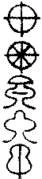

# 正源略集



> **藏经**：卍新纂大日本续藏经（新纂卍续藏）　**册次** 第 85 册（X85）　**编号** No. 1587（X1587）　**部类** 诸宗部　**卷次** 15 卷　**篇幅** 173,095 字

> **卷／品**：15 卷 · 0 品



---



## 目录



- [正源略集卷第二](#正源略集卷第二)

- [正源略集卷第三](#正源略集卷第三)

- [正源略集卷第四](#正源略集卷第四)

- [正源略集卷第五](#正源略集卷第五)

- [正源略集卷第六](#正源略集卷第六)

- [正源略集卷第七](#正源略集卷第七)

- [正源略集卷第八](#正源略集卷第八)

- [正源略集卷第九](#正源略集卷第九)

- [正源略集卷第十](#正源略集卷第十)

- [正源略集卷第十一](#正源略集卷第十一)

- [正源略集卷第十二](#正源略集卷第十二)

- [正源略集卷第十三](#正源略集卷第十三)

- [正源略集卷第十四](#正源略集卷第十四)

- [正源略集卷第十五](#正源略集卷第十五)

- [正源略集卷第十六](#正源略集卷第十六)



---



## 正源略集卷第二



维扬嗣祖沙门(宝轮际源高旻了贞)辑



天台国清　达珍　编



南岳下三十四世



磬山天隐修禅师法嗣(五人)



京口夹山林臯本豫禅师



晚号晦夫，昆山陈氏子。十九脱白於姑苏之尧峰，诵金刚经应无所住而生其心句有省。初参博山来，来曰：未入金笼贮，谁家野鸟儿？师曰：鶴有九臯翀碧汉，马无千里不追风。来曰：运斤非郢，未免伤痕。师曰：祇如诸方竖拂扬眉，又得什麼边事？来曰：片云横海岳，樵子尽思归。师曰：怪来岩下虎，特地暗惊人。次参密云悟和尚，其日已晚，便问：夜宿投人时如何？悟云：者里歇不得。师曰：岂无方便？悟拈拄杖，师接住一送，云：看破也。便出。后参磬山修和尚，修问：那里来？师云：武林。修云：怎知我者里？师云：臭名难瞒。修云：污汝耳。师便喝，修云：喝后何如？师云：犹是不知。修云：老僧不知，汝知个甚麼？师拟掌，修云：犹弄虗在。师礼拜。一日，修云：今时学人不肯著实用心，所以法门寥落。师云：虽然如是，大约过在知识。如黄龙南公不得慈明和尚痛折，云：何得知道出常情？修云：岂口传耳授之所得耶？师吐舌。又一日入室，修云：我疑你不会廓侍者与华严相会因缘。师云：不但和尚疑某甲，尽大地人疑某甲。修曰：尽大地人疑你则可，莫使老僧疑你。师曰：恁麼则某甲罪过。修曰：只如兴化与旻德宾主四喝，化曰：适才若是别人，三十棒一棒也饶不得。何故？为他会一喝不作一喝用。那里是他会一喝不作一喝用处？师曰：放某甲别通个消息。修曰：不要下语。师遂颂曰：宾主相逢纵夺家，喝下从云见活蛇。棒头突出通无犯，岂作亲承解撒沙。修然之。师开法中山石湫，乃过报恩谢法。修将如意付曰：此是老僧四十年用不尽底，将去揩磨，不得有忘。师秉如意入堂曰：者个是堂上老人为豫上座作用不尽底公案，敢问有同相证用者麼？良久，击板头一下便出。　上堂：若论此事，心不可求，智不可学，揑断百匝千重，於中下机一时飏却，突出孤危，方教峻峭都卢。收拾将来，非心非色，非如非异，要用即用，要舍即舍，要行即行，要藏即藏，拟思一毫地，便落生死关头。到者里作麼生相救得？复曰：五蕴山头自在身，了然物物应天真。顿教直下无思议，玄要全分见本人。卓拄杖一喝。　示众：十五日已前，汝诸人放出山水。十五日已后，汝诸人坐断柴头。正当十五日，山僧看破汝诸人一著。要出出不得，要入入不得。出不得，入不得，火里眉毛乌历历。自家鼻孔急须参，碧眼胡僧恒面壁。　师一日开山次，握枯藤於手，谓僧云：此是曹家女。僧云：却少个谢家郎在。师曰：但得有女，何愁没郎？僧云：也要完全始得。师度藤与僧，僧拟接，师即掷下云：却不相当。　僧问：三更月落，古殿灯残。有一个没面目人来，如何相见？师曰：笑杀人，笑杀人。曰：和尚笑个什麼？师咄云：问头也不识。　僧问：如何是诸佛出身处？师云：须弥倒卓半虗空。曰：如何是透法身事？师云：猢狲吞大象。　僧问：如何是虗空？师云：你亦在里许。僧云：某甲不见虗空。师云：者瞎汉好与三十棒。　示众：石里压油，水中取火。不是动转劳人，祇贵当阳吐露。赵州老子太惺惺，切忌道青州布衫重七斤。　僧问：明月堂前，花开枯木。是宾家句，主家句？师云：石女哭苍天。　僧问：天不盖，地不载，甚处安身立命？师打出方丈。次日又问：某甲昨日吃棒，今日和尚痛否？师复打出。　顺治丙戌冬，预计逝日，说偈辞众，窆全身於山门之右。天童忞禅师铭其塔。师著有宗门成范四卷，并语录行世。



杭州南㵎理安箬庵问禅师



吴江俞氏子。父羡长先生，晚忧无子，於鹫峰寺建无遮大会，百日应祷而生。幼失恃，病甚，饮酒不自好。年十六，始自惊曰：柰何使身心无措足之地哉？奋志读书。一日，偶过山寺，见楞严经云：此身及心，外洎虗空，山河大地，咸是妙明真心中物。有疑，特走谒磬山修，教看父母未生前本来面目话。一日，修与客立㵎边，提金刚经。师开口，修蓦劄云：如何是其心？当时不觉自失。二十四岁，姻事苦逼，竟宵遁至武林，投南㵎法雨大师脱白。尝夜跪佛灯下，单提父母未生前本来面目话，不契，决计参。方闻金粟悟和尚在北禅𦝫包，赶入吴中，得蒙痛棒垂示。复上磬山，又遇山茨际公，同在山中。五更，闻得一阵风声，疑情顿释。目前净躶躶地，了无一法当情，直是通身庆快。作偈云：千元万妙隔重重，个里无私总不容。一种没弦琴上曲，寒崖吹落五更风。呈修，修云：玄妙即不问，如何是不隔底句？师拟对，被棒者里却又去不得。修见师疑滞，示一颂云：千波万浪隔重重，识得源源处处通。根境脱然全体用，拈来物物始从容。师看颂，亦自了了，却是临机不得，活脱自由。一日，颂百丈并却咽喉唇吻云：并却咽喉唇吻，三人口濶一尺。夜半露柱相逢，横吹无孔铁笛。呈修，修云：露柱还有口麼？师云：炽然说。修云：道得一半。师云：和尚又如何？修云：此问复何来？当时被者一拨，直下如团热铁火相似。次日呈似修，修云：不得烧却眉毛。师便喝，修云：却烧却了也。师转身云：看者老汉一场败阙。便出。上堂：望刹竿便横趋而过，犹是不唧𠺕汉。电影里穿针，弓弦上走马，也须是个衲僧始得。匙挑不上底，如稻麻竹苇；千劄不回底，亦如稻麻竹苇。截断天下人舌头即不问，如何是汝诸人全身独脱句？举拂子云：漫天网子百千重。　上堂：我者里禅，无你诸人歇足处，无你诸人依傍处，无你诸人计较搏量处，直下如一团热铁火燄相似。你才拟歇足，烧却脚跟了也；才拟依傍，燎却眉毛了也；你才拟计较抟量，自己早打失眼睛鼻孔了也。你若总不恁麼，又有什麼气息？凑泊也凑泊他不得，躲避也躲避他不得，除是你猛烈提取始得。道个猛烈提取，已是蹉过多时也。到者里，你诸人作麼生？顾左右，掷杖归方丈。　雪峤信和尚至，问：你是那边？为甚麼又在者边？师曰：一点墨水，两处成龙。信曰：不会兴云作雾在。师曰：今日放大师过。茶次，信曰：我平日只教人诵金刚经。师曰：多少人错会大师意？信曰：直饶不错会，大远在。师曰：大师莫瞒人好。山门前行次，见狗子吠，信曰：者无佛性底东西。师曰：却搔著大师痒处。信大笑，师亦大笑。大众作礼次，信左右顾视，众伫立，信曰：都是老实头。师曰：大师面前，谁敢出手？　山茨禅师问：释迦掩室，净名默然。尽属化门边事，不落今时。请师道一句。师曰：未问已前答了也。曰：阿谁证明？师曰：十字街头廖胡子。又问：先师不了事，你我共知。作麼生与先师了却？师曰：苍天中更添冤苦。曰：非兄不委。师曰：逢人切忌错举。又问：十年同学唱，拍板不相离。此去理安，兄还见我否？师曰：无人处斫额相望。曰：渠无面目，望个甚麼？师曰：草贼大败。问：拈椎竖拂即且置，斩新条令道将来。师曰：一掌一握血。曰：须老兄始得。师曰：是我罪过。又问：谈玄说妙，先哲所诃。瞬目扬眉，今时禅弊。去此二途，如何是兄的的为人处？师曰：我不教坏人家男女。曰：忒煞婆心。师曰：龙蛇易辩，衲子难瞒。　僧问：大悲千手眼，那只是正眼？师云：急水滩头下钓丝。　僧问：对面不识时如何？师云：刀斧斫不开。问：如何是法身三种病？师曰：灸疮瘢。曰：如何二种光？师曰：觑著则瞎。　问：大彻底人本脱生死，因甚命根不断？师曰：螺蛳吞却鸭。顺治乙未夏，磬山解制后，师将方丈所有器皿各具手书，分送诸方为遗念。乃杖锡出游，至武康报恩扫塔，晤琇禅师，备托法门大事，预定逝期。於九月二十七日行至吴江，寓应天寺，如期坐逝。门弟子迎龛塔於南㵎，弘觉忞禅师为之铭塔。语录奏请入藏。外有续灯存稿行世。



湖州报恩玉林通琇禅师



蓉城杨氏子童子，时一长者令诸晚学各闭目一回，反观念起，众童子各言起念毕，师良久云：某甲反观，无念可得。参天隐修和尚于磬山，命充侍司，随堂坐香。一夕，未开静即进方丈，修见云：今日香完何早？师云：自是我不去坐香。修云：见甚道理不去坐？师云：即今亦无不坐。修蓦拈案上石屋录问云：者个是甚麼？师云：却请和尚道。修云：你不道，教老僧道。师云：情知和尚不敢道。修云：石屋录我为甚不敢道？师云：随他去也。修云：赃诬老僧。师者里透不过，直得大泪如雨。一晚，目不交睫，立修单侧，竟忘入寮。至五皷，修呼云：不用急，我为你举则古话。当初有个庞居士，初见人时也似你一般，孤孤逈逈，开口便问：人不与万法为侣者是谁？马祖当时为甚蹋向前一步云：待汝一口吸尽西江水即与汝道。师云：某有一颂。修云：汝颂云何？师呈颂云：不侣万法的为谁？谁亦不立始亲渠。有意驰求转暌隔，无心识得不相违。修云：不问你不侣万法，要你会一口吸尽西江水。师於言下大悟，廼拂袖而出。自后凡有徵诘，皆当机不让，修深肯之。　师掩关蓉城江干，修迁武康报恩，连书促师云：老僧在报恩，精神日不如前，当知我必不久人世。得书即来，有最要语分付。师得书，破关诣修，不作礼，近前叉手云：狂儿！国土父不容过，者个峰头还是老汉住处麼？修云：你且站下脚与你道。师蓦掀倒香案而出。修高声云：将拄杖来。师遥应云：剑去久矣。次日修上堂，维那拟白椎，师喝住云：待我问了话。白椎便问云：昔日大唐国里无禅师，而今国里还有麼？修拈拄杖作打势云：看棒。师便喝，修亦喝。师复喝一喝，转身云：不是狂儿多意气，祇因曾透上头关。便出。修喝一喝，师亦喝。遥闻维那重白椎，师乃高声云：叹死气。　住报恩上堂，拈拄杖曰：奇特因缘，须奇特人拈出。惊群句子，於惊群处举扬。今日既遇奇特人有奇特缘，真是惊群处举惊群句。且道惊群句作麼生举？蓦召大众曰：吴中石佛大。　示众，举道吾每执木劒因缘云：吠虗逐块韩卢，𫜪著半醒半醉汉子，终不免大家草里辊。道吾若於者僧才欲取劒，便一脚蹋翻。傥其知非，不惟令彼顿易皮毛，自亦头正尾正。那堪不示本分草料，木劒竟成戏具。　示众：透脱末后牢关，云庵正骂。洞达历祖纲宗，妙喜犹呵。汝等诸人趣向者个法门，大须仔细。前谿水急鱼行涩，后岭风高鸟泊难。　示众，举殃崛摩罗产难因缘云：且道世尊者两语是个什麼道理，得恁麼灵验，救得人家产难？蓦喝一喝云：莫做梦，山僧为汝诸人说个譬喻。恰似人来买生姜，世尊乃与他一大把人参。其时将去，竟作生姜受用，带累人乱𫜪嚼。吞了吐不得，吐了吞不得。如今者里有不乱𫜪嚼的出来，山僧与汝三十拄杖。何故？世尊当年折本，山僧今日与他上利。　示众，举唐州大乘遵禅师上堂云：上来又不问，下去又不疑，不知是不是，是即也大奇。师云：其时无量大众一时成道。　师问行堂：饭桶里多少达磨眼睛？堂罔措。问火头：三世诸佛向火焰里说法，还端的也未？头亦罔措。师指旁立一僧云：惟有者个师。僧解答话，便归方丈。　师问僧：树凋叶落时如何？进云：不隔一丝毫。师云：机不离位，堕在毒海。僧喝，师便打。　居士问：明知日用不离者个，为什麼道不得？师云：知之一字，众祸之门。　僧问：昔日高祖道：海底泥牛啣月走，岩前石虎抱儿眠，铁蛇钻入金刚眼，昆仑骑象鹭鹚牵。意旨如何？师曰：好儿终不使爷钱。　示众：山僧说得一篇好佛法，悬在雨花桥上，大众各自看取。良久，曰：伯乐曾三顾，千金谁解增？赠君君不纳，完璧倚枯藤。　示众：老窻败屋，纸帐青灯，此中有人得些子意味否？夜来风色峭，酿雪已三分。　僧问：如何是本分事？师曰：管人家烟冲大小。　僧问：挝鼓鸣钟，所为何事？师曰：换人眼睛。师初主报恩，齿最少，道望四驰。顺治己亥春，　诏迎入京，命住万善殿。　御驾亲临，师升座，举西余端村里师子话，下座。上大悦，　赐大觉禅师紫衣金印。是年，师告假还山。次年秋，上于马上有省，连　诏敦请至京，日穷玄奥。又　诏师为一千五百僧，授菩萨大戒，加封普济能仁国师。康熈乙卯秋示疾，说偈而化，寿六十二，坐夏四十三。门人奉全身於天目东坞，塔号璚云。保和殿大学士王熙为撰铭语录，奏请入藏。



南岳绿萝山茨际禅师



邗之通州李氏子，儿时父遇相，师云：尔子骨格太清，年未必永。乃舍之出家。初侍东隐若昧法师听讲，有会礼辞参，方谒金粟悟和尚，一见便问：客散堂空时如何？悟曰：是甚麼时节？师便喝，悟便打，师又喝，悟又打，师礼拜云：今日起动和尚。上磬山参修和尚，问：昔日闻风，今日觌面，觌面一句，请师分付。修曰：你试道看。师便礼拜，修云：也当不得。师转身便出。一日，修问：只如百丈於马祖喝下得个甚麼？师云：若有得，即钝置马祖也。修云：他道三日耳聋𫆏？师云：某亦不可更作野狐精见解。修乃休去。一日，修问：古人道：有句无句，子如何会？师云：石长无根草，山藏不动云。修云：如藤倚树𫆏？师云：吾常於此切。修云：树倒藤枯又作麼生？师低头而出。　黄端伯司理请住东明祖庭，师云：闻居士开先有省，推倒庐山，是否？士云：还见庐山麼？师云：待你扶起。士云：乍唤东明。师云：作家，作家。士休去。少顷，士问：大师一向在甚麼处住？师云：居士道：山僧即今在甚麼处住？士云：出此门不得。师云：居士还出得此门麼？士拟议，师云：却是居士出此门不得。　住绿萝，上堂。山僧者里也不论玄、也不论妙、也不论禅、也不论道，只要你们生死心破。生死心若不破，便是阎王老子面前吃铁棒的公招。所以云：参须实参，悟须实悟。阎罗大王不怕多语，不劳久立。珍重！　住南源，示众。诸方有玄妙禅、有性理禅、有细腻禅、有逐日常进禅、有休去歇去禅、有大法小法禅，与人理会、与人𫜪嚼。山僧此间且无如许多禅，只有远祖百丈大智禅师留得一把钝铁锄头，逐日要人使用。使用得纯熟，若到力忘於己、手忘於心，目前不见有可开之田、脚下不见有可立之地，忽然锄转，山河大地百杂碎，露出当人双眼睛。大众！即今把柄在阿谁手里？蓦掷拄杖，云：当阳拈出大家看。　僧问：大死的人却活时如何？师云：唤来与山僧洗脚。问：如何是学人转身处？师云：速礼三拜。如何是学人亲切句？师云：分明记取。　僧问：古人云：三千里外逢人。不审逢甚麼人？师云：不是别人。崇祯戊寅，师登南岳，爱祝融之胜，止掷钵峰下，结茅而居，葢虎穴也，了不为意。桂林王闻而异之，亲至问道，遣内臣侍候不绝於路，愿迎入宫，坚却之不得，輙密迹去。王不怿而焚庵，祝庵前石榴树曰：南来僧果有道耶？树即冬实，未几开花，且结实，王乃益加敬信。访师卓锡处，折节步行三百里就见之，复为建庵供养。　僧问：如何是超佛越祖句？师竖拄杖曰：向者里荐取。僧便喝，师便打，僧拟进语，师连棒趁出。　僧问：如何是学人安身立命处？师曰：待山僧有安身立命处，即向汝道。　僧问：手握利劒，因甚猢狲子不死？师曰：全承渠力。甲申春，流贼蹂躢三楚，山中日食不继，采薇救饥，悮食野芹，同食二人皆觅疗，师曰：何必尔？遂端坐而逝。门人奉全身塔于绿萝箬庵，问禅师铭其塔，语录奏请入藏。外有南岳禅灯录、正法眼藏续集行世。



阳山松际印中通授禅师



乌程严氏子。年十七，投道场山脱白，参磬山修和尚，示狗子话，力参久之。一旦，闻畫眉声有省，趋见修，修竖起拳曰：道！道！师曰：板鸣也，请和尚赴堂。修可之。崇祯九年，出住南麻明庆，迁崇义，后继席磬山。　上堂：门对千峰碧，溪沿一迳幽。更求玄妙旨，拨火觅浮沤。遂下座。　师性恬退，以应对繁，未几辞去，隐於阳山。僧问：如何是和尚悟处？师曰：瞒人不得。又问：如何是诸佛出身处？师曰：殿角鹁鸠啼。　僧问雪峰升座辊出木毬，玄沙捉来安住旧处因缘，师曰：阳山不妨再辊。便入方丈。　僧问：二十五圣本无优劣，为甚独选耳根圆通？师曰：翠为毛死。　诀众偈曰：昔人五十知非，予年五十知止。莫云日出事生，须信分明直指。掷笔而逝。



雪峤信禅师法嗣(四人)



杭州积翠唯一润禅师



浙之梅东人，族姓杨。年二十三，出家完具。徧参真寂、黄檗、博山、金粟诸老宿，俱有机契。三十五，参雪峤信禅师於不动轩，言下投机。历随匡南、开先数载。后信开法禾之东塔，举师为第一座，送入座元寮。便问：首座何不道取一句？师与一掌。　师至匡南，得蒙印可。遂呈心灯续焰偈曰：不动轩中话已遥，开先三度夺高标。福城东畔西风急，一掌酬恩首座寮。丁亥春，信迁云门，师养病於鹿城祇园。八月，信逝。讣至日，师大恸，伏枕草嗣法书，上供座前。顺治丁亥九月十九日示寂。塔建庵之后。



越州云门彻崖宏歇禅师



楚黄游氏子。投庐山西林脱白，参云门信於开先。一日，信谓众曰：我有一句子，净尽无道理。黄叶树头空，金风到薜萝。有人下语亲切，为云门第二代。众下语不契，师曰：不是某甲，几作话会。信曰：不作话会又如何？师退身曰：罪过了也。信曰：老僧也分一半。信示寂后，请师继席。信三周，师拈香曰：三年得活真消息，拈出耶溪水逆流。不是岭南𢹂去事，快如风雨任人收。　过紫云，上堂：过江江浪起，入竹竹竿斜。僧投寺里宿，贼打不贫家。山僧今日无端著贼，还有共相捉败者麼？一僧出，师打曰：贼身已露。乃曰：古人道：相见不扬眉，君东我亦西。红霞穿碧落，白日绕须弥。他古人相见，具相见底眼。山僧与紫云十载同参，今日借路经过，相见一句如何举扬？紫云影里歌声滑，秦望峰头和得齐。师示寂於顺治丁酉九月初十日，世寿四十八，僧腊二十。



衢州明果形山宏淖禅师



楚安陆陈氏子。参云门信於径山，问：如何是佛法大意？信曰：无恁麼事，且坐吃茶。师曰：今日亲见明眼尊宿。信首肯之，即题像赞源流付嘱。师开法天溪衢州天宁、乌石明果、绍兴大善云门、海盐鹰峰。上堂，僧问：垂丝千尺，为钓狞龙。猛虎当轩，如何回避？师曰：照顾性命。曰：恁麼则某甲丧身去也。师曰：山僧今日罪过。乃曰：识得一，万事毕。此犹是法身边事，须知法身向上有事在。雨落地上湿，天晴日头出。恁麼悟去，犹较天溪半月程。康熈甲寅二月初四日，师於天宁坐脱，弟子迎龛建塔。明果寿七十六，腊五十三。



庐山开先山鸣弘璐禅师



解制，上堂。风萧萧，雨萧萧，行脚高流心莫焦。拈来钵袋从头看，生涯只在旧时瓢。开先一期解结，且喜太平。结则虗空合聚，解则大地平铺。一任伊东去西去，又谁管胡来汉来？肩担日月，脚踏水云，行行入佛祖家乡，步步踏祖翁田地。放旷随缘，逍遥自在。拈棒，云：住！住！忽遇著个咬猪狗手脚的，撺出撩天拄杖，当头把住。不放行又作麼生？良久，云：三十年荐取。　僧问：参禅贵了生死，生死不了如何？师云：参。僧云：谢师指示。师云：屈杀人。



------



## 正源略集卷第三



维扬嗣祖沙门(宝轮际源高旻了贞)辑



天台国清　达珍　编



青原下宗镜三世



幻休润禅师法嗣



北京大觉慈舟方念禅师



别号清凉，唐县人，族姓杨。年十岁，投金台广德大慈老宿披剃。自念生死事大受具，历穷性相宗旨，知非的要，遂往少林参幻休润和尚。润问：甚处来？师曰：北方来。润曰：北方道法与此方如何？师曰：水分千派，流出一源。润曰：恁麼则何用到此？师曰：流出一源，水分千派。润可之，即命典维那。　师掩关五台，昼则一食，夜则孤坐。久之，自念差别智不可不明，乃肆游诸方，一切苦行人所蹙頞者，师皆亲历。后至石城，精厉过分，双目忽盲。师曰：幻身非有，病从何来？将身心一时放下，硬坐七日，双目复明。　师应请，住禾之东塔、豫之云居、匡庐。升座，打○相曰：会麼？若向者里会得，不妨稳当。若乃外求，反被者个碍在。山僧昔在古道处，看他七处徵心，自觉虗豁豁地。若非面壁岩前裂破达磨面孔，未免依样葫芦，未有了日。大众，祇如达磨是何面目？也须亲见一回，才好于东街西市说黄道黑，免得遇家里人露出破绽。且道阿那个是家里人？拈拄杖曰：见面不如闻名。掷拄杖下座。后欲投老台山，越中缁白力挽师归宝林道场。示寂后，法嗣湛然澄公，迎龛塔於显圣南山之麓。



廪山忠禅师法嗣



建昌黄龙寿昌无明慧经禅师



抚州崇仁裴氏子。诞时难产，祖父诵金刚般若而娩，因名经。初生颖异，长貌苍古。九岁入乡塾，便问：浩然之气是个甚麼？塾师异之。长依廪山忠和尚出家。常疑金刚四句偈必有指据。偶见傅大士颂曰：若论四句偈，应当不离身。不觉释然。遂辞廪山，隐峩峰。甞登绝顶，顾盻而作偈曰：踏上云头第一峰，眼中广博小虗空。当时欲见无由面，今日相逢处处同。结庐三年，人无知者。阅传灯，见僧问兴善：如何是道？善曰：大好山。师日夜提撕，至忘寝食。一日，因搬石次，坚不可举。极力推之，豁然大悟。即述偈曰：欲参无上菩提道，急急疏通大好山。知道始知山不好，翻身跳出祖师关。遂往廪山呈偈。忠和尚即为印可，始许薙发受具。自此服勤左右，日夕温研，影不出山者二十四年。出住宝方，时年五十一矣。　上堂，挥尺一下，曰：宗乘中事，难以措辞。大道门庭，争容拟议。等闲垂一机，如大阿锋离匣，逢之者死不移时。似涂毒鼓受槌，闻之者丧不旋踵。所谓妙峰峻仞，野兽难藏。宝树晶光，灵禽莫泊。其用也，单赶金毛归野窟，直追铁额入深山。扫天下之狐踪，拂人间之孽屑。提堕坑落堑之类，揭迷封滞壳之流。其功也，使法界、世界、虗空界一体同观，俾佛道、人道、地狱道万法融会。虽然如是，犹未为向上事。且道出格限量外一句作麼生道？正令不行先斩首，大机一拨圣贤悲。久立，珍重！　上堂：真正龙象子，有时提得起放不下，有时放得下提不起。不弄死蛇头，要捋生虎尾。有时跨上金毛背，自然足下清风起。会麼？水不涸兮鱼自在，山青幽处鸟安详。　僧参，师问：赵州道：台上婆子，我为汝勘破了也。毕竟勘破在什麼处？僧曰：和尚今日败缺了也。师曰：老僧一生也不柰何，好教你知。若实会，举似来看。僧拟进语，师打一棒，云：者掠虗汉。　上堂：有始无终，衲僧活计。有终无始，衲僧常规。有始有终，衲僧家具。无始无终，衲僧巴鼻。透得一句，生死自在。透得二句，来去自由。三句透得，可以为人天师。四句总透得，可以为佛祖师。大众且作麼生透？良久，曰：五虎凌空攒玉兔，二鸾翀汉趂金乌。　僧问：和尚因甚不行脚？师云：木马休鞭横两腿，铁牛不索莽低头。白鶴啄鱼颈项直，班鸠呼雨嘴头钩。会麼？僧无对。师曰：行脚去。　上堂：抽筋不动皮，换骨不见血。筋骨一齐空，游行不倒跌。达磨大师解灭不解生，释迦老人解生不解灭。要知生灭不相干，除是当年乾矢橛。喝一喝。　僧问：未相见时如何？师云：今日不答话。进云：相见后如何？师云：向道不答话。僧又拟伸问，师即打云：钝置杀人。　师住宝坊、峩峰、寿昌三刹，别建庵院二十餘所。七旬尚混劳侣，耕凿不息，丈室萧然，惟作具而已。益王向师道德，深加褒美，每叹曰：去圣时遥，幸遗此老。万历丁巳腊月七日，师自田中归，谓众曰：老僧自此不复砌石矣。众皆愕然。　除夕，上堂曰：今年只有此时在，试问诸人知也无？那事未曾亲磕著，切须痛下死工夫。复曰：此是老僧最后分付著，大众切宜珍重。新正十三日，示微疾，遂不食，曰：老僧非病，当行矣。大众环侍不怿，师以偈谕之曰：人生有受非偿，莫为老病死慌。可笑无生法忍，将何业识消亡？一时云净祥光发，佛祖聊安此道场。十四日，书辞道俗。十六日，作举火偈曰：无始劫来祇者个，今日依然又者个。复将者个了那个，者个那个同安乐。复命侍者代为发火宣偈。次晨，取水盥漱拭身，曰：不必再浴。廼索笔大书曰：今日分明指示。掷笔端坐而逝。茶毗，火光五色，顶骨诸牙不坏，即於本寺方丈建塔。



青原下宗境四世



大觉念禅师法嗣



越州云门显圣湛然圆澄禅师



会稽夏氏子。母梦僧入室而娠，长为邮卒。因传符逾期，惧受辱，走投隐峰。峰示念佛底是谁，三昼夜辄有省。后谒妙峰剃落，依三载。一日看乾峰示众话，遂冰释无疑。即颂曰：举一举二别端倪，个里元无是与非。雪曲应稀人会少，独许韶阳和得齐。二老何曾动舌，诸人徒自攒眉。拟议鹞过新罗，刻舟求劒元迷。值大觉慈舟老人说法於止风图，师趋座呈所见，求决择。舟问：止风图向青山近，越王城傍沧海遥时如何？师曰：月穿潭底破，波斯不展眉。舟又问洞上宗旨，师呈颂曰：五位君臣切要知，个中何必待思惟。石女惯弄无针线，木偶能提化外机。井底红尘腾霭霭，山头白浪滚飞飞。诞生本是无功用，不觉天然得帝基。舟曰：语句緜密，不落始终，真当家种草也。　参云栖，栖举高峰海底泥牛话，问：内有一句，且道是那一句？师推出傍僧曰：大众证明。栖颔之。　僧问：古镜未磨时如何？师正色厉声，数其往事。僧作瞋告辞，师曰：且磨者一点著。僧礼拜。　鸳湖谒问：目前无法，意在目前，其旨如何？师曰：闻令师出关，是否？曰：不是目前法，非耳目之所到，又作麼生？师曰：请出，我要止静。湖便出。　师在云栖，因师送亡僧回，栖问众曰：亡僧迁化向甚麼处去？师出众曰：谢和尚挂念。　上堂：老僧没能柰，行动少自在，齿缺不关风，心直兼口快。昨夜撞倒须弥山，直得帝释天尊、龙床宝座去了半块。且道山僧恁麼举扬是何道理？良久，曰：大似三江人唱曲。　上堂：擎杈和尚时中擎条木杈，道得也杈下死，道不得也杈下死。一日被人藏过，便双手托空，张口㘞地。者老汉将谓多少奇特，元来离却杈子便伎俩已尽。山僧即不然，借得人一柄拂子，东拈西弄，今日已被讨去了。遂竖指曰：幸有者个不从人借的甚是现成，而复人人有分，未证底证取好。师历住显圣、光孝、径山、东塔诸刹。一日，过天华寺示众后，有僧告假，师曰：老僧今晚亦欲起程。至夜半，遂右脇而逝。时天启六年十二月四日，世寿六十六，僧腊三十八。门人奉全身塔於显圣寺南钵盂山之阴。



寿昌经禅师法嗣(四人)



信州博山无异元来禅师



因登厕，覩上树人，大悟。见寿昌，昌曰：近日如何？师曰：有个活路，祇是不许人知。曰：因甚不许人知？师曰：不知，不知。　上堂：第一义作麼生观？佛法二字不可黏著，黏著则埋没慧命。入荒田，不拣草，犹较些子。博山当日在佛法中头出头没，蒙先师亲垂只手，提挈在净白地上，仍被净白为碍。不免将脚跟下一片地，抛向他方不可说不可说世界之外。然后向太虗空翻觔斗，孤标独立，始得些子实用。今日与诸昆仲相见，譬如白日攫金。诸人历历见博山，博山总不见。诸人还信得及麼？诸昆仲若见明此事，须在高高山顶立，深深海底行。撞破虗空，始能捕空捉影。博山记得亲近先师，犹骊龙颔下探珠，猛虎喉中夺雀。今日不免贵买贱卖去也。诸昆仲还有估价底也无？良久曰：也不可当面错过。　上堂：说个佛字，好与三十棒，杖头有眼明如日。说个法字，好与三十棒，优钵无根满树花。说个禅字，好与三十棒，分付老卢高著眼。说个僧字，好与三十棒，莫教流落在天涯。过得潇湘渡口，便知清白人家。管甚烟云埋没，从教黑豆生芽。翻思昔日云门老，卸却铁枷真个好。一棒打杀贵太平，免使儿孙落荒草。诸昆仲，开眼说梦，醒亦是迷。白酒青盐，我乃是谁。寒冰烈火，痛下针锥。今古几多伶俐汉，分明辜负一双眉。复笑曰，博山罪过。　上堂。卓拄杖曰，转山河归自己，月明当户照。转自己归山河，风冷压山居。撞钟撞著老僧心，祥云从地起钟声。为甚麼披七条衣，宝葢自天垂。总不恁麼道，又作麼生。不是家乡客，徒劳话岁寒。此五种见地，虽则赏罚分明，也要诸人委悉。有一人在蕴界屏处，说非法语。有一人在净白地上涕唾。有一人拨草瞻风，搀行夺市。有一人露盘卓荦，解作家方。有一人针拶不见血，火烧不知痛。病在膏肓，不堪疗治。有人於此简辨得出，博山分付拄杖子，一任天下横行。其或未然，卓拄杖曰，楖𣗖横担不顾人，直入千峰万峰去。崇祯三年，示微疾。訚首座问，和尚尊候如何。师曰，尽有些子受用。座曰，还有不病者麼。师曰，热大作麼。座曰，来去自由，请道一句。师书历历分明四字，掷笔而逝。寿五十六。塔全身於本山。



建州建阳东苑晦台镜禅师



别号湛灵，潭阳冯氏子。生於万历丁丑。幼从虎啸岩一心受业，后参寿昌经。一日偶阅维摩经，至此室何以空无侍者，维摩诘言：诸佛国土亦复皆空。豁然悟入，述偈曰：识破不值半文钱，可怜摸索许多年。宗流尽是欺心汉，说甚西来别有传。昌阅之即印可。　上堂：佛法本无多，南辰贯北河。都来三七字，降尽鬼神魔。良久顾众曰：会麼？老瞿昙一生黄金高北斗，买不得个人笑。及至末后拈枝花惹发饮光，特地觑破，却将从上祖宗家产一时俱籍没却，究竟有甚麼风流？我试问你，英灵男子自有本分，不为人欺瞒的活计又当如何？　除日上堂，僧问：寿昌和尚临七十岁夜示众曰：今年只有斯时在，试问诸人会也无？此莫便是老汉先分付的末后句否？师曰：杓卜听虗声，熟睡饶谵语。曰：在新长老分上又作麼生？师曰：击破寒潭月，痴猿何处窥？曰：作家亲父子，别有不传传也。师曰：靴头绽线，脚指何知？乃曰：百岁翁翁失却父，当堂独坐没尊卑。东村王老夜烧钱，打鼓小儿失却椎。到者里，生死谁知折合，性命作何以归？蛙盆打破啾啾閙，庄周梦蝶乱飞飞。噫嘻嘻，灯笼露柱，谩自依稀。　上堂，师良久曰：千古万古事，当不得我眉毛纵一纵，当不得我额头点一点，当不得我拄杖子卓一卓，当不待我震声喝一喝。你若不会，灯笼露柱替你下涅槃堂。且道为甚麼如此？立地死汉有甚麼救处？一日示疾，以手指岩下曰：此处可以埋我。有行者问曰：试或死了埋了，又作麼生分发？师笑曰：恰好恰好。者再问，师已脱去。时崇祯三年七月十三日也。寿五十四。塔於所指之岩石下。



建昌府寿昌閴然谧禅师



参先寿昌於峩峰，示以父母未生前话。一日推磨，失手触磨盘，有省。占偈有本来面目不须寻，一点灵明亘古今之句。呈昌，昌颔之。师甞作赵州无字颂曰：泰山倾倒压蟭螟，气绝心灰识浪平。不是泥牛开只眼，焉知猛虎坐中厅。后祠部海岸黄公请师继席寿昌。顺治己丑示寂，寿七十一，塔於本山。



鼓山永觉贤禅师



幼习儒，年二十补邑诸生，读书山刹中，闻僧举南泉斩猫公案，忽有省。诣董岩参寿昌经和尚求决择，昌曰：此事不可於一机一境上取则，须是百匝千重垂手直过，尚当遇人，所谓身虽已在青云外，犹更将身入众藏。因勉看云门乾屎橛语。过十餘年，往寿昌落发，一日问寿昌：如何是清净法身？昌振衣而立，师曰：祇此更别有麼？昌拂衣便行，时身心豁然，如开千重锁相似，入方丈礼拜，不及启口，昌打三棒曰：向后不得草草。后过延平津，闻僧诵诸佛謦欬，俱共弹指，顿超前解，乃彻见寿昌用处，作偈曰：金鸡啄破碧琉璃，万歇千休祇自知，稳卧片帆天正朗，前山无复雨鸠啼。　上堂：老僧无伎俩，祇打鼓山鼓，不说禅与道，不论佛与祖，甜瓜现成甜，苦瓜现成苦，露结必为霜，云腾必致雨，看来万法仍旧，自然超佛越祖，千圣既皆如是，老僧何用重举？然有一事报君知，也要大家看取，昨夜捉得石乌龟，天明看时原是螺江女。　闻谷大师入塔，请上堂，师顾众曰：你等还知闻大师住处也未？莫是鼻孔里安禅，眉毛下𨁝跳麼？莫是清风度廊下，秋月转簷前麼？莫是红霞不离碧落，白日祇遶须弥麼？恁麼说话，似则也似，在则未在。蓦竖起拳曰：元来祇在老僧拳头上，要与诸人相见。挥案曰：一音演说，随类各解。收拳曰：忽化作出海金龙，直透青霄去也。你诸人莫认驴鞍桥作阿爷下颔。　上堂：正脉难通，邪见易炽。超佛越祖，看来总是阶梯。妙唱玄提，即此便名窠臼。白云岩下，多沉出格之英。芳草渡头，久滞他乡之客。所以曹洞门下，别设宗趣。金凤抟空，不止须弥顶上。铁牛驾浪，偏入大海波心。不犯当头，犹贵转身有路。行於异类，直须足下无私。　示张二水相国。我宗无意识领略的禅，无逐段商量的句。直要向全无缝罅处透入，通身脱落后承当。其或未能顿领，始有看话头等法。葢是死尽偷心，庶几天光自发。近日宗风大变，率尚虗头。师徒授受，专学答问拈颂，甚至饮酒戏笑。自谓我宗门下，不受绳检，不拘小节。视吾辈劝勉，直以为老婆禅。呜呼！魔鬼兴妖，静思良可痛哭。顺治丁酉十月十七日示寂，寿八十。塔建本山。



青原下宗镜五世



湛然澄禅师法嗣(六人)



绍兴府明因麦浪怀禅师



山阴黄氏子。五岁驱乌天王寺，十七秉具云栖。游讲肆有声，闻宗门事，遂参云门湛然。门问：见犹离见，见不能及。如何是见不及处？师下语无当，乃再拜求示旨要。门曰：者里无甚旨要，汝时中但看个见不及处，自有所诣。师参究之久，愈觉茫然。一日，看云栖举海底泥牛啣月走话问众，时云门推出傍僧曰：大众证明。师忽然有省，走见门。门即席拈盘胡桃曰：我用处不换机，你唤他作甚麼？师一掌扑落。门曰：汝适来道佛祖舌头瞒你不得，一盘胡桃汝便被他瞒也。寿圣。师问门：如何是临济七事随身？门答云云。师以手掩门口曰：休将闲学解，埋没祖师心。门大怒曰：汝探头太过了。师惊疑。　定林上座问曰：大德尊号？师曰：麦浪。定曰：无风时向何处安身立命？师於定面上轻摇一扇。定曰：未在。师曰：三尺浪高鱼化龙，痴人犹戽夜塘水。门曰：虽然麦浪善行劒刃上事，若无后语，二人都成布袋里老鸦。何故？机不离位，堕在毒海。师於此顿释寿圣之疑。开法梅墅古弥陀寺。上堂：昨日是人日，今朝是谷朝。斩新一句子，莫认驴鞍桥。汝等欲将我新年佛法偿他旧日陈债，好向山僧未升法座。诸人未到法堂时，一眼觑破，已落权乘。那堪拈椎竖拂，说妙谈玄。若有个汉子出来，掀翻法座，喝散大众，还可救得一半。其或未然，山僧自救去也。卓拄杖，下座。　示众：篾穿乌龟壳，个个空索索。棒打石人头，击击向嚗嚗。独有衲僧行履，从来不受穿凿。昨夜泥牛生两角。　师侍湛次，湛曰：灵虗有吹毛偈，汝批判看。师曰：借劒看。灵以手作斫势。师曰：是白铁。灵曰：我适才桥上见僧，打碎了个钵盂。师曰：好败阙。湛曰：且喜灵虗脚跟稳密，其如麦浪气宇如王。



龙门佛日石雨方禅师



初出家，随老宿专修净土。一日，挝木鱼子笑曰：不特西方可生，东方亦可生矣。宿曰：未是汝到家处。示以三不是话，师钝置，疑碍横生，𮌎痛不止。遂参云门湛，湛曰：参禅图大安乐，岂是苦得来的？纵苦得来，也是苦禅，参他作麼？师如暗得灯，自此工夫踊跃。谒博山、憨山、黄檗诸老，谆谆以死工䇿励。再参湛老和尚，结同志不语，限七日彻证。一日，闻湛上堂曰：放下著。忽觉疑情冰释，口占偈曰：平空一掷绝踌蹰，转眼风波彻太虗。会得竿头舒卷意，放生原是钓来鱼。湛问：如何是一口道不尽底句？师曰：晨昏礼拜和尚，也是寻常事。湛曰：赵州道无意，作麼生？师信口颂曰：家家有幅遮羞布，放下便能当雨露。独怪当年老赵州，掷去头巾顶却裤。湛大喜，付以断拂一枝，故师自号断拂。　上堂，举拂云：此是第二义。复举曰：此是第三义。百义、千义、万义，咄！有甚麼交涉？若是个汉，才拈起斧子，从教斧子讴歌；放下鉏头，直得鉏头作舞。那管江南江北，瓦砾荆棘。如或未然，也要披苔剥藓，读残碑、续断碣，免使碌砖瓦砾、七片八片，泥金刚努目、木罗汉攒眉。　上堂：有物先天地，将甚麼作眼？无形本寂寥。举拂，曰：者个是甚麼能为万象主？天际日上月下作麼生不逐四时凋？瞒历代老古锥即得。普明者里也有一偈：无物先天地，有形本寂寥。不为万象主，常逐四时凋。於傅大士边会得，百鸟啣花，天人送供；於普明者里会得，𦝫缠八斗，肩挑担二。虽然，若得江南风气暖，梅花何必待春开？　上堂：若要举扬个事，直须四方受敌、八面当机。鴈过长空会得，横抽宝劒，云归远岫，明他脑后钳锤。若是以言遣言、以理遣理，忽然撞著无手人行拳、无舌人解语，便道是格外之谈、无义之语。若要与他施主福慧双圆，水也消他不得。　上堂：选佛场开，只要个心空及第的人。既是其人，便能善通消息。若一机一境问答语言，转身拂袖以为能事，教山僧何处与汝分个优劣？你又何处会得舌根谈而不谈的道理？所以一入门来，便死在佛日语下。要见佛日重辉，也大难在。还要见佛日重辉麼？倒跨黄鶴峰，何须问弥勒？



越州显圣三宜盂禅师



武林丁氏，依真寂脱白参云门澄，进堂打七有省。一日入室，澄问：如何是一口道不尽的句？师曰：问取典座。澄即为印记。　上堂：新丰一句，当阳道破。不涉唇吻，已成露布。细雨蒙蒙，黄花满路。打失衲僧鼻孔，忘却邯郸故步。古镜台前几错悮。顾大众曰：露。小参：牛头未见，四祖百鸟。啣花见后，野鬼飞沙。堪笑长汀布袋子，却从閙市作生涯。召众云：归堂吃茶。康熈乙巳十月初八日，语侍者曰：三日后吾行矣。者曰：和尚尊候甚安何？云：便去。师曰：看老僧登场。一笑而逝。於显圣前冈建塔。



绍兴府东山尔密澓禅师



会稽王氏子。生而雄伟，力能仆牯。家贫未甞读书，然日诵金刚经，不由师训，似解其理。谒贞白珊和尚於大慈，决志力参，殆忘寝食。偶往德清探友，舟中闻锣声，豁然有省。偈曰：锣震空身世，观音独露身。泥牛啣月走，木马报新春。时年二十七，父兄逼以婚，潜往开元投贞白大师剃落。服勤数载，领性相二宗非其好。辞白参云门湛老人，恍有宿契。师呈闻锣因缘，门曰：汝夙有善根，故得随观音入道。命充维那。一日，门上堂曰：放下著。师因此全身脱落，作偈曰：夜半霜寒月忽低，行人到此尽迟疑。翻身踏著来时路，默默星辉斗柄垂。门嘉其幽玄緜密。　适博山开法天界，师谒之。山与论物不迁旨，徵辨竟日，了无窒碍。山曰：江南佛法，洵自有人。住弥陀寺，　上堂：未出蔷薇洞时，有一句子从剡溪流出三江鼈子门外。倘有过钱塘拾得者，不妨人天众前拈出验看。如无，山僧唱菩萨蛮去也。良久，喝一喝曰：千里乌骓不易骑。时首座出礼拜，师曰：你在弁山拾得个陈年榾柮，直饶满口道尽，拈来好一炉烧却。座曰：者老汉犹作者个去就。师曰：也要大家知。



绍兴上虞香雪庵具足明有禅师



会稽杨氏子。弱龄事亲至孝，因父病危，乃割股救之。年二十二出家，便参念佛是谁，谒云门湛。每承提训，颇有发明。次年闻僧举北斗面南看话，疑情逼抑。一日在殿经行，举首见前山，豁然大悟。偈曰：虗空粉碎无偏正，大地平沉孰是亲。从今了却相思债，石虎泥牛笑转新。湛见助喜。　后出住上虞之香雪。示众：云门活口，德山辣手。正眼看来，二俱是丑。验尽天下衲僧，翻身落人窠臼。不若本色住山，饱飡饭了抖擞。休管他家馊残，但逞自己风度。有问：百年已后事如何？阿呵呵，乌龟飞入北斗。石雨和尚问：堪与佛祖为师，佛祖又学个甚麼？师曰：佛祖𫆏。石曰：与佛祖为师𫆏？师曰：黄山谷后园种菜。石曰：不问佛，不问祖。不管你佛，不管你祖。速道，速道。师曰：东邨桃树，西陇梅花。　示疾日，即念现禅师问：古人道，病有不病者。如何是不病者？师默然。曰：恁麼便是那？师曰：三十棒领出自打。曰：临末稍头一句作麼生？师震威一喝，曰：不会。曰：不会会取好。曰：会后又如何？师曰：南山云，北山雨。时未有继嗣，乃以如意法衣法卷寄石雨和尚，付毒端道上座。偈曰：香柏支分秀，随缘折一枝。花开香雪远，何必异苗为。后示寂，塔於显圣之南山。



洪都百丈瑞白雪禅师



桐城杨氏子。薙染参云门，看拖死尸话，疑情逼拶，如挑千觔担子相似。至广孝，闻湛上堂，有竖起脊梁生铁铸，放下面皮莫回顾。犹如象王脱金锁，若不如是何劫悟之语，痛哭苦参，工夫遂得成片。一日，湛举南泉斩猫因缘，师忽领悟，复结制打七。至六日，闻钟声大彻。参金粟，适上堂次，师出，众便喝，粟便打。师又喝，粟又打。师曰：者老汉败阙了也。便归位。继席云门，次移湖之弁山延庆、蕺山白雀、台之护国、赣之崆峒。后因南昌建安王钦师道望，请住百丈。　上堂：三尺氷河连底冻，数株枯树尽银花。太阳一出峰头外，清潭依旧走鱼虾。见色明心虽好事，撒却时人几眼沙。莫有清净宝目不受翳障者麼？出来高鉴看。僧出曰：狮儿独吼云门里，香象群藏北斗中。师曰：嗄。僧拂袖曰：岭外彰牙爪去也。师曰：者野狐精。　师晚居崆峒时，以禅版东敲西敲。凡有僧请益，亦禅版敲示之。师住百丈第，举百丈清规而重撰之，时复荷锸与作务。明春谷日，示微疾，诲众益笃，谈笑自如。三月十九迟明起浴，谓侍者：扶老僧入龛。日正卓午，吉祥而逝。师生万历甲申十一月廿六日戌时，崇祯辛巳三月十九日午时示寂。世寿五十八，僧﨟三十八。塔全身於弁山。



博山来禅师法嗣(四人)



信州瀛山雪关訚禅师



上饶傅氏子。八岁丧父母，依景德寺傅公和尚出家。一日，见坛经火烧海底句，疑之，乃参博山来。来令究船子藏身公案，急切提撕。偶入槽厂，见磨鼻拽脱，有省。呈偈曰：直下相逢处，由来绝覆藏。舌头原是肉，嚼破也无妨。来喜曰：子可参禅也。后作五颂，请寿昌衲衣。来曰：宗门语句，如满口含冰，不曾道出水字。子风骨太露，更须死心一番始得。师乃掩关穷践，凡六载，大彻源底。开法瀛山，时山荒圮，师潇然作破院歌以自乐。　﨟八，上堂：直下承当，是何话𣠽？官不容针，私通车马。须弥高大柱堪题，海天空濶桥难跨。花隄柳巷尽穿开，宝殿珠帘谁放下？雪山夜半覩明星，若到瀛山痛棒打。靠拄杖，下座。　上堂：九十日期今已满，闭门作活事如何？不会揑杀猕猴子，重叠关山未易过。大抵末法禅期，真参罕遇。纵他意树抽枝，未见心花开片。虽然，冷灰里岂无一粒豆𪹼？还有不跨石门，扶竖晏祖门风者麼？如无，且向芦花深处宿，月明穿过钩鱼台。　唐祈远孝廉请上堂，远问：如何是参禅入手处？师曰：一一踏翻始得。曰：如何是参禅得力处？师曰：把定乾坤。远礼退。又一僧问：如何是参禅入手处？师曰：截千人之头臂，剜万人之心肝。曰：如何是参禅险难处？师曰：拆佛殿，毁魔宫。曰：如何是参禅得力处？师曰：逆水船出顺水风。乃曰：诸兄弟，者些答话虽是撇他闲骨董，也不曾思索出来。不见洞山初禅师云：言无展事，语不投机，乘言者丧，滞句者迷。他家是透顶彻底人，临机应用，洒脱非常，不似今人要句句投机，却被言句碍杀。径山道：赵州禅只在口唇边。山僧道：赵州禅如神庙里签，千掣千应，万掣万灵，初不曾安排古凶，使人规避祸福也。方山老人道：得意者所说皆是，失意者所言皆非。若以是非得失而论古驳今，山僧绾上眉毛，一任诸方贬驳。卓拄杖，下座。　师以丁酉秋示微恙，乃谢事南迈。十月朔，行抵瀛山，遗书谢诸檀越。时寿昌閴公自博山来候，问：和尚安否？师曰：你道我生耶？死耶？閴曰：末后句也须分付。师弹指一声，微笑而逝。师世寿五十有三，坐三十七夏。门弟子迎归博山，建塔於莲花峰之右。



郁州嵩乳道密禅师



泗州唐氏子。年十四投景会剃染，二十事包笠。初历讲肆，阅楞严至虽得多闻，不成圣果句，叹曰：不躭幻身世，反躭幻学耶？遂弃之。参寿昌基隆，次参云门金粟，复参博山来和尚。一日随众采茶，忽覩㵎底白云飞起，有契，遂冲口说偈曰：欲知来去处，好看白云窝。青山常靠倚，出入也由他。归举似来，来见便问：汝作甚麼来？师曰：熟境难忘来。曰：即今一口气不来，向甚麼处安身立命？师曰：某甲终不通去处来。曰：莫便是你安身立命处麼？师曰：终不作此见解来。曰：作与不作，总不免老僧痛棒在。　出住淮安古檀度寺。元旦上堂，师卓拄杖曰：识得一，万事毕。天得一以清，地得一以宁，君王得一天下平，衲僧得一鼻直眉横。设若一亦不立，又作麼生？掷拄杖曰：门帘忽被风吹去，杲日光腾四壁清。上堂：寿昌师翁搬底是石块，博山先师见底是一株树，瀛山师兄、径山师兄一等是口挂壁上。老僧覩白云底𫆏？顾左右喝一喝曰：住！住！老僧见底诸人不知，诸人见底老僧不知。蓦起身曰：慧炬三昧净，光明三昧连。击拂子下座。



福州长庆宗宝独禅师



广州陆氏子。六岁，闻隣妪发愿来生童真出家见性成佛语，遂触宿因，坚出世志。及披剃，惟事苦参。年十四，有省。复参石压笋斜出，岩悬花倒生话，遂得瞥脱。三十出岭，参博山来和尚。来与语，器之。一日，拈骑牛入佛殿话问师，即呈偈曰：贪程不觉晓，愈求愈转渺。相逢不是渠，才是却颠倒。蚁子牵大磨，石人抚掌笑。别有一生机，不落宫商调。来见，以为深入堂奥。后辞来，乃嘱曰：我爱你见处清白，向后不得辜负。师拜别，出住庐山。次开法广之罗浮及长庆等处。　上堂，竖拂子曰：我宗无语句，亦无一法与人。既是无语句，华首今日说个甚麼？既无一法与人，诸上座今日向华首覔个甚麼？诸上座！此是彻底相为，莫要错过。切莫踏步向前，各人照管。自己脚跟下，莫要他覔。



江宁独峰竹山道严禅师



顺庆大竹县沈氏子。总角染衣南游，初预讲肆。一日走京口，登凌云亭，忽身心世界顿然一空，遂罢讲。往参博山，来於天界，典第二座。山见师领众当机，动合宗旨，遂授名道严，且嘱曰：汝当以道法严持也。　上堂，蓦拈拄杖曰：一滴水作大海之波涛，一点尘徧大千之境界。连卓三下曰：天不能盖，地不能载。本分衲僧，只是寻常。无为道者，合当如是。毕竟据个甚麼道理，便得恁麼行径？良久，击禅床曰：对月思玄度，临风忆谢公。　上堂，击如意曰：姑孰城里有大人气象，白苎山头有毒皷先声。独峰与龙象交集，万象与虗空并会。茶里饭里，行时坐时，共转法轮。世尊升座，文殊白椎。独峰上堂，院主拈香。其间还有自肯底麼？良久，顾众曰：官圩东畔王三老，日日担薪上太平。



东苑镜禅师法嗣



江南天界寺觉浪盛禅师



建宁浦城张氏子。十九岁见大父归寂，自疑曰：者一点灵明向甚麼处去？一日闻猫呌有省，走瑞岩剃落。随师住，梦笔闭关苦究。因见百丈再参公案，顿彻马祖机用。从前宝惜，冰释无疑。出关参博山，於董岩受具。是冬谒东苑，镜苑问：子闻博山提唱维摩经否？师曰：曾闻。苑曰：弥勒得一生受记作麼生？师曰：大有人疑著。苑曰：你又恁麼去。师异之。向日次，师问：古德劫火洞然，者个坏不坏？有云坏，有云不坏，此意如何？苑曰：你又恁麼来。师遂折节过冬。苑细验其生平参证处，及徵诘五家堂奥差别之旨。师恣意披其所见，苑感叹曰：不期子乃能深入此秘密法门。吾寿昌者枝慧命，属子流布去也。随苑礼寿昌，昌勘问，大奇之。问：东苑曾将子说甚麼？师曰：曾被他赚了一上。昌曰：作麼生被他赚？师曰：者老汉又恁麼去也。昌笑曰：子作怪那？师曰：是和尚自致得。因复问昌曰：闻东苑当时答和尚一语，如何满口便许可他？若是某甲，决不轻易放过。昌曰：祇如他道：和尚莫作怪在。你当作麼生？师才开口，被昌劈面一掌。师曰：也是贼过后张弓。昌曰：且喜有人吃掌。自此与昌多有诘问机缘，昌为深喜。　住宝筏，上堂：向上一路，千圣不传。本分风光，须自领悟。山僧便恁麼下座，还有亲切为人处也无？大众便恁麼礼拜而退，还有不相孤负处也无？虽然，官不容针，正好添花锦上。石女夜抛梭，文彩焕然满地。木人朝唱曲，音声杳而难闻。其中还有正偏兼带、不落是非者，出来唱和看。众无语。师曰：恁麼则山僧倒骑露地白牛，游戏十方刹土去也。举如意曰：会麼？自古轮王全意气，不彰宝印自然尊。　大雄庵，上堂。师升座，击香台曰：闻麼？良久，朗声曰：巍巍独坐大雄峰，一喝曾教三日聋。今日当阳明举似，西江吸尽吐东风。且不与万法为侣者是甚麼人？一僧出众曰：阁静不须重借月，三更自有夜明帘。师顾视曰：乾闼婆王亲托出，摩尼光影照三千。更有於光明门头出身者麼？李太宰出曰：近有提婆达多一颂：平地孤堆最悮人，枉将法座赚冤亲。瞿昙自有金针度，认影迷头又隔津。师曰：何不道提婆别有金针度？太宰拊手曰：此文是老婆勘破有来繇也。师震威一喝，便下座。　问：石头和尚道，木头碌砖，此意如何？师曰：艺压当行。曰：或问和尚，如何是道作麼生？师曰：好皮不染皂。曰：如何是禅？师曰：好人不债钱。曰：此与石头答有同别否？师曰：白马庙前好伞舖。曰：不会。师曰：木屐店在对门开。曰：恁麼一般要用也。师曰：天晴不肯去，直待雨淋头。僧礼拜，师大笑。　上堂：有情之本，依智海以为源。含识之流，总法身以为体。祇为情生智隔，想变体殊。将山门来佛殿里，移厨库在钟楼上。惟佛与佛，乃能究尽山僧拄杖。蓦顾左右曰：咄！莫妄想。　上堂：疎雨打牕清梦里，好山深锁白云中。有题最是难藏覆，竹浪萧萧一夜风。百草头上识取祖师，草枯了也。閙市里识取天子，市散了也。与诸兄甚处相见？良久，以手拍曰：猩猩，我与你相见了也。



鼓山贤禅师法嗣



福州鼓山为霖道霈禅师



建安丁氏子。年十四出家，十八参方。首礼闻谷大师於宝善，次参鼓山贤和尚，看庭前柏树子话。三年无所入，辞游两浙。后复归皷山，充维那。山一日垂语曰：一口吸尽西江水，马师此语只道得八成。还有下得十成语者麼？师进曰：某甲尽力也只道得八成。山乃呵出。师一夜不安，至四皷方卷帘出门，了然大彻。次上方丈曰：某甲今日有个十成语举似和尚。山喝曰：汝作麼生？师乃背身叉手向山曰：请和尚鉴。山曰：好与七藤条。师便礼拜。自是入室，商确玄奥，无不脗合。山示寂，遂继席焉。　上堂：庾岭一舖功德，无尽劫来成就。今日一回拈出，便见光辉宇宙。不须雪点红炉，一切万法仍旧。春水盈盈竞流，春山叠叠挺秀。春鸟关关和鸣，春树葱葱郁茂。若能直下便见，即是瞿昙之后。更作佛法商量，此人却不唧𠺕。乃举拂召大众曰：见麼？是大神呪？是大明呪？击案下座。　小参：金牛唤人吃饭，赵州呌人吃茶。二老觌面分付，不知谁是作家。或有个汉出来问：皷山又作麼生？有愿从来不撒沙。　上堂：人人有一天真佛，相好光明皆具足。可惜日用而不知，五阴坑中自埋没。喝一喝曰：五阴坑为诸人打破了也，真佛即今在甚麼处？蓦举拂子曰：容颜甚奇妙。又喝曰：切忌揑目。



------



## 正源略集卷第四



维扬嗣祖沙门(宝轮际源高旻了贞)辑



天台国清　达珍　编



南岳下三十五世



林臯豫禅师法嗣(二人)



天寿谧融元禅师



首参博山，看狗子无佛性话，有省。次参林臯，豫於夹山印记。　上堂：教中道，不应取法，不应取非法。竖拂子曰：者个是法，那个是非法？击拂子曰：者个是非法，那个是法？大众还有不落是非者麼？良久曰：汝等比丘知我说法。掷拂子下座。



润州夹山蘧夫一禅师



宜章李氏子。年十八，投万松出家。初谒憨山清於曹溪，看万法归一话，三年不会。次扣天童悟，棒下有省。后见夹山豫，豫问：甚处来？师曰：浙中。豫竖起拂子曰：还收得者个麼？师曰：阿谁不具？豫曰：试呈似老僧看。师拂袖便出。未几，命主石湫，次迁楚之九峰，复主夹山。　示众：山上鲤鱼，海底蓬尘。舌头无骨，眼里有筋。蓦竖竹篦曰：国一钦禅师来也，眼里有筋的请出相见。良久曰：本欲期君重话会，谁知觌面不相亲。塔於澧阳之大同。



箬庵问禅师法嗣(十四人)



潭州浏阳黄昙晓庵昱禅师



龙丘叶氏子。幼丧父，母程氏抚育成立。因阅六祖坛经，知有宗门事。年十九，辞母投天台，肇心祝发，秉戒天童，参箬庵问於南㵎。入室每遭棒喝，不能领旨，立誓以悟为期。一夕独坐，忽然顿豁，乃辞问出山，庐居养母。及母终，仍归南㵎首众。问欲以院务及之，师远遁江右之武功山。至甲午秋，始继席南㵎。晚参：尽大地是自己，坐杀千千万万。尽大地不是自己，走杀千千万万。衲僧家踏翻窠臼，别立生涯。逢佛杀佛，逢祖杀祖。说甚麼湘南潭北，驴事马事，行便行，坐便坐，修证不无，但莫染污。蓦喝曰：依稀似曲才堪听，又被风吹别调中。　颂殃崛托盋话：师旷之聪不以耳，张仪之辩不以舌。接响承虗万万千，黄面瞿昙空叫屈。师三会说法，挈要提纲，凛然风化。康熈乙丑夏，嘱以后事，奄然脱去。寿七十九，腊五十。塔於黄昙妙高峰。有语录行世。



黄梅五祖千仞冈禅师



明州王氏子。弱冠礼䨮峤信，断发受具天童，看无字话有省，偈曰：狗子无佛性，莫道说得好，闺女学做媒，自身也难保。后往夹山见箬庵，问举高峰枕子因缘，言下大彻，呈颂曰：久忆并州是故乡，而今身已到咸阳，若教忘却来时路，不是愁人也断肠。问击节称赏，命师分座，出世润之金山、鄂之黄龙、舒之浮度。升座：春色阑珊三月天，数声啼鸟落花前，荷因有热先擎盖，柳为无寒渐脱绵。处处劝畊槑子熟，家家缲茧竹篱烟，分明好个神仙诀，父子虽亲不可传。　僧问：牛头未见四祖时如何？师云：花开蝶满枝。曰：见后如何？师云：树倒猢狲散。　黄梅祖殿拈香：钵衣漫与俗家儿，骨董浑身欲付谁？看取东山山上水，承恩端在逆流时。　升座：鸦鸣鸦鸦，鹊噪鹊鹊，婆饼鸣婆饼，姑恶鸣姑恶，记取枝头一一鸟，何声不是自家音？师于康熙丙午六月示疾，乃贻书命大乾明公继席，再订以次春二月行期。至是月十七，会晦山显公问疾，师嘱以后事，至二十未刻升座，乃问：众集否？曰：集。又问：晦公在否？曰：在。遂端坐而逝，寿五十五，腊二十四，塔於东山演祖之右。



淮安净居汝风杲禅师



吴门张氏子，依中峰苍雪法师受业。首参天童悟，值升座，众环视，悟一唾便下座，师脱然领旨。乃扣箬庵问於夹山问，举风穴见南院一棒因缘命颂，师曰：师资合处芥投针，岳未为高海未深。看取作家罏鞴在，能消跃冶不祥金。问曰：此则因缘，二十年来罕有契其旨，今日始惬老僧意。遂举西堂后继席南㵎上堂，竖起拂子曰：彩凤舞丹霄。放下拂子曰：铁蛇横古路。复拈拂子拂左右曰：翻天关，转地轴，格外提持，目前包裹。突出无巴鼻，无可无不可。康熙戊午正月三日，师往鶴林与天树植公诀别曰：衰躯不久谢世，至期借重为我了却。植曰：新年头何得说末后语？师曰：实非戏言，朽骨火后，祈飏大江，无违我愿。由是相笑而别。至廿四巳刻，邻庵火起，师整衣而坐，侍者曰：火猛已逼，和尚宜速出。师曰：吾时节至矣。者曰：和尚如是，某甲敢离左右。遂同证火光三昧。门人依命，葬骨於大江之龙门。有传并语录十卷行世。



杭州理安梅谷悦禅师



娄东曹氏子。　上堂：一切声是佛声，二三千处管弦楼。一切色是佛色，四五百条花柳巷。声色堆头坐，声色堆头卧。佛子住此地，即是佛受用。　上堂：道远乎哉？触事而真。刀不自割，金不博金。圣远乎哉？体之则神。黄河九曲，水出昆仑。应如是知，如是见，如是信解。开口不在舌头上，你向甚处辩别？拍膝一下：到江吴地尽，隔岸越山多。师有列祖提纲正宗语录行世。



松江金泽颐浩子山如禅师



吴门真丰里人。幼丧母，年十七，因村坊演剧，见目犍连事，即慨然曰：吾欲报母，何让佛祖？遂弃聘室，至尧峰，礼西脉老宿落发。参夹山，豫令看无字话，闻钟声有省。后谒箬庵，问於南㵎。㵎垂问，师下语不契，辄被麾斥。师方出至殿庑，忽通身汗下，洞彻玄微。亟趋入室，㵎即约住曰：不是，不是。师喝曰：这老汉又来相瞒那？於是机锋迅捷，执侍八载，始获印记。出住华严广福，继席南㵎、尧峰、夹山诸刹。　晚参。天寒人寒，事无两般。滴水滴冻，死蛇活弄。空寥寥，实嚗嚗，无位真人难躲缩。嘉州大象忽怀胎，陕府铁牛夜脱壳。漫承当，休卜度，令人常想老岩头，𨱄斧拈来撒壁角。喝一喝。



瑞州黄檗一庵月禅师



广陵崇川涂氏子。初叩天童悟，棒下有省。辞悟入匡山，刀畊火种者数年。闻林臯豫唱道夹山，师往谒，即举西堂豫顺世时，箬庵问主丧。一日，问举无云生岭上，有月落波心语，谓此事祇须直下承当，原非别有。师深契旨，要问，付以源流信物。历住江上兴国、豫章、黄檗。　上堂：金刚圈，栗棘蓬，吞底任他吞，跳底任他跳。跳得出也是好手，吞得下也是好口。一任拆东篱补西壁，指北斗作南辰。山僧亦不妨袖手看他。良久，曰：长江万里拖银练，自有人言短与长。



蕲州广教天章玉禅师



升座。僧问：拈椎竖拂，早成钝置；瞬目扬眉，落二落三。向未升座前荐去，犹是鬼家活计；总不恁麼，也是无绳自系。请问和尚作麼生指示？师云：却被阇黎夺却鎗。进云：恁麼则白云峰顶立，西河浪泼天。师云：百襍碎了也。僧便喝，师亦喝。进云：师喝，某也喝，意作麼生？师便打。进云：意气不从天地得，英雄岂藉四时催？师云：识甚好恶？迺云：春日炤高林，春香发幽谷，多少寻春人，偏向春边逐。空生岩畔草如烟，妙高峰顶锦似簇，大众见之不取、思之千里。若是大丈夫，据虎头、收虎尾，落落声光振天地；如其未委，百花春至为谁开？卓拄杖一下。举：僧问大龙云：色身败坏，如何是坚固法身？龙云：山花开似锦，㵎水湛如蓝。师挥拂子，云：会麼？昨日是三十，今朝乃初一，展事投机知不知？野老爱闲烟树立，无限轮椎劈不开，古今空射辕门戟。拟不拟？如山屹，三更半夜过牢关，忠言不避风前泣。



杭州钱塘理安天笠珍禅师



云间陈氏第三子。父仲雍，母金氏。十八出家，行脚参南㵎。㵎示父母未生前话，疑不去心。圆具后，徧谒知识。过绍兴东郭门外，逢杀犯人，血溅衲衣，打失本参。偈曰：活人头落地，血溅死人衣。不知谁死活，斩断未生疑。呈南㵎，未获许可。后依南㵎过竹林，因僧错会赵州勘破婆子话，南痛棒打出，复唤回云：与你说个譬喻：你即是者僧，老僧即是赵州。拈起竹篦云：者便是婆子，那里是勘破处？僧拟议，㵎掷竹篦归方丈。师在旁不觉汗下，洞彻古今公案。师呈颂云：几人不战便成功？独许南阳老卧龙。自借东风鏖赤壁，赚他血泪满江红。㵎云：那里是赵州勘破婆子处？师震威便喝，㵎便打。师礼拜云：勘破了也。便出。后继席南㵎，　上堂：抱𨱄斧居山，闻名不如见面；著卓鞋住院，见面不若闻名。事到如斯，抑不获已？飏下𨱄斧子，脱却破草鞋，展开驴脚，伸出佛手，菩提路上扶起刹竿，广济道中重开饭店，不蓄一粒米、不栽一茎菜，令一个个饱齁齁地，拈却炙脂帽、卸却鹘臭衫，作赤洒洒、净躶躶汉。若是具顶门眼、悬肘后符，呼唤不回顾、罗笼不肯住，望刹竿而走、见鞭影而行，山僧不妨瞻之仰之。即今还有恁麼人麼？蓦卓拄杖，云：设有，勘过了，打。　上堂。大通智胜佛，稽首乾矢橛，十劫坐道场，猴子系枯桩。佛法不现前，心肝树上悬，不得成佛道，泥神抚掌笑。此四句中，一句杀人刀、一句活人劒，一句杀活同时、一句杀活不同时。若检得出，古佛在你脚底。　晚参。大人峰顶无根树，却被贼子偷了去，几多痴汉守枯桩，业识茫茫无本据。以拄杖一齐趁退。



苏州常熟胜法斯瑞法禅师



云间上洋瞿氏子。　上堂。有一句子，千圣不曾道著。有一妙机，列祖不能提起。若是伶俐衲僧，一举更不再举。山僧今日再举去也。遂卓拄杖曰，箭过西天十万里。　示众。十方无壁落，山前山后。纵煞马厮，大地不曾藏。知得瓮头是糟是酱，天一生水，地二生火。俊杰禅流，规行矩武。以拄杖划曰，是大人相，是不欺力。　示众。众生被解障，菩萨未离觉。惟有住山翁，胷中乾索索。不愁独对圣僧，一任皮肤脱落。且道脱落后如何？是我好儿郎，为我把木杓。



润州金山铁舟海禅师



新安蒋氏子　开炉上堂，僧问：尽大地是火柴头，和尚向甚麼处挑拨？师云：照顾眉毛。进云：轻轻一扇，烈焰飞腾。师云：四面谁敢入？进云：且道火炉濶多少？师便打。问：天隆久不行此令，今日重逢事若何？师云：总是顽铜钝铁。进云：忽遇跃冶之金又作麼生？师云：钳放一边。进云：恁麼则缺慈悲也。师便打，乃云：大地火柴头，拨开飞烈焰，铜头铁额汉，精金能百炼。跃冶非种草，钳来放一边，你说缺慈悲，正是慈悲现。天隆久不行斯令，今日洪开显八面。蓦拈拄杖掷下，便下座。　晚参，人天众前激扬个事，也须是本分衲僧始得，若非本分衲僧，未免遭人怪笑。只如一味打洁净毬子、抱不哭孩儿，不是逞俊，便是颟顸，有甚本分处？且道如何是本分处？昨日风雷起山岳，今朝和气满江天。　升座，达磨不会禅，特地泛海来，二祖苦言诠，却觅安心去。透彻本地风光，有甚身缠疯恙？一任自逍遥，纵横谁缚汝？栽松能应记，黄梅续法系，放下新州柴担，真诚负石春米，唤作一物即不中，打车打牛须自体。南岳出马驹，神影踏千里，一喝三日聋，不觉便吐舌，棒下忽翻身，惯作白拈贼。儿孙遍天下，有谁能测得？须是嫡骨儿孙驱耕夫牛、夺饥人食的好手脚，方可与他话会。蓦拈拄杖卓一卓、喝一喝。　晚参。但得一，万事毕，达磨大师家风密。阿呵呵！识不识？惟有神光断臂时，满天飞雪深三尺，须知是那苦心人，始信眉横与鼻直。环山有个廖胡子，半夜穿靴水上立，扬声大叫君自知，明早又是腊月一，莫教三十夜到来，双眼依然黑漆漆。　晚参。一僧出礼拜，师便打，僧便喝，师云：好喝。进云：莫作喝会好。师云：将谓金牙作。进云：不劳再勘。师云：你无拄杖子，夺却你拄杖子时如何？僧拟议，师便打，乃云：诸兄弟！还有为者僧通个消息者麼？众无语，师云：诸兄弟！既是吝慈，山僧不惜口业，放一线道去也。以拄杖卓一卓，向者里会去，犹是钝鸟栖芦。多见兄弟们每每临机下一喝、顿一足、打一圆相，拂袖便行，及至挨拶将来，依旧木雕泥塑，堪作何用？须是竿头进步始得。岂不见？莲花峰庵主凡见僧来，拈拄杖卓一卓，云：古人到者里为甚不肯住？二十年来举似於人，虽有下语，总不相契。后自代云：只为途路不得力。又云：毕竟如何？以拄杖架肩上，云：楖栗横担不顾人，直入千峰万峰去。还委麼？拽拄杖，下座。　谢两序，上堂：人天眼目，灵树符合。一大藏教，是个切脚。兴化打克宾，瘥病驴驼药。英灵衲僧，不拨自转。听阑鸡鼓翅，看茶铫𨁝跳。虽则金声玉振，未免平地骨堆。金山门下，稍可颕脱。留云台榭孤风峻，晓堂楼阁足知音。　上堂：祖师门下，只贵痛快。向未举已前，一肩担荷。若停机伫思，了没交涉。岂不见德山老汉，在吹纸烛处，彻见源底。遂焚青龙疏钞，云：穷诸玄辩，若一毫置於太虗。竭世枢机，似一滴投於巨壑。拽条楖栗，湖海横行。复顾视左右，云：有麼？有麼？摩霄俊鹘，便合乘时。止泺困鱼，徒劳激浪。　问：牛头未见四祖时，为甚百鸟啣花？师云：只在此山中。进云：见后为甚不啣？师云：云深不知处。进云：牛头毕竟在甚麼处？师云：天共白云晓，水和明月流。师生於万历己酉十月二十九日，示寂於康熙癸亥五月三日。塔建五峰之阴。



南㵎理安济水洸禅师



据室，从上古德尽向者里造瞒天罪过，将大秤大尺欺一切人。新长老甚是公平，你有半觔还你八两，你有十尺还你一丈。　上堂，云：峰峦毓秀，溪水潆回。古木扶疎，殿堂洞启。秘密宝藏，八字打开。祖父田园，四至分晓。只要个汉亲到地头一回，便见伏虎高踪未泯，先师弘范森罗。可谓法法不隐藏，古今常堂堂。虽然恁麼，不免再举个旧话。僧问九峰：承闻和尚亲见延寿，是否？峰云：山前麦熟也未？师云：者老汉通身是刃，争奈罕遇其人，致令劳而无功。今日者里有问：承闻和尚亲见石磬，是否？山僧劈脊便棒。他若道：且莫盲加瞎棒。更与连棒趁出。何故？一不做，二不休。　元旦，上堂，问：如来禅、祖师机一总拈过，请和尚道应时及节句。师云：阇黎白椎。进云：祇如威音不先，弥勒不后，中间是谁？师云：高著眼。进云：与麼则庆赞有分。师云：礼拜著。乃云：五更起来，忙忙碌碌，礼拜烧香，念诵祈祷，合山大众云集，互相庆贺。新正可曾与无位真人庆贺也未？若也未曾，山僧为诸人念补缺真言去也。遂顾左右，下座。　解制，上堂。十月十五一句子，莫道我瞒你，九十日两手分付了也。有般眼目未辨东西底，便问：是那一句？是者般底？我也没有拄杖打他，但与他一緉破草鞋。便下座。观音诞日，上堂。春风笑花柳，徧界狮子吼，欲入三摩地，面南看北斗。看！看！观世音菩萨来也。擡脚，云：展驴脚。举手，云：舒佛手。明眼衲僧莫乱走。复顾众，云：信得及麼？未出钱塘门，为汝说了也。下座。



邱山雪谷古石藏禅师



示众：触目俨然，因何不荐？眨得眼来，风过别院。鹊巢定风柴鹘眼，衲僧试辨看。



杭州理安六吉谦禅师



萧山汪氏子。　晚参。秋风生夜凉，坏壁鸣寒螀。的的祖师意，明明不覆藏。虽然如是，切忌认奴作郎。　晚参。老僧口讷，犹如木橛。三五不参，朔望不说。大众上来，不须饶舌。何故？心不负人，面无惭色。



苏州常熟胜法云峰授禅师



早参，以手向前指云：者一片地待来多时也，因甚无人搆去？众拟议，以竹篦旋风打散。师行履氷操，凡学者来参，皆随机接待，不厌不倦。临终，豫知报尽，坐化。



山茨际禅师法嗣(五人)



潭州石霜尔瞻尊禅师



明州唐氏子。六岁知信佛乘，求出家，父母不允。越年，从福泉圆明老宿受业，历参天童显圣。后谒山茨际於东明，言下顿豁。随上南岳，诛茆绿萝。一夕围罏，际举：僧问夹山：拨尘见佛时如何？山曰：直须挥劒。若不挥劒，渔父栖巢。汝作麼生会？师曰：太费力生。际曰：是夹山费力？者僧费力？师曰：任和尚分别。际曰：情知汝会者话不得。师起身便出。后辞出山，际以偈授师，其略曰：郑重坚操志，慧命赖持传。未几，开法石霜。　上堂：未离兜率，版齿生毛；已降王宫，脚不点地；未出母胎，蝇子放卵；度人已毕，銕作面皮。释迦老子从久远劫来，一片广大婆心被石霜一时华劈了也。众中有不甘底出来，如何？若何？山僧一不作，二不休。有麼？擕取诗书归旧隐，埜花啼鸟一般春。　示众，以拄杖横曰：黄鶴楼前吹玉笛，江城五月落梅花。诸人闻麼？若道不闻，山僧今日未遇人在。掷拄杖，下座。康熈癸卯九月朔日，师作书遣使嘱晓庵昱公面托后事，昱不信，令使归。师曰：昱兄以山僧为妄语，大众今晚莫睡。聚话终夕，至天明，高声召众曰：老僧别矣。便坐，脱入龛，一七未掩，颜貌如生。昱趋拜，泪下曰：吾兄再来人也。塔建石霜圆祖之侧。



吉州安福台山且庵刍禅师



上堂：不说有法，不说无法。诸人会麼？拈起少林无孔笛，顺风吹又逆风吹。　上堂，卓拄杖，喝一喝，曰：山僧今日与麼提持，还有共相激扬者麼？僧便出，师便打。乃曰：台山者里，明如杲日。有时喝，有时棒，照用同行。杀人刀，活人劒，应时拈出。复卓拄杖，喝一喝：钳锤不动火星飞，眨上眉毛隔辽海。



邵陵金峰紫云密岩刚禅师



茶陵萧氏子。　上堂。问：祖意教意，是同是别？师云：一尺青天盖尺地。乃曰：机先荐得，落二落三；句下承当，错七错八。纵饶得到奔流度刃，疾𦦨过风，信手拈来，群机普利，也只是建化门中事。若到自己分中，也是日午打三更。虽然如是，只因梅雪落，又得显风光。



楚黄陂𡾇山玄慈谦禅师



上堂：机先一著，廓尔现前。正眼洞明，本无迷悟。孤峻处峭巍巍，平坦处活鱍鱍。佛祖莫能知，人天不可测。不假修证功，岂资解脱力。明明不覆藏，历历绝背向。包今括古，离见绝名。直下透彻本源，不须别处寻讨。祇如透声透色一句作麼生道？一尘举处全身现，徧界明明不覆藏。



粤西全州香林宗玄旨禅师



除夕，小参。世事匆匆，情缘碌碌，节换时移，光阴迅速。看看又过一年，且喜林下衲僧自无尘事劳攘，却有溪山可乐，守道安贫，逍遥快活，任从村老烧钱，说甚烹牛纳角？人人安帖家邦，个个甘休岩壑。虽然如是，也不可错过时光。正当与麼时，应时及节一句作麼生道？围炉煑瀑消残夜，也胜诸方五味禅。



松际授禅师法嗣



潭州神鼎云外行泽禅师



婺源汪氏子。年廿五，脱白黄山，阅三载圆具。参天童悟，问：如何用心得个入处？悟曰：无心可用，是汝入处。师拟进语，悟便打，於是疑情顿发。一夕，不觉倚柱失睡，忽闻开门声，有省，呈悟，悟为首肯。后依松际授於磬山，机锋迅捷，应对无滞。授曰：汝进语都佳，住桶底未脱在。乃发愤力究。一日，因风动，帘幙堕地，扑簌作声，忽然大悟，授始印可。出世蕲州老祖、湘阴神鼎。　上堂：会得也打，不会得也打。良久，喝一喝，曰：姹女已归霄汉去，呆郎犹向火边栖。僧问：文殊乃七佛之师，为甚麼作释迦弟子？师曰：钟楼上走马，佛殿里骑驴。　问：和尚昔在磬山得个什麼？师曰：山僧爱嗔不爱喜。曰：如今以何为人？师曰：揑棒呼狗。曰：恁麼则圆满菩提无所得也。师曰：百草头上荐取老僧。僧礼拜。师接机峻迈，手眼精明，室中尝举狗子无佛性话验人，罕有契其机者。顺治甲午，师书偈曰：是非海内展全机，多少时师尽皱眉。此日一言无可付，江南江北大家知。投笔端然而逝，全身塔於神鼎之右陇。语录十五卷，附楞严方册藏流通。



大觉琇国师法嗣(十九人)



湖州报恩退庵重禅师



高安彭氏子。幼丧母，随父出家。参大觉得旨，呈拈花颂曰：倚天长劒露锋铓，拈出何人敢近旁？胆大饮光轻触著，面门血溅好惭惶。觉可之。　示众，举黄龙三关语：佛手驴脚与生缘，一个锢鏴两个圈。渔父忙忙贪锦鲤，不知衣角水涓涓。　晚参：卖却劫初田地，兄弟同添十字；碎尽列祖沙盆，儿孙义断真金。寸丝不挂的，卸下凤衮龙章；寸草不生处，胀破驴胎马腹。若在饭箩里叫饿、火聚中畏寒，置而不论，饶伊牙如劒树、口似血盆，惯向饥鹰爪下分餐、饿虎舌尖夺肉的英灵。要问你：去冬雪里轰个冻雷，今年米作麼生价？满盘倾不出，大地没饥人。戊子闰四月廿八日，无病趺坐，说偈而化。塔于寺东大觉潭上。



荆溪善权白松丰禅师



巩氏子，山西平阳人也。年十六从三元庵出家，纳戒於普陀隐光律师。二十九谒天童悟，扣以向上事。未几参报恩琇，问：尽大地是个火坑，得何三昧不被烧却？师曰：金不博金。琇可之。后以伽黎授师。及琇退居大雄，义母命师继席，次迁海会。　上堂：圆机大用，触处全彰。格外真宗，随方显露。所以道，在天成象，在地成形，在日月为照临，在四时作寒暑。居谷盈谷，处坑满坑。有情则动转施为，无情则森罗显焕。天人群生，类皆承此恩力。且道超群拔萃又作麼生道？漠漠水田飞白鹭，阴阴夏木啭黄鹂。师於万历壬子十月三十日生，康熈甲寅九月十九日示寂。世寿六十三，僧腊四十七。塔建海会寺侧。有语录若干卷行世。



南岳高台不退勇禅师



钱塘韩氏子。从界山衍云披剃，随全庵进禅师上金车山参大觉琇，令究未生前语。一日普请次，见僧荷空畚行，有省。次侍琇於方丈，琇问僧曰：转山河大地归自己则易，转自己归山河大地则难。如何会？师在旁彻法源底，自此机用超绝。琇以衣拂授之。出世吴兴法海，次住高台。　上堂：铜头铁额诸禅客，肘后横悬夺命符。尚有火炉吞不下，氷霜肝胆细磋磨。蓦然南斗北翻身，赤县神州火里坐。　小参：三间破屋通天眼，七尺乌藤抹太虗。要明临济三玄旨，荆棘林中舞柘枝。昨夜无位真人倒骑三脚驴子，直上万仞峰头，欲与诸人通个消息。卓拄杖，下座。　小参：老鸦嘴上挂油瓶，月落寒松著一惊。失口一声连嘴落，逢人便叫两三声。且道叫个甚麼？蓦喝一喝，下座。　小参：醉脸夭桃舒笑口，垂腰衰柳展春眉。堪笑灵云多浪荡，惊落枝头万点红。顾众云：有恁麼见彻者麼？山僧如此举话，八万四千毫毛尽皆抛向诸仁者怀抱里去也。如或未然，但办肯心，必不相赚。　小参：少林面壁，白玉琢成西子骨；雪庭肘堕，黄金铸就伍员心。六耳不同谋，一花开五叶。喝一喝，下座。　小参：赤肉团上，壁立万仞，世尊摩竭，鼻祖嵩山，岂许九旬聚众，畫地为牢？若有高鉴，山僧性命早已不存。有麼？有麼？如无，卓拄杖，云：此令还是我行。　小参：即心即佛，文殊著贼；非心非佛，普贤叫屈。不是心，不是佛，不是物，观音菩萨摸著了一个毛头，大结十字街头，忽然撞著了大肚子。弥勒放下布袋，呵呵大笑，云：青天白日为甚麼著贼？　僧送茶至，师接得便掌，僧云：某甲过在甚麼处？师竖二指，僧拟议，师便打出。师示偈云：狗啣灯盏街前去，老鼠偷盐咳嗽归，露柱堂前惊破梦，开门雪里放乌龟。顺治乙未五月六日示疾，众请遗偈，师接纸，曰：信手拈来，一笔写尽，都卢丢在大江东。掷笔而逝，寿三十九，僧腊一十有七，塔於江阴敔山。



湖州报恩骨岩峰禅师



温姓。上世山西怀仁县人。远祖大司马祥卿。厥后迁浙之乌程。世以隐德著。师生有奇质。笃信佛乘。投阳山授和尚落发。参报恩琇圆具。闻琇示众云。但向父母未生前荐取。自然广大圆满。师於言下有省。一日琇问。如何是日中浩浩时作得主。师曰。真不掩伪。琇曰。如何是夜间睡梦时作得主。师曰。曲不藏直。琇曰。正睡著时。无梦无想。无见无闻。主人公在什麼处。师答十数语。琇皆不肯。一日答曰。家无二主。琇曰。一个驴子系在橛上。师即顿释。　上堂。苍翠连天松荫濶。桃枝红并李枝白。西来祖意报君知。一二三四五六七。喝一喝。　早参。放出南山鳖鼻蛇。𫜪杀门前子湖狗。竖起秘魔岩下叉。打折俱胝手中指。设有个衲僧出来道。长老合吃三十棒。却也怪伊不得。师生万历己未正月初十。康熈丁丑六月二十六。徧巡各寮曰。老僧不复来矣。至晚略示微疾。即索笔书偈。侍僧以为师食过饱。作辞推之。师曰。既不将来。他后不得谓吾无偈。遂不复语。越一日不起。众请说法。师乃转身面壁而逝。世寿七十九。僧腊五十九。全身塔於本寺之左。有语录行世。



湖州武康报恩栖云行岳禅师



乌程沈氏子，世为望族。少补廪庠，始以居士身参大觉老人於报恩。顺治乙酉，投大觉披削。丁亥秋，事觉於淮北乞食，炊给之餘，觉力为锥劄。一日，问觉：空索索地锦艶艶，锦艶艶地空索索时如何？觉云：待你到此境界与汝道。师礼谢，觉云：者汉多时妄想，今日始断。师有省。庚子春，侍觉应诏还山，入天台桐栢宫，草衣木食，习头陀行者三阅寒暑。癸卯春，觉命继席报恩。　晚参。弥勒真弥勒，起模畫样；分身千百亿，揑目生花。时时示时人，郎当不少；时人自不识，略较些子。召大众，云：还有赞叹分也无？蓦竖拂子：将此身心奉尘刹，是则名为报佛恩。　晚参。入秋时节不相饶，西风吹雨池塘暮；古殿松阴宛转开，钟声透过山前路。急回顾，是甚麼？　晚参。临济大师道：一句具三玄，一玄具三要。汾阳大师道：三玄开正眼，一句破邪宗。所以，参禅上士投崖舍身、立雪断臂，三千里外拨草瞻风、二三十年捍劳执役，祇求於一句下发明心地、了毕大事，透脱一句、该摄三句，了达三句、才明一句。僧问马祖：如何是佛？即心即佛。僧问云门：如何是佛？乾矢橛。僧问洞山：如何是佛？麻三觔。僧问风穴：如何是佛？杖林山下竹筋鞭。僧问首山：如何是佛？新妇骑驴阿家牵。历代祖师、天下知识，出一令、立一机，布缦天网子，垂四海玄钩。今日岳上座亦有一句布施大众。春无三日，晴。　上堂，举：临济三度问佛法大意及兴化在大觉会下被打语毕，乃云：报恩今日不惜眉毛，一时颂出长寿石壁寺卢公一首诗，渴读即不渴，饥读即不饥，鲸吞海水尽，露出珊瑚枝，海神知贵不知价，留与人间光照夜。　晚参，举：陆亘大夫问南泉曰：肇法师也甚奇怪，解道：天地与我同根，万物与我一体。南泉指庭前牡丹曰：大夫！时人见此一株花如梦相似。昭觉曰：陆亘手攀金锁，南泉八字打开，直得七珍八宝并列目前。拈拂子云：天地一指，万物一马，通身是眼，分疎不下。师乃召大众云：报恩身骑梵天宫殿，穿过诸人髑髅，将山河大地、若草若木、情与无情撒向诸人眼睛鼻孔里，还知麼？连击拂子，下座。　康熙丙午冬十月二十七日示寂於报恩方丈，世寿五十三，僧腊二十二，塔於寺之西坞。



杭州圆照𦭎溪森禅师



惠州博罗黎氏子。母梦白光入怀，生师。眉宇俊秀，如鶴立鸡群。博覧经史，寓目会心。甫念七岁，弃家从宗宝独公削染纳戒。出参云门信，问：紫燕绕华屋，梅子正香熟。如何是西来祖意？门曰：未曾闻著。师曰：恰似错问。次参大觉琇於大雄，令颂本来面目，师即曰：苕溪屈曲水潺潺，万叠关山一境闲。乍雨乍晴云散后，满天风月到人间。琇颔之，遂举：立僧接机迅利，衲子响风。出住老祖开龙溪法席。　佛诞，小参。从古相传释迦佛今日降生，不知是否？说与诸仁捡点看。南康府里星子县、黄梅县外义丰城者，便是森长老见处。良久，云：知客在否？众答：在。复云：内外大众今早都念课诵麼？众云：念。师便入卧室。顺治己亥夏，琇应召还山，　上语琇曰：和尚座下有可语上首否？琇奏以师，且曰：彼骨硬，惟善遇之。　升座。放下布袋，快活无匹。闲看猢狲，偷吃生铁。阿呵呵！的的的！问甚生前面目？谁论梨花笑日？斋堂有粥有饭，禅和要吃便吃。吃即不无，饱后作麼生？夜行莫踏白。下座。　晚参。万法归一，一归何处？呵呵！学人也有趣，和尚也有趣。击拂子，下座。　晚参。山门前得的，禅堂里商量去。进到方丈，不必再举。何也？天溪不肯辜负汝。　室中晚参。问答毕，师乃云：阿逸多笑甚麼？蛇穿耗子窟，普化摇铃过。呜呼！小子脚板踏破痒疮，近火血沾衣，伤盐伤醋陈年货。有人道：慈翁老有茶请吃茶，无茶滚水好。咄！汉仙琴高骑赤鲤，羲之写字换鵞儿。良久，云：归堂去。　霉天连雨。师落堂，云：大众！因甚麼迷痴，许久不晴？众无对。师曰：知之为知之，不知为不知。天上雷公叫，地下走蟛蜞。呵呵！好场热閙。以拄杖畫云：湄。众茫然。师喝曰：聋牛瞎驴一齐打散。　师问座主：金刚且止，唤什麼作经？主拟议，师便笑。主问：如何是经？师召云：法师。主应诺。师云：好个座主。主指茶钟，云：者里有赵州也无？师云：匙挑不上。　师问柴头：无根树子斫断也未？头无对。次早，云：昨夜看无根树子，闻锣声忽然断去。师指花，云：因甚麼唤作海棠？头拟议，师便掌。升座。竖拂，云：一群子上来，一群子下去。残梦五更钟，落花三月雨。合掌低头换步时，进前退后翻身处。有利有害，人无远虑。归到故乡还似客，布谷催耕鸣别树。叉手句，可惜许，一切数句非数句。打一拂云：去。　晚参，拂一拂曰：不到雄峰顶，那知竹径深？树古石形瘦，木落见山林。月照龙囦底，乾坤点客心。复拂一拂。师於康熙丙辰六月二十七示众曰：明年此日能见我於别峰乎？众罔测。至明年春，师谢事大雄，游武林吴山，见华岩幽僻，谓主人曰：吾欲於此结一期缘可乎？主人唯唯。至六月二十四，复谓主人曰：明日吾行矣。主人请曰：愿留数日，候集诸子何如？师曰：诺。至二十七，诸子四集，师沐浴更衣，说偈：六十四年，七颠八倒。开口便骂人，无事寻烦恼。呵呵！总是一场好笑。复书封龛语云：𦭎溪老，𦭎溪老，到者里有什麼不了？咄！封却。遂掷笔含笑而化。时异香远彻，缁素竞奔。至七日掩龛，餘香犹烈。迎龛归龙溪，塔於圆照之右脇焉。世寿六十四，僧腊三十六。九座道场，雍正间追封明道正觉禅师，语录赐入藏。



湖州武康报恩美发淳禅师



福建延平熊氏子。首参寿昌，谧觉浪盛。次参大觉，乞单入堂。觉悬牌垂问云：佛未出世时，道将一句来。师即抱牌入方丈云：和盘托出。觉云：山僧今日困。师礼拜，过一边立。觉谓师曰：汝者一转语，可作我维那。次日结夏，即命师纲维首众。师自谓曰：若不克意来参，焉知有与麼事？所谓悟了不见人，十个有五双。杜撰记莂。后师为西堂，自此执侍左右，未尝少间。觉一日以赵州勘婆白云入磨房勘五祖话问师，凡下语，觉輙诟骂不已。一日，复举问师曰：既是拈也拈得，颂也颂得，悟也有悟处，因甚却道未在？师云：粉牌不著白。觉云：说也说得是，见也见得到，祇是未在。师究竟累日，忽见白云、五祖面目，遂举似觉曰：者回谩某甲不得也。觉云：更与你三个未在。师云：恩大难酬。便礼拜而退。辛丑春，师乞假入闽塟亲，度夏蚌坑。於经行次，忽忆百丈嘱沩山时节若至，其理自彰之语，蓦然打失布袋，始信大慧禅师云大悟十八遍，小悟不记其数，非欺人语。出岭举似老人，老人云：所谓不住始觉，冥合本觉。参得涅槃堂里禅，未能透彻此关，自利即得，为人则祸生。今时佛法虀腐极矣！能透此关，是不易得。　上堂：湘水龙渊浮玉山，廿年氷雪侍师颜。无端推出成狼藉，满面惭惶何处安？行淳虽亲依老汉二十餘年，并不曾参老汉禅，亦不曾得老汉说话，祇是被老汉骂得彻骨彻髓，身心顽了，一味瞌睡，佛法总未梦见，记得几个古人因缘在肚皮里安排？今日宝花王座上阐扬佛祖宗猷，开换人天正眼，不意来到野猫洞口，打一个喷嚏都忘却了，一字也想不起来，祇见金轮峻峭，万象森罗，山青水碧，鹊噪虫吟，秋风飒飒，秋雨萧萧，缁是缁，素是素，钟是钟声，皷是皷响，一一现成，一一明妙，一一为诸兄发向上机，一一为诸兄转大法轮，一一从自己𮌎襟流出，所谓我本无心有所希求，今此无尽宝藏自然而至。大众！前是山门佛殿，后是方丈寝室，左是斋堂，右是禅堂，且道无尽宝藏在甚麼处？蓦卓拄杖，下座。　晚参。古佛心，千万世，只如今，祖师意，针眼鱼吞鳖鼻蛇，墙壁瓦砾放光明，演说如来真妙谛。蓦拈拄杖，卓一卓，召大众，云：现前买卖，不离行市。　晚参。十方无壁落，四面亦无门，浙西游东鲁，梵语读唐文。菖蒲溪火发，烧著帝释眉毛，南海波斯忍痛不禁，轰一个霹雳，雨似盆倾。咄！我行荒草里，汝又入深村。康熙十八年九月初，命所服衣履散诸苦行，至重阳日，自书辞世偈，泊然而逝，世寿六十三，僧腊四十。停龛三日，肉发犹煖，颜貌如生，以陶龛塔全身於报恩寺后陇之左阜。



报恩西堂寂庵行洽禅师



汝州光邑王氏子。孤苦绝尘，矢志万行，到处陆沉，众中尤行业纯谨。后参大觉老人於报恩，觉示以未生前话，每徵诘，师无对。觉云：你恁麼参禅，水也消不得。师直得垂泪，同众坐不卧。七觉问：恁麼物？恁麼坐？师云：总没交涉。觉便打，师无语。觉痛打一顿，中夜释然。举似觉，觉颔之，时年二十三。师因看病回，觉问：有气死人是你救活了，无气死人作麼生救？师指旁僧云：何不祇对和尚？觉云：他已吃我三十棒了，你自道。师云：和尚著甚死急？觉云：念汝看病辛苦。一日，觉指杨梅问：一样杨梅，因甚有红有青？师云：和尚合取口。觉颔之。觉垂问：道通无碍，因甚一片竹牕关断月？师云：和尚道甚麼？觉云：须是他吃得棒。觉问：紫罗帐里撒珍珠，汝作麼生道？师云：拖泥带水。觉云：向古庙里躲得过时如何？师云：吹毛用了急须磨。一日，庙下同不退禅师行次，退蓦将一毬掷师，师云：那里得者个来？退以毬便打，师大笑而去。至晚，入退寮，於桌上畫



云：午后底，午后底，复作此[中-口+○]相去。作麼生？作麼生？遂将毬子收过。退少间自外归，亦书此



云：贼，贼，把将来。令行者送至师寮，师将毬子付行者云：也是雪峰道底。退又书此○相云：几人於此茫然？师云：直饶恁麼，也只是弄泥团汉。虽然，若人检点得出，直须○○○。顺治辛卯，示寂於大雄栖贤堂。师十七披缁，僧腊十五，世寿三十二。火化，齿牙不坏，色愈白，泽并骨石。与退庵禅师合塔於报恩大觉琏禅师放生潭上。



蕴荆行璧禅师



楚人。参大觉於崇福，真切体究，未尝轻发躁露。后坐精进三次，日上方丈谓觉曰：某有个见处。觉曰：狗子因甚无佛性？师拳觉肋下云：一向在赵州处落节，今日要和尚处拔本。觉便推出。次日复上方丈，觉云：尽大地火发，得何三昧不被烧却？师云：特来度夏。觉便喝。师呈偈云：圆似满月圆，宽同太虗宽。历劫无姓氏，从来绝跻攀。圣凡由此出，刹海任伊安。始终无变异，触处善随缘。觉云：还会适来一喝麼？师便出。师土木形骸，悟处颕脱，后竟不知所终。盖若西山之流亚欤。



杭州天目山全庵行进禅师



武林钱塘沈氏子。生数月而孤。年十二，母命投无诤寺隐松老宿出家。芟染后，思求出世。正因往参天童密老和尚，遂进具。嗣往报恩参大觉琇，问：某甲生死不明，求和尚开示。觉曰：将生死来，与汝开示。师茫然。觉见师诚实，痛下针锥。师自恨障缘深厚，不能一拨便转。觉北行不退。勇公纲维见师工夫得力，当众称赏。师七终不得透彻，放声大哭。次早诣寮致谢，乃流泪不已。勇慰曰：和尚不在家，兄去亲近理安和尚亦可。师曰：某在此亲近和尚十来年，如此不青不黄，有何面目别去见人？者桩大事，必求吾兄为我了断。某已办得石米，欲上证果庵讨个分晓，乞兄早晚提诲。勇大喜，即送师上山。研究一七有餘，忽地春风大作，打开门户。师当下猛省，喜跃无量。时勇往云覆庵，师即星夜越岭相见。勇曰：全兄何得夜来？师云：某甲捉住了贼来出首。勇云：文殊为甚出女子定不得？师云：莫谤文殊好。勇云：为甚罔明出得？师才拟议，勇搀前云：喂！咍！师茫然无对。值觉回，大雄趋往瞻礼，命充副寺。一日，因禅者呈香严上树颂，触著向问勇公此语，咬嚼不破。自谓此话不透，则从前发挥公案皆未稳当，遂将拈颂稿一时焚却。辛卯，老人命师上天目。一夕，诸兄弟同在老人室中，因举上树话至虎头问处，觉厉声云：什麼虎头上座、狗头上座？师当下碍膺之物豁然荡尽，遂当众颂上树话，觉大可之。后出世，住兴化极乐院，既而迁荆溪海会寺。庚申仲夏，应请主持天目。辛未春，复应请崇福。　僧问：尽力道不得的句，谁是得者？师叉手云：惭愧。僧云：得后如何？师云：两粥一饭。进云：忽遇出格人来，又如何相见？师云：打退皷。　僧问：大死底人却活时如何？师云：只得一橛。进云：不许夜行，投明须到时如何？师云：此夜一轮满，清光何处无？　上堂：报化非真佛，亦非说法者，且阿那个是法身佛？蓦竖拂子云：赤骨𩪸，露堂堂，洗清天地一林霜，金乌晓映扶桑国，遍界全彰烜赫光。遂放下拂子，拨开胷云：老僧有几茎葢胆毛。　示众，举香严上树话，师云：孔明密排休生伤杜景死惊开八门阵图，若非惯战作家，自然遭困。还有知音者麼？不奋咬人狮子勇，吠丛逐块几时休？癸酉十一月初一日，师示寂於崇福关室，世寿八十三，僧腊六十四，全身塔於天目阳和峰之麓。



宜兴磬山云居行岭禅师



江右临江杨氏子。闻天童密和尚旺化，往依之。继参大觉老人於报恩，有一日不作、一日不食之戒。司樵十载，克究己事，觉㧞为堂司。一日，觉问：百丈被马祖扭鼻有省，如何是他省处？师云：十字街头遇父亲。觉云：何不道打失鼻头张大口？师云：有理不在高声。觉云：掩却拜单𫆏？师云：俊鹞扑天飞。觉云：又道有理不在高声。觉又问百丈云：即此用，离此用，马祖挂拂旧处。马祖云：即此用，离此用，百丈亦挂拂旧处。为甚马祖却与他一喝？师云：虎头虎尾一时收。觉云：百丈已有省，解卷席，解挂拂，如何又道於此三日耳聋？师云：不是个中人不知。觉云：雪窦曰：大冶精金应无变色𫆏？师云：千峰势到岳边止，万派声归海上消。觉云：张无尽为甚不肯他？师云：情知他是个俗人。觉云：大慧为甚却肯无尽？师云：偶尔成文。觉云：你若作大慧时如何？师云：居士更须吃棒始得。觉云：我道许他各具一只眼。师礼拜。觉云：你作无尽时如何？师云：某甲今日耳聋。觉云：何不道下官造次？觉次日又问师：如何是就事藏锋？师指几上砚云：者砚尽大地人提不起。觉云：如何是就理藏锋？师云：虗空裹大千。觉云：如何是理事俱藏锋？师云：唤作虗空却是砚瓦，唤作砚瓦却是虗空。觉云：如何是不涉理事？师云：某甲不识得。觉打出。草堂老人示寂，觉哀毁，遇礼大众亦封锅闭厨。觉垂示云：我作那咤太子时如何？师进云：乐则同欢。觉令开锅。顺治乙未秋，荆溪诸檀越坚恳大觉老人主持磬山，觉令师代为首众。至年七十，觉始命升座开堂。复赠偈曰：年臻七十始开堂，惯自将身入众藏。今日宝花王座上，乌藤痛处好宣扬。僧问：洪钟在架，随扣随应。未扣时声在甚麼处？师云：罕逢知音。进云：某何不闻？师云：怎怪得山僧？僧问：掀翻大海，抖擞虗空。因甚平地上擡脚不起？师云：门里出身易，身里出门难。僧问：百尺竿头如何进步？师云：速退，速退。进云：退后如何？师云：不快漆桶。康熙丁巳春，众请继席天目。戊午岁大旱，明年春持盋姑苏，复归栖水，遂示寂。世寿八十有二。弟子迎龛塔於磬山之寿藏。语录十卷行世。



杭州良渚崇福济芝行觉禅师



四明慈谿王氏子。幼孤苦，及长，每思世界广濶，不知从何起止。一日，偶经讲寺，值演金刚般若，即猛念生死，决志出尘，时年二十有二。闻报恩和尚乃大善知识，遂投薙染，令参父母未生前话。一日，入室请益，无梦无想，无见无闻，话声未绝，被觉连棒打出，师当下豁然。一日，觉问：有句无句，如藤倚树，汝如何会？师云：有水皆含月，无山不带云。觉云：树倒藤枯又作麼生？师云：狡兔移窠眠嫰草，痴人犹自守枯桩。一日，觉又问：赵州道：台山婆子为汝勘破了也。且道有勘破？无勘破？师云：有勘破。觉云：那里是勘破处？师云：用尽自己心，笑破他人口。觉云：恁麼则赵州亦在里许。师云：知即得。觉笑云：你还觉面皮重麼？师便鞠躬低首。觉云：山僧罪过。师作礼，觉颔之。乃结茆於前谿大圣庵，枕石锄云，潇洒自适。大觉老人示寂后，师应请住崇福。　僧参，师问云：你今日念普佛麼？曰：念。师云：念佛的是谁？曰：不会。师云：漱口去。僧问：不是心，不是佛，不是物，是个甚麼？师云：拄杖长七尺。进云：不会。师云：扶过断桥水，伴归明月村。　晚参。举：昔日大慧禅师云：径山庄无寸土田，今夏随宜结众缘。慵论道，懒谈禅，拄杖挑来个个圆，不用息心除妄想，大家吃饭了噇眠。噇眠即不无，倘或梦中有人索饭钱作麼生？依稀似曲才堪听，又被风吹别调中。师云：径山恁麼入草求人，不觉舌头拖地，检点将来，大似压良为贱。崇福则不然，雄峰不置半分田，日给持盂助众缘。也没道，也无禅，脱赚方来万万千，更有一般好笑处，蚤叮蚊咬髑髅穿。阿呵呵！乐不乐？大家相聚吃茎齑，不唤作茎齑也大错，捉败千七百个老古锥，铁牛迸断黄金索。喝一喝，掷拂子，下座。师生平俭约，谨慎许可。一日，忽示微疾，谓门人契真曰：余四十年来不轻许可，汝当保任此事。即沐浴更衣。众请偈语，师厉声云：无偈岂死不得麼？遂坐脱。世寿六十四，僧腊四十二。弟子奉全身葬于大觉老人衣盋塔之右。



润州夹山竹林六解行恒禅师



江阴刘氏子。弱冠，受业于邑之乾明寺唯心老宿。年二十二，往参磬山修和尚。山示以父母未生前话。因进具，闻邻僧受食，盂钵作声，忽然身心踊跃，即入室白磬山。山云：试道来。师拟对，山蓦掩师口，云：道！道！师拟议，山便掌。后山示寂，依大觉老人於报恩，举一口吸尽西江水话，师下语不契。值渡钱塘江，有省。颂云：西江一口直吞乾，虾蠏鱼龙命已安。大丈夫儿全意气，始从今日肚皮宽。顺治辛丑秋，受夹山竹林寺请，一住九载。辛亥冬十月，复住云阳嘉山寺。僧问：如何是不动尊？师云：驴自去，马自来。僧问：如何一体三宝？师云：一粥两饭。僧问：一口气不来，向何处去？师云：不是河南，便是河北。　上堂：山河大地，草木丛林，皆是恒沙劫千佛数。刺你眼睛，无处回互。东山水上行，西河火里坐。蓦卓拄杖，下座。　示众，举：世尊临入涅槃时，因文殊请，再转法轮。世尊召文殊，曰：吾四十九年住世，未曾说一字。你请我再转法轮，吾曾转法轮耶？师云：文殊被世尊推倒了也。山僧若在当时，待世尊恁麼道。便白椎，云：谛观法王法，法王法如是。康熙丁巳十月十六日，师至润州八公洞汉隐庵示寂。世寿六十五，僧腊四十四。门人奉全身於汉隐之右塔焉。



新安道仁行本禅师



新安人。参大觉老人於崇福。一日呈二颂，一拈花颂云：佛法本无法，粥饭家常话。以水相浇水，骗人又拈花。一外道问佛颂云：左山右水露堂堂，默付密传岂商量。悟者方知人骨体，难把虗空作斗量。觉谓师本不娴文墨，以水浇水四字却搔著山僧痒处，发明昔日事却甚相当。复召师问云：你在灵山见世尊拈花时如何？师云：是他败阙。觉乃竖拂子谓众曰：大众道看。良久云：一丝寒撒千峰外，漠漠鱼龙动地雷。师后开法於新安之华山，石塔在焉。



侍者晓云行谋禅师



楚人。参大觉老人於报恩，发明己事。顺治庚子秋，侍觉再奉　诏旨於万善殿升座，师出问：口吞佛祖，还同入泥入水；有主有宾，因甚却在千峰顶上？觉云：正要阇黎恁麼举。师云：直得宗风永振，万类瞻依。觉云：过者边，道场圆满。觉复升座，师又出问：昔日赵州，今朝和尚。觉便喝，师云：有所誉者，有所试者。觉云：被你两番钝置。师云：却是行谋罪过。后归楚，未出世而逝。



书记响雪行澄禅师



姑苏长洲人。投大觉老人芟染。觉一日问师：如何是三十年不少盐酱？师云：卖弄不少。觉遂休。



西堂琴水行韶禅师



世籍金台，久历讲肆，参大觉老人於报恩，复侍觉入天目，发明己事。一日，觉问：因甚头角四蹄俱过了，尾巴过不得？即云：坐断十方犹点额，密移一步看飞龙。觉印之以偈，有教河深入不湿脚，禅域穷幽见日枯之句。后归金台，示寂昌化寺。



常熟拂水地藏洪济演禅师



绛州张氏子，随大觉琇应召於万善殿。一日，上同琇坐次，上问师：你那里人？师曰：山西平阳。上曰：出家几时？师曰：岁半。上顾琇曰：为甚者样早？琇曰：畴昔愿力。上曰：可曾悟道麼？琇曰：已见本来面目。上曰：如何是本来面目？师曰：今日亲见陛下。上曰：和尚𫆏？师曰：两重公案。上大悦。为雨钱庵主掩关，小参。尽大地是个关房，本无出入；尽大地是个法身，本无动静。既无出入，又无动静，为甚麼今日特地？乃举封皮，云：还会麼？划然坐断万重云，铁壁银山须粉碎。



万安法海祖山地禅师



元旦小参，师以拂子打圆相云：一年十二月，一月三十日，一日十二时，年年月月，日日时时，佛殿山门，灯笼露柱，胡张三，黑李四，撞头磕额拜新年，觌面相呈无彼此。放下拂子云：孟春犹寒，伏惟珍重。师问僧云：冒雨冲风去，披星带月回，如何是尘中主？进云：朔风满面。师笑云：有劳阇黎。康熙丙午秋，师示微疾，语诸弟子曰：四大假合，吾不久於世。说偈云：金风飒飒飘黄叶，明月团团徧九垓，一句了然超万有，不须特地妄疑猜。至十一月五日，集众开示法要，遂命西堂超顶继居方丈，夜分时趺坐而逝，世寿五十有一，僧腊二十有一。茶毗获舍利若干，越数日犹有於草间得之者。戊申夏，建塔於本山，兵部尚书淮南龚鼎孳为之铭。



------



## 正源略集卷第五



维扬嗣祖沙门(宝轮际源高旻了贞)辑



天台国清　达珍　编



南岳下三十五世



五峰学禅师法嗣



潭州大沩养拙正明禅师



蒲州常氏，禄山之仲子也。自幼慕出世法，二十辞亲，薙发於普陀。首参金粟，棒下不能领旨。一日，见僧阅万峰录，有一归何处话，猛力参究。时五峰学居金粟西堂寮，师往请益，峰以竹篦打曰：眼观一物即不是，但见丝毫便是尘。师当下心境两忘，祇有个事，如担百觔，担子放不下。一日入室，粟问：你来作麼？师曰：挑水。粟曰：水桶在甚麼处？师拟对，粟劈头便棒曰：打破了也。师从此发明心要，执役六年。有同参欲偕师住静，师曰：我有三住静：一、本分事毕；二、有兵戈难行；三、无善知识开堂，我即住矣。后随峰住大沩，师为监院。　示众：大丈夫，休拟议，翻身提起吹毛利。大鹏展翅绝遮拦，直透千重万重去。师顺治己丑春示寂，塔於本山之前阜。



汉月藏禅师法嗣(十四人)



苏州三峰梵伊致禅师



海虞陶氏子。幼从宝岩朗公薙度，参三峰，令看竹篦子话。一夕，闻松声，有省。峰问：子今在甚麼处行履？师曰：坐断石床钟夜半，一声寒鴈破云来。峰颔之。天启七年，继住三峰。　上堂：打破无明窟，何处为家？踏翻人我山，阿谁是主？入魔入佛，任运施为；唤马唤牛，谁人指拟？水自流，云无去；水茫茫，天无际。喝一喝，曰：那个是本来常住佛心地？师寂於崇祯戊辰，塔造本山。



杭州兜率一默成禅师



钱塘黄氏子。年二十三，投真如寺薙染，入云栖受息慈戒。次谒云门圆具，寻参三峰，经七年不得契悟。时同参澹予，垣䇿之曰：此事因循多年，若不明白，如何折合？师直得愧汗浃背而不能答。是夕坐至四鼓，垣举竹篦话诘之。师拟对，垣以手蓦掩师口，遂有省。乃曰：我会也。垣曰：会则且置，祇如生死到来时如何？师便喝。垣曰：一喝意旨如何？师曰：截断老兄舌头去在。遂趋方丈呈所得，峰颔之。一日侍峰，见僧请益三玄语。峰以手拈红纸，翻覆示之。师忽然会得两只水牯牛，双角无栏棬之旨。峰为之助喜，命居第一座。后出住横山。　僧问：如何是佛法的灼大意？师以拄杖拄其口曰：急急如勅令。僧拟议，师连打三棒。　问：如何是向上机？师曰：虎头生双角。师寂於崇祯辛巳，寿六十七，腊四十四。塔於邓尉。



润州焦山问石乘禅师



竟陵熊氏子。参三峰藏。一日侍立次，有僧问藏：十方无壁落，四面亦无门时如何？藏震声一喝，师从旁有省。出世海门焦山，次迁九峰。　上堂：盖天盖地，通古通今。太虗不可喻其大，微尘不可喻其小。邪魔闻之胆裂，鬼怪触之魂销。且道是个甚麼？三头木马嘶风去，独足泥牛吼月来。师历主九峰正觉、太平兴国、润之金焦两山。崇祯丁丑，何相国芝岳请主白门天隆，数致书问道。己卯，楚王请师至武昌，於洪山小塔寺说法。晚居神山白云，为逸老计。一日示微疾，集众诀别曰：汝等当发精进勇猛，则悟理当机，无碍不破矣。乃书偈趺坐而逝。时顺治乙酉八月二十日也。寿六十一。弟子建塔於白云寺后山之巅。谥慧照。



无锡华藏大树证禅师



本邑朱氏子。　上堂，挥拂子曰：指挥白拂，搂空五阴魔宫。拈拄杖曰：拈弄乌籐，打破十方佛国。竖一手曰：伸手而醉象惊回。弹指一下曰：鸣指而毒龙屈伏。此四句中，一句有宾无主，一句有主无宾，一句宾主全无，一句宾主全具。汝等有简点得出也无？顺治三年九月十六日示寂，寿五十九，塔於三峰。



苏州瑞光顶目彻禅师



金陵栢氏子。参三峰藏和尚，因竹椅倒地，作声大悟，峰即助喜。继主三峰，次迁瑞光。　上堂：壁立万仞处，陷虎机深；箭锋相拄时，千钧弩重。即今还有成禠瑞光者麼？一僧才出，师便打。　示众：劈面一喝，壁立千仞，猛撞著，打破髑髅。直使石人挛拳双足，缩向牯牛队里；惊起木鱼翻身𨁝跳，跃入毒龙湫里。满天风雨夜来歇，明月还从海上生。顺治戊子九月八日，泊然而逝。建塔穹窿拈花寺右。



杭州显宁澹予垣禅师



姑蕴朱氏子，状貌丰硕，有玉弥勒之称。十岁出家於太仓圣像寺，十九参云栖，问：如何是佛知见？栖笑而不答，师疑之。次见雪浪於西山，及听讲於巢、雨二法师，自念无得力处，日夕忧惶。最后参三峰藏和尚，稍有省悟，未得洒然。因与灵隐礼阻雪长安镇，屡承䇿励，忽得契证。亲炙三峰二十年，深入法奥，乃获心印。　僧问：三峰室中尝论临济三玄要，是否？师曰：三峰无此语，莫谤三峰好。曰：和尚何得讳却？师曰：不特谤三峰，又来谤老僧。　师住持八载，说法不容记录。将示寂，僧问：和尚尊候如何？师曰：苦！苦！曰：善知识焉得如此？师曰：未离三界外，还在五行中。僧无对。师曰：你道者两转语，那一转敌得生死？僧拟议，师喝出，书偈坐化。阇维，塔建本山。



杭州径山具德礼禅师



会稽张氏子。幼躭玄术，长慕空宗，投普陀薙发，旋游讲肆。闻三峰开法安隐，趋见之，力参本来面目话。一日，窥镜猛省，峰未之许。后充圊头，运粪下山，因转肩次，匾担连𪜎，豁然了彻，机用横出，丛林有铁䇿之称。峰举师为维那，纲纪一众。未几，辞去。及闻峰掩关邓尉，师亟归省觐，受最后之嘱。崇祯戊寅，出世云门光孝寺，次迁安隐、显宁及灵隐诸处。　升座：野老门外不留佛祖，正勅既行；佛祖门外不留野老，诸侯避道。所以此事在野老，野老不知；在佛祖，佛祖不会。会麼？文殊出，女子定不得；德山不会，末后句验敌胜於全输。黄檗耳边吐舌，临济肋下还拳，捋虎须於既败佛日。者里总不与麼，动辄马前相扑，扑倒便休。还有向马前相扑者麼？时有僧出，掀倒禅床，师便下座，归方丈。　示众：识得自己，用得山河大地、万象森罗；识得山河大地、万象森罗，用得自己。且作麼生说个识得、用得底道理？　晚参。山门八字开，日用事成堆，露柱牙如劒，灯笼眼似眉。恶发时，狼心虎面；欢喜时，蜜枣甜梅。更有石敢当，横行直闯，惹得铁狮子暴跳如雷。且道：为甚麼事折梅花？折梅花，　上堂。禅叶落，山空久，寂然道：十字街头閙浩浩。佛雕刻，精工胜，泥塑法：看透牛皮无济拔。良久，云：大众！禅道、佛法一时注破了也，汝等诸人还在者里覔甚麼盌？拈拄杖，下座，旋风打散，归方丈。　师住持十刹，行化三十年，而於灵隐独久。晚居径山，未几，扬之天宁再请开法，师欣然往之。既至，衲子云拥，师应机说法，倍於常时。甫经七日，命设阖山供。是夕，剧谈过夜半方寝。至五鼓，兴起易衣，疾呼侍者，顿足一下，曰：快随我上方去。侍僧亟至，而师已逝矣。时康熙丁未十月十九日也，寿六十八，腊四十七。师化后，挺身端坐，顶门火热。三日后，门弟子以陶龛封函迎归灵隐，建塔於慧日轩。



苏州邓尉山剖石璧禅师



无锡郑氏子。参三峰，得印心宗。上堂：有一句子，如青萍出匣，逢物便挥。有一句子，如白云归洞，卷无踪迹。有一句子，如露地白牛，藏头卷尾。有一句子，如奔雷掣电，暴雨疾风。顾左右云：会麼？三醉岳阳人不识，等闲飞过洞庭湖。　上堂：临时眼目，千古绝同。或纵或夺，有始有终。电光莫及，石火罔通。若也拟议，白云万里。遂归卧室，行数步而逝。塔建本山华严坛后。



苏州灵岩继起储禅师



号退翁。　上堂：一向与麼去，佛眼覰不见。蓦地与麼来，晴空起云雷。二途俱不涉，玉女正怀胎。拈拄杖曰：是男是女？卓一卓曰：石牛拦古路，一马生三寅。　上堂：黑月不见星，但依白路行。忽然踏著水，冷汗徧身淋。拈起拄杖曰：宝云若不出只手，未免道我暗地欺人。　师历主台州能仁、国清，兴化灵石，天宁瑞岩，苏州灵岩等刹。康熙十一年示寂，塔于尧封之顶。



苏州华严于槃鸿禅师



常州蒋氏子。　僧问：如何是大法？师曰：双狮同辊绣花毬。问：如何是向上事？师曰：猛虎蓦头骑。



常州祥符慧刃铦禅师



上堂：藤树交加仔细参，竝头拄杖语喃喃。夜深双影抱明月，辊作连环玉一团。　示众：石女穿梭织锦章，回文写出舌莲香。遥遥寄向多情者，花木春深意转长。顺治己丑七月二十二日示寂，塔于祥符寺之阳。



杭州安隐潭吉忍禅师



示众，拈拄杖卓一卓，云：千佛顶𩕳与诸人一击，洞开了也。有撩起便行的，脚下好与三十拄杖。崇祯十一年五月十五日示寂，塔于祥符寺东。



湖州高峰硕机圣禅师



上堂。拳倒须弥山，趯翻大海水。帝释与龙王，背负日月走。於一毫端现宝王刹，坐微尘里转大法轮。喝一喝，云：被山僧一喝，直得藏身无地。还有相救者麼？又喝一喝，下座。　上堂。拈拄杖，云：赵州和尚来也。东门、西门、南门、北门，土旷人稀，相逢者少。僧问：如何是和尚为人句？师曰：阿谁欠少？



孝廉刘道贞居士



字长倩，号墨仙，蜀之卬州人。因阅坛经，遂信向宗门。已而叠遭忧患，怖死念切，发意参叩，以大慧、中峰二录为指南，恒自鞭逼。每到言语道断，心行处灭，眼前如银山铁壁，愈不放舍，如是者十八年。崇祯辛未，下第南游。一日，因大树证公自虞山来，往扣之，忽於言下心地豁然，述偈曰：妙喜老人，无风起浪。咄哉三峰，添盐合酱。跳出云门触背关，夜悬明月青天上。峰命之入室，乃问：不得有语？不得无语？士抚掌一下，峰曰：速道。士大声曰：黄鶴楼前鹦鹉洲。峰曰：未在。士以手掣扇於地，便礼拜而出。厥后峰书法语，并拄杖授之。后归卬州，当张宪忠陷蜀，屠戮无遗，群议自免。公曰：如何提笔写得个降字？被执，席地骂不绝口，顷坐而逝。有问道录、续录行世。



破山明禅师法嗣(十二人)



楚南武冈云山胜力燕居德申禅师



西蜀忠南李氏子。　上堂。卷起帘，见天地，鸟语溪声明历历。将东篱，补西壁，今日犹然是昨日。有时拈起吹毛劒，万壑千岩血滴滴。诸仁者，且道利害在什麼处？参！　太守杨公请上堂。公问：如何是祖师西来意？师曰：老僧今日上堂。公拟议，师便打。乃曰：识风鼓动㠟峨走，一根拄杖不离手。昨日曾打庆阳王，今朝又打杨太守。诸上人会也麼？直教赤尾化成龙，不许金毛变作狗。卓拄杖，下座。



成都昭觉丈雪醉禅师



内江李氏子。襁褓时，礼古字山清然师为徒。性冲澹，于世邈然。因读法华经，乃至一举手，或复小低头，皆以成佛道默计。曰：成佛与麼易耶？遂质本师，师罔措。圆具后，遍参诸方。至破山，问：僧问云门：如何是佛？门云：乾屎橛。意旨如何？山作卧势，云：老僧不参禅，祇爱伸脚眠。师疑骇动静，如一个有气死人相似。一夜，因倒穿了鞵，脚套不上，拟伸手拔，忽然有省。参天童，一日，上太白顶拖柴，因竹签伤足，血迸污地。忽听梆鸣，声震山谷，忽然大悟。进方丈，作礼，云：某甲有些畅快。密作听势，师便打喷嚏。密打，云：那里失利来，者里拔本。师又两喝，密连打，云：翻不畅快了。师拂袖便出。复至蜀，谒山。山问：你从南方走一回，带得什麼宝物来？师竖一拳。山曰：别我七八年，一点气息也没有。师曰：若有气息，则不归了。山肯之。后住成都府雪居禅院。　上堂：白牛山里上堂，东胜神洲打鼓。石头瓦砾扬眉，草木禽鱼起舞。从上先圣顶门，尽是时人窠窟。若也触途成滞，问取灯笼露柱。　晚参：山僧一夏已来，妄谈般若生身，堕拔舌犁耕地狱。正与麼时，阿谁随侍？溪声首座云：自作自受。师云：我识得你。复云：既是无人替得，冥应众缘，毫发不爽。因甚三门厨库被蠛蠓虫吞却？老僧於须臾顷游徧一十八重地狱，末后为众兄弟拨转今昔关头去也。拽杖打散，归方丈。　上堂：断谷芦边系艇，气逼华亭；奔涛浪里扬丝，声惊奯老。且不犯清波，如何通信？乌鸡半夜啣珠去，玄兔天明抱玉回。　上堂：物物有密语，直捷直到底。七佛祖师来，两眸擡不起。林下人十中有九，覰捕不及。时大憨维那一喝，师云：好人不肯做，又去屎里卧。示众云：静明无隔夜，禅与人参。复拈拂子云：而今有也。拂一拂云：到与麼也未？



大竹百城著禅师



奉节县沈氏子，出住顺庆兴国。　上堂：运水搬柴只自知，神通妙用总由伊，算来不费些儿力，何必三三两两疑？僧云：不疑底人来也。师云：须弥山王在那一劫中与你说破？僧沉吟，师便打。　上堂：劈不成两，捏不成团，是个甚麼？指足云：一只草履烂却半边，不得周全。　上堂：秋蝉聒耳，黄叶点床，閙中取静，丧我儿郎。毕竟如何？钟楼对石塔，山门向池塘。　师因雪背师兄问：道得一句是吾真弟。师打一掌，背休去，师云：不可向鬼窟里作活计。背呵呵大笑，师云：也未见得。　师入堂，埜湘蓦抱云：正恁麼时如何？师打一掌，湘沉吟，师又打一掌。师围炉，湘随至，问云：毕竟如何？师拈火示之，湘后契悟，师云：你何不谢我？湘拈一粒豆置师碗中，师云：今日收得一主冷账。



寂光豁禅师



果城南充杨氏子。幼负出尘之志，父母鞿鞚不许，遂持金刚经为业。年三十，父母继逝，遂投法雨禅师落发。南询至汉上，因兵戈阻隔，至一庵，见壁间偈云：求佛在己，须弥在心。要行三岐路，便问去来人。疑曰：作麼生是心？阿那个是去来人？致疑不已，偶闻瀑布声，有省。后于破山老人座下了明大事，出世住佛子寺。　上堂，拈拄杖云：心若无事，万象俱空。灵机运转，森罗齐舞。所以本师和尚云：把住也，真金失色；放行也，瓦砾生辉。把住放行且置，且道作麼生是心？良久，云：还委悉麼？红菡萏花三四枝，紫旃檀塔六七级。卓拄杖，下座。　上堂云：金峰㟮屼秀，叠嶂破云烟。鹫岭排空外，直泉泻碧渊。观花开梦眼，击竹悟心源。珍重参玄士，我无道理传。　上堂，举拄杖云：识得拄杖子，却被拄杖子碍；不识拄杖子，亦被拄杖子碍。识与不识，都来打坏。是法平等，如天普盖。含灵疏亲，顿超三界。



丰都二仙觉城明柱禅师



上堂：昨日今朝，元无有定。劈面拈起，如泡如影。坐断净名佛头，倒行摩竭正令。击拂子曰：野狐窟里产麒麟，猕猴各佩轩辕镜。



射洪清果不会法禅师



南充杨氏子。　上堂：至玄至要，至难指踪。石火弗及，电光罔通。回头转脑，丧却家风。一念知非，耳热面红。是个甚麼为万物宗？遂举拄杖曰：天上有星皆拱北，人间无水不朝东。



凤山兴隆深省纯禅师



佛诞，上堂。竖拂子，曰：会麼？当日瞿昙降诞，指天指地即是者个消息。今日诸人还会麼？掷下，云：四十九年说不尽，儿孙不踏葛藤窠。



四川宝光笑宗行密禅师



上堂。不离当处，本地风光。力破重围，顿超十地。气吞佛祖，眼葢乾坤。纵夺随宜，卷舒自在。所谓以大圆觉为我伽蓝，身心安居平等性智。正眼看来，何异今日？以拄杖一卓，云：风流不在搽红粉，肌骨生成格外奇。　上堂。僧问：混沌未分时如何？师良久。进云：分后如何？师便打。进云：分与未分时如何？师连打。乃云：大方无外，大圆无内。今古混融，凡圣同类。瓦砾生光，须弥粉碎。无量法门，百千三昧。卓拄杖，云：总在这里，切忌他觅摩诃般若苏噜㗭哩。



重庆崇因慧觉行衣禅师



上堂：路本平夷，行来即险。眼分明暗，看自成盲。见不及时，眼毫万丈。行不到处，壁立千寻。脚跟下踏破地窍天关，随处通衢直捷。眼睛底刺瞎傍观正视，管取见谛精明。到此时节，掀翻漆桶，直步大方。摆手出长安，逍遥诸国土。所以道，不移寸步，游历三千。弗越片时，融通今昔。　上堂：无扊扅门闼，尽力扣难开。没关键堂奥，放身挨不入。脚下红丝未断，手头瓦子欠灵。一向信二疑三，致令进五退七。是以只在篱坛外打之遶，不得稳密处坐一坐。诸禅德，可中若有个通方上士，勇猛丈夫，不顾危亡，𢬵著性命，自肯单刀直入，管教坐享成功。倘或三搭不回，一任东西南北。何故？十方薄伽梵，一路涅槃门。把手牵伊行不得，惟人自肯乃方亲。喝一喝。　佛成道，上堂：六年忍饿苦辛勤，一点明星刺眼睛。刚道瞿昙成正觉，依前日午打三更。



双桂福国云桥水禅师



上堂：陇头梅雪鬬芳开，密把阳春细剪裁。寒尽天清星斗现，无端瞿氏叹奇哉。



衡州开峰密行寂忍禅师



上堂：一念未生，全体独露。止妄求真，迷封觉路。青山绿水，显扬古佛家风。鹊噪鸦鸣，祖意全彰露布。明明不覆藏，历历无回互。



重庆华岩圣可玉禅师



上堂：念佛一声，火急潄口。才起二见，贬铁围山。金屑落眼成翳，好事不如无。到者里，忽有人道：和尚说得盛水不漏，无一针锋许缝。罅即不无，要契他达磨鲁祖、药山维摩，不啻郑州出曹门。老僧正要问你，药山维摩置之不论，达磨鲁祖向你道甚麼？莫向鬼窟中作活计。



费隐容禅师法嗣(八人)



福州黄檗隐元琦禅师



福清林氏子。甫十岁，仰观天星有触，遂铭志出家，薙染黄檗，徧历讲肆。后参径山容，有省。一日，呈百丈再参公案，颂曰：一声涂毒闻皆丧，徧野髑髅没处藏；三寸舌伸安国劒，千秋凛凛白如霜。容深肯之。　上堂，举熏风南来话，师曰：熏风南来，寒毛卓竖；拟涉思量，无本可据。顺治初年，日本国主向师道化，遣使三请，始为日本开宗　佛殿，巍巍堂堂，坐断十方。正当与麼时，好与三十拄杖。何故？不见道：斫却月中桂，清光应更多。　上堂，云：今朝十月初一，个个鼻孔条直，百千无量法门。卓拄杖，云：总在者里顿入。会则信手拈来，填沟塞壑；不会且搭在九郎田畔，一任风吹日炙。　上堂：金风体露，万木凋残；行脚高人，急著眼看。明月滩头休著脚，芦花影里出头难。蓦拈拄杖，卓一卓，云：且把一声归去笛，夜深吹过汨罗湾。下座。



嘉兴金粟百痴元禅师



闽之漳浦蔡氏子。参费隐於黄檗，便问：人境双忘，安身立命在什麼处？容连棒打出，师从此疑情顿发。一日入室，容问：动弦别曲，叶落知秋。汝作麼生会？师呈坐具，容曰：是甚麼时节作此去就？师拟开口，容便打，师于棒下豁然。　佛涅槃日，上堂：生不惜茎眉，死犹露双足。一等卖风流，令人常忆著。休忆著，年年二月十五日，遍地花开红闪烁。下座。



湖州武康资福灵机观禅师



解制，升座。一冬与诸人眉毛厮结，今日拟欲开交，且道个甚麼即得？若道去，有钩钩汝，未免按牛头吃草；若道住，有锥锥汝，也是平地起堆。争如钩也不施、锥也不用，一条古路八字打开，一任诸人南天台、北五台逗到罗纹结角之际，忽然踏断石梁桥、击碎玻璃盏，寒拾丰干非从外见，金毛师利觌面相逢，方知资福一片婆心为汝诸人彻困。下座。　封锅，示众。山僧今晚封锅不为别事，只为诸兄弟檐囊挈盋、不惮身力，到资福者里个个尽为参禅学道、了脱生死。然既为此大事急切而来，岂可孤负？故特就此急切处置一问：只如禅作麼生参？道作麼生学？生死作麼生了？若向者里著著有出身之路，答得一语相契，不妨依旧开锅，大家同住；若答不得，便请捡点行囊，各各散去。资福无闲饭与汝吃，虗度光阴，打閧过日。盖缘迩来祖道衰微，禅风澹薄，正因衲子把参学禅道了脱生死一段大事因缘却成虗设，良可悲哉！故山僧今晚捋下面皮，不避嫌谤，逆行此令。弗图门庭繁盛，只贵正眼流通。乃顾左右曰：出来道道看。一僧曰：文不加点。师曰：你者一语在禅上著？道上著？生死上著？僧云：和尚捡点看。师曰：情知你未谙落处，惯弄虗头。僧无语。师以拄杖旋风打散，归方丈。　示众，蓦竖拂子云：者便是当年鹫岭拈花微笑一著子，个里见得瞿昙头陀一肩担荷，正法眼今古洞然，涅槃心永劫不磨。扫却从前露布，那涉迷悟誵譌？既无迷悟誵譌，汝等众兄弟在者里觅甚麼盌？以拄杖旋风打散，归方丈。



杭州慧云本充盛禅师



泉州吴氏子。　上堂：参禅须是铁汉上大人著手，心头便判丘乙己，直趋无上菩提佳作。仁一切是非莫管，可知礼也。审如是，一切障碍即究竟觉，得念失念无非解脱，成法破法皆名涅槃，智慧愚痴通为般若。虽然如是，更须知有佛祖爪牙、衲僧巴鼻始得。拈拄杖，卓一卓，曰：还知麼？意气不从天地得，灵苗岂藉四时催？



杭州长安觉王千峰立禅师



开炉，上堂。敲冰打冻，须资手眼玲珑；琢圣陶贤，贵在钳锤紧密。掷明珠於烂草堆边，置灵符於死柴头上。顽金钝铁，一锤打正；利劒刚锥，从头按过。不用扬尘簸土，更勿带水拖泥。照用同时也，灯笼起舞，露柱伸腰；人境俱夺也，万籁吞声，乾坤失色。猛烈汉当炉不避，央庠主凿壁偷光。指尖畫出飞禽迹，未是作家；脚头踏断流水声，亦非俊杰。纵饶猛虎口中找舌，骊类颔下夺珠，千尺井底运机筹，百尺竿头施伎俩，犹未堪入觉皇炉鞲在。卓拄杖，下座。



郢州兴阳独冠敬禅师



王司李至，上堂：脑后圆光，万别千差俱照彻；蓦头风雨，从教徧界骨毛寒。抛却家珍，掀翻旧案，悬岩撒手，自肯承当。绝后再苏，欺君不得。拍禅床，曰：隔江招手横趋去，争似今朝见面亲？　颂高峰枕子话，曰：擕鱼沽酒江边乐，醉卧芦花不及归。开得眼来天大晓，一声欵乃过前溪。



嘉兴金粟石庵行琈禅师



昆山杨氏子。　解制上堂，拈拄杖卓一卓，曰：明明无结，何处有解？诸人向者里明得透得，不起一念心，照察十世古今；不动一步脚，历徧百亿神洲。碎须弥为芥子，散空界作微尘。机不停位，用不停玄。驱牯牛於栏外，曳占波於西瞿。直得五湖四海同归皇化，百千日月不离者里。大众，且道正恁麼时，解制一句作麼生道？春山青，春水碧，芒鞵踏断万重山，触破指头心便息。喝一喝，卓拄杖，下座。　问：如何是诸佛出身处？师曰：吴王台畔石嶙峋。曰：学人不会。师曰：横看成岭侧成峰。



福州罗山法海白嵩俊禅师



宜兴周氏子。上堂：逆拔拳头提正令，三世如来齐乞命。一张狗口利如刀，寻常专骂诸方病。要人火急立地搆，拔楔抽钉曾不吝。秃驴若不打杀人，撞著怨家打杀定。何故？诬人之罪，以罪加之。　僧问：如何是罗山主中主？师曰：秃扫箒啣金勒马。曰：如何是宾中宾？师曰：烂麻绳走簸箕方。



朝宗忍禅师法嗣



赣州宝华诺诺行导禅师



金陵刘氏子。　上堂，竖拂曰：大众会麼？觌面相呈，不须拟议。直下承当，了无忌讳。掉转鎗旗仔细看，大机大用似儿戏。孤兔尽潜踪，龙象皆恐惧。掀翻弥勒释迦，说甚德山临济？且道正当恁麼时一句作麼生？放下拂子曰：子房终不贵封侯。



石车乘禅师法嗣(二人)



嘉兴金粟息乾元禅师



武原俞氏子。从普净庵受业，参天童悟。看本来面目话，偶触饭器，有省。　上堂：玄机独唱，截断众流。祖印高提，千差顿绝。突出衲僧巴鼻，阐扬诸佛宗猷。万魔窥觑无门，十地魂惊胆丧。若也放一线道，便乃有宾有主，有事有理，高低普应，左右逢源，大方独步，自由自在。祇如祝圣开堂一句作麼生？雕弓已挂狼烟息，万姓讴歌乐太平。



吉州龙须资国眉庵秀禅师



号文素，金陵夏氏子。　上堂：威音那畔，擕手同归。十字街头，相逢不识。十字街头，擕手同归。威音那畔，相逢不识。若也倜傥分明，一生参学事毕。　康熙癸卯灯节，有弄狮子到山。是晚，师升座问众曰：既是假狮子，为什麼亦能跳跃？若是真狮子，为甚不解𫜪人？众伫思，师曰：老僧收煞去也。以手左右指曰：真狮子，假狮子，都过两边著。祇如哮吼惊群，坐断真假一句作麼生道？和声打觔斗而出，众皆罔测。越数日，忽示微疾，始知别众语也。至二十四午刻，沐浴更衣，泊然而化。世寿六十，僧腊三十七。全身塔於本山之后。



万如微禅师法嗣(二人)



荆谿龙池素岩渊禅师



颂：云门乾矢橛，洞山麻三觔。曰：云门矢橛洞山麻，绞索浇蔬用著他。识得其中奇特处，长来茄子大如瓜。



无锡南禅古镜符禅师



上堂。禅禅，仰之弥高，钻之弥坚。达磨不来东土，二祖不往西天。是处池中有月，谁家灶里无烟？虽然如是，不是一番寒彻骨，怎得梅花扑鼻香？　小参。若有一法，不成法身；若无一法，不成法身。天际日上月下，簷前山高水深。知有的，十个手指八个叉；不知有的，有饭吃饭、有茶吃茶。一任行住坐卧，何妨柳巷花街？若有道伴交肩过，此事分明说向他。阿呵呵！会也麼？直饶会得，也不是我同流。何故？南禅不肯撒泥砂。



------



## 正源略集卷第六



维扬嗣祖沙门(宝轮际源高旻了贞)辑



天台国清　达珍　编



南岳下三十五世



木陈忞禅师法嗣(二十人)



明州五磊达变权禅师



上堂。云：一代时教是个切脚，毕竟正文无人道著。当的帝都丁，必彬班豹剥。圆通无碍底七纵八横，局守一隅底无绳自缚。义随文而文随义，历历明明；珠走盘而盘走珠，洒洒落落。卓拄杖，云：分明举似作家，切忌胡穿乱凿。就中演出妙伽陀，定慧圆明无住著。　上堂。劫前运步，孰是知音？格外横身，谁当辨的？二听绝闻其响，五眼莫睹其形。直饶威音那畔承当，未免打作两橛；纵使却来者边行履，也应难许十全。有佛处不得住，抹过恒河沙国土。春风孰道在花枝？鸾凤不栖荆棘树。无佛处急走过，梦鎻关空成险堕。莫守寒岩异草青，休恋白云深处坐。有无不住绝商量，妙用纵横迥异常。热盌昼鸣翻古调，铁牛夜㖃换新腔。蟭螟眼里放夜市。卓拄杖，云：须信吾宗别有长。



明州五磊拙岩怀禅师



示众。牛头北，马头南，突出虗空向上谈。大地山河齐起舞，头陀迦叶也痴憨。前三三，后三三，端的无劳宿草庵。卓拄杖，曰：还委悉麼？者里廓然俱放下，百千刹海一毫端。　示众。不是心，不是无，不是物，一一为君都拈出。鬔头垢面老寒山，却是十年归不得。归不得，朝朝鸡向五更啼，日日日从东畔出。堪笑无端王老师，残花落地无人拾。大众还会麼？一回雨过一回湿。卓拄杖，下座。　解夏，示众。问：文殊七佛之师，因甚出不得女子定？师云：你在那里见他出不得？僧拟议，师打，云：十万八千。进云：罔明乃下方初地菩萨，为什麼出得女子定？师云：切莫错认定盘星。进云：若恁麼，唤什麼作定？师打，云：打破髑髅来与汝相见。



越州平阳天岳本昼禅师



楚黄萧氏子。　上堂：冬至阳生，好个令旦。衲子工夫，打成一片。露柱摇船，灯笼到岸。光阴一线长，佛法长一线。竖拂子，召大众曰：山僧瞌睡方浓，今日见所未见。击禅床，下座。



台州广润巨灵螎禅师



新安陈氏子。　上堂：神机迅捷，盖是寻常。见彻骨髓，未为极则。从上以来，有许多老骨董，向搕𢶍堆头拾得一只破草鞵，在床子上撑眉努目，压良为贱。若是祖师意不曾道著，返累宗风扫地。乃召众曰：且道恁麼有扶持处也无？卓拄杖曰：看！看！祇缘生在千峰上，不得云擎也出头。　示众：淡云啼破鹧鸪天，雨后平塘湿柳烟。珍重往来行脚者，莫将玄妙污心田。　问：如何是三教？师曰：耕种耘田割稻。曰：三教之义，何者为最？师曰：波斯鼻孔下头麤。　落堂示众：东单下板头打钟，黑漆皮灯笼止静。触目若见圣僧，自不辜负露柱。拽拄杖便出。



嘉兴金粟天岸升禅师



金坛陈氏子。弱冠从姚江高原薙染，谒天童忞圆具，参那咤析骨因缘有省，作华严五十三颂呈忞，忞称善。后继席青州大觉，及忞奉诏入京，举师立僧，后迁金粟。　上堂：收得蕙江云，满载剡溪月。跨鶴度钱塘，赛彩双白璧。描也描不成，畫也畫不出。佛手驴脚与生缘，赵州输胜不输劣。阿呵呵！馒头𫗰子齐拈出。餐则任君餐，切忌𫜪破舌。金牛大笑君何拙？　上堂：㵎水绕山房，白云抱幽石。此时林下人，活计天然别。却怪德山临济，星布碁列，摝蚬捞虾，竖拳行喝，好与捉来。朝打三千，暮打八百。因甚如此？清平世界，不容草窃。师寂於康熙癸丑十一月二十四，全身塔於姚江栖云之右麓。



漳州龙牙云叟住禅师



示众：红满枝，绿满枝，邨邨绿暗与红稀。黄鹂语，杜䳌啼，底事声声苦劝归。春己暮，树不华，狼藉枝头恨转赊。掷下拄杖曰：一片何人得，流经十万家。　问：如何是和尚家风？师曰：折筯搅沧溟。曰：忽遇客来，将何看待？师曰：烂炒浮沤满满盛。



臯亭佛日山晓晳禅师



晚参。不著佛求，不著法求，现成公案，日照山丘，黄鶴峰依然高耸，天衣泉不断长流。蓦拈拄杖，卓一卓，云：千年石鼓音重震，却赖桐鱼有地头。晚参。问：清净行者不入涅槃，破戒比丘不入地狱，意旨如何？师云：钟声披七条。进云：高沙弥不受戒，轨则安存；佛日寺演毗尼，泾渭可辨。毕竟受者是？不受者是？师云：赵州东壁挂葫芦。乃云：不是心，不是佛，不是物，满口道著，争柰诸人不肯直下承当？然则毕竟如何起身？云：山僧住持事繁，不暇东西葛藤。　药师佛诞辰，上堂。尽十方是个琉璃世界，尽十方悉成𦦨网庄严，於中山河大地、明暗色空、水鸟树林、胎卵湿化，莫不皆由药师本愿之所建立。即今恭肃坛仪，一灯、一香、一花、一果，以至现前一问、一答，亦皆药师本愿之所成就。既历历如是，毕竟唤甚麼作本愿？两手擎杖，云：还委悉麼？灯光灿，丹桂香，莫教错过古医王。卓拄杖，下座。　解七。举：天如则禅师云：金刚圈被人透了，栗棘蓬被人吞了，老倒扬岐，伎俩已尽。天如则不然，禅客相逢，但只道个吽吽，管取吞不得、透不得。师呵呵笑，云：恁般举扬，何异以五十步笑百步？佛日又则不然，禅客相逢，遇饭吃饭、遇衣穿衣，有什麼吞不得、透不得？现成公案，各与三十棒。



扬州兴化龙珠森鉴彻禅师



示众：衲僧家立志要坚，卓绝依倚，如狮子游行，百兽绝迹，如孤鶴翔於空外，如片云点太清里，无适无莫，视成佛作祖犹是目翳，岂有他哉？正当恁麼，百千善逝舒金色臂，同声赞善，烂嚼热涎啐一面。何故？我王库内无如是刀。　上堂：正行不踏草，正见无不了，正得不富家，正言不作巧。若人会此四语，则临济三玄、玄沙三病、曹山三堕一时而了。如若不会，须要铲却案山草。师寂於康熙癸酉十二月，世寿八十四，僧腊五十九。塔於维扬之平山。



金陵天宁古田元禅师



问：如何是诸佛出身处？师曰：秋蝉鸣翠柳。



黄州黄陂素山冲然义禅师



於燕京西山，一僧戴云尖帽，穿朱履，著跨鶴衣，拜曰：和尚还识得否？师拈棒曰：不是儒，不是道。俗人头戴僧官帽，连棒打趁。其僧浑身脱却赤体，问曰：和尚如今如何识我好？师亦打曰：脱却皮毛换却骨，难逃法眼破重迷。僧悲感礼谢而退。康熙壬戌春，师预期辞世。至二月十八午时，上堂诀众，叉手而逝。塔建本山。



庐山西林以夫可禅师



字博凡，姑苏人。依显圣脱白，看念佛是谁，默提猛切。一日，忽於路次触石，有省。后谒弘觉忞於天童，始承心印。出住虔州仰坪双峰，次迁真如西林。　小参：谈玄说妙，太平之奸贼；行棒行喝，乱世之英雄。毕竟如何？心不负人，面无慙色。　晚参：杀人刀，活人劒。喝一喝，曰：是杀耶？是活耶？一僧出，曰：和尚性命也不顾。师曰：果然。僧伫思，师曰：苍天！苍天！师寂於康熙癸亥八月初二，春秋六十有八，僧腊四十六。塔於虎溪之南。



苏州虎邱节岩琇禅师



小参。毛吞巨海，不挠鱼龙。芥纳须弥，无伤树木。且道是什麼义？戴嵩牛卧绿杨阴，韩干马嘶芳草地。　晚参。华岳有顶，洞庭无盖。腊月莲花，石人腰带。文殊乃七佛之师，因甚出女子定不得？低声，低声。罔明乃下方菩萨，因甚出得？低声，低声。行尽天涯谙世事，老君头戴楮皮冠。



桐城清泉灵远应禅师



上堂。师举当山元白尊宿示众毕，喝一喝，下座。师云：老尊宿若无末后一喝，洎无合煞。然此喝中有纵夺杀活之机、驱耕夺食之略，吓杀曹家女，折却石巩箭。琼楼玉殿，直下瓦解氷消；妙法莲华，管教绝根败蒂。纵有𫜪钉嚼铁者，丧胆亡魂；设或脱死超生底，何处出气？盖伊得处卤莽，亲从太白山前大炉鞴中出来，一味承当，本自密师翁棒头取证，非同掠虗之汉，岂比昧己之流？故乃高挥大抹，起废兴衰，克绍宗乘，丕振家业，恢复泐潭、清泉、天柱，唱太平、华盖、大宁。虽则六座道场，却成千载一遇。然虽如是，且道者尊宿具何眼目，有如斯作略？喝一喝，云：大鹏奋展摩霄翅，那顾奔腾六合云？　五灯全书到山，升座。五灯发耀，二桂腾芳，肇自世尊拈花，迦叶微笑。教外别传之旨，始此流通；见性成佛之言，亦布华夏。自唐至宋，分为五宗；元、明以来，祇存二派。数百年间，其论说不一，或以天王、天皇疑案不决，或以日觉、自觉强揑一人，削五代之源流，排两世之法祖。盖因道原当断，大川欲删，使顶眼不具者藉以譌传，捕风捉影流妄自穿凿。俄尔突出圣感，辑成全书。华严复参较阅，遭遇　圣恩，屈尊鉴定，　御制序文，　恩赐梨版，刊布天下，使天下学佛徒知其源委，无复纷诤。天王、天皇不告而显白，日觉、自觉不考而允详，更使洞下五代之源流还归本位，济宗两世之法祖不动如山。盖以大公无我之心为心，定千古不易之道为道。(臣)僧本应今日得披全书，知其的据，恭𦶟瓣香，以酬　圣德。大众还委悉麼？但见皇风成一片，不知何处有封疆？



信州章岩献可寂禅师



中秋，上堂。十五日已前，半开半合；十五日已后，全放全收。正当十五夜，灵机密运，大地平沈。圆陀陀，发明本地风光；净躶躶，露出生前面目。无一处不是真乘，统十方咸归宝所。广寒虗碧月华新，天桂飘香金井落。以拂子打○相，曰：大众见麼？是处倚栏人尽望，不知秋色落谁家？挥拂子，下座。



湖州道场山神山瀛禅师



立春，晚参。目前无法，泥牛背上霜刀刮；意在目前，额点黄金贺铁钱；不是目前法，冻折老梅先破腊；非耳目之所到，春风吹动无根草。好大哥！了不了，羚羊挂角无踪，休向枯桩寻讨。击拂子，　晚参。举：五祖颂庞居士问马祖不与万法为侣话，曰：一口吸尽西江水，洛阳牡丹新吐蕊，簸土扬尘没处寻，无端撞著自家底。师以拂子指，曰：演祖走入牡丹花里去也，被马大师一掴粉碎，直得芬菲缭绕，徧界残红。庞老回避不及，突出拂子头上，道：觑透祖师关棙子，妬花风雨更多情。



越州乌石南云𬀩禅师



楚黄麻城田氏子。上堂。蓦卓拄杖曰，珠回玉转，草偃风行。有眼者见，有耳者闻。乌石岩畔翠竹，全彰佛祖心印。庆寿堂前白日，裂破露柱面门。不妨行棒行喝，揭却衲僧脑盖，坐断报化佛头。一任龙吟雾起，虎啸风生，直得拄杖子吞却十方世界。敢问诸人，山河大地甚处得来？以杖卓一卓，喝一喝曰，我为法王，於法自在。



洪州宝峰大雷庆禅师



鼎州武陵贾氏子。年十五出家，十八受具大沩，徧参名宿。后谒平阳弘觉忞，机契，命充第一座。出世豫章能仁、同宁广福、大宁宝峰、菩提六刹。　上堂：入门便喝，果然佛法无多；劈脊便棒，何关枢机竭世？攒花簇锦，空阏大道之渊；厌死欣生，未脱识情之表。衲僧家眼光烁破四天，毛孔横吞大地，从阿娘肚里出来便作狮子吼，犹未是性燥汉，还肯恁麼那？掷拂子，下座。



越州翠峰怀光灿禅师



上堂。出入同门甚是奇，相呼相应两相宜，今朝已诉衷肠事，总有旁观那得知？既有旁观，为甚不知？乃顾左右，云：只为山僧所说一味土音不能耸听，教诸人如何辨得？　上堂。山僧正欲敛伽黎，户后松风阐大机，若谓偶然成底事，难陀迦叶皱双眉。喝一喝，下座。



新州龙山国恩旷圆行果禅师



佛成道日，上堂。皎洁明星耀碧空，无今无古粲然同。苟能著眼云霄外，便即横身宇宙中。寒竹依牕摇瘦影，野梅临㵎度香风。二千年事如何举？旭日初生海畔红。喝一喝，下座。



金陵蒋山芥庵大禅师



小参。卷帘除却障，闭户成塞碍。祇者障与碍，古今无人会。无人会，三个成群，四个逐队。君不见，台山路上蓦直婆，明州市里憨布袋。　晚参。乾坤之内，宇宙之间，中有一宝，秘在形山。大众，如何是你形山底宝？一僧云：月色和云白，松声带露寒。师云：我不答对，不吟诗，只要问你形山底宝。僧礼拜。师云：礼拜且置，云门道：将山门来灯笼上又作麼生会？僧拟议，师便喝。一僧拜云：深领和尚者一问。便出。师复唤来云：领后如何？僧云：密不通风。师打云：将谓是南番舶主，元来贩私盐汉。　小参。秋风清，秋月明，梧桐叶已落，丹桂又香生。长空历历雁过，高树啾啾蝉鸣。说甚西来祖意，太煞十分现成。杨美之、郭君建不依本分，错路修行，来我兴善寺里，朝三暮四，念他白云老子底上大人。乃呵呵大笑，归方丈。　晚参。入院以来一月，人事奔忙不彻，日日愁米愁柴，佛法无暇打叠。大众，一体人情，苦苦煎逼，要说大似欠他钱债，还本还利无歇。兴善虽则臂长袖短，今晚不免尽情抖搜了罢。遂提起衣袖，连抖数抖云：大众，多得不如少得，少得不如现得。年穷岁毕以后，再不要上门上户来索取。　晚参。若起纷飞之心，即究纷飞之处。究之无处，则纷飞之念自除。返究究心，则能究之心安在？正恁麼时，如何抱石投江？



石奇云禅师法嗣(四人)



台州净居湛庵常禅师



四明鄞邑吴氏子。依金粟悟得度圆具，随悟迁天童。因陶瓦乏人，命师执役五载。每求进堂，悟曰：此事不拘内外，贵在笃信。师即矢志不进堂，决於透彻，以作堂外榜样。一夕阅悟语录，曰：何不向棒头指处看，忽然知得棒头落处。悟许之。　示众：一言不相赴，知君太罔措。即此罔措时，便是汝出路。拟向别处讨，驴年不得了。年老觉心孤，谁知多落草。　康熈甲辰夏，师示微疾，集诸弟子嘱以法门要事，遂怡然而逝。塔於方岩之东隅。



明州大梅法幢帜禅师



温州瑞安林氏子。崇祯戊辰举进士，因谒闻谷大师，令看死猫头话，有省。祝发参雪窦，举一宿觉再来话，窦曰：上座还承当得麼？师曰：承当不是好手。窦曰：回避不得又如何？师默契其旨。住大梅，人称常师。再来　小参：苍山碧水，古佛家风；枕石锄云，道人活计。只今已辞密印，初到莲峰，金风吼无畏之音，红树铺十分之锦。芦鸿呖呖，个中消息全彰；篱菊丛丛，彻底风光漏泄。会则头头俱玅，物物皆灵。所以道：烟岛云林，咸提妙旨；霜柯月渚，竝可传心。何必楼阁门开，方参慈氏；福城东际，始见文殊？既然如是，则老僧七尺乌藤，到此全无用处。正恁麼时，且宾主历然，全放全收一句又作麼生？蓦拈拄杖，曰：有时卓向千峰顶，划断飞云不放高。卓一卓，下座。康熈丁未夏，示微疾，应接如故。八月十二，说偈辞众，曰：七十五年闲打閧，总无奇特出常伦；而今撒手悬岩去，一任诸方说幻真。凡有问者，惟书十三指以示之。至十三目，吉祥而逝。塔於白门吹台之麓。



处州椒山律牧制禅师



绍兴谢氏子。年二十，礼崇胜悟空老宿得度。看本来面目话，竟无所入，乃往天童乞戒。时石奇云为阇黎，一日师问：如何是某甲本来面目？云便掌。师拟再问，云以手掩师口，忽大悟。崇祯十七年，云主雪窦，命师典维那。顺治十七年九月，始秉衣拂出住椒山，次住雪窦。　上堂：一九与二九，相逢不出手。杨岐驴，子湖狗，踏破虗空颠倒走。只个浑身没处藏，踪迹知他何所有？因甚街头石敢当，冻得通身白汗流。师晚年退居云盖，至壬戌二月十七日中夜，索笔书偈曰：堂堂无去亦无来，体露真风绝点埃。七十一年端的处，漫随流水入天台。掷笔而逝，塔于雪窦妙高台侧。



明州雪窦宏远绍禅师



族姓王，越之观海卫世胄也。母一夕梦老人送和尚入室而诞师，总角脱白。参天童悟，看念佛是谁，力究不契。后谒石奇云於灵鹫，看云门东海鲤鱼话有疑。一日侍云次，直旁僧举问此话，云便打。僧又问，云又打。僧再问，云复打。师见之，忽然大悟，乃曰：可惜许，三棒也无一点。云曰：你又作麼生？师拂袖曰：大雨来也。便出呈颂曰：一棒雷轰雨似倾，翻身倒掷打云门。如今觌面无回互，东海西江一口吞。云然之。历住海岸、南广诸处。　上堂：十一月望日，万里一条铁。临济与德山，是甚乾矢橛。如今藏在乳峰前，为君㧞却顶门楔。别别，试看千山凛寒色。师生万历丙辰四月三十日，寂於康熈戊辰十一月十九日。寿七十三，腊四十九。塔建东山之阳。



牧云门禅师法嗣(十人)



苏州西华秀峰岫云行玮禅师



长洲顾氏子。年十二，投虎丘西隐房本如披薙。参牧云门於古南，命师为第一座。一夕晚参，门曰：心生大欢喜，自知当作。只是下面一字，山僧续不来。请大众续看。师出众曰：贼。门可之。乃以衣拂源流授之。出兴秀峰，次住虎丘兴福。　上堂：初夏日长，五更月皎。庭前罂粟花，红底红，紫底紫。池中新荷叶，大底大，小底小。山僧睡在床上，忽听得钟声鸡声，一齐报晓。穿著长衣，起来看看。祖师西来意，狼藉知多少。便下座。　小参：举不顾，即差互。拟思量，何劫悟。玮上座即今举也。新月如弓，霜风如箭。普请诸人，照顾头面。康熈丙辰六月，师示微疾。二十一日，沐浴更衣，留偈曰：吾年六十七，世缘今已毕。长歌归去来，扶桑日初出。泊然而寂。塔全身於吾家山麓。



嘉兴祖灯崇己峻禅师



吴兴施氏子。年二十五薙染，参牧云门於天童，得蒙印可。　上堂：寒风凛凛，夜雨潇潇。鶴鸣松顶，云卧山腰。空劫前事，不异今朝。当阳契入，今古全超。不与一切透漏，不与一切动摇。有意气时添意气，不逍遥处也逍遥。康熈甲寅夏，师示疾。至九月九日，乃沐浴更衣，谓众曰：此是甚麼时节？众曰：正午矣。师曰：胥山东北，虗空迸裂。如说而行，正是时节。且道老僧行到甚麼处去？众中还有道得底麼？众无语，遂大喝一声而逝。塔於庵之左。



越州明觉宝掌雪厂道白禅师



字冷翁，苏州钮氏子。　上堂：妙辩非干舌，谭玄口不开。鸦鸣及鹊噪，蚯蚓舞三台。百口同一舌，并将致问来。一僧出欲作礼，师曰：拈却门前下马台。　示众：半雨半不雨，千峰布袋里。欲晴不得晴，淡日吐圆睛。我也惺惺，你也惺惺。若也见未彻，新罗昨夜打三更。　示众：腊月过半，风雪如箭。壁破茅疎，扑头扑面。好叚机缘，无人能荐。赢得饥禽牕外来，啄啐梅花三两片。　问：洞山君臣，临济宾主，是同是别？师曰：刻空求鸟迹。师历主梅墅弥陀，至大报恩王城法云。康熈丁巳十月十八辰刻，索笔书辞世偈并封龛等语，掷笔怡然委顺。预建塔于寺之东隅，孙司马鲁为之铭。有语录、雪响集、救正录及云门方外志若干卷行世。



金陵蒋山佛国南音言禅师



别号真钝叟，海宁凌氏子。年十九薙染，寻谒古南门。一日，同门泛舟，见岸上桃花盛开，门因举灵云玄沙公案诘之。师曰：风吹柳絮毛毬走，雨打梨花蛱蝶飞。门颔之。后归里养亲，以忍大师有养母堂，因名其院曰黄梅。历主真相、匡庵、清溪之圆觉诸刹。　上堂，师吐舌曰：还见山僧舌轮上放大宝光，演摩诃衍法麼？遂喝一喝曰：痴人面前岂可说梦？便下座。　上堂：小暑一声雷，倒转作黄梅。风吹兼雨打，愁云拨不开。忽然拨开时，六月日头，晚娘拳头。虽然不打，情理难容。山僧与麼说话，得休休处且休休，作甚沩山作甚牛？掷拂子下座。师於康熈甲寅九月二十五日集众说偈曰：乌龟白玉身，矢橛黄金相。谁悟涅槃空，海门孤月上。泊然而逝，寿五十六，僧腊三十六。塔於黄梅院后。



苏州无量可生慈禅师



歙州程氏子　小参：道远乎哉？触事而真。圣远乎哉？体之即神。如是则全真即体、全体即真，在凡不减、在圣不增。在凡不减，众生度尽恒沙佛；在圣不增，诸佛何曾度一人？虽然恁麼，且道山不是山、水不是水一句作麼生会？卓拄杖曰：自是不归归便得，五湖烟景有谁争？



南岳法轮石隐贞禅师



江西武宁刘氏子。　上堂：生擒虎兕，活捉狞龙。驱耕夺食，点铁成金。若据本分提持，直饶释迦老子出广长舌也道不得，达磨祖师用尽神通也指不出。且道法轮凭个甚麼便开此大口？乃横按拄杖曰：横按镆鎁全正令，太平寰宇斩痴顽。　上堂：法轮贞长老，恰似打油匠。不管菜子、桐子、山茶子，一齐收拾榨床上。冷也一撞，热也一撞。撞得一点，气息也无。翻转篐来，还要加上两撞。且道为甚如此？良久，顾众曰：是则名为报佛恩。师寂於康熙庚申五月一日，塔建岣嵝峰之顶。



庐山圆通崇胜雪堂耜禅师



原字雪田。示众：风不来，树不动，癞虾蟆，休鼓弄。良久，顾众曰：会麼？楚鸡不是丹山凤。万杉僧参，问：和尚者里有兵过麼？师曰：一个东瓜如椰子大，重七十觔。僧茫然，师曰：不消盐蘸。僧问：庐山有多少高？师拈拄杖作量势，僧曰：毕竟有多少高？师便打，曰：恁麼高？僧茫然，师痛打出。



德安孝惑狮子古鉴圆禅师



本邑胡氏子。从达闻老宿薙染，首参天童悟，次依雪窦云。经八载后，见古南门，诘其悟处隐密，命居第二座。终夏辞归，门曰：何不相随久住？师曰：某甲将古南归楚去住。门曰：汝甚有神通。师曰：相随来也。门喜之，遂题顶像授之。师历住黄草山、龙池、狮山等处。　结制，上堂：法王大宝，本自圆成。顶上髻珠，古今不昧。不须外覔，岂假他求？蓦卓拄杖：若向者里担荷得去，则知火炉头畔不费钳锤，狮子院中愈增光彩。苟或未然，山僧今日翻转面皮，结却布袋去也。复卓拄杖，下座。



虞山直指尼圆鉴玄禅师



邑之曹氏女。幼出家，诣报国受具，严持律范。初参金粟悟，礼拜次，即竖拳。悟便棒，曰：者个是甚麼？师曰：千圣不识。悟曰：放下著。师曰：放下个什麼？悟乃休。后谒古南得法。掩关。虞山黄淳耀进士。一日到关，问曰：久慕关主。师曰：贫道总不识。士曰：启口即是葛藤，要师全提。师曰：放下著。士大悦。　钱宗伯夫人问：如何是万法归一，一归何处？师曰：秀水年年秀，青山岁岁青。康熈癸丑二月十一日，无疾，忽命剃头，沐浴更衣，趺坐说偈曰：七十三年假借名，了无一法可当情。而今四大随机散，曾向檀那致别声。遂怡然而化。语录、年谱行世。



如如懒人方为戒居士



歙州人，龆年即有志向道。一夕，梦幅巾道者引至扬州三叉河宝塔下，视塔影欹斜，命士将塔扶正，士开塔门著力，醒来通身汗下，觉身心世界一空，尽古今只是一个自己，并自己亦不可名状，述偈曰：梦中作梦宛然真，耳听何如眼听亲？泡影堆中拈实具，大千活句属吾人。自此遣妾茹素，求道益切。一日，谒牧云门於鶴林，门曰：不生不灭心𫆏？士曰：弟子今早渡江。门曰：江上风浪恶，如何过得？士曰：柁柄在弟子手里。门曰：即今登岸也，柁柄𫆏？士曰：本寺伽蓝米公做。门曰：米公与你有甚交涉？士揖曰：即刻拜别和尚。门笑而颔之曰：梅子熟矣。乃付以偈曰：灵山花下别，京口渡头逢，君今如是去，千载起吾宗。后求薙度，门曰：可搆静室，不必出家。便化同人，堪称希有。



浮石贤禅师法嗣(五人)



极乐独痴□禅师



示众。昔汾阳高卧岩穴，士大夫仰慕风采，八请不赴，闻聪公一语，遂幡然而出，以致道满天下，亦几曾有定法来？老僧未到极乐，惯自贬驳诸方；既到极乐，且听诸方贬驳。况肩祖宗之任，肎畏法道之难行乎？多见迩来后生晚学，才入丛林，便不务进道，一味希图饮食丰隆、寮舍稳便，师家待之宽厚，蚤得印可则喜，与之认真钳锤则嗔，全不思行解相应，名之曰祖，智过於师，方堪传授。呜呼！吾宗至此，诚可痛哭流涕者也。常言：宁可将身替大地众生受地狱苦，终不以佛法当人情，广求利养，取閙门庭。我报恩老人初赴海门三山寺请，因僧问：如是和尚家风？老人云：老来住个破院子，有鼓无钟响不全。僧云：或遇客来，将何欵待？老人云：非惟库房无茶菓，抑且云厨少米炊。当年不肖子云：老人何得作者般话语？若是上根利智底，自然守得穷、耐得苦；若是小知小见底，又争怪得他穷厮煎、饿厮炊，筑著、磕著生烦恼？老人云：惟在阇黎三十年后挽回天童，清白家声不至坠地，是所愿也。亲承教益，终不敢忘。昨晚在方丈挑灯静坐，已及三鼓，忽然思量：老人天覆地载之恩，此生如何报答？惟诸硕德朝斯夕斯切磋琢磨，必期造到佛祖极则田地，方成了事。道人之名，诚不愧矣。珍重。



江西宝藏范围泽禅师



吉安五云人，陈氏子。一日吃饭次，见饭中黑壳虫，有省。说偈曰：米里虫，米里虫，元来面目与我同。呵呵一笑平生乐，诸佛众生俱梦中。呈报恩贤，即印可。后继席天童。上堂：赤肉团上，壁立千仞。只此灵锋，阿谁敢拟？者里荐得结解，迷悟向甚处著？而今事不获已，起模畫样，於无绻缋处立绻缋、於无绳索处立绳索，要使诸人九十日中蓦地跳出绻缋、迸断绳索，直得万象森罗起舞、百川大海腾波。到者个时节，正好吃宝藏拄杖。何故？太平寰宇斩痴顽。



海宁东寺洪衍灏禅师



上堂：吾有一语，未敢轻举，今正是时。卓拄杖曰：记取！记取！上堂：我宗无语句，实无一法与人。云门红旗闪烁，临济热喝雷奔。良久曰：刚刀虽快，不斩无罪之人。



颍州弘戒钝斧濊禅师



上堂：生也不道，死也不道。螃蠏横行，虾蟆直跳。本分衲僧，不得草草。卓拄杖，下座。　一日，寺僧涉讼，师亦被累，即怡然升座，说偈别众而逝。淮徐备兵使者闻之，率同官罗拜，士民集资建塔于寺后。



太平澄心寄庵澯禅师



僧问：色身败坏，如何是坚固法身？师曰：今日风头太硬。僧喝，师曰：作家！僧才拜，师劈脊一棒，曰：急著眼戏！僧大笑，师曰：你疑我，与你葛藤那！僧又拜，师复打，曰：第一不得忘却。



林野奇禅师法嗣(八人)



荆谿芙蓉自闲觉禅师



蜀之合州徐氏子。周岁失母，父携礼马山太虗老宿落发。未几，父丧。既壮，徧历讲肆。后游吴越，依天童悟有年，无入处。因见林埜奇於闲住寮，问：参禅不得力，过在甚处？奇曰：莫妄想。师曰：毕竟如何？奇曰：铺柄长，斧柄短。师愈加迷闷，苦心力究。一晚排遣，蓦撞露柱，透彻心宗。适奇应广化请，师随侍。一日，奇举：兴化摈维那，你如何会？师曰：为人须为彻，杀人须见血。奇然之。　顺治辛丑十二月二十五日，师书偈曰：天上天下，脚头脚底。撩起便行，将头作尾。阿呵呵，风流不在著衣多，一曲归家唱哩啰。掷笔而逝，塔於屏风山。



台州鸿福慧日升禅师



一字妙高，邵武冯氏子。　上堂：鸿福好消息，天开百万峰。山岩呈瑞色，物物展春容。门前石锯钦禅虎，堦下池归听法龙。更有现前诸衲子，相将围绕个邨翁。将南作北，指西话东。紫罗帐里撒珍珠，信手拈来用不穷。簸箕量去浑无别，熨斗煎茶罀不同。　上堂：打开布袋口，放出辽天鹘。冲破九重云，山青与水绿。梅花笑雪，正眼舒开。正恁麼时，解制一句作麼生道？閙中拶出憍尸迦，咭嘹舌头三千里。



苏州太仓香林佛果闻禅师



西蜀潼川张氏子。　上堂：声色里坐，声色里卧。冷地商量，早成蹉过。堪笑杨岐三脚驴，踏倒嵩山破灶堕。师善定力，每坐则竟日不起。



温州护国古泉清禅师



上堂。一大事因缘，如天普盖，似地普擎，历历明明，辉今鉴古，一謦欬透铁壁银山，一弹指启千门万户，或孤峰顶上卧月眠云，或十字街头拖泥带水，发大机，显大用，无一物不彰至理，无一法不示真机，使人人眼光烛天，个个脚跟点地。正当恁麼时，格外明宗一句作麼生道？白云片片来天外，徧界声光亘古今。



广德崇化了悟能禅师



蜀之垫江李氏子。　上堂：震法雷，鸣法鼓。云从龙，风从虎。一毫才动体全彰，无限真机俱显露。正当与麼时，且道承谁恩力？喝一喝。师后迁太平府之昭明，未几返石溪。康熈癸卯五月五日，示疾告终。门人因忌此日不吉，乞师另择，以祐后来。师更延二日，复鸣钟集众，更衣端坐而逝。寿七十，腊五十二。全身塔於本寺之右。



天台万年无碍彻禅师



荆谿朱氏子。年四十，体达微老宿脱白，谒林野奇於通玄。一夕入室，奇问：人人有摩醯正眼，如何是汝摩醯眼？师震威一喝，奇随声便棒。师於棒下顿豁，说偈曰：棒下虗空碎，摩醯眼豁开。者回端的后，从此绝疑猜。奇首肯。后命继席通玄。　上堂：赤手屠龙，空拳搏虎，世间称为豪杰。若到衲僧门下，且过一边。果是克家种草，终不向无佛处称尊，偏於閙中插足，横拖布袋。等个人来，紫罗帐里撒珍珠，捏双空手，便与八大龙王鬪富。且毕竟如何？拈得寒山秃扫箒，掀翻蚬子酒台盘。卓一卓，下座。　上堂：慧刃才施，群魔匿迹。狮王一吼，百兽逃形。扫尽野狐涎，掀翻狮子窟。向万八峰头上放出临济爪牙，活捉狞龙猛虎。平田浅草里重整普岸门庭，从教起凤腾蛟。是以风行草偃，水到渠成。坐断圣凡，全机独露。到者里说甚还丹一粒，点铁成金；至理一言，转凡成圣。直饶一茎草现琼楼玉殿，微尘里转大法轮，变大地作黄金，搅长河为酥酪，犹是奴儿婢子边事。可中有个汉未免道：长老会下能得几人，敢开如许大口？良久，云：岂不见道：八万四千非凤毛，祥麟只有一只角。



桐乡寂照芥子弥禅师



示众。颂国师三唤待者因缘。一度风光一度新，黄莺唤醒旧时春，檀郎无限伤心处，不敢高声说与人。　颂大梅即心即佛公案。一领羊裘一钓竿，任他更改汉衣冠，朝秦暮楚何时了？潦倒西风十八滩。



香严宕山远禅师



上堂。青萝夤绿，直上寒松之顶。树倒藤枯，却使沩山笑转新。白云淡𥩟，出没太虗之中。万里无云，任是青天也吃棒。万法本闲，而人自閙。不涉动静，端的别是一壶天。诸仁者，祇如香严今日，还是有生耶？无生耶？应世耶？出世耶？拈草建刹耶？逢场作戏耶？卓一卓，云：须知扑落非他物，始解纵横不是尘。　上堂。问：世尊拈花，迦叶微笑。且道笑个甚麼？师云：忍俊不禁。问：如何是如来禅？师云：络索不少。进云：如何是声闻禅？师云：说那自了汉作麼？乃云：时及黄梅，连日好雨。田中有水栽秧，园里黄瓜结瓠。各得滋润，勃然兴起。虾蟆唱歌，蚯蚓念赞。情与无情，悉皆欢喜。祇有两件不喜：衲僧家贴肉汗衫脱不下，通身闷热，不得庆快回；香严的俶装前途，不得到家。且道如何是到家庆快处？掷下拂子，云：即今休去便休去，欲觅了时无了时。　师至枣邑，与李文学邂逅次。李言：格物至诚，心正功夫。师云：据吾教中，一念具九十刹那，一刹那具九百生灭。人心如猿猴驿马，居士心作麼生正？意作麼生诚？李拟语，师云：居士祇知格物，而不知物格。李罔测。



------



## 正源略集卷第七



维扬嗣祖沙门(宝轮际源高旻了贞)辑



天台国清　达珍　编



青原下宗镜六世



瑞白雪禅师法嗣(二十三人)



弁山龙华久默音禅师



语溪李氏子。　上堂：化母动乎煦气，王孙生於烧痕。莺梭乱掷，轧轧机声来柳上；燕翦频开，纷纷云影落风前。春服既成，谁是著者？



瑞州洞山孤崖聪禅师



湖广应城李氏子。　示众，拈如意曰：新丰洞里，啸月台前。中有一机，觌面浑然。魔外不识，佛祖不传。全该五位，横括三玄。翠竹摇风声细细，清流出谷响涓涓。



舒州三祖破暗灯禅师



桐城汪氏子。目有重瞳。少为诸生出家，阅楞严有所得。首谒无异来，寻参弁山。山见便问：那里来？师曰：金陵。山举竹篦曰：金陵还有者个麼？师曰：非但金陵无，即今亦不有。山打一竹篦曰：甚处学得者虗头来？师曰：适才新到，尚未洗浴。一日，山拈拄杖曰：阿谁是汝本来？师曰：刚被人借去。山曰：何不呈似老僧？师曰：若呈似即在也。山打一棒，师接住曰：棒头有眼。山曰：子已后坐断天下人舌头去在。　小参：春风急，野鸟啼。山山水水，绿暗红稀。会得者风流满目，不会者认影迷头。果是个丈夫儿，争肎受人欺？翻身一掷虗空外，鼻孔依然向下埀。　上堂：全机敌胜，作者犹迷。曲为今时，正偏兼带。到者里应须功勋不立，明暗两忘。活卓卓倒弄横拈，虗豁豁圆常静应。发明临济玄要，照用并行。提掇沩仰机轮，浑融境致。点开法眼相义，言前独露。纵夺云门三句，北斗藏身。虽则机权互换，要且偏正交罗，妙在功勋不犯之先，用向宾主未立之际。果到恁麼田地，一任横抽宝劒，伐邪见稠林；棒喝交驰，扫野狐穿凿。况比来法门不古，祖道如殇，慧命有累卵之危，宗乘有堕地之患。承此任者，夙兴夜寐，当以大法为怀，斯堪报不报之恩，以助无为之化。　上堂：霜花匝地，泥牛饮尽吴塘月；雪刃攒空，木马嘶乾九井风。到者里，威临刹海，德被神洲，列宾主於棒下，验正偏於言前。有时夺人不夺境，有时夺境不夺人，有时人境俱夺，有时人境俱不夺，说甚麼德山、临济？就使文殊、普贤到来，亦是茫然。诸昆仲！寒威凛凛，𦦨燄冰河连底结；山光郁郁，森森枯木尽银花。非惟杀活纵横，亦且与夺自在。　师於顺治十六年六月十三日示疾，告众曰：来便恁麼来，去便恁麼去。遂竖指曰：会麼？明月一轮天柱外，摩空老鶴出云霄。语毕而逝，塔全身於三祖寺。



南昌百丈石㵎泐禅师



餘姚周氏子。　上堂，拈拄杖云：放之则弥六合。横拄杖曰：卷之则退藏於密。不放不卷时如何？溪山雨过添新翠，又被风吹落短篷。掷拄杖云：迫。上堂，以两手踞案云：狮子嚬呻。复顾视左右云：象王回顾。震威一喝云：家无白泽之图，必无如是妖怪。



宁州云岩元洁莹禅师



江都庄氏子。　上堂：苔生玉殿，尊贵未忘。古路悄然，话会犹在。纵使拈一机，千机万机顿赴，如刻人粪作旃檀香。举一句，千句万句朝宗，似持蠡壳量大海水。到者里格外超宗底，正好朝三千暮八百。若是抵死十成底，未有吃棒分在。所以道，我宗无语句，亦无一法与人。举如意曰，道吾舞笏同人会，石巩张弓作者谙。　上堂：正按傍提，是弄猢狲家具。一椎百匝，徒教露柱心空。放风前箭，展末后机。巧不如拙，贼来便打。客来须看，眼不似眉。若论佛法，即使口似悬河，舌如利劒者，到者里也不敢举个元字脚儿。何故？一任钻龟打瓦，从教塞壑填沟。



荆谿善权百愚斯禅师



上堂：踏翻琉璃瓶，阿谁宝惜。击碎珊瑚树，遍地光生。撒珍珠於紫罗帐里，砌玛瑙於碧玉阶前。不守功勋，浑忘尊贵。所以道，夜明帘外，快且翻身。荆棘林中，那容住足。祇须作而无作，为而无为。世法佛法，并作一团。者边那边，混融一致。蓦竖拂子曰：大众，正与麼时，是何人分上事？玉兔月中生彩凤，金鸡架上产祥麟。　解制，上堂：江枫乍落秋空老，体露金风凉月皎。满堂衲子促行装，顶笠腰包过别岛。者山又见那山高，路债区区何日了。若是金毛狮子儿，争肯随群入荒草。快翻身，舒牙爪。一声哮吼震乾坤，野干狐狼踪迹杳。遂喝一喝曰：还有不随群逐队者，出来与山僧拄杖子相见。　上堂：溢目好风光，不须更别讨。槛外鸟关关，峰头云渺渺。人皆爱月夜眠迟，我独惜花春起早。蓦拈拄杖曰：会得也与三十拄杖，不会得也与三十拄杖。何故？负恩者多，知恩者少。



苏州金僊蕃光璨禅师



江南朱氏子，出家参弁山。山问：谁与你拖死尸到者里？师曰：一带青山藏古寺。山曰：意旨落在甚麼处？师拟议，山痛叱打趁。师通身汗下，愤感曰：真吾师也。次日进堂，逼拶到寝食无知，心胸难过。忽五更闻远村鸡啼，有省，但心中犹不自肯。出山掩死关六阅月，一日见关后树果坠瓦上，触发从前宝惜，遂涣然消解。　冬至，上堂：六阴逼尽一阳生，困海沉鹏眼略睁。虽然未解垂云翼，时节相逢俊不禁。诸昆仲会也无？堪笑赵州老，东壁挂葫芦。



衡州大义山且拙讷禅师



上堂，白椎竟，师曰：即此一句，已是一杓恶水泼人了也。遂作振衣势，曰：山僧者里幸无半点交涉，汝等各自照顾祖师门下，单刀直入眼目，定动万里崖州。何况道黄说白，问三答五，堪作甚麼？虽然如是，曲为初机，未免略露些子，助扬法化。伸掌召众曰：看！看！尽法界微尘佛刹，悉在山僧指尖上，不消一揑，便见粉碎。　住弁山，上堂：一言道尽，犹是半提。全体承当，未为究竟。直得尘尘三昧，念念无为，祇好作个了事闲人，望衲僧境界正远在。到者里反著袈裟，倒拈锡杖，推出刀山劒树，排列马面牛头，魔宫佛窟一齐掀翻，地狱天堂咸恣游戏，此时始有语话分设。若起丝毫许佛法知见，脚跟下更要三十棒。何故？我王库内无如是刀。



南岳荆紫峰万仞壁禅师



上堂，僧问：唤作竹篦则触，不唤作竹篦则背。毕竟唤作甚麼？师曰：铁蛇穿古洞。曰：直下荐取去也。师曰：瞎驴趁队行。复曰：唤作竹篦则触，不唤作竹篦则背。大海乾枯，须弥粉碎。临济、德山开得眼，吐得气，铁蛇横路难回避。狮子咬人，瞎驴成队。风前转忆谢三郎，不爱南山爱鼈鼻。　上堂，告众曰：参禅不能了脱生死，病在依他作解，障自悟门。所以杂毒入心，医王拱手。从今不许习学经典，及妄读古德语言。时中要靠取本参话头，定图讨见分晓。如违，大棒趁出山门，莫怪性燥。　师於壬辰二月初二日书偈曰：无尽生缘藏黑豆，十五日中俱泄漏。万里神光今古圆，坐断生来与去后。偈毕，趺坐移顷而逝。塔於荆紫龙冈之左。



湖州乌程独园玄素体禅师



钱塘单氏子。　上堂：日出心光耀，天阴性地昏。不知天地者，刚道有乾坤。喝一喝，曰：与麼会又争得？观世音菩萨将钱买糊饼，放下手来元是个馒头。复喝一喝，曰：与麼会又争得？且道前来一喝与后来一喝，是同是别？良久，曰：幸是无人证明。　僧问：年去年来即不问，送旧迎新事如何？师曰：快便难逢。曰：向上还有事也无？师曰：西天令严。曰：梅花几点相思怨，只许佳人独自知。师曰：龙头蛇尾。



嘉禾福善寺云松品禅师



吴江桂氏子。参瑞白和尚有省，复遍谒诸名宿。崇祯己卯，瑞应豫章建安王百丈之请，师礼觐，当机扑碎法几上鼇山一座，为丈所称赏，遂受记莂。　示众：定志凝神，总是鬼家活计。千差坐断，更须眨起眉毛。正当恁麼时，如十日并照，千古洞明，有甚麼佛手驴脚生缘？还知黄龙老眼光烁破四天下麼？喝一喝。　示众：稳密处彻头彻尾，动转际擒纵卷舒。者里直下承当，犹是通身依倚。直饶向击石火闪电光中坐断誵讹，更须知怀州牛吃禾，益州马腹胀始得。卓拄杖曰：灵龟曳尾终成兆，离水鹍鹏宇宙昏。



越州梅山历然相禅师



山阴王氏子。　上堂：历历神锋挂眼，明明宝镜悬眉。变现六臂三头，宛转四方八面。直得三乘胆丧，十地魂惊。若非特达英流，对面如盲似哑。是以过量者，千斤不觉重，赤手不知轻。水底播红尘，山头翻白浪。且道得何凭仗？遂拍案，以两手作修罗势，曰：还委悉麼？不怕拔肺抽肠，才见出心露胆。　示众：风寒羞露面，日暖爱抽衣。法尔皆如是，知君到不疑。山僧也肯你一半。只如冻云不歉自在，流泉不怕忙生，却又如何？山僧亦肯他一半。诸昆仲，你道还有全肯底麼？时有僧出，曰：将此深心奉尘刹，是则名为报佛恩。师曰：效颦不是良家女。　问：万法归一，一归何处？师曰：三人擡不动。曰：莫者便是麼？师曰：八个夜叉扛。　问：世尊放光现瑞，智境全彰。祇如未放光前，智境在甚麼处？师曰：瞎。曰：还有分明者麼？师曰：米贵柴荒。



冲阳西山䆳谷源禅师



僧问：如何是归根得旨？师曰：深崖藏白额，劝子不须行。曰：莫便是和尚为人处麼？师曰：射虎不真，徒夸没羽。



天台护国眠石蕴禅师



舒州怀宁潘氏子，别号啸云。初参博山、天童，俱获契证。后参弁山，问答罢，山曰：子犹滞功勋在。师疑闷不自安，忽闻雷震，乃大悟曰：信知悟后须得作家煅炼。　上堂：者磬上座大似强与安名了也，更欲山僧指注，岂非枝蔓上重增枝蔓？然既难以获辞，只得聊通线道。竖拂子曰：者个取舍不得，背触俱非，如大火聚，如吹毛劒，近之则燎却面门，触之则丧身失命。



虔州崆峒不溢满禅师



义真，笪氏子。初参弁山，看拖死尸话。一日，山呼茶，师擎茶至，山曰：擎茶者谁？师曰：某甲。山指花瓶曰：他为甚不擎茶？师从此契悟。　小参，举赵州勘台山婆子因缘颂曰：野外林禽弄日辉，一声高调一声低。东君别有拂人意，吹落残红满钓矶。　上堂，竖拂子曰：此事诸方尽向奇特处会，殊不知羊质犬皮，披文为豹，每日叱佛骂祖，衒卖己才，扯东拽西，牢笼后俊。纵饶见超真俗，机贯古今，若到生死分中，全没交涉。争如山僧赤手空拳，闭门缄口，径接上根？所以我为法王，於法自在。诸方今日结制说禅，崆峒今日解制放参，且道手眼在甚麼处？咄咄咄！何所疑？野鸟呌寒枝，好个归家时。掷拂子，泊然而逝。塔於本山五位峰前。



䖍州崆峒谓斯教禅师



上堂。自别白云窝，相将半载多。蓦拈拄杖曰，见麼？磊磊落落，婆婆和和。有时为道路，指东话西。有时上孤峰，无背无面。且道事作麼生？复卓拄杖曰，依然立在烟霞外，畫断天云不放高。　小参。少林有一机，青山常与白云齐。曹溪有一语，填沟塞壑无知己。是以把住则了无涓滴，放行则在处通途。直饶一一分明，正是徐六担板。须知把住中有放行，放行中有把住。诸昆仲，且道过此二途，如何是本分事？时有僧出曰，描也描不成，畫也畫不就。师曰，三十棒自领出去。



虔州兴国狮子岩中也慈禅师



歙县程氏子，　浴佛升座。今日天上人间，尽谓释迦老子诞生，都将恶水去泼他。世尊被人泼得没柰何，走在香烟堆里道：昨夜夜叉形，今朝菩萨面。菩萨与夜叉，不隔一条线。谷山敢问世尊，只如夜叉形时，菩萨面在甚麼处？菩萨面时，夜叉形又在甚麼处？释迦老子被此一问，无言可对，又走在诸人脇下去了。请现前诸公，各各向己躬下摸索看。



湖州佛灯白岩博禅师



示众：苕南佛灯，苕北积善。日照千山，云摩霄汉。雨洒林邱，溪流白练。处处逢渠，曾无餘欠。正所谓竹籁松涛，露出金针玉线。诸仁者见不见？打破黄龙关，抝折石巩箭。青草窝中深复深，黄叶堆头离背面。拍案曰：会麼？佛灯朗耀正乾坤，万派从兹归积善。僧问：如何是弁山境？师曰：两株古柏胜苍龙，一对清池如宝镜。曰：如何是境中人？师曰：策杖峰头擒虎豹，溪边掬水探骊龙。　师示寂时，有贯慈上座参师甚久，后依佛川义和尚於高峰，主人公话得彻法源底，遂手书法偈嘱为师嗣，悟载佛川义章中。



越州萧山道林离愚智禅师



示众：毫𨤲系念，三涂业因。瞥尔情生，万劫羁锁。祇如僧问赵州：狗子还有佛性也无？州云：无。祇者无字，你道是何意旨？众欲下语，师震声曰：饭袋子。　师於甲午季冬示微疾，寓北关紫云精舍。十六日沐浴，告众曰：后事皆托弁山镜法兄，只侯十八日半夜为我报知，我当行矣。至时侍僧失报，师问曰：半夜也未？侍曰：过也。师即命焚香端坐，书偈曰：不出西关门，不入此关限。打破中闲底，权且吾著便。掷笔而逝。世寿四十有八，法腊三十有四。塔於道林兜率寺前。



赣州凤日本珠玥禅师



依弁山苦究七载。一日瀑雨奔雷，师在楼凭窻漠然，不知者半晌。俄闻山上瀑水声，豁然打彻。　升座。凤日开场选佛，大家看取题目。不是五典笙簧，亦非三坟金玉。不用锦绣文章，不取琳琅翰墨。不说菩提涅槃，不论禅定解脱。不拈曹洞正偏，不施临济棒喝。既总不恁麼，且道唤甚麼作题目？竖拂子曰，会得，山僧素志千崖，把茆独处。　祈雨。师至龙王前，拈起香曰，会麼？若也会得，不敢唤你作龙王。若也不会，伏惟尚飨。拽拄杖便归方丈。随后雷雨大作，山主入室礼谢曰，谢和尚说法，天下都有雨了。师曰，莫涂污山僧好。　示众。灵明空廓，活卓无依。向之则背，亲之则离。有言不是，无语亦非。云封雪谷难为喻，月映芦花类莫齐。搆不上底，堕身荆棘，东奔西驰。搆得上底，贪眠雪屋，忍冻躭饥。尽道迷时无悟，焉知悟处犹迷。祇如有佛不得住，无佛急走过。此人还有措足之地麼？喝一喝曰，切忌向鬼窟里作活计。　示众。尽十方世界，还有别的法麼？若有，拈取一毫头来看。若无，为甚麼头头显露？良久曰，鸡公嶂走八斋堂，四金刚两手无措。　师生於万历甲辰，至顺治乙酉无疾而终。塔於本山方丈，太仆正卿陈玉李公撰碑。



青谿西水庵丹溟幢禅师



升座。幢上座於天启年间会得法身边事，惟法身向上事，直至而今无消息，更教说个甚麼？卓拄杖曰：淑景餘三月，莺花已半稀。便下座。　师示微疾，谓众曰：努力修行，吾今去矣。泊然而逝。



佛川离言义禅师



上堂。有一句子不居那畔，那畔亲闻。尝在目前，目前难覩。弁山不敢被葢囊藏，直与当阳揭露。喝一喝。　魏徐二公请师为众讲宏传序。师曰，山僧不是讲师。僧问，如何是妙法莲华经。师脱履示之。僧愕然无语。师穿履曰，可惜许。又问，如何是佛座高远。师指先宝善像曰，此真是甚麼人描底。众皆罔测。师乃抽身。众作礼而退。



紫梅淑安周禅师



师诞辰，上堂。蓦拈拄杖，曰：不属虎，不属龙，惯打东西南北风。十地三贤浑不识，造次凡流岂易通？且道他本命元辰落在甚麼处？卓拄杖，曰：吽！吽！　示众：参须实参，悟须实悟。金锁玄关，一拳打破。大凡学道之士，必先去其渗漏。且道作麼生是渗漏？随声逐色是渗漏，护善遮恶是渗漏，爱圣憎凡是渗漏，承言滞句是渗漏，背暗投明是渗漏，专事棒喝是渗漏，驰骋机辩是渗漏，任你总不恁麼亦是渗漏。若尽举渗漏处，不可胜数，却不是逐件对治他底。只要置心一处，无事不辨。从上古人尽是打者条路上过的。遂喝一喝，曰：山僧恁麼告报，已堕入渗漏了也。卓拄杖，下座。



麦浪怀禅师法嗣



越州弥陀寺无迹敏禅师



上堂：灵犀玩月，彩凤翔云。至人作而万物咸孚，大德鍾而群英毕聚。说甚麼绝天维，违地纪，擘华岳，逗黄河，称奇鬬巧，骇俗夸肓？总不如演教者里毛端现刹，插草成林，尘中能作主，化外自来宾。咳𠻳一声，也胜他玄音妙义；微尘一点，也当得华藏庄严。何故？不见道：大千世界入正定，一微尘中从定起。乃拍案一下。



石雨方禅师法嗣(七人)



古虞象田即念现禅师



僧问：如何是佛种从缘起？师曰：香烟书梵字。曰：不因修竹传清籁，争识孤松吼太虗？师曰：一般萃锦空山里，霜叶虽红不是春。



劒浦无量来云现禅师



越州萧山汪氏子。年二十二，参石雨方和尚，蒙印记。次谒象田，充第二座。闻田举竹篦示众：会得者个，肯他一半。会得那个，全不肯他。师於言下释然。　上堂：徧界不曾藏，山河无影象。冉冉白云流，小鸟啼花上。春去了，春去了，细雨绵绵数不休，大悲千手难描样。分明目前事，不是目前机。若还拟议时，早已龟毛长数丈。　到归庵，上堂：白云无倚，鶴不停机。绿水有觔，扁舟易渡。还有先行不到，末后太过者麼？良久，曰：分明踏在归云上，看到归云早已迟。



龙塘远门柱禅师



上堂：长松蔽日，修竹干霄。薰风入奏，殿阁生凉。任从溽暑蒸人我，者里六月冷如冰霜。且道与众苦不到处相去多少？　上堂，僧问：昨夜朔风凛凛。师曰：还觉寒毛卓竖麼？僧停机，师曰：冻杀了也。乃曰：朔风凛凛正严寒，叶落空林遍地丹。惟有衲僧一著子，本无荣茂与凋残。　师著会元续略行世。



杭州白岩位中符禅师



冬至，开堂。道穷则变，日长一线，枯桩眼底动生机，小人道消微应验。好消息，急须荐，莫待一九二九，数到沿河看柳，依旧花飞片片。乃卓拄杖三下，曰：大众，向群阴剥尽处道将一句来。良久，众无语，师曰：不妨亲切。　示众，举守廓到华严，值严上堂，曰：今日若是临济、德山、高亭、大愚、鸟窠、船子、儿孙到来，不用如何若何，便请单刀直入华严与汝证据。见兔放鹰，廓出礼拜，起便喝；见义勇为，严亦喝；投桃报李，廓又喝；碁逢敌手不辞再，严亦又喝；琴遇知音岂厌三，廓礼拜，曰：大众，看者老汉一场败缺。复喝一喝，拍手归众。山当转折处，幽媚出常情。严便下座，归方丈。话到无言际，此心愈见真。时风穴作维那，上方丈问讯：者汉行年在坎。严曰：汝来也尀耐。守廓适才把老僧扭揑一上，待集众打一顿趁出，平地上捞甚鱼𫚥？穴曰：趁他迟了也。自是和尚言过，他是济下儿孙，本分恁麼，丧尽残生犹不知。严方息怒。水清鱼不饵，空载月明归。穴下来举似廓，自首者不足罪。廓曰：你著甚来由劝者汉？我未问已前，早要棒吃，得我话行。如今不打，搭却我者话，也未必心头似口头。穴曰：虽然如是，已徧天下也，识甚好恶？复拈曰：华严拦头，廓公把尾。鉴照鉴，空合空，唯二老心知之。若夫贪观云里雁，失却目前机者，又何足道？虽然，二老恁麼做处，毕竟成得个甚麼边事？曲终人不见，江上数峰青。复喝一喝。　师说法近三十年，每念宗风讹舛，遂不顾避忌，翻刻人天眼目，考著祖灯大统及拈古彚集、颂古摘珠并偶言诸书若干卷行世。



餘杭南山普宁天愚宝禅师



建昌新城欧阳氏子。　上堂：瓶鹅唤出，明月随夜船而来。梦破指花，白云依青山而转。真机现而法法该通，旷劫消而尘尘解脱。了无罣碍，夺纵全超。灌陕府之铁牛，骤空中之木马。日暮归来仔细看，依稀恰似天边鶴。弹指曰：恶！



杭州径山梦庵律禅师



结制，上堂。横拈玉筯搅龙门，未为通天作略；倒握金鞭趁虎穴，谩云向上钳锤。活人便用杀人刀，不过是毫末活计。寒冰中向火、烈𦦨里乘凉，小厮伎俩乌足称羡？直须知释迦、弥勒犹是他奴，且道他是阿谁？乃吐舌，曰：会麼？向者里透得去，不妨安居解脱，更说甚麼万马千军、百匝围绕？脚跟下活泼泼，自有通霄路。掷拂子。



杭州钱塘净性紫仙阳禅师



海宁戴氏子。　上堂：偏处不逢，云遮一带峰峦。玄中不失，雪覆万年松径。苟能於此荐得，一任灵机密运，展手通玄。宝印昭彰，当风得妙。横抽玉线，绣出鸳鸯。倒弄金梭，织成古锦。　上堂：金乌刬彩，玉兔收光。潜消一色，坐断十方。正恁麼时，还有共相证据者麼？僧问：打鼓弄琵琶，还他一会家。未审作家相见，有何言说？师曰：谁许妄通消息？曰：岂无方便？师曰：莫嫌春迅速，彷佛过梅花。曰：春花到处心花发，月落寒江别一天。师曰：莫错认定盘星。曰：明月峰前狮子吼，三千界外绝知音。师曰：非汝境界。师以年迈，寻迁会龙，为终老计。一日示微疾，垂诫诸子，谆谆恳切。至晚浴毕，书偈坐逝。



尔密澓禅师法嗣(四人)



绍兴山阴清化惟岑嶾禅师



荆州松滋县张氏子。　上堂：白云淡荡，红叶飘飖。真机历历，古干迢迢。木人抚掌，石女歌谣。针眼鱼跃浪，夏葢山𨁝跳。惊起广泽龙王，驾雾冲霄。更有拄杖子，忍俊不禁，出来扬声大呌。且道呌个甚麼？古今一段风流事，无端被人短贩一遭。　上堂：堪笑枯木老，娶他聋瞆嫂。生个白头儿，世出世间少。海岳尽掀翻，乾坤抖乱了。吞却日月光，至今无处讨。殃及宇宙人，开眼不觉晓。经曰：是法平等，无有高下。只如破驴脊上苍蝇，东厕坑里粪虫，还具佛法也无？若道有，则净秽何分？若道无，则圣凡迥隔。者里下个甚麼语即得？若谓春色无高下，花枝有短长，恁麼见解，更参三十年，也未梦见在。



绍兴嵊县明觉宁远地禅师



姑苏马氏子。　上堂。洞山麻三斤，云门乾屎橛。夜来相看呵呵笑，天明依旧没交涉。没交涉，捉得海东三脚龟，看来元是西江鼈。竖拂子，曰：看！看！拂子吞却乾坤，汝等诸人向何处安身立命？复击拂子，曰：云从龙，风从虎，圣人作而万物覩。本乎天者亲上，本乎地者亲下。呵！呵！呵！会也麼？知事少时烦恼少，识人多处是非多。　雪庵禅人满关，请上堂。昨日行至中途，听得村翁说四句话：最妙、最玄、最亲、最切。若人识得，可以笼罩古今、凌跨佛祖。千七百则葛藤，到此冰消瓦解；三十二传曲调，直是热椀鸣声。且道是甚话得恁麼奇特？良久，曰：四九三十六，柴米家常足。后园种芥菜，生个大萝葡。以拂子击禅几，下座。



杭州仁和菩昙自若深禅师



山阴王氏子。　上堂：潜身那畔，向上未许全提。炭里藏头，正令无烦举唱。直须转位就功，无影幕中呈彩凤。观头识尾，太虗脊上畫飞龙。纵夺在手，杀活临机。正恁麼时，且作麼生与主中主相见？良久，曰：九重深密无窥处，閙市丛中著眼看。卓拄杖，下座。



越州融光自闻音禅师



上堂，有僧才出，师以杖约曰：高高山顶立，深深海底行。汝作麼生会？僧曰：行藏原不属他人。师曰：孟八郎汉又恁麼去。僧拟开口，师便打。



具足有禅师法嗣



越州宝泉素端衟禅师



上堂。维那举应观第一义。师蓦拈拂子曰，若是第一义，汝等作麼生观。拂一拂曰，既登虞岳巅，谩道娥江曲。玄风万里来，到我清凉屋。分明题唱此宗猷，直下承当转辘辘。露柱灯笼笑点头，铁蛇昨夜生於菟。喝一喝。　小参。结制已经一七，个个眉毛撕结。大地没处藏身，虗空那容著楔。拶得无位真人，𨁝跳上三十三天，撞入兜率内宫。扬声大呌道，一切智智清净，无二无别。蓦顾左右曰，你等噇酒糟汉，可曾善别机宜也未。山僧有个休歇方子，尽情布施也。看看。拈拄杖下座。旋风打散，归方丈。　师於康熈甲辰夏示疾。至五月十五日，声气朗然，神色明润。众谓师病已愈。师忽谓众曰，我以十九日巳时去也。遂命鼎新徒急归。候至十九日巳时，乃唤淡如觉曰，与我打鼓集众，扶我入龛去。淡如曰，和尚未可去在。师痛叱。淡依教集众。师入龛说偈曰，六十餘年，谈天论地。八苦交煎，别展良伎。扑破空花，说甚真谛。寂灭逍遥，等闲难觑。偈毕，端然坐化。世寿六十三，僧腊三十八。窆龛于本寺之右。



三宜盂禅师法嗣(六人)



嘉善慈云俍亭挺禅师



钱塘徐氏子。　上堂：寻常道个唱和句也不容易，有般卤莽禅和，只晓得掀翻法座、推倒禅床，以为是当机不让，那知同生同死、能弱能强，放去收来却自有宛转机丝之妙。罢！罢！罢！达磨一宗料想无人识得，高山流水千年调，白雪阳春万古心，不是岩头、雪峰，谁与共赓此曲？



苕溪凤山多福林妙叶启禅师



家世业儒，投宝寿方披剃。一日，寿示众曰：此事教你没趋向处。师闻，直得行坐不安，遂有省。复徧谒诸名宿，皆蒙器重。后参愚庵盂和尚，一语洞明大法。出住桐川东山妙觉。　上堂：碓嘴花开，乃得声腾米价。石头路滑，方知𨱄斧风规。药山皷笛韵同音，翻出新丰成古曲。镜湖波浪滔天涌，流来明圣水汪洋。虽则光演宗乘，只贵大家知有。大众，山青水绿，苍松翠竹。云田可耕，月泉可掬。水足草足，大众多福。良久曰：且道是何节拍？击如意曰：升平乐。　上堂：不是心，不是佛，不是物。两手相呈，和盘托出。提起也倾国难酬，放下也分文不值。一百二十岁老赵州，齿不关风，道有道无，黑夜投珠，又何怪按劒相及？诸昆仲，可惜许坐在饭箩里呌饿，反去胡饼上呷汁。逗到今朝，三七依旧二十一。竖拂子曰：寒山拾得。　上堂：唐明皇劒斩纸人，李将军箭穿石虎。什法师八岁能举铁磬，商邱开出入水火。所以道，毫𨤲系念，鹞过新罗。瞥尔情生，万劫羁锁。拈拂丝曰：者些子虽是栗棘蓬、金刚圈，会得也不值涕唾。会麼？分明月在梅花上，看到梅花早已迟。



山阴保宁端实严禅师



昆山孙氏子　修造。示众，拈如意曰：向者里努力进前，出得一身白汗，便能拈一茎草，竖起玉殿琼楼。若未得出身白汗，茎草自是茎草，玉殿琼楼自是玉殿琼楼。毕竟如何？三台须要大家催。击如意一下。



越州大能仁寺盟石息禅师



山阴毛氏子。　上堂：霜风凛冽，万木凋残。觌面之机，如何委悉？直饶会得，犹是时流见解。祇如三世诸佛不知有，黧奴白牯却知有。日午打三更，面南看北斗。虽是右人向上全提，殊不知能仁者里，钟鼓与市语互互交参，佛殿与山门机机相应。一一天真，一一成现。毕竟诸人分上又作麼生？良久曰：二由一有，一亦莫守。打破赵州关，放出子胡狗。喝一喝。　上堂，举：盘山道：向上一路，千圣不传。慈明道：向上一路，千圣不然。师曰：不传不然，白日青天。拍案曰：毕竟如何是向上一路？便下座。　问：如何是一？师曰：匾担。曰：意旨如何？即曰：挑甎挑瓦。



越州上虞龙田栢子地禅师



上堂：释迦不出世，未见头可履地、足可指天。达磨不西来，岂是夜能明、昼能暗？然一人整旧如新，一人删繁取要。只为人人忘失己躬一段大事，不能返本穷源，故有者个格调流布寰中。多少人认奴作郎，证龟成鼈。所以龙田有愿，不欲打者鼓笛。何故今日又作者个模样？良久曰：待虗空点头，与汝道破。　上堂：说心说佛，三年陈醋生花。谈妙谈玄，十里烟墩失火。难同丑妇共春秋，一任盲人分早白。金乌沉夜半，玉犬吠云中。从教绣出鸳鸯，里许线痕不露。祇如不通明暗路，坐断往来机，如何话会？良久，喝一喝。



嘉兴东塔为则范禅师



姑苏吴江人。　上堂：南天台，北五台，踏破多少草烟，历过无穷烟水，听人所说底尽情吐出，自己肯重底飏在一边。如何是诸人亲切句？良久，云：六六元来三十六。



------



## 正源略集卷第八



维扬嗣祖沙门(宝轮际源高旻了贞)辑



天台国清　达珍　编



青原下宗镜六世



嵩乳密禅师法嗣



淮安清江浦洪福灵燄烛禅师



本郡山阳毛氏子。　上堂。僧问，占断千峰，不假他力，乃上古风规。因甚三圣道，逢人则不出，出则便为人。师曰，贼身已露。曰，应缘化物，方便为智，乃今时枢要。因甚兴化道，逢人则出，出则不为人。师曰，龙头蛇尾。曰，和尚一向把断要津，不通凡圣。即今开堂，为从三圣，为从兴化。师曰，符到奉行。曰，恁麼则百千诸佛水投水，历代宗乘空合空。师曰，高枕枕头春梦少。乃曰，先老人现神应运，发轫於斯。建法幢，立宗旨。鞭龙驯象，点铁成金。历来几度春秋。即今山子湖波翻舌相，逢人不出，出则便为人。洪福庄柳漾金容，逢人则出，出则不为人。一任瞻之仰之，不妨道今佛古佛，如水投水，似空合空。卓拄杖曰，黄河三千年一度清。　上堂。节令不相饶，倏忽蚕麦老。不图十分丰稔，试看农忙舞蹈。风味一旦簇新，岁运依旧。恰好村歌社饮，西歌东倒。惊起拾得遇丰干，向道，难难难，吸尽长淮玉影寒。更有寒山子笑道，易易易，一条界破青山色。蓦喝一喝曰，有甚麼碑记。



淮安檀度南庵依禅师



上堂：白云无变识，包裹千差；青山无异心，发育万有。从上圣人谈经三百餘会，末后拈花，教外别传。只为会参一贯，令他函谷关前紫气横竖，高三千丈，神光老子依旧觅心，了不可得。今日观音门下，事同一家。骑灯笼入露柱里，拈露柱卓灯笼上，喝一喝，曰：如是之法，我从佛闻。　师示寂，命焚香集众，乃说偈曰：百劫千生，不遗一句。今日为君，重新露布。微笑而逝。世寿六十七，僧腊四十三。塔全身於江浦西华之麓。



宗宝独禅师法嗣(二人)



庐山归宗天然昰禅师



番禺曾氏子。　上堂：大众，只管将问来问，脚跟下有一段事，浮逼逼地。古人才开口便知落处，一棒两棒总不回头底，有甚麼打发处？蓦卓拄杖曰：若向者里开却只眼，堪与人天为师。复卓一下曰：若向者里瞎却只眼，堪与佛祖为师。掷拄杖曰：且道堪作甚麼？若无举鼎㧞山力，千里乌骓不易骑。　上堂：圆明了彻，犹落今时。闻见俱捐，且居意地。随流得妙，勉强主张。总不与麼头角生也。大众，须有脱身法始得。　上堂：心不自心，因契道以名心。道不自道，因无心以名道。所以道绝玄微，心无体量。若言有道有心，犹是把起匙见之识。若言无心无道，依然灵龟曳尾之机。明暗掀翻，非其境界。同时杀活，岂是全提？才到龙门，已遭点额。汝等诸人，幸自好看。



千山龙泉剩人可禅师



上堂。刹竿向汝道了也，三门向汝道了也，四天王向汝道了也，法座灯笼向汝道了也，汝等诸人还闻麼？若未闻，山僧今日失利。　上堂，举：寒山子偈曰：吾心似秋月，碧潭光皎洁，无物堪比伦，教我如何说？本权禅师和云：吾心似灯笼，点火内外红，有物堪比伦，来朝日出东。山僧不惜眉毛，再示一偈：蒙懂真蒙懂，我心黑漆桶，何物堪比伦？好似海州接引寺路东角头盛恶水底大瓦瓮。大众会麼？你若不会，山僧又将第二杓蓦头泼去也。卓拄杖，下座。



觉浪盛禅师法嗣(十一人)



金陵栖霞竺庵成禅师



湖南人。　上堂：老骥伏枥，志在千里；烈士暮年，壮心不已。诸仁者！莫谓岁暮年残，解制放参，便乃出入无礼。须知古人云：大事已明，如丧考妣。方今丛林下衰，师法混滥，许多白头老翁作准，几个黄口小儿拂子手卷胡乱打发，社庙城隍摇唇鼓嘴，不惟正信之士不生信心，且令彼义学沙门终身埋头故纸，遂谓我少林宗风不过也只是者个意旨。安知一回亲见饮牛人，不向溪边闲洗耳？　结制，上堂：威音那畔，空劫已前，直饶会得，十万八千。若向达磨西来寻踪觅迹，敢保此事驴年也未梦见在。到者里，德山棒、临济喝一场忙乱。其餘念言语汉到摄山门下，只向他道：汝得恁麼无惭愧生？但向诸方学来的奇言妙语、峻峭机锋，直须抛向东洋大海。此是闺阁中物，不得举著；若也举著，误赚生平。二六时中各宜剔起眉毛、瞠开眼孔，壁立万仞，更向饭箩边、厕坑头拶断命根，庶几不负一向行脚。其或悠悠扬扬，空过一冬，莫怪摄山不相为好。



杭州崇光观涛奇禅师



示众，举僧问洞山：三身中那身说法？山曰：吾常於此切。僧后问曹山：吾常於此切，意旨如何？曹曰：要头斫取去。又问雪峰，峰以拄杖擘口打曰：我也曾到洞山来。师曰：且道吾常於此切，意作麼生？一僧拂袖便出，师曰：情知你恁麼去。一僧曰：白鹭下田千点雪，黄鹂上树一枝花。师曰：引不著。曰：和尚意作麼生？师曰：试看山僧舌头在麼？乃曰：吾常於此切，丫角女子齿。门缺要头斫取去，不祥之事天下讳。我也曾到洞山来，未肯将身一处埋。今日分明重举似，布谷催畊啼深树。声声流血劝农忙，莫待秋来少官赋。



吉水龙华梅逢忍禅师



住芜湖兴国。　上堂，僧问：如何是衲僧本分事？师曰：赤脚趁麒麟。僧拟议，师便打。乃曰：芭蕉无耳，闻雷而长。葵萼无眼，向日而倾。石狮子眼耳俱足，为甚麼迅雷震天，渠总不惊。红叶满地，他亦不顾。当知眼耳非功，声色无缘。是你诸人，二六时中，应声应色的，又是个甚麼？若不蓝田射石虎，几乎误杀李将军。　上堂，僧问：豁开户牖，坐断乾坤时如何？师曰：天共白云晓。曰：和尚又恁麼去也。师曰：善能高鉴。曰：我行荒草里，师又入深村。师曰：偶然拨草，不觉伤蛇。乃曰：从上祖师，信脚行，随口道。后代儿孙，巧生计较。刚道有宾有主，有玄有要。通宗通途，挟带兼妙。寿昌今日咬定牙关，分明向诸人说，也是㶚陵桥上望西川。　示众：狮子儿腾空返掷，俊鹞子不恋旧窠。本分道流，别有生机一路，试请相见。一僧才出，师曰：不是。僧拟申语，师便打。



金陵天界巨音选禅师



上堂：杲日当空，大地生灵受屈。明星出现，瞿昙刚被眼瞒。纵使三七日内观想思惟，也只救得一半，更有那一半？从古至今，未有人救得。诸方老宿，不得已应病与药，於无言说处立言说，只要你歇却驰求心。你若更向伊语句上寻讨，转见刺脑入胶盆。毕竟如何得谛当去？卓一卓曰：贪观天上月，失却手中桡。　上堂：一根既返源，六根成解脱。释迦老子开了口合不得，十方俱击鼓，十处一齐闻。观世音菩萨拈得头来失却尾。如何是诸佛出身处？东山水上行。大小祖师伎俩，也祇到与麼地。山僧今日避讳不及，有个奇特商量处，聊与诸人旁通一线。良久，蓦拈杖卓一卓曰：临崖看浒眼，特地一场愁。



广东曹溪石濂汕禅师



上堂：打开布袋口，飞走天蝴蝶。撞碎太虗空，风光都漏泄。到者里又说甚麼不是心、不是佛？麻三斤，乾屎橛。此非畫饼充饥，也是望梅止渴。既然古锥南天北地，何妨大汕东话西说？棒不枯不止，舌不烂不歇。累他八臂那咤，十字街头呌屈。可怜牛过窻櫺，只有尾巴过不得。　七期，上堂：丈夫儿莫痴坐，又不如提婆达多者一个毁法谤佛不甘心，虽在极恶魔中，到有些大丈夫底气度。你不见他直至于今生陷地狱，如登三禅天快乐？到者里佛也无可摆布。诸昆季，果是者等不避生死、独步独行底，任是魔头，也算他撑天拄地。一个顾众云：若道我认贼为子，不妨自我罪过。



吉州青原啸峰然禅师



镇江丹徒人，宋倪文节公之后。明天启壬戌举进士，与集生余公同参狗子无佛性话。一日，倚杖忽然定去，不觉念无字出口，忽前后际断。乙酉，解绶剃染。丁亥，参天界盛於报恩。入室次，界擒住曰：狗子有佛性也无？师曰：道甚麼有无？界曰：汝犹作道理会在，速道！师连声曰：道不得。界曰：汝为甚又道不得？师曰：领。界打。曰：领个甚麼？师拟对，界复打。曰：要汝从者里亲见赵州。师珍重而出。次早，界又问：我昨日疑你者公案。师拟对，界乃呵呵大笑。师忽大悟，方礼谢。界曰：你适来会得我者一笑麼？师曰：鲸吞海水尽，露出珊瑚枝。界然之。　上堂，良久，击拂子曰：然阇黎真可笑，七十从心从所好。佛祖於我如浮云，疏水曲肱堪自傲。有何禅？有何道？圣谛不为阶不落。昔年骑虎把尾行，今日骑虎头先掉。中闲弄出类难齐，独上千峰时一啸。唱歌须待帝乡人，新丰曲子非常调。从今洗耳听清音，回途且看兼中到。珍重！



江宁天界方融玺禅师



上堂：释迦佛成道，拄杖子化龙，惟此一事实好。日多犯重，道得著与他三十棒，道不著也与他三十棒。何为如此？不见世尊覩明星，叹曰：奇哉！一切众生俱有如来智慧德相，但以妄想执著，不能证得。拄杖子既与佛同时成化，当与佛共鼻出气。会麼？远离妄想及诸取，令心所向皆无碍。　上堂，僧问：狭路相逢时如何？师曰：真对头。曰：当面错过时如何？师曰：好相识。曰：蓦直撞著布袋时如何？师曰：与我一文钱。曰：者一文钱有何用处？师曰：换人眼睛。曰：还换得虗空麼？师曰：得。曰：虗空作麼生换？师曰：北斗面南看。曰：果然於法自在。师曰：今日且放过。



建昌寿昌其天浩禅师



虔州信丰杨氏子。　上堂：我若放开，直得冰河发𦦨，枯木生花。拽取赭山古寺，叠向兴国山门。挥洒同雷电，咳唾成风云。恁麼则冬至月头本不曾添一线，夏至月尾亦不曾减一丝。可以促千百劫於一刹那，可以延一刹那而洞观千百劫。



新城福山石潮宁禅师



参！觉浪盛，命充第二座。一日茶次，闻觉举寿昌老祖临济三顿棒颂，恍如千层网底跳出。即呈偈曰：黄金宫殿水晶床，特地迷人者一场。翻转面门谁是我，看他白昼鬼分赃。觉阅而笑之。　上堂，举僧问云门：如何是尘尘三昧？门曰：钵里饭，桶里水。师曰：连日半晴半雨，风渐急，天渐寒。空中霜气满，河畔水声乾。落木岩前，文殊缩项。蜡梅枝上，普贤破颜。是甚麼？不合无端饶舌。　上堂，喝一喝曰：清风无透路，烈𦦨自藏冰。於此脱去，也是郑州出曹门。况复朝三暮四，何啻掉棒打月。蓦竖拂子曰：看！看！阿那律观三千大千世界，如掌中庵摩罗果。雪峰把大地撮来，如粟米粒。诸人既在此闲，须著些精彩，不可到处被乌豆换却眼睛。东看西看，好是瞎驴逐大队。拍案曰：我若一向举扬宗乘，法堂前草深一丈，不得已抑下威光，与汝相见。还搆得麼？又拍一下。



吉州青原无可智禅师



桐城方氏子。祖大镇，廷尉少卿。父孔昭，历官巡抚。崇祯庚辰，师成进士，官翰林院检讨。寻避难远窜，投昭平仙回山薙染。顺治癸巳，谒天界盛和尚圆具。盛示高峰堕枕话，发其机用，遂闭关高座。久之，深入堂奥。　上堂：此是第二义，如何是一？一又作麼生观？即心即佛，黄叶啼丹嶂，椎碎了也。非心非佛，露柱笑灯笼，椎碎了也。不是心，不是佛，不是物，急水抛毬子，椎碎了也。更教说个甚麼？若能於说个甚麼处直下承当，便可耳聋舌吐。如或错过，不免将先杖人集大成底葛藤，上下四维打一周由也。



杭州虎跑大慈石公瑸禅师



钱塘顾氏子。幼从母谒云栖，栖与剃落受具。复谒盛和尚於径山，盛见便问：入门须有语。师曰：和尚年尊，犹未闻那？盛微笑，命典书状。一日，登藏天楼，将拟致问，盛扭师鼻，负痛作声，豁然彻悟。　上堂：椎鼓击钟，早是恶水浇人。礼拜烧香，转见互相钝置。从上诸圣，虽向劒刃上横身，火𦦨里垂手，都是劳而无功。那更到者里，如何若何，巧涉语言，堪作甚麼？汝诸人见山僧上来，便掀倒禅床，喝散大众，略较些子。今既不能总成世谛流布，未免重加一杓恶水去也。汝等急须齅著恶水臭气始得。



附诸尊宿



杭州云栖莲池袾宏大师



郡之仁和沈氏子。年十七，补邑庠。每书生死事大四字於案头。一日，失手碎茶瓯，有省。作七笔勾见志，投西山性天，祝发北游。参徧融，复谒笑嵓於柳巷，求开示。嵓曰：阿你三千里外来开示我，我有甚麼开示你？师恍然辞归。过东昌道中，闻樵楼鼓声，忽大悟。述偈曰：二十年前事可疑，三千里外遇何奇。焚香掷戟浑闲事，魔佛空争是与非。后住云栖，侍郎王公宗沐问：夜来老鼠唧唧，说尽一部华严经。师曰：猫儿突出时如何？侍无语。师自代曰：走却法。师留下讲案，遂颂曰：老鼠唧唧，华严历历。奇哉王侍郎，却被畜生惑。猫儿突出畫堂前，床头说法无消息。无消息，大方广佛华严经。世主妙严品第一。　时因饥荒，疫疠盛行，饿莩载道。当道发储赈济，命医救疗，与师董其事。铨部虞公淳熈问慧日点五百病僧因缘。师曰：慧日自是穷子，舍己从人。西院屈陷平民，将生就死。可惜五百僧只解点著便行，曾无一个高卧不起。致令慧日显异惑众，祸及儿孙。郡主深切民瘼，我山僧急趋时难，仓卒中失带了竹杖子，不免奋空拳向居士痈肿上擘地一下，敢保沉疴溃散，毒血淋漓，万脉流通，百骸舒畅。虽然如是，云何一人能令众起？不见道：阳回片叶，春满千林。者事且止，只如终日把竹杖子东指西挥，不如一直在木头上朝持暮守，守来守去，忽然枯木重华，便是死人再活，说甚麼竹木？管取尽大地草木丛林悉皆成佛去也。何以故？青青物外虗空体，即是如来坚实心。　问：参禅念佛可融通否？师曰：若然，是两物用得融通著。问：世尊默然良久，外道谓开我迷云：空生宴坐不言。帝释曰：善说般若。意旨如何？师曰：良久处欲望开迷，阴霾万里；宴坐边拟闻般若，说竟多时。虽然如是，鞭头得旨、空里飞华者，毕竟见个甚麼？　示采蕨者，曰：心诀教我如何说？蹉过山前好时节。蕨，蕨，竖起拳头向君说。　新春，示众：今日贺新春，岁时重换却。昨日作麼生？十二月二十八。师自赞曰：十畫九不像，恼杀丹青匠。庶几此近之，权留作供养。若道者，便是依然成两样。不两样，三十棒。临终时，预於半月前别众，曰：吾将他往矣。人皆莫测。至期，示微疾，面西端坐而逝。



紫栢达观真可大师



句曲沈氏子。年十七，剃发游方。闻诵张拙偈断除妄想重增病，趋向真如亦是邪，大疑之。一目斋次，忽大悟，乃曰：使我在临济德山座下一掌便醒，安用如何若何？北游京师，参徧融。万历癸卯秋，忽妖书发，师罹难。先是，神宗手书般若经，偶汗下渍纸，疑当易函，遣近侍质于师。师以偈进曰：御汗一滴，万世津梁。无穷法藏，从此放光。上大悦，由是注意焉。适见章奏，意甚怜之。在法不能免，因逮及，旨下著审而已。拷讯时，师神色自若，持议甚正。以衰老残躯，备尝笞楚，抵死不屈。十二月五日入狱，法司定罪，欲死师。师说偈曰：一笑繇来别有因，那知大块不容尘。从兹收拾娘生足，铁橛华开不待春。又曰：世法若此，久住何为？乃索浴罢，嘱侍者曰：吾去矣，幸谢江南诸护法。复说偈曰：事来方见英雄骨，达老吴生岂宿缘。我自西归君自北，多生晤语更冷然。语毕，端坐而逝。



瑞州黄蘗无念深有禅师



黄州麻城熊氏子。偶游荡山，有宿衲谓师曰：十方一粒米，重如须弥山。若还不了道，披毛戴角还。师悚然。又闻僧举：僧问大休：如何是西来意？休曰：黄瓜茄子。师大疑，遂往五台伏牛遍叩知识。一夕，闻哭笑二声相触，有省。又一日，失手柜葢打头，浑身汗流，抚掌笑曰：遍大地是个无念，何疑之有？往龙湖，同卓吾居士到驷马山。会有讲主至，士问主曰：清净本然，云何忽生山河大地？主依文讲罢，士顾谓师曰：你试说看。师拟开口，士将师膝上一推，曰：者个𫆏？师忽大悟。有偈曰：四十餘年不住功，穷来穷去转无踪。而今穷到无依倚，始悔从前错用功。　僧问：道果有耶？果无耶？师曰：说有说无，二俱成谤。曰：如何即得？师曰：无求即得。曰：如何是道之体？师曰：满口道不著。曰：四大离散时如何？师竖起拳，曰：者个不属四大。　问：古人迸却咽喉唇吻，道将一句来。者一句如何道？师曰：我不迸却咽喉唇吻，你且道一句看。僧无对。师曰：你被音声塞却口。　问：见性成佛，是否？师曰：是。曰：性是无形底，如何得见？师曰：性是有形底，只你不见。曰：请和尚指出我看。师曰：我说汝不见。问：如何出离生死？师召僧，僧应诺。师曰：从者里出。曰：和尚说底话，某甲不晓得。师曰：等你晓得，堪作甚麼？



夔州白马寺仪峰方彖禅师



达州罗氏子。参金佛山云庵和尚，令看如何是鬼神戏不破之机，三年有省。出峡徧谒知识，结茅双溪。一日午炊，闻甑中作声，忽大悟，作颂有白云青峰齐点头之句。尝游浙中，庵居杭之清平。真寂印公蚤年尝依之。一日，师举青峰丙丁童子来求火话，诘之曰：青峰恁麼道，法眼亦恁麼道，为甚麼有悟不悟？印曰：初以识心凑泊，所以不悟。后乃直下承当，故能大悟。师遽举拳挥案一下，厉声曰：恁麼则汝今大悟耶？印拟议，师便痛骂趁出。印直得汗流浃背，繇兹愤志力参。万历壬辰，师归白马。僧问：如何是西来意？师曰：两头烧火一头烟。师手中常执一鼗鼓，一面书矗字，一面书犇字，凡应机多举而摇之。示寂，塔于龙神山。



广信鵞湖养庵心禅师



郡之上饶朱氏子。偶过戚属，会道者谈四生之义，师於言下洞了物我平等大意。往洛之太平落发，南还焦山度腊。闻江中推船声，有省。述偈曰：夜静江空阔，推船㘞㘞声。不知何所往，担子半边轻。谒华山，闻山拈一段生涯六不收话，有疑。猛提七日，身心脱然。寻归里，住灵山。尝畫大○相於壁间，曰：内写莫教涂黑，外写勿使伤白。有人向圈里圈外下得注脚者，许汝学道无疑。不然，总是懡㦬。后迁鵞湖，十年不立座。元无异来参，以赵州无字话相契，请居厥职。赠以偈曰：鵞湖十载虗元位，一旦缘何立少年？两道眉毛八个𦈛，须知佛祖不容前。又尝置无门锁室中，以验方来。偈曰：上古留传锁，凭君智钥开。若无开锁法，相见不须来。万历丁卯二月晦日，上堂说法，置斋作别。复示偈曰：八十餘年幻梦中，铁牛耕破太虗空。临行一句相分付，半夜金乌带日红。端坐而逝。



杭州真寂闻谷广印禅师



因参龙池传，适传负暄阶下，问曰：和尚在那里？传曰：恰好不在。师展礼毕，传命作德山托钵颂。师颂曰：末后之句有也无？德山父子太誵譌。同条生不同条死，活得三年恨转多。传喜之，又谓曰：何不承当此事，共相唱和？师不肯，传送门外，抚背曰：老姪，我还疑你在。师曰：甚处疑某甲？传曰：如何是密启其意？师曰：今日不打宜兴转。传呵呵大笑，师顶笠便行。



湘乡荆紫峰无学幻大师



因僧问：如何是学人得力处？师曰：如人在家，无事不办。



韶州曹溪憨山德清大师



全椒蔡氏子。幼习儒业，年十二礼报恩西林公为师，十九芟染受具，与妙峰为友。偶阅肇论，至梵志出家，白首而归，邻人见之曰：昔人犹在耶？梵志曰：吾犹昔人，非昔人也。忽有省曰：今日始知鼻孔向下。妙峰曰：何所得耶？师曰：夜来两个泥牛鬬入水中，至今绝无消息。峰笑曰：且喜有住山本钱。寻往燕都参笑嵓和尚，嵓问：何处来？师曰：南方。嵓曰：记得来时路麼？师曰：一过便休。嵓曰：子却来处分明。师便礼拜。后为黄冠所诬，坐以私创寺院，遣戍雷州。至韶阳，礼祖偈曰：曹溪滴水自灵源，流入沧溟浪泼天。多少鱼龙争变化，源头一脉尚泠然。越十有一年，免戍，留曹溪。又九年，始还僧服。乃归匡庐，结庵五乳峰，作逸老计。数载，复请还曹溪。未几，忽告众曰：缘与时违，化将焉托？一期事毕，吾将归矣。索浴更衣，端坐而化。寿七十有八，腊五十有九。塔全身于天子冈。师尝过德山，礼祖塔偈曰：堂前闲拓钵，狮子漫调儿。觌面难回处，低头不语时。未明末后句，翻使至今疑。为问三年事，因何得早知？山居偈曰：生平踪迹任东西，投老那能择木栖。纵使脊梁刚似铁，柰何胫骨软如泥。闲从绝壑看云起，坐对孤峰听鸟啼。不必更拈言外句，现前声色是全提。



江西云居颛愚观衡禅师



行脚时，过云间，因访陈眉公，三度通刺。适公有事，未及接见，师乃留偈而去。偈曰：砚池三泖秀，笔架九峰高。堂上读书子，清风吹布袍。公见偈，急呼舟追至苏州，师却杜门不见。



江西泐潭元白可禅师



拈香。此一瓣香，毗卢师法身主元是者个，今日拈来为我先祖马大师示寂，一千二百年大机大用杳无消息。山僧既据此座，与今日儿孙开通一线。又拈香，云：此一瓣香我且不言，若要我言，直待来年　据室，一牛栏、一虎穴宏道之区，一毛头、一弹指得人之际，且道者里是何所在？无孔铁锤七十九，打风打雨不教休，祖师性命遭毒手，千古含冤一棒酬。　立首座，小参。东廊也喝，西廊也喝，喝到驴年，未有了日。关西有金毛狮子独辊绣毬，岂得不托文素阇黎看取？　立侍者，声唤声应，上下相手，拄杖子不在我手，却在你手，但是不得当堂卷席。　立饭头，小参。淘沙去米，淘米去沙，总是饭箩边事。南泉善吃，金牛善舞，似与转生成熟处相近。若有此等作用，钟未鸣，一任问将来；皷未响，一任问将来。　立化主，小参。此去汉阳不远，黄鶴楼前鹦鹉洲现成公案，男儿膝下有黄金，不可拜他无眼长老，转语一下三十棒，任尔将来。



衡阳豪山大辩道焜大师



石涟汕问：堂堂独露，脱体无依，是甚麼人？师曰：搭著布单穿市过。曰：恁麼则七纵八横去也。师曰：骑驴踏破洞庭波。曰：除此二途，还有向上事也无？师曰：请坐吃茶。



金陵宝华山见月体和尚



僧问：如何是诸佛出身处？师曰：芒鞋拄杖子。曰：某甲晓得了。师曰：试道看。僧曰：芒鞋拄杖子。师曰：三生六十劫。



祠部黄端伯海岸居士



访雪峤信於匡山，问：久闻雪峤，及乎到来，不见一点。信曰：日头大。公曰：雪融后如何？信曰：春水满溪流。公曰：大师曾见什麼人来？信点胸曰：雪老。公便拜。



开府余大成集生居士



雪关訚问：闭门作活是如何？士曰：出卖𨍏轹钻。訚休去。



------



## 正源略集卷第九



维扬嗣祖沙门(宝轮际源高旻了贞)辑



天台国清　达珍　编



南岳下三十六世



尔瞻尊禅师法嗣



潭州石霜碧眼开禅师



上堂：向上机，末后句，坐卧不在声色里。赵州十八家业忘，南泉十八解活计。打牛打车，因语识人。磨甎磨镜，鬼家伎俩。扶起黄檗，踏倒水潦。山僧特地报君知，白云深处须寻讨。



千仞冈禅师法嗣(三人)



黄梅五祖真慧无弦琹禅师



升座。先圣道：一切智通无障碍。因甚夜来山僧三昧枕子不知？枕子三昧绳床不知？绳床三昧地𬬻不知？地𬬻三昧青州布衫不知？布衫三昧云门糊饼不知？你等还知麼？若不知，山僧开方便门去也。乃云：堂前种铁树，铁树灿银花，银花结莲蓬，莲蓬长木瓜，木瓜才剖出，一枚乌芝蔴。遂呵呵大笑。　升座。诸仁者还会麼？须参了句，莫参未了句，直饶透到前无释迦、后无弥勒是未了句，博通大藏小藏、顿渐偏圆是未了句，洞彻向上向下、全提半提是未了句。而今有般漆桶，我会也，望刹竿回去，脚跟已吃痛棒是了句；眨上眉毛，此事尚云错过是了句；庞公参马祖，一口吸尽西江是了句。呵呵，你若恁麼商量，到驴年亦未了在。卓拄杖便下座。　升座。东山有柄无星秤，华岳称来没半觔，昆仑儿暗生嗔，背说东山不公平，惯将巨秤称官物，世出世间未遂心，刮回佛面金千两，削去针头铁万钧，穷坑究竟何年满？大千有理也难伸。大众，恻隐之心人皆有之，不必如前较重轻，任伊天下乐忻忻。　小参。欲知过量事，须是过量人，不是过量人，安知过量事？昔日神秀大师有株菩提树子，被岭南个无佛性汉折倒了也，自后无人出手扶起。今日琴上座借路经过，扶起菩提树花开，一枝两枝悬出明镜台，光辉千古万古，俾尽大地人於镜光中植菩提树花，见之眼根清净、闻之耳根清净、齅之鼻根清净、味之舌根清净、思之意根清净、触之身根清净，所以见闻觉知无障碍，色香味触常三昧。且坠腰石子还甘麼？顾左右便下座。　晚参。露柱怀胎，混沌证明；碓嘴花开，坠石证明；无宾主话，火𬬻证明；枕子落地，方砖证明；涅槃堂禅，孤灯证明。哑者得梦，有何证明？以手槌胸云：苦苦，谁肯黄金如粪土？　小参。古德云：释迦弥勒犹是他奴。且道他是阿谁？山僧二十年前闻此语仰羡他，二十年后闻此语嗔嫌他。何故？见面不如闻名。复颂云：金榜定名外莫知，玉梭忙织状元衣，胡为误会张骞面？割断天孙锦上机。



蕲州黄梅五祖真慧绿雨蕉禅师



荆州护国启真法叔入山，请上堂。少林九年面壁，向雪堆里觅得一个，犹欠一臂；沩山九年橡栗，从地神报得阿僧祇劫，为守此山，尚属一梦；蕉上座九年再住，销骨铄金，含耻忍垢，从别峰头觅得一个，尚属犹子。才难，不其然乎？记得应庵华祖住归宗日，大慧杲和尚至，上堂。祖举：当山演祖牛过窗櫺话，头体四足俱过了，尾巴过不得。者个说话，小姪蕴在肚皮有年，若非法叔老师到来，此生无因拈出，今日何妨移上就下、转南作北？况青毡本是吾家物，焉用他人借酒杯？然则毕竟如何？大底过了，小底过不得，听取一颂：久约寻春春已残，啼䳌声里血光寒，英雄有武用无地，不借荆州何处安？　师灵墖合尖，上堂。僧出，问：多子墖前曾无异说，曹溪路上岂有多谭？即今灵墖合尖有何分付？师云：古今人自老，今古月常新。进云：祇如月落后又向甚麼处相见？师云：花如解笑还多事，石不能言最可人。僧无语，师连棒打退，乃云：举手何堪说再来？青山未死已先埋，思从草下求安宅，愧附樗边永不材。七尺形骸非我有，百年长短听君裁，萧萧白骨无忧殓，珍重高风太守斋。



黄梅五祖山真慧天泽霖禅师



上堂。今朝六月六，猫儿狗子俱沐浴，狸奴白牯放毫光。普请念道真言呪，一免寒暑灾，二免无明逐。卓拄杖曰，一切情与无情，承此呪力，悉得平等，各各具足。虽然，动则穿却鼻孔，不动则平地死汉。具眼衲僧，如何通变。　早参。昨夜三更失却牛，天明起来失却火。三世诸佛总不知，假鸡声韵难瞒我。任是神通自在，也须一一勘过。



鉄舟海禅师法嗣(二人)



金山可达杰禅师



小参。即心即佛，癞马系枯桩。非心非佛，黑牛沉死水。不是心，不是佛，不是物，芳草渡头韩干马，绿杨深处戴嵩牛。参。　晚参。三拜得髓，一笑印心。圆相著点，钵水投针。袖头打领，腋下剜襟。速则易改，久则病深。选佛若无如是眼，宗风那得到於今。　小参。趂起三圣瞎驴，踏杀元沙猛虎。看取白牯黧奴，一一超宗越祖。



金陵香林法乳乐禅师



上堂：解语非干舌，能言不是声，长江白浪涌千寻。汝诸人入一保社，出一丛林，因甚百草头上不见祖师？抛却家珍，来者里觅甚椀？以杖旋风打散。　除夕，小参：腊月三十，好个消息。触碎明月珠，大地黑如漆。无手老人夜烧钱，无口童子吹铁笛。老二少三过残年，一年三百六十日。大事各自承当，小事替你不得。　上堂：扬子江开张大口，广演秘密章句。妙峰塔豁开正眼，徧照大千沙界。直得石狮哮吼，木马飞腾。忽然拄杖子奋迅出来，擉瞎妙峰眼，塞却扬子口。三世诸佛饮气吞声，历代祖师忘锋结舌。诸兄弟，且道拄杖子具何眼目？横拈倒握千峰上，杀活纵横得自由。　小参：一锤便就底，未是性燥汉。不假一锤底，推出山门外。乐上座具何眼目便恁麼道？千钧之弩，不为鼷鼠发机。



天笠珍禅师法嗣(五人)



杭州理安梦庵格禅师



芜湖丁氏子。投金陵劒门和尚落发，依见月和尚受具，徧参诸方。偶登五老峰，豁然顿悟，有踏破虗空作两边之句。即叩天笠珍呈所得，珍即印可。出住嘉善东禅柏林。　早参。五位三堕是曹洞宗旨，临济未免失笑。料简宾主是临济纲宗，洞山未免掩口。新丰一曲，七事钩锥。放之徧周沙界，收拾在一微尘。慈云门下，朝打三千，暮打八百，未肯放过。纵使净裸裸，赤洒洒，没可把，且居门外。不是渠侬多意气，出头天外许谁知。　小参。慈明参汾阳，一味祇是骂。临济问黄檗，三回不离打。拄杖嘴唇皮，解索撩天价。今日五更头，佛殿上习仪。放个三眼鎗，众兄弟还闻麼？各各照顾面门。　晚参。大尽三十日，小尽二十九。柏林请住持，要我来出手。我本无所长，专使逼人走。及乎到此间，佛法毫没有。一月四小参，开口便掣肘。究竟没柰何，老脸难藏丑。记得赵州歌，举似众善友。裩无腰，裤无口，头上青灰三五斗。比望修行利济人，谁知变作不唧𠺕。　师於康熈戊子六月二日示寂，世寿七十，僧腊四十二。塔于仰天坞。雍正间赐帑重修。



滁州琅琊樗关真禅师



落堂，晚参。释迦不出世，达磨不西来，佛法徧大地，谈玄口不开。山僧未离平江，此间还有佛法麼？既到此间，唤甚麼作佛法？莫非拈椎竖拂、说妙谈玄是佛法麼？且喜没交涉。莫非燕语莺啼、驴鸣犬吠是佛法麼？且喜没交涉。莫非行喝行棒、瞬目扬眉是佛法麼？且喜没交涉。莫非雨洗澹红桃萼嫰，风摇浅绿碧云生是佛法麼？且喜没交涉。既总没交涉，毕竟以何为佛法？蓦卓竹篦，云：恶。遂出堂，　示众。见见之时见非见，蟭螟眼里黄金殿，㯶榈莫认夜叉头，芍药开非菩萨面。



杭州理安越鉴彻禅师



上堂。举：雪峰云：尽大地撮来如粟米粒大，抛向面前，漆桶不快，打皷普请看。师云：雪峰一千五百人善知识，被粟米粒换却眼睛。理安则不然，大地撮来无寸土，觅一微尘了不可得，打皷普请看个甚麼？　小参。一举不再举，更添𬬻上火；一闻不再闻，重挝涂毒皷。烁破赵州无，击碎云门普，惊起西河狮子，吞却沩山水牯。临济三玄三要打雨敲风，曹洞五位君臣扬尘簸土。阿呵呵！休莽卤，达摩不是西天祖。



杭州理安独超方禅师



上堂：单前椽下费途程，结制安居枉用心。击竹见桃鱼入网，夺人夺境鸟投林。急荐取，莫沉吟。边疆宁静狼烟息，放马桃林庆太平。　小参：放出露地牛，踏杀子胡狗。掀翻劫初田，狮象忙奔走。文殊普贤趂入铁围，释迦弥勒驴前马后。独有净名老人，毗耶杜口。若到理安，劈脊便棒。咄！　上堂：平旦才升座，中斋又上堂。重重纳败阙，好肉更剜疮。大众，无法可说，是名说法；无道可悟，是名悟道；无禅可参，是名参禅；无佛可成，是名成佛。何故？若参底是禅，是名禅障；说底是法，是名法障；悟底是道，是名道障；成底是佛，是名佛障。要会真禅、真道、真佛、真法，三生六十劫



邵州龙华奯舟元禅师



晚参。一月两月落不歇，雨师战退扶桑国，村北村南愁杀人，石头路滑须防跌，鬬海泥牛不见踪，井底虾䗫吞却月。诸禅德！瞥不瞥？更有一句最关情，子规啼遍枝头血。



天章玉禅师法嗣(二人)



蕲州讷庵辩禅师



上堂：暮江沙白映芦花，一望秋光万顷赊。忽听鸿传乡国信，不疑消息在渔家。要识上大人，便是邱乙己。不用化三千，直下可知礼。南泉与物若为观，卸却珍衣异类行。头角未全人觑破，老农孤负一年春。　示众：伟哉首座，贪程太急。一炷清香，坐脱已毕。勇锐还他虔侍者，冰潭不许鹭鸶立。　上堂：末后句，祇这是，吞人猛虎原无齿。同条生不同条死，天下知心有几几。明暗双双鉴作家，直饶能弄亦非蛇。拨草瞻风莫容易，未知何日狂心息。丛林往往亦如斯，悠悠今日又明日。　心不是佛，智不是道。颂：心不是佛，智不是道。蚯蚓虾蟇，休钻死窍。打破罗笼鉄鹞飞，白云影里呵呵笑。



金陵回龙南愚玠禅师



上堂，举华祖上堂：九年面壁，坏却东土儿孙；只履西归，钝置黄面老子。以杖畫一畫，云：石牛拦古路，一马生三寅。回龙则不然，九年面壁，年老知非；只履西归，伶俐有分。殊不知支那国内泥猪癞狗、破额痴顽，皆是千佛一数。以拂子搭肩，云：山僧之言不足信矣。



六吉谦禅师法嗣



东山伯岳惺禅师



上堂：抛出雪峰毬，打破盐官皷。鞭起杨岐驴，踏煞元沙虎。倒生牙齿囓青天，大丈夫儿休卤莽。喝一喝。　上堂：四月五月，新蚕乍歇。谢家姊妹恣欢游，踏歌声袭杨柳陌。石榴花下鬬樗蒲，凤凰钗堕无人拾。归来对镜敛蛾眉，鼻孔无端高突兀。参！　上堂：黄金台上清风起，五凤楼前白日悬。喝彩爬竿饶尔弄，不将麈尾说三禅。五阴顿脱忘覊鎻，生死全超出葢缠。白玉阶前垂手立，璃琉殿上卷帘看。吾不识，谁之子？和罗饭罢口门呿，引舌曾过大梵天。　小参：离此用，绝安排，喝下从教正眼开。当阳不说无情法，漫把眉毛眼上栽。麋鹿群中有令，不妨挥去；灵龟背上无毛，正好刮来。缚煞树头风，抛向堂前谁敢觑？揭开红日而分明，脑后露双腮。全宾全主，验龙蛇于立地；有杀有活，驱佛祖以深埋。一任云封雾鏁，那许柳陌花街？



不退勇禅师法嗣



山西沁州铜鞮永庆尺木休禅师



系明宗室，世居金陵。幼能骑射，一日射猎山中，遇熊几被伤害，忽空中有声，见金甲神持杵击熊，师乃得脱。夜梦神告曰：趁时脱白，勿得迟延，将为丛林雨露、法海津梁。师觉时，宿慧顿开，矢志出家。年三十，依守灯禅师薙染於雱之龙坑庵。次年，纳戒於赣州崆峒。偶至汉口延寿庵为众僧收供，适报恩首座不退禅师将之南岳，过延寿，内外诸禅客悉秉贽参请，师独了不之顾。一日，师与众僧立次，退突至面前云：此位禅客何处？旁僧云：南直。退云：大邦。师云：不敢。退休去。师自念言：一向不与此人相见，他今日倒来一招，我若飏在无事甲里，却成死汉。明日，写一帖子云：昨日撞著个小老虎，将咱脚跟下嗅嗅，他虽不曾下口，俺亦放过一顿。作麼生是放过处？者里下得一语，相见有分；若下不得，打饭事忙。退见书，即手裂之，令侍者唤师。侍绐师云：和尚甚喜吾师，若见时，须机锋相让，莫太触忤他好。师云：我自有方便。遂入室，挺身不拜。退便拈前书示之云：者是你的麼？师拟开口，退蓦口打；师欲伸辩，退直打出堂前，打得口里血出。师无语归堂，心自思惟：我二十年用工夫，诸方善知识见我便好生器重。今日不曾开口，被他折倒一上，定要与他勘辩个明白，决不甘休。次日晚，兀坐间，闻隣单僧云：今日迎春，明日该打春了。师忽然猛省，大呌云：坏事！坏事！隣单惊问云：作麼？师瞋目视云：心太狠，手太毒，见人在井边，推入黄泉路。隣单愕然。退闻之，知师已彻，令侍者召师，乃升座，师便礼拜。退云：如何是佛法大意？师云：黄鶴楼前鹦鹉洲。退云：如何是透法身事？师云：昨朝元旦，今日打春。退云：那里得这消息来？师拍禅床一下，退便喝，师亦喝。退云：还有麼？师拂袖出去。后出世永庆，榜示十字经於法堂云：一切诸佛皆从此经出，此经从法王出。遂畫此相○△𫭍[囗@(山/水)]俺



，复著语云：即深明河洛数者不能辩之。　示众，打一尖相



云：直下道得一句，许你有出身处。若道不得，又怎怪得老僧？　师将示寂，诣一士人乞陶龛，即自期於二月二日与远近缁白辞。至期毕集，乞法利者咸赠以笔语，遂蜕然坐逝。以所乞陶龛塔於本寺之侧。



栖云岳禅师法嗣



杭州天目南谷颖禅师



江宁上元张氏子。年十六，投本邑弥勒庵别峰师薙落。受具后，参云居禅师于磬山，不契。过报恩，谒栖和尚。栖举一火烧却话示之。未几，有省。依止数载，栖示寂。大觉老人过报恩，问云：铁蛇钻入海，撞倒须弥山。你如何会？师曰：大家在者里。觉解頥，遂以衣拂嘱为栖嗣。后侍大觉最久，住磬山、天目、大雄等处。　晚参：揑不聚，拨不散，晒不乾，浸不烂。等闲挂在太虗空，一任旁人冷眼看。蓦卓拄杖，云：何似秦时𨍏轹钻？　端阳，上堂：一句全提，了无缝罅。通身是口，分疏不下。五月五日午时辰，尽向鬼门重贴卦。以拂子打圆相，复划破，云：咄！　上堂：拳来拳应，踢来踢当。拳踢不到，作麼商量？拈拄杖，卓一卓，云：六耳不同谋。　上堂：两两不成双，三三原非九。鼈咬钓鱼竿，鸡衔灯盏走。北郁单越打三更，南阎浮提日当昼。　解制，小参：常州有，苏州有，担著草鞋赤脚走。三千里外觅知音，未曾举步先分剖。且道分剖个甚麼？众拟议，师云：可知礼也。　晚参：智鉴圆明，灵机廓彻。非即非离，非语非默。二祖无端求觅安心，云门特地拶得脚折。似者般不唧𠺕汉，缚作一团，抛在大洋海底，免得令人循途守辙。阿呵呵！山僧恁麼告报，也是普州人送贼。　师领众二十餘年，至老不懈。室中日夜身不离七条。甲申秋，说偈而逝。塔于天目双清右陇之荆门庵。



骨𪨷峰禅师法嗣



武康匡裔来禅师



中秋，上堂。庭空月白明如镜，寒螀遶砌送秋韵，寒山拾得卧松林，几人同此趣真境？蓦卓拄杖，云：了尽凡情即佛性。　小参，举拂子，云：向上道即易，向下道即难，何用明修栈道？入林不动草，入水不动波，任教暗度陈仓，直饶上上根人通天手眼，到报恩这里一点也用不著。何故？黄河滚滚流今古，华岳三峰势插天。　上堂。情见不忘多与少，这等油麻何用炒？识得前三与后三，方见此中不草草。閙里插香，衣中失宝，堪叹浮生心未悄，山中无事若登仙，一种平怀何处讨？



䒢溪森禅师法嗣(四人)



天目狮子正宗形山宝禅师



上堂。清隐不会说禅，森罗万象同参；寒山却笑拾得，没却鼻孔半边。呵！呵！呵！会也麼？杨岐驴子三只脚，小树小皮缠、大树大皮裹。德山棒、临济喝，普化为何摇铃铎？莫！莫！莫！风吹石臼念摩诃。设有伶俐衲僧出来道：长老！长老！今日悟公请法，直须举扬向上宗乘。如何？也似三家村里长老说几句淡话便了。遂鞠躬，云：山僧今日失利。



京都贤良如川盛禅师



赐号无碍永觉，江南常州人。　小参。古人道：大善知识须具驱耕夫之牛、夺饥人之食手段，方堪为人。盛上座乏此伎俩，但知助耕夫之牛与饥人之食。何故？佛不违众生所愿。且道与古人还有同异也无？将拂击几两下，云：山中草木皆光润，知有寒辉玉在渊。



姑苏怡贤莲峰源禅师



早参。者个陈年滞货，一春不发利市。今日和盘托出，还有酬价麼？一僧才礼拜，师云：问话不许启口。进云：陈年滞货拈过一边。师云：汝有新得那？进云：无位真人举一步过万亿恒沙国土，因甚又道出不得渠侬毛吼？师震威一喝。进云：八面玲珑去也。师云：多虗不如少实。乃云：昨宵风雨过园林，洗出威音那畔春。无位真人毛骨冷，柳烟榴火一时新。　乾隆十年四月二十日，沐浴更衣，望　阙谢恩毕，书偈曰：今年过六九，金毛颠倒走。撞倒两泥牛，笑破虗空口。趺坐而化，世寿五十有五。



京都觉生秀山成禅师



直隷龚氏子。　示众：参须真参，悟须实悟。汝等诸人，不可希图小利，得少为足。中止化城，不求升进。登山到顶，须要从空放下。入海穷源，更当折合归来。枯木依寒林，逢春不变心。徒然无用之材，能为万象主，不逐四时凋。错会不少工夫，坐到如秋潭月影，静夜钟声，随扣击以无亏，触波澜而不散，尚是生死岸头事。何况下此而修，随人脚转，狥尘背觉，弄影劳形。如此参方行脚，山僧有棒不肯打你。　万寿，上堂：天地与我同根，万物与我一体。但能一超直入，管取尘劫凝滞当下氷消，无边妙义一时飏却。得深固根，获坚凝体。彻万法源，了诸缘本。坐微尘里，转大法论。於一毫端，现宝王刹。一为无量，无量为一。物我融通，理事无碍。即幻而真，随缘不变。祇如恭祝一句作麼生？　圣寿等南山，



美发淳禅师法嗣



天目晦石琦禅师



苏之曹氏子。依美和尚出家，出住报恩。上堂：真心绝朕，妙体无方。神不可知，圣莫能测。处生死流，骊珠独耀於沧海。踞涅槃岸，桂轮孤朗於碧天。言超象外，道合群情。苟非鹫岭凤毛，那解当阳契证。所以道，事是恁麼事，人须恁麼人。不是恁麼人，何知恁麼事。还见恁麼人麼？遍界且无寻觅处，龙渊千尺涨波涛。　上堂：人人有面古镜，诸佛於中隐现。个个本来面目，殊非长短方圆。作形生之资始，超有象之机先。背之者迷头认影，悟之者无垢金仙。该因括果，彻底虗元。七处九会舌头短，五十三人妙不传。净智庄严功德聚，分明一朵火中莲。　上堂：佛说一切法，应度一切心。我无一切心，何用一切法。三世诸佛，历代祖师，到者里有口惟堪挂壁。若祇恁麼休去，敢保渠侬未彻在。直须万机不到处，七穴八穿。百匝千重时，水洒不著。有时破二作三，有时会三归一。向无言处演言，无法处说法。头头建立辉煌，一一要津把断。击拂云：常忆汾阳好言语，菊花遍界耀全提。



养拙明禅师法嗣



潭州大沩慧山海禅师



上堂，按拄杖曰：谈玄说妙，文殊无地藏身；举古举今，普贤有处吐气。便恁麼去，吴楚未同风，别转机关，东西十万里。以拄杖一畫云：牛头没，马头回，竿头丝线从君弄，不犯清波始俊哉。　上堂：一灯然出百千灯，大地山河尽斩新，石女云中歌雪曲，木人水底舞阳春。重重涉入宝林网，刹刹全彰般若因，直下和光都扑灭，烁迦罗眼透金尘。



顶目彻禅师法嗣



双泉眉山霈禅师



上堂：有不得，无不得，秤锤揑出黄金汁。是句刬，非句刬，熨斗煎茶铫不同。六六三十六，三尺龙须当破布。五五二十五，出门蚊子大如牯。东山水上行，嵓前啸石虎。西园绿竹丛丛，北苑青松楚楚。一人有手无脚，千峰顶上疾走如飞。一人有脚无手，十字街头抚掌歌舞。顾众云：还有识得渠面目者麼？一僧才出，师便下座。　上堂：一不只，两不双，青天扑地，日月无光。东胜神洲打鼓，西瞿耶尼插秧。普请云居罗汉，大家逐队成行。天台石桥路窄，赵州略彴许长。丹霞烧却木佛，院主眉须遭殃。道是第一义谛，早已错过梁皇。至今江上芦花白，少室峰头瑞霭苍。



具德礼禅师法嗣(五人)



能仁微旨朗禅师



小参，僧问：学人上来，请师一接。师拈起拄杖，僧拟议，师便打，乃举：僧问云门：大拍盲的人来，师还接否？门放身倒，师云：韶阳老人向逐浪随波处截断众流，要使函葢乾坤，话行能仁，不作者个去就。大拍盲的人来，师还接否？拈起拄杖，拟议不来，劈脊便棒。且道者话在什麼句中收？　小参，白云一堆两堆，丹枫三章五章，无意欲分宾主，有时欵段飞扬。敢问参方上士，其中可有商量？时有僧出，师云：好没主张。　小参，举：不顾即差互，如何是佛麻三斤？山僧今日如法举了，幸毋更生差互。随顾一僧云：汝作麼生会？僧伫思，师云：拟思量，何劫悟？



维扬巨渤恒禅师



示众：宗师家须是杓柄在手，活计通身，任他汉去胡来，难逃一鉴，始可横拈楖𣗖，高踞上流，卷太虗於毫端，乾坤函葢，吸沧溟於霹𮦷，膏泽人天，固是衲僧家本分事。若是单单认得一个无梦无想、不名不物道理以为极则，便乃开张大口，诳吓闾阎，误赚后昆，平沉佛法，乃斯之辈，深可痛悯。　升座：有一句子无，无一句子有，坐断有无机，一双穷相手，打破蔡州城，毛端狮子吼。呵呵呵，好大哥，溪西鸡齐啼，狗走抖擞口。　升座：目前无阇黎，山河匪碍；此间无老僧，不许夜行。一句中虎踞龙蟠，眉睫间风雷变换，个是衲僧家寻常作略。直得野老门前王令稍严，牧唱樵歌声光烜赫，六识无功的如水投水，破家散宅的似空合空，苟能超证到与麼田地，天宁门下还须吃棒。昨夜三更失却牛，天明起来失却马，手不停，脚不住，且道作何事业？一期之中敢望诸人道一转语，通个真实消息，庶免铁面老子打算草鞋钱好。



江西云居晦山显禅师



示众。云门鉴，报慈隔，头蓬松，眼赫赤。虎舌打秋千，佛口生荆棘。当阳一箭髑髅穿，南海波斯面如墨。　小参。三世老黄头，浑然不知有。吸尽西江，藏身北斗。乾坤暗黑，山河倒走。等闲只为太惺惺，拈得鼻孔失却口。狸奴白牯惯称扬，云中尽作狮子吼。　小参。今朝六月廿九，一岁已过其半。生死大事未明，急急须教刀断。慈明引锥刺肱，瑞岩惺惺呌唤。真如圆木惊心，高峰𢬵作痴汉。依此四老修行，管取前程了办。赤心片片向人倾，剔起眉毛君自看。



泰兴庆云硕揆志禅师



佛成道日，上堂。僧问：展开关捩子，千圣立下风，即令和尚站在甚处？师云：焦甎打著连底冻。进云：则镬汤无冷处。师云：放待冷来看。进云：觌面无私句，今朝谢举扬。师云：千里万里。进云：灵山授记，未到如是。师云：不妨伶俐。问：雪覆千山，因甚孤峰不白？师云：别露一家风。问：一念无为，十方坐断，庆云寺中几人亲荐？师云：驴鸣犬吠一般声。乃云：释迦老子於正觉山中覩星大悟，便道：奇哉！一切众生具有如来智慧德相，但以妄想执著不能证得。何似庆云寺里连日彤云密布，一朝红日高升，现前僧俗男女、草木丛林、山门佛殿、癞狗泥猪悉皆欢喜，异口同音道：也不奇，也不奇，一切众生悉无妄想，但以如来智慧德相不能证得。蓦召众，云：咄！



杭州云林谛晖辂禅师



升座。梅白松青，丝毫不隔。扫却凡尘与法尘，咳𠻳掉臂皆三昧。喝曰，达人面前，岂可不知忌讳，露出人人本有之珍。又喝曰，虽然春满乾坤，也要东风著力。连喝两喝，下座。　升座。竖拄杖曰，纪纲滹沱家法，少此爪牙不得。敲击灵山骨髓，非此键槌不可。今有一人，焉能如是知，如是见，如是信解。统御一切，用别万端。平其不平，不平其平。好手手中呈好手，红心心里中红心。蓦卓拄杖曰，其利断金。　示众。心肝不横，头角不露。奇哉众生，贪程错路。何如我妙济院里，满径幽篁风有餘。一池荷叶霜打破，茆堂日出共商量。乃竖拳曰，两个拳头那个大。



继起储禅师法嗣(五人)



苏州字云踪禅师



上堂：骑佛殿，入山门，释迦不在先。骑灯笼，入露柱，弥勒不在后。其间忽乘师子而来，且请别时相见。或乘象王而至，未便轻易投刺。或现半身，灵嵓门下，那许缩头缩项，倚墙靠壁。或现全身，听呼指使，不致慢事，自然获赏。踪长老今日骑拄杖子，入汝诸仁鼻孔里去也。　小参：句前句后，是诸人难处著脚。一跨跨过，是汝诸人极容易处。嵓头道：百不思时，唤作正句。以手引舌曰：是伊有甚麼用处？拍禅床曰：亲切无过此。



苏州月函子禅师



上堂：一笔勾下，也胸中稳贴，即便散去，情理不甘者说。众无对。师云：去又不即去，说又没得说，我实情耐你不得。遂旋风打散。　上堂：大众有一句子，言虽粗浅，理实甚深。良久，蓦伸拳云：生铁拳头不识人。　上堂：你者辈黏镬汤汉，青州觅枣，郑州觅梨，阎老子是你亲？是你眷？尧封今日若不唤醒你，你把阿波波、呵咤咤尽作了祖宗铁券。慙愧今日道一句子塞得住山僧口，不可止一路掀翻几案。



国清翼庵酂禅师



据室。诸佛心量广一尺。此方地面广一尺。诸佛心量广一丈。此方地面度一丈。诸佛法身长一尺。个条拄杖长一尺。诸佛法身长一丈。个条拄杖长一丈。踏著此方地面。坐得者个座子。提起个条拄杖。开得此个法门。钟钟鸣。鼓鼓响。文殊绝罗笼。普贤脱知解。举措尽光明。咳唾皆龙象。卓拄杖曰。出手钉得虗空橛。许汝丛林作榜样。　晚参。蓦地草鞋底脱。不管鼻孔[山*藍]巉脱。向深山角落里。横横竖竖。竖竖横横。无不放光动地。脚尖头踢出来的。是甚麼乾矢橛。　小参。汝刺脚与麼来。法华塘为汝说大事因缘。木鱼山为汝说无声三昧解脱门。为汝说智智清净七宝幢。为汝说净光无碍。更来者里讨什麼椀。掷拂子便起。　小参。红𬬻𦦨里拈来片雪。散作普天春色。直得森罗万象。草木丛林。一时簇绽。於以壮烟云之色。于以添渤澥之澜。西来大意。不须煖室商量。少室真宗。何用望空启告。曩谟佛陀。曩谟达磨。曩谟僧伽。总然将得虗空来。蓦击竹篦云。还教博取虗空去。



资福童硕宏禅师



据室未入门，岂容话会？到者里方许商量。且道醍醐语？毒药语？达磨是大士化身，直得九年分疏不下；维摩乃古佛再世，亦不敢轻措一词。莽卤汉，好作等闲。竖拂子，云：试看是何标格？　上堂：透金刚圈，不在手脚快便；吞栗棘蓬，难在牙齿坚牢。不能与诸尘作主，徒然夸七事随身。主宾玄要未分以前，反手摸得著，当断不断，反招其乱。挥劒处，十字街头，曾无向背；当四山相逼，煞有生机。临济面门突出底无位真人。卓拄杖一下，云：早已斩为三段，何况虗空畫圆相，水上插红旗？一向誵讹，无本可据。山僧实头人，何敢妄语？喝一喝，云：切忌巡人犯夜。



灵瑞尼祖符禅师



上堂，拈香云：此一瓣香，明逾宝月，瑞胜优昙。若非鼻孔相符，争得心源共印？𦶟向𬬻中，供养始祖释迦文佛大和尚暨禅宗第一祖饮光尊者、直下诸大祖师。恭愿金轮统御，一人端拱御楼中；叡泽𩃎流，四海五湖王化里。乃云：道者家风，古今不异。三间茆屋，一味安闲。更弗向外营求，随分有盐有酱。若是佛法山僧，有口祇堪挂壁。　上堂：无依无欲是能仁，却被明星换眼睛。尽大地人同一见，更将何法度众生？黄面老子受山僧一问，直得口似匾担。汝等诸人著如来衣、坐如来座，何不道一句与他出气，以见佛法有人？不然，却是山僧罪过。　上堂，拈拄杖：碎得圣凡窠臼，荒草解横身；提起本分钳锤，大地齐乞命。赞之则耳聋眼瞎，毁之则口哑舌秃。不毁不赞，平地陷人。别有机关，凿空觅路，明明向你道了也。若更不会，莫怪山僧葢覆。　上堂：长廊下与你说底不是，后架头与你说底不是，即今法堂上与你说底，且道是不是？学人才出作礼，师云：似即似，是即不是。下座。



------



## 正源略集卷第十



维扬嗣祖沙门(宝轮际源高旻了贞)辑



天台国清　达珍　编



南岳下三十六世



丈雪醉禅师法嗣(二人)



青城凤林竹浪生禅师



至节，上堂：机轮转处，草木扬眉；坐断当阳，乾坤失色。语其动也，徧周法界；语其静也，泯迹潜踪。所以道：先天而天弗违，后天而奉天时。若以世谛流布，让伊有分；若约正眼流通，则不然。蓦拈拄杖，云：看木上座如何行履？百万亿须弥卢、百万亿日月、百万亿四大部洲、百万亿香水海，一口吞却。且盈虗消息向甚麼处流转？诸佛众生何处安身立命？



佛冤超纲禅师



内江李氏子。　上堂：证第一义，异类潜踪。正印提持，众流截断。若存知见，如算海沙。岂不见少室峰前低头难觅地，曹溪路上擡眸不见天？　小参：雷音普震，困蚁群苏。卷起帘来，青天白日。露柱笑呵呵，灯笼功不宰。白云本无心，常自露光彩。竖拄杖，云：輙不得动著者个。何故？愿彼观音行，善应诸方所。　问：亡僧迁化向甚麼处去？师云：昨日雨，今日晴。进云：恁麼则与天地同根去也。师云：虗空里不可安耳躲。　问：如何是学人本来面目？师云：春风吹露柱。云：学人不会。师云：夜雨湿嵓花。



云桥水禅师法嗣



东川苍碧聪禅师



上堂：怀抱一念虗明，未脱三乘羁鎻。妄认八处见见，埋却自己灵光。直饶当下转身，竿头进步，脚跟下未免三十痛棒。　元旦，上堂：动若行云，止犹谷神。水中咸味，色里胶青。老卢只解踏碓，药山一物不为。舟有一尺篷，可使八面风。驾无三尺鞭，难控千里马。喝一喝：抛出栗棘蓬，谁人吞得下？



易庵师禅师法嗣



南阳法海林我鉴禅师



上堂：薰风始拂，炎暑临时，长稚贤愚，正堪休歇。制毒龙於无相佛刹，调狂象於正觉场中，朗智地於神珍，灿性天之戒月，单刀直入，独步丹霄，方知牢关把定，异辙同途，相见别峰，傍通消息。蓦竖拂子，云：还会麼？居然击碎蟠桃核，者回方见个中人。　上堂：看破浮沤化城，了知空华宝所，彼既乌有先生，大都我亦非我，相将下应上呼，却也无可不可。挥拂子，召众，云：还会麼？於斯会得，何劳曲唱巴歌？其或未然，拂一拂，云：双桂曾开五叶花，及至宝峰今结果。



圣可玉禅师法嗣



崇隆碧露梦禅师



上堂。嫩笋出林，点破青霄日月；苍松彻荫，普覆大地乾坤。会则千足万足，不会日午三更。遂拈起袈裟，云：会麼？此是鸡足头陀，待慈氏下生的。　秋日，上堂。秋风清，秋月明，碧天皎洁绝无痕。半夜木鸡啼月冷，三更石犬吠花阴。蓦竖拂子，云：知音有几人？　佛诞，上堂。铜钟易扣，铁鼓难鸣。事出无由，机扣有方。一言一语，文殊起发请之端；全默全归，维摩圆不二之门。把定封疆，弥勒陷在兜率；放开一线，释迦此日降生。到者里，把住是？放行是？大众试定当看。



密行忍禅师法嗣



滇楚九台山知空蕴禅师



小参。迦叶一笑传心，神光三拜得髓。拈拄杖卓一下，云：只此一著，了无多子，久参上智，便合乘时。顾盻踌躇，剑去久矣，更说甚鑛中之金、麦中之面一场自赚？诸兄弟！知也无？若不知，尽情放下，直须绝后再苏，莫待一事无成两𩯭疎，方袍圆顶胡为乎？嘘一嘘，靠拄杖便起。



百痴元禅师法嗣



京师海会憨璞性聪禅师



延平顺昌连氏子。年十八祝发，首参皷山贤，令看万法归一话，久无入处。出岭谒百痴元，即承记莂。命主餘杭法喜、临安观音、钱塘广福、大兴、延寿、海会、愍忠诸刹。顺治己亥，应　诏万善殿，赐号明觉。　上堂：佛祖妙道，衍派流芳。选佛场开，𬬻鞴洪启。既以门庭施设，言前的旨控玄机。楷定圆宗，句下搜寻绝了义。劈禅宗之骨髓，标教网之纪纲。随处建立法幢，须知法无定相。如月印於沧江，似声传於空谷。直使百草头上常转大法轮，一毛孔中现琼楼玉殿。应是金轮王降世，处处成就菩提道场，作天下人中之主。布德泽三有沾恩，垂慈育群灵瞻仰。一人有庆，万民赖之。尧风荡荡，舜日熈熈。四海清宁，齐天一统。佛法有幸兴隆，祖灯联芳续𦦨。一机感赴，万善同归。正当今日，开堂祝圣一句作麼生道？寿比冈陵等太极，龙栖凤阁永弥新。　上堂：无云峰顶，彻涌空劫金乌。枯木堂前，暗消刚骨红影。达者深入阃奥，作家格外权衡。无孔笛横吹倒吹，破甑子七零八落。寒山拾得不知名，丰干尚且难摸索。掷下拂子曰：诸人切莫乱卜度。康熙丙午腊月十三日，师书偈曰：今年五十七，揑碎娘生鼻。一生受用中，无得亦无失。昨夜泥牛鬬入海，直至如今无消息。真消息，今日西廊打倒东廊壁。放拾傀儡归去来，莫教特地成狼藉。掷笔而逝。塔於台山安国寺右。



灵机观禅师法嗣(二人)



湖州资福明心鉴禅师



示众。钵盂峰下，禺泉亭畔，有一句子突出难辨，山僧为汝等道破去也。便下座。



湖州资福德水洧禅师



据室实地之中，不得乌焉成马。有问佛法心性，劈脊好与一棒。因甚如此？车不横推，理无曲断。



石庵琈禅师法嗣



杭州仁和佛日璇鉴衡禅师



僧参，师问：甚处来？曰：白下。师曰：石头城𨁝跳上梵天，你还知麼？曰：不因师举，某甲那知？师曰：不属声，不属色，你作麼生知？曰：和尚婆心太切。师云：孟八郎汉又恁麼去也。　僧参，才展坐具，师曰：错。僧便收坐具，师曰：错！错！僧复礼拜，曰：某甲是本地人，不解梵语唐言，求和尚放过。师曰：正要问你，本地上亲切道一句来。僧弹指一下，师曰：是何意旨？僧无语，师曰：者没地头汉直打出。　上堂：有一句子密不通风，有一句子徧周沙界，更有一句且作麼生道？良久，云：吾常于此切。　上堂，卓拄杖，云：龙袖拂开全体现，眉毛上作麼生？又卓一卓，曰：象王行处绝狐踪，脚跟下作麼生？又卓，曰：向者里见得彻去，自然眼葢乾坤，大方阔步；傥或未然，直须荐取。连卓两卓。



天岳昼禅师法嗣



庐山开先心璧渊禅师



上堂。白云影里藏身，祇图瞌睡；红尘堆中托迹，随顺世缘。至於佛法两字，久已抛向他方世界，今日却被当道尊官推向者曲录木床上，又且如何施设？赖得双剑峰巍巍万仞，门户泼天；瀑布水滚滚千寻，舌头拖地。此是从上祖师转不退的法轮，说不尽的妙义。新长老不妨借水献花，举似大众。虽然如是，错会者多。



山晓晳禅师法嗣



杭州佛日法持毅禅师



立春，小参。正月春，腊月春，一岁梅花两度新。处处泥牛头角逈，沿街锣皷閙相迎。诸仁者，还识春牛落处麼？良久，曰：四蹄踏破天边月，耕转虗空满地金。　清明，小参。节届禁烟三月五，家家冢上添新土。雨打桃花冶艳倾，灵云漫向枝头覩。今日黄龙见处偏，乘闲密种长生果。无阴阳地好栽培，满树花开香朵朵。报诸人，休莽卤，达磨不是西天祖。



灵远应禅师法嗣(四人)



襄州洞山普慧汉水浩禅师



佛殿。丽像开图，宏济万品；金容掩色，典御十方。所以贵买无数僧祇，贱卖一时拈出。且道以何为据？遂拜，云：六出天花铺地锦，占断风光作主人。　晚参，举：朝宗忍和尚因僧问：向上事如何下手？忍便掌，僧拟议，忍踢，云：脚下也得。师蓦卓杖，云：南华老人将者片真金三翻两次当作顽铁卖了，山僧今日欲来对众找价。乃下座，旋风打散。



天童石吼彻禅师



越州山阴童氏子，博士弟子员。依兜率院子贤和尚薙染，造真州五台静观律师圆具。参灵远应，亲炙十有二年，遂传衣宝应一宿。年七十二，值文觉禅师坚请主席天童。　冬至早参：句外明宗，岂属言诠？劫前运步，不费心力。只在当人能达通变，何必定要分时限日？四序不迁，阴阳不涉。藏冥运於化育之际，无影树头宿彩鸾；截群机於未兆之先，不萌枝上飞春色。若能向顶门上霹𮦷轰腾，脚跟下自然红轮突出。鲁公台上书底，是世法不是佛法，须知不是者个消息；慈明堂前揭底，是佛法不是世法，须知也不是者个消息。既总不是者个消息，毕竟是什麼消息？掷下拄杖云：拄杖子吞却祖师了也，教什麼人说禅？还有人救得也无？　乾隆戊午五月二十七日示寂，世寿七十七，僧腊五十二。语录五卷行世，塔于天童之阳。



桐城慧山鲁璠奂禅师



解夏，上堂。拄杖活如龙，草鞋狞似虎。呼唤不回头，罗笼不肯住。脚跟下天宽地宽，切忌东去西去。剔起眉毛子细看，寸草不生千万里。　晚参。孤月朗，众星明，突出达磨眼里睛。看看山门骑皷角，走入佛堂拜圣僧。喝一喝，云：是甚麼？乾矢橛，麻三觔，描不成兮畫不成。　小参。大地平沉，虗空粉碎，认著依然还不是。前三三，后三三，推门落臼，开门见山。还会麼？虗空背上板毛生，万里山河一条铁。　小参。昨夜金龟脱却壳，无端又被人钻破。天明石女急寻看，撞倒嵩山破灶堕。顾左右，云：下坡不走，快便难逢。



六安大悲祖幻宁禅师



金陵刘氏子。　上堂。事存函葢，展全机於声色堆中；理应箭锋，显大用於法界之外。直得陟山起舞、渒水欢腾，露柱扬眉、灯笼发笑，更说甚麼门里出身易、身里出门难？衲僧家无固必，行便行、坐便坐，苟能直下荐得，则知德山棒不图打草、临济喝祇要惊蛇，到者里自然如龙得水、似虎靠山，纵夺自由，杀活在我。设有所重，便成窠臼，皆是依草附木之流、指鹿为马之辈，不惟孤负从上宗乘，亦乃笑破衲僧鼻孔。宁上座虽则一任腾腾，於法无知，终不将断贯索穿人鼻孔，只得借路与众兄弟通个消息。良久，喝一喝。　小参。心不是佛，智不是道。卓拄杖，云：不许夜行，投明须到。



节崖琇禅师法嗣(四人)



苏州虎邱洞明照禅师



徽州歙县洪氏子。　三门。师云：打葛藤，分露布，涉水登山浑不顾，拄杖头边车马多，纵横不碍毬门路。拽拄杖便入　佛殿。不礼明行足，只拜竹筋鞭，无人知此意，令我忆南泉。　小参。有佛处不得住，一片古青山，白云侵占去；无佛处急走过，澄潭不许卧苍龙，枯木寒嵓成话堕，有无俱打脱，明镜正当台。顾左右云：户外重增龙象迹，屋中添緉破草鞋。　示众。一口气不来，何处安身命？老鼠无处寻，猫儿通个信，咬破铁棺材，死尸吃不尽。　小参。昨日天晴，今朝雨落，门前石乌龟，草鞋葢覆却，虽然躲得浑身，未免露出头脚。　上堂。头五岳，鼻三巴，半肩斜搭紫袈裟，人来问道无言说，一笑清风卷落霞。



湖州吴山广寿宇亭尹禅师



浴佛。示众。举药山因遵布衲浴佛次。山曰。者个从汝浴。还浴得那个麼。衲曰。把那个来。山休去。师曰。遵老索来。杓柄在握。药山休去。舌抵上腭。要见那个。敢保未在。争如吴山今日茎老宿发心浴佛。尹上座袖手旁观。不管他者个那个。随例与伊一杓。直得麻三斤乾矢橛。殿里底牛头阿旁。有眼无鼻孔杖。林山下竹筋鞭。一齐放光动地。不唯坐断天下人舌头。且免大家钝置。　佛诞。灵山会上葛藤根。今日毗蓝园里生。引蔓牵枝二千载。娑婆无路得人行。以拄杖划曰。今日为诸人一齐截断了也。且向何处见他释迦老子。武林春已晚。台榭绿阴深。



扬州福缘济生度禅师



青州张氏子。年十三投恒晏大师出家，依佛定和尚圆具。后参节崖琇彻法源底，出住救生、金粟、祖堂、圣因等处。　据室：据此室，行此令，天下衲僧齐乞命。佛祖直教重锻过，甎头瓦砾呈心印。且道利害在甚麼处？霜刀举起骨毛寒，利劒挥开天地静。　小参：寒则普天寒，说诚实言；热则普天热，是他时节。有个不被寒热所转底，诸兄弟还知麼？以手托拄杖云：自从随我下天台，直至如今，七尺还是七尺？一丈还是一丈？上堂：冷静处却没滋味，閙热处正好商量。踢脚绊手无非乾矢橛，撞头瞌额总是蔴三斤。倘若秤得来，乾坤无剩欠；齅得著，世界总馨香。且道无鼻孔老汉又向甚麼处安著？夜来床荐暖，一觉到天明。　小参：昨日打点几句佛法，欲来为众小参，被四肢风火烧得乾乾净净。今早又打点几句，又被一个喷嚏打得乾乾净净。今日对众不可无语，有法无法单看腊八。　师行脚时，因僧问：万法归一，一归何处？师云：出一丛林，入一保社。后住山，又问：万法归一？师云：饭后浓煎茶吃了，池边坐石数游鱼。及住救生，又问：万法归一？师云：拆东墙，补西壁。后住福缘，又问：万法归一？师云：一吃便饱，一屙便了。　雍正丁未八月十八日示寂，世寿五十七，僧腊三十九。塔于福缘之右。



祥光吉禅师法嗣(二人)



扬州净慧破愚智禅师



示众：枝头拭羽鸟初啼，一一咸明上上机。卓拄杖曰：若向个中亲荐取，担头挑得好春归。



扬州净慧允中微禅师



小参。古德道：日出心光耀，天阴性地昏，不知天地者，刚道有乾坤。诸人簇簇上来，山僧瞌睡特甚。遂竖拂，云：成人者少，败人者多。



薪传澜禅师法嗣



淮安龙兴灵洁源禅师



小参。将心是佛，堕野狐窟；谓佛非心，遭无间狱。逈脱中间与两头，夜深不向芦花宿，翻来活眼照寰中，六六元来三十六。



博凡可禅师法嗣



江州西林仲泉空禅师



上堂，举：世尊正觉山前覩明星悟道，叹曰：奇哉！一切众生皆具如来智慧德相，但以妄想执著而不证得。师竖起拂，云：智慧德相、妄想执著，总被空上座一串穿却了也。正恁麼时，假饶释迦老子到来，也只得傍观有分。众中还有为古人雪屈者麼？良久，云：咄！咄！咄！一人发真归元，十方虗空悉皆消殒。



天岸升禅师法嗣



徐州云龙兴化谷庵朴禅师



早参。拈拄杖，云：莫避喧以求静，莫自是而非他，莫生圣解，莫存己见，但除拣择，洞然明白。作麼生是明白底事？卓拄杖，喝一喝，云：面山高，主山低。



怀光灿禅师法嗣



京都觉生雪鸿信禅师



赐号文觉，姑苏人。世业儒，于庠序阅金经有省，即剃染参怀，光灿印可。　小参。向上一机不是金刚圈，透顶一句不是栗棘蓬。诸人每日二时匙箸下、钵盂里吃粥吃饭，若是口口不曾咬著米，透得金刚圈，吞不得栗棘蓬；若是口口咬著米，吞得栗棘蓬，透不得金刚圈。直饶吞得透得，祇如藕丝悬须弥山，一手接四天下，是什麼人境界？还知麼？良久，云：也只是个没面目底汉。　晚参。行棒行喝，老僧从来没此闲气力；眉横鼻直，诸人幸无些子缺陷。只是上来下去，切忌踏碎堦前者片雪，露出甎头土块，努眼睛，掀唇舌，累汝眼中突地添个屑。　晚参。数辈枯禅绕病僧，个个眉横鼻直，岂可将佛法钝置了也？只二时粥饭外，不须别用心力。近日园头要种菜，田头要种谷，虽然如是，也须大家照顾。且道照顾个甚麼？朝朝犂耙迎风动，翻转泥来原是土。　小参。本来无一物，何处惹尘埃？祖师爱道无，觉生爱道有，山河大地是有，人物男女是有，身心世界是有，只是要觅丝毫尘埃了不可得。且道祖师见处是？觉生见处是？於此辨得分明，许汝具参学眼。　乾隆五年，师退处弥陀寺，至十五年示寂，召门弟子曰：将法语焚之。乃吉祥而逝，世寿八十七，塔建本寺。



文弱盈禅师法嗣



终南蟠龙子肃远禅师



无为州赵氏子。母梦僧乘牛车投宿而孕，襁褓喜趺坐。出家后，参文弱和尚，问：不是心，不是佛，不是物，是个甚麼？文与劈头痛棒。后闻，空手把锄头大彻。一日，文落堂，才据坐，师即出众，夺取拄杖抛向人前，文云：者孟八郎汉来捋虎须。师即呵呵大笑。　上堂，僧问：文殊是七佛之师，因甚出女子定不得？师云：劄。进云：罔明是初地菩萨，为什麼出得？师云：露。廼云：当机不昧，千眼顿开；知鉴洞明，十方普应。说甚文殊、罔明、女子入定？直饶瞿昙老汉也须丧身失命。且道利害在甚麼处？卓拄杖，云：吽！吽！



古镜符禅师法嗣



无锡南禅吼松澄禅师



参龙池微，问：如何是万法归一？微劈头便棒。师曰：一归何处？微复打。师乃呵呵大笑。微曰：见个甚麼道理？师便喝。微又打。师拂袖便出。后参古镜，徵师所得。师呈偈曰：万法归一一归何，拿住虗空活切磨。吓杀白云飞万里，清风吹调唱哩啰。镜可之。　僧问：如何是本来面目？师曰：日晒苔枯，雨湿叶茂。曰：不会。师曰：素富贵行乎富贵。



介为舟禅师法嗣



汉阳昙华碧云天禅师



上堂。问：不展锋铓，如何得胜？师云：金刚手内八棱棒。僧云：掀倒禅床。师云：你不是者手脚。僧便喝。师云：峨嵋白长老。乃云：梧生凤隐，雾起龙吟，应无所住而生其心者是卢能和尚，遇著碓嘴生花，曳转娘生鼻孔。山僧忝列末裔，不顾弥天罪犯，将他老古锥底、锅子大小、杓柄短长直言便道，只得鶴栖起舞，晴川攒眉。惊群句，惊群人前拈出；奇特句，奇特人前举扬。收放临时，与夺自在。设有傍不甘的道：忽遇冲云破浪者，将何支遣？卓拄杖，喝一喝，下座。



冷堂林禅师法嗣



越州萧邑城山大拙理禅师



上堂：最初一句子，未曾越此时，末后有光辉，今日更谁委？大千沙界掌中挥，大地山河成正觉，眼中花相长短春，幻里生涯作非作？圆陀陀，活泼泼，珠走盘兮盘走珠，一颗寒光永照烛。



万因圣禅师法嗣



福州护国铎夫凡禅师



上堂，僧出便喝，师曰：古人道，一喝不作一喝用。你者一喝落在甚处？僧又喝，师曰：前一喝也有主也有宾，后一喝还有宾主也无？僧拟进语，师连棒打下曰：脱空妄语汉。乃曰：德山棒，临济喝，拈放一边。若具顶𩕳正眼，别资一路猛烈。进前杀活自由，卷舒无碍。竖拄杖曰：祇者些誵譌，多少师僧到者里开口不得。今日落在天圣手里，一任施设。佛来也打，祖来也打。正与麼时，还有为佛祖出气者麼？震威一喝曰：将此深心奉尘刹，是则名为报佛恩。　示众：拄杖子搂翻洞山五位，颠倒临济三玄。直得古定光骑佛殿出三门，撞倒慧明崖粉骨碎身，惊起积道山了无巴鼻。是汝诸人还觉眉毛定动也未？　小参：事事无碍，大云秀耸千林外。法法无差，鴈度瀔江素影斜。松涛夜夜和钟落，梅蕊凝香铁笛花。君不见，太原孚，草鞋踏破徧天涯，扬州畫角落谁家？



还一韬禅师法嗣



润州鶴林云屋音禅师



师问新到：向在甚麼处住？僧云：天目。师云：曾见和尚麼？僧云：某住数年，岂得不见？师拈竹篦云：天目和尚何似者个？僧罔措，师云：更住数年也梦不见。　晚参：菊绽东篱，香浮内院；鸦鸣古木，响答虗堂。明明父母未生前，了了见闻不及处。所以道：旷劫来事，只在如今；一句无私，灵机独露。还委悉麼？相识满天下，知心有几人？　小参：近日诸方据曲录床者，说法务要尖新，出语必求玄妙。殊不知：秘魔一向擎叉，禾山只解打皷。打地和尚初无棘句钩章，振铎阿师曾不攒花簇锦。汾州只道：莫妄想俱胝，惟竖一指头。更有老鸟窠，但道：诸恶莫作，众善奉行。如此朴实禅，今人那肯说？山僧尝谓：古人说禅如莲华，花在实亦在；今人说禅如牡丹，芍乐花有实。无柰何，禾黍不阳艳，竞栽桃李春；翻令力耕者，半作卖花人。



龙喜𣽡禅师法嗣



龙王山清凉千智幢毅禅师



茶话。新茶嫩笋，芳草垂杨。徐步山谷，铁石心肠。好鸟相唤，其音叮当。如何白云，飞来满床。山下有田，菜麦青黄。山外有屋，烟树苍茫。忽来明月，嵓上生光。谁为侍者，松杉两傍。横撺拄杖，击碎空王。正恁麼时，日出东方。如大火聚，今古文章。山泉自流，清声勿狂。金毛狮子，哮吼高冈。惊走无路，妖怪狐狼。一喝两喝，佛祖潜藏。无人可伴，灵树家乡。长年受用，百结衣裳。佛祖慧命，伶俐儿郎。吾师授受，时刻不忘。呵呵，且道是诗耶？偈耶？世谛耶？佛法耶？遂举杯云：总不妨吃茶。



弥壑澧禅师法嗣(二人)



南阳雪乳律禅师



小参。一念万年，万年一念，一念不生，前后际断。乃高声召众，云：大众！目前无阇黎，此间无老僧。且道作麼生相见？良久，云：任从沧海变，终不与君通。上堂。昨夜南极老人退位，向北斗里安闲自在；须弥山子拍手高歌，四大部洲一齐唱和。且道谁是知音者？良久，云：摩诃般若波罗蜜。



东京相国昙绍杲禅师



小参，横按竹篦，云：会麼？者个是诸佛诸祖说不到的，山僧说了也，诸人作麼生？良久，云：觌面不荐，如隔千山，唯弄光影，大难！大难！　上堂：摩尼珠，人不识；如来藏，亲收得。召众，云：如何是摩尼珠？唤什麼作如来藏？良久，以手指云：者个上座肥，那个上座瘦。小参，举：东山和尚道：如何是禅？阎浮树在海南边，近则不离方寸，远则十万八千。毕竟如何？禅！禅！相国也有个道处：如何是禅？三脚虾蟇跳上天，吞云吐雾，布雨兴烟，有意寻时天地隔，无心用处嘴唇边。毕竟如何？禅！禅！



云峨喜禅师法嗣(三人)



西安兴福憨休乾禅师



西蜀龙安胡氏子。　上堂：三度与棒，黄檗老彻底婆心。脇下还拳，小厮儿事急则变。显大用，发大机。明头合，暗头合。擒纵互换，照用齐彰。北斗里藏身，针锋上走马。到者里，释迦老子口似磉盘，达磨大师眼如木𣔻。十圣三贤赞叹无门，众生魔外疑谤不息。独许超方作者，伶俐衲僧，直下了知端倪。不用明椎玉皷，暗展铁旗。在处草偃风行，所向无思不服。正所谓鍾馗醉里唱凉州，小妹门前暗点头。巡海夜叉相见后，大家拍手上高楼。　结制。上堂：金粟旧火炉，深广莫可测。一道本平等，圣凡元不别。拨出火星时，虗空齐迸裂。寒则普天普地寒，热则普天普地热。三世诸佛於火𦦨中转大法轮，总不相违越。汝等诸人今日於中坐卧经行，一任麻三斤、乾屎橛都来抛向一边，总没干涉。只如不许昏沉瞌睡，若也瞌睡，眉毛被火燎却，也怪金粟不得。



汝州风穴白云雪兆性禅师



升座。堪笑当年蘧伯玉，行年五十方知趣。从头一一细思量，四十九年都不是。欲寡其过未能焉，孔子闻言深相契。某也今年四十九，信手拈来无不是。年年头上顶青天，岁岁草鞋踏实地。独有今年业力牵，云水相从许结制。无端将个破沙盆，安排累尔诸兄弟。禅道佛法半点无，鬼面神头无本据。何如拨转铁牛机，直入千峰万峰去。免教扭揑娘生鼻，悬羊卖狗成何济。大众，娘生鼻孔，一任扭揑。娘未生时，鼻孔在甚麼处？苏鲁苏鲁，㗭唎㗭唎。



河南金粟冲涵恒禅师



佛殿。万德庄严，紫金光聚。蓦劄相逢，谁敢正觑？乃撒开坐具，云：因我得礼你，彼此无本据。遂大展三拜。　上堂，僧问：如何是佛？师云：远亲不如近隣。进云：如何是法？师云：多虗不如少实。进云：如何是僧？师云：求人不如求己。师乃以拂子打○相，云：非瓦砾，非珍宝，圆陀陀兮光皎皎。烁破威音雪谷春，照开空劫壶天晓。各努力，休潦草，蹉过当阳无处讨。遂高声召云：大众！众侧聆，师蓦拍禅床一下，云：此时不了何时了？　中秋，上堂：冲虗妙粹，惟证乃知。扑地风光，出突难辨。外离点缀，宁容者也之乎？内绝推穷，讨甚单重交拆？还知金粟为人在甚麼处？竖拂子，云：见月休观指，归家罢问程。



无碍彻禅师法嗣(二人)



天台万年纪安经禅师



湖州高氏子。　上堂：直截根源，圣凡罔测。向上一著，佛祖不识。惟贵作家，当阳定夺。思量拟议，天悬地隔。　上堂：灵鹫拈花，人天百万，领略者唯饮光。黄檗行棒，龙象一千，承当者独临济。荷恁麼事，须恁麼人。万年十餘年，布网张罗，东敲西击，欲觅一个半个以续先宗，争柰土旷人稀，相逢者少。设有个汉闻恁麼道，出来掀翻法座，喝散大众，把山僧乱槌一顿，不惟堪报不报之恩，以助无为之化，亦免后人递相钝置，也须是过量人始得。何故？若无举鼎㧞山力，千里乌骓不易骑。　秋收，上堂：藤条倒握，敲玉露於清晨。镰子横拈，斩金野於白昼。百草头边全意气，明明大智神通。一微尘里转法轮，历历普贤境界。东抛西掷，谩云不是家珍。北走南奔，触处无非至宝。进前退后，脚跟下蹉过几个祖师。左盻右瞻，顶门上失却一只正眼。通方作者，便合乘时。懵懂禅流，徒劳侧耳。



天柱永庆念予恒禅师



江南上元万氏子，　上堂。风吹不入，雨洒不湿，四面八方，浑无欠缺。夜明帘外，任他鶴立枯松；选佛场中，那许狐藏狮窟？门里人要出，出不得；门外汉要进，进不得。把断要津，直得天晓不露；豁开户牖，便见夜半正明。出头天外底，到此且居门外；稳坐室中底，向来佛眼难窥。若谓门外逍遥，摩竭因何掩室？若谓堂中稳密，文殊因甚不肯入门？向者里检点得出，便好荆棘林中纵步，毗卢顶上栖真，摄十劫作一念，撮大千为一尘，古今一贯，内外一如。其或不委，莫怪山僧立门户，须知别有一壶天。下座。



蘧夫一禅师法嗣



润州夹山竹林辩言海禅师



住大同。僧云：如何是大同境？师云：风暖鸟声碎，日高花影重。僧云：大好一联诗。师云：作诗会那？僧云：某甲祇作诗会，和尚作麼生会？师云：甜瓜彻蒂甜，苦瓜连根苦。僧近前云：和尚道什麼？师云：风流不在著衣多。僧便拜，师便打。



道安静禅师法嗣



圣感霁仑永禅师



立春，上堂。鸦则鸦鸣，鹊则鹊噪。眼辨不如手亲，行到不如说到。五九尽日又逢春，古屋朝阳寒气少。　除夕，小参。毗卢师，法身主。无死生，忘寒暑。从来使得十二时，不彼十二时辰。使圣义炳然，真风廓尔。喝一喝，曰，𪹼竹声中百虑除，发机也胜千钧弩。　上堂。山花似锦，一花上一佛土。鸟语如簧，一语中一珠数。千圣同躔，万机顿赴。跻盛世於唐虞，返淳风於太古。福果端庄，法轮永固。喝一喝，曰，当阳验取目前底，明明历历无回互。复喝一喝。　佛诞日，上堂。世尊剖一，伏羲畫一，乾峰举一，云门用一。一字一加横，八字没两撇。此非彼不知，彼非此不识。一会灵山尚俨然，人人具眼谁端的。喝一喝。　结制，早参。永嘉一宿而觉，高亭招手横趋。简点将来，犹为钝汉。众中可有越格衲僧契得我机者，即与证明。蓦竖如意，云，且道是第几机。众伫立。师掷下如意，曰，放待冷来看。　晚参。如来密语，祖师真诀。水不自洗，刀不自割。悟须自悟，说自他说。卓拄杖，曰，此回重按过，两口无一舌。师落堂，曰，适才西堂上方丈启白，堂中悟得两人。悟的走出来，老僧为汝证明。连问数次，众默然伫立。师曰，西堂诳语，老僧实语。满堂菩萨，幸是可怜生。



敏树相禅师法嗣



辰州龙山颕悟秀禅师



上堂：至理无言，明眼者鉴。真机独露，通方者知。若以禅会，特地乖张。不以禅会，当面错过。



太白雪禅师法嗣



明州育王法钟觉禅师



上堂：关头路口，捷径要津。时时把住，处处放行。透得过者，却在那边。去不得的，只在者里。　闰四月八日，上堂：一年两度四月八，不知何日生悉达。淡黄杨柳带栖鸦，嫩绿池塘藏睡鸭。



釆商荣禅师法嗣



鄂州向上具瞻仰禅师



解制，小参。结制以前，鼻孔撩天；结制以后，鼻孔依旧。放开布袋，紧俏草鞋，荒草里奔逐马牛，酒肉案头醉杀佛祖。若也田地稳密，一任丹霄独步；假饶漆桶不快，切忌前途路滑。



------



## 正源略集卷第十一



维扬嗣祖沙门(宝轮际源高旻了贞)辑



天台国清　达珍　编



南岳下三十七世



慧山海禅师法嗣(七人)



邵陵大梅与峰智禅师



上堂。一亩之田，三蛇九鼠。𫜪断麻绳，翻身辨主。南州北县任遨游，虎穴狮林颠倒走。万别千差尽踏翻，丈夫气宇冲牛斗。喝一喝。　晚参。既得本，不愁末。浑身直踞上头关，空里磨盘旋八角。东搭西兜，南涌北没。当阳抛下死蛇头，十圣三贤眼卓朔。烂嚼虗空当饱餐，谁解临机道莫莫。



潭州大沩山密印古梅冽禅师



上堂。雨催樵子还家，一步紧一步；风送渔舟到岸，罢橹停桡。正恁麼时如何？野老不知尧舜力，冬冬打皷祭江神。　晚参。蹋破艸鞵赤脚走，缩却项兮露出肘。昨日江上折枝梅，逢人唤作隄边柳。大似鸡群之鶴，大似丧家之狗。未审是圣是凡？合取狗口。　示众。拍禅床，召众云：无人夺你盐茶袋，库藏里须检点，祸不入慎家之门；有人唤你苦葫芦，者闲家具直须飏，却贼不打贫儿家。复拍一拍。



潭州大沩易庵应禅师



上堂。春已半，夜犹寒，迟迟煦日上栏杆。清浅声随流水湿，轻柔风动野云翻。晴和暖，绿阴繁，花放南枝向北看。大众森罗起舞，乐则同欢。　示众。摇风柳眼如青黛，浥露桃腮似火红。实相深谭梁燕语，袈裟𫜪破五更钟。　示众。倒骑铁马上须弥，信步披离绝所之。及顶凝眸天外看，百千诸佛下泥犂。



潭州大沩揆庵空禅师



上堂。冲风飒飒，古佛嘉猷；绿水潺潺，道人活计。恁麼会得，释迦、弥勒站过一边；其或未然，父母所生口终不为人说。　小参。拈拂子，曰：掬水月在手。挥一拂，云：弄花香满衣。掷拂，云：止止不须说，我法妙难思。　晚参。老来住邨院，口齿不关风，逢人即便骂，彼此绝踈亲。圣凡情量都消尽，方识山僧句句真。



潭州上林月憨权禅师



上堂：向上一路，大地无寸土；千圣不传，徧界有家风。直得头头离向背，处处绝遮拦。帝子不知春去也，夜深犹听树头嗁。



邵陵龙山月堂湛禅师



开𬬻，上堂：钳锤初展，𬬻鞴宏开。是圣是凡，乃佛乃祖，总与缚作一束，抛向烈𦦨堆中，一火煅就。他日鼻孔撩天，眼空四海，不得孤负西禅。　上堂：纸窗生白月初来，笑破寒梅白玉腮。古㵎幽深人罕至，寻香公子谩疑猜。



邵陵上梅雄山千如一禅师



上堂。佛法无人说，虽慧莫能了。即今山僧将一大藏教千七百葛藤，作一句子布施诸人。良久，云：鹞子过新罗。



穆文德禅师法嗣



凤林雪圃修禅师



小参。从上不传之道，瞒不得具眼衲僧。蓦一喝，云：且道者一喝又从甚处得来？复一喝，云：具眼者辨取。　佛成道日，上堂。朝云漠漠，鎻断圣见凡情；夜月沉沉，浸却魔宫佛殿。到者里，虽无纤毫渗漏，未免冷落从上家声。竖拂子，云：明星现也，切忌大惊小怪。



晦山显禅师法嗣



云居九屏燕雷鹏禅师



升座。挥拂子，云：全提著子，贯彻古今。楖𣗖一条，揽翻途辙。荆棘林中红烂，刳尽骨髓；活人背后掘地，深埋触目。菩提神光万丈，贬向二铁围山。于中端倪作麼生辨？掷拄杖，下座。　升座。出门、入门，释迦、弥勒磕额交肩，便称杨称郑；紫罗帐里倾国难酧宝珍，可惜作燕石抛散。若是田地稳密，打翻诸圣己灵，出缠汉子劫前不居正位、不落今时，任运腾腾，风流特地。所以道：威音王已前无师自悟。是第二句，还我第一句来。拍禅床，下座。



谛晖辂禅师法嗣



杭州云林巨涛果禅师



上堂。教外别传，是何巴鼻？满耳非声，满眼非色。识得圆陀陀，何须问弥勒？清净本然，莫生疑惑。才有希异之心，早已圣凡相隔。今朝十五开𬬻，但看空中发𦦨。饶他玉转珠回，也要其中锻炼。顽铜废铁齐收，果是真金不变。心佛与众生，原不隔一线。错认定盘星，失却金刚劒。打一○相，云：若以智测，未为好手；若以慧照，犹在半途。　除夕，小参。一年复一年，梅花开放几鲜妍？一岁复一岁，尘世茫茫醒又醉。尔我出家人，经营除俗累。选佛非选官，切忌堕尊贵。卓拄杖，云：惟有拄杖子，寒暑一任推迁，岂肯随群逐队？验尽花枝短长，那管残年旧岁？但能顺适安和，便是融通三昧。良久，云：露地白牛烹也未？



得定运禅师法嗣



回龙水月圆禅师



上堂。当阳一句，独脱根尘。向上一机，光腾电闪。眨得眼来，已是落二落三。如之若何？白云万里。直得千古万古如斯，前佛后佛无别。宽阔无外，大千沙界个中藏。寂寥非内，香水海里浮幢刹。若能无彼无此，非色非心，坐断要津，不通凡圣，自然常光现前，巴鼻独露，显一切神通不思议之力。月笼丹桂远，星拱北辰高。



止水源禅师法嗣



崇仁天乘参禅师



长至，上堂。一二三四五，屈指从头数，数到驴年时，算来无今古。渠不涉春秋，何曾有寒暑？报与参玄人，荐取主中主。且道阿那个是主中主？良久，下座。



颖悟秀禅师法嗣



沅州太和长明炅禅师



上堂，一僧才出，师云：止止不须说，我法妙难思。僧拂坐具，师便喝，僧亦喝，师便打。又一僧出云：某甲礼拜是？不礼拜是？师拈棒云：山僧打即是？不打即是？僧退后三步，进前三步，师云：不是，不是。乃云：今朝衲子当机，一味棒喝齐施，强生枝节，要人翻转面皮。众中还有翻转者麼？如无，且看木上座自翻转去也。掷拄杖，下座。



佛冤纲禅师法嗣



昭觉竹峰续禅师



成都松州沈氏子，　上堂。晴云万里，处处沾锦江皓月；瑞气千寻，家家沐四野清风。村歌奏无生之曲，牧女含太古之音。杖头有眼，定盘无星。诸禅德荐取钵盂，几度朝天，照顾眉毛，觑穿东壁。　问：溪声尽是广长舌，且道所谈何事？师云：罕逢穿耳客，多见刻舟人。　问：唤作一茎虀，入地狱如箭射；不唤作一茎虀，入地狱如箭射。如何？师云：口是祸门。　问：雪覆千山，因甚孤峰不白？师云：瘦处难满。　问：虎以肉为食，因甚不食其子？师云：无他下口处。进云：鱼以水为命，因甚死在水中？师云：随乡入乡。



浪山屿禅师法嗣(三人)



嘉兴福严具宜开禅师



毗陵汤氏子。　小参。山僧历夏经秋，从不与诸人东语西话，乐得口门清净、耳窍空松，你诸人拚得一期做死汉，活来气宇吞诸方。佛法贵正不贵胜，人情难契不难多。临济大师住滹沱河侧，仅得两人成褫，建立黄檗宗旨；法昌禅师住分宁，行脚僧无一个不辞依例开罏。心雄一时、道高千古，不与诸方鬬胜，便与诸方鬬劣。鬬胜也，烘烘閙閙，难免瞎驴趁大队；鬬劣也，古古怪怪，管教麟角呈祥。正恁麼时，福严要与诸方鬬胜则较劣十倍、要与诸方鬬劣则较胜三分，如何得道出常情、超群越格去？卓拄杖，云：不可好肉剜疮。　佛殿。指天指地成何事？七步称尊更可怜，是处池塘皆有月，谁家灶里火无烟？　僧问：水牯牛过窗櫺，因甚尾巴过不得？师云：斫却月中桂，清光应更多。进云：谢师答话。师云：揭谛揭谒娑婆诃。



嘉兴普明赤潭珠禅师



佛诞，上堂。眼前境是生机，口头语是活句。指天指地，且道是生机不是生机？云门云：一棒打杀与狗子吃。是活句不是活句？者里著得眼、插得嘴，千七百烂葛藤缚作一束烧锅滚水，正好与悉达澡浴。　立秋，上堂。秋蝉树上鸣，秋虫砌底吟。飘飘枫林叶落，渐渐襟袖凉生。白芦雪铺两岸，红蓼血染沙汀。谁家抛落金丸？星浮水面。何处辊来玉镜？月挂天心。欧阳修感时作赋，杜子美乘兴狂吟，吴道子描难就，张僧繇畫不成。只要直下心与境合，始知佛祖无法为人。撺下拄杖，曰：云门扇子抛向搕𢶍堆上，赵州布衫拈来补袖剜襟。树凋叶落即不问，体露金风是若何？兔角长三尺，龟毛重九斤。



濮镇龙潭福善亹堂成禅师



元旦，上堂：春风荡荡，春日熈熈。花开笑面，柳展欢眉。无位真人，当阳突出。山门头合掌稽首释迦，佛殿里烧香问讯弥勒。虽然礼数周旋，要且新年头佛法大意祇是未在。　上堂，竖拂子云：只者威音不知其始，弥勒未知其终。迥超名言，不堕诸有。可行则行，不出百千三昧。可止则止，宁忘万象森罗。若也全身担荷得去，一任粃糠佛祖，陶铸圣凡。续千圣不传之灯，照八面无私之𦦨。　上堂：泗洲大圣为什在扬州出现？者里下得一转语谛当，不但大圣落处，亦且参学眼正。其或未然，大地雪漫漫，春风依旧寒。泗洲见大圣，莫作等闲看。



德水洧禅师法嗣



湖州翔凤资福也闲潜禅师



维扬海门胡氏子　除夕。山僧入此门来，惟解刀耕火种，砻米樵柴，禅之一字，无暇举著。今晚年穷日尽，结角罗纹之际，并无一物与诸人分岁。若者一物可与，即是钝置。然虽如是，有一件奇特事，不敢囊藏，特地举似露柱怀胎，被𪹼竹一声惊落，不知是男是女？



四航海禅师法嗣(三人)



杭州龙泉匡源洪禅师



解夏，小参。金风扇野，尽大地觅其起处了不可得；暑气初降，一毫头识取端由绝无影响。有个汉从天目来、往南海去，分明举似路头，说甚九旬度夏、三月安居，未得到家在？以手招众，云：此去杭城三十里，逢人切不得错举。　中秋，小参。此夜一轮满，清光何处无？古人恁麼去，未必到无疑。寒山比底依稀似曲，南泉话底彷佛同音，毕竟如何是真月？展两手，云：团𪢮有八角，劈破无两边。



湖州灵山具如奇禅师



浙江人。　上堂：眼不见眼，宁知他目乃自己瞳神？心不悟心，岂谓布毛当诸方佛法？莫道黑如漆，千日避其辉；明如镜，万象失其影。因甚有如是奇特？皆从山僧拂子头上打过秋千来。



维扬天宁紫松彰禅师



佛殿。灯笼是我父，露柱是我子。的的老公祖，觌面没相识。且道拜他是？不拜是？顾左右云：逢人不得错举。遂拜。　上堂，拈香：极有来由，诠注不出。没分晓处，特地昭明。须知桑树上著箭，柳树上出汗，未是奇特。炷香云：验在目前。　上堂：有一无口人，时时吞且吐。有一行路人，日日不出户。蓦然拾得三尺纱，仔细看来一匹布。　上堂：撞翻弥勒楼阁，拈却净名方丈。云水高衲，法尔如然。还须知有向上一窍，始可归家休歇，坐享太平。有麼？代云：黑漆布衫无两袖，从君裁剪任方圆。



玉山博禅师法嗣



秦邮临川普度古门裕禅师



本邑季氏子。　上堂。玄关把住，纵然千圣罔通；智鎻掣开，一任万灵设化。蓦拈拄杖，云：到者里，不妨竿木随身，逢场作戏，直得云外鸟呼天、水中鱼跃树，高低普应，逆顺从缘，当下如戴角猛虎摇岳惊群，奋瓜狞龙衡云搏浪。正恁麼时，劈开华岳连天色，放出波涛动地声。



遇山藏禅师法嗣



黄山慈光中洲岳禅师



上堂。诸方今日安居，吉祥事无一向。他人行处不行，他人尚处不尚。日午惯打三更，个是渠侬伎俩。谩夸夺食驱耕，剖腹刳心保障。直饶问若兴云，须知不肯轻放。从前宝惜填膺，就请一时洗荡。若恋兔径游行，辜负三登九上。者里不比寻常，佳器须资敏匠。何必口似辘轳，祇要一言谛当。此事真实相为，敢有一毫欺诳。　小参。佛是眼中刺甲，法是贴疮膏药。祇如僧又是个甚麼？顾左右云：放过一著。　小参。尽大地是个盋盂，盐官今日为你诸人安个柄子去也。卓拄杖云：方木不投圆孔。



汉云昙禅师法嗣



李山澄光绳木林禅师



上堂：木人拍板，韵彻清霄。石女吹笙，声传幽谷。趁泥牛而含月，踏断元途。驱铁马以追风，冲开鸟道。头头迥脱根尘，物物顿忘声色。於无声色中，一见一切见，一明一切明，自然灵光独耀，至体全彰。且无声无色中，见底明底是甚麼？击拂子：青山不鎻长飞势，沧海合知来处高。　上堂：古佛心，祖师意，以字不成八不是。迦叶问阿难，阿难不会。武帝问达摩，达摩不识。赵州五年，分疏不下。鲁祖见人，只得面壁。德山入门便棒，起陆地之波澜。临济入门便喝，轰晴空之霹𮦷。更有一事报君知，夜行莫踏白



吼松澄禅师法嗣(二人)



无锡九峰三明灏禅师



腊八，上堂。擡头触破娘生鼻，情与无情俱漏泄。口吞宇宙不留踪，拶著虗空头脑裂。明星夜夜发光华，觌面相逢是谁识？一句奇哉作话端，出山又见来时迹。眼里有瞳，舌中无骨。诸兄弟，还有悟道者麼？有则与你痛棒三十，山僧者里留你不得。



宜兴龙池迅帆裕禅师



无锡钱氏子。　腊八上堂：一九二九，相逢不出手；腊七腊八，河里冻杀鸭。山门口金刚不挂寸丝，佛殿里罗汉额上汗出。堪笑黄面老瞿昙，偏向雪山作窠窟。六年冻得眼无光，一覩明星便饶舌。千古儿孙作话端，一年一度扬他拙。　除夕小参：今朝腊月二十九，年穷岁尽难遮覆。大家觌面露堂堂，那个男儿不知有？看取长沙岑大虫，却似西河狮子吼。撞著普化一头驴，趂去子胡一只狗。大家相聚团𪢮头，八角磨盘空里走。少倾普请吃年茶，切忌打失娘生口。不失口，来年依旧笑东风，好手手中夸好手。　师於雍正元年癸卯五月六日示寂，世寿七十一，僧腊五十九。塔建致敬庵之旁。



纪安经禅师法嗣(四人)



金粟山禹门宗禅师



小参。薰风南来，殿阁微凉，无位真人，赤露堂堂。见麼？又逐流莺过短墙。　小参。一尺水兴一丈波，是必源头有据；半幅帆使八面风，又岂易借渠力？且道渠是阿谁？嫩艸阶前初见绿，残梅带雪未全消。　晚参。天寒日短，那事甚缓？狼藉百艸头，官物无收管。堪收管，他日诸方问著，当言切莫面煖。



天台万年豁然缘禅师



上堂。向上一机，澄清巨海。当阳一句，烈𦦨腾空。三世诸佛到者里，无处藏身。历代祖师到者里，岂容著迹。说甚皇宫兜率，苦行度人。却不为平地跌跤，无风起浪。所以云门道，一棒打杀与狗子吃，贵图天下太平。衲僧须到恁麼田地，不屈佛祖儿孙。何故。噉龙须是金鹏子，竭海还他过量人。



金粟慧海源济禅师



小参，举：大茅和尚示众云：欲识诸佛心，向众生心行中识取。拈拄杖卓一卓：欲识常住不凋性，向万物迁变处会取。复卓一卓：若会得者两卓，大茅和尚被尔捉败；若也未会，万物迁变换尔眼睛。



浙江金粟悟心达禅师



上堂：破一微尘，出大经卷则易；归大经卷，入一微尘则难。入得一微尘，出得一微尘，自然动无遗照，举必全真。　起七无，隔宿恩，可参临济禅；有肯诺意，难续杨岐派。杀佛杀祖，须是其人；煅凡炼圣，全凭作者。大丈夫秉金刚王宝剑，二六时中行亦斩、坐亦斩、住亦斩、卧亦斩，纵无斩处，亦不得放过。何故？为人须为彻，杀人须见血。　中秋灵山指月，龙像不足致雨；曹溪话月，畫饼安可充饥？马祖玩月，大开了眼作梦。何故？此夜一轮满，清光何处无？　小参：不是心，不是佛，不是物，老龙解破苍龙窟。八万四千非凤毛，祥麟只有一只角。



天台万年止先定禅师



上堂。禾山普化忽颠狂，打皷摇铃戏一场，不若少林无孔笛，频频吹出妙难量。且道甚麼曲调？者里明得，便见昔日末山尼因僧问：如何是末山境？山云：不露顶。进云：如何是末山人？山云：非男女相。进云：何不变去？山云：不是神、不是鬼，变个甚麼？看他一问一答，好不勦绝，岂不是无孔笛中吹出惊天动地？诸兄弟还委悉麼？若将耳听终难会，眼里闻声始得知。　小参。新正不如旧岁，寒风雨雪连绵，释迦不管闲事，弥勒只笑无言，伽蓝心中著急，祖师性里参禅，厨中柴无一担，库内谷米将完，直待天晴日出，大家努力向前。喝一喝。



福州法轮观月光禅师



明州秦氏子。示寂偈云：万物迁变处，常住不凋心，会得个中意，日午打三更。遂跏趺而逝。通侍者曰：苍天，苍天！和尚恁麼去，坐在死水里了也。师复举目曰：你不肯老僧那？分付声钟。上堂，拈拄杖云：即此物，非他物，还有担荷得者麼？通出问云：如何万苦不到处？师云：金不博金。通打一○相，喝一喝，立脱去。师云：通侍者与麼去，太卤莾生。通复举目云：和尚不可压良为贱。师即大喝一声而寂。通云：贼是小人，智过君子。亦立化去。



嘉兴金粟道三本禅师



小参。大树生小菓，细藤结大瓜。佛法本寻常，知心满天下。



具瞻仰禅师法嗣



鄂渚南溪向上双溪定禅师



上堂。灵山密语历历全彰，少室真机头头显露，裂破佛祖面门，穿过衲僧鼻孔。今日现前一会，坐立俨然、见闻不昧，人人抱沧海之珠、个个蕴荆山之璧，果能直下悟得，便乃尊居化外、独步寰中，有时孤峰顶上盘结艸庵、有时十字街头打开布袋，驱耕夺食一切临时，起死回生不资餘力，不惟南溪法社千载光生，亦令山僧出世一期事毕。其或未然，止涸困鱼徒激浪，摩霄俊鹘快乘时。　开钟有大圆音，隐而不发，静既无亏，扣则普应，此在佛事门头足堪取则。若约衲僧分上声前荐得，犹落今时槌下分明。循途守辙，直须透过声色堆头，方可证入圆通境界。



允中微禅师法嗣



扬州静慧述先预禅师



本郡甘泉徐氏子。自幼脱白，依隆觉冶牧律师圆具，继席静慧。　小参：坐断千圣顶𩕳，且居门外。踏著向上关棙，犹在半途。汝等诸人，朝三暮四，全放全收。放去即是十尺，收来依然一丈。还是门外？还是半途？试定当看。师一日示寂，偈云：倒骑铁马上须弥，踏破虗空两片皮。万象森罗齐著眼，看他红日影离披。端坐而逝。世寿六十六，僧腊四十二。塔于静慧之右。



谷庵璞禅师法嗣



徐州云龙兴化天池鹏禅师



江南桐城方氏子。　上堂：即心即佛，万象森罗明历历。非心非佛，十方刹土冷沉沉。不是心，不是佛，不是物，放之则弥满虗空，卷之则纤尘不立。雍正壬子四月初六日示寂，塔于龙泉寺左。



石吼彻禅师法嗣



宝应一粟默庵言禅师



山西汾阳李氏子。参石吼彻，石便问：威音那畔阿谁作主？师云：烁迦罗眼莫能窥。石曰：莫能窥底是甚麼？师曰：觑著则瞎。石曰：空劫中还有佛否？师震声一喝。石曰：居何国土？师便掌。石曰：敢来捋虎须耶？复举狗子佛性有无二语徵之。师拟开口，石连棒打出。师忽有省，即呈偈曰：佛性有，佛性无，莫颟顸，休莽卤。放出无毛大虫，咬杀南山猛虎。石颔之。师于乾隆壬申十二月二十八日示寂，世寿六十八，塔于一粟愿田之左。



祖幻宁禅师法嗣(二人)



颍州觉林徧知学禅师



楚汉孝邑黄氏子。依四禅师披剃，年满受具。后谒大悲宁，举甘贽设粥，南泉打破锅子语，宁云：南泉打破锅子，还得饭吃也无？师云：者老汉忘前失后。宁云：毕竟南泉意作麼生？师与一掌，宁云：者里即得，诸方未甘在。师又掌云：说甚麼甘与不甘？宁云：可做得临济儿孙。遂承印可。　上堂：若论个事，人人本具，个个不无，眼见耳闻，语默动静，无不了了分明，停思伫机即没交涉。



六安香林晓南杲禅师



江南凤台边氏子。　上堂，竖拂子，云：者条断贯索，惯穿天下人鼻孔。从上诸佛没柰他何，历代祖师没柰他何，山僧三十餘年摩裙擦裤、带水拖泥也没柰他何。今日欲作祖祢不了，殃及儿孙去也。遂拈拄杖点空，云：一九二九，袖不出手。



天培鉴禅师法嗣



南岳祝圣晓堂哲禅师



吉州杨氏子。到沩山，藏庵和尚引座，师与阿诺、惺友、嵩继四人同升座，师末结座云：沩山又出四天王，擡起须弥到处撞，临济小厮不解事，一椎击碎太郎当。且道临济小厮在甚麼处？倚天阁上闲无事，撑起眉毛丈二长。　济生和尚到南岳，赠师偈曰：昔年衔粟老金鸡，又向祝融峰外栖，秋日偶闻新月下，一声才唱万声低。　师历主南岳、福岩、鴈峰、西江、禾山、象山等处。雍正十二年十一月三十日示寂，世寿六十六，塔于天柱峰下之金鸡林。



心壁渊禅师法嗣



庐山秀峰猗兰操禅师



湖南邵阳胡氏子。　上堂：石人吃痛棒，木人滴鲜血。圣女感天宫，宝花散不彻。不干鹙子辩，岂是维摩默。文殊与普贤，头出还头没。街头廖胡子，随分得一橛。良久，以手指侍者云：汝号净月。　上堂，僧问：如何是学人自己？师云：将谓众生痴，更有痴众生。曰：学人远寻，和尚岂无方便？师曰：方便即不无，远寻即不得。曰：恁麼则全因今日事，亲见旧时人。师曰：盲者不见光，终非日月咎。问：陈烂葛藤即不问，当阳一句请师宣。师曰：日轮正卓午。僧礼拜，师便打，乃拈拂子打○云：若向者里会得，盲者不见光，终非日月咎。又打○云：若向者里会得，全因今日事，亲见旧时人。复打○云：正当恁麼时，荐取当阳句，日轮正卓午。



济生度禅师法嗣(三人)



维扬福缘超宗智禅师



彭城萧邑单氏子。幼投观音庵天习师出家。二十二受具于佛定和尚。参谒济生、洞明、谛晖诸老。后于大雄灵鹫和尚处作水头。灵云：你终日到龙潭，曾见龙麼？师于灵前回旋作奋迅势。灵打云：你在者里乱做。一日，灵问：万法归一，一归何处？师云：寒则普天寒，热则普天热。灵云：那里得者消息来？师云：不向己求，岂从他得？灵命充维那。后复参济生度。济云：你向甚处打野榸来？师云：近自云林。济云：飞来峰与你所谈何事？师云：未到云林，早有信来。济云：只学个掠虗汉。师云：若有禅可参，今日不再见和尚。济竖拳云：者个唤作甚麼？师拟议，济便打云：大好无禅。　晚参。日影离离，烟光淡淡。无位真人，露头露面。左右是厨库僧堂，前后是山门佛殿。无位真人在甚麼处？偶听长空鴈一声，擡头飞过萧湘岸。



维扬福缘福国传禅师



本府郑氏子。幼投雨文大师薙染，十九诣华山受具，参济生和尚。一夕闻香板声，豁然桶底脱落，乃曰：击碎疑团见古人，而今不用更参询。头头尽是西来意，法法全彰净妙身。济颔之。出住泰州龙珠、赵州栢林。　开𬬻上堂：𬬻鞴久停，须知寒灰发𦦨。钳锤乍举，直教死汉翻身。点铁成金，变河为酪。敲唱双行，锻凡鍊圣。祇如无面目汉作麼生锻鍊？一椎击碎太虗空，大地山河无背向。　乾隆丙寅，师休养于圆通庵。己巳春示寂，墖于庵侧。



武林圣因大彻永禅师



江南新安汪氏子。年十八侍母金山进香，覩大彻堂三字，忽然心如虗空，旋投金山际云老宿落发受具。后参南㵎宝寿诸知识，次谒济生和尚。济云：南来的？北来底？师云：浙中。济云：彼处知识有何言句？师云：无。济云：你在彼岂不空过？师便喝，济便打。师又喝，济又打。至晚，济落堂，师出礼拜，济便打。师云：某甲话也未问，和尚因甚便打？济云：用你开口有甚交涉？师于言下顿彻，遂付衣拂出。住梅林，　上堂，竖拂子云：诸兄弟还见麼？如此见得，旷大劫来不假栽培，葢天葢地的根本彻底呈露了也，更说甚麼物我一如、有无双遣？大似怀拳石以登泰山，未免傍观者哂。　上堂：衲僧家向银山铁壁处突出金刚正眼，彻见佛祖肝肠，无丝毫渗漏，和他命根一拶拶断，然后全主全宾、全杀全活，趂动南山白额，吞却无毛大虫，不妨鼻孔里听声、眉毛上吐气。　除夕：大道绝遮拦，真机无背向。透得法身句，当仁自不让。遂召众云：会麼？今年常住有三桩好举似大众：第一、春夏园中瓜茄结得好；第二、秋深田上粮食收割得好；第三、今冬厨库年节事件总办得好。即今腊月三十日到来，内外诸人向衣钵下摸索好。



月柯澄禅师法嗣



吴江圣寿厂阿䘄禅师



小参。有法说私法。无法说官法。一不立三。二五成十。达磨本西竺国人。何曾少林与神光。安心杖头只履是。铁拐李公药葫芦。一时眼花讹传千古。南无佛。南无法。南无僧。劫前劫后。枯桩脑葢大如斗。　华严期。上堂。有真逼窄胸襟。便有最宽廓境界。一华藏海。一逝多林。一弥勒楼。一普光殿。如高如下。亦近亦遥。遮那鼻孔无毛。善财脚底有痣。踏徧一百十城。参见五十三员知识。面面是新。面面是旧。推详到未离兜率。未出母胎。八十一卷餘文从何说。喝啰哆恒楞登室左侘陀。声韵从何叶来。一讹百讹。钻故纸者粉纷。如今一总抛开耳。论斋僧功德。南泉打破锅。金牛放下桶。者似比邱尼。三大师素信女。於华严期第八日。真心实供。钵盂里斗大青莲花。饮者食者齿颊俱香。更有可喜舌尖抵上唇。吐出圆珠个个新。十目还他无垢眼。微尘尘尽一微尘。



念予恒禅师法嗣



天台永庆天喜卓禅师



本邑胡氏子。　上堂：西天四七，东土二三，乃至天下老和尚拈槌竖拂，冀阐宗乘，何异乎河头卖水，逆风扬尘？今日山僧先师有未了公案，不得已出来为他了却。若是宗乘中事，诸人语默动静之间未敢错误丝毫，岂肯仍蹈前辙？且道超宗异目一句如何举似？便下座。　师於雍正十三年人日无恙而逝，世寿八十有四，僧腊六十有八，塔于寺之南陇。



法钟觉禅师法嗣



明州育王南溟碧禅师



小参。沩山牛，赵州驴，子胡狗，任他行向异类中，育王一总不知有，争柰衫儿袖短露出手？以拄杖一齐打散，归方丈。　小参。风鸣条，雨破块，伶俐衲子眼被眉葢，直饶踏向威音前，育王拄杖也未许在。



------



## 正源略集卷第十二



维扬嗣祖沙门(宝轮际源高旻了贞)辑



天台国清　达珍　编



南岳下三十七世



碧眼开禅师法嗣



石霜憨峰南翁慧禅师



佛殿，小参。刬却竹筋鞭，趁开三脚驴，飏下乾矢橛，拈退麻三斤。佛𫆏？喝一喝，曰：几成话堕。　上堂。如来禅，祖师意，有来由，无巴鼻。十字街头破草鞋，锦衣公子何曾贵？既不贵，九上三登，欠你钱，欠你米。喝一喝。　晚参。举：永嘉曰：江月照，松风吹，永夜清宵何所为？佛性戒珠心地印，雾露云霞体上衣。师喝曰：者老汉在者里打之遶。拈拄杖，顾左右，云：什麼处去也？　小参。举：圆通示众云：少林九年冷坐，刚被神光觑破。如今玉石难分，只得麻缠纸裹者一个、那一个、更一个。若是明眼人，何须重话破？师曰：若要应时应节，今日也与诸人葛藤一上。九冬腊月冷坐，露柱灯笼勘破，手脚一时难藏，那待麻缠纸裹者一个、那一个、更一个？阿呵呵！且道笑个什麼？三十年后筑著磕著也未可。　小参。即心即佛，死鼠作璞；非佛非心，拨火觅冰。不是心佛物，藏得头来露却尾，三十六峰天外看，游人只到愚公谷。　示众。尽大地是一口劒，诸人向甚麼处措足？学侍者曰：某甲通身红烂有分。师曰：太狼藉生。曰：和尚作麼生？师曰：黄鶴楼前鹦鹉洲。学便礼拜。



辩言海禅师法嗣



荆州万佛祇园朗彻印禅师



僧问：如何是学人自己？师云：低头觅天。僧有省。师云：恁麼会去，走杀阇黎。僧云：不恁麼会又怎得？师云：离心意识参。僧云：既离心意识，向甚麼处参？师云：㼾甎。



法乳乐禅师法嗣(二人)



金陵香林月潭达禅师



镇江丹徒张氏子。幼依中轮和尚剃染，登华山定安和尚圆具，造金山参法乳和尚，得授信拂，继席三昧香林。　小参：欲识大道真体，不离声色言语。拈起拄杖，云：者是色，见之则瞎。卓一下，云：者是声，闻之则聋。超脱二途，驴前马后。复卓一下，云：各请归堂。晚参：一大藏教结角罗纹处，一一透得彻；八万四千秘密行门，处处踏得著。衲僧分上吃笤帚柄，未有分在。一僧云：过在甚麼处？师打云：龙象蹴踏，非驴所堪。　上堂：日日皆好日，今更是良辰，堆柴兼积炭，打皷祭𬬻神。今日香林无别语，只将约法告同人，但於九十日中，饥时要你自己吃饭，寒时要你自己穿衣，事到头来要你自己作为，一一不得推张靠李。更有一个铁面使来请，要你自己亲到。何故？大事替你不得，小事自己担当。　师于雍正己酉示寂，世寿六十五，塔建紫金山之右。



润州金山量闻铨禅师



上堂。壁立孤峰，千山稽首。泼天门户，万派朝宗。揭示摩醯正眼，提持向上宏规。拈一机则群机顿赴，示一法则万法周圆。明如杲日，宽若太虗。大用现前，不存规则。挥金刚利剑，勦除圣凡窠臼。用格外钳锤，断送衲子命根。古佛家风再展，大人境界全彰。直得扬子江心风恬浪静，妙高峰顶雾散云收。日月增辉，乾坤朗耀。正恁麼时，祝延圣寿，翊赞皇猷一句作麼生道？金轮统御三千界，宝祚绵延亿万年。



天泽霖禅师法嗣



黄梅槽厂东禅海潮音禅师



示众：说禅被禅迷，说道被道碍，不如总不提，大家唱个啰啰哩。且道是何曲调？良久，云：和者烦，听者厌，若要不烦不厌，各人自讨方便。遂呵呵大笑，下座。　示众：夫参学者，必须具择法眼，研究自己本地风光。丛林原为淘汰，圣贤居位者承当法门，上接七佛以前慧命，下开尽未来际众生眼目，何等大担子？必坚其骨、苦其节，或接得一个半个，自无愧耳。　李太守到寺，茶次，问：六祖於此舂米得法，有坠腰石一块在麼？师云：在。守云：和尚！此间有僧坠得此石麼？师云：用坠作麼？守云：既为出家苗裔，何得不肯担荷？师云：怕做祖师。守大笑。



梦庵格禅师法嗣(二人)



京都大觉迦陵音禅师



瀋阳李氏子。母许氏，梦大日轮坠怀而生。年二十四，投高阳毗卢真一和尚薙染。圆具后，参梦庵和尚。庵问：灵云见桃花即不问，因甚元沙道未彻在？师云：老老大大向者里纳败阙。庵云：是寔相问。师展坐具，云：且盖覆却。庵肎之，即付衣拂，命师首众出住。千佛理安归宗，　上堂：百尺竿头踏著最初一步，自然纵横得妙。天清地宁，昼明夜暗，移易一些子不得。松直棘曲，凫短鶴长，增减一些子不得。通方俊彦，不言而喻。稍若回头转脑，未免累他。周行七步底，至今坐不得。面壁九年底，至今行不得。今日马头截角，将娑婆掷去他方，妙喜移来此土，如壮士展臂，如狮子游行。更若出来问：何者是建纲宗？何者是振祖风？直须打了更勘过始得。　上堂：诸佛有顶𩕳一机，威音前荐得，灞陵桥上望西川。祖师有末后一句，楼至后踏著，壒𡒁堆头破畚箕，拈一微尘塞却虗空口。不是不能，直须脱却橐籥，别展神光。争柰桔槹之士频逢，抱瓮之流罕遇。　小参，嘘一嘘，云：三炉力尽，百搭不回，真个是铁汉。尽大地人亡锋结舌，收拾丝纶归旧隐，任其成龙者升天，成蛇者窜草。怎柰竹篦子心内又愤愤悱悱，吹餘眼似铜铃，终不肯作蒲卢。不管相似不相似，觅著一个便呼之曰：类我，类我。　小参：半千间寮舍，一任经行。百五十火𬬻，分开打坐。不论南来北来，普同供养。来者饱食高眠，不用肩担。募化去者，亦不索你九十日饭钱，免得人笑小家子样。果有一个，吃栢林饭，屙栢林屎，不参栢林禅。今日七宝布施，金绳界道，以为供养。顾左右云：却是你谩我。　小参：拈四大海水归钵盂里，鬼窟中作受用三昧。拈钵盂归四大海水，吹餘有力助汝不得。无师智，自然智，牛尾巴一一分明指示，何用紫罗帐里撒珍珠。又笑云：宁在有智人前斩首，莫向无智人前得胜。　小参：石上栽花，沙里觅油。心力尽处，自然功不浪施。赵州为沙弥时，德山见龙潭时，玄沙𡎺破脚指时，是心力尽处。若问三大老底功行，吹餘祇得将败坏补败坏。　小参：伎俩不及时，一切处平平坦坦。千人万人中，不向一人白马入芦花，不背一人初日照华林。撩钩搭索，凡圣同居，争免递相颟顸。欲追纷飞之心，则纷飞之念自息。须知老僧不在明白里。　示众：三日前棒，克符承当。三日后棒，普化担荷。正当三日，不为建立宗旨，亦不用诸人成褫。若覰破吹餘立地处，小厮儿棒不虗行。若祇恁麼上来下去，且放诸人个不抵对，罪　与不凡大师。人人尽云：今人不及古人远矣。据实而论，还是古人不及今人。你看古人未得见地之先，食惟接气，日中一食，吃璎珞，吞橡𣗖，圆木为枕，鹑衣百结，封被去煖，终身不卧。既得之后，水边林下，甘沉下版，刚被世人知住处，又移茅屋入深山。古人何其愚也。今人未得之先，惟恐食不充口，衣不丰盛，参体面禅，稍不如意，拂袖便去，倒像求他参禅底一样。稍得些子，只恨人不知，处处卖弄，眼空四海，妄呵古人。今人何其智也。临末稍头，一无得力，暗自悲伤，悔之晚矣。大师宁为今之古人，不可为古之今人。　示冰界侍者。佛佛授受，以法传法。祖祖相传，以心印心。今则惟门庭是论，未得入院，如虎视荆州，种种谋为，用势用力。断得入院，似蚖蛇恋窟，日日撕挨，除死方休。甚至聚讼兴词，无所不至。但看百丈、马祖、黄檗、临济、兴化，以至龙池、幻祖、石头、药山、云岩、洞山、云居，以至小山、书祖，独不念护祖庭如眼目乎。何其轻如敝屣，数千里外，毫不关心。山僧退千佛院，交与旧住，𢹂杖而出。退栢林院，一钵萧然。盖因龙天常住，岂你可以用心用力乎。侍者若要为佛祖儿孙，单於心法上传持可也。　师晚年山栖水宿，居无定止，四方徵书交至，槩却之。雍正四年七月二十九日示寂，追封圆通妙智禅师，　赐帑造塔于西山之大觉。有十会语录及宗鉴法林行世。



京都万寿调梅鼎禅师



楚黄冯氏子。年八岁，于汇源礼石师薙染，于万杉受具。后参梦庵和尚，庵问黄鶴楼公案，师拟对，庵蓦头棒云：打破黄鶴楼。师当下脱然，呈偈云：黄鶴楼子遭风折，三千诸佛尽活埋，吓得丈人峰倒卓，钱塘江上吼风雷。庵颔之。后礼五台回京，上白塔山，忽见云中日光，得大自在。出住磬山、理安、栢林、万寿诸刹。小参。南泉提不起，云岩按不下，从朝至暮，婆婆和和。祇如提不起、按不下，且道是甚麼镜？乃丑妇之冤，智者愚人之患。　佛成道日，早参。六年冻得嘴都卢，伎穷力尽何所图？摘得毛头星一颗，半装门面半遮羞。祇今片雪长空布，上下通明总一般，更要开眼求别见，敢保证取在驴年。　早参。入水不动波，入林不动草，因甚踏著南边动北边？自代云：住持事繁。乃云：终日东去西去，脚跟下尚未移著一步；连朝说古说今，舌尖上喜无半点。祇如春鸟咸鸣，春风和畅，还当得西来祖意也无？三世诸佛不知有，黧奴白牯却知有。　晚参。世尊夜半明星一覩，迦叶人天拈花一笑，六祖隔壁经声一闻。者三个汉，眼见是实，耳闻是虗，口是祸门。汝诸人离此三处，且作麼生与万寿契证？三点如流水，曲似刈茆镰。　晚参。品律调於长夏，犹恐禅床震动。施棒喝於风前，以致法堂前草深一丈。汝诸人净洁打叠上来，面赤不如语直。山门前，禅堂后，苍松翠盖之下，石洞清幽之间，抖擞通身臭气，走出无位真人。池沼观鳞，波面生纹。随流得妙，无喜无嗔。年来疎嬾无餘说，笑指薰风殿阁生。　师七旬，因疾奏退，至旃檀静养。一日告众曰：海上横撑没底船，神头鬼面已多年。而今捩转娘生鼻，一任诸方取次传。安坐而化，全身塔于磬山。



越鉴彻禅师法嗣



杭州理安佛日羲禅师



江西陈氏子，投毓明老宿剃染，圆具后参越鉴和尚，命充记录，久之遂承印可。　小参。鸱吻运大神通，咬断佛殿脊梁；醯鸡作大佛事，掀翻库房醋瓮。合掌曰：是故我今应当归命礼敬多陀阿伽度、阿罗诃、三藐三菩陀。若曰三大阿僧祇劫而修而证，则吾岂敢？明羲造妄业，应招恶报，入阿鼻狱去也。且道其中还受用麼？挥拂子云：风澹荡兮，我心畅兮。少间，与诸公坐松巅阁，煑法雨泉，看洛阳春色，各各阄韵赋诗一首，若无采毫角胜，恐令花返笑人。　小参。药峤之堂，多时不上；盐官之皷，久矣停挝。其柰云门扇子一时恶发，𨁝跳上三十三天，鼓黑风，澍㵡雨，就向雨点里展大法轮、说大法要，不惟淅淅沥沥、铛铛滴滴，文身粲然，句义炳然，抑且冲冲轴轴、漩漩澓澓，铛？澎湃，灌注河山，终晨夕而不止。遂竖拂云，明羲手里拂子，忍俊不禁。要与搀行夺市，但就十笏堂前，入不动地三昧。扫云叶而灵天容，只凭少女。御日轮而摇岳面，惟仗羲和。明晨普请，搬出山前大石头。哂㫰。　小参。一人住於妙高峰顶，却在海底算沙。一人住於金刚水际，却在银汉泛槎。一人住於半虗空里，却在舜若多神眼底栽花。三人若到理安，总与三十拄杖。何谓。剪尽霜前竹，临溪不化龙。　小参。一片秋云薄蝉翼，风高吹贴千寻壁。欲磨坚玉写微吟，寄与天涯李八伯。八伯八伯知未知，天涯流落露凉时。归去来，须趁早。莫待砧声催，严霜殒秋草。　师于乾隆壬申八月十七日示寂。世寿七十，僧腊五十一。塔建莲花峰之阳。



南谷颖禅师法嗣



杭州崇福灵鹫诚禅师



台州宁海谢氏子。年十九薙染圆具，后参南谷和尚，谷问：作麼生转得山河大地归自己？师云：唤甚麼作山河大地？谷云：放汝三十棒。谷又问：作麼生转自己归山河大地？师云：将甚麼唤作自己？谷云：放汝三十棒。师作舞而出。　上堂：世尊在因地中舍生身而求半偈，山僧有一全偈，若人舍半身即与他说，忽有人道：我无眼、耳、鼻、舌、身、意，舍个甚麼？山僧拄杖痛与三十，崇福门下那许坐在者个境界？　佛成道日小参，举世尊悟道因缘毕，乃云：山僧昨夜亦覩明星悟道，上不见天、下不见地，觅一切众生了不可得、觅智慧德相了不可得、觅妄想执著了不可得。诸人向山僧悟处荐得，堪与佛祖为师；向世尊悟处荐得，堪与人天为师；向今日说处荐得，自救不了。　解二七小参：第一七鸣钟击皷，诸人向钟皷声里得个消息，即今二七圆满，汝诸人猛参实究，佛在你前、祖在你后，要行行不得、要住住不得，检到十分，灵亦十分。高峰老祖道：尽大地是个火坑，得何三昧不被烧？却作倒身势，云：明日台山大会有斋。　师于康熈六十一年示微疾，偈曰：六十六年，今日为终，来时空手，去亦手空。怡然而逝，塔全身于大雄芝坞。



杭州无幻施居士



阅楞严，至见犹离见，见不能及，有省。参南谷和尚，呈所得，南曰：适来呈所得是什麼见？士云：瓮中走却鼈，半夜放乌鸡。南可之。



晦石琦禅师法嗣(二人)



杭州天目澹如永禅师



新安俞氏子。依雪崖和尚披缁，参晦石和尚数载。一日，于祖塔推门，顿忘身世。呈似琦，琦曰：唱教门中足可观光，祖师门下未在。师忆兴化在大觉棒下会得临济吃棒处底道理，遂知天下老和尚舌头落处。复呈琦，琦曰：那里是赵州赵破台山婆子处？师曰：赵州亦被我勘破。琦曰：向何处勘破？师喝一喝，便出。上堂：法逐心生，心随法灭。心法两忘，头头漏泄。大花园里石笋抽条，四照亭边梅枝破雪。庭前露柱已怀胎，情与无情俱饶舌。报君知，须辩别。大洋海底起蓬尘，无位真人得一橛。　上堂：道本无形，离诸名相。不假修证，岂涉言诠？三世诸佛望风结舌，历代祖师斫额有分，天下老和尚仰望不及。圣因今日𫜪定牙关，与诸人和泥合水。击拂子云：执之失度，必入邪路。放之自然，体无去住。掷拂子云：春水春山无限意，不用安心话别传。乾隆庚子二月八日示寂，塔于本山扬树坂。



如臯菩提化昱启禅师



上堂：今日乃释迦老子二千餘年周行目顾、七步称尊、卖弄小儿伎俩底时节，后来看个跛脚阿师道：我当时若见，一棒打杀与狗子吃。看来云门也祇知瞻前，不解顾后。启上座：今日只将三瓣旃檀、一盆恶水，且道与云门大师同耶？异耶？具眼者试定当看。



形山宝禅师法嗣



杭州圣因悟修明慧禅师



湖广人。雍正十年应　诏入京，赐号悟修，并紫衣杖钵，命住圣因。　上堂：九天阊阖遇恩隆，今日归来不借功。一片慈云腾海国，为霖为雨满苍穹。蓦竖拄杖云：者里荐得，山僧在汝背后，达磨在汝脚底，皇恩佛恩一时报得。其或未然，诸人日用堂堂，从何处假借？卓拄杖云：总在吾皇化育中。　上堂：正法眼藏，涅槃妙心。日月经天，江河行地。寻常具眼底，说甚金风淡荡？了然无事，那闻蟋蟋吟哦？正恁麼时，月明帘外，道合洞上君臣；毒皷堂前，声震白拈棒喝。道有道无，黄叶止小儿之啼；说是说非，清风引犀牛之扇。普天匝地，无非自己心光；动转施为，尽是当人妙用。物我不迁，卷舒自在。十世古今，始终不离於当念；无边刹境，自他不隔於毫端。於斯会得，灵山一会俨然未散。



永觉盛禅师法嗣



杭州圣因大恒中禅师



桐乡施氏子。生而茹素，七岁出家秀水楞严寺。师祖含明，教之徧读儒释等书，颕悟非凡。雍正十年受　皇戒，后住吉祥院。　恩赐手勅，发明本分工夫及杖钵如意等物。乾隆四年得法。六年主席西湖圣因。十年移主山阴乾峰，旋归天竺。十六年翠华南幸，驻跸寺中。　御制诗章，命师和韵，并邀　御覧。二十二年移主净慈，复遇　南巡，获蒙赐紫。谢　恩上堂：春雨湖山青不断，晓风湖水碧无波。若作境会，白云万里。不作境会，万里白云。随缘适性，犹纵浪之轻舟。静虑虗襟，若凌空之逸翮。意消能所，情断是非。了了常知，腾腾任运。春波梅屿，已为解脱之觉场。塔影钟声，便是菩提之妙境。且道净慈与圣因，还有分别也无？东㵎水流西㵎水，南山云起北山云　起。七。不快漆桶，秦时𨍏轹。自家鼻孔，阿谁摸索？休向那边讨取，谩从者里卜度。将心比心，岂非大错？露柱灯笼，触著磕著。不是钳锤恶辣，贵要皮肤脱落。　解七。饭里受饥，湖边呌渴。山上罗鱼，空中钉橛。没捞摝，无巴鼻，土面灰头徒费力。庭前栢树子，止止不须说。乾隆三十三年二月一日，师示偈云：五十八年一报周，谢家活计霎时休。披蓑赤脚千峰去，不问芦塘旧钓舟。掷笔而逝。僧腊五十一，世寿五十八。建塔慧日峰下。



宇亭尹禅师法嗣



金陵吉祥朴庵修禅师



小参。甜瓜彻蒂甜，苦瓜连根苦，不住兜率天，却在江宁府。枉劳心，终无补，云门一曲少知音，辜负腊月二十五。



可达杰禅师法嗣



吴陵三昧不物震禅师



佛殿三寸算子、六尺拄杖，八十种妙好、三十二真相，理上合、事上合，丹霞虽非孝子，云门岂是忠良？　小参。山僧一春以来，拄杖边拨著一个半个，虽欲大众知有，且贵正眼流通，何期露柱灯笼与泰山石敢当？私相窃议云：长老唱道未几，便恁麼施为，宁免笑破胡张三嘴唇、黑李四舌根？以拂子指曰：莫道杨岐山势险，前途犹有最高峰。　韦䭾放下屠刀，是千佛一数，与麼人来如何制度？阿呵呵！宾则始终宾，主则始终主。



------



## 正源略集卷第十三



维扬嗣祖沙门(宝轮际源高旻了贞)辑



天台国清　达珍　编



青原下宗镜七世



破暗灯禅师法嗣(三人)



盐城永宁式衡权禅师



设供，小参。既然不用巴陵语，何必瑯琊三句玄？报答吾师亲切处，虗空鼻孔一时穿。只这四句，有玄有要、有正有偏，不会者一任天上天下，会得者管取驴年马年。忽有个汉出来道：长老也是因风纵火。山僧只向他说：岂不闻啼得血流无用处，管他这些杜蛮禅？



平山受宗智旨禅师



据室，云：杖卓千峰月，拂招四海云，垂双无事手，惯点飞龙睛。且道作麼生说个点晴底事？拈杖，云：炉鞴初开，三贤胆丧；钳锤才举，十圣魂惊。任是释迦相见，难免棒头商确纲宗；直饶达磨面会，也须掌下发明妙旨。正是：好手手中呈好手，红心心里中红心。



润州焦山古樵智先禅师



真州张氏子。年十一，投焦山松寥阁出家。首参问石乘无得，闻破暗灯初主焦山，乃依之。阅雪岩钦问：高峰无梦无想，主人公在什麼处？因缘疑甚，行坐不安。忽一日登山，失足倾仆，豁然大彻。从上一切公案，瞭如指掌。灯命充监院。后灯之三祖命师继席。　上堂：海云连岫出，江水逐波来。分明都说尽，何必更疑猜。喝一喝。　结制：打开炉鞴𦦨腾腾，烹炼英雄最上乘。头角狰狞平堕陷，爪牙威猛不须矜。拿云攫雾横身透，退水藏麟奋力登。钩搭不回真错过，曝腮点额自相憎。击拂子，下座。　上堂：佛祖大因缘，人天不可测。鲲出海为鹏，自得扶摇力。株守于寒岩，如蚖蛇恋窟。峭拔本生成，孤危亦不立。是山野之彻骨，乃从上之秘密。木人笑呵呵，毕竟是何物？以拂子当空画○⊙，复抹却，曰：若持此法印中流，江海鱼龙何点额？



元洁莹禅师法嗣



衡阳云峰佛国频吉祥禅师



上堂。白椎毕。维那教你诸人观第一义。老僧特为举似。遂作修罗障日月势。曰。还有善观的麼。顾视良久。曰。满船空载月明归。维那结椎竟。师呵呵大笑。归方丈。　小参。净土诸佛是赤穷汉。历代祖师是白拈贼。三藏十二部是破故纸。一千七百则是系驴橛。山僧不是压良为贱。只要你诸人洒落无羁。作好人去。　晚参。以拂子画



曰。蜗牛角上添斤著两。畫○曰。蟭螟眼里去骨留筋。复畫◎曰。都爱他持妙喜世界如陶家轮。究竟出⊙者里不得。何也。土星犯牛斗。小参。上无攀仰。万里不挂片云。下绝己躬。青天也须吃棒。不是心。不是佛。不是物。是甚麼系驴橛子。山僧独不爱他维摩诘。将个大千世界。置向蟭螟眉睫头上。从朝至暮。只管呼卢呼卢。有甚快活分。还有为他拈得退的麼。良久曰。试看云峰拈去。以拄杖一时打散。　除夕，上堂：今夜旧随残雨去，明辰新逐晓风来。三十六旬消算了，到头无事可安排。格外句是破草鞋，向上机是烂麻索。那管驴字、马字、笊篱、木杓？我者里别有三段奇特：厨房内柴乾水足，僧堂中有香有烛。更有一般𫆏？明早出行放喜炮时，你来听。　上堂：摘虎铃，惊群动众；截骊角，水涌波腾。山僧且不现十二面相见，只好平实商量。不见道：明明无悟，有法即迷。向来佛佛祖祖俱不曾以实法累赘于人，诸人亦不得作实法领悟。你若解绣鸳鸯，我便金针密度。山僧数千里水陆间关来此聚首，不为别事，只要诸人直下承当，赤肩担荷。红尘犬吠，吐出祖师眼睛；白畫鸡鸣，吞却嘉州大象。临危不变的，安著者边；见义勇为的，下风排列。要知新长老令行一半。



百愚斯禅师法嗣(四人)



松江青龙隆福寒松操禅师



示众：黄阁帘垂，正不居正。紫罗帐启，偏不坐偏。正恁麼时，还是正耶？偏耶？虗空开口笑，子午不相冲。　上堂：举一明三，目机铢两。十方坐断，大地全收。犹是钉桩摇橹，抱桥柱洗脚。况复言中取则，句里呈机。何异郑州出曹门，南辕而北辙。殊不知当人脚跟下一著子，天地不能包其广，日月不能并其明。一言逈脱，独拔今时。尘中作主，化外来宾。虽在途中，不离家舍。是处是弥勒，无门无善财。　天中节，上堂：一抽三，二抽四。黄牛角向天，八脚垂过鼻。师云：五祖固然逞尽神通，仔细看来，太怯力生。善权不比诸方，水绿山青道泰。千殃百忌无拘，敢教人人潇洒。何故？家无白泽之图，必无如是妖怪。



终南灵源紫谷觉禅师



上堂，举拂子召众曰：见麼？这一著子，与三世诸佛同参，和法界含灵共寿。释迦不先，弥勒何后？未涉化门，早已漏逗。觌面拈来，目前难搆。一心不生，万法无咎。一念无私，十方通透。描也描不成，畫也畫不就。且道是甚麼？是无上呪，是无等等呪？



和州含山褒山天鉴暹禅师



挂报钟，小参。大冶炉中得其本，三世诸佛不知有；万人丛里显其用，狸奴白牯却知有。即今体用双彰，生佛一贯，任扣击以无亏，历群音而不乱，到者里更欠一著子在。大众！且道欠那一著子？遂击钟，云：兵随令转，将逐符行。



盘山拙庵智朴禅师



自幼有出尘之志，博通经史，阅华严经，叹曰：已观大海，回视江淮河汉如沟渎耳。即出家秉具，参百愚斯於弁山，问：如何是西来的的大意？斯便打出，师疑甚。又一日，如前问，复打出，师汗浃背。至第三度，问未毕，斯将手掩其口，师豁然大悟，从上佛祖言教如镜照像，遂了彻。出住盘谷。　上堂：山河大地常演圆音，万象森罗恒谈实相。拈拄杖，云：者是甚麼相？卓一卓，云：者是甚麼音？於此见得闻得，则知诸人耳朵里有观音、眼睛里有文殊，二六时中出出入入，放大光明、现大神变、作诸佛事，从无量劫来未曾间断。大众还委悉麼？一道灵光曾不昧，千差万别尽圆融。康熈间，师受赐紫衣杖钵，后无疾端坐而化。著存诚录行世。



且拙讷禅师法嗣



端州月山洞初度禅师



上堂。野干鸣，狮子吼，韩獹吠，瘫子舞，哑子善唱，盲人解覩。良久，云：过。　小参。香岩闻声悟道，灵云见色明心。云门举手云：观音菩萨将钱买胡饼，放下手原来是馒头。月山则不然，若谓闻声悟道，须当饭后经行；若欲见色明心，好声板鸣打坐。且问诸人：月山眉毛还在也无？



万仞壁禅师法嗣(二人)



龙华湘翁沄禅师



入院，晚参。僧问：本是山中人，来作山中主。上下一和同，春风满寰宇。如何是山中主？师曰：身上毛不出，头上角不全。曰：如何是主中人？师曰：眼见如盲，口说如哑。曰：扫尽诸方老婆禅，杰出春山无二主。师打，曰：你未有吃棒分在。乃曰：若说佛法供养大众，杜䳌声里春阴老。若说世法供养大众，苕水环流波浪深。罄情拨撒，彻底刬除，更须知拄杖头一窍。卓拄杖，曰：看！看！拄杖子恶发来也。三十棒要打临济厮儿，为他才住个院子，便乃教人成褫，致令普化克符，连日在屋角头倾箱倾笼，漏尽家私。三十棒要打雪峰个汉，为他才得些须供养，便对闽王道：自从先德山、石头以来，传此秘密法门，带累后世搀行夺市，把白马老枕边破木榍，认作他先祖髑髅。更三十棒要打古今知识，为他噇却常住饭，终日说大法小法，向上向下。山中主，主中人，赚引一队伶俐后生，怖镜寻头，无有休歇。诸兄弟，山僧与麼提训，你道还有为人处也无？掷拄杖，曰：一迳直，二周遮，好眼如何乱撒沙？日势已晚，归堂吃茶。　上堂。竖拄杖，曰：拄杖子头带宝冠，身披御服，先天地而不老，后天地而常存。有时突出人前，便见千年一遇。如今混俗和光，共你八十三、九十四，教你修省当机觌面提，与你饶益觌面当机捷。你若不信，蓦呈起拄杖，曰：看！看！变作观音大士，走入西王母眉毛罅里，说阿字法门去也。卓一卓，曰：吽！吽！



蕲州历化雪逵照禅师



腊八，上堂。明星午夜光吞月，累及瞿昙叫不彻。智慧德相眚生花，妄想执著红炉雪。三七猛思惟，顶门重吃楔。法说四十九年，谁肯蹈你覆车之辙？纵饶八万四千皆凤毛，三十三人入虎穴，你若到春山手里，不消一揑。何故？国有宪章，三千条罪。



淑安周禅师法嗣



济宁弥勒院白狮纯禅师



南阳泌水许氏子，母赵氏。依少拜寺主薙染，圆具于破暗灯之弁山。一日，看水潦悟由，会得竹篦用处，呈偈曰：铁轮举大，地无寸土。返魂台，重看取，始信黄连滋味苦。破颔之。后住径山，乘舟顺流而下，误落水中，乃大彻。偈曰：撞头百杂碎，落水亦无知。船子离钩意，夹山吃棒时。走呈淑安和尚，即受印记。　晖老先德设茶，请因猫说法。师云：现虎豹形容，兼狮儿踯躅。有时牙张爪露，有时尾掩头藏。能上树以安身，解幽室而开眼。捕家中贼，知门外宾。辨的处，身世都忘；遇缘时，腥膻不避。密枢应用而由己，真诀不传於外甥。纵饶无事安眠，见者犹然惊异。且道是谁？昔年刀下分身去，今与南泉共体来。



蕃光璨禅师法嗣



吴兴金峰古佛灯道骧超禅师



金仙问：情与无情，如何成一体去？师曰：露柱开花，灯笼发笑。仙曰：露柱开甚麼花？师曰：红白撑空。曰：灯笼笑个甚麼？师曰：南泉道的。



䆳谷源禅师法嗣



楚衡西山不韵音禅师



上堂。斋主当仁不让，费却许多盐酱，带累葫芦马杓，特地翻腾一上。九十日中，一任拈匙把箸，但要各人照顾，钵囊动著也三十拄杖，不动著也三十拄杖，不是西山令严，要作丛林榜样。　上堂。第一第二，法法全彰，拟议寻思，翻成途辙。风催柳线添长，雨过山容展翠，自是劫前田地，从来古佛威仪。生与无生，惟我知之，妙用神通，有烦圣众。然则阳春和寡，也要将勤补拙，再唱个村田乐，供养大众去。连敲拂子，云：莫怪空踈。



灵𦦨烛禅师法嗣



淮安清江浦洪福隐知闻禅师



晚参。衲僧巴鼻，佛祖心印，青山片片，白云重重。若向者里著得只眼，转万象归自己亦得，转自己归万象亦得。咄，咄，咄！是何言欤？不可教坏人家男女。召众，曰：屈。



南庵依禅师法嗣



淮安清江檀度天根本禅师



小参：识得一，万事毕，灯笼沿壁上天台，露柱依旧打瞌睡。山是山，水是水，僧是僧，俗是俗，如何说得个一底道理？竖拳，云：握则成拳，展则成掌，半斤算来，定是八两。　晚参：天寒地冻，虗空藏菩萨藏身处没踪迹；日炙风吹，观世音菩萨没踪迹处莫藏身。只得十方通畅，八面玲珑，呼牛则应之以牛，呼马则应之以马，要骑便骑，要下便下，说甚麼张家杓柄长，李家杓柄短？却要收起大相国寺南廊下王和尚破袈裟，放待春回土暖，黑豆自生芽。　小参：诸佛不出世，祖师未西来，佛法遍天下，谈玄口不开。卓拄杖，云：诸佛出世也，祖师西来也，为甚麼却无佛法一字可得？复卓一下，云：上来无限良因，统惟回向黧奴白牯新年头起居万福。



天然是禅师法嗣



广州海幢阿字无禅师



说戒，上堂。昨夜灯笼沿露柱，释迦弥勒相耳语，说道人人此道同，人人日日怪如许。竖拂子，云：大众还会麼？飞尘埃於绿水，拨冰块於红炉，象王著刺，狮子哮吼，树益州之嘉禾，胀怀州之马腹。无有而有，已看萧史下瑶台；有而无有，谁听阳关吹玉笛？若是逆风钝鸟，孤负霜林之片叶；须知挂角𦏰羊，难寻猎犬之孤踪。直得掩室摩竭，杜口毗耶，文殊与普贤同龛，掩耳不彻。惟有优波离尊者乘时附势出来说道：今朝是腊月朔，趂明星未出之时，无佛名、无众生名，不妨且说毗尼，宏通戒法。阿上座被他抑逼不过，今日作个顺水推舟，然不得攀条引例。良久，云：驴字未去，马字到来，参玄上士，切忌疑猜。



竺庵成禅师法嗣



金陵栖霞楚云源禅师



长沙龙氏子，母彭氏。年八岁时有老僧至，师问：佛名如来何义也？僧乃摩顶告众曰：此曹溪之瑞，非尘世所能留也。顺治己丑，师走浏阳觉恒上人剃染，圆具后遍参尊宿。师参竺庵成之寿昌，昌问曰：大好山消息如何？师曰：此去杭城三千里。昌云：且道无明师翁鼻孔长多少？师曰：御龙桥下水潺潺。昌曰：可惜许多草鞋钱。师云：行人更在青山外。师继席寿昌，后主栖霞，设四问以騐方来。　示众：究理此事，如两木锯火，歇手不得。又如千尺井底求出相似，念念无间，方有少分相应。山僧昔年住静香山，闭关百日，正念坚卓，确乎不拔。晓夜鞭逼，毫无昏散。一夕覔心，了不可得。自此胸中洞然无碍，始知万象之中独露身，非虗语也。



观涛奇禅师法嗣



杭州臯亭山显孝淇园泉禅师



上堂，横按拄杖曰：臯亭亚劒相待，有不顾危亡者，便请单刀直入。一僧突出便喝，师便打。僧近前把住拄杖，师曰：作家！作家！莫怪适来造次。僧呵呵大笑，师曰：草贼大败！连棒打出。　上堂：若论此事，如握利劒相似，佛来也斩，魔来也斩。僧出问：忽遇宝劒来时如何？师曰：魔佛潜踪。　上堂：汝等恁麼簇簇上来，谓臯亭实有一法与人，你也没量罪过，我也没量罪过。以手自指口云：看！看！臯亭舌头在麼？一僧方答，师咄曰：合取狗口！



梅逢忍禅师法嗣



吉水龙华子愚喆禅师



上堂。挥拂子，云：会麼？声前抛不出，句后不藏形。笋埋千丈节，花放一生心。众生心内，诸佛时时说法；诸佛心内，众生处处放光。拈一机，点出生平活眼，千机迸发；施一用，顿开今古心胸，万用齐彰。奇言妙谛宣扬不及，棒喝交驰祇可傍推。蓦竖拂子，云：清镜一轮东畔上，照临原在翠微中。　示众。诗以道志，书以道事，礼以道行，乐以道和，易以道阴阳，春秋以道名分。祇如一大藏教以道个甚麼？诸昆仲，切不可认定个光影门头汩汩放过，他时后日被语言文字所赚、五欲八风所吹、烦恼无明所累，莫道佛法无灵騐。龙华不惜口业，更为添个注脚。有问：一大藏教以道个甚麼？只向道：虗空百杂碎，廓彻太分明。



巨音选禅师法嗣



金陵天界灵润机禅师



晚参。捕春光。烂煑无底铛儿。凤凰台。一饱便忘百饥。招梅魄。直用乌有先生。南山蛇。子湖狗。出来开口不得。山僧暂将长干塔作棒。令饱者饱。开口不得者。痛入骨髓。直下知归。且道无面目汉还甘麼。王孙归未得。愁杀踏青人。　晚参。人人尽欲出常流。殊不知披其枝者伤其根。咳唾嘻笑。一饭一啄。差毫厘。失千里。折合终归炭里坐。怎生消缴。乃抚掌曰。将谓放过相随来也。鸡醯蠛蠓。猿啼鹊噪。皆与遮那妙体均一色相。虽然水上卓红旗。那咤扑帝钟。著甚来由。有僧才出。师打曰。又来绳上生蛇。　上堂。芳草绿。落花红。巧不过是东君。栽者培。倾者覆。仁莫大於天地。禅和子家。抛却三经五论。念佛一声。潄口三日。好不快活杀人。若停思伫意。念佛口可潄。栽者倾者。绿的红的。怎回避得及。天界私通。车马诸人。急急著眼。竖拂子曰。明明百草头。明明祖师意。东君巧离得这个麼。天地仁离得这个麼。若离这个。当面错过。



即念现禅师法嗣



曹溪南华大休珠禅师



上堂。僧问：清净本然，业从何来？师展两手，云：清净本然，业从何来？乃曰：若恁麼问答，直下会得，不落意想。清净本然，业从何来？然而清净俱不得，善财弹指见弥勒。　示众。以拄杖击香桌，云：太煞不近人情，动著胡打乱打。未曾读得古书，不解之乎者也。是以直不藏曲，智者如聋如哑。卓拄杖，云：於此荐得，何劳东扯西扯？　上堂。姚老今冬六十四，问著生平不知数。自谦老拙百无能，我道其人有大智。西天达磨不会禅，东鲁仲尼不识字。山僧倒读梵本书，却把张三唤李四。大众！为甚麼却把张三唤李四？喝一喝：只许老胡知，不许老胡会。



盟石息禅师法嗣



越州寓山青莲乾𥙿曾禅师



解制，上堂。连城之璧，未许称奇；照乘之珠，何足云贵？拈拄杖，云：伟哉！拄杖子，惊群而拔萃。四大海摄入让鸥池，涓滴不遗；五须弥会归青玉岭，了无向背。饶伊结也、解也、行也、住也，总不易其本位。一顾而山辉，再顾而川媚，历徧四大部洲，回到八求楼上，闭却前牕后牕，看取扑地高飞，孤鸿一对。卓拄杖，云：百杂碎。　上堂。者边那边，应用无碍，尧舜之君，犹在化位。直饶道得分明，漆桶依然不快，陶彭泽闻钟皱眉，米南宫见石而拜。　佛成道日，上堂。智慧德相，妄想执著，瞎眼波斯，一串穿却。可怜九转返魂丹，翻作黧猫老鼠药。



蔗庵范禅师法嗣



都城安定关华藏嬾翁遇禅师



上堂：物物皆能转，法法无差别，虽然显密全该，犹是时人饶舌。惟有观音大士还较些子，将钱买胡饼放下手，原来是乾屎橛。　上堂：恶人无好梦，至人无细情，若自事事了辨得去，方许你眼归眼位、耳归耳位，平地上一任横行，六门头随其互用。复云：为甚麼大鼻头、乙字上大人也不知？参。　上堂：拈来放去，直教走杀阇黎；掇五拏三，拍拍都皆是令。虽然密不通风，尽可容车走马。且道无著天亲在忉利天宫七昼夜通说的是甚麼法？良久，云：适来犹记得。



惟岑嶾禅师法嗣



越州乾峰云怡濌禅师



僧问：未见清化时如何？师云：宝　自生虗壁。曰：见后如何？师曰：澄潭影寂寥。



梦庵律禅师法嗣



禹杭宝寿尊道拣禅师



僧问：如何是法身体？师云：日暮千峰冷。曰：如何是法身用？师曰：春回万象新。



青原下宗镜八世



焦山古樵智先禅师法嗣



镇江焦山鉴堂德镜禅师



山阳刘氏子。受具后，参焦山古樵和尚，令看父母未生以前话。三年无所得，将辞去。忽一日，见同参请益曰：父母未生以前，如何是我本来面目？山叱之曰：岂有不知自己面目而反问旁人乎？师闻之，当下了然，一向疑滞冰释。后嗣法主焦山。　上堂，举高亭见德山隔江横趋而去，师曰：万派海门直渡，妙在一沤未发以前。孤峰顶上横身，要具不犯锋铓脚手。然虽如是，纵得锦鳞翻浪快，尾边已惹乱云横。　上堂：腊已残，岁云暮，雨雪緜緜不得住。途人无个不攒眉，我等赤贫真是富。富富富，提起脊梁休放过。　上堂，竖拂云：四序密推移，乾坤如槖籥。看看冬到来，即便春风至。晴霁三四九，一雨偪除岁。惟有者一头，倔强真可贵。寒暑不相侵，圣凡难以类。鼻孔自撩天，通身浑露地。有时狂𨁝跳，触著弥卢碎。惊起虗空入藕丝，文殊急走三千里。小参：风雨连朝竞作，夜来何事更恶？雷奔电掣乾坤，雾锁云笼海岳。忽尔炎暑清凉，正好讨个安乐。咄！人人饱足观光，参取秦时𨍏轹。



平山受宗旨禅师法嗣



栖灵道宏德南禅师



据室拈杖，云：据此室，行此令，钳锥虽旧，炉鞴斩新。佛祖来参，难饶痛棒。其餘中下二机，权放一著。诸仁者还知麼？乃卓拄杖，云：随例但拈笤箒柄，拍盲治尔野狐僧。　上堂：炉鞴开而风生大野，钳锥举而声震虗空。到此直教三世诸佛退身有分，历代祖师进觑无门。所谓钩锥在手，杀活自由。有时开一线道，有时绝断群机。其开也，竿头有路通车马；其绝也，棒下无生解祖翁。诸仁者，祇如不开不绝一句又作麼生？遂卓拄杖一下，云：欲透禹门三级浪，须承棒下五风雷。



频吉祥禅师法嗣(二人)



会龙藉庵熏禅师



上堂。古柏庭前秀，梅花岭外香，分明祖师意，何用更商量？兔角拄杖，卓倒正觉山头，露出明星朗月；龟毛拂子，扫除妄想执著，掀翻智慧德相。石女解吹笙，木童能抚掌，擎起陕府铁牛，𨁝跳上三十三天，触著帝释鼻孔，转过身来，恰是嘉州大象。大众还会麼？



广州浴日能禅师



解夏，小参。敲空击木，已涉言诠；喝下承当，犹为钝汉。所以，一夏以来口如扁担，祇管日长吃饭、夜短打眠，任他风动尘起、鸟飞花落。虽然如是，忽遇雷奔电卷时又作麼生？良久，云：大海若不纳，百川应倒流。



洞初度禅师法嗣



端州法轮自明珩禅师



示众：你有我有，大家出手。踢翻大海，气吞佛祖。合水和泥，拖枷带杻。　小参：出息入息，猿猴上树。将欲到尖，树倒藤枯。



拙庵朴禅师法嗣



五州远林德进禅师



首住盘山。上堂：昔盘山道：向上一路，千圣不传。慈明道：向上一路，千圣不然。乃云：二尊宿大似假借豪门，虗彰声势。若是向上一路，依旧拈掇不出。盘山今日要与诸人觌面拈出。掷下拄杖，云：看！看！　结制：拄杖活如龙，草鞋狞似虎，牢关把住谁能覩？只将大地作红炉，管教凡夫成佛祖。



湘翁沄禅师法嗣(四人)



天然喆林吉禅师



示众。雪覆万年松径，云遮一带峰峦。一色功边，不堪驻足。威音那畔，安可容身。直饶悬崖撒手，犹在半途。句下承当，未能通变。若是不动步到家底，自然头头显露，物物全彰。信手拈来，随缘应用。只如折旋俯仰，吃饭穿衣，还是动步不动步。良久曰，待钵盂峰点头，即向你道。



湖州弁山澄照紫琈𭸾禅师



上堂：雪峰辊毬，禾山打皷。虗空畫彩，泥里洗土。临济三玄，掣风掣颠。洞山五位，成群成队。若也会去，南北东西依位而住。若也不会，二六时中如藤倚树。参参参，悟悟悟，生铁秤锤被虫蛀。　上堂：临济喝，德山棒，昨日今朝无两样。三脚虾蟆著锦裆，风雷鼓送桃花浪。投子提油，赵州转藏。千古风流，是难比况。堪笑当年马簸箕，殷勤远寄三瓶酱。筯夹不起，匙挑不上。月落寒潭彻底辉，淡烟疎雨笼青嶂。山僧恁麼检责，也是葛伯仇饷。　上堂：展开驴脚，踢翻香水海。临济老师，不名性燥。伸出佛手，筑碎须弥卢。黄龙小叔，且过一边。蓦拈拄杖曰：天中天，圣中圣，千祈千灵，万叩万应。适来卜得纯乾，如今变成重巽。报君知，好生听。人从天台来，接得杭州信。且道是甚麼信？掷拄杖曰：分付直岁，来朝不得。普请，　上堂：百匝千重处，水泄不通。四方八面来，针劄不入。直饶转得身，吐得气，犹是门外活计。且亲到其中一句作麼生道？万缘迁变浑闲事，五月山房冷似冰。　一僧入门便喝，师曰：纳败作麼？僧又喝，师曰：转见不堪。僧作掀禅床势，师曰：拄杖子不在笤箒柄，聊与三十



山西汾州华严雪岸德睿禅师



湖广景陵费氏子，母李氏。年十六礼南庐澍村师出家，二十二投六堂和尚纳戒，参湘翁沄和尚。途中忽忆牛首未见四祖，百鸟啣花，见后为甚杳无消息？欣然颂曰：土偶当年啸碧天，赚他群鸟意茫然。黄昏一阵西风雨，识破原来不值钱。湘颔之。元旦，上堂：冰封蛰户，枯木不许龙吟；玉剖梅胎，瑞草咸知花发。新年头，旧年尾，一句子非玄非要、非正非偏，薰然似春回万壑，焕乎若日照千山。会得的与他一锭金，不会的亦与他一锭金。因甚如此？元旦启祚，万物咸新。冬至，上堂：朔风翻晓木，冻玉鎻寒条。岩石抽冰笋，千峰涌雪涛。这犹是放行句。且如何是把住句？葭管不许灰飞，冰河不许𦦨发。阴不许消，阳不许长。昼不许长，夜不许短。直得天地易位，圣人无功。化机既已坐断，密运谁敢通风？当此之时，作麼生转得青阳之律、行得东君之令？良久，曰：五九尽日又逢春，冬至寒食一百五。不萌枝上花开，无影树头凤舞。捉得踈山木蛇，却是大雄猛虎。喝一喝，曰：莫莾卤。　小参：不属青黄与赤白，惟证乃知难可说。堪笑一种守株人，也要红炉去拾雪。弃却家，抛却业，依旧狂驰心不歇。系驴橛上牢拴定，朝打三千暮八百。情关震开，识鎻𪹼折。跣足针锋𢬵命行，错脚踏碎澄江月。热处拈来冷处看，却似汾州城东天宁寺北王木匠凿就的一块生铁。



蕲州后山白岩铁庵清禅师



上堂。牢关把定，语默难通。祖令亲行，情思顿绝。果肯全身放下，从他月照寒潭。若得伎俩消融，谁道云生室内。到者里，虽则万机休罢，千圣不携。若教白岩捡点，正是髑髅前妄想，阴山下活计。要得入林不动草，入水不动波，除非别有生涯始得。顾左右曰，众中莫有恁麼人麼。饶你八面四方，总被山僧拂子穿却鼻孔。　小参。明明百草头，明明祖师意。直下便承当，又落第二义。且作麼生是第一义。拈拄杖卓一下云，宁可截舌，不犯国讳。



克归宗禅师法嗣



汉阳归元白光明禅师



上堂。归元开建多年，并无一字可说，诸方浩浩谈禅，者里家风迥别。向来弄瓦搬砖，胜过云门念七，今朝紧把绳头，拶得诸人骨出。岂容立地承当，转身一步始得？失脚踏破疑团，称锤肚里流汁，波斯拊掌赞扬，翁仲惭颜屈膝。大众且道：翁仲知何过咎？竖拂，云：会麼？悟后自当明白。



紫谷觉禅师法嗣



陕西西安慈恩憨月圆禅师



上堂：打开无尽宝藏，运出自己家珍。信知佛法无多子，眉下人人有眼睛。　上堂：即心即佛，背负乾坤遇野火。非心非佛，怀胎石女害相思。不是心，不是佛，不是物，且道是什麼？是大神呪，是大明呪？



隐知闻禅师法嗣



桐城慈济侣石清禅师



楚州唐氏子。年二十，礼本邑洪福寺隐知和尚出家，受具于华山定庵律师，徧参诸方，后受洪福印可。雍正癸丑冬，特　召入京，论曹洞宗旨，　赐紫衣盂杖。明年春，奉　命住鍾山灵谷寺，次迁慈济新刹。　上堂：佛是乾矢橛，无你下口处。佛是蔴三斤，无你下手处。无下口处，言说议论不行。无下手处，揑聚放行不得。不行不得，福足慧足。拟议思量，千隔万隔。老僧恁般说话，也是胡乱差排。你更顾伫停思，岂止白云万里。　早参：昨夜说真方，今朝卖假药。立效比金丹，百病能除却。取利亦轻微，功用实宽廓。信得及，舍手传名，包管全愈。信不及，讳病反常，自取狂疟。　小参：佛法现成，要说即有。大尽三十日，小尽二十九。若有纤毫欺诳，我脚何似驴脚？我手何似佛手？直饶透过三关，也是痴狂外边走。顾左右云：南斗七，北斗八。生姜酸，梅子辣。东震旦国说禅，西瞿耶尼笑杀。且道笑个甚麼？曼倩善滑稽，觜也没处插。　小参：东山水上行，不是诸佛出身处。庭前柏树子，不是祖师西来意。非敢好异立奇，实在有凭有据。且道凭据在甚麼处？卓拄杖，下座。　师於乾隆丁巳八月二十三日示寂，世寿七十三，僧腊五十三。塔全身於陶冲之采药庵旁。



阿字无禅师法嗣



广州海幢云庵云禅师



上堂。𪸩煌宝镜，照万象以无私；灿烂天花，洒众缘而独耀。撩天鼻孔，粪扫摩金；特地波澜，虗空闪电。纵得金而尘满，假缚电而影闲。一镞穿关，分明箭后之路；三台按拍，依稀似曲之声。认著即差，呈时不露。惟有藤条𨁝跳，不违万有真机；麈尾飞腾，唤醒千秋噩梦。谁堪灯续，烧破面门；若个途迷，挈开漆桶。勿图断一寸之丝，且教挽千钧之弩。忽然中的，庆悦平生；立地掀翻，沉沦消息。须知有从上恁麼事，莫辜负当下之己灵。　小参。夜间闻得胡张三、黑李四两个撞著，痛打一场后，说道：你若无心我也休，不须逞气各风流。大家普入华严界，一向杭州一汴州。仔细听来，却是蟋蟀双双鸣草砌。



------



## 正源略集卷第十四



天台嗣祖沙门国清　达珍　辑



南岳下第三十八世



迦陵音禅师法嗣(四人)



京都大觉佛泉安禅师



湖广人　示庄主。百丈展开两手，善说大义，只得其体，不得其用。仰山立地插锹，善於应对，只得其用，不得其体。若欲体用全备，事理双彰，且看大德逐日机用，寻常作略。有时一犂耕转乾坤，种出庐陵白米，一任饱餐。有时一锄翻转大地，收得镇州萝卜，由人𫜪嚼。既有如是神通妙用，佛祖亦甘立下风。试问无阴阳地上种个甚麼？若向者里道得一句，祖父田园一时分付。



庐山归宗佩璋璜禅师



楚南衡州杨氏子。投悟禅师剃落，依友嵩和尚圆具。后参迦陵音，音问：那里人？云：湖南。音云：南岳山高多少？云：不露顶。音云：知解禅和参堂去。一日入室，问：那个是你本来面目？师云：若呈上则不中。音云：学语之流，令看无佛性话。三七日，忽明情与无情焕然等现白音，音不顾，师云：学人有三十棒要打赵州。音云：过在什麼处？师云：舌头无骨。音颔之，随音南北二十餘年。后赐紫，命住归宗、夹山、云居等处。　小参，以竹篦畫○云：者是诸佛顶𩕳机错了也。又以竹篦畫○云：者是祖师末后句错了也。者两错：有一错，锯地狮子亦如金刚王宝劒；有一错，有照有用、能纵能夺、能杀能活。若分疏得下，功不浪施；若分疏不下，山僧亦错、阇黎亦错。师年逾八十，静住云居西室。一日唤侍者云：丢去罢。书偈云：生也没得说，死也没得说。打破太虗空，阳春与白雪。怡然而逝，塔于寺西安乐桥侧。



江西归宗果宏德禅师



住瞻云，拈香云：当年承慈训，已𢬵著活埋，打开无尽藏，拖出死尸来，大死之人今又活，老人头上舞三台。



京都大觉正宗道禅师



小参：适才山门外、佛殿里已是狼籍殆尽，诸人上来下去还嫌少𨚗？阳气发来无硬土，无根树子发生也，崖前枯木糁华也，诸人还觉眉毛重麼？　上堂：今朝十月十五，大地山河齐吼。乐奏乾闼婆王，伶俐迦叶起舞。击著须弥钟，挝破虗空皷。演出无字经，唱作蛮腔谱。不是谭玄说妙，亦非生老病苦。大家同赴华筵，面南须看北斗。觌面直截提持，拟议失却何有？果能直下承当，始知不住劫数。其或弥封滞壳，棒折何能歇手？　小参：绿柳隄边，水足艸足；青山崖畔，东触西触。不耕那畔田，岂踏今时路？啸月吟风，餐霞饮露。有时放下玉帘，佛眼觑不见；有时突向金轮，大地藏不住。有权有实，有照有用。放之自然，体无去住。不如随分纳些些，何须胁下书五字？



调梅鼎禅师法嗣(三人)



磬山崇恩法南胜禅师



上堂：未离兜率降皇宫，公案何曾有两重？千古毗蓝今日事，一枝杓柄活如龙。释迦老子生也，一花现瑞，千叶流芳；云门大师来也，一棒挥空，十方通畅。佛佛祖祖全提斯旨，七十二传未甞少易。良久，云：开口不在舌头上。　白洋河抄化回，示众：破施主悭贪，磨自己种性，须是过量人遇著血性汉，不然易说难行。山僧昨日将者两步工夫亲历一番，向九曲黄河边往来两月，麦面粥、[米*差]子饭滋味徧尝，看他三回四回只云不在，要彼一文两文如割身肉，非关古井渊深，自愧汲长绠短，只得撩起便行，且把驰求心歇。歇，歇，者般皷笛莫轻敲，甘守门庭三尺雪。



京都拈花恢慈仁禅师



据室。既登狮子座，须效师子吼。若有法可说，笑破虗空口。毕竟如何？家堂稳坐浑无事，终日面南看北斗。　上堂：千圣顶𩕳上可容刹海，衲僧命脉中不许商量。休向言中取则，莫於句下承当。大展通天活路，打开被盖囊藏。明历历毫无间隔，光灼灼独露真常。入得不二法门，处处无非佛事。出得五阴区宇，头头总是道场。毫端上罗列真空妙有，芥孔中庄严清净宝坊。　小参：真机才动，妙用全彰。灵通莫测，感应无方。果然无手能行拳，千手万手一时顿现。无目能舒光，千眼万眼当下豁开。拈提格外生涯，洞达幽玄活计。当处圆融无碍，等闲盖色骑声。



京都万寿粹如纯禅师



顺义黄氏子。礼本邑观音寺悟上师出家，依贯文律师具戒，遍参宗匠。次谒万寿调梅和尚，亲炙数载，日穷底蕴，始授记莂。出住栴檀、广通等处。上堂：昨夜纷纷大雪，镜外狂心顿歇。举头冷眼遥观，万里山河一色浪。禅和无交涉，踏著方砖撞倒墙，触著露拄打失鼻。识取不为冤，止止不须说。直饶虗空粉碎、大地平沉，到者里正好朝打三千、暮打八百。何故？绝后再苏，欺君不得。　小参：一任法堂前艸深一丈，不曾山门外垂手接人。不是调高和寡，亦非价重难酬。且道意在于何？钓竿可换钩难曲，你但无心我便休。　小参：辇路横门外，西山峙寺旁。说法云兴瓶泻，论文鸟语花香。直饶拈灯笼露柱，也是拆东壁补西墙。分明举似，切忌承当。自古韩卢多逐块，从来好肉不剜疮。诸仁者！还知山僧舌头落处麼？良久，云：一番雨过一番凉，　佛诞一年一度徒增涂污。者个那个有甚分别？杓柄子不问长短，拈来便浇；小厮儿也知佼侩，放过不可。且道渠还甘受也无？须知远烟浪，别有好商量。　小参，举：僧问千岩长祖：如何是和尚家风？祖云：无力竖拳头。老祖恁麼说话，大似隔靴将棒槌搔痒，有甚受用处？设有人问万寿：如何是和尚家风？劈脊便棒。待他拟议，连棒打出。因甚如此？重赏之下，必有勇夫。　小参，隔江招手横行，脚跟下好与三十；望见刹竿回去，脚跟下好与三十。且道半青半黄、七上八下的，脚跟下合打多少？有人道得好转语，别炊甑饭与他吃。乾隆甲午七月二十日示寂，世寿六十一，僧腊四十二，全身塔于本寺之后园。



南岳下第三十九世



佛日义禅师法嗣(二人)



荐福德山海禅师



小参。郑州梨，青州枣，万物无如出处好。阿呵呵，毗婆尸佛早留心，直至如今不得妙。珍重担囊行脚人，一念偏枯错到老。　示众，举玉国师云：禅林秋晚，学道之士贵乎一一真实。耑为生死，不争人我是非，是发心真实；切问近思，不学虗头，是参学真实；𮌎襟流出，盖天盖地，是酬唱真实；好贤乐善，成人道业，是领众真实；省虗文，务诚敬，是礼貌真实；诫虗华，崇节俭，是日用真实；明因果，识罪福，除害去獘，是任事真实；远奸佞，亲仁厚，是交接真实；甘淡薄，耻谋求，是家风真实。更有一处真实，一发与汝诸人道破。大抵还他肌骨好，不搽红粉也风流。师云：国师心肝五脏和盘倾出，怎柰无人识取。而今冷地思量著，三十三天被火烧。下座。　同参至，上堂，举云门示众云：平地上死人无数，过得荆棘林是好手。时有僧出云：与麼则堂中第一座有长处也。门云：苏噜苏噜。师云：过得荆棘林是好手，若到荐福门下，腿筋打断也不肯放过在。须要通身是个金刚圈、栗棘蓬，教一切人吞跳不得。诸人还委悉麼？问取我同参去。



南㵎理安智朗月禅师



白门李氏子。年十九，投慧开老宿脱白，受具于六安昙瑞年和尚。后诣灵峰素莲法师，习天台、贤首诸经论，徧参诸方，于佛日和尚处投机印可。示众：参禅须参活句，活句荐得，永劫不忘。作麼生是活句？蓦舒手，云：我手何似佛手？复垂足，云：我脚何似驴脚？有漏笟篱，无漏木杓，觌面相呈，分付典座。一等虾作眼者便作言发，非声色前不物会去，何止笤帚柄三十？　示众：德山棒是瞎棒，临济喝是瞎喝，正偏已属繁辞，顾鉴那堪再说？坝子桥头来千去万，忠清巷里驴奔马踱，一一天真谁敢动著？虽然，王和尚底袈裟因甚七零八落？　小参：狮子嚬呻，象王回顾，要行便行，要住便住，是名大丈夫，不枉打艸鞋行脚。若乃不死不活，痴心妄想，成佛作祖，岂不大错？三岁孩童抱花皷，莫来拦我毬门路。　小参。大树大皮裹，小树小皮缠，庭前紫荆树，无皮也过年。世出世间法，时至理俱圆，看看山腰白雪虽凝冻，溪上红梅已破颜。　小参。风不鸣条，雨不破块，买有处买，卖有处卖，人人有吃有穿，各各无灾无害，饶他千佛到来，一齐推出门外。何故？堂上不张白泽图，人间何自有妖怪？　小参。摸螺蛳，搭好伴，刺绣文，看好样，年荒病久倦开炉，无可如何著须炭，眉毛鼻孔各自照管。　小参。有大莲华忽然出现，竖拂子云：见麼？善财童子参德云，麦里何曾不是面？一旦相逢在别峰，空里云飞知几片？乾隆辛卯八月初十日示寂，世寿六十一，僧腊四十三，塔于莲花峰之阳。



古云沛禅师法嗣



劒溪永镇朴夫拙禅师



入室。书头教娘勤作息，书尾教娘莫瞌睡。坐断中间不落窠臼，未免法报化身呌屈。摩竭陀亲行此令，毗耶离已现神通。还委悉麼？以拄杖卓一卓，喝一喝。　上堂。莺啼燕语，水绿山青。人人怀沧海之珠，个个抱荆山之璧。龟毛拂子拂，兔角扇子扇。又谁管你米里有虫，麦里有面。盏子扑落地，碟子成七片。狗子佛性无，问伊是谁见。见不见，倒骑泥牛入佛殿。



祖灯绍禅师法嗣



岳州印慧胜禅师



开堂。金刚正体，充塞十虗。智眼圆明，包罗万有。百千法门，因此而建立。无量妙义，因兹而流通。赤洒洒，骑声盖色。峭巍巍，越古超今。到者里，说个大唐国里无禅师，瞎却镇州一城人眼。总是灵龟拽尾，拂迹迹生。　当晚小参。挥拂子云，诸佛心印，非从人得。列祖纲宗，岂假言传。所贵俊俏衲僧，向把捉无踪时，诠注不及处，一连入手，自然理事全彰。诸兄弟，且入手后如何？岳阳船子洞庭波。击拂子归方丈。　中秋。秋风凉，秋夜长。途中客，思故乡。星河灿灿，蟾桂飘香。一轮孤月转长廊，万家砧杵应寒螀。敢问大众，祇如心月孤圆，光吞万象。光非照境，境亦非存。光境俱忘，复是何物。击拂子云，自是不归归便得，五湖烟景有谁争。



月潭达禅师法嗣



镇江金山大晓彻禅师



崇明陈氏子。依天语和尚出家，圆具后入终南山㵎，饮木食数年。忆洞山参云门公案，忽见电光彻证，乃述偈曰：奇哉奇哉甚奇哉，闪电光中正眼开。明暗两条生灭路，谁知无去亦无来。即出山参月潭和尚，得蒙印可。继席香林，次迁金山、天宁等处。　早参：逼塞太虗，了无空缺。灯笼用尽神通，𨁝跳不出。露柱使尽伎俩，藏身不得。百亿须弥暗点头，万象森罗笑不歇。且道笑个甚麼？眉毛眼上横，鼻孔大头垂。　小参：金山一夏来，无法可商量。饥来要吃饭，饱时绝思想。倦来要打眠，一觉到天亮。动转及施为，十方尽通畅。了了全非见，堂堂无背向。但只恁麼过，还有为人处也无？明眼人前不得错举。　小参：不是心，耳声眼色甚分明。不是佛，暑气侵人谁不热。不是物，电光石火空狼籍。毕竟是什麼？冬瓜直儱侗，瓠子曲弯弯。若向者里会得，一生参学事毕。　早参：有一人六根不具，四大皆空。体周法界，行住无踪。洒洒落落，任西任东。问伊佛法禅道，全然一法不通。且道此人有长处也无？试道看。　僧问：既是金山，因何惟见土石？师云：是你见处。云：和尚又作麼生见？师云：我不曾眼花。云：谢师答话。师云：放汝三十棒。　僧问：隔江招手而去，过在甚麼处？师云：不守本分。云：恁麼不用行脚也。师云：只恐不是玉，是玉也大奇。　上堂。佛祖玄机，人天罔测。大用现前，不存轨则。德山入门便棒，临济入门便喝。施雷轰电掣之机，展杀活临时之用。直下全提，凡圣路绝。若是明眼衲僧，向棒喝未施已前，贯通古今，犹较些子。　小参。即心即佛，芍药花开菩萨面。非心非佛，棕榈叶放夜叉头。不是心，不是佛，不是物。猿抱子归青嶂里，鸟啣花落碧岩前。恁麼会得，犹是陕府灌铁牛，嘉州打大象。莫若业识茫茫去，一条白练去，无明烦恼去，一念万年去。虽然如是，毫𨤲有差，天地悬隔。毫𨤲无差，天地悬隔。师示微疾，说偈而逝。世寿七十三，僧腊四十九。塔于金陵紫金山之麓。



不物震禅师法嗣



泰州慈济自闻悦禅师



徐州萧县盛氏子。　上堂：华藏界，香水海，重重无尽。善法堂，楼阁门，门门无碍。只贵当人信得及，一拶便入。始知虗而灵，寂而妙。高揖释迦，不拜弥勒。婢视声闻，奴呼圆觉。正所谓我为法王，於法自在。虽然如是，开堂一句作麼生道？但愿好风齐著力，一时吹入我门来。　佛殿漱口三日，吾不喜闻是光明藏，是最上乘。展具云：丈夫自有冲天志，岂向他人行处行。　结制：九十日已前，钩子钩你。九十日已后，锥子锥你。正当九十日，开泼天泼地炉鞲，起烹佛烹祖火𦦨。释迦弥勒拟议，则眉须堕落。文殊普贤顾鉴，则燎却面门。设有个汉出来道：长老云何修学？云何取证？与麼见解，拄杖子不在笤箒柄，聊与三十



澹如永禅师法嗣(五人)



杭州天华有于成禅师



诞日，上堂。释迦老子未离兜率，成上座早已脚踏阎浮；释迦老子指天指地，成上座早已成等正觉。不是为他闲事长无明，岂肯自轻而退屈？三十年前驱耕夺食，谁敢当锋？三十年后灰意忘情，甘心下劣，修禅入定，让与他人吃饭安眠，随缘度日。曾忆母胎中有一转语告报诸人。卓拄杖，云：来朝一一为君说。



杭州天目闻学定禅师



松江上海张氏子。年二十出家受具，阅六祖坛经，如获古物。参澹如和尚，问：一归何处？澹云：南高峰顶浪滔天。师不会。后上天台，云雾四塞，忽见日轮涌出，身心廓然，夙疑冰释。　上堂：兰吐春山，梅开玉树，是处全彰正眼，头头漏泄家风。何必重升此座，皷两片皮，说黄道黑？然则事岂无因？道由言显。十字街头廖胡子，何妨触著磕著？三家村里泥土地，从来有感有灵。镕瓶盘钗钏为一金，搅酥酪醍醐成一味，还他作者入荒田，不拣信手拈来艸。谁是知音？须弥山突出诸人额角边、大海水灌入诸人鼻孔里即且置，前三三、后三三又明个甚麼边事？良久，云：三级浪高鱼化龙，痴人犹戽夜塘水。　上堂：事存函葢合，理应箭锋拄，鼻孔与眼睛，今古长相对。拈却事，去却理，孟八郎汉无措足地。令人转忆谢三郎，一丝独钓寒江雪。　冬节，上堂。天无私盖，地无私载。铁马骤冰棱，一句逈超千圣外。事无碍，理无碍，打破相，呈漆桶。依然不快，剥尽群阴。一阳来复即且置，优波离尊者因甚昨夜酒醉？喝一喝。　早参。如来说一合相，即非一合相。神光三拜后，熊耳一峰高。风声水声，驴声马声，任运流入萨婆若海，而总不见得无位真人是什麼乾屎橛，且逐鸡声过板桥。　早参。明头合，暗头合，啣铁负鞍，瞎驴成队。佛法僧三宝匙挑不上，薰风自南来，殿阁生微凉。菩提场中一千七百个吃盐止渴汉，作尽不良人，总未具透关眼在。西峰今日吐胆倾心，是汝诸人何妨拍拍是令。　乾隆戊戌正月初三日，示微疾，谓弟子曰：今日是何日？答曰：甲子。师曰：吾行矣。乃起坐，说偈而逝。世寿六十七，僧腊四十四。



天目桂岩立禅师



上堂。金乌飞，玉兔走，尽未来际，尽𫚥跳不出。斗乾坤，大戏场，好手手中呈好手。胡张三，黑李四，千年桃核里，原是旧时仁。释迦文殊是他奴，说个成佛作祖，大似不识羞底莽卤汉。顾众云：汝诸人行甚麼驴脚马脚？达磨擉瞎你眼睛，文殊㧞却你舌头。山僧恁麼告报，已是不堪。何故？好儿终不使爷钱。



天目道谦智禅师



江西建昌南城县人。　上堂，以拂子畫一下，云：摩竭提国亲行此令，即此用，离此用。马师父子移花兼蝶至，买石得云：饶说甚向上向下，花须连夜发，莫待晓风吹。祖师西来，大似卖老鼠药底客人。汝等诸人切忌误用，用则伤人。西峰恁麼说，是真语、实语、不二语、不诳语，还信得及麼？良久，云：罕逢穿耳客，多遇刻舟人。　其遇人铭曰：佛法无多，得鼻失口。若说罢参，真个漏逗。急须见人，跳出窠臼。一念不生，百拙千丑。大地同行，虗空把手。道无不无，道有不有。有无不二，簸箕熨斗。释迦弥勒，难出其右。　缁素铭曰：正体非觉，孤光烁烁。正觉非体，乾坤莫比。比智不忘，非愚即狂。彻底掀翻，独露堂堂。劈心剜腹，换骨洗肠。金刚栗棘，百世遗光。痛棒热喝，饭熟羹香。耳聋蒿拂，法乳亲甞。　权衡铭曰：末后牢关，说与徧参。黑花猫子，面门已班。瓜直儱侗，瓠曲弯弯。通玄峰顶，不是人间。长庆曰差，水潦曰奇。明得下载，分清水泥。我天尔狗，丹凤楚鸡。荡尽闺阁，悟中之迷。师世寿六十三，预知报尽，端坐说偈，大喝一声而寂。



南屏净慈在衡权禅师



海宁钱氏子。依天台道源和尚薙染。受具后，谒澹如和尚，命看狗子无佛性话。一日，闻梆声打失鼻孔，遂蒙印可。出住南屏、圣果、华顶、兴胜等处。示众：道惭未克继先宗，俛首时时省己躬。珍重后贤须䇿励，莫将心地自朦胧。　小参：欲觅觅不得，要推推不开。拳头无缝罅，眉毛颔下栽。面壁九年犹不识，手擕只履自西归。净慈恁麼道，却被露柱在旁呵呵大笑。且道他笑个什麼？良久，云：参。　乾隆己丑初夏，示微疾。五月二十九日，说偈而逝。世寿五十四，僧腊三十四。塔于华顶之西坞。



悟修慧禅师法嗣



杭州净慈振一宗禅师



佛诞，上堂。人人共道今日世尊降诞之辰，试问诸仁者：世尊未降诞前向什麼处见？只在当人眼里、耳里、口里、鼻里。诸人还见麼？击拂子，云：吽！吽！吽！



晓苍暹禅师法嗣



浔阳能仁秀林俊禅师



上堂。全身担荷，赤体提持。不向言前荐取，不从句里承机。显扬临济宗猷，掀翻报恩窠臼。正恁麼时如何？拍掌，云：教外何曾有别传？



杲树憧禅师法嗣



杭州净慈指远近禅师



开钟板小参。兵随印转，将逐符行，触著磕著，万象皆新。以椎击钟云：虾蠏何劳努眼睛？



灵鹫诚禅师法嗣(七人)



维扬高旻天慧彻禅师



腊八日，上堂。今日乃释迦成等正觉之辰，若恁麼道，丧我儿孙；若不恁麼道，亦丧我儿孙。且道作麼生始得？若是明眼衲僧，闻恁麼举便攒眉而去，未免也是灵龟负图，自取丧身之兆。挥拂，云：黄面老大似梦，眼见空花。常州有，苏州有，当台宝镜分妍丑。辉天鉴地大光明，须向面南看北斗。放出杨岐三脚驴，踏杀衢州子胡狗。栴檀林内栴檀香，狮子窟中狮子吼。山意冲寒欲放梅，岸容待腊将舒柳。曾识大经，不劳尘剖。西走东行，南行北走。呵呵大笑，云：相见每施三盏茶，贵图人识高旻口。　上堂。雨洗红衣，濯濯清芬可掬；风摇翠盖，亭亭松柏堪观。无不是生机，无不是妙用。所以东山道：如何是祖师西来意？庭前柏树子。恁麼会则不是。如何是祖师西来意？庭前柏树子。恁麼会方始是。方外原无剩语，劫初那有闲名？当机即色即空，轶格非同非异。咄！白昼里瞌睡有甚麼限？　上堂。三个月开炉，九旬日取则。香板与蒲团，都卢最亲切。山僧诚实言，诸人瞥不瞥？张三未必胡，李四何曾黑？水底乌龟吃铁鞭，山头玉兔吞明月。弹指北淮达帝都，一口西江连底吸。茱萸湾步步莲生，天中塔层层彩结。大地掀眉，虗空吐舌。三十三天扑帝钟，诞生内外惊一跌[○@母]。东胜神洲，西瞿耶尼，北郁单越，南阎浮提○[(○*○)/○]，芒鞋悬向月。　晚参。香岩上树，全身独露。聋者瞽者，徒劳顾伫。不顾伫，三岔河边，官塘大路。　早参。拈拄杖写[○@烏][○@焉][○@馬]。一番雨过一番风，雨雨风风白月中。条令斩新端的旨，顶门迸出一轮红。以杖写



，下座。　早参。夜来木马旋空走，天晓泥牛露地眠。谁是骑声盖色者，东君有信借相传。　早参。菊绽篱边，朵朵发明空劫外。鴈鸣天际，声声透出威音前。时节若至，其理自彰。情与无情，焕然等现。喝一喝。观自在菩萨行深般若波罗蜜多时，照见五蕴皆空，度一切苦厄。复喝一喝。若是陶渊明，攒眉便归去。　佛涅槃早参。今日有，明日无。欲灭度，不灭度。捉败伊，何处去。金棺里，一足露。二千七百餘年前黄面瞿昙半生半死，竟无伸救底人。今日雄峰远、孙实彻直下伸救一上。挥拂云：收。



武林崇福道明信禅师



佛诞，上堂。尽法界身本无出没，大悲愿力示现受生。众中还有法界身者麼？卓拄杖，云：一切处是他受生出现处，一切时是他成等正觉时。雄峰已为诸人下个注脚了也。　早参，举：定山、疎山论生死中有佛、无佛，一僧云：生死中有佛，不迷生死。一僧云：生死中无佛、无生死。争之不已，仝上大梅，梅云：一疎？一亲？定云：谁疎？谁亲？梅云：亲者不问，问者不亲。雄峰看来，二僧各具只眼。何故？过河须用筏，到岸不须舟。若论佛法，商量有佛、无佛，飏在他方世界，再来雄峰吃棒。



金坛东禅宝胜万光篆禅师



上堂。洞山参云门，曾吃三顿棒；世尊成正觉，惟见一天星。亮座主入山，不见丰干老骑虎相迎，唇上碧斑迸逼豹，嘴边当的帝都丁。　小参。未打脸时，说甚生旦净丑？既已出台，便是长幼贵贱。坐立俨然，各知所守，不是药山闲曲调，所贵人人得知有。如何是知有底事？达磨大师鼻孔，厨竉烟冲；释迦老子眉毛，粪箕笤帚。



杭州崇福智岩昌禅师



上堂。冰冻三尺，非一日之寒；证悟一朝，非一时之功。禅发疑而渐悟，道无执而顿通。所以，劫前运步，非心力之所到；句外明宗，岂言诠而可彻？若是伶俐汉，向未举已前领略犹较些子；若乃如何若何，则劒去久矣。卓杖，云：艸鞋踏断处，不索别商量。



杭州崇福朗融照禅师



藏经到山，上堂。无始以来有一大藏，本不曾开、实未尝关，不立一法、不舍一法，尽情供养诸人了也。而诸人能知、能觉，所以不知、不觉。竖拂子，云：者里又有一大藏，且道地甚麼处？掷拄杖，下座。



杭州孤舟山谷声闻禅师



临终自云：我见灵鹫和尚得个歇处，便住此山，直至如今五十二年未曾移脚。今朝事不获已，阔步大方。门人问：和尚何往？师云：到青阳余姓家，汝可为我更衣沐浴。门人请偈，师云：五十餘年住此山，且无闲话落人间。今朝无事山前去，大似杨花去复还。分付留龛勿化，即跏趺含笑而逝。廿年后，有青阳余居士来山，移龛火塟。



大雄崇福迅机锋禅师



上堂。信手拈来艸，犹是门外句，其他三藏十二部、一千七百则是甚麼展抹烂艸衣？德山棒、临济喝是赶狗底家具，山僧今日吐露心肝，若向我者里会去，也是逐块韩獹，拟议之间，千里万里。所以古德云：悟即不无，争柰落在第二头？若是第一头事，三世诸佛有口祇堪挂壁，历代祖师祇可自知，释迦老子四十九年祇说得浊边过患。汝诸人要明第一头事麼？若是个汉，向山僧未启口前会得，便可与佛祖为师。顾众云：已迟八刻。　上堂。拈拄杖云：拈起也，乾旋坤转；放下也，海晏河清。衲僧分上料掉没交涉，曲为今时由人施设。举：沩山禅师云：有句无句，如藤倚树。沩坭壁次，香岩问云：忽然树倒藤枯，句归何处？沩放下泥盘，呵呵大笑。师云：沩山虽然笑里有刀，谁不知被香岩一推推倒，直至如今起不得？若是山僧则不然，有恁麼问，但向道：今日普请。且道：沩山底是？山僧底是？良久。委悉麼？见义不为，是无勇也。



百灵然禅师法嗣



湖广古帆令禅师



上堂。老僧确辞不上堂，兹为众人一段诚恳，不得不出来举则奇特因缘。阿逸多满腔疑情，请问善现。须菩提一肚糊涂，启白於佛。佛云：此事年代深远，暂时忘却，可问会中长老。老云：我不是不解答，但答不在问处。诸公不是不解我意，柰问不在答处。言无展事，语不投机。祇如目前者株无根树，非干雨露，不涉春秋。摘花剪丽，可以换诸人眼睛。直截根源，可以穿列祖鼻孔。黄面闻之，快叹奇哉。空生领旨，极赞希有。独有山门个汉，未免笑脱下颔。还有为渠拍得上者麼？拈拄杖一卓云：三会龙华，齐成正觉。



海山明禅师法嗣



万杉大楚圆禅师



据室，拈拄杖，云：祖父不传之义，人天共仰之宗，今日岂敢囊藏盖覆？复卓一下，云：烁破面门。小参。临济吃棒三顿，有口难言；云门拶折一足，有路难行。谁知睦州是竭水取鱼？黄檗是覆巢探卵？临济之命根不断，云门之𬽦雠不结。若要与古人雪屈，直须翻转面皮始得。遂拈拄杖，旋风打散，便归方丈。



古梅冽禅师法嗣



潭州大沩天翼翔禅师



上堂。广大祖庭，宗风浩荡，三玄要旨，逈出言诠，无宾无主。山僧今日廓辟十智门庭，倒跨三脚驴子。卓拄杖，云：他人行处我不行，他人住处我不住。



巨涛果禅师法嗣



杭州云林玉山琳禅师



解制，小参。山僧于旧岁十月十五布个缦天网子，收取徐十三郎头上破网巾、赵州行脚底破艸鞋、南泉刀下死猫头、玄沙叱沙斑面虎、柏树子、枯树桩、秃苕帚、破簸箕，向七尺单前、长廊下受尽云蒸霞蔚、霁月光风，要伊个个翻身𨁝跳、吐气扬眉，未免眉毛撕结、做尽对头，向冷水里浸杀、火炉边烧杀。山僧纵有九转还丹、开瞽金针，要伊眼目定动，令彼冲霄底冲霄、入渊底入渊，有一句子至紧切要话。切记，切记！蚯蚓跳上梵天，虾蟇蓦过东海，不得辜负云林。



赤潭珠禅师法嗣(二人)



绣州濮镇宇存顺禅师



立两序，小参。建立宾主，须仗两堂齐下喝；举唱宗风，全凭一句定纲维。抽却克宾钳锤，不用东山圆相。若要少室宗风，声振滹沱，正脉长流，只须禅归海、经入藏，拈起布毛，灯盏燎亮，贵卖生姜，敢保的当。自从胡乱后，三十年不少盐酱。



嘉兴白莲慎初暹禅师



晒藏经，小参。者卷真经不从世尊宣扬，亦非庆喜结集，龙宫海藏未尝收，梵语唐言岂能译？大众还见真经麼？展手，下座。



具宜开禅师法嗣



兴化时思道安经禅师



祝发於海昌庆善寺，圆具后参福严具宜和尚有省。出世住普明，未几迁时思。　上堂：阿含十二方等八，两手无端鸣聒聒。二十二年般若谈，杜䳌枝上血斑斑。法华涅槃共七年，何须医里又加盐。华严最初三七日，千古秤锤俱生铁。时思惯为东话西说，抝直作曲，哆哆和和，截鶴续凫。昨夜拄杖子将山河大地及如来一大藏教一口吞却了也，且道今日毕竟说个甚麼？八十婆婆𩬆抹油，不搽红粉也风流。　师示寂后四十年，嗣孙悦心始茶毗建塔，道俗送者数千人，咸谓师之德行所感也。



具如奇禅师法嗣



维扬天宁侣松楷禅师



解制。师云：十五日已前，滴水滴冻；十五日已后，融雪融霜；正当十五日，春雨蒙润，万物滋生。诸人到者里，正好把住绳头，单提向上，讨个分晓，不为分外。设使脚头无眼，任你南天台、北五台，走遍四大部洲，拄杖子终不肯放过。何故？日月灯明，佛本光瑞。如此　起七扇，起𠒋勇炉鞲，放出恶辣钳锤，逼得陕府铁牛汗流浃背，打得西河狮子踯身无地，惊动憍陈如尊者，将虗空一掴粉碎。掷竹篦，云：扑落非他物，纵横不是尘。遂拈竹篦，云：起。　小参。师云：举一不得举二，放过一著落在第二。且道一作麼生举？弹指一下，古佛过去久矣。



竹峰续禅师法嗣



四川昭觉潜修悦禅师



陕西凤翔县李氏子。母黄氏，梦白鶴投怀而生。丱岁出家，游西安金绳寺。圆具后，参竹峰於昭觉，得授信拂，遂继席焉。　解七一七工夫，用尽许多闲力气。仔细看来，大似金刚与泥人揩背。金刚累得汗出，泥人昼夜鼾睡。烈𦦨红炉，钳锤恶辣，总当等闲游戏。人人饮木楂羹，口口吞来无滋味。是谁转得古乾坤？一擦顿入狮群队。挂角𦏰羊不用寻，藏身之处无踪迹。际融史居士问：弟子此生姓史，不知一气不来，姓个甚麼？师唤云：际融。士应诺，师云：姓甚麼？士无对，师便归室。



中洲岳禅师法嗣



德清吉祥大文相禅师



上堂：天空云净，九臯之鶴高飞。浪静波恬，四海之龙稳睡。今日来，昔日去，善知识之脚跟本无固必。用则行，舍则藏，大丈夫之肝膈自有权衡。况乃灵山的旨逈绝思惟，少室真传不拘文字。思惟逈绝也，且悬河之辩启口无由。文字不拘也，纵饶夺锦之才缩手有分。拈花示众，已是畫虎成狸。立雪安心，何异指鹿为马。从此分枝别叶，列𦦨联灯。竞显神通，各呈伎俩。或露半面，或现全身。或凭华座而笞龙象，或闭松扉而驯猿鸟。总之曲垂方便，诱引童蒙。山僧道德荒芜，固是匙挑不上。无端也闯入这群队里，只得随例簸土扬尘，拈椎挥麈。以拂子畫[○/○/○]云：试看合浦珠还日，自有清光照九州。　上堂：粗言及细语，皆归第一义。释迦老子婬房里宿夜，酒楼上看戏，肉案头午，齐堕在阿鼻大地狱中，永无出期。盐官念一道真言，为他结个般若缘，多他阿伽陀三藐三佛陀。释迦老子出来了也，试看即今在甚麼处？良久云：过。　上堂，喝一喝云：虗空粉碎，大地平沉。你这队吃自在饭底汉，向那个壁角头门扇后打瞌睡？



南溟碧禅师法嗣



育王嵩来荃禅师



小参。即心即佛，月落不离天；非心非佛，虾跳不出斗。不是心、不是佛、不是物，嘒嘒蝉声在高柳。击拂，云：还知落处麼？江南、两浙，春寒秋热。



默葊言禅师法嗣



宝应一粟峄岫旭禅师



盐城潘氏子。幼投本邑法兴院不违和尚剃染，依石塔瑞律师圆具，次归本师印可。师於乾隆丙申示微疾，众请说偈云：老僧末后无言，倩取虗空代说。揭开劫外春光，指出一天明月。端坐而逝，塔於本邑之松园。



晓堂哲禅师法嗣



长沙白霞信贤遐禅师



元旦，上堂。喝一喝，云：春光满握，撒向梅梢；和气一团，别开世界。不待磨尘刮垢，转见耀古腾今，如日在天，普使具眼凡夫一时瞻仰。得其半者，可以定国安邦；得其全者，可以转凡成圣。上下安居，不敢搀匙乱箸；尊卑异位，何须越爼代庖？要用岂假思惟？会得总成灵妙。复喝一喝：人人万福。



异目宗禅师法嗣



饶州龙溪正觉尧庵治禅师



升座。释迦老汉於无量阿僧祇劫修习心地法门，向雪山顶上明星现处一时打失，于今二千年后转向正觉山前明星现时，且道心地法门作麼生会？弹指圆成八万门，一超直入如来地。



天池鹏禅师法嗣



徐州云龙兴化奎章平禅师



早参。兴化结制安禅，龙象兢头来参，本来无法可说，带累四海高贤。祖师西来大意，恰似火里红莲，冷地若还觑破，正好和衣打眠。更有向上一路，只是千圣不传，不落理事兼带，亦非三要三玄。就中有恁麼举，便与掀倒禅床，喝散大众，三十棒一棒也较不得。何故？有功者赏。　晚参。水不洗水，金不博金，西来大意，直指人心。恁麼会去，转见病深；不恁麼会去，无处讨寻。毕竟如何？喝一喝。



止先源禅师法嗣



休林远岫堂主



嘉善王氏子，投万年明之和尚出家。圆具后，瓢囊行脚，徧参尊宿。后谒止先源，止问：涉水登山，所为何事？师云：不为别事。止拈棒，师云：鹞子过新罗。拂袖便出。未几，蒙印可，命充堂主。　小参：把住则铁壁银山，通天活路；放行则随流得妙，水泄不通。且道把住是？放行是？复举：僧辞赵州，州云：何处去？僧云：诸方学佛法去。州竖起拂子，云：有佛处不得住。师云：无毛鹞子扑天飞。无佛处急走过。师云：倒骑铁马上须弥。三千里外，逢人不得错举。师云：灯笼与露柱，商量浩浩地。僧云：恁麼则不去也。师云：笑杀南乡泥土地。州云：摘杨花，摘杨花。师云：石虎叫时山谷响，木人㖃处铁牛惊。岫上座著与麼语，一任诸方检点。



------



## 正源略集卷第十五



天台嗣祖沙门国清　达珍　辑



青原下宗镜第九世



鉴堂镜禅师法嗣



润州焦山硕庵行载禅师



吴陵叚氏子。祝发於州之曲塘清净庵。受具后，参焦山鉴。一日夜起，见电影过牕前，有省。冲口说偈曰：听之不闻，视之不见。裂破虗空，无背无面。遂充西堂受心印，继住焦山。　结制上堂，僧问：烈𦦨红炉，光腾徧界。到者里还假钳锤也无？师打曰：少者一槌不得。僧拟开口，师又打曰：莫待冷来看。僧作礼，师乃曰：东弗于逮打皷，西瞿耶尼上堂。今日海门结制，一时把断封疆。拈将折筯搅沧溟，只要鱼龙知性命。鲲鲸赤尾，应不待言。祇如𫚥蚬泥鳅，总教伊直下翻身。始知焦山心不负人。　中秋示众，拈如意曰：无物可酬佳节，一句报於禅德。各各本有光明，无物堪能比得。虽则如是，若不真实参究，只恐认在清净境上，以当平生，后来大有事在。　示众：天气不寒，人力困倦。大事未明，时光易换。要得觌体相应，须是出身白汗。出后又且如何？健则经行，饥则吃饭。



道宏南禅师法嗣



扬州平山丽杲行昱禅师



晚参。祖道荒凉，人根尠劣，佛法二字置之高阁。山僧今夜用长虹作竿、新月为钩，向扬子江心垂钓，莫有摇头摆尾底赤尾鲤鱼麼？有，则出来冲波跃浪看；如无，且听山僧唱一渔父词以供大众。乃拈拄杖作摇橹势，云：鼓抴烟波一钓翁，自南自北自西东，银丝直钓寒江雪，铁笛横吹别浦风。红蓼岸，白苹丛，水光山色有无中，侬家不管尘寰事，欵乃一声天地空。



浴日能禅师法嗣



京都大千佛道权高禅师



冬至，上堂：渠今正是我，我今不是渠，睡眼瞳人踢玉毬。昔年驴觑井，今朝井觑驴，嚼破舌头怕合口。千佛不从阴阳而至，脚底生毛长似线。腊八，上堂：修行三大阿僧祇劫，成佛作祖，造业於正觉山前。咬尽人间猪狗，赤眼触碎明星。啣著舌头打失口，无所从来。猛虎饥鹰，爪牙下何曾唧𠺕。　上堂：通身罗绮皂靴，荆棘林中安眠有地。赤体不挂寸丝，明月堂前转身无门。夺得壁上鍾馗宝劒，一任横挥竖挥。直得露柱闪烁，瓦砾生光。百亿须弥，百亿日月，万象森罗，一时显现了也。报化佛头，圆妙等觉，九种十类，都卢是个自己。恁麼会是有相，不恁麼会是无相。作麼生是实相？众无语。复曰：明朝后日，切莫违时失候。



主峰昆禅师法嗣



汉阳归元且憨拙禅师



佛成道日，上堂。咄哉黄面老，午夜覩明星，带累阎浮客，重添眼上尘。山僧今日向瞿昙顶𩕳上展演爪牙，众生眉睫间掀翻窠臼，将智慧德相拈向一边，妄想执著扫置一壁，威音非始，楼至非终，孤逈逈光吞万象，峭巍巍雄盖大方。到者里，通身是眼觑不及，浑身是口赞莫穷。



自明珩禅师法嗣



端州月山惺学敏禅师



上堂。遇水架金梁，莫让他人争作；拨沙填滑路，岂肯袖手傍观？罗睺罗之密行，释迦佛赞莫能穷；观世音之慈心，二乘人空生仰望。兴隆梵刹，一肩担荷莫辞劳；辅弼丛林，全副肝肠归净域。勿谓事之难成，总怪力之不足。既为佛子，当报佛恩。掷拄杖，云：莫谓清早起，更有夜行人。



远林进禅师法嗣



京口五州净因宗一真禅师



上堂。举拂子，云：无偏无正，无主无宾。门外刹竿，一任踢倒扶起；匣中宝劒，何妨竖弄横拈？叶续花联於不萌枝上，凤舞鸾翔於无影林中。不涉功勋，得大自在。且道是甚麼人？手握金鞭问归客，夜深谁共御街行？　佛诞，上堂。未离兜率降王宫，未出母胎度人毕。何必指天更指地？一春红雨花狼藉。



紫琈岠禅师法嗣



京口乳山憨如行秀禅师



兴化卜氏子。幼而颕异，胸次萧爽。髫年祝发，秉具后即瓢囊行脚。至弁山，谒紫琈岠，机契，命掌记室。阅数载，遂承印可。辞去，同荫乾法兄道出京口，爱江山之胜。偶过乳山万寿寺，见峰回水绕，林茂寺荒，曰：者个破落院子，正合我意。乃卓锡焉。　上堂：座右乌藤七尺，靠倒虗空。床头白拂一枝，挂残破壁。二六时中，但使一头牯长耕八畆田，把空手锄耘无根草。灌引曹谿之水，穿云络石。成熟庐陵之米，匝地普天。将此供养十方大众，以及三世诸佛，总向者里饱满。一如山僧恁麼为人，一任诸方检点。良久，云：双手扶犁云过膝，泥牛耕破水中天。　僧参，问：千七百位老冻侬向甚处去了？师竖起拂子，曰：鼻孔总穿在者里。僧云：千七百则旧公案都请判断了。师挥拂子，曰：今日郊天大赦，尽情发放去也。乾隆壬午秋，示微疾。偈曰：四十餘年住此峰，了无一法与人通。倒骑石马嘶风去，叶落霜林满地红。掷笔端坐而寂。世寿七十二，僧腊六十二。塔全身於寺左。



侣石清禅师法嗣(二人)



桐城投子慈济竺风圣禅师



维扬海陵人。七岁於金陵地藏庵依玉白法师出家，秉戒於云林谛老和尚，后参诞登，遂承记莂。　晦日，小参。月当晦兮逢小暑，香不拈兮赞不举，日落西峰吞火团，露柱通身汗如雨，平田尘鹿忽成群，阿谁能辩尘中主？　晚参。卓拄杖，云：拄杖子一往得个乾巴见识，不怕风吹，不怕雨打，孤逈逈，峭巍巍，正与麼时，忽现神变，𨁝跳上三十三天，撞著行雨龙王拦头一棒，当下瓦解冰消，主风神忍俊不禁，解开风囊，飕飕飅飅，顷刻间吹得云收雨散，依旧日光明，照见种种色。复卓一下，云：摘杨花，摘杨花，胡卢架上生冬瓜，明朝吃了早粥后，大家努力检新茶。　上堂。崖桂发龙门，折来供投子，满院散天香，簪向银瓶里，宾主方历然，问答从此始，以我为隐乎？吾无隐乎尔。临济四料简，古今人莫辩，透过金刚圈，与君通一线。卓杖一下，云：盏子扑落地，碟子成七片。



金陵灵谷道揆守禅师



浙江乌程凌氏子。　小参。山僧一往口门窄，者也之乎不爱说。若问西来意若何，白棒倒拈头打裂。不是绝人情，亦非无德泽。肝肠如火脸如冰，从来鍾阜家风别。祇如知音底人到来又作麼生？相将把手步秋林，笑指霜枫红似血。　小参。日日日东升，夜夜月西没。升没不停机，又值黄花节。砧敲夜月寒，雁呌霜风洌。枫叶岭头红，芦花江上白。是声非声，是色非色。祖意西来，了然无别。既无别，因甚有会有不会？只为忒分明，翻令人不识。　晚参。禅不假参，道不假学。祖师西来，祇堪洗脚。蒋山恁麼说话，自掴一掴云：络索。　晚参。东边来的，东背西向，巍巍堂堂。西边来的，西背东向，济济锵锵。可中有个汉，不落东西，不存向背。且道是何面目？良久云：认著依然还不是。　师住灵谷三十餘年，三接　翠华，召对　赐紫。乾隆丁亥八月十一日示寂，世寿六十七，僧腊四十六，塔于本山。



青原下宗镜十世



硕庵载禅师法嗣



润州焦山敏修福毅禅师



湖广武昌李氏子。年十九，礼荆州承天寺恒印老宿祝发。抵汉阳，归元受具。志慕宗乘，包挑行脚。至焦山，参硕庵，命看无字话，十餘年无所入。乃徧参名宿，大病几死。忽猛省，曰：狗子佛性无，乾坤一火炉。拟议刚半步，彻底尽焦枯。返焦山，呈所得，蒙印可。住弁山，上堂。僧问：如何是正中偏？师云：金乌夜半海门悬。进云：如何是偏中正？师云：白发女儿照古镜。进云：如何是正中来？师云：云中石女夜怀胎。进云：如何是兼中至？师云：象王跨上泥牛背。进云：如何是兼中到？师云：黑漆浓泼乌纱帽。进云：洞上五位蒙师指，弁岭家风试展看。师云：明向道破，还来乱统。僧礼拜。师乃曰：问答分明也罔然，莫将知解认为禅。祖师那有西来意？只把空拳立正偏。　解制。开炉十月中，罢炉正月半。目前是何物？打皷普请看。竖拂子，云：看，看！古佛一真灯，十方悉照徧。三世诸如来，皆从影里现。各各不相借，光明莫可见。大众！既是古佛，因甚莫可见？无油乾纸撚，不同腾烈𦦨。我见灯明佛，本光瑞如此。喝一喝。　师垂问：洞山门下，永绝渗漏。为甚不波亭外，流水滔滔？　师六坐道场。乾隆二年，重住焦山。润州大旱，师至广陵，募米三万餘石赈饥。师无疾而终，全身塔於润之黄山之南。



丽杲昱禅师法嗣



扬州栖灵善初禅师



示众云：诸仁者！此事只贵卒地折、𪹼地断，净躶躶、绝承当，赤洒洒、无回互。若是久参先达，才闻举著，撩起便行，犹较些子。



宗一行真禅师法嗣



京口五州净因运德轮禅师



上堂。垂万里钩，驻千里马，布漫天网，打冲霄鶴，固是从上老古锥底作略。祇如有一人，佛祖呼唤不回，三界罗笼不住，古圣不安排，至今无处所。毕竟作麼生授受？震威一喝，云：莫谓龙华消息断，桃花依旧笑春回。　示众。南来三楚客，北至五台僧，望见五州山，早吃三十棒。踏著回龙桥，已落第二路，况入净因门，有甚相见处？楼台风月，近来几个知音？古殿青灯，日下果然失照。将谓老僧空过阇黎，谁知阇黎错过老僧？



惺学敏禅师法嗣



洞山普利埜云彻禅师



诞日，上堂。世尊腊八成道，彻上座先世尊三日。世尊眼中著屑，彻上座雪上加霜。休云两彩一赛，总是熟境难忘。喝一喝，云：分付山门头大汉，切莫笑他坭塑金刚。以拂子打



相，云：事无一定，理无一向。　小参。无明长我志，烦恼助我能。推倒无影树，更上第一层。良久，云：举头天外看，谁是我般人？



憨如秀禅师法嗣



镇江乳山得一善禅师



本郡元氏子。幼失怙恃，投万寿寺依憨如秀出家，秉具于宝华文海律师。时念出没阎浮，将何敌他生死？即叩夹山、翠岩、江天、海门诸处而返，参拖死尸的是谁话，久无入处。一日，定中闻禅板声，豁然透脱，即呈偈曰：北斗面南看，西江一吸乾，抽开白霜刃，凛凛倚天寒。秀接得，以火烧却，再索，师展两手，秀曰：未在。师云：和尚莫瞒人好。　中秋，上堂。中庭地白树栖鸦，冷露无声湿桂花，今夜月明人尽望，不知秋思在谁家？灵山指曹溪话，马祖玩寒山比，毕竟那个𫆏？试检点看。殊不知，贵在自肯承当，不可傍他门户。打○相，云：汝等诸人切忌错认定盘星。　僧问：如何是逈出黑山鬼窟一句？师云：石压笋斜出。问：如何是不犯化门一句？师云：崖悬花倒生。问：如何是衲僧本分一句？师打，云：者里检点得。



竺风慎禅师法嗣



桐城慈济憨幢惺禅师



姑孰鸠兹毛氏子。年十六，参金山天涛和尚，问生死事大，话机不契。造夹山，礼丽杜多於首座寮，遂求薙染。是冬，受振南和尚具足戒。年二十，参竺风慎於投子，巾瓶九载，方脗合授受洞上源流。未几，遂继住焉。　清明祖堂，上供：赵州曾此访同流，今日何人识卖油？回首夕阳坡下望，荒烟蔓草不胜愁。大同当日谓：赵州只识卖油翁，且不识投子。惺上座则不然，赵州只识投子，究竟不识卖油翁。要见卖油翁麼？柳暗花明风物好，小斋无事足淹留。　解夏，小参：秋初夏末诸兄弟，足比飞蓬了无系，投子堂中人不多，规模特与诸方异。以大圆觉为伽蓝，以悟为期无改易，即教万里无寸草，未许脚跟轻点地。虽然如是，须知增上慢人不在此例。毕竟如何？荆棘林中容不得，无事界中闲位置。



道揆守禅师法嗣



金陵灵谷玉潜璞禅师



浙江乌程沈氏子。　解制上堂：九十日期，风不摇，草不动。前面案山，后面靠山。石头大的大，小的小。松树长的长，短的短。出大经卷於一微尘。湖海禅流，十方共集。观音依旧净瓶，势至别开生面。灵谷今日解开布袋头，百城烟水五十三人，一任东南西北。小参，举一僧问三尊宿云：二龙争珠，谁是得者？一曰：得即失。一曰：老僧只管看。一曰：谁是不得者？师云：得即失，夜短睡不足，日长饥有餘。老僧只管看，易分雪里粉，难辨墨中煤。谁是不得者，含元殿里更问长安。　师住灵谷十载，乾隆丁酉六月初七示寂。世寿五十一，僧腊三十。塔于本山之西麓。



青原下宗镜十一世



敏修毅禅师法嗣(五人)



润州焦山碧岩祥洁禅师



池州青阳人。自幼喜趺坐，祝发於金陵清凉，闻弁山法道之盛，往受具焉。至黄山，礼中州和尚，看父母未生以前话，久无所得。过焦山，参敏修和尚，修问：甚处来？师云：黄山。修曰：曾到天都峰麼？师云：若不到，即不来也。修曰：将得黄山松来否？师云：早已呈似了也。修曰：脱空妄语汉，参堂去。一日，放参后，师问：既是万里不挂片云，为何青天也须吃棒？修便打，师即豁然。及修赴弁山之请，命师继席。　结制，上堂。红炉大启，选佛场开，无论是凡是圣，一齐拶入，辊作一团，镕作一块，期以九旬为度。果能於威音那畔更那畔转得身来，方可向毗卢顶𩕳上扬眉吐气，不妨拈乌豆换人眼睛，於赤肉团上剥人汗衫。事虽恁麼事，人须恁麼人。诸兄弟！还信得及麼？卓拄杖，云：选佛若无如是眼，宗风那得到於今？　住弁山，上堂：佛祖关棙，壁垒精严，当机一著，透骨彻髓。不见四祖大师道：百千法门，同归方寸；河沙妙德，总在心源。若也如此见得，倾湫倒岳，只在针锋；跨海擎天，不资餘力。今日山僧略借诸祖威光，敢与诸人通个消息。且道是个甚麼消息？携得海门一滴水，洒来弁岳四时春。　乾隆三十年，师复主焦山。乙酉八月朔，示微疾，至初七日，天未明，闻啼鸟声，起坐沐浴，索笔书偈曰：去年八月初七来，今年八月初七去，海云楼外木犀香，林鸟一声天欲曙。掷笔瞑目而逝，世寿六十三，僧腊三十五。茶毗，建塔於五州山。



扬州平山拙樵坚禅师



徽州歙县吴氏子。遂之栖霞落发，慈应秉戒。首参敏修毅，值庭梅大放，毅曰：汝识此香乎？师曰：味不雷同。毅曰：不同在甚麼处？师随颂曰：无树枝头花正开，灵根透处绝尘埃。无香无色真奇特，者段风流说不来。　上堂：山头翻白浪，海底起红尘。会得个中意，铁船水上行。　上堂：至道无难，唯嫌拣择。把住放行，云腾雨致。拟议思量，徒增意识。不意识，杨岐驴子脚三只。



润州焦山铁机印禅师



上堂，僧问：如何是本分事？师曰：巧不如拙。僧曰：谢师答话。师曰：谁教你恁麼？僧拟议，师曰：且去。乃曰：盘山道：心月孤圆，光吞万象。光非照境，境亦非存。光境俱亡，复是何物？洞山道：光境未亡，复是何物？若论如来禅，盘山不道全无。若论祖师禅，洞山亦未梦见。争如焦山者里三诏洞、烧丹井、羲之崖、𢉉鶴铭、双峰阁、不波亭、青玉坞、海棠屏，且道是心耶？境耶？俱亡耶？未亡耶？若人检点得出，始知巧不如拙。



扬州平山竹堂祥焸禅师



上堂：祖意教意，胡饼呷汁。洞彻元微，眼中著屑。到者里，直饶三世诸佛、累代祖师、天下老古锥，有口只堪挂壁。何故？水流㵎底太忙生，云在岭头闲不彻。



润州焦山祥云果首座



因僧入室，师问：汝是甚处人？僧曰：江西。师曰：庞公吸尽，意旨如何？僧曰：当初只嫌茅长短，烧了原来地不平。师曰：上座脚跟未稳。僧曰：谢师证明。师便打。



得一善禅师法嗣



京口乳山广仁祥能禅师



本郡陈氏子，礼得一善得度，造夹山圆具，遍参诸尊宿。一日，随众灌禾，登车踏水，蓦然打脱桶底，归呈偈曰：昔年寻劒事徒劳，八字眉分眼上毛，蓦地踏翻关棙子，胸中流出自滔滔。善曰：犹欠棒在。师曰：和尚自吃。善拈拄杖，师转身便出，善颔之。　上堂：独坐幽篁里，弹琴复长啸，深林人不知，明月来相照。横杖於膝作弹势，云：诸仁者闻麼？琴上无弦曲，知音自古难。踏破天下人草鞋，足不出户；截断天下人舌头，话不出口。殊不知狭路相逢，岂为知己？从门入者，不是家珍。击香案一下，云：向者里得个入处，恰好全收珍藏，异穷子之疾驰；道到宝山，无化城之暂息。能上座恁麼道，且喜没交涉。顾左右，云：丈夫自有冲霄志，莫向他人行处行。　师登大殿，僧问：如何是入门一句？师云：磬口仰天，钟口俯地。僧罔措，师云：大扣声大，细敲声细。　师生于乾隆丙辰正月十三日，至乙巳三月初一日示疾，全身塔于乳山之阳。



玉潜璞禅师法嗣



金陵灵谷祇园绍禅师



池州铜邑余氏子，母吴氏。年二十五，礼九华之天台真如庵洪渡师祖出家，复投徽歙黄山云谷寺介庵和尚圆具，徧参知识，后受玉潜印记，出住六合之长芦、九江之龙池。　小参：紫金山石头块块是精金美玉，解珍重者，惟有白云儿常能守护；庭前八功德水滴滴是醍醐上味，解吞吐者，惟有竹管子得些受用。其餘光摇玉带，向音空堦，五月松风，凉生殿角，流觞曲水，玉级五层，诸仁者日日吃灵谷饭、入灵谷室，切忌眼横鼻直，自瞒瞒人。良久，云：没机用汉直饶恁麼去，何日得有恁麼事？　贴单。结制藂林古例，贴单诸方旧规，正恁麼时，直饶临济、德山且居门外，云门、赵州拈过一边。何故？好汉不用多，一个是一个。复呈票，云：举起字义炳然，免得当面错过。



青原下宗镜十二世



碧岩洁禅师法嗣



润州焦山济舟澄洮禅师



湖广武昌梁氏子，号洒然。依报德寺慈云师脱白受具。归元寺，杖锡游方。参碧岩之龙华，作第二座。岩问：堂中事作麼生？师云：太行山下贼，南岳岭头云。岩云：更别有麼？师云：一段鸳鸯锦，霜刀剪不开。师服膺三年。从岩主焦山，闻江涛声彻法源底。偈曰：醉骑白鶴上扬州，梦绕笙歌十二楼。酒醒眼开浑不见，长江今古向东流。岩阅之，方脗合　解制。十五日以前，客帆当槛落，江鸟背人飞。十五日以后，觅火和烟得，担泉带月归。正当十五日，动用扬古路，不堕悄然机。其揑聚也，星驰电卷，海竭山崩。其展演也，光风霁月，海晏河清。若能掀翻鸟道，截断玄关，逈超阶级，不落有无，向此转得身，吐得气，一任定光招手於金地，智者点头於江陵。只如二具不涉又作麼生？青山横谷口，绿水绕江干，衲子须珍重，春风透骨寒。　上堂：摩尼珠，人不识，如来藏里亲收得，六般神用空不空，一颗圆光色非色。永嘉此语，大似不会洞宗金针玉线之功、正偏回互之旨。今日焦山亦有举似：摩尼珠，谁不识？竖穷横徧无伦匹，六门昼夜放光明，辉古耀今囊空色。设有个汉出来索取摩尼珠，焦山如何抵对？遂展两手，下座。　师三主焦山，一住弁山，无不以本分事接人。晚年多𠻳，庚戌秋逾甚。八月初十，晨起沐浴更衣，众请说偈，师笑曰：拄杖子早已分付了也，何必临行而更饶舌？翌日遂逝，塔於黄山之麓，侍读学士茅元铭为铭其塔。



拙樵坚禅师法嗣



扬州平山秋浦澄朗禅师



至平山，参拙樵。久向高风，趋师一鉴。山目视之，曰：汝犹带苞苴在。师曰：若有，即不来也。山曰：前村烟浪里，别有好商量。师礼拜而出。　解制，示众：从前牢关把住，水泄不通；今后鞭杖放开，重门大启。其把住也，驱耕夺食，休来瞬目扬眉；其放开也，奖爱怜婴，饶汝转身吐气。正当今日，尽十世古今、统无边刹海，总是汝诸仁一具旧阁闲田。汝欲往东，弗於逮也在里许；往西，瞿耶尼也在里许；乃至兜率内院、色究竟天也在里许；自餘乌石岭、望州亭、庐山五老峰、天台石梁桥，无有不在里许者。诸昆仲！只如古人吹布毛一事又作麼生？乃拈拄杖，云：扶过断桥水，伴归明月村。



铁机印禅师法嗣



广陵大圣允超澄轮禅师



上堂：咄！咄！金刚脑后三斤铁。油！油！细抹春风滚绣毬。也不咄！也不油！一箭落双雕，原是栅中鹅。



竹堂焸禅师法嗣



京口五州山无言澄天禅师



据室三世诸佛，累代祖师，阐大机，显大用，为法为人，选佛选祖，一段秘密公案，已被过量大人注脚了也。



广仁能禅师法嗣



京口乳山万寿中诚智禅师



盱县梁氏子。过京口乳山，闻梵音有感，依广仁能禅师得度。往池阳九华圆具江浙间，历参宗匠。上弁山，依济舟洮三载，飘然而返。是夕禅窻闭雨，能问：得个甚麼？师呈偈曰：扑落虗空碎，平教大地沉。可怜蕉叶雨，滴滴故乡音。能颔之，后命继席。　上堂：片雪轻飞大冶炉，不劳更下死工夫。明明拈出当阳看，原是衣中旧日珠。挥拂子云：者里觑得本自圆明，那边放下了无障碍。向上一路踏翻，直下一机轩豁。既无四宾主可分，何有五君臣可序？只得驱泥牛而出海，春耕红破落花谿；跨石马以朝天，晓踏绿开埀柳陌。三世诸佛到此进步无从，历代古锥只好退身有分。祇如不涉进退一句作麼生道？震威一喝云：击碎寒潭月，痴猿何处窥？



青原下宗镜十三世



焦山济舟洮禅师法嗣(二人)



润州焦山担云清镜禅师



姓吴氏，嘉兴海盐人。少为诸生，能诗。尝过金粟阅大般若经，至如来所说十八空有省，即舍家室，祝发於海宁庆善寺，受宝华山浑律师戒。参焦山济舟洮和尚，见一切殿宇、禅堂皆可记忆，如宿世焉，人亦异之。　示众，举：三祖信心铭云：至道无难，维嫌拣择。但莫憎爱，洞然明白。又举：五祖先为破头山中栽松道者，尝请於四祖曰：法道可得闻乎？祖曰：汝已老，脱有闻，其能广化耶？倘若再来，吾尚可迟汝。师云：大小祖师恁麼说话，且道是拣择耶？非拣择耶？是憎爱耶？非憎爱耶？今请诸兄弟批判一上看。倘若未能，山僧即为批判去也。卓拄杖，下座。　示众：良医之门足病人，炉鞴之所多钝铁。焦山者里无禅可参、无法可说，无金刚圈与人跳、无栗棘蓬与人吞，一任弄无星秤子，於不波亭上两脚踏翻生死海；唱无生曲，於三诏坊前一身挨过是非关。偶尔磕著，自然粉碎了也。设有个日午打三更、面南看北斗底人到来，但向他道：参乎？吾道一以贯之。即今还有知宣尼落处者麼？



润州焦山巨超清恒禅师



桐乡陆氏子，自幼能诗，投海宁庆善寺脱白造隆觅岫雯律师圆具，因阅坛经不思善、不思恶语，知有宗门中事，即登焦山参济舟洮，济问：何处来？师云：浙江。济云：曾过浒墅关麼？师云：曾过。济云：把将公騐来。师无对。自此亲炙数载，得蒙印可，乾隆五十二年遂继焉。　解制小参：春风渐和，春日渐长，时节若至，其理自彰。龙潭吹灭纸灯，德山隔江招手，雪峰九上洞山，玄沙𡎺破指头，以至鸦鸣鹊噪，无非时节因缘，便可洞明者事。今当九旬期满，圣制圆成，山门头布袋阿师呵呵大笑，且道笑个甚麼？人说今年胜旧年，上元定是正月半。　佛诞上堂：麻三斤总没交涉，乾矢橛货真价实，三十二相殿里底横三竖四，杖林山下竹䈥鞭七长八短。下兜率，降皇宫，妄想执著；覩明星，成正觉，执著妄想。城东老母不欲见，赵州老汉不喜闻，丹霞烧取舍利，云门一棒打杀。仔细检点将来，却是汾阳道的。　结夏小参：焦山今年结夏，两袖清风依旧，心将江水俱清，人与绿杨共瘦。来者湖北湖南，住者山东山右，犀牛扇子一人一把，梅花纸帐月明如昼。兴来时，竹里高吟山鸟惊；云起处，窻前落笔龙蛇走。非仙非佛，亦经亦呪，有人蓦地相逢，一时识也难透。若问此中消息，正是楝花时候，毕竟作麼生？卓拄杖云：究



------



## 正源略集卷第十六



天台嗣祖沙门国清　达珍　辑



南岳下三十九世



天翼翔禅师法嗣



潭州大沩藏庵锋禅师



武陵罗氏子。　上堂。举一不得举二，放过一著，落在第二。栽松道者求寄宿，面皮厚多少？碓房俗汉上江舟，未跨船舷，好与三十棒。迷时师度，悟时自度，大小祖师乘风而过。寄来三瓮酱，要你添盐；收来一面镜，自照觉丑。扶起黄檗，踏倒水潦，一棒一条痕，一掌一握血，到此田地，堪报不报之恩。卓拄杖，云：人归大海方知贵，水到潇湘一样清。



奎章平禅师法嗣



徐州草堂允中会禅师



解制，小参。把住泥牛畊夜月，放行木马撞春风。以杖横肩，云：海濶从鱼跃，自南自北，自西自东。



普润济禅师法嗣



苏州珠明谛修本禅师



浙江嘉禾王氏子，母梦曼陀罗华投腹而生。年十三薙染，一日阅楞严七处，徵心有省，即参普润济之普明，亲炙数载，得受信拂。出住苏之珠明，以堂弟光贤为徒，竭力相承，废复新而幢复建。　上堂：终日拖犁拽耙，耕种自家田地，文章佛法全无，信口麤言细语。但看新珠明摇唇皷舌，说青道黄，东山溪接西山水，南院花开北院香。所以法无定相，遇缘即宗，佛佛於此授受，祖祖於此相传。世尊拈花，迦叶破颜微笑；达磨面壁，神光断臂安心；黄梅夜遁，九江驿还把橹；临济建黄檗宗旨，天童起太白家风。者里明得，何妨平步青霄？其或未然，珠明今日失利。



潜修悦禅师法嗣(二人)



成都昭觉守仁定禅师



湖广德安陈氏子。　上堂：要知此事，如干将镆鎁，虽遇佛祖，难与争锋。世智辩聪，近傍不得。昭昭灵灵，迷瞒不住。无事甲里，坐守不得。始是一切无碍底汉子。尘尘开道眼，处处不覆藏。其或未然，道业未成空白首，大千无处著羞惭。　示道魁：禅人须向离名离相处承当，勿向笔尖舌尖上探讨。虽是无迹无影，又却有凭有据。但非思量分别之所能及。若从虗拳指上生实解，正是水底捞明月。且问阇黎，如何是你直下承当底意旨？魁拂袖便出。师云：也须珍重始得。



四川昭觉自光月禅师



衡州李氏子，　小参。九旬把住脚跟，不容𮈔毫走作，个个骨头皆换，人人皮肤脱落，铁牛卸却鼻头绳，纵横自在无束缚，婬房酒肆、剑树刀山、天堂地狱，任大步以逍遥，惟高怀而廓落，只恐不是玉，是玉也大奇。设遇黑面老子打算饭钱，又且如何？盲龟趁月天涯，跛鼈追风海角。　起七，小参。七昼七夜，万缘放下，人境双忘，寸丝不挂，忽然㘞地一声，擡眸看见天下。



峄岫旭禅师法嗣



宝应一粟霈沧霖禅师



本城汤氏子。年十八投峄岫和尚出家，依文律师受戒。首参振一宗，次归一粟。受本师衣拂，遂继席焉。　请佛上座小参：即此是佛错，即此非佛错。一粟祇得将错就错。何以故？本来无位次，今日强安排。



休林岫禅师法嗣



嘉兴圆通心如静禅师



平湖金氏子。投万年休林大师出家，　小参。金𫔇刮眼里，翳尘全凭妙手；丛林转纲纪，法令须是其人。一大藏教是个切脚，且道切个什麼？犀牛扇子，匝地清风，於此互作主宾，成就不思议化，人人亲证摩醯眼，个个洞明正法轮。　山门。圆通门户，泼天大开，师子嚬呻，须待伊来。且道伊是阿谁？喝一喝，拽杖便入。



长庆安禅师法嗣



无锡南禅静荪慧禅师



吴门程氏子。幼投本郡法华纯白和尚薙染，造云林巨涛，果受具，徧参诸方。首谒憨初、澹如诸尊宿，次造南禅，参长庆安，得蒙印可，后继席焉。乾隆甲辰，退隐苏之支硎山法音精舍，有禅宗心印行世。



佩璋璜禅师法嗣



庐山瞻云素芳华禅师



上堂。昨夜抖擞肚肠，思量一夜，作一首不落法身颂子，今日举似诸人。拈拂子，云：甲子乙昼[○@─]，双只角麒麟；丙子丁昼[○@(│*○)]，中午现明星；庚子辛昼[○@(○/一)]，独户出群英；壬子癸昼[○@(、/(、*、))]，三周庆百岁。惟有中心戊子己，不敢动著，动著即祸生。乃吐舌，云：忙把琵琶半遮面，不令人见转风流。



大晓彻禅师法嗣(十人)



杭州天长天涛云禅师



嘉定王氏子。弱冠依豁崖和尚剃染。受具后，徧参南北宗师。及见大晓，彻印可。继席香林、金山、天宁。　小参：过得荆棘林，尚非是好手，何况死在平地。欲指你一个路头，怎柰我王库内无如是刀。若总不恁麼，露柱灯笼，呌屈有分。事不得已，造个口业甘心堕，㧞舌犁耕击竹篦。云：钱塘江上桃花水，苏白堤边杨柳风。　小参：花枝烂漫，燕语呢喃。妙吉祥眉毛拖地，阿逸多鼻孔撩天。惟有东村王大哥，耳卓朔，头鬔松。不见天空地濶，不知春夏秋冬。终日饥餐渴饮，唤瓮作钟。水底嬾捞明月，虗空好捉春风。任他昼夜滔滔水，今古奔流不向东。　小参：三界无法，一性圆明。四大本空，六窻虗静。三藏十二部故纸，一千七百则葛藤。提起也风行草偃，放下时海晏河清。白云山谷原无我，黄叶飞空岂有心。师末年退隐山阴善福庵。丙戌冬示疾，众请医，师却之。众请偈，乃笑曰：无偈便死不得耶？起坐如常。至腊月十九日，吉祥而逝。茶毗，顶骨不坏。塔于镇江丹徒之南岗。



金陵佛国湛海宗禅师



贵州人。　小参。西来意，古佛心。昼见日，夜见星。门前春水连溪绿，屋后青山色更新。灵云见桃，豁开正眼。香岩击竹，磕破顶门。会则途中受用，不会则世谛流布。　小参。翻天关，展地轴。红炉焰里，六月冰生。赤日光中，三伏冻冽。露柱灯笼，昨夜三更与墙壁石头商量个事，引得舜若多神从空跃出，侧耳偷聆问讯。蒲团上瞌睡汉，也是眼见如盲，耳听若聋。　早参。霜风开户牖，寒气上蒲团。骑牛觅牛的，打入荒草。抱赃呌屈的，转见不堪。香林此际拨转乾坤，廓清海宇，据欵结案去也。以拄杖旋风打散，塔于月潭祖塔之旁。



镇江金山江天沧洪注禅师



晒藏，小参。牟尼珠，人不识，如来藏里亲收得。现前六柜无非如来藏，牟尼珠毕竟在那一柜？众中还有点得出者麼？若点不出，金山不惜狼藉，不妨对众打开，一任识取。卓杖，云：急著眼。



金陵香林妙严隆禅师



早参。陀罗尼法神妙章句，观音普门圆通妙旨，包括三藏，顿超十地，教外别传无字经偈，信受奉行。诸弟子！回向无上佛菩提，跛鳖盲龟跳梵天，稽首的依苏悉帝。　解夏。安居禁足，体遍十方，游山玩水，了无踪迹。至於秋清月朗，暑退凉生，普天佛土，遍地禅关，伶俐汉就此承当，个中人全身放下。更有奔南走北者，好与三十痛棒。　早参。日食三飡，夜眠一觉，神通妙用，无不具足。更问：如何若何痛棒一顿打出？且道：香林还有为人处也无？良久，云：知恩者少。



香林碧云宝禅师



上堂。祖师印铁牛机，印泥印水总全非。其他向上向下，末后最初，是甚热碗鸣声？今日山僧终不抝直作曲，幸尔诸人个个眉横鼻直。虽然如是，非非想天，有几人脚踏实地？



金山江天超宗荣禅师



上堂。拈拄杖，云：俱胝一指头，一生用不尽；江天一橛头，且道几生用得尽？若识得一指头，便明得一橛头；明得一橛头，德山、临济是他奴。历代知识、天下老和尚莫不总被他穿却鼻孔？且道山僧呢？卓一卓，云：年来无力赖伊扶。



常州天宁定悟诚禅师



本郡阳湖人。於五峰山绍隆寺出家。　上堂，举楞严经云：见见之时，见非是见。见犹离见，见不能及。坐得眼中火出，走教腋底汗流。大地有同参，目前无异路。途中受用的，但能水草浑无欠，终日骑牛且觅牛。



常州天宁扶功明禅师



本郡周氏子。年弱冠，投修善庵净玉师脱白，依金陵报恩圆具，遍历诸方。后参大晓彻，遂受记莂。乾隆丙子，继席天宁。乙未春，说菩萨戒竟，沐浴更衣而逝。凡上堂小参，不许记录，故无传焉。世寿五十九，塔全身於寺之北埜。



常州天宁纳川海禅师



上海徐氏子。依隆觉敷律师受具，遍参名宿。后参大晓彻，之天宁为火头。一日大问：如何是万法归一？师以火叉呈之。大云：一归何处？师云：烧火满灶红。大云：火尽灰飞时如何？师云：佛眼覰不见。大颔之。



常州天宁德洪圆禅师



本郡李氏子。髫年阅法华经：止止不须说，我法妙难思。有省，便投天宁，脱白圆具。后参大晓彻，亲炙数年，方脗合。继席天宁，凡上堂小参，不许记录。一日，告众云：三心不得，四大无家。便入寂。



自闻悦禅师法嗣



吴陵三昧见彻明禅师



金坛丁氏子　解制小参：火炉边煆来的铜头铁额，霜雪里拣出的玉骨冰心，既然时至理彰，不免放一线道，南去北去、东去西去，浓阴不减来时路，添得黄鹂四五声。　据室，九龙溪口、叮公桥头有一句子明历历、光烁烁，诸佛覰不见，列祖梦不著，明上座拈起也百谷风生，放下也千江水肃。蓦喝一喝，云：天上有星皆拱北，人间无水不朝东。



法南胜禅师法嗣(二人)



常熟普仁一轮月禅师



上堂：荆棘林中插足，须是其人。虗空背上游行，法轮大转。尘尘刹刹，普现威光。物物头头，全彰正眼。破沙盆大家扶起，无文印信手拈来。不作奇特商量，亦非玄妙解会。若能直下无私，便见辉天鉴地。喝一喝。



常州商山恒悟际禅禅师



宜兴许氏子，　开炉上堂。天之高，地之厚，沧海之深广，品物之不齐，高悬古镜，列万象於台前，横按镆鎁，截群机於句下。若夫透脱一路，累他达磨眼睛突出，弥勒口门笑破，千手大悲摸索不著，大智文殊测度不出，只有街头石敢当，风吹不入，雨打不湿，守呆呆地却较些子。虽然，要悟则易，要迷则难，火炉头无宾主话总不许动著，若动著则祸生。



正宗道禅师法嗣



江西瞻云万云岫禅师



上堂：三日已前，在后堂寮未曾减一丝毫；三日已后，据方丈位未曾增一丝毫。不增不减，前后际断，直下踢倒人我山，竖起智慧幢，不被名相转移，不逐时节迁变，东涌西没，随缘自在，是乃诸佛菩萨同得阿耨多罗三藐三菩提，是名无诤三昧。　说戒，上堂：向上一路，千圣不传，而佛佛同证；宗乘一唱，三藏绝诠，而法法全彰。道远乎哉？拄杖头孤逈逈，纵横得妙；圣远乎哉？眉睫上圆陀陀，杀活自由。所贵当人直下搆去，则透顶透底，无欠无餘，说什麼一不杀生、二不偷盗，不消咳嗽一声百杂碎也？其或立功勋、存知见，则波罗提木叉谁敢动著一丝毫？何故？修证即不无，染污即不得。



德山海禅师法嗣



钱塘盐官荐福秀崖春禅师



上堂：拟心即错，动念即乖。直饶火炉头会得无宾主话，也只空费了许多浆水钱。稍知原委底，著著有出身之路。化钝铁作良金，镕顽铜成法器。妙手虽彰，归根得旨，犹未许在。且道荐福具何眼目？



果宏德禅师法嗣



江西头陀微彩星禅师



入院，四山围绕，楼阁重开。入门，一句不用安排。喝一喝，便入。



佛泉安禅师法嗣



京都大觉月天宽禅师



上堂。豁开户牗。万象历然。明头也合。暗头也合。因甚世尊三昧。迦叶不知。一步较易。两步较难。纵然劒刃上横身。冰棱上走马。只解瞻前。不解顾后。且道誵譌在甚麼处。良久云。无人知此意。令我忆南泉。　中秋。打开普光藏。吾无隐乎尔。有权有实。有照有用。木樨薰破山谷鼻孔。正好修行。正好供养。直饶拂袖便行。王老师犹少机关在。　立春。僧问。如何是道。师云。如何是道。僧云。问大道。师云。此去京都六十里。云。学人会也。师云。犹隔九关在。乃云。冰河焰发。碓嘴花开。黑漆拄杖生头角。不萌枝上吐奇葩。木童岭上歌无尽。石女溪边笑转赊。且道笑个甚麼。不解风从何处起。吹开无数白杨花。　晚参。清秋气爽西风急。吹破虗空露一窍。灯笼扬声。露拄发笑。且道笑个甚麼。良久云。手执夜明符。几个知天晓。呵呵。



粹如纯禅师法嗣



京都觉生彻悟醒禅师



参万寿，纯有省，受心印。首住广通，足不出寺十五年，凡求指示者以寸香为度。后奉　命住觉生寺，道益高而望益重。　起七。佛性谁无？佛性谁有？三𫜪不见骨，一举四十九，师子野干鸣，野干师子吼。咄！咄！咄！夜半日轮红，面南看北斗。　解七。举禅板，云：蒲团坐断古今，脚跟踏结佛祖，火炉头不容片雪，长空里任布重云。恁麼是去，变大地作黄金供养上座；如其不是，吃水也须防噎。须知悉达太子夜覩明星，见大地众生齐成正觉，大似弃海认浮沤；调达老堕身在地狱，如比邱入三禅乐，也是乞儿见小利大力。魔王当时若解道个我待众生界尽，乃至无有众生名字，亦不发菩提心，却不妨始终丈夫、广额屠儿放下屠刀便了，更说甚我是千佛一数？好人不肯做，定要屎里卧。虽然，山僧说却说得一丈，行尚行不得一尺，山僧固不肯诸子，诸子尤不肯山僧，且作麼生？置禅板，云：得饶人处且饶人。



闻学禅师法嗣



杭州天目旅亭会禅师



嘉善张氏子。参东鲁法师，令看东山水上行话，遍参十载。一日，在崇福禅堂闻雨声打失鼻孔，乃趋见闻学定，机缘相契，遂记莂焉。　上堂：半生抱拙水云乡，自觉冰霜已惯甞，今日惭惶继祖席，了无一法可商量。既无一法商量，作麼生与诸师趂个时节？好云迎哓日，无物不风光。　佛诞，小参：身口意清净，是名佛出世；身口意不清净，是名佛灭度。正当恁麼时，还有释迦老子麼？良久，云：从今丑恶难遮掩，路上行人口似碑。



在权衡禅师法嗣



方塔平川舟禅师



上堂，拈拄杖云：竖穷三际而无内，含褁十虗而无外，入一微尘而非小，盈满六合而非大。复举善财入弥勒楼阁因缘，师云：弹指一声，善财便得入重重楼阁。适来山僧挝皷升堂，汝诸仁得入也未？若未得个入处，应须得个出处始得。或有问：学人入也未入，何云出耶？向伊道：待慈氏下生更为说破。　小参，云散长空净，崔巍万八峰，声声紫燕语，拟欲寄飞鸿者，是我在老人寄示语也。此四句中有一句全照全用、全纵全夺，若人检点得出，参学事毕。



天慧彻禅师法嗣(八人)



扬州高旻了凡圣禅师



浙江海宁薛氏子，与友人张永昌往衢州居洞，复投慧初和尚薙染。永昌名世空，同师参方，夜坐石城桥上，遇游侠三四人，以铁棒打师曰：好和尚不打坐，打坐不是好和尚。师闻，觉有所入。后参崇福怡然和尚，时天慧彻居首座徵竹篦子话，师云：摩醯首罗三只眼。座云：𨚗个是正眼。师喝一喝。一日，覩露柱，便知情与无情悉皆成佛，即呈所得，座云：子大事了毕矣。遂付衣拂。　解七，小参。一期之中，九七之内，言不盖覆，语不囊藏，倘获知音，将大海来盛取大海去也。知我法门有如此广大、如此坦荡，若是持钵盂底汉，焉知他家笊篱大小、杓柄长短？蓦拈拄杖，云：能有几人不唤作拄杖？卓一卓，又能有几人唤作拄杖？掷杖，归丈室。　起七。古之今之，若佛若祖，检点将来，不无三错：第一错，不合投师出家；第二错，不合参方行脚；第三错，不合打七参禅。若免得者三个错字，不妨横眠倒卧，鼓腹讴歌；倘或𥩟思停机，高旻与诸人将错就错去也。击禅板，云：起。　晚参。大尽三十日，小尽二十九，会得个中意，面南看北斗。拈拄杖，卓一卓，云：是大神呪？是大明呪？是无上呪？是无等等呪？拄杖卓著方砖，因甚东海龙王头疼？复卓一卓，云：一雨普注。　早参。三岔河畔有一物竖穷三际，天中塔下有一物横遍十方，更有一物在洋子之北、欧公之南，名喧宇宙，声振大千。且道是甚麼物？设或道得，大有我在。　早参。昨朝入城，行路辛苦，夜间一觉，直至五板，忽然醒来，忆得无梦无想主人公在甚麼处话，特特举似诸人。仲冬犹寒，恭惟大众万福。　早参。春风如刀，春雨如胶，尽大地人在泥水里头出头没，惟有赤肉团上无位真人略较些子。蓦召大众：要知临济大师落处麼？遂展手，云：一夜落花雨，满溪流水香。　解夏。壁角头破草鞋𨁝跳，塞却金刚神鼻孔，若人识得，千里同风；其或未然，山僧为诸人说个道理。譬如饥人欲米而得其柴，动用一般，未免难以救饥；如病者欲取黄连而得名品菓，物虽甘美，未免不能疗病；如行人欲朝北阙而往南走，劳苦无异，未免愈走愈远。遂喷嚏，云：还我草鞋钱来。　小参。行年五十六，命穷真薄福，虽有几亩田，夏秋不成熟。争柰仓一空，搜寻无积蓄，坐对此浮图，但能饱众目。欲倩金刚王，担入市间鬻，金刚亦云饥，闻言自颦蹙。何如卖山僧，皮骨无多肉，大众忽停飡，待声同一哭。诸人且勿哭，山门书问头，转语人必速。师於乾隆丙子五月七日示寂，世寿五十七，僧腊三十三，塔于镇江七里店之石垅。



扬州兴化资福慧皎清禅师



中州人。参高旻，示以本来面目话，力究，有惺呈旻曰：丁一卓二，放三抛两，本来面目，伸手见掌。旻云：洞山道：麻三斤。又作麼生？师云：口开便见喉，眼闭多言梦。一日十二时，时时作客送，送到劳劳亭，无聊抱弦弄。旻曰：未在，更道。师云：忽然打破沙盆，露出家常茶饭，多吞不尽，少吐不尽，这回端不揖檀𨚗。旻大喜，曰：此子慧性过人。举以首众。　小参：文殊、普贤说理说事错，德山、临济行棒行喝错，将错就错，下个注脚，就地书个心字，悬空书个必字。有人过此两关际，清替他下涅槃堂；倘或未然，粒米寸丝也须仔细。　上堂：破常住却有三般物：一曰空心菩萨，二曰折脚香炉，三曰无烟火灶。僧问云：如何是空心菩萨？师云：内外一如。如何是折脚香炉？师云：动著便倒。如何是无烟火灶？师云：轻易烧不著。僧云：恁麼则与古佛同参也。师云：上座三寸甚濶。僧一喝，师亦喝，僧连喝二喝，师休去。来日见僧，云：昨日何似今日？僧便喝，师云：者一喝落在甚麼处？僧无语，师震声一喝，云：咸水粯子，饭从你吃。临济四宾主未梦见在。一日，索浴更衣，正坐书偈云：有佛处不得住，老僧罪过；无佛处急走过，老僧罪过。不然，获罪於天，无所祷也。老僧罪过毕竟如何？横案竹篦，云：来时无口，去时无鼻。掷笔趋寂，塔于刘埠之西。



钱塘大雄山崇福晓峰良禅师



江西安福郭氏子。八岁，礼腾𦦨公薙染。年十九，纳戒於吉州龙须山，遍历诸方，无可意者。闻高旻钳锤严密，往参。得旨后，晦迹於吴门，无出世意。同门霈公坚挽出，住崇福。　解夏，示众：江海之逝，岂栖迟于芳藻？云汉之飞，未饮啄于清流。祇恐不是玉，是玉也大奇。崇福三十年前讴歌之野老，惯趋栖巢之渔父，三十年后总不恁麼。何故？蚁子自来腥处走。　示众：他人行处我不行，他人住处我不住，不是与人难共合，从来缁素要分明。山僧昔日挑担懵慬出来，撞著个无鼻孔汉，添得一担颟顸，东触西触，忽然桶底脱落，始知善财童子学心经，从来不识元字脚。而今仔细思量，更有一个难处。且道𨚗里是难处？摇手，云：不道，不道。



扬州宝轮霈霖源禅师



湖广陈氏子。丱岁出家，闻谷中有声，猛然大彻。　小参：登山到顶也，入水穷源也，一九二九三九寒彻骨。且道生机一路在甚麼处？咄！云：绝对绝待，无在不在。匝地普天，顶光三昧。南北东西，一场庆快。若人伫思停机，辜负明州憨布袋。　上堂：五千四十八卷破烂故纸拈放一边，一千七百个陈年滞货置之勿论。乃拈拄杖，云：拈新条，行正令，直得群狐灭迹，魔外潜踪。东京相国寺里西廊下，石狮子𨁝跳上三十三天，触著帝释鼻孔。新昌石佛汗流如雨，惊得石敢当。有鼻无嘴，连声道个吽吽吽。乃喝一喝，曰：无毛鹞子，扑地双飞。汝等诸人要知三玄三要落处麼？下座。　解夏。腕头无力，龟毛绳缚得虗空紧峭。肘后有符，兔角杖点得碓嘴花生。无位真人不须把住，自然教伊进不得、退不得，变作露地白牛，趁亦不去。若是东触西触，犯他国王水草，总不干宝轮事。何故？源长老信亦不立。　早参。嘉州打大象，不是得力句；陕府灌铁牛，不是亲切句；西河弄狮子，不是转身句；日观峰头覔的，不是最高句。大丈夫语不离窠臼，焉能出盖缠？卓拄杖，云：击碎壶中日月，掀翻劫外乾坤。有语非干三寸舌，能言岂是一腔心？阿呵呵，好大哥，风流不在著衣多。　结夏。开无须锁未为好，手挽虗空结方是作家。猛虎舌上书字，烈𦦨光中喝采。拈起栗棘蓬，倒著金刚圈。举著帝释惊心，击著二乘胆丧。薰风自南来，殿角生微凉。若起丝毫佛见法见，宝轮不用神力，二铁围山自入去也。卓拄杖，云：以大圆觉牛脚马脚，为我伽蓝瓜篮菜篮。



安乐广修圆禅师



上堂。拈一茎草作丈六金身不难，拈丈六金身作一茎艸不易。忽有人出来道：也不难，也不易，饥来吃饭困来睡。山僧向伊道个未在。何故？儱侗禅和，如麻似粟，安乐做处也要诸人共知。即起身云：急著眼觑。遂翻一觔斗归丈室。



金坛东禅道庵参禅师



江南常州武进童氏子。　上堂：长坐不行之人，提脚不起，顶𩕳上好与一拶；长行不坐之人，放脚不下，脚板下好与一锥；擎拳瞬目之人，疯气缠染，更与三十痛棒。何故？劒为不平离宝匣，药因救病出金瓶。　小参：七窍凿开混沌死，智者过之；九乌射尽乾坤黑，愚者不及。作麼生得恰好去？以无所思心，得大自在力。



丹阳嘉山隆庆维圆勉禅师



闽之汀州宁化徐氏子。　示众：居一切时，不起妄念，空山无人；於诸妄心，亦不息灭，水流花开。住妄想境，不加了知，点即不到；於无了知，不辨真实，到即不点。恁麼也得，不恁麼也得。山僧无固无必，石巩陈迹、华亭故态，吾不为也。有心用处翻成错，无意求时却宛然。有麼？有麼？良久，渭水垂纶，得璜便休。　小参：有句无句，揭谛揭谛，如藤倚树；波罗揭谛，树倒藤枯；波罗僧揭谛，句归何处？菩提萨婆诃。遂呵哈大笑，曰：昔贤疑案，维上座明断了也。三世诸佛、历代祖师，百千法门、无量妙义，亦不消一弹指，竭尽无餘。还委悉麼？昔年出岭来，今日入岭去，只在此山中，云深不知处。(本分偈：本来成现，晴空闪电，霹𮦷一声，裂娘生面。文不加点，儿戏鬼脸，长大思量，惭惶无限。我有一机，人谁识伊？昨朝吃饭，今日肚饥。)



天台省彻悟禅师



参天慧彻禅堂，供司水职十二年。一日，举足下单踏破方砖，有省，大呌曰：十二年底，十二年底。维𨚗问曰：十二年底甚麼？师曰：十二年来被鬼迷，今日脚踏实地。至方丈，呈偈曰：觑破方砖，面目俨然，一微尘内，洞见大千。天曰：未在，更道。师云：蚯蚓过海，虾蟇上天，聪事不真，重说偈言。天颔之。后隐於华顶深处玉树林，终身不出。



南岳下第四十世



藏庵锋禅师法嗣



芙蓉双峰若呆慧禅师



常德宁邑黄氏子。结制。喝一喝，云：临济、曹洞、沩仰、云门、法眼，总被麻三斤缚作一束，辊入阿耨达池，纵使口如利劒，早已打湿袈裟角，只待乾矢橛成等正觉，方知出头有分。山僧见处，要望诸人高超物表。何以故？喝一喝，云：月落不离天。



天涛云禅师法嗣(六人)



杭州天长守约信禅师



小参：夫子不识字，达磨不会禅，一卷好心经被个歪嘴和尚念坏了。你还透得坏处麼？打一锤，一块肿；踢一脚，一块青。因甚麼蚊子上铁牛，癞士听雷声？欲得不招无间业，莫谤如来正法轮。　小参：一拳拳倒妙高峰，就地拈来土是金；一踢踢翻圆觉海，滔天波浪浪是水。若果恁麼，天长与你助彩，东西南北去、镬汤炉炭去、劒树刀山去、毒蛇头上揩痒去、猛虎口里横身去，若也滴滴搭搭、婆婆诃诃，只恐总去不得。何也？天长从来不与人说妈妈禅。



金陵西天妙德起禅师



号元峰，浙江山阴吕氏子。年二十投普照老宿出家，得戒于杭之天长。掩关三载，北礼五台，遍参尊宿。后谒天涛云于金山。　上堂：问答本无交涉，棒喝亦然虗设。莫问张三李四，空悬一天星月。复卓拄杖云：一二三四五六七，入海筭沙徒费力。个中消息报君知，弥勒释迦同吃跌。　小参：山僧自小记得四句伽陀，不免当阳拈出。挥拂子云：上大人，孔乙己，化三千，可知礼也。且问诸仁者是甚麼义？　小参：论玄宗，谈意旨，佛祖单提传心印。打开宝藏妙无穷，得意忘言超智境。实无一法与君通，万象森罗齐乞命。　早参：禅无可参，道无可学。世尊拈花，早丧灵源。迦叶微笑，更添病目。山僧今日略呈丑拙，吃饭穿衣，无法可说。两个拳头，一对伸出。　早参：有梦有想，情尘未释。无梦无想，天地悬隔。坐断两头，触处明白。直下承当，更添阶级。拟议思量，白云万里。　师年老退居，兴教以角虎双修。嘉庆戊午正月十四日示微疾，众请说偈，师曰：莫污人好。索浴更衣，移龛坐寂。



金山六益谦禅师



上堂。向上一路，人人鼻孔撩天，各各脚跟点地，放行也海濶天空，把住也无处回避。今日金山也不把住、也不放行，大家团𪢮头，同说家常话。知有的兄弟，杓柄短长、锅子大小、常住日用一一尽知；不知有底兄弟，柴米油盐、银钱使费、斋堂茶饭种种现成。毕竟作何消受？若向三条椽下、七尺单前呆呆坐禅，如是消受，阎罗老打你，鬼𦜇臀有分。何故？金山者里不卖者个滞货，无禅到你参、无道到你学。顾众，云：还知金山为人处麼？去到诸方，切莫错举。



杭州天长海宇清禅师



上堂。买帽相头，看席打令，未免取舍自殊。朝打三千，暮打八百，徒尔疲劳。天长今日横吹牧笛，不犯宫商，大家齐唱太平歌，合会共欢尧舜日。恁麼委悉，便请承当。其或未然，不免为诸人直截去也。十个手指八个叉，会得也是揑目生花。若不会，若哉佛陀耶。



嘉兴精严性恺彻禅师



上堂。未离兜率，已降王宫。未出母胎，度人已毕。恁麼会去，木马逐风嘶。不恁麼会去，泥牛海底走。马子尿壶，扫帚畚斗，是山僧寻常用底。临济德山，是乾屎橛。汝等尿床汉，费山僧多少委曲。更向者里觅什麼膻。喝一喝，若是丈夫儿，不向𨚗边讨。



嘉兴精严琢三勤禅师



湖州德清许氏子。年二十八投云林在瞻和尚脱白，后参天涛云：命看万法归一话。一日契旨，偈曰：一念回光双眼瞎，泥牛裂断黄金索。无毛鹞子泼天飞，四十九年错注脚。　升座：一五又一五，大地即是土。甜瓜彻蒂甜，苦瓜连根苦。苦乐大家知，各自照门户。因语识人，因苗辩土。无是无非，有宾有主。卓拄杖云：会也无？山猫不是老虎。　小参：世尊不说说，迦叶不闻闻。会得个中意，枣子囫囵吞。卓拄杖云：无端，无端。　小参：拈拄杖云：有头有尾，无病无药。眼睛横生，鼻孔直落。见饭会吃，见衣会著。现成公案，不用造作。禾山打皷，普化摇铎。直饶会得，也是络索。



沧洪注禅师法嗣



常州天宁觉性是禅师



本郡江阴姚氏子。二十岁造宜兴铜官山，礼德梵和尚出家，徧参诸方。次谒沧洪注，命看未生前话。二年后忽契悟，得授印记。　上堂：空手把锄头，杀活纵横得自由。步行桥水牛，不风流处也风流。人从桥上过，昆仑踏破洞庭波。桥流水不流，黄鶴楼前鹦鹉洲。还委麼？挥拂子，下座。



碧云宝禅师法嗣



嘉兴精严躬颕义禅师



小参。残春已过，孟夏到来。十方聚会，选佛场开。一个个壁立万仞，拶破虗空，便见尽十方世界是沙门一只眼，尽十方世界是圆觉伽蓝。身心安居平等，性智精严。恁麼说话，大似畫蛇添足。若是过量人，著著有出身之路。还有过量人者麼？卓杖云：泥牛昨夜遭涂炭，直到于今不见踪。



见彻明禅师法嗣



泰州慈济湛如真禅师



丹徒王氏子　据室。此是从上祖师断人命根处。拄杖子今日在真上座手里，即今铜头铁额，到此也须一一按过。不是与人难共住，大都缁素要分明。　当晚小参：秋临数日，桐叶初稀。木樨香含蕊，南亩稻花肥。钟鸣东海，塔影西溪。离声离色，未许住泊。随声逐色，打折驴蹄。莫把青州枣，错认郑州梨。　小参：水底不须捞月，虗空何处著楔？一法不见不知，正是抱𫎪呌屈。直饶纯清绝点，脱体承当，脚跟之下，泥水一尺。何故？万里不挂片云，青天也须吃棒。　大殿丈六，金身千丈。卢舍那身，无边身菩萨。量至梵天，不见其顶。正眼观来，尚属戏论。金佛木佛，泥佛真佛，丹霞德山，云门赵州，各执己见。新长老合作麼生？展具云：齐之以礼。　祖堂：不立一尘，不舍一法。世界本清平，何须神臂发？断臂安心，将病与医。致使大唐宗徒，行棒行喝，了无收煞。莫谓家丑外扬，贵图授受直截。



定悟诚禅师法嗣



常州聚湖寺顿悟禅师



浙江海宁人。参定悟和尚印记，继席天宁。　上堂：明明明，宛如红日照乾坤；暗暗暗，普天匝地不见面。也不明，也不暗，露出金刚一只眼。且道金刚眼在甚麼处？良久，云：咄！



纳川海禅师法嗣



常州天宁净德月禅师



本郡阳湖人。　解制小参：若人识得心，大地无寸土，家舍途中；若人识得心，大地皆是土，途中家舍。於斯了然，不妨登山涉水，随处自在。挥拂，云：若向者里停思，纵饶经历百城，也是赵婆呷醋。　除夕小参：今年遇𨳝增一月，寒暑推迁今日毕。衲僧巴鼻祇如常，摩诃般若波罗蜜。　解制小参：万法归一，有佛处不得住；一归何处？无佛处急走过。三月无违，青州布衫重七觔。恁麼则不去也，三千里外漫流传，上元定是正月半。摘杨花，摘杨花。良久，云：还识赵州麼？　升座：最初机，末后句，泥牛吼水面，木马疾追风。有甚奇特？过得天宁门方为好手。且道天宁有何长处？卓拄杖，云：直饶佛祖到来，也要从头勘过。　小参：今朝五月望旦，诸兄一齐云集。蓦竖拂子，云：祖意教意全彰，虗空何必钉橛？



霈灵源禅师法嗣



丹阳嘉山中和□禅师



上堂。麻三斤，须菩提岩中端坐，见吾法身；乾矢橛，万里无云天吃棒，克宾维𨚗罸钱赶出。文殊师利唤不入门，倒却门前刹竿，弄猢狲伎俩，礼拜归位而立，认奴作郎。者一队汉个个认影迷头，嘉山者里仍可，法堂前草深一丈，不肯将金针度与人。何故？诸方难见易识，我者里易见难识。



了凡圣禅师法嗣(六人)



无锡开利化南宏禅师



上堂。僧问：意句俱不到时如何？师云：描不成，畫不就。进云：一种没弦琴，惟师弹得妙。师喝，云：谁是知音？乃云：菱花才现，人境难逃；镆鎁全提，佛魔胆丧。遵寰中之敕，握阃外之权，斩新条令，扫除竹木精灵；截断疑根，剖出佛祖心印。定龙蛇，须具闪电之机；分玉石，必有迅雷之句。百尺竿头使人人进步，万仞岩上要个个翻身。众中还有进得步、翻得身者麼？喝一喝，云：一片白云横谷口，几多归鸟自迷巢。　小参。花开树，树开桠，桠上著葫芦，葫芦藤上结冬瓜，瓜中五味尽皆全。甜如蜜，苦如连，辣似番椒咸似盐，其中一种真酸味，相逢难以对人言。卓一卓，云：荐。



高邮善因最初心禅师



生平於道自任，室中严峻，衲子少有能近者。　上堂：真无妄不立，妄无真不生，透过两重关，犹落第二头。所以临济大师云：向第一句荐得，可与佛祖为师；第二句荐得，可与人天为师；第三句荐得，自救不了。设有个出来道：不落阶级。又作麼生？但向他道：今日不著便。



维扬高旻昭月贞禅师



徐州沛县余氏子。幼依铜山洁生和尚出家，年二十受具于宏济律师。常诵法华、金刚致疑，奋志参方。谒高旻了凡圣，参三不是话，有省。呈所得，了曰：谁教你坐在者里？悬崖撒手，自肯承当。绝后再苏，欺君不得。师闻举，豁然开悟。从兹日益玄奥，后继席焉。上堂：绿阴深处，水足草足。碧玉阶前，风清月白。千劫眼不借舌头底，万劫舌不借眼睛底。璇玑不动，寂尔恒通。大清国里，不是无禅，只是无师。一释迦，二元和，三佛陀，其餘是什麼碗脱坵？　华严期，上堂：剖尘出经卷，了义绝言诠。阿字法门海，不隔一毫端。良久，云：风鸣条，雨破块，朝来塔上铃语碎。大方广佛华严经，尘说刹说不思议。普贤行，文殊智，楼阁门开，三摩钵地。顾众，云：文彩全彰，各请自鉴。　上堂：十方国土中，无刹不现身。昨日雨，今日晴。马嘶芳草地，牛卧绿杨阴。渔歌远浦，蝉噪高林。金沙滩头马郎妇，不搽红粉也风流。好大哥，夜来明月照千谿，无限猕猿探深影。喝一喝。　小参：夜短睡不足，钟声披七条。山门佛殿，露柱灯笼，因我得礼你塔铃。邗水妙音、观世音、梵音、海潮音，薰风南来，殿角凉生。甚麼处是文殊？被世尊摄向二铁围山。蓦唤行者：浓煎茶来。小参：扫尽触途滞程，顿开不二生涯。镬汤为乐业，炉炭是安家。赵钱孙李，大宝法华。若起丝毫佛见法见，粗拳辣掌，不怕戴角夜叉。咄！突出无师句子，当阳独露无遮。　晒藏经小参，举：世尊临入涅槃，文殊请再转法轮。世尊咄曰：文殊！吾四十九年未尝说著一字，请我再转法轮，是吾曾转法轮耶？师云：大小文殊被世尊热瞒一上萸湾，今日路见不平，要与文殊作主。召众云：可快将黄面老汉赃物尽搬在殿前，青天白日大家露布一番，管教伊转身不及。虽然，也是为他闲事长无明。　小参：三登投子，九上洞山。三千里路，卖却布单。痴狂外边走，一盲引众盲。达磨不来东土，二祖不往西乾。佛法徧天下，谁人不丈夫？一尘飞而翳天，一芥堕而覆地。拟心即错，动念即乖。汝等远涉山水，皆是去本逐末。还委悉麼？未动脚跟，好与三十棒。　小参：拈起须弥椎，击碎虗空皷。狭路相逢，无宾无主。释迦不是佛，达磨不是祖。放出杨岐三脚驴，踏杀玄沙一角虎。阿呵呵，休莾卤。若人识得心，大地无寸土。　示众：诸人以我有佛法，我以佛法是冤家。不著赵州七斤衫，岂拈洞山三斤麻。饥即饭，渴即茶，终朝随分足生涯。惟有一个决定说，庭前娑罗树，年年放碧华。　僧问：如何是道？师云：瓜州远似扬州。问：如何是禅？师云：山僧今日劳倦。僧便出，师云：不妨伶利。　问：如何是学人本来面目？师云：牙齿一具骨，耳朵两片皮。僧礼拜，师曰：好个师僧，又恁麼去。　僧参，才跨门，师曰：后面是阿谁？僧回首，师云：业识茫茫，无本可据。　师问僧：狗子还有佛性也无？僧云：无。师云：汝驴年梦见赵州去在。　僧问：如何是云门北斗藏身意？师曰：月落寒潭静，乌鸡半夜啼。僧曰：恁麼便是否？师云：不打者驴汉出去。师主席三十餘年，室中严明峻拒，不妄许可。事亲最孝，有养母堂。乾隆五十年十月七日示寂，世寿五十七，僧腊四十七。塔于江城村之原。



维扬秋门陈居士



喜读佛书，偶阅维摩经，至文殊菩萨问疾品，维摩念言：今文殊师利与大众十万餘俱来我所。即以神力空其室内，除去所有，乃豁然得蕰界空。遂诣高旻，求入室呈所得。旻曰：此是蕰空，未得性空，犹是门外事。士云：如何是门内事？旻曰：月落后相见。士乃顿悟前非，即呈偈曰：大地黑漫漫，相逢不相识。十圣三贤总不知，泥牛入海绝消息。旻颔之曰：且喜得入门也。士云：弟子从未出，何言入也？旻曰：放汝三十棒。遂筑居士轩，长谭不二。临终前一日，辞谢亲旧。时至，沐浴更衣，礼佛端坐，说偈合掌，谢众而化。著述甚多，唯一贯吟皆阐不不二之旨。



扬州哲文袁居士



善绘鸡，举家茹素。参高旻，令参谁字，半载无入处。一日畫鸡呈似旻，旻曰：虽然如活，争柰不解啼。士曰：声遍大千。旻把住曰：𨚗里是他发声处，速道速道。士无对。自此昼夜力参，半夜忽闻鸡呌，彻见渊源。清晨求证，旻曰：居士会也。士呈偈曰：锦鸡啼破玉屏空，子夜阎浮日正中。情与无情同一舌，到头无处觅渠踪。旻云：到头原不识渠踪。士唯然。日精玄奥，一日唤家僮敷座焚香，至午趺坐，令请秋门居士话别。门至，问曰：正当恁麼时如何？士乃畫一○相，大喝一声而寂。



扬州遯园尤居士



未弱冠，入泮。不信佛氏，每见僧，心若有物。忽舌下患一重舌，医皆拱手，自知必死。闻秋门居士知坐禅可了生死，往扣之。门一见，即推出，仍闭却。士大疑之，遂诣高旻，令参神前酒台盘话。日夜参究，誓不归。未几，病释然。一日，欲登厕，未及门，忽猛省曰：从今不受人瞒也。即趋方丈，呈偈曰：酒台盘，酒台盘，答处何曾在问端？大道本来无背向，从今不被舌头瞒。旻为之助喜。

