# 洛阳伽蓝记校释



> **藏经**：大藏经补编（大藏经补编）　**册次** 第 12 册（B12）　**编号** B0077　**部类** 史传部　**卷次** 5 卷　**篇幅** 46,955 字

> **作者（译者）**：魏抚军府司马杨衒之撰

> **卷／品**：29 卷 · 3 品



---



## 目录



  - [序](#序)

  - [序](#序-1)

  - [洛阳伽蓝记序](#洛阳伽蓝记序)

- [洛阳伽蓝记卷第一](#洛阳伽蓝记卷第一)

- [洛阳伽蓝记卷第二](#洛阳伽蓝记卷第二)

- [洛阳伽蓝记卷第三](#洛阳伽蓝记卷第三)

- [至永熙年中始诏国子祭酒邢子才为寺碑文。(碑文见艺文类聚卷七十七](#至永熙年中始诏国子祭酒邢子才为寺碑文碑文见艺文类聚卷七十七)

- [为冯太后追福。(高宗文成帝后，冯朗女，孝文帝祖母，魏书卷十三](#为冯太后追福高宗文成帝后冯朗女孝文帝祖母魏书卷十三)

- [洛阳伽蓝记卷第四](#洛阳伽蓝记卷第四)

- [为文献追福，建五层浮图一所，工作与瑶光寺相似也。(瑶光寺五层浮图，高五十丈，见卷一](#为文献追福建五层浮图一所工作与瑶光寺相似也瑶光寺五层浮图高五十丈见卷一)

- [佛教入中国之始。(佛下各本无教字，今据太平御览卷六](#佛教入中国之始佛下各本无教字今据太平御览卷六)

- [洛阳伽蓝记卷第五](#洛阳伽蓝记卷第五)

- [宏明集　(梁僧祐　大正藏卷五十二](#宏明集梁僧祐大正藏卷五十二)

- [高僧传　(梁慧皎　大正藏卷五十](#高僧传梁慧皎大正藏卷五十)

- [大唐内典录　(唐道宣　大正藏卷五十五](#大唐内典录唐道宣大正藏卷五十五)

- [诸经要集　(唐道世　大正藏卷五十四](#诸经要集唐道世大正藏卷五十四)

- [法苑珠林　(唐李俨　大正藏卷五十三](#法苑珠林唐李俨大正藏卷五十三)

- [破邪论　(唐释法琳　大正藏卷五十二](#破邪论唐释法琳大正藏卷五十二)

- [法门名义集　(唐李师政　大正藏卷五十四](#法门名义集唐李师政大正藏卷五十四)

- [大宋僧史略　(宋賛宁　大正藏卷五十四](#大宋僧史略宋賛宁大正藏卷五十四)

- [翻梵语　(失名　大正藏卷五十四](#翻梵语失名大正藏卷五十四)

- [优陂夷堕舍迦经　(失译名　大正藏卷一](#优陂夷堕舍迦经失译名大正藏卷一)

- [修行本起经　(后汉竺大力共康孟详译　大正藏卷三](#修行本起经后汉竺大力共康孟详译大正藏卷三)

- [菩萨本缘经　(吴支谦译　大正藏卷三](#菩萨本缘经吴支谦译大正藏卷三)

- [慧上菩萨问大善权经　(晋竺法护译　大正藏卷十二](#慧上菩萨问大善权经晋竺法护译大正藏卷十二)

- [佛说普曜经　(晋竺法护译　大正藏卷三](#佛说普曜经晋竺法护译大正藏卷三)

- [菩萨投身饴饿虎起塔因缘经　(北凉高昌沙门法盛译　大正藏卷三](#菩萨投身饴饿虎起塔因缘经北凉高昌沙门法盛译大正藏卷三)

- [佛说睒子经　(西秦圣坚译　大正藏卷三](#佛说睒子经西秦圣坚译大正藏卷三)

- [释迦谱　(梁僧祐　大正藏卷五十](#释迦谱梁僧祐大正藏卷五十)

- [北魏僧惠生使西域记　(大正藏卷五十一](#北魏僧惠生使西域记大正藏卷五十一)

- [慧超往五天竺传　(新罗慧超　大正藏卷五十一](#慧超往五天竺传新罗慧超大正藏卷五十一)

- [释迦方志　(唐道宣　大正藏卷五十一](#释迦方志唐道宣大正藏卷五十一)



---



### 序



洛阳伽蓝记为北魏时流传至今的一部名著，虽然以记洛阳的佛寺为题，可是实际上所著重记述的是当时的政治、人物、风俗、地理、以及传闻的故事等等。因此这部书不仅使我们了解到北魏洛阳都城的建制、佛寺的建筑和历史的古迹，同时使我们知道了许多的历史事实。如所述宣武帝以后朝廷的变乱，诸王的废立，权臣的专横，阉宦的恣肆，以及文人学者的事迹，四方人物的往来，佛教在民间的影响，外国沙门的活动等，其中有些可以与魏书、北史相证，有些可以补正史之阙略。尤其是卷五所载宋云、惠生使西域一节，与晋法显行传及唐玄奘大唐西域记同为研究古代中亚地理历史及中外文化交流史的极宝贵的史料。所以这部书的价值很高。作者杨衒之不但熟悉当时的掌故，而且长於著述，叙事简括，文笔隽秀，足与郦道元水经注媲美。既是地理书，又是一部史书，并且是一部极好的文学著作。



杨衒之，史书无传，其事迹略见於唐释道宣广弘明集卷六王臣滞惑篇。道宣称衒之为北平人，元魏末为秘书监，「见寺宇壮丽，损费金碧，王公相竞侵渔百姓，乃撰洛阳伽蓝记，言不恤众庶也」。这几句话已经把作者著书的要旨指出来了。例如书中讥刺胡太后立永宁寺之营建过度；讽刺王公穷奢极欲，贪敛无已；官吏曲理枉法，劫夺民财，以造僧寺；以及揭举沙门之讲经造像，欲得他人之财物等；都充分地表现出作者对当时统治者与僧徒之所为深切不满。北魏是佛法极盛行的时期，而僧尼佛寺之猥滥亦为前所未有。魏书释老志说：在正光以后，僧尼有二百万之多，佛寺有三万餘所。其芜杂冗滥可知。单以洛阳城内外而论，就有寺一千三百六十七所，侵占民居达三分之一以上，而营建之时所耗的人力物力更是难以计算了。北魏政治的腐败已达到极点。到孝静帝为高欢所迫迁都於邺以后，洛阳这些寺宇大半为兵火所毁。衒之於武定五年（公元五四七）重经洛阳时，不禁有黍离麦秀之感，因此藉记伽蓝以陈述史实。其中除了一部分近似小说以寓其讽刺者外，大部分都是真实的记录。所以前代的历史家（如司马光、胡三省）对这部书都很重视。



这部书传流至今已经有一千四百多年了，但始终缺乏一个善本。现在流行的几种刻本都有错字脱文，必须参校各本才能读得下来。根据刘知几史通所说，我们知道原书本有正文、子注之分，现在的刻本都连写在一起，不贯通全书文例，很不容易分辨。前人在校勘和分析正文与子注方面已经做了不少的工作，可是除利用法苑珠林、太平御览、太平广记几种资料以外，还有许多极重要的材料未能利用。如历代三宝记、续高僧传、大唐内典录、酉阳杂爼、绀珠集、类说、元河南志以及永乐大典等皆是。在分析正文子注一方面，前人又把正文分得过於简略，与唐韦述两京新记相似，恐怕也与原书体例不尽相合。因此写成这一本校释，除校勘和分析正文与子注的工作之外，又做了必要的注释，这样读起来就方便得多了。



此书草创於一九四四年五月，最初只着重於校勘，后来因为卷五宋云行记的材料不易读得懂，才着手作注。授课之暇，时作时辍，直到现在方写成全书，前前后后，将近十二年了。十二年不为不长，然成就之微薄如此，令人惭愧。在进行校勘注释当中，还得到许多位先生的帮助，永乐大典的资料就是赵万里先生告诉我的。稿中涉及梵文处又曾经得到季羡林先生和印度教授师觉月先生（Prof. P. C. Bagchi）的指教，有些一时找不到的参考书和难得的照片又蒙朋友们惠借。使作者於艰辛的岁月中所草创的一本书，得以最后写成，这是作者所深深感谢的。这本书原稿已经增订删改过三次，其中遗阙不备的地方还很多，希望得到读者的指正。



著　者(一九五六年一月)



叙例



一、洛阳伽蓝记之刻本至多，有明刻本及清刻本。明刻本主要有三种：一、如隐堂本，二、吴琯所刻古今逸史本，三、毛氏汲古阁所刻津逮秘书本。如隐本不知何人所雕，板刻似出於嘉靖间；(赵万里先生谓：「此书盖为长洲人陆采所刻。范氏天一阁藏书中有采所著天池山人小藁，内有如隐草堂之名，此伽蓝记之板刻字样正类苏州刻本，故疑为陆采所雕。」案如隐草堂四字见小藁壬辰藁卷末。采为嘉靖进士陆粲之弟，从都穆学古文词，於文喜六代，为诸生累试不第。详冯桂芬苏州府志卷八十六。)逸史本则为万历间所刻也。二者来源不同，文字有异。津逮本刊於崇祯间，据毛斧季言，原从如隐本出，而有改窜。盖据逸史本校改者。至於清代刻本，则有四种：一、乾隆间王谟辑校之汉魏丛书本，二、嘉庆间张海鹏所刊学津讨原本，三、嘉庆吴自忠真意堂丛书活字本，四、道光吴若准洛阳伽蓝记集证本。考汉魏本乃出自逸史本，学津本即据津逮本翻雕，而小有更易。真意堂本，则又参取津逮汉魏两本以成者。至於吴氏集证本，虽云出自如隐，然亦略有删改。凡别本有异者，均於集证中详之。综是而言，伽蓝记之传本虽多，惟如隐堂本及古今逸史本为古。后此传刻伽蓝记者，皆不出此两本。故二者殆为后日一切刻本之祖本也。校伽蓝记，自当以此二者为主。如振裘挈领，餘皆怡然理顺。苟侈陈众本，而不得其要，则览者瞀乱，劳而少功矣。



二、如隐堂本，今日易见者，为董康及四部丛刊三编影印本。至於原刊本，殊不易觏。北京大学图书馆所藏李木斋书中有之，无清人藏书印记。余所据者为董本。昔毛斧季云：「如隐堂本内多缺字。第二卷中脱三纸，好事者传写补入，人各不同。」案董本卷二阙四、九、十八三板，与毛氏所言一致。董云：「从吴氏真意堂本补此三叶。」案真意堂本，第九叶「受业沙门亦有千数」下，有「赵逸云晖文里是晋马道里」十一字，董本此语乃在前「高门洞开」下，津逮本同，由是可知董本所补者，亦非尽据真意堂本也。而四部丛刊及李氏旧藏之原刻本亦阙此三叶，其所钞补，又均与董本无异，如出一辙，殊不可解。



三、明永乐大典中有引及伽蓝记者，见於卷七三二八阳韵郎字下者一条，卷一三八二二至一三八二四寘韵寺字下者三十三条，合之约当杨书五分之三。可谓富矣！案大典虽为明人所修，而所取之书，殆皆宋元相传之旧本。然则其中所引，不啻为明以前之一古本也。又缪荃孙所刻之元河南志，其卷三所记后魏城阙市里之文，一望而知出於伽蓝记。缪谓原书盖袭宋敏求之旧志。(宋敏求书见宋史艺文志，凡二十卷。)果尔，则所录者又为北宋本矣。此二者前人均未道及，故特表而出之，使览者知校勘伽蓝记，除采取诸刻本外，尚有此重要之资据在焉。观其内容，河南志之文最古，大典所引多与逸史本相同。由是益可知逸史本与如隐本不同，自有其来源。



四、伽蓝记之有校本，自吴氏集证始。然简略且有譌谬，未为精善。近乃有二校本：一为大正藏卷五十一所收之校本，原书据如隐本排印，而参校众本，列其异同於下。惟不及古今逸史本及真意堂本。一为张宗祥先生之合校本。此书不以一本为主，但合校各本，择其长者而取之。凡有异同，皆备记其下，而不加断语，足以见其审慎。然撮录之时颇有譌夺。(如卷一胡统寺条脱「其资养缁流从无比也」九字。)今之校本，以如隐堂本为主，而参用古今逸史本，校其同异，定其是非。凡义可两通者，注曰「逸史本作某」。逸史本误，槩从如隐本。如隐本误字较多，皆取逸史本校正。原书俱在，可覆案也。至於津逮汉魏以下各本，亦均在校雠之列。如有可采，必择善而从。若津逮同於如隐本，汉魏同於逸史本，正其渊源所自，不复言之，以免殽乱。斯所谓振裘挈领也。若津逮不同於如隐，学津又不同於津逮，盖据逸史本或汉魏本而改，故亦不备举。或出一二，以见其源流而已。夫校书之事，最忌臆断；苟有真知灼见，又不可全无是非。今所校改，皆举其证。间有依文例或上下文意而确知有脱误者，则以意订正，并陈明其故，惟学者斟酌之。凡依文例增加之字，字外均以〔〕为识。



五、唐刘知几史通补注篇云：「亦有躬为史臣，手自刊补，虽志存赅博，而才阙伦叙，除烦则意有所恡，毕载则言有所妨，遂乃定彼榛楛，列为子注。若萧大圜淮海乱离志，羊衒之洛阳伽蓝记、宋孝王关东风俗传、王邵齐志之类是也。」由是可知衒之原书本有正文子注之分，今本一槩连写，是混注文入於正文，与原书体制不合。此意自顾千里发之。(见思适斋集卷十四洛阳伽蓝记跋。)尔后吴若准为集证，乃本顾氏之说，畫分段落，子注皆分行书之。然所定正文太简，注文过繁，恐非杨书之旧。吴氏之后，唐晏为洛阳伽蓝记钩沉，复重为分畫。以视吴本，眉目稍清；然犹有界域不明者。以予考之，此书凡记伽蓝者为正文，涉及官署者为注文。其所载时人之事迹与民间故事，及有衒之案语者，亦为注文。(唐晏钩沉以有衒之案语者为注中之注，古本不可得见，今皆列为子注，不复分别。)如卷一永宁寺条，开元释教录引之，而不录常景之传记及「衒之尝与河南尹胡孝世」云云数语，是其明证。循此以求，条理不紊。其卷五记宋云西行求法一节所载道荣传云云，亦均为子注。考法苑珠林卷三十八引雀离浮图一节，全不引道荣传语，即其证也。陈寅恪先生谓此即本於魏晋南北朝僧徒合本子注之例，诚不可易。(见「读洛阳伽蓝记书后」。)今就以上所举例证，重为畫分，虽未必能还杨书之旧观，但藉此以明杨书之体例，并使上下文句条贯统序，亦未始无用也。今书中子注皆分行低格书写，校注则作小字。原书一条之内，所记非一事者，则又为之畫分段落，以便观览。



六、伽蓝记一书内容包括至广，唐晏钩沉虽有注释，但仅援据魏书北史略记书中人物之大概，其他则不复措意。今之所注，牵涉较广。关於历史事实及人物事迹，则取证史书，陈其同异。史传所不详，则参照碑志，发其幽隐。关於地理，则参校水经注及前代地理载记，凡能与本书相发者，悉载於篇，以资参证。宋云西行所经之处，则据正史之西域传及法显行传、玄奘西域记等书说明古代中亚各国之地理山川、物产风习。关於佛书故事，则采诸经论，述其原委。至於翻译之名称，则兼注梵音，陈其义训。其他若文藻典故、名物制度之类，亦随文释之，不以其琐屑而失之也。



七、北魏之建都洛阳，即因汉魏洛阳故城之旧而兴建，宫阙坊里或有改变，而城之大小仍旧。据晋人书籍所称，南北长约九里，东西长约六里。吴若准集证所附洛阳图，南北窄而东西长，与载记及旧城基址不合。今据阎文儒先生实测故城城基之大小比例重绘一图，其城阙、宫殿、坊里、沟渠、桥梁以及伽蓝之所在，则以本书所述及水经注、魏书所载为依据，并参照元河南志之汉魏晋洛阳城图、汪士铎水经注图之洛阳城图定其方位，惟览者详其阙焉。



目录



------



### 序



叙例  

原序〔一〕  

卷一（城内）永宁寺〔一七〕  

建中寺〔四八〕  

长秋寺〔五一〕  

瑶光寺〔五四〕  

景乐寺〔五七〕  

昭仪尼寺〔五九〕  

胡统寺〔六二〕  

修梵寺〔六三〕  

景林寺〔六四〕



卷二（城东）明悬尼寺〔七一〕  

龙华寺〔七二〕  

璎珞寺〔七四〕  

宗圣寺〔七四〕  

崇真寺〔七五〕  

魏昌尼寺〔七九〕  

景兴尼寺〔七九〕  

庄严寺〔八三〕  

秦太上君寺〔八四〕  

正始寺〔八八〕  

平等寺〔九五〕  

景宁寺〔一〇三〕



卷三（城南）景明寺〔一一三〕  

大统寺〔一一八〕  

秦太上公寺〔一一九〕  

报德寺〔一二一〕  

正觉寺〔一二四〕  

龙华寺〔一二八〕  

菩提寺〔一三五〕  

高阳王寺〔一三七〕  

崇虚寺〔一四一〕



卷四（城西）冲觉寺〔一四三〕  

宣忠寺〔一四五〕  

王典御寺〔一四九〕  

白马寺〔一五〇〕  

宝光寺〔一五二〕  

法云寺〔一五四〕  

开善寺〔一六一〕  

追先寺〔一六八〕  

融觉寺〔一七〇〕  

大觉寺〔一七二〕  

永明寺〔一七三〕



卷五（城北）禅虚寺〔一七九〕  

凝玄寺〔一八〇〕  

宋云惠生使西域〔一八二〕  

京师建制及郭外诸寺〔二二七〕



附录年表〔二三一〕  

引用书目〔二三五〕  

人名索引〔二四一〕



地图一　北魏洛阳伽蓝图  

二　宋云使西域行程图



图版一　明永乐大典  

二　明如隐堂刻本洛阳伽蓝记  

三　明吴琯刻古今逸史本洛阳伽蓝记  

四　明毛晋刻津逮秘书本洛阳伽蓝记  

五　清吴自忠刻真意堂丛书本洛阳伽蓝记  

六　北魏元天穆墓志  

七　北魏正光六年造弥勒下生石像台座浮雕  

八　云岗石窟造像  

九　北魏彭城王元勰墓志  

一〇　北魏广平王元怀墓志  

一一　汉熹平石经（诗经）  

一二　汉熹平石经（公羊春秋经）  

一三　六朝写本左传服虔注  

一四　白马寺塔  

一五　白马寺元代塑像  

一六　释迦佛在鹿野苑说法造像  

一七　湿婆仙像  

一八　龙门宾阳洞北魏造像



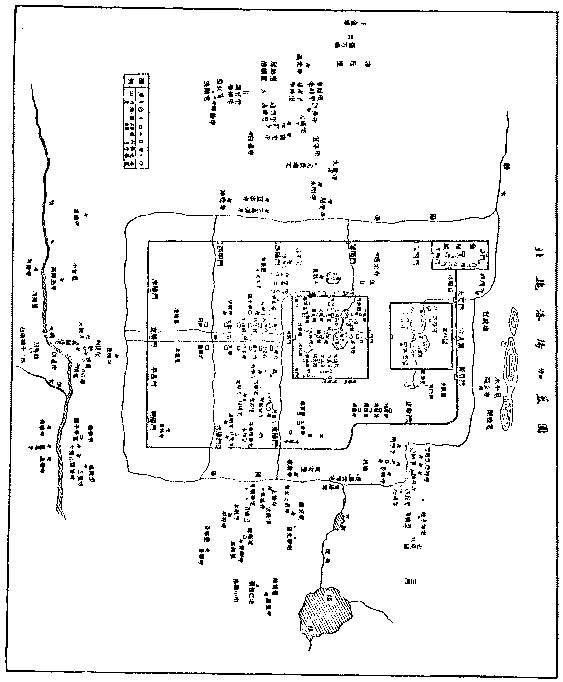



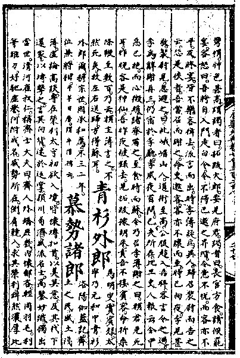



图版一（上）　明永乐大典（卷7328）



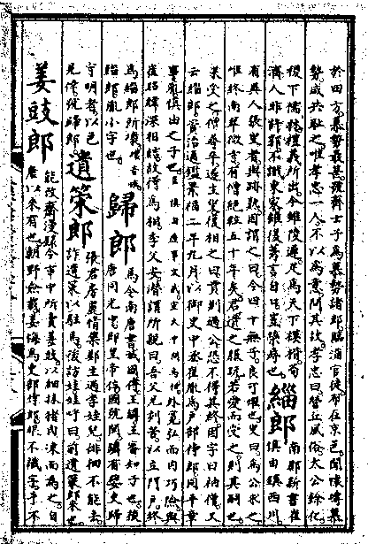



图版一（下）　明永乐大典（卷7328）



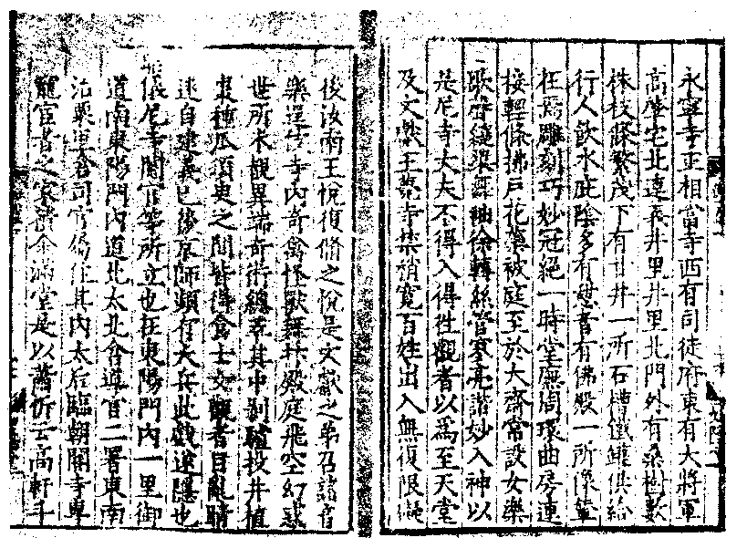



图版二　明如隐堂刻本洛阳伽蓝记



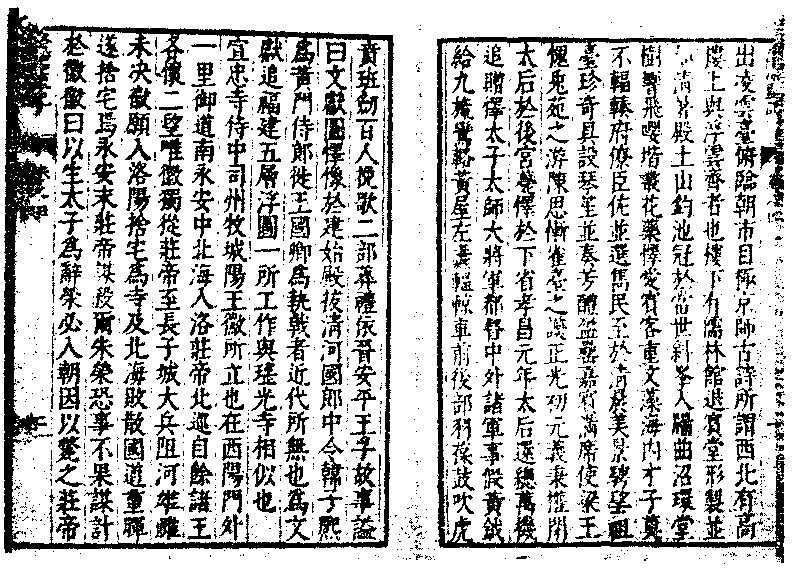



图版三　明吴琯刻古今逸史本洛阳伽蓝记



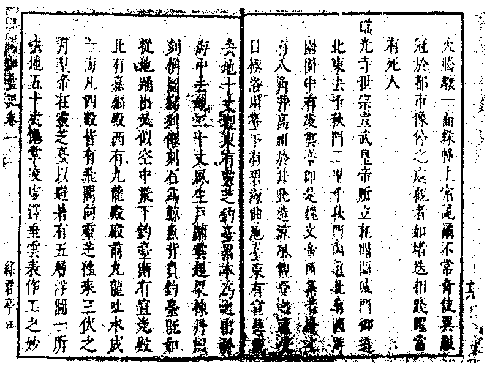



图版四　明毛晋刻津逮秘书本洛阳伽蓝记



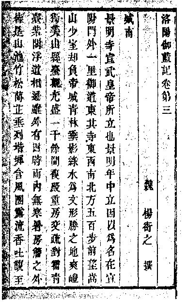



图版五　清吴自忠刻真意堂丛书本



------



### 洛阳伽蓝记序



魏抚军府司马杨衒之撰(逸史本汉魏本魏字上有后字，乃后人所增。)



(案历代三宝记卷九云：「洛阳地伽蓝记五卷，期城郡太守杨衒之撰。」大唐内典录卷四亦作「期城郡守」。又续高僧传卷一菩提流支传云：「期城郡守杨衒之撰洛阳伽蓝记五卷。」法苑珠林卷一百传记篇杂集部云：「洛阳地伽蓝记一部五卷，元魏邺都期城郡守杨衒之撰。」并与今本署衔不同。考杨衒之魏书北史无传，广弘明集卷六云：「阳衒之，北平人，元魏末为秘书监。见寺宇壮丽，损费金碧，王公相竞侵渔百姓，乃撰洛阳伽蓝记，言不恤众庶也。」据是可知衒之为北平人。其姓书作阳，又与历代三宝记等及本书不合。考北朝以文学通显者皆北平阳氏，如阳尼、阳固并是。至於杨氏，则未之见。魏书卷七十二阳尼传云：「尼字景文，北平无终人。从孙固，字敬安，有三子，长休之，休之弟诠之，字子衡。」北史卷四十七称固有五子，长休之，休之弟𬘭之，次俊之。此皆以之字为名，颇疑衒之姓阳，且与休之同行辈。复考北齐书卷四十二阳休之传云：「休之，字子烈，魏孝庄帝立，解褐员外散骑侍郎」；而本书卷一云：「永安中庄帝马射於华林园，衒之时为奉朝请」；以史称休之卒於隋开皇二年，年七十四推之，庄帝永安元年休之释褐为员外散骑侍郎，时年二十一，是时衒之方为奉朝请，盖亦初登仕版，年方弱冠者，则其与休之为同辈，益可信矣。至如刘知几史通补注篇作羊衒之者，羊为泰山姓氏，望非北平，当为传写之误。衒之之事迹可考者至少，其仕履可知者有四：曰奉朝请，曰抚军府司马，曰秘书监，曰期城郡太守。故严可均全北齐文杨衒之下云：「魏末为抚军府司马，历秘书监，出为期城太守。」期城郡者，魏孝昌中置，在今河南泌阳县西北。衒之生卒年不详。此序有「至武定五年，岁在丁卯，余因行役，重览洛阳」之语，是卒於武定五年以后。而严氏称「齐天保中卒于官」，则不知所据矣。又广弘明集复称衒之既撰此记，「后上书述释教虚诞，有为徒费，无执戈以卫国，有饥寒於色养，逃役之流，仆隶之类，避苦就乐，非修道者。又佛言有为虚妄，皆是妄想，道人深知佛理，故违虚其罪。启又广引财事乞贷，贪积无厌。又云读佛经者，尊同帝王，写佛畫师，全无恭敬。请沙门，等同孔老拜俗。班之国史，行多浮险者，乞立严敕，知其真伪。然后佛法可遵，师徒无滥；则逃兵之徒，还归本役，国富兵多，天下幸甚。」此鉴於当时佛教污秽杂乱，祸国殃民，故发崇有黜邪之论。广弘明集以其多排斥佛法之言，故列於王臣滞惑篇。然读衒之是书者，不可不知其言行也。惜其全文已佚，不可复覩矣。)



三坟五典之说，(说，历代三宝记卷九引作记，非。)九流百氏之言，(百氏，各本作百代，误，九流百氏指诸子百家而言。今依三宝记及大唐内典录卷四、续高僧传卷一菩提流支传引改。)并理在人区，(人，吴若准集证本作寰，非。)而义兼天外。(兼，内典录、续僧传作非。外，集证本作下。案衒之此语与后汉书西域传论「神迹诡异，则理绝人区；感验明显，则事出天外」；用字相同。天外者，寰宇之外也。)至於一乘二谛之原，(原，三宝记、内典录并作源，原源字通。水本曰原也。续僧传作言，涉上文而误。○一乘者，犹言一法也。广弘明集卷十五沈约佛记序云：「廓不二之法门，广一乘之长陌。」乘者，运载为义。法门名义集云：「能运众生从因至果，故名为乘。」又云：「二谛：一者世谛，亦名俗谛；二者第一义谛，亦名真谛。谓缘法不目，名用万差，别言显相，皆是世谛。第一义谛：真妄平等，垢净不二，凡是无实无相无诠，皆是第一义谛所摄。出世圣人，乃证斯理，最实无比，故言第一义谛。诸佛说法是依二谛，共表一法，不相违反。」又释神清北山录卷二真俗符云：「会极捐情之谓真，起微涉动之谓俗。真也者，性空也。俗也者，假有也。」翻译名义集第五十九篇云：「佛事门中不舍一法，劝臣以忠，劝子以孝，劝国以治，劝家以和，此依俗谛也。真谛彰本寂之理，一性泯然，是非双泯，能所俱亡，指万象为真如，会三乘归实际，此依真谛也。」)三明六通之旨，(三宝记、内典录、续僧传并作六通三达之旨，其义相同。维摩经云：「佛身即法身也，从六通生，从三明生。」法门名义集云：「三明：过去宿命明，未来天眼明，现在漏尽明。」案漏者，浸渍於内，放逸失道之义也。又释六通曰：「一身通，二天眼通，三天耳通，四他心通，五宿命通，六漏尽通。」案通者，离壅无碍之谓也。六通亦名六神通，见翻译名义集第一篇。三明亦名三达，佛说菩萨本行经卷上云「六通三达成一切智」是也。)西域备详，东土靡记。(上言三坟五典之说，诸子百家之言，行於中土；而一乘二谛、三明六通之言，独发自彼域也。)自项日感梦，(项，各本作顶，此依三宝记、内典录改。)满月流光，阳门饰豪眉之象，(豪，逸史本作毫，三宝记、内典录同。)夜台图绀发之形，(夜台，三宝记、续僧传同，惟内典录作凉台。○此述自汉明帝感梦，佛教始至中土也。牟子理惑论云：「昔孝明帝梦见金人，身有日光，飞在殿前，欣然悦之。明日博问群臣，此为何神？有通人傅毅曰：臣闻天竺有得道者，号曰佛，飞行虚空，身有日光，殆将其神也。於是上寤。遣中郎蔡愔、羽林郎中秦景、博士弟子王遵等十八人於大月支写佛经四十二章，藏在兰台石室第十四间。时於洛阳城西雍门外起佛寺，於其壁畫千乘万骑绕塔三匝。又於南宫清凉台及开阳门上作佛像。明帝时豫修造寿陵，曰显节，亦於其上作佛图像。时国丰民宁，远夷慕义，学者由此而滋。」（见弘明集卷一）汉法本内传亦云：「明帝永平三年，上梦神人，金身丈六，项有日光」云云。（见广弘明集卷一及弘决外典抄卷一引）即其事也。○夜台，即长夜台，指明帝之寿陵而言。内典录作凉台，则谓清凉台，义有不同。项日、满月、毫眉、绀发皆如来之色相。大善权经云：「白净王严驾白象，往诣阿夷头，道人披㲲相太子，见三十二相，躯体金色，顶有肉髻，其发绀青，眉间白毫，项出日光。」是也。（瑞应本起经同）满月，见修行本起经卷上，言佛之颜容，皎洁光净，如满月也。魏温子升大觉寺碑言佛「颜如满月，心若盈泉」。（见艺文类聚卷七十七）又唐释法琳辩正论卷六云：「夫法身等於如如，无方理绝称谓。化体由乎应物，妙质可涉名言？故有白毫绀睫之辉，果唇花目之丽，万字千辐之相，日轮月彩之殊。自像法东被，正化南移，夕梦金人，河浮玉马。清台之下，覩满月之容，雍门之外，观相轮之影。」并与本文相发。)迩来奔竞，(迩原作尔，误。逸史本作迩，与三宝记、内典录合。)其风遂广。(释法琳破邪论卷下云：「及慈云卷润，慧日收光，迺梦金人於永平之年，覩舍利於赤乌之岁。於是汉魏齐梁之政，像教勃兴；燕秦晋宋已来，名僧间出。」)至於晋室永嘉，(各本作至晋永嘉，此依三宝记、内典录。)唯有寺四十二所。(亦见魏书释老志。)逮皇魏受图，(受图，谓受天命也。后汉书班固传东都赋「於是圣皇乃握乾符，阐坤珍，披皇图，稽帝文」，李贤注曰：「乾符坤珍，谓天地符瑞也。皇图帝文，谓图纬之文也。」又张衡传东京赋云：「高祖膺箓受图，顺天行诛。」文选卷二十应贞晋武帝华林园集诗云：「五德更运，膺箓受符。」义同。)光宅嵩洛，(光者，大也。左氏昭公二十八年传「光有天下」，班固东都赋「光汉京于诸夏」，是也。宅者，居也。嵩，嵩高山也。文选卷十六潘岳怀旧赋李善注引戴延之西征记曰：「嵩高，中丘也。东谓太室，西谓少室，总名嵩高也。」又引河南郡图经曰：「嵩丘，在县西南十五里。」)笃信弥繁，法教愈盛。(详见魏书释老志。)王侯贵臣，弃象马如脱屣；(此谓多施与也。往者太子须大拏曾以白象车马布施他人，见太子须大拏经，故曰弃象马如脱屣。屣，履也。如脱屣言其至为轻易也。)庶士豪家，舍资财若遗迹。(文选古诗十九首云：「不念携手好，弃我如遗迹。」)於是招提栉比，(招原作昭，误，别本均作招。续僧传卷十二达摩笈多传云：「招提者，正音云招鬪提奢，此云四方，谓处所为四方众僧之所依住也。世依字解：招谓招引，提谓提擕，并浪语也。此乃西言耳。」又释氏要览卷上释招提曰：「增辉记：梵云拓鬪提奢（caturdisya），唐言四方僧物。但笔者讹拓为招，去鬪奢，留提，故称招提。即今十方住持寺院也。」案僧吏略卷上云：「后魏太武帝始光元年创立伽蓝，为招提之号。」)宝塔骈罗，(释氏要览卷下云：「塔，梵语塔婆，此云高显，今略称塔也。又梵云苏偷婆，此云宝塔。又梵云窣堵波，此云坟。」案塔婆者，由巴利文（Pali）thūpa 而来；苏偷婆、窣堵波者，由梵文 stūpa 而来；皆译音也。玄应一切经音义卷六引字苑曰：「塔，佛堂也。他合反。」是此字之训寺塔，自晋葛洪始。宝塔者，以众宝为饰者也。骈罗，犹言并列。张衡西京赋曰「夹蓬莱而骈罗」。)争写天上之姿，竞摹山中之影；(摹原作摸，此依三宝记。摹摸一字，摸为俗体。别本作模，非。模者，法也。摹者，摹写之也。意义有别。图缋佛像，畫工未施采事，而先规摹之也。自以作摹为是。○天上之姿，山中之影，皆指如来佛像而言。往者佛至忉利天为母说法，优填王以旃檀作佛像，为造像之始。大唐内典录谓汉明帝时从月支得优填王雕像之图样，敕图於开阳城门及寿陵上，为中国供养佛像之始。案又过去佛尝於那竭城南山中留影，魏书释老志云：「太安初有师子国胡沙门五人奉佛像三到京师。」即本佛影摹写而得，斯即所谓山中之影也。)金刹与灵台比高，(灵台，三宝记作云台，误。案灵台汉光武所建，升之以望云物也。水经注谷水条云：「高六丈，方二十步。」文选潘岳闲居赋云：「浮梁黝以径度，灵台杰其高峙。」李善曰：「陆机洛阳记：灵台在洛阳南去城三里。」○金刹者，旛柱也。此指浮图而言。法华经卷三授记品「长表金刹」，慧琳音义云：「刹梵云掣多罗，彼土无别旛竿，即於塔覆钵柱头悬旛。今云刹者，语声虽讹，以金为之，长而有表，故言金刹也。」案古无刹字，徐铉说文新附字有之，云：「柱也，从刀未详，杀省声，初辖切。」玄应一切经音义卷一忉刹条云：「刹音察，梵言差多罗。此译云土田。案刹书无此字，即㓼字略也。㓼音初一反，浮图名刹者，讹也。应言剌瑟胝。剌音力割反。此译云竿。人以柱代之，名为刹柱，以安佛骨，义同土田，故名刹也。以彼西国塔竿头安舍利故也。」季羡林先生云：「刹，梵文为 yasti，巴利文为 lasthi。玄应所云剌瑟胝，或为 lasthi 之对音。」)讲殿共阿房等壮。(讲殿原作广殿，此依三宝记。逸史本集证本作宫殿，非。阿房，殿名，见史记秦始皇本纪，东西五百步，南北五十丈，可以坐万人，在渭南上林苑中。房音旁。)岂直木衣绨绣，土被朱紫而已哉！(此言当时兴建寺舍之穷侈极度也。文选张衡西京赋云：「北阙甲第，当道直启，程巧致功，期不阤陊。木衣绨锦，土被朱紫。」薛综曰：「言皆采畫如锦绣之文章也。」李善曰：「说文云：绨厚缯也。朱紫，二色也。」)暨永熙多难，皇舆迁邺，诸寺僧尼，亦与时徙。(元魏孝武帝（元修）於永熙三年七月为斛斯椿所迫，西出於长安。十月孝静帝（元善见）即位，北迁於邺。)至武定五年，岁在丁卯，余因行役，重览洛阳。(三宝记作至武定元年（公元五四三），无岁在丁卯四字。案孝静帝武定元年二月，北豫州刺史高仲密据虎牢西叛，三月南阳王元宝炬遣其子突与宇文黑獭率众来援仲密，旋围河桥南城。齐献武王高欢乃声讨黑獭，战於邙山，大破之，豫洛二州始平。见魏书孝静帝纪。衒之之行役过洛，当在平洛州之后，故有城郭崩毁之语。)城郭崩毁，(城郭崩毁，三宝记作墙宇倾毁。)宫室倾覆，寺观灰烬，庙塔丘墟。墙被蒿艾，巷罗荆棘，(三宝记墙宇倾毁下作荆棘成林，无宫室下十八字。)野兽穴於荒阶，山鸟巢於庭树。(巢，三宝记作聚。)游儿牧竖，踯躅於九逵；(诗兔罝「施于中逵」，传曰：「逵，九达之道也。」此所称九逵者，九轨也。洛阳城门每门有三道，即所谓九轨。左氏隐公十一年传注云：「逵，道方九轨也。」文选张载七哀诗注云：「桓子新论：雍门周以琴见孟尝君曰，臣窃悲千秋万岁后，坟墓生荆棘，狐兔穴其中，樵儿牧竖踯躅而歌其上。」)农夫耕老，艺黍於双阙。(耕老，各本作耕稼，误。此依三宝记。农夫耕老与游儿牧竖文正相应，作耕稼则不合矣。阙者，宫门之象魏也。天子宫门两旁特为屋，高出於门屋之上者，谓之双阙。亦谓之两观，见孙诒让周礼正义大宰职。文选古诗曰：「两宫遥相望，双阙百餘尺。」是也。两宫即南北二宫，相去七里。)始知麦秀之感，非独殷墟；黍离之悲，信哉周室！(始知二字今本并脱，此依三宝记补。又悲字，三宝记作哀。自争写天上之姿至此，内典录并阙。尚书大传曰：「微子将朝周，过殷之故墟，见麦秀之蔪蔪，此父母之国，志动心悲。」又诗黍离序曰：「黍离，闵宗周也。周大夫行役，至于宗周，过故宗庙，宫室尽为禾黍，闵周室之颠覆，彷徨不忍去，而作是诗。」此所谓黍离麦秀之感也。文选向秀思旧赋曰：「叹黍离之愍周兮，悲麦秀於殷墟，惟古昔以怀今兮，心徘徊以踌躇。」)京城表里，(表里，三宝记作内外。)凡有一千餘寺，今日寥廓，(寥原作寮，此从逸史本。)钟声罕闻。(钟原书均作鍾，今皆依逸史本改作钟。)恐后世无传，故撰斯记。(案衒之於孝庄帝（元子攸）永安中为奉朝请，若年当弱冠，则撰述此书之时，於武定五年之后，盖已年在四十左右矣。)然寺数最多，不可遍写；今之所录，止大伽蓝，(伽蓝即佛寺，或曰僧伽蓝，本名僧伽啰磨，梵文称 saṅghārāma，译云众园，乃众沙门修静之所也。)其中小者，取其祥异，(异字原脱，津逮本同。惟逸史本不误。祥字各本均作详，非是。案内典录引凡有一千餘寺下，作「并选择祥异以注述云」，是详异当作祥异也。)世谛俗事，(俗字各本并夺，此依三宝记补。)因而出之。先以城内为始，次及城外。表列门名，以记远近。凡为五篇。(记字，凡字，各本并夺，此依三宝记补。)余才非著述，(著，三宝记作注。)多有遗漏，后之君子，详其阙焉。



太和十七年，(太和，各本并作大和，误。案孝文帝（元宏）改元太和诏曰：「朕夙承宝业，惧不堪荷，而天贶具臻，地瑞并应，风和气晼，天人交协，宜改号太和。」见魏书卷七上高祖纪。)高祖迁都洛阳，(高祖上各本有后魏二字，当为后人所加，今删。洛阳本古成周之旧址，汉光武建武元年建都于是，魏晋因而不改。元魏之初，本都平城，至孝文帝太和十七年始定迁都之计，经营洛京。清嘉庆洛阳县志卷六云：「东汉旧京，在今洛阳城东三十里，今虽湮灭已久，故迹犹存。」)诏司空公穆亮营造宫室，(魏书高祖纪下云：「太和十七年九月幸洛阳，巡故宫基址。帝顾谓侍臣曰：晋德不修，早倾宗祀，荒毁至此，用伤朕怀！乃定迁都之计。冬十月，幸金墉城，诏徵司空穆亮与尚书李冲将作大匠董爵经始洛京。」元河南志卷三云：「又命青州刺史刘芳、中书舍人常景、造洛阳宫殿门闼之名，经途正其号。十九年九月，新都始立，於是六宫文武尽迁洛阳。宣武永平二年又诏定诸门闼名。初命中书舍人沈馨以隶书书板题之，景明正始之年，又敕符节令江式以大篆易之。」)洛阳城门依魏晋旧名。(案城门之称号仍魏晋之旧者固多，而亦有高祖改之者。)



东面有三门：



北头第一门，曰建春门。



汉曰上东门。阮籍诗曰「步出上东门」，是也。(此阮籍咏怀诗句，见文选卷二十三。李善注引河南郡图经曰：「东有三门，最北头曰上东门。」)魏晋曰建春门，高祖因而不改。(汉曰以下今本与上文连写，今依集证及钩沈二本列为注文，且分行书之，以清眉目。○案元河南志卷二云：「贾谊疏曰：择良日立诸子雒阳上东门之外，是则西汉时已有上东门矣。汉旧仪曰：册皇太子诸侯王皆於上东门。李尤铭曰：上东少阳，厥位在寅，条风动物，月正孟春。」又云：「晋永嘉二年，王弥至洛阳，屯於津阳门。弥兵散，烧建春门而东。」)



次南曰东阳门。



汉曰中东门。(中东门，各本作东中门，误。水经注卷十六谓东阳门，故中东门也。元河南志卷二亦作中东门，且引李尤铭曰：「东处仲月，厥位当卯。」是原名中东门无疑。中东门者，东门之中间一门也。)魏晋曰东阳门，高祖因而不改。



次南曰青阳门。



汉曰望京门。(案元河南志卷二曰：「旄门，一作宣平门，又曰望京门。李尤铭曰：旄门值季，月位在辰。」)魏晋曰清明门，高祖改为青阳门。(青阳，汉魏本作清阳，非。尔雅释天云：「春为青阳。」说文云：「青，东方色也。」「阳，高明也。」元河南志卷二云：「青阳门，晋之清明门，孝文改。亦曰税门，又曰芒门。」)



南面有四门：(原作三门，误。此依逸史本及元河南志改。)



东头第一门，(门字各本脱，依集证本补。)曰开阳门。



初，汉光武迁都洛阳，作此门始成，而未有名，忽夜中有柱自来在楼上。后瑯琊郡开阳县上言南门一柱飞去，(上字各本无，依水经注卷十六及汉官仪补。)使来视之，则是也。遂以开阳为名。(遂，逸史本作因。李尤铭曰：「开阳在孟，位月惟巳。」)自魏及晋因而不改，(文选潘岳怀旧赋曰：「启开阳而朝迈。」)高祖亦然。



次西曰平昌门。



汉曰平门。(元河南志卷二云：「南面四门：正南曰平门，一作平城门。古今注曰：建武十三年开。蔡邕曰：平城门，正阳之门也。与宫连属，郊祀法驾所由从出，门之最尊者。汉官秩曰：平城门为宫门，不置候。李尤铭曰：平门督司，午位处中，外临僚侍，内达帝宫，正阳南面，炎暑赫融。」)魏晋曰平昌门，高祖因而不改。



次西曰宣阳门。



汉曰小苑门。魏晋曰宣阳门，高祖因而不改。(此注今本并无，依水经注、太平寰宇记补。水经注卷十六：谷水又东迳宣阳门南，注云：「故苑门也，皇都迁洛，移置于此。」太平寰宇记卷三云：「开阳门在巳上，汉有小苑门在午上，晋改曰宣阳门。」是宣阳门即汉之小苑门。小苑门亦称謻门。文选张衡东京赋云：「謻门曲榭，邪阻城洫。」薛综曰：「謻门，冰室门也。」水经注谷水下云：「謻门，即宣阳门也。」今各本宣阳门下作「汉曰津门」云云，非是。元河南志卷二列后汉城门，平门之西曰宣阳门，并云：「按汉志十二门名有小苑门，而独无铭，莫知其方所。而十道志列在平城之西。董卓传：孙坚军太谷，进宣阳城门。注曰：洛阳记南面有四门，从东第三门也。是则小苑亦名宣阳。次西曰津门。」据此可知宣阳门与津门为二门，非一门也。又水经注谷水下云：「谷水南东屈迳津阳门，又东迳宣阳门南，又东迳平昌门南，又东迳开阳门南。」此正为南面之四门，次第甚明，足正今本伽蓝记之误。)



次西曰津阳门。(此六字今本亦脱，张氏宗祥据水经注各书始发其误。今考元河南志卷三多据衒之此书而作，其叙南面四门：东曰开阳，次西曰平昌，次西曰宣阳，次西曰津阳；所列与水经注并合，今据补。)



汉曰津门。(逸史本津下有阳字，非。案津门者以洛水从此而入城，故名。元河南志卷二云：「津门当洛水浮桥下，一作津城门，又作津阳门。李尤铭曰：名自定位，惟月在未。」)魏晋曰津阳门(逸史本作宣阳，非。案晋永嘉二年王弥至洛阳，屯於津阳门。)高祖因而不改。



西面有四门：(案自汉迄晋，西面有三门，元魏增辟一门，故为四门。)



南头第一门，曰西明门。



汉曰广阳门，(李尤铭曰：「广阳位孟，厥月在申。」)魏晋因而不改，高祖改为西明门。



次北曰西阳门。



汉曰雍门，(元河南志卷二云：「一曰雍城门。李尤铭曰：雍门处中，位月在西。」)魏晋曰西明门，高祖改为西阳门。(水经注卷十六曰：「旧门在东南，太和中以故门邪出，故徙是门，东对东阳门。」)



次北曰阊阖门。



汉曰上西门。(李尤铭曰：「上西在季，位月惟戌。」)上有铜璇玑玉衡，(上字原脱，此从逸史本。)以齐七政。(尚书舜典云：「在璇玑玉衡，以齐七政。」璇璇字同。孔颖达正义曰：「说文云：璇，美玉也。玑衡者，玑为转运，衡为横箫。运玑使动於下，以衡望之，是王者正天文之器。汉世以来，谓之浑天仪者是也。宣帝时，司农中丞耿寿昌始铸铜为之象，史官施用焉。马融云：浑天仪可旋转，故曰玑。衡，其横箫，所以视星宿也。以璇为玑，以玉为衡，盖贵天象也。蔡邕云：玉衡长八尺，孔径一寸，下端望之，以视星辰。盖县玑以象天，而衡望之，转玑窥衡，以知星宿。是其说也。七政谓日月与五星也。马融云：日月星皆以璇玑玉衡度知其盈缩进退，失政所在。圣人谦让以验齐日月五星行度，知其政是与否，重审己之事也。」)魏晋曰阊阖门，(文选卷二十一左思咏史诗「被褐山阊阖」是也。李善云：「晋宫阙名曰：洛阳城阊阖门西向。」)高祖因而不改。(水经注卷十六云：「太和迁都，徙门南侧。」)



次北曰承明门。



承明者，高祖所立，当金墉城前东西大道。(水经注卷十六云：「金墉城，魏明帝于洛阳城西北角筑之，起层楼于东北隅，皇居创徙，宫极未就，止跸于此。」)迁京之始，宫阙未就，高祖住在金墉城，城西有王南寺，高祖数诣寺〔与〕沙门论义，(与，各本无，今依文义增。义原作议，非，此依逸史本改。案魏书高祖纪下云：「帝雅好读书，手不释卷，史传百家，无不该涉。善谈老庄，尤精释义。」此所谓论义者，即谈论释典经义也。)故通此门，而未有名，世人谓之新门。时王公卿士常迎驾於新门，高祖谓御史中尉李彪曰：(彪字道间，顿丘卫国人。家世微寒，笃学不倦。高祖初，为中书教学博士，后假员外散骑常侍，建威将军，使於萧赜。迁秘书丞，参著作事。高祖南征，假彪冠军将军。车驾还京，迁御史中尉，领著作郎。后坐事除名。世宗时以白衣在秘书省修史。景明二年秋卒。见魏书卷六十二本传。)「曹植诗云：谒帝承明庐，(此子建赠白马王彪诗，见文选卷二十四。李善云：『陆机洛阳记曰：承明门，后宫出入之门。吾常恠曹子建诗谒帝承明庐，问张公（华），张公云：魏明帝作建始殿，朝会皆由承明门。然直庐在承明门侧。』（此据文选卷二十一应璩百一诗注参校）) 此门宜以承明为称。」遂名之。



北面有二门：



西头曰大夏门。



汉曰夏门。(元河南志卷二云「一作夏城门。李尤铭曰：夏门值孟，位月在亥。」)魏晋曰大夏门，〔高祖因而不改。〕(高祖云云，各本并无，今依例补。)宣武帝造三层楼，去地二十丈。(宣武二字各本并无，帝原作尝。逸史本作帝。案元河南志卷三云：「北有二门：东曰广莫门。西有大夏门。宣武造三层楼，去地二十丈。洛阳城门楼皆两重，去地百尺，唯大夏门甍栋峻丽。」此文当即本於是书。今本帝上夺宣武二字，故据补。又河南志卷二记魏宫阙云：「魏略曰：武帝立北宫，明帝造三层楼，高十丈。」水经注卷十六云：「谷水又东历大夏门下，故夏门也。陆机与弟书云：门有三层，高百尺。魏明帝造。」是则门旧有楼，亦非创自宣武（元恪）矣。又逸史本汉魏本此文作「帝造三层楼，去地十丈；高祖世宗造三层楼，去地二十丈」。吴若准以为高祖世宗云云误衍，而帝字上脱魏明二字。津逮本之尝字，又当从汉魏本作帝。唐晏钩沈则据汉魏本，但於帝字上增魏明二字而已。今从河南志改正。)洛阳城门楼皆两重，去地百尺，惟大夏门甍栋干云。(甍，屋栋也。广韵莫耕切，音萌。)



东头曰广莫门。(广莫者，大也。天有八风，一曰广莫风。史记律书云：「广莫风居北方。」)



汉曰谷门。(元河南志卷二云：「一作谷城门。李尤铭曰：谷门北中，位当于子。」水经注卷十六云：「谷门北对芒阜，连岭修亘，苞总众山，始自洛口，西逾平阴，悉芒垅也。」)魏晋曰广莫门，(文选卷二十八刘琨扶风歌云：「朝发广莫门，莫宿丹水山。」)高祖因而不改。自广莫门以西，(自字原脱，依逸史本补。)至於大夏门，宫观相连，被诸城上也。



一门有三道，所谓九轨。(元河南志卷二记晋城阙云：「陆机洛阳记曰：洛阳十二门，门有阁，闭中，开左右出入。城内大道三，中央御道，两边筑土墙，高四尺，公卿尚书章服从中道，凡人行左右道。左入右出，不得相逢。夹道种槐柳树。晋书曰：洛阳御道，筑墙高丈餘，百郡邸舍皆在城内。又曰：洛阳十二门，皆有双阙。有桥，桥跨阳渠水。」○九轨，逸史本作九逵，义同。周礼考工记匠人曰：「国中经涂九轨。」郑注曰：「经纬之涂，皆容方九轨。轨谓轨广。」又文选张衡东京赋述洛阳城隅之制曰：「经途九轨，城隅九雉。」薛综曰：「南北为经。途，道也；轨，车辙也。」)



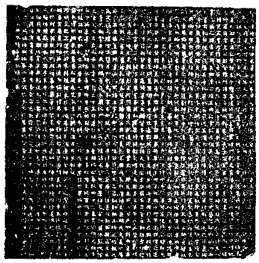



图版六　北魏元天穆墓志



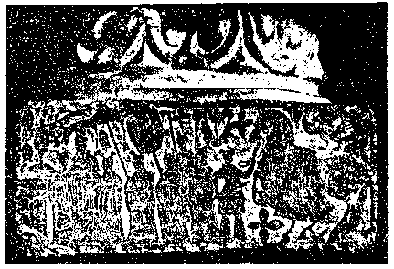



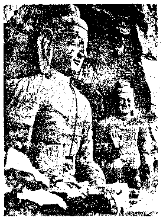



（上）图版七　北魏正光六年（公元五二五）造弥勒下生石像台座上帝王供养浮雕（帝王著王冠，侍臣头上总发作双髻）



（下）图版八　云冈石窟造像（一佛二菩萨）



------



## 洛阳伽蓝记卷第一



**译者**：魏抚军府司马杨衒之撰



周祖谟校释



城内(此二字原在题目洛阳下，不别起行，此依逸史本。下各卷同。)



○永宁寺，熙平元年灵太后胡氏所立也，(魏书释老志云：「肃宗（元翊）熙平中於城内太社西起永宁寺，灵太后亲率百僚表基立刹。」案胡太后为世宗（元恪）妃，肃宗母，安定临泾司徒胡国珍女。肃宗立，乃尊为皇太后，临朝称制，总览万机。后姑为尼，颇通佛理，后因之亦崇敬三宝。见北史后妃传。○又据魏书释老志，魏显祖献文帝皇兴元年曾於代京起永宁寺，构七级佛图，高三百餘尺，基架博敞，为天下第一。熙平初於洛阳起永宁寺，盖沿平城之旧制。)在宫前阊阖门南一里御道西。(西字续僧传卷一菩提流支传及开元释教录卷六引作东，误。案魏书云「於太社西起永宁寺」，本书下文云「太社在阊阖门前御道西」，据此则寺之所在至明。且水经注卷十六谷水注云：「阳渠水迳阊阖门南，又枝分夹路南出，迳太尉司徒两坊间，谓之铜驼街。水西有永宁寺。」由是益足证作西不误。○阊阖门者，乃宫城正南之门，虽与城之西门阊阖门同名，而非一门。)



其寺东有太尉府，(此下至「四朝时藏冰处也」当系子注。续僧传、释教录均未引，是其明证。凡依文例考核为注文者皆低格书写，不与正文杂糅。○北魏官号多同晋朝，太尉、司徒、司空，并古官名也，号称三公。太尉即古大司马之职。汉建武二十七年改大司马为太尉，其后二者恒迭置，不并列。魏晋之世，大司马与太尉乃各自为官，北魏仍之不改。见晋书职官志及杜佑通典。○元河南志卷三云：「太尉府在永宁寺东，西对永康里，即旧铜驼街；其左是魏晋故庙地。」)西对永康里，(永康里，在西阳门内御道南。)南界昭玄曹，(昭玄曹，管僧尼之官署。沙门，汉隶鸿胪寺。寺者，官舍也。北魏初京中立道人统，文成帝时改立监福曹，孝文帝时改为昭玄曹。其官属有沙门统、都维那等，统摄僧伍，以断僧务者。世宗即位，诏僧犯杀人以上罪者，仍依俗断；餘付昭玄断之。见魏书释老志及宋赞宁僧史略卷中。)北邻御史台。(御史，古为记事之官。至秦汉司纠察之任，所居之署，后汉谓之御史台，后世因之。见宋王益之职源撮要。)阊阖门前御道东有左卫府。(魏书官氏志有左右卫将军，亦沿晋制也。)府南有司徒府。司徒府南有国子学，(案魏书卷五十五刘芳传芳请高祖立学表称：「洛阳记云：国子学宫与天子宫对，校量旧事，国学应在宫门之左。」今此称国子学在阊阖门御道东，盖即从刘芳之言而营建者也。)堂内有孔丘像。颜渊问仁、子路问政在侧。(并见论语。)国子学南有宗正寺，(学字各本并夺，依元河南志补。宗正者，统皇族宗人图谍之官也。见晋书职官志。此亦因晋人之旧。)寺南有太庙，(周礼考工记：「匠人营国，左祖右社。」)庙南有护军府，(魏书官氏志有中护军。)府南有衣冠里。御道西有右卫府，府南有太尉府，(太尉府，元河南志作太府寺。太府，掌财物库藏者。)府南有将作曹，(魏书官氏志有将作大匠，掌修治宫室陵园土木之功。)曹南有九级府，(元河南志无九级府，九级未详。)府南有太社，(元河南志太社下有司州。)社南有凌阴里，即四朝时藏冰处也。(水经注谷水注云：「宣阳门内有宣阳冰室，旧在宣阳门内，故得是名。门既拥塞，冰室又罢。」元河南志卷二云：「陆机洛阳记曰：冰室在宣阳门内，常有冰，天子用赐王公众官。」案积冰曰凌，诗七月「纳于凌阴」，传曰：「凌阴，冰室也。」○四朝者，即中朝也。谓晋之武、惠、怀、愍四世也。)



中有九层浮图一所，架木为之，举高九十丈。(九十丈，内典录卷四引同。魏书释老志云：「高四十餘丈。」水经注谷水注云：「浮图下基，方十四丈，自金露槃下至地四十九丈。」与本书所记不同。郦道元又称浮图「取法代都七级而又高广之，虽二京之盛，五都之富（五疑当作三），利刹灵图，未有若斯之构也」。)上有金刹，复高十丈；(上字金字今本并夺，此依开元释教录补。内典录作「上有宝刹」。刹解见序。)合去地一千尺。(续僧传作「出地千尺」，内典录作「去地千尺」。)去京师百里，(续僧传及释教录作「去台百里」，内典录作「离京百里」。)已遥见之。(巳，内典录作即。)初掘基至黄泉下，(续僧传作「初营基日，掘至黄泉」。内典录作「初欲筑基，掘至黄泉下」。)得金像三十躯，(得，续僧传作获。三十，原作三千，别本作三十，今据改。续僧传、内典录等作三十二。○水经注谷水注云：「其地是曹爽故宅。经始之日，于寺院西南隅得爽窟室，下入土可丈许，地壁悉累方石砌之，石作细密，都无所毁，其石悉入法用。自非曹爽庸匠，亦难复制此！桓氏有言：曹子丹生此豚犊，信矣。」此言得金像三十躯，殆未可信。)太后以为信法之徵，(续僧传作「太后以为嘉瑞，奉信法之徵」。内典录作「太后信为崇法之祥徵」。)是以营建过度也。(内典录作「是以营造穷极世工」。释教录作「是以饰制瓌奇，穷世华美」。续僧传则与今本并同。○案魏书艺术传称建永宁寺九层浮图，郭安兴为匠。此云营建过度，正衒之讥弹之辞也。)刹上有金宝瓶，(续僧传作「刹表置金宝瓶」。)容二十五斛。(斛，各本作石，此依续僧传及释教录。○案天竺浮图刹表均置宝瓶，所以盛舍利者也。)宝瓶下有承露金盘一十一重，(一十一重，今本作三十重，此依续僧传、内典录及释教录改。)周匝皆垂金铎。(周匝下内典录有「轮廓」二字。○周礼鼓人以金铎通鼓，郑注云：「铎，大铃也。」)复有铁鏁四道，引刹向浮图四角，鏁上亦有金铎。铎大小如一石瓮子。(内典录作「大小皆如一石瓮」。)浮图有九级，(内典录无「有」字。)角角皆悬金铎，合上下有一百三十铎。(一百三十，各本作一百二十，此依续僧传、内典录及释教录改。)浮图有四面，(内典录无「有」字。)面有三户六牎，户皆朱漆。(户，内典录作并。)扉上各有五行金铃，(各字今本无，此据内典录补。铃原作钉，与内典录等不合。此依逸史本。此句下内典录有其十二门二十四扉一句。)合有五千四百枚。(续僧传及释教录并云「其塔四面九间，六窗三户，皆朱漆扉扇，垂诸金铃，层有五千四百枚」。与内典录略有异同。)复有金环铺首，(内典录作「铃下复镂金环铺首」。○程大昌演繁露云：「风俗通义：门户铺首，昔公输班见水中蠡引闭其户，终不可开，遂象之立于门户。按今门上排立而突起者，公输班所饰之蠡也。义训曰：门饰金谓之铺，铺谓之鏂，鏂音欧，今俗谓之浮沤钉也。」)殚土木之功，(殚上原衍布字，别本无。)穷造形之巧，(二句内典录作「穷造制之巧，极土木之工，庶人子来，匪日而作」。)佛事精妙，不可思议。绣柱金铺，(金铺，门铺首，以金为之。文选司马相如长门赋云：「挤玉户以撼金铺兮。」)骇人心目。(释教录作「惊骇心目」。)至於高风永夜，(内典录作「至于秋月，永夜高风」。)宝铎和鸣，(宝，续僧传、释教录作铃。)铿锵之声，(声，续僧传作音，逸史本同。)闻及十餘里。



浮图北有佛殿一所，形如太极殿。(续僧传、释教录作「浮图北有正殿，形拟太极」。案太极殿为宫中正殿，宣武帝景明三年成。见魏书帝纪。禁中正殿以太极为名，始於曹魏。魏明帝青龙三年大治洛阳宫，起太极殿，上法太极，故名。见三国志魏志明帝纪。)中有丈八金像一躯，中长金像十躯(逸史本中上有人字。又「中长」二字内典录作「等身」。)绣珠像三躯(绣珠像，内典录作「编真珠像」。)金织成像五躯，(今本作「织成五躯」，文有脱略，此依内典录改。)玉像二躯。(此句今本并夺，依内典录补。)作工奇巧，(工，各本作功，此依内典录。)冠於当世。(自中有以下至此，续僧传及释教录作「中设诸像，金玉珠绣，作工巧绮，冠绝当世」。)僧房楼观，一千餘间，雕梁粉壁，青璅绮疏，(璅原作缫，非。青璅者，门户之有畫饰者。文选左思吴都赋云「青琐丹楹」，刘逵曰：「青琐，户两边以青畫为琐文也。」○绮疏者，谓窗牖镂为绮文者。疏本刻镂之意，此即指窗而言。文选王逸鲁灵光殿赋云：「天窗绮疏。」又古诗「交疏结绮窗，阿阁三重阶」，是其义矣。)难得而言。栝栢椿松，(椿松原作松椿，逸史本作栝椿松柏，此依内典录。)扶疎簷霤，(各本作扶疎拂簷，此依内典录。簷霤与下堦墀为对文，自以作簷霤为是。扶疎者，枝叶四布也。文选司马相如上林赋云：「垂条扶疏。」又陶潜读山海经诗云：「孟夏草木长，绕屋树扶疏。」)藂竹香草，(藂即丛字，逸史本作翠。)布护堦墀。(堦墀，内典录作阶庭。布护者，遍被散布也。护，逸史本作濩，同。文选司马相如上林赋云「布濩闳泽」，左思吴都赋云「布濩臯泽」，并指香草而言。扶疎布护皆叠韵字。扶疎亦作扶於，布濩亦作尃濩。○僧房以下至此，续僧传、释教录作「僧房周接，千有餘间。台观星罗，参差间出。雕饰朱紫，缋以丹青。栝柏桢松，异草丛集」。)



是以常景碑云：(碑上内典录、释教录有制寺二字。○常景见下文。)「须弥宝殿，兜率净宫，莫尚於斯」也。(此常景盛道永宁之华丽庄严也。须弥、兜率，并指天上而言。须弥乃山名。大唐西域记序称为苏迷庐山（梵文 Sumeru），原注：「唐言妙高山。旧曰须弥，又曰须弥娄，皆讹略也。」慧琳一切经音义卷一云：「苏迷卢山，梵语宝山名。梵音云苏迷𠰷，唐云妙高山。俱舍论云：四宝所成，东面白银，北面黄金，西面颇梨，南面青琉璃。大论曰：四宝所成曰妙，出过众山曰高。」案须弥山即天竺北之雪山。○兜率者，梵天之名，佛书称一日当地上四百年。西域记称为覩史多天（梵文 Tusita），云：「旧曰兜率陀，又曰兜术陀，讹也。」慧琳一切经音义卷二十六云：「兜率天，此云知足，欲界之中第四天也。」案佛书称释迦过去为能仁菩萨，即由兜率天上化乘白象，降神母胎。)



外国所献经像，皆在此寺。寺院墙皆施短椽，(续僧传、释教录作「院墙周匝，皆施椽瓦」。)以瓦覆之，若今宫墙也。(内典录作「状若宫墙」。)四面各开一门。(四面上内典录有寺之二字。)南门楼三重，(内典录作「其正南门有三重楼」。)通三阁道，(阁字今本无，据内典录补。阁道者，甬道也。)去地二十丈，形制似今端门。(文选张衡东京赋云：「启南端之特闱，立应门之将将。」薛综曰：「启，开也。端门，南方正门；应门，中门也。」李善曰：「洛阳宫舍记：洛阳有端门。」案端者正也。文选何晏景福殿赋云：「开南端之豁达。」李善曰：「凡正门皆谓之端门。」据是可知永宁寺正门南向。)图以云气，畫彩仙灵，(文选左思吴都赋云：「雕栾镂楶，青琐丹楹，图以云气，畫以仙灵。」案灵者神灵奇异之物也，即王逸鲁灵光殿赋所谓「图畫天地，品类群生，杂物奇怪，山神海灵，写载其状，托之丹青」者也。)列钱青璅，(原作绮□青鏁，有误，此依内典录改。文选班固西都赋云：「金釭衔璧，是为列钱。」李善曰：「列钱，言金釭衔璧，行列似钱也。」又何晏景福殿赋云：「皎皎白间，离离列钱。」李善曰：「白间，青琐之侧，以白涂之。列钱，金釭也。」)赫奕华丽。(津逮本作辉赫丽华，如隐堂本逸史本复阙辉字，此依内典录校。赫奕者，光明显盛之意也。○自南门下，续僧传、释教录并作「正南三门，楼开三道三重，去地二百餘尺，状若天门，赫奕华丽」。)拱门有四力士，(逸史本作拱夹门有四力士，续僧传作夹门列四力士，内典录作夹门两傍有四力士。案金刚力士，乃护法之神。仁王经有五大力菩萨：一金刚吼菩萨，手持千宝相轮。二龙王吼菩萨，手持金轮灯。三无畏十力吼菩萨，手持金刚杵。四雷电吼菩萨，手持千宝罗网，五无量力吼菩萨，手持五千剑轮是也。亦见辩正论卷一。)四师子，(师，今本作狮，后起字。此依内典录续僧传。案师子守护伽蓝者也。佛说太子瑞应经云：「佛初生时，有五百师子从雪山来，侍列门侧。」)饰以金银，(银，内典录作碧。)加之珠玉，庄严焕炳，(庄，今本作装，误。此从内典录、续僧传改。○焕炳，续僧传作焕烂，义同。文选张衡东京赋云：「瑰异谲诡，灿烂炳焕」。薛综曰：「灿烂炳焕，絜白鲜明之貌也。」)世所未闻。东西两门亦皆如之，(逸史本作「皆亦如之」，内典录作「悉亦如之」。)所可异者，唯楼两重。(两，原作二，此依内典录、续僧传及逸史本改。)北门一道，上不施屋，(上字今本无，此依内典录补。续僧传、释教录作「北门通道，但露而置」。)似乌头门。(乌头门，一名乌头大门，门有双表，高八尺至二丈二尺，门之两扉，各随其长，於上腰中心分作两分，腰上安棂子，故俗亦谓之棂星门。见宋李诫营造法式卷六卷三十二。)其四门外，(其字今本无，此据内典录、续僧传补。)皆树以青槐，(皆字今本无，从内典录补。)亘以绿水，(绿，内典录、续僧传均作渌。水清曰渌也。○文选左思吴都赋云：「朱阙双立，驰道如砥。树以青槐，亘以绿水。玄荫耽耽。清流亹亹。」李善曰：「古之表道，或松或槐。亘引也，耽耽树阴重貌，亹亹水流进貌。」案此所谓绿水者，盖即引自阳渠者也。)京邑行人，(人，续僧传作旅。)多庇其下。(庇者荫也。文选左思魏都赋云：「疏通沟以滨路，罗青槐以荫涂。比沧浪而可濯，方步榈而有逾。」)路断飞尘，不由渰云之润；(不，续僧传同。内典录作非。又渰今本均作奔，误。此从续僧传改。内典录作淹，亦非。诗小雅大田云：「有渰凄凄，兴雨祁祁。」（凄凄今诗作萋萋，此从韩诗外传及吕览务本篇。）传曰：「凄凄云兴貌。」正义曰：「天将降雨，则地气上腾，薰蒸为湿润，渰浸万物。」说文曰：「渰云雨貌。衣俭切。」案此云「渰云」，正用诗义，谓含雨之云也。言绿树交荫，翛然清寂，不待湿云润泽，而飞尘自绝也。)清风送凉。岂藉合欢之发？(此言行旅在途，清爽宜人，无烦纨扇在握，而凉风自至。合欢者，团扇也。文选班婕妤怨歌行云：「新裂齐纨素，皎洁如霜雪，裁为合欢扇，团团似明月，出入君怀袖，动摇微风发。」是也。)



诏中书舍人常景为寺碑文。(续僧传、释教录诏上有乃字。)



景字永昌，河内人也。(北史卷四十二常爽传云：「景父文通，天水太守。」)敏学博通，知名海内。太和十九年，为高祖所器，拔为律博士，(续僧传引作擢为修律博士。本传云：「廷尉公孙良举为律博士。」今各本作律学博士，学字盖衍文，今删。律博士见魏书官氏志。)刑法疑狱，多访於景。正始初，诏刊律令，永作通式，(世宗正始元年冬十二月诏群臣议定律令，见魏书世宗纪及刑罚志。)敕景共治书侍御史高僧裕、(僧裕名绰，渤海人，允孙。沈雅有度量，博涉经史，尝为洛阳令。为政强直，不避豪贵。历位尚书右丞、散骑常侍、并豫二州刺史。正光三年冬暴疾卒。年四十八。见魏书卷四十八高允传。)羽林监王元龟、(元龟魏书无传。)尚书郎祖莹、(莹字元珍，范阳遒人。年少好学，以昼继夜，声誉甚盛。尝为彭城王勰法曹参军，文学秀出，与陈郡袁飜齐名。累迁国子祭酒，领给事黄门侍郎。历车骑大将军，迁仪同三司，进爵为伯。有文集行於世。见魏书卷八十二本传。)员外散骑侍郎李琰之等，(琰之字景珍，陇西狄道人。早有盛名，为著作郎，修撰国史。历员外散骑侍郎、尚书左仆射、仪同三司，永熙二年薨。见北史卷四十七本传。)撰集其事。又诏太师彭城王勰、(勰字彦和，献文帝（元弘）第六子。少而岐嶷，姿性不群。太和九年封始平王，车驾南伐，改封彭城王。世宗即位，进为大司马。寻除录尚书侍中，又以为太师。永平元年为高肇所杀。见魏书卷二十一下本传。)青州刺史刘芳、(芳字伯文，彭城人。才思深敏，特精经义。博闻强记，兼览苍雅，尤长音训，辨析无疑。汉造三字石经於太学（汉当作魏），学者文字不正，多往质焉。时人号为刘石经。历国子祭酒，散骑常侍，青州刺史。世宗诏议定律令，芳斟酌古今，为大议之主。其中损益，多芳意也。终于太常卿。延昌二年卒，年六十一。见魏书卷五十五本传。)入预其议。景讨正科条，商榷古今，甚有伦序，见行於世，今律二十篇是也。(案此二十篇者，盖即承晋世之旧而刊定者。晋武帝尝诏贾充集诸儒学定律例二十卷，合二千九百餘条。)又共芳造洛阳宫殿门阁之名，经途里邑之号。出除长安令，时人比之潘岳。(潘岳字安仁，晋荥阳中牟人。晋惠帝元康二年为长安令，有西征赋记其事。魏书云：「景於延昌初为录事参军，襄威将军，带长安令。甚有惠政，民吏称之。」)其后历位中书舍人，(肃宗初，景拜谒者仆射，以本官兼中书舍人。)黄门侍郎，(孝昌初，以征虏将军兼给事黄门侍郎。)秘书监，(前废帝（元恭）普泰初，除车骑将军，右光禄大夫，秘书监。)幽州刺史，(此为魏书本传所未载。)仪同三司。(孝静帝天平初，迁邺，除仪同三司。)学徒以为荣焉。(景武定六年以老疾去官，八年薨。)景入参近侍，出为侯牧，居室贫俭，事等农家，(等，续僧传作若。)唯有经史，盈车满架。(魏书云：「景自少及老，恒居事任，清俭自守，不营产业；至於衣食，取济而已。耽好经史，爱玩文词，若遇新异之书，殷勤求访，或复质买，不问价之贵贱，必以得为期。善与人交，终始若一，其游处者，皆服其远度。」)所著文集，数百餘篇，给事中封𬀩伯作序行於世。(中字各本脱，据续僧传补。○𬀩伯，魏书卷三十二作伟伯，渤海蓨人，封轨子。博学有才思，弱冠除太学博士。每朝廷大议，伟伯皆预焉。肃宗正光末，尚书仆射萧宝夤以为关西行台郎，及宝夤为乱，伟伯谋举义兵，事发见杀，年三十六。魏书不云为给事中，盖失载也。○案自景字永昌至此为注文。释教录引前后文，独不引此，即其证也。盖衒之此书以记伽蓝为主，凡记载当时之史事及一二人物之事迹者，皆附见之例耳，非正文也。)



装饰毕功，明帝与太后共登之。(魏书卷六十七崔光传云：「熙平二年八月，灵太后幸永宁寺，躬登九层佛图。光表谏曰：永宁累级，阁道回隘，以柔懦之宝体，乘至峻之重峭，万一差跌，千悔何追？太后不从。」)视宫中如掌内，(各本作视宫内如掌中，此依续僧传、释教录。)临京师若家庭，以其目见宫中，禁人不听升之。(之字各本无，续僧传及释教录作禁人不听登之，今据补。)



衒之尝与河南尹胡孝世共登之，(孝世，魏书无传，钩沈本作世孝。)下临云雨，信哉不虚！(衒之下至此为注文，释教录不引。)



时有西域沙门菩提达摩者，波斯国胡人也。(释教录引无胡字。○沙门者，魏书释老志云：「剃落须发，释累辞家，结师资，遵律度，相与和居，治心修静，行乞以自给，谓之沙门。或曰桑门，亦声相近。总谓之僧，皆胡言也。僧译为和命众，桑门为息心。」案沙门盖由吐火罗文 saman 译来，梵言 sramana，巴利文云 samana。宋释道诚释氏要览曰：「沙门，唐言勤息，谓此人勤修善品，息诸恶故。长阿含经云：沙门者，舍离恩爱，出家修道，摄御诸根，不染外欲；慈心一切，无所伤害，逢苦不戚，遇乐不忻，能忍如地。」○菩提达摩者（Bodhidharma），此云道法，南天竺人，为中国佛教禅宗之祖。相传梁武帝普通元年泛海至广州，元魏孝明帝正光元年渡江，振锡嵩洛，止于嵩山少林寺。武泰元年（公元五二八）示寂。（见宋释契嵩传法正宗记卷五，释道原景德传灯录卷三。陈垣先生释氏疑年录作梁大同二年卒。公元五三六）续僧传卷十六云：「达摩，南天竺婆罗门种（Brālnmana），（传法正宗记等则云刹帝利种 Kṣatriya）神慧疎朗，闻皆晓悟，随其所止，诲以禅教。自言年一百五十餘岁，游化为务，不测于终。释慧可传其业。」此云波斯国人，与僧传有异。○又传法正宗记载杨衒之曾就达摩问何如谓之为祖，达摩乃为其说偈云云，事出附会，无足取焉。)起自荒裔，来游中土。(释教录作越自西域，来游洛京。)见金盘炫日，光照云表，宝铎含风，响出天外；歌咏赞叹，(歌咏者，口咏梵呗也。)实是神功。自云：年一百五十岁，历涉诸国，靡不周遍，而此寺精丽，(而，释教录作如。)阎浮所无也。(阎浮上逸史本有遍字。释教录引无。○阎浮者，洲名。字亦作剡浮，并译音字。或称阎浮提（Jambudivipa），唐释道宣释迦氏谱云：「剡浮洲者，须弥山南一域之都名也。又剡浮洲者，是树名（即 jambu），此树生於南洲之北，枝临大海，海底有金，金名阎浮，光浮水上，故此洲名从金受称。若据唐译，阎浮者上胜金也，提者洲也。此上胜洲，大夏天竺居其心矣。」案此云阎浮所无者，即五天竺所无也。)极佛境界，(佛原作物，非。别本作佛，与续僧传合。)亦未有此！(释教录作「讫佛境界，亦无有比」。)口唱南无，(南无，译音字，巴利文称 namo，梵文云 namas，归礼之义也。弘明集卷十三郗嘉宾奉法要云：「每礼拜忏悔，皆当至心归命，外国音称南无。」释氏要览卷中云：「南无即是归趣之义也。」玄应一切经音义卷六云：「南无，或作南谟，或言那莫，皆以归礼译之。言和南者，讹也。正言烦淡，或言槃淡（vandana），此云礼也。或言归命，译人义安命字也。」案佛教仪轨，凡合掌低头，口云南无，即致敬之义。或口云槃淡，译为我礼（vandāmi）。槃淡或作畔睇，或云畔惮南（见唐释义净南海寄归内法传卷三），或称槃䢷寐（见翻译名义集卷四），皆一语也。)合掌连日。(合掌上逸史本有或字，非。○释氏要览卷中云：「合掌，若此方之叉手也。必须指掌相著，不令虚。」案中国旧日以拱手为恭，天竺则以合掌为敬，合掌乃恭敬之仪表也。)



至孝昌二年中，(中字逸史本无，续僧传同。○孝昌，亦肃宗年号。自建塔至此凡十一年。)大风发屋拔树，刹上宝瓶，随风而落，(落，续僧传作堕。)入地丈餘。(案魏书卷一百一十二灵徵志上大风条云：「肃宗孝昌二年五月京师暴风拔树发屋，永宁九层塔折。」)复命工匠更铸新瓶。(铸，逸史本作著。续僧传作「复命工人，更安新者」。)



建义元年，(建义，敬宗孝庄帝（元子攸）年号。)太原王尒朱荣总士马於此寺。



荣字天宝，北地秀容人也。(魏书地形志云：「秀容郡，明元帝永兴二年置。」唐韦澳诸道山河地名要略云：「秀容在宜芳县南，刘元海所筑也。元海因感神而生，姿容美秀，因以名其城也。」案秀容在今山西朔县西北。)世为第一领民酋长，博陵郡公。(第一领民酋长为北朝颁予部落人民酋帅之官名。第一者，其品级也。见周一良先生领民酋长与六州都督一文。案魏书卷七十四荣传云：「其先居於尔朱川，因为氏焉。常领部落，世为酋帅。高祖羽健登国初为领民酋长。祖代德继为酋长。以征伐有功，除立义将军。高宗末，除肆州刺史。高祖赐爵梁郡公，卒赠镇南将军并州刺史。父新兴，太和中继为酋长。朝廷每有征讨，辄献私马，兼备资粮，助裨军用。高祖嘉之，除平北将军秀容第一领民酋长。荣袭爵，以功除武卫将军。俄加使持节安北将军，进封博陵郡公。」此云世为博陵郡公，与魏书小异。)部落八千餘，家有马数万匹，富等天府。(魏书本传云：「家世豪擅，财货丰赢，牛羊驼马，色别为群，谷量而已。」○富等天府者，言其富饶有如天府之国也。史记留侯世家云：「关中所谓金城千里，天府之国也。」)武泰元年二月中帝崩无子，立临洮王世子钊以绍大业，(魏书卷九肃宗纪云：「武泰元年二月癸丑，帝崩於显阳殿，时年十九。」北史卷十三后妃传云：「肃宗崩，胡太后奉潘充华女，言太子即位。经数日，见人心已安，始言潘嫔本实生女，今宜更择嗣君，遂立临洮王宝晖子钊为主。年始三岁，天下愕然。」○案钊为临洮王元愉孙，高祖之曾孙也。)年三岁，太后贪秉朝政，故以立之。荣谓并州刺史元天穆曰：(天穆乃平文皇帝郁律子，高凉王孤之后。史言天穆善射，有能名。起家员外郎。后尔朱荣与其结纳，约为兄弟，除并州刺史。见北史卷十五高凉王孤传。并州治晋阳。今山西太原。)「皇帝晏驾，(天子崩曰晏驾。史记卷七十九范睢列传云：「王稽谓范睢曰：宫车一日晏驾，是事之不可知者，一也。」应劭风俗通曰：「天子夜寝早作，故有万机。今忽崩𬯎，则为晏驾。」)春秋十九，海内士庶，犹曰幼君。况今奉未言之儿，以临天下，而望升平，其可得乎？吾世荷国恩，不能坐看成败，今欲以铁马五千，(五千，逸史本作三千。○文选陆倕石阙铭云：「铁马千群，朱旗万里。」李善曰：「铁马，铁甲之马。」)赴哀山陵，(哀悼也。山陵谓陵寝。)兼问侍臣帝崩之由，君竟谓何如？」(何如原作如何，此从逸史本。○案史言肃宗之崩，事出仓卒，时论咸言郑俨徐纥之计，於是朝野愤叹。故尔朱荣与元天穆等密议称兵，入匡朝廷。乃抗表上言，有云：「今从佞臣之举潘嫔之女，以诳百姓；奉未言之儿，而临四海；欲使海内安乂，愚臣所未闻。伏愿听臣赴阙，预参大议，问侍臣帝崩之由，访禁旅不知之状。以徐郑之徒，付之司败。雪同天之耻，谢远近之怨」云云。见荣本传。)穆曰：「明公世跨并肆，(并州肆州也。肆州今属山西忻县。○荣世为并肆二州刺史。见前。)雄才杰出，部落之民，控弦一万。(盛言其部伍之众。)若能行废立之事，伊霍复见於今日。」(於字原脱，此依逸史本。○伊霍者，伊尹霍光也。伊尹相殷，太甲立，不明；伊尹乃放诸桐，三年复归于亳。见尚书太甲篇。霍光字子孟，汉霍去病之弟。昭帝时为大将军，辅政十三年，昭帝崩，无嗣，迎立昌邑王贺。贺即位失德，光复废之，改立宣帝。事与伊尹废太甲同。见汉书卷六十八光传。)荣即共穆结异姓兄弟。穆年大，荣兄事之。(穆长荣四岁。)荣为盟主，穆亦拜荣。於是密议长君诸王之中不知谁应当璧。(当璧者，为社稷之主也。左氏昭公十三年传云：「楚共王无家适，有宠子五人，无适立焉。乃大有事于群望，而祈曰：请神择於五人者，使主社稷。乃徧以璧见於群望曰：当璧而拜者，神所立也，谁敢违之。既乃与巴姬密埋璧於大室之庭，使五人斋而长入拜。康王跨之，灵王肘加焉。」)遂於晋阳，人各铸像不成，(人各，逸史本作令别，真意本作令各。)唯长乐王子攸像光相具足，端严特妙。是以荣意在长乐。(子攸，即孝庄帝，彭城王勰第三子，肃宗孝昌二年封长乐王。见魏书卷十孝庄纪。○案以铸像卜休咎，此乃北人之国俗。魏故事，将立皇后，必令手铸金人，以成者为吉。否则不得登后位。见北史后妃传。即权臣之欲僭位者，亦往往铸金为己像，以成否验天意，非特后妃然也。见赵翼廿二史剳记卷十四。荣之铸长君诸王之像，亦即此意。魏书荣传亦云：「荣发晋阳，以铜铸高祖及咸阳王禧等六王子孙像，成者当奉为主，惟庄帝独就。」)遣苍头王丰入洛，(王丰，魏书荣传作王相。)约以为主。(约原作询，此从逸史本。)长乐即许之，共剋期契。荣三军皓素，扬旌南出。太后闻荣举兵，召王公议之。时胡氏专宠，皇宗怨望，入议者莫肯致言。(入上原有假字，依逸史本删。)唯黄门侍郎徐纥曰：(纥原作统，误。本书卷二崇真寺条及卷三菩提寺条均作徐纥。徐纥见魏书卷九十三恩幸传。纥字武伯，乐安博昌人。家世寒微，少好学，有名理，颇以文词见称。高祖拔为主书。世宗初，除中书舍人。肃宗时，灵太后秉政，以曲事郑俨，特被信任。迁给事黄门侍郎，总摄中书门下之事。军国诏命，莫不由之。然性浮动，慕权利，外似謇正，内实谄谀。与郑俨李神轨宠任相亚，时称徐郑。肃宗之崩，事出仓卒，时人咸谓二人之计也。尔朱荣将入洛，既剋河梁，纥乃南奔萧梁。)「尒朱荣马邑小胡，(马邑即朔州。荣家起自朔北，故云。诸道山河地名要略云：「朔州州城本汉马邑城也。昔秦人筑城於武州塞，以备胡，城将成而崩者数矣。有马驰走周旋，及后父老异之，因依走处筑城，乃不崩。遂名马邑也。」)人才凡鄙，不度德量力，长戟指阙，所谓穷辙拒轮，(言困顿途穷，徒奋螳螂之臂也。庄子人间世云：「蘧伯玉谓颜阖曰：汝不知夫螳螂乎？怒其臂以当车辙，不知其不胜任也。」)积薪候燎！(言自取覆灭，何功之有。汉书卷四十八贾谊传曰：「夫抱火厝之积薪之下，而寝其上，火未及然，因谓之安；方今之埶，何以异此？」)今宿卫文武足得一战，但守河桥，(在河南孟县南。晋杜预造河桥於富平津。为古兵战必争之地。)观其意趣；荣悬军千里，兵老师弊，(逸史本弊作敝。)以逸待劳，破之必矣。」后然纥言。即遣都督李神轨、(神轨顿丘人，李崇子。受父爵，累出征讨，颇有将领之气。孝昌中为灵太后宠遇，势倾朝野。频迁征东将军，给事黄门侍郎，领中书舍人。尔朱荣向洛，为大都督，率众御之。出至河桥，值北中不守，遂退还。及与百官候驾於河阴，乃遇害。见魏书卷六十六李崇传。)郑季明等，(季明，荥阳开封人，郑德玄子。释褐太学博士。正光中，累迁平东将军光禄少卿。武泰中，潜通尔朱荣，谋奉庄帝。及在河阴，遂为乱兵所害。见魏书卷五十六郑义传。)领众五千，镇河桥。四月十一日荣过河内，(今河南沁阳县治。)至高头驿。(当在河内之南。)长乐王从雷陂北渡，(雷陂，通鉴考异引作雷陂，魏书作高渚。)赴荣军所。(魏书尔朱荣传云：「荣师次河内，庄帝与兄彭城王劭、弟始平王子正於高渚潜渡以赴之。时武泰元年四月九日也。十一日荣奉帝为主，十二日百官皆朝於行宫。」)神轨季明等见长乐王往，遂开门降。(魏书卷五十六郑先护传云：「庄帝之居藩也，先护深自结托。及尔朱荣称兵，灵太后令先护与郑季明等固守河梁，先护闻庄帝即位於河北，遂开门纳荣。」)十二日荣军於芒山之北，(文选潘岳河阳县作云：「修芒郁苕峣。」李善注引郭缘生述征记云：「北芒，城北芒岭也。去大夏门不盈一里。」水经注谷水注云：「洛阳广莫门北对芒阜，连岭修亘，苞总众山。始自洛口，西逾平阴，悉芒垅也。」○案芒字亦作邙，方舆纪要云：「邙山绵亘四百餘里，古陵寝多在其上。」清嘉庆洛阳志云：「邙山在今县北五里许。」)河阴之野。(今河南孟津县东。)十三日召百官赴驾，至者尽诛之。王公卿士及诸朝臣死者二千餘人。(二千原作三千，逸史本作二千，与魏书孝庄纪北吏卷四十八尔朱荣传合。○魏书荣传曰：「十三日荣惑武卫将军费穆之说，乃引迎驾百官於行宫西北，云欲祭天。朝士既集，列骑围遶，责天下丧乱，明帝卒崩之由，云皆缘此等贪虐不相匡弼所致。因纵兵乱害，王公卿士皆敛手就戮，死者千三百餘人。皇弟皇兄并亦见害。灵太后少主其日暴崩。」北史云：「荣既渡河，太后乃下发入道。内外百官皆向河桥迎驾，荣惑费穆之言，谓天下乘机可取，乃谲朝士，共为盟誓。将向河阴西北三里，至南北长隄，悉命下马西度，即遣胡骑四面围之，妄言丞相高阳王欲反，杀百官王公卿士二千餘人。又迁帝於河桥，沉灵太后及少主於河。荣遂铸金为己像，数四不成，遂便愧悔。至四更中，乃迎庄帝。十四日始奉车驾向洛阳宫。」)十四日车驾入城，大赦天下，改号为建义元年，是为庄帝。于时新经大兵，人物歼尽，流迸之徒，惊骇未出。(迸者，散走也。○魏书荣传亦云：「于时或云荣欲迁都晋阳，或云欲肆兵大掠，迭相惊恐，人情骇震。京邑士子，十不一存，率皆逃窜，无敢出者。直卫空虚，官守旷废。」)庄帝肇升太极，(太极殿也。)解网垂仁，唯散骑常侍山伟一人拜恩南阙。(伟字仲才，河南洛阳人。肃宗初，元匡为御史尉，以伟兼侍御史。及领军元乂秉政，伟复奏记，賛又德美。引伟兼尚书二千石郎。仆射元顺领选，表荐为谏议大夫。尔朱荣之害朝士，伟时守直，故免祸。及庄帝入宫，仍除给事黄门侍郎。孝静初，领著作，守旧而已，初无述著。故自崔鸿死后，迄终伟身，二十许载，时事荡然，万不记一。史之遗阙，伟之由也。见北史卷五十伟传。)加荣使持节中外诸军事大将军、开府北道大行台、都督十州诸军事大将军、领左右、太原王。其天穆为侍中、太尉公、世袭并州刺史、上党王。起家为公卿牧守者，不可胜数。二十日洛中草草，(诗巷伯「劳人草草」，传云：「草草，劳心也。」笺云：「草草者，忧将妄得罪也。」)犹自不安。死生相怨，人怀异虑。贵室豪家，弃宅竞窜；(弃原误作并。)贫夫贱士，襁负争逃。於是出诏，滥死者，普加褒赠。三品以上，赠三公。五品以上，赠令仆。(令者，尚书令、中书令；仆者，太仆、太子仆等；是也。)七品以上，赠州牧。白民赠郡镇。於是稍安。(白民，北史尔朱荣传作白身，义同。身无官爵，谓之白民。○郡镇，郡守镇将也。○由此可知当时名器之滥。故魏书荣传云：「自兹已后，赠终叨滥，庸人贱品，动至大官，为识者所不贵。」)帝纳荣女为皇后。(北史云：「荣女先为明帝嫔，欲上立为后。帝疑未决。给事黄门侍郎祖莹曰：昔文公在秦，怀嬴入侍，事有反经合义，陛下独何疑焉？上遂从之。荣意甚悦。」案此事不见魏书，盖荣女后为齐神武所纳，故魏收讳而不言。见廿二史剳记卷十三。)进荣为柱国大将军录尚书事，餘官如故。进天穆为大将军，餘官皆如故。



永安二年五月，(庄帝於武泰元年四月即位，改号建义元年。是年九月，因葛荣乱平，境内安又，复改称永安元年。此永安二年者，即庄帝即位之次年也。)北海王元颢复入洛，在此寺聚兵。



颢，庄帝从兄也。(颢字子明，北海王详子。明帝武泰初，为侍中骠骑大将军，开府仪同三司，相州刺史。见魏书卷二十一上本传。)孝昌末镇汲郡。闻尒朱荣入洛阳，遂南奔萧衍。(衍以颢为魏王。)是年入洛，(见魏书庄帝纪及颢传。)庄帝北巡。(魏书庄帝纪云：「五月甲戌车驾北巡，乙亥幸河内，丙子元颢入洛。」)颢登皇帝位，改年曰建武元年。(颢墓志云：「公虑兼家国，旧身授手，府朝并建，作镇邺城。属明皇暴崩，中外惟骇，尒朱荣因藉际会，窥兵河洛，遂远适吴越，观变而动。孝庄统历，政出权胡，骄恣惟甚。公仰鼎命之至重，瞻此座之可惜，总众百越，来赴三川。而金縢未刊，流言竞起。兵次牢洛，舆辇北巡。既宗庙无主，而雄图当就；不得不暂假尊号，奉祭临师。觊当除君侧以谢时，复明辟以归老」云云。见河南金石志图正编第一集。)颢与庄帝书曰：「大道既隐，天下匪公。(礼记礼运曰：「大道之行也，天下为公。」又曰：「大道既隐，天下为家。」)祸福不追，(追疑为述字之误。诗日月云：「报我不述。」传曰：「述循也。」案循者顺也。)与能义绝。(礼记礼运曰：「选贤与能，讲信修睦。」案与当作举，与能者，举能也。见王引之经义述闻。)朕犹庶几五帝，无取六军。(五帝，谓黄帝、颛顼、帝喾、帝尧、帝舜。○六军者，万二千五百人为军，古者天子六军，诸侯三军。左氏成公二年传云：「晋作六军，言其僭越也。」○此所谓庶几五帝，无取六军者，言其德如五帝，以禅让为先，无烦兴兵动众，而夺帝位也。)正以糠粃万乘，(正，逸史本作故。案正盖是字之误也。○孟子梁惠王上「万乘之国」。赵岐曰：「万乘，兵车万乘，谓天子也。」糠粃万乘者，言不以南面称君为可贵也。谷皮曰糠，谷不熟为粃，皆猥琐之物也。)锱铢大宝，(易系辞下曰：「圣人之大宝曰位。」锱铢大宝者，言不以即位登膺为重也。礼记儒行篇云：「儒有上不臣天子，下不事诸侯，虽分国如锱铢。」郑注曰：「言君分国以禄之，视之轻如锱铢矣。」案权十黍为絫，十絫为铢，六铢为锱。)非贪皇帝之尊，岂图六合之富？(四方上下为六合。)直以尒朱荣往岁入洛，顺而勤王，(左氏僖公二十五年传云：「求诸侯莫如勤王。」吕览不广篇云：「勤天子之难。」高注曰：「勤，忧也。」)终为魏贼。逆刃加於君亲，锋镝肆於卿宰。(诗皇矣云：「是伐是肆。」郑笺曰：「肆，犯突也。」)元氏少长，殆欲无遗。(魏之宗室死难者，据魏书孝庄纪所述已有十餘人。)已有陈恒盗齐之心，(陈恒即田常，陈厉公之后。相齐简公。后子我欲诛田氏，田常杀子我，简公亦被弑，乃立简公弟骜，是为平公。平公即位，政归田氏。田常自为封邑，大於平公之所食。其后田氏卒代齐为侯矣。见史记田完世家。)非无六卿分晋之计。(六卿者，韩赵魏三卿及范氏、中行氏、智氏也。晋昭公时，六卿彊，公室卑。出公之世，智伯与韩赵魏共分范中行地以为邑。出公死，哀公立，智伯遂有范中行地，最彊。哀公四年，韩赵魏共杀智伯，尽并其地。静公二年，韩赵魏灭晋侯，遂三分其地。见史记晋世家。○案此言尒朱氏久已包藏祸心。)但以四海横流，(孟子滕文公上曰：「洪水横流，泛滥於天下。」案此喻天下大乱，民遭涂炭，如溺洪流，无以幸免也。文选传亮修张良庙教云：「夷项定汉，大拯横流。」)欲篡未可；暂树君臣，假相拜置。害卿兄弟，(河阴之难，庄帝兄无上王劭、弟始平王子正、并遇害。)独夫介立。(独夫犹言一夫也。书泰誓下「独夫受洪惟作威」。)遵养待时，(诗周颂酌云：「於铄王师，遵养时晦。」毛传曰：「遵率，养取，晦昧也。」郑笺曰：「文王之用师，率殷之叛国，养是暗昧之君，以老其恶。」案左氏宣公十二年传引诗，杜注曰：「言美武王能遵天之道，须暗昧者恶积而后取之。」此云遵养待时，即用郑杜义。)臣节讵久？朕覩此心寒，远投江表，(即江左。)泣请梁朝，誓在复耻。(魏书颢传云：「颢与子冠受率左右奔於萧衍。颢见衍，泣涕自陈，言辞壮烈。衍奇之，遂以颢为魏王。假之兵将，令其北入。永安二年四月於梁国城南登坛燔燎，号孝基元年。」)风行建业，电赴三川，(三川者，河洛伊也。见前。)正欲问罪於尒朱，出卿於桎梏；恤深怨於骨肉，解苍生於倒悬。(孟子公孙丑上云：「万乘之国，行仁政，民之悦之，犹解倒悬也。」赵岐曰：「倒悬，喻困苦也。」案贾谊新书解县篇云：「足反居上，首顾居下，是倒县之势也。」)谓卿明眸击节，(文选蜀都赋：「巴姬弹弦，汉女击节。」此谓如响斯应，意旨相合，共赴家难也。)躬来见我，共叙哀辛，同讨凶羯。(羯，五胡之一。自晋石勒居於上党。)不意驾入成皐，(魏成皐属荥阳郡，汉河南之县，故虎牢郡。陆机洛阳记云：「洛阳四关，东有成皐关，在泛水县东南二里。」案其地至险，闻於天下。在今河南泛水西北。)便尔北渡。虽迫於凶手，势不自由；或贰生素怀，(贰，原空阙，津逮本作贰。逸史本作诉。案作诉文义不通。贰者携贰也。或为貣字之误，貣与忒字通，忒者变也。)弃剑猜我。(弃剑不讨凶羯，反而疑我也。)闻之永叹，抚衿而失。何者？朕之於卿，兄弟非远。(同为献文帝之孙。诗小雅伐木云：「兄弟无远。」)连枝分叶，兴灭相依。假有内阋，(原作闚，误。)外犹御侮；(诗小雅常棣云：「兄弟阋于墙，外御其务。」传曰：「务，侮也。」)况我与卿，睦厚偏笃，其於急难，(诗常棣又云：「脊令在原，兄弟急难。」)凡今莫如。(诗又云：「凡今之人，莫如兄弟。」)弃亲即讐，义将焉据也？且尒朱荣不臣之迹，暴於旁午，(汉书霍光传云：「受玺以来，二十七日，使者旁午。」如淳曰：「旁午分布也。」案一纵一横谓之旁午。此指道路而言。○暴，蒲木切。)谋魏社稷，愚智同见。卿乃明白疑於必然，托命豺狼，委身虎口，弃亲助贼，兄弟寻戈。(寻者，用也。左氏昭公元年传云：「日寻干戈，以相征讨。」)假获民地，(民地，一民尺寸之地。)本是荣物；若克城邑，(克，逸史本作剋，义同。)绝非卿有。徒危宗国，以广寇仇。快贼莽之心，(莽，王莽也。)假卞庄之利。(卞庄亦称卞庄子，国策秦策陈轸对秦惠王曰：「亦尝有以夫卞庄子刺虎闻於王者乎？庄子欲刺虎，馆竖子止之曰：两虎方且食牛，食甘必争，争则必鬬，鬬则大者伤，小者死，从伤而刺之，一举必有二获。」事又见史记卷七十陈轸传。此谓使荣得乘其利也。)有识之士，咸为惭之。今家国隆替，(家国，逸史本作国家，与通鉴合。替，废也。)在卿与我。若天道助顺，誓兹义举，则皇魏宗社，与运无穷。傥天不厌乱，(傥，逸史本作脱，义同。脱为北人俗语，义云若也。)胡羯未殄，(殄，绝也，尽也。)鸱鸣狼噬，(鸱，恶声鸟也，鸣则不祥。狼性狠戾，每每反噬。此喻其横行残暴也。宋傅亮宋公九锡文云：「鲜卑负众，僭盗三齐，狼噬冀青，虔刘沂岱。」)荐食河北，(荐者，数也。数所角切。左氏定公四年传云：「申包胥如秦乞师，曰：吴为封豕长蛇，以荐食上国。」是也。)在荣为福，於卿为祸。岂伊异人？(诗小雅𫠆弁云：「岂伊异人，兄弟匪他。」)尺书道意，卿宜三复。(复者，反覆思之也。)义利是图，(义字原误作兼，各本均作义，今据正。)富贵可保，狥人非虑。(徇，从也。)终不食言，自相鱼肉。(鱼肉者，残害之也。)善择元吉，(易坤卦云：「黄裳元吉。」干宝曰：「上美为元。」)勿贻后悔。」此黄门郎祖莹之词也。(莹原误荣。北史莹传云：「元颢入洛，以莹为殿中尚书。庄帝还宫，坐为颢作诏罪状尒朱荣，免官。后除秘书监。」○案此书北史不载，严可均辑北魏文，亦未收。)时帝在长子城，(长子，魏属上党郡，今山西长子县。)太原王上党王来赴急难。(难字原脱。魏书卷七十四尔朱荣传云：「五月车驾出幸河北，事出不虞，天下改望。荣闻之，即时驰传，朝行宫於上党之长子。」)六月帝围河内，(河内郡治野王。)太守元桃汤车骑将军宗正珍孙等为颢守，(元桃汤，魏书庄帝纪及尔朱荣传并作元袭。此作元桃汤有异。元袭字子绪，墓志称京兆康王之孙，洛州刺史武公之子，以永安二年六月廿一日卒。宗正珍孙见魏书卷七十三崔延伯传。)攻之弗克。时暑炎赫，将士疲劳，太原王欲使帝幸晋阳，至秋更举大义，未决，召刘助筮之，(刘助，魏书作刘灵助。魏书卷九十一有传，云：「灵助燕郡人，尔朱荣性信卜筮，灵助所占屡中，遂被亲待。」)助曰：「必克。」於是至明尽力攻之，如其言。(事详魏书灵助传。)桃汤珍孙并斩首，以殉三军。颢闻河内不守，亲率百僚出镇河桥，特迁侍中安丰王延明往守硖石。(延明，安丰王猛子。肃宗初，为豫州刺史，累迁给事黄门侍郎。后迁侍中，诏为东道行台徐州大都督节度诸军事。复迁都督徐州刺史。庄帝时，兼尚书令大司马。及元颢入洛，乃与临淮王彧帅百僚备法驾迎颢。见魏书卷二十延明传及梁书卷卅二陈庆之传。颢败遂将妻子奔梁，死於江南。○硖石，位马渚之西，在河南孟津县西二十里，为黄河津渡处。)七月帝至河阳，(河阳，属河内郡，见魏书地形志。)与颢隔河相望。太原王命车骑将军尔朱兆潜师渡河，破延明於硖石。(魏书卷七十五尔朱兆传云：「兆字万仁，荣从子也。元颢之屯於河桥，荣遣兆与贺拔胜等自马渚西夜渡数百骑袭击颢子冠受，擒之。又进破安丰王延明。」)颢闻延明败，亦散走。所将江淮子弟五千人，莫不解甲相泣，握手成别。(别，原作列，误，此从逸史本。)颢与数十骑欲奔萧衍，(数十，原作数千，误。此从逸史本。)至长社，(长社属颍川郡。)为社民斩其首，传送京师。(社，逸史、真意二本作村。○案魏书颢传云：「颢率帐下数百骑自轘辕南出至临颍，部骑分散，为临颍县卒所斩。」孝庄纪亦云：「临颍县卒江丰斩元颢，传首京师。」又河南博物馆所藏石刻有北海王元颢墓志云：「以永安三年七月廿一日薨於颍川临颍县，时年卅六。」（见河南金石志图正编第一集）据是则颢卒於临颍也。)二十日帝还洛阳，进太原王天柱大将军，(此官爵为前代所未有。)餘官亦如故；进上党王太宰，餘官亦如故。



永安三年，逆贼尒朱兆囚庄帝於寺。



时太原王位极心骄，功高意侈，与夺任情，臧否肆意。(与，津逮、真意二本作予。任情二字，各本并脱。案魏书孝庄帝纪诏称：「荣位极宰衡，与夺任情，臧否肆意，无君之迹，日月以甚。」与此字句相同，当据补。)帝怒谓左右曰：(怒原误作恐。)「朕宁作高贵乡公死，(乡原作卿，误。)不作汉献帝生！」(高贵乡公，魏曹髦也。文帝孙，曹霖子。齐王芳废，得即帝位。时大将军司马昭专权，髦见威权日去，不胜其忿。乃召侍中王沈尚书王经等曰：「司马昭之心，路人所知也。吾不能坐受废辱。今日当与卿自出讨之。」经谓：「宜见重详。」帝乃出怀中版令投地曰：「行之决矣！正使死何所惧，况不必死邪？」髦遂帅僮仆数百，鼓噪而出，竟为贾允成济所弑。卒年二十。见三国志魏志四裴注引汉晋春秋。○汉献帝建安十八年策命曹操为魏公，并聘其三女为贵人。十九年，曹操遣华歆勒兵入宫收伏后，后被发徒跣，执帝手曰：「不能复相活耶？」帝曰：「我亦不自知命在何时也。」见三国志魏志一裴注引曹瞒传。)九月二十五日，诈言产太子，荣穆并入朝，庄帝手刃荣於明光殿，(明光殿，各本作光明殿，误。今据魏书孝庄纪、尒朱荣传及元天穆墓志改正。案荣之被害，城阳王徽及侍中李彧主其谋。见本书卷四宣忠寺条及魏书荣传。荣传云：「帝伏兵於明光殿东廊，引荣及荣长子菩提天穆等俱入，坐定，光禄少卿鲁安典御李侃晞等抽刀而至，荣窘迫起投御坐，帝先横刀膝下，遂手刃之。安等乱斫，荣与天穆菩提同时俱死，时年三十八。」)穆为伏兵鲁暹所杀。(鲁暹，魏书荣传作鲁安。○又元天穆墓志云：「永安三年九月二十五日运巨横流，奄离祸酷。春秋四十二，暴薨於明光殿。」)荣世子部落大人亦死焉。(即尔朱菩提也。)荣部下车骑将军尒朱阳都等二十人，(部字原脱，据别本补。)随入东华门，(宫城东西北边一门。其南即云龙门。)亦为伏兵所杀。唯右仆射尒朱世隆素在家，(世隆，荣之从弟也。魏书卷七十五有传。)闻荣死，总荣部曲，烧西阳门，(西阳门，洛阳西面南头之第二门。)奔河桥。(见前。)至十月一日，隆与荣妻北乡郡长公主至芒山冯王寺为荣追福荐斋。(原作隆与妻乡郡长公主，非。北乡郡长公主，荣之妻也。见魏书荣传及世隆传。别本妻字上有荣字不误。考魏书卷十九东平王略传云：「尔朱荣，略之姑夫，略所轻忽。」是荣妻为南安王桢女也。○王应麟通鉴地理通释云：「芒山亦作邙山，郡县志北邙山在河南府偃师县北二里。十道志邙山在洛阳县北十里。」○冯王寺者，冯熙所建之寺。北史外戚传云：「冯熙字晋昌，长乐信都人。文明太后之兄也。尚恭宗女，拜驸马都尉，进爵昌黎王。高祖即位，文明太后临朝，高祖以熙为侍中车骑大将军开府都督洛州刺史。熙为政不能仁厚，而信佛法，自出家财在诸州镇建佛图精舍，合七十二处。其北邙寺碑文，中书侍郎贾元寿之词，高祖频登北邙寺，亲读碑文，称为佳作。」即此所称冯王寺也。○荐字原脱，据逸史本补。追福者，以绢物奉寺主，以求冥助，而销过往之愆也。)即遣尒朱侯讨伐、尒朱那律归等，(那，逸史、真意二本作弗。通鉴作拂。○案此侯那二氏盖为朔北胡民附於尒朱者，故复冠尒朱之姓。)领胡骑一千，皆白服来至郭下，索太原王尸丧。帝升大夏门望之，遣主书牛法尚谓归等曰：「太原王立功不终，阴图衅逆，王法无亲，已依正刑，罪止荣身，餘皆不问。卿等何为不降？官爵如故。」归曰：「臣从太原王来朝陛下，何忽今日枉致无理？臣欲还晋阳，不忍空去，愿得太原王尸丧，生死无恨。」(魏书卷七十五世隆传云：「世隆攻河桥，杀武卫将军奚毅，率众还战大夏门外。朝野震惧，忧在不测。庄帝遣前华阳太守段育慰喻，世隆斩之以狥。」)发言雨泪，哀不自胜。群胡恸哭，声振京师。帝闻之，亦为伤怀。遣侍中朱元龙赍铁券与世隆(朱元龙名瑞，代郡桑乾人。永安中，为齐州恒州刺史。孝昌末，尒朱荣引为其府户曹参军，甚为荣所亲任。后入朝为侍中。及尒朱兆入洛，复为尒朱世隆所杀。魏书卷八十有传。○铁券者，以铁为之，其状如卷瓦，上书官职恩赉等，以赏殊功也。)待之不死，官位如故。世隆谓元龙曰：「太原王功格天地，(格，至也。)道济生民，(道原作造，误。今从逸史本。)赤心奉国，神明所知。长乐不顾信誓，枉害忠良，今日两行铁字，何足可信？吾为太原王报仇，终不归降！」元龙见世隆呼帝为长乐，知其不款，(款，诚也。)且以言帝。帝即出库物置城西门外，募敢死之士，以讨世隆，一日即得万人。(魏书孝庄纪仅云募勇士八千讨世隆，此言较详。)与归等战於郭外，凶势不摧。归等屡涉戎场，便利击刺；(利字原脱，此依逸史本。便利者，捷速也。荀子议兵篇云：「械用兵革攻完便利者强。」)京师士众未习军旅，虽皆义勇，力不从心。三日频战，而游魂不息。(游魂者，游散之精气也。以喻羯胡之散勇。易系辞上：「精气为物，游魂为变。」隋虞世南出塞诗云：「山西多勇气，塞北有游魂。」)帝更募人断河桥。有汉中人李苗为水军，从上流放火烧桥，(李苗各本作李荀，此依魏书正。魏书孝庄纪云：「冬十月乙卯，通直散骑常侍假平西将军都督李苗以火船焚河桥。」又卷七十一苗传曰：「苗字子宣，梓潼涪人，尔朱世隆逼都邑，孝庄亲幸大夏门，集群臣博议，百寮恇惧，计无所出。苗独奋衣而起曰：今小贼唐突如此，朝廷有不测之危，正是忠臣烈士效节之日。臣虽不武，窃所庶几。请以一旅之众，为陛下径断河梁。庄帝壮而许焉。是役苗浮河而殁。世隆正欲大纵兵士焚烧都邑，赖苗京师获全。」)世隆见桥被焚，遂大剽生民，北上太行。帝遣侍中源子恭、(子恭字灵顺，贺孙。庄帝时为征南将军，给事黄门侍郎。世隆之据河桥，诏子恭为都督以讨之。见魏书卷四十一源贺传。)黄门郎杨宽，(宽华阴人，俭弟。永安二年除中军将军太府卿，后为散骑常侍骠骑将军。至出帝太昌初，方除给事黄门侍郎。见魏书卷五十八杨播传。此云庄帝时为黄门郎，与史有异。)领步骑三万，镇河内。世隆至高都，(高都郡属建州，晋属上党。)立太原太守长广王晔为主，(逸史本作长广王等公瓦子为王，误。案晔字华兴，小字盆子，南安王桢孙。起家秘书郎，稍迁通直散骑常侍。庄帝初封长广王，出为太原太守，行并州事。尒朱世隆推晔为主，寻为所废。见魏书卷十九下南安王桢传。)改号曰建明元年。(明字原阙，依魏书孝庄纪及长广王哗传补。逸史、津逮二本作建元，误。)尒朱氏自封王者八人。(据魏书卷七十五所载尒朱氏之为王者六人，即尒朱兆，尒朱彦伯，尒朱仲远，尒朱世隆，尒朱度律，尒朱天光是也。)长广王都晋阳，(都字原阙，依逸史本补。)遣颍川王尒朱兆举兵向京师，(案尒朱兆庄帝初都督颍川郡，后以平元颢功，除汾州刺史。及尒朱荣死，乃自汾州率骑据晋阳。元晔立，授兆大将军，爵为王。见魏书卷七十五本传。此称颍川王者，即其封爵矣。见魏书前废帝纪。逸史本颍川下无王字，非是。)子恭军失利，(魏书子恭传云：「尔朱兆率众南出，子恭所部都督史作龙羊文义开栅降兆。子恭退走，为兆所破。众既退散，兆因入洛。」)兆自雷陂涉渡，(雷陂原作雷波。依逸史本改。雷陂已见上文。魏书兆传作从河桥西涉渡。孝庄纪作自富平津上涉渡。富平津即孟津，在河南孟县南。)擒庄帝於式乾殿。(魏书孝庄纪云：「十二月壬寅朔，尒朱兆寇丹谷，源子恭奔退。甲辰，兆自富平津上率骑涉渡，以袭京城，事出仓卒，禁卫不守。帝出云龙门，兆逼帝幸永宁佛寺。」)帝初以黄河奔急，谓兆未得猝济，(原作「未谓兆得济」，此从逸史本。)不意兆不由舟楫，凭流而渡。(论语述而篇「暴虎凭河」，呈疏：「无舟渡河曰凭河。」)是日水浅，不没马腹，(没，逸史本作及。)故及此难。书契所记，未之有也。衒之曰：昔光武受命，冰桥凝於滹水；(凝原作宜，音近而讹。别本不误。案汉更始二年正月光武徇蓟，王郎移檄购求甚急。光武乃趣驾南辕，晨夜兼行，蒙犯霜雪，时天寒，面皆破裂。至滹沱河，无船可渡，适遇冰合乃过。由是驰赴信都，太守任光出迎，其势始盛。见后汉书光武纪上。)昭烈中起，的卢踊於泥沟；(案蜀先主初依袁绍，绍败，乃奔荆州，往依刘表。表惮其为人，不任信用。曾请先主宴会，蔡瑁欲因会取之。先主觉，伪如厕，潜遁。乘所乘马名的卢而去。走堕襄阳城西檀溪水中，溺不得拔。先主急曰：「的卢！今日厄矣！可努力！」的卢一踊三丈，遂得过。见三国志蜀先主纪裴松之注。伯乐相马经曰：「马白额入口至齿者名曰榆鴈，一名的卢。奴乘客死，主乘弃市，凶马也。」见世说德行篇注引。榆鴈，齐民要术卷六作俞膺，的卢作的颅。)皆理合於天，神祇所福，故能功济宇宙，大庇生民。若兆者，蜂目豺声，(左氏传文公元年「楚子将以商臣为大子，访诸令尹子上，子上曰：是人也，蠭目而豺声，忍人也，不可立也」。)行穷枭獍，(枭獍乃凶逆之禽兽。枭鸟名，食母。獍兽名，食父。见任昉述异记及史记封禅书注。獍，居庆切。○穷，极也。)阻兵安忍，(左氏传隐公四年「阻兵而安忍」，正义曰：「阻恃也。」案阻兵即以兵为后卫也。)贼害君亲，皇灵有知，(皇灵天神也。)鉴其凶德！反使孟津由膝，赞其逆心，易称天道祸淫，鬼神福谦，(祸淫，逸史本作祸盈。案易谦卦「天道亏盈而益谦，地道变盈而流谦，鬼神害盈而福谦」。此云天道祸淫，盖用书汤诰天道福善祸盈之意。)以此验之，信为虚说。(案衒之记伽蓝而兼叙史事，且为之评议，亦史传论之流也。)时兆营军尚书省，建天子金鼓，庭设漏刻，嫔御妃主，皆拥之於幕。鏁帝於寺门楼上。时十二月，帝患寒，随兆乞头巾，(通鉴梁纪十胡注云：「头巾所谓栢头。」)兆不与，遂囚帝送晋阳，(送原作还，此从逸史本。)缢於三级寺。(三级寺在城内，寺塔三级故名。帝崩时年二十四。)帝临崩礼佛，愿不为国王。又作五言曰：「权去生道促，忧来死路长。怀恨出国门，含悲入鬼乡。隧门一时闭，幽庭岂复光？(文选卷二十八陶渊明挽歌诗：「幽室一已闭，千年不复期。」)思鸟吟青松，(文选卷二十四陆机赠从兄车骑诗：「思鸟有悲音。」)哀风吹白杨。昔来闻死苦，何言身自当！」至太昌元年冬，(太昌孝武帝（元修）即出帝之年号，此即庄帝死后之第二年（公元五三二）。)始迎梓宫赴京师，葬帝靖陵。(靖陵，魏书作静陵。)所作五言诗即为挽歌词。朝野闻之，莫不悲恸，百姓观者，悉皆掩涕而已。



永熙三年二月，(孝武帝即位之三年。)浮图为火所烧。(续僧传、释教录作为天所震。)帝登凌云台望火，(凌，逸史、真意二本作临，误。案字当作陵。元河南志卷二云：「陵云台，魏文帝黄初二年筑，在宣阳门内。杨龙骧洛阳记曰：高二十丈，登之见孟津。世说曰：陵云台，楼观极精巧，先称平众材轻重当宜，然后造构，乃无锱铢。递相负揭。台虽高峻，常随风摇动，而终无崩坏。明帝登台惧其势危，别以大材扶持之，楼即颓坏。论者谓轻重力偏故也。」（此与今本世说巧艺篇文字有异同。）案刘孝标注引洛阳宫殿簿曰：「陵云台上，壁方十三丈，高九尺。楼方四丈，高五丈。栋去地十三丈五尺七寸五分也。」)遣南阳王宝炬、(宝炬，京兆王愉子。孝庄时封南阳王。出帝即位，除太尉公侍中太保。后从出帝没於关西。宇文黑獭害出帝，宝炬乃自称帝。见魏书出帝纪及京兆王愉传。)录尚书〔事〕长孙稚、(事字各本无，今补。稚字承业，代人。庄帝时，为司徒公，加侍中兼尚书令。前废帝立，迁太尉公，录尚书事。出帝初，转太傅录尚书事。见魏书卷二十五。)将羽林一千救赴火所，莫不悲惜，垂泪而去。火初从第八级中平旦大发，当时雷雨晦冥，杂下霰雪，百姓道俗，咸来观火。悲哀之声，振动京邑。时有三比丘，赴火而死。(续僧传、释教录作「有二道人不忍焚烬，投火而死。」○比丘，译音字，梵语为 bhiksu，乃行乞之义。释氏要览卷上称谓门云：「比丘，秦言乞士。谓上於诸佛乞法，资益慧命；下於施主乞食，资益色身。」道人者，亦即比丘也。比丘之赴火，乃佛家舍身救难之意。)火经三月不灭。有火入地寻柱，周年犹有烟气。



其年五月中，(释教录无中字。)有人从东莱郡来云：(东莱郡，各本作象郡。今从续僧传改。太平御览六百五十八及释教录引亦均作东莱郡。魏书地形志无象郡。东莱郡属光州，今山东掖县治。)「见浮图於海中，光明照耀，俨然如新，海上之民，咸皆见之。俄然雾起，浮图遂隐。」至七月中，平阳王为侍中斛斯椿所挟，(挟原作使，学津本作逼。此依续僧传、释教录。)奔於长安。(平阳王即孝武帝（出帝），名修，字孝则，广平武穆王怀之第三子。庄帝永安三年封平阳王。后废帝安定王中兴二年四月，自以疏远，未协四海之心，乃逊大位。高欢奉王为帝，改中兴二年为太昌元年。是年十二月改为永熙元年。永熙三年七月从斛斯椿言，亲总六军次於河桥，以伐高欢，事不克济，为椿所迫，出於长安。见魏书卷十一。○椿字法寿，广牧富昌人。魏书卷八十有传。)十月而京师迁邺。(孝武既入关，高欢乃奉清河王亶子善见为帝。十月即位，改永熙三年为天平元年，是为孝静帝。寻北迁于邺，史称东魏，十七年而亡。)



○建中寺，普泰元年尚书令乐平王尒朱世隆所立也。(普泰，前废帝广陵王恭之年号。其元年即庄帝卒之翌年。魏书尒朱世隆传云：「长广王晔以世隆为尚书令乐平郡王。」)本是阉官司空刘腾宅。(魏书卷九十四阉官传云：「腾字青龙，本平原城人，徙属南兖州之谯郡。幼时坐事受刑，补小黄门。高祖时为大长秋卿，太府卿。肃宗践极，灵太后临朝，除崇训太仆，加中侍中，改封长乐县开国公。腾幼充宫役，手不解书，裁知署名而已。奸谋有餘，善射人意，故特蒙进宠，多所干托。后与元乂害清河王怿，废太后於宣光殿。乂以腾为司空公，表里擅权，共相树置。」)



屋宇奢侈，梁栋逾制，一里之间，廊庑充溢。堂比宣光殿，(宣光殿，沿晋殿名之旧。)门匹乾明门，博敞弘丽，诸王莫及也。



在西阳门内御道北所谓延年里。



刘腾宅东有太仆寺，(太仆掌皇帝之乘舆。)寺东有乘黄署，(晋制太仆所掌有乘黄厩。)署东有武库署，(晋制卫尉统武库。文选张衡西京赋「武库禁兵」，薛综注曰：「武库，天子主兵器之官也。」)即魏相国司马文王府库，(库上逸史本有武字。司马文王，司马昭也。)东至阊阖宫门是也。



西阳门内御道南，(南字原阙，此从津逮本。元河南志云：「永康里在西阳门内御道南。」即本此记也。)有永康里。里内复有领军将军元乂宅。(乂原作义，逸史本作义。此从学津本。下同。案魏书卷十六作义，云：「江阳王继长子，字伯俊。」然河南博物馆藏有元乂墓志云：「乂字伯俊，河南洛阳人也。尚宣武胡太后妹冯翊郡君，为侍中领军将军。」是字当作乂。其名与字义正相应。书皐陶谟曰：「俊乂在官。」马融曰：「才德过千人为俊，百人为乂。」)



掘故井得石铭云是汉太尉荀彧宅。(彧字文若，颍川颍阴人。汉献帝建安初为侍中。见三国志魏志卷十。裴注引魏氏春秋曰：「魏元帝咸熙二年赠彧太尉。」)



正光年中，(正光，孝明帝年号。)元乂专权，太后幽隔永巷，腾为谋主。(腾与太傅清河王怿有隙，於正光元年七月遂与元乂害怿，废灵太后於宫中宣光殿。腾闭永巷门，灵太后不得出，内外断绝，腾自执管钥，肃宗亦不得见。乂总勒禁旅，决事殿中。乂为外御，腾为内防，生杀之威，皆决於腾乂之手。详魏书二人本传。)



乂是江阳王继之子，太后妹婿。(婿，永乐大典卷一三八二二引作壻。)熙平初，明帝幼冲，诸王权上，(权，逸史本作劝，非。此指高阳王雍、任城王澄、广平王怀、清河王怿而言，诸王皆相继位列三公。)太后拜乂为侍中、领军左右，令总禁兵；委以腹心，反得幽隔永巷六年，(胡氏於正光元年秋七月被废，至孝昌元年夏四月反政，凡幽禁五年。下文云至孝昌二年反政，故为六年矣。)太后哭曰：「养虎自啮，长虺成蛇！」



至孝昌二年太后反政，(案魏书肃宗纪所载太后反政在孝昌元年，木书卷四冲觉寺条同。元乂被杀在二年。)遂诛乂等，没腾田宅。元乂诛日，腾已物故，(元乂之被诛在孝昌二年三月（见墓志），刘腾之卒在正光四年三月。)太后追思腾罪，发墓残尸，(残者，毁害之也。)使其神灵无所归趣。(趣，逸史本作聚。)以宅赐高阳王雍。(雍字思穆，献文帝子。肃宗初，诏雍入居太极西柏堂，諮决大政。灵太后预政，除侍中太师，后进丞相。元乂废太后，雍遂与乂同决庶政。岁禄万餘，粟至四万。荣贵之盛，昆弟莫及。然雍虽位重於乂，而甚畏惮；因与肃宗太后计，解元乂领军，且除名为民。太后以雍有功，因以腾宅赐之也。雍，魏书卷二十一上有传。)建义元年尚书令乐平王尒朱世隆为荣追福，题以为寺。朱门黄阁，所谓僊居也。以前厅为佛殿，后堂为讲室。(室，大典引作堂，逸史本同。)金花宝盖，遍满其中。(金花者，金银莲花也。宝盖者，缯幡盖也。法显行传云：「至竭义国，值其王作般遮越师（pancaparisad），汉言五年大会也，四方沙门皆来云集，众僧坐处，悬缯幡盖，作金银莲华，著僧座后。」是也。案金华宝盖皆供具之物。唐道世诸经要集卷四香灯部述意缘云：「夫因事悟理，必藉相以导真；瞻仰圣容，赖华香以荐奉。是以宝华飖飏，含绮采而像红莲；名香郁馥，若轻云而似碧雾。」)有一凉风堂，本腾避暑之处，凄凉常冷，经夏无蝇，有万年千岁之树也。(西京杂记卷一，汉上林苑有千年长生树万年长生树。)



○长秋寺，刘腾所立也。



腾初为长秋令卿，(魏书腾传云：「高祖时，腾为中黄门，后迁大长秋卿。」案大长秋，乃内侍官，为后魏所置。)因以为名。



在西阳门内御道北一里。



亦在延年里，即是晋中朝时金市处。(文选卷十六潘岳闲居赋云：「陪京溯伊，面郊后市。」李善云：「陆机洛阳记曰：洛阳凡三市：大市名曰金市，在临商观之西（临商观宫中观名在宫之西）。马市在大城之东。洛阳市在大城南。」元河南志卷二云：「一说三市谓平乐市、金市、马市也。金市在陵云台西，北对洛阳垒。」)寺北有蒙汜池，(元河南志卷二云：「魏明帝於宫西凿池，以通御沟，义取日入蒙汜为名。至晋张载作赋曰：幽渎傍集，潜流独注，澹淡滂沛，更来迭去，仰承河汉，吐纳云雾。」案楚辞天问「出自旸谷，入于蒙汜」。汜音似。)夏则有水，冬则竭矣。



中有三层浮图一所，金盘灵刹，曜诸城内。作六牙白象负释迦在虚空中。(逸史本脱空字。案修行本起经卷上云：「能仁菩萨化乘白象，来就母胎。」普曜经卷二云：「菩萨从兜术天上化作白象，口有六牙，降神母胎。」此云作六牙白象负释迦在虚空中者，即佛降生之相也。○释迦佛名释迦牟尼（Sakyamuni），父为迦毗罗卫城主净饭王，母为摩耶夫人。年三十五成道，行化四十餘年，年八十，於拘尸那城跋提河边示寂。去今已二千四百餘年。)庄严佛事，悉用金玉，作工之异，(作工原作工作，津逮本同。案永乐大典卷一三八二二引作作工，逸史本同，今从之。)难可具陈。四月四日此像常出，(四月四日，各本同。案卷三景明寺条称四月七日京师诸像皆至景明寺，本卷昭仪尼寺条亦云佛像於四月七日出诣景明，则此处四日当作七日。八日为行像日，故先一日往诣景明寺也。案佛於四月八日夜从母右胁而生，佛既涅槃，后人恨未能亲覩真容，故於是日立佛降生相，或太子巡城像，载以车辇，周行城市内外，受众人之瞻仰礼拜，谓之行像。所以致其景慕之诚也。（见法显行传及义净南海寄归传。）此事五天俱然，故中夏佛法既盛，亦染其风。魏书释老志云：「魏世祖於四月八日与诸寺像行於广衢，帝御门楼临观。散花致礼焉。」隋杜台卿玉烛宝典卷四亦云：「四月八日行像供养。」此所称佛像之出，正指出诣景明参与行像而言。此作四日，盖传写之误。)辟邪师子导引其前。(辟邪师子皆兽名。案佛说太子瑞应经云：「佛初生时，有五百师子从雪山来侍列门前。」故行像之时，即作师子为导引。)吞刀吐火，(后汉书西南夷传云：「永宁元年西南夷掸国王遣使者诣阙，献乐及幻人，能变化吐火，自支解，易牛马头。」张衡西京赋云：「吞刀吐火，云雾杳冥。」是此种伎艺汉时已由异域传入中国。法苑珠林卷六十一引崔鸿十六国春秋北凉录云：「玄始十四年七月，西域贡吞刀嚼火，秘幻奇伎。」又引西京杂记云：「晋永嘉中有天竺胡人来渡江南，其人有数术，能断舌续断吐火，所在人士聚共观视。其将断舌，先吐以示宾客，然后刀截，血流覆地，乃取置器中，传以示人。视之舌头，半舌犹在。既而还取含续之，有顷，吐以示人，舌则如故，不知其实断不也。其吐火，先有药在器中，取一片与黍糠含之，再三吹吁，已而张口，火满口中，因就𦶟处，取以爨之，则火便出炽也。又取书纸及绳缕之属投火中，众共视之，见其烧然，消糜了尽，乃拨灰中，举而出之，故向物也。」（卷七十六亦有此文，第未举出处，今合校。）)腾骧一面。(腾骧者，言马之驰骋也。此指马戏而言。西京赋所谓「百马同辔，骋足并驰」也。)彩幢上索，(彩疑为缘字之误。缘橦见魏书乐志。幢者旌幢，树之攀缘以为戏。上索者，文选西京赋薛综注云：「索上长绳系两头於梁，举其中央，两人各从壹头上，交相度，所谓舞𫄠者也。」又法苑珠林卷四引王玄策西国行传云：「婆栗阇国王为汉人设五女戏，其五女传弄三刀，加至十刀；又作绳伎，腾虚绳上，著履而掷，手弄三仗刀楯枪等。种种关伎，杂诸幻术，截舌抽肠等，不可具述。」是皆异国之游戏伎艺也。)诡谲不常。(此指幻术而言，西京赋所记甚多。)奇伎异服，冠於都市。像停之处，观者如堵。迭相践跃，常有死人。



○瑶光寺，世宗宣武皇帝所立。(世宗名恪，高祖孝文皇帝第二子。雅好经史，尤长释典。常於禁中式乾殿亲讲经论，广集名僧，标明义旨。沙门条录为内起居。延昌中，天下州郡僧尼寺多至一万三千七百二十七所。景明初，诏自整於洛南伊阙山营石窟二所，窟顶去地三百一十尺，所费工力无算。见魏书世宗纪及释老志。○瑶光寺为尼寺，孝文废皇后冯氏、宣武皇后高氏入道为尼，皆居此寺。见北史后妃传。)在阊阖城门御道北，(永乐大典卷一三八二二引同。逸史本门上无城字。案此别於阊阖宫门也，是当有城字。)东去千秋门二里。(元河南志卷三云：「千秋门，宫西门，西对阊阖门。」)



千秋门内道北有西游园，园中有凌云台，(凌当作陵。)即是魏文帝所筑者。台上有八角井，高祖於井北造凉风观，登之远望，(远望，逸史本作望远。)目极洛川。(文选卷十九洛神赋云：「黄初三年，余朝京师，还济洛川。」注：「洛水之川也。」)台下有碧海曲池。台东有宣慈观，去地十丈。观东有灵芝钓台，累木为之，出於海中，去地二十丈。风生户牖，云起梁栋，丹楹刻桷，(桷，屋椽也。)图写列僊。刻石为鲸鱼，背负钓台；既如从地踊出，又似空中飞下。钓台南有宣光殿，北有嘉福殿，西有九龙殿。殿前九龙吐水成一海。(九龙，大典及逸史本作有龙。案水经注卷十六谷水条云：「阳渠水枝流入石逗，伏流注灵芝九龙池。魏太和中皇都迁洛阳，经构宫极，修理街渠，务穷幽隐，发石视之，曾无毁坏。又石工细密，非今之所拟，遂因用之。」)凡四殿，皆有飞阁向灵芝往来。(灵芝下大典及逸史、真意二本并有台字。)三伏之月，皇帝在灵芝台以避暑。



有五层浮图一所，去地五十丈。僊掌凌虚，(凌虚者，冯虚也。仙掌即仙人掌。史记武帝纪云：「武帝作柏梁铜柱、承露仙人掌之属。」班固西都赋云：「抗仙掌以承露，擢双立之金茎。」)铎垂云表，作工之妙，埒美永宁。(魏书李崇传奏请置学及修立明堂有云：「宜罢尚方雕靡之作，颇省永宁土木之功，并减瑶光材瓦之力，兼分石窟镌琢之劳。」（亦见北齐书邢劭传。）是瑶光永宁之穷侈极度，无独有偶。有识之士，所以为之嗟叹也。金石录卷二有瑶光寺碑，永平三年八月立，惜今已不传。)讲殿尼房，(殿，大典同。逸史本作堂。)五百餘间。绮疏连亘，户牖相通，珍木香草，不可胜言。牛筋狗骨之木，(毛诗草木疏云：「杻，檍也，叶似杏而尖，白色，皮正赤。为木多曲少直，枝叶茂好，人或谓之牛筋，或谓之檍，材可为弓弩干也。」诗小雅南山有台云：「南山有枸。」草木疏云：「山木其状如栌，一名枸骨，理白。」陈藏器本草云：「女贞似枸骨，枸骨树如杜仲，皮堪浸酒，补腰脚，令健。木肌白似骨，故云枸骨。」案此作狗骨者，犹枸𣏌之亦可作狗𣏌也。见左传昭公十二年释文。)鸡头鸭脚之草，(鸭，大典作鵄。○说文云：「芡，鸡头也。」方言云：「鸡头或谓之雁头。」齐民要术卷六云：「芡一名鸡头，一名雁喙，由子形上花似鸡冠，故名曰鸡头。」又卷三种葵法云：「今世葵有紫茎白茎二种。种别，复有大小之殊。又有鸭脚葵也。」)亦悉备焉。椒房嫔御，(椒房者，后妃所居，以椒涂壁，取其香温，故曰椒房。)学道之所，掖庭美人，(掖庭，宫禁两旁之别院也。)并在其中。亦有名族处女，性爱道塲，落发辞亲，来仪此寺。(逸史本仪作依，非。书云：「凤凰来仪。」方言卷二：「仪来也，陈颍之间曰仪。」)屏珍丽之饰，(屏，弃也。)服修道之衣，投心八正，(广弘明集卷二十八北齐卢思道辽阳山寺愿文云：「投心觉海，束意玄门。」○八正，即八正道也。正见、正思惟、正语、正业、正命、正精进、正念、正定是也。)归诚一乘。(一乘见序。广弘明集卷十六沈约弥勒赞云：「乘教本一，法门不二。」)永安三年中尒朱兆入洛阳，(大典无兆字。)纵兵大掠，(魏书兆传称兆入洛，纵兵掳掠，停洛旬餘。)时有秀容胡骑数十人，(原无人字，大典及逸史本有之。)入寺婬秽，(寺上原有瑶光二字，逸史本无，今删。)自此后颇获讥讪。京师语曰：洛阳男儿急作髻，(男儿，大典及逸史本作女儿。○髻，总发也。当时男子总发为双髻。见图版七。)瑶光寺尼夺作壻。(作壻，逸史本作女壻。)



瑶光寺北有承明门，(城之西北门也。)有金墉城，(有字上疑有脱文。)即魏氏所筑。(水经注谷水条云：「魏明帝於洛阳城西北角筑之，谓之金墉城。」又文选卷二十五陆机为顾彦先赠妇诗「西城善雅儛」，注引陆氏洛阳记曰：「金墉城在宫之西北角，魏故宫人皆在其中。」)



晋永康中惠帝幽於金墉城。(惠帝为赵王伦所废，居于此。晋书惠帝纪作永宁元年正月（公元三〇一），此作永康则为永宁前一年矣，与晋书不合。)东有洛阳小城，永嘉中所筑。(水经注云：「因阿旧城，凭结金墉，故向城也。永嘉之乱，结以为垒，号洛阳垒。」○以上二十二字原无。案大典与逸史、津逮诸本有之，此当系注文。)



城东北角有魏文帝百尺楼，(水经注亦云：「魏文帝起层楼于东北隅。」赵一清云：「城为明帝筑，则楼不应云文帝起也。」案元河南志卷二引洛阳记曰：「洛阳城内西北隅有百尺楼，文帝造。」)年虽久远，(虽，逸史本作岁。大典作年岁既久。)形制如初。(制，大典作制，逸史本同。)高祖在城内作光极殿，因名金墉城门为光极门。(水经注云：「皇居创徙，宫极未就，止跸于此。构宵榭于故台，所谓台以停停也。南曰乾光门，夹建两观。观下列朱桁于堑，以为御路。东曰含春门，北有䢰门。」)又作重楼飞阁，遍城上下，从地望之，有如云也。(水经注云：「城上西面列观五十步一睥睨，西北连庑函荫，墉比广榭。炎夏之日，高祖常以避暑。」案此即温子升诗所谓「兹城实佳丽，飞甍自相并，胶葛拥行风，岧嶤閟流景」也。)



○景乐寺，太傅清河文献王怿所立也。



怿是孝文皇帝之子，宣武皇帝之弟。(怿字宣仁，博涉经史，有文才，且宽仁容裕，喜怒不形於色。延昌四年肃宗即位，为太傅，诏裁门下事。正光元年七月为元乂刘腾所害。见北史卷十九本传及魏书肃宗纪。)



〔在〕阊阖南，(在字各本并脱，今依文意补。○阊阖，宫门也。)御道东。(东字各本并脱，今依钩沈本增。案下云「寺西有司徒府，东有大将军高肇宅，北连义井里」。案司徒府者在太尉府之东。水经注谷水条云：「渠水南出迳太尉司徒两坊间，谓之铜驼街。」是其证。义井里，元河南志卷三云：「在永康里之东。」是此寺在御道之东无疑也。故下文曰「西望永宁寺正相当」。)西望永宁寺正相当。(二寺盖遥遥相对，故云。)



寺西有司徒府，(司徒乃古官，自汉与太尉、司空并为三公。)东有大将军高肇宅。(肇字首文，高祖文昭皇太后之兄。自云本渤海蓨人，先世避乱入高丽。景明初，世宗徵肇录尚书事，旋迁尚书左仆射。每事任己，抑黜勋臣，由是怨声盈路。延昌三年以肇为大将军，征蜀四年，罢军，为高阳王雍所害。见魏书卷八十三下本传。)北连义井里。〔义〕井里北门外有丛树数株，(丛，原作桑，永乐大典卷一三八二二及元河南志并作丛。逸史本同。○数株，照旷、真意二本作数十株。)枝条繁茂。下有甘井一所，石槽铁罐，供给行人，饮水庇荫，(荫字原作阴，此从大典。逸史本作荫，字通。)多有憩者。(义井里盖以此得名。)



有佛殿一所，像辇在焉。雕刻巧妙，冠绝一时。堂庑周环，曲房连接，轻条拂户，花蘂被庭。至於六斋，(六斋，原作大斋，今从大典及逸史本改。牟子理惑论云：「持五戒者，一月六斋，专心壹意，悔过自新。」案释氏修行者以每月之八日、十四日、十五日、二十三日、二十九日、三十日为六斋日。见优陂夷堕舍迦经。)常设女乐，歌声绕梁，舞袖徐转，丝管寥亮，(寥亮，声清也。字亦作憀亮。文选琴赋云：「新声憀亮。」)谐妙入神。以是尼寺，丈夫不得入。得往观者，以为至天堂。及文献王薨，寺禁稍宽，百姓出入，无复限碍。



后汝南王悦复修之。



悦是文献之弟。(悦亦孝文之子。尒朱荣之乱，奔梁。梁武厚遇之，立为魏王。后复归北，为出帝所杀。北史卷十九有传。)



召诸音乐，逞伎寺内。奇禽怪兽，舞抃殿庭。(庭，逸史本作亭，非。○抃，说文作拚，拊手也。皮变切。)飞空幻惑，(飞空即腾空也。)世所未覩。异端奇术，总萃其中。(异端奇术，或来自西南，或来自西域。)剥驴投井，(投，逸史本作拔，汉魏本作扳。○案此与植枣种瓜皆指幻术而言。剥驴，即肢解驴马。见后汉书西南夷传。)植枣种瓜，须臾之间，皆得食之。(原作皆得食。逸史本作皆得赐食。大典引与如隐本同。并无食下之字。今从津逮、真意二本补。○案法苑珠林卷六十一引孔炜七引曰：「弄幻之士，因时而作。植瓜种菜，立起寻尺。投芳送臭，卖黄售白。麾天兴云雾，畫地成河海。」又卷七十六云：「三国时吴有徐光者，不知何许人也，常行幻化之术。於市鄽内从人乞瓜，其主弗与。便从索子，掘地而种。顾眄之间苽生，俄而蔓延生华，俄而成实，百姓咸瞩目焉。子成，取而食之，因以赐观者。」)士女观者，目乱精迷。(精，原作睛，此从大典及逸史本。精者眸子也。)自建义已后，京师频有大兵，此戏遂隐也。



○昭仪尼寺，阉官等所立也。在东阳门内一里御道南。



东阳门内道北〔有〕太仓导官二署。(有字各本脱，今依文义增。又太下原衍北字，大典卷一三八二二引同，今删。元河南志云：「导官署在太仓署西。」)东南治粟里，仓司官属住其内。



太后临朝，阍寺专宠，宦者之家，积金满堂。是以萧忻云：「高轩斗升者，(斗升，钩沈作升斗。案斗者，谓车帐也。帐如覆斗，则曰斗帐。升亦帷裳也。晋书张方传谓：「方以所乘阳燧车青盖素升三百人为小卤簿迎帝。」是也。)尽是阉官之嫠妇；(原无尽是二字，大典及逸史本同。此从津逮本。嫠原作厘，误。嫠妇者寡妇。阉官亦役使嫔御，见魏书刘腾传。)胡马鸣珂者，(珂原作呵，误。珂，马上玉饰也。)莫非黄门之养息也。」(莫非，原作莫不，此从逸史本。黄门即阉官。养息者，养子也。)



忻，阳平人也，(阳平，魏书地形志云：阳平郡治馆陶。)爱尚文籍，少有名誉，见阍寺宠盛，(阍，大典及真意本同。逸史本作阉。)遂发此言，因即知名，为治书侍御史。



寺有一佛二菩萨，(菩萨为菩提萨埵（bodhisattva）之略称，菩提言觉，萨埵言众生，即以智上求菩提果，用悲下救众生也。见翻义名义集第五篇三乘通号章。案北魏所刻之石像，见於龙门者，多为三尊式。中为本尊，左右为脇侍。)塑工精绝，京师所无也。四月七日常出诣景明，(景明寺在宣阳门外一里御道东，见卷三。四月七日出至景明者，翌日为佛降生日，诸寺像辇均出行於广衢，所谓行像是也。详见景明寺条。)景明三像恒出迎之。伎乐之盛，与刘腾相比。(即前之长秋寺也。)堂前有酒树面木。(梁书卷五十四顿逊国有酒树，如安石榴。取花汁贮杯中，数日成酒。齐民要术卷十引刘欣期交州记曰：「椰子有浆，截花以竹筒承其汁，作酒饮之，亦醉也。」○后汉书西南夷传，牂柯句町县有桄桹木，可以为面，百姓资之。齐民要术曰：「都句树似栟榈，木中出屑，如面可啖。」要术又引吴录地理志曰：「交阯有欀木，其皮中有如白米屑者，乾捣之，以水淋之，似面，可作饼。」)昭仪寺有池，京师学徒谓之翟泉也。(谓之，大典作谓为。)



衒之按杜预注春秋云翟泉在晋太仓西南，(见春秋僖公二十九年杜注。杜云：「翟泉，今洛阳城内太仓西南池水也。」)按晋太仓在建春门内，(水经注卷十六云：「翟泉在广莫门道东，建春门路北。」于洛阳为东北。)今太仓在东阳门内，此地今在太仓西南，(谓今太仓。)明非翟泉也。(水经注亦有辨。)后隐士赵逸云：(赵逸见卷四。)此地是晋侍中石崇家池，(崇，石苞子，渤海南皮人，晋书卷三十三有传。武帝时为散骑常侍、侍中，惠帝时为赵王伦孙秀所杀。)池南有绿珠楼。(晋书崇传云：「崇有伎曰绿珠，美而艳，善吹笛。」)於是学徒始寤，经过者，想见绿珠之容也。



池西南有愿会寺，中书侍郎王翊舍宅所立也。(侍郎，今本均作舍人。太平广记卷四百七、御览卷九百七十三、元河南志卷三及永乐大典卷一三八二二引并作侍郎，今据改。案魏书卷六十三翊传云：「翊字士游，琅邪临沂人，肃次兄琛子也。风神秀立，好学有文才。历司空主簿，中书侍郎，济州刺史，国子监祭酒。永安元年冬卒。」是作侍郎与史合。○又立上所字，逸史本与太平广记及御览、大典等并无。)佛堂前生桑树一株，(生，御览及大典引同，逸史、真意二本作有。)直上五尺，枝条横遶，柯叶傍布，形如羽盖。复高五尺，(复，逸史本作覆，非。)又然。(广记引同。大典作然又，误。)凡为五重，每重叶椹各异。(重上广记、御览引有一字。又叶下逸史、真意二本有生字。)京师道俗谓之神桑。观者成市，布施者甚众。(布字据御览引补。广记引此二句作观者甚众。)帝闻而恶之，(帝盖为出帝。)以为惑众。命给事黄门侍郎元纪伐杀之。(给事下各本有中字，广记御览引并无。又伐下杀字，广记、御览引同。津逮及学津二本无。○元纪任城王元澄子，字子纲，永熙中为给事黄门侍郎，随出帝没於关中。见魏书卷十九中任城王澄传。)其日云雾晦冥，下斧之处，血流至地，(血流，广记、御览引作流血。)见者莫不悲泣。



寺南有宜寿里。内有苞信县令段晖宅。(苞信，魏属新蔡郡。见魏书地形志。故城在今河南息县东北七十里。)



地下常闻有钟声，(有字各本无，此依御览卷六五八引增。)时见五色光明，照於堂宇。晖甚异之。遂掘光所，得金像一躯，(遂掘光所，御览引同。广记卷九十九引作遂掘地。)可高三尺，并有二菩萨。(并字各本无，此依广记、御览增。)趺坐上铭云：(趺下坐字原无，此从逸史、学津、真意诸本增。○趺，足上也。趺坐，即佛跏趺下之石坐也。跏趺见景林寺下。)晋泰始二年五月十五日侍中中书监荀勗造。(泰始原作太始，逸史本同，津逮、真意二本则误作大始。此从广记、御览引改。泰始者，晋武帝年号也。（二年为公元二六六）中书监，原作中书令。惟津逮、学津二本作中书监，与广记、御览、元河南志合。大典卷一三八二二引中书下无监字，非。案晋书卷三十九勗传称：勗字公曾，颍川颍阴人。汉司空爽之曾孙。尝仕魏。晋武帝受禅，拜中书监，加侍中，领著作。据是则当作中书监也。)晖遂舍宅为光明寺。时人咸云此是荀勗故宅。(是字各本无，此依广记、御览引增。又故字原作旧，此据广记引改。御览则作时人咸云此地是荀勗宅，此下复有地字。)其后盗者欲窃此像，像与菩萨合声喝贼，(与上逸史、真意二本不重像字，广记、御览、大典引与如隐本同。)盗者惊怖，应即殒倒。(广记引作即时殒倒。)众僧闻像叫声，遂来捉得贼。(广记作遂擒之。)



○胡统寺，(胡统者，周一良先生云胡沙门统也。惟胡沙门亦有僧统，史乘阙载。)太后从姑所立也。(北史后妃传称后姑为尼，颇能讲道，世宗初入讲禁中。)



入道为尼，遂居此寺。



在永宁南一里许。宝塔五重，金刹高耸。洞房周匝，对户交疏。(大典卷一三八二二引疏作牎，逸史本作窻同。)朱柱素壁，甚为佳丽。其寺诸尼，帝城名德，善於开导，工谈义理。常入宫与太后说法，其资养缁流，从无比也。(从，原作徒，非。逸史、真意二本并作从，今据改。比，逸史本作此。)



○修梵寺，(梵者静也，修梵犹言修静。)在青阳门内御道北。(青，原作清，非。逸史本同。津逮本不误。)嵩明寺，(嵩者，高也。)复在修梵寺西。并雕墙峻宇，(雕，大典卷一三八二二引作高，逸史本作墁。)比屋连甍，(甍，屋脊也。)亦是名寺也。修梵寺有金刚，(金刚，即金刚力士也。梵言 vajrapāni，手执金刚杵，守於伽蓝之门者。)鸠鸽不入，鸟雀不栖。菩提达摩云得其真相也。(摩原误作磨。)



寺北有永和里，汉太师董卓之宅也。



里南北皆有池，卓之所造。今犹有水，冬夏不竭。



里中〔有〕太傅录尚书〔事〕长孙稚、(有字事字原无，今补。○长孙稚，亦见永宁寺。稚从高祖南讨，授七兵尚书。出帝初转太傅录尚书事。北史卷二十二，作长孙幼，因稚与唐高宗讳治同音，故改稚为幼也。)尚书右仆射郭祚、(祚字季祐，太原晋阳人。高祖初，举秀才，拜中书博士。迁尚书左丞，兼给事黄门侍郎。世宗时为侍中，迁尚书右仆射。魏书卷六十四有传。)吏部尚书邢峦、(峦，原作鸾。魏书卷六十五作峦，云字洪宾，河间鄚人也。案金石录目录二有后魏车骑大将军邢峦碑，廷昌三年十月立。其跋尾十一称「碑云：峦字山宾，而史作洪宾」。然则以作峦为是。今据改。魏书本传云：「峦於世宗时为尚书，屡有战功，终殿中尚书。延昌三年暴疾卒。」史不言为吏部尚书。金石录跋尾谓碑称徵为都官尚书，而史作度支；后改为七兵尚书，而史不载云。)廷尉卿元洪超、(元洪超，辽西公意烈之玄孙，为北军将军光禄大夫。北史卷十五附辽西公传。然史不言为廷尉卿。案北史长孙稚传称：稚出帝初转太傅录尚书事，以定策功，更封开国子。稚表请回授其姨兄廷尉卿元洪超次子恽。是洪超乃稚之姨兄，尝为廷尉卿矣。)卫尉卿许伯桃、(许柏桃魏书、北史无传，惟广弘明集卷一述孝明帝正光元年召释道二宗门人论议，有卫尉许伯桃。)凉州刺史尉成兴等六宅。(凉州原作梁州，大典同。逸史本作凉州，与广记、河南志合。案魏书卷二十六尉古真传云：「古真，代人也。族玄孙聿字成兴，性耿介，肃宗时为武卫将军。是时领军元乂秉权，百寮莫不致敬，而聿独长揖不拜。出为平西将军，东凉州刺史。卒於州。」是当作凉州也。惟史称东凉州，而魏书地形志无东凉州，疑东字为衍文。)



皆高门华屋，斋馆敞丽。楸槐荫途，桐杨夹植。当世名为贵里。掘此地者，辄得金玉宝玩之物。时邢峦家常掘得丹砂，及钱数十万，(时、得二字，各本无，依广记引补。河南志亦有得字。常，河南志作尝。)铭云董太师之物。后卓夜中随峦索此物，峦不与之。经年峦遂卒矣。(广记引作经年而峦卒。)



○景林寺，在开阳门内御道东。讲殿叠起，房庑连属。丹楹炫日，绣桷迎风，(楹，各本作槛，误。案国语鲁语云：「严公丹桓宫之楹，而刻其桷。」)实为胜地。寺西有园，多饶奇果。春鸟秋蝉，鸣声相续。中有禅房一所，(禅，梵曰禅那（dhyana）。智度论云：秦言思惟修。案即静虑之意。僧史略云：「禅者，即是定慧之通称。明心达理之趣也。」此云禅房者，即习禅之所。)内置祗洹精舍，(祗，佛典中作祇。祇洹精舍，梵言 Jetavanavihar，出贤愚经卷十。昔舍卫国王波斯匿有大臣名曰须达，居家巨富，财宝无限，好布施，赈济贫乏及诸孤老，时人称之曰给孤独长者。须达以国王太子祇陀之园为佛立精舍，因名太子祇陀树给孤独园。祇洹即祇陀，皆一语之异译。精舍即塔庙，息心精练者所栖，故曰精舍。)形制虽小，巧构难比。(原无比字，大典卷一三八二二引同。巧构又作巧称。此从逸史本。案此盖依天竺精舍式样所作，故置诸禅房之内。)加以禅阁虚静，隐室凝邃，嘉树夹牖，芳杜匝阶，(杜者，杜若也。)虽云朝市，想同岩谷。净行之僧，(净，各本作静，误。净行者修清净行也。本书卷五凝玄寺下云「实是净行息心之所也」，足证字当作净。)绳坐其内，(绳，直也。)飧风服道，(飧即餐字，逸史本作餐。)结跏数息。(结跏，即结跏趺坐，以两足趺加於两髀而安坐也。跏趺，慧琳一切经音义卷八称皆俗字也。正体作加跗。跗者，足上也。○数息，即静坐默数气息之出入，乃僧人修静摄心之法。)



有石铭一所，国子博士卢白头为其文。



白头，一字景裕，范阳人也。(北史卷三十本传云：景裕字仲孺，小字白头，范阳涿人也。)性爱恬静，丘园放敖。(敖，逸史、真意二本作傲，字通。)学极六经，说通百氏。(说，逸史、真意二本作疏，非。说与学为对文。)普泰初，(普泰，节闵帝（元恭）年号。)起家为国子博士。虽在朱门，以注述为事，注周易行之於世也。(北史本传云：「前废帝初，除国子博士。元颢入洛，以为中书郎。普泰初，复除国子博士。进退其间，未曾有得失之色。性清静，淡於荣利。敝衣麤食，恬然自安。兴和中，补齐王开府属，卒於晋阳。景裕虽不聚徒教授，所注易大行於世。」)



建春门内御道南有句盾、典农、籍田、三署。(自「建春门内」以下各本另为一条，今从集证本。○句盾，晋书百官志属大鸿胪所掌；籍田属大司农所掌。句字作钩。张衡东京赋云：「奇树珍果，钩盾所职。」薛综云：「钩盾，今官主小苑。」○籍田者，国庙社稷之田也。)籍田南有司农寺。(司农寺乃官署，非寺宇之寺。)御道北有空地，拟作东宫，晋中朝时太仓处也。太仓西南有翟泉，(南上各本无西字，此依太平寰宇记卷三及河南志补。又水经注卷十六亦称：晋裴秀修舆地图，作春秋地名，言今太仓西南池水名翟泉。足证当有西字。)周回三里，(水经注云：「池南北百一十步，东西七十步。」)即春秋所谓王子虎晋狐偃盟於翟泉也。(见春秋僖公二十九年。)



水犹澄清，洞底明净。(洞，彻也。明净原作明静，逸史本同。此从津逮本改。)鳞甲潜藏，(藏，逸史本作泳。)辨其鱼鼈。



高祖於泉北置河南尹。



中朝时步广里也。(水经注引陆机洛阳记曰：「步广里，在洛阳城内宫东。」)



泉西有华林园。(文选卷二十应贞晋武帝华林园集诗李善注引洛阳图经曰：「华林园在城内东北隅，魏明帝起名芳林园，齐王芳改为华林园。」)高祖以泉在园东，因名为苍龙海。(为，各本无。据元河南志补。史记天官书：「东宫苍龙七宿。」此泉既在华林园东，故以名之。)华林园中有大海，即汉天渊池。



池中犹有〔魏〕文帝九华台。(魏字各本无，今依文意增。案三国志魏志卷二文帝纪云：「黄初七年三月筑九华台。」是文帝上当有魏字。)高祖於台上造清凉殿，世宗在海内作蓬莱山。山上有僊人馆。〔台〕上有钓台殿。(台上之台，各本并脱，今增。案水经注云：「谷水枝分，南入华林园，历景阳山北，其水东注天渊池。池中有魏文帝九华台。殿基悉是洛中故碑累之。今造钓台于其上。」是钓台殿在九华台上也。)并作虹蜺阁，(虹蜺阁即阁道，高起有如虹蜺也。)乘虚来往。(水经注云：「景阳山有都亭堂，上结方湖，湖中起御坐石也。御坐前，建蓬莱山。曲池接筵，飞沼拂席。南面射侯，夹席武峙。背山堂上，则石路崎岖，岩幛峻险，云台风观，缨峦带阜。游观者升降阿阁，出入虹陛，望之状凫没鸾举矣。」)至於三月禊日，(古人以三月上巳日临水修禊。)季秋巳辰，(巳辰，逸史本作良辰。津逮、真意二本作九辰。)皇帝驾龙舟鹢首，游於其上。(鹢首者，船前畫有鹢鸟。)



海西有藏冰室。(案海承上文「华林园中有大海」而言。唐晏钩沈以此承上苍龙海，盖未详考水经注耳。)六月出冰，以给百官。海西南有景山殿。(案景山殿当作景阳山，由下文可知。水经注云：「谷水枝分历景阳山北，其水东注天渊池。」是景阳山正在天渊池之西南也。故曰「海西南有景阳山」。考景阳山为魏明帝所起，取太行山之白石英及五色文石以成之。见水经注及元河南志卷二。)山东有羲和岭，(羲和，日御也。)岭上有温风室。山西有姮娥峰，(姮娥，月神。)峰上有露寒馆。并飞阁相通，(文选东京赋「飞阁神行」，薛综曰：「言阁道相通，不在於地，故曰飞。」)凌山跨谷。山北有玄武池。(玄武，北方水神之名。)山南有清暑殿。殿东有临涧亭，殿西有临危台。(此上言景阳山之四围。)



景阳山南，(山上逸史本有观字。)有百果园。果别作林，(别，原作列，各本同。御览卷九六五引作果别作一林。事类赋卷廿六引列亦作别。今据改。案此言百果，各类分别为林也。)林各有堂。(御览引作林各有一堂。事类赋引与今本同。)



有僊人枣，长五寸，把之两头俱出，核细如针，霜降乃熟，食之甚美。俗传云出昆仑山，一曰西王母枣。(齐民要术卷四引陆刿邺中记曰：「石虎苑中有西王母枣，冬夏有叶，九月生花，十二月乃熟，三子一赤。」)又有僊人桃，其色赤，表里照彻，得霜乃熟。(乃原作即，此从御览及事类赋引改。别本作得严霜乃熟。编珠四引述异记文同。)亦出昆仑山，一曰王母桃也。(酉阳杂俎续集十云：「王母桃，洛阳华林园内有之。十月始熟，形如括蒌。俗语曰：王母甘桃，食之解劳。」)柰林南有石碑一所，魏明帝所立也。题云「苗茨之碑」。(云，曾慥类说引作曰。○水经注云：「天渊池南置魏文帝茅茨堂，前有茅茨碑，是黄初中所立也。」此称明帝立有异。又苗茅古通。)高祖於碑北作苗茨堂。(水经注云：「茅茨堂，为魏文帝所建。」是堂为旧有。案魏书卷十九中任城王澄传云：「高祖引见王公侍臣於清徽堂，次之凝闲堂。高祖曰：名目要有其义，此盖取夫子闲居之义，不可纵奢以忘俭，自安以忘危。故此堂后作茅茨堂。」此所称之茅茨堂，又在凝闲堂之后，与此在柰林南者非一堂也。)



永安中，(中下原有年字，类说引无，今删。)庄帝马射於华林园，(类说引无马字。)百官皆来读碑，疑苗字误。国子博士李同轨曰：(魏书卷八十四本传云：「同轨，赵郡高邑人。体貌魁岸，腰带十围，学综诸经，多所治诵。年二十二，举秀才射策，除奉朝请，领国子助教，迁国子博士。武定四年夏卒。」)「魏明英才，世称三祖。(明帝与武帝、文帝合称三祖。)公干仲宣，(原脱仲字。公字，又在祖字上，误。今依其他诸本正。)为其羽翼。(公干刘桢，仲宣王粲。二人皆为文帝侍从之臣。及明帝之时，则皆物故。同轨所言有误。)但未知本意如何，不得言误也。」衒之时为奉朝请，(奉朝请，不为官，但奉朝会请召也。通典云：「汉律春曰朝，秋曰请。」)因即释曰：「以蒿覆之，故言苗茨。何误之有？」众咸称善，以为得其旨归。



柰林西有都堂，(都堂即都亭，在华林园之西隅。见魏书卷二十一上北海王详传。)有流觞池。(即曲水也。)堂东有扶桑海。



凡此诸海，皆有石窦流於地下，西通谷水，东连阳渠，(阳渠，自谷水引遶洛阳城南以至城东，皆名阳渠。)亦与翟泉相连。(详见水经注及本书洛阳城图。)若旱魃为害，(诗云汉云：「旱魃为虐。」毛传曰：「魃，旱神也。」说文云：「魃，旱鬼也。」)谷水注之不竭；离毕滂润，(滂原作傍，此从津逮本改。诗小雅渐渐之石云：「月离于毕，俾滂沱矣。」是也。离者历也，毕西方宿也。月历于毕，则天雨。)阳谷泄之不盈。至於鳞甲异品，羽毛殊类，濯波浮浪，如似自然也。



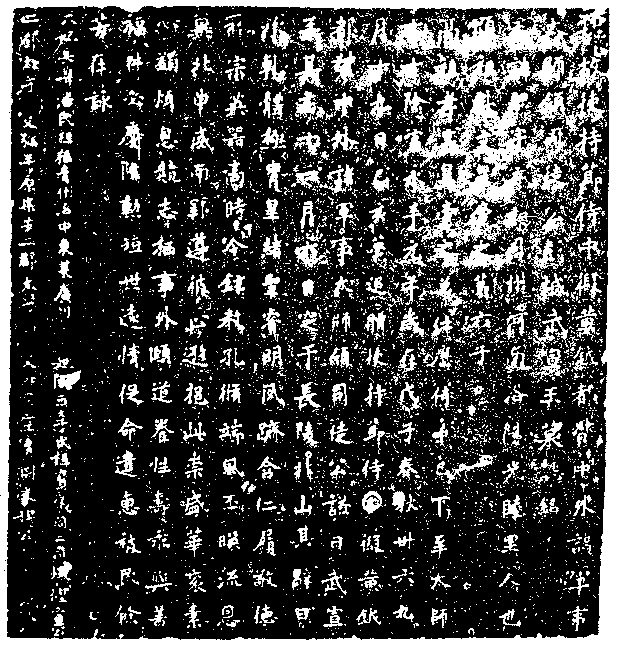



图版九　北魏彭城王元勰墓志



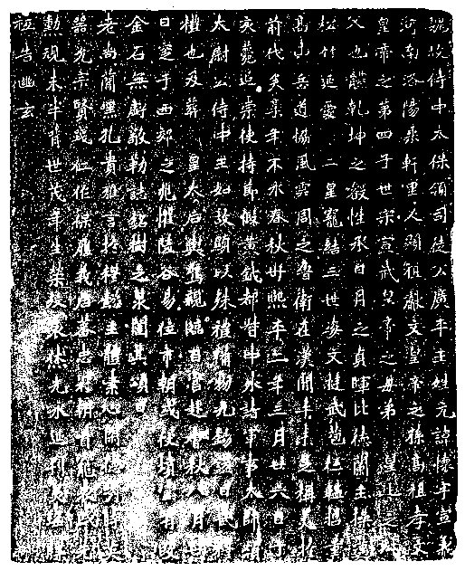



图版一〇　北魏广平王元怀墓志



------



## 洛阳伽蓝记卷第二



城东



○明悬尼寺，(易系辞上云：「悬象著明，莫大乎日月。」)彭城武宣王勰所立也。(勰，高祖弟。见卷一永宁寺条注。魏书卷二十一下有传。)在建春门外石桥南。(石桥，各本作石楼，误。此从钩沈本改。)



谷水周围遶城，至建春门外，(周围，元河南志同。大典卷一三八二三引及逸史本并作周廻。)东入阳渠石桥。桥有四石柱，(石字各本无，依河南志补。水经注卷十六谷水条云：「谷水经广莫门北，又东屈南，迳建春门石桥下，桥首建两石柱。」案两字当为四字之误。)在道南，铭云：「汉阳嘉四年将作大匠马宪造。」(水经注云：桥之右柱，铭云：「阳嘉四年乙酉壬申诏书以城下漕渠东通河济，南引江淮，方贡委输所由而至，使中谒者魏郡清渊马宪监作石桥梁柱。」案阳嘉汉顺帝年号。（四年为公元一三五）)逮我孝昌三年大雨颓桥，(大典及逸史本颓下无桥字，非。)南柱始埋没，(南字各本无，依河南志补。始字逸史本作如，非。)道北二柱，至今犹存。衒之按刘澄之山川古今记、戴延之西征记并云晋太康元年造，此则失之远矣。(隋书经籍志：永初山川古今记二十卷，齐都官尚书刘澄之撰。又西征记二卷，戴延之撰。)按澄之等并生在江表，(生在，大典作生自。)未游中土，假因征役，(假者，借也。)暂来经过，至於旧事，多非亲览，闻诸道路，便为穿凿，误我后学，日月已甚。



有三层塔一所，未加庄严。寺东有中朝时常满仓，高祖令为租塲，天下贡赋所聚蓄也。



○龙华寺，宿卫羽林虎贲等所立也。在建春门外阳渠南。



寺南有租塲。



阳渠北有建阳里，里内有土台，(内字各本无，依河南志补。)高三丈，上作二精舍。



赵逸云：此台是中朝时旗亭也。(时字各本无，依河南志补。○旗亭者，市楼也。文选卷二张衡西京赋曰：「旗亭五重，俯察百隧。」)上有二层楼，悬鼓击之以罢市。



有钟一口，撞之，闻五十里。太后以钟声远闻，遂移在宫内。置凝闲堂前，(前，逸史本作所。○魏书卷十九中任城王澄传云：「澄从高祖於凝闲堂前，高祖曰：名目要有其义，此盖取夫子闲居之义，不可纵奢以忘俭，自安以忘危，故此堂后作茅茨堂。」)与内讲沙门打为时节。(与内讲三字原作讲内典，此从逸史本。)孝昌初，(孝昌二字原无，此依逸史本增。)萧衍子豫章王综来降，(魏书卷五十九萧赞传云：「赞字德文，本名综，孝昌元年秋降魏。」)闻此钟声，以为奇异，遂造听钟歌三首，(钟字原无，此依津逮本。逸史本作遂造听钟歌词三首。)行传於世。(逸史本无行字。案梁书卷五十五综传曰：「综既不得志，尝作听钟鸣、悲落叶辞，以申其志。大略曰：听钟鸣，当知在帝城，参差定难数，历乱百愁生。去声悬窈窕，来响急徘徊，谁怜传漏子，辛苦建章台。听钟鸣，听听非一所，怀瑾握瑜空掷去，攀松折桂谁相许。昔朋旧爱各东西，譬如落叶不更齐，漂漂孤雁何所栖，依依别鹤夜半啼。听钟鸣，听此何穷极，二十有餘年，淹留在京城，窥明镜，罢容色，云悲海思徒揜抑。」魏书综传所载则作「历历听钟鸣，当知在帝城，西树隐落月，东窗见晓星，露雾朏朏未分明，乌啼哑哑已流声。惊客思，动客情，客思郁纵横。翩翩孤雁何所栖，依依别鹤夜半啼，今岁行已暮，雨雪向凄凄，飞蓬旦夕起，杨柳尚翻低。气郁结，涕滂沱，愁思无所托，强作听钟歌」。此盖亦节略之辞也。魏书云：「综有才思，文义可观，而轻薄俶傥，犹有父风。」今观其辞意，固曲抑不申其志者也。其悲落叶有云：「悲落叶，连翩下重叠，重叠落且飞，从横去不归！悲落叶，落叶何时还？夙昔共根本，无复一相关！」尤缠绵凄惋，情见乎辞矣。)



综字世谦，(谦字原阙，此据梁书本传补。逸史本作世赞，汉魏本作世务，非。案梁书曰：「豫章王综字世谦，高祖第二子也，天监三年封豫章王。」)伪齐昏主宝卷遗腹子也。(宝卷，齐东昏侯。)宝卷临政婬乱，吴人苦之。雍州刺史萧衍立南康王宝融为主，举兵向秣陵，(秣陵即建业。)事既克捷，遂杀宝融而自立。宝卷有美人吴景晖，时孕综经月，衍因幸景晖，及综生，认为己子，小名缘觉，封豫章王。综形貌举止甚似昏主，其母告之，令自方便。综遂归我圣阙，(事详魏书、梁书本传。)更改名曰缵，(缵，各本并作赞，魏书作赞，此依梁书改。)字德文，(德文，各本并作世务，此依魏书、梁书。)始为宝卷追服三年丧。明帝拜综太尉公，封丹阳王。永安年中，尚庄帝姊寿阳公主字莒犂。公主容色美丽，综甚敬之。与公主语，常自称下官。授齐州刺史，(授，逸史本作后除二字。○齐原作徐，逸史本作齐，与魏书合。)加开府。及京师倾覆，(即指尔朱兆入洛。)综弃州北走。(魏书云：「赞既弃州为沙门，潜诣长白山，未几趣白鹿山，至阳平遇病而卒。」梁书则谓萧宝寅在魏，据长安反，综自洛阳北遁，赴之，为津吏所执，魏人杀之，时年四十九。)时尒朱世隆专权，遣取公主至洛阳，世隆逼之，公主骂曰：「胡狗，敢辱天王女乎！」(此下津逮本有「我宁受剑而死，不为逆胡所污」十二字。)世隆怒，(怒下各本衍之字。)遂缢杀之。(逸史本之下有矣字。)



○璎珞寺(璎珞，颈饰也。字亦作缨络。)在建春门外御道北，所谓建阳里也。



即中朝时白社地，(白社里名。地原作池，误。此从逸史本。)董威辇所居处。(辇原作辈，误。从逸史本改。晋书隐逸传云：「董京，字威辇，初与陇西计吏俱至洛阳，被发行吟，常宿白社中。时乞於市，得残碎缯絮，结以自覆。孙楚时为著作郎，数就社中与语，劝之仕。京以诗答之，遂遁去。」又抱朴子内篇卷十五杂应篇云：「洛阳有道士董威辇，常止白社中，了不食。」)



里内有璎珞、慈善、晖和、通觉、晖玄、宗圣、魏昌、熙平、崇真、因果等十寺。里内士庶，二千餘户，信崇三宝。(三宝者，佛宝、法宝、僧宝也。翻译名义集十种通号引福田论叙三宝曰：功成妙智，遂登圆觉，佛也。玄理幽微，正教精诚，法也。禁戒守真，威仪出俗，僧也。)



众僧利养，(利原作刹，此从逸史本。)百姓所供也。



○宗圣寺，(释教以佛为圣人。)有像一躯，举高三丈八尺，(举字逸史本无。)端严殊特，相好毕备，(佛降生名萨婆悉达多（Saravarthasiddha），汉言顿吉。有三十二大人相，八十种好。好者，悉皆妙好之意，故统称相好。见方广大庄严经卷三及佛说太子瑞应本起经卷上。)士庶瞻仰，目不暂瞬。此像一出，市井皆空，炎光辉赫，(原作炎光腾辉赫赫，此从逸史本。辉赫，光盛也。)独绝世表。妙伎杂乐，亚於刘腾。(即腾所立之长秋寺，见卷一。)城东士女，多来此寺观看也。



○崇真寺比丘慧嶷，(慧嶷各本作惠凝。太平广记卷九十九引同。赞宁宋僧传卷廿九作慧凝，法苑珠林卷九十二及唐怀信释门自镜录并作慧嶷，今从之，下同。)死经七日还活，(今本作死一七日还活，广记引无一字，珠林及自镜录作死经七日，今从之。)经阎罗王检阅，以错召放免。(经，广记作云。召，各本作名，此从珠林。案珠林云：「死经七日，时与五比丘次第於阎罗王所阅过，嶷以错召，放令还活。」与此文字小异。○阎罗（Yama）释氏要览卷中云：「梵音阎摩罗，此云遮，谓遮令不造恶故。」翻译名义集第二十一云：「琰魔，或云琰罗，此翻静息，以能静息造恶者不善业故。经音义，应云：夜磨卢迦，此云双世，鬼官之总司也。亦云阎罗、燄魔，声之转也。」)



慧嶷具说过去之时，有五比丘同阅，(广记引作「具说过去之事有比丘五人同阅」。珠林作「具说王前事，意如生官无异。五比丘者，亦是京邑诸寺道人，与嶷同簿而过」。)一比丘云是宝明寺智圣，(圣，珠林及自镜录作聪。)以坐禅苦行得升天堂。(以各本无，此从广记及宋僧传增。珠林作「自云：生来坐禅苦行为业，得升天堂」。)有一比丘是般若寺道品，以诵经四十卷涅槃，(原作四涅槃，今据逸史本正。广记及宋僧传作涅槃经四十卷。珠林作「复有比丘云是般若寺僧道品，自云诵涅槃经四十卷」。)亦升天堂。(魏自孝明帝后禅法渐盛，此则故事正反映当时僧徒一派标榜禅诵，而抑黜讲经，故诡称智圣道品俱升天堂。)有一比丘云是融觉寺昙谟最，讲涅槃华严，领众千人。(自镜录作「复有一比丘云是融觉寺僧昙谟最，称注讲涅槃，华严二部，领众千人，解释义理」。与此小异。按续高僧传卷廿三云：「魏洛都融觉寺释昙谟最，姓董氏，武安人氏。灵悟洞微，飡寝立秘，讽诵经论，坚持律部，偏爱禅那，心虚静谧，时行汲引，咸所推宗。曾於邯郸崇尊寺说戒，徒众千餘。后𠡠住洛都融觉寺，常以弘法为任。元魏正光元年，明帝加朝服大赦，请释李两宗上殿斋讫，侍中刘腾宣𠡠请诸法师道士等论义。清通观道士姜斌与最讨论，斌不能胜。后不测其终。」)阎罗王曰：(曰今本作云，此从广记。下文亦作曰，於文例正合。)「讲经者心怀彼我，以骄凌物，(珠林作「王曰：讲经众僧，我慢贡高，心怀彼我，憍己凌物。」)比丘中第一麤行。今唯试坐禅、诵经，不问讲经。」其昙谟最曰：「贫道立身以来，唯好讲经，实不暗诵。」(自镜录作「贫道立身已来，实不骄慢，惟好讲经，敷演义理。」)阎罗王𠡠付司。(𠡠，逸史本作曰，广记作令。)即有青衣十人送昙谟最向西北门。(珠林作「送最向於西北入门」。)屋舍皆黑，似非好处。有一比丘云是禅林寺道弘，自云教化四辈檀越，(檀越，梵云 dana，施主也。南海寄归传卷一注云：「施主，梵云陀那钵底，译为施主。陀那是施，钵底是主，而云檀越者，本非正译，略去那字，取上陀音，转名为檀，更加越字。意道由檀施，自可越度贫穷。妙释虽然，终乖正本。」案此义亦见法琳辩正论卷八。颇与梵言忏摩而译为忏悔者相同。「忏摩」为梵语，义为容恕，「悔」则华言，增益而成一词，义转为悔矣。)造一切经，人中金像十躯。(金字各本无，此从珠林及自镜录补。)阎罗王曰：「沙门之体，必须摄心守道，志在禅诵。(珠林及自镜录作「必须摄心道场，志念禅诵」。)不干世事，不作有为。(珠林及自镜录作「不预世事，勤心念戒，不作有为」。)虽造作经像，正欲得他人财物；既得财物，(财，今各本作他，此从广记及宋僧传。)贪心即起；既怀贪心，(此四字广记无。)便是三毒不除，(虽造以下，珠林作「教化求财，贪心即起，三毒未除」。自镜录作「教化求财，贪心即起，既怀贪心，则三毒不灭」。案三毒者，法门名义集云：「贪欲、嗔恚、愚痴是也。此毒能生万咎。」)具足烦恼。」(珠林及自镜录无此四字。)亦付司，仍与昙谟最同入黑门。(珠林作「付司依式。还有青衣执送，与最同入一处」。自镜录略同。)有一比丘云是灵觉寺宝真，(宝真，各本作宝明，盖因宝明寺而误。珠林及自镜录作宝真，今据改。下同。)自云出家之前，(出家上珠林有未字。)尝作陇西太守，造灵觉寺。(珠林造灵觉寺上有「自知苦空，归依三宝，割舍家资」，十二字。自镜录同。)寺成，即弃官入道。(珠林作「寺成，舍官入道」。今本成上无寺字，据珠林补。)虽不禅诵，礼拜不阙。阎罗王曰：「卿作太守之日，曲理枉法，(曲理，珠林作曲情。)刼夺民财，(珠林及自镜录财下有「以充己物」四字。)假作此寺，非卿之力，何劳说此！」亦付司，青衣送入黑门。(自镜录作「亦付司准式，青衣送入黑门，似非好处。慧嶷为以错召不问，放令还活，具说王前过事」。珠林略同。)时太后闻之，(时字各本无，今据广记及宋僧传补。珠林作「时人闻己，奏胡太后，太后闻之，以为灵异」。自镜录略同。)遣黄门侍郎徐纥依慧嶷所说即访宝明等寺。(徐纥见卷一注。宝明下等字各本无，此从广记补。)城东有宝明寺，城内有般若寺，城西有融觉、禅林、灵觉等三寺，问智圣、道品、昙谟最、道弘、宝真等，皆实有之。(珠林於「太后闻之以为灵异」下作「即遣黄门侍郎依昙所陈访问聪等五寺，并云有此。死来七日，生时业行如嶷所论不差」。自镜录略同。)议曰人死有罪福。(广记无此句。)即请坐禅僧一百人常在内殿供养之。(请，宋僧传作诏。内殿，各本作殿内，广记作殿中，此从宋僧传。)诏不听持经像沿路乞索。(沿路，广记作在巷路。宋僧传云：「续有诏，不听比丘持经像在街路乞索。」)若私有财物，(有，广记作用。)造经像者任意。慧嶷亦入白鹿山，隐居修道。(今本作「凝亦入白鹿山，居隐修道」。此从广记。白鹿山在河南辉县西。)自此以后，京邑比丘皆事禅诵，(今本作「悉皆禅诵」。此从广记。)不复以讲经为意。(此节将当时僧徒之所为表露无遗。其造作佛寺经像者，广营布施，贪敛财物，侵夺百姓，为害殊甚。衒之记此，有深义焉。)



出建春门外一里餘，(建春下原有南字，今据逸史本删。)至东石桥。



南北而行，(南北而行者，谓桥通向南北也。津逮本作西北，非。见下条。)晋太康元年造。桥南有魏朝时马市，(逸史本作桥南即中朝牛马市。案文选潘岳闲居赋云：「面郊后市。」李善注引陆机洛阳记曰：「洛阳凡三市，马市，在大城之东。」)刑嵇康之所也。(水经注称：建春门东、阳渠水南即马市，旧洛阳有三市，斯其一也。亦嵇叔夜为司马昭所害处也。)



桥北大道西有建阳里，大道东有绥民里。里内有河间刘宣明宅。(河间属瀛州。)



神龟年中，以直谏忤旨，斩於都市。讫目不瞑，尸行百步，时人谈以枉死。宣明少有名誉，精通经史，危行及於诛死也。(也字原无，据逸史本增。)



○魏昌尼寺，阉官瀛州刺史李次寿所立也。(次寿名坚，高阳易人也。魏高宗初坐事为阉人，稍迁给事中，赐爵魏昌伯。世宗初，自太仆寺卿出为瀛州刺史。其事详魏书卷九十四及北史卷九十二。瀛州，魏太和十一年置，今之河北河间县。此尼寺盖即以其爵名称之也。)在里东南角。(即建阳里。)



即中朝牛马市处也，刑嵇康之所。(此与上文重复。)



东临石桥。



此桥南北行。晋太康元年中朝时市南桥也。澄之等盖见此桥铭，因而以桥为太康初造也。(水经注云：「桥南有二石柱，并无文刻。」故衒之谓刘澄之或见此桥有铭也。)



○石桥南道有景兴尼寺，亦阉官等所共立也。有金像辇，去地三丈，(丈，各本作尺，非。此依大典卷一三八二三引正。)上施宝盖，(上字各本无，此据大典增。)四面垂金铃、七宝珠，飞天伎乐，望之云表。作工甚精，难可扬榷。(榷，原误作推，逸史本误作确，此从大典改。案法显行传述于阗之像辇云：「作四轮像车，高三丈餘，状如行殿，七宝庄校。县缯幡盖，像立车中，二菩萨侍，作诸天侍从，皆以金银雕莹，悬於虚空。」与此所言足以相发。像辇即所谓像车。飞天伎乐者，即诸天侍从也。七宝者，金、银、瑠璃、颇梨、珊瑚、玛瑙、砗磲是也。)像出之日，常诏羽林一百人举此像，丝竹杂伎，皆由旨给。



建阳里东有绥民里，(津逮本、逸史本另为一条。)里内有洛阳县，临渠水。(即阳渠也。)县门外有洛阳令杨机清德碑。(机字显略，天水冀人。少有志节，为士流所称。延昌中行河阴县事，当官正色，不避权势，明达政事，断狱以情，甚有声誉。熙平中为泾州平西府长史，寻授河阴令，转洛阳令。京辇服其威风，希有干犯。永熙中为卫将军右光禄大夫，寻除度支尚书。史称机方直之心久而弥厉，奉公正己，为时所称。家贫无马，多乘小犊车，时论许其清白。永熙末（公元五三三）与辛雄等为高欢所诛，年五十九。)绥民里东，〔有〕崇义里。(有字各本无，依文意增。)里内有京兆人杜子休宅。



地形显敞，门临御道。(道，广记八十一引作路。)时有隐士赵逸，(赵逸下广记引有者字，御览卷六五八引，与今本同。)云是晋武时人，晋朝旧事，多所记录。正光初来至京师，见子休宅，叹息曰：「此宅中朝时太康寺也。」(广记引作「此是晋朝太康寺也」。御览引无宅字，餘与今本同。)时人未之信，(之字各本无，依广记、御览增。)遂问寺之由绪。(此句广记作「问其由」，御览作「遂问寺之由」，无绪字。)逸云：(御览同，广记作答曰。)「龙骧将军王濬平吴之后，(王濬字士治，晋弘农湖人也。武帝太康元年二月平吴，以功拜辅国大将军，封襄阳县侯。后转辅军大将军，开府仪同三司。太康六年卒。时年八十。见晋书卷四十二本传。)始立此寺。(此字逸史本汉魏本无。)本有三层浮图，用塼为之。」(塼别本作甎。)指子休园中曰：(中，广记及大典卷一三八二三引无，御览与今本同。)「此是故处。」子休掘而验之，果得塼数万。(今本作数十万，广记、御览引均无十字。)并有石铭云：(并今本作兼，此依广记及御览改。)「晋太康六年岁次乙巳九月甲戌朔八日辛巳(太康六年（公元二八五）九月朔为丙辰。)仪同三司襄阳侯王濬敬造。」时园中果菜丰蔚，林木扶疎，乃服逸言，号为圣人。子休遂舍宅为灵应寺。所得之塼，还为三层浮图。(还，广记及大典作造。)好事者遂寻问晋朝京师何如今日。(遂寻，原作寻逐之，此从大典及逸史本。又京师二字，大典及逸史本作京民。)逸曰：「晋时民少於今日，王侯第宅与今日相似。」又云：「自永嘉已来二百餘年，建国称王者十有六君，(即指五胡十六国而言。)吾皆游其都邑，(吾，据广记补。)目见其事。国灭之后，观其史书，皆非实录，莫不推过於人，引善自向。苻生虽好勇嗜酒，亦仁而不杀。观其治典，未为凶暴。及详其史，天下之恶皆归焉。苻坚自是贤主，贼君取位，妄书君恶，(君原作生，今从逸史本。贼，害也。坚弑苻生自立，详晋书载记。)凡诸史官，皆是类也。(是，广记及逸史本作此。)人皆贵远贱近，(文选魏文帝与吴质书云：「人皆贵远贱近，向声背实。」)以为信然。(谓无可疑。)当今之人，亦生愚死智，惑已甚矣。」人问其故，(人字大典及逸史本无。)逸曰：「生时中庸之人耳，及其死也，(类说引作「其既死也」。)碑文墓志(志，大典及逸史本作志。)莫不穷天地之大德，尽生民之能事，为君共尧舜连衡，(连衡犹言比肩。)为臣与伊臯等迹。(谓同於伊尹臯陶也。广记及大典伊臯作伊尹，与上文尧舜不相应。○案尔朱荣之陵暴狠戾，魏人莫不切齿，而魏书荣传反多曲笔，谓其「功烈弘茂，苟修德义，则彭韦伊霍，夫何足数。」又元乂墓志称乂之贤能曰：「类公旦之相周，等霍侯之辅汉。」此所谓为臣与伊臯等迹也。)牧民之官，浮虎慕其清尘；(后汉书卷一百九刘昆传云：「昆字桓公，陈留东昏人。光武时为江陵令，后迁弘农太守。先是崤渑驿道多虎灾，行旅不通，昆为政三年，仁化大行，虎皆负子渡河。」)执法之吏，埋轮谢其梗直。(后汉书卷八十六张纲传云：「纲字文纪，少明经学，司徒辟为御史。时顺帝委纵宦官，有识危心。汉安元年选遣八使，徇行风俗，皆耆儒知名，唯纲年少。餘人受命之部，而纲独埋其车轮於洛阳都亭曰：豺狼当路，安问狐狸？遂奏大将军梁冀无君之心十五事。」)所谓生为盗跖，死为夷齐，佞言伤正，(佞，各本作妄，此从类说改。)华辞损实。」当时构文之士，惭逸此言。步兵校尉李澄问曰：(李澄无考。步兵校尉属领军府。)「太尉府前塼浮图，形制甚古，(制，大典作制。)犹未崩毁，未知早晚造？」(广记作「未知何年所造」。)逸云：(云，逸史本作曰。)「晋义熙十二年刘裕伐姚泓，军人所作。」(义熙为晋安帝年号。十二年（公元四一六）八月刘裕及琅邪王德文率众伐姚泓，十月众军至洛阳。姚泓将姚光降。见晋书卷十安帝纪及宋书卷二武帝纪中。)汝南王闻而异之，(大典作「闻之而异」。汝南王，汝南王悦也。见卷一景乐寺条。)拜为义父。因而问何所服饵，(广记引无而字。)以致长年。(广记作延年。)逸云：「吾不闲养生，(闲，习也。大典作闻，非。真意本作闲。)自然长寿。郭璞尝为吾筮云，(郭璞字景纯，晋河东闻喜人。好经术，有高才，妙於阴阳卜筮之术，攘灾转祸，通致无方，后为王敦所害。有尔雅、方言、山海经、穆天子传诸书注及葬经。见晋书卷七十二本传。)寿年五百岁。今始逾半。」(逾半，原作餘半，广记同。津逮本作逾半，据改。)帝给步挽车一乘，游於市里。所经之处，多记旧迹。(记，广记作说。)三年以后遁去，莫知所在。



崇义里东有七里桥，(义原误作仪。元河南志作义，与上文亦合。)以石为之。



中朝〔时〕，(时字原无，依上文例增。)杜预之荆州，出顿之所也。(杜预字元凯，京兆杜陵人。晋武帝太康元年率众伐吴，一举剋之。见晋书三十四本传。○顿者，犹今言屯也。世说新语卷三方正篇云：「杜预之荆州，顿七里桥，朝士悉祖。」是也。)



七里桥东一里，郭门开三道，时人号为三门。(时人二字逸史、真意二本无，元河南志亦有此二字。)



离别者多云：相送三门外。京师士子，送去迎归，常在此处。



○庄严寺，在东阳门外一里御道北，所谓东安里也。北为租塲。里内有驸马都尉司马悦、(悦原作恍，逸史本作洗，并误。此从元河南志改。案司马悦字庆宗，为司马楚之之孙，魏书卷三十七有传，惟未言其尚主。其子朏则尚世宗妹华阳公主，拜驸马都尉。)济州刺史刀宣、(刀，原作分，逸史本作介，此从河南志改。刀宣史无传记，惟魏书刀双传云：「东平王元略姊饶安公主，刀宣妻也。」是宣为略之姊夫。又北海王元颢入洛后，刀宣尝与陈庆之战，战败降。见梁书卷三十二庆之传。)幽州刺史李真奴、(魏书卷四十六称：李䜣字元盛，小名真奴，范阳人也。尝为相州刺史，终徐州刺史。史不言为幽州刺史，其父崇则尝为幽州刺史也。)豫州刺史公孙骧等四宅。(公孙骧无考。)



○秦太上君寺，胡太后所立也。(寺之修建，为刘腾所经营，见魏书腾传。)



当时太后，正号崇训，(晋书孝武帝纪云：「太元十九年尊皇太妃李氏为皇太后，宫曰崇训。」案北魏肃宗即位，曾尊胡后为皇太妃，后尊为皇太后，见北史后妃传。此与晋之故事正同，故正号崇训。魏胡昭仪墓志云：「昭仪为宣武皇帝崇训皇太后之从姪。」崇训皇太后即胡太后也。)母仪天下，(仪字原无，此依津逮本补。)号父为秦太上公，(后父胡国珍，神龟元年卒，赠太上秦公。国珍尝领雍州刺史，故赠号秦公也。时张普惠以为前世后父无太上之号，上疏陈其不可，竟不从。见魏书卷七十八张普惠传。)母为秦太上君。(后母景明三年卒，追赠为秦太上君。见北史胡国珍传。)为母追福，因以名焉。(后为父追福，复在城南立秦太上公寺，见卷三。○此段原在下文「李韶宅是晋司空张华宅」之下，依文义应为「胡太后所立也」之注文，故从集证本移列於此。)



在东阳门外二里御道北，(外字各本无，此依河南志补。集证本有外字，是也。)所谓晖文里。



里内有太保崔光、(光字长仁，东清河鄃人也。太和六年拜中书博士，转著作郎。世宗即位，拜侍中。肃宗正光元年为司徒，三年九月进位太保。见魏书卷六十七本传。)太傅李延寔、(寔，原作实，此依魏书卷八十三下本传改。传云：「延寔字禧，陇西人，尚书仆射冲之长子。少为太子舍人，庄帝即位，授太傅。」)冀州刺史李韶、(韶，原作诏，大典同，逸史本空阙。案河南志作韶，今从之。如隐本下文作韶，不误。韶李宝之长子，字元伯，高祖时为兖州刺史，肃宗时为冀州刺史。见魏书卷三十九本传。)秘书监郑道昭等四宅。(道昭，郑义子，荥阳开封人，字僖伯。高祖时为秘书郎，世宗时为秘书监。见魏书卷五十六本传。)并丰堂崛起，高门洞开。赵逸云：晖文里是晋马道里，延寔宅是蜀主刘禅宅，延寔宅东有修和宅，(延寔宅三字大典引无。)是吴主孙皓宅，(吴主，原作吴王，此从津逮本及河南志改正。)李韶宅是晋司空张华宅。(张华晋书卷三十六有传。○大典及逸史本无「晖文里是晋马道里」八字，而在下文「受业沙门亦有千数」下大典有「又云：晖文里是晋马道里」十字。逸史本有「赵逸云：晖文里是晋马道里，李口宅是晋司空张华宅」，二十一字。大典及逸史本有错乱。)



中有五层浮图一所，修刹入云，高门向街，佛事庄饰，等於永宁。诵室禅堂，周流重叠。(周流者，周帀流徧也。)花林芳草，(芳草，大典卷一三八二三引作芳卉。)徧满堦墀。常有大德名僧讲一切经，受业沙门，亦有千数。



太傅李延寔者，(延寔原作延实，太平广记卷四九三及绀珠集引均作延寔，与魏书合，今据改。下同。)庄帝舅也。(按延寔为李冲之长子，庄帝为彭城王勰之第三子，勰妃李氏，即冲之女也（见魏书卷二十一下勰传）。是延寔为庄帝之舅。又魏彭城王妃李氏墓志亦云「祖宝，父冲，兄延寔」，尤为明证。)永安年中除青州刺史，(广记永安下无年字。)临去奉辞。(临去，广记作将行。)帝谓寔曰：「怀塼之俗，(塼，真意本作甎。今不从。)世号难治；舅宜好用心，副朝廷所委。」寔答曰：「臣年迫桑榆，气同朝露，人间稍远，日近松丘。臣已久乞闲退，陛下渭阳兴念，(渭阳，渭水之阳也。诗秦风渭阳篇：「我送舅氏，曰至渭阳。」后人以此言舅甥之谊。)宠及老臣，使夜行罪人，裁锦万里，(三国志魏志卷二十六田豫传云：「正始初徵为卫尉，屡乞逊位。太傅司马宣王以为豫克壮，书喻未听。豫书答曰：年过七十而以居位，譬诸鍾鸣漏尽，而夜行不休，是罪人也。遂固称疾笃。」今延寔年迫桑榆，出为州牧，故曰夜行罪人也。裁锦者，喻学为治邑，谦辞也。左氏传襄公三十一年子皮欲使尹何为邑，子产曰：「不可。子有美锦不使人学制焉，大官大邑，身之所庇也，而使学者制焉，其为美锦，不亦多乎？」制即裁也。)谨奉明敕，不敢失坠。」(坠，广记作堕。)时黄门侍郎杨宽在帝侧，(杨宽，周书卷廿二本传云：「字景仁，弘农华阴人。孝庄践阼，拜通直散骑侍郎。尔朱兆陷洛阳，遂奔梁，梁武待之甚厚。寻而礼送还朝。孝武初，改授散骑常侍、给事黄门侍郎。」是为黄门侍郎在孝武帝时，孝庄时，宽为散骑侍郎。)不晓怀塼之义，私问舍人温子升。(子升字鹏举，太原人。魏书卷八十五及北史卷八十三有传。)子升曰：(子升二字据广记补。)「吾闻至尊兄彭城王作青州刺史，(吾字据广记补。彭城王即彭城王劭。魏书卷二十一下本传云：「劭字子讷，肃宗初起家宗正卿，又除使持节，假散骑常侍平东将军，青州刺史。庄帝即位，尊为无上王。」案彭城王妃李氏墓志云「子讷字令言」，史称劭字子讷，盖后改为劭，因以原名为字耳。)问其宾客从至青州者云：(问，广记作闻。又各本无者字，并从广记引增改。)齐土之民，风俗浅薄，虚论高谈，专在荣利。太守初欲入境，皆怀塼叩首，(永乐大典卷七三二八引叩作扣。皆上广记引有百姓二字。又广记及绀珠集引首作头。)以美其意；(谓以此美其迎接之意也。绀珠集引美作见。)及其代下还家，以塼击之。言其向背速於反掌。(绀珠集引作「言其始终向背也」。)是以京师谣语曰：狱中无系囚，舍内无青州，假令家道恶，肠中不怀愁。(肠，各本作腹。此依广记及绀珠集、曾慥类说改。)怀塼之义起在於此也。」



颍川荀济，风流名士，(北史卷八十三云：「荀济字子通，其先颍川人，世居江左，与梁武帝布衣交。济上书讥佛法，梁武将诛之，遂奔魏。」案济所上讥佛法书，见广弘明集卷七。)高鉴妙识，独出当世。(史称梁武云「此人好乱者也」，后因与元瑾谋诛高澄见杀。而衒之盛赞其人，或以其讥弹佛法，与己见相合欤？)清河崔叔仁称齐士大夫，曰：(曰上疑脱济字。叔仁，崔休子，清河人。曾为颍州刺史。魏书卷六十九有传。荀济入魏，即馆於崔㥄家。㥄，叔仁之长兄也。)「齐人外矫仁义，(仁义，广记及大典卷七三二八引并作庶几。大典一三八二三引则仍作仁义。)内怀鄙吝；(吝，广记作悋。)轻同羽毛，(广记作毛羽。)利等锥刀。好驰虚誉，阿附成名，威势所在，侧肩竞入，求其荣利，甜然浓泗。(浓下泗字原无，此从大典卷一三八二三及逸史本增。浓泗，大典七三二八引又作浓厚。广记於「威势所在」下作「促共归之，苟无所资，随即舍去，言嚣薄之甚也」。文字与今本不同。「侧肩竞入」以下未引。)譬於四方，(譬字原无，此从大典卷一三八二三引及逸史本增。大典七三二八引作「比於四方」。)慕势最甚。」号齐士子为慕势诸郎。(指荀济所言。)临淄官徒布在京邑，(布，原误作有，此依逸史本。临淄属青州齐郡。)闻怀塼慕势，咸共耻之，唯崔孝忠一人不以为意。(依文意崔孝忠当为齐士，但史称崔孝忠为博陵安平人，修和子。官侍御史、秘书郎。见魏书卷五十七崔挺传。)问其故，孝忠曰：「营丘风俗，(水经注卷二十六淄水条云：「今临淄城内有丘，在小城内，周廻三百步，淄水出其前，故有营丘之名。」案营者环也。)太公餘化，(周武王以营丘之地封太公望，见史记卷三十二齐太公世家。)稷下儒林，(文选卷四十二曹植与杨德祖书注引七略曰：「齐有稷城门也。齐谈说之士期会於稷下者，甚众。」)礼义所出。今虽凌迟，(凌迟犹言陵夷也。)足为天下模楷。荀济人非许郭，(许郭谓许劭、郭泰也。后汉书卷九十八郭泰传云：「泰字林宗，太原界休人也。性明知人，好奖训士类。」又许劭传云：「劭字子将，汝南平与人也。少峻节，好人伦，多所赏识。故天下言拔士者，咸称许郭。」)不识东家，(东家者，东家丘之义。孔子西家有愚夫不知孔子为圣人，称孔子为东家丘，事见孔子家语。三国志卷十一邴原传注引原别传云：「原远游学，诣安丘孙崧。崧辞曰：君卿里郑君，学者之师模也，君乃舍之，蹑屣千里，所谓以郑为东家丘也。」)虽复莠言自口，(诗正月「莠言自口」，传云：「莠，丑也。」)未宜荣辱也。」



○正始寺，百官等所立也。



正始中立，因以为名。



在东阳门外御道南，(南，原作西，津逮本同。此从大典卷一三八二三引及逸史本改正。案前言秦太上君寺在东阳门外御道北，则此当在御道南。)所谓敬义里也。



里内有典虞曹。(晋书职官志典虞属太仆。)



簷宇清净，(清，原作精，此从逸史本。)美於丛林，(丛林，津逮本同，大典及逸史本作景林。)众僧房前，高林对牖，青松绿柽，(柽，广韵丑贞切。尔雅释木「柽河柳」，郭璞曰：「今河旁赤茎小杨。」)连枝交映。多有枳树，而不中食。(说文云：「枳木似橘。」周礼考工记总目云：「橘逾淮而北为枳。」)有石碑一枚，背上有侍中崔光施钱四十万，(崔光见前。世宗即位，除侍中。)陈留侯李崇施钱二十万，(魏书卷六十六李崇称：崇字继长，小名继伯，顿丘人。文成元皇后第二兄诞之子，袭爵陈留公，镇西大将军。后例降为侯，改授安东将军。)自餘百官各有差，少者不减五千已下。后人刊之。



敬义里南有昭德里。(昭，河南志同。逸史本作招，非。)里内有尚书仆射游肇、(魏书卷五十五称：肇字伯始，广平任人也，明根子。世宗时为黄门侍郎，兼侍中，肃宗即位，迁中书令，后为太常卿，迁尚书右仆射。)御史中尉李彪、(中字各本脱，此依河南志补。彪见原序注。)七兵尚书崔休、(七兵尚书，原作兵部尚书，逸史本作七兵书，大典引及河南志作七兵尚书，是也。今据改。又休各本误作林，今依河南志及魏书卷六十九休传改。休字惠盛，清河人。少孤贫，矫然自立。高祖时，为长史兼给事黄门侍郎。肃宗时，进抚军将军，七兵尚书，又转殿中尚书。正光四年卒。案七兵尚书即兵部尚书。曹魏尝置五兵尚书，谓中兵，外兵、骑兵、别兵、都兵也。晋初无。太康中，始有五兵尚书，而又分中兵、外兵各为左右，合旧五兵为七曹。然尚书惟至五兵，至后魏始有七兵尚书。见宋王益之职源撮要。)幽州刺史常景、(见卷一注。)司农张伦等五宅。(伦字天念，上谷沮阳人，白泽子。孝庄初拜大司农卿。见魏书卷二十四本传。)



彪、景出自儒生、居室俭素，(李彪性敦朴，而恶华靡。其上表有云：「消功者锦绣雕文也，费力者广宅高宇、壮制丽饰也。夫尚俭者，开福之源；好奢者，起贪之兆。是以圣人留意焉，贤人希准焉。」常景居室贫俭，已见卷一。)惟伦最为豪侈。斋宇光丽，服玩精奇，车马出入，逾於邦君。园林山池之美，诸王莫及。伦造景阳山，有若自然。其中重岩复岭，嵚崟相属。(嵚崟，高貌也。原本玉篇嵚音绮金反，崟音宜金反。案今音歆吟二音。)深谿洞壑，逦迤连接。(谿，原作蹊，大典作峻，今依文意改。迤，原作递，逸史本作逶，今依大典引改。逦迤者，相连属也。广韵逦力纸切，迤移尔切。叠韵字也。)高林巨树，足使日月蔽亏；悬葛垂萝，能令风烟出入。崎岖石路，似壅而通，峥嵘涧道，(峥字亦作崝。原本玉篇崝仕耕反，嵘胡萌反。楚辞「下峥嵘而无地」，王逸曰：「沉沦幽冥。」广雅云：「崝嵘，深冥也。」)盘纡复直。(盘纡者，屈曲也。文选琴赋：「则盘纡隐深。」)是以山情野兴之士，游以忘归。天水人姜质，(魏书卷七十九成淹传云：「淹子霄好为文咏，但词采不伦，率多鄙俗。与河东姜质等朋游相好，诗赋闲起，知音之士，所共嗤笑（所共原作共所，此依北史改）。闾巷浅识，颂讽成群，乃至大行於世。」观下文所载姜赋诚多鄙俗，盖即成霄之友矣。惟史言姜为河东人，此云天水人，不知孰是。)志性疎诞，(疎诞犹言疏放。说文：「诞词诞也。」是大言曰诞。)麻衣葛巾，有逸民之操。(逸民者，节性超逸之士也。)见伦山爱之，(各本作「见偏爱之」，此从河南志。)如不能已，遂造庭山赋，(庭，各本作亭，此从河南志。案赋云：「庭起半丘半壑，听以目达心想。」又云：「庭为仁智之田，故能种此名山。」是宜作庭也。)行传於世。其辞曰：



「夫偏重者，(夫，各本作今，此依孙星衍续古文苑卷二录旧写本洛阳伽蓝记改。)爱昔先民之由朴由纯，(之下旧衍重字，依孙星衍校删。朴，大典作朴，下同。)然则纯朴之体，与造化而梁津。(梁津，原作津勉，逸史本作津梁，此依孙校。津纯协韵。)濠上之客，(庄子秋水篇：庄子与惠施游濠梁之上。濠，水名也。)柱下之史，(史，原作吏，此依逸史本改。老子为柱下史。)悟无为以明心，(悟，原作卧，此从逸史本。)托自然以图志。(志，逸史本作治。)辄以山水为富，不以章甫为贵，(殷人谓冠曰章甫。冠章甫，是为官也。)任性浮沈，若淡兮无味。(老子：「道之出口，淡乎其无味。」杨雄解难：「大味必淡，大音必希。」)今司农张氏，实踵其人，(踵，原作鍾，津逮本同。此从逸史本。)巨量焕於物表，(焕，原作接，大典同。此从逸史本。巨量，渊懿之量也。)夭矫洞达其真，(文选江赋：抚凌波而凫跃，吸翠霞而夭矫。李善曰：「夭矫自得之貌。」又思玄赋「偃蹇夭矫，娩以连卷兮」，注：「夭矫，自纵恣貌也。」夭矫叠韵，字亦作夭𫊸。真者，道真也。)青松未胜其洁，白玉不比其珍。心托空而栖有，(栖，大典作栖，同。)情入古以如新。(逸史本新作心，非。魏书卷九十逸士传序云：「冥心物表，介然离俗，望古独适，求友千龄。」即此意也。)既不专流宕，(宕，原作荡，此从逸史本。案说文：「宕，过也。」流宕者，放诞也。)又不偏华尚，(尚，原作上，误。此从逸史本。华尚，俗尚华靡也。)卜居动静之间，不以山水为忘，庭起半丘半壑，听以目达心想。进不入声荣，退不为隐放。(论语微子：「隐居放言。」)尔乃决石通泉，(决者开也。)拔岭岩前，(岩，大典及逸史本作簷。)斜与危云等并，(并，原作曲，非。今依逸史本、津逮本改。)旁与曲栋相连。(旁，各本作危，此从续古文苑。)下天津之高雾，(晋书天文志：「天津九星横河中，一曰天汉，一曰天江。」)纳沧海之远烟，(海内十洲记：「沧海岛在北海中，地方三千里，海四面绕岛，各广五千里。水皆苍色，仙人谓之沧海也。」案沧海者，即东海也。)纤列之状一如古，(一如，别本作如一，钩沈本作如上古。说文：纤，细也。)崩剥之势似千年。若乃绝岭悬坡，(坡，真意堂本作陂。)蹭蹬蹉跎，(文选海赋「或乃蹭蹬穷波」，注云：「蹭蹬，失势之貌。」说文新附：蹭蹬，失道也。文选西京赋注：「广雅：蹉跎，失足也。」此言山势陵峻，难以登陟也。广韵蹭千邓切，蹬徒亘切。叠韵。)泉水纡徐如浪峭，(纡，原误作纾。泉字原无，别本有之。)山石高下复危多。(原阙石字，别本有之。又高下大典及逸史本作不高。)五寻百拔，十步千过，(过者逾也。)则知巫山弗及，未审蓬莱如何。(未审二字原阙，此从逸史本、津逮本补。)其中烟花露草，(露，逸史本作雾。)或倾或倒，(倒草协韵。逸史本作颓，误。)霜干风枝，半耸半垂，(枝垂协韵。)玉叶金茎，散满堦坪。(坪，各本作墀，依孙校改。坪广韵：地平也，符兵切。案茎坪协韵。)然目之绮，(然，原作燃，此从大典本改。逸史本作「然绮目之色」，钩沈本从之，截去然字，并非。绮者光色也，然者明也。此言花色之明丽炫目也。若云绮目，则不辞矣。)烈鼻之馨，(烈，原作裂，此从逸史本改。烈者，酷烈也。文选司马相如上林赋云「应风披靡，吐芳扬烈」，是也。此言花气之芬烈袭鼻也。作裂则非。)既共阳春等茂，(阳，大典及逸史本作绿，非。)复与白雪齐清。(言花发四时，终年不绝。)或言神明之骨，阴阳之精，天地未觉生此，异人焉识其名？(名，各本均作中，失韵。今从孙氏校改。异人二字，大典及逸史本作人鬼，亦通。此谓珍木奇卉，秉自然之化，晔晔猗猗，芬芳馥郁，而种类殊特，非人之所能名也。)羽徒纷泊，(纷，逸史本作分，孙校同。案文选卷四左思蜀都赋云：「毛群陆离，羽族纷泊。」刘逵注曰：「毛群，兽也；羽族，鸟也。陆离，分散也；纷泊，飞薄也。」李善注：「泊，匹各反。」是字当作纷。纷泊乃双声连语，与陆离相同。羽徒者，犹言羽族也。)色杂苍黄，绿头紫颊，(鸭头色绿，鹤颊色赤。)好翠连芳，(芳，大典作房，误。)白𪈝生於异县，(𪈝逸史本同，大典及汉魏本作鹤。案字书无𪈝字，广韵十五青有䴇字，云䴇鸟，鹤别名也。䴇𪈝盖即一字。)丹足出自他乡。皆远来以臻此，藉水木以翱翔。不忆春於沙漠，遂忘秋於高阳。非斯人之感至，何候鸟之迷方？(何，各本作伺，误。此从孙校。候鸟者，随时南北者也。张衡西京赋云：「上春候来，季秋就温，南翔衡阳，北栖雁门。」是也。今者羽族栖止於是，冰泮而不北徂，木落而不南翔，故曰迷方。)岂下俗之所务，(下俗，大典及逸史本作不俗。)实神怪之异趣。(趣字原阙，据别本补。实，各本作人，大典及逸史本作入有，此从孙校。)能造者其必诗，敢往者无不赋。或就饶风之地，或入多云之处，□菊岭与梅岑，(菊，原作气，孙氏校改作菊，是也。孙氏又云：「菊上当脱一字，无以补之。」)随春秋之所悟。(秋字各本无，孙云春下当脱秋字，是也。今据补。)远为神僊所赏，近为朝士所知，求解脱於服佩，(佩，佩玉也。此谓将解缨组而托於此也。)预参次於山陲。(陲，原作垂，此从逸史本。预，逸史本作务。)子英游鱼於玉质，(列仙传云：「子英者，舒乡人也。善入水捕鱼。得赤鲤，爱其色好，持归著池中数以米谷食之。一年长丈餘，遂生角，有翅翼。子英怪异，拜谢之。鱼言我来迎汝，汝上背，与汝俱升天。即大雨，子英上其背，腾升而去。」又传赞云：「子英乐水，游捕为职。」即此所本。玉质二字疑有误。)王乔系鹄於松枝，(列仙传云：「王乔者，周灵王太子晋也。好吹笙，作凤鸣，游伊洛之间。道人浮丘公接以上嵩高山，三十餘年后，求之於山上，见桓良曰：告我家七月七日待我於缑氏山巅。至时，果乘白鹤驻山头，望之不得到。举手谢时人，数日而去。」文选何劭游仙诗云：「羡昔王子乔，友道发伊洛，迢递陵峻岳，连翩御飞鹤。」此鹄字疑当作鹤。)方丈不足以妙□，(此句当有夺误。疑妙下有脱字。)咏歌此处态多奇。(歌字大典及逸史本在方丈上，非。案方丈者，海中仙山名。文选孙绰游天台山赋序云：「涉海则有方丈蓬莱。」是也。此言神山虽妙，未足方此，是以神人见之而兴咏也。)嗣宗闻之动魄，叔夜听此惊魂。(嗣宗，阮籍也；叔夜，嵇康也。皆精於音律者。晋书并有传。言仙人之歌咏，其音要妙，二人闻之，必为之悚动也。)恨不能钻地一出，醉此山门。别有王孙公子，逊遁容仪，(逊遁者，隐退逃避也。后汉书卷一百十二谢夷吾传云：「念存逊遁，演志箕山。」)思山念水，命驾相随，逢岑爱曲，(逢，逸史本作峰，非。逢与下句值为互文。)值石陵欹。(陵，升也。欹，邪也。欹与曲为对文。广韵欹居绮切，训邪。案欹训邪不见字书。释名释采帛云：「绮，欹也。其文欹邪，不顺经之纬纵横也。」是欹训邪之证。)庭为仁智之田，(庭字原阙，此依大典及逸史、津逮诸本补。续古文苑作迺，非。姜质此赋既名庭山，此正一篇之警要。作迺，则泛而无当矣。田，逸史本作由，亦误字也。)故能种此石山。森罗兮草木，(森罗，逸史本作森列。森罗者，草木蓊蔚繁茂之意。)长育兮风烟，孤松既能却老，半石亦可留年。(留年，犹延年也。)若不坐卧兮於其侧，(於字疑衍。)春夏兮共游陟，(共，各本作其，此依续古文苑改。)白骨兮徒自朽，方寸兮何所忆？」(方寸下原衍心字，今依逸史本删。方寸即心也。)



○平等寺，广平武穆王怀舍宅所立也。(舍，法苑珠林卷卅九引作舍。广平武穆王元怀，孝文帝子。魏书本传阙，北史亦脱落不全，而武穆王作文穆王，复与此不合。考河南金石志图有广平王元怀墓志，略云：怀字宣义，以熙平二年三月二十六日丁亥薨，谥曰武穆。是作文穆者误矣。案魏书肃宗纪云：「延昌四年二月以骠骑大将军广平王怀为司空，八月己丑为太保领司徒。」与志所记并合。○又永熙二年，出帝尝至此寺，见魏书李同轨传。)在青阳门外二里御道北，所谓孝敬里也。堂宇宏美，林木萧森，(萧森，枝条长貌。)平台复道，(复道，阁道也。)独显当世。(齐武平三年冯翊王高润修平等寺碑称此寺「背负崇邙，面临清洛，右依城雉，左带洪陂。嵩岳𢹬其前，灵河行其后」。则其形势峥嵘，允为胜地也。碑文见金石萃编卷三十四。)寺门外有金像一躯，高二丈八尺，(冯翊王修平等寺碑云：「永安中造定光铜像一区，高二丈八尺。永熙年，金涂讫功，像在寺外，未得移入。」)相好端严，常有神验，国之吉凶，先炳祥异。(案魏书卷一百十二上灵徵志金沴条云：「永安、普泰、永熙中京师平等寺定光金像每流汗，国有事变时，咸畏异之。」)



孝昌三年十二月中，(公元五二七。)此像面有悲容，两目垂泪，遍体皆湿，时人号曰佛汗。京师士女空市里往而观之。有一比丘，(一字各本无，从法苑珠林补。)以净绵拭其泪，须臾之间，绵湿都尽。更换以它绵，(法苑珠林作「更以他绵换拭」，逸史本作「更以他绵换」。)俄然复湿。如此三日乃止。明年四月尒朱荣入洛阳，(明年上，法苑珠林有至字。)诛戮百官，死亡涂地。永安二年三月，(永安上珠林有至字。)此像复汗，京邑士庶复往观之。(京邑二字各本无，依珠林补。又之字珠林作视。下「不听观之」亦同。)五月，北海王入洛，庄帝北巡。七月，北海王大败，所将江淮子弟五千，(将，逸史本作陁，误。五千下珠林有餘人二字。)尽被俘虏，无一得还。永安三年七月，此像悲泣如初。(「悲泣如初」金石录冯翊王修平等寺碑跋尾引同。珠林作「悲泣复如初汗」。)每经神验，朝野惶惧，(朝野，各本作朝夕，误。此依珠林校改。金石录跋尾引亦作朝野。)禁人不听观之。至十二月，尒朱兆入洛阳，擒庄帝，(句绝。)帝崩於晋阳。(崩上帝字依珠林补，各本并夺。逸史本且无崩字，尤非。庄帝崩於晋阳，见卷一永宁寺下。)在京宫殿空虚，百日无主，唯尚书令司州牧乐平王尒朱世隆镇京师。(永安三年十月尒朱世隆与尒朱兆共推长广王元晔为主，号年建明。晔乃以世隆为开府仪同三司、尚书令、乐平郡王，加太傅，行司州牧。见魏书卷七十五世隆传。是年十二月三日尒朱兆入洛，尒朱度律与尒朱世隆镇京师。及至建明二年三月，长广王始从晋阳赴京师。故曰「在京宫殿空虚，百日无主」也。)商旅四通，盗贼不作。



建明二年，长广王从晋阳赴京师，至郭外，世隆以长广本枝疎远，政行无闻，逼禅与广陵王恭。(禅与，逸史本作禅位。○魏书卷十一本纪云：「恭字修业，广陵惠王羽之子。正始中袭爵。」又云：「（建明二年）春三月，晔进至邙南，世隆等奉王东郭之外，行禅让之礼。」)恭是庄帝从父兄也。(是上原无恭字，此依逸史本增。○庄帝者，彭城王勰子也，与恭并为献文帝孙。)正光中为黄门侍郎，见元乂秉权，政归近习，(逸史本作「见元义秉权，政多归近习」。○近习者，谄佞之人也。)遂佯哑不语，不预世事。永安中遁於上洛山中，(上洛，今陕西商县。)州刺史泉企执而送之。(泉企上洛丰阳人，周书卷四十四有传。)庄帝疑恭奸诈，夜遣人盗掠衣物，复拔刀剑欲杀之，恭张曰以手指舌，竟乃不言。庄帝信其真患，放令归第。(魏书本纪云：「王既绝言，垂将一纪，居於龙花寺，无所交通。永安末，有白庄帝者，言王不语，将有异图。王惧祸，逃匿上洛。寻见追蹑，执送京师。拘禁多日，以无状获免。」)恭常住龙华寺，(龙华寺，广陵王所立，见卷三。)至是，(是，原误作时，学津本作是，今据改。)世隆等废长广而立焉。禅文曰：「皇帝咨广陵王恭，(咨，谋也。)自我皇魏之有天下也，累圣开辅，(开辅者，开拓辅翼也。)重基衍业，(重音平声。衍者广也。)奄有万邦，(诗閟宫『奄有下国』，郑笺曰：『奄犹覆也。』)光宅四海，故道溢百王，德渐无外。(谓德泽浃於四方。)而孝明晏驾，人神乏主。(乏，原空缺，此依逸史、津逮二本补。)故柱国大将军大丞相太原王荣，(荣，尒朱荣也。)地实封陕，(封陕，犹言同於周召二公。公羊隐公五年传曰：『天子三公者何？天子之相也。天子之相则何以三？自陕而东者，周公主之；自陕而西者，召公主之。一相处乎内。』)任惟外相，(处於外，故曰外相。晋书陶侃传论：『超居外相，宏总上流。』)乃心王室，(书康诰『乃心罔不在王室』。乃者，汝也。此云『乃心王室』为省略之辞，意谓尽忠於王室也。)大惧崩沦，故推立长乐王子攸以续绝业。庶九鼎之命日隆，(汉书郊祀志曰：『禹收九牧之金，铸九鼎，象九州，皆尝鬺享上帝鬼神。』案左氏宣公三年传：『王孙满曰：夏之方有德也，远方图物，贡金九牧，铸鼎象物，百物而为之备。使民知神奸。桀有昬德，鼎迁于商，载祀六百。商纣暴虐，鼎迁于周。成王定鼎於郏鄏，卜世三十，卜年七百。天所命也。』)七百之祚唯永。(七百之祚见上。)然群飞未宁，(楚辞天问曰：『会鼌争盟，何践吾期？苍鸟群飞，孰使萃之？』案汲冢周书『武王曰：自发生六十年，飞鸿满野，天下享殷』，故天问云云。此曰『群飞未宁』，言天下未安也。)横流且及，(范宁春秋谷梁传集解序云：『孔子观沧海之横流，迺喟然而叹曰：文王既没，文不在兹乎！』横流，喻世乱也。)皆狼顾鸱张，(文选卷四十四陈琳檄吴将校部曲文曰：『其餘锋捍特起，鹯视狼顾，争为枭雄者，不可胜数。』注云：『准南子曰：鸱视虎顾。』案狼性多疑，行每四顾，故曰狼顾。以喻人之虑有忧患，而多所猜忌也。鸱张者，犹鸱视也。鸱鹯因骇而奋目雄视，以喻人之不能自安，而恫疑虚喝，多所窥觎也。)岳立棋峙。(棋峙，原作基趾。津逮本同。逸史本作基址。集证云：『基趾二字，疑是棋峙之误。魏书李骞释情赋中亦有「既云扰而海沸，亦岳立而棋峙」之语。』案吴说是也，今据改。又三国志吴志陆逊传有云：『方今英雄棋峙，豺狼窥望，克敌宁乱，非众不济。』)丞相一麾，大定海内。而子攸不顾宗社，讐忌动德，招聚轻侠，左右壬人，(尔雅释诂：『壬，佞也。』汉书元帝纪『是故壬人在位』，服虔曰：『壬人，佞人也。』)遂虐甚剖心，(比干，纣诸父，纣为炮烙刑，比干谏，纣杀之，剖其心。见韩诗外传。)痛齐钳齿。(钳齿，不详。范睢曾为魏人拉脇折齿，事见史记范睢传。)岂直金版告怨，(版，原作板，今据逸史本改。案文选任彦升百辟劝进今上牋云：『金版出地，告龙逢之怨。』李善云：『论语阴嬉谶曰：庚子之旦，金版剋书，出地庭中，曰臣族虐王禽。宋均曰：谓杀关龙之后，庚子旦，庭中地有此版异也。』)大鸟感德而已！(后汉杨震字伯起，弘农华阴人，清白自守。安帝时为太尉，樊丰谮震於帝，因免官饮酖而卒。顺帝即位，诏以礼葬。先葬十餘日，有大鸟，高丈餘，集震丧前，俯仰悲鸣，泪下沾地。葬毕，乃飞去。郡以状上。时连有灾异，帝感震之枉，下诏使太守丞以中牢具祠。事见后汉书卷八十四本传。)於是天下之望，俄然已移。窃以宸极不可久旷，(久，原作以，今据逸史本。)神器岂容无主？(神器，天子位也。老子二十九章『天下神器，不可为也』。)故权从众议，暂驭兆民。今六军南迈，已次河浦，瞻望帝京，赧然兴愧。自惟寡薄，(原作薄寡，此从逸史本。寡薄，鲜德也。)本枝疎远，岂宜仰异天情，俯乖民望？惟王德表生民，声高万古，往以运属殷忧，时遭多难，(时下原无遭字，难上亦空阙，依逸史本补。○文选晋刘琨劝进元帝表云：『或多难以固邦国，或殷忧以启圣明。』)卷怀积载，(论语卫灵公篇『邦无道，则可卷而怀之』。)括囊有年。(易坤卦『括囊无咎无誉』。案括囊者，寡言也。)今天眷明德，民怀奥主，(书臯陶谟『安民则惠，黎民怀之』。左传昭公十三年『共有宠子，国有奥主』。案奥亦主也。)历数允集，(论语尧曰篇『天之历数在尔躬』，何晏集解云：『历数谓列次也。』)歌讼同臻。(讼通颂。)乃徐发枢机，(易系辞上『言行君子之枢机，枢机之发，荣辱之主也』。)副兹𥩟属。(𥩟立属望。)便敬奉玺绶，归於别邸。王其寅践成业，(寅，敬也。)允执其中，(其逸史本作厥。案书大禹谟、论语尧曰篇均有此语。)虽休勿休，(书吕刑『虽畏勿畏，虽休勿休』。)日慎一日，敬之哉！」(逸史本重「敬之哉」三字。)恭让曰：「天命至重，历数匪轻，自非德协三才，(天道、地道、人道，谓之三才。见易系辞。)功济四海，无以入选帝图，(帝图谓帝王谱录。)允当师锡。(师，众也。锡，与也。师锡见书尧典。)臣既寡昧，识无先远，(先原作光，非。此从逸史本。)景命虽降，(景，大也。)不敢仰承。乞收成旨，以允愚衷。」又曰：「王既德应图箓，佥属攸归，便可允执其中，入光大麓。(谓即帝位也。书舜典云：「纳於大麓。」晋书乐志云：「登大麓而御万乘。」)不劳挥逊，致爽人神。」(此为长广王晔重让之辞。○人神为古人习用语，逸史本作神人，非。)恭凡让者三，(恭凡，原作凡恭，三原作二，此依逸史本。)於是即皇帝位，改号曰普泰。黄门侍郎邢子才为赦文，(子才，河间人，名邵。因避彭城王劭嫌名，以字行。文笔华赡，在魏与温子升齐名。北齐书卷三十六有传。)叙述庄帝枉杀太原王之状，广陵王曰：「永安手翦强臣，(翦，灭也。)非为失德；直以天未厌乱，故逢成济之祸。」(故字原无，此从逸史本补。○魏高贵乡公曹髦杖剑攻司马昭，为太子舍人成济所刺杀，见三国志魏志卷四。庄帝为尔朱兆所弑，故曰逢成济之祸。)谓左右：「将笔来，(笔，原作诏，此从逸史本。)朕自作之。」直言门下：(门下省。)「朕以寡德，运属乐推，思与亿兆同兹大庆。肆眚之科，(眚者，过也。春秋庄公二十二年「春王正月，肆大眚」。注云：「赦有罪也。放赦罪人，荡涤众故，以新其心。」)一依恒式。」广陵杜口八载，至是始言，海内士庶，(士庶，原作庶士，此依钩沈改。)咸称圣君。於是封长广为东海王。世隆加仪同三司、尚书令、乐平王，餘官如故。赠太原王相国晋王，(谓尒朱荣也。)加九锡，(赐命曰锡。九锡者，车马、衣服、乐器、朱户、纳陛、虎贲、弓矢、斧钺、秬鬯是也。所以优礼大臣之异数也。)立庙於芒岭首阳。上旧有周公庙，(毕沅中州金石记卷二有周公祠碑，开元二年十二月立，贾大义撰，在偃师。碑云：「负阳岑之岩险，面通谷之萦纡。」案所谓阳岑者，即首阳山也。毕氏云：「当是魏时旧庙，唐人所修。」)世隆欲以太原王功比周公，故立此庙。庙成，为火所灾。有一柱焚之不尽，后三日雷雨震电，霹雳击为数段。柱下石及庙瓦皆碎於山下。复命百官议太原王配飨。(议，逸史本作设。)司直刘季明议云不合。(魏书礼志神龟元年十一月下有四门博士刘季明，盖即此人。)世隆问其故，季明曰：「若配世宗，於宣武无功；若配孝明，亲害其母；若配庄帝，为臣不终，(终，逸史本作忠。)为庄帝所戮。以此论之，无所配也。」世隆怒曰：「卿亦合死！」季明曰：「下官既为议臣，依礼而言，不合圣心，俘翦惟命。」议者咸叹季明不避强御，莫不叹伏焉。世隆既有忿言，(逸史、汉魏二本无以上十七字。)季明终得无患。初世隆北叛，庄帝遣安东将军史仵龙、平北将军杨文义各领兵三千守太行岭，(杨文义，魏书庄帝纪及源子恭传并作羊文义，与史仵龙同为都督。)侍中源子恭镇河内。(见卷一注。)及尒朱兆马首南向，仵龙、文义等率众先降，子恭见仵龙文义等降，亦望风溃散。兆遂乘胜逐北，直入京师，兵及阙下，矢流王室。至是论功，仵龙、文义各封一千户。广陵王曰：「仵龙、文义於王有勋，於国无功。」竟不许。时人称帝刚直。彭城王尒朱仲远，(仲远，魏书卷七十五有传。)世隆之兄也，镇滑台，(滑台，在河南滑县。)表用其下都督□瑗为西兖州刺史，(瑗上原缺一字，逸史本同。案此称西兖州刺史盖乙瑗也。魏书卷四十四乙瓖传称瓖曾孙瑗字雅珍，尚高祖女淮阳公主，累迁西兖州刺史。)先用后表。广陵答曰：「已能近补，何劳远闻！」世隆侍宴，帝每言：(帝字原无，依逸史本增。)太原王贪天之功以为己力，罪亦合死。(亦，原作有，此从逸史本。)世隆等愕然。自是已后，不敢复入朝。辄专擅国权，凶慝滋甚。坐持台省，(坐持台省，逸史本作坐符台省掾，非。○魏书卷七十五世隆传云：「常使尚书宋游道、邢昕在其宅厅视事，东西别坐，受纳诉讼，称命施行，其专恣如此。」)家总万机，事无大小，先至隆第，然后施行。天子拱己南面，无所干预。



永熙元年平阳王入纂大业，始造五层塔一所。



平阳王，武穆王少子。(平阳王，即孝武帝也。名修，字孝则，广平武穆王怀之第三子也。永安三年封平阳王。后废帝安定王逊位，高欢奉立为帝。)



诏中书侍郎魏收等为寺碑文。(魏收字伯起，鉅鹿下曲阳人，事迹见北齐书卷三十七本传。)至二年二月五日土木毕功，(功原作工，此依逸史本。)帝率百僚作万僧会。(万僧会，盖与西土之般遮越师 pañncha parishad 相似。法显行传云：「到竭义国，值其王作般遮越师。般遮越师，汉言五年大会也。时请四方沙门，皆来云集，发愿布施众僧。」)其日寺门外有石像，无故自动，低头复举，竟日乃止。帝躬来礼拜，怪其诡异。中书舍人卢景宣曰：「石立社移，(社者后土也。)上古有此，陛下何怪也？」(卢景宣，即卢辩，景裕弟也。普泰初为中书舍人。此事亦见北史卷三十卢辩传。)帝乃还宫。七月中，帝为侍中斛斯椿所使，(详卷一永宁寺条注。案出帝人关，在永熙三年七月，非二年七月也。此七月上当有脱夺。上文称造五层塔至二年土木毕功，二字不误。北史卢辩传谓「永熙二年平等浮屠成，孝武会万僧於寺」，李同轨传称「永熙二年出帝幸平等寺」，是其证。)奔於长安。至十月终，而京师迁邺焉。(山帝既入关，高欢乃立清河王亶世子善见为帝，迁都於邺，史称东魏。)



○景宁寺，太保司徒公杨椿所立也。(椿字延寿，恒农华阴人，杨播之弟也。自高祖至肃宗时，累为州牧，都督军事。建义元年为司徒公，永安初进位太保、侍中。普泰元年为尒朱世隆所害，年七十七。见魏书五十八本传。)在青阳门外三里御道南，所谓景宁里也。



高祖迁都洛邑，椿创居此里，遂分宅为寺，因以名之。制饰甚美，绮柱珠帘。椿弟慎，冀州刺史，(慎，魏书卷五十八作顺。案唐人写书慎顺二字，每每互易。魏书云「顺字延和」，义正相应，是当作顺也。史云：「顺於庄帝初为平北将军，冀州刺史。」)慎弟津，司空，(津字罗汉，庄帝时为司空，普泰元年卒，年六十三。见魏书卷五十八。)并立性宽雅，(魏书所述亦同。)贵义轻财，四世同居，一门三从。(三从者，从祖祖父、从祖父、及从父也。尔雅释亲曰：「父之世父、叔父为从祖祖父，父之从父昆弟为从祖父，兄之子弟之子相谓为从父昆弟。」从并读去声。)朝贵义居，未之有也。(史云：「播家世纯厚，并敦义让，昆季相事，有如父子。一家之内，男女百口，缌服同爨，庭无闲言。魏世以来，唯有卢渊兄弟及播昆季，当世莫逮焉。」)普泰中为尒朱世隆所诛，(永安末椿子昱曾率众拒尒朱仲远，普泰元年尒朱世隆诬椿等为逆，椿家无少长皆遇害。见魏书卷五十八。)后舍宅为建中寺。



出青阳门外三里，御道北有孝义里。里西北角有苏秦冢，(角，河南志作隅。)冢旁有宝明寺。



众僧常见秦出入此冢，车马羽仪，若今宰相也。



孝义里东，即是洛阳小市。北有车骑将军张景仁宅。(张景仁，史书无传。)



景仁，会稽山阴人也。正光年初从萧宝夤归化，(宝，各本作保，此从河南志。宝夤字智亮，齐萧鸾第六子，景明二年归魏，见魏书卷五十九本传。此云正光初与史有异。)拜羽林监，赐宅城南归正里。民间号为吴人坊，南来投化者多居其内。近伊洛二水，任其习御。里三千餘家，(三千，河南志作三十。)自立巷市。(市，原作寺市，别本作市，元河南志及大典卷一三八二三引同，今据改。)所卖口味，多是水族，时人谓为鱼鳖市也。(市，原作寺，此从大典引及逸史本改。)景仁住此以为耻，遂徙居孝义里焉。



时朝廷方欲招怀荒服，(荒服，远方也。周书王会篇云：「方三千里之内为荒服。」)待吴儿甚厚，(吴儿、逸史、汉魏、真意等本作吴人。)褰裳渡於江者，(裳，逸史本作衣。)皆居不次之位。景仁无汗马之劳，高官通显。永安二年萧衍遣主书陈庆之送北海入洛阳僭帝位。(梁书卷三十二庆之传云：「庆之字子云，义兴国山人。高祖东下平建邺，稍为主书。大通初，魏北海王元颢来降，求立为魏主。高祖纳之，以庆之为假节𩙪勇将军，送颢还北。」)庆之为侍中。景仁在南之日与庆之有旧，遂设酒引邀庆之过宅。司农卿萧彪、尚书右丞张嵩并在其座，(二人史书无传。)彪亦是南人。(案由下文「庆之谓萧张等曰」可知二人皆南人也，则彪字为衍文。)唯有中大夫杨元慎、给事中大夫王昫是中原士族。(二人史书无传。)庆之因醉谓萧张等曰：「魏朝甚盛，犹曰五胡，正朔相承，(相，大典引同，逸史本作之。)当在江左。秦朝玉玺，今在梁朝。」元慎正色曰：「江左假息，(假息犹言苟安也。)僻居一隅，地多湿垫，(垫，原作蛰。案字当作垫，垫下湿也。释名释地云：「下湿曰隰，隰垫也，垫垫湿意也。」垫，今本作蛰，亦误。原本玉篇隰下引作垫，是也。)攒育虫蚁，(攒，聚也。广韵在玩切。)疆土瘴疠，(疆，原作壃，此依逸史本。)蛙黾共穴，(黾，逸史本作龟，误。黾亦蛙属也。文选魏都赋云：「句吴与龟黾同穴。」)人鸟同群。短发之君，无杼首之貌；(短发者，即断发也，与文身为对文。都管切，上声，与短同音，故或作短。作短则为长短之短矣。杼首，原作抒首，误。此从大典及真意堂本改。方言卷一云：「燕记曰：丰人杼首，杼首，长首也。」魏都赋云：「巷无杼首，里罕耆耋。」杼音伫。)文身之民，(文身者，刺肤为花纹也。)禀蕞陋之质。(蕞，各本作丛，误。蕞音罪，小貌也。魏都赋云：「宵貌蕞陋，禀质𨖑脆。」宵者，小也。蕞者，亦小貌。)浮於三江，棹於五湖，(书禹贡「三江既入」，孔疏引吴地记云：「松江东北行七十里得三江口，东北入海为娄江，东南入海为东江，并松江为三江。」案周礼职方氏亦云：「东南曰扬州，其川三江，其浸五湖。」后汉书冯衍传注引虞翻云：「太湖南五湖，滆湖、洮湖、射湖、贵湖及太湖为五湖。并太湖之小支俱连太湖，故太湖兼得五湖之名。」)礼乐所不沾，(沾，原作沽，误。此依逸史本。)宪章弗能革。虽复秦餘汉罪，(魏都赋云：「汉罪流御，秦餘徙㡂。」)杂以华音，(音，大典及逸史本作言。)复闽楚难言，不可改变。(改变，大典及逸史本作变改。)虽立君臣，上慢下暴。是以刘劭杀父於前，(刘劭，宋文帝子，元嘉六年立为太子。元嘉三十年，文帝欲废劭，为劭所弑。见宋书卷九十九元凶劭传。)休龙淫母於后，(宋孝武帝刘骏，文帝第三子，字休龙。魏书卷九十七谓骏淫乱无度，烝其母路氏，秽污之声布於瓯越。宋书卷四十一后妃路淑媛传云：「民间諠然，咸有丑声。宫掖事秘，莫能辨也。」)见逆人伦，(见，逸史本同。津逮本作悖。)禽兽不异。加以山阴请壻卖夫，(山阴公主，宋废帝子业之姊，名楚玉，孝武帝后王氏所生。宋书卷七废帝纪云：「山阴公主淫恣过度，谓帝曰：妾与陛下虽男女有殊，俱托体先帝，陛下六宫万数，而妾唯驸马一人，事不均平，一何至此？帝乃为主置面首左右三十人。」亦见魏书九十七子业传。)朋淫於家，不顾讥笑。卿沐其遗风，未沾礼化，(沾，原作沽，非。别本不误。)所谓阳翟之民不知瘿之为丑。(瘿，瘤也。阳翟魏阳翟郡，今为河南禹县治。南近汝水，西与汝州相接，人多生瘿。韵语阳秋云「汝人多苦瘿」，是也。)我魏膺箓受图，(见序文。)定鼎嵩洛，五山为镇，(五山者，华山、首山、太室山、泰山、东莱山是也。见汉书郊祀志。)四海为家。移风易俗之典，与五帝而并迹，(五帝，原作五常，非。逸史本亦误。别本则作五帝。)礼乐宪章之盛，凌百王而独高。(凌，大典引及逸史本作陵。)岂卿鱼鼈之徒，(岂，逸史本作宜。)慕义来朝，饮我池水，啄我稻粱，(粱，原误作梁。)何为不逊，以至於此？」庆之等见元慎清词雅句，纵横奔发，杜口流汗，含声不言。(含，原作合，此从逸史本。)



於后数日，庆之遇病，心上急痛，访人解治。(治，大典作悟，非。)元慎自云能解，(以上逸史本脱去十八字。)庆之遂凭元慎。元慎即口含水噀庆之曰：(噀，喷也。音巽。古者方技之士往往行符𠡠水，以消灾灭祸，是以元慎含水噀庆之也。)「吴人之鬼，住居建康，小作冠帽，(古者有冠，无帽。晋以后江左之人著帽，上不施屋。)短制衣裳，自呼阿侬，(吴人自称曰侬，见子夜歌。如「擥枕北窗下，郎来就侬嬉」是也。阿为语首。)语则阿傍。菰稗为饭，茗饮作浆，呷啜莼羹，(莼，逸史本及大典所引作鳟。案鳟者，赤目鱼也，非易得之物（详尔雅释鱼孙炎注），此当作莼。晋书卷九十二张翰传称「翰吴郡吴人也，在洛见秋风起，乃思吴中菰菜、莼羹、鲈鱼脍」。莼羹盖吴人日常所食者，故曰呷啜莼羹耳。呷者，吸也。啜者，茹也。广韵呷呼甲切，啜殊雪切。)唼嗍蠏黄，(唼嗍，犹言唼喋也。凫雁食物声。唼所甲切，嗍所角切。今北人谓吸食曰嗍。)手把荳蔻，(荳，逸史本作豆。○荳蔻，草实，生越南，皮壳小厚，核似石榴，气味辛香。)口嚼槟榔。(槟，原作梹，此从逸史本。)乍至中土，思忆本乡，急手速去，(急手，逸史本作急急。)还尔丹阳。(丹阳，今江苏江宁县东南五里。)若其寒门之鬼，□头犹修，(头字上阙一字，逸史本无头字，空二格。)网鱼漉鼈，在河之洲，咀嚼菱藕，(文选上林赋「唼喋菁藻，咀嚼菱藕」。)捃拾鸡头，(芡曰鸡头。)蛙羹蚌臛，(臛，羹也。广韵呵各火酷二切。)以为膳羞。布袍芒履，倒骑水牛。沅湘江汉，鼓棹遨游，随波溯浪，(逆流而行曰溯。)𪡋喁沈浮。(𪡋喁，鱼口上出貌。文选吴都赋云：「溯洄顺流，𪡋喁沈浮。」)白纻起舞，(纻，原作苎，此从逸史本。○纻，葛布也。吴人著纻衣𫄨服，见文选左思吴都赋。乐府诗集卷五十五有晋自纻舞歌。)扬波发讴。急手速去，(急手，逸史本作急急。)还尔扬州。」庆之伏枕曰：「杨君见辱深矣。」自此后，吴儿更不敢解语。(解语二字逸史本空阙，大典作解悟。此谓不再敢请人解病矣。)北海寻伏诛，其庆之还奔萧衍，衍用其为司州刺史，(衍字、其字原无，此从大典及逸史本增。○司州，梁置，侨治义阳，在今河南信阳县南四十里。)钦重北人，特异於常。朱异怪复问之。(津逮本作「怪而问之」。朱异梁书有传。)曰：「自晋宋以来，号洛阳为荒土，(土，逸史本作中，大典同。)此中谓长江以北尽是夷狄。(中字逸史本无，大典同。)昨至洛阳，始知衣冠士族并在中原，礼仪富盛，人物殷阜，目所不识，(逸史本作耳目所识。)口不能传。所谓帝京翼翼，四方之则，(诗殷武云：「商邑翼翼，四方之极。」)如登泰山者卑培𪣻，(如，原作始，此从逸史本。○培𪣻者，小丘也。)涉江海者小湘沅，(湘水、沅水也。)北人安可不重？」庆之因此羽仪服式悉如魏法，(羽，羽盖也。)江表士庶竞相模楷，(竞，大典作竟，误。)襃衣博带，(襃，说文云：「衣博裾也。」)被及秣陵。(秣陵即金陵。)



元慎，弘农人，晋冀州刺史峤六世孙。曾祖泰，从宋武入关，为上洛太守七年，(宋武帝刘裕北伐姚泓入关，事在晋安帝义熙十三年（公元四一七）八月。)背伪来朝，(伪，逸史、真意各本作魏，误。)明〔元〕帝赐爵临晋侯，(元字各本无，今补。案晋义熙十三年为明元帝泰常二年。)广武郡、陈郡太守，(广武在今甘肃平番县东南，陈郡在今河南项城县东北。)赠凉州刺史，(凉，大典作梁。)谥烈侯。(烈字逸史本空阙。)祖抚，明经，为中博士。父辞，(辞，逸史本作甜，误。)自得丘壑，不事王侯。叔父许，河南令，蜀郡太守。世以学行著闻，名高州里。元慎清尚卓逸，(清，原作情，此从逸史本。)少有高操，任心自放，(任，原作仁，误。)不为时覊。乐山爱水，好游林泽。博识文渊，清言入神，造次应对，莫有称者。(称者，比也。)读老庄，善言玄理。性嗜酒，饮至一石，神不乱常。慷慨叹不得与阮籍同时生。(阮籍，晋陈留尉氏人，阮瑀子。晋书卷四十九有传。)不愿仕宦，(愿，逸史本作愿，同。)为中散，常辞疾退闲，未尝修敬诸贵，亦不庆吊亲知。贵为交友，(贵上逸史本有诸字，非。)故时人弗识也。或有人暮其高义，投刺在门，元慎称疾高卧。加以意思深长，善於解梦。孝昌年，广阳王元渊初除仪同三司，(孝昌年，津逮本作「孝昌元年」，误。案元渊除仪同三司在孝昌二年，见魏书卷九肃宗纪，非元年之事也。御览卷九五四引亦无元字。○又广阳王原作广陵王，逸史本阳亦作陵，非是。案广阳王元渊者，元嘉之子，北史卷十六有传，但渊作深，乃唐人避讳所改，魏书肃宗纪仍作渊。唐段成式西阳杂爼前集卷八引作广阳王元渊，今据正。)总众十万北讨葛荣，(北字各本无，据御览引增。○孝昌二年正月五原降户鲜于修礼反於定州，二月渊与章武王融北讨修礼，葛荣亦修礼之党也。)夜梦著衮衣，倚槐树而立，以为吉徵。问於元慎。元慎曰：(曰上原无元慎二字，逸史本同。今依西阳杂爼及御览所引补。)「三公之祥。」渊甚悦之。元慎退还，告人曰：「广阳死矣。」(阳亦作陵，据西阳杂爼改。)槐字是木傍鬼，死后当得三公。广阳果为葛荣所杀，(史言：鲜于修礼为葛荣所杀，荣乃自立，北度瀛州，渊与章武王融攻之，战败，融没於阵，渊亦寻为葛荣所杀。见北史渊传。)追赠司徒公。(司徒，各本作司空，西阳杂爼及御览引并作司徒，与北史合，今据改。)终如其言。建义初，(原无初字，此依大典及逸史本增。)阳城太守薛令伯闻太原王诛百官，(见卷一永宁寺。)立庄帝，弃郡东走，忽梦射得雁，以问元慎。元慎曰：「卿执羔，大夫执雁。(此见周礼春官大宗伯。)君当得大夫之职。」俄然令伯除为谏议大夫。京兆许超梦盗羊入狱，问於元慎。〔元慎〕曰：(元慎二字原无，今从上文文例增。)「君当得城阳令。」(原作阳城令，西阳杂爼及大典引并作城阳令，今据改。案城阳、阳城均为魏地，城阳在今河南泌阳县南，阳城在今河南登封县东南。)其后有功，封城阳侯。(城阳，西阳杂爼及大典引同。逸史本作阳城。)元慎解梦，义出万途，(万，原作方。大典及逸史本作万，则方乃万字之误也。)随意会情，皆有神验。虽令与侯小乖，按令今百里，即是古诸侯，以此论之，亦为妙著。(著，大典作着。)时人譬之周宣。(周宣，曹魏时人，字孔和，乐安人，善占梦。见三国志卷二十九。)及尒朱兆入洛阳，即弃官与华阴隐士王腾周游上洛山。(上洛县，在今陕西商县。)



孝义里东市北殖货里。(殖，太平广记卷四三九及大典所引并作植，逸史本同。)里有太常民刘胡兄弟四人，以屠为业。永安年中，胡杀猪，猪忽唱乞命，声及四邻。邻人谓胡兄弟相殴鬬而来观之，(广记、大典所引及逸史本并无殴字。)乃猪也。胡即舍宅为归觉寺，(胡字各本无，依广记引增。)合家人入道焉。普泰元年，(公元五三一。)此寺金像生毛，眉发悉皆具足。(发上广记引有鬓字。)尚书左丞魏季景谓人曰：(季景，魏收族叔，文才与收齐名。北史卷五十六称「普泰中为尚书右丞」。此作左丞，有异。)「张天锡有此事，(张天锡，安定乌氏人，张骏之少子。骏祖轨，晋惠帝永宁初为凉州牧，称覇河西，至晋穆帝永和元年，骏自称凉王。哀帝兴宁元年，天锡立。孝武帝太元元年为苻坚所灭。见晋书卷八十六本传。)其国遂灭，(自张轨为凉州牧至天锡，凡九世，七十六年而国亡。)此亦不祥之徵。」至明年而广陵被废死。(大典无死字，广记引有之。)



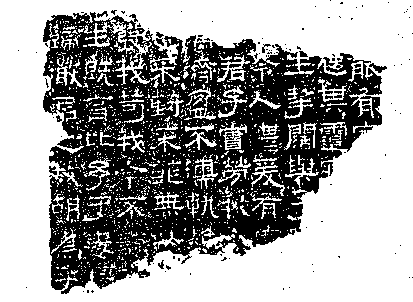



图版一一　汉熹平石经（诗经）



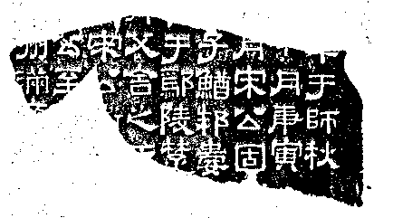



图版一二　汉熹平石经（公羊春秋经）



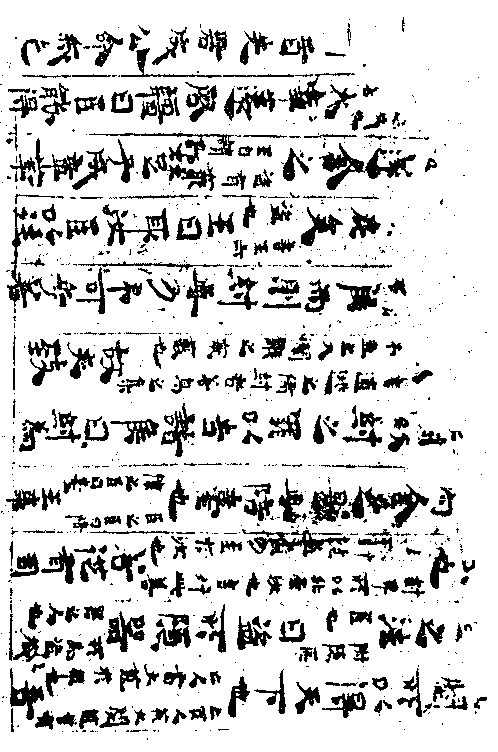



图版一三　六朝写本左传服虔注（昭公七年）



------



## 洛阳伽蓝记卷第三



城南



○景明寺，宣武皇帝所立也。(宣武帝元恪，高祖孝文皇帝第二子，史称世宗。)



景明年中立，因以为名。



在宣阳门外一里御道东。(元河南志云：「御道东曰利民里。」)



其寺东西南北方五百步，前望嵩山少室，(文选卷廿二沈约鍾山诗李善注引戴延之西征记曰：「嵩高，中岳也。东谓太室，西谓少室，相去十七里。嵩高总名也。」又卷十六潘岳怀旧赋注引河南郡图经曰：「嵩丘在县西南十五里。」)却负帝城，青林垂影，绿水为文，形胜之地，爽垲独美。(说文：垲，高燥也。左氏传昭公三年「请更诸爽垲者」，注曰：「垲，燥也。」垲音恺。)山悬堂光观盛，(此句有脱误。永乐大典卷一三八二二作「山县堂观光盛」。逸史本、汉魏本作「山县台观光盛」，真意本同。津逮本县作悬。)一千餘间。复殿重房，(原无此四字，大典本、逸史本有此，今据补。)交疏对霤，(疏者，文窗也。文选卷二十九古诗「交疏结绮牕，阿阁三重阶」。霤者，承霤也。释名释宫室：「霤，流也，水从屋上流下也。」礼记檀弓上「池视重霤」，郑玄曰：「承霤以木为之，用行水，亦宫之饰也。」此云对霤者，即承霤相对距也。文选卷五左思吴都赋云：「玉堂对霤，石室相距。」)青台紫阁，(青紫皆言其色。)浮道相通。(浮道者，犹言飞道也。)虽外有四时，而内无寒暑。房簷之外，皆是山池。(山池者，山林池沼也。)松竹兰芷，(松竹，原作竹松，津逮本、真意堂本同，此依大典及逸史本改。)垂列堦墀，含风团露，(团，聚也。诗野有蔓草「零露溥兮」。)流香吐馥。(馥，香气也。)至正光年中，太后始造七层浮图一所，(太后即胡太后。)去地百仞。



是以邢子才碑文云「俯闻激电，旁属奔星」，(属，大典同，真意本作瞩。瞩，望也。)是也。(案艺文类聚卷七十七所载子才碑文无此二句。)



妆饰华丽，侔於永宁。金盘宝铎，焕烂霞表。(魏书释老志亦云：「永宁寺佛图九层，景明寺佛图亦其亚也。」)



寺有三池，萑蒲菱藕，(雈，细苇也，一名薍。诗七月曰：「八月萑苇。」)水物生焉。或黄甲紫鳞，(文选蜀都赋「觞以清醥，鲜以紫鳞」。)出没於蘩藻，(案左氏传隐公三年云：「苹蘩蕰藻之菜。」苹蘩，皆为水草。蘩音烦。)或青凫白雁，(或字原脱，此据逸史本补。)沈浮於绿水。(沈浮，原作浮沈，此依逸史本。)𪿵硙舂𥳽，(𪿵字字书无，盖即今之碾字。硙，广韵五对切，磨也。)皆用水功，伽蓝之妙，最为称首。(为字原作得，津逮本同。大典作为，逸史本同，今据改。)



时世好崇福，四月七日京师诸像皆来此寺，尚书祠部曹录像凡有一千餘躯。(部字原无，今据大典及逸史本增。案祠部曹见魏书卷一百八之四礼志神龟元年下。又凡大典作名，逸史本同。真意本作「名凡」二字。)至八日，(八日原作八月节，非。此据逸史本改正。)以次入宣阳门，向阊阖宫前受皇帝散花。(按此即行像也。魏书释老志云：「世祖於四月八日与诸寺像，行於广衢，帝御门楼临观，散花致礼焉。」)于时金花映日，宝盖浮云，旛幢若林，香烟似雾，梵乐法音，聒动天地。(聒音括，喧哗也。)百戏腾骧，(见卷一长秋寺下。)所在骈比。名僧德众，负锡为群，(锡者锡杖也。释氏要览卷中云：「梵云隙弃罗，此云锡杖，由振时作锡声故。」)信徒法侣，持花成薮。车骑填咽，(文选吴都赋：「冠盖云荫，闾阎阗噎。」刘逵注：「闾阎阗噎，言人物遍满之貌。」案阗噎即填咽也。梁书陶弘景传：「永明十年，上表辞禄，公卿祖之，供帐甚盛，车马填咽。」)繁衍相倾。(文选蜀都赋：「与辇杂沓，冠盖混并，累毂叠迹，叛衍相倾。」李善注：「司马彪庄子注曰：叛衍，犹漫衍也。」案繁衍亦即叛衍，言其连属之盛。或曰奂衍，或曰纷衍，义并相同。相倾者，相倾侧也。)时有西域胡沙门见此，唱言佛国。(盛赞佛事之盛俨如佛国也。)



------



## 至永熙年中始诏国子祭酒邢子才为寺碑文。(碑文见艺文类聚卷七十七



子才，河间人也。(北齐书卷三十六邢邵传云：「邵字子才，河间鄚人。父虬，魏光禄卿。邵小字吉，少时有避，遂不行名。」案邵盖避魏彭城王元劭嫌名，故以字行也。)志性通敏，风情雅润，(逸史本作「风雅润□。」)下帷覃思，(下帷者，垂下书帷也。汉书董仲舒传称仲舒为博士，下帷讲诵，三年不窥园，是也。)温故知新。文宗学府，䠮班马而孤上，(䠮，逸史本作跨。班马者，班固、司马迁也。)英规胜范，凌许郭而独高。(凌，大典及逸史本作陵。许郭者，汉许劭、郭泰也。此谓其匪特文采华瞻，学识渊广，为一时之宗主，且有许郭之风范也。许郭见卷二秦太上君寺条注。)是以衣冠之士，辐辏其门，(辐辏，聚集也。)怀道之宾，去来满室。升其堂者，若登孔氏之门；(扬子法言吾子篇云：「诗人之赋丽以则，辞人之赋丽以淫。如孔氏之门用赋也，则贾谊升堂，相如入室矣。」)沾其赏者，犹听东吴之句。(听，大典引作德。逸史本作得。事未详。)藉甚当时，(史记陆贾传：「陆生以此游汉廷公卿间，名声藉甚。」集解：「汉书音义曰：言狼藉甚盛。」)声驰遐迩。(驰，大典引作布。北齐书邢邵传曰：「邵雅有才思，聪明强记，文章典丽，既瞻且速。年未二十，名动衣冠。孝明之后，独步当时。每一文出，京师为之纸贵。与济阴温子升为文士之冠，世论谓之温邢。」)正光末，(此从大典及逸史本。末，原作中。)解褐为世宗挽郎，奉朝请。(案北齐书邵传云：「释巾为魏宣武挽郎，除奉朝请，迁著作佐郎，深为领军元乂所礼。又新除迁尚书令，令邵作谢表，须臾便成。」考元乂之为尚书令，当肃宗孝明帝孝昌元年，是邵之为奉朝请，即在正光末也。解褐，或曰释褐、释巾。褐，短衣也，贫者之所服。解褐，谓释巾褐，而衣官服，喻为官也。)寻进中书侍郎、黄门〔侍郎〕。(黄门下侍郎二字各本并无，今补。案北齐书本传云：「永安初，累迁中书侍郎，普奏中，兼给事黄门侍郎。」此称为黄门侍郎似在普泰以前，与正史不同。)子才洽闻博见，无所不通，军国制度，罔不访及。自王室不靖，虎门业废。(周礼地官「师氏居虎门之左，司王朝，掌国中之事，以教国子弟」。郑注曰：「虎门，路寝门也。门外畫虎焉。以明勇猛於守宜也。」案虎门即指国子学而言。刘芳请立学表云：「今之祭酒，即周之师氏。洛阳记：国子学宫在天子宫对，太学在开阳门外。」庄帝永安三年尒朱兆入洛，京师扰乱，邵与弘农杨愔俱避地嵩高山，故曰「王室不靖，虎门业废」。)后迁国子祭酒，(后，津逮本同，大典及逸史本作复，非。北齐书邢邵传云：「（孝武帝）太昌初，敕令恒直内省，后除卫将军，国子祭酒。」)谟训上庠。子才罚惰赏勤，专心劝诱，青领之生，(青领，犹青衿也，谓国子生徒也。诗子衿「青青子衿」，传曰：「青衿，青领也。」颜氏家训书证篇云：「古者斜领下连於衿，故谓领为衿。」)竞怀雅术。(竞，原作竟，非。此从津逮，逸史本改。)洙泗之风，(谓礼乐教化也。孔子曾讲学於洙泗之间。洙、泗，鲁国二水名。)兹焉复盛。永熙年末，(钩沈作末年。)以母老辞，帝不许之。子才恪请，(逸史本、津逮本无恪请二字。)辞情恳至，(原作「恳至」。逸史本作「辞请恳至」。此依津逮本。)涕泪俱下，(涕，原作辞，此从逸史本。)帝乃许之。诏以光禄大夫归养私庭，所在之处，(在，原误作生，大典本及逸史本、津逮本不误。)给事力五人，岁一入朝，(入字各本无，今据史传补。)以备顾问。(北齐书本传云：「邵以亲老还乡，诏所在特给兵力五人，并令岁一入朝，以备顾问。」文与此同。)王侯祖道，(诗烝民「仲山甫出祖」，郑玄曰：「祖者，行犯𫐈之祭也。」案后世饮酒饯行曰祖饯。)若汉朝之送二疏。(汉书疏广传云：「广字仲翁，东海人也。明春秋，为太子太傅。兄子受，字公子，亦以贤良为太子家令。广谓受曰：吾闻知足不辱，知止不殆。今仕至二千石，功成名立，如此不去，惧有后悔。岂如父子相随出关，归老故乡，以寿命终，不亦善乎？遂上疏乞骸骨。上以其年笃老，皆许之。公卿大夫故人邑子为设祖道供帐东都门外，送车数百两，辞诀而去。道路观者曰：贤哉二大夫！或叹息，为之下泣。」文选张协咏史诗曰：「蔼蔼东都门，群公祖二疏。」)暨皇居徙邺，民讼殷繁，前革后沿，(原作「前格后诏」，此从逸史本。)自相与夺，(与，津逮本作予。案魏书刑罚志亦云：「天平后，迁移草剏，百司多不奉法。」)法吏疑狱，簿领成山，(文选卷二十九刘桢杂诗云：「沈迷簿领书，回回自昏乱。」李善注云：「簿领，谓文簿而记录之。司马彪庄子注曰：领，录也。」)乃敕子才与散骑常侍温子升撰麟趾新制十五篇。(麟趾，邺京宫禁阁名。魏书卷十二孝静帝纪云：「兴和三年冬十月癸卯齐文襄王自晋阳来朝，先是诏文襄王与群臣於麟趾阁议定新制，甲寅班於天下。」)省府以之决疑，州郡用为治本。武定中，除骠骑大将军、西兖州刺史。为政清静，吏民安之。后徵为中书令。(后，大典及逸史本作复。)时戎马在郊，朝廷多事，国礼朝仪，咸自子才出。(咸，逸史本作或，非。案北齐书本传云：「邵博览坟籍，无不通晓，晚年尤以五经章句为意，穷其指要。每公卿会议，事关典故，邵援笔立成，证引该洽。帝命朝章，取定俄顷。词致宏远，独步当时。」)所制诗赋诏策章表碑颂赞记五百篇，皆传於世。(赞，大典及逸史本作赞。北齐书云：「有集三十卷，见行於世。」)邻国钦其模楷，朝野以为美谈也。



○大统寺，在景明寺西，即所谓利民里。(逸史本无即字。)寺南有三公令史高显畧宅。(高显畧，太平广记卷三九一引作高显洛。太平寰宇记作尚书高显业。西阳杂爼前集十作洛阳令史高显。)



每於夜见赤光行於堂前，(每字上广记引有洛字。於字原无，逸史本有，与广记引合，今据补。)如此者非一。向光明所掘地丈餘，(广记引光下无明字。)得黄金百斤，(百，逸史本作千。)铭云：「苏秦家金，得者为吾造功德。」显畧遂造招福寺。(显畧，广记作洛。)人谓此地是苏秦旧宅。(人谓此地是苏秦旧宅，逸史本作「以世人谓此地是苏秦旧宅」，广记引作「世又谓此地苏秦旧时宅」。钩沈改作「以是人谓此地是苏秦旧宅」。)当时元乂秉政，闻其得金，就畧索之，(畧，原作洛。之字逸史本脱。)以二十斤与之。



衒之按：苏秦时未有佛法，功德者不必是寺，(是，广记引作起。)应是碑铭之类，(应，广记引作或。)颂其声绩也。(绩字各本作迹，此依广记引改正。)



○东有秦太上公二寺，(原与上文连为一条，今从逸史本别为一条。太上，原作太师，误。)在景明寺南一里。(寺字原无，据永乐大典卷一三八二二增。)西寺，太后所立；(秦太上公，灵太后父胡国珍之封号。此寺为刘腾所监造，见魏书腾传。)东寺，皇姨所建。(大典及逸史本建作造。)



并为父追福，因以名之，时人号为双女寺。



并门邻洛水，(大典及逸史本门下有俱字。)林木扶疎，(扶疎，大典作齐竦。)布叶垂阴。各有五层浮图一所，高五十丈，素彩畫工，(畫，原作布，此从大典及逸史本改。)比於景明。至於六斋，(六斋见卷一景乐寺条。)常有中黄门一人监护，僧舍衬施供具，(衬施指衣物。释氏要览卷上嚫钱条云：「梵语达嚫拏，此云财施。今略达拏，但云嚫。五分律云：食后施衣物，名达嚫。」)诸寺莫及焉。



寺东有灵台一所，(文选卷十六潘岳闲居赋李善注引陆机洛阳记曰：「灵台在洛阳南，去城三里。」)基址虽颓，犹高五丈餘，即是汉光武所立者。(汉光武，原作汉武帝，此依元河南志及逸史本改。灵台，望云物者。水经注谷水注云：「高六丈，方二十步。」)灵台东有辟雍，(有字各本脱，此从元河南志补。)是魏武所立者。(大典作「是魏武所立作者」，逸史本同。文选闲居赋李善注引陆机洛阳记云：「辟雍在灵台东，相去一里，俱魏武所建。」案辟雍即太学。班固白虎通德论云：「天子立辟雍者，所以行礼乐，宣教化。辟者，象璧，圆以法天，雍者，拥之以水，象教化流行也。」)至我正光中造明堂於辟雍之西南，(正光，孝明帝年号。)上圆下方，八牎四闼。(闼，门也。案明堂五室九阶，四户八窗。封轨明堂辟雍议称：「明堂者，布政之宫，在国之阳，所以严父配天，听朝设教。」又称：「四户者，达四时，八窗者，通八风。若其上圆下方，以则天地，通水环宫，以节观者。」见魏书卷三十二。)汝南王复造砖浮图於灵台之上。(汝南王元悦见卷一。)



孝昌初，(孝昌亦孝明帝年号。)妖贼四侵，州郡失据，朝廷设募征格於堂之北，从戎者拜旷掖将军、(旷掖，大典及逸史本作旷夜，魏书官氏志作旷野。)偏将军、裨将军。(皆八九品职。)当时甲胄之士，号明堂队。(大典及逸史本脱队字。)时有虎贲骆子渊者，(时下原无有字，此依法苑珠林卷九十四及太平广记卷二九二引补。骆两书所引均作洛。)自云洛阳人。昔孝昌年戍在彭城，(珠林及广记引作「孝昌中戍於彭城」，无昔字。)其同营人樊元宝得假还京师，(师字原无，珠林、广记引及大典均有师字，今据增。)子渊附书一封，令达其家。(广记引无此四字。)云：「宅在灵台南，(宅上珠林引有某字。)近洛河，卿但至彼，(但下原有是字，依广记删。广记引作「近洛水乡，但至彼」，大典及逸史本作「近洛水乡即是，至彼云云」。)家人自出相看。」元宝如其言，至灵台南，了无人家可问。(广记引作「见无人家」。)徙倚欲去，忽见一老翁来，(翁，逸史本作公，下同。)问从何而来，(大典作「何从而来」。)徬徨於此。元宝具向道之。老翁云：「是吾儿也。」取书引元宝入，遂见馆阁崇宽，屋宇佳丽。既坐，(既字原无，据珠林、广记引补。)命婢取酒。须臾见婢抱一死小儿而过，元宝初甚怪之，(广记引无初字。)俄而酒至，色甚红，(珠林、广记引色上有酒字。)香美异常。兼设珍羞，海陆备具。(备具，原作具备，大典及逸史本作备具，今据改。珠林及广记引作备有。)饮讫，辞还。(辞还，珠林、广记引并作告退。)老翁送元宝出云：「后会难期，以为凄恨！」别甚殷勤。(珠林引殷作慇，大典作慇懃。)老翁还入，元宝不复见其门巷，(巷，珠林引作衖。)但见高岸对水，(岸，珠林、广记引并作崖。)渌波东倾，(广记引同，大典及逸史本作绿波连漪。)唯见一童子可年十五，(可年十五，珠林引同，广记引作可年十四五。)新溺死，鼻中出血，(出血，广记引作血出。珠林引同。)方知所饮酒是其血也。(珠林引作乃是血也。)及还彭城，子渊已失矣。元宝与子渊同戍三年，不知是洛水之神也。



○报德寺，高祖孝文皇帝所立也。



------



## 为冯太后追福。(高宗文成帝后，冯朗女，孝文帝祖母，魏书卷十三



在开阳门外三里。



开阳门御道东有汉国子学堂，(文选卷十六闲居赋李善注引郭缘生述征记曰：「国学在辟雍东北五里，太学在国学东二百步。」后汉书蔡邕传注引洛阳记云：「太学在洛阳城南开阳门外，讲堂长十丈，广二丈。」)堂前有三种字石经二十五碑，表里刻之，写春秋尚书二部，作篆科斗隶三种字，(此所指即魏正始所立三体石经也。太平御览卷五八九引戴延之西征记云：「国子堂前有列碑南北行三十五枚，刻之表里，书春秋经尚书二部，大篆隶科斗三种字。碑长八尺，今有十八枚存，餘皆崩。」所称碑数与本书不同。所写之经数，就今日所见残石考之，有尚书、春秋及春秋左氏传之一部分。每字有古篆隶三体。此所称科斗，即古文壁中书也。先列古文，次列篆文，再次为隶书。晋书卫恒传云：「汉武时，鲁恭王坏孔子宅，得尚书、春秋、孝经，时人以不复知有古文，谓之科斗书。汉世秘藏，希得见之。魏初传古文者，出於邯郸淳。恒祖敬叔写淳尚书，后以示淳，而淳不别。至正始中立三字石经，转失淳法。因科斗之名，遂效其形。」)汉右中郎将蔡邕笔之遗迹也。(案魏三字石经与汉熹平一字石经不同。一字石经为隶书，书石者为蔡邕等人。三字石经为魏正始年间所立，书石者无可考。以实物考之，亦非一人所书。杨衒之所记以魏石经与汉熹平石经相混，故谓为蔡邕所书也。)犹有十八碑，餘皆残毁。



复有石碑四十八枚，亦表里隶书，写周易、尚书、公羊、礼记四部。(案此所指为汉熹平一字石经。汉灵帝熹平四年（公元一七五）刻石，至光和六年（公元一八三）始成。包括周易、尚书、鲁诗、仪礼、春秋及公羊传、论语。后汉书蔡邕传注引洛阳记云：「本碑凡四十六枚。」此云四十八枚，数目不同。水经注卷十六谷水注云：「汉魏以来，置太学于国子堂东。汉灵帝光和六年刻石镂碑，载五经立於太学讲堂前，悉在东侧。」今所见残碑中，礼记碑有马日䃅、蔡邕等名，则一字石经为蔡邕等所书也。别详张国淦历代石经考。)又赞学碑一所，(赞学碑，原作读书碑，津逮本同，此依元河南志及逸史本改。)并在堂前。(案赞学碑御览卷五八九引西征记作太学赞碑。水经注卷十六云：「陆机言太学赞，别一碑，在讲堂西。下列石龟碑，载蔡邕、韩说、堂谿典等名。太学弟子赞复一碑，在外门中，今二碑并无。」然则衒之所记皆本之前代所记，非由自验至明。)魏文帝作典论六碑，(六，原作云，误。今依逸史本校正。)至太和十七年犹有四碑。(四下原空格，津逮本作存。此依上文文例及元河南志补。案御览引西征记亦云：「有魏文典论六碑，今四存二败。」)高祖题为劝学里。



武定四年，大将军迁石经於邺。(邺，原作颕，此依逸史本改正。此十二字原在下文宁远三寺数字下，文意不相连，今依吴若准集证说移前。武定为孝静帝年号，大将军即高澄。高澄所迁汉魏石经凡五十二枚，见北齐书卷四文宣帝纪。)



里内有大觉、三宝、宁远三寺。(里下内字原无，据津逮本增。大觉，原作文觉，据津逮本、逸史本校改。)周回有园，珍果出焉，有大谷梨承光之柰。(津逮本此处作「有含消梨，重十斤，从树着地，尽化为水。有承光之柰」。二十字。案太平御览卷九六九引作「有含消梨，重六斤，禁苑所无也。从树投地，尽散为水焉。世人云：报德之梨，承光之柰」。宋吴淑事类赋卷二十六引云：「报德寺有含消梨，重六斤，从树投地，尽化为水。」是津逮本亦有所据。惟「含消梨重十斤」，十斤当作六斤。酉阳杂爼前集卷十云：「洛阳报德寺梨重六斤。」与御览事类赋并同，可证十为六字之误。如隐本所云大谷梨，大谷乃地名，在洛阳城南数十里。文选潘岳闲居赋云：「张公大谷之梨，梁侯乌椑之柿。」大谷梨亦洛阳名产也。)承光寺亦多果木，柰味甚美，冠於京师。



○劝学里东有延贤里，(劝学里东云云原与上文相连，津逮本同。今从逸史本别为一条。)里内有正觉寺，尚书令王肃所立也。



肃字恭懿，琅琊人也，(恭，原作公，此依逸史本。)伪齐雍州刺史奂之子也。(奂字彦孙，齐永明间为镇北将军、雍州刺史。永明十一年以杀宁蛮长史刘兴祖罪，为州司马黄瑶起所杀。见南齐书卷四十九奂传。)赡学多通，才辞美茂，为齐秘书丞，太和十八年背逆归顺。(魏书卷六十三王肃传称：「肃於太和十七年自建业来奔。高祖至邺，闻肃至，虚襟待之。肃陈说治乱，音韵雅畅，深会帝旨，高祖嗟纳之。」)时高祖新营洛邑，多所造制，(制下原有论字，各本无。又制字津逮本作制。)肃博识旧事，大有裨益，高祖甚重之，常呼王生。延贤之名，因肃立之。(因字津逮本、逸史本无。)



肃在江南之日，聘谢氏女为妻，(陈郡谢庄之女，见肃女王普贤墓志。)及至京师，复尚公主。(宣武时尚陈留长公主。公主本刘昶子妇，高祖妹，原封彭城长公主。见魏书卷六十三王肃传。太平广记卷一七四引此下有「其后谢氏入道为尼，亦来奔肃，见肃尚主」，十六字。)谢作五言诗以赠之。(津逮本无以字。)其诗曰：「本为箔上蚕，今作机上丝，得路逐胜去，颇忆缠绵时。」(丁福保辑北魏诗路作络，是也。络为绕丝者。胜为机上之持经者。胜或呼为甑，说文字从木作滕。络、胜皆就机上丝而言，但语意双关。)公主代肃答谢云：「针是贯线物，(是，真意堂本作自。又线逸史本作绵。)目中恒任丝，得帛缝新去，何能纳故时。」(纳者，缝也。)肃甚有愧谢之色，(甚下原无有字，今依逸史本补。)遂造正觉寺以憩之。(案魏书传称：肃子绍，为谢氏所生。肃临薨，谢始擕二女及绍至寿春。与伽蓝记所载不同。考其女王普贤，世宗纳为贵华。普贤墓志云：「考昔鍾家耻，投诚象魏。夫人痛臯鱼之晚悟，感树静之莫因，遂乘险就夷，庶恬方寸。惟道冥昧，仍罗极罚。茹荼泣血，哀深乎礼。」由是观之，史传盖得其实。)肃忆父非理受祸，常有子胥报楚之意，(伍子胥父奢、兄尚为楚平王所杀，子胥奔吴，佐吴伐楚。见史记卷六十六伍子胥列传。)卑身素服，(卑，逸史本、津逮本作毕。)不听音乐，(原无音字，据逸史本增。魏书亦云：「清身好施，简绝声色，终始廉约，家无餘财。」)时人以此称之。肃初入国，不食羊肉及酪浆等物，常饭鲫鱼羹，(饭，太平御览卷九三七引同，绀珠集作食。)渴饮茗汁。京师士子道肃一饮一斗，(道，津逮本、逸史本作见。)号为漏巵。(漏酒器曰漏巵。)经数年已后，(已，津逮本作以。)肃与高祖殿会，食羊肉酪粥甚多。高祖怪之，(怪者，以其可异也。)谓肃曰：「卿中国之味也，(卿，逸史本作即，真意堂本同。)羊肉何如鱼羹？茗饮何如酪浆？」(逸史本作「鱼羹何如？茗饮酪浆何如？」真意堂本作「茗饮何如？酪浆何如？」案绀珠集与如隐堂本同。此高祖问肃羊肉与鱼羹孰优，茗饮与酪浆孰优也。)肃对曰：「羊者是陆产之最，鱼者乃水族之长。(乃，逸史本作是。)所好不同，并各称珍。以味言之，甚是优劣。(甚是，逸史本作是有，绀珠集作甚有。)羊比齐鲁大邦，鱼比邾莒小国，(邾莒皆春秋时邻近齐鲁之小国，后为楚所灭。)唯茗不中，与酪作奴。」(谓茗汁远不能与酪浆相比也。)高祖大笑。因举酒曰：(太平广记卷一七四引作「因举巵属群臣及亲王等酒曰」。)「三三横，两两纵，(此设字谜也。横即横畫，纵即竖畫。)谁能辨之，赐金鍾。」(鍾，酒器。)御史中尉李彪曰：(御史中尉，各本作御史中丞，误。御史中尉李彪，见卷二正始寺条。魏书本传亦作御史中尉。太平广记及绀珠集引同，今据改。)「沽酒老妪瓮注瓨，(瓮，广记引及逸史本均作瓮。又瓨各本均作𤬪，绀珠集引作瓨。案作瓨是也。瓨者，长颈甖也。)屠儿割肉与秤同。」(秤，绀珠集同。广记引及逸史本作称。称秤通用字。)尚书左丞甄琛曰：(左丞，原作右丞，此依广记及绀珠集改。案琛字思伯，中山无极人，颇学经史。太和初，拜中书博士，迁谏议大夫。世宗时，曾随高肇伐蜀。正光间，为车骑将军。死赠尚书左仆射。魏书卷六十八有传。)「吴人浮水自云工，妓儿掷绳在虚空。」(妓，广记引作技。绳，原作绝，津逮本、逸史本作绳，绀珠集同。广记引作袖。)彭城王勰曰：(元勰事迹见卷一永宁寺条。)「臣始解此字是习字。」(广记引作「臣思解此是习字」，绀珠集作「臣始解此乃是习字尔」。)高祖即以金鍾赐彪。朝廷服彪聪明有智，(智，广记引及逸史本作知。知智通用。)甄琛和之亦速。彭城王谓肃曰：(太平御览卷八六七引作「彭城王勰戏谓王肃曰」，事类赋卷十七引作「彭城王尝戏谓肃曰」。)「卿不重齐鲁大邦，而爱邾莒小国。」肃对曰：「乡曲所美，不得不好。」彭城王重谓曰：(御览引作勰复谓曰。)「卿明日顾我，为卿设邾莒之食，(食，事类赋引作飧。飧即餐字。)亦有酪奴。」因此复号茗饮为酪奴。



时给事中刘缟慕肃之风，(缟，逸史本作镐。案御览及事类赋引均作缟。)专习茗饮。彭城王谓缟曰：「卿不慕王侯八珍，好苍头水厄。(好字上御览引有如字，事类赋不作如，作而。绀珠集云：「王蒙好茶，人至輙饮，士大夫甚以为苦。每饮候蒙，必云今日有水厄。」)海上有逐臭之夫，里内有学颦之妇。(曹植与杨德祖书云：「荪蕙之芳，众人所好，而海畔有逐臭之夫。」见文选卷四十二。庄子天运篇云：「西施病心而𪾸，其里之丑人见而美之，归亦捧心而𪾸。」颦𪾸字通用。)以卿言之，即是也。」其彭城王家有吴奴，(吴奴，御览引作吴妪，事类赋引作吴妓。)以此言戏之。自是朝贵䜩会虽设茗饮，皆耻不复食，唯江表残民远来降者好之。(逸史本作「远来降者饮焉」。)后萧衍子西丰侯萧正德归降，(萧正德，萧宏子，梁武帝善之为子。后封为西丰侯。梁书卷五十五本传称：孝昌元年逃奔于魏，七年又自魏逃归，与侯景接纳，终为景所杀。案正德降魏，本书下文称在正光四年中，魏书肃宗纪称在正光三年，若为孝昌元年，则元乂已除名为民。梁书所载，可能有误。)时元乂欲为之设茗，先问卿於水厄多少。正德不晓乂意，答曰：「下官虽生於水乡，(虽字原无，御览引及逸史本有之，今据增。水乡指江南而言。文选卷二十六陆机答张士然诗云：『余固水乡士。』)而立身以来，未遭阳侯之难。」(阳侯，水神名。本为阳国侯，溺死於水，其神能为大波。见汉书扬雄传注。)元乂与举坐之客皆笑焉。



○龙华寺，广陵王所立也。(广陵王元恭常住龙华寺，见卷二平等寺。钩沈以此寺为广陵王元欣所立。元恭、元欣皆广陵王元羽之子。疑此寺为元羽所立。元羽及北海王元祥皆高祖弟也。)追圣寺，北海王所立也。(北海王，元祥也。金石萃编卷二十七有法生为北海王母子造像记。元祥献文帝子，元颢父。宣武时为侍中大将军，录尚书事。见魏书卷二十一上本传。)并在报德寺之东。(德，原误作恩。别本不误。)法事僧房，比秦太上公。京师寺皆种杂果，而此三寺园林茂盛，(三寺，津逮本作二寺。)莫之与争。



宣阳门外四里，(此条原与上文分写，另为一条。逸史本与上条相连。今依逸史本。)至洛水上，作浮桥，(文选闲居赋李善注引杨佺期洛阳记曰：「城南七里，名曰洛水。」)所谓永桥也。(文选闲居赋李善注引河南郡县境界簿曰：「城南五里，洛水浮桥。」此云四里有异。)



神龟中，常景为汭颂。(事亦见魏书常景传，魏书云：「景经洛汭，乃作铭焉。」汭颂二字当作洛汭颂。洛汭为洛水隈曲之处。汭颂二字，逸史本作勒铭。)其辞曰：「浩浩大川，泱泱清洛，(泱泱，原作决决，误。此依孙星衍续古文苑校。泱泱，深广貌。诗小雅『瞻彼洛矣，维水泱泱』。)导源熊耳，(熊耳山，在河南卢氏县南。尚书禹贡云：『导洛自熊耳。』)控流巨壑，纳谷吐伊，(谷者谷水，伊者伊水。谷水源出渑池谷阳谷。伊水源出卢氏熊耳山。均流入洛水。)贯周淹毫，(周即成周，毫即偃师。水经注卷十六谷水条云：『皇甫谧曰：帝喾作都于毫，偃师是也。』)近达河宗，远朝海若。兆唯洛食，(兆，逸史本作非，误。尚书洛诰云：『我乃卜涧水东，瀍水西，惟洛食。』兆者，卜兆也。食谓吉兆。张衡东京赋云：『召伯相宅，卜惟洛食。』)实曰土中，(曰，原作同，此据逸史本。土中，土地之中也。尚书召诰云：『王来绍上帝，自服于土中。』)上应张柳，(张、柳皆二十八宿名。汉书地理志云：『周地柳七星，张之分野也。』)下据河嵩。(河谓黄河，嵩谓嵩山。)寒暑攸叶，(叶即协字。攸，所也。)日月载融，(载，则也。融，明也。)帝世光宅，(宅，居也。)函夏同风。(原作『□函下风』，续古文苑作『函夏同风』，今据正。逸史本作『函夏□风』，阙同字。函夏者，全中国也。)前临少室，(少室山在嵩高。)却负太行，(太行山在河南之北。)制岩东邑，(左传隐公元年『制，岩邑也』。制在今河南汜水。岩，险也。)峭峘西疆。(峘，大山。峭疑当作崤。)四险之地，六达之庄，(庄，道路也。尔雅释宫云：『六达谓之庄。』)恃德则固，失道则亡。详观古列，考见丘坟，(续古文苑作『详观古昔，列见丘坟』。丘坟，即典籍也。三坟五典，八索九丘，皆上古之书。)乃禅乃革，或质或文。(指尧舜禅让，汤武革命而言。)周餘九裂，(裂，原作列，据逸史本及续古文苑改正。周餘即周末，九裂者，九州分裂也。)汉季三分，(谓汉末魏蜀吴三分天下。)魏风衰晚，晋景雕曛。(雕，津逮本作雕，误。日晚餘光曰曛。)天地发辉，(辉，原作挥，此从逸史本正。辉，光也。)图书受命，(图书，指河图洛书而言。)皇建有极，神功无竞。(竞，并进也。无竞者，无比也。)魏箓仰天，玄符握镜。(皆指符命而言。箓，亦符也。文选卷四十八扬雄剧秦美新云：『玄符灵契。』李善注：『玄符，天符也。』梁元帝玄览赋云：『粤我皇之握镜，实乃神而乃圣。』握镜，即班固典引所谓『荣镜宇宙』之意。)玺运会昌，(文选卷四左思蜀都赋云：『天帝运期而会昌。』李善注云：『昌，庆也。』)龙图受命。(上言『天地发辉，图书受命』，此又云『龙图受命』，意思重复。孙星衍谓此二句为衍文。)乃睠书轨，永怀保定。(保，原作宝，此依逸史本。诗小雅『天保定尔，亦孔之固』。)敷兹景迹，流美洪模，(模，原作谟，今从逸史本。模者，规模也。)袭我冠冕，正我神枢。(枢为枢纽，以喻政权。)水陆兼会，周郑交衢。爰勒洛汭，敢告中区。」



南北两岸有华表，(元河南志作「有四华表」。案华表所以表识道路者也。以横木交於柱头，形似桔槔。古代建筑前路边每有石华表。)举高二十丈，华表上作凤凰似欲冲天势。(元河南志凤凰上有金字。)



永桥以南，(此下原别为一条，逸史本与上为一条。今从逸史本。)圜丘以北，(圜丘，祭天之所。)伊洛之间，夹御道，东有四夷馆，一曰金陵，二曰燕然，三曰扶桑，四曰崦嵫。道西有四夷里，一曰归正，二曰归德，三曰慕化，四曰慕义。(「夹御道」下，原作「有四夷馆，道东有四馆」，下接「一曰归正」云云，无「一曰金陵」以下二十二字。津逮本在「道东有四馆」下作「一名金陵，二名燕然，三名扶桑，四名崦嵫。道西有四馆，一曰归正」，云云。案元河南志在「夹御道」下作「东有四夷馆，一曰金陵，二曰燕然，三曰扶桑，四曰崦嵫。道西有四夷里，一曰归正」，云云。语意极清顺。御道两边，东有四夷馆，西有四夷里，故曰夹御道。金陵、燕然、扶桑、崦嵫为馆舍之名，归正、归德、慕化、慕义为里衖之名，均见下文。如隐堂本有脱文，至为明显。津逮本有四夷馆名，而作「夹御道有四夷馆，道东有四馆，道西有四馆」，亦不合。今并据元河南志校正。)吴人投国者，处金陵馆。(金陵即建业。吴人来归者居此，故名金陵馆。)三年已后，赐宅归正里。(卷二景宁寺条下称：「民间号为吴人坊，里三千餘家。」)



景明初，(景明，宣武帝元恪年号。)伪齐建安王萧宝寅来降，(杨衒之仕北魏，故称南朝为伪。萧宝寅，逸史本作夤，下同。宝寅在齐，萧鸾封之为建安王。萧衍克建业以后，宝寅於景明二年逃归北魏。后入关征万俟丑奴，连年不胜，虑见猜责，遂反。永安三年，尒朱天光破丑奴，并擒宝寅，赐死。宝寅在关中时，肃宗遣御史中尉郦道元为关中大使，路中为宝寅将郭子恢所杀。见魏书卷五十九宝寅传。)封会稽公，为筑宅於归正里，后进爵为齐王，(进，元河南志作晋。景明四年宝寅除扬州刺史，晋为齐王。)尚南阳长公主。宝寅耻与夷人同列，(列，原空格，逸史本、津逮本均作列，元河南志同。)令公主启世宗，(世宗，即宣武帝。)求入城内，世宗从之，赐宅於永安里。(元河南志赐宅上有乃字。)正光四年中，萧衍子西丰侯萧正德来降，处金陵馆，为筑宅归正里。后正德舍宅为归正寺。(后，各本无，此据元河南志增。)



北夷来附者处燕然馆，(燕然，山名。东汉窦宪破北单于，登燕然山刻石纪功而还。燕然馆，即取燕然山为名。)三年已后，赐宅归德里。



正光元年，蠕蠕主郁久闾阿那肱来朝，(蠕蠕主三字，原作□□至。逸史本作芮□。郁久闾阿那肱，原作都久闾阿郍[肱-月+舟]。津逮本无空格，作「蠕蠕主郁久闾阿郍[肱-月+舟]」。元河南志作「北夷郁久闾阿郍[肱-月+舟]」。案郁久闾是姓氏，阿那肱乃人名。郍即那字别体。今据津逮本及元河南志校正。魏书肃宗纪及蠕蠕传阿那肱作何那瓌。蠕蠕，史书亦作茹茹，本东胡苗裔，自称柔然。居於漠北，至社崘遂强大。西至焉耆，东至朝鲜，皆为其所有。阿那瓌乃伏图之子，为族兄所攻，故投奔魏国。详魏书卷一百三蠕蠕传。)执事者莫知所处，中书舍人常景议云：「咸宁中单于来朝(咸宁，晋武帝年号。晋咸宁五年（公元二七九）匈奴都督曾率部落归化。见晋书武帝纪。)晋世处之王公特进之下。可班郍肱蕃王仪同之间。」(蕃与藩通用。事亦见魏书常景传。)朝廷从其议。(魏书蠕蠕传云：「谒者引王公以下升殿，阿那瓌位於藩王之下。」)又处之燕然馆，赐宅归德里。北夷酋长遣子入侍者，常秋来春去，避中国之热，时人谓之雁臣。(雁为候鸟，春则北去，秋则南来。雁臣之名，亦见北史卷五十四斛律金传。斛律金，朔州敕勒部人，统所部归魏，魏除为第二领民酋长，秋朝京师，春还部落。故称为雁臣。)



东夷来附者，处扶桑馆，(扶桑，木名。山海经海外东经云：「汤谷上有扶桑，十日所浴。」上古神话谓日出於扶桑，后人乃称东海以外之国，如日本等，曰扶桑。)赐宅慕化里。西夷来附者，处崦嵫馆，(崦嵫，山名。上古神话谓日入於崦嵫。崦嵫山在甘肃天水县西。)赐宅慕义里。自葱岭已西，至於大秦，(古人称东罗马帝国为大秦。)百国千城，莫不款附。(款，原作欢。今从逸史本作款。款附者，诚心归附也。)商胡贩客，日奔塞下。所谓尽天地之区已。(已，逸史本作矣。)乐中国土风因而宅者，不可胜数。是以附化之民，万有餘家。门巷修整，阊阖填列。(填列，言其多。)青槐荫陌，绿柳垂庭。(柳，原作树，此依逸史本、津逮本改。)天下难得之货，咸悉在焉。



别立市於洛水南，(洛，原作乐，误。)号曰四通市。民间谓为永桥市。(谓下为字原无，逸史本有为字，无谓字。今依元河南志校正。市字逸史本作寺，误。)伊洛之鱼，多於此卖，士庶须脍，(须，要也。)皆诣取之。(诣，至也。)鱼味甚美。京师语曰：「洛鲤伊鲂，(逸史本作「伊洛鲤鲂」。案西阳杂爼前集卷十六亦作「洛鲤伊鲂」，如隐堂本不误。洛鲤伊鲂为对文。)贵於牛羊。」



永桥南道东有白象狮子二坊。(狮子，元河南志作师子。案狮为后起字，古代多写作师。坊者，里巷之名。)



白象者，永平二年乾陀罗国胡王所献。(永平，宣武帝年号。乾陀罗国，原作乾罗国，各本同。今据太平广记卷四四一引及元河南志校正。乾陀罗，在北天竺。大唐西域记作健驮罗。大唐西域记云：「健驮罗国东西千餘里，南北八百餘里，东临信度河。」本书卷五记宋云西行求法曾至乾陀罗城。案魏书宣武帝纪云：「永平二年春正月嚈哒薄知国遣使来朝，贡白象一。」此云乾陀罗国，与史异。)背设五采屏风、七宝坐床，(背设五采，原作「皆施五彩」，今据太平广记引及元河南志校改。此指白象背上施设坐床，且有屏风，其形制似轿。七宝者，即金、银、瑠璃、玛瑙之类。)容数人，(广记引作「容数十人」，盖误。)真是异物。常养象於乘黄曹，(常，元河南志作诏。乘黄曹，掌皇帝车舆者。)象常坏屋毁墙，(元河南志无常字，广记引常下有曾字。又毁原作败，此依广记引及元河南志校改。)走出於外。逢树即拔，遇墙亦倒。(亦，逸史本、津逮本作则。)百姓惊怖，奔走交驰。太后遂徙象於此坊。(太后，即指胡太后。)



狮子者，波斯国胡王所献也。(波斯国，太平广记卷四四一引同，元河南志作嚈哒国。案魏书西域传称：嚈哒国於正光末遣使贡师子，至高平，遇万俟丑奴反，因留之。丑奴平，送京师。与本书所记为一事。史不称波斯国贡师子。案嚈哒国为大月氏种，在于阗之西，去长安一万一百里，王都曰拔底延。)为逆贼万俟丑奴所获，(俟，原作侯，误。万俟丑奴，高平镇人（今甘肃固原），建义元年夏反，自立朝廷。尔朱天光与贺拔岳入关讨之，擒之於平凉。见魏书卷七十五尔朱天光传。嚈哒进师子，路经甘肃，故为丑奴所获也。)留於寇中。永安末，丑奴破灭，(原无灭字，此依逸史本增。)始达京师。(魏书孝庄帝纪云：「永安三年六月嚈哒国献师子一。」)庄帝谓侍中李彧曰：(彧，各本作或，误。此依元河南志改正。彧字子文，陇西李延寔子。尚庄帝姊，封东平郡公，位侍中，左光禄大夫，中书监。见魏书卷八十三下李延寔传。)「朕闻虎见狮子必伏，可觅试之。」(试，原作诚，误。此依逸史本。)於是诏近山郡县捕虎以送。(郡县，元河南志作州县。)巩县、山阳并送二虎一豹。帝在华林园观之。於是虎豹见狮子，悉皆瞑目，不敢仰视。园中素有一盲熊，(有，逸史本作育。)性甚驯，(广记引驯下有善字。)帝令取试之。虞人牵盲熊至，(虞人，掌兽者。)闻狮子气，惊怖跳踉，(踉音良。跳踉，跳动也。)曳锁而走。帝大笑。(衒之记此，正足以见统治者但求荒乐而不恤民力也。)普泰元年，广陵王即位，(广陵王，即前废帝。)诏曰：「禽兽囚之，则违其性，宜放还山林。」狮子亦令送归本国。送狮子者以波斯道远，不可送达，(者，原作胡，津逮本、逸史本均作者，今据正。达上逸史本无送字。)遂在路杀狮子而返。有司纠劾，罪以违旨论。广陵王曰：「岂以狮子而罪人也？」遂赦之。



○菩提寺，西域胡人所立也，在慕义里。



沙门达多发冢取甎，(达多无考。)得一人以进。(进，法苑珠林卷九十七引作送。)时太后与明帝在华林都堂，以为妖异。谓黄门侍郎徐纥曰：(徐纥，见卷一永宁寺条。)「上古以来，颇有此事否？」(颇，或也。)纥曰：「昔魏时发冢，得霍光女婿范明友家奴，(范明友，见汉书卷六十八霍光传。光两女婿，为东西宫卫尉，明友为未央卫尉。)说汉朝废立，与史书相符，此不足为异也。」(此事见晋张华博物志。)后令纥问其姓名，死来几年，何所饮食。死者曰：(珠林引曰上有答字。)「臣姓崔，名涵，字子洪，(珠林引及酉阳杂爼前集卷十三同。太平广记卷三七五引亦作崔涵字子洪。逸史本作「姓崔，名洪，字子涵」，盖因下文云「有息子涵」而改。)博陵安平人也。(崔氏为博陵大姓。博陵在今河北安平。逸史本作博令，非。)父名畅，母姓魏，家在城西阜财里。(阜财，逸史本作准财，误。珠林引作埠财。足见字不作准。阜者，殷厚也。)死时年十五，今满二十七，(满，珠林引作乃。)在地十有二年，(逸史本地字下有下字，珠林引同。)常似醉卧，无所食也。时复游行，或遇饭食，(饭，珠林引作饮。)如似梦中，不甚辨了。」后即遣门下录事张隽诣阜财里，(张隽，各本作张秀擕，下同。珠林引作张俊，太平广记卷三七五引作隽，清嘉庆洛阳县志亦作隽，今据改。又阜原误作准，据上文正。)访涵父母，果得崔畅，(得，珠林引作有。)其妻魏氏。隽问畅曰：「卿有儿死否？」畅曰：「有息子洪，(息，即子也。子洪原作子涵，今据珠林及上文改正。)年十五而死。」(死，珠林引作亡。)隽曰：「为人所发，今日苏活，(苏，珠林引作稣。)在华林园中，主人故遣我来相问。」(主人，珠林引作主上。故字珠林引无。)畅闻惊怖曰：「实无此儿，向者谬言。」隽还，具以实陈闻，(清洛阳县志作「隽还，具以实闻」。珠林引作「俊还，具以实闻启后」。)后遣隽送涵回家。(遣隽，原作遣擕。回，珠林引作向，逸史本同。)畅闻涵至，门前起火，手持刀，魏氏把桃枝。(古人以为桃木可以制鬼，故魏氏把桃枝。事类赋卷二十六引典术曰：「桃者，五木之精，其精生鬼门，制百鬼，故今作桃人著门以压邪。」)谓曰：(珠林引作拒之。)「汝不须来，吾非汝父，汝非吾子，(吾子，珠林引作我子。)急手速去，(急手，珠林引同，逸史本作急急。)可得无殃。」涵遂舍去，游於京师，(珠林引京师下有衖内二字。)常宿寺门下。汝南王赐黄衣一具。(汝南王，元悦也。一具，珠林引作一通。)涵性畏日，不敢仰视，(珠林引作不仰视天。)又畏水火及兵刃之属，(兵刃，原作刀兵，津逮本同。珠林引及酉阳杂爼均作兵刃，逸史本同，今据改。)常走於逵路，遇疲则止，(逸史本无遇字。酉阳杂爼作「常走，疲极则止」。)不徐行也。时人犹谓是鬼。洛阳大市北有奉终里，(大市，原作太市，误。奉终里上原无有字，此据珠林引补。)里内之人，多卖送死之具及诸棺椁。(死下原有人字。珠林引及酉阳杂爼均无人字。)涵谓曰：「作栢木棺，勿以桑木为欀。」(欀，裹也。)人问其故，涵曰：(珠林引作「涵谓曰」。)「吾在地下见发鬼兵，(见下原有人字，珠林引及酉阳杂爼均无，今据删。)有一鬼诉称：是栢棺，应免。」(免下珠林引有兵字。)主兵吏曰：(珠林引作「主吏曰」，酉阳杂爼作「主者曰」。)「尔虽栢棺，桑木为欀。遂不免。」(免下珠林引有兵字，逸史本同。)京师闻此，栢木踊贵，(珠林引踊作勇。)人疑卖棺者货涵发此言也。(原作「货涵发此等之言也」，逸史无「等之」二字。今依逸史本。珠林引作「货涵故发此言也」。)



○高阳王寺，高阳王雍之宅也。(孝昌二年，太后胡氏以刘腾宅赐高阳王雍，见卷一建中寺条。彼在城内，此所称高阳王雍宅在城外。高阳王雍已见卷一建中寺条。)在津阳门外三里御道西。(太平广记卷二三六引此条津阳门作清阳门，误。又御道西下有旁字。)雍为尒朱荣所害也，(建义元年尒朱荣入洛，於河阴遇害。)舍宅以为寺。



正光中，(正光，孝明帝年号。)雍为丞相，给羽葆鼓吹、虎贲班剑百人，(羽葆上原有舆字，广记引及逸史本无，今删。羽葆者，以鸟羽为幢也。虎贲班剑百人者，即执剑而从者百人也。削木为剑，畫之以文，曰班剑。)贵极人臣，富兼山海。(史称雍岁禄万餘，粟至四万。)居止第宅，匹於帝宫。白壁丹楹，(壁，原作殿，楹，原作槛。此据广记引改。楹者，柱也。)窈窕连亘，(亘音更，去声。窈窕言其深，连亘言其长。)飞簷反宇，(反，津逮本作仄，逸史本作峻，广记引作华。案文选卷二张衡西京赋云：「反宇业业，飞檐䡾䡾。」反宇谓屋边瓦向上高出也。)𫐖轕周通。(周，原作周，此依逸史本。广记引及永乐大典卷一三八二二并作「胶葛周通」。胶葛与𫐖轕同。胶葛者，纵横交加也。)僮仆六千，妓女五百，(妓，大典作伎。)隋珠照日，(隋珠，隋侯珠也。)罗衣从风，(衣，广记引作绮。)自汉晋以来，诸王豪侈，未之有也。出则鸣驺御道，(驺者，从骑也。)文物成行，(文物，即指仪仗而言。)铙吹响发，(响发，大典引作发响，逸史本同。铙吹，即铙歌。铙者，钲铙也。)笳声哀转。(转，广记及大典作啭。哀转犹言哀鸣。)入则歌姬舞女，击筑吹笙，(筑似瑟，安弦，以竹击之。)丝管迭奏，(丝管犹言丝竹。)连宵尽日。其竹林鱼池，侔於禁苑，芳草如积，珍木连阴。



雍嗜口味，(太平广记卷一六五引口味作食味。)厚自奉养，一食必以数万钱为限。(一食，原作一日，大典作一食，逸史本同。案宋曾慥类说引亦作一食。今据正。)海陆珍羞，方丈於前。(方丈者，食物列前，方一丈也。)陈留侯李崇谓人曰：「高阳一食，敌我千日。」(一食，原作一日，依永乐大典改。李崇已见卷二正始寺条。)崇为尚书令，仪同三司，(案此在肃宗时。)亦富倾天下，(魏书卷六十六本传称：「崇性好财货，贩肆聚敛，家资巨万，营求不息。」)僮仆千人。而性多俭恡，(恡即悋字别体。太平御览九七六引同，太平广记卷一六五引作吝。曾慥类说引作「而性俭啬」。意同。)恶衣麤食。(麤，原作麄，别体字。)食常无肉，(食常，原作亦常，误。大典作食常，今据改。逸史本肉下有味字。案太平御览及太平广记引皆无味字。)止有韭茹、韭葅。(原作「止有韭菹」，逸史本作「止有韭薤」，并误。今依御览、广记及类说、大典诸书改正。韭茹、韭葅皆以韭为之。茹，菜也。葅，酢菜也。是以下文有「二韭一十八」之语。)崇客李元祐语人云：(祐，原作佑，逸史本作祐，与御览、广记引合，今据改。下同。又客上御览及广记引有家字。下云「李令公」，正家客之语也。)「李令公一食十八种。」(李崇为尚书令，故尊称之曰令公，犹如高允为中书令，文成帝重允，常不名之，恒呼之为令公也。)人问其故，元祐曰：「二韭一十八。」(韭，原作九，津逮本同。太平广记引作韭，御览引则作九。大典及逸史本均作韭。案韭九同音，言二韭正为双关语。字当作韭。案南齐书庾杲之传云：「食常有韭葅瀹韭。任昉戏之曰：谁谓庾郎贫，食常有二十七种。」谓三种韭也。其事与此相类。)闻者大笑。世人即以此为讥骂。(原作「世人即以为讥骂」。逸史本无为字。御览引作「世以此为讥」。今据御览增此字。)



及雍薨后，(及字依太平广记卷二三六引增。)诸妓悉令入道，或有嫁者。美人徐月华，善弹箜篌，(箜篌二十三弦，形如弓，置於怀前，两手弹之。)能为明妃出塞之歌，(歌上原有曲字，广记引无，大典及逸史本同。今据删。酉阳杂爼前集卷六作「明妃出塞之声」。)闻者莫不动容。永安中，与卫将军原士康为侧室，(卫将军，广记作衙将军。)宅近青阳门。(青阳门，城东面最南门。广记引此文作「士康宅亦近清阳门」。)徐鼓箜篌而歌，哀声入云，行路听者，俄而成市。徐常语士康曰：「王有二美姬，(大典卷一三八二二引无美字，逸史本同。)一名修容，(修，原作修，此依广记及逸史本。)一名艳姿，(一名，各本作二名。此据广记引。)并蛾眉皓齿，洁貌倾城。修容亦能为绿水歌，(绿水歌，大典作渌水歌。)艳姿善为火凤舞，(为字原无，据广记引增。火凤，大典及逸史本作么凤。津逮本作「艳姿尤善作么凤舞」。广记引作「艳姿善为逐凤舞」。)并爱倾后室，宠冠诸姬。」士康闻此，遂常令徐鼓绿水、火凤之曲焉。(鼓，广记引作歌。又火凤，逸史本作么凤。广记引作文凤。)



高阳宅北有中甘里。



里内颍川荀子文，年十三，(原作「里内荀颕子文」，误。今据逸史本改正。)幼而聪辨，神情卓异，虽黄琬、文举无以加之。(黄琬字子琰，后汉黄琼之孙。少而辩慧，光和末年为青州刺史，董卓秉政，徵为司徒。后与王允同谋诛卓，下狱死。见后汉书卷九十一黄琼传。文举，即孔融也。少亦聪慧，见后汉书卷一百。)正光初，广宗潘崇和讲服氏春秋於城东昭义里，(广宗在今河北威县东。潘崇和无考。唐晏钩沈云：「北史儒林传於服氏春秋有潘叔虔，当即崇和之字。」案北史儒林传序云：「河北诸儒能通春秋者，并服子慎所注，亦出徐生（徐遵明）之门。张买奴、马敬德、邢峙、张思伯、张奉礼、张雕、刘昼、鲍长宣、王元则并得服氏之精微。又有卫觊、陈达、潘叔虔，虽不传徐氏之门，亦为通解。」案服氏即服虔。虔字子慎，后汉荥阳人。见后汉书卷一百九下儒林传。)子文摄齐北面，(齐通斋，裳下缝也。摄齐者，抠衣也。论语乡党篇云「摄齐升堂」。)就和受道。(和即崇和。)时赵郡李才问子文曰：(李才，大典及逸史本作李予。下同。赵郡在今河北赵县。)「荀生住在何处？」(逸史本无在字。清洛阳县志卷十四引作「荀生何住」。)子文对曰：「仆住在中甘里。」才曰：「何为住城南？」(原作「才曰：何往？曰：往城南」。此依大典及逸史本。)城南有四夷馆，(大典及逸史本作「有四夷里馆」，多一里字。)才以此讥之。子文对曰：「国阳胜地，卿何怪也？若言川涧，伊洛峥嵘，(伊水在洛阳县南，入洛水。陵岸高峻，故曰「伊洛峥嵘」。)语其旧事，灵台石经。招提之美，报德、景明。(招提已见序文。报德，即报德寺；景明，即景明寺。)当世富贵，高阳、广平。(高阳，即指高阳王雍而言。广平，盖指广平王元怀而言。)四方风俗，万国千城。(城南有四夷馆、四夷里，以处远人之来自四方者。四方之民，风俗各异，故曰「四方风俗，万国千城」。)若论人物，有我无卿！」(以上嵘经明平城卿押韵。)才无以对之。崇和曰：「汝颍之士利如锥，燕赵之士钝如锤。(此为当时里语。锥锤押韵。)信非虚言也。」举学皆笑焉。



○崇虚寺，在城西，(本卷所记皆洛阳城南寺宇，此云城西不合，疑西字下脱南字。)即汉之濯龙园也。(濯龙园，原作跃龙阁，误。逸史本作跃龙园，亦误。今据永乐大典卷一三八二三改正。下同。文选卷三张衡东京赋云：「濯龙芳林，九谷八溪。」李善注引洛阳图经曰：「濯龙，池名。」案后汉书卷七桓帝纪称濯龙宫。)



延熹九年，桓帝祠老子於濯龙园，(延熹九年，公元一六六年。)设华盖之坐，(设，原作室，误。大典引作设，逸史本同，今据正。又坐原作座，今从逸史本。)用郊天之乐，(郊天者，祭天也。案后汉书卷十八祭祀志云：「桓帝即位十八年，好神僊事。延熹八年初，使中常侍之陈国苦县祠老子。九年，亲祠老子於濯龙，文罽为坛饰，淳金扣器，设华盖之坐，用郊天乐也。」)此其地也。(案汉之濯龙园近北宫，见后汉书百官志注，当在城内。崇虚寺若在城外，则不得为汉之濯龙园故址。衒之所记盖误。)



高祖迁京之始，以地给民，憩者多见妖怪，(怪，异也。)是以人皆去之，遂立寺焉。



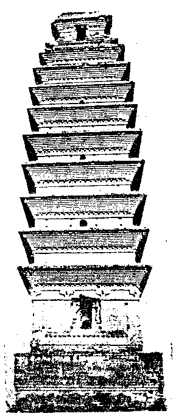



图版一四　汉魏洛阳故城城西白马寺塔



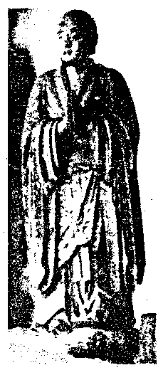



图版一五　白马寺元代塑像（阎文儒先生摄）



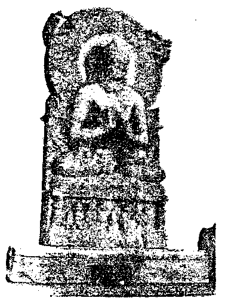



图版一六　释迦佛在鹿野苑说法造像（鹿野苑出土古代雕刻）



------



## 洛阳伽蓝记卷第四



城西



○冲觉寺，太傅清河王怿舍宅所立也。(清河王元怿，已见卷一景乐寺条。)在西明门外一里御道北。



怿，亲王之中，最有名行，世宗爱之，特隆诸弟。延昌四年世宗崩，怿与高阳王雍、广平王怀并受遗诏，辅翼孝明。(广平王元怀，已见卷二平等寺条。)时帝始年六岁，太后代总万机，(机，永乐大典卷一三八二三作几。案如隐堂本万机一律作机。)以怿名德茂亲，体道居正，(体者，亲近之意。居者，处也。)事无大小，多諮询之。是以熙平神龟之际，(孝明即位之初四年。)势倾人主，第宅丰大，逾於高阳。(雍宅在城南，见卷三高阳王寺条。)西北有楼，出凌云台，(凌云台在阊阖城千秋门内西游园中，见卷一瑶光寺条。)俯临朝市，目极京师，(目极，犹言远望也。)古诗所谓「西北有高楼，上与浮云齐」者也。(诗见文选卷二十九。衒之引此，谓正如古诗所云，非谓古诗所称之高楼即元怿宅之高楼也。四库全书总目提要误解衒之之意，以为衒之即以此楼当古诗所称之楼，而讥其固於说诗，为此书之瑕颣，非是。)楼下有儒林馆、延宾堂，(延宾，各本均作退宾，误。今依元河南志校改。下文云「怿爱宾客，重文藻」，则其为延宾无疑。)形制并如清暑殿。(制，元河南志作制。清暑殿在华林园内，见卷一。)土山钓池，(河南志在土山钓池上有「园中有」三字。钓池原作钓台，永乐大典及逸史本均作钓池，河南志同，今据改。)冠於当世。斜峰入牖，曲沼环堂，树响飞嘤，(诗伐木「鸟鸣嘤嘤」。)堦丛花药。怿爱宾客，重文藻，海内才子，莫不辐辏，府僚臣佐，并选隽民。(隽民，原作隽俊，误。隽、俊一字也。今据逸史本改作隽民。隽民者，才德优秀之士也。书洪范云：「俊民用章」是也。下法云寺条称元彧「僚采成群，俊民满席」，字作俊同。)至於清晨明景，(大典及逸史本明景作美景。)骋望南台，(南台乃泛指之辞。大典作高台。)珍羞具设，琴笙并奏，芳醴盈罍，嘉宾满席。(嘉，原作佳，津逮本同，此从逸史本。诗鹿鸣：「我有嘉宾，鼓瑟吹笙。」)使梁王愧兔园之游，(兔园，汉梁孝王之苑囿。葛洪西京杂记云：「梁孝王好营宫室苑囿之乐，作曜华之宫，筑兔园。」又云：「其诸宫观相连，延亘数十里。奇果异树，瑰禽怪兽，毕备。王日与宾客弋钓其中。」兔园在今河南商邱县。)陈思慙雀台之䜩。(䜩，原作燕，此从大典及逸史本。雀台，即铜雀台，汉建安十五年冬曹操建，在邺城。故址在今河南临漳县西南邺城内西北隅。陈思即陈思王曹植，曹操少子也。铜雀台成，曹操悉将诸子登台，使各为赋，植援笔立就。见三国志魏志卷十九陈思王植传。)



正光初元乂秉权，闭太后於后宫，薨怿於下省。(下省指门下省。怿於正光元年被害，年三十四。见卷一永宁寺条注。)孝昌元年，太后还总万机，(太后，原误为太子，别本不误。)追赠怿太子太师、大将军、(大，原误作太。)都督中外诸军事、假黄钺。(假，给也。黄钺即金斧。)给九旒鸾辂、(旒音流，旌旗斿也。鸾辂，车有鸾铃者。)黄屋、左纛、辒辌车，(车盖以黄缯为里，曰黄屋。毛羽幢施於车衡之左，曰左纛。纛音导。辒辌车，即丧车，有窗，闭之则温，开之则凉，故曰辒辌车。辒辌音温凉。)前后部羽葆鼓吹，虎贲班剑百人，挽歌二部，(每部六十四人。)葬礼依晋安平王孚故事。(安平王孚即司马孚。孚为司马懿次弟，尝为曹植文学掾，仕魏，官至尚书令，复迁司空。晋武帝司马炎即位，封为安平王。泰始八年卒，年九十三。丧葬加以殊礼，给銮辂轻车，介士武贲百人，吉凶导从二千餘人，前后鼓吹。见晋书卷三十七本传。)谥曰文献。图怿像於建始殿。拔清河国郎中令韩子熙为黄门侍郎，(原无郎中二字，今依大典及逸史本补。子熙字元雍，昌黎棘城人，韩麒麟之孙。崔光举子熙为元怿常侍，迁郎中令。怿被害，久不得葬，子熙为之忧悴，屏居田野。后胡太后反政，子熙伏阙上书，诉怿之冤，太后乃赐元乂死，引子熙为中书舍人。天平初，除国子祭酒。见魏书卷六十韩麒麟传。)徙王国三卿为执㦸者，(徙，原作从，今依逸史本改正。)近代所无也。



------



## 为文献追福，建五层浮图一所，工作与瑶光寺相似也。(瑶光寺五层浮图，高五十丈，见卷一



○宣忠寺，侍中司州牧城阳王徽所立也。(原无徽字，依逸史本补。徽字显顺，元鸾子。史称粗涉书史，颇有吏才，肃宗时为尚书令。庄帝即位，以与谋之功除侍中领司州牧。见魏书卷十九下本传。)在西阳门外一里御道南。



永安中，(安，原误作康，津逮本同，今依逸史本改正。)北海王入洛，(北海下各本均脱王字，依元河南志补。北海王即元颢，元颢入洛在永安二年五月，事见卷一永宁寺条下。)庄帝北巡，自餘诸王，各怀二望，(二望者，存心观望也。)唯徽独从庄帝至长子城。(长子城在今山西长子县西。)大兵阻河，雄雌未决，(雄雌，原作雌雄，永乐大典卷一三八二三及逸史本作雄雌。)徽愿入洛阳，舍宅为寺。及北海败散，国道重晖，遂舍宅焉。



永安末，庄帝谋杀尒朱荣，恐事不果，请计於徽。徽曰：「以生太子为辞，荣必入朝，因以毙之。」庄帝曰：「后怀孕未十月，(未，原作於，大典作投，逸史本空，今依汉魏本改作未。案卷一云「九月二十五日诈言产太子」，则不能云「后怀孕於十月」。若尔，则太子已生，下文不当云「今始九月」矣。)今始九月，(言未足十月也。)可尔以不？」(以，原作已，依逸史本改。上文元徽谓庄帝以生太子为辞，庄帝恐为尒朱荣所疑，故重问「可尔以不」，即「能如是以生太子为辞耶？」不与否义同。)徽曰：「妇人生产，(原作「妇生产子」，津逮本作「妇人产子」，永乐大典作「妇人产生」，此从逸史本。)有延月者，有少月者，不足为怪。」帝纳其谋，遂唱生太子。(唱者，唱言也。)遣徽特至太原王第，(特至，大典作驰至，逸史本作驰诏至，注云：「一本作持诏。」)告云皇储诞育。(庄帝后即尔朱荣女，故驰至荣第告之也。)值荣与上党王天穆博戏，(即元天穆，与荣共立庄帝者。见卷一永宁寺条。)徽脱荣帽，懽舞盘旋。徽素大度量，喜怒不形於色，遶殿内外懽叫，荣遂信之，与穆并入朝。庄帝闻荣来，不觉失色。中书舍人温子升曰：「陛下色变！」帝连索酒饮之，然后行事。荣穆既诛，拜徽太师司马，餘官如故，典统禁兵，偏被委任。及尒朱兆擒庄帝，徽投前洛阳令寇祖仁。(魏书城阳王元徽传云：「及尒朱兆之人，禁卫奔散，庄帝步出云龙门，徽乘马奔度，帝频呼之，徽不顾而去，遂走山南，至故吏寇弥宅。」此称寇祖仁，祖仁当是弥字。弥为寇臻子，寇赞孙。赞即寇谦之之见也。史称臻长子祖训，祖训弟治，字祖礼，治弟弥。则弥字祖仁无疑。详见魏书卷四十二寇赞传。赞传言弥兼尚书郎，不云为洛阳令。其兄治则洛阳令也。)祖仁一门刺史，皆是徽之将校，(原脱校字，今据逸史本补。祖仁兄祖训为顺阳太守，兄祖礼为洛阳令，稍迁东荆州刺史，世宗末迁河州刺史。)以有旧恩，(以，原作少，逸史本作以，今从之。)故往投之。(逸史本无故字。寇赞传称：弥兼尚书郎，为城阳王徽所亲待。永安末，徽避尒朱兆，脱身南走，归命於弥。)祖仁谓子弟等曰：「时闻尒朱兆募城阳王甚重，(募者求也。)擒获者千户侯。今日富贵至矣！」遂斩送之。(魏书徽传云：「弥外虽容纳，内不自安，乃怖徽云：官捕将至，令其避他所，使人於路邀害，送尸於尔朱兆。」案徽墓志称：「永安三年十二月五日卒於洛阳之南原，年四十一。」)徽初投祖仁家，赍金一百斤、马五十疋，(疋匹古人通用。)祖仁利其财货，故行此事。所得金马，缌亲之内均分之。(缌亲之内，即五服之内。)所谓「匹夫无罪，怀璧其罪」，信矣。(「匹夫无罪，怀璧其罪」，左传桓公十年虞叔引周谚。信矣下大典及逸史本有哉宇。)兆得徽首，亦不勋赏祖仁。兆忽梦徽云：「我有黄金二百斤、(黄字大典及逸史本无。)马一百疋在祖仁家，卿可取之。」兆悟觉，即自思量：城阳禄位隆重，(大典及逸史本禄位作位望。)未闻清贫，常自入其家采掠，本无金银，此梦或真。至晓掩祖仁，(掩，收捕也。)徵其金马。祖仁谓人密告，望风款服，云实得金一百斤、马五十疋。兆疑其藏隐，依梦徵之。祖仁诸房素有金三十斤、马三十疋，(三十疋，原作五十疋，津逮本同。案法苑珠林卷六十七引冤魂志所记为三十疋，大典及逸史本亦均作三十疋，今据改。)尽送致兆，(逸史本无致字。)犹不充数。(逸史本作犹不满数。)兆乃发怒捉祖仁，悬首高树，大石坠足，(珠林引冤魂志云「以石硾其足」。)鞭捶之以及於死。(案魏书寇赞传言弥后没关西，与本书不同。)时人以为交报。



杨衒之曰：「崇善之家，必有餘庆；积祸之门，殃所毕集。(周易坤卦文言云：「积善之家，必有餘庆；积不善之家，必有餘殃。」祸，津逮本作恶，毕，大典作必，逸史本此处作「积祸之门，餘殃所集」。)祖仁负恩反噬，贪货杀徽，徽即托梦增金马，(津逮本增下有徵字，大典及逸史本作徽，非是。)假手於兆，还以毙之。使祖仁备经楚挞，穷其涂炭，虽魏其侯之笞田蚡，(原无其字，津逮本同，今据逸史本补。)秦主之刺姚苌，以此论之，不能加也！」(魏其侯笞田蚡，见史记卷一百七魏其武安侯列传。汉书卷五十二窦婴田蚡灌夫列传亦载之。魏其侯即窦婴。婴与灌夫友善，夫素与丞相田蚡有隙，蚡娶燕王女为夫人，婴与灌夫往贺，灌夫以酒醉仵蚡，婴与灌夫俱为蚡所诬陷弃市。史称窦婴死，蚡亦病。汉书云：「蚡疾一身尽痛，若有击者，謼服谢罪。上使视鬼者瞻之，曰：魏其侯与灌夫共守笞，欲杀之。蚡竟死。」○秦主刺姚苌，事见晋书卷一百十六记载第十六。秦主即前秦苻坚。姚苌乃羌人，后归苻坚，累有战功。及苻坚伐晋，败于淮南，归长安，慕容泓起兵叛坚，坚遣子叡讨之，以苌为司马，竟为泓所败，叡死之。苌遣使诣坚谢罪，坚怒，杀苌使，苌惧，奔渭北，称秦王。时坚为慕容冲所逼，走入五将山，苌遣将吴忠围坚，忠执坚送苌，杀之。苌称帝后，又掘苻坚尸，鞭挞无数，裸剥衣裳，荐之以棘，坎土而埋之。后苌遇疾。载记云：「梦苻坚将天官使者鬼兵数百突入营中，苌惧走入宫，宫人迎苌刺鬼，误中苌阴，鬼相谓曰：正中死处。拔矛出血石餘。寤而惊悸，遂患阴肿。医刺之，出血如梦。苌遂狂言。以大元十八年卒。」此二事亦见法苑珠林卷七十引冤魂志。)



○宣忠寺东王典御寺，阉官王桃汤所立也。(王桃汤上原有杨字，别本无，今删。王桃汤名温，赵郡栾城人，高祖时充宦者。肃宗时，出为鉅鹿太守，后徵还，为中常侍，光禄大夫。后迁车骑将军，左光禄大夫。建义初，於河阴遇害。见魏书卷九十四阉宦传。)



时阉官伽蓝皆为尼寺，(如卷一之昭仪尼寺，卷二之魏昌尼寺、景兴尼寺，皆阉官所立也。)唯桃汤独造僧寺，(独造，原作所建，此依永乐大典卷一三八二三改。逸史本、汉魏本同。)世人称之英雄。(之，原空格，大典及津逮本、逸史本均作之，今据补。)



门有三层浮图一所，(浮图，原作浮屠。依本书例当作图。大典及逸史本亦均作图。)工逾昭仪，(昭仪，各本均误作昭义，今改。昭仪尼寺见卷一。)宦者招提，最为入室。(言最为精妙也。入室大典本同，逸史本误作人宝。)至於六斋，(六斋，见卷一景乐寺条。)常击鼓歌舞也。



○白马寺，汉明帝所立也。



------



## 佛教入中国之始。(佛下各本无教字，今据太平御览卷六



寺在西阳门外三里御道南。(西阳门，汉称雍门。)帝梦金神，(逸史本作帝梦金人，御览引作明帝梦见金人。)长丈六，项背日月光明。(背，御览引作佩。)胡神号曰佛，(胡神，原作金神。御览引及逸史本均作胡神。)遣使向西域求之，乃得经像焉。(汉明帝遣使至西域求经像事，见牟子理惑论及魏书释老志。释老志云：「帝遣郎中蔡愔。博士弟子秦景等使於天竺，写浮屠遗范。愔仍与沙门摄摩腾、竺法兰东还洛阳。中国有沙门及跪拜之法，自此始也。愔又得佛经四十二章及释迦立像，明帝令畫工图佛像置清凉台及显节陵上，经缄於兰台石室。」案白马负经至洛阳，事在明帝永平十年（公元六七）。)时以白马负经而来，因以为名。(时下以字各本无，依御览引增。经字原脱，据御览及逸史本补。案魏书释老志云：「愔之还也，以白马负经而至，汉因立白马寺於洛城雍门西。」又云：「白马寺盛饰佛图，畫迹甚妙，为四方式。凡宫塔制度，犹依天竺旧状而重构之。从一级至三五七九，世人相承谓之浮图。」案汉白马寺遗址尚在洛阳故城城西。)



明帝崩，起祗洹於陵上，(祗洹为 Jetavana 之译音。祗，佛书中多作祇。贤愚经卷十云：「舍卫国王波斯匿有一大臣，名曰须达（Sudatta），居家巨富，财宝无限，好喜布施，赈济贫乏及诸孤老，时人为其立号，名给孤独。须达以国王太子祇陀（Jeta）之园为佛立精舍，因名太子祇陀树给孤独园。」案树为太子所有，园为给孤独所有，故名。此所称祗洹，殆即精舍也。精舍者，修行者所居。)自此以后，(以，原误作从，津逮本、逸史本均作以，今据改。)百姓冢上或作浮图焉。



寺上经函，至今犹存。(此所称经函，殆即四十二章经。)常烧香供养之，经函时放光明，耀於堂宇。是以道俗礼敬之，(道俗指僧徒及僧徒以外之人。)如仰真容。(真容指佛。)



浮图前荼林蒲萄异於餘处，(荼林，各本作柰林，此依太平御览卷九七二引改，下同。案荼林果名，即涂林。荼涂同音，皆译音字也。贾思勰齐民要术卷四云：「陆机曰：张骞为汉使外国十八年，得涂林。涂林，安石榴也。」又云：「邺中记云：石虎苑中有安石榴，子大如盂椀，其味不酸。」可证作柰林误。下文云「实重七斤」，又云「白马甜榴」，正合。)枝叶繁衍，子实甚大。荼林实重七斤，蒲萄实伟於枣，味并殊美，冠於中京。(即洛阳。)帝至熟时，常诣取之。或复赐宫人，宫人得之，转饷亲戚，(饷，馈赠也。)以为奇味。得者不敢辄食，(辄，原误作辙，据逸史本正。)乃历数家。京师语曰：「白马甜榴，一实直牛。」(直即值。)



有沙门宝公者，不知何处人也，(或以为即梁释宝志，非。宝志未尝至北方。法苑珠林卷九十一引侯君素旌异记录云：「高齐初沙门宝公者，嵩山高栖士也。」与此所称，殆为一人。)形貌丑陋，(丑，太平御览卷六五五及太平广记卷九十引均作寝。寝亦陋也。)心识通达，(心识，原作心机，御览及广记引均作心识，逸史本、津逮本同，今据改。)过去未来，预覩三世。(三世，即过去、现在、未来。)发言似谶，(谶即隐语预言也。)不可得解，(得字各本无，据御览及广记引补。)事过之后，始验其实。胡太后闻之，问以世事。宝公曰：「把粟与鸡呼朱朱。」(呼，御览及广记引并作唤。酉阳杂俎前集卷三以此为沙门宝志事，非。朱朱乃唤鸡声，朱朱是二朱也，隐指尒朱荣，二尔音近。)时人莫之能解。建义元年，后为尒朱荣所害，始验其言。时亦有洛阳人赵法和请占早晚当有爵否。(逸史本作「当有官爵」，无否字。广记引作「当有爵」。)宝公曰：「大竹箭，不须羽，东厢屋，急手作。」时人不晓其意。(人字各本无，此依广记引补。)经十餘日，(广记引作「经月餘」，逸史本、汉魏本同。)法和父丧。(丧，广记引作亡。)大竹箭者，苴杖：(原作「大竹者杖」，今依广记引改正。苴杖者，丧服所用竹杖也。苴音居。)东厢屋者，倚庐。(有丧者所居。)造十二辰歌，(造字上逸史本有初字。)终其言也。(十二辰歌，盖如「禅门十二时」之类。敦煌零拾有禅门十二时，分十二时为歌。即夜半子、鸡鸣丑、平旦寅、日出卯、食时辰、隅中巳、正南午、日昃未、晡时申、日入酉、黄昏戌、人定亥。十二时，每段四句。如：「鸡鸣丑，擿木看窗牖，明来暗自知，佛性心中有。」宝公所作十二辰歌，或亦如是。)



○宝光寺，(津逮本同。永乐大典卷一三八二三则作光宝寺，逸史本同，未知孰是。)在西阳门外御道北。有三层浮图一所，以石为基，形制甚古，畫工雕刻。(此下疑脱一句。)



隐士赵逸见而叹曰：(赵逸，已见卷一昭仪尼寺条及卷二魏昌尼寺条。)「晋朝石塔寺，今为宝光寺也。」人问其故。逸曰：「晋朝三十二寺尽皆湮灭，唯此寺独存。」(唯下逸史本有「有」字。魏书释老志云「晋世洛中佛图有四十二所」，本书序文亦云「至於晋室永嘉，唯有寺四十二所」，此处云「三十二寺」，或为四十二之误。)指园中一处，曰：「此是浴堂。(堂，原作室，逸史本作堂，与下文合。今据改。)前五步，应有一井。」众僧掘之，果得屋及井焉。井虽填塞，砖口如初。浴堂下犹有石数十枚，当时园地平衍，(园地，原作园池，大典及逸史本均作园地，是也。今据正。)果菜葱青，莫不叹息焉。



园中有一海，号咸池。葭菼被岸，(菼，大典及逸史本作芙，误。葭者，苇之未秀者。菼者，荻也。菼音毯。)菱荷覆水，青松翠竹，罗生其旁。京邑士子，至於良辰美日，休沐告归，(指为官者因休沐而归家。)徵友命朋，来游此寺。雷车接轸，(雷，逸史本作云，盖误。雷者，状其声也。班固东都赋云：「千乘雷起。」左思蜀都赋云：「车马雷骇。」皆是。)羽盖成阴。或置酒林泉，题诗花圃，折藕浮瓜，(文选卷四十二曹丕与朝歌令吴质书「浮甘瓜於清泉，沈朱李於寒水」。)以为兴适。



普泰末，(节闵帝（前废帝）元恭年号。)雍州刺史陇西王尒朱天光总士马於此寺。(雍州，原作雍西，误。此依逸史本改正。尒朱天光，荣从祖兄子。少勇决，善弓马。建义初，为肆州刺史，寻迁骠骑将军，加散骑常侍，封广宗郡公。万俟丑奴反，除骠骑大将军，雍州刺史，与贺拔岳等讨之。尔朱荣死，庄帝使侍中朱瑞慰喻天光，进天光为广宗王。元晔又以为陇西王。及闻尔朱兆已入京师，天光乃至都，见尔朱世隆。世隆废元晔而立前废帝元恭。后高欢立元朗於信都，尔朱度律与天光拒之，败於韩陵，斛斯椿执之，送於高欢，欢致於洛，斩於都市。见魏书卷七十九天光传及卷八十斛斯椿传。)寺门无何都崩，天光见而恶之。其年天光战败，斩於东市也。



○法云寺，西域乌塲国胡沙门昙摩罗所立也。(乌塲，魏书西域传作乌苌。在今巴基斯坦 Swat 河沿岸。详见卷五。○昙摩罗，原作僧摩罗。案太平御览卷五五五引作昙摩罗，逸史本同，今据改。)在宝光寺西，隔墙并门。(宝光寺，逸史本作光宝寺。)



摩罗聪慧利根，(利根，谓根性明利也。)学穷释氏。至中国，即晓魏言及隶书，(及字各本无，今依御览引补。)凡所闻见，(所字原无。御览引及逸史本有之，今据补。)无不通解，是以道俗贵贱，同归仰之。作祗洹寺一所，(逸史本无寺字。)工制甚精。



佛殿僧房，皆为胡饰。丹素炫彩，(丹素，津逮本作丹青，炫彩，逸史本作发彩。)金玉垂辉，(金玉，逸史本作金碧。)摹写真容，似丈六之见鹿苑；(鹿苑，又名鹿野苑，佛成道后说法处，在波罗奈国。在今印度北方贝拿勒斯（Banaras）以北六英里。)神光壮丽，若金刚之在双林。(丈六、金刚皆指佛言。金刚之身，不可坏者也。佛在拘尸那城阿夷罗跋提河边娑罗（sala）双树前入般涅槃（见大般涅槃经）。在今印度北方 Kasia（距 Gorakhpur 约三十二英里）。)伽蓝之内，花果蔚茂，(花果，逸史本作珍果。)芳草蔓合，嘉木被庭。(津逮本嘉木作嘉树。)京师沙门好胡法者，皆就摩罗受持之。戒行真苦，难可揄扬。秘呪神验，阎浮所无。(无下逸史本有也字。阎浮，见卷一永宁寺条注。)呪枯树能生枝叶，呪人变为驴马，见之莫不忻怖。(御览引作「见者莫不惊怖」。)西域所赍舍利骨及佛牙经像皆在此寺。(魏书释老志云：「佛既谢世，香木焚尸。灵骨分碎，大小如粒。击之不坏，焚亦不燋，或有光明神验，胡言谓之舍利。（sarira）。弟子收奉，置之宝瓶，竭香花致敬慕。」)



寺北有侍中尚书令临淮王彧宅。(令字逸史本脱。案彧字文若，临淮王元谭玄孙。史称少有才学，与从兄安丰王延明、中山王熙并以宗室博古文学齐名。肃宗时，累迁侍中，卫将军，兼尚书左仆射，摄选。尔朱荣人洛，杀害元氏，彧奔萧衍。庄帝立，彧以母老辞还。除尚书令、大司马，兼录尚书。尔朱荣死，尔朱兆入洛，被害。见魏书卷十八本传。)



彧博通典籍，辨慧清悟，(悟，原作恬，此据逸史本正。)风仪详审，容止可观。至三元肇庆，(元日为年月日三者之始，谓之三元。)万国齐臻，(臻，原误作珍。此据逸史本正。)金蝉曜首，(金蝉，津逮本同，逸史本作貂蝉。金蝉指冠饰而言。武冠加黄金珰，附蝉为文，插貂尾为饰，故曰金蝉曜首。详后汉书卷四十舆服志武冠条。)宝玉鸣腰，(指佩玉而言。)负荷执笏，逶迤复道，(逶迤，行进貌。复道，宫中之上下道也。)观者忘疲，莫不叹服。彧性爱林泉，(逸史本作山林。)又重宾客。至於春风扇扬，花树如锦，晨食南馆，夜游后园，僚采成群，(采即官属也。音采。)俊民满席。(俊民，见前冲觉寺条。)丝桐发响，(丝桐即琴。琴以桐木为之，故称琴曰丝桐。文选卷二十三王粲七哀诗云：「丝桐感人情，为我发悲音。」)羽觞流行，(羽觞，饮酒爵也。)诗赋并陈，清言乍起，(乍，暂也。)莫不领其玄奥，(领，原作饮，从逸史本改。)忘其褊恡焉。(恡，原作郄，从逸史本改。褊恡，褊狭鄙吝也。恡即悋字，悋为吝之异体。)是以入彧室者，谓登僊也。荆州秀才张斐常为五言，(张斐，各本作张裴，常又误为裳，乃成张裴裳矣。逸史本在裳下复有常字。按元河南志作张斐，是其人名斐，非名裴裳。今据正。常本书与尝通用。)有清拔之句云：「异林花共色，别树鸟同声。」(异林，原作异秋，此依元河南志及逸史本正。异林与别树相对。)彧以蛟龙锦赐之。亦有得绯䌷紫绫者。(紫绫，各本作绯绫，今据河南志改。绯䌷即绛色绸。䌷今通作绸。)唯河东裴子明为诗不工，(河东郡在今山西永济县东南。)罚酒一石。子明饮八斗而醉眠，(原作子明八日而醉眠，此依元河南志。八日，逸史本亦作八斗。)时人譬之山涛。(山涛，晋河内怀人，字巨源。在晋典选三十餘年，仕至司徒。太康四年卒，年七十九。见晋书卷四十三本传。传称：「涛饮酒至八斗方醉，帝欲试之，乃以酒八斗饮涛，而密益其酒。涛极本量而止。」裴子明饮至八斗而醉，故时人比之山涛也。)及尒朱兆入京师，彧为乱兵所害，朝野痛惜焉。



出西阳门外四里御道南，有洛阳大市，周回八里。市南有皇女台，(市南，逸史本作市东南。案水经注卷十六「谷水又南迳平乐观东」下云：「今於西门外无他基观，惟西明门外犹有此台。巍然广秀，疑即平乐观也。」又言：「皇女稚殇埋於台侧，故复名之曰皇女台。」)汉大将军梁冀所造，(冀本斗鸡走狗之人，后汉顺帝时为执金吾，转河南尹，后拜大将军。顺帝崩，冲帝、质帝、桓帝皆冀所立。贪暴恣肆，无所不为，后为桓帝所诛。见后汉书卷六十四本传。)犹高五丈餘。景明中比丘道恒立灵僊寺於其上。台西有河阳县，台东有侍中侯刚宅。(台东，各本作台中，今依元河南志校正。又侯刚原作侯钊，逸史本作侯刚是也。刚字乾之，其先上谷人。少以善鼎俎得为内小。世宗时，迁武卫将军，领典御。肃宗时，除卫尉卿，封武阳县开国公。寻为侍中，与元乂结为亲党。元乂败，削爵。孝昌二年终於洛阳中练里。详魏书卷九十三恩幸传及侯刚墓志。)市西北有土山鱼池，亦冀之所造。



即汉书所谓「采土筑山，十里九坂，以象二崤」者。(语见后汉书冀传。冀与妻孙寿大起第舍，连房洞户，台阁周通。又广开园囿，采土筑山，十里九坂，以象二崤。深林绝涧，有若自然。史又称：冀又起兔苑於河南城西，经亘数十里，发属县卒徒缮修楼观，数年乃成。水经注卷十六亦云：「注阳渠谷水自阊阖门而南迳土山东。水西三里有坂，坂上有土山，汉大将军梁冀所成。」○崤山在今河南洛宁县北六十里。崤有二陵，故称二崤。)



市东有通商、达货二里。里内之人尽皆工巧屠贩为生，资财巨万。



有刘宝者，最为富室。州郡都会之处皆立一宅，各养马十疋。(十疋，原作一疋，此依元河南志校正。案刘宝於通衢要会立宅养马，所以便於货运，若但养马一疋，则何济於用？河南志作十疋当不误。)至於盐粟贵贱，市价高下，所在一例。舟车所通，足迹所履，莫不商贩焉。是以海内之货，咸萃其庭，产匹铜山，家藏金穴。宅宇逾制，楼观出云，车马服饰拟於王者。(王者，元河南志作侯王。)



市南有调音、乐律二里。(律，元河南志作肆，逸史本同。)里内之人，丝竹讴歌，天下妙伎出焉。



有田僧超者，善吹笳，能为壮士歌、项羽吟，征西将军崔延伯甚爱之。(崔延伯，博陵人。史称延伯有气力，少以勇壮闻。胆气绝人，兼有谋略，所在征讨，咸立战功。正光五年秋，莫折天生寇岐州，征西将军元志被擒，朝廷以延伯为使，持节征西将军、西道都督，与萧宝夤讨天生，大破之。后又讨万俟丑奴，战死。见魏书卷七十三本传。)正光末，高平失据，(高平在今甘肃固原。)虎吏充斥，(虎，原作虐，逸史本作虎，元河南志同，今从之。)贼帅万俟丑奴寇暴泾岐之间，(万俟，原作万侯，误。)朝廷为之旰食，(之字原无，今依逸史本增。旰音干，日晚也。后时而食曰旰食，以有忧不得早食也。○万俟丑奴寇暴泾岐之间，见魏书萧宝夤传及崔延伯传。)诏延伯总步骑五万讨之。(诏字各本无，据河南志增。案魏书肃宗纪云：「正光五年九月壬申诏尚书左仆射齐王萧宝夤为西道行台大都督，率征西将军都督崔延伯西讨。」本书下文亦云「朝廷倾心送之」，是有诏字为是。)延伯出师於洛阳城西张方桥，即汉之夕阳亭也。(汉洛阳城外门亭有十二，夕阳亭是其一。晋贾充出镇长安时，百寮饯送於此。)时公卿祖道，车骑成列，延伯危冠长剑耀武於前，僧超吹壮士笛曲於后，(元河南志无笛字。)闻之者懦夫成勇，剑客思奋。延伯胆略不群，威名早著，(早，逸史本作卓。)为国展力，二十餘年，(二十，逸史本作三十。)攻无全城，战无横阵，(横即横逆之横，音去声。)是以朝廷倾心送之。延伯每临阵，常令僧超为壮士声，(阵，原作场，误。常字原无，今从逸史本补。河南志亦有常字。)甲胄之士莫不踊跃。(莫不二字依河南志补。)延伯单马入阵，(延伯二字原无，依逸史本补。)旁若无人，勇冠三军，威镇戎竖。(镇，逸史本作振。)二年之间，献捷相继。丑奴募善射者射僧超亡，延伯悲惜哀恸，左右谓伯牙之失鍾子期不能过也。(鍾子期，春秋时楚人。伯牙鼓琴，意在高山或流水，鍾子期皆听而知之。子期死，伯牙谓世再无知音者，终身不复鼓琴。见吕氏春秋本味篇。)后延伯为流矢所中，卒於军中。(时为孝昌元年四月，见魏书肃宗纪。)於是五万之师，一时溃散。



市西有延酤、治觞二里，(延酤，各本作退酤，今依元河南志改正。)里内之人多酝酒为业。(酝，河南志作酿。)



河东人刘白堕善能酿酒。(太平广记卷二三三引作「河东人刘白堕者，善於酿酒」。刘白堕，水经注卷四河水注作刘堕，云：「河东郡多流杂，谓之徙民。民有姓刘名堕者，宿擅工酿，采挹河流，酿成芳酎，香醑之色，清白若滫浆焉。」)季夏六月，(月下广记引有中字。)时暑赫晞，(赫晞，炎盛也。字亦作赫羲。文选卷二十六潘岳在怀县作云：「初伏启新节，隆暑方赫羲。」)以甖贮酒，暴於日中，(暴，逸史本作曝，同。)经一旬，其酒味不动。(味字各本并脱，今据广记及河南志补。)饮之香美，醉而经月不醒。(醉而，原作而醉，今依广记、元河南志及逸史本校改。)京师朝贵多出郡登藩，(多字广记及河南志无。)远相饷馈，逾于千里。以其远至，(元河南志同，广记引作「以其可至远」。)号曰鹤觞，亦名骑驴酒。永熙年中南青州刺史毛鸿宾赍酒之藩，(广记引及曾慥类说均脱南字。宋宝革酒谱（见说郛卷六十六）及河南志均有南字。之藩，广记作之任，河南志作赴州。案毛鸿宾，北地三原人，毛遐弟。萧宝夤讨关中，万俟丑奴败，毛遐与弟鸿宾聚乡曲豪杰，东西略地，氐羌多赴之，共推鸿宾为盟主。明帝以鸿宾兄弟所定处多，乃改北地郡为北雍州，鸿宾为刺史。后转南青州刺史。及孝武帝与高欢有隙，令鸿宾镇潼关，为欢所擒，忧恚卒。事见北史卷四十九毛遐传。南青州在今山东沂水县。)路逢贼盗，饮之即醉，(路逢，原作逢路，误。广记引作「中夜逢刧盗，盗饮之皆醉」。元河南志作「路逢盗，饮之即醉」。)皆被擒获，因此复名擒奸酒。(原作「因复命擒奸酒」，津逮本同。逸史本名作为。今依广记引改正。元河南志作「因此复名获奸酒」。)游侠语曰：(游，原作游，误。)不畏张弓拔刀，唯畏白堕春醪。



市北〔有〕慈孝、奉终二里，里内之人以卖棺椁为业，赁輀车为事。(輀音而。輀车，载丧车也。)



有挽歌孙岩，(挽歌下太平广记卷四四七引有者字。)娶妻三年，妻不脱衣而卧。(妻字各本脱，此据广记引补。)岩因怪之，(因，广记引作私。)伺其睡，阴解其衣，有毛长三尺，(毛，广记引作尾。)似野狐尾，岩惧而出之。妻临去，将刀截岩发而走，隣人逐之，变成一狐，(成，广记引作为。)追之不得。其后京邑被截发者，一百三十餘人。初变为妇人，(为字各本无，依广记增补。)衣服靓妆，行於道路，(原无於道二字，广记及逸史本均有此二字，今据增。)人见而悦近之，皆被截发。(逸史本作「人见而悦之，近者被截发」，广记引同。真意堂本作「人见而悦近之者，皆被截发」。)当时有妇人着彩衣者，人皆指为狐魅。熙平二年四月有此，(事亦见魏书卷一百十二上灵徵志。)至秋乃止。



别有阜财、金肆二里，(阜财，原作准财，误。阜者，盛多之意也。)富人在焉。凡此十里，多诸工商货殖之民。千金比屋，层楼对出，(对出原空格，此依逸史本、津逮本补。)重门启扇，阁道交通，迭相临望。金银锦绣，(锦，逸史本作缇。)奴婢缇衣；(逸史本缇字空格，汉魏本缇作裳。)五味八珍，仆隶毕口。(言当时奴婢仆隶皆衣锦绣，食八珍也。)神龟年中，以工商上僭，(僭，越制也。)议不听衣金银锦绣。(原无议字、衣字，依逸史本增。锦绣，逸史本作缇绣。案魏书卷二十一上高阳王雍传云：「雍表诸王公以下贱妾悉不听用织成锦绣、金玉珠玑，违者以违旨论。奴婢悉不得衣绫绮缬，止於缦缯而已。奴则布服，并不得以金银为钗带，犯者鞭一百。太后从之，而不能久行也。」)虽立此制，竟不施行。



○阜财里内有开善寺，(此条原与上文连写为一条，津逮本同。今依逸史本划分。又阜财原作准财，各本同。太平广记卷三七一引作阜，今据改。)京兆人韦英宅也。(京兆属雍州。)英早卒，其妻梁氏不治丧而嫁，更纳河内人向子集为夫，(纳，原作约，逸史本作纳，法苑珠林卷三十二及太平广记引并同，今据改。)虽云改嫁，仍居英宅。英闻梁氏嫁，(珠林及广记引无氏字。)白日来归，(白，逸史本作向，误。)乘马将数人至於庭前，呼曰：「阿梁！卿忘我耶？」(耶，各本均作也。案珠林引及酉阳杂俎前集卷十三均作耶，今据改。)子集惊怖，张弓射之，应箭而倒，(箭，原作弦。逸史本作箭，珠林及广记引同，今据改。)即变为桃人。所骑之马亦变为茅马，(变，逸史本作化，广记引同。)从者数人尽化为蒲人。梁氏惶惧，舍宅为寺。(珠林引舍字上有遂字。)



南阳人侯庆有铜像一躯，(南阳即今河南南阳。)可高尺餘。(尺，各本作丈，误。今依法苑珠林卷五十七引改正。既为私人所造，不得有丈餘高。)庆有牛一头，拟货为金色，(货字原无，此据珠林引增。庆欲货牛为像添为金色也。)遇急事，遂以牛他用之。(珠林引作「遇有急事，遂以牛与他用之」。)经二年，庆妻马氏忽梦此像谓之曰：「卿夫妇负我金色久而不偿，今取卿儿丑多以偿金色焉。」马氏悟觉，(马氏二字原无，津逮本有之，与珠林引同。又悟珠林作寤。)心不遑安。至晓，丑多得病而亡。庆年五十，唯有一子，悲哀之声，感於行路。丑多亡日，像自有金色，(原作「像自然金色」，此依逸史本改。珠林引作「像忽有金色」。)光照四邻，一里之内，咸闻香气。僧俗长幼，(僧，逸史本作道，珠林引同。)皆来观覩。(覩，珠林引作瞩。)尚书左仆射元顺闻里内频有怪异，遂改阜财里为齐谐里也。(左仆射元顺原作右仆射元稹，今依河南志改。案魏书无元稹其人，或以为即北海王元颢弟元瑱也瑱事迹见魏书卷二十一上。庄帝初，拜侍中车骑将军，封东海王。后迁中书监，左光禄大夫，兼尚书右仆射，颢败，被诛。但史称：「瑱无他才干，以亲属早居重任。」本书所云改阜财里为齐谐里，似非元瑱事。元河南志不作元稹，而作元顺。考顺字子和，任城王元澄子，见魏书卷十九中澄传。史称：顺下帷读书，笃志爱古，有诗赋表颂数十篇。肃宗时，为给事黄门侍郎，兼殿中尚书，转侍中，除尚书，兼右仆射。后除征南将军，右光禄大夫，转兼左仆射。因迎庄帝，路过陵户村，为人所害。顺墓志记顺事甚详。顺既好学能文，齐谐里之名盖为元顺所改。元河南志作「尚书左仆射元顺」，当据旧本伽蓝记而来。今本作元稹者，盖由唐人写书顺每作慎（法苑珠林卷五十七引即作慎），又譌为稹耳。○齐谐本人名，庄子逍遥游云：「齐谐者，志怪者也。」)



自延酤以西，张方沟以东，(延酤，原作退酤，据元河南志改。)南临洛水，北达芒山，其间东西二里，南北十五里，并名为寿丘里，皇宗所居也。(居，逸史本作立，非。元河南志作「皆宗室所居也」。)民间号为王子坊。



当时四海晏清，(天清无云曰晏，此喻安宁也。汉书诸侯年表云：「四海晏如。」)八荒率职，(八荒，八方也。率者，遵循也。率职，言循其职守也。)缥囊纪庆，(帛青白色曰缥。缥囊，盛书囊也。此指书籍而言。)玉烛调辰。(尔雅释天云：「四气和谓之玉烛。」案此言四时和顺，无灾害殄厉也。)百姓殷阜，年登俗乐。(年谷丰收曰登。)鳏寡不闻犬豕之食，茕独不见牛马之衣。(牛马，逸史本作牛羊，非。编麻或草以被牛马之体，即所谓牛马之衣。乐岁则鳏寡不食犬豕之食，茕独者不服牛马之衣也。)於是帝族王侯，外戚公主，擅山海之富，居川林之饶。(饶亦富也。)争修园宅，互相夸竞。崇门丰室，洞户连房，飞馆生风，重楼起雾。高台芳榭，(榭，原作树。太平广记卷二三六引同。案下云「家家而筑」，则作树非是。此依津逮本改。)家家而筑；花林曲池，园园而有。莫不桃李夏绿，竹栢冬青。而河间王琛最为豪首。(元琛字昙宝。世宗时，拜定州刺史。琛妃世宗舅女，高皇后妹，琛凭恃内外，多所受纳，贪惏之极。后出为秦州刺史，聚敛无厌，百姓患之，有甚狼虎。进讨氐羌，大败。后讨汾晋胡蜀，卒於军。见魏书卷二十本传。)常与高阳争衡，(高阳王元雍也。)造文栢堂，形如徽音殿，(徽音殿，宫内殿名。依元河南志图在太极殿西。)置玉井金罐，以五色缋为绳。(原作「以金五色绩为绳」，金字盖因上文衍。广记引作「以五色丝为绳」，津逮本作「以五色丝续为绳」。案元河南志由造文柏堂至此数语在下文造迎风馆上，彼作「以五色缋为绳」，是也。今据正。缋者，绦组之属，意正相合。作缋，作续，皆误。)妓女三百人，尽皆国色。有婢朝云，善吹篪，能为团扇歌、陇上声。(陇，原作垄，此依太平御览卷五百八十引改。元河南志亦作陇。团扇歌，乃吴声歌曲；陇上声，盖即陇头流水，陇上歌之类。)琛为秦州刺史，(秦州在甘肃天水。)诸羌外叛，屡讨之不降。(史称元琛进讨氐羌，大被摧破，士卒死者千数，率众走还。)琛令朝云假为贫妪，吹篪而乞。诸羌闻之，悉皆流涕。迭相谓曰：「何为弃坟井，在山谷为寇也？」即相率归降。秦民语曰：「快马健儿，不如老妪吹篪」。(儿箎协韵。)琛在秦州，(州，广记引作中。)多无政绩，遣使向西域求名马，远至波斯国。得千里马，号曰追风赤骥。(广记及元河南志无骥字，逸史本骥作其，属下文。)次有七百里者十餘匹，皆有名字。以银为槽，金为环锁，(环锁，原作锁环，今依广记及元河南志改。环，河南志从金旁作镮。)诸王服其豪富。琛常语人云：(常，从逸史本增。河南志亦有常字。广记引作尝。)「晋室石崇，乃是庶姓，(石崇已见卷一昭仪尼寺条。崇为荆州刺史，刼远使商客致富。见晋书卷三十三本传。史称：「崇财产丰积，室宇宏丽，与贵戚王恺、羊琇之徒以奢靡相尚。」)犹能雉头狐腋，(腋，原作掖，此依广记及河南志改。雉羽华丽，五彩皆备，颈毛如绣，可制为服。狐腋之皮，其毛纯厚，集以为裘，最为轻煖，所以为贵。)畫卵雕薪，(卵，原作卯，逸史本作茆，并误。案广记、类说及元河南志均作卵，今据正。考梁宗懔荆楚岁时记云：「古之豪家，食称畫卵。今代犹染蓝茜杂色，仍加雕镂，递相饷遗。」又管子侈靡篇云：「雕卵然后沦之，雕橑然后爨之。」注云：「此皆富者所为。橑，薪也。」畫卵雕薪，足见豪奢。)况我大魏天王，不为华侈。」造迎风馆於后园，(上文造文柏堂云云元河南志在造迎风馆上。)牎户之上，列钱青琐，玉凤衔铃，金龙吐佩。(佩，广记及类说均作斾，逸史本作珮。案珮佩通用。佩即环佩也。)素柰朱李，枝条入簷，伎女楼上，坐而摘食。琛常会宗室，(常，广记及元河南志常作尝。)陈诸宝器。金瓶银瓮百餘口，(广记瓮作瓮，元河南志同。又金瓶以下十五字逸史本在下文皆从西域而来下，误。)瓯檠盘盒称是。(檠为有脚之器皿。音竞。)自餘酒器，(自餘，广记引作其餘。)有水晶钵，(钵，元河南志作钵。)玛瑙琉璃碗、(碗，元河南志作椀。)赤玉卮、数十枚。(津逮本玛瑙下有杯字，广记及河南志并无。)作工奇妙，中土所无，皆从西域而来。又陈女乐及诸名马。复引诸王按行府库，(按，寻按也。元河南志字作案。)锦罽珠玑，(罽者，毛织物也。)冰罗雾谷，(谷，似罗而疏。音斛。冰罗者，言其洁白如冰雪；雾谷者，言其轻薄如雾也。)充积其内，绣缬、䌷绫、丝彩、越葛、钱绢等，不可数计。(缬音颉，彩缯也。)琛忽谓章武王融曰：「不恨我不见石崇，恨石崇不见我。」(章武王元融，字永兴。世宗时，为征虏将军，并州刺史。肃宗时，除散骑常侍，青州刺史。还为秘书监，迁中护军，领河南尹。性尤贪残，恣情聚敛，为中尉纠弹，削除官爵。后讨鲜于修礼失利，葛荣击融，融殁於阵。见魏书卷十九下。)融立性贪暴，志欲无限，(限，广记引作厌。)见之叹惋，(叹惋，各本作惋叹，此依广记引改。)不觉生疾。(生，广记引作成。)还家卧三日不起。江阳王继来省疾，(江阳王元继，即元乂父。高祖时，曾安辑高车四镇有功。肃宗时，位至太尉公、侍中、太师、录尚书事。继贪婪聚敛无已，牧守令长新除赴官，无不受纳货贿。永安二年卒。见魏书卷十六本传。)谓曰：「卿之财产，应得抗衡，何为叹羡，以至於此？」融曰：「常谓高阳一人，宝货多於融，(原无於字，据广记及逸史本补。高阳，指高阳王元雍。)谁知河间，瞻之在前。」(此为歇后语。瞻之在前，忽焉在后也。语见论语子罕篇。)继笑曰：「卿欲作袁术之在淮南，不知世间复有刘备也？」(汉末，袁术据九江称帝，置百官，郊祀天地，以九江太守为淮南尹。时刘备领徐州，居下邳，与袁术相拒於淮上，术欲引吕布击备，乃与布书，谓术生年以来，不闻天下有刘备。布得书即袭备，备请降。后曹操起兵征术，术败走，欲过徐州奔袁谭，曹操使刘备徼之，不得过。术愤慨结病，欧血死。见后汉书卷一百五袁术传吕布传。)融乃蹶起，(蹶，急遽貌。音厥。礼记孔子闲居云：「子夏蹶然而起。」)置酒作乐。



于时国家殷富，库藏盈溢，钱绢露积於廊者，不可校数。(逸史本无积字。案太平广记卷一六五引有积字。又校原作较，此据广记及逸史本改。)及太后赐百官负绢，(逸史本无负字，广记引有负字。)任意自取，朝臣莫不称力而去。(称力者，就力之所任也。称音去声。案魏书卷一百十食货志亦云：「自魏德既广，西域、东夷贡其珍物，充於王府。又於南垂立互市，以致南货，羽毛齿革之属，无远不至。神龟正光之际，府藏盈溢，灵太后曾令公卿已下任力负物而取之。又数赉禁内左右，所费无赀，而不能一丐百姓也！」)唯融与陈留侯李崇负绢过任，(任，原作性。逸史本空格。案广记引作任，是也。今据正。过任者，非力所能任也。)蹶倒伤踝。(蹶，颠仆也。踝，足之左右圆骨也。字音化。今北方言踝子骨。踝音淮。魏书卷十三皇后胡氏传记此事云：「崇乃伤腰，融至损脚，时人为之语曰：陈留章武，伤腰折股。」○广记引此下有「太后即不与之，令其空出，时人笑焉」，十四字。今本并无。)侍中崔光止取两疋。(崔光见卷二秦太上君寺条。)太后问曰：(曰字原无，依广记引补。)「侍中何少？」对曰：「臣有两手，唯堪两疋。所获多矣。」朝贵服其清廉。



经河阴之役，诸元歼尽，(见卷一永宁寺条注。)王侯第宅，多题为寺。寿丘里闾。(里闾，太平广记卷二三六引同。逸史本作里闾，元河南志同。)列刹相望，祗洹郁起，(郁者，积聚貌。)宝塔高凌。四月初八日，(此日为行像之日。)京师士女多至河间寺，(原为河间王宅。)观其廊庑绮丽，(廊，广记及元河南志均作堂，逸史本作殿。)无不叹息，以为蓬莱僊室亦不是过。入其后园，见沟渎蹇产，(蹇产，曲折之貌。)石磴嶕峣，(嶕，原作礁，误。嶕峣，高貌。音焦尧。)朱荷出池，(池，原误作也。逸史本则误地。今依津逮本改正。)绿萍浮水，飞梁跨阁，高树出云，(高字原空格，今依津逮本补。逸史本此处作「飞梁跨树，□□出云」。汉魏本作「层阁出云」。)咸皆唧唧，(唧唧，嗟叹声。)虽梁王兔苑想之不如也。



○追先寺，(原作追光寺，今依元河南志改。案下文称此寺原为东平王元略宅，略卒，嗣王景式舍宅为寺，则作追先方合。追先者，追念先人也。)在寿丘里，(各本无此四字，永乐大典卷一三八二三有之，今据补。)侍中尚书令东平王略之宅也。(元略字俊兴，中山王英子为散骑常侍，冠军将军，给事黄门侍郎。及其兄元熙起兵，欲诛元乂，事败，略潜投萧衍，孝昌元年返魏。见魏书卷十九下本传及略墓志。)



略生而岐嶷，(诗大雅生民「克岐克嶷」。岐嶷，挺秀俊茂也。)幼则老成。博洽群书，好道不倦。神龟中为黄门侍郎。元乂专政，虐加宰辅，(指杀清河王元怿事。)略密与其兄相州刺史中山王熙欲起义兵，问罪君侧。(熙字真兴。肃宗初，为将作大匠，给事黄门侍郎，除平西将军，东秦州刺史。熙平元年，入为秘书监。神龟之初，为安东将军，相州刺史。相州在今河南临漳县西。及元乂杀清河王怿，乃起兵。见魏书卷十九下熙传及熙墓志。)雄规不就，衅起同谋。(同，大典作周，逸史本同。案作周非是。史称熙兵起甫十日，为其长史柳元章等所执，熙及其三子同时遇害。故曰衅起同谋。)略兄弟四人并罹涂炭，唯略一身逃命江左。(左，原误作右。今依逸史本改正。元熙及弟元诱、元纂均为元乂所诛。熙三子亦同时被害。)萧衍素闻略名，见其器度宽雅，文学优赡，(赡，原作瞻，误。大典作赡，逸史本同，今据正。赡者，富也。)甚敬重之。谓曰：「洛中如王者几人？」略对曰：「臣在本朝之日，承乏摄官，(摄者，兼也。)至於宗庙之美，百官之富，鸳鸾接翼，(鸾，逸史本作鸯，误。)𣏌梓成阴，(𣏌梓，良材也。以喻人才杰出。)如臣之比，赵咨所云：车载斗量，不可数尽。」(赵咨字德度，汉末南阳人。仕吴，为都尉。博闻多识，应对辩捷。建安二十五年，孙权遣咨使魏。魏文帝问曰：「吴如大夫者几人？」咨曰：「聪明特达者，八九十人；如臣之比，车载斗量，不可胜数。」见三国志吴志卷二吴主权纪注。)衍大笑。乃封略为中山王，食邑千户，仪比王子。(大典作「位比王子」，逸史本作「仪比皇子」。)又除宣城太守，(宣城在今安徽宣城。)给鼓吹一部，剑卒千人。略为政清肃，甚有治声。江东朝贵，侈於矜尚，(矜尚者，骄矜自尊大也。)见略入朝，莫不惮其进止。(惮，畏也。)寻迁信武将军，衡州刺史。(衡州在今广东英德县西七十五里。)孝昌元年，明帝宥吴人江革，请略归国。(是年萧综降魏，综长史江革等五千人被擒。肃宗令有司遣革等还南，因以徵略归国。)江革者，萧衍之大将也。(江革字休映，济阳考城人。幼孤，耽学不倦，仕齐为尚书驾部郎。萧衍时，与徐勉同掌书记。累迁为豫章王长史，镇彭城。彭城失守，被执。后还国，仕至光禄大夫，领步兵校尉，南北兖二州大中正。大同元年卒。见梁书卷三十六本传。)萧衍谓曰：「朕宁失江革，不得无王。」略曰：「臣遭家祸难，白骨未收，乞还本朝，叙录存没。」(叙，逸史本作收。)因即悲泣，衍哀而遣之。乃赐钱五百万，金二百斤，银五百斤，锦绣宝玩之物，不可称数。亲帅百官送於江上，作五言诗赠者百餘人。凡见礼敬如此比。(原作「如亲比」，今依逸史本、津逮本改正。)略始济淮，明帝拜略侍中义阳王，(义阳在河南信阳。)食邑千户。略至阙，诏曰：「昔刘苍好善，利建东平，(刘苍，汉光武帝第八子，封为东平王。苍好经术，明帝时为骠骑将军，永平年间，与公卿共定南北郊冠冕车服制度。后上疏归藩，明帝问：处家何者最乐？王言：为善最乐。章帝时卒。见后汉书卷七十二。东平在今山东东平县。)曹植能文，大启陈国，(魏明帝太和六年以陈四县封植，为陈王。见三国志魏志卷十九本传。)是用声彪盘石，义郁维城。(盘，大典及逸史本均作磐，字通。盘石、维城皆指封藩宗族而言。史记孝文帝纪云：『高帝封王子弟地，犬牙相制，此所谓磐石之宗也。』索隐云：『言其固如磐石。』维城，见诗大雅板篇。板篇云：『宗子维城。』)侍中义阳王略，体自藩华，门勋夙著，内润外朗，兄弟伟如。既见义忘家，(忘原作亡，此依逸史本改。)捐生殉国，永言忠烈，何日忘之？(此言中山王熙兄弟三人。)往虽弛担为梁，今便言旋阙下，(阙下，逸史本作诣阙。)有志有节，能始能终。方传美丹青，悬诸日月。(丹青指史册而言。)略前未至之日，(未至，大典作来至。)即心立称，(立称者，立名也。)故封义阳。然国既边地，(义阳与梁地相接。)寓食他邑，求之二三，未为尽善。宜比德均封，追芳曩烈。可改封东平王，户数如前。(曩烈，指汉刘苍而言。)寻进尚书令，仪同三司，领国子祭酒，侍中如故。略从容闲雅，本自天资，出南入北，转复高迈。言论动止，朝野师模。建义元年薨於河阴，(尔朱荣入洛被害。)赠太保，谥曰文贞。嗣王景式舍宅为此寺。」(景式名顼，顼盖即规字。见元略墓志。)



○融觉寺，清河文献王怿所立也，在阊阖门外御道南。有五层浮图一所，与冲觉寺齐等。(冲觉寺亦元怿所立。见前。)佛殿僧房，充溢三里。(三里，原作一里。案续高僧传卷二十三昙无最传称融觉寺「廊宇充溢，周于三里」。今据改。)比丘昙谟最善於禅学，(禅学，逸史本作义学，太平御览卷六五五引及永乐大典卷一三八二三均作释学。)讲涅槃华严，(华，原作花，据逸史本改。涅槃华严皆大乘经典。大般涅槃经有北凉昙无谶译本，凡四十卷。大方广佛华严经，东晋佛驮跋陀罗译本，凡六十卷。)僧徒千人。(昙谟最事迹，见续高僧传卷二十三，详卷二崇真寺条注。)天竺国胡沙门菩提流支见而礼之，号为菩萨。(续高僧传卷一云：「菩提流支，魏言道希，北天竺人也。遍通三藏，妙入总持。以魏永平之初来游东夏。宣武皇帝下勅引劳，处之永宁大寺，四事将给。七百梵僧，勅以流支为译经之元匠也。」)



流支解佛义，知名西土，诸夷号为罗汉，(罗汉，梵言阿罗汉（arhan），沙门小乘果也。)晓魏言及隶书，翻十地楞伽及诸经论二十三部。(续高僧传流支传云：「三藏流支自洛及邺，爰至天平，二十餘年，凡所出经三十九部，一百二十七卷。即佛名、楞伽、法集、深密等经；胜思惟、大宝积、法华、涅槃等论是也。并沙门僧朗、道湛及侍中崔光等笔受。具列唐贡观内典录。」此称流支所翻经论二十三部，少十六部，盖所据经录不同。流支译十地经论。始永平元年，至永平四年译成。同时翻译者，有天竺勒那摩提及北天竺伏陀扇多，见严可均辑全后魏文卷二十四崔光所作十地经论序。楞伽经十卷，大唐内典录卷四云：「延昌二年菩提流支译，沙门僧朗、道湛笔受。」)虽石室之写金言，草堂之传真教，不能过也。(石室之写金言，指后汉明帝永平中摄摩腾至洛阳译四十二章经，缄于兰台石室而言。草堂之传真教，谓鸠摩罗什也。鸠摩罗什，天竺沙门，以后秦弘治三年冬至长安，为姚兴所礼敬。於长安草堂寺集义学沙门八百人，重译经本，手执梵本，口翻解释，公元四一三卒，年七十。见高僧传。魏书释老志云：「罗什聪辩有渊思，达东西方言。时沙门道彤、僧略、道恒、道标、僧肇、昙影等与罗什共相提挈，发明幽致，诸深大经论十有餘部。」)



流支读昙谟最大乘义章，(汉魏本、真意堂本作「义大乘章」，误。案御览引及续高僧传流支传均作「大乘义章」。)每弹指赞叹，唱言微妙。即为胡书写之，传之於西域，西域沙门常东向遥礼之，(西域二字原脱，此据御览、大典及逸史本补。)号昙谟最为东方圣人。



○大觉寺，广平王怀舍宅〔立〕也，(立字各本无，今依文例补。广平王元怀已见卷二平等寺条。)在融觉寺西一里许。北瞻芒岭，南眺洛汭，东望宫阙，西顾旗亭，(阊阖门外门亭。)禅皐显敞，(逸史本禅作神。皐者，泽边地也。)实为胜地。



是以温子升碑云：(子升，原作子升，据别本改。下同。)「面水背山，左朝右市。」是也。



怀所居之堂，(怀，原误作环，逸史本误作坏。)上置七佛，(释迦前有六佛，释迦继六佛而成道，合称七佛。七佛名号，佛典所说不同，增一阿含经指维卫佛、式弃佛、随叶佛、拘楼秦佛、拘那含牟尼佛、迦叶佛及释迦牟尼佛而言。长阿含经无维卫佛及随叶佛，有毘婆尸佛、毘舍婆佛。见法苑珠林卷八。)林池飞阁，比之景明。(景明寺见卷三。)至於春风动树，则兰开紫叶，秋霜降草，则菊吐黄花。名僧大德，寂以遣烦。永熙年中，平阳王即位，(平阳王即出帝元修。)造砖浮图一所。是土石之工，穷精极丽，诏中书舍人温子升以为文也。(温子升所作大觉寺碑文，见艺文类聚卷七十七，但非全文。)



○永明寺，宣武皇帝所立也，在大觉寺东。时佛法经像盛於洛阳，异国沙门，咸来辐辏，负锡持经，(锡即锡杖。)适兹乐土。(乐，原作药，非。逸史本作洛。案诗魏风硕鼠有「适彼乐土」之句，衒之即用诗句也。)世宗故立此寺以憩之。(世宗二字逸史本作宣武。)房庑连亘，一千餘间。庭列修竹，簷拂高松，奇花异草，骈阗堦砌。(骈阗者，罗列也。)百国沙门，三千餘人。



西域远者，乃至大秦国。(魏书卷一百二云：「大秦国，一名黎轩，都安都城。从条支西渡海一万里，去代三万九千四百里，地方六千里，居两海之间。其人端正长大，衣服车旗，拟仪中国，故外域谓之大秦。其土宜五谷桑麻，人务蚕田。」案北魏时所称大秦，即当时罗马帝国。)尽天地之西垂，(垂，逸史本作陲。陲垂字通。)耕耘绩纺，(原无耕耘二字，绩上空一格，此依学津本补。)百姓野居，邑屋相望，衣服车马，拟仪中国。



南中有歌营国，去京师甚远，(歌营，古书或作加营。太平御览卷三五九引三国时康泰所著吴时外国传云：「加营国王好马，月支贾人常以舶载马到加营国，国王悉为售之。若於路失羁绊，但将头皮示王，王亦售其半价。」歌营，法人伯希和谓盖在今之马来半岛南。见冯承钧西域南海史地译丛一百七十八页。)风土隔绝，世不与中国交通，虽二汉及魏，亦未曾至也。(吴孙权时，曾遣宣化从事朱应、中郎康泰通海南。其所经及传闻，则有百数十国。晋代通中国者，盖尠。宋齐以后渐多。见梁书卷五十四海南诸国传叙。)今始有沙门菩提拔陁至焉。(原作「今始有沙门焉子善提拔陁」。逸史本善作菩，但亦无至焉二字。今据津逮本校正。○菩提拔陁盖即佛驮跋陀罗（Buddhabhadra），见冯承钧史地丛考续编伯希和「扶南考」附录三引沙畹说。)自云：「北行一月，至句稚国，(月下原有日字，逸史本无。句稚国，亦见太平御览卷七九〇。梁书卷五十四海南传扶南国条有国名九稚，九稚当即句稚。九句声音相近。御览卷八八八又有拘利国，一云九离国。伯希和「扶南考」谓九稚应为九离之讹。若然，则句稚与拘利所指为一国矣。未知然否。)北行十一日，至典孙国，(典孙，原作孙典，下同。今据梁书卷五十四扶南国传校正。御览卷七九〇引万震南州异物志云：「句稚去典逊八百里。」典逊即典孙，典孙史书亦作顿逊。梁书云：「顿逊国在海崎上，地方千里，城去海十里，有五王，并羁属扶南。顿逊之东界通交州，其西界接天竺安息徵外诸国，往还交市。所以然者，顿逊廻入海中千餘里，涨海无崖岸，船舶未曾得迳过也。其市东西交会，日有万餘人。珍物宝货，无所不有。又有酒树，似安石榴，采其花汁停瓮中，数日成酒。」典孙盖在今之马来半岛。)从典孙国北行三十日，至扶南国。(典孙，原作孙典，今改。)方五千里，南夷之国，最为强大。(扶南，伯希和考证在今之柬埔寨及下南圻（见扶南考）。梁书卷五十四扶南国传云：「扶南国，在日南郡之南海西大湾中。去日南可七千里，在林邑西南三千餘里。城去海五百里。有大江，广十里，西北流，东入於海。其国轮广三千餘里。土地洿下而平博，气候风俗大较与林邑同。出金、银、铜、锡、沉木香、象牙、孔翠、五色鹦鹉。」太平御览卷七八六引外国传云：「扶南人最大居舍，雕文刻镂。好布施。多禽兽。王好猎，皆乘象，一去月餘日。」)民户殷多，出明珠金玉及水精珍异，(水精，太平御览卷九七一引同，津逮本作水晶。)饶槟榔。从扶南国北行一月，至林邑国。(林邑国，在今之越南本部，唐代称占波（Champa）。梁书卷五十四林邑国传称：「林邑国者，本汉日南郡象林县，古越裳之界也。其地纵广可六百里，城去海百二十里。其国有金山，石皆赤色，其中生金。又出瑇瑁、贝商、吉贝、沉木香。吉贝者，树名也。其华成时如鵞毳，抽其绪纺之，以作布，洁白与纻布不殊。亦染成五色，织为斑布也。其国俗居处为阁，名曰于阑。门户皆北向。书树叶为纸。男女皆以横幅吉贝绕腰以下，谓之干漫，亦曰都缦。穿耳贯小镮。贵者著革屣，贱者跣行。自林邑扶南以南，诸国皆然也。」)出林邑，入萧衍国。」拔陁至扬州岁餘，随扬州比丘法融来至京师。京师沙门问其南方风俗，(沙门上原脱京师二字，此据逸史本补。)拔陁云：「古有奴调国，乘四轮马为车，(奴调，史书无记载。)斯调国出火浣布，以树皮为之，其树入火不燃。(奴调、斯调，盖在南洋群岛中。梁书扶南传云：『扶南东界即大涨海，海中有大洲，洲上有诸薄国，国东有马五洲。复东行涨海千餘里，至自然火洲。其上有树生火中，洲左近人剥取其皮，纺绩作布，极得数尺，以为手巾，与焦麻无异，而色微青黑。若小垢污，则投火中，复更精洁。或作灯炷用之，不知尽。』)凡南方诸国，皆因城郭而居，(郭，原作廓，今依逸史本改。)多饶珍丽，(珍丽，指珠玉而言。)民俗淳善，质直好义，亦与西域、大秦、安息、身毒诸国交通往来。(西域，原作西国，此依逸史本改。魏书卷一百二云：『安息国在葱岭西，都蔚搜城。北与康居，西与波斯相接，在大月氏西。北去代二万一千五百里。身毒，即印度之古译名也。』)或三方四方，浮浪乘风，(浪，逸史本作海。)百日便至。率奉佛教，好生恶杀。」



寺西有宜年里，(宜年，各本作宜牛，误。今依元河南志改正。)里内有陈留王景皓、侍中安定公胡元吉等二宅。(元景皓，元祚子。祚字龙寿，陈留王元虔之后。景皓袭陈留王爵，北齐天保时为高洋所诛。见北齐书卷四十一元景安传。胡元吉，即胡祥。元吉，祥字也。乃胡国珍之子。历位殿中尚书，中书监，侍中。见魏书卷八十三下胡国珍传。)



景皓者，河州刺史陈留庄王祚之子。(北史卷十五陈留王虔传称：祚於宣武帝时教习讲武，后卒於河州刺史（河州在今甘肃导河县）。河州，原作河内，盖传写之误。案河内乃郡名，不得有刺史也。州刺史与郡太守不同。卷一永宁寺条元桃汤为河内太守，足证河内之内为误字，当据北史作河州。)立性虚豁，少有大度，爱人好士，(士，原作事，津逮本同，此依逸史本改。)待物无遗。夙善玄言道家之业，遂舍半宅安置佛徒，演唱大乘数部。(华严、涅槃、法华等经皆为大乘。)并进京师大德超、光、𣆴、荣四法师、三藏胡沙门菩提流支等咸预其席。(超、光、𣆴、荣，事迹无考。魏书释老志有僧超、惠光、法荣、并当时之大德。惠光，续高僧传卷十六少林寺天竺僧佛陀传作慧光。)诸方伎术之士，莫不归赴。时有奉朝请孟仲晖者，武威人也。(武威，各本误作武城，此依太平御览卷六五四引改正。武威即今甘肃武威。)父宾，金城太守。(金城在今甘肃兰州。)晖志性聪明，学兼释氏，四谛之义，穷其旨归。(四谛者，苦谛、集圣谛、灭圣谛、道圣谛。)恒来造第，与沙门论议，时号为玄宗先生。晖遂造人中夹纻像一躯，(夹纻，原作夹贮，今从逸史本改。案夹纻为外来语，意为灰泥。)相好端严，希世所有。置皓前厅，须臾弥宝坐。永安二年中，此像每夜行遶其坐，四面脚迹，隐地成文。於是士庶异之，咸来观瞩。由是发心者，亦复无量。永熙三年秋，忽然自去，莫知所之。其年冬，而京师迁邺。(而字逸史本无。)武定五年，晖为洛州开府长史，重加采访，寥无影迹。



出阊阖门城外七里，有长分桥。(有字各本脱，依元河南志补。)



中朝时以谷水浚急，注於城下，多坏民家，(家，元河南志作舍。)立石桥以限之，长则分流入洛，(长音上声。)故名曰长分桥。或云：晋河间王在长安遣张方征长沙王，(方，逸史本作芳，误。河间王，司马颙也。颙，安平王孚孙。晋惠帝时八王争乱，颙及成都王颖讨长沙王乂，颙遣张方率众自函谷关入屯河南，惠帝遣皇甫商距之。商距战，溃败。方遂攻洛阳西明门。方河间人，后为郅辅所杀。见晋书卷五十九河间王颙传及卷六十张方传。)营军於此，因名为张方桥也。(名字原无，依元河南志补。)未知孰是。今民间语讹，(语讹，原误作讹语，今依元河南志及逸史本改正。)号为张夫人桥。(夫人合言则为分。)



朝士送迎，多在此处。



长分桥西，有千金堰。(文选卷三十沈约三月三日率尔成篇李善注引杨佺期洛阳记曰：「千金堰在洛阳城西，去城二十五里。堰上有谷水坞。」水经注卷十六引河南十二县境簿曰：「河南县城东十五里有千金堨。」两书所说里数不同。)



计其水利，日益千金，因以为名。



昔都水使者陈勰所造，(勰，原作𢣢。水经注卷十六引作陈协，并引语林曰：「陈协数进阮步兵酒，后晋文王欲修九龙堰，阮举协，文王用之。掘地得古承水铜龙六枚，堰遂成。」)令备夫一千，岁恒修之。



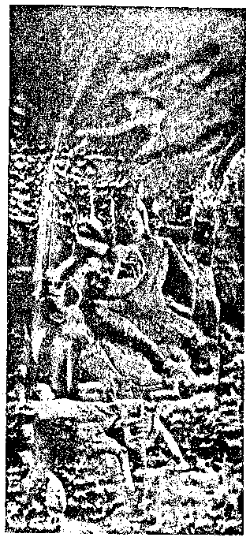



图版一七　湿婆仙（云岗石窟寺第四窟佛籁洞门口所刻，下为金刚力士）



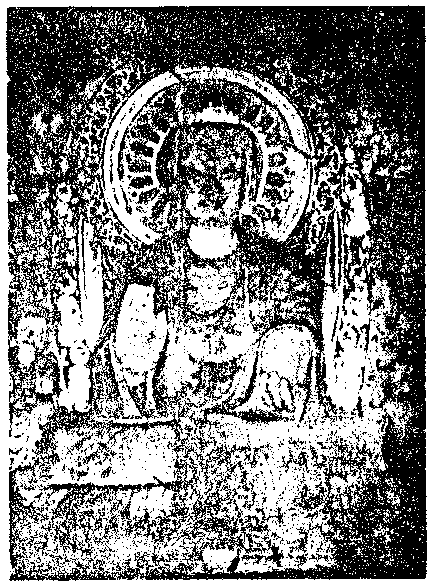



图版一八　龙门宾阳洞北魏造像（宣武帝时造）



------



## 洛阳伽蓝记卷第五



城北



○禅虚寺，在大夏门〔外〕御道西。(外字各本无，今依文例补。)寺前有阅武塲，岁终农隙，甲士习战，千乘万骑，常在於此。(案周礼夏官大司马云：「中冬教大阅。」盖以冬时农隙，民有餘暇，故简阅军实。崇修武事。而总教之也。自汉以降，累世多於秋末岁终之际大阅。张衡东京赋云：「岁惟仲冬，大阅西园。」是也。)



有羽林马僧相善角觝戏，(马僧相，大典卷一三八二四作冯僧相。○史记李斯传「二世作觳抵优俳之观」，集解引应劭曰：「战国之时，稍增讲武之礼，以为戏乐。秦更名角抵。角，角材也。抵，相抵触也。」汉书武帝纪武帝作角觝戏，集注引文颖曰：「秦名此乐为角觝，两两相当，角力，角技艺射御，故名角觝。」案张衡西京赋云：「临迥望之广场，程角觝之妙戏。乌获扛鼎，都卢寻橦，冲狭鷰濯，胷突铦锋。」即角力之戏也，角觝，各本均作觝角，惟大典作角觝，与汉书合。今据正。觝，史记作抵，字通。)掷戟与百尺树齐等。虎贲张车渠，(渠字原脱，此据大典及其他各本补。张车渠，见北史后妃宣武灵皇后胡氏传。元乂、刘腾幽胡太后於北宫，车渠等杀乂，奉太后临朝，事不克，死。)掷刀出楼一丈。帝亦观戏在楼，(帝当为肃宗。)恒令二人对为角戏。(角戏，大典作角觝。)



中朝时，宣武塲在大夏门东北，(在字原脱，此依大典及其他诸本补。○宣武场位于宣武观之北。元河南志卷二引晋宫阁簿云：「宣武观在大夏门内东北。」又水经注谷水条云：「狄泉在洛阳北，后遂为东宫池。其一水，自大夏门东迳宣武观，凭城结构，不更层墉，南望天渊池，北瞩宣武场。」考自曹魏之世，其地即为讲武之所。明帝尝於场上为栏，苞虎爪牙，使力士袒裼，迭与之搏，纵百姓观之（见河南志卷二）。王戎年七岁，亦往观戏。兽凭栏而吼，众皆奔走。戎独不动，神色湛然（见晋书王戎传及世说新语雅量篇）。世以为美谈。)今为光风园，苜蓿生焉。(生，御览卷九九六引作出，大典引作「苜蓿於此出焉」。○汉书西域传云：「罽宾有苜蓿、大宛马。武帝时，得其马。汉使采苜蓿种归，天子益种离宫别馆旁。」西京杂记云：「乐游苑自生玫瑰树，下多苜蓿。苜蓿一名怀风，时人或谓光风。光风在其间，常肃然自照，其花有光彩，故名苜蓿怀风。茂陵人谓之连枝草。」齐民要术卷三云：「生噉为羹甚香，长宜饲马，马尤嗜此物。」)



○凝玄寺，(凝玄，原作凝圆，大典卷一三八二四及逸史本并作凝玄，今从之。)阉官济州刺史贾璨所立也。(阉官上大典有迺字，今各本无。璨，魏书卷九十四阉官传作粲，云：「粲字季宣，酒泉人也。太和中，坐事腐刑，颇涉书记，世宗末，渐被知识，得充内侍。迁光禄大夫。灵太后之废，粲与元乂、刘腾等伺帝动静，闭太后於宣光殿。太后反政，乃出粲为济州刺史。未几，遣刁宣杀之。」)在广莫门外一里御道东，所谓永平里也。



注：即汉太上王广处。(王，大典作皇。案广或即庙字之误。庙俗作庿，是以传写譌作广。惟汉太上皇庙不见史乘方志也。汉高祖父太上皇前史不载其名，后汉书章帝纪「祀太上皇千万年」。注云：名煓（他官反），一名执嘉。见宋孔平仲杂说。又张氏宗祥云：「史通补注篇云；遂乃定彼榛楛，列为子注，若萧大圜淮海乱离志、羊衒之洛阳伽蓝记是也。则衒之此记本自有注，不知何时并入正文，遂至不能分别。此注字之幸存者。自此至下文『不可胜数』句，当是凝圆寺注文。」钩沈本以注下一句为正文。今案依本书文例，自地形以下皆述伽蓝之语，当为正文，非注文也。又陈寅恪先生云：「杨书原本子注必多，自无疑义。若凡属子注悉冠以注字，则正文之与注文分别瞭然，后人传写杨书，转应因此不易淆误。今之注文混入正文者，正坐杨书原本，其子注大抵不冠以注字，故后人传写，牵连不可分别，遂成今日之本。张君所举之例，疑是杨书原本偶用注字，后人不复删去，实非全书子注悉以注字冠首也。」今案：此处注字，恐亦为后人所加。)迁京之初，创居此里，(创上疑夺璨字。)值母亡，舍以为寺。



地形高显，下临城阙，房庑精丽，竹栢成林，实是净行息心之所也。王公卿士来游观为五言者，不可胜数。



洛阳城东北有上商里，(原作上高景，别本作上高里，亦误。案后汉书卷五十九鲍永传云：「光武赐永洛阳商里宅。」注云：「东观记曰：赐洛阳上商里宅。陆机洛阳记曰：上商里在洛阳东北，本殷顽人所居，故曰上商里。」)殷之顽民所居处也。高祖名闻义里。(案名下疑脱为字。)



迁京之始，朝士住其中，迭相讥刺，(讥，原作几，逸史本同，今从津逮本改。)竟皆去之。唯有造瓦者止其内，京师瓦器出焉。世人歌曰：「洛城东北上商里，(洛城，原作洛阳城，今从逸史本。上商里，各本作上高里，误。)殷之顽民昔所止，今日百姓造瓮子，(逸史本作瓮，同。)人皆弃去住者耻。」(案歌辞里止子耻协韵。)唯冠军将军郭文远游憩其中，堂宇园林，匹於邦君。时陇西李元谦乐双声语，(乐，逸史本作能。双声语者，亦名体语，见北史徐之才传。即取双声字以为言辞也。)常经文远宅前过，见其门阀华美，乃曰：「是谁第宅？过佳！」婢春风出曰：「郭冠军家。」元谦曰：「凡婢双声！」春风曰：「儜奴慢骂！」元谦服婢之能，於是京邑翕然传之。(案「是谁」为禅母，「过佳」及「郭冠军家」并为见母，「凡婢」为奉母，「双声」为审母，「儜奴」为泥母，「慢骂」为明母，皆双声字也。「第」为定母，「宅」为澄母，古音亦属同声。此以双声语互相嘲戏，乃一时文士之习尚，南北皆然，故当时之奴婢亦优能为之。儜犹今言那样，文廷式纯常子枝语卷十四谓儜为宁馨之合音。)



○闻义里有炖煌人宋云宅，云与惠生俱使西域也。



神龟元年十一月冬，(御览卷六五七引无冬字。)太后遣崇立寺比丘惠生向西域取经，(崇立，御览引作崇灵。案本书所记佛寺无崇立崇灵之名。卷二有崇真寺，卷三有崇虚寺，此或为崇虚之误。又逸史本作「与惠生向西域取经」，从「云与惠生俱使西域」至「崇立寺比丘」二十五字并脱。)凡得一百七十部，皆是大乘妙典。(宋云与惠生西行求法，其年月史传所记不同。魏书西域嚈哒传云：「熙平中，肃宗遣王伏子统宋云沙门法力等使西域，访求佛经。时有沙门慧生者，亦与俱行，正光中还。」（卷一百二）。释老志亦云：「熙平元年，诏遣沙门惠生使西域采诸经律，正光三年冬还京师。」（卷一百十四）。惟唐道宣释迦方志卷下游履篇云：「后魏神龟元年炖煌人宋云及沙门道生等，从赤岭山傍铁桥至乾陀卫国雀离浮图所，及返，寻於本路。」此与本书所记相合。依本文所记惠生行历年月考之，自以作神龟元年为是。)



初发京师，西行四十日，至赤岭，即国之西疆也。(赤岭，沙畹宋云行记笺注云：「在今青海西宁之西。公元七三四年曾於其处建有唐与吐蕃赞普分界碑。新唐书卷四十地理志鄯州鄯城（今西宁）条下云：西六十里有临蕃城，又西六十里有白水军、绥戎城，又西南六十里有定戎城，又南隔涧七里有天威军，故石堡城。又西二十里至赤岭。逾此有大非川，此川应为青海西岸之布喀音噶尔，过此至吐谷浑界。新唐书所载路程，应为宋云等行程之所经。」)皇魏关防，正在於此。



赤岭者，不生草木，因以为名。其山有鸟鼠同穴。异种共类，鸟雄鼠雌，共为阴阳，即所谓鸟鼠同穴。(汉书地理志云：「陇西首阳县西南有鸟鼠同穴。」尔雅释鸟云：「鸟鼠同穴，其鸟为鵌，其鼠为鼵。」郭注曰：「鼵如人家鼠而短尾，鵌似鹂而小，黄黑色。穴入地三四尺，鼠在内，鸟在外，今在陇西首阳县鸟鼠同穴山中。孔氏尚书传云：共为雄雌，张氏地理记云：不为牝牡（张氏者即张晏）。」案山今在甘肃渭源县西南。甘肃志云：「凉州地有兀儿鼠者，似鼠。有鸟名木儿周者，似雀。常与兀儿鼠同穴而处。」此即鵌、鼵矣。艺文类聚九十二引沙州记曰：「塞岭去大阳川三十里，有雀鼠同穴。」宋书吐谷浑传云：「甘谷岭北有雀鼠同穴，或在山岭，或在平地，雀色白，鼠色黄。」清徐松新疆水道记云：「伊犂赛里木淖尔岸侧，鼠穴甚多，每日黎明，鸟先飞出翱翔，鼠蹲穴口以望，渐趋平地，鸟集鼠背，张翼以嗓，鼠负之往返驰而鸟不坠，良久入穴。」由是可知凉州以西所在多有，形色或不尽同，其同穴止处，则一也。故曰异种同类。)



发赤岭，西行二十三日，渡流沙，至吐谷浑国。(吐，原作土，今从逸史本，下同。)路中甚寒，多饶风雪，飞沙走砾，举目皆满，唯吐谷浑城左右煖於餘处。其国有文字，况同魏。(此句疑为衣冠同魏之误。)风俗政治，多为夷法。(流沙在敦煌之西，古曰沙州，以其风沙流漫，故曰流沙。夏则炎暑，冬则飘雪，故高僧传卷三法显传云：显等西渡流沙，上无飞鸟，下无走兽，四顾茫茫，莫测所之，唯视日以准东西，望人骨以标行路耳。○吐谷浑，辽东鲜卑种，立国於今之青海。魏书卷一百一吐谷浑传称：高祖时，其王伏连筹为魏藩，尝遣世子贺鲁头朝於京师。终世宗世，至於正光，牦牛蜀马及西南之珍，无岁不至。伏连筹死，子夸吕立，始自号为可汗，居伏埃城，在青海西十五里。虽有城廓而不居，恒处穹庐，随水草畜牧。其地东西三千里，南北千餘里，民性贪婪，忍於杀害。好射猎，以肉酪为粮，亦知种田，有大麦粟豆。然其北界，气候多寒，唯得芜菁大麦，故其俗贫多富少。据此则宋云至吐谷浑时其王当为伏连筹也。魏书又云：「其俗丈夫衣服略同於华夏，多以罗幂为冠，亦以缯为帽。妇人皆贯珠贝束发，以多为贵。」法显行传称鄯善国，「其地崎岖薄瘠，俗人衣服粗与汉地同。」案鄯善与吐谷浑毗连，衣著均与华夏相若。依文义，则本文「同魏」上当言其衣著也。今各本作「况同魏」，显有脱误，况盖冠字之讹。冠上疑又夺衣字。)



从吐谷浑西行三千五百里，至鄯善城。其城自立王，(立上自字逸史本无。)为吐谷浑所吞。(吞，逸史本作居。)今城是吐谷浑第二息宁西将军，(城下逸史本有「内主」二字。)总部落三千，以御西胡。(法显行传云：「渡沙河，行十七日，计可千五百里，得至鄯善国。」案鄯善本名楼兰，汉昭帝元凤四年（公元七七）更名鄯善。魏书西域传云：「鄯善国去代七千六百里，所都城方一里，地多沙卤，少水草，北即白龙堆路。」又水经注卷二引释氏西域记曰：「南河自于阗东北三千里至鄯善，入牢兰海。」此所云「牢兰」与「楼兰」盖同出一语。楼兰即由牢兰海得名。牢兰海当即今之罗布泊（Lopnor）。（参看日人崛谦德解说西域记、斯坦因西域考古记）○又元和郡县志卷四十纳职条云：「其城鄯善人所立，胡谓鄯善为纳职，因名县焉。」又云：「东北去伊州（今哈密）一百二十里。」冯氏承钧云：「考其地望纳职应为今之拉布楚克（Lapchuk），拉布 Lap 罗布 Lop 以及西藏语名鄯善之 Lob 皆似不无关系。至若罗布湖南楼兰鄯善之古都似祇有今婼羌县治卡克里克（Charklik）可以当之。」)



从鄯善西行一千六百四十里，至左末城。(大正新藏2086北魏僧惠生使西域记左末作且末。)城中居民可有百家，土地无雨，决水种麦，不知用牛，耒耜而田。城中图佛与菩萨，(城字原阙，图作国。今从逸史本校改。)乃无胡貌，访古老，云是吕光伐胡时所作。(时字各本并无，今据藏本惠生使西域记补。○左末，魏书西域传作且末。大唐西域记卷十二作沮沫。释迦方志卷上作沮末。皆同语之异译也。魏书云：「且末国都且末城，在鄯善西，去代八千三百二十里。」前云鄯善去代七千六百里，则鄯善至且末当为七百二十里。水经注卷二河水条云：「且末国，治且末城，东去鄯善七百二十里。种五谷，其俗略与汉同。」此与魏书所记相合。惟释迦方志卷上遗迹篇云：「自沙州入碛七百餘里，至纳缚波故国（Navapa），即娄兰地，亦名鄯善。又西南千餘里，至折摩陀那故国（Chalmadana），即沮末地。」此本於大唐西域记，与本文一千六百餘里之数相近。且末城，据近人所考，当为今之且末县治车尔成（Charchan）或其附近（见 Thomas Watters, On Yuan Chwang's Travels in India, II, 343-44）。○吕光，魏书卷九十五有传。光字世明，氐人，父婆楼为前秦苻坚太尉。坚以光为骁骑将军。建元十八年（公元三八二），坚遣光伐龟兹、乌耆诸国。光至龟兹，王帛纯拒之，光乃结陈为勾鏁之法，大破之，降者三十餘国。光既破龟兹，获鸠摩罗什。见慧皎高僧传卷二。还至凉州，闻苻坚已为姚苌所害，乃窃号关外，十餘年而卒。史称后凉。)从左末城西行一千二百七十五里，至末城。城傍花果似洛阳，唯土屋平头为异也。(自且末而西，多为荒碛，惊飙拥沙，散如时雨。人畜昏迷，每致危毙。故法显行传有「所经之苦，人理无比」之叹。○此所称之末城，他书未载，以其地望考之，殆在今尼雅之于阗附近。)



从末城西行二十二里，至捍𡡉城。(𡡉，御览卷六五七引作魔。)〔城〕南十五里有一大寺，(南上旧无城字，今补。)三百餘僧众。(原作众僧，各本同，今改。)有金像一躯，举高丈六，仪容超绝，相好炳然，面恒东立，(恒，御览引作常。)不肯西顾。父老传云：(传上御览引有相字。)此像本从南方腾空而来，于阗国王亲见礼拜，载像归，(逸史本作「像载归」。御览引作「于阗国王亲来敬礼，请像载归」。)中路夜宿，忽然不见，遣人寻之，还来本处。王即起塔，(即上王字据御览引增。)封四百户以供洒扫。(以字据御览引增。)户人有患，(户人，逸史本作人户。御览引作「人有患者」。)以金箔贴像所患处，(箔，御览引作薄。)即得阴愈。(阴，御览引作除。)后人於此像边造丈六像及诸像塔，(原作「后人於像边造丈六像者及诸宫塔」。逸史本作「后人於此像边造丈六像者及诸像塔」，此据御览引校。)乃至数千，悬彩幡盖，亦有万计。魏国之幡过半矣。幡上隶书，(幡，原作幅，今依御览引及逸史本改。)多云太和十九年、景明二年、延昌二年。(原脱多字，依御览及逸史本补。)唯有一幡，(幡，原作幅，今从逸史本改。)观其年号是姚兴时幡。(姚兴，原作姚秦，逸史本作姚兴，御览引同。○捍𡡉城即扞弥城。水经注卷二河水条云：「扞弥国，治扞弥城，西去于阗三百九十里。」依玄奘记，沮沫西千餘里有尼壤城（即今之尼雅），为于阗东境之关防，往来者莫不由焉。从关西入沙碛，行二百餘里，至嫓摩城。城有雕檀立佛像，高二丈餘，甚多灵应。凡有疾病，随其痛处，金簿帖像，即时痊复。闻之土俗曰，此像昔佛在世，憍赏弥国（Kausambi）邬陀衍那王（Udayana）所作也。佛去世后，自彼凌空至此国北曷劳落迦城中。初到此城，人安乐富饶，深著邪见，而不珍敬，后复自移到此（亦见彦琮慈恩法师传）。据此复可证捍𡡉城，亦即玄奘记之嫓摩城。往者斯坦因於于阗探险，研究其位置，约在今和阗东北五十五哩地方，当塔里木流域之南，为入西域通行之孔道也（详崛谦德书页1048）。○沙畹云：后秦三主，公元三八四至三九三年为姚苌，三九四至四一五年为姚兴，四一六至四一七年为姚泓。法显西迈，即在姚兴之时，宋云所见姚兴时幡，得为法显所建也。)



从捍𡡉城西行八百七十八里，至于阗国。王头著金冠，似鸡帻，头后垂二尺生绢，广五寸，以为饰。威仪有鼓角金钲，弓箭一具，戟二枝，槊五张。左右带刀，不过百人。其俗妇人袴衫束带，乘马驰走，与丈夫无异。死者以火焚烧，收骨葬之，上起浮图。居丧者，翦发剺面，(剺，原误作劈，逸史本同，今从津逮本校正。)以为哀戚。(以字原夺。今据逸史本补。)发长四寸，即就平常。唯王死不烧，置之棺中，远葬於野，立庙祭祀，以时思之。(此所记由捍𡡉至于阗之里程似有讹误。水经注云「捍弥城西去于阗三百九十里」。玄奘所记，自嫓摩至于阗，行三百三十餘里。与此有异。郦道元、玄奘当得其实。○魏书西域传云：「于阗国在且末西北，葱岭之北二百餘里。其地方亘千里，连山相次，所都城方八九里。自高昌以西诸国人等深目高鼻，唯此一国，貌不甚胡，颇类华夏。」○玄奘西域记云：「瞿萨旦那国（Kustana），唐言地乳（Ku 为地，Stana 为乳），即其俗之雅言也。俗谓之涣那，匈奴谓之于遁，诸胡谓之豁旦，印度谓之屈丹，旧曰于阗譌也。」沙畹云：「于阗古都在今和阗县治额里齐西七英里处，在今玉珑哈什（白玉河）及哈喇哈什（黑玉河）二河之间。」考二水皆自昆仑山北流，於和阗之东北八十英里合流，称和阗河。二流相距十三英里，而所经则为沃野，故农业繁盛，蚕织亦富。于阗既当中西交通之冲会，佛典之传入于阗必甚早。曹魏甘露五年朱士行所获梵本般若经即得自于阗者也。○梁书卷五十四西域传云：「于阗王冠金帻，如今胡公帽，与妻并坐接客。国中妇人皆辫发，衣裘袴。其人恭，相见则跪，其跪则一膝至地。」此所称金帻，即鸡帻也。○法苑珠林卷九十七云：「西域葬法有四：一水漂，二火焚，三土埋，四施林。」此称死者以火焚烧，殆西域天竺之通俗也。净饭王泥洹经云：「白饭王在舍夷国病终，烧身收骨，藏置金刚函，即於其上起塔，县缯幡盖，供养塔庙。」与本文所记于阗风俗相合。夫既葬而又起浮图者，其意有三：一表人胜，二令他信，三为报恩。见法苑珠林卷三十七。○剺面者，以刀划面也。徐锴说文解字系传曰：「史匈奴剺面不哀。」新唐书郭元振传云「召为太仆卿，安西酋长有剺面哭送者」，是也。如隐本作劈面，误。○发长四寸，即就平常者，所以节哀而复生也。立庙祭祀，以时思之者，所以致追慕之诚也。「以时思之」，见孝经丧亲章，沙畹以为思当作祀，非。)



于阗王不信佛法。(于阗上当有昔字。)有商胡将一比丘名毗卢旃在城南杏树下，(胡字原脱，名，原作石，今从津逮本正。)向王伏罪云：「今輙将异国沙门来在城南杏树下。」(异，原作吴，误。逸史本作异，御览九六八引同，今据改。)王闻忽怒，(御览引作忿。)即往看毗卢旃。旃语王曰：(御览引不重旃字。又曰字作言。)「如来遣我来，令王造覆盆浮图一所，(所，原作躯，各本并同。案浮图不得言躯，下文云「惠生割舍行资，於山顶造浮图一所」，是当言一所。)使王祚永隆。」王言：「令我见佛，(令，御览及逸史本作使。)当即从命。」(御览作「我当从命」。)毗卢旃鸣钟告佛，即遣罗睺罗变形为佛，(御览作「变为佛形」。)从空而现真容。(现，御览及逸史本作见，同。)王五体投地，即於杏树下置立寺舍，畫作罗睺罗像。忽然自灭，于阗王更作精舍笼之。今覆瓫之影，(原作「令覆瓮之影」，逸史本作「今之覆瓦之影」。案令当作今，瓮当作瓫，瓫，即盆字也。)恒出屋外，见之者无不回向。其中有辟支佛靴，於今不烂，非皮非彩，(彩字原脱，津逮本作缯，逸史本作非皮彩。案酉阳杂爼前集十云：「于阗国賛摩寺有辟支佛𫖇，非皮非彩，岁久不烂。」今据校。)莫能审之。(案大唐西域记卷十二云：「瞿萨旦那国（即于阗），伽蓝百有餘所，僧徒五千餘人，并多习学大乘法教。王城南十餘里有大伽蓝，此国先王为毘卢折那（Vairocana 唐言遍照）阿罗汉建也。昔者此国佛法未备，而阿罗汉自迦湿弥罗国（Kasmir）至此林中宴坐习定，王躬往观其容止。曰：尔何人乎？独在幽林。罗汉曰：我如来（Tathagata）弟子，闲居习定，王宜树福，弘赞佛教，建伽蓝，召僧众。王曰：如来者，有何德？有何神？而汝鸟栖，勤苦奉教。曰：如来慈愍四生，诱导三界，或显或隐，示生示灭，遵其法者，出离生死。王曰：既云大圣，为我现形，既得瞻仰，当为建立，罄心归信，弘扬教法。罗汉曰：王建伽蓝，功成感应。王苟从其请，建僧伽蓝，远近咸集，法会称庆。王谓罗汉曰：伽蓝已成，佛在何所？罗汉曰：王当至诚，圣鉴不远。王遂礼请。忽见空中佛像下降，因即诚信，弘扬佛教。」此与本文所记相同，可资参证。○魏书于阗传云：「城南十五里（十五原作五十，今据水经注卷二改，详下文），有賛摩寺，即昔罗汉比丘比卢旃为其王造覆盆浮图之所，石上有辟支佛（Pratyeka Buddha）跣处，双迹犹存。」据是，则其寺名賛摩寺也。水经注卷二云：「城南十五里有利刹寺，中有石𫖇，石上有足迹，彼俗言是辟支佛迹，法显所不传，疑非佛迹也。」此所称利刹寺，盖即賛摩寺也。○覆盆浮图者，谓所建浮图之顶圆拱如覆盆也。○如来，翻义名义集第一篇十种通号多陀阿伽陀条云：「后秦翻为如来，金刚经云：无所从来，亦无所去，故名如来。」○罗睺罗（Rahula），太子之子。○礼拜时双膝双肘及顶在地曰五体投地。○辟支佛，法门名义集云：「此云缘觉。辟支者，此言缘。佛者，此言觉。一者，出无佛世，犹悟非常思惟，得道，名为缘觉辟支；二者，值佛为说十二因缘之法，观因缘之理，而得悟道，名为声闻辟支。於三乘中，此为中乘。」)



案于阗国境，(原无国字，此从逸史本增。)东西不过三千餘里。(西域记卷十二谓于阗国周四千餘里，沙碛太半，壤土隘狭。此云东西不过三千餘里，与西域记不同，盖皆约计之辞耳。)



神龟二年七月二十九日入朱驹波国。人民山居，五谷甚丰，食则面麦，(逸史本作麦麸。)不立屠煞。食肉者，以自死肉。风俗言音与于阗相似，文字与婆罗门同。(婆，原作波，今从逸史本。)其国疆界可五日行遍。(朱驹波国（Cokkuka，师觉月先生说），史籍所载名目不一。魏书于阗疏勒传并作朱俱波，新唐书卷二百二十一上疏勒传又云亦名朱俱槃，历代三宝记卷十二作遮拘迦，一本作遮拘槃，西域记卷十二则作斫句迦（Chakuka）。诸名虽小有异同，所指之方域不殊。其去于阗盖有千里。魏书云：「于阗国去朱俱波千里。」新唐书云：「朱俱波亦名朱俱槃，汉子合国也。并有西夜、蒲犂、依耐、得若四种地。直于阗西千里，葱岭北三百里，西距喝槃陀北九百里。」惟依西域记所叙自于阗至斫句迦越山谷行八百餘里，其里数稍短。考其地望，文献通考卷三百三十七疏勒条云：「南去莎车五六百里，去朱俱波八九百里。」是朱驹波当在莎车稍南。莎车今近叶尔羌地（Yarkand），则朱驹波当在叶尔羌之南矣。斯坦因以为当在今叶尔羌南之叶城县治哈尔噶里克（Karghalik），处於自和阗赴塔什库尔罕（Tash-kurghan 即今蒲犂县治）路中。案西域记称其国临带两河，两河即叶尔羌河（Yarkand）及其支流提士那夫（Tisnaf）河，其地域甚明。○西域记云：「斫句迦国周千餘里，大城周十餘里，坚峻险固，编户殷盛，山阜连属，砾石弥漫，临带两河，颇以耕植。文字同瞿萨旦那国，言语有异。」此云文字与于阗同，与本文有异。新唐书则云「文字同婆罗门」也。案于阗文字或谓自藏文而来，婆罗门书则为天竺文字，其书写之体式亦不相同。○此国大乘经典最富，历代三宝记、西域记均有记述。)



八月初入汉盘陀国界。(汉，藏本惠生使西域记作渴。)西行六日，登葱岭山。(六日，藏本惠生使西域记作六百里。)复西行三日，至钵盂城。(钵盂，逸史本作钵猛。)三日至不可依山。其处甚寒，冬夏积雪。(汉槃陀，魏书作渴槃陀。梁书、南史均作渴盘陀。唐书作喝盘陀，云或曰汉陀，曰渴饭檀，亦曰渴罗陀。西域记则作朅槃陀。盖皆一语之异译也。沙畹谓其原名当为 Karband 或 Garband。魏书云：「渴槃陀国，在葱岭东，朱驹波西。河经其国东北流，有高山，夏积霜雪。」梁书云：「其西隣滑国，南接罽宾国，北连沙勒国，所治在山谷中，城周四十餘里。国有十二城，风俗与于阗相类。」西域记云：「其国周二千餘里。国大都城，基大石岭，背徙多河（Sita），周二十餘里。山岭连属，川原隘狭，谷稼俭少，菽麦丰多。林树稀，华果少。原隰丘墟，城邑空旷。衣服毡褐，文字语言大同佉沙国（Kasha）。」考其地当在今蒲犂县治塔什库尔罕一带，其全境称色勒库尔（Sarikol）。○钵盂，其地未详，盖在今之 Onkul 等地。不可依山，即小帕米尔地带。)



山中有池，毒龙居之。昔有三百商人(三百二字原无，太平广记卷四百十八引作「昔三百商人」，今补。三百二字，御览卷九百三十引作五百。)止宿池侧，值龙忿怒，泛杀商人。(泛，原作呪，逸史本同。今依广记、御览引改。)盘陀王闻之，舍位与子，向乌塲国学婆罗门呪，四年之中，尽得其术。(尽，广记、御览引作善，逸史本同。)还复王位，就池呪龙。(广记引如此，原作「复呪池龙」。)龙变为人，(变，广记引作化。)悔过向王。王即徙之葱岭山，(即上王字原脱，广记引有，津逮本、逸史本并同。又即字，御览作乃。徙之，广记作从之，御览作舍之。)去此池二千餘里。(二千，逸史本作二十。)今日国王十三世祖〔也〕。(也字各本并无，今依文意增。○乌场国（Uddiyana），亦称乌苌国，位汉盘陀西南。魏书云：「乌苌国，婆罗门胡为其上族，婆罗门多解天文吉凶之数，其王动则访决焉。」西域记亦称其民以梵呪为艺业。案梵呪即陀罗尼（dharani）也。婆罗门独精其术，故王往学焉。本书卷四法云寺条所称乌场国沙门昙摩罗即精於呪术者，而北天竺沙门菩提流支据续高僧传称亦兼工呪术，足见婆罗门呪行於乌场及北天竺。)



自此以西，山路欹侧，长坂千里，(长，逸史本作危。)悬崖万仞，极天之阻，实在於斯。太行孟门，匹兹非险，崤关陇坂，(陇，原作垅，此从逸史本。)方此则夷。自发葱岭，步步渐高，如此四日，乃得至岭。依约中下，(下，逸史本作夏，误。)实半天矣。汉盘陀国正在山顶。(法显行传云：「葱岭山，冬夏有雪，又有毒龙，若失其意，则吐毒风，雨雪飞沙，遇此难者万无一全。彼土人即名为雪山也」案此即塔什敦巴什区域（Taghdumbash Pamir）。○依约中下实半天矣者，言所处似卑，而实居半天之上矣。○汉盘陀正在山顶，即玄奘所谓城基大石岭也。新唐书云：「喝盘陀距瓜州四千五百里，直朱俱波西，南距悬度山，北抵疏勒，西获密（今之 Wakhan），西北判汗国（今之 Ferghana）也。治葱岭中，都城负徙多河。」)自葱岭已西，水皆西流，(逸史本及藏本惠生使西域记「西流」下并有「入西海」三字。案汉书西域传曰：「于阗之西，水皆西流，注西海。」)世人云是天地之中。人民决水以种，(以，逸史本作而。)闻中国田待雨而种，笑曰：「天何由可共期也？」城东有孟津河，东北流向沙勒。葱岭高峻，不生草木。是时八月，天气已冷，(冷，汉魏、真意二本作寒。)北风驱雁，飞雪千里。(戈登（Charles George Gordon）帕米尔游记（光绪丁酉译本）称自塔什库尔干西行第三日，经尼苕塔什山口（Neza-tash Pass），山南北行，为东西大分水界。是即凉土异物志所谓「葱岭之水分流东西，西入大海，东为河源。禹记所云昆仑者焉」（水经注卷二引）。○孟津河依玄奘西域记及唐书所载当即徙多河。此河既流向沙勒，当即今之塔什敦巴什河（Taghdumbash）。见冯承钧西域地名。○沙勒，汉书以下正史皆称疏勒。梁高僧传鸠摩罗什条及悟空入竺记皆称沙勒，玄奘西域记称为佉沙（Khasa）。云：「旧谓疏勒者，乃称其城号也。正音宜云室利讫栗多底，疏勒之言犹为譌也。」案沙勒、疏勒皆一语也。慧超往五天竺传云：「外国自呼名伽师祇离。」慧琳一切经音义作伽师佉黎（Kashgiri）。元史卷六十三地理志畏兀儿（Vigur）有国名可失哈耳（Kashgar），即此地也。元至今呼为喀什噶尔。○玄奘记云：「葱岭东冈四山之中，地方百餘顷，正中垫下，冬夏积雪，风寒飘劲。畴垅泻卤，稼穑不滋，既无林树，唯有细草。时虽暑热，而多风雪，人徒才入，云雾已兴，商侣往来，苦斯艰险。」然则惠生远迈，时入素秋，餐风卧雪，峻险相望，其苦可知矣。)



九月中旬入钵和国。高山深谷，崄道如常。国王所住，因山为城。人民服饰，惟有毡衣。地土甚寒，窟穴而居。风雪劲切，人畜相依。国之南界有大雪山，朝融夕结，望若玉峰。(案宋云当自 Neza-tash 山口入葱岭，经 Taghdumbash 区域，由 Paik Pass 出 Wakhjir Pass 而抵钵和。钵和国（Parvata）一名镬侃（Hu-Kand）又名护密（Hu-Zaedan），或名达摩悉铁帝（Dharmasthiti），见新唐书卷二百二十一下识匿条（伊兰土语 Hu-Kand 乃山地之义。Hu-Maedan 乃山间之义。梵语 Dharma 义为中间，Sthiti 义为所在，Dharmasthiti 即位於中间之义。见堀谦德书。）玄奘西域记称：「达摩悉铁帝国在两山间，覩货逻国（Tukhara）故地也。东西千五六百里，南北广四五里，狭则不逾一里。临缚刍河，盘纡曲折，堆阜高下，沙石流漫，寒风凄烈。人性犷暴，衣服毡褐，眼多碧绿，异於他国。」魏书西域传云：「钵和国，在渴槃陀西，其土尤寒，人畜同居，穴地而处。又有大雪山，望若银峰。其人唯食饼𪎊，饮麦酒，服毡裘。有二道：一道西行向嚈哒，一道西南趣乌苌。亦为嚈哒所统。」是此国适当入嚈哒之路。据近人所考，当为今和罕（Wakhan）南山间一带。其王城，新唐书谓为塞迦审城（Skashim），北临乌浒河（Oxus），乌浒即玄奘记之缚刍也，其地当即今之伊塞迦审（Iskashem）。)



十月之初，(逸史本作「十月初旬」。)至𠿒哒国。(𠿒哒，逸史本作[口*猒]哒，下同。魏书则作嚈哒。)土田庶衍，山泽弥望，居无城郭，游军而治。以毡为屋，(屋字逸史本作衣，误。)随逐水草，夏则迁凉，(迁，原作随，各本并同。今据魏书嚈哒传改。)冬则就温。乡土不识，文字礼教俱阙。阴阳运转，莫知其度，年无盈闰，月无大小，周十二月为一岁。(周，原作用，各本并同。此从藏本惠生使西域记。)受诸国贡献，南至牒罗，北尽勅勒，(勒，原作懃，津逮本同，逸史本作勤。)东被于阗，西及波斯，四十餘国皆来朝贡。(贡，原作贺，津逮本同。此从逸史本及藏本惠生使西域记。○𠿒哒字亦作嚈哒（Hephthalites 或作 Ephthal）。魏书云：「嚈哒国，大月氏之种类也，亦曰高车之别种，其原出塞北。自金山而南，在于阗之西，都乌浒河（Oxus）南二百餘里，去长安一万一百里，其王都拔底延城（Baktria，今之 Balkh，冯承钧说），风俗与突厥略同，其语与蠕蠕、高车及诸胡不同。众可十万，无城邑。依随水草，以毡为屋，夏则迁凉，冬逐煖处。其王巡历而行，每月一处，冬寒之时，三月不徙。其人凶悍，能鬪战，西域康居、于阗、沙勒、安息及诸小国三十许，皆役属之。号为大国。自太安以后，每遣使朝贡。正光末遣使贡师子一，至高平（甘肃平凉），遇万俟丑奴反，因留之。丑奴平，送京师。永熙以后，朝献遂绝。」案此国当魏世最为强大，至北齐天统以后遂为突厥所灭。○牒罗国无考。○勅勒，一名铁勒，并见新唐书。沙畹笺注云：「其地东起嗢昆河（Orkhan），西抵罗马帝国。」其西突厥史料则称东起独洛（Tolak）。（冯译本页157）○波斯，魏书西域传云：「古条支国也，去代二万四千二百二十八里。」玄奘西域记作波剌斯国。云：「旧曰波斯，略也。其国周数万里，川土既多，气序亦异。文字语言，异於诸国。」於神龟中尝遣使入贡，见魏书西域传。)王居大毡帐，(居，原作张，此从逸史本。)方四十步，周廻以氍毹为壁。王著锦衣，坐金床，以四金凤凰为床脚。见大魏使人，再拜跪受诏书。至於设会，一人唱，则客前后唱，则罢会，(谓唱已则罢会也。)唯有此法，不见音乐。(魏书波斯传云：「以六月为岁首。尤重七月七日、十二月一日，其日民庶以上各相命召，设会作乐，以极懽娱。」○案𠿒哒与波斯突厥风习相同。魏书波斯传云：「其王坐金羊床，戴金花冠，衣锦袍，织成帔，饰以真珠宝物。」)



𠿒哒国王妃亦著锦衣，长八尺奇，(长八尺奇，原在下文「头带一角」下，各本同，此盖传写之误。今依文意改。)垂地三尺，使人擎之，头带一角，长三尺，以玫瑰五色珠装饰其上。(珠字原无。魏书波斯传云：「妇女服大衫，披大帔，其发前为髻，彼披之，饰以金银花，仍贯五色珠，落之於膊。」此文五色下盖脱一珠字。)王妃出则舆之，(舆，原误作与，依逸史本、津逮本改正。)入坐金床，以六牙白象四狮子为床，(西域记卷二谓印度黎庶坐止咸用绳床，王族大人士庶豪右庄饰有殊，规矩无异。君王朝座，弥复高广，珠玑间错，谓师子床（sinihāsana）。)自餘大臣妻皆随。伞头亦似有角，团圆下垂，(原作垂下，今从逸史本。)状似宝盖。(𠿒哒妇人头带角帽，亦见魏书。魏书云：「其俗兄弟共一妻，夫无兄弟者，其妻戴一角帽，若有兄弟者，依其多少之数更加角焉。衣服类加以缨络，头皆剪发。」玄奘西域记云：「呬摩呾罗国（Hismatala，义云云山之下）妇人首冠木角，高三尺餘，前有两岐，表夫父母，上岐表父，下岐表母，随先丧亡，除去一岐。舅姑俱殁，角叶全弃。其先强国，王释种也。葱岭之西，多见臣伏。境隣突厥，遂染其俗。」是妇人之带角帽，本为突厥之风习，境隣彼界，征伐往来，遂多效焉。)



观其贵贱，亦有服章。四夷之中，最为强大。不信佛法，多事外神。杀生血食，器用七宝。诸国奉献，甚饶珍异。(亦有服章者，言其上下有别也。魏书波斯传云：「国中大官既有所司，而其下皆有属官，分统其事。」𠿒哒盖与波斯相同。○多事外神者，魏书波斯传云：「俗事火神，天神。」火神即拜火教，天神即大自在天（梵文 Mahesvara）。)



按𠿒哒国去京师二万餘里。



十一月初入波知国。(知，各本作斯，误。)境土甚狭，七日行过，人民山居，资业穷煎，风俗凶慢，见王无礼。国王出入，从者数人。其国有水，昔日甚浅，后山崩截流，(截，逸史本作绝，义同。)变为二池。毒龙居之，多有灾异。夏喜暴雨，冬则积雪，行人由之，多致艰难。(艰难，原作难艰，此从逸史本。)雪有白光，照耀人眼，令人闭目，茫然无见。祭祀龙王，然后平复。(沙畹云：「按此国非西亚之波斯，而为 Zebak 与 Chitral 间之一小国。国在北史中名曰波知。」案今各本作波斯者，盖传写之误。魏书西域传云：「波知国，在钵和西南，土狭人贫，依托山谷，其王不能总摄。有三池，传云大池有龙王，次者有龙妇，小者有龙子。行人经之，设祭乃得过。不祭，多遇风雪之困。」此与本文正合。本文「变为二池」，二字疑为三字之误。)



十一月中旬入赊弥国。此国渐出葱岭，土田峣崅，(峣崅，玉篇作硗确。坚瘠之地也。敲学二音。)民多贫困。峻路危道，人马仅通。一直一道，从钵卢勒国向乌塲国，(钵卢勒即玄奘记中之钵露罗国（Bolora），魏书称为波路，唐书称小勃律。其国在大云山间，东西长，南北狭。在今 Yassin 河与 Gilgit 流域。依玄奘记，自此至乌场国境约五百餘里。)铁锁为桥，悬虚而度，(而度，各本并譌作为渡。案魏书云：「赊弥国东有钵卢勒国，险崄缘铁锁而度，下不见底。」今据正。)下不见底，旁无挽捉，倏忽之间，投躯万仞，是以行者望风谢路耳。(逸史本无耳字。释法显行传曰：「度葱岭已入北天竺境，于此顺岭西南行十五日，其道艰阻，崖岸险绝，其山惟石，壁五千仞，临之目眩，欲进则投足无所，下有水名新头河（Indus）。昔人有凿石通路施倚梯者，凡度七百梯，度已（此从赵刻水经注引），蹑悬𫄠过河，河两岸相去咸八十步，九译所绝，汉之张骞、甘英皆不至也。」案新头河即指今印度河之上流 Yassin 河也。高僧传昙无竭传云：「登葱岭、度雪山，障气千重，层冰万里。下有大江，流急若箭。於东西两山之脇，系索为桥，十人一过，到彼岸已，举烟为帜，后人见烟，知前已度，方得更进。若久不见烟，则知暴风吹索，人堕江中。行经三日，复过大雪山，悬崖壁立，无安足处。石壁皆有故杙孔，处处相对，人各执四杙，先拔下杙，手攀上杙，展转相攀，经日方过。」玄奘西域记亦云：「自乌仗那（即乌场）至钵露罗，或履縆索，或牵铁锁，栈道虚临，飞梁危构，椓杙蹑登，履危涉险。」斯即史传所称悬度之山也。○沙畹云：「按北史钵卢勒国在赊弥之东，宋云由此赴乌场之险路，即沿辛头河奔流经过 Dardistan 进向乌场之道。」今按魏书称钵卢勒国路险，宋云等竟不能达，非也。○魏书西域传云：「赊弥国（Sāmbhi），在波知之南，山居，不信佛法，专事诸神。亦附嚈哒。」玄奘西域记曰：「商弥国，周二千五六百里，山水相间，堆阜高下，人性淳质，俗无礼义。」商弥即赊弥也。沙畹笺注谓其地在今之 Chitral，西突厥史料（页244）则谓在今之 Mastuj。案宋云既由此入钵卢勒国，钵卢勒在今 Yassm 河流一带，则以后说为是。)



十二月初入乌塲国。北接葱岭，南连天竺，土气和暖，地方数千里，(里字各本并脱，此依吴若准集证补。)民物殷阜，匹临淄之神州，原田膴膴，(膴膴，美也。诗大雅緜篇云：「周原膴膴。」)等咸阳之上土。鞞罗施儿之所，萨埵投身之地，旧俗虽远，土风犹存。(乌场，魏书西域传作乌苌，法显行传及水经注卷一作乌长，开元释教录作邬荼。玄奘记作乌仗那。注曰：「旧云乌场，或曰乌茶，皆讹。其国周五千餘里。」乌仗那为梵语 Uddiyana（或作 Udyāna）之音译，义为游园。慈恩法师传注云：「唐言苑。昔阿输迦王之苑也。」其领域当今 Swat 河沿岸。○鞞罗施儿见太子须大拏经。详下文。梵本本生鬘经太子名 Visvantara，中国藏经生经太子名须太拏，沙畹云：鞞罗即 Visvanatara 之省译。○萨埵投身见金光明经卷四。详下文。萨埵，即摩诃萨埵（Mahāsattva）之省称。)国王精进，(进，原作食，误。此从逸史本正。)菜食长斋，晨夜礼佛，击鼓吹贝，琵琶箜篌，笙箫备有。日中已后，始治国事。假有死罪，不立杀刑，唯徙空山，(徙，原作从，误。此据逸史本改正。)任其饮啄。事涉疑似，以药服之，清浊则验。随事轻重，当时即决。(魏书云：「乌苌国，土多林果，引水灌田，丰稻麦。事佛，多诸寺塔，事极华丽。人有争诉，服之以药，曲者发狂，直者无恙。为法不杀，犯死罪唯徙於空山。」（空山，原作灵山，误。）与本文所记相合。此称清浊皆验者，清浊即善恶也。清者洁白无邪，浊者污垢多乱，故以清浊方人之美恶。)土地肥美，人物丰饶。五谷尽登，百果繁熟。(各本并作「百谷尽登，五果繁熟」，盖误。玄奘记云：「乌仗那国，山谷相属，川泽连原，谷稼虽播，地利不滋。土产金钱，宜郁金香。林树蓊郁，花果茂盛。坚城四五，其王多治瞢揭厘城（Mangkil，在今之 Manglaur），城周十六七里，居人殷盛。城东四五里大窣堵坡，极多灵瑞。」)夜闻钟声，遍满世界。土饶异花，冬夏相接，道俗采之，上佛供养。



国王见宋云云大魏使来，(逸史本作「国王见大魏使宋云来」。)膜拜受诏书。(穆天子传卷二「吾乃膜拜而受」，郭璞曰：「今之胡人礼佛，举手加头，称南膜拜者，即此类也。膜音模。」)闻太后崇奉佛法，即面东合掌，遥心顶礼。遣解魏语人问宋云曰：「卿是日出人也？」(日出即东方。楼炭经云：「葱河以东，名为震旦。以日初出，耀於东隅，故得名也。」)宋云答曰：「我国东界有大海水，日出其中，实如来旨。」王又问曰：「彼国出圣人否？」宋云具说周孔庄老之德；次序蓬莱山上银阙金堂，神僊圣人并在其上；说管辂善卜，华陀治病，左慈方术；如此之事，分别说之。王曰：「若如卿言，即是佛国，我当命终，愿生彼国。」(管辂（208-255）三国志魏志卷二十九有传。华陀见魏志卷二十九及后汉书卷一百一十二下。左慈见后汉书卷一百一十二下。)



宋云於是与惠生出城外，寻如来教迹。水东有佛晒衣处。初如来在乌塲国行化，龙王瞋怒，(怒，逸史本作恚。)兴大风雨，佛僧迦梨表里通湿。(此城即玄奘记之瞢揭厘城。西域记卷三云：「城东北行二百五六十里，入大山，至阿波逻罗龙泉（Apalāla），即苏婆伐窣堵河（Subhavastu）之源也。此龙者，迦叶波佛（Kāsyapa Buddha）时，生在人趣，名曰殑祇（Gangi），深闲呪术，禁御恶龙，不令暴雨，国人赖之，以畜餘粮。居人众庶，感恩怀德，家税斗谷，以馈遣焉。既积岁时，或有逋课，殑祇含怒，愿为毒龙，暴行风雨，损伤苗稼。命终之后，为此池龙，泉流白水，损伤地利。释迦如来，大悲御世，愍此国人，独遭斯难，降神至此，欲化暴龙，执金刚神杵（vairapāni），系山崖，龙王震惧，乃出归依。」按佛行化度恶龙事，见菩萨本行经卷中，善见律毗婆沙卷二，阿育王传卷四。○僧迦梨（saṅghāti）者，沙门之法服，即复衣也。由肩至膝束於腰间。西域记、南海寄归内法传作「僧伽胝」，同。)雨止，佛在石下东面而坐，晒袈裟。(袈裟（kāṣāga），僧人法服之总名。)年岁虽久，彪炳若新。非直条缝明见，至於细缕亦彰。(彰，原作新，此从逸史本。)乍往观之，如似未彻，假令刮削，其文转明。(晒衣石，据玄奘所记在龙泉西南数十里，袈裟之文，焕然如镂。法显云其石高丈四尺，阔二丈许。)佛坐处及晒衣所，并有塔记。



水西有池，龙王居之，池边有一寺，五十餘僧。龙王每作神变，国王祈请，以金玉珍宝投之池中，在后涌出，令僧取之。此寺衣食，待龙而济，(待，御览卷九百三十引作恃。)世人名曰龙王寺。



王城北八十里，(八十，逸史本作十八，误。)有如来履石之迹，起塔笼之。履石之处，若践水泥，(原作「若水践泥」，逸史本作「若以浅泥」，并误。)量之不定，或长或短。今立寺，可七十餘僧。(如来履石足迹，法显行传、西域记并有称述。法显行传云：「乌长国是北天竺也。佛至北天竺，即到此国，遗足迹於此，或长或短，在人心念，至今犹尔。」玄奘云：「阿波逻罗龙泉西南三十餘里水北岸大磐石上有如来足所履迹，随人福力，量有长短，是如来伏龙已，留迹而去。后人於上积石为室，遐迩相趋，花香供养。」)塔南二十步，有泉石。佛本清净，嚼杨枝，植地即生，今成大树，胡名曰婆楼。(杨枝，天竺人用以净齿者也。义净南海寄归内法传称之曰齿木。彼土人士，无分老幼，朝起饭后，皆熟嚼之，以水漱净，可以坚齿。其木苦涩辛辣，嚼之成絮，本名齿木（dantakāṣṭha，义净译为惮哆家瑟陀，惮哆为齿，家瑟陀为木，即齿木之义也），梵名 khadira，非杨柳也。案如来净齿遗枝而成奇树，此与法显行传所述沙祇国（即舍卫国，玄奘记卷三作鞞索迦国）者正同。传称：「出沙祗城南门，道东，佛本在此嚼杨枝已，刺土中，即生长七尺，不增不减，诸外道或斫或跋，续生如故。」)



城北有陀罗寺，佛事最多。浮图高大，僧房逼侧，(逼侧，相迫也。言僧房相接也。)周匝金像六千躯。(六千，逸史本作六十。)王年常大会，皆在此寺。(逸史本作皆此寺，无在字，非。)国内沙门，咸来云集。宋云惠生见彼比丘戒行精苦，观其风范，特加恭敬。遂舍奴婢二人，以供洒扫。(王年常大会者，殆即法显行传所称五年大会之类。传称：「法显到竭叉国，值其国王作般遮越师（Pañcha Parishad），般遮越师，汉言五年大会也。会时，请四方沙门，皆来云集，众僧坐处，悬缯幡盖，作金银莲华著僧座后，铺净坐具，王及群臣如法供养。或一月、二月，或三月，多在春时。王作会已，复劝诸群臣设供供养，发愿布施众僧。」)



去王城东南，山行八日，〔至〕如来苦行投身饲饿虎之处。(至字各本并无，今依文意补。饲饿虎，原无饲字，津逮本饿作喂。法显行传称投身𫗪饿虎，西域记称投身饲饿乌䖘（唐人避讳，故不作虎，而作乌䖘），是饿字亦不宜省。考释藏有菩萨投身饲饿虎起塔因缘经，是当有饲字也。)高山巃嵸，(音笼葼。高峻貌。)危岫入云。嘉木灵芝，丛生其上。林泉婉丽，花彩曜目。宋云与惠生割舍行资，於山顶造浮图一所，刻石隶书，铭魏功德。山有收骨寺，三百餘僧。(如来投身饲饿虎处，法显行传在竺刹尸罗国（梵语 Takṣaśila）之东。竺刹尸罗国，玄奘记作呾叉始罗国。云：「自呾叉始罗国北界渡信度河（Indus），东南行二百餘里（释迦方志作百里），度大石门，即至其处。其南四五十步，且有石塔。」考竺刹尸罗国即在乌场国之东南，而此远於乌场国者，盖游涉所经，随笔记次，未分别详述耳。沙畹谓投身饲饿虎处依玄奘记所述之行程，自当在今 Mahaban 左近。○如来投身饲虎之事，见菩萨本生鬘论（卷一），及贤愚经（卷一）、六度集经（卷一），而北凉高昌沙门法盛所译菩萨投身饲饿虎起塔因缘经尤为详备。盖佛告阿难，过去无量世时，有大国，其王曰大宝（Maharatha）。王有三子，长曰摩诃波罗（Mahapala），次曰摩诃提婆（Mahādeva），季曰摩诃萨埵（Mahāsattva）。一日王与群臣共游山谷，三子共入竹林，见有一虎新产数子，无暇求食。第一王子以为虎母饥困交迫，必噉其子，而后乃生。第二王子以为非新屠血肉，莫之能救。是时二人舍之而去。第三王子随属其后，因思此身虚弃败坏，曾无少益，何不舍身，救济众生，永离忧苦。乃合手投身岩下，以乾竹刺颈出血，虎得噉食，母子俱活。及二王子往寻，唯见遗骨狼藉在地，心肝断绝，久乃得稣。及报父王，悲不自胜，如鱼处陆，如牛失犊，乃收遗骨，以宝器盛之，起塔供养。佛告阿难，尔时摩诃萨埵即我身也。以吾布施，不惜身命救众生故，今致得佛，济度无极。案玄奘亦曾至此地，称：其中土地洎诸草木微带绛色，犹如血染，人履其地，若负芒刺。法盛称塔东山下有僧房精舍，常有五千僧众，四事供养。国人婴病，就塔忏悔，百病皆愈。此所称僧房，殆即收骨寺矣。)



王城南一百餘里，有如来昔在摩休国剥皮为纸，折骨为笔处。(昔在，各本均譌作昔作。又折原作拆，逸史本作折，下同。案元魏吉迦及昙曜所译付法藏因缘传（大正新藏2058）及玄奘西域记均作折，今据正。)阿育王起塔笼之，(阿育王（Aśoka），此言无忧，或译为阿输迦。西晋安息三藏安法钦译有阿育王传（大正新藏2042）。)举高十丈。折骨之处，髓流著石，观其脂色，肥腻若新。(玄奘西域记云：「瞢揭厘城南二百餘里大山侧至摩诃伐那伽蓝（Mahāvana），伽蓝西北下山三四十里至摩愉伽蓝。有窣堵波，高百餘尺，其基下有石，色带黄白，常有津腻，是如来在昔修菩萨行，为闻正法，於此折骨书写经典。」案此所称摩休当即玄奘所述之摩愉（Masura，沙畹云愉此处代输）。依玄奘记，折骨之处在王城南二百餘里，此作一百餘里，数目不同。○如来剥皮为纸折骨为笔事，菩萨本行经卷下略云：「佛在毘舍离国为众说法，言我从无数劫以来所作功德，作大誓愿，我今以此正真之行除去一切众生身病意病。佛言为梵天王（Brahmā Sahaṁpati）时，为一偈故，自剥身皮而用写经，为优多婆仙人时（Utpala），为一偈故，剥身皮为纸，折骨为笔，血用和墨。此皆前世宿行所作，结於誓愿，今皆得之。」其事又见大智度论及贤愚经。智度论卷十六述佛本生之名，称曰爱法。爱法梵志十二岁遍阎浮提求知圣法而不能得，时世无佛，佛法亦尽，有一婆罗门言我有圣法一偈，若实爱法，当以与汝。答言：实爱法。婆罗门言：若实爱法，当以汝皮为纸，以身骨为笔，以血书之，当以与汝。即如其言，破骨剥皮，以血写偈曰：如法应修行，非法不应受，今世及来世，行法者安隐。智度论卷四十九亦记其事，贤愚经所述大旨亦同。)



王城西南五百里，有善持山，甘泉美果，见於经记。山谷和暖，草木冬青。当时太簇御辰，(指孟春。见礼记月令。)温炽己扇，(炽，津逮本、逸史本作风。)鸟鸣春树，蝶舞花丛，(舞，逸史本作飞，声律不合。)宋云远在绝域，因瞩此芳景，归怀之思，独轸中膓，遂动旧疹，缠绵经月，得婆罗门呪，然后平善。(善持山，即魏书之檀特山。西域记卷二作弹多落迦山（梵名 Dantaloka），善施善与之义也。此山即须大拏太子栖隐之所。太子须大拏经云：「檀特山嵚崟嵯峨，树木繁茂，百鸟悲鸣。流泉清池，美水甘果。太子入山，山中禽兽皆大欢喜。」此称「甘泉美果，见於经记」者，殆谓是也。)



山顶东南，有太子石室，一口两房。(口盖户字之误。)太子室前十步，有大方石。云太子常坐其上，阿育王起塔记之。塔南一里，〔有〕太子草庵处。(有字各本无，今依文意补。)去塔一里，东北下山五十步，有太子男女遶树不去，婆罗门以杖鞭之流血洒地处，其树犹存。洒血之地，今为泉水。室西三里，天帝释化为师子，当路蹲坐遮嫚𡛜之处。(𡛜，原作𡛠，逸史本作妘，今依须大拏经改。)石上毛尾爪迹，今悉炳然。阿周陀窟及闪子供养盲父母处，(闪子，各本作门子，误。盲，逸史本作育，亦非。)皆有塔记。(此所称太子，即须大拏太子也。太子须大拏经称：佛告阿难，往昔过去不可计劫时，有大国名为叶波，其王号湿波（Śiva），以正法治国，庶民无怨。王之太子，名须大拏（Śudana，玄奘记作苏达拏，云唐言善与），少小即好布施。年长，父王为其纳妃，妃名曼坻。国王女也。生有二子，一男一女。太子既好施与，常以王之珍宝，置四城门外，恣人取之，以是四远闻名。王有白象，名须檀延，多力健鬪，每与诸国攻伐，此象常胜。时有敌国往乞此象，太子乃牵象授之。王闻之大恚，乃逐太子出国，著檀特山中十二年。太子与妃及其二子共载而别。及至檀特山，山中有道人名阿周陀，久处山间，有玄妙之德，太子从其教，止于山中，结头编发，以泉水果蓏为饮食。并伐薪木，筑为草屋，居止其内。时鸠留国一婆罗门来乞太子男女，以为奴婢。时曼坻入山来归，太子与之，两儿不肯去。婆罗门以绳缚之而行，儿於道中乃以绳绕树，不肯随去，冀其母来。婆罗门乃以捶鞭之，血出流地，而后遂行。是时其母於山中左足下痒，右目复𥆧，两乳汁出，因自思念，宜归视我子，得无有他。时天帝释知太子以儿与人，恐妃败其善心，便化作师子，当道而蹲。及婆罗门去远，始起避道，令妃得过。妃还，不见两儿，宛转悲泣，啼不可止。太子言过去为婆罗门子，字鞞多卫，汝作婆罗门女，字须陀罗。汝为愿言，后生当为卿妻，好丑不离我，尔时与汝要言，欲为我妻者，当随我意。汝尔时答言可。今以儿布施，而反乱我善心耶？妃闻太子言，心意开解。后此婆罗门复擕太子男女至叶波国衒卖，为人所识，以白国王。王迎儿入宫，涕泣交并，乃遣使者迎太子与妃，敌国亦以象还於国王。太子既归，国人莫不欢喜。王更以宝藏付诸太子，恣意布施，转胜於前。布施不休，自致得佛。佛告阿难，我宿命所行布施如是。太子须大拏者，即我身也。此事亦见六度集经（吴康僧会译）卷二。本文所称之嫚𡛜即经文之曼坻，集韵𡛜都黎切，与坻音同。今本作𡛠，则与坻音不合。○闪子，经记作睒子。睒，广韵式冉切，闪睒同音。旧作门子，乃传写之误。玄奘记作商莫迦（Samaka），皆一语之异译。睒子供养盲父母，佛说睒子经专记其事（大正藏175）。昔佛在毘罗勒国告诸比丘，过去无数世时，迦夷国一长者，夫妻两目皆盲。子年十岁，号曰睒子。至孝仁慈，奉行十善，愿求无上法，遂与父母入山，结草为庐，侍养之宜，不失时节。山有流泉，众果甘美，睒取百果以奉父母。其仁远照，禽兽皆来附近，与睒同作伎乐之音，以娱乐其亲。时二亲口渴，睒乃提瓶汲水。适迦夷王入山田猎，弯弓发矢，误中睒胸。睒被毒箭，毒楚难言，涕泣大呼：谁持一箭，射杀三人？吾亲年老，一朝无我，岂不殒命！吾何罪乎？竟如是也。王闻哀声，下马寻问，睒子对答，音声凄楚。王闻其言，悲不能已。乃寻盲父母处，愿事供养。王从众多，草木肃肃有声，二亲启问，王以实告。亲惊怛哀号，同至尸所，手拊其子，呜口吮足，仰面呼天。时天帝释感兹慈孝，立现神通，降身谓其亲曰：斯至孝之子，吾能活之。乃以药注睒子口中，忽然得稣。斯时众人悲喜交集，皆立意修睒子至孝之行。佛告诸比丘，时睒子即吾身也。此事亦见六度集经卷五，菩萨本缘经卷中。○上述本生谭，玄奘记均在健驮逻国（Gandhara，即下文之乾陀罗国），睒子塔在跋虏沙城（Palusa，即下文之佛伏沙城）之西北二百餘里，太子石室在城之东北二十餘里。皆在乌场国之南。故沙畹以为此记编次错乱，檀特山之记述应位於记述佛沙伏城之前。今细绎斯记，前后文次缜密有序，实未紊乱。盖宋云惠生居乌场国久，檀特山亦适在乌场之西南，若当其居乌场国之时，往至檀特山，尔后始入健驮逻国，未为不可，则依其游迹所及之先后而述之，亦未为误。且惠生时，乌场国与健驮逻国之疆域，与玄奘入竺时是否相同，犹未可知。岂可一概而论？与其谓编次有错乱，勿宁谓其记叙稍欠详明耳。)



山中有昔五百罗汉床，南北两行相向坐处，其次第相对。有大寺，僧徒二百人。太子所食泉水北有寺，恒以驴数头运粮上山，无人驱逐，自然往还。寅发午至，每及中飡。此是护塔神湿婆僊使之然。(湿，各本作渥，误，下同，今正。○五百罗汉，殆即迦腻色迦王（Kaniska）与脇尊者於罽宾作鞞婆沙论所招集之五百贤圣也（见西域记卷二）。○山中有寺，以驴数头运食山下，亦见魏书乌苌国传。法苑珠林卷五十二引西域志云：「乌苌国西南有檀特山，山中有寺，大有众僧。日日有驴运食，无控御者，自来留食，还去，莫知所在。」○湿婆仙（Siva），为印度三大神之一，为外道所祀。)



此寺昔日有沙弥，常除灰，因入神定。(因，原作目，此从逸史本。)维那挽之，(挽，逸史本作挽。)不觉皮连骨离，湿婆僊代沙弥除灰处，(除当作涂。)国王与湿婆僊立庙，图其形像，以金傅之。(逸史本作以金箔贴之。○沙弥为始落发后之称。梵云室罗末尼罗（Sramanera），或译为息慈，谓息世染之情，以慈济群生也（详魏书）。义净南海寄归内法传卷三注云：「室罗末尼罗，译为求寂，言欲求趣涅槃圆寂之处。旧云沙弥者，言略而音讹，翻作息慈，意准而无据也。」○维那，授事者也。义净书卷四注云：「梵云羯磨陀那（karnadāna），陀那是授，羯磨是事，意道以众杂事指授於人。旧云维那者，非也。维是唐语，意道纲维，那是梵音，略去羯磨陀字也。」又僧史略卷中僧寺纲纠条云：「西域知事僧总曰羯磨陀那。」○涂灰，为印度外道之一，梵云 pāmsupatas。奉湿婆仙。湿婆，亦有译为沙婆者。)



隔山岭有婆姧寺，(山，逸史本作小。)夜叉所造。僧徒八十人。云罗汉夜叉常来供养，洒扫取薪，凡俗比丘，不得在寺。大魏沙门道荣至此礼拜而去，不敢留停。(夜叉（yaksa）天众鬼神也。○比丘（bhihsu）释氏要览卷上云：「秦言乞士，谓上於诸佛乞法资益慧命，下於施主乞食资益色身。」○道荣，此后逸史本并作道药。道荣事迹不详。唐道宣释迦方志卷二云：「后魏太武末年（公元四五一）沙门道药从疏勒道入，经悬度，到僧迦施国（Samkasya），及反，还寻故道，著传一卷。」)



至正光元年四月中旬，入乾陀罗国。(乾陀罗国，魏书西域传作乾陀国，法显行传作犍陀罗，水经注作犍陀卫，所引释氏西域记作犍陀越，玄奘记作健驮逻，云「旧曰乾陀卫，讹也」。案乾陀罗、健驮逻为梵语 Gandhara 之音释，犍陀越、乾陀卫盖由古梵语 Gandhavat 之写法而来，所指同为一国。其国在乌场之西，包有今巴基斯坦白沙瓦（Peshawar）附近之地。慧苑华严经音义卷三云：「乾陀罗国此云特地国，谓昔此国多有道果圣贤，住持其境，不为他国侵害也。」又云：「乾陀是香，罗谓陀罗。此云遍也。言遍此国内多生香气之花，故名香遍国。」)土地亦与乌塲国相似，本名业波罗国，(业波罗（Gopala），魏书作业波，即其略音。)为𠿒哒所灭，遂立勅懃为王。(懃，北史作勒。北史云：「乾陀国其王本是勅勒，临国已二世矣（已，原误作民）。」)治国以来，已经二世。立性凶暴，多行杀戮，不信佛法，好祀鬼神。(祀，逸史本作事。)国中人民，悉是婆罗门种，崇奉佛教，好读经典，忽得此王，深非情愿。自恃勇力，与罽宾争境，(罽，原作[序-予+剡]。)连兵战鬪，已历三年。王有鬬象七百头，一负十人，手持刀楂，(持，逸史本作捉。)象鼻缚刀，与敌相击。王常停境上，终日不归，师老民劳，百姓嗟怨。(玄奘西域记云：「健驮罗国，东西千餘里，南北八百餘里，东临信度河。国大都城，号布路沙布逻（Purusa-pura），周四十餘里。王族绝嗣，役属迦毕试国。邑里空荒，居人稀少。宫城一隅，有千餘户，谷稼殷盛，花果繁茂，多甘蔗，出石蜜。气序温暑，略无霜雪。」案玄奘入竺之时，此国王族已绝。宋云至此，则早於玄奘百餘年，时当笈多朝（Gupta）末叶，白匈奴人侵入印度，其王 Toramāna 於今之 Malwa 立国，时当公元五百年。尔后其子摩醯逻矩逻（Mihira Kula）乃据有北印度，西去波斯，东至于阗，四十餘国，共为其所属。此所称「立勅懃为王，治国以来，已经二世」者，即指 Toramāna 及 Mihira Kula 而言。沙畹谓符舍（Foucher）称宋云当时所见之君王即 Mihiru kula，是也。玄奘记亦称其为人有才智，性勇烈，斥逐僧徒，毁灭佛法，与此所述并合（见西域记卷四杰迦国）。○勅懃，盖即特勤。突厥可汗之子弟谓之特勤。○罽宾在乌场东南，西与乾陀罗为隣。西域记称为迦湿弥罗国（Kāśmira）。魏书称「其国居在四山中，东西八百里，南北三百里，地平温和，有苜蓿，种五谷」。西域记云：「其国四境负山，山极峭峻，虽有门径，而复隘狭，自古隣敌无能攻伐。」据是，则罽宾地多山险，故王与之争战，三年不克。)



宋云诣军，通诏书，王凶慢无礼，坐受诏书。宋云见其远夷不可制，任其倨傲，莫能责之。(莫，逸史本作未。)王遣传事谓宋云曰：「卿涉诸国，经过险路，得无劳苦也？」宋云答曰：「我皇帝深味大乘，远求经典，(典，逸史本作论。)道路虽险，未敢言疲。大王亲总三军，远临边境，寒暑骤移，不无顿弊？」(顿弊，逸史本作损敝，非。案此乃往复消息寒温之语，不无顿弊者，犹言不无顿顇，不无劳苦也，若作不无损敝，则问其兵戎之有无伤损矣。)王答曰：「不能降服小国，愧卿此问。」宋云初谓王是夷人，不可以礼责，任其坐受诏书，及亲往复，乃有人情，遂责之曰：「山有高下，水有大小，(水，原误作氷，别本不误。)人处世间，亦有尊卑，𠿒哒、乌塲王并拜受诏书，大王何独不拜？」王答曰：「我见魏主则拜，(逸史本见上有亲字。)得书坐读，有何可怪？世人得父母书，犹自坐读，大魏如我父母，我亦坐读书，(亦，原误作一，别本不误。)於理无失。」云无以屈之。遂将云至一寺，供给甚薄。时跋提国送狮子儿两头与乾陀罗王，(跋提，原作跋跋提，此从逸史本。)云等见之，观其意气雄猛，中国所畫，莫参其仪。(由上文可知宋云之会乾陀罗王，当在隣近罽宾境上。跋提国沙畹谓即𠿒哒国。跋提者，𠿒哒都城拔底延（Baktria，今之 Balkh）之省译也。莫参其仪者，与其外貌不合也。)



於是西行五日，至如来舍头施人处。亦有塔寺，二十餘僧。(法显行传云：「自犍陀卫国东行七日，有国名竺刹尸罗（Taksasira），竺刹尸罗，汉言截头也。佛为菩萨时，於此处以头施人，故因以为名。东行二日，则为投身𫗪饿虎处。并起大塔，皆众宝校饰，诸国王臣民竞兴供养，散华然灯，相继不绝。」案竺刹尸罗，佛本行集经卷三十八作特义尸罗，隋言削石。玄奘西域记卷三作呾义始罗。其地或曰在今之 Shah Dheri（沙畹），或曰在今之 Hasan Abdāl（见堀谦德氏书页229）。○玄奘记云：「呾义始罗国大都城北十二三里有窣堵波，无忧王之所建也。或至斋日，时放光明。神花天乐，颇有见闻。斯胜地也，是如来在昔修菩萨行，为大国王，号战达罗钵剌婆（唐言月光 Candra-prabha），志求菩提，断头惠施。」案其事见菩萨本缘经卷中。经云：「我昔曾闻迦尸国过去有王，名曰月光，好施无悭。时有一老婆罗门，请王以头见施，王即许之。婆罗门持一利刀，捉王头发，系之树上，欲斩王头，刀误不及，斫断树枝。时婆罗门谓已斫竟，即生欢喜。以菩萨及诸天神威德力故，乃至不见其王身首。王亦还宫，身安无损。菩萨摩诃萨行檀波罗蜜时，能作如是，无所不舍。」又宋法贤译有佛说月光菩萨经（大正新藏166），所记尤详。)复西行三日，至辛头大河。(三日，原作三月。逸史本作三日。案依玄奘记乾陀罗国东西止千餘里，自东徂西，需时亦不至有三月之久。且如来舍头施人处，法显行传列於竺刹尸罗国，自乾陀罗东行七日程，玄奘谓此国在辛头河之南，如来舍头处在其王城之北十二三里，则其去辛头河必不甚远。逸史本作三日，是也。今据正。)河西岸上，有如来作摩竭大鱼，从河而出，十二年中以肉济人处。(中字原空一格，此依逸史本补。)起塔为记，石上犹有鱼鳞纹。(摩竭大鱼，翻梵语云：「摩伽罗鱼（mākarā），亦云摩竭，译曰鲸鱼。」○佛说菩萨本行经卷下云：「佛在摩竭国言，我为舍尸王时，自以身肉供养病人，经十二年。为跋弥王（Padmaka）时，国中人民尽有疮病，医言当得鱼肉食之乃瘥，王即到水边，上树求愿作鱼，即从树上投身水中，便化成鱼，而有声，言其有病者来取我肉噉，病当除瘥。人民闻声，皆来取鱼肉食之，病尽除愈。」此事亦见贤愚经卷七，六度集经卷一。)



复西行三日，至佛沙伏城。(三日，原作十三日，逸史本作三日。按自辛头河西岸至佛沙伏城甚近，不得云十三日，逸史本作三日，是也。)川原沃壤，城郭端直，民户殷多，林泉茂盛。土饶珍宝，风俗淳善。其城内外，凡有古寺。(寺下疑有脱文。)名僧德众，道行高奇。城北一里有白象宫，寺内佛事，皆是石像，庄严极丽，(庄，各本并误作装。)头数甚多，通身金箔，眩耀人目。寺前〔有〕系白象树，(有字各本并无。)此寺之兴，实由兹焉。花叶似枣，季冬始熟。父老传云，此树灭，佛法亦灭。寺内图太子夫妻以男女乞婆罗门像，胡人见之，莫不悲泣。(佛沙伏城，即玄奘记卷二之跋虏沙城（Palusa）。过去须大拏太子尝居此城，以王父大象施与敌国，被遣出国，故是处有白象宫。太子既至此城东北之檀特山，复遇婆罗门乞其男女，故寺中图其事迹也。玄奘记云跋虏沙城北有窣堵波，或即此所称之白象宫处。)



复西行一日，至如来挑眼施人处。亦有塔寺，寺石上有迦叶佛迹。(据玄奘西域记卷二称，如来挑眼施人处在健驮罗国布色羯逻伐底城（Puskarāvati）北四五里，其塔高数百尺，亦无忧王所建。雕木文石，颇异人工。○如来修菩萨行挑眼施人事，见菩萨本行经卷下。菩萨本行经云：「过去无数世时，有王名曰梵天，其子端正姝好，有大人相，名曰大自在天。为人慈仁，聪明智慧，一切技术，莫不通达。复学医术，和合诸药。国中人民多诣太子求治。诸医师反为众人所轻慢。会疾疫流行，人民死者日多，王命召诸医，问其方药。」一医妬王太子，乃曰当得从生以来仁慈愍众，未曾起瞋恚意者，以其血和药服之，得其两眼，用解遣鬼，众病乃瘥。王即答曰，此事甚难，不可得也。太子闻之，乃愿以肉眼施与众生，遂令医者挑去两眼。时天帝释见其如是勤苦，悲愍众生，实为甚难。即取太子已挑之眼还著太子眼中，即时平复。天帝释更逐诸疫鬼，一切众生，病尽除瘥。佛告诸比丘，尔时太子自在天者，我身是也。○迦叶佛（Kāśyapa Buddha）父名梵德，婆罗门种。亦称迦叶波，身长十六丈。见释迦谱卷一。)



复西行一日，乘船渡一深水，三百餘步，(宋云所渡之水，沙畹云即在 Kabul 与 Swat 两水汇流处之下游。)复西南行六十里，至乾陀罗城。(案乾陀罗城者，即法显行传所称之弗楼沙国，玄奘记所称之布路沙，今之 Peshawar 地。魏书西域传云：「小月氏国，都富楼沙城。其王本大月氏王寄多罗子也。寄多罗为匈奴所逐，西徙后，令其子守此城，因号小月氏焉。」此所称富楼沙，亦即乾陀罗城。盖自第一世纪以来，北天竺自乾陀罗以北五国即役属於太月氏，至第四世纪末叶小月氏国复受𠿒哒人之压迫，而入北天竺，都於布路沙。至第五世纪𠿒哒人又占据小月氏领土，乾陀罗亦为其所有。宋云之入竺，正当𠿒哒强盛之时也。布路沙始终为历史政治之都城。慧超往五天竺传云：「此城俯临辛头大河，北岸而置。」案 Peshawar 今在 Kabui 河之南岸。)东南七里，有雀离浮图。(雀离浮图，此云在城东南七里，道荣传云在城东四里，盖一时记录有误。北史卷九十七云：「乾陀罗所都城东南七里有佛塔，高七十丈，周三百步，即雀离浮图也。」与此相合。玄奘记云：「在城东南八九里。」魏书西域传亦云：「小月氏国富楼沙城东十里有佛塔，周三百五十步，高八十丈，自佛塔初建，计至武定八年，八百四十二年，所谓百丈浮图也。」是雀离浮图在城之东南七八里许，较为可信。其所以名之曰雀离者，或云雀离乃具有异采之义。此即道荣传所谓「以文石为阶砌栌棋」，而光采晔晔也。)



道荣传云：城东四里。(道荣，逸史本作道药，下同。又此句乃子注，别陈异说，非正文也。法苑珠林卷三十八引西域志云：「西域乾陀罗城东南七里有雀离浮图。」云云，文字与伽蓝记相同。所引均为本文，而不引道荣传云云，是其确证。吴若准等均未留意及此，乃以宋云求法一节全为注文，大误。)



推其本缘，(缘，各本作源，此依法苑珠林改。)乃是如来在世之时，(世，逸史本作此，非。)与弟子游化此土，(弟子上法苑珠林引有诸字。又游原作游，此依珠林改，下文出游亦作游，亦是一证。)指城东曰：「我入涅槃后二百年，(二百，各本作三百，误。此依法苑珠林改。下文亦作二百。○涅槃者此云灭度，即示寂之义也。佛在拘尸那城河夷罗跋提河边娑罗双树前涅槃，见大涅槃经。)有国王名迦尼色迦在此处起浮图。」(在字各本并脱，依法苑珠林补。○迦尼色迦（Kaniska）法显行传作罽腻伽，西域记作迦腻色迦。其先本月氏种，当印度孔雀（Maurya）王朝末叶，大月氏种族强盛，乃自 Amu 河流域侵入印度，建立贵霜（Kushān）王朝，汉张骞通西域时，至大夏，即其地也。时贵霜王朝之君王为丘龙都（Kujula-Kara-Kadphises，史称 Kadphises 一世），后汉班超和帝永元三年（公元九一）破月氏，其王即阎膏珍（Wima Kadphises 史称 Kadphises 二世）。及安帝永宁之世（公元一二〇）迦腻色迦继阎膏珍为王，其所治即乾陀罗地也。迦腻色迦王所建之寺塔甚多，其最著称者为圣塔寺（见悟空入竺记及玄奘西域记）及雀离浮图。)佛入涅槃后二百年，果有国王字迦尼色迦出游城东，(各本年下有来字，法苑珠林引无。珠林引无果字。)见四童子累牛粪为塔，(累，珠林作垒，字通。)可高三尺，俄然即失。(失下珠林引有矣字。)



道荣传云：童子在虚空中向王说偈。(此亦是注文，珠林未引。)



王怪此童子，即作塔笼之，粪塔渐高，挺出於外，去地四百尺，然后止。(珠林作「然后始定」。)王更广塔基三百餘步，(更上各本有始字，此依珠林。)



道荣传云：三百九十步。(此是注文，珠林未引。)



从地构木，(地，各本误作此，依珠林引改。)始得齐等。



道荣传云：其高三丈，(此处数字疑有譌误。)悉用文石为阶砌栌栱，(石，原作木，逸史本作石。今据正。阶砌上原有陛字，盖为衍文，今删。栌者，斗拱也。)上构众木，凡十三级。(此为注文。珠林未引。)



上有铁柱，(柱，逸史本作枨，珠林引同。)高三百尺，(各本作三尺，此依珠林。)金盘十三重，(盘，原作槃，依下文当作盘。珠林引及逸史本均作盘。)合去地七百尺。(迦腻色迦王建立佛塔事，亦见法显行传及玄奘西域记。法显行传云：「佛昔将诸弟子游行此国，语阿难（Ananda）云：吾般泥洹（parinirvana）后，当有国王名罽腻伽於此处起塔。后罽腻伽王出世，出行游观，时天帝释（Sakra）欲开发其意，化作牧牛小儿，当道起塔。王问：汝作何等？答言作佛塔。王言大善。於是王即於小儿塔上起塔，高四十餘丈，众宝校饰，凡所经见塔庙，壮丽威严，都无此比。传云阎浮提塔唯此塔为上。」玄奘云：「释迦如来於卑钵罗树（pippala）下告阿难曰：我去世后，当四百年，有王命世，号迦腻色迦，此南不远起窣堵波，吾身所有骨肉舍利多集此中。迦腻色迦王以如来涅槃之后第四百年君临膺运，统赡部洲，不信罪福，轻毁佛法。畋游草泽，遇见白兔，王亲奔逐，至此忽灭。见牧牛小竖於林树间作小窣堵波，其高三尺。王曰：汝何所为？牧竖对曰：昔释迦佛圣智悬记，当有国王於此胜地建窣堵波，大王圣德宿殖，名符昔记，神功圣福，允属斯辰，故我今者先相警发。说此语已，忽然不现。王闻是说，喜庆增怀，因发正信，深敬佛法。周小窣堵波更建石窣堵波，欲以功力弥覆其上。随其数量，恒出三尺。若是增高，逾四百尺。基址所峙，周一里半。层基五级，高一百五十尺，方乃得覆小窣堵波。王因喜庆，复於其上更起二十五层金刚相轮，即以如来舍利一斛而置其中，式修供养。」○案诸记所称，大旨略同，惟佛之涅槃其去迦腻色迦之年代，所说不一。考佛之灭度去迦腻色迦当有六百年，玄奘记称为四百年尚不合，本文二百之数相去尤远。又此塔之高度，诸家所说互有不同。沙畹云参合诸文，应如下说：基层五级，周三百步，或三百九十步，或一里有半；其高据玄奘所志为一百五十尺；其上木构十三重，高四百尺；其上更起十三、或十五、或二十五层金刚相轮之铁柱，柱高八十八尺；合计高六百三十八尺，则与道荣去地六十三丈二尺之数大致相合，而与宋云去地七百尺之数亦相差无几矣。)



道荣传云：铁柱八十八尺，八十围，(一围五寸。)金盘十五重，去地六十三丈二尺。(此系注文，珠林未引。)



施功既讫，粪塔如初，在大塔南三百步。(三百步，各本作三步，今依法苑珠林。案法显行传云：「王作塔成已，小塔即自傍出大塔南，高三尺许。」)时有婆罗门不信是粪，(时有二字各本并无，此依法苑珠林增。)以手探看，(看，法苑珠林作之。)遂作一孔，年岁虽久，粪犹不烂，以香泥填孔，不可充满。今有天宫笼盖之。(有字各本并夺，依法苑珠林补。)



雀离浮图自作以来，(以，法苑珠林作已，同。)三经天火所烧，(经，法苑珠林作为。)国王修之，还复如故。(故，法苑珠林作本。)父老云：此浮图天火七烧，(七，各本作所，因上文而误。今依法苑珠林改。)佛法当灭。(玄奘记云：「此窣堵波者，如来悬记，七烧七立，佛法方尽。先贤记曰，成坏已三。初至此国，适遭火灾，当见营构，尚未成功。」此与本文所记相合。)



道荣传云：王修浮图，木工既讫，犹有铁柱，无有能上者。(逸史本作无由能上。)王於四角起大高楼，多置金银及诸宝物，王与夫人及诸王子悉在楼上烧香散花，(原无楼字，此依逸史本增。)至心请神，(请神，各本并作精神，沙畹云：「精神似为请神之讹。」其言甚是。)然后辘轳绞索，一举便到。故胡人皆云四天王助之，若其不尔，实非人力所能举。(道荣传下系注文，法苑珠林未引。○四天王（devarāja）者，持国天、广目天、增长天、多闻天是也。)



塔内佛事，(佛事，原作物事，法苑珠林作佛事，逸史本同，今据改。佛事一语本书屡见。)悉是金玉，千变万化，难得而称，旭日始开，(开，逸史本作升，法苑珠林亦作开。)则金盘晃朗，微风渐发，(渐，法苑珠林作暂。)则宝铎和鸣。(和鸣，法苑珠林作铿锵。)西域浮图，最为第一。



此塔初成，用真珠为罗网覆於其上。(真，逸史本作珍。案御览卷六五八引亦作真。)於后数年(於字原无，逸史本有，与御览引合。)王乃思量，此珠网价直万金，(珠下御览引有罗字。又直逸史本作值，字通。)我崩之后，恐人侵夺；复虑大塔破坏，无人修补。即解珠网，(即，御览引作因。)以铜镬盛之，在塔西北一百步掘地埋之。上种树，树名菩提，(御览不重树字。菩提树一名卑钵罗树（pippla）。)枝条四布，密叶蔽天。树下四面坐像，(四面坐像即四佛坐像。玄奘西域记云：「布路沙城东南八九里，有卑钵罗树，高百餘尺，枝叶扶疎，荫影蒙密。过去四佛已坐其下，今犹现有四佛坐像。卑钵罗树南有塔，即雀离浮图也。」)各高丈五，恒有四龙典掌此珠，若兴心欲取，则有祸变。(则，逸史本作即，御览同。)刻石为铭，嘱语将来，若此塔坏，劳烦后贤出珠修治。(此塔初成下系注文，法苑珠林未引。)



雀离浮图南五十步，有一石塔，其形正圆，(圆，法苑珠林作直。)高二丈，(高上珠林有举字。)甚有神变，能与世人表吉凶。(法苑珠林作能与世人表作吉凶之徵。又表逸史本作报。)以指触之，(以指二字各本并无，依法苑珠林补。)若吉者，金铃鸣应；若凶者，假令人摇撼，(法苑珠林引无撼字。)亦不肯鸣。(据西域记此塔在那揭罗曷国（Nagarkot）醯罗城（Hilla，今之 Hidda），如来顶骨塔之西北。玄奘云其塔不甚高大，而多灵怪。人以指触，便即摇震，连基倾动，铃铎和鸣。)惠生既在远国，恐不吉反，遂礼神塔，乞求一验。於是以指触之，铃即鸣应。得此验，用慰私心，后果得吉反。



惠生初发京师之日，皇太后𠡠付五色百尺幡千口，锦香袋五百枚，(袋，逸史本作囊。)王公卿士幡二千口。惠生从于阗至乾陀罗，(罗字各本无，今增。)所有佛事处，(原无处字，此依逸史本。)悉皆流布，至此顿尽。惟留太后百尺幡一口，拟奉尸毗王塔。(尸毗王（Sibi）西域记卷三乌仗那国作尸毗迦王。如来昔修菩萨行，号尸毗迦王，为求佛果，曾割身救鸽。详下文注。)宋云以奴婢二人奉雀离浮图，永充洒扫。惠生遂减割行资，妙简良匠，以铜摹写雀离浮图仪一躯，(浮图，原作浮屠，此从逸史本。)及释迦四塔变。(释迦四塔者，即法显行传所称北天竺之四大塔。一为佛为菩萨时割肉贸鸽处，二为以眼施人处，三为以头施人处，四为投身𫗪饿虎处。)



於是西北行七日，(沙畹云应作东北行。)渡一大水，至如来为尸毗王救鸽之处，(尸毗，原作尸昆，昆乃毘字之误。下同。逸史本亦然。惟津逮本不误。宋云此次所渡大水，殆仍为 Kabul 河。尸毗王救鸽处，法显行传谓在宿呵多国（Svāta）。云：「自乌长国南下，到宿呵多国，昔天帝释试菩萨，化作鹰鸽割肉贸鸽处。佛既成道，与诸子游行，语云此本是吾割肉贸鸽处，国人由是得知，於此处起塔。」案西域记尸毗王救鸽处在乌仗那国摩愉伽蓝，即如来折骨写经处之西六七十里。○尸毗王割肉贸鸽事，见贤愚经卷一，又见菩萨本生鬘论。云：「佛告诸比丘，往昔有王名曰尸毘，所都之城，号提婆底（亦作提婆拔提 Dovapati），王蕴慈行，仁恕和平，爱念庶民，犹如赤子。志固精进，乐求佛道。时天帝释及毘首（亦称毘首羯摩 Visvakarman）二天欲试其念力。毘首天乃化为一鸽，帝释作鹰，急逐於后，将为搏取，鸽甚惶怖，飞王腋下以求藏避。鹰立王前，乃作人语，愿王见还。王曰：我本誓愿，当度一切，鸽来依投，终不与汝。鹰言：大王爱念一切，若断我食，命亦不济。王即取利刀自割身肉，持之与鹰，贸此鸽命。佛告大众，往昔之时，尸毘王者，我身是也。」)亦起塔寺。昔尸毗王仓库为火所烧，其中粳米燋然，至今犹在，若服一粒，永无疟患。彼国人民须禁日取之。



道荣传云：至那迦罗阿国，(阿，逸史本作诃。)有佛顶骨，方圆四寸，黄白色，下有孔，受人手指，閦然似仰蜂窠。(閦然，各本并作闪然。案闪然，义不可通，闪盖閦字之误。广韵屋韵，閦初六切，众也，出字统。字统者，后魏阳承庆所撰。云閦然者，指孔穴之多，故云似仰蜂窠也。○道荣传所称那迦罗阿国者，法显行传作那竭国，玄奘西域记作那揭罗曷国，皆 Nagarahāra 一语之异译。其地在乾陀罗国之西北，当今阿富汗 Jalalabad 之地。玄奘云：「其国东西六百餘里，南北二百五六十里，山周四境，悬隔危险。国大都城周二十餘里，无大君长主令，役属迦毕试国。」○佛顶骨在此国之醯罗城（Hilla），法显行传云：「自犍陀卫国西行十六由延至那竭国界醯罗城，城中有佛顶骨精舍，尽以金薄七宝校饰，国王敬重顶骨，虑人抄夺，乃取国中豪姓八人，人持一印，印封守护。清晨八人俱到，各视其印，然后开户，开户已，以香汁洗手，出佛顶骨，置精舍外高座上，以七宝圆碪碪下，瑠璃鍾覆上，皆珠玑校饰。骨黄白色，方圆四寸，其上隆起。每日出后，精舍人则登高楼，击大鼓，吹蠡，敲铜钵，王闻已，则诣精舍，以华香供养，供养已，次第顶戴而去。从东门入，西门出。王朝朝如是供养礼拜，然后听国政。居士长者，亦先供养，乃修家事。供养都讫，乃还顶骨於精舍中，有七宝解脱塔，或开或闭，高五尺许以盛之。」玄奘记云：「那揭国城东南三十餘里至醯罗城，周四五里，坚峻险固，花林池沼，光鲜澄镜。复有重阁，畫栋丹楹，第二阁中有七宝小窣堵波，置如来顶骨，骨周一尺二寸，发孔分明，其色黄白，盛以宝函，置窣堵波中。」此并较道荣传所记为详。此供养佛顶骨处，悟空入竺记称曰罽腻咤王演提洒寺。)至耆贺滥寺，有佛袈裟十三条，(裟，原作装，误。此从逸史本改正。)以尺量之，或短或长。复有佛锡杖，长丈七，以木筩盛之，(木筩，各本并作水筩，此依法显行传正。)金箔贴其上。(贴字原脱，此从津逮本增。)此杖轻重不定，值有重时，(时字原脱，此从逸史本增。)百人不举，值有轻时，一人胜之。(一，原作二，此从逸史本。耆贺滥寺者，沙畹云：「耆贺滥，梵文作 Khakkhara，乃比丘行乞所持之杖也。」此处供养佛袈裟及佛锡杖，案法显行传袈裟与锡杖分两处供养，在那竭国城之东北。行传云：「那竭国城之东北一由延，到一谷口，有佛锡杖，亦起精舍供养。杖以牛头栴檀作，长丈六七许，以木筒盛之。正复百千人举，不能移。入谷口西行，有佛僧伽梨，亦起精舍供养。彼国土俗，亢旱时，国人相率出衣，礼拜供养，天即大雨。」至玄奘时则袈裟与锡杖同与佛顶骨於醯罗城供养矣。西域记云：「醯罗城重阁中，又以宝函缄封，而置如来僧伽胝袈裟，细㲲所作，其色黄赤，置宝函中，岁月既远，微有损坏。如来锡杖，白铁作镮，栴檀为苛，宝筒盛之。观礼之徒，相继不绝。」)那竭城中有佛牙佛发，并作宝函盛之，朝夕供养。至瞿波罗窟，(原作至瞿罗罗鹿，鹿盖窟字之譌，今据西域记改。)见佛影。入山窟，去十五步，西面向户遥望，(此两句有譌误。去字各本无，西字原作四，据法显行传补正。案法显行传云：「那竭城南半由延（yojana，约七英里）有石室，博山西南向（博山者，背山也），佛留影此中。去十餘步观之，如佛真影，金色相好，光明炳著。转近转微，髣髴如有。」慈恩法师传云：「窟在石涧东壁，门向西开，窥之窈冥，一无所覩。老人云：入触东壁讫，却行五十步许，正东而观，影在其处。」据是可知佛影乃在窟之东壁，户向西开，故曰西面向户遥望。)则众相炳然；近看，则瞑然不见。以手摩之，唯有石壁。渐渐却行，始见其相。容颜挺特，世所希有。(那竭城（Nagarahara）者，即那迦罗阿国之都城。佛影窟及佛牙佛发塔，并在此城。法显行传云：「那竭城是菩萨本以银钱贸五茎华供养定光佛处（定光佛即然灯佛，事见增一阿含经卷一），城中亦有佛齿塔，供养如顶骨法。那竭城南半由延，有石室，博山西南向，佛留影此中。」玄奘西域记云：「那竭城内有大窣堵波故基，闻诸先志曰，昔有佛齿，高广严丽，今既无齿，唯餘故基。城西南十餘里，有窣堵波，是释迦菩萨昔值然灯佛，於此买华。城西南二十餘里至小石岭，有伽蓝，高堂重阁，积石所成。伽蓝西南，深涧陗绝，瀑布飞流，悬崖壁立。东崖石壁有大洞穴，瞿波罗（Gopāla）龙之所居也。门径狭小，窟穴冥暗，崖石津滴，磎径餘流。昔有佛影，焕若真容，相好具足，俨然如在。近代已来，人不徧覩，纵有所见，髣髴而已。至诚祈请，有冥感者，乃暂明视，尚不能久。昔如来在世之时，此龙为牧牛之士，供王乳酪，进奉失宜，既获谴责，心怀恚恨，以金钱买华供养受记窣堵波，愿为恶龙，破国害王。即趣石壁，投身而死，遂居此窟，为大龙王。便欲出穴，成本恶愿。适起此心，如来已鉴，愍此国人为龙所害，运神通力，自中印度至龙所，龙见如来，毒心遂止。受不杀戒，愿护正法，因请如来，常居此窟。如来告曰：吾将寂灭，为汝留影，正法隐没，其事无替，汝若毒心奋怒，观吾留影，毒心当止。」又梁僧祐释迦谱卷三云：「佛入窟坐已，窟中作十八变，踊身入石，犹如明镜在於石内，映现於外，远望则见，近则不视。石窟高一丈八尺，深二十四步。石清白色。」原注云：「窟在阿那斯山岩南。」)窟前有方石，石上有佛迹。窟西南百步，有佛浣衣处。窟北一里，有目连窟。(西域记云：「影窟门外有二方石，其一石上有如来足蹈之迹。轮相微现，光明时烛。影窟左右多诸石室，皆是如来诸圣弟子入定之处。影窟西北隅有窣堵波，是如来经行之处，其侧窣堵波有如来发爪。隣此不远，有窣堵波，是如来显畅真宗说蕴界处之所也。影窟西有大磐石，如来尝於其上濯浣袈裟，文影微现。」案玄奘所称如来诸圣弟子入定之处，本文所举之目连窟盖即其一也。目连（Maudgalyayana）即目犍连，佛弟子之一。)窟北有山，山下有六佛手作浮图，(六当作七。七佛见卷四大觉寺条注。)高十丈。云此浮图陷入地，佛法当灭。并为七塔，七塔南石铭，(塔南上逸史本无七字。)云如来手书，胡字分明，於今可识焉。(案自道荣传云至此所述，并为那迦罗阿国之佛事，观其文例，随事条举，此盖惠生行记之所未备者，故采道荣传以补之。似皆为注文。)



惠生在乌塲国二年，西胡风俗，大同小异，不能具录。至正光二年二月始还天阙。(正光，原作正元，误。此从逸史本。魏书释老志作正光三年冬还京师。考行记惠生於孝明帝神龟元年（公元五一八）十一月西行，以神龟二年（公元五一九）七月二十九日入朱驹波国，九月中旬入钵和国，十月初旬入𠿒哒国，十一月初入波知国，十一月中旬入赊弥国，十二月初入乌场国，至孝明帝正光元年（公元五二〇）四月中旬入乾陀罗国，留乌场国二年始返。若自其入乌场国之日计之，至是已正元二年之冬，其返中夏，在路亦当有九十月之久，则其归还京师当在正光三年矣。魏书所记盖得其实。)



衒之按惠生行记事多不尽录，今依道荣传、宋云家记，故并载之，以备缺文。(据衒之所云，此记取材有三：一为惠生行记，一为宋云家记，一为道荣传。案隋书经籍志有惠生行传一卷，旧唐书经籍志及新唐书艺文志并有宋云魏国以西十一国事一卷，今二书均佚，赖衒之此记存其梗槩。至於道荣传，史志未著录。惟唐道宣释迦方志卷下游履篇云：「后魏太武末年（公元四五一）沙门道药从疏勒道入经悬度，到僧伽施国（Śamkaśya），及返，还寻故道。著传一卷。」案道药者即本书之道荣也，其书亦不传矣。)



(夫自汉至唐往印度者甚多，未可言尽。考其踪迹，其自陆路而往者，约有三道。唐道宣释迦方志卷上遗迹篇云：「其东道者，从河州西北度大河，上曼天岭，减四百里至鄯州。又西减百里至鄯城，镇古州地也。又西南减百里，至故承风戍，是隋互市地也。又西减二百里至清海，海中有小山，海东七百餘里，海西南至吐谷浑衙帐。又西南至国界，名曰兰羌，北界至积鱼城，西北至多弥国。又西南至苏毘国，又西南至敢国，又南少东至吐蕃国，又西南至小羊同国，又西南度呾仓法关，吐蕃南界也。又东少南度末上加三鼻关，东南入谷，经十九飞梯，十九栈道，又东南或西南，缘葛攀藤，野行四十餘日，至北印度尼波罗国（此国去吐蕃约为九千里）。其中道者：从鄯州东川行百餘里，又北出六百餘里至凉州，东去京师二千里。从凉州西而少北四百七十里至甘州，又西四百里至肃州，又西少北七十五里至故玉门关，关在南北山间。又西减四百里至瓜州，又西南入碛三百餘里，至沙州。又西南入碛七百餘里，至纳缚波故国，即娄兰地，亦名鄯善。又西南千餘里至析摩陀那故国，即沮沫地。又西六百餘里至都罗故国，皆荒城耳。又西入大流沙行四百餘里，至瞿坦那国东境（即汉史所谓于阗国也，都护所居，汉之所守，东去长安九千六百七十里）。其关名尼壤城，彼土自谓于遁国也。从国城西越山谷行八百餘里，至斫句迦国，又於国西北上大沙岭，度徙多河，五百餘里至佉沙国（即疏勒也），从此南行山野石碛五百餘里，至乌铩国。从国城西度河，登葱岭，又西南逾大岭，至朅盘陀国。从此西南行数千里，乃至印度。其北道入印度者，从京师西北行三千三百餘里至瓜州，又西北三百餘里至莫贺延碛口，又西北八百餘里，出碛，至柔远县，又西南百六十里至伊州，又西七百餘里至蒲昌县，又西百餘里至西州，即高昌故地。汉时宜禾都尉所治处也。从沮渠凉王避地於彼，今为塞内。又西七百餘里至阿耆尼国（即乌耆也），又西南行至屈支国（即丘慈也），又西经小碛六百餘里，至跋禄迦国（古名姑墨），又西北行度葱岭北原，至飒末建国（唐言康国），又西南行三百餘里至羯霜那国（史国也），又西南行入大山，出铁门关，至覩货逻国（古云吐火罗也）。又从铁门南少东五百餘里至缚喝国，东南入大雪山，逾黑岭，至迦毕试国，乃入北印度界。」此道宣所记唐人入竺之路程也。往者法显入竺，所取之路，即志中所称之中道。玄奘西去之路，则为北道，东归之路，则为中道。至如宋云西行所取之路，与法显之路相近。亦即玄奘东归之路也。)



(沙畹云：「宋云惠生之西行，后曾敕付幡千口，锦香囊五百枚，王公卿士幡二千口，并赍有诏书，记云𠿒哒王见大魏使人跪受诏书，乌苌国王拜受诏书，乾陀罗王凶慢无礼，坐受诏书，则其不仅巡历圣迹，且负有外交使命矣。宋云惠生归时，携回印度经文一百七十部，皆是大乘妙典，此事亦无足异。缘当时之乌苌、乾陀罗为大乘教之中心，因辛头河北突厥种族之影响，以纯粹佛说与乌苌国灿烂之魔术相参合，由是构成一种与恒河沿岸原始佛教关系甚远之神学。因其内容之复杂，似较旧说为优，乃名之曰大乘，而与真正佛教之小乘对立矣。大乘说成立虽晚，然其自负为佛教之正统，亦不下於小乘，为取信於人，特在辛头河创建若干佛迹。由是印度佛教圣地有二：一在辛头河流域，一在恒河流域。中夏巡礼之僧俗，多先历辛头，后赴恒河。盖中印通道中，直达中印度之尼泊尔（Nepal）一道，在唐代以前似尚不为世人所知。常循之路，盖为葱岭南达克什米尔与乌苌之路。故宋云惠生之徒，不远赴中印度，而即止於弗楼沙也。然则佛教之传入中夏，何以大乘最盛，不难知之矣。且道荣惠生曾将乾陀罗浮图之仪状尺度摹写以归，对於造像与绘畫亦必如是。则自后魏以降，佛塔之建筑及佛像之塑造亦必受乾陀罗之影响也。」)



○京师东西二十里，南北十五里，(此兼城内外言之也。案后汉书郡国志注引帝王世纪云：「洛阳城东西六里十一步，南北九里一百步。」又引晋元康地道记云：「城内南北九里七十步，东西六里十步，为地三百顷一十二亩三十六步。」此即晋代洛阳城之大小。北魏因魏晋之旧，城之大小与晋代相同。元河南志云：「俗传东西六里，南北九里，亦曰九六城。」衒之所谓东西二十里者，盖东至七里桥，西至张方桥也。七里桥及张方桥均去城阙七里，合城内六里计之，适为二十里。所谓南北十五里者，即卷四所称「南临洛水，北达芒山」也。)户十万九千餘。(九千，逸史本作六千。)庙社宫室府曹以外，(庙社并在宫阙阊阖门南，见卷一永宁寺条。北魏宫殿盖多因魏晋之旧。东汉洛阳有南北二宫（古诗云：两宫遥相望，双阙百餘尺），及董卓逼献帝都长安，尽烧洛阳宫庙。魏武帝乃于夏门内立北宫，至明帝时复建南宫（见三国志魏志文帝纪裴注所引魏略）。北魏之宫室盖即因南宫而建。宫之北则为华林园。)方三百步为一里，(此指坊里而言。)里开四门，门置里正二人，吏四人，门士八人，合有二百二十里。(案魏书卷十八广阳王嘉传云：「嘉表请（高祖）於京四面筑坊三百二十，各周一千二百步。乞发三正复丁，以充兹役。虽有暂劳，奸盗永止。诏从之。」每里周广尺度与本书相合，惟坊里数目不合。魏书卷八宣武帝纪云：「景明二年九月发畿内夫五万五千人筑京师三百二十三坊，四旬而罢。」则又多三坊。)寺有一千三百六十七所。天平元年迁都邺城，(天平，孝静帝年号。公元五三四年。)洛阳餘寺四百二十一所。北邙山上有冯王寺、齐献武王寺。(冯王寺为冯熙所建，齐献武王寺为高欢所建。)京东石关有元领军寺、刘长秋寺。(刘长秋下原脱寺字，逸史本同。今依津逮本补。元领军即元乂，刘长秋即刘腾。)嵩高中有闲居寺、(闲，原误作阙，今据津逮本及逸史本改正。唐李邕嵩岳寺碑云：「嵩岳寺者后魏孝明帝离宫，正光元年牓闲居寺，隋仁寿一载改嵩岳寺。」案闲居寺本为魏宣武帝时所造，见魏书卷九十冯亮传。)栖禅寺、嵩阳寺、(毕沅中州金石记卷一有中岳嵩阳寺碑铭，云天平二年四月立。)道塲寺。(亦见魏书冯亮传。)上有中顶寺，东有升道寺。(升，逸史本作升。)京南关口有石窟寺、灵岩寺。(石窟寺在伊阙口，熙平初胡太后所立，极土木之工。清嘉庆洛阳县志卷二十二云：「府志后魏所建龙门八寺见於伽蓝记者惟有石窟、灵岩二寺，餘六寺见於洛志者曰乾元、曰广化、曰崇训、曰宝应、曰嘉善、曰天竺，而奉先、香山不与焉。然奉先、香山据旧洛志亦建於后魏，则为十寺。」)京西瀍涧有白马寺、照乐寺。(水经注卷十五云：「瀍水出河南谷城县北山。」又云：「涧水出新安县南白石山，东南入於洛。」)如此之寺，既郭外，不在数限，亦详载之。



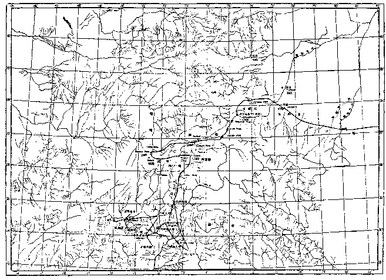



宋云使西域行程图



附录



年表(伽蓝记所述皆高祖以后之事，故高祖以前不录)



高祖孝文帝（元宏）  

(公元四六七生。)



　延兴元年（四七一）  

(宋明帝（刘彧）泰始七年)



　承明元年（四七六）



　太和元年（四七七）



> 三年（四七九）  

> (齐高帝（萧道成）建元元年)



> 十三年（四八九）  

> (以穆亮为司空。)



> 十七年（四九三）  

> (十月诏穆亮、李冲、董爵营洛都。齐王肃归魏（伽蓝记作太和十八年）。)



> 十九年（四九五）  

> (自平城迁都洛阳。)



> 二十年（四九六）  

> (诏改姓元氏。)



　二十三年（四九九）  

(四月孝文帝卒，年三十三。)



世宗宣武帝（元恪）  

(公元四八三生，孝文帝第二子。)



　景明元年（五〇〇）  

(齐东昏侯（萧宝卷）永元元年)(彭城王元勰为司徒录尚书事。)



> 二年（五〇一）  

> (王肃卒。十一月改筑圆丘於伊水之阳。萧宝夤降魏。)



> 三年（五〇二）  

> (梁武帝（萧衍）天监元年)



　正始元年（五〇四）  

(十一月营缮国学。十二月高阳王元雍为司空尚书令。)



　永平元年（五〇八）  

(九月元勰为高肇所害。)



> 二年（五〇九）  

> (一月嚈哒薄知国朝魏，贡白象一。十一月帝於式乾殿为诸僧朝臣讲维摩诘经。)



　延昌元年（五一二）  

(高肇为司徒，清河王元怿为司空。)



> 四年（五一五）  

> (一月宣武帝卒，年三十三。子翊即位。九月胡太后临朝称制，亲览万机。)



肃宗孝明帝（元翊）  

(公元五一〇生。宣武帝第二子。)



　熙平元年（五一六）  

(梁武帝天监十五年)(胡太后立永宁寺。)



> 二年（五一七）  

> (四月皇太后至伊阙石窟寺。八月高阳王雍入居门下参决政事。)



　神龟元年（五一八）  

(宋云惠生使西域求佛经。)



　正光元年（五二〇）  

(梁武帝普通元年)(七月侍中元乂刘腾幽胡太后於北宫，杀太傅清河王元怿。八月中山王元熙举兵欲诛元乂，事败见杀。九月茹茹主阿那肱朝魏。)



> 三年（五二二）  

> (梁西丰侯萧正德奔魏。宋云惠生自西域还。)



> 四年（五二三）  

> (刘腾卒。太尉汝南王元悦与丞相高阳王雍参决政事。崔光卒。)



> 五年（五二四）  

> (萧宝夤崔延伯率将西讨万俟丑奴。)



　孝昌元年（五二五）  

(四月胡太后复临朝摄政。崔延伯战殁。梁萧综降魏。)



> 二年（五二六）  

> (元乂被诛。元略自梁返魏，封义阳王，寻改封东平王。章武王元融为葛荣所败，殁於阵。)



　武泰元年（五二八）  

(二月孝明帝卒，年十九。胡太后立临洮王世子钊为主，年三岁。四月尔朱荣奉长乐王元子攸为主，改元建义，荣於河阴害公卿以下二千餘人，沉胡太后及幼主於河。)



敬宗孝庄帝（元子攸）  

(彭城王元勰第三子。)



　永安元年（五二八）  

(尔朱荣为太原王，元天穆为上党王。北海王元颢及临淮王元彧奔梁。七月临淮王元彧自梁返魏。尔朱荣平葛荣，改元为永安元年。十月梁以北海王元颢为魏王。)



> 二年（五二九）  

> (五月帝去河内，元颢入洛。七月元颢败。)



> 三年（五三〇）  

> (尔朱天光擒丑奴，关中平定。嚈哒国献师子。九月帝杀尔朱荣於明光殿。十月尔朱世隆尔朱兆奉长广王元晔为主，改年号曰建明。十二月尔朱兆入洛，迁帝於晋阳，缢於城内三级佛寺，年二十四。)



节闵帝（前废帝）广陵王（元恭）  

(广陵惠王元羽之子。)



　普泰元年（五三一）  

(三月尔朱世隆复废长广王而奉广陵王元恭为主，改元为普泰。七月尔朱世隆等害杨椿杨津。)



> 二年（五三二）  

> (四月高欢废帝，立平阳王元修。改元太昌元年。七月高欢讨尔朱兆，斩尔朱天光。)



　孝武帝（出帝）平阳王（元修）  

(广平武穆王元怀第三子。)



　永熙元年（五三二）  

(太昌元年十二月改元为永熙元年。)



> 二年（五三三）  

> (高欢破尔朱兆，兆遁走自杀。)



> 三年（五三四）  

> (二月永宁寺浮图为火所烧。七月帝为斛斯椿所迫出於长安。十月高欢推清河文宣王亶世子元善见为帝，时年十一，改永熙三年为天平元年，迁都于邺，史称东魏。十二月孝武帝为宇文黑獭所害。年二十五。)



> 孝静帝（元善见）  

> (清河文宣王亶子。)



　天平元年（五三四）



> 二年（五三五）  

> (宇文黑獭立南阳王宝炬为帝，史称西魏。)



　元象元年（五三八）



　兴和元年（五三九）



　武定元年（五四三）  

(高欢与宇文黑獭战于邙山，大破之。)



> 五年（五四七）  

> (梁武帝太清元年)(高欢卒。)



> 八年（五五〇）  

> (梁简文帝太宝元年)(五月，高洋称帝。东魏亡。)



引用书目



洛阳伽蓝记集证　(清吴若准　清道光十三年刻本)  

洛阳伽蓝记钩沈　(唐晏　龙谿精舍丛书本)  

洛阳伽蓝记合校本　(张宗祥　商务印书馆印本)  

水经注　(北魏郦道元　清王先谦合校本)  

元和郡县志　(唐李吉甫　岱南阁丛书本)  

诸道山河地名要略　(唐韦澳　鸣沙石室古佚书本)  

太平寰宇记　(宋乐史　江宁局本)  

通鉴地理通释　(宋王应麟　玉海本)  

元河南志　(出宋敏求河南志　藕香零拾本)  

清嘉庆洛阳县志　(嘉庆十八年陆继辂魏襄纂　写印本)  

读史方舆纪要　(清顾祖禹　广州刻本)  

十三经注疏　(清阮元刻本)  

毛诗草木鸟兽虫鱼疏　(唐陆玑　古经解汇函本)  

尚书大传定本　(清陈寿祺校注　四部丛刊本)  

白虎通义　(汉班固　四部丛刊本)  

廿四史　(同文书局本)  

国语　(吴韦昭注　四部丛刊本)  

战国策　(汉高诱注　士礼居丛书本)  

资治通鉴　(宋司马光　清胡克家刻本)  

通典　(唐杜佑　商务印书馆印本)  

文献通考　(宋马端临　商务印书馆印本)  

职源撮要　(宋王益之　适园丛书本)  

廿二史劄记　(清赵翼　史学丛书本)  

金石录　(宋赵明诚　清朱记荣刻金石丛书本)  

金石萃编　(清王昶　原刻本)  

中州金石记　(清毕沅　经训堂丛书本)  

八琼室金石文字补正　(陆宗祥　原刻本)  

历代石经考　(张国淦　排印本)  

河南金石志图正编第一集　(关百益　河南博物馆印本)  

汉魏南北朝墓志集释　(赵万里　科学出版社印本)  

楚辞　(汉王逸注　重刊汲古阁本)  

文选　(唐李善注　清胡克家刻本)  

古文苑　(宋章樵注　四部丛刊本)  

续古文苑　(清孙星衍辑　平津馆丛书本)  

全北魏文　(清严可均辑)  

全北齐文　(清严可均辑)  

老子道德经　(晋王弼注　四部丛刊本)  

庄子补正　(刘文典　商务印书馆印本)  

荀子集解　(清王先谦　思贤讲舍本)  

管子　(四部丛刊本)  

吕氏春秋　(经训堂丛书本)  

新书　(汉贾谊　抱经堂丛书本)  

法言　(汉扬雄　四部丛刊本)  

风俗通义　(汉应劭　四部丛刊本)  

汉官仪　(汉应劭　平津馆丛书本)  

山海经　(晋郭璞注，四部丛刊本)  

穆天子传　(晋郭璞注　四部丛刊本)  

抱朴子　(晋葛洪　平津馆丛书本)  

西京杂记　(晋葛洪　学津讨原本)  

世说新语　(宋刘义庆　四部丛刊本)  

齐民要术　(北魏贾思勰　四部丛刊本)  

颜氏家训　(北齐颜之推　抱经堂丛书本)  

述异记　(梁任昉　汉魏丛书本)  

列仙传　(清王圆照校　郝氏遗书本)  

酉阳杂俎　(唐段成式　四部丛刊本)  

荆楚岁时记　(梁宗懔　汉魏丛书本)  

演繁露　(宋程大昌　学津讨原本)  

玉烛宝典　(隋杜台卿　古逸丛书本)  

艺文类聚　(唐欧阳询　明刻本)  

太平御览　(宋李昉等　四部丛刊本)  

太平广记　(宋李昉等　影印明本)  

事类赋　(宋吴淑　明刻本)  

绀珠集　(宋朱胜非　四库全书本)  

类说　(宋曾慥　四库全书本)  

营造法式　(宋李诚　影宋刻本)



------



## 宏明集　(梁僧祐　大正藏卷五十二



## 高僧传　(梁慧皎　大正藏卷五十



释氏疑年录　(陈垣　木刻本)



------



## 大唐内典录　(唐道宣　大正藏卷五十五



## 诸经要集　(唐道世　大正藏卷五十四



## 法苑珠林　(唐李俨　大正藏卷五十三



## 破邪论　(唐释法琳　大正藏卷五十二



## 法门名义集　(唐李师政　大正藏卷五十四



## 大宋僧史略　(宋賛宁　大正藏卷五十四



一切经音义　(唐玄应　日本影印古钞本)  

一切经音义　(唐慧琳　狮谷白莲社本)  

华严经音义　(唐慧苑　清臧庸刻本)



------



## 翻梵语　(失名　大正藏卷五十四



## 优陂夷堕舍迦经　(失译名　大正藏卷一



## 修行本起经　(后汉竺大力共康孟详译　大正藏卷三



## 菩萨本缘经　(吴支谦译　大正藏卷三



## 慧上菩萨问大善权经　(晋竺法护译　大正藏卷十二



## 佛说普曜经　(晋竺法护译　大正藏卷三



## 菩萨投身饴饿虎起塔因缘经　(北凉高昌沙门法盛译　大正藏卷三



## 佛说睒子经　(西秦圣坚译　大正藏卷三



## 释迦谱　(梁僧祐　大正藏卷五十



法显行传　(学津讨原本)



------



## 北魏僧惠生使西域记　(大正藏卷五十一



大唐西域记　(唐玄奘　四部丛刊本)



------



## 慧超往五天竺传　(新罗慧超　大正藏卷五十一



## 释迦方志　(唐道宣　大正藏卷五十一



On Yuan Chwang's Travels in India, Thomas Watters（London, 1914, Royal Asiatic Society）  

解说西域记　(日人堀谦德　日本印本)  

宋云行纪笺注　(法人沙畹　冯承钧译（见「西域南海史地考证译丛第六编」），中华书局出版)  

西域考古记　(英人斯坦因　向达译　中华书局出版)  

西域地名　(冯承钧　中华书局出版)  

西域南海史地考证译丛　(冯承钧译　商务印书馆印本)  

史地丛考续编　(冯承钧　商务印书馆印本)  

尔雅　(晋郭璞注　四部丛刊本)  

方言　(汉扬雄　晋郭璞注　四部丛刊本)  

说文解字　(汉许慎　平津馆丛书本)  

释名　(汉刘熙　四部丛刊本)  

原本玉篇　(梁顾野王　罗振玉影印本)  

广韵　(宋陈彭年等　泽存堂本)



人名索引



> 只录当时人名，依姓名第一字笔畫多少排列。笔畫相同者，按照部首列先后。姓名第一字相同者，则以在本书中出现先后为序。姓名下所标数字指本书页数。【二畫】



刀宣  

〔八三〕



> 【三畫】



万俟丑奴  

〔一三四〕〔一五八〕



山伟  

〔三四〕



> 【四畫】



元勰（彭城王）  

〔二五〕〔七一〕〔一二六〕



元钊（临洮王子）  

〔三〇〕



元天穆  

〔三〇〕〔一四六〕



元子攸（长乐王即庄帝）  

〔三一〕〔三三〕



元颢（北海王）  

〔三五〕〔九六〕〔一〇五〕



元桃汤  

〔四〇〕



元延明（安丰王）  

〔四〇〕



元晔（长广王）  

〔四四〕〔九七〕



元宝炬（南阳王）  

〔四七〕



元修（平阳王）  

〔四八〕〔一〇二〕〔一七二〕



元乂  

〔五〇〕〔一二七〕〔一六八〕



元雍（高阳王）  

〔五〇〕〔一三七〕〔一四三〕〔一六四〕



元怿（清河王）  

〔五七〕〔一四三〕〔一四五〕〔一七〇〕



元悦（汝南土）  

〔五八〕〔八二〕〔一二〇〕〔一三六〕



元纪  

〔六一〕



元洪超  

〔六四〕



元劭（彭城王）  

〔八六〕



元怀（广平王）  

〔九五〕〔一四三〕〔一七二〕



元恭（广陵王）  

〔九七〕〔一一一〕〔一二八〕〔一三四〕



元渊（广阳王）  

〔一〇九〕



元祥（北海王）  

〔一二八〕



元徽（城阳王）  

〔一四五〕〔一四六〕



元或（临淮王）  

〔一五五〕



元顺  

〔一六二〕



元琛（河间王）  

〔一六三〕



元融（章武王）  

〔一六五〕



元继（江阳王）  

〔一六六〕



元略（东平王）  

〔一六八〕



元熙（中山王）  

〔一六八〕



元景式  

〔一七〇〕



元景皓（陈留王）  

〔一七六〕



元祚（陈留庄王）  

〔一七六〕



公孙骧  

〔八四〕



毛鸿宾  

〔一五九〕



牛法尚  

〔四三〕



王元龟  

〔二五〕



王丰  

〔三二〕



王翊  

〔六一〕



王眴  

〔一〇五〕



王腾周  

〔一一一〕



王肃  

〔一二四〕



王桃汤  

〔一四九〕



> 【五畫】



尒朱荣（太原王）  

〔二九〕〔九六〕〔一〇二〕〔一四六〕〔一五二〕



尒朱荣妻（北乡郡长公主）  

〔四二〕



尒朱荣女  

〔三五〕



尒朱兆  

〔四〇〕〔四一〕〔四五〕〔九六〕〔一〇二〕〔一四七〕



尒朱阳都  

〔四二〕



尒朱世隆  

〔四二〕〔四八〕〔七四〕〔九六〕〔一〇一〕〔一〇二〕〔一〇四〕



尒朱侯讨伐  

〔四三〕



尒朱那律归  

〔四三〕



尒朱仲远  

〔一〇二〕



尒朱天光  

〔一五三〕



史仵龙  

〔一〇一〕



司马悦  

〔八三〕



田僧超  

〔一五八〕



> 【六畫】



向子集  

〔一六一〕



朱元龙（朱瑞）  

〔四三〕



朱异  

〔一〇八〕



江革  

〔一六九〕



> 【七畫】



宋云  

〔一八二〕



李彪  

〔一三〕〔八九〕〔一二六〕



李琰之  

〔二五〕



李神轨  

〔三二〕



李苗  

〔四四〕



李同轨  

〔六九〕



李次寿  

〔七九〕



李澄  

〔八二〕



李真奴  

〔八三〕



李延寔  

〔八四〕



李韶  

〔八五〕



李崇  

〔八九〕〔一三八〕〔一六七〕



李或  

〔一三四〕



李元祐  

〔一三八〕



李才  

〔一四〇〕



李元谦  

〔一八二〕



杜子休  

〔八〇〕



邢峦  

〔六三〕



邢子才  

〔一〇〇〕〔一一四〕〔一一五〕



> 【八畫】



孟仲晖  

〔一七六〕



孟宾  

〔一七六〕



宗正珍孙  

〔四〇〕



明帝（元翊）  

〔五〇〕〔七三〕〔一三五〕〔一四三〕〔一六九〕



法融  

〔一七五〕



长孙稚  

〔四七〕〔六三〕



> 【九畫】



侯刚  

〔一五七〕



庆侯  

〔一六二〕



姜质  

〔九〇〕



宣武帝（元恪）  

〔一四〕〔五四〕〔一一三〕〔一七三〕



封𬀩伯  

〔二六〕



春风  

〔一八二〕



毗卢旃  

〔一八九〕



段晖  

〔六一〕



泉企  

〔九七〕



胡太后（灵太后）  

〔一七〕〔五〇〕〔七二〕〔八四〕〔一一四〕〔一三五〕〔一四三〕〔一五二〕〔一六六〕〔一八二〕〔二二〇〕



胡孝世  

〔二七〕



胡元吉（胡详）  

〔一七六〕



郁久闾阿那肱  

〔一三一〕



韦英  

〔一六一〕



> 【十畫】



原士康  

〔一三九〕



孙岩  

〔一六〇〕



徐纥  

〔三二〕〔七八〕〔一三五〕



徐月华  

〔一三九〕



祖莹  

〔二五〕〔三九〕



荀济  

〔八七〕



荀子文  

〔一四〇〕



马僧相  

〔一七九〕



高祖（孝文帝，元宏）  

〔八〕〔一〇〕〔一二〕〔一五〕〔五四〕〔五七〕〔六六〕〔六八〕〔七二〕〔一二一〕〔一二四〕〔一八一〕



高僧裕  

〔二五〕



高肇  

〔五七〕



高显略  

〔一一八〕



高澄（大将军）  

〔一二三〕



> 【十一畫】



寇祖仁  

〔一四七〕



尉成兴  

〔六四〕



崔光  

〔八四〕〔八九〕〔一六七〕



崔叔仁  

〔八七〕



崔孝忠  

〔八八〕



崔休  

〔八九〕



崔涵  

〔一三五〕



崔畅  

〔一三五〕



崔延伯  

〔一八五〕



常景  

〔二二〕〔二四〕〔八九〕〔一二八〕〔一三二〕



张伦  

〔八九〕



张景仁  

〔一〇四〕



张嵩  

〔一〇五〕



张隽  

〔一三五〕



张车渠  

〔一七九〕



斛斯椿  

〔四八〕〔一〇三〕



庄帝（元子攸）  

〔三四〕〔四一〕〔六九〕〔九七〕〔一三四〕〔一四六〕



许伯桃  

〔六四〕



许超  

〔一一〇〕



郭祚  

〔六三〕



郭文远  

〔一八二〕



陈庆之  

〔一〇五〕〔一〇八〕



> 【十二畫】



惠生  

〔一八二〕



智圣  

〔七五〕



朝云  

〔一六四〕



游肇  

〔八九〕



菩提达摩  

〔二七〕〔六三〕



菩提流支  

〔一七一〕〔一七六〕



菩提拔陁  

〔一七三〕



冯太后  

〔一二一〕



> 【十三畫】



杨衒之  

〔一〕〔二七〕〔四五〕〔六〇〕〔六九〕〔七一〕〔一四八〕〔二二五〕



杨宽  

〔四四〕〔八六〕



杨机  

〔八〇〕



温子升  

〔八六〕〔一一八〕〔一四七〕〔一七二〕



杨文义  

〔一〇一〕



杨椿  

〔一〇三〕



杨慎  

〔一〇三〕



杨津  

〔一〇四〕



杨元慎  

〔一〇五〕〔一〇七〕〔一〇九〕〔一一〇〕



源子恭  

〔四四〕〔一〇二〕



甄琛  

〔一二六〕



葛荣  

〔一一〇〕



贾璨  

〔一八〇〕



道品  

〔七五〕〔七八〕



道弘  

〔七八〕



道恒  

〔一五六〕



达多  

〔一三五〕



> 【十四畫】



寿阳公主  

〔七三〕



裴子明  

〔一五六〕



赵逸  

〔六一〕〔七二〕〔八〇〕〔八五〕〔一五二〕



赵法和  

〔一五二〕



> 【十五畫】



刘芳  

〔二五〕



刘助（刘灵助）  

〔四〇〕



刘腾  

〔四九〕〔五一〕



刘宣明  

〔七九〕



刘季明  

〔一〇一〕



刘胡  

〔一一一〕



刘缟  

〔一二七〕



刘宝  

〔一五七〕



刘白堕  

〔一五九〕



慧嶷  

〔七五〕



樊元宝  

〔一二〇〕



潘崇和  

〔一四〇〕



郑季明  

〔三三〕



郑道昭  

〔八五〕



鲁暹  

〔四二〕



> 【十六畫】



昙谟最  

〔七六〕〔一七一〕



昙摩罗  

〔一五四〕



卢白头（卢景裕）  

〔六五〕



卢景宣（卢辩）  

〔一〇三〕



穆亮  

〔八〕



骆子渊  

〔一二〇〕



> 【十七畫】



萧衍  

〔三五〕〔四〇〕〔七三〕〔一〇五〕〔一〇八〕〔一二七〕〔一三一〕〔一六八〕



萧忻  

〔五九〕



萧综  

〔七三〕



萧宝夤  

〔一〇四〕〔一三一〕



萧彪  

〔一〇五〕



萧正德  

〔一二七〕〔一三一〕



薛令伯  

〔一一〇〕



韩子熙  

〔一四五〕



> 【十八畫】



魏收  

〔一〇三〕



魏季景  

〔一一一〕



> 【二十畫】



宝真  

〔七七〕



宝公  

〔一五一〕

