# 归元镜



> **藏经**：大藏经补编（大藏经补编）　**册次** 第 18 册（B18）　**编号** B0097　**部类** 史传部　**卷次** 2 卷　**篇幅** 27,835 字

> **卷／品**：0 卷 · 87 品



---



## 目录



  - [净土传镫归元镜序](#净土传镫归元镜序)

  - [壬辰孟春广陵严而和序](#壬辰孟春广陵严而和序)

  - [净土传灯归元镜序](#净土传灯归元镜序)

  - [净土传灯归元镜上卷目次传灯总叙分第一](#净土传灯归元镜上卷目次传灯总叙分第一)

  - [方便归元分第二](#方便归元分第二)

  - [受嘱传灯分第三](#受嘱传灯分第三)

  - [诸天护法分第四](#诸天护法分第四)

  - [殿开神运分第五](#殿开神运分第五)

  - [群贤结社分第六](#群贤结社分第六)

  - [真主驱魔分第七](#真主驱魔分第七)

  - [访贤自屈分第八](#访贤自屈分第八)

  - [奉旨汰僧分第九](#奉旨汰僧分第九)

  - [发愿受嘱分第十](#发愿受嘱分第十)

  - [梦验佳祥分第十一](#梦验佳祥分第十一)

  - [湖舟放生分第十二](#湖舟放生分第十二)

  - [公庭鞫认分第十三](#公庭鞫认分第十三)

  - [肠断闻音分第十四](#肠断闻音分第十四)

  - [仁贤临难分第十五](#仁贤临难分第十五)

  - [恩沾蠲释分第十六](#恩沾蠲释分第十六)

  - [割恩云水分第十七](#割恩云水分第十七)

  - [千里瞻风分第十八](#千里瞻风分第十八)

  - [指迷护法分第十九](#指迷护法分第十九)

  - [拈阄灌露分第二十](#拈阄灌露分第二十)

  - [开权显实分第二十一](#开权显实分第二十一)

  - [净土传灯归元镜下卷目次惩奸礼祖分第二十二](#净土传灯归元镜下卷目次惩奸礼祖分第二十二)

  - [地狱魂游分第二十三](#地狱魂游分第二十三)

  - [还阳觅道分第二十四](#还阳觅道分第二十四)

  - [道传海外分第二十五](#道传海外分第二十五)

  - [遗嘱传灯分第二十六](#遗嘱传灯分第二十六)

  - [暗垂接引分第二十七](#暗垂接引分第二十七)

  - [逗机发愿分第二十八](#逗机发愿分第二十八)

  - [七笔勾尘分第二十九](#七笔勾尘分第二十九)

  - [护法搜山分第三十](#护法搜山分第三十)

  - [东昌发悟分第三十一](#东昌发悟分第三十一)

  - [衣钵还元分第三十二](#衣钵还元分第三十二)

  - [病魔双困分第三十三](#病魔双困分第三十三)

  - [庵主谈经分第三十四](#庵主谈经分第三十四)

  - [恩沾法雨分第三十五](#恩沾法雨分第三十五)

  - [请建朱桥分第三十六](#请建朱桥分第三十六)

  - [潮神请旨分第三十七](#潮神请旨分第三十七)

  - [竹窗垂范分第三十八](#竹窗垂范分第三十八)

  - [普济幽魂分第三十九](#普济幽魂分第三十九)

  - [颁嘱西归分第四十](#颁嘱西归分第四十)

  - [弥陀接引分第四十一](#弥陀接引分第四十一)

  - [同生安养分第四十二](#同生安养分第四十二)

  - [传灯总叙分第一　(末扮韦驮上)](#传灯总叙分第一末扮韦驮上)

  - [方便归元分第二　(净金面舍利弗上)](#方便归元分第二净金面舍利弗上)

  - [受嘱传灯分第三　(生巾服上)](#受嘱传灯分第三生巾服上)

  - [诸天护法分第四](#诸天护法分第四-1)

  - [殿开神运分第五　(远公上)](#殿开神运分第五远公上)

  - [群贤结社分第六　(丑匾巾短胡青直身笑上)](#群贤结社分第六丑匾巾短胡青直身笑上)

  - [真主驱魔分第七](#真主驱魔分第七-1)

  - [访贤自屈分第八　(外扮桓元诸将随上)](#访贤自屈分第八外扮桓元诸将随上)

  - [奉旨汰僧分第九　(丑扮照磨官左右随上)](#奉旨汰僧分第九丑扮照磨官左右随上)

  - [发愿受嘱分第十　(远大师白须眉拄杖上)](#发愿受嘱分第十远大师白须眉拄杖上)

  - [梦验佳祥分第十一　(外扮吴越钱王领众上)](#梦验佳祥分第十一外扮吴越钱王领众上)

  - [湖舟放生分第十二　(小生儒巾扮王税司上)](#湖舟放生分第十二小生儒巾扮王税司上)

  - [公庭鞫认分第十三　(外冠带执事随上)](#公庭鞫认分第十三外冠带执事随上)

  - [肠断闻音分第十四　(妹上)](#肠断闻音分第十四妹上)

  - [仁贤临难分第十五　(小旦扮观音大士上)](#仁贤临难分第十五小旦扮观音大士上)

  - [恩沾蠲释分第十六　(未扮黄门官上)](#恩沾蠲释分第十六未扮黄门官上)

  - [割恩云水分第十七　(妹上)](#割恩云水分第十七妹上)

  - [千里瞻风分第十八　(副净扮翠岩禅师大笑上)](#千里瞻风分第十八副净扮翠岩禅师大笑上)

  - [指迷护法分第十九　(净扮高丽王众将随上)](#指迷护法分第十九净扮高丽王众将随上)

  - [拈阄灌露分第二十　(永上)](#拈阄灌露分第二十永上)

  - [开权显实分第二十一　(老旦扮内监上)](#开权显实分第二十一老旦扮内监上)

  - [惩奸礼祖分第二十二　(净扮阎王鬼判随上)](#惩奸礼祖分第二十二净扮阎王鬼判随上)

  - [魂游地狱分第二十三　(青衣引许上)](#魂游地狱分第二十三青衣引许上)

  - [回阳觅道分第二十四　(院子扮老道人上)](#回阳觅道分第二十四院子扮老道人上)

  - [道传海外分第二十五　(未冠带一承直随上)](#道传海外分第二十五未冠带一承直随上)

  - [遗嘱傅灯分第二十六　(许上)](#遗嘱傅灯分第二十六许上)

  - [暗垂接引分第二十七　(末五佛冠扮大势至菩萨上)](#暗垂接引分第二十七末五佛冠扮大势至菩萨上)

  - [逗机发愿分第二十八　(生扮莲大师素服上)](#逗机发愿分第二十八生扮莲大师素服上)

  - [七笔勾尘分第二十九　(老旦扮徐姆上)](#七笔勾尘分第二十九老旦扮徐姆上)

  - [护法搜山分第三十　(净扮赵元坛上)](#护法搜山分第三十净扮赵元坛上)

  - [东昌发悟分第三十一　(莲挑担扮行脚僧上)](#东昌发悟分第三十一莲挑担扮行脚僧上)

  - [衣钵还元分第三十二　(末扮冠带执事上)](#衣钵还元分第三十二末扮冠带执事上)

  - [病魔双困分第三十三　(外师净徒扮二僧上)](#病魔双困分第三十三外师净徒扮二僧上)

  - [庵主谈经分第三十四　(小旦扮汤庵主上)](#庵主谈经分第三十四小旦扮汤庵主上)

  - [恩沾化雨分第三十五　(小生扮水相公上)](#恩沾化雨分第三十五小生扮水相公上)

  - [请建朱桥分第三十六　(外扮太守执事从上)](#请建朱桥分第三十六外扮太守执事从上)

  - [潮神请旨分第三十七　(小生扮张老相公末扮伍子胥上)](#潮神请旨分第三十七小生扮张老相公末扮伍子胥上)

  - [竹窗垂范分第三十八　(莲大师上)](#竹窗垂范分第三十八莲大师上)

  - [普济幽魂分第三十九　(杂扮道人上)](#普济幽魂分第三十九杂扮道人上)

  - [颁嘱西行分第四十　(小生扮宋末扮徐巾服上)](#颁嘱西行分第四十小生扮宋末扮徐巾服上)

  - [弥陀接引分第四十一](#弥陀接引分第四十一-1)

  - [同生安养分第四十二　(副净扮远公永明俱袈裟六人齐上)](#同生安养分第四十二副净扮远公永明俱袈裟六人齐上)



---



### 净土传镫归元镜序



近日贤智者㕘禅习教不暇念佛愚拙者应名了事不信西方将迦文苦口丁宁几成虚设五浊难信岂不然与心师悲之欲使人人咸归净域无计可为筏渡因思莲社中主张净土者唯庐山永明云栖三大老其行愿精确而事实尤昭著人之耳目爰是搜三祖本传塔铭一生实迹敷为四十分借诸伶人当塲搬演音乐问荅出相露布俾三祖公案一朝重新净土法门灯传无𥁞嗟乎庄言元旨几成睡梦久矣唯此𭵴閙塲中人兢观听因是触目警心感入心肺从此而茹斋戒杀从此而念佛往生岂非火宅中一剂清凉药㢤黄叶止嗁莫此为妙异哉借幻人以传真谛变瓦砾而作黄金匪但游戏阎浮实迺循循善诱虽然噫嘻可与悲心上智者道难可与法执未化者言也



------



### 壬辰孟春广陵严而和序



### 净土传灯归元镜序



从来佛法即与情以世法具佛法正理也通乎此者始知三界空花本无定法其中若亲朋眷属富贵功名离合悲欢是非人我不啻一场杂剧耳予是以官味萧▆随缘遣日署中无事每每作蒲团空观予将解组故人心融师以所搆净土传灯归元镜实录稿乞予叙以冠篇首予阅之甚符予意▆▆尚讲经喜▆佛会愚夫愚妇动輙千人至诘其所得则茫无所知噫嘻蚁聚终日又何盖於身心性命乎今心师以悲济之愿搆兹实录俾三祖一生实行载之於纸上者复演演於当场音乐宣和情景昭着与净土之水鸟林木又何异哉使人人触於目警於心或发愿徃生或专心念佛或戒杀茹斋或止恶归善较之於打閧▆法者奚啻倍蓰此真以为幻法门巧设方便见闻者当裂诸见网勿随情认戏则法法归真回生莲域庶不负作者之本▆云尔



　旹维  

庚寅萄月哉生明日浙江右布政  

　关西孟良胤识



归元镜规约



此录。专修庐山永明。云栖三祖。在俗以至出家成道。传灯实行。其本传塔铭外。不敢虚诳世俗。  

此录本愿。专在劝人念佛。戒杀持斋。求生西方。以三祖作标榜。分分皆实义。切勿随例认戏。但名演实录。若不以戏视者。其功德无量。  

此录情求通俗。上而慧业文人。以至稚童幼女。使无一不通晓。故一切深文奥义。不敢赘入。  

此录皆真经真呪。真法真理真祖实事。真心发愿。借人显法权巧化导。故曰实录。随喜者详之。  

此录於祖师法讳。或俗名皆不敢直呼。但曰某甲。尊法也。  

此录不曰传奇。而曰实录。不曰出。而曰分者。以此中皆真谛。非与世俗戏等。故别之。  

此录皆佛祖菩萨。万勿使彼立演。观古人为尸之意。益当敬信。如势有不可者。宁弗演可也。  

观听诸善人。宜坐两旁。当正心凝虑。静念随喜。观毕。当效法先贤。一心念佛。求生西方。  

搬演诸善人。当如亲身说法。宜斋戒正念。此名以法布施较之以财布施者。等无差别。  

演法主人。当诚心肃念。香烛列供。如说法等。不得设荤肴。茶食方可。清演无量功德。  

此录演完。不得找杂戏一出。以乱正法胜心。在演法者。亦不得稍去一分。以失祖师真迹。  

此录分四十二分。取华严经四十二字母之义。其中曲白。皆本藏经语录。演法者。切勿以私心臆见。搀入俗语。混乱佛法。后必遭报。慎之。  

此录皆大乘方便。绝不同目连王氏等剧。故曲皆佛法。最喜雅调摸写。介白清楚。低昂激切。使人一见。感悟回心。不在事相奢华。跳舞繁冗。万勿增入纸劄火器。粧点丑局。反涉恶套也。  

善男信女。欢喜助资。搬演流通者。现生福寿双隆。没世必生净土。  

此录发愿利生。方便说法。仰报佛恩。并酬祖意。未尝轻以臆见邪法惑乱四众。幸诸善人。勿生诽阻。有乖流通。自弃於净土也。幸甚。



休闲老衲懒融道人识



------



### 净土传灯归元镜上卷目次传灯总叙分第一



### 方便归元分第二



### 受嘱传灯分第三



### 诸天护法分第四



### 殿开神运分第五



### 群贤结社分第六



### 真主驱魔分第七



### 访贤自屈分第八



### 奉旨汰僧分第九



### 发愿受嘱分第十



### 梦验佳祥分第十一



### 湖舟放生分第十二



### 公庭鞫认分第十三



### 肠断闻音分第十四



### 仁贤临难分第十五



### 恩沾蠲释分第十六



### 割恩云水分第十七



### 千里瞻风分第十八



### 指迷护法分第十九



### 拈阄灌露分第二十



### 开权显实分第二十一



### 净土传灯归元镜下卷目次惩奸礼祖分第二十二



### 地狱魂游分第二十三



### 还阳觅道分第二十四



### 道传海外分第二十五



### 遗嘱传灯分第二十六



### 暗垂接引分第二十七



### 逗机发愿分第二十八



### 七笔勾尘分第二十九



### 护法搜山分第三十



### 东昌发悟分第三十一



### 衣钵还元分第三十二



### 病魔双困分第三十三



### 庵主谈经分第三十四



### 恩沾法雨分第三十五



### 请建朱桥分第三十六



### 潮神请旨分第三十七



### 竹窗垂范分第三十八



### 普济幽魂分第三十九



### 颁嘱西归分第四十



### 弥陀接引分第四十一



### 同生安养分第四十二



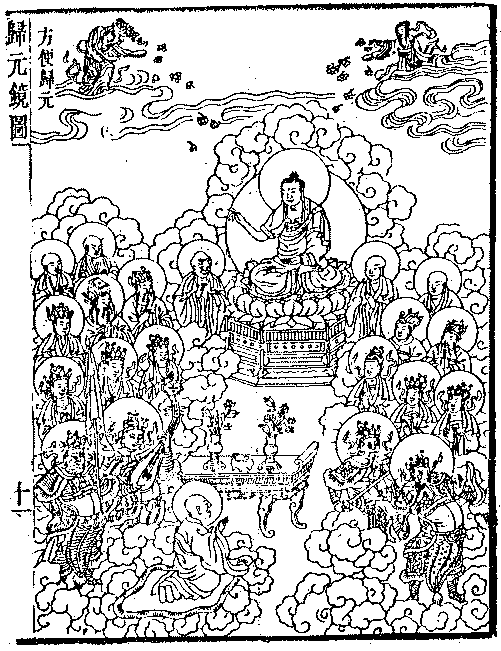



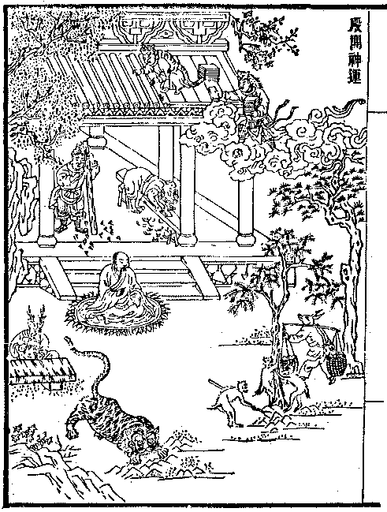



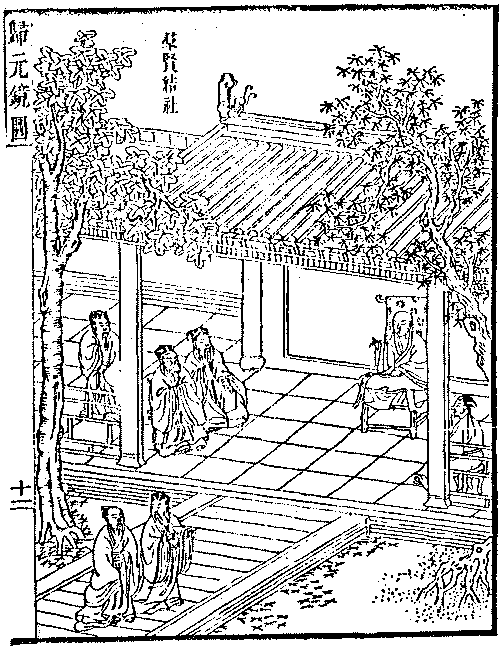



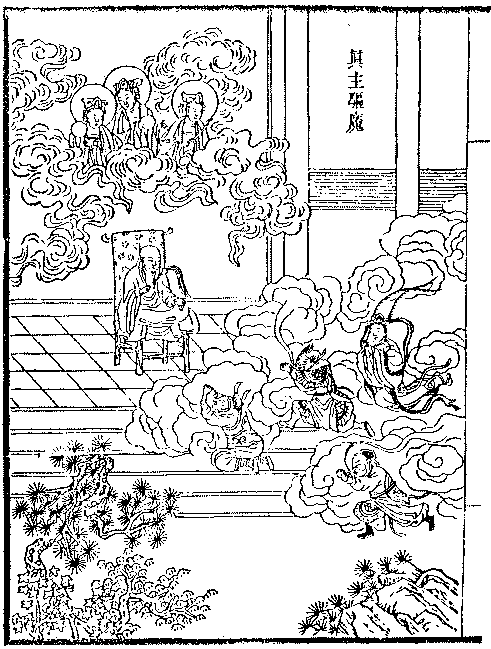



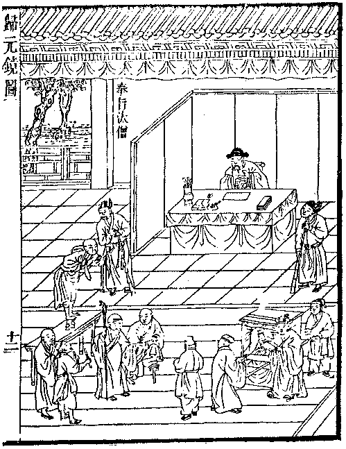



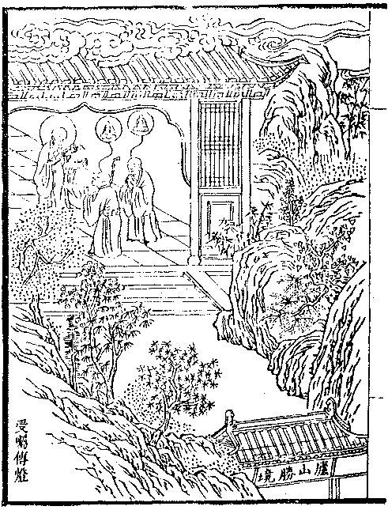



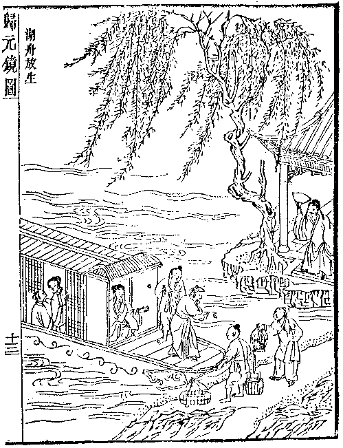



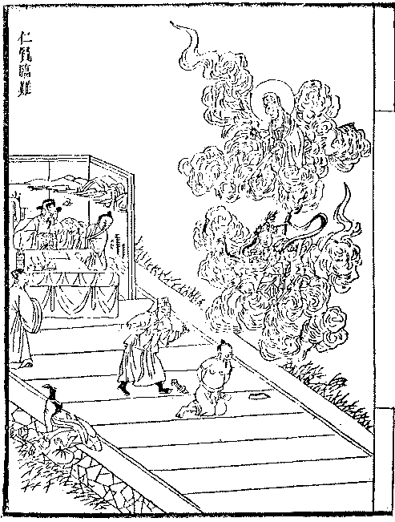



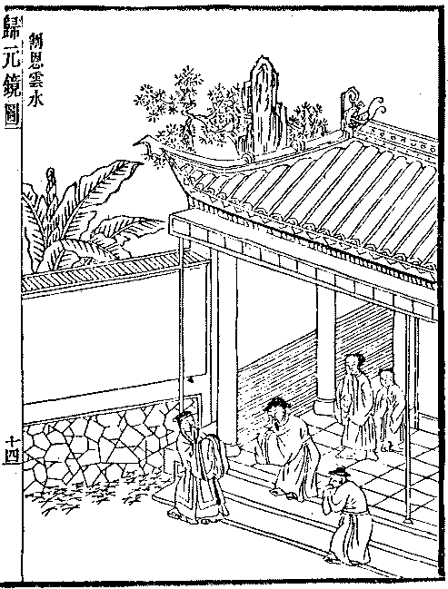



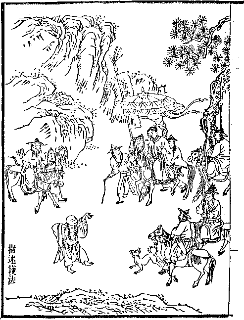



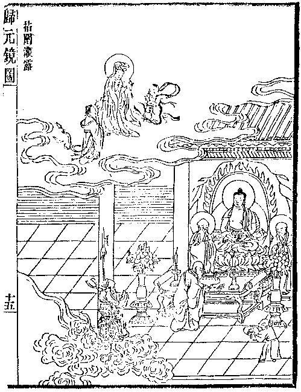



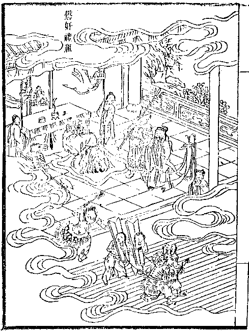



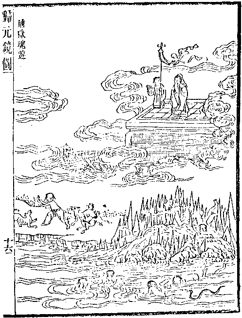



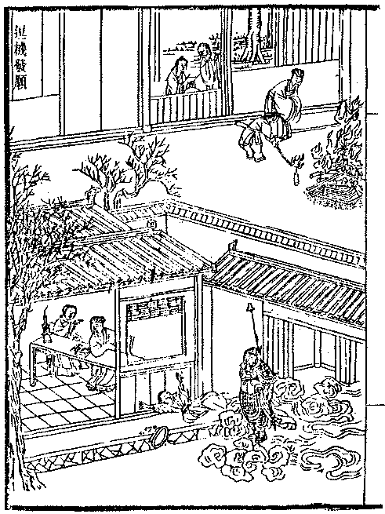



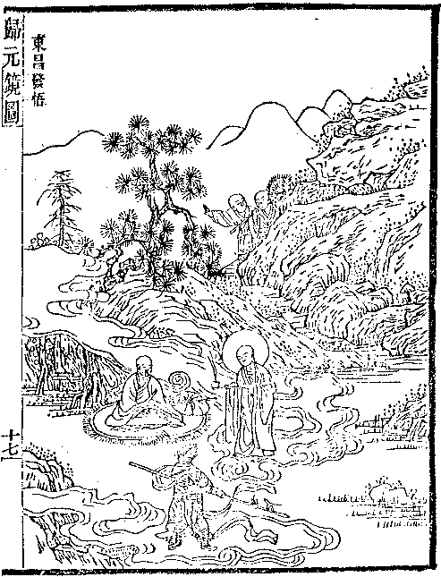



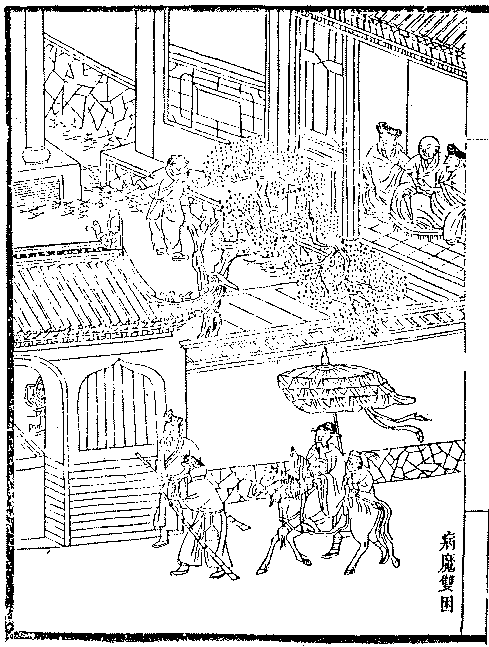



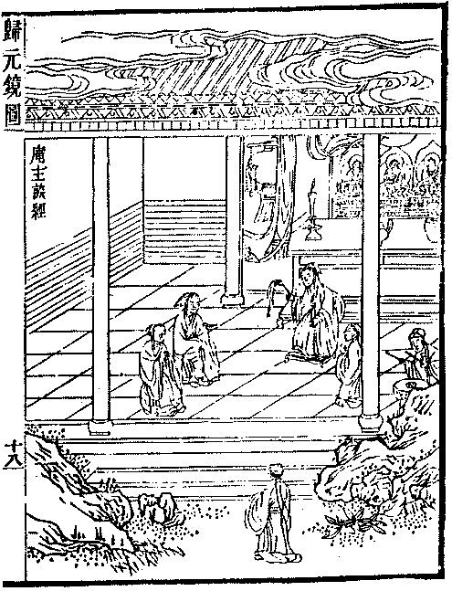



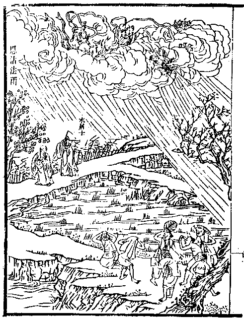



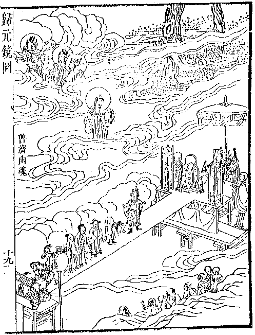



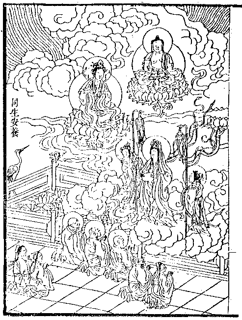



异方便净土传灯归元镜三祖实录卷之上



古杭报国嗣法沙门智达拈颂



弟子德日阅录



------



### 传灯总叙分第一　(末扮韦驮上)



(〔西江月〕吾乃韦驮天将。神功感应三调。降魔勇健长为头。护法安僧领袖。○净土传灯实录。莲宗三祖因由车提公案示真修。普愿诸贤参究。今日道场演法。系三位祖师实行。听咱总道者。〔内齐应介〕)



〔绛都春〕　人天普集。把法音演畅。西方宏愿。我佛垂慈权巧处。极赞弥陀一卷。遂尔传灯。莲宗胜社。首在庐山建。修行捷径。兼收利钝方便。○喜得寿祖中兴。永明宏道。万善庄严徧。数百年来云栖祖。重整西方文献。三祖因缘。平生实行。今日从头演。千生难遇莫作等闲闻见。



> 释迦文权开净土远法师社建莲宗  

> 永明祖庄严万善莲大师念佛宏通



> 我此传灯记当场演实义  

> 见闻诸善人切莫认为戏



------



### 方便归元分第二　(净金面舍利弗上)



〔点绛唇〕　法鼓频敲。人天百万把灵山绕。旃檀烟袅。花散处。知多少。



(祇树巍巍大法堂。五龙旛影徧飞扬。诸人克苦修灵鹫。谁信灵山是歇场。自家非别。舍利弗是也。今日我佛如来。登堂说法。尚未临座。好一个道场也〔内问〕怎见得〔舍〕这是舍卫国。祇树给孤独园。有大比丘僧。千二百五十人俱。皆是大阿罗汉众所知识。长老舍利弗〔自指介〕就是老僧居首。〔东指介〕你看这壁厢座上。摩诃目犍连。神通广大。摩诃迦叶是金色头陀。摩诃迦旃延。族出婆罗议论无比。摩诃拘𫄨罗。是吾母舅答问非常离婆多。持一心而不倒乱。周利槃陀伽。诵半偈而反成真。还有一个难陀。终日放牛。也成了阿罗汉果。〔西指介〕你看那壁厢座上。阿难陀。是如来堂弟。谁似他多闻。罗睺罗。是我佛亲儿谁知他密行桥梵波提。有牛呞疾病宾头卢。用取钵神通。迦留陀夷。容颜相黑。一见惊人。薄拘罗。相貌端严。更多寿命。摩诃劫宾那。善知星宿。阿㝹楼䭾。天眼常明。如是等诸大弟子。并诸菩萨摩诃萨。那东班首为头的。是文殊师利法王子。阿逸多菩萨。西班首为头的。是乾陀诃提菩萨。常精进菩萨〔转身指介〕那角头。是释提桓因等一班儿天主。这角头。是无量诸天大众俱。尽是享福的凡夫。若说起我佛世尊。历阿僧祇劫修成三十二相。相相庄严。舍千百亿身。成就八十种好。种种微妙。洵是天中之天。实乃圣中之圣。真好一个大道场也。〔内出四天王演势毕〕〔内擂鼓介〕〔舍〕法鼓早鸣。我佛临座也。须在此伺候。〔外扮世尊〕〔二天女持旛〕〔迦叶阿难同上〕〔世〕)



〔中吕粉蝶儿〕　大事因缘。止为一大事因缘。向今朝一指破。大千齐见。直指归元。再休论。谁根深。谁慧浅。这的是无上的方便。渡狂波业海舟船。有日里众善们。把莲台儿坐徧。



(大道原无证。迷人苦要修。谁知向上事。只在脚跟头。吾乃释迦牟尼佛便是。今日大众咸临。都来听法。我於此法。无得无说。无修无证。决非行住坐卧亦非卜度思量。不在闻见觉知。又不是语默问答。正是鸳鸯绣出凭君看。难把金针度与人。那上根利器。一闻此举。撩起便行。那中下凡夫。怎生晓得因此展转踌蹰。动我无缘悲念。适才想起一个大权巧异方便门。令一切众生。横出三界。不论老幼男女。贵贱贤愚。但得彼一心持名。管教他直登彼岸。这个方便。汝等知否。〔众〕诸弟子不知。〔世〕从是西方。过十万亿佛土。有世界。名为极乐。其土有佛。号阿弥陀。今现在说法。你须谛听者。)



〔泣颜回〕　极乐古今传。十万程途非远。西方净土。弥陀说法归元。因缘非浅果非常。六八宏深愿。驾慈航接引群蒙。脱离了苦海无边



(〔舍〕仰启世尊。彼土何故名为极乐。〔世〕其国众生。无有众苦但受诸乐故名极乐。那极乐世界。七重栏楯。七重罗网。七重行树皆是四宝周匝围绕。还有那七宝池。八功德水四边阶道。金银琉璃玻瓈合成。上有楼阁。亦以金银琉璃𤥭𤦲赤珠玛瑙而严饰之。〔众赞介〕好胜景也。)



〔上小楼〕　早闻道周围四宝广无边。七重重罗网树庄严。不枉了名为极乐。众苦齐捐。七宝池香浅。八德水清涟。俺只见亮煌煌。俺只见亮煌煌。宝池中布得金沙徧。碧沉沉琉璃宫殿。厮瑯瑯宝珠声。厮瑯瑯宝珠声。间着黄金串。果然是景致赛诸天。



(〔世〕还有池中莲华。大如车轮青色青光黄色黄光。赤色赤光。白色白光。微妙香洁。功德庄严。)



〔泣颜回〕　无边功德妙庄严。似车轮偌大金莲。青黄赤白。飏清风微妙天然。我频申悲劝。叹无常迅速归家便。莲台上九品标名。证无生永断烦冤。



(舍利弗。彼佛国土。常作天乐。黄金为地。昼夜六时雨天曼陀罗花。还有那种种奇妙杂色之鸟昼夜六时。出和雅音。演畅那菩提圣道〔舍〕彼佛国土。既无恶道。这班众鸟。从何而至〔世〕你不知是诸众鸟皆是阿弥陀佛。欲令法音宣流变化所作。〔舍〕有这等妙事。〔世〕还有妙处。彼佛国土。微风吹动。那宝树罗网出微妙音。譬如百千众乐。同时俱作。闻是音者。自然皆生念佛念法念僧之心〔舍〕呀。闻如来金口所宣。煞令人钦羡者〔众〕)



〔黄龙滚犯〕　响泠泠天乐盈空。响泠泠天乐盈空。曼陀花飞来片片。约翩翩众鸟飞翔。约翩翩众鸟飞翔。一声声把菩提畅演。这都是法旨宣流变化传。听如来妙旨人钦羡。可知他那些些水鸟花林。可知道那些些水鸟花林。都是俺一生生能仁法眷。



(〔世〕舍利弗。彼佛何故号阿弥陀〔舍〕弟子不知〔世〕你不知那阿弥陀佛。光明无量。照彻十方。寿命人民阿僧祇劫。彼声闻弟子。非是算数所知。那其中菩萨。多有一生补处〔舍〕我想净土这等庄严那薄福群迷怎生去得。如来有何方便。令苦海众生。直登彼岸。〔世〕其中原有个权巧捷径。久未说明。若有善男子。善女人。闻说阿弥陀佛。执持名号。若得一日。以至七日。一心不乱。即得往生极乐国土〔众踊跃惊喜介〕。可喜可喜。元来有这个大方便。忒煞妙也)



〔扑灯蛾犯〕　急惺惺从此识根元。愿个个虔诚把佛念。一心心持名无间歇。热丕丕猛地把冤亲断。(〔众〕阿弥陀佛。〔世〕大众。一心念佛。即得往生。这个法门。汝等都知道了麼。〔众〕都知道了。)一尘尘如许大世界。直得个闹挨挨齐上般若船。乐陶陶西方妙境。笑呵呵向琉璃地上礼金仙。



(〔世〕舍利弗。我见是利。故说此言。若有众生。闻是说者。应当发愿。生彼国土如我今者赞叹阿弥陀佛。不可思议功德还有那六方诸佛。出广长舌。同声赞叹所护念经。〔舍〕呀。如来说所护念经。弟子不知其义敢求如来。一一开示。〔世〕舍利弗。若有善男子。善女人。或受持此经。或持名念佛。皆得不退转於阿耨多罗三藐三菩提也。〔众〕)



〔上小楼犯〕　叹持经果最圆喜持名效最先。蓦忽地洗了尘心。蓦忽地洗了尘心。祛了尘凡。离了尘缘。一霎时高步金阶。一霎时高步金阶。高标名姓。高坐金莲。也须知自性的弥陀须自念。



(〔世〕舍利弗。汝等皆当信受我语。及诸佛所说。〔众应〕是〔舍〕如来不须忧虑。弟子就此下凡。到南阎浮提传此净土法门把此一卷弥陀经。宣扬流布。广度众生〔世〕你既有此大愿。待功成行满。那时到法华会上。与你授记作佛便了。〔众〕)



〔叠字见犯〕　叠叠叮咛嘱劝。切切弥陀悲愿。滔滔的苦海深。层层的业债牵。闹闹喧喧。轮回了千徧。早早登安养归船。时时礼古佛垂怜。逍逍遥遥。西方古路。永永住无生国里证真诠。〔世〕



〔尾声〕　悲心说尽了悲心愿。〔众〕愿世世流传普徧。从此西方路不远。



(〔舍〕弟子别了世尊就此下凡度生去也。〔世〕你少待。还有一个。拔一切业障根本得生净土陀罗尼。一并传授你去。〔舍〕谨领佛旨。〔世合掌念介〕)



〔往生呪〕　曩谟阿弥哆婆夜。哆他伽哆夜。哆地夜他。阿弥唎都。婆毘。阿弥唎哆。悉怛婆毘。阿弥唎哆。毘迦兰帝。阿弥唎哆。毘迦兰哆。伽弥腻。伽伽那。枳多迦唎娑婆诃。



〔舍〕大开方便喜非常　〔世〕直指群迷觐乐邦  

〔舍〕但得诸人勤念佛　〔世〕不劳弹指到西方



------



### 受嘱传灯分第三　(生巾服上)



〔临江仙〕　衣中谁识珠无价。那堪流落天涯。经纶才思剪云霞。百年春草露。富贵路傍花。



(奢肆当年笑五侯。酣花醉锦逞风流。如今声势归何处。孤冢斜阳漫对愁嗟我辈。且休休。世事浑如水面沤。应须觅个归元路。打破迷关一笔勾。小生贾某。雁门楼烦人也。双亲早逝。四壁萧居。幼而好学。且喜博综六经长任放怀。不觉沉酣庄老。向随母舅。游学洛阳。不觉蹉跎。年经弱冠。几番要取功名。争奈时遭乱世我想起来。功名虽好。不过一镬黄粱。富贵虽荣。难躲几堆白骨。正是生死百年花上露。才名千古路傍灯。到不如早早修行。脱离生死。免三涂之苦报。超六道之轮回。却不是好咳。只是接引无人。怎知进步。呀。远远有一位禅师来也。〔舍扮凡僧一侍者随上〕)



〔甘露饮〕(〔即沽美酒〕)叹阎浮一戏场。笑痴人成妄想。把蜗角蝇头昼夜忙。日日里醉华堂。夜夜里恋红粧。只道是百年无恙。怎晓得霎时身丧。(俺呵)世事儿晓露春霜。一旦无常。(呀)把一个好人身。没在爱河波浪。



(自家舍利弗。为传净土法门。已到了阎浮世界。呀。那室中。是莲宗首祖。曾受如来亲嘱。却被十月血水。浸得一灵儿忘了。不免上前剃度了他。就把念佛法门。教他流传震旦。永远传灯。有何不可。〔上前相见介〕善男子。稽首了。〔远〕老禅师何来。〔舍〕我来无所来。〔远〕莫非禅师有所去否。〔舍〕我亦无所去。〔远〕呀。禅师现有去来。安得说无来去。莫非戏谑弟子麼。〔舍〕唗。这是我佛的元宗。众生的本体。识得他。大千沙界。总一微尘。觑破了。百亿须弥。浑如芥子。你那世智凡心。焉能晓得。〔远背语介〕这禅师出言奇特。逈异庸流。不免投他出家。有何不可。〔转身介〕弟子尘心已断。渴欲修行。正愁接引无人。不料禅师偶遇。愿求剃度。永继门风。〔舍喜介〕汝肯出家。此乃大丈夫之事。非将相所能。汝果发心。直超彼岸。我替你削发披缁便了。〔作剃发侍用引磬舍念介〕善哉大丈夫。能了世无常。弃俗趋泥洹。希有难思议。就与你取名慧远。汝可合掌胡跪。皈依三宝。〔远跪介〕〔舍〕皈依佛。〔远〕皈依佛。〔舍〕皈依法。〔远〕皈依法。〔舍〕皈依僧。〔远〕皈依僧。〔舍〕自今已后。称佛为师。更不得皈依邪魔外道。〔远〕是〔拜介〕〔转身拜舍〕)



〔玉芙蓉〕　稽首法中王。皈命趋三藏。喜六通僧宝非常。愿贪嗔永断无明丧处处兴隆树宝幢。〔合〕消魔障。为伊家举扬愿一心精进。指日到莲邦。



(〔舍〕善男子。既受三皈须持五戒。此戒者。乃成佛之要门。出尘之根本。〔远〕弟子谨当受教〔跪介〕〔舍〕往昔所造诸恶业。皆由无始贪嗔痴。从身语意之所生。一切汝今皆忏悔。善男子。尽形寿。不杀生。汝能持否。〔远〕能持〔舍〕尽形寿。不偷盗。汝能持否〔远〕能持〔舍〕尽形寿。不淫欲。汝能持否。〔远〕能持。〔舍〕尽形寿。不妄语。汝能持否。〔远〕能持。〔舍〕尽形寿。不饮酒食肉。汝能持否〔远〕能持。〔拜介〕〔同举〕)



〔前腔〕　戒律逈超常。功德殊难量。修持者仗彼超方。是毘尼根本功无上。切莫睽违顷刻忘。〔合〕消魔障。为修持举扬。愿一心精进。指日到莲邦。



(〔舍〕善男子。汝虽出家。未知进步。我有弥陀经一卷是如来极赞净土的契经。直指众生归元的捷径不论贵贱贤愚。但念阿弥陀佛。若得一心不乱。管教七日成功。正是面见彼佛阿弥陀。即得往生安乐国。你听俺道者)



〔前腔〕　古佛寓西方。刹土名安养。为众生接引垂光。莲台九品齐皈向。六八高超愿力强〔合〕消魔障。为修持举扬。愿一心精进。指日到莲邦。



(〔舍〕汝今将此念佛法门。建立法幢。广布流传。不可断绝。他日成功。净土相会。〔远〕启问我师前路茫茫。不知弟子栖身何地〔舍〕汝今暂依道安法师。后来因缘在江西地面。就可前去。弗得迟疑。〔远〕多谢吾师指示。)



〔舍〕弥陀方便实中权　〔远〕直指众生上法船  

〔舍〕若得持名心不乱　〔远〕管教七日坐金莲



------



### 诸天护法分第四



(〔先虎演势次猿演势毕〕〔次扮六丁神将上〕巨斧开山岳。丁神第一班。自家六丁神将便是。今日舍利弗尊者。法旨传宣。不知有何使令。只得在此伺候。〔舍上〕)



〔挂真儿〕　唯心净土总非遥。争奈迷人不晓。



(〔众〕六丁神参见尊者。今日传召小神。不知有何使令。〔舍〕俺也非为别事。今有莲宗首祖远大师。流传净土法门向庐山胜地建立法幢尚无殿宇汝等天将各运神力助成胜事功德不小〔众〕谨领法旨。〔舍〕猿虎二将何在〔猿虎上〕〔舍指虎介〕大师一到汝可接引过溪引到香炉峰下跑定基址不可有违。〔虎点首吼下指猿介〕汝可就山开路。溪上叠桥。栽种树木。成就胜景。不得悮旨〔猿应跃下〕〔舍〕众等就此前去。各宜用心。勿得迟延。孤违护法〔众应介〕)



〔金钱花〕　全凭我佛威灵。威灵。传宣护法丁神。丁神。庐山胜地法筵新从此去。显真僧。传净土。利群生。



------



### 殿开神运分第五　(远公上)



〔步逍遥〕(〔旧步步娇〕)尘劳已谢离烦恼。分外舒怀抱。心中静悄悄。你看山色溪光。总成元妙(〔内鸟鸣介〕)好鸟弄声娇。分明说法在枝头呌



(自别吾师法座食风宿水。不觉又半载有餘呀。好一座山也。只见峰峦翠削。九叠凌空。林簏幽深。白云缭绕。好个胜景。但不知何方地界前面有一老者来了动问他便是〔丑扮老樵夫上〕)



〔江儿水〕　结屋庐山下丁丁日采樵。(〔远〕弟子稽首了。〔樵笑介〕你呌我鸡子吃酒。有趣得紧〔远〕问你地面〔樵〕还有细面。又醉又饱。多谢你。越发有趣〔远〕这等耳背。〔作高声介〕问你这个什麼地方。〔樵〕[口*賀]。问我地方麼。〔远〕正是。〔樵〕这是江西地面庐山便是。)是浔阳江左庐山道(你随我走来。)峰回路转林深㘭。(这一条溪常有老虎往来故名虎溪。)虎溪清浅连飞瀑(〔远〕我要在此栖身。望求指引。〔樵〕)此处栖身尽妙。(只是多有猛虎。难以存息。)若要幽栖。除是那伏虎禅师来到。



(阿呀。不好了。那壁厢猛虎来也〔虎上扑樵〕〔樵慌跌呌喊下〕〔远喝介〕这畜生。休得无礼〔虎伏介〕)



〔香柳凉〕　看狰狞相貌。看狰狞相貌。铁额班毛。排山震岳都惊倒。(汝若肯皈依三宝。可点头三下。〔虎点头介〕〔远〕)把雄心尽抛。把雄心尽抛。休得再咆哮。皈依我佛教。(我欲就此幽栖。不知去处。汝可前行。指我胜境。〔虎行远随介〕)见清流浩渺。见清流浩渺。且过石梁桥(〔远作过桥〕〔虎跳溪介〕)林峦果然妙。



(〔虎定基址介〕〔吼下〕〔远〕这虎跑地一方。哮吼而去。莫非就是栖真之地。呀。果然好片地势。只是尚无殿宇。且是随缘便了。天色已晚。不免在此松树下。入定片时。再作区处。〔神将作造殿介〕〔下〕〔远惊起介〕呀。分明一片平沙。如何有此大殿。此必我佛威灵。宣敕护神造成。就名神运殿罢了。待我望空拜谢则个〔拜介〕)



〔前腔〕　望灵山叩遥。望灵山叩遥。此功非小。神工一夜把精蓝造。见巍巍殿高。见巍巍殿高。屋势耸青霄。结搆天然妙。好安心行道。好安心行道。结社种灵苗。东林有人到。



> 偶游胜地欲栖身殿宇须臾一夜成  

> 莫道修真无实验果然护法有神灵



------



### 群贤结社分第六　(丑匾巾短胡青直身笑上)



〔水底鱼〕　踪迹孤浮丛林处处游。有人道咱。道咱是烂面头。



(自小生得伶俐。一生不作活计。专好盆里朱窝又好嘴头滋味家私赌得精光妻子忍气而死担轻负重不能。逃入空门队里。全凭两脚波波。到处打哄骗嘴。不为生死修行。〔笑介〕无极所奈而已。自家胡张三便是。今日闻得众人。往庐山结社。不免混去随喜。饱食他一日香斋。有何不可。前面来者。想就是了。〔虚下〕〔老旦扮陶渊明上〕不屑折此腰。甘心弃五斗高卧北窗下。自号羲皇叟。吾乃陶渊明便是。只因晋室衰微。怡清亩亩。近与东林远公。道士陆修静。同为方外之友。今日闻东林结社。群贤毕集。意欲去走一遭。只是没有酒吃。奈何奈何。也罢。不免到陆道士处。畅饮一番。就邀他同去便了。〔虚下〕〔外扮刘遗民〕〔小生扮周续之〕〔末扮宗炳上〕〔刘〕扰扰浮生尽逐尘〔周〕谁能火宅急抽身。〔宗〕相逢尽道修行去。〔合〕林下何曾见一人〔相见介〕〔宗〕动问老丈高姓。〔刘〕老夫刘遗民便是。〔周〕小弟周续之。〔刘〕动问足下。〔宗〕学生宗炳是也。二位老丈何往。〔刘〕近闻东林远法师。结莲宗胜社。同修净土法门。特去随喜〔宗〕学生也正欲去入会。〔众笑介〕正是风前一笑皆知己。都是莲宗会里人。〔胡圆揖笑介〕众位莫非往东林去的麼。〔刘〕正是。〔胡〕小子等候多时了。挈带挈带。〔众〕佛门广大。同往便了。行行去去。去去行行。转过流水溪桥。便是东林胜地。此间已是山门了。〔老旦扮知客师上〕〔相见介〕众位居士何来。〔众〕闻大师结莲宗胜会。阐扬念佛法门。特求入社。同志修持。〔知客〕如此同到方丈相见大师便了。〔虚下〕〔远上〕)



〔西地锦〕　自从一得归元信。慈悲说法东林。随缘方便利群生。是法从来平等。



(瀑布来青嶂。孤峰卧白云。清闲无一事。独坐掩柴门。今喜早飡已毕。正好静坐片时。〔知进禀〕有众居士参见。〔三人进参拜〕〔刘〕弟子众等。自违真性。久役尘劳。幸逗一隙之光。望乞慈悲拯济。〔远〕三界无安。犹如牢狱。六根造业。织就轮回。若能一念回光。即便高超净域。〔众〕启问大师。净土法门。有何殊胜功德。〔远〕那西方殊胜。不可思议。你听俺道者。)



〔新水令〕　古今贤圣赞西方。妙庄严都在弥陀经上。阿弥陀古佛。是无量寿大医王。接引慈航。接引慈航。度众生齐皈安养。



(〔刘〕启问大师。西方何故名为极乐。〔远〕其国众生。无有众苦。但受诸乐故名极乐。那极乐世界呵。)



〔北驻马听〕　功德非常。网树重重七宝装。池开宝镜。金沙闪烁透波光。(〔众〕闻说西方有九品莲华。可是真否。〔远〕)可知道莲开赤白间青黄。曼陀花粧点多无量。(那阿弥陀佛呵。)接众生返故乡。众善成行。端坐在金莲台上。



(〔众合掌念佛介〕〔远〕你不知西方。还有白鹤孔雀。演畅法音。风吹林木。皆成妙乐。〔众〕有这等胜事。真可爱乐也〔远〕)



〔雁儿落〕　可乐他杂色鸟徧飞翔。可乐他演法音声嘹喨。可乐他七菩提尽演扬。可乐他八圣道都提唱。(呀)更可乐微风吹树响琳琅。更可乐百千种乐声相像。肯皈依一念绝无常。断无明。从此消魔障。思量。怎能彀亲到莲华藏。西方。念何时觐法王。念何时觐法王。



(〔众〕弟子众等。自怜无始业深。无法脱离生死。不知大师有何方便。令我等直至西方。免受轮回之苦。〔远〕那经中说。若有善男子。善女人。闻说阿弥陀佛。执持名号。一心不乱。即得往生极乐国土。〔众惊喜介〕可喜可喜。原来有这个大方便也。呀)



〔收江南〕　早知道有如此方便呵。何不去早修行。自从今一心发愿往西方。把弥陀举扬。念念儿不忘。一心不乱即还乡。(〔众拜介〕)



〔甘露饮〕　叹轮回苦未央。幸我佛接慈航。谢我师把净土庄严细讲详。度群迷出火坑。五浊内好凄惶。痛三涂悲凉难状。愿个个都归安养。端坐在莲华台上。(〔远〕俺呵。)因此上为众悲伤。极日宣扬。(呀。)怎能彀把阎浮。化成华藏。



(今有一卷阿弥陀经。是往生净土的根本。今授汝等。若能行持。决不相赚。〔众〕谨遵慈诲〔远〕)



〔清江引〕　契经功德真无量。胜福皆回向。普愿念佛人。时刻休轻放。归去来。见弥陀。亲供养。



(〔下〕〔远吊场〕〔小旦扮陆道士同陶上〕〔陶〕为寻莲社约。〔陆〕忘却路崎岖。来得凑巧。正值大师在此松下。〔相见揖介〕〔远〕莲社已散。二位来何迟也。〔陆〕为邀弟子。故来迟耳。〔陶〕胜社既散。就此告辞。〔远〕二位才来。怎麼就要去了。〔陶〕乘兴而来。兴尽而返。〔远〕既然如此。也须相送一程。〔陆〕今日一释一道一儒。三教鼎立。岂可无一佳句。以纪胜事。〔陶〕共联诗一首何如。〔远〕就是陶先生联起。〔陶〕占了。儒门释派道家流。相契忘机物外游。〔远〕共蒂不须呈伎俩。同根何必互戈矛。〔陆〕三分岐路千蹊别。全体清虚万境收。〔陶〕今日分明都注破。〔远〕好将名相一齐休。〔陶陆〕妙。大师末后句。把三教圣人。都收拾在布袋内了。〔陆〕奇特奇特。大师平日送客。不过溪。怎麼今日过却桥也。〔远〕果然走过桥了。这是相契忘机。不觉足之所至。〔三人大笑介〕〔陆〕可称虎溪三笑。就此告别。〔远〕恕不再送。虎溪三笑后。〔陶陆〕千载播高风。〔下〕〔胡上向鬼门〕多谢了。腹中已饱。不免去听听佛法。阿呀。刚刚寻得一飡斋吃。怎麼人都散了。佛法一些不闻。且自由他罢了。)



> 佛法由他说香斋我自飡  

> 西方无路到依旧黑漫漫



------



### 真主驱魔分第七



(〔净红面束发冠甲胄上〕无始从前已结缘威音那畔我为先。有人拨动咱威力烧徧三千及大千。自家非别。无明火部。嗔心魔王便是〔丑花面包巾上〕三涂恶报我为头。利己伤人不自由。尽力驰求心不厌得休休处不甘休自家非别。无厌大王。贪心魔君便是〔旦扮痴魔上〕六道轮回我造成。生生死死不离身。常将一络痴绳子。缚尽娑婆世界人。吾乃爱欲三娘痴心魔女便是〔副净黑面睡魔上〕梦想场中不暂离。诸人遇俺便昏迷。陈搏一忽千年去。都是吾神一力为。吾乃睡魔神是也。贪嗔痴三位魔王请了。〔众〕请了。〔睡〕今日不期而遇。好个胜会也。常欲请教三位本事求得其便。今乃天赐奇逢。试将威力。请教一番有何不可〔众〕就请睡魔道起〔睡〕还是贪将军居首。〔贪〕占了。说起咱们手段。直教世界横心。色欲队里藏身名利场中走动挑唆得五脏。昼夜不宁。哄诱得六根。随方奔走。人君遇俺管教他社稷都倾。臣宰逢吾。直使彼声名尽丧。良民做了不良之辈节女做了失节之人。父子因俺不和。朋友教他断义部下统领着三百六十行盗贼儿郎。横行世界。徧历多生〔众〕好本事也。该嗔将军道了。〔嗔〕俺与妙明本主。同出山林。却被一阵黑风。将他抛撤雄威一逞。烧翻了六欲诸天。气焰横行。铸就了十八层地狱逢财发火。遇色争锋。官司队里我为尊。战阵场中吾作首。一言冲撞。那管他恩爱夫妻半句不投。也不论天恩父子正是投河奔井尽因吾。服毒悬梁都属咱。统领着八万四千烦恼喽啰。好威风也。〔众〕果然好本事如今请教痴魔了。〔痴〕无始空花结体。随方幻相为根虚无执着认为真爱欲场中立命。勾摄大千世界。包罗六位精魂。自缠自缚自烧身。都是俺痴绳捆定。部下统领着百万迷魂淫女混扰众生。谁人跳得出我这圈子。〔贪〕果然利害到不识你有这般手段〔睡魔作瞌睡介〕〔嗔喝介〕你这人忒也好笑。青天白日。这等好睡〔睡作惊介〕正是正是该我道了。白日潜形匿影。黑夜大展威权。由他豪杰与英贤遇俺闭眸合眼。秀士抛书倦读。由僧懒去参禅。娇娥困得翠云偏。常与醉人儿作伴。部下统领百千万亿睡魔虫儿。撒向人间好生弄得那世间人。昏昏迷迷。颠颠倒倒。〔众〕果然好利害虫儿。〔嗔〕如今问话休提。只说俺们贪嗔痴睡。四大魔王。与人顷刻不离怎奈远公大师。无故将俺们逐出。教俺们何处安身立命。今日值众弟兄聚会。不免哀告大师求他收留。有何不可。〔众〕俺们正欲如此就可前去。〔嗔〕且慢。恐有伽蓝神挡路。须各持兵器才是。〔众〕说得有理。〔嗔持刀〕〔贪持棒〕〔睡持锤〕〔痴持绳子〕)



〔豹子令〕　追风掣电疾如梭疾如梭。被逐离巢没奈何。没奈何。若得大师心意肯。收留依旧复还窠。笑呵呵。只恐祛回请上覆。



(〔贪〕来此已是山门了。内有弥勒佛爷。那个布袋兄利害。难以进去。不免乘空而入。〔众作入介〕〔末扮招宝神秉剑持锭上〕来者何神。擅入此地〔众〕吾等乃贪嗔痴睡特来寻觅大师。〔招〕元来是夥劫贼。〔众〕唗。休得无礼。〔共战介〕〔贪夺锭〕〔招败下〕〔小生扮华光上〕吾乃护法华光在此。汝等毛贼。休得无礼〔共战介〕〔痴绳套去华兵器〕〔华下〕〔众〕喜得护法神。被俺们战退。不免寻大师去也。〔虚下〕〔远上〕心中有佛将心念。念得心空佛也忘。经行已久。少坐片时则个〔众急上〕大师稽首了。〔远〕汝等是谁。因何到此。〔众〕我等乃贪嗔痴睡。四位亲丁。旷劫已来。承值大师。不离左右。今日无故将咱们逐出。没处栖身。望大师慈悲收留则个。〔远〕元来是夥劫贼。我在此修行。贪嗔已断。痴睡全消。杳没你存身之所。汝等速退。休得胡缠。)



〔驻马听〕　地狱因由。为汝牵缠。我若不休。识得你本来面目。从来虚妄。一笔都勾。(〔众〕望大师慈悲。收留我等。〔远〕)你痴心休想再收留。我纯清绝点全无垢克苦清修。草衣木食。不被你多般哄诱。〔众〕



〔前腔〕　苦苦哀求。望乞慈悲纳众俦。自与你周旋六道。不离顷刻。多少绸缪。如今一旦撇荒丘。恩情此际难分手。没地奔投。望师笑纳。休得怜新弃旧。



(〔远〕你们知罪麼。我与释迦老子。同为凡夫。他今成佛多时。我尚沉于苦海。皆是你这班业障哄诱。如今识透机关。决不相容。休得再犯。〔贪〕大师。你看这高边白镪。何等可爱。我为他忍心害理。百计千方。谋算将来。你今把我贪魔撇了。将利名担儿。就要一朝歇下。清风高节。终日闲坐。有何好处。〔嗔〕大师。自古道。人争气。火争烟。我替你撑架子。打甲家。夺门头。撞太岁。都是俺的威风。你今撇了我嗔魔。闲事也不管了。饿气也不争了。哈哈怅怅。和气一团。被人唤作没用的阿呆。成何体面。已后大师。再不要听那释迦老头儿哄骗〔痴〕大师。从来你贪我色。我恋汝情。恩恩爱爱。逞尽风流。那英雄豪杰。也不知被俺断送了多少。你今撇了我痴魔。却不长夜青灯。孤帏独宿。你到得了便宜。只是难为我了。呌我这条痴绳。这把利斧。那里去使。〔睡〕大师。你知道阎浮世界。是一梦场。如今富贵功名。亲朋眷属。都是一场春梦。你今把我睡䰟撇下。却不梦醒了。众人皆睡你独醒。却也没趣。〔远〕你今怎生哄得我动。速速快走。〔众〕大师不肯容留。俺们也顾不得大师。各要复回本位也。〔众欲攒入混扰介〕〔远喝介〕)



〔扑灯蛾〕　休得太相侵。休得太相侵。我本来已清净。得此修行诀。从今打破机关也。再休思亲近。无端强贼忒欺人。管教你丧身失命。须皈正。若能改过即成真。



(戒定慧三真何在。〔内扮三菩萨〕〔各披袈裟〕〔一执剑〕〔一持珠〕〔一持镜〕〔将魔逐散下〕〔远〕喜得众魔已散。身心清净。好生自在逍遥也。但是念佛法门。尚无传灯法器。且自消停。觅访便了。)



> 众魔已散最消遥只为群生念虑劳  

> 若得英贤宏净土人人念佛出波涛



------



### 访贤自屈分第八　(外扮桓元诸将随上)



〔鹊桥仙〕　浩气干霄。雄威震主。图成不朽勋名。身居台鼎已非轻。又忝三军司命。



(社稷靴尖上。君臣掌握间。笑他天子贵。不及我威权。下官桓元是也。权操都阃。位列台衡。已司将相之权。实兼杀活之柄。目下奉旨讨殷仲堪。兵过浔阳。闻得庐山远公。身修梵行。胸蕴经纶。虽是出尘之人。实乃栋梁之器。昨已差官入山迎请。借箸前筹。怎还不见到来〔杂扮差官上〕夜静水寒鱼不饵。满船空载月明归。差官叩头。小官已到庐山。远大师多拜上老爷。有书呈上。〔看书介〕元来一首诗偈。久隔尘嚣绝世缘。老僧无力只贪眠。白云乍可来青嶂。明月难教下碧天。分明呌我进山相见。到是我差矣。古人访贤。礼宜自屈。怎麼反教他出山见我。诸将暂退。〔众应退介〕承直的。与我换了公服。就此起马进山。)



〔一江风〕　马行迟。拂拂风吹袂。一带山笼翠。谩徘徊翘首烟林。渐入云深处。雄心不自持。雄心不自持。殷勤访圣师。谁知吾傚请茅庐事



(〔承直〕禀爷。东林已到〔老旦扮知客师〕〔接见揖介〕〔桓〕大师何在。特来拜访。〔知〕大师在山顶茅庵。注涅槃疏义。若要相见。待告过茶。同上山就是。〔桓〕也罢。正是留云酣远客。煮月吸山泉。〔虚下〕〔远上〕心月孤圆朗太虚。一龛山顶伴云居。精修净业莲花漏。剩得餘功注梵书。老僧卓庵山顶。谢绝人缘。昨蒙桓大人相邀。已曾谢覆。今注述稍暇。少坐片时。〔桓抠衣〕〔知随上〕〔登山介〕)



〔懒畫眉〕　危坡踏尽气全消。四顾巉岩万岫朝。(好一派山势。〔知〕大人。这是香炉峰。这是五老峰。那是瀑布泉。〔桓〕)那堪瀑布响如涛。松篁万叠烟云绕。洵是庐山万丈高。



(〔知〕踏尽危坡。此间已是。〔知通报〕〔桓进相见介〕久仰清风。殊深渴想。幸瞻光霁。大慰夙怀。〔远〕山野庸僧。敢劳垂顾。大人燮理朝纲。为何到此。〔桓〕下官奉旨征讨殷仲堪。久慕大名。耑此谒访。)



〔桂枝香〕　逆臣𨁝跳。出师征讨。闻师大德宏才。专此入山访道。望吾师勿吝。望吾师勿吝。元谋大教。助扬廊庙(还求大师出山登仕。丕显皇猷)佐皇朝。管取身荣贵。勋名万古标。(〔远〕)



〔前腔〕　山僧野老。遗情世表。为怜三界空花。因此上居山学道。谢君家见邀。谢君家见邀。我甘心潦倒。况病躯难疗(三界无安。犹如火宅。百年瞬息。酷似投梭。若能谢绝尘缘。便是孤云野鹤)最逍遥。我梦魂已付梅花月。肯向金门恋紫袍。〔桓〕



〔前腔〕　闻师元要。顿开心窍(佛法必有妙处。可得闻否。〔远〕大人。)佛法虽尚清修。在世不离忠孝。用心机枉劳。用心机枉劳。一场好笑(劝大人呵。)回头及早(〔桓〕下官已领吾师深旨。为图一件大事。若得遂心。即当如命。)肯徒劳。男儿不遂掀天志。霸业雄心未肯消。



(下官就此告辞。还有一事相问。朝廷为僧行污滥。欲沙汰众僧。下官已将宝山保奏。蒙旨批出庐山道德所居。不在搜检之列。恭喜无虞。不劳挂念。〔远〕多谢护法了。)



> 〔远〕劝君解脱早回心　〔桓〕多感吾师指示深  

> 大抵浮生都是梦个中难觅是知音



------



### 奉旨汰僧分第九　(丑扮照磨官左右随上)



〔字字双〕　读书满望要成名。高兴。黜退衣衿事不成。怨命。异途博得个小前程。没印。衙门虽设冷如冰。守困。



(自家姓胡名徒。南康府照磨是也。自幼侥幸黉门。指望支撑门户。谁想随群结党。纵性施威。朝夕欺压良民。出入把持官府。扎诈火囤。包揽官司。灭理欺心。无所不做。因此被宗师黜退。转身进京。就投吏部。当差三年。摸得个照磨。虽然喜有衙门。却是没赚钱处。近日部中钞出。奉旨沙汰众僧。要经义明彻。戒行精严。方可宏化。餘皆还俗当差。昨日行文到府。堂尊委我清查。〔喜笑介〕好造化也。一生发迹。全在此举昨日出票。呌僧纲司。怎还未到。〔小生扮僧官上〕胡大人请了。〔胡恼介〕你是僧官麼。〔小生〕是。〔胡〕你既是僧官。须知礼体。我奉旨汰僧。堂尊委我。官小权大。你见我大模大样。官府尚不在你眼皮儿上。那外边和尚。不知你扎诈了多少明日造册。就把你头名汰起。〔僧附耳言介〕胡爷不要发恼。有薄礼献上。细茶五十觔。白银壹百两。〔胡笑介〕我道你是个知礼的趣人儿。也罢。收了。取各寺册簿上来查勘。〔胡看介〕我问得南康四百八十寺。多少楼台烟雨中。怎麼只得七十二寺。〔僧〕胡爷差了。不是南康。是南朝四百八十寺。这是古诗。〔胡诨介〕我要蹉他四百个寺。元来一字也混不得。这寺中都是什麼僧。〔僧〕俱是应教僧。〔胡〕那应教僧。是荤酒之徒。光头百姓。有甚戒行。〔僧〕近来都持斋念佛。戒杀放生了。〔胡〕这是你替他遮葢。都要还俗当差。本寺产业。入官充饷。〔僧又附耳介〕每寺敛银三十两奉上。〔胡摇头〕不彀。〔僧〕再加二十两。望胡爷一应周全。〔胡〕还亏我做官清廉。撞着别人。地皮都掘光了。还有一说。速速将外边庵堂小院。一应迟方募化。老年残疾等僧。都要火速赴府查验。〔僧〕都在衙门首伺候久了。〔胡〕你去罢。〔僧〕从今安枕睡。无事到公庭〔下〕〔净扮游方僧〕〔副净扮募化僧〕〔老旦扮年老僧〕〔末扮𨈷跛僧上〕〔喝门介〕众僧进。〔众〕众僧即头。〔胡〕都在一边听点。〔间游介〕你是什麼僧。〔游〕是游方僧。〔胡〕挂搭何寺。〔游〕东门外破落院。〔胡〕有何本事。〔游〕自小不习经忏。坐禅却也不惯。只会十字街头。粧十八尊罗汉。〔胡〕你且粧一个与我老爷试看。〔游高立粧降龙伏虎二势日念二偈〕〔众和佛介〕〔胡〕一刬胡柴。煽惑男女。蓄发当差。赶出去。〔游下〕〔胡问募介〕你是什麼僧。〔募〕是募化僧。〔胡〕有何本事。〔募〕只为当初债逼。因此逃入空门。不知念佛与看经。全凭口嘴度命。殿主时时请我。领他钞化沿门。焦行队里我为尊。丢钹说书高兴。〔胡〕怎麼一个化法。也要当堂勘验。〔募〕夥计们。把菩萨擡进来。〔内扮神亭擡上〕〔募〕把鼓钹敲起来。〔众〕〔敲鼓钹介〕〔募念介〕古佛庄严妙善身。香山昔日去修行。至今端坐潮音洞。雪自鹦哥紫竹林。〔众和〕观音圣尊。〔又敲鼓钹介〕〔募〕南海如今殿未成。菩萨亲自至门庭。若有檀那心喜舍。灾难消除福寿增。〔众如前鼓钹众和介〕〔募出缘簿化介〕南海普陀山。启建大殿。缺少钱粮。〔扯住胡介〕老爷请上尊名。随缘乐助。〔胡作惊怕躲介〕〔左右白介〕老爷不要惊慌。他试演一个化法与老爷看。〔胡〕我见了这个化簿。十分害怕。果然利害。可恶可恶。哄诱人家男女。蓄发当差。赶出去。〔募下〕你这二僧。有何本事。〔老〕)



〔黄莺儿〕　从未到丛林。只单丁过一生。结缘念载在南康郡。(〔胡〕你结什麼缘。〔老〕爷爷。我一生舍茶。到今日呵。)霜华鬓侵。腰酸背疼。耳聋眼暗身多病。〔合〕告仁人。慈悲怜愍。赦我过残生。



〔前腔〕〔疾〕总是父娘形。恨前生业障深。身𨈷足跛多薄命。(〔胡〕为何落发。〔疾〕咳。爷爷。我没奈何。)空门度生。(〔胡〕晓得念经麼。〔疾〕)何曾念经。随缘度日家如磬。〔合〕告仁人。慈悲怜愍。赦我过残生。



(〔胡怒拍案介〕)



〔猫儿坠〕　吾今奉旨。沙汰众多僧。王法森严不顺情。(〔众哭介〕望老爷超生。〔胡〕)汝今休得望超生。须听。准备着归家蓄发为民。



(〔众求介〕望爷爷可怜。笔下超生。〔胡〕左右赶出去。〔众哭介〕呵呀爷爷。)



公庭恳乞发慈悲　〔胡〕断送多僧一笔挥  

〔众〕当权正好行方便　〔胡〕惟我平生不肯为(〔胡下〕)



(〔二僧吊场哭呌龙天介〕〔老〕我想起来。若还蓄发。衣食何来。年老气衰。终归饿死。到不如先投水休。〔疾〕老师莫要性急。我闻庐山不在搜检之列。何不去投入莲宗胜社。一心念佛。求生西方。岂不是好。〔老喜合掌介〕阿弥陀佛。元来有这个去处。我闻此言。愁心顿解。几时去。〔疾〕事不宜迟。就此同去。〔老〕若无渔父引。〔疾〕怎得见波涛。〔下〕)



------



### 发愿受嘱分第十　(远大师白须眉拄杖上)



〔山坡羊〕　急忙忙浮生如电。痛煞煞轮回千徧。浪滔滔苦海无边。一心心谁肯把弥陀念。最堪怜。无端爱欲牵。无常一到只恐风筝断。四大分离众业缠。(那时节呵。)冤愆。泥犂苦万千。(〔大哭介〕众生众生。那西方慈母。日夜望你归家。)他悬悬。极乐慈尊眼望穿。



(咳。只为众生。因迷受苦。不觉动我无缘之悲。我社中念佛诸人。大半归西谢世。你道我因何不去。也只等个传灯的法器。把此念佛法门。付嘱於他。那时我愿方遂也。〔老疾二僧上〕)



〔前腔〕　脚波波归心若箭。喜孜孜来投禅院。一程程永远山遥。气吁吁走得我残躯颤。转忧煎。怕他们不见怜。此行得遂归投愿。薄命重生感上天。(〔疾〕老师。我见此法僧之苦。)他年。愿作人王护法坚。(〔老〕师兄。我只是一心念佛。求生西方罢了。)西莲。愿万行庄严净土缘。



(来此已是东林了。不免进去参见。〔参拜呌苦介〕〔远〕看你二人。残疾衰年。理宜静守。惶惶到此。却为何来。〔众〕咳。大师。一言难尽〔老〕)



〔啄木儿〕　我年衰迈。〔疾〕我疾病缠。自恨前生业障牵。蓦朝廷沙汰多僧。却教我蓄发归田。(我等残疾衰年。终归饿死。)恹恹一命悬如线。遑遑到此投禅院。望乞容留结胜缘。



〔前腔〕〔远〕闻伊道。宿世冤。逆境相遭岂偶然。(我此门中。只要一心念佛。若得念念无间。即便往生。)若能彀精进修持。管教你稳坐金莲。(还有一大事因缘。度生宏化。)谁人肯发菩提愿。茫茫苦海行方便。把个净土门风作渡船。



(〔老〕弟子闻师深诲。情愿专修净业。万善庄严。广度群生。同登极乐。〔远〕善哉善哉。汝发此心。顿超四果。)



〔簇玉林〕　吾心慰。尔誓愿坚。结无生万善缘。(这卷弥陀经呵。)是如来苦口频申劝(那西方大圣呵。)慈悲接引心无倦。(粉骨碎身。佛恩难报。五浊难信。谁肯酬恩。〔老〕弟于蒙师救拔。誓当累世。不负师恩。)报恩艰。他生累劫永不负师言。



(〔远〕善哉善哉。非汝久熏净业。不能发此宏愿。汝今年老。不能行道。可别换房儿。待修持坚固。结果在吴越之界。那时大转法轮。功成行满。与汝净土相会也。切记吾嘱〔老〕弟子谨领。〔远问疾介〕汝何所愿〔疾〕弟子见此汰僧之苦。愿为国王。护持佛法。〔远〕汝愿如此。结果亦在五代之后。作一边海国王。就与你师兄护法。弃位出家。同生净土便了。〔疾〕多谢吾师授记。〔远〕吾年八十。形与运颓。一向佛法无人。故尔迁延浮世。今既有托。明日吾西归去也。〔众〕大师何出此言。〔远〕)



〔尾声〕　形神颓老难支遣。幻迹虚生八十年。从此逍遥证涅槃。



> 〔远〕八十年来瞬息过一期方便度娑婆  

> 〔众〕仁师大德恩难报救拔吾侪出网罗



------



### 梦验佳祥分第十一　(外扮吴越钱王领众上)



〔小重山〕　提封半壁控三吴。挹胜湖山。鼎建名都。元元百万壮雄图。有日须教。旺气归吾。



(浩气英风壮斗牛。争王逐霸未甘休。提兵一定江东乱。虎踞东南十四州。自家吴越钱王便是。出身草莽。际会风云。感上天顾命之恩。作半壁安民之主。目今建都杭郡。筑殿吴山。左江右湖。不减上游天府。龙飞凤舞。真是礼乐名邦。富饶中国。雄甲一方。且喜雨顺风调。民康物阜。〔笑介〕也不愧男儿气槩。昨夜三更。得一奇梦。梦一金甲神人。口称有肉身菩萨。将来化导此方。汝宜謢法。永矢弗谖。将手中宝杵。望吾一指。不觉醒来。方知一梦。未知吉凶若何。好生放心不下。不免宣占梦官到来。占验吉凶。有何不可。传旨宣占梦官。〔传介〕〔未扮占梦官上〕举世皆成梦。谁为大觉人。占梦官见驾。愿吾王千岁〔钱〕寡人夜来。得一奇梦。未知吉凶若何。特此宣卿占验。寡人呵。)



〔泣颜回〕　绣榻睡初浓。忽无端一梦难穷。(〔占〕殿下可见些甚麼。)〔钱〕见依稀天将。现金身甲胄乘空。(〔占〕他口中有何言语。〔钱〕)他言词雄勇。(他道。不日有一肉身菩萨。化导此方。汝宜謢法。将手中宝杵。望吾一指。)意惊惶。醒却方知梦。望卿家仔细推详。免教我祸福朦胧。



(〔占〕以臣愚见。此乃韦䭾菩萨。现身入梦。)



〔五供养〕　韦䭾感贡。冀吾王造福施功。若依臣鄙见。圣寿享无穷。(〔钱〕卿有何高见。〔占〕臣仰观天象。见列宿拱南。必有圣僧。代佛宣化。殿下可於三宝处。尽情謢法。庶几福国佑民。皇猷丕振。岂不美哉。)愿王勿恐。兆分明有吉无凶。封疆应有福。灵异自天鍾。急降覃恩。勿违佳梦。



(〔钱〕元来如此)



〔川拨棹〕　疑何用。顿令人喜气浓。〔合〕感神僧千古难逢。感神僧千古难逢。宏辅佐无为化功。喜封疆自此隆。愿清平熄战锋。



(〔钱〕敕谕内外臣僚。凡一应三宝情分。悉宜恭敬护法。〔钱〕〔占〕)



〔尾声〕　慈恩普徧雍熙共。永乐唐虞圣宠。愿此山河成一统。



> 〔钱〕天神入梦太权奇　〔占〕物外鍾灵兆更微  

> 祸福昭昭元不爽细推不必更惊疑



------



### 湖舟放生分第十二　(小生儒巾扮王税司上)



〔挂真儿〕　长夜茫茫何日晓。那堪役役尘劳。须信人生。双丸如驶。莫待阎君符到。



(忙忙乌兔疾如梭。百岁光阴有几何。甚日得酬方外志。一龛明月伴烟萝。小生王某。别号冲元。餘杭人也。椿萓早逝。祖业凋零。止存兄妹二人。寄寓杭州胜地。昔日曾为华亭镇将。日今权管江涨税司。虽然税务烦劳。且喜身家安乐。咳。只是我志尚清修。心甘淡泊。止有好生一念。未尝暂撤。故凡遇鱼虾。必然买放。所恨家无餘蓄。常用官钱。虽知国法无情。且自由他罢了。今日喜得春光明媚。意欲西湖放生。闻得妹子要同去随喜。早晨已差人雇船买生。怎还不见到来。〔老旦扮老院子上〕一心忙似箭两脚走如飞。禀爷。船已雇下。生已买完。请爷上船。〔永〕接小姐出来。〔院〕小姐有请。〔旦上〕)



〔意难忘〕　香霭熏笼。叹东风料峭。寒气犹浓。梦醒春欲晓。娇鸟怨啼红。



(〔相见介〕〔妹〕哥哥万福。〔永〕妹子少礼。今日湖中放生闻妹子要同去随喜。船已雇下。可就此同去。〔妹〕既然如此。待小妹暂时收拾。同去便了。香奁宝匣重添艳。〔永〕叠嶂重湖暂一游。〔下〕〔丑扮舟人上〕)



〔山歌〕　山外青山楼外楼。西湖歌舞几时休。煖风熏得游人醉。直把杭州作汴州。



(自家西湖舟人是也。湖名西子。般号浮园。若说起船中器皿。色色精奇。更可羡湖上风光。般般艳丽有的是围綦象綦。随心消遣。更有那牙牌双陆。任意抒怀。樽前赛色呼虑。酒后投壶掷箭。百花前绣帘高卷。垂杨下彩鹢斜停。六条桥上马如飞。十锦塘中人似蚁。笙歌聒耳。夕阳箫鼓几船归。罗绮盈眸。馥馥樽前人似玉。说不尽湖山媚景。寻不了桃李阳春。正是一派湖光明镜里。四围山色畫图中。今日税司王爷。湖中放生。早已把船雇下。只得在此伺候。〔永妹院梅香同上行介〕)



〔窣地锦裆〕　买舟问水过湖滨。柳绿桃红处处春(〔内呌介〕岳坟搭船去〔又〕茅家埠搭船去。)舟人邀客唤声频。错认作寻芳拾翠人。错认作寻芳拾翠人。



(〔船家〕船在这里。候久了。请爷上船。〔作上船介〕〔永〕院子烹茶来吃。〔院应下〕〔永〕稍子开船去罢。〔稍子作开船介〕毕竟西湖三月中。风光不与四时同。侵衣杨柳条条绿。映面桃花朵朵红。)



〔锦堂月〕　潋滟湖光。千层翠绕。四围山色尤妙。一带垂杨。嫩绿满隄春草。最堪怜千古江山。阅尽了几多年少。〔合〕人易老。须及早回头。莫待漏晓。〔永〕



〔前腔〕　堪笑醉宠酣娇。名羁利扰。到头有日冰消。(〔妹〕哥哥。)你看山色湖光。对景且抒怀抱。(〔永〕咳。妹子。)你只图欢眼底风光。怎知道无常暗耗。〔合〕人易老。须及早回头。莫待漏晓。



(〔永〕到什麼所在了。〔院〕已到永明寺了。〔永〕此处正好放生。把生尽行放去。〔永提笼〕〔净挑鱼担上呌介〕王爷买生放。〔院〕生已买足。俺这里不用了。〔永起介〕呀。既有生来。众生之命。岂可不救。是什麼生物。〔末〕我这一笼。是上好的畫眉黄头儿。〔净〕我这一头。是白蛤蜊。一头是金鲤鱼。〔永〕要多少银子。〔末〕我鸟要纹银五两。〔净〕我这一担。要纹银四两。〔永〕明日都到税课司来取便了。〔二人应下〕〔院稍作放鸟介〕)



〔侥侥令〕　开笼翔野鸟。〔放鱼介〕涸辙转波涛。飞者飞腾跃者跃。展云翎。上九霄。入深渊。脱网逃。



〔尾声〕　悲心始遂开颜笑。鱼跃鸢飞脱祸苗。愿从此升天须及早。



(〔永〕妹子。我上崖访一禅师就回。把船停泊在此。仙舟临古刹。信步访贤僧。〔下〕〔稍子〕爷。吃茶。我们要壶酒呷呷。〔院〕船中无酒。与你酒肆中吃一壶去罢。〔同虚下〕〔妹吊场〕〔副净扮公子上〕)



〔风马儿〕　恼人春色太无聊。难遣闷人怀抱。



(小子赵公子便是。读书湖上。今日先生回去。倦读无聊。因此湖隄闲步。〔望介〕呀。那舟中分明是个女子。𧰚粧素服。美丽无双。独坐凭栏。如有所约。〔作乐笑介〕小子何缘。得此奇遇。且喜舟中。并无一人。不免跳上船去。看他如何。〔跳船介〕〔妹惊慌背立介〕〔梅骂介〕〔妹〕虽是舟中。各有内外。无故跳上孤舟。好生不达礼体。〔赵揖介〕小生赵公子。父为一品之官。家有百万之富。读书湖上。偶遇仙姬。莫非夙世姻亲。望乞片时欢聚。)



〔二犯桂枝香〕　看你丰姿娇俊。念我无聊纳闷。柳隄边忽见芳容。顿使我神魂不定。(小姐)你须听。行权与你傚晋秦。(况此奇逢。莫非天数。)乍相逢天定婚。(小姐呵)愿垂娇愍。敢忘大恩。裴航奇遇。今朝效嚬。百年琴瑟今朝定。这段姻缘天作成。



(〔妹怒介〕这狂徒。好无礼也。〔赵觑诨介〕〔梅骂诨介〕〔妹〕)



〔前腔〕　时遭颠衅。停舟孤另。忽然间遇着狂徒。平白地将人凌并。芳名。梅花雪压香更清。蟾蜍被掩光自明。(这狂徒快走。〔赵〕骂便凭小姐骂。只要成就小子。死亦瞑目〔妹〕)闻伊言心自惊。(我乃良家处女。清白家风。岂是路柳墙花。直任胡言乱语。好可恶也。)我冰清玉洁。坚贞自凛。你邪思妄想。人面兽心。休将九烈三贞女。错认作桑间濮上人。



(〔赵戏逼介〕〔妹慌急介〕你若近前。我即投湖而死。那时哥哥与你。决不干休。〔永院急上〕〔永问妹介〕这是何人。〔妹〕不知何处狂徒。蓦地上船。十分无礼。〔院打赵介〕〔永〕这是狂徒。不须与他计较。推他上岸。开船便了。〔院推介〕)



〔院〕无端贼子太胡行　〔妹〕非礼侵人几丧心  

〔永〕得放手时须放手　〔合〕得饶人处且饶人〔下〕



(〔赵吊场介〕呸。我道是谁。元来是王税司。我想此人。尃用官钱放生。系监守自盗。律该处斩。当今临安府尹。是吾年伯。不免写封书去出首。害了他性命。却不是好。且住。那许年伯。是个仁慈长者。恐不肯害人性命。不免一边首明上司。一边具禀到府。两处夹攻。怕他不死。好计好计。正是计就月中擒玉免。谋成日里捉金乌。〔下〕)



------



### 公庭鞫认分第十三　(外冠带执事随上)



〔西地锦〕　声蜚五马临安郡。何惭黄郭威名。口碑四野颂棠阴。且喜民康物盛。



(国泰天心顺。官清民自安。明良喜起日。莫作等闲看。下官许自新。临川人也。职授临安府尹。自莅任已来。喜得物阜年丰。民歌鼓腹。今乃放告日期。放投文的进来。〔吆喝介〕投文人进。〔杂扮院子投书介〕赵尚书府中。小主赵生员。有禀帖投上老爷。〔许看介〕元来是赵年姪的书。辱承老年伯。推先父之爱。屋乌培植。感不去心。所有切邻王某。职司税务。私用官钱。恣取肥家。国课乾没。此系钱粮重情。恐后事发。罪坐两邻。今不首举。噬脐何及。耑此布告。伏惟台照。不宣。我晓得了。外边伺候。〔杂叩首应下〕〔许〕[口*賀]。元来王税司。私用税钱。系监守自盗。律该处斩。待勘问明白。然后定罪。左右。拿王税司。立刻到府。鞫审无违。〔杂应下〕〔永上〕)



〔北四边静〕　急煎煎离家来至。(方才有人说。太爷呌我。)心惊意骇。举步难移。这事跷蹊。(我想起来。)这祸事深无底。(〔差上〕老爷正来呌你。立刻要审。快走快走。〔永〕)煞甚猜疑。情难料理。呀。莫不是走露了那椿私事。



(〔差〕禀老爷。王税司拏到。〔许〕王税司。你可知罪麼。〔永〕卑职不知罪。〔许〕本府闻得你。监守自盗。私用税钱。可是有的麼。〔永〕没有见证。〔许〕现有赵生员出首你。〔永〕呀。这是冤业到了。)



〔耍孩儿〕　前生冤业今遭际。祸起南屏泊柳隄。(那日卑职与妹子。泛舟湖上。舟泊南屏。卑职上岸访客。不料有赵公子突至。他见舟中无人呵。)将身跳入孤舟内。狠心瞥地生奸计。无法无天把女眷欺。百般言语相调戏。(那时卑职。偶然撞到。)一时间将他叱退。他便公挟雠私。



(〔许〕我不问你。公挟私雠。单问你私用税钱。可是实的麼。〔永〕)



〔二煞〕　大丈夫男儿气。事到公庭怎敢欺。自身自作心无愧。官钱私用非虚事。雪化终须要见尸。(〔许怒介〕这是果真了。朝廷委你税务。有何亏你。你只顾肥家利己。全不想国法无情麼。〔永〕)我用官钱不为图家计。(〔许〕你不图家计。却为何来。〔永〕咳。大人。)也只为众生苦恼。一念慈悲。



(〔许〕我且问你。既盗用税钱。慈悲个甚麼。〔永〕咳。大人。我所用税钱。尽行放生。凡遇生灵。必然买放。)



〔三煞〕　我放生灵百万餘。把家私。尽数赔。行权暂用朝廷税。(〔许〕你把钱粮用过多少了。〔永〕)算来也有三千贯。也只为一念慈悲任意为。(〔许〕这是朝廷国课。该处斩了。〔永〕)料来一死难逃避。一心替众生活命。便斩首何辞。



(〔许〕那鳞甲羽毛。这是天生的异类。原是生来与人吃的。你何苦舍命。定要救他。〔永仰天笑介〕咳。大人。你不知那鳞甲羽毛诸品类。众生与我心无二。只为当初错用心。致使今生头角异。水中游林里戏。何忍将来充日计。须臾活捉在刀砧。口不能言眼还觑。或槌搕。或刀刺。牵人滚汤深可畏。推毛拔羽割皮鳞。剖腹剜心犹吐气。美君喉。夸好味。勤子劝妻同噉嗜。只知恣性纵无明。不惧阴司毫发记。命才终。冤业至。面对阎王争敢讳。从头一一报无差。那时节呵。炉炭镬汤何处避。)



〔四煞〕　痛诸人。苦自迷。任无明。纵性为。杀生害命全不惧。杀他一命还一命。古往今来放过谁。冤冤相报何时已(今生或遭杀劫。或天命而亡。皆出前世杀业太多。故有此报。)劝诸贤。今生戒杀。那一世长寿何疑。



(〔许〕听你说来。果然言言实义。句句真情。但税务钱粮。系朝廷重犯。难以救你。如何是好。〔内扮投公文上〕按院有公文一角。投上老爷。〔许看介〕为钦奉圣旨事。税司王某。盗用税钱。依律拟斩。决不待时。明日午时斩首众安桥示众。即着本府官监斩无违。事完缴。呀。贤契不好了。那赵公子。先各上司首告。朝廷已知。按院奉旨行文下来。明日将你处斩。如何是好。〔永〕大人。不须忧虑。以卑职一人之命。活数百万生灵之命。含笑入九泉矣。何惧之有。)



〔煞尾〕　打开生死门。跳出红尘外。一身清净西归去。(生灵生灵)愿将此功德呵。速到西方上品会。(〔押下〕)



(〔许〕难得难得。分付地方。打点法场。不得违悮〔左右应介〕〔许〕正是阎王注定三更死。定不留人到四更。)



------



### 肠断闻音分第十四　(妹上)



〔夜行船〕　昨日匆匆离别去。到今朝未见兄归。窗外鸦鸣。心中萦系。凶吉未知何事。



(公庭一去杳无音。骨肉同胞系念深。恰似和针吞却线。刺人肠肚系人心。昨日哥哥。被府中唤去。未知消息。到今日尚未回家。好生牵挂人也。早晨着院子打听消息。怎麼还不见到来。〔院急上〕)



〔不是路〕　急报因由。两脚如飞汗雨流。(呀。小姐。不好了。〔妹〕怎麼说。)〔院〕事堪忧。(那赵公子呵。)挟恨分明捏报雠。把书投。临安府里亲出首。(〔妹〕他首甚的。〔院〕他首老爷呵。)私用官钱把国课偷。(那太爷呵。)深追究。公庭鞫审多时候。(那太爷到有怜悯之心。不料按院行文下来。要依律处斩。〔院哭介〕老爷呵。)在今朝枭首。今朝枭首。



(〔妹哭介〕阿呀。哥哥。)



〔前腔〕　骤听添忧。祸到如山不自由。泪双流。平白身家一旦休。(哥哥。早知如此。悔不当初。)祸临头。霎时变起如何救。控诉无门怨气浮。(〔哭倒介〕〔院〕小姐。快苏醒。)你休僝僽。(那老爷在法场上呵。)亲人眼望多时候。(小姐。)你快须急走。快须急走。



(事不宜迟。快到法场。相会一面。若再躭搁。永不相见矣。〔妹〕我骨折心惊。这苦几曾经惯。)



〔香柳凉〕　喘吁吁气衰。喘吁吁气衰。举步难抬。(〔作跌倒介〕〔院作扶介〕小姐。你莫非跌坏那里。〔妹〕)我金莲踢损无如奈。〔合〕泪凄惶满腮。泪凄惶满腮。恨杀那乔才。平白将人害。祸从天降来。祸从天降来。若要重回。今生难再。



(〔院〕小姐。可快行几步。〔同〕)



〔前腔〕　过长街短街。过长街短街。休得徘徊。法场重犯难担待。好伤心痛哀。好伤心痛哀。这苦实难挨。〔妹〕同胞永割爱。〔合〕祸从天降来。祸从天降来。若要重回。今生难再。



> 〔院〕无端衰祸一时侵　〔妹〕痛杀分离手足情  

> 〔合〕当权孰肯行方便提出天罗地网人



------



### 仁贤临难分第十五　(小旦扮观音大士上)



〔声声慢〕　法力圆通。慈悲普度。大千沙界广无边。到处闻声救苦。



(自家观音大士便是。今有永明禅师。为法忘躯。身临王难。想他修行时节已到。不免将我普门品中。金刚三昧。示现法场。教他脱离苦海。剃度修行。亦是权巧方便。正是从今伸出拏云手。救取莲宗会里人。〔下〕〔永花挷〕〔丑副扮刽子押上〕)



〔园林好〕　我临刑身心泰然。[打-丁+棄]一死甘心九泉。也只为广行方便。原不敢负龙天。原不敢负龙天。



(来此想是众安桥麼。〔刽〕正是法场上了。本府太爷。尚未到来。且在此伺候。〔妹院上〕)



〔前腔〕　一路里凄惶泪涟。战惊惊魂飞九天。(〔院〕小姐。前面就是法场了。〔妹〕)到法场看看不远。心好似热油煎。好教我痛难言。



(〔妹院相见大哭介〕〔永〕妹子。你自宜珍重。再不要啼哭我。〔妹〕)



〔江儿水〕　一见肝肠裂。教人苦怎言。霎时祸起萧墙变。(那贼子呵。)无端平白将人陷。连枝手足今朝断。(〔哭介〕哥哥。)似梦里相逢难见。撇得我举目无人。更有谁人看管。(〔院〕)



〔前腔〕　主仆情深重。相看苦万千。这场冤业谁怜念。从今永诀难留恋。将身代死心情愿。(小人情愿将身替死。〔永〕这是我自作自受。你怎生替得。〔院哭介〕)教我含悲负怨。若要相逢。除是他生再见。



(〔永〕你二人呵。)



〔玉交枝〕　不须悲怨。死和生。分明在天。临刑何必容颜变。须当效古圣先贤。(你二人。我死之后。速速修行。脱离了苦海。)修行及早莫迟延。西方与你重相见。〔妹院〕承属付。敢忘至言。痛手足。何时再见。



(〔内吆喝〕〔刽催赶介〕太爷到了。快走快走。〔妹院哭介〕)



〔川拨棹〕　难留恋。妹兄情从此断。霎时儿身丧黄泉。霎时儿身丧黄泉。料今生无由再圆。念音容魂梦牵。脱红尘证宝莲。(〔妹院拜介〕)



〔尾声〕　临刑拜别肝肠断。(〔永〕)你不必悲啼两泪涟。(〔妹院〕)多应是前生缘分浅。



(〔院妹下〕〔许执事上〕)



〔西地锦〕　森严王法果无情。立见魂消幻影。



(王税司。非是我不救你。奈国课重情。朝廷主意。况期限逼迫。难以申救。今日之事。我也不忍。〔永〕深蒙大人垂念。足感高情。大丈夫视死如归。曾不动念正是生死本来空。临刑一笑终。将头临自刃。一任斩春风。〔许〕咳。果然难得。〔刽〕禀老爷午时三刻到了。〔许〕既是午时。起鼓开刀。〔内擂鼓介〕〔观音立云端杂扮金刚神绕场介〕〔鼓绝行斩刀仵三段介〕〔刽禀介〕呀。老爷不好了。分明是个妖怪。一刀砍去。火光直冒。刀拆三段。〔许〕有这等异事。待我看来。呀。果然三段。)



〔扑灯蛾〕　今朝事太奇。今朝事太奇。五彩祥云聚。仔细翘瞻望。(〔众〕那空中。可不是观音菩萨也。〔拜介〕)分明菩萨临凡也。都至心顶礼。慈悲广大果非虚。一霎时把人救济。快松伊。从今释放他归去。



(〔许〕左右。把挪松了。果然人有善愿。天必从之。王税司。你不须忧虑。待我一边申明上司。一边连夜造本。明日早朝。面奏殿下。尽情保奏。必蒙蠲释。今日且到衙中歇息。候旨便了。〔永〕多谢大人厚恩。)



〔永〕临刑白分丧黄泉　〔许〕视死如归不变颜  

〔众〕摧折刚刀非是偶　〔许〕敢将善事奏金銮



------



### 恩沾蠲释分第十六　(未扮黄门官上)



(宝鼎香浮瑞蔼浓。珮环声振未央钟。太平天子朝元日。五色云车驾六龙。自家黄门官便是。今日早朝。恐有百官奏事。只得在此伺候。〔许上〕)



〔点绛唇〕　瑞蔼枫宸。崔巍宫阙吴山晓。玉壶仙岛。此地差多少。



(不寝因封奏。奇缘启圣明。愿闻汤主网。人被好生恩。下官连夜造本。保奏王税司。今已到午门外厢。不免进去。〔黄〕来者何官。丹墀佣伏。〔许〕臣乃临安府尹。有本达上。〔黄〕有何文表。就此披宣。〔许〕)



〔驻云飞〕　恭对丹墀。伏为江干一税司。私用朝廷税。蒙旨批该死。嗏。王法岂容私。官街枭示。不料当场。忽有惊人事。(〔黄〕有何奇事。〔许〕感得观音菩萨现身。所斩刚刀。拆为三段。)摧折刚刀众所知。



(〔黄〕此人德行何如。许)



〔前腔〕　德厚心慈。所用官钱不为私。将来尽布施。赎放生灵死。(〔黄〕临刑之际。颜色变否。〔许〕)嗏。临死不踌蹰。容颜无异。视死如归。济物心无二。舍己忘生世所希。



(〔黄〕木上。赵龙挻身出首。为公为私。一并陈奏。〔许〕)



〔前腔〕　赵姓庸儒。亦是当今纨袴儿。(系赵尚书之子生员赵龙。恃势倚强。所为不法。)谋占伊亲妹。挟恨生奸计。嗏。因此发阴私。将他首举。岂料皇天。善恶难欺昧。特此陈情候旨施。



(〔黄〕元来如此。待我与你转达大听。可在午门外候旨。正是眼望捷旌旗。耳听好消息。〔虚下〕〔许〕)



〔神仗儿〕　振衣肃起。振衣肃起。把威仪暂霁。伏愿重瞳看已。忽尔天颜变喜。顷刻里。耑听耳边消息。(王税司呵。)生和死。在须臾。生和死。在须臾。



(〔黄捧旨上〕圣旨到。跪听宣读。诏曰。至德至美。莫大好生。圣人之心。无非爱物。朕以凉德。抚镇一方。保育绥和。实惭厥命。今闻镇将王某放生一事。体朕好生之心。为国造绵长之福。符先帝之梦。惬盛德之风。大快朕心。所用官钱。尽行蠲免。所犯罪由。悉皆赦宥。查得首人赵龙。首举虽真。积恶已久。谋兄占产。奸嫂灭偷。天恶元内。难逃漏网。着抚按官斩首示众。以警奸恶。无违钦哉。谢恩。〔许〕千岁千千岁。〔黄〕适符先帝之梦。龙颜大悦。)



〔滴溜子〕　今日里。今日里。梦符圣瑞。闻卿奏。闻卿奏。主心大喜。〔令〕顷刻顿蒙恩赦。善恶报无差。害人自毙。须信人生。方便第一。



> 〔许〕一封朝奏九重天　〔黄〕契合天心幸保全  

> 今日得蒙恩赦后犹如缺月再重圆



------



### 割恩云水分第十七　(妹上)



(蓦地遭颠衅。孤危闷转增。〔院上〕一从寥落后。相对泪沾巾。〔妹〕院子。我闻得老爷临斩不变。刀折三段。因此释放。此事真否。〔院〕小人也闻得这般说。今在太爷衙署中。正欲禀知小姐。同去相见。〔妹〕若果如此。谢天谢地。就此前去便了。〔妹〕)



〔胜如花〕　身如絮。魂乱飞。为甚身临闹市。也只为骤雨狂风。顿教人流离颠沛。漫自挥粉颜珠泪。〔合〕想昨朝死生别离。又谁知相逢有期。缺月重辉。似枯枝再蕊。说不尽许多心事。最伤心拆散东西。



(〔院〕来此已是衙署了。待我问一声。里边有人麼。〔内〕寻那一位。〔院〕寻税司王爷。〔内〕王爷有请。〔永上〕)



〔前腔〕　危如露。得放回。(〔妹院哭介〕)不道今生重会。〔永〕只因我祸患临头。连累你孤身无倚。何日遂同胞恩义。〔合〕想昨朝死生别离。又谁知相逢有期。缺月重辉。似枯枝再蕊。说不尽许多心事。最伤心拆散东西。



(〔杂扮承直持笏随许上〕)



〔挂真儿〕　奏罢归来添喜气。感圣恩蠲赦无餘。



(〔永〕恩相回来了。〔许〕回了。〔揖介〕这是何人。〔永〕是吾幼妹。〔许〕好贞静幽闲。洵乃闺中之秀。恭喜了。朝廷闻奏。主心大悦。所用官钱。悉皆蠲免。所犯罪名。尽行赦宥。如今一些没事了。〔永〕天长地久。此德难酬。石烂江枯。大恩不泯。卑职有一拜。〔拜介〕)



〔莺翻玉肚〕(〔黄莺儿〕)大德与天齐。感恩私。泪两颐。阶前叩首深深谢。(〔玉胞肚〕)念宏恩图报何年。感重生刀下微躯。〔合〕从来阴德报非虚。福祉绵绵无绝期。



(〔永〕卑职有一言。禀上恩相。念某刀下餘生。无心恋世。到头一劫。虽免无常。因此决意修行。深山办道。所有幼妹。孤立无依。望恩相垂怜。收为义女。此仆亦送於门下。聊充执鞭。未知尊意若何。〔许〕老夫亦不久辞职还乡。年老无人。此事甚好。只恐有辜重托。〔永〕妹子过来拜了恩相者。〔妹拜介〕)



〔催拍〕　念奴家弱质蒲躯。未全知温清礼仪。望乞垂慈。望乞垂慈。(〔哭介〕哥哥。)才得团圆。却又别离。怎不教人。珠泪双垂。〔合〕从今去世外修持。相忆处。梦魂飞。



(〔永〕院子过来。叩见了新主。〔院叩介〕)



〔前腔〕　愧长须无知蠢躯。念驽骀怎能疾驰。感得提携。感得提携。(〔叩永哭介〕阿呀。恩主。)抚育情深。一旦睽违。破镜难圆。何年再辉。〔合〕从今去世外修持。相忆处。梦魂飞。〔许〕



〔前腔〕　你二人不必悲啼。料团圆终须有期。今当暂离。今当暂离。出世高风。回首云泥。他日成功。必证菩提。〔合〕从今去世外修持。相忆处。梦魂飞。



(〔永〕卑职就此告别也。〔许〕尊意已决。难以强留。)



〔一撮棹〕　难留住。不觉意凄其。〔妹〕亲手足。顷刻即生离。〔院〕西风里相对处泪沾衣。〔合〕难分手。肠断夕阳西。若要重相见。除非魂梦里从今望。天外草萋萋。



〔许〕兄妹本联芳　〔妹〕生离欲断肠  

〔永〕从今分手去　〔合〕各自躲无常



------



### 千里瞻风分第十八　(副净扮翠岩禅师大笑上)



(大千沙界浩茫茫。一笑收来个里藏。若使凡情消息尽。不修圣谛也无妨。自家翠岩禅师便是。今日有一肉身菩萨。投俺出家。不免就此降伏其心。引皈三宝。有何不可。正是因缘时节到。果熟自然成。〔虚下〕〔永道服上〕)



〔江风〕　别家乡。回首烟云障。野鹤闲云矌。这风光。不似当初。那颠沛愁心状。疎林列几行。疎林列几行。云山路渺茫。访明师。特即瞻方丈。



(闻得翠岩禅师。门风陡峻。因此越江而来。求他剃度。迤𨓦行来。此间已是。呀。你看山扉谨闭。不免试叩者。〔叩门介〕〔翠〕频将闲拄杖。指引路迷人。〔作开门相见介〕原来是位居士。居士高姓大名。仙乡何处。〔永〕大师听禀。)



〔锁南枝〕　临安郡。楼幻身。姓王某甲是法名。镇将任华亭。钱塘权税印。(〔翠〕为何到此〔永〕)离火宅。求出尘。特特访明师。望乞垂怜悯。〔翠〕



〔前腔〕　深山院。木石邻。(我出家人。黄虀度日。破衲遮形。若非运水搬柴。定是垦田掘地。)破衲鹑衣聊蔽形。淡饭过平生。头陀行苦行。你宦族子。怎受得这苦辛。(我这佛法门中。)戒律甚森严。不敢相应允。



(〔永〕弟子身虽游宦。志尚清修。因用国课放生。遂乃当场处斩。幸蒙佛佑。得荷再生。从今克念修持。决欲脱离苦海。凡有戒律。永悉遵依。若有虚言。泥犁甘受。〔翠〕观汝出言真实。立志坚刚。决非泛泛之徒。堪作吾门种草。我与你剃度便了。〔永喜拜介〕)



〔金衣罩皂袍〕　千里特相亲。感吾师救拔深。慈悲普济心不吝。从今出尘。脱离火坑。千生流浪今番定。〔翠〕三皈五戒。你坚持勿轻。六度万行。你随缘渐增。你修行昼夜须精进。



(〔永〕吾师尊诲。安敢有违。不知有何法门。顿能断除生死。〔翠〕若欲勦绝无常。必须见性成佛。此是最上一乘。不可多得。还有一个法门。名为一行三昧。但念阿弥陀佛。此名径路修行。若能一心。即生净土。)



〔皂袍裹金衣〕　堪羡西方殊胜。那弥陀悲愿。接引迷情。琉璃地上绝纤尘。莲台九品真清净。若能持念。皆获往生。因缘福报。殊非小乘。与诸尊菩萨常亲近。〔永〕感师尊。慈航普济。导我出迷津。



(〔翠〕我有警僧铭。一篇。当为汝说。汝须谛听。〔永〕弟子愿乐欲闻。〔翠〕凡一披缁。便非庸类。岂可泛常。仅同俗辈。立志立心。宜勇宜锐。处众处独。宜韬宜晦。若哑若聋。如痴如醉。埋光埋名。养智养慧。随动随静。忘外忘内。离圣离凡。拔群拔萃。一粥一饭。信施信餽。饱享饱飡。须惭须愧。勿效庸僧。成群逐队。说李说张。杂瘨杂秽。争是争非。夸能夸会。本性本真。尽盲尽昧。凡戒凡律。或犯或背。虚朝虚暮。丧月丧岁。可悲可怜。必沉必坠。常警常醒。灭殃灭罪。〔永〕弟子谨当如教修持。〔翠〕观汝因缘。不在此地。在於天台诏国师会下。发明心要。汝与杭州钱王。大有宿缘。不日于永明禅刹。宏通佛法。切记吾嘱。待明日五鼓。与汝剃度下山便了。〔永〕多谢吾师救拔。)



〔翠〕修行宏道有因缘　〔永〕度我离凡岂偶然  

〔翠〕若得发明心要后　〔永〕方知净土即西禅



------



### 指迷护法分第十九　(净扮高丽王众将随上)



〔菊花新〕　威雄海外列天骄。风物依稀似汉朝。地势接金辽。且喜邦称有道。



(地占东南王气浮。汪洋遥接海天秋。山河表里金汤固。统领东南二百州。自家高丽国王便是。身居夷长。位列人王。虽非中国元君。实乃东方首国。自从归顺中华。至今河清海晏。好徼天福庇也。目今时值秋高。朝廷无事。不免出城打围一番。多少是好。众将官就此起兵前去。〔众起兵介〕〔高〕)



〔普天乐〕　塞云迷。边风劲。振军威惟吾令。风尘起。风尘起。万马奔腾。气赳赳海岳平吞。(〔众合〕呀)听金鸣鼓振。旗旛耀日明。喜孜孜马前架着。架着走狗飞鹰。



〔北朝天子〕　乱纷纷出城。到山场野村。撤开缰四下都围定。(〔众喊介〕)山崩海沸。似雷轰喊声。布铁网。迷魂阵。马队儿紧跟。步卒儿齐奔。找寻找寻找找寻。略迟延身干军令。身干军令。望深林。须前进。望深林。须前进。



(〔高〕来到什麼地面了。〔众〕前面是天山了。〔高〕我想此天山。当日薛仁贵三箭成功。不料回朝。被奸臣嫉妬。把他许大功劳。尽行埋没。可恼可恼。)



〔普天乐〕　吊英雄。真堪敬。逞雄威。把天山定。奸臣妬。奸臣妬。埋没功勋。好教人恨满胸襟。(〔众合〕呀)听金鸣鼓振。旗幡耀日明。喜孜孜马前架着。架着走狗飞鹰。



〔北朝天子〕　马蹄儿疾似云。鹰犬儿眼更清。山禽野兽难逃命。东飞西走。尽魂消胆惊。有窝巢。难投奔。狠搜寻不停。徧驰驱绕林。小心小心小小心。用心勤。赏功不吝。赏功不吝。急班师。休违令。急班师。休违令。



(〔未扮疯庵僧上〕〔众〕禀大王。前面有疯僧挡路。〔疯相见作疯介〕〔高〕你那疯僧。从何而来。〔疯〕从灵山而来。〔高〕来此何干。〔疯〕俺特来见你。〔高〕见我寡人。有何话说。〔疯笑介〕得好休时正好休。如何忘却旧根由。伤生害命因何事。莫待沉沦不出头。好快活也。好快活也。你不记得身撄残疾。到我庐山。与你师兄同时发愿。愿为人王。护持佛法。如今你师兄在杭州宏通禅上。广化众生。汝今不去护法。反在此伤生害物。〔又大笑介〕只恐你一失人身。万劫难复。可不枉了你累世修持也。〔高冷笑介〕一派疯颠之言。全无实据。寡人幼育深宫。长登王位。并不曾发什麼愿。这一派浮谈。从何而至。〔疯〕料你也忘了。前面有一池清水。请大王一照。〔高同众照水介〕〔疯〕权将三昧水。照出昔时因。〔下〕〔高照水大惊介〕方才那颠师何在。〔众〕一霎时不见了。〔高〕是义圣师到此。〔望空拜介〕)



〔滴溜子〕　愧微躯。愧微躯。多生迷谬。感吾师。感吾师。灵山来到。使我清流鉴照。方识旧根苗。因缘非小。速速差官。护法南朝。



(〔众〕适才临水。见大王圆顶方袍。是一僧相。〔高〕这是我往昔夙因。汝辈怎晓。我平日曾闻杭州有寿禅师。万善庄严。化行海外。真乃大善知识。不免就差行大官。賷紫金钵盂一圆。七宝番锦袈裟一袭。紫晶念珠一串。黄金千两。到杭州地面。造一大寺。供养禅师。俺这里就传位太子。修行去也。众将官。把园场中所获生灵。尽行释放。就此班师。〔众应放介〕)



〔金钱花〕　班师就此回朝。回朝灵山到此途遥。途遥。从今识得旧灵苗。传宝位。与儿曹。遥护法。肯辞劳。(〔下〕)



------



### 拈阄灌露分第二十　(永上)



〔卜算子〕　已事发明来。迸断黄金索。业识从来认主翁。此际难捞摸。



(某甲自别吾师。果到天台。发明心地。至今随缘任运。但我初念。本欲万善庄严。宏通净土。使上根菩萨。禅土兼修。浅智凡夫。单修安养。俾人人成佛。个个无生。岂不美哉。但未知机缘若何。不免拈作二阄。卜问如来。以便宏法者。咳。龙天龙天。)



〔金索挂梧桐〕　我卜问再推求。七次重稽首。只为修行岐路难成就。悲心愿未酬。谩殷忧。欲觅个医方作渡舟。(这是禅定一关。这是净土庄严一关。)禅宗净土交相扣。恭对如来作二关。(〔拜介〕)深深叩。望分明指示莫夷犹。好教我一意专修。水乳相投。密仗苍穹佑。



(〔取阄看介〕〔呀〕元来又是庄严净土一关。我这卜问是第七次了。仍旧如前。从今已后。万善齐修。一心净土便了。如今且喜身心安乐。不免趺坐入定片时。〔永趺坐介〕〔先善财演接引势〕〔次出观音〕〔龙女持净瓶随上〕)



〔步逍遥〕　茫茫苦海施无畏。慈忍成三昧。凡夫受尽亏。只为无明。妄受无边罪。我随地发慈悲。消他业障增他慧。



(来此已是寿禅师方丈。我观此人。曾供养百千诸佛。今乃代佛宣化。广度众生。不久功圆。成等正觉。但他世智凡心。未得辩才三昧。不免将我甘露水。灌入他口。助彼辩才。庶可发明禅土。著述大乘。以流通后世。〔转身介〕善男子。汝庄严净土。与弥陀同一悲愿。普利群生。功德无量。我今特来灌汝甘露。令汝获大辩才。说法无畏者。此甘露呵。)



〔六犯清音〕(〔梁州序〕)从前修证。百千三昧。成此醍醐上味。诸天妙供。安能彷佛些须。(〔作灌露介〕此露入口呵。〔桂枝香〕)甘馥通灵胃。清凉沁入脾。(〔排歌〕)诸根净。万法齐。笑谈嘻怒尽珠玑。(自今已后。〔解三醒〕)言言著述皆元妙。法法圆通世所希。(〔皂罗袍〕)广开方便。悲愍众愚。宏通净土。休换别题。一苇苦海频施济。(善男子。可密自护持。莫教退失。〔黄莺儿〕)意休疲。待功成行满。指日证菩提。



(聊将甘露圆通水。成就庄严净土人。〔下〕〔永惊起介〕呀。方才定中。分明见普门大士。灌我甘露。至今五内好清凉也。)



〔东瓯令〕　修禅定。见大悲。他灌我清凉甘露水。增吾慧日消愆罪。(弟子有何德能。敢劳菩萨垂佑。)顿使我心增愧。(从今已后。日课一百八事。以为助道因缘。)工夫百八莫教亏。一意好西归。



> 欲生净土苦修行万善庄严助道因  

> 莫把光阴闲丧却光阴一寸值千金



------



### 开权显实分第二十一　(老旦扮内监上)



(五云深锁旧含元。仙掌芙蓉覆瑞烟。莫道深宫无底事。一身常在至尊前。自家英御殿中。督工内监。郑勋便是。我王爷闻得永明禅师。万善庄严。专修净土。日课一百八事。夜间行道念佛。乃极口赞叹道。自古求西方。未有若此之专切者。因此发内帑五千两。建造香严宝殿供养大师。令俺督工监造早已成就。今日奉旨。开堂说法。百官俱集。同往瞻礼。约此间相会。想就到也。〔生外丑冠带上〕〔生〕)



〔望远行〕　沿湖取道。日透金光晃耀。〔外〕烟煖风轻。又是柳舒花笑。〔丑〕休贪湖上风光。且叩禅门元要。〔合〕难得遇一时同到。



(〔生〕下官京畿道刘遵便是。〔外〕下官府尹褚希贤便是。〔丑〕下官镇南将军董彪便是。请里面奉揖〔众作礼介〕郑众先儿才来。俺们等候多时了。〔众〕喜得一时同到。可谓佛日增辉。〔郑〕此去永明不远。好一派湖色。可去了舆马冠带。沿湖适趣。尊意若何。〔众〕郑老先所见极妙。〔众换公服行介〕〔刘褚〕)



〔八声甘州〕　遥瞻翠峤。盻水光山色。触处堪描。(〔郑〕这是雷峰塔了。〔刘褚〕)雷峰醮影。最喜夕阳斜照。(〔郑〕那一带是三天竺路。〔刘褚〕)叠嶂远迷三竺寺。(〔董〕好一带六条桥。〔刘褚〕)二水中分六畫桥。〔合〕清闲境。胜市朝。南屏堪羡远钟敲。英雄辈。出世豪。云台争似钓台高。(〔郑董〕)



〔前腔〕　如梭岁月抛。叹百年都被蝇蜗劳扰。少年豪气。到今日两鬓萧萧。功名枉自窥蚁穴。世事浑如梦鹿蕉。〔合〕歌纤调。舞细腰。五陵裘马已寥寥。无常限。人怎逃。豪华千古伴蓬蒿。



(一路清谈。不觉已到。〔杂扮知客见介〕大师正出升座。请各位老爷听完了法。方丈相见便了。〔众〕宿缘有幸。来得怡好。〔内擂鼓长幡〕〔副净扮首座〕〔末扮维那〕〔旦扮侍者持杖随永上〕〔永登座拈香〕〔众举香赞〕〔各官拜介〕)



〔香赞〕



金炉烟袅。瑞霭氤氲。大千沙界悉蒙熏。宝葢结详云。大众咸临。万德尽圆成。



南无云来集菩萨摩诃萨。〔三称〕



(〔永〕今日临座。端为统辖江南十四州。钱王殿下。建立香严宝殿。供养老僧。因令登座说法。普利群生。〔内鸣大锣三下〕〔首座唱云〕法筵龙象众。当观第一义。〔内又鸣大锣一下〕〔永〕若论第一义。此时正好卷席而散。直得老僧口挂壁上。争奈诸人不会。老僧不惜口业。将络葛藤。与大众注破。此中第一义。本来无实句。开口落二三。举意千万里。任运现腾腾。咬嚼没滋味。不许众人知。只堪自嘿会。诸佛难把捉。是个活关棙。此是立地成佛的门头。非凡夫浅智可到。所以古来悟去者固多。错会者亦不少。若非落于阴魔。便乃拨无因果。依旧打入骨董。流转三涂。虽是善因。反招恶果。不如把一句阿弥陀佛。昼夜修持。如子忆母。若得一心不乱。管教七日成功。老僧平日。有四个料拣。今日布施大众。有禅有净土。犹如戴角虎。现世为人师。来生作佛祖。有禅无净土。十人九错路。阴境忽现前。瞥尔随他去。无禅有净土。万修万人去。但得见弥陀。何愁不开悟。无禅无净土。铜床并铁柱。百劫与千生。没个人依怙。须知念佛法门。如骑马拄杖。把稳的生涯。大势至菩萨。以念佛三昧。获证圆通。我释迦如来。说弥陀契经。专扬净土。况一句阿弥陀佛。不论老幼男女。贵贱贤愚。皆可持念。若得念念不忘。自然打成一片。临终正命。随佛往生。正是弥陀一句实中权。普摄三根处处圆。野色更无山隔断。天光直与水相连。大众齐声念佛。〔众合掌念佛〕〔作礼介〕〔内擂鼓鸣大锣送下〕〔郑〕役役浮生。尘劳久蔽。何意垂老。得闻至言。〔众〕我辈若非夙缘有庆。几虚度此生矣。〔众〕)



〔针线厢〕　叹利名把人消耗。喜彼岸今朝忽到。听言言实义皆元妙。顿觉恍开心窍。自今醒却黄粱觉。把声色豪华一笔消修须早。莫教他阎老出帖相邀。



(〔杂上〕大师请众位老爷。方丈叙茶。〔刘〕)



〔尾声〕　聆元喜得皈西教。〔众〕又闻得禅师见召。幸面对医王问药苗。



〔郑〕大师念佛复兼宗　〔刘〕禅土都来一并融  

〔褚〕识得本来元不二　〔董〕阿谁不在妙莲中



总评



一方便分。是卷弥陀经。说到持名不乱。即得往生。这个大方便才出。得未曾有。人天凡圣。安得不踊跃惊喜。此处是传灯眼目。不可忽过。○神运殿。系庐山胜迹。非如世剧随意捏造也。○结社分。未结社前。不知念佛。及大师出此方便。众人方大惊喜。各各深信。果到西方。传灯正脉。全在於此。○贪嗔痴睡。乃自心妄魔。非外魔也。轮回六道。俱此辈造成。一离此魔。即入圣位。此分语意。极醒豁人迷。须当体认为妙。○第八分桓元入山。意欲邀师助己谋篡。及见师颜。谋不敢发。足见大师慈威慑奸处。○汰僧是催人作祖的因地。正是困祸而得福。事不极不发也。如今人到极处。又不肯发出世大心。对此二僧。岂不愧死。○受嘱分。是永明高丽最初往因。一发宏愿。遂证祖果。一愿护法。遂登王位。因果岂有忒哉。噫。今时留意。惟在妙年英俊辈。而谁知圣贤。反在老年残疾之人。故知在心不在相也。今人何得以容貌取人乎。○验梦分。是接下永明的肯綮。万不可缺。○永明以国课放生时。已𢬵一死。其主意。全在以我一人之命。活亿万生灵之命。虽死亦快活。故当堂直认。临斩颜色不变。意见之卓。真不可及。高登祖位。非此而何。○许自新即莲大师前身。其勘问时。被永明一席话。拨动真如。从此而弃俗出家。累世来遂证云栖之果。则人安可以小善因而忽之也哉。故永明云栖。其修证行愿。若合一辙。○高丽王不得疯僧一指。几乎堕落。可见富贵迷人。一至于此。故修行人。不愿升天。正虑此故。如今处富贵而迷却者。十之八九矣。○永明于智者岩。七度拈阄。得净土后于观中。大士灌以甘露。遂获辩才。作宗镜录百卷。万善同归集等。俱载于莲宗祖传。见者知之。○永明登座说法。说四料拣。主张净土。壁立万仞。直指还元。故日开权显实。此一分与佛说弥陀经。远祖结莲社。同一悲心。其一机用。内皆最上法乘。切莫当面放过。



异方便净土传灯归元镜三祖实录卷之上(终)



异方便净土传灯归元镜三祖实录卷之下



古杭报国嗣法门智达拈颂



弟子德日阅录



------



### 惩奸礼祖分第二十二　(净扮阎王鬼判随上)



〔鹊桥仙〕　执掌轮回。四生变化。从来果报无差。阴阳善恶不须查。业镜当台照察。



(尽刑锻炼恶众生。只为从前造业深。不要披毛并戴角。劝君休使畜生心自家五殿。阎罗天子便是。身居地府。职掌轮回。胎卵湿化。同生皆出吾门。鬼畜人天。六道不离本处。任你泼天威势。进门来胆丧魂消。由他古怪奸雄。到此地身飞肉碎。正是阳间万恶由他造。到此三涂任我施。今日正当放告之期。呌鬼卒开门放告。〔鬼应介〕〔副净扮无头鬼呌冤枉上〕〔阎〕你那鬼魂。姓甚名谁。所告何事。〔赵〕小人姓赵名龙。告为诬奏被杀事。)



〔桂枝香〕　冤魂楚毒。吁天无路。(那临安府尹许自新呵。)受私诬奏朝廷。把俺分尸暴露。我泉台恨深。泉台恨深。奇冤千古。投身控诉。(望大王呵)。把奸锄。追命来阴府。当台雪怨诬。



(〔阎〕受私枉奏。杀及无辜。阴报难逃。理直追勘。呌鬼卒。押此冤魂。捉拿许自新赴审无违。〔判〕禀大王。许自新已在家修行。削发为僧了。〔阎〕既已为僧。着青衣引至。〔鬼带赵下〕〔鬼牵打胡徒上〕〔阎作看案介〕元来是晋朝南康府照磨。姓胡名徒。因沙汰僧众。受赃五千餘两。害及老疾穷僧。死者七十四人。黜退真僧五十二员。后署通判之印。屈害良民。无有央数。〔拍案怒介〕好可恶也。揪下去打。〔打介〕〔胡哭介〕嗳唷大王。)



〔桂枝香〕　我生前昏耄。无端颠倒。(怎的那时节。见了这臭钱呵)。霎时番转良心。一味里胡为只要。怎知道今朝受刑。今朝受刑。难逃阴报。(劝世人呵)。回头及早。(我只因不信三宝。屈害良民。)今日里到阴曹。受尽无边苦。重重罪莫逃。



(〔阎〕呌鬼卒。把钢叉叉过心去。〔叉介〕〔胡作痛楚介〕〔鼓习放叉介〕〔阎〕)



〔皂罗挂猫坠〕　可恼。轻欺三宝。把诸僧戒牒。一笔勾消。弥天大罪实难逃。阿鼻受苦须知道。(〔胡〕望大王超生。〔阎〕)休呌。那时节。你肯饶人。我也相饶。



(〔判〕禀大王。此鬼重重地狱。受苦已过。日今当为畜生。阳间还报〔阎〕罚他五百世为牛。还人宿债五百世为猪。偿人宿命。去罢。〔胡呌苦〕〔鬼牵下〕〔小旦扮青衣引许上〕〔鬼带赵上〕〔青〕许自新到。〔阎〕许自新。你既为府尹。应当清廉正直。为国爱民。为何受赃枉奏。把赵龙杀害。他今告你。有何理说。〔许〕大王。并无此事。都是赵龙捏虚诳告。)



〔啄木儿〕　他心如虿。势太豪。欺压良民如粪草。恃威强占尽田庄。尽胡行奸秽多娇。(〔赵〕这都是许自新诳言。〔许〕大王。他谋奸不遂。挟仇把王税司首告。)那朝廷已识他奸狡。天威震怒施阳报。因此枭首云阳赴法曹。



(〔阎〕你二人不须争执。到业镜台前一照。便知分晓。〔鬼卒拖照现业介〕〔鬼卒〕禀大王。赵龙素行不端。果系无赖。与许自新所诉不差。〔阎大怒介〕)



〔归朝歌〕　可恨你。可恨你。千凶百狡。到此地。到此地。犹然诳告。全不想。全不想。到头消缴。这罪业怎支销。重重地狱须酬报。(〔赵〕望大王超生。〔阎〕)谁人呌你来投到。自作应须自受熬。



(呌鬼卒。将他刀山地狱。受苦五百劫。再行发遣。去罢。〔赵哀求〕〔鬼打下〕〔阎〕呌判官。将许自新受生册籍。查勘寿数。还有多少。〔判作检簿介〕禀大王。元字五百号。许自新临川受生。官居三品。辞职在家修行。后受永明禅师遗嘱。立化。此时阳寿尚未尽绝。〔阎〕可喜可喜。元来是个善人。请起来。待我礼拜了祖师。发放你回阳便了。〔许〕启问大王。这顶礼者。是何佛祖。〔阎〕就是那杭州永明禅师。衣不绘纩。食无重味。精修禅土。万善庄严。不久西方。莲登上品。俺阴曹十分钦敬。因此日日焚香顶礼。断事已毕。正值行香时候了。〔判〕请大王行香。〔阎作礼像介〕)



〔清江引〕　恭闻圣德殊希少。禅土兼修到。西方上品生。跳出轮回道。劝世人。傚禅师。须及早。



(许自新。你既到此间。送你去地狱中。游观一徧。回到阳间。劝化那班造恶的男女。〔顾判介〕着青衣好好护送便了。)



> 阴曹赏罚果无私莫道欺心神不知  

> 善恶到头终有报只争来早与来迟



------



### 魂游地狱分第二十三　(青衣引许上)



(〔许〕阴风惨惨雾沉沉。滚滚黄沙撒眼昏。举目更无人作伴。孤魂到此最伤心。迤迳行来。见此大关。不知何处。〔青〕此是消魂关口。亡魂到此。瞻魄皆消。故名消魂。关待我呌他开关〔呌介〕关上人开关。〔鬼〕来者何人。擅呌开关。〔青〕吾奉阎王旨意。引此善人。历观地狱。勿得拦阻。〔鬼〕既奉王旨。待我开关就是。〔作开关介〕〔青衣引许入关〕〔许倒退以袖遮面介〕这一阵阴风。好唬死人也。)



〔山坡羊〕　阴冰冰寒风几阵。惨昏昏愁云罩定。颤惊惊举步难前。寒凛凛笃速身难禁。(前面这座高山。是什麼山。〔青〕是滑油山。山高五十由旬。是众生脂膏所积。〔外〕)势摩云。山高路怎登。(为人作何功德。不由此山而过。〔青〕若能持斋不杀。其业自消。化为平路。〔外〕原来如此。)持斋戒杀身清净。秽业消除路坦平。(前面那座高台。是什麼去处。〔青〕是望乡台了。〔许〕元来望乡台在此。待我登眺登眺。〔作登望悲介〕)分明。一望乡关眼倍清。(你看家中老幼。都相对而泣。)他伤心。相对凄惶两泪零。



(亡魂到此。好凄凉人也。不免下台去罢。)



〔醉扶归〕　下层台。怯怯投前进。(〔外〕前面又是何处。〔青〕是恶狗村了。〔外〕)战兢兢。来到恶狗村。(〔恶狗扑上〕〔青〕〔引许高立介〕此乃善人。在此经过。休得混扰。汝宜速退。〔狗跳下〕〔许惊恐介〕)他狼牙如锯眼如铃。造恶人到此难逃命。(〔青〕为人在世。悭贪嫉妬恶口伤人。故有此报。)须知道。悭贪原是犬狼心。伤人恶口遭他殒。(〔青〕行了半日。少息片时。〔内扮男女赤身持衣散发颠狂介〕〔鬼卒持棒打下〕)



〔江儿水〕〔许〕我一见心惊怖。魂飞气不禁。(这班人。为何如此。〔青〕此乃孟婆汤。亡魂到必尝。口乾偏要饮。入口便颠狂。那孟婆呵。)把恶人驱入迷魂阵。众生到此昏迷甚。(〔外〕为人作何功德。不被此汤迷乱。〔青〕为人在世。禁酒不饮。日诵金刚经一卷。念佛百声。若到此间。心体清凉。即不被此汤迷惑。)为人不饮心清净。(〔外〕金刚经。有何功德。〔青〕)般若是如来真性。一句弥陀。纵有迷汤立醒。



(〔许合掌念佛介〕元来有如此功德。呀。前面那血浪滔天怎生过去。〔青〕此是血湖池。是阳间女人所积的秽血。内中受苦的。都是些女人。〔外〕人生作何功德。可免此难。〔青〕若有孝子贤孙。持斋三载。日持心经一卷。念佛百声。顶礼慈悲水忏。二十四部。其母即时脱离。往生善处。〔许〕持诵血盆经何如。〔青〕血盆经忏。系后人伪造。非佛所说。功德浅薄。不能顿超。〔许〕元来如此。若不到来。怎生晓得。〔青〕我与你往别路过去便了。〔许〕)



〔玉交枝〕　急投前进。喘吁吁魂不在身。呀擡头忽见山高峻。都是些剑树刀林。(唬。唬死人也。)满山骨肉血淋淋。肝肠挂棍人头滚。(〔惊问介〕这是什麼地狱。这般利害。〔青〕这是刀山地狱。为人不孝父母。毁谤三宝。杀戮生灵。都受此报。〔合〕)在阳间谁人信心。到来时甘心受刑。



(〔许〕阿呀。这地面热得紧。怎生去得。我)



〔川拨棹〕　难前进。热煎煎路怎行。(〔内火焰介〕〔许惊怖倒退介〕)忽然间火焰腾腾。忽然间火焰腾腾。见通红一铁城。到其中怎脱身。谅其间苦不禁。



(〔青〕这是铁围城。阿鼻地狱。还有油锅地狱。铁围地狱。风刀。碓捣。沸屎。寒冰。无量无边地狱。一时不能游徧。)



〔尾声〕　重重地狱难游尽。(〔外作礼介〕)多谢你慈悲指引。放我还阳感再生。



(〔青〕善人过来。这边桥上好一池清水。洗濯洗濯。〔许上桥〕〔青作推入水〕〔下〕)



------



### 回阳觅道分第二十四　(院子扮老道人上)



(天有不测风云。人有旦夕祸福。自家院子便是。自别旧主。许老爷。弃职回家。即便消发为僧。把家宅改为庵院。小姐亦在近村。圣姑尼院。别住焚修。因此俺亦为道人。在家修行。不料前日。老爷在堂中诵经。忽然身死。已经三日。心窝未冷。不曾入殓。小姐因此回来。治丧料理。咳。目今家下无人。如何是好。〔内呌介〕院子快来。老爷苏醒了。〔院惊喜介〕老爷苏醒了。有这等异事。〔同女扶许上〕)



〔称人心〕　醒来方觉头悬重。心中犹自朦胧。



(〔扶坐介〕这是什麼所在。〔女〕是自己庵中。〔许〕你是何人。〔女〕是你女孩儿。这是院子。老爷神尚未定。院子取定神丹来。与老爷服下。〔许吃呕介〕〔女〕好了。吐出许多冷痰来了。〔许〕心中宽爽。不觉一时清健起来。〔女〕爹爹。为何原故。〔许〕一场异事。)



〔集贤宾〕　自那日堂中危坐久。忽然间阴使相勾。一点灵魂随路走。黑漫漫雾惨云愁。(〔女〕何人勾去。〔许〕)冤家聚首。(那赵龙。在阴司。将我告准。)因追我当台鞠剖。(〔女〕审得如何。〔许〕那阎王呵。)知虚谬。把那厮受罪酆幽。



(〔女〕爹爹到阴司。有人拘禁你麼。〔许〕)



〔前腔〕　我到阴司随意走。把重重地狱都游。(〔女〕那地狱中见些甚麼。〔许〕孩儿。)见苦痛千般真罕有。劝人生及早回头。急须撒手。紧提防江心船漏。(那地狱中。真是说不尽的苦楚。)人知否。这消息分外添愁。



(我虽为僧。不能了除生死。却被勾入阴司。见重重地狱之苦。又见阎王。将永明禅师。悬像顶礼。我今决意投他。要了明生死大事。孩儿。你自今已后。常精进修行。不可随流。虚消岁月。〔女〕爹爹放心。)



〔啄木儿〕　我心清净。励志修。把禅戒清规严自守。从今要打透禅机。撇万缘觅个休休。(〔许〕你要一心念佛。〔女〕)我弥陀一句全消受。(〔许〕只恐你一时发心。不能久远。〔女〕)我道心坚固终悠久。不似那狂花逐水流。



(〔许〕若果如此。必能成道。也不枉出世一番。院子过来。就把此庵。交付与你。你可延请高流。开堂接众。永作丛林。汝就可削发。随众焚修便了。〔院〕)



〔簇玉林〕　承付托。愿报酬。尽平生。殚力修。残阳瞬息难停久。(〔许〕你须精进修行。〔院〕)修行肯落他人后。(我只愁老爷呵。)水萍游。孤身千里。云日两悠悠。



(〔女〕爹爹要到杭州去。再消停几时。〔许〕)



〔猫儿坠〕　吾今年老。难以久淹留。妙道当须着意求。了明生死念方休。〔合〕休后。莫待要西风苦雨淋头。(〔女〕〔院〕)



〔前腔〕　从今一别。萍散浪花浮。踪迹无依聚莫由。不堪回首夕阳愁。〔合〕休后。莫待要西风苦雨淋头。



(〔女院拜介〕)



〔尾声〕　匆匆孤影行何骤。(〔女悲介〕爹爹。)此际不堪回首。(〔许〕你二人当精进修行。)须信无常人尽有。



〔许〕弃俗为修行　〔女〕分离不忍情  

〔院〕将军不下马　〔合〕各自奔前程



------



### 道传海外分第二十五　(未冠带一承直随上)



〔夜行船〕　海外孤臣来此地。已经两载之餘。今欲东归。海天万里。辞别吾师而去。



(下官高丽国行人官便是。自奉王旨。航海而来。献紫金钵盂一圆。七宝番锦袈裟一袭。紫晶念珠一串。黄金千两。建造宝刹。就名高丽寺。到此已经两载。寺已造完。今当辞别圣师。泛海回国。承直通报。〔永上〕跏趺才出定。又道使臣来。〔相见介〕〔行〕自谒吾师。已经两载。今欲返国。敢别圣师。所有元诠。乞求开示。以便复命。〔永〕佛法无多。只在一句阿弥陀佛念得心空。自然见性。我有宗镜录一百卷。万善同归集一套。奉上汝主。如法修持。决不相赚。)



〔倾杯赏芙蓉〕(〔倾杯序〕)须知宗教总明心。大道无岐径。尽自有本地风光。自性弥陀。应运随缘。万法归真。(〔行〕大师。宗镜录意旨如何。〔永〕)(〔玉芙蓉〕)修持定慧凭宗镜。(〔行〕那万善同归集。是何趣向。〔永〕)万善同归极乐尊。须皈正。羡莲邦甚近。(〔行〕依何法而修得为上乘根器。〔永〕)好兼修禅土。此是上根乘。(〔行〕)



〔普天乐犯〕　听元诠。开蒙性。破迷云。归清净。喜修持禅土双均。(况一句阿弥陀佛。)是从权。悟实根因。兼修利钝。三根普摄超千径。(吾师日间行道。夜间念佛。)羡西方万善庄严。直遥驰海外宏名。



(〔永〕拜上汝主。莫恋荣华。当归正道。)



〔朱奴儿犯〕　念浮生。无多光景。叹富贵浮云没定。莫豪华尽力忘真境好教他勿昧前因。嗟岁月。过驹影。红尘梦短。双丸不暂停。戏场容易尽。(那时三涂之苦。不可胜言。)只落得自家烦恼自酸辛〔行〕



〔尾声〕　吾师指示明如镜。感得你悲心接引。我一句弥陀岁月深。



(弟子就此告别。〔永〕恕不能远送。)



〔行〕辞师远别即东归　〔永〕须信光阴暗里催  

〔行〕普愿有情同此教　〔永〕恩沾三有乐无为。〔行下〕



(〔永吊场〕直院何在。〔老旦扮直院上〕大师有何分付。〔永〕吾一期方便。今已周圆。依报革囊难以久住。明日清晨。当圆寂西去。不日有一传灯法器。来自临川。系本府旧尹。我有遗嘱一篇。偈言一首。交付与他。他自有发放处。〔直〕谨领慈旨。大师有何遗教。普示大众。〔永〕别无他法。只是一心念佛。)



〔清江引〕　须知念佛休教撤。念念心专切。瞥见念佛人。迸出寒山月。笑呵呵。要归时。我便归去也。



------



### 遗嘱傅灯分第二十六　(许上)



〔驻为听甘歌〕(〔驻马听〕)远撇家乡。一望烟云路渺茫。只为寻师访道。不辞跋涉。要躲无常。(我此身离俗之后)好似金鳞透网下潇湘。开笼野鸟云途矌。(〔甘州歌〕)林花灿。水藻香。清幽物外好年光。湖影碧。山转苍。松篁三径到门墙。



(一路行来。永明已到。不免进去。〔直上〕〔相见介〕尊师仙乡何地。〔许〕)



〔皂罗袍〕　来自临川县上。(〔直〕为访何人〔许〕)为修行。特此远发西江。寻师接引作慈航。远来朝夕相亲傍。(我与大师原是故人。)(〔直〕莫非许大人否。〔许〕正是〔直〕失敬了。)吾师常念。大德未忘。云途修阻。音问久荒。(〔许〕如今大师。身体安否。〔直〕)数日前圆寂归西向。



(〔许惊介〕大师圆寂了。〔直〕本年二月二十六日。辞别大众。跏趺而化。〔许〕〔作悲介〕我那大师。)



〔前腔〕　闻此不胜惆怅。奈缘悭福浅。不得承光。(〔直〕大人不必悲凄。先师早已知道。法驾到来。预有偈言遗嘱在此。)安心不必太惊惶。吾师偈嘱相呈上。(〔许〕元来有遗言分付。)亲承慈教。如临法王。(〔拜介〕)望西顶礼。恩诲敢忘。(〔作看介〕呀)教我专心一意修安养。



(大师道。一句弥陀。乃斩无常之利剑。出生死之要门。但要专心。必生安养。既己自利。尤当利人。我有弥陀经一卷。嘱累於汝。当令世世流通。灯传无尽。那时与汝净土相见也。还有偈言一首。国当日月并行时。净土机缘大展瓶。世世流通功德满。开花结果在莲池。此大师秘旨。一时不能通晓。)



〔侥侥令〕　吾师深奥旨。秘密不能详但把弥陀心普向。发慈悲作度航。把传灯一力当。



(本欲相依。奈我年老。不能宏化。意欲别换皮囊。再来人世。那时方可接物利生。灯传无尽。请了。但教一念菩提切。立脱枯骸也不难。〔下〕〔直〕呀。为何许大人一时进去了。)



〔前腔〕　他临川来此地。水远共山长。也只为修行来倚傍。(他道别换皮囊。再来人世。)这言辞甚不详。好教人心悒怏。



(〔丑扮道人上〕禀师父。许大人走进法堂。竟立化了。〔直〕呀。立化了。有这等异事。)



〔尾声〕　吾侪不及他奇况。一念传灯即立亡。须信修行愿力强。(〔下〕)



------



### 暗垂接引分第二十七　(末五佛冠扮大势至菩萨上)



(本来心佛两俱空。净域高超愿力功。莫道持名无实验。吾曾念佛证圆通。自家大势至菩萨便是。今有莲宗八祖。莲池大师。五百年前。曾受永明遗嘱教他宏通净土。永远传灯。已经数世。得念佛三昧。目今时值明朝。正是收功结果之际。大展净土法轮。度生无量。奈他孝养双亲。未得离俗。今父母双亡。时节已到。不免将幻相三昧。拨动他本来。庶可割恩长往。护法神何在。〔扮护神上〕菩萨有何使令。〔末〕今有莲宗八祖。为母供甘。未曾弃俗。今修行时节已至。可将他所爱茶碗。乘机打碎。示现幻相不常。动他出尘之念。不可悮旨〔应下〕〔未〕)



〔玉胞肚〕　他本来清净。为劬劳。难抛至恩。喜今朝萱爱分离。论因缘。正好修行。示将幻相不常存。从此超然定出尘。



> 证果非无日修行各有时  

> 若能精进去不必更嫌迟〔下〕



------



### 逗机发愿分第二十八　(生扮莲大师素服上)



〔三登乐〕　岁月如飞。又一岁今宵已矣。痛萱亲泉下无依。念音容。思乳哺。触目凄其。桃符换旧。愈增人追忆。



(杯泛屠苏一岁终。梅花爆竹换春风。时人尽赏今宵节。偏我今宵思不穷。小生沈某。字佛慧。别号莲池。武林仁和人也。身列芹宫。文雄多士。奈我心栖淡泊。富贵之念颇轻。志尚清闲。功名之心顿减。娶妻张氏。内助颇宜。父母在堂。承欢最乐。不料累岁已来。椿庭忽丧。伉俪随亡。止存老母一人。中馈无托。只得继婚汤氏。非吾愿也。谁料今春。萱堂又殒。一家骨肉。消散无餘。正是因缘幻合浑如梦。缘散还同浪里萍。好伤感人也。今夕适当除夜。喜得娘子贤淑。躬备酒肴。祀祖分岁。只因我心念无常。不能为乐。且在此书房闲坐消遣。〔小旦扮汤氏素服上〕)



〔懒畫眉〕　夜筵初罢整新衣。银烛红炉处处辉。(呀。相公为何独坐在此。)你听满城箫鼓震如雷。人逢佳节须增喜。何事君家独皱眉。



(〔莲〕咳。娘子你怎知我心事。)



〔前腔〕　书斋独坐展幽思。三十无成事可知。那堪慈母夜台凄。心中无限伤情事。不耐灯前对酒卮。



(〔汤〕相公。你酒虽不饮烹一杯茶吃如何。〔莲〕若得代酒从事。此举极佳。〔汤〕梅香。可将相公平日所用的茶瓯。烹一杯好茶来吃。〔内应介〕)



〔前腔〕　知君烦渴似相如。雪浪烹茶可沁脾。(相公。)人生欢会几多时。百年此夕休轻弃。且就良宵乐唱随。



(〔丑扮梅香捧茶上〕〔护神照面〕〔梅作跌倒碎碗〕〔口呌有鬼介〕〔莲〕)



〔不是路〕　语急身迟。想是茶瓯堕地时。(〔起看介〕果然。)纷纷碎。平生所爱须臾弃。〔汤〕谩踌蹰。(〔梅〕阿呀。有鬼。〔汤〕)声声犹自呌有鬼。口内胡言意若痴。(〔莲〕蠢才。)成何事。些须茶盏你擎不住。理难饶恕。(〔汤〕相公。)乞须饶恕。



(〔汤〕相公。此婢理宜责罚。但今晚是个除夜。且饶他这一次罢。下次须要小心。〔梅〕晓得。几乎活惊杀。〔下〕〔莲〕娘子。你不知这只茶瓯。自幼相随。已二十年矣。不意分离。忽在今夜。〔汤〕相公。可知道。万物皆有无常。因缘无不散之理。〔莲背身介〕方才娘子之言。深合我平生之志。我想起来。此身虚幻。酷似空花。百岁光阴。速如飞电。一旦无常忽到。难免此日分离。毕竟与此瓯一样。〔转身揖汤介〕)



〔节节高〕　娘行是我师。语投机。一言警觉我终身事。堪嗟处。岁月驰。难留住。无常一到谁能替。茶瓯此夜终须碎。〔合〕莫待西风雨打头。修行早办归家计。〔汤〕



〔前腔〕　君家意莫痴。且迟迟。(我方才是无心之谈。你便当真起来。〔莲〕无常迅速。不是当耍。〔汤〕你今年方三十。若要修行。)年当半百方可矣。功名事。奋发时。须勤志。如何决意空门去。夫妻鱼水成何济。(〔莲〕咳。娘子。)你莫待西风雨打头。修行早办归家计。



〔尾声〕　今宵已决平生志。(娘子)谢你提撕我出世。〔汤〕劝你消停且待时。



> 〔莲〕离家决意去修行　〔汤〕劝你三思且暂停  

> 〔莲〕莫道老来方学道孤坟尽是少年人



------



### 七笔勾尘分第二十九　(老旦扮徐姆上)



〔生查子〕　孀苦已多秋。淡泊甘心守。年老入桑榆。发白容颜皱。



(老身邻居徐妈妈便是。一身寥落。廿载孀居。前日年三十夜。听得沈娘子。与官人。絮叨一夜。不知因甚事来。今日不免去望他一望。一者拜年。二来问个端的。来此已是。不免叩门。〔作敲门介〕〔汤上〕忽闻声剥啄。想是贺年人。〔开门相见介〕元来是徐妈妈。今日难得你光顾。〔徐〕老身今日。一者拜年。二者我听得这两日。娘子与官人。絮絮叨叨。不知为着何来。〔汤〕非为别事。只因我官人。一心要出家。撇我前去。只得在此劝他消停。〔徐〕要去出家。阿呀。这等没主意。正要发科发甲。改换门闾。况且年少夫妻。怎生撇得。若官人出来。待我劝他一番。看他如何。再作区处〔莲上〕)



〔称人心〕　恩情割断云游去。一身潇洒无餘。



(〔相见介〕元来妈妈在此。〔徐〕闻得官人要去修行。此情真否。〔莲〕即刻行矣。何真假之有。〔徐〕官人在上。老身有一言相禀。我想父母。生子一场。指望他为官作宰。改换门闾。五鼎三牲。光辉泉下。今官人一旦修行。可不虚了先人之望。〔莲〕妈妈。你听我道者。那父母呵。)



〔驻云飞〕　恩重山邱。五鼎三牲未足酬。亲得离尘垢。子道方完就。(嗏这是)出世大因由。凡情怎剖。孝子贤孙。好向真空究。因此把五色封章一笔勾。



(〔徐〕出世酬恩。官人极说得有理。但夫妻伦詃。鸾凤相随。怎忍得割恩断爱。抛撇去了。〔莲〕)



〔前腔〕　凤侣鸾俦。恩爱牵缠何日休。(〔徐〕你看娘子。如花似玉。怎生舍得〔莲〕以我看来。)活鬼乔相守。缘尽还分手。(〔汤〕官人。难道夫妻之情。亏你一时就忘了。〔莲〕)嗏为你两绸缪。披枷带杻。(这分明是五百年前。冤家聚会。)覰破冤家。各自寻门走。因此把鱼水夫妻一笔勾。



(〔徐〕这般说。夫妻也罢了。尝闻古人有言。不孝有三无后为大。官人你今出家。可不绝了沈门后嗣。〔莲〕)



〔前腔〕　身似疮疣。莫为儿孙作远忧。(当日燕山窦禹钧。五子登科。而今安在哉。)忆昔燕山窦。今日还存否。嗏毕竟有时休。总归无后。谁识当人万古常如旧。因此把桂子兰孙一笔勾。



(〔徐〕官人。我看你三更灯火。十载寒窗。必须鳌头独占。也不枉男儿志气。〔莲〕)



〔前腔〕　独占鳌头。谩说男儿得意秋。金印悬如斗。声势非常久嗏多少枉驰求。童颜皓首。梦觉黄粱。一笑无何有。因此把富贵功名一笔勾。



(〔徐〕功名是未来之事。也索罢了。如今现存家舍田园。好不欢乐。怎生舍得〔莲〕)



〔前腔〕　富比王侯。你道欢时我道愁。求者多生受。得者忧倾覆。嗏淡饭胜珍馐。衲衣如绣。天地吾庐。大厦何须搆。因此把家舍田园一笔勾。



(〔徐〕官人。你才高班马。学迈欧苏。一旦修行。可不埋没一生也。〔莲〕你知道那阎王案前。不要你文字麼)



〔前腔〕　学海长流。文阵光芒射斗牛。百艺丛中走。斗酒诗千首。嗏锦绣满胸头。何须夸口。生死跟前。半字不相救。因此把葢世文章一笔勾。



(〔徐〕我想富贵才名。固为身累。至于世外高风。春游芳草。夏赏荷池。金谷兰亭。古称高致。难道这样襟怀。可也少得麼。〔莲〕)



〔前腔〕　夏赏春游。歌舞场中乐事稠。烟雨迷花柳。棋酒娱亲友。嗏眼底逞风流。苦归身后。可惜光阴。懡㦬空回首。因此把风月情怀一笔勾。



(〔徐〕听官人一一说来。果是修行最好。但是娘子少年。一旦孤处。不为常便。〔莲〕妈妈今日到此。实是夙世因缘。就将娘子付嘱妈妈相陪。所有田园。尽堪度日。待我云游回来。那时改庵焚修。却不是好。〔汤〕若得妈妈相陪。奴家亦免侮子之虑。〔徐〕老身情愿奉陪娘子便了。〔莲〕若得如此。足感厚情。卑人今日就出门长往矣。〔汤惊介〕)



〔忆莺儿〕　(〔忆多娇〕)闻君说。我心胆烈。(〔悲介〕〔莲背立介〕官人。)何忍须臾成永诀。百岁夫妻一旦别。(〔黄莺儿〕)恩情断绝。我衷肠寸结。盈盈止不住双流血。(〔莲转立〕〔合〕)莫伤嗟。百年瞬息。终有散时节。〔莲〕



〔前腔〕　我志已决。难转折。今世夫妻前世业。慧剑分开从此歇。我痴关打彻。尘缘顿撇。从今打散迷魂结。〔合〕莫伤嗟。百年瞬息。终有散时节。



(〔徐〕娘子)



〔前腔〕　你有话说。莫悲切(〔指莲介〕)他割爱修行志气烈。你红颜自古多磨折。花开有谢。月盈自缺。从来好事翻成拙。〔合〕莫伤嗟。百年瞬息。终有散时节。



(〔莲〕如今娘子得妈妈相陪。我得放心前去。请了。从今斩断爱痴绳。免系鲲鹏飞不去。〔下〕〔徐〕呀。官人去了。娘子怎生不留一留。〔汤〕我若苦苦留他。人道我为不贤之妇。以闺阁私情。阻他出世大事。龙天也不护佑了。我初心本欲出家。待他先行。我随后焚修便了。)



〔尾声〕　生离信是前生业。从此后红粧顿撇。〔徐〕我和你守分随缘挨岁月。(〔下〕)



------



### 护法搜山分第三十　(净扮赵元坛上)



(三天远镇力通元。手执摇山撼岳鞭。莫道上清偏护法。皈依三宝已多年。小圣赵元坛便是。今有云栖山坞。原系我祖伏虎禅师道场。数百年来。荒废已久。昨有祖师法旨下来。说不日有莲宗八祖。莲池大师。在于此地。重建法幢。宏通净土。令俺荡涤坛场。密护地界。俺只索走一回也。)



〔北榴花〕　豁喇喇震雄威。抖擞出宫庭。霎时可也下天门。忽地里纷纷脚下起祥云。别元宫太清。渐入凡尘。这其间奉搜山佛祖慈悲令说甚麼会神通水怪山精。一个个管教他碎首难逃命。方显俺元圣赫威灵。



(来此已是云栖山坞。恐有山妖木魅。隐迹潜形。不免搜山一番也呵。〔搜山介〕〔虎上作伏虎脚踏介〕)



〔北出队子〕　今日里搜山索隐。今日里搜山索隐。蓦可见哮吼一山君。怎知俺网鞭起处不容情。顿教伊顷刻命归阴(罢罢饶了你性命。)你须索钦依祖敕。守护山林



(〔虎吼下〕俺四围搜徧。只有五云栖止。并无别物潜形。也须唤山神出来分付。山神何在。〔丑扮山神上〕大圣有何分付。〔赵〕此地将有祖师。重兴道场。度生无量。有旨着俺荡涤坛场。俺也打除乾净。恐有居民人等。混扰侵损。可差众虎神。密密周护。不许伤人。待大师一到。即时远遯。)



〔十二月〕　重嘱付恁山神。重嘱付恁山神。不日里兴道场。宏祖运。你须索用心勤守定。你须索遣虎卫山林。谩道有妖魔魍魉。谩道有妖魔魍魉。俺也曾打除乾净。(分付那虎神呵。)大师到潜形远遯。切莫兴风作怪。小可间不许伤人。



(〔山〕谨领法旨〔赵〕吾今覆旨去也。正是道高龙虎伏德重鬼神钦。〔下〕〔山神吊场〕虎神何在。虎上此地将有祖师。重兴道场。今奉上圣法旨。差汝等密护地界。候大师一到。即当远遯。不许伤人。〔虎〕正神在上若不吃几个人。可不饿死了。怎能守护地界。〔山踌蹰介〕也罢我有个方便。若遇五种人等。方容你吃〔虎〕是那五种人。〔山〕一种是打僧骂道。不敬三宝的人。容你吃。一种是忤逆爹娘。欺老凌幼的人。容你吃。一种是奸淫妇女毁谤善良的人。容你吃。一种是专用假银。捏做饲状的人。容你吃。还有一种怕老婆的人。也容你吃。〔虎〕怎麼怕老婆的人。也该吃〔山〕你不知道。那怕老婆的人。专听老婆说话。一听听了他的言语如圣旨一般。三宝也不敬了。父母也不孝了兄弟也不和了。损人利己。无所不为。岂不是该吃的。〔虎〕我前日见你跪在上地娘娘面前被他一顿拐杖。你就是怕老婆的头儿。我先要把你吃起。〔虎扑神倒地介〕〔虎下〕〔神〕陶呀呀。这畜生。好无礼也。把我也要吃将起来。正是势败奴欺主。时衰虎弄神。〔下〕)



------



### 东昌发悟分第三十一　(莲挑担扮行脚僧上)



(半肩飘衲万缘轻。叠叠云山遍几层。费尽草鞋都踏徧。归来依旧去年僧。某甲为生死事大。弃俗出家。曾投无门洞。性天本师祝发。只因大事未明。不远千里。访参知识。你看这云水茫茫。所为何事。)



〔红衲袄〕　我只为最初时事未明。我只为念无常催限紧。我只为炎炎火宅难安顿。我只为业海茫茫志出身。因此上撇尘缘割爱情。因此上访明师行苦行。到如今三千里外参求也。也只为佛法无穷到处寻。



(前番闻得有位徧融禅师。是个大善知识。因此特特参访。及至叩问。也只教我作福念佛。)



〔前腔〕　他教我作功德。是助道因。他教我念弥陀。是出世本。他教我脚跟儿步步须行稳。又教我急急南归莫暂停。(虽闻此说。尚未明了。日前又闻得有个笑岩禅师。大闻炉鞲。因此又去入室参叩。也只是教我持戒念佛。我想起来。)可知道识因缘。罪福清。可知道持戒律。心清净。虽知念佛是把稳生涯也。只是为念佛当人尚未明。



(我千里云游。为此大事今未豁然怎空回去。不免在此树下。且尽情参究一番。)



〔前腔〕　莫不是能言的是本真。(这是识神了。生死的根本。不是。)莫不是睡梦中的是我主人。(这是昏沉了。一发不是。)莫不是诸缘灭尽枯禅定。(这是空定。入于断见了。也不是。)莫不是四处威仪任我行。(这是散乱。又人于常见。更不是了。)这事儿要搜寻。却怎寻。这窍儿要通他。无定准。(〔起拜介〕咳。龙天龙天。)我今撮土焚香也。(若不发明此事呵。)我[打-丁+棄]向东昌丧此身。



(我今再默究一番毕竟要了明此事〔高坐人定介〕〔内鼓一通。高唱云〕莲大师诸业已散。五蕴皆空。〔杂扮佛秉炉上〕〔绕师三匝〕〔对面焚香虚下〕〔净扮魔绕三匝掷㦸三下〕〔虚下〕〔魔换佛面〕〔佛换魔面俱绕场下〕〔莲出定介〕方才定中。分明见我佛焚香。魔王掷㦸。又见倐然魔化为佛。佛又化而为魔〔思介〕这是怎麼说。〔忽悟介〕贺〔指心介〕元来止是这个。怎麼向外驰求。呸。二十年来事可疑。三千里外遇何奇。焚香掷㦸浑如梦庵佛空争是与非到如今冰消瓦解正好念佛去也。)



〔尾声〕　从今已得归家信再莫去疑竿探影。作佛还须助道因



(〔丑副净〕〔扮游方熝头僧上〕〔丑〕做尽了一世熝头。〔副〕熝尽了四方长老〔丑〕长老。你往那里去〔莲〕阿弥陀佛弟子回南去的〔熝〕〔僧〕我们也要南去。同行便了。)



〔倚马待风云〕(〔驻马听〕)趱步同行。走一程来又一程。〔莲〕自叹孤征异国。迢迢云水。且喜遇知音。(〔丑背指介〕哥我们算计他这担行李。〔副〕说得有理。〔丑上前介〕长老。我看你走路辛苦。这担行李。我们替你挑一程。〔莲〕怎麼敢劳。〔熝〕出家人论不得。〔替挑介〕〔莲〕多谢盛情。〔熝〕)看你身羸力怯怎支撑。迍邅退步难前进。(〔丑〕那壁厢有人来了。〔莲〕〔回头作推倒介〕〔熝〕自古人生面不熟。你是何人我是谁。〔下〕〔莲呌痛起介〕呀。把我的行李。都骗去了。〔一江风〕)你操心太不仁。你操心太不仁。瓢囊一旦倾。我凄凄赤手遭魔困。(〔驻云飞〕)嗏遇此不良群。缁门不幸。末法荒凉。到此悭贪甚。(到是我差矣。怎麼埋怨起来。当作布施才是。咳。龙天龙天。我某甲回去。得个住处。情愿造个十方堂。供养此一辈人。)我发愿供堂度此人。(〔下〕)



------



### 衣钵还元分第三十二　(末扮冠带执事上)



〔忆秦娥〕　一从金榜传消息。身叨仪部南都职。南都职。君恩难报。敢遗餘力。



(抱膝寒窗十载餘。三更灯火五更鸡。如今雁塔题名后。不负男儿苦读书。下官沈淮。字三洲。杭州仁和人也职授南京礼部主事。衙门无事。清若禅庭正是空堂嬉鼠雀。荒砌长蓬蒿。〔前二僧结扭上〕。〔丑〕)



〔园林好〕　假意儿引我去跌钱。把行囊顷刻尽捐。这一死[打-丁+棄]教难免。结扭去见官员。结扭去见官员。



(〔跪介〕〔丑〕老爷。僧人是远方人氏。路遇这恶僧。把所有行李。尽行抢去。求老爷作主追还。〔净〕老爷。他都是虚言。分明跌钱输与僧人的。怎生捏言打抢。〔沈〕都少打。好可恶也。汝二人既为僧呵。)



〔锦缠道〕　离世表。出红尘。逃禅最高。谁不羡清标。到如今却缘何不守僧条。(为僧有三皈五戒。)怎不念沙门戒。祖师规。法乘顿超。(那赌博是无藉狂徒之事。岂僧家所为。)却甘心作无徒不肖浮莩。(〔丑〕一时间的高兴。老爷。〔沈〕)唗还自嘴唠叨。全不想贻人讥诮。公庭法怎饶。不由俺填胸懊恼。(其中还有原故。你可从实供来。)若虚言半句罪难逃。



(〔熝〕老爷。并无他事。跌钱是实。〔沈〕看你二人。不像好僧。左右把他的行李搜一搜。〔左右搜介〕有张度牒在此。〔沈〕取上来。〔看介〕法名某甲。字佛慧。别号莲池。年三十二岁。系杭州府。仁和县人。呀。这是我兄弟的度牒。怎生在你包里。[口*賀]。我知道了。闻得我兄弟在外云游。这担行李。一定是我兄弟的了。若非拐骗。便是窃取。你二人从实供招。免受刑罚〔丑净〕老爷。是那师父。见僧人淡泊。赠与僧人的。〔沈〕难道把度牒也赠与你了。一刬胡言。取夹棍夹起来。〔左右吆喝介〕〔熝〕老爷。不须夹得。容僧人直说便了。)



〔古轮台〕　我实供招。南方长老忽相遭。可堪动我贪婪念。见瓢囊清楚。衣钵新鲜。好将他骗上肩挑。(〔沈〕怎生他就与你。〔熝〕)俛首低言。商量计策。把行囊窃取一时逃。(〔沈〕在什麼地方。〔熝〕)多应是徐滕地面。隔黄河地势非遥。(〔沈〕你知道他去处麼。〔熝〕他说也要到南京。僧人先走了。)他曾说回乡浙省。路出留都。计程应到。我辈半途抛。(〔拜介〕)重稽首。望爷台悲悯暂相饶。



(〔沈〕恐有谋害等情。未知虚实。且带起收监。待访查的确。另行发放。〔带二人下〕分付各寺庵堂。有杭州莲池师父到来。可速通报。〔左右应介〕)



> 为僧窃骗最非宜就里机关怎得知  

> 今日分明天护遣瓢囊依旧壁莲池



------



### 病魔双困分第三十三　(外师净徒扮二僧上)



〔普贤歌〕　子孙快乐在僧房。偏俺师徒日夜忙。师公呌出乡。又催上道场。还要出官当里长。



(〔师〕自家瓦棺寺长老便是。徒弟。日前来一个浙江长老。只说暂住一两日。不料大病起来。日重一日。今朝越发重得势。倘有差池。可不要赔口棺木。不如扶他出去。丢在金刚脚下。任他死活。却不是好。〔徒〕师父说得有理。事不宜迟。就此动手。〔师徒扶莲上〕〔莲〕)



〔一剪梅〕　千里孤征病异乡。举目无依。此处堪伤。



(〔徒〕你在这里睡睡。倒没人搅你。〔撇下介〕〔师〕闭门不管窗前月。〔徒〕分付梅花自主张。〔下〕〔莲〕呀。你看他二人。把我撇在此间。竟自去了。咳。阿弥陀佛。)



〔二郎神〕　遭危恙。叹百节酸疼热更狂。料此地孤身终必丧。(这个去处。风又大。地又冷。怎麼是好。)冲风卧冷。那堪雪上加霜。更有谁人送药汤。(又不好呌动人。)总欲呌。我音声不亮。遭魔障。最苦是孤身。病在他乡。



(〔副净扮老道人念佛上〕阿呀。你是个有病的师父。怎麼睡在这冷地上。〔莲〕正是出于无奈。〔道〕你可要些汤水吃麼。〔莲〕汤水也不思量。只要劳你到礼部沈老爷处。通个信息。说杭州有位莲池师父。病在这里。〔道〕阿呀。你就是莲池老爷。阿弥陀佛。何不早说。沈老爷。各寺院分付。正要访寻你。你可宽心。我我就去通报便了。正是眼望捷旌旗。耳听好消息〔忙下〕〔师徒上〕〔师〕徒弟。你道我这主意好麼。这时候。一定周坚了。〔徒〕也是我动手得快。略迟些。定要赔口棺木。〔师〕还要解禳。请地方。费尽银两。〔徒〕正是做他的命不着。没有连累。如今我们去看他死了不曾。好扛去烧他娘。〔道忙上〕一心忙似箭。两脚走如飞。〔师徒〕老道。你为何这等忙。得紧。〔道〕你不知道。杭州莲池老爷。病在金刚脚下。呌我去礼部沈老爷处。通个信息。如今那沈老爷。即刻就到了。我今回覆去也。〔下〕〔师惊慌介〕阿呀呀。如今怎麼好。都是你这业障害人。〔打徒介〕〔徒〕是你的好主意。反来打我。〔师〕如今怎麼样处。〔徒〕打得慌。没计较。〔师极介〕事急了。快快商量个方法。〔徒〕别无计较。速速请他到上房安止。行个苦肉计。一味哀求叩头。或者慈悲宽恕。也不可料。〔师〕说得有理。〔师徒〕〔作叩首哀求介〕我辈肉眼。不识泰山。一时小见。将大师移出。罪实该死。今沈老爷即刻就到。恳乞慈悲。在沈老爷处。方便方便。小僧情愿尽心供养。〔莲〕我修行人。不计较此事。〔徒〕何如。我说这位老爷。是大慈大悲。观世音菩萨。〔各叩首介〕快请老爷上房安止。〔师徒扶莲上坐介〕〔内喝道介〕〔师徒又惊慌介〕礼部老爷来了。求老爷。千万方便方便。〔莲〕断无害你之理。不须惊慌。〔沈执事从上〕)



〔宝鼎儿〕　千里手足相逢。又道沉疴未起。



(〔迎接介〕瓦棺寺僧接老爷。〔左右〕起去。〔应介〕〔沈〕莲大师在何处。〔徒〕在上房。〔沈相见〕〔悲介〕数载别离。今喜相见。闻得吾弟病重。心下又十分惊忧。不知吾弟这病。从何而起。〔莲〕承兄垂顾。实荷再生。我这病呵。)



〔集贤宾〕　数载孤踪走异乡。也只为生死参方。千里云途亲叩访。这其间未免风霜。(〔沈〕还该接医人看治。〔莲〕此时病体。觉渐松了些。)精神渐爽。(〔沈〕到我衙中。调养才是。〔莲〕)论此处尽堪调养。相亲傍。喜同枝聚首禅房。〔沈〕



〔黄莺儿〕　一自别家乡。忽睽违又几霜。私衷切切常悬望。(兄弟。)你宽心将养。寒温自防。(喜此地呵。)清幽禅室多虚矌。病魔降。那时安泰。送你到钱塘。



(二僧过来。你可用心伏侍大师。病痊之日。我自另眼看你就是。〔师〕老爷分付。怎敢有违。)



〔亭前送别〕(〔亭前柳〕)切切嘱伊行。竭力好承当。他风霜劳瘁久。调养自安康。(〔江头送别〕)果然有日身无恙。这其间别有相将。



(用心看待。〔师〕晓得〔沈〕还有一奇事相闻。你途中失去的行李。今在衙内。〔莲〕从何而至。〔沈〕是两个游僧。不肯习好。扭至堂上。搜他行李。见度牒上。是吾弟的法名。追究实情。果然不差。因此监禁在此。尚未发放。〔莲〕虽是他不守僧分。毕竟是佛家弟子。望吾兄宽宥。足感厚情。〔沈〕非吾弟垂教。我亦不知。一回即当发放便了。)



〔尾声〕　回衙即便相发放。〔莲〕速速施行莫暂忘。(〔沈〕仇将恩报。吾弟这等慈悲。)方信修行非是谎。



(兄弟。你好生调养。我再来看你。〔沈起身〕〔僧送下〕〔师徒扶莲介〕)



〔师〕吾师心地果慈悲　〔莲〕须信无常病里催  

〔徒〕但得一心行正道　〔合〕果然天地不相亏(〔扶下〕)



------



### 庵主谈经分第三十四　(小旦扮汤庵主上)



〔鹊桥仙〕　道侣高超。庵规清净。名香古鼎常焚。轻风袅袅透闲庭。吹乱幡花绣影。



(五漏身多障。千生业未消。若能心解脱。便是斩魔刀。自家孝义庵庵主便是。自男伴弃家访道。老身亦相继修真。且喜规范清严。道风远播。缙绅妇女。接踵而来。建庵菜市桥下。同栖学道。近日香火益盛。多感龙天护持所致。今日闲暇。不免呌徒弟们出来。把修行实要。细论一番。多少是好。香灯击鼓三下。〔内击鼓介〕〔老旦〕〔正旦〕〔贴〕〔丑〕〔扮女尼上〕〔老〕堂前闻鼓响〔旦〕想是论经时。〔贴〕火速披衣起。〔丑〕随班莫暂迟。〔众〕师父稽首了。〔各相见坐介〕〔汤〕人身难得。佛法难逢。迅速光阴。莫教虚度。今日乃论经之期。彼此各宜参究。若论女人呵。)



〔莺栖桂〕(黄莺儿)最苦是女人身。在人中五漏形。忧疑惊恐多灾病。这都是前生罪根。今生业因。(〔老〕怎能脱离得女身去。〔汤〕)脱离漏壳须修证。(大众。无常迅速。当勤精进。)〔桂枝香〕念无常迅速。无常迅速。当勤精进。专心清净。莫因循。念念心无乱。莲邦指日生。



(〔旦〕启问师父。既是女人罪重。如何即能往生净土。〔汤〕你不知阿弥陀佛。有四十八愿。愿中有持我名号。即生我国。我辈女人。仗佛威力。如舟得渡耳。〔汤〕)



〔浪淘沙〕　弥陀极乐尊。至愿宏深。但教男女尽持名。若得一心持不乱。带业超生。



(〔老〕师父。近来有一等女尼。不好念佛。一心只要学字念经。赚钱应赴。此人何如〔汤〕)



〔前腔〕　此辈业根深。裨贩诸经。无常一到不相应。积得钱财将不去。罪业随身。



(〔贴〕师父。又有一辈女尼。口食甘肥。身穿绫绮。老者说空行有。假作魔头。少者苏帽浅鞋。乔粧波俏。哄吓妇女。欺压比丘。此人何如。〔汤〕)



〔前腔〕　八敬未知闻。妄自称尊。轻违佛敕必沉沦。灭佛千年微正法。都是钗裙。



(〔众〕元来如此。我辈那里晓得。〔丑〕阿呀。师父。还有一等吾辈。不明因果。不信罪福。终日化缘。肥家利己。暗与男僧。拜乾娘。结姐妹。此人何如。〔汤〕)



〔前腔〕　此事不堪闻。枉说修行。三涂恶报苦非轻。可惜宝山空一转。失却人身。



(汝等身虽出家。未经开示。我有尼训一篇。须一心谛听。〔众〕弟子愿闻。〔汤〕去圣时遥。女流障重。八敬之法已邈。三恶之风炽然。凡我尼辈。竟入魔澜。人我相固执不移。鬪诤根恹缠难化。着鲜衣。吃美食。岂是佛祖家风。论是非。较短长。大非禅门矩范。见他胜事。妬忌千般。守己愚痴。悭贪百倍。更有一群魔队。世法里说谎瞒天。还有一种盲尼。佛会中打哄过日。分门别户。快乐安耽。募李化张。衣食称意。只图火烧眉毛。不忖来生头面。虚消信施。怎报佛恩。不思方袍圆顶。却为何因。想他供米供油。所为何事。莫道报施无应。一朝跌倒。披皮戴角还他。自家戒行不修。万苦交煎。跌脚槌胸晚矣。趁此无病闲身。专念一声佛号。凡尘渐断。消除五漏之因。正念往生。高证妙莲之果。岂不美哉。〔众〕多谢师父开示了。)



〔解三酲〕　今日里顿闻师训。也不枉出世修行。专心净土当精进。方能彀跳出红尘。黄虀淡饭随缘应。撇却从前女漏身。心清净。心清净。果然极乐标名。〔汤〕



〔尾声〕　修行要得家乡信。无始尘心始定。〔众〕一席提携感最深。



〔汤〕修行须是各修心　〔众〕感得吾师指示深  

〔汤〕莫把光阴闲浪费　〔众〕果然一刻值千金



○此一分抉尽尼僧弊病。可为千古箴规。女尼良药。



------



### 恩沾化雨分第三十五　(小生扮水相公上)



〔临江仙〕　奕叶传芳诗共礼。喜门庭山水环居。



(自家生员水心劬便是。我有契友沈莲池。他才驱迁固。文轶瞿唐。一旦撇了功名。飘然长往。这等高致。岂是吾辈可及。近日云游回来。欲觅一深山养道。山水虽多。无有可其意者。日前引他到云栖隖中。一见欢喜。至今幽栖在内。这几日为天旱。不曾去看他一看。好生悬念。此时又要入庙祈雨去也。奈何奈何。正是浮生空扰扰。终日事忙忙。〔下〕〔末扮李〕〔净扮王〕〔二村民上〕〔李〕烈日炎炎大地焚。官民昼夜祷甘霖。田禾处处皆枯槁。那得油然云雾兴。〔王〕观此景。好伤心。苦杀携锄负畚人。岁底收成俱没望。终须一命丧残生。〔未〕自家李细丝便是。〔净〕自家王老实便是。老兄。你怎麼呌做李细丝。〔李〕我一生专用纹银。故人都呌我是李细丝。咍老哥。你怎生唤做王老实。〔王〕我一生不作半点亏心之事。故此众人呌我老实。〔李〕你我是梵村居民。一年止靠得这一两亩田。秋后收来。纳粮还租。养家活口。不料火龙作祟。两月不雨。各处祈求。并没半点。怎麼是好。〔王苦介〕可怜可怜。你看这一派青苗。都晒得焦黄了。家中又无餘蓄。一家老小。终须饿死。不如先自寻一个无常罢了。〔李〕老哥。你不要性急。我闻得云栖隖中。有一位师父。只是打坐念佛。像个有道德的。我们如今求他。出来祈雨。或有法力。也未可知。〔王〕阿呀。那里虎多。怎麼去得。〔李〕却也怪事。自从来了这位阿师。虎都没了。〔王〕有这等异事。必是个高僧。快去请他。离此不远。就可前去。行行去去。去去行行。〔李〕来此已是。呀。那不是阿师来也。〔莲〕深山尽日无人迹。何处林间语笑声。二位何来。〔众〕弟子们是梵村乡民。今日进山呵。)



〔锁南枝〕　时遭旱。似火焚。田荡沟渠尽起尘。草木势难存。禾黍都枯尽。闻师范。道德深。特请祷甘霖。救我诸人命。



(〔莲〕老僧在此。只知念佛。并无祈雨法术。)



〔前腔〕　深山地。一老僧。只知念佛并诵经。不解祷甘霖。怎救田禾病。(〔二人哀告介〕毕竟要大师慈悲。出山祈祷。〔莲〕)我真实语。非诳君。乞请转还家。难奉诸君命。



(〔李〕我等诸人。不求他术。只要大师田塍上念佛便了。〔莲〕若果如此。就与你同出山去。〔行介〕)



〔前腔〕　离草座。同出林。田塍念佛一暂行。祷雨救苍生。神圣垂慈证。〔众〕出山麓。渐近村。此是我田塍。念佛求灵应。



(〔李〕大师。这是我的田。就与我念起。〔莲击小鱼念〕南无西方极乐世界。大慈大悲。阿弥陀佛。〔三转〕〔回向介〕愿以此功德。普及于一切。所有诸田苗。悉沾甘露雨〔内起轻雷介〕〔李〕有些意思。天上发了雷也〔王〕妙得紧。大师快快替我念念。〔如前念介〕〔内大霹雳〕〔李〕〔王躲介〕〔莲〕〔念毕呌介〕二位居士何在。〔李先出呌介〕王老实躲在那里。〔王〕在这里。活惊杀。若躲得迟些。照头一击。咍你是李细丝。为何怕雷。〔李〕你不知我的毛病。用的细丝。都是假白脸。一生惯用假银。故此闻雷。心胆皆裂。咍你是老实。怎生也怕起雷来。〔王〕不敢相瞒说。我也有个毛病。还租耑用着水米。买物是竿调铊秤。邻舍的鸡鸭儿。上门来的。定是落在肚里。〔李〕好个老实。〔莲〕你二人已后。须要学好。一心念佛。求生西方。〔众应介〕舍下奉斋去。〔莲〕多谢不劳罢。〔虚下〕〔内扮雷公电母行雨介〕〔二人大乐笑上〕妙得紧。快活杀。大雨倾盆。水深一尺。你看苗头儿都活转也。)



〔皂角儿〕　这大师法力通神。果然是祈求灵应。霎时间草木皆青。平白地槁苗皆兴。雨霶𩃱。足泥泞。喜秋收今有准。五谷丰登。佛门灵应。今朝方信。有道真修。龙天护证。



〔尾声〕　如今不必忧苗困。久旱逢霖喜称心。〔李〕草榻从今方睡稳。



(〔王〕老哥。我想梵村居民。谅有千数人家。不免鸠集儱来。各舍赀财。共捐人力。造一梵宇。供养这位师父。你意下如何。〔李〕极为有理。就请水相公为头。化募起来。不日兴工便了。)



〔王〕堪羡禅师道德深　〔李〕果然念佛降甘霖  

〔王〕各助资财捐众力　〔李〕共成梵宇报深恩



------



### 请建朱桥分第三十六　(外扮太守执事从上)



〔番卜算〕　心同湖水清。身莅吴山治。风流太守羡坡翁。愧我忧民事。



(山光拂槛树婆娑。署对吴山瑞蔼多。麦穗两岐棠四野。黄堂日永听民歌。自家杭州太守。余良枢便是。武林政务虽烦。喜得岁丰家足。民皆安乐。刑亦清平。所有城南。梵村朱桥系通商大道。旧被潮汐冲塌。累年建筑。竟无成功。日今往来者。揭衣而涉。溺死者。不可胜计。行人嗟叹。触目伤心。为民上者。岂能袖手。闻得云栖莲大师。道高德厚。海内名公。莫不助扬法化。我想此老。必能成就此事。今日特设斋迎请。商议此举。左右。莲大师一到。即便通报〔应介〕〔莲上〕)



〔一剪梅〕　白云出岫本无心。又被清风。引入公庭。



(〔杂通报〕〔余相见介〕〔余〕渴仰慈颜。未伸私悃。幸临法驾。蓬署生辉。〔莲〕山野鄙人。忘情岁月。深蒙檀护。殊获胜缘。〔逊〕〔席坐介〕〔余〕)



〔畫眉序〕　久欲识慈颜。未遂微私念歉然。喜慈悲猊降。信非缘浅。愧平生鞅掌尘劳。何日遂清修志愿〔合〕岁华双跳如飞电。莫忘却本来头面。



(〔余〕吾师在山中修养。幽矌清虚。必有真乐之处。〔莲〕)



〔前腔〕　山野别成天。树响泉声奏管弦。喜一轮皓月。白云数片。(〔余〕吾师平日。作何功德。〔莲〕)绕松间佛号千声。坐石上弥陀一卷。〔合〕岁华双跳如飞电。莫忘却本来头面。



(〔余〕老夫还有一事。相恳。梵村朱桥。久被冲塌。潮汐甚大。难以成功。往来病涉。行道伤嗟。我想非有道高流。不能成就。意欲以此桥托师倡建。不知师意如何。〔莲〕夫出家者。以利人为本。方便为门。砌路修桥。正属僧家之事。但此举。无论贵贱。每人捐资八分。随缘而助。便可竣事。〔余〕只怕功大施微。恐后来事难结局。〔莲〕施不论多寡。但以得心为主。心力多则功成不朽。况入者。取坤土之义。以土制水。无有不成者矣。)



〔鲍老催〕　修行本愿。施工利物。宜先劝。舆梁功德吾当建。随机应。植胜缘。成功便。檀施数八休教欠。坤维制水安神壍。看指日桥基垫。



(〔余〕吾师出言高旷。见理入微。果非凡人所及。)



〔双声子〕　喜吾师。喜吾师。倡建垂方便。胜事成。胜事成。功德殊非浅。结众缘。结众缘。心力坚。心力坚。喜功成不朽。万姓歌欢。



〔尾声〕　吾师见理真非浅。〔莲〕谢法喜檀斋恩眷。一事功成万德全。



(朱桥水势汹涌。难以立柱。必须发牒海神。若得潮汐。少停一月。方可施工。〔余〕全仗大师法力。)



> 〔余〕吾师道德洵通神普济宏施愿力深  

> 〔莲〕莫道外缘妨净土外功成就即修行



------



### 潮神请旨分第三十七　(小生扮张老相公末扮伍子胥上)



(〔张〕波臣职守大江东。烟景迷离水拍空。〔伍〕吴越兴亡千古事。至今遗恨笑英雄。自家非别。浙江掌潮大将伍子胥便是。〔张〕自家英济侯张老相公便是。伍大人请了。〔伍〕张大人请了。〔张〕今日大人何往。〔伍〕俺也非为别事。只为云栖大师。倡建桥梁。颁行牒文到来。祈祝海神。暂停潮汐等因。特此奏明。以便奉行者。〔张〕俺也正为此事而来。事既相同。一并陈奏。同往便了。〔伍〕就此前去。须走一程也。)



〔新水令〕　浙江汹涌起潮头。浪奔腾电飞雷吼。推山排岳势。没日浸天浮。浩渺源流。论此地曾分职守。〔张〕



〔步步娇〕　钱塘自古称神溜。城郭依然旧。帆影集千艘。隔岸重重。越山明秀。千古大江流。潺潺泻不尽奸雄垢。〔伍〕



〔折桂令〕　浩然间把往事重搜。恨杀当年一剑吴钩。痛䲭夷水面漂浮。弃却忠谋。馆娃宫止剩得残阳败柳。姑苏台顷变做麋鹿荒丘。泪洒吴州。遗恨千秋。赤沥沥俺一片丹心。都做了雾惨云愁。〔张〕



〔江儿水〕　千古兴亡局。浮生水面沤。不堪往事重回首。欢娱已极生僝僽。雄啚鼎盛终倾覆。成败何须深究。你看吴越残棋。到今日空花非有。〔伍〕



〔雁儿落带得胜令〕　可知道失筹的莫浪忧。可知道得手的休夸口。泛舟的怕死五湖游。赐剑的恋爵终无后。呀到今日名利两悠悠。羡杀那山水青还秀。何求。兴与废都知透。休休把雄心一笔勾。把雄心一笔勾。



(迤𨓦行来。龙宫已到。不免上殿奏闻。〔旦扮龙女上〕来者何神。有何表奏。〔众〕臣等乃浙江潮神为云栖大师。启建桥梁。乞停潮信等事。〔合〕)



〔侥侥令〕　云栖莲社祖。有牒向臣投。为建桥梁停潮候。望吾王定可否。便江臣好展筹。



(〔龙〕昨普陀大士有旨。龙王早已知悉。正着俺来宣示。浙江行潮将领。所有潮信。不得兴驾潮头。暗行消长。暂停三月。潮势悉依萧山南岸而行。如违定罪不贷。〔众〕谨领法旨。〔龙〕就烦二位。宣示众神便了。〔众〕晓得〔龙下〕〔合〕呀)



〔收江南〕　怎知道普陀护法呵。奉敕旨转潮头。自从今大江东去息奔流。谕波臣且休。谕波臣且休。好教他怒涛敛却万功收。



(〔伍〕海门将领何在。〔净丑副老旦扮行潮将上〕〔众〕)



〔园林好〕　叹沧溟洪波巨流。顷刻里桑田一坵。陵谷变从来古有。难可测鬼神谋。难可测鬼神谋。



(〔众〕主帅有何将令。〔伍张〕目今那云栖大师。为建桥梁。普陀护法龙王有旨。已后浙江潮信。不得兴驾潮头。暗行消长。暂停三月。潮势悉依南岸而行。如违定罪不贷。〔众应介〕〔合〕)



〔沽美带太平令〕　劝人生效法修。劝人生效法修。也须识下场头。叹旅泊风光不久留云水外好追求。儿女辈莫担忧。马临崖收缰难救。到江心船难补漏(俺呵。)羡禅门心投意投。望灵山神游梦游。(呀)到如今消尽俺英雄机彀。(〔众先下〕)



〔尾声〕　修行自有诸神佑。不枉了莲宗领袖。(叹我辈呵。)水府劳劳甚日休。



> 〔伍〕普陀护法事非轻　〔张〕水府龙宫奉敕行  

> 莫道修行非胜事果然念佛众神钦



------



### 竹窗垂范分第三十八　(莲大师上)



〔燕归梁〕　竹窗闲坐意清凉。叹浮世忙忙。可怜忘却旧家乡。全不想梦非常。



(忆昔狂心向外求。云山几度谩追游。自从一得家乡信。直至如今不出头。某甲自东昌得个歇处。至今随缘。一心念佛。但既己自利。尤须利人。岂可坐视迷津。不施舟楫。今日闲暇。不免将弥陀疏钞。重订一番。有何不可。)



〔梁州序〕　清凉竹院。幽窗寂静。闲把经文重订。西归极乐。迦文苦口叮咛。(可叹世人。贪恋红尘。认苦为乐。茫茫长劫。甘受轮回。好可怜也。)他只为迷头认影。背父离家。未有还乡信。(因此我佛世尊。说弥陀契经。大开方便。)教他持名归去也。莫因循。只在当人一念纯。瑠璃地纤尘净。感西尊时刻勤招引。休辜负。至人恩。



(日前曹鲁川。曾有书来。说念佛法门。乃愚夫愚妇所为。何有智人。甘此鄙事。咳。如此魔见。大是可笑。还可怜愍者。)



〔前腔〕　他魔心僻见。观天坐井。怎识归元捷径。弥陀悲愿。宏通普摄三根。(普贤菩萨。以十大愿王。导归极乐。韦提夫人。以专心安养。上品往生。其中多少圣贤。难以枚举。)他洵是华严长子。佛母夫人。多少诸贤圣。都归心安养国。敢相轻。是方便门头最上乘。瑠璃地。纤尘净。感西尊时刻勤招引。休辜负。至人恩。



(〔作检书介〕这是我戒疏发隐。这是禅关策进。这是我随笔。这是二笔三笔。皆已详悉。不须再订。〔小旦扮侍者上〕钟声欺鸟语。檀气压花香。自家侍者便是。向者大师所选谚谟曲典。众居士欲刊本流通。今已刻就。不免呈上。〔稽首介〕禀大师。谚谟曲典。今已刻就在此。〔莲看介〕到也刻得精楷。〔侍〕启问大师。何为谚谟。〔莲〕谚者方言。谟者训范。古今。市井俚言。颇寓箴规至理。奈世人习焉不察。都轻忽过了。)



〔前腔〕　听闾阎世谛云云。蕴一部规箴古训。奈提撕觌面。寻常错过家珍。谩饶有圣经贤传。锦字瑶篇。怎疗得盲聋病。争如时谚也。入人深。细味闲评最有情。〔合〕瑠璃地。纤尘净。感西尊时刻勤招引。休辜负。至人恩。



(〔侍〕谚谟之旨已蒙大师阐扬。曲典之名。启求慈悲开示。〔莲〕你不知排场戏曲。原是诗雅遗音。争奈世人。杂以秽亵淫词。祇供壶觞笑谑。怎知道。那忠孝节义。感慨悲歌。感人最切。况南阎浮提。以音声作佛事。吾今曲而典之。正是先以欲钩牵。次令入佛智。方便中之巧施也。〔侍〕大师这个方便。果然最妙。)



〔前腔〕　发清机。天籁佳音。喜节奏。贤愚乐听。况孝忠节义。古今风化全凭。〔莲〕切莫随情逐妄。笑谑壶觞。恣作欢娱柄。阳春白雪句。好怡情。感慨悲歌最动人。〔合〕瑠璃地。纤尘净。感西尊时刻勤招引。休辜负。至人恩。



(〔侍〕启问大师。如今设有排场伎乐。我辈可观听否。〔莲〕假使以出世间正法。化导有情。观亦何害。〔侍〕为何原故。〔莲〕若是排场不可观。则书史亦不可观矣。书史者。以言载事。排场者。以人显事。其意同也。〔侍〕[口*賀]。听大师这般说起来。可见役役浮生。都是一场戏局。若能感悟。即戏成真。若不行持。虽真亦戏。可见真戏融通。本无定法。只在当人迷悟耳。〔莲〕你也说得极是。这是华严无碍境界。汝亦窥见一班。〔侍〕)



〔节节高〕　浮生一幻身。莫迷因。真真戏戏原无定。〔莲〕须归正。顺世情。随缘应。休教误入迷魂阵。人身一失难重订。〔合〕旅泊由来一戏场。散场归路君须认。〔莲〕



〔前腔〕　斜阳逝水倾。转忧深。归元未有传灯信。(〔侍〕大师。不须忧虑。我想有此弥陀疏钞。则徧界皆灯。薪传无尽矣。)这是迷途镜。暗室灯。还家近。浑如良药消迷性。灯传大地应无尽。〔合〕惟愿流通正法门。人人尽入莲华境。〔莲〕



〔尾声〕　持名正念须精进。〔侍〕浮世光阴一瞬。(〔莲〕普愿有情呵。)净土同行觐至尊。



> 竹窗闲坐绎餘功深念傅灯未普同  

> 〔侍〕疏钞发明垂万古灯灯相续在莲宗



○以疏钞当传灯。此千古慧见。复将真戏互融。破彼小乘法执。全部局面。此一分收完。



------



### 普济幽魂分第三十九　(杂扮道人上)



(旃檀香譪瑞烟横。宝炬禅灯昼夜明。规约清严人世罕。直教海内尽传名。自家云栖寺道人便是。自大师开山以来。道俗归心。宰官护法。如今会下三百餘人。天下丛林。此间第一。日前大师为年荒岁歉。疫气盛行。启建水陆道场七昼夜。今晚圆满。大师自临法座。济拔幽魂。着俺铺设坛场。今料理已毕。想此时将临座也。〔莲上〕〔老旦副净扮二僧白文随上〕〔莲〕)



〔粉蝶儿〕　座耸云霄。烈宝炬九幽齐照。痛三涂剧苦难熬。拔沉幽。超苦溺。令六道亡魂都到。今日个津济也煞甚逍遥。再不受贪嗔痴。冥途业报。



〔睡春风〕　真可叹世间人。衣食苦利名焦把。一个断线枯骸恋阿娇怎晓得一朝梦醒影儿消好苦也。黄泉路只影萧萧举目无聊。风流豪气到此际只落得一场悲悼。



(某甲深悲幽冥苦趣。莫能救拔。为施瑜珈燄口。普济孤魂。俺只索自临座者。〔内鼓乐行香毕〕〔上座〕)



〔香赞〕



香灯宝座列层层。普施瑜珈大法门。召请十方贤圣众。咸临此会度幽魂。



南无云来集菩萨摩诃萨。〔三称〕



(登瑜珈之座。六度齐修。开济物之门。三坛等施。法不孤起。仗境方生。道不虚行。随缘即应。阿难习定事非常。夜见巍巍一鬼王。声似破车喉似线。面然大士降坛场。唵哑吽。〔三称〕〔内扮鬼王城隍土地绕场〕〔对法师作礼立介〕〔莲〕某甲为怜幽冥之苦。荐拔十类孤魂。凡面然所统侯王将相。三教九流。士农工商。佳人才子。并一切水火漂焚。悬梁服毒。九横孤魂。此夜今时。俱临法会。〔鬼王复作礼绕场下〕〔二白文同莲叹介〕)



〔叹孤调〕　国士朝官。宰职文臣类。济世匡时。未遂忠良志。失宠怀忧。罢职身憔悴。去国游魂。来受甘露味。



(〔内扮朝官〕〔对法师作礼合掌立〕〔叹完侧立介〕)



〔前腔〕　武将戎臣。勇夺三军气。结队交锋。锣鼓喧天地。北敌南征。杀陷沙场内。为国忘躯。来受甘露味。



(〔内扮将军上〕〔如前式立介〕)



〔前腔〕　红粉佳人。生长深闺内。粉面油头。粧得娇娇媚。梦断罗帏。年少抛夫壻。怨恨幽魂。来受甘露味。



(〔内扮女人上〕〔如前式立介〕)



〔前腔〕　马踏车伤。王法遭刑辈。鬼击天诛。自刎悬梁缢。水火漂焚。虎咬蛇伤类。九横孤魂。来受甘露味。



南无莲池海会佛菩萨。〔三称〕



(〔内随意扮伤亡上〕〔如前立介〕〔钟鼓毕〕〔莲击案介〕〔众魂转身对师合掌立介〕〔莲〕汝等佛子众。得至道场中。至心皈三宝。所有罪皆灭。皈依佛。皈依法。皈依僧。皈依佛法僧已竟。我今施汝甘露法食。令一切饥虚。悉皆饱满。唵穆力陵娑婆诃。〔三称〕〔施法食介〕〔众魂抢夺下〕〔莲〕)



〔骂王郎犯上小楼〕　欲海翻波业浪高。那泥犂苦痛怎熬。茫茫长夜岁迢迢。罪难消。焰腾腾烈火焚烧。(可怜那饿鬼呵。)苦饥虚呌号。苦饥虚呌号。怎当他定业难逃。我伤心泪抛。我伤心泪抛。不由人悲心懊恼。顿起我度生怀抱。因此上普济瑜珈。因此上普济瑜珈。好教他脱离苦海。顿驭云轺。兜率宫。安养国。倏尔高超。庶不负大悲心。如来密教。



(我今入观。嘿诵真言。助汝往生者。〔观音领众魂〕〔走唱介〕)



〔侥侥令〕　无边诸恶造。剧苦肯相饶。今日须臾提掇起。出三涂。上九臯。罪千般一笔销。



(〔观〕〔高立介〕你看大师入慈悲三昧。现满月威仪。汝诸佛子。可曾见否。〔众〕我等罪根深重。有眼如盲。不能得见。〔观〕待我拂开业障。令汝见者。〔拂介〕〔众〕果然大师好满月相也。〔众〕呀。)



〔收江南〕　看大师现形满月呵。殊胜相果高标。光中闪烁现金桥。(〔观〕汝等仗此慈航。脱离苦海。好徼幸也。〔众〕)方知净土总非遥。〔拜莲介〕谢吾师道高。谢吾师道高。顿教我慈航普度出波涛。



(〔莲出观介〕揭谛揭谛。波罗揭谛。波罗僧揭谛。菩提萨婆诃。〔击案介〕汝诸佛子。要知你造罪根本麼。〔众点头介〕〔莲〕罪由汝心起。心空罪亦亡。心罪两俱空。是名真解脱。〔白文合〕唵嘛呢叭𠵸吽。〔十称〕〔观音作接引过桥介〕〔过毕〕〔莲击案〕〔众作腾云升天〕〔下〕瑜珈功德普济已周。恩沾沙界。和南圣众。〔擂鼓三通下台〕〔莲〕)



〔甘露饮带太平令〕　从自性。识根苗。沉溺苦。悉高超。罪业因缘一笔消。脱桎梏。证逍遥。登云路。上金桥。觐弥陀同生极乐。证无生发明心要。破无明永除烦恼。(俺呵。)这其间魔消障消。莲台上名标姓标。呀。方显得施瑜珈。度生微妙。



(某甲一期已毕。诸愿已周。明日吾当西归。早已分付。请城中护法。交点遗嘱。曾去请否。〔内〕已请下了。)



> 八十年来愿已周生期报尽岂堪留  

> 莫将老实门风改一句弥陀万事休



------



### 颁嘱西行分第四十　(小生扮宋末扮徐巾服上)



〔恋芳春〕　趋命吾师。想付嘱云栖后事。〔徐〕斜阳带晚忙来至。驰驱怎敢迟迟。



(〔宋〕自家宋化卿便是。〔徐〕自家徐裕湖便是。〔相见坐介〕〔宋〕昨日大师有命。召我等入山。再颁遗嘱。不知有何紧要。不免展视一番。〔共看介〕)



〔一封书〕　遗嘱再重施。十二位当前居士知。我老病实难支。逝水残阳顷刻时。恐有将来魔眷等。紊乱僧规未可期。望护持。合力诛。力疾和南伏枕时。



(〔宋〕我想大师虑事精详。洵非凡人可及。恐别有遗言分付。不免同到方丈。再候慈示。意下如何。〔徐〕小弟正欲如此。同去便了。欲施檀护力。〔宋〕频候至人言。〔虚下〕〔莲上〕)



〔步蟾宫〕　枯骸将散西归去。再嘱累传灯心绪。



(平时发愿往生。今日神归安养。不违本誓。吾愿足矣。但只虑沉溺众生。无由普济。因此悲念未酬。转展放心不下。所有弥陀疏钞四卷。吾一生心血所寄。以续莲宗一脉者。必须面嘱一番。庶可放心西去也。〔宋上〕竹影摇禅榻。〔徐〕松烟绕药炉。〔稽首介〕〔宋〕众等闻师不安。人心惶惧。云栖后事。大师可再有分付否。〔莲〕我也别无他虑。所著弥陀疏钞。实乃净土慈航。传灯正脉。当令普利群生。不可断绝。在大众只宜老实念佛。莫换题目便了。〔内鼓乐长幡〕〔外扮弥陀上〕〔宋〕为何此时。异香满室。〔徐〕呀。为甚此时。天乐盈空。〔莲〕汝辈不须惊讶。我佛垂慈。来接引也。〔众〕弟子们为何不见。〔莲〕汝肯一心。见佛有日。〔莲拜佛介〕)



〔清江引〕　弥陀一句心无倦。无上殊方便。天乐现金身。遂却平生愿。劝诸贤。早修行。归元转。



(〔莲随佛鼓乐下〕〔内扮如莲倚桌介〕〔徐宋呌介〕呀。大师竟圆寂了也。〔悲介〕我那大师。)



〔孝顺歌〕　我心悲悼不自持。何忍飘然长别世。迷津舟楫更谁施。五云彩散难留住。(咳。大师。)你愿满竟西归。慈范何年会。痛吾侪失所依。一度追思。一度里频垂泪。



(〔宋〕我想去岁孝义庵庵主已殁。今岁大师又复西行。哲人云亡。可胜叹息。)



〔五供养〕　芳规谁继。他念谆谆嘱托云栖。(〔徐〕监院之事。大师曾定人否。〔宋〕)说修持须解行。(〔徐〕若无解行之人。如何处置。〔宋〕)戒次且姑依。〔徐〕吾师仔细。他事周全。超然入微。(〔宋〕我想弥陀疏钞。真是迷津宝筏。〔徐〕)传灯凭疏钞。大地悉皈依。徧界流通。薪传无已。



(如今怎麼治丧。〔宋〕大师分付。不许披麻带白。照常规式。所有衣钵。尽行作福。〔徐〕咳。我大师真圣人也。〔宋〕众师齐来。把大师擡入法堂里去。〔众擡入介〕)



〔宋〕分明古佛暂临凡　〔徐〕古德芳规未易攀  

〔宋〕若问吾师真实处　〔徐〕前三三与后三三



------



### 弥陀接引分第四十一



(〔旦小旦持长幡〕〔弥陀同莲上〕〔内鼓乐佛绕场作接引势〕〔佛〕)



〔北端正好〕　入娑婆勤接引。是当年俺大愿圆成。弹指间安养看看近。宝地琉璃净。〔莲〕



〔滚绣毬〕　看清奇众鸟飞。琳瑯天乐鸣。舞天花。旋空成阵。踏琼瑶步步无尘。看辉煌五色莲。玲珑七宝林。一层层把金阶登尽。(〔内先细乐〕〔次〕〔清江〕娑婆众苦谁〔举乐音和咏〕〔引〕　人晓。轮转何时了。煎熬釜内鱼。况复笼中鸟。劝世人。早回心。归去好。〔又〕西方极乐谁人晓。永断诸烦恼。高超非想天。况复蓬莱岛。劝世人。早回心。归去好。〔又作细乐介〕〔莲〕此歌。系弟子翠竹山房所咏。为何流传净土。〔佛〕善男子。你知道因该果海。果彻因源。你那里歌咏劝扬。俺这里宣流接引。正如空谷传声。湘江映月。不隔一线。〔莲〕听如来金口所宣。顿得无生法忍。入不动地。〔合〕)止听得树林中妙法宣音。金风拂体披襟爽。法化宣流入耳清。永证无生。



(〔莲〕〔念佛作礼介〕〔佛〕善男子。你看众菩萨俱来迎也。)



〔倘秀才〕　众菩萨从来清净。诸佛子无边苦行。这的是福德因缘报所生。料此中无别客。都是些大士与声闻。享无穷寿命。



(善男子。若人生此土。永除烦恼。即得无生法忍。皆得不退转于三藐三菩提也。)



〔滚绣毬〕　须识得烦恼从今断。无明永不生。还最初本来清净。(那世间众生呵)。都执着幻相根尘。狂将妄想施。随尘造业因。累生儿堕贪嗔痴穽。怎出得苦海迷津。(今日呵)。正是一念功成提掇起。千生万劫不沉沦。出类超群。



(〔佛〕善男子。你须知那释迦如来之恩。便粉骨碎身。也难报答。)



〔倘秀才〕　最难报迦文重恩。大悲肠度汝迷情。五浊凄凉不忍闻。他苦口频申劝。是随方疗病根。(那前面就是宝所了。〔接〕〔莲手介〕)我与你同入那宝所安身。



(〔内照前鼓乐接引下〕)



------



### 同生安养分第四十二　(副净扮远公永明俱袈裟六人齐上)



〔破阵子〕〔远〕久已还元观自在。〔永〕名标安养金台。(〔刘高〕)最喜逍遥无一事。(〔妹汤〕)无寒无暑亦无灾。〔合〕心花处处开。



(〔远〕自家庐山远公便是〔生〕自家永明禅师便是。〔外〕自家刘遗民便是。〔净〕自家高丽王便是。〔旦〕自家王小妹便是。〔小旦〕自家孝义庵袾锦便是。〔众念佛相见圆礼介〕〔远〕今日云栖大师。传灯愿满。蒙如来接引。怎还不见到来。〔莲上〕〔长幡引上〕)



〔下算子〕　累劫漫劳形。今日浑无碍。可喜心珠处处圆。包摄虚空界。



(〔众〕〔合掌念佛相见介〕〔永〕云栖善友。你记得五百年前受嘱事麼。〔莲〕三际了然。无复障碍。正是现前一会皆师友。都是当年发愿人。)



〔玉芙蓉〕　从今识本怀。累劫迷贪爱。感吾师接引尘埃。西归已入无生派。彻体逍遥实快哉。〔合〕超三界。复圆明本来。总十方三际。唯是一心该。〔众〕



〔前腔〕　群迷逐妄乖。未了无明债。被根尘哄诱安排。弥陀一句超千界。世上谁人肯信哉。〔合〕无成坏。复圆明本来。总十方三际。唯是一心该。



(〔老旦扮观音大士赍敕上〕)



〔人月圆〕　佛敕一函来宝所。现前共证圆通。



(佛旨到。合掌胡跪。恭听宣读。敕日。参禅见性。乃诸圣最上之一乘。念佛往生。系我佛权中之实谛。殊途同归。别无二法。兹有匡庐上人。首辟莲宗。六时行道。永明大士。兼修禅土。万行庄严。云栖善来。宏通念佛。普摄三根。自利利他。广修六度。俱于紫金万宝台上。上品上生。其莲社中刘遗民等。一十八人。并高丽王。王小妹。孝义庵袾锦。各得念佛三昧。着千金花银台。中品上生。所有剃度师长。即生兜率天宫。其本生七世父母。并九族人等。俱生忉利天宫。然后不违本誓。回入娑婆。广度有情。同成正觉。钦哉谢恩。〔众叩首〕〔念南无无量寿佛介〕〔众礼大士〕〔大士授记介〕恭喜诸大士。不易到此地。愿获我圆通。得。无量三昧。〔众谢〕〔观下〕)



〔皂角儿〕　累生来三涂遭报。喜今日万缘齐了。论本来诸法皆空。踏实地双雨寂照。智无师。心无得。身无相。法无妙。煞甚逍遥。虚灵一窍。圣凡兼扫。这段风光。有谁知道。



〔大环着〕　痛阎浮寿少。尽奔波名利徒自劳。叹南柯梦短天易晓。童颜容易老。休夸年少。莫华堂留恋群欢笑。权倾富豪。无边罪业般般造。怎知暗里无常。不择晨昏。顷刻勾符到。当知苦海茫茫。及早须修道。莫待埋荒草。



〔金钱花〕　极乐往生福报。福报。古往今来多少。多少。劝君念佛莫辞劳。作功德。种灵苗。出火宅。甚逍遥。



〔尾声〕　从来善恶非无报。莫待阎君出票。(普劝诸贤呵。)在念佛滩头着一篙。



> 三祖因缘事事真一番拈出一番新  

> 当场幻相皆真相入耳歌音即法音  

> 一茎草丈六身切莫随流认戏文  

> 若能珍重回头去便是莲宗会里人



愿以此功德。普及于一切。上报四重恩。下济三涂苦。若有见闻者。悉发菩提心。尽此一报身。同登极乐国。



十方三世一切佛。诸尊菩萨摩诃萨。摩诃般若波罗蜜。



总评



赵龙之杀。以积恶灭伦所致。非为首举杀也。至死犹不知罪。诬告反坐。其苦自招。宜哉。世人所畏惟阎王。而阎王顶礼。惟是庄严净土之永明。则人岂可不勇猛回头。一心念佛。求生西方乎。○许自新见地狱之苦。一回阳间。即发出世大心。乃云。我决意要了明生死大事。即便弃家。如此铁汉。世所希有。○道传海外分。不独高丽王弃位出家。即行人官亦非凡品。所为善人俱会一处也。○许公一受遗嘱。即便立化。当是精进勇猛心所致。洵非诸人可及。○大势至菩萨。是念佛领袖。其中言语。皆结上起下。要紧的接脉。切勿视为缓局。○一切佛祖出家。各有时节因缘。今烹茶碗裂。是时节已到。就机触发耳。○七笔勾。是大师亲作。勾却遂此出尘。今特拈出。以见祖师心肠。早已打扫乾净。○搜山分中。从虎发诨。五种人该吃。是诨中发劝。怕老婆也该吃。又是劝中发科。至于父母也不孝了等语。又是科中发劝。我见你跪在土地娘娘面前。又是劝中发诨。下场正如阳羡书生。幻不可测。观者莫作等闲看过。○东昌发悟分。是一则实案公据。其中魔佛互混。非到家人不能知得。○大师病于自下。其事杭人皆知之。若不拈出。反失真迹。虽欲隐恶。不可得也。○大师因缘。却从祈雨而起。可见龙天推出。与强出头者。大是不同。○朱桥之建。太守启请每人施银八分。每椿大悲一呪。皆是实事。至于潮神请旨。普陀护法。俱是真理。何也憨山云。钱王以万弩射之而不却。吾师以念佛呪之而息波。噫。异哉。大师以大悲故。发愿普济。救拔幽魂。故座上现满月之相。以致大士稽首。与今之逐蝇头而了故事者。天渊隔矣。何得以瑜珈鄙之。○再颁遗嘱。是大师条理精密处。○弥陀接引。是大师不违本愿处。此分内。言言警发。极醒人意。○同生极乐。切勿视为奇特。人人可生。只在一心不乱。



异方便净土传灯归元镜三祖实录卷之下终



戏剧融通



尝闻祖师有闻举挽歌而悟道者。有闻乞人行歌而悟道者。岂戏剧不足以悟道乎。吾以为戏剧即道。第世人习焉而不觉耳。即今思之。父母妻子亲朋眷属。岂不是同夥戏人。富贵功名即是粧点的服色。田园屋宇。即是搬演的戏场。至于荣枯得失。聚散存亡。即是一场中悲欢离合。其中凶顽善类。君子小人。互相酬酢。即是一班生旦净丑。才离母腹。即是开场之期。葢棺事定。便是散场之局。然则阎浮世界有一而非戏乎。犹未也。进而思乎其人。彼一人之身也。倏而男。倏而女。倏贵倏贱。倏文倏武。倏老倏幼。倏生倏死。倏人倏畜。变幻不常。苦乐莫定。较与苦海众生。轮回六道。改头易面。随类受形者。宁有异乎。夫众生因迷逐妄。随业受报。枉沦苦趣。无有真实。然则生死果报。无始至今。宛同一戏耳。又何疑于世剧也乎。犹未也。更进而求乎其道。彼诸人。苟一当场。笑也而无喜心。啼也而无悲心。恼怒也而无烦恼之念。求乞也而无贪得之怀。男女交欢。而从无痴淫之想。打骂也而不嗔。杀戮也而不恨。极意拈弄。於自己主人。安然不动。锣鼓一歇。便现本地风光。潇洒天然。具大解脱风味。较与祖师之随机应务菩萨之随类度生者。又何以异乎。嗟嗟。戏场中日说妙法。而世人不知。止供壶觞笑谑。彼戏人日转法轮。而自又不知。仅作糊口生涯。夫世人藉戏人以醒迷。而戏人复迷於所迷。是以迷人而复迷迷人也。茫茫长劫。无有出期。悲夫。



问答因缘



问。师何发心。搆兹实录。



答。从悲心所搆。一切有情。皆当成佛。因迷五欲。贪恋执着。流落他乡。轮转受苦。今就他声色欲中。引其信受。正使就路还家。极为省便。悯一切故。



问。归元镜何门所摄。



答。净土门摄。以净土中水鸟林木。皆演法音故。



问。内中所属何义。



答。是权巧化导。属乎方便。又系大乘了义。不类二乘有漏。以念佛必成佛故。放生具大悲心故。



问。归元镜。毕竟名戏。何成祖录。



答。妙理圆通。切莫担板。若滞境守愚。亡失方便。终落二乘外道。所以祖师云。尽十方界。是一戏场。诸佛出世。皆同影现。总明无一实法与人。皆是黄叶止啼。权巧方便。游戏三昧。如寒山拾得。布袋蚬子诸圣。皆截断圣贤藤索。掀翻佛祖家私。打破虀瓮。别开生面。是以机用方便。而游戏者。至於普门大士。或现男女僧尼。或现宰官妃后。或现饿鬼修罗。或现畜生地狱。随类度生。不拘绳尺。是以大悲方便而游戏者。种种方便。穷劫难述。故须识祖师机用。具普门手眼。方知归元镜消息。汝辈当求法慧二眼。高枕虚空。正好看大地众生演杂剧也。



问。归元祖锋。是虚是实。



答。非虚非实。何以故若诠体则纤尘不立。故非实。诠用则万法森罗故非虚今归元镜者或显理。或显事。或事理互融。或真妄两显。双收无碍。不离体用。故云。非虚非实。



问。用何三昧。得成归元妙义。



答。有五种因缘。和合成就。一佛法。二世谛。三文字。四音律。五通俗。缺一则不可。何以故。缺佛法。则不成祖录。缺世谛。则究成杜撰。缺文字。则语言乖舛。缺音律。则声调不和。缺通俗。则流通不远。故必须五缘和合。成此方便。



问。归元镜具几许功德。



答。其功德不可思议。譬人以大千七宝。持用布施。所得功德。不及万一。何以故。世财布施。属有漏因。念佛往生证无漏果。故若论权巧宏法。方便利生。即缘觉声闻。亦当避地三舍。



问。能演之人。与所演之处。果能生福否。



答。福利甚大。所演之地。即成道场。能演之人。究竟成佛。何以故。以如来威神。三祖愿力。故又能存者获长寿。增智慧。释病苦故。亡者拔业障。出三涂。获往生故。



问。归元镜。有发心信受者。蒙几许利益。



答。发心皈向。根器不同。约其因地。略有五种。一者。初地见闻。感动慈念。随即戒杀者。得归元镜之毛。二者。见闻发心。欢喜生信。随即持斋。放诸生命者。得归元镜之皮。三者。净心随喜。生难遭想。深信因果。朝夕念佛者。得归元镜之肉。四者。深心净信。脱离世缘。厌娑婆苦。一心念佛。求生西方者。得归元镜之骨。五者。见无所见。闻无所闻。契自性弥陀。了唯心净土。一脚踢开三祖灯光。一槌击碎归元镜影。竿木随身。逢场作戏。拖泥带水。方便提携。游戏中现宝王刹。微尘内转大法轮。若此者。得归元镜之髓。葢惟得髓。方称归元之本怀耳。噫。微斯人。吾谁与归。



客问决疑



有客问於懒翁曰。师所作归元镜。诚足以悦目警心。然诸善士。每每窃议。以为大乘教典。旷代祖师。编入戏剧。畅演高歌。酒肆淫坊。壶觞笑谑。亵圣谩贤莫此为甚。子亦惑之。敢请果尔否耶。翁曰然。诚有是言也。然此辈初心起信。法执未融。但知奉佛。不知报恩。固守常法。不识方便。无怪其疑且毁也。而孰知宏法利生。正所以报佛恩。故巧设方便。正所以宏法利生。今拈为排场者。正借彼幻人。显诸实法。投其所好引彼见闻。使其发心念佛。求生净土耳。如华严经云。先以欲钩牵。次令入佛智。正谓此也。故云归元无二路。方便有多门。客曰。其如不信者多。而归向者少。奈何。翁曰。三藏十二部。皆金口所宣。人人能奉持否。法华会中。尚有五千退席。安得使人人归信。但于不信众生。植其因。投其种耳。何以故。不信之人。大都耽于声色名利。豪纵淫骋。流连一生。佛法名字。没世不闻。三宝之地。足迹不至。亦不知孰为弥陀。孰为净土。沉没苦海。大可悲怜。故此实录者。正富贵场中之荻渡耳。假此方便。诱其见闻。一历耳根。永为道种。正如弥陀疏钞云。或信或疑。或赞或毁。知有彼佛。便成善根。多劫多生。俱蒙解脱。今归元镜者。亦复如是。但使见闻者。知有弥陀可念。有净土可生。无论信谤。已投种于土。雨露所滋。多劫多生。必蒙解脱。但不闻不知。则不成种。嗟乎。阐扬净土。十方圣贤。欢喜无量。即三祖复起。亦必欢喜无量。肯嫌为亵慢耶。况佛法徧一切处。断不遗千戏场。菩萨度一切人。决不拣於净秽。此不嫌亵慢之明徵也。其以为亵慢者。皆常人二乘之见。自心疑惧耳。於佛祖何有。噫嘻。设使有亵慢之罪。子当其辜。使人人念弥陀而生乐土。子虽入地狱。亦欢喜无量矣。何惧之有。善男子。莫生疑惑。如永嘉云。若以妄语诳众生。誓招拔舌尘沙劫。子亦如是。若以邪法邪心诳惑世者。亦堕拔舌泥犂。如不尔者。愿如来加被。仗佛威神。当令世世流通。见者闻者。皆觐弥陀。赞者毁者。悉生安养。客乃大悟。稽颡而作偈曰。



我初疑为剧　不识为方便　佛见与戏见　交搆于胸中  

罪业宛然生　都从自心起　今闻师所说　如梦方始觉  

世出世间事　皆同戏幻等　但取救脱人　即成无上法  

譬如医病人　但取能愈病　迟速不同伦　不问药贵贱  

归元亦如是　借幻而逗机　但植净土因　何有法非法  

我今深奉持　赞叹莫能尽



客踊跃欢喜作礼而去



净土传灯归元镜跋



诸法三昧。其名甚众。功高易进。念佛为先。故世尊圆机授道。直指西方。葢净土一门。竖超三界。横截五道。一得往生。不受后有。直臻无上菩提也。尽大藏中。八万四千法门。无如此简要直捷。奈密织痴网。浅智之刃莫挥。故佛见是利。众生若盲。良可痛悼。洎莲宗诸祖。现身说法。生彼者无量无数。而庐山。永明。云栖三老。其最著者也。吾师不避疑谤。设异方便。搜三祖传记。演为实录。一时远近见闻。翕然倾动。真如时雨愽润。大地诸人佛。性。悉得发生。可谓掷出龙宫之宝。徧给群生。匪宿缘之有幸。岂得遇于斯因。但当谛信。无恣口业。间有喜谈理性。厌闻事相。岂知真心圆里太虚。一切依正报相。皆吾心现量所具。若真理性洞明。当知事外无理。相外无性。苟诸缘放下。一念万年。本性弥陀。复何远哉。或以真实妙谛。不应开此如幻法门经云。但有言说。俱成戏论。一切幻相。悉皆空寂。身从无相中受生。犹如幻出诸形像。假音声作佛事。正是以幻觉幻。凡诸游戏神通。总成一行三昧。从此发真归元。不为幻相所惑。即是观第一义。就令下根见解。一句染神。早植净因。甚或谤诽。一落识田。已含智种。矧兹五浊恶世。四面火焚。惟佛一人。力能救援。三根普摄。妙难思议。故群经森列。偏赞西方。用宜深信。生大欢喜。佛说难信之法。洵能笃信勿疑。是人甚希。有过于优昙华。今我心大师。悲劫浊之方殷。伤邪见之剌谬。将醍醐上味。侑以清歌。如甘露灌顶。彻骨清凉。论事相。则忏六根。雪三业。究宗旨。则空万法。了一心。声声演出无生忍。句句全谈理事足。俾见闻随喜。尽忻宝所。一切有情。偕臻寿域。其报佛恩。说如是法。名真实慈。正是法音直指归元路。慧镜高悬照古今。



> 见闻诸仁者毕发菩提心  

> 尽度一切众咸入莲华藏



右净土传灯归元镜三祖实录二卷智达上人手撰云栖寺旧有刊本庚辛之乱板毁於兵住持宏憙屡欲复刊而未果今岁二月初九日为憙公六旬冥庆於是其徒隐权取旧本重刊印行於世以为记念忆丁酉季春偕连冲叔罗矩臣二君同游云栖宿寺中午夜雨后月色如昼万境寂然余与矩臣诣憙师丈室参证禅理矩臣之言曰八识种子人所同具如上智者不待转劝自依正道然亦仅矣吾观由一乡一村而积为县县积而为府为省为国愚昧之徒十百於上哲毘卢花藏经文将及万卷微论读之不能徧穷乡僻壤田夫村妇纵日诵秘文精深莫究惜未有寓劝导於至浅之言借音乐为醒迷之具使人人均皈向於净土邪见不生善念咸足不必密语秘偈而启其信心同登彼岸为群生之渡迷航亦愚民之大愿海也憙师因出以此书示余二人明日天复微雨遂别去今十四年矣日月如驶冲叔之墓久有宿草矩臣撰华严指迷十卷净土觉迷一卷虽已成书远在沪上未得取而一读今隐公携新刊此书见示按谱安歌梨园之筝笛无异鹫宫之晨钟暮鼓也梵门之曲本实即如来之金科宝训也佛门多一皈依之人即世境少一造恶之人隐公重刊是书之心即憙师劝人向道之心亦即莲池大师普度众生之心(诚)幼读弥陀疏钞即有志净土牵於世事沈溺物欲莫能专参禅理倘得能仰邀佛力得以炳烛之年专修白业普劝同人俾斯世群迷咸登正觉以继憙师之志一息尚存愿与隐公交相勉也



宣统二年三月朔日钱塘丁立诚谨跋

