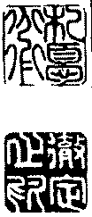
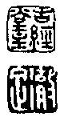
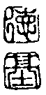

# 辟邪集（部分资料暂采他本）



> **藏经**：大藏经补编（大藏经补编）　**册次** 第 24 册（B24）　**编号** B0134　**部类** 史传部　**卷次** 2 卷　**篇幅** 29,378 字

> **卷／品**：0 卷 · 3 品



---



## 目录



  - [翻刻辟邪集序](#翻刻辟邪集序)

  - [刻辟邪集序](#刻辟邪集序)

  - [统正序](#统正序)



---



### 翻刻辟邪集序



盖西洋之学。长於机智。而短於心理。故至其说道理之变通。与心性之妙用。则支离夸诞。殆不可究诘焉。徒以衒音竞新。为究理。伪妄乱真。继立诡说。若夫玩物天地。魔鬼圣贤。毁祖先之祀。废父母之丧。以磔刑像为神。以恣烹割为斋。凡天下之事。悉颠倒。诚理不可解者矣。然而彼以长於机智。右为天地之事。皆可以机巧测去。昧去为之眩惑焉。余谓彼夷辈。创造奇器。以驻服蠢民。假托耶教。而欺诬诸邦。欲以赤手并吞宇内。其奸计不啻封永长蛇矣。我大雄氏有言云。劫末之世。天魔竞兴。以邪为正。以伪为真。方今果知悬记之不诬也。顷者夷辈。闯都鄙。欲托言于通商。而私开妖教。余只惧通商一▆。妖教禁渐弛也。边阅明鍾振之居士。天学初徵再徵。暨罗川纯禅师。天学初辟。儒释之论。至理快畅。联𱯳合璋。可谓照妖胆之秦镜矣。𩂜附训点。合刻之以公于世。夫妖教之禁。



昭代最岩矣。虽然俗随世福。事逐时变。吾徒则壹奉宽永之大令。以防微杜渐为务。语云。㳙㳙不塞。终成江河。可不畏焉哉。可不戒马哉是为序



万延纪元庚申桂月题於缘峤南经古经堂中



杞忧道人撰







------



### 刻辟邪集序



法无邪正。邪正在人。迦叶佛灭度后正法像法俱尽。而常乐我净之语变为九十五种外道。释迦出世。遂以无常苦无我不净破之。情计既荡。圣谛现前。逮双林示寂。重唱真常。所谓但除其病。不除法也。流至今日。佛法又几成外道矣。於是有利马窦艾儒略等，托言从大西来。借儒术为名。攻释教为妄。自称为天主教。亦称天学。诸释子群起而诟之。然适足以致其谤耳。独圣朝佐辟一书。颇足令邪党结舌。惜乎流通不广。迩来利艾实繁有徒。邪风益炽。鍾振之居士於是乎惧著初徵再徵以致际明禅师禅师笑曰。释迦如来。得外道六师之毁而教道大行。肇公物不迁论。得空印之驳。而举世方知讨究。吾安知利艾二人。非不思议菩萨。乘大愿力。特来激扬佛法者耶。是故。释子不必忿忿亦不必辩也。唯居士主张理学。纲维世道。则其辟之也甚宜。近可闲孔孟之道。远亦可助明佛法。乃属梦士评付梓人，而问序於杲庵和尚。杲庵读竟。兼读居士禅师往来二札为之评曰。善夫。利艾二公。能佯作不通之说以扣击真乘。善夫振之居士。能以佛理作儒理辩。善夫际明禅师能以不辨辨而寄辨於梦士之评也。利艾不可思议。振之不可思议。梦士不可思议。际明尤不可思议。不思议邪。不思议正。不思议语。不思议默。公案具在。以邪相入正相。以正相入邪相。知语即默。知默即语。是在具眼者矣。



癸未秋日越溪天姆峰杲庵释大朗书



天学初徵



金阊逸史鍾始声振之甫著



新安梦士程智用用九甫评



鍾子读《易》於震泽之滨，有客扣庐而问曰：「吾闻子年十二、三时，便以千古学脉为己任，辟释老、闲圣道，今三十餘载矣。足不窥户外，不与名公大人交，亦不思致身以事君，将安补於世道哉？且子不闻近世有天主教乎？其人从大西来，一见我中国之书悉能通达。彼亦辟佛而尊儒，与子意甚相符也。曷一共讨究焉？」鍾子欣而作曰：「有是哉！彼既从大西来，乃不袒释而袒儒。意者吾圣道晦而复明之机乎？愿闻其旨。」客迺出圣像，略说一册以示之。鍾子读甫竟，遂诟曰：「嘻！此妖胡耳。阳排佛而阴窃其秕糠；伪尊儒而实乱其道脉。请即以彼说攻之。彼云：『天主即当初生天、生地、生神、生人、生物的一大主宰。』且问彼大主宰，有形质耶？无形质耶？若有形质，复从何生？且未有天地时，住止何处？若无形质，则吾儒所谓太极也。太极本无极，云何有爱恶？云何要人奉事、听候使令？云何能为福罚？其不通者一也。且太极只是本具阴阳之理，是故动而为阳、静而为阴。阴阳各有善恶之致，故裁成辅相之任独归於人。孔子曰：『人能弘道。』又曰：『为仁由己。』子思曰：『致中和，天地位焉，万物育焉。』《易》曰：『先天而天弗违。』若如彼说，则造作之权，全归天主。天主既能造作神、人，何不单造善神、善人？而又兼造恶神、恶人以贻累於万世乎？其不通者二也。且天主所造，露际弗尔，何故独赐之以大力量、大才能？若不知其要起骄傲而赐之，是不智也；若知其要起骄傲而赐之，是不仁也。不仁不智，犹称天主，其不通者三也。又露际弗尔，既罚下地狱矣。天主又容他在此世界阴诱世人。曾不如舜之诛四凶、封傲象也。其不通者四也。且天、地、万物既皆天主所造，即应择其有益者而造之，择其有损者而弗造。或虽造而即除之。何故造此肉身？造此风俗？造此魔鬼？以为三仇，而不能除耶？世间良工，造器必美；或偶不美，必弃之。以至大、至尊、至灵、至圣之真主，曾良工之不如？其不通者五也。孔子曰：『天何言哉。』孟子曰：『天不言，以行与事示之而已矣。』今言古时天主降下十戒。则与汉宋之封禅天书何异？惑世诬民，莫此为甚。其不通者六也。又天主降生为人，传受大道。未降生前居在何处？若在天堂，则是天主依天堂住。如何可说天主造成天堂？若言既造天堂、依天堂住，如人造屋还即住屋。则未造天堂时，又依何住？若无所依，则同太极；不应太极，依天堂住。福罚人间，亦不应太极降生为人。其不通者七也。又天主既降生后，彼天堂上为有本身？为无本身？若无本身，则天上无主；若有本身，则滥佛氏真、应二身之说。而又不及千百亿化身之奇幻。其不通者八也。又谓天主以自身赎天下万世罪过，尤为不通。夫天主既其至尊无比，慈威无量，何不直赦人罪，而须以身赎罪？未审向谁赎之？其不通者九也。又既能以身赎人罪过，何以不能使勿造罪？其不通者十也。又既云：『赎天下万世人罪』，而今犹有造罪堕地狱者，仍赎不尽。其不通者十一也。吾儒谓尧舜之圣，不能掩其子之恶；孝子慈孙，不能改幽厉之过。所以自天子至於庶人，壹是皆以修身为本。而今天主既可赎人罪过，则人便可恣意为恶，总待天主慈悲赎之。其不通者十二也。遗下教规，谓只有一造物真主，至大、至尊，要人奉事、拜祭。而尽抹杀天、地、日、月诸星。则与佛氏所称『唯吾独尊』何异？阴倣其说，而阳排之。其不通者十三也。佛氏虽曰『唯吾独尊』，尚谓天、地、日、月、诸星，覆炤世间，有大功德；护世鬼神保祐人间，宜思报效。今乃曰不当拜祭，则专擅名利之恶甚於佛氏。其不通者十四也。既不许轮回之说，又云人之灵魂尝在不灭，有始无终。则转积转多，安置何所？其不通者十五也。若谓天堂、地狱皆大，可以并容，何异佛氏之说？其不通者十六也。又彼谓佛氏所称三千大千华藏世界，人所不见，便是荒唐。今彼所称天堂、地狱又谁见之？其不通者十七也。又谓天堂、地狱，虽然未见，却是实理。则安知三千华藏非实理乎？而苦破之，其不通者十八也。又谓临终一刻听从天主教法，也还翻悔得转，则与佛氏临终十念相滥。汝说要真，佛氏亦说要真。汝说要依十戒，佛氏亦说要依十戒。汝说从自己身心上实实做出来，佛氏亦说从自己身心上实实做出来。汝说要真心实意痛悔力除，后来不敢再犯，佛氏亦说要真心实意痛悔力除，后来不敢再犯。全偷佛氏之说而又非之，其不通者十九也。又佛氏专明万法惟心，故凡事只靠一心。汝既专明万法惟天主，则凡事只靠一天主足矣。又何用从自己身心做出耶？若仍要从身心做出，则权不独在天主明矣。而妄立天主，其不通者二十也。汝既要攻释、道两家，须搜其病根，彼方心服。若谓要人施舍些钱财，备办些斋饭，烧化些纸张，便是功果，恐彼二氏亦未必心服。而汝又仍教人奉事、拜礼天主圣像，与彼何异？其不通者二十一也。吾儒谓『物物一太极，天命之谓性』，故人人可以成位於中。至於尊卑、名位则森然不乱。故天子事上帝，诸侯祭山川、社稷，大夫五祀，士祭其先。今既谓天主至大至尊，又令家事而户奉之，与佛、老二像何异？而妄自表彰，以为不同，其不通者二十二也。吾故曰『阳辟佛而阴窃之，伪尊儒而实坏之』者也。逐其人，毁其书，禁天下不得存其像，庶不为中国之贼耳。闻彼妖徒聪明能辩，必有以解吾徵者。吾将再徵之。」



天学初徵



天学再徵



金阊逸史鍾始声振之甫著



新安梦士程智用用九甫评



鍾子作《天学初徵》。客阅而笑曰：「甚矣！子之卤莽也！乍闻天说，曾未深究，遽谓不通而徵之。子且再阅《西来意》、《三山论学记》及《圣教约言》，则不通者，乃在子而不在彼矣。」鍾子取而细读之，复为之徵如左。



其言曰：「上天自东运行，而日、月、星、辰之天自西循逆之。度数各依其则，次舍各安其位。倘无尊主干旋主宰，其间宁免无悖？譬如舟渡江海，上下风涛而无倾荡之虞。虽未见人，亦知一舟之中，必有掌舵智工」等。徵曰：舟之渡江海也，舟必各一舵工。未闻一舵工而遍操众舟之上下者也。又操舟者必非造舟人也，谓天惟一主，并造之，并运行之。可乎？



其言曰：「凡物不能自成，必须外为者以成之。楼台、房屋不能自成，成於工匠之手；天地不能自成，成於天主」等。徵曰：工匠之成房屋也，必有命之成者。天主之成天地，孰命之耶？工匠成房屋，不能为房屋主。彼成天地者，又乌能为天地主乎？



其言曰：「天下之物极多、极盛，苟无一尊维持调护，不免散坏。是故一家止有一长，一国止有一君，一人止有一身，一身止有一首」等。徵曰：谓一身无二首，可也。谓一身一首之外，别无他身他首，不可也；谓一家无二长可也，谓一家一长之外别无他家他长，不可也；谓一国无二君可也，谓一国一君之外更无他国他君，不可也；谓一天无二主亦可也，谓一天一主之外独无他天他主，可乎？又一身虽惟一首，首必与四肢、百骸俱生，非首生四肢、百骸也；一家虽惟一长，长必与眷属、僮仆并生，非长生眷属、僮仆也；一国虽惟一君，君必与臣佐、吏民俱生，非君生臣佐、吏民也。则一天虽惟一主，主亦必与神、鬼、人、物并生，谓主生神、鬼、人、物可乎？



其言曰：「天主非天也，非地也，而高明博厚，较天地尤甚。非鬼神也，而神灵鬼神，不啻非人也，而遐迈圣睿，乃至无始无终，无处可以容载，而无所不盈充」等。徵曰：既无所不盈充，则不但在天堂，亦遍在地狱也。不但遍天、地，亦遍在神、鬼、人、兽、草、木、杂秽等处也。若谓高居天堂，至尊无上，则盈充之义不成；若谓遍一切处，则至尊之体不立。或救之曰：「天主之尊，如日在天，光遍一切。虽遍而不失其尊，虽尊而光原自遍。」今再徵曰：是仍有处所、有方隅、有形像也。日有形像，彼谓天主造之。天主亦有形像，又谁之所造耶？



其言曰：「吾天主，乃经所谓上帝也。」遂引〈颂〉、〈雅〉、《易传》、《中庸》等以证成之。徵曰：甚矣！其不知儒理也。吾儒所谓天者，有三焉：一者、望而苍苍之天，所谓昭昭之多，及其无穷者是也。二者、统御世间，主善罚恶之天，即《诗》《易》、《中庸》所称上帝是也。彼惟知此而已。此之天帝但治世而非生世，譬如帝王但治民而非生民也。乃谬计为生人、生物之主，则大缪矣。三者、本有灵明之性，无始无终、不生不灭名之为天。此乃天地万物本原，名之为命。故中庸云：「天命之谓性。」天非苍苍之天，亦非上帝之天也，命非谆谆之命，亦非赋畀之解也。孔子曰：「五十而知天命。」正深证此本性耳，亦谓之中，故曰：「喜、怒、哀、乐之未发谓之中。」中也者，天下之大本也。亦谓之易，故曰：「易，无思也，无为也。寂然不动，感而遂通天下之故。」亦谓之良知，故曰：「知至而后意诚。」亦谓之不睹不闻，亦谓之独，故曰：「戒慎乎其所不睹，恐惧乎其所不闻。」君子必慎其独，即孔子所言畏天命也。亦谓之心，故曰：「学问之道无他，求其放心而已矣。」亦谓之己，故曰：「君子求诸己。为仁由己而由人乎哉？」亦谓之我，故曰：「万物皆备於我矣。」亦谓之诚，故曰：「自诚明，谓之性。」诚者天之道也。此真天地万物本原，而实无喜怒、无造作、无赏罚、无声臭。但此天然性德之中，法尔具足理气体用，故曰：「易有太极，是生两仪」等。然虽云易有太极，而太极即全是易；如湿性为水，水全是湿；虽云太极生两仪，而两仪即全太极；虽云两仪生四象，四象亦即全是两仪；虽云四象生八卦，八卦亦即全是四象。乃至八相荡而为六十四，六十四互变而为四千九十六。於彼四千九十六卦之中，随举一卦、随举一爻，亦无不全是八卦、全是四象、全是两仪、全是太极、全是易理者。譬如触大海一波，无不全体是水，全是湿性者。又如撒水银珠，颗颗皆圆。故凡天、神、鬼、人，苟能於一事一物之中，克见太极、易理之全者，在天则为上帝，在鬼神则为灵明，在人则为圣人，而统治、化导之权归焉。倘天地未分之先，先有一最灵、最圣者为大主，则便可有治而无乱，有善而无恶，又何俟后之神灵、圣哲为之裁成辅相？而人亦更无与天地合德，先天而天弗违者矣。彼乌知吾儒继天立极之真学脉哉！



其言曰：「魂有三品：下名生魂，草木之魂是也；中名觉魂，禽兽之魂是也。此二皆灭，亦云有始有终。卜名灵魂，即人魂也。此魂不灭，亦云有始无终。」徵曰：灵与觉异，则有始而无终。觉与生异，何皆有始而有终也？且谓禽兽有觉而无灵，惟人为有灵者，现见世之愚人，但念饮食、婬欲，他无所知，与禽兽何异？现见世有义犬、义猴，舍身殉主、诉官理究，与人何异？故孟子亦云：「人之所以异於禽兽者几希，庶民去之，君子存之。」岂可妄分一有终、一无终耶？



其言曰：「周公、仲尼之论，孰有狎后帝而与之一者。设匹夫自称与天子同尊，其能免乎？地上民不可妄比肩，地上君而可同天上帝乎？」徵曰：庶民不敢拟帝王者，名位也；不敢让帝王者，德性也。故曰：「朝廷莫如爵，辅世长民莫如德。」又曰：「当仁不让於师。」又曰：「自天子以至於庶人，壹是皆以修身为本。」故文王，人君也。而纯亦不己，可以配天；仲尼，匹夫也，而祖述宪章，不名僭窃。且父之生子也，谁不欲子之克肖者？天主既为大父，实生於人，乃不欲人之肖之，何哉？



其言曰：「知者之心，含天地、具万物，非真天地、万物之体也。若止水明镜，影诸万物，乃谓明镜止水，均有天地，即能造作之，岂可乎？天主，万物之原，能生万物。若人即与之同，当亦能生之。」徵曰：止水明镜之影万物也，镜水在此，万物在彼。有分剂，有方隅，故知是影而非体也。心之含天地、具万物也，汝可指心之方隅分剂，犹如彼镜与水乎？若心无形朕，不能生万物者，天主亦无形朕，胡能生万物也？若天主无形而能形形，心独不可无形而形形乎？



其言曰：「有在物之内分，如阴阳是也；有在物之外分，如作者之类是也。天主作物，则在物之外分矣。」徵曰：天主作天地万物，必在天地万物之外。如匠作器皿，必在器皿之外。是固然矣。然则天主有方隅也、有分剂也，原非遍一切也。则必有分段也、有变迁也。何以无始无终，能为万世主乎？



其言曰：「形者在所，故能充乎所。神无形，则何以满其所乎？一粒之大，万神宅焉。岂惟往者，将来灵魂并容不碍也。」徵曰：神之无形，善乎其言之矣。然无形则无往来，亦无数目，亦无生灭。而曰灵魂天主所生，其可乎哉？



其言曰：「化生天地万物，乃大公之父也。又时主宰而安养之，乃无上共君也。世人弗仰弗奉，则无父、无君，至无孝、至无忠也。」徵曰：夫世间之法，决无全能。故天地能覆载而不能炤明；日月能炤明而不能生育；父母能生育而不能教诲；师友能教诲而不能赏罚；君主能赏罚而不能无漏网；鬼神赏罚无漏网而又不能覆载炤明等。若天主果有全能也，则直以天主覆载、炤临、生育、教诲、赏罚之而可矣。又何用天、地、日、月、君、亲、鬼、神为？若犹待天覆地载，乃至亲生君治之也，则天主全能安在？今现见人之生也，天覆之、地载之，日月炤临之、父生之，母育之，国君统治之、鬼神昭鉴保护之。顾不知感其恩德，独推恩於漠无见闻之天主，谓之大父、大君。既谓之大父、大君，则必以吾父、吾君为小父、小君矣，岂不至无孝、至无忠哉？又设谓天主全能，即寄於天、地、日、月、君、亲、鬼、神，如国主寄全用於公、卿、牧、长。则庶民有善，官宰赏之可矣；庶民有罪，官宰罚之可矣，岂事事必经国主哉？又庶民之所承事，亦但承事官宰无违，即为承事国主矣。岂必独事一主而禁其承事官宰哉？今谓仙、佛僭窃，禁不承事，犹之可也。天、地、日、月、鬼、神，固天主所造，以覆载炤护人者，而亦禁其拜祭，不亦异乎？



其言曰：「人心性命，原天主所赋也。」徵曰：天命之谓性。紫阳之解甚谬，吾已释大意於前矣。夫可赋者，必其有形者也。心性有何形像而可赋乎？若无形像而仍可赋，则天主灵明，亦必有赋之者矣。又可赋则可夺，云何有始而无终乎？



其言曰：「必先有物，而后有理。引诗云『有物、有则。』」徵曰：夫理者，贯於物之终始，而能成物者也。故曰诚者物之终始，不诚无物。《诗》所谓有物有则，正繇从理成物，故即物是理。如金作器，器全是金也。若言先有物而后有理，则未有物时便无理耶？既无物即无理，则无天地时尤必无理。而天主在天地先，乃无理之尤甚者也。



其言曰：「必有无始，而后有有始；有无形，而后能形形。吾身之先，必有父母生我。必有天主降衷於我。」徵曰：无始无形，快哉论也！若天主无始，则父母亦无始乎？天主无形，则父母亦无形乎？或解之曰：「父母有形，故有始。天主无形，故无始也。」徵曰：吾身有形，故有始。吾心性无形，何为不无始乎？



其言曰：「天地犹一宫室也。宫室、楼台必待有主制造而后成。曾是天地之大，无有主之者，竟能自造自成乎？」徵曰：宫室未成时，主及工匠，依地依厂。天地未成时，天主何依耶？又宫室则用土木瓦石成之，天地用何物成之耶？又未有天地，先有成天地之料耶？此料为本有之？为天主生之耶？且安置何所耶？为在天主身内？为在外耶？若在身外，则天主不遍一切；若在身内，不几戕贼其身，而以为天地万物耶？



其言曰：「太极之说，不过理、气二字。未尝言其有灵知觉，明也。既无灵觉，何以主宰万化？」徵曰：孔子不言「易有太极，是生两仪」乎？夫易即灵明知觉之本性也，故无思、无为，寂然不动，感而遂通。然正不必以此主宰万化。若万化定有主宰，则但化善而不化恶，但化乐而不化苦。圣人修道之教，反为无用矣。



其言曰：「儒云：『物物各具一太极』，则太极与物同体。囿於物而不得为天地主。」徵曰：太极妙理，无分剂、无方隅，故物物各得其全，全体在物而不囿於物也。孔子曰：「范围天地之化而不过，曲成万物而不遗。通乎昼夜之道而知。」此之谓也。汝谓独一天主，不与物同体，则必高居物表，有分剂、有方隅矣，何谓无所不在？



其言曰：「人为天主所生，悉启翼於善。或乃为恶，则同人所自造。」徵曰：天主既有全能，何以好善而人不善，恶恶而人反恶？或救之曰：「如父母生子，但欲其善，不欲其恶。子偏作恶，父母何辜？」徵曰：父母生子身，不生子心性，故不得自在也。天主既生其心性，何不但生善心性耶？



其言曰：「天主生物，欲以养人。生人，欲以事主。」徵曰：天主既无始，无始何人事之？而忽起生人事己之想？又父母生子，为防老死。天主既无终，生人何用？



其言曰：「人之生从何来？死从何去？」徵曰：此佛氏尝谈也，亦吾儒秘旨也。而用之则大异矣。孔子曰：「原始反终」，故知死生之说。精气为物，游魂为变，是故知鬼神之情状。逮季路问事鬼神，则曰：「未能事人，焉能事鬼？」「敢问死。」则曰：「未知生，焉知死？」繇此观之，生死无二理，人鬼无二致，明矣。「朝闻道而夕死可者」，谓其死而有不死者存也。既死而不死，则生必不生，而谓天主赋之始生，可乎？



其言曰：「天主降生之时，第以本性之原体，结合於吾人之性体。譬之以梨接桃，梨藉桃以生，桃何尝损其本体？」徵曰：彼谓人之性灵皆天主造。而今以桃、梨譬之，将谓世间之梨，皆桃所生乎？梨本桃生，何须待接？待接方生，则桃本不能生梨矣。



其言曰：「天主未降生千百年前，已豫示必降之兆。及其将降，又有天神来报。乃至种种奇功异瑞。其书充栋，特未传译」等。徵曰：此与释氏所述佛生瑞应何异也？若谓释迦为摩耶所生，不过是人。则天主为圣女所生，独非人乎？若谓耶稣定是天主降生，则安知释迦非天主降生乎？若谓佛氏经书荒伪，则汝书安知不荒伪乎？若谓汝书历历有据，则佛经不亦自谓历历有据乎？若谓佛出西域，此间无人见闻，便称为谬。则汝出大西，此间尤无人见，不尤谬乎？佛书从天竺来，汝则以为误取。汝谓九万里来，谁知其非说谎乎？汝既孤身至此，去家已远，历年已久，何繇与汝交者，犹有本国异物赠之？岂汝膂力甚大，当日所携之物如此其多耶？抑有神通，朝取而夕至耶？抑有奇术，随意能变造耶？吾亦闻汝之根底矣。生於近香山岳之小国，聪明奸究，意在觊觎中原神器，故泛海潜至岭南。先学此方声字，然后窃读三教群书，牵佛附儒，杜撰扭捏，创此邪教以为惑世诳民蠹坏国运之本。自谓绝婬不娶而以领圣水之妄说，诱彼愚夫愚妇私行秽鄙。然闽粤民庶，每年必与吕宋等国商贾往来。汝之羽翼，每年附舟赉、送宝物以相资给。是故与汝交者，汝不希彼一毫供养，更以异物而赠惠之。人遂谓汝廉洁无求，胜彼释、老之劝人布施。乃至缙绅达士，亦被汝惑。以为恭、悫、廉、退，俨然大儒风格。呜呼！安知王莽谦恭，乃汉室之贼，介甫新学，实宋世之蠹哉！汝之心术亦太恶矣。



其言曰：「物或有始终，如草、木、鸟、兽；或有始而无终，如天、地、神、鬼及人之灵魂。惟天主无始无终，而能始终万物。无天主则无物矣」。徵曰：吾儒谓诚者物之终始，不诚无物。其次致曲，曲能有诚，诚则形。乃至惟天下至诚为能化。至诚之道，可以前知。至诚如神，至诚能尽其性，能尽人物之性，赞化育而参天地。故先以二语定其宗趣，所谓「自诚明，谓之性；自明诚，谓之教。」而又结示性修不二，天人合一之旨，故曰：「诚则明矣，明则诚矣。」此真物化根源，非所谓天主也。若必立一天主，至灵至圣，无所不能，威权不二，则化育决无劳赞，而天地决不可参，岂理也哉！又彼所立有始有终、有始无终、无始无终三句，尤为不通。易曰：「形而上者谓之道，形而下者谓之器。」器则有始必有终，道则无终必无始。既许有始无终一句，何不并立无始有终一句耶？且草木与鸟兽，其不同甚矣，犹皆有始有终。人之所以异於禽兽者几希耳，独有始而无终，何耶？又世间之法，父子必相类，因果必相同。现见人决生人，鸟决生鸟，瓜不生豆，豆不生瓜。天主既生人也，人有始无终，天主亦必有始而无终矣。若天主灵妙，故无始，则人心亦灵妙，何谓独有始乎？若人心灵妙，天主赋之，则天主灵妙，安知不亦有赋之者乎？又天主生人，则谓人之大父也。生鸟兽，不为鸟兽父乎？生草木，不为草木父乎？鸟、兽、草、木之父，亦何足为尊主乎？



其言曰：「譬如树之花、果、枝、叶及干，皆繇根生，无根则皆无。乃树之根，固无他根所繇生也。天主是万物根底。何所繇生？」徵曰：树根必依地者也。天主独能无所依乎？



其言曰：「天主当初欲生万物，以为人用。先开辟天地，化生万物之诸宗，然后化生一男一女等。」徵曰：天地未辟，尚未有人。云何欲生万物以为人用乎？



其言曰：「生前为善、为恶，其魂各以死后赴天主审判。」徵曰：若天主无形、声、处所，则死者将何所赴？若可赴听审判，殆如世间士师，亦如释氏所称阎罗。然设如士师，则士师亦父母所生，不免老死者也。设如阎罗，则阎罗亦众生数目，不免轮回者也，犹可称无始无终，造物之真宰耶？



其言曰：「天堂、地狱之报决不可免。所以定有后世。无有一人能忆前世事者，所以定无前世。」徵曰：执途之人而问以初生时事，亦无一人能忆之者，可谓并无初生事乎？初生虽不忆，不可谓无初生。前世虽不忆，又安知无前世也？



其言曰：「仙、佛、菩萨，令人奉敬自己而抗天主之权。」徵曰：仙、佛、菩萨，虽非吾儒所宗，然必说有诸仙、诸佛、诸菩萨等以为世人所敬。又说天、地、日、月、星辰、鬼、神皆应奉事。则非专奉自己也。耶稣乃令人专奉一主，不得拜祭天、地、日、月等，其专利嫉妒不尤甚乎？



天学再徵



附



鍾振之居士寄初徵与际明禅师柬



忆吾两人，生同一日，学同一师，幼同一志。不谓尊者至廿四岁，逃儒入禅。二十年来，所趋各别，音问遂疏。兹者病卧湖滨，忽闻天主邪说。借彼矛，攻彼盾，略为《初徵》。知尊者久事禅学，必有破敌餘才。且彼既专攻佛教，尊者似亦不容默默。拙稿呈政，惟进而教之。



际明禅师复柬



方外云踪，久失闻问。而髫年千古之志，则未敢或忘也。接手教，兼读《初徵》，快甚！居士担当圣学，正应出此手眼。山衲既弃世法，不必更为辩论。若谓彼攻佛教，佛教实非彼所能破。且今时释子，有名无义者多，藉此外难以警悚之，未必非佛法之幸也！刀不磨不利，钟不击不鸣。三武灭僧，而佛法益盛。山衲且拭目俟之矣。草复不既。



鍾振之寄再徵柬



曩寄《天学初徵》呈政，意尊者必出手眼，共闲圣道。而竟袖手旁观，岂髫年千古之志，与世法俱弃耶？何谓未敢或忘也？迩来邪说益炽，不得已再为之徵。必祈为我斟酌。毋曰：「尔既不归投佛法，吾亦不预闻儒宗也。」



际明禅师复柬



儒、释二家，同而复异、异而复同，惟智人能深究之，非邪说可混淆也。惟真儒方能知佛；亦惟学佛始能知儒。读居士《再徵》，其揭理处，如日轮中天；其破邪处，如基箭射柳。孔、颜一脉，可谓不坠地矣。山衲岂能更赞一辞？惟冀居士以此慧性，更复深究西竺心传，则世出世道，均为有赖。形迹虽疏，神交匪隔。当不以我为狂言也。



辟邪集跋语



余尝读《观所缘缘论》，先展转纵夺以破外人，然后中立正义。倘外计未破，不应先主自宗。譬以良将用兵，先以威伏，后以慈抚也。近日天主之教浅陋，殆不呈言。彼翕然信向者，达士不过为利所惑，庸人不过望风超影，皆无足怪。独怪夫破之者，不能借矛攻盾，往往先自立宗，反未免赍盗粮而藉寇兵耳。惟兹二《徵》，绝不自轨一法，惟乘其衅而攻之，大似尉迟、敬德，裸身赤手入阵而夺矛取胜。其以临济白拈贼之心里者耶？乞集一出可以破邪，可以匡世，可以闲圣道，可以获　国运，利亦伟矣。爰不揣庸劣，评而梓之。



新安梦士程智用谨跋



天学初辟(凡九)



罗川释如纯著



天教云。天主者乃全能全智。造成天地万物为之主宰者也。厥初生亚当阨袜。此为人类之祖。其灵性。其形体。本极备美备福。后一犯违圣命。恩泽悉隳。病患随至。情欲错出。天路隔焉。此祖宗之罪污。又递传於人类。故人从受孕来。即皆体是污染。而凡后来罪恶。无不繇此根芽。



辟曰。然则天主赋命。唯善无恶。何不使亚当阨袜。全其性善。绝其情欲。不为万代子孙清净之源乎。且当初生之人。情欲未及滋蔓。少展神功。俾渠克肖。岂不易易。况全能全智。则必洞彻万世之流弊。即嗑去其方命者。并护后来人人善始善终。绝为恶之根倪。何不利益。而乃恣其恶念蔓延至今。以致污染不了。是何自遗恶本耶。葢斩莠必除其根。疗疾必攻其本。而此人工犹穷委防微。何天主全能。而反养痈蓄蠧如此耶。若云天主彼时即欲灭之。但恐无传人种。然天主有生人不已之机。何不再生一个好人以之传耶。若谓其恶未甚。不忍遽绝。则稽天之浸。发于涓涓。燎原之焰。起于星星。天主忍坐视乎。若谓已知其有生必有过犯。而听其自善自恶。以定赏罚。是罔民也。其所主谓何。其称全智全能谓何。则知所谓天主者。非能为天地人物之大主宰章章矣。吾人又胡彼之惑为。



天教云。仁者以天地万物为一体。乃至以之为体。则此亦一体。彼亦一体。不可强而同明矣。



辟曰。葢体有性体之体。有形体之体。形则妄而异。性则真而同。不可不辨也。故论性体则智愚灵蠢。飞潜动植。小至尘芒。大至不可御。无少不同也。如论形体则万品流形而自异。然非万物一体之旨之所取。胡可执相难性。而疑万物之体之本性乎。今子若能了相无自性。并无自相。则相相一相也。性性一性也。而疑释矣。余故知渠错认本源。故辄云人物不同性。人与天主性尤逈别。是为天主一性。人一性。物一性。而一贯之道碎裂无餘。呜呼以此论性而教斯民。实三教圣人之罪首矣。



天教云。上达以下学为基。天下以实有为贵。以虚无为贱。二氏之谓曰无曰空。於天主理大相剌谬。不可崇尚明矣。



辟曰。循名起执。罪恶之端。得意忘言。圣贤所与。葢不知妙无者不无。真空者不空。乃妙有真空真空妙有之义耳。况佛氏㣲旨。离四句绝百非。口欲言而词䘮。心欲缘而虑忘。老氏亦云吾不知其名。强名之曰道。遽可以空无尽之哉。葢。耳食之徒。承虚接响。谓无为绝无所有之断无。谓空为毫无所存之顽空。不明其旨。妄加诋訾。如人未到宝山。疑皆瓦砾。封於自见。非谤则诬矣。彼岂受尔之诬哉。况无极而太极。不以无为贵乎。吾有知乎哉无知也。不以空空为贵乎。太极即具众理。空空原涵两端。濂溪得嫡其传。▆父道统心脉。业承众圣。师表万世。抑将非上达之基。敢不崇尚而贱之耶。噫大矣哉空无之不可轻议矣明也。而况不滞于是者。固可借此以非乎。



天教云。自古及今。万国圣贤。咸杀生食荤。而不以为悔。亦不以此为违戒。又孟轲示世主。以数𮊁不可入污池。斧斤以时入山林。非不用也。



辟曰。噫。是不知圣人有莫大慈悲。甚深妙义。转旋五浊生机之㣲。君子之所为。众人固所不识也。伏𦏁氏始设网𮊁以警异类。详其意。总防民土处木栖之囏。而非以生厥我供恣其杀也。嗣是禹治洪水。益焚山泽。亦不过驱龙蛇虎豹於渊菹。使各安其所。殆非为杀生者作俑也。是以成汤解网。子产纵鳞。与夫钓而不纲。弋不射宿。君赐生必畜之。至於不折生草。不履生虫者。孔子仁之。然徵仁术於觳觫之牛。验良心於恻隐之绪。故曰。见其生不忍见。其死。闻其声不忍食其肉。其垂戒也孰严於是。前圣后圣虽设施不齐要之好生不忍之心。未始有不同者矣。苟天生禽兽。我杀我食。胡为圣贤袭此姑息之不忍耶。抑不知生而我给。反节罟之数入山以时耶。又胡为必斋戒於禘尝。禁屠沽於旱潦。无故不杀牛羊。七十政开食肉其杀之之罪孰明於是。不幸而习行成性。莫觉其非。今子遽曰戒杀生者为不经。实天生而为我用。如食河鲀者曰必不至死。噫于我何预哉。苟子亲闻天主禽兽我生食尔也。禽兽死而灵亦灭也。恣尔杀不尔罪也则可否则率天下后世之人。逆圣贤不忍之心而为忍行者。必此之言。呜呼子之罪上通於天。矣至以菜中红液为血。种种谬妄鄙俚之谈不足斥。



天教云。轮廻之说。乃闭他卧剌之语。佛窃为然。藉此以骇人者。自佛教入中国。始闻其说。诚不足信。



辟曰。性真尝中。求於去来生死迷悟圣凢了不可得但清净心中。不达外境。唯心倐然而动。名之曰妄。以妄为因。作种种事业。业有善恶轻重之殊。故感报亦苦乐升沉之别。葢果非业不足以召。业非惑无从而兴惑业苦三。更相繇藉。如汲井轮。自成轮转。若揭日月於中天。诚无得而疑者。苟果不繇业。则均为天主之所生。无论禽兽之卑。蜎蠕之眇即人类中富贵贫贱寿夭穷通不啻天渊倍蓰。而天主之至公安在哉。其轮廻之理如是岂待窃闭他卧剌之语耶。虽然果不自果。因业而果。业不自业。繇惑而业。惑不自惑缘妄而惑。妄不自妄。从真起妄。真不自真。对妄名真。故曰。应观法界性一切唯心造。是则心生则种种法生。心灭则种种法灭。所谓梦里明明有六趣。觉后空空无大千。佛不云乎一切众生具有如来智慧德相。但以妄想执着而不证得。从迷积迷莫知底止。世尊说为可怜悯者。又岂藉轮廻之说而骇人哉。若曰佛教入中国始闻其说。是大不然。虽无其言。业有其事。如鲧化为熊。望帝为龙。羊哀为虎。彭生为豕。如意为犬。黄母为鼋。宣武为鼈。邓艾为牛。徐伯为鱼。铃卞为乌。书生为蛇。李微为虎等。此种种皆儒书记载。尽释教未入中国以前昭昭有之。特未揭出轮廻两言耳。葢有其言而无其事者或有之矣。未有有其事而无其言。并不信其实有之事者亦惑矣。若曰尽信书则不如无书。则六经可焚弃。是非通论也。程子尝曰。亲见村民化为虎。自引虎入其家食其猪羊。圣人亦曰。精气为物。游魂为变。甚有深意。葢生而曰心。死而曰魂。非二物也。圣人曰变吾佛曰轮。理则一也。此非又一证乎。何遽谓无轮廻耶。则知此身既不可以尝保。倘背善而趣恶。固不免为异类。故玄宗直指云。人用禽兽心。死必为禽兽。生用人天心。死必为人天。此唯心之旨不易之理也。若谓无能记前世之事以证无轮廻者。不见羊祜识环。鲍靓记井。向靖女亡而再育。问父母以求力。文澹幻质以还生。说香囊而验父。龟龄赋桥碑之宿写。子瞻指殿陛以曾堦。事匪无徵孰敢不信。且吾人壮而不记襁褓。耄矣顿忘壮年。一身所历之事。尚然罔忆。而况隔生乎。至於终年染翰。累举笔而忘字。薄暮移榻夜起而莫辨东西。岂遂谓不繇昔而突然自有于今耶。纵殁彼而即胎此尚有临终仓卒之怖。母腹局促之昏。颠倒而下。莫知所措。改头换面。习业悬殊。迨识人事来。竟不知相去几岁月矣。欲责以忆前世之事不。亦甚乎。故曰。菩萨有隔隂之昏。罗汉有出胎之障。苟非智通宿命。惑浅业轻。未易记往事也。故忆者少而忘者多也。若云记者少不足以徵轮廻。余亦将曰以此少记者足徵子教非无轮廻。何则记之云者。存往事於心也。子教谓凢人之生时。天主即造灵魂[叟-又+丌]之。然则斯身也固父母遗体也。斯灵也亦天主之始造也。其所能记前事者何也。佛经固不足信也。书史亦不足信耶。学佛者固不足信也。夫学儒者岂亦不足信耶。欲尽信固不可也。宁无可信也耶。苟有一可信。则子将欺天乎欺人乎。适足以自欺也。且轮廻者往返之谓也。转展不息固轮廻也。即从此迁彼亦轮廻之分也。必一定不移而后始可言无轮廻矣。子教谓生则存斯世也。死则随其善恶而升降焉永永无尽也。然则自天降灵乎人。又自人或复登乎天。是廻也轮亦过半矣。况又曰人稍有恶未尽。必入炼狱。伺其罪净而后升天。又曰耶稣自天而生于人。自人而坠地狱。又自狱而复生为人。又自人而登于天。其轮廻亦既多矣。纵曰。以不变禽兽为不轮廻者。吾教固未尝单以人兽而论轮廻。且余亦未敢为子保也。心境交加疾如风火。从朝至暮。一息不停。俯仰之间。变态万状。前念未灭。后念继生。道心人心禽心兽心。不知其几周匝乎其间。其为轮廻不已甚乎。又何伺𭘧角披毛而后为异类哉。此心实轮廻之本也。循业受报。轮廻之理也。前所引者。轮廻之事也。游魂为变。轮廻之证也。记述往事。轮廻之徵也。昭著若此。虽欲不信不可得也夫。



天教云。性异同。繇魂异同。类异同。繇性异同焉。



辟曰。夫血气之属必有知。凢有知者必同体。葢目均视焉。耳均听焉。身均觉焉。鼻均嗅焉。舌均味焉。心均思焉。顺则乐而逆则悲。生则安而死则危。其不学而知曰良知。不学而能曰良能。岂惟人有哉。即至微如蚊蚋蚤虱。莫不知趣利避害。欲食行藏。其所以不能推论道理者。果业使之然也。非知之体有异乎人者也。若必以推理别其类。岂惟禽兽哉而人亦有之。且多有之。亦可谓非类耶。既不能推理。未可以遽分类。是以形而类。非以性类也。况人之行犹有甚于禽兽者。又将何以类之哉。故人畜异类并异其性者非也。孔子曰。性相近习相远。斯言得矣。



天教云。佛氏之国。陋而且鄙。世人误读佛书。信其为净。甚有愿蚤死以复生彼国者。良可笑也。



辟曰。此系谬妄无据。诚不足斥。但彼不情造过惑世诬民。大都类此。且此谬所易明。引教证虚以例餘者。按弥陀经云。从是西方过十万亿佛土。有世界名曰极乐。即所谓净土也。葢三千大千世界为一佛土。谓一佛之报土也。正言从此娑婆世界之西去。过一佛土二佛土乃至十万亿之佛土。其远亦不可思议矣。故曰。生则决定生。去则实不去。乃唯心净土之旨耳。今子指印土国以当经中所诠之极乐。其净秽苦乐竟不啻霄壤矣。且西人远於印土。尚可航海而来。如以彼为净土。则吾人亦可往矣。又何必愿早死以生乎。且曰。世人误读佛书。不知自误也。曰。良可笑。适足以自笑也。不思之甚也。其无根谤佛皆若此悲夫。



天教云。中国缘帝王托梦。宰相贡䛕。差去使臣。奉君相意旨。何所不可崇饰。取至番文。谁人识之。以意翻演。谁人证之。葢自蔡谙秦景用白马驼回虚恢谲诈。而百端伪妄以潜伏不可究诘矣。



辟曰。此亦前章之类。妄诬尤甚。一无所据。既云不可究诘。则真信诈䛕均之无考。虚恢谲诈等又何从而知之。苟以笔舌抑扬。固无所不至。举世无知则幸。脱有识者。其吹毛求疵故人人罪灼。见子之心术则何益矣。梦而曰托。似乎有心。必未梦之先悬知西竺元自有佛。恐人未信。特假梦以求其符则可。然明帝实未尝知西方有大圣之说。乃太史傅毅述古语以对明帝之卜梦者。故曰。臣闻西方有大圣人。名之曰佛。不治而不乱。无为而成。陛下所梦。其必是乎。是乎也者。未决之词也。葢毅亦未尝亲见。故秪曰闻。何遽曰帝王托梦宰相贡䛕耶。下承上命。不能必其无崇饰。然亦有不可崇饰在焉。其释迦之画像似崇饰矣。然而舍利流光。旋环如葢。暎蔽日轮非蔡谙等可崇饰者矣。取来之经四十二章而已矣。用白马以驼。似崇饰矣。然经中若文若旨。非佛不足以言。岂谙等能之乎。偕迦叶摩竺法兰二尊者来。似崇饰矣。然其放光说法。飞行自在。而谙等能之乎。凢民易惑。四众云臻。似崇饰矣。然天雨宝花及奏众乐。谙等能之乎。是时钦释慢道似崇饰矣。然而筑坛焚经以辨真伪而道教烬而释教存。故唐太宗焚经台诗有春风也解嫌狼藉。吹尽当年道教灰之句。岂谙等能之乎。纵能崇饰於一时。宁能使天下后世皆崇饰乎。邦畿内外创梵刹以居僧。似崇饰矣。於时后宫阴夫人王婕妤等一百九十人。司空杨城侯刘善峻等二百六十人。四岳道士吕慧通等六百二十人。同时剃染。帝亲与群臣给供浃旬。谙等能之乎。且安荣宠。忌寂寞。莫宫宦之若也。妻孥之爱。孤独之悲。士庶咸若也。封己见。疾新端。莫羽流之若也。然其脱鶴氅而披袈裟。舍名位而归兰若。岂惟谙等之不能。即极威以临之。重势以迫之。导之以亲友。驱之以虎狼。苟无实感於心。遂肯捐弃恩爱。毁容易服。一旦皈诚未之有也。又按鉴断明帝天资明敏。尊贤下士。几成圣治。倘昧于恢诡谲诈。尚得称明敏乎。当时师傅鲠正循良如张佚张衍桓荣宋均軰皆宿德纯儒。犯颜敢谏。岂复贡䛕而酿非理者乎。如云崇佛即䛕也则自汉历今。其间帝王卿相崇佛者不一而足。谓裴房杨李等为贡䛕之臣且不可。敢以唐宋诸君。迨我有明太祖成祖至於神宗。皆为纳䛕之帝。又安可乎。曰。取至番文谁人识之。斯言不情之甚。胡能损至教哉。葢国必设掌理四方之职。以司隣国之词令。故译塲经馆。列十位以该罗。预从事者有八备十条之约。其所以郑重若此。正缘华梵相翻。恐誵文义者尔。十位维何。所谓主译者。笔受者。度语者。证梵文者。证梵义者。证禅义者。润文者。证译义者。梵呗者。校勘者。非精通三藏。明练显密。无以为译主。非言通华梵。学综有空。无以克笔授。度语者。变梵成华。传度令生解也。证文然后梵本真。证义则其所诠正。定慧等持。方称证禅之职。辞章藻雅。始宜润色之充。证义酌既翻之旨。校勘讐已译之文。自始至终。能事毕矣。然有恒位而无恒人。唯推能者当之。故聂承远父子。房融等。尝笔受焉。李峤韦。卢藏用等。尝润色焉。至於监护简校。则有周平高公侯寿房梁公杨慎交杜行𫖮等。监掌翻译之事。诠定宗旨者也。观其条理详密。考证再三。无以加矣。敢云取至番文谁人识之。以意翻演谁人证之。不思之甚也。妄诬之甚也。



天教云。按朱子语录。佛经皆中国文士自相撰集。如晋宋间自立讲师。孰为释迦。孰为阿难。孰为迦叶。各相问荅。笔之於书。



辟曰。斯尤谬妄。诚不屑辨。第恐无知。传为口实。今即以朱子之事。反证其非。考晦翁蚤从学於李延平先生。久之恨不能发明。及询长者咸指之禅学。已而徧谒禅老。与吕东莱。张南轩同问道於大慧禅师。先是从刘屏山游。屏山意其必留心举业遂搜其箧。唯有大慧禅师语录一帙。及登科致书於开善谦禅师曰。熹向蒙大慧禅师开示狗子佛性话头。未有悟入。愿受一言。警所不逮。谦荅书云。把这一念提撕狗子话头。不要商量。勇猛直前。一刀两𫨻。晦庵览之有省。噫勃哉。既知佛法皆出中国文人。何不自撰几卷。而反看他人之语何也。况又问道於学佛之徒又何也。自学佛。教人勿学佛。自用佛语。又怪周程明露佛语又何也。陈忠肃公谓性理之学。东林总禅师授之濂溪。其言已徧于天下矣。故周程张谢游杨晦庵等著书立言。凢说道理处皆用佛经禅语之意。故反有指内典曰。这一篇与宋儒相合。这几句亦与相合。呜呼曾不知宋儒尽是禅宗流将出去者。详晦庵意。不过自护门户耳。岂三藏五乘之教。果出於文士哉。固无庸置喙者矣。且晋宋以来之人物。贤而且明。历历可数。才德之望。经纶之美。如谢安石。量识高古。才思逸群。如王羲之。情性之正。去住之高。如刘遗民。风规潇洒。文章精遒。如谢灵运旷怀雅韵。间静自乐。孰如陶靖节。诗书法程节义严峻。孰如颜鲁公。衡阳庞蕰。识见之高。禅髓之邃。相国裴休。文章之古。道学之至。孰能加焉。刺史李翱侍郎居易。卓识宏度。文明典雅。孰能加焉。二苏子。黄山谷。天资明哲。深入禅窟。杨大年。李遵勗。不离尘俗。悟彻心源。孰能加焉。学士王公日休。秉政李公商老。皆博学知识。高明正大。有人所未易及者。是诸名贤笃志事佛。或入匡山之莲社或亲宗匠之炉锤。子云晋宋间文人。此其大概者矣。为我一一指陈。令无疑惑。三藏五千四十八卷。某经某人问荅。某人独说某经。昭晰以示天下。破千古之重昬。亦使佛氏心伏。何不可乎。今既不能指出则子之妄言明矣。将引他人不根之谈。欲沮佛祖真实至教。如吹萤火以涸苍溟。徒丧子之心力惜哉。且曰文人作过多端。偏畏死后。故其侫佛独在人先。噫心立不中。发言矫乱。於兹可验。据子先言佛经文人所自说。则实无佛。何侫之有。轮廻亦自所说。何畏之有。况侫佛者未始有不忠乎其君。不孝乎其亲。不成乎其仁者。大本既基。内省不疚。何畏侫偏先人耶。苟当仁不让而先人。则所趋之道正矣。朝闻夕死而豫行。则所信之言至矣。就有道正而忘己。则经非我说明矣。诬人之罪。以罪加之。子之业深矣。



天学初辟(尾)



------



### 统正序



忆予曩谒霞城大座师许於华亭。知有天主教来矣。时邑之缙绅士庶。口自操刃攻之若𭁵。日讼于郡公县公者。人不啻万亿计。状不只千万张。缘以暴银金多攀接贵介。不肖利其有者。亦稍稍作宽活套子听其自去。此予目击其事也。今夏月谒玛石王父母师转任闽之建安。并仝詹月如年兄任瓯宁。复闻有天主教之寓于建宁也。有年矣。建邑之士其高期耸拔者。莫不以邹鲁之邦自任。岂小丑能乱哉。且属名儒梓里仪型不远然其中不无仁智百姓受其狂惑。毋怪乎小道可观也。以况云间之讼之者。则未之有矣。盖其俗天情惇厚不欲以非理绳人。诚先贤过化之区。而诗书源长。即此辈亦不能生事耳。虽然学必以正为宗。一切吊诡皆可坐在左道之诛。况以夷人乱华春秋首严。而儒不儒。释不释。道不道。独标名曰天主教。则更为左道之尤乎。此闲先之力。予所以与云间许老师诸人有同心自不甘没没也。偶因访盟社李犹龙兄暨楚桃源上官法护先生。得拜费隐禅师大和尚性命正解。并诸公辟邪说。因知三教圣人尚存人间。此正其转身说法时耳。凡切吾徒卫之不可不力。聊以一言辨之于首。非好辨也。以待后之学者大肆斧钺。吾道幸孔。旹崇祯九年夏月书于符山方丈临川刘文龙云子甫著



原道辟邪说目录



揭邪见根源  

揭邪见以空无谤佛  

揭邪见不循本分以三魂惑世  

揭邪见迷万物不能为一体  

诛邪显据录  

尊正说  

拆利偶言  

昭奸  

为翼邪者言  

代疑序略说  

诬经证略  

非杨篇  

缘问陈心  

燃犀  

拔邪略引



原道辟邪说



寓黄檗释费隐通容著



○揭邪见根源



按利玛窦。邪见妄著天主寔义一书。列为八篇。而𩠐篇论天地万物布置安排皆繇天主所生。论至天主则曰。天主之称谓物之原。如谓有所生则非天主也。物之有始有终者。鸟兽艸木是也。有始无终者。天地鬼神及。人之灵魂是也。天主则无始无终。而为万物始焉。㨿此便是利玛窦𡚶执无始无终。为天主之邪见根源矣。殊不知此无始无终。正是吾大道之元。亦是吾全真之旨。且此全真之旨。人人具足。大道之元。个个不无。在圣无增。处凡不减。抑亦在天而天。在人而人。至于物物。如是法法亦然。固无二。无二分。无别无断。故悟此谓之圣人。迷之谓之凡夫。要且凡夫之与圣人。初无二致。如此则圣凡靡间。而物我匪亏。显见大道之元。无彼无此全真之体。无始无终一道平等。而浩然大均矣。盖玛窦不悟此意。专用心意识。向天地万物上。妄自推穷计度。以心意识。向天地万物上。推穷计度。到虚玄深邈处。自家体贴不来。便妄执有个天主具无始无终之量。能育天地健生万物。而万物则有始。有始谓鸟兽艸木是也。有始无终则天地鬼神。及人之灵魂是也。惟天主无始无终。能制造干旋。且指物比类。要人钦奉遵守。而矫为过高之论。卑劣今古圣贤。指人都无有主。而引诱多方党于邪见。假词击难。辨驳繁端。不啻枝上生枝。而蔓上生蔓。兴如此烦碎之辨。正眼观之何益于事。所谓毫厘之差有千里之谬。信不诬焉



或云。人物鸟兽与天地鬼神。如何见得是无始无终之旨耶。曰前已总明。今又复问。姑分二说。一者因人契证。以显人物天地及其鬼神俱是无始无终底意耳。就当人心念上。返照穷元。则过去心念无有。而未来心念无起。现在心念无住。三际既无。则心念全无始而亦全无终矣。若心念既无始。而又无终则身体脱然无系。亦无前后三际。了无生死去来。直下披露无始无终。即色身五蕴完全解脱。而大道全真备在我矣。既人人返照穷元。契无始终。则艸木鸟兽天地鬼神。当前廓尔。邈无形迹。便是艸木等类。全无始终。而显大同之旨也。且艸木自不云艸木。鸟兽自不云鸟兽。天地自不云天地。鬼神自不云鬼神。皆是当人识心。分别见有差殊。若无识心分别。则头头是道。物物全真。故楞严经佛对阿难云。汝今谛观。法法何状。正此之谓也。又马祖云。凢所见色。皆是见心。亦不外此意。又玄沙禅师一日手斫柴。次见一老虎面前。傍僧云。和尚虎。玄沙云是汝虎。玄沙归院。傍僧问适来见虎云。是汝未审尊意如何。玄沙云。娑婆世界。有四种极重事。若人透得。不妨出得隂界。可见无识心分别则物物契同。纵猛虎当前亦无可惧矣。又天何言哉。四时行焉。百物生焉。则天亦无识心分别。故能行四时生百物。而与四时百物。冥相溥洽更无缺悖者矣。又鬼神之为德其盛矣乎。视之而弗见。听之而弗闻。体物而不可遗矣。鬼神既非视听可及。又能体物不遗。则鬼神亦无识心分别。而其德固为盛也。且孔子推鬼神之德如此之盛。而玛窦谓有始无终岂其宜乎。然则鬼神天地鸟兽艸木。虽因人契证显其无始无终。要且自性如是。而亦自离意言境。故经云诸法不自生。亦不从他生。不共不无因。是故说无生。无生之体浑然一致。默识心通而与契合。无容妄想执著拟议分别于其间矣。二者以明天地人物及其鬼神不因人证。本来是无始无终全无间隔之差且据寔约多广。而论则虚空无尽。而所包世界亦无尽。以所居众生亦无尽。乃至天地鬼神草木鸟兽悉皆无尽。不得而数量之。以虚空无有边际。则凢所有物悉无边际。法尔如是非是强为使之然也。又据实约久常而论。则虚空无终始。而世界亦无终始。众生亦无终始。并及天地鬼神草木鸟兽悉无终始。觅其终始起伏了不可得。以显虚空世界一切众生。及天地鬼神草木鸟兽。同时同际无分前后。永久常存炽生不息。葢亦不期然而然。非使之然也。然我土传说谓。盘古之时始有天地人物等类。而盘古之前无有天地人物一切等类者。此据理推之。系一切众生情分召感。以成生息始终之道。正我佛说随一切众生差别之性。故有成住坏空之劫不同。至于纤悉之物。皆具此劫。(劫数因缘载藏经恶字函起世因本经内住世品备悉)又据理推之。世界有多多无尽。则此世界成而彼世界坏。彼世界住而此世界空。空而复成。成而复住。住而复坏。亦不期然而然。势之必然。非此世界坏。而彼一切世界悉皆坏之也。如是则盘古之前。无有世界人物。据我娑婆世界之说。非极空际所有世界悉无之也。理亦明矣。譬如一州城市。自有方隅。据方隅中。俱有屋宅。毋论一隅。屋遭回禄。一回禄后则屋又仍依袭始造。据始造中。又有最初第一始造之者。就最初第一始造之者。比一物之始生而后依袭多生。一物如是众物亦然。此便是喻利玛窦𡚶执天地人物及草木鸟兽。有最初始生之谓也。然各方隅中所有屋宇。有遭回禄及不遭者。喻之劫数有住有坏。此约别分以明天地万物有始有终也。一州县中城市屋宇望之俨然。无有毁者及不毁者。喻之极空所有世界终古象立无有坏者及不坏者。此约同分以明天地万物无始无终也。以同分言而该多广众博故。以别分言。而就约略窄狭故。总以同分明之。虚空无尽。众生无尽。世界无尽。乃至天地万物悉皆无尽。既皆无尽。则无始无终。既无始终则天地万物皆无始终。而众生世界亦无始终。乃至极虚空际。凢所有物悉无始终。如是则纵目所观。纵手所指。物物头头。事事法法。本来无始而本来无终。自具大道之元全真之旨。又会而归之。总备当人自心。显为一体焉。今略比明。葢当人有心思及一物。则一物可知可见。并及可闻。一物不思则不可见。亦不可闻。并不可知。类而推之。一物如是众物亦然。乃至一世界如是。多世界亦然。既尔则一人有心一世界现。多人有心多世界现。无多人心无多世现。一人无心无一世现。如是则世界之广多。事物之弥盛。总在一心。包罗该博无一法而不具摄者。故孟子曰。万物皆备於我。子思曰。致中和天地位焉。万物育焉。程子曰。放之则弥六合。卷之则退藏於密。经亦曰。心生则种种法生。心灭则种种法灭。又云心也者总持之大本。万物之洪源。不可以知知。不可以识识。知莫能知。识莫能识。默契其旨。存乎其人也。又於此当立三支比量。以防外道毁法之谬。葢西域菩萨与外道论义。要显三支。齐备则义胜许立。若宗因喻三支不齐。或宗与因相违。而因与宗相违。而喻与宗因相违等。皆不能立。自堕赤幡之下。甘倒著衣而出。或自斩首立誓。以见法有输胜故也。今初立量以先明天地万物皆是无始无终为原道全真。故此当先立量云大道全真为有法。天地万物具该为宗。一於无始无终为因。同喻如虚空。以虚空亦绵亘不断。无有边际而具该万象。故。异喻如龟毛兔角。以龟毛兔角本无所有。异于无始无终。不能与万象具该也。次当立量以万法会归唯心。则立量云。唯心为有法。万物具备为宗。亦以无始无终为因。同异二喻一如前例。兹不烦赘。且玛窦妄执。有天主独具无始无终。而生万物为有始有终。理甚乖舛。诚不足信。试以辨明。盖万物既有最初始生之时。则最初始生之前。无有万物。既无有万物。则必彼时天主能生之功。亦必有灭有终。以因天主能生之功。有灭有终。故显万物最初始生之前无功。既彼时无有能生之功。又无所生之物。则显无有天主唯一混沌空晦而已。照如前论。众生召感混沌空劫是也。而玛窦不悟。错认𡚶计为天主以具无始无终。宁不邪谬之甚乎。且伊既谓天主具无始无终。则应知能体用悉无始终。方显为全智全能有健生不息之道。若有间隔空缺於其中。则非是健生不息之道。亦非全智全能之理。而亦愈显非具无始无终之体量也。譬如虚空诙罗万象。无时间离。而亦无可逃遁。直与万象无始无终。方称全功。岂有天主具无始无终为全智全能。而独生物有间有缺有减有终乎。然则据伊𡚶计天主。错认虽多。不用尽究。就此最初生物一端。反覆辨论理穷於是。显见无有天主。明而且著。谁有智者受伊外道之所惑哉。又纵伊谓天主则无始无终。而生物谓有始有终。今以三支比量照破。宗因相违。试外道法固不能立。理无可信也。於此当立量云。天主为有法。能生有始有终鸟兽艸木为宗。自以无始无终非所繇生为因。同喻如龟毛生物。以龟毛非所繇生。本无所有则无生物之理。既无生物之理。则因与宗相违。而亦宗与因相违。既宗因相违。则伊所立天主之义不极成矣。唯是自法相违。矫乱不一者。异喻如人生人以人同人类。故异於无始无终。非所繇生之天主生出有始有终之鸟兽艸木也。智者於此推而鉴之。则知伊之妄计天主固为无根之谈也。然玛窦全不省天地万物备于自己。而自己与天地万物。具足无始无终本来者一著子。向天地万物之外。妄执有一天主独具无始无终。诚为邪见外道也。葢不信大道本来具足。向外别立有法。名为外道。不见大道本来自具。𡚶见别有一法。为之企慕。名为邪见。故命名曰揭邪见根源。然则其书总明是邪见。而称天主寔义者。正是妄执有天主。为邪见之寔义。则其书当叱为邪见书云。



○揭邪见以空无谤佛



邪书第二篇。假以中士谓。吾中国有三教。各立门户。老子谓。物生於无。以无为道。佛氏谓。色繇空出。以空为务。此亦见玛窦外道不识我佛单阐无始无终全真大道为究竟。妄以空无生物谤我佛矣。殊不知我佛以无始无终全真大道。演为一乘实相了义之法。为之开示令人悟入。且一乘者何。乃寔相常住之法也。此寔相常住之法在於何处。就现前天地万物。纵目所观。纵手所指。头头就位。物物天真。从本以来是寔相常住之法。物既如是人亦复然。故法华经云。是法住法位。世间相常住。以事事法法住於本位。则天住天位。地住地位。日住日位。月住月位。人住人位。物住物位。既各相住於本位。则本位既是无始无终。实相常住之体。既是实相常住之体。则显天相常住而地相亦常住。日相常住而月相亦常住。人相常住而物物亦常住。既都是常住。则天地万物古今物理。皆一乘实相常住之法也。且此一乘实相常住之法。从本以来非空非有。非因非缘。非自然性。四句既离。百非并遣。口欲言而词丧。心欲缘而虑㤀。直得出乎心思言议之表。默契於斯者。可谓悟入实相常住之法矣。夫如是则目前色色物物。岂从空出耶。若从空出。则终归于空。岂得谓之实相常住乎。既非空出则是汝妄言谤佛。谓色从空出。义固堕也。以空为务义亦堕也。空能生物义亦堕也。汝义既堕。则汝此篇说话辨论穷诘皆妄言也汝谓二氏之徒。并天主大父所生则吾兄弟矣。譬吾弟病狂颠倒怪诞。吾为兄之道恤乎恨乎。在以理谕之而已。观汝不达全真道元。𡚶执有天主。则汝是邪见外道。岂我佛为汝兄弟乎。汝既邪见外道。正病狂颠倒怪诞。至无穷劫。未有返日。我今且不恤汝。亦不恨汝。但以全真元道之至理。喻汝耳汝之夷辈其亦知返乎。汝又谓坚绳可系牛角。理语能服人心。观汝不达全真道元。妄执邪见。则如野牛𡚶奔𡚶触。无有休日。我但以元道正理为坚绳。亦可系汝邪见之牛角。且不许汝服不服矣。汝又以虚无为贱。以天主为贵。是汝既不达实相常住之理。𡚶谓佛教是虚是无。如谓之虚汝自妄虚也。谓之无汝自妄无也。谓之贱汝自妄贱也。又何能凂凟于我佛乎。汝又谓试以物之所以然观之。既谓之空无则不能为物之作者模者质者为者。我教既非空无是汝妄计为空为无。诚如所言。不能为物作者模者质者为者。此是迷空情现。益见汝自败露矣然汝既不达大道之体。人人本具物物全真妄以空无作此反覆辨论。欲取胜于佛。吾知汝不能取胜。特自取败。抑亦自无自空自虚。汝若是诚是有是真是寔。决不自甘作此无主孤魂。计心外有一天主。百年之后往彼依附。使一切人都作无主孤魂。悉如汝者真所谓业识茫茫无本可据也。或云。色繇空出以空为务。玛窦亦有所凭。未必臆说。曰纵有所凭。亦不过我家小乘偏计色空之谓。非是我佛一乘实相之谈。然玛窦未曾僃览佛经。唯迹朱子大学之序谓。异端虚无寂灭之教。其高过于大学而无寔。且朱子亦不曾僃究佛经大乘寔相之旨。不过涉猎见闻影响附会于其间。便以为然矣。然朱子一言之错。而玛窦据以为凭。丑妇效颦转见其陋。邪蔓引蔓不可胜长。凢我金汤固当剪除云。



○揭邪见不循本分以三魂惑世



邪书第三篇内。假以中士谓。谁有安本分而不求外者。虽与之四海之广兆民之众。不止足也。愚矣。此亦见玛窦自昧全不知悟。葢伊既妄计心外有天主。可慕可修可剏业於彼。便是不循自己本分。而向外驰求。终竟无有了日。反说他人谁有安本分而不求外者。见倒惑生理固然也。始不知人人所固有者曰本心。曰本性。曰大道。并形所繇来者。今古圣贤莫不於此尽心性焉。故以斯道以觉斯民。百姓安而君王治。故君王富有四海。不以为多。兆民之众不以为盛。不谓不止足。抑亦不愚。葢分所固有也。匹夫之穷。一箪食。一瓢饮。虽居陋巷。不改其乐。终不外慕。葢亦自安其分也。使人人各安其分。则上下和睦。而四海晏然。天下於是太平矣。如是则君安君位。臣安臣分。而百姓庶民悉皆安分。既皆安分。则道流德化於其间。固不外乎当人自心与自性也。然则玛窦迷于本心。失于本性。理必悖常逆伦。致君为愚。使臣不忠。而上下不和。凢天下之事悉皆倒置。必自利玛窦辈。向外多事不循本分之故也。伊又谓。然则人之道人犹未晓。况于他道。而或从释氏。或繇老氏。或师孔子。而折断天下之心于三道也乎。夫明其心尽其性不假于外。则人道僃。而释氏同。老氏契。而孔氏贯。且此三者。一犹三。三犹一。如宝鼎之三足。摩醯之三目。不期然而自然。能复天下之心无有遗逸。何断折之有。玛窦诚异于此。昧却本心。𡚶求于外。则人道固未晓。抑尤迷于释氏。而老氏孔子全未梦见。故谓折断天下之心于三道也。不亦宜乎。於此亦显见玛窦将儒教与释道并弃不在伊目。岂孔子为万世师。一旦被此邪见所蔑。而明鉴君子当与排击归于正理见急务也。又以三魂作多方辨论。惑世诬民其害不一。试以圣言量破之孟子曰。形色天性也。唯圣人然后可以践形。夫践形者就其本体当前之理。全直默践合乎天性为一体。直是心身一如。身外无餘。色心不二。神形靡间。而身前弗虑。死后不计。圣人於是了生死。通神明。亘古今而不磨。诚为大道之根本也。而玛窦不达。圣人之道。妄以游扬魂虑为寔法系人。望于大道己甚不可。何况更于一人计有三魂。曰灵魂。曰觉魂。曰生魂。谓生魂之与觉魂。百年都灭。而独灵魂百年不灭。夫有灭有不灭。则不能践形为一体。亦非合乎天性之道。唯是欣厌取舍生灭边事。而当人本命元辰大全之旨全无寔践。可知伊是无主孤魂。随处栖治不驰天堂。便入地狱一凭天主赏罚。自无立地之处矣。又裂禽兽不具。灵魂应供口腹。致人恣杀。全无不忍之德。将吾圣贤尽人尽物之性。一时迷没。且人分上计有三魂已是迷𡚶何况更裂禽兽。不具灵魂。致人恣杀。宁非迷中又生迷。𡚶中复增𡚶乎。据此诚为穿凿邪见。业识纷飞害己害人。其谬固不可胜言也。岂知我圣人能践乎形天性一体而心身一如。身外无餘。色心不二。形神靡间。故生前过去弗计。而死后未来不虑。觌体了然无容毫发於其间。所以神明烛古今直与天地伍焉。此又理学君子。固宜烛破其外道之邪见。惑世误民之太甚也。



○揭邪见迷万物不能为一体



邪书第四篇。以万物不能为一体。又以自执天主不与万物为一体。亦以万物不可与天主为一体。识情计度势固然也。葢伊舍乎心离乎性。向天地万物之外。执有天主。诚虚𡚶法。如龟毛兔角无可与万物谐。而万物又岂可与虚𡚶该乎。无怪。伊谓物物各一类。彼此各一躯。尊自尊。而卑自卑。大小相背。巨细相凌。不能一归於大本。亲荐其觌体也。夫大本也者。而天地万物本於无始。而亦本於无终也。若万物究竟有终尽之时。则试问伊邪辈。即此天地万物从今日去。至於未来。何时何日何月何年何世何劫。是终尽之验乎。若万物亦有始生之时。则亦试问伊邪辈。即此天地万物从今日。始推至过去盘古之前。离汝妄执天主能生之外而此万物亦是何时何日何月何年何世何劫。是始生之兆乎。吾知离汝𡚶执。天主能生之外推之。万物固无始也。而亦无终也。既无始而亦无终。则即此无始无终。是天地万物之大本也。悉其名则曰本心。曰本性。曰至理。曰大义。曰一气。名目虽多而旨固无外。此无始无终之大本。融其大本。则曰亘古今。通物我。包万有。齐群象。无所不该。而无所不贯。故此大本与万有群象古今物我。为一体。葢名相虽殊。而所禀之道体一也。然则物物头头道体不昧。则名无其名。而相无其相。名相不立而全体觌露。超乎识心妄想。出于思议之表矣。苟涉思议形於妄想。则名相殊而町畦现。大小别而尊卑异。欲合为一体。不止如人欲到东京而行向西。日劫相背终无到日矣。此正合利玛窦用识心妄想。分别万物不能为一体之实验也。然既迷一体之旨。亦背一心之道。故舍乎心。离乎性。向天地万物之外。妄执有一天主。将我三教圣人心性之道。窃合其量谓。天主无始也。无终也。具有无量之能。包乎天地万物。而不与天地万物为一体。故贱天贱地。贱人贱物。贱古今圣贤。反谤我佛说心量之法。为诳经。为傲慢。将圣贤阐天地同根万物一体。矫揉悉尽。几为伊识神所迷矣。呜呼舍乎心性终古经常之法。妄执天主为过高。窃於圣而反毁乎圣。喷此腥唾如口含粪橛。自臭一时。比我圣贤终古常道。岂可同年而语乎。或云。天地万物本於无始无终。为今古常法。有义乎。曰凢天地万物。在乎当人善契不善契。止於几微之间。若认以为有。是妄执常见。若认以为无。是妄执断见。默契於其间。则出乎妄执有无断常之见。而合於无始无终一寔真常亘古亘今之道也。若利玛窦。则以天地万物。为有始有终。不契真常之体。计为断见。且吾圣贤阐心性之外更无餘法。纵执有之。皆是虚妄不实。而玛窦偏计心性与天地万物之外。执有天主别具无始无终有无量能。诚以虚妄不常之法。计以为常如是。则常计无常而无常计常。转偏计度。叠成六十二种邪见。如我圣典所明。而玛窦悉皆僃足。望我一寔真常之道。何日。而得染指乎。



○诛邪显据录



西瓯李王庭



六合之内有存而不议。议而不论者。恐其乱人观听也。若夫不得不论。不得不议者。凡列卫圣皆不可少一口诛之力。如今日之天主教是已。第辨之而不得其显有可据者。则其心不服。辨之而不得其事之真。属矫诬者。则其心尤不服。是以余于心性天堂地狱等说外。独举其彰明较著者言之。以附于相国沉公台卿晏公同徒杨公。三疏之后令贤智之士。固赏此语有同心。而识苟非污下。亦得以随事察奸也。试即彼所张挂中堂墨[刻-人+ㄑ]。言之云穪天主哀悯众生。乃于四川。裂山石。献经文篆字。始知天主降生之本。噫何舛也。四川列在中华。固非无人不到之所。且石崩献文。亦非西夷独有之经。试问四川之人果于何年月何日时何州县何村落有石崩之迹。有篆字之文。四川之人茫然不知也。川人不知。而西夷之人独知之乎。此不过借河图地不受宝之说。以神鬼其教。而谬谓藏之石室耳。焉知石文可暗刊。而此石迄今川中竟付乌有。将何说以愚人。更可异者水法一节。必于边外石田用之。夫石田可用。则中都旱田亦可用也。并中都山田亦无不可用也。乃必试于边。岂水生于石乎。此又不过以难能之事荒惑今人。料今士大夫所日悸者漕运之艰。故倡为此说以倾动世耳。曾思真真经济。无地不效。其实用岂待托之遐荒以文其拙耶。至如记函一件。其鄙夷不屑我辈。更莫此为大。夫天生聪明。将自我作古。即一目十行。一览无遗。何代无之。乃托名倒记背诵。既使下愚之夫希其㨿。即中材之士认为真。孰知此万万无有之理。实实以聋聩待人。勿论不得。纵使一旦得之。而章句诵说之学。何益于心解力行。矧其不然也。如前三事夫非彰明较著不辨自知者哉。第异端窃我以实而不售。幸奸谋之自破。而窃我以名而可虞。尤天朝之隐忧。余更不能不有后言矣何也。我太祖高皇帝定鼎胡元。从古得天下之正。未有匹之者也。故建号大明。名称实也。何物么麼輙命名大西。抑思域中有两大否。此以下犯上。罪坐不赦。旋于大字下。以西字续之。隐寄西为金方兵戈之象。则其思逞不䡄潜谋之素矣。抱忠君爱国之心者。可不寒心哉。顷见中国名流辈出力斥其妄。稍自知非易以泰西。说者谓其与佛老为难也。有功于吾儒。殊不知三教并行。鼎峙两间原不甚左。独此辈今日。诡事天知天之解。而入者将来并莫为而为者。以天为主。究且何有于儒哉。抑余昔年与艾子。会晤黄华山房及新创天主堂。识面有日。拜酬相频。何忍于彼不恕也。但道脉关心。似是而非。害人不浅。一阅所送之书。及开口。便称天主。自汉哀帝降生不几。盘古以后无天乎。此其浅近不根。应难骗人易知也。独是无稽之辈。心觊其金。无识之士智昬于利。图𫗦餟计。且乐大斋小斋。以水族鱼鳞为无妨。而恣其口腹也。其于孔圣不茹荤之斋。不显悖耶。然独曰饮食细事也。何一邂逅之后。久与周旋。周旋不已。浸假词色。词色不已。遂成意气。意气不已。渐引徒众。恐日后愈不可测矣。噫始恃饮食燕笑之㣲。终成𥅣狎奸邪之失。借小人以口实败大道之门墙。曾堂堂大明堪令小丑乱华乎。愿我辈思古之至人高致妙用。如殷箕子陈范而居朝鲜。吴泰伯端委而行周礼于荆蛮。所谓用夏蛮夷实在吾徒。甚勿为异端所惑。



○尊正说



古蒲释行玑



原夫至正之理。天人之命脉寓焉。故谓之大同。亦谓之大公。大公也者神圣不得私其有。天地不能秘其权。大同也者人禀之。而为圣为凡为贵为贱。物禀之或有知觉。或无知觉。万汇千种各安其位。一道坦然不坏其相。此古今不易之定旨也。惟大圣人出兴于时。推明公同之正理。指归天人之命脉。是则以先知觉后知。以先觉觉后觉者矣。故我释迦本师。离兜率。降皇宫。舍王位。入雪山。静思六年。於腊八子夜。覩明星。忽然大悟。乃叹曰。奇哉。一切众生具有如来智慧德相。良繇妄想执著。不能证得。至法华会上曰。诸佛世尊为一大事因缘故。出现于世。欲令众生开佛之知见故。欲示众生佛之知见故。欲令众生悟入佛之知见故。继而达磨西来禀教外单传之旨。直指人心。见性成佛。嗣后禅宗竸挺。觌面提持奋大机用。虽方便多端。特揭元本之正见。倘能廻光返照。立证元初正体。则卓然无依。至真独露。此无他。葢从本以来各各具足成佛故也。孔子曰。大学之道在明明德。在亲民。在止於至善。曰参乎吾道一以贯之。子思子曰。天命之谓性。率性之谓道。曰自诚明谓之性。孟子曰。万物皆僃於我。葢圣贤继天立极。阐当人性命之绪。葢明具体之圆。而发其本然之妙也。而老氏亦曰。有物混成先天地生。寂兮寥兮独立而不改。周行而不殆。可以为天下母。吾不知其名。字之曰道。曰圣人抱一为天下式。曰昔之得一者。天得一以清。地得一以宁。神得一以灵。人得一以盈。万物得一以生。侯王得一以为天下贞。葢天地人物总原于一。而不假外成者。浑然固有之理也。於是乎三教鼎立。今古并行。而不相悖。自天子以至於诸人。践其道造其极者。史典昭然不可枚举。固无论中夏夷狄之精鄙。富贵贫贱之崇卑。唯正是宗。存乎其人而已。所以在朝在野人人得而尊之。人人得而主之。人人得而正之。人人得而弘之。至於邪说异端。如水火之不同器。曲直之不相侔。毋容毫发混乎其间者明且著矣。何物西洋利玛窦之夥者。肆布邪书。簧鼓当世。蔑至正本具之理。析裂心性。多般臆说。谓太极不能生物。天地万物不能同根一体。噫诚不足与语大道之原矣。岂知山河大地明暗色空。咸是妙明真心中物。及人人法法各具太极之理。玛窦既不悟法法唯心。心心本具。而务外计度。故别执有天主可尊可附。能生能造。以至趋妄逐物。起种种差殊之见。正是业识茫茫无本可据。欲望三教之宫墙。何啻数仞之崇高也。而敢恣意。轻拟太极与夫同根一体之非是。则知玛窦以己局见。比量义文之太极。以识心分别天地万物。而方古人无同根一体之理。何狂诞之若是乎。庄子曰。井蛙不可以语於海。夏虫不可以语於氷。玛窦之谓与。奈之何。圣世绅衿不察其言之可否。而甘醉心于怪妄。群然煽其和风。炽其邪说。自酿肺肝之大患。渐引肤毒以互攻。独不思道统命脉垂兹于万世。皎如月星。一旦𢦤贼投之夷手。是可忍乎。孰不可忍乎。余山林拙朽。匪敢僭越。第公同之道。天人命脉。朝野均𨵿。所以云人人得而尊之。人人得而主之。缘剖三教之根源。证当人之具体。俾正眼者一烛洞然知无稽之言。弗足采信。则未陷者。毋至覆辙之虞。已陷者庶几寒心痛悔。咸发公同之愤。诛公同之讐。还公同之元。尊公同之正。则不惟理学幸甚。而先圣幸甚。不惟先圣幸甚。而生灵亦幸甚。是故著尊正说云。



○拆利偶言



有客问曰。利玛窦既排佛氏谓。窃伊西国善民轮廻之说。以天堂地狱吓人。奈何渠教中亦有天堂地狱之说。得非自己倒置乎。余曰即吾教谓。天堂地狱亦异乎玛窦之所说也。据玛窦云。有人罪恶如山。但一归天主。罪即消灭。天主卑之天堂之乐。其或不知信向者。虽圣贤犹入鍊清之狱。若天主如是主权。可谓公乎。可谓天主乎。吾知玛窦止窃吾教之天堂地狱。以诳惑愚民。又恐难逃至鉴。遂反诬佛氏吓人。此所以见玛窦之狡也。然狡虽深。其如我正大之教。万世不磨何哉。试为子陈之。我世尊说法五时。因机设教随机随解。初无定义。虽言天堂地狱。寔一时方便。以人有造善恶之业。故说业有轻重。感报不同。善者随善业。感天堂之报。福尽还堕。恶者随恶业堕地狱。饿鬼畜生之报。乃至从迷入迷。轮转不息。葢天堂等报。因人造业而有。非有定所也。若智者悟明。业果本无自性。则当下解脱。覔罪福之原。了不可得。安有善恶业之可随耶。古佛偈云。身从无相中受生。犹如幻出诸形象。幻人心识本来无。罪福皆空无所住。华严经云。应观法界性。一切唯心造。古云。了即业障本来空。未了应须还夙债。如是则吾教本以明心见性。导人为怀。岂有天堂地狱之寔法系缀於人乎。又岂若玛窦梗执有天堂地狱。天主界之上下乎。足见玛窦不能明吾教之根源。而徒滞迹狂吠。何异韩獹舍人而逐块哉。客曰承教深领唯心之旨。可知一切业果皆是当人分上召感。无心外之天堂地狱明矣。又彼谓孔子曰。西方有大圣人。乃兆耶稣。而佛氏窃之。并愿闻说以悉诸疑。余曰噫事固有理存焉。可妄争乎。佛之道。如日月丽天古今独辉。佛之德如天地覆育。尘刹无遗。余为佛氏之徒。匪曰加辞自赞。道本如是故也。自汉明帝时吾教始入中华所尊崇敬奉降心归信者。皆有道君相也。葢尊佛之神明。尊佛之道大也。道大而又合儒。故其化通乎天下。天下宗佛大道。无智愚贵贱男女。知有无生之常理。廓明本具之真心。相承于兹无方不被佛之博施济众。至矣极矣。是以后世正人推而崇之。曰西方大圣人。实符孔圣之赞襄。良有以也。玛窦辈迷本逐末。舍自己莫尊莫太之贵。而向外妄立一天主司摄。是心外有法。乃邪见外道耳。岂有万世师圣。而预称邪见之外道乎。且列御𭁵载。孔子曰。西方有大圣人焉。不治而不乱。不言而自信。不行。而自化。荡荡乎民无能名焉。如是则全一淳庞世界。上下浑然可谓太平无象矣。以无象之真风。虽有刑名。将安用哉。玛窦自言。耶苏为救兆民。甘心临刑於十字架。以赎其罪。然耶稣既为天主化生。符孔圣之微。处其国必君圣臣贤民良时泰而有亿兆之刑民。谓之不治而不乱可乎。又耶稣无取信于人。不能释民之罪。而致以身赎之。谓之不言而自信可乎。又耶苏以度人自胜。称为教化皇。则必泽及遐迩。至为民赎罪。彼国殊无敬畏之心。直以十字架之刑刑之。既刑矣。谓之不行而自化可乎。孔子曰。片言可以折狱者其由也与。夫由贤者也。特有异教之志。其行刚其言直。平日信足以取人。孔子叹其片言而狱可折。矧耶稣有主宰天地人物之权。并全仁全智之德。而不能主宰一形躯。则全能之术又安在哉。岂有天主而不迨我土一贤者耶。玛窦妄窃圣言以嘉耶稣。余恐罪鬼反不能安於地下定矣。客谢曰。诚哉是言也。以子之言质诸吾儒。当自了然烛邪正。如指掌间矣。



○昭奸



福唐释寂基



按利玛窦立天主两字。虽是望空扭揑。然其机关狡猾。将儒佛两家互窃互排。抵死穿凿。随时变幻。无怪吾人被其惑也。葢揣知吾人莫不敬天畏天顺天。故诪张其说。以诳吓天下。料天下莫敢膺惩。此其狡猾者一也。又克作奇珍趋世贡献以求容。我土致夏夷之防。上不严於　朝廷。下不禁於关津。此其狡猾者二也。又渔猎儒言。以三皇之时用化。五帝之时用教。遂诞。其妖妄之术为教化皇。葢以教化神於儒。皇优於帝。举三皇五帝之功德。尽剽窃之以标名。致令浅识之夫乐其诞也。凡六经言天言上帝处。频引为证。於易中太极生两仪。共范围弥纶。及中庸参配之微言皆斥为不当。若是者何也。彼将以天主抹煞儒佛。倘不遮范围参配等微言。则难抗儒宗。而天主之创立难图矣。此其狡猾者三也。彼辈开口便斥佛为魔鬼。所剏天主之义反全然窃佛。葢佛典谓无始无终不增不减。充满法界而不可测量者。皆发明古人理性之寔旨。彼尽窃之以独归天主。又以佛从兜率天降生。于西域遂诡言天主。亦从天降生于西洋。又以汉明帝梦佛遣使求佛。即诡言天主生于汉哀帝时。葢以哀帝在明帝之前。遂硬窃明帝所梦之佛。为天主。此其狡猾者四也。彼尝排佛以福利诱人。又窃佛天堂地狱之说云。奉天主者死后升天堂。不奉天主者死后入地狱。甚有绐愚民。曰为天主死难者。生最上天。斯不特以福利许人。且以天堂诱人致命。此其狡猾直令人不忍言矣。故昔万历年间。夷人王丰肃等簧鼓南都。被当事者参奏擒拿。即有愚民执小黄旗自云愿为天主死者。则其煽惑深入势寔艰危。固为忠君爱国者所隐忧。而语言矫诬日益浸滛。最为卫道辅世者所远虑也。讵意缙绅君子懵懵然。而与之相附会哉。说者谓祀天为正学。谓天有主亦似有理。况吾人天命天道天德之语又甚可据。何独於彼而疑之。不知夷得售其奸者正依附此语也。吾人所以被其惑者。寔未究此义也。何者以形体而言。谓之天。以主宰而言。谓之帝。曰天。曰帝。名殊而体一也。若夫天命天道等微言。总不出乎自性诚明之外。故云天命之谓性。诚者天之道。何曾谓性外有天。天外有主。以制造万物。并造魂灵之怪诞哉。频以六经所称上帝。为天主明证。而制造万物之诞。何六经无一言可影响乎。夫上帝儒言也。太极儒宗也。若排斥其宗则不宜附会其言。既附会其言则不宜排斥其宗。奈何排太极云。若太极者只解之。以所谓理则不能为万物之原。又云理亦依赖之类自不能立。曷立他物。按此何等横恣。将开辟以来之学脉最𨵿系者。敢变乱之。夷罪不容诛矣。夫太极焉可解。原不容解也。即先儒解之所谓理者。以太极无思无为无方无体。而具有生天地万物之理也。惟具有生天地万物之理。先儒解之所谓理不亦宜乎。而利氏𡚶排云。解之所谓理则不得为万物之原。又云理亦依赖之类。以太极只解所谓理。固不知太极以理为依赖。且不识理矣。何则万法唯心。心外无法。心也者无形相。有灵觉。唯有灵觉。而天下物理具矣。所谓虚灵不昧具众理。而应万事者也。今利氏妄以人为自立理为依赖。岂知万法唯心心外无法之微旨哉。即儒佛两家并说体用。葢以心具众理为体。而应万事为用。然说虽分体用寔则体用一源。究竟即一源亦不可得。惟一灵任运而已。今利氏妄分两端。岂识理哉。又曰。所谓理者只有二端。或在人心。或在事物。事物之理合乎人心。则事物方谓真寔。人心能穷彼在物之理。则谓之格物。据此两端。则理固依赖矣。奚得为物原云此又错认情识为格物也。夫格物原在明德。德既明而物自格。利氏。此言乃目前情识耳。以目前情识执难先天发育之理。岂不可𠷣。夫先天发育之理。统于乾元自强不息。乾元之自强不息即吾心之本觉常明吾心之本觉常明。於先天后天。无二无分。无别无断也。如是则合之物物为一体。散之各具一太极。此乃穷深极微之见。光明正大之道。岂容邪说所泯没哉。嗟乎利氏业识茫茫无本可据。横计天地之大。万物之多。最初必有生成之者。遂创立一天主焉。专欲立天主。遂硬排太极。葢恐士君子以太极为宗。则与天主不两立。而邪说自遁矣。故横意排斥。揑妄衒怪。计将摇惑吾圣明之世也。或曰。吾子学佛者也。何不直阐佛。尚言儒乎。曰儒宗太极。佛说无生。无生太极名殊体同。惟其体同。故相安而不相悖。今邪说无宗。断灭理性与儒佛并相反。吾所以言儒者。正明儒与佛同。葢欲士君子繇知儒以知佛。会儒佛一贯。令邪说不得作也。所最可骇者。彼辈以一时突出之妖邪。敢乱吾国开辟以来之学脉。吾辈衍开辟以来之学脉者。反不能惩一时突出之妖邪。则为三教后昆者能不惭惶乎。或曰。彼秪欲蔑佛。儒犹不敢毁也。吾以为太极儒家也。既反其宗。安谓不毁其教乎。且毋论舜文周孔。入地狱等语在文林。尤可切齿。只见寔义第二篇。有云。敝国之邻方上古不止三教。累累数千百枝后。为西儒以正理辨喻。以善行嘿化。今惟天主一教是从审此语。灼见夷心横恣。月中岂直无佛老。抑亦无周孔矣。未几果有周孔入地狱等语。察夷言之浸润如此。则夷心之包藏诚叵测耳。而蔓延惑世。多种诪张不止於是。其寔义首篇几千言。窃三教理性无始无终六合不能为边际等语。诞为天主哓哓萋菲并无一性三身之义。至终篇亦只言天主生於汉哀帝时。名为耶稣。亦无一性三身之义。厥后利氏既死其党与猖獗于两京。尔时忧世者皆恶其左道惑众。累䟽劾驳如沉宋伯三参中有云其术之邪鄙不足言也。据其所称天主。乃是彼国一罪人。诚不足辨也。又有云。岂有上帝化为胡人。胡人钉死之后复返为上帝乎。又有云。以天主降生为胡人。岂降生以后天遂无主乎。夫夫也可谓有识矣。彼夷自知情伪败露难以欺人。遂著遗诠一册。窃佛典一性具三身之义。谓天主有三位。一位名罢德肋。二位名费略。三位名须彼利多三多。第二位费略虽降生为邪苏。而罢德肋犹在天。将以遁逃上帝化为胡人。胡人返为上帝。天主降生以后天遂无主之诘。夫天主寔义。正著明天主之义也。岂天主有三身。利玛窦不著明於前。尚待其党与遗诠于后耶。则其随时变幻遁逃情伪断可见矣。不然天主之说果真。则自降生以后当亲口宣扬。及彼辈之来我土。惟飜译亲口所宣之经。以示吾人。是其急务。何最初无一字将来。待二十年渔猎我土经书东瞟西窃。然后杜撰。而降生之谬又被人东贬西驳。然后以三身为躲窜。此何为哉。如是则扭揑穿凿不特遗诠寔义。虽汗牛充栋可类推矣。闻人乐其谭实。吾以为过誉。所谓实者莫尚佛典。佛典说三身之义。只明当人自性。非如彼夷之扭揑穿凿也。夫三身者清净法身性也。以性清虚无物故。谓之清净法身。圆满报身行也。以性虚灵具足一切故。谓之圆满报身。千百亿化身用也。以性虚灵能感通万事故。谓之千百亿化身。是皆不离自性灵通而已。然详言之三身。约言之体用。葢性即体行即用也。即质之中庸云。君子之道费而隐。费用之广非千百亿化身而何。隐体之微非清净法身而何。周道如砥。百姓共繇。第此日用不知。故圣人先觉就其自性。而提醒之云。自性具三身。君子之道费而隐。苟悟自性即了然矣。今夷党窃之以护天主降生之驳。谓天主有三位。一位名罢德肋。谓罢德肋照已而生费略。既生费略。与费略互相爱慕。共发须彼利多三多。又因须彼利多三多之功。以血体造成耶苏之身。即降生于西汉末年。如此妖妄怪诞。所谓惑世诬民莫此为甚。试以自性体用之道诘之果孰是而孰非。孰邪而孰正乎。且就邪书以问彼云。罢德肋既是第一位天主。照己而生费畧之贤可也。至於生亚当厄袜为人类之始祖。何不更推一性一能以与之共。而乃赋以顽梗之性。父命不遵不灵之魂被魔作扰耶。夫费略与亚当厄袜。均是罢德肋所生。则均是罢德肋一子也。安有一子之中不惟有亲踈而有憎爱。岂全能大公之天主尚且有憎爱之情僻乎。不特此乎。彼夷不悟万物一体故。揣摩有天主以生万物。遂以天主之性不同人性。人性不同禽兽性。谓禽兽之性本冥顽不灵。然饥知求食。渴知求饮。畏矰缴而薄青冥。惊𮊁网而潜深泽。或反哺跪乳俱以保身孳子。防害就利。与夫灵者无异。此必有尊主者默教之才能如此也。此荒唐之说。谅有目者莫之或欺。试观大地禽兽。何其綦多。饥飡渴饮防害就利。何其綦紊。若一一必经嘿教。吾恐为尊主者纵有全能全智。亦未免万方照顾终岁翘勤又何其数数不惮烦耶。此不能尽自性以尽人物之性。故不知人物同灵原为一体。至错谬乃尔。且禽兽之灵不止反哺跪乳保身孳子而已。如巢者莫不知风。穴者莫不知雨。知风知雨不可谓无知也。有知不可谓无灵也。倘云必有尊主嘿教之。则徃徃大川深泽之际被暴雨源流。横尸遍野。诚可悯矣。或舟过江湖被狂风覆逝。或葬鱼腹。或暴沙砾。何其惨也。尊主何不默教之以预防乎。若舍诸人而教禽兽。则天主似爱禽兽而不爱诸人耳。岂理世哉。且彼籍尝云。天主生禽兽无非以为人用。然既生禽兽以为人用。则矰缴之㦬不必教其薄青冥。网𮊁之人不必教其潜深泽。天主并教之如此。则又不爱人而爱禽兽耳。何诸天主之颠倒错乱竟若此乎。噫彼夷之诬天诳世。罪莫大焉。其种种妖妄。种种变幻。令人不深恨。不痛绝不能已也。



○为翼邪者言



霞漳释行元



葢尝思之。吾人以魁然七尺之躯。峩而冠华而裾。推尚义文。诵习周孔。卓乎宇宙之中。蔼焉民物之上。其自任也。品格亦既崇且贵矣。而所以葆夫崇且贵者。本性极为灵明。𢇇毫爝然不染。故当其世而有邪学伪造之徒。鼓煽於天下。则必立昌言以熄之。不大灰其焰不止也。宗正教以排之。不尽遏其源不愿也。凡此皆以行大道为公之心。扩万物一体之量。夫然后续之先德而有光。绵之后禩而无弊也。夷人利玛窦自穪航数万里而东。倡天主教。於我中国。所述实义八篇。大都皆支离孟浪不经之说。决裂心性。倾越典坟。荧扰黔黎。凌欺佛祖。谤儒家之太极。蔑三教之纲彝。其蠹害固不可胜言。其为词亦不屑齿论。然而恒情乐玩。邪见易薰。徒安厝火空泣亾羊。殆非我中国君子防邪卫道之苦心。民饥民溺之素志。惟是朝乾夕惕。悉抱蚁穴鼷社之忧。忧之愈深。言之穪切。牵林总之群而共践景行。激节操之英而合佐公议。则彼腥膻小蠢辈。敢汹汹乱我大邦者。势不久而自绝而人心道统国脉。亦庶乎免狂澜矣。独奈何夷𫞀之讲求瞻礼者。我中国之章绝也。夷书之撰文辑序者。我中国之翰墨也。夷类之设为景教堂者。我中国之画轩华栋也。迁乔入幽用夷变夏。噫嘻嗟哉。是尚可忍言乎。今试执三尺之童。而绐之曰。汝盍拜犬豕。童子犹耻不受。而况以堂堂须睂。觐渎夷祀。亭亭胫骨屈折夷徒。生平佩服之谓。何一旦而沦胥乃尔。贾生若在。吾不知其涕哭几多。且又为之饰辞设喻。窃取外史儒谟一二彷佛者。代为券曰。是皆明天主者也。实有天主在。而可信可畏可格可敛者也。夫苟寔有天主在。则开辟已后诸圣亿万言。何独言天。而不言天主。岂诸圣不知抑果知而反秘之乎。而苟谓天主降生於汉哀之时。则莫大灵竒。闾巷歌之。简册诰之。历五代唐宋以来。须闻有天主之名可矣。何古昔无传而今反创见之乎。抑又谓天主受十字刑架以死。请代兆民赎罪。则天主死矣。纵尔灵魂不灭。祗一横架厉祟。何能超百神而独为民物主。更以不能修德徒然委置其身。恃此教化大体安在。斯其理至明。其说甚舛。凡百君子所宜察焉。而不可轻信者也。即使盗我佛家三身之说而谓天主能化生还其本位。亦置之勿问。但根源有差。多与中国正教相背戾。设或身遭其毒。便自焦胃溃膓。又凢百君子所宜严闲焉。如火之燃。如川之沸。如狼魅之暴者也。而反左袒彼夷者胡为。此余所以不咎天教之行於中国。而深咎中国之人行乎天教也。余固深咎中国之人行乎天教。而尤痛咎行天德之人叛乎正教也。正教叛而天教行。礼义文物之邦何异侏𠌯左袵之俗。吾恐邪党盈途蚕食日众。将乘虚以逞不轨之谋较若覆掌之易。语云。聚蚊成靁。积毁销骨。诗曰。肇允桃虫。拚飞维鸟。古来人一言半句。所以惩戒我人谨始毖终者。寔有取于兹焉。迄今圣明驭世。合国朝宗。梧凤萋雝。弓橐矢戢。是愿一切上中下士勿利言是听。勿利辈是从。排之熄之以维不死之人心。绍未坠之道统。培长存之国脉。固其宜也。否则𪾢见雪消。自贻伊戚。一污青史。万古凄凉。悔奚及哉。悔奚及哉。幸藉此毋忘长虑。



○代疑序略记



武林杨弥格。袭玛窦之唾餘。恢耶苏之诞迹。刊著代疑篇始末二十四条。而凉庵子者复为序云。凉庵子不知何许人。想亦弥格之流也。其行过当。其言甚诡。其心寔欲反中庸至正之道。而暨挽天下以钩竒索隐之术。曰道之近人者非其至也。及其至。圣人有不知不能焉。一翻新解必一翻讨论。一翻异同必一翻疑辨。然后真义理从此出矣。余以为道之近人者。乃其至也。不偏不倚易知简能。凡日用饮食之间。鸢鱼上下之察无适而非道。无在而非真也。是故目击而道存。指掌而道喻。子曰。道不远人。人之为道。而远人不可以为道。葢明吾人具足之理触处如如而非鹜远之之谓耳。即我佛於法华会上亦曰。是法住法位。世间相常住。葢直指天地万物各住其位。而世间现前之相。即出世间常住之法耳。悟此常住之法。便知道不远人。信手随拈全真独露。觌体逈然。超声越色。无新无旧。无异无同。无悟无疑。无真无伪。即欲覔其纤毫差别之相。究竟无有。然则圣人有所不知。知之至也。知至而不著於知。圣人有所不能。能之至也。能至而不假於能。岂如彼云不知不能。圣人必以求知求能乎。并如彼之求知求能。将离易简外以求之乎。至於正疑妄疑誉我诘我等语。是又不自坐其非。而异喙横言以掩夫疑者之不必疑也。缘畧之而不复赘辨。



○诬经证略



天学证符一书。儒而名者所作也。余始闻之而未敢遽信也。葢习儒之学者。精儒之理。是非举动断不苟焉已也。或者狡丑夷徒浮藉名色。以诱惑愚民。未可知乎。迨亲阅其书稽其寔。而信作之果出於真者。廼不觉掩卷拊心。而深为长叹息也。夫以吾中国孔孟之道。中正为干。仁爱为根。继徃开来致君泽物。巍巍朗朗如两曜之环霄。毁不得。护莫及。此经传所以流宣乎古今而为万世法也。然其中之言帝言道言学言命者。种种不一。总不外。据其理之所是心之所主。而归之天已矣。未尝於理外别措一词。於心与天外更寻一主天者也。彼狡夷母论已。惟此中国车书伦物之区。高巾而博𭘧者。俨然圣贤之遗风在焉。是焉可以圣贤之什取为夷教撰解。曰帝者天主也。道者天主之道也。学者天主之学也。命者天主之命也。至格天亦即格此天主也。事天亦即事此天主也。敬天畏天亦即敬畏此天主也。获罪於天亦即获罪此天主也。嗟乎斯言若当。孔孟宜推尊而先言之矣。抑岂吾人之聪明。吾人之睿智。有过於孔孟者乎。故观彼之证时习章也。曰东海有圣人焉。共此天学也。西方有圣人焉。共此天学也。乐远方之朋来乐天而已。非乐与我同也。诚如所言。则东西圣人无不学天主之学。而尼山乐意祗是乐天主之乐也。此为诬圣之说也。又观彼之证异端章也。曰普天下惟天教至真至正至大至公。故远近同遵无异也。外此诸端虽持论操术极灵极变。皆异也。诚如所言。则三教鼎立奕世昭𡸁。诸圣君贤相名公哲士所钦崇所隆守者。悉异端之徒而独彼之奉天主者为正也。此则蔑教自骄之说也。又观其证言善章。曰历看不奉天主者死候都发狂哀号。而虔奉者之死候。言语色貌都安善也。几曾见世间人死者尽发狂哀号乎。倘以为不奉天主而致之使然。则从来生民几多不闻有天主。而死候安善又何如也。此乃吓顽民之说也。甚且证天主为人中一大父母。其恶薄者必受谴於大父母也。吾人始祖所自出之帝谓之天主。昧天主教者即昧禘之理也。圣学之有矩即天教之有诫规。志立者志立此诫。不惑者不惑此诫。至知天命则直洞夫天之主宰而惟命是从也。更证云夫子之祷久。是以天地为不必祷而自有嘿祷焉。非苍苍之天也。曾子之启手足。正欲门弟子知其安稳不忙乱而免堕地狱也。颜渊喟然之叹。必有允可瞻仰。至贤无瑕者为最上之主。而非叹道叹夫子也。孟氏之万物皆僃。以为非遵天主之命。不能罄物我同归于仁也。如斯判合乖乱不可胜数。揣其意葢真视天主为寔。有不难降心以相从。而益恐天下后世疑其学于儒者学於天主。不得已借圣贤之什以明其相符。谓学天主。即学儒也。又恐天下后世背於天主者学于儒。而刚然以圣贤之什证天教之相同。谓学儒者不若学天主也。名教干矛刺胸可畏。率兽食人莫此为甚。非惟儒家当之而怒目切齿。即我释氏计之亦为痛胆伤心者矣。余於是不列其姓氏。而特揭之曰天学证符一书。儒而而名者所作也。亦以见世间儒者果有如是人也。



○非杨篇



凡从教者必先具乎真正之眼。而择其不二之宗以为因。论教者必先究乎本然同归之理。而不可泥其辞以启将来之谬。如我佛世尊降生於毘蓝园中。指天指地周行七步。目顾四方曰。天上天下唯我独尊。此葢当阳指示吾人之本体。各禀夫惟我独尊之旨。乃至一切物彚。万种千差。莫不皆然。所谓今古常如物我靡间心佛及众生三无差别也。弥格子不悟中意。跃入利氏之圈妄执我佛之唯我独尊。谤我佛为抑人尊己。迷错誵讹病根全伏於是。繇是推之而知彼所谓造化万物一归主者之作用。唯我独尊之义未透也。生死赏罚偏系一主百神不得参其权。唯我独尊之义未证也。物性不同人性。人性不同天主性。唯我独尊之义未彻也。西教不断腥味。更无禽兽轮廻。唯我独尊之义未贯也。其餘肤见臆说纷然杂出於其间。总於唯我独尊之义。了无交涉也。是奚足与论我佛之道哉。若夫装潢七千餘部。书笈见顿香山𤀀云云。此益见若辈之狡。欲邀天朝群辅之心一旦相应。而以白马驼经之故事。迎取而飜译之。然后遂其谋以放恣。使海内贵贱贤愚不信唯我独尊之旨。相率共祀一天主焉。而我佛四十九年之真诠。必至於集焚经台而始快也。噫我佛以正法眼藏嘱付国王大臣肆今琳宫永饬贝叶流辉。彼纵毁磨何伤何害。徒自作阐提之逆种镬炭之辠魁耳。萧瑀有言佛圣人也。非圣人者无法弥格有焉



○缘问陈心



或告曰。天教之行非诸人咎也。祸端有繇来矣。夫善战必俘其首。斩草务芟其根。今观吾子之言似于夷畧恕于我辈甚刻者。得不过激而招恶与。余瞿然曰。君盍知夫立言者苦心乎。情切者声哀。理直者气壮。此离骚孤愤诸篇古人所以发也。虽然吾正𢙢其不知恶也。试知恶则必积久生疑。思夫己之被驳者何事我之驳彼者何意。痛而悔悔而返。返而复初心以还大道。料亦势之不可必者也。即或未能如是。而吾乐受恶之怀。犹可白於人世间有人焉。起而代为推穷思夫我之驳彼者何意。彼之被驳者何事。谅有知子怀之大不忍者。则即此已相期大道而不为若辈所挠。是又恶之不可无者也。曰方今夷党滋蔓。人心鼎沸。巨厦非独木之支。舆薪非杯水之济。岂子一言能肃清群惑哉。余曰从来邪教难可久居。理语易以服众。纵贸资不顾吾言。独不有天下公论在耶。公论一日在天下。夷辈不可一日在中国。夷辈不可一日在中国。当事者不可一日无吾言也。所以诛左集许先生末篇云。伏愿嵩目时艰之大人豪杰。忧深虑远如艾龙等。或毙之杖下。或押出口外。疏之朝廷。永不许再入。复悉毁其书使民间咸知邪说之谬。祗此数语寔惬予心。然则余言固得已哉。相彼飞虫时亦弋获。安敢以未必肃清之念。箝其口而首鼠作活计也。曰天教之行也。贤智凡愚各居其半。子似恕凡愚而刻贤智。将谓凡愚者不足为世病耶。余曰非谓凡愚者不足为世病也。对贤智而若轻耳。夫凡愚昧理者也。昧理而媚之。毕竟是贪赂所使。贤智明理者也。明理而趋之。虽罄竹决波何能以穷其罪。大抵剏天下非常之事。骇人世不有之竒。定非一二庸驽者所能希图万一也。曰闻子之言而识子之意。切且尽矣。第子等为佛徒。而察察以谭世之汶汶。母乃不循本分而执人我见乎。余曰人我见空吾人平居固尔。然当法城被敌之秋。自不得不仗义勇以前驱为折冲营垒地也。譬如君父有难。而臣子能恬然无所虑者。此必无之理矣。故我漳天香黄居士。托以歌谣行国之思。吁控于天下名师硕德之前。盖深冀天下之名师硕德躬推而量破之。俾若辈望风旗靡群立赤幡之下也。余不揣敢以螳臂纤纤。聊效舆轮一击。亦欲冀天下之名师硕德。及缙绅君子相与躬摧而量破之云者。则佛恩报而帝治隆。圣教尊而人心正。曾谓不循本分而专察察为月旦之评哉。子言过矣。或曰吾过也。愿恊鸣鼓以从事。



○燃犀



莆阳释性潜



武林杨弥格附西夷天主教。著代疑篇内。有答佛繇西来欧逻巴既在极西必所亲历。独昌言无佛条云。始缘帝王托梦。宰相贡𫍲。差去使臣。奉君相意旨。何事不可崇饰。取至番文谁人识之。以意翻演谁人证之。盖自蔡愔秦景用白马驼回。虚恠谲诈而百端伪𡚶。已潜伏不可究诘矣。后此途径渐熟。知术渐工。又袭老列清谈之餘。五胡云扰。六朝偏安。无明王圣主担持世教。处士横议。邪说浸[泳-永+(瑤-王)]。助其澜者便立取卿相。遂尔转相效尤云者。



夷党此言直令人指发裂眦。必须磔扑而后甘心者也。盖所愤者非愤其言无佛也。佛之有无不须与辨。以佛非小儿之辈所能毁谤而遏灭之者焉。所深愤者辱我君相耳。夫自佛教入中国。佐化导慈广德济物。虽几经沙汰益见显著。而列朝　帝王亲悟至教。卿相亲彻宗猷。传灯所载非止一二。迨我　皇朝圣祖高皇帝。更加宠锡以及神庙圣母。迄今上皇帝下之公侯卿相。皆钦祖训。尊崇像教。颁赐名山以翼至治。何物丑夷乃敢谓自古及今。无明王圣主。而公卿大夫相与奸侫。此其肆言无忌藐视我大邦。贬斥我王公。而中国狡徒复敢为助扬簧惑。正孟氏所谓不待教而诛者也。且彼言佛经为番文而无人识。飜演而无人证。殊不知汉明帝乃太平英睿之主。而蔡谙秦景亦非谄侫宵小之臣。白马駄来高僧翻译。公卿賛襄。历历可据。而夷党谬指为昏君侫臣惑伪而不足信。其诬谤为何如哉。即如所言天主之教亦系番文。不过利玛窦影响我国之文字私为翻译。我国之人亦只依玛窦而信之尔。况其意义不通。隂窃附而阳贬剥。是岂出於朝廷公府士大夫所共演者。光明正大之书以为伪而不足信乎。出于玛窦一人之私理致乖舛。词章鄙匿反为足信乎。噫附夷矫夏法所不赦。以邪乱正理所不容。尚可与列衣冠者伍。俾之得肆以逞也耶。



代疑篇内答十字架威力甚大万魔当之立见消陨条者



呜呼此辈情甚狡猾。反成若此之愚者何也。夫耶苏受十字架之重刑以死。想不过一毙狱之厉鬼。或其强魂不散如阿修罗者流。亦能作威福於一方。一遇正直者自然匿迹。复指谁为魔。而令之消陨哉。乃驾言十字架为极苦之刑。耶苏为人赎罪廿心当之为至德。故图其形以祀之。夫苟至德则图其未受刑之容貌衣冠俨然仪形。令人瞻仰有何不可。何必作刑囚之状以招物议乎。且与其以身受罪而赎罪为至德。孰若以德化人无罪为至德乎。无其德以化处其身於刑非仁也。以十字架立表彰君之恶非义也。披发裸体状成鬼蜮非礼也。毙身赎罪何异从井救人非智也。无仁义礼智之寔假窃仁义礼智之言欺罔人民非信也。五常不具。犬豕为心豺狼为性。则犬豕之邦事之以犬豕。而事犬豕者冝也。乃欲倡之以欺中国耶。且言逆耶苏者必罹横祸之灾。此是恐吓愚人不敢不事之术耳。使果灾祸立至。则万历四十四年。被台臣奉　旨拿禁毁其庐。逐其人灭其像。何尝有分毫祸患于其间耶。邪不胜正。间或邪魔得逞。皆以人心自信其邪。而邪从内发。岂真刑囚能祸福我乎。



○拔邪略引



兰谿释行闻



按天学邪党代疑篇首谓。气无知觉。理非灵材。若任气所为。不过氤氲磅礴有时而盈。有时而竭。有时而逆。有时而顺。焉能吹万不齐。且有律有信也。即谓之理。理本在物不能生物等语。呜呼此皆识心测度认邪作正。执断灭因自矜为智。而恣其不本之说也。殊不知气乃万灵本具之元。弥乎混沌之始。纯是一真之体。灵通不息。遂有动静二相。以动静相生刚柔相济。分轻清为天。重浊为地。曰乾成阳。曰坤成隂。而二气交彻融摄名曰法界。是无相无名之本元。全成有相有名之天地。所以易经备载。六爻变动有隂有阳有刚有柔。合乎人心明乎德化。故曰元亨利贞乹之德也。始於一气。常乐我净。佛之德也。本乎一心。专一气而致柔。修一心而成道。庶几顺性命通幽明。别邪正辨是非。尽事尽理而显其开物成务之道也。孔子得其本曰。吾道一以贯之。孟子得其本曰。吾善养吾浩然之气。塞乎天地之间。而邪党不明本元一气之理。以氤氲磅礴逆顺盈亏等相。取量于气而谓气无知觉。理非灵材。余故断彼执生灭识心测度理性。诚邪见外道也。而反谬说理本在物不能生物。然理既不能生物。除汝识心分别之外何者为物何者为理。且夫物之未成也。必良工巧匠以理推之始成一物。所谓得之於心应之於手。因理而成物也。物成而理显。理若不推物亦不成。理成物物显理。理物浑融。不二之道晓然明矣。邪党迷元背理。必欲归功于天主渐至易俗败伦灭绝正见。嗟夫文物之邦堂皇之士。读孔孟之微言。一旦欺圣明而佐狡猾者。必自杨弥格始。吾知自取诛戮淹没有日耳。



原道辟邪说(尾)



此书因外道天主教。排三教圣人之至理。而独排佛更尤甚。至於焚经灭像非僧毁庐。靡所不至。凡为释子当念父母之讐不共戴天。况佛祖恩德逾於父母。纵无钱钞卖其衣。单请去流通不为分外。或劝人刊[刻-人+ㄑ]。或置各处庵院。或於村落庙宇。与天下人共见以知其邪谬。㨿理而驱逐之。则报佛祖之大恩。维持三教之道统。固为贤行衲子。在於名教永远可称道也。砥柱正法功莫大焉。



跋



向余辑辟邪管见录。以问于世。适有同盟。见示原道辟邪说一卷。受而阅之。则明费隐禅师所著。而议论正确。辨难痛快。可谓妖徒顶门一针矣。余谓甚矣妖徒之觊觎诸邦也。以利㗖人。以术诱人。千态万状。眩奇逞奸。黠智狡猾。靡所不至。一经禅师喝破。真如照妖镜之射物怪。古昔有外道。或断灭忠孝之道。或拨无因果之理。怪诞不经。鬼辨诳人。於是乎我大雄氏崛起西天。而飜狂澜。㴻法雨。不啻雷霆之启蛰。今也人心喜新。世将趋浇漓。於是魔风盖炽。寒灰再燃。我仁慈之道殆▆为▆道所侵辱。悲夫。是余之所以飜刻此书。而伸御侮之一臂力也。



辛酉仲春



杞忧道人题



泽德基书

