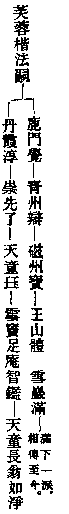
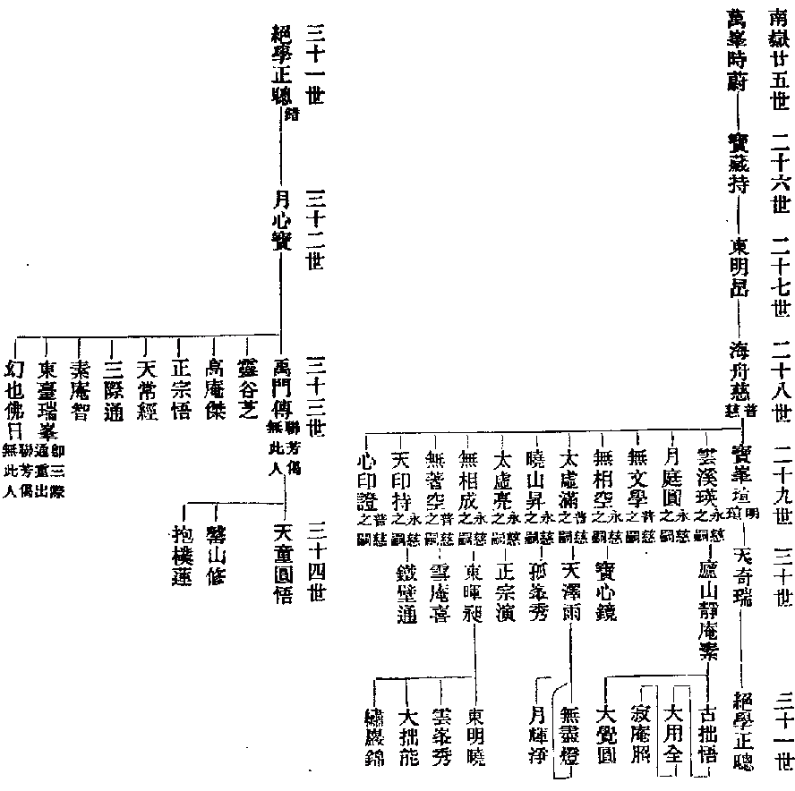
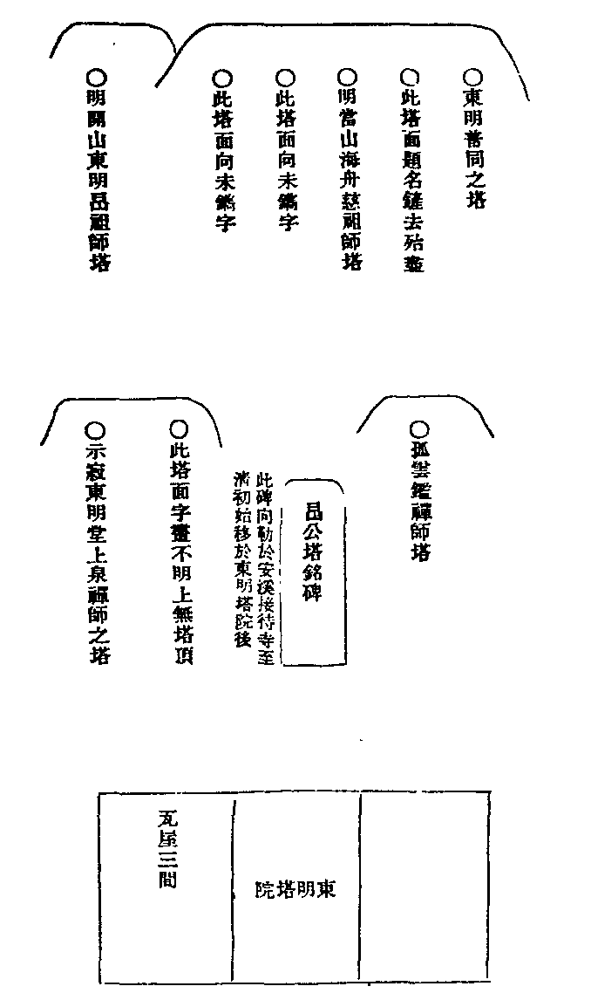

# 正名录



> **藏经**：大藏经补编（大藏经补编）　**册次** 第 24 册（B24）　**编号** B0137　**部类** 史传部　**卷次** 14 卷　**篇幅** 151,120 字

> **作者（译者）**：衡阳后学智楷惟直氏述

> **卷／品**：14 卷 · 1 品



---



## 目录



- [正名录卷第一](#正名录卷第一)

- [正名录卷第二](#正名录卷第二)

  - [御制五灯全书序](#御制五灯全书序)

- [正名录卷第三](#正名录卷第三)

- [正名录卷第四](#正名录卷第四)

- [正名录卷第五](#正名录卷第五)

- [正名录卷第六](#正名录卷第六)

- [正名录卷第七](#正名录卷第七)

- [正名录卷第八](#正名录卷第八)

- [正名录卷第九](#正名录卷第九)

- [正名录卷第十](#正名录卷第十)

- [正名录卷第十一](#正名录卷第十一)

- [正名录卷第十二](#正名录卷第十二)

- [正名录卷第十三](#正名录卷第十三)

- [正名录卷第十四](#正名录卷第十四)



---



正名录自序(原本清康熙三十三年原刻本　校本无)



粤自拈花一脉．三十三传至曹溪六祖．析为二支。一为青原思．一为南岳让。思下出曹洞云门法眼．让下出临济沩仰。斯二支五宗．纪诸灯录．载在龙藏．其来旧矣。至宋徽宗时．有好事者突出天王伪碑．紊乱宗支．幸宗门斥其为误。元顺帝时．妄僧云壑瑞援伪碑作心灯录．以致沮抑不行。逮本朝顺治间．妄僧费隐容亦援伪碑作五灯严统．恣臆删改．骇人心目。幸诸护法公评．有司公讨．卒至毁板．罪案久定。稍知有王法者．必不蹈人覆辙也。因想元时心灯伪书．不有护法公辟．有司公讨．奚能抑之不行耶。奈年深代远．其公辟公讨之公论．渐为泯没。而彼伪碑．往往为好事者借为衅端。楷尝忧之。於是裒辑从前诸大老所有公论．成书十卷．命名卫灯录。非惟见诸公弘法之盛心抑以见天下之公论必不可已也。今霁仑永公复将奉宪所毁之伪书．改名五灯全书．紊伦乱谱．靡所不至。楷不忍坐视．故述正名录．并书以劝诫之。而永公坚执我见．确意不回。且谓引证辨解．各有根据。嗟乎．以之自误犹可．以之误天下后世必不可也。楷乃奋力广搜祖父旧章．兼采后人新条．准以甲子编年．考其州郡之分野．人代之后先．师资之授受．宗支之来源。其间述古辨今．事重言复不顾繁琐．务期理明。用寿梨枣．公诸天下。知我罪我．我无辞焉。



旹皇清康熙三十三年岁次甲戌季夏衡阳后学比丘智楷题於潞河旅舍



------



## 正名录卷第一



**译者**：衡阳后学智楷惟直氏述



二支五宗来源考之一



存诚录序。康熙三十二年岁次癸酉八月十日．臣僧智朴伏读当今皇帝御制曰．闲邪存诚．戒欺去妄。纶音一降．儒释咸该。圣贤仙佛．钦此钦遵．为齐家治国修因证果之首训也。盖凡人之处世．无两可之间。不正必邪．不诚必伪．不实必欺．不真必妄。故大易著之．佛氏阐之．吾皇上圣谕发明之．以示警示诫也。近有人焉．卤莽无稽．师心自用．引据伪言．翻乱故典。不以佛心天子卫法之深衷是念．而以全书自命．以嗣祖沙门自署．以修明僧史自任。吁．妄诞极矣。余诚不知僧史之为何书。尝闻历朝以来．充史馆之职．必博学广闻秉公持正之人。善者善之．恶者恶之．先之后之．毫无紊乱。笔之削之．各有体裁。始成一代之信书．为千古之龟鉴也。今之修明僧史者．能如是乎。不思存诚去妄．报圣恩於万一．而反作此诡谲不实之伪书．诳君罔祖以盗名。吾恐斯人非魔．即魔所使．阴以破坏我法者。兹特述其浑乱宗统之一端．以申明存诚去妄之义云尔。



存诚录二刻弁言。五宗攸分．其来旧矣。肇自达磨。六传至大鉴．为六祖慧能大师。其法嗣二人．曰青原思．曰南岳让。原得石头迁。迁之法嗣曰天皇悟．曰药山俨。悟得龙潭信。信得德山鉴。鉴得雪峰存。存之法嗣曰玄沙备．曰云门偃。世所谓云门宗者．原之七世也。备得罗汉琛。琛得清凉益。世所谓法眼宗者。原之九世也。俨得云岩晟。晟得洞山价。世所谓洞山宗者．原之五世也。又南岳让得马祖一。一得百丈海。海之法嗣曰黄檗运．曰沩山祐。运得临济玄。世所谓临济宗者。岳之五世也。祐得仰山寂。世所谓沩仰宗者．亦岳之五世也。其上五宗．皆自原岳之所出．各有根柢．布诸简策．载在龙藏。六百餘稔．曾无毫发之假借。今集五灯全书者．不思皇上存诚之圣谕．而反本严统卤莽之伪说．将云门法眼二宗勒马祖下。且谓引证辨解．各有根据。余诚短昧．固不知其所根何书．所据何典。抑不敢臆为之辨析。惟据历朝敕赐之藏典与夫诸家之文献。不辞繁衍．不惮重沓。谨录一十四种之节文．以俟天下之明眼者评定焉。其他宗伪缪．姑置弗论。



存诚录二刻



蓟州盘山智朴集(字拙庵)



宋赞宁智轮同奉敕撰高僧传曰．唐荆州天皇寺道悟传．释道悟．姓张氏．婺州东阳人也。受天粹气．为法王子。生而神隽．长而谨愿。年十四．金翅始毛．麒麟方角。启白尊老．将求出家。慈爱之旨．不见听许。辄损薄常膳．日唯一食。虽体腹羸𫗪．弥年益坚。父母不获已而许之。遂往明州大德剃落。年二十五．依杭州竹林寺大德具戒。以勇猛力．扶牢强心。於六度门．修诸梵行。常以为疗膏肓者．资上妙药。开暗冥者．求善知识。不假舟檝．其济渡乎。遂蹶然振策投径山国一禅师。悟礼足始毕．密受宗要。於语言处．识衣中珠。身心豁然．真妄皆遣。断诸疑滞．无畏自在。直见佛性中无缁磷。服勤五载．遂蒙印可。俾其法雨．润诸丛林。悟蓄力向晦．冞入深阻．实冀一飞摩霄．乃转遁於餘姚大梅山．是时大历十一年也。层厓绝壑。天籁萧瑟．敻无邻落。七日不食。至诚则通．物感乃灵。猱㹶豰玃．更馈橡栗。异日埜夫操斧言伐其楚。偶所遭覩．骇动悚息。驰谕明曹．谓为神奇。曾不旬朔．诣者成市。凭嵌倚峭．且构危栋。赀粮供具．环遶方丈。猛虎耽耽．侣出族游一来座侧．敛折肢体。其类驯扰可知也。夫语法者无阶渐．涉功者有浅深。木逾钻而见火．鉴勤磨而照胆。理必然矣。是以扫尘累．遯岩薮．服形体．遗昼夜．精严不息．趣无上道．其有旨哉。如是者三四年矣。将翔云表．虑羽毛之颓锻。欲归宝所．疑道涂之乖错。故重有諮访．会其真宗。建中初．诣鍾陵马大师。二年秋．谒石头上士。於戏。自径山抵衡岳．凡三遇哲匠矣。至此即造父习御．郢人运斤。两虚其心．相与脗合。白月暎太阳齐照．洪河注大海一昧。仲尼谓颜子亚圣．然灯与释迦授记。根果成熟．名称普闻。如须弥山．特立大海。繇是近佛．恢张胜因。凡诸国土．缘会则答。始卜於澧阳。次居於澋口。终栖於当阳柴紫山。即五百罗汉翱翔地也。柽松蓊郁以含风．厓𪩘巉岩而造天。驾潋灔之紫霞．枕清冷之玉泉。鸾凤不集於蓬藋．至人必宅於势胜。诚如是也。洪钟待叩．童蒙求我。川流星聚．虚往实归。或接武於林樾．或骈肩於庐舍。户外之屦．烂其室盈矣。荆州雄藩也．都人士女．动亿万计．莫不擎跪稽首向风作焉。崇业上首以状於连帅而邀之．不违愿力．聿来赴请。𪨗及於虚落．锡及於都城。白黑为之步骤．幡幢为之𫐖轕。生难遭想．得未曾有。彼优波鞠多者．夫何足云。有天皇寺者．据郡之左。标异他刹．号为名蓝。困於人火．荡为煨烬。僧坊主灵鉴族而谋之．以为满人攸居。必能福我。夫荷担大事．蔑弃小瑕．乃中宵默往．肩舆而至二寺。夕有所失．朝有所得。诤论锋起．达於尊官。重於返复．毕安其处。江陵尹右仆射裴公．搢绅清重．拥旄统众。风望眄睐．当时准程。驱车盛礼．问法勤至．悟神气洒落．安详自处。徐以輭语为之献酬．必中精微．洞过肯綮。又常秉贞操．不修逢迎。一无卑贵．坐而揖对。裴公讶其峻拔．徵其义趣。谓抗俗之志．当径庭如是邪。悟以为是法平等．不见主客。岂効世谛与人居而局狭邪。裴公理冥意会．投诚归命。既见仁者．我心则降。如热得濯．躁愦冰散。自是禅宗之盛．无如此者．元和丁亥岁．有背痛疾病。弟子先期告终。以夏四月晦．奄然入灭。春秋六十。僧腊三十五。以其年八月五日．葬於郡东隅。灵龛建塔．从僧礼也。悟身长七尺．神韵孤杰。手文鱼跃．顶骨犀起。行在於璎珞．志在於华严。度人说法．雄健猛利。其一旨云．垢净共住．水波同体。触境迷著．浩然忘归。三世平等．本来清净。一念不起．即见佛心。其悟解超顿为若此也。先是烟燄之末．殿宇不立。顾缁褐且亏瞻礼．密念结构罔知权舆。禅晏之际．若值神物自道．祠舍滨江水焉。凡我彊畛．富於松梓。悉愿倾倒．施僧伽蓝。命工觇之．宛若符契。於是斩巨栋．干修楹。撑厓拄壑．云屯井构。时维秋杪．水用都涸。徒众敛手．块然无谋。会一夕雨至．万株并进。晨发江浒．暮抵寺门。剞劂之际．动无乏者。其餘廊庑床案．靡非幽赞。事邻语怪．阙而不书。其感摄灵祇．皆此类也．比丘慧真文责等禅子幽闲．皆入室得悟之者。或继坐道场．或分枝化导。时太常协律符载著文颂德焉。世号天皇门风也。又唐澧州龙潭禅院释崇信．未详氏族。信在俗为渚宫胡饼师之子。弱龄宛异．神府宽然。昔天皇寺悟禅师．隐耀藏光．人莫我测。信家居寺巷．恒日提饼笥馈悟公斋食。食毕．且留一饼曰．吾惠汝．以荫子孙。信一日自念曰．饼是我持去．何以返遗我邪．莫别有旨乎遂拱手问焉。悟公曰．是汝持来．复汝何咎。信闻似有惊怪。因投出家．便求摄受。悟公曰．尔昔崇福善．今信吾言．故名之也。繇是躬於井臼．供亿服勤．乃问悟曰．未蒙指示心要。悟公曰．时时相示。信飡禀斯言．如游子之还家．若贫人之得宝。直从荆渚．乃诣澧阳龙潭栖止。因李翱尚书激扬．时乃出世。后德山鉴师出其门．宗风大盛矣。(见大藏禄字函第十卷)



智朴曰．古称赞宁释氏董狐。宋太宗端拱间．奉敕撰高僧传。其纪天皇龙潭德山公孙师资合为一传。一千七百二十言。世次彰彰可据。今集五灯全书者．将历朝皇藏绝未有之天王道悟．揑为龙潭崇信之师．以云门法眼两宗收马祖下。牵引傅会．溷乱谱牒。详后辨中。兹不赘



宋道原景德传灯录曰．行思禅师第二世．南岳石头希迁禅师法嗣．荆州天皇道悟禅师。婺州东阳人也。姓张氏。神仪挺异．幼而生知．长而神隽。年十四．恳求出家．父母不听。遂誓志损减饮饍．日中一食。形体羸悴。父母不得已而许之。依明州大德披削。二十五．杭州竹林寺具戒。精修梵行．推为勇猛。或风雨昏夜．晏坐丘塜身心安静．离诸怖畏。一日．游餘杭．首谒径山国一禅师．受心法。服勤五载。唐大历中．抵鍾陵．造马大师．重印前解．法无异说。依住二夏。乃谒石头迁大师而致问曰．离却定慧．以何法示人。头曰．我者里无奴婢．离个什麼。曰．如何明得。头曰．汝还撮得虚空麼。曰．恁麼则不从今日去也。头曰．未审汝早晚从那边来。曰．道悟不是那边人。头曰．我早知汝来处。曰．师何以赃诬於人。头曰．汝身现在。曰．虽然如是。毕竟如何示於后人。头曰．汝道阿谁是后人。师从此顿悟。於前二哲匠言下有所得心罄殚其迹。后至荆州当阳柴紫山。学徒依附．驾肩接迹。都人士女．向风而至时崇业寺上首．以状闻於连帅．迎入城。郡之左．有天皇寺．乃名蓝也。因火而废。主僧灵鉴将谋修复。乃曰．苟得悟禅师为化主．必能福我。乃中宵潜往哀请。肩舁而至．遂居天皇。时江陵尹右仆射裴公．稽首问法．致礼勤至。师素不迎送。客无贵贱．皆坐而揖之。裴公愈加归向。由是石头法道．盛於此席。僧问．如何是玄妙之说。师曰．莫道我解佛法好。僧曰．争奈学人疑滞何。师曰．何不问老僧。僧曰。问了也。师曰．去。不是汝存泊处。师元和丁亥四月示疾。命弟子先期告终。至晦日．众问疾。师蓦召典座。座近前。师曰．会麼。对曰．不会。师乃拈枕子抛於地上．即便告寂。寿六十。腊三十五。以其年八月五日．塔於郡东。



又曰行思禅师第三世．荆州天皇道悟禅师法嗣．澧州龙潭崇信禅师。本渚宫卖饼家子也。未详姓氏。少而英异。初悟和尚为灵鉴潜请居天皇寺．人莫之测。师家居於寺巷．常日以十饼馈之。悟受之。每食毕．常留一饼。曰．吾惠汝．以荫子孙。师一日自念曰．饼是我持去．何以返遗我邪。其别有旨乎。遂造而问焉。悟曰．是汝持来复汝何咎。师闻之．颇晓玄旨。因投出家。悟曰．汝昔崇善．今信吾言．可名崇信。由是服勤左右。一日问曰．某自到来．不蒙指示心要。悟曰．自汝到来吾未尝不指示汝心要。师曰．何处指示。悟曰．汝擎茶来．吾为汝接。汝行食来．吾为汝受。汝和南时．吾便低首。何处不指示心要。师低头良久。悟曰．见则直下便见．拟思即差。师当下开解。乃复问．如何保任。悟曰．任性逍遥．随缘放旷。但尽凡心．别无圣解。师后诣澧阳龙潭栖止。僧问．髻中珠谁人得。师曰．不赏玩者得。僧曰．安著何处。师曰．有处即道来。尼众问．如何得为僧去。师曰。作尼来多少时也。尼曰。还有为僧时也无。师曰．汝即今是什麼。尼曰．现是尼身．何得不识。师曰．谁识汝。李翱问．如何是真如般若。师曰．我无真如般若。翱曰．幸遇和尚。师曰．此犹是分外之言。德山问．久向龙潭．到来潭又不见．龙又不现。师曰．子亲到龙潭山即休。(见大藏公字函第十四卷)



智朴曰。道原得法於天台韶。韶嗣法眼益。望龙潭仅八世。原纂传灯录。真宗诏翰林学士杨亿为之较订．作序文。景德初．敕赐入藏。其纪青原之嗣石头．石头之嗣天皇．天皇之嗣龙潭。今荆州城东有天皇寺巷及祖塔现在。即本乡之父老小民．亦能述其龙潭馈饼之遗事。府之旧志．亦详载之也。



宋契嵩传法正宗记曰．大鉴之三世．曰南岳石头希迁禅师。其所出法嗣凡二十一人。一曰荆州天皇道悟者一曰澧州药山惟俨者云云。又曰．大鉴之四世曰荆州天皇道悟禅师。其所出法嗣一人曰澧州龙潭崇信者。又曰．大鉴之五世曰澧州龙潭崇信禅师。其所出法嗣二人．一曰德山宣鉴者云云。(见大藏绮字函第七卷)



又镡津文集载原宗集序其略曰原宗懃师证法於德山远公。印可於三角澄公澄远皆云门匡真大师之法孙也。云门秉雪峰存。雪峰承德山鉴。德山续龙潭信。龙潭嗣天皇悟。天皇继石头迁大师。石头绍庐陵思和尚。思和尚受法於六祖大鉴。广菩提达磨所传之道。(见大藏轲字函第十一卷)



智朴曰．契嵩著传法正宗记等书．於嘉祐六年诣阙上进．蒙旨入藏．赐号明教大师。嵩嗣洞山聪聪嗣文殊真．真嗣德山密密嗣云门偃．乃云门五世孙．望龙潭八世也。



宋慧洪禅林僧宝传．自序曰．曹溪之道至南岳石头江西马祖而分为两宗。曹洞云门法眼皆宗於石头。临济沩仰皆宗於马祖。天下丛林号为五家宗派。又命长沙侯延庆作僧宝传．引曰觉范谓余曰自达磨以来六传至大鉴。鉴后析为二宗。其一为石头．曹洞云门法眼宗之。其一为马祖临济沩仰宗之。是为五家宗派。



智朴曰．觉范少恃才技．其著述舛迕居多。至晚年集禅林僧宝传自命侯君作序告以曹洞云门法眼三宗．确归石头以自陈其从前之误。较之始终呶呶而不已者实霄坏矣。



又按觉范三十七岁出林间录。当大观元年丁亥。五十四出僧宝传当宣和六年甲辰。五十八示寂当高宗建炎二年戊申。名慧洪一曰德洪字觉范瑞州人嗣法於真净文临济第十世也。



宋建溪宗永宗门统要曰青原下第三世荆州天皇道悟禅师。问石头曰．离却定慧以何法示人。头曰我者里无奴婢离个什麼。师曰如何明得。头曰．汝还撮得虚空麼。师曰与麼则不从今日去也。头曰．未审汝早晚从那边来。师曰某甲不是那边人。头曰我早知汝来处。师曰和尚何以赃诬於人。头曰汝身现在。师曰．虽然如是．毕竟如何示於后人头曰汝道阿谁是后人。师从此有省。(见大藏惠字函第十一卷)



宋宝鉴法应颂古联珠集曰．澧州龙潭崇信禅师。未出家时为饼舖。住在寺前。每日常供饼十枚上天皇。皇受已却留一饼与之曰惠汝以荫子孙。师曰．是某将来．何以返曰惠汝。皇曰是汝将来复汝何咎。师因有悟入。遂投出家。佛国惟白颂曰。南岳山头见石头．便归古岸狎沙鸥。谩分胡饼为香饵引得金龙上直钩(见大藏田字函第八卷)



宋东湖志磐佛祖统纪曰六祖之后为二派。一曰青原思．思传石头迁其下为曹洞云门法眼。一曰南岳让让传马祖．其下为临济沩仰。是为五家宗派。道一而已而言五其宗者．由人世心病益多故治法屡为之变。一棒一喝．一唱一和．机用纵横．殆不可以一律齐．犹应病与药之义焉。(见大藏昆字函二十九卷)



又曰．唐德宗贞元四年江西马祖道一禅师亡。师得法於南岳让禅师。其后五世派为二家曰沩仰曰临济。又曰贞元六年．衡山石头希迁禅师亡。师得法於青原思禅师。其后派为三家。五世而为洞山七世而为云门。九世而为法眼．(见大藏池字函第四十一卷)



又曰．唐懿宗咸通六年．朗州德山宣鉴禅师示寂．谥见性禅师嗣龙潭。青原第五世。又曰十一年上素闻雪峰义存禅师名敕赐真觉大师。师居山四十年法席冠天下众至一千五百。闽王事以师礼。嗣德山。青原第六世。又曰．韶州云门交偃禅师．聚徒千人。汉主召入内殿(时都广州)咨问法要．事以师礼。师得法於雪峰号云门宗。青原第七世。又曰后唐明宗天成三年漳州罗汉院桂琛禅师示寂。师得法於玄沙备。末帝朝谥真应禅师。青原第八世。又曰．周世宗显德四年七月金陵清凉文益禅师示寂。江南唐后主待以师礼。及终．谥大法眼。学者号法眼宗。嗣罗汉琛。青原第九世。(俱见大藏碣字函第四十二卷)



宋如卺禅宗正脉曰．石头迁嗣天皇道悟禅师。首谒径山国一受心法。服勤五载。后参马祖重印前解法无异说。依止二夏。乃谒石头而致问曰．离却定慧．以何法示人。头曰我者里无奴婢离个甚麼。曰如何明得。头曰．汝还撮得虚空麼。曰．恁麼则不从今日去也。头曰未审汝早晚从那边来曰．道悟不是那边人。头曰．我早知汝来处也。曰师何以赃诬於人。头曰汝身现在。曰虽然如是毕竟如何示於后人。头曰．汝道谁是后人。师从此顿悟。罄殚前二哲匠言下有所得心。僧问如何是玄妙之说。师曰．莫道我解佛法好。曰争奈学人凝滞何。师曰何不问老僧。曰．即今问了也。师曰去。不是汝存泊处。又曰天皇悟嗣龙潭崇信禅师。其家卖饼。师少而英异。初悟和尚为灵鉴潜请居天皇寺。人莫之测。师家於寺巷。常日以十饼馈之。天皇受之。每食毕常留一饼曰吾惠汝．以荫子孙。师一日自念曰．饼是我持去．何以返遗我耶。莫别有旨乎。遂造而问焉。皇曰是汝持来复汝何咎。师闻之颇晓玄旨。因投出家。皇曰汝昔崇福善今信吾言可名崇信。由是服勤左右。一日问曰．某自到来．不蒙指示心要。皇曰自汝到来．吾未尝不指示汝心要。师曰何处指示。皇曰．汝擎茶来．吾为汝接。汝行食来吾为汝受。汝和南时吾便低首。何处不指示心要。师低头良久。皇曰．见则直下便见拟思即差。师当下开解。复问．如何保任。皇曰．任性逍遥随缘放旷。但尽凡心别无圣解。(见大藏劝字函第七卷)



雪峰广录曰．闽王请师与玄沙入内问佛法心印。雪峰谓王曰．山僧自从先德山石头以来传此秘密法门云云。



湖广全省志第七十四卷三十六叶十五行起至三十八叶七行止．所载天皇龙潭机缘．与传灯录诸书所纪若合符节。



智朴曰．右大藏诸书中所载祇见有天皇道悟下出龙潭崇信绝未见有天王道悟之名。按正宗记载马祖法嗣一百三十七人亦无天王道悟之名。其所有之者始於张无尽议论。洞山德山垂手不同遂见疑。后突出丘玄素碑．谓天王之嗣马祖龙潭之嗣天王。详载辨中。



智朴道悟真伪辨曰世之所谓五灯者乃禅宗之史书也。宋景德元年道原剏传灯录。天圣间李遵朂述广灯录。建中靖国元年佛国白著续灯录。淳熙十年晦翁明辑联灯会要。嘉泰四年雷庵受纂普灯录。理宗景定间大川济见灯录浩瀚以故折衷五灯之成书而为会元。其序宗派来源与前灯录所纪并无异说。逮元顺帝至元间云壑瑞作心灯录。始引丘符诸碑紊淆宗统．以致沮抑不行。至正二十四年业海清重刻会元复引心灯丘符二碑小注天皇章下然存疑焉耳。本朝顺治中．费隐容撰五灯严统以存疑小注作正文。勒云门法眼归马祖下以应马有四足之谶。吁陋矣哉。夫马祖之真为马也乎。必欲四足具乃应其谶乎缪解之甚莫甚於此乎。以致诸方公辟有司公讨卒至毁板废书几四十年。案卷攻书昭然在目。呜呼丘碑之陷人不浅也。丘碑之陷人不浅也。而霁仑在覆盆之下．懂然不之知．悍然不之顾。犹本严统之伪说谱两宗之世次。是不得不将前人论定而重述之也。孔子曰始作俑者其无后乎。丘碑之谓欤。盖丘碑之出．始於张无尽与吕夏卿会议宗门中事。乃曰．洞山德山同出石头下因甚垂手处杀活不同。因而致疑。后於达观颖处．得丘符二碑乃徧告诸方始知吾择法验人之不缪耳。符碑与灯录诸书脗合但窃去龙潭崇信．为作伪碑之张本也。再以丘碑论之其伪立见。五灯会元小注曰．唐正议大夫户部侍郎平章事荆南节度使丘玄素所撰天王道悟禅师碑云．道悟渚宫人．姓崔氏子玉之后胤也。年十五依长沙寺昙翥律师出家。二十三诣嵩山受戒。三十参石头(通载作三十三)频沐指示．曾未投机。次谒忠国师。三十四与国师侍者应真南还谒马祖。祖曰．识取自心本来是佛。不属渐次不假修持。体自如如万德圆满。师於言下大悟。祖嘱曰汝若住持莫离旧处。师蒙旨已．便返荆门(通载作荆州)去郭不远结艸为庐。后因节使顾问．左右申其端绪．节使亲临访道见其路隘．车马难通．极目荒榛曾未修削覩兹发怒令人擒师抛於水中。旌斾才归乃见徧衙火发内外烘燄莫可近之。唯闻空中声曰我是天王神我是天王神。节使回心设拜．烟燄都息宛然如初。遂往江边见师在水都不湿衣。节使重申忏悔迎请在衙供养。於府西造寺额号天王。师常云快活快活。及临终时叫苦苦。又云阎罗王来取我也。院主问曰和尚当时被节度使抛向水中．神色不动如今何得恁麼地。师举枕子云汝道当时是如今是。主无对。便入灭。当元和三年戊子十月十三日也。年八十二。坐六十三夏。法嗣一人曰崇信．即龙潭也。然天王龙潭纪载之譌且伪者祇此丘碑。而天皇龙潭证据之多且确者不可枚举。前略述累朝名世之文献与夫历代敕赐之藏典一十四种异口同音。纪道悟所居城东之天皇寺。绝无城西之天王寺也。龙潭馈饼馈城东之道悟绝无城西之道悟也。因家卖饼故得日以十饼馈之。因常馈饼故得命名为崇信。其卖饼寺巷迄今犹存。纵能改天皇为天王．必不能移城东寺巷为城西寺巷也。以是知龙潭之确嗣天皇也明矣。而通载虽有天皇天王之缪说其纪龙潭与传灯诸书无异。再论丘碑之伪造据啸峰然熄邪辨云考唐史则荆南节度使之设始於肃宗至德二载。从此及至唐哀宗天祐丙寅止共一百五十年。为荆南节度使者则有李昌夔等十餘人并无丘玄素名。碑衔既称唐正议大夫户部侍郎平章事荆南节度使．则又系唐朝宰相兼领藩镇者。考唐相年表其以平章兼领荆南节度使者则有李石李德裕郑肃本白敏中萧邺徐商刘瞻孔纬等诸人。其拜罢迁薨皆有月日可据。亦并无丘玄素名。唐史既无其人则此碑从何而出。此系后人之伪造明矣。惟直楷云按广舆摘要考荆南建置．春秋为楚郢都。秦拔郢置南郡。汉曰临江曰荆州。三国初属蜀汉后属吴。晋曰新郡梁元帝都此。隋唐曰江陵曰南都。宋曰荆南。明曰荆州府。玄素既为唐人碑衔当曰江陵节度使．或曰南都节度使为是。而曰荆南者．岂有唐时馆职预用数百年后之建置乎。此系宋人伪造明矣。按会元指月录俱载天王悟入灭於元和三年戊子。而林间录佛祖通载又载入灭於十三年戊戌。然而人伪碑伪建置伪入灭伪并所引之机缘亦伪矣。传灯录曰荆州白马昙照禅师嗣南泉常曰快活快活及临终时叫苦苦。又曰阎罗王来取我也。院主问和尚当时被节度使抛向水中神色不动如今何得恁麼地。照举枕子曰．汝道当时是．如今是。主无对。照掷枕子而逝。丘碑窃之为天王机缘。岂有一府两人．两人一事始终不差一字者无是理乎。况荆州城西祇有白马寺废基存焉绝无所谓天王寺者则其寺伪又可知矣再考无尽於达观颖处得碑之说据达观示寂在嘉祐五年无尽卒於宣和三年．寿七十九则生当在庆历三年癸未也。以庆历三年至达观示寂之年则无尽仅十有八岁矣是时习举业之不暇何暇论及宗门中事乎。至元祐六年见兜率悦时年四十有九矣始知有宗门中事去达观示寂已三十二年矣。而会议得碑之说．当在三十二年之后。无尽亲言从达观颖处讨得丘符二碑．何无根之甚也。呜呼。无尽不疑二碑不出。二碑之出无尽之疑也。无尽之为人宋史备悉余诚不敢论定焉。窃思吾宗贵省事不贵多事。贵无诤不贵鬬诤。此辨之出不过冀其悛过从新彼此相忘於解脱场中。抚没弦琴唱无生曲。即谓之无一字也可。是朴所终期於永公也已。



与霁仑永禅师书闻风日久会晤维艰法门细大宗趣不能一一领教也。夏四月刷印人进山闻老法兄刊五灯全书诚为法门一大盛事。弟获覩殊遇庆抃欢呼。七月上旬有惟直楷公来自都门询及此事。惊闻全书引证譌谬。种种辨驳糳糳有据。痛自悲法门不幸益何至此。切念法兄道隆德备年高识广。自是探讨幽窅考据精核。必不蹈人覆辙录人疑案。岂有泛泛成书而付诸梓人耶。无是理乎。设果有是惟愿法兄当以史书编年再一详考期成千秋不易之信史以报圣主卫道之深衷也。无可侑函盘山志一部拙刻数种请教。临书跂望曷胜依驰。八月二十五日。



四与永公书．甲戌二月下旬遣僧持书并存诚录去获公款待优加。归述所言殊非雅论。其所言者悉据洞宗著述。谱五代非臆剏也。又谓天皇天王据佛祖通载非严统也。试问永公洞宗著述除净柱乌梅本形伪说之前更有何说以为据耶。伪说足据青州自撰之塔记反不足据乎。伪说足据续略以前诸家金石之文献反不足据乎。请公此处下一转语。再问永公佛祖通载载龙潭崇信果谁属耶。通载云信卖饼家子居天皇寺巷。日以十饼馈天皇因之赐名因之得悟。其后出住龙潭与灯录诸书所载毫发无舛。殆本朝顺治十年通容集严统出始翻乱藏典直据会元小注。收龙潭为天王之法嗣。援云门法眼为马祖之所出。以致诸山公诘有司公讨。卒至丑态百出难於为言。今公集五灯全书不能救正其非犹且从而效之为是。阴惧罪案久定人所共知故游易其词曰．据通载。然通载所载果如是乎。公於龙潭章中急开睡眼。余埋头盘山二十餘年未敢轻易论及法门中事恐辱宗风。迫不得已四次寄书与公苦口劝诫。即欲杀欲割亦不敢辞。实无他惟冀报佛恩祖恩皇上卫法之深恩於万一也。存诚录二刻成寄览。(拙庵和尚作存诚录初刻辨清洞宗五代二刻辨清云门法眼两宗述藏典古书十有四种今录十一种於前而会元通载指月三书辨见於后以下诸书皆智楷所述也。)



正名录一卷终



------



## 正名录卷第二



**译者**：衡阳后学智楷惟直氏述



二支五宗来源考之二



宋建溪宗永宗门统要集载龙潭因缘三则。一曰青原下第三世澧州龙潭崇信禅师。嗣天皇悟。师未出家时．为饼舖住在寺前。日常供饼十枚上天皇。皇受已却留一饼与之曰惠汝以荫子孙。师曰是某持来何返曰惠汝。皇曰是汝持来复汝何咎。师因有省。遂投出家。



又曰．师一日问天皇曰某自到来不蒙和尚指示心要云云。



又曰师问天皇从上相承底事如何。皇曰不是明汝来处不得师曰这个眼目几人具得。皇曰．浅艸易为长芦。



宋宝鉴法应颂古联珠集曰．青原下第三世澧州龙潭崇信禅师。嗣天皇道悟。馈饼机缘载存诚录。汾阳昭颂曰将去将来事不差龙潭固问勿交加。后来多少争唇吻．春鸟喃喃骂落花。



白云端颂曰．十饼每将留一个．因思何谓荫儿孙。团团将去还将入不觉醍醐到顶门。



佛国白颂载存诚录。



无准范颂曰持来持去样团团覆荫儿孙义不寒。何似当时休擘破浑仑留与后人看。



横川珙颂曰受惠当思报将他一饼回。出家缘法到．当下得心灰。



又曰龙潭问天皇曰某自到来不蒙指示心要云云。



白云端颂曰脱白投师贵苦辛．擎茶问讯尽躬亲。无端再叙三年事笑倒街头卖饼人。



月堂昌颂曰据款结案得失过半。尽力担当上船离岸。无不指示汝擎茶行食处。圣解凡情不过来轩轩头角起风雷。



宋大慧宗杲正法眼藏曰．天皇和尚问石头离却定慧以何法示人。头曰．我者里无奴婢离个甚麼。曰如何明得。头曰．汝还撮得虚空麼。曰与麼则不从今日去也。头曰．未审汝早晚从那边来。曰某甲不是那边人。头曰．你早知汝来处。曰和尚何得赃诬於人。头曰．汝身见在。曰．虽然如是毕竟如何示於后人。头曰汝道阿谁是后人。天皇从此有省。



又曰龙潭和尚问天皇．某自到来不蒙和尚指示心要。皇曰自汝到来吾未尝不指示汝心要。曰何处指示。皇曰。汝擎茶来吾为汝接。汝行食来吾为汝受。汝和南时吾便低首。何处不指示汝心。要龙潭伫思。间皇。曰见则直下便。见拟思即。差龙潭当下开。悟乃复问如何保任。皇曰任性逍遥随缘放旷。但尽凡心别无圣解。



元宝洲觉岸释氏稽古略曰澧州龙潭崇信禅师。渚宫人。(今荆湖北道荆门州。)家居荆州城东天皇寺巷。礼道悟禅师出家。既受具服勤左右．领悟玄旨。后诣澧阳龙潭栖止焉。师嗣天皇道悟禅师。悟嗣石头迁禅师。迁嗣青原思禅师。思嗣六祖。尊者信接弟子曰德山宣鉴。



明瞿汝稷指月录载德山示众。其略曰诸方浩浩地揑怪不休．称杨称郑．道我是马大师宗徒。德山老汉且不是你群队人。我见石头和尚不识好恶老汉所以骂伊。



唐德山鉴禅师塔铭其略曰。自曹溪至吉州思大师南岳石头荆州天皇．澧州龙潭至先和尚讳宣鉴。闻澧州有龙潭大师则石头之二叶矣。摄衣往焉。既见喜而叹曰穷诸玄辩如一毫置於太虚云云。受业小师文学撰。



右碑在寺东荆棘中．苔藓剥蚀字多漫灭。武陵郡人杨鶴偕男嗣昌礼塔拂拭因录出广其传。时万历四十三年乙卯春日是也。



百愚和尚汇辑德山语录季超居士序之。其略曰余得德山塔铭因缘甚奇。余偶读谭友夏文集内有喜杨修龄父子游古德山一诗云松筠心影内。古塔抱虚寂．螭缠李唐碑。茫茫夕阳历龙潭大师号．已被苔藓食。因缘合天资精神射苍壁。父念子眼光．出奇相夺觅。或用口吹云或用手畫荻。须臾成诵读高音覆淅沥。写寄数千字．难矣初搜剔。昼劙古今色．气与全山敌。坐获异文观晴明落霹雳。香风电空语何人节不击。深山旧法侣．再来建幽绩。神僧向晦昧且止莫尽涤。而诗中有香入其风电入其空二语复自注云此即铭中句也。余方拟购全文适济上一知识曰果有之．吾曾见其稿於某禅师笥中直叙为石头之三叶也。余亟觅而梓之附於录后以决数百年未定之疑案。与此集全录共称一时快事云。云门道者后学净超拜书。



宋守颐古尊宿语录载鼓山先兴圣国师玄要广集序曰自少室之花开六叶曹溪之胤布诸方。爰出石头号纯金舖。盖以格高调古．言简理幽。厥后子孙行步阔大毫厘弗差。则有先兴圣国师嗣雪峰．乃石头下五叶也。



竹庵士珪书玄要广集后曰．鼓山和尚名神晏大梁人姓李氏。卫州白鹿山受业。得法於雪峰存和尚。石头第六世。五代晋天福中示寂。



宋觉范洪石门文字禅载蕲州资福院逢禅师碑铭有序其略曰自达磨入中国授二祖心要而以衣为信故六世为之单传。至曹溪藏其衣．故诸方得者辈出。其魁垒绝类硕大光明有若衡山观音庐陵青原者特为学者之所宗仰天下号二甘露门。今逢禅师青原九世之嫡孙黄龙机公之高弟也。(黄龙机乃德山鉴三世孙)



又禾山寺记内曰妙湛大师法安为雪窦之后乃青原之远裔云云。(妙湛嗣法云秀．秀嗣天衣怀．怀嗣雪窦显．则湛为青原十三世。)



宋道原传灯录玄沙章末曰师应机接物仅三十祀。致青原石头之濬流逮今不绝转导来际。



宋觉范洪僧宝传玄沙备章末曰．备状短小然精神可掬。闽帅王审知为内外护。审知尽礼延至安国禅院众盈七百。石头之宗至是遂中兴之。



宋余靖曹溪法堂记其略曰大鉴以诸佛大法眼藏传青原思思传石头迁如是展转相传至今长老缘师为十世矣。缘师得大乘之要於汉东智门祚师。初出世住南台。后被朝旨住曹溪。六祖之道由是中兴矣康定二年十二月日记(师讳宝缘於宋仁宗明道二年奉旨住曹溪赐号慈济大师建说法堂。郡人余靖记。)



又慈济寿塔铭其略曰禅师名宝缘兴元人。游方至随州参智门祚禅师。以心印心不烦机接遂为之嗣。即云门之嫡孙也。(师与雪窦显为伯仲望龙潭七世望青原十世。)



曹溪通志后跋有曰南岳让之开沩仰临济也。青原思之开云门法眼曹洞也。



唐钦山文邃禅师。嗣洞山价。初与岩头雪峰同到德山乃问天皇也恁麼道龙潭也恁麼道未审德山作麼生道。德曰汝试举天皇龙潭道底看。钦拟进语德便打。钦曰是即是打我太煞。



宋眉州化禅师。云门二世。僧问天皇也恁麼道。龙潭也恁麼道未审和尚作麼生道。化曰汝试道看。



宋金山宁禅师。云门六世。僧问天皇也恁麼道龙潭也恁麼道未审和尚作麼生道。宁曰．手握白玉鞭．骊珠尽击碎。



禅林宝训合注曰明教嵩青原下十世栖贤舜青原下十世圆通讷青原下十世大觉琏青原下十四世云云。(数公皆云门后裔)



道至当不出真伪言至当不出是非。智者不在是非真伪之内．故能是非真伪之。譬如迷人惑东为西智者因而指正。若无迷人是非之言无所施矣。按高僧传传灯录宗门统要联珠颂古禅宗正脉正法眼藏洎五灯会元佛祖通载指月录九种大典籍．所纪龙潭崇信之传．皆曰．师本渚宫卖饼家子也。初悟和尚为灵鉴潜请居天皇寺．人莫之测。师家於寺巷．常日以十饼馈之。天皇受食毕．每留一饼．曰．吾惠汝．以荫子孙。师一日自念曰．饼是我持去．何返遗我耶．莫别有旨乎．遂造而问焉。皇曰．是汝持来．复汝何咎。师闻之．颇晓玄旨．因投出家。皇曰．汝昔崇福善．今信吾言．可名崇信。乃至问心要开悟云云．此系父子亲口亲言问答机缘．乃千古不磨之铁案也。据此．则龙潭嗣天皇明甚。德山龙潭之子也．其示众自道．不是马大师宗徒．则龙潭嗣天皇明甚。文学龙潭之孙也．其撰德山塔铭．直述自曹溪青原石头天皇龙潭至先和尚讳宣鉴．则龙潭嗣天皇明甚。雪峰龙潭之孙也．其对闽王自述．从先德山石头以来传此秘密法门．则龙潭嗣天皇明甚。道原龙潭八世孙也．其纂传灯不必观全传．但观一题目曰．行思禅师第二世南岳石头希迁禅师法嗣荆州天皇道悟禅师．行思禅师第三世荆州天皇道悟禅师法嗣澧州龙潭崇信禅师．何等显明昭著．则龙潭嗣天皇明甚。明教龙潭八世孙也．其述正宗记曰．石头希迁禅师法嗣凡二十一人．一曰荆州天皇道悟者．荆州天皇道悟禅师法嗣一人曰澧州龙潭崇信者．则龙潭嗣天皇明甚。又作原宗集序．直序云门雪峰德山龙潭上嗣天皇石头青原曹溪以及达磨．则龙潭嗣天皇明甚。佛国龙潭十世孙也．其颂馈饼因缘曰．南岳山头见石头．则以公孙三代授受之事一颂颂出．则龙潭嗣天皇明甚。此皆龙潭自家一脉骨肉．自敍其家谱．炳如杲日．有如此。宗门之有颂古．始於汾阳．而汾阳白云无准横川月堂诸公颂馈饼心要公案．燎如指掌．则龙潭嗣天皇明甚。觉范僧宝传自序曹洞云门法眼皆宗於石头。又文字禅敍逢禅师为青原九世．妙湛为青原远裔．则龙潭嗣天皇明甚。志磐佛祖统纪谓青原下出曹洞云门法眼。又谓石头后派为三家．五世而为洞山．七世而为云门．九世而为法眼。又谓德山为青原五世．雪峰为青原六世．云门为青原七世．罗汉为青原八世．法眼为青原九世．则龙潭嗣天皇明甚。觉岸稽古略直述龙潭嗣天皇石头青原六祖．则龙潭嗣天皇明甚。守颐古尊宿载鼓山晏为石头下五叶．则龙潭嗣天皇明甚。士珪书玄要集后．谓晏石头第六世．则龙潭嗣天皇明甚。传灯玄沙章末曰．致青原石头之濬流逮今不绝。僧宝传玄沙章末曰．石头之宗至是遂中兴之．则龙潭嗣天皇明甚。曹溪志谓青原开云门法眼曹洞三宗．则龙潭嗣天皇明甚。眉州金山两则机缘且置．钦山问天皇龙潭也恁麼道之话．盖德山望天皇中间止隔龙潭一代．钦山亲及德山之门．备知其来源之事．故有此问。则龙潭嗣天皇明甚。宝训直注明教诸公为青原下十世．则龙潭嗣天皇明甚。此皆济上知识．海内名宿．所纪龙潭出自天皇之事．明之又明有如此。长沙侯延庆僧宝传引直敍曹洞云门法眼宗石头．则龙潭嗣天皇明甚。韶州余靖法堂记直记宝缘为青原十世．则龙潭嗣天皇明甚。此皆儒家名老．其所纪天皇龙潭来源之清又如此。今之集全书者．动辄曰．靡不穷搜极讨．可曾探讨及此乎。又曰．引证辨解．各有根据可曾根据及此乎。否则请平心和气．将此诸书折衷参订．以成千古之信史．不惟为后人之龟鉴．亦可以报皇上卫道深恩之万一也。



------



### 御制五灯全书序



朕惟天生蒸民．厥有恒性。迨物交私蔽以后．遂不能有善而无恶．故操治世之权者．必兢兢以劝善惩恶为先务焉。大易著闲邪存诚之义．尚书明福善祸淫之旨．皆所以启牖下民．使之回心向道．而勿即於匪彝也。间尝流览释氏之书．立教虽主於空寂．而其戒欺去妄．蠲忿窒欲．亦与劝善惩恶之道．盖无殊指焉。自宗门教兴．曹溪而下五派迭衍．各有撰述。宋景德以后．裒集为传灯诸录。嗣是又举挈要领．汇成一编．是为五灯会元。洎乎本朝．沙门海宽念其支派繁衍．自宋金元明数百年来．传述阙然．乃著缵续一书。今圣感寺僧超永复虑谱牒渐棼．闻见不一。用是旁搜博考．折衷於二编．而参订之。删其烦芜．增所未备．以成全书。其用心也可谓勤矣。至於简牍所载．互相印证之语．罕譬曲喻．为说甚夥．而其大指要归．亦惟欲袪迷惑以复性真不越乎闲邪存诚．牖人为善之意。匪仅有裨於禅宗教旨而已也。故为之序



景德传灯纪六祖慧能大师法嗣曰．青原行思禅师。南岳怀让禅师。南岳让法嗣第一世马祖道一禅师。南岳下二世马祖一法嗣百丈怀海禅师．南岳下三世百丈海法嗣沩山灵祐禅师黄檗希运禅师。南岳下四世沩山祐法嗣仰山慧寂禅师．黄檗运法嗣临济义玄禅师。青原思法嗣第一世石头希迁禅师。青原下二世石头迁法嗣天皇道悟禅师．药山惟俨禅师。青原下三世天皇悟法嗣龙潭崇信禅师．药山俨法嗣云岩昙晟禅师．青原下四世．龙潭信法嗣德山宣鉴禅师．云岩晟法嗣洞山良价禅师。青原下五世德山鉴法嗣雪峰义存禅师。青原下六世雪峰存法嗣玄沙师备禅师云门文偃禅师。青原下七世玄沙备法嗣罗汉桂琛禅师。青原下八世罗汉琛法嗣清凉文益禅师。



按传灯乃道原禅师所集。其载六祖下出青原南岳．是为二支。青原出曹洞云门法眼。南岳出临济沩仰。是为五宗。进呈宋真宗皇帝御览．命翰林杨亿裁定．赐入皇藏。五宗钦遵从无异议。此二支五宗之源出自六祖．其来旧矣。



五灯会元曰．六祖大鉴禅师法嗣南岳怀让禅师。南岳让法嗣第一世马祖道一禅师。南岳下二世马祖一法嗣百丈怀海禅师。南岳下三世百丈海法嗣黄檗希运禅师。南岳下四世黄檗运法嗣临济义玄禅师。又曰．南岳下三世百丈海法嗣沩山灵祐禅师。南岳下四世沩山祐法嗣仰山慧寂禅师。又曰．六祖大鉴禅师法嗣青原行思禅师。青原思法嗣第一世石头希迁禅师。青原下二世石头迁法嗣药山惟俨禅师。青原下三世药山俨法嗣云岩昙晟禅师。青原下四世云岩晟法嗣洞山良价禅师。又曰．青原下二世石头迁法嗣天皇道悟禅师。青原下三世天皇悟法嗣龙潭崇信禅师。青原下四世龙潭信法嗣德山宣鉴禅师。青原下五世德山鉴法嗣雪峰义存禅师。青原下六世雪峰存法嗣云门文偃禅师．玄沙师备禅师。青原下七世玄沙备法嗣罗汉桂琛禅师。青原下八世罗汉琛法嗣法眼文益禅师。



又列五宗曰．沩仰宗南岳下四世。临济宗南岳下四世。曹洞宗青原下四世。云门宗青原下六世。法眼宗青原下八世。



按会元乃大川济禅师所集．以前诸灯录会为一书．故曰五灯会元。既纪青原出曹洞云门法眼．南岳出临济沩仰．是遵从上五灯之例。其建宗立义．条分缕析．可谓详矣。



五灯缵续曰．曹溪之下两干并出．青原居左．南岳居右。其青原下石头嗣之．而曹洞云门法眼．列青原而为昭。其南岳下马祖嗣之．临济与夫沩仰．列南岳而为穆。



古吴金护法之俊序曰．粤稽少室花开五叶．曹溪胤布诸方。於是直指单提之心要．一本析为二枝．衡山观音庐陵青原咸为学者之所皈仰．天下号二甘露门。青原法嗣为石头．云门曹洞法眼宗之。南岳法嗣为马祖．临济沩仰宗之。此五家宗派所由始也。



按缵续乃涌宇宽禅师所集．其叙二支之昭穆．纪五宗之来源．盖祖述传灯．宪章会元。金序又从而申明之．弁於简端．可谓尽矣。



御序传灯下有诸录二字．盖谓传灯后有广灯续灯联灯普灯洎皇藏诸书故也。兹不一一历引。惟曰诸录者．有二意也。一省文也．一该摄包括之词也。序中虽引传灯会元缵续三书以为文．其意具含如上所述之诸书．可谓言简义尽。则知我皇上於宗门里底纤洪．洞悉无遗。前代帝王留心佛道甚多．未有如我皇上优游法海．高蹈毘庐．则又儒释融通．善恶昭晰．启牖生民．回心向道。信为古佛乘愿应世．故以斯道觉斯民也。然传灯会元缵续洎前诸书所纪五宗来源．历然昭著．序中引说以明谕霁仑折衷参订．以定二支五宗之谱．可谓圣意昭然如揭日月矣。臣侪安敢不钦此钦遵．秉公著述．以期报圣恩於万一乎。



与圣感霁仑永禅师书



久仰德辉．渴思道范。楷昨抵京华．准拟进山奉访。无奈他宂所逼．未克如愿．怅也何如。兹启者．邮闻和尚辑五灯全书．进呈御览．钦赐序文．今古以来．不可多见．欣羡欣羡。但其中条例章次．多本严统．严统之书屡经当道有司勘定毁板废书．其事昭昭在人耳目。和尚秉公持正．成此僧史．遭逢圣主宸翰简端．必不蹈此覆辙．为法门羞。楷与和尚法同骨肉．闻此风言．是惊是惧。故不敢不冒进其说．愿和尚深垂察焉。外卫灯录一部大觉续灯录一部洞济世次备考一册辨略草钞二册白岩释误篇一册源流颂一册．统尘清览。惟冀和尚大公无我．取舍同人．成此大全传远之书。非惟完和尚一生坚苦之心．抑以报皇上弘宗之胜意也。倘不弃刍荛之言．法门幸甚。后学幸甚。特启。癸酉中秋后三日。



正名录二卷终



------



## 正名录卷第三



**译者**：衡阳后学智楷惟直氏述



二支五宗来源考之三



五灯全书凡例曰．一天王於马祖．天皇於石头．皆前人所定之案。见诸典籍．不啻数十种。悉从龙藏佛祖通载中原本根据。庶令统系无差。



按霁仑自序曰．自康熙癸亥入京广徵博采。谨以古今遗集．探其事实。其理不当而言宂伪者则删之。其旨不二而机冥合者则增之。继而考订宗派．申明大端。不使金𨱎溷杂．务期支绪详明。引证辨解．各有根据。靡不穷探极讨．编成垂二百餘万言．名曰五灯全书。哂将谓霁仑有多少书．可搜可讨．可根可据。以谱云法二宗於马祖之下．元来止据通载一书。则此序岂不成自诳以诳世乎．按通载亦惟援丘碑以成传。余不惮繁琐．次第辨出。一以晓霁仑之迷．一以供天下后世著述家之所考较云尔。



五灯会元(宋灵隐大川普济编集　元天衣业海子清重刻　天竺延俊序)



重刻五灯会元序．其略曰．至元间云壑瑞禅师作心灯录．最为详尽。特援丘玄素所制塔铭．以龙潭信公出马祖下．致人沮抑．不传於世．识者惜焉。至正二十四年甲辰四月杭州中天竺延俊序。



青原下二世石头迁禅师法嗣荆州天皇道悟禅师。婺州东阳张氏子。神仪挺异．幼而生知。年十四．恳求出家．父母不听。遂损减饮膳．日才一食。形体羸悴．父母不得已而许之．依明州大德披削。二十五．诣杭州竹林寺具戒．精修梵行．推为勇猛。或风雨昏夜．晏坐丘冢．身心安静．离诸怖畏。一日游餘杭．首谒径山国一受心法。服勤五载。后参马祖重印前解．法无异说。依止二夏。乃谒石头而致问曰．离却定慧以何法示人。头曰．我这里无奴婢离个甚麼。曰．如何明得。头曰．汝还撮得虚空麼。曰．恁麼则不从今日去也。头曰．未审汝早晚从那边来。曰．道悟不是那边人。头曰．我早知汝来处也。曰．师何得赃诬於人。头曰．汝身见在。曰．虽然如是毕竟如何示於后人。头曰．汝道谁是后人。师从此顿悟。罄殚前二哲匠言下有所得心．后卜荆州当阳紫陵山．学徒驾肩接迹．都人士女向风而至。时崇业寺上首．以状闻於连帅．迎入城。郡之左有天皇寺．乃名蓝也．因火而废。主僧灵鉴将谋修复。乃曰．苟得悟禅师为化主．必能福我。乃中宵潜往哀请．肩舁而至。时江陵尹右仆射裴公稽首问法．致礼勤至。师素不迎送．客无贵贱．皆坐而揖之。裴公愈加归向。由是石头法道盛矣。师因龙潭问从上相承底事如何。师曰．不是明汝来处不得。潭曰．这个眼目几人具得。师曰．浅草易为长芦。僧问如何是玄妙之说。师曰．莫道我解佛法好。曰．争奈学人疑滞何。师曰．何不问老僧。曰．即今问了也。师曰．去．不是汝存泊处．元和丁亥四月示疾。命弟子先期告终。至晦日．大众问疾．师蓦召典座．座近前。师曰．会麼。曰．不会。师拈枕子抛於地上．即便告寂。寿六十。腊三十五。以其年八月五日．塔於郡东。(此下有小注一篇辨见於后)



青原下三世天皇悟禅师法嗣澧州龙潭崇信禅师。渚宫人也。其家卖饼。师少而英异。初悟和尚为灵鉴潜请居天皇寺．人莫之测。师家於寺巷．常日以十饼馈之。天皇受之。每食毕．常留一饼。曰．吾惠汝．以荫子孙。师一日自念曰．饼是我持去．何以返遗我邪。其别有旨乎。遂造而问焉。皇曰．是汝持来．复汝何咎。师闻之．颇晓玄旨。因投出家。皇曰．汝昔崇福善．今信吾言．可名崇信。由是服勤左右。一日问曰．某自到来不蒙指示心要。皇曰．自汝到来．吾未尝不指示汝心要。师曰．何处指示。皇曰．汝擎茶来．吾为汝接。汝行食来．吾为汝受。汝和南时．吾便低首。何处不指示心要。师低头良久。皇曰．见则直下便见。拟思即差。师当下开解。复问如何保任。皇曰．任性逍遥．随缘放旷。但尽凡心．别无圣解。师后诣澧阳龙潭栖止。僧问髻中珠谁人得。师曰。不赏玩者得。曰．安著何处。师曰．有处即道来。有尼问如何得为僧去。师曰．作尼来多少时也。曰．还有为僧时也无。师曰．汝即今是甚麼。曰．现是尼身．何得不识。师曰．谁识汝。李翱刺史问如何是真如般若。师曰．我无真如般若。李曰．幸遇和尚。师曰．此犹是分外之言。(载第七卷)



佛祖历代通载(元华亭念常集．出在至正元年)



荆州城东天皇道悟禅师。协律郎符载撰碑。其略云。姓张氏．婺州东阳人。十四出家．依明州大德祝发。二十五．受戒於杭州竹林寺。初参国一服勤五年。大历十一年．隐於大梅山。建中初．谒江西马祖。二年．参石头。乃大悟。遂隐当阳紫陵山。后於荆南城东有天皇寺．顷因火废．僧灵鉴将谋修复．乃曰．苟得悟禅师为化主．必能福我。时江陵尹右仆射裴公．稽首问法．致礼迎至。师素不迎送．客无贵贱．皆坐而揖之。裴愈加敬。石头之道．始盛於此。师患背痛。临终．大众问疾．师蓦召典座近前。师曰．会麼。对曰．不会。师拈枕子抛於地上．即便告寂。寿六十。坐三十五夏。法嗣三世曰惠真．曰幽闲．曰文贲。实元和二年四月十三日也。(载大藏我字函二十卷)



元和十三年四月十三日．天王道悟禅师入寂。唐正议大夫户部侍郎平章事荆南节度使丘玄素撰碑云。道悟渚宫人。姓崔氏。子玉之后胤也。年十五．依长沙寺昙翥律师出家。二十三．诣嵩山受戒。三十三．参石头。频沐指示．曾未投机。次谒忠国师。三十四．与国师侍者应真南还谒马祖。祖曰．识取自心．本来是佛。不属渐次．不假修持。体自如如．万德圆满。师於言下大悟。祖嘱曰．汝若住持．莫离旧处。师蒙旨已．便返荆州。去郭不远．结草为庐。后因节使顾问左右申其端绪。节使亲临访道．见其路隘车马难通．极目荒榛．曾未修削．覩兹发怒．令人擒师抛於水中。旌斾才归．乃见徧衙火发．内外烘燄．莫可近之。唯闻空中声曰．我是天王神．我是天王神。节使回心设拜．烟燄都息．宛然如初。遂往江边．见师在水都不湿衣。节使重申忏悔．迎请在衙供养。於府西造寺．额号天王。师常云．快活快活．及临终时叫苦苦。又云．阎罗王来取我也。院主问曰．和尚当时被节度使抛向水中．神色不动．如今何得恁麼地。师举枕子云．汝道当时是．如今是。院主无对。便入灭。寿八十二。夏六十三。嗣法一人曰崇信．即龙潭也。



论曰(寂音尊者曰．荆州天皇寺道悟禅师．如传灯所载．则曰道悟得法於石头．所居寺曰天皇。婺州东阳人．姓张氏。年十四出家．依明州大德披剃。年二十五．杭州竹林寺受具。首谒径山国一禅师．服勤五年。大历中抵鍾陵．谒马大师。经二夏．乃造石头。元和丁亥四月示寂。寿六十。腊三十五。及观达观颖禅师所集五家宗派则曰．道悟嗣马祖．引唐丘玄素所撰碑文几千言。其略曰．师号道悟．渚宫人．姓崔氏．即子玉后胤也。年十五．於长沙寺礼昙翥律师出家。二十三．诣嵩山．律德得尸罗．谒石头．扣寂二年．无所契悟．乃入长安．亲忠国师。三十四．与侍者应真南还．谒马大师．大悟。於言下祝曰．他日莫离旧处．故复还渚宫。元和十三年戊戌四月初示疾。十三日归寂。寿八十二。腊六十三。考其传正如两人。然玄素所载曰．有传法一人崇信．住澧州龙潭。南岳让禅师碑．唐闻人归登诞．列法孙数人於后．有道悟名。圭峰答裴相国宗趣状．列马祖之嗣六人．首曰江陵道悟．其下注曰兼禀径山。今妄以云门临济二宗竞者．可发一笑。出林间录。)



(觉梦堂重校五家宗派序云．景德间．吴僧道原集传灯录三十卷．自曹溪下列为两派。一曰南岳让．让出马大师。一曰青原思．思出石头迁。自两派下．又分五宗。马大师出八十四员善知识．内有百丈海．海出黄檗运大沩祐二人。运下出临济玄．故号临济宗．祐下出仰山寂．故号沩仰宗．八十四人内又有天王悟．悟得龙潭信．信得德山鉴．鉴得雪峰存．存下出云门偃．号云门宗。次玄沙备．备出地藏琛．琛出清凉益号法眼宗．次石头迁出药山俨天皇悟二人．悟下得惠真．真下得幽闲．闲下得文贲．三世便绝。唯药山得云岩晟．晟得洞山价．价得曹山章．是为曹洞宗。今传灯却收云门法眼两宗归石头下．误矣。缘同时道悟有两人．一曰江陵城西天下寺道悟者．渚宫人也．崔子玉之后．嗣马祖．元和十二年四月十三日化．正议大夫丘玄素撰塔铭文几千言。其略云．马祖祝曰．他日莫离旧处．故复还渚宫．一曰江陵城东天皇寺道悟者．婺州东阳人也．姓张氏．嗣石头。元和二年丁亥化．叶律郎符载撰塔铭。二碑所载生缘出处甚详．但缘道原采集传灯之日．非一一亲往讨寻．不过宛转托人捃拾而得．其差误可知矣。自景德至今．天下四海以传灯为据．虽列刹据位立宗者不能略加究辨．惟丞相无尽居士张公及吕夏卿二君子每会议宗门中事．尝曰．石头得药山．药山．得曹洞一宗．教理行果．言说宛转．且天皇道悟下出个周金刚．呵风骂雨．虽佛祖不敢婴其锋．恐自天皇处或有差误。寂昔尊者亦书疑之云．道悟似有两人．无尽居士后於达观颖禅师处得唐符载所撰天皇道悟塔记．又讨得丘玄素所作天王道悟塔记。责以徧示诸方曰．吾尝疑德山洞山同出石头下．因甚垂示处作用杀活不同。今以丘符二记证之．朗然明白．方信吾择法验人不谬耳。寂音曰．圭峰答裴相国宗趣状．列马祖之嗣六人．首曰江陵道悟．其下注曰兼禀径山．今妄以云门临济二宗竞者．可发一笑．略书梗概．以传明达者．庶知五家之正派如是而已。)　(载二十卷)



澧州龙潭崇信禅师。本渚宫卖饼家子也。史失其姓。少时英异。初悟禅师居天皇寺．人莫之测。师家於寺巷．日常以十饼馈之。悟受之。每食毕．常留一饼。曰．吾惠汝．以荫子孙。一日退而省其私。曰．饼是我持去．何以返遗我邪。宁别有旨乎。遂造而问焉。悟曰．是汝持来．复汝何咎。师闻颇晓玄旨．因祈出家。悟曰．汝昔崇福善．今信吾言．可名崇信。由是服勤左右。一日问曰．某自到来．不蒙指示心要。悟曰．自汝到来．吾未尝不指示汝心要。曰．何处指示。悟曰．汝擎茶来．吾为汝接。汝行食来．吾为汝受。汝和南时．吾便低首。何处不指示心要。师低头良久。悟曰．见即直下便见．拟思即差。师当下开解。乃复问如何保任。悟曰．任性逍遥．随缘放旷。但尽凡心．别无圣解。师后诣澧阳龙潭栖止。僧问髻中珠谁人得。师曰．不赏玩者得。僧曰．安著何处。师曰．有处即道来。李翱问如何是真如般若。师曰．我无真如般若。翱曰．幸遇和尚。师曰。此犹是分外之言。德山问答．具本传。



指月录(万历壬寅夏瞿汝稷集　崇祯庚午秋破山海明)重刻



荆州天皇道悟禅师(据符碑嗣石头)  

天王道悟禅师(据丘碑嗣马祖未定宗派二人)  

澧州龙潭崇信禅师天一德山天二岩头雪峰天三



南岳青原宗派未定法嗣



荆州天皇道悟禅师。婺州东阳张氏子。神仪挺异．幼而生知。年十四．恳求出家．父母不许．遂减饮食．父母不得已．许之。及出家．精修梵行。风雨昏夜．晏坐丘冢．离诸怖畏。谒径山国一受心法．服勤五载。次参马祖．重印前解．法无异说。依止二夏。后谒石头而致问曰．离却定慧以何法示人。头曰．我这里无奴婢离个甚麼。曰．如何明得。头曰．汝还撮得虚空麼。曰．恁麼则不从今日去也。头曰．未审汝早晚从那边来。曰道悟不是那边人。头曰．我早知汝来处也。曰．师何以赃诬於人。头曰．汝身现在。曰．虽然如是毕竟如何示於后人。头曰．汝道谁是后人。师从此顿悟。罄殚前二哲匠言下有所得心。后居天皇。客无贵贱．皆坐而揖。江陵尹右仆射裴公．稽首问法．师接之．无加礼。裴愈归向。元和丁亥四月示疾。命弟子．先期告终。至晦日．大众问疾．师蓦召典座．座近前。师曰．会麼。曰．不会。师拈枕子抛於地上．即便告寂。寿六十。腊三十五。(嗣石头．住城东．弟子三人．慧真文贲幽闲。协律郎符载撰碑。传灯所录悉同符碑．而误以龙潭列师法嗣。)



天王道悟禅师。渚宫崔氏汉子玉之胤。十五出家。二十三受戒。三十谒石头．频沐指示而不契。次谒忠国师。三十四．与国师侍者应真南还谒马祖。祖曰．识取自心．本来是佛。不属渐次．不假修持。体自如如．万德圆满．师於言下大悟。祖嘱曰．汝若住持．莫离旧处。师蒙旨已．便返荆门。去郭不远．结艸为庐。节使来访．师不为加礼。使怒．擒师掷江中。及归．见徧衙火发．且闻空中天王神瞋责声。遂哀悔设拜。烟燄顿息．宛然如初。乃躬往江边迎师。见师在水都不湿衣．益自敬重。於府西造天王寺供师。龙潭信问从上相承底事如何。师曰．不是明汝来处不得。潭曰．这个眼目几人具得。师曰．浅艸易为长芦。僧问如何是玄妙之说。师曰．莫道我解佛法好。曰．争奈学人疑滞何。师曰．何不问老僧。曰．即今问了也。师曰．去．不是汝存泊处。师常云快活快活．及临终时叫苦苦。又云．阎罗王来取我也。院主问曰．和尚当时被节使抛向水中．神色不动．如今何得恁麼地。师举枕子云．汝道当时是．如今是。院主无对。便入灭。当元和三年(林间录作十三年戊戌)戊子十月十三日也。年八十二。坐六十三夏。(嗣马祖．住城西。弟子一人龙潭崇信。荆南节度使丘玄素撰碑。又唐闻人归登南岳碑．圭峰答裴相国宗趣状．权德舆马祖塔铭．皆以天王为马祖嗣。佛国白达观颖吕夏卿张无尽皆著辨．证传灯之误。独其时同．其地同．其参谒石头马祖同．故犹不能不阙疑。且石头参青原．原谓因缘当在马祖处．头旋於马祖处大悟．而竟嗣原．皆释迦之胤．何彼此足分析耶。载第九卷)



(天皇)澧州龙潭崇信禅师。渚宫人也。其家卖饼。师少而英异。初悟和尚为灵鉴潜请居天皇寺．人莫之测。师家於寺巷．常日以十饼馈之。天皇受之。每食毕．常留一饼。曰．吾惠汝．以荫子孙。师一日自念曰．饼是我持去．何以返贻我耶。其别有旨乎。遂造而问焉。皇曰．是汝持来．复汝何咎。师闻之颇晓玄旨。因投出家。皇曰．汝昔崇福善．今信吾言．可名崇信。由是服勤左右。一日问曰．某自到来．不蒙指示心要。皇曰．自汝到来．吾未尝不指示汝心要。师曰．何处指示。皇曰．汝擎茶来．吾为汝接。汝行食来．吾为汝受。汝和南时．吾便低头。何处不指示心要。师低头良久。皇曰．见则直下便见．拟思即差。师当下开解。复问如何保任。皇曰．任性逍遥．随缘放旷。但尽凡心．别无圣解。师后诣澧阳龙潭栖止。僧问髻中珠谁人得。师曰．不赏玩者得。曰．安著何处。师曰．有处即道来。有尼问如何得为僧去。师曰．作尼来多少时也。曰．还有为僧时也无。师曰．汝即今是甚麼。曰．现是尼身．何得不识。师曰．谁识汝。李翱刺史问如何是真如般若。师曰．我无真如般若。李曰．幸遇和尚。师曰．此犹是分外之言。(载十二卷)



(会元小注曰．按景德传灯称青原下出石头迁．迁下出天皇悟．悟下出龙潭信．信下出德山鉴．鉴下出雪峰存．存下出云门偃玄沙备．备再传为法眼益．皆谓云门法眼二宗．来自青原石头。虽二家儿孙．亦自谓青原石头所自出。不知其差误所从来久矣。道悟同时有二人．一住荆南城西天王寺．嗣马祖。一住荆南城东天皇寺．嗣石头。其下出龙潭信者．乃马祖下天王道悟．非石头下天皇道悟也。)



宋景定间．大川济公辑会元．本传广续联普五灯以成书。故纪青原出三宗．南岳出两宗。於天皇章下原无小注。迨元末时．云壑瑞以丘碑作心灯录．收云门法眼於马祖下。当时宰官护法．秉公斥之．沮抑不行。业海子清重刻会元．引心灯录中丘符诸碑小注天皇章下．以存疑案。然於大川原刻正文．未敢擅改一字。此一段系子清入小注作开端．以铺叙其事．然后入丘符二碑．次引数碑以证其实．末后以数语结断之。起承转结竟成一篇文章。通载小注拙於此多矣。



(何以明之。按唐正议大夫户部侍郎平章事荆南节度使丘玄素所撰天王道悟禅师碑云．道悟渚宫人．姓崔氏．子玉之后胤也。年十五．依长沙寺昙翥律师出家。二十三．诣嵩山受戒。三十参石头．频沐指示．曾未投机。次谒忠国师。三十四兴国师侍者应真南还谒马祖。祖曰．识取自心．本来是佛。不属渐次．不假修持。体自如如．万德圆满。师於言下大悟。祖嘱曰．汝若住持．莫离旧处。师蒙旨已。便返荆门。去郭不远．结艸为庐。后因节使顾问左右申其端绪。节使亲临访道．见其路隘．车马难通．极目荒榛．曾未修削．覩兹发怒．令人擒师抛於水中。旌斾才归．乃见徧衙火发．内外烘燄．莫可近之。唯闻空中声曰．我是天王神．我是天王神。节使回心设拜．烟燄都息．宛然如初。遂往江边见师在水都不湿衣。节使重伸忏悔．迎请在衙供养。於府西造寺．额号天王。师常云快活快活．及临终时叫苦苦。又云．阎罗王来取我也。院主问曰．和尚当时被节度使抛向水中．神色不动．如今何得恁麼地。师举枕子云．汝道当时是．如今是。院主无对。便入灭。当元和三年戊子十月十三日也。年八十二。坐六十三夏。嗣法一人曰崇信．即龙潭也。)



是真难掩．是伪不昌。按啸峰然公考唐史荆州节使之设．始於肃宗至德二载。从此以至哀宗天祐丙寅止．共一百五十年．而为荆州节度使者．则有李昌夔陈少游张伯仪严绶常滋宋浩段彦谟朱若汶陈儒张瓌成𬇞赵匡明等十餘人．并无丘玄素名。且碑衔既称唐正议大夫户部侍郎平章事荆南节度使．则又系唐朝宰相兼领藩镇者。考唐相年表．其以平章兼领荆州节度使者．则有李石李德裕郑肃本白敏中萧邺徐商刘瞻孔纬等诸人．其拜罢迁薨皆有月日可据．亦并无丘玄素名。唐史既无其人．则此碑从何而出。鸳上维鱼子溯源问曰．会元所篡入细注曰唐正议大夫户部侍郎平章事荆南节度使於元和三年戊子为天王悟作碑文．而费隐解惑篇则书丘玄素为天王悟作碑．系元和十三年戊戌．予於是考唐书国史．上自德宗甲子兴元元年起．以及顺宗永贞宪宗元和穆宗长庆敬宗宝历文宗太和武宗会昌三年癸亥止．上下六十年．并无所谓户部侍郎平章事荆南节度使丘玄素者．则欲据一伪碑伪人．而增一伪天王．是何异於演琵琶记见牛丞相而信有一赵五娘耶。此吾里王先生读严统诗不云乎．细将国史参僧史．玄素碑文槩渺茫．复云．年表唐书昭若日．径山醉梦引丘符。良有以也。此撰碑之人伪矣。



按舆图摘要．考荆州建置．春秋为楚郢都．秦拔郢置南郡．汉曰临江曰荆州．三国初属蜀汉．后属吴．晋曰新郡．梁元帝都此．隋唐曰江陵曰南都．宋曰荆南．明曰荆州府。玄素既为唐人．碑衔当曰江陵节度使．或曰南都节度使为是．而曰荆南者．岂有唐时馆职预用数百年后之建置乎。此碑衔伪矣。



小注谓道悟二十三诣嵩山受戒．三十参石头．通载谓三十三参石头．此参访年岁伪矣。



稽古略注渚宫即荆门州．属安陆府管．距荆州二百里。小注曰．汝若住持．莫离旧处．故有便返荆门．结草为庐．以应渚宫人姓崔氏之句也。通载谓便返荆州．结草为庐．此住居伪矣。



抛人於水死罪也．节使去二百里外．亲临访道．其慕道之心可谓至矣。见其路隘．益生渴仰可也。纵然不悦．回车不访可也。道悟不犯法．岂可因路隘处以死罪乎。国法虽严．终不罪及无辜。节使为一方藩镇．岂有滥刑如此。此访道抛水之事伪矣。



荆州白马寺昙照禅师(嗣南泉愿)常云快活快活．及临终时叫苦苦。又曰．阎罗王来取我也。院主问曰。和尚当时被节度使抛向水中．神色不动．如今何得恁麼地。照举枕子曰．汝道当时是．如今是。院主无对。照掷枕子而逝。载传灯诸书．历历可考。丘碑偷来以为天王道悟事．此机缘伪矣。



昙照机缘中有节使抛水之句．虽未详言某节使因某事抛水者．此修灯录家删繁取要故也。今城西祗有白马寺存焉．父老尚能道及昙照叫乐叫苦之事。若天王寺者．绝无形迹．况荆州志亦未见有载及之。然丘碑机缘既属昙照事．则抛水造寺之事．安知不为昙照之事乎。或者争谓必天王事．然一郡之西岂有两人之事．始终如一之理乎。此系造碑之人．但改白马寺为天王寺耳。此抛水造寺之事伪矣。



小注谓天王入灭．当元和三年戊子十月十三日也。通载谓元和十三年戊戌四月十三日。此入灭年月之事伪矣。



小注通载谓天王寿八十二。坐六十三夏。据十五岁出家．则发腊六十八。二十三受戒．则坐夏仅五十九。而曰坐六十三夏。此坐夏伪矣。



小注通载俱曰嗣法一人曰崇信．即龙潭也。龙潭之嗣天皇．具述於前诸书．且置勿论．今即会元通载辨之．真伪立见。按通载纪道悟传曰。初隐当阳紫陵山。后於荆南城东有天皇寺．顷因火废．僧灵鉴将谋修复．乃曰．苟得悟律师为化主．必能福我。时江陵尹右仆射裴公稽首问法．致礼迎至。石头之道始盛於此。会元曰．天皇寺主僧灵鉴．中宵潜往哀请．肩舁而至云云。会元纪崇信传曰．青原下三世天皇悟禅师法嗣澧州龙潭崇信禅师云云。观此一题目何等明白。通载曰．澧州龙潭崇信禅师．本渚宫卖饼家子也。史失其姓。少时英异。初悟禅师居天皇寺．人莫之测。师家於寺巷．日常以十饼馈之。乃至赐名崇信．问心要开解云云。夫道悟传中．则曰灵鉴．裴公请居天皇寺。崇信传中则曰初悟和尚为灵鉴请居天皇寺。因家於城东天皇寺巷．故得日以十饼馈城东天皇道悟。因馈饼故得赐名崇信。则崇信嗣城东天皇明矣。按荆州城南有街名沙市。城东有街名草市．市中有巷曰天皇．进巷南去半里．即天皇寺．迄今寺塔俱存。城之西北向无街巷．只有往来便路而已。通载小注俱曰极目荒榛．路隘不通．则城西向无街巷明矣。既无街巷．则崇信家於何处．馈饼何人。则崇信家於寺巷者．是城东天皇寺巷也明矣。符碑曰．荆南城东有天皇巷存焉．以此证崇信家城东寺巷又明矣。馈饼者是馈城东天皇道悟也．则龙潭嗣天皇又明矣。二书纵能窃取崇信为天王嗣．其能移城东寺巷作城西寺巷乎。其能以灵鉴所请之道悟居城东天皇寺改作居城西天王寺乎。况二书既纪崇信嗣天皇矣．何又窃嗣天王邪。岂不自相矛盾。况丘碑中初无龙潭问答机缘．会元天皇传中有皇因龙潭问从上相承底事如何．皇曰．不是明汝来处不得．潭曰这个眼目几人具得．皇曰浅草易为长芦．据此则龙潭出自天皇．其来旧矣。二书既於正传正文纪龙潭嗣天皇矣．何又窃嗣天王邪。岂遽忘之耶。抑亦有二龙潭耶。古云尽信书．不如无书．此之谓欤。此法嗣伪矣。



抛水造寺节使也．撰碑节使也．不审一人耶．两人耶。如谓一人．则丘碑内当有引过追悔之词。如谓两人．则当明言前任节使某人抛师水中以自别白。今碑全无分晓．岂非说鬼说梦乎。此节使伪矣。



(城东天皇道悟禅师者．协律郎符载撰碑．乃与景德传灯合。其碑云．道悟姓张氏．婺州东阳人。十四出家．依明州大德祝发。二十五受戒於杭州竹林寺．初参国一留五年。大历十一年隐於大梅山。建中初谒江西马祖。二年参石头．乃大悟．遂隐当阳紫陵山。后於荆南城东有天皇废寺．灵鉴请居之。元和二年丁亥四月十一日以背痛入灭。年六十。坐三十五夏。法嗣三人．曰慧真．曰文贲．曰幽闲。今荆南城东有天皇巷存焉。)



天皇示寂在元和二年丁亥．符碑撰在丁亥可知矣。过后一百九十年．至宋太宗时．赞宁始作高僧传．而天皇一传．本符碑而作也。今之小注．符碑略去全文．所幸有高僧传存焉。见高僧传即所以见符碑之全文也。自元和丁亥至宋真宗景德甲辰．计二百一十九年．传灯始出．当云传灯与符碑合可也。反云符碑与传灯合．谬矣。按高僧传以崇信慧真文贲幽闲四人悉纪为天皇法嗣。小注以三人嗣天皇．将崇信窃嗣天王．其伪一。高僧传传灯俱曰元和丁亥四月晦入灭．小注谓四月十一日入灭．通载谓十三日入灭．其伪二。高僧传曰．比丘慧真文贲等禅子幽闲皆入室得悟者．或继坐道场．或分枝化导．小注曰．法嗣三人．曰慧真．曰文贲．曰幽闲．是以三人同一世．均嗣天皇也。觉梦堂序谓天皇悟下得惠真．真下得幽闲．闲下得文贲．便绝。通载於天皇传末曰．师患背痛．即便告寂。寿六十。坐三十五夏。法嗣三世．曰惠真．曰幽闲．曰文贲．实元和二年四月十三日也。是以三人为天皇三世也。其伪三。通载曰．荆州城东天皇道悟禅师．协律郎符载撰碑云云．试问通载符碑毕竟撰於何年。若谓撰於元和二年。何得预载法嗣三世於碑文中邪。又何知三世后便绝邪。若谓撰於三世之后。且三世之后既已绝矣．则求碑者何人．又不当纪实元和二年邪。岂三世俱死於元和二年乎。若於寿六十．坐三十五夏之下．即当接实元和二年四月十三日也一句。文理乃通。盖直记告寂之月日也。而今乃於此句之下．窜入法嗣三世曰惠真曰幽闲曰文贲一十三字．而方接实元和二年四月十三日也之句．则惠真等岂皆元和二年四月十三日之人乎。文理不通．文气不贯．如此伪笔．一览可见。其伪四。小注符碑后曰．今荆南城东有天皇巷存焉．子清引符碑作小注．以证道悟为两人也。今此一笔．不惟证天王之伪．亦适足以自证窃崇信之伪矣。盖崇信家於寺巷者．城东天皇寺巷也．寺巷既存．窃崇信嗣天王可乎。此人赃两获於此。然以高僧传较符碑非伪也．第以小注通载引以为证故而改头换尾．以致舛伪层出。



(唐闻人归登撰南岳让禅师碑．列法孙数人於后．有天王道悟名。圭峰答裴相国宗趣状．列马祖法嗣六人．首曰江陵道悟．权德舆撰马祖塔铭．载弟子慧海智藏等十一人．道悟其一也。)



南岳让示寂於天宝三年甲申。通载谓天王入灭於元和十三年戊戌。寿八十二。则生当玄宗开元二十五年丁丑。曰三十四参马祖．则在代宗大历五年庚戌。去上天宝甲申．计二十七年矣。其诛茅荆门．不知几何岁月。后节使访道造寺．又不知几何岁月。观造寺后即接入灭事．则造於道悟晚年时可知矣。其去天宝甲申远甚。让公碑中列法孙道悟名尚不可．何也。以参马祖时已隔二十七年故也。况列天王道悟名乎。莫是归登有宿命通．预知数十年后．道悟住天王．故列入乃祖碑中乎。此归登碑伪矣。



圭峰以裴公问及宗门中事．故引具眼宗师数人成状用答裴公．故名宗趣状．初非与马祖作家谱也。至於首列江陵道悟者．其下圭峰自注曰．兼禀径山载之林间录洎通载内．可考也．小注删去兼禀径山之句．其私心毕露矣。夫禀径山者江陵城东天皇道悟也。小注指为马祖法嗣城西天王道悟．何异白日见鬼．梦中说梦乎。此宗趣状伪矣。



马祖示寂於德宗贞元四年戊辰。此时想道悟已住天王矣。铭中止载道悟．不载天王道悟．抑又何耶。按林间录洎通载述丘碑讫．末附归登碑宗趣状二说．德舆铭不闻也．此系小注伪捏明矣。此德舆铭伪矣。



(吕夏卿张无尽著书皆称道悟嗣马祖．宗门反以为误．然佛国白续灯录叙雪窦显为大寂九世孙．祖源通要录中收为马祖之嗣．达观颖以丘玄素碑证之．疑信相半．盖独见丘碑．而未见符载碑耳。)



夏卿无尽著书．即觉梦堂序也。序谓无尽夏卿会议宗门中事．得丘符二碑证之．以道悟嗣马祖者此也。按会议在大观元年之后．达观颖示寂在嘉祐五年．相距已五十年矣。无尽亲言从达观处讨得二碑．賷以徧示诸方．以显自己择法验人之眼不谬．故诸方斥其为误。小注引以为证．岂非误中之误乎。



佛国白乃雪窦显四世孙．望龙潭十世祖也。其颂馈饼因缘曰．南岳山头见石头．便归古岸狎沙鸥。谩分胡饼为香饵．引得金龙上直钩。见大藏田字函第八卷。则以石头天皇龙潭公孙三代之世系一颂颂出．何等显明昭著。夫作颂之时．已知十世祖龙潭出自石头矣。而续灯之时．反不知四世祖雪窦出自石头．辄续为马祖九世孙．有是理乎。况续灯续五宗诸禅师也．彼云门法眼两宗若干人．咸皆续归石头．惟以雪窦一人续归马祖．又有是理乎。徧考林间录通载诸书．并无此说。此系小注伪捏明矣。



祖源通要录系西余拱辰所集．乃达观颖之法子也。觉梦堂序谓无尽从达观处讨得符碑．又讨得丘碑．则二碑俱在达观处。小注谓独见丘碑．未见符碑。此何说耶。林间录谓达观引丘碑集五家宗派．以道悟嗣马祖．通要亦以道悟嗣马祖．是父子书同文也。而达观以丘碑证之．疑信相半．抑又何耶。既见疑．是不信丘碑矣。则丘碑之伪可知矣。然则既本丘碑集五家宗派．又疑丘碑何耶。是知宗派通要皆后人伪造．非达观拱辰所集之书也。无乃借名古人耳。夫丘碑通要．达观既见疑於前．子清咸引注於天皇章下．岂不疑误天下后世之人乎。古云．始作俑者．其无后乎。达观子清皆覆宗绝嗣。今人可不戒欤。



(今以二碑参合．则应以天皇道悟嗣石头．以慧真文贲幽闲嗣之．而於马祖法嗣下．增入天王道悟．以龙潭崇信嗣之．始为不差误矣。)



此一段系子清作小注结断之文也。观增入天王道悟者．则马祖法嗣中原无此人明矣。按传灯载马祖法嗣七十六人．正宗记广搜全列至一百三十七人．皆无天王道悟名。二书见在皇藏可据。自马祖死后五百七十七年．小注始出．乃增一天王道悟於马祖法嗣中．只恐马祖未首肎．一百三十七同门未首肎也。余观马祖法嗣如百丈南泉赫赫有名者勿论．他如大梅龙山亮座主辈．肥遁深隐．亦有人访之．尚有片言载之灯录．彼道悟为一宰相兼领节使者亲临访道．乃至抛水发火．空中神现．供养造寺．事出异常．则名播天下可知矣。况又住在通衢之大邦名郡．又为云法两宗之共祖．非肥遁深隐者比．何竟无一人谒之访之．致留片言载之灯录．至数百年后．冷灰豆爆．始为子清增入耶。夫增入小注．可据彼累朝名世之文献．与夫历代敕赐之藏典不啻数十种．反不敌一伪丘碑．而概不可据耶。然著述堂中事．非庸流所预．必也识见高古．眼目圆明．博通古今．至公无我．方典斯职．故王先生诗云．未是获麟真手笔．莫将鲁史漫除删．此之谓也。今之著述家．请择斯真伪可也。



通载纪天皇之传本於符碑。纪天王之传本於丘碑．二碑之伪辨见於前。其间附小注一篇．前段引林间录全文．后段引觉梦堂序全文。后段余昔编次卫灯录时．见无尽从已死五十年之达观处讨得二碑之伪．故直断为无尽伪造．盖据赃以定罪耳。今观前段谓达观引丘碑集五家宗派．则又似非无尽伪造也。按觉范见宗派丘碑以道悟嗣马祖．传灯以道悟嗣石头．故曰考其二书．似有两人．此疑词耳．非判断确有二道悟语也。及见宗趣状．首列江陵道悟．其下圭峰自注曰兼禀径山．乃划然明白知禀径山之道悟．即嗣石头之道悟也．丘碑以之嗣马祖．显然知其伪矣。彼时云门临济二宗人见宗派丘碑以道悟嗣马祖．以致相竞相争．盖不考道悟原只一人．故发觉范一笑。於是继辑禅林僧宝传以厘正之．自序之．又命侯君序之。皆以云门法眼宗石头．又玄沙章末曰石头之宗至是遂中兴之。据此．则知向之林间录．特为辨清宗派丘碑之伪妄．非确定有二道悟也。会元通载指月三书．反引为证据．以作著书张本．岂止取笑范觉一人．直令天下人绝倒。今霁仑又援通载丘碑为例．以谱云法两宗於马祖下．不惟取笑天下识者．则又违背御序者多矣。而又恃御序简端之势．侥幸苟免犯宪之罪．以济其私心。僭改宗谱．紊乱伦叙．较严统之罪倍甚。



指月一书以小注丘碑易作正文．为天王传．与天皇并列．题曰南岳青原宗派未定法嗣。而目录天皇名下小注曰据符碑嗣石头．天王名下小注曰据丘碑嗣马祖．未定宗派二人龙潭德山岩头雪峰名下。小注曰天一天二天三。使后人可以为天皇世次．可以为天王世次。此所谓伏暧昧之机关．乱久定之宗谱。至於列龙潭德山岩头一脉章次传首悉加天皇二字．此又以天皇纪龙潭德山岩头世次矣。则前后自相矛盾一至此也。



僧问天皇如何是玄妙之说一则机缘．载之传灯禅宗正脉诸书。天皇因龙潭问从上相承底事如何一则机缘．载之宗门统要。会元一齐收入天皇传中。古今披阅者不知凡几。自宋景德甲辰至明万历壬寅．计五百七十九年．一旦为指月窃入天王传中。以伪丘碑作天王正传．已属妄诞。况又偷天皇机缘作天王机缘．可谓妄诞极矣。



天王传后附小注一篇．即会元中之小注．其伪辨见於前。至谓石头参青原．原谓因缘当在马祖处．头旋於马祖处大悟．此又妄诞极矣。不必别引书以辨其伪．即指月马祖传末曰．贞元四年戊辰示寂．寿八十．则生当唐中宗景龙三年己酉．至玄宗开元元年癸丑．乃六祖示寂之年．马祖仅五岁。石头於六祖将示灭时．禀命参青原．一见便蒙印可．是一麟足矣之机缘．是时马祖才五岁孩童．何妄谓石头参马祖大悟邪。何遽有马祖之称邪。其伪捏诬枉古人如此。



指月通载会元三书．於天皇天王处用尽心行。至纪崇信传．异口同音．皆谓崇信家於城东天皇寺巷．馈饼城东天皇道悟．嗣法城东天皇道悟．则前此心行岂非枉用乎。此诚欺不尽之天理．昧不尽之良心．亦天皇龙潭有灵．使之吐实．以皆自证其伪妄也。幸我皇上留心宗门日久．深知传灯会元缵续三书纪云门法眼来自石头．故引以为序．以明谕霁仑折衷参订．以定二支五宗之谱。今全书独据一通载丘碑为例．以谱云门法眼於马祖下．试问霁仑为复是钦遵御序耶。为复是违背御序耶。故存诚录斥其诳君罔祖以盗名者此也。吾为霁仑惧．不忍坐视其自陷於诳君罔祖盗名之罪．故将此是非真伪之书．悉陈於前。请霁仑置身於是非真伪之外．然后秉至公无我之心．以是非真伪而是非真伪之。何等书理不当言冗伪则删之。何等书旨不二机冥合则增之。何等书可根可据。何等书不可根据。一一折衷参订．以成全书之美．庶几报圣恩於万一．亦不孤宰官居士助梓之恩。免至以浪费民财．刻此无益之书。则余有补於霁仑．诚非浅矣。



正名录三卷终



------



## 正名录卷第四



**译者**：衡阳后学智楷惟直氏述



二支五宗来源考之四



附檗岩黄禅师虎丘径山长少伦叙考曰．五灯会元载昭觉勤祖法嗣径山杲居首．虎丘隆次之。盖会元辑於大川济公．系妙喜四世孙．推尊其祖．宜乎列径山於虎丘之前也。严统诸书．亦依会元之旧文．先径山．后虎丘。则不得不引虎丘塔碑．及大慧年谱．详考二祖之年腊．著为说以辨正其伦序焉。按塔碑．隆祖迁化於高宗绍兴六年丙辰五月八日．住世六十年．坐四十五夏．则隆祖之示生在神宗熙宁十年丁巳也。九岁去家．则元丰八年乙丑也．又六岁受具．则哲宗元祐六年辛未也。又五岁而行脚四方．首参长芦净照．次参湛堂．次参死心．最后从圆悟於夹山．当机契悟．参随二十年．归和州省亲。四众请开堂於城西开圣寺。以建炎之乱南渡宣城．郡守李尚书光延居彰教。四年．而迁虎丘。又三年而示寂。则住虎丘当在绍兴四年甲寅。住彰教当在建炎四年庚戌。而出世开圣则在建炎二三年间也。会元诸书皆载圆悟於建炎初迁金山。二年正月奉诏入对扬州．赐号圆悟禅师。今隆祖语录第一会住开圣．开堂日拈香酬法乳．称现住金山佛果圆悟禅师．是则正在佛果住金山入对赐号之时也。其参随圆悟二十年．则当始於徽宗政和之初年也。会元载圆悟崇宁中还里省亲．开法昭觉。政和间复出峡南游．张无尽留居碧岩．即夹山也。复徙道林。而隆祖塔碑谓趋夹山见圆悟．会圆悟移道林．师从焉。参考群籍．定其年甲．则隆祖之常随圆悟．自政和而宣和而靖康而建炎．前后盖二十年也。此则隆祖之始末。合会元诸书所纪．以证徐林所撰之塔碑．并无纤毫可疑者也．按年谱大慧生於哲宗元祐四年己巳．则齿少於隆祖一十二年也。出家於徽宗崇宁三年甲申．则后於隆祖脱白一十九年也。请具足戒於崇宁四年乙酉．则后於隆祖得戒一十四年也。政和年间依湛堂於宝峰．至宣和七年乙巳始参圆悟於天宁．则契机圆悟亦在隆祖之后十餘年也。高宗建炎四年庚戌始住海昏云门庵．则正当隆祖住彰教之年。尔时隆祖先已出世於开圣也。此则悉依大慧门人祖咏宗演所修之年谱．其载笔谅无差谬者也。考诸塔碑年谱以定二祖之伦叙．岂非虎丘为兄而径山为弟乎。年谱载大慧於建炎元年丁未省侍圆悟於金山．偕隆藏主之吴门．少憩宝华．次虎丘．遂馆於前资。据塔碑隆祖是时已住开圣．未住虎丘。意者．二老皆以省侍圆悟．相遇於金山．遂同游吴门．馆於虎丘耳。他书又载应庵华祖先於彰教亲依隆祖。又隆祖迁住虎丘．则华祖为先驰．意者隆祖於建炎中先已受虎丘之请．至绍兴中始来阐法．故华祖为前驱耳。不然．以著艸鞋住院之华祖．岂其居学地时曾为子夏之先耶。会元载应庵住归宗日．大慧在梅阳．有僧传师垂示语句．慧见之极口称叹．后以偈寄曰．坐断金轮第一峰．千妖百怪尽潜踪。年来又得真消息．报道杨岐正脉通。其归重如此。年谱载大慧於绍兴二十四年甲戌以颂代书．答归宗华侄长老．此之谓也。会元又载应庵於室中能锻鍊耆艾．故世称大慧与师居处为二甘露门。又载应庵於虎丘忌日拈香．有二十年来坐曲录木之句。又载应庵於孝宗隆兴改元六月十三日奄然而化。年谱载大慧亦於是年八月十日示寂於径山。则知应庵弘法二十餘年．实与大慧同时行道也。诸书列径山於虎丘之前．实为传误。久欲正其说以徧告诸方具眼者．适乐读居士从邦上归．出其所编指月续录见示．开卷便见虎丘法嗣列於径山法嗣之前．观其伯仲昭然．顿使鴈行成序．为功於传灯无尽矣。敢抒管见．以附不朽．名之曰少长伦叙考云。



长洲缪彤居士曰．予阅圆悟禅师语录．系宋平江府虎丘山门人绍隆等编．则知虎丘为圆悟首座也。又阅紫柏大师集．其序应庵和尚语录云．临济正宗大於杨岐会．盛於五祖演．至於圆悟嫡嗣曰虎丘．虎丘嫡嗣为应庵．则知虎丘为圆悟嫡嗣也。及阅会元圆悟法嗣三十餘人．首径山．次虎丘．则不能无疑。今阅檗公辨正一书．其考诸塔铭．按诸年谱．二祖之得法行化年月次序．可谓详矣。未有一事．径山在虎丘之先者。虎丘为兄．径山为弟．断然无疑也。夫兄弟之伦．儒释一理。古人虽重嫡而轻庶．然庶为兄．嫡为弟。长幼之序．犹不可紊。况嫡本兄庶本弟也．而可以颠倒其伦次耶。会元编於大慧之门人．而推崇其祖．是诚有之。如楚石为大慧五世孙．无相钱居士序其语录云．圆悟之后分为二宗．一为妙喜．一为虎丘．是亦先径山而后虎丘者。譌传日久．几莫能辨。檗公得法於木陈老人．为虎丘二十一世孙．辨正二祖伦叙．非为推崇其祖．实所以较正临济之正传．订定圆悟之宗派．公也．非私也。彤学识浅劣．於禅宗未窥一二．但宋文宪公为文苑鉅公．所作禅林碑版之文甚多．若育王约之裕公生塔之碑龙池佛心宁公舍利塔铭．详载原委．未有不先虎丘而后径山者．是可信也。敬书以弁於指月续录之首．俾僧史之信．从有本云。



按居士聂先号乐读．作续指月录．以厘正虎丘径山之先后。适得此二辨．刻载卷首．彰明伦理。古云．物不平则鸣．如此违名犯分乱伦悖理之事．天下后世自有人为之厘正．所谓公论难泯也。今三公所辨．皆法门千古之公论也。楷今例此公论．以辨正青原南岳二祖之伦叙。



啸峰然禅师作熄邪辨曰．曹溪二派青原南岳并列五灯．后世儿孙修灯录者．往往各私所亲．争先其祖．迄无定论。然以两祖本传及曹溪坐次考之．其序自定．虽孝子慈孙百世不能易也。考青原本传云．师幼岁出家．每群居论道．师惟默然。闻曹溪法席即往参礼。问当何所务即得不落阶级。祖曰．汝曾作甚麼来。师曰．圣谛亦不为。祖曰．落何阶级。师曰．圣谛尚不为．何阶级之有。祖深器之。会下学徒虽众．师居首焉。亦犹二祖不言．少林谓之得髓矣。一日．祖谓师曰．从上衣法双行．师资递授．衣以表信．法乃印心．吾今得人．何患不信．衣即留镇山门．汝当分化一方。师既得法．归住青原。开元二十八年十二月十三日升座告众跏趺而逝。考南岳本传云．师谒嵩山安和尚。安指参六祖。祖问甚处来。师曰．嵩山。祖曰．甚麼物恁麼来。师无语。遂经八载．忽然有省。曰．说似一物即不中。祖曰．还假修证否。师曰．修证则不无．污染即不得。祖曰．祇此不污染．是诸佛之所护念。汝既如是．我亦如是。西天般若多罗谶汝足下出一马驹蹋杀天下人．藏在汝心．不须速说。师执侍一十五年。先天二年住衡岳．於天宝三年八月十一日圆寂。夫定法嗣之先后者有五．一曰机缘．二曰位次．三曰付嘱．四曰出世．五曰入灭。今以机缘论之．岂可以直下之承当后八年之有省。以位次论之．岂可以居首之一座后虽众之学徒。以付嘱论之．岂可以即命分化之座元后不须速说之侍者。以出世论之．岂可以从幼得法归住之青原后一十五秋於先天二年方住之南岳。以入灭论之．岂可以开元二十八年之坐亡后天宝三年之圆寂。居今之日．若以儿孙强弱．遂可倒兄弟后先。则泰伯虽以姪贤让弟．而未尝贬泰伯为太季．王季虽以子圣有国．而未尝进季历为伯历。况青原分化．原非荆蛮之逃．南岳住居．何得先有邰之嗣耶。故皇藏中景德传灯录及传法正宗记．皆以青原先南岳．自有确据。而曹溪祖殿坐次．则六祖居上．青原居左．南岳居右．此又历朝敕建．千古流传．万目共覩者。谁得以私意乱之。续略之先续青原者．盖以五灯旧本青原之嗣止於十五世．南岳之嗣止於十七世．故先续青原之十六七世．后续南岳之十八世．例合如此．岂如市井小儿．以人我争先后者比。今费隐伪撰五灯严统乃谓续略为私尊其所出之祖．而颠倒其所续之书．此何说也。甚至於谓西天震旦马驹两谶俱主南岳．而青原无闻。夫谶纬之学．虽世儒不屑道。即如谶云．汝足下出一马驹．蹋杀天下人。夫所谓蹋杀天下人者．正谓死却人。圣凡生灭．人我胜负．是非知见之心耳．岂并举世之人而蹋杀之。且并蹋杀其嫡祖亲传首座分化之伯父乎．如此人我生灭知见之心不能灭却．而妄嗣南岳。噫。甚矣．马驹之不灵也。若谶果足凭．则临济一宗谶云．遇风即止．而风穴之嗣何以不至断绝耶。此邪说之当熄者一也。



按缪公谓檗公辨正一书．考诸塔铭．按诸年谱．二祖之得法行化年月次序．可谓详矣。我啸公考诸两家本传．按诸祖殿坐次．二祖之得法行化年月次序．得不谓详乎。



淡归释禅师复曹溪心照书曰．承谕修曹溪志者．颠倒上祖位次．已悉。尊指济家主南岳．洞家主青原．各尊其祖．理则不无。既然称著述之手．必具著述之眼。便须看此书唤作什麼。今此书唤作曹溪志．则六祖为主．更无二主。譬如祖翁在上．则青原南岳各就其位．诸孙肃然．无敢哗者．忽有一孙儿．攘臂而前．说我父不合让人．要将伯父降作叔父。无论伯父不肎．祖翁不肎．即为之父者又肎乎。又如堂头在上．各职事咸侍首座．侍者各就本位．大众肃然．无敢哗者．忽有一学人．攘臂向前说．我师不合让人．要将第一座作第二座。无论首座不肎．堂头不肎．即为之师者又肎乎。今以己意改旧志．置南岳於青原之上者．何以异此。大抵一切事先须识主。今以弟先兄．又以父从子．不但失敬宗之礼．又失尊祖之义。不但於青原为非义之慢．亦於南岳为非礼之恭也．即以著述而论．志者其体裁不出於史．亦惟据实而书．传信於后耳。志名曹溪．主是六祖。譬如作韶州府志．则六县皆其所属．知府为主．则各知县皆其所属。青原作第一座．即如曲江某知县也．忽有英德县的儿子．欲尊其父．於公见知府时硬差排曲江做第二县．此可谓能尊其父矣．争奈有些说不去。数世之后．此英德县又有个孙子来修韶州府志．欲尊其祖．於韶州府职官志内改英德县作首县．此可谓能尊其祖矣．争奈有些写不去。盖当初令祖原不是首县．当初与令祖同寅的却是首县．於公见知府时在前行在前立在前坐也。青原南岳之位次．何以异此。近来法门中人．爱炒爱闹．将谓此一移换先后之间．便足撑拄门庭．光扬法道．其实到某眼中．不值得一声冷笑。至於云门法眼向属青原．近入南岳浙中结讼劈板未休。千年已往之嗣续．谁能问之古人．两家已绝之宗祧．更欲居为奇货。大似见鬼．亦如说梦。大丈夫独往独来．终不傍人门户。儿孙尚不靠定祖父．祖父岂得仗著儿孙。若以马祖得天皇为重．则马祖不值半文．且使临济置身何地。若以石头失天皇而轻．则石头不值半文．即今曹洞又是何人。作此见解．搆此是非．又将谓此移换彼此之间．更足撑拄门庭．光扬法道．正是屈抑己灵．玷辱先圣。脊间无骨．眼里无筋．却又向此狭劣场中．伏暧昧之机关．起瞋忿之剑戟．迷中倍人．深可怜悯。所以古人作者．阙疑远嫌．贵於体裁不失．亦使心术无偏。如今末流．难足语此。某痛之耻之．几不欲闻之。却笑昔有造三教堂。秀才见了．将孔子坐第一位。道士见了．将老子坐第一位。僧家见了．将释迦佛坐第一位。搬来搬去．搬个不了。三圣人相视而笑．道我三个好好的却被者夥人搬坏。雪槱在曹溪方才搬起．但雪槱瞎作书．独不见曹溪旧志上载余靖撰慈济大师重建法堂记并寿塔记二篇．说得云门宗派极明．可以家里话证家里人．不必别寻证据。法堂记云．大鉴以诸佛大法眼藏传青原思．思传石头迁．如是展转相传．至今长老缘师为十世矣。缘师得大乘之要於汉东智门祚。又寿塔铭云．师名宝缘．真元人。游方至随州．参智门禅师祚。以心印心．不烦机接．遂为之嗣。此是云门儿孙．决无错认青原作祖宗之理．又何劳济宗於数百年后从傍订正耶。噫。出家人吃却闲饭．了无端向故纸堆中．逞人我．寻是非．痴绝淡绝。



按雪槱嗣木陈忞公．忞授意借修志以改伯仲伦序．以致诸山公书斥之。新志成．辄毁板．依旧志也。淡公谓雪槱以己意改旧志．置南岳於青原之上．霁仑全书何以异此．



缪公谓檗公辨正虎丘大慧伦叙．非为推崇其祖．实所以较正临济之正传．订定圆悟之宗派．公也非私也。斯言可谓美矣善矣至矣。我啸淡二公辨正青原南岳之伦叙．亦非为推崇其祖．实所以较正六祖之正传．订定七祖之宗派．公也非私也。楷更述二祖事实．以补不逮．正霁仑所谓务期支绪详明．亦见引证辨解各有根据也。按南岳本传曰．仪凤二年丁丑生．即六祖开法之次年也。曰．十五岁出家．在天授二年辛卯也。曰．通天二年受戒。是为丁酉．即神功元年．行年二十有一矣。曰．先天二年住南岳．时三十有七岁矣。先天二年癸丑即开元元年．正六祖示寂之年．则南岳离曹溪在祖寂年可知矣。南岳侍祖十五年．则参祖之年当在圣历二年己亥．时年二十三也。经八载有省．则在神龙二年丙午．行年三十也。按青原本传云．师幼岁出家．闻曹溪法席．即往参礼六祖。於仪凤元年丙子出世开法即名闻天下。则青原参祖之年．大约在仪凤之末．调露之初．此时南岳仅二三岁耳．此青原参见六祖之先南岳者二十年。矣青原见祖．一言之下．祖深器重．旋命分化．此付嘱之先南岳者二十餘年矣。师既得法归住青原．此开法之先南岳者又三十餘年矣。此青原南岳事迹之先后如此。按马祖本传曰．师於唐德宗贞元四年戊辰二月四日示寂。寿八十。腊六十。夫寿八十．则生年当在中宗景龙三年己酉．至玄宗开元癸丑．六祖寂时．仅五岁耳。曰腊六十．则受戒之年．当在开元十七年己巳．行年二十有一矣。按诸灯录洎宝训．皆曰南岳侍六祖一十五秋．马祖侍让和尚亦十餘年．让寂天宝三年甲申．上至开元己巳．仅十六年。则马祖自四川渝州受戒之后．而云游四方．至衡山卓庵习定．不知几何岁月。迨让往顾．磨甎启悟．大约在开元二十年已下事。则离南岳．确在让圆寂之后。而旋归故里。有古今相传马祖还乡道不香之语．正谓此也。复出峡。隐庐山马祖洞五年。次隐白莲池十二年。载庐山纪事及通志。次住静建阳佛迹岭。次住静抚．州石巩庵。次住静赣州龚公山。至大历中．始开法鍾陵开元寺。按石头本传曰．师投六祖出家。祖将示寂．禀命见青原之先．马祖遇南岳已二十年矣。一见承印．许有一麟足矣之语之先．马祖因喻开悟二十餘年矣。寻持书南岳．回得𨱄斧．出住南台之先．马祖开法开元三十餘年矣。此石头马祖事迹之先后又如此。费隐解惑篇曰．盖南岳从来在前．青原自属居后。不审以何为据耶。想据六祖坛经耶。抑以据曹溪祖殿坐次耶。据曹溪通志耶。据皇藏传灯诸录耶。按是书所列．皆青原在前．南岳在后。此皆历朝圣主敕定之典．谁得而变乱之耶。然费隐所据者．不过会元耳。会元出宋景定间．去坛经五百餘年．何妄谓从来耶。会元系大川所集．乃大慧四世孙。按虎丘生长出家秉戒参师受嘱开法入灭．皆在大慧之前。大川所以妄列南岳於青原之前者。以为尊己祖大慧於虎丘之前之条例也。故变乱成典．不畏公讨。然其书出在宋末．止私行浙地．值天下大乱之际。虽有秉公之贤者．未暇讨其罪也。迄元末业海重刻．亦值英雄并起．天下鼎沸。虽有执正之贤者．亦未暇讨其罪也。迨明永乐年间．金陵报恩净戒．刻续传灯录。古杭径山南石．出增集续传灯录。皆以会元乱伦．不足取法。乃直遵皇藏传灯为祖．以续其后。故曰续传灯．曰增集续传灯。著书立名．皆得其体。则会元乱伦之书．不废而废矣。费隐不辨清虎丘大慧之先后．以正大川之罪。而反党大川．以斥历朝钦定皇藏之成典。则其罪较大川不亦倍倍乎。而且又云．今一旦列青原於南岳之前。既背西天祖谶。更将千古圣贤．名位倒置。是犹以思孟驾於颜曾之上。其谁信之。不知传灯所载．法系长次浑融之未核。亦不知会元建宗立义之深旨已定。此何说也。夫谶纬之说．诚非正论。今即谶而论之。金鸡衔粟．足出马驹。纵谶马祖．未尝谶青原南岳之先后．何妄谓倒置名位耶。屈谓传灯载长次未核。然坛经定长次於六祖亲手。祖殿坐次．定长次於历朝建置。曹溪通志．定长次於前贤大笔。不审核耶否耶。子思乃曾子门人。孟子后颜曾数辈。引譬青原南岳．同辈伯仲。是犹以费隐百痴．譬天童磬山。岂不取笑识者。引譬尚且如醉．何敢妄议千古之名位耶。青原参六祖机缘曰．祖深器之。曰．亦犹二祖不言少林．谓之得髓。此谓青原得六祖之髓．犹二祖嗣初祖之名位。乃定自六祖矣。曰．从上衣法双行．师资递授。衣以表信．法乃印心。吾今得人．何患不信。自吾受衣以来．已遭多难。况后代争竞必深．衣宜留镇山门。汝当分化一方。六祖所以留衣者．以杜后代之争端也。遽命分化者．即以祖位授之也。观其嘱词。四七二三以来．无此嘱也。二支五派以后．无此嘱也。此六祖直以七祖名位授青原。故前贤名其山．曰七祖名山。名其塔．曰七祖塔。即佛祖通载亦称为七祖。良有以也。石头虽嗣青原。其初与青原南岳．皆昆季也。何以知之。观第一座谓石头曰．汝师已逝．空坐奚为。又曰．师言甚直．汝自迷耳。此定六祖为石头之师也。又曰．汝有师兄思和尚．今现住青原。此定青原为石头之师兄也。青原既曰师兄．况南岳与石头．同执侍六祖．又乌得不为师兄耶。观石头问六祖。和尚百年后．未审希迁当依附何人。六祖不令石头依附同参应谶之南岳．而直命寻千里外得髓之青原。亦犹世尊金口．敕阿难附贰传化。后先一旨也。此又六祖直以八祖名位．金口亲敕石头附贰传化也。大川肆开僭逾之端．妄尊己祖。违名犯分．乱伦悖理。费隐反谓建宗立义．深旨已定。是诚邪说。啸公曰．邪说当熄。诚天下万世之公论也。



按缪公辨虎丘径山伦叙曰．兄弟之伦．儒释一理。古人虽重嫡而轻庶。然庶为兄．嫡为弟。长幼之序．犹不可紊。况嫡本兄．庶本弟也。而可以颠倒其伦次耶。按缵续凡例曰。近代同门昆季．并以嘱付后先．循序编列。先得法者居前．次得法者居后。迩有不遵古训．以先开堂者为长．於义未洽。以物情譬之．人有二子．贵显相等．仕籍殊年。弟以丑荣．兄以辰进。而傍观者．议欲伯仲而仲伯。非独其弟羞之．厥父亦将操箠而击之矣。二公之论．可谓至论也。然严统取法会元．抑兄为弟．已经毁板。全书根据严统．驾弟为兄。虽不顾南岳羞耻．不惧六祖箠击．只恐国法难容也。昔浙省一丸之区．处於偏隅。司道严饰．宪网不漏。严统伪书．毕竟毁板。况兹京都．统御四海．贤宰济济。又岂容其乱伦紊宗之伪书．行於辇下乎。是以霁仑之书．揆之於法律．有所不容也。吾佛制戒。先受戒者在前坐．后受戒者在后坐。不如法次第坐者．谓乖尊卑次序戒。夫受戒先后之序．佛不许紊。何况绍嗣七祖名位之序．又岂容紊乎。今霁仑首乱七祖名位之序名．犯乖尊卑次序戒。则其罪又不止轻垢矣。是以霁仑之书．揆之於佛律．有所不容也。楷非好辨．以此伪书有乱名教．关系法门。故不避冒犯．详辨於此。请质海内高明．乞为公评公论。知我罪我．其唯此书。



正名录四卷终



------



## 正名录卷第五



**译者**：衡阳后学智楷惟直氏述



洞宗世次备考之一



鹿门丹霞并出图







芙蓉下．并出鹿门丹霞二支。自宋徽宗时．至明末五百餘年．从无异说。本朝顺治初。远门柱集五灯续略．不细参考。误将鹿门一脉．系於如净之下。以致祖孙倒置．世次叠讹。嗣后继灯缵续诸书．皆本续略。以讹传讹．几三十年。康熙壬子．白岩辑祖灯大统。得青州辩自书塔记。因而广考载籍．确知续略诸书之误。於是以鹿门一脉．还归芙蓉下。清出丹霞五代．厘正洞宗世次。迄今二十年矣。不意霁仑永公．集五灯全书。执泥续略诸书。以鹿门一脉．复系如净下者。大都识见不博．参考不广。不免疑误天下后世．关系法门非小。兹不得不以古碑文献．与之辨正。以释天下后世之疑误云尔。



鹿门丹霞两家岁月记



芙蓉楷出世．历住沂州马鞍山．仙洞山．洛阳招提．郢州大阳．随州大洪。崇宁三年．赴诏住东京净因。大观元年．蒙旨升法云及天宁。晚年刱华严寺於沂之芙蓉湖。於徽宗重和元年戊戌示寂。载塔铭。



丹霞淳於徽宗崇宁三年．住丹霞。政和七年．迁大洪。宣和元年己亥示寂。去芙蓉寂时．仅一年。载塔铭。



崇先了於徽宗宣和五年．开法长芦。高宗建炎四年．住雪峰。绍兴五年．住育王。十五年．住径山。二十一年辛未六月．住崇先。十月一日示寂。去丹霞寂时．三十二年。载塔铭。



天童珏事迹．缺载。



雪窦鉴於南宋光宗绍熙三年壬子示寂。载明高僧传。去崇先寂时四十一年。历珏鉴两代。按雪窦锦镜池记载。鉴於孝宗淳熙十一年甲辰．住雪窦。至壬子示寂。仅九年。



天童净出世。六坐道场．未禀承。众有是请。净曰．我待涅槃堂里拈出果。临终拈香曰。如净行脚四十餘年。首到乳峰失脚．堕於陷穽。此香今不免拈钝置我住雪窦足庵大和尚。并书辞世偈曰。六十六年．罪犯弥天。打个𨁝跳．活陷黄泉。咦．从来生死不相干。载续略。按净自谓四十餘年．首堕乳峰陷穽。则临终合在理宗绍定末年壬辰癸巳间。去智鉴寂时四十一二年。寿六十六．则受嘱时．大约二十四五岁时也。天童志祖堂木主陶寅龄赋三说．皆曰元如净．此讹也。浙地以宋亡始称元。至元十六年己卯宋亡。去上壬子智鉴寂时．计八十七年。则三说之讹．不辨可知。向余亦曾引证。今知讹矣．故表於此。



鹿门觉塔记。其略曰．师讳自觉。青州王氏子。祖籍长安。幼以文章见知於司马温公。志事高尚。无意功名。元祐三年．落发受具。往参芙蓉楷於郢州大阳问胡笳曲子话．师资契合．遂蒙记莂。元符三年．蓉迁随州大洪。师与丹霞淳侍从焉。崇宁三年．蓉赴诏住东京净因。师赴诏住唐州大乘。大观元年．蓉蒙旨升法云。开封尹孝寿李公奏．师道行堪补住持。特诏师继主净因。赐号慧定。政和元年．旨革襄州鹿门律寺为禅寺。赐额为政和万寿禅寺。特诏命师主之．为开山第一代。政和七年丁酉二月十六日示寂。建塔鹿门山口别墅。按元祐元符．皆宋哲宗年号。元符三年前．自觉已受芙蓉记莂。先如净於绍熙壬子前．受智鉴付嘱．计九十餘年。此时不但如净未曾投胎．即智鉴亦未降生也。崇宁三年。开法大乘。先如净於壬子后出世计百年。政和丁酉示寂。先芙蓉一年．先丹霞二年．先崇先三十四年．先智鉴七十五年．先如净一百一十餘年。况自觉行道．与芙蓉同时。续略缵续二书．收为如净法嗣．其错误一也。



青州辩自书塔记。其略曰．参自觉和尚於襄州鹿门山。政和五年冬．承印可。随命见芙蓉。寻住泗水龙门。宣和间．开法青州。天宁八载。遂至燕京。初住奉恩。次住华严．即万寿寺。后住仰山。天眷三年．复住万寿。皇统六年．退归仰山。九年己巳示寂。即南宋高宗绍兴十九年也。去鹿门寂时．计三十二年。按政和宣和．皆徽宗年号。政和五年．承印可。先如净受嘱七十餘年。此时如净尚未投胎。宣和间开法．先如净八十餘年。皇统己巳示寂。先崇先二年．先智鉴四十三年．先如净八十餘年。二书收为如净三世孙．其错误二也。



甘泉通塔记。其略曰．辩和尚先参鹿门觉。次侍芙蓉楷。后方领众青社。师於天会间．参辩於仰山。承印证．为洞宗第十一世。辩入灭后。师继席仰山。大定五年乙酉住甘泉．是年示寂。即南宋孝宗乾道元年。去青州寂时．计十六年。按通为鹿门三世孙。至谓辩先参鹿门．次侍芙蓉。则楷觉辩公孙父子。亲承记莂。更何容插入丹霞五代耶。至谓印为洞宗十一世。则丹霞五代．原不在世次中明矣。按天会间．承印证。先如净得法六十餘年。皇统己巳后．继席仰山。先如净出世四十餘年。大定乙酉示寂。先智鉴二十七年．先如净六十餘年。则通寂时．如净尚未降生。二书收通三世祖．为如净之嗣。其错误三也。



磁州宝．虽碑铭不存。据王山体塔铭．谓先参宝和尚於齐之灵岩。及宝迁燕之仰山．磁之大明．师皆侍从十餘年。至正隆五年九月．始辞大明。正隆乃金主亮年号。五年为庚辰．即南宋高宗绍兴三十年。则宝开法灵岩时．先智鉴住雪窦三十餘年。先如净开法五十餘年．二书收宝为净四世孙。其错误四也。



王山体塔铭。其略曰．正隆五年重九日．辞大明。宝和尚以偈付之。正隆六年．开法大原王山。大定五年．迁住汾阳天宁。即南宋孝宗乾道元年乙酉。大定十一年．还居王山。即乾道七年辛卯。十三年九月二日示寂。即乾道九年癸巳也。去青州寂时．计二十五年。历宝体二世。按正隆庚辰受嘱。先如净三十餘年。次年开法。先智鉴住雪窦二十四年。先如净三十餘年。大定癸巳示寂．先智鉴二十年。先如净六十年。二书收体为净五世孙。其错误五也。



胜默光事迹．载王山寺记。内曰．大定十三年．体和尚示寂。监院圆祥与众．请住王山。甫七年退去。则胜默住王山．先智鉴住雪窦十二年．先如净开法二十餘年。二书收光为净六世孙。其错误六也。



雪岩满事迹．亦载王山寺记。内曰．因胜默退去监院。圆宗与众．奉两衙疏．亟往敦请住持。则雪岩先智鉴住雪窦六年．先如净开法二十餘年。二书收满为净六世孙。其错误七也。



万松秀．初开法邢台净上寺。明昌四年．金章宗诏入宫中说法。即南宋绍熙四年。载续略。万松嗣雪岩为鹿门六世孙。智鉴寂绍熙三年．万松宫中说法．相去仅一年。则初开法邢台．是与鉴同时在宋金行道可知矣。此时如净尚未受付嘱．况开法乎。是则万松受嘱在如净前。开法在如净前。二书收万松六世祖．为如净之嗣。即其矛．刺其盾。其错误八也。已上鹿门丹霞两家岁月事实．所考如此。



五灯缵续曰．青原下十七世天童净禅师法嗣．襄州鹿门觉禅师。参长翁．值翁上堂。(参长翁值翁上堂七字．系续略揑出。)一个乌梅似本形．蜘蛛结网打蜻蛉。蜻蛉落了两片翼．堪笑乌梅𫜪铁钉。(此系如净颂灵云见桃花之语。)师不觉失笑曰．早知灯是火．饭熟已多时。后承印记．出住鹿门。(此二十四字．亦续略揑出。)示众。尽大地．是学人一卷经。尽乾坤．是学人一只眼．以这个眼．读如是经。千万亿劫．常无间断。(万松秀云看读不易。　此示众著语．载从容录。)



青原下十八世鹿门觉禅师法嗣．青州普照寺一辩禅师。参鹿门。问．如何是尽乾坤．是学人一只眼。门曰．汝被一卷经遮却也。师拟对。门摇手曰．不快桼桶。去。师於是有省．得言外旨。出住中都万寿。(此机缘出载洞灯纪略。)按如净语录．一个乌梅似本形．是颂灵云见桃花颂．非上堂语也。而续略妄以此为鹿门如净契合事。亦犹辟妄救以普慈嗣东明故事．同一辙耳。今即此示众机缘为据．以证二书之误立见。按鹿门示众．载从容录。青州机缘．载洞灯纪略。可谓徵从有信．信从有本．非破簏败纸比。按万松作从容录．始於金宣宗兴定二年戊寅。去绍熙壬子智鉴寂时．仅二十七年。此时如净虽弘道宋国．却与万松於金国作从容录同时。准二书收鹿门为如净之嗣．则净为万松七世祖．鹿门为六世祖。六世祖有法语．为六世孙收入从容可也。七世祖与七世孙同时．有是事乎。当斯时也．宋金敌国．不通往来。净虽出世宋浙．未必即有法嗣。何遽有七世孙．在金燕同时弘道耶。且万松受嘱在如净前．开法在如净前。况自觉乎。自觉自崇宁三年出世．至政和七年示寂。凡三主大刹．历年仅十四载．净因自觉．鹿门自觉．先后住持．原是一人明矣。历考住持鹿门者．并无二自觉。会元载净因自觉者．以次主净因．纪住处故也。二书以自觉嗣如净．出住鹿门。岂不是以一鹿门觉为二鹿门觉。其错误九也。观鹿门示众。尽乾坤是学人一只眼。青州问．如何是尽乾坤是学人一只眼。所谓承机进问．因此有省。据青州塔记．自述政和五年冬．承鹿门印可。六年．往参芙蓉。则此示众机缘．出在政和年间。二书以政和年间之鹿门．为绍定年间如净之嗣。其错误十也。可见一个乌梅上堂等语．为续略妄引伪捏明甚。洞灯纪略曰．青原第十三世芙蓉楷禅师法嗣．襄州鹿门觉禅师。参芙蓉。问胡笳曲子不堕五音话．得契。上堂。牛角不用有．有也不妨。兔角不用无．无也不得。何故。天下事但得其情可恕．何妨其理难容。



青原第十四世鹿门觉禅师法嗣．青州希辩禅师。参鹿门。问．如何是尽乾坤是学人一只眼。门曰．汝被一卷经遮却也。师拟对。门摇手曰．不快桼桶。去。师於是有省。按此书系汝州(一说济州)普照编集。始自鹿门觉．收至无方从止。出在明朝。至本朝康熙庚申．楚州南庵和尚补订寄白岩时．灯统业已告成五年矣。其间有若干人．未经收入．致有遗珠之叹。观其载鹿门问胡笳曲子话．得契．与鹿门塔记所叙相同．可谓徵从有据。且直纪鹿门为青原十三世．则丹霞五代为叠出明矣。二书以鹿门嗣如净。妄引伪捏乌梅等语以为契合．列为青原下十七世者。其错误十一也。缵续载青州参鹿门机缘．出自此书．可谓据从有根。此书明载青州为芙蓉三世孙。二书收为如净三世孙。其错误十二也。



鹿门法灯塔铭．洪觉范所撰．载石门文字禅中。谓法灯自沂州礼辞芙蓉楷和尚。复至京师。於政和七年夏．奉诏继席襄州鹿门山政和万寿禅寺。初慧定禅师自觉革律为禅．开刱未半而逝。灯为一新。靖康二年示寂。建塔於山口别墅．慧定塔之东。按铭谓灯继席政和万寿禅寺。洎革律为禅．建塔别墅。与觉辩二祖塔记．事迹脗合．可谓根从有本。灯与觉同嗣芙蓉．同住鹿门．同系徽宗时人。事事可考．一一可据。二书收鹿门嗣如净。其错误十三也。



又祭法灯文．其略曰．慧定既化．迁住鹿门。既孝其师．又悌其兄。亦载石门文字禅中。觉范乃济宗尊宿也。祭文既谓芙蓉为法灯之师．鹿门自觉为法灯之兄。则鹿门觉嗣芙蓉楷明甚。二书以鹿门嗣如净。其错误十四也。古云．一字之真．可以决千古之疑。以此四句语．证已上诸塔记．无不可徵可验。证已下源流世次．无不可凭可据。并无一字可致疑者。而缵续．续略．继灯．诸疑误之书．质之此四句语．如片雪投之红炉．不待瞬目已销矣。彼纷纷末流矫强之论．何屑与辨。第涉诡谲之异．伏瞬昧之机．不得不与辨明。已上据祖父塔碑．所考如此。



佛祖传法偈碑。其略曰．六祖下分五派。曹洞正传青原思．石头迁．药山俨．云岩晟．洞山价．云居膺．同安丕．同安志．梁山观．大阳玄．投子青．芙蓉楷．鹿门觉．青州辩．磁州宝．王山体．雪岩满．万松秀．雪庭裕．少林泰．少林遇．少林才．大觉彝．云云。按此碑在胜果寺大殿前。近大觉寺里许。彝公尝住大觉胜果故立此碑．碑中述佛祖传法偈．灯录备载．兹不赘。轮庵和尚有同门月函和尚．尝出洞宗世次疑问一书。谓初见云门澄和尚．原本语录。拈香称大觉念和尚．为曹洞正宗第二十六世。后见翻刻语录．称念为三十一世。不知孰是．述以问世。后得此碑．刻附疑问之末。有跋。其略曰．曹洞源流世次之错讹者．只在芙蓉鹿门上下师承之间。我法兄轮庵和尚．昨从都中来．摹得曹洞古源流碑。自青原思．历叙至芙蓉楷下．即曰．鹿门觉青州辩。则丹霞淳至天童净五代．原不在源流中明矣。云门澄和尚．称大觉念和尚为曹洞二十六世．诚为不错。而曹洞源流中．叠出丹霞五代。余今日晓然明白．无复疑矣。月函和尚得此碑刻．以徧告天下．可谓法门千古之公心公论也。不惟洞宗知识称善。即济下尊宿．亦无不称善也。轮庵和尚．亦可谓洞宗之功臣也。二和尚此心此德．直与日月并明於千古之下。较彼暗昧之徒．惟务掩人之是．揭人之非．实霄壤矣。



佛祖来源大万寿禅寺开山传法历代宗师实迹记。曰．吾曹洞宗．自曹溪下正传法胤．青原思．石头迁．药山俨．云岩晟．洞山价．云居膺．同安丕．同安志．梁山观．大阳玄．投子青．芙蓉楷．鹿门觉．青州辩．辩乃万寿仰山开山初祖也。传法得磁州宝。王山体．雪岩满．万松秀．雪庭裕云云。按．万寿寺在京之南城瑠璃厂西。明景泰六年敕改永光寺。碑之前后文偈．不及录。



月舟载行实碑。天童怀让虚禅师譔。碑阴有曹洞正传宗派图．曰．初祖达磨大师．二祖慧可大师．三祖僧璨大师．四祖道信大师．五祖弘忍大师．六祖慧能大师．青原思．石头迁．药山俨．云岩晟．洞山价．云居膺．同安丕．同安志．梁山观．大阳玄．投子青．芙蓉楷．鹿门觉．青州辩．磁州宝．王山体．雪岩满．万松秀．雪庭裕．灵隐泰．宝应遇．淳拙才．松庭严．凝然改．俱空斌。无方从。



幻休润行实碑记。东吴袁了凡居士譔。碑阴有洞宗正统图．曰．初祖达磨大师．二祖慧可大师．三祖僧璨大师．四祖道信大师．五祖弘忍大师．六祖慧能大师．青原思．石头迁．药山俨．云岩晟．洞山价．云居膺．同安丕．同安志．梁山观．大阳玄．投子青．芙蓉楷．鹿门觉．青州辩．磁州宝．王山体．雪岩满．万松秀．雪庭裕．灵隐泰．宝应遇．淳拙才．松庭严．凝然改．俱空斌．无方从。月舟载宗镜书．月函和尚曰．曹洞源流之错讹者．只在芙蓉鹿门之间。据上四碑载．芙蓉楷下即曰鹿门觉。则丹霞五代叠出明甚。而宗镜书出幻休润．润出大觉念．念出云门澄．此又近代之耳目所昭昭者。



增集续传灯。其纪雪庭裕来源曰．裕嗣万松秀．秀嗣雪岩满．满嗣王山体．体嗣磁州宝．宝嗣青州辩．辩嗣鹿门觉．觉嗣芙蓉楷。按增集乃南石琇辑．出在永乐年间。至顺治年间．灵岩储重刻。琇储皆济下尊宿也。据增集直纪鹿门觉嗣芙蓉楷．则丹霞五代叠出明甚。再考增集．纪如净法嗣．惟孤蟾莹石林秀．绝无所谓鹿门觉也。此增集及四碑纪洞宗源流．逆叙顺叙．代代皆父子相承．毫无所杂。二书以鹿门一脉．系如净下。其错误十五也。已上据祖父源流．所考如此。



灵峰慧撰古岩就塔铭．曰。曹溪下析为二宗．青原四传至洞山价．价七传至芙蓉楷．楷六传至万松秀。



月舟载．因竖龙潭古山仙行实碑於祖庭．碑末署大少林禅寺当代住持嗣曹洞正宗第二十三世金台文载立。



宗镜书譔法王碧潭清道行碑．自署少林禅寺．嗣曹洞正宗第二十四世宗书譔。



郑藩德庆王譔宗镜书行实．及塔铭．皆曰．住持少林禅寺．嗣曹洞正宗第二十四世。



憨山清譔大方迁塔铭曰．元雪庭裕禅师．揭洞上一宗於少林二十四传．至大章书禅师．中兴其道．今迁为嫡嗣也。载梦游集。大章乃宗镜书号也。



华亭陆树声居士譔幻休润塔铭曰．敕赐嵩山大少林禅寺．传曹洞正宗第二十五代。



新安汪道昆居士譔幻休润塔记曰．是为曹洞之正宗．历世二十有五．载大涵集。



无言道建地藏殿碑记．自署少林住持．传曹洞正宗第二十六代。道嗣幻休润。



太仓王锡爵居士譔无言道碑铭曰．敕赐嵩山大少林禅寺住持．曹洞正宗二十六代。



耒阳曾凤仪居士譔无言道行实碑曰．少林禅寺住持．传曹洞正宗二十六世。



华亭董其昌居士譔无言道碑铭曰．嵩山少林寺赐紫住持曹洞正宗二十六代。载容台集。



杭州虞淳熙居士送无言道住少林序曰。曹洞宗第二十六代。载德园集。



大觉念．付云门澄法卷曰．传曹洞正宗第二十六世清凉方念书付。



又塔在显圣南山．题曰．传曹洞正宗第二十六世北京大觉慈舟方念禅师之塔。天启四年甲子岁立。



云门澄．别号散木。於万历甲寅开法广孝。明年．开法径山。其拈香．俱曰．供养北京大觉堂上传曹洞正宗第二十六世清凉大和尚．用酬法乳之恩。



重兴云门显圣寺碑．署传曹洞正宗第二十七代散木圆澄书。明天启元年秋日立。



又尝譔思益经简注序．涅槃经会疏序．金刚三昧经注解序．重刻正法眼藏序．赵州语录序．玄沙语录序．无趣语录序．无幻语录序．宗门或问序．皆曰．传曹洞正宗第二十七世云门显圣寺住持圆澄譔。



显圣寺有佛牙铁塔一座．高二丈餘。上铸．天启五年传曹洞正宗第二十七代圆澄立。



塔曰．传曹洞正宗第二十七世中兴云门显圣开山第一代湛然圆澄禅师之塔。



又付宝寿方弁山雪等法卷．皆署传曹洞正宗第二十七世云门散木圆澄书付。



宝寿方初开法天华．弁山雪初继席显圣．其拈香．俱称．供云门显圣堂上传洞山正宗第二十七世散木澄和尚．用酬法乳之恩。



香雪具足明有禅师之塔．在显圣南山。署明传曹洞正宗第二十八世。崇祯三年庚午岁立。



历然相崇祯九年开法梅山．拈香称．供弁山龙华堂上传达磨正宗第三十八世瑞白雪和尚．用酬法乳之恩。据上三十餘种世次．较之．核之．则丹霞五代叠出明甚。二书厕五代於世次之中．其错误十六也。已上据祖父世次所考如此。



费隐解惑篇曰．湛老和尚一支．自大觉老宿而上至云居膺廿六世。远门柱出辨惑驳之曰．大觉上至洞山二十六世．至云居二十五世．而云廿六世。近处尚不能尽心考究．其他可知矣。吾师翁广孝拈香则曰．大觉堂上嗣洞山正宗第二十六世清凉大和尚。柱公辨惑出在顺治甲午夏。续略稿成於崇祯末年。其寿梓在顺治初年。辨惑既知大觉为洞山二十六世．则妄引一个乌梅作上堂等语．以鹿门系如净之下．置大觉於三十一世．其错误亦自知矣。幸诸祖有灵．碑铭文献多在．得以考正．不然．几莫能辨．兹以柱公之辨惑．证柱公之续略。其错误十七也。



按缵续首册有在公序曰．敕赐静善禅师续洞宗二十八世同参弟金台别山释性在和南谨譔。第二册有宽公缘起曰．祖庭大少林禅寺传曹洞正宗第二十八代嗣祖沙门邢襄释海宽谨述。宽在同嗣心悦喜．喜嗣无言道。道为洞山二十六代．具载碑铭．见少林寺。二公自署二十八代．盖遵祖训也。则丹霞五代叠出明甚。及列章次．以鹿门一脉系如净下。以致列道为青原下三十四世。列在公洎自己为青原下三十六世。则又厕丹霞五代於世次中者．盖为续略所误故也。故卷首曰．洞宗三十四世支提山释净柱采集。观此．固知缵续被续略所赚．孟浪属笔．以致错误十八也。



续略凡例曰．一曹洞宗．至宋季尤盛於河北。所以元世祖大集沙门．惟雪庭裕祖高贤鳞附。缵续凡例亦曰．曹洞宗至宋季尤盛於河北。所以元世祖大集沙门．惟雪庭裕祖高贤鳞附．洵至盛矣。二说皆出自雪庭碑中．发言有本。夫大集沙门於京师．在至元八年辛未．即南宋度宗咸淳七年．去绍定壬辰癸巳间如净寂时．三十八九年。以雪庭之嗣嗣如净．尚不可．何也．以有宋元敌国之隔。二书以雪庭七世祖鹿门嗣如净．其错误十九也。



续略纪雪庭裕参万松於燕之报恩．蒙印可。壬辰中兴少林。壬辰乃金哀宗天兴元年．即南宋理宗绍定五年。此时如净尚在世．与裕同时．弘道於宋金之国。二书收裕为净八世孙。其错误二十也。



续略纪林泉伦参万松．松奇之。出世住万寿。至元九年．世祖诏入内殿．对御谈禅。即南宋度宗咸淳八年壬申．去如净寂时虽隔四十年。然伦与裕同门．二书收伦为净八世孙。其错误二十一也。



续略纪全一温参万松得法．世祖召见与语大悦．锡号佛国普安。至元丁卯示寂。去如净寂时．只三十四五年。二书收为净八世孙．其错误二十二也。



续略纪丞相楚材参万松．三年乃获印证．为序从容录。按序从容．在金哀宗正大元年甲申．去智鉴寂时仅三十二年。此时如净正在宋浙弘道．与金燕楚材同时。二书收为净八世孙．其错误二十三也。



缵续纪李屏山遇万松於邢台．岁越二周．得造不疑之地．屏山乃金世宗朝翰林。万松於世宗大定年间开法邢台．即南宋孝宗淳熙年间。於金章宗明昌四年赴诏入燕。则屏山遇万松於邢台时．如净尚未嗣法。辄收为净八世孙．其错误二十四也。



缵续纪弘明照参仙岩德．付以衣法。出世住燕之归义．次主邢台净土十载。岁戊戌迁天宁。太保刘公学道於师。按戊戌乃蒙古太宗十年．即南宋理宗嘉熙二年。则住净土时当理宗绍定元年戊子．与如净同时行道。收为净八世孙．其错误二十五也。



缵续纪仲复颜投弘明照於净土．下发后．随照徙天宁．遂佩其印。照徙天宁在戊戌。此仲复佩印时．去如净寂时．不过七八年。则在净土下发时．如净尚在世。收为净九世孙．其错误二十六也。



缵续纪太保刘秉忠初从弘明照於天宁为僧．遂嗣其法。此亦去如净寂时不过七八年。收为净九世孙．其错误二十七也。



缵续纪万安恩依古冀晖受具．兼承心印．构开元寺於顺德．时燕都大万寿寺开资戒大会．万松延师登坛说戒。万松复奉敕主万寿．在金哀宗正大七年庚寅．即南宋理宗绍定三年。则恩公说戒洎构开元．与如净同时。收为净七世孙．其错误二十八也。



续略纪万松秀初开法邢台净土寺．於明昌四年．金章宗诏入宫中说法。其下小注曰．即南宋绍熙四年。万松望鹿门六世祖．其在宫中说法．去智鉴寂时只隔一年．而未被诏。前开法邢台与鉴同时．在宋金行道可知矣。此时如净尚未受嘱．二书收万松六世祖为如净之嗣．其错误二十九也。



续略纪万松於金章宗承安二年丁巳．奉诏住仰山栖隐寺．即南宋宁宗庆元三年。去智鉴寂时仅六年。此时如净纵然出世．与万松同时在宋金行道。二书收为净七世孙．其错误三十也。



摘欺说表示续略所得诸祖言句出处曰．雪岩满得自从容录下二十纸。胜默同参话得自请益录上四十纸。上堂得自请益录序第一纸。万松作从容请益二录．始於金宣宗兴定二年戊寅。即南宋宁宗嘉定十一年．去智鉴寂时二十六年．此时如净虽弘法於世．而万松初开法邢台．尚与如净之师智鉴同时。况雪岩乃万松之师．其出世先智鉴住雪窦六年。二书收为净六世孙．其错误三十一也。



又曰．胜默光前一段得自从容录下一百七纸。后一段得自从容录上四十七纸。胜默与雪岩同门．於大定十三年出住王山．次住燕京万寿洎庆寿。续略谓万松过庆寿参胜默老人．后参雪岩於磁之大明．承付嘱。开法邢台．与智鉴同时。则胜默住庆寿与天童珏同时。二书收为如净六世孙．其错误三十二也。



又曰．磁州诠得自从容录上七十二纸。诠与雪岩胜默同门。二书收为如净六世孙．其错误三十三也。



又曰．王山体得自请益录上六十六纸。三种狮子话得自请益录下十七纸。尊贵旨得自请益录上十二纸。王山嗣．法先如净三十餘年．示寂先如净六十年。二书收为净五世孙．其错误三十四也。



又曰．仁山恒得自从容录上四纸。仁山与王山同门．二书收为如净五世孙．其错误三十五也。



又曰．磁州宝示众得自请益录下九十二纸。宝为万松之曾祖也。於皇统间出世灵岩．如净尚未投胎。二书收为净四世孙．其错误三十六也。



又曰．慈云觉得自青州百问。慈云与磁州宝同门．二书收为如净四世孙．其错误三十七也。



又曰．青州辩前一段．得自续文献通考。垂问得自本录。本录即青州百问也。辩於天会六七年间住万寿．时垂百问以勘学者。先智鉴住雪窦五十六七年矣．此时不但如净未受智鉴付法．即智鉴尚未受天童珏付在．二书收为如净三世孙．其错误三十八也。



又曰．鹿门觉示众得自从容录上六纸。据觉辩二祖塔记洎法灯塔铭祭文诸古碑文献参考之．则鹿门觉嗣芙蓉楷．在哲宗元符初。其开法大乘在徽宗崇宁三年。万松作从容录．始於金宣宗兴定二年．去崇宁三年计一百一十七年．历觉辩宝体满秀六代。大凡考事．当原之以情．断之以理可也。鹿门为万松六世祖．相去有一百一十七年。智鉴为万松八世祖．反与松同时弘法．有是理乎。况兴定二年作从容录．此时如净虽正弘道．岂其法嗣预於一百餘年前开法於世．有此示众法语．为六世孙收入从容录中．有是理乎。二书收徽宗时之鹿门．嗣理宗时之如净．其错误三十九也。据此则一个乌梅等语．益知为续略妄引伪捏明甚。已上据二书所考如此。



佛祖通载曰．金世宗大定二年壬午．敕建大庆寿寺成．诏请玄冥禅师𫖮公为开山第一代。𫖮嗣磁州宝望鹿门四世祖。壬午．即宋绍兴三十二年。此时如净尚未投胎．二书收𫖮四世祖嗣净．其错误四十也。



又曰．虚明亨出世．住嵩山之戒坛．韶山之云门．郑州之普照．林溪之大觉．嵩山之法王．中都之潭柘．济州之普照。奉章庙旨．主庆寿寺。后住少林数年．示寂於兴定己卯。去智鉴寂时二十七年。此时如净虽正弘道．而亨公初出世．却与智鉴同时。二书收为如净五世孙．其错误四十一也。



又曰．金国章宗明昌四年．诏请万松长老於禁庭．升座。帝亲迎礼．闻未闻法。开悟感慨．亲奉锦绮大衣。后妃贵戚罗拜拱跪．各施珍爱．以奉供养。续略所载本此．缵续略之。此时如净受智鉴付嘱不二三年．二书收万松六世祖为净之嗣．其错误四十二也。



叉曰．丁巳金国特诏万松住仰山。升堂．有偈曰．莲宫特作梵宫修．圣境还须圣驾游云云。续略以此偈作上堂盖本此。缵续载泰和丙寅住仰山。虽去丁巳十年．此时如净不过才出世．二书收万松六世祖嗣如净．其错误四十三也。



日下旧闻曰．大定二十年正月．敕建仰山栖隐寺．命玄冥𫖮公主之。(续文献通考)此书乃秀水朱彝尊所辑．纪洞宗事数段．此其一也。凡得之某书．小注其下。此段得自续文献通考．后倣此。他如通载曰．金世宗大定二年敕建庆寿寺．诏玄冥禅师𫖮公主之。八年．迁住东京清安寺。二十年迁栖隐。𫖮望鹿门四世祖智鉴．於南宋孝宗淳熙十一年甲辰．始住雪窦。则𫖮住栖隐先五年矣。住清安先十七年矣。住庆寿先二十三年矣。此时如净尚未投胎。二书收𫖮四世祖嗣如净．其错误四十四也。



又曰．仰峤丛林．为燕京最。泰和中．主事僧奏请万松老人住持．上许之。万松忻然奉诏云云。(湛然居士集)按李屏山作万松塔铭．谓泰和六年住仰山．虽去智鉴寂时十五年。而松初开法邢台．却与鉴同时。二书收松六世祖嗣如净．其错误四十五也。



又曰．金元间．有僧自称万松野老．居燕京从容庵。耶律楚材见之．参学三年．僧以湛然居士目之。(帝京景物略)万松因湛然请评宏智颂古以居庵名其书．故曰从容录。其从事载笔．始於金宣宗兴定二年。此时如净与松同时。收松嗣如净尚不可．以宋金敌国故也。二书收松六世祖嗣如净．其错误四十六也。



又曰．万松老人．耶律文正王之师也。其语文正王曰．以儒治国．以佛治心．王亟称之。谓云门之宗．悟者得之於紧峭．迷者失之识情。临济之宗．明者得之於峻拔．昧者失之卤莽。曹洞之宗．智者得之於绵密．愚者失之廉纤。独万松老人全曹洞之血脉．具云门之善巧．备临济之机锋．诚宗门之鉅匠．四海之所式范。其倾心至矣。(渌水亭杂识)文正王．即湛然居士。据此极力称赞万松．大振曹洞之宗於金燕。虽与宋浙如净同时．其先开法邢台．实与智鉴同时。二书收为如净七世孙．其错误四十七也。



又曰．辽清宁间．筑义井精舍於开阳门之郭．金大定中僧善祖营寺．朝廷赐额大觉。(湛然居士集)又曰．万松老人住持大觉寺．榜其斋曰昨梦。(湛然居士集)万松住大觉．虽未载有年甲．然两段文俱出湛然集．湛然乃万松弟子．系金朝人．纪万松住大觉．在金朝明矣。二书收为宋季如净七世孙．其错误四十八也。



又曰．永光寺．元大万寿寺也。曹洞下青州辩公居之。寺有大万寿寺开山传法历代宗师实迹碑记。又明正统十一年一碑．称万松秀公居此．湛然屏山二居士为其上首外护。湛然．即耶律文正王楚材。屏山金李翰林纯甫也。(析津日记)按实迹记述．辩和尚．乃万寿仰山开山之初祖也。盖辩自金初来燕．独唱新丰曲子．大振鹿门家声。嗣后接拍继和尽住金国．历传至万松为第五叶．计百年。法道之盛．观此片言可知。二书凡例谓洞宗大盛於北地．良有以也。然收金初之青艸辩．为宋季如净三世孙。收万松为净七世孙．收湛然屏山为净八世孙．其错误四十九也。



又曰．元初．京师禅学．分万松延洪为二门。比丘尼智公参万松者也．耶律楚材因请其开堂住报先寺。(析津日记)



楚材请智公开堂．则智为万松法嗣明矣。智望鹿门七世祖．既为金朝楚材请其开堂。亦与如净同时明矣。二书收智七世祖嗣如净．其错误五十也。



又曰．赵孟𫖯仰山栖隐寺满禅师道行碑记略曰．师名行满．字万山．俗姓曾氏．江右太和人。至元庚辰．至仰山．有会心处．遂薙发。礼泽庵琏公为师。后继席仰山．声闻大振。元武宗赐号佛慧镜智普照大禅师．洎织锦僧伽大衣。盖栖隐寺始建於辽．至师为二十六代。(松雪斋集)京西大觉寺有月岩琩禅师碑。按碑中纪世系曰琩嗣栖隐满．满嗣甘泉琏．琏嗣少林英．英嗣香山溪．溪嗣觉山福．福嗣香山俊．俊嗣磁州宝．则满望鹿门九世祖满至元庚辰薙发．去宋季如净四十餘年。二书收满九世祖嗣如净．其错误五十一也。



藏中有辨伪录．言蒙古宪宗时．道士丘处机等占梵刹四百餘所。岁乙卯．少林雪庭裕诣阙陈奏．玉音宣谕登殿辩对。道士义堕．奉旨焚经罢道为僧。按乙卯乃宪▆▆年．即南宋理宗宝祐三年也。虽去如净寂时二十二三年．其先中兴少林．却与净同时。二书收为净八世孙。其错误五十二也。



又曰．由乙卯以来．邪说犹妄惊渎圣情。由是至元十八年．玉音颁降．天下伪经尽烧。此是元世祖第三番烧道经也。彼时在廷辩对者．万松法嗣居多．曰圆福从超．曰资圣至温．曰报恩从伦．且命伦举火。皆去如净不远。二书收为净八世孙．其错误五十三也。



佛祖统纪曰．净因自觉禅师．初学於司马光云云。按觉祖塔记曰．幼以文章见知於司马温公．正此之谓也．会元亦如是载。温公历相英宗神宗哲宗三朝．则自觉学於温公．在哲宗时。二书以自觉嗣理宗时之如净．其错误五十四也。已上据古人文献所考如此。



------



## 正名录卷第六



**译者**：衡阳后学智楷惟直氏述



洞宗世次备考之二



五灯全书凡例曰．一洞宗世系所纪不一。今从永觉贤公之补灯．涵宇宽公之缵续．远门柱公之续略．为霖霈公之辟谬．参酌以定．匪涉私裁。



岁壬子白岩辑祖灯大统．得青州辩自书塔记．因而广考载籍．得其真实．确知鹿门觉来自芙蓉楷．亦知续略缵续补灯诸书．错误不足据。於是清出丹霞五代．厘正洞宗世系．迄今二十餘年矣。灯统之后．有青原嫡唱．洞宗汇选．洞上祖宪录．散木正传录．大鉴正灯录．天柱一灯．大觉续灯．洎诸语录。拈香木主署讳．塔面题名．悉已改正．亦有年矣。全书出在二十年前．无怪其然。今出在二十年后．难道此之诸书．暨上数十种古碑文献．盲无见乎。若果不见．何以称穷搜极讨。若见而不折衷参酌於古碑古书．硬据此四种错误之书以谱洞宗世系．则其私裁毕露矣。处心既私．全书何公之有。又不考天童净何时人．鹿门觉何时人。一昧乘人之误以误之．则著述眼何在。著述无眼．处心不公．辄辑五灯大全．岂不是自僭．自专．自欺．自妄。僭专欺妄．施於五灯全书之中．其立意也错。请霁仑改过私裁．秉至公无我之心．将余所引古碑古书洎公所例续略诸书再一参酌。何等书理不当．言冗伪．则删之。何等书旨不二．机冥合．则增之。何等书可根可据。何等书不可根据。考订宗派．申明大端。不使金𨱎溷杂．务期支绪详明．以成全书之美。不惟堪报皇上卫法之深恩於万一．亦不仰愧龙天古人矣。



山晓皙公宝积录十二卷．收长翁如净禅师语录凡八张。末后附曰．其嗣襄州鹿门觉参师。值师上堂．曰．一个乌梅似本形．蜘蛛结网打蜻蛉。蜻蛉落了两片翼．堪笑乌梅𫜪铁钉。觉忽然失笑曰．早知灯是火．饭熟几多时。后承印记．出住鹿门。载五灯续略中。



按如净录一个乌梅是颂灵云见桃花语．非上堂语也。山晓已收在颂古类中。明知此非上堂语．故附刻卷末。而又下个注脚曰．载五灯续略中。其意余知之矣。意谓人或不知．吾话行矣。人或辨之．是续略错误．非吾宝积错误也。此名躲身之法．其心行於此见矣。续略之错误．辩见於前。宝积之错误．不辩可知矣。



山晓皙公宝积录后．附崇正录洞宗世系考曰．青原五传至洞山价．价七传至投子青．青四传至真歇了．了又四传至天童净。续传灯与世谱所载止此．其后俱未详。唯附寿昌云门於彼宗末．云．俟其详者补之。今崇正考洞宗祖图．依彼宗远门禅师续略．考定补辑之世系也。白岩位中禅师出祖灯辨讹。谓有青州辩自述塔记．证天童净下鹿门觉．即八十餘年前芙蓉楷下之净因觉。将丹霞淳真歇了诸大老．削去五代．作洞宗源流祖图．与续略之世系迥然不合。当远公罗辑续略时．搜求考核．良亦苦心．片纸只字．俱不遗弃．而未闻有青州辩之塔记。今忽然突出．其真伪之间．安敢固必。但辨讹中云．青州辩寂於皇统九年己巳．去上芙蓉楷寂於重和戊戌．计三十一年。谓觉辩二世．每世十五年半。皙考指月录．净因觉寂於政和五年乙未．计乙未去己巳三十四年。岂有已寂三十四年之人．复与辩平分十五年半之生世乎。此一不合也。



按续传灯．不见署辑书人名．又无序．不知何年何人之书。细观书末．於洞宗收止天童净。石林秀惟纪空名．未列章次。济宗收止无准范．有章次。载范於宋理宗淳祐九年己酉示寂。则此书出在淳祐间明矣。亦在宋元敌国之时。故於南宋国中收录甚详。若夫齐鲁燕赵秦晋之间．少见收录。至於收洞宗止於石林秀．以书出在宋季．故人与书齐止．便谓其后未详。济宗止於无准．谓其后未详可乎。何言之不经一至此乎。禅灯世谱．乃皙公之师木陈忞公所作。按自书世谱后曰．此书寿梨枣在天童．其编次也在闽川。盖予取福清吴君旧文而笔削也者。流通则在崇祯四年。又曰．至若寿昌显圣之光复吾宗．彼所谓豪杰之士。乃屈辱乎二老．况置於未详法嗣之列．则余岂敢。抑当日此书之成．余实无所考镜。如皙公谓远公罗辑续略．搜求考核．片纸只字俱不遗弃．世谱上收四七二三以及五宗落脉在天童悟止．诚非细事。岂可草草成书．而不之搜求考核。抑又何耶。既无考镜．何遽刻行。既谓二老豪杰之士．且能中兴曹洞之宗．岂有来源未详耶。且二老又非上古之人．又非燕晋之远。既无考镜．何不躬走二老处问其详悉．刻行未晚。遽置二老於未详．是何心耶。昔崇祯三年．密云悟公赴黄檗．请费隐木陈侍从焉。道过浦城时．天界盛住梦笔．以书致之。其略曰．传闻座下轻以源流拂子．滥付非人．致使恶风四吹．凋损丛林不少等语。彼时父子衔恨而去。一到黄檗．特借收书为名．其实为报滥付非人之恨故也。然则梦笔得罪忞公父子．置寿昌於未详可也．若夫显圣退己让人．举悟公住金粟．恩义俱隆。亦置於未详．此何谓耶。不收洞宗世系．已是心行不端。况置二老於未详．其心行何可胜言。世谱不收洞宗世系．皙公便谓其后未详。济宗自无准下收止天童悟．何从而得其详耶。海舟．普慈．宝峰．明瑄．天奇．本瑞．一脉．来自万峰。世谱谱东明下。云溪瑛．净庵素一脉．出自永慈。世谱谱普慈下。笑岩嗣无闻明聪．世谱谱绝学正聪下。笑岩法嗣止有灵谷芝等六人。若禹门传幻也．日不闻也．世谱俱谱笑岩下。三际通．东台瑞峰．一人也。世谱谱为二人。龙池法嗣四人。世谱削雪峤於谱外。如此不审．详乎否耶。至於妄谱云门法眼於马祖下．致端伯黄公辟之禁之．好不羞耻。皙公见世谱未收洞宗世系．引资驳辩之端．已属可耻。更谓其后未详．其不知羞耻．一至於此。



芙蓉法嗣凡二十六人。只一自觉．先住净因．后住鹿门．原只一人。若谓净因自觉．非鹿门自觉．则法灯亦芙蓉嗣也。觉范不应叙法灯继鹿门自觉之法席也。又不应纪鹿门自觉为法灯之兄．芙蓉为法灯之师也。据此．则鹿门自觉．即净因自觉．嗣芙蓉明矣。续略以鹿门自觉嗣天童净．作洞宗源流祖图．叠出丹霞五代．其错误辨见於前祖灯．据青州塔记以误嗣天童净之鹿门自觉．还归芙蓉下。清出丹霞五代．作洞宗源流祖图。与续略自然不合．何用置喙。至谓．白岩以塔记证天童净下鹿门觉．即八十餘年前芙蓉楷下之净因觉。观此．则皙公执净因觉鹿门觉为二人．以资驳辩之端．则青州辩亦执为二人可乎。增集续传灯不云乎。雪庭裕嗣万松秀．秀嗣雪岩满．满嗣王山体．体嗣磁州宝．宝嗣青州辩．辩嗣鹿门觉．觉嗣芙蓉楷。试问皙公．青州之师鹿门觉．毕竟是芙蓉楷之嗣耶。天童净之嗣耶。嗟乎。以一鹿门觉为二鹿门觉．驳辩祖灯续略世系不合．岂不是瞎说。



搜求考核．诚非易事。昔白岩命僧怀谊．北往两年．始得青州塔记。继命余往。由江南至湖广大阳大洪关岭天皇鹿门诸处．次至河南大乘香山风穴宝应嵩少诸刹．始备得诸祖碑铭。次渡黄河．登太行白云寺．得天奇塔铭。行至卫辉．因病不能前进．由开封归德至金陵翼善．得永慈行实碑。回白岩．与老人折衷参订厘正洞济两宗世系。一片苦心．惟龙天鉴知。以未到燕晋之念不忘．故於癸酉春由齐鲁走燕赵邺晋诸省．历两年．万餘里．仅得数碑。因思龙唐搜求考核之艰．若非两宗世系有误．诚法门一大功臣矣。奈何续略成於崇祯末年．北地正值李贼大乱．故於燕赵秦晋之地．未及躬到搜讨．以致世次叠讹。故湘和尚曰．续略出於荒乱．荒则不能搜罗．乱则不能商订．名为续略．事有由然。今日子孙改正．依旧闻无异辞．见无异辞．传之源远流长无异辞．可谓至言也。皙公夹带心行驳辩曰．当远公罗辑续略时。搜求考核．良亦苦心．片纸只字．俱不遗弃。而未闻有青州辩之塔记。今忽然突出。其真伪之间．安敢固必。以青州塔记为白岩得之．便谓忽然突出。如轮庵和尚亲到京西大觉寺．以验青州塔记。於胜果寺．又得曹洞古源流碑。月函和尚刻附疑问之后．跋曰．曹洞源流世次之错讹者．只在芙蓉鹿门上下之间。今据曹洞古源流碑．自青原思．历叙至芙蓉楷下．即曰鹿门觉。则丹霞五代．不在源流中明矣。亦谓之忽然突出可乎。翼善寺大殿前有中兴翼善碑．寺左退居寺有永慈行实劄付二碑。当天童悟公住金粟时．罗搜祖父遗录碑铭．徧索诸方．不获一字。至顺治丁酉永慈碑始为忞公之孙得之。皙公胡不谓忽然突出．真伪安敢固必耶。北地荒乱勿论．江南浙江天崇之间．太平全盛．当远公搜求往返时．金陵必由之道。何故竟遗翼善三碑．以致济宗世次．错七错八。抑又何耶。



天宁誧示寂於宣和五年。会元错刻为政和五年。指月录将誧示寂一段事．又错刻为净因觉之事。皙公不辩正指月之错．反引为驳辩塔记年代不合之端。岂不取笑识者。



又曰．谓济大川五灯会元所收．仅南宋所管之地。乃若燕秦齐晋之地不及见闻。故於净因觉一脉未及收录。皙考会元中现有净因觉及觉之门人真懿兰住东京华严．青州辩亦住中都华严。既同为觉之门人．又同在中都．何独收真懿兰而不收青州辩乎。此又不合也。



青州辩真懿兰皆净因觉法嗣也．辩住中都华严即燕京．兰住东京华严即开封府．会元收兰遗辩者何．或偶得兰法语．列为章次．此古今之常事也。若辩者住在金燕．大川住在宋浙．辑会元时非有意遗辩不收．实不敢入敌国收人法稿也。不特遗辩一人．彼时曹洞云门临济三宗人大盛金燕．会元概不敢收者．以其在敌国故也。皙公曰．考会元中现有净因觉及觉之门人真懿兰住东京华严．青州辩亦住中都华严．既同为觉之门人．又同在中都．何独收真懿兰而不收青州辩．嗟乎．何词与理俱谬如此。以宋浙之大川不收金燕之希辩．以为驳辩之张本．已属不经。故意以中都东京混为一处．以二华严混为一华严．以资驳辩之难端。岂不是心行。



又曰．云宋天圣丁卯．去上天复壬戌．计一百二十五年。丕志观玄四世．每世三十一年。又定宗丙午．去上皇统己巳．计九十七年。宝体满秀四世．每世二十四年之说。种种不合云云。



灯录间或未载年月事迹者。故曰．某世至某世若干年．每世若干年．此大约之言也。至若天圣天复．丙午己巳．非无据而言也。云居膺．寂於唐天复二年壬戌正月三日．载会元第十三卷廿九纸。大阳玄．寂於宋天圣五年丁卯七月十九．载会元第十四卷廿一纸。天圣丁卯去天复壬戌．历七朝十七主．正一百二十五年。青州辩寂於金熙宗皇统九年己巳腊月十二．载塔记。万松秀．寂於蒙古定宗元年丙午闰四月七日．载缵续第一卷廿一纸．定宗丙午．去皇统己巳．正九十七年。而谓种种不合．岂正人君子之公言耶。



又曰．况续略考定补辑之书．已经本朝顺治年间世祖章皇帝颁入龙藏。设有不合．祇可阙疑．岂得公然削而去之乎。故崇正考洞宗祖系图．惟依续略。终不敢阿白岩之辩讹也。



如禅灯世谱．五灯严统．无故擅改龙藏。此固罪不容辞。然阙疑者．以其事迹不明．无所考据。不得不然。今济宗叠出两代．已有聪宝诸祖数种旧章。洞宗叠出五代．已有古碑文献数十种旧章。不急急厘正．而又阙疑。则疑误后贤．倒置先德．无了日矣。如玄素伪碑．业海引以阙疑．所以疑误世谱严统。徒费千金．博一臭名。究竟於人於己．有何裨益。白岩所以厘正者．以集书原为取信千古。今准公高裁．岂不更起千古之疑案乎。然既依续略．定洞宗祖系。胡不依续略．定济宗祖系耶。续略明收海舟普慈嗣东明．宝峰明瑄嗣普慈．天奇本瑞嗣明瑄。缵续亦如是纪。正公所谓入藏之书。二书行世二三十年。海内阅览．不知凡几。设有不合．祇可阙疑。岂得公然削普慈於源流祖系外。狼心狠笔抹杀明瑄。窃夺本传为智瑄传。妄认永慈智瑄．为自出之祖．以之上嗣东明．下出天奇．颁为临济正宗源流诸祖世系图。不惟悖逆续略．亦悖逆无闻笑岩之祖训多矣。甚至斥续略为无稽伪书．何遽竟忘罗辑之苦心耶。岂非自语矛盾．续略谱济宗世系．悉本汝祖辟妄救．今斥续略．不亦斥其祖乎．法门攸关．诚非细事．非留心三二十年．不能详其颠末．今崇正一书．不惟关系洞宗．而关系济宗不小。



济水洸公出默斋笔评。评青州辩塔记为伪。明眼人见之．付之一笑。后学初机见之．不免疑信相半。此余以释后学之疑．不得不略辩数端於右。按洸公辄引缵续为口实．以罪灯统。然续灯存稿．正宗语录．皆洸公父兄所出之书也。可曾遵缵续乎。缵续虽以普慈．明瑄．天奇．一脉谱东明下．然未更易三代世次。存稿正宗．不惟更易世次．且又紊乱伦理。则藐视国法．擅改龙藏之罪．此洸公为父兄所供之也。今又诋祖传祖录．为邪说．为伪书。贬亲宗嫡祖．为兔角为乌有。可曾遵缵续一字乎。则藐视国法．擅改龙藏．又公自供也。贬嫡祖为乌有．是无祖也。人而无祖．罪不容诛。



缵续存稿．悉本续略。续略．续会元后．数百年以来之书。其述洞济两宗诸祖事迹．有得其行实塔铭者．故详氏族。其未获行实塔铭者．故阙之。青州辩虽未详氏族．以一时未获行实塔铭故也。今塔记系辩和尚自书．出洪州黄氏亲口也。其未叙精究教相偈颂等事．以其临终之人兼在病中．故叙事简略。续略述其精究教相偈颂等事．盖得诸从容录．请益录．宗旨绪餘．文献通考．等书。今洸公以缵续存稿．较塔记详略．乃雌黄其说。殊不知济宗诸老．於崇祯初年所出之书。述本宗一脉之祖。其间数代．不惟未详氏族．求其片语只字．了不可得。自崇祯末年及顺治康熙以来所出之书．较前不惟气魄详略．绝不相类．且又讹混相承．洸公何不评之．今乃讳本宗不之评．而妄评他宗．岂善知识所用心耶。



塔记称．祖父未尝直称自觉道楷。曰．讳自觉。曰．讳道楷。既有讳字在上．称之有何不可。若必曰．上某下某．此近代时风．每见笑於士大夫者宜也。今洸公泥於近代时风．而妄评古人。岂通人文士之见也。



塔记未叙及参临济云门下某某．以其临终病．中所书．不遑备录故也。古人叙事多从简．且汾阳历参七十餘员知识．后谒首山．亦未尝逐一标名指姓。洸公何不评之。乃谓青州直曰云门临济为妄。其责人之甚．得不为天下人耻笑也。



凡中兴古刹称第一代者。如少林寺．初系跋陀尊者开山．称第一代。后达磨大师在彼面壁．遂称达磨为少林第一代。嗣后二祖继阐玄化．宋时报恩禅师奉旨住持。唐宋以来．住持少林者．不知凡几。迄金哀宗天兴元年壬辰．雪庭裕禅师中兴．亦称少林第一代者．有中兴二字故也。越中显圣者．唐大珠海禅师开山．称第一代。自后住持曰．重曜。曰．居耀。曰．宗利。至万历年间．散木老人中兴．亦称显圣第一代。金陵翼善寺．梁志公禅师始创．称第一代。至明正统十年．永慈中兴．亦称开山第一代。如此者．不可枚举。唐州大乘山．系吉本禅师开山．称第一代。后流为讲寺。宋徽宗皇帝革讲为禅．诏自觉和尚重兴．亦称大乘第一代。鹿门虽非觉和尚开山．实系中兴．故称第一代。洸公株守一隅．岂知名山大刹之盛迹．洪模有如此也。乃谓觉不合称第一代．岂不尤为天下人所耻笑也。



历代帝王以年号赐寺额者颇多。如开元寺．景德寺．天下不知凡几．皆唐宋年号也。今河南如大乘山诸古碑．载宋徽宗崇宁间赐额。则曰．崇宁万寿禅寺。政和间赐额。则曰．政和万寿禅寺。又安庆府太平寺．晋曰．万松寺。宋太平兴国年间赐额。则曰．太平兴国禅寺。如此者不可枚举。洸公井蛙．谅必不知。如石门文字禅久行世间．万目共覩。内有法灯禅师塔铭．谓灯於政和七年夏．继襄州鹿门山政和万寿禅寺慧定禅师自觉法席。洸公曾阅及乎。若阅之。何又谓政和年号今忽搀入寺额。岂不尤为天下人所耻笑也。



龙池初闻灯花爆有省后．见笑岩作修罗势有省．两次言有省．竟不见吐露一言半偈．以见悟处深浅．其承嗣笑岩．大有径庭．洸公何不评之．青州雪夜发明．便谓不见是何因缘．是何机语．古人发明此事．承师家印证．日后更进一步者．甚多。如兜率悦．承真净文印证后．见清素上座．始得大透脱。大慧杲．承圆悟勤印证后．在虎丘阅华严．方得打失布袋。香严．发明此事后．与沩山问答机缘颇多。青州问鹿门如何是尽乾坤是学人一只眼。门曰．汝被者一卷经遮却也。州拟对。门摇手曰．不快漆桶。州於是得大透脱。州雪夜发明．又经半载．始离鹿门。则此得大透脱一则机缘．安知不在半载之内问鹿门乎。此机缘载在缵续．正公所谓龙藏也。洸公见雪夜发明无机缘．遂以塔记机缘皆评为非。然则笑岩联芳偈．不见有龙池法偈．龙池录中自叙笑岩付以源流斗笠。准公所评．若龙池录是．则联芳偈即非。若联芳偈是．则龙池录全假。又岂有二俱得当者乎。



禧誧禅师。初住天宁．次住韶山．晚住丹霞．於宣和五年示寂。会元错刻为政和五年。指月录又错刻为净因觉事。洸公今谓会元汇五灯而成书。每一书成．必若干人搜罗访觅云云。传灯在藏之书．会元所载．十遗其二。会元之后．有补灯补会元之失。何前人搜罗访觅之不逮。致会元前遗之於传灯．后失之於补灯。洸公何一评补灯除会元外从何而得．而偏评禧誧之传从何而得。如此邪言谬说．得不甚为天下人耻笑乎。且会元不但禧誧传中一政字之错．如岩头传谓头与雪峰．钦山．结伴往参临济。值济示寂．乃参德山。不知德山先示寂於临济二年之前。据如会元所载．则岩头．雪峰．钦山．亦皆是参已死之德山。又载三人离德山之门．往河北参临济．路遇定上座．言济示寂一则机缘。此又前后相矛盾。如此错乱甚多．洸公何不评之．而偏执会元载禧誧示寂事以难青州未曾参谒耶。殊不知丹霞淳於政和七年．住大洪。宣和元年．示寂。今准会元载誧示寂在政和五年．而七年后继淳公法席者．又是何人耶。况淳与誧．伯仲也。或誧退韶山院子．而寓丹霞。后值淳迁大洪．乃继其席。青州於政和六年．往参二老．有何不可。洸公乃谓之为无据之谈．不顾明眼所诮。



按宋史载高宗绍兴十九年己巳．即金熙宗亶皇统九年冬十二月丁巳夜二皷．金平章政事完颜亮入寝殿弑其主亶。平章秉德．与众议奉亮即位。大赦．改元天德。按稽古略曰．金熙宗亶皇统九年十二月十日．为从弟岐王亮弑之．其下小注曰．金志。金志．即金史也。十日．即丁巳也。又曰．金皇统九年十二月甲子．左丞相岐王亮．即皇帝位。改元天德。亦注曰金志。按丁巳．为初十日。则甲子．乃十七日也。明矣。事载宋金国史。古今阅览者．不知凡几。塔记书在初八日．署皇统九年．理也。洸公诬天罔地．谓初八日．金完颜亮立．为天德元年。岂有身居其国．而不识世主年号。嗟乎。伪捏八日改元以作妄评张本。将谓欺瞒天下人。天下人又谁肯受其欺瞒．徒增天下人所耻笑也。



圆悟作碧岩集．盖为即佛祖公案．以发明吾人己躬下一椿大事。奈学者不能即公案而体会自己。一昧胡穿乱凿．盲批瞎判。所以致大慧火之。乃拈条竹篦．逼拶学者．扣己而参．单单要明自己一椿大事。此宗师家为人拈却炙胶帽子．脱去鹘臭布衫。因机所发之大手段大作用也。塔记谓余三十年．叨忝传持宗旨．接待四来。唯一真谛．示学徒佛祖未生前事。未尝以古人公案因缘．惑乱初机．增长情识知解。青州尝设百问．勘验学徒。则学徒亦夥矣。观其首问．声前荐得．落在今时．句后承当．迷头认影．作麼生是空劫已前自己。可见扫除公案因缘．截断穿凿知解。单提向上．壁立千仞。直令学徒．悟明佛祖未生前事。学徒诚能如是．又何公案因缘之不明耶。所谓但得本．其末至矣。此亦青州因机而发．匡时救弊之大作用．何异大慧所为也。今洸公诩诩然．便谓青州明自己．不明公案。藉如所评．则圆悟惟明公案．而不明自己。大慧单明自己．而不明公案。谓二老情存取舍．智常向背．可乎。既不可抑圆悟大慧．又岂可独抑青州耶。洸公不知古人或时建立．或时扫荡。皆因机所发．初非有定法。今概作死杀法科定．谓公案自公案．自己自自己．妄评古人。岂不为天下人所耻。故湘翁和尚曰．昔辩祖自叙受鹿门印记．叨忝举扬．惟示佛祖示生前事。断不以公案惑乱初机．增长情识。此正为古今认依解者．下顶门针砭。而默斋肆口轻评．谓公案即自己．自己即公案。明得自己．不明公案．此人有眼无足。明得公案．不明自己．此人有足无眼。直须眼足双圆．照用无迹．然后於生死而得自在。审是则默斋犹坐在鉴觉光中．据泰春检点．直饶眼足双圆．照用无迹．正好劈脊痛棒．且教伊更参三十年．何况公案即自己．自己即公案．穿凿解会云云．是默斋平常．必以公案教习．难经痛处一拶也。善哉斯言．药出金瓶。洸公於此言下．悟明佛祖未生前事．亦不可知也。



观洸公眼目如此．识见如此．妄自标榜．夸张见道．不知面皮厚多少。每见人述一实事．必巧为无端不可解之语逆夺之。使举世哄然．而述者色沮．然后为快。如此设心．安能保其善始善终乎。或曰．祖训诚不可谬解．彼以臆见解之。嫡祖诚不可妄黜．彼以偏私黜之。天理可昧．良心可丧．如此之人必不能善终．必不能有后。天道最近．可拭目而待．奚用辩为。曰．此言诚是。大凡流言讪谤．祸及一人．不辩可也。今洸公肆出邪说．掩饫正理．祸及两宗．贻害天下．则其辩岂容缓乎。余非好辩．盖出乎万不得已。大方明眼幸谅之。



正名录六卷终



------



## 正名录卷第七



**译者**：衡阳后学智楷惟直氏述



洞宗世次备考之三



天笠珍公．出两宗决疑．因余寄洞济世次备考而作也。洞宗．鹿门自觉．原出自芙蓉楷下。济宗．海舟普慈．原出自万峰蔚下。两宗向有旧章可据。后之著述家．不从旧章概据新条。不惟源流叠出．且又混讹纪载。故余详述旧章．於备考中．逐一点出．某祖事迹．出载某碑．某集及人名世次．朝代岁月。如揭杲日於中天．高明之士一目了然。珍公居覆盆下．不覩天日。反谓余不必广引名公鉅卿碑记．以证少林继席宗主为几十几世．且文人笔墨何足为凭。嗟乎何词与理俱谬至此耶。夫世出世间．圣圣贤贤一生事业．或载之青史．或勒之贞珉．天下后世有所徵信。据珍公谬言．谓碑记不足凭。公今表出持旵慈瑄灵塔穹碑．高竖江浙．不审可凭乎否耶。本宗残碑断简．破簏败纸．悉足为凭。他宗贞珉信史．俱不可凭。呜乎。此语果以欲服人乎。服己乎。少林．为初祖道场。历来皆洞宗诸祖．代膺简命．开堂说法。珍公概以宗主目之。彼奉旨开堂之祖师。珍公一言乌足为轻重耶。特珍公徒自欺其心耳。公欲盖覆无闻出处年代．反谓余何必穷搜深远莫考之年代．生扭南北鹿门觉捏为一人。夫考事之远近．不以年代．何以知其先后。故历代国史．不惟逐年系以甲子．且逐日系以甲子。使奸宄之徒不能妄栽罔布．诬张枉李．故也。如明聪．承嗣已死五十四年前之本瑞．此固不可以年代碑记灯录诸书为凭。若藉此为凭．便见其非面禀亲承也。吾芙蓉楷．鹿门觉．青州辩．磁州宝．王山体．雪岩满．万松秀．雪庭裕．一脉师承．年代碑记灯录．是俱可考者。如宋徽庙时．洪觉范．济宗之名宿也。其撰鹿门灯塔铭。明载灯公．於政和七年夏．继襄州鹿门山政和万寿禅寺慧定禅师自觉法席。此鹿门觉系北宋徽宗朝人明矣。又祭文明载芙蓉为灯公之师．自觉为灯公之兄。此鹿门觉出自芙蓉楷下又明矣。重修大乘山普严寺碑．明载自觉於崇宁三年出住大乘。劄付碑．明载自觉於大观元年补住净因。塔记明载自觉於政和元年迁住鹿门。政和七年春示寂。夫崇宁三年出世．政和七年示寂．凡三主大刹．历年仅十四载。则大乘自觉．净因自觉．鹿门自觉．先后住持．原是一人更明矣。何谓余以南宋鹿门觉．与北宋净因觉．捏为一人耶。高宗后为孝宗．孝宗后为光宗．光宗后为宁宗．宁宗后为理宗．理宗后为度宗．度宗后为恭宗．恭宗后为端宗．端宗后为帝昺．凡九帝．历一百五十三年．是为南宋。珍公指鹿门觉为南宋人．未审载何灯录．凭何碑记．在何年代．试说说看。续略．虽误记鹿门觉为天童净嗣．并无所谓南宋之说。而珍公乃妄栽南宋二字．别鹿门觉非净因觉．以便诬余扭捏二觉为一觉。此等心行．在流俗尚不肯用。称人天师范之知识．乃甘心用之乎。又引续略．天童净上堂一篇云．芙蓉楷下二觉可捏为一觉．楷与净岂可复捏为一人。𠮱迷人之偏执难破者．盖有如此。按续传灯增集．续传灯．及禅灯世谱．载天童净法嗣仅石林秀．孤蟾莹．雪庵瑾．三人而已。并无所谓鹿门觉也。一个乌梅语．乃颂语．现刻天童净语录内偈颂中．非上堂语也。其录内．亦无觉失笑之说。续略．误纪为鹿门觉参天童净事。亦犹续略．误纪海舟普慈．参东明旵堕灯悟道之机缘．及旵出关上堂之偈语故事．同一辙耳。今存稿正宗．俱认海舟永慈为祖。未审此堕灯悟道之机缘．消归那一慈下。纵续僧宝传．以此机缘偈语．可移於翼善慈．万峰付普慈偈．岂能移之於东明旵下耶。二慈可捏为一慈．蔚与旵岂可复捏为一人耶。珍公既认永慈下智瑄为祖．存稿．又不合移普慈下明瑄为永慈之嗣．明瑄可移为永慈下．普慈付明瑄法偈．则难移为永慈事也。明瑄在俗时造东明塔院．又岂可移之为智瑄事耶。珍公辨两宗世次．不揆之於理。一昧偏执新条．以非旧章．徒有见诮识者。又不考续略．以一百三十年前．北宋徽宗朝之鹿门觉．为一百三十年后．南宋理宗朝天童净之嗣为误。而反执机缘上堂为不可移易。其考究之眼目何在．辩难之眼目何在。珍公又谓散木老人拈香．当法道初兴．失於稽考．后辈翻刻乃定。此后拈散木老人香称三十二代者．此时法道已行．稽考确实云云。余备考详述三十餘种旧章．与散木老祖拈香不谋而合。珍公此语拗直为曲．害是乱真。独不见永乐时．南石琇增集续传灯纪洞宗世次乎。他明载雪庭裕嗣万松秀．秀嗣雪严满．满嗣王山体．体嗣磁州宝．宝嗣青州辩．辩嗣鹿门觉．觉嗣芙蓉楷．所叙人名世次．明如指掌。珍公何不考看．而谓吾散木老祖拈香．失於稽考可乎。公无乃欲图遮掩本宗伪误．反涂讹他家世次．智者不为也。又云．即据青州塔记中．辩公金皇统九年去世．即南宋绍兴十九年云云者。此又不考雪岩满．初参郑州普照宝一则机缘．载从容录下卷二十纸。续略．列宝为未详法嗣。缵续．列宝为青州辩法嗣。续略．缵续．载雪岩参普照宝者．系河南开封府郑州普照宝也。辩和尚虽尝住普照寺者．即山东青州府普照也。珍公不考分野有山东河南之别．梵刹有青州郑州之别．人名有辩宝之别。但见雪岩参普照字面．即指为参辩和尚。是又难怪乎．指赠瑄玉峰偈．为付琳玉峰偈．盗延安无闻机缘．为光泽无闻机缘。甚矣。误枉之甚．有如此也。夫金之开国在宋徽宗时．元之开国在金章宗时．江淮以北．尽属金元。自高宗南渡．建都杭州。历九帝．一百五十餘年．是为南宋。至元世祖至元十七年．宋亡。始为一统。於一百五十餘年间．南宋．与金元．分为南北．朝．各守封疆。除国家议和外．餘则不敢通往来。丹霞淳下．出真歇了．示寂在高宗绍兴二十一年。其奉旨．数处开堂．皆在南宋疆内。了下出天童珏．珏下出雪窦鉴．鉴於宋孝宗淳熙十一年甲辰始住雪窦．载雪窦锦镜池记。示寂在光宗绍熙三年壬子．载高僧传。则鉴住雪窦仅九年耳。鉴下出天童净．其开法．在南宋宁宗朝．示寂在理宗朝。此丹霞一支．衍於南宋如此。鹿门觉下出青州辩。据塔记．自叙。政和五年．蒙觉和尚印证．禀命至沂州．礼见芙蓉。寻住泗水龙门山。宣和间出世青州天宁寺．凡八年。金兵破青州．遂至燕京。初住奉恩．次住华严．即万寿也。后住仰山。天眷三年．复住万寿。皇统六年．退归仰山。九年十二月八日．自书塔记。十二日示寂。观此．则辩和尚．受嘱礼祖．出世．皆在北宋徽宗时也。宋史载．建炎戊申正月十八日．金陷青州。则辩和尚於南宋高宗建炎二年．始入燕京。其住奉恩万寿仰山及示寂．皆在金太宗熙宗时。当南宋高宗时也。辩下出磁州宝．於金皇统间．住齐之灵岩。见王山塔铭中所叙．即南宋高宗时。宝下出王山体。据塔铭曰．正隆五年．受嘱．即南宋高宗绍兴三十年。明年．开法王山。大定十三年．示寂。即南宋孝宗乾道九年。体下出雪岩满．於大定十九年开法王山．载王山寺记。即南宋孝宗淳熙六年。满下出万松秀．续略载秀初开法邢台净土。明昌四年．金章宗诏师禁庭上堂．当南宋光宗绍熙四年也。承安二年．诏住仰山．当南宋宁宗庆元三年也。晚住报恩及从容庵．塔铭载示寂在蒙古定宗元年．当南宋理宗淳祐六年也。秀下出雪庭淳。续略载裕壬辰住少林．壬辰即金哀宗天兴元年．当南宋理宗绍定五年也。戊申诏住兴国．戊申即蒙古定宗三年．当南宋理宗淳祐八年也。庚申元世祖即祚．赐光宗正辨之号．当南宋理宗景定元年也。至元八年．元世祖诏集天下沙门．雪庭之嗣居三之一．当南宋度宗咸淳七年也。至元十二年示寂．当南宋恭宗德祐元年也。此鹿门一支衍於金元如此。今珍公偏执续略为据．谓鹿门觉的出天童净下．然如净既系宋季时人．岂净下所出一支．得与五世祖丹霞一支并衍於南北朝耶。又万松秀於南宋绍熙初开法邢台．是与雪窦鉴同时．岂有一脉所出八世祖孙同时弘法於宋金之国乎。又净公既为南宋宁理二宗时人．而脚下所出之子孙反为北宋徽宗时人乎。珍公何不智之甚．何定要扭捏北宋徽宗朝之鹿门为南宋宁理二宗朝天童之嗣耶。且又妄谓绍熙间雪岩参见辩公．不知绍熙初万松雪窦皆同时弘道者。据公妄说．则雪窦四世孙青州七世孙雪岩八世孙万松皆绍熙间人．岂一母一胎所生者乎。至谓参见机缘载之灯录．今考续略缵续并无雪岩参见辩公之事．亦无绍熙年间辩公为雪岩参见之年代．岂续略缵续外别有所谓灯录耶。灯录既无所载．则公所谓莫考年代．无根妄捏．适足以自首自证其罪也。公无乃要涂抹青州塔记．故妄栽一绍熙年代．使祖孙上下世次俱不合．以诬祖诬人之罪加人．曰益彰汝之年号塔记皆是无根捏出。嗟乎．此等心行．指鹿为马．诬天罔地．良心可谓丧尽矣。天理可谓昧尽矣。吾不知天地间乃有此等人耶。若实不知郑州普照非青州普照．宝公非辩公．则当谦虚下气．著艸鞋博问先知．审实州郡人名之别乃为得也。若已知人名州郡之殊．故意赃诬古人．涂讹旧章．岂善知识之设心当如此耶。



芙蓉楷法嗣．会元收十三人。第一丹霞淳。第五净因自觉。第十鹿门法灯。十三人之内．并无二自觉也。余洞济世次备考中据觉祖塔记曰．崇宁三年住大乘．大观元年住净因．政和元年住鹿门．则知鹿门自觉即净因自觉也。故引觉范撰法灯塔铭谓灯於政和七年夏．继襄州鹿门慧定自觉法席。又祭灯文曰．慧定既化迁．住鹿门．既孝其师．又悌其兄．故余申明之曰．觉范纪芙蓉为法灯之师．鹿门慧定自觉为法灯之兄．则鹿门自觉即净因自觉．嗣芙蓉楷明矣．珍公作存稿增集跋曰．以洞宗世次卑下於诸方．谬指觉范所撰铭文．为证政和初之净因觉．即绍熙末之鹿门觉．二觉合为一觉．自绝六世淳了珏鉴净觉正传之祖。据铭文中并无净因之称．但述惠定禅师自觉革律为禅．开剏未半而逝．蜂窠蚁穴赖灯公一新之。惠定下既有青州辩．当时推为入此宗者．皆其后学．何不即命辩公继席．反藉同门灯公振起而新之．灼见政和间惠定下未有辩公无疑矣。嗟乎．珍公心行用至此极矣。不惟谓惠定自觉非净因自觉．亦谓青州辩非惠定之嗣。邪说之甚．无甚於此。准公邪说．指政和初之净因觉为芙蓉之嗣．指绍熙末之鹿门觉为如净之嗣．是为二自觉矣。连此惠定自觉．历然三自觉也。不审此自觉消归何人。若消归芙蓉下．公谓非净因自觉。若消归如净下．又非绍熙末之自觉．又不应於政和初住鹿门也。不经之谈．岂不是邪说。铭中无净因之称．便谓惠定非净因自觉。又不合谓惠定法席．藉同门振起。自语矛盾．岂不是邪说。续略缵续以自觉嗣如净．妄引一个乌梅作上堂语以为契合机缘．其错误辨见於前。按其传．但曰．后承印记出住鹿门．并无绍熙末鹿门觉之称。汝师存稿亦无此称。无根伪捏绍熙末之鹿门觉非政和初之净因觉．以为诬人以二觉合为一觉．欲辈次高出诸方．故自绝六世正传之祖之张本。不经之谈．岂不是邪说。公前伪捏绍熙年间辩公三世孙雪岩满尚及参见机缘载之灯录．今又伪捏绍熙末鹿门觉非政和初净因觉。准公邪说．绍熙止有五年．鹿门觉出青州辩．辩出磁州宝．宝出王山体．体出雪岩满．祖孙五代参师受嘱开法．总在绍熙五年之间．有是理乎。不经之谈．岂不是邪说。按锦镜池记载智鉴於宋孝宗淳熙十一年甲辰住雪窦．高僧传载鉴於光宗绍熙三年壬子示寂．则鉴住雪窦仅九年耳。壬子后癸丑甲寅．至乙卯改元庆元．乃宁宗之年号也。汝师存稿於鉴事迹阙载．於如净传中亦未载受嘱开法示寂之年月。但曰师六坐道场．未禀师承．众有是请．师曰．我待涅槃堂里拈出。果临终拈香曰．如净行脚四十餘年．首到乳峰失脚堕於陷穽．此香今不免拈出钝置我住雪窦足庵大和尚．并书辞世偈曰．六十六年．罪犯弥天。打个𨁝跳．活陷黄泉。咦．从来生死不相干。书毕．泊然而逝。以此推之．则如净受嘱在壬子前．开法在宁宗朝．示寂在理宗朝明矣。据此。则其父其子．尚在绍熙年间．两相授受。而其孙自觉．亦於绍熙末年．预先出住鹿门．有是理乎。不经之谈．岂不是邪说。存稿列雪岩满章次．曰．初见普照宝照．曰兄弟年俊．正须参叩老僧．当年念念．常以佛法为事。满乃避席曰．和尚即今作麼生。照曰．如生冤家相似。满曰．若不得和尚此语．几乎枉行千里。照便下禅床．握满手曰．作家。那复参王山．得受记莂．继踵地持。此雪岩机缘也．载汝师灯录中。但曰初见普照宝．不曾曰见普照辩．亦无绍熙年间之说．珍公诬天罔地．伪捏绍熙年间青州辩为雪岩满所参．岂不是邪说。法运际宋朝．凡梵刹举住持者皆奉朝命．如圆悟大慧住持数刹．悉皆奉诏。如芙蓉住净因．升法云天宁．自觉住大乘净因鹿门．悉皆奉诏。铭中明说法灯自沂州礼辞芙蓉．复至京师奉诏住鹿门．朝命也．非惠定所命也。珍公谓惠定不命辩公继席．便谓辩公非惠定法嗣．然则马祖未继南岳法席．百丈未继马祖法席．乃至龙池未继笑岩法席．便谓龙池马祖非笑岩南岳法嗣可乎。不经之谈．岂不是邪说。又曰．况靖国政和天下清宁时也．青州百问之雄辩．定应流布四方．何续灯五灯竟无闻焉。若辩公固嗣惠定．则与真歇了同为青原下十三世孙矣．岂有真歇下珏鉴净三世四十餘人．班班俱载灯录．何独遗政和间之一辩。孰知长翁鹿门大川未及见录．焉能先见青州於会元耶。推此．辩公确嗣绍熙间之鹿门．判然无疑矣。珍公真井中蛙．不见天日．宜乎取笑识者。青州通玄二百问合刻与从容请益诸录．流行於世．其来旧矣。莲大师行脚至燕．得古本翻刻流通．板存云栖。嘉兴梵受经坊亦刻有板。指月录书目．亦有青州百问名。古今著语作颂者不知凡几。谓不流布四方可乎。据辩祖塔记．自述政和六年至沂州礼见芙蓉．经年．寻住龙门．则在政和七年矣。明年改重和．又明年改宣和．辩於宣和间出住青州府天宁寺．经八载．遂至燕京住奉恩万寿。按京城胜果正缘碑．谓辩祖天会六年至燕．即南宋高宗建炎二年也。今按青州百问．曰．中都大万寿禅寺辩和尚问．慈云十身禅寺觉和尚答．燕京报恩禅寺林泉老人颂．华亭生生道人梓。通玄百问曰．玉溪通玄庵圆通大禅师设问．摩诃菩提兰若万松和尚仰答．龙岩林泉老人颂．华亭生生道人梓。慈云通玄俱辩祖法嗣．万松乃辩祖五世孙．通玄四世姪孙．林泉乃万松法嗣．生生道人不知嗣法何人。据此．则百问出在金太宗天会年间明矣。今不必广引古碑文献为据．只此百问署名立决续略错误。续略明载万松明昌四年奉诏入宫升座．则初开法邢台．实与智鉴同时．而父子与智鉴四五世祖著语作颂可也．与四五世孙青州通玄著语作颂．无是理也。著语作颂俱在金章宗时．去上太宗天会时．已七八十年矣。显见万松五世祖青州辩系天会时人明矣。续略以高宗建炎绍兴间之青州辩为宁理二宗时如净三世孙．其错误立决无遗矣。准公邪说．捏出绍熙间鹿门觉．又不合以六十餘年建炎绍兴间之青州辩为之嗣．而反妄谓判然无疑。不经之谈．岂不是邪说。续灯五灯俱出在南宋之季．青州辩住在北金之国．百问虽流布金国．二书终不能入敌国收之也．珍公妄谓无闻。然则一载汝师存稿．一载汝叔续正法眼藏．不审闻耶否乎。不经之谈．岂不是邪说。真歇下珏鉴净三世俱住宋浙境内．故灯录备收四十餘人．然续灯於净惟纪空名不列章次．会元竟不收。汝师存稿列净章次．曰．出世阅数刹后迁净慈．复奉敕升天童。据此则如净出住数刹．名闻四方可知矣。及迁净慈．奉敕升天童．则其名又闻於九重之内矣。迄今尚有语录行世。当大川住灵隐辑会元时．密迩净慈不过数里．如此奉敕开堂显名尊宿．於四十餘人班内不见载之抑又何耶。况远在金燕敌国境内之青州辩乎。珍公见会元续灯遗辩未收．遂伪捏一绍熙间之鹿门觉勒辩嗣之．以乱人宗祖．讹人世次。不经之谈．岂不是邪说。珍公重叠返复矫强邪说．扭定青州辩之师鹿门觉确嗣天童净．余更有说焉。据汝师存稿曰．襄州鹿门觉禅师参长翁．值翁上堂曰．一个乌梅似本形．蜘蛛结网打蜻蛉．蜻蛉落了两片翼．堪笑乌梅𫜪铁钉。师在众中不觉失笑曰．早知灯是火．饭熟几多时。后承印可．出住鹿门．示众曰．尽大地是学人一卷经．尽乾坤是学人一只眼．以者个眼读如是经．千万亿劫常无间断。(报恩秀曰看续不易)以如净语录检之．一个乌梅颂灵云公案非上堂语．亦无绍熙间之年代。示众著语出载从容录．作在金宣宗兴定二年戊寅．去绍熙末年甲寅。仅二十五年。以二十五年前鹿门觉示众法语．收入从容录中可也．以之为万松六世祖则不可。据珍公考青州辩确嗣绍熙间之鹿门觉．然辩出磁州宝．宝出王山体．体出雪岩满．满出万松秀．此祖孙六代一脉世系．确乎如天地日月之常经不可易．卓然如泰山北岳之雄峙不可拔．无容其间增五减五．移北归南．以为秦时汉代之人．诚谓千古一定之铁案也。据远门柱公摘欺说．表示续略所得诸祖言句出处曰．鹿门觉示众得自从容录上六纸。五位颂得自宗旨绪餘十五纸。青州辩前一叚得自续文献通考．垂语得自本录．宾主颂得自宗绪二十纸。十六题得自宗绪四卷八纸。五位颂得自宗旨十六纸。磁州宝示众得自请益录下九十二纸。五位颂得自绪餘十六纸。慈云觉得自青州百问．王山体得自请益录下六十六纸。三种狮子语得自请益录下十七纸。尊贵旨得自请益录上十二纸。五位颂得自宗绪十七纸。仁山恒得自从容录上四纸。雪岩满得自从容录下二十纸。与胜默同参话得自请益录上四十纸。上堂得自请益录序第一纸。五位颂得自宗绪十七纸。胜默光前一叚得自从容录下一百七纸。后一则得自从容录上四十七纸。磁州诠得自从容录上七十二纸。以下不及述。自觉辩宝体满五世九人．班班俱载从容请益诸录．一一可稽．字字可考．非破簏败纸者比。准公邪说．自绍熙末之鹿门觉至兴定初之万松秀．祖孙六世一脉相承凡十人．为一母一胎所生．总在此二十五年之内．一齐出世开堂说法．有如许法语为万松收入从容请益二录．不审有是理乎．无是理乎。据此．则万松六世祖鹿门觉非南宋绍熙末之鹿门觉．系北宋政和初之鹿门觉明矣。据此．则万松五世祖青州辩非嗣南宋绍熙末之鹿门觉．确嗣北宋政和初之鹿门觉又明矣。据此．则万松六世祖鹿门觉．确嗣北宋哲宗元符间之芙蓉楷．非嗣南宋宁理二宗时之天童净更明矣。据此．何须许多古碑文献为证．然后知续略缵续继灯诸书之错误哉。只消此存稿一篇示众．如秦镜当台．彼诸魑魅魍魉逞尽伎俩．用尽心行．到此立见冰消瓦解。所谓一真一切真．一伪一切伪。今之修明僧史者．穷搜极讨．请先择此真伪可也。



鼓山永觉贤禅师作博山来和尚语录序曰．佛祖之道．如金刚王宝剑．得之不易．用之不易．付之亦不易。以其皆不易也．故传持斯道者实鲜其人。而鱼目混珠山鸡冒凤者．尝半天下也。(此语骂尽天下古今善知识不厚道)我曹洞一宗．盛於唐．衰於宋。(是何言欤。如芙蓉楷祖父子．皆奉旨开堂．大振洞宗何谓衰耶。)至元似复盛而实衰。(是何言欤。青州辩祖一支衍於北地．至万松雪庭皆赐紫赐号。元世祖大集沙门於京师．雪庭之嗣居三之一．何谓衰耶。)其故盖难言之也。(有何屈事难言耶。)迨国朝初．雪庭裕公奉诏住少林。(莫乱说。裕祖於金哀宗天兴元年壬辰住少林．至洪武元年一百三十五年．何谓国初耶。)天下学者翕然宗之。历传至万历改元虚白载迁化。(莫乱说。赞续纪月舟载祖於嘉靖三年甲申．行年七十三．养老於三十六峰烟霞之中．万至历元年．计五十年矣．何谓万历改元迁化耶。)诏小山书补其席。(莫乱说。缵续纪宗镜书祖於隆庆元年示寂．何谓万历改元诏补其席耶。)四方之腰包而至者．如鸟投林．如鱼赴壑。(何其褒也。)而书公乃讲习评唱为事．大失众望。(何其贬也。)时有蕴空忠和尚．先事虚白老人有年．受其密印．归隐旴江之廪山．天下不得而物色之。(於小山前赞后毁．此褒贬施於一人。小山非自出之祖则毁之．廪山乃己所尊亲则赞之．此褒贬施於兄弟。小山奉旨开堂．岂有讲习评唱为事乎。憨山大师谓雪庭裕禅师揭洞上一宗於少林．二十四传至大章书禅师．中兴其道。大章即小山也。能中兴洞山之道．岂评唱流所为耶。小山廪山同嗣虚白．殊不知讥刺小山．即所以讥刺廪山也．亦讥刺虚白矣。为霖霈禅师以廪山嗣小山．改此段文曰．万历改元小山书迁化。莫乱说。小山於隆庆改元已迁化矣。至万历改元岂又迁化耶。诏幻休润补其席．四方之腰包而至者．如鸟投林．如鱼赴壑．而润公乃讲习评唱为事．大失众望．时有蕴空忠和尚．先事小山老人有年．受其密印．归隐旴江之廪山．天下不得而物色之。人有二子．世所多见．人有二父．未之闻也。廪山为虚白子有年矣．又为小山子．不但有二父．又为二姓家奴矣。小山何幸得此高品之子也。幻休何辜蒙此无根之毁也。史氏於人善善恶恶齐书．谓之直笔．谓之信史．为天下后世之殷鉴．毫发不可移易．可易非信史也。贤公记小山事可谓善恶齐书．是不可移易也．霈公既易为幻休事．则小山善善恶恶．非实事也．非信史也．系贤公无根伪捏也明矣。古云．己不欲者勿施於人。贤公以小山非己祖．造伪揑诬以毁之．霈公认小山为嫡祖．见此伪诬．心实不欲．则又移施於幻休。父子心行如此．瞒他一夥妄吠．逐块之徒。往往藉为口实．肆谤少林诸祖为评唱之流．未明本分．斯皆鼓山父子作俑之所致也。)寿昌先师从其薙落．后蒙记莂．始为弘扬．既得博山来公继之．其道遂大行於世。师苦参日久．备尝险阻．故其言功夫为独详。其慧光浑圆．辩才无碍．波澜浩荡．莫窥涯际．故学者多望洋而退。其门庭紧密．金𨱎立辨．高提祖印．不妄许可．故假鸡声韵者．不得冒渡关津而惑乱群听也。(心行何苦．与人作死冤家．紧闭门户。博山脚下杰出数人如檀度贤者辈出．比鼓山殊胜赫弈。谓不妄许可可乎。又何尝因此一言以斩绝博山之嗣续耶。徒用如许心行．既曰不得冒渡关津．尝见霈公作丫山塔铭．叙为博山法嗣．抑又何耶。父子矛盾如此。)余因先师迁化后．曾相依三载．虽无所得於师．然三载之中．未见其一语渗入情识．但勉以向上事．则师之有造於余也大矣。及余隐荷山．师自石鼓归．道经建州．晤於光孝寺。师曰．寿昌扫塔也未。余曰．扫即不废．祇是不许人知．师曰．恁麼则偷扫去也。余曰．贤祇如此．和尚又作麼生。师曰．扫即不废．祇是不曾动著。余曰．和尚却似不曾扫。乃一笑而别。(入此机缘。以为承嗣寿昌张本。)及师灭．其语录浩繁．连编累牍．流通为难。故遐方僻壤．闻师之名．向师之化．而语录实未尝触於目者有之。余自壬午秋．归锡石鼓．乃因浑朴上人之请．僭於全录中择其精要．类而合之．视全录仅十之三。然简而易行．约而易致．使天下学者．即是穷之．可以见其大全。使知博山之道．其广深密有如此．非痴守一橛者．可恍惚其万一也。(痴守一橛刺天童．以致严统削廪山元镜元谧元贤於谱外。列寿昌博山於未详．正所谓为人必自侮然后人侮之．悲夫。)呜乎．广陵散不复作矣．今幸其谱犹存．安得於清风白月中再闻斯曲乎。时崇祯癸未春正月灯节日．住福州鼓山涌泉禅寺传曹洞正宗沙门元贤题於所居之嚬呻斋。



鼓山为霖霈禅师出源流辨谬．盖辨白岩不合改洞宗世次．其说多不经．本不屑与较辨。第赚他无眼阿师引资辨端．甚至翻刻．广布流言无有砥止。今霁仑永公又引以为例．以谱洞宗世次．关系法门不小．不得已聊辨数叚．请质高明。愚幼失读．不通文理．罔知尊卑上下称呼．但每见人子孙为祖父撰述行状传记．皆曰师讳某某。青州辩祖称鹿门芙蓉曰讳自觉曰讳道楷．与撰述何异．鼓山略去两讳字．反诬不合。於本师及师翁．皆直叱其名曰鹿门自觉曰芙蓉道楷．竟不为少讳．安有这般文理。赃诬於人岂不是心行。以之辟白岩可也．以之正祖碑为伪．不智甚矣。



塔记一碑两传．辩祖所书者为正传．高刻二字。正寂所述者为附传．低刻二字。正传不及述。其末曰．皇统九年十二月八日病中书此以为塔记．辩祖自书止此而已。附传曰。师於当年十二月十二日书偈垂诫．至亥时怡然而逝．十五日荼毘．葬於仰山栖隐寺。正寂遂於荼毘灰烬中收拾微小灵骨得数十粒．复获牙一枚。念先师住持仰山万寿．虽大振宗门．而彼二处立为十方．唯清水度僧近二百数．若不建塔立石．切恐向后年深失於依止．与众共议．遂建此塔．以为久远之传。天德三年三月十五日．阳台山清水院山主小师比丘正寂建塔立石。此正寂述其建塔立石之事．附刻碑末如此。鼓山略去附传师於当年十二月日书偈垂诫至怡然一十五字．掠取十二亥刻示寂六字．接连上正传十字．作一句一气读来。曰．皇统九年腊八亲书塔记．十二亥刻示寂。复曰．试问此数语．为是未死之先预叙耶．抑亦死后复起再叙耶．其伪三也。观此则知鼓山尽生平所有生灭心行用至此可谓极矣．而又刻告天下．不惟智者见之．知塔记为伪．即三尺童见之．无不知为伪也。害是乱真．何可砥止。以之辟白岩可也．以之正祖碑为伪．不智甚矣。此名指有言空．指空言有．成大妄语。检之四分则犯四弃之律．检之梵网则犯十重之条。鼓山生平以开戒为事．试问每披如来衣．坐如来座．宣扬如来宝戒．不审心中有愧否。若有愧．不应自犯如此条章。若无愧．是自弃佛海边外矣。



雪窦鉴於孝宗淳熙十一年甲辰住雪窦．载雪窦锦镜池记。示寂在光宗绍熙三年壬子．载明高僧传。壬子去甲辰九年．则鉴住雪窦仅九年可知矣。此千古不磨之铁案也。壬子后三年为宁宗庆元元年乙卯．又后三十年为理宗宝庆元年乙酉．按续略诸书纪如净出世．六坐道场．行道四十餘年．则受嘱在壬子之前九年之内明甚。开法在宁宗时示寂在理宗时明甚。续略载万松初开法邢台净土．金章宗明昌四年诏入宫中说法。其下小注曰．即南宋光宗绍熙四年．乃智鉴示寂之次年也。据此．则万松初开法邢台．与鉴同时明甚。此时如净尚未受嘱．何遽有净之法嗣鹿门觉示众法语为万松收入从容录耶。况又以之为万松六世祖．以如净为万松七世祖．以智鉴为万松八世祖．则知续略以从容录中所收之鹿门觉为宁理二宗时如净之嗣．其错误判然明矣。固知从容录中鹿门觉即净因觉．非嗣南宋宁理时之天童净．确嗣北宋哲宗时之芙蓉楷明甚。鼓山扭定从容录中鹿门觉为如净嗣．岂非指鹿为马乎。以之辟白岩可也．以之正祖碑为伪．不智甚矣。



缵续载青州辩参鹿门觉．问如何是尽乾坤是学人一只眼。觉曰．汝被一卷经遮却也。辩拟对．觉摇手曰．不快桼桶去。辩於是有省．得言外旨。出住中都万寿。按此机语出载洞灯纪略．大统收入辩祖章中．非无据也。鼓山两引缵续．以资驳辨．难道此机语未寓目耶。诬白岩捏出岂公论耶。以之辟白岩可也．以之正祖碑为伪．不智甚矣。



会元收芙蓉法嗣十三人．一曰净因自觉．一曰鹿门法灯．十三人内并无二自觉法灯也。觉范铭中明叙法灯自沂州礼辞芙蓉复至京师．於政和七年夏奉诏继鹿门自觉法席。又祭文明言芙蓉为法灯之师．鹿门自觉为法灯之兄．则鹿门自觉非净因自觉而何。鼓山谓净因觉嗣芙蓉楷．会元自有列传．与鹿门何涉。准高裁则法灯可消归芙蓉下．鹿门自觉消归何人．将莫消归如净下．始合其臆说耶。又谓净因觉下既传华严兰若．青州果是净因之嗣．岂有遗之之理。净因鹿门可辨为两人．青州之师无二自觉。若谓确嗣如净下之自觉不应为万松六世祖．如净受嘱不应在万松开法之后．智鉴不应与万松同时．真歇不应与青州同时．如净不应出世在宁理二宗时。又谓续传灯载如净嗣唯石林秀孤蟾莹遗鹿门觉者．一人见闻有限．得此遗彼．是其常情．无足怪者。然则会元得此遗彼．是其常情．又何逞其疑难耶。会元失录．非止一人。当金元时在燕京弘道者．云门下则有圣安圆通善国师一支．临济五祖演下则有庆寿璋庆寿简一支．圆悟勤下则有佛日尧广．慧通理一支．曹洞下则有青州辩一支．非独遗青州一人。鼓山扭定会元．收兰遗辩．肆逞难辨．岂非心行乎。以之辟白岩可也．以之正祖碑为伪．不智甚矣。



增集一书．出在明初。纪洞来源．明如指掌。上符祖碑．无二无别。独与鼓山．判然不合。斥为背戾．殊非雅论。以之辟白岩可也．以之正祖碑为伪．不智甚矣。



续略一书．妄引伪合．错误多端．辨见於前。缵续继灯传灯正宗．悉本续略．以讹传讹。额乏智眼．胸富私心。谬执诸书．硬证必是。以之辟白岩可也．以之正祖碑为伪．不智甚矣。



祖父丰碑．卓竖祖庭．白岩引证．非无据也。鼓山未到诸大祖庭．焉知祖碑有无真伪。株守一隅．管窥蠡测。只凭臆说．诬人捏出。以之辟白岩可也．以之正祖碑为伪．不智甚矣。



诸士大夫鉅儒名家所作碑铭．具载文集。又非白岩授意而作．致与鼓山世次不合。槩指为非．岂非邪说。以之辟白岩可也．以之正祖碑为伪．不智甚矣。



显圣一支．祖孙三代．表扬世次．昭若日星。秦镜当台．万象何匿。是楚非汉．反辨为误。以之辟白岩可也．以之正祖碑为伪．不智甚矣。



据鼓山谓寿昌源流．先师尝为余言。昔无明师翁得道后．行脚至少林．始得其详。霈公亲禀贤公．贤公亲禀寿昌。父为子言之．子为孙言之．则寿昌源流．岂有不的之理。所以贤公以廪山嗣虚白详书於博山序中者．盖遵寿昌的的详明之源流也。又谓昔远门柱禅师．亲至少林．搜访诸祖履历．片纸皆录．只字犹传．极为苦心云云。固知霈公以廪山嗣小山．以丹霞五代列入世次中作曹洞正宗源流谱．颁示天下后世者．盖遵远门的的详明之源流也。试问鼓山．此二说为复俱可据耶。不可据耶。为复确据寿昌耶。据远门耶。若俱可据．应有二廪山．一嗣虚白．一嗣小山可也。若俱不可据．则廪山消归何人。若单据寿昌又不合．听信远门轻为浮言疑辞所摇惑．而昧却祖父亲言亲笔之源流也。若单据远门又不合．誖逆寿昌．远从少林．详考之源流也。必何所据始为定谱。俾寿昌子孙不致讹误相承耶。



智者观书．但体究大头脑处．其餘细琐不顾也。辩祖塔记大头脑在参鹿门礼芙蓉处。祖孙三代颜色亲承．非如净脚下所出明甚。鼓山得之．反於细琐处．求其毛疵．搜其漏洞。不体究大头脑处．厘正世次．著为定谱。以致湘翁和尚曰．鼓山辟谬．借附强衅．私启乱阶。彼独不见廪山遭异教之谤．寿昌蒙苦行之辱乎。鼓山安其谤．任其辱．不依灯统清理世系．仰答祖父灵明．无亦浪叔祖竺和尚早逝．大人不作．徒使家贼难防．合笑亦合哭也。诚哉斯言也。



湘和尚此言．可谓理无曲断。第不知鼓山别有心事。奈缘灯统以能事既毕．悉已登载．能事未毕．以待将来。故於鼓山未列章次。因兹衔恨．特借改世次以辟之．泄其私忿耳。山晓窥见一斑．故将谬辟翻刻广行．以益其心之所快也。旋以鼓山语录收入宝积录中．专僧致之．以遂其心之所欲也。鼓山不觉不知堕彼计中．忙修复书．褒贬双行。山晓刻附宝积录后．所谓借刀杀人也。故湘和尚曰．阅宝积见山晓事鼓山至恭谨．笑曰．此晋人假虞以伐䝞也。然晋虽善谋．垂棘屈产之璧乘．后果安在哉。再见鼓山答山晓至卑睦．笑曰．此叔孙辄投吴而乱鲁也。君子不以所恶废乡．有托则隐．圆顶方袍．以小恶而欲覆宗亲．不亦难乎。又曰．鼓山痛异教与苦行之谤父兄伯叔．受人屈抑．而莫可谁何。今特纳假道之璧乘．认邻封之瓜葛．拟徼福青原烈祖．殄谗患於未来。奈弃其所亲不义．因其所危不仁．以乱易整不忠．损怨益仇不智。有兹四失．是谓髦焉而殆将及之也。又曰．虽宝积明检我新条．暗黩我旧典．是枉费心思．何益。心思既枉费．又何害。若鼓山谗诬我云门子孙．是蔑视云门湛祖嫡传洞上源流．义不共戴．暂置在言外．再听鲲鹏之自变化也。嗟乎．欲泄一私忿．致取诮於识者．一至此乎。



云栖达观憨山三大师．明末高僧也。有收入洞宗者．收入济宗者．略而不收者．收於未详者。纷纷纪载．迄无定论。故灯统收於尊宿一科．此所谓千妥万当也。至於年甲一二字之错误．此乃写刻较对不细心之故．亦无关系法门也。鼓山於千妥万当处．卒讨头脑不著。刻意於一二错误字眼处．搜其毛疵．捉其漏洞。是犹弃醇醴而钟糟粕也。独不见博山一序乎．一错再错乃至错错层出。何父子不酙酌遂至此耶。



牧堂舒公出正譌一书．盖正灯统洎世次备考之譌也。备考详述祖父之碑铭．与夫诸家之文献．不啻数十种．为之旧章。以续略诸错误之书为之新条。折衷参订．厘正世次．有补法门不小。舒公反正续略为旧章．灯统备考为新条．复引谯周罗泌不经之谈以文之饰之。岂不是邪说。至谓但见其世次．不见有源流．第一代某乃至二十七代云门澄．既无源流可证．非丹霞淳一脉而何。此又昧心极矣。备考明述曹洞正传宗派图洎洞宗正统图．始自达磨．历叙至芙蓉楷下．即曰鹿门觉．觉下叙至宗镜书止．非源流而何。然亦不见有源流第一代洞山乃至第三十代廪山．既无源流可证．焉知出自丹霞淳一脉耶。据鼓山贤以廪山嗣虚白．自万历改元迄崇祯癸未．计七十一年．历载忠经贤四代相传之源流也。据鼓山霈一旦以廪山改嗣小山．自癸未迄今五十年．历书忠经贤霈五代相传之源流也。然则上授下受之意．不在小山虚白廪山．总在鼓山父子之握．此廪山来源如此．按贤公述寿昌行业记．谓昌庚子春徧参．西登匡庐．上荆襄．至少林．访无言而归。明年东游两浙三吴．抵五台．访瑞峰．旋宝方。癸卯始开堂．时众谓昌必嗣少林．或嗣台山及片香拈出．乃嗣廪山．若寿昌果承廪山付嘱．何人天大众有此猜卜．是则上授下受．不在廪山少林台山．或嗣台山少林廪山．其意总在寿昌。此寿昌来源如此。按贤公本传曰．万历丁巳年四十投寿昌落发。问清净光明身机缘有疑。戊午寿昌化去。天启癸亥舟闻经声始大悟。时寿昌化去六年矣。又数年后依博山．自言勉以向上事有造於己．可谓更上一层楼．则向之曰大悟浅深可知矣。既在博山处发明向上事．片香为博山拈出．理也。为寿昌拈出．岂非类兴化之追承乎。此鼓山来源如此。至於廪山嗣虚白．若厕丹霞五代於中．则为洞山二十九世。嗣小山则为三十世。此世次不一如此。按寿昌博山东苑鼓山拈酬法乳香．不见一人表扬曹洞几十几世。此世次含糊如此。不见舒公正其譌以刻告天下．抑又何耶。公不见严统谓廪山从事异教．未曾承嗣．宗镜直笔削去灯统不合．将从事异教之廪山收嗣．宗镜此譌当正。严统谓寿昌未曾承嗣廪山．列於未详．灯统不合．将未详之寿昌收嗣廪山．此譌当正。严统谓元镜元谧元贤未经付嘱．削置谱外．灯统不合将未经付嘱之三人．收嗣寿昌．此譌当正。本支有此三大譌．自当早正．勿使异日为他宗人正之可也。



芙蓉楷下出丹霞淳鹿门觉二人。觉下一支．衍於北金．至灵隐泰为芙蓉九世孙。淳下一支．衍於南宋．至雪窦证亦芙蓉九世孙。灯统齐收为少林二十六世．同辈也。舒公以年甲正之为譌．谓泰死后九年证始生．安得为同辈。然则世间一母所生．有兄夭而亡数年后弟始生者颇多．况泰证九世分居之伯仲乎。故泰死数年证生是其常情．何足怪哉。又谓证与泰未必是同行辈。乃牵合之列耳。观此说．名虽正泰证非同辈．其实正鹿门觉必嗣天童净也。准公邪说．则泰为证六世孙．以六世孙死於六世祖未生九年前可乎。请先自正其譌．然后正人可也。



洞灯纪略一书．自鹿门觉收止无方从．明成化时普照所集也。近代南庵和尚得之於前．补入丹霞数代於后．续收寿昌云门数代．序而刻行之。舒公见收鹿门为芙蓉法嗣．便谓此书刻於灯统已成之后．与灯统同一机轴．暗指为白岩伪造。公独不见汝祖浪丈人传灯正宗．两引洞灯纪略入凡例序文乎。又不见远门柱摘欺说中表出洞灯纪略系普照之所集乎。谓刻在灯统后同一机轴．为白岩伪造可乎。公得此书．理应特书正书．徧告本支班正典型．仰答祖父灵明可也。反正之为譌．虽蛇虎不若也。



窃观法运所行．南北不能并盛。所以青州辩祖弘法北地．子孙繁衍．愈昌愈炽。而宏智觉真歇了唱道南方．虽光大先猷．其奈数传之后无闻矣。逮明季幸．我寿昌经云门澄二祖复中兴曹洞一宗於南方．迄今椎拂之声徧海内者．皆二祖之力也。而北地无言道公一支．数传之后渐不闻也。可见法运不能并盛．有数存焉。居今之世．洞下儿孙徧天下。要之．总是寿昌云门两支．而两支共祖．宗镜世代非远．宜乎互相推让赞扬．俾石头马祖互相推让赞扬之淳风．复振於今日．岂不美哉。奈何去圣时遥．人心不古．动辄操戈相待。非法运衰兆实法运之大衰也。往见济与洞相非．已是大伤法门元气．今洞与洞相非．则法门元气丧之尽矣。昔严统出改易删除见闻骇异．当此时也．法门为之一大变坏。幸白岩渐次著书．匡时救弊．考清譌误．订正宗谱．有功法门诚不小也。不意夜光投人．人反按剑．故余复述洞济世次备考一书．徧告高明．咸知两宗从上祖父旧章可遵。渐行改正．是非将息。不意舒公冷灰豆爆．肆出正譌。观其用心．不过趋奉风旨於鼓山．阿迎逢遇於时辈．以成汝师观涛奇公之成意耳。奇公虽未出书攻白岩．实有书上鼓山．鼓山谬辨实被奇公激怒所出．余深为惜之．何也．鼓山为寿昌一支户长．可谓尊之极矣。被奇公摇惑且置勿论．彼山晓何等人物而卑辞迎逢一至於此．则自己人品何在．立步何地。然自取其自轻自贱．关系法门小．而谬赞宝积拣魔辨异．拨乱反正．禅海奇珍．希世至宝．关系法门．莫此大焉。何也．按宝积前收雪峰玄沙属大寂．后叙云门法眼系南岳．以为复行严统之先锋也。故今严统重刻於水鉴霁仑．又改题换目为全书．独不见严统谓廪山从事异教．未曾承嗣．宗镜元镜元谧元贤未经付嘱一齐削於谱外乎。又不见谓寿昌未曾承嗣廪山．洎博山列於未详乎。今寿昌子孙．纵有贤於竺庵啸峰二和尚能出救蛾熄邪．终不能复阻严统之不行也。何也．盖有鼓山拨乱反正之书在焉。如此则鼓山不惟为洞宗千古罪人．且为寿昌千古罪人。又不但为寿昌罪人．且带累一支居於谱外．作野狐精．是皆被奇公所惑致也。然宝积非止收雪峰玄沙云门法眼系南岳其关系法门颇多．当山晓致宝积於鼓山．视鼓山如无知小童相似．其欺辱鼓山．莫此为甚。何也若山晓眼里稍有鼓山．又岂敢公然以关系法门之书致之耶。今公然致之．不但欺鼓山一人．实欺寿昌一支无人矣。鼓山得之不出一言．辨正法门关系。反赞为拨乱反正之书。则又为洞宗之奸臣贼子也。山晓得书．附刻流通．以为复行严统之案。则鼓山不惟被山晓所欺．又被山晓所赚也。法门事不管．须一槩莫管．落得享一生饱暖痴福．没人笑你阿呆。要管．须管到底。大统不惟有功法门．且有功寿昌．反辟之。宝积不惟有关系法门．且有关系寿昌．反赞之。岂但取笑济宗．直取笑天下后世也。今鼓山受天下后世之耻笑．受山晓之欺赚。自身甘居谱外．为洞宗寿昌罪人。不但被奇公所惑．亦被其所害矣。故余深惜者此也。



廪山向有真世次．今特申明．不但决鼓山智舒之疑．可以决天下后世之疑也。廪山在建昌新城．妙法亦在新城。桂毂禅师为幻休润祖入室弟子．与忠和尚叔姪辈．塔建妙法．署传曹洞正宗第二十六世。忠和尚塔面向署传洞山正宗第二十五代。故天界盛和尚与吾断拂老人书．有廪山忠尝自称洞山二十五代之语。故余於十七年前表扬世次备考中．冀寿昌子孙同心同志者．修明祖系．班正典型．仰答祖父灵明．颁示后昆凭式。今忠和尚塔面署洞山三十代者．系无可智公住廪山重修殿宇祖塔妄改也。鼓山智舒称廪山天界儿孙。不知祖父世次来源。反出谬书辟之．毁之．其悖逆天界廪山之祖系也多矣。故余一并述陈於此．请质高明．乞垂公论。俾彼霁仑择取为例．用佐全书．期成信史。法门幸甚．后学幸甚。



正名录七卷终



------



## 正名录卷第八



**译者**：衡阳后学智楷惟直氏述



济宗世次备考之一



五灯全书凡例曰．一海舟慈祖．是永非普．是二非一。奈彼迷惑谬见而削我二世。岂知慈加普者嗣万峰．沈贯铭中所及者是也．慈加永者嗣东明．翼善碑中符合者是也．其理炳然．更复何辨。



世次道脉攸关．岂容纤毫紊乱。自非考订精严．不免以讹传讹。霁仑永公既据沈铭翼碑考海舟有普慈永慈之分．师承有万峰东明之别。理应修明世系．班正典型。仰答祖父灵明．颁示后昆凭式。何乃削普慈於世系之外．认永慈作正传之祖。自己迷惑．深不可解。著为全书．误人非小。是皆不考祖父旧章后人新条．以致紊乱济宗世次。余不忖谫劣．僭取旧章新条．较其泾渭。俾玉石不致俱非．金𨱎不致互是。用佐霁仑探讨不备．庶几全书得以取信天下后世也。



临济第二十二世



万峰蔚禅师法嗣



东明第二代海舟普慈禅师。万峰有寄海舟慈首座偈曰．龟毛付嘱与儿孙．兔角拈来要问津。一喝耳聋三日去．个中消息许谁亲。



苕溪花城隐士海安同知沈贯撰万峰塔铭有曰．贯才轻德薄．不敢污禅师之德。自念为师嗣法弟子海舟和尚座下参学久矣。一日请问舟曰．圆觉经云．修多罗教如标月指．若复见月．了知所标毕竟非月．此理如何。舟举手曰．经也．月也．指也。贯懵然。舟拍案一下．曰．月落寒潭。贯因而有省。(现载万峰录中)



按万峰录中载普慈先后一段事迹极明．非忽略难据也。今就其语以申明之。按普慈传．言参万峰问实义．於峰棒下开悟．此契悟之可稽也。峰寄海舟慈首座偈．有付嘱儿孙之句。沈贯铭有嗣法弟子之句。此授受之可稽也。观一寄字．则知普慈参万峰．契悟之后．已有住处矣。必峰命人持偈至彼．以嘱累之．此住处之可稽也。观首座二字．则知普慈未住所在之前．在峰会下已分座说法矣。此分座之可稽也。自受嘱后出世开法．勿论僧众云集．即士大夫中之海安同知沈贯．且亲就炉锤．况其他乎。沈贯尚於言下开悟．其为人手眼．不待言矣。为人手眼既如此．则向於万峰堂中．眼目人天．又不待言矣。沈贯自述海舟和尚座下参学．则其道风德誉之盛．槩可知矣。此弘法之可稽也。万峰寂在洪武十四年春．语录刻在十六年春．仅两周年。峰寂时．门人毕集语录。上卷属普寿集．寿求序於净慈弘智．又求铭於沈贯。下卷属普华普慈共集．华求序於天界宗泐。塔上之铭．属弟子普寿普福普坚普隐仝西序．普持普华普荣普慈等立石。门人普鉴等奉全身瘗於院西。瘗全身岂非入塔乎。而建塔一事．又岂一人所能乎。今曰普鉴等．然等之一字该括之辞．则普慈等既共立塔上之铭．安知建塔一事不预焉。建塔求铭立碑集录求序刻录许多事．总在两年内得竣其工．则知普慈等治万峰后事．未尝一日离邓尉也。此治后事之可稽也。此普慈与万峰师徒始末事迹如此．与今普慈录截然不同。今录谓参万峰有省．随付以偈．不久辞去。此无乃伪造家．伏此以为重印东明张本。观录中被东明问个万峰即今在甚麼处．便面赤罔然不能对。且无论普慈向来事迹．而万峰择法眼何在。万峰为济宗一代宗匠．滥付有如此．又成得个甚麼好万峰邪。可见此语出自后人伪造明矣。惜乎天童编刻．未见永慈碑．致有如此之讹。今据永慈碑．是永慈绍旵祖百年之踵．续高峰七世之灯．而普慈原嗣万峰．又何待言。



临济第二十三世



东明普慈禅师法嗣



南京高峰寺宝峰明瑄禅师。苏州吴江范氏子。在俗为木匠．因海舟和尚造塔院．斧伤己足痛甚．索酒吃。舟闻之．往谓曰．适来范作头伤足犹可．假若斫去头．有千石酒与作头吃．作头能吃否。师有省．遂求为僧。舟即与披剃曰．今日汝头落也。师曰．头虽落．好吃酒人．头不落。乃充火头。一日负薪．舟见曰．将荆棘作麼。师曰．是柴。舟呵呵大笑。师罔然。舟曰．是柴将去烧却。师疑曰．和尚毕竟是甚道理．故问我．我不能答。是夕刻意参究．不觉被火燎去眉毛．面如刀刈。以镜照之。豁然大悟．往白舟。舟便打。师夺拄杖曰．者条六尺竿．几年不用．今日又要重拈。舟大笑。师呈偈曰．棒头著处血痕斑．笑里藏刀子细看。若是英灵真汉子．死人吃棒舞喃喃。舟曰．即此偈语．可绍吾宗。乃付以偈曰．临济儿孙是狮子。一吼千山百兽死。今朝汝具爪牙威．也须万壑深山止。后住金陵高峰寺。天奇来参．师问．甚处来。奇曰．北京。师曰．只在北京．别有去处。曰．随方潇洒。师曰．曾到四川否。曰．曾到。师曰．四川境界．与此何如。曰．江山虽异．风月一般。师竖起拳曰．还有者个麼。曰．无。师曰．因甚却无。曰．非我境界。师曰．如何是汝境界。曰．诸佛不能识．谁敢强安名。师曰．汝岂不是著空。曰．终不向鬼窟里作活计。师曰．西天九十六种外道．汝是第一。奇拂袖而出。成化八年腊月九日示寂．塔全身於东明寺左。(载续略。缵续。诸灯录。)



临济第二十四世



高峰寺宝峰明瑄禅师法嗣



天奇本瑞禅师。年将四十．到南京高峰寺见宝峰瑄和尚。瑄问．甚处来。师曰．北京云云至拂袖便行。瑄留过冬。明春．师告辞。瑄付以衣拂。偈曰．济山棒喝如轻触．杀活从兹手眼亲。圣解凡情俱坐断．昙花犹放一枝新。(载本录第四卷二十四纸)



天奇塔铭载法嗣曰．高峰第八代远孙二百餘人。(塔在卫辉府辉县白云寺)



明瑄传中机缘．与天奇录中机缘相同．则天奇嗣明瑄．不待辨而自明矣。且普慈付明瑄法偈．与永慈付智瑄法偈各别。可见明瑄一传．前叙亲承於普慈．后纪躬嘱於天奇。父子公孙．授受有据．炳如日星．又何淆讹之有。天奇法嗣既称高峰第八代孙．则天奇当高峰第七代孙．而宝藏东明为叠出明甚。



临济第二十五世



天奇瑞禅师法嗣



无闻明聪禅师．有客牕夜话一篇．叙从上源流曰．自临济至高峰玅十有八传．玅出中峰本．本出千岩长．长出万峰蔚．蔚出海舟慈．慈出宝峰瑄．瑄出天奇瑞。(载原本语录及五宗敕中。)



又序海舟传法记．其略曰．幸海舟复振万峰之将坠．明聪善护临济之网宗。(载梦说录二十八纸．)



无闻梦说录．有原本．有新编。据原本．客牕夜话所叙源流．原无宝藏东明二代．故五宗救详悉甚明。宗敕出在崇祯九年．与原本所叙．俱与天童之自上而下．繇后之前．世系连络．血脉贯通脗合。此语出在崇祯七年．则原本原无宝藏东明二代。自崇祯十年．天童新编遽有宝藏东明二代。宝华忍亦尝质之天童。童曰．从上嫡派共少五祖语录。老僧自住金粟时．即徧索诸方．渐得二三。皆据原刻．重付诸梓。惟此录近得之姑苏查氏．老僧亦未细阅．但求而得之．即刻之耳。今既若此。从今止刷．即命封板。宝华又以天奇笑岩二录考之．以梦说录为查氏伪造。若查氏伪造有此宝藏东明二代．何宗救与原本所叙．而反无此二代乎。又宗救以得无闻原本录．始列无闻之传．与今天童所编梦说录之传同。况原本所叙名客牕夜话。新编删去其题．但曰一晚因虚堂请问云云。以此观之．足知天童增入宝藏东明二代明矣。然则天童岂无故增入二代欤。尝见龙池源流有宝藏东明二代。又见三峰潭吉谓普慈无重嗣东明理．乃龙池误增二代。天童不知东明嫡子自有一海舟永慈．亦泥於古溪静庵二说．反以龙池为是．以三峰潭吉为非。故新编无闻录．又误增宝藏东明二代也。无闻原本无此二代．潭吉宗敕无此二代。自天童编刻遽有此二代．可知为天童增入又明矣。宗救出在崇祯九年．梦说录重刻在十年。则天童增此二代．明之又明矣。然则龙池於源流中增入二代．天童於梦说录中增入二代．要之皆误也。误在未见永慈碑故也。或曰．天童编刻有之．谓误增二代．恐未必然．子无乃要删宝藏东明二代．故强辨如此．岂公论欤。曰．笑岩无闻之子．芝通无闻之孙．若原本有宝藏东明．则笑岩面禀亲承．焉有不知源流世系之理。故联芳叙昙芝偈广通序．俱与原本不谋而合。天童世系连络语出於崇祯七年．宗救出於九年．皆与聪宝芝通源流符合。则原本实无二代．何崇祯十年一经天童编刻．便遽有二代。盖天童扶龙池．辟潭吉．故驱普慈嗣东明。藉古溪静庵二说．以证成其事。於是辟妄救普慈录梦说录三书．俱出天童之手。皆为辟宗救之故。此乃天童增入二代之始末也。况新编梦说录载无闻序传法记．不曰海舟振东明之将坠．直谓振万峰之将坠．则为天童增入二代．益可想也。呜呼．改从上宗祖之源流．以折子孙之辨论。是非为重．世系为轻。岂出天童本心哉．实佐天童者之为也。愿高明鉴诸。



临济第二十六世



无闻明聪禅师法嗣



笑岩德宝禅师有联芳偈．自叙曰．不肖上承迦叶六十三世之元祖．下继曹溪三十一叶之真孙。



临济第二十七世



笑岩宝禅师法嗣



灵谷昙芝禅师。笑岩亲书付法偈曰．微笑拈花第一机．相传八八未知非。今将从上非非法．分付英贤力荷归。



三际广通禅师作笑岩北集序曰．师得绝学老人不传之旨．望临济二十六代之祖。(俱载笑嵓集中。)



昙芝广通事笑岩最久．而偈序皆岩在时所作．非无机语厕名其间可同日而语者。据联芳叙．自笑岩上承无闻天奇明瑄普慈万峰至曹溪正三十一世。再上至迦叶正六十三世。笑岩既为迦叶六十三世孙．则昙芝为迦叶相传八八六十四世孙．极显极明者也。据广通序．自笑岩上望无闻天奇明瑄普慈万峰至临济正二十六代。以之徵无闻客牕夜话．叙从上源流．原无宝藏东明二代．炳如日星。自万峰至笑岩二百年．历传六世．绳绳有据。若万峰偈．沈贯铭．明瑄传．天奇录．及塔铭．无闻客牕夜话．传法记序．笑岩联芳叙．昙芝偈．广通序．十种证据．是名祖训千古不易之世系。遵而行之．孝莫大焉。



天童密云悟禅师辟妄七书．有复墨仙刘道贞书曰．夫自世尊传迦叶．历我笑岩师祖．则六十三世。自我师祖上溯曹溪则三十一世。故曰不肖上承迦叶六十三世之元祖．下继曹溪三十一叶之真孙．岂不自上而下．繇后之前．世系连络．血脉贯通．抑何间於临济者乎。(载第二十九纸刘公即三峰藏法嗣．)



又复三峰书引广通序曰．师得绝学老人不传之旨．望临济二十六代之祖。又曰．今老僧特引全序刻於此中．用垂天下后世．证明果何是而何非。(载第四十三四纸。二书俱出於崇祯七年。)



天童顺数．是必先迦叶．次阿难。乃至万峰普慈明瑄天奇无闻笑岩正六十三世。故曰．自迦叶历我师祖则六十三世。若逆承．必先笑岩．次无闻．上至曹溪正三十一世。故曰．自我师祖上溯曹溪则三十一世。所以云．岂不自上而下．繇后之前．世系连络．血脉贯通。何尝有宝藏东明二代。况此书原为辨明宗旨世系所出．平阳尝叙云．天童老人书问．不减大慧．兹独见其七者何也．盖为汉月藏公故也。及公门人墨仙刘居士论宗旨书．遂汪洋万餘言。若鸣鼓而攻之不遗餘力者何也．忧宗旨坠灭故也。忞小子又何敢赘一言哉。唯述其表而出之之意於左。后署参学门人道忞记录。可见此书出自天童亲口．录自平阳亲笔．原为辨明宗旨世系而出。今人反不遵信．非逆而何。



梅谷悦公列祖提纲．载古雪喆公扫马大师塔．上堂。甎镜台前．打失娘生鼻孔。滕王阁畔．宏开选佛坛场。蹋杀天下英灵．唤回空中野鸭。掀翻窠堀．截断葛藤。明大用．显大机．电光石火较犹迟。藏头白．海头黑．铁眼铜睛皆罔测。灯传三十二叶．道播四海九州。脚下不肖儿孙．昔日亲遭毒手。源远流长则且置．到者里作麼生与祖师相见。喝一喝．曰．无缝塔中藏不得．森罗景里见全身。



自马祖历传至万峰普慈明瑄天奇无闻笑岩龙池天童古雪．正当三十二叶．与上十种祖训脗合．悦公收入提纲．盖为马祖世系所关。此海舟普慈宝峰明瑄天奇本瑞出自万峰之源流世次如此。



海舟永慈行实碑．其略曰．成都余氏子．参东明旵．有无相福田衣之机缘。正统二年．出住金陵东山翼善寺。景泰二年．受东明遗付衣偈。



祭海舟和尚文。(其下小注曰．门人请古溪和尚作。)谨以禅悦酥陀苹蘩之供。祭献於前东山翼善堂上高峰下第七代圆寂本师海舟大和尚(永慈也)觉灵曰。道扬湖海．德播神州。慈济隆乎品汇．声名动乎王侯。来西蜀(永慈也)而全提正令。坐东山(永慈也)而大阐玄猷。延世寿七旬三载．(永慈也)精僧腊五十餘秋。(永慈也)罗𬸚𬸦而八方设网．钓鲸鲵而四海垂钩。续高峰七世之灯．(永慈也)烁群昏而独照。绍旵祖百年之踵．(永慈也)吞众派以周流。将入涅槃．见衰相而白虹贯日。(用世尊入灭故事．非永慈实事。)既归圆寂．殓法身而夜壑藏舟。金风飒飒兮．敛愁云而未散。玉露零零兮。垂泪雨而难收。吾师长逝兮．掩禅关而悄悄。弟子永思兮．栖梦宅而悠悠。昔之不悟兮．被钳锤而煆炼。今之有省兮．敲骨髓以当酬。(此数语代永慈弟子所言。)是以肃清净心．献纯陀之后供。必然出那伽定．餐香积之嘉羞。不舍慈悲．伏惟尚飨。



据文中来西蜀．坐东山．绍旵祖后踵．续高峰七世．皆永慈事实。则古溪所祭者．祭东明之法嗣金陵东山翼善海舟永慈明甚。与普慈无涉。霁仑谓慈加普者嗣万峰．沈贯铭中所及者是也。慈加永者嗣东明．翼善碑中符合者是也。正此之谓欤。



静庵素联芳图．叙自西天四七．东土二三．至高峰妙禅师．中峰本禅师．千岩长禅师．万峰蔚禅师．宝藏持禅师．东明旵禅师．海舟慈禅师．云溪瑛禅师。



按永慈碑载法嗣一百有四人．云溪智瑛其一也。瑛下出静庵素．素所叙之海舟．自是叙东明嫡嗣海舟永慈也。与祭文绍旵祖后踵续高峰七世之语符合．与普慈无涉。前人泥此二说．致移普慈一脉系东明下．其误炳然．更复何辨。此万峰宝藏东明永慈云溪静庵一脉世次．有此三种证据．是为旧章。



禅灯世谱(木陈道忞禅师编次)







世谱变乱宗支颇多．不暇论。兹但就事论事。海舟普慈．宝峰明瑄．天奇瑞一脉．出自万峰．其来旧矣。一旦改系东明下．其讹一。东明之嗣．自有海舟永慈．遗而不收．反收普慈嗣东明．其讹二。以永慈法嗣．混收为普慈一人之嗣．其讹三。笑岩得法於无闻明聪．今收嗣正聪．其讹四。笑岩联芳偈法嗣止六人．今收八人．其讹五。三际瑞峰．一人列为二人．其讹六。龙池法嗣四人．削雪峤於谱外．其讹七。去取移易．混纪冒承．变乱济宗世次者始於此。今之修明僧史者．请从此处讨得头脑清楚．所谓一清一切清．否则一讹一切讹。



五宗救(安隐弘忍述。字潭吉。出在崇祯十年丁丑。)



临济第二十四世海舟普慈禅师。据源流．列为东明旵公得法弟子．然未见其语录。惟万峰录中列为上首。今姑依源流列此以俟考证。万峰印记颂云．龟毛付嘱与儿孙．兔角拈来要问津。一喝耳聋三日去．个中消息许谁亲。海安同知沈贯居士问师曰．圆觉经云．修多罗教如标月指．若复见月．了知所标毕竟非月。此理如何。师举手曰．经也．月也．指也。士懵然。师拍案一下．曰．月落寒潭。士有省。乃曰．从此知师之道．非凡情之所能测。(三峰藏云．藏尝溯源流一脉．自五灯之末所载密庵咸杰禅师而下递代考之。若破庵先无准范宝藏持东明旵海舟慈宝峰瑄无闻聪七尊宿．皆未得见其语录。今所入颂者．则破庵无准语．出於千岩录中之一斑．然未尽其妙。宝藏东明仅得旵公塔铭相见语．已见其接人作略之高．入道源底之微。宝峰见天奇录之参见语．无闻见天奇录之印证语．已上虽未尽见其堂奥波烂。然於源流次第则无奭误。独海舟慈公出万峰语录．有印证偈．而苕溪花城隐士海安同知沈贯撰万峰禅师塔铭．叙在万峰得法十人大弟子偈中为第一人。后自序云．自念为师嗣法弟子海舟和尚座下参学久矣．况我父祖亦受天目中峰和尚诫谕．因往来不彻．余一日请问海舟曰．圆觉经云。修多罗教如标月指．若复见月．了知所标毕竟非月．此理如何．舟举手曰．经也．月也．指也。余懵然．舟拍案一下曰．月落寒潭．余因而有省云云。则知海舟与宝藏果林为伯仲．自是旵公诸父行．那复列为旵之徒辈耶。岂不数十年间便有二海舟耶．或名号之字有误耶。据此不无疑案。姑阙以俟得海舟宝峰语录塔铭以正之云。)



救曰．源流之设．若家谱然．所以考定厥祖若宗承接次序．俾后代儿孙观源视流．僶勉进道．不使厥迹有愧先德．非徒彰显名号而已。若夫上下相乱．尊卑倒置．如宝藏东明海舟三尊宿谱安用哉。元季多兵．国家至今近三百年．僧行稠杂．宗祖之道．微亦极矣。虽有一二大士．深韬岩穴．名闻未著．故其语录无传焉。三峰先师颂临济宗至海舟慈公．翻覆推求．得其梗槩。盖慈公为万峰蔚禅师得法高弟．万峰有付法偈云云。而海安同知沈贯为蔚撰塔铭．自序得法於万峰大弟子海舟和尚。则海舟与宝藏为伯仲．而东明旵公实舟之法姪也。今源流以海舟为东明之嗣．岂有二海舟耶。丙子冬．余救五宗．适得五世祖无闻聪禅师语录．有客牕夜话一篇．序从上源流甚确．自临济至高峰十有八传．皆与近代所序不异。自高峰而下则曰出二人．其一为中峰本公．其一为断崖义公。义不闻。中峰出千岩长．长出万峰蔚。蔚出海舟慈．慈出宝峰瑄．瑄出天奇瑞．而略不及宝藏东明。则二公为叠出可知矣。又据四世祖笑岩月心宝禅师有联芳偈六首．其自序曰．不肖上承迦叶六十三世之元祖．下继曹溪三十一叶之真孙。今以源流数之．自迦叶至笑岩顺流而下．为六十五世。自笑岩至曹溪溯流而上．则三十三传。较联芳自序多二世。则聪公不及宝藏东明为是也。且聪公为海舟三世孙．笑岩又聪公之子。蹈踵接武．只一二代．亦若吾辈之於龙池．使年岁稍长．犹足望见颜色。岂数十年间．错谬遂至此耶。实龙池之误．非今日之误也。然则龙池岂无故插入二人欤。余尝见香岩古溪澄和尚祭海舟文有曰．续高峰七世之灯．绍旵祖百年之踵。自高峰至海舟实七世．而宝藏东明在焉。则东明之下．别出一海舟无疑矣。不然．无闻之亲口所说．笑岩之亲笔所书．万峰之偈．沈子之铭．俱不足信乎。凡事之疑难．当委曲而折衷之．求其所安而后已。今者据师承之偈．考铭传之载．合世数之符．详远祖之说．四处咸契。独香岩祭文．一疑未决．兹可悬解者也。且马祖石头．同时并化．既有二道悟於前矣。则万峰东明．祖孙继踵．安知无二海舟於后哉。此不待辨．而依前四说为安矣。闻天童师翁有意改政之．录此以备采择。而宝藏东明二公依旧不敢擅专也。



临济第二十五世南京高峰寺宝峰明瑄禅师。海舟嗣。天奇瑞公来参。师云．甚麼处来。云．北京。师云．只在北京．别有去处。云．随方潇洒。师云．曾到四川否。云．曾到。师云．见法鉴否。云．曾见。师云．见楚山否。云．曾见。师云．法鉴会下多少众。云．三十。师云．楚山会下多少众。云．三十。师云．且不一般。云．本无差别．岂分彼此。师云．四川景界．与我此景界如何。云．江山虽异．风月一般。师竖起拳头云．还有这个麼。云．无。师云．因甚却无。云．非我景界。师云．如何是你景界。云．诸佛不能识．谁敢强安名。师云．汝岂不是著空。云．终不向鬼窟里作活计。师云．西天九十六种外道．你是第一。奇拂袖便出。



临济第二十六世天奇本瑞禅师．宝峰嗣。(章次不录)



潭吉据万峰沈贯无闻笑岩四种金石之言．证海舟普慈．确嗣万峰。可谓词正理正。但以古溪一说．销释不去．故作悬解．谓东明下必别有一海舟。自翼善碑出．果然别有一海舟永慈．系东明之嫡嗣．属古溪所祭者。则潭吉卓有先见之明也。今准翼善碑古溪文静庵叙三种旧章．自是宝藏东明永慈一脉世系。准无闻笑岩等十种祖训．自是万峰普慈明瑄天奇一脉世系。两家世系．旧来相安。今之修明僧史者．请去私裁．公心参酌．著为定谱．不亦美乎。



辟妄救(天童圆悟集．字密云．出在崇祯戊寅)



第一世湖广南岳怀让禅师  

第二十五世苏州邓尉时蔚禅师  

第二十六世苏州邓尉普持禅师  

第二十七世杭州东明慧旵禅师  

第二十八世东明海舟普慈禅师  

第二十九世南京宝峰明瑄禅师  

第三十世焭绝天奇本瑞禅师  

第三十一世随州关子岭正聪禅师



杭州东明海舟．普慈禅师。苏之常熟人。姓钱。世宗儒业。出家於破山。至慧日寺听讲楞严。至但有言说都无实义处．乃曰．言说今日愈多矣。遂归。日夜阅经．寻思实义．面颜日悴。有居士问曰．师颜色有病。师曰．佛法不明故尔．非病也。士曰．佛法不明．何不往府中邓尉山问取万峰和尚去。师闻之欣然．便诣邓尉见万峰。峰问曰．沙弥何来。师礼拜起曰．常熟。峰曰．到此何为。师举前话．再拜求示。峰便劈头两棒．拦背一蹋．以脚两踢．曰．只者是实义。师有省．起曰．好只好．太费和尚心力。峰笑而许之．付以偈曰．龟毛付嘱与儿孙．兔角拈来要问津。一喝耳聋三日去．个中消息许谁亲。又曰．子当匿迹护持．莫轻为人师范。师自以为得．乃结庵於洞庭山坞廿有九年。一日僧至．师问曰．上座何来。曰．安溪。曰．安溪有人麼。曰．有虚白和尚．说法不异高峰。曰．是谁弟子。曰．宝藏。曰．有甚言句。僧举室中验人语曰．心不是佛．智不是道．三藏不是法．是甚麼。下语者皆不契。举毕．复问曰．曾参宝藏否。师曰．我与宝藏同参万峰。僧曰．当日有何所见．遂隐於此．就不再参人去。师曰．我昔日问万峰但有言说都无实义．峰便打。自从此得悟。僧曰．请言得之所以。师曰．但要人知痛痒的是实义．是玅心。言说尽属皮毛。僧曰．若据此见解．生死尚未了．何得言悟．未在未在。不见道心不是佛智不是道耶。师遂有疑．弃庵渡湖．往安溪诣东明。适有人设斋。师至关前问明曰．今日斋是甚麼滋味。明曰．到口方知．说即远矣。师曰．如何是到口味。明即打灭灯曰．识得灯光何处著落．味即到口。师无语。次日．黎明．遣侍者请师。师至．明问曰．曾见人否。师曰．见只见一人．说出恐惊人。明曰．假使亲见释迦．依然是个俗汉．但说何妨。师曰．万峰。明曰．为序先后耶．为佛法耶。若序先后．万峰会下有千人。若论佛法．老阇黎未梦见在．何惊之有。若亲见万峰．万峰即今在什麼处。师面赤罔然。明曰．若如此．不曾见万峰。师归客寮．三昼夜寝食俱忘。偶值香灯绳断堕地．忽然大悟。诣关前呈悟繇。明曰．老阇黎承嗣万峰去．师曰．白公为我打彻．何得承嗣万峰。明乃笑。遂集众出关．升座曰．瞿昙有意向谁传．迦叶无端开笑颜。到此岂容七佛长．文殊面赤也茫然。今朝好笑东明事．千古令人费唾涎。幸得海公忘我我．济宗一脉续绵绵。乃掷下拄杖．下座。师即入方丈礼谢。明曰．老僧不出月去也。至廿七夜辞众。廿九日示寂。师复欲遁归洞庭．四众苦留．乃继其席。万峰忌日．师拈香指真曰．我几淹杀你瓮里．幸是普慈．若别人不可救也。𦶟此瓣香．堪酬接引。喝一喝曰．只笑你护短没头师．佛法当人情。展坐具礼拜。又拈香曰．此一瓣香．供养东明长老．一片赤心鞭䇿．令余洞达宗源。连喝两喝曰．受恩深处便为家．有乳方知是阿娘。礼拜起．恸哭归方丈。临示寂．说偈曰．九十六年於世．七十四载为僧．中间多少誵讹．一见东明消殒。以拂子打○曰．释迦至我六十二世．有不可数老和尚。又打○曰．多向者里安身。咄。乃投笔而逝．在景泰元年。全身塔於东明左侧．得法十二人。



五宗救载海舟普慈禅师．据源流列为东明旵公得法弟子．然未见其语录。惟万峰录中列为上首。今姑依源流列此以俟考证。万峰印记颂云．龟毛付嘱与儿孙．兔角拈来要问津。一喝耳聋三日去．个中消息许谁亲。海安同知沈贯居士问师曰．圆觉经云．修多罗教如标月指．若复见月．了知所标毕竟非月．此理如何。师举手曰．经也．月也．指也。士懵然。师拍案一下．云．月落寒潭。士有省。乃云．从此知师之道．非凡情之所能测。救曰．源流之设．若家谱然．所以考定厥祖若宗．承接次序．俾后代儿孙．观源视流．僶俛进道．不使厥迹有愧先德．非徒彰显名号而已。若夫上下相乱．尊卑倒置．如宝藏东明海舟三尊宿．谱安用哉。元季多兵．国家至今近三百年．僧行稠杂．宗祖之道．微亦极矣。虽有一二大士深韬岩穴．名闻未著．故其语录无传焉。三峰先师颂临济宗至海舟慈公．翻覆推求．得其梗槩。盖慈公为万峰蔚禅师得法高弟。万峰有付法偈云云。而海安同知沈贯为蔚撰塔铭．自序得法於万峰大弟子海舟和尚．则海舟与宝藏为伯仲．而东明旵公．实海舟之法姪也。今源流以海舟为东明之嗣．岂有．二海舟耶。丙子冬．余救五宗．适得五世祖无闻聪禅师语录．有客窗夜话一篇．序从上源流甚确。自临济至高峰十有八传．皆与近代所序不异。自高峰而下．则曰出二人．其一为中峰本公．其一为断崖义公。义不闻。中峰出千岩长．长出万峰蔚。蔚出海舟慈．慈出宝峰瑄。瑄出天奇瑞．而略不及宝藏东明。则二公为叠出可知矣。又据四世祖笑岩月心宝禅师有联芳偈六首．其自序曰．不肖上承迦叶六十三世之元祖．下继曹溪三十一世之真孙。以今源流数之．自迦叶至笑岩顺流而下．为六十五世。自笑岩至曹溪溯流而上．则三十三传。较联芳自序多二世。则聪公不及宝藏东明为是也。且聪公为海舟三世孙．笑岩又聪公之子．蹈踵接武．只一二代。亦若吾辈之於龙池．使年岁稍长．犹足望见颜色。岂数十年间错谬遂至此耶。实龙池之误．非今日之误也。然则龙池岂无故插入二人欤。余尝见香岩古溪澄和尚祭海舟文有曰．续高峰七世之灯．绍旵祖百年之踵。自高峰至海舟实七世．而宝藏东明在焉。则东明之下．别出一海舟无疑矣。不然．无闻之亲口所说．笑岩之亲笔所书．万峰之偈。沈子之铭．俱不足信乎。凡事之疑难．当委曲而折衷之．求其所安而后已。今者据师承之偈．考铭传之载。合世数之符．详远祖之说．四处咸契。独香岩祭文．一疑未决．兹可以悬解者也。且马祖石头．同时并化．既有二道悟於前矣。则万峰东明．祖孙继踵．安知无二海舟於后哉。此不待辨而依前四说为安矣。闻天童师翁有意改正之．录此以备采择．而宝藏东明二公．依旧不敢擅专也。老僧诚有意探讨．故刻小字印於语录之前．数年竟不能得。迩来有法姪山茨．将海舟宝峰二祖机缘刻行於世。盖得诸丹壑查居士家藏佛祖源流中者。然则万峰蔚出宝藏持．持出东明旵．旵出海舟慈．慈出宝峰瑄。又得静庵素禅师语录．素为海舟二世孙。叙联芳图云．释迦文佛首传心印．二十八代至菩提达磨．东土为初祖．二祖慧可大师．三祖僧璨大师．四祖道信大师．五祖弘忍大师．六祖慧能大师．南岳让大师．马祖一禅师．百丈海禅师．黄檗运禅师．临济玄禅师．兴化奖禅师．南院颙禅师．风穴沼禅师．首山念禅师．汾阳昭禅师．慈明圆禅师．杨岐会禅师．白云端禅师．东山演禅师．佛果勤禅师．虎丘隆禅师．应庵华禅师．密庵杰禅师．破庵先禅师．无准范禅师．雪岩钦禅师．高峰玅禅师．中峰本禅师．千岩长禅师．万峰蔚禅师．宝藏持禅师．东明旵禅师．海舟慈禅师．云溪瑛禅师．瑛与宝峰瑄．为昆季焉。据是益证源流的的相承。海舟为东明旵祖之嗣无疑矣。潭吉谓无闻语录有客牕夜话一篇．序从上源流甚确．略不及宝藏东明．则二公为叠出可知。数十年间．错谬遂至此。实龙池之误。但疑香岩祭海舟文有曰．续高峰七世之灯．绍旵祖百年之踵．遂谓东明下别出一海舟。引马祖石头同时并化．既有二道悟於前。证万峰东明祖孙继踵．安知无二海舟於后。可见潭吉妄为折衷。抹杀宝藏东明二祖．不信我龙池老人的的源流。即此一案．悖逆亦已甚矣。何况其他。



南京高峰寺宝峰明瑄禅师。海舟嗣。姑苏吴江人。姓范氏。在俗为木匠。因海舟和尚造塔院．斧伤自足痛甚．索酒吃。舟闻之．往谓曰．适来范作头伤足犹可．假若斫去头．有千石酒与作头吃．作头能吃否。师有省．即止酒．遂求为僧。舟即与披剃曰．今日汝头落也。师曰．头虽落．好吃酒人．头不落也。乃充火头。一日师负薪．舟见曰．将刺棘作麼。师曰．是柴。舟呵呵大笑。师罔然。舟曰．是柴将去烧却。师起疑曰．和尚毕竟是甚麼道理．故问我．我不能答。是夕刻意参究．不觉被火燎去眉毛．面如刀割．以镜照之．豁然大悟。呈悟於舟。舟便打。师夺拄杖曰．者条六尺竿．几年不用．今日又要重拈。舟大笑。师呈偈曰．棒头著处血痕斑．笑里藏刀仔细看。若是英灵真汉子．死人吃棒舞喃喃。舟曰．即此偈语．可绍吾宗。乃付偈曰．临济儿孙是狮子．一吼千山百兽死。今朝汝具爪牙威．也须万壑深藏止。从此名闻遐迩．学者云集。得法五人。逝於成化八年十二月九日。全身塔於东明寺左。



天奇本瑞禅师宝峰嗣(章次不录)



观天童以普慈明瑄天奇一脉系东明下者．惟据静庵一联芳图叙．别无确据也。海舟永慈行实碑载法嗣一百有四人．云溪智瑛其一也。瑛下出静庵素．素为永慈二世孙。天童指为普慈二世孙．岂非大错。素所叙者．自是宝藏东明永慈云溪一脉世系．与普慈明瑄天奇无涉。昔天童作禅灯世谱．混收云溪智瑛．与宝峰明瑄同为海舟普慈之嗣．已是误矣。今复踵前误．又指静庵叙中云溪瑛与宝峰瑄为昆季．岂非误而又误乎。按叙自云溪瑛禅师已上．皆静庵所叙也。其下曰瑛与宝峰瑄为昆季焉。据是益证源流的的相承．海舟为东明旵祖之嗣无疑矣者．非静庵语也。是天童硬证海舟普慈嗣东明决断之语也。今海舟永慈．系翼善碑之所载者．属古溪澄之所祭者．为静庵素之所叙者．自是东明旵之嫡嗣也。天童以海舟普慈重嗣东明．错误炳然．更复何辨。天童不遵无闻笑岩嫡祖亲宗之祖训．擅改宗谱变乱世次．倒置祖孙。则悖逆之罪．请自领回。



东明祖灯录(东明通际集。字山茨。)



东明第二代海舟慈祖传略。海舟普慈禅师。苏之常熟人。姓钱。世宗儒业。出家於破山。初至慧日寺听讲楞严。至但有言说都无实义处．乃曰．言说今日愈多矣。遂归。日夜阅经．寻思实义．面颜日悴。有居士问曰．师颜色有病。师曰．佛法不明故尔．非病也。士曰．佛法不明．何不往府中邓尉山问取万峰和尚去。师闻欣然．便诣邓尉见万峰。峰问曰．沙弥何来。师礼拜起曰．常熟。峰曰．到此何为。师举前话．再拜求示。峰便劈头两棒．拦背一蹋．以脚两踢．曰．只者是实义。师有省．起曰．好只好．太费和尚心力。峰笑而许之．付以偈曰．龟毛付嘱与儿孙．兔角拈来要问津。一喝耳聋三日去．个中消息许谁亲。又曰．子当匿迹护持．莫轻为人师范。自以为得．乃结庐於洞庭山坞廿有九年。一日僧至．师问曰。上座从何处来。曰．安溪。曰．安溪有人麼。曰．有虚白和尚．说法不异高峰。曰．是谁弟子。曰．宝藏。曰．有何言句。僧举室中验人语云．心不是佛．智不是道．三藏不是法．是甚麼。下语者皆不契。举毕．复问师曰．参宝藏否。师曰．我与宝藏同参万峰。僧曰．当日有何所见．遂隐於此。就不再参人去。师曰．问但有言说都无实义．峰便打．我从此得悟。僧曰．请言得之所以。师曰．但要人知痛痒的是实义．是妙心．言说尽属皮毛。僧笑曰．若据此见解。生死尚未了．何得云悟．未在未在。不见道心不是佛智不是道耶。师遂有疑．曰．彼处众中有真大彻者麼。僧曰．无。师即弃庵渡湖．往安溪诣东明。适有人设斋。师至关前问明曰．今日斋是甚麼滋味。明曰．到口方知．说即远矣。师曰．如何是到口味。明即打灭灯曰．识得灯光何处著落．味即到口。师无语。次日黎明．遣侍者请师．师即至。明问曰．曾见人否。师笑曰．见只见一人．说出恐惊人。明曰．假使亲见释迦．依然是个俗汉．但说何妨。师曰．万峰。明曰．为叙先后耶．为佛法耶。若叙先后．万峰会下有千人。若论佛法．老阇黎佛法未梦见在．何惊之有。若亲见万峰．万峰即今在甚麼处。师面赤罔然。明曰．若如此．不曾见万峰。师归客寮．三昼夜寝食俱忘。偶值香灯绳断堕地．忽然大悟。诣关前呈悟繇。明曰．老阇黎承嗣万峰去。师曰．白公为我打彻．岂得承嗣万峰。明乃笑。遂集众出关．升座曰．瞿昙有意向谁传．迦叶无端开笑颜。到此岂容七佛长．文殊面赤也茫然。今朝好笑东明事．千古令人费唾涎。幸得海公忘我我．济宗一脉续绵绵。乃掷下拄杖曰．千斤担子方全付．玄要如今拄杖谈。以拂子击三下．下座。师即入方丈礼谢。明曰．老僧不出月去也。至廿七夜辞众。廿九日示寂。师复欲归洞庭。四众苦留．乃继其席。万峰忌日．师拈香指真曰．我几淹杀你瓮里．幸是普慈．若是别人．不可救也。𦶟此瓣香．堪酬接引。喝一喝云．只笑你护短没头师．佛法当人情。展坐具礼拜。又拈香云．此一瓣香．供养东明长老．一片赤心鞭策．令余洞达宗源。连喝两喝云．一言岂尽普慈心．千古儿孙赞报恩。又拈香云．此一瓣香．供养昔日师僧指南之力。若不蒙师．何繇今日。他日到来．拄杖三十吃有分．堪报不报之恩。喝一喝云．受恩深处便为家．有乳方知是阿娘。礼拜起．说偈曰．源头只在喝中存．三要三玄四主宾。五棒当人言下会．四料还须句里明。末后真机死活句．个中消息在师承。碎形粉骨酬师德．将此深心报佛恩。恸哭归方丈。临示寂．说偈曰．九十六年於世．七十四载为僧。中间多少誵讹．一见东明消殒。以拂子打○曰．释迦至我六十二世．有不可数老和尚。又打○曰．多向者里安身。咄。乃投笔而逝。在景泰元年。全身塔於东明左侧．得法十二人。



东明第三代宝峰瑄祖传略。宝峰明瑄禅师。姑苏吴江人。姓范氏。在俗为木匠。因海舟和尚造塔院．斧伤自足．痛甚．索酒吃。舟闻之．往谓曰．适来范作头伤足犹可．假若斫去头．有千石酒与作头吃．作头能吃否。师有省。即止酒。遂求为僧。舟即与披剃曰．今日汝头落也。师曰．头虽落．好吃酒人．头不落也。乃充火头。一日．师负薪。舟见曰．将刺棘作麼。师曰．是柴。舟呵呵大笑。师罔然。舟曰．是柴将去烧却。师起疑曰．和尚毕竟是甚麼道理．故问我。我迷不能答。是夕．刻意参究．不觉被火燎去眉毛．面如刀割。以镜照之．豁然大悟。作偈曰．负薪和尚唤为棘．火𦦨烧眉面皮急．祖师妙旨镜中明．一鉴令人玄要得。乃呈於舟．舟便打。师夺拄杖曰．者条六尺竿．几年不用．今日又要重拈。舟大笑。师又偈曰．棒头著处血痕斑．笑里藏刀仔细看。若非英灵真汉子．死人吃棒舞喃喃。舟曰．即此偈语．可绍吾宗。果是从缘入者．永无退失。从疑得者．妙用随机。乃付偈曰．临济儿孙是狮子．一吼千山百兽死。今朝汝具爪牙威．也须万壑深山止。从此名闻遐迩．学者云集。得法五人。逝於成化八年十二月九日。全身塔於东明寺左。



昔先师谓予曰．临济历祖机缘棋布．诸书皎如日星。唯东明海舟宝峰诸祖出处未详。老僧老矣．殆不复见．汝其留意焉。予时辄怀探讨志。居无何．领东明院事．於破笥废纸中．得旵祖法语偈赞塔铭若干篇．即付剞劂。时以未得海舟诸祖为忧。嗣后每遇缁素．即以此告。丁丑仲夏．予友古竹客吴门．於丹壑查居士家见佛祖源流一书。始於释迦佛．终至无闻祖．盖紫柏老人所集也。老人罹难．其书失传。古公持示予．予如失故重．一旦亲逢．焚香披阅。始知海舟宝峰两祖．皆继席东明．全身灵塔在焉．喜跃无既。即摘两祖机缘刻出．题曰．东明祖灯录。咦．殆将熄而复明．岂非法门幸事也耶。谨拜稽首而为之跋。通际又识。



按紫柏塔铭．谓灯录未续．为法门一大憾焉。既有此书．何憾之有。则此书非紫柏所集明矣。宝华忍公曰．丙子丁丑间．姑苏查氏突出佛祖源流书稿．又出海舟先嗣万峰后嗣东明一传．兼拈颂古德机缘百则。天童先师得之．即依原稿刻之云云。据此则是书早为天童得之矣．何得又有是书为古竹得之耶。此无乃天童与际公相为表里．互相刻布．以为多得一证据．作辟妄救之张本．以折辨潭吉故尔。



海舟普慈禅师语录(住明州天童七世孙圆悟编。　花城弟子沈贯较阅。)



序禅师讳普慈．吴郡海虞钱氏子也。少读楞严有疑．往参万峰大师．得悟．印可．付以法偈。不久．辞大师．结庐於西洞庭．三十年不过湖。每尝自痛未彻法源。万峰久灭。宝藏已逝．今无其人发明差别法智。闻虚白旵公住安溪东明说法．亲承万峰祖印．作用大有超过古人。随弃庐往叩．居旬日．大悟。深入堂奥．洞达济宗源底．纤毫无滞．遂嗣旵公。始知悟有浅深．法无隐秘。但有坐定悟境．而不肯百尺竿头策进一步耳。呜呼．海舟嗣旵公一事．自佛至今．无有其人．人我四相些微未尽者．不能为之师．诚古佛再现人间也。无奈师年迈腊尊．出世无何而入灭．宗风未能大畅寰中。惟有拈颂古德机缘百则．令慧日重开．破暗千古。其颂或引人诗句．出自手眼．有合佛祖意者．采摭而成之。个中意旨．是非不敢固必。但见师之操履人品．为法忘形．去名存实．自无苟足。而其拈颂．量不妄意测度．谬为撰述者也。明眼人见之究之．奉行有日在。嗟乎．今时魔炽法残．拈花一脉．寥寥不显於世。真正宗师．煨铛山穴．保养道胎．俟时待缘．暗流枝派。使儿孙布扬祖道．云兴雨澍．润泽灵根。佛祖花开．香浮震旦．触闻其香．咸令悟入者．舍师之裔其谁欤。时景泰丁丑三月九日．花城弟子沈贯拜序。



传海舟普慈禅师。苏之常熟人。姓钱。世宗儒业．出家於破山。初至慧日寺听讲楞严．至但有言说都无实义处．乃曰．言说今日愈多矣。遂归。日夜阅经．寻思实义．面颜日悴。有居士问曰．师颜色有病。师曰．佛法不明故尔．非病也。士曰．佛法不明．何不往府中邓尉山问取万峰和尚去。师闻欣然．便诣邓尉见万峰。峰问．沙弥何来。师礼拜起曰．常熟。峰曰．到此何为。师举前话．再拜求示。峰便劈头两棒．拦背一蹋．以脚两踢．曰．只这是实义。师有省．起曰．好只好．太费和尚心力。峰笑而许之。付以偈曰．龟毛付嘱与儿孙．兔角拈来要问津。一喝耳聋三日去．个中消息许谁亲。(此段叙生缘悟由授受之事．可取。)又曰．子当匿迹护持．莫轻为人师范。师自以为得。(此段伏此．为后假设一僧激参东明之因由。)乃结庐於洞庭山坞廿有九年。一日僧至．(此下一段．应子当匿迹莫轻为人师范句。)师问曰．上座何处来。曰．安溪。曰．安溪有人麼。曰．有虚白和尚．说法不异高峰。曰．是谁弟子。曰．宝藏。曰．有甚言句。僧举室中验人语曰．心不是佛．智不是道．三藏不是法．是甚麼。下语者皆不契。举毕．复问师曰．参宝藏否。师曰．我与宝藏同参万峰。僧曰．当日有何所见．遂隐於此．就不再参人去。师曰．问但有言说都无实义．峰便打．我从此得悟。僧曰．请言得之所以。师曰．但要人知痛痒的是实义．是妙心。言说尽属皮毛。僧笑曰．若据此见解．生死尚未了．何得云悟．未在未在。不见道心不是佛智不是道耶。师遂有疑．曰．彼处众中有真大彻者麼。僧曰．无。(者僧有如此手眼．不标名姓．则为假设可知矣。)师即弃庵渡湖．往安溪诣东明。适有人设斋。师至关前问明曰．今日斋是甚麼滋味。明曰．到口方知．说即远矣。师曰．如何是到口味。明即打灭灯曰．识得灯光何处著落．昧即到口。(人设斋．日中时也．何有打灭灯之事耶。)师无语。次日黎明遣侍者请师．师即至。明问曰．曾见人否。师笑曰．见只见一人．说出恐惊人。明曰．假使亲见释迦．依然是个俗汉．但说何妨。师曰．万峰。明曰．为叙先后耶．为佛法耶。若叙先后．万峰会下有千人。若论佛法．老阇黎佛法未梦见在．何惊之有。若亲见万峰．万峰即今在甚麼处。师面赤罔然。明曰．若如此．不曾见万峰。(问倒普慈犹可．救取万峰始得．)师归客寮．三昼夜寝食俱忘。偶值香灯绳断堕地．忽然大悟。诣关前呈悟繇。明曰．老阇黎承嗣万峰去。师曰．白公为我打彻．岂得承嗣万峰。明乃笑．遂集众出关。升座曰．瞿昙有意向谁传．迦叶无端开笑颜。到此岂容七佛长．文殊面赤也茫然。今朝好笑东明事．千古令人费唾涎。幸得海公忘我我．济宗一脉续绵绵。乃掷下拄杖曰．千斤担子方全付．玄要如今拄杖谈。以拂子击三下．下座。(付则付矣．不审置万峰於何地。若果如此。则万峰滥付非人之责．千古不能逃也。)师即入方丈礼谢。明曰．老僧不出月去也。至廿七夜辞众。廿九日示寂。师复欲遁归洞庭。四众苦留．乃继其席。万峰忌日．师拈香指真曰．我几淹杀你瓮里．幸是普慈．若是别人．不可救也。𦶟此瓣香．堪酬接引。喝一喝曰．只笑你护短没头师．佛法当人情。展具礼拜。又拈香曰．此一瓣香．供养东明长老．一片赤心鞭策．令我洞达宗源。连喝两喝曰。一言岂尽普慈心．千古儿孙赞报恩。又拈香曰．此一瓣香．供养昔日师僧指南之力。若不蒙师．何繇今日。他日到来．拄杖三十吃有分．堪报不报之恩。喝一喝曰．受恩深处便为家．有乳方知是阿娘。礼拜起说偈曰．源头只在喝中存．三要三玄四主宾。五棒当人言下会．四料还须句里明。末后真机死活句．个中消息在师承。碎形粉骨酬师德．将此深心报佛恩。恸哭归方丈。(万峰忌日拈香可也。又非出世开堂．何得东明师僧香一齐拈耶。又师僧香有受恩深处便为家．有乳方知是阿娘．则普慈承嗣师僧可也。又承嗣东明一场。刚刚学得一喝。带系后人七喝八喝不知休者．真好笑也。湘翁和尚云．尝见天童述海舟初受万峰印契庐洞庭廿餘年．遇激发．再参东明彻证．遂承东明记莂．有拈香不淹在万峰𧆌瓮等语。据此说．则东明为万峰二世孙．海舟为万峰三世孙也。世间岂有三世孙而刺其上祖为没头师．以佛法当人情乎。又岂有二世孙而付其上祖所印证廿餘年之子乎。佛法当人情者．则法眼不明。万峰系济北正传。纵以慈悲之由．谅不作此落艸之戏。而海舟受多乳为娘。第不知海舟视东明与万峰若为亲疎也。)临示寂．说偈曰．九十六年於世．七十四载为僧。中间多少誵讹．一见东明消殒。以拂子打○曰．释迦至我六十二世。(既以善慈嗣东明矣。又以宝藏东明合於世次之中．其用心也可谓密矣。)有不可数老和尚。又打○曰．多向者里安身。咄。乃投笔而逝。(临寂说偈．岂有投笔之事。)在景泰元年。全身塔於东明左侧．得法十二人。(禅灯世谱。以永慈法嗣云溪智瑛等七人．与宝峰明瑄等五人．混收为普慈一人之嗣．是为十二人。此曰得法十二人者．盖本世谱而来也。)



举兴化打克宾拈曰．若为济宗儿孙．必要明他家里事。予昔万峰老人付我偈．便以为得。直至今日始知我错．万峰不错。一遇东明和尚．乃明棒头赏罚．言句亦然．果然悟在己而法藉师。岂曰一悟即为了当。如以一悟灵通不求师法．正谓威音已前无师可也。威音已后师师相授者此也。所以克宾识得父师苦心策发．已明向上关棙子．洞达阃阈中事．不在言宣。失钱吃棒．受罚出院．骨碎身粉．也难酬报兴化万一．况打罚出院乎。海长老今日所以不嗣万峰而嗣．东明者亦此也。古谚曰．养女方知娘受苦．生子乃识父辛勤．诚哉是言也。实是个中大事．岂容艸艸。若与人抽钉拔楔。坐狮子座．为人天师．抉人眼翳．绍佛祖位者。必须一一透过。切莫以悟为是．将纲宗抹杀．置而勿究。何异天魔外道．莽荡招殃悔乎。真我儿孙．不可忽之。慎之究之。参之尽之。切须透之云云。



三篇说话．同一意旨．舛伪多端．不必检辨。只消海舟永慈一碑证之．则海舟普慈重嗣东明之说．尽是伪揑嗟乎．为欲折辨一潭吉．造出许多伪说．自误误人．迄无砥止．可悲可痛。



宝华忍禅师辨海舟事迹曰．从上源流．万峰蔚祖后．即宝藏持东明旵。旵后乃续海舟慈宝峰瑄等。而海舟慈蔚祖之法嗣亦列．三峰藏公常疑其错误而无所考。曾有阙疑一段．载於源流颂稿中．后刻全集者删之耳。丙子丁丑间．姑苏查氏突出佛祖源流书稿．以为达观可公所集。又出海舟先嗣万峰后嗣东明一传．兼拈颂古德机缘百则．并有景泰丁丑三月九日花城弟子沈贯序。天童先师得之．亦未究其真伪．即依原稿刻之。山僧一日偶阅万峰语录．后有塔铭一篇。篇首有苕溪花城隐士海安同知沈贯撰诸字．铭末有门人普寿敬持行实勉余请铭。余才轻德薄．不敢污禅师之德。自念为师嗣法弟子海舟和尚座下参学久矣。复述请益海舟言下有省机缘一段．甚为骇然。何也。万峰示寂．乃洪武十四年岁次辛酉。普寿为诸徒之长．所以辑录请铭．皆渠为首。今沈公既亲受普寿之请作铭．大约不过万峰寂后数年事耳。沈公已休居林下自称隐士矣。自洪武辛酉至景泰丁丑．又过七十七年。岂复及有海舟录之序乎。且据传中载海舟参东明乃在正统辛酉．示寂於景泰庚午．时年九十六岁．则正统辛酉参东明时．已八十七岁矣。如何传中序中又载海舟少听楞严有疑．往参万峰．得悟印可．付以法偈．不久．辞万峰．结庐於西洞庭三十年．因僧激发．是年乃有参东明之事。据此．则参万峰时既曰少年．不二三十岁时耳。不久辞去结庐三十年。亦不过五六十岁时耳。与后八十七岁参东明之事。如何下落。且云不久辞去结庐洞庭．则海舟结庐时．万峰犹未示寂也。即据万峰示寂於洪武辛酉．海舟参东明於正统辛酉．已相去六十年矣。结庐三十年。参东明之事又如何下落。总之此稿出於查氏．渠不过要使一日木头颠倒生之谶源流有据．见海舟之事可疑．乃就万峰塔铭有沈公自言海舟座下参学之说可证．伪作序传等．以海舟继东明之后为实据．不知欲实而反虚也。且东明旵祖塔铭．乃毘陵忠安公胡濙所撰。据山茨际公自述崇祯乙亥住东明。於破笥废纸中所得铭中．并无海舟之事。仅云师世寿七十．僧腊五十五．弟子仅百人．受戒者请诲益者数万人而已。若嗣东明之海舟．果属万峰之徒．乃法门千古大关系．何以铭中不及一言。倘海舟一见而去．不续住持．或有旁人生障．或有事烦遗失之事。今海舟传中载见东明於辛酉六月。东明即於是月廿九示寂．海舟复欲遁归洞庭．四众苦留．乃继其席．则海舟乃续旵祖住持矣。旵祖铭中云．今其上首本寺住持明觉令僧某某赍行状徵予为铭。则海舟传云四众苦留乃继其席。然乎否耶。已上种种错谬如是．海舟传录伪造无疑。今按年代并诸不一之论以折衷之。据潭吉五宗救中欲截去宝藏持东明旵。直以万峰蔚海舟慈宝峰瑄天奇瑞为一派。以万峰录之有海舟法嗣．乃为的据。无奈香岩古溪澄和尚有祭海舟文云．续高峰七世之灯．绍旵祖百年之踵。自高峰至海舟实七世．而宝藏东明在也。且天童先师辟妄救中有云．得静庵素禅师语录。素为海舟二世孙．叙联芳图．自西天四七东土二三以至万峰蔚宝藏持东明旵海舟慈云溪瑛．瑛与宝峰瑄为昆季．则东明嗣之有海舟．亦为的据矣。所以潭吉疑东明下有别出一海舟．引马祖石头同时并化有二道悟於前．证万峰东明祖孙继踵．安知无二海舟於后者．此说甚似。第当知吾派所嗣之海舟．亦东明之海舟．非万峰之海舟矣。不惟有云溪瑛为宝峰瑄昆季可证。且海舟至天奇止隔一宝峰耳。万峰之海舟．洪武辛酉万峰示寂时．沈贯已言在海舟座下参学久矣．则海舟行化已久。天奇荧绝集刻在弘治戊申．序中集中并无寂后事．似乎天奇犹在。洪武辛酉至弘治戊申．相去一百零八年．中间焉得止有宝峰一代。惟东明示寂於正统辛酉．海舟已在法嗣之列。次而宝峰．次而天奇。至弘治戊申．四十八年。祖孙相继。甚为稳当．故特识之。



海舟普慈录传之伪．不待辨而已知矣。但指查氏伪造．无乃子为父隐。至於据静庵叙．证天童之说为必是．其错有三。谓宝藏东明在源流中．其错一。认东明下海舟为正传．指万峰下海舟为别出．其错二。轻信静庵叙为的据．而反悖逆无闻笑岩嫡祖亲宗十种祖训．其错三。终不若潭吉考辨．不违祖训．正大光明。嗟乎。若海舟永慈碑出．则证龟成鼈．几莫能辨。



正名录八卷终



------



## 正名录卷第九



**译者**：衡阳后学智楷惟直氏述



济宗世次备考之二



海舟永慈劄付碑



礼部为寺额事．於内府抄出南京守备内官监太监袁诚．题於南京土山原有古刹．寺院基址一所．发心从新修盖完备．未有寺额。伏望圣恩怜悯．乞赐禅寺寺额．便益．具本。正统十年六月初十日．奉圣旨与做翼善禅寺．礼部知道．钦此钦遵。抄出到部．参照前事．拟合通行。除外．合行出给劄付本僧．前去住持。恪守戒律．领众焚修。施行．须至劄付者。右劄付翼善禅寺住持僧永慈准此。正统十年六月十六日对同都吏徐𤩽。劄付



永慈碑石刻额曰．海舟慈行实记．六字而已。题曰．行实．二字而已。(平阳忞禅师法孙元慧抄梓刻本云。金陵东山翼善禅寺海舟慈禅师行实碑石刻无此语．此讹一．)师讳永慈．字海舟．俗姓余氏。蜀川成都府成都县名族。生於洪武二十七年岁次甲戌。父存母亡。生性慈善。龆龀时．见僧喜。一日闻生死事．遂发志弃俗．趋彭县大隋山景德禅寺．投礼住持独照月禅师剃染．务勤。永乐十一年五月夏．本师示寂。师殡送入塔毕．入西山．居庵八载。发志参方．行脚。首谒太初和尚．请益。开示．父母未生前依附做工夫。一日初见。问曰．父母未生前．那个是你本来面目。师即从东过西．叉手而立。初曰．未在．更道。师曰．两眼相对．有甚相瞒。初大悦。制解．起单．复至东普无际和尚处。举似做工夫。际追问不逊。於宣德二年．出峡．赴京得度。复还金陵灵谷挂搭．雪峰和尚深契．请师充首座。制解造武林受具。(礼月公剃染．此永慈出家为僧矣。生洪武甲戌．至宣德二年丁未．出峡．行年三十四．别为僧已十餘年矣。而云得度。不审．出家剃染为得度耶。受具为得度耶。若谓受具。尚未至武林。若诏剃染．既为僧十餘年。居庵八载．两见知识．而又出家剃染者．何解。此讹二。自有佛祖丛林以来．或见道传法。如虚行者高沙弥有之。未受具足戒．而为人首座．古今罕闻。夫首座．乃佛祖分座说法之职。眼目人天．表率丛林．居大僧之首．受大僧礼敬．开导众僧．师范后学。岂未受具之人．得居斯职乎。此讹三。祭文云．延世寿七旬三载．精僧腊五十餘秋。则永慈出家．受戒．在廾岁前。今赴京得度。造武林受具。则又在三十四之后。既出家受戒．岂又有得度受具之理。此讹四。三十四后。方得度．受具。至七十三。僧腊仅三十餘年。精僧腊五十餘秋。如何销释。此讹五。)近诣古道山．直抵关房．参见东明老和尚．一见相契。师礼毕．就请问和尚曰．无相福田衣．甚麼人得披。明下座．掴一掌。师曰．四大本空。五蕴非有．汝作麼生掌。明又一掌。师曰．一掌不作一掌用．速道。明又一掌。师神色不变．曰．老和尚名不虚播。复展具．三拜而立。明曰．我慧旵居古道山三十载。今日只见得这僧。大众．弗得轻慢。自此留住数日．欲付与袈裟．师曰．某不为衣来．坚不受。至夜．下山．自此声誉丛席。(既一见相契。何又云礼毕就请问．礼毕而后请问．何云一见相契．此讹六。既非升座．当机．一人关内一人关外问答。岂有下座掴掌之理。此讹七。师家称学者曰．汝。理也。学者称师家曰．汝。有是理哉。此讹八。东明为济宗一代名宿．岂无生机活用。机不离位。堕在毒海。三掌打．到底未出常情．称临济儿孙犹愧．永慈於三掌之下。进语未见有主宾互换。衲僧手眼。亦不见得投机呈解之的实。何得一曰。名不虚播．一曰．只见得这僧．难道俱明陷虎之机乎。吃惊打怪．大似以宾看宾。此讹九。东明非声▆勘验方来。而云大众弗得轻慢。关房相见．岂有召大众之事。此讹十。旵公塔铭云．弟子仅百人．受戒请益者．数万人。则旵公座下。头角振振者．不少。而永慈又无超群之见．何遽云．三十年独见此一僧耶。此讹十一。)复至金陵牛首挂搭。本山住持请师前堂领众．三载。制解．下山．复隐全椒焦山三载．后至天界憩隐山居．於正统二年夏．守备太监袁诚．法名智海．闻师道德．备供礼请．领礼部劄住持翼善禅寺．开山．说法．衲子云集．无虚日。(劄付碑．明载守备太监袁诚．乞赐寺额．正统十年六月十六日。礼部给劄。今云．二年夏．领礼部劄．住持翼善。此讹十二。)复於正统五年六月二十八日．东明示寂。遗嘱住持明白庵曰．吾有衣法二物．待十年后．送至土山海舟和尚受纳。付嘱曰．字付慈海舟．访我我无酬．明年之明日．西风笑点头．语。至来年期日．示寂。(前弟子参师称师为汝．今师付弟子反称海舟和尚。受纳付嘱．自拈花以来．师师授受。有此称呼之例乎。此讹十三。宝华谓继旵公住持者．曰明觉．旵公铭。祖灯录．正宗录．俱曰．觉明。关妄救续略诸书曰．普慈。今永慈碑曰．明白庵。山晓曰。永慈。然继旵公第二代住持。而有明觉．觉明．普慈．明白庵．永慈．五人。然否．谁属也．此讹十四。旵公既於正统六年六月示寂．而五年六月尚自住持．何遗嘱住持之有。此讹十五．偈语非付法意．乃决别意也。隔年书决别偈。欲显预知时至。速宜令人送去。至明年明日示寂。方见宗师家作用非常。又何必藏之十年后送人。使知预知时至耶。此讹十六。元慧刻本於送至处。增金陵东山四字。其下小注云．亦名土山．此讹十七。正统五年．永慈不知栖隐何处。至十年领劄住土山。旵公五年遗嘱．何预知永慈住土山耶。此讹十八。)白庵长老不违遗嘱．限满日．请首座法广．於景泰二年八月二十三日．赍至土山．师升座祝香而受。首嗣门人宝峰(刻本於此增一瑄字．此讹十九。)等．住持清古源．衣钵明大空．提点宁极庵．徒孙三百餘众．所作颂古歌偈．行於世。师平生胸次洒落．履践清孤。机用弗测．希蹈城郭．发言无虚．出其自然．行实迹繁．未尽录矣。天顺五年岁次辛巳(刻本改辛丑。此讹二十．)春上浣．住山徒．智瑄．智玺．焚香拜录。(刻本於上浣下．改云．嗣法智瑄智玺等焚香拜录．此讹二十一。)



行实录在天顺五年。过后六年．至成化二年。永慈方示寂。则录行实时．永慈犹在。若永慈亲口所说．徒子亲笔记录．自无讹伪之事。今以劄付碑洎祭文证之．讹伪层出。非永慈亲口所说．瑄玺亲笔所录。系后人伪造明矣。元慧抄梓行实．於中增改数字．无大关系处．悉置勿论。惟於宝峰下伪增一瑄字．关系法门最大。不得不辨。按永慈石碑载．徒子一百有四人．智忍居首．第十三位为智瑛．第二十五位为智瑄．第三十八位为智玺。据楚山赠智瑄偈。原号玉峰。而碑内称首嗣门人宝峰者．非智忍而谁。元慧伪增一瑄字．为宝峰瑄。诸山受其所盲。竟认为宝峰智瑄。又一夥无知之徒．硬指宝峰明瑄．即宝峰智瑄。是以智忍．智瑄．明瑄．三人混合为一宝峰。又一夥狂妄失心之徒．改玉峰瑄塔面题名为宝峰瑄。将宝峰明瑄塔面题名．刬去殆尽。竟抹杀一宝峰明瑄．独显一宝峰智瑄。又一夥无眼阿师．偷取宝峰明瑄之传．作宝峰智瑄之传．列为天奇之师．纪为正传之祖。嗟乎。伪增一瑄字．毒害法门至於此也。今霁仑据翼善碑以谱济宗世次。不可不细心参考。



元慧抄梓行实后。附智瑄偈曰．付智瑄长老祖衣一顶．拂子一枝．山偈一首．为助时中保任斯事云耳。迷悟犹如空里云．碧天明净了无痕。历然世界其中露．杀活拈来总现成。时景泰五年岁次甲戌春二月十一日．敕赐翼善禅寺开山临济下正嗣二十四世传法比丘永慈亲书付嘱。



偈语之谬不暇论。按能儒训公曰．大咸咸公住翼善．因而广搜先迹。壬寅春．於房僧破簏败纸中．检出永慈手书付智瑄偈。咸公系忞公之子．元慧之师。据此说．则其偈忽然突出．真伪之间．安敢固必。但永慈既为开山第一代。清古源为第二代．又有徒孙三百餘众。岂古源之后．遽无继席者耶。必百餘年无知识住．而后渐成房头。景泰五年手书偈稿．预贮房僧破簏败纸中．有是理乎。永慈寂成化二年．去景泰五年．计十三年。此十三年间．既非房僧所住。则其偈稿．又不审贮之何处。自景泰五年迄康熙壬寅．计二百零九年．始从房僧破簏败纸中检出．有是理乎。又二百餘年之破簏．曾不一更换乎。所贮败纸．曾不一焚烧乎。留待大咸检出有是理乎。则此偈系大咸伪揑明矣。然大咸仅揑法偈一首。其子元慧．又伪增祖衣一顶．拂子一枝．及署讳书付年代事迹．可谓伪之又伪者也。今之修明僧史者．不可不慎重细考。



元慧抄梓行实后．附平阳忞公赞永慈偈曰．长恨西江老马驹。如何又出者藞苴。慈舟高阁东山顶．坐里长竿钓五湖。



昔作禅灯世谱．收宝藏东明於世次中．变乱世次之始也。继佐天童出辟妄救．以海舟普慈系东明下者。以不知东明下．别有一海舟故也。今得翼善碑．明知海舟永慈．系东明之嫡嗣。属古溪之所祭者．为静庵之所叙者。理应修明世系。班正典型。仰答祖父灵明．以释天童错误可也。而反认永慈为世次中之嫡祖。岂非变乱世次之终乎。带累子孙．增伪名．揑伪偈．以致盲盲相引．著为灯录．灭祖乱宗。忞公不得无罪。



正宗语录(南涧行悦集字梅谷)



凡例按聪祖梦说录．悦尝览之．窃有可疑。及览慈祖颂古后跋．此疑愈甚。今读东山近刻．慈祖行实碑．方决前疑。故是书．慈祖颂古．聪祖梦说录．俱不载。(颂古．普慈之事。行实．永慈之事。今云慈祖颂古．再云慈祖行实。是混二海舟．为一海舟也。)



传略第二十八祖海舟永慈禅师。明洪武二十七年生．天顺间示寂。(示寂在成化二年．非天顺间。)姓余氏．蜀川成都府成都县名家子。(此系永慈之事)法嗣十二人。(此系普慈之事。)第二十九祖宝峰智瑄(一作明瑄。)禅师。明成化八年十二月九日示寂。姓范氏．吴江人。法嗣五人(此系明瑄之事。)大鉴下二十八世祖海舟禅师行录。师讳永慈．字海舟．俗姓余氏．蜀川成都府成都县名族。生於洪武二十七年岁次甲戌。父存母亡。生性慈善。龆龀时．见僧喜。一日闻说生死事．遂发志弃俗。趋彭县大隋山景德禅寺．投礼住持独照月禅师。剃染．务勤。永乐十一年五月夏．本师示寂。师殡送入塔毕．入西山居庵八载．发志参方行脚．首谒太初和尚请益。开示．父母未生前依附做工夫。一日．初见。问曰．父母未生前那个是你本来面目。师即从东过西．叉手而立。初曰。未在．更道。师曰．两眼相对．有甚相谩。初大悦。制解．起单。复至东普无际和尚处．举似做工夫。际追问不逊。於宣德二年出峡．赴京．得度。复还金陵灵谷挂搭。雪峰和尚深契。请师充首座。制解．造武林受具。近诣古道山．直抵关房．参见东明老和尚。一见相契。师礼毕。就请问和尚曰．无相福田衣．甚麼人得披。明下座．掴一掌。师曰．四大本空．五蕴非有．汝作麼生掌。明又一掌。师曰．一掌不作一掌用．速道。明又一掌。师神色不变．曰．老和尚．名不虚譒。复展具．三拜而立。明曰．我慧旵居古道山三十载。今日只见得者僧。大众。弗得轻谩。自此留住数日．欲付与袈裟。师曰．某不为衣来．坚不受。至夜．下山。自此声誉丛席。复至金陵牛首．挂搭。本山住持．请师前堂领众．三载。制解．下山。复隐全椒焦山．三载。后至天界憩隐山居。於正统二年夏．守备太监袁诚．法名智海．钦师道德．备供礼请．领礼部劄．住持翼善禅寺。开山．说法。衲子云集无虚日。复於正统五年六月二十八日．东明示寂。遗嘱住持明白庵。曰吾有衣法二物．待十年后送至金陵东山．(亦名土山。)海舟和尚受纳。付嘱曰．字付慈海舟．访我我无酬。明年之明日．西风笑点头．语至来年期日示寂。白庵长老．不违遗嘱．限满日．请首座法广。於景泰二年八月二十三日．持衣赍至东山。师升座．祝香．而受。首嗣门人宝峰瑄等．住持清古源．衣钵明大空．提点宁极庵．徒孙三百餘众．所作颂古歌偈．行於世。师平生胸次洒落．履践清孤．机用弗测．希蹈城郭．发言无虚．出其自然．行实迹繁．未尽录矣。天顺五年岁次辛巳春上浣嗣法徒智瑄智玺等焚香拜录。(传中有宝峰瑄嗣法徒诸字眼．系元慧抄梓行实。非石刻也。)大鉴下二十九世祖宝峰禅师行录。师讳智瑄。号宝峰．嗣金陵东山翼善慈．慈亲书付嘱曰．付智瑄长老祖衣一顶．拂子一枝．山偈一首．为助时中保任斯事云耳。迷悟犹如空里云．碧天明净了无痕。历然世界其中露．杀活拈来总现成。时景泰五年岁次甲戌春二月十一日．敕赐翼善禅寺开山临济下正嗣第二十四世传法比丘永慈亲书付嘱。(此系大咸元慧伪揑伪增之事．辨见於前。)



近行录云．宝峰明瑄禅师。姑苏吴江人。姓范氏。在俗为木匠。因海舟和尚造塔院．斧伤自足．痛甚．索酒吃。舟闻之。往谓曰．适来范作头伤足．犹可。假若斫去头．有千石酒与作头吃．作头能吃否。师有省．即止酒。遂求为僧。舟即与披剃曰．今日汝头落也。师曰．头虽落。好吃酒人．头不落也。乃充火头。一日．师负薪。舟见曰。将刺棘作麼。师曰．是柴。舟呵呵大笑。师罔然。舟曰．是柴．将去烧却。师起疑曰．和尚毕竟是甚麼道理。故问我．我不能答。是夕．刻意参究．不觉被火燎却眉毛．面如刀割．以镜照之．豁然大悟。作偈曰．负薪和尚唤作棘．火𦦨烧眉面皮急．祖师妙旨镜中明．一鉴令人玄要得。乃呈於舟。舟便打。师夺拄杖曰．者条六尺竿．几年不用。今日又要重拈。舟大笑。师又偈曰．棒头著处血痕斑．笑里藏刀仔细看。若非英灵真汉子．死人吃棒舞喃喃。舟曰．即此偈语．可绍吾宗。果是从缘入者．永无退失。从疑得者．妙用随机。乃付偈曰．临济儿孙是狮子．一吼千山百兽死。今朝汝具爪牙威．也须万壑深山止。从此名闻遐迩。学者云集。得法五人。逝於成化八年十二月九日。全身塔於东明寺右。(见东明祖灯录。)按东山咸和尚曰．咸尝按诸方辑济宗嫡祖源流．多系悟繇籍氏。独慈祖未有确据。间有阙而嗣考者．乃至有谬以为常熟钱氏子．不知何考。有识者．每疑信参半。思徧访祖席名蓝．稽实正谬。而涤山慧子．先得我心。遂乃奋志孤征．足迹几徧湖海．终无落处。丁酉年．因作源流颂．至慈瑄两祖．未详籍贯开法年地．咨嗟不已。旁有僧苇渡者．偶云．敝寺翼善．向有慈海舟祖．不卜是否。慧闻辄大惊喜。寻即偕访到山．门有碑屹立。但岁久尘封．模不可辨。因剔抉湔涤．读之。乃知为慈祖行实碑也。间载籍贯悟由．炳如星日。而院后则慈瑄两祖窣堵双竖。益徵诸方所传之误。又云．壬寅春因有司稽造僧籍房僧於破簏败纸中．复检出慈祖手书．付瑄祖偈一首。展读祖泽如新益喜不自持。因录附行实碑后．并梓流通。不独正昔日之譌．且贵祖门宗属．得详两祖相承原委云云。悦因较瑄祖近行录不同。故录慈祖亲书传法偈於前．而行录复载於后。傥更有如涤山慧公者．孤征徧访。则龙天定不孤负．定有如慈祖之行实出焉。



大鉴下三十世祖天奇禅师(章次不录。)



天童编刻无闻梦说录．有宝藏．东明．二代．何疑之有。悦公览者．必无闻原本客牕夜话．叙从上源流．见慈祖嗣万峰．所以有疑。及览慈祖颂古后跋．见其先嗣万峰．后嗣东明．所以疑甚。今读行实碑．见慈祖的嗣东明．所以决疑。胡不思拈颂百则．系普慈之事。行实碑．系永慈之事。今曰．慈祖颂古。再曰．慈祖行实。此凡例．混二海舟为一海舟矣。传略述永慈事讫．乃曰法嗣十二人．此系普慈传末之事。今录为永慈之事。此传略．混二海舟为一海舟矣。永慈首嗣为智忍．石碑称首嗣门人宝峰者．非智忍而何。元慧抄梓行实於宝峰下．伪增一瑄字．竟为宝峰瑄。今悦公录为宝峰智瑄．其下小注曰．一作明瑄。又以明瑄示寂姓氏法嗣之事．录为智瑄之事。此传略．以智忍．智瑄．明瑄．三人混合为一宝峰矣。当天童与潭吉辨不能清者．以其未见永慈碑．是以堕於误辙。今悦公既见无闻客牕夜话．又得永慈碑。则普永两家谱牒．昭然明白。而不斩然厘正．以释天童之误．反混合普永为一人。何也。胡不思万峰偈．沈贯铭．明瑄传．天奇录．及塔铭．无闻客牕夜话．笑岩联芳叙．昙芝偈．广通序．十种祖训为何事。乃拨置一边。如此诡混。不惟悖逆祖训．即公提纲．载古雪传马祖三十二叶．亦自相矛盾。殊不知普慈．永慈．虽同号海舟。其讳．有普永之别。生缘．有吴蜀之别。姓氏．有钱余之别。出家．有破山景德之别。得法．有万峰东明之别。法偈．有龟毛字付之别。住处．有洞庭翼善之别。示寂．有景泰元年成化二年之别。建塔．有东明左侧退居寺后之别。世寿．有九十六年七旬三载之别。僧腊．有七十四载五十餘秋之别。法嗣．有十二人一百四人之别。载籍．有普慈录永慈碑之别。混合为一人可乎。勿论宝峰为智忍．智瑄号玉峰。即智瑄号宝峰．亦不可以宝峰．明瑄．混合为一人。何也。二人虽同号宝峰．其讳．有明瑄智瑄之别。得法．有明瑄受普慈付嘱在正统间．智瑄受普慈付嘱在景泰五年之别。法偈．有临济儿孙是狮子．迷悟犹如空里云．之别。悦公虽易左为右．谓明瑄全身塔於东明寺右．然亦有智瑄塔在退居寺后之别。混合为一人可乎。又自较二人事迹不同．乃并录为永慈之子．天奇之父。永慈有二子．可也。天奇有二父．可乎。又与前传略宝峰智瑄．(作一明瑄)判然不同。又正宗一代．止录一人。录至二十九代．两人并列．成甚单传正宗耶。今以永慈续单传正宗．削普慈於不闻之地。惑元慧伪增之名．咸公伪揑之偈。公然录宝峰智瑄为天奇之师。妄认宝藏．东明．永慈．智瑄．四代异姓之人．为正宗一脉之祖。其灭祖乱宗之甚．莫甚於此。咸公．元慧．固是罪魁。忞公亦不得无罪。



又引咸公一篇．述其得偈破簏之伪．辨见於前。至谓诸方以余氏海舟．谬为钱氏海舟．是海舟只一人也。准是．不但与聪宝十种祖训不合．亦与后人新条相反。公为天童之孙．岂有不知辟妄救．以海舟为常熟钱氏子．以钱氏先嗣万峰．后嗣东明者乎。何得以其谬误．妄加诸方耶。云正昔日之譌．昔日指谁而言．辟妄救强驱常熟钱氏海舟嗣东明。固譌矣。公又混钱氏海舟为余氏海舟．不亦譌中之譌乎。前此诸公辨论纷然．皆以续高峰七世之句．销释不去。往往违背聪宝源流．多从古溪祭文。祭文明祭翼善海舟永慈．永慈望高峰七世．绍旵祖后踵。公今住持翼善．碑在目前．明知余氏海舟永慈嗣东明。当辨清辟妄救之譌．徧告同宗．修明世系．仰答祖父灵明。可也。而反父子相与增伪名．揑伪偈．赚他无眼阿师。引著灯录．以譌传譌。乱宗灭祖．莫之知也。悲哉。



续僧宝传(紫箨自融辑字巨灵。)



禅师名永慈．(讹作普慈。)号海舟。明洪武廿七年．生於蜀之成都余氏。(讹作常熟钱氏)弱龄闻僧说生死事大．即蕴於膺．经旬不就寝。决志趋彭县之大隋山．(讹作破山。)景德寺．礼独照月禅师。坚求法要。月喜其端厚慎重．可为法门梁栋．遂度之。永乐癸巳月殁。(观融公作僧宝传．改腔换调．若意不异碑．俱勿论。但小注讹作普慈。常熟钱氏破山之说．是混二海舟为一海舟矣。据永慈碑．但云．礼月公剃染务勤。言务勤．不过苦行修行而已。且碑中无坚求法要．乃至法门梁栋之语。此伪揑一。)师竟入西山庵隐八载。形影偶偕。忽觉相应。乃弃庵．出谒太初和尚．时年二十有八矣。初受师半展。遽问曰．向父母未生前．速道将来。师从东过西。初曰．未在．更道。师曰两眼相对。初正色瞚师。师趋去之。(据此．则永慈与太初乃作家相见．何碑中但云．请益．开示．依附做工夫。并无受半展．趋去．乃至形影偶偕．忽觉相应．等语。此伪揑二。)复至东浦．访无际。抵灵谷．见雪峰。雪峰以师悟处谛当．延师为灵谷第一座。(到无际后．有赴京得度一段．何竟削去。莫是已剃染．又得度．恐致人疑．故削之耶．况碑中无悟处谛当之语。此伪揑三。)师竟自许．常与同辈蹴蹋。峰窃骇之。然师无留意．解制．拂衣至安溪．投机於虚白旵公。(离灵谷往武林受具一事。竟删去者。盖见古溪文有精僧腊五十餘秋语．恐人见疑。况碑中无蹴蹋窃骇之语．此伪揑四。已上皆永慈之事。)旵公以临济正脉．嘱师保任。(初刻云．旵公不诺。且当众排师知见渗漏。师大愧．归堂．三昼夜色如枯木。寝食俱废．偶瑠璃灯堕地．大悟。旵公以临济正脉．嘱师保任．此普慈参东明事．后重刻．削去前段．此伪揑五。以下永慈事。)师乃辞去．复陆沉牛首诸山。正统丁巳．师年四十四．始领东山翼善禅寺。(永慈参东明相契．有无相福田衣之机缘．且东明当众称许．何可删去耶。)师晦养既久．旦弘大化四方宿艾．虚怀而仰风裁。然师虎视来机．故踵息未舒．而神气先萎者．多矣。(碑中全无此语．一味说鬼说梦。此伪揑六．)正统五年庚申六月．旵公化去．东南学众．惟归东山．王公贵人．虚己以礼致师．师未尝以一言开凿智窦．故一时虽尽爱敬．莫得而亲疎焉。(旵公化去．在正统六年．非五年也。旵有衣偈遗嘱．永慈师资授受一椿大事．何可削去耶。况碑中无爱敬亲疎等语。此伪揑七。)缁素为师预建身后之域。(碑中无此说。此伪揑八．)有范作头者．失斧伤足．痛甚．索酒。师谓之曰．范作头伤足．犹可。假若斫去头时．有千石酒与作头．作头能吃否。范於言下知归．即求为僧。师录之。乃充火头。刻意究竟．不觉被火燎面．面如刀刈．取镜照之．欣舞．以偈呈师。师为肯可。(此系普慈俾明瑄范木匠．造东明塔院．竟窃为智瑄永慈之事。岂非大错。)当是时出入东山．皆称俊杰．不无有望於师．师惟目送而已。至有已据高座而声驰国中者．求入筹室。师弗顾。或谓东山网漏於吞舟之鱼。师哂之。(碑中无此语．说鬼说梦．太多可厌。此伪揑九。)间有古溪澄禅师．常过东山。师与盘桓．喜其见处稳实。叹曰真断桥之后也。(碑中无此语．此伪揑十。)乃举澄以住高座寺。澄初出世．衲子不甚知名．师以澄法语缄达诸山．诸山始归重．兼仰师有卫法至公之德云。(据古溪本录．於天顺五年．属贵冀公请住金陵两花台高座寺。非永慈所举也。此伪揑十一。)天顺五年辛巳．师升座说法毕．一喝百逝。(永慈示寂．在成化二年丙戌．非天顺五年．碑中无升座说法．一喝而逝．之语．此伪揑十二。)逝之日．白虹横贯．异鸟悲鸣。(古溪祭文云．将入涅槃．见衰相而白虹贯日．用世尊涅槃故事．非永慈实事亦无异鸟悲鸣之语。此伪揑十三。)古溪澄哭之．恸。挽之以诗．吊之以文。其略曰．道扬湖海．德譒神州。慈济隆乎品汇．声名动乎王侯。来西蜀而全提正令．坐东山而大阐玄猷。续高峰七世之灯．烁群昏而独照。绍旵祖百年之踵．吞众派以周流。将入涅槃．现衰相而白虹贯日。既归圆寂殓法身而夜壑藏舟。澄自后不上堂．亦趺坐迁化於香岩。香岩之众凄然。澄徐展目曰．不须如是．复晏然长往。(祭文下小注云。门人请古溪和尚作．非古溪躬往东山致祭也。)师之门人智瑄。(作明瑄讹也)开法金陵。瑄传天奇本瑞．瑞之法嗣大振。瑄．即范作头也。(范作头即明瑄．系天奇之师．载公乃祖辟妄救中．今小注云．作明瑄讹．是以明瑄智瑄合为一人也。)赞曰．邓尉至东山．历传四世。孑孑乔松．其本孤矣。自宝峰烁破面门．而得天奇瑞公。枝秀云峦．叶荫寰中。(谓万峰．宝藏．东明．永慈．历传四世．可也。谓宝峰．天奇．出自永慈．大错大错。)或疑其先净而后滥。殊不知我此世界大贤劫中．小劫二十．当有千佛出兴。迄今．劫过有九矣。自拘留孙．至我释迦本师．才出四佛。第十一小劫弥勒如来．又二劫师子佛。后有九百九十三尊．在十五小劫中一齐出现．惟餘楼至。设以盛衰净滥而较之．可乎否耶。(九百九十三佛虽在一劫中出现．乃次第相继而出．非同一时．一齐出现也。引譬天奇付三百六十人为非滥．谬之又谬。)



传中伪揑许多赞誉之词．不暇较论。第观其意．虽以二海舟混为一海舟．其实抹杀普慈．独存永慈。又於永慈毒害不小。何也。凡师资授受．贵在机缘法偈有据。永慈参东明．有无相福田衣之机缘．况东明当众称许者．今削去之。东明有遗付永慈衣偈二物．此师资授受一椿大事．亦削去之。则於永慈虽赞誉之多．而其毒害．亦不少也。明瑄范木匠造东明塔院．指为造东山寿塔。永慈塔．石塔也。以木匠造石塔．谬之甚矣。而又硬指范木匠即智瑄．以之上嗣永慈．下出天奇。乱宗灭祖之甚．莫甚於此。今融公不遵无闻笑岩之祖训．不本古溪静庵之旧章．不依辟妄救续略诸新条。一味自剏臆见．乱宗灭祖．流毒法门．为害不小．今之修明僧史者．不可不细心考究。



南岳勒古(灵岩弘储著．字继起。)



六十一祖．东山永慈禅师。於旵和尚两掌下．开悟。乃展具．珍重礼三拜而立(碑中无开悟珍重之语。)旵曰．居古道山三十载。今日祇见得这僧。



六十二祖．高峰(住高峰寺者．乃明瑄也。)智瑄禅师。(智瑄不曾住高峰寺。)久参东山慈和尚．付法偈末有杀活拈来．总现成之句。(此系大咸伪揑之偈．不可不辨。)



六十三祖．金陵本瑞禅师。参瑄和尚．瑄问曰．甚处人。师曰．四川。(天奇江西人．非四川人也。)瑄竖起拳曰．四川还有这个麼。师曰无。瑄曰．因甚却无。师曰．非我境界。瑄曰．如何是你境界。师曰．不识。瑄曰．汝岂不是著空。师曰．终不向鬼窟里作活计。瑄曰．西天九十六种．你是第一种。师拂袖便出。(天奇参宝峰明瑄於高峰寺．非参智瑄也。)



按勒古自序云．弘储南岳让和尚三十四世宗孙。又云．勒四十世以返之少林．自储公上溯南岳。正三十四世。再上至少林．正四十世。则宝藏东明二代．不在世次之中。正与无闻笑岩祖训符合。三峰潭吉考辨亦合。是可据也。其纪世次．则以释迦文佛为始祖．迦叶为一祖．至万峰为五十八祖．宝藏为五十九祖．东明为六十祖．永慈为六十一祖．智瑄为六十二祖．天奇为六十三祖．乃至三峰为六十八祖．自己为六十九祖．上望迦文为七十世。乃云．勒七十世以返之迦文．则又厕宝藏东明两代於世次之中。非惟与无闻笑岩三峰潭吉相反。且自语矛盾。至於弃普慈而祖永慈．以明瑄作智瑄．以之上嗣永慈．下出天奇。不惟叠出宝藏东明二代．则又妄认宝藏东明永慈智瑄四代异姓之人．为相传一脉之祖。带累子孙．辑为宗统。著为源流．以讹传讹．乱宗灭祖。储公固是罪不容辞。忞公亦不得无罪。



正名录九卷终



------



## 正名录卷第十



**译者**：衡阳后学智楷惟直氏述



济宗世次备考之三



宗统编年(祥符纪荫编纂字相两)



明宣宗癸丑宣德八年。禅师永慈．至金陵。首众灵谷慈．谒灵谷雪峰．请充首座。甲寅九年．慈居灵谷第一座。制解．造武林。遂至东明．参祖。英宗丙辰正统元年．永慈领悟．受法。慈居祖座下．经二年。一日．拟伸问。祖掌之。复拟开口。祖．复掌之。乃豁然开悟。展具．珍重三拜．而出。祖曰．居古道山三十载．今日只见得这僧。遂付正法。(宗统讹伪居多．不暇论．即永慈一人之事略辨之．自永慈生洪武甲戌以来之事．亦不及论。碑中但云．宣德二年出峡赴京得度。复还金陵灵谷。充首座．并无癸丑八年之说．妄栽年甲．伪揑一。亦无甲寅九年参东明之说．伪揑二。碑中亦无丙辰正统元年领悟受法之说。伪揑三。碑中但云．留住数日下山．无居座下经二年之说．伪揑四．碑云．一见就请问．无一日拟伸问．伪揑五。东明打三掌．今云两掌．伪揑六．永慈有进语尽削去．改云拟伸问．拟开口．伪揑七．碑中无豁然开悟之说。伪揑八。亦无遂付正法之说．伪揑九．碑云参东明后复至金陵．住牛首三载．焦山三载．天界不知几载．正统二年。出住翼善．则参东明．非宣德九年。伪揑十。碑云．景泰二年．受东明遗付衣法．非正统元年．伪揑十一．纪荫系灵岩储公法孙．勒古云．永慈於旵和尚两掌下开悟．乃展具珍重礼三拜．而立．今此说本储公伪造而来。则全书之伪尽可知矣。济宗所喜者。面禀亲承．以永慈受东明死后十年之衣偈．非面禀亲承也。故融公僧宝传．以永慈一参旵公．即以临济正脉嘱之。今储公祖孙以永慈一参东明就开悟．就付正法．编纂成书．刻行天下．使天下后世知济宗正传之祖．而禀亲承。有如此。准律部言．未悟谓悟．未得上人法谓得上人法．成大妄语。诸公与正传之祖伪揑悟由付法。不惟自成大妄语罪．以之诳惑天下后世．其罪倍甚。)临济第二十四世祖。讳永慈．字海舟．原籍金陵余氏．生缘蜀之成都龆年出家．嗣东明法．住金陵东山翼善寺。英宗壬戌正统七年．临济第二十四世东山翼善祖嗣宗统。(碑中无原籍金陵余氏之说．伪揑十二。碑云．正统二年住翼善．以之立宗统可也。而以七年立宗统．伪揑十三。劄付碑云．正统十年赐额翼善．礼部始给劄永慈住持．七年永慈不知栖隐何方．而预先立其宗统．伪揑十四。)壬午天顺六年．临济第二十四世金陵东山翼善祖示寂．塔於寺侧。(永慈示寂。在成化二年．碑中无天顺七年示寂之说．伪揑十五．)



辛酉正统六年．禅师普慈．自吴西洞庭来参旬日大悟。慈亦字海舟．吴郡海虞钱氏子。世业儒。出家破山寺．往参邓尉山万峰蔚祖．付以法偈。遂结庐太湖西洞庭山。三十年．不过湖。闻虚白旵祖在安溪东明说法．亲承万峰祖．遂往叩。旬日．大悟。继席东明。拈香有受恩深处便为家．有乳方知是阿娘．之语。景泰元年．示寂。



祥符荫曰．近因文献互见．未之合考．遂有海舟慈祖一二是非之疑。谨按宗伯钱谦益海舟慈禅师传．历历明白。宗伯以海虞人而传海虞僧．初非传闻之讹。此足徵先参万峰．后参东明．居东明而承嗣其法者．乃海虞之普慈也。永慈祖原籍金陵．生缘於蜀．行迹昭然．详於碑碣．及云外录．嗣法东明．而住金陵东山翼善寺。与普慈两人．名号虽同．履历实相霄壤。即如近时海虞三峰．先住者．为匡瀑戒青．系豁堂嵒之嗣。於汉祖为第四世。后住者．为僧鉴晓青．系退翁储和尚之嗣。於汉祖为第三世。若更百年后而称述之．均曰三峰青。安所别其为前后彼此乎。又三峰前住为檗庵正志．后住为硕揆原志．百年后同称三峰志。不几滋是非一二之疑。如海舟慈祖者乎。以是而推．天皇天王之两道悟．亦犹是也。其可以任行删削哉。



两道悟之说．法门自有公论。引三峰青．三峰志．辨明海舟为二人．是矣。以之总嗣东明．非也。云外录向未之见。据公所述．得契东明旵祖意．乃海舟永慈。翼善碑载．永慈受东明旵死后十年遗付之衣偈。此永慈嗣东明．正公所谓详於碑碣．及云外录．是也。宗伯传．以普慈先嗣万峰．后嗣东明者。非正统景泰时所撰．乃撰於近日。是本汝祖天童悟公所立之传之所撰也。当三峰潭吉据无闻笑岩之祖训．证普慈确嗣万峰。但以古溪祭文一说。销释不去。故谓东明下必别有一海舟。天童以潭吉不遵龙池源流。又泥於古溪静庵二说。所以出普慈一传。谓先嗣万峰。以销释潭吉所引万峰。沈贯。无闻。笑岩。四种祖训之说。谓后嗣东明。以符合古溪静庵二说之故也。今公稽考碑碣。及云外录。知永慈嗣法东明。正潭吉所谓东明下。别有一海舟者。此也。永慈绍旵祖后踵。续高峰七世。属古溪之所祭者。为静庵之所叙者。与普慈无涉。今依翼善碑。古溪文。静庵叙。三种确据。证东明嫡嗣。自有海舟永慈。而天童出海舟普慈。重嗣东明一传。岂不显然知为伪造矣。在彼时。只知有一海舟。要销释两家据证。以折辨潭吉。故撰此传。公今明知有二海舟。不急修明祖系。班正典型。而复据伪传。收普慈为东明之嗣。倒置祖孙。叠讹世次。较前人之罪。岂不倍哉。



丙寅正统十一年。智瑄出家。领悟。瑄姓范。初为梓人。因营建创足。闻提诲而有省。遂出家．力参。充火头。偶因火燄燎眉。照镜忽然大悟。(智瑄之名载永慈碑内。别无一字片言之载籍。何所据。纪为正统十一年出家邪。伪揑十六。姓范者。明瑄也。今纪为智瑄。伪揑十七。明瑄出家。亦未见载有年月。今妄栽年甲。伪揑十八。因营建。是自营建耶。为人营建耶。伪揑十九。闻提诲有省。是闻普慈耶。永慈耶。伪揑二十。遂出家。不审投普慈出家耶。永慈耶。伪揑二十一。出家．大悟。俱在丙寅十一年耶。亦有先后之时耶。伪揑二十二。)甲戌景泰五年。祖付智瑄正法。瑄依祖座下久。得其道。付法。有杀活由来总见成之记。(此永慈付智瑄之偈。系大成伪揑．不辨真伪纪为实事。岂不取笑识者。亦无久依座下得道之说。伪揑二十三。)壬午天顺六年。临济第二十五世祖。讳智瑄。字宝峰。住南京高峰寺。(永慈法嗣一百有四人。智忍居首。碑内载首嗣门人宝峰者。乃智忍也。元慧刻本於宝峰下伪增一瑄字。为宝峰瑄。今竟纪为宝峰智瑄。其住高峰寺者。系宝峰明瑄。亦纪为智瑄。储公勒古云。高峰智瑄禅师。久参东山慈和尚。付法偈。末有杀活拈来总现成之句。今此说。是本勒古伪书而来。以伪传伪。灭祖乱宗。迄无砥止。可悲可痛。何所据纪。智瑄天顺六年住高峰耶。伪揑二十四。即明瑄住高峰。亦未有年月。今伪栽年甲。伪揑二十五。)丁酉成化十三年。禅师本瑞来参。瑄祖问什麼处来。曰．北京。乃至拂袖而出。戊戌十四年。祖付本瑞正法。偈曰。济山棒喝如轻触云云。临济第二十五世南京高峰祖示寂(此系天奇参宝峰明瑄於南京高峰寺之事。纪为智瑄之事。伪揑二十六。按明瑄本传云。天奇来参。无有年月。今伪栽成化十三年之年甲。伪揑二十七。亦无戊戌十四年付法之年甲。伪揑二十八。凭何所据。知瑄祖付天奇讫。就示寂耶。伪揑二十九。明瑄示寂在成化八年。非十四年也。伪揑三十。若夫智瑄除大咸伪揑景泰五年付法偈之外。别无载籍可稽。不知死生出处之年月事迹。今以天奇参明瑄事。纪为参智瑄事。尤其不可。况又伪栽朝代年甲於其间乎。)



著述一事。诚非艸艸。笔之削之。事要真实。盖事真。足以徵信千古。否则只益伪撰。不惟无补法门。反害法门多矣。今荫公据宗伯一伪传。纪普慈嗣东明。惑元慧所增之伪名。咸公所揑之伪偈。储公所勒之伪书。纪明瑄为智瑄。非惟纪事失真。而又自为乱宗灭祖。如此著述。究竟於人於己。有何裨益者哉。况又伪揑面禀亲承。伪栽朝代年甲。无乃罔祖诳世。以盗名。名为宗统。实乱统也。



续指月录(庐陵聂先集字乐祯．)



凡例。信史有阙疑之例。传灯有并载之条。盖以续佛慧命。重在师承。万难以臆见删削也。瞿录。竝载两天皇悟。因符碑。丘碑。各承宗派。遂为千秋疑案。纷端久矣。兹录有两海舟慈。而昭然不疑者。有说焉。两慈。皆济宗之人。有一家言。可按也。一为金陵翼善开法之海舟永慈。一为杭州东明继席之海舟普慈。其姓氏生里不同。其长幼年岁有别。其悟道机缘可证。其付授时日甚殊。普慈。则有天童悟为之立传。花城沈贯为之作拈颂序。现在也。永慈。则有南涧间之续灯存稿。灵岩储之南岳单传录。现在也。惟续灯。万峰嗣下削去海舟慈之沈贯问答一则。另详注於二十八世普慈章之后。



金陵东山翼善海舟永慈禅师。按东山行实碑。载师为蜀之成都余氏子。(生於洪武二十七年甲戌。)龆龀时。见僧辄喜。一日。闻说生死事。遂发志弃俗。趋彭县大隋山景德寺。投礼住持．独照月师剃染。后入西山住静八载．发志参方行脚。首谒太初和尚。请益。开示父母未生前话做工夫。一日。初问师曰。父母未生前。那个是你本来面目。师即从东过西。叉手而立。初曰。未在。更道。师曰。两眼相对。有甚相瞒。初大悦。制解。起单。复参东普无际和尚。不契。乃出峡。赴京。得度。(宣德二年。)复还金陵灵谷挂搭。雪峰和尚请师充首座。制解。即诣古道山参东明旵禅师。一见。便问。无相福田衣。甚麼人得披。旵下座掴一掌。师曰。四大本空。五蕴非有。汝作麼生掌。旵又一掌。师曰。一掌不作一掌用。速道。旵又一掌。师神色不变。曰。老和尚名不虚譒。复展具。三拜而立。旵曰。我居古道三十载。今日只见得者僧。乃留旬日。欲付袈裟。师曰。某甲不为衣来。坚不受。下山。自此。声誉丛林。金陵牛首。请师领众。三载。退隐天界山居。太监袁诚(法名智海。)钦师道德。请住翼善寺。开山。说法。正统五年庚申六月二十八日。旵和尚留嘱明白庵曰。吾有衣法二物。待十年后．送至金陵东山海舟和尚受纳。付嘱曰。字付慈海舟。访我我无酬。明年之明日。西风笑点头。明年如期。果寂。白庵不违遗嘱。限满日。请首座法荐(於景泰二年八月二十三日。)持衣。赍至东山。师祝香。而受。(东明旵嗣。)



杭州东明海舟普慈禅师。按师七世孙天童悟和尚传云．苏之常熟人。姓钱。世宗儒业。出家於破山。初至慧日寺。听讲楞严。至但有言说。都无实义处。乃曰。言说今日愈多矣。遂归。日夜阅经。寻思实义。面颜日悴。有居士问曰。师颜色有病。师曰。佛法不明故尔。非病也。士曰。佛法不明。何不往府中邓尉山。问取万峰蔚和尚去。师闻欣然。便诣邓尉见万峰。峰问曰。沙弥何来。师礼拜起曰。常熟。峰曰。到此何为。师举前话。再拜求示。峰便劈头两棒。拦背一蹋。以脚两踢。曰．只者是实义。师有省。起曰。好只好。太费和尚心力。峰笑而许之。付以偈曰。龟毛付嘱与儿孙。兔角拈来要问津。一喝耳聋三日去。个中消息许谁亲。又曰。子当匿迹护持。莫轻为人师范。师自以为得。乃结庐於洞庭山坞。二十九年。一日。僧至。师问曰。上座何处来。曰。安溪。曰。安溪有人麼。曰。有虚白和尚。说法不异高峰。曰。是谁弟子。曰．宝藏。曰。有甚言句。僧举室中验人语云。心不是佛。智不是道。三藏不是法。是甚麼。下语者。皆不契。举毕。复问师曰。参宝藏否。师曰。我与宝岁同参万峰。僧曰。当日有何所见。遂隐於此。就不再参人去。师曰。问但有言说。都无实义。峰便打．我从此得悟。僧曰。请言得之所以。师曰。但要人知痛痒的。是实义。是妙心。言说尽属皮毛。僧笑曰。若据此见解。生死尚未了。何得云悟。未在。未在。不见道心不是佛。智不是道耶。师遂有疑。曰。彼处众中。有真大彻者麼。僧曰。无。师即弃庵。渡湖．往安溪。诣东明。适有人设斋。师至关前问明曰。今日斋．是甚麼滋味。明曰。到口方知。说即远矣。师曰。如何是到口味。明即打灭灯曰。识得灯光何处著落。味即到口。师无语。次日黎明。遣侍者请师。师即至。明问曰。曾见人否。师笑曰。见只见一人。说出恐惊人。明曰。假使亲见释迦．依然是个俗汉。但说何妨。师曰。万峰。明曰。为叙先后耶。为佛法耶。若叙先后。万峰会下有千人。若论佛法。老阇黎佛法未梦见在。何惊之有。若亲见万峰。万峰即今在甚麼处。师面赤。罔然。明曰。若如此。不曾见万峰。师归客寮。三昼夜。寝食俱忘。偶值香灯绳断堕地。忽然大悟。诣关前。呈悟由。明曰。老阇黎承嗣万峰去。师曰。白公为我打彻。岂得承嗣万峰。明乃笑。遂集众。出关．升座。曰。瞿昙有意向谁传。迦叶无端开笑颜。到此岂容七佛长。文殊面赤也茫然。今朝好笑东明事。千古令人费唾涎。幸得海公忘我我。济宗一派续绵绵。乃掷下拄杖曰。千斤担子方全付。玄要如今拄杖谈。以拂子击三下。下座。师即入方丈．礼拜。明曰。老僧不出月。去也。至二十七夜。辞众。二十九日．示寂。师复欲遁归洞庭。四众苦留．乃继其席。尝举兴化问克宾维那。你不久为唱道之师。宾曰。不入者保社。化曰。会来不入。不会不入。宾曰。没交涉。化便打曰。克宾维那。法战不胜。罚钱五贯。设堂饭。至来日斋饭时。兴化自白椎曰。克宾维那。法战不胜。不得吃饭。即便赶出院。师拈曰。若为济宗儿孙。必要明他家里事。予昔蒙万峰老人付我偈。便以为得。直至今日。始知我错。万峰不错。一遇东明和尚。乃明棒头赏罚。言句亦然。果然悟在己。而法藉师。岂曰。一悟即为了当。如以一悟灵通。不求师法。正谓威音已前无师可也。威音以后。师师相授者。此也。所以克宾识得父师苦心策发。已明向上关棙子。洞达闺阈中事。不在言宣。失钱．吃棒。受罚。出院。骨碎。身粉。也难酬报兴化万一。况打罚出院乎。海长老今日所以不嗣万峰而嗣东明者。亦此也。古谚云。养女方知娘受苦。生子乃识父辛勤。诚哉。是言也。实有个中大事。岂容艸艸。若与人抽钉拔楔。坐狮子座。为人天师。抉人眼翳。绍佛祖位者。必须一一透过。切莫以悟为是。将纲宗抹杀。置而勿究。何异天魔外道。莽荡招殃悔乎。万峰忌日。师拈香指真曰。我几淹杀你瓮里。幸是普慈．若是别人。不可救也。𦶟此瓣香。堪酬接引。喝一喝。曰。只笑你护短没头师。佛法当人情。展坐具。礼拜。又拈香曰。此一瓣香供养东明长老。一片赤心鞭策。令我洞达宗源。连喝两喝。曰。一言岂尽普慈心。千古儿孙赞报恩。又拈香曰。此一瓣香。供养昔日师僧指南之力。若不蒙师。何由今日。他日到来。拄杖三十吃有分。堪报不报之恩。喝一喝。曰。受恩深处便为家。有乳方知是阿娘。礼拜起。说偈曰。源头只在喝中存。三要三玄四主宾。五棒当人言下会。四料还须句里明。末后真机死活句。个中消息在师承。碎形粉骨酬师德。将此身心报佛恩。恸哭．归方丈。临示寂。说偈曰。九十六年於世。七十四载为僧。中间多少誵讹。一见东明消殒。以拂子打圆相。曰。释迦至我六十二世。有不可数老和尚。又打圆相曰。多向者里安身。咄。乃投笔而逝。景泰元年。全身塔於东明左侧。得法十二人。(东明旵嗣。)



师著拈颂一帙行世。花城弟子沈贯为之序。其略曰。海舟嗣旵公一事。自佛至今无有其人。人我四相些微未尽者。不能为之。师诚古佛再现人间也。无奈师年迈腊尊。出世无何。而入灭。宗风未能大畅寰中。惟有拈颂古德机缘百则。令慧日重开。破暗千古。其颂或引人诗句出自手眼。有合佛祖意者。采摭而成之。个中意旨。是非不敢固必。但见师之操履人品。为法忘形。去名存实。自无苟足。而其颂拈。量不妄意测度。谬为撰述者也。明眼人见之究之。奉行有日在。嗟乎。今时魔炽法残。拈花一脉。寥寥不显於世。真正宗师。煨铛山穴。保养道胎。俟时待缘。暗流枝派。使儿孙布扬祖道。云兴雨澍。润泽灵根。佛祖花开。香浮震日。触闻其香。咸令悟入者。舍师之裔其谁欤。时景泰丁丑三月九日。山晓皙禅师。崇正录云。潭吉五宗救中之说。总以未见永慈之碑误之。天童先师翁辟妄救中。答潭公书云。老僧诚有意探讨故刻小字。印於语录之前。数年竟不能得。迩来有法姪山茨。将海舟。宝峰。二祖机缘刻行於世。盖得之丹壑查居士家藏佛祖源流中者。然则万峰蔚出宝藏持。持出东明旵。旵出海舟慈。慈出宝峰瑄。又得静庵素禅师语录。素为海舟二世孙。叙联芳图。始自释迦。递代相承。叙至东明旵。海舟慈。云溪瑛。瑛与宝峰瑄。为昆季焉。据是源流。的的相承。海舟慈为东明旵祖之嗣。无疑矣。当时潭公闻先师翁之言。始得豁然。嗣后竟无餘议。但俱未见翼善之碑。误以普慈为永慈耳。乐读氏曰。海舟永慈翼善碑。按康熙元年。大咸咸公住东山时。始为刊布四方。一时名衲皆宗之。前人俱未之见焉。其东明海舟普慈传。乃悟老人作於崇祯年间。山茨际公住东明时刊行也。不谓翼善一碑誵讹互异。不得已而兼存之。所谓余生也晚。前不见古人。后不见来者。惟有多闻阙疑已耳。古今伪碑甚多。世之谱牒造端恒有之。具戒衲子有是事乎。昔之天皇。天王。今之永慈。普慈。并载为是。知我罪我。我何畏焉。



杭州东明宝峰智瑄(旧传原是明瑄。聂公妄改智瑄。)禅师。苏州吴江范氏子。在俗为木匠。因海舟和尚造塔院。斧伤自足。痛甚索酒吃。舟闻之。往谓曰。适来范作头伤足犹可。假若斫去头。有千石酒与作头吃。作头能吃否。师恍然有警。遂求为僧。舟即与披剃。曰。今日汝头落也。师曰。头虽落。好吃酒人。头不落也。乃充火头。一日．负柴次。舟见曰。将荆棘作麼。师曰。是柴。舟便呵呵大笑。师罔然无措。舟曰。是柴。将去烧却。师起疑曰。和尚毕竟是甚麼道理。故问我。我不能答。是日。刻意参究。不觉被火燎去眉毛。面如刀割。以镜照之。豁然大悟。作偈曰。负薪和尚唤作棘。火𦦨烧眉面皮急。祖师妙旨镜中明。一鉴令人玄要得。乃呈於舟。舟便打。师夺拄杖曰。只条六尺竿。几年不用。今日又要重拈。舟大笑。师又呈偈曰。棒头著处血痕斑。笑里藏刀仔细看。若非英灵真汉子。死人吃棒舞喃喃。舟曰。即此偈语。可绍吾宗。果是从缘入者。永不退失。从疑得者。妙用随机。乃付偈曰。临济儿孙是狮子。一吼千山百兽死。今朝汝具爪牙威。也须万壑深山止。从此名闻遐迩。学者云集。一日天奇瑞参。师问．甚麼处来。奇曰北京。师曰．只在北京。为复别有去处。奇曰。随方潇洒。师曰。曾到四川否。奇曰。曾到。师曰。四川境界与此间如何。奇曰。江山虽异。云月一般。师举起拳曰。四川还有者个麼。奇曰。无。师曰。因甚却无。奇曰。非我境界。师曰。如何是汝境界。奇曰。诸佛不能识。谁敢强安名。师曰。汝岂不是著空。奇曰。终不向鬼窟里作活计。师曰。西天九十六种外道。汝是第一。奇拂袖便出。师以偈付曰。济山棒喝如轻触。杀活从教手眼亲。圣解凡情俱坐断。昙花犹放一枝新。时座下得法五人。奇居首焉。成化八年壬辰十二月九日。师无疾而逝。全身塔於东明寺左。(海舟慈嗣．)



竟陵荆门天奇本瑞禅师略曰。参宝峰瑄和尚於高峰．针芥相契。遂蒙印证。(宝峰瑄嗣)



聂公以姓氏。生里。长幼年岁。辨海舟为二人是矣。以二人俱嗣东明非也。按古溪祭文打头则曰。祭东山翼善堂上。高峰下第七代。圆寂本师。海舟大和尚。原祭永慈明矣。永慈绍旵祖百年之踵．续高峰七世之灯。住持金陵东山翼善者也。与普慈无涉。潭吉明谓龙池因符合续高峰七世之数。故以海舟普慈嗣东明。岂非大误。然而未列章次。天童复踵龙池之误。为普慈立先嗣万峰。后嗣东明之一传。以折辨潭吉故也。据公所引山晓之说。谓俱未见翼善之碑。误以普慈为永慈。公今得翼善碑。明知永慈系东明嫡嗣。彼天童以普慈嗣东明。符合七世之数者。错误炳然。更复何辨。然则咸知误矣。须以误嗣东明之普慈。发放何地。消归何人。可也。而乃复据天童之伪传。收为东明之重嗣。岂非误之又误者乎。至引沈序以证成实。不知反证成伪矣。按沈贯撰万峰塔铭。署讳自称隐士。以同知休官林下。称隐士。大约五六十岁时。塔铭撰在洪武十六年春。至景泰丁丑。计七十四年。世岂有百二三十岁之沈贯。为普慈作序乎。又丁丑正月十七日。英宗复辟。改景泰八年为天顺元年。二月朔废景帝。复为郕王。是月十九日。郕王薨。而三月九日。何复有景泰年号。为沈贯作序署款乎。据是。则此序此传。系天童伪造。明矣。伪传．以普慈被行脚僧勘验一上。被东明问得面赤无对。屈辱极矣。数十年来莫得而申之。万峰蒙滥付非人之罪。数十年来。莫得而雪之。幸祖父有灵。使翼善碑出。则万峰之罪。得以雪之。普慈之屈。得以申之。不急急修明世次。仰答祖父灵明。而反据伪传。收为重嗣。使普慈枉受屈辱之耻。终古莫申。万峰滥付非人之罪。终古莫雪。可悲可痛。至谓信史有阙疑之例。传灯有并载之条。如梅谷悦公以明瑄。智瑄。何妨并列。何得私凭臆见。擅改明瑄为智瑄。自公改后。天下后世。只知有一宝峰智瑄。而宝峰明瑄。岂不被公抹杀之矣。又以天奇为智瑄之嗣。乱宗灭祖。莫此为甚。最好笑。如此乱宗灭祖之事。不见有一人辨正之。如檗岩黄公。反赞其书。载笔精妙。确有卓见高识。为功於传灯。无尽相雨荫公反引为例。以二海舟录嗣东明。不审济宗尊宿。喜於讹误相承耶。抑亦稽考无人耶。此吾莫解。述以问世。



续灯存稿(南涧通问编定。字箬庵。南涧行昱梓行。字晓庵。)



万峰蔚禅师法嗣



海舟慈禅师。居士沈贯问。修多罗教。如标月指。若复见月。了知所标。毕竟非月。此理如何。师举手曰。指耶。月耶。士罔措。师拍案一下。士释然有省。



东明旵禅师法嗣



金陵东山翼善海舟永慈禅师。成都余氏子。生於洪武二十七年。幼孤。见僧辄喜。一日闻生死事大。发心出家。奋志访寻知识。首见太初。问。父母未生前．那个是汝本来面目。师即从东过西。叉手而立。初曰。不是。不是。师曰。两眼对两眼。宣德三年。出峡。游燕京。南还至武林。谒东明。问．无相福田衣。何人合得披。明便掌。师曰。作麼。明又掌。师曰。一掌不作一掌用。又如何。明复掌。师曰。老和尚。名不虚传大。展具。三拜。未几。复游金陵。正统二年。大监袁诚。钦师道德。请师开法翼善。五年五月二十九日。东明专僧．送衣拂至。有偈曰。分付慈海舟。访我我无酬。明年之明日。西风笑点头。明年．东明如期示寂。



金陵慈禅师法嗣



金陵高峰宝峰明瑄禅师。天奇参。师问．甚麼处来。奇曰。北京。师曰。只在北京。为复别有去处。奇曰。随方潇洒。师曰。曾到四川麼。奇曰。曾到。师曰。四川境界与此间如何。奇曰。江山虽异。云月一般。师举起拳曰。四川还有者个麼。奇曰。无。师曰。因甚却无。奇曰。非我境界。师曰。如何是汝境界。奇曰。诸佛不能识。谁敢强安名。师曰。汝岂不是著空。奇曰。终不向鬼窟里作活计。师曰。西天九十六种外道。汝是第一。奇拂袖便出。师以偈付曰。济山棒喝如轻触。杀活从兹手眼亲。圣解凡情俱坐断。昙花犹放一枝新。



宝峰瑄禅师法嗣



竟陵荆门天奇本瑞禅师(章次不录)



辟妄救移万峰下普慈明瑄天奇一脉。系於东明下。世次叠讹。祖孙倒置。数十年来。几莫能辨。今以永慈嗣东明．符合翼善碑。古溪文。静庵叙。三种旧章。以普慈还嗣万峰。符合无闻。笑岩。等十种祖训。俾两家世次有准。式凭千古。以释天童之错误。於法门不无小补。如何又留普慈之子孙明瑄天奇。而为永慈之子孙。不亦依旧叠讹世次。倒置祖孙耶。普慈传。重嗣东明一事。虽系天童伪造。然参万峰一段悟由。洎生缘。皆实事可录也。而一槩削去。惟录沈贯一则语。成何章次。莫是其间有嫌疑耶。抑亦删繁取要。当如是削薄耶。又住居纵不载东明。亦当载洞庭。今一槩不载。使普慈竟为个无地头汉。成何体统。又海慈舟三字却有二人。因同名号。往往混为一人。幸法派有普永之别。今不详载。亦削去普字。惟曰海舟慈。是何高裁。永慈何幸。获此螟蛉子孙。普慈何罪。斩绝嫡子亲孙。而削薄章次。列於旁出。犹之乎不还也。又何异乱宗灭祖耶。永慈碑云。正统五年六月二十八日。东明示寂。遗嘱明白庵曰。吾有衣法二物。待十年后。送至土山海舟和尚受纳。付嘱曰。字付慈海舟云云。白庵於景泰二年八月二十三日专僧持衣至土山。永慈祝香而受。今日正统五年五月二十九日。东明专僧送衣拂至。济宗人最喜者。是面禀亲承。意谓东明死后十年。白庵代付。非面禀亲承。不若於正统五年东明未死之日。以完成师资授受一事。岂不是面禀亲承。然则天童作普慈传。堕灯大悟。出关付法。亦面禀亲承也。公嫌其伪造。故削去之。今又自己伪造面禀亲承之事。岂不自诳以诳世乎。他如融公。以永慈一投机於虚白。即以临济正脉嘱之。之面禀亲承。荫公．以永慈一参东明。於两掌下。即时开悟。即以正法付之。之面禀亲承。岂不更直捷痛快杀人。公今纵弄出个面禀亲承。其奈间隔数年。较融荫二公拙之多矣。又济宗人付法。喜欢拂子．而偈次也。故咸公与智瑄．伪揑法偈一首。元慧伪揑祖衣一顶。拂子一枝。今存稿以永慈既有衣偈二物。所少者。一拂也。故又伪增一拂。岂不更冠冕耶。又偈语乃决别意。非付法意也。纵然改字字为分字。不见得笔力之高。不若机缘削去。下座掴掌。汝作麼生。速道。诸字眼。不惟笔力高健。亦令人见之。不致人疑。翼善碑为后人伪造。若夫乱宗灭祖之事。吾虽愚鲁。不敢从命。



五灯全书(圣感超永集。字霁仑。)



万峰蔚禅师法嗣



海舟普慈禅师。苏州常熟钱氏子。初出家破山。听楞严。至但有言说。都无实义处有疑。往参万峰。问。但有言说都无实义。如何是实义。峰劈头两棒。拦胸一蹋．曰。只者是实义。师起曰。是即是。太费和尚心力。峰然之。付以偈曰。龟毛付嘱与儿孙。兔角拈来要问津。一喝耳聋三日去。个中消息许谁亲。居士沈贯问。修多罗教。如标月指。若复见月。了知所标。毕竟非月。此理如何。师举手曰。指耶。月耶。士罔措。师．拍案一下。士释然有省。



东明旵禅师法嗣



金陵东山翼善海舟永慈禅师。成都余氏子。生於明高帝洪武甲戌。生性慈善。幼孤。见僧辄喜。一日。闻生死事。发心出家。奋志。趋彭县大随山景德寺。从独照月薙染。后月示寂。师入西山。庵居。八载弃去。寻访知识。首谒太初原。问父母未生前。那个是汝本来面目。师即从东过西。叉手而立。原曰。不是。不是。师曰。两眼对两眼。原颔之。宣德丁未。出峡。游燕京。南还。至武林．谒东明旵。问无相福田衣。何人合得披。旵便掌。师曰。四大本空。五蕴非有。作麼生掌。旵又掌。师曰。一掌不作一掌用。又如何。旵复掌。师神色不变。曰。老和尚名不虚传。遂展具。三拜．而立。旵曰。我居古道二十载。今日只见得者僧。大众。弗得轻慢。自此声誉丛席。未几。复游金陵牛首挂搭。请师前堂领众。三载．复隐全椒焦山。三载．后至天界。憩隐山居。於正统丁巳。太监袁诚钦师道德。请师开法翼善。庚申夏。东明专僧送衣拂至。有偈曰。分付慈海舟。访我我无酬。明年之明日。西风笑点头。明年。东明。如期果寂。成化丙戌．师示寂。寿七十三。塔於本山。



兹特辨世次。而永慈传去取点缀。不暇较也。二海舟来源世次。备述於前。兹不赘。按普慈一传。前载生缘悟由．初住洞庭。后住东明。洎示寂东明。建塔东明。皆实事。今为普慈传者。论住处。纵不载东明。亦当载洞庭。论姓氏。机语．当载生缘。悟由。论后事。当载示寂。建塔。存稿不分真伪。一槩削去。惟载沈贯问答一段。不审其间有嫌疑耶。抑僧史当如是刻薄耶。今全书依存稿。以普慈还嗣万峰。理也。传中既补入生缘。悟由。授受之事。亦当补入住持。后事。可也。今二书削薄章次。关系法门事．小。第列普慈为旁枝。以永慈为正传。紊乱宗谱．关系法门之大者．莫大於此。



翼善慈禅师法嗣



金陵翼善宝峰智瑄(此系明瑄之传．霁仑偷来作智瑄之传．削去南京宝峰明瑄六字．伪改金陵翼善宝峰智瑄八字．是抹杀一宝峰明瑄．独显一宝峰智瑄。)禅师。吴江范氏子．素业木工．因海舟慈建塔院．失斧伤足．痛甚．索酒。慈曰．范作头伤足犹可．假若斫去头．有千石酒与作头吃．能吃否。师有省．即求为僧。慈与披剃曰．今日汝头落也。师曰．头虽落．好吃酒人头不落也。乃充火头。一日负薪．慈见曰．将荆棘作麼。师曰．是柴。慈呵呵大笑．师罔然。慈曰．是柴将去烧却。师疑曰．和尚毕竟有什麼道理．故尔问我。是夕刻意参究．不觉被火燎眉．面如刀割．以镜照之．忽然大悟。呈偈曰．负薪和尚唤作棘．火燄烧眉面皮急．祖师妙旨镜中明．一鉴令人玄要得．慈便打。师夺拄杖曰．者条六尺竿．几年不用．今日又要重拈。慈大笑。师又呈偈曰．棒头著处血痕斑．笑里藏刀仔细看。若非英灵真汉子．死人吃棒舞喃喃。慈曰．即此偈语可绍吾宗。(传中凡曰慈者．普慈也。师者．明瑄也。此系明瑄普慈父子问答之事。今於传前改东明慈禅师法嗣．为翼善慈禅师法嗣。又於传首改南京宝峰明瑄．为金陵翼善宝峰智瑄。竟做智瑄永慈父子问答之事。)乃付偈曰．(山茨际公．出明瑄传於此曰．临济儿孙是狮子．一吼千山百兽死。今朝汝具爪牙威．也须万壑深山止。今削去此偈．入伪偈曰．)迷悟犹如空里云．碧天明净了无痕。历然世界其中露．杀活拈来总现成。(此系大威咸公．伪揑永慈付智瑄之偈．妄言得自房僧破簏败纸中．)从此名闻遐迩．学者川赴．出世金陵高峰．(此十六字系明瑄事．)次迁翼善．(此四字系霁仑伪揑。)天奇瑞．参。师问．甚处来。瑞曰．北京。师曰．只在北京．为复别有去处。瑞曰．随方潇洒。师曰．曾到四川否。瑞曰．曾到。师曰．四川境界．与此间如何。瑞曰．江山虽异．云月一般。师举起拳曰．四川还有者个麼。瑞曰．无。师曰．因甚却无。瑞曰．非我境界。师曰．如何是汝境界。瑞曰。诸佛不能识．谁敢强安名。师曰．汝岂不是著空。瑞曰．终不向鬼窟里作活计。师曰．西天九十六种外道．汝是第一。瑞．拂袖便出。师喜为克家种艸．堪支吾道。遂书偈．付曰．济山．棒喝如轻触．杀活从兹手眼亲。圣解凡情俱坐断．昙花犹放一枝新。(此一段．系明瑄与天奇问答机缘．於智瑄无涉。)师．逝於明宪宗壬辰腊月九日。(此亦系明瑄事．)塔建翼善左。(缵续．载明瑄传末曰．塔全身於东明寺左。今霁仑削去．伪改塔建翼善左。)



辟妄救泥古溪静庵二说．虽误割万峰法嗣普慈．为东明法嗣。然按其所编历代世次．自南岳一脉．次第列来．至万峰下．则曰．宝藏普持。曰．东明慧旵。曰．海舟普慈。曰．宝峰明瑄。曰．天奇本瑞。虽世次中有叠出宝藏．东明．二代。而普慈．明瑄．天奇．三代世次。未曾移易一人．妄改一字。今霁仑据永慈碑纪．永慈传．以永慈绍东明。是依古溪．静庵．三种旧章．参订永慈世次．诚是。亦当遵无闻．笑岩．十种祖训．以普慈．明瑄．天奇．还归万峰．参订普慈世次。以释天童之误．可也。今则虽以普慈还嗣万峰．而列为旁枝。又偷明瑄之传．为智瑄之传。削去明瑄之名．改为智瑄之名。岂不是抹杀宝峰明瑄．独显宝峰智瑄。又以普慈之孙天奇．为智瑄之子。是乃妄认宝藏．东明．永慈．智瑄．四代异姓之人．为源流中一脉所出之祖。致使两家祖训旧章．洎辟妄救．五宗救．续略．继灯．缵续．存稿．诸书。所列世次．人名．俱不相合。岂不是乱宗灭祖之甚者也。



又於传内．削去普慈付明瑄．临济儿孙是狮子之真偈。插入永慈付智瑄．迷悟犹如空里云之伪偈。殊不知此偈．乃大咸伪揑。妄言得自房僧破簏败纸中。公然刻布於世．竞相援引．以为著书立言之张本。噫。何惑之甚也。夫既曰．破簏败纸．不过零碎废纸也。而房僧破簏中所有败纸．亦不过疏语纸也。且永慈之后．住翼善者．为清古源。智清之后．虽不知为何人。然永慈子孙颇多．必也数代之后．渐成房僧。何得有法偈而落房僧废纸中乎。况永慈迄今二百餘年．而房僧破簏．曾不一更换乎。簏中所贮败纸．曾不一焚烧乎。积之二百年后．始为大咸检出．真耶。伪耶。余不得而知也。按普慈示寂．在景泰元年。景泰之前．为正统．则普慈付明瑄之偈．书在正统年闲．可知矣。永慈付智瑄之偈．载景泰五年。然偈之真伪勿论．即此一偈．以见普慈永慈．明瑄智瑄．师承上下．授受后先．朝代年甲．种种各别。如何混合得来。今霁仑打浑混合．削真入伪．弃嫡祖庶。岂不是乱宗灭祖之甚者也。



明瑄出世金陵者．金陵之高峰寺也。从不闻有次迁翼善之说。即智瑄亦绝不闻出世何地何刹．次迁何地何刹也。永慈为翼善第一代．智清为第二代．载之行实碑内。今霁仑纪智瑄出世高峰．次迁翼善．不审所载何碑何书。言不该典．非君子之所谈。既无载籍可稽。何遽伪揑出世高峰．次迁翼善耶。虽楚山有赠瑄玉峰掩关翼善之偈．岂掩关遂为一代住持乎。若以掩关为住持．余更有说焉。按楚山赠偈．在景泰三年．智瑄受付．在景泰五年。岂未受付前．掩关翼善．便为一代住持乎。若夫明瑄．非惟受普慈付嘱在正统间．其出世高峰亦在正统间。何以知之．按金陵梵刹志载．高峰乃古寺也。正统十四年．敕赐为崇化寺。据天奇行实．自谓到南京高峰寺．参宝峰瑄和尚。不曰到崇化．直曰到高峰。则明瑄出世高峰．在正统十四年之前．可知矣。观此。则知天奇参明瑄．亦在十四年之前．明矣。智瑄受付在景泰五年．岂未受付．六七年前．便为天奇所参之师乎。自尚未受人付．而先付人之法乎。据此。则普慈永慈．明瑄智瑄．授受出世．种种各别。如何混合得来。且天童辟妄救．列世次人名於海舟普慈下。不曰宝峰明瑄乎。於明瑄下．不曰天奇本瑞乎。今霁仑擅改明瑄为智瑄．谓出世金陵高峰。又伪揑次迁翼善。岂不是乱宗灭祖之甚者也。



按辟妄救．续略．缵续．诸书。所纪．海舟普慈法嗣曰．南京宝峰明瑄。纪明瑄法嗣曰．天奇本瑞。则天奇嗣明瑄明矣。天奇行实．自谓到南京高峰寺．参宝峰瑄和尚。则天奇嗣明瑄又明矣。按明瑄传．内载天奇瑞参．师问甚处来．乃至付偈者．皆出载天奇行实也。今霁仑既於传首改明瑄为智瑄．纪为永慈法嗣矣。又削去普慈付明瑄之偈．插入永慈付智瑄之偈。又载智瑄出世高峰．次迁翼善。然后载天奇参师者．径是参宝峰智瑄也。付偈者．径是智瑄付天奇也。如此诡谲．致使终古誵讹。岂不是乱宗灭祖之甚者也。



按东明寺左有塔院一所．院后右为东明旵塔．左一排五塔．中为海舟普慈塔．右二塔未有题名．左第一为宝峰明瑄塔．第二为普同塔．后人以二宝峰混合为一宝峰．径指为翼善宝峰．上为永慈之嗣．下为天奇之师．以证成一己之私说矣。惟虑东明寺左有明瑄全身塔在焉．恐后据此塔以驳私说之案．遂将明瑄塔面题名铲去殆尽．按翼善左有寺名退居寺．后有大小塔二．中大塔谓是永慈塔．塔面未有题名．左小塔谓是智瑄塔．询其所以．其说不一．一说此塔面．向有玉峰瑄禅师塔六字．一说后见玉字上添一宀头．近又不然．於塔腰间抽去一盘旧石．易以新石．题曰．翼善堂上第一代先师宝峰瑄和尚塔十五字．按行实碑载．永慈为翼善第一代．继住持者．为智清．而智瑄纵有住持．不知在第几代．今小塔遽题智瑄为翼善第一代．不知置永慈智清於何处耶。又智瑄之名．独载永慈碑内．从不闻号宝峰也。惟楚山录中．有赠偈曰．瑄玉峰小塔．向曰玉峰瑄。两说脗合．徵验有据。则智瑄向号玉峰．明矣。而号宝峰者．始见此塔面新题．则系易石之人改玉峰为宝峰．以为混二宝峰为一宝峰之张本。故山晓皙公宝积录．直谓二海舟慈．向有是说．二宝峰瑄．从未之闻。且力辨止有一宝峰智瑄。则宝峰明瑄．被山晓一笔抹杀之。而铲塔．易石．改号．之事。於此微露矣。缵续纪．明瑄传末明载．塔全身於东明寺左。今霁仑削去之．伪改塔建翼善左．亦即此意。岂不是乱宗灭祖之甚者也。



按智瑄名．独载永慈碑内．别无见载．亦别无一字所纪。至顺治末年．大咸始於房僧破簏败纸中．检出永慈偈稿。纵真．亦付智瑄之偈．於明瑄无涉也。正宗录．知其无涉．不敢混合为一．故以智瑄．普瑄．并列永慈下。存稿．不收智瑄．径以明瑄嗣永慈。幸明瑄之名．未曾改易．后世高明．得以厘正济宗世次．赖有此名存焉。今霁仑遽於传首．截去明瑄之名．安上智瑄之名．是犹斩去马头．易以鹿头。又於传中．删去明瑄之偈．插入智瑄之偈。是犹凿去虎腰．补以狐腰。又於传尾．削去塔全身於东明寺左．改为塔建翼善左。是犹截去龙尾．续以蛇尾。非惟欺世惑人．实乃终古莫辨。岂不是乱宗灭祖之甚者也。



宝峰瑄禅师法嗣



竟陵荆门天奇本瑞禅师。(章次不录)寂后．门人於弘治戊午．建塔於卫辉府辉县白鹿山白云寺左。



按天奇录．不见载出世某地．建塔何处。今霁仑列天奇章次．载住处曰竟陵荆门者．盖天奇出家处．以出家处．纪为住处．无不可也。余尝躬到白云．见天奇塔背．有碑曰．弘治十一年岁次戊午某月日立。今霁仑曰．寂后．门人於弘治戊午．建塔白云寺左者．是依天奇塔碑也。亦霁仑穷搜极讨．补载后事．於天奇诚为有功。又何不依塔碑．以厘正天奇之世次耶。按碑前载天奇法嗣曰．高峰第八代远孙二百餘人。夫天奇法嗣．称高峰八代。则天奇当高峰七代。以是验无闻笑岩等数种祖训．皆为可徵可信也。又何得抹杀天奇之父．列天奇之嫡祖为旁枝．勒逼天奇认四代异姓之人．为自出之祖父乎。敢问霁仑为复知而故为耶。为复附会铲塔．易石．改号．之私说耶。若附会私说．如扯人下水．先自受其没溺矣。若知而故为．非僧苑之信史．实乱统之伪书也．伪书岂能徵信耶。悲哉。



正名录十卷终



------



## 正名录卷第十一



**译者**：衡阳后学智楷惟直氏述



济宗世次备考之四



山晓皙禅师出崇正录曰．海舟普慈者．苏之常熟人．姓钱氏．嗣法万峰蔚也。观万峰录中所载寄海舟慈首座偈曰．龟毛付嘱与儿孙．兔角拈来要问津．一喝耳聋三日去．个中消息许谁亲。既曰首座．则知在得法大弟子之列矣。又观花城隐士沈贯作万峰塔铭．自叙云．余才轻德薄．不敢污禅师之德。自念为师嗣法弟子海舟和尚座下参学久矣。况我祖父亦受天目中峰和尚诫谕。因往来不彻。余一日请问海舟曰．圆觉经云．修多罗教．如标月指．若复见月．了知所标．毕竟非月．此理如何。舟举手云．经也．月也．指也。余懵然。舟拍案一下云．月落寒潭。余因而有省。据此．则知海舟阐化．为世仰重如此．何得有复嗣东明旵之说乎。故白岩不依伪传．直揭为万峰之嗣．皙深服其法眼之灼然．何得又依伪传而以宝峰瑄为普慈之嗣耶。若谓宝峰本传．井井有条。则普慈嗣东明之伪传．亦井井有条。是则俱是．非则俱非。何一是而一非乎。所以知宝峰决非普慈之嗣明矣。



海舟永慈者．西蜀成都人．姓余氏．嗣法东明旵也。观金陵东山翼善海舟慈禅师行实碑中所载．师造武林受具．诣古道山．直抵关房．参见东明老和尚．一见相契。师礼毕．问无相福田衣．甚麼人得披。明下座掴一掌。师曰．四大本空．五蕴非有．作麼生掌。明又一掌。师曰．一掌不作一掌用．速道。明又一掌。师神色不变．曰．老和尚名不虚譒。复展具三拜而立。明曰．我居古道山三十载．今日只见得这僧．大众弗得轻慢。据此公案．师资契合．岂寻常哉。后持衣至东山。师升座祝香而受。碑中又云．首嗣门人宝峰瑄等。则知宝峰为永慈之嗣明矣。祇因前后两海舟之语录失传於世．后代著述家又不能远涉山川稽考碑碣．所以动多誵讹。且东山海舟塔院．日久流为袈裟子院。前者我宗承绍式微．有失瞻扫稽查。兼之东明伪传．混行於世。故致今日笔舌纷争。倘白岩不惜一䩫艸鞋．亲到东山．覩海舟慈宝峰瑄二祖之塔．岿然建立。其行实碑．虽尘埋日久．而字畫分明．炳若日星。我知白岩一见．自然冰释．必不以伪传之明瑄而溷我宝峰之智瑄祖也明矣。况天奇参宝峰瑄於金陵．则祖瑄为金陵永慈之嗣．不尤瞭如指掌哉。按世谱源流．俱云宝峰瑄而实无明字。独继灯续略存稿之明瑄．亦以伪传为凭．益属无稽。顾不以二百餘年炳若．日星之碑文祖塔为真．而反以后人采集之伪传为真。虽至愚之人．吾知其不应颠倒如是也。



夫济宗源流之错误者．始於龙池传公．次於平阳忞公．三於天童悟公。龙池於万历年间．因见古溪祭文有续高峰七世之句．故以海舟普慈绍东明．以合其七世之数．以致叠出宝藏东明二代。此源流错误之始也。平阳於崇祯四年．本龙池源流．直以万峰蔚．宝藏持．东明旵．海舟慈．宝峰瑄．天奇瑞．一脉纪为禅灯世谱。此源流错误之二也。幸而俱未列章次．潭吉於崇祯九年冬作五宗救．直揭龙池源流之误．乃据万峰沈贯无闻笑岩四种祖训．证海舟普慈确嗣万峰。谓东明下别有一海舟．属古溪之所祭者。天童於崇祯十一年作辟妄救．以海舟普慈先嗣万峰．以销释万峰沈贯无闻笑岩四种祖训。后嗣东明．以符合古溪静庵二种文叙．以辟潭吉。谓不遵龙池源流．责以誖逆之罪。此源流错误之三也。按辟妄救所列世次人名．曰．第一世南岳怀让．乃至第二十五世万峰时蔚．二十六世宝藏普持二十七世东明慧旵．二十八世海舟普慈．二十九世宝峰明瑄．三十世天奇本瑞。虽世次中叠出宝藏东明二代。而普慈明瑄天奇祖孙三代世次．未曾更改一字．移易一人。嗣后续略继灯严统缵续．相继而出．所纪济宗世次．皆本天童辟妄救．以天奇本瑞嗣宝峰明瑄．以明瑄嗣海舟普慈．以普慈嗣东明慧旵。以讹传讹．莫之觉也。幸祖父有灵．致翼善碑出．灼见东明自有嫡嗣．海舟永慈属古溪之所祭者．为静庵之所叙者。自是万峰时蔚．宝藏普持．东明慧旵．海舟永慈．云溪智瑛．静庵智素．一脉相传之联芳图也。彼龙池源流．禅灯世谱．辟妄救．续略．继灯．严统缵续．以普慈明瑄天奇一脉．系东明旵下．错误炳然．更复何辨。故白岩遵无闻笑岩等十种祖训．依天童亲口所说．平阳亲笔记录之世系．连络血脉贯通真实之言．以普慈明瑄天奇一脉．还归万峰。据翼善碑．古溪文．静庵叙．三种旧章．以永慈智瑛智素一脉．绍续东明。俾两家世系．各有准绳．式凭千古。非惟释龙池天童平阳之错误．亦使普慈数十年来枉受屈辱之耻．得以申之。万峰数十年来蒙此滥付非人之罪．得以雪之。有功济宗不小。今皙公以普慈还嗣万峰．以永慈承嗣东明。高裁极是。而又强夺普慈之子明瑄范木匠．硬指为宝峰智瑄。以之上嗣永慈．下出天奇。不惟世次叠讹．且又乱宗灭祖。



按永慈碑石．刻载法嗣．一百有四人。智忍居首．第十三位为智瑛．第二十五位为智瑄。据楚山赠智瑄偈．原号玉峰。而石碑内称首嗣门人宝峰者．非智忍而谁。元慧抄梓行实碑．妄於宝峰下伪增一瑄字．曰首嗣门人宝峰瑄等．诸山受其所盲．竟认智瑄为宝峰。皙公又硬指宝峰明瑄为宝峰智瑄。岂不是以明瑄智瑄智忍三人混合为一人乎。按庐山志载．智瑛於正统间开法云溪。按永慈付智瑄。在景泰五年．而正统间智瑄尚未受永慈付嘱．况伦序又居忍瑛之后。何得妄冒宝峰．指为首嗣耶。又永慈塔前有石坊．额曰．开山海舟慈之塔。书题．天顺壬午弟子宝峰等建。又禅堂后古木扁．曰．开山塔院。书题．天顺壬午夏嗣法弟子宝峰等立。石碑石坊木扁．但曰宝峰．并无瑄字。而刻本首嗣门人宝峰瑄等．系元慧伪增．明矣。



按金陵梵刹志载．高峰寺．在神策门外．正统十四年敕赐为崇化寺。天奇自敍．到南京高峰寺见宝峰瑄和尚。不曰到崇化者．灼见天奇参宝峰在正统十四年之前。此时智瑄尚未受永慈付嘱．而指为天奇所参之师可乎。是则天奇参宝峰於金陵者．乃明瑄．明矣。况辟妄救曰．海舟普慈之嗣宝峰明瑄．瑄之嗣天奇本瑞。则天奇参宝峰於金陵者．系明瑄．又明矣。皙公指为参智瑄．不审据何书．凭何碑．而知天奇参智瑄邪。既无载籍可稽．岂不是妄指妄认之臆说乎。



继灯续略存稿．列章次也．故详书宝峰明瑄。世谱源流．纪世次也．故略书宝峰瑄。皙公便谓世谱源流．俱云宝峰瑄．而实无明字．独继灯续略存稿之明瑄．亦以伪传为凭．益属无稽。然则俱无智字．何俱妄指为智瑄邪。智瑄之名．独载永慈碑内。龙池源流．出在万历年间．禅灯世谱．出在崇祯四年。彼时尚不知有海舟永慈．而预知有宝峰智瑄．纪入世谱源流．俟公今日认之为天奇之师．永慈之嗣。正公自谓．益属无稽．普慈先嗣万峰．后嗣东明一传．公斥为伪传．是矣。若夫明瑄一传．前敍得法於普慈．后纪躬嘱於天奇．一字无虚．何伪之有。公无乃混指明瑄为智瑄．一概斥为伪传。正公所谓虽至愚之人．不应颠倒如是。况公责白岩．必不可以明瑄而溷我宝峰智瑄祖也。则智瑄明瑄．岂不判然为二人矣。何又妄认明瑄为智瑄邪。自己颠倒尤甚．反谓人颠倒．岂公论欤。



济宗有两海舟慈．见有成典。至若两宝峰瑄．从未之闻。今白岩妄以两宝峰瑄．作源流释误篇．乱我济宗正传．此诚何心哉。请以禅灯诸录明之．则释误之妄．灼然可见。临济正传．二十一世万峰蔚．出宝藏普持．海舟普慈二人。普慈见之万峰录及沈贯撰万峰塔铭中．宝藏持传东明旵．旵传海舟慈．(永慈)慈传宝峰瑄．瑄传天奇瑞．瑞传无闻聪。此见载之洞宗所辑五灯续略．径山五灯严统．南涧续灯．鼓山继灯．及吾家禅灯世谱．诸录中。世系分明．毫无紊乱．并无两宝峰瑄之说。此释误之一妄也。



禅灯诸录．出有先后。世谱辟妄．表见於前。续略成於崇祯末年．刻於顺治初年。继灯出在顺治八年。严统出在顺治十年。缵续出在顺治十三年。永慈行实碑．系平阳忞公法孙元慧於顺治十四年始摉获刻布。如续灯存稿．续僧宝传．正宗录续指月录．宗统编年．诸书．出在顺治十四年已后．洎康熙年间。皆本永慈碑立永慈传．系永慈於东明旵下．曰海舟永慈．慈下曰宝峰智瑄。若夫顺治十四年已前之缵续严统继灯续略辟妄救．皆本普慈录．立普慈传．系普慈於东明旵下．曰海舟普慈．慈下曰宝峰明瑄。诸书现在缁素披阅者不知凡几。今皙公盗取续略诸书中海舟普慈．略去普字．惟曰海舟慈．又以小字分行注其下曰永慈。海舟普慈既盗去为海舟永慈矣。则宝峰明瑄不怕不为永慈法嗣也。反谓见载之续略诸书中．并无两宝峰瑄之说．岂非自谩以谩世乎。世又谁肎受汝谩耶。公既辨清普慈还嗣万峰．而又盗去普慈子孙明瑄天奇为永慈子孙．则自紊乱世系多矣。概斥续略诸书为伪传矣。又偷去伪传中之宝峰明瑄为宝峰智瑄．反引诸书为证据．不但妄且狂矣。



白岩必欲以东明旵之孙宝峰瑄硬立为万峰下普慈之嗣。请再以事明之。东明之孙宝峰瑄系苏之吴江范氏子．在俗为木匠。因海舟和尚造塔院．斧伤己足．痛甚索酒吃因缘．有省。遂求为僧。后即得法为海舟之嗣。此海舟永慈之嗣．非普慈之嗣．甚明矣。若是普慈之嗣普慈．乃东明旵之叔．白岩谓海舟俾造塔院者．乃造东明之塔院．则是以师叔俾造师姪之塔院也．世岂有是理哉。



昔天童泥於古溪静庵二说．故移万峰下海舟普慈宝峰明瑄天奇本瑞一脉．系东明下。而宝峰明瑄自应为东明之孙。今翼善碑出．而海舟永慈为东明嫡嗣．永慈有子名宝峰智瑄。自是东明之嫡孙。东明既自有子孙．则普慈明瑄天奇一脉．理应还归万峰。皙公要混合明瑄智瑄为一人．乃略去一明字．惟曰东明之孙宝峰瑄暗暗盗去敍事．讫乃明断曰．此海舟永慈之嗣云云。虽是老贼惯窃．其奈无典籍可据．无碑碣可凭．欲成一己之说．不亦难乎。按楚山赠翼善住山瑄玉峰掩关偈．有一朝养就金毛力．出窟跑哮自逸群之句。又自敍．景泰壬申岁至金陵访月溪海舟二老．二老辄虚中寝以待。壬申为景泰三年．则此偈作在三年可知矣。据是．则智瑄原号玉峰．而宝峰系元慧伪改．今亦不与较辨。即使号宝峰．然受永慈付法在景泰五年。按大咸重修退居大殿碑曰．天顺五年．门人智瑄卜此造塔建院云云。天顺五年去景泰五年．计八年．去三年．计十年。据是．则智瑄掩关得法在前．卜地造塔在后。范木匠以俗人身造塔院．在未出家之前．悟道得法．在已出家之后。二人事迹．判然天壤．混合为一人可乎。又永慈付智瑄偈曰．迷悟犹如空里云．碧天明净了无痕。历然世界其中露．杀活拈来总现成。普慈付范木匠偈曰．临济儿孙是狮子．一吼千山百兽死。今朝汝具爪牙威．也须万壑深山止。二人法偈．各别如此．盗范木匠为智瑄作永慈之嗣可乎。又永慈付智瑄．在景泰五年。普慈示寂．在景泰元年。而付范木匠在正统间．可知矣。二人得法之朝代年号．先后各别如此。盗范木匠为智瑄作永慈之嗣可乎。至於普慈慧旵．论班辈有叔姪之分。论住持有先后之别。后代住持与前代住持造塔院．世之常事．何足怪哉。以此资臆说之谈柄．硬证范木匠为智瑄．作永慈之嗣。乱宗灭祖之甚．莫甚於此。



若谓普慈继住东明．即俾造东明之塔。则东明旵祖塔铭．乃胡濙所撰。铭中唯云．今其上首本寺住持明觉令僧某某赍行状徵予为铭。并无普慈继住之事。而永慈碑所载．东明示寂遗嘱住持明白庵曰．吾有衣法二物．待十年后送至东山海舟和尚受纳付嘱。住持之明白庵．岂非徵铭之明觉乎。而普慈何与焉俾造东明之塔也。今必欲硬夺东明之宝峰为普慈之嗣。此释误之又一妄也。



此叚臆说．不但盗范木匠为智瑄．又以白庵难普慈．非继旵公住持．害是乱真．诚非小事。殊不知安溪镇有接待寺．系旵公所剏．而塔铭碑向勒於接待寺．至顺治年间始移竖东明塔院之后。按山茨际公自敍．崇祯乙亥住持东明寺．偶一日理破笥废纸．得旵祖法语机缘偈赞．并塔铭若干篇．用付梓行云云。据是．则知崇祯年间．住东明之人尚不知接待有旵公塔铭碑也。按碑末署款曰．正统十四年岁次己巳秋七月望日．本寺徒弟比丘觉净觉明等．徒孙智茂等．立石。碑中曰。今其上首本寺住持觉明．令僧智宗智鉴赍天竺灵山住持临川妙偘．状师行业．徵予为铭。灼知徵铭之觉明．即勒碑之觉明也。夫碑既勒於接待．而碑中称本寺住持．本寺徒弟．则觉明系接待住持明矣。若觉明系东明寺之住持．其铭碑不勒於东明及塔院．反勒於接待．可不想而知矣。据际公所出．东明祖灯．明载东明第二代海舟普慈．东明第三代宝峰明瑄。又谓两祖皆继席东明．全身灵塔在焉。今稽东明塔院后．右为旵公塔．曰．明开山东明旵祖师塔。左为慈公塔．曰．明当山海舟慈祖师塔。曰当山．非东明第二代住持海舟普慈而何。准此数据．则继旵公住持．确系普慈明甚。至谓旵公铭无普慈继住之事．然亦未见载遗嘱住持白庵之事．亦未有一字干及永慈．抑又何耶。普慈非旵公法嗣．铭中不载．犹可。永慈为东明嫡嗣．而遗嘱乃师资授受一椿大事．铭中不载．关系非小。按永慈劄付碑．正统十年．赐额翼善寺．礼部始给劄与永慈．住持土山。今永慈行实碑曰．正统二年．领礼部劄．住持翼善。其伪一又曰．正统五年六月二十八日．东明示寂．遗嘱住持明白庵曰．吾有衣法二物．待十年后送至土山海舟和尚受纳付嘱。当旵公示寂之时．土山尚未兴建．尚未赐额．永慈尚不知栖隐何方。谓东明有遗嘱犹可．谓待十年后送至土山海舟．莫是旵公有宿命通．预知永慈五年十载后必住土山受纳付嘱耶。据是．不但住持明白庵为伪事．则遗付永慈衣法．亦乌有先生之事．可知矣。待汝考清永慈授受事．再来论普慈继住事未晚。



白岩释误云．海舟普慈．常熟钱氏子．属高峰第五世．宝峰明瑄之所自出．此倡言之妄也。据前历举灯录诸书所载．济宗正传．海舟慈属高峰第七世．宝峰瑄之所自出也。高峰第七世．非永慈其谁乎。前此有普慈永慈之未辨者．以海舟永慈之碑．沉埋未出．或以普慈为永慈者有之。未见因此而竟删去吾宝藏东明两代正传之祖．亦未见有两宝峰瑄之说也。今释误倡言谓误以两人为一人．不可。改明瑄为智瑄．不可。其弃普慈而奉永慈．尤为不可。在白岩昧心弄笔．巧言惑世．以沽好奇之名．则可。在吾济下儿孙．又安肯背吾祖吾父之言．及诸禅典中大书特书正传统系．而曲从其妄说乎。



白岩谓海舟普慈属高峰五世．宝峰明瑄之所自出者。据无闻笑岩等十种祖训．洎汝血祖亲口所说．血父亲笔记录之世系连络血脉贯通真实之言也。续略诸书．纪济宗正传．有宝藏东明二代者．依辟妄救也。其纪高峰七世曰海舟普慈．八世曰宝峰明瑄．亦依辟妄救也。今公略去普字明字．轻轻盗来．曰前举灯录诸书所载济宗正传．海舟普慈属高峰第七世．宝峰瑄之所自出。此做贼人先虚其心也。盗过手．而后乃曰．高峰第七世非永慈其谁乎。永慈固属高峰七世．非公历举灯录诸书中所载之普慈也。诸书现在岂可自欺以欺世乎。公盗范木匠为智瑄．岂不是以两人为一人。公多方文致．洗去明字．惟曰宝峰瑄．硬指为宝峰智瑄．岂不是改明瑄为智瑄。公以之作临济正宗源流世系图．曰．万峰蔚．宝藏持．东明旵。海舟(永慈)宝峰瑄．天奇瑞。以海舟普慈列为旁出。岂不是弃普慈而奉永慈。公胡不思古溪祭文．止祭永慈一人．未曾祭及永慈。以后世次之事。静庵序．止敍东明慧旵．海舟永慈．云溪智瑛．为他家一脉相传之联芳图。未曾敍及智瑄天奇世次之事。翼善碑止载永慈承嗣东明之事．亦未载智瑄天奇世次之事。又胡不思万峰付普慈有偈．普慈付明瑄有偈．明瑄付天奇有偈。天奇之子无闻．则以人名世次一脉敍来。曰．高峰妙出中峰本．本出千岩长．长出万峰蔚．蔚出海舟慈．慈出宝峰瑄．瑄出天奇瑞．临济一脉．不绝如线．至我聪矣．无闻之子。笑岩曰．上承迦叶六十三世．下继曹溪三十一叶。笑岩之子广通．谓笑岩为临济二十六代。乃至天童亲口所说．平阳亲笔记录．曰．自迦叶历我笑岩师祖．则六十三世。自我师祖上溯曹溪．则三十一世。岂不自上而下．繇后之前．世系连络．血脉贯通。斯皆历代祖父表扬世次．昭若日星．概以臆说肆毁．不顾是背耶．非背耶。诸禅典中．大书特书．虽有宝藏东明二代。不曾抹杀明瑄．改范木匠为智瑄。不曾列普慈为旁出。不曾更乱普慈明瑄天奇三代世系。不曾纪永慈智瑄为天奇祖父。如斯四事．汝悉为之。又盗禅典普慈明瑄为永慈智瑄。是背耶．非背耶。白岩於济宗．何怨何雠。令人欲杀欲割而不顾者．盖以辑书责任在躬．弗忍济宗世次讹乱．不顾犯忌直为厘正。一片血心．惟龙天佛祖鉴知．反谓倡言惑世．诚何心哉。自汝狼心狠笔．抹杀明瑄．改范木匠为智瑄．赚他聂先纪荫超永．竟改明瑄范木匠为智瑄．上嗣永慈．下出天奇．著为大部灯录．刻行天下。后世以讹传讹．乱宗灭祖．莫可砥止．皆汝作俑所致。最好笑济下尊宿．恬不为怪．坐视其乱宗灭祖．不急修明世系．仰答祖父灵明。称普慈明瑄天奇后裔．宁无愧乎。



白岩纵能於东明宝峰智瑄原范木匠之外揑出一宝峰明瑄．然而生缘族氏．为何郡何姓之人也耶。况同时有两海舟慈矣．安得复有同名同号之两东明宝峰瑄乎。



世之做强盗者．赃不获．罪不伏。若真赃一现．其罪自伏。盖其良心未曾泯灭也。昔王阳明先生．一夜因盗至．与说良知。盗曰．我等做贼之人．那里有甚良知．先生令解衣自见。盗解衣矣．再令解裤。盗害羞．不能解。先生曰．即此是汝等良知。众盗感悟而去。今皙公於诸禅典．大书特书中．盗去明瑄范木匠为智瑄矣。反谓白岩揑出一明瑄为何郡何姓。是犹抱著真赃．反问失主是何物事。天理可谓昧尽矣．良心可谓丧尽矣。虽强盗不若也。其不害羞如此。



永慈门人．宝峰智瑄．开法金陵者．即东明旵之孙宝峰瑄也。因查公未见行实碑．误以智瑄为明瑄。止一明字之误耳．释误分为两人．列成两则。妄欲证为两宝峰瑄．硬去我济宗正传两代之祖．谓宝峰瑄本嗣普慈。今竟为永慈立传．但割宝峰二字缀其下。而立行实碑者但曰智瑄．未尝曰宝峰智瑄。此等异说．祇可自欺自瞒．安可欺瞒天下人哉。今行实碑文现载首嗣门人宝峰瑄等．何谓割宝峰二字缀其下。至於立行实碑但称智瑄．不称宝峰者．自是人子之职．理宜单名．何用书宝峰之号乎。如此巧弄笔舌．岂不畏拔舌泥犂耶。



按．永慈行实石刻碑内．但曰首嗣门人宝峰等。永慈塔前石坊．曰天顺壬午弟子宝峰等建。永慈塔院古木扁．曰天顺壬午夏嗣法弟子宝峰等立。三称宝峰．下俱无瑄字。石碑内载法嗣一百有四人．智忍居首．智瑛居第十三位．智瑄居第二十五位．智玺居第三十八位。石碑石坊木扁称宝峰者．非首嗣智忍而何。按．庐山志载．智瑛於正统间开法云溪．智瑄於景泰五年始受永慈付偈．况伦序尚居智瑛之后．何得有首嗣之称耶。按．楚山赠智瑄掩关偈．原号玉峰．非宝峰也。今元慧抄刻行实碑於宝峰下伪增一瑄字．曰首嗣门人宝峰瑄等。皙公被元慧所盲．竟认为宝峰智瑄．据为臆辨之张本．此犹可也。而又窃盗明瑄范木匠为智瑄．反推误於查公．以之而乱宗灭祖．祇恐其罪不止拔舌泥犂也。



白岩谓明瑄固亦尝住金陵高峰寺．天奇参见．正在此也。与东山翼善何涉。此又必专必非之过也。岂宝峰一生老住东山．翼善不一迁住高峰与东明乎。



言不该典．非君子之所谈。白岩谓明瑄住高峰为天奇所参者．载汝历举诸禅典大书特书中。汝谓智瑄迁住高峰东明。据何典籍．凭何碑碣。既无典籍可该．岂非脱空之妄语乎。



据瑄祖本传．但云海舟和尚造塔院．斧伤己足．痛甚索酒吃因缘。并无东明之说。而白岩谓海舟俾造塔院者．造东明之塔院也。今金陵东山．海舟塔院岿峨．殿宇现在。揑出东明二字岂非谬断欤。



据汝祖辟妄救曰．南岳第二十八世．杭州东明海舟普慈禅师云云。南岳第二十九世．南京高峰寺宝峰明瑄禅师．海舟嗣．吴江人．姓范氏．在俗为木匠．因海舟和尚造塔院．感悟出家．乃至得法。夫明瑄之师．既曰东明海舟普慈．则俾范木匠造东明塔院明矣。谓揑出东明二字可乎。汝谓范木匠造东山永慈塔院．据何书凭何碑而言邪。一味无根妄说．指鹿为马。岂止揑出东山．自诳诳人。以之乱宗灭祖．其罪不小。



白岩谓海舟普慈俾造塔院．造东明之塔院．非造东山之塔院。本传中但云因海舟和尚造塔院斧伤足等语．并无普慈之说。即造东明之塔院．海舟永慈为其师造之。范木匠从永慈剃落．即得法永慈。三代相承甚明．何足置辨。



然以范木匠造东山永慈塔院未讫．又以范木匠造东明旵公塔院．范木匠亦苦矣。白岩谓范木匠造东明塔院．公指为揑出。公今指范木匠即智瑄造东明塔院．又何止揑出东明二字邪。明瑄一传．系汝祖天童悟公所立．传中称号不称名者．自是人孙之职．亦是修僧史之体裁如此。然则既以海舟普慈列为明瑄之师．而俾造塔院之海舟非普慈而何。公见传中无普慈之说．即指为海舟永慈为其师造塔院．范木匠从永慈剃落．不但盗范木匠为智瑄．则又盗普慈为永慈矣。试问公．永慈俾智瑄造旵公塔院．系在何年。若谓正统六年．旵公寂后．永慈为其师过东明造塔院。白庵胡不於东明堂上出旵公衣偈付之。奚必待十年后．始专僧送至土山邪。况永慈於景泰二年尚在土山受嘱。不审又何人预过东明为旵公造塔院乎。若谓於受嘱之后．过东明为其师造塔院。则智瑄於景泰三年已掩关在东山翼善矣．则其剃落在掩关之前可知矣。不审又何人随永慈过东明因造塔院从其剃落得法邪。且旵公塔铭碑立在正统十四年己巳．则造塔建院非景泰时事明矣。正统间永慈尚未受嘱．谓其预过东明．造旵公塔院．范木匠从其剃落．正公自谓．益属无稽之妄诞也。况旵公示寂造塔建院之时．永慈尚不知栖隐何方．尚未领礼部劄住持东山．何得预有范木匠从永慈於东明剃落邪。况智瑄原号玉峰．为永慈卜地造塔在后．受嘱在前．而范木匠以俗人身造东明塔院在前．受普慈嘱在己出家之后．二人事迹．逈别天渊．则造塔院之范木匠．即宝峰明瑄明矣。范木匠即明瑄．而明瑄嗣法．俾造东明塔院之海舟普慈．此又不待辩而明甚。公谓智瑄岂一生老住东山．而不一迁住东明者．盖伏为此三代相承之张本也。准公臆说．则智瑄承永慈住持．永慈承旵公住持．又何遗嘱住持明白庵之有邪。既承旵公住持．可谓面禀亲承．又何谓景泰二年始受遗嘱邪。总之普慈永慈．事迹各别．如何偷合得来。明瑄智瑄．事迹不同．如何盗合得去。徒自乱宗灭祖．肆出臆说．自惑惑世．究竟於济宗世系为害不浅。



白岩谓今东明海舟普慈塔现在．明瑄塔现在海舟塔左．而后人欲插入二代者．私心将明瑄塔面所署之字铲去殆尽。白岩出此欺心瞒人之言．将谓无人曾一过东明者乎。东明非千里外．即杭之西北乡安溪．去杭不数十里．而憧憧衲子未有不至其寺者．尽知东明寺右之园地相传为宝峰瑄祖塔基．并无其幢．亦非寺左．去寺五里许有东明旵祖塔．塔左另有一海舟慈塔．系海舟之衣钵塔．并无普字．而海舟塔罗城内亦并无他塔．何谓宝峰字面铲去殆尽．即左右设有残毁古塔．不知何代何人．安可妄指为宝峰塔乎。况东明系旵祖之祖庭．宝峰是其孙也．塔又有何碍．而必欲铲去其字面乎。如此欺心之言．安足与辩哉



东明寺左东明塔院祖塔图







皙公可谓善於文字矣。前谓永慈相承住持。非只夺普慈继席一事．则又为此冒普慈塔．为永慈衣钵塔张本。又谓智瑄三代相承。非只盗范木匠为智瑄．则又为此冒明瑄塔为智瑄塔基张本。以东山已有永慈智瑄二石塔．故指此为塔基衣钵。乃曰．东明系旵祖祖庭．宝峰是其孙．塔又何碍．文辞照应绵密周旋如此。所以多方文致．洗去明字．谓宝峰瑄即智瑄。故云。永慈门人宝峰智瑄．开法金陵者．即东明旵之孙宝峰瑄。因查公未见行实碑．误以智瑄为明瑄．止一明字之误．纵公曲尽文字之妙．其奈智瑄原号玉峰何。今则不惟铲没其塔．抹杀明瑄．则又连普慈塔亦抹没矣。谓普慈塔无普字．然亦无永字．何遽冒为永慈衣钵塔。今列塔图於前．按旵公塔面亦无慧字．鉴公亦无行字．又当指为何人衣钵塔邪。且普慈塔面有明当山三字．又如何解说。普慈塔罗城内一排五塔．何谓并无他塔。以左右残毁古塔．以掩饰铲塔一事．何用心细密一至於此。东明殿右固有园地一片．绝无塔基形迹。今易左为右．指殿右园地．谓相传为宝峰塔基．以掩没寺左全身祖塔。其奈普慈明瑄塔全身於东明寺左．载公历举诸禅典．大书特书中非无据也。况际公曰．两祖灵塔在焉。今不以诸禅典大书特书为据．反以相传口碑修饰其词．左遮右掩。则铲塔一事．欲隐弥露矣。嗟乎。欲成一己之说．将普慈明瑄两代嫡祖．磨灭殆尽．是可忍也。孰不可忍也。



正名录十一卷终



------



## 正名录卷第十二



**译者**：衡阳后学智楷惟直氏述



济宗世次备考之五



天笠珍禅师序显正说云．先老人论笑祖联芳敍云．不肖上承迦叶六十三世之元祖．指祖天奇为元祖。下继曹溪三十一叶之真孙．指父无闻为真孙。玩承继二字可见。若云六十四世．岂得称父为元祖。若云三十二叶．岂得自称为真孙。此千古不易之论。白岩以元祖指迦叶言．自笑祖溯迦叶为六十三世．故曰上承。既指迦叶．何不竟称始祖。今天下丛林．皆称迦叶为西天始祖．达磨为东土初祖。夫元者．长嫡之谓也。元孙元祖．上下通称。迦叶．断无称元祖之理。焉有从己溯至迦叶．自称为元祖乎。称元者．确指天奇上承六十三世之嫡祖也。



天下有一定之理。理之所在．正人君子不敢逾。逾．则非正人君子也。笑岩诸祖十种祖训．诚一定之理也。问公谬解联芳敍．莫过销释龙池源流中有宝藏东明二代。殊不知龙池源流之有宝藏东明者．原因泥古溪祭文有续高峰七世灯之句．遂割万峰下之海舟普慈．宝峰明瑄．天奇本瑞．一脉谱东明下．盖未知东明嫡子自有一海舟永慈。耳珍公今知永慈续高峰七世．当清出普慈明瑄天奇一脉。还谱万峰下．以释前人之误可也。胡乃历引元帝元后以硬证天奇为元祖．害是乱真．莫此为甚。夫元者．一也。笑岩直敍迦叶为西天第一祖．所以天童尝曰．自迦叶历我师祖则六十三世．自师祖溯曹溪．则三十一世。故曰．不肖上承迦叶六十三世之元祖．下继曹溪三十一叶之真孙。岂不自上而下．繇后之前．世系连络．血脉贯通．何其明显．珍公非不知也。今执元祖为天奇．真孙为无闻．谱其图．矫其说．以簧鼓天下者．无乃党问公之说也。十室之内必有正人君子．岂天下正人君子尽被其惑邪。然则广通序谓笑岩望临济二十六代．岂亦指天奇而言乎．望临济二十六代既不可强指天奇．则笑岩上承迦叶六十三世之元祖．确指迦叶也。望临济二十六代既不可强指无闻．则笑岩下继曹溪三十一叶之真孙．实自谓也。源流世系．千古式凭。岂可私一己之说．以乱诸祖十种祖训一定理乎。



济水洸禅师显正说曰．从上源流．曾无差爽。自迦叶至万峰蔚．为五十八世。蔚出宝藏持．持出东明旵．旵出海舟慈．慈出宝峰瑄．瑄出天奇瑞．瑞出无闻聪．是为六十四世。笑岩祖翁付昙芝禅师偈曰．微笑拈花第一机．相传八八未知非．今将从上非非法．付与英贤力荷归。相传八八者．言自迦叶至无闻也。今将者．笑岩自谓以法传后也。付与英贤者．指昙芝也。岂不是笑岩自为六十五世．将从上六十四世之法．付与昙芝．暗成六十六世也。白岩谓连昙芝为六十四世．是成何说也云云。



济宗源流．向有定谱。所以万峰．普慈．明瑄．天奇．祖孙四代．师承授受．法偈可据。无闻．笑岩．广通．公孙三代．祖述来源．世次较然。第后人不究其源．动辄更变祖牒．移易宗枝。致使源流叠出．窃为天下忧也。灯统．据从上法偈来源．直为厘正．海内明眼．靡不称善。而洸公要曲护门庭．乃肆意狂吠．出书曰．显正．以非灯统．殊乖祖训．窃为天下耻也。据其谬解古人祖训．非止一端。今略辩一二．以破其非．不致埋没古人正意．庶几后贤有所凭据。夫佛祖言教．有理微而难解者．事幽不易知者．兼有关於事理者．故古人申而明之．曰解．曰疏．俾人易晓．不致流入邪解．非指东话西者比。今昙芝偈有关事理．请为洸公申明之。古今付法偈颇多．大都述其授受之意。惟笑岩付昙芝偈．则将从上源流世系述以付之。首句谓灵山．师资授受也。次句谓自迦叶至昙芝一脉．师资授受也。历观四七二三以来．师资授受之际．莫不皆曰．昔如来以正法眼藏．付大迦叶．展转至我．我今付汝。观此．可见笑岩自谓自迦叶历传六十三世以至於我．我今付汝．当六十四传。故曰．微笑拈花第一机．相传八八未知非也。第三句是照应首句而言。末句总结前三句之意．以嘱之．谓我今付汝非别有法．不过以如来付迦叶之正法眼藏．展转至我．我今付汝。故曰．今将从上非非法．付与英贤力荷归。不亦瞭如指掌。他如无闻客牕夜话．谓临济十八传至高峰妙．妙出中峰本．本出千岩长．长出万峰蔚．蔚出海舟慈．慈出宝峰瑄．瑄出天奇瑞．则天奇当临济二十四传．望迦叶为六十一传。故笑岩自谓不肖上承迦叶六十三世．则昙芝当相传八八六十四世明甚。又广通序．谓笑岩望临济二十六代．则无闻望迦叶实六十二代．而宝藏．东明．为叠出明甚。今洸公迷执从上二字．谓笑岩确指父无闻一人而言。据如此说．则其祖及曾祖高祖以上皆非从上耶。如此邪说．反名显正．岂不为天下人耻笑也。洸公以言害辞．以辞害意．谬释偈语．谓自迦叶至无闻为六十四传．此不过以臆见消释。谓宝藏东明二代在源流内．以表其乃父元祖真孙之说．为不谬也。然东明下不审祖普慈明瑄耶．祖永慈智瑄耶。若祖永慈智瑄．此固东明子孙．实非天奇祖父。洸公祖之．岂非弃嫡就庶．冒认宗祖乎。若祖普慈明瑄．此固万峰子孙．天奇祖父。洸公祖之．诚是。奈何又诋其人伪传伪。又自订无闻为迦叶六十四传．不惟世次失准．且又自语矛盾。然东明下普永明智叔伯祖孙．宗谱紊乱．此最要紧处．反讳而不言。汲汲乎释今将为笑岩自谓．从上是确指无闻．害是乱真．岂不为天下人耻笑也。笑岩联芳敍称．不肖者．自谓也。元祖者．指迦叶也。真孙者．亦自谓也。意谓从自己上望迦叶．为六十三世．从曹溪下至自己为三十一世。天笠珍公谓元祖是指天奇．真孙是指无闻。然则既以天奇当迦叶六十三世．亦合以天奇当曹溪三十一世．乃可厕宝藏东明二代於其内．方合其臆说也。今以无闻当曹溪三十一世．按其世次．已少一代。既以无闻当迦叶六十四世．消释相传八八不知非之句．又以天奇当迦叶六十四世．消释祖师八八到天奇之句．愈见支离。广通事笑岩最久．其授受法偈机缘．具载笑岩集内．固非假符冒籍无法偈机缘者比。观其作北集序．直称．临济为笑岩二十六代之祖．据此则笑岩言．上承六十三世．是明指迦叶为元祖．岂不明如指掌。广通序．直称临济为笑岩二十六代祖．洸珍二公不能更措一词．曲为解说．以其秦镜当台．故暗讳而不言。笑岩偈敍有从上．今将上承下继诸字眼．便能巧其言曲其解．强牵支吾．以骋其臆智。岂不为天下人所耻也。山茨际禅师．洸公叔也。其所出东明祖灯录．虽绸缪附和．误纪普慈为东明旵之嗣．其实未曾更变普慈．明瑄．天奇．三代世次。数十年来．本宗本枝．虽以源流中有宝藏东明二代．而并不闻东明下有永慈智瑄其人也。惟知东明下普慈明瑄天奇为所出一脉之祖．各处丛林．或设之以木主．或传之以真容．供之祀之．不知凡几。脚下儿孙．语录源流．纪之颂之．不知凡几。普慈明瑄．俱全身塔於东明寺左．岁时拜之扫之．不知凡几。他如五宗救．辟妄救．续略．继灯缵续诸灯录纪之载之．不知凡几。天下缁素．披之阅之．不知凡几。今洸公一旦黜普慈明瑄为乌有先生．斥二人本传为邪说伪书．若是则洸公父父子子皆伪伪相承。由其伪伪相承．所以终日酩酊．盲批瞎判．徒增天下人耻笑也。晓庵昱禅师．洸公兄也。其所刻存稿．虽以重嗣东明之普慈．复列万峰下．而又割截普慈子孙明瑄天奇为永慈后裔。梅谷悦禅师．亦洸公兄也。其所出正宗语录传略．则以普慈永慈混合为一人．行录竟以永慈续正宗．置普慈於不闻。又以明瑄智瑄混合为一人．上为永慈之嗣．下为天奇之师。洸公斥其以普永明智揉成四人而欺天下。此罪之斥之．诚是。今洸又自谓普慈明瑄．皆乌有之客．智瑄明瑄．皆兔角之形。据此则洸公父父子子皆从空桑中授受．益见其徒增天下人所耻笑也。原洸公意．诋祖传祖录为邪说伪书者．盖本宝华之说。宝华指祖传祖录．系查氏伪造者．无乃为盖覆普慈之误嗣东明．明聪之遥嗣本瑞耳。普慈一传．其重嗣东明一事．系后人泥续高峰七世之灯．绍旵祖百年之踵．二句。故假揑此一叚．以照应古溪祭文故也。洸公诋其为伪固是也。明瑄一传．敍其上嗣普慈．下出天奇．字字可据。洸公金𨱎不辨．玉石俱焚．概斥为邪说伪书．岂不更为天下人所耻也。焭绝集所载．临潼无闻聪．馆陶绝学聪．延安无闻聪．虽非笑岩之师．实是天奇之嗣。梦说录所载．光泽无闻聪．虽非天奇之嗣．实是笑岩之师。宝华谓．梦说录之无闻．不但非天奇之嗣．亦非笑岩之师。洸公亦诋梦说录为伪书．其录既伪矣．而其人又乌得为不伪耶。一脉所出之祖．传伪．录伪．人伪。未审洸公今日所述者何书．所祖者何人。所祖无的人．所述无的书．则洸公父父子子．不但讹误相承．直讹．伪相承。岂不愈为天下人所耻笑也。



古风然禅师．宗本说云．南岳下二十八世海舟慈。按灯录常熟钱氏子．初参万峰蔚．问曰．但有言说．都无实义．峰劈头便棒．於棒下有省．遂结庐洞庭．二十餘年．后有僧诘其所得．谓其见解未忘．因而致疑．即谒东明．亲承激励．乃大悟．遂嗣法东明。据海舟临终示众．举拂子打圆相云．释迦至我六十二世．有不可数老和尚．多向者里安身．泊然而逝．既云六十二世．稽其代次是为东明之嗣矣。金陵翼善碑亦云．嗣法东明．白岩辨讹。据万峰有海舟之偈．当去宝藏东明二世．应以海舟嗣万峰．抑尊为卑．人或不从．援卑为尊．孰不愿乎。诚法系所关．势不假伪。若妄阶其辈则逾分．而安忍昧夫亲承之师乎。岂若罔据之源．本於浮游。冒越伦次而无怍．抑灭先宗而忍为者耶。又谓一云海舟普慈常熟钱氏．一云海舟永慈成都余氏．为两人云云者．或收录秉笔者考核未详。然古今异乡流寓．托姓继嗣．改籍易氏．一名二姓．不一而多。如诸葛司马夏侯之类．岐之则二姓．同之则一氏．又何必泥於氏籍之异．而紊其统系乎。即舟之名普慈永慈之谓者．始於万峰棒下有省．即结庐洞庭．居二十餘年．将师万峰．曰普慈．与宝藏普持同派明矣。后既嗣法东明．则於东明之派．曰永慈．更其派而不易其名．则又昭然明矣。



欲白千古是非．须具千古见识．方可得典斯职。若夫浅见寡识蒙昧两持之流．犹樵夫拟预中书堂事．多见其不知量也。济宗统系之误．前人数十年不能白者．谓海舟止一人故也。今既有二人．且各有师承生缘氏籍．而不白其是非．以释前人之误．反自乱其统系．抑又何耶。今谓海舟初参万峰．后嗣东明．又谓翼善碑亦云嗣法东明．是混二海舟为一海舟矣。至谓海舟将师万峰曰普慈．后嗣东明曰永慈．更其派而不易其名．则又抹杀翼善海舟永慈於不闻矣。殊不知普慈重嗣东明一事．系后人伪撰。固执伪撰之事以乱统系．则无闻笑岩诸祖十种祖训．从冥入冥．无由而白．悲哉。如此见识．敢拟预插㭰著述堂中．妄议古今是非．诚自不知量也。



平阳忞禅师敦本录复白岩书。其略曰．我海舟慈祖兴剏东山翼善禅寺．其承嗣东明旵祖之事．详载丰碑．历历可考。金陵地近．足下且不能徧询博访。徒凭数纸伪书．谓得自先师侍者夫则之手。老僧执侍先师十五秋．未见有此僧．则其书可知矣。乃信为实然．截人世系．罪岂小哉云云。



夫则之有无勿论。白岩所得者．乃无闻笑岩之祖训．洎天童亲口所说道忞亲笔所录．世系连络．血脉贯通．真实之言也。难道也是执侍先师十五秋．未见有天童道忞乎。嫡祖祖训．斥为伪书．正公自谓。非业鬼借宅．狂妄失心．不至於此。昔公本龙池源流．以万峰下海舟慈．宝峰瑄．天奇瑞．谱宝藏持．东明旵下．纪为禅灯世谱。次佐天童作辟妄救．亦以万峰下普慈明瑄天奇一脉谱东明下。今以翼善碑之海舟永慈嗣东明．敢问忞公．昔之源流世谱．洎辟妄救．以普慈明瑄天奇一脉嗣东明者．不审发放何地．消归何人。若谓留嗣东明．东明自有嫡嗣永慈．不应普慈重嗣之理。若谓理应还嗣万峰．何谓白岩徒凭伪书．截人世系．责以业鬼借宅．狂妄失心．抑又何耶。今父子公孙突出永慈伪碑．妄改智瑄伪号．妄揑智瑄伪偈．赚他无眼阿师．引著伪续灯存稿．伪续僧宝传．伪正宗录．伪宝积录．伪敦本录．伪崇正录．伪续指月录．伪宗统编年．伪五灯全书．伪显正说．伪显正序．伪宗本说。尽改明瑄范木匠为智瑄．列普慈於旁出。奉宝藏东明永慈智瑄．四代异姓之人为源流正脉。以讹传讹．乱宗灭祖．皆公作俑之所致也。原公之意．岂有不知错误之理。特以潭吉宗救．斥公为李斯赵高之徒．含恨在心．无以报复．故假父名出书辟之。今宁将错就错．不为修明世次者．以要流行辟潭吉一案之书故也。殊不知永慈碑一出．则辟潭吉之书．早以废矣。潭吉誖逆之罪．早以出矣。公不惟反招誖逆之罪．又自陷於乱宗灭祖之罪。白岩令人欲杀欲割而不顾者．盖不忍济宗世次讹乱。直据翼善碑．古溪文．静庵敍．三种旧章．以永慈承嗣东明。遵笑岩等十种祖训．以普慈明瑄天奇一脉还嗣万峰。以释龙池天童洎公．父父子子．乱宗灭祖之罪。俾普永两家世次有准．式凭千古．有功济宗不小。公反出不经之言辟之．其不知恩义一至於此。今将十种祖训．三种旧章．洎后人新条．一并述陈於此。请质高明．乞垂公论。俾彼霁仑择取为例。用佐全书．期成信史。法门幸甚．后学幸甚。



兴化师承疑问



公乘亿魏州故禅大德奖公塔碑。盖闻妙谛惟玄．不可以一理测。真诠至奥．不可以诸相求。随万化而泯色空．而不生不灭。超三界而越尘垢．故无去无来。此乃不思议者．其惟西方释迦牟尼佛之谓乎。伏自教传西域．化被中原。汉明推入梦之祥．梁武显施身之愿。语其大也．外不见须弥之广。言其小也．内不知芥子之微。斯乃梵玺褒然．代代相付。肇自摩诃迦叶．迄於师子尊者．统为二十四代。而后菩提达磨．降於汉土。至能秀分之为六．而后苞披叶附．派别脉分。其真宗不泯不灭者．则我大觉大师．固有系焉。和尚姓孔．字存奖．家本邹鲁．即阙里之裔孙也。乃祖乃父因官隶於蓟门．历祀既深．籍同编人。和尚以无量劫中修菩萨行．及兹降世．岂同凡伦。当衣采之妙龄．蓄披缁之大志。未逾七岁．即悟三乘。启白所亲．恳求剃落。遂於蓟州盘山甘泉院．依止禅大德晓方．乃亲杖履．就侍缾盂。岂顾全身．惟思半偈。大中五年伏遇卢龙军节度使张公．奏致坛场．和尚是时戒相方具。而后大中九年．再遇侍中张公．重启戒坛於涿郡．众请和尚以六逾星纪．三统讲筵。宣金石之微言．示玉毫之真相。禅大德玄公者．即临济大师也。和尚一申礼谒．得奉指归。传黄檗之真诠．授白云之秘诀。所为醍醐味爽．乍灌顶以皆醒。薝卜花香．才经手而分馥。一旦旋辞旧刹．愿历诸方．西自京华．南经水国。至於攀萝冒险．蹋石眠云。经吴会兴．废之都．尽梁武庄严之地。无不追穷圣迹．探讨禅宗。后过鍾陵．伏遇仰山大师方开法宇．大启禅扃。赴地主之邀迎．会人天之供施。面陈奥义．众莫能分。和尚立以剖之．如刀解物。仰山目眙击指．称叹再三。遽闻临济大师．已受蒲相蒋公之请。才拟侍飞锡．而遽及中条。寻参随致林．(疑作置杯)而将渡白马。当道先太尉中令何公．专发使人迎请临济大师。和尚翼行．不信宿而至於府下．而乃止於观音寺。而得簪裾继踵．道俗连肩。曾未期年．时至迁化。斯盖和尚服勤道至．展敬情深．无乖灵堵之仪．克尽茶毘之礼云。乾符二年．有幽州节度押两审副使检校秘书御史中丞赐紫金鱼袋董廓．及幽州临坛律大德沙门僧惟信．并涿州石经寺监寺律大德弘聚等．咸欲指陈盘岭．祈请北归。和尚欲徇群情．将之蓟部。晨诣衙庭．启述行迈。先时中丞韩公之叔曰赞中．遽闻告去．抚掌大惊。乃曰．南北两地．有何异也。魏人何薄．燕人何厚。如来之教．岂如是耶。和尚辞不获已．许立精舍。韩公之叔常侍及诸檀信．鸠集财货．卜得胜概。在於南甎门外．通衢之左．成江西禅院．有如化城。松柟将𣏌柏俱来．文石与碔砆荐至。重廊复道．竹翠松青。四户八窗．风轻月朗。和尚乐兹幽致．用化群迷。开解脱门．演无量法。致使天花散地．水月澄空。尝与四众人天．皆臻法要。六州士庶．尽结胜因。岂因一念俱尸．奄从物化。斯乃文德元年七月十二日也。享龄五十九．僧腊四十一。有亲信弟子藏晖．行简．一以主丧．一以弘法。大德奉先师之遗命．於龙纪元年八月二十二日．於本院焚我真身．用观法相。阖城禅律．继踵争来。四达簪裾．连肩悉至。於是旛花蔽日．螺[口*(且/八)]喧天。火才发而云自愁．薪不加而风助势。三日三夜．号礼如斯。於香烬之中．得舍利一千餘粒。诸大德各各作礼．请分供养焉。呜呼。雪㲲如故．真仪宛然。捧一履以徒悲．仰双林而莫见。遂建塔於府南贵乡县熏风里．附於先师之塔。志也。亿到职之初．曾获瞻礼法主大德藏晖．不以亿才业庸浅．具闻我公．相请撰文。亿秉笔惕然．得尽芜鄙。铭曰．传如来教．厥惟大雄．百千劫外．方丈室中．慈悲是念．色相皆空．端然不动．岂染尘蒙。(其一)矫迹三界．安心四禅．身虽是假．道本无边．璞内有玉．火中生莲．传法何处．随其有缘。(其二)越绝支遁．匡卢远公．高情远致．迹异心同．既离邪缚．肯处凡笼．松轩竹径．空悲夜风。(其三)我性不动．我心就然．果得舍利。粒粒珠圆．旛花艳闪．螺嗅交连．唱偈作礼．声彻梵天。(其四)宝刹新建．招提旧踪．莲芳不见．葱岭谁逢．响亮朝磬．清冷夜钟．历千万祀．传我禅宗。(其五)



瞿汝稷指月录曰．后唐庄宗车驾幸河北．回至魏府行宫。诏师问曰．朕收中原．获得一宝．未曾有人醻价。师曰．请陛下宝看。帝以两手舒幞头脚。师曰．君王之宝．谁敢醻价。帝大悦．赐紫衣．师号。师皆不受。乃赐马。师乘马．忽惊坠．伤足。师唤院主．与我做个木拐子。主做了将来。师接得．遶院行。问僧曰．汝等还识老僧麼。僧曰．争得不识和尚。师曰．𨁸脚法师．说得行不得。又至法堂．令维那声钟集众。师曰．还识老僧麼。众无对。师掷下拐子．端然而逝。



拙庵和尚曰．按师生於唐文宗太和四年庚戌．出家於开成元年丙辰．圆具於宣宗大中五年辛未．入灭於僖宗文德元年戊申。指月录载．后唐庄宗诏对等语．逆数庄宗同光元年癸未．至文德戊申．师去世已三十六年矣。岂复有诏对之说。诏对之说．恐是僖宗典籍纪载之譌耳。故正之。



曩闻灵岩储公删去奖公参三圣大觉机语。谓临济晚年．退居兴化东堂．命奖公继主法席．面禀亲承．何得有参三圣大觉之事。后见僧鉴青公与月函潜公作序曰．十年前先师作南岳单传表．我宝云月兄实佐其成。先师返吴山后一年戊申．月兄复从文苑英华中．表出魏州兴化奖和尚塔碑．作者为公乘亿。月兄作兴化塔碑左记及正讹记．一洗传灯会元诸书纷错传妄之弊。此二叚事．月兄大补於法门者也。据是．则曩闻不虚也。因觅塔碑一观．竟不可得。岁癸酉夏．至蓟州。访拙庵和尚．承以盘山志见示。读至此碑．问及何从而得。曰．系霁仑永公送来者．盖永公亦得自灵岩也。原潜公父子之意．因见诸方有兴化拈香遥嗣之议．故致此碑之所出也。据塔碑较传灯会元．不但参三圣大觉机语及拈香语之讹．则庄宗诏对一叚语．亦讹矣。传灯会元所载．一千七百祖师。不错不讹。独奖公一人．错讹层出。岂有意改面禀亲承．为拈香遥嗣耶。然则机语尽讹．而所载法嗣南院颙等．安有不讹之理。又藏晖．行简．亲承奖公继主法席．灯录俱不载．抑又何耶。细读塔碑．奖公虽亲承临济．未见有机语。况临济所止者．观音寺耳．奖公所居者．新剏江西院耳。亦未见有退居兴化东堂．命奖公继主法席．面禀亲承之说。且载法嗣．仅藏晖行简二人。彼南院颙等不闻也。今以塔碑面禀亲承者为确据．则临济一宗．绝於藏晖．其来久矣。若以传灯会元为不讹．其奈奖公嗣临济．非面禀亲承。反覆推勘．其疑莫决。故述以请问海内高明。



雪岩师承疑问



石源云公辟妄说。盖辟山晓宝积录之妄。附客问四则。其一客曰。断桥伦．雪岩钦．乃同门兄弟．宝积录削断桥．存雪岩．断桥非无准范法嗣欤。云曰．有书可证也。断桥初闻麻三斤话有疑．后因阅楞严至蝼蚁无有言说而能办事处有省。曰．呀。赵州柏树子话与麼径捷．未可语人．往参无准於雪窦。准问甚处来。伦曰．天台。准曰．过得石梁桥麼。伦曰．一脚蹋断了也．遂号断桥。非以断桥为名蓝．为招提疑后世也。准后以狗子因何有业识话．命伦下语．始得脱然。遂令分座祇园．付以偈曰。真理直如弦．何言复何默．我今善付嘱．表心本无得。此乃觌面亲承．非若后人遥礼．妄称人为父者也。嗣由祇园迁瑞岩之教忠．宋理宗连诏不出。晚迁杭之净慈．临终与魏国公张浚问答．书偈而逝。是无准在日．断桥已开堂数席矣。若雪岩之参无准於径山．止一期．而准入寂。脚跟尚未点地。及经行擡．眸见古柏．乃在准入寂十年之后．其出头拈香又逾七年。此何异翠岩．古雪辈之嗣天童哉。第古人以德嗣人．不似近日天童会下之代父生子耳。宝积削断桥．以雪岩孤行．谓足弥缝遥嗣之弊。岂未覩增集传灯．五灯续略．续灯存稿．五宗眼．五灯摘要．宗门拈古汇集．禅宗颂古摘珠．人天信纪．普恩偶笔．径山滴乳．五宗联璧诸刻．载断桥法语拈颂．最为详尽．今古昭垂。山晓既欲著书．何不先自读书．然后命笔．而呈此丑陋．徒供世人检点为也。



按雪岩语录．不见有行状塔铭。故生缘．参访．事迹不详。但见普说中自敍．十六为僧．十八行脚。初参双林远．十九去灵隐．见善妙峰。次过净慈．依天目礼．做死工夫。未见说某年某岁．参无准。但曰．在无准先师会下．每遇举主人公话．便可以打个𨁝跳．莫教举起衲僧巴鼻．佛祖爪牙．更无下口处．如是碍在胸中者．仅十年。后因与忠石梁过浙东天育(存稿作天目讹)两山作住。一日佛殿前行．忽擡眸见古柏．碍膺之物．扑然而散．始见径山老人立地处云云。据此则雪岩参无准於径山．在断桥参无准於雪窦之后明甚。断桥有面禀．亲承之法偈．其分座开堂．皆在无准在日。雪岩虽自叙在浙东育王彻悟．未见有再呈见於径山无准之说．亦未见有师资授受之说。据云公谓．雪岩参无准於径山止一期．而准入寂。及见柏彻悟．在准入寂十年之后。诚如此说．则雪岩嗣法无准．不亦法门一大关系事乎。此说刻行於世已十年矣。雪岩后裔．恬不为耻．不见有一人辨清之。为复是无所考镜耶．为复是见怪不怪耶。其疑莫决．故述以请问海内高明。



正名录十二卷终



------



## 正名录卷第十三



**译者**：衡阳后学智楷惟直氏述



济宗世次备考之六



无闻师承疑问



天奇瑞禅师焭绝集载．法嗣三百餘人．俱有机缘及付法偈．内有三无闻．并列於右．以便较考。



第一百七十五位临潼无闻聪者。天奇问．天理非形．如何得形。聪曰．本非造作。奇曰．灵机本玅．如何取玅。聪曰．休休。奇曰．二相非修．如何却修。聪曰．语默动静。奇付偈曰．济安扶弱在佳贤．可目先宗救世缘。彼此两边成两见．老渔串锦具清传。



集中载某处某人者．此付法之时所载生缘之处也。非载开法时所住之地名。曰临潼者．县名也。属陕西西安府。则此无闻．乃陕西人也。



第二百八十六位馆陶绝学聪者。天奇问．苦乐皆心．因何外取。聪曰．只为不了。奇曰．是非皆事．因何妄承。聪曰．错认定盘星。奇曰．迷悟皆人．因何不懂。聪曰．蚤知灯是火．岂肯四方求。奇付偈曰．导者心同慈妪心．争教赤子困群阴。辅成架海金梁子．佛缺方知补告任。



馆陶．亦县名。属山东东昌府。则此绝学．乃山东人也。



第三百二十四位延安无闻聪者。天奇问．在世忘世．是如何。聪曰．了物非物。奇曰．在念忘念．是如何。聪曰．於心无心。奇曰．心物俱忘时如何。聪曰．华山高㟮太行峨。奇付偈曰．破情情破破还情．绝迹无私精内精。知是个中今不借．尽识分付与仁行。



延安乃府名．属陕西。则此无闻．亦陕西人也。其餘武安聪等不及录．要皆俱有联芳机缘．及联芳法偈．具载集中。足见师资授受．的有所据。非可妄於移易也。



无闻聪禅师梦说录(住明州天童．嗣法孙圆悟编．古吴虚堂居士查祖恩集。)略传．禅师讳明聪．字无闻．俗姓奚．母吴氏．闽之邵武光泽人也。生正德九年腊月五日子时。诞前一日．有病僧借宿。母吴曰．贫庐湫隘．往东有庙可栖。僧谢而去。夜半育师。明日僧死於道。里人闻之．咸曰．此僧再来也。三岁丧父．次年母亦亡．九岁始言．十二岁叔子良又死焉。外祖怜而收养．不期年亦死。母舅恶其命孤苦．乃送於且隐庵念初禅师出家。数月诸经通晓．一无遗忘。初爱之。十七剃度．二十受戒於心灯律师。精毘尼部．兼习止观。深究唯识等论．内外典籍无不该博。讲众咸服其胸次磊落．天资颖达。一日游百丈山．逢一耆旧。曰．少年英锐．不去参学．事游山玩水耶。师曰．参学不过如是．游山可发天机。耆旧曰．尔今参学．曾见几员知识．可曾发明己分大事耶。师曰．理明则性明．何有别法之难．我出入讲席．诸经大义晓然矣。耆旧曰．曾明法华义否。师曰．此经已讲三次．其义了然无疑。耆旧曰．大通智胜佛至不得成佛道四句偈义如何。师一一讲之。耆旧骂曰．吾道汝有些气息．原来弄精魂汉．拂袖而去。师急趋求示大义。耆旧曰．此偈大义．讲来不切当．且参二三十年．若不明白．自有人与汝发明．言竟走而不顾。师向后念兹在兹．日参夜究．茫无端倪。五六年不言不笑．如痴若呆．诸缁素辈咸道师为废人。一日忽闻马嘶．豁然大悟。然后徧参诸善知识．至三十三．(已上皆光泽无闻事迹)参天奇和尚．才入门．正值奇外出。师云．一出一入．是同是别。奇曰．同别且置．见出入者是阿谁．师良久。奇怒骂而出。夜归．问知客曰．今日我骂这僧在否。曰．在客寮．奇曳杖到客寮。师遂拜。奇便打。师曰．适来某甲艸艸．触忤和尚。乞慈悲宽恕。奇曰．老僧今日被上座勘破。师曰．和尚是在世忘世．在念忘念．某甲岂能勘破得。(天奇录中无此一段语)奇笑曰．如何是在世忘世。师曰．了物非物。如何是在念忘念。师曰．於心无心。心物俱忘时如何。师曰．华山岭突巍．太行峰嵯峨．(天奇录曰．在世忘世是如何。聪曰．了物非物。奇曰在念忘念是如何。聪曰．於心无心。奇曰．心物俱忘时如何。聪曰．华山高㟮太行峨。所载止此。并无前后问答之语。)意旨如何。师曰．洞庭湖中水大．岳阳楼上人多。奇曰．教坏人家男女者．惟汝一人。乃服勤五祀．礼辞。(天奇录无此一段语。)奇付以偈曰．破情情破破还情．绝迹无私精内精。知是个中今不借．尽籯分付与仁行。(此机缘法偈．系延安无问事迹。)后住随州关子岭龙泉寺．为开山第一世。僧问．如何是本来面目。师曰．石香亭。僧曰．便恁麼去时如何。师曰．丧却了也。僧曰．今朝孟夏八日．天下丛林皆庆如来降诞之辰．未审如来何处降生。师於几上畫个圆相。僧无语。(此系光泽无闻事迹。)



邵武府光泽县．属福建管。则此无闻．乃福建人也。按传中所载生缘．悟由．出处．皆光泽无闻事迹。其机缘．法偈．皆延安无闻事迹。今以延安无闻机缘法偈．为光泽无闻机缘法偈．是以二无闻混合为一无闻矣。



梅谷悦禅师正宗语录。无闻传曰．师讳明聪．(一本正聪)字无闻．(此题以馆陶绝学正聪与光泽无闻明聪合为一人。)俗姓奚．母吴氏．闽之邵武光泽人也。生正德九年腊月五日子时。诞前一日．有病僧借宿。母吴曰．贫庐湫隘．往东有庙可栖。僧谢而去。夜半育师。明日僧死於道。里人闻之．咸曰．此僧再来也。三岁丧父．次年母亦亡．九岁始言．十二岁叔子良又死焉。外祖怜而收养．不期年亦死。母舅恶其命孤苦．乃送於且隐庵念初禅师出家。数月诸经通晓．一无遗忘。初爱之。十七剃度．二十受戒於心镫律师。精毘尼部．兼习止观。深究唯识等论．内外典籍无不该博。讲众咸服其胸次磊落．天资颖达。一日游百丈山．逢一耆旧。曰．少年英锐．不去参学．事游山玩水邪。师曰．参学不过如是．游山可发天机。耆旧曰．尔今参学．曾见几员知识．可曾发明己分大事邪。师云理明则性明．何有别法之难。我出入讲席．诸经大义．晓然矣。耆旧曰．曾明法华义否。师曰．此经已讲三次．其事了然无疑。耆旧曰．大通智胜佛至不得成佛道．四句偈义．如何。师一一讲之。耆旧骂曰．吾道汝有些气息。原来弄精魂汉。拂袖而去。师急趋求示大义。耆旧曰．此偈大义．讲来不切当．且参二三十年。若不明白．自有人与汝发明．言竟走而不顾。师向后念兹在兹．日参夜究．茫无端倪。五六年不言不笑．如痴若呆．诸缁素辈咸道师为废人。一日忽闻马嘶．豁然大悟。然后徧参诸善知识。至三十三．(已上系光泽无闻　迹)参天奇和尚。才入门．正值奇外出。师云．一出一入．是同是别。奇曰．同别且置．见出入者是阿谁。师良久。奇怒骂而出。夜归．问知客曰．今日我骂者僧在否。曰．在客寮。奇曳杖到客寮。师遂拜。奇便打。师曰．适来艸艸．触忤和尚．乞慈悲宽恕。奇曰．老僧今日被上座勘破。师曰．和尚是在世忘世．在念忘念．某甲岂能勘破得。(天奇录中无此一段语．此系梦说录中揑出。)奇笑曰．如何是在世忘世。师曰．了物非物。如何是在念忘念。师曰．於心无心。心物俱忘时如何。师曰．华山岭突巍．太行峰嵯峨。(此系延安无闻机缘。)意旨如何。师曰．洞庭湖中水大．岳阳楼上人多．奇曰．教坏人家男女者．惟汝一人。乃服勤五祀．礼辞。(此系梦说录中揑出。)奇付以偈曰．破情情破破还情．绝迹无私精内精。知是个中今不借．尽籯分付与仁行。(此法偈系延安无闻事迹。)后住随州关子岭龙泉寺．为开山第一世。僧问．如何是本来面目。师曰．石香亭。僧曰．便恁麼去时如何。师曰．丧却了也。僧问．今朝孟夏八日．天下丛林皆庆如来降诞之辰．未审如来何处降生。师於几上．畫个圆相。僧无语。(此系光泽无闻事迹。)



传略曰．绝学明聪．一作正聪．是以二人合为一人。目录曰．延安无闻．此正宗一书．以三无闻合为一无闻。据传中载。明聪生正德九年甲戌。曰．十七岁剃度．在嘉靖九年庚寅。曰．二十受戒．在嘉靖十二年癸巳。曰．三十三参天奇．在嘉靖二十五年丙午。曰．服勤五载．始受付嘱．在嘉靖三十年辛亥。按天奇传略载．明弘治间示寂。霁仑全书．亦谓天奇示寂在弘治十一年戊午。夫弘治戊午至嘉靖辛亥．计五十四年。岂已死五十四年之天奇．尚乃付光泽无闻之法乎。且无论付法之年．即生正德甲戌去弘治戊午．亦相间十七载。况此机缘法偈．原系延安无闻之事．刻在弘治元年戊申。至光泽无闻受嘱之年．计六十四年远矣。准正宗梦说二录所纪．则光泽无闻．非天奇之嗣明矣。



正宗录无闻传．近日重刻。曰．大鉴下三十一世祖无闻禅师语要．随州关子岭龙泉寺．绝学无闻正聪(光泽无闻亦号绝学．特其讳为明聪．正聪乃馆陶绝学．今以馆陶绝学正聪．与光泽绝学无闻明聪．合为一人。)禅师住后．上堂。举僧问云门如何是一代时教。门曰．对一说。龙泉则不然。若有人问．如何是一代时教。便劈脊一棒曰．合取狗口。(此系际公伪造之语。)僧问．如何是本来面目。师曰．石香亭。曰．便恁麼去时如何。师曰．丧却了也。问今朝四月八日．天下丛林皆庆如来圣诞．未审如来何处降生。师於几上畫圆相示之。僧无语。(此二则机语载梦说录中。)后笑岩代僧作礼曰．尽界普瞻。笑岩参．呈前所得见处。师随即印之。次日．入室礼拜。师曰．上座昨夜许多络索．向甚处去也。岩拟对。师笑曰．鹞子已过新罗国．岩遂问曰．十圣三贤已全圣智．如何道不明斯旨。师厉声曰．十圣三贤你已知．如何是斯旨．速道速道。岩频下十餘转语。师皆不肯。岩乞代。师责曰．著实参．始得。岩一日．洗菜．回。师见。问曰．是甚麼。曰一蓝菜。师曰．何不别道一句。曰．请和尚别问。於是随问随答．师皆诺之。岩欲徧参．乃辞师。师举拂子曰．若向者里道得一句出格可去。岩无语。师曰．子今向去．且精一其志．勿杂用心．切记吾言．他日大有得力处。岩徧参。后复谒。师命烘炉。师曰．人人有个本来父母．子之父母何在。曰．一火焚之。师曰．恁麼则子无父母耶。曰．有则有．只是佛眼觑不见。师曰．子还见否。曰．某亦不见。师曰．子何亦不见。曰．若见．即非真父母。随即呈偈曰．本来真父母．历劫不曾离。起坐承他力．寒温亦共知。相逢不相见．相见不相识。为问今何在．分明举似师。师曰．只此一偈．堪绍吾宗。复曰．汝心即我心．我心本无心。无心同佛心．佛心非我心。又曰．佛如转轮王．佛法如王命。佛子竖法幢．能令邪作正。嘱曰．汝谛受持．遇缘熟者．智愚皆度。续佛慧命．须待其人。



此传．将生缘．生年．机缘．法偈．一概削去。虽盖覆遥嗣一事．其奈收梦说录两则机语．依旧是光泽明聪。今入笑岩机缘於明聪．诚为面禀亲承．明聪於天奇却成没交涉。既嫌生缘事迹之伪削去之。又收际公伪语。岂非舍伪以取伪乎。正聪虽为天奇之嗣．确非笑岩之师。明聪的为笑岩之师．确非天奇之嗣。今以二人合为一人．上嗣天奇。下出笑岩。天奇有二子．可也。笑岩有二父．好羞好羞。



潭吉忍禅师五宗救无闻传曰．关子岭无闻明聪禅师。天奇嗣．邵武光泽县人也。俗姓奚．母吴氏将诞师前一夕．有病僧告宿．吴氏辞之。夜半遂生师．而病僧亦以是夕亡於道上．里人咸谓此僧再来也。师生三岁．父母继亡。外祖怜而收养之。未期年．外祖亦死。舅氏以师命孤苦．乃送且隐庵为僧。十七得度．二十受具。精毘尼．兼修止观．深究唯识等论．同学皆敬之。一日．游百丈山．逢一老宿。问师曰．大通智胜佛．十劫坐道场．佛法不现前．不得成佛道．此理如何。师乃依文讲之。老宿诟骂而去。师从此疑情顿发．念念孜孜．经五六载。一日．闻马嘶．豁然大悟。(此乃光泽无闻事实。)乃曰．如斯之事。如来明见．无有错谬。(此潭古见道之语．非明聪语也。)遂参诸方。得法於天奇老人焉。奇问．在世忘世是如何。师曰．了物非物。奇曰．在念忘念是如何。师曰．於心无心。奇曰．心物俱忘时如何。师曰．华山高㟮太行峨。(此系延安无闻机缘。)



密云悟禅师辟妄救无闻传曰．关子岭绝学正聪禅师。天奇嗣。又号无闻。(此题名号以馆陶绝学正聪与光泽无闻合为一人)邵武人。俗姓奚。母吴氏．将诞师前一夕．有病僧告宿．吴氏辞之。夜半遂生师．而病僧亦以是夕亡於道上．里人咸谓此僧再来也。师生三岁．父母继亡。外祖怜而收养之．未期年外祖亦死。舅氏以师命孤苦．乃送且隐庵为僧。十七得度．二十受具。精毘尼．兼修止观．深究唯识等论．同学皆敬之。一日游百丈山．逢一老宿。问师曰．大通智胜佛．十劫坐道场．佛法不现前．不得成佛道．此理如何。师乃依文讲之。老宿诟骂而去。师从此疑情顿发。念念孜孜．经五六载。一日闻马嘶．豁然大悟。(此系光泽无闻之事。)乃曰．如斯之事．如来明见．无有错谬。(此系潭吉揑出悟由。)遂参诸方．得法於天奇老人焉。奇问．苦乐皆心．因何外取。师曰．祇为不了。奇曰．是非皆事．因何妄承。师曰．错认定盘星。奇曰．迷悟皆人．因何不懂。师曰．早知灯是火．岂向四方求。(此系馆陶绝学聪之机缘。)



宗救辟妄二书．削去正德九年之生年．无乃盖覆遥嗣一事耳。至於宗救以光泽无闻．延安无闻．混合为一人。辟妄以馆陶正聪．光泽明聪．混合为一人。上嗣天奇。下出笑岩。成何体裁。



山茨际禅师东明祖灯录无闻传曰．随州关子岭绝学正聪禅师。又号无闻。(关子岭无闻．系光泽人．虽亦号绝学．特其讳为明聪．绝学正聪系馆陶人．今以二人合为一人。)幼年出家．参天奇。奇问．苦乐皆心．因何外取。师曰．只为不了。奇曰．是非皆事．因何妄承。师曰．错认定盘星。奇曰．迷悟皆人．因何不懂。师曰．蚤知灯是火．岂向四方求。奇肯之。(此乃馆陶绝学之机缘也。)付以偈曰．济安扶弱在佳贤．可目先宗救世缘。彼此两边成两见．老渔串锦具清传。(此乃临潼无闻之法偈也．)又偈曰．导者心同慈妪心．争教赤子困群阴。辅成架海金梁子．佛缺方知补告任。(此乃馆陶绝学之法偈也。)一日。奇问．在世忘世是如何。师曰．了物非物。奇曰．在念忘念是如何。师曰．於心无心。奇曰．心物俱忘是如何。师曰．华山高㟮太行峨。(此乃延安无闻之机缘也。)后住随州关子岭龙泉寺．为开山第一世。上堂曰．自佛相传道不虚．祖师八八到天奇。一条拄杖传临济．打至於今更转疑。以拄杖卓一下云．欲知佛性义．当观时节因缘。拈香云．此一瓣香．供养天奇和尚．用醻法乳之恩。敛衣就座。举僧问云门云．如何是一代时教．门云．对一说。今日有人问．如何是一代时教。山僧便劈脊一棒云．合取狗口。又举雪峰谓岩头云．我当时在德山棒下．如桶底脱相似。岩头喝云．你不见道从门入者．不是家珍。须是自己胸中流出．盖天盖地．方有少分相应。雪峰忽然大悟．礼拜云．师兄今日始是鳌山成道。今人只管道．古人特地做作．教后人依规矩。若恁麼．正是谤他古人．谓之出佛身血。古人不是今人苟且．岂以一言半句．了当平生。若扶竖宗乘．续佛慧命．凡吐一言半句．自然坐断天下人舌头．无你著意路．作情解涉道理处。看他示众云．尽大地是沙门一只眼．汝等诸人向甚麼处疴。又云．望州亭与汝相见了也．乌石岭与汝相见了也．僧堂前与汝相见了也。山僧今日亦然。有相见底出来麼。一僧出曰．某甲今日与和尚相见了也。师曰．相见且置．见老僧个甚麼．与大众说看。僧无语。师便打。又僧曰．得见和尚面目。师曰．瞎。僧曰．石香亭笑和尚去在．师曰．也须吃棒。(考此法语．无所出载．系际公伪造也。)居士出问．今朝四月八日．天下丛林皆庆如来降诞．未审即今出胎也未．乞和尚直指。师畫一○．以拄杖打．下座。复召大众曰．见麼。士作礼。师便归方丈。(此系光泽无闻机缘．出载梦说录中．但云僧问今改作居士问．又添出许少络索。)庚午正月．忽遁去。至壬中二月复归山。五月示微疾。七月朔夕．谓众曰．因心不了又游方．吴越山川路渺茫。拄杖一条担日月．龙泉寺里话偏长。以拄杖掷地。趺坐而逝。全身塔於寺右。得法者三人。(亦此光泽无闻之事。)



徧考诸书。并无此所谓上堂拈香。及举古等语。但梦说录中。有拈香语。曰。端为西天四七。东土二三。南岳让已下。乃至先师天奇瑞和尚。并无所谓祖师八八到天奇之语。按居士问佛降诞一则语。既在此上堂拈香法语之末。何故梦说录止载此机语。而不载此上堂等语。抑又何耶。梦说诸书。既无所载。则此拈香八八之语。及举古语。皆无根之谈。系际公伪造明矣。又以四无闻混合为一人。上嗣天奇。下出笑岩。天奇有四子可也。笑岩有四父。好笑好笑。



巨灵融禅师续僧宝传无闻传曰。禅师讳明聪。字无闻。邵武光泽奚氏子也。(此系光泽无闻生缘。)宗传临济。师事天奇。天奇之盛化也。联芳授受。龙象数百员。而师拔其萃。然师不就疏请。不藉檀脂。卓立当阳。开创禅社。爱以剧务绳学者。重振百丈之规。或不堪其劳而去。未期月复来归之。以故升其堂者。皆挺特有志之士。且函丈之室如旅泊。中夜跏趺。四壁凛然。榻下咄咄之声。常惊达旦。是以杨岐之令。至师又行焉。(此段系融公杜撰。)师初受业於讲肆。精研性相有声。同辈惮其锋。以英邵武嘲之。师独阴疑．大通智胜佛十劫坐道场。佛法不现前。不得成佛道。(此段系光泽无闻事。载梦说录。)乃与义学浩浩盘桓。有曰。既是佛矣。何须更成。或曰。为度众生故。所以不成佛。师默叹曰。审如是乎。遂尽弃其所好。坚扣禅宗不契。(此段系融公杜撰。)忽闻马嘶。廓然自惊。(此系光泽无闻悟由。不如梦说录载豁然大悟更妙。)趋见天奇瑞禅师。瑞瞋目叱出。一本才礼拜。瑞便打。(融公用瞋目一机惯熟。永慈传中曾见。今二见矣。)同行者曰。君与和尚无缘耶。师笑曰。真个那。(此系融公杜撰。)是晚瑞公问曰。今日我骂底僧在否。有对曰。是必在。公即曳杖下日过寮。师．迎作礼。公便击之。师进曰。适来艸艸。触忤和尚。公按杖曰。老僧今日被上座勘破。师又进曰。和尚是在世忘世。在念忘念。岂被人勘破。一本云岂能勘破。(此段系梦说录伪揑。)公曰。在世忘世是如何。对曰。了物非物。曰。在念忘念是如何。对曰。於心无心。曰。心物俱忘时如何。对曰。华山高突太行峨。(此系延安无闻机缘。)公休去。未几。以化柄嘱焉。且诫师曰。从上真宗。有子担荷何忧哉。但百兽虽潜踪於狮子声中。然千花却发艳於象王影里。子其勉之。师既受嘱。独入光州山居六年。六安山又六年。复还光州旧隐又五年。始出随州关子岭建立龙泉寺。以安来学。而学者集焉。(此段系融公杜撰。)尝谓众曰。吾师天奇老人。每惧后学外著文义。内生情见。故有语云。文义者。法也。情见者。人也。非人。何以有其见。非法。何以有其文。是以文义。情见。通属人法。人之不空。情见难绝。法之不空。文义难灭。文若不尽。见奚能尽。义若不尽。情何能绝。如是奔竞。展转无穷。发之乎。文生於见。义生於情。返之乎。见生於文。情生於义．先乃所引生能。后乃能追生所。总名曰生。文灭则见灭。义绝则情亡。情不自忘。因乎义忘而情忘。见不自泯。因乎文泯而见泯。统名曰死。死死生生。实可哀哉。(此段出载焭绝集中)此吾老人防微杜渐。切实至极。汝辈有志於吾宗。宁可忽诸。然食饭不𫜪米。行地不蹋土。又作麼生委悉。(此段系融公畫蛇添足。)是时也。师之同门诸尊宿或隐或现。往来衲子。独推尊龙泉为人。勦绝枝蔓。不涉离微。惟月心宝得入龙泉之室。(此段系融公杜撰)师尝召宝曰。玄沙不肯灵云意。作麼生。对曰。贼入空房。曰。不得艸艸。宝喝。师诺。宝乃辞去。历载还侍。师又召曰。人人有个本来父母。子之父母。今在何处。对曰。佛眼觑不见。师曰。子还见不。对曰。某亦不见。师曰。子何不见。对曰。若见。则非真父母。师曰。如何是真父母。对曰。本来真父母。历劫不曾离。起坐承他力。寒温亦共知。相逢不相见。相见不相识。为问今何在。分明举似师。师深肯之。(此段载笑岩集中。)僧问。本来面目。师答曰。石香亭。曰。便恁麼去时如何。师曰。丧却了也。宝曰。放去较危。收来太速。又僧问。今朝天下皆庆佛诞。未审佛於何处降生。师畫圆相示之。僧无语。宝代僧作礼云。尽界普瞻。(此二则机语。系光泽无闻机语。笑岩特举而拈之代之。故一载梦说录。一载笑岩集。)师以大法有所倚重。遂隐去。经二载。还龙泉。龙泉床历益慎。班白者半满其间。间有二三玅龄披田服者。皆恪守律度。参请如救眉然。但师有辞世意矣。一日。师升座说法。已而掷下拄杖。俨然化去。塔於龙泉寺左。(此段隐去还来。及示寂。系光泽无闻事。载梦说录。其间润色数语。系融公杜撰。)



延安无闻。虽系天奇之嗣。实非笑岩之师。光泽无闻。确为笑岩之师。实非天奇之嗣。今以二人混合为一人。上嗣天奇。下出笑岩。天奇有二子。可也。笑岩有二父。岂不取笑识者。然纪笑岩面禀亲承於明聪。是矣。纪明聪面禀亲承於天奇。伪造之中又伪造也。前於永慈传中。伪撰升座说法毕。一喝而逝。今於无闻传中。又伪撰升座说法化去。伪撰太多。令人刺眼。



箬庵问禅师续灯存稿无闻传曰。随州关子岭龙泉无闻绝学正聪禅师。(此题以光泽无闻明聪。与馆陶绝学正聪。合为　人。)邵武人。族姓奚。母吴氏。髫年出家。二十受具。习止观唯识等论。一日有宿衲诘师曰。大通智胜佛。十劫坐道场。佛法不现前。不得成佛道。其意云何。师依文答之。宿讥诃而去。师从此激励。疑情顿发。坐卧不安。经六载。一日。闻马嘶。大悟。遂往见天奇。乃蒙印可。(此系光泽无闻事迹。)住后。上堂。举僧问云门如何是一代时教。门曰。对一说。龙泉则不然。若有问山僧如何是一代时教。劈脊便打曰。合取狗口。(此系山茨际公假揑。载东明祖灯录。)僧问。如何是本来面目。师曰。石香亭。曰。便恁麼去时如何。师曰。丧却了也。问．今朝四月八日。天下丛林皆庆如来圣诞。未审如来何处降生。师於几上畫圆相示之。(此系光泽无闻机缘。载梦说录。)笑岩宝参一日围炉次。师曰。人人有个本来父母。子之父母今在何处。岩曰。一火焚之。师曰。恁麼则子无父母耶。岩曰。有则有。佛眼觑不见。师曰。子还见不。岩曰。不见。师曰。子何不见。岩曰。若见即非真父母。师曰。善哉。岩复呈偈曰。本来真父母。历劫不曾离。起坐承他力。寒温亦共知。相逢不相见。相见不相识。为问今何在。分明呈似师。师即付以偈曰。汝心即吾心。吾心本无心。无心同佛心。佛心非吾心。复嘱曰。汝当护持。缘熟智愚皆度。(此段载笑岩行实内)师於壬申七月初一示微疾。诀众说偈。趺坐而逝。全身塔於寺右。(此系光泽无闻事实。载梦说录。)



传中删去生年机缘法偈。为盖覆遥嗣一事可也。以明聪正聪合为一人。上嗣天奇。下出笑岩。成何体裁。



山晓皙禅师宝积录无闻录曰。随州龙泉无闻明聪禅师。闽之邵武人。族姓奚。母吴氏。髫年出家。二十受具。因看大通智胜佛。十劫坐道场。佛法不现前。不得成佛道话。疑情顿发。经六载。忽闻马嘶大悟。(此段系光泽无闻事载梦说录。)往见天奇瑞和尚。才礼拜。瑞便打。同行者曰。君与和尚无缘耶。师笑曰。真个那。(此段系融公揑出梦说录可较。)是晚。瑞问曰。今日见底僧在否。有曰。在。瑞即曳杖下。旦过。师迎作礼。瑞便击之。师曰。适来艸艸。触忤和尚。瑞曰。老僧今日被上座勘破。师曰。和尚是在世忘世。在念忘念。岂被勘破。(此段系梦说录伪揑。)瑞曰。在世忘世是如何。曰。了物非物。瑞曰。在念忘念是如何。曰。於心无心。瑞曰。心物俱忘时如何。师曰。华山突兀太行峨。(此系延安无闻机缘。非光泽无闻机缘也。)瑞休去。未几。受嘱焉。一云延安人。(晳公见机缘。乃延安无闻之机缘。故曰一云延安人。则以延安无闻。与光泽无闻．合为一人。)住后。上堂。举僧问云门如何是一代时教。门曰。对一说。龙泉则不然。若有问山僧如何是一代时教。劈脊便打曰。合取狗口。(此段系山茨际公揑出。载东明祖灯录中。)僧问。如何是本来面目。师曰。石香亭。曰。便恁麼去时如何。师曰。丧却了也。问今朝四月八日。天下丛林皆庆如来圣诞。未审如来何处降生。师於几上畫圆相示之。僧拟议。师便下座。(此段系光泽无闻事。)月心宝。侍师次。师曰。人人有个本来父母。子之父母．今在何处。宝曰。一火焚之。师曰。恁麼则子无父母耶。曰．有则有．佛眼觑不见．师曰．子还见否。曰．不见。师曰．子何不见。曰．若见．即非真父母。师曰．善哉．宝呈偈曰．本来真父母．历劫不曾离。起坐承他力．寒温亦共知．相逢不相见．相见不相识。为问今何在．分明呈似师。师即付以偈曰．汝心即吾心．吾心本无心．无心同佛心．佛心非吾心。复嘱曰．汝当护持．缘熟智愚皆度。(此段出载笑岩集中。)



传中．纪笑岩亲承明聪．是矣。纪明聪亲承天奇．伪之又伪。晳公削去正德九年生．亦不过盖覆遥嗣一事耳。又以延安无闻．光泽无闻．混合为一人．成何体裁。



继起储禅师．南岳勒古无闻传曰．玉泉明聪禅师。一日闻马嘶．豁然大悟。(此系明聪悟由。)乃曰．如斯之事．如来明见．无有错谬。(此系潭吉揑出。)



明聪住关子岭龙泉寺．非玉泉也。此又不知何郡之玉泉明聪．冒认为自出之祖。际公以四无闻为笑岩之父．今又添玉泉一人。俾天奇有五子．不胜其喜。累他笑岩以一身而养五父．不胜其苦。



相雨荫禅师宗统编年无闻传曰．武宗丙寅正德元年．天奇祖付明聪正法。(明聪生正德九年．今妄栽正德元年付法．伪揑一。天奇示寂在弘治戊午．至正德丙寅已九年矣。何得有天奇付法耶。伪揑二。)聪邵武光泽县人．姓奚．母吴氏。将诞前一夕．有病僧告宿．吴辞之。夜半遂生聪．而病僧是夜道亡．里人咸谓此僧再来。(削去生正德九年．无乃盖覆遥嗣一事耳。)十七从隐庵得度．二十受具。精毘尼．兼修止观．深究唯识等论。一日游百丈山．逢一老宿．问聪曰．大通智胜佛．十劫坐道场．佛法不见前．不得成佛道．此理如何。聪依文对。老宿诟骂而去。聪疑情顿发。一日．闻马嘶．豁然大悟。(此系明聪悟由．)乃曰．如斯之事如来明见．无有错谬。(此系潭吉伪揑。)往谒天奇祖。久之．付正法印。(天奇死后十七年．明聪始生。何得有付法事耶。)戊辰正德三年．天奇祖示寂。(天奇示寂．在弘治十一年．今妄栽年甲．谓正德三年示寂．伪揑三。)临济二十七世祖．讳明聪．字无闻．别号绝学．嗣天奇瑞祖．住随州关子岭龙泉寺。癸卯嘉靖二十二年示寂。(梦说录载．示寂在隆庆六年．此伪揑四。)



梦说录载有生年．削而去之。载有死年．伪笔改之。天奇已死九年后．明聪未生九年前。伪揑付授正法．兼以伪栽朝代年甲。岂非自诳以诳世乎。



聂先居士续指月录无闻传曰．随州龙泉无闻绝学正聪(光泽无闻亦别号绝学．特其讳曰明聪．正聪号绝学乃馆陶人。今以二人．合为一人。)禅师。邵武光泽人．族姓奚．母吴氏。(删去生正德九年．亦为盖覆遥嗣一事耳。)髫年出家．二十受具．习止观唯识论。一日．有宿衲诘师曰．大通智胜佛．十劫坐道场．佛法不现前．不得成佛道．其意云何。师依文答之。宿讥诃而去。师从此激励．疑情顿发．坐卧不安。经六载。一日．闻马嘶大悟。(此系光泽无闻事实。)遂往见天奇瑞和尚。才礼拜。奇便打。师曰．某甲适来艸艸．触忤和尚。奇曰．老僧今日被上座勘破。师曰．和尚是在世忘世．在念忘念．某甲岂能勘破。(此段系梦说录揑出。)奇曰．在世忘世是如何。师曰．了物非物。曰．在念忘念是如何。师曰．於心无心。曰．心物俱忘时如何。师曰．华山高突太行峨。(此系延安无闻机缘。)奇颔之．遂蒙印可。(此句系聂先伪揑。)住后．上堂。举僧问云门如何是一代时教．门曰．对一说。龙泉则不然。若有问山僧如何是一代时教。劈脊便打曰．合取狗口。(此系际公伪造法语。)僧问．如何是本来面目。师曰．石香亭。曰．便恁麼去时如何。师曰．丧却了也。僧问．今朝四月八日．天下丛林皆庆如来降诞．未审如来何处降生。师於几上．畫圆相示之。僧无语。(此二则机语载梦说录中。)师一日．忽遁去．不知所之。门人踪迹．久而不得。越二年．师复归山。七月朔夕．谓众曰．因心不了又游方．吴越山川路渺茫。拄杖一条担日月．龙泉寺里话偏长。偈毕．以拄杖掷地．趺坐而逝。



传中删去生正德九年．传末删去死隆庆六年．令人摸头脑不著。此真为盖覆遥嗣一事。又以光泽．馆陶．延安．三无闻混合为一无闻．上嗣天奇．下出笑岩。天奇有三子可也。笑岩有三父．岂不令天下人绝倒。



霁仑永禅师五灯全书无闻传曰．随州关子岭龙泉寺无闻正聪禅师。(无闻讳明聪．邵武光泽人也。正聪号绝学．东昌馆陶人也。今题曰．无闻正聪．是以邵武之无闻．与东昌之正聪．混合而为一无闻也。)邵武奚氏子．母吴。十七出家．二十受具．习止观唯识论。一日．有宿衲相诘．大通智胜佛．十劫坐道场．佛法不现前．不得成佛道．其意云何。师依文而答。宿讥呵之。师从此疑情顿发．坐卧不安．经六载。一日．闻马嘶大悟。(此系邵武无闻事。)遂往见天奇。奇问．在世忘世是如何。师曰．了物非物。奇曰．在念忘念是如何。师曰．於心无心。奇曰．心物俱忘是如何。师曰．华山高突兀．太行峰嵯峨。奇曰．他日教坏人者．乃汝一人。以偈印之。(此系延安无闻聪．参天奇问答之机缘．载天奇录中。奇付偈曰．破情情破破还情云云。　霁仑既知此偈乃印延安无闻之偈．故删去。又不合偷延安无闻之机缘．插入传中．为邱武无闻参天奇之机缘也。今既偷延安无闻之机缘．为邵武无闻之机缘。又以东昌绝学之法讳．为邵武无闻之法讳。是以三无闻．混合而为一无闻也。)后住关子岭．(此邵武无闻事。)上堂。举僧问云门如何是一代时教．门曰．对一说。龙泉则不然。若有人问如何是一代时教．便劈脊一棒曰．合取狗口。(此系际公伪造之语。载东明祖灯录存稿。不辨真伪．引入传中。今霁仑　袭取存稿之伪。是以伪传伪也。)僧问．如何是本来面目。师曰．石香亭。曰．便恁麼去时如何。师曰．丧却了也。问．今朝四月八日．天下丛林皆庆如来圣诞．未审如来何处降生。师於几上畫圆相示之。(此系邵武无闻事．载梦说录中。)笑岩参．呈前所得见处。师随印之。乃至嘱曰．汝谛受持云云。(此系笑岩之机缘．载笑岩集中而笑岩所参者．乃邵武无闻也。)师一日．忽遁去．不知所之。越二年．归山。七月朔夕．谓众曰．身心了却好游方(梦说录云因心不了．今改身心了却．想是霁仑为无闻了却也。)吴越山川路渺茫。拄杖一条担日月．龙泉寺里话偏长。偈毕．以拄杖掷地．趺坐而逝。塔全身於寺右。(此系邵武无闻事。)



传中所纪生缘．出处．及嘱笑岩．皆邵武无闻。而承嗣天奇．则非邵武无闻也。何以知之。按正宗录载．邵武无闻生正德九年甲戌十二月五日子时。曰．十七出家．则在嘉靖九月庚寅。曰．二十受具．则在嘉靖十二年癸巳。曰．三十三参天奇．则在嘉靖二十五年丙午。曰．服勤五载．始受天奇付嘱．则在嘉靖三十年辛亥。今全书载天奇示寂在弘治十一年戊午。正宗录亦载．天奇寂在弘治间．二书皆实录也。夫自弘治戊午．至嘉靖辛亥．计五十有四年也。岂已死五十四年之天奇．尚能付邵武无闻之法乎。今霁仑明知天奇示寂在弘治戊午．焉有不知邵武无闻拈香遥嗣者乎。故於传中削去降生．出家．秉具．参师．受嘱之年甲。但曰十七出家．二十受具而已。天奇录刻在弘治元年．行世二百餘年。又焉有不知在世忘世．破情情破．为延安无闻之机缘法偈乎。今但暗偷其机缘．而法偈不敢显然全露。但窃其意．轻轻点过。曰以偈印之而已。铲其踪．埋其迹．可谓偷天卖日之手叚也。然则邵武无闻不但受嘱之年相隔五十四载．即生正德甲戌．去弘治戊午．亦相隔十有七年矣。天奇死后十七年．邵武无闻始生。据此．则邵武无闻．非天奇之嗣明矣。十餘年前．余曾述六无闻事迹．敬问诸方．期为考正。不意霁仑依旧剽窃成章．以三无闻混合为一无闻．以之上嗣天奇．下出笑岩。天奇有三子可也。笑岩有三父．岂不令天下人喷饭。



天笠珍禅师辨救无闻曰．我南岳三十一叶无闻聪祖．(不知何处无闻也。又以宝藏．东明．两代世次．合於其中．可谓举一而两得。)参天奇机缘。至心物俱忘时．如何。聪云．华山高突太行峨。(啐．元来是延安无闻也。)又笑岩宝祖．再参聪祖。问．人人有个本来父母．子之父母今在何处。宝云．一火焚之云云。(笑岩参者．是关子岭无闻。莫冒认延安无闻为笑岩爷老子好。)后磬山师翁命先师辈作曹溪下三十四世源流颂序．有金陵城畔．钓得锦鳞。(此言天奇参　峰明瑄於金陵高峰寺。)关子岭头．拨开红燄。(此言笑岩参关子岭无闻。又何得冒认延安无闻为笑岩之师乎。)只履踢出．亲荐大机之用。(此言龙池参笑岩之事。)驴鸣惊起．洞明大用之机。(此言磬山悟由。)自南岳至我师翁三十四世．祖祖授受．递代皆有机缘．明如指掌。(我也知汝偷延安无闻之机缘．作关岭无闻之机缘．明如指掌。)任尔徧搜诸无闻机缘法语抖乱。焉能混我关岭聪祖之机缘出处乎。(将谓笑岩之师．别有一无闻。元来依旧是关岭无闻邪。)



祖宗有来历．终是有来历。无来历．终是无来历。如兴化之於临济．雪岩之於无准．何妨遥嗣。盖人真法真。明聪之於天奇．本是遥嗣。今偷他人机缘．作面禀亲承．殊不知欲亲而反疎也。吾因见著述家纪载不一．故述六无闻一事．请质诸方明眼．乞为考究。毕竟谁为天奇之嗣．笑岩之师。不意天笠依旧偷延安无闻之机缘．为关岭无闻之机缘．以为亲承於天奇．引上一路野狐精作证据且大言夸张．谓我祖祖授受．皆有机缘．其不怕人羞耻．一至於此。



宝华忍禅师辨无闻梦说录曰．丁丑冬．不肖省先师於天童。偶见无闻聪祖梦说录一册．即疑其伪。乃白先师云．此录说法庸常．机缘沾滞．必非聪祖之语。观聪祖接笑岩机缘．不忝从上作略。此中接查祖恩．并印证之说．何霄壤也。且内有谶语四句云．此法两人真可受．次君独泛月池心。密藏藏密谁能解．一日木头颠倒生。此以月心谶笑岩．真可谶达观．而密藏乃达公之徒也．其说尤为背谬。达观可公．道风德望．隆重一时。其无师承一事．海内谁不共喻。所刻紫柏集共十五卷．於中并无以谁为师之说。憨山清公与达公生平最为莫逆。其作塔铭有云．予以师之见地．足可远追临济．上接大慧之风。以前无师派．未敢妄推．等语。明明可考。更述其参方事实．有过匡山．并游五台．参空岩老宿机缘．及参徧融．至参笑岩宝翁．其机缘虽未详悉．亦云知识。笑岩法主暹理诸大老师．皆及门。曾未有参无闻之说．何从得此妄谶。先师云．从上嫡派．共少五祖语录。老僧自住金粟．即徧索诸方．渐得二三．皆据原刻．重付诸梓。惟此录乃抄稿．近得之姑苏查氏．老僧亦未细阅．但求而得．即刻之耳。今既若此．从今止刷．即命封版。嗣后未知如何．而当时已止。近日三峰会下．有僧乐其谶语可配．全不顾真可之说为伪。惟取月心密藏藏密字眼．自笑岩配下．直配其师．集为五世法谈．已为短见。又有呵之者．著正讹说．依然认其谶语为实．将真可密藏．一一配去。独不许藏密二字为三峰於密藏公之配．注为隐语而夺之。种种呵骂．其暗短尤甚。山僧叹笑不已．乃发天奇瑞翁焭绝集考之。是集刻於弘治元年岁次戊申．无闻参天奇机缘．已刻於中矣。若据梦说录无闻传中所载．生於正德九年岁次甲戌．是刻焭绝集后二十七年．无闻方生。又据梦说录．无闻传乃三十三岁参天奇机缘．与焭绝集同．则焭绝集中无闻参天奇机缘．於梦说录为六十年前事矣。岂六十年后．又有一天奇．又有一无闻。师号既同．徒号亦同．相见机缘又同．若是耶。又发月心宝翁笑岩集考之．笑岩生於正德七年岁次壬申．则长於梦说录之无闻两年也。笑岩二十七岁．岁次戊戌季秋．已受关子岭无闻之印。明年二月．辞入终南。若据梦说录传中．戊戌己亥．无闻只廿五六岁．正参学时。如所谓五六年．不言不笑．如痴如呆之日．尚未参天奇在。岂无闻尚未参师．尚未发悟．尚未住关子岭．已先有嘱付笑岩之事耶。天奇乃无闻之师也。梦说录既以天奇为师．考之焭绝集．天奇无此梦说录之徒矣。月心．乃无闻之徒也。梦说录亦以月心为徒．考之笑岩集．月心无此梦说录之师矣。梦说录之为伪造无疑矣。总不过查氏之子．专为揑个一日木头颠倒生之句谶．为查氏属在己身．以渠为先圣所谶之人．足以取重当时．流芳后世．故伪造此录此谶．以成其计也。大凡世间谶语．乃谶未然之事。查氏徒知隆庆六年．乃达观三十岁时．正在参方．名犹未著。故揑无闻谶语之谶．作渠一日木头颠倒生之根据．不知隆庆六年．笑岩已六十一岁．行道二十四年．付法弟子亦多人矣。此时何用方谶。且声望重於南北．所以达憨二公北游．皆趋及门下．但未承嗣耳。据笑岩集载．济庵与无闻同参。嘉靖十五六年岁次丙申丁酉．时笑岩参济庵．叙见无闻事。庵云．我与那老兄相别．将四十年。据是则同参时约二三十岁．相别四十年．至此时．无闻已六七十岁矣。若隆庆壬申．无闻犹未去世．亦合百餘岁矣。梦说录传．无闻生於正德甲戌．至隆庆壬申乃五十九岁者．不过约人间五六十寿算。来就达观参学时．以造谶语．不知有焭绝笑岩二集事实之可考．故背谬如此耳。又据录中．隆庆壬申．无闻扭查祖恩鼻而悟．悟后立为印可。查祖恩即集梦说录．则此录乃查氏之家传手笔矣。又据正讹说云．查氏亲述某於某年贩马陕西．抵终南山下．遇一老人．庞眉皓首．问答间顿开心悟。将别．老人手授聪禅师顶相拄杖．及语录数篇．指谶偈示某云。此一日木头颠倒生．明明谶在居士查姓无疑矣。老僧．即密藏也。如是．则此梦说录查氏．似乎前所未闻．今始得见。查祖恩必今查丹壑之祖父．祖父家传手笔．数十年来不闻不见．今反得於密藏之手．是何说耶。大都千妆万点．要做个出乎不意．鼓惑愚盲．掩其揑造。不知愈粧愈点．愈见漏逗。且祖受无闻之印．孙受无闻之谶．可谓世袭祖师。如斯谶记。不忝南岳马祖之事．不知当何如光扬祖道．方为合辙。今不过一泯泯流俗之子．则无闻亦安所用此谶耶。查氏伪造法语．虚揑悟门．假粧祖谶．欺世盗名．地狱之罪．无所逃矣。若配谶者．与正讹者．既无择法之眼．辨语句之瑕瑜。又无鉴事之明．考谶传之真伪。而如梦如醉．受俗汉之欺。认空华为实．一欲攀为己有．一欲夺诸他人．仅可供一长笑。第聪祖一案．乃千古法脉所系。是以山僧不敢坐视其盗袭．而为之直剖云。



宝华谓焭绝集．刻於弘治元年．无闻参天奇机缘已刻於中。不考为延安无闻之机缘．梦说录偷来作光泽无闻之机缘也。又谓考之焭绝集。天奇无此梦说录之徒。考之笑岩集．笑岩无此梦说录之师。然则今日为临济正传．上嗣天奇．下出笑岩．毕竟为谁耶。又谓梦说录系查氏伪造．夫伪者对真而言．今无一字之真．遽指查氏伪造．查氏未必心服。如上所述诸书．偏不嫌其伪造．概以梦说录之无闻．为源流正传之祖。抑又何耶。



石源云禅师辟妄说后附较讹二篇。其一曰．云据偶笔载．明正德间有无闻明聪禅师。姓奚氏．邵武光泽人．(此梦说录中无闻也)年十九．随父宦游．道经真定．父因盗故．感绝世缘．投三河南岩宝鉴花园．礼晓庵曙公为师。(梦说录中无此说．但云生正德九年．三岁丧父．次年母亡．母舅恶其命孤苦．乃送於且隐庵念初禅师出家．此二说不同之一。)曙示以万法归一话．令其参究．服勤五载。往伏牛参月天．同众打火七有省。期毕．与大拙盛庵辈为友．往峨嵋礼普贤．感异瑞。留二载。一夜．因岩石陨崩．顿起疑情。特造西禅．途逢旧友．同往参秋林。举大通智胜佛．十劫坐道场话。即力参数载。一日．立廊庑间．闻马嘶．始得脱然。乃述数偈。其略曰．二十年来错用工．奔驰南北与西东。忽然触破娘生鼻．积岳堆山当下空。呈林．林扯碎掷之。怒目视曰．万法归一．毕竟一归何处。师竖拳曰．总在者里．转身便出。林深喜。寻书临济二十四代源流付师。(参大通智胜话．闻马嘶大悟．皆梦说录中无闻之事。但梦说录中叙事与此迥异．此二说不同之二。)明年．返宝鉴．扫晓庵塔。众为拥遮。遂开法於宝鉴。次迁开封之松竹。坐三夏。后迁乾明。晚移随州龙泉。(住随州龙泉．即梦说录中之无闻也。却无许多迁徙。此二说不同之三。)一日．忽遁去。越二年．复归。(此又梦说录中无闻之事。)於正德庚午二月初旬入寂。至壬申七月初二．移龛葬於庵右。寿五十九。(梦说录．无闻全身塔於寺右．寿五十九．与此说同。但彼谓生正德九年甲戌．此谓死正德五年庚午．二说不同之四。)南宗叙曰．临济之道．二十一传至天界俊．出隆恩悟．悟传西禅瑞。我和尚派出西禅．秋林入室弟子。此实录也。(梦说录中．无闻有客牕夜话一篇．自叙临济至高峰妙十有八传．妙出中峰本．本出千岩长．长出万峰蔚．蔚出海舟慈．慈出宝峰瑄．瑄出天奇瑞．临济一脉．不绝如线．至我聪矣。则为雪岩钦九世孙明矣。此叙为断桥伦八世孙．此二说不同之五。)校讹曰．按长历．攷天奇瑞入寂五十五年后．无闻聪方出世。匡徒缘天奇联芳偈载．号无闻聪者三人。西禅瑞下号无闻聪者二人。前铁山下号无闻聪者一人。遂以明聪作正聪．直改无闻为绝学。上承天奇为师．下以笑岩为子．此讹之所由起也。然西禅下之明聪．系光泽奚氏子。天奇下之正聪．系馆陶东仓人。一在福建．一在山东。字与地不同．世代亦不同。正聪下有冒认若干人．具眼者．不得其人。自祖灯正宗．至严统以下．暨诸家源流等．皆以讹传讹。惟南涧箬庵和尚续灯存稿．知天下后世．眼不尽瞎。於明聪示化年号上．删正德两字．谬以庚午作壬申。删正德．正欲以图盖其讹也。今宝积录．硬将入寂年月．一并削去。是何心行。盖因笑岩宝系正德壬申十二月望日诞生故也。嗟乎。抑知明聪入寂之年．笑岩尚未生哉。



如上诸书．有以两无闻混合为一无闻．有以三无闻混合为一无闻．有以四无闻混合为一无闻。以之上嗣天奇．下出笑岩。是皆讹书．诚非信史。然细考馆陶绝学．临潼无闻．延安无闻．虽皆天奇之嗣．实非笑岩之师。而光泽无闻．的系笑岩之师．确非天奇之嗣。何以明之。按正宗录载．光泽无闻生正德九年．十七岁剃度．二十受戒．三十三参天奇．服勤五载．始受付嘱．当三十八岁．是在嘉靖三十年。天奇示寂．在弘治十一年。至嘉靖三十年．计五十有四年。岂已死五十四年之天奇．尚乃付光泽无闻之法乎。则光泽无闻．非天奇之嗣明矣。何谓的系笑岩之师。夫住关子岭者．光泽无闻也。据笑岩行实自叙．初见关子岭无闻有省．次依襄阳大觉。而关岭无闻尝有书与大觉．欲觉警策笑岩．又以书寄勉笑岩．二书俱刻梦说录中。未几．笑岩再见关岭无闻．始受记莂。况笑岩集中．有举僧问关岭无闻佛降诞及本来面目两则机缘．与梦说录中所载相同。且著语拈之．代之发明其旨。据此．则关岭无闻．的系笑岩之师．明矣。宝华谓关岭无闻．不但非天奇之嗣．亦非笑岩之师．不无其疑。今云公又谓关岭无闻乃系断桥后裔．其疑愈甚。故述以请问海内高明。按杭州报先寺亦有一无闻．讳道聪．寺中现供有像．有牌位．寺前有塔．先年济下诸师．多至报先扫塔．认为即源流中之祖。又云栖稽古略中．亦有一无闻．讳思聪．洎储公所祖玉泉明聪．与前四人共七无闻．一并述陈於此。乞海内高明．细心参考．毕竟谁为天奇之嗣．笑岩之师。又安陆府．有一无闻聪．系元末人．鲁山县亦有一无闻聪．系明初人．俱去天奇．远甚。恐其误认．故表於此。



正名录十三卷终



------



## 正名录卷第十四



**译者**：衡阳后学智楷惟直氏述



济宗世次备考之七



龙池师承疑问



闵晋公居士与帅石柱年丈书曰．前承询洞济争辩之故．略言未尽．今再书以详之。夫宗门之紊乱也久矣。弟向年客问一篇．曾将流弊．一一指出。中止有天皇天王之争辩一语．亦未深论。近闻济宗诸公．将已废之严统．复行刻布。噫。何阿师之好事也。已而平心衡论．虽诸师之好事．亦洞宗有以自取耳。如王安石行青苗手实等新法。一时正人君子．不能虚公和衷．共相商较利害。一味恃气攻击．以致激成元祐之祸．此程子所以深惜也。何者．昔崇祯庚午．天界浪师住梦笔。金粟密师受请黄檗．道过浦城。浪师邀请入山未赴．遂以书遗。有传闻座下轻以源流拂子滥付匪人等语。当时密师道誉甚盛．浪师何得遽以难入耳之言．劈面轻唾乎。所以密师门人费隐木陈二师．次年有世谱之刻。而浪师亦有喝粟之草。继而百丈瑞师三判．云岩元师正谱．黄元公余集生各出书辩。口舌玄黄．二十餘年．孰非浪师一激而成者哉。至顺治甲午．岩统又出。故青原啸师有熄邪辩．栖霞竺师有救蛾说。以至三宜．百愚．诸师．各有辩论．久而不决．遂至诤於公庭．而废其板。今又二十餘年．费隐已逝。后有贤者．似亦可以已矣。可已而不已．非好事而何。且弟观其家可已而已者颇多。如宝华朝师之指迷自白．三峰汉师之五宗救。当日父子兄弟横戈亚戟．今后人俱将原本汰削大半。费隐女子入定等颂．其语录俱自删落。何故於严统一书．晓晓不少休耶。岂在自家者可已．在人者必不可已耶。即不可已．不过移云门法眼二宗．归於南岳。谤显圣寿昌二枝．为未详法嗣耳。但弟平心衡论．今日之济宗已详法嗣．昔日之济宗亦可谓之未详法嗣也。何以言之．如兴化存奖之嗣临济．今诸师少祖也。临济存日．却未付兴化。取兴化拈香全语推之．有无自见。拈香语曰．此一炷香奉为三圣师兄．三圣为我太孤．便合承嗣大觉．大觉为我大赊．我在三圣处．会得宾主句。若不遇大觉师兄．洎乎误却我平生。我於大觉虚吃棒．见得临济先师在黄檗处吃棒的道理。此一炷香供养临济先师。此兴化拈香之全语也。后诸录则改云．此一炷香本为三圣师兄．三圣於我太孤．本为大觉师兄大觉於我太赊．不如供养临济先师。中间略去．便合承嗣一叚。此作者回互妙法．以后人眼睛可瞒也。嵯乎。瞒人即瞒己。瞒己即瞒从上佛祖矣。要作佛祖儿孙．岂可自瞒以瞒人。人亦谁肯受其瞒哉。据便合承嗣大觉．大觉为我太赊．我在三圣处．会得宾主句。若不遇大觉师兄．洎乎误却我平生。则兴化彻於大觉棒下可知矣。又云．我在三圣处会得宾主句．则其在临济处．远之又远．可知矣。末后直云．此一炷香供养临济先师．是孤既不可．赊又不愿。祇於此棒．见彼棒的道理．遂合承嗣。有过乎无过乎．可一言而决。何从前辩论者．第知就事论事．不知根究到此。岂以兴化而遂不敢落笔乎。见义不为．无勇甚矣。或以兴化侍临济巾缾机缘数则现在．故不妨如此拈出。何以在密师．侍寮如古雪师．维那如元白师．与兴化同一模子。诸师反一笔抹杀者何也。弟曾见莽丘黄介子作密师塔铭内云．已付法者五峰学等一十二人．印可未付法者．元白可等一十二人。今密师门人一手握定．除伊等一十二人外尽行抹杀。彼岂不知真人难得．丛林中培养一二十年．犹不见有一个半个。乃肯峻拒若是．其心苗隐隐．无非要其人承嗣於己耳。如翠岩玉浪已受古师之付．拈香上堂．刻有语录矣。木师攘而付之。如黄龙冰鉴拈香三峰及往扫塔．诸门人不纳．必逼向玄牧处受拂．始无议论。使大觉同此心行．待兴化拈香．乃云．还我临济先师拂子来。若云．我於师处吃棒．见得先师吃棒的道理．岂不令人一笑喷饭乎。由此言之．此棒见得彼棒的道理．便合承嗣语。风雪师覩古云门三字而悟．何独不许拈云门香乎。不特此也．笑岩门下联芳偈六人．幻师不在其列．笑岩语录亦无幻师机缘。今日子孙绳绳．自命正传。设有向此处下一椎者．不妨借抹人之笔以相抹乎。总之．浪师滥付匪人之书．出之太蚤。若到二十年后．试问密师门人所付．曾免得此圈圚否。或谓济宗如是．洞宗遂无以上语病乎。余应之曰．洞宗此病．正自不少。今因济宗诸师多事．好於诘人．故针砭之。若人而兴化．拂子是甚厕筹．能为重几何哉。倘诸师肯自虚心．熟读我客问一篇．宗门庶乎有救。不然．任他名满天下．尊推大老。语录攒花簇锦．汗牛充栋。但向道冶庵．者里未许你𨁝跳在。暑中无事．草书呈教。彼辈见之．必云此为洞宗树帜者耳。自有一番扭揑．藏头露尾．指东畫西．出语抵搪。弟不管树帜不树帜．惟要他将临济於兴化．有拂子无拂子一语．便见瓦解冰消矣。先圣云．君子有诸己．而后求诸人。无诸己．而后非诸人。拽好事阿师鼻头．且三复之。



山足斧禅师南岳单传表后叙辩。曰．欧阳公曰．事信言文．乃能表见於后世。余读月函潜公南岳单传表叙曰．我临济氏承南岳之明命．兼统五宗．於诸宗独尊。此事不信言不文．不独不能表见於后世。且徒增是非於今日也。达磨大师传佛心印．至曹溪派而为二。一青原．二南岳。青原出云门．法眼．曹洞．三宗。南岳出沩仰．临济．二宗。此二派五宗．大振南天。何得黜四宗．而独尊临济。且临济去南岳五代．得黄檗禅板．不传有三．又奚从而得明命者欤。所谓事不信．言不文．不得不深为之辩也。三不传者．唐懿宗咸通八年．临济示寂．兴化即为三圣首座．尚未发悟．为大觉监院始彻。至后唐庄宗时．乃拈其香曰．三圣太孤．大觉太赊．不如供养临济先师。夫不如二字．当源流可乎。此临济不传者．一也。月云．临济到风穴即止．念法华是仰山再来．此临济统沩仰宗。余曰．再生父母岂可统乎．此临济不传者二也。幻有禅师遥嗣笑岩．而笑岩南北二集．并无幻有二字．此临济不传者三也。有此三端．反统他宗以自尊者．是遥嗣之不善耳。月云．睦州为黄檗首座．临济云门皆发悟於睦州．两人同步．此临济统云门宗。余曰．既是同步．临济能统云门．而云门独不可统临济乎。况云门法眼．皆青原下大振雪峰．玄沙．之道者。执月公之见．比类发明。则云门可统临济．而法眼亦可统临济矣。月云．汾阳唯喜曹洞．浮山契机大阳．此临济统曹洞宗。余曰．两人为济下客．而归信曹洞．则曹洞统临济矣。而欲执此以统能统者．得非颠倒紊乱乎。夫初祖西来．破我见之固．唱教外之传。此正洒时雨以救枯稿．吹凉飚以解炎热。五灯并照．万国同春。如临济三玄．洞山五位．法眼六相．云门一字关．沩仰九十六种圆相。虽门庭有殊．其指归不二。谓五宗为一花所统．则可。谓四宗为临济所统．则不可。而云於诸宗独尊。非事不信．言不文．徒增是非於今日也耶。此皆不参活句．唯执我见之病。月公．明人也。如参活句．则古今一世．尘刹一界。黜四宗以尊临济．何如尊四宗以尊临济之为愈乎。月公以为然否。又曰．笑岩宝所付六人联芳叙．不肖上承迦叶六十三世之元祖．下继曹溪三十一叶之真孙。又门人三际通叙师北集云．师得绝学老人不传之旨．望临济二十六代之祖而弗专临济之称。唯曰．曹溪正脉。但所付灵谷芝．高庵杰．正宗悟．天常经．三际通．素庵志．六人无传。禹门遥嗣．得剃度之子曰．天童悟。悟称曹溪三十三世依此望临济二十八代之祖无议矣。



杰宗元禅师有偈数首其略曰偏废偏讹说正传．三千里外问机缘。买他一顶萧山笠．盖覆髑髅不见天。又曰．笑岩六首联芳偈．南北集中千古传。若问龙池第几位．并无名字及机缘。



镜愚慧禅师据实录。其略曰．岩统谓遥嗣无面禀．远契非当机．意难并列。试问容公．谁非面禀当机者设有而不许入。则请远删兴化．近削龙池。勘定本支．方名严统。



按笑岩联芳六偈．仅付六人．六人之外不闻也。忞公禅灯世谱．於六人之外．增收幻有幻也二人。聂公续指月录又增收幻有幻也憨山三人。俱不知何所据而然也。然则幻也昔蒙忞公收入世谱．近又出摘乱说以摘之憨山初蒙聂公收入续录近又刬而去之。窃思三公同一模子。幻也可摘．憨山可刬．幻有岂有独存之理此所以来诸山之议论也宜矣今幻有后裔安其议任其论不见有出一言以加辩者不审是拈香遥嗣理难加辩耶为复是不采无穷耶不无其疑故述以请问海内高明。



阿难尊者投佛出家与迦叶尊者兄弟也佛敕附贰传化故阿难嗣法．不之佛而之迦叶。盖遵佛敕也亦重其法也石头投六祖出家与青原兄弟也祖命寻思去故石头嗣法不之祖而之青原盖遵祖命也亦重其法也。临济虽无敕命．而兴化能追阿难石头之风．瓣香为大觉拈出．岂不名正言顺。不之大觉．而之临济。岂非私启法门乱阶於是效颦如雪岩明聪幻有古雪辈相继而出．沿袭成风。是等攀高之志太过重法之心不及也。闵公论天童门人一手握定云者．似是实非何也若不握定．则滥觞之风．何所砥止。然则但握定於今人．而不握定於古人。握定於他人．而不握定於本宗。犹之乎不握定也。或曰．兴化之遥嗣临济．雪岩之遥嗣无准明聪之遥嗣天奇且置勿论如幻有之嗣笑岩有契悟机缘笑岩付有斗笠可谓授受有据何谓拈香遥嗣耶曰幻有虽有机缘载幻有录中笑岩录中绝无一字可据如古雪辈十餘人於天童谁无一两则契悟机缘彼十二人一手握定不容一人插足筹室虽木陈忞公间尝代付古雪而费隐容公责以代父生子辄驱而去之则法门公论未尝泯也彼昙芝等不幸早死藉使俱在又岂容门外之游人作入室之真子乎又联芳六偈与一斗笠若为亲疎。况笑岩录中绝无付斗笠之说昙芝等亦无代付之举。而幻有嗣笑岩终难免诸山之议论所以容公严统曰统属道脉攸关．岂容纤毫假借。自非考订精严将使狐踪弥布唯是当机契证．亲承记莂．方谱传灯。此道统滥觞．不可不防故忞公曰汰虚承存实继凛乎若峻夷夏之防者此之谓也凡操觚家不可不师之慎之斟之酌之昔古塔主拈香云门．旧录收入云门法嗣之末迄今五百餘年矣今霁仑作全书列於未详论道统不可道不严也於法门不可道不公也原其意亦救弊匡时而发也。法门际此驳杂之秋若不秉公持正．存实汰虚。则道统之滥．何以砥止。迩来有法玺一枝盛於江西谓来自笑岩所以别机清公出驱伪论以驱之吹万一枝盛於四川谓源出大慧。省岩□公出书以辟之又有收达观可嗣无闻聪忞公出闲先录以闲之是皆出乎秉公持正存实汰虚之心之所发也然达观吹万法玺且置勿论而幻有之嗣笑岩法门公论终难自免所以慧公曰遥嗣无面命远契非当机意难并列则请远删兴化近削龙池勘定本支方名严统妙乎忞公曰天下有道守在四夷严外不严内犹之乎不严也可谓至言也可见天下之公论必不能无也今为霁仑计．当预与兴化．雪岩．明聪．幻有．四公留一退步地可也。不然。异日有如霁仑者起修明僧史．遵霁仑之条例列四公於未详未尝不可何也盖道统不可不严也虚承不可不汰也不然则狐踪弥布自不能免也。



剪蔓说



往读显正说见天笠珍济水洸二禅师辩从上源流良属苦心第释联芳偈及叙则与笑岩意相左辛酉春．余以书及备考寄览珍公随即批答复出普说稿寄白岩老人老人即其普说逐叚批之后获普说刻本不惟议论匪公而又虚妄过甚然在明眼谅不为其所惑第初机晚进不免受其鼓惑以致害是乱真不分曲直。故余不得不辩之也。其论谶讳再参诸公案．老人既有批语刻行兹不赘。但即其虚妄处．略摘数则．质诸高明。孰是孰非．听其公论。



古今圣贤．立言行事．诚笃不妄。以不妄故．则其言堪为百世师．而其行堪为天下法。若夫言乃害理．行乃悖伦．此直名教中德之贼也。非所谓圣贤也。吾宗自拈花一脉．传至曹溪．析为二支．二支伦序．古有定典。故师资契悟机缘．前青原．后南岳者．定自六祖坛经．非外录也。祖殿配享位次．左青原右南岳者．定自历朝敕建．非一日也。曹溪有唐志．宋志．通志．首青原．次南岳者．定自前贤大笔．非野史也。传灯录．正宗记．兄青原．弟南岳者．定自名宿亲手．非妄作也。正珍公所谓宋景德年间道原统集．从上佛祖．以及五宗诸禅师．世系相承机缘出处．法语偈颂．汇成一书．谓之景德传灯录。然青原南岳．世系相承．机缘出处．先后位次．莫不昭著於传灯．又何责灯统之不合乎。且又谬引神秀卢能首座行者．以比譬青原南岳首座侍者之优劣。噫。珍公失言甚矣。夫六祖参五祖时．虽为行者．其悟处深得其髓．故五祖直以衣钵付之．定为六祖。而神秀虽为首座．当其呈偈之日．卢行者谓其为门外汉．五祖所以不为印可．以悟处有深浅故也。至若青原参六祖．以圣谛不为一语深器．有若二祖不言少林谓之得髓。遂令首众．旋命分化。故名其山曰七祖山．名其塔曰七祖塔。岂以得髓之七祖．可同门外汉类而语之耶。神秀虽首众黄梅．实未稳当．所以有南顿北渐之分。珍公不分顿渐浅深．引譬致辩．其谬可胜言哉。且灯统纪青原南岳先后者．一以二老参祖．机缘．契悟．受嘱．有先有后。一遵六祖坛经．祖殿位次．及通志．传灯．诸书。非无据而私臆者也。夫传灯为宗门首创之书．经圣主贤臣较赐入藏．为万世不易之典。嗣后虽广续联普．相继而出。其条分派列．皆遵传灯．未有僭逾私尊之病。余考虎丘隆生长．出家．参访．契悟．受嘱．开法．示寂．皆在玅喜杲之前。大川为妙喜四世孙．所以擅改从上五灯为会元．列南岳於青原之前者．以私尊己祖为妙喜於虎丘前之张本。诚为开后人僭逾私尊乱阶之渐。天童悟生长．出家．参访．契悟．受嘱．开法．示寂．皆在磬山修之前。故龙池碑．及续略．缵续．所列二老．炳若星日。存稿一旦列磬山於天童之前者．诚僭逾私尊乱阶之终也。此皆紊伦悖理．在名教有所不容．於法门可容乎。珍公引会元立论．以责灯统。无乃党存稿紊伦悖理之书．反谓白岩违佛旨．败名教．妄引平侍者以责其过．饰其非。此在珍公可谓用心极矣。殊不知违佛旨．败名教．适足以自首其罪也。公既历引传灯正宗致辩．岂有不知二书列青原南岳之先后耶。二书有合其偏私者．历引以济其臆说。有叙其伦理者．便讳而置之。且又痛抑灯统．私党存稿。岂善知识之设心当如此耶。



传灯录正宗记．皆列兴化於三圣大觉之后。正珍公所谓宋仁庙时．名宿所集之书也。其纪．从上世系．相承机缘．一出一处．载在龙藏．炳如日星。灯统列兴化於三圣大觉后者．盖依传灯正宗二书也。至谓透脱重关．实得三圣大觉力．出世香拈临济．未必即无内怍者。盖借为今时趋炎弃凉者针砭之。不见幻也认笑岩为师者．所以摘乱说出矣。法玺认笑岩为祖者．所以驱伪论行矣。然此辈妄认人为祖父．其驱之摘之宜矣。不可谓非匡时救弊之言也。然余更有说焉．夫昙芝辈六人为旁出者．尚有机缘．法偈．载之本师集中。彼称为正传者．而本师集中．何绝无一机缘法偈之载耶。且又驾尊於昙芝辈六人之上．殊乖伦理。今人於己所出之祖父．则尊之饰之。於人所出之祖父．则驱之摘之。其严於外．不严於内．责於人不责於己。犹之夫不严也．不责也。今珍公愤愤然痛抑灯统．且谓为不识向上行履。此珍公端的不在救一兴化而发．盖借兴化鼻孔出气．救彼传曹溪正脉者而发也。於是广引兴化机语．谓气宇如王．非得力於三圣大觉。殊不知古之学者．虽未透脱重关．而机下峻利不可触犯者．不可枚举。如大慧未见圆悟时．往往与人醻酢与夺．非不可观。及见圆悟．始得前后际断。其在虎丘．阅华严．打失布袋．尚在见圆悟之后。古人胸中有一分真疑去不尽．终不自欺。必到大休歇处．始为参学事毕。珍公谓兴化久为临济侍者．洛浦参济时．即在旁醻酢．与夺可观。然兴化与夺虽可观．及乎被临济再勘．便死於棒下去不得．抑又何耶。又引兴化访云居一问．居二十年才答得个。何必以形容云居机钝．兴化机利。此又珍公之不究兴化访云居在何时也。当云居初住静三峰庵时．感天人送供．自以为得。及被洞山呵责点破后．天人送供且无门。而兴化访云居．系初住三峰时。云居虽机语迟钝．终无卤莽之失。珍公引以抑扬逐块之甚。然以此鄙洞宗．则隐峰五泄俱死机於石头得不又当鄙济宗乎。又引兴化在三圣首众尝云．我向南方行脚一遭．拄杖头不曾拨著一个会佛法底人．珍公便谓气宇如王。殊不知后生辈开大口．说大话．往往有之。如天平在西院时尝云．莫道会佛法．觅个举话底人也无．其气宇为何如。及乎被西院连下两错．便见脚出。兴化虽在三圣处．开大口．说大话。却被三圣轻轻活埋在万丈深坑．犹自不知．说甚气宇如王。及见大觉．你一喝．我一棒．你再喝．我再棒．彼此便休去。则临济一宗．扫土尽矣。如鹿门与楚阇黎相见．彼此不知。有你坐我立．我坐你立。或时即宾而主．或时即主而宾．或是宾主互换。乃死死抱定一喝．以为宾主句．所以被廓侍者点罚。兴化如不得大觉法堂前再勘．焉有今日之儿孙。所以后来打同参．机用．手眼．与未见大觉三圣之前．天地悬殊。谓兴化不得三圣大觉力可乎。珍公又谓兴化要与天下作个榜样。怪道后人有妄认笑岩为祖．称临济正宗者．有自谓得曹溪正脉者．岂不皆兴化之榜样也。为珍公计．莫若於文苑英华中．表出八百年前．兴化塔碑。谓临济在时．晚年居兴化寺东堂．命奖公主席．以见其面禀亲承．非拈香遥嗣．岂不更为得也。至谓临济得悟於大愚．不合嗣黄檗。云门得悟於睦州．不合嗣雪峰。乃至投子得悟於浮山．更不合嗣大阳。珍公特借临济云门开端．以表出投子。一以推尊兴化．一以鄙美洞济。似则似．其如失实何。临济虽得悟於大愚．而大愚有命曰．汝师黄檗．非关我事。及回檗处．拦腮还掌．一与一夺．实可观光。及乎被檗曰．行者．引者风颠汉参堂去。到者里尤不知檗用处．故有半夏上黄檗及行数里有疑。乃曰．此事不得艸艸．再上黄檗．始有禅板付嘱之说。则临济透脱末后重关．实得黄檗力也。云门虽得悟於睦州．亦禀州命．指参雪峰。及参峰时．日臻玄奥。观其日臻玄奥．则云门透脱末后重关．实得雪峰力也。投子虽得悟於浮山．然亦禀山命曰．代吾续其宗风．使浮山如黄龙．弃宝峰而就石霜。则投子又为大阳孙矣。是以浮山．以不昧见叶县之初心．故以身嗣之。以不忘受大阳十载法乳深恩．及躬禀遗命．故命投子代续。乃若兴化嗣临济．未审禀命何人。珍公反责灯统蝮螫用心．恨不能置兴化於大觉下。果使置化於觉下．实法门千古庆幸。所以近代如黄檗奇之承嗣福严容．谁敢异议。他如翠岩喆能下一辈．或承嗣宝华忍．或承嗣天界盛．岂不名正言顺．嗣续尤得绵远。而瓣香乃要与天童悟拈出．虽不忘久侍之恩．其奈巫山不肯点头何。致有自家已开法之嗣子．复流而为他家之末裔．为诸方所惜。此又一天下后世榜样也。又如天井新黄山据辈．非未尝不久侍天童。至今秦不收．汉不管．隐隐然徒有半恩半恨．悔之不及。此亦天下后世榜样也。古云．受恩深处便为家。况兴化深得大觉之力．列为觉嗣．於理未尝不可．抑可以为天下后世冒续者．作一龟鉴。灯统谓兴化透脱末后重关．实得大觉力。而香拈临济．未必内无所作。此实据理而论．非矫强也。而珍公乃痛抑太甚．且多方引譬．曲护门庭．乘其锋以刺洞宗。岂善知识之设心．当如此耶。



笑岩宝禅师所付法嗣仅六人．著有联芳偈六首．又自叙之．具载本集。其首付昙芝一偈．及自叙．诚恐后人昧其来源．故於从上世次．特为详示。余世次备考中．又特为表出。今珍公云．联芳偈．汝世次中．谓续略所无．乃存稿揑出。山僧教汝熟读笑岩南北集。汝知罪不可逭．反以联芳叙塞责。余备考中何纸何行曾有此语。珍公所以添出续略所无．乃存稿揑出之语。不过以之激怒同宗．罪余为妄。殊不知自妄也倍甚。备考以万峰．普慈．明瑄．天奇．祖孙四代．授受法偈．及天奇塔铭．无闻客牕夜话．笑岩联芳叙．昙芝偈．广通序．连络述来．一一伸明。何单谓只以联芳叙塞责耶。虽余前书中单举联芳叙而论．然亦引天童语．广通序．伸明笑岩之意．珍公非不知也。珍公胸臆中唯生灭是怀．人我是竞。只要曲护师说．不肯折衷於人。乃又肆出普说．力争强辩。此等迷中倍人．元不屑与辩。第后贤不知曲直．心志末免惑乱。故不得不辩明耳。古云．一处真．则一切处皆真。一处不是．则一切处皆不是。余备考历述十种祖训．所叙济宗世次．无往不合。珍公但举联芳偈．及叙二种．曲辩於前。复引先南涧语证之。谓玩承继二字．便见夫世出世间．辩讹释误．看在何时．曾因何事．岂可承其谬言．而移害正理。先南涧见明末清初以来．本宗本支．纷纷然辩论海舟一案．皆以续高峰七世之句消不去。故指天奇为上承迦叶六十三世之元祖．无闻为下继曹溪三十一叶之真孙。意谓宝藏东明两代的在源流内．海舟普慈出东明下．以合续高峰七世之句。此盖当时未见翼善碑．实不知东明下自有嫡嗣海舟永慈．属高峰七世孙也。今翼善碑出．显见二海舟各有师承．授受．法偈．世次．之别。而向之强以海舟普慈出东明下．以合续高峰七世．及元祖真孙之释．岂不皆谬释矣。珍公今见翼善碑．不辩清普慈永慈．两家世次．以班正无闻笑岩典型．免致流为邪说伪书。厘正普慈明瑄嫡祖．免致黜为乌有先生。而乃反执谬释．害是乱真。谓元祖确指天奇．真孙确指无闻．从上亦确指无闻．今将乃笑岩自谓。谓将从上无闻之法．付与昙芝。嗟嗟。如此迷中倍迷．梦中作梦之夫。虽佛出世．亦无如之奈何。然联芳叙有上承下继字眼．联芳偈有今将从上字眼。故得父子兄弟．胡穿乱凿．以济其谬说。若则万峰付普慈偈．普慈付明瑄偈．明瑄付天奇偈．与夫东明付永慈偈．永慈付智瑄偈．又如何解说。天奇塔铭载．法嗣为高峰第八代孙．又如何解说。无闻客牕夜话．叙从上世次．自高峰．中峰．千岩．万峰．普慈．明瑄．天奇．一脉叙来．又如何解说。广通序．直称临济为笑岩二十六代之祖．又如何解说。此数种祖训．既谬释不来．则今将．从上．元祖．真孙．又如何谬释得去。更可笑者．余备考引天童语伸明联芳叙意．且又明明指出系复刘道贞之书．载原刻辟妄七书中。是书系平阳忞公掌记室时．亲手记录．亲笔作序。出在崇祯六年．流通徧海内。迄今五十餘年．有目者莫不皆覩。珍公指余揑出天童密伯祖．谓从迦叶历我笑祖．为六十三世是误。嗟乎。余不知珍公果无目不覩耶。抑故意诬余妄揑耶。若果额堂无目．当谦卑下气．求彼三尺童子．指点一指点看。岂可遽出谬说。若覩而故意诬人为妄揑。岂善知识之设心．当如此耶。



济宗二海舟．一讳普慈．一讳永慈．二公之嗣．一曰宝峰明瑄．一曰玉峰智瑄．今人易玉为宝．谓智瑄亦号宝峰．甚至以明瑄智瑄．混为一宝峰瑄．自此嫡庶莫分．泾渭莫辨．故余备考中详述二公事迹．先后各别免致埋没一代嫡祖．有功济宗非小。且余明言永慈法嗣一百有四人．智忍居首。石碑内称首嗣门人宝峰者．乃智忍。智忍讳也。宝峰．其智忍之号也。石碑石坊木扁．但曰宝峰．并无瑄字。珍公妄增一瑄字。乃云据汝备考谓永慈石碑内．原有首嗣门人宝峰瑄。呵呵。珍公毕竟离不得一瑄字。苟离之．便谬说不来。公既认永慈下智瑄为祖。何不辨清存稿．不合以明瑄列永慈下。又何不辨清正宗．不合以明瑄智瑄并列永慈下。更不合以天奇列智瑄下。而乃妄增一瑄字夸张曰．我东山二世讳号明验𠮱。临济正传．万峰．普慈．明瑄．天奇．为公自出一脉嫡祖。吾备考．详述本末．不啻揭杲日於中天．彼窥鞭影者．早已追风千里。公犹吠守枯椿．不亦陋乎。按石碑载．永慈为开山第一世．智清为第二世．智瑄纵有住持．当在智清之后．况行实碑．劄付碑．重修翼善碑．正公所谓高竖江浙者．并无载及智瑄为东山二世也。今指智瑄为二世．以何凭据。若据石碑．无此二世之智瑄。若据伪塔．则又镌智瑄为翼善第一代．非二世也。若据房僧破簏中检出二百餘年前之败纸．此不过当年付智瑄之揭稿耳．亦无所谓东山二世也。嗟乎。本宗碑记．绝无所载之住持．便妄揑出东山二世之智瑄．以修饰之。他家塔记凿凿可据之年代．便妄揑出绍熙年间之雪岩．以涂讹之。岂善知识之设心当如此耶。



无闻一案．诸书纪载不一。故余备考．述呈两宗明眼．共为考正．复以书寄珍公。珍公随即答书．且责余打诨其说。不得不再以书复之。乃逐一点出曰．㷀绝集．梦说录．笑岩集．皆公祖宗之书也。东明祖灯录．系公叔父之书也。五宗救．系公堂兄之书也。辟妄救．系公伯祖之书也。迅雷集．系公伯父之书也。续灯存稿．正宗语录．系公父兄之书也。请将诸书对较．以为何如．谓余打诨可乎。他人之书且置．即据公父兄之书论之。存稿首纪随州关子岭无闻绝学正聪。此一号一讳．以光泽无闻明聪别号绝学者．与馆陶绝学正聪者．合纪为一人。次纪邵武奚氏子．乃至闻马嘶大悟。此一段系光泽无闻生缘．出处．悟由事迹．备载梦说录中。其参天奇机缘．法偈．明知属延安无闻之事．与光泽无闻全没交涉．故暗自删去。此存稿早自见其疑矣。不待余疑之於今日也。次纪上堂举云门对一说．此系际公所述无根之谈。次纪僧问本来面目．及佛降诞两则机缘．系光泽无闻之事。一载之梦说录．一载之笑岩集。末纪笑岩来参．受光泽无闻记莂。此存稿所纪．以光泽无闻为祖．下出笑岩。再请观正宗语录．虽认光泽无闻为祖．敢问光泽无闻上嗣何人。正宗明载光泽无闻得法之年．去天奇示寂之日．计五十餘年。不审面禀亲承耶。遥嗣冒续耶。谓祖祖相传．以至於今．并无代续遥嗣之讹．可乎。珍公不细心考究．乃肆出普说。复伸救云．我南岳三十一叶无闻聪祖．参天奇机缘．至心物俱忘时如何．聪云华山高突太行峨。又笑岩宝祖再参聪祖．问人人有个本来父母．子之父母今在何处．宝云一火焚之。后磬山师翁命先师辈作曹溪下三十四世源流颂序．有金陵城畔．钓得锦鳞。关子岭头．拨开红燄。只履踢翻．亲荐大机之用。驴鸣惊起．洞明大用之机。自南岳至我师翁三十四世．祖祖授受．递代皆有机缘．明如指掌。任尔徧摉诸无闻机缘法语抖乱．焉能混我关岭无闻聪祖之机缘出处。呵呵。珍公可谓狡猾。自谓能暗混二无闻为一无闻．以为己祖．而禀亲承之庆。殊不知正公所谓行愈急而迹愈多矣。据公所引住关子岭．属笑岩所参．问岩本来父母者．岂非光泽无闻乎。而参天奇机缘心物俱忘．岂非延安无闻之机缘乎。盗延安无闻机缘．栽为光泽无闻事。混二无闻为一无闻．以为上嗣天奇．下出笑岩之祖。复引先南涧序．以文其遥嗣冒续之弊。将谓瞒却天下人．不知反贻笑天下人也。殊不知延安无闻此则机缘．载天奇㷀绝集中．刻在弘治元年。至天启六年老天童住金粟时．重梓流通徧天下．万目共覩。盗为光泽无闻机缘可乎。珍公蓦地盗来个．我南岳三十一叶无闻聪祖参天奇．不妨令人疑著．不知是何处之无闻。为复是临潼无闻耶。延安无闻耶。光泽无闻耶。抑亦报先无闻耶。适以证龟成鼈．却又自露出个真赃来。乃云任尔徧摉诸无闻．焉能混我关岭无闻聪。啐。元来参天奇者．乃延安无闻也。住关岭者．乃光泽无闻也。呵呵。看你者痴蠢汉．何能作善窃耶。按正宗语录．明载天奇弘治间示寂．明载关岭无闻正德九年生．十七剃度．二十受戒．三十三参天奇．服勤五载．始受付嘱．当三十八岁．是在嘉靖三十年也。敢问珍公弘治间至嘉靖三十年．已历五十餘年矣。以已死五十餘年之天奇．付关岭无闻之法．且道是面禀亲承耶。遥嗣冒续耶。自知上下旷远莫接．乃暗偷六十四年前．延安无闻之机缘．妄栽为六十四年后关岭无闻之事．谓之祖祖授受．代有机缘．明如指掌．此真明如指掌也。既称祖师后裔．自有一言半句．流通古今．此公语也。又何必偷延安无闻机缘．栽为关岭无闻事耶。偷他人之机缘．为己祖之事实。是犹偷张三乌纱．戴李四头上。正公所谓打诨其说。而反夸张谓．我祖机缘．从胸襟中流出。盖天盖地．贯古贯今。得不绝倒天下耶。於本宗本祖．明知存稿正宗诸书有讹．便文饰之。曰吾宗不必藉人笔墨．世次灼然。见洞宗诸祖代有碑铭高竖．祖庭世次昭著．皆名公鉅卿所撰。便痛抑之曰．文人笔墨．何足为凭。岂善知识之设心。当如此耶。



据实说



夫古今大小之事．莫不有名有实。愚者．执名昧实。唯智者．能推实以扩名。发而为论．是为公论也。木陈忞公唯知浮山为南岳后裔．投子从浮山口生。遂谓南岳真血裔．大造於洞宗。此盖泥於名而昧於实也。不见大慧宗门武库云．瑯琊广照公安圆鉴居众时．汾阳禅师．令其探明安宗旨。明安尝曰．兴洞上一宗．非远即觉也。又不见黄山谷新丰吟后跋．谓浮山受大阳十载深恩乎。古人参师．必期登堂入奥而后已。浮山．先受叶县印可。次依汾阳．禀命探大阳宗旨。因之深相契合．依止十年。不但登堂入奥．且又发明宗旨。比在叶县汾阳处所得深浅可知矣。叶县法嗣虽有六七人．皆先浮山化去。浮山以叶县无人．故以身嗣之．不忘其初心也。命投子代己嗣大阳．用醻十载法乳之恩也。按忞公敦本录所述．浮山远过大阳．与玄语甚相契．玄以皮履直裰示之。远曰．某甲已自有师．当持此衣履．求人付之．俾续洞上宗风如何。玄遂付远。且授偈曰．杨广山前艸．凭君待价焞．异苗翻茂处．深密固灵根。后远得投子青时．出洞上宗旨示之。青悉妙契．远遂付以大阳衣履曰．代吾续洞上宗风。据如此说．浮山与大阳语甚相契．甚相契非登堂入奥而何。浮山不以济上宗旨示投子．唯以洞上宗旨示之．悉皆妙契。观此．不惟投子为青原真血裔．则浮山亦实青原真血裔也。投子虽未识面大阳．实面禀亲承於浮山．浮山面禀亲承於大阳．授受源清．非拈香遥嗣者比。使浮山如黄龙．弃宝峰而嗣石霜．则投子又大阳之法孙矣。且浮山付投子．不曰吾代洞上续其宗风．而曰代吾续洞上宗风。则知投子嗣大阳．犹浮山嗣大阳。浮山非受大阳十载法乳深恩．岂肯以己嗣嗣大阳乎。既以己嗣代己嗣大阳．用醻十载深恩．理也。谓之南岳血裔．大造洞宗．岂非执名而昧实乎。以致湘翁和尚云．白岩耻邪解马足幻成四宗之讹．遂删削谶记．谓圣师传道不传谶。木和尚愤气竟迁怒於大阳投子。夫兴洞上宗旨．大阳亲付浮山衣偈．亲许接人代续．实与从上师资授受之义同。木和尚愤气．竟市恩於寿昌云门．市恩责望．谓之肖小。岂浮山当日所用心哉。投子禀大阳记莂．道行贯乾坤．法荫填海宇。子孙蕃衍．以至於今。木和尚又愤气．竟举韩厥立赵武故事．妄祭告我投子青祖．念念要涂没洞上世系．句句要涂没洞上儿孙。噫嘻。木和尚膺世祖睿眷．自喜风云际会．喜谭忠孝．喜谭仁义．喜读仲尼春秋。独不思忠孝无恶行．仁义无恶心．春秋阐察著．无恶怨於他家祖宗。木和尚因白岩两伸谦牧之辞．愤气吐其宿习所欲为．而竟不自知开眼著贼也。天地何以覆载．日月何以照临。彼狡童亡命．更取敦本录中．实言云门寿昌与天童磬山．唱道吴越．上符达磨正等云云．尽力翻改。所谓谗人太甚．投之天地日月．眼见是纠是殛。噫嘻。可徵鉴也。嗟乎。今人只知浮山命投子代续洞宗．不知浮山受大阳十载法乳深恩。动辄引资辩端．真可谓执名昧实之愚夫耳。附俍亭挺禅师曹洞源流攷曰．大阳玄禅师法嗣二十五人．浮山远禅师实当其一．后以投子青禅师属以自代者也。浮山参叶县。省汾阳昭．并蒙记莂。又参大阳玄．契合。大阳以顶相衣履付之．并授以偈。偈曰．杨广山前艸．凭君待价焞．异苗翻茂处．深密固灵根。远．拜受。在宋真宗天禧之间．大阳才七十餘．法嗣二十五人．林林鼎立。僧宝传谬云．年八十餘．叹无可以继其法者．因以皮履直裰寄远公。谬矣谬矣。其曰．凭君待价者．实指远公。以远公先受叶县．汾阳．之嘱．故称异苗。并谓之曰．潜众十年。即密固灵根之意。当时法门大公浮山远．天衣怀．并承叶县印可。而天衣更嗣雪窦。故顶相衣履．浮山受之．非过也。浮山隐居会圣岩．著九带一篇．发明洞宗兼带之旨．以报大阳。盖洞宗贵在回互．云岩所称挟带挟路者．乃是矣。一佛正法眼带．谓如来正法眼藏付大迦叶．是兼带意。二佛法藏带．谓阿难结集法藏．是兼带意。三理贯带。四事贯带．谓石头参同契云．执事原是迷．契理亦非悟．是兼带意。五理事纵横带．谓洞山纲要偈云．理事俱不涉．回照绝幽微．是兼带意。六屈曲垂带。七妙叶兼带．谓云岩宝镜三昧云．正中妙叶．鼓唱双举．曲垂方便．为法檀度．是兼带意。八金针双锁带．谓洞山纲要偈云．金针双锁备．叶路隐全该．是兼带意。九平怀常实带．谓大阳三句平常．无生句亦名平怀．常实句是兼带意．即山堂淳以平怀常实表洞山语要者．亦本此矣。大阳旨诀．先后毕备．复於会圣岩中．感青鹰之梦．得投子青。出宗旨示之．投子默契。於时天衣既归云门．而叶县省单弱．止浮山尚在．不得不归叶县。故以大阳顶相衣履．转授投子。谓之曰．代吾续大阳宗风。未尝曰．吾代大阳付汝。盖浮山远实当二十五人之一．特请投子自代耳。投子契合既真．勇於自信。见浮山犹见大阳．以身任之．是也。浮山更嘱以偈。偈曰．须弥立太虚．日月辅而转。群峰渐倚他．白云方改变。少林风起丛．曹溪洞帘卷。金凤宿龙巢．宸苔岂车碾。曰．少林．曰曹溪．曰洞帘。从上相传．实在於此。故古今称曹洞耳。凤宿龙巢．盖引夹山洛浦自拟。玉殿苔生．天然尊贵。夫岂推车碾足伤於触犯者哉。详符天禧间．雪窦．大阳．叶县．汾阳．称盛。浮山亲承两宗．面禀三老．风徽卓卓。华严孜五祖演．并出其门。华严明宾主句．首主中宾．次宾中主．次主中主．次宾中宾．实承大阳遗旨。五祖演亲依浮山．浮山既老．复念汾阳无可报效。更指演公．往依白云．以承汾阳之后。演受恩既深．潜然出涕而去．依白云端嗣之。汾阳一宗．於是振起。浮山真大圣贤。以其身报叶县．以五祖报汾阳．以投子报大阳。当时三老．并不虚付嘱矣。其后洞济两宗．悉由浮山指授。然则异苗翻茂处．深密固灵根．岂虚语哉。浮山远嗣法大阳．亲承授受．后属投子自代．非寄也。



正名录十四终



中华民国三十三年甲申八月普慧大藏经刊行会敬刊

