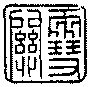

# 雪峰志



> **藏经**：大藏经补编（大藏经补编）　**册次** 第 24 册（B24）　**编号** B0140　**部类** 史传部　**卷次** 10 卷　**篇幅** 65,295 字

> **卷／品**：0 卷 · 4 品



---



## 目录



  - [雪峰志序](#雪峰志序)

  - [送无念师住持雪峰序](#送无念师住持雪峰序)

  - [赠凤冈上人住持雪峰序](#赠凤冈上人住持雪峰序)

  - [游雪峰序](#游雪峰序)



---



### 雪峰志序



教道中，大千刹土统为诸佛报境。然则川岳储灵，烟霞毓秀，不知创自何始，忽乃挺生奇杰，蔚为照世光幢，人境叶符，旷世一觏。如雪峰胜槩，乃闽天第一道场。彼真觉大师者，僧海宝王，法门真吼。儿时见花幡像设，喜动容光，行脚访投子、洞山，不辞足茧。鼇峰成道，得力虽藉𪨷头；芥孔投针，正脉还思德峤。水因源远，汇为云门、法眼两宗；翮借飚扶，突出玄沙、长庆诸子。自非家风缜密，安能支派长流？若夫天龙呵护，地祇效𥘇，蓝长者捐宅为寺，闽国主倾心四事，因缘辐凑，时节相应，则知乘乎法运示现者，讵易测其原委哉？昔百丈老人谓，过去迦叶佛时，曾住此山。可见百丈已前，更有开山之百丈，岂雪峰之后，宁非重到之雪峰乎？盖前身后身，孰为异世？彼刹此刹，原无分区。祖师谶云：「塔石爆卵，杉枝篲地，奯竹笋生，不妨打个筋斗再来。」第昔人倾家布施，今豪寺产鲸吞；倘雪老复出，不知蓝翁父子能再来檀越否耶？吁！祖庭寥落，不复覩汉官久矣。乃兴公徐居士，以描天藻思、写物宏才，如将雪峰山水一笔畫出。其间昨葺今颓，虽更不常，使览斯志者一见，顿还旧观。彼大师作之於七百年前，而居士纂之於七百年后，雪关将前后事串为一序，抑何偶然？尚不识箫鼓琵琶，能赓千古曲调更复是谁？得山林居士喜而授诸梓，俱当虚猊床以待之，报其功绩可也。



崇祯壬申岁冬日博山释智訚撰











重刻雪峰志叙



佛祖出世的本怀，原为导人向善而达於至善。虽先后间兴，然必时与处会，始获宏其道焉。故名山大泽，一经伟人达士之所游履，高僧隐者之所栖迟，其胜槩玄猷，必班班可考，久而不磨，俾千古之下，俨然如见，虽不能至，而心向徃之。此山经、地志所由作也。闽中雪峰，昉著于唐，诚曰地灵，苟非人杰，恶足以成其美？凢岩洞之幽深、殿阁之宏丽，皆有可书，而前言徃行足以启人心目者，讵可任其散失而弗编修欤？按，唐咸通逮明崇祯间，相距七百餘载，前志有无固不可考。今观徐兴公居士所辑，虽时殊世异，不无遗失，而〈禅宗〉、〈艺文〉与夫〈剏建〉等项井井，灿若列睂，揣其用心，盖亦勤矣。然非目破五车，焉能捃拾七百年来之残编蠧𥳑，汇而成书？每慨操䉉之难，未尝不拳拳三致意焉。教中道，世尊灭度后，正㳒、像㳒各一千年，末法则有万年。今入末法仅七百年，嗣后有以大雄氏之道鸣于此山者，固未可量也。即欲仰止前徽溯流寻源，舍斯志，其孰与归？且道塲之隆替，关乎法运，而世故之沧桑，有若循环。百有年前编次之书，遍觅诸刹，仅获一帙。释今弗为翻刻，安保其不为乌有先生耶？匪独辜负前人心血，而后来高才博识、有欲从事于斯者，亦弥远而无徵。孰谓是役可缓乎？适有善士頼亨侯、郑崇绚、吴武卿诸君，乐为重梓，乃将迩年见闻续入一二，以付剞劂。特书其缘起如是。



时乾隆岁在甲戌𡥠冬雪峰释实松题



雪峰志目录



卷之一纪形胜



卷之二纪剏立(附题刻)



卷之三纪禅宗



卷之四纪法泒



卷之五纪当山



卷之六纪田产



卷之七纪生植



卷之八纪艺文



卷之九纪题咏



卷之十纪悟证



雪峰志卷之一



郡人



徐𤊹　纂辑



林弘衍　叅定



郑天彩　赖亨侯　吴兴汉　重订



纪形胜



震旦方坻，群峰秀结；𡽱嶫蔽亏，炎天积雪。岫幌云关，星罗碁列；地德炳灵，四睇幽绝。纪〈形胜〉第一。



雪峰山



在福州侯官县廿九、三十都。宋为永安乡嘉祥东里，距郡城一百八十里而遥，高四十餘里，蟠据侯官、罗源、古田、闽清四邑，延袤六十餘里。其山旧有樵者得象骨於峰头，名象骨峰，危峭隂寒，夏有积雪，经暑不消。初，僧义存游吴楚至武陵，传法於德山，乃归闽，居怀安县之芙蓉山石室。其徒猬集，有同学行实者，为卜胜槩，曰：「宐若鹫岭、猴江乃可。」於是得象骨峰，形势积高，冈峦环抱。乃与里人谢俲、方训、陈佐辈，诛茅为庵於柽洋凉映台北，导存居之。一日登其巅，遇大雪，留宿其上。闽王审知，问曰：「师住象骨峰，有何异？」答曰：「山顶暑月，犹有积雪。」王曰：「是山可名雪峰。」此雪峰之名所繇起也。既而徒众益盛，舄衲无所容。遂去庵三百歩，别营所居，即今之崇圣寺基也。主山曰凤凰冈。唐禧宗乾符二年，赐号「真觉大师」。山有二十四景，然不能尽是山之胜云。



象骨峰



山之旧名，唐改为雪峰。



凤凰冈



寺之主山也。寺扆其麓。



乌石岭



在山之巅，石色纯黑，不生树木。



丁山



距寺四十里。



六华峰



距寺二十里。



一洞山



在寺之东北，俗呼狮子岩，峭拔玲珑，草木蒙茸其上。



梯云岭



在寺之东南。



磨香石



在寺之东，隅石上古刻「磨香石」三字。



鞭鬬石



在寺之东，隅石上刻「光松头塔」四字。



棋盘石



在罗汉岩之上。



虎迹石



文殊台



在柽洋之东，距寺五里。石屋中刻有文殊像。



乘云台



黄蘖希运禅师与一僧同登雪峰，转盻间，其僧乘云而去，运讶视之曰：「早知能然，当为斫其胫。」故名。



罗汉岩



在双溪，距寺二十里，抵寺路经於斯，下有十数丈深潭，上有棋盘石旧迹。



应潮泉



在山绝顶，距寺十餘里，一壑澄泓，广二三尺。水才数寸，进退深浅与潮候无差。四傍皆顽石，中有数沙眼，潮上则涓涓而出，退则复竭，相传以为海眼。



卓锡泉



距寺二里，泉自石罅流出，涓涓不竭。



瀑布泉



在丁山，奔流广十餘丈。



汤泉



距寺八十里，地名汤院，产石玲珑䆗窱，可为盆玩。有温泉自龙口流出。宋僧可遵有诗云：「直待众生尘垢尽，我方清冷混常流。」苏东坡和之云：「若信众生本无垢，此泉何处覔寒温。」后郡守曾巩、程师孟、蒋之奇诸公俱有留题。



万工池



在枯木庵前，宽可数十亩，闽王役丁夫所濬，曾费万工，故名。



放生池



在寺前万工池下。



蘸月池



在山门外，岁久淤塞，前僧垦为田。万歴七年，清丈十一亩零，鬻价三十金。天启七年，曹亷宪学佺捐资赎回，仍濬为池，四傍砌石。



雪峤路



在枯木庵边。



古镜台



在柽洋之西。



论曰：吾郡山水，奇擅宇内。雪峰僻处万山中，高凌霄汉，隆冬积雪，盛夏不消，固非炎方所尝听覩。闽山无象，而骨委峰巅。离海三百餘里，而泉脉候应潮汐。乘云高僧，台址尚存。瀑布千仞，不让匡山九疉。则是山诚震旦之灵区，释子、开士之所吐符也。惟是人迹罕至，云峦雾壑，未尽品题。老氏有云：「知我者希，则我贵矣。」山灵岂不厚幸哉！



雪峰志卷之二



郡人



徐𤊹　纂辑



林弘衍　叅定



郑天彩　赖亨侯　吴兴汉　重订



纪剏立



白马东来，法门不二；鹿苑雁堂，琉璃开地。玉榜金书，累朝勅赐；展也大雄，千龄弗坠。纪〈剏立〉第二。



雪峰崇圣禅寺



肇自唐僖宗乾符二年，赐名应天雪峰禅院。昭宗乾宁元年，迁於东洋，剏大雄殿及演法堂，建塔胜处。王氏倾国赀给施，夏屋弥山，铸金身，像设毕具。光化三年，改名应天广福禅院。宋太平兴国三年，赐名雪峰崇圣禅寺，迨有明因之。永乐九年辛卯，镇守太监冯让舍财，住持洁庵映禅师重剏佛殿、法堂、山门诸处。闽中诸大刹，雪峰首称鉅丽。嘉靖辛亥，建宁斗峰宝积禅寺比丘道觉，与九十六代住持行存，重剏天王殿。岁久颓坏。天启七年，邑人曹学佺捐赀重修。　国朝康熙壬寅，改向重构，未获告竣。殿前瓦塔二座，永乐中三宝太监自西洋擕来置此。



法堂



在佛殿后。



祖师堂



在法堂之右，祖师坐化全身藏此。唐龙纪元年，师预造难提塔，四周斵石为卵形。当示寂时留谶，谓：「石卵爆尽，杉枝拂地，奯竹笋生，吾当再来。」



檀越祠



在法堂左，祀檀越蓝文卿（唐封威武军节度使、明护侯王）、男蓝应潮（通祐神君）、次男僧守远（大悲贤圣，护佛正法）。今废。



枯木庵



距寺数百步，万工池之前。有枯木非梗非柟，大可十围，外嵌中枵，皮剥殆尽，色如黄金。大师初入山时宴坐其中，今虽无枝梢，而本根不朽，自唐迄今复八百餘禩，真神物也。万暦己丑，住持定绮作庵覆之。木里外，俱唐宋游人刻名。成化己亥，侯官县丞吴兴刘瓒篆书「枯木庵」三字。



鼇山阁



初大师与钦山、岩头客澧州，同假鼇山邸舍。夜坐不𥧌，钦山诘之，师曰：「心未稳在。」乃令吐襟次，因谓曰：「从门入者不是佳珍，须从自己胸中流出，将来与我葢天葢地。」师廓然大悟，后名其阁曰鼇山，葢识成道之由也。今废。



留香堂



寺有三僧堂。西堂，宋初有一僧，败絮百结，疮毒遍体，每剥痂，血故，秽几席，与处者不堪其恶。主事遣之，独邻榻僧怜之，而送之门，已而行数里，其僧曰：「荷君勤意，适留香相浣，回可取之。」言讫冉冉而去。及还所坐处，异香袭人，经时不歇。章郇公得象，作《留香堂记》，何大圭重修，又记之。(万历中，住持贤桐重剏。)



三毬堂



大师设三木毬，每欲度众，则辊一毬以示机锋。《传灯录》云：「玄沙[供-八+冉]见师辊出木毬，仍即安故处，师便入房。」今三毬犹存其一。



白云堂



在寺内。



卧云堂



在寺内。



如归堂



在寺内。



扆翠寮



万历间，僧仁岧建。



化生台



在寺之南，今废。



万松关



在万工池之南，关傍有古杉二株：一为闽王手植，一为大师手植。至宋淳熙间，师植者直上叅天，王植者樛而逮地，今皆大数围矣。(《三山志》云：「古杉在蘸月池之旁。」)



化成亭



在丁山，距寺四十里，入山之第一境。



望州亭



在寺之南。



肃仪亭



在寺之南。



半山亭



在双溪。



宝所亭



在蓝田。



水磨坊



师於枯木庵设水磨坊，驱木偶人转输，米麦狼籍，无鼠雀耗。师自题云：「庵前永日无狼子，磨下终年绝雀儿。」至今犹然。



龙眠坊



在寺之南。



金鼇桥



本山溪涧之水皆由此出，酾水处有洞穴，深广莫测，与枯木庵接近。



铁锁桥



在大穆溪，石梁横亘；昔寺僧以铁锁束之，以固风水。



蓝田庄



唐蓝文卿所剏，距寺十里。



大穆庄



唐蓝文卿所剏，距寺六十里。



太平庄



唐蓝文卿所剏，距寺三十里。



天池庄



唐蓝文卿所剏，寺二十里上洋地方。



东庵



今废。



西庵



今废。



南庵



今废。



雪峰廨院



在省城南隅福星坊内。有明成化十八年，镇守太监陈道重建，今废。



海会塔



在寺之西，唐置，明代湮废。天启七年，邑人曹学佺捐赀修复。(见住持贤桐记。)



汤院



旧有寺，即可遵题诗处。



定林庵



在狮子岩下。天启五年，僧如净建。　国朝乾隆十六年重修，顺治六年间，玉漈吴姓建楼屋为前照，今废。



无字碑



在寺南，古颂云：



一片如屏紫翠间　风吹日炙藓花斑  

莫言个里无文字　要在当人着眼看(碑废趺存)



枯木庵题刻



维唐天祐乙丑岁，造庵子及作水池，约五千餘功，时廉主王大王。



当院壬午年，得朝请郎．守殿中丞．权知福州军州事．借紫何允昭舍料钱三贯文，重修葢兹庵。时大宋雍熙四年丁亥岁十一月五日，谨记。



何知府亲躬到此，诗云：「尽日叹嗟真迹在，池边看木藓斓斑。」



枕子一枚，雀嘴杖一条，原生自庵中。



三衢吴亮君采，建中靖国元年辛巳岁九月十九日游。(已上刻在龛内)



韦子骏，至元庚午六月吉，寿卿、寿成侍行。



王诏、陆侁、弟萃偕度、俭二释同游，政和壬辰初秋下旬。



刘缜同弟缙清臣，政和戊戌季秋至此。后二年庚子孟夏，随女兄供五百应真，偕外甥孙光祖、甥之子元寿后来，黄光朗继至。



信安毛世高与真慧偕来。



郑昻、尚明，宣己(宣和己亥也)腊月二十日游。真慧谟师偕来。



许大年同真慧师来，辛丑仲冬。



唐功懋、□□□，宣和甲辰同游。



延安任士安、合肥李雍、河南范伯奋、睢阳蔡宙、毘陵邵杰、建安郑玙、莆田方升之、建阳王康功，绍兴己未三月廿有六日同来。



季昕，绍兴辛酉九月□□侍者同至。



陈默、李纲、方金、沈济追游。



陈景俊有卿，开禧丁卯五月旦观。



颖川德近、彦昌、中野涉道人，绍定四年重来。



何子祥、螺庵肇师偕来。



淳祐甲辰夏五朔，长乐何桓登山斋僧，视先君与先少卿舅留名，扪泥拂尘而去。住山石翁禅师，命锓木以志岁月。



丙午五月，鍾进卿到此，戊午再此。



石亘陈粹，癸亥五月望日至此。



懒散，壬戌仲春游。(𤊹按：《刘后村文集》有跋陈懒散帖。刘，宋末人，则此壬戌实景定三年也。懒散善草书，木上所刻，亦狂草有法。)



荣禄大夫．福建行中书省平章政事．集贤院使．领会同馆事．吴国公亦黑迷失，舍梯已宝钞赍擎。时延祐元年，住山樵隐悟逸题。



钦差内官古童、𫨻奇、徐忠三员，於永乐八年正月十九日登山，喜舍大殿五尊佛藏修崇善事，游覧古迹，登象骨峰，观龙头、水磨、香石诸境界，至二日出山。住持洁庵题。



崇祯庚午四月八日，徐𤊹、高景、林宠来。(以上刻在龛外。)



论曰：自象教聿兴，花宫莲宇，金碧焜煌，殆非一日。崇圣禅林，肇从唐季，偏安覇主，倾国资以庀，匠石濬池，不惜万工，亦云盛矣。经今七百餘年，宏丽庄严，弗㬱往昔，而枯木轮囷，不生不灭，岂非神物，有所呵护哉？水磨绝夫鼠雀，僧堂留厥异香，大师遗谶，屡有明验，固难以常理测也。佛法灵通，慈风浩大，不於此而益信乎？至於地布黄金，门开珠网，不无望於今之檀越。



雪峰志卷之二终



雪峰志卷之三



郡人



徐𤊹　纂辑



林弘衍　叅定



郑天彩　赖亨侯　吴兴汉　重订



纪禅宗



獦獠开堂，南岳嗣法；灯燄相承，宗风四达。拂𥪡槌拈，毬抛棒喝；千古慧心，普传衣钵。纪〈禅宗〉第三。



真觉大师年谱



唐穆宗长庆二年壬寅



师，泉州南安县曾氏子，父勉，家世奉佛。其先茔在杨山西，去城四十五里，一峰翔拜於前，俗谓胡僧设拜。形相墓者，卜其地出高僧。师生酷恶荤腥，襁褓中闻钟梵声，或见旙花像设，必为动容，见者咸异之。



长庆三年癸卯



长庆四年甲辰



敬宗宝暦元年乙巳



宝暦二年丙午



文宗泰和元年丁未



泰和二年戊申



泰和三年己酉



泰和四年庚戌



师九岁，恳父母求出家，不从其请。



泰和五年辛亥



泰和六年壬子



泰和七年癸丑



师十二岁，从父游莆田玉涧寺，见庆玄律师遽拜，曰：「我师也。」遂留侍焉。



泰和八年甲寅



泰和九年乙卯



开成元年丙辰



开成二年丁巳



开成三年戊午



师十七岁，祝发，改名义存。



开成四年己未



开成五年庚申



武宗会昌元年辛酉



会昌二年壬戌



会昌三年癸亥



会昌四年甲子



会昌五年乙丑



师二十四岁，是年有旨沙汰僧徒，师以儒服谒福州芙蓉寺弘照训禅师，见而器之，留之左右。



会昌六年丙寅



师二十五岁，是岁武宗崩，沙汰之令赦已。



宣宗大中元年丁卯



师二十六岁，是岁奉诏还佛，师再礼芙蓉弘照为师。



大中二年戊辰



大中三年己巳



师二十八岁，徃幽州宝刹寺受戒。



大中四年庚午



大中五年辛未



师三十岁，是岁五月九日，弘照禅师示寂。



大中六年壬申



大中七年癸酉



师三十二岁，辞曾氏游方，有偈曰：



昔年曾许郁多罗　直至于今未动梭  

此日且随云水去　谁能待得鸭成鹅



遂同岩头奯公在大慈寺，寰中会下及寰中上足钦山文邃为友。至江西三登投子山，九上洞山。师尝在洞山作饭头。一日师淘米，洞山问云：「先去砂？先去米？」师云：「砂、米一时去。」山云：「大众吃个甚麼？」师覆𨚫盆子。山云：「子因缘不在此。」遂去，叅德山。



大中八年甲戌



大中九年乙亥



大中十年丙子



大中十一年丁丑



大中十二年戊寅



大中十三年己卯



懿宗咸通元年庚辰



师年四十，叅德山。师问德山：「从上宗乘中事，学人还有分也无。」德山打一棒云：「道什麼？」师此时豁然，如桶底脱相似。



咸通二年辛巳



咸通三年壬午



咸通四年癸未



师年四十二，在德山作饭头。一日饭迟，德山自掌钵至法堂上。师见云：「老汉！钟未鸣，鼓未响，托钵向什麼处去？」德山便回。师举似岩头，头云：「大小德山，不会末后句。」山闻，令侍者唤岩头至方丈，问：「你不肻老汉那？」岩头密启其意。山至来日上堂，与寻常不同，岩头到僧堂前抚掌大笑，云：「且喜得老汉会末后句，天下人不奈伊何。」



咸通五年甲申



咸通六年乙酉



咸通七年丙戌



师年四十五，同岩头、钦山欲叅临济。至中路，逢定上座云：「临济和尚已于四月初十日示寂。」师云：「某等薄福，不及见和尚，未审有何言句？」定举无位真人话，自是三人分袂，岩头徃龙山，钦山止于澧阳，师还闽。道由建安，结庵居之，今黄龙、双石二寺是也。



咸通八年丁亥



咸通九年戊子



师年四十七，追念芙蓉乃初进之地，遂还福州，止于芙蓉之石室。是岁沩山大安禅师领徒至，廉帅李景以书请开创城西怡山——王覇仙人上升之所，即今之西禅长庆寺也。



咸通十年己丑



师年四十八，宴坐芙蓉石室，其徒有劝其出山者，师深拒之。时有同学僧行实，谓师道德隆重，非鹫岭、猴江之胜不足以居，议以象骨峰为师栖止，师颔之。



咸通十一年庚寅



师年四十九，是岁暮春，行实以象骨峰诣诸耆旧，求卜精蓝。时山之东信士方训、谢俲、陈佐竞为缘首，愿奉祇园，而洪元表亦以财施。遂剏庵于柽洋凉映台之北，迎师居之。既至，据坐而喜，谓行实曰：「劳汝择焉，吾其终老于此矣。」是冬，师偕行实陟于峰顶，周览形胜，或谓樵者得象骨于峰巅，或谓是山四时皆雪，二名兼称，师笑曰：「可。」其上三百步，得胜地。先是行实买庵基于方训，方以山林为施，而谢俲、陈佐亦乐舍资财。自是檀度辐辏，置田业寖广矣。



咸通十二年辛卯



师年五十，大兴雪峰院宇，至于木人効劳，众以为喜。



咸通十三年壬辰



咸通十四年癸巳



师年五十二，营造土木之暇，随机演唱，未尝少懈，衲子云集，至无所容。



禧宗乾符元年甲午



乾符二年乙未



师年五十四，闽观察使韦公岫，舍钱三百缗为建造费。自庚寅至是岁凡六载，院宇大备。僧朗诣阙请院额时，遇应天节，乃赐额「应天雪峰禅院」。



乾符三年丙申



师年五十五，寄书与岩头云：「自从鼇山成道后，直到而今饱不饥。」



乾符四年丁酉



师年五十六，因游寺外，遂至陈洋，乃曰：「吾首达兹山，得三境界，此其三也，可为建塔之所。」今之塔基即是。



乾符五年戊戌



师年五十七，巢𢽉自浙入闽，陷破郡邑。师在山中，盐官棱道者来叅。



乾符六年己亥



广明元年庚子



中和元年辛丑



师年六十，徒众盈千五百人。凡来叅者，便滚出三个木毬，一留𥨊室，二藏塔中。是岁，备头陀出世，住杨溪塲普应寺，后迁玄沙，即玄沙祖师也。



中和二年壬寅



师年六十一，廉帅李景舍钱一十万缗，司空颕川陈公岩舍钱三百缗，观察使晋国韦公岫舍钱二十万缗，置太平王坂庄。致仕陇西李公舍钱一百三十八贯，继剏城西大睦廨寺。是岁有内官自闽回京，言师之道德，钦承僖宗皇帝诏福州所司具师道行，时闽士陈延郊疏其实以奏，赐号「真觉大师」并紫袈裟。



中和三年癸卯



中和四年甲辰



光启元年乙巳



光启二年丙午



光启三年丁未



师年六十六，四月八日，岩头遭𢽉难，大叫一声闻数十里，命终阇维，舍利无数，师闻而悲之。



光启四年戊申



昭宗龙纪元年己酉



师年六十八，开基造塔于陈洋，即前所谓第三境界。七月七日塔成，师自作铭。时行实示寂，师哭之恸，举其全身葬于山之西原。师为〈塔记〉云：「身谢有为，塔归无缝。松山一镇，鶴岭千秋。」行实俗姓高，浙之永嘉人也。受业芙蓉山，自咸通己丑年，启剏兹山。时行实明地理，破天荒，立山门，放水路，原始要终，其功不浅。是年八月十四日，终于旧院，寿六十七，腊三十六。



天顺元年庚戌



天顺二年辛亥



师年七十，再游吴越，初抵天台涌泉。



景福元年壬子



师年七十一，夏止灵隐，后至国清，复到浮江，次游育王，各有问荅机缘。



景福二年癸丑



乾宁元年甲寅



师年七十三，复归于闽，止于陈洋塔所。府司徒郎公延请府中，为说玄要，即施财建法堂于塔亭。是岁迁寺于陈洋，今寺即此处也。时有嗣法玄沙备、鹅湖孚、洞岩休、长庆棱、云门偃、鼓山晏等一十二人，今《传灯录》载四十六人，餘失其名。



乾宁二年乙卯



师年七十四，领众南游。时黄涅槃预知师至，搘策造前途接之。抵苏溪，师问曰：「近离什麼处？」槃云：「离辟支岩。」师云：「岩中还有主麼？」槃以竹策扣师簥，师乃出簥相见。槃云：「曾郎万福。」师遽展丈夫拜，槃亦作女人拜。师云：「莫是女人麼？」槃又设两拜，遂以竹策倒地，右遶师簥者三，云：「某三界内人，师三界外人。师宜前去，某后来。」槃乃先回，师遂去。至囊山，憇数日，槃供侍随行，禅徒一无所缺。次至瓦棺，时泉州太傅王延彬创东弥勒、资寿等院，迎师驻锡，大加礼敬。闽王王审知执权覇位，向师道化，尝领千众于东西第，为王说法。初舍俸钱二十万，创横屋二十间，次舍钱三十万，创造法堂、廊庑、方丈等宇。



乾宁三年丙辰



乾宁四年丁巳



光化元年戊午



师年七十七，闽王请师同玄沙入内，论佛心印。王闻二师如此开示，起大信心，便立大誓，愿皈心受持，终无退志。二师于内讲论佛法，重排香案，不许外泄，仍令内尚书三人，隔帐录其法语。师乃请诸佛、龙天证明，为王传佛心印。复舍钱四十万，鼎建大殿、堂宇千百餘间，莫不大备。师先年首至兹山，时山南东洋信士蓝文卿者，知师道化，遂将所居东池侧古柽树创庵，延师驻锡，今枯木庵是也。蓝公复以柽洋庄创建精舍，延师居之，今旧院是也。蓝公见其众广，复将所居之宅𠑽为巨刹，迁师主之。后闽忠懿王具奏禧宗皇帝，赐封檀越主蓝文卿为威武军节度使、明护侯王，长男应潮通祐神君，弟僧守远慈悲尊者，今为本山土地。其后文卿与妻杨大娘，次男应辰等，徙家于茆洋庄，以成其志，仍施田园二十庄，今蓝田、太平、大穆等庄是也。



光化二年己未



师年七十八，闽王遣使赍银交椅送师。



光化三年庚申



师年七十九，有旨赐改本寺为应天广福寺。



天复元年辛酉



师年八十，是岁闰六月初十日，师将条件住持及僧行规制以示徒众，大约事无大小皆归住持。百川归海，众流同源，国无二王，家无二主。况僧居无诤，有诤非僧，心安人和，不失其绪。至于庄院塔院，皆有成规，老者病者，理合看侍。若能声演佛事者，以应外缘；僧行有过者，轻重量罚。既非知事，不许輙行杖木，令人不安。凡百事但依芙蓉先师规制，即知其义也。



天复二年壬戌



天复三年癸亥



师年八十二，寺众日繁，岁入不给，屋宇渐漏，欲行修葺，工程浩大。有僧无量、无悦者，立心劝募众缘，轮奂仍旧，以遵师行。



哀帝天祐元年甲子



天祐二年乙丑



师年八十四，闽王再施钱，重建枯木庵及开大池，约万有餘工。师尝在枯木庵坐禅，傍有水磨坊晒麦，师亲题云：「庵前永日无狼子，磨下终年绝雀儿。」此师之诫谕，至今无虎雀。



天祐三年丙寅



师年八十五，泉州王太傅遣使来请棱道者住持招庆寺，师以书报玄沙，上山送之。唐祚至此为梁所篡。



梁太祖开平元年丁卯



师年八十六，师自图塔样，令人呈献闽王。王遣使往江西瑞迹山搜致材石，为师建塔及真堂三间。与师造龛，龛完报和尚知道。师云：「舁向堂前着，看你不奈何。」



开平二年戊辰



三月，师示微疾，闽王命医诊视，师曰：「吾非疾也。」竟不服药。至四月二十五日，师坐法堂示遗诫等事，乃云：「当院年长有从智者，共相遵受，不得妄有乖张。」至本月二十八日，谓众曰：「泡幻缘生，去来不定，吾四十年来，未尝不苦口相劝。近日佛法淡薄，惟于世谛慇懃，至于信施檀那，师僧和尚百年终殁，无善报恩，世理既不相应，亦合少分省察。吾若四大离散之日，先已有木函石龛，竝依旧志安排，毋违我意。若有披麻下泪者，非我眷属。」众皆秉命，共矢修营，塔制苟完而葢石未具。是夕烈风雷雨，震撼林壑。东山之上，地忽震裂，广袤寻丈，其平如底，举而用之，函葢相合，见者咸异。五月初二日，师手札百餘字别闽王，复游蓝田庄，暮归。是夜十八刻示寂，寿八十七，臈五十九。至初十日，建窣堵坡于本院方丈。闽王遣男、刑部尚书延禀入寺，哀恸，特谕祭礼。至十五日，全身入塔。



论曰：雪峰开堂说法，叅座下而称弟子者千五百人，宗风之盛未有逾此者；且时有忠懿国主皈依礼拜，僖宗皇帝降𠡠赐号。师之机缘宏大，殆与东林慧远、弥天道安埒矣。八十七年之踪迹，歴歴有徵，而心印相传，则具见於《语录》云。



雪峰志卷之三终



雪峰志卷之四



郡人



徐𤊹　纂辑



林弘衍　叅定



郑天彩　赖亨侯　吴兴汉　重订



纪法派



宗风既普，白业斯传；根禀慧钝，觉有后先。支分派衍，果证金仙、梵轮自转，智炬常燃。纪〈法派〉第四。



雪峰法嗣



云门文偃禅师



嘉兴张氏子。初到雪峰庄，见一僧乃问：「上座今日上山去那？」僧曰：「是。」偃曰：「寄一则因缘问堂头和尚，祇是不得道是别人语。」僧曰：「得。」偃曰：「上座到山中见和尚上堂，众才集便出，握腕立地曰：『这老汉项上带枷，何不脱𨚫？』」其僧一依偃教。雪峰见这僧与麼道，便下座，把住曰：「速道，速道！」僧无对。峰拓开曰：「不是汝语。」僧曰：「是某甲语。」峰曰：「侍者将绳棒来。」僧曰：「不是某语，是庄上一浙中上座教某甲来道。」峰曰：「大众去庄上，迎取五百人善知识来。」偃次日上雪峰，峰才见便曰：「因甚麼得到与麼地？」偃乃低头，从兹契合，温研积稔，密以宗印授焉。宋乾德三年，有旨诣云门，开塔，真容如生，髭发皆长，真身迎入大内供养，逾月送归封塔。



福州玄沙师备宗一禅师



闽之谢氏子，生长渔家。年三十始出家，与雪峰本法门昆季而亲近若师资。峰以其苦行，呼为头陀。一日，峰问：「阿那个是备头陀？」备曰：「终不敢诳于人。」异日，峰召曰：「备头陀何不遍叅去？」师曰：「达磨不来东土，二祖不往西天。」峰然之。备入室咨决，罔替晨昏；又阅《楞严经》，发明心地，由是应机敏捷，与修多罗冥契。诸方玄学有所未决，必从之请益，至与雪峰徵诘，亦当仁不让。峰曰：「备头陀，再来人也。」有《语录》行于世。



福州长庆慧棱禅师



杭州盐官孙氏子。歴叅禅苑，后叅灵云，往来雪峰、玄沙，二十年间坐破七个蒲团，不明此事。一日卷帘，忽然大悟，乃有颂曰：「也大差，也大差，卷起帘来见天下。有人问我解何宗？拈起拂子劈口打！」峰举谓玄沙曰：「此子彻去也。」沙曰：「未可，此是意识著述，更须勘过始得。」至晚，众僧上来问讯，峰谓棱曰：「备头陀未肻汝在，汝实有正悟对众举来。」棱又颂曰：「万象之中独露身，惟人自肻乃方亲；昔时谬向途中覔，今日看来火里氷。」峰乃顾沙曰：「不可，更是意识著述。」棱问峰曰：「从上诸圣传授一路，请师垂示。」峰良久，棱设礼而退，峰乃微笑。棱入方丈叅，峰曰：「是甚麼？」棱曰：「今日天晴好普请。」自此酬问，未尝爽于玄旨。



漳州保福从展禅师



福州陈氏子。年十五，礼雪峰为受业师。游吴楚间，后归执侍。峰一日忽召曰：「还会麼？」展欲近前，峰以杖拄之，展当下知归。



福州鼓山神晏兴圣国师



大梁李氏子。幼恶荤腥，乐闻钟梵。一日叅雪峰，峰知其缘熟，忽起搊住曰：「是甚麼？」晏释然了悟，亦忘其了心，惟举手摇曳而已。峰曰：「子作道理耶？」晏曰：「何道理之有？」峰审其悬解，抚而印之。



杭州龙华灵照真觉禅师



高丽人也。萍游闽越，升雪峰之堂，冥符玄旨。居惟一衲，服勤众务，闽中谓之「照布衲」。



明州翠岩令叅永明禅师



安吉州人，嗣雪峰。



越州镜清道怤顺德禅师



永嘉陈氏子。六岁不荤茹，游方抵关，谒雪峰。一日怤问：「祇如古德，岂不是以心传心？」峰曰：「兼不立文字语句。」怤曰：「祇如不立文字语句，师如何传？」峰良久，怤礼谢。峰曰：「更问我一转岂不好？」怤曰：「就和尚请一转问头。」峰曰：「祇恁麼为别商量？」怤曰：「和尚恁麼即得。」峰曰：「于汝作麼生？」怤曰：「辜负杀人。」怤住越州镜清，唱雪峰之旨，学者奔凑。副使皮光业（日休之子），词学宏赡，屡击难之，退谓人曰：「怤师之高论，人莫窥其极。」



漳州报恩怀岳禅师



泉州人，嗣雪峰。



福州安国弘瑫明真禅师



泉州陈氏子。叅雪峰，峰问：「甚麼处来？」曰：「江西来。」峰曰：「甚麼处见达磨？」曰：「分明向和尚道。」峰曰：「道甚麼？」曰：「甚麼处去来。」一日，雪峰见瑫，搊住曰：「尽乾坤是个解脱门，把手拽伊不肻入。」曰：「和尚恠弘瑫不得。」峰拓开曰：「虽然如此，争奈背后许多师僧何。」后闽帅命居安国，大阐玄风。



泉州睡龙山道溥弘教禅师



福唐郑氏子，嗣雪峰。



南岳金轮可观禅师



福唐薛氏子。叅雪峰，峰曰：「近前来。」观近前作礼，峰与一蹋，观忽契悟。师事十二载，复历丛林。住后上堂：「我在雪峰遭他一蹋，直至如今眼不开，不知是何境界？」



福州大普山玄通禅师



本郡人，嗣雪峰。



福州长生山皎然禅师



本郡人，久依雪峰。一日，与僧斫树次，峰曰：「斫到心且住。」然曰：「斫𨚫着。」峰曰：「古人以心传心，汝为甚麼道斫𨚫？」然掷下斧曰：「传！」峰打一拄杖而去。



信州鹅湖智孚禅师



福州人。僧问：「雪峰抛下拄杖，意作麼生？」孚以香匙抛下地，僧曰：「未审此意如何？」孚曰：「不是好种，出去！」



杭州西兴化度院师郁悟真禅师



泉州人，嗣雪峰。



漳州隆寿绍卿兴法禅师



泉州陈氏子。因侍雪峰山行，见芋叶动，峰指叶示之，卿曰：「绍卿甚生怕怖。」峰曰：「是汝屋里底，怕怖甚麼？」卿于此有省。



福州仙宗院行瑫仁慧禅师



嗣雪峰。



福州莲华永福院从弇超证禅师



嗣雪峰。



襄州云葢双泉院归本禅师



京兆府人。初谒雪峰，礼拜次，峰下禅床跨背而坐，本于此有省。



韶州林泉和尚



嗣雪峰。



洛京南院和尚



嗣雪峰。



越州洞岩可休禅师



嗣雪峰。



定州法海院行周禅师



嗣雪峰。



杭州龙兴宗靖禅师



台州人。初叅雪峰，誓𠑽饭头，劳逾十载。尝于众堂中袒一膊钉帘，峰覩而记曰：「汝向后住持有千僧，其中无一人衲子也。」靖悔过。回浙住六通院，钱王命居龙兴寺，有众千餘，惟三学讲诵之徒，果如雪峰所记。



福州越山师鼐监真禅师



初叅雪峰而染指，后因闽王请于清风楼斋，坐久举目，忽覩日光，豁然顿晓，而有偈曰：



清风楼上赴官斋　此日平生眼豁开  

方信普通年远事　不从葱岭带将来



归呈雪峰，峰然之。临终示偈曰：



眼光随色尽　耳识逐声消  

还元无别旨　今日与明朝



乃跏趺而逝。



泉州福清院玄讷禅师



高丽人，嗣雪峰。



衢州南台院仁禅师



嗣雪峰。



泉州东禅和尚



嗣雪峰。



杭州大钱山从袭禅师



雪峰之上足也。自雪峰印解，洞晓宗要，常曰：「击关南鼓，唱雪峰歌。」后入浙中，谒钱王，命居大钱山阐法。



福州永泰和尚



嗣雪峰。



池州和龙寿昌院守讷妙空禅师



福州林氏子，嗣雪峰。



建州梦笔和尚



嗣雪峰。



福州极乐元俨禅师



嗣雪峰。



福州芙蓉山如体禅师



嗣雪峰。



洛京憇鶴山和尚



嗣雪峰。



潭州大沩山栖禅师



嗣雪峰。



吉州潮山延宗禅师



嗣雪峰。



益州普通山普明禅师



嗣雪峰。



随州双泉山梁家庵永禅师



嗣雪峰。



漳州保福院超悟禅师



嗣雪峰。



太原孚上座



初至雪峰廨院憇锡，因分柑子与僧，长庆问：「甚麼处将来？」孚曰：「岭外将来。」曰：「远涉不易担负。」孚曰：「柑子，柑子。」次日上山，雪峰闻，乃集众，孚到法堂上顾视，雪峰便下看。知事明日𨚫上礼拜曰：「某甲昨日触忤和尚。」峰曰：「知是般事便休。」峰一日见孚，乃指日示之，孚摇手而出，峰曰：「汝不肻我那？」孚曰：「和尚摇头，某甲摆尾，甚麼处是不肻？」峰曰：「到处也须讳𨚫。」一日众僧晚叅，峰在中庭卧，孚曰：「五州管内，祇有这老和尚较些子。」峰便起去。峰尝问孚：「见临济说有三句是否？」孚曰：「是。」曰：「作麼生是第一句？」孚举目视之。峰曰：「此犹是第二句，如何是第一句？」孚叉手而退。自此雪峰深器之，室中解印，师资道契，更不他游而掌浴焉。



南岳般若惟劲宝闻禅师



福州人。师雪峰而友玄沙，深入玄奥，尝请《宝林传》四卷，纪贞元之后宗门继踵之源流者，又别著《南岳高僧传》行于世。



论曰：真觉大师大阐宗风，为八闽传法之祖，法席之盛，卓冠天下。四方缁衲从者一千五百众，而《传灯》所载入室法嗣惟五十有五人，亦各成佛作祖。与师问答、𧾱毬、喝棒、悟证之语，咸录弗遗，至于他山开堂，别有机警，不关雪峰话下者，但列其名而已。若夫灯灯相续，钵钵相承，降是以还，我则不暇。



雪峰别支



雪峰钦山主



上堂：「昨日一，今日二。不用思量，快须瞥地；不瞥地，蹉过半生没巴鼻。咄！」后嗣云门妙胜臻禅师。



雪峰思慧禅师



上堂：「大道祇在目前，要且目前难覩；欲识大道真体，今朝三月十五，不劳久立。」又曰：「一切法无差，云门胡饼赵州茶；黄鶴楼中吹玉笛，江城五月落梅花。惭愧！太原孚上座，五更闻鼓角，天晓弄琵琶。」喝一喝又曰：「南询诸友，踏破草鞋，绝学无为，坐消日月。凡情易脱，圣解难忘，但有纤毫，皆成㵕漏。可中为道，似地擎山，应物现形，如驴觑井。总无计较，途辙已成，若论相应，转没交涉。勉诸仁者，莫错用心，各自归堂，更求何事！」后嗣云门法堂本禅师。



雪峰演禅师



上堂：「遣迷求悟，不知迷是悟之钳锤；爱圣憎凡，不知凡是圣之炉鞴。祗如圣凡双泯、迷悟俱忘一句作麼生道？半夜彩霞笼玉象，天明峰顶五云遮。」后嗣云门元丰满禅师。



雪峰道圆禅师



依积翠日，宴坐下板，时二僧论野狐话。一云：「不昧因果，也未脱得野狐身。」一云：「不落因果，又何曾堕野狐来。」师闻之悚然，因诣积翠庵，渡涧猛省，述偈曰：



不落不昧　僧俗本无忌讳  

丈夫气宇如王　争受囊藏被葢  

一条楖栗任纵横　野狐跳入金毛队



翠见为助喜。后嗣临济黄龙南禅师。



雪峰慧空禅师



上堂：「俊快底点着便行，痴钝底推挽不动；便行则人人欢喜，不动则个个生嫌。山僧而今转此痴钝为俊快去也。」弹指一下曰：「从前推挽不出而今出，从前有院不住而今住，从前嫌佛不做而今做，从前嫌法不说而今说。出不出，住不住，即且置，敢问诸人做底是甚麼佛？空王佛耶，然灯佛耶，释迦佛耶，弥勒佛耶？说底又是甚麼法？根本法耶，无生法耶，世间法耶，出世间法耶？众中莫有道得底麼？若道得，山僧出世事毕；如或未然，逢人不得错举。」喝一喝下座。后嗣临济潭清禅师。



雪峰忠禅师



上堂：「终日忙忙，那事无妨。作麼生是那事？」良久曰：「心不负人，面无惭色。」后嗣临济雪峰需禅师。



吉州禾山殷禅师



福州吴氏子也。七龄，雪峰存禅师见而爱其纯笃，化其亲令出家。年二十，乃剃落。受具，辞游方，至九峰，虔公问：「汝远来何所见？当游何路出生死？」对曰：「重昏廓辟，盲者自盲。」虔笑以手挥之，曰：「佛法不如是。」殷不怿，请曰：「岂无方便？」曰：「汝问我。」殷理前语问之，曰：「奴见婢慇懃。」殷於是依止十餘年，虔移居石门，亦从之。及虔殁，去游庐陵，至永新，见东南山奇胜，乃承水而往。有故寺址，葢文德中异僧达奚道塲。遂定居，学者云集。唐后主闻其名，诏至金陵，问佛法大意。久之，有旨延居扬州祥光寺，恳辞归西山。诏住翠岩，又住上蓝寺，赐号「澄源禅师」。建隆元年庚申三月示疾，三月三日，令侍者开方丈，集大众曰：「后来学者未识禾山，即令识取。」泊然而化，阅世七十，坐夏五十，谥法性禅师，塔曰妙相。



论曰：雪峰阐教开宗，为六祖嫡派，佛法大盛于东南，而当时叅学如云。一悟玄机，瓢笠远徙，虽嗣法别支，夫非法门之龙象乎？佛日长辉，宗风不泯，其在斯矣。



东土祖师系图谱



初祖达磨二祖慧可三祖僧璨四祖道信五祖弘忍六祖慧能青原行思石头希迁天皇道悟龙潭崇信德山宣鉴雪峰义存云门文偃（分派）  

玄沙师备罗汉桂琛法眼文益（分派）  

清溪洪进天平从漪  

圆通缘德



清凉休复奉先慧同  

宝庆道昌



龙济绍修河东广原  

南台守安  

鹫岭善美



天龙秀  

延庆传殷



南台诚  

螺峰冲奥  

睡龙和尚  

雪峰光绪  

大章契如  

永兴禄  

安国慧球  

仙宗契符仙宗洞明



国清师静福清行钦



天龙重机高丽合光



国泰瑫齐云宝胜



白龙道希广平玄旨  

白龙清慕  

灵峰志恩  

东禅玄亮  

报劬玄应报劬仁义



云盖归本  

林泉和尚  

洞岩可休  

法海行周  

永泰和尚  

安国弘瑫白鹿师贵  

罗山义聪  

安国从贵  

怡山藏用  

永隆彦端  

林阳志端  

兴圣蒲  

仙宗明  

安国祥



和龙守讷  

梦笔和尚  

极乐元俨  

芙蓉如体  

保福从展保福可俦隆寿无逸  

隆寿法骞



招庆省僜  

白水如新  

招庆法因报恩宗显  

龙光澄忋  

永兴可休  

太平清海  

慈云慧深  

兴阳道钦  

保福清谿



报恩熙  

万安清运  

报慈文钦  

凤凰从琛  

永隆瀛  

清泉守清  

报恩行崇  

岳麓和尚  

德山德海  

章江慧亷  

梁山简  

建山澄  

康山契稳  

延寿慧轮归宗道诠  

九华善诠



西明琛龙兴裕



升山柔  

枕峰和尚  

朗州法操  

鹫岭和尚  

睦州敬连  

谷山句



憇鹤和尚  

沩山栖  

潮山延宗  

普通普明  

孚上座  

保福超悟  

南岳惟劲  

大普玄通  

长生皎然  

化度师郁  

隆寿绍卿  

仙宗行瑫  

龙华灵照瑞岩师进  

六通志球  

云龙归  

功臣道闲  

镇境遇缘  

报国照  

白云廼



莲花从弇  

十相审超  

翠岩令叅龙册子兴  

佛㠗知默



长庆慧棱招庆道匡  

龙华彦球仁王俊



保安连  

报慈光云  

开先绍宗  

报恩宝资福林澄



倾心法瑫  

水陆洪俨  

广严咸泽  

报恩慧朗  

长庆常慧  

石佛静  

翠峰从欣报恩守真



枕峰青换  

东禅契讷  

长庆弘辩  

东禅可隆  

仙宗守玭  

永安怀烈  

闽山室令含  

新罗龟山  

龙须道  

祥光澄静  

鹫岭明远鹫岭通



报慈从瓌  

龙华契盈



庐山讷  

新罗大无为  

潞州玄晖  

清净和尚  

永安雪峰  

卢仙德明  

明水懐忠  

益州懐果  

耳相行修  

嵩山安德  

龙井通  

鼓山神晏天竺子仪  

白云智作  

鼓山智严  

龙山智嵩  

凤凰强  

龙山文义  

鼓山智岳  

定慧和尚  

鼓山清谔  

净德冲照  

报恩清护



南禅契璠  

越山师鼐  

福清玄讷  

南台仁  

龙册道怤清化师讷  

南禅遇缘  

资福智远  

洞山龟端  

温州景丰



东禅和尚  

大钱从袭  

鹅湖智孚鹅湖法进



报恩怀岳妙济师浩



金轮可观后金轮



睡龙道溥保福清豁



双泉永广州大通



云门宗分派图谱



雪峰义存云门文偃白云子祥白云福  

后白云  

乐净含匡  

月华月  

大历和尚  

宝华和尚  

地藏和尚



南台道遵  

双峰竟钦  

资福诠  

黄云元  

龙境伦  

云门爽  

德山缘密文殊应真洞山晓聪云居晓舜  

佛日契嵩  

大沩怀宥



鹿苑文袭  

东禅秀  

南台勤高阳法广  

石霜节诚



药山可琼  

乾明普  

德山绍晏德山志光



中梁山崇  

黑水承璟黑水义钦



黄龙志愿  

普安道



白云闻  

净法章  

温门满  

地藏慧慈  

大容𬤇  

罗山崇  

云门常宝  

临谿竟脱  

华严慧  

英州观音  

林泉和尚  

双泉师宽五祖师戒泐潭怀澄育王怀琏  

灵隐云知  

承天惟𫈉  

西塔显殊  

九峰鉴韶  

崇善用良  

慧力有文  

雪峰象东  

云居守亿



洞山妙圆  

义台子祥  

天童怀清  

宝严叔芝洞山永孚  

首座令瑫



五祖秀  

白马辩  

水南智昱  

洞山自宝洞山清辩



复州广思玉泉心皓



四祖端广明常委



云盖智颙云居文庆



四祖志𬤇  

兴化奉能  

天睦慧满  

建福智同  

延庆宗本  

天龙炳贤  

上座自严  

乾明居信  

药山彛肃  

福昌重善上方齐岳东山国庆



金山瑞新天圣守道



夹山惟俊夹山遵



育王常坦



云门煦  

黄蘗法济  

康国耀  

谷山丰  

罗汉匡果  

沧溪璘  

洞山清禀  

北禅寂  

南天王永平  

永安朗  

湘潭明照  

青城乘  

普通封  

灯峰净源  

大梵圆  

药山圆光  

鹅湖云震  

开先清耀  

奉国清海  

韶州慈光  

保安师密  

云居融  

大圣守贤  

北天王辉  

芭蕉弘义  

香林澄远智门光祚雪窦重显天衣义怀  

称心省宗  

承天传宗  

南明日慎  

投子法宗  

宝相蕴观  

君山显升  

洞庭惠金  

万寿助



护国寿  

九峰勤  

雪盖继鹏  

黄龙海  

彰法澄泗  

延庆子荣圆通居讷



百丈智映慧因怀详  

慧因义宁



南华宝缘兴化延庆  

宝寿行德  

白虎守升



云台因



罗汉和尚  

香林信



福化充  

东天王广慈  

西禅钦  

庆云真  

洞山凛  

双峰慧  

韶州广悟  

云门法球  

新开颢鉴泐潭宽



佛陀山远兴化兴顺



泐潭道谦了山宗盛



奉先深莲华峰祥



慈云深崇信御



洞山守初福严良雅北禅智贤兴化绍铣  

法昌倚遇  

广因择要



衡岳振



乾明睦  

开福德贤上座日芳



报慈道嵩兴阳逊



广济同  

东平洪教



化城鉴  

庐山护国  

永福朗  

赵横山  

南天王海  

双全郁德山慧远开先善暹云居了元  

智海本逸  

天章元楚  

梁山应圆



禾山楚材  

资圣盛勤  

钦山悟勤  

鹿苑珪



含珠山彬



觉华普照  

铁幢觉  

延长和尚  

福化克  

黄龙赞  

披云智寂开先照  

天宝和尚  

桃源曦朗  

法云智善



天柱和尚  

舜峰义韶  

上座明  

般若启柔蓝田真



妙胜臻雪峰钦



荐福承古净戒守密



清凉智明西峰云豁西安自严



纂子庵主  

庆云和尚



法眼宗分派图谱



雪峰义存玄沙师备罗汉桂琛法眼文益天台德韶永明延寿富阳子蒙  

乾明津



长寿明彦长寿法齐



普门希办高丽慧洪  

上林胡智



大宁可弘  

永安道原  

报恩法端  

报恩绍  

广平守威  

报恩永安  

光圣师护  

奉先清昱  

普闻智勤  

雁荡愿齐  

光庆遇安  

般若友蟾  

智者全肻  

玉全义隆  

龙册晓荣  

功臣庆  

称心敬琎  

严峰师术  

华严慧达  

清泰道圆  

九曲庆祥  

开化行明  

开善义圆  

瑞鹿遇安  

龙华慧居  

齐云遇臻  

瑞鹿本先  

兴教洪寿  

报恩德谦  

灵隐处先  

善建省义  

观音安  

云门重曜  

仁寿泽  

大禹荣  

地藏琼  

灵隐韶光  

龙华绍銮  

碧泉行新  

象田默  

登云从竖  

观音朗  

五峰和尚  

何山道孜  

大禹自广  

黄蘗师逸  

瑞光清表



罗汉智依  

章义道钦  

报恩匡逸  

黄山良匡  

报恩玄则  

净德智筠  

宝塔绍岩  

般若钦遵  

归宗策真  

栖玄慧圆  

观音从显  

正勤希奉  

兴善栖伦  

新兴齐  

慈云匡达  

荐福绍明  

古贤谨  

兴福可勲  

上蓝守讷  

覆船山和尚  

奉先法瓌  

化城慧朗  

永明道鸿  

高丽灵鉴  

上泉和尚  

大林僧遁  

仁王缘胜  

上方慧英  

护国迈  

足岭照  

归宗师慧  

归宗省一  

延庆通性  

归宗梦钦  

舍利玄阐  

永安明  

禅谿可庄  

石霜爽  

灵山和尚  

佛手岩因  

保安止  

华严幽  

本平道达  

大宁道迈  

龙兴德宾  

黄龙仁  

西山道耸  

清凉泰钦云居道齐灵隐文胜灵隐延珊  

荐福归则



云居契瓌  

广慧志全  

保福居煦  

瑞岩义海翠岩嗣光



南明惟宿  

清谿清



报恩慧明保明道诚



报慈云遂齐云慧  

双岭祥  

观音真  

龙沙茂  

大宁奖



永明道潜千光瓌省  

镇境志澄  

崇福庆祥



灵隐清耸功臣道慈  

罗汉愿昭  

报恩师智  

濲宁可先  

光孝道端  

保清遇宁  

支提办隆灵隐玄本



瑞龙希圆  

国泰德文



报慈行言云居义能  

北禅清皎



报恩法安栖贤道坚  

归宗慧诚



长安院延规长安辩实  

云盖用清



归宗义柔罗汉行林慧力绍珍  

大宁庆璁



功臣觉轲尧峰颢暹  

功臣守如



百丈道恒栖贤澄实兴教惟一  

西余体柔  

定山惟素  

寿圣志升



云居清锡般若从琎  

清化志超



崇寿契稠净土惟素净土惟政  

黄牛政



云台令岑



论曰：自迦叶灵山一笑，至达磨西来，授衣东土，六传至南能，其教弥昌；后分为南岳怀让、青原行思，思传石头希迁。又数传至洞山良价，价传曹山本寂，是为曹洞宗。让传马祖道一，一传百丈怀海，海传黄蘗希运、沩山灵祐。祐传仰山慧寂，是为沩仰宗。运传临济义玄，其法最盛，是为临济宗。石头之嗣又有天皇道悟者，传龙潭崇信，信传德山宣鉴，鉴传雪峰义存。存传云门文偃，是为云门宗。又传玄沙师备，备传罗汉桂琛。琛传法眼文益，是为法眼宗。总曰五宗，而雪峰衍派居其二矣。今五宗支派日繁，渊源莫考，兹特纪雪峰一脉著为图谱，俾后之人有所考云。



雪峰志卷之四终



雪峰志卷之五



郡人



徐𤊹　纂辑



林弘衍　叅定



郑天彩　赖亨侯　吴兴汉　重订



纪当山



祇园聿开，缁流常住；金锡长栖，水田侨寓。花窟莲宫，息心卫护；世代累迁，道塲巩固。纪〈当山〉第五。



第一代开山真觉大师



讳义存。当山三十九载，寿八十七，详见年谱。



第二代戒华禅师



福州长乐林氏子。宋庆历四年当山，皇祐五年迁化，塔于鹿溪。



第三代元旵禅师



闽县张氏子。庆历六年当山，熙宁九年迁化，塔于圣泉。



第四代仁晓禅师



怀安柯氏子。皇祐元年当山，曾注《维摩诘经》，嘉祐元年示寂。



第五代象敦禅师



福州城北刘氏子。皇祐五年当山，塔于本山方丈东北。



第六代德建禅师



怀安潘氏子。治平元年当山，后移住地藏寺。迁化，塔于地藏。



第七代彰微禅师



古田苏氏子。治平四年当山，仅九阅月，徙秀峰寺。迁化，塔于秀峰。



第八代行元禅师



长乐徐氏子。治平四年当山，退隐东庵。



第九代延超禅师



怀安陈氏子。熙宁六年当山，徙安国寺。



第十代嘉润禅师



闽县杨氏子。熙宁八年当山，徙圣泉寺。



第十一代印超禅师



熙宁九年当山。绍圣二年示寂，寿八十一，腊四十九，塔于本寺东北。



第十二代月誉禅师



绍圣二年当山，寿八十四，金骨入海会塔。



第十三代隆禅师



闽县曹氏子。崇宁二年当山，政和二年示寂，寿四十五，塔于本寺，石刻「中兴慧照之塔」。



第十四代有需禅师



莆田洪氏子。政和二年当山，宣和二年示寂，寿七十一，塔于山巅。



第十五代大智禅师



浙江鄞县人。宣和三年当山，建炎四年示寂，寿六十一，塔于本寺西庵。



第十六代真歇清了禅师



西蜀绵州雍氏子。年十八，试《法华经》得度，住成都大智寺，习经论。出蜀至沔，见丹霞淳禅师，悟旨。后抵长芦谒照禅师，一语契投，传授衣拂。照师示偈曰：「得法丹霞老，传衣祖照庭，思深转无语，怀抱自分明。」寻迁四明之普陀、台之天府。建炎四年入闽，当山四载，退居东庵。后奉旨迁江心寺，示寂于开山新寺，全身塔于西华坞，谥曰悟空禅师，李忠定纲为作〈真赞〉。



第十七代预禅师



绍兴四年当山，凡七载，示寂，塔于古寺法堂之东。



第十八代惠禅师



绍兴十年当山，凡十五年，示寂，塔于东庵之西。



第十九代宗演禅师



绍兴十五年当山，次年示寂，寿七十三，腊五十一。



第二十代继椿禅师



楚湘潭张氏子，绍兴十六年奉旨当山，三十三年示寂，塔于大池庄后。



第二十一代空禅师



绍兴二十三年当山，凡一载，退居东庵，二十八示寂，塔于东庵巨石之巅。



第二十二代惠忠禅师



怀安刘氏子。绍兴二十四年当山，隆兴二年示寂，寿七十五，腊五十五，塔于东庵之阳。



第二十三代蕴闻禅师



江西分宁县沈氏子。隆兴二年当山，乾道五年被旨住双径，九年奉旨当山，诏赐慧日禅师，淳熙六年示寂。



第二十四代惠然禅师



侯官黄氏子。乾道五年当山，淳熙元年示寂，寿七十四，腊五十一。



第二十五代原深禅师



怀安刘氏子。淳熙七年当山，十年示寂，寿六十五，腊四十三，塔于古寺法堂之西。



第二十六代宗一禅师



江右南丰卜氏子。淳熙十年当山，绍熙四年示寂。



第二十七代惠深禅师



闽县冯氏子，淳熙十六年当山，次年示寂，寿八十七，腊五十九。



第二十八代南莹禅师



侯官叶氏子，绍熙四年当山，次年示寂，全身塔于旧院法堂。



第二十九代元聪禅师



庆元元年当山，三年示寂。



第三十代璧禅师



庆元三年当山，嘉泰元年被旨住净慈寺，示寂于雪窦。



第三十一代肇禅师



嘉泰元年当山，嘉定二年示寂，塔于寺之左崦。



第三十二代体仁禅师



长乐卓氏子，嘉定三年当山，一十五载重剏寺宇，百废俱兴。



第三十三代行谦禅师



浙江鄞县蹇氏子。嘉定十六年当山，宝庆三年示寂，寿七十九，腊六十一，塔于皷山。



第三十四代妙湛禅师



浙江慈溪毛氏子。宝庆元年当山，绍定二年被旨住育王寺，淳祐八年示寂。



第三十五代宗禅师



绍定元年当山，嘉熙二年示寂，寿七十五，塔于螺庵塔。



第三十六代冲禅师



杭州荀氏子。嘉熙元年当山，次奉旨住径山，淳祐十年示寂，寿八十一。



第三十七代德因大梦禅师



广东番禺李氏子，嘉熙二年当山，淳祐元年示寂，寿六十四，腊三十七，塔于本山茶磨之傍，李忠简昴英有诗赠之。



第三十八代道源禅师



连江王氏子。住浙江净慈寺，闽帅徐侍郎启请当山，行至建宁光孝寺示寂，徐帅绘像题赞，送入当山影堂。



第三十九代了玉禅师



长乐黄氏子。淳祐二年当山，十年示寂，寿六十四，腊四十六，塔于本寺。



第四十代宗信禅师



罗源王氏子。淳祐十年当山，次年示寂，寿七十，腊五十，塔于旧院。



第四十一代果禅师



怀安陈氏子。淳祐十一年当山，德祐元年示寂，寿八十四，塔于圆伊庵。



第四十二代一麟禅师



永福林氏子。景定二年当山，凡三载，后住灵隐，示寂，寿六十三。



第四十三代善珍禅师



泉州南安吕氏子。景定四年当山，凡六载，后奉旨住径山，示寂，寿八十五。



第四十四代环溪禅师



杭州贾氏子。咸淳四年当山，凡四载，后示寂于天童寺。



第四十五代可湘禅师



台州宁海葛氏子。咸淳八年当山，凡十载。至元二十七年，示寂于杭州宝寿寺，寿八十五，归骨于雪峰，建塔于西庵。



第四十六代至慧禅师



怀安陈氏子。咸淳十年当山，凡七载，后示寂于净慈，寿八十六。



第四十七代善用禅师



福州人。至元十七年当山。



第四十八代祖森禅师



西蜀人。至元二十三年当山。



第四十九代俊禅师



至元二十三年当山，凡十二载。元贞二年朝京，示寂于通州，归骨于鼓山南院。



第五十代耸禅师



福宁郑氏子。大德元年当山，三年示寂，寿七十三，塔于鼓山。



第五十一代云禅师



大德四年当山，凡四载，示寂，塔于本山。



第五十二代镜行禅师



大德八年当山，次年示寂于法海。



第五十三代悟逸樵隐禅师



怀安聂氏子。大德十年当山，凡七载，架造祖殿、法堂、僧堂，退居西庵。皇庆三年，特旨复命当山，造大殿佛像。延祐四年，造如归堂。六年，复退居西庵。泰定二年，再承旨当山，又七载。元统二年示寂，塔于海会塔之西。



第五十四代𥤱禅师



莆田林氏子。元统元年当山，凡五载退隐，寿七十示寂，塔于东山旧院之侧。



第五十五代有禅师



天台禇氏子。至元四年当山，凡十载，示寂，寿七十七，塔于本寺祖塔之西。



第五十六代隆禅师



古田陈氏子。至正七年当山，凡八载，退居秀峰，示寂。



第五十七代明禅师



江右德化孔氏子。至正十五年当山，凡六载，示寂，寿八十，塔于二十七都应天寺后。



第五十八代逆川顺禅师



讳智顺，温之瑞安陈氏子。赐号佛性圆辩禅师，当山三载。有徐子刚据安仁庄，闻师至，亟还之，详在宋文宪公所撰〈塔铭〉。



第五十九代空禅师



闽县方氏子。至正二十五年，仅一载示寂。



第六十代崇禅师



长乐李氏子。至正二十六年当山，凡六载。洪武五年，归寂于升山寺，塔于雪峰歴代塔。



第六十一代雪庭信禅师



浙江山隂陈氏子。洪武六年当山，寿六十，全身塔于西庵。



第六十二代愍忠慈禅师



瓯宁人。洪武十年当山，凡四载，示寂，寿六十一，塔于象骨峰下。



第六十三代墀禅师



长乐吴氏子。洪武十四年当山，示寂，塔于太平庄后。



第六十四代正禅师



闽县谢氏子。洪武十五年当山，凡二十六载。赴京，示寂于中途，骨归塔于六华峰下。



第六十五代镜堂宗禅师



长乐林氏子。授福州副都纲，建文元年示寂，塔于雪峰。



第六十六代希儒禅师



湖广江夏人。建文三年，授副都纲。十六载，能诗。



第六十七代重兴雪峰寺正映洁庵禅师



江西金谿洪氏子。自幼托迹空门，不茹荤腥。永乐初，住泉州开元寺，后钦选当山，凡一十五载，营剏佛殿、法堂、山门，焕然一新，后退归鍾山之灵谷寺示寂。



第六十八代镇禅师



蜀巫山县王氏子。永乐十年当山。



第六十九代远芷秋厓禅师



江西临川人。永乐十六年当山，侍师洁庵剏造寺宇，有功山门。



第七十代象祖禅师



第七十一代良琛禅师



宣德八年当山，刻崇圣寺碑。



第七十二代祖渊禅师



第七十三代无念禅师



宣德十年当山。



第七十四代思惠禅师



浙江钱塘俞氏子。



第七十五代庆预禅师



湖广郢州胡氏子。



第七十六代源潭月庵禅师



湖广蕲州张氏子。正统十一年当山，凡八载。景泰改元，沙、尤𢽉起，扰攘邻郡，总戎命潭招抚，躬到贼营，谕以威德，𢽉平。总镇奏闻，　朝廷授僧录司右觉义职。又自捐衣钵之资，於京师剏建佛寺，　勅赐额「善应寺」。成化十一年示寂，　宪宗皇帝遣礼部郎中于晃谕祭。寿六十九，腊四十四，全身塔于善应寺之西庵。潭善诗，赋〈雪峰二十四景〉，至今传之。



第七十七代传馨禅师



江西南昌人。景泰四年当山。



第七十八代源庆禅师



应天上元人。景泰五年当山，凡五载，退隐东堂。成化十六年，金骨入海会塔。



第七十九代志谦禅师



莆田人。天顺二年当山。



第八十代源隆禅师



浙江慈溪人。天顺三年当山，凡十载，后示寂於金陵草堂寺。



第八十一代智哲禅师



浙江台州人。成化四年当山，次年示寂，金骨入海会塔。



第八十二代智镇禅师



应天勾容人。成化五年当山，凡歴三载。於七年，重建大雄宝殿并佛像工程，未周示寂，金骨入海会塔。



第八十三代智明性庵禅师



湖广蕲州傅氏子。成化八年当山，凡十八载，捐赀围砌佛殿墙垣，起葢枯木庵，望州、肃仪诸亭，后退本寺南庵，有〈雪峰二十四景〉诗。弘治七年示寂，全身塔於大穆庄。



第八十四代智潮禅师



湖广黄梅吕氏子。成化十一年当山，次年退归蕲州五祖寺，寿七十。



第八十四代慧洪禅师



湖广蕲州人。弘治元年当山，凡十载。于十二年示寂，金骨入本山海会塔。



第八十五代广仁禅师



湖广蕲州人。弘治九年当山，赴京领劄，凡四载，十二年示寂。



第八十六代广仪禅师



怀安郭氏子。弘治十三年当山，十五年示寂于大穆庄，葬于智明塔之南。



第八十七代慧经禅师



山东东昌人。弘治十五年(领劄)当山，凡五载。正德三年，示寂于大穆庄，金骨葬本寺海会塔。



第八十八代惠全禅师



江西𫎬州人。正德三年领劄当山。



第八十九代惠孜禅师



山西雁门张氏子。正德四年领劄当山，凡六载，归隐西山善应寺示寂。



第九十代广亨禅师



湖广黄州人。正德九年领劄当山，凡五载。嘉靖六年示寂，金骨入海会塔。



第九十一代广钦禅师



闽县陈氏子。正德十三年当山，退隐本寺，嘉靖四年示寂，金骨入海会塔。



第九十二代德秀禅师



湖广嘉鱼郑氏子。嘉靖四年当山，凡八载，聚集禅众，大阐法律，募缘修葢佛殿、妆饰大佛三尊，起葢应天庄、肃仪亭、万松关，修整斋堂、大穆庄，砌造铁锁桥、罗汉岩诸处。十一年，退归京师善应寺示寂。



第九十三代德昌龙河禅师



长乐王氏子。嘉靖十二年当山，募缘铸钟二口，还回石塔寺古铜大钟，永镇法堂，重建化城亭，修整太平庄。二十九年示寂，全身葬于本山龙湾。



第九十四代德晓禅师



长乐黄氏子。嘉靖十九年当山，整饬清规，严持戒律，寿七十端坐而化，全身葬于化生台畔。



第九十五代德性禅师



长乐叶氏子。嘉靖二十五年当山，次年退隐古田布金寺。万历七年示寂，寿七十五，全身葬于化生台。



第九十六代重兴雪峰寺行存六华禅师



长乐陈氏子。嘉靖二十六年当山，重修大殿，妆塑诸天，葺理两廊，頺废一新。隆庆四年示寂，寿六十，葬于龙山之东。



第九十七代行清碧泉禅师



莆田陈氏子。嘉靖三十四年当山，凡六载，塑弥勒像，搆将军亭，造通佑殿。寿六十九示寂，金骨入本山海会塔。



第九十八代定聪明轩禅师



长乐施氏子。嘉靖三十七年当山，万历六年示寂，葬于龙山。



第九十九代仁岱近轩禅师



长乐陈氏子。嘉靖四十四年当山，募建望州亭，葢蓝田庄楼。隆庆四年示寂，葬于龙山之畔。



第一百代定绮华峰禅师



长乐陈氏子。嘉靖四十六年当山，凡二十五载，修举废堕，咸有成劳。万历二十年示寂，葬于观音牌之西。



第一百一代贤桐凤冈禅师



长乐戴氏子。万历二十一年当山，重剏留香堂。崇祯四年示寂。



第一百二代绍城居武禅师



长乐陈氏子。天启五年当山。



第一百三代古雪恩禅师



第一百四代亘信弥禅师



泉州同安蔡氏子。大清顺治丙申年当山，兼住持庆城寺，至己亥七月十六日示寂，建塔于柽洋，后改移于漳州。



第一百五代白嵩俊禅师



嗣玉林琇国师。大清康熙辛亥年当山，后寂于善权。



第一百六代恒涛心禅师



莆田宋氏子，嗣鼓山为霖和尚。晚年兼住雪峰，改移大殿未及告竣，寿七十七示寂，塔于鼓山般若庵。



第一百七代六吉谦禅师



江右人。



论曰：佛教入中国四百年而达磨至，又八传而至百丈祖师。百丈，吾郡长乐人也。著为清规，始有住持之名，而尊之曰长老。初由众所推择，既而命之官；苟非其人，厥任曷胜？吾观雪峰自真觉大师开山，以至今日，当山长老历百有餘代，姓名、年月各有稽核，虽迁徙不常，而举扬宗乘、祈福祝厘、修造宝坊、输纳国饷，皆匪异人任也。若夫揭佛日于中天，振法雷于末运，颓纲再整，祖印重光，则有俟于将来之龙象云。



雪峰志卷之五终



雪峰志卷之六



郡人



徐𤊹　纂辑



林弘衍　叅定



郑天彩　赖亨侯　吴兴汉　重订



纪田产



供佛施田，功垂万刼；蒲塞皈心，桑门馔设。斯仓斯厢，南亩饷馌；檀越芳名，亘古不灭。纪〈田产〉第六。



侯官县一都二啚田，土名西来坊，九亩四分一厘八毫二丝。



二都一啚田，土名宅上洋、下垅，二十二亩九分七厘三毫。



二都八啚田，土名阵坂洋、小路边，七亩二分三厘二毫一丝。



六都二啚田，土名坑龙桥、湖山洋，四十六亩七分八毫六丝，　外荒坂七亩五分。



十五都田，土名柑樜下井、三角𡎔，九亩七分八毫。



十六都田园，土名小穆前洋边，田八亩九分三厘八毫八丝，园三亩九厘七毫。



十七都田，土名小穆里南洋，七亩三分五厘四毫。



十八都田园，土名源口、匏仑、程湾、樟岐，田五百五十七亩二分七厘五毫四丝，园二百一亩一分七厘五毫，荒垦地二十亩七分四厘八毫，官山八十亩，受钞山一百亩。



二十一都田，土名源里、凤尾，一十四亩三分七厘七毫。



二十三都田园，土名大穆溪连边、张山岭、彭坑、过塘坂、大穆埕，田八百六亩七分五厘六毫，园二十五亩二厘二毫，荒则田园湖一十四亩一分六厘，荒垦山九十亩，内斯文山丘通湾廨院庄后门山、佛堂后山。



二十六都田，土名应天洋、新尾、东头尾、圳后小墘、澜田猥池，土园梧溪，田一千五百八十六亩四分九厘七毫，园二亩四厘七毫，外屋地一亩，梧溪田六十四亩八分四厘四毫，园八分二厘三毫。



二十七都田，土名剑仓、周填岭、兠仙洋、张漈圳、上苏溪、大梅大池、刘洋、罗老亭、牛寮坂、黄必岭、牛塲，一千六百七十六亩九分二厘。



二十八都田，土名孔坑溪、坪漈上，二百五十一亩五分九厘六毫，园二分五厘，地一亩六分二厘，山壹所。



三十都田，土名蓝田箬，往郑地、陈洋，尚往宝溪、天湖、雪峰，一千三百五十九亩七分二厘，池二亩二分，荒则池一十四亩八分五厘四毫。



三十一都田，土名白沙、下宅溪、头巷，七十六亩二分七厘三毫五丝。



三十二都田，土名保福墘，四亩五分一厘。



三十三都田，土名法云洋、木檀茭、上白沙、坑石柄，四百九十五亩四分七厘二毫。



三十四都田园，土名马坑、大濑军营，大穆溪口官路东西，一百三十九亩九分二厘三毫，园九十亩六分二厘五毫，湖六亩六分。(土名百景湖)



论曰：雪峰有田，自大唐咸通中蓝长者始，历世既久，朘削侵侔，不知凡几。至有明万历七年奉旨清丈，仅存侯官各都田园七千一百餘亩耳，较之先代檀那所施十不得五，而耕夫占佃反操其柄，主僧莫敢谁何。年来当事者，又括寺田，以充兵饷，而岁入租税，尚不足输官。僧徒苦无宁日，履斯地者莫不蒿目而伤心焉。若夫掊击豪强，使万亩污邪尽归常住，庶几佛日重光，宗风不泯，是在良有司加之意耳。



雪峰田产，在明季尚有七千餘亩。康熙三十六年，侯邑主谭清丈，存寺仅得五百亩有奇，除崩陷荒芜，实不及五百亩，系皆山高水冷，收租不及完粮饷者，若非匀香灯则殆矣。内有三十餘亩，乃玉漈吴姓于顺治年间捐资从民间赎回以供狮岩香灯者，并志之。



雪峰志卷之六终



雪峰志卷之七



郡人



徐𤊹　纂辑



林弘衍　叅定



郑天彩　赖亨侯　吴兴汉　重订



纪生植



繄彼南中，厥包橘柚；入山既深，厥土弥厚。灵药异花，珍禽恠兽；品物流形，何嫌杂揉。纪〈生植〉第七。



谷之属



稉、秫、麦、麻、豆、荞麦、𮮐。



木之属



松、栢、桧、樟、黄杨、榕、桂、柟、楩、梓、椿、柽、楝、枫、杉、桐、桑、椶榈、柳、橡(其子可食)。



竹之属



奯竹、麻竹、方竹、石竹、江南竹、观音竹、紫竹、斑竹、绵竹、白箬竹。



药之属



芝、黄精、茯苓、枸杞、茱萸、紫苏、香薷、天门冬、麦门冬、栝楼、使君子、石菖蒲、益母草、何首乌、车前子、茶、栀子。



花之属



风兰(生於岩隙或寄生)、蕙、杜鹃花、萱草、茉莉、素馨、山丹、长春、海棠、阇提、石榴、百合、金灯、白长春、佛桑、葵、菊、木槿、鸡冠、山茶、仙菊(一名西番莲，十月开，山中最多，色绝紫)、金凤、金钱、芙蓉、水仙、紫薇、刺牡丹(山中处处有之)、紫荆、玉钗、回头顾子。



蔬之属



芥、菘、萝卜、莴苣、瓮菜、菠棱、苦荬、莙荙、茄、苋、蕨、姜、冬瓜、匏、芹、芋、山药、薯。



果之属



橄榄、柑、橘、柚、佛手柑、杨梅、枇杷、甘樜、芭蕉、枣、栗、瓜、柿、银杏、石榴、梨、桃、李、黄弹、葡萄。



鸟之属



白鷼、喜鹊、黄雀、鸠、黄莺、燕、竹鸡、鹧鸪、雉、鸦、白头公、鹰、啄木、鸲鹆、翠、杜鹃(闽中惟此山有之)。



兽之属



麂、鹿、麞、猴、兎、狸、竹䶉、穿山甲。



论曰：鸟兽草木，随地而产，品类弗齐，风气殊也。吾郡以西所产，与东南稍异。雪峰厥土高寒，荔子轻红，地不宜植，而琪葩瑶草、瑞兽祥禽，往往有之。至若良材盘错，嘉谷丰登，可资民生之日用者，尤以是山为渊薮。泉甘壤沃，实称奥区，不徒佛地清凉、但供缁流修习而已。



雪峰志卷之七终



雪峰志卷之八



郡人



徐𤊹　纂辑



林弘衍　叅定



郑天彩　赖亨侯　吴兴汉　重订



纪艺文



神瀵濯龙，孤峰耸鹫；不有雄文，遗踪靡究。千百斯年，山灵呵佑；椽笔继响，有光云岫。纪〈艺文〉第八。



文类



雪峰真觉大禅师碑铭



唐．黄滔(字文江，莆田人)



大师法号义存，长庆二年壬寅，生於泉州南安县曾氏。自王父而下，皆友僧亲佛，清净谨志。大师生而鼻逆薰血，乳抱中，或闻钟磬，或见僧佛，其容必动，以是别鍾爱於膝下。九岁请出家，叶而未即。十二从家君游莆田玉涧寺，寺有律僧庆玄，持行高洁，遽拜之曰：「我师也。」遂留为童子焉。十七落发，淳朴贞古，了与流軰异。暨武宗皇帝乙丑，有旨沙汰僧徒，乃束发於儒冠，菜中而蓬迹，来府之芙蓉山，弘照大师见而器之，爰止其所。至宣宗皇帝之复其道也，涅而不缁，其身也褎然而出，北游吴、楚、梁、宋、燕、秦，受具足戒於幽州宝刹寺讫，巡名山，扣诸禅宗，突兀飃䬙，云翔鸟逝。爰及武陵一面德山，止於珍重而出，其徒数百，咸莫之测。德山曰：「斯无偕也，吾得之矣。」咸通九年，师归芙蓉之故山。其年大安禅师亦自沩山拥徒至，坐於怡山王真君上升之地。其徒熟（熟师已嗣德山）累累而款关，师拒而久之。则有行实者，始以师同而议之曰：「师之道巍巍乎，法门围遶之所不可造次。其地宜若鹫岭猴江之为。」卜府之西二百里有山焉，环控四邑，峭拔万仞。崷崪以支圆碧，培𪣻以𫌪群青。怪石古松，栖蛰龟鶴；灵湫邃壑，隐见龙雷。山之半，顶之上，则先冬而雪，盛夏而寒。其树皆别埀藤萝，芋茸而以为之衣，交错而不呈其形，竒姿异景不可殚状，虽霍童、武夷，无以加之，实闽越之神秀，而古仙之未攸居，诚有待於我师也，祈以偕行(去声)。秋七月，穿云蹑藓，陟险升幽，将及之，师曰：「真吾居也。」其夕，山之神果效灵。翌日，岩谷爽朗，烟霞飞动，云庵既立。由是抳法轮於无为，树空门於有地。行实乃请名其山雪峰，以其冬雪夏寒，取鹫岭、猴江之义，斯则庚寅。逮於乙未，师以山而道侔，山以师而名出，天下之释子，不计华夏，趋之如赴召。乾符观察使京兆韦公岫，中和中司空颖川陈公岩，每渴醍醐而不克就饮，交使驰恳，师为之入府，从人愿也。其时内官有复命於京，语其道，其侪之拔俗悟空者，请蜕浮华而来剃。僖宗皇帝闻之，翰林学士访於闽人陈延郊，得其实奏，於是圣锡「真觉大师」之号，仍以紫袈裟俾延郊授焉。大师受之如不受，衣之如不衣。居累夏，辛亥岁朔，遽然杖履，其徒启而不答，云以随之，东浮於丹丘、四明。明年，故府侍中之有无诸(句)尅(句)洗兵於法雨，致敬於禅林，馥师之道，常东望顶手。后二年，自吴𨑰闽，大加礼异。今闽王誓众养民之外，雅隆其道，凡斋僧构刹，以之龟焉。为之增宇、设像、铸钟，以严其山，优施以充其众。时则迎而馆之於府之东西甲第，每将俨油幢，聆法轮，未尝不移时。餘乎一纪，勤勤恳恳。熊罴之士，因之投迹檀𨚗；渔猎之逸，其或弭心鳞羽。戊辰年春三月示疾，吾王走毉，毉至，粒药以授，师曰：「吾非疾也，不可罔子之工。」卒不之饵。其后札偈以遗法子，函翰以别王庭。夏五月二日，鸟兽悲鸣，云木惨悴，其夜十有八刻灭度，俗寿八十有七，僧腊五十有九，以其月十五日塔而存焉。其塔也，其徒佥云：「以山之竒、堂之峻(法堂也)，大师之生也王(去声)，是其殁也不宜舍诸。」故坎其中焉。若干尺之高，若干尺之周，皆雕珉石、错火壤，磷磷然，嶪嶪然，四隅则环宇以庥，玲珑䆗窱，云霞时入，风雨罔侵。其日，奔闽之僧尼、士庶仅五千人，闽王涕之，降子左金吾卫将军检校、刑部尚书延禀，始陈祭设斋焉。大矣哉！大师之见世于是罔量，其僧伽自始及兹，凡四十年，东西南北之夏徃秋适者，不可胜纪，而常不减一千五百徒之环足。其趋也，驰而愈离，辩而愈惑，常曰：「三世诸佛，十二分教，到此乃徒劳耳。」其庶几者若干人：其一号师备，拥徒于玄沙；其二号可休，拥徒于越州洞岩；其三号智孚，拥徒于信州鹅湖；其四号慧棱拥徒于泉州招庆；其五号神晏，今府之鼓山也。分灯之道，皆膺圣奖，锡紫袈裟，而玄沙级「宗一大师」、招庆「玄晤大师」、鼓山「定慧大师」之命焉。其曹首曰：「法虽无说，名以文埀。自少林之逮曹溪，无不刻碑而纪颂，我师其默乎？」一旦㥎其曹(句)首曰：「从智如堵，而扣愚求文，滔老且病，刊勒之加，多已辞避。钦师之道，不觉耸然伟夫！恭闻释波之东注，流其象则不流其旨，流其旨则不象其形。厥初，大迦叶之埀二十八叶则至於达磨，达磨六叶止于曹溪，分宗南北，德山则南宗五叶，大师嗣(句)之，今六叶焉。雪峰之分玄沙、洞岩、鹅湖、招庆、鼓山，其道皆离贝叶以抵其七，非滔之能言也。但美数公葳蕤其叶，众多殷勤之请，遂为之铭而应其求。」其词曰：



曹溪分派　谁继南宗  

一言冠绝　六叶推雄  

无物之物　非空之空  

不莹而明　不增而隆  

缩靡秋毫　舒弥鸿蒙  

不有灵景　曷扬真风  

懿彼闽越　巍乎一峰  

洞壑斯异　雪霜罕同  

天之有待　师也云鍾  

名将道协　迹与山崇  

奔走厥徒　百千其丛  

庶几几人　莫不玄通  

分灯照耀　彻本玲珑  

圣君宠叠　贤王敬重  

不生不灭　曷始曷终  

刻贞石於斯文　旌厥德於梵宫



开平二年岁在戊辰夏五月，里行御史．充威武军节度推官．前四门博士黄滔譔



难提塔铭(并序)



唐．真觉大师



夫从缘有者，始终而成坏；非从缘得者，歴刦而常坚。坚之则在，坏之则捐，虽然离散未至，何妨预置者哉！所以叠石结室，剪木合函，般土积石为龛，诸事已备。头南脚北，横山而卧，惟愿至时，同道者莫违我意，知心者不易我志，深嘱载嘱，幸勉励焉。纵饶他日邪造显扬，岂如当今正眼密弘。善思之，审思之。铭曰：



兄弟𣸸十字　同心著一仪  

土主曰松山　卵塔号难提  

更有胡家曲　汝等切湏知  

我唱泥牛吼　汝和木马嘶  

但看五六月　氷片满长街  

薪尽火灭后　密室烂如泥



天复三年，威武军节度．管内观察处置兼三司发运使．光禄大夫．检校司空．平章事．开国公．食邑三千户王审知刻石



雪峰清规



夫出家者，先效轨仪，肃严其行。行既精矣，乃曰其人方可参选明师，决择其理。且正道寂寥，尽古今而绝逢，包通十方万类，而从来莫二。如此之事，假世而言之。若以住持之门，依像法而安处，收物情而共居，欲令百川同归一源，众流而臻大海。古云：「家无二主，国无二王。」二主必诤，二王则竞，况僧居无诤，有诤非居。要令三世住持万所，心安人和，不失其绪者矣。



或有投归僧坊，而求变白披缁者，尽令归奉一主。  

主无二，即免为诤。但依芙蓉先师规制，即知其义也。  

蓝田、张际两庄，但逐年轮差了事僧勾当，始终共应塔院常住、供养当院僧徒等，切不得别议住持。  

众中或有老者、病者，不任自取索，即差了事童行，终始看侍。如无童行，轮差沙弥；如无沙弥，轮差大僧，终始看侍，无至违越。  

或有乡村檀那，精心礼请唱佛道塲，必须众议，能为法事者差，免俗讥嫌。  

当院出家沙弥、童行、大僧等，无事出院，不辞知事及大众等，如若𨚫来，便须出院。若为小小因缘，若无重过𨚫来，即罚礼一百拜放住。如若当时不遵指约，亦须出院。  

当院徒众非知事輙行杖木，令人不安，昼时出院。



右件条约、住持之事，仰纲维主首及僧徒等共相遵守，不得违越，终而复始。



光化四年闰六月十日，沙门义存告示



雪峰遗戒



报诸人等：夫泡幻缘生，去来不定，吾仅四十年来，未尝不苦口相劝。近日佛法淡薄，惟於世谛殷勤，至於信施檀那、师僧和尚，百年终殁，无善报恩，世礼既不相应，亦合有少分省察。吾若四大离散日，先已有木函石龛，并依旧志安排，不得别造坟塔，不得设灵筵，不得持孝服。或有带一尺布、下一滴泪，此非沙门，非我眷属，况更哭苍天，但为俗态，颇辱宗门。或有不遵，依法𢷤逐。当院年长有从智，仰共相遵授，不得妄有乖张。他后住持，并依芙蓉先师规制。况从前不曾亲度尼弟子，吾脱去后，切不得放入院门，免世讥嫌。为恒式者，兼上院已后，切不得别议住持。



开平二年戊辰四月二十八日，沙门义存告示



先师住持规制，奉宣下降帖，命准无条件施行。不许各度童行、私置田业，擅泥锅、仍别众食，寄附常住庄舍、典质、营转等事，准此禁断者。



时乾德三年，岁次乙丑五月十二日，天下兵马大元帅．守尚书令．吴越国王俶建



舍田宅为梵宇遗嘱



唐．蓝文卿



唐懿宗咸通十一年庚寅三月十一日，真觉具状报相见。文卿相见毕，问：「何处僧？」真觉启覆云：「某系泉州人氏，俗姓曾，薙发於莆田玉磵寺，出家得度。遇会昌沙汰，复到本州芙蓉山，礼宏照训禅师祝发。遂往幽州受戒叅学，授法於德山鉴禅师。但某特来求一庵基。」蓝文卿遂指门首池畔有大株枯树下，卓庵与师居之。次年三月一日，文卿与男应潮、女婿陈伴同游柽洋庄，望其林木秀茂，遂与里人谢俲、方训等商议，此处宜建宝刹——系圆峰凉映台之北——迎师居之。由是四方云衲奔凑，初有一十三人。见其屋宇窄狭，难安广众，文卿与妻杨大娘商议：「汝可领小男应辰往茆洋井黄坪庄居住，我与大男应潮将所居屋宇亭榻三百餘间、米仓十二间、庄田二十所、水牛三百六十头——诸庄田地、土、林界，各有契书分明，其田总计二千五百八十石五斗有零，种收米一万一百石有零，又税钱二十四贯有零——文卿与男应潮、女壻陈伴、僧男守远，请忠懿王就此建大梵刹。」师伯行实明地理，破天荒立山门，放水路，原始要终，其功不浅，将古尼寺移居云峰。男批歴为记，向后子孙收受遗嘱：「我去世，如见山门主首僧行，宜相加敬，不可干扰；忌辰日不请入院烧香。但经我遗嘱文赴官照拨，入山林斫牛草、柴木不得干栏。」咸通十二年辛卯岁十月，又遣男应潮再舍田庄，经官判据开给福州侯官县永靖乡加祥里蓝应潮、弟应辰，共将本业净尽入雪峰常住。咸通十三年壬辰岁，斩草择地为蓝田境，造庄屋，开耕为田，受种二百六十石，官米八十石，亲书此照。



乾符二年乙未岁三月十四日，忠懿王具奏僖宗皇帝，䧏赐勅号「真觉大师」，仍封檀越主蓝文卿威武军节度使、明护侯王，男应潮通祐神君，僧弟大悲贤圣护佛正法。当年六月初十日，䧏院额。乾符三年十一月十一日，蓝大王薨，合寺徒众塑王像为土主，安奉供养。扬大娘同年四月归寿，葬於太平庄后，地名下田庄前嘉陇。



雪峰了禅师真赞



宋．李纲(邵武人，丞相)



粹然而深，如玉在山而珠在渊；颀然而长，如野鶴之处鸡群。谓是为了，四大假合，何者是真？谓是非了，五峰秀出，望之俨然。道与之貌，丹青所传，其有不得而传者耶？皓月普分千水影，清光常满一轮中。



樵隐塔铭



元．悟逸



浮屠之剏，古有所制。然幻泡匪坚，古今一梦，凡有生者，不能免焉。兴斯举不得已，勉从徒弟之请，非吾本志。就於先师佛海窣堵之傍，面巽背乾，穴土甃石，益以𥺝液，融以青脂，预为千秋安禅之室备矣。成於延祐四年岁次丁巳良月十有八日，故系以铭曰：



幻从缘偶　缘从幻空  

非缘非幻　何初何终  

难提预构　名不以崇  

寿山始造　钱不较工  

佛以心印　智以愿隆  

樵木晓霁　枯木春融  

隐显一致　名邈无从  

花敷雪窟　灯联夜宫  

天荒地老　扶桑日东



雪峰住持．当山佛智樵隐悟逸述并书



雪峰崇圣禅寺碑文记



明．胡濙



永乐十七年冬，予奉使闽粤，登览雪峰之胜，适值住持远芷（号秋崖）开甃新径，转偏隘为弘深，由万工池以达山门，浚池建桥，撤旧更新，规模壮观。经始之时，予适至寺，众僧欢跃以改作吉祥之应，予亦喜其山林清蔓，因留信宿。芷公乃从容谓曰：「兹山来自武夷，延袤联络，歴数百里以至於此，乃巍然高耸，峭拔层空。盖闽地多燠，冬穻霜雪，惟兹山势接刚风，气候侔於中土，冬常积雪，故名雪峰。唐真觉祖师驻锡於此，剏建梵宫，歴年既久，屡兴屡废。今　圣天子兴崇佛教，凡名山古迹皆葺而新之。僧录以雪峰名刹，非戒行老成者不足以当兴复之任，乃於永乐二年询谋，佥请以前　钦选住泉州大开元寺洁庵映禅师来主斯席。师姓洪氏，名正映，号洁庵，世居江右之金谿，自幼托迹沙门，不茹荤膻，受具足戒於杭之昭庆寺，得法於灵谷巽中禅师。远芷亦江右临川人，因得随侍嗣法，分葺玄沙。而登山之日，殿堂门庑俱为瓦砾荆蓁，师即慨然感叹，奋志兴复，誓不下山，寒暑一衲，脇不沾席，是故八闽崇敬，四众皈依。积粮于廪，伐木于山，陶瓦甓而储器用，越五年佛殿成。又明年，法堂、三门同日创建，弘硕雄伟，视旧有加，肖像端严，金碧辉焕，於以上祝　圣寿，下祈民福，功德之大，不可思议。一旦，师谕远芷曰：『汝兴复玄沙功业已竟，兹山创置大体固具，然廊庑、僧堂尚未周完。予年已衰迈，欲归老灵谷，非汝不足以继吾志。』遂移檄僧录，於永乐十六年以远芷升代师任。夙夜惟谨，犹不敢忘其付嘱，凡所未备者，悉为成之。复按兹寺创始於真觉，其示寂之际，预留谶云：『石塔卵爆，杉枝拂地，奯竹笋生，五百年后，吾当再来。』至洁庵登山适五百二年，诸谶俱验，如合符节，况师颜貌又与真觉无异，故人咸以师为再来之真觉也。此固不可以无记，愿赐一言，勒诸贞珉，用垂不朽。」予惟：「佛氏之兴，肇迹已远，其教以持戒守律为初地，以明心见性为实际。学其学者，劳形苦志，困悴山林，宴坐默存，求底於常乐常住、不生不灭之域，又何与於寺之轮奂焉？然像教之设，大众瞻仰，人心之感，先乎目之所见。观殿宇之巍峩、像设之严肃，则敬心悚焉而生，敬心生则万善由是而积。自汉以来，教日益滋，寺日益盛，至於唐宋间，有推沮排抑欲废其教者。诚以盈虚消息皆系乎数，有形则有数，惟法无形，固不囿乎数。佛与僧寺皆有形者，岂免於数乎？姑以此寺言之，自真觉至於正映，才五百餘年，兴废不知其几，至是果应谶而大兴者，岂非真觉能知乎数，而预为张本乎？自小世界至三千大千世界，乃至无量无数微尘刹土，皆始於成而终於空，终则复始，展转循环，无有穷已；一切有为之法，亦复如是，而有无始成、无住、无坏、无空者存。试观乎寺，今既成矣，而汝又住其中矣。其坏其空，宁保於后日乎？虽然，诚能尽汝今日成住之责，必坚必确，使无速朽。吾为汝记，俾汝后之法嗣，厥子若孙，因吾之言思绍汝志，继而葺之，使不致于屡坏屡空，是亦汝与汝师常住乎中也。」芷曰：「唯唯。」遂书以为记。



资善大夫．行在礼部尚书．毘陵胡濙撰文



奉政大夫．翰林院学士兼左春坊大学士．卢陵胡广篆额



赐进士徵仕郎．行在刑科给事中．三山姚铣书丹



宣德八年岁在癸丑二月，前住当山远芷同当代住持良琛立石



------



### 送无念师住持雪峰序



明．郑亮(闽县人，户部主事)



佛以虚寂为宗，然必有律定之，而后以戒则严；僧以无碍为尚，然必有师束之，而后以念则齐。是故佛去中国二万里，如此其远也；道传之千载，如此其邈也；天下僧徒，如此其众也。远则传微，久则离真，众则莫检也。不有贤师持典，其教讵不至於訾傲隳弛者哉？莆阳无念师者，法行峻整，仪范庄肃，始事如溪、如海，剪髦发，诵习内典，以明大义。继事秋崖讲求妙道，沿溯真原，以达秘旨。於是其同侪宗云，请莅事雪峰，有僧志英者来徵言。夫雪峰为天下名刹，其始事造基剏业垂於今，岂一朝一夕之积哉？披山伐木，崇搆殿宇而佛貌以尊；辟土垦园，储蓄衣食而僧徒以集。必其道德高洁而受律者广也，必其阐教明白而受业者众也。无念继之，将必席其光尘者耶。然吾闻禅家尚虚寂，教道以轨度，二者相戾，正道遂隐。吾将合焉，诵其书，求其志，黜异以蹈中，合离而为同。整齐而严一，则事无非实；空洞而不碍，则事无非空。用律以自守，讲道以会众，由是则通达，昭融尚有。光乎始师矣，岂不可嘉也哉？若夫悬岩翠壁，清风寒峭，始慕贞名而就焉，终以寥寂而厌焉，则非吾所知也。予重志英之请，姑以是而复之。



宣德甲寅，户部主事．三山郑亮譔



------



### 赠凤冈上人住持雪峰序



谢杰(长乐人，刑部尚书)



雪峰住持凤冈上人，少希清净，屏尘氛，身世业缘视为苦海，筏渡迷津，能定能慧。邑侯显初周公，雅知上人戒律精严，檄知寺事，聿绍华峰绮公正传，傥取，谓一了百了，领瞿昙大教以齐乎一切众生非耶！抑又有进焉者，禅家本来无物，万缘顿息。若从此以还，火不燃，相不着，独印独证，明心见性，登极乐世界，证无上菩提，即心即佛矣。余与上人同里闬，稔知家世乔木，乞言于予。义不可辞，谨飏言以颂，庶几柳州嘉文，畅昌黎进大颠之义。



万歴癸巳仲冬谷旦书



重修雪峰寺疏



叶向高(福清人，太师)



自达磨西来，六传而曹溪，又自曹溪，六传而雪峰。盖曹溪之正脉，若吾儒之有朱徽国。诵其书，倾想其净业者，孰忍坠其遗迹？而吾郡之古刹不知凡几，今且什七颓废，住持缁流僧其首，屠酤其口，知有田耳，乌知有寺？万歴壬寅岁，余探名胜至雪峰，将及寺，道傍枯木外嵌内[枍-八+品]。读唐宋题刻，恍若真觉大师撒手归处。入寺礼难提塔，石卵无数，爆犹未尽，为之恍然，何处寻言逐句？於是诸僧迎劳，威仪整肃，即未必能滚木毬、大阐宗风，而诵经守戒，亦无负真觉龙象。余心善之，因留宿，累日赋诗为赠。迄今廿有五年。旧僧贤桐等来谒，告以寺久漏𦉑不修且朽，求余片言，怂慂布施。余谓庄严载《金经》有植福之思者，亡庸余言；庸余言者，则以世情不住相，是以余强之也，余何言哉？虽然，庄严佛土，佛有是言矣；又谓布施七宝及於身命，不如诵偈四句。非布施无与於福德也，盖以布施者，未必缘诵此偈；诵此偈者，未有不布施。蓝长者非知世界如梦幻泡影，安肯尽施累鉅万之田宅赤身而去哉？然而歴八百餘年，子孙之聚族古田，派衍於绳绳𫄥𫄥，与雪峰相终始，其所得福德，何如累鉅万之田宅哉。余之言如斯而已，诸上座，其以余言胪传十方。



天启丙寅春日，中极殿大学士．少师．上柱国．吏部尚书予告．福唐叶向高撰



重修雪峰寺募缘疏



曹学佺(侯官人，四川按察使)



余性故喜游，海内名山多所经歴，独有雪峰，去余里中数舍耳，顾廼而遗之。相国叶公曩戏谓余，是可傲之以其所不知者。余里居十年，数动游兴，为期輙不果，即梦𥧌中，亦往往有披榛拨云、半途而废之境，不解何故。或者余宿因在真觉大师会下投叅不合，羞沮而退耶？抑机缘有待，不欲使其无事而浪游耶？顷以量补粤西，分当出门，一出门即当抵山下，而寺僧五六軰自洪江尾而来者，其敦请又甚勤也。予於往否之意本所未决，适值霖雨载途，不能上岸，则此游更错过不知又何时矣。寺僧之亟余游也，谓余一游之后，斯故者可新，頺者可复，而颇以为梵刹重也。顾雪峰山曰名山，刹曰名刹，实非以余游故重，而予之脉脉自审于胸中：其为故也孰温之？废也孰振之？重有负于性灵矣。负性灵则负山灵，不言而可知矣。兹岂无根器猛利、一施钳锤当下大悟者耶？又岂无财施、法施两得解脱为首度波罗密者乎？聊书此而复山僧，以待夫宿根大力之承当于斯者。余归而续登山之缘，未晚也。



缮修雪峰寺募缘疏



陈一元(侯官人，应天府丞)



夫德山正脉，代著雪峰；彼𡶨真修，道由佛土。古雪峰、今雪峰，有何分别？内佛土、外佛土，悉欲庄严。觉大师衍慧津於西域，普注八闽；蓝长者开福界於东洋，今将千载。木毬不滚，此时之东堂西席，象醉龙乖；莲漏已终，昔日之下宇上甇，雀穿鼠啮。觚棱悬霤，八平身上沭𩆵霖；㼧瓦容光，诸佛手中擎日月。鼍鸣狮子座，塌在回眸；蝎蚀雁形堂，危如累卵。於是山僧绍城，预知大厦骞崩，徒然恐怖；自信庸材朴遫，何以支持？存公说法之筵，空有恒饥野衲；蓝氏饭僧之产，尽归久佃豪农。僧舍萧条，欲一椽而莫措；佛庐雕敝，难独力以轻谋。余谓流转法轮，足渡四生於苦海；恢张象教，可生一众之信根。𣒰檀相辱在泥涂，岂容坐视？薝卜林经营土木，必待他来。佛说补理故坊，是谓二梵之福；我闻致恭瓃画，不虚六度之因。请看过去蓝田，永受螽斯福报；敢告再来须达，共图象骨良缘。



重修海会塔记



贤桐



海会塔，旧在雪峰寺之西，真觉大师所剏。时僧众亡过者三千餘人，俱茶毘归骨于塔，累代因之。至嘉靖初，始有别营坟域，而海会斯废，石基崩坏，蔓草丛生，百年於兹矣。天启七年，宰官曹公随喜，至寺捐赀布施，百废具举。因诘海会所在，僧徒披蓁劈莽，始履其处。曹公命工修复，其圹皆石砌，濶丈有二尺，长丈有五尺，深丈有一尺。隔而为三，前圹葬住持，中圹葬众僧，后圹葬行者。而旧骨可三百餘担，半蚀土壤，乃发出以火重煅之，总归于行者之圹焉；虚其二以待后人。曹公斯举，诚千秋至计矣。春秋祭扫，属之当年常住，不敢有废。



是岁仲冬，沙门贤桐谨譔



游雪峰记



徐𤊹(闽县人)



自大穆溪舍舟而沿溪行，溪在左，里许有铁锁桥，疏水六道。渡桥，溪在右。人行山腰，溪声咽其下。逶迤二十里，山渐峻，溪势渐高，两山夹磵，瀑奔流如疋练、如轰雷。一瀑汇一潭，瀑白而潭碧，如是者五，名五叠泉，此入山之第一观也。过此则为丁山，山形作丁字，鸡犬篱落，殊幽。又十里曰大坪，即古之太平庒。盖自溪口来，蜿蜒皆岭，至此始平旷，故名。日向午，过马氏山居少憇，主人肃客甚殷，止宿小楼。晨起行二里许，路左危石崚嶒，草木蒙葺，其上曰罗汉岩。又五里曰小坪，即古蓝田庄。初，祖师建寺，四方云衲广众，蓝长者文卿舍庄田二十所、岁收米一万餘石，尽入常住，至今名存。又五里曰双溪，自双溪登山，皆名雪峰，众山环转，高入云表，溪声寂然矣。又十里抵枯木庵，即义存祖师始入山趺坐处，轮囷纠结，大可十围，而空其中，色如黄金，木里外刻唐天祐，宋雍熙、元祐、绍兴、开禧及元至正游人姓名，祖师塑像坐腹中，宛有生气，作庵覆之。出庵，夹道古杉数十株，皆祖师手植，名万松关。关前为万工池，蔓草湮塞。再折为寺，闽王布金地已毁，永乐中，僧洁庵重兴，佛殿、法堂故宏壮，今颇颓废。中堂祀闽王为檀越，左祀蓝氏父子为伽蓝，右则祖师塔奠焉。塔镂石卵数百，祖师谶云：卵爆尽，寺当重兴。至洁庵时谶符，咸谓祖师后身，理或然也。寺楼藏木毬一，传是当代遗物，殊未可知。又有无字碑及唐黄滔撰〈真觉大师碑铭〉，皆不存。寺前后有池曰蘸月，石曰磨香，岭曰梯云，亭曰望州，泉曰卓锡，桥曰金鼇，台曰文殊、曰古镜，路曰雪峤，半委荆榛。惟应潮泉在象骨峰之巅，水才数寸，进退盈缩与潮候无差，实为海眼云。相传祖师建寺，凡所需木石，以锡杖扣之，即数百里皆从池中浮出；又谓祖师自题水磨，雀作人言，至今山中无鼠雀耗。又山上有石窦，能出米，人喜谈之，似未足信也。由山脚至巅，高可四十餘里，根蟠四邑，未冬即雪。余游时值阳月十日，天寒风𦂳，微霰将集，所携衣袂著体不给。是夜，宿扆翠寮。老僧仁岧雅能诗，曾识先君於三十年前，予尚穉齿，一见懽然道故。次日，各题所为诗於壁，别僧归，仍宿马氏楼，迟明下山。儿陆舟次白沙，不能从，归问雪峰游何状，遂口记以授之，且质同游谢在杭水部并吴元化。时万歴辛亥岁也。



游雪峰记



谢肇淛(长乐人，广西布政使)



十月七日，余出洪江买舟，有事於圆峰阁。翌日，礼成廼归，舟放流二十里至大穆溪。肩舆登山，十里至化城亭，杉栝刺天，重冈合沓，而溪流琮琤奔泻，径逐溪转，石梁木彴，或东或西，四望山田从椒及趾，截如梯级，巨石礧砢，错落畛隰间，恨不令夸娥氏移而掷之天外也。二十里过丁山，地益高，溪流弥驶，遥见峰头瀑落如雪，耳畔轰轰作雷霆声，就视之可百丈许，最上如悬𫄠、如疋练，稍下如半壁天，又下，四散如玉龙数十道，又下复合为一，凡五叠，各异势，而皆有潭承之，淜湃奔赴，飞腾翻舞之奇，不可名状。彼九鲤之雷轰漈、匡山之康王谷，皆浪得名耳。余指示诸客，此是雪峰道中第一奇绝，惜其僻处幽谷，轮蹄罕至，故湮没而不称，良可叹也！又十里为太平庄，僦食於马氏，主人刲羊网鲜，供张甚设。盘桓久之，夕阳已在山矣，遂宿客楼上，客各赋诗赠焉。旦起别去，过独木桥，危甚，众皆褰裳涉。自此道稍夷，二里许过罗汉岩，十里至双溪，又再度岭为蓝田庄，为宝所亭，不复闻溪声矣。山路既穷，恍在云际，远近群峰皆罗立环侍，遥望丛林隐隐，扆翠霭而俯平田。葢自郡城至此，步步就高，不知其几千万仞也。道傍小台峨然，为枯木庵，木纹腻而中空，辟门焉，根犹植地。昔唐义存僧入定於此，经今七百年矣，而质理如故，非神物哉？龛内有唐天祐乙丑造庵题刻，所谓「亷主王大王」者，皆审知也。雍熙四年，知郡事何允昭刻而题称太宗庙号，当为后人补书无疑。龛外则有元祐韦子鉴、绍兴任士安、开禧陈景俊及郑昂诸题名。出庵为万松关，松旁积水荒陂，茨菰叶烂，则放生池也。不百武至寺，宝殿、法堂亦极弘敞，而颇颓落，断钟覆地，井幕凝苔，僧众亦寥寥不复振。独东庑小寮差为明净，客解衣小憇，遂至后殿拜伽蓝像，云即蓝文卿长者也。长者当时所施田宅、庄牛以亿万计，遂辟此胜地，迄今寺受檀越之赐，而长者亦享香灯之奉。使当时私为子孙，有不数传而为他人物矣。始知周颙、许询之軰，以舍佛而得不朽之名，非别具一大见解者不能也。中有闽王审知像，残经败簏，堆委壁间，说法高台，朽折不可复登矣。又西为义存所葬石塔，四周斵作卵形，当师示寂之时留谶，谓「石卵爆尽，吾道复兴」，今爆十之九矣。及询所谓金鼇桥、一洞山、古镜台、无字碑者，皆不可复识，即木毬相传亦非故物，独应潮泉在山绝顶，一壑泓澂，随潮溢涸，盖寺中灵迹惟枯木与是耳。夜与老僧挑灯谈兴废往事，僧言五十年前寺犹殷富无恙，近为当事者括寺田以充军饷，橐橐之资十仅得二焉。兵已撤矣，而饷不闻减也。种寺田者，皆环山大驵，居污邪为奇货，歴岁逋负官课，私租无所倚办，稍谁何之，輙群啸挺白棓相向，县官不知也，按籍而箠楚者僧耳。嗟乎！嗟乎！宝地腴田，相传千载，今既不能舍，而益之亦已矣，而无艺之征，朘削於上，不逞之豪，乾没於下。蚕食隐忍，日复一日，寺安得不寥落而僧安得不鸟雀散也？叶相国壁间题，所谓「辛苦催租吏，豪门半寺田」，不亦有激哉其言之乎？夜分始，各就枕。晨兴，僧众竞出笺麻索书，遂题诗后壁上。日近午，廼别僧下山，山气霏微如欲雨，松风瑟瑟，吹人骨冷。至苇林中，闻虎声甚厉，舆者股弁，几不能前。晡，复至马氏宿焉。翊日，至大穆溪登舟，又翊日，始入城。是万歴辛亥之阳月十有三日也。



游雪峰记



郑天彩



岁在甲戌仲秋之望，文石赖孝卿过余山楼，适风雨骤至，连床夜话，继谓雪峰胜槩不违咫尺，苟弗游目骋怀，其山川如有待何？晨兴雨霁，偕行十里许，抵玉漈，主人吴武卿留宿于燕居，亦欣然同往。跻攀至柽洋，见一峰峭拔雄秀，势从北来，相与延望久之。俄有杖叟遇诸途，曰：「此所谓象骨峰也，应潮泉在其巅，狮子岩在其南，是为寺之屏扆。」复指冈上磐石云：「此凉映台也，傍兹逶迤下层径，是为梯云岭。」余乐闻其言，又行里许，飞鸟𠹳𠹳在衣裾，下视众峰环抱一壑，其状雅肖莲花，知寺在其间矣。少焉既至，梵宇巍然苍霭中，虽草创重搆，绰有可观。山僧肃客，烟霞俨上眉尖，祗树遗风犹有存焉。维时桂香满谷，气朗天高，槛外积水湛然，碧无纤繄者，万工池也。跨涧而行，上有繁隂蔽日，下有鸣泉潄玉者，金鼇桥也。若枯木庵以及亭台诸胜，或遐或迩，或废或存，躬探其幽踪，熟间其旧址，爽气山光，清人耳目，輙觉身游太虚，不复作尘间想矣。是夜僦宿云房，月色如昼，仙梵既停，挑灯读山志，且云铜钟不知何年罅裂，从口直上约有六尺许，今复自合，靡露痕迹，鲸音振动林木，镗𨱏如故，无少剨损。余谓名山胜地，隆替循环，其再兴之先兆乎？其山志宜为重订翻梓，以俟来者，同人皆然诺，余亦协襄其事。同人者谁？孝卿、武卿也。诘朝言旋，草草笔此，以记一时之逸兴云。



------



### 游雪峰序



赖亨侯



雪峰之游，招携也。顾步虽同，领略或异，人各述其襟怀，言必归于风雅。珠联七字，讵殊秋雁排空；笔挥五彩，奚逊朝虹吐气。美矣哉！盘盘山势，喻如出水莲花；郁郁柽枝，亚彼凌霄祗树。片石窥色相，当年何止千僧？皓月照禅心，此日仅餘数衲。花宫梵响，任随飘渺松风；丈室灯明，好邀清虚鶴梦。微矣夫！知机处，方寸含百种之灵香；解悟时，半偈垂九天之甘雨。所以地布黄金，后先一揆；人开青眼，彼此三生。玉带旋留，慕东坡于夙昔；浮图继造，来玄度以何年？分得半床云，岂可徒过竹院？辞将五斗米，输他托意桃源。今则高尚卧云，每倾怀乎支远；从容入社，敢追武于宗雷。惟是好古搜奇，屡穷山海之经；考德观光，恒问岩泉之志。秋容澹澹，寓诗情于溪枫篱菊；夕籁沉沉，玩物性於野鸟寒蝉。神既怡矣，毋庸来蓬瀛于枕上；心既旷矣，奚啻缩天地于壶中。故开士卜居，胸间别有丘壑；而高贤得趣，触目皆是𦘚图。



游雪峰说



吴兴汉



尝考周昭王二十六年甲寅，觉皇氏诞于西乾竺国；汉明帝梦金人，声教始及东华。六朝以后，珠幢琳宇，弥徧寰中。雪峰之兴，则肇於有唐，维时禅风远被，龙象之盛冠于海内。论者皆谓，地灵所鍾非偶然也。然道塲法运，一弛一张，喻如四序循环，虽宇宙之大，亦所不免。苐有镃基，可以待时，缘会则兴，未可量也。今者式微，犹幸灯传未冺。兰宫隐现，云生户外之峰；茶井甘寒，泉涌阶前之地。抚景兴怀，留连再四。因思白香山之绣佛持斋，王荆公之舍宅为寺，岂非儒者？至於历朝名贤，皈心为外护，指不胜屈。盖能勘破世相匪坚，深知福田难遇。如蓝长者尽舍累鉅万之田宅，其子孙衍泒于古田，从不以檀德自矜，而声华弥著，源远流长，良有以也。按史鉴，昭王之世垂今二千七百餘年，天竺距东华计十万餘程，释氏教法沿流弗息，其间必有不可灭者存，岂肤浅之人能悉其旨哉？唐太宗尝序其教为圣教，梓潼《隂隲文》亦劝人广行三教，圣神之言应不谬也。兹者重梓山志，其意尤兾挽頺波，复淳源，长瞻慧日于象骨山头。谨书数言如左。



论曰：予以　神皇之三十九载，偕同志为是山之游，探讨不倦，越廿年岁在庚午，复履斯地，而求其先代遗文石碣，寥寥殆不可覔。大师《塔铭》乃录诸《黄御史集》中，真若龟须兔角耳。夷考《淳熙三山志》，留香堂旧有章郇公〈得象记〉，而何大圭重修又记之，今皆弗存。是知陵谷匪常，文字随之澌灭矣。迩者寺僧弘振修海会塔，始披蓁莽，得悟逸刊碑，然则所遗者不既多乎？葢南荒地轴，形势最雄，开山禅宗，踪迹颇远，惟是登陟之杖履百无一焉。谁操不律用答山灵哉？好奇之士，布袜青鞋，请从此始。



雪峰志卷之八终



雪峰志卷之九



郡人



徐𤊹　纂辑



林弘衍　叅定



郑天彩　赖亨侯　吴兴汉　重订



纪题咏



山水定在，陵谷易迁；代殊时异，逝水奔泉。高踪遐览，金石相宣；载吟载咏，云峤留篇。纪〈题咏〉第九。



诗类



雪峰温泉



宋．僧可遵(福州人)



禅庭谁立石龙头　龙口汤泉沸不休  

直待众生尘垢尽　我方清冷混常流



和可遵雪峰温泉



宋．苏轼(眉山人，谥文忠)



石龙有口口无根　龙口汤泉自吐吞  

若信众生本无垢　此泉何处覔寒温



观雪峰温泉二首



宋．李纲(邵武人，谥忠定)



温冷泉源各自流　天教施浴雪峰陬  

众生尘垢何时尽　汩汩人间几度秋



玉池金屋浴兰芳　千古华清第一汤  

何以此泉浇病叟　不妨更入荔枝乡



游雪峰将至大穆溪



宋．李弥逊(连江人，谥忠肃)



造物随人意　轻帆百里间  

舟痕风力徤　客枕橹声闲  

山合尘踪断　秋高爽气还  

望州相见处　蓦直透三关



访雪峰真歇禅师



红尘白发不相投　来就僧房借板头  

大士法中龙象贵　老翁心外水云浮  

长芦江静千山月　枯木岩寒一景秋  

别后相逢重著语　牧童横笛倒骑牛



题雪峰大梦因禅师顶相



终朝咬菜根　那得许精神  

自笑形为赘　从渠画不真  

闲云留片影　活佛化千身  

大梦何时觉　痴人问木人



游雪峰寺



宋．刘克庄(莆田人，谥文定)



七里深林集暮鸦　插空金碧被林遮  

华堂何止容千衲　菜地犹堪置万家  

虎去有灵知伏弩　僧来叙旧约分茶  

世人要识峰头冷　六月重绵坐结跏



游雪峰



宋．戴昺(天台人)



雪峰峰顶寺　来此定诗盟  

山瀑分云影　松风乱雨声  

眼明春树绿　心醒晓钟清  

未好言归去　尘中事又生



赠雪峰寺超长老



仰窥玉匳天靣窄　顽碧颠青自天掷  

祖师不管地祗悭　千五百徒此其宅  

流水声中换今昔　粉抹頳胡老椽壁  

枯木庵回旧日春　难提塔示重来折  

超公最后法席张　全机扑落辊毬塲  

曾令天花倐飘坠　况有庭橘符青黄  

乌藤横膝傲佛祖　熟识眉宇瞬且扬  

天吴吹澜洗霾垢　方诸挹月来清凉  

东瓯万刹尽金布　咋舌谁堪论妙悟  

曾教叅儿走衲云　高枕无乃林泉负  

庐峰南远真西材　叩寂丈室慙宗雷  

秀颠庞眉遍人爽　反疑不自尘中来  

由来山兴复不薄　畏途何计挥尘缚  

诘朝走马汗修颜　又作杨花无止泊



雪峰庵



元．严士贞(崇阳人)



在湖广崇阳县岩头寺之西，雪峰义存访奯禅师驻锡于此。



鼇山店上话绸缪　悟道今经几百秋  

唱教须从自己出　明心岂假外人求  

同条生不同条死　歴刧功因歴劫修  

晚岁闽中千百众　播扬还忆老岩头



游雪峰(见林旧集，郡志悮作唐泰，今改正)



明．林鸿(福清人，礼部郎中)



微霜落叶度关河　古寺清秋掩薜萝  

轻策独随飞鸟去　好山偏向夕阳过  

三花秪苑逢僧少　独树空林积雨多  

𫏐盍朋簪耽胜果　下方尘土易蹉跎



雪峰歌送云上人



王恭(长乐人，翰林典籍)



七闽山多如蜀川　千岩万壑疑登天  

六华峰高雪作顶　五月夜半闻寒蝉  

芙蓉石窄人飞过　莲宇经台尚经火  

无字碑横任鹿眠　磨香石冷从猿卧  

忆作法园初布金　三千缁锡遶丛林  

经行龙象诸天影　禅寂蛟鼇万籁音  

杉枝青青低覆地　木人也悟西来意  

五百年光转眼休　重见真僧出凡世  

镡津法侣解楞伽　𨚫下九华登六华  

枯木庵前挂如意　留香堂上搭袈裟  

朅来下界相逢处　幸接微言沃甘露  

凿齿由来识道安　远公自是奇玄度  

法舟今去几时逢　尘世空瞻象骨峰  

归见住山相问讯　西江一泒是禅宗



送僧住雪峰崇圣寺



雪峰崇圣寺　方丈久荒苔  

爱尔禅枝秀　如今法宇开  

明心超上乘　真旨悟西来  

振锡从兹去　云边施食台



送雪峰寺僧龙渊



高廷礼(长乐人，翰林待诏)



新持半偈出青莲　孤鹤闲云思渺然  

金锡来承天汉语　紫衣归坐雪峰禅  

寻钟野寺残山外　潄齿寒流落照边  

行至东林休结社　松枝已偃旧房前



雪峰二十四景(天顺元年题)



沙门源潭



雪峰山



奇峰积雪隐芙蓉　画不成形染不浓  

霁色遥观三岛月　寒光常见四时冬  

瑶台冻合深迷路　玉树花开半杂松  

僧住上方银世界　虚明影里出踈钟



宝所亭



金碧玲珑宝所亭　溪山四面染丹青  

水晶帘外珊瑚树　璎珞龛前玛瑙瓶  

织锦天孙迎象驾　散花玉女护金铃  

月明徙倚雕栏望　百瑞光中走万灵



蓝田庄



蓝田庄近六华峰　峰顶蓝田秀所鍾  

分水远从寒涧落　隔云长见夕阳舂  

前人种玉初生子　隐者耕云自学农  

欲采灵芝游此地　苍岩翠壑路重重



枯木庵



池边枯木劈禅宫　内坐真僧观太空  

璧月珠星窥窍穴　锦云彩雾作帘栊  

经年苔藓留春色　别㠘烟华笑晚红  

可是根源延岁月　灵苗毓秀满山中



三毬堂



六华峰在象山边　堂上三毬不记年  

欲去欲来无定止　非虚非实自团圆  

休将彩棒抛过海　莫挽雕弓送入天  

可是吾师曾演化　三星惊落翠微前



一洞山



一洞天开缥缈山　洞中谁识是仙寰  

无穷景物在规里　别有乾坤非世间  

松径月斜巢鶴唳　石门云湿雨龙还  

至人招我观瑶草　足踏残花满地斑



半山亭



翠微亭子起岩端　此日凭高兴未阑  

仰看层巅云影近　俯临绝涧水空宽  

群鸦斜度天风急　一鶴遥冲海树寒  

况有松隂堪憇息　游人谁不此盘桓



化城亭



自天移下化城台　台下黄金满地堆  

风引慈云岩畔起　月明真境画中开  

仙童奏乐瑶空去　玉女持花鹫岭来  

多少游人同会此　水光山色共徘徊



无字碑



穹碑斜卧古岩边　妙道元无字可镌  

剥落旧纹惟藓迹　模糊新篆是蜗涎  

天成不用龟趺载　岁久还同玉体坚  

欲把新诗题往事　惜无锋笔大如椽



万松关



谁种青松万树齐　两行夹径入招提  

半空爽籁秋长在　满地凉隂昼欲迷  

琥珀气浮成翠霭　黄金花落混香泥  

吾将揽结苍苍色　缥缈巢云伴鶴栖



雪峤路



远峤迢迢透雪中　素华凝处往来通  

高如玉砌升瑶阙　峻似银桥上月宫  

仙子步虚身晃朗　征夫跻险影朦胧  

寻梅直上层巅去　下顾平原一色同



龙眠坊



山似龙眠一带斜　此身常是白云遮  

雨餘有汗生鳞甲　树密无人见爪牙  

变化何时逢霹雳　蜿蜒长日吐烟霞  

不知何代经降伏　歴尽乾坤几岁华



文殊台



烟霞万顷锦成堆　旧是文殊显化台  

西极好风南海过　中天法雨下方来  

彩毫狮子乘云去　金佩龙王带月回  

千古灵踪何所见　清凉石畔野花开



古镜台



似玉无瑕古镜台　乾坤未判自先开  

一天雨洗尘埃净　万壑云收月影来  

金碧画中开晓匣　氷蟾晕里长苍苔  

何由飞上青霄外　分散神光照九垓



金鼇桥



金鼇出地欲腾空　横驾长溪碧雾中  

倒影不随流水去　幻身应与卧龙同  

恍疑银汉连乌鹊　复讶清波现彩虹  

莫向沧溟载蓬岛　行人永赖度西东



罗汉岩



神僧高隐在天台　借问何时渡海来  

云路旧通方广寺　石岩况近梵王台  

灵光午夜连明月　圣迹千年寄碧苔  

异景青春常不老　至今犹见百花开



梯云岭



古岭岧嶤近碧空　天梯万丈跨飞虹  

云开鸟道层层险　路入松门步步通  

仙仗每游苍树里　樵歌遥度碧烟中  

几回想蹑东山屐　前后登临笑晚风



象骨峰



大象由来力势雄　是谁剸骨垜空中  

髓枯尽变玲珑石　秀发还从造化功  

疑是巨身沉古涧　更无长鼻动春风  

何当一夕生元气　遥载神僧过日东



磨香石



玲珑石上好磨香　造化鍾成古道傍  

清气不随风散尽　英华长与雾悠扬  

依稀鸡舌浮春暖　恍惚龙涎吐夜凉  

知是何人留手泽　经过谁不嗅餘香



放生池



秋气清凉春气和　放生池上放生多  

恣飞恣跃无拘系　随去随来脱网罗  

荷叶葢中擎化雨　菱花镜里漾仁波  

俯临清浅观天影　万象熙熙共荡摩



蘸月池



湛湛平池数亩宽　一波不动夜光寒  

弄珠神女乘空去　临镜嫦娥倒影看  

白碧古今长混合　青天上下映团栾  

水晶宫殿无纤翳　时见蛟龙海底蟠



望州亭



夕阳西下水东流　独上高亭望赵州  

云起碧空迷鶴影　雨收蓬岛露鼇头  

尝茶人往知何处　祗树花残度几秋  

十二栏干吟倚遍　一轮明月在沧洲



卓锡泉



雪峰峰下翠岩前　卓锡开通一派泉  

甘味绝胜和石髓　流香应是带龙涎  

碧寒苔藓封灵迹　清杂松篁响夜弦  

溪转机玄留不住　终归大海浸苍天



应潮泉



碧沼灵泉应海潮　潮来泉长去还消  

一呼一吸通天地　乍浅乍盈随旦宵  

下有水仙居溟漠　上浮清气逼炎嚣  

恐惊深窟蛟龙睡　不敢闲吹碧玉箫



次韵二十四景



沙门智明



月庵先师既赋〈二十四景〉已，尽写一山之胜，明不自揣量，敬和如数，比较原唱隔一尘矣。



雪峰山



六华凝结素芙蓉　隔崦流云淡复浓  

夏入伏中微觉暑　时移秋半便如冬  

银堆错落千重岭　玉砌槎枒百丈松  

几度雨花台上望　光摇楼阁起霜钟



宝所亭



琼瑶台畔彩花亭　高倚云霞远送青  

翡翠雀栖多宝树　珍珠花插粹金瓶  

沉香烟吐屏前鸭　紫竹枝敲榭角铃  

倚徧玉栏挥梵麈　半空黄鶴载仙灵



蓝田庄



井井蓝田遶雪峰　幽人种玉玉多鍾  

径边梅落香难散　岩鏬泉飞水自舂  

仙女穿云闲拾翠　山僧带雨看耕农  

丹山碧水烟村远　九里松深翠几重



枯木庵



古木中虚广若宫　老僧於此坐谈空  

根蟠地轴通沧海　影落湘帘暎绣栊  

石竹云𮟣摇晚翠　山茶雪后衬春红  

对兹休问荣枯事　都在冥冥幻化中



三毬堂



猊床麈尾妙无边　名播华夷五百年  

三个趯丸非定器　一团真气合乾圆  

循环偶数原奇数　来往人间忽上天  

千百众中谁会得　玄沙微笑立堂前



一洞山



天下名传第一山　山中有洞异人寰  

璚芝瑶草芳菲外　瑞霭祥云缥缈间  

偶见金莲从地涌　倐看白鹤自天还  

天台刘阮应堪笑　出洞怀仙𩯭已斑



半山亭



巍亭结架碧云端　畫栋雕梁玉砌阑  

势槩山川能自大　清留风月不须宽  

隔溪红影留残照　入坐青隂送晓寒  

堪笑会稽兰渚会　流觞曲水恣盘桓



化城亭



扶笻闲步上高台　满目烟霞锦作堆  

翠竹风摇明月碎　青山雨过白云开  

王孙显化城中住　佛子从多刧外来  

可是导师方便处　天花法雨共徘徊



无字碑



一片名碑偃径边　龙章鸟篆古曾镌  

月斜梅影浓如墨　雨洗苔痕滑似涎  

天爱奇文雷电取　地箝恠石雪霜坚  

要令夜夜星辰照　岁久无人构一椽



万松关



万树乔松插汉齐　孤标挺秀列菩提  

月中影淡霜根冷　雨后隂浓草径迷  

黄粉飘时香逗谷　白苓生处气蒸泥  

关前间植琅玕竹　引得青鸾紫凤栖



雪峤路



久住银山銕壁中　岧嶤一径少人通  

天神种玉铺瑶砌　羽客乘云步梵宫  

梦入九霄魂杳缈　觉来千里月朦胧  

峰廻岫转云深处　逈与红尘路不同



龙眠坊



蜿蜒山势半欹斜　髣髴龙眠雾气遮  

松底枯根蟠老骨　竹边新笋迸灵牙  

暮归古寺闻真法　晨向东林咀绛霞  

沧海夜深明月上　颔珠一颗散光华



文殊台



六出峰头翠作堆　文殊台徙近华台  

维摩示疾床中卧　龙女呈珠海上来  

狮座氤氲香雾绕　象峰皎洁宝星回  

时人会得清凉意　大地春归花自开



古镜台



本来明镜亦非台　镜若明兮心自开  

窈窕青鸾团影舞　婵娟玉兔送光来  

中涵日色星星火　背剥铜青点点苔  

海角天涯云散尽　禅心皎皎照京垓



金鼇桥



远见鼇山耸碧空　鼇桥又跨汉津中  

衢通京国千岐路　水出源头万𣲖同  

白昼无踪腾沸浪　青霄有影接飞虹  

高僧西去何时返　桥畔松枝欲向东



罗汉岩



一锡飞来驻上台　巉岩高处绝人来  

涧边雨洗降龙钵　岩畔风生伏虎台  

抱子玄猿窥绿树　引麑白鹿䑛苍苔  

悬知诸漏都忘尽　銕杖敲门总不开



梯云岭



迢迢石磴挂晴空　山转横垂饮涧虹  

断雁恍疑天上落　归鸦闪与日边通  

远看人影依微际　近听松琴杳霭中  

静夜不知明月上　玲珑仙佩振香风



象骨峰



屹哉巨兽更成雄　夷国来皈佛地中  

曾授普贤行愿力　仍从雪老苦修功  

如何枯骨长埋石　无复双牙再露风  

焚𨚫幻身名尚在　真灵元自海涯东



磨香石



天降芒星石魄光　谁言磨荡翠微傍  

晴分烟缕非风袅　夜吐精花带月扬  

不比紫茸茶品液　可宜龙脑雨中凉  

而今兰若流光远　何必长薰解脱香



放生池



圣朝净域煦天和　品类群生放且多  

堪笑坦途施坎穽　更嗟平地下丝罗  

谩将此处为仁海　净洗人心止欲波  

撤去商家三面网　乾坤生气共呵磨



蘸月池



谁凿方塘一鉴宽　澄波湛湛月华寒  

纷纭野马空中绞　灿烂冰轮水上看  

桂洗清香浮馥馥　松垂瘦影照栾栾  

老僧不斫吴刚斧　留个根株偃蹇蟠



望州亭



亭遶千山万壑流　相望赵老在何州  

心驰寥廓天穷处　目断苍茫水尽头  

雨洗鼇峰吟里趣　云迷鶴路望中秋  

神机欲问因何事　知在蓬瀛第九洲



卓锡泉



携锡寻源象骨前　须臾卓锡涌甘泉  

清疑沆瀣潜通脉　香讶神龙暗吐涎  

激石翻腾浮蟹眼　出溪呜咽响鹍弦  

一泓澄定光明镜　同我禅心养个天



应潮泉



石中迸出契江潮　气与隂阳长复消  

挹取多人随满浅　升沉有候测晨宵  

曾将清味滋吟吻　𨚫笑贪名播俗嚣  

拙隐雪山高处卧　月明洗耳夜闻箫



雪峰二十四景



沙门智明



雪峰宝所近蓝田　枯木三毬一洞天  

半岭化城无字石　万松雪峤有龙眠  

文殊古镜金鼇畔　罗汉梯云象骨巅  

香石放生池蘸月　望州卓锡应潮泉



雪峰(永乐元年题)



比丘希儒



当年我祖辊三毬　价索辽天孰敢酬  

有意气时添意气　不风流处也风流



洞山九转缘何事　投子三登着意深  

雪拥鼇山亲见后　六华峰秀到于今



游雪峰寺



林恕(长乐人，副使)



闽峤遥驰到雪峰　溪山环抱树朦胧  

连云塔耸擎霄汉　蘸月波澄澹碧空  

钟鼓静闻龙象界　烟霞深锁法华宫  

春风有客扶笻至　踏破禅林万玉丛



啼猿引佩入云林　恠石飞泉挂碧岑  

地胜八闽开宝刹　天清五夜听鲸音  

松涛遶榻更初定　竹影筛窓月半隂  

此日分明兜率境　昙花飞雪洒尘襟



雪峰寺



陈籥(侯官人)



细忆雪峰胜　松间佛殿开  

遥寻消暑地　重过讲经台  

问偈僧何在　焚香鶴自回  

空山今夜月　思旧独徘徊



题雪峰二十四景(万歴癸未年)



陈省(长乐人，兵部侍郎)



雪峰灵迹二十四　世界浪传万百千  

卓锡何年开鹫岭　寻源今见应潮泉  

蓝田庄种文卿玉　枯木庵留真觉诠  

堂上三毬浮紫气　云间一洞出青莲  

文殊古镜金鼇畔　罗汉梯云象骨巅  

宝所望州香石逈　放生蘸月佛光圆  

化城不属乾坤老　雪峤宁消日月边  

半岭蹊傍无字碣　万松关里有龙眠  

如来真际应收尽　何事西方应梵天



雪峰寺



穷搜灵壤破寒冬　枯木庵前看伏龙  

五蕴由来空上乘　三毬何处覔归宗  

云游倦借安禅榻　蝶梦醒闻礼佛钟  

登眺且凭双屐徤　振衣偏蹑最高峰



游雪峰八偈



曾凤仪(耒阳人，礼部郎中)



当年龙象隐烟霞　不许浮名向世夸  

只为禅门多淡薄　衲僧传入帝王家



山河大地一禅床　出世随缘总不妨  

览胜未忘行脚意　前舟或恐是曾郎



踏遍千山与万山　力穷始到雪峰间  

一看象鼻浑无事　不负飞云独往还



千百缁僧尽向真　寸丝粒米岂无因  

而今冠葢如云者　尽是当年设供人



拟向南山鼈鼻蛇　到来僧户论桑麻  

秪今野老无颦蹙　天下升平共一家



春日闲游到上方　偶逢茶饭说家常  

祖师关棙何由识　慙愧跏趺卵塔傍



木毬辛苦等拈花　百万人中验作家  

收拾将来归旧处　令人千古忆玄沙



鼇山顶上𫏐廻光　带锁担枷住此方  

忽遇云门来勘破　顿教衲子气如王



登雪峰四首



林云梯(长乐人)



雪峰千仞任攀登　开刹遥闻自圣僧  

枯木至今无啄雀　化城从古有传灯  

坐移香石烟生草　步彻松关日拄藤  

戏问当山常住者　蓝田相遇几人曾



名山迢𮞏笑常登　此日仍依卓锡僧  

雪峤自惊寒入枕　鼇山普照夜明灯  

囊收一洞庵中锦　衣𦊰三毬户外藤  

最讶穹碑无一字　禅机𡨕悟更谁曾



古镜高台人共登　三为野客五为僧  

尚疑蘸月池沉璧　更喜梯云岭挂灯  

罗汉拂来知面目　祖师封后委萝藤  

本无一物堪尘垢　宝镜重磨也未曾



第一山门拟远登　半山亭上偶逢僧  

潮回已应千钧弩　州望旋惊万盏灯  

涸辙鱼鳞今戏藻　名峰象骨旧穿藤  

眠龙素有飞腾志　为雨为云此又曾



憇雪峰寺(时将上南铨)



叶向高



障日太崚嶒　炎天散郁蒸  

峰寒犹带雪　径仄半垂藤  

卧病君恩隔　安禅世态憎  

留连不能去　觉路倘堪乘



又



招提开宝地　振锡自何年  

绣柱围苍藓　虚廊响瀑泉  

布金人已去　说法事曾传  

辛苦催租吏　豪门半寺田



又



青山看欲遍　兹地喜初游  

洞古松杉翳　堂倾鼠雀愁  

法云时作雨　僧腊不知秋  

分得伊蒲供　还为信宿留



又



存公振宗教　遁迹到兹山  

枯木犹存钵　经年只闭关  

斯人不可作　流水自潺湲  

一脱微名累　超然心境闲



游雪峰寺宿马逸人宅



尽日经过处　千山顶上行  

坂田迷曲磴　平野莽孤城  

谷转人烟出　溪廻密树萦  

茅容留宿处　鸡黍见深情



赠雪峰寺月庵上人



览胜来香地　迯禅得远公  

大千开世界　不二即虚空  

贝叶经初解　莲花社许同  

清池聊一鉴　水月意何穷



游雪峰，停舟大穆溪



董应举(闽县人，工部侍郎)



总因乡国别　更作雪峰游  

叠岭疑天尽　平林觉地幽  

龙池分岊水　象骨下南州  

𨚫悔出山早　还为信宿留



歇马氏太平庄



触热盘千岭　休途得一丘  

别成平壤在　如觉去山留  

稻气时侵竹　泉声亦近楼  

炎威吾不畏　渐到雪峰头



游雪峰龙眠两日，下山有作



半山从此落　一坞是龙眠  

占断风烟路　真成兠率天  

绿苔侵柱半　寒雪散峰前  

纵有来游者　何人独洒然



又



绝景岂易到　初游不忍归  

柽隂犹带水　石角已钩衣  

一洞他年事　三毬旧日机  

人天聊作戏　谁说再来非



枯木庵



存公阐大教　乃在枯木中  

白日雪花坠　千年梵刹同  

无枝不碍月　有穴自通风  

试问檀那者　空虚何所穷



应潮泉



谁言雪峰高　上有应潮水  

谁言沧海深　一气通玄晷  

高深不可穷　天地只如此  

月食诸脑空　息深万灵起  

出入无穷门　一笑游元始



无字碑



鸟迹空中见　苔纹石上生  

若教逢巨眼　字字没分明



又



字前原有教　碑后已无纹  

欲待何人识　天风吹暮云



又



语录都成诳　木毬亦是权  

何为此一石　有字不能镌



韩衡之、李明六、董叔会从游雪峰



火云不见天　叠岭不见地  

问君夫何为　从我作此事  

高高雪峰山　沉沉雪峰寺  

地胜灵气藏　势极刚风坠  

六月失炎威　白日飞空翠  

入境已清凉　𡨋观多所寄  

矫矫义存公　枯木乃生意  

一手断乾坤　三毬泄玄秘  

去之七百年　往往见法器  

闻说应潮泉　多在高山鼻  

下通沧海渊　呼吸如相伺  

海上雪卷天　山头云流泌  

我欲问义公　是一还是二  

妙境不可穷　初游得三四  

似入武陵源　一步再三喟  

世外有烟霞　寰中无幽邃  

分明一天关　若待真人至  

古来发大业　栖托必灵异  

恨子入城踪　媿我出山骑



雪峰道中(万歴辛亥年)



徐𤊹



路廻难计远村程　一日山为两日行  

树里岩扉分鸟道　云中墟落辨鸡声  

桥成虹影䟽泉出　田作梯形赖火耕  

峰势渐高衣渐冷　万松关外见香城



游雪峰宿马氏太平庄



层峦歴尽忽平田　墟里闻鸡暝色前  

远寺霜钟千嶂月　隔溪云碓百重泉  

年丰愈识山居乐　秋至能输井税先  

瓦枕萝裀孤梦稳　夜深松籁偶惊眠



雪峰寺二首



踏遍危峦翠霭重　寺门金榜署唐封  

三冬积雪埋孤嶂　百尺春潮战万松  

石卵爆残成谶纬　木毬趯后露机锋  

一轮皓月方池蘸　影出云端象骨峰



路入云边少客来　翠微深处竹房开  

断碑岁久摩无字　古镜尘空挂有台  

钟为缺餘唇囓土　井因𦙵后幕生苔  

佛田一半归豪主　谁舍蓝家长者财



枯木庵



枯木千年有故庵　美材那复识楩柟  

盘时已得归根所　虚处真成入定龛  

非色非空沾雨露　不生不灭饱烟岚  

由来神物山灵护　岱顶秦松也自慙



雪峰晤盂山上人，上人能诗，曾识先君，常过予家，予方穉齿，迄今三十餘载矣，感而有赠



三十年前见锡飞　中间消息两相违  

我犹记忆儿童事　师亦衰残面目非  

半夜清霜寒佛火　万峰明月闭禅扉  

义公去后宗风在　弟子谁传旧法衣



宿雪峰扆翠寮



佛火冷无光　闻钟宿上方  

万峰齐酿雪　一榻独眠霜  

入梦野泉乱　打窓山叶狂  

拥衾那觉晓　销尽定中香



别雪峰



不忍别禅关　回头望碧山  

僧随云影去　路逐涧声还  

往事千年在　浮生几日闲  

村程勤记忆　犹冀再登攀



蘸月池



蘸月方池澄作镜　当年元为放生开  

至今绿水依然在　谁见金鳞透网来



六华峰



天际孤峰见六华　梯云高岭路偏賖  

游人漫自轻登陟　恐有南山鼈鼻蛇



自大穆溪至雪峰道中作(崇祯庚午年)



云边路绕化城隈　二十年中两度来  

峰匝树隂晴蔽日　溪廻瀑响昼鸣雷  

舆人气似吴牛喘　野鸟声为蜀魄哀  

迢𮞏山程穷日到　方池蘸月寺门开



重至雪峰，怀谢在杭方伯



百重峰势渐岧嶤　步入梯云岭路遥  

字蚀荒苔摩古碣　名镌枯木辨前朝  

饭僧千众锅仍在　转藏孤轮铁未销  

追忆昔年同谢眺　留题诗句遍山椒



宿留香堂



重叩禅师古道塲　绕山松桧更苍苍  

石廊步月思前度　茅榻眠云借上方  

峰顶依稀犹见雪　堂前缥缈尚闻香  

旧知老衲头俱白　解说宗风溯大唐



静安上人捐赀修造大殿，喜赠



真觉宗风久寂然　师来大振雪峰禅  

亲携徒众勤功课　自舍资粮助胜缘  

性与在山云共懒　面如升海月同圆  

赵州意旨能叅悟　曾饮清寒古涧泉



狮子峰访定林上人静室



雪里孤峰耸万寻　特搜幽处别开林  

密严佛土元称净　真觉宗风未尽沉  

喝倒德山宣祖棒　鼓来流水颕师琴(上人善琴)  

弟兄无着天亲似　同证莲花不染心(上人弟青林亦高僧也)



过扆翠寮，忆盂山长老



此地曾游二十霜　重来应感旧风光  

能诗老衲云亡久　寒翠依然护影堂



雪峰道中



谢肇淛



蹑𣗥穿萝百里程　空山尽日少人行  

苍藤古木云𮟣色　恠石寒滩树里声  

曲磴纡廻缘涧转　野田高下傍山耕  

斜阳欲落松风起　遥听霜钟度远城



宿太平庄马氏山楼赋赠



竹篱秋露豆花残　为爱幽人问考槃  

路转乱峰孤鶴径　门临野水一渔竿  

平田黄犊归村晚　落日苍龙遶屋寒  

半夜溪声满床月　不知身已宿云端



雪峰寺二首



古刹高临象骨峰　客来下界已闻钟  

摇空塔影依双树　卷雨涛声吼万松  

百里远山皆贴地　四时积雪尽成冬  

木毬不动香台冷　犹有残碑藓未封



一从飞锡乱峰巅　宝地香灯七百年  

水转山田无雀耗　云归石洞有龙眠  

窗前池蘸千林月　海外潮通半壑泉  

胜事只今俱寂寞　残经空鎻讲堂烟



枯木庵



轮囷百尺尚蟠泥　刳作虚龛结构齐  

枯坐𨚫疑身是木　巢居不厌窦为圭  

犀纹半染黄金相　蜗藓全侵碧篆题  

寄谢春风莫嘘拂　朽材久已托禅栖



与雪峰僧谈寺田有感



千亩污邪属上方　半归豪主半抛荒  

山蛮逋赋徵苗苦　县吏敲门纳饷忙  

水磨声残空有谶　蓝田名在已无庄  

黄云满目僧如洗　惭愧闽王一炷香



宿雪峰寺扆翠寮



胜迹绕林看　敲诗到夜阑  

孤灯吹雨暝　一榻宿云寒  

泉响听偏急　炉烟炷未残  

闲眠人有几　况在万峰端



雪峰下山作



丛林下山忽十里　回首天际犹嶙峋  

风吹细雨欲成雪　叶落空林如有人  

芦荻萧萧一虎啸　云日惨惨孤鸿征  

中途归僧揖我语　缁衣已染公门尘



又题太平马氏山居



群峰廻合隐村墟　鸡犬桑麻百载餘  

野茧缫成教婢染　山田收罢课儿书  

草深荒坂晴驱鸭　水落寒溪夜打鱼  

十亩蹲鸱千树橘　不妨过客日停车



游雪峰寺



曹学佺



衰云今日盛前朝　祖地风光未寂寥  

月蘸方池无盛夏　雪迷深𪩘在层霄  

异香堂上留残絮　枯木庵中挂一瓢  

石卵尽时闻有谶　重来说法是何朝



雪峰原列廿四景，兹乃撮其尤者为十二景，各拈七言绝句一篇以纪之，俾览者获知其槩云尔。



千仞岩峦积雪重　高寒六月气如冬  

祖师一语酬王问　法嗣于今指雪峰



右「雪峰」，山之总名也，原名象骨峰。闽王问真觉大师曰：「峰有何异？」师曰：「六月犹有积雪。」王曰：「何不名雪峰？」因此，大师法泒皆名雪峰云。



凌空遗影鲜依枝　千载瞻乌独立时  

汉家亭障休图画　自信云霄振羽仪



右乌石岭，在山巅，石色纯卢，不生树木。



一泓深注众峰巅　二六时中应候偏  

世俗相传为海眼　寒潮微涌月明前



右应潮泉，在绝顶上，一壑澄泓，广二三尺，水才数寸，进退深浅与潮候无差，故名，亦谓之海眼。



偶期清兴上高台　何事乘云去不回  

要使比丘除我慢　坐中难测化人来



右乘云台，昔希运禅师与一僧共登台上，转盻之间，其僧忽冉冉乘云而逝。



若为遗臭更遗香　不二门中净秽忘  

莫谓匡床空败絮　谁人抛得臭皮囊



右留香堂，尝有僧败絮百结，臭秽不可近。僧众逐之，独隣榻僧相留，送去数里谓曰：「荷君意勤，适留香相浣。」比还所坐处，异香袭人，经时不歇。



寺门环遶径逶迤　月出深山蘸影迟  

涧水平田高下去　僧寮犹数万工池



右蘸月池，在山门外，方十𤱔，兹已犂为田矣。寺中有亟当兴复者，此其一也。



古树筛云漏日光　俯垂平陆仰凌苍  

闻是禅师亲手泽　一枝分植与闽王



右万松关，关傍有古杉二株：一为真觉大师手植，直上叅天；一为闽王手植，樛而逮地。



心如枯木木中枯　枯坐无心但结趺  

不灭不生难测量　木犹如此况人乎



右枯木庵，原一巨木，凡十围，外嵌内枵。昔大师趺坐於此，至今枝干虽尽，而本根不朽，峩然若小台也。木纹坚腻，刻有「唐天祐乙丑造庵」及「宋雍熙四年知郡事何允昭来游」题名，在龛内。龛之外，又有元祐韦子鉴、绍兴任士安、开禧陈景俊及郑昻诸刻。



门庭高峻语难酬　个里机锋岂浪投  

堂中苔藓深三尺　更有何人滚木毬



右木毬，相传祖师接物利生时，每欲度众，輙滚出一毬示之。《传灯录》云：「玄沙备头陀，见师滚出毬来，仍即安在故处，师便入房。」



石卵层层遶塔轮　相传遗谶幻兮真  

塔门闭后师无语　难觅前身觅后身



右难提塔，大师生时所预造，全塔皆石，四周琢作卵形，仍有谶云：「石卵爆尽，吾当复来。」



桥蹴金鼇作势雄　水门闻与洞门通  

千溪万壑争流去　久立不住吹长风



右金鼇桥，本山谿涧之水皆於此出，洒水处相传有洞穴，深广不可测。



檀那六度最称先　宝所云庄地接连  

长者昔曾三舍业　福田端只属蓝田



右蓝田庄，乃长者蓝文卿所舍。



到雪峰寺二首



林弘衍(闽县人，户部主事)



千山拥护古丛林　长者贤王昔布金  

十亩平池秋月淡　一龛枯木晓烟深  

妆成双表西洋塔　啼破三春蜀道禽  

忍负梦中亲嘱累(余曾梦师授记)　竹笻芒履远追寻



清凉法界自翛然　不见炎荒杪夏天  

雪积危峰销象骨　香留孤榻喷龙涎  

云堂久闭希闻梵　酒禁常开恐碍禅  

石卵何时都剥尽　与师还结再生缘



游雪峰四首



高景(闽县人)



乱峰环向势如奔　鼻祖开山释义存  

五县版图连大地　十方衣裓礼空门  

何年寺额加崇圣　易代钟铭纪至元  

珍重金鼇桥畔路　朝朝长听水声喧



欲覔诸天最上头　曲栏深入讲堂幽  

当年说法人何处　此日看山雪尚流  

旧院伊蒲犹设供　拂簷丛桂几经秋  

半床襆被餘香在　疑是神僧去日留



偏安亷主重宗风　广布金钱建大雄  

运鼎能供千众食　凿池曾费万夫工  

本师示寂还追祭　长者捐资亦报功  

舍卫给孤今寂寞　不堪重说梵王宫



殿经刧火化为灰　亦既重新久复頺  

藏骨千花犹有卵　坐禅枯木不生苔  

香台浴佛光还现　莲社邀賔禁乍开  

试问烧残方丈地　几番曾见滚毬来



访定林上人



草榻麻衣性亦甘　雪峰峰顶结精蓝  

清斋不受他方供　公案能容老宿叅  

泉响琴中成迸水　花开瓶里尽优昙  

何如鸡足修迦叶　万壑千岩寄一龛



赠静安上人



高葢重岚瘴海烟　何如寒雪落峰前  

廿年徒侣皈依众　一郡名山取次迁  

孤榻卧云朝出定　清池蘸月夜安禅  

咸通法种谁堪继　似结存公再世缘



游雪峰寺



李时成(闽县人)



合嶂如云驻一峰　浸䔒仙屐问幽踪  

雪深竟失炎蒸候　寺古惟闻早暮鍾  

枯木有庵芳藓没　断碑无字夕阳封  

百年兴废销沉刧　闲对柽隂翠几重



象骨峰



崒崒象骨峰　落处平林折  

朅来事奇游　云隂转荡跌  

三度有遗踪　古柽半藏雪  

坐觉六月寒　杳矣人境别



枯木庵



柽竹翠盈盈　留此一枯树  

当时住锡中　山精夕相护  

非色露烟含　无香旃檀度  

何处覔存公　雪满前谿路



龙眠坊



冥搜远不厌　到此龙眠坊  

龙去复几时　雾气自生光  

溪隂鸟影遁　日落竹声凉  

遥聆夕磬发　倚杖立苍茫



无字碑



日寻莽草间　有碑独无字  

不见昔时人　谁解今来意  

飞鸟遗之音　闲山逗孤翠  

我欲拈一言　此石亦多事



应潮泉



应潮亦有泉　廼在山之脊  

乱径塞莽苍　迷我远游客  

潮来泉转清　潮去泉犹碧  

来去岂有期　独拊嵓头石



夏日游雪峰四首



董养河(闽县人)



雪峰高不极　贪竒冐炎景  

入径菀林绿　渐觉薜衣冷  

列岫豁平畴　龙池浸空影  

皈依梵相前　兀兀诸缘屏



其二



古殿郁岧嶤　四壁生寒雪  

感彼塔下人　谁为不生灭  

水磨日喧豗　象骨空岌𡺼  

独此一瓣香　拈向石中𤑔



其三



拂拂柽上风　泠泠石间瀑  

入夜星纬低　凄然立寒谷  

不见弄毬人　但见龙藏木  

念此不能忘　月照禅床宿



其四



峰头望远海　有泉应潮汐  

呼吸信元气　高深复幻迹  

俛仰沧桑间　幻躯良足惜  

卷叶聊酌之　庶以沃火宅



枯木庵



存公昔何栖　枯木雪峰趾  

空中不盈丈　法轮转於此  

绀殿有颓兴　依然众山峙  

冥窥天地根　枯荣安足拟



无字碑



何来一片石　剥落苍烟中  

欲读已无字　野烧吹天风



游雪峰寺



叶惇彦(闽县人)



金碧楼台缥缈中　寒泉声潄玉玲珑  

雨餘叠嶂青如染　雪积高峰白未融  

每诧探竒逢胜迹　𨚫因避暑挹清风  

幽闲永日喧嚣隔　遮莫浮生自转蓬



当年卓锡向山阿　枯木蓊葱长薜萝  

一径萦纡过客少　半空突兀挂云多  

经翻宝藏尘氛净　像耸金身岁月过  

花落讲坛香雨暝　俯听下界暮鍾和



游雪峰寺



韩廷铨(闽县人)



共到法王地　奇踪昔已传  

高峰疑带雪　片月照於天  

听偈非吾事　看碑识早年  

山林夙有僻　此度更飘然



又



象骨古峰幽　存公那得留  

一丘犹自胜　数壑未停流  

此日虽云夏　轻寒已似秋  

隔宵尘事远　都悔是初游



枯木庵



枯木经千载　曾为古衲龛  

闭关须得雾　镇日好观岚  

柽树青成列　流泉咽作潭  

㫋檀知不异　更可拟优昙



应潮泉



传闻此山中　有泉在其顶  

潮汐无穷时　乃与海水竝  

尾闾泄何处　华池满应逈  

竒哉此一泉　隂阳故相等  

得非义存公　有与此山订  

幸兹获胜游　旷然观溟涬



瀑布洞



韩廷锡(闽县人)



水激洞门隐　中有毒龙眠  

息深今古尽　烟雾满崖巅  

幽郁杂树重　崔嵬嵓石古  

𣸣薄𢋫四时　白日长疑雨



无字碑



一片痴顽石　强言他是碑  

壁立谓韩子　读予身上词  

韩子荅石碑　满尔身是墨  

世人皆不知　独有存公识



枯木庵



径丈高一寻　千年老枯木  

虑以为禅庵　剡上刻其腹  

沙弥指相示　当日义存公  

安禅常入定　坐卧此庵中



古柽



柽古成修林　遐探托幽步  

吟眺不言归　空烟生薄暮  

父老何为者　跏趺柽树根  

对之移日晷　长啸不交言



木毬



至人遗身心　遂能驱木石  

存公不复来　木毬岂异昔  

偶坐对山僧　问尔当年事  

弄毬与作佛　是一还是二



塔屋



问塔数落砲　来未义存公  

香烟凝白日　寂寞法王宫  

说法三十年　还曾说一字  

拜手问存公　再来欲何事



应潮泉



攀藤缘古磴　为覔应潮泉  

白雪夏犹积　孤寒生远岍  

息尽诸缘空　一念不复起  

山色淡欲无　坐对应潮水



雪峰夜坐



禅床高卧看瞑色　片片轻烟度翠微  

池边竹动鸟初宿　石上月明僧独归  

声沉碧嶂孤猿宿　香满空廊桂子肥  

前峰一半雪未尽　白气远来偏映衣



雪峰禅室



幽居依古石　避俗𫏐迯禅  

深坐空林内　枯吟积雪前  

钟声月下白　塔影夜中圆  

寂寞谁相似　松端孤鶴眠



雪峰道中



徐鍾震(闽县人)



纡廻磴路似羊肠　踏徧芒鞋百里霜  

青嶂夹溪喧雪瀑　蓝田何处问山庄  

萧踈乍见秋林赤　刈获初收晚稻黄  

遥认前朝云际寺　微微仙梵出僧房



雪峰寺四首



雪积闽南第一峰　义存曾此首开宗  

庵中苔绣千年木　关外涛翻万壑松  

蘸月池涵残夜水　梯云岭度夕阳钟  

石函金骨空瞻礼　寂寂香灯古塔封



勅书高著寺门看　宝殿宏开碧汉端  

钟勒有铭销欲尽　碑磨无字辨应难  

潮通泉脉秋宁旱　雪满峰头夏亦寒  

若问梵宫兴废事　昔时全盛半凋残



绿隂夹道影交加　流水声中石磴斜  

龙象当年瞻佛地　鸡豚随处见人家  

堦前奯竹犹生笋　缾里优昙正放花  

法祖手栽双树在　霜皮溜雨干槎枒



七百年来古道塲　尚留香火祀闽王  

铸金犹见先朝像　残絮还闻昔日香  

厨下锅存空法喜　寺中田尽少僧粮  

蓝家长者归何处　谁复捐赀继大唐



雪峰枯木庵



林春秀(古田人)



岩如削铁路如绳　涧浅无声半结冰  

独有小庵依古木　白衣人入是寻僧



游雪峰忆开山存师



林嘉(闽县人)



飞锡三千界　焚修七百年  

天开云际地　人舍寺中田  

一自咸阳刼　因嗟栋宇迁  

寥寥僧数种　只有木毬传



雪峰狮岩山居



释如净



草径蓬门客到稀　低垂独坐易忘机  

枯柴煨去能消冻　野菜烹来可疗饥  

蝴蝶梦残空自舞　杜鹃叫切几曾归  

尘间不用重回首　老我青山一衲衣



空谷无人好昼眠　醒携藜杖傍岩泉  

栖迟适意非关隐　著作娱心岂碍禅  

煮茗不曾观蠏眼　焚香何必问龙涎  

案头剩有经书在　消遣餘生莫论年



重过雪峰



谭述(侯邑令)



再到雨花地　禅关鸟弄晴  

松杉红日丽　洞壑白云横  

流水行人意　高山故友情  

停车相顾问　前度老僧迎



雪峰寺



张若泉(孝亷)



路入重峦霭瑞烟　祗林僧院近诸天  

月临湖影禅心寂　风递钟声道韵绵  

拂地於今猜古木　应潮自昔羡灵泉  

拟题诗句舒幽兴　香喷山花入法筵



游雪峰寺



郑天彩



传闻此地未经冬　雪积群山碧几重  

寺负高岗来舞凤　坊临幽径曰眠龙  

禅心皎洁高秋水　客梦虚闲半夜钟  

兰若无尘甘寂寂　中天月色映芙蓉



和释月庵二十四景



雪峰山



千峰万壑绕芙蓉　灵气冲寒积雪浓  

一任炎蒸偏耐暑　未曾阴霰已如冬  

石泉活汲烹新茗　天籁时鸣𦗟古松  

最爱花宫清梦寂　月明深夜有疎钟



宝所亭



万木阴笼宝所亭　飘飘芳霭接天青  

松涛夜送龙归[卸-ㄗ+本]　柳浪春连水在瓶  

画栋依然悬玉藻　雕簷犹自响金铃  

人来多是空回去　昧𨚫衣珠负性灵



蓝田庄



蓝田漠漠抱群峰　长者庄居瑞气鍾  

白璧不教人再种　黄粱应任水频舂  

如言往事怜啼鸟　𨚫忆先贤请学农  

回首有何清绝处　孤村落照翠重重



枯木庵



是何庵近梵王宫　古木枵餘斗室空  

霭霭烟云生户牖　垂垂萝薜偹帘栊  

无妨池草侵衣碧　那管山花刺眼红  

趺坐不知天地老　禅栖杳在万山中



三毬堂



三毬堂倚白云边　𨔛代传来几百年  

动比流星还活泼　居𠲒玄象本团圆  

非关空色明心地　不落言诠显性天  

除𨚫衲僧谁会得　谩教狮子戏庭前



一洞天



一洞天开挂碧山　清泉瑶草别尘寰  

高吟每就听松后　清梦常回枕石间  

绝壁云深猿啸过　上方月静鶴飞还  

桃敷梅谢稀人到　落尽闲花满地斑



半山亭



遥瞻亭子在云端　步到云端兴未阑  

万木密阴苍涧远　群峰遥幕碧天宽  

莫嫌草露沾衣湿　偏爱松风入座寒  

只此清幽堪赏玩　不妨片刻更盘桓



化城亭



化城应不少楼台　今只空亭宿雾堆  

无复天花云际落　但餘野菊草中开  

窥人群鸟飞还宿　挂璧孤猿去复来  

过客不胜怀往事　杖藜横曳独徘徊



无字碑



甚碑自昔卓云边　苔藓苍苍字未镌  

不是岘山休堕泪　非关荐福谩垂涎  

别秦耻用黄金检　较赵欣同碧玉坚  

道体原无言可载　何劳挥洒笔如椽



万松关



路入松关一望齐　白云深处隐招提  

连天飘渺涛声远　拂地参差月影迷  

叶茂好迁莺出谷　花飞定点燕啣泥  

何时涤𨚫尘心净　亦结茅庵此地栖



雪峤路



如步琼林玉宇中　广寒疑有路堪通  

浅深鹿迹兼人迹　来往龙宫与梵宫  

看竹岂知云叆叇　寻梅𨚫讶月朦胧  

跻攀直上凌霄处　觉与红尘趣不同



龙眠坊



山势逶迤路与斜　龙眠坊子绿阴遮  

浓云一旦藏头角　怪石千秋露𤓰牙  

蛰以待雷将㴻雨　吟而起雾亦生霞  

何能寤𦗟空王法　恒与诸天散宝花



文殊台



胜地清凉翠霭堆　文殊大士有高台  

喧空法鼓兼雷动　历乱天花带雨来  

茶泛玻璃何处是　猪名薄荷几时回  

炷香叅谒狮王下　瑶草琼葩浥露开



古镜台



片石天成古镜台　个中光彩待谁开  

不愁野马堆尘到　岂许孤鸾照影来  

拂拭有容傍碧树　琢磨无意长青苔  

他年若遇擎天手　移上云衢鉴九垓



金鳌桥



桥横幽涧跨寒空　言比金鳌出浪中  

蹴得犹於浮海异　看餘岂与驾山仝  

乍临乍散嫌鸟鹊　旋有旋无让彩虹  

不许任公香饵钓　入云人迹自西东



罗汉岩



半千神衲隐天台　若个云游此地来  

高洁可方天竺寺　幽芳何似雨花台  

风飘薄雾沾溪柳　日映残霞缀壁苔  

到眼等闲皆美景　悦人更有野花开



梯云岭



峻岭千层透碧空　丹梯何异步长虹  

阴翳树遶人烟渺　曲折溪连鸟道通  

野叟负薪经石畔　山僧看竹入云中  

谁知个里忘机趣　雅淡堪追大古风



象骨峰



岧嶤耸翠势偏雄　遶足群山莾荡中  

象骨垂芳开宝所　狮弦继响播真功  

居怜畫景山兼水　梦冷松声雨又风  

此日登临多领略　招朋携酒过林东



磨香石



当年磨石即闻香　此日犹兴百卉傍  

遗迹不无人偃仰　频过只有蝶悠扬  

糢糊字蚀年华远　缥缈云封夜气凉  

宋碣唐碑多冺灭　此身安得浥餘芳



放生池



池涵春日水融和　於仞鱼虾跳跃多  

独戏休惊垂以钓　群游谩讶纳诸罗  

频移柳絮吹漪浸　不逐桃花送逝波  

几度临流深有感　校人盍把寸心摩



蘸月池



㶑灔芳池数亩宽　何来闪碧夜光寒  

天心不异氷轮挂　水底应同玉镜看  

薄雾岂妨蟾窈窕　踈星偏遶兎𪢮团  

莫愁斜坠西峰去　来夕还交树影蟠



望州亭



山自苍苍水自流　赵州端的近秦州  

企予不见徒穿眼　倚杖无聊数举头  

彼此真僧思万里　古今公案话千秋  

有怀须得游仙枕　不隔纎尘见十洲



卓锡泉



高僧卓锡碧峰前　何意留来一线泉  

洒柳净宜称石乳　瀹茶香可傲龙涎  

渠成毕竟涵秋月　壑潄依稀响夜弦  

觧渴不无甘露味　源头犹讶在西天



应潮泉



高山泉应海中潮　时候无差长复消  

盈缩浸天窥白昼　往来随月计清宵  

可知大块通元气　孰解灵区别世嚣  

沁冷诗脾骄羽化　何须跨鶴更吹箫



乘云台



僧已乘云去　台犹引月来  

天风吹𠁊籁　仙鶴独徘徊



游雪峰寺



赖亨侯



杖履来初地　风幡拂画梁  

青山扆古刹　碧涧绕廻廊  

松月窥禅净　岩花入呪香  

自怜婴世网　何暇问慈航



登绝顶



层峦缥缈俯青霞　此日难逢雨散花  

酒榼夤缘青嶂外　诗囊潇洒白云涯  

中天楼阁纤云断　隔树烟村落照斜  

览胜赏心倾倒极　浩歌惊起暮栖鸦



和石仓曹亷宪雪峰十二咏



雪峰山



想探危峦几百重　雪深常未及玄冬  

晶光寒映三秋月　合上𬎝瑶第一峰



乌石岭



乌岭亦垂扫地枝　真僧再到是何时  

游瞻石色浓如墨　古刹丛中仗羽仪



应潮泉



奇泉觱沸涌危巅　潮信盈虗应不偏  

知是灵区通海眼　岂同他水绕峰前



留香堂



谁人不欲后留香　纵有些儿亦易忘  

何似此堂贻得远　当时错怪秽皮囊



乘云台



乘云人去只空台　何日依然此地回  

伫望苍茫烟霭断　翩翩一鶴自西来



蘸月池



活水何来自逶迤　浮沉孤月影迟迟  

胜游偏值中秋候　桂影蟾华满石池



万松关



深锁白云拂日光　万松夹道霭苍苍  

夜来涛引清风起　遥和钟声绕梵王



枯木庵



纠结轮囷木已枯　中枵外绮祖师趺  

频经岁月乾坤老　远绍芳踪尚有乎



三毬堂



玄机无用语言酧　悟得心空法自投  

欲识西来端的意　堂中但看滚木毬



祖师塔



荷负西来正法轮　亭亭窣堵隐遗真  

爆餘石卵今成谶　谁识吾师觉性身



金鼇桥



鹫院狮岩势竝雄　金鼇佳气郁相通  

横空欲锁千峰势　洒水声连万窍风



蓝田庄



寺自唐朝肇迹先　山庄不远翠微连  

如今黍稷僧何有　旧是蓝家种玉田



雪峰寺



吴兴汉



夫何秀气郁嶙峋　唐代禅栖甲七闽  

树里池塘清可鉴　云中殿阁静无尘  

经翻龙藏香千篆　定起鲸钟月一轮  

多少慧灯斯发燄　曾闻透网有金鳞



登狮子岩



吴𬎝梅



岩高飞鸟外　香宇寂云巅  

绕槛青峰秀　当窓白日悬  

虹霓生树杪　麋鹿戏花前  

可爱虚闲地　堪栖面壁禅



雪峰寺



释实松



山势如城翠泼天　中间画栋与云连  

盘空合去多芳树　绝顶分来有活泉  

挂锡不离烟霭里　挑灯常在月明前  

秋风吹冷铺金地　拟待何人结胜缘



雪峰二十四景之十二



雪峰山



叠翠凌霄上　群山落四隣  

峰峦常有雪　水石自无尘  

象骨言仍旧　鸡园搆屡新  

最宜云卧者　幽寂此栖真



应潮泉



异泉生绝顶　不与众流交  

深浅非干雨　晨昏自应潮  

未殊溟渤长　宁逐尾闾消  

造化初难测　传闻在昔朝



狮子岩



佳哉山有石　狮踞势昻昻  

兰室依幽敞　洞天自郁苍  

凭之挥画幅　咏以入诗囊  

早晚聊栖止　令人逸兴长



文殊台



何谓云岩秀　清凉迹五台  

树深从鹿宿　山峭待人来  

未遇祥光现　安知觉路开  

寻常樵牧者　徒向此徘徊



罗汉岩



怪石摩空峻　真僧此地游  

如停芳树下　应举乱云头  

莽荡临青汉　巉岩俯碧流  

芳尘难可蹑　瞻望思悠悠



铁锁桥



千盘泉落处　林𪋤有溪桥  

意足名区固　势干胜气遥  

鼇擎横绿野　鹊聚堕青霄  

神物常呵护　无愁没巨潮



枯木庵



大树摧残久　轮囷丈许存  

中虚成小屋　外辟自衡门  

清苦安禅便　淋漓题铭繁  

数椽长护惜　盘地有灵根



无字碑



片石空山里　摩挲俨古碑  

虫文犹剥落　鸟篆盍镌之  

休使雷轰破　无劳客问奇  

个中存别趣　苍颉未生时



金鼇桥



万木垂阴处　津梁喜有成  

金鼇云里跨　灵鹫雾中行  

横鎻奔流势　疾飞瀑布声  

悬岩通险阻　山径转幽清



卓锡泉



何人卓锡去　引此泉滔滔  

迸石知源远　入云得地高  

甘犹喷玉髓　净可鉴秋毫  

欣覩神踪在　餘芳泽我曹



蘸月池



逈绝纤尘翳　月来映愈清  

涵虚千丈碧　彻底一轮明  

漂练舒银汉　开帘动水晶  

雾消云亦散　直看过秋更



梯云岭



峻极层层起　云深梯亦賖  

昭回攀碧汉　曲折踏青霞  

依树山亭小　傍溪水碓斜  

徃来人冉冉　空望梵王家



登雪峰



释慧门



远陟祗林想叩关　管窥那复见多斑  

池涵夜月窓前白　松拂朝云塔外闲  

觅句每因聆好鸟　安禅且得入深山  

虽然未会拈花旨　也寓栴檀宝树间



雪峰志卷之九终



雪峰志卷之十



郡人



徐𤊹　纂辑



林弘衍　叅定



郑天彩　赖亨侯　吴兴汉　重订



纪悟证



法侣机锋，心传心悟；片语流传，宗风远布。宝筏迷津，千秋得渡；沧桑代移，灵明犹故。纪〈悟证〉第十。



福州雪峰义存禅师初叅德山，问：「从上宗乘，学人还有分也无？」山打一棒曰：「道甚麼！」师曰：「不会。」至明日请益，山曰：「我宗无语句，实无一法与人。」



颂曰：



此疾怀来没量时　寻医求卜过多师  

浓煎一服通神散　血汗滂流彻四肢(保宁勇)



是法平等无高下　伊余有分必相亚  

虽无一法轻与人　棒下龙蛇从变化(云岩因)



雪峰与岩头、钦山至澧州鼇山镇，阻雪，头每日打睡，师一向坐禅。一日，唤头曰：「师兄，师兄，且起来。」头曰：「作甚麼？」师曰：「今生不著便，共文邃个汉行脚，到处被他累，今日到此又只打睡。」头喝曰：「噇，眠去！每日床上坐，恰似七村里土地。他时后日，魔魅人家男女去在。」师点胸曰：「我这里未稳在，不敢自谩。」头曰：「我将谓伱他日向孤峰顶上盘结草庵，播扬大教，犹作这个语话。」师曰：「我实未稳在。」头曰：「若实如此，据伱见处一一通来，是𠙚与伱证明，不是处与伱刬𨚫。」师曰：「初到盐官，见上堂举色空义，得个入处。」头曰：「此去三十年，切忌举著。」「又见洞山〈过水偈〉曰：『切忌从他覔，迢迢与我踈；渠今正是我，我今不是渠。』」头曰：「若与麼，自救也，未彻在。」师又曰：「后问德山：『从上宗乘中事，学人还有分也无？』山打一棒曰：『道甚麼！』我当时如桶底脱相似。」头喝曰：「伱不闻道：从门入者，不是家珍。」师曰：「他后如何即是？」头曰：「他后若欲播扬大教，一一从自己胸襟流出，将来与我葢天葢地去。」师於言下大悟，便作礼起，连声呌曰：「师兄！今日始是鼇山成道。」



颂曰：



说尽平生去住因　到头难遇赤心人  

忽然自肯成家业　瓦砾拈来也是珍(枯木成)



鼇山成道足人传　莫是从前话未圆  

赖有玄沙知始末　徧身红烂在渔船(龙门远)



丈夫凌励志英雄　向外驰求枉用功  

到得鼇山开眼觑　方知屋里用无穷(佛灯珣)



孤村陋店雪纷纷　平地无风起浪痕  

丑拙只因藏不得　胸襟流出葢乾坤(銕山仁　二)



三回九度太颟顸　到底须寻旧路还  

待得鼇山消积雪　至今平地起波澜



困有眠床饥有饭　连声何事叫师兄  

明朝雪霁鼇山路　依旧一程还一程(象外超)



雪峰住庵时，有两僧来，师以手拓庵门，放身出曰：「是甚麼？」僧亦曰：「是甚麼？」师低头归庵。僧辞去，师问：「甚麼处去？」曰：「湖南。」师曰：「我有个同行住岩头，附汝一书去。」书曰：「某书上师兄。某一自鼇山成道后迄至于今，饱不饥。同叅某书上。」僧到岩头，头问：「甚处来？」曰：「雪峰来，有书达和尚。」头接了乃问：「别有何言句？」僧遂举前话，头曰：「他道甚麼？」曰：「他无语，低头归庵。」头曰：「噫！我当日悔不向伊道末后句；若向伊道，天下人不奈雪老何。」僧至夏末，请益前话，头曰：「何不早问？」曰：「未敢容易。」头曰：「雪峰虽与我同条生，不与我同条死。要识末后句，秪这是。」



颂曰：



末后句为君说　明暗双双底时节  

同条生也共相知　不同条死还殊绝  

还殊绝　黄头碧眼须甄别  

南北东西归去来　夜深同看千岩雪(雪窦显)



末后句兮无问处　万仞銕山横在路  

当日岩头不奈何　至今雪老难伸吐  

倒𪭺虎须方识虎　未解行人休离母  

透过牢关举似君　把定咽喉泪如雨(佛印元)



雪老𨚫入庵中后　路上无人见得伊  

赖有故人千里在　同条生死不同时(白云端)



雪老别鼇山　卓庵闽中坐  

一日见僧来　探头道甚麼  

末后句少人和　𨚫得岩头重注破  

同条生同条死　末后句莫错举(照觉总)



切磋琢磨　变态𫍢讹  

葛陂化龙之杖　陶家居蛰之梭  

同条生兮有数　同条死兮无多  

末后句祇这是　风舟载月浮秋水(天童觉)



雪老大开方便路　低头𨚫入庵中去  

者僧有眼恰如盲　𨚫被岩头行一步  

者僧好休不肯休　依然依路去悠悠  

元来不会雪峰意　𨚫被岩头瓮[匚@贛]头(天童觉)



龙吟枯木庵中出　天上人间无等匹  

虎啸岩头石上来　晴空忽送一声雷  

堪笑春池犹拾砾　空山空到又空回(佛心才)



露面出来犹不识　低头归去更难知  

那堪末后一句子　直到於今四海疑(保宁勇)



双明复双暗　独立绝殊方  

乘机觌靣提　其锋安可当  

同条生　两镜相照无能名  

不同条死　铁树花开亘今古  

末后句始到牢关　拈𨚫门前大案山(圆悟勤)



末后句　为君说　踏著秤锤硬似铁  

寒则普天寒　热则普天热  

若是达磨儿孙　各各自知时节  

知时节为君说　九尾乌龟　莫当鼇山石鼈(佛鉴懃)



雪峰费尽平生力　懵懂禅和意转疑  

可怜末后一句子　岩头土上更加泥(龙门远)



同条生兮不同死　弟既耳聋兄目瞽  

家门荡尽彻骨穷　𨚫把黄金如粪土  

末后句休莾卤　甜者甜兮苦者苦(北海心)



雪峰一日升座，众集定，师辊出木毬，玄沙遂捉来安旧处。



颂曰：



雪峰辊毬孰辨机　一千五百几人知  

眨起眉毛千万里　须是吾门师子儿(北塔祚)



天兮宽　地兮濶　雪峰辊毬几忉怛  

一辊直上须弥山　无量人天眼开豁  

眼开豁　脱𨚫多年臭皮韈  

步行走马到新罗　报道花须连夜发(天衣怀)



雪老平生好辊毬　辊来辊去辊无休  

一千五百人同戏　谁解输机赛一筹(佛国白)



收来辊去事方圆　独许渔郎上钓船  

明月芦花同一色　落霞孤鹜共遥天(梦庵信)



象骨木毬一辊出　三世如来能事毕  

可怜天下徧叅寻　只道黄连不是蜜(石䂬明)



辊向人前事未休　再安旧处有来由  

一声断雁鸣云汉　两𡶨萧萧芦荻秋(戴无为)



一作雪峰因玄沙来，三个一时辊出，沙便作偃倒势，师曰：「寻常用几个？」曰：「三即一，一即三。」



颂曰：



团团辊出没来由　不立名模见便休  

三一一三重注脚　螺江依旧向东流(圆觉演)



山寺里头无可作　辊出木毬两三个  

不独玄沙遭一攧　雪峰老人亦话堕(懒庵枢)



雪峰上堂：「南山有一条鼈鼻蛇，汝等诸人切须好看。」长庆出曰：「今日堂中，大有人丧身失命。」云门以拄杖撺向师前，作怕势。有僧举似玄沙，沙曰：「须是棱兄始得。然虽如是，我即不然。」曰：「和尚作麼生？」沙曰：「用南山作麼？」



颂曰：



象骨岩高人不到　到者须是弄蛇手  

棱兄备师不奈何　丧身失命知多少  

韶阳知　重拨草　南北东西无处讨  

忽然突出拄杖头　抛对雪峰大张口  

大张口　同闪电　剔起眉毛还不见  

如今藏在乳峰前　来者一一看方便（师高声喝云：「看脚下！」）(雪窦显)



临济喝兮德山棒　子胡狗兮谁敢向  

未若南山鼈鼻蛇　一千五百衲子丧  

韶阳本色弄蛇手　自古及今曾未有  

忽然放出若星流　象骨禅翁遭一口(正觉逸)



象骨鼈蛇当大路　棱师可惜便亡身  

云门弄得虽然活　争似南山不用亲(白云端)



打鼓弄琵琶　相逢一会家  

云门能合调　长庆解随邪  

古曲非音律　南山鼈鼻蛇  

何人知妙诀　的子是玄沙(真净文)



玄沙太刚　长庆少勇　南山鼈鼻死无用  

风云际会头角生　果见韶阳下手弄  

下手弄　激电光中看变动  

在我也能遣能呼　於彼也有擒有纵  

底事而今付阿谁　冷口伤人不知痛(天童觉)



象骨老人示徒　拟议遭他一口  

韶阳突出惊人　未免伤锋犯手(尼无着总)



雪峰示众曰：「饭箩边坐饿死人，临河渴死汉。」玄沙云：「饭箩里坐饿死人，水里没头浸渴死汉。」云门云：「通身是饭，通身是水。」



颂曰：



通身是饭通身水　饶舌沙弥下口难  

悟得顿除饥渴念　迷时往往更求餐(本觉一)



雪峰示众曰：「大地撮来如粟米粒大，抛向面前，漆桶不会，打鼓普请看。」



长庆问云门曰：「雪峰与麼道，还有出头不得处麼？」门曰：「有。」曰：「作麼生？」门曰：「不可总作野狐精见解。」又曰：「狼籍不少。」



颂曰：



牛头没马头回　曹溪镜里绝尘埃  

打鼓看来君不见　百花春至为谁开(雪窦显)



睂毛鏬里游南岳　大海波心泛钓舟  

薄艺随身终不说　从他打鼓看无休(白云端)



疾燄过风　奔流度刃  

唱拍相随　拳踢相应  

蓦然轰起震天雷　百草头颠春色回(圆悟勤)



打鼓普请看　直得睂毛寒  

拾得寒山舞　笑倒老丰干(楚安方)



拨动乾坤步转移　南观北斗有谁知  

金乌暮向西山急　晓逐扶桑半夜飞(石门易)



天不能葢　地不能载  

簉破靣门　漆桶不会  

銕船同驾入沧溟　持得骊珠如斗大(佛心才)



雪峰一日登座，召众曰：「看！看！东边底。」又曰：「看！看！西边底。汝若要会，（拈拄杖掷下曰）向这里会取。」



颂曰：



东边觑了复西观　拄杖重重话岁寒  

带雨一枝花落尽　不烦公子倚阑干(冶父川)



雪峰与玄沙行次，师指面前地曰：「这一片田地，好造一个无缝塔。」沙曰：「高多少？」师上下顾视。沙曰：「人天福报即不无，和尚灵山受记未梦见在。」师曰：「你作麼生？」沙曰：「七尺、八尺。」



瑯琊觉云：「国清才子贵，家富小儿娇。」



圆悟云：「要神通妙用，须𠫵雪峰；要田地稳密，须𠫵玄沙。更有一个不涉二途，诸人还委悉麼？须弥顶上击金钟。」



颂曰：



父子同行　相将入草  

起无缝塔　功高策巧  

带水拖泥　漏逗不少  

虽然落七落八　争奈有道理好(佛灯珣)



指出长生地不迷　造成无缝塔巍巍  

大家从此无餘事　渴饮饥餐且度时(野庵璇)



雪峰示众曰：「三世诸佛向火燄上转大法轮。」玄沙云：「近日官令稍严。」师曰：「作麼生？」沙云：「不许人搀行夺市。」师不觉吐舌。云门云：「火燄为三世诸佛说法，三世诸佛立地听。」



颂曰：



火燄腾辉说最亲　无边诸佛近前闻  

谁知更有傍观者　鼻孔撩天不喜君(白云端)



一堆猛燄亘天红　三世如来在此中  

转大法轮今已了　睂毛眨上起清风(保宁勇)



红燄光中也大奇　明明演说白毫辉  

可怜雪老并韶石　烧𨚫睂毛总不知(普融平)



阿谁踏著雪峰踪　三世诸佛火燄中  

赖有云门相暖热　火星吹得满堂红(慈受深)



将谓侯白　更有侯黑  

互换投机　神出鬼没  

烈燄亘天佛说法　亘天烈燄法说佛  

风前剪断葛藤窠　一言勘破维摩诘(圆悟勤)



三世诸佛转法轮　一大藏教说不尽  

象骨当机正令行　玄沙见机行正令  

或说或听闻不闻　电卷星飞谁与论  

拨转那边关捩子　睂毛留得两茎存(瞎堂远)



有是父兮有是子　同条生也同条死  

三世如来烈燄堆　互换说法元如此  

莫颠言休倒语　截断葛藤须荐取(石庵玿)



雪峰普请往寺庄，路逢猕猴，师曰：「这畜生！一人背一面古镜，摘山僧稻禾。」僧曰：「旷劫无名，为什麼彰为古镜？」师曰：「瑕生也。」曰：「有什麼死急，话端也不识。」师曰：「老僧罪过。」



颂曰：



人人有面古镜　何法门而不罄  

𠫵玄上士迷头　缉线老婆顿证(兴教寿)



堪笑山翁不识羞　为他头上更安头  

岩前跳踯无寻处　一片残霞晓未收(保宁勇)



大地为炉冶　何年鼓铸功  

圆同诸佛面　高鉴十方空(祖印明)



鉴觉未萌全体现　才分鉴照便成瑕  

要知莹彻圆明处　长短青黄总不差(白杨顺)



雪峰在洞山作饭头，淘米次，山问：「淘沙去米？淘米去沙？」师曰：「沙米一时去。」山曰：「大众吃个甚麼？」师遂覆𨚫米盆。



颂曰：



满钵盛来一物无　岂同香积变珎苏  

日月竝轮长不照　木人舞袖向红炉(投子青)



乖龙作雨非意测　猛虎挟物不露迹  

洞山雪老共相酬　寥寥千古无人识(伊庵权)



雪峰因僧问：「我眼本正，因师故邪时如何？」师曰：「迷逢达磨。」曰：「我眼何在？」师曰：「得不从师。」



颂曰：



达磨迷时在少林　今人不晓为传心  

堪羡迷人逢达磨　孟冬过后又新春(天衣怀)



裂破古今没窠臼　当机大阐血盆口  

脚尖趯出佛如麻　李四张三无路走(或庵体)



雪峰因僧问：「寂寂无依时如何？」师曰：「犹是病。」曰：「转后如何？」师曰：「船子下杨州。」



颂曰：



寂寂无依病正深　雪老当年痛处针  

一唤唤回春梦破　千山浑作木龙吟(自得睴)



雪峰示众云：「此事不从齿吻得，不从黄卷上得，不从诸方老宿得，合从甚麼处得也？须仔细。」



颂曰：



一滴真珠红泼醅　殷勤相劝两三回  

到头欲尽东君意　吞𨚫临行上马杯(皖山𤁒)



雪峰因僧问：「古涧寒泉时如何？」师曰：「瞪目不见底。」曰：「饮者如何？」师曰：「不从口入。」僧后到赵州，举此话，州曰：「不从口入，不可从鼻里入。」僧𨚫问：「古涧寒泉时如何？」州曰：「苦。」曰：「饮者如何？」州曰：「死。」师闻得乃曰：「赵州古佛。」遥望作礼，自此不荅话。



颂曰：



古涧寒泉浩渺弥　分明枝派暗流时  

不从口入无滋味　苦死令渠话不知(云盖昌)



黯黯云攒覆雪峰　青青赵老一䨇瞳  

从前汗马无人识　只要重论葢代功(宝峰照)



纵夺还他老作家　奔流度刃数如麻  

深深渊里无人到　饮者重添眼里沙(佛心才)



鲍老当年笑郭郎　人前舞袖太郎当  

及乎鲍老出来舞　依旧郎当胜郭郎(真净文)



赵州象骨严　举世无伦拟  

共抚没弦琴　千载清人耳  

古涧寒泉　瞪目凝然  

不从口入　饮者忘筌  

重出语苦又死　不答话同彼此  

相逢两会家　打鼓弄琵琶  

个中谁是的　白鸟入芦花(圆悟勤)



雪峰古涧泉深　赵州石桥水苦  

若知异水同源　饮者不妨疑悟  

不从鼻孔入　白浪高三级  

从此不答话　岂免酬高价  

金刚圈子栗棘蓬　解透横行四天下(佛性泰)



雪峰曰：「世界濶一尺，古镜濶一尺；世界濶一丈，古镜濶一丈。」玄沙指火炉曰：「濶多少？」师曰：「如古镜濶。」沙曰：「老和尚脚根未点地在。」



颂曰：



世界能将古镜齐　言中办的𨚫成迷  

白云起处青山秀　天晓依前月落西(象田卿)



十方世界一靣镜　镜里看形未足真  

摸著鼻头渠是我　那时方见本来人(懒庵枢)



雪峰闻一僧在山下卓庵，多年不剃头，畜一长柄杓，溪边舀水，时有僧问：「如何是祖师西来意？」主曰：「溪深杓柄长。」师闻得，乃曰：「也甚奇怪。」一日，将剃刀同侍者去访，才相见便举前话，问是庵主语否。曰：「是。」师曰：「若道得，即不剃你头。」主便洗头跪师前，师即与剃头。



颂曰：



当言不避截舌　当炉不避猛火  

趂手作得家生　到老自能稳坐  

水深杓柄长　舀水洗头剃  

雪峰刀上眼忽开　琉璃殿里无关闭(月堂昌)



雪老垂慈肯访他　一毫头上辩龙蛇  

须知不涉言诠外　脱体风流出当家(东山源)



雪峰因闽帅施银交床，僧问曰：「和尚受大王如此供养，将何报答？」师以手托地曰：「少打我(近讹作『轻打我』)。」



僧问踈山曰：「雪峰道少打我，意作麼生？」山曰：「头上插𤓰虀，垂尾脚跟齐。」



颂曰：



大王信重送交床　傍问禅徒太着忙  

下手低声言少打　劣中全胜阿谁详(洞山聪)



因问如何报主恩　举毕全收坐要津  

船头若有风浪动　满目流沙不见人(汾阳昭)



得人一牛　还人一马  

投之报之　风流儒雅  

如今大有受恩人　不知谁是报恩者(正觉逸)



不知将底报君恩　风起江湖水皱痕  

一片古帆乘兴去　与谁相逐过天门(保寕勇)



此旨流行七十年　多人言论少人甄  

托地便令轻打我　认着依前又更颠(般若柔)



受施两边皆是幻　临机何不惜睂须  

也知此外无长伎　咄这黔州老瞎驴(宝叶源)



雪峰因闽王封柑、橘各一颗，遣使送至，柬问：「既是一般颜色，为甚麼名字不同？」师遂依旧封回。王复驰问玄沙，沙将一张纸葢𨚫。



颂曰：



柑橘闽王亲手封　将来直问击宗风  

长人入水分明在　更问玄沙又不通  

汾阳为汝开天路　宝坊金界碧霄空(汾阳昭)



闽王两般驰献上　雪峰一等倒封回  

人情上下俱周美　免把完全更擘开(保寜勇)



柑橘将来不用疑　銕牛蚊子咬应痴  

闽王犹未识师旨　更请玄沙下一锥(延寿慧)



分明柑橘勿𫍢讹　献花借水辩龙蛇  

白纸一张都葢了　免教天下动干戈(冶父川)



一般颜色两般名　纸葢难谩众眼睛  

雪岭当时便封转　闽王犹未息疑情(横川珙)



雪峰示众曰：「尽大地是个解脱门，把手拽伊不肻入。」时有一僧出曰：「和尚怪某甲不得。」又一僧曰：「用入作甚麼？」师便打。



颂曰：



大地是个解脱门　三世诸佛一口吞  

将为雪峰有奇特　𨚫来谩我好儿孙(懒庵枢)



雪峰因僧问：「紧要处乞师指示？」师曰：「是甚麼？」僧於言下大悟。云门云：「雪峰向你道什麼？」



颂曰：



雪峰骑骏马　云门跨驴儿　一踢一踏相奔驰  

长安有路非无路　夜半行时人不知(圆悟勤)



无量劫来　是个甚麼  

觌靣全提　几乎蹉过  

不蹉过　土苴堆头且高卧



雪峰一日在僧堂内烧火，闭𨚫前后门，乃叫曰：「救火！救火！」玄沙将一片柴，从窗櫺中抛入，师便开门。



颂曰：



巨岳尘飞　蟭螟生儿  

儿落尘里　如锥锥泥  

烧火救火　闭门开门  

抛柴家丑外头见　万象森罗一口吞(月堂昌)



高烧榾柮煖通身　快活难禁一屋春  

不是谢郎来合火　谁知门外有寒人(石林巩)



雪峰问僧：「甚麼处来？」僧曰：「浙中来。」师曰：「船来？陆来？」曰：「二途俱不涉。」师曰：「争得到这里？」曰：「有什麼隔碍？」师打趂出。僧过十年后再来，师又问：「甚处来？」曰：「湖南。」师曰：「湖南与这里相去多少？」曰：「不隔。」师竖起拂子曰：「还隔这个麼？」曰：「若隔即不到也。」师又打趂出。此僧住后，凡见人便骂师。一日，有同行闻，特去访，问：「兄到雪峰有何言句，便如是骂他？」遂举前话，被同行㖃叱，与他说破。这僧当时悲泣，尝向中夜焚香遥礼。



颂曰：



戴角擎头去复来　雪庭两见战旗开  

军前不悮将军令　空有英雄出九垓  

九垓虽出有牢关　未透牢关未足观  

棒头有眼明如日　要识真金火里看(佛灯珣)



见说闽山多蛊毒　千方百计避无由  

殇中既有催魂鬼　一命还他方始休(虗堂愚)



雪峰普请次，自负一束藤，路逢一僧便抛下。僧拟取，师一踏踏倒。归举似长生，曰：「我适来踏得者僧甚快。」长生曰：「和尚须替者僧下涅槃堂始得。」



雪窦云：「长生大似东家人死，西家人助哀，也好与一踏。」



颂曰：



暗抛香饵在江𣾨　果是金鳞钓得归  

不是丝纶收得疾　几乎输与鹭鸶儿(上方益)



伟哉雪老法中英　肩上藤薪觌靣呈  

目前不荐当头著　和身一踏倒囊倾  

会知担重因柴束　自然便重不便轻  

何山奉报诸禅侣　孩儿须是的亲生(佛灯珣)



雪老担藤憇歇时　一僧才见便慈悲  

近前拟取拦胸踏　举似长生更一椎(石门聪)



雪峰踏者僧不杀　长生扶者僧不起  

可怜一束烂枯藤　狼藉至今愁满地(西岩惠)



雪峰与玄沙夹篱次，沙曰：「夹篱处还有佛法也无？」师曰：「有。」曰：「如何是夹篱处佛法？」师撼篱一下，沙曰：「某甲不与麼。」师曰：「子又作麼生？」曰：「穿取[竺-二+((ㄇ@人)/伐)]头过来。」



颂曰：



父子相擕入故园　[竺-二+((ㄇ@人)/伐)]头时过短篱边  

烂泥有刺无人见　踏著方知脚底穿(懒庵枢)



雪峰因三圣问：「透网金鳞以何为食？」师曰：「待汝出网来向汝道。」圣曰：「一千五百人善知识，话头也不识。」师曰：「老僧住持事繁。」



颂曰：



透网之鱼不上钩　贪游浪水认浮头  

高滩坐钓垂慈者　回棹收纶𨚫上舟(汾阳昭)



透网金鳞　休云滞水  

摇荡乾坤　振鬣摆尾  

千尺鲸奔洪浪飞　一声雷震清𩙪起  

清𩙪起　天上人间知几几(雪窦顕)



张三卖物高擡价　李四还依市价酬  

交易不成犹作閙　李公店舖一时休(海印信)



老倒渔翁坐钓台　金鳞赫赫鼓波来  

海门空濶才施网　霹雳一轰天地开(真净文)



放去收来得自由　不堪忧处亦堪忧  

可怜滞句承言者　争是争非空白头



透网金鳞掣电机　休云滞水与拖泥  

雷霆一击青霄里　倾湫何处不滂弥(真如喆)



出网分明向道休　风云会处有来由  

雷霆昨夜声相应　依旧为霖徧九州(图通仙)



擭浪拏云势可惊　平空骤雨似盆倾  

不因放𨚫淮河闸　九曲潮头卒未平(上方益)



洞里无分别有天　桃花似锦柳如绵  

仙家不会论冬夏　石烂松枯是一年(五祖演)



鲲鲸已插摩霄翼　海客犹悬钓月钩  

不顾翻空洪浪恶　一帆风信出鼇头(佛心才)



全死中全活　全活中全死  

一个讶郎当　一个福建子(径山杲)



金鳞透网欲吞舟　一向冲波逆水流  

𨚫被渔翁闲引钓　随波逐浪谩悠悠(鼓山珪)



俊鹘冲天　寒鸡晓眠  

脱略窠窟　迟速不偏  

截断命根急处放　当头手脚缓时样  

滴水冰生不认渠　坐筹帏幄江海量  

君不见　透网金鳞活计新　住持事繁笑杀人(月堂昌)



百草头出没　三界外遨游  

徒布漫天网　虚下钓鼇钩  

摇鳞振鬣撼乾坤　兀自昻头洪浪喷  

棒两点喝云奔　肻将争战定功勋(圆悟勤)



张猴白　李猴黑  

硬如绵　软如銕  

蓦路相逢两会家　临济未是白拈贼(遯庵演)



新罗拄杖遂宁钵　衲子家风那个无  

一等看来如墨黑　谁能重与较锱铢(虗堂愚)



雪峰问僧：「近离甚处？」曰：「覆船。」师曰：「生死海未渡，为甚麼覆𨚫船？」僧无语乃回，举似覆船，船曰：「何不道渠无生死？」僧再至，进此语，师曰：「此不是汝语。」曰：「是覆船恁麼道。」师曰：「我有二十棒寄与覆船，二十棒老僧自吃，不干阇黎事。」



颂曰：



未渡生死海　不应覆𨚫船  

渠本无生死　超然离二边  

长如杲日丽中天　舒光照到雪峰前(圆悟勤)



生死海中犹未渡　传言送语几千程  

一棒打翻东海鲤　迷人直下便狂惺(尼无著总)



雪峰上堂，举拂子曰：「遮个为中下。」僧问：「上上人来如何？」师举拂子，僧曰：「遮个为中下。」师打之(或作「拈起拄杖」)。云门曰：「我不似雪峰打葛藤。」蓦拈拄杖云：「我这个只为中下机人。」有僧问：「忽遇上上人来时如何？」门便打。



颂曰：



迅雷不及掩耳　下椿要在急水  

水深桩脚若长　耳畔雷声四起  

拈起拄杖　为他中下  

上上人来　放过不打  

秦人一入桃花源　子孙千世为神仙(月堂昌)



大机圆应　大用直截  

雪峰云门　只得一橛  

毕竟如何　不说不说(松源岳)



雪峰因闽王问：「拟欲葢一所佛殿去时如何？」师曰：「大王何不葢取一所空王殿？」曰：「请师样子。」师展两手。云门云：「一举四十九。」



颂曰：



空王殿样子　雪峰展两手  

添得老韶阳　一举四十九  

总是面南看北斗(即庵觉)



雪峰送南际长老出，乃作女人拜，际敛手应诺诺，师以手斫额便归。



颂曰：



送客随家丰俭施　尽情为饯免生疑  

𨚫蒙惠重过相　赠敛手遥知向暮归(投子青)



保福因雪峰上堂，曰：「诸上座！望州亭与汝相见了也，乌石岭与汝相见了也，僧堂前与汝相见了也。」师举问鹅湖：「僧堂前相见即且置，秪如望州亭、乌石岭甚麼处相见？」鹅湖骤步归方丈，师低头入僧堂。



颂曰：



望州乌石与堂前　相见相逢万万千  

唯有鹅湖并保福　此时相见解推迁(汾阳昭)



望州乌石常见见　何故禅人𨚫背违  

保福鹅湖虽得意　埋兵曾未展锵旗(海印信)



登山过水几区区　特地相逢问道途  

堪笑华山陈处士　长安路上倒骑驴(大洪遂)



密密堂堂早二三　本来无物更何堪  

痴人见了生欢喜　作者相逢满面惭(龙门远)



望州乌石与僧堂　业识茫茫不可当  

提起衲僧拄杖子　五湖四海沸如汤(径山杲)



藕丝引鲸鼇　针𨦟辊芥投  

望州乌石岭　未唱已先酬  

大唐击鼓新罗舞　觌靣相呈不相覩(圆悟勤)



望州乌石僧当前　骤步低头隔大千  

若是咬人师子子　反身不在草头边(一翁如)



保福因僧问：「雪峰平生有何言句，得似羚羊挂角时。」师曰：「我不可作雪峰弟子不得。」



颂曰：



人前惯出手　退三添作九  

一眼未尝看　无家自能走  

雪峰之句　羚羊挂角  

作他弟子没来由　龙蛇阵上看谋略(月堂昌)



雪峰未审何言句　得似羚羊挂角时  

拊击自然皆率舞　不须羗管隔云吹(虗堂愚)



镜清问雪峰：「古人有言？」峰便倒卧，良久起，曰：「问甚麼？」清再问，峰云：「虗生浪死汉。」



颂曰：



寻常爱客恨无来　及至人来懒话陪  

空卧早知眠不当　虚劳红熖落寒灰(投子青)



云庵真净禅师，黄龙南之的嗣也。上堂，举雪峰云：「南山有条鳖鼻蛇，你等诸人出入好看！」师云：「雪峰无大人相，然则虵无头不行。」「长庆恰如个新妇儿怕阿家相似，便道堂中今日大有人丧身失命。云门拽拄杖，撺向雪峰面前作怕势。」师云：「为虵画足。」玄沙云：「用南山作什麼？」师云：「道我见处亲切，不免只在窠窟里，更无一人有些子天然气槩。报宁门下(莫有天然气槩底麼？不敢望你别悬慧日、独振玄风，且向古人鹘臭布衫上，知些子气息也难得。)」



天童应庵禅师上堂，举：「赵州和尚一日见僧来，便靣壁书梵字。僧展坐具礼三拜，州转身，僧收坐具便行。州云：『苦，苦。』僧抚掌呵呵大笑。」师云：「苦，苦，苦中苦，乐中苦，谁道黄金如粪土，象骨老师曾辊毬，秘魔杈下捉老鼠。」



天宁楚石禅师〈雪峰赞〉云：



对众辊木毬　当塲拈鳖鼻  

明明出胸襟　一一葢天地



觉范禅师〈智证传〉云：雪峰函葢乾坤句，截断众流句，随波逐浪句。



传曰：「宗师约法，以定纲宗，以简偏邪，如雪峰三句。玄沙尝言之曰：『是汝诸人见有崄恶、见有大虫刀劒诸事来逼汝身命，便生无限畏怖。恰如世间画师，自画作地狱变相，画大虫刀劒了，好好地看着，𨚫自生怕怖，亦不是别人与汝为过。汝如今欲免此幻惑麼？但识取金刚眼睛。若识得，不曾教有纤尘可得露现，何处更有虎狼、刀劒解嗋吓得汝？直至释迦，如是伎俩，亦觅出头处不得。所以我向汝道：沙门眼把定世界、函葢乾坤、不漏丝发，何处更有一物为汝知见？如是出脱，如是奇特，何不究取？』此函葢乾坤句也。又曰：『钟中无鼓响，鼓中无钟声，钟鼓不交叅，句句无前后。如壮士展臂，不借他力；如师子游行，岂求伴侣？』此截断众流句也。又曰：『大唐国内，宗乘未有一人举倡；设有一人举倡，尽大地人失𨚫性命，无孔銕锤相似，一时亡锋结舌去。汝诸人赖我不惜身命，共汝颠倒知见，随汝狂意，方有申问处。我若不共汝与麼知闻去，汝向什麼处得见我？』此随波逐浪句也。」



大慧普觉禅师上堂，举：「雪峰透网金鳞以何为食？」师云：「二尊宿，一人粗似丘山，一人细如米末。虽然粗细不同，称来轻重恰好。径山今日真实告报汝等诸人，切勿钻龟打瓦。」



大慧普觉禅师举僧问：「古涧寒泉时如何？」师云：「雪峰不答话，疑杀多少人。赵州道苦，面赤不如语直。若是妙喜即不然。古涧寒泉时如何？到江扶㯭棹，出岳济民田。饮者如何？清凉肺腑。此语有两负门，若人辩得，许你具叅学眼。」



大慧普觉禅师示众，举：「大王向雪峰会里请神晏住鼓山，雪峰曰：『好一只圣箭折𨚫也。』」师云：「众中商量道，甚麼处是圣箭折处？云鼓山不合荅他话是圣箭折处？鼓山不合说道理是圣箭折处？恁麼批判，非惟不识鼓山，亦不识孚老。殊不知，孚上座正是一枚贼汉，於鼓山纳一场败阙，[恢-火+么]㦬而归，𨚫来雪峰处拔本，大似屋里贩杨州。若非雪峰有大人相，这贼向甚处容身？当时可惜放过，𨚫成不了底公案。只今莫有为古人出气底？试出来，我要问汝甚麼处是圣箭折处？」



普觉禅师到雪峰，值建菩提会，请普说。问话毕，乃云：「菩提宿将坐重围，劫外时闻木马嘶；寸刃不施魔胆碎，望风先已竖降旗。雪峰法窟，真歇场中，人人怀报佛报祖之心，个个抱安国安家之略，智如鹙子，辨若满慈。云门今日到来，只得结舌有分。然官不容针私通车马，既到这里，不可徒然，略借主人威光，与大众赴个时节。」遂拈起拄杖云：「还委悉麼？天高群象正，海濶百川朝。」



普觉禅师举「雪峰望州亭相见」，颂云：



望州乌石与僧堂　业识茫茫不可当  

提起衲僧拄杖子　五湖四海沸如汤



普觉曰：「昔灵云见桃花悟道，曰：『从缘悟达，永无退失。』」



又雪峰自作塔铭曰：「从缘有者，始终而成坏；非从缘得者，历劫而常坚。」此二尊宿所见，且道是一般？是两般？若道是一般，一人以从缘而得为是，一人以从缘而得为非；若道两般，不可二大老各立门户，疑惑后人。鹅王择乳，素非鸭类。知立禅人！还知二大老落处麼？若不知，云门直为汝说破。二由一有，一亦莫守，一心不生，万法无咎！



（已上两叚不同，收归上科。）



天童觉和尚举「雪峰透网金鳞」，颂曰：



浪级初升　云雷相送　腾跃棱棱看大用  

烧尾分明度禹门　华鳞未肻淹虀瓮  

老成人　不惊众　惯临大敌初无恐  

泛泛端如五两轻　堆堆何啻千钧重  

高名四海复谁同　介立八风吹不动



天童举「雪峰在德山作饭头」，颂曰：



末后句　会也无　德山父子太含胡  

座中亦有江南客　莫向人前唱鹧鸪



雪峰、岩头、钦山自湘中入江南，至新吴山之下，钦山濯足涧侧，见菜叶而喜，指以谓二人曰：「此山必有道人，可沿流寻之。」雪峰恚曰：「汝智眼太浊，他日如何辩人？彼不惜福，此住山何为哉？」



雪峰东山空禅师答余才𦮠书



向辱枉顾，荷爱之厚，别后又承惠书，益自感愧。某本岩穴间人，与世漠然，才荗似知之。今虽作长老、居方丈，只是前日空上座。常住有无，一付主事；出入支籍，竝不经眼。不畜衣钵，不用常住，不赴外请，不求外援，任缘而住，初不作明日计。才茂既以道旧见称，故当相忘於道。今书中就覔数脚夫，不知此脚夫出於常住耶？空上座耶？若出於空，空亦何有？若出常住，是私用常住，一涉私则为盗，岂有善知识而盗用常住乎？公既入帝乡求好事，不宜於寺院营此等事。公闽人，所见所知皆闽之长老，一住着院，则常住尽盗为己有，或用结好贵人，或用资给俗家，或用接陪己知，殊不念其为十方常住、招提僧物也。今之戴角披毛偿所负者，多此等人。先佛明言，可不惧哉！比年已来，寺舍残废，僧徒寥落，皆此等咎，愿公勿置我於此等軰中。公果见信，则他寺所许者，皆谢而莫取，则公之前程未可量也。逆耳之言，不知以谓如何？时寒，途中保爱。(《林间录》)



雪峰志卷之十终



助刻《寺志》芳名赖孝卿　银贰拾両  

郑崇绚　银贰拾両  

吴武卿　银贰拾両  

陈衍尊　银壹拾両  

曾昌谷　银叁両正  

陈秀珠　银贰両正  

陈秀相　银贰両正  

勧缘　吴梁卿

