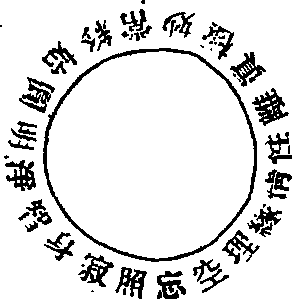

# 新续高僧传



> **藏经**：大藏经补编（大藏经补编）　**册次** 第 27 册（B27）　**编号** B0151　**部类** 史传部　**卷次** 65 卷　**篇幅** 415,179 字

> **卷／品**：65 卷 · 4 品



---



## 目录



  - [序](#序)

  - [癸亥孟秋天津严修序](#癸亥孟秋天津严修序)

  - [序](#序-1)

  - [癸亥夏六月朔日桂阳夏寿田序](#癸亥夏六月朔日桂阳夏寿田序)

- [新续高僧传四集卷第一](#新续高僧传四集卷第一)

- [新续高僧传四集卷第二](#新续高僧传四集卷第二)

- [新续高僧传四集卷第三](#新续高僧传四集卷第三)

- [新续高僧传四集卷第四](#新续高僧传四集卷第四)

- [新续高僧传四集卷第五](#新续高僧传四集卷第五)

- [新续高僧传四集卷第六](#新续高僧传四集卷第六)

- [新续高僧传四集卷第七](#新续高僧传四集卷第七)

- [新续高僧传四集卷第八](#新续高僧传四集卷第八)

- [新续高僧传四集卷第九](#新续高僧传四集卷第九)

- [新续高僧传四集卷第十](#新续高僧传四集卷第十)

- [新续高僧传四集卷第十一](#新续高僧传四集卷第十一)

- [新续高僧传四集卷第十二](#新续高僧传四集卷第十二)

- [新续高僧传四集卷第十三](#新续高僧传四集卷第十三)

- [新续高僧传四集卷第十四](#新续高僧传四集卷第十四)

- [新续高僧传四集卷第十五](#新续高僧传四集卷第十五)

- [新续高僧传四集卷第十六](#新续高僧传四集卷第十六)

- [新续高僧传四集卷第十七](#新续高僧传四集卷第十七)

- [新续高僧传四集卷第十八](#新续高僧传四集卷第十八)

- [新续高僧传四集卷第十九](#新续高僧传四集卷第十九)

- [新续高僧传四集卷第二十](#新续高僧传四集卷第二十)

- [新续高僧传四集卷第二十一](#新续高僧传四集卷第二十一)

- [新续高僧传四集卷第二十二](#新续高僧传四集卷第二十二)

- [新续高僧传四集卷第二十三](#新续高僧传四集卷第二十三)

- [新续高僧传四集卷第二十四](#新续高僧传四集卷第二十四)

- [新续高僧传四集卷第二十五](#新续高僧传四集卷第二十五)

- [新续高僧传四集卷第二十六](#新续高僧传四集卷第二十六)

- [新续高僧传四集卷第二十七](#新续高僧传四集卷第二十七)

- [新续高僧传四集卷第二十八](#新续高僧传四集卷第二十八)

- [新续高僧传四集卷第二十九](#新续高僧传四集卷第二十九)

- [新续高僧传四集卷第三十](#新续高僧传四集卷第三十)

- [新续高僧传四集卷第三十一](#新续高僧传四集卷第三十一)

- [新续高僧传四集卷第三十二](#新续高僧传四集卷第三十二)

- [新续高僧传四集卷第三十三](#新续高僧传四集卷第三十三)

- [新续高僧传四集卷第三十四](#新续高僧传四集卷第三十四)

- [新续高僧传四集卷第三十五](#新续高僧传四集卷第三十五)

- [新续高僧传四集卷第三十六](#新续高僧传四集卷第三十六)

- [新续高僧传四集卷第三十七](#新续高僧传四集卷第三十七)

- [新续高僧传四集卷第三十八](#新续高僧传四集卷第三十八)

- [新续高僧传四集卷第三十九](#新续高僧传四集卷第三十九)

- [新续高僧传四集卷第四十](#新续高僧传四集卷第四十)

- [新续高僧传四集卷第四十一](#新续高僧传四集卷第四十一)

- [新续高僧传四集卷第四十二](#新续高僧传四集卷第四十二)

- [新续高僧传四集卷第四十三](#新续高僧传四集卷第四十三)

- [新续高僧传四集卷第四十四](#新续高僧传四集卷第四十四)

- [新续高僧传四集卷第四十五](#新续高僧传四集卷第四十五)

- [新续高僧传四集卷第四十六](#新续高僧传四集卷第四十六)

- [新续高僧传四集卷第四十七](#新续高僧传四集卷第四十七)

- [新续高僧传四集卷第四十八](#新续高僧传四集卷第四十八)

- [新续高僧传四集卷第四十九](#新续高僧传四集卷第四十九)

- [新续高僧传四集卷第五十](#新续高僧传四集卷第五十)

- [新续高僧传四集卷第五十一](#新续高僧传四集卷第五十一)

- [新续高僧传四集卷第五十二](#新续高僧传四集卷第五十二)

- [新续高僧传四集卷第五十三](#新续高僧传四集卷第五十三)

- [新续高僧传四集卷第五十四](#新续高僧传四集卷第五十四)

- [新续高僧传四集卷第五十五](#新续高僧传四集卷第五十五)

- [新续高僧传四集卷第五十六](#新续高僧传四集卷第五十六)

- [新续高僧传四集卷第五十七](#新续高僧传四集卷第五十七)

- [新续高僧传四集卷第五十八](#新续高僧传四集卷第五十八)

- [新续高僧传四集卷第五十九](#新续高僧传四集卷第五十九)

- [新续高僧传四集卷第六十](#新续高僧传四集卷第六十)

- [新续高僧传四集卷第六十一](#新续高僧传四集卷第六十一)

- [续高僧传四集卷第六十二](#续高僧传四集卷第六十二)

- [新续高僧传四集卷第六十三](#新续高僧传四集卷第六十三)

- [新续高僧传四集卷第六十四](#新续高僧传四集卷第六十四)

- [新续高僧传四集卷第六十五](#新续高僧传四集卷第六十五)



---



### 序



尝稽三宝之名曰佛曰法曰僧佛法之可崇尚无待赘言僧实与鼎足而三其隆重抑又可见盖僧以弘法为唯一之责任而即为后来亲证佛果之人其恢大悲之愿而殚普度之诚作斯人之导师为同修之善侣扬宗风於不尽示模范於将来兴言及此顶礼恐后已是故搜集阐扬后起之责非古德之私荣乃是非之公理懿夫梁代慧皎倡之於前道宣赞寍如惺诸宿继之於后使夫穷山苦行面壁深功无碍辩才弥天宏誓悉昭竹帛常炳日星固奇珍有必发之光亦汲古有至修之绠语云相得益彰岂不然哉今燕都法源寺道阶上人与诸山长老同抱盛怀思继前轨辄以纂修之事属诸社友喻昧庵先生虽㧑鸣表度逊让未遑终以祈向所在义难自外乃百方采辑五载精勤甄今陶古门分类别又以如惺所集谊例未周本诸仁山之论略事修改参附其中使宋端拱以来迄清宣统之际千百年中硕德耆宿莫不采录卓哉斯集洵桑门之大观禅林之信史矣癸亥秋初编辑斯就於以彰潜德之幽光示后贤以法守伸仁山未尽之志畅诸宿深远之怀事祗一端实兼四善余於佛学高深有志未逮今喜此编之成又重违昧庵之请聊贡区区为详颠末匪曰解人亦愚者一得焉耳



------



### 癸亥孟秋天津严修序



### 序



夫圣智不言而万灵俱澈法身无相而众品斯呈故能总摄群方玅成至果岂必藉高文以炫世假隐遁而盗名欲证清修转嫌佞口者乎然而灵山会邈道燄畴传慧海波深慈航莫济使无王子之碑何知净域非有休文之记讵识法王善觉露盘因词人而不朽同泰墓碣附作者以永留发般若之元音吼天毒鼓掞生花之彩笔梵地莲池此寻奥谊於六通固在语言之表而究真謕於三藏不离文字之间欲示遗行多凭纂述僧传之作其能已乎况慧皎刊修於梁代道宣缀辑於唐时自宋迄明间有缵编并楙鬯禅芬永垂高范然攷赞宁所作止於端拱初元如惺所传又仅教禅数卷若夫建炎而后宣统以前旷有千载阅历四朝其中英材之士苦行之俦经求身毒说演天台禅振北派律继南山翊法著辨疑之论安养辟净读之门密印神悟心佛形忘兴崇福果兼擅众长若斯之伦代有其选而此作蔑如斯文将缺方之往哲不其恧与燕都法源道阶常州清凉静波宁海普陀印光析津千福莲舟暨诸山长老名刹硕耆俱怀悲悯共与筹商将续我佛慧命宜开方外史馆庶事责有耑程功可冀而衡阳喻昧庵先生耽志丘坟轶情述作猥以囏荒避地远来应南北高侣之聘萃东西古德之言循旧例於十科辑新名之万善徵诸志乘案之碑铭或访𬨎轩之使或徇老宿之谭铅椠三易寒暑五周成书六十餘卷得僧千几百人都五十餘万言曰续高僧传四集有闻必择备法器之瓌奇无美弗收侈禅林之珍贵矧复比类属词条文本诸史传因时致慨笔削拟乎春秋庶几匡迪来学见贤思齐戒惧后生不肖知耻则是篇之成功用所及非徒烛微阐隐发潜德之幽光抑以指谬摘疵具宗门之痛喝也已至於文辞典正体例精严谅为空门之宝无惭大雅之林乃犹自视欿然更求该博未谋梓氏光付印人将欲希法藏之明鉴企哲匠之郢斤志量斯闳声施弥远(寿田)谊属久交结斯雅契略叙所由用尘清虑如有未[匚@舟]览者详焉



------



### 癸亥夏六月朔日桂阳夏寿田序



述词



昔杨仁山居士取藏中高僧传分刊之用广流传且识之曰梁会稽沙门慧皎撰高僧传十六卷至天监中而止唐释道宣续之终於贞观间凡四十卷曰续高僧传宋释赞宁又续之迄於端拱之初凡三十卷曰宋高僧传至明季沙门如惺辑录南宋元明大德仅成六卷曰明高僧传窃以宋明命名未恰盖宋传多唐五代人而明传多宋元人也当易其名曰初集二集三集至於明传遗漏殊多未臻完善拟博采群书自北宋以迄於今择其道行超著者汇为一编名曰四集嗟夫杨子固有志於斯而未之逮也戊午之秋避地北来寓於燕都法源寺时



道阶长老久怀悲愿欲继往修屡举相属然自揆梼昧罔鬯弘旨不敢轻许但为修辑寺志数月以来志稿初就复申前请辞不获已乃从事搜讨旧编徵求遗简穷年矻矻忽焉五稔潦艸命觚大致麤就祇以明传六卷分合为难踌躇再四商之同学佥谓仁山之言无以易也於是取其精详汰其重复自北宋以至清季都六十六卷名曰续高僧传四集仍杨议也至於分科别目虽参新谊实率旧章几经咨度就正有道若夫追寻源派判析宗门诣有兼通唯其独至犹虑异方僻处囿於见闻采访未徧滋愧尤深辄复检字排印先尘



清览者所冀当代



高贤名蓝



耆德董而正之匡其未备翘首云天企之久矣



癸亥夏四月朔日衡阳喻谦谨述



启



夫道不虚传非言何述事无专美克绍斯彰是以玄奘西征贝经显出达摩东渡象教流行秉德至化之俦激扬清风之士叩玄机而应响曾玅解以成文并光充四表誉专九州像可绚乎金碧迹宜著乎竹帛由是慧皎纂修於梁武道宣缀叙於唐宗赞宁则增庥宋代如惺则集会明时莫不穷讨遗篇网罗旧史攷核务其翔实刊削汰其緐芜遂得累续前编式是往则芳躅宛然钦高山之仰止逝者如斯叹流景之不回然自明迄今岁历弥永事践两朝年逾三百此间桑门英耆辈出翼教扶运代有其人而众家记录未能综博致使隐德高风飒然终古矧时机多变法会陵夷凡夫隳清修之行俗子骛浮薄之名兹德莫崇儳焉是惧盖徽音久息谁立正觉之程懿范不留曷兴高尚之志用敢鸠聚同参缵承坠绪重开新续高僧传馆於北京法源寺幸当代尊宿丛席导师并顾斯文咸深赞勗爰集名流潜心搜采但见闻所囿过访为劳是宜分面徵求别途凑集或案碑铭或据行状或因志乘所载䌛镫谱所传孤文片纸有可



纪者罔弗择取考其同异雔其有亡用宏四帙之编不外十科之例虽梁唐分篇互有出入宋明两集微形详略求之实际大旨不殊谨为条例附识於后凡我禅林大德护法檀越善心居士慧业文学炜诸彤琯贻我新闻凭此邮筩𥩟望来简



译经篇第一西竺遗经尚未尽出有能译得未刊之典残编賸义尤当宝贵



义解篇第二(唐曰解义)寻文见义豁然悟解或释经训或撰语录说理精深方当此选



习禅篇第三清修枯坐万念俱兦幽山穷岩古佛所宅闭关深造方足当之



明律篇第四精严戒德说法警众勘破虚妄著有律训者均入此科



护法篇第五(梁无此目唐宋曾收)外道相贼功深捍卫议论纵横辩者莫当或以身殉尤为难能



灵感篇第六(梁曰神异唐宋均曰感通)至诚所积感而遂通理有自然世俗罕测事必可验道无或爽



遗身篇第七(梁曰忘身唐宋改比)捐躯见志明道相期舍此秽浊回我金刚心无疾忿方足称此



净读篇第八(梁有诵经又有经师唐宋改为诵读今并入此科以净为归)诵经讽佛是曰净修功果圆时西土非遥念念自持庶证真如



兴福篇第九名胜古刹岁久荒落苦志重修或启兰若独自剏搆厥功尤伟



杂识篇第十(梁曰唱导唐曰杂科宋曰杂科声德)声音文字足显佛法自古以来不废此科戒德无愆不愧斯选



新续高僧传四集目录



> 卷首北京法源寺沙门道阶倡修序文  

> 述词  

> 徵文启  

> 义例



卷一译经篇第一之一(本传五人　附见十人)宋京师传法院沙门释法天传  

　京师传法院沙门释天息灾传(施护　道圆　行勤　光远)  

　西夏护国仁王寺沙门释不动传  

　京师传法院沙门释法护传(惟净　绍德　慧绚)  

　京师传法院沙门释吉祥传(慈贤　金总持　日称)



卷二译经篇第一之二(本传九人　附见八人)元甘泉马蹏山沙门释智慧传(广福　安藏　逸林)  

　云南玉案山寺沙门释雄辩传  

　燕都庆寿寺沙门释沙啰巴传(剌温卜　迦啰思巴)  

　燕都广寒院沙门释识里传  

　会稽圆通寺沙门释弘济传(般若空利)  

明临安净慈寺沙门释宗泐传  

　金陵鍾山西天寺沙门释智光传(班的答　惠便)  

清五台清凉山寺沙门释老藏传  

　蒙古多伦泊汇宗寺沙门释克图传



卷三义解篇第二之一(本传廿四人　附见八人)宋永嘉瑞鹿寺沙门释本先传  

　温州东溪艸堂沙门释处元传  

　吴会北禅寺沙门释可观传  

　永嘉开元寺沙门释继忠传  

　武林灵山日观寺沙门释遵式传  

　松江兴圣寺沙门释净真传  

　杭州昭庆寺沙门释仁岳传  

　温州瑞鹿寺沙门释遇安传  

　凤凰山圣果寺沙门释希最传  

　钱塘宝藏寺沙门释从义传  

　武林大悲阁沙门释玄净传  

　润州金山寺沙门释梵臻传(从谏)  

　凤凰山圣果寺沙门释佛护传  

　泉州宝胜院沙门释戒环传  

南宋临安上天竺寺沙门释若讷传  

　临安上天竺寺沙门释法照传  

　临安上天竺寺沙门释善月传  

　临安净慈寺沙门释居简传  

　台州白莲寺沙门释了然传  

　临安上天竺寺沙门释应如传(本如　道如)  

　明州宝林寺沙门释了宣传(善荣)  

辽中京报恩传教寺沙门释法悟传(志福)  

　燕京奉福寺沙门释非浊传  

　南诏苍山再光寺沙门释普瑞传(普济　皎渊　净妙澄)



卷四义解篇第二之二(本传廿二人　附见十五人)元古杭净慈寺沙门释善庆传  

　古杭上天竺寺沙门释性澄传(云梦泽)  

　古杭下天竺寺沙门释蒙润传(古源　竹堂传)  

　古杭净慈寺沙门释处林传(及庵信　夷简　虚谷陵)  

　古杭慧因寺沙门释盘谷传  

　绍兴云门寺沙门释允若传(大山恢)  

　古杭演福寺沙门释必才传  

　四明天童寺沙门释悟光传  

　古杭上天竺寺沙门释真净传  

　天台荐福寺沙门释善继传  

　明州宝云寺沙门释子文传  

　四明延庆寺沙门释本无传  

　天台佛陇修禅寺沙门释可公传  

　五台山祐国寺沙门释文才传(迦罗斯巴)  

　秦州景福寺沙门释英辩传(柏林潭)  

　京师崇恩寺沙门释德谦传  

　京师庆寿寺沙门释达益巴传(绰思吉)  

　京师宝集寺沙门释妙文传(大德明)  

　五台山普宁寺沙门释了性传  

　玉山普安寺沙门释宝严传(大林性)  

　金陵天禧寺沙门释志德传(海闻　法照禧)  

　镇江普照寺沙门释普喜传(无念端)



卷五义解篇第二之三(正传十六人　附见十四人)明大理荡山沙门释无极传  

　嘉定净慈寺沙门释祖儞传(石室瑛　竹屋净)  

　餘杭上天竺寺沙门释弘道传  

　宁波普陀寺沙门释行丕传  

　松江兴圣寺沙门释原争真传  

　阳山大慈寺沙门释善学传(原澄)  

　餘杭上天竺寺沙门释慧日传(柏子庭)  

　餘杭演福寺沙门释如玘传  

　绍兴宝林寺沙门释大同传(春谷　古怀钱　古林茂)  

　钱塘灵隐寺沙门释原瀞传  

　餘杭集庆寺沙门释士璋传(天心莹)  

　婺州智者寺沙门释普仁传(德祥)  

　上海安国寺沙门释绍宗传(静庵镇)  

　餘杭净慈寺沙门释明德传(悦堂颜)  

　会稽宝相寺沙门释怀渭传  

　钱塘灵隐寺沙门释大䜣传(了万　晦机　东叟)



卷六义解篇第二之四(正传十四人　附见九人)明餘杭净慈寺沙门释道联传(物先义　宗静)  

　松江普照寺沙门释居敬传(东源)  

　餘杭龙井寺沙门释普智传  

　姑苏延庆寺沙门释善启传  

　餘杭上天竺寺沙门释永顾传(如兰)  

　桂林横州寿佛寺沙门释应能传  

　云南鸡足大觉寺沙门释尽玄传(幻空)  

　北直羊山秀峰寺沙门释明龙传(大光)  

　姑苏华山寺沙门释祖住传(大章)  

　餘杭净慈寺沙门释大壑传  

　餘杭土桥庵沙门释圆珑传(绍觉承　直界)  

　隰州石室寺沙门释圆镜传  

　应天栖霞寺沙门释真节传  

　塘栖大善寺沙门释传如传



卷七义解篇第二之五(正传八人　附见十二人)明金陵宝华山寺沙门释洪恩传  

　嘉兴东禅寺沙门释明得传(百川海　妙峰觉)  

　餘杭昭庆寺沙门释大惠传(绍觉　愚庵贵)  

　云南鸡足放光寺沙门释禅传  

　餘杭径山寺沙门释圆澄传  

　天台慈云寺沙门释真清传(宝珠　荆山　月溪)  

　餘杭径山寺沙门释真可传(密藏　道开　法镫　性田)  

　清凉山竹林寺沙门释镇澄传(小山　笑岩)



卷八义解篇第二之六(正传四人　附见十人)　明庐山法云寺沙门释德清传(西林　福善　通岸　通炯　超逸)  

　宝庆五台庵沙门释观衡传(惠仁　空印)  

　餘杭理安寺沙门释如嵩传(静明　易庵)  

　定远白马山莲城寺沙门释清宣传(空谷)



卷九义解篇第二之七(正传十二人　附见九人)清青阳九华山华严庵沙门释智旭传  

　杭州上天竺寺沙门释方志传  

　宜都青林寺沙门释道隆传(敏树)  

　润州金山寺沙门释通问传  

　润州金山江天寺沙门释超乐传(明铨　实雄)  

　安徽清凉寺沙门释音可传  

　峡州石塔寺沙门释戒隐传(德仪)  

　当阳玉泉寺沙门释圆惺传(一真　大咸)  

　四明天童寺沙门释本皙传  

　四明天童寺沙门释超静传(元盛)  

　四明天童寺沙门释通门传  

　燕都广济寺沙门释湛祐传(灵机观　天树植)



卷十义解篇第二之八(正传三人　附见二人)清燕都万善寺沙门释通理传(心兴)  

　钱塘净慈寺沙门释明中传(实荫)  

　句容赤山寺沙门释本心传



卷十一习禅篇第三之一(正传廿一人　附见廿人)宋常德文殊寺沙门释心道传  

　西蜀昭觉寺沙门释纯白传  

　庆元天童寺沙门释普交传  

　潭州法轮寺沙门释应端传  

　温州龙翔寺沙门释士珪传(宗范)  

　衢州乌巨山沙门释道行传  

　餘杭灵隐寺沙门释宗印传(希夷)  

　潭州大沩山沙门释法泰传  

　当阳玉泉寺沙门释务本传(文宣　可忠　慧远　宗道　怀远　知忍　知藏　怀静　齐月　慧本)  

　衡山南岳石头庵沙门释怀志传  

　眉州中岩寺沙门释祖觉传(慧日能　南堂静)  

　台州钓鱼台沙门释自回传  

　江宁太平兴国寺沙门释赞元传(法泉)  

　虎丘灵岩寺沙门释清顺传(子英　智通　慧光)  

　江宁太平兴国寺沙门释慧懃传(怀深)  

　潼川护圣寺沙门释居静传  

　潭州大沩山沙门释清旦传  

　天台国清寺沙门释行机传  

　澧州灵岩寺沙门释仰安传(表自)  

　江州圆通寺沙门释道旻传  

　隆兴云岩寺沙门释天游传



卷十二习禅篇第三之二(正传十二人　附见三人)南宋西蜀昭觉寺沙门释克勤传  

　泉州教忠寺沙门释弥光传(黄蘗祥)  

　嘉兴报恩寺沙门释法常传  

　成都信相寺沙门释宗显传  

　平江虎丘寺沙门释绍隆传  

　真州长芦庵沙门释青了传  

　天台山万年寺沙门释法一传  

　建康华藏寺沙门释安民传  

　潭州龙牙寺沙门释智才传  

　明州天童寺沙门释正觉传(枯木成　丹霞湻)  

　临安径山寺沙门释宗杲传  

　绍兴慈氏院沙门释瑞仙传



卷十三习禅篇第三之三(正传十七人　附见十人)　南宋庆元育王山沙门释端裕传  

　隆兴黄龙寺沙门释道震传  

　华亭昭庆寺沙门释法宁传  

　安吉何山寺沙门释守珣传(广鉴英)  

　眉州象耳山沙门释袁觉传(佛性)  

　成都昭觉寺沙门释道元传(大别道)  

　平江南峰寺沙门释云辩传(穹窿圆)  

　南康云居寺沙门释善悟传  

　隆兴黄龙寺沙门释法忠传  

　临安灵隐寺沙门释如珏传(寒岩升　广闻)  

　天台护国寺沙门释景元传  

　临安净慈寺沙门释妙伦传  

　临安灵隐寺沙门释慧远传(灵岩徽)  

　临安径山寺沙门释智策传(寂室光　大圆)  

　临安灵隐寺沙门释道枢传  

　明州普陀山沙门释慧晖传(悟明)  

　临安径山寺沙门释宝印传



卷十四习禅篇第三之四(正传十三人　附见八人)南宋餘杭净慈寺沙门释重显传(韩大伯　善暹)  

　常州华藏寺沙门释有权传  

　南康云居寺沙门释德升传(慧温)  

　南康云居寺沙门释自圆传(善能)  

　临安净慈寺沙门释彦充传  

　潭州上封寺沙门释讳才传(海印隆)  

　明州天童寺沙门释文礼传  

　临安灵隐寺沙门释德光传(光化吉)  

　江州东林寺沙门释道颜传  

　福州西禅寺沙门释鼎需传  

　建宁沙门释道谦传  

　平江觉海寺沙门释法因传  

　眉州中岩寺沙门释蕴能传(澄甫　崇真)



卷十五习禅篇第三之五(正传十三人　附见三人)南宋餘杭灵隐寺沙门释之善传  

　明州天童寺沙门释昙华传  

　婺州智者寺沙门释真慈传  

　福州鼓山寺沙门释安永传(安分)  

　临安净慈寺沙门释昙密传  

　明州天童寺沙门释咸杰传  

　夔州卧龙山沙门释祖先传(法薰)  

　临安灵隐寺沙门释崇岳传  

　临安径山寺沙门释师范传  

　名山天宁寺沙门释禅惠传  

　巴州宣密院沙门释显嵩传  

　平江静慈寺沙门释法全传  

　临安径山寺沙门释道冲传



卷十六习禅篇第三之六(正传七人　附见六人)金上京大储庆寺沙门释海慧传(清慧)  

　济南灵岩寺沙门释道询传(净如)  

　燕都庆寿寺沙门释教亨传(普照宝)  

　燕都潭柘山寺沙门释政言传(慈照)  

　蓟州盘山双峰寺沙门释广温传(圆新)  

　郑州普照寺沙门释道悟传(云海)  

　燕都潭柘山寺沙门释相了传



卷十七习禅篇第三之七(正传廿人　附见九人)元庆元育王山沙门释如珙传  

　餘杭径山寺沙门释行端传  

　泉州开元寺沙门释玅恩传(契祖　真首座　杰道者)  

　燕都西刘村寺沙门释行秀传  

　餘杭净慈寺沙门释原玅传  

　保定兴圣寺沙门释德富传  

　明州佛岩寺沙门释天伦传  

　吴兴霞雾山沙门释清珙传  

　钱塘灵隐寺沙门释法林传  

　义乌云黄山宝林寺沙门释绍大传  

　径山兴圣万寿寺沙门释正源传  

　金华天龙寺沙门释守贵传(大道平　千岩长)  

　钱塘妙果寺沙门释水盛传  

　泰安灵岩寺沙门释普就传  

　泰安灵岩寺沙门释智慧传  

　泉州开元寺沙门释如照传(道符　广漩)  

　邹县大明禅院沙门释海印传  

　餘杭凤凰山圣果寺沙门释珠明传  

　餘杭吴山圣水寺沙门释明本传(惟则)  

　兖州布金山大云寺沙门释行全传(德友)



卷十八习禅篇第三之八(正传十一人　附见五人)明杭州灵隐寺沙门释可光传  

　金陵鍾山寺沙门释班的答传  

　宜兴龙池寺沙门释永宁传  

　处州福林禅院沙门释智度传  

　杭州净慈寺沙门释智及传(广智)  

　四明宝陀寺沙门释慧照传  

　温州雁荡山罗汉寺沙门释正智传(大观)  

　五台山灵鹫庵沙门释宝金传  

　五台山寿安禅林沙门释具生传  

　杭州天目山沙门释印原传(智曜)  

　虎邱云岩寺沙门释文琇传(无尽慧　灭宗起)



卷十九习禅篇第三之九(正传十二人　附见十三人)明金陵灵谷寺沙门释道谦传(居顶　净戒)  

　金陵灵谷寺沙门释能义传  

　金陵灵谷寺沙门释三峰传  

　燕京潭柘山龙泉寺沙门释德始传  

　五台山显通寺沙门释迦也失传  

　衡山南岳寺沙门释开缘传(宝珠　圆昂)  

　泉州开元寺沙门释道超传(秋鉴　祖渊　月溪　绝尘　无际　泽忠)  

　五台山普济寺沙门释净澄传  

　衡山南台寺沙门释无碍传  

　云南归化寺沙门释善坚传(铁封)  

　金陵大报恩寺沙门释永宁传  

　云南鸡足山圣峰寺沙门释德住传(兴彻　祖复)



卷二十习禅篇第三之十(正传十人　附见三人)明摄山栖霞寺沙门释法会传  

　燕京吉祥院沙门释明信传  

　新城寿昌寺沙门释慧经传  

　青阳九华山沙门释性莲传  

　会稽华严寺沙门释志若传  

　庐山云中寺沙门释法忠传  

　燕京大慈寿寺沙门释觉湻传  

　杭州东天目昭明寺沙门释如云传(晓本　性冲)  

　金台龙华寺沙门释广祯传  

　会城斗光寺沙门释洪上传(不语僧)



卷二十一习禅篇第三之十一(正传九人　附见三人)明径山化城寺沙门释法铠传  

　四明天童寺沙门释圆悟传  

　云南竹林寺沙门释密行传  

　荆南普仰寺沙门释正诲传(了凡旹)  

　云南水目山宝华寺沙门释洪如传  

　湖州上柏山报恩禅院沙门释天隐传  

　宁乡大沩山同庆寺沙门释如学传(圆上座)  

　漳州南山报敂禅院沙门释亘信传  

　夹山沙门释本豫传(方来)



卷二十二习禅篇第三之十二清峨湄毘卢院沙门释克诚传(贯之　性藏　实如)  

　宁乡大沩密印寺沙门释正明传(慧山海)  

　四明天童寺沙门释通贤传  

　四明天童寺沙门释通容传  

　四明天童寺沙门释道忞传  

　钱塘净慈寺沙门释正嵒传(方孝)  

　孤屿江心寺沙门释本莹传  

　瑞安仙岩寺沙门释超志传  

　四明天童寺沙门释本畫传  

　荆南东山天齐禅院沙门释明智传(实妙)  

　云南水目山宝华寺沙门释普行传(学蕴)  

　富民九峰山西华寺沙门释慧宗传(心安　道瑞)



卷二十三习禅篇第三之十三(正传十四人　附见六人)清燕京柏林寺沙门释超方传  

　云南水目山宝华寺沙门释通荷传  

　永丰禅院沙门释本实传(洪中　海航)  

　燕京西域寺沙门释僧广传  

　汉阳栖贤寺沙门释行敬传  

　枝江玉安山六合寺沙门释行洪传  

　公安观音寺沙门释超乘传(云锡)  

　虎邱云岩寺沙门释弘储传(本琇)  

　昆明胜因寺沙门释德润传  

　蜀北给孤寺沙门释本襄传(懒石　福慧)  

　燕京海会寺沙门释超古传  

　恰山栖云寺沙门释超定传  

　青林龙安寺沙门释超况传  

　漳州驯虎岩沙门释超顶传



卷二十四习禅篇第三之十四(正传十人　附见十一人)清杭州理安寺沙门释行昱传  

　四川双桂福国院沙门释印水传  

　杭州理安寺沙门释行悦传(行洸)  

　湘阴神鼎山沙门释行泽传(玄剑　懋功　修水)  

　杭州理安寺沙门释行珍传(斯瑞)  

　长沙岳麓万寿寺沙门释智檀传(操雪筠)  

　衡阳万寿寺沙门释行泰传  

　成都昭觉寺沙门释通醉传(溪声圆　佛冤纲)  

　杭州理安寺沙门释超格传(超彻)  

　杭州云林寺沙门释原志传(慧辂　智广)



卷二十五习禅篇第三之十五(正传十三人　附见九人)清杭州理安寺沙门释性音传  

　润州金山江天寺沙门释实彻传(际云)  

　杭州理安寺沙门释明鼎传  

　燕京西山普觉寺沙门释元日传  

　杭州云林寺沙门释德元传(德琳)  

　四川双桂福国院沙门释真旻传  

　杭州理安寺沙门释明羲传  

　乌程阳山梵音院沙门释通授传  

　成都昭觉寺沙门释了元传(际定)  

　杭州理安寺沙门释实月传(实道)  

　西蜀广行寺沙门释自光传  

　扬州高旻寺沙门释际圣传(天慧彻　了贞)  

　天台国清寺沙门释道宗传(妙祥瑞　净鉴　文定静)



卷二十六习禅篇第三之十六(正传八人　附见十二人)清什邡罗汉寺沙门释达澈传(月容)  

　云南水目山宝华寺沙门释祖真传(续果)  

　润州金山江天寺沙门释大定传  

　金陵天宁寺沙门释不二传(焦山长老)  

　安陆西来寺沙门释秀野传(裕如　纯备)  

　九华山百岁宫沙门释宝悟传(宝初　宝月　宝印)  

　荆州如来庵沙门释朗明传(月明　永明　妙明)  

　衡阳岐山仁瑞寺沙门释无来传(懒放)



卷二十七明律篇第四之一(正传十人　附见九人)宋餘杭昭庆寺沙门释允堪传  

　钱塘灵芝寺沙门释元照传  

　台州赤城寺沙门释有严传(妙生)  

辽蓟州磐山甘泉普济寺沙门释非觉传(等伟)  

金燕京左街净垢寺沙门释法律传  

南宋四明湖心寺沙门释元肇传(道言　思敏)  

　新城碧沼寺沙门释宗利传  

　桃源厉氏庵沙门释晞颜传(惟月)  

　钱塘七宝院沙门释用钦传(行诜　慧亨)  

元餘姚极乐寺沙门释戒度传(旨公　智印)



卷二十八明律篇第四之二(正传十四人　附见四人)明华亭兴圣寺沙门释原真传(绍宗)  

　杭州昭庆寺沙门释朴原传(广霌　成玉)  

　燕都普庆寺沙门释法闻传  

　燕都西山戒台寺沙门释道孚传  

　金陵天隆寺沙门释如馨传  

　五台山清凉寺沙门释承芳传  

　金陵极乐寺沙门释性相传  

　燕都古愍忠寺沙门释永海传  

　金陵宝华山隆昌寺沙门释寂光传  

　太原永明寺沙门释远清传  

　姑苏报国寺沙门释性祇传  

　广陵福田律院沙门释性福传  

　潭州三角山沙门释如幻传  

　云南鸡足山大觉寺沙门释真利传(明鉴)



卷二十九明律篇第四之三(正传十五人　附见一人)清江宁古林寺沙门释性璞传(隐微理)  

　燕京广济寺沙门释海禄传  

　广陵五台律院沙门释书祯传  

　江宁宝华山隆昌寺沙门释读体传  

　晋陵天宁寺沙门释戒润传  

　江宁宝华山隆昌寺沙门释德基传  

　宿迁极乐庵沙门释性澄传  

　杭州昭庆寺沙门释书玉传  

　姑苏师林寺沙门释书秀传  

　淮安闻思寺沙门释真贤传  

　姑苏真谛寺沙门释书净传  

　燕京潭柘山岫云寺沙门释照福传  

　金陵宝华山慧居寺沙门释真义传  

　燕京潭柘山岫云寺沙门释超越传  

　金陵慈应院沙门释通明传



卷三十明律篇第四之四(正传十四人　附见八人)清金陵宝华山隆昌寺沙门释实𤤯传(心开)  

　凤山龙兴寺沙门释溥[瓗-山]传  

　维扬石墖寺沙门释学伦传(瑞亭)  

　燕京瑞应寺沙门释性证传  

　宿迁极乐庵沙门释兴祥传(不器)  

　淮安普应寺沙门释溥范传  

　毘陵永宁寺沙门释学潜传  

　淮阴闻思寺沙门释溥训传  

　徽州韵松山寺沙门释寂融传(心空)  

　江宁古林寺沙门释海华传(心融　隆野　印含)  

　燕京潭柘山岫云寺沙门释澄林传  

　金陵宝华山隆昌寺沙门释常松传  

　仪徵隆觉寺沙门释洪建传(佛定)  

　燕京潭柘山岫云寺沙门释明寿传



卷三十一明律篇第四之五(正传十四人　附见四人)清燕京瑞应寺沙门释祥晖传  

　徽州常乐庵沙门释照宏传  

　杭州昭庆寺沙门释随道传(福溶)  

　燕京潭柘山岫云寺沙门释源福传  

　杭州昭庆寺沙门释果证传  

　宿迁寿圣寺沙门释福住传  

　淮安观音寺沙门释源长传  

　金陵慈应寺沙门释心观传  

　维扬石墖寺沙门释通和传(实森)  

　宿迁极乐庵沙门释来照传(德明)  

　燕京潭柘山岫云寺沙门释圆瑞传  

　宿迁寿圣寺沙门释祥珠传  

　江阴圆觉庵沙门释宗深传  

　扬州慧因寺沙门释实长传(冶牧)



卷三十二明律篇第四之六(正传五人　附见三人)清金陵宝华山隆昌寺沙门释福聚传  

　仪徵隆觉寺沙门释普悦传  

　燕京潭柘山岫云寺沙门释源谅传  

　燕京法源寺沙门释性实传  

　燕京法源寺沙门释昌涛传(信修　普照　海祥)



卷三十三护法篇第五之一(正传六人　附见三十六人)宋钱塘灵隐寺沙门释契嵩传  

　餘杭净慈寺沙门释妙堪传  

　餘杭白云庵沙门释清觉传  

元金陵鍾山太平兴国寺沙门释妙高传  

　磐山甘泉普济寺沙门释祥迈传(辩的达拔　福裕　合思八　至温　从超　德亨　从伦　圆胤　庆规　行育　道寿　明津　本琏　道云　了询　祖珪　元一　贵吉祥　相叡　善朗　伦吉祥)  

　当阳玉泉山寺沙门释广铸传(止严　宝渊　福明　惠溥　自智　至福　自善　明见　至悟　宗元　广镕　至荣　绍中　虚谷　福资　福祐)



卷三十四护法篇第五之二(正传六人　附见四人)明金陵大天界寺沙门释慧昙传  

　金台永寿寺沙门释思敏传(邃庵)  

　杭州灵隐寺沙门释德明传(真祥)  

　杭州云居圣水寺沙门释寂心传  

　燕都普济寺沙门释自成传(觉湻　本在)  

　杭州净慈寺沙门释道富传



卷三十五护法篇第五之三(正传十一人　附见十二人)清燕都广济寺沙门释宽寿传  

　四州昭觉寺沙门释离指传  

　云南鸡足山兰陀寺沙门释道足传  

　江宁吉林寺沙门释本修传(续悟)  

　丹徒焦山定慧寺沙门释了然传(悟春　超尘　一诚　智林　凡涤　了因　净因　木森　明道　凡超　圣举)  

　丹徒焦山自然庵沙门释修敏传  

　长沙麓山寺沙门释芳圃传  

　乐清白鶴寺沙门释华山传  

　南海槟榔屿极乐寺沙门释复餘传  

　金陵毘卢寺沙门释显文传  

　常州天宁寺沙门释清镕传



卷三十六灵感篇第六之一(正传十一人　附见二人)宋汴京景德寺沙门释志言传  

　福州圣泉寺沙门释绍镫传  

　上海静安寺沙门释智俨传  

　温州沙门释了兴传  

　天台常宁寺沙门释处谦传  

　四明雪窦栖云寺沙门释知和传  

金燕都潭柘寺沙门释开性传  

元邢州开元寺沙门释广恩传  

　潭州天台山沙门释彭彭传  

　大理沙门释左黎传(连精)  

　晋宁东山盘龙寺沙门释宗照传



卷三十七灵感篇第六之二(正传十四人　附见十人)明四明阿育王山广利寺沙门释崇裕传  

　台州国清寺沙门释昙噩传(荣枯木)  

　四明瑞云山清凉寺沙门释僧茂传(启原)  

　襄阳承恩寺沙门释觉成传  

　昆明大德寺沙门释道源传  

　金陵法藏寺沙门释杜圣传(董伽　法光　大千)  

　曲靖真峰山沙门释镜中传(志登　匾屯)  

　杭州佛慧寺沙门释圆果传  

　四川峩湄山沙门释万世传(牟罗汉)  

　云南鸡足山西来寺沙门释如唐传(大智)  

　云南笻竹寺沙门释圆旭传(陕西僧)  

　九江庐山寺沙门释法禅传  

　云南鸡足山大觉寺沙门释周理传  

　蓟州净业寺沙门释至明传



卷三十八灵感篇第六之三(正传十六人　附见七人)清燕都玉泉山二圣庵沙门释僧清传  

　云龙龙蟠寺沙门释法镫传(广术)  

　衡阳法轮寺沙门释石隐传  

　燕都广济寺沙门释性美传  

　龙溪圆照寺沙门释行森传  

　江宁古林寺沙门释寂鼎传(能高)  

　天台国清寺沙门释达珍传(宗海　素庵　昭月)  

　宁乡大沩山密印寺沙门释濬明传  

　燕京潭柘岫云寺沙门释广福传  

　荆州二神寺沙门释悟诚传(酒肆浮屠)  

　衡阳培元寺沙门释无漏传  

　维扬沙门释澍葊传  

　润州焦山寺沙门释悟信传  

　五台山清凉寺沙门释源修传(释柱)  

　燕京潭柘岫云寺沙门释常顺传  

　燕京法源寺沙门释护德传



卷三十九遗身篇第七之一(正传九人　附见四人)南宋临安净慈寺沙门释德辉传  

　华亭青龙庵沙门释妙普传  

元上海柘泽寺沙门释德林传  

明长沙柏林寺沙门释明星传(曼荼罗尊者　参灵)  

　上海施水庵沙门释善信传  

　金陵宝华山寺沙门释普照传  

　荆州沙门释明秀传(明富)  

　富阳栗坞山沙门释康斋传(归化比丘尼)  

　蓟州林亭庵沙门释朗然传



卷四十遗身篇第七之二(正传十一人　附见九人)清杭州理安寺沙门释行杲传(侍者)  

　江宁华山沙门释海润传(长湿僧　罗墅僧)  

　荆州沙门释无名传  

　衡阳法轮寺沙门释淡远传(香英)  

　杭州云林寺沙门释止安传(定世)  

　南岳祝圣寺沙门释斋子传(慧明)  

　江南金山寺沙门释了庵传(络丝僧)  

　房山上方黄龙庵沙门释成渊传  

　宜昌慈云寺沙门释惺参传(显远)  

　荆州资圣寺沙门释性空传  

　常州天宁寺沙门释常慧传(香火道人)



卷四十一净读篇第八之一(正传十五人　附见七人)宋金陵太平兴国寺沙门释有基传  

　四明延庆寺沙门释知礼传(省常)  

　乐清政洪寺沙门释觉秀传  

　池阳松山庵沙门释义怀传  

　东山承天寺沙门释本如传  

　华亭超果寺沙门释灵照传  

　餘杭天竺寺沙门释思义传(可久)  

　餘杭祥符寺沙门释择瑛传(从雅)  

　汴京慧林寺沙门释宗本传(善本)  

　泰山灵岩寺沙门释延珣传  

　餘杭法忍寺沙门释慧才传  

　餘杭天竺寺沙门释昙异传(宗坦)  

　甬东栖心寺沙门释中立传  

　嘉禾崇福西寺沙门释智深传(智仙)  

　餘杭法慧寺沙门释法宗传(思照)



卷四十二净读篇第八之二(正传二十一人　附见二十二人)南宋仙潭无量寿佛阁沙门释若愚传(则章)  

　温州车溪寿圣寺沙门释如湛传  

　餘杭天竺寺沙门释齐玉传  

　临安禅符寺沙门释思净传传  

　润州焦山寺沙门释师体传  

　淀山湖白莲寺沙门释子元  

　松江延庆寺沙门释道因传  

　永嘉资福院沙门释道琛传  

　南湖禅寺沙门释妙云传(有朋)  

　上虞化度寺沙门释智廉传(惟渥　冲益)  

　菁山常照寺沙门释慧明传(祖南　晞湛)  

　洪州黄檗山寺沙门释了义传(法持　昙懿)  

　钱塘法安寺沙门释思聪传(太微)  

　乌镇嘉会寺沙门释若观传(师安　显超)  

　霅川千步寺沙门释有开传(如宝　莹珂)  

辽万宁上方山寺沙门释守常传(禅悦)  

金燕都香林寺沙门释祖朗传(净观　利先)  

元蓟州云泉寺沙门释妙文传(善住　文慧)  

　嘉定西隐寺沙门释悦可传(祖辉　如鉴)  

　泰山沙门释大行传(叩头僧)  

　餘杭净慈寺沙门释蒙润传



卷四十三净读篇第八之三(正传八人　附见十人)明餘杭净慈寺沙门释可授传  

　黔中永祥寺沙门释宗兴传(周续　慧鉴　儒施　真怀　真全)  

　通州静嘉寺沙门释本明传(性专　祖香)  

　嘉兴天宁寺沙门释僧秀传(月潭)  

　会稽沙门释明证传(静明尊者)  

　梵村云栖寺沙门释袾宏传  

　怀庆龙冈寺沙门释如迁传  

　杭州资福院沙门释广彻传(体宽)



卷四十四净读篇第八之四(正传十二人　附见十五人)明南岳上封寺沙门释法祥传  

　燕都慈惠寺沙门释明玉传(真贵)  

　钱塘龙井寺沙门释如清传(传记)  

　幽溪高明寺沙门释传灯传  

　京口净业禅林沙门释古松传(了然)  

　青阳九华山东岩寺沙门释海玉传(传镫)  

　新安黄山掷钵庵沙门释广寄传(宝相　墨浪　大守　毒鼓)  

　餘杭径山寺沙门释圆信传(照御)  

　云南鸡足山大觉寺沙门释圆彩传(如然　云峰)  

　会城大德寺沙门释如意传(向和尚)  

　常州天宁寺沙门释海宝传(无名僧)  

　仁和吉祥寺沙门释大云传(居溟　金童僧)



卷四十五净读篇第八之五(正传十二人　附见十七人)清诸暨大雄寺沙门释大勍传(如会)  

　常熟南洙静室沙门释崇文传(人真　道枢　具宗)  

　台州大慈寺沙门释灵睿传(恒转)  

　江宁天界半峰寺沙门释成时传(林谷　万缘)  

　虞山普仁院沙门释行策传(指南)  

　金陵大报恩寺沙门释普见传  

　云南鹿溪净乐庵沙门释性香传(寂舜)  

　大理雨珠庵沙门释弘宗传(性遇　洪舒　德曙　法华尊者)  

　燕都广济寺沙门释正会传(振寰)  

　鄮山阿育王寺沙门释实贤传(明宏　明德)  

　淮安闻思寺沙门释常智传  

　长沙泐潭寺沙门释衍义传(三尹)



卷四十六净读篇第八之六(正传十二人　附见七人)清淮安诞登寺沙门释万清传  

　润州焦山寺沙门释福毅传  

　杭州文殊庵沙门释道彻传  

　吴山接引庵沙门释广志传(实圆)  

　姑苏龙兴寺沙门释明悟传(德峻)  

　杭州大椿禅院沙门释道证传(梅松)  

　钱塘祗园庵沙门释闻言传(法真)  

　天目山禅原寺沙门释实定传(际会　佛安)  

　江宁灵谷寺沙门释绪守传  

　海宁护国禅院沙门释千一传(彻迷)  

　杭州孤舟庵沙门释实裕传  

　海宁延恩寺沙门释谛勇传



卷四十七净读篇第八之七(正传十一人　附见九人)清红螺山资福寺沙门释际醒传  

　嘉禾觉海寺沙门释达纯传  

　江宁灵谷寺沙门释衍绍传  

　云间西禅寺沙门释悟虔传  

　润州焦山寺沙门释觉源传(灏融缘)  

　姑苏南禅寺沙门释佛度传(绝相　孙东瓜)  

　杭州东园德宁庵沙门释律净传(戒乘)  

　金陵鹫峰寺沙门释正真传  

　天台山国清寺沙门释小有传(妙修　静清　崇池)  

　镇江良篷寺沙门释自明传(如月)  

　高邮观音寺沙门释松园传(清法)



卷四十八净读篇第八之八(正传十二人　附见十二人)清衡州中正禅林沙门释离尘传  

　曲阳黄山寺沙门释正通传  

　成都宝光寺沙门释宗质传  

　长沙岳麓万寿寺沙门释映冰传(一心　心有　续乘)  

　丹徒竹林寺沙门释悟先传  

　润州焦山定慧寺沙门释大须传  

　善化护国寺沙门释慧圆(开慧　灵一)  

　宝庆点石禅林沙门释仁里传(开莲)  

　乐清净济寺沙门释机溥传(彦恢胜　妙能　大海)  

　上海玉佛寺沙门释戒然传  

　衡州西禅寺沙门释常析传(唯澄)  

　燕都南城观音院沙门释清苦传(乘参　恒修)



卷四十九福兴篇第九之一(正传十一人　附见十二人)宋餘杭灵隐寺沙门释幻旻传  

　南诏水目山寺沙门释普济传(净妙澄　皎渊　阿标头陀)  

　润州金山寺沙门释瑞新传  

南宋温陵开元寺沙门释敦照传(体瑛　祖机　善演　法均　本一　嗣祖)  

　四明延庆寺沙门释子亲传(文表)  

　温陵开元寺沙门释了性传(守静)  

　临安灵隐寺沙门释道昌传  

　临安净慈寺沙门释可宣传(妙崧)  

　黄山云岭禅院沙门释云林传  

　明州天童寺沙门释祖智传  

　福州雪峰寺沙门释天锡传



卷五十福兴篇第九之二(正传十四人　附见十七人)金徂徕山法云禅寺沙门释福灯传(善宁　法朗　智崇)  

　上方山感化寺沙门释澄方传(圆覆　宝公)  

　沂州普照寺沙门释觉海传  

元云南大德寺沙门释玄坚传(节思㭁　大云)  

　云南真峰山正法寺沙门释玄鉴传(大休　宗屿)  

　鼓山白云峰涌泉寺沙门释如山传(道杰　崇祖)  

　伏龙山圣寿寺沙门释元长传  

　磐山北少林寺沙门释云威传(圜悟)  

　泉州开元寺沙门释伯福传(守慈　永宝)  

　泰安竹林宝峰寺沙门释法海传  

　泰安灵岩寺沙门释净肃传  

　金陵鍾山太平兴国寺沙门释守忠传  

　云南崇宝山正觉寺沙门释定山传(悦颜)



卷五十一兴福篇第九之三(正传十人　附见一人)明衢州西安福慧寺沙门释世愚传  

　杭州灵隐寺沙门释辅良传  

　钱塘净慈寺沙门释智顺传  

　四明天童寺沙门释元良传  

　金陵大天界寺沙门释力金传  

　金陵灵谷寺沙门释仲羲传(古新)  

　崇恩演福寺沙门释显示传  

　宁海报恩寺沙门释自缘传  

　天台上云峰证道寺沙门释祖镫传  

　金陵大天界寺沙门释怀信传



卷五十二兴福篇第九之四(正传十二人　附见十一人)明杭州灵隐寺沙门释忻悟传  

　金陵大天界寺沙门释夷简传  

　五台山显通寺沙门释葛里麻传  

　铜梁龙兴寺沙门释空源传(圆聪　明愈　智云　本尊)  

　江宁华严寺沙门释佛妙传(果闻　祖祥)  

　泉州开元寺沙门释正映传(本源)  

　杭州净慈寺沙门释师颐传(天宇净　时庵敷)  

　四明天童寺沙门释祖渊传  

　杭州净慈寺沙门释宗妙传  

　远安福河寺沙门释普亮传(弘参　深润)  

　凤皇山圣果寺沙门释子敬传  

　泰山竹林寺沙门释满空传



卷五十三兴福篇第九之五(正传十一人　附见十九人)明杭州净慈寺沙门释智源传  

　燕京法华寺沙门释德聚传(祖能)  

　当阳玉泉山寺沙门释广鏔传(碧潭　静玺　道泰　悟景　普旺　青普)  

　燕京广济寺沙门释普慧传(且住)  

　润州焦山普济寺沙门释妙福传(慧印　乐一)  

　宜都显明山寺沙门释道庆传(妙性　明镜)  

　昆明妙湛寺沙门释悟本传(净月)  

　润州金山灵观阁沙门释定清传  

　通海东华山寺沙门释慧心传(真澄)  

　峩湄普贤寺沙门释慧宗传(宝昙　无穷)  

　洱海般若寺沙门释真语传(圆省　定堂　南嵩)



卷五十四兴福篇第九之六(正传十四人　附见九人)明房山上方普济寺沙门释银圆传  

　黄山慈光寺沙门释惟安传  

　当阳玉泉紫紫庵沙门释法瑄传  

　鼓山白云洞沙门释悟宗传  

　宜都广济寺沙门释彻天传(彻容)  

　黄山云岭禅院沙门释如本传(妙光慧　栎庵)  

　杭州灵隐寺沙门释如通传(良玠　慎庵祥)  

　沙市白斋庵沙门释道通传(德全　香林)  

　云中普兴禅院沙门释义玄传  

　皖中浮山华严寺沙门释本智传  

　远安寿隆寺沙门释普义传  

　燕京资福寺沙门释镇端传  

　梓潼回龙寺沙门释慧慈传(无妄)  

　代州七佛寺沙门释道相传(道梅　法源)



卷五十五兴福篇第九之七(正传八人　附见三人)明五台山圣光寺沙门释福登传  

　云南鸡足山传衣寺沙门释寂观传  

　四川黄龙寺沙门释观止传  

　曲靖玉龙寺沙门释海量传(来秀　性寿)  

　鼓山白云峰涌泉寺沙门释大舣传  

　润州金山寺沙门释洪肇传  

　湘乡荆紫山寺沙门释无学传  

　杭州上天竺寺沙门释万灵传(万富)



卷五十六兴福篇第九之八(正传十一人　附见七人)清云南鸡足山断际庵沙门释定寂传(楚石　普联)  

　四明大梅山保福寺沙门释行帜传  

　公安玉泉寺沙门释海福传  

　当阳东禅堂沙门释性关传(觉聪　本赤　印正)  

　荆州天王寺沙门释慧海传  

　四川双桂福国禅院沙门释海明传  

　盘山正法禅院沙门释行乾传(养心)  

　黄檗山寺沙门释隆琦传  

　兴教万寿禅寺沙门释道仁传  

　黄檗山寺沙门释性愿传(超炯)  

　衡阳东山智胜寺沙门释明德传



卷五十七兴福篇第九之九(正传十一人　附见十七人)清五台山清凉寺沙门释老藏传  

　仙溪城峰禅院沙门释一空传  

　漳州南山万善庵沙门释无疑传(行勉)  

　杭州灵隐寺沙门释弘礼传(戒显　济玹)  

　公安报慈寺沙门释济亮传(问石　树可彻　原直　雪干远)  

　大沩山寺沙门释明应传(要旨辉　敬元足　浮雪正　天枢铉　远目敬)  

　临安迎恩寺沙门释净极传(普灼　妙庵　性融　悟祯)  

　金陵灵谷禅寺沙门释宗运传(际曙)  

　杭州灵隐寺沙门释性证传  

　仁和艮山崇福寺沙门释超海传  

　四明阿育王山沙门释持荃传



卷五十八兴福篇第九之十(正传十四人　附见四人)清江宁古林寺沙门释普璠传  

　虞山福兴寺沙门释海理传  

　维扬智珠寺沙门释性贤传  

　姑苏治平寺沙门释性言传  

　镇海瑞岩寺沙门释宗辉传  

　燕京潭柘岫云寺沙门释圆琳传  

　龙城双凤山朝阳寺沙门释语莲传(吼天)  

　孤屿江心寺沙门释通榛传  

　燕京龙泉寺沙门释真如传(月天宽)  

　衡山晓霞峰沙门释续桂传  

　当阳玉泉寺沙门释惠证传(寂清)  

　衡阳太和庵沙门释果法传(清和澄)  

　新化四愿禅寺沙门释慈源传  

　长沙定湘王庙沙门释续成传



卷五十九兴福篇第九之十一(正传十六人　附见十二人)清新都宝光寺沙门释觉贤传(真印)  

　燕京圆广寺沙门释显珠传  

　燕京潭柘岫云寺沙门释普德传  

　沔阳甘露寺沙门释悟丘传(昌珩)  

　江陵章华寺沙门释松青传  

　新都宝光寺沙门释宗兴传(本立　清福　达摩波罗)  

　东天目山昭明寺沙门释顿觉传(圆参　慈寿)  

　东安麒麟寺沙门释无彼传  

　成都昭觉寺沙门释通朗传  

　润州焦山定慧寺沙门释常照传(肇圆)  

　江宁古林寺沙门释昌心传(虚舟真　辅仁友)  

　南海槟榔屿极乐寺沙门释地华传(奇量)  

　汉阳圆照寺沙门释体海传  

　燕京潭柘岫云寺沙门释觉海传  

　维扬福缘寺沙门释日照传  

　梓潼永利寺沙门释圆镜传(海瑞)



卷六十杂识篇第十之一(正传十一人　附见六人)宋京师左街天寿寺沙门释赞宁传  

　虎邱云岩寺沙门释元净传(思悦)  

　餘杭灵隐寺沙门释如璧传(白崖　如琳　慧光)  

　润州金山寺沙门释怀贤传  

　金陵太平兴国寺沙门释良策传  

　潭州南岳寺沙门释宣义传(了信)  

　长沙开福寺沙门释洪蕴传(法坚)  

　真定木浮图寺沙门释怀丙传  

　京师相国寺沙门释智缘传  

　四明雪窦资圣寺沙门释昙颖传  

　温州明庆院沙门释处严传



卷六十一杂识篇第十之二(正传十人　附见三人)南宋泉州开元尊胜院沙门释太初传(宗达)  

　江西罗湖沙门释晓莹传  

　临安灵隐寺沙门释智融传  

元云南苍山寺沙门释圆护传  

　四明仗锡延胜寺沙门释炳同传(善来)  

　泰安灵岩寺沙门释福海传(觉达)  

　泰安灵隐寺沙门释思泉传  

　泉州开元寺沙门释大圭传  

　渭南洪福寺沙门释子成传



卷六十二杂识篇第十之三(正传十五人　附见十九人)明海盐福臻寺沙门释梵琦传(梅雪)  

　虎邱云岩寺沙门释至仁传(心觉　德珉)  

　福州鼓山涌泉寺沙门释宗繁传(善缘)  

　泉州开元东塔院沙门释正派传(无断)  

　燕京万福寺沙门释净伦传(觉明　觉义　波罗)  

　荆州普仰寺沙门释满秀传(正海　死心)  

　云南昆明寺沙门释广慧传(天祥)  

　杭州云居圣水寺沙门释照兼传(清荫　寂章)  

　荆州天皇寺沙门释寒灰传(常镇　碧空)  

　永嘉西岑紫芝峰沙门释性静传  

　福州鼓山涌泉寺沙门释智訚传  

　金陵栖贤庵沙门释性洁传  

　云南石宝山宝岩居沙门释思明传(大错　警秀)  

　杭州云居圣水寺沙门释德据传(德一　德言)  

　福州雪峰寺沙门释超弘传



卷六十三杂识篇第十之四(正传十四人　附见九人)清虎邱云岩寺沙门释自扃传  

　鼓山白云峰涌泉寺沙门释元贤传(道霈　法文)  

　泰山普照寺沙门释元玉传(佛藏正)  

　四明天童寺沙门释本㒥传(一揆)  

　磐山青沟禅院沙门释智朴传  

　福州雪峰寺沙门释照拙传  

　漳州南山报敂寺沙门释超极传  

　长沙岳麓寺沙门释续灯传  

　嘉鱼西安禅院沙门释弘照传(宏琛)  

　燕京观音禅寺沙门释元彻传  

　南岳石浪庵沙门释法智传(异目宗)  

　黄山云岭禅院沙门释普信传(苍霞际)  

　昆明妙湛寺沙门释读彻传(一雨　水月)  

　大埔南安寺沙门释幽明传(成鹫)



卷六十四杂识篇第十之五(正传十二人　附见十七人)当阳玉泉寺沙门释道严传(道乾　遍见　弘礼　性恺　圣义)  

　海宁安国寺沙门释大涵传  

　房山上方山寺沙门释常岫传(大观　知幻　达闻)  

　太平白雀雨花寺沙门释圣通传(东悟本)  

　南岳晓霞峰沙门释文惺传(大成)  

　润州焦山寺沙门释智先传(德镜　行载)  

　杭州云居圣水寺沙门释𧧌湛传(通渊　元坋　实懿)  

　福州雪峰寺沙门释海印传  

　杭州净慈寺沙门释明幢传  

　杭州云林寺沙门释义果传(上志)  

　栖水大善寺沙门释篆玉传  

　长沙华林寺沙门释文楷传(文畅)



卷六十五杂识篇第十之六(正传十一人　附见十八人)清长沙铁佛寺沙门释无迹传  

　金陵灵谷寺沙门释弥垠传(弥澍)  

　杭州云林寺沙门释悟森传(见初　品莲月　宝林鉴　品高峰　体纯洁　研庵谦)  

　丹徒焦山定慧寺沙门释清恒传(觉镫　觉诠)  

　铜梁寿隆寺沙门释悟贤传(真空　智昙)  

　峩湄卧云庵沙门释源通传(六义　涌泉　德辉)  

　公安今古寺沙门释如慧传  

　当阳玉泉寺沙门释隆升传(培润滋　香山潆)  

　金陵灵谷寺沙门释祢修传(光远)  

　成都昭觉寺沙门释照常传  

　四明天童寺沙门释敬安传(精一)



------



## 新续高僧传四集卷第一



衡阳喻谦昧庵氏编辑



译经篇第一之一(本传五人　附见十人)宋京师传法院沙门释法天传  

　京师传法院沙门释天息灾传(施护　道圆　行勤　光远)  

　西夏护国仁王寺沙门释不动传  

　京师传法院沙门释法护传(惟净　绍德　慧绚)  

　京师传法院沙门释吉祥传(慈贤　金总持　日称)



宋京师传法院沙门释法天传



释法天一曰法贤中天竺摩伽陀国人宋初至鄜州与河中梵学僧法进共译经义始出无量寿经尊胜经七佛赞州牧王龟从润色之献阙下太祖建隆六年八月召见赐紫初兴译事诏童子五十人习梵书法天所译大方等总持宝光明经五卷佛说未曾有正法经六卷外道问圣大乘法无我义经二纸餘佛说一切如来乌瑟腻沙最胜总持经七纸餘佛说圣曜母陀罗经三纸半圣无能胜金刚大陀罗尼经三纸半佛说大乘圣无量寿决定光明王如来陀罗尼经五纸毗俱胝菩萨一百八名经三纸餘诸佛心印陀罗尼经一纸半圣虚空藏菩萨陀罗尼经六纸餘佛说慈氏菩萨誓愿陀罗尼经一纸弱佛说大护明大陀罗尼经五纸佛说大乘圣吉祥持世陀罗尼经七纸佛说普贤菩萨陀罗尼经二纸强最上大乘金刚大教宝王经二卷玅臂菩萨所问经四卷佛说金刚菩萨降伏一切部多大教王经三卷圣多罗菩萨一百八名陀罗尼经六纸餘佛说宝藏神大明曼拏罗仪轨经二卷大寒林圣拏罗陀罗尼经四纸餘最胜佛顶陀罗尼经二纸强无能胜大明陀罗尼经七纸半无能胜大明心陀罗尼经一纸半佛说圣宝藏神仪轨经二卷七佛赞呗伽陀二纸强佛说文殊师利一百八名梵赞三纸半佛说圣观自在菩萨梵赞二纸弱犍椎梵赞七纸半佛说长者施报经六纸餘佛说七佛经一卷毗婆尼佛经二卷佛说大三摩惹经四纸半妙法圣念处经八卷佛说分别缘生经一纸餘嗟韈曩法天子受三归依获免恶道经三纸餘佛说诸行有为经一纸强佛说目莲所问经二纸弱佛说苾刍五法经四纸餘佛说苾刍迦尸迦十法经二纸半菩提心观释二纸餘佛一百八名赞二纸餘胜军化世百喻伽陀经七纸弱六道伽陀经五纸综上所译都四十四种大小百一十九纸成帙者三十五卷其所敷者博而功亦勤矣自太祖以来迄於真宗四十餘年中累承恩锡赐天竺三藏朝散大夫试鸿胪卿号曰传教大师太宗雍熙二年帝览新译经已改其名曰法贤盖天贤皆译音本叠韵也咸平元年复进所译新经真宗为之制序今大藏载法贤所译经共六十餘部中有佛说最上根本大乐金刚不空三昧大教王经七卷共二十五品首列圣教序以咸平四年五月示寂谥玄觉法师勅送终如慧辨礼



宋京师传法院沙门释天息灾传(施护　道圆　行勤　光远)



释天息灾者中天竺惹兰陀难国密林寺僧也宋太平兴国五年二月与施护西来止於汴京时法天蚤至方译大乘庄严宝王经太宗为制大宋新译三藏圣教序诏普度天下童男为僧使习梵书复勅设译经传法院于东京太平兴国之西如唐故事以宰辅为译经润文使息灾译经十餘部中有大方广菩萨藏文殊师利根本仪轨经二十卷二十有八品又佛说大乘庄严宝王经四卷佛在舍卫国有无量菩萨及八部男女集从大地狱出大光明徧照园中见大庄严除盖障菩萨请问因缘佛为说圣观自在菩萨历劫救苦之事及说所住种种三昧之名又说身毛诸孔希有功德普贤菩萨十二年不得边际云云词义明晓施护译给孤长者女得度因缘经语意简括皆依次呈览宋自太宗尊崇梵典译经设官前后所飜新来一切经律都九十餘部真宗为制继圣教序护与息灾皆承锡三藏朝奉大夫光禄卿并号传法大师而息灾更得紫方袍之赐咸平三年八月息灾示寂谥曰慧辨法师勅有司具礼送终宠恤并优施护者乌埙曩国人其国属北印度故称北印度僧也又道圆者沧州人既从僧服便志西方后晋天福中负簦西迈在涂十二年足迹所届徧五印度复居其间阅六春秋还经于阗与其国使偕至于宋乾德三年冬达于京师以佛舍利一水晶器贝叶梵经四十䇲来献太祖召问所历山川道里及其风俗圆颇疆识一一指陈应对如响太祖嘉之时立译经院诏与梵僧同事飜译又有行勤光远二僧亦求经于西域光远于太平兴国七年始还京师后皆得入经院故宋代译经之盛亦赖此久居西域者能通其语言文字也



宋西夏护国仁王寺沙门释不动传



释不动梵名阿闪撇干资罗华言不动金刚止行二字略也本天竺人初出家时遍游五天竺显密俱彻性相备知道誉流闻播于邻封及来西夏栖止护国寺飜译密部弘扬般若金刚谓瑜伽有五部一曰佛部二曰金刚部三曰宝生部四曰莲华部五曰羯磨部不动独传金刚一部故名金刚上师乃灌顶时所授称也阿闪撇者谓其最初依阿闪撇部法而行持也不动勤修五悔广演三坛尝以唐三藏不空所译三十五佛名经礼忏文前增五十三佛后缀普贤十大愿偈都为百八拜期断百八烦恼后迁四川蒙山取唐金刚智瑜伽施食仪轨重与译述名曰燄口又演小施食号曰蒙山法因以甘露法食度孤复称甘露法师弟子勒布传其法再传於保安三传於威德幢今所传尤众舍是若无佛事者甚矣说法之难也不动不测所终



宋京师传法院沙门释法护传(惟净　绍德　慧绚)



释法护中印度人闻宋室龙兴尊崇象教设立译馆专待梵僧徧飜经论欲观光上国以证所闻因结徒侣连翩东迈景德元年春始达京师召入译院法护聪叡超伦五乘三学靡不研贯所演经说玅达其源前后译经十有二部中有佛说大乘入诸佛境界智光明庄严经五卷佛在灵鹫法界殿中与二万五千比丘七百二十万俱眡那庚多菩萨俱放光集十方众有师子座出偈赞佛佛升师座妙吉祥菩萨请问不生不灭是何增语佛言不生不灭即是如来增说因为广说瑠璃地映帝释宫影喻忉利天大法鼓喻空中风云水喻大梵王喻日光照喻摩尼宝喻响喻地虚空喻及说种种法句种种菩萨胜行於是妙吉祥偈赞礼佛佛为较显持经功德云云尤为详尽又同时与法护共译事者有惟净绍德惟净姓李氏江南李煜之从子太平兴国八年奏选童子五十人学梵字诏高品王文寿典选政以净等充选引见令入经院受学净天姿颕妙冠绝流辈口授梵章便解文义岁餘度为僧与护同译新来诸经所译佛说身毛喜竖经三卷佛说如来不思议秘密大乘经二十卷即大宝积第三金刚力士会同本异译分作二十五品海意菩萨所问净印法门经十八卷即大集经海慧菩萨品第五也又译大乘中观释论九卷赐以朝散大夫试鸿胪卿号为光梵大师仁宗庆历三年净见执政裁省译经之务因自奏疏乞罢勅曰三圣崇奉朕何敢罢且琛贡所入皆异域文字非鸿胪谁识不凡未几御史中丞孔道辅等果乞罢译馆仁宗以净疏示之其议遂止绍德者未详何许人与净同时预选所译诸法无常经深通梵义但文词稍逊於净亦学僮之铮铮者又与慧绚等同译菩萨本生鬘论十六卷前四卷为圣勇护国尊者集释迦饲虎救鸽分卫神化不为毒害兔王龙王慈力王八种缘起又商主入海获安老母得度为病比丘灌顶获安称念三宝功德造塔胜报出家功德六种缘起凡十四事文并明畅后十二卷共三十四段语多苦涩殊难解了故当时译师法护而外唯净为最绍德亚之法护止观兼持戒操高胜特赐嘉号曰普明慈觉传梵大师授三藏银青光禄大夫试光禄卿以嘉祐三年示寂寿九十有六



宋京师传法院沙门释吉祥传(慈贤　金总持　日称)



释吉祥本曰智吉祥亦名法吉祥西夏僧也天圣五年同侣五人以梵书来献仁宗嘉之赐紫方袍命入译馆译佛说大乘智经五卷经言佛在迦兰陀林入城乞食而还眉宇生光劝诸大众安住如来所知境界愍一切有情受差别相词谊斐然深明因果又译佛说巨力长者所问大乘经三卷经言佛在祇园巨力长者心生觉悟为五百长者说世无常及三乘法五百长者咸皆有疑同来见佛佛为略说三乘诸方长者愿闻大乘深法佛为广说六度妙行并说生死过患长者得无生忍以偈赞求得出家佛为授记文甚明显或云法吉祥本天竺人游方至西夏居久之始来中土故人称西夏僧也又慈贤中印度僧持梵书来宋诏入译经院所飜妙吉祥平等瑜伽秘密观身成佛仪轨一卷妙吉祥平等观门大教王经略出护摩仪七纸佛说如意轮莲花心如来修行观门仪九纸弱亦只是根本心心中心三呪后更有数珠身及解界等五真言金刚拥碎陀罗尼慈贤善於密部所飜四部皆密部也又译妙吉祥平等秘密最上观门大教王经五卷经言世尊在舍卫国弥勒菩萨等请问三乘妙法门外更有法否佛言有摩诃三昧耶秘密内法修者速得成佛文意朗鬯因赐三藏大法师之号并锡紫衣又金总持者亦西夏僧也与吉祥同行偕止宋京遂共飜译所译佛说法乘义决定旧分三卷者合而一之经言佛在祇园有二比丘名甚深勇猛请问鹿野苑中所说法乘决定之义佛为广说五蕴五取十二处十八界十二缘生四贤谛二十二根五三摩地四禅四无色定四无量心四三摩地四念处四正断四神足五根五力七觉支八圣道十六心念四无所畏四无碍辩十八不共法三十二相及行所感八十种又文殊所说最胜名义经二卷此与经部佛说最胜妙吉祥根本智最上秘密一切名义三摩地分相同而辞义简括亦赐明因妙善普济之号徽宗政和三年同译语仁义笔受宗正南游江浙又日称者亦西夏僧也慕化来朝馆于译院所译事师法五十颂二纸餘及马鸣菩萨依秘密教略出十不善业道经一纸餘日称入中国盖与吉祥同时或云开宝四年于阗僧吉祥以其国王书来自言破苏勒国得舞象一以为贡诏许之又史称太平兴国二年西天竺沙门吉祥进贝叶梵经按于阗僧不闻译经盖名同耳而西天竺沙门与或言智或言法者殆一吉祥也



------



## 新续高僧传四集卷第二



衡阳喻谦昧庵氏编辑



译经篇第一之二(本传九人　附见八人)元甘泉马蹏山沙门释智慧传(广福　安藏　逸林)  

　云南玉案山寺沙门释雄辩传  

　燕都庆寿寺沙门释沙啰巴传(剌温布　迦啰思巴)  

　燕都广寒院沙门释识里传  

　会稽圆通寺沙门释弘济传(般若空利)  

明临安净慈寺沙门释宗泐传  

　金陵鍾山西天寺沙门释智光传(班的答　惠便)  

清五台清凉山寺沙门释老藏传  

　蒙古多伦泊汇宗寺沙门释克图传



元甘泉马謕山沙门释智慧传(广福　安藏　逸林)



释智慧者旧传甘泉马蹏山僧也马蹏今名马鞍在甘泉西北三十五里慧善梵书与西来诸僧同译文殊利发菩提心愿文乃巴看落目瓦所传也又译圣妙吉祥真实名经一卷其经前有文殊菩萨发菩提心愿文中明五智勇识真实名句后有文殊一百八名赞又文殊赞哀请摄受偈发愿偈六波罗密偈回向文呪或称智慧为土番沙门盖土番人也出家至甘泉居马蹏山耳又广福者未详何许人译密迹力士大权神王经偈颂一卷都一百七十五赞又安藏者仕至翰林学士雅好佛乘兼习梵文延祐七年十月庚申奉敕译佛经所译圣救度佛母二十一种礼赞经三纸二十二像前有七言颂后有结偈真言文词警醒令人起信又逸林者世祖时尝命译药师坛法仪轨将为天下消八苦之灾增无量之福志愿弘矣因赐紫衣法号以寿终



元云南玉案山寺沙门释雄辩传



释雄辩赐号洪镜姓李氏善阐人也才思俊倜聪颖绝伦语音轻利善通方言少年出家事子云国师为上足弟子元世祖既破大理段氏遗孽转徙朝元南诏僧侣随入华夏逾岁雄辩亦复北来居中国二十五年更事四师皆当世大德最后登班集之堂嗣坛主之法研穷方等玅解玄理其学大备乃喟然叹曰佛法种子不绝於世矫矫龙象岂择地而行吾其南归将以方言译其经论𫗵我荒服因诣坛主乞白其语於帝师遂为玺书以赐之号曰洪镜既归取圆觉诸经及摩诃衍四绝论飜以僰语反复论辩曲尽幽微而词旨浅近通於俗说故其书盛传习者益众六诏玄风普及妇孺实自兹始当其摄斋升讲口如泉泻滔滔不竭人称雄辩法师足副其名云时梁王为云南王以天属之尊事之甚严雄辩晚岁精进行道化人及物本诸慈惠於是德声遐布法隆荒徼四众归之达数万指而自视欿然盖其猛志迈修闳愿慈忱有不可思议者以大德五年十一月九日坦化寿七十有三腊四十有七荼毗时见有五色舍利其他异徵甚多弟子玄坚建塔于玉案山阳所译经论多僰人语言华俗不晓故不流入中土今虽有传书罕见善本



元燕都庆寿寺沙门释沙啰巴传(剌温卜　迦啰思巴)



释沙啰巴西域积宁人幼而通慧年才总丱即依帝师癹思巴薙染习诸部灌顶法又从著栗赤上师学大小乘时有剌温卜善通燄曼德迦密教为世所称投之尽得其道所以善吐番音说诸妙法兼解诸国文字后因迦啰思巴荐於世祖命译中国未备显密诸经各若干部词旨明辨因赐大辩广智之号其时思巴已居帝师僧司虽盛而风纪寝弊官吏不能干城遗法抗御外侮返为僧害世祖每论至此切忧之欲选能者匡正其失乃授沙为江浙释教都总统世祖亲送之既至江南尽削烦苛务从宽大故遐迩僧寺赖之以安寻改统福广然自律严正行无偏倚语多峻切以是见忤同列尝自叹曰天下何事耶吾人自扰之耳朝廷设官愈多则天下之事愈烦况释教乎今僧之苦无他官多事烦耳所谓十羊九牧可胜言哉遂建言以闻因得尽罢诸路总统天下快焉沙即遁迹垅坻筑室种树将欲终老至大中复召至燕京拜光禄大夫大司徒皇太子诸王尝问法要诏给廪馆於庆寿寺所译之经朝廷皆为刊行延祐元年十月五日示疾赐钞万缗勅大尉瀋王视医药谢却之面佛端坐而化诏赐给葬遣使驿送建塔故里



元燕都广寒院沙门释识里传



释识里者本名必兰纳识里北庭感木噜国人止行二字略也生而颖异幼习辉和尔及西域书长能贯通三藏晓西北诸国语言大德六年奉勅从帝师受戒於广寒殿代帝出家更赐今名盖初名只剌瓦弥旳里也皇庆中命译诸梵经延祐初特赐银印授光禄大夫时诸番朝贡表牋文字无能识者皆令识里译进会有以金刻字为表诸吏愕然乃遣识里视之廷中睽睽观所以对识里取案上墨汁涂金叶审其字左右执笔以待乃口诵表中语及使人名氏与贡物之数书而上之明日廷献有司察其物色与所译书无少差异众莫不服其博洽亦莫测所从受或以为神悟云寻赐开府仪同三司仍赐三台银印兼领功德使司事厚其廪膳至治三年更赐金印特授沙津阿古齐且命为诸国引进使至顺二年又赐玉印加号普觉圆明广照宏辩三藏国师三年坐安西王子事死焉其所译经汉字则有楞严经西竺梵书则有大乘庄严宝度经乾陀般若经大涅般经称赞大乘功德经番书则有不思议禅观经都若干卷



元会稽圆通寺沙门释弘济传(般若空利)



释弘济字同舟别字天岸姓姚氏世为餘姚人幼孤从里中宝积寺舜田满出家满即其从父也虽在幼弱机颖俊发初授法华经便能成诵年十六受度为大僧日持四分律跬步之间不越绳尺已而叹曰戒为初学之门工之始基当更精教乘以资行解於是之鄞依半山全读天台之书久之悉通其玄义尝修法华光明净土期忏敛意凝神积诚不贰髣髴於定中覩尊者畀以犀角如意自是谭辩风生词如泉涌了无留碍当是时大山恢尸松江之延庆越溪澄主武林之演福法幢双峙光燄灼然照曜大江南北皆延济分座说法而越溪爱之尤笃诸部疑难或有未易决者要其终始而折之盖谛观圆融洞若观火故叩声应响略无滞机高昌总统有般若空利者每谓学兼华梵出入经论世无能敌用其国语与济共译小止观文彩焕发高昌为之赧然盖济与相处既久习其梵音而义理通澈涵泳胸中故从事飜译人以为艰者济则有餘裕焉泰定元年开法於万寿圆觉寺浙河左右杰伟之士奔走其室唯恐后之明年盐官海岸崩居民惴惴恐为鱼鼈江浙行省右丞相脱驩甚忧之祈禜於上天竺请济亲履其地建水陆无遮大会七日夜济冥心观想取海沙诅之步率徒侣徧为洒布凡足迹所及岸为不崩人多异之天历元年分主显慈集庆寺两院皆杭之名刹处之泊然苏人竞欲致之以币来聘主大德万寿寺阅六寒暑莘莘小子多所造就至元五年江南行宣政院选主会稽圆通寺宇久废钟鱼绝响济念父母之邦欣然东归辟斋馆乞糗粮摄授徒众多至数百人寺为中兴历四载还隐宝集专修西方念佛三昧当会心处不知念而非念非念而念也至正七年济年已八十矣钱塘诸名山耆宿凋谢唯济岿然独存故士人又以大普福起之济坚卧不应门人强之以赴居亡何竟拂衣旋故邱辟镜清阁以深憇焉因览诸家所注首楞严经繁简失当方将折衷其说为之疏解俄疾作召四众至以唯心净土惓惓为勉有未喻其意者厉声曰死生难死生难索觚翰书偈而寂时至正十六年三月十日也世寿八十六僧腊七十一葬於里之峩眉山松花坞生时所自卜者济梵貌魁硕言词清丽诸书过目终身不忘故其本末兼该无所渗漏乡先达韩壮节公性巴西邓文肃公文原皆钦其道范遗书殷勤赞叹不已平生孜孜以流布教化为务建法华本部百数十会苟有召者未尝不应屡感祥符花雨缤纷然不自侈出处语默如未离止观所著书有四教仪纪正及天岸外集若干卷并刊行之弟子灵隐元瀞为状其遗行徵宋文宪公濂为之铭曰佛法正传实推台衡大者铿鍧万鼓齐鸣彼旁宗者自谓孤撑以此较之苍蝇之声猗与上师义观两融剋期破障息念归宗煌煌神公心与之通授以如意无碍弗攻水虫鼓浪涯岸善崩凝神冥漻呪沙为兵变化儵忽风霆流形双足所蹑凝如坚城此愿力故非由外假妙经之宣集於兰若天亦雨华缤纷而下有感而应理无愆者般若光中无非妙相一鉴之明实含万象生既不来死亦非往何必兴嗟涉有情想青山崔崔流泉在下回景敛英绝斥邪窳万松作花黄金满坞舍利斯藏永奠终古



明临安净慈寺沙门释寺泐传



释宗泐字季潭别题所居曰全室生有殊质幼而聪异授读塾师便见称许期以远到乃性猒俗荣独契玄玅偶涉文苑别有悟心年当成立矢厥志愿竟从剃染受具足后得诣净慈笑隐大䜣博諮经典精求义蕴律论梵藏备尽厥旨尝居南屏松月居与竹庵渭同庵简鼎庵需互相参究时有启迪奥理深疑一致推寻莫不说怿以解故所为文词禅机渊味发人幽省当代儒宿若虞文靖集张潞国翥黄晋卿溍皆一时巨子见泐所作皆倾心叹赏引誉士林群相推重会元季丧乱天下汹汹栖迟山谷息影潜声历有年所而静性弥坚道行益励有明戡定佛学更兴洪武初元应召入都居龙翔集庆讲演经义详注论说又新制赞颂乐章宣鬯闳旨深契圣衷时见临幸日有赐饍尝和其诗称为泐翁恩眷扰隆莫与比数又以泐文学畅懋禅理洞悉命往西域搜求遗经遂辞丹阙不惮烦疲冒渡流沙竟达天竺泐机才敏悟声入心通少时便习梵音能晓呗谊飜译文殊等经而还今所传者即此本也晚岁禅悦时发吟兴尝见其怀以仁讲师入观图诗云旭日千万峰白云三四朵一芺山容开独自松下坐瀑流天下来花飞面前堕此时中观成无物亦无我又游雪窦云扪萝登绝顶清兴渺无穷两目云霞外一身霄汉中珠帘飞瀑雪翠浪卷清风欲结茅庵住尘缘惜未空道味诗思意与俱清言未空者真未空耶



明金陵鍾山西天寺沙门释智光传(班的答　惠便)



释智光字无隐庆云人不详其氏族初出家时居燕都法云寺志业敏慧苦心向学内外典籍罔不研玩元至正中班的答自天竺遨游上都栖止法云智光得亲仪范昕夕请益聆声通意渐达梵音遂为入室弟子有明肇剏定鼎金陵师弟连翩望京朝请太祖嘉其勤劳召询便殿答问之际见智光语通梵汉命译班的答所携经典筑庵鍾山给具供张颇示优崇智光乃即其四众弟子菩萨戒译为汉文词简理明众所推服甲子春与其徒惠便奉使西域过独木绳至桥尼己辣梵天竺诸国宣传圣化众皆感慕已而谒麻曷菩提上师传金刚鬘坛场四十二会礼地涌浮图其国起敬以为非常人遂并西番乌思藏相随入贡比还居未久重渡流沙更历西竺复率其众来朝太宗嘉之慰劳备至与论三藏领会深奥嗟叹久之乙酉擢僧录左阐教仁宗嗣位宠锡封号赐金印冠服并孔雀销金盖旛及金银器物几案舆马之属靡不毕具更广能仁寺居之宣德初元加号西天佛子智光于经藏之蕴旁达深探所译显密经义及所传心经八支了义真实名经仁王护国经大白繖盖经并行于世宣德十年六月十三日示寂其徒请留偈乃曰大乘法门无法可说众复恳之始扬言曰空空大觉中永断去来踪实体全无相含虚寂照同俨然而化茶毗骨皆金色舍利盈掬弟子进其遗像御制赞云托生东齐习法西竺立志坚刚秉戒专笃行熟毗尼情彻般若澄明自然恬澹潇洒事我祖宗越历四朝使车万里有𪟝有劳摅沥精虔敷陈秘玅玉音褒扬日星垂曜寿康圆寂智炳几先灵消旷海月皎中天



清五台清凉山寺沙门释老藏传



释老藏者即阿王老藏燕京西山之喇嘛也姓贾氏生甫十龄父母送之崇国寺为沙弥年十八始受具禀性超颖度越众流已习韦陀兼究瑜伽慧根自觉真空独证於番汉经书一目俱了复历讲肆徧聆奥机至於三密护身坛仪悉练五部印契宣导咸推会大清定鼎顺治初元应诏入都藏与同坛五人摄斋受戒有一上土忽谛视曰此中有一五台主人众皆惘然莫测所谓及顺治己亥藏果以兼通番汉膺选乘传上主五台总理番汉经典旧时所译多所订正术士之言始为有徵自莅众兹山乳窦重流荆条复茂损食减衣以施贫乏禅堂骈集觉路弘开补缀残典不惮勤劳生平不设衣钵一锡飘然无所系念空诸所有即为正观平等应缘解除一切乘五衍之轼开八正之门拯溺逝川大庇交丧内翰缪彤中行李嘉猷道过台顶一见皈[白/ㄌ]玉带山门云天瓶水远吟深契信非偶然厥后比岁赴觐阙廷钦承天问玅謕微几既协皇情而译事钩稽尤邀特眷是以殊礼异数宠赉滋多康熙辛亥年已七十矣退居颐养日以禅诵课心长坐不卧遍繙大藏专业华严以千部为期尝以岁旱露跣祷祈甘雨应时而降万众交忭癸亥秋圣祖幸临台山御书题赐号为清凉老人宸藻流辉焜燿千古住山二十八稔法云远荫火宅晨凉慧日载升重昏夜晓宗风方鬯祖庭用光以康熙丁卯三月九日示寂先期集众告以大限十日将从西去勉哉修持勿令坠失日至索浴号佛不绝端坐而化春秋八十有七僧腊六十有九圣祖闻之赐金营葬发龛荼毗塔於凤林谷设食供众至者四千餘人悲声栖响感动林壑户部左侍郎蒋弘道为撰碑铭勒石山阿



清蒙古多伦泊汇宗寺沙门释克图传



释克图者章嘉呼土克图也西藏人生有异徵不迷本性相传为达赖弟二世呼毕勒罕转生种种异徵众所钦企幼育于寺乃居弟五世达赖弟子清康熙时寰宇载宁重译来朝圣祖晚岁颇眈禅理屡諮法典叹为玄识特锡灌顶普慧广慈之号命主蒙古多伦泊汇宗寺克图博贯宗教梵行精纯謕谊圆玅西藏蒙古诸王尤相崇信多所归依世宗在藩邸时倾心仰慕及总万机广搜禅集取其语列入御选叹为真再来人古今希有为造善因寺居之恩礼有加纯庙登极膺诏入京飜译大藏中一切呪语以满文汉字梵书三体竝列使读者瞭然不限方域刊入藏经用广流传尝言其国有狼达尔玛汉者灭法毁教其后补缀未全而经已佚因假楞严善本四译而归之又佐庄亲王修同文韵统晚年病目与人讲论能以手数经卷篇目而指其文往往不爽群相惊叹非记诵娴熟未易臻此以乾隆四十一年寂于京师



------



## 新续高僧传四集卷第三



衡阳喻谦昧庵氏编辑



义解篇第二之一(本传廿四人　附见八人)宋永嘉瑞鹿寺沙门释本先传  

　温州东溪草堂沙门释处元传  

　吴会北禅寺沙门释可观传  

　永嘉开元寺沙门释继忠传  

　武林灵山日观庵沙门释遵式传  

　松江兴圣寺沙门释净真传  

　杭州昭庆寺沙门释仁岳传  

　温州瑞鹿寺沙门释遇安传  

　凤凰山圣果寺沙门释希最传  

　钱塘宝藏寺沙门释从义传  

　武林大悲阁沙门释玄净传  

　润州金山寺沙门释梵臻传(从谏)  

　凤凰山圣果寺沙门释佛护传  

　泉州宝胜院沙门释戒环传  

南宋临安上天竺寺沙门释若讷传  

　临安上天竺寺沙门释法照传  

　临安上天竺寺沙门释善月传  

　临安净慈寺沙门释居简传  

　台州白莲寺沙门释了然传  

　临安上天竺寺沙门释应如传(本如　道如)  

　明州宝林寺沙门释了宣传(善荣)  

　辽中京报恩传教寺沙门释法悟传(志福)  

　燕京奉福寺沙门释非浊传  

　南诏苍山再光寺沙门释普瑞传(普济　净妙澄　皎渊)



宋永嘉瑞鹿寺释本先传



释本先姓郑氏温州永嘉人也幼从州之集庆院出家年二十五为沙弥始诣天台国清寺受满分戒因侍韶国师服勤十年韶初导以非风幡动仁者心动语即时悟解乃述颂三首见色见心自己了明身心安乐物不碍膺及居瑞鹿足不历城邑手不度财货不设卧具不衣茧丝卯时一食宴坐申旦诲教徒子昕夕恳至逾三十载其志弥厉宋大中祥符元年二月谓弟子如昼曰为我造塔塔成我行矣中秋塔成翌日参问如堂至午坐方丈手结宝印开一目微视奄然而寂如昼奏其所著竹林集十卷诣阙上进诏藏秘阁如昼赐紫衣



宋温州东溪草堂沙门释处元传



释处元永嘉人忘其姓字久参扶宗遂继法明之席郡守仰其道化任以僧正澄清品流莫不厌服所著辅賛记三卷其论经体则推本法智广智源流之说论无住本三种观法答扶宗通相三观其说明正学者宗之宋崇宁二年间居东溪草堂述义例随释六卷初荆溪以止观文广为七科名为义例俾学者知解行之大旨虽法智制述之多不暇为记元因义神智为纂要以初乘观法性德之境为真如理观修德之境为唯识事观元诋其狂妄徒疑后学乃决志注释以斥纂要之非



宋吴会北禅寺沙门释可观传



释可观字宜翁年十六依南屏出家复从车溪卿有省宋建炎初主嘉禾圣寿选当湖德藏补注楞严一室翛然人或不能堪观顾而乐之且曰松风山月此我无尽衣盋也乾道七年丞相魏杞请主吴之北禅入门适当九日指座云胸中一寸灰已冷头上千茎雪未消老步只宜平地去不知何事又登高魏公闻之击节称赏观尝五住当湖皆退隐於竹庵因号竹庵云大慧尝访之对语终日退而叹曰教海老龙也有竹庵集山家义苑行世



宋永嘉开元寺沙门释继忠传



释继忠字法臣姓邱氏永嘉人也父母求嗣佛寺夜梦一僧授以子曰螺溪尊者寄汝养之及有孕即厌腥血故生而端详性好清洁虽在髫年每睹佛像必致敬礼八岁入开元蒙恩得度即诣南湖依广智学劳苦得疾乃行请观音三昧见大士放光以水灌顶其疾即愈既而洞悟教观无所凝滞广智深器之时令代讲雪窦显禅师见而叹曰四明之道为有传矣永嘉士夫请居开元东阁迁妙果慧安退隐江心研精禅观出主西湖法明学者骤集有欲革大其居者忠曰施者方受其福吾忍毁之乎每岁正月上八於郡中受菩萨戒行放生事士庶尝至数万人每誓於众曰入吾道场而归命三宝者纵未得道愿生生世世不失人身正见出家求无上道行法华光明弥陀观音三昧日不虚度诵咒救疾神应莫测每入市坐者避席行者避路举首加敬称为戒师杭州大旱郡守范公仲淹命忠祷於湖甘雨随应宋元丰五年十月八日沐浴更衣集众说法结印坐亡人见赤光彻照空表净社全教梦金甲士告曰今夜得道人入灭庆恩希妙梦神人告曰忠法师已生兜率忠久行施食后虽有继鸟雀悲鸣三日不下葬於瑞鹿山传法者及百人著扶宗集五十卷十谏指迷抉膜十门析难及十义诸书用昭四明独得祖道之正赵清献公汴为之赞曰教明圆通听众依响以心传心以真破妄真兮谓何有相非相如水中月如鉴中象



宋武林灵山日观庵沙门释遵式传



释遵式字知白姓叶氏宁海人投天台东掖山义全出家纳戒於禅林寺习律於守初师郡校诸生要其还初服式答以偈曰真空是选场大觉为官位因诣普贤像前然指自誓习天台教法趋宝云义通师讲席尽得台宗秘奥遂然顶誓行四禅三昧后染疾危甚入灵墟佛室持咒伏消梦感神觉其疾乃愈於是澄心澈虑著观音礼忏文复撰誓生西方记念佛三昧十四大愿文大中祥符四年昭庆齐一律师启请至寺宣讲四部兼弘律仪学者向慕如水赴壑沛然莫御杭之风俗以酒肴会葬式谕以胜缘其俗皆化易为蔬果因著戒酒肉慈悲法门以正其事至今犹则效之尝赴姑苏开元寺大专讲席听者踵止户内之履几不能容后居天竺灵山於寺东建日观庵老撰天竺高僧传补智者大师三昧行法说著金光明经忏法三昧仪名彻上闻召赐紫衣乾兴元年赐号慈云大师明道壬申岁入寂葬寺东月桂峰下所著诗文金园集灵苑集释元复赞曰台岭一宗兴於法智师出宝云金昆玉季示无生忍住不退地徽称累旌终古不坠其慈云集中有酬伉上人诗云尘外清闲极谁能更似君山光晴后见瀑响夜深闻拾句书幽石收茶踏乱云江头待无事终学弃人伦又寄悟和尚诗云无累无机祗任缘一斋长掩古松边长垂白发过深雪不下青林知几年木叶当薪烧更暖草苗为履著难穿竟何人问东林社时引清流灌碧莲其风度超迈胸怀活淡可想见矣



松江兴圣寺沙门释净真传



释净真未详姓氏从松江兴圣寺若平法师薙染习贤首宗嘉熙三年游浙江诸刹因钱塘江坝毁江涛泛溢漂荡居民真以偈呈安抚使赵端明曰海沸江河水接连民居冲荡益忧煎投身直入龙宫去要止惊涛浪拍天遂投身於海三日而返谓居民曰我在龙宫说法龙神听受此塘不复毁矣语讫复投於海赵端明感其德具闻於朝敕赐护国净真法师立祠於杭之会祠



宋杭州昭庆寺沙门释仁岳传



释仁狱字潜夫姓姜氏霅川人闻法智至南湖往依为学法智器之撰问疑书及止疑抉膜指滥十难以折他师而辅四明甚力后因疾宴坐静室恍若梦觉自谓向者皆非究竟更述三身寿量解以难妙宗妙宗者四明所著也自此道不合还浙阳灵山慈云摄为法裔四明乃加十三简以斥之仁复上十谏雪𧩂往还不已会西湖昭庆移启相请慈云为诗送之学徒从往者半云弗之禁既而迁石壁徙灵芝居永嘉净社十年大弘化法霅守请主祥符观察刘从广请赐紫迦梨枢密胡宿上其事行赐号净觉禅师晚岁专修净业热三指於佛前持律至严不以事易节治平元年三月二十四日谓门人曰明日日午吾当行矣明日留偈安坐入寂於隐沦堂休室塔於何山之西隅仁岳著述极富於棱严尤加意撰集解十卷说题一卷熏闻记五卷胡宿为之序其略曰室中千镫多光互入堂下六乐正声相宣鼓吹妙经藻火圆教法施岂有尽哉其推许亦未为过葬后二百餘年何山更为禅居净觉塔地已夷为蔬圃仁乃见梦於僧曰塔处灌溉非便乞迁之及开龛色身不坏舍利盈掬乃具礼易葬他所此与东山神照迁塔事相类皆能示兆於数百年之后异哉



宋温州瑞鹿寺沙门释遇安传



释遇安者闽之福州人也其姓字不详初出家时习天台教一日读首楞严经至知见立知即无明本知见无见斯即涅槃忽焉有省谓此当以知见立读知即无明本为句知见无读见斯即涅槃为句盖以知见为入道之始知见无为证果之终理想圆通超然无碍时称之安楞严谓於此经别有悟处也已而往天台礼韶国师韶便叩曰闻公常课首楞严经是否安曰是韶曰是则是是则非是更须体究始得安曰道是假名佛亦妄立十二部教亦是接物利生一切是妄何以为真韶云唯有妄故将真对妄推穷妄性本空真亦何有故知妄真总是虚名二字对治都无实体穷其根本一切皆空安曰既言一切是妄妄亦同真真妄无殊复是何物韶云若言何物亦是虚妄无相亦无语言道断安於言下大悟乃呈偈曰推真真无物穷妄妄无形返观真与妄真妄亦虚名遂获印可后住锡仙岩仍卓庵於大罗之垠坑所谓白云庵也相传安居此山每骑虎出入至谿畔且属之曰女且隐伏以俟我归或饷之以食跨而登山由是风闻四方从者如归尝有仙子三人同来访安曰闻帅宣扬正法眼藏度脱迷流远来造请愿示津梁安云有道不离寸步便到家乡早已涉程途了也仙子三人从兹领悟欣然礼谢退於岩际牵臂入潭隐而不见宋至道元年春将示疾呼嗣法蕴仁示之偈曰不是岭头携得事岂从鸡足付将来自古圣贤皆若此非吾今日为君栽付已沐浴更衣令舁棺至室良久自入棺三日门人启棺视之见安右脇吉祥而卧四众哀恸安乃再起诃责垂诫且云梦幻俱空空何所有此度更启吾棺者非吾弟子言讫入棺长往安生於后唐庄宗甲申八月十三日寂於宋至道元年乙未三月三日世寿七十有二云



宋武林凤凰山圣果寺沙门释希最传



释希最姓施氏霅川人四岁出家覃恩得度年十五传教观於雷峰广慈同门畏爱号为义虎治平中敷讲於嘉禾隆平已而徙居圣果空室有怪每崇所栖希呪土掷之得片纸书云今被法来遣若法力没当复来此数日击物扬火变怪百出希呵之曰不闻恼法师者头破作七分乃为广说轮转因缘众僧声咒助其破障忽空中轰然掷朱书云汉朝烈士沈光大略陈悔过之词且云蒙师说法之力当生他化天自此绝迹希因净觉背宗上十谏书法智作解谤净觉复作雪谤时法智在疾不复答净觉在灵芝对众诧曰只因难杀四明师谁向灵芝敢开口希闻之乃作评谤以辨净觉见曰四明之说其遂行乎哲宗元祐庚午秋集众书偈坐化阇维舍利数百赐号妙悟



宋钱唐宝藏寺沙门释从义传



释从义姓叶氏温州平阳人也年十七通诵法华得度学扶宗主大云五峰宝积尝患它宗但任胸臆於所著补注集解处处辨明如论贤首妄判华严议慈恩专用唯识辨祖承无二十八祖判道家当摄入儒宗辞理切直为世所信晚居秀之寿圣大振宗教宋元祐六年春示疾就榻吉祥而逝瘗舍利於钱塘宝藏谥曰神智宪使刘焘记其行业云端介清白不妄游从寤寐三观耽味著述过午不食非法不言非右脇不卧非滤水不饮行步有常坐立如植未尝求公卿之知可谓贤也已矣所著大部补注十四卷释光明文句者也往生记四卷释观经疏也圆通记三卷释不二门也纂要六卷释义例也集解三卷释四教仪也寓言四卷释金錍也净名略记十卷搜元记三卷



宋武林大悲阁沙门释玄净传



释玄净字无象姓徐氏於潜人也母方孕时客有过其舍者曰嘉气上腾当生奇男及净生左肩起如袈裟条八十一日乃没伯祖异之曰宿世沙门必使学佛事八十一者殆其算与后果符其数十岁出家每见讲座辄曰吾愿登此说法度人年十八就学於慈云闻明智讲止观方便五缘顿然悟曰今乃知色香味触本具第一义谛因泣下如雨自是遇物无非法界代讲十五年杭守吕臻请住大悲阁严设戒律其徒畏爱臻为疏请锡紫衣辨才之号七年翰林沈遘抚杭谓上竺本观音道场以音声为佛事者非禅那居乃请净居之凿山增室广聚学徒教苑之盛冠二浙宋元丰元年以事谢退众亦随散逾年复以畀净众更大集赵清献苏学士子瞻皆与为世外交赵公闻之乃为賛曰师去天竺山空鬼哭天竺师归道场重辉东坡居士亦寄诗云道人出山去山色如𣦹灰白云不解笑青松有餘哀忽闻道人归鸟语山容开三年复谢去居南山之龙井士夫争为筑室遂成蓝宇六年太守邓伯温请居南屏越明年复归龙井时灵山虚席净以慈云帅祖道场俯就众请及月餘於禅定中见金甲神曰法师於此旧无缘不宜久住既奉冥告遂还龙井元祐四年苏轼治杭尝问净曰北山如师道行者几人净曰沙门多密行非可尽识东坡生子迨已四岁不能行请净落发摩顶数日即能步及将示寂乃入方圆庵宴坐谢宾客止言语饮食招参寮告之曰吾净业将成若七日无障吾愿遂矣果七日吉祥而逝时元祐六年九月晦日也苏学士辙为铭其塔



宋润州金山寺沙门释梵臻传(从谏)



释梵臻居南屏因以号焉钱塘人传四明法智之道初住金山龙游侍讲吴公倅都闻其名革兴教禅居请主之学者朋来臻每讲次会文集义贯穿始终浙西台学大振自兹始尝述二偈赞妙宗钞曰佛许六即辨蛣𧏙何不通知一不知二失西又失东三千若果成一切皆常乐蛣𧏙不究竟诸佛断性恶后与净觉岳公辨教门陈词有司乞筑高台立赤旛效西竺圣师与外道角胜以旛标显处义堕者断首截舌悬之竿头府尹杜而不从闻者凛然初吴公多於休沐请讲盛服止阃外臻未登座不辄入苏东波居士尝云与臻语群集有所遗忘臻辄应口诵之亹亹不休东坡答辨才文云讲有辨臻者是也崇宁中谥实相弟子从谏者松阳毛氏子幼见佛经辄能自诵父曰再来人也年十九试法华经得度即谒上竺辨才夙夜听习复往依南屏於金山问辨如流南屏叹曰吾道繇子而行也熙宁中讲於明庆徒众日蕃乃迁净住元丰初处人建寿圣迎居之越三年主南屏臻以年老屈谏首众未几举以自代元祐五年上竺虚席辨才属郡守蒲宗孟曰灵感胜迹非从谏不能当郡用其说复为奏赐慈辨之号义天僧统自高丽来求法郡以谏应命乃求𬬻拂传衣即诣智者塔誓之曰已传慈辨法师教观还国流通乞赐冥护既归乃建刹立像尊为始祖大观二年辤归寿圣学子普明等十人诣室省候谏曰诸子远至后会无期老僧不如乘兴便行遂沐浴更衣升座说法书偈安坐而逝



宋凤凰山圣果寺沙门释佛护传



释佛护字净梵姓笪氏嘉禾人母梦光明满室见神人似佛孕而生护因名佛护十岁投圣果永忏主出家常念阿弥陀佛或问年少念佛何为曰我欲参访去十八受具戒投湛谦二法师习教得其传谒神悟亲讲说如夙习初住无量院讲法华十餘会哲宗元祐初主姑苏大慈讲三大部弟子徧踵吴地尝率二十七僧修法华忏每期方便正修二十八日作三会精恪上通感普贤受羯摩法至称净梵比丘者三洪音如撞巨钟三昧将圆有来二僧曰春至石梁礼圣迹忽见空中飞花异香非常遇一僧曰姑苏梵法主散花至此语毕辄不见某因得礼座下长洲令王公度亲时目其事记刻於石元符中有黄衣使者请至冥府时王者迎就坐令吏检祥霭簿吏云净梵比丘多刦讲演法华王即起顶礼遣使引还建炎元年十月朔日坐亡阇维时有五色光塔择横塘之般若



宋泉州宝胜院沙门释戒环传



释戒环温陵人而佚其姓字赋性恬澹不溽世味寄身空寂研精梵谊深造道玅尝病法华楞严旧释词义渊𣁋初学罕喻因於禅暇作二经要解而楞严尤为翔晓其叙科判曰旧科经执匿王琉璃异代谓非一会顿说判教局持地耶输等事而断为法华之后愚窃疑焉夫夜壑负趋速於反掌匿王代𧬄可唯旦暮而楞严法会自夏徂冬此不应执异王疑异会也法华自镫明以还诸佛无时不说菩萨无时不证持地既曰闻诸如来宣玅莲华岂止释迦与经称摩登由神咒力消其爱欲与耶输同悟夙由或得出缠或蒙授记若执授记为法华之事则灵山会上当有摩登乃可言同且既言由神咒力知非法华况有道记果记之异今经所言乃道记非法华果记也此又不应局授记而定先后者也经言最后垂范者乃结辩魔文当十卷末实楞严法会最后非临灭之最后也旧引多说皆无足为科判准绳科判失准则理义差矣夫法王设王有条不紊初说一乘顿教以立本即华严也次说三乘渐教以逗机即阿含方等般若也后说一乘圆教以显实即华法也楞严即般若法华之中实大乘终极之教故如来密因菩萨万行修证之法一切毕竟自此以往无复进修直造一乘圆玅之道故法华会上更无地位之说纯谭玅法随根印可授记作佛而已法华之后更说涅槃扶律谭常者扶律所以属后事谭常所以示真寂此为临灭遗付之事非有加於法华也说者不本扶律之意辄判楞严在法华后亦称扶律谭常然则进修既毕而又进修扶律之后而又扶律前则加於法华后则赘於涅槃是乃倒置骈枝紊於法王之法矣夫进修之事譬之稼穑犹耘耨也譬之芙蕖犹敷华也既号法华秋获涅槃捃拾不应获拾之中又耘耨也既号法华废权立实如花落莲见不应於废落之后又敷华也以经证之[玄*令][玄*屏]之子既领宝藏复何所求化城之人既到宝所复何前进镫明说已中夜涅槃释尊说已四众唱灭复何枝蔓於楞严哉如必楞严居后则阿难既於法华诸漏已尽而复於楞严未尽诸漏既於法华堪任佛记而复於楞严未全道力既先领悟玅法而复不知真际所诣既以安住佛道而复为彼所转溺於淫舍是皆倒置理自不然故判楞严在般若后也盖般若之后慧学方盛定力未充人或溺於多闻失於正受於是示首楞严之大定资般若之大慧使定慧均等学行兼全而究竟趣於一乘实相此楞严所以作也论三经大致无非为一大事因缘而必先藉般若发明次由楞严修证终至法华印可然后尽诸佛能事序固如是也然则导达禅乘决择正见莫尚楞严矣又判法华教曰法王应运出真兆圣唯为一事无有餘乘是以首唱华严特明顿法虽知根钝且称本怀及乎怖大昏惑乃权设方宜至於众志贞纯则还示实法华然则二经一始一终教实相资故今宗华严而科释也或谓华严纯谭实相独被大机法华引权入实三根齐被二经旨趣逈不相及引彼释此殆不知宗而愚窃观信解品其父先来求子不得中止一城其家大富穷子遥见恐怖疾走正喻初说华严也临终命子委付财物穷子欢喜得大宝藏正喻终说法华迹此观之始而惊怖终而亲附者无异父穷之所弃达之所获者无异宝既无以异何为而不应宗之耶又况二经以智立体以行成德放光现瑞全法界之真机融因会果开修证之捷迳凡所设法意绪并同二经相宗亦足见圣人说法始终一贯果唯一事无有餘乘旨趣稍驯幸无深诮也开元寺志称戒环所撰要解皆能痛去名相繁蔓使人无泥枝叶入佛知见直发明秘要宝藏者也至今学者多宗之殆不诬也一说开元千佛院有主僧日诵法华一白鸽常止簷间若听经状一日不至主僧怪之夜梦人曰我鸽也得师经力转生为人生某氏家腋有白毛可识能视我乎主僧如其梦求之果然父母遂许出家少长来从之得度为戒环云



宋临安上天竺寺沙门释若讷传



释若讷住上天竺常领徒千人大宏三观十乘五重六即之道其词辩若泻悬河实为当世四依也南宋湻熙三年高宗临幸欲礼大士讷出迎高宗问曰朕於大士礼得拜否讷对曰不拜则各自称尊拜则递相恭敬高宗欣然致拜又问岁修金光明忏其意为何讷曰昔佛为梵释四王说金光明三昧嘱其护国护人后世祖师立为忏法令僧每於岁旦奉行其法为国祈福此盛世之典也上说授讷右街僧录赐钱即修其道次年四月八日召讷领僧五十入内观堂修护国金光明三昧赐斋罢讷登座说法上问曰佛法固妙安得如许经卷讷曰有本者如是高宗大悦进讷左街僧录号曰慧光法师自是每岁此日入内修举佛事赐绢帛五十疋七年八月召讷入内赐斋说法称旨恩宠有加



南宋餘杭上天竺讲寺沙门释法照传



释法照姓童氏黄岩人父好善生九子照其次也母陈氏梦日𫕥蹇裳得之孕十二月而生气貌奇伟耳垂肩眼如电幼入小学便多颖悟塾师异之年十三投圣水出家以蒙庵宣为师一夕自外归寺僧遥望两炬晶炯近之乃照也盖目光远射令人惊畏薙染后精进教乘三阅大藏出游诸方豁堂当代尊宿贻书褒勉诸山以职延致悉不就携香礼北峰印次至蒋山参琰浙翁问答之际深器之北峰居下竺招之归浙翁以教门为属讲论授受泠然有得北峰顺寂振锡东还钱丞相作高僧堂延照共谈年三十三改住天台大慈迁圣水史卫王举住云间延庆继迁凤山褒亲丞相史永公举住四明延庆海顺二法师自日本来听讲且作读教记绘照像归国高丽崔丞相亦致书问佛法大旨乞九祖图并赠漂瓷钵盂及金观音香药育王虚席郡请兼摄举痴绝冲自代阃帅夺寺园为酒库杖履而遁道出东掖两山学徒迎之境上宏斋包公屈致智者真觉重祖庭也理宗闻其名敕住下天竺寻迁上天竺补左街鉴义御笔特赐佛光法师进录左街赐金襕袈裟召见倚桂阁对御称旨集庆寺成诏命开山力辤举白莲观止诚公自代明年诚寂有旨特转左右街都纲录令住集庆不许辤免御书晦岩二大字赐之开无碍讲凡禅教律三宗学徒云集闻名开悟召见延和殿讲华严经又大书灵山堂以赐遣姪武经郎童炎奉宸翰归其里东宫召见复古殿讲般若经再赐紫金襕袈裟斋於明华殿圣眷隆渥昔未曾有偶因面对力乞还山度宗即位敕再住上天竺前后居山二十四年平章贾魏公为造塔於寺之东冈奏请锡名曰天岩塔院复加恩赉赐田三顷以助其费癸酉秋示疾移居塔院却药屏医作文自祭中秋之夕书偈曰佛寿八十我多九年虚空掇转大用现前掷笔端坐而逝咸湻癸酉八月十五日也得年八十有九僧腊七十四弟子妙应继席得法四十餘人得度者一百餘人窆於天岩遵初志也明年赐谥曰普通法师答曰慈应所撰读教记录二十卷为学者日月其餘法语遗文诸弟子多所记录不可罄述



南宋餘杭上天竺讲寺沙门释善月传



释善月字光远号柏庭姓方氏定海人母梦月堕怀生之夕白光满室因以名焉初学语尝合拿道南无字甫成童其父编六经授之读如习旧业年十二通春秋大义母携往正觉寺循殿楹数匝寺主道并谓其母曰吾夜梦白龙绕此柱其徵此儿乎於是父母始许出家年十五具戒乃往南湖依草庵尝以科目繁冗为劳草庵诲之曰白日看家书有何难解善月为之一省草庵曰异时鼓吹吾宗者其在子乎梓庵讲道月波往谒焉闻世相尝住之旨益有省发乃复归南湖见堂问如来不断性恶之说心身豁然如却关钥见府库以所悟白堂更为演其义月拜领而退及堂寂月往当阳请竹庵明年命月分讲风仪清温淡辩雅正竹庵赞曰吾与首座可谓得人但恨无继之者所居古柏独秀遂自号柏庭湻熙庚子初主东湖辩利迁慈谿宝严居无何太师史真隐请居月波学士来奔廪食不足太师闻之喜使人告月曰师为道延众欲食来取予不啬也绍兴二年郡守何公澹以南湖虚席亲裁疏劝请讲道不倦御众有法十三年不改初度缁素以是信之嘉泰四年退隐衍庆精舍一息十载梦老叟耳语曰六十五七十一嘉定六年郡将陈卿以南湖有去思为更屈致辤弗克雨华更新旧徒再拥未逾月上竺以敕书召时年六十五也八年夏旱诏迎大士於明庆车驾亲幸月为祷雨朝注暮洽皇情大悦特补左街僧录十二年秋拂衣东归偃息於城南祖关是年七十一又知所以验前梦也绍定五年春有敕再领上竺人皆以东坡师去忽复来鸟语山容开之句为之贺端平三年得目眚请老东庵一日示疾坐床上若相酬酢者左右或问之曰吾与荆溪尊者对谈祖道耳将入寂顾其属曰人患无实德为后世称若但崇虚誉我则不暇千载之下谓吾为柏庭叟则吾枯骨为无媿幸勿请谥以污我素业言已累足而化湻祐元年正月十九日也留龛七日面色鲜白心顶俱暖塔於寺东寿九十三法腊七十八所遗衣发及四经解合藏於南湖祖塔之侧有楞严一览金纲会解圆觉略说楞伽通义因革论简境十策三部格言金錍义解宗教浅述仁王疏记附钞笺要皆行於世自餘杂制曰绪餘讲餘各若干卷嗣其法者香林清赐为上首



南宋临安净慈寺沙门释居简传



释居简字敬叟姓龙氏潼川人也家世儒素幼性颖异见佛书端坐默观如宿习者依邑之广福院圆澄得度参别蜂涂毒於径山沈默自究一日阅万庵语有省遽往育王见佛照机契自是往来其门十五年走江西访诸祖遗迹莹仲温尝掌大慧之记庵於罗湖纂所闻成书发挥祖道与议论大奇之久之出主台之般若迁报恩英衲争附儒硕钱竹岩叶水心莫不推重时大参真西山为江东部使者虚东林待之以疾辞乃於飞来峰北磵扫一室居十年人不敢以字称以北磵称之起应霅之铁佛常之显庆碧云苏之慧日湖之道场奉诏迁净慈所至道化大行垂老不倦颂楞严经六解一亡云六用无功信不通一时分付与春风篆烟一缕闻清昼百鸟不来花自红辟一室以居名曰薤室作赋以自见水心酬以诗云简公诗话特惊人六反掀腾不动身说与东家小儿女涂青染紫不禁春晚岁居天台有二姓争竹山搆衅为作种竹赋以讽之而讼遂已赵节斋为奏补灵隐简笑谢曰吾日迫矣乃举天童痴绝道冲湻祐丙午春示疾三月二十八日索纸书偈於纸尾复书四月一日珍重六字呼诸徒诫之曰时不待人以道自励吾世缘餘二日耳至期昧爽索沐浴罢如假寐视之已逝矣寿八十三腊六十二所著有北磵集十九卷



南宋台州白莲寺沙门释了然传



释了然号志涌出家郡之白莲寺讲演天台教观二十餘年精励后学白业潜修日惟一餐常坐达旦一夕梦二龙云中交戏空际忽然化为神人从空降谒且於衣袖出一书示曰师七日后行当西归了然既寤知是往生之应乃挝鼓集众登座说法遗嘱后事已而书偈曰因念佛力得生乐国凡汝诸人可不自逸即索浴更衣命众同声诵弥陀经至西方世界倐然而化一众皆闻天乐之音盈空祥光烛於天表



南宋临安上天竺寺沙门释应如传(本如　道如)



释应如姓胡氏浦江人幼默记多闻尤善持论来学上竺慈辨深器之尝往灵山访同志出六能义反覆辨诘彼义堕负应如即揭竿系帛因谓之曰西竺破敌则䜿胜幡道场峰魔亦表胜相今法战既胜当揭一竿人畏其烈目之虎子初慈辨得南屏通相三观之旨秘不授人玉慧觉祈请尤力许子夜为密说应如知之陟梯揭瓦伏身窃听飞雪翻空背若被铠旦白慈辨曰我於通相三关若有冥授即录其言以示一众慈辨怒曰应如盗法绍圣初主越之圆通尝因讲散谓待者曰今日东风吹教法过浙西去使眼中有耳者得以有闻绍兴三年迁上竺兀术焚荡之餘唯存藏室有劝其营建者则曰我但流通大法耳他日自有兴造者尝以偈示人曰吾传知者一性之宗三千实相妙空假中一念法界生佛体同凡圣一如善恶理融毗卢身上湛若虚空达斯旨者法法圆通左之右之受用无穷释家称如虎者三人神照本如四明道如与应如而三也一夕别大众归寝而终塔於寺西北隅有教义名指难集弟子崇先怀志白莲慧仙皆足世其业



南宋明州宝林寺沙门释了宣传(善荣)



释了宣四明人肄业於宝林因慕南湖之盛投之精究三观十乘之旨阅大藏教无不知其大义修法华忏法二十七年与释善荣为同志相善凡所修进必偕荣尝金书法华棱严净名圆觉等经宣亦为助或遇西资会则施人手畫水墨观音像二人结誓往生每说法则谆谆劝人皆求安养从之念佛者众一日宣诣荣之室默坐荣故问之对曰我西归有期矣难忘若道义与若净土重会也荣曰正所幸愿宣即集众告别命诵经号佛端坐书偈曰性相忘情一三无寄息风不行摩诃室利合掌而逝时正炎暑停龛七日颜色红润口角有微涎观者以帕裛之则异香喷人倾城士庶来裛香涎愈滋阇维舍利无算宣入寂三年荣忽取经像分施亲故讽普贤行法经小弥陀经令众同助念佛跏趺乃曰我为赴宣公之约言毕蜕然而化



辽中京报恩传教寺沙门释法悟传(志福)



释法悟者未详所出氏族亦不知何许人赋性慧聪道心睿发研穷经论分析精微辽天佑时主中京报恩楙问鬯流上启聪听而皇衷亮哲优通玄旨颇耽释典雅契性宗尝谓释摩诃衍论者包举一乘总括百部庶有宗师继为义疏恢阐正教深化群生会因法悟偶谭要玅密惬宸中特降俞音广求隐义於是殚思积虑先立御解四道皆识迈前人昭垂来许仅及十旬成书五卷遂呈圣览果见褒称乃命曰赞玄疏其自述略曰夫圆常果海湛寂灵源离教说以难思超因缘而最胜四法界讵能舍摄三世间奚足该收秀门法之两重迥绝能所像希夷而独立莫得诠缘不可智知非其数数者其唯不二摩诃衍欤冲虚本一炳焕随宜为无为始异从生世出世毕同归趣号如意珠藏侔应用以无穷名广大神王况威灵而不测者则十六所入法之谓焉真俗有辨顿渐无参自他对待以区分体相寂绝而清净位殊因果智惑假立於断修性出名言障道不存於遣立者即十六能入门之谓矣故我世尊顺本所乘如义而说自鹤林倐变且失指提龙藏甚深罔穷幽秘马鸣菩萨慨兹玄理匿在筌蹄蠢厥舍灵懵於修证由是迹满二僧祇劫寄逮无功文凭百洛叉经具彰总法摩诃衍论自此兴焉字才啻於万言旨备包於众典权舆果道隐括因门然法教渊含奈根宜浅局故於了义未达幽宗其犹管眼窥天麤观寥廓毛头滴海安测深弘龙树大士膺记别以挺生导物情而示现以为摄义之论正投乐略之根乃依百本之金言广释一轴之宝册师资继作本末流芳而自译出后秦时经累叶其间阐布未之前闻噫历世久湮必将有待会逢外护果视中兴其畅达宏旨足该全经末叙天佑每餘庶政止味玄风备究群经尤精此论且言叠承中诏侍讲内庭凡麤见於义门幸仰符於睿意当时宠眷可想见矣命太保燕国公耶律孝杰为之叙谓诏从模镂言使传通盖辽时已有印本今其书犹流行云又志福者亦辽僧住医巫闾山赐紫号曰通圆慈行著有释摩诃衍论通玄钞与法悟赞玄疏并传



辽燕京奉福寺沙门释非浊传



释非浊字真照姓张氏范阳人重熙初礼圆融国师为师居无何婴足疾遯迹盘山敷课於太白峰颠每宴坐诵持时见山灵部从敬侍久之疾渐痊重熙八年冬有诏赴阙兴宗契厥道要宠之紫衣十八年授上京管内都僧录寻迁燕京管内左街僧录清宁改元加崇录大夫检校太保逾年晋检校太傅太尉赐号纯慧大师浊搜访阙章聿修睿典撰往生集二十卷进呈御筵大惬皇愫鉴赏久之亲为序引命龛次入藏清宁六年春銮舆幸燕回次花林浊侍坐於殿亲受燕京管内忏悔主菩萨戒师明年二月设坛奉福寺忏受之徒不可胜纪清宁九年四月示疾告终於竹林寺旋移窆於昌平县司空豳国公仰其高躅建立寺塔并营佛顶尊胜陀罗尼幢高逾寻丈庶陵壑有迁而音尘不泯文具山志释真延为之记



南诏苍山再光寺沙门释普瑞传(普济　皎渊　净妙澄)



释普瑞字雪庭别号妙观榆城人童时日记万言因读华严至若有如是如是思维则有如是如是显现处豁开心地后见皎渊为之印可皎渊为普济庆光弟子济与净妙澄同开水目山山旧无泉济以杖卓之泉随涌出世称卓锡泉段氏为建梵宇赠澄号曰净妙济号曰庆光皎渊初参济时便问如何免得生死济以扇击案渊忽然有省遂嗣其法水目山广导诸方朝野尊仰瑞既承渊付属南诏信从为建再光寺以居之瑞澂心玅悟深入玄理闭户著书兀坐终日积诚相感常梦与清凉贤首华严诸祖共语譔华严悬谈会玄记四十卷今在藏帙又诵金刚经有白光如轮久而不散瑞虽印心南宗而恒阐华严为业尝於水目讲经感金甲神人示像所著有楞严纂要十卷金刚方语一卷餘有华严心镜元谈辅翼及外集诸书皆发明宗旨开悟后学每登讲席发音硁硁弘纲微绪莫不毕宣听者悦怿四众归心讲堂之外本无池沼芳草丛中忽生莲花时人嗟叹以为瑞应后无疾而逝荼毘获舍利甚多莹然耀目建塔奉之其嗣法弟子有黄龙无相与净众寺无相嗣五祖者同名彼见高僧传第三集



------



## 新续高僧传四集卷第四



衡阳喻谦昧庵氏编辑



义解篇第二之二(本传廿三人　附见十五人)元古杭净慈寺沙门释善庆传  

　古杭上天竺寺沙门释性澄传(云梦泽)  

　古杭下天竺寺沙门释蒙润传(古源　竹堂传)  

　古杭净慈寺沙门释处林传(及庵信虚谷陵　夷简)  

　古杭慧因寺沙门释盘谷传  

　绍兴云门寺沙门释允若传(大山恢)  

　古杭演福寺沙门释必才传  

　四明天童寺沙门释悟光传  

　古杭上天竺沙寺门释真净传  

　天台荐福寺沙门释善继传  

　明州宝云寺沙门释子文传  

　四明延庆寺沙门释本无传  

　天台佛陇修禅寺沙门释可公传  

　五台山祐国寺沙门释文才传(迦罗斯巴)  

　秦州景福寺沙门释英辩传(柏林潭)  

　京师崇恩寺沙门释德谦传  

　京师庆寿寺沙门释达益巴传(绰思吉)  

　京师宝集寺沙门释妙文传(大德明)  

　五台山普宁寺沙门释了性传  

　玉山普安寺沙门释宝严传(大林性)  

　金陵天禧寺沙门释志德传(海闻　法照禧)  

　镇江普照寺沙门释普喜传(无念端)  

　五台山金河寺沙门释道㲀传



元古杭净慈寺沙门释善庆传



释善庆字千濑姓彭氏严陵人也丱岁而孤萍踪无寄就舅氏习儒初见怀楚知为法器问能出家否庆应之曰固本愿耳遂度之受具戒品身律甚严徧历诸宿庭户咸无所证后闻佛心珏主净慈遂往依焉闻举洞山麻三称语领悟后出世宜兴之保安凡三徙名刹每主讲筵贯激禅教乃至净慈开堂示众无虚日尝著扶宗显正论以进仁宗览而嘉之赐以慧光普照文明通辨之号并金襕袈裟久之谢归作室曰归休宴息其间怡神空寂泊如也元至元戊寅八月三日化去春秋七十有九



元杭州上天竺沙门释性澄传(云梦泽)



释性澄字湛堂号越溪会稽孙氏子也父满母姜氏梦日轮从空而堕既觉日光犹照其榻遂生澄四岁常戏拈笔为佛像授以佛经即能成诵元至元丙子投石门殊律师祝发受具石门谓三世诸佛戒为根本乃命探律藏而通其遮性双单止持作犯之义乙酉依佛鉴铦公习天台教观谒云梦泽於南竺普福泽一见深加器重历居清要以天台国清实台宗讲寺后易为禅乃不远数千里走京师具奏寺之建置颠末旧制之由元世祖赐玺书复之已而欲东渡鸭绿游高丽求天台遗书闻其国有事遂寝大德乙巳出住杭之东竺丁未吴越天旱澄率众说法祷雨上格苍穹甘霖立应岁饥民死无以敛乃为掩其遗骸作水陆大会普度之至大戊申迁南竺之演福至治辛酉驿召入京问道於明仁殿被旨居清塔寺校正大藏驾幸文殊阁引见问劳赐无量寿佛等经各若干卷事竣辞归特赐金襕衣将行俄有旨即白莲寺建水陆大无遮会时丞相东平忠献王请升座说法事闻宠赉尤渥赐号佛海大师泰定甲子住上天竺劬苦九载不倦津梁至顺壬申六月朔忽挝鼓告众曰我三住名山逾三十年自行无益世缘有限虽愧不敏古德风烈犹或可攀竟拂衣归天竺之云外斋岁餘还越之佛果笃志净土修一心三观者七昼夜屡感瑞应一日诘旦众以常仪问讯澄遽揖曰老僧向非急於退步一十二年几在半途矣今日则有明日恐无光阴其可把玩乎烦点视衣钵用表无常众为念佛止曰佛须自念明晨却送别黎明众集遂端坐而逝阅世七十有八坐六十有四夏龛留七日颜貌如生全身窆於清泰塔院所著有金刚集注心经科注消灾经注弥陀经句解及仁王经如意轮呪经科并行世



元杭州下竺寺沙门释蒙润传(占源　竹堂传)



释蒙润字玉冈海盐人姓顾氏父敏隐君子也母孙氏实古源清之甥女母娠及诞俱感异梦润年十四依古源於嘉禾白莲方礼伽蓝神土偶皆仆一众惊异古源授经辄成诵遂命从祥公祝发进具古源见其锐敏授以天台止观金刚錍十不二门诸书即能了大意会古源归寂乃事竹堂传以卒业因苦学婴奇疾修忏七七既获灵应疾愈而心倍明利遂得分座於南竺演福湛堂澄公来莅其席润居首座无何出世主海盐之当湖德藏夏讲法华众尝千指屠酤为之易业瑞应之迹不可胜纪迁演福宗风益振六年退院事高卧於龙井风篁岭之白莲庵专修念佛三昧依者日众宣政院以下竺法席强起之寺方灾惟普贤殿岿然荆棘瓦砾中因慨然谓众曰兹寺成於慈云今殿尚存则祖师之愿力有在矣乃为次第葺而新之昕夕演说无倦率众修法华三昧感普贤放光现诸瑞相居三禩一日呼门弟子实法明策等示止观安心之旨已而告之曰吾生缘殆尽兹惟其时骤称佛号数百声泊然而化润生平力修昼夜无怠尝修常行三昧以九十日为期者七修法华金光明大悲净土以七七日者不可以期数故其潜德密行密证者有未易浅窥之也



元古杭净慈寺沙门释处林传(及庵信　虚谷陵　夷简)



释处林字平山姓王氏仁和人也母黄氏方诞之旦有异僧过其家持木刻梵僧像长尺许遗其父曰此即汝所生儿也言讫不知所往其家人始异之年十二即欲出家学佛父母以其有夙因弗夺也礼邑之广严寺僧广修为薙度师年十七受戒具溯涛江上金华山谒及庵信於西峰一见器之命居侍席一夕及庵撚纸沁膏以代烛举示林曰龙息吹灭作何观念因之有省会及庵迁主湖之道场携林与偕遂典藏钥分座说法冬至之夕秉拂跻席新学毕萃发百餘问随叩随应响如钟鸣辩同瓶泻众皆叹服已而及庵化去若失所依闻虚谷陵在仰山时门庭孤峻莫有当其机者因之江西求印焉初在众中未有知者一日为茶瓢僧作颂虚谷读之不胜惊喜曰宗门有人乃处以副座主宾之间相与激扬此事犹灵树之待云门也久之去游江汉湖湘间徧礼祖塔而还皇庆癸丑始出世於大慈山定慧禅院瓣香所归为及庵嗣延祐戊午嘉兴之当湖张氏新建兰若曰福源请林开山迺为创立制度重规叠矩纤悉备具昭示来者有所遵守至元庚辰迁中天竺三年高公纳麟由枢密使掌行宣政院事知林有道行贯通宗教谓净慈虚席非有德望不容幸进遂迎林主之学徒云集动至万指檀施泉涌不期而至因以餘力造建庭宇观音罗汉诸殿华饰备臻近而祖堂远而三塔凡所宜有皆一新之然林自奉则甚薄二时粥饭必首众赴堂不厌麤粝寒暑布衲而已至於勘辩学者随机策励皆得其归趣或滞於文字必从容诱导曰当知佛祖心传不碍教相乃成玅觉居净慈十八年始终如一日时灵隐方毁於火丞相达识帖睦尔起林移住灵隐将事修复已庀材具会天下多故泰州张氏自苏入杭明太祖以兵讨之未下灵隐宿兵殿材焚焉未几兵事亦解忽谓左右曰吾缘殆尽遂入城别丞相与素所往还者至净慈取纸笔作辞世颂泊然而化元至正辛丑五月一日也寿八十有三腊六十有六所著有净居吟二百餘首虞文靖公集读之大喜因为作记叙其前代住持传次赖之不坠高丽国王遣僧赉币迎阐宗旨林辞以老其使乞林所撰四会法语录之而去弟子夷简字同庵能荷大法誉彻九重明洪武十二年主净慈重建钟楼复聚铜三十餘万两铸巨钟县於上声彻江湖二十五年徵为僧录左善世教授为状林行谊乞徐一夔为之铭焉详具寺志



元杭州慧因寺沙门释盘谷传



释盘谷号丽水海盐人状貌特殊而志气超迈博览经史复假山水以怡禅性至元中游五台莪眉伏牛少室诸名胜每止其地时发高吟人尝谓其足迹半天下诗名满世间谷芺谢之时附马高丽瀋王闻其德望具书聘讲华严大意於杭之慧因寺乃展四无碍辩七众倾伏王大悦而声价益重后至松郡搆精舍勤修净业日课弥陀佛号年七十餘无疾预告以时端坐而寂有游山诗集三卷行世



元绍兴云门寺沙门释允若传(大山恢)



释允若字季蘅号浮休因云门之傍有若耶溪后又号若耶郡之相里人年九岁能通春秋大义父母鍾爱之稍长翛然有绝尘之趣遂依云门元十五祝发为大僧随渡涛江首谒大山恢於杭之福山授以天台四教仪金錍十不二门指要钞诸书一览而知大旨闻湛堂主南竺往依焉凡法智所结立阴观别理随缘六即蛣𧏙理毒性具等文靡不精究至於恩清之兼业昭圆之异说齐润之党邪仁岳之背正亦皆察其非是於是湛堂甚器重之俾司宾客元至治初湛堂奉诏入燕都校大藏因奏若之行业锡以慈光圆照之号即命出住昌源净圣院其院颇颓弊乃力为经度田芜者辟之室圮者葺之三年遂成巨刹湛堂复招之徕归命居首座摄众规范泰定中复出主杭之兴化时与天岸济我庵无玉庭罕三师道望并峙湖上世称为钱塘四依未几退居越之云门又与断江恩休耕逸临风吟咏不知夕阳在树又称为云门三高至正住越之圆通迁上竺其山旧有缨络泉涸久若至持锡叩岩祷曰苟吾缘在是泉当为我一来不然则涸如故言讫泉涌出渊泠渐盈时户部尚书贡师泰称比慈云之重荣桧命之曰再来泉后退隐云门筑精舍专修法华三昧为暮年净业会天下大乱干戈纷扰众欲拥若避去若斥曰难可苟免乎吾对将至待以酬之众遁若独危坐贼众入其舍若毅然不为屈辞色俱厉贼首知为有道者约退一贼独怒直前挥刃中之白乳溢出於地实元至正十九年二月二十九日也世寿八十僧腊六十有五贼退众归荼毗舍利如菽无算若平生风度简远不妄言笑赵孟𫖯称为僧中御史得法弟子集庆友奎演福良谨延庆如莹隆德法让净圣圆证十人所著内外集黄溍为叙



元杭州演福寺沙门释必才传



释必才字大用姓屈氏台州临海人父哲明大经为科目之儒母赵氏嗜善崇佛惟谨才娠十月母一夕梦梵僧振锡入堂内觉而生甫能言辄记孝经一卷七岁善属句脱口而就声文谐协宛有思致时有江西瞿法师居越之报恩实剡源暹公诸孙通天台教观才年十二乃挟册从之未几为祝发进具戒十六出游虎林谒湛堂澄於南竺湛堂与语皆中肯綮即以法器期之命典客司时玉冈润居弟一座学者归之如云才亦执经入室虽至流金之暑折胶之寒足不逾户限者十年凡山家之玄教观之要一经指授意释心融靡不臻其阃奥玉冈叹曰此子非灵山会上业已习之乌能至此哉一时侪辈如我庵无绝宗继皆英声伟望超出时流至於剖决宗旨议析教章必推才为选首玉冈出主海盐德藏命才分座讲演其辩若雨注河翻纵横无碍听者称之泰定元年玉冈迁演福宣政院请才继德藏当是时湛堂声誉喧播中外众意其必愿为其弟子及升座办香嗣玉冈君子谓其知义至正二年迁杭之兴福三年补演福郡帅康里尝咨决心要先是寺烬於兵才为次第新之建万佛阁其高一百三十尺有奇才之为人凝重沈默观行精励孜孜修进无斯须懈怠接人以慈诲人无倦门弟子据猊座者百人顺帝特赐佛鉴圆照之号一日忽觉头目岑然即谓众曰吾缘尽矣乃焚香面西端坐高称弥陀佛号尽一昼夜又告众曰汝等勿谓修持无验吾净土缘熟三昧现前矣即索浴更衣为书以别相识遂合掌而逝舆龛荼毗有五色光自龛中发火餘不坏者二舌根如红莲华齿牙若珂贝舍利满地众竞取之一时俱尽最后至者乃穴地尺许求之亦有得者塔於寺南阅世六十有八坐五十六夏所著有妙玄文句止观增治助文法华涅槃讲义及诗偈并行於世



元明州天童寺沙门释悟光传



释悟光字公实号雪窗姓杨氏蜀之新都人也母张氏感白衣大士授贯珠而孕及生有风云光景之异幼而岐嶷性不好弄父母继没哀痛尽礼如成人舅氏贤公学佛天王寺光往依之日事讲习贤没迺受度於了冲间与同侣游谭便识旨趣年十有五诣大慈讲席纵观钞疏慨然曰以名义为宗毋乃滞於见解乎欲化徐门户玅彻真诠振衣出峡徧历禅林至杭谒东屿海知一见即待以法器杖厉频加光坚坐苦究夜半飞蛾扑镫见之有省旦造方丈应答如响群疑顿释自是愤发益通内外典充净慈记室海迁灵隐复侍巾瓶尽启心要声闻日闳元至顺元年平江白马寺请光开法朝夕提撕学徒整肃时论归之元统元年广教都督管府请主开元寺勿就郡守士民强起之属天旱光至说法甘霖大沛至正二年行宣政院使纳麟欲革僧寺旧弊举光主阿育山先是诸僧搆讼产业沦没光力除其螙旬月之间山川草木为之改观垦田既复仓庾日积殿庑禅房次第完饰重建祖堂整严神相朝廷以释迦佛舍利所藏岁颁金帛至是宠渥益加光悉以市材木筑承恩阁以侈上赐复锡号曰佛日圆明普济禅师会天童虚席宣政院俾兼领寺事光以五日分会说法俄示微疾危坐作书遗偈而逝时至正十七年六月甲辰朔也世寿六十有六坐夏五十有三悟光虽事参究而三谛圆融一心朗澈著有心要四会语录行世所为诗清丽可传有雪窗集稿二卷塔於𨞝峰草堂大司农临川危素为之铭



元杭州上天竺寺沙门释真净传



释真净字如庵云间华亭姚氏子也母朱氏梦月自海升坠於怀觉而有娠及诞时瑞光满室有异僧过指谓其母曰此儿海月法师之再来也九岁依化城寺明净志授法华经历耳成诵十六得度博究诸乘夙慧顿发乃以性学自许首谒杭之广福云梦泽公闻无极度化声大振遂造其室尽传所学元大德闲出住海盐德藏法嗣无极其寺方圮净竭力扶树众散复聚田为豪门所夺复归不数年翕然称盛式廓旧模至治迁松江超果泰定乙丑元相脱驩举住下竺居七禩讲席不倦辟寺前之径高大其门书佛国山以揭之至顺辛未上竺湛堂澄以老告休举净自代先是净因疾昼夜寝梦白衣大士持金瓶水灌其口曰汝勿忧非久自愈矣叩以未来休咎示云却后二年当避喧大树之下觉疾果差窃疑避喧树下非入灭之谶耶及澄举住上竺至见寝堂西有大树堂匾曰净处始悟梦之所示由是殚心宏法学者常数千指元主慕其道赐佛心宏辩之号及金纹紫伽黎衣净素简重有古人风举止不妄言笑夙兴默课法华经寒暑不辍癸酉冬预告终期乃命舟亟归未几示疾书偈而逝阅世七十有二坐五十有六夏阇维得舌根顶骨不坏舍利五色



元天台荐福寺沙门释善继传



释善继字绝宗诸暨娄氏子生时母王氏梦人授白芙蕖始学语见母举佛号合爪随声和之稍长从季父於山阴灵秘寺治春秋传窃窥三藏慨然感叹身如泡聚官爵奚为大德乙巳投其寺僧思恭祝发明年进具戒寻从天竺大山恢习天台教恢见其慧解卓伦尝嘱曰吾轮下数百人而堪继大法者惟子耳当自爱勉之会大山迁云间之延庆即往南竺谒湛堂澄澄一见便问曰入不二门属何观法继对曰三种观法对属三部此文既与止观同成观体的是从行澄又问诸经之体为迷为悟继曰体非迷悟迷悟由人亦顾所诠经旨何如耳澄公喜溢颜色谓众曰法轮转於他日将有望於斯子矣俾居第一座澄移上竺玉冈润补其席亦居第一座天历乙巳出住良陼大雄寺日讲金光明经夜梦四明法智谓曰尔所讲之经与吾若合符节自是益加精进至正壬午高公纳璘请主天台荐福无何迁能仁弘阐法华玄义文句朝请暮诵又释五章奥义尝示众曰吾祖有云止观一部即法华三昧之筌蹄一乘十观即法华三昧之正体须解行并驰正体兼运则圆位可登而不负祖命宗之意会元季天下大乱遂东还华泾专修净业系念弥陀昼夜不辍一日忽告众曰佛祖宏化贵乎时节因缘缘与时违化将焉托吾将归矣乃端坐而逝至正丁酉七月二十二日也世寿七十有二僧腊六十三荼毗舌根不坏塔於灵秘之西得法弟子有灵寿怀古延庆自朋崇寿是乘广福大影雷峰净昱演福如玘报忠嗣琎车溪仁让香积昙胄诸子



元明州宝云寺沙门释子文传



释子文字宗周四明象山人也即北溪闻法师之上足出主宝云寺淹博教观律规甚严常与人言则蹇讷若不出口至於升座滔滔如建瓴之水莫之御也临终时讲十六观经终即欲就座别众入灭或有启曰和尚后事未曾分付奈何遽尔告寂耶文曰僧家要行便行岂若俗人为儿女计而有后事众恳益切於是下座复归方丈一一条畫之即合掌回向遂入灭阇维舍利灿然异香袭人弥日而止



元松江延庆寺沙门释融照传



释融照字慧光世家越之南明早岁受业於华藏刻意修习天台教观於台之安国山及杭之天竺后从渊叟湛居华亭延庆寺力精教乘勤修禅定燃膏继晷旦夕无闲故学由志臻表於丛席职跻众右四十祀矣名闻京师诏嘉奖赐师号每岁元日率众修金光明忏说法之外力事忏摩与诸众生扫除尘翳摄入善根既老而弥勤得其法者三人曰居简曰宗矩曰宗权皆法门龙象



元四明延庆寺沙门释本无传



释本无号我庵黄岩人幼从方山宝禅师於瑞岩薙发进具戒次依寂照禅师於中天竺命司笺翰寂照每深加锥剳亦有省处后有舅氏本习天台教挽之更衣见湛堂澄於演福精研教部寂照惜其去遂作偈寄之云从教入禅今古有从禅入教古今无一心三观门虽别水满千江月自孤本无后出世既嗣澄法仍𦶟香以报寂照盖不以迹异二其心也寂照将入灭时本无方主延庆照乃遗书嘱其力宏大苏少林二宗餘无他说因奠寂照乃拈香云妙喜五传最光燄寂照一代甘露门等闲触著肝胆裂冰雪忽作阳春温我思打失鼻孔日是何气息今犹存天风北来岁云暮掣电讨甚空中痕晚岁迁上天竺一日无疾端坐而蜕於白云堂谥曰佛护宣觉宪慈匡道大师



元天台佛陇修禅寺沙门释可公传



释可公号宜行博综台宗精修止观践履确实悟理圆融一夕因听雨述偈曰簷前滴滴甚分明迷处众生唤作声我亦年来多逐物春宵一枕梦难成未详其所终



元五台山祐国寺沙门释文才传(迦罗斯巴)



释文才号仲华清水杨氏子其先宏农人世官垅坻父净义为清水主簿遂家焉才少孤事母尽孝性敏捷慧悟生知於古今坟典史籍无不精究尤邃於理学好古作善吟咏然所禀敦朴若无所知或对客讨论邈如河汉莫窥其涯涘自受具后徧游讲肆尽得贤首之学尝曰学贵宗通言必会意以意逆志则得之矣其语言文字糟粕耳岂能开人之慧目乎初隐成纪筑室树松将欲终焉故人称曰松堂元世祖命主洛阳白马寺学者奔川赴海声誉日驰成宗建万圣寺于五台诏求开山住持时帝师迦罗斯巴荐之成宗即铸金印署为真觉国师总释源宗兼祐国住持事帝师赍旨至才辞曰山僧荷蒙国恩居白马寺亦过矣何德敢主祐国越分以居不祥不省而行不明吾坐此二烦为我辞帝师曰此上命也上於是寺心亦勤且至矣非师孰与此系教门事师善为之於是不得已而行既被命以来大宏清凉之道至老无怠大德六年壬寅九月朔日示微疾乃说法辞众端坐而寂年六十有二阇维舍利数百粒塔於东台之麓嗣法有普宁宏教普庵幻堂



元秦州景福寺沙门释英辩传(柏林潭)



释英辩号普觉俗姓赵垂髫为驱乌沙弥弱冠受具戒年二十有五得学於柏林潭才三䆊出世於秦州景福寺其道大震声驰四表推伏异见树正法幢英辩资性真纯如玉含璞不加雕绘人爱重之至於悍卒武夫亦能展敬以为无佛世之佛也每得衬币悉剏梵刹食僧伽施贫乏元世祖闻其高风降旨旌异至延祐元年六月庚戌无疾辞众坐寂塔於普觉寺后年六十有八腊六十有一



元京都崇恩寺沙门释德谦传



释德谦号福元姓杨氏定平人也幼而勤敏嗜诵佛书稍长即游秦洛汴汝逾河北齐魏燕赵之邦諮访先德初受般若於邠州宁公习瑞应於原州忠公受幽赞於好畤仙公学圆觉於乾陵一公究唯识俱舍等论於陕州頙公听棱严四分律疏於阳夏闻公凡六经四论一律皆辞宏旨奥穷三藏之蕴而数公并以识法解义声名远闻谦皆亲熏炙之而必臻其道后至京师受华严於大司徒万安坛主初诏居万宁寺迁崇恩前后十纪道德简於宸衷流声扬於海外未尝以荣显宠遇改其志尝曰畦衣之士抗於世表苟不媿於朝闻夕死尚何慕焉自以重居巨刹久佩恩荣唯恬退为高乃让席与弟子自居幽僻谢绝人事括囊一室以明其明乐其乐处世而遗世者也元延祐四年正月二十有六日示寂帝赐钱五十缗赙葬敕有司备仪卫旛幢音乐送之茶毗获舍利数十颗建塔於城南隅世寿五十有一腊四十有三



元京都庆寿寺沙门释达益巴传(绰思吉)



释达益巴未知何国人少为苾刍事帝师十有三年侍听言论陶熏滋久郁成美器凡大小乘律论及秘密部皆得乎理之所归帝师西还送至临洮命依绰思吉大士十有九年闻所未闻道益精萃秦人请居古佛寺其六波罗蜜靡所不修兼通贤首之教於是名誉四表道重三朝元武宗践祚召问法要称旨所赐虽厚辞不受未久乞归许之将谋以终自许俄而复召还京大宣法化帝亲临听特赐宏法普济三藏之号命铸金印及紫方袍以旌异之敕王公大臣皆咨决心要延祐五年八月十有六日无疾端坐而化寿七十有三帝命两宫赐币助葬皇太子宰辅致奠敕有司卫送全身建塔谥曰祐圣国师



元京都宝集寺沙门释妙文传(大德明)



释妙文姓孙氏蔚人也九岁出家十八受具已而游学於云朔燕赵之境年二十一抵京师依大德明学圆顿教陆沈於众不自表见十有一年众请出世始赤服升猊座纵无碍辩若峡倒川奔及乎间居简默言不妄发其涵养冲挹无欲速不躁进大类如此年四十八住蓟之云泉勤俭节用老者怀其德少者严其教故众睦而寺治廪有餘粟以赈饥民蓟人称之世祖召见顾谓侍臣曰此福德僧也诏居宝集自尔教乘法席益盛性相并融僧俗溥济斯时海内讲席纷纷方胶锢於名相凝滞於殊途文独大宏方等振以圆宗使守株者融通於寂默之表龙象蹴踏竞驾一乘年逾八十专修念佛三昧延祐六年预知时至诫诸弟子高声称弥陀佛名面西趺坐手结三昧印泊然而蜕塔於平则门外



元五台山普宁寺沙门释了性传



释了性号大林武氏子也宋武公之后以谥为姓少即好学聪叡天启初依安和尚薙发登具戒历诸讲席精究三藏后遇真觉国师启迪厥心既而周游关陕河洛襄汉访诸耆德从而学焉如泊林潭关辅怀南阳慈诸公皆以贤首之学着称一时性悉造其门领厥玄旨及归复参真觉於垅坻乃曰佛法司南其在兹矣乃从真觉至五台未几真觉化去遂北游燕蓟晦迹魏阙之下优游渤海之滨与世若将相忘成宗徵居万宁声价振荡内外至大间太后剏寺台山曰普宁延性居之性为人刚毅颇负气节不能俛仰媚悦於人故足迹不入城𬮱不谒权贵人或忌之性闻尝曰予本以一介苾刍蒙天子处之以巨刹惟乃夙夜宏法匪懈图报国恩不暇餘复何求虽有臧仓毁鬲之言其如青蝇止棘樊耳顾予命之不遭道之不行则纳履而去何往而不可也时元世因尊宠西僧其徒众甚盛出入骑从拟若王公或项赤毳峩冠岸然自倨天下名德诸师莫不为之致礼抠衣接足丐其按颅摩顶谓之摄受性惟长揖而已顾谓众曰吾敢慢於人耶吾闻君子爱人以礼何可屈节自取卑辱苟为之屈非谄则侫吾自为道於彼何求识者高之至治改元九月三日示寂塔於竹林之墟谥曰宏教



元玉山普安寺沙门释宝严传(大林性)



释宝严字士威幻堂其号也成纪康氏子因罹丧乱与弟同薙发为僧后参真觉得传贤首宗旨而嗣法焉严为人湻朴无伪方寸之地湛如止水值真觉三坐道场严与弟皆从而佐之真觉入灭乃继其席无何奉诏住普安祐国二寺最久而与大林性公表里大宏清凉之教至治二年七月入寂世寿五十一建塔於封谷之口



元金陵天禧寺沙门释志德传(海闻　法照禧)



释志德号云岩东昌鐂氏子也年十二受经於顺德开元寺海闻后闻真定法照禧大宏慈恩宗旨於龙兴寺径从之学而尽得其蕴至元二十五年诏江淮诸路立御讲三十六所务求其宗正行修者分主之德被选世祖召见赐宴并紫方袍命主天禧旌忠二刹日讲法华华严金刚唯识等疏三十一年特赐佛光大师之号每与七众授戒必令其父母兄弟相教无犯至於热香顶指为终身誓居久之尽出衣钵新其殿庑楼阁或岁俭乃煮糜食饿殍数万人建康流俗尚醪醴好结官吏德独以律自绳徒众谨饰出止若互用常住物者误一罚百故犯者摈之居天禧三十餘年一衲一履终身不易午过不食夜则危坐达旦以苦诵丧明忽梦梵僧迎居内院高座空中散花如雨因示微疾至治二年二月七日犹诵经不辍顷之辞众安坐而化世寿八十八龛𤲢二十一日颜貌红润如生阇维舍利无算会者数万人塔江宁张家山学士赵孟𫖯为铭



元镇江普照寺沙门释普喜传(无念端)



释普喜号吉祥山东人也身伟面黑而瘠甚类梵僧早岁恳父母出家父母责以无后为大因娶育二子已而始得为沙门精究慈恩相宗研习唯识师地因明等论元至元二十五年薛禅皇帝剏立江淮御讲之所普照居其一也诏喜主之升座敷演四众倾服且日诵华严大经以十卷为常课而素与云南端无念相善端为唯识之巨魁天下无出其右每与喜论辩理趣或有少失即以正言救之端亦为诚服入灭荼毘舍利甚夥其门人𤲢其灵骨贮以髹函奉藏二十餘年始建塔於丹徒雩山逮入塔之际启视之但见舍利沾缀函[袖-由+犬]若蜂屯蚁聚触之熠熠然也镇江之民多有图像随处祠之称为吉祥佛云



元五台山金河寺沙门释道㲀传



释道㲀字法幢姓杜氏云中人也家传十善世禀五常始从龆龀兼习儒典天然聪辩性自仁贤年十五历诸讲席访道禅林博达多闻群推英悟盖既精五教旁通百家名利不染爱恶非交如是者亦有年既而厌处都城肆志岩壑累载顇勤探穷藏奥抉择枢要默识於心剖析义理若指诸掌尝云大小之教不出显密两途皆证圣要津入真玅道览其文体若异归乎正理则同而学者妄生异义昧此通方於是寻原讨本分细辨微错综灵编纂集玄恉号曰显密圆通成佛心要文成二卷略分四门一曰显教二曰密教三曰显密双辨四曰庆遇述怀词则简约义复该弘盖欲会四教俱归圆宗收五密咸入独部庶使显教者不以空有禅律自违而遗究竟之理密教者非仅坛印字声为法而知秘奥之宗其有造於后学诚非浅尠宣政学士陈觉既为之序其弟子性嘉乃镌刻之复为后序文并优胜与书俱传



------



## 新续高僧传四集卷第五



衡阳喻谦昧庵氏编辑



义解篇弟二之三(正传十六人　附见十四人)明大理荡山沙门释无极传  

　嘉定净信寺沙门释祖儞传(石室瑛　竹屋净)  

　餘杭上天竺寺沙门释弘道传  

　宁波普陀寺沙门释行丕传  

　松江兴圣寺沙门释原真传  

　阳山大慈寺沙门释善学传(原澄)  

　餘杭上天竺寺沙门释慧日传(柏子庭)  

　餘杭演福寺沙门释如玘传  

　绍兴宝林寺沙门释大同传(春谷　古怀肇　古林茂)  

　钱塘灵隐寺沙门释原瀞传  

　餘杭集庆寺沙门释士璋传(天心莹)  

　婺州智者寺沙门释普仁传(德祥)  

　上海安国寺沙门释绍宗传(静庵镇)  

　餘杭净慈寺沙门释明德传(悦堂颜)  

　会稽宝相寺沙门释怀渭传  

　钱塘灵隐寺沙门释大䜣传(了万　晦机　东叟)



明大理荡山沙门释无极传



释无极号法天姓杨氏大理人也年十六礼荡山海印出家印受法於杭州断崖崖受法於高峰无极自弱冠便怀远志徧历诸方参叩明眼大彻宗恉而六相圆融三观妙悟每登讲席议论风生有声於时时大理宰官钦其道誉延为山主无极至以宗印心以教化人常讲华严法华诸经一方所仰明洪武十六年大军奏凯六诏绥怀无极率缁侣间关入觐戾止金陵献山茶龙马征南赋进觐诗诗曰锡杖飞来自点苍心含葵赤向春阳楪榆置县初由汉南诏封王却是唐世祖北来还宥段天兵南下便除梁累朝未有今方有万国来朝仰圣皇六龙御宇道隆昌海不扬波奠大荒辟土神功同五帝开天圣德媲三皇河山气壮鸿图阔日月光绵凤历长泽及空门无以报敢将芹曝献君王太祖御殿纳之俄而龙驹嘶鸣山茶花放侍从欢呼天颜有喜馆之上刹法衣典馔叠邀赐赏且御书乘春诗二章赐之诗曰春游草木尽青青觅法年年会未宁石径云穿霞入树江波烟罩气横汀芒鞵馥郁山花嫩顶相馨香汗水清试问去来人指路上方云谷几程程又春行风暖渐塞轻华萼馨香雨露清一盋养生黎藿饭五天合性玉王经黄梅岭畔人犹集白鹤林中刹愈增幸际此时僧敬日杖挑云衲下巍层敕授僧纲司都纲敕曰天下大道惟善无上其善无上者释迦是也因大慈忍志立大悲愿心行无所不至化无所不被论性原情谈心玅理洁六尘以无垢净六根以无翳去诸魔而清法界制外道而乐人天斯行斯修而历劫无量乃降兜率至於梵宫既舍金轮而犹苦行於雪岭时道成午夜明星相符朕观如来以己之大觉而欲尽觉诸法界众生其为慈也大其为悲也深可谓无上者与世人宿有善根者皆慕佛力寰中之修甚广今大理僧无极博修佛道善阐宗风俗人感化宜授以大理府僧纲司都纲钦哉特敕及无极辤归复御制十八章诗以纪其跋涉之况并敕大学士李[沖*羽]僧录如玘各赠和章又御制诗序曰朕朝天下八荒之来庭者皆荒徼诸蛮观其威仪进退服色制度饮食词语一切尽异非重译不能通其情所以异於中国者为此也洪武十七年云南大理府等州县名刹高僧相率来朝朕甚嘉焉今诸僧居京师日久敕礼部宜以僧礼送归其僧生本云南学超土俗经通佛旨语善华言诚可谓有志之人矣特谕以诗仍敕翰林诸学士僧录司诸首僧各和以诗赠行更敕建大云殿并创三十六院以处其徒时洪武癸亥也逾年遣方伯张綩临山慰劳因达存注之意十九年无极始进表称谢自是息影山阿研味经义精阐十年著法华注解七卷二十九年丙子八月遣徒文熹诣京呈进三十二年己卯以法授文熹使继其席盖老之将至勌於津梁矣永乐四年丙戌六月二十七日知时已至别众而逝世寿七十四腊五十八后五日荼毗烟云五彩光见人形葬於寺西北荡山之原徒众数百嗣法者四十餘人



明嘉定净信寺沙门释祖儞传(石室瑛　竹屋净)



释祖儞字日章儞或作偁章亦作彰别号用拙常熟张氏子也祝发后东游四明时我庵无住延庆石室瑛居育王皆侍以忘年后嗣法於竹屋净法师出世永定教寺继迁昆山广孝嘉定净信而主教吴下垂五十年洪武初预选高行有旨就天界寺说法上数召入禁中奏对称允加赐慈忍法师之号后赐归故里终焉



明杭州上天竺讲寺沙门释弘道传



释弘道字竺隐姓沈氏吴江澄源里人也幼而失恃鞠於嫂氏十年就外傅日诵数千言见人诵法华经历耳成诵年十三父命礼密印寺云屋慈为师弱冠薙发进受具戒自此为学孜孜靡懈往见元叟端复归密印时庭生五竹因以名轩将藏修焉闻鲁山文公讲授有规矩乃从学台宗疏钞诸书罔不通贯会我庵迁主上竺诣之我庵深言奖励且曰为我掌记未期月入室请益曰前承指教尝於净夜试以平日所闻返照己心圆具法界念念即空即假即中千界如一事理无碍若明日以此心对一切境接一切佛未免掉散昏沈不能任运泯合不知过在何处我庵厉声叱曰未在去弘道汗流浃背顿觉平日所闻所行一切疑碍冰消遂礼拜我庵复谓之曰子善护持他日教绪灰寒火冷之际以此对扬明廷重光末运可也明洪武初我庵既寂去从绝宗继未几秀之天岩耀退寂广福请弘道自代遂拈香嗣我庵湖郡守请主慈感无何退於澄源溪上六时礼大悲像期生净土为终焉之计三年诏天下高行僧道问鬼神事弘道建议唯允杭之灵山兵后废败众请弘道主之乃偕其徒净珠畚瓦砾刜荆榛重造光明忏堂自元季之乱期忏行法绝闻於时至是行之弘道之力也初居五竹轩时梦与大明照师同游灵竺赋诗有出红尘户外德业至今存之句照尝住此山始悟所梦为有灵应十年大祖有旨笺注楞伽诸经弘道与全室具庵同注三经颁行天下御制竺隐说赐之十五年迁住上天竺兼领杭郡都纲寻转僧录司左善世二十四年以老告间许之时年七十七矣退处长干修一行三昧明年秋八月梦观仁公请为学者讲妙宗至三辈往生观文忽示微病顾其徒正谟等曰昔我祖法智尝为心境叵得故染可观净不碍缘生想成相起惟色惟心故当处显现吾所修念佛三昧以此为准则今夕世缘当谢泊然而逝洪武二十五年九月三十日也世寿七十有八僧腊五十有九火餘藏舍利于天竺双桧峰之麓曰云隐塔少师姚广孝为撰碑铭弘道四坐道场所至莫不兴修唯灵竺忏堂其功最鉅为都纲僧录三宗诸山有所依怙焉



明宁波普陀寺沙门释行丕传



释行丕字大基鄞人也宗说兼通行解相应蔚为时望初由天台佛陇升主宝陀匡众说法恢复故业振兴丛席洪武庚戌春正明部使者赣州刘君承直与丕抱杖西东游使者曰此清净境也盍为亭丕乃建清净境亭於寺之南岭上从三十尺衡如之左倚山右入潮音洞学士宋景濂为记



明松江兴圣寺沙门释原真传



释原真字用藏上海朱氏子也出家受具兴圣寺传天台教观戒行高洁博极群书精修法华弥陀忏法暇则书法华诸经随缘演说禅坐达旦洪武乙丑微疾索浴书偈告众曰四十二年无作无修有生有灭大海一沤真归无归心空净游趺坐泊然而终



明阳山大慈寺沙门释善学传(原澄)



释善学字古庭姓马氏吴人也自幼离俗往大觉院初习华严经能知大义亭亭物表如青莲出水不染泥滓元至治癸亥年十七始受度为大僧投华严诸师而穷其说久之未有所入时宝觉讲经曹溪亟往从之慧解濬发领悟敏捷闻响心通势如析竹迎刃而解宝觉誉之不置自是名称勃然兴起老师宿德推为时望别传教在报恩聘之出典宾客久之浒溪之光福偶乏首忏者古田滋命学司之又久之无言宣继席报恩复延之上座分筵说经声采一时震动江南行宣政院请开法昆山荐福寺宣欲摄受为弟子学芺曰吾得法於宝觉忍背之乎赋曹溪水四章以见志越二年即弃去还东林隐居专修白业谓同志曰吾始习晋水源华严忏法行之已久及观天竺慈云式净土忏仪明白简要五晦诸文皆出华严吾欲籍是以祈生安养耳掌教者崇其道誉不容自逸强主阳山大慈先声所被天人具钦杖锡初临山川改色明室龙兴庶政改革浒溪人士恋慕尤笃爰具疏币杂以香华请学居之学亦欲大弘贤首之教续佛慧命虽当俭岁节省衣资以供众饭会天复旱院有观世音像素著灵异郡守率僚属迎致府廨乞学作法禜之甘霖立沛大雨三日田野俱渥岁复大稔士民知精诚所致施舍接踵方思有所建置昭垂来兹而院僧以官赋违期当徙虔州有司知学专任讲席不亲财𫎪欲为辩释学乃自承曰吾为主僧法当坐主者敢累他人乎遂请行或哂其迂学谢曰宿业已定不可逭也行抵池阳马当山示疾而化时洪武庚戌四月二十日也年六十有四学形貌尫瘠退然若不胜衣戒检精严护持三业唯恐有所染污独居屋漏法衣不离体三藏诸文未尝释手虽盎无斗储处之裕如恭谨自牧竖子请见亦无惰容勤於诱掖有不领解者多方比喻反覆数四俟其开悟始罢初传华严於宝觉简时凡清凉大疏钞及圆觉楞严起信诸部虽玅义深微皆能融会遐迩学子敛䘳溯瞻冀获听覩为快学因造十玄门赋以示圆宗大旨丛林传诵谓能发越贤首诸祖之意或有好为立异以应观法界性为十界差别事惟心造为真如之理者学闻之叹曰真如生灭倒置错乱一至於此是可为大息也其於匡卫宗乘唯恐稊稗之混黍苗固若甚严然其植心平易不肯沈溺专家以殊户异轨为高理之所在辄幡然从之每升堂示众曰吾宗法界还源非徒事空言能於禅定而获证入者乃为有得耳既而又曰吾蚤通法华虽累入法华三昧然长水璇问道於琅邪觉又从灵光敏传贤首教灵光天台人也古人为法乃尔吾徒可拘守一隅乎君子美其至公无我一扫近代互相矛盾之陋故见诸著述不落偏卑又尝与同学原澄以一乘同别之义更质叠难为法华问答若干篇复因主修法华期忏撰法华随品赞三十篇辩正教门关键录若干卷及诗文并行於世弟子处仁法慧请於九皋声启宗佑为造行业记而乞宋文宪公濂铭其塔其词曰贤守之学杂华为尊建立六相条分十门固自以为琐琐而不可易至若天台性善性恶三观三德之旨一念三千之文又曷尝不引之而示人况修门之注释乃止观熏习次第亦不外之而立言念古昔之诸祖皆契经之由循初何心於矛盾唯欲鉴於群昏或谓无断伏分齐而失修证之道乃后嗣之纷纭卓哉学师所见绝伦翦剔其末枝融通其本根谈诸法之相即含性具之缘因庶几森万象於寸心合千江於一源观会通於大府辟局隘之专门奈之何道未克施而遘於邅迍安养之生固知可以无憾但学子之兦师譬犹渡江河而失筏遵广陆而折辕企瞻弗及郁悒难伸评群行以成章命勒之於贞珉



明餘杭上天竺寺沙门释慧日传(柏子庭)



释慧日号东溟天台贾氏子即宋相贾似道之诸孙及似道责戍慧日尚幼志求出家依县之广严寺平山数年落发受具戒年二十二闻柏子庭讲台教於赤城即趋座下未几能领大义子庭叹曰投丸於峻坂不足以喻机之疾也吾道藉子其大昌乎自是为学沈浸𬪩郁而名重一时一旦假寐恍见竹横地下竹上凝者白粥粲然因卧地食之既觉言於子庭庭为解曰竹与粥同音子得就地而食殆非缘在上下天竺乎於是渡钱塘谒竹屋净於上竺所处房颇卑湿乃作诗风之竹屋见诗谓众曰此子不凡异日当主兹山不可以少年易之也故乃遇如宾友无何命典客寮寻掌僧籍竹屋化去时湛堂澄继其席延居后堂年餘出主吴山圣水元至正四年住荐福历三䆊下天竺灾慧乞高纳麟请新之寺宇告成王溍为之记四年迁上竺知缘在此夙夜罔怠凡寺中所制一重缉之元顺帝闻其名特赐慈光妙应普济之号并金襕衣以徵之十六年退隐於会稽岩壑间人无识者元相达识帖穆尔遣使物色得之力请还山凡两住上竺二十五年至明太祖洪武二年诏赴蒋山佛会命礼部给馔明日召见奉天殿百僚咸集僧若鱼贯惟慧日腊最高朱颜白眉班居前列太祖亲问升济沈冥之道奏对称旨太祖顾谓僧众曰迩来学佛者惟饱餐优游沈薶岁月如金刚棱伽心经皆摄心之要典何不研穷其义今有不通者当质诸白眉法师自后召见太祖但以白眉呼之而不名也尝与别峰同金碧峰辈赐食禁中因奏瓦棺寺乃惰智者大师释法华之所不可从废太祖命就天界别建室庐以存其迹诏即开山说法五年孟春复於鍾山建水陆大斋命说毘尼戒太祖亲率百僚临听事竣辞归上竺谢院事日修弥陀忏以臻净业十二年秋七月一夕梦青莲花生方池中芬芳袭人寤告众曰吾生净土之祥见矣於人间世殆不久也后四日趺坐合爪而寂世寿八十九僧腊七十三越十日奉全身藏於寺之西峰妙应塔院慧日躯干修伟眉长寸餘目睛闪闪射人而人无老少见其入城感呼曰我白眉和尚来也争持香花以散其上慧日状甚严冷言不妄发尝对王公大臣未出一媚语至於诱引后学其辞色温如春曦故人多悦从其学嗣法有思济行枢允鉴允忠良谨普智文会元秀景梵诸人



明餘杭演福寺沙门释如玘传



释如玘字具庵别号太璞得法於文明海慧继绝宗公学冠群英才逸三教非但十乘三观九经七史凡世间所有名言秘典无不博综明太祖时命住天界日与诸耆德阐扬教乘以备召问尝同宗泐订释心经棱伽金刚诸经诏颁行之



明绍兴宝林寺沙门释大同传(春谷　古怀肇　古林茂)



释大同字一云亦字别峰上虞王氏子父友樵母陈氏妊十月父昼坐堂上忽见庞眉异僧振锡而入父起揖曰和尚何来曰昆仑山竟排闼趋内急追闻房中儿啼声父笑曰吾儿得非再来者乎同幼俊爽读书辄会玄奥初习辞章翩翩大有可观於是父以缵承家学属之母独欢曰是子般若种也讵俾缠溺尘劳乎遂命入会稽崇胜寺薙发闻春谷讲清凉宗旨於景德寺往依之尽得其传又谒古怀肇精四法界观会春谷移主宝林乃谓同曰子之学精且博矣恐滞心於麤执但益多闻缚於知见诚非见性之本宜潜修而涤之庶为吾宗之幸於是命出钱塘见晦机熙禅师见其挥麈之间同之夙习见闻一时荡绝惟存孤明耿耿自照如是者阅六寒暑晦机深嘉其志又闻天目中峰法道之盛往参便有终焉之意中峰一日召而勉曰贤首一宗日远而日微矣子之器量足以张之毋久滞此特书偈赞清凉像付以遣之同大喜曰吾今始知万法本乎一心不识孰为禅又孰为教也还宝林复侍春谷且告中峰之意谷随命分座讲杂华经时宋故官徐天祐王易简相与崇奖声光焕著郡守范公怜春谷腊高欲风之让席乃设伊蒲亲与同言同毅然动容曰其所贵乎道者在师弟之分耳分明可以垂训后学苟乘其耄而攘其位岂人之所为哉明公固爱我使我陷於名义实伤之也范不觉避席谢曰吾师诚非常人岂吾所能知耶元延祐初出主萧山净土寺次迁景德至元被命住嘉禾之东塔寻改宝林然宝林本清凉国师肄业之地人咸荣之同殊高卧不赴於是郡邑交疏延请再至始投袂而起乃倣终南草堂故事辟幽舍招徕俊人故天下学者莫不担簦蹑𪨗集其轮下至正初赐佛心慈济妙辩之号并金襕僧伽衣元忠介泰不华守越苦旱力请同祷同𦶟臂香於玄度塔下雨即大澍元季天下大乱寺灾同奋然谋复新之大明龙兴太祖御极设无遮大会於鍾山召同入见武楼时年八十次日赐宴禁中事竣赐内库白金数镒并珍物荣其归同神宇超迈状甚修伟玉立亭亭而美谈吐如坐王公贵人有排难教门者则法轮滚滚理或不直虽斧锧在前亦不少挫其气有以危法加之弗少顾惟诵华严经为常课而已不移日其人自毙同每扶植他宗毫无猜忌如继江恩少林之学者乃荐之主天衣天岸济台教之徒也挽之住圆通同游闽时古林茂主福建之保宁而驭下过严楚僧无赖者将愬之於公府同偶遇旅邸乃设丰食饷之从容谓曰吾固不识古林闻其为禅林名德若辈将不利之君子以若辈为何如人不若且止否则恐自罹大咎事遂寝同性至孝恨蚤丧父每至忌日必流涕不已养母纯至非惟顺色凉温而必使心餐道味同持律甚严一钵外无长物惟有书史五千餘卷洪武二年十二月示微疾明年季春十日登坐说法辞众端坐而化世寿八十二僧腊六十有五阇维徵异甚多建塔於竹山所著有天柱稿宝林类编各若干卷弟子妙心大衍臯亭善现高丽若兰景德仁静姜山明善延寿师𫖮南塔国琛福城大慧景福性澄妙相道儞法云道悦净土梵翱宝林日益十三人俱继其法化亦弘矣



明钱塘灵隐寺沙门释原瀞传



释瀞原字天镜一号朴隐姓倪氏会稽人也父机母严氏皆为士族童时从弘教大师立公於大报恩寺祝发为僧受戒於昭庆濡律师嶷然有远志韩庄节公性以道德辞章下帷授徒瀞往从之於群经要旨作文程式俯仰变化开阖曲折悉洞然心胸伸纸引墨思源源不渴每进一解韩公未尝不称善天岸济以台衡止观开讲於虎林之集庆瀞又往从之济为折三千性具之义及四明孤山同异之辨波澜浩荡廉陛高严瀞能一一领解台宗诸老竞以书聘之时元叟端说法双经山人尊为当代妙喜瀞又往从之入门叟厉声呵之若闻雷霆黏缚尽脱遽却立作礼叟曰汝果何所见耶复问答三四转皆惬叟意顾左右曰是般若位中人也遂录为弟子命归侍司寻掌记室时年二十七久之出游建业大龙翔寺寺主广智全悟䜣公精贯儒释行文为世模范不轻与人见瀞盛称之继往临川谒虞文靖公集虞公又盛称之留三月乃还当时能文者若黄文献公溍蒙古忠介公泰不华翰林学士危公素莫不闻风赞赏由是声光远施上达聪听元至正十六年行宣政院请出世会稽长庆寺迁天衣万寿禅寺四方问道者日至瀞以衰病倦於将迎营精舍一区而归老焉所谓和塔处也元运既谢明室初兴诏天下名僧建会鍾阜升济幽灵瀞与上竺东溟日五台璧峰金特被召入内庭从容问道赐食而退已而辞归和塔若将终焉洪武九年冬十二月灵隐虚席诸山交致疏币延瀞主之未及期年而崇德之祸作矣初灵隐有庄田在崇德都寺僧德现掌之开辟芜莱以食四众无赖比邱某歆其田利请於前主僧代之及瀞入灵隐德现复充都监某惧发其奸私走崇德县列现过失县令丞寘不问未几有健令至上其事邢部刑部訉鞫得实以瀞为寺主失於检察法当缘坐移符逮瀞或谓瀞曰此三年前事且实不知宜自辩诉可免瀞笑谢曰定业其可逃乎至部主吏问之曰现之犯禁尔知之乎曰知之曰既知之当书责款以上瀞即操觚如吏言尚书侍郎见之皆大惊曰瀞当今名德恶宜有是洊审之务得其情瀞了无异辞於是皆谪陕西为民行至宝应谓从者道升曰吾四体稍异常时报身殆将尽乎夜宿宁国禅寺主僧总虚了旧日交游相见甚懽陈义安为青州卫知事移戍凤阳以道经此亦留寺中与瀞相遇瀞喜曰吾遗骸有所托矣义安者瀞之女弟夫也是夕共饭备言迁謪之故不见惫色明旦端坐合爪称佛而逝时洪武十一年正月十九日也世寿六十七僧腊五十三义安总虚为龛敛以俟法孙梵译走宝应焚其骨舍利丛布如珠结竁山阴和塔瘗焉瀞容貌魁伟䘳怀煦然如春世间机穽之术不禁自绝性尚风义断江恩与为忘年交其卒也为刊其诗集复乞虞公铭其塔三主名山起废补败具有成绩三会语有录二卷诗文曰朴园集葺若干卷译等哀慕慈法惧其湮没疏为事状徵文於宋文宪公濂而铭诸石



明杭州集庆寺沙门释士璋传(天心莹)



释士璋字原璞海宁王氏子也生有异骨直贯额顶目炯炯黑如点漆幼勿茹膻父母或阴试之辄呕不止喜读佛书邻有寺僧请其父曰此释氏种也盍乞师我父怒曰吾儿如芬陀花非若伦也遂舍入传法寺受五戒时翰林侍制柳贯尝憇寺舍赏其聪慧乃授以经史亲为敷绎奥义璋闻迎刃即解年十九薙发为大僧我庵无法师主上天竺璋将担簦趋侍忽梦游宝所有大菩萨教其胡跪作礼口宣忏文觉而思之乃普贤净行品偈文及见我庵果刮目相视凡天台教观一家章义以次授之而志虑专一力学无怠至忘寝食我庵阴鉴其勤常以远大期之时有天心莹素具高志亢不下人世称义虎独羡其能约共灯火日与磨切诘难极於毫芒众曰双璧久之我庵化去东溟日公补其席陶冶学者选璋为开科领忏摩事元至正十三年受命住持栖真而地与南竺演福二刹相邻时有大用才绝宗继二老居之璋自视欿然以为未足日往扣焉凡教观之奥偏圆本迹之微无不条析尝太息曰佛法教藏渺如烟海固非独善所能究尽使自畫而不进其能免於孤陋乎二十年移主旌德元季天下大乱兵戈扰攘人咸计自藏璋独专心寺事不以世难自易厥志其彰善瘅恶风彩为之改观日纳净众讲演经疏时无虚晷至明洪武集庆虚席郡守李公请就提唱教乘未几中书被旨俾浙之东西五府名刹住持咸集京师共擘天界立善世院以统僧众同监董其役诸方耆德皆莫知所为璋独出方略具有条叙时十万之众咸倣法之是年六月既望预知时至召弟子嘱以后事至十七日安然坐蜕寿四十六腊二十八阇维其弟子圆觉一印升元克勤等函其骨建塔於龙井辩才法师塔南璋器局潇洒论议慷慨据直道而不狥流俗每惩诸刹之树徒植党者皆为怨府璋乃自誓不薙蓄弟子学者渴欲依附必励言拒之不妄录一人



明婺州智者寺沙门释普仁传(德祥)



释普仁字德隐姓赵氏兰溪人也性孤峭年十岁便有出尘之想依金华宝石演法院月公祝发及受具乃慨然求道危坐达旦期息妄缘时隣院智者住山了然义道价甚高仁入室问答机锋递相奋触久之应部使者之请出主金华西峰净土元季丧乱天下纷扰仁遂引退戊戌冬有明兵至婺州太祖临幸智者寺见其虚席特诏仁主之坐夏十五处之连云韶之南华杭之中竺檄币交至皆辞不赴洪武甲寅之秋使者三至请主净慈始强起应之开法之日听者千人莫不挹深饮醕叹咏而去以乙卯八月八日端坐而寂腊五十年六十四著有三会语若干卷山居诗百首同时止庵德祥洪武初亦主净慈与仁均以悟宗阐教为事未几被徵为僧录右善世后迁径山主席二十五年甲戌十月十三日倚座而寂寿六十三所著有桐屿集为诗刻苦逼近郊岛尤善书法时人重之



明上海安国寺沙门释绍宗传(静庵镇)



释绍宗字遂初上海陈氏子年十三父母舍入里中安国寺得法於静庵镇天资颖悟戒行精严初说法於杭之长庆寺大展玄风锱素向化次迁吴兴慈感寺时金陵长干守仁法师延居首座一众倾伏洪武癸酉应召有事庐山奏对称旨赐金缕僧伽黎擢右讲经寻迁右善世丁丑正月五日示微疾端坐而化太祖遣中使致祭荼毘日送者数千人徒众奉舍利遗骨塔於安国寺



明餘杭净慈寺沙门释明德传(悦堂颜)



释明德字孤峰姓朱氏昌国人父有成与补陀怛洛迦山玠公交玠闻鸡声入道凡说法必鼓两腋为鸡鸣玠亡已久母梦玠来托宿而生儿时每跏趺端坐不动天童慧明者明德族诸父也见而诃之曰童子不习诗书痴坐将焉求德曰欲学坐禅求作佛耳慧明奇之挟至鄞县金鹅院年十七诣五台受具足戒杖锡而出首谒竺西坦於天童一日举世尊拈花语德於众中闻之若有省作偈以呈西颔之而德弗自是也复扣晦机熙於净慈已而竺田霖延归灵隐处以首座田上堂举隐山泥牛入海语[諒-小+日][諒-小+日]诱掖音声如雷德不觉庆快群疑顿释因以偈呈田田叹曰天人眼目俨然犹在自是提唱宗风称性而说且邀仲方伦结庵於桃花坞相与激扬时则检阅华严足不逾户限者五历春秋禅教双融闻誉远鬯行宣政院请主松江之东禅迁集庆之保宁元顺帝时授以圆明定慧之号并金襕法衣大司徒楚国文公欧阳玄圭赋诗远寄且为作内外录序一时公卿莫不愿与之交三迁湖之道场阅二年会净慈虚席先是悦堂颜主净慈树大法幢四主名山东禅万寿南屏双径俱有建施名闻京国玺书再下拜赐金襕说法四会有录行世宗景濂为之序主席之盛颇难为继是时浙江行省康里公谓净慈居五山之一非明德不可固请主之但元季戎马纷纭林柯不静逮至明初尊崇佛法稍事安辑而明德以耄年谢归道场竹林庵一夕示疾索笔写颂泊然入灭时洪武五年十二月二十七日也寿七十九腊六十二塔於东冈



明会稽宝相寺沙门释怀渭传



释怀渭字清远晚号竹庵姓魏氏南昌人也幼性颖异诵书属文略加指授便尔开悟既出家从其舅氏全悟为师一日悟警励诸徒众未有对渭直前肆言如俊鹘横秋目无留行悟振威叱之众为骇愕渭气不少沮如是诘难至於再三悟莞尔芙曰汝可入吾室矣命为记室浙江行省丞相康里公重其文行遣使者具书币延至主会稽之宝相迁杭之净慈诱道后进於五时八教多有启迪明洪武初仪曹奉诏设无遮大会於鍾山二浙名僧咸集渭一至京师遂退居钱塘之梁渚梁渚者为全悟藏爪发之地武洪八年十二月怡然而逝所著四会语录及诗文曰外集者若干卷行世



明钱塘灵隐寺沙门释大䜣传(了万　晦机　东叟)



释大䜣字笑隐姓陈氏九江人也初谒开先一山了万万尝经神祠见纸灰随风旋起脱然忘所证以白东叟叟诘之无滞遂主开先䜣叩之未深契也乃遣参净慈晦机熙熙器重之问黄龙得旨泐潭领徒游方及见慈明气索汗下过在何处䜣抗声云千年桃核里觅甚旧时仁一日又举百丈野狐语诘之曰且道不落因果便堕野狐身不昧因果便脱野狐身利害甚处䜣拟答机喝之生平疑滞涣然冰释䜣博学多通於湼槃法华大品般若靡不穷究故三谛圆融观法入玅尤擅词翰黄溍虞集品其文奇采烂然铿𬭎磊落名重一时元文宗顺帝时屡承恩顾命坐咨问授三品文阶赐赉甚厚尽用以建合元至正四年五月诣御史大夫脱欢为别复留书与交游之善者二十四日书偈趺逝



------



## 新续高僧传四集卷第六



衡阳喻谦昧庵氏编辑



义解篇弟二之四(正传十四人　附见九人)明餘杭净慈寺沙门释道联传(物先义　宗静)  

　松江普照寺沙门释居敬传(东源)  

　餘杭龙井寺沙门释普智传  

　姑苏延庆寺沙门释善启传  

　餘杭上天竺寺沙门释永顾传(如兰)  

　桂林横州寿佛寺沙门释应能传  

　云南鸡足山大觉寺沙门释尽玄传(幻空)  

　北直羊山秀峰寺沙门释明龙传(大光)  

　姑苏华山寺沙门释祖住传(大章)  

　餘杭净慈寺沙门释大壑传  

　餘杭土桥庵沙门释圆珑传(绍觉承　直界)  

　隰州石室寺沙门释圆镜传  

　应天栖霞寺沙门释真节传  

　塘栖大善寺沙门释传如传



明杭州净慈寺沙门释道联传(物先义　宗静)



释道联字祖芳晚号拙逸叟姓陆氏鄞人也幼而英敏举止不凡读书尤慧过目成诵父母鍾爱之稍长即好内典慕出世法年十四往游西浙礼昆山荐严悦堂颜时玺书再下有金襕法衣之赐王公大臣函书问道黑白奔走如市随机接引沾被殊多联既栖止遂亦得度久之受具足戒於鄞之五台寺复还昆山则荐严已更主席物禅师一见器之遂留侍室而联方笃意禅学兼穷止观废寝忘飧惟务明心见性用志精专智藏为开词源涌泻辩若悬河同侣无出其右者明洪武九年丙辰随侍佛心住持灵谷已名震京刹天界觉源昙重其才识延居记室声誉益著一时湖海尊宿若穆庵康恕中温木庵聪皆相与忘年往复酬唱激扬宗旨莫不服其解脱始出世台之广孝迁紫箨道场景山补陀能仁六徙名刹而至净慈所主法席策励后学随机开示各极归趣缁素向化道誉为禅林之冠洪武壬申净慈又毁联力任恢复不数年殿宇堂室为之一新先是兹寺困於赋役联白有司减去田税蠲除徭役众赖以安既而举任僧录以疾固辞蜀王闻而贤之锡之衣盂永乐四年丙戌朝廷纂修大典再被徵召命为释教总裁以其博通经典文理缜密恩宠方深事毕还山五年丁亥寺僧擅自披薙因事逮及例谪五台礼部尚书赵羾以联名奏闻驿召至京上加慰劳己丑七月三日坐逝於京邸大祐国寺世寿六十四僧腊五十著有拙逸语录行世文宗为之嗟悼勅工部备龛茶毘归葬藕花居之阴建塔焉胡濙为作铭刻于石弟子宗静照庵者杭之高氏子投净慈岳公薙染深究梵典时联主席倡道声高遂依焉参究有契因以典藏畀之永乐初联被徵召纂修大典静亦偕行途触贼锋不离左右人以为难已而联逝京邸竟函其骨归葬南屏由是义行闻於海内名山巨刹争迎致之岁辛卯首主京师佑国宣德初迁明之雪窦阅五𧝀僧录善世以净慈起之既至弘阐教观缁白服从丁卯朝廷颁赐大藏以宠异之及赴阙谢恩止於弥陀寺一夕谓侍者曰吾缘其止矣索浴更衣危坐而逝



明松江普照寺沙门释居敬传(东源)



释居敬字心渊别号兰雪学通内外善属文精严律部礼金陵大报恩寺一雨后参杭州集庆寺东源於忏摩堂居第一座从而讲周易永乐初奉诏校大藏经预修会典已而住持上海广福讲寺迁松江普照大开法席垂十餘载建大雄殿海月堂三解脱门廊庑重轩精舍香积焕然新之七众瞻仰道风大扇



明杭州龙井寺沙门释普智传



释普智字无碍别号一枝叟临平褚氏子出家於钱塘龙井寺依东溟日授天台性具之学优於讲说历四道场风教远施晚岁演法於松江延庆寺因以终焉专修净业寒暑不辍永乐戊子正月二日微疾会众端坐面西念佛而逝尝集注阿弥陀经一卷



明姑苏延庆寺沙门释善启传



释善启字东白别号晓庵长洲杨氏子世为宦族甫能言教诵弥陀如旧习父母异之知是法器舍入永茂院无几薙染受具屏迹龙山研穷大藏百氏诸史无不精究永乐戊子出世延庆寺明年应召纂修永乐大典并校大藏经赐金缕僧伽黎一时名人若沈民望王汝玉钱原溥辈皆为方外交或辩儒释之异启曰无论圣人理同且各为其教又曰东鲁垂道西竺见性皆莫先於厚本故吾侪虽离父母而养生送死率皆从厚与兄弟极友爱正统癸亥示寂塔於龙山



明杭州上天竺沙门释永顾传(如兰)



释永顾字本源号性庵鄞人也十岁丧母能执丧礼如成人服释出家从四明都纲竹庵得度笃意释典[〦/(句-口+方)]通文艺既而谒南京僧录唯庵实命和本宗偈有云三十世生一念有五千经旨片言该唯庵尤加器重为书状侍者转忏首会杭之梵天阙席唯庵命永顾主之凡七载刺血书妙法华阿弥陀经僧录心田霪延为大报恩寺都讲阐扬法华奥旨听者川涌若陆参政友谅中书姜孟圭咸执弟子礼后询驸马都尉沐公冢宰黄公宗伯王公杜公太常郑公请主上天竺至则启滞觉迷举废兴坠为之一新凡十年有都刚之命表率九邑勤劬十稔无少瑕颣所著有讲贯结偈朝野赓歌山居倡和缶音等集又如兰字古春富春人淹通经论餘及诗文所著曰支离叟集忠肃于公弥月时召戚友为汤饼会兰至摩其顶曰此儿他日救时宰相也后果如其言



明桂林横州寿佛寺沙门释应能传



释应能姓杨氏或曰即建文君也太祖之嫡孙懿文太子之长子封皇太孙名允炆生时顶颅颇偏太祖抚之曰半边月儿及读书甚聪颖一夕懿文太子与侍太祖命咏新月诗太子吟云昨日严陵失钓钩谁人移上碧云头虽然未得团圆相也有清光徧九洲太孙吟云谁将玉指甲掐作天上痕影落江湖里蛟龙不敢吞太祖览之不悦盖未得团圆影落江湖皆非吉兆洪武三十一年太祖大渐乃授以一小箧封钥甚密戒於急难方开是年五月十六日即位年二十有三明年改元建文召方孝孺为翰林侍讲直文渊阁日讲周官礼变更太祖旧制於是诸王多不逊服乃曲加恩礼侍读太常卿黄子澄兵部尚书齐泰议削诸王之权谋者先燕命侍郎张昺都指挥使谢贵察燕动静遂逼燕起靖难师南讨黄齐建文四年六月十三日破金川门帝纵火焚宫启太祖遗箧视之得杨应能度牒鬀刀袈裟缁服遂削发自御沟出遁云游四方自湖湘入蜀历滇闽复入广西横州南门寿佛寺居十五年升座演法归者甚众所至成大法席复往南宁居一萧寺衲子云集能为随缘开示一众欢然久之至思恩州立於当道值知州出从者呵之能言我是建文皇帝也自滇历闽至此今老矣欲送骸骨归帝乡巡按御史闻於朝赐号老佛命驿送至京师乃赋诗云流落江湖四十秋归来不觉雪盈头乾坤有恨家何在江汉无情水自流长乐宫中云影暗昭阳殿里雨声愁新蒲细柳年年绿野老吞声哭未休及至京朝廷未审虚实以太监吴亮曾经侍膳使审之能见亮即呼曰汝非吴亮耶曰不是能曰我昔御便殿曾弃片肉於地汝伏地餂食之何得忘也亮稽首大恸已而取入西内供养竟卒於宫中



明云南鸡足山大觉寺沙门释尽玄传(幻空)



释尽玄字如如姓张氏澂江人也幼从塾师颇通文义因读楞严维摩诸经即作超尘之想后从鸡足礼幻空祝发矢志参究了明宗旨有问法者随机而道应荅如响所著三教直指金刚定衡性学正宗诸书行世剏建拈花寺云幻空本北直人入滇憇鸡足大觉寺后居迦叶殿罗汉崖戒行孤洁诸方敬仰更剏碧云寺参穷法旨四十餘年大为了悟语辩如流时直指姜思睿企慕高望入山叩访见像县壁间身在龛中因云和尚和尚业障业障既在龛中复在纸上此则为真彼则为妄速道速道免吃吾棒空应声曰业障业障岂在和尚放浪室中威严堂上真也非真妄也非妄如是此说请收尊棒姜改容礼之为建寺勒碣



明直羊山秀峰庵沙门释明龙传(大光)



释明龙姓姚氏宿迁人也原名东阳尝入邑庠为名诸生居常好修嗜内典二十年不问家人产雅从善知识游隆庆改元澹然为居士而北探诸名胜巨刹访有道耆德寓清苑越三寒暑登银山法华寺从大光祝发进具寻居羊山秀峰庵名德日起鹑衣一衲不裓不襦不履诸陵中贵人多檀施弗之顾安七十二众期千日亲为说法阐三教宗旨时休宁汪司马道昆奉诏行边道出诸陵期督府法华寺闻龙高德乃趣一沙弥逆至见其敝衲曾不掩骭祈寒无所侵汪与督府避席礼之携入洞中坐石床与语略举西来意督府洒然信服汪问千日毕能作常住乎曰无常无住明日辞归越旬有五日立春羊山放光五色又越七日除夕集众告曰元年元日吾当行矣汝等识字者用耳闻经不识字者用心念佛务禅定智慧务济物普心即此是佛慎弗他求汝等勉之除夜既半命弟子视中星曰夜午乎曰午矣曰未也日午乃行元日羊山复放五色光如前至日中遂辞众坐化越七日阇维复放光如前大众与诸中贵人望光罗拜曰佛耶佛耶愿以光普照下土已而舍利累然督府治塔藏之汪公为之铭实万𠪱元年正月也



明苏州华山沙门释祖住传(大章)



释祖住字幻依麓亭其号也姓杨氏丹徒人母朱氏梦梵比丘入其室觉而诞住少沈密不贪世缘喜作佛事年十三父母舍入龙蟠山依朝阳受法华华严诸大部经年十七薙染逾年受具通晓诸经大义自谓觉识所依非关真际遂担簦游少室依大章五载复至伏牛依高安十二夏先后所得二师印可次游都下谒松秀二法师尽得清凉宗旨淮安胡给事延住钵池山造大藏经作水陆无遮会至南京访无极法师居第二座犍搥之暇即入众作苦事后径京口万寿寺演华严大钞至入法界品地震天雨甘露宝华时无极率徒与焉妙峰承印二禅衲亦居座下自是道价郁跂丛林倾挹住智崇礼卑如常不轻提奖唱诱孜孜不倦所至皆成宝坊住演四十八愿时有异人顶白冠冠有蛇四足来听说法人方怪问之对曰吾乃法冠而乃境观忽不见万历甲申憇锡苏之莲华峰下建精舍居之了亥九月忽示疾语众曰二十二日不作离散便可再展华岩但老僧不得曲狥人情至日晨起沐浴跏趺说偈曰虚空无面目无位强安排话头不话头处处见如来又曰今年六十六不知做甚麼咦诸人著眼看这个消息佛祖到来也用他不著言讫而逝异香积时不散三日颜色若生茶毗敛遗骨塔於莲华峰阴寿六十有六腊五十有四王世贞作铭



明杭州净慈寺沙门释大壑传



释太壑字元津姓薛氏钱塘人也父鸾母高氏梦衣绛梵僧授蔗一枝寤而产壑貌质清莹朗若冰雪五岁寝楼上屋旁老树低枝拂簷值邻舍火起焚毁几尽壑从燄中缘树下端坐人皆异之年十六所恃见背从父入净慈寺覩林木蓊翳徘徊不忍去因向父乞身为佛子父许之礼万峰院僧袾薰薙度会以密藏开师赍慈圣所赐大藏之补陀驻锡兹山见壑器之以五字呈开因勉以生死大义勿堕世智绮语障迺往授具戒於云栖寻赴白门谒雪浪究贤首教义一日定中见寿公三示十二之旨举似雪浪曰永明三二文殊二三言下豁然诸经了义多所参证四方名刹争以香币延登讲台如胜果相国无垢及金明南禅报恩皆次弟赴之竖义无上点石雨花洵人天导师偶归登宗镜台忆初薙染时叹祖塔湮废已十五年为之潜然於台畔筑方坟卒从大慈山岩丛筿中得所瘗寿祖遗蜕匣函舍利及金色骨精诚所通因起塔奉之复新宗镜堂改建永明经室剏香严社修大慈忏度南北阵亡遴同戒礼法华威仪梵颂秩然一变闲与达人名宿阐扬正法旁及诗咏尝念明圣全湖请为放生池此寿祖本愿湖之三潭葑踞泥淤游泳失所乃请於郡长监司交檄协助筑内隄外塘中造殿阁门寮复古湖心亭之旧四方居士月举放生会鱼乐鸢飞各得其所石闾刘巡抚作碑记之具详山志壑警敏博综随触洞了谓诸佛立教以澄心耳不觅本心祇在音声轮上分别字句譬犹认指为月入海算沙於是福际龙华以讲期请者坚辞不赴闻者憬然知有证悟之学净慈寺无专志𠪱七百年壑搜采成帙都为十卷事核词典他山罕匹而吴山之宝成寺秀州金明之禅堂咸仗其力营构之不日而成坦性慈衷颖才实行惟法是荷自度度世动行无懈禅定之餘游泳翰墨书畫俱清所著永明道迹吴咏放生池黄山诗迁塔诗若干卷传於世以明万𠪱丙子十二月七日示寂年五十二腊三十七茶毘塔於方坟之左董其昌为之铭云天启六年江西叁议黄汝亨为文记其生塔并见山志



明餘杭土桥庵沙门释圆珑传(梁觉承　直界)



释圆珑字大觉姓郑氏武林人也往来无极讲席间与雪浪度门相友善而绍觉承执弟子礼唯谨各侍一母称两睦州时寄寓土桥民庐因奉母也有古松英者兄弟同出家净慈珑日与英语夜宿英寮如家唱和挥洒墙壁几徧自谓寒山拾得人莫之许所寄庐地仅方丈而集海内名士座为之满梵䇲止一度一架取读之恍入龙藏入无量法门矣自题栗主於案欲以谢客客至且疑且悲低回久之渐入其寝突遇珑乃相视莞然尝读宗镜有省与其徒承手录百卷示邻居士虞长孺曰吾得扫除宗镜堂为寿师役足可无憾来时虚空包法界去时法界包虚空耳逝时喃喃二语不绝时宗镜唯梵本妙峰福灯阅之而悟因劝藩王刻其书於秦而珑始传写於吴吴中士人多喜读之妙峰亦驻锡南屏与筠泉莲为友皆远嗣永明寿云有真界字幻居者檇李人亦来吴中栖止南屏松寿堂注解金刚经视古今百家注无当旨者独会祖意而为之注直指人心而不袭旧语盖六祖中峰於此顿悟非直注则经属於论矣注成六梦居士序之去隐西溪无何端坐而化



明隰州石室寺沙门释圆镜传



释圆镜临人也早岁出家游心贤首讲肆悟诸经密旨常游平阳隰州石室寺随缘为众说法一日至北门瓦窰坡土凿搆一庵如龛燕默其中忽嘱其徒曰吾将归矣众请其期曰来日耳晨兴沐浴更三衣焚香趺坐说偈而逝



明应天楼霞寺沙门释真节传



释真节字素庵襄阳人也少为郡弟子忽宿根内萌即辞割亲爱礼明休祝发既而北游京师徧参讲席谒秀法师餍餐法喜深得贤首之印节学富内外诸方每以龙象推之久之负锡南还金陵出主摄山楼霞众逾三百教备五乘据师子座挝大法鼓三十餘年檀施之餘拓地为庐时殷宗伯得郎邪大士像五台陆公亦铸金像悉归节供奉罗参知署曰圆通精舍句曲李石麓学士盟为外方交节阐大法不以期限尝讲法华经至多宝塔品空中忽现宝塔於座前一如经言四众跂观洒然希觏中使张某奉慈圣宝太后命至同覩圣瑞乃出尚方金缕僧伽黎衣一袭宣慈旨锡之即於讲堂之西建一浮屠以徵神化汪道昆记其事



明塘栖大善寺沙门释传如传



释传如本名兴如字介山亦作戒山姓顾氏武原人母梦金甲神推车上堂遂举子童时往僧舍见棱严经恍如宿习归白母矢愿出家投杭之昭庆礼镜湖为师其祖大慈曰予尝梦慈恩窥基尊者过吾家此子相貌奇伟殆类之名之曰兴如谓能兴佛道也后为真寂百松所器易名传如摩顶谓之曰三千界如是传佛心镫以此准子其勉之尝至嘉兴东塔翻阅藏经沈居士继山随取般若部经一函试令背诵传如立诵数卷继山惊服曰此神僧也东走鄮峰礼阿育王设利二七日设利放百宝光光中涌见无数佛菩萨一一皆身在其前瞻礼向有碍胸之物至是一时空荡以此质於百松松曰此普现色身三昧是方便境须修法华忏法方不住此位及受具区冯公西溪安乐之请修法华忏法六载默证师言尝从妙峰法师学天台教与人谭论口如悬河辩者莫当庚子入都欲奏开昭庆戒坛并请龙藏与紫柏可公甚契及妖书事起如已南归乃并逮如如易服自诣县县主曰何来自罹苦趣如曰解京游方也坐狱住静也受刑苦行也就死舍身也除此四法何处更有安心法门赴京与可同就狱刑部主政鲁史曾游西山佛寺逢异僧语之曰吾教中有二大士将以罣误入法䋞公当主此案幸左右之鲁问为谁僧指庭柏及山示之鲁心识已久及阅谳辞见紫柏介山名心感悟竭力剖护事得释丙午因经厂王太监奏请得赐大藏经赐金建阁归构斋堂寮舍登坛讲演经论愿力毕遂癸亥驻锡塘栖大善寺甲子还真寂示微疾更衣趺坐说金刚经及十六观题毕寂然而逝世寿六十三塔於瓶匋骆园后迁本山卧牛石侧所著有法华抒海棱严歇棱严截流老子芙庄子参若干卷有赠大善宾岳上人诗云江海足优游尝虑风波恶郊园可卜居尘俗纷相错动止皆畏途何方堪著脚但教身云飞悠然自宾岳亦有感而言也又真可圜中寄如诗云谁能念尔冲寒去傀儡提携岂有神长别莫谈身后愿好从当下剖微尘盖如释可犹未释故云又冯梦祯与如书云洪钟不叩不鸣公顷无俗事吾几失公矣蛣𧏙六即之说敢不击节以副赏音其见推当代名流如此



------



## 新续高僧传四集卷第七



衡阳喻谦昧庵氏编辑



义解篇第二之五(正传八人　附见十二人)明金陵宝华山寺沙门释洪恩传  

　嘉兴东禅寺沙门释明得传(百川海　妙峰觉)  

　餘杭昭庆寺沙门释大惠传(绍觉　愚庵贵)  

　云南鸡足山放光寺沙门释禅传  

　餘杭径山寺沙门释圆澄传  

　天台慈云寺沙门释真清传(宝珠　荆山　月溪)  

　餘杭径山寺沙门释真可传(密藏道开　法铠　性田)  

　清凉山竹林寺沙门释镇澄传(小山　芺岩)



明金陵宝华山释洪恩传



释洪恩字雪浪姓黄氏金陵人也出家住宝华雪浪山因以山为号性颖悟耽静寂儿时便学趺坐双目重瞳高颡广颧大口方颐肌理如玉年十三从父往报恩寺听无极讲法华至三界无安犹如火宅髣然有觉遂留不去密袖翦礼玄奘发塔自截其顶发父来寺趣归恩提发向父曰以此遗母父恸哭恩瞪视而已为小沙弥时遇设斋学侣鱼贯济济雍雍恩独摄𪗋趋登抗席首座人或喝之恩曰此座待谁曰待通佛法者恩曰若然则我当坐矣曰汝通何法曰请问乃举座上讲语恩信口答之再问再答辩论不竭如倒峡悬河众大惊异曰此儿再来人也於佛书无所不读博综外典旁及晋字唐诗乃曰不读万卷书不知佛学尝从无极学极迁化综其讲说依次补订尽扫训诂称性而谈恒教学人以理观为入法之门每当敷演闻声向化日盈万指说法三十年不立坛场不设高座一茗一𬬻据几清谭嬗嬗动听或杖履间游四众围绕依山水为玅音化树林为宝网东南法席之盛无出其右明万历丁酉至焦山主楞严讲会因撰般若心经述解一篇并讲会疏引手书圆觉经刻於石戊戌报恩寺塔顶倾侧恩奋志修理当道诸公莫不乐助给谏祝公为之首倡恩亲领众数百行乞於都市一时人心跃然兴起金钱集者动以千百计大役遂举塔高二十五丈其塔顶中心木约长七丈架半倍之则从空而下如芥投针其势难矣恩心苦极忽呕血数升而塔顶立正架上之人如鸟栖柔条竟无小恙尝居虎邱讲般若经有自题像偈云游徧天目山来坐虎邱石人道是支公我说浑不识雪浪庵中不死人走向江南说消息晚岁於望亭结茆饭僧若将终焉一日腹疾谓其徒曰日而行夕而息未有夕而不息者吾其息乎弟子问灭后用龛用棺曰坐以龛子卧以棺相锡打瓶且莫言沐浴端坐而化寿六十有四遗命还葬雪浪山北恩生平不作崖岸不避讥嫌说法谈禅论诗度曲因人而施食钵衣衲不择美恶随境所处事至不推事去不恋尝於长城山中正定二日林木屋宇皆为震动嘉兴楞严寺地饶水竹恩赏其幽秀作精舍三间经营数月手自涂塈落成三日飘然竟去终身不再至其逍遥脱略类此梁溪邹迪光铭其塔



明嘉兴东禅寺沙门释明得传(百川海　妙峰觉)



释明得字月亭以绍万松林法故又号千松乌程周氏子也生即颖异岐然不凡髫时随父入西资道场遂指壁间畫罗汉像问父曰是何人耶父曰僧也因慨然曰吾愿为是矣於是力求出家父母不听至年十三始投郡之双林庆善庵从僧真祥习瑜伽教越四载祝发闻有向上事乃首参百川海不契因而单衣芒𪨗徧游丛席匍匐叩请备历艰辛自念般若缘薄拟投天竺哀恳观音大士祈值明师道经中竺闻万松说法先入礼谒万松问曰大德何来欲求何事对曰欲叩普门求良导耳松竖一指曰且去礼大士却来相见得泫然再拜求决生死大事松曰子欲脱生死须知生死无著始得得闻罔然依受具足戒自尔朝参夕叩久无所入松不得已授以楞严大旨於是苦心研究至清净本然云何忽生山河大地处恍然若云散长空寒蟾独朗遂作偈曰楞严经内本无经觌面何须问姓名六月炎天炎似火寒冬腊月冷如冰松颔之嘱曰汝既悟教乘异日江南讲肆无出尔右向上大事藉此可明松住径山得为众负米采薪不惮劳苦偶行林麓间有虎踞道得卓锡而前虎遁去尝阅枣伯合论至十地品中宵隐凡而坐梦游兜罗绵世界登座阐华严奥旨至於结座乃说偈曰从本已来无今日何曾有一毛头上现虚空笑开口寤白松松抚之曰此圣力之冥被耳非惟吾道之将行清凉一宗亦大振矣无何松化去得悬铛守塔三载闻佛慧祇园法师讲席之盛载笠投之祗园亦默识而爱重之其弟子沙泉颇自负不籍得名遂挂锡报先寺报先与佛慧咫尺之间故晨则持钵午则听讲夕则与同参十餘人敷其义趣於是众日渐益香积不继得阴祷於伽蓝神曰倘吾与圣教有缘神其无悋诃护移时有外道自云间来施米百石自是报先之盛过於佛慧开堂之日祇园命侍僧奉以衣拂得谢还之瓣香为万松拈出已而孑身登径山凌霄峰为碍膺未破又力参三年一夕初夜趺坐豁尔心境冥会疑滞冰释乃跃然说偈曰千年翠竹万年松叶叶枝枝是祖风云岳高岑栖隐处无言杲日普天同趋礼万松塔曰老汉不我欺也自此道誉益隆学者辐辏四方交聘岁无虚日开堂灵隐门庭严峻无赖僧彻空天然辈睨视不敢近竟以不测事诬得不终日事白天然坐诬遁餘党笞死者二十人得南游赤城外道归化者不可胜纪台郡教乘之被实得始也阐玄谈於大中庵三日庵灾独所居丈室无恙讲圆觉疏钞於法海地产白莲华紫芝生於前五台居士因匾其堂曰涌莲得居东禅夜梦文殊跨狮出乃遗狮乘空而去狮忽化为童子得故问曰尔方狮今童耶试开口童子启颊口如丹朱得抚其背曰尔犹狮也童曰师口何如得张口示之童跃入咽得惊觉而汗且喜曰文殊大智在我腹中矣不数月五台陆公率众命讲华严大钞众常千指妙峰觉法师入室弟子也遥宗四明宏天台教观之道以师阐贤首未谙台衡故质六即蛣𧏙之义得曰天台六即在行人迷悟之分耳如我在名字则十界皆名字我证究竟则十界皆究竟若我蛣𧏙则十界蛣𧏙也非蛣𧏙上别有六即觉曰不然天台六即不论世出世间有情无情物物皆具随举一法六即在焉何必以我迷悟观彼优劣哉得曰圣人设教诚为汲引迷涂若云随举一法六即在焉是为惟谈世谛成於戏论学人何有哉前五即置所弗论如云究竟一究竟则一切皆究竟如金出鑛似璧离璞是故如来初成正觉观於九界一切众生同时成佛非惟九界正报全体遮那则九界依报无非寂光所以叹云奇哉众生具有如未智慧德相乃因妄想不自证得岂非以我成佛观彼皆成佛也果如子言其究竟蛣𧏙永无成佛日矣一切众生而无一人发菩提心所谓十法界都为一队无孔铁锤若言究竟蛣𧏙容有成佛如来何日复迷而作众生金重为鑛其失孰大觉曰究竟蛣𧏙非是说也以其心体本具故曰理即色相已成方称究竟一界既尔界界总然当界而论六即自备何必以其成佛不成佛难耶得乃笑曰子去作一究竟蛣𧏙也闻者无不高其论吴俗尚崇事玄武比丘亦有披僧伽衣而礼者得见故逆而问曰汝奚为而来曰礼祖师也得叱曰汝身为比丘心实外道其玄武北方一水神耳教中所谓毘沙门天王是也彼以神力为佛外护称其为祖师乃披七佛衣拜之不亦谬乎遂毁其像易事达磨之像谓其僧曰此尔祖师也凡所过名兰精舍有事玄武三官尽去之俾学人专心正道其护教概如此也得为人修干孤高性度刚毅以传法为己任故祸患不避其身而欣感不形乎色至於登座则慈云霭然七众无不渥其沛泽白椎则三千炳著八万森严室中虽不横施棒喝闻毒鼓而心死者众矣万历丁亥告秋众曰吾为汝等转首楞严法轮作再后示无复为汝更转也冬示疾尤谆谆嘱以教乘事明年正月望后二日吉祥而逝寿五十有八腊四十有六荼毘塔於径山



明杭州昭庆寺沙门释大惠传(绍觉　愚庵)



释大惠字灵源姓邵氏仁和人幼挺特姿托志超旷虽处华年淡於荣利时莲居绍觉从云栖分席土桥惠以白衣参叩问观经上品上生章夙通顿发慨然遂禀归戒询及法要觉为首举台相二宗惠即锐心研习多所诠解觉深器之越十载游燕都四威仪中不忘正定偶於慈慧寺闻愚庵贵师八识标指微参疑义贵为叹服就咨决焉请登讲座惠以未唱善来为辞强而后可一音演畅皆莲居唯识宗旨庚申至愍忠寺乞大慧海律师薙发受具时年已五十七矣寻即登座谈宗辩如瓶泻继历牛宫石镫诸席道风弥煽熹庙闻之赐紫伽黎皇太后复遣中使赉香供奉禅林荣遇惠略不介意海昌有刻唯识疏者与觉义稍嫌骈出惠固服膺觉师教义恐学者浸寻勦说而失其宗乃奋起欲厘正之遂南还栖黄鹤山发故帙纂成唯识自考录盖不敢主名述作也同门新伊古德金台元著诸上座咸卒读赞叹谓俨若莲居讲筵未散惠以北缘未了复如石镫冲元净凡请归杭驻锡昭庆诸山瞻礼者日益众受请复开适园讲席居士戒坛院宏教者六年复往吴中龙树庵慧庆寺大演法化乙亥始还昭庆惠传觉苑心印台教刚宗扫波旬障於唯识真诠获旋陀罗於法华元义对机设化身性互融摄偏归圆权实无碍而襟怀洒脱行履孤高虽历主名蓝仍随缘旅泊诚非四流小果六欲梵天所能企及有自攷录及元签妙乐仪注三种备简山宗笔要毘檀意旨棱伽日记唯识证义重订因明论解若干卷将寂之日声钟集众唱经佛名安详而游寿七十有三塔於玛瑙山之阳吴本泰为之铭



明云南鸡足山放光寺沙门释禅传



释禅字本无姓张氏昆明人幼孤失学放鹜不羁稍长乃知自艾从师授读而天姿明敏了解文义偶游昆明见池中青莲浮於水面童冠数人皆弗之覩始叹异焉年十九礼通海秀山妙空祝发禀具於大方得法於所庵后栖鸡足研穷经藏二十餘载见道精深默维心得及所庵主席传衣挈本偕往同注肇论口述笔授议论飇举一字未要当仁不让唯大事未明中怀郁结一日托盋洱海城中忽闻谚语有枕上思量千条路者胸中豁然冰释明万历丁巳沐公增题建悉檀寺延之开山工师求材叹无大木山前龙潭古木参天人莫敢近每有樵采则雷电大作禅至作法持咒述为文词以告山灵躬操斤斧率诸匠作栋梁长材一时取足神怪俱息林谷幽静沐公奏请大内藏经时光宗御极企禅道风亦加敬仰特旨颁赐授秩为僧录左善世兼锡紫衣所著有楞严忏法风响集禅林佛事因明论随解标释及老子玄览诗文偈颂若干卷寂於崇祯壬申秋三日前简约旧知二众云集殷殷䛡故已而示疾焚香拈偈曰盖天匝地本齐平万象森罗极有情只在当人高著眼波腾鼎沸见无生语毕而化



明餘杭径山寺沙门释圆澄传



释圆澄字湛然姓夏氏会稽人也得法於大觉明万历间始来径山耽其幽寂还遂栖止所著有宗门或问慨古录思益简注楞严臆说法华意语湼槃疏金刚三昧诸书修建大刹五筑石塘一百五十里屡著神异远近宗之



明天台慈云寺沙门释真清传(宝珠　荆山　月溪)



释真清字象先湘潭罗氏子生而颖异修干玉成威仪严肃不妄言笑日诵经史数千言终身不忘一字父为河南县尹常对宾朋以大器期之年十五补邑弟子员偶有异僧过而目之曰此法门之良骥也十九因家难起遂投南岳伏虎岩依宝珠薙染受具足戒令看无字话自是一心参究寒暑不辍至二十五从珠游金陵探禹穴因舟触岸有声忽有省珠大喜曰幸子大事已明宜自持护珠以年高自普陀栖隐於下天竺时内臣张公永慕珠道行密奏张太后赐紫色僧伽黎衣以徵其德珠忽一日命清曰吾欲观化无令人入闻吾击磬声当启户数日不闻声息清密窥牖隙见珠鼻柱垂地越一日闻磬师方排闼而入珠已泯然逝矣珠既化去清乃访盐官古迹驻锡觉皇俄患背疾感神入梦授药病愈时佛慧寺月溪法师讲起信论於吉祥以清为唱临济宗旨率众叩其室清从容语之曰圆宗无象满教难思我若有宗可讲非但法堂前草深一丈即真空亦为缘虑之场汝若有法可听岂特头上安头实际却为声名之境三世诸佛历代祖师不过以楔出楔随迷遣迷是故会旨者山岳易移乖宗者锱铢难入况起信之旨大彻宗乘何须更烦忉怛勉之众皆稽首而退清乃南游天台穷搜胜绝怀无见覩之高风诛茆其塔前三年有荆山法师赴石梁之社偕清至毘陵永庆互以楞严参究荆山叹曰某所讲经虽精微於佛语闻师所论诚出卷於尘中清欲返初服而礼部唐公荆州留结千日之期已而复归天台古平田寺临海王司寇敬所入山访道订交而去随迁华顶天柱峰修大小弥陀忏六年暇则敷演十乘阐明三观故四方学者攀萝而至户外之履常满一夕梦琳宫绮丽宝树参差见弥陀三圣方展拜间傍有沙弥授与一牌书曰戒香熏修寤知中品往生之象也盖清日勤五悔密持梵网心地品及十六观经为常课是亦精诚之所感耳尝示众曰大乘八万小乘三千实整六和之模范出三界之梯航也今世之高流轻蔑律仪惟恃见解遂令后学不遵佛制辄犯规绳本自无愆误造深罪饶他才过七步辩若悬河不免识堕铁城终未解脱汝等勉之万历丁亥八月慈圣宣文明太后遣使赐金纹紫方袍以宠之十月王太初居士因母丧乞清就永明禅室阐妙宗钞百日为期时台郡邢主理亲登云峤而设供焉戊子岁俭群盗蜂起相戒无敢入室檇李五台居士陆光祖虚芺蓉之席见招辞不赴忽谓众曰桃源之慈云实懒融四世孙为开山唐天宝赐额曰云居山曰安国五代德韶国师中兴为第二道场永明寿禅师鬀发之所今坐禅石永明庵故址在焉韶公常领徒五百说法此地昔螺溪寂法师请复台教谛观亦亲礼足皆此寺也今为豪民夺之将为掩骨之所窃思朝廷千数百年之香火一旦为俗子葬地谁之罪也遂罄衣钵赎归之将谋兴建俄云间陆宗伯平泉聘说法於本一院李方伯冲涵聘讲於桐川已而返棹嘉禾龙渊歘抱疾告门人曰夜来神人启我为魏府子其富贵非吾所志也遂付衣钵遗嘱弟子如法阇维尽发长物於五台云栖西兴五处饭僧有勉服药石者清谢曰生死药能拒乎吾净土缘熟圣境冥现此人间世固不久矣是岁正月七日乃绝粒惟饮檀香水期於二十九日告终每日虽米浆不入口与众说无生法诲谕进修而拳拳弗倦至夕乃起别众曰吾即逝矣无以世俗事累我众请曰此去往生净土九品奚居曰中品中生也众曰胡不上品生耶曰吾戒香所薰位止中品言毕泊然而逝延五日颜色红润如生手足温蝡怡容可掬吊者无敢下拜荼毗日天色霁明净无纤翳举火之际忽有片云如盖凝覆其上洒微雨数点烟燄起时异香充塞内自殿阁僧房外自路人船子所闻种种随力不同火餘骨有三色而锵锵有声红者如桃白者如玉绿者润似琅竿犹香气郁郁清寂於万历癸巳正月二十九日世寿五十七腊三十八释如惺抱骨初建塔慈云之南冈壬寅迁於寺西螺师山右绣文溪之上武塘了凡居士袁黄撰铭



明餘杭径山寺沙门释真可传(密藏道开　法铠　性田)



释真可字达观晚号紫柏老人姓沈氏其先句曲人后徙居吴江大湖滩畔母梦异人授以桃实枝叶相附色鲜而大寤而有娠生时香气盈室人多奇之虽在襁褓貌若潜沈五岁不语父母忧之有异僧过门摩顶谓其父曰此儿出家当为人天师言讫不见真遂发语不异成人先是庭中时见巨人迹尔后不复见髫年嬉逐性独雄猛状貌魁杰不喜见妇人浴不许人先一日姊先就浴乃大怒自是亲戚妇女莫敢近稍长志益壮父母不能拘年十七方仗剑远游塞上行至姑苏闾门徘徊市中天大雨值虎邱僧明觉冒雨来相顾遌间壮其貌因蔽之以盖遂同归寺具夕湌驩甚闻僧夜诵八十八佛名心悦之侵晨入觉室解腰缠十餘金授觉请剃度因礼觉为师是夜即兀坐达旦觉尝欲募铁十万两造大钟真曰吾助之径往平湖巨室门外趺坐三日不食主人进食不为动问何所为苦行乃尔曰欲得铁十万两造大钟主人立予之乃受食载铁回虎邱归即闭户读书年餘不越阃人多敬惮之年二十从讲师受戒具尝至嘉兴东塔寺见僧书华严经跪诵良久叹曰禅者不当如是邪遂之武塘景德寺掩关三年复回吴门辞觉曰吾将行脚诸方历参知识遂仗策去一日闻僧诵张拙见道偈至断除妄想重增病趋向真如亦是邪乃大疑之徧书二语於壁间默思潜索头面俱肿偶尔举箸忽焉而悟凌跞诸方尝言使我在临济德山座下一掌便醒安用他为过匡山穷相宗奥义一日行二十里足痛更以石砥脚底至日行二百里乃止其猛进类此游五台至峭壁空岩见老宿孤坐因问一念未生时如何宿竖一指又问既生后如何宿展两手豁然领解迹之失所在至京师参徧融问荅之间机锋敏捷融为折服因留居焉九年复归虎邱省觉更至淞江掩关百日寻至嘉兴见太宰陆光祖心相契先是有密藏道开者南昌人弃青衾披剃於南海闻真风往归之真知为法器留侍焉郡城楞严寺为长水法师疏经处久废有力者侵为园亭真慨然伤之欲为恢复计属开任其事陆太宰弟云台为建禅堂五楹既成真刺臂血题其柱云若不究心坐禅徒增业苦如能护法诋佛犹益真修后二十年太守槐亭蔡公舍赀重修之盖真愿力所持也居常坐叹道法陵迟又念大藏卷帙重多遐方僻陬有终身不闻佛法名字者欲刻方册易流通普使见闻作金刚种子即有谤者罪当自代遂与太宰陆公及司成冯公梦祯廷尉曾公同亨冏卿瞿公汝稷一商度之以开董其事万历己丑创刻於五台居四年以冰雪苦寒复移於径山寂照庵工既成开以病隐去初桐城吴公用先为仪曹郎参道入室从容及刻藏事真遽曰君与此法有大因缘真化后吴公出长浙藩用冯司成初议修复化城为径山下院藏贮经版人以为真预谶云尝於于园书法华经颜书经处曰墨光亭闻妙峰建铁塔於芦芽乃送经置塔中且与计藏事复之都门访憨山於东海遂走海上至胶西秋水泛涨众度必不能渡真解衣先涉疾呼众水已及肩真跃而前既渡顾谓弟子曰死生关头须直过为得耳众皆钦服及底都门访石经山礼隋琬公塔念琬公虑三灾劫坏正法澌灭创刻石藏於岩洞感其护法深心泪下如雨琬公塔院地已归豪右矢复之而未果乃决策西游蛾嵋由三晋𠪱关中跨栈道至蜀礼普贤顺流下瞿塘过荆襄登太和至匡庐寻归宗故址唯古松一株寺僧易米五斗匠石将伐之有乞者怜而乞米赎之树赖以存真闻而兴感树根为樵斧剥斵势将折真砌石填土咒愿复生以卜寺重兴兆后树日长寺竟复其愿力固如此过安庆阮君自华请游皖公山马祖庵喜其超绝属建梵刹江阴居士赵我闻谒请出家遂薙发於山中命名曰法铠所谓最后弟子也复北游至潭柘慈圣太后闻之命近侍陈儒致斋供特赐紫伽黎因随过云居礼石经於雷音寺启石室佛座下得金函贮佛舍利三光烛岩壑因奉舍利入内供三日出帑金重藏於石窟以圣母赐金赎琬公塔院初在潭柘居常礼佛后方食一日客至误先举食乃对知事曰今日有犯戒者命尔痛责三十棒轻则倍之知事愕然不知为谁真乃自伏於佛前受杖如数股尽墨乃云众生无始习气如油入灰牢不可破苟情折不痛未易调伏也又与憨山议修大明传灯录以禅宗凋敝往濬曹溪以开法脉先至匡山以待时癸巳秋七月也越三年乙未憨山供奉圣母赐大藏经建海印寺成以别缘触圣怒诏逮下狱鞫无他辞遣戍雷阳毁其寺真在匡山闻报为诵法华经百部冀祐不死往探曹溪回即赴都下救之及闻南放遂待於江浒执手欷歔曰君不生还吾不有生日濒行且属曰吾他日即先君死后事属君遂长别庚子朝廷以三殿工榷矿税中使者驻湖口南康太守吴宝秀劾奏被逮其夫人哀愤以环死真在匡山闻之曰时事至此其如世道何遂杖策赴都门吴入狱真多方调护授以毘舍浮佛半偈谓诵满十万当出狱吴持至八万声果蒙上意解得末减每叹法门无人谓憨山不归则吾出世一大负矿税不止则吾救世一大负传灯未赎则我慧命一大负若释此三负当不复入王舍城矣居无何妖书发震动中外忌者乘间劾真竟以是罹难及输司寇乃索浴罢属侍者性田曰吾去矣幸谢江南诸护法因说偈端坐而逝御史曹公学程以建言逮系闻之即趋至抚之曰师去得好真复开目视之微笑悠然而息时癸卯十二月十七日也世寿六十有一法腊四十有一越十一年乙卯葬於双径山后弟子法铠启之以丙辰十一月十九日荼毘归灵骨塔於五峰内文殊台真生平以荷负大法为怀每见古刹荒废必思恢复始从楞严终至归宗云居重兴梵刹一十五所既刻大藏凡古尊宿语录若寂音尊者所著诸经论文集及苏长公易解尽搜刻之行於世性耽山水云行鸟飞一衲无餘气雄体丰面目严冷而立心最慈每示弟子必令自参以发其悟直至疑根尽拔而后已所著有内外集若干卷行世



明清凉山竹林寺沙门释镇澄传(小山　芺岩)



释镇澄字空印姓李氏苑平人也父仲武母李氏梦一僧持锡入室觉而遂生幼性聪慧不类凡儿嬉戏喜作膜拜年十五投西山广应寺礼引公得度为沙弥服勤三年登堂受具一江沣西峰深守庵中诸师弘教於大都澄寻依讲肄参穷性相宗旨融贯华严靡不该练如是者十餘年复从小山芺岩究西来密意妙契心印一时义学推为上首明万历壬午憨山妙峰结隐五台将集海内耆硕建无遮法会招澄至欣然相许以所居紫霞兰若居之壁观三年大有开悟塔院主人大方广公请修清凉传随留讲诸经声光赫奕四方学者日益集未几与云峰创狮子窟建万佛琉璃塔遂成丛林讲演华严学者数千指坐寒岩冰雪俨金刚窟中也慈圣太后为国祈福注念台山闻澄风雅重之特赐大藏经寻复命澄於都城千佛寺讲所著楞严正观复於慈因寺讲演诸经时妙峰造千佛铜殿於大显通寺神宗嘉其功行命重修更赐额曰永明建七处九会道场延诸法师讲演华严以澄主第一座会罢以古竹林寺文殊现身处也废久复缉所用多出内帑不日而成更集学子重讲华严疏复修南台为文殊化境自是疲於津梁遂谢诸弟子默然兀坐顷之示微疾犹危坐三日夜中宵寂然而逝万历丁巳六月十四日也世寿七十有一僧腊五十有奇塔於竹林之左澄生而安重寡言笑律身甚严而处众以和说法三十餘年三演华严虽登高座万指围绕意若无人天厨日至而疏粝自如居尝专注理观脇不至席渊沈静默老无惰容受法弟子以千百计出其门者率皆质朴无浮习其於讲演提纲挈要时出新意北方法席之盛稽之前辈无出其右者所著有楞严正观金刚正眼般若照真论因明起信摄论永嘉集诸解行於世



------



## 新续高僧传四集卷第八



衡阳喻谦昧庵氏编辑



义解篇第二之六明庐山法云寺沙门释德清传(西林　福善　通岸　通烱　超逸)  

　宝庆五台庵沙门释观衡传(惠仁　空印)  

　餘杭理安寺沙门释如嵩传(静明　易庵)  

　定远白马山莲城寺沙门释清宣传(空谷)



明庐山法云寺沙门释德清传(西林　福善　通岸　通烱　超逸)



释德清字澄印晚号憨山姓蔡氏全椒人也父彦高母洪氏梦大士携童子入门抱之遂娠及诞白胞重裹生性颖异方七岁叔父死陈尸於床便问死从何处去及见人举子又问生从何处来若已抱生死去来之疑者九岁能诵普门品才及舞勺辞亲入江宁报恩寺依西林染剃内江赵文肃公摩其顶曰儿他日人天师也逾年受法华四月而成诵遂以次讲习通贯内外典籍年十九祝发受戒具於无极听讲华严玄谭至十玄门海印森罗常住处悟法界圆融无尽之旨从云谷结禅於天界寺发愤参究疽发於背祷於伽蓝神愿诵华严十部乞假三月以毕禅期祷已熟寐晨起而病良已三月之中恍在梦中出行市上俨如禅坐嘉靖丙寅寺毁於火有司以本寺官住头首执事下司法者十五人寺为皇室造建所费皆出内帑事干重典法当论死僧众惧逃独清奔走法庭看点盐菜𫗴粥荷担往来多方调护设法解救竟从末减坐罚囚粮先是西林临化抚清嘱众曰我身后寺事无大小立我像前听此儿主张庶几可保无虞由是一寺僧众皆服其知人然清与雪浪恩誓志兴复相与畜德俟时远出参方大德坛越庶或旦夕遇之故尝听讲天界厕溷清除了无人迹每早起见后院修洁意主东净者非常人也访之一黄面病僧目光射激遂与定参访之约质明则已行矣清以江南习气柔暖宜入苦寒之地以自摩厉遂飘然北迈天大雪乞食广陵市中曰一钵足轻万鍾矣抵京师妙峰衣褐来访须发毵毵如河朔估客望其眸子相视哑然参编融融无语唯张目直视又参笑岩岩问何方来记得来时路否曰一过便休岩曰子却来处分明游盘山至千像峰石室见不语僧遂相与樵汲度夏时明万历元年癸酉也明年偕妙峰结冬蒲坂阅物不迁论至梵志自幼出家白首而归邻人曰昔人犹在耶志曰吾似昔人非昔人也遂豁然省悟顿了旋岚掩岳之旨作偈曰死生昼夜水流花谢今日方知鼻孔向下峰一见遽问何所得清曰夜来见河中两铁牛相鬬入水去至今绝消息峰曰且喜有住山钱矣遇牛山法光禅师坐参请益法光发音如天鼓清深契之清游五台居北台之龙门老屋数椽在万山冰雪中春夏之交流澌冲击静中如万马驰骤之声以问妙峰峰举古人三十年闻水声不转意根当证观音圆通语清然之日寻缘谿横彴危坐其上初则水声苑然久之忽然忘身世众籁阒寂水声不复聒耳一日粥罢经行忽立定光明如大圆镜山河大地影见其中既觉身心湛然了不可得因说偈曰瞥然一念狂心歇内外根尘俱洞彻翻身触破大虚空万象森罗徒起灭游雁门兵使胡君请赋诗甫搆思诗句逼凑喉嗌从前记诵见闻一瞬见前浑身是口不能尽吐清默念此法光所谓禅病也唯睡熟可以消之拥衲跏趺一坐五昼夜胡君撼之不动鸣磬数声乃出定默坐却观知出入动息住山行脚皆梦中事其乐无以喻也还山刺血书华严经点笔念佛不废应对口诵手昼历然分明邻僧异之众相诘难已皆赞叹而去尝梦登弥勒楼阁闻说法曰分别是识无分别是智依识染依智净染有生死净无诸佛自此识智之分了然心目清尝与妙峰登建祈储道场於五台光宗既应期而生清遂远遁东海之牢山慈圣命龙华寺僧瑞庵行求得之遣使再徵不能致赐内帑三千金复固辞使者不敢复命清曰古有矫诏赈饥之事山东岁凶以此广圣慈於饥民不亦可乎使者持赈籍还报慈圣感叹率阖宫布金造寺赐额曰海印因诣京谢恩为报恩寺请藏遂奉命赍送寺塔有光照曜累夕迎经之日光如浮桥北度经在光中行也清还以报恩本末具奏曰愿日减膳羞百金十年工可举也慈圣许之而黄冠之难作清住山十三年方便说法东海弥离车地咸向三宝而黄冠以侵占道院飞章诬奏有旨逮赴诏狱先是慈圣崇信佛乘敕使四出中人谗搆动以烦费为言上弗问也而其语颇闻於外庭所司遂欲中清以法因以株连慈圣左右并按前后施舍帑金以数十万计拷掠备至清一无所言已乃从容仰对曰公等欲诬服易耳狱成将置圣母何地公所按数十万在县官锱铢耳主上纯孝度不以锱铢故伤圣母心狱成之后惧无以谢圣母公穷竟此狱将安归乎主者舌吐不能收乃具狱上所列惟赈饥三千金有内库籍可考慈圣及上皆大喜然犹坐私造寺院遣戍雷州非上意也达观真可闻之将走都门为之申救遇於江上清曰君命也其可违乎为作逐客说而别清度五岭入曹溪抵五羊赭衣见粤帅就编伍於雷州岁大疫死者相枕籍率众掩薶作广荐法会大雨平地三尺疠气立解参政周君鼎石率学子来叩击举通乎昼夜之道而知发问清曰此圣人示指人要悟不属生死一着耳周君击节叹赏粤之文秀冯昌历辈闻风来归清搆禅室於壁垒间说法华至宝塔示见娑婆华藏涌见目前开悟者甚众居粤五年乃克住锡曹溪归侵田斥僦舍屠门酒肆蔚为宝坊缁白分集摄折互用大鉴之道勃然中兴盖丙午始遇赦癸丑至衡阳游南岳礼八十八祖道影甲寅夏至湖东慈圣上宾诏至恸哭披剃返僧服又二年念达观法门生死之谊赴葬於双径为作荼毗佛事箴吴越禅人之病作担版歌吊莲池宏於云栖发挥其密行以示学者自吴门返庐山结庵五乳峰下效远公六时刻漏专修净业示人偈曰但观一句弥陀佛念念心中尝不断若能念念最分明即与弥陀亲见面只想净土在目前日用头头无缺欠佛土全收一句中便是往生异方便只在了了分明时不可更起差别见居四年复往曹溪以天启三年癸亥十月十一日妙峰登也清示寂曹溪水忽涸百鸟哀鸣夜有光烛天三日入龛面色如生须发皆长鼻端微汗手足如绵世寿七十八僧腊五十九所著有楞伽笔记华严纲要楞严悬镜法华击节楞严法华通义起信唯识解及观老庄影响论道德经解大学中庸直指春秋左氏心法梦游集各若干卷行於世清身体魁梧气宇轩朗所至及物利生如日暄雨润加被而人不知山东再饥清尽发其囷亲泛舟至辽东运籴以赈旁山之民咸免捐瘠税使与粤帅有隙嗾使市民以白艚作难群噪围帅府清缓颊谕税使解围不动声色会城以宁珠船千艘罢采不归剽掠海上而开矿之役绎骚尤甚采使谒曹溪清以佛法摄受徐为言开采利害由是珠船罢采不入海而矿额令有司岁解制府戴公遗书谢曰吾今乃知佛祖慈悲之广大也尝言居北台时大雪高於屋昏夜可鉴毛发坚坐待尽身心莹然迟明塔院僧穴雪以入相携行雪洞中里许乃出当诏狱拷治时忽入禅定榜箠刺𦶟若陷木石逾年在雷阳闻侍者趣呼逮系毒楚卒发几无完肤此楞伽笔记所由作也前后得度弟子甚众从之於狱职纳橐𫗴者福善也始终依於粤者善与通烱超逸通岸也归肉身於五乳留爪发於曹溪为之塔铭者弟子皖舒吴应宾常熟钱谦益也为之传与碑记者会稽陆梦龙也为述灵龛还曹溪供奉始末者刘起相也俱详梦游集



明宝庆五台庵沙门释观衡传(惠仁　空印)



释观衡字颛愚姓赵氏霸人也家世农业母梦大士携童子入门亟取抱之遂生衡性端凝不好嬉戏七岁从乡塾读能通字义质迈凡侪顾喜近桑门不乐章句年十二即蔬食自持常念观世音号自在流露若出於不自知渐有超尘之思请於父母不之许乃潜逸途遇五台山圆炤寺惠仁皈依求度止於沙村栖迟五载年十八诣五台清凉山师子窟参空印令居侍寮亲授经典敷绎旨要迎刃而解如是三年无间寒暑万历庚子年二十二随印至北京侍楞严讲席进菩萨戒参达观后历齐鲁吴越叩雪浪云栖二师至天台华顶峰喜其孤迥结葊独处读楞严经豁然融彻癸卯春至双径访乐愚寻过金陵休夏长干秋游九华冬上匡山卜静乾罡岭苒荏数秋尝月夜经行忽焉省悟遂下岭礼育王舍利复渡海丁未再至天台入闽游武夷古寺戊申夏自瑞金入粤游南华冬进曹溪己酉夏见憨山於端州秋登南岳遂卜居石廪峰误食草乌而病壬子春紫萝刘居士迎入荼陵养疾云阳冬讲楞严释论朗彻听者百餘人风纪肃然甲寅过邵陵车自心居士延居无念阁丙辰年三十八邵陵诸檀那於双清矶后首辟荆𣗥剏建禅林颜曰五台不忘厥初经语佛声朗朗动听启人信心见闻随喜大生欢悦丁巳紫阳梁五峰施以己宅助建静室堂阁厨库次苐落成郑太史为题曰耑山兰若地静人幽阐志撰述是夏著心经小谈戊午春集律仪常轨及律学知要夏四月说戒立圆通忏法一卷并戒坛规则壬戌作中庸说白及天主说辩癸亥年四十五作述志诗自道其生平甚悉诗具集中又以此方教体在音与闻舍闻无音舍音无教因述礼观音仪一卷率众薰修得真实行者十五人是则合音闻而为教体即音闻而归圣性也又著金刚四依解丁卯作礼佛发愿仪己巳著首楞严经悬谈辛未著金刚般若略谈门人集所著刻之成帙衡名之曰闭门语壬申著楞严四依解甲戌秋泛舟之武陵诣德山礼鉴大师塔憇於乾明寺常德荣王迎衡於梅园说戒冬至湘潭居法宝庵乙亥秋去攸县𠪱云阳过吉州礼青原大师塔丁丑春之吉安城理舟楫诣匡山扫憨山师塔秋下匡山登云居礼祖塔主人味白请主法不许乃去云门疾作憇甘露庵熊给谏青屿与山中僧众合词坚请九月朔入云居方丈以禅堂久废躬亲畚插更建静室筑罗汉堂朞年之间栋宇一新是时衡年已六十餘矣辛巳秋七月赴吉州刘孝则翰撰青原祖庭之请九月至青原说戒结制法席甚隆壬午秋复归云居筑桥於南溪曰安乐桥下镌隐语有再遇游鲜主盖豆函八字人莫之识甲申金陵士夫迎主石城清凉寺法席时燕京已陷明主死之五月建荐思宗烈皇帝及后妃诸臣道场冬十月得竹林於金陵城北欲避烦嚣卓锡此间号曰紫竹林更建禅堂及殿寮静室丙戌弘戒天界寺得新学百七十七人五月三日疾增剧命弟子音乘等摄林中事四日招众居士谢别六日端坐而逝年六十有八丁亥九月奉灵龛诣云居建塔衡广颡丰颐平顶大耳修髯如戟短发覆肩岁一剃落目光烱烱学者见之不威而严初侍空印宗贤首而禅宗印可於憨山立法不为崖岸不分门户田夫牧童礼不异节故所至香花争迎於楞严宗旨得最上正觉所作法语偈颂包举深宏今所见者有语录三十卷而诗颂书疏附之弟子音乘为编年谱



明餘杭理安寺沙门释如嵩传(静明　易庵)



释如嵩更名仲光字佛石晚号法雨老人姓戴氏钱塘人父邦贤母陈氏梦僧以伽黎覆体而生嵩襁褓中即恶闻腥膻甫四龄礼静明为师荏苒十载始从剃染年十八受戒於莲池明年历游讲肆习天台教观及闻雪浪弘扬贤首宗相依最久一日读圆觉至以思惟心测度如来大圆觉大海如以萤火烧须弥山乃叹曰寻名取义皆思惟心也遂掩关竟千日自寻究竟疑终未破会易庵提倡少林宗就座累月复叹云古人临机觌面语若只如此疏通与讲论何异仍别去依雪浪至甲午谒紫柏於金陵静海寺问讯殷殷便以听雪浪讲楞严对紫柏因指示曰经中说当处发生随处灭尽幻妄称相其性真为妙觉明体如何是妙觉明体嵩云生灭尽处是妙觉明体紫柏痛呵之嵩惘然少顷从容进问曰毕竟如何是妙觉明体紫柏乃震声一喝嵩便礼拜自后始知宗门下事非学解所到来日具威仪归依因为更名仲光实授记法也已复芙曰山僧二十年前口不多逊二十年后一字不出矢口歌云一泓清可沁诗脾冷煖年来只自知晚岁厌客避居峰顶筑一庵一圹曰吾生可游死可葬四十餘年受用过分住得一日是一日因颜其庵曰且住瞰江俯谿萝悬径绝虽弟子亦罕接见营圹后忽示微疾就寝席者月餘唯以天气方暑若有所待适秋至谓弟子曰今日晴爽吾欲远去或不喻意乃从容扶杖起出寝室盥沐趺坐属付后事诫勿妄求安分守训复命邀诸檀越欲严净伽蓝禁客携觞时蔡居士在法相山房应声而至见之喜曰有居士证明吾道存矣餘不及待也弟子戒慧请留遗偈走笔书曰一句弥陀五十年分明掘地讨青天而今好个真消息夜半钟声到客船书竟顾视左右掷笔而逝时崇祯九年七月十日也寿六十有八腊五十有四尝自记云金陵归即深入十八㵎一盖一笠蒲团夜安沙铛昼𫗵坐松下旁为深坑野筿丰丛即虎穴也狰狞欲怒未免戒心因随语曰此地当仍复梵刹汝速往他山如不欲让夜当大吼余即去矣是夜竟不闻声迟明已他徙即编茆而处栖止八载上雨旁风不禁荒寒时仲期居士觅余踪迹不得由两峰至涧中竟於凄烟衰草间见索衣头陀居然余也叹羡者久之随同伯霖贞甫两公邀吴窦二方伯来游冯具区先生为订莲社蓝舆频至无异虎溪即其所记可想见其为人



明定远白马山莲城寺沙门释清宣传(空谷)



释清宣字法雨姓王氏岳池人也幼而神颖初习诗文便寻义理长依华银山空谷剃落始研教乘论辩亹亹及专讲筵蜚声林院明崇祯元年复参福庵习禅有省及受衣法更承圣眷敕主燕京弥勒院并赐御制手卷大兴讲席宗教弘焉已而杖策游方契兹山水助我禅悦庚午至滇黔国沐公请入觉照寺结制三期法旨远敷明之季叶永历穷蹙跋踄滇粤犹加褒谕兼锡紫衣命居定远白马山建莲城寺弘开𬬻冶德响诸方一时称为滇南宗匠寂於癸卯预知期至其辞世偈云来从此处来去从此处去来去不离此徧在一切处塔於龙冈年五十八著有堆云集行世



------



## 新续高僧传四集卷第九



衡阳喻谦昧庵氏编辑



义解篇第二之七(正传十二人　附见九人)清青阳九华山华严庵沙门释智旭传  

　杭州上天竺寺沙门释方志传  

　宜都青林寺沙门释道隆传(敏树)  

　润州金山寺沙门释通问传  

　润州金山江天寺沙门释超乐传(明铨　实雄)  

　安徽清凉寺沙门释音可传  

　峡州石塔寺沙门释戒隐传(德仪)  

　当阳玉泉寺沙门释圆惺传(一真　大咸)  

　四明天童寺沙门释本皙传  

　四明天童寺沙门释超静传(元盛)  

　四明天童寺沙门释通门传  

　燕都广济寺沙门释湛祐传(灵机观　天树植)



清青阳九华山华严庵释智旭传



释智旭字素华晚称藕益老人姓鍾氏吴人也父岐仲持大悲咒十年母金氏梦大士抱儿授之遂生子旭七岁闻父训甘蔬食不逐腥膻年十二就傅读书日聆师说即以圣学自任作辟佛论数十篇复进酒肉弱冠阅莲池自知录叙及竹窗随笔乃取所著论焚之年二十诠论语至天下归仁不能下笔废寝食者累日是岁居父丧读地藏本愿经动出世心日诵佛名尽焚所为文郁郁三载听一法师讲首楞严经至空生大觉忽疑何故有此大觉致为空界张本闷绝无措因於佛前发愿舍身后梦礼憨山涕泣言自恨缘悭相见大晚憨山云此是苦果应知苦因语未竟遽请曰弟子志求上乘不愿闻四谛法憨山云且喜居士有向上志时憨山在曹谿不能往从乃从其徒雪岭剃度明天启二年也寻往云栖听古德法师讲唯识论疑与首楞严宗旨不合问古德云性相二宗不许和会心窃怪之佛法岂有二耶遂入径山坐禅明年精进益深觉身心世界忽然消殒从此性相二宗一时透彻又明年受比丘菩萨戒徧阅律藏未几母病刲股和药卒不能救既葬掩关於吴江疾甚乃一意求生净土及疾少闲结坛持往生净土咒七日说偈云稽首无量寿拔业障根本观世音势至诲众菩萨僧我迷本智光妄堕轮回苦旷劫不暂停无救无归趣劣得此人身仍遭劫浊乱虽获预僧伦未入法流水目击法轮坏欲挽力未能良由无始世不植胜善根今以决定心求生极乐土乘我本愿船广度沈沦众我若不往生不能满所愿是故於娑婆毕定应舍离犹如被溺人先求疾到岸乃以方便力悉拯暴流人我以至诚心深心回向心然臂香三炷结一七净坛专持往生咒唯除食睡时以此功德力求决生安养我若退初心不向西方者宁即堕泥犂令疾生改悔誓不恋人天及以无为处折伏使不退摄受令增长独居二年足不逾阈既而度南海觐洛伽山还住龙居慨律学坠废多缘譌误以弘律自任既述毗尼集要儗注梵网𦶟香告佛以决所宗拈得天台於是究心台部已而居九华华严述梵网合注旭律仪虽精每念躬行未逮不敢为范因於佛前枚卜自和尚以次退居菩萨沙弥优婆塞应居何地位卒得菩萨沙弥遂终身不为人授戒其后历温陵漳州石城晟谿长水新安而归於灵峰生平撰述都四十餘种其著者有首楞严玄义法华文句会义楞伽义疏唯识心要而弥陀要解提持净土尤为简切今有净信堂集行世可见一班当时禅者多目净土为权教遇念佛人必令参究谁字旭独谓持名一法即是圆顿心宗有卓左车者尝设四问如何是念佛门中向上一路如何得离四句绝百非如何是念佛人最后极则如何是淆譌脑后一锤旭答之曰向上一着非禅非净即禅即净才言参究已是曲为下根果大丈夫自应谛信是心作佛是心是佛设一念与佛有隔不名念佛三昧若念念与佛无间何劳更问阿谁净土极则事无念外之佛为念所念无佛外之念能念於佛正下手时便不落四句百非通身毕露但见阿弥陀佛一毛孔光即见十方无量诸佛但生西方极乐一佛国土即生十方诸佛净土此是向上一路若设现前弥陀别言自性弥陀舍西方净土别言唯心净土此是淆譌公案经云三贤十圣住果报唯佛一人居净土此是脑后一锤但能深信此门依信起愿依愿起行则念念流出无量如来徧坐十方微尘国土转大法轮照耀古今震警大千皆己性中事岂待外求清顺治十年冬有疾命弟子曰阇维后屑骨和粉施诸水中明年正月二十一日示寂后二年将就阇维启龛发长覆耳面如生牙齿不坏门人不忍从遗言收骨塔於灵峰年五十七腊三十四其别众偈曰生平过失深重犹幸颇知内讼浑身瑕玷如芒犹幸不敢覆藏藉此惭愧种子方堪寄想乐邦以兹真言苦语兼欲告诫诸方不必学他口中澜翻五宗八教且先学他一点朴朴实实心肠尝集僧十五人结净社以三年为期日三时诵佛名回向净土二时止静研究诸大乘经其生平行事多实践云



清杭州上天竺沙门释方志传



释方志字观如姓马氏海陵人少持素抵洛伽回参上竺夙缘有待因於竺之雨山居投𠪱庵为之薙染万历庚子竹亭无尘雨山伴云率合寺请历庵建禅堂志勠力勷事尝持银十六两走龙游更募助得材四百餘株又乞榷关免税舁归畚筑担负与众不殊往听云栖似空讲楞严历庵促归志念大事未明辞游南都五台徧悉禅讲乙巳回竺听明宗讲法华於宋园而𠪱庵以禅堂付僧自然志亦为之辅明年台山澄方大师同内监张然送御藏至昭庆与志晤深相契合比於函盖戊申得古心律师大戒即请澄师自华严而下所流通法宝於竺徧演福田事咸力主之阅藏斋僧尤为恒课送澄师北上返於枫岭之阴造中印庵以供地藏甲寅冬碧海昭阳李公请说金刚法华於慧照寺泰州梁垜诸处四期讲香相接道化盛矣丁巳澄师登皇坛志为阿阇黎受神宗赐紫又受光宗赐紫大小衣服十一袭天启乙丑说皇戒再受慈圣赐紫及金冠密旨弘经崇祯庚辰回竺注法华正旨竟即受径山请主席三载甲申冬至泰州修西山寺清顺治戊子应抚院陈公讲华严全部逾年而毕己丑冬就杭之慧林说法华正旨庚寅夏还竺复讲是经期终疾作归中印庵以顺治七年七月二十六日示寂别众偈曰七十八年幻梦中奔驰南北走东西还归天竺灵山国统照元来色即空得法弟子野松松门恒观野管玄闻隐生清白石田道灯见明朗生十一人荼毘塔於中印山麓



清宜都青林寺沙门释道隆传(敏树)



释道隆字博达一字克文姓沈氏枝江人也少习儒修介然自守壮值世变亲属流离逃入禅林记迹空门初至武定师子高庵为之披祝具足於曲靖东山寺知止后栖夔万慈云敏树勤求法要将及廿载尽得所传敏树名印相得法於破山明尝付以偈曰堪笑陈蒲鞋记济为大树盖荫天下人其根深於土土因地道殊则产人亦异斯人叩我前取我授悬记口占而号之敏树亦如是敏树主慈云数十年从化者众道隆尤铮铮者清初定鼎燕京中原略定己亥之岁始归三楚受宜都之请重兴废刹力振青林更请龙藏以𫗵学者四方缁侣闻风而集退居紫陵预知时至安禅顺化著有芝秀集六卷芒𪨗集六卷行世



清润州金山寺沙门释通问传



释通问字箬庵姓俞氏吴江人世居荆溪父安期博学著书有名於时就佛寺祷而生通幼失怙弱冠偶过僧舍阅首楞严经至此身及心外泊虚空山河大地咸是妙明真心中物因疑不释闻天隐居磬山乃往谒之示以父母未生前语无入处天隐尝与客论金刚经通适至前因言金刚经洵妙不应住色生心不应住声香味触法生心应无所住而生其心天隐忽顾通曰如何是其心通爽然自失遂矢志参决潜去武林投南涧理安寺佛石落发复往金山参密云自言久看未生前不得入处密曰但看到未生前便是入处通方作礼密迎头一踏归堂一夜不昧迟明复入拟进问又被击出得此淬厉孤危绝倚乃复上磬山一日闻风声豁然开朗呈偈曰千玄万玅隔重重个里无私总不容一种没弦琴上曲寒岩吹落五更风磬山为之印可以偈属通有他年起我临济宗杀活纵横开天目之句乙亥天隐寂缚茅山后榜曰死心期毕心丧丙子秋佛石迁化众心注通群请继席一住十年家风严冷条令森然同居衲子戒抑狂见唯尚实行真参稍忤鞭斥不稍假借晚岁移金山江水环流真性澄彻随境遇合无所希求自号旅泊老人尝应七众请建水陆大会升座僧问踏翻沧海大地尘飞喝散白云虚空粉碎即今拔济水陆幽冥向何处安身立命通迎机应荅辨论不穷谓竭此心力仿依旧制昼夜於中无一佛事不与身俱无一纤尘或离本座一香一花一镫一供一歌咏一赞呗一经一佛一字一句如帝网光如摩尼色交光相罗互融周摄到此不可说不可说微尘世界中或幽或显或暗或明一切沈溺苦处众生何啻如日并照如风普吹达性本空一真独见如是所说足资证明故通於十界互具之义推阐至切今日畜生明日如来本自无穷宗教一源何分门户庚寅春复洵禾人之请住西河古漏泽寺申酉之变兵燹连年漏泽居郡东偏殿宇俱烬唯铁佛一躯巍然瓦砾中群心恻然雨点斑痕远视之若有泪从佛眼出三学禅德同志图复先铁佛殿久之未竟举以属通既至畚剔荒秽营构堂庑半载拮据郁成丛席甲午走南涧自卜地於理安左营建窣堵苟完即还磬山顺治十二年寓吴江天应寺卒著有续灯存稿及诸会语录十二卷磬室后录一卷



清润州金山江天寺沙门释超乐传(明铨　实雄)



释超乐字法乳姓陈氏淮安盐城人父母俱好禅悦尝构庵延僧居之超儿时嬉游每至庵闻梵呗辄依依不去及失恃乃就庵居从事染剃得法行海继主金山清康熙己卯圣祖南巡驻跸斯寺超为住持从容奏对请以磬山天隐修语录入藏许之明年入都谢恩叠邀赐赉有菩提叶帽藏於山尝颂百丈野鸭子语因作偈曰一群野鸭贴天飞何用邀名鼓是非恨杀马师施毒手错将鼻痛当知归殊为了解自三昧移锡曾赴金陵兴善之招受銮江宏宗之请仍领金山超生於壬午其化也亦以壬午得法弟子九人其最著者明铨字量闻栖金陵蒋山香林寺继主金山清康熙五十二年癸巳赐紫五十九年修金山新志据行海旧书重加润泽为十六卷其宗统一门诠次明晰详於旧志其编次多出其徒实雄之手雄宇独峰



清安徽清凉寺沙门释音可传



释音可字元白姓邓氏武冈人年二十谒颛愚衡遂祝发学圆通法门参访博山湛然憨山雪峤诸老后谒天童密多所咨叩榰柱大法人或忌之翩然辞去过江阴黄子介请开堂因溯江右恢复泐潭祖庭一鼎新之乃扫远祖塔至浮山四众请弘法慧山二十餘年重建佛刹宗风烜赫居无何退休舒城华盖山复应安徽张抚军之请住锡皖城清凉撰集圆通广忏六十卷镂版行世一日示微疾委顺而化塔於灊之天柱世寿七十六僧夏五十六著语录若干卷音尝栖黄山莲花峰庵中有诗曰黄海青莲开万仞天都犹下未为高予何直到青云上乐道三年此结茅其神识超旷非久住黄山者弗能道也



清峡州石塔寺沙门释戒隐传(德仪)



释戒隐字雪庵姓陈氏江陵人也幼岁舍白栖止峡州石塔依年进具从玉泉无迹老人肄习毘尼讲演玄旨追随左右十八载江浙名蓝或为宏经之地或为说法之场开示来学津津不倦尝讲楞严於杨州众以楞严注释甚多未能贯串戒隐因集诸家注解合为一集名曰贯珠金陵宝华山三昧寂为之序又德仪字鸿衢姓王氏家世儒素康熙乙丑忽弃诸生遁迹禅林参药山长老有所悟入年已四十餘矣其子已附於庠德仪晚岁爱绿萝溪山水幽秀访古刹旧址结庐以居注金刚观音明捷解若干卷所著语录多为世传诵



清当阳玉泉寺沙门释圆惺传(一真　大咸)



释圆惺字鉴葊一号传真姓苏氏西蜀通江人也幼失恃怙依於外宅九岁避寇梁山旁匿沙河菩提庵礼偶然师出家后为破山老人行者清顺治三年出蜀入楚谒玉泉恒河律师潜心向学五年进具肄习律仪兼穷贤首二时听受十有七年尝参耳根圆通猛然开寤为主僧一真所知真本当阳刘氏子初习贤首教观洞明经旨尝讲楞严经说三聚戒得圆通法门及体性三昧者不可胜数惺参动静二相了然不生之旨有省作偈呈真有云原来在者里何须向外求烂嚼人糟粕驴年未了休真为印可付以衣法康熙元年湖南九谿镇将郝公请演金刚楞严二年土司宣慰向公延讲法华皆能阐明秘奥玅入几微教海神龙无以逾之三年游金陵见华藏大咸问讯之餘一喝云汝兴教乘此喝应如何讲惺曰下文緐冗附在来日归寮呈颂曰晴天轰霹雳平地起波涛欲晓如斯旨冢头渰莱蒿咸览之嘿然翌日咸复问曰楞严经空有俱非汝试说之惺答以偈曰说有不有说空不空行住坐卧常在其中咸厉声曰此子大有悟入已而入两浙谒玉琳[日*秀]於天目遂参木陈老人为道玉泉山水之胜曰堆蓝出仙掌泉吐漱玉珠语意隽绝四年由四明礼南海拜舍利越石梁五年复至华藏代座说法咸付以衣拂惺辞不受咸曰宗教兼弘说行并用古今昭然何用辞为惺拜而受之六年登九华清凉道出终南至峨嵋十三年乃旋玉泉结茅山腰川湖总督蔡公毓荣重辉殿宇广增香田十八年提督徐公请开堂弘法一时贤俊如慧目具拙宗乘鹤飞梅谷照玉莹石皆当机演唱王公士庶亦乐闻法要二十二年剏修珠桥二十八年增筑十方堂三十五年邑侯以关陵请为建坊表三十七葺观泉亭董治唐贤碑碣三十八年复神州刻惠王所书法华经板其维持象教不惮勤苦四十年三月八日说偈而逝先数日自知期至力疾还玉泉与众諙别语音琅琅其病若失众方冀其延年乃如约而去世寿七十四僧腊五十四门人建塔於罗汉山荆州释天茨为之铭以彰盛德天茨文词尔雅别有传具弟十科惺著有语录二卷



清四明天童寺沙门释本晢传



释本晢字山晓姓魏氏长寿人也父国琦家世儒素母杨氏梦梵僧授如意而生晢髫年有出尘之志见梵经佛像辄生敬爱投近邑定慧寺薙染初学法华楞严精究义旨年十九下三峡至金陵听讲时以所学质法侣辨晰折衷同席有声者推服焉适天童密云至长干往谒不会所问遂弃教参禅得报恩大觉指示疑情辗转发愤研求顿释所怀遂渡钱塘参山翁禅师於云门得契随司职广润深自晦藏结茅东海郁州山中七载杜绝人事愈厉操行复移西泠法华山以啸堂名其庐山翁再主天童招充首座即付以衣钵清初入关雅崇释典随侍山翁应诏入都陛见之日世祖优眷特赐紫僧伽黎开法隆安寺驾临丈室屡相问证复举浮山初参叶县事[諒-小+日]谕众僧亲近有道尝幸隆安面承奖训称其法范森严风徽远鬯允足师表人天圣祖御宇恩赐驰驿还山凡居禁庭赐赉隆渥封奉秘阁移主餘杭佛日振兴凋敝三载辞归复为名流邀居洞庭巴山既而重至佛日继续三载康熙壬子举住天童湖海奔赴座盈万指锤锻之餘汇宋元诸尊宿语成宝积录九十三卷盖继其师残编未竟之志修葺殿宇及诸祖塔濬万工池复古山门增置田亩勤劬十载屡思退休而众志固留复力任五稔以弟子元静代席康熙丙寅仲冬示寂塔陶龛於青凤峰之麓所撰有奏对录全录后录诗有啸堂初集偶录叠秀轩集甬上葛同果叙其语录谓其风味似大觉琏焚龙脑钵政黄牛去国士筵而其调护心宗申晰大义则虎邱隆明教嵩柔刚并济也若其应机杼绪游戏墨林劳於求贤精於付授梵海之砥柱末法之针石斯可谓知言矣遂宁李侍郎仙根铭其塔焉



清四明天童寺沙门释超静传(元盛)



释超静字冷崖姓李氏昌化人也幼有异禀素怀出俗志薙染后首参湛庵常於南广后依山晓晢於佛日入室司香随至天童历年既久始受记莂首众山中更号柏堂后受姚江东山请开法三年修复殿宇四众悦服因晢养病中峰郡守莱嵩李煦延静代座说法静律己临众惟一严厉禅规整肃海内向风凡作务之劳以身先之不异首众时也皙寂后守龛一载因抱疴欲谢去李守又延同参元盛理院事静得息肩不旬日怡然而化塔於幻智庵后有二会录行世盛字慰弘姓沈氏桐乡人也家世儒门天资颖异有志向上既从薙染勤求梵册而目光近觑暗室中能一目数行著作苍古时谓杼山再世因号杼山闻山晓皙阐化佛日乃往参谒皙甚器之命为内记后随往天童典记室寻开法於佛日三年退归守塔於中峰及继席柏堂辛劳八载锱素趋慕无虚日退隐於姚江说偈坐脱归葬於玲珑南山之麓有二会录华梵集语杼山诗文集藏之笥中



清四明天童寺沙门释通门传



释通门字牧云号卧庵姓张氏常熟人也从近邑破山寺洞闻祝发后参密云得法於天童出世古南甲申渡江埽塔遂主四明栖真复住嘉禾梅溪迁破山及镇江鹤林壬辰延主天童寻迁秀峰著有七会语录二十卷及别集偶集嬾斋集盛行於世门生平萧散磊落莅众甚严诗章超洁书法遒劲后退老於湖邨恤庐康熙辛亥十一月望日从容舒展而逝塔於西资庵数年忽洪水涌出塔几坏因荼毗得舍利无算其色晶莹投入水盆中以发引之联如贯珠时晓山本皙主持天童为建舍利塔於南山



清燕都广济寺沙门释湛祐传(灵机观　天树植)



释湛祐字天孚三韩人也姓金氏祐甫生而家毁於火生孩七月其父见背六岁得危疾有道人踵其门手拈一丸纳之口中疾寻愈道人复来谓其母曰此子空门法器也勿久留年十三入燕山广济寺落发师事恒明未几母亡祐哀毁甚久之豁然曰吾有以报母矣於是恪守经训究心义解受具戒后手书华严经一部忽有省乃发足南游徧参江浙诸方与灵机观问答契合复至京口鹤林寺时天树植弘法兹山道风甚炽因留居之深入阃奥遂授衣偈而都门檀护有启请归广济至乃别筑一室深自韬晦凡诸名刹祈请开筵者卒不一赴室前种枣树一株甚赏爱之久之树枯别种一树人多不识或曰桐也以其叶相似耳康熙甲戌冬翠华幸临坐别室中见此树扶疏因指问之祐曰人谓之桐殊未得也时圣祖雅好吟览颇矜博洽覩兹奇卉欲资攷核详加询采并及花时色相形状祐悉举以对盖季春始花色紫而蓝明年花时车驾复临即坐花下问侍臣曰识此树否皆莫能名帝谓斯树皮柔质细枝不旁引耸翠上出真异种也嘉赏久之祐因得从容言曰此树有二一在圃中既承睿赏可并移根上苑馥戫仁风帝曰福地禅林赖兹嘉植此诫勿动圃中者小庶可植耳及节届长至进树畅春园团𪢮青翠喜动天颜凡所赉赐有御书金刚经八部药师经十卷罗汉赞十首临米芾观音赞一首并特赐帑金寺额他物称是东宫更锡以文徵明遗杖一枝时天童祖席有启请继忽焉示疾一夕而化年五十四僧腊四十一建塔玉泉山下著有广济寺志三卷并诗文集若干卷唯志已梓行有曹日瑛为之传赞具详志中



------



## 新续高僧传四集卷第十



衡阳喻谦昧庵氏编辑



义解篇第二之八(正传三人　附见二人)清燕都万善寺沙门释通理传(心兴)  

　钱塘净慈寺沙门释明中传(实荫)  

　句容赤山寺沙门释本心传



清燕都万善寺沙门释通理传(心兴)



释通理字达天姓赵氏新河人也父士公母白氏生性端慧不随俗嚻方在龀龄便解超善投妙音铎师薙染依显如珍始肄经论年二十礼潭柘山岫云寺德彰受具研精律部津津以讲习为念因负笈都门初听弥陀於善应微有开省复依衍法听楞严别见会心雍正三年甲辰不二老人於京北香岩寺讲法华理参之每於难解释处辄有新悟老人屡印可焉退而隐居妙峰山下石草精舍有志注释法华诸经尝於方便品初双叹二智之文顿发疑情至视听罔觉食不知味十餘日不能措一词凝然深究苦无所得偶读经至如是相处忽然了解自是徧阅诸经泮若冰释矣已而复至岫云参洞翁律主探四分止作之宗研五篇轻重之谊水乳交融乃受南山之传又入京师参永祥有祖深得秘要遂发明十宗五教之旨不遗餘力为清代中兴贤首一人后为万善教授二载辤居遗光老屋败椽讲诵不辍移主嘉兴善应香界拈花诸山讲经三十餘会每逢举拂万指环绕弘戒十四期造就新学不可胜计理尝阅清凉大疏识台山为菩萨住处遂发心往礼止万缘庵讲报恩经为台山供养一日至北台霁日光风倐忽白云叆叇山谷中有光芒若一道银汉但天色向晚罔识归途因默祝曰菩萨示我遂拜而起俄顷之间已及庵门欢喜而入谓众曰菩萨送我来因作礼赞偈曰菩萨慈悲不可思议六十餘里顷刻而至乾隆癸酉奉命管理僧录司印务圆明园佛楼行走并赐紫衣庚子秋高宗七旬万寿西藏班禅厄尔德尼来京祝嘏理与其会诵赞之餘畅论佛法大义奥旨莫不推勘深致班禅称善因赠理以香帛曼答诸物未几复荷圣恩勅封为阐教禅师敕曰通理三乘说妙布花雨於诸天四谛观空现鬘云於初地悬法门之宝炬必通定慧之关结愿海之真香已入声闻之座宜申渥典用奖清修尔通理不昧前因克参正觉皇畿毓秀绍尊宿之薪传禁籞承恩受都纲之印录侍佛楼而合掌曾依丹地之班直经馆以斋心旋荷紫衣之赐白溯真如於临济月镜澄源近皈胜果於须弥风旛契旨深嘉梵行特予褒封兹以尔为阐教禅师锡之勅印尔其勉阐宗风勤宣法教驻祥轮於腊度耆龄符老寿之名示慈筏於春浮净业注维摩之字永曼国庆益懋僧祇弟子心兴字隆法继席香界操履端严宅心妙要著有山居撰要五经会要八识规矩摘要都三卷名曰翠微三要通理於雍正癸丑之春奉旨入圆明园校对宗镜录及教乘诸书精心研雔时契圣览及宪庙宾天始还旧所更寻前绪穷年匑匑老不遑宁所著有楞严指掌疏十一卷法华指掌疏十卷心经合释一卷金刚新眼二卷盂兰摘要一卷圆觉新义疏四卷普门品别行疏一卷五教仪增注五卷行世乾隆壬寅六月十三日谓弟子曰予八十餘年未离佛法且道即今是有佛法是无佛法众未之应理视之微笑而逝春秋八十有二



清钱塘净慈寺沙门释明中传(实荫)



释明中字大恒一字烎虚原名演中后得法於无阂永觉始从玉琳支派易演为明姓施氏桐乡人也七岁薙染於秀水楞严寺其师早世依太师含明读内典外籍过目不忘颖悟非凡儿所及清雍正十二年受皇戒於京师法源寺世宗耆年潜心释氏宏度千僧留选二十二人侍讲佛楼明中与焉复於二十二人选得四人明中又与焉命住吉祥苑池南参究禅学万几之暇日必一至讨论课程训谕翔切於明中尤笃恩赐手勅数千言发挥本地光明及杖钵如意法帖诸物未三岁龙驭上宾高宗御极始各还本籍乾隆四年受法於永觉六年主席西湖圣因寺寺为圣祖行宫百寮肃谒绣岭屏围花隄带绕规模崇焕冠於诸刹众仰清望檀施云集禅侣日臻常数百人住持十载香积无缺山阴道俗介邑侯舒瞻请驻锡乾峰寺智杖暂临旋归湖上移主上天竺此间香市盛於补陀僧伽所欣羡然明中为大吏所引重清操弥励纤尘不染十六年春三月翠华南幸驻跸寺中御制七言命明中赓和日未移晷恭进一律并南巡颂十八首册皆留览及法驾重临从容奏称曰三竺有上中下者本土人习称恳肇锡嘉名以光青简竟邀俞允赐额法喜寺宸睠俯肎天章下贲是岁冬皇太后万寿赐如意一柄二十二年移住净慈会高宗重游江南赐紫二十七年圣驾三巡复赐紫御书片石孤云联语三十年驾幸净慈三次赐紫御制诗一首刊石寺中云汉昭回照燿山谷前所未觏以乾隆三十三年二月一日示寂年五十八腊五十一其辤世偈有披蓑赤脚千峰去不问芦塘旧钓舟之语得法弟子六人为建塔慧日峰下杭世骏为之铭具山志所著语录上下卷诗集三卷明中天性冲夷耻与物迕缾拂萧然犍椎不设而戒律精严道风秀出禅餘为诗性海游泳了自忘机间涉绘事妙参三昧得其片楮咸知宝贵晋有林远唐惟禅月反覆比儗庶几彷佛云尔弟子实荫字佛裔汉阳鍾氏子五岁出家十六受具参方二十年胁不就席初居京依无阂问诸宗法要及遇明中复随针砭乾隆壬午主乾峰遂再主净慈重住圣因以辛亥九月二十日寂於净慈丈室寿七十三腊五十六塔於南屏之麓所著语录四卷



清句容赤山沙门释本心传



释本心字法忍姓郭氏蔚人也童年好道不昧夙因年及弱冠礼本州朝阳寺明月得度月尚苦行躬亲田牧不授一经心力作逾人少倦辄遭棒喝安然受之不以为苦历六寒暑一日自念别母出家乃为种田求生计耶因於残编中得般若经一卷读之皆心中所欲言者及闻僧诵法华经至学无学品砉然有省遂潜入都从西域寺圆通受具贫不能购经乃以直缀一袭易得法华全部披读一周洞见诸佛出世本怀深入法华三昧适金山常静自五台回与心一见论宗乘如旧识同治十一年践常静之约南游至金山见观心慧观以向上键锤接之遂蒙印可如永嘉之遇曹谿也心深自韬晦结茅终南常於老虎穴习定坐数日如弹指后为金山高旻两寺首座学者咨厥心要所至云从惟赋性严正稍见非法即拂衣去光绪戊子过句容赤山喜其地幽阒诛茅覆葊为休息处四方衲子闻风来者至屋不能容乃伐柯结宇垒石为墙领众立规俨如百丈一日不作一日不食尝示众云诸方浩浩说禅说教赤山祇㔉石锄土设有问西来意便与锄一柄觅生活心古道自处不徇世情呵斥诸方罕可其意盖其时三关四句六步禅之说炽行心常曰古人三关四句乃大死大活后勘验学者一时方便岂可认为实法有传授耶今人业识茫茫无本可据不教看死諙头何能敌生死得生悟又言末法之世浅尝末道专用邪智穿凿古人言句盲笺混释自炫多闻无知之徒奉为秘典此楞严所谓断送佛祖慧命者莫此为甚其痛心宗教如此心虽秉拈花之旨而深契如来一代时教每禅餘为众讲解大乘要义通彻骨髓楚北归元寺请讲楞严法华者再平日机辩纵横如疾雷迅电不可摸捉及诱掖后进恒谆谆不倦务使人人因指见月得意妄诠而后已尤善楞伽唯识诸部语学者曰修行不能掀翻八识窠臼纵有妙语皆识神耳乙巳秋方讲观楞伽笔记忽焉示疾乃辤众曰吾化缘已毕将长行矣有弟子问曰此去依止何地曰一切无依唯依般若语毕潜然次日黎明右脇吉祥而逝时光绪三十一年乙巳十月十六日也世寿六十有一僧腊四十有二明年四月门人奉全身塔於兹山起龛之日千众围绕声音动地香花塞途释敬安寄禅於光绪纪元相与结夏金山明年丙子又於西湖龙井汲泉煮茗坐石上论宗门事叹为极生平法喜因追怀良契哀述善逝为之铭焉



------



## 新续高僧传四集卷第十一



衡阳喻谦昧庵氏编辑



习禅篇第三之一(正传二十一人　附见二十人)宋常德文殊寺沙门释心道传  

　西蜀昭觉寺沙门释纯白传  

　庆元天童寺沙门释普交传  

　潭州法轮寺沙门释应端传  

　温州龙翔寺沙门还士珪传(宗范)  

　衢州乌巨山沙门释道行传  

　餘杭灵隐寺沙门释宗印传(希夷)  

　潭州大沩山沙门释法泰传  

　当阳玉泉寺沙门释务本传(文宣　可忠　慧远　宗道　怀远　知忍　知藏　怀静　齐月　慧本)  

　衡山南岳石头庵沙门释怀志传  

　眉州中岩寺沙门释祖觉传(慧日能　南堂静)  

　台州钓鱼台沙门释自回传  

　江宁太平兴国寺沙门释赞元传(法泉)  

　虎丘灵岩寺沙门释清顺传(子英　智通　慧光)  

　江宁大平兴国寺沙门释慧懃传(怀深)  

　潼川护圣寺沙门释居静传  

　潭州大沩山沙门释清旦传  

　天台国清寺沙门释行机传  

　澧州灵岩寺沙门释仰安传(表自)  

　江州圆通寺沙门释道旻传  

　隆兴云岩寺沙门释天游传



宋常德文殊寺沙门释心道传



释心道眉州徐氏子也年三十得度诣成都习唯识了悟万有证澈真如以为佛法尽在是矣同舍僧诘之曰三界惟心万法唯识今目前万象纷纭心识安在道茫然遂出游江淮间既抵舒州太平闻佛鉴夜参举赵州柏树子话至觉铁嘴云先师无此语莫谤先师好因大疑提撕既久一夕豁然即趋丈室拟叙所悟鉴见便闭门道曰何事瞒人鉴曰十方无壁落何不入门来道拳破纸窗佛鉴即开门搊住云道道道即以两手捧鉴头作口啐而出呈偈曰赵州有个栢树话禅客相传徧天下多是摘叶与寻枝不能直向根源会觉公说道无此语正是恶言当而骂禅人若具通方眼好向此中辨真假鉴然之襄守请开法天宁擢大别文殊宋宣和改元诏改僧为德士因上堂曰祖意西来事今朝特地新昔为比丘相今作老君形鹤氅披银褐头包蕉叶巾林泉无事客两度受君恩所以道欲识佛性义当观时节因缘且道即今是甚麼时节毗卢遮那顶戴宝冠为显真中有俗文殊老叟身披鹤氅且要俯顺时宜一人既尔众人亦然大家成立丛林喜得群仙聚会共酌迷仙酎同唱步虚词或看灵宝度人经或说长生不死药琴弹月下指端发太古之音棋布轩前妙著出神机之外进一步便到大罗天上退一步却入九幽城中秪如不进不退一句又作麼生道直饶羽化三清路终是轮回一幻身二年九月诏下复僧上堂曰不挂田衣著羽衣老君形相颇相宜一年半内间思想大抵兴衰各有时我佛如来预谶法之有难教中明载无不委知较量年代正在於兹魔得其便惑乱正宗僧改俗形佛更名字妄生邪解删削经文饶钹停音钵盂添足多般矫诈欺罔圣君赖我圣明不忘付嘱不废其教特赐宸章仍许僧尼重新披鬀实谓寒灰再燄枯木重荣迷仙酎变为甘露琼浆步虚词翻作还乡曲子放下银木简拈起尼师坛昨朝稽首擎拳今日和南不审秪改旧时相不改旧时人敢问大众旧时人是一是二良久曰秋风也解嫌狼藉吹尽当年道教灰建炎三年春示众举临济入灭嘱三圣因缘乃曰正法眼藏瞎驴灭临济何曾有此说今古时人皆妄传不信但看汝三月至闰三月有贼叛众请避之道曰学道所以了生死何避之有贼至道曰速杀我以快汝心贼即举槊残之白乳上出贼骇引席覆之而去



宋西蜀昭觉寺沙门释纯白传



释纯白姓支氏梓人也父谦闻法于松山道者素衣梵行以生死为幻纯幼承父训唯唯无违一日跃谿而过忽焉有省遂落发受具遍历成都讲肆通性相宗去而南游参黄蘖惟胜亲炙岁餘未尝一顾纯事之益勤偶晨参入室胜举目视之若有所询纯即诘之曰老人两眸炯炯浮光不定作麼生胜忽失笑为之印证元丰末胜归蜀纯负巾钵以从会成都府帅奏以昭觉为十方胜乃举纯开山纯示众曰不超性海是理事缚不透声轮是语言缚於是净侣靡然向风讲席一空



宋庆元天童寺沙门释普交传



释普交万龄毕氏子也幼颖异卓伦不污尘滓恶喧嗜洁俨似衲僧未冠得度五夏无亏首谒南明听习台教偶为檀信修事忏摩有人问曰师所忏罪为自忏耶为他忏耶若言自忏罪性何来若为他忏他既非汝乌能为忏交不能对大惭易服迳投泐潭足才踵门潭即呵斥交拟申问潭即拽杖逐之一日忽呼交至丈室曰我有古人公案要与你商量交拟进语潭便喝交豁然顿悟顾乃大芺潭下绳床执其手曰汝会佛法耶交便喝潭亦大芺於是证入唱道日高声施自远后归桑梓居天童掩关却扫者八年寺偶虚席郡僚命开法恐其遯去遣吏候於道故不得辤上堂曰拙哉黄面老佛法付王臣林下无情客官差逼杀人莫有知心底为我免得者麼若无不免将错就错去凡见僧来必叱曰汝楖栗子未担时我已为汝说了也且道说个甚麼招手洗钵拈扇张弓赵州柏树子灵源见桃花且置不论山僧无恁麼间唇吻与你打葛藤何不休去歇去忽拈拄杖遂散宣和六年三月二十日沐浴升座说偈曰宝杖敲空触处春个中消息特弥纶昨宵风动寒岩冷惊起泥牛耕白云说毕脱肰而寂寿七十七腊五十八塔于本山



宋潭州法轮寺沙门释应端传



释应端南昌徐氏子也生而眉宇豁如形仪整肃幼厌尘秽少入空门依郡之化度寺善月度为大僧谒真净文机不谐时灵源分座云居扣之源稍加砥砺端自负已解妙入经论乃援引马祖百丈机语及华严经旨相为酬荅源见之笑曰举马祖百丈固误矣而华严宗旨与个事没交涉端愤然欲去因辤揭帘忽大悟汗流浃背源见之喜曰子方识好恶矣马祖百丈文殊普贤几为汝累由是誉问四驰道钦七众政和末太师张司成虚百丈坚命开堂举僧问大隋刼大洞然时这个坏也不坏话遂曰六合倾翻劈面来暂披蔴缕混尘埃因风吹火浑间事引得游人不肯回坏不坏随不随徒将闻见强针锥太湖三万六千顷月在波心说向谁



宋温州龙翔寺沙门释士珪传(宗范)



释士珪字竹庵成都史氏子也初依大慈宗雅出家讲授棱严潜心义奥后南游谒诸尊宿始参龙门佛眼远以平日所得白之远曰汝解心已极但欠著力开眼耳一日侍立次问曰绝对待时如何远曰如汝僧堂中白椎相似珪罔措至晚远抵堂司珪复理前问远曰间言语珪于言下大悟宣和二年住和州天𡧾靖康改元江州漕使方郎中请住庐山东林后以兵乱避地闽中乾元十二年诏开山雁宕能仁时真歇了公居江心恐珪缘未熟迎至方丈大展九拜以诱温人由是人皆翕然归敬未几其徒失火寺为煨烬珪就树缚屋升座示众曰爱闲不打鼓山鼓投老来看雁荡山杰阁危楼浑不见溪边茅屋两三间已而听法檀施并力营建复成宝坊十五年移住龙翔上堂明明无悟有法即迷诸人向这里立不得住不得若立则危若住则瞎直须意不停玄句不停意用不停机此三者既明一切处不须管带自然现前不须照顾自然明白虽然如是更须知有向上事竖拂子曰久雨不晴咄明年丙寅七月十九日召宗范长老付后事次日沐浴声钟集众就座泊然而逝荼毗凡送者均得舍利塔于鼓山



宋衢州乌巨山沙门释道行传



释道行字雪堂处州叶氏子也初依普照英得度出游参佛眼一日闻眼举玄沙筑著脚指话遂大悟住郡南明上堂会得便会玉本无瑕若言不会碓嘴生花试问九年面壁何如大会拈花南明恁麼商确也是顺风撒沙次迁乌巨示众举玑和尚问僧禅以何为义众虽下语末契厥心众僧请益玑代云以谤为义道行曰三世诸佛是谤西天二十八祖是谤唐土六祖是谤天下老和尚是谤诸人是谤山僧是谤于中还有不谤者无谈玄话妙河沙数争似双峰谤得亲忽示微疾门弟子教授汪乔年至省遂以后事委之说偈曰识则识自本心见则见自本性识得本心本性正是宗门大病又注曰烂泥中有刺莫道不疑好黎明沐浴更衣跏趺而逝阇维获五色舍利烟所至处舍利累然齿舌不坏塔于寺西



宋餘杭灵隐寺沙门释宗印传(希夷)



释宗印字铁牛姓陈氏盐官人得法於育王佛照光禅师宁宗时主灵隐上堂举南泉示众云王老师自小养一头水牯牛拟向溪东牧不免食他国王水草向溪西牧亦不免食他国王水草如今不如随分纳些些总不见得颂曰不如随分纳些些唤作平常事已差绿草溪边头角露一蓑烟雨属谁家石鼓希夷禅师者亦临济宗嗣无用全为灵隐二十八代塔永安别苑今存和梁山远禅师牧牛十颂句法与梁相伯仲而理趣超卓殊有过之一寻牛只管区区向别寻不知脚底已泥深几回芳草斜混阳里一曲新丰空自吟二见迹枯木崖前岐路多草窠里混觉非麼脚踉若也随他去未免当头错过他三见牛识得形容辨得声戴嵩从此妙丹青彻头彻尾浑相似仔细看来未十成四得牛牢把绳头草放渠几多毛病未曾除徐徐蓦鼻牵将去且要回头识旧居五放牛甘分山林寄此身有时亦踏马蹏尘不曾犯着人苗稼来往空劳背上人六骑牛还家指点前坡即是家旋吹铜角出烟霞忽然变作还家曲未必知音肎伯牙七忘牛存人阑内无牛趁出山烟蓑雨笠亦空间行歌行乐无拘系赢得一身天地间八人牛俱忘惭愧众生界已空个中消息若为通后无来者前无去未审凭谁继此宗九返本还原灵机不堕有无功见色闻声不用聋昨夜金乌蜚入海晓来依旧一轮红十入鄽垂手者汉亲从异类来分明马颔与驴腮一挥铁捧如风疾万户千门尽豁开



宋潭州大沩山沙门释法泰传



释法泰字佛性汉川李氏子僧问理随事变该万有而一片虚凝事逐理融等千差而咸䢜实际如何是理法界泰曰山河大地曰如何是事法界泰曰万象森罗曰如何是理事无碍法界泰曰东西南北曰如何是事事无碍法界泰曰上下四维上堂渺渺漠漠十方该括坦坦荡荡绝形绝相目欲视而睛枯口欲谈而词丧文殊普贤全无伎俩临济德山不妨提倡龟吞陕府铁牛蛇咬嘉州大象吓得东海鲤鱼直至如今肚胀上堂忆昔游方日获得二种物一是金刚锤一是千圣骨持行宇宙中气岸高突兀如是三十年用之为准则而今年老矣一物知何物掷下金刚锤击碎千圣骨抛向四衢道不能更惜得任意过浮生指南将作北呼龟以为鼈唤豆以为粟从他明眼人笑我无绳墨



宋当阳玉泉寺沙门释务本传(文宣　可忠　慧远　宗道　怀远　知忍　知藏　怀静　齐月　慧本)



释务本未知何许人亦不详其氏族出家时年二十四后得法於瑯琊觉禅师其弟子十有一人本居弟二开悟甚早福慧兼修有无并鬯宋仁宗时诏主当阳玉泉寺庆历八年荆门军守谢公翩然来游谓如此名胜昔贤留题当复不尠本因录唐人自曲江至齐已得诗八篇谢公𫔔之石立於蒙惠之侧嘉祐六年命契宁等募造铁塔高七丈为级十有三重百二十万两逾年而成其发愿词曰愿以此功德普及於一切我等与众生皆共成佛道愿力深弘故寿诸金石永垂不朽本每说法学侣万指有文宣可忠知忍知藏慧远宗道怀远怀静诸子辅翊法化首出当机皆一时禅望有声铮铮故玉泉宗风冠於三楚邑令左侯为请於朝锡号悟空并赐紫衣以元丰三年三月八日示寂寿八十三腊五十九本主玉泉四十年寂之日集众为说法要曰平日横说竖说东喝西喝有时扬眉眴目有时鼓掌擎拳祇为诸人不察微露锋芒若逐色寻声白云万里又举荆州白马寺昙照禅师常云快活快活及临灭时便叫苦苦且云阎罗王来取我也院主问曰和尚当日被节使抛向水中神色不动如今何得若是照举枕子曰汝道当日是如今是院主无对照便入灭今我临灭度时汝等看是快活是苦苦众无语遂泊然坐化塔於罗汉山麓文宣宗说兼通教禅双彻陆沈众中人莫之识嘉祐间至玉泉务本崇以殊礼使之领众导扬法旨学者宗之可忠者安州大安山住持也禅思莹澈教眼尤精闻玉泉道声鬯楙欲一闚真际振锡来游务本以最乐堂处之遂终老焉务本既寂付法於齐月宋崇宁时改玉泉为护国寺以加封关壮缪为崇宁护国真君乃改寺额故续传镫或称护国齐月上堂僧问壁立千仞水泄不通还许学人请益也无齐月曰正令已行乃曰穷外无方究非内里应用万般无可比拟分明向你诸人道佛性精魂总不是齐月既老传席於其徒慧本耀续传薪禅风攸馥僧问有物先天地无心本寂寥未审是何物慧本曰一铤墨曰恁麼则耀古腾今去也慧本曰作甚麼生是耀古腾今的僧喝本亦喝上堂好个时节谁肎承当苟或无人不如惜取良久曰弹雀夜明珠盖是时荆门玉泉导师相继演化诸方正未艾云



宋衡岳石头庵沙门释怀志传



释怀志姓吴氏婺州人尝欲会通诸宗异义有禅者问曰杜顺贤首宗祖师也而谈法身则曰怀州马吃禾益州马腹胀此偈合䢜天台何义怀志不能对即游方至洞山谒净真问古人一喝不作一喝用意旨何如净叱之趋出净笑呼曰浙子斋后游山好志忽领悟久之辞去庵居於南岳石头二十年不与世接有偈曰万机休罢附痴憨踪迹时容野鹿参不脱麻衣拳作枕几生梦在绿萝庵宋崇宁元年往见龙安照禅师居於龙安最乐堂明年六月晦问侍者日早暮曰已夕笑曰我睡已觉遂寂



宋眉州中岩寺沙门释祖觉传(慧日能　南堂静)



释祖觉嘉州杨氏子自幼聪慧书史过目成诵乃著书排斥释氏忽恶境现前大怖悔过出家依慧日能未几疽生膝上五年医治莫愈因书华严合论毕夕感异梦旦即舍杖趋履如故一日诵至现相品曰佛身无有生而能示出生法性如虚空诸佛於中住无住亦无去处处皆见佛遂悟华严宗旨至是始登僧籍精究贤首宗旨尽得其奥府帅请讲於千部堂而词辩宏肆众所钦服适南堂静禅师过其门谓曰观公讲说独步西南惜未解离文字相耳傥能问道方外即今之周金刚也觉欣然罢讲南游禅社遂依圆悟於鍾阜一日入室悟举罗山道有言时踞虎头收虎尾弟一句下明宗旨无言时觌露机锋如同电拂作麼生会觉罔对於是夙夜参究忽有所省作偈呈曰家住孤峰顶长年半掩门自嗟身已老活计付儿孙悟未许可次日入室悟问昨日公案作麼生会觉拟对悟喝曰佛法不是这个道理觉复留住五年愈更迷闷后於庐山栖贤阅浮山远削执论云若道悟有亲疏岂有旃檀林中却生臭草始豁然大悟遂作偈寄圆悟曰出林依旧入蓬蒿天网恢恢不可逃谁信业缘无避处䢜来不怕语声高悟大喜持示众曰觉华严彻矣自是诸方皆称觉华严云上堂僧问最初威音王末后楼至佛未审参见甚麼人觉曰家住大梁城更问长安路僧问如何是一喝如金刚王宝剑觉曰血溅梵天曰如何是一喝如踞地师子觉曰惊杀野狐狸曰如何是一喝如探竿影草觉曰验得你骨出曰如何是一喝不作一喝用觉曰直须识取把针人莫道鸳鸯好毛羽觉尝修北宋僧史并华严集解金刚经注水陆斋仪若干卷



宋台州钓鱼台沙门释自回传



释自回号石头临海人世业石工人因名之眼如盲龟不识一字善根内启志慕空宗求人口授法华颇能成诵遂弃家投大随供扫洒寺中令取崖石用砌阶除回手不释锤凿诵经不辍口随见而语曰今日硿磕明日硿磕生死到来作甚折合回愕然设礼愿闻究竟法随令罢诵经看赵州勘婆子因缘於是念念参究久之一日凿石石坚乃尽力一锤火光迸出忽然彻悟即走方丈礼拜呈偈曰用尽工夫浑无巴鼻火光迸散元在这里随大喜曰子彻也复述勘破偈曰三军不动旗闪烁老婆正是魔王脚赵州无柄铁扫帚扫荡烟尘空索索随可之遂为薙染授以僧服出世住钓鱼台上堂曰参禅学道大似井底叫渴殊不知塞耳塞眼回避不及且如十二时中行住坐卧动转施为是甚麼人使作你眼见耳闻何处不是路头若识得路头便是大解脱处方知老汉与你证明山河大地与你证明所以道十方薄伽梵一路涅槃门诸仁者大凡有一物当途要见一物当途之根源一物无处要见一物无处之根源见得根源源无所源所源既非何处不圆诸禅德你看老僧有甚胜你处你有甚不如老汉处会麼太湖三万六千顷月在波心说向谁



宋江宁蒋山大平兴国寺沙门释赞元传(法泉)



释赞元字普宗一字觉海姓傅氏义乌人也为双林傅大士之裔三岁出家七岁为大僧受具足年十五游远方造石霜见慈明圆乃曰好好著槽厂去赞元作驴鸣明曰真法器也请为侍者二十年后阐法苏台天笔龙华白云兄事蒋山心公心没江宁府帅请居宝公道场提振宗要诸方推服丞相王安石重其德望奏赐章服安石致仕结庐定林山中与之萧散林下清谈终日元祐元年九月示寂安石痛哭为造塔焉又法泉字佛慧随州时氏子居太平兴国寺经营辛苦多所修建以成丛林与苏东坡友善晚奉诏住大相国智海禅寺问众曰赴智海留蒋山去就孰是众未及对泉书偈曰非心非佛徒拟议得皮得髓漫商量临行珍重诸禅侣门外千山正夕阳



宋虎邱云岩寺沙门释清顺传(子英　智通　慧光)



释清顺宋至道中知州事魏庠奏改虎邱律寺为云岩禅寺迎清顺主之虎邱自竺道壹道生以来主法席者多崇义解至清始启禅派故后学奉清为鼻祖云又子英字觉印姓怀氏钱塘人在母孕时恶闻膻腥生质既异不伍凡童年十五从长老希言出家又五年受具游方一夕梦白衣大士注琉璃瓶水与饮若甘露灌顶自是豁然遂得法於圆通秀公坐大法会者九云岩其最后也英颀秀深静须发长数寸目光炯然如古图中老僧在岩壁者与人言不离忠孝慈顺开悟来学随其根性利钝浅深示以津梁故人人䢜信而名亦高说法三十餘年得度二百五十餘人政和七年七月十四日卒葬於虎邱东庵开封府司士曹事何安中为撰塔铭其弟子智通号法海继主虎邱法席既状其师行事请铭於何安中安中称其扶教弘道名并其师东坡有遗虎邱通长老书知其声望矣又慧光有道行赐号传法慧满大师



宋江宁大平兴国寺沙门释慧懃传(怀深)



释慧懃字佛鉴姓汪氏舒州人嗣五祖得度每以唯此一事实餘二则非真味之有省徧参名宿往来五祖之门有年政和五年居蒋山赐徽号紫衣政和七年十月二十八日沐浴更衣端坐手写数书别故交停笔而化又怀深字慈受姓夏氏寿春人生之夕祥光满舍文殊坚遥见之疑火也诘旦知邻里生儿心异之往访焉且告之故曰如此瑞徵宜善护之自后抱儿见坚辄笑因许出家及长遍游方外请益鉴公乃大豁呈偈曰祗是旧时行履处等闲举著便淆讹夜来一阵狂风起吹落桃花知几多鉴抚掌曰者里岂不是活祖师意后终於蒋山



宋潼川护圣寺沙门释居静传



释居静字愚丘成都杨氏子也年十四依白马寺安慧出家闻南堂禅师道望往谒堂举香严枯木里龙吟话诘之静於言下大悟一日堂问曰莫守寒岩异草青坐却白云宗不妙汝作麼生静曰直须挥剑若不挥剑渔父栖巢堂矍然曰这小厮儿静珍重便行后出世住东岩尝谓众曰参学至要不出先南堂道最初句及末后句透得过者一生事毕傥或未然更与你分作一门各各印证自心还得稳当也未弟一须信有教外别传弟二知有教外别传弟三须会无情说法与有情说法无二弟四须见性如观掌中之物了了分明一一田地隐密弟五须具择法眼弟六须要行鸟道玄路弟七须文武兼济弟八须摧邪显正弟九须大机大用弟十须向异类中行凡欲绍隆法种须尽此纲要方坐得这曲录床子受天下人礼拜敢与佛祖为师若不到恁麼田地秪向虚头他时阎老子未放你在又偈曰十门纲要掌中施会得来时自有为作者不须排位次大都首尾是根基



宋潭州大沩山沙门释清旦传



释清旦字慧通蓬州严氏子也初辞亲爱即嗜空宗闻有教外别传之道注念日切乃发足远游欲投丛席时大沩山泰住德山谒之值泰上堂举赵州曰台山婆子已为汝勘破了也且道意在甚麼处良久曰就地撮将黄叶去入山推出白云来旦闻平生疑碍释然翌日入室泰问曰前百丈不落因果因甚堕野狐后百丈不昧因果因甚脱野狐旦曰好与一阬埋却住后上堂曰三脚驴子弄蹄行步步相随不相到树头惊起双鲤鱼拈来一老一不老为怜松竹引清风其奈出门便是草因唤檀郎识得渠大机大用都推倒烧香勘证见根源粪扫堆头拾得宝丛林浩浩谩商量劝君莫谤先师好旦之门庭严肃机语峻利故学者仰之知取法焉



宋天台国清寺沙门释行机传



释行机字简堂天台杨氏子也生知夙发趣向高迈少弃妻拏超然出世精穷竺典玅贯三乘窃欲离言单求直指於是慕护国元公道价负簦相依稍触钳锤密有契证因住莞山刀耕火种独处十有七年尝有偈曰地炉无火客囊空雪似杨花落岁穷拾得断蔴穿坏衲不知身在寂寥中每自视歉然辄兴叹曰岂以住山乐吾事耶一日偶见斫树倒地有声忽大悟平日碍膺之物泮然水释未几适有江州圆通之命乃曰吾道行矣即欣然泄杖应之登座说云圆通不开生药舖单单只卖死猫头不知那个无思算吃著通身冷汗流闻者无不绝倒丛林至今称焉



澧州灵岩寺沙门释仰安传(表自)



释仰安未知所出生而颖异幼年舍俗既圆颅顶慕最上乘精谨律仪耽游讲肆久而弃之遂入佛果勤公之室时大沩泰为座元昕夕扣之顿领玄旨后泰住持德山命安诣佛果且付以书果见问千里驰骋不辱宗风公案现成如何通信安曰觌面相呈更无回互果曰此是德山底那个是上座底曰岂有弟二人果曰背后伊谁安即进书果笑称作家次至僧堂前捧书问讯首座座曰玄沙白纸此自何来安曰久默斯要不务速说今日拜呈幸希一览座便喝安曰作家首座座又喝安以书便打座拟议安曰未明三八九不免自沈吟又一击之曰接时佛果佛眼同座见之果曰打我首座死了也眼曰官马厮踢有何凭据安曰说甚官马厮踢正是龙象蹴踏也果唤安至前曰我五百人首座汝为何犯之安曰和尚也须如是果顾佛眼吐舌眼曰未在却问曰空手把锄头话意作麼生安鞠躬曰所供是实眼笑曰元来是屋里人又往五祖山通书於表自自曰书里说个甚麼安曰文彩已彰曰毕竟说甚麼安曰当阳挥宝剑自唤曰近前来我不识字安曰莫诈败好自顾侍者曰是那里僧曰曾在和尚会下去自曰怪得恁麼活头安曰被和尚钝置来自将书於香炉熏曰南无三曼多安近前弹指自便开书自是声播四方而不辱泰使命未几出主灵岩衲子辐辏拈推竖拂大有古风



宋江州圆通寺沙门释道旻传



释道旻赐号圆机兴化蔡氏子也母梦吞摩尼珠而生五岁不履不言一日母入西明寺抱儿见佛置於蒲团遽趣合掌作礼随声称南无佛见者大异之稍壮宦学大梁忽焉弃去依景德寺德禅出家得度徧扣禅林皆得染指后亲沩山喆无所入谒泐潭乾公具陈所得潭不为印可一日潭举世尊拈花迦叶微笑话问之不契侍潭行次潭以杖架肩长嘘曰会麼旻拟对潭朴之有顷复拈草示之曰是甚麼亦拟对潭又喝之於是顿悟玄旨便作拈花势曰这回瞒旻上座不得也潭曰便道旻曰南山起云北山下雨即礼三拜潭首肯印之后开法於灌溪迁圆通学者宗之如川赴海朝廷闻其道锡以命服并圆机之号於是遐迩钦化人被其泽未详所终



宋隆兴云岩寺沙门释天游传



释天游字典牛成都郑氏子也幼习儒业颖俊逸伦侪辈推重初试郡庠复试梓州二处皆与贡籍惧不敢承遂窜名出关适王山谷西还见其风骨不凡谈论超卓邀与同舟策往庐山削发不易旧名首参死心不契依湛堂准於泐潭一日湛堂普说曰诸人苦苦就准上座覔佛法遂拊膝曰会麼雪上加霜又拊膝曰若也不会岂不见乾峰示众曰举一不得举二放过一著落在第二天游闻之脱然悟入出世於云盖迁云岩说法有湛堂之风尝和忠道者牧牛颂曰两角指天四脚著地拽断鼻绳牧甚屎屁张无尽见之甚为击节因退云岩过庐山而栖贤主者意不欲纳乃故曰老老大大正是质库中典牛耶天游遂述偈曰质库何曾解典牛秪缘价重实难酬想君本领无多子毕竟难禁这一头竟去庵於武宁匾曰典牛则终其身不出年近百岁而告寂焉径山涂毒见时九十三矣



------



## 新续高僧传四集卷第十二



衡阳喻谦昧庵氏编辑



习禅篇第三之二(正传十二人　附见三人)南宋西蜀昭觉寺沙门释克勤传  

　泉州教忠寺沙门释弥光传(黄蘖祥)  

　嘉兴报恩寺沙门释法常传  

　成都信相寺沙门释宗显传  

　平江虎丘寺沙门释绍隆传  

　真州长芦庵沙门释青了传  

　天台山万年寺沙门释法一传  

　建康华藏寺沙门释安民传  

　潭州龙牙寺沙门释智才传  

　明州天童寺沙门释正觉传(枯木成　丹霞湻)  

　临安径山寺沙门释宗杲传  

　绍兴慈氏院沙门释瑞仙传



南宋西蜀昭觉寺沙门释克勤传



释克勤姓骆氏彭人也世守儒学儿时日记千言偶游妙寂寺见佛书三复怅然如获旧物曰予殆过去沙门也即出家依自省师祝发从文昭通讲说又从敏行授楞严俄得病濒死叹曰诸佛涅槃正路不在文句中吾以声求色见宜其无以死也遂弃去至真觉胜禅师之席胜方创臂出血指示勤曰此曹谿一滴也勤矍然良久曰道固如是乎即徒步出蜀首谒玉泉皓次依金銮信大沩喆黄龙心东林度佥指为法器而晦堂称他日临济一派属子矣最后见五祖演尽其机用祖皆不诺乃忿然而去演曰待著一顿热病时方思量我勤至金山病寒困极以平日见处试之无得力者追绎演言乃自誓曰我病稍闲即䢜演及演一见而喜令入侍寮会部使者解印还蜀造演问道演曰曾忆少年读小艳诗有频呼小玉原无事祇要檀郎认得声之句乎部使喏喏勤适侍立反复研诘演为举如何是祖师西来意庭前柏树子语有省出见鸡飞上栏干鼓翅而鸣复自忖曰此岂非声耶乃呈偈曰金鸭香销锦绣帏笙歌丛里醉扶归少年一段风流事祇许佳人独自知演喜遍谓山中耆旧曰我侍者参得禅也由此所至推为上首崇寕中成都帅翰林郭公之章请开法昭觉政和间谢事复出峡南游时张无尽寓荆南以道学自居少见推许勤舣舟谒之与谈华严旨要因言华严现量境界理事全真初无假法所以即一而万了万为一一复一万复万浩然无穷心佛众生三无差别卷舒自在无碍圆融此虽极则终是无风帀帀之波无尽於是不觉促榻勤乃更迭推勘谓云门道山河大地无丝豪过患犹是转句直得不见一色始是半提更须知有向上全提时节无尽为之首肯明日复举事法界理法界至理事无碍法界因问此可说禅乎无尽曰正好说禅也勤笑曰不然正是法界量里盖法界量未灭始好说禅如何是佛乾屎橛如何是佛麻三斤是故真净偈曰事事无碍如意自在手把猪头口诵净戒趁出淫坊未偿酒债十字街头解开布袋无尽叹曰美哉之论岂易闻乎於是以师礼留居碧岩复徙道林枢密邓公子常奏赐紫服诏住蒋山学者归之如市至无地以容敕补天宁万寿召见便殿褒宠甚渥建炎初又迁金山适驾幸维扬入对赐号圆悟禅师改云居久之复领昭觉徽宗为降敕使开堂焉略云匝地普天皆承恩力九州四海悉禀威灵百千法门之外殊特法门无量妙义之中真实妙义克勤禅师者鸡园上品鹿苑名家早空六妙之门无惭饶舌接引四流之岸意许安心飞锡所至法雨咸沾布金而来愿云共领特启祗园世界广引方袍宏开觉路津梁都成圆具铃铃振策允为万德之师凛凛戒规直入三摩之地於戏道生说法石亦点头罗什谈禅岩俱撒手普济僧人行脚象负以游定儗菩萨低眉鸠分而食遍洒醍醐同登欢喜绍兴五年八月示微恙趺坐书偈遗众投笔而逝荼毘时舌齿不坏舍利无数塔於寺后威凤山中谥真觉禅师清雍正十三年加谥明宗真觉禅师



(黄蘗祥)



释弥光字晦庵闽中李氏子也生寡言笑闻僧贝梵则喜年十五依文慧禅师圆顶未穷海藏喜究群书尝自忖曰鬀发染衣当期悟彻而醉心俗典耶遂首谒圆悟次参黄蘖祥高庵悟机语皆契以淮楚盗起归谒佛心值大慧寓广因从之慧曰汝在佛心处所得者试举一二光曰佛心上堂拈普化公案曰佛心即不然总不恁麼来时如何劈脊便打从教徧界分身慧曰汝意如何曰不肯他后头下个注脚慧曰此正是以病去法光毅然无信可意慧曰汝但揣摩光竟以为不然经旬因记海印信公拈曰雷声浩大雨点全无光始无滞趋告慧举道者见琅琊并玄沙未彻语诘之光对已大慧笑曰但道一步不著所在如人斫树根下一刀则命根断矣汝向枝上斫其能断命根乎今诸方浩浩说禅见处总如是也何益於事其杨岐正传止三四人而已光愠而去翌日慧问汝还疑否曰无可疑者慧曰秪如古人相见未待开口已知虚实或闻其语便识浅深此理如何光悚然汗下莫知所诣慧令究有句无句话慧过云门庵光亦侍行一日问曰某到这里不能得彻病在甚处慧曰汝病最癖世医拱手何也别人死了不得活汝今活了未曾死要到大安乐田地须是死一回始得光疑情愈深后入室慧问吃粥了也洗钵盂了也去却药忌道将一句来光曰裂破慧乃振威喝曰你又说禅也光即大悟慧即搥鼓告众曰龟毛拈得笑咍咍一击万重关锁开庆快平生在今日孰云千里赚吾来光亦呈偈曰一拶当机怒雷吼惊起须弥藏北斗洪波浩渺浪滔天拈得鼻孔失却口自尔名喧宇宙道洽缁素出住教忠瓣香为妙喜拈出其为知本也欤



南宋嘉兴报恩寺沙门释法常传



释法常姓薛氏开封人丞相薛居正之后也宣和七年始解尘缚遐思高举遂依长沙益阳华严试公鬀须发受田衣见者狮王居必宝社非法不言异轨弗顾深慕大乘不斥小教一日阅首楞严经乃廓尔义天渊通法海自是肆游淮泗放浪湖湘后至台山万年参谒雪巢一见机语契会命掌翰牋未几请令首众为僧入室殊有风彩澹然处世不饰众缘室中唯一矮搨餘无长物绍兴庚子九月望日语众曰吾一月后不复留矣至十月二十一日书渔父词於室门曰此事楞严尝露布梅花雪月交光处一笑寥寥空万古风瓯语逈然银汉横天宇蝶梦南华方栩栩斑斑谁跨丰干虎而今忘却来时路江山暮天涯目送鸿飞去书毕就榻收足而逝塔於寺西南



南宋成都信相寺沙门释宗显传



释宗显字正觉潼川王氏子也少选为进士有声於时尝昼掬溪水为戏至夜思之遂见水泠然盈室欲没之不可得忽尔尘境自空叹曰吾世网裂矣往依昭觉白公得度萧然一衲随众咨参一日白公问高高峰顶立深深海底行作麼生会忽於言下顿悟曰钉杀脚跟也白拈起佛子曰这个又作麼生显一笑而出服勤七祀出游至京都淮淛徧𠪱丛林晚登五祖见演问未知关棙子难过赵州桥如何是关棙子演曰汝且在门外立显进步一踏而退演曰许多时茶饭原来也有人知味明日入室演问是昨日问话僧否我固知尔见处祗未过得白云关显珍重便出时圆悟为侍者乃以白云关意扣悟悟曰直下会取显笑曰我不是不会秪是未谙得耳次日演往舒城显与悟继住适会於兴化演问记得曾在何处相见显曰全火秪候演顾悟曰殊饶舌后游庐山回举高高峰顶立话所得之意白演演曰吾尝以此事诘先师先师曰我曾问远和尚远曰猫有歃血之功虎有起尸之德非素达本源不能到也显侍之久演鍾爱之辤返蜀演为小参复送之以颂曰离乡四十餘年一时忘却蜀语禅人回到成都切须记取鲁语显归昭觉白公尚无恙再侍之声誉蔼然初出住长松次主保福大张炉鞴煆炼学者故龙象多出其门



南宋平江虎邱寺沙门释绍隆传



释绍隆合山人也年九岁辤亲投佛慧院六年得度受具足戒精研律部五夏而后游方首访长芦信得其大略而已一日见有僧传圆悟勤语录隆读之欢曰想酢生液虽未得浇肠沃胃要且使人庆快但恨未聆謦咳耳遂至宝峰依湛堂次见黄龙死心然后参圆悟於夹山一日入室圆悟问曰见见之时见犹离见见不能及悟忽举拳曰还见麼隆曰见悟曰头上安头隆闻脱然契证悟曰见个甚麼隆对曰竹密不妨流水过悟首肯之俾掌藏钥有僧问於圆悟曰隆藏主其柔易若此乌能为哉悟笑曰瞌睡虎耳后因圆悟回蜀隆乃住邑之城西开圣宋建炎间结庐於桐峰之下郡守李光延居彰教次迁虎邱道大显著尝登座云此柱杖一划划断生法师多年葛藤有人於此著眼知前阿师住此山者都从一鼻孔出气庶不负点头石拊掌一笑也因追绎白云端立祖堂故事乃曰为人之后不能躬行遗训於义安乎遂图像奉安题赞其上达摩赞曰阖国人难挽西携只履归只应熊耳月千古冷光辉百丈赞曰迅雷吼破澄潭月当下曾经三日聋去却膏肓必死疾丛林从此有家风开山明教大师赞曰春至百花触处开幽香旖旎袭人来临风无限深深意声色堆中绝点埃盖白云以百丈海禅师创建禅规之功宜配享达摩可谓知本矣隆既为赞且发明其道亦为知礼者欤绍兴六年丙辰示微恙白众曰当以首座宗达承院事索笔大书伽陀曰无法可说是名说法所以佛法无有剩语加趺而逝年六十夏四十五塔於寺之西南隅司农少卿徐林铭曰於穆初祖一花东土谶至马驹益昭益著派衍而蕃实惟圆悟圆悟得师如马之𮩸大座虎丘雷动云骛临济中兴杨岐再住只履忽西聿严龛墓有神在天来诃来护咨尔后昆展转流布后一百七十四年当元至大二年岁在己酉吴兴赵孟𫖯重书住山寿永立石



南宋真州长芦庵沙门释青了传



释青了字真歇姓雍氏西蜀左绵人也少小出家年十八试法华得度往成都大慈习经论略领大意出蜀至沔汉叩丹霞之室微悟元旨寻游五台至京师浮汴直抵长芦谒祖照一语契合命为侍者逾年分座未几照称疾退居青了继席学者归之南宋建炎末游四明主补陀及台之天封闽之雪峰绍兴七年奉诏住育王徙温州龙翔并兴庆为一继迁杭之径山慈宁皇太后复命开山皋亭崇先及终塔於寺西华桐嵨谥曰悟空禅师



南宋天台山万年寺沙门释法一传



释法一字雪巢姓李氏襄阳郡王驸马李遵勗玄孙也世居祥符母梦一老僧至其家而生发声洪亮质异凡庸年十七试上庠从祖仕淮南欲官之不就请去家事长芦慈觉赜禅师祖弗许母曰此儿必宿世沙门也愿弗夺其志未几慈觉寂礼灵岩通照愿禅师祝发相依十载觉心迷闷道无所入遂往蒋山谒圆悟一见器之适悟移住天宁一亦随侍次见草堂於疎山一言之下忽尔彻其源底绍兴七年泉守刘彦修请居延福四迁巨刹最后住长芦因慕天台形胜昕夕怀之於是乞退居山之古平田观音院高卧烟霞长啸深翠一日忽示微疾书偈曰今年七十五归作庵中主珍重观世音泥蛇吞石虎乃入龛趺坐而逝塔於古平田



南宋建康华藏寺沙门释安民传



释安民字密印嘉定米氏子也初至成都讲棱严有声於时闻圆悟居昭觉因造焉值悟小参举国师三唤侍者因缘赵州拈云如人暗中书字字虽不成文彩已彰那里是文彩已彰处民闻心疑之告香入室悟问座主讲何经对曰棱严悟曰棱严有七处徵心八还辩见毕竟心在何处民多呈义解悟皆不肯民复请益悟令一切处作文彩已彰会偶僧请益十玄谈方举问君心印作何颜悟厉声曰文彩已彰民闻悦然自谓至矣悟示钳锤罔措一日白悟请弗举话我自说之悟曰诺民曰寻常拈锤竖拂岂不是经中道一切世界诸所有相皆即菩提妙明真心悟笑曰你原来在这里作活计民又曰下喝敲床时岂不是返闻闻自性性成无上道悟曰你岂不见经中道妙性圆明虽诸名相民於言下释然於是罢讲侍圆悟出蜀居夹山民从行悟为众小参举古帆未挂因缘民闻未领遂求决悟曰请试问之民举前话悟曰庭前栢子民即洞明谓悟曰古人道如一滴投於巨壑殊不知大海投於一滴悟笑曰奈这汉何悟说偈曰休夸四分罢棱严按下云头彻底参莫学亮公亲马祖还如德峤访龙潭七年往返游昭觉三载翱翔上碧岩今日烦充第一座百花丛里现优昙未几开法保宁迁华藏大宏圆悟之道后示寂於本山阇维舍利丛生人或穴地尺许皆得之尤光明莹洁心舌不坏并建塔焉



南宋潭州龙牙寺沙门释智才传



释智才舒州施氏子早岁服勤於佛鉴及游方谒黄龙死心翌日入室死心问曰会得最初句便会末后句会得末得句便会最初句最初末后拈放一边百丈野狐话作麼生会才曰入户已来知见解何须更举轹中泥心曰新长老死在上座手里也才曰语言虽有异至理且无差心曰如何是无差底事才曰不扣黄龙角焉知颔下珠心颔之才初住岳麓次迁龙牙三十载以清苦莅众故衲子畏敬之又迁云溪绍兴戊午八月望俄集众付寺事书偈曰戊午中秋之日出家住持事毕临行自己尚无有甚虚空可觅每日垂训如常至二十三日再示众曰涅槃生死尽是空花佛及众生并为增语汝等诸人合作麼生众皆下语不契才喝曰苦苦复曰白云涌地明月当天言乾冁然而逝火浴获设利五色塔寺西北隅



南宋明州天童寺沙门释正觉传(枯木成　丹霞湻)



释正觉隰州李氏子也父讳宗道世学般若母赵氏尝梦五台山僧解右臂环与之诞觉之夕光出於屋人皆异之年七岁日诵书数千言十三通五经七史一日乞从释氏学无生法依郡之净明寺本宗薙发受具於晋州慈云寺智琼年十八游方因自诀曰若不发明大事誓不归矣於是渡河首谒枯木成於汝州久之无所入时丹霞湻禅师道价方盛乃顶笠造焉入门霞问如何是空劫已前自己觉曰井底虾蟆吞却月三更不借夜明帘霞曰未在更道觉拟议霞一击拂子曰又道不借觉忽大悟作礼霞曰何不道取一句觉曰今日失钱遭罪霞曰未暇罪尔且去后霞退唐州大乘寺觉亦从焉宣和二年霞主大洪俾掌记室三年迁首座时金栗智雪窦宗辈皆参随之真歇了公住长芦招之首众未几出主泗洲普照高宗建炎间住舒之太平迁江之圆通能仁次补长芦时寇酋李在抄掠境上乃入寺众惧奔散觉独危坐堂中但以善语谕之李在稽首餽金赡众僧於是一方赖安寇静又越二年乃渡浙之钱塘至明州礼补陀会天童虚席郡守驰檄召之无何胡虏犯境虏至登岭遥望岭上若有神卫遂敛而退次年被旨主灵隐将行四众号阻百鸟哀鸣未两月获旨再主天童初礼祖塔时梦至一山寺长松夹道有句纪之曰松径森森窈窕门到时微月正黄昏及至天童苑如梦境有终焉之志故觉居天童三十年凡寺舍殿廊无不新者绍兴二十七年九月朔别郡帅檀越七日还山饭客如常次辰索浴更衣端坐为书嘱后事讫书偈曰梦幻空花六十七年白鸟烟没秋水连天掷笔而逝先是育王缺席觉举妙喜佛日主之相得益欢尝於白椎倾倒剧谈阔论执其手曰吾二人皆老大苟一旦溘然先去则存者为之主及佛日得遗书夜至天童凡送终之典悉主之塔於东谷诏谥曰宏智禅师塔曰妙光



南宋临安径山寺沙门释宗杲传



释宗杲字大慧因居妙喜庵又称妙喜宣州奚氏子或云即云峰悦之后身也灵根夙具慧性生知年方十二即投慧云齐公受经论五载涵泳乃从薙染初游洞宗之门洞宗耆宿因其锋锐乃燃臂香授厥心印杲殊不自肯弃去依湛堂准久之不契湛堂因卧疾俾见圆悟悟居蜀昭觉杲躇踌未进一日闻诏迁悟住汴之天宁喜曰天赐此老与我也遂先日至天宁迎悟且自计曰当终九夏若同诸方妄以我为是者我著无禅论去也值悟开堂举僧问云门如何是诸佛出身处门曰东山水上行悟曰天宁即不然只向他道薰风自南来殿阁生微凉杲闻忽前后际断悟曰也不易你到这田地但可惜死了不能活不疑言句是为大病岂不见道悬崖撒手自肯承当绝后再苏欺君不得须要信有这些道理於是令居择木堂为不厘务侍者日同仕夫不时入室一日悟与客饭次杲不觉举筯饭皆不入口悟笑曰这汉参黄杨木禅到缩了也杲曰如狥䑛热油铛后闻悟室中问僧有句无句如藤倚树话杲遂问曰闻和尚当时在五祖曾问此话不知五祖道甚麼悟笑而不答杲复曰当时既对众问今说何妨悟不得已曰我问五祖有句无句如藤倚树意旨如何祖曰描也描不成畫也畫不就又问树倒藤枯时如何祖曰相随来也杲当下释然曰我会也悟𠪱举数段因缘诘之皆酬对无滞悟喜谓之曰始知吾不汝欺也乃著临济正宗记付之俾掌记室未几圆悟返蜀杲因韬晦结庵以居后度夏虎丘阅华严至第七地菩萨得无生法忍处忽洞明湛堂所示殃崛摩罗持钵救产妇因缘宋绍兴七年诏住双径一日圆悟讣音至杲自撰文致祭即晚小参举僧问长沙南泉迁化向甚麼处去沙曰东村作驴西村作马僧曰意旨如何沙曰要骑便骑要下便下若是径山即不然若有僧问圆悟光师迁化向甚处去向他道堕大阿鼻地狱意旨如何曰饥餐洋铜渴饮铁汁还有人救得也无曰无人救得曰如何救不得曰是此老寻常茶饭十一年五月秦桧以杲为张九成党毁其衣牒窜衡州二十六年十月诏移梅阳不久复其形服放还十一月诏住阿育王二十八年令再住径山大宏圆悟宗旨辛巳春退居明月堂一夕众见一星殒於寺西流光赫然寻示微疾八月九日谓众曰吾翌日始行是夕五鼓手书遗表并嘱后事有僧了贤请偈杲乃大书曰生也秪麼死也秪麼有偈无偈是甚麼𤍠委然而逝世寿七十有五坐五十八夏谥曰普觉塔名宝光



南宋绍兴慈氏院沙门释瑞仙传



释瑞仙会稽人少缠尘网几溺爱河年二十奋然去家会试经受度精习大小律藏至戒性如虚空持者为迷倒句忽自省曰戒者束身法耳胡自缚耶遂探究台教一日阅诸法不自生亦不从他生不共不无因是故说无生处疑曰既不自又不他不共不无因毕竟从何而生也叹曰因缘生法虽照以空假三观不过抑扬性海心佛众生名异体同十境十乘妙心成智不思议境智照方圆固非言诠所能及也遂更谒诸耆宿后登投子山见广鉴禅师问曰甚处来曰两浙东越鉴曰东越事作麼生曰秦望山高鉴湖水阔鉴曰秦望山与自己是同是别曰梵语唐言鉴曰犹是丛林秪树毕竟是同是别瑞仙便喝鉴便击之忽有省礼拜曰恩大难酧后开法於慈氏尝问僧三个橐驼两只脚日行万里趁不著而今收在玉泉山不许时人乱斟酌你等向甚处与仙上座相见一众无能下语投其机者终於本山



------



## 新续高僧传四集卷第十三



衡阳喻谦昧庵氏编辑



习禅篇第三之三(正传十七人　附见十人)南宋庆元育王山沙门释端裕传  

　隆兴黄龙寺沙门释道震传  

　华亭昭庆寺沙门释法宁传  

　安吉何山寺沙门释守珣传(广鉴英)  

　眉州象耳山沙门释袁觉传(佛性)  

　成都昭觉寺沙门释道元传(大别道)  

　平江南峰寺沙门释云辩传(穹窿圆)  

　南康云居寺沙门释善悟传  

　隆兴黄龙寺沙门释法忠传  

　临安灵隐寺沙门释如珏传(寒岩升　广闻)  

　天台护国寺沙门释景元传  

　临安净慈寺沙门释妙伦传  

　临安灵隐寺沙门释慧远传(灵岩徽)  

　临安径山寺沙门释智策传(寂室光　大圆)  

　临安灵隐寺沙门释道枢传  

　明州普陀山沙门释慧晖传(悟明)  

　临安径山寺沙门释宝印传



南宋庆元育王山沙门释端裕传



释端裕字佛智吴越钱王之裔也六世祖守会稽因家焉裕生而岐嶷眉目渊秀十四驱乌於大喜寺十八得度受具往依净慈一禅师未几偶闻击露柱曰尔何不说禅裕忽有微省去谒龙门远甘露卓泐潭祥皆以颖迈见推晚见圆悟於鍾阜一日问正法眼藏向这瞎驴边灭却即今是灭不灭曰请和尚合取口好悟曰此犹未出常情裕拟对悟击之裕顿去所滞侍悟居天宁命掌记室寻分座道声蔼著京西宪请开法丹霞次迁虎邱径山谢事后复狥平江道俗之请庵於西华阅数稔敕居建康保宁更移姑苏万寿及闽中玄妙寿山西禅复被旨补灵隐慈宁皇太后幸韦王第召裕演法赐金襕袈裟乞归西华旧隐绍兴戊辰秋赴育王之命上堂曰德山入门便棒多向布袋里埋踪临济入门便喝总在声尘中出没若是英灵衲子直须足下风生超越古今遽起拈柱杖卓一下喝一喝曰秪这个何似生若唤作棒喝瞌睡未惺不唤作棒喝未识德山临济毕竟如何卓一下曰总不得动著僧问如何是宾中宾裕曰汝是田库奴僧曰如何是宾中主曰相逢犹莽卤僧曰如何主中宾曰剑气烁愁云曰如何是主中主曰敲骨打髓裕莅众色必凛然寝食有常度唱道无倦绍兴庚午十月初示微疾至十八日首座法全请遗训裕曰尽此心意以道相资语绝而逝火后目睛齿舌不坏其地发光终夕得设舍利无鼻逾月不绝黄冠罗肇常平日问道於裕适外归独无所获罗念勤切方与客食咀噍间若有物吐哺则设利也大如菽色若琥珀好事者持去遂再拜於暗维所闻香匧有声亟开所获如前而差红润门人奉遗骨分塔於鄮峰西华谥大悟禅师



南宋隆兴黄龙寺沙门释道震传



释道震字山堂金陵赵氏子也垂髫依觉印英禅师英迁泗之普照得度久之辤谒丹霞湻与论曹洞宗旨震呈以偈曰白云深覆古寒岩异草灵花彩凤衔夜半天明日当午骑牛背面著靴衫次依草堂日取藏经读之一夕闻晚参鼓步出经堂举头见月忽大悟亟趋方丈堂望见即曰子彻矣遂为印可寻出三迁而至百丈道甚显著绍兴己巳有律师妄踞黄龙衲子散去黄龙主事走钱塘求王承宣继先书达洪帅张如莹莹公命震以从众望而主事者请致书谢王震让曰王公为护佛法何谢之有况我与之素昧平生於是主事恧退其严正如是故仲温曰彼交结权贵倚之为藩垣者闻其言亦足颜汗谅哉



南宋华亭昭庆寺沙门释法宁传



释法宁因住沂州马𡺸山故号马𡺸姓李氏莒人也初依沂州天宁妙空明得度参侍既久尽得云门宗旨出世住沂之净居寺大宏雪窦之道初宁於绍兴间抵华亭青龙镇察判章滚其母高氏梦天人告曰古佛来也翌日宁至迎之止钱氏园乃建精舍掘地得铁磬断碑佛像之应於是华亭令柳约奏所建刹赐额曰净居因省明公於雪窦时郡守莫将请主吉祥哲宗元符佘山有精舍曰灵峰部符改曰昭庆禅院右丞朱谔请宁开山无何迁明州广慧复返昭庆绍兴二十六年丙子正月八日沐浴端坐说法辤众而寂世寿七十六僧腊五十九塔全身於寺之东隅



南宋安吉何山沙门释守珣传(广鉴英)



释守珣字佛灯姓施氏安吉人也初参广鉴瑛不契遂谒佛鉴随众咨请亦无所入乃封其衾曰今生若不彻去誓不展此於是昼夜峭立如丧考妣逾七七日忽佛鉴上堂曰森罗及万象一法之所印珣闻顿悟鉴曰可惜一颗明珠被这风颠汉拾得也乃诘曰灵云道自从一见桃花后直至如今更不疑如何是他不疑处珣曰莫道灵云不疑只今觅个疑处了不可得鉴曰玄沙道谛当甚谛当敢保老兄未彻在那里是他未彻处珣曰深知和尚老婆心切鉴然之珣拜起呈偈曰终日看天不举头桃花烂熳始擡眸饶君更有遮天网透得牢关即便休鉴嘱令护持是夕展衾厉声曰这回珣上座稳睡去也圆悟闻之窃疑其未然乃曰我须勘过始得令人召至因与游山隅到一水潭圆悟推珣入水遽问曰牛头未见四祖时如何珣曰潭深鱼聚曰见后如何珣曰树高招风曰见与未见时如何珣曰伸脚在缩脚里圆悟大称之后出世初主禾山次天圣徙何山及天宁绍兴甲寅谓居士郑绩曰十月八日是佛鉴先师忌日吾时至矣乞还障南至十月四日绩遣弟僧道如讯之珣曰汝来正其时也吾虽与佛鉴同条生终不同条死明早可与我寻一只小船来道如曰要长者高者珣曰高五尺许越三日鸡鸣端坐如平时侍者请偈珣曰不曾作得言讫而逝阇维舌根不坏



南宋眉州象耳山沙门释袁觉传(佛性)



释袁觉姓袁氏眉人也出家传灯寺本名圆觉郡守填祠牒误写袁字守疑其嫌因戏谓之曰一字名之可乎对曰一字已多也郡守异之已而往大沩依佛性入室陈所见性曰汝见远矣俾充侍司掌宾客佛性每举法华开示悟入四字令下语又曰待我点头汝理方是偶不职被斥制中无依乃寓俗士家一日诵法华至亦复不知何者是火何者为舍乃豁然有省制罢归寺白性首为肯之后至云居见圆悟述所得悟呵之曰本是净地何用秽浊於是所疑顿释绍兴丁巳郡守请居象耳法道大振四方英俊宿德闻风礼谒室无所容开堂词辩河倾峡泻丛林称之



南宋成都昭觉寺沙门释道元传(大别道)



释道元字彻庵姓邓氏绵人也幼於降寂寺出家受具谒大别道令看廓然无圣之语忽尔失笑曰达摩祇如斯道命参佛鉴佛眼皆有启沃又投金山见圆悟呈所见处悟弗许值悟被诏居云居元从之虽有所入终以鲠胸之物未散因悟问僧生死到来时如何僧曰香台子笑尔次问及元元曰草贼大败悟曰有人问汝时如何元拟答悟凭陵曰草贼大败元大彻悟以拳击之元拊掌而芺悟曰汝见甚麼便如此曰毒拳未报永刼不忘



南宋平江南峰寺沙门释云辩传(穹窿圆)



释云辩姑苏人初依瑞峰章公得度旋谒穹窿圆忽有所得遂通所见圆曰子虽得入未至当也切宜著鞭乃辞扣圆悟值入室才踵门悟遽曰看脚下辩打露柱一下悟曰何不著实道取一句辩曰师若摇头某便摆尾悟曰你试摆尾看辩翻身而出悟大笑由是知名住后僧问如何是夺人不夺境曰霸王到乌江僧曰如何是夺境不夺人曰筑坛拜将僧曰如何是人境俱夺曰万里山河获太平僧曰如何是人境俱不夺曰龙吟雾起虎啸风生僧曰向上还有事也无曰当面蹉过僧曰真个作家曰白日鬼迷人



南宋南康云居寺沙门释善悟传



释善悟字高庵洋州李氏子生有夙慧灵根自发年十一得度闻冲禅师举梁武帝问达摩因缘如获旧物遽曰我既廓然何圣之有冲异其说勉之南询遂谒龙门佛眼一日有僧被蛇咬佛眼问众曰既是龙门为甚却被蛇咬悟应声曰果然现大人相眼器之后传此语至佛果果曰龙门有此僧东山法道殊未寂寥上堂心生种种法生森罗万象纵横信手拈来便用日轮午后三更心灭种种法灭四句百非路绝直饶达摩出头也是眼中金屑心生心灭是谁木人携手同归归到故乡田地犹遭顶上一锤



南宋隆兴黄龙寺沙门释法忠传



释法忠字牧庵四明姚氏子也十九试经得度习天台教悟一心三观之旨未能泯迹故徧参名德后至龙门观水磨旋转发明心性述偈呈佛眼曰转大法轮目前包裹更问如何水推石磨佛眼曰其中事作麼生忠曰涧下水长流眼曰我末后一句待分付汝忠即掩耳而去后至庐山於同安枯树中绝食清坐宣和间湘潭大旱祷弗应忠跃入龙渊呼曰业畜当雨一尺雨随至尝居南岳每跨虎出游儒释皆望尘而拜上堂我有一句子不借诸圣口不动自己舌非声气呼吸非情识分别假使净名杜口毗耶释迦掩室摩竭大似掩耳偷铃未免天机漏泄直饶德山棒临济喝若向牧庵门下秪得一橛千种言万般说秪要教君自家歇一任大地虚空七凹八凸



南宋临安灵隐寺沙门释如珏传(寒岩升　广闻)



释如珏字荆叟婺人也得法於天童颖禅师继席后上堂云新岁新击鼓普施新法雨万物尽从新一一就规矩普贤大士忻欢乘时打门户放出白象王徧地无寻处拈柱杖曰唯有者个不属故新等闲开口吞却法身掷下云是甚麼千年桃核里原是旧时仁僧云如何是佛珏云烂东瓜寒岩升者姓吴氏建安人母氏游初生有肉如环在其左乳人皆异之年十四依郡之龙居寺出家肉环随隐弱冠进具有志游方因之长乐会圆悟高弟佛智禅师端裕演法於西禅入其室言下顿悟自是机锋迅发人莫能当佛智移杭之灵隐升为首座佛智归升亦还乡后住支提承天石霜泐潭诸大刹示寂於鼓山寿七十九僧腊六十山阴陆待制务观与升游爱敬之如师友周丞相子充为之塔铭又偃溪广闻者侯官林氏子年十八得度受具初见铁牛印少室睦无际派追随甚久参浙翁於天童针芥虽投自知未契及再参於双径一夕坐簷间闻更三转入堂曳履而蹶如梦初醒诘朝入室翁举赵州洗钵盂䛡将启吻遽止之平生疑情忽焉冰释绍定时由净慈𠪱香山万寿雪窦育王灵隐径坞上堂云赵州吃茶去金牛吃饭来龙门多上客有人续得末后一句许入阿字法门景定四年六月十四日寂



南宋天台护国寺沙门释景元传



释景元字此庵姓张氏永嘉人也年十八依灵山希拱圆具戒习台教三䆊弃去谒圆悟勤於鍾阜间读死心小参语云既迷须得个悟既悟须识悟中迷迷中悟迷悟双忘却从无迷悟处建立一切法元闻而疑即趋佛殿以手托开门扉豁然大彻机辩逸发圆悟目为聱头元侍者悟自赞像付之曰生平只说聱头禅撞著聱头如铁壁脱却罗笼截脚跟大地撮来墨漆黑晚年转复没刀刀奋金刚椎碎窠窟他时要识圆悟面一为渠侬并拈出自尔沈彩埋光不求闻达后为括苍太守耿延禧慕仰元欲致开法南明得元於台之报恩迫其受命僧问三圣道我逢人即出出则不为人意旨如何曰八十翁翁嚼生铁僧又问兴化道我逢人即不出出则便为人又作麼生曰须弥顶上浪翻空元后示疾请西堂应庵华付嘱院事训徒如常时俄握拳而逝茶毗得五色舍利齿舌右拳不坏塔於寺东北刘阮洞前世寿五十三



南宋临安净慈寺沙门译妙伦传



译妙伦字断桥姓徐氏黄岩人也母梦月而孕十八落发於永嘉广慈院见谷源道於瑞岩闻麻三称䛡疑之徧叩诸方机终未凑自谓口讷耳瞆不若根本修行日以诵经为业忽阅楞伽於云居见山堂至𧉬虫蝼蚁无有言说而能办事顿然有省曰赵州柏树子䛡可是直截然不以语人还谒无准於雪窦准以狗子因何有业识令下一语凡三十转不契伦曰可无方便乎准以真净所颂荅之即竦然良久忽闻板声通身汗下於是始脱然矣准移育王双径俱以伦从俾分座出主祗园迁瑞岩国清至净慈上堂荆山有玉获得者不在荆山赤水有珠拾得者不在赤水衲僧有无位真人证得者不在面门蓦拈拄杖按云会麼幽州江口石人蹲又尝举慈明室中安一盆水盆上横一柄剑剑上安一两草鞵凡见僧来便指拟议便打自颂云百花丛里跃鞭过俊逸风流有许多未第儒生休眼觑满怀无奈旧愁何又云德山低头夹山点头俱胝竖起手指头元沙筑破脚指头提起柱杖云一叶落天下秋将终与大众入室索笔作书辞诸山及魏国公公馈药不受又使人问曰师生天台因甚死净慈荅云日出东方夜落西遂晏然而化



南宋临安灵隐寺沙门释慧远传(灵岩徽)



释慧远眉山彭氏子年十三从药师院宗辩薙染首诣大慈讲肆次参灵岩徽禅师微有所入会圆悟复住昭觉遂投之值悟普说举庞居士问马祖不与万法为侣因缘远顿悟仆於众中众掖之起远乃曰吾梦觉矣至夜小参远出问曰净躶躶空无一物赤骨力贫无一钱户破家亡乞师赈济悟曰七珍八宝一时拏远曰祸不入谨家之门悟曰机不离位堕在毒海远便喝悟以拄杖击禅床云吃得棒也未远又喝悟连喝远便礼拜自此机锋俊发无所抵午初住臯亭山显孝宋乾道六年十月十五日诏迁灵隐上堂僧问即心即佛时如何曰顶分了角僧曰非心非佛时如何耳坠金环僧曰不是心不是佛不是物又作麼生曰颓顶修罗舞柘枝七年七月十五日召入选德殿赐坐孝宗问如何免得生死远对曰不悟大道终不能免帝曰如何得悟远曰本有之性究之无不悟者帝曰悟后如何远曰悟后始知脱体现前了无毫发可见之相帝首肯之帝又曰即心即佛如何远曰目前无法陛下以甚麼作心帝曰如何是心远正身叉手立曰只这是帝大悦八年秋八月七　召远入东阁赐坐帝曰前日梦中忽闻钟声遂觉不知梦与觉是如何远曰陛下问梦耶问觉耶若问觉而今正是寐语若问梦而梦觉无殊教谁分别梦即是幻知幻即离觉心不动故曰若能转物即同如来帝曰梦幻既非钟声从甚处起远曰从问处起帝又问曰前日在此阁坐忽思得不与万法为侣有个见处远曰愿闻帝曰四海不为多远曰一口吸尽西江水又如何帝曰亦未曾欠阙远曰才涉思维便成剩法正使如断轮如闪电了无干涉何以故法无二故见无二见心无别心如天无二日帝悦赐佛海大师之号湻熙二年乙未秋示众说偈曰湻熙二年闰季秋九月旦闹处莫出头冷地著眼看明暗不相干彼此分一半一种作贵人教谁卖柴炭向你道不可毁不可赞体若虚空没涯岸相唤相呼归去来上元定是正月半明年正月忽感微疾果於上元说偈曰拗折秤锤掀翻露布突出机先鸦飞不度安坐而逝留七日颜色不异全身塔焉



南宋临安径山寺沙门释智策传(寂室光　大圆)



释智策字涂毒天台陈氏子生而聪敏卓迈群儿不乐世华潜思寥廓幼依护国楚光落发授以僧仪一钵萧然研穷三藏首造国清寂室光公洒然有省次往明州谒万寿大圆禅师问甚处来曰天台圆曰曾见智者麼曰即今亦不少圆曰因甚在汝脚跟下曰当面蹉过圆曰尚人不耘而秀不扶而直也一日辞圆出门送之拊其背曰宝所在近此城非实策敬诺欲往豫章参典牛游道由云居因风雪塞涂无客进履越四十二日午闻板声豁然大悟及造典牛之门牛独指策曰何处见神见鬼来策曰云居闻板声来牛曰是甚麼曰打破虚空全无柄靶牛曰向上事未在曰东家暗坐西家厮骂牛曰崭然起出佛祖他日起家一麟足矣后住双径大宏典牛之道四方学者鳞布猬集将示寂时为文以祭自危坐倾听至云尚飨为之一笑后两日沐浴更衣集众说偈曰四大既分飞烟云任意归秋天霜夜月万里转光辉泊然而逝塔全身於寺东冈之麓



南宋临安灵隐寺沙门释道枢传



释道枢字懒庵吴兴徐氏子也尝参道场慧禅师得授心印道业日隆初主何山移华藏隆兴初诏迁灵隐宋孝宗召入内殿赐坐问曰禅道之要可得闻乎对曰此事在陛下堂堂日用应机处本无知见起灭之分圣凡迷悟之则第护正念则与道相应亡情却物则业不能系尽去沈掉二病自忘问答之意矧今见在般若光明中何事不成见也上为之首肯后以老乞退居明教之永安逍遥自适尝题偈於壁曰雪里梅花春信息池中月色夜精神年来可是无佳趣莫把家风举似人湻熙丙申八月示微疾书偈而逝塔於永安



南宋明州普陁山沙门释慧晖传(悟明)



释慧晖字自得姓张氏会稽人也幼依澄照道疑染削进具年二十扣真歇於长芦微有所证旋里谒宏智智举当明中有暗不以暗相遇当暗中有明不以明相覩问之语不契初夜定回往圣僧前热香宏智适至晖见之顿悟前语次日入定智举堪嗟去日颜如玉却叹回时𩯭似霜晖曰其入离其出微自尔问荅无滞智许为室中真子绍兴丁巳开法普陁徙万寿及吉祥雪窦湻熙三年勅主净慈上堂朔风凛凛扫寒林落叶归根露赤心万派朝宗船到岸六窗虚映芥投针本成现莫他寻性地间间曜古今户外冻消春色动四山浑作木龙吟又云谷之神枢之要里许旁参回途得妙云虽动而常间月虽晦而弥照宾主交参正偏兼到十洲春尽花凋残珊瑚树林日杲杲又尝举风幡䛡乃曰风幡动处著得个眼即是上座风幡动处失却个眼即是风幡其或未然不是风幡不是心衲僧徒自强锥针岩房雨过昏烟净卧听凉风生竹林七年秋退归雪窦十年冬十一月二十九日中夜沐浴而逝塔於明觉之左后有晦翁悟明者福州人上堂举夹山会下一僧到皋亭才礼拜亭便打僧再拜又打趋去僧回举似夹山山云会否云不会山云赖汝不会汝若会即夹山口哑去应庵拈云皋亭一期忍俊不禁争奈拄杖放行太速当时此僧莫道皋亭夹山便是达摩也应斩为三段明云皋亭夹山门庭施设各得其宜但中间一人较些子应庵与麼道也是巩县茶瓶嘉定十年明纂修联镫会要至今传於丛林



南宋临安径山寺沙门释宝印传



释宝印字别峰嘉州李氏子也幼通六经长穷七史忽厌尘俗志慕竺典乃从德山清素得度往听华严起信尽得旨觉劳算沙终非解脱遂依中峰密印民禅师密印举僧问岩头起灭不停时如何岩叱曰是谁起灭印闻大悟会圆悟归昭觉遣印往省随众入室悟问从上诸圣以何接人印竖起拳悟曰此是老僧用底何者是从上诸圣用底印以拳挥之悟亦举拳相交大笑而止又谒大慧於径山慧问甚麼来曰西川慧曰未出劒门关与汝三十棒了也曰不合起动尊者慧欣然后住雪窦湻熙七年秋召印问道赐肩舆入选德殿帝曰三教圣人本同这个理否对曰譬如虚空东西南北初无二也帝曰但圣人所立门户则不同耳如孔子性以中庸设教印曰非中庸如何安立世间故法华云治世语言资生业等皆与实相不相违背华严云不坏世间相而成出世法帝曰今时士大夫学孔子者多只工文字语言不见夫子之道不识夫子之心惟释氏禅宗不以文字教人直指心源顿令悟入不乱於生死之际此为殊胜印曰非独后世不见夫子之心尝见孔门颜子号为具体尽平生力量只道得瞻之在前忽焉在后竟捉摸不著而夫子分明八字打开向诸弟子道二三子以我为隐乎吾无隐乎尔吾无行而不与二三子者是丘也以此观之夫子未尝回避诸弟子而诸弟子自错过了也昔张商英曰吾学佛然后能知儒此言实为至当帝曰朕意亦谓如此帝又问庄子若何如人印曰只是佛法中小乘声闻以下人也盖小乘厌身如桎梏弃智如杂毒化火焚身入无为界即如庄子所谓形固可使如槁木心固可使如飞灰若大乘人则不然度众生尽方证菩提正如伊尹所谓予天民之先觉者也将以斯道觉斯民也有一夫不被其泽者若己推而内沟中也帝大悦诏住径山开堂曰三世诸佛以一句演百千万亿句收百千万亿句秪在一句祖宗门下半句也无秪恁麼合吃多少痛棒诸仁者且道诸佛是祖师是若道佛是祖不是祖是佛不是取舍未忘若道佛祖一时俱是一时俱不是颟顸不少且截断葛藤一句作麼生道良久曰大虫里纸帽笑人又惊人十年二月帝注圆觉经赐印命作叙流行绍熙元年十一月往见智策禅师诀别策问行日印曰水到渠成索纸书云十二月初七夜鸡鸣时也果至期而化留七日颜色明润发长顶温葬全身於西冈谥曰慈辩塔曰智光



------



## 新续高僧传四集卷第十四



衡阳喻谦昧庵氏编辑



习禅篇第三之四(正传十三人　附见人人)南宋餘杭净慈寺沙门释重显传(韩大伯　善暹)  

　常州华藏寺沙门释有权传  

　南康云居寺沙门释德升传(慧温)  

　南康云居寺沙门释自圆传(善能)  

　临安净慈寺沙门释彦充传  

　潭州上封寺沙门释讳才传(海印隆)  

　明州天童寺沙门释文礼传  

　临安灵隐寺沙门释德光传(光化吉)  

　江州东林寺沙门释道颜传  

　福州西禅寺沙门释鼎需传  

　建宁沙门释道谦传  

　平江觉海寺沙门释法因传  

　眉州中岩寺沙门释蕴能传(澄甫　崇真)



南宋餘杭净慈寺沙门释重显传(韩大伯　善暹)



释重显字隐之姓李氏遂宁人也依普安仁铣出家受具后横经讲席究理穷玄诘难转深机辨无敌咸钦法器元莹讲圆觉疏於大慈寺显往复辩难莹不能屈曰闻南方有得诸佛清净法眼者彼待子之求也久矣往诣石门留居三年殊无所契负簦南游首造智门𧙓即申问曰不起一念云何有过门召近前击以拂子方儗陈词又忽击之遂豁然开朗无可言说将造钱塘值曾学士於淮南以书荐於珊禅师显至灵隐浮沈众中忽焉三载曾奉使归访之灵隐无识之者乃於净头寮舍物色得之曾询荐书显出袖中纳之曰公意勤勤然行脚人非书邮也珊由是奇之有为道日损偈曰三分光阴二蚤过灵台一点不楷磨区区逐日贪生去唤不回头争奈何出住翠蜂忽迁净慈未几移主雪窦上堂僧问雪覆芦花时如何曰点曰如何则为祥为瑞也显乃颂曰雪覆芦花欲暮天谢家人不在渔船白牛放却无寻处空把山童赠铁鞭一日游山四顾瞿瞿悠然神远久之谓侍者曰何日复来於此侍者哀乞遗偈显曰平生唯患语之多矣翌辰出杖履衣盂散及徒众乃曰七月七日复相见耳至期盥沐摄衣北首而逝塔於寺之西坞追谥明觉尝同于秘丞赋瀑泉大禹不知凿来源亦自成色应怜众白声合让孤清远势曾吞海飞流未喷鲸灵槎如可放天际问归程雪窦漫兴春山乱叠青春水漾虚碧寥寥天地间独立望何极日暮游东涧极目生晚照幽情春兰芷白苹叶里风不在秋江起送僧下雪窦云衣轻拂下层峦松桂生风触袖寒谁问亲游乳峰意百千年后与人看寄大平瑞千朵危峰杳霭间石房长带瀑声寒鸟啼花发寻常事松木青青雪里看同时有韩大伯修苦行於大阳显时为典客与客论赵州宗旨大伯侍其旁匿笑客退显数之曰我偶客语汝乃慢笑笑何事大伯曰笑知客智眼未正择法不明显曰岂有说乎对以偈曰一兔横身当古路苍膺才见便生擒后来猎火无灵性空向枯桩旧处寻显阴异之结以为友后显主雪窦法席之盛号云门中兴显尝经行植杖众衲环之忽问曰有问云门树凋叶落时如何曰体露金风云门答遮僧邪为说解邪有宗上座曰待老汉有悟处即说显熟视惊曰非韩大伯乎曰老汉瞥地也於是令抠鼓集众显曰大众今日雪窦宗上座乃是昔年大阳韩大伯具大知见晦迹韬光欲得发杨宗风幸愿特升此座遂升座一众大惊善暹初参德山后至雪窦谒显显喜其俊逸曰海上横行暹道者遂命分座说法显欲其住金鹅暹书二偈而去不是无心继祖镫道惭未厕岭南能三更月下离岩窦眷眷无言恋碧层二十餘年四海间亲师择友未尝闲今朝得到无心地却被无心趁出山



南宋常州华藏寺沙门释有权传



释有权字伊庵姓祁氏昌化人也髫龄出家十四得度笃志勤励博究群章年十八知有向上殚力参求首礼佛智裕於灵隐时无庵充首座权入室请益庵以从无住本建一切法问之权久而有省答曰暗里穿针耳中出气庵可之遂密付心印既有所得精进益坚一夕危坐深入禅那至於达旦虽行粥至忘乎展钵邻僧以手触之顿然大悟偈曰黑漆昆仑把钓竿古帆高挂下惊湍卢花影里弄明月引得盲龟上钓船佛智深加称赏一日问权心包太虚量周沙界时如何对曰大海不宿死尸佛智抚其座曰此子他日据此诃佛骂祖权於是深自韬晦寄迹湖湘江浙之间十年然后或依应庵或见大慧凡明眼宿德躬往礼谒无庵出主道场召权分座说法自是声播诸方未久有华藏之命开堂云禅禅无党无偏迷时千里隔悟在口皮边所以僧问石霜如何是禅霜曰㼾甎僧问睦州如何是禅州曰猛火著猛油煎僧问首山如何是禅山曰猢狲上树尾连颠乃知道无横径立处孤危然此三大老而行声前活路用劫外灵机若以衲僧正眼检点将来不无优劣一人如张良入阵一人如项羽用兵一人如孔明料敌若人辨白得出可与佛祖齐眉虽然如是忽有个出来道长老话作两橛了也适来说道道无横径无党无偏而今又分许多优劣且作麼生秪对还委悉麼把手上山齐著力咽喉出气自家知湻熙庚子秋示微疾书偈而逝荼毘齿舌不坏舍利五色者无数



南宋南康云居寺沙门释德升传(慧温)



释德升字顽庵汉州何氏子也幼溺尘滓长便醒悟二十得度游心讲席三学四众以义虎推焉忽以支解自嫌翻然易辍更衣顶笠谒文殊道恳示佛法省要之音道说偈曰契丹打破波斯寨夺得宝珠村里卖十字街头穷乞儿腰间挂个风流袋升将拟对道叱曰莫错於是退参三年方领前旨入闽鼓山礼觐竹庵问国师不跨石门句意旨如何竹庵应声曰间言语言下顿悟后有僧问如何是无位真人升曰闻时富贵见后贫穷释慧温字萝庵福州郑氏子与升同依竹庵未几因竹庵谢事自以胸次尚未洒然又谒高庵悟南华昺草堂清诸耆宿俱承赏许会竹庵迁闽乾元温复归省竹庵曰情生智隔想变体殊不用停因长智道将一句来温释然悟入呈偈曰拶出通身是口何妨骂雨诃风昨夜前村猛虎咬杀南山大虫竹庵肯之后住通州狼山与升共树竹庵赤帜为一方良道



南宋南康云居寺沙门释自圆传(善能)



释自圆字普云緜州雍氏子也夙有灵根少能割爱脱彼欲梏栖此法林年十九试经得颁祠牃染衣之后先探律宗作犯止持白圭良璧淹流教海五祀而后出关南下徧扣尊宿始入龙门偶步廊庑覩绘壁间胡人之像忽尔有省至夕白於高庵庵举法眼偈曰头戴貂鼠帽腰悬羊角锥语不令人会须得人译之庵即䇲火示之曰我为汝译了也圆於言下大悟呈偈曰外国言音不可穷起云亭下一时通口门广大无边际吞尽杨岐栗棘蓬高庵遣侍佛眼眼曰吾道东矣释善能亦高庵嗣法门人其族严陵一日高庵普请择菜次庵知其缘熟忽以猫儿掷能怀中能拟议被庵栏胸踏倒豁然大悟起惟吟笑而已历年既久德馨远闻缁素倾心出住福州中际大阐宗风世称双树法幢云



南宋临安净慈寺沙门释彦充传



释彦充字肯堂於潜盛氏子也生而慧性朗然善根内著爰在髫年愿脱尘羁依明空院义堪薙发五夏学律一钵孤征迳造大愚宏智正堂大圆后闻僧举东林颜示众曰我此间别无玄妙秪有木札羹铁钉饭一任汝等咬嚼彦窃喜之直谒陈所见解东林谓曰据汝所见处正坐在鉴觉中也彦尽将从前所得一时飏下专注一心精勤参究一日闻傍僧举南泉道时人见此一株花如梦相似乃默自觉曰打草秪要蛇惊耳次日入室东林问那里是岩头密启其意处彦曰今日捉败这老贼林曰达摩大师性命在汝手里也彦拟开口蓦然被林一击豁尔大悟汗流浃背点首言曰临济道黄蘖佛法无多子岂虚语哉呈偈曰为人须为彻杀人须见血德山与岩头万里一条铁林深然之



南宋潭州上封寺沙门释讳才传(海印隆)



释讳才字佛心福州姚氏子也幼为驱乌弱冠得度精求律部持犯霜清慕最上乘不惮遐扣一念力参首谒海印隆於大中偶见老宿达道看经至一毛头师子百亿毛头一时现处才问曰一毛头师子作麼生得百亿毛头一时现达曰汝乍入丛林未可理会许事才疑之适海印夜参至结座掷柱杖曰了却毛端吞巨海始知大地一微尘才豁然有省次谒黄龙死心不契乃参灵源凡入室出必挥泪曰此事我见甚是分明秪临机吐之不出奈何源曰须是大彻方得自在一日窃观邻僧读曹洞广录至药山采薪归有僧问甚处来山曰讨柴来僧指腰下刀曰鸣剥剥是甚麼山拔刀作斫势才忽然大悟即揭帘趋出说偈曰彻彻大海乾枯虚空迸裂四方八面绝遮栏万象森罗齐漏泄初住上封屡迁名刹词河辩海潮涌波腾学者无能凑泊其涯涘也



南宋明州天童寺沙门释文礼传



释文礼字灭翁姓阮氏临安人也家於天目山麓因别号天目生性聪慧别具灵颖家世田作尝在髫年从母出桑携篮相随母戏之曰提筐者谁忽焉有省始怀出尘之想年十六依邑之真相寺智月得度参净慈混源不契谒佛照光於育王问风动旛动应对机敏喜其俊迈使掌书记久之还浙西听一心三观之旨於上天竺时拟议之间顿忘知解往参遂印可寻复辞去礼祖塔於江淮间因至蒋山浙翁琰留之分座嘉定五年张约斋居士镃请开法於临安慧云既而迁温之能仁未几辞归西丘时节斋赵公慕礼高行微服过西丘礼亦不问姓氏与语终日而去明日奏请礼住持净慈复移居福泉迁住天童礼素崇古谊高絜简俭不苟笑言其说法则风雅流丽读之非解人亦复神动尝诵楞严经诸可还自然非汝不汝还者非汝而谁句下忽作偈曰不汝还者复是谁残红流在钓鱼矶日斜风定无人扫燕子衔将水际飞冬至上堂云黄钟才起时九数从头数相将幽谷莺啼次第雕梁燕语田父祭勾芒丛祠敲社鼓农父狎牛郎村姑教蚕妇光阴老尽世间人冬至寒食一百五其他玅语类如此尤邃於易乾湻诸儒大阐道学礼与之游晦翁朱子问母不敬礼叉手示之杨慈湖问不欺之力答曰此力分明在不欺不欺能有几人知要明象兔全提句看取升阶正笏时礼领刹五前后八九载餘多逍遥於梁渚西上而群衲聚扣与住院无异将入寂谓侍者曰谁与我造无缝塔或请其式曰尽力畫不出乃怡然脱去世寿八十有四阇维收舍利无算袝於应庵华塔之左尤焴序其语录嗣法弟子横川珙石林巩



南宋临安灵隐寺沙门释德光传(光化吉)



释德光赐号佛照临江彭氏子也志学之年即依郡之光化吉薙发受具一日入室吉问曰不是心不是佛不是物是个甚麼光罔措通夕不寐次日复登方丈请曰昨蒙垂问既不是心不是佛又不是物毕竟是甚麼望乞慈悲指示吉乃震威喝曰这沙弥更要我与你下注脚拈棒劈脊一击於是有省次谒月庵杲应庵华百丈震皆无所入适大慧住明州阿育王四海英才鳞集光亦造焉入室大慧举竹篦问曰唤作竹篦则触不唤作竹篦则背不得下语不得无语光拟对大慧便棒光豁然大悟从前所得到此瓦解冰消侍久之宋孝宗慕光道价降诏命住灵隐一日召问对答称旨留宿内观堂后示寂塔於东庵



南宋江州东林寺沙门释道颜传



释道颜字卍庵潼川鲜于氏子也初参圆悟但登堂未能造其玄奥圆悟将还蜀以书遗大慧曰颜彩绘已特未点眼耳他日未可量也於是朝夕质疑於慧方大悟彻声光遐溢黑白咸被其化僧问如何是佛颜曰志公曰学人问佛何答志公颜曰志公不是闲和尚如何是法颜曰黄绢幼妇外孙韲臼曰是甚章句颜曰绝妙好辞曰如何是僧颜曰钓鱼船上谢三郎曰何不直说颜曰玄沙和尚凡所说法简易如此



南宋福州西禅寺沙门释鼎需传



释鼎需字懒庵福之林氏子也幼业儒举进士振振有声年二十五因阅遗教经忽省曰几为儒冠悮也即欲舍俗母氏难以亲迎在期需笑绝之曰夭桃红杏一时吩咐春风翠竹黄华此去永为道侣遂依保寿乐为大僧徧参名宿归里结庵羗峰三年尝以即心即佛话问学者时妙喜庵於洋屿晦庵光在侍特以书招之曰此问庵主手段与诸方别可来少款如何需不答光以计邀至值妙喜为众入室需欲随喜而已妙喜因举僧问马祖如何是佛祖云即心是佛你作麼生需下语喜诟曰汝见解如此敢妄为人师耶乃鸣鼓讦为邪解需泪交颐不敢仰视自默计曰我既为所排而西来不传之旨岂正此耶遂求入弟子之列一日妙喜问曰内不放出外不放入正恁麼时如何需拟开口喜拈竹篦劈脊三击之需大悟厉声曰如此已多了也喜复击之需礼拜喜笑曰今日方知吾不汝欺也即以偈曰顶门竖亚摩醯眼肘后斜悬夺命符瞎却眼卸却符赵州东璧挂葫芦自此名喧丛席始称具眼宗匠云



南宋建宁沙门释道谦传



释道谦建宁人未详氏族初依佛果无所入妙喜住径山谦亦在侍令往长沙通书於张紫岩乃自谓参禅二十年尚无个入处又有此行岂不荒废乎将辞之同寮宗元叱日不可岂以在路参禅不得耶汝去吾与俱往一日在途泣曰一生参禅无得力处今奔波若此何得相应元曰你但将诸方参得悟得并圆悟妙喜与说得底都不要理会途中我可替者尽替汝只有五事替不得须自承当曰何为五事元日著衣吃饭遗矢放尿䭾个死尸路上行谦於言下大彻不觉手舞足蹈元曰汝此回方可通书吾先归矣后半载返双径妙喜於山门外亭一见便曰建州子这回自别也



南宋平江觉海寺沙门释法因传



释法因姑苏嵎山朱氏子也少泊尘俗无意出缠年二十四始披缁服不终五夏遽尔游方谒慧日雅於东林慧日举灵云见桃花悟道因缘问之拟对日曰不是不是忽有所契呈偈曰岩上桃花开花从何处来灵云才一见回首舞三台慧日戒曰子虽见已入微更猛著鞭当明大法於是居芦阜三十年不与世接四方仰之学者奔赴就其𬬻鞴因亦不辞煆炼随机说法宋建炎末盗起江左乃顺流东归觉海缁白踵门问道尝谓众曰汝等当饱持定力弗忧晨炊干求外务也晚年放浪自若称曰五松散人



南宋眉州中岩寺沙门释蕴能传(澄苟　崇真)



释蕴能号慧目姓吕氏眉人也少习儒博究经史年二十二校书村落偶於山寺见禅册在几阅之似有得遂裂衣冠投僧圆具一钵遐游首参宝胜澄甫禅师徵诘酬酢所趣颇异迳往荆湖方谒永安喜真如喆德山绘诸公造诣益迈次抵大沩参瑃禅师问曰桑梓何处曰西川瑃日闻西川有普贤菩萨示现是否曰今日亲瞻慈像瑃曰白象何在曰爪牙已见瑃曰会转身麼能提具绕禅床一帀瑃帀曰不是能趋出一日瑃问僧黄巢过后有人收得宝剑麼僧竖起拳瑃曰菜刀子僧曰争奈受用不尽瑃喝出次问能亦竖拳瑃曰也是菜刀子能便近前一筑曰杀得人即休瑃笑曰三十年弄骑马今日被驴扑由是声播诸方返蜀初主报恩次居中岩室中尝问崇真毡头曰如何是你空劫已前面目真忽领悟对曰且低声遂呈偈日万年仓里曾饥馑大海中住尽长渴当时寻时寻不见今日避时避不得能印可之能住持三十餘年说法不许人录临终书偈辞众端坐而化阇维时暴风忽起烟之所至皆雨舍利道俗𣃁地亦有得者心舌不坏



------



## 新续高僧传四集卷第十五



衡阳喻谦昧庵氏编辑



习禅篇第三之五(正传十三人　附见三人)南宋餘杭灵隐寺沙门释之善传  

　明州天童寺沙门释昙华传  

　婺州智者寺沙门释真慈传  

　福州鼓山寺沙门释安永传(安分)  

　临安净慈寺沙门释昙密传  

　明州天童寺沙门释咸杰传  

　夔州卧龙山沙门释祖先传(法薰)  

　临安灵隐寺沙门释崇岳传  

　临安径山寺沙门释师范传  

　名山天宁寺沙门释禅惠传  

　巴川宣密院沙门释显嵩传(净业)  

　平江静慈寺沙门释法全传  

　临安径山寺沙门释道冲传



南宋餘杭灵隐寺沙门释之善传



释之善字妙峰姓刘氏吴兴人参佛照光於鄮山照举风幡语妙峰直截了当机锋不让遂印可赠偈曰今日与君通一线斩钉截铁起吾宗乃游匡庐面壁妙高峰下十载出世慧因洪福万年诸刹会天童虚席时郑清之秉钧轴谓非妙峰莫属因勉其行妙峰答曰老僧逾耄矣尚夜行不休乎郑公高之晚住灵隐上堂云久参高士眼空四海鼻孔撩天见也见得亲说也说得亲行也行得亲用也用得亲只是未识老僧拄杖子在何以故将成九仞之山不进一篑之土妙峰平生善诱一经指授輙神融意悟端平二年九月示寂寿八十四腊七十一荼毘舍利不可数计塔灵隐西冈郑清之为之铭



南宋明州天童寺沙门释昙华传



释昙华字应庵蕲州汪氏子也生而奇杰不类凡儿年十七依於东禅薙发首谒遂师略得染指法味於是徧参知识靡所契证闻圆悟住云居煆炼学者华往礼焉因依之悟乃痛与锥剳值悟返蜀指见虎邱隆趋侍一载顿明大事已而访此庵元命分座於是开堂妙严迁归宗时大慧在梅阳有僧传华示众语大慧见之极口称欢复寄偈曰坐断金轮第一峰千妖百怪尽潜踪年来又得真消息报道杨岐正脉通虎邱忌日拈香曰生平没兴撞著这无意智老汉做尽伎俩凑泊不得从此卸却干戈随分著衣吃饭二十年来坐曲录床悬羊头卖狗肉知他有甚凭据虽然一年一度烧香日千古令人恨转深世称华兴杲二甘露门尝戒徒众曰衲僧著草鞋住院何事口如鼋蛇恶窟乎宋隆兴元年六月十三日奄然而化塔於东山



南宋婺州智者寺沙门释真慈传



释真慈字元庵潼州李氏子也总角即慕空寂好游伽蓝恳父母依成都之正法院圆顶受具足大小乘戒洁肃冰雪解慧日隆耽嗜贝文徧游讲肆听圆觉修多罗至四大各离今者妄身当在何处毕竟无体实同幻化因而有省颂曰一颗明珠在我这里拨著动著放光动地呈似诸座讲师无能识者归举受业师师以狗子无佛性话诘之慈曰百千公案无出此颂也师乃叱出因而南游庐阜挂锡圆通时卍庵为西堂为众入室举僧问云门拨尘见佛时如何门曰佛亦是尘慈闻豁然随声便喝以手指胸曰佛亦是尘复呈颂曰拨尘见佛佛亦是尘问了答了直下翻身劝君更尽一杯酒西出阳关无故人又颂尘尘三昧曰钵里饭桶里水别宝昆仑坐潭底一尘尘上走须弥明眼波斯笑弹指笑弥指珊瑚枝上清风起卍庵颔之於是声扬四表道洽殊途出主智者诲诱学者大屠龙之手焉



南宋福州鼓山沙门释安永传(安分)



释安永字木庵姓吴氏闽人也永生具道质行止肃然身泊爱缠心怀遐举弱冠薙发高标物外闻有别传之道乃谒懒庵於云门入室之际庵顾而问曰不问有言不问无言世尊良久不得向良久处会随后便喝永倐然契悟作礼曰不因今日问几丧目前机懒庵许之辛卯住当山上堂举睦州示众云诸人未得个入处须得个入处既得个入处不得忘却老僧永曰恁麼说话面皮厚多少木庵则不然诸人未得个入处须得个入处既得个入处直须飏下个入处始得凡所说法简明如此时有安分庵主少与永共肄业於安国后永偕依懒庵不契辞谒大慧於径山行次钱塘江干仰瞻宫阙忽闻街司喝侍郎来分忽大悟偈曰几年个事挂胸怀问尽诸方眼不开肝胆此时俱裂破一声江上侍郎来竟回西禅懒庵迎之付以伽黎衣自尔不规所寓后庵居剑门化被岭表学者从之



南宋临安净慈寺沙门释昙密传



释昙密字混源天台卢氏子也生即英敏颖异匪凡幼失所天志怀高迈初依邑之资福道荣研穷竺教十六圆具登大僧籍大小律部莹无瑕疵精习天台教观而於顿渐偏圆性具理毒之旨如指诸掌一日叹曰教乘之妙无得而称但未离於名言终非见性不若更衣从别传之学倘有隙见足快生平闻大慧唱道径山顶笠谒之又访雪巢一此庵元诸公皆无省发於是从闽而之泉南投教忠光因职维那闻忠举香严击竹因缘豁然契悟呈偈忠诘玄沙未彻之语对酧无滞始嘱曰子此后方可见大慧也於是受教辞往梅阳服勤四载慧尝命分座出住净慈大宏教忠之道户外履常满示寂塔於寺西北隅



南宋明州天童寺沙门释咸杰传



释咸杰字密庵福州郑氏子也其母梦庐山老僧入舍遂举杰自幼颖异过人及壮鬀发进具徧参知识最后谒应庵华於衢州明果庵一日问曰如何是正法眼答曰破沙盆应庵颔之说偈曰大彻投机句当阳廓顶门相从今四载徵结洞无痕虽未付衣钵气宇吞乾坤却把正法眼唤作破沙盆后出住衢州乌巨庵次迁祥符蒋山华藏未几诏主径山及灵隐上堂牛头横说竖说不知有向上关棙子有般漆桶汉东西不辨南北不分如何是向上关棙子何异开眼尿床我有一转语不在向上向下千手大悲摸索不著老僧今日布施大众去矣良久曰达摩大师无当门齿上堂卓柱杖曰迷时秪迷这个复卓一下曰悟时秪悟这个迷悟两忘粪扫堆头重添搕𢶍莫有东涌西没全机独脱处道得一句底麼若道不得老僧自道去也掷柱杖曰三十年后又举金峰示众曰老僧二十年前有老婆心二十年后无老婆心僧问如何是有老婆心峰曰问凡答凡问圣答圣僧又问如何是无老婆心峰曰问凡不答凡问圣不答圣杰曰我当时若见他恁麼说好向他道你若自瞥地去自然不落这圣凡窠臼也又举婆子烧庵话毕杰曰这个公案丛林中多有拈提者老僧今日裂破面皮不免对众纳败阙一上定要诸方检点明白乃召众曰这婆子住处深隐水泄不通徧向枯木上糁花寒岩中发燄这僧孤身迥迥惯入洪波等闲坐断泼天潮头到底自无涓滴仔细检点将来敲枷打锁则不无若谓佛法二人俱未梦见今老僧与麼提持毕竟意归何处良久曰一把柳丝收不得和烟搭在玉栏杆上堂卓拄杖曰尽大地唤作一句子担枷带锁不唤作一句子业识茫茫两头俱透脱得了净倮倮赤洒洒不可把达摩一宗扫地而尽所以云门大师道尽乾坤大地无纤毫过患犹是转句不见一法始是半提更须知有全提良久曰剑去久矣方乃刻舟



南宏夔州卧龙山沙门释祖先传(法熏)



释祖先字破庵广安王氏子也幼岁出家力参祖道夜不安寝一衲随身闻密庵大宏临济之宗遂往参谒密庵深加勘发一日密庵上堂示众忽有省后密庵住灵隐命之分座偶有道者问曰猢狲捉不住奈何先曰用捉作甚麼如风吹水自然成文有讲楞严座主求示先说偈曰见犹离见非真见还尽八还无可还木落秋空山骨露不知谁识老瞿昙时有石田法薰往参先举世尊拈花迦叶微笑话诘之薰对曰焦甎打破连底冻赤眼撞著火柴头先颔之后付以法



南宋临安灵隐寺沙门释崇岳传



释崇岳字松源龙泉吴氏子也幼卓荦不凡长慕出世法年二十三弃家依埽塔服谒大慧杲於径山杲称应庵华为人径捷岳闻之即行晨夕咨请应庵大喜以为法器劝令祝发栋梁吾道隆兴二年得度於杭之西湖白莲精舍参方最久后谒密庵杰闻室中问僧不是心不是佛不是物话忽大悟遂得心印因密庵还灵隐命居首座久之出世首住平江澄照次居江阴光孝饶之荐福明之香山最后居虎邱道化盛行得法者众宁宗庆元三年诏住灵隐三易寒暑以老乞退居寺之东庵嘉泰二年八月四日手书别公卿垂语示学者曰有大力量人因甚擡脚不起又曰开口不在舌头上遗嘱弟子以阐法是务乃书偈曰来无所来去无所去瞥转玄关佛祖罔措跏趺而逝寿七十一腊四十塔全身於北高峰之原得法者香山光睦云居善开



南宋临安径山沙门释师范传



释师范字无准梓潼雍氏子也年九岁依阴平山道钦出家读书过目成诵绍熙六年始游成都谒正法尧问坐禅工夫尧曰禅是何物坐的是谁范於是昼夜体究一日偶提前话有省明年出游广浙谒佛照於育王照问何处人曰剑州又问带得剑来麼范便喝佛照笑曰这乌头子也乱做师贫无资薙发故人目之曰乌头子破庵居灵隐范侍次有一道者问破庵猢狲子捉不住奈何庵曰用捉作麼如风吹水自然成文范於言下大悟未几同月石溪公游天台雁宕时雪峰云住瑞岩留之分座夜梦一伟人手持把茅授与范次日明州清凉寺专使来迎方入院见伽蓝神牌书茅姓其衣冠与梦所见无异住三年迁焦山次雪窦复主阿育王久之补双径无何召入大内修政殿说法称旨赐金襕衣加佛鉴禅师之号范住径山其殿宇再毁於火皆复新之又去寺四十里筑室百楹额曰万年正续次於其西数百步结庵为归藏之所又建重阁其上藏朝廷所赐御翰其先世居蜀遇乱绝嗣乃於山中设祠祀其所生祖父事闻於朝赐额曰圆照以徵其孝思宋湻祐戊申筑室明月池上榜曰退耕是年三月旦日疾作遂升座谓众曰山僧既老且病无力与诸人东语西语今勉强出来将从前说不到的尽情向诸人倾吐遂起身披衣曰是多少便归方丈十五日集众亲书遗表书数十言而与客言笑如平时至夜书偈曰来时空索索去时赤条条更要问端的天台有石桥移顷而逝停龛二七日遗表上闻帝遣中使降香赐币帛塔於圆照



南宋名山天宁寺沙门释禅惠传



释禅惠名山人家世儒服屡举不第元符间郡守吕由诚以僧敕戏之遂弃家从释力参祖道得大开悟初出住邑之天宁寺出入必策马乘舆诸耆宿言以佛法贵乎苦行固不宜乘舆马服绮绣惠答以偈曰文殊驾师子普贤跨象王新来一个佛骑马也无妨凡所说法机锋敏捷有语录数卷



南宋巴川宣密院沙门释显嵩传(净业)



释显嵩铜梁李氏子也饱参倦游出住巴川之宣密院三十年迹不出阃绍兴中集众说偈曰八十年中常浩浩宏开肆货摩尼宝也无一个共商量不是山僧收舍早言讫端坐而逝茶毘舍利无算时有净业者石照文氏子少业屠有羊方乳二羔将杀之二羔衔其刀跪伏於门若乞母命业感叹弃家为僧力参宗匠忽大悟作偈曰昨日罗刹心今朝菩萨面罗刹与菩萨不隔一条线



南宋平江静济寺沙门释法全传



释法全字无庵昆山陈氏子也生有伟质温粹不凡幼请父母从道川禅师为僧参请精勤志明大事一日行静济寺殿前偶触首为柱忽大悟傍观者见其光彩飞动而不自知自此徧游名山丛席道价益高乾道中将示寂众求遗偈全瞪目下视众又请遂援笔书无无二字端坐而逝阇维得舍利五色塔於金斗峰



南宋临安径山沙门释道冲传



释道冲字痴绝武信荀氏子也首参杭之妙果曹源生大悟玄旨出主嘉禾之天宁次迁蒋山雪蜂无何移住四明天童三年诏补灵隐时京兆尹建法华寺特奏请冲开山允之未赴宋理宗降敕命主杭州双径冲谓众曰不赴法华则不信违径山之命则不恭既失恭与信何以为后学法遂先就法华开堂月餘即衔旨登径山於是一众响合欢声若雷当住灵隐时朝命改灵隐菜圃为阎妃香火院冲不肎署文字后命养老虎邱临入灭乃手书记叙得法之由上堂说法辞众入方丈嘱后事至夜分正坐与众论道移时蜕然而逝时理宗三年三月十五日也寿八十二僧腊六十一荼毘舍利莹然弟子分塔二处一於菖蒲田玉芝庵一於金陵玉山庵冲尝游鼓山题诗大顶峰诗曰野径斜连石涧傍草根呢呢语寒螀郊原经雨多秋意庭院无人自夕阳风卷暮云归碧嶂叶随野水入寒塘数家篱落枫林外枳壳垂青菊绽黄识云湻祐辛酉立秋后三日刻於石



------



## 新续高僧传四集卷第十六



衡阳喻谦昧庵氏编辑



习禅篇第三之六(正传七人　附见六人)金上京大储庆寺沙门释海慧传(清慧)  

　济南灵岩寺沙门释道询传(净如)  

　燕都庆寿寺沙门释教亨传(普照宝)  

　燕都潭柘山寺沙门释政言传(慈照)  

　蓟州盘山双峰寺沙门释广温传(圆新)  

　郑州普照寺沙门释道悟传(白云海)  

　燕都潭柘山寺沙门释相了传



金上京大储庆寺沙门释海慧传(清慧)



释海慧金国人也幼而英敏学不由师鲁简竺册过目成诵初游讲肆如入龙宫性相玄途无不得其精粹所以法喜禅悦饫义怀真潜踪五台刀耕火种就岩傅屋一榻萧然如是者十有五䆊一日叹曰具大愿力者当以众生为急溺是胡为遂携锡燕都徧𠪱禅寺随缘演化七众云屯於是声播寰宇望重都𬮱金皇统三年六月英悼太子创造大储庆寺於上京宫右工初告成极世精巧幻若天宫慕慧道价请为开山说法赐牒普度境内童行有籍於官者百万为僧尼次年诏迎栴檀瑞像供养於寺之积庆阁皇统五年海慧入寂火浴获舍利五色无算光明彻於空表异香弥旬金主偕后太子亲王百官设供五日奉分五处建塔谥曰佛觉祐国大师明年正月诏清慧禅师住持储庆赐号佛智护国大师特赐金缕僧伽梨衣并赐异瓶罏宝器金主后妃太子顶礼双足奉服法衣其敬礼兼致古所未有也



金济南灵岩寺沙门释道询传(净如)



释道询出周氏义城人也世席丰富财雄一乡询幼孤事祖母以孝闻但性豪迈喜驰逐猎较日纵鹰犬乡里多惮之尝过故人家见读方册者直前取视曰是岂汝所能知耶询气慑终读之乃智望禅师十二时謌也读未竟汗下沾巾乃叹曰报应若斯可奈何即谢归放黜鹰犬杜门饭脱粟布衣芒𪨗已萌出世念家人以为狂或加诃禁而志益坚竟投县之兴教寺礼德安落发旋进具戒力持头陀行德安以求学勉之发志行脚初参建隆因入室叩请颇领玄玅复至龟山见慈禅师闻静版有省以颂投慈深蒙印可遂入舒州谒甘露卓卓谓之曰法华言禅师为一时郢匠盍往归之询忻然荷担一见契合淹留四稔偶因小参举二祖觅心了不可得马祖即心是佛机缘於是彻证传心之旨太湖真乘虚席郡委县令赍牒劝请询固辞令请益坚询碎牃投地峻拒之令骇曰此罪也奈法何众以询厉志纯一本无慢心祈令得不白州听举自代因得遁去询以名迹为众指目乃归义城距旧居数十里得佳泉石处曰冶山搆精舍号定光庵将终老焉乡里子弟执侍瓶锡求度者五十餘人建炎二年大军渡淮寻据天长询处仓卒无挠色太尉薛公异之入白统军迎置军中及旋军至沂询乃辞退於泗水灵光山卜筑自晦阜昌六年府帅刘益请主济南普照犹守前誓专使频来势不获已乃为一出希踪百丈恪尔清规其於诲导尤示慈航学子仰之奉为指南殿宇圮毁者改建完葺侈不逾旧俭而中礼道力所摄人自乐施皇统元年住灵岩妙空净如示寂净如一号方山老拙嗣法荐福英出大宗师门下居山数十载示徒贵机用唯棒喝可语言其自题像赞云眉不修踈头突兀鼻磬垂兮颧无骨长怜百丑兼且讷慈禅慈禅不我拙名兮邈兮水里月咄道闻昭著颇难其继府帅都运谓一时尊宿德行纯备无如询者命士夫僧正纲维诣寺礼请询犹谦让府帅再恳久乃应命以九月五日开堂演法渐欲树立具牃於府谓供僧岁费无虑三千万拨赐田亩播种所得时形不足乞依旧例原免科役庶获饭僧福田上报国恩实久远利赖府可其请明年春至府求退援引至理词义切当乃强留结制因日为众普说入室勤劬不替者弥月众亦莫测俄有野蜂集於寝堂鸦鹊百数悲鸣上下众咸怪之夏六月二十三日粥罢即令挝鼓集众入座垂语词旨哀切异於曩日翌明示疾右脇而化暑气蒸蔚停居六日始从荼毘而颜色不变火餘得五色舍利百餘粒瘗灵骨於当山后兴塔之右阅岁五十七坐夏三十二有示众广语游方勘辩颂古偈赞诸篇询先在淮甸尝膺椹服之赐及更名禅定洎北来绝口不言唯号定光庵主询居心慈恤待人以诚动推恻隐数於道路解衣以遗寒者噤冻而归又好储良药拯救患难见有疾苦如出诸己於是感怀恩谊与参问要法者所至交口称誉出於自然闻者欢喜愿居门下可谓道重一时名高四远者矣窣堵既成弟子智月裒其行实乞濮阳李鲁为之铭立石山阿昭垂来许



金燕都庆寿寺沙门释教亨传(普照宝)



释教亨字虚明任城王氏子也先有汴京慈济寺僧福安居任城有年精修白业缁素仰重一日托盋於芒山村乃倚树化去是夕示梦於女弟冯自彭村见其乘白马而下曰我生於西陈村王光道家冯觉语母及其子三人梦皆同诘旦至光道家询之其母刘氏先夕亦梦安公求寄宿焉是日果诞亨乃拳右拇指似不能申但瞬而未笑次日有同业僧福广福坚闻而来谒见即呼云安兄无恙耶亨熟视举手伸指而笑其母尝卧儿於室中若有人诵摩诃般若之声及晬或以佛经酒杯试之竟取经卷素不茹荤血见僧喜从之游人皆呼为安山主故芒山村乃以亨事勒诸石记其异年七岁出家依州之崇觉寺圆公薙染十三受大戒遇苦瓜先生相之曰此儿他日坐道场必领僧万指年十五游方闻郑州普照宝法席之盛於是荷锡自汴发足宝公夜梦庆云如金芙蕖缤纷乱坠因语众曰吾十年无梦矣今有此是何祥也翌日亨至宝独异之朝夕参叩宝亦痛剳之一日径睢阳忽马上忆击竹因缘凝情不散如入禅定将抵河津浑无知觉同行德满呼曰此河津也亨惊遂下马悲喜交集及归涕以语宝公宝曰此僵人耳切须更苏转动始得曾看日面佛公案否曰儿时已念得宝公笑曰我只教汝参诸方掉下底禅但再参去自有得力处一日亨於云堂静坐忽闻板声霍然证入遂呈偈曰日面月面流星闪电若更迟疑面门著箭咄宝公曰我谩汝不得也亨后出世乃五坐道场若嵩山之戒坛韶山之云门郑州之普照林溪之大觉嵩山之法王复因金丞相夹谷清臣请主中都潭柘迁济州普照未几忽方丈后丛树中有一株亭亭高丈餘而群鸦以次来巢状若浮图上下十二级众贺曰佛法将大振乎不十日诏住庆寿寺众常万人三年继主少林法席大盛无何引去乃徜徉於嵩少之间时或放歌长啸如是数年忽杜门坚坐谢绝宾客金兴定己卯七月十日诫众曰汝辈各自勤修索浴说偈端坐而逝年七十坐夏五十有八阇维燄如莲华开合牙齿目睛不坏舍利无算亨自儿时额有圆珠涌现於皮间至是爆然飞去弟子分设利罗以建塔焉



金燕都潭柘山寺沙门释政言传(慈照)



释政言姓王氏长社人九岁诣资福院净良祝发受具戒后参香山慈照尝入丈室请益慈照曰诸法如意即诸如来政於言下有省即说偈诸缘不坏了性无灭云散长空碧天皎月照可之后至中都参竹林广慧通理既而梁园大长公主暨东京留守曹王请住潭柘龙泉寺遂继惠公法席三岁制颂古拈古各百篇注禅说金刚歌又著金台录真心真说修行十法门皆行於世后大定间说偈而化



金蓟州盘山双峰寺沙门释广温传(圆新)



释广温姓韩氏高安人幼童超卓不甘俗处丱角双落受经於习法师禅院幽清夜深盗入温有所闻坚卧不动黎明习责之曰物为他人所盗宁无侮耶温曰我人也盗亦人也物有所归又何憾焉习奇之后参同昌英公英弗纳庐於岩谷间三年草衣木食英异之乃许问道又参云门晦堂及竹林广慧慧曰从来明暗两岐依他作解须当弃却我者里有个铁酸豏从头一一𫜪嚼温举手谢曰既往不咎乃取箧笥中秘文火之一日顿悟如桶底脱法性圆通无不了然慧印许之出住盘山双峰寺大定戊子夏示疾而化圆新者范阳六城邨人得法於龙泉英公大定壬午住盘山报国寺次住天城又次住法兴后示疾感化谓远侍者曰吾翌日当行脚去索浴净发至夜分复谓远曰黎明西北有声须当报吾至时果符其语声类钟磬方趋报新新已脱去荼毘后舌齿不灰



金郑州普照寺沙门释道悟传(白云海)



释道悟字佛光兰州冠氏子也生即齿发俱长年十六力求出家父母不听乃绝食几死遂舍入里中寺祝发阅二年偶宿临洮湾子店梦梵僧振声唤觉忽闻马嘶豁然大悟喜不自胜说偈曰见也罗见也罗徧虚空只这个遂归告父母曰儿於途中拾一物母问何物曰无始来不见了的母掌之曰何喜之有遂辞欲参方去母问汝将何之答曰水流须到海鹤出白云头先是熊耳山有白云海禅师虽住古刹不蓄一徒人或问之海曰芝兰秀发独出西秦曰几时至海曰行脚了也及悟将至海命待者鸣钟集众曰我关西弟子来也然此寺原是郭子仪所建今渠自来住持汝当迎之悟方入门海遥见便云相公来何暮也悟进前曰诺海大笑竟授与衣法令继其席海即退居寺傍先有群盗盘踞刧掠民受其害或请海捕之海曰非老僧所能也不久郭公至必自捕也民弗解其说后悟居寺方三日乃率众往擒尽缚之破其穴将欲尽诛贼哀乞命悟从容谓曰汝劫财物伤人命分当死矣今汝乞命独不念彼命乎贼叩首流血愿从三宝戒誓不为非悟为说偈鬀发释之自是路不拾遗数十年人始信悟为郭令公再来也金大定二十四年海公殁悟方出主郑州普照又迁三乡竹阁庵身著白衣跨黄犊吹短笛游於洛中尝曰道我凡耶曾向圣位中来道我圣耶又向凡位中去道我非圣非凡耶却向毗卢顶上别有行处泰和五年於临洮大势寺结夏阐圆觉经谓众曰此席将半吾当行矣五月十二日晚小参为众谈弟一义晨兴呼侍僧曰我病觅药去侍僧将出门悟已蜕矣上有五色祥云盘结似盖红光如日弥塞四维三日不散世寿五十五僧腊三十九弟子举全身建塔焉



金燕都潭柘寺沙门释相了传



释相了原名行录姓宋氏义州弘政里人生性质直举止端重行必正视坐即跏趺髫年闻祖父诵赋至秦皇汉武不死何归相了便问死归何处祖异之语其父曰此子非尘俗中人令依郡之大嘉福寺祚师落发九岁得度习华严圆觉诸经神机颖悟发於玅龄历诸讲肆同学相钦咸平石城继请讲授开诱不倦一日忽念经云修多罗教如标月指经既为标月何所在寻闻辽阳禅刹有大导师单传佛心不立文字乃罢讲席径往清安访月公不契遂造咸平见定公复往锦州大明参诱公命掌记室久之亦无所得诱曰汝缘不在此懿州崇福超老人明州嫡嗣也可往依之必为子发其奥耳乃拜辞遽谒超公一见曰丛林主来何暮命掌维那一日问俱胝一指头禅受用不尽未审和上有多少超应声一吹相了忽然有省如披云见月欣跃无量呈颂曰窥破浮云月色寒狂心顿歇髑髅乾通身光透威音外普应群机作大缘超印可乃更名相了自是机峰超逸缁素倾仰因更遁去隐云峰间禅悦自乐然令名振飞德芬远播懿州连帅敦请开法崇福北京留司具疏迁住松林龙象云归人天感慕东京留守曹王向其道风请居大惠安六稔规范肃清但性乐闲寂倦於应对遂夜遁闾山宁国寺枕石眠云作终焉之计金明昌时会潭柘虚席功德主岐国大长公主恭请住持四年又晦迹天王小刹冀国公抑居竹林相了尝愧名为道累息影无计未经岁退居城隈古寺龙泉闻知复迎颐老乃欣然从之曰吾将终老此山泰和三年十月终忽示疾至期索笔书偈曰三十餘年说法弄巧成拙临岐更为诸人重重漏泄本来无法与人依旧清风明月偈毕右脇而寂寿七十腊五十二荼毘日有百千蝴蝶自烈熖中出祥云五色徧见空中牙齿不毁门人收灵骨树石塔焉相了禀性纯净加之慈恕心不忤物一生未尝略起瞋恚纵遇呵毁容色不易盖心如大地八风不能动也嗣法者三人道积相崇善惠各行道一方云



------



## 新续高僧传四集卷第十七



衡阳喻谦昧庵氏编辑



习禅篇第三之七(正传二十人　附见九人)元庆元育王山沙门释如珙传  

　餘杭径山寺沙门释行端传  

　泉州开元寺沙门释玅恩传(契祖　真首座　杰道者)  

　燕都西刘村寺沙门释行秀传  

　餘杭净慈寺沙门释原玅传  

　保定兴圣寺沙门释德富传  

　明州佛岩寺沙门释天伦传  

　吴兴霞雾山沙门释清珙传  

　钱塘灵隐寺沙门释法林传  

　义乌云黄山宝林寺沙门释绍大传  

　径山兴圣万寿寺沙门释正源传  

　金华天龙寺沙门释守贵传(大道平　千岩长)  

　钱塘妙果寺沙门释水盛传  

　泰安灵岩寺沙门释普就传  

　泰安灵岩寺沙门释智慧传  

　泉州开元寺沙门释如照传(道符　广漩)  

　邹县大明禅院沙门释海印传  

　餘杭凤皇山圣果寺沙门释珠明传  

　餘杭吴山圣水寺沙门释明本传(惟则)  

　兖州布金山大云寺沙门释行全传(德友)



元庆元育王山沙门释如珙传



释如珙字横川姓林氏永嘉人也生有特性不尝肉食叔父正则乃为之落发初见石田於灵隐时国清断桥延典藏钥及迁净慈命为首座元至元十年有旨授珙育王懋畅宗风行修精实指示法门深入玄玅𢽾人行履自明去来一日忽自谓曰今年六十六死日将至火之乎土之乎西堂唯庵贯云古鄮山中有一片地荒草凄然足安舍利因叠石为塔而自铭焉词曰天生一穴藏我枯骨骨朽成土土能生物结个葫芦挂赵州壁永脱轮回起三世佛将殁书诀而化时至元二十六年三月十八日也



元餘杭径山寺沙门释行端传



释行端字原叟姓何氏临海人也年十二从叔父得度於餘杭化城苦求大法至忘寝食而生有夙慧文字不由师授自能通晓初参藏叟珍珍问何处人答云台州珍便喝端展坐具珍又喝乃於言下豁然有省珍既寂复依净慈石林巩为记室与虚谷东屿晦机为莫逆交大德庚子主湖之资福遂以瓣香归藏叟居五载学人奔凑名闻京国赐号慧文正辩复迁中竺灵隐径山诸刹屡承恩宠三锡金襕延祐丙辰有旨设水陆大会於金山命端主其事事讫入觐於便殿从容奏对深契圣衷更赐普照之号拂衣南旋止於良渚西庵二十年足不越阃慕其道者鳞萃几无所容至正辛巳八月四日坐书偈云本无生死焉有去来冰河发燄铁树花开投笔垂一足而化寿八十八腊七十六留龛七日颜貌如生塔於径坞曰寂照分爪发别建塔於化城



元泉州开元寺沙门释玅恩传(契祖　真首座　杰道者)



释玅恩者全州倪氏子去家入桑门清苦自励始终无斁胁不沾席者四十二年恩初事游参历谒宗匠旋入雪峰湘室湘器之至使分坐退归善见居深自晦匿元至元二十二年泉州僧录刘鉴义建言行省合开元百二十院为一禅刹明年秋以恩为弟一世上堂云是法非思量分别之所能解三家村里十字街头秽语諠嚣恶言漫骂总是面门放光助佛扬化其奈学此道者如人畫龙真龙见时却又惊怕何以如此识真者寡恩履行纯实语言无华而人服之丛林法敝以之具兴有作人必式之曰是开山剏也尝梦五百僧求依止黎明传武林南山罗汉以灾毁乃构殿於寺其雕塑瓖伟闽中无出其右者二十九年春应诏入京锡紫伽黎进号帝师三十年春三月望日辞众以弟子契祖补其处越三日而寂偈曰不须翦剃不用澡浴一堆红燄千足万足既火而雨设利敛其骨藏西山谥广明通慧普济禅师著有上生经解及语录行世契祖者出泉之同安嘉禾张氏宋宝祐中侍元智法师智奇其材以龙象期之元至元二十九年恩始以西禅净淑致之上坐尝寝疾恩餽药资却之以偈曰正坐虚消人信舍生身受此铁围殃冶金热炭都吞尽那更教人入镬汤恩由是益爱其为人及授以席凛凛自持盖开元以六百载同门异爨之宅集百有二十院之众一旦合之恩既褒然首举造大僧堂阐此愿力聿弘制作极盛之后殊难为继乃祖受兹重托矢以肫诚将以敬恪朝夕懃恳二十有八年达官贵人莅斯寺者瞻其仪范尊礼有加谓为福慧人也汇其事迹以闻诏赐佛心正悟之号祖善说法语浑然天成时真首座亦能词颂有声丛林闲偶以卜隐颂要祖作之祖口占曰自断胸中更莫疑行藏那许鬼神知直饶天下藏天下未是羚羊挂角时真叹服有杰道者颇清狂出言无度恒扫除巷市所至群穉相与哗𭈏之杰篲而走人或尊养之终必以亵语绝其人去所服衣常垢甚忽取而澣之曰明日行矣明日求僧粥不予曰幸予我不再至还置粥於几危坐而化祖为阇维曰一生杰十打硬参禅街头巷角如风似颠若无末上一解不直半文钱杰道者谁信寒灰有煖烟泉人至今诵之延祐六年秋八月二十二日无疾卒寿九十塔於西山寺



元燕都西刘村沙门释行秀传



释行秀字万松姓蔡氏河内解人也父真才气俊爽好善多能雅信因果皇统初宦游洛水喜永年风物之盛因而家焉秀年十五即求出家父母不能夺其志礼邢州净赟业五大部试於有司在选者二百人与老僧靖恩皆为众所属望恩自以为不如不能出其右秀闻而让之试之日独献律赋而归考官孙椿年读其文乃大叹服请冠其发而妻之以子秀拒之曰与其挂名吏曹曷若取牃祠部明年受具足戒遂游燕历潭柘庆寿诸刹晚归西刘村寺西刘村者今广济寺也秀初出家时参万寿胜默光禅师半载无所入复於元沙未彻语有疑行脚至磁州大明请益雪岩满禅师力参二十七日於满言豁然大悟满以衣偈付之旋还中都居万寿金章宗景其道行请入内廷敷座说法宫嫔罗拜建普度会香花阒咽万众云屯复奉诏命住大都仰山更移锡报恩洪济元太宗庚寅迺奉勅主万寿已而退居从容庵幽室独处冥然入定心相俱清生平励行苦志勤修弗倦数典名蓝发扬洞旨宗风茀茀动人神髓至是疲於津梁盖将终焉至元元年丙午后四月四日示疾七日书偈别众悠然坦化世寿八十有一僧腊六十建塔於西刘村寺前今乾石桥北砖塔是也



元餘杭净慈寺沙门释原妙传



释原妙字高峰吴江人出家净慈参断桥伦伦示以生从何来死从何去穷究未契立死限三年胁不至席口体俱忘或提单遗巾发箧置𫔎终岁矻矻若无见闻时雪岩钦寓南屏北磵夙夜孳孳以剖决此心见父母未生以前本来面目一旦冰消豁然逈露无依无欲得大解脱境界扣之灵隐石田天童痴绝径山无准莫不印证原妙闻之欣然怀香往谒方问讯即推出闭门再往稍得就近钦忽骂曰阿谁与你拖个死尸来声未绝继之以掌如是者三而原妙叩礼逾虔一日忽覩五祖演像赞云百年三万六千朝返覆原来是此身蓦然惊破死尸之疑明日诣钦又问阿谁话头举杖方下原妙喝住曰今日却不得如此拂袖便出自此机锋不让遂辞入天目立死关於师子岩三十餘载影不出山弘悟普度名冠元世所著有高峰语录



元保定兴圣寺沙门释德富传



释德富姓谢氏易人也年七岁力求出家父母感异梦遂舍入兴圣寺依真空薙发受具戒力究大法一日经行次忽大悟自是名播丛林宋皇庆初万山寿方大兴水陆斋会请富开堂说法七众咸集富方升座说偈忽於座上放大光明徧照空际现诸瑞相良久方隐事闻於朝赐通辩大师之号并金僧伽黎衣及后示灭有白光从顶出照耀四达荼毗得舍利数十颗建塔焉



元明州佛岩寺沙门释天伦传



释天伦字仲方姓张氏象山人也幼而岐嶷投广德天宁竺源薙落源曰汝志宏远堪任大法无为我滞时晦机在净慈伦遂往见之才入门机云湖山霭霭湖水洋洋浸烂鼻孔塞破眼睛因甚不知伦云通身无影像步步绝行踪机令更道拂袖便出机俾居侍司复掌藏钥惮其繁杂闻吴兴桃花坞尤僻邃乃缚茅焉一日灌园忽四山云暝骤雨疾风摧折林木霹雳一声胸中疑碍顿释乃曰大奇大奇摄转空虚颠倒骑蟭螟吞却五须弥曩於南屏室中屡叩终不为我道使当时说破安有今日邪元泰定丁卯出主庆德东泉迁明之佛岩将终谓净觉昙曰今日何日曰小尽曰不宜明日五月朔吾即行矣应期而化



元吴兴霞雾山沙门释清珙传



释清珙字石屋受具后与净慈平山林同得法於道场及庵遂隐居吴兴霞雾山以清苦自守不干檀越偶至绝食饮水而已为人慈祥恤物作为祇陀多警法语元至正初道问流闻洽於朝野敕降香币以旌异之皇后亦赐金襕法衣珙殊不为意至正壬辰秋与众诀书偈而逝偈曰青山不着臭尸骸死后何须掘土埋顾我也无三昧火光前绝后一堆柴阇维舍利五色高丽国王仰其道行表达於朝诏谥佛慈慧照更命有司移文江浙命净慈林取珙舍利予馆伴归国所著有石屋语录诗不多见瘦松集载其山居诗云僧因产业致差科官吏句追耻辱多我有山田三亩半尽行发付与檀那其高致可概见矣



元钱塘灵隐寺沙门释法林传



释法林字竹泉别号了幻姓黄氏宁海人也依法庵太虚出家因看睦州语有省白太虚曰从生至死祗是者个不由别人也时东屿海在净慈招分半座居蒙堂不出户者九年行省左丞相脱欢请主万寿还中竺元至元间复迁灵隐宗风大振顺帝闻之赐以金襕法衣时龙翔虚席累召不赴遂避会稽山中至正十五年二月二日索笔书偈云七十二年虚空打撅末后一句不说不说遂奄然而逝



元义乌云黄山宝林寺沙门释绍大传



释绍大字桐江姓吴氏世居严之桐江因以为号父善母李氏绍神观孤洁不乐尘壒一触世氛唯恐涴之乃入里中凤山寺为沙弥稍长祝发升坛纳满分戒私自忖曰化龙之鱼肎伏蹏涔耶即日杖策而出上双径山谒大辩陵授以达摩单传心印相与诘难者久之复自忖曰如来大法天地所不能覆载其止如斯而已乎遽辞去𠪱三吴之墟宿留建业经匡庐溯大江之西还止湖湘汉沔间名蓝所在必往参焉诸尊宿亦多以深入远到期之已而叹曰吾今而后知法之无异味也乃归见陵陵使给侍左右益加奋励脇不沾席者数载朝叩夕咨所以悟疑辨惑者无一发遗憾遂得自在无畏法陵喜传授有人每形之於言时东屿海以天目真派唱道净慈为法择人如沙中淘金鲜有慊其意者独於绍别见推许邀主藏室居久之又自忖曰心法既明而世出世智不可不竟手繙贝叶寒暑俱忘每夜敷席於地映佛前长明镫读一大藏教凡六千二百二十九卷往复三过皆通其旨趣绍犹以为未达乃取儒家及老氏诸子之书择其菁华而擩哜之自是内外之学粹然无滓元至顺壬申广教都总管府新立未久采诸舆论命出世岩之乌龙山景德禅寺兴废补坏善誉流衍至正辛巳行宣政院迁主金华山智者广福禅寺寺当孔道且近郡城持节往来多朝中华贵及文学之士恒入山问道故持法者颇难其人自绍莅此无贵无贱靡不向风悦服四方学子翕然坌集至无所容一时法会号为极盛戊戌秋院中复徇群请移住义乌云黄山宝林禅寺坚不欲行使者三返然后承命明年己亥八月朔觉体不自适至七日日将没鸣鼓集众告以永诀即敛目危坐或请书偈掷笔叹曰纵书到弥勒下生宁复离此耶翛然而化服沙门衣五十八春秋享年七十有四越五日获舍利罗如绀珠齿牙贯珠不坏弟子永明戒茂建塔藏焉绍广额高眉正容悟物使人妄意自消生平以弘法为务敲喝兼施未尝少懈有求文者操笔立书贯穿经论而归之弟一义谛间游泳性情发为诗词和冲简远有唐人遗风至於有所建造甃石运甓躬任其劳以为众倡手未尝握金帛瓶钵外无长物所服布袍十餘年不易临寂维那发遗箧欲行唱衣故事唯纸衾一具而已大息而去三会语有录与金华宋文宪濂相友善尝共阅蝇头小字虽年耋眼明如月濂为惊异又录近作诗一卷寄之故其终也濂为铭其塔历序苦行及证悟之由以昭来者具芝园续集



元径山兴圣万寿寺沙门释正源传



释正源字竺远姓欧阳氏世居南康盖欧阳文忠之苗裔也生之夕母感梵僧入梦知非凡俗稍长即归禅院鱼钟清彻心性俱驯年二十七始受具戒大辩虚谷陵以道德名冠东南源往参之皆得其法而去初见陵时以龙潭灭纸炬语问之源应之曰焦石可破层冰曰破后奚为复应之曰探索乃知陵诘曰所知者何事方思属对陵遽举杖击之悚然默喻由是智开识融外内无碍雄谈慧辩动静皆空叩之者无穷归之者有容近者化而信远者慕而宗又能饰之以文持之以勤位尊而不以为荣德盛而守之以谦所居道场培修增饰佛殿僧寮悉臻完备主径山时乱兵所至遗骼暴露衋焉闵之尽为焚瘗其在灵隐屡经兵燹楼阁煨烬唯居室独存若有神相其建功动物可见如此元帝闻其贤锡以佛慧慈照普应禅师之号五主名蓝皆方镇大臣遣使邀致盖法之孚於人者深也元至正二十一年六月二十六日预告期至书偈而化寿七十有二得法弟子广化圆伊等分爪发於道场舍利丛生灵异显著越明年奉遗骨藏径山而徵宋文宪濂为之铭云



元金华天龙寺沙门释守贵传(大道平　千岩长)



释守贵字无用别字水庵姓甄氏浦江人也父力农业日事耕樵尝使贵行馌田间志颇不乐乃同里中童子入乡塾读书元至治癸亥年十八矣趋邑中康侯山习浮图法群僧各分檀越家值其斋会辄持鼓螺应之贵又弗乐也泰定乙丑乃翩然往浙水西日以问道为事适千岩长缚禅於龙华山寺贵往叩之授以向上一机冥参默究时有所契龙华与天龙院邻天龙沙门大道平方务起废力挽千岩主之丁卯春正月笑隐䜣言千岩行业於行宣政院将俾出世住大禅坊千岩竟遁逃不见使者久之夜渡涛江东走乌伤伏龙山贵复与之俱山有废刹千岩为一新之遂命贵领其徒至正丙戌复还天龙往参中峰本断岩义梁山宽反覆叩答不异千岩退而太息曰千江虽殊明月则一吾今后无疑矣戊子之夏退居嘉兴建庵为佚老庚寅秋七月十日梦大道来别曰吾已弃人间世矣贵大惊急棹舟往视之大道果告寂因名所居庵为应梦黄文献公为记其事云自是复住持天龙其寺素无恒产募斋民二千家每临食辄取一小瓯聚之养四众大道既建大殿三门两序及造佛菩萨阿罗汉诸像贵继其后殚志毕虑增设僧室及演法堂堂上为阁以安吴越钱氏所造大悲尊象又购寺侧地以为蔬畦而寺制所有者大小咸备钟鱼响应经呗兼举隐然如大伽蓝辛丑八月二十日作偈一首副以高丽净瓶寄别江浙行省丞相达识帖穆尔明日命浴索笔书曰一蜗臭壳内外秽恶撒手便行虚空振铎天龙一指今犹昨掷笔而化丞相闻之大加叹异弟子善法为造慈济塔院於天龙西冈奉灵骨藏焉贵平生不蓄长物寒暑唯一布衣戒行甚峻尝落一齿其左右椟藏中生舍利罗五色烨然日见增长世寿七十有二僧腊五十又四贵与宋文宪濂同乡里濂与千岩交最密故於贵之行业知之甚悉因铭其塔其词曰伏龙之山悬岩千尺谁陟其巅奋身一掷躯命既绝万缘顿息绝后复生真体轩兀如摩尼珠其光五色照耀东南不落名迹天龙一指斯为独得无用之用动而常寂化为楼阁庄严净域苟以为是涉乎相执以空为楮以无为笔焯德示后用垂千亿



元钱塘妙果寺沙门释水盛传



释水盛字竺源自号无住翁姓范氏乐平人也母氏徐生盛时祥光照室及成童以嬉戏为佛事年十七依罗山院僧常初就塾师讲习文义而盛每从静坐习禅定且刺指濡血书金刚经常呵之曰汝不先明文理顾能深入禅关耶盛曰学佛了明生死岂若儒者拘守章句乎及受度谒月庭忠於蒋山而孤舟济方居首庭以皖山诲蒙山者诲之盛抚几叹曰吾已见二老矣乃端坐一室以三百六十骨节八万四千豪窍及河山大地咸摄入一念始觉变易继凝定双眸与念为一汗从背出亦不知所楚后三四日见色闻声渐撼摇不动乃自信法决可证因取所携帙以火焚之且发愿云吾生非深入佛海当入无间狱也闻者惊叹俄过匡庐止东林闻有僧所见不异云门盛往叩焉僧以无诚心让之盛复自厉曰今夕必就蒲茵上死尔即正襟趺坐加精进力如临万人敌如操滩上舟不遑他接夜半参至极切孤危之际捐命一跃不觉如出荆棘所履之地忽尔平沈而秋空素月娟娟独照返观自身湛湛澄澄唯一念之不忘犹以坠於断灭益进弗懈或静或动未尝间断洎归罗山方全体顿见十方世界举皆现前参之诸祖契证如镜照镜坦然明白自以为开悟及掌藏钥东林偶阅妙喜明心见性非桑门事之辞又复致疑不能释者数日或谓之曰法离唇吻道绝言诠子何太滞也於是胸中又荡然如洗然不敢谓已至也越五年重晤济於蒋山济曰蒙山尝言栽松道者不具二缘而生达摩葬熊耳后只履西归果神通耶抑法如是也盛云此形神俱妙而已济云不然子他日当知之复往无为见无能教以济所举之言质之无能云为汝弗解故也盛忽大省尽脱去玄玅知解𠪱观从前所悟如通宵一梦梦时非无及至觉后绝无所得矣无能抚其背而祝之曰尔后当大弘吾宗也盛复辞去游四明天童已而归息浮梁之凤游山时海印如方长荐福请分座说法久之往隐於南巢巢民柳氏割山地建兰若延盛居之地当五峰之下旧有龙潭五及盛至悉乘风雷徙去元天历己巳起主西湖之妙果寺弘阐宗旨震憾四方学侣云蒸有不远数千里而来者郡守戍将虚己求道日不暇给时军书[〦/(句-口+方)]午令僧充役盛请於郡守刘公特免其科繇未几返南巢故隐而向慕者愈众宗藩宣让王累遣使者欲邀致之以老病固辞至正丁亥夏四月二十四日黎明召四众戒勗之且云世尊有言我今背痛将入涅槃吾其时矣引纸书偈端坐而逝初盛尝自营葬塔於山下是夜有光如匹练交烛通贯顷之散布峰顶复合於塔中弥三夕乃止巢之居民数十里聚观骇之弟子慧月慧观等奉遗骨瘗焉寿七十三腊五十三盛制行峻绝有壁立万仞之意每垂三关语以示人多有不契其机者然其淬砺学徒必使洞明诸佛心宗行解相应以正悟之境自照久之如透水月华万浪千波触之不散方不被生死阴魔所惑此盖一生实证实悟故以之诲人真切如此所著语录虞公邵庵既为之序而行之宋文宪公濂复捃其事而铭其塔



元泰安灵岩寺沙门释普就传



释普就字古岩姓刘氏真定人幼不茹荤年十有五即厌俗境独慕空门径往封龙山禅房礼赞公落发亲灾道范博通经律登坛受具𠪱谒林棠宝积云峰禅伯体妙穷元南询之典日益加矣又於鹊里崇孝清安老宿一叩大事因缘为汝槌拂之下发明此事后依灵岩足庵肃栖止八载及肃主万寿亦不惮驰驱远道追随锻鍊日精了无窒碍遂付衣颂且谓之曰质性朴真纯有古风将来足振吾宗因还宝积闭关十载出诣灵岩便充首座大德六年月庵海告退寺众即请继席大德丁未受旨护持山门产业前后一新总统褒赐号曰妙严宏法大禅师匡扶七载退隐灵栖庵复归封龙山禅房再易春秋皇庆元年仲冬更还灵栖时祖庭少林阙席寺中僧侣不远千里持疏而来请接主座续佛慧命盖自达摩西来密付单传青州之下四传万松就为雪庭足庵嫡派正令全提付托得人末后一著心月孤圆延祐元年觉达为之铭云



元泰安灵岩寺沙门释智慧传



释智慧字涌泉姓李氏袁人也善缘夙具年十六礼长清方山足庵肃落发受具为大比丘随众习五大部经告香请益禅宗奥典杂勘公案微有省悟至元二十年侍安山月泉执持巾瓶依止三载参宝峰顺於信心铭言语道断非去来今处豁然颖脱成一偈曰言词尽净绝机关凡圣情忘造者难木马穿云消息断依前绿水对青山宝峰欣然以衣颂付之自是诸方名宿无不参叩皆蒙许可始出世於泗水安山至大元年主鹊里崇孝数载接踵灵岩以名山事烦退居云台至顺元年复主肥城空杏五处名蓝皆著勤劳寿七十餘僧腊五十五至顺二年嵩山法王觉亮为之寿塔铭云



元泉州开元寺沙门释如照传(道符　广漩)



释如照字元明一号寂室出晋江蔡氏初从袒膊院道符出家符业白良苦照化之更尝世难不一变志元至元二十年祝发受具再逾年而合刹议定开元袒膊并为一家延玅恩开山照实左右之已而辞去负簦游方咨访甚力天慧内发深有所悟尝典客雪峰刺血书法华经及归故业复血书华严楞严恩益礼之及恩迁化契祖继席命之知藏未几出主安溪泰山岩不数月归者如市百废具兴大德延祐八年祖命还山已有付属意及祖寂宣政命照补其处照不宿怨无亲疏卑尊一遇以诚而延接四方亹亹若不及其说明白严正大厌服人佛成道日上堂曰雪满於山星回於天一见便见更待六年瞿昙瞿昙无端引得众生起颠倒东土望西天又曰雪窖生埋幸可怜六年曾不动机缄眼皮爆绽三更后明破星儿即不堪道誉上闻锡佛果弘觉之号至顺二年四月十七日无疾𣹆化年七十有四腊四十有九阇维藏灵骨於故塔弟子广漩字空海晋江苏氏子性不肉食幼而聪慧初从照受楞岩匝月悉能诵照奇之度为僧益致力禅奥心光炯炯达旦不寐尔后虽宿衲无能当其辩者尝游方以试真珠华颂见知雪峰甫之龙华寻知藏钥所为颂多惊策语其咏鼠有云寻光来佛后窃食犯僧残后还寺迁首座一夕濡笔大书曰百年大梦今方醒遂隐几而化其弟子大圭著紫云开士传者别有传



元邹县大明禅院沙门释海印传



释海印泰安人居邹县大明禅院幼有异徵常梦梵僧指示经中奥旨一见瞭然年长进具偶事游访便悟真如一日呼弟子曰吾幻身非久住世书偈毕端坐而化三日其貌如生院上紫雾光明贯天际邑人见之称为真佛



元餘杭凤凰山圣果寺沙门释珠明传



释珠明杭人也幼投圣果出家尝问石屋参狗子无佛性䛡后每入室石屋曰汝不如狗子珠才拟问石屋摇手曰须似狗子去珠体究有年一日至厨下见狗子盆中食顿省不如狗子䛡即以手招狗笑语曰得似尔又何如遂作偈曰摆尾垂头咳唩声餘多馊饭饱喉咙从今识得家无客一任人来不管门以所得谒石屋再相诘难机锋铦利后归圣果涵养自适意无他愿惟以补路栽松是为活计有留三偈以记所愿人作千年计吾为一路松半生心在此老大小桥封兴废随他去难为自在心山灵知我意勿使有枯根自愧人缘少相交尽冻冰客来学得避答话恐无能一日对徒众云汝等随侍总不知我心事徒云师有心事何不指示珠曰与汝说得岂是我心事即微笑而寂



元餘杭吴山圣水寺沙门释明本传(惟则)



释明本字幻住晚号中峰姓孙氏钱塘人幼好梵呗长乃出家初依吴山圣水闻高峰原妙居天目山师子岩立死关以待参学明本往叩之原妙欣许知为大器久之明本诵金刚经恍有开解者谓识量依通虽於义趣通解终非悟也已而薙染时原妙闭关独居誓不接纳独见本授以䛡头由是给侍死关昼服力役夜事禅定十年而学成豁然超脱宗旨别传九流诸子罔不淹贯激扬提唱机锋翕靃圆转不穷时称大辩焉元贞间高峰将迁化以大觉禅寺相属辞之登皖山游庐阜至金陵结庵庐州弁山及平江鴈荡已而还山领师子院宰相大臣以五山主席交聘俱力辞因日避走南北间朝廷闻其名特赐金襕伽梨进号佛慈圆照广慧禅师元统二年并诏明本所著广录三十卷收入佛藏揭徯斯为之序至治三年八月安坐而逝寿六十一腊三十七文宗敕词臣制碑谥曰智觉塔曰法云明本身履长大倍於时人所遗麻履二尚藏寺中寂时荼毘於天目虞集铭其塔赵孟𫖯书其净土诗初松雪极致敬礼冯海粟意殊不然及示梅花诗六十首明本和之复成百咏及九言一首冯由是叹服加礼焉今有爪发舍利塔在圣水寺弟子惟则字天如庐陵人髫年出家初参海印后得法中峰有语录四卷



元兖州布金山大云寺沙门释行全传(德友)



释行全姓房氏清河人也生有宿慧既长受具戒於州之广教院历游讲肄通晓律义创刻宗门碧岩经律文字往来奉高山中结茅晏坐於天胜寨上默究玄理兖州节度左副元帅张进遂兴葺布金山之大云寺请主席焉全至扇厥清风法化大行落发弟子二十有五人中有德友者兖州双村王氏子也元时盗起避地泰山闻全驻锡天胜即往炷香既蒙示及去师不远因於师子峰下抱节育道或三日一湌五日一饭若此者三稔忽闻鸦鸣而悟入曰从今后更疑著天下老和尚鼻孔也全以德友机缘契证载其道资付托有人晚岁辞退复还乡井时称其来如著衫去如脱屣云



------



## 新续高僧传四集卷第十八



衡阳喻谦昧庵氏编辑



习禅篇第三之八(正传十一人　附见五人)明杭州灵隐寺沙门释可光传  

　金陵鍾山寺沙门释班的答传  

　宜兴龙池寺沙门释永宁传  

　处州福林禅院沙门释智度传  

　杭州净慈寺沙门释智及传(广智)  

　四明宝陀寺沙门释慧照传  

　温州雁荡山罗汉寺沙门释正智传(大观)  

　五台山灵鹫庵沙门释宝金传  

　五台山寿安禅林沙门释具生传  

　杭州天目山沙门释印原传(智矐)  

　虎邱云岩寺沙门释文琇传(无尽慧　灭宗起)



明杭州灵隐寺沙门释可光传



释可光字慧眼不知何许人久栖灵隐尝述达摩西来意留二十字意如织锦回文往复读之成四十韵以接中下之机文曰终始圆明净智身寂照忘空理缘清性离真极妙常始圆明净智身寂照忘空理缘清性离真极妙常终圆明净智身寂照忘空理缘清性离真极妙常终始明净智身寂照忘空理缘清性离真极妙常终始圆净智身寂照忘空理缘清性离真极妙常终始圆明智身寂照忘空理缘清性离真极妙常终始圆明净身寂照忘空理缘清性离真极妙常终始圆明净智寂照忘空理缘清性离真极妙常终始圆明净智身照忘空理缘清性离真极妙常终始圆明净智身寂忘空理缘清性离真极妙常终始圆明净智身寂照空理圆清性离真极妙常终始圆明净智身寂照忘理缘清性离真极妙常终始圆明净智身寂照忘空缘清性离真极妙常终始圆明净智身寂照忘空理清性离真极妙常终始圆明净智身寂照忘空理缘性离真极妙常终始圆明净智身寂照忘空理缘清性真极妙常终始圆明净智身寂照忘空理缘清性离极妙常终始圆明净智身寂照忘空理缘清性离真妙常终始圆明净智身寂照忘空理缘清性离真妙常终始圆明净智身寂照忘空理缘清性离真极常终始圆明净智身寂照忘空理缘清性离真极妙







明金陵鍾山寺沙门释班的答传



释班的答者亦作版的达中印度迦维罗卫国人姓刹帝利氏原名萨曷梭室里此云具生吉祥幼性恬静长乃出家於迦湿弥罗国苏啰萨寺初习通教明经律论辩析精详虽老师宿德多逊谢不及然以言论非究竟法乃笃修禅定不出山者十数年尝慕东方有五台清凉山为文殊应见之所当往瞻礼遂发足从信度河历突厥屈支高昌诸国东行数万里所涉国土其王及臣庶多请受戒法越四寒暑始达甘肃当元至正时帝后王公颇崇佛旨仰其高躅不惮重译而来遣人迎至京师居吉祥法云寺一时衲子翕然从化而智光亦得投礼受业焉元主间询以事或对或否礼接虽隆而机语不契因往清凉遂尔初志明室龙兴奄有区夏杖锡来朝太祖嘉其远至召见奉天门奏对称旨锡以善世禅师之号特颁银章使总天下释教命於鍾山剏庵居之复谕礼部有愿从受戒法者勿禁车驾每幸鍾山必过其室諮论道要往往移晷时赐诗篇劳问甚至丙辰秋具启愿游名山弘敷法旨遂游宝陀罗伽山登天目师子岩㴑彭蠡跻匡庐渡长淮礼四祖五祖塔而还谒太祖於华盖殿天语温接宠赉弥厚每举其懿德硕行宣谕僧众使效法焉於时从受法者八万餘人施金币不可数计悉以散布囊无寸储一日召弟子智光孤麻啰室里等曰五台清凉是吾初愿今因缘已毕无他念矣可将此梵书一帙与吾遗骸分至彼处以足吾志汝其善护吾法勿少懈怠以辛酉夏五月二十四日示寂事闻赐祭阇维获五色舍利无算塔於聚宝门外并建庙宇车驾临视赐名西天寺表所自来也后数十年至宣德乙卯大学士杨荣始为之铭文词斐然具见别集



明宜兴龙池寺沙门释永宁传



释永宁字一源别号幻虚子姓朱氏淮东通州人世为宦族母陇西李氏宁生而黠慧舅氏吉安郡守爱之欲以为嗣年六岁入乡校始习经籍即能暗记了明大意然非所乐闻人诵佛号心向往之注耳以听九岁有离俗之思请於二亲初弗之许后见其志坚乃使依模上人於利和广慧寺利和州之望刹宋有淮海肇禅师说法度人声闻当世前一夕寺众梦迎禅师旦而宁至寺众异之谓肇禅师乘愿再来者也年十二游扬之雍熙寺会主僧来峰泰编禅林类聚成宁览之笑曰此古人糟粕检点何为河南王童童奇其幼而器之属僧录司给牒薙度为沙弥寻受具足戒自是厥后蓬累出游浙河东西见诸宿老下语无所契中峰海方柄法苏之万寿留之经年乃入穹窿山谒克翁绍绍察其志不凡俾掌藏室时年已十九既而欲归乡省觐至毗陵约明极昶於焦子山精修禅定稍涉睡昏则戴沙运甓悬版坐空如是者五年明极曰藏主见解且至宜往参人遂至淮西大湖山求印可於无用无用门庭严峻方入户厉声叱之合爪立於门外久之乃许入见诘其居处知在通州便问淮海近日虚盈若何宁曰沃日滔天不存涓滴无用未之许退就禅室彻夜不寐一日闻无用举云门一念不起语声未绝而有省急趋入堂无用便欣然知其领悟令造偈拈赵州宁立就曰赵州狗子无佛性万家森罗齐乞命无底蓝儿盛死蛇多添少减无餘賸无用嗒然一笑复举证道偈问之曰闪飞电来全身不顾拟议之间圣凡无路宁曰火迸星飞有何拟议觌面当机不是不是无用喝曰东瓜山前吞匾担捉将清风剥去皮宁不觉汗下曰今日方知用处无用闭着口自是侍左右者三年因以断厓义所赞己像亲署一书授宁曰汝缘在浙逢龙即住逢池便居宁遂还浙时虚谷陵元叟端濑翁庆幻住本天如则各据名山递展化机宁往叩击皆相脗合而幻住尤誉之弗置元祐庚申延至广德缚茅於大洞中洞左有实相寺马祖弟子澄公道场也宁为重新之同时有无一全遯迹於石溪石溪与大洞相望人称广德二甘露门云至治癸亥宜兴之龙池请宁建立禅居宁以名符悬记欣然赴之作室百堵命曰禹门兴化庵先是山颠有龙池其深叵测龙出每大水居民苦之宁乃呪鼋受三归依戒不复为害久之复厌凡近思涉幽邃乃穷绝𪩘构室以居至壁立如削处斵木为栈钩环连锁栖版空中足不越户限者二年学侣闻风遐迩奔赴帝师大宝法王稔其道行降号曰弘教普济禅师泰定乙丑州西九里有地曰青山僧副延宁主之为创寺一区以九里名之至顺庚午出世李山禅寺瓣香酬恩归之无用俄有诏集桑门千七百人阅毗卢大藏经一七日宁升座敷正法天降甘露壬申退归龙池时元叟主双径月江印主云峰皆虚首座招之并辞不赴元统甲戌浙西江东道广教总管具疏请主常之天宁万寿州守戍将敦劝尤力左右亦谓大法火冷灰寒不可自安暇逸乃蹶然起赴而寺尝被灾方议经营至则为新释迦佛殿造菩萨天神诸像雄冠诸刹逾八年有司以闻诏锡本觉妙明真净之号至正壬午江南行宣政院命主大华藏寺宁举龙门膺代之明年复命补天童景德坚以疾辞退归龙池宜兴铜官山旧有北岳菩提院毁於火会昌士人潘敬之重构焉宁以九里寺助建法堂丈室之属戊子有旨趣入觐说法於龙光殿赐金襕法衣纽以玉环加号曰佛心了悟大禅师帝师亦有绛袍毳帽之赠无何奉旨函香至五台山曼殊大士为见祥光应之明年陛辞南还道过维扬镇南王波罗普化率妃嫔迎之入宫禀受大戒赐以白金盂及僧伽黎衣遣司马护还龙池庚子出领善卷寺故废坏宁为修葺涂塈丹雘且甓其宝坊明年募善士万人为万善会及瘗兵后枯骨无万数壬寅退归龙池癸卯大旱询乡民之请结界诵咒作法将终大雨如泻岁乃有秋众愈知敬坚留不拾强住麻蕻慈慧未几成大丛林有明洪武初元复归龙池将不复出明年己酉夏六月示微疾属弟子宗珦裁纸为衣曰吾将逝矣自兴化庵移龛至绝𪩘所居一日昧爽起沐浴更纸衣索笔书偈曰七十八年守拙明明一场败阙泥牛海底翻身六月炎炎飞雪掷笔而化黑白恋慕执绋之人盈万荼毗有五色光舍利无算弟子志舜志思等分餘骨就龙池太平齐山紫云麻蕻五处建塔藏焉寿七十八腊六十五宁气貌雄伟身长七尺有餘吐音鸿亮其接物也不以贵贱异心所至无不倾向右丞相呆儿只左丞相别不花赵文敏孟𫖯尤所宾礼者也所为文偈了不经意引纸行墨空义自彰有四会语行世寂后七年弟子仁性亲撰行业记徵宋文宪濂铭其塔云



明处州福林禅院沙门释智度传



释智度字白云姓吴氏丽水人也父德大母叶氏具有善愿度生而灵颖逈异凡近年十五洒然有出尘之趣欲就浮屠学父母方珍爱峻辞拒之因不火食者累日若将灭性父母知不可夺使归禅智寺礼空中假薙发受具戒习禅定於楞伽庵每趺坐达旦如是者数年已而叹曰六合之大如此穨然滞一室可乎遂出游七闽徧历诸山无有契其意著复还郡之白云山因澄禅师道场遗址筑福林院为憩息之所日取楞严圆觉二经钞疏读之既熟不假师授章旨自通久居此山遂以为号已而复叹曰拘泥文字如油入麦粉了无出期德山所谓穷诸玄义若一豪置於大虚者信不诬也乃去之出游浙河之西见灵石芝於净慈未几又上天目山参断崖义谭锋铦利莫之敢撄时无见睹说法天台华顶峰大振圆悟之道更逾涛江叩之曰西来密意何如无见曰待娑罗峰点头乃与汝言度儗答无见遽喝度曰娑罗峰顶白浪滔天花开芒种后叶落立秋前无见颔之服勤数载乃翩然辞还无见嘱之曰昔南岳十五岁出家受大鉴记莂后得马祖授之以心法针芥相投岂在多言勿掉三寸舌诳人须真正见解著於行履方为报佛深恩度佩服之弗敢忘然既有所证入俨然如白云在天卷舒无碍又走长沙见无方普入云居见小隐大当机问答无异华顶元至正甲申县令长徇缁素之请迎还福林与毒种昙成山钦互相策励如恐失之甲午复隐楞迦庵壬寅王府参军胡公深安复请至福林甲辰御史中丞章公溢招致龙泉之普慈徒侣景从云输川委至八千餘指而檀施日集食用无缺乙巳移茅山丙午迁武峰元季乱扰复隐岑楼明室龙兴首崇正教洪武己酉始建法会於蒋山有诏起天下名僧敷宣大法而度与焉初犹力辞戍将疆起之度曰心境双忘随缘去住复何拘碍遂行将至而会散乃还杭杭人奉居虎跑历夏及秋便趋华顶明年春二月示微疾浩然有归志四众坚留之度曰落叶归根吾所愿也遂旋福林五日忽沐浴易衣索笔书偈曰无世可辞有众可别大虚空中何必钉撅掷笔而逝时洪武庚戌三月一日也寿六十七腊五十二阇维之夕送者千餘人火餘得五色舍利及齿牙数珠弟子仁喆瘗骨院西善女子唐净德为建塔其上度静谧寡言机用莫测临众无切督之威严厉之色唯以实相示人所至人皆钦慕如见古德或持香华供养或绘像事之不可数计盖信心为一切功德之母苟能信奚道之不造法之不明自圆悟八传至於无见究其所得所证何莫不由於此度自幼龄即能信道决可脱离死生一息不少怠所以卒能彻究心源纵横自在平昔教人随机开导无懈容无蔓辞有问则言否则终日澄坐而已金华宋濂为之铭曰华顶之峰有道所居随时演法大音铿如当机一喝见者惊愕言出霆奔无蛰不作振锡而归我亦何心举首睇之白云在岑乘运而游或出或处落叶归根古今一轨尘缘既尽翛然而化掷笔坐蜕如人赴家世相有灭其性常在谁谓师兦青山不改



明杭州净慈寺沙门释智及传(广智)



释智及字以中别号西麓自题所居曰愚庵姓顾氏吴人也谒广智於龙翔微露文彩广智大惊有聚上人者呵之曰子才俊爽若此不思负荷大法甘作诗骚奴仆乎无尽镫偈所谓黄叶飘飘者何谓也智及噤不能答即归海云胸中如碍巨石目不交睫者逾月忽见秋叶吹坠於庭豁然有省虽喜不自胜不取证明眼恐涉偏执乃走见径山山勘之智及应机不滞遂命执侍久之乃掌藏室元至正壬午行院钦其道誉推主昌国隆教转普慈未几行省左丞相达识公延主净慈复请迁径山一日达识帖睦尔翩然来游直趋方丈便问净名丈室容三万二千狮子座净慈丈室容多少智及云一尘不立丞相云与麼觌体相违智及揭帘云请丞相鉴乃笑谢曰作家宗师不劳再勘明洪武癸丑诏有道硕僧十餘人集天界寺褎然居首以病不能一对赐还穹窿山即海云所在也戊午八月忽示疾至九月四日索笔书偈而逝荼毗火燄化成五色有气袭人如沈香遗骨绀泽类青琉璃色设利罗交辍於其上其徒奉以藏海云山阴又分爪发归径山瘗焉



明四明宝陀寺沙门释慧照传



释慧照字大千姓麻氏永嘉人也父均母黄氏家有积庆照生宝之胜摩尼珠童年聪俊雅慕超凡闻人诵习经偈便合爪谛采年十五往依沙门了定於县之瑞光院了定者族从兄也长老良公知为法器即𩮜落为弟子明年禀持犯於处之天宁蝉蜕万缘誓究大乘不思议事首谒晦机熙於杭之净慈未契圆证一日阅真净语至头陀石掷笔峰处默识悬解流汗浃背时东屿海以石林巩正派提倡於苏之荐严杖锡从之反覆勘辩灵机响应遂留执侍照以为心法既通不阅修多罗藏无以阐扬正教耸天人之听乃主藏室於郡之万寿及东屿迁净慈邀照分坐表仪四众元大历戊辰始主乐清之明庆尝集诸僧伽而诲之曰佛法欲得现前莫存知解缚禅看教未免皆为障碍何如一物不立而起居自在乎所以德山之棒临济之喝亦有甚不得已尔闻者说怿至正乙未迁四明之宝院先是寺以搆讼废照谓讼兴在乎辨难太迫一处之以宽慈绝弗与较且曰我佛得无诤三昧所以超出群品我为佛子可不遵其教众服其化未几行宣政院署照住阿育王山由是云侣景附不远千里照亦善诱孳孳不遗餘力因垂三关语以验学者其一曰猛虎伺杀为性何以不食其子其二曰虚空无向背何缘有南北东西其三曰饮乳等四海水积骨如毗富罗山何者是汝最初父母语皆峻切惜未有契其机者居九年退於妙喜泉上筑室曰梦庵因自号为梦世叟掩关独处凝尘满席澹然无虑明洪武癸丑十月朔诏门弟子曰吾将西归越七日沐浴更衣索纸书记恬然化灭寿八十五𠪱夏七十经三日茶毗牙齿数珠不坏餘成舍利罗五色烂然是年十二月九日葬灵骨於梦庵之后有语录若干卷宋文宪濂为之碑文词甚清朗载在私集曰护法录



明温州雁荡山罗汉寺沙门释正智传(大观)



释正智字卧云姓陈氏福宁人也初出家时受剃度於泰顺之南峰寺后得法於大观慧实传月亭中兴台教之学盖佛法自梁以前无宗教之别大通中达摩西来始崇教外别传之旨而智者大师独宏止观於天台学者宗之斯台教之名立焉永嘉佛法肇於无相大师实因止观发明大事印证曹溪号一宿觉是则宗教旨归初无有异也厥后青原南岳宗风大鬯永嘉之学薪尽不传而天台亦渐微弱不复演扬止观专以讲义为台教矣盖千餘年然后得月亭大师振中兴之烈正智则月亭之正传也智嗣大观慧慧嗣晦谷珂初大观虽习教典而实研精止观常立庵天台绝顶覃思冥契又崇别教之旨徧历诸方丛席斟酌印可始归嗣晦谷有从来心印本无文之嘱既登祖位乃思出大𬬻锤合宗教为一於是著宗教不二之说略云宗者悟佛之心教者明佛之理复订法系正派以世其传就雁山能仁寺宣扬法要一时龙象云集然入室者为正智一人而已正智姿仪魁垒外示冲和崇重毘尼律身峻绝虽宏解经义而托根止观行解双圆既得法於大观了悟宗乘屡登法席李尚书志曹学士学佺张大令文光俱延之讲堂躬亲听受最后讲楞严於永嘉之宏济寺时大参石公万程备兵东瓯钦师道范怀香谒之因即讲次从容问难殊未了悟驰书请益因命笔答之曰觌面相逢犹遭钝置若更商确笔端当令师子脱颐后闻木鱼声又以相叩智举敲空有响击木无声语复之乃赞叹而去智以雁荡古刹湮没殆尽而罗汉寺有应真飞迹且密迩能仁望大观作道场处𬬻烟可接乃重营兰若游客衲子栖息得所而道风馥郁被於遐迩矣讲观之餘雅好登临搜奇剔异樵牧所不到悉能及晚岁道誉益隆诸方参学缁素礼谒每食逾千指更营雁湖绝𪩘以居天光云影置身汉表每一凭眺心迹俱清岁乙酉鲁藩建邸临海仰其风范致书劳问内史顾公超因奏请即雁湖建立禅院复肃启礼请再四智不报明年大兵寻至追讨逋伏而雁荡悉罹兵燹人始服其先见云丁亥九月示微疾至二十九日谓门人曰吾归矣沐浴更衣然后顺化世寿七十有四僧腊四十有九三日荼毗得舍利皆五色以癸巳八月十九日塔於罗汉寺侧与大观塔合方大观欲合宗教为一也门户竞争教以宗为掠虚宗以教为摭实其实宗为口头之宗教亦纸上之教使果悟佛之心明佛之理则原自无分又何从拟合故开口乱道蛇入竹筒论不自大观起也惟大观欲融而一之耳惜乎大观灭而智亦西归永嘉之熖谁续哉李象坤匊庵为作塔铭寄慨深远有以夫铭曰千潭一月千月一摄闭门造车出门合辙彼宗与教胡为中裂峩峩观公建大𬬻𦶟砂屑并融不假抟捏或鼎或彝任其铸出卧公亲承宏扬煜烁法座屡登弘辩罄折国王敬礼宰臣钦慑讲观不二顿渐岂别蓉峰巍峩雁湖澄澈与虚为邻孤操崭绝昔栖其巅今瘗其嵲无缝塔中寂光不灭



明五台山灵鹫庵沙门释宝金传



释宝金字璧峰姓石氏永寿人也父通甫宅心从厚人号长者母张氏嗜善弗怠有沙门授观音像曰谨事之生智慧儿未几儿生白光贯屋幼多疾因归释氏依云寂温剃落受具后穷性相学言辞落落若贯珠闻者动容已而叹曰三藏玄言皆标月指如来心法果如是乎遂弃所学更习禅观谒如海真於缙云海问曰万法归一一归何处所答不契遂疑之三年一日撷蔬於囿忽凝坐久之海问曰子定耶金曰定动不关海曰定动不关是何景象金示之以筐海非之金扑筐於地拱而立海又非之金低头不语海把其臂曰速道速道金翻手触海仆地海起徐曰未在此尘劳𫏐息耳必使心路绝祖关透然后大法可明尔后工夫益切遁峨嵋山下柏叶为食脇不至席者三年一念不生前后际断照体独立物我相如自是入定或累日乃起一日闻伐木声忽悟汗下如雨乃曰妙喜谓大悟十八岂欺我哉后归白之海海方可之无用云坐下出三虎一彪尔其彪耶尔缘在北当诣朔方必弘吾道金乃北游至五台栖灵鹫庵檀信争凑会岁俭恐其饥所施益多金虑饥民乏食劝施者分粟赈之元至正间岁旱帝诏祈雨金入城大雨千里帝赠千金不受益敬礼之赐号寂照圆明大师金每闻己过必稽首感怀尝曰生我者父母教我者师友生而无闻几如牛马生而有闻可至圣贤父母生其身师友能成其德也世有喜佞而恶谏者下愚人也有明肇兴崇尚佛旨洪武戊申金应诏入都奏对奉天殿道扬法典简在帝心命居天界日接龙颜譬晓法义赐以紫衣金钵及御制诗有玄关悟尽成正觉之语一日示疾著衣危坐唱别弟子智信请留一语金曰三藏法宝尚为故纸吾言何为怡然而逝荼毗得舍利五色灿烂齿舌舍珠皆不坏门人收之建塔文岫山普光寺尝制华严字母佛事梵音清雅四十二奏盛行於世



明五台山寿安禅林沙门释具生传



释具生者本名具生吉祥中天竺迦维卫国人行二字略也刹地利种三藏五明无不彻究自谓言语非究竟法乃入雪山习定十有二年得奢摩他求证於迦罗室利尊者尊者可之元末明初浮海东来求礼五顶所经信度高昌诸域国王而下莫不敬畏缁白承风远道相从四越寒暑始达甘肃有明洪武二年乃底台山卓锡寿安禅林恒山之民翕然向化七年帝嘉其行诏住蒋山开化石城法侣云蒸虽狠戾之夫仰其慈相善心油然而生四方檀施填门塞路祥视之漠然悉举所有以济饥寒八年春帝赐以诗有笑谈般若生红莲之句十四年有足疾不良於行敕御医疗之乃附奏欲归五台莫解其意一日又白众曰今将为五台之行有能从我者乎弟子中有一人愿从因举病足示之曰汝无此一足安能从我至午命沐跏趺而坐弟子请最后垂训乃举念珠示之弟子曰教我念佛耶因掷珠於地长呼而化荼毗烟焰所及皆薰成舍利缀於松枝若贯珠然门人建塔於西林庵所著有示众法语三卷并译七枝戒本传於世蒲庵释见心复为之碑铭



明杭州天目山沙门释印原传(智曤)



释印原字古先姓藤氏日本国人也世居相州为国贵族生有异徵垂髫时辄刻木为佛陀像持以印空父奇之曰是儿於菩提有缘宜使之离俗学究竟法甫八岁归桃溪悟公执童子役年十三即鬀发受具足戒自时厥后徧历诸师户庭无所证入乃慨然曰中夏为佛法渊薮盍往求之於是浮海南游飘然西渡初至天台参无见覩於华顶峰覩语之曰尔缘不在斯中峰本以高峰上足说法杭之天目山𬬻火正赤往来学徒无不受其锻鍊此真汝导师也原遂往谒中峰一见遽命给侍左右屡呈见解中峰呵之曰根尘不断如缠缚何原退而悲泣饮食皆废中峰怜其诚恳乃谓之曰人惟此身包罗万象迷则生死悟则涅槃生死之迷固是未易驱斥涅槃之悟犹是入眼金尘当知般若如大火聚近之则焦首烂额唯存不退转一念生与同生死与同死自然与道相符若当未悟之际千释迦万慈氏倾四海大水入汝耳根总是虚妄尘劳皆非究竟原闻之不觉通身汗下无昼无夜未尝暂舍积之又久一夕忽有所省见前境界一白无际急趋丈室告中峰曰原已撞入银山铁壁去也中峰曰既入银山铁壁来此何为由是瞩机生悟超然领解十二时中触物圆融无纤豪滞碍未几辞去往谒虚谷灵古林茂东屿海月江印此四公者道誉隆隆各据高座展化一方见其证悟亲切机锋颖利莫不以丛林师子儿称之会清拙澄将入日本建立法幢原送至四明澄曰子能同归以辅我乎原曰云水之踪无住无心何不可之有即摄衣升舟其后澄之行化遐迩皆原之力也已而出世甲州慧林瓣香酬恩卒归之中峰黑白来依犹万水赴壑古山源议革城州等持教寺为禅物论非原无以厌伏众心竟迎原主之俄住州之真如又迁万寿又迁相之净智及谢去更行化於奥州原之族兄藤君新建普应寺延原为开辟住持方起而应之关东连帅源公建长寿院於相州复请开山兼主圆觉原又赴之未几迁建长其说法度人孜孜弗懈无异慧林时后退归长寿有终焉之志岁在甲寅春正月忽示疾至二十三日夜参半召门人曰吾今日逝矣尔等恪守常训使法轮弗替可也黎朋宾明候问起居应接如平昔及午呼侍者曰时至矣可持觚翰来及至复曰吾塔已成唯未书额尔乃手书心印二字入室端坐泊然入灭世寿八十僧腊六十又八弟子奉全身瘗焉初原以流通大法建立梵宫为事若丹州之胜愿津州之保寿江州之普门信州之盛兴房州之天宁皆蔚然成大兰若而建长之西复创广德庵命其徒守之故先后所度比丘一千餘人平生端严若神虽燕坐之时俨若临众目光炯炯射人见者若未易亲炙及聆其诲语温若阳春莫不心悦诚服有求法语偈颂者濡毫之间洋洋数百言曾不经意皆契合真如犹不自以为是取语录并外集投於火中曰吾祖不立文字但传心印留此糟粕何为门人欲为畫像且索赞语原乃自作一圆相题其上曰妙相圆明如如不动触处相逢是何面孔其方便为人皆类此同时有智曤者亦日本国人势州源氏宇多天王九世孙其母祷於大士梦吞金色光而孕生时祥光盈室九岁出家依平盐教院授之书一览辄能记诵稍长绘死尸九变之相独坐观想知色身不异空华慨然有求道之志年十八为大僧礼慈观律师受具足戒寻学显密二教垂三年恐执滞名相建修期道场以求玄应满百日梦游中国疏山石头二刹一庞眉僧持达摩像授之曰尔善事之既寤拊髀叹曰洞明吾本心者其唯禅观乎遂更名疏石字梦窗谒无隐范於建仁寺继至相州巨福山山之名刹曰建长缁锡之所萃止时一山寕主之一山见曤甚相器重令为侍者朝夕便於咨决俄游奥州闻有讲天台止观者往听之曰斯亦何碍实相乎自是融摄诸部昭揭一乘之旨虽辩才无碍然终以心地未明伥伥然若无所归洊修忏摩法期至七日感神人见空中益加振拔时一山自建长迁主圆觉寺曤复蓬累而往备陈求法之故至於泣涕一山曰我宗无语言亦无一法与人曤曰愿慈悲方便开示一山曰本来廓然清净虽慈悲方便亦无如是者三返曤疑闷不自聊结跏澄坐视夜如昼目绝不交睫久之往万寿禅寺见佛国高峰日扣请如前高峰曰一山云何曤述其问答语甚悉高峰厉声曰汝何不云和上漏逗不少曤於言下有省辞归旧隐常牧山唯分阴是竞誓不见道不止嘉元三年夏五月一夕坐久偶作倚壁势身忽仆去豁然大悟平生碍膺之物冰解雪融心眼烂然如月佛祖玄机一时烂破乃作偈自庆有等闲击碎虚室骨之句亟见高峰求印高峰喜曰西来密意汝今已得之善自护持以书卷付之退接甲州龙山庵高峰招住上野州之长乐寺力辞不赴卓庵浓州古溪都元帅平公之母觉海夫人慕曤道行欲一见之竟遁入五台山缚吸江庵已而潜入海屿夫人遣使迹之使出世云岩寺曤复辞构泊船庵於卧龙山退耕庵於总州有终焉之意正中二年国主后醍醐天王命宫使起曤领南禅禅寺入见王赐坐因自陈志在烟霞出非所愿王曰吾心非有他欲朝夕向道耳不得已应命王时幸临之相与谈论或竟日乃去将及期王逊位曤亦引退道经势州会新建善应寺成延之开山未几弃去抵相州枢府郡公迫主净智寺寻归锦屏山营瑞泉兰若元德元年圆觉四众必欲致曤为勉强一出又复弃去二年羽州守藤道蕴初创慧林寺延曤涖之元宏元年达官贵人有以见长请者曤复辞二年瑞光寺又求为弟一代主三年王既复辟召曤入见以介子都督亲王之邸更为灵龟山临川禅院命曤为之长赐以国师之号建武元年秋王妃薨王留曤宫中十餘日罢政而讲法因请宣说大戒执弟子之礼弥谨及还强之再入南禅王亲率群臣至山见群僧入定静不闻声次第行食秩然有序王甚嘉之曤每登席提唱音声闳朗词意警策王益喜赐田若干亩以饭僧先是近臣有毁斥禅宗者王以问曤曤曰自性三宝何必强生分别王以为然至是益知禅学为贵谤言无自而入已而退处兜率内院而建仁禅寺又欲起之曤笑而不答𠪱应二年摄州守革西芳教寺为禅佥谓非曤无以厌众望遂振锡而往举扬达摩氏之道听者改容为建无缝阁以水晶宝塔安置舍利万颗其中他若奇胜之地多冠以亭榭以憇四方游士规制灿然可观尝梦王作沙门相乘宝车往灵龟山已而即世征夷大将军源公造天龙资圣禅寺以助冥福聘曤住持遂与前梦协阿州守源公新立补陀院曤亦徇其意为之说法即还天龙康永元年春太仓天王亲往受戒愿为弟子三年建八幡菩萨灵庙於寺侧贞和元年王复帅群臣来听法敷宣之际有二星降於庭光如白日赐以金襕紫衣二年春令弟子志元补其处退归云居庵冬复召之入宫加以正觉之号观应元年春两宫国母请曤於仙洞受五戒二年春曤谓左右曰天龙宫室幸皆就绪唯僧堂犹阙当力为之及堂成可容七百人廷议重曤名德复强入天龙为行百丈清规声振朝野王复加以心宗普济之号且遗之手书略曰道振三朝名飞四海主天龙席再转法轮乘佛祖权数摧魔垒人以为荣曤年已高又复引退兜率内院九月朔召门弟子曰吾世寿七十又七僧腊亦六十矣旦夕将西归凡有所疑可商讨焉於是集座下者如云曤随机开示皆充然有得而退越七日示疾两宫游临问起居曤为陈摄心正因精神不少衰作偈别大将军源公复书辞世颂一首至晦日鸣鼓集众翛然而逝塔於内院之后所度弟子万有五千餘人其嗣法者天龙则志元妙葩建长则慈永南禅则通彻周泽曤仪观高朗慧学渊深举扬正教如密云广布甘雨频澍凡具生性者随其根器小大皆获成就上自国王宰臣下至士庶莫不顶礼敬信如见七佛出世香华供养唯恐或后夫佛法之流於日本者台衡秘密为最盛禅宗虽仅有之将寥寥中绝矣千光院荣西禅师以黄龙九世孙握佛祖正印唱最上一乘飇驰霆鍧逢者胆落达摩氏之道藉以中兴其示寂之时且曰吾灭后五十年禅宗当大兴今印原承天目之正传见道分明契悟精深则其悬记之言已有可徵而智曤又以高峰之胤上纂无学元公以继佛鉴范之传禅学勃兴若合符节斯亦验矣然而自天目溯而上之至杨岐十有二世杨岐黄龙则同宗慈明者也其道固同矣道同则凡嗣其学者先后奋发殆有不言而喻者乎明金华宋濂既为印原铭其塔又於明洪武八年秋七月因日本使臣之请奉勅撰智曤碑文俱见銮坡别集



明虎邱云岩寺沙门释文琇传(无尽慧　灭宗起)



释文琇字南石姓李氏昆山人出家邑之绍隆庵参法要於行中仁居虎邱得言外旨有续传灯录四会语行世慧无尽者不知何许人洪武间为虎邱藏主文琇称其戒简冰清禅诵勤勇刺血书大乘经攻苦行澹备行三宝中事孜孜弗懈学教观於古庭听楞严於融室又从行中究别传之旨及示身火聚灰烬出舍利如粟其行德之显验如此又僧起字灭宗初住天台华顶山来主虎邱专力宗门不省俗事临终尽出平生文字火之



------



## 新续高僧传四集卷第十九



衡阳喻谦昧庵氏编辑



习禅篇第三之九(正传十二人　附见十三人)明金陵灵谷寺沙门释道谦传(居顶　净戒)  

　金陵灵谷寺沙门释能义传  

　金陵灵谷寺沙门释三峰传  

　燕京潭柘山龙泉寺沙门释德始传  

　五台山显通寺沙门释迦也失传  

　衡山南岳寺沙门释开缘传(宝珠　圆昂)  

　泉州开元寺沙门释道超传(秋鉴　祖渊　绝尘　无际　月溪　泽忠)  

　五台山普济寺沙门释净澄传  

　衡山南台寺沙门释无碍传  

　云南归化寺沙门释善坚传(铁封)  

　金陵大报恩寺沙门释永宁传  

　云南鸡足山圣峰寺沙门释德住传(兴彻　祖复)



明金陵灵谷寺沙门释道谦传(居顶　净戒)



释道谦字巽中一号牧庵南昌人生质明敏幼离尘溷学通内外玅彻真如元季住杭之报国寺明初诏至京师泐公方主天界分座演法寻授左阐教住灵谷洪武二十九年十一月示微疾端坐而逝又居顶字元极黄岩人幼学出世法聪慧过人得西邱之正传性相双融行解兼至初住四明翠山次迁婺之双林所至振兴洪武间选赴京师召对称旨授僧录住灵谷说法传经其道大行成祖亦屡加恩赉永乐间无疾而化又净戒定岩者亦字幻居吴兴人年十一出家后至金陵值觉源昙住天界命居维那胁不暖席一日昙举桶篐语问之拟议未即荅昙厉声曰早迟八刻了也言下大悟复游东南名流加敬洪武丙子授左觉义兼住鸡鸣永乐初敕居灵谷迁右阐教永乐戊戌六月二日亭午起坐索笔书偈而逝火后有顶骨牙齿数珠不坏事闻遣官致祭宣德四年追谥惠济禅师



明金陵灵谷寺沙门释能义传



释能义字无言四明人本世家子素志清苦不事华丽旁无长物以一钵自随居鍾山闲房非行谊高洁者不与之接日惟禅定为事暇则与学侣演说经藏要义成祖雅重之召对无虚月每入大内即命讲说楞严大义居灵谷授僧录以奉诏北来卒於庆寿僧舍



明金陵灵谷寺沙门释三峰传



释三峰字於密亦号汉月梁溪苏氏子也年十五出家越十年受具戒於灵谷古心时古心参禅说戒遶座数百人见峰来大喜曰此子乃法中王岂但我座前子乎居一年辤去古心亲送之曰灵谷有灵汝当再至峰回顾者三乃往三峰后参天童为首座年四十受天童衣拂法弟子遍江淛自此灵谷宗派皆承三峰矣



明燕京潭柘山龙泉寺沙门释德始传



释德始字无初日木国信州神氏子幼性端静见群儿嬉戏辄引去遇僧过门则色喜父母知其志遣从近寺一公祝发稍长诣天宁探索群籍荏苒三冬悉通大意已而叹曰文字之学不能洞了人之性源遂舍所学附海舶抵中土谒灵隐慧禅师深悟单传之旨及东归国人景仰尊为禅祖闻古幽州山川之胜结侣来游因憇庆寿时独庵衍治寺事与德有旧延致丈室与激扬临济宗旨识者称之衍欲以寺事付德德殊谦让未遑乃礼峨嵋时献王咨问法要礼遇勤厚始出世无为道望弥崇明永乐初独庵进阶大子少师邀之论道六年春应董平坡之请居再岁即谢事十年壬辰将辟静室为佚老计而帝眷方隆诏畀龙泉寺事德既钦承明旨早夜孜孜以缮修为务凡栋宇蠹敝者易之阶圮颓坏治之丹垩剥落者新之比旧有加焉先是献王致镰金百镒为造西方三圣像金彩庄严曲尽其妙德平昔尤喜恤贫赈乏薄於奉己厚於待人以故四坐道场囊无餘蓄褚衾瓦钵萧然自怡临终端坐而逝荼毘时获舍利百餘颗晶荧圆洁观者叹异



明五台山显通寺沙门释迦也失传



释迦也失者天竺迦维卫国人世尊之族也道行非凡神通难测仰曼殊之踪来游清凉明永乐十二年至显通寺冬十一月明帝遗太监侯显诏至京师入大内免拜赐坐於大善殿奏对称旨勅主能仁方丈制书慰劳赐予甚厚明年颁赐金印宝诰号曰妙觉圆通慧慈普应辅国显教灌顶弘善西天佛子大国师无何辤还五台一定七日乃起至於宣庙尤加钦崇礼逾常格后於宣德六年辤归西域



明衡山南岳寺沙门释开缘传(宝珠　圆昂)



释开缘字无尽顺天人明嘉靖间与僧宝珠同游南岳初栖明月峰又得花药僧元章山庄於水参峰之麓居四十餘年草衣木食悟佛心印年七十坐化弟子圆昂字逊庵衡阳人祝发花药寺参南岳无尽遂严戒律习教明宗玅通玄悟曾在南岳建云龙寺以万历壬辰入寂葬小松山武陵龙德孚铭其塔曰南岳胡来西天胡去丕振宗风洪沾法雨五叶有传一苇可渡无生无灭何去何住勗哉后人永修禅土



明泉州开元寺沙门释道超传(秋鉴　祖渊　月溪　绝尘　无际　泽忠)



释道超字云外姓李氏安平人也生有夙根幼怀高志当辤亲入山日家人为具牲醴饯别超蹙然曰既欲出尘当除腥秽如此俗习尚不能远何论他耶或为譬解强之竟不食礼开元秋鉴为师年二十入京师依大功德寺祖渊职藏三载心迹皎然后游东浦参无际月溪二老授以无字公案染疾还山状甚沈瘵祷於观世音夜梦白衣授赤丸使吞之惊寤而嘻是日果有老人负囊至疗之而愈一日看黄蘗语录殊有会心憾无明眼提撕莫由省觉复又自念如来六年苦行方得成道迺思辟谷唯钦水乐饥一意参穷历十八日而身心轻莹如有悟入时太守熊公以开元日坏命超掌院事窜匿山谷求之再四始为一出及熊卒乃复辤去参绝尘於秀林尘问佛祖关要超即事酬答辩若泻流尘印可之犹自以为未也乃谒泽忠於栖真机缘符契方得无疑自尔归来息影山阿独处兀坐千日为期明天顺壬午开元缺席推选未当久悬不决闻於郡丞孔公孔命使持简请超莅止超益深遯至成化甲午翻然归院为众说戒已而度夏天立岩中忽焉示疾临终书偈曰天地之数五十有五邈焉中立超佛越祖本无生灭何用指注击碎虚空何处不遇要行便行著甚分付掷笔坐化时成化十一年五月十八日也荼毗窆灵骨旧塔有云外语录一卷



明五台山普济寺沙门释净澄传



释净澄字孤月姓张氏宛平人也始生时有二僧踵门而至厥父喜告以举子且请名焉僧曰此儿非常可名清正无何父母相继𧬄零丁孤寂因有绝尘志偶至双城路逢老僧相与问讯为道所愿求之落发及详诘来缘具明夙因知此所遭者乃初立名僧也嗟叹久之於是就金河寺剃度初习经业未惬心性示以念佛法门则拳拳服膺奉持不爽未几其师竟寂更参知识得五台寿宁寺僧清善为易其名曰净澄随之诣台执业甚勤自觉工候未纯即走古华严日夜磨鍊几及一载一日凝滞顿开如去重负乃还燕京求证於广恩月溪陈其所悟溪诘数语汗下不能对溪曰汝得信念尔令参狗子无佛性语疑情顿发数日忽有省久之溪可其悟即付以卷拂南游渡黄河舟没所有俱失手触浮木攀之不沈随波漂流遇救得出自此勘破生死发愿拯溺苦海茫茫欲登觉岸何异此境於是入蜀川飞雪山独居三年深心究参尝於造饭中得定既觉来时饭生白醭一日方坐闻声曰祖顺踏破脚了三日后人到印对前言无差在百里之外盖静极彻听也澄好敷坐地上寒湿伤足不良於行荷至后山安养久之渐差又一日敷坐木床正尔湛寂忽闻爆竹声豁然心空自是方得一切时中洞然明妙乃辤众诣圆觉法鉴处陈其所悟觉曰子向后更当何如澄曰随分觉曰若然则饥湌渴饮去也澄曰终不作如是见解觉颔之后参广福云谷谷见其一向孤逈乃问如何是无字意澄曰风行草偃水到渠成又问大地陆沈虚空粉碎向何处安身立命澄曰云消山岳露日出海天清谷肎之遂付衣钵明天顺初元言返清凉道声远震代王请诣内掖问道感白光袭室之异为舍资建刹五台山华严谷额曰普济事之唯谨后坐化斯寺著有清凉录及山居诗为世传诵诗云寰中独许五台高无位真人伴寂寥一任诸方风浩浩常空两眼视云霄甘贫林下思悠悠竹榻横眼枕石头格外生涯随分足都缘胸次为无求自住丹崖绿水旁了无荣辱与闲忙老僧不会还源旨一任山青叶又黄



明衡山南台寺沙门释无碍传



释无碍者信阳人也而遗其姓字一衲百结如粟穗明宏治初来衡岳坐天柱峰下狮子岩日啖苦菜不谷食者三十年坚苦动众为建寺居之明刘阳有无碍山房记略云南台者荒址也因无碍而再辟乃今开阁依崖壁穹林幽舍为南山一胜矣南轩晦庵二先生尝倡和雪中其诗曰相望几兰若胜处是南台斯南台之胜宋乾道间见之矣无碍持一钵至天柱峰下狮子岩岩中仅容木榻无碍坐木榻啖野菜不谷食者七年邑中人苦之乃谋所以居之者宏治间大崖李世卿游衡山记所称有僧岩居食生菜见人嘿嘿者即无碍也野云孤鶴飘飘然无与於斯世者似其人也昔卧山房千崖冰雪雪芝挂崖石乃无碍赤脚踏悬崖取之𫗵余余为赋雪芝以答之倐三十年冰雪如昨也兹与诸君对床上方乃於斯人至激余衷彼其所求何坚苦刻励也其徒明通欲传无碍坚苦之行谓余三度寒腊於兹山房当有留於山房者兹漫识之



明云南归化寺沙门释善坚传(铁封)



释善坚字古庭姓丁氏滇城南廓人也诞生之夜红光盈室异香弥户邻里惊叹甫及龀龄便乞出家年当就傅入五华寺礼慈宗为师命名善贤初习禅观坐持不辍慈甚异之勉诵圣号年十六走金陵谒无际示万法归一语参究精诚兀兀达旦胁不至席一日看圆觉经至身心俱幻处砉然自释因太息曰离此身心谁当其幻年十九复礼柏岩更名善坚逾年受具足於古杭戒坛明正统十年始造金台乃恍然曰目前境界非我所留死去生来安可息也遂尔心地豁明寻复参无际证明大事一见喜曰吾法自子大行於世赐号古庭付之法服为临济二十三世且命之曰先师慧命勿令断绝坚聆其言如怖惊雷两手掩耳𫖯首而退后住锡皖桐浮渡山华严寺大兴法会道望日崇已而返滇建归化寺滇南禅风由此复振尝移母柩就葬拈香遥咒冀得超登俄而祥云弥空冉冉西向久之方息见者惊愕叹为诚感以明弘治六年癸丑七月二十日集众说偈瞑然而逝年八十餘腊七十立塔寺南滇人敬礼至今不衰明季谥曰栴檀尊者今更名法幢寺所著有语录名山云水诸集铁封慧固者昆明石氏子稺年出家壮岁受具晓夜精勤戒行冰洁恒持金刚经久而不怠因之发明晚参古庭遂得印证时有异人兼善幻术试之累验欲以授铁铁婉却之谓佛法真谛不生不灭身心俱幻何有於术年七十餘述偈坐化



明金陵大报恩寺沙门释永宁传



释永宁字西林姓郭氏六合人也幼出家礼报恩无瑕玉为师生性耿介独自持重言动不妄众所推服年二十即持金刚经至老不辍明武宗驾幸南都驻跸斯寺大宗伯虑寺僧无可承旨者遴选皆不称先是宁与东林惠远素称莫逆两人状貌魁伟乔白岩为大司马久与宁善宗伯大喜即以远为僧录右觉义以宁为报恩寺提点及驾临寺登殿礼佛百官朝罢谕作诵经佛事命呈疏草宗伯议须翰林宁曰佛疏别有体制须僧当行可耳因举远具疏草呈武宗览之喜曰朕家有此僧耶宗伯即以僧录印付远宁随侍游览应对称旨自建道场至起跸陪䜩七日竟无一失宗伯由是益重之嘉靖十年众举为住持综理寺事二十年迁僧录右觉义又五年转左觉义先是江南佛法未大行宁居僧秩切以法门为忧每谓僧侣见轻於士林者以其无学故取辱名教玷污法门耳乃请云谷法师住三藏殿教诸习禅者始知有禅宗数年云谷去隐栖霞适守愚师南来宁复延致选僧众数十人日开讲席亲领听受从此始知向佛法掌僧录印二十五年诸山奉法惟谨嘉靖四十四年正月十六日示寂先数日持僧录印谒礼部大宗伯请以老辤大宗伯慰留不允宁归即封其印明日示疾竟不药但诵金刚经不绝十五夜举众围绕号佛遂悠然而化寿八十有三腊七十有奇弟子奉葬於智安寺憨山释德清再传徒子也尝抚清嘱众曰我身后寺事无大小听此儿主张人服其知人



明云南鸡足山圣峰寺沙门释德住传(兴彻　祖复)



释德住字宝山姓张氏剑川人也童行超然不为俗染明嘉靖癸亥入鸡足山受度初居圣峰究心宗学忽一笠飘然行脚中州至伏牛山主僧北人格於语音闭门不纳山因立一足亭亭门外寂然一定经七昼夜立处不偏不倚不移尺寸寺僧尝布灰验其左右众始叹异后额其处曰云南铁足罗汉云及还滇隐幻住庵值圣峰灾与妙峰分道叩募复恢旧基重搆新宇年至耄耋始化兴彻者字大空洱海人依定堂祝发誓习立禅终日不坐终夜不寝后往孤鸟寺参天竺复掩关荡山学楞严於印光一定三日光讯曰得法喜乎曰如是如是翘一足示之而无欹斜光首肎之既而入狮子山一日报众违别香烟起处闻空中梵声渐向西去又祖复字野山姓朱氏其先出自晋藩远承国荫复虽生於华胤而厌弃俗荣明万历初游匡庐茅山周览名胜寻税发至滇会楚雄岁旱复为祈雨甘霖立霈士民德之乃建紫顶禅林未几入永昌台山更剏金光梵宇赴京请藏以镇此山尝𦶟香指上焚祷佛前十之八九平生不设卧具翘然达旦故人号为立禅足不蹈户者数年及闻明社倾覆清兵入关遂绝粒但饮清水儳焉三七说偈而化遗言𫎓身香桶有桶篐三裂吾当再来之识后其篐二裂寺僧竟封其塔



------



## 新续高僧传四集卷第二十



衡阳喻谦昧庵氏编辑



习禅篇第三之十(正传十人　附见三人)明摄山栖霞寺沙门释法会传  

　燕京吉祥院沙门释明信传  

　新城寿昌寺沙门释慧经传  

　青阳九华山沙门释性莲传  

　会稽华严寺沙门释志若传  

　庐山云中寺沙门释法忠传  

　燕京大慈寿寺沙门释觉湻传  

　杭州东天目昭明寺沙门释如云传(晓本　性冲)  

　金台龙华寺沙门释广祯传  

　会城斗光寺沙门释洪上传(不语僧)



明摄山栖霞寺沙门释法会传



释法会字云谷姓怀氏嘉善胥山人也幼有逸志颇厌尘嚣投邑大云寺出家初习瑜珈会每叹曰欲了生死乃碌碌衣食邪年十九决志操方乃登坛受具闻天台小止观法门专精修习时法舟济禅师续径山之道掩观於郡之天宁会往参扣呈其所修舟曰止观之要不依身心气息内外脱然子之所修流於下乘岂西来意耶学道必以悟心为主会悲仰请益舟授以念佛审实话头直令重下疑情会依所教日夜参究寝食俱废一日就食食尽亦不自知碗忽堕地猛然有省恍如梦觉复请益舟乃印可阅宗镜录大悟唯心之旨从此一切经教及诸祖公案了然如覩故物於是韬晦丛林陆沈贱役偶读镡津集见明教大师护法深心初礼观世音尊日夜称名十万声会愿效其行遂载观世音像彻宵不寐礼拜经行终身不懈时江南佛法禅道绝然无闻会初至金陵寓天界毘卢阁下行道见者称异魏王闻之乃请於西园丛桂庵供养会住此入定三日夜居无何西林永宁请住报恩寺之三藏殿会危坐一龛绝无将迎足不越阃者三年人无知者偶有权贵人游至寺见会端坐以为无礼谩辱之会拽杖之摄山栖霞栖霞者本梁时开山武帝凿千佛岭累朝赐供赡田地但道场荒废殿堂为虎狼所穴会爱其幽深遂诛茅於千佛岭下块然独处影不出山时有盗侵之窃去所有夜行至天明未能离庵左右人获之送至会食以饮食尽其所有持去由是闻者感化太宰五台陆公初仕祠部主政访古道场偶游栖霞见会气宇不凡雅重之信宿山中欲重兴其寺以会为住持会坚辤举嵩山善以应命善尽复寺故业建禅堂开讲席江南丛林实肇於此会之力也道场既开往来者众会乃移居於山之最深处曰天开岩吊影如初一时士大夫闻风造谒会目无贵贱不问道俗入室必掷蒲团於地令其端坐反观本来甚至终日竟夜无一语临别必叮咛曰无空过日再见必问别后用心难易若何非深造有得则茫无以应盖慈念愈切绳纠益严虽无门庭设施见者望崖不寒而栗了凡袁公未第时参谒山中相对默默坐三日夜但示以唯心立命之旨奉教唯谨事详省身录丙寅冬愍禅道绝响乃集五十三人结坐禅期於天界力拔憨山入众同参指示向上一路会垂老悲心益切虽最小沙弥一以慈眼视之遇之以礼凡动静威仪无不耳提面命循循善诱见者人人以为亲已寻常示人特揭唯心净土法门居恒安重寡言定力摄持孤山清修四十餘年终身礼诵未尝一夕辍居乡三载所蒙化者以千万计一夜四乡之人见庵中火发及明趋视会已寂然矣时万历三年乙亥正月五日也寿七十有五腊五十荼毗葬於寺右憨山感其发迹入道因缘亲蒙开示礼塔於栖真因募建塔亭述其见闻而为之传推为中兴禅道之祖惜机语失录无以发扬秘妙云



明燕京吉祥院沙门释明信传



释明信字无极姓宋氏沙河人也垂髫毵毵即舍尘凡礼顺德天宁深为师稍长以生死为忧年十三即请本师以行脚事往牛山入大火聚精勤刻苦日夜煆炼者二十餘年尘劳虽觉𫏐谢然未有所悟入因觐归顺德至西山上栈坪迥绝人迹潜居六载一食朝昏诸念顿息顷之即参诸方北走京师登坛受具复隐银山之中峰避影三载日以橡栗为食专注禅观时忽心境皆空根尘顿脱豁然开悟自觉当体无依时翠峰据临济正宗令开法於都门因求印证机缘契合寻即谢去隐於京西金山吉祥院以长养为怀坚持孤硬澹然若无所寓衲衣鷇食二十餘年内府太监张暹南闻而谒之捐金重新梵宇诸方学者日益景从居无何念家山寥落有归与之叹杖策西游祖塔以谢度脱未几寻归吉祥灭影人世而水云四来道风益振一日无恙召众说偈危坐而逝明万历二年二月七日也寿六十有三腊三十有奇弟子奉荼毗礼收灵骨葬於西岭之隐寂石洞憨山为之碑记



明新城寿昌寺沙门释慧经传



释慧经字无明姓裴氏崇仁人也初生时母产难祖父诵金刚经遂得婉因名经经生而聪颖仪形苍古若逸鶴凌空天性澹然无他嗜好九岁入乡校便问浩然之气何如塾师异之年十七弃帖括慨然有向道之志及冠偶入居士舍见案头金刚经阅之輙终卷欣然若获故物即与居士言其意居士奇之由是不茹荤酒决志出世父母亦听之蕴空中禅师说法於廪山往依之执侍三载凡闻所教不违如愚独於金刚经四句偈颇疑之他日偶见傅大士颂云若论四句偈应当不离身不觉洒然因述偈有遍界放光明之句以是知为夙习般若重发也时年二十有四又尝阅大藏至宗眼品始知有教外别传之旨至於五宗差别窃疑之迷闷数月若无闻见时以为痴久之有省由是切志参究遂辤廪山欲隐遁乃访峩峰见其林壑幽邃诛茅以居不明大事誓不空返居三岁人无知者因阅传镫见僧问兴善如何是道善曰大好山经罔措疑情顿发日夜提撕至忘寝食一日因移石坚不可举极力推之豁然大悟即述偈曰欲参无上菩提道急急疏通大好山知道始知山不好翻身跳出祖师关因呈廪山山亦知为法器经躯体孱弱若不胜衣及住山极力砥砺躬自耕作凿石垦田不惮勤苦每闻空山吅叫若物凭之乃夜独山行居不闭户诵读如恒年二十有七犹未薙发人或劝之曰待具僧相乃尔至是始染剃受具自是以往影不出山者二十有四年邑之宝方乃宋宝禅师故刹也请经重兴始应命先之廪山扫师塔而后往有倐然三十载忘却来时道之句时年五十有一万历戊戌岁也既住宝方益增精进凡作务必以身先形枯骨立不厌其劳不数年百堵维新四方衲子闻风而至然久住山中未得行脚终隘见闻乃荷锡远游过南海访云栖复之中原入少林礼初祖塔问西来单传之旨寻往京都谒达观深器重之入五台参端峰峰门庭孤峻一见而契乃请益数则乞其指示若临济道佛法无多子玄沙谓灵云未彻赵州云台山为汝看破之类遂相印许峰返诘之经答以颂语详别录最后赵州颂云暗藏春色明露秋光有眼莫鉴纵智难量到家不上长安路一任风花雪月扬峰为首肯观经语忌十成机贵回互知洞上宗由此必振而经亦倦游矣乃返锡宝山开堂说法以博山来为首座师资雅合激扬宗旨遐迩向风来者益众戊申邑之寿昌为西竺禅师所创久颓众请经居之旧传有谶经与竺同乡同姓以经为竺再来云经住寿昌不攀外援随缘任用数年之间所费万计道场庄严焕然鉅丽丛林所宜纤悉毕具虽千指围绕而随机善诱各得其宜每遇病僧亲调药饵不泽净秽必尽心力而为之胸次浩然耳目若无睹闻年已七旬犹溷迹劳侣耕凿不息尝先出后归以身作则故三刹岁入可供三百众四十餘年曾无一息自安虽临广众未尝以师道自居至於应酬偈诵法语川流云涌诚所谓般若光明如摩尼圆照无思而应益王钦其道德深加褒美尝叹曰去圣时遥幸遗此老其见重若此以万历戊午正月十七日示寂寿七十有一腊四十餘先是丁巳腊月七日自田中归语大众曰吾自此不复砌石矣众愕然除夕上堂云今年只有此时在试问诸人知也无至戊午正月三日示微恙遂不食云老僧非病会当行矣大众环侍驩若平生七日以偈示博山次第写宝方寿昌遗规并遗书远近道俗自作举火偈至期乃索笔大书今日分明指示掷笔端坐而逝荼毘火光五色心燄如莲花其细瓣如竹叶顶骨诸牙不坏餘者其白如玉重如金文成五色憨山为之塔铭称其昭然生死实践可知洵不虚矣



明青阳九华山沙门释性莲传



释性莲字无垢姓王氏僊源人生而不凡幼时嬉玩效作佛事有明中叶政教庞杂象法浸微外道群聚宣扬其说莲每往观听辄谓众曰此梦语也其如生死何年二十二遂散家财弃妻子之金陵摄山栖霞寺从素庵节薙染受具依栖讲席习诸经论义置卷叹曰吾为生死大事出家此岂能了大事乎复弃去得故乡之牛头山诛茆以休刀耕火种专以己躬事下念久之未有所入又弃去至清河谒法堂授以念佛三昧乃深信入寻参遍融於都下一见器之因留入室久之妙峰开法於芦芽莲特往见多所陶冶复归故乡之大山四方缁白闻风而至叹曰吾辈出家当尽历名山遍参知识岂拘墟近见障此生平乎乃复弃去多方行脚备尝辛苦如是者七年偶冬日涉河冰裂作声堕水寒彻忽然有省生平之疑泮然自释即卓锡於池阳之杉山十方衲子日益麕集遂开梵刹以接待为事至者无他技但精洁粥饭荼汤了无禅道佛法观者谛信不疑九华道场迎为丛林主莲治已精苦忘身为众凡化恶性必委曲周旋俟其大信而后已行之廿年远近倾心凡有所须应时如响足迹所至一食一宿之地皆为道场若池阳之杉山九华之金刚峰观音山之金堂大山之草庵莲岭之静室金陵之花山餘若秦头峰婆娑垅岑峰洞白沙山吉祥诸天随地各建兰若数十所以修隐静者居之咸以其徒主其业丙申仲春应众请来皖山不数月百废具举三祖道场灿然复盛遐迩风动乃复归九华越明年皖山四众固请重莅莲首肯曰去即去矣尚须三日明日偶过九龙访一庵主四顾欣然乃谓众曰吾至此山大事毕矣众不喻其意二日示微疾竟终此塔於兰若之右时万历丁酉九月三日也年五十有四腊二十有五其弟子查汝定持其行实乞憨山为之铭云



明会稽华严寺沙门释志若传



释志若字耶溪姓姚氏山阴人也母晏氏尝祷於白衣观音祈生佳儿梦跣足头陀谓之曰吾与汝作狮子儿觉而举若性机颖幼喜念佛合掌趺坐貌如老僧父早丧母孀居七岁母病日夜悲泣母临终嘱曰汝宿僧也无负本愿言讫而逝若以遗命寻礼会稽华严贤出家年十七始薙染居常切念生死即之牛头山矢念参究未几从荆山法师听法华经於天台即隐山中愤求向上单栖六载偶触境有省年二十六闻雪浪恩开法於南都乃瓢笠而往先从栖霞素庵受具遂依雪浪座下执业十有二载研穷诸经论深造玄奥明万历己丑携李剏慧华庵沈司马岳水部延若居之庚寅陆太宰五台管佥宪东溟刘柱史子威请讲楞严於吴门壬辰讲法华於杭之灵隐明年讲楞伽於净慈壬寅栖息武林飞来峰北有永福寺故址废入民间潘太常赎建佛阁禅堂既成以若居之三吴两淛皆宗若教化随在列刹开演诸经论者三十餘处坐禅五十餘期称一代师匠云寂於万历丁巳某月九日寿六十有四腊四十有七先一日示微疾手书遗憨山嘱弟子曰我留最后供必为献之明日索浴自起更衣端坐而逝生平清节自守应世皭然三衣之外无长物临化脱然无罣碍盖乘夙慧般若根深人未易察也憨山为撷其芳菲以诏后来



明庐山云中寺沙门释法忠传



释法忠字敬堂姓曹氏歙人也母程氏生而颖异幼好端坐不随儿戏稍长颇厌尘苦不治家人生产年十九游钱塘灵隐寺遇云水僧大机即求出家为染剃执侍三载未几登坛受具即依讲肆久之多所参承然未自信遂行脚至少林依大千润禅师扣单传之旨已而走长安谒徧融月心指示心要寻归五台时憨山妙峰同居北台龙门忠访之於冰雪中一见心相印契留居期年万历壬午妙峰之芦芽与忠同往遂开丛林诸所创立忠有力焉居三载弃去入伏牛火场调炼三业南还登匡庐爱其幽胜诛茅於讲经台居三载复还五老峰匿彩四年一日登仰天坪乃匡山绝顶喜其高胜遂居之零丁数禩渐缉屋宇久之衲子渐集忠手植松十餘万本冀成丛林忠恒坦夷无缘饰御众不立规矩凡细务必以身先至老不倦随缘自守一衲之外无长物粒米茎菜必与共之视众如一平等行慈无论智愚浸久默化而不自知故来者如归凡所言论慨切痛至无不心领神会寂於万历庚申秋七月二十一日先示微疾临化端坐谓其徒曰吾见红日当空金莲遍地吾其行矣言讫默然寿八十腊六十荼毗收灵骨塔於桃花峰下憨山为之铭



明燕京大慈寿寺沙门释觉湻传



释觉湻字古风姓宋氏新城人也父钦母张氏生性恬澹不茹荤酒儿时好趺坐颇厌嬉逐及长不治生产即善观空修离欲行天然颖悟每集诸善男子作般若圆觉法会湻为之长年二十七弃家远游如京师登堂受白衣戒宝藏成师开法於王城湻往参谒有所感契即从披剃执弟子业居最下版虽执爨负薪未尝不以身先坚苦三载始受具足从守心无碍听华严圆觉楞严诸经於四大分离妄身何处之语有所领契自尔随处建立华严圆觉道场岁无虚日王城感化若迦维改观洋洋中外如此者十餘年明嘉靖辛酉司礼监黄锦锦衣焦重修普安寺迎湻居之几二十载湻唯据丈室不事干请延一江大千止庵诸法师弘天台贤首两宗隆庆壬申宫中始崇佛道就普安建吉祥道场湻主坛筵精诚感格恩渥颁隆斋馈尽从中出神宗初元两宫圣母为社稷祈福凡建斋堂多就湻所尝赐千佛锦袈裟万历丙子建大慈寿寺成即迁湻为住持命度沙弥一人为弟子及敕校续入大藏湻首领之凡所弘阐无不称旨居常接纳四众但举圆觉知幻即离不作方便离幻即觉亦无渐次之偈及楞严如幻三昧或拈提古人向上公案以警发之暇则行住坐卧每咄咄作私语见闻即之改容举莫识其为密行者生平所行不离当处而大播宗风竟莫究其涯涘一夕召诸弟子告以微疾端坐三日熙然集众念佛随声寂然而逝时万历九年辛巳四月十有七日也寿七十有一腊四十有奇得度弟子十五人本在为钦依僧录善世领大慈寿住持奉葬於寺后圣母悼之赐金建塔而憨山为之铭焉



明临安东天目昭明寺沙门释如空传(晓本　性冲)



释如空字无趣姓施氏秀水人幼性端凝长企清洁自号静斋留心内典博览经论志慕禅学同友法舟参访八年乃至东山谒野翁晓本授以一归何处䛡夜闻鸡鸣有省复叩决之晓本印可如空始落发受戒便付衣法偈曰非法非非法非性非非性非心非非心付汝心法竟晓本浙人初习教观后登东峰於念佛是谁体究有得恍然於西来大意乃叹曰有水皆含月无山不带云禅者宗之如空得法后即住敬长万历庚辰八月六日辤世有偈生来死去空华死去生来一梦皮囊付与丙丁白骨断桥随众呵呵明月清风今弄寿九十岁弟子性冲字无幻为编语录行世后住径山亦自有语录



明金台龙华寺沙门释广祯传



释广祯字瑞庵姓孙氏金台人也生性奇谲不齿群儿见者异之心喜念佛时喃喃作讽经语龙华荣庵茂居僧录左阐教有重行偶过从孙氏祯甫七岁见而奇之因乞为沙弥遂命与上足玺为弟子少长即喜以声音为佛事调练三业精修六时年三十登坛受具大通法师教化昌隆祯事之多闻法要隆庆改元大宗伯举为龙华住持祯大开法社延禅讲宗师集四方学侣披阅大藏阐少室天台两宗后来诸方师匠中兴曹洞若大千润者多发迹於斯妙峰登微时以大藏因缘谒祯祯为引重公卿间道风大著妙峰为法门推崇亦藉资焉神宗登极尤尚法化海内名蓝知识多出其门丁丑春妙峰与憨山隐居清凉祯倾心慕之游五顶搜访於冰雪中居无何杖锡南游礼普陀入天台隐於通玄峰顶鸟栖鷇食於焉三载专精一行三昧有所发悟寻谢去回䇿东吴礼长干舍利溯长江陟九华登匡庐驯黄龙白鹿揖五老而望香炉遶文殊经台三匝涤除玄览以休过黄梅求印证焉复游天目武当抵南岳求悟法华三昧处回入伏牛练磨众中居三月乃归万历九年辛巳春妙峰与憨山建大会於清凉祯与双林平无遮允齐入法社壬午春会罢复与憨山结隐太行冬初始还故居甲申奉慈圣命同妙峰饭僧秦晋伊洛诸名山因出关走芦芽渡河登华岳览长安阅雁塔留影寻草堂罗什翻经处结夏圭峰望太白太乙略崤函而东再入伏牛访嵩少参鼻祖单传哭润公扣白马以归居顷之复奉慈旨赍大藏往天台庐岳复之清凉还报祯喟然叹曰一介微僧数叨慈命抚心顾德愧何以当乃引疾独居屏绝人迹居常自足无意於世生平后己先人不以物为事戒珠心月秋露空寒貌古神清长松孤鹤瞹然可亲凛然可敬达观尝称之曰吾门之龙华犹如秦镜真能照人肝胆其赏鉴如此祯抱疾期年一日召诸弟子曰吾赖为佛子愧无补法门但耿耿此心不敢辜负佛恩耳生谓我不足死当我有餘尔其勉之予行矣言讫而逝时万历十有七年五月二十三日也寿六十有二腊三十有奇葬於京西北海之隆禧寺左憨山为之铭



明会城斗光寺沙门释洪上传(不语僧)



释洪上字梵庵姓赵氏普安人也家世儒素洪生之夕其母梦白鶴飞翔集於屋瓦寤而婉子以为祥也未几失怙孑然孤幼殷殷奉母长历世变远避入滇渐达腾越依毘卢寺大藏祝发时明天启六年也欲穷我空之理离生死之苦阐心勤求食寝俱废因读楞严有省虔礼观音一夕定中见金身菩萨千眼所视千手所指森然丛集方惊愕间菩萨乃分一手眼授之出定独觉异香满室自是心地清凉精进倍蓰复参妙峰野愚指示理谛皆得证明游寻甸鍾灵见山峦环拱林壑幽秀乃刈草为庵独处数载始回黔改宅为寺名曰慈云以饭游侣及再至滇会城荐绅延主斗光大弘法席己亥春迁锡易隆即示微疾留偈示众偈曰十方三世总无明会彻无明无不明随缘应物无他事只在当人善用心寂年六十三荼毘骨莹白有光又不语僧者不知何许人亦无由得其名字姓系常居盘山峰顶石岩中灰头土面厄坐如枯人有谒者略不一顾或叩之再三终不语因以不语名之憨山德清游盘山时入岩礼请屹不为动问之不语清知非常人相与对坐直视默然寂寂无声久之僧从定起煮茶唯取一瓯自饮清亦取一瓯自酌而饮饮后敛茶具枯坐如故清亦端坐又久之起炊饭饭[(鼻-廾+羊)*(虱-(乏-之+虫)+?)]取一盌一匙自食清亦取具同食食后复坐如故清亦如之夜中僧出岩外经行清亦随之足音或东西相应明日清知饮时饮食时食僧同饮啜如故入夜经行亦复如是忽焉七日终未一语然已契其恳至相喻言外居久之僧起问清曰仁者何来清曰南方来曰来此何为曰访隐者僧曰隐者面目不过尔尔清曰入门早已勘破欲得一语以窥其究竟僧乃笑曰余住此三十年今日始遇一道侣愿小留清亦安之不复言去清一夜经行忽然顶门一声轰如乍雷山河大地身心世界豁然顿空其境非寻常目前可喻约五寸香许渐觉有身心渐觉脚下实地渐见山河大地一切境相还复如故身心轻快不可言喻举足如风迅归岩中僧乃问曰今夜经行何其久耶清举所得境相相告僧曰此色阴境耳非是本有我住此三十餘年非阴雨风雪夜夜经行此境但不著则不被他昧却本有清深肎其说即礼谢就坐同居月餘妙峰登遣使寻至岩中始兴辤而去归以语其所知犹自叹曰此路边境界盖不语僧犹不语也今无可传已



------



## 新续高僧传四集卷第二十一



衡阳喻谦昧庵氏编辑



习禅篇第三之十一(正传九人　附见三人)明径山化城寺沙门释法铠传  

　四明天童寺沙门释圆悟传  

　云南竹林寺沙门释密行传  

　荆南普仰寺沙门释正诲传(了凡旹)  

　云南水目山宝华寺沙门释洪如传  

　湖州上柏山报恩禅院沙门释天隐传  

　宁乡大沩山同庆寺沙门释如学传(圆上座)  

　漳州南山报敂禅院沙门释亘信传  

　夹山沙门释本豫传(方来)



明径山化城寺沙门释法铠传



释法铠字忍之亦号澹居姓赵氏江阴人也世称巨族母梦僧趺坐於堂上而生铠故幼性颖悟知有夙慧长习举子业才名奕奕乃尘视世荣志性命之学父母方为聘室铠愀然不乐父卒乃杖策孤游登太和山遇羽士授长生之术过武昌遇讲良知学者皆掉头弃去一日入僧舍见金刚经读至如来说诸心皆为非心忽有省乃曰是吾所归也还过浮山坐三曲洞沥血写孝经癸巳游皖城达观禅师过江上铠往参再谒乃见求度未许达登马祖庵铠偕阮自华至达夜梦披白铠人侍其侧及见铠著白衣恳求剃度达许之因命今名薙发受具时年三十有三未几入天目诛茅於分经台吊影藏修单提向上蔬食不糁敝衣露肘每降妄心燃香𦶟臂如是者三载大有开发石帆岳公入山见铠蓬首垢面腰镰采薪因太息曰真道人也久之下天目复过宣城掩关於西乐乃习荷重负肩试经行以苦筋骨调昏睡其道益进后出关行脚至匡庐每过丛林坐廊下忽焉达旦辛丑至都门省达於慈寿初入室便问生死大事愿师指示达即痛棒如是者再一日又问永嘉云了得业障本来空只如师子尊者二祖肇公等是了得也未声未绝达连捧之铠猛省但点首而已自是见地隐密壬寅秋南还入浮山会圣岩乃宋远录公与欧阳六一因碁说法处久为俗业皖城澹宇阮公谋复之请铠以居重新远公塔沥血书梵网经日课金刚般若为母寿戊申应太史观我吴公请住持浮山大华严寺居常以本分为念四方衲子至者唯示直捷处乃集诸祖入道缘梓之初达刻大藏以双径寂照为刻场后灵龛亦归之铠欲满其愿遂往庚戌至山见雾湿浓浓宜求爽垲下有化城故址为宋佛日宣禅师道场太史具区冯公议修复为藏版处铠简得手札示左方伯本如吴公为按址畫界夺诸豪右仍为佛地又赎临安太平寺田百亩以资供赡於是藏事有归甲寅吴公开府於蜀铠以刻藏因缘往议之遂登峩嵋礼普贤乙卯春同直指若谷徐公出蜀是年秋还径山颇疲於津梁辛西秋七月遍辤诸檀越过白门以藏事托本如吴公冬十月归双径一日倚杖立堂下顾谓众曰羚羊挂角不出十二众罔测至晚𦶟香礼佛沐浴更衣趺坐默然至旦忽脱去天启辛酉十二月十三日也寿六十有一腊二十有八弟子元亮具状走匡山乞憨山为之塔铭



明四明天童寺沙门释圆悟传



释圆悟字觉初亦号密云姓蒋氏宜兴人也父曦母潘氏家世田作悟生而渊穆不逐尘戏八岁便知佛号稍长樵耕给养归则独处颇切世相无常之想既冠诵经怿然默记尝负薪入市释肩横陈积柴面前侧立竟日若不见人壮岁置妻孥从龙池山禹门寺幻有传祝发数载勤劳多所未彻一日过铜官山顶秋爽天高豁焉开朗凝膺涣释时传已入都北来觐之二禩而归礼天台探禹穴海门周公汝登唱道东南以宗传证圣学与悟深相契结祭酒陶公望龄司空王公舜鼎交参扣击悟之道法徧於东海自兹始也传归龙池且老以衣付悟由是六坐道场龙池通玄金粟黄檗育王天童临济之传称中兴焉初之金粟也梦旗亭下有大井可饮千人一丈者指曰是师住处盖金粟故千人井悟居六年食指盈万果符斯兆天童古刹岁久荒芜悟为完饰高簷触云连阁四周金田香界随地涌出又壤接海宇轮舶交至南诏北貊重译炷香近古以来所未有也崇祯癸巳天步方艰物多疵疠国戚田弘遇奉御香祈福普陀随赍紫衣赐悟又以南都大报恩寺属悟住持以老病辤逾年寂於天台通玄还塔天童南山下清室龙兴嗣法弟子道忞於顺治乙亥应召入京奏悟道行天语咨嗟有生不同时之叹又进曾鲸所绘遗像呈入御览复命供奉王国材临摹二帧世祖雅善丹青亲为著墨赐藏天童谕所编语录采入大藏其眷慕如是康熙四十四年赐谥曰慧定禅师



明云南竹林寺沙门释密行传



释密行字寂忍姓谷氏宜良人也父思节母时氏均有善念寂行年十四即舍入竹子山竹林寺从顺语剃度随侍三年渐通经论乃辤往云台拜读楞严年十九忽感念无常欲离生死有僧自鸡足来为道最上乘禅聆之心喜恳乞开示因导以赵州狗子语历究五载了无着处后遇济凡谓之曰参禅到无可奈何处方是得力处如战士失却宝刀赤手徒搏奋斗直前夺取敌人手中器械方能杀出去也即於言下有省往参破山一日砌下偶见蜈蚣以石击断破山见两截齐动因问曰他性命在那头密行曰一举两得破山曰否否即呈偈曰者个蜈蚣大煞奇战场不帕断头皮拦腰一击重开眼正是当场施毒时山肎之乃付以源流嗣曹溪正派且书偈曰蚊子喁喁上铁牛无容下嘴处难酬纷纷一夏归山后遇虎逢龙且出头后驻锡衡州南云寺更弘法於云南会城妙音慈云诸刹寂年五十八有语录数卷



明荆南普仰寺沙门释正诲传(了凡旹)



释正诲字无迹初祝发时名永灯姓刘氏当阳人也母李氏幼从外祖之宜都十岁舍入石宝山有塾师馆於寺与众课读多解文义以未了梵呪为憾年十六西游憩圣水寺见习瑜伽者喟然叹曰法固如是耶去之复归石宝读书益力年二十见僧持缁门警训者诵之泣下作偈曰善财与我原同性不证菩提誓不休遂诣荆南访天柱於普仰寺柱器之为更名正诲留居三年遍阅大藏柱寂乃游伏牛寻其遗迹因之两都重登讲席慈圣太后闻其清誉赐以千金修葺玉泉复请三藏存之寺中初当阳旧有度门寺荒废已久人多不知诲在普仰时天柱曾口授北宗五十六字云在度门秀国师碑后诲自都归便访度门去玉泉七里见古寺破落有石黝然曰大通秀国师之碑在榛莽中抚之凄然集工修治因於塔前兴复度门寺曰吾将老此为北宗之裔自是养晦此中专志净土崇祯元年正月先期告逝端坐说偈曰人间去住是寻常处处名山古道场一念不生三世佛谁能直下可承当有僧问曰究竟若何诲以手抚案曰究竟到彼岸遂寂塔於楞伽峰麓秀国师之傍寻陵王宪使维章为之记诲所著有识略庄子注及诗文诸稿弟子了凡当阳靳氏子总角时依报恩寺广通出家长习经论策杖南询遇诲机教相叩言中见谛付与大法更名乘旹遂续北宗正派著有楞严讲录传世



明云南水目山宝华寺沙门释洪如传



释洪如字无住姓邓氏定远人也志行孤絜颇契幽遯家居自课恒持金刚经尝入白云崖折茶枝插地咒曰吾道有成则荣无成则萎后乃日见秀发渐至合抱洪如晓夕穷研亦有心得乃礼大千受染复参彻庸命居福城饭众一夕忽闻钟声倏尔洒落了明大事即成偈曰通身是遍界是处处逢何曾避后侍庸走金陵请藏历叩诸方更谒天童六雪及还滇剏宝华寺於水目山弘施法化宗风凛然道价之盛冠绝一时寂年七十三腊四十塔於水目山所著有苍山集空明集苦海慈航集及宗门语录南镫续燄诸编



明湖州上柏山报恩禅院沙门释天隐传



释天隐荆溪闵氏子早岁失怙奉母居贫不能力学种圃以养年二十始自检束蔬食盟心然未识三宝归向唯对神立誓若邪念忽起则默诵小人间居为不善章顿然念息一日听讲楞严一切众生皆由不知常住真心性净明体用诸妄想此想不真故有轮转因自警惕欲图解脱适幻有禅宿来自清凉山唐凝庵太常吴安节通政延居龙池山道风远鬯乃往归之虽处尘寰无心世味母知其志坚遂允出家万历戊戌初从芟染看赵州无字䛡无有入处更参未生前本来面目工候急切昼三夜三及百餘日偶展楞严见佛咄阿难云此非汝心於是如善财入弥勒楼阁顿空豁境界疑情放下明年春随幻有入城至显亲禅堂问永嘉大师道忽然如托空时如何幻有一喝复顾隐曰我代尔修行去隐礼拜便会得宾主照用之句复入石城天界寺谒松云貌古腊高精勤定课寒暑不移亲炙久之获益良多又访文斋於能仁寺敏而能文出语新奇令人心畅辛丑还山掩关两载终日蒲团正在忘绝境界之际忽闻驴鸣恍然而悟顿释前疑有偈曰忽闻驴子叫惊起当人笑万别与千差非声非色闹自是见解圆通了无滞碍偶闻风拂松梢雨打窗纸口占云风声与水声不必论疏亲一耳闻为快何曾有二音甲辰四月八日解关趋觐幻有於燕都普照时已残冬命呈所见偈曰人说北地寒我道南方暖寒暖不知人穷人知寒暖异日复徵云祇如四料简汝如何会隐以四法界荅之幻有首肎时古辉老宿博通三藏讲经於白塔寺因思古德云通宗不通教开口便胡道通教不通宗如蛇入竹筒宗教两俱通如日处虚空宗教俱不通如犬吠茅丛於是更历教海会慈圣太后建无遮大会於台山静渊主法席隐亦与焉更与妙峰居塔院数月每当请益忻羡真诚苦行建树德业浩然无穷后回京复与密云南游浙中谒幻也於天童高风逸韵世所罕及丁未还龙池明年命隐秉拂隐辞之癸丑命理院事复辞因假岭南静室掩关幻有以偈寄之云老衲於今不坐关既无住也幸无间何曾进又何曾出只在寻常天地间及闻幻有寂破关匍匐归诣龛前已而曳杖入关居久之为凝庵居士强之始出遂归龙池庚申欲编历诸方偶得山南幽处名磐山荆溪极深谷也诛茆为庵自冬洎春大雪绵绵积五十餘日人迹罕到徘徊四顾唯饥禽野兽而已储尽粮空烟爨欲绝因卓杖语侍曰若老僧数尽即埋此山他日自然成就伽蓝地也后果藉檀信经营十二载竟成丛席崇祯七年秋八月移主湖州上柏山报恩禅院示众云老僧多病不能提持佛法赖土木瓦石为诸人转大法轮发诸人大机大用切不可当面错过若错过只知事从眼前过不觉老从头上来盖隐年已六十矣当掩关岭南时顾九畴大史问如何是夺人不夺境曰白云封我圆光户恰似无人坐室中如何是夺境不夺人曰风送白云归洞去祇留一个野僧间如何是人境两俱夺曰了知四大原非我白云聚散本无踪如何是人境俱不夺曰几度白云来伴我就里和衣带月眠得法弟子通问箬庵入室呈颂云千玄万妙隔重重个里无私总不容一种没弦琴上曲寒崖吹落五更风隐曰玄妙即不问如何是不隔底句通问拟议隐便捧之复示颂曰千波万浪隔重重识得源头处处通根境脱然全体用拈来物物始从容



明宁乡大沩山同庆寺沙门释如学传(圆上座)



释如学字无为晚号五峰姓任氏临潼人降生之辰白光满室与佛生同日故莲胎含素鶴骨出尘有自来也年二十恃怙并失薙发五台从天齐师观修净业昼夕思维向上以了生死斯心未安决志行访始谒熊耳无言即往圆戒於澄律师依止律堂勤披藏卷复徧游金刚台虎跑伏牛终南行力艰深境界叠更自得解释历抵黄檗匡庐云门径山还至龙池参密云悟深契法旨及从入天台通玄亲承煆炼屡临血捧机不放过久之入室请辞悟握拂云唤作拂子则触不唤作拂子则背不得拈起不得放下不得下语不得无语不得错举若不错举即分付汝学即跃起云不要不要悟云犹是乱叫乱跳更试举看乃转身云学今去也悟即付之承受记别去后省悟於金粟崇祯辛未来主大沩同庆斩石诛茅仅蔽风雪从侣朋兴宗绪丕振癸酉出山将行化於五台至金陵为余集生中丞请说法祗陀林吼声弘亮四众惊服东南望为大法幢无何自期厌世是秋七月二十二日示寂先以手书入山属法於养拙明使主沩山示众偈云痛举钳锤为阿谁可怜漆桶自狐疑为伊结下来生债五夜霜花开玉墀依法阇维塔於大沩羊城陶汝鼐为之铭先是崇祯戊辰有圆上座者骑犊披榛把茆晏坐觇枯杏复芽之异明年大宗伯李公腾芳来访白牛寻源黄木与圆公一宿树下而去属同游者陶子汝鼒作记胡子懋选造庵得前令周公瑞豹所请复官田三十餘亩供香积咸钦聚石之风颇忆畫灰之语俄而学至才举南宗遽还中印时有金铜瑞像宫绣幢幡赍自行僧出於大内诸方闻者莫不谓大沩之山兴复有日也



明漳州南山报劬禅院沙门释亘信传



释亘信字行弥姓蔡氏浯人也父惟和母李氏梦大星入怀及诞亘小字福星年十二闻梅山止安九族生天语欣然慕之欲报劬劳白於母母不听后病热极危许舍出家即愈年十七从止安薙发尝见雪山书寿昌塔铭知有宗门事寻居漳之长泰石狮岩偶值中秋止安到岩方设饼煮茶忽举德山棒临济喝云门饼赵州茶是同是别竟日思惟欲云同机用各别若云别道岂有二终未能决一日负米登山忽忘身世成一偈曰行住原非我棒喝不是他一个云门饼好下赵州茶方知古人真参实悟语不我欺乃发足游参首造鼓山叩博山无异令看父母未生前语顿起疑情值狮林师出因询林曰适来所问是何意旨林曰一块石一块砖两相撞乃从结茅於芙蓉山居顷之复回鼓山受具时年二十四八月解制乃还温陵掩关於葵山牛眠室昼夜提撕二七不眠亦不依倚后闻密云晤开堂於黄檗以书乞示即取来书转语作复云但见横尸遍野即便知恩有地亘已爽然若失已而复掩关於南安圭峰报亲寺之东庵曾忆僧传晤以薰风自南来语勘验学者思之未得值六月扫地关中汗下沾衣忽尔清风徐来举体庆快乃怕掌曰好个出身处时人不知时人一知汗透满衣适金粟费隐继席黄檗乃驰书陈其所见答云未见有本分语而通本分消息遂启关直诣黄檗问费曰昔临济会下两堂首座相见同时下一喝僧问临济还有宾主也无济云宾主历然祇如两堂首座未下一喝时还有宾主也无费云两眼对两眼礼之而退费问如何是汝本分句亘曰今日晴费云我不问晴再道昨日雨费云汝自己亲切上何不道一句亘举拳费云离却此手别道一句亘曰鼻孔大头垂费肎之亘拟再进语费连捧挥出立於侍寮如卓地露柱生平所得所悟前后际断及结冬费先垂语举古人云欲识佛性义当观时节因缘时节若至如迷忽悟如忘忽忆试向此处作一偈看亘呈偈曰数载觅心不见心承师捧下且翻身一生伎俩从斯丧赢得条条一个人自是机缘峻峭当仁不让乙亥腊月八日始付拂子时年三十二崇祯九年温陵檀越请住南安大罗山栖隐禅院戊寅春往金粟省费复回黄檗助隐元建兴大殿壬午冬费遣专使赍源流祖衣付之举示众云此是小僧生平直不藏曲须知当败阙处正是得力处凑泊不上处正是立地处久立其自叙艰幸如此有语录三卷



明夹山沙门释本豫传(方来)



释本豫字林臯一号晦夫姓陈氏昆山人年十九脱白诵金刚经有省得法於磬山修栖黄山指象处三年偶偕普门观瀑布普云此泉在心内在心外豫云内外且置试道此泉从何处来普云原来此中人也两人从此心契豫后踞夹山法席其道大显尝取唐宋尊宿语录各加品评为宗门诫范岁在丙戌豫计日期至说偈委衣顺化方来字晓宗沁水人佐普门开辟黄山颇著勤劳后嗣其法继主慈光来梵行精严初依伏牛山得鍊呓语法与普门契合普门素精等韵燄口唯来独得其秘丙戌秋一日告众将别无疾化去



------



## 新续高僧传四集卷第二十二



衡阳喻谦昧庵氏编辑



习禅篇第三之十二(正传十二人　附见九人)清峨湄毘卢院沙门释克诚传(贯之　性藏　实如)  

　宁乡大沩密印寺沙门释正明传(慧山海)  

　四明天童寺沙门释通贤传  

　四明天童寺沙门释通容传  

　四明天童寺沙门释道忞传  

　钱塘净慈寺沙门释正嵒传(方孝)  

　孤屿江心寺沙门释本莹传  

　瑞安仙岩寺沙门释超志传  

　四明天童寺沙门释本畫传  

　荆南东山天齐禅院沙门释明智传(实妙)  

　云南水目山宝华寺沙门释普行传(学蕴)  

　富民九峰山西华寺沙门释慧宗传(心安　道瑞)



清峨湄毘卢院沙门释克诚传(贯之　性藏　实如)



释克诚南涪人顺治时明经也年四十弃家为僧居峩眉山毘卢院与伏虎寺贯之相亲善居山三十年一瓶一钵他无长物贯之犍为人少出家从三济得法讲经於伏虎寺重筑堂庑廓广寺基临终偈云年经七十六自愧无长处私誓深如海道心高似佛生生任我行世世人天路万物常围绕那些随分足性藏字紫芝渝城人年十五祝发主白水寺三十年九开禅祗有语录数卷康熙癸丑抚军延至江左乙卯寂於杨州上方寺其别众偈云年光五十七世缘今已毕东海石头枯大峩如铁壁实如峩眉人居伏虎寺贯之四传弟子也受法於可闻著有杂集若干卷



清宁乡大沩密印寺沙门释正明传(慧山海)



释正明字养拙姓常氏蒲版人生秉异姿澹怀世网年逾志学独怀幽趣初夏日没仰见青天忽焉叹曰世界许阔如何拘此坏我善因誓心舍去年二十落发於南海普陀参学金粟黄檗不事文学唯以苦行磨砺性灵一日见僧读万峰录语以万法归一恍然大悟后嗣法五峰每当入室如破桶底如灭烛光种种密印皆悟后事尝云迷因悟有悟以迷生迷悟两忘圣凡路绝又曰入得三界混於常流识得个事无处停留又曰有耳不闻有口不说历代祖师兦锋结舌五峰偕之西来付以沩山结茅为庐蓻粟以食挥麈论道宗风渐开四方之士云集响应主沩十餘载尝与百人俱顿成丛林每藉草参禅就镢说法灵祐之统赖以不坠顺治己丑春知世缘将尽留僧伽黎属门人慧山栩然入化塔於沩山前阜慧山海既承其积力抗彼前修而随众作务不碍悲流故楗槌之筵尝围四众毘尼所摄岁授千徒螟蜮不灾其界魔军自摧於境以是因缘重修胜境顺治乙未绀殿琳宫妙相嵯峩矣



清四明天童寺沙门释通贤传



释通贤字浮石姓赵氏当湖人也生有奇禀性厌薰腥稍长志学便怀出世年十九潜越南海礼绍宗薙染因归省父母以独子苦留稍自蓄发貌为慰解后投武原普净庵乘白重相剃度受沙弥戒於云栖莲圆具於海宁湛然澄随侍嘉禾东塔闻同堂举七贤女尸陀林䛡有省归葬二亲复参证於云门及闻金粟密道风崇峻决志归依明崇祯幸未密迁天童随入侍寮未几思出掩关武原请辞密语之日汝三年关后可随处开堂厚自保重去经二载密过嘉禾破关执侍一日集众以拂子属贤日付汝为众去自是当湖青莲请贤开法甲申冬主席遯邨报昌顺治戊子迁海门广慧甲午牧云谢事天童延贤主持丁酉迁嘉禾栖真己亥迁宜兴善权庚子住虞山福城退老西山支公之白马磵丁未七月二十五日入灭世寿七十有五塔於径山之鹏搏峰下著有语录行世



清四明天童寺沙门释通容传



释通容字费隐姓何氏福清人幼孤叔父送之镇东卫依慧山出家年已十四矣初参寿昌经有省后参博山来显圣澄俱以法器目之依澄最久常命代座说法自谓吾斯未信痛念大事因缘不觉流涕阅密云禅师语录倾心向慕往谒於越之吼山寓次横机不让密唯痛棒头脑几裂一时知见猛然顿释自是随侍通玄黄檗益入阃奥受属后随住黄檗旋之金粟未几又迁天童清理南山墖院恢复东谷赎还侵田三百餘亩方容之初入院也徧谒祖塔扶杖过东谷见塔宇刊落影堂沦墟荒碑残碣偃卧阶戺间皆先师铭词香积田数纪载详尽文旨斐然尝有居民拟操巨斧击仆宋周益公碑铭不中反中其首因病创死容衋然伤之未几得孙观察子秀张大将军杰吴参戎岱为之计匡复辟荆榛摧井灶草薙而禽猕之并按碑问诸侵蚀法产者於是太白之阴宝藏之林兴璇之英七十二祖之灵无复卷娄之垢藏瓯𪧘之曼声至今论继述功於容称最后主径山投老石门之福严清顺治辛丑二月十九日示寂逾数载始化获舍利无算分供诸方著有语录二十卷弟子彻纲从石剑常分得舍利子一大如菽归蜀昭觉起窣堵波於圆悟之左破山之右今犹鼎峙云



清四明天童寺沙门释道忞传



释道忞字木陈号梦隐潮阳林氏子也薙染於匡庐开先若昧明受戒具於憨山清顺治时赐号弘觉禅师更寺名曰弘法锡以勅印赉予甚盛勅曰朕惟佛会拈华妙心传於迦叶禅行面壁宗旨付於神光六叶既敷千华竞秀荫法云於真际火宅晨凉耀慧日於康衢重昏夜晓以至眴目扬眉擎拳举指皆合宗门之妙谛得教外之灵机诚非他学可知亦岂意生所度眷言道行冀觌高踪实悟真如必先玄觉咨尔禅僧道忞嗣法天童传宗临济克证无生之旨机自玄明允通向上之关悟称真谛尝稽载籍祈会性真间览玄文深嘉妙义故时於听政之暇询尔以法道之微乃名言之不緐克随机而得解玄关幽键感即能通遥源濬波酌之不竭传一镫於种智了万法於真空广量出於凡心元明逾於宿学引之於有高谢四流推之於无俯弘六度信乎凡之可以证圣惟觉足以悟迷非同测海窥天固已登堂入室堪主法门之席允称禅众之尊是用封尔为弘觉禅师锡之勅印於戏慈周万有大身徧於十方利济四生本觉超乎三世俾举代咸登仁寿之域在随方而启般若之门其益懋尔勤修庶弘开夫正梵式承嘉命丕阐宗风钦哉以康熙甲寅六月示寂寿七十又九荼毘顶骨五采齿无损痕塔於平阳黄龙峰下所著有纪年专谱语录诗文集及北游录



清钱塘净慈寺沙门释正嵒传(方孝)



释正嵒字豁堂亦号随山姓郭氏仁和人夙秉异姿不近莙腻长无俗缘息绝尘念落发禀戒三德同具絜己亲师积功劬学博通世典综贯三乘汇众派以同流悟大化之无尽力崇正法见推耆宿参三峰於净慈略呈所见三峰曰依识解为超生死根犹北适南辕我无此逐日长进之禅自是顶伽脱尽睛翳消除自甘澹泊智刊情亡一生萧散不接权贵芦花泛月响震鱼龙屐齿登山春归奚锦迨废宗之诖误致法席之零丁运属明夷咎来元妄从容就逮振锡圜门劝化无方感悟羇囚道幽益显化火宅之凶燄来徒役之皈依鬼神呵护顿见吉祥天龙回翔永围法座绅衿崇仰檀越追踪频来问讯之书更满入山之屦嵒迺睹白云以高卧侣浮鸥而赋诗一任蘧庐之化永矢物外之情方择地以终休意泊然而委顺以康熙庚戌七月二十日示寂寿七十四腊五十五所著语录拈颂启疏诗偈杂著若干卷得法弟子十有五人建塔於慧日峰左名曰宏济越明年其徒戒青为之行状乞冯溥铭焉文词华丽见於寺志方孝字舜瞿姓王氏江都人也投白云院雪石薙染受具於天宁永礼参豁堂得悟遂受记莂康熙十一年继席净慈住寺三十年建堂筑室以拾趿而升一望山半无阙焉寂於康熙三十九年九月二十六日寿七十六腊五十四毛奇龄为之塔志并见寺志



清孤屿江心寺沙门释本茔传



释本莹字大云姓王氏重庆人幼清警绝俗年十九依莲城镇国师剃度已受具戒於德山嵩逾年往参破山随命给侍值山迁化门徒散处莹慕江南之胜乃出三峡度潇湘𠪱金陵㴑钱塘所至丛林耆宿靡不参请康熙初海宇载宁佛法复兴宏觉国师提唱平阳庚戌春莹走谒之一见契合执役五载遂授衣拂已而闻雁山奇秀欲住诛茅偶因失道回憇江心顾瞻释迦古像恍若再来私谓此地为真歇了祖道场荒芜五百餘载傥再立刹竿吾愿毕矣寺有住持曰元奇一见契若水乳走恳当道请主院事时变乱初平物力维艰堂庑倾圮从事修饰所费实緐但把茅覆顶道以人传徒事铺张亦为物碍乃涂泥编竹斗室萧然败衲破罂吟咏自得客至清谈竟日夜则焚香趺坐而已癸巳冬返杭之东园东园者莹旧隐处也居园三年忽告众曰我西归矣众惊问故莹莞尔曰缘尽则行何常之有说偈而逝偈曰五十一年惺惺寂寂日面月面山青水碧乙丑正月二十六日也年五十有一腊三十有二荼毘收舍利无算弟子元日迎灵骨塔於永嘉莲花峰下周天锡为之铭文具山志



清瑞安仙岩寺沙门释超志传



释超志字天目姓李氏青浦人也父文所母许氏夙怀道念秉性祥柔及生超志异香满室邻里庆之方在髫年夜梦祖墓幻成栖阁离离辉映有老人指曰中紫金上座者尔祖也自此知有仙佛境想又夏夜乘凉露坐忽见天裂中如浮舟霞光灿烂闪烁夺目惊为异瑞明崇祯甲申天下改革海内多故喟然曰吾无济世才青紫非吾愿乃别其亲飘然作水云游戊子从亮融剃度冬於栖真林野受具足戒时年二十三己丑参罗汉自闲一见相契充为侍司庚寅执巾瓶随至崇明慈济寺寻登堂集众付以大法嗣住天台崇法寺甲午夏访雁荡玉甑名胜遂抵永嘉礼无相师塔谒密印法幢过仙岩徘徊林麓若不能去久之挂笠渔潭天王寺万兵宪代尚读其语录称叹不已因赠以诗诗云花香鸟语小窻南灌顶醍醐我自酣长怪东南两天目精灵幻出老瞿昙遂与尚总镇好仁潭瑞令希闵李中丞光春合词请住仙岩时荒垣坏壁草没人胫仅左屋数椽乃提楖栗一枝入山选胜戊戌浴佛日有以腥酒乱清规者超志诫之弗听突有虎从丛薄中跃出众始惊溃志以禅律兼化乌藤白拂玉律金科随机接引而道风四鬯灵应响臻三十年来佛卢禅肆复阁纡寮辉生林壑晨钟暮鼓轨则清严与东南诸名蓝相伯仲矣寺后偪岩嵌石状若龙虎森列乃凿壁剜山入地数级甃砌其下以为静室寂后其弟子奉灵骨藏焉王锡琯为之铭



清四明天童寺沙门释本畫传



释本畫字天岳别号寒泉子姓萧氏蕲春人幼性聪慧年方四周听塾师诵书随声咿唔曰我亦能诵试之果然因令从读日数百言颖异迈俦稍长随父避寇匡卢恍若旧游白父出家就大林慧剃染锐志苦学偶尔婴疾乃礼诵习禅以资静摄因阅镫录藏身处灭踪迹没踪迹处莫藏身怀疑不已一日晓起宿鸟飞鸣有省时往参雪峤信於开先问某也坠地二十年未知坠地事机语契合从兹服膺后依山翁忞於布木台会天童密云示寂相随过四明迺於龛前受具足戒明年忞继席畫尝於侍立次问大慧谓参禅贵得命根断若命根未断时如何忞喝曰汝识何为命根乃豁然而悟后再参信於云门书云门大树授之又参箬庵问於夹山玉林琇於大雄皆器重之忞住台州广润时招畫至忞即升座告众授以衣拂后结茅於黄石嵒三年移牧石庵首开法於龙门迁海会历杭之佛曰清流越之平阳尝再至焉为日最久康熙丙子延居天童年已七十六矣圣祖南巡赐宸翰石砚诸物至山畫对使赋诗恭谢盛典癸未冬营寿藏於东谷乙酉春搆归来庵退休命弟子伟载乘主院事是冬书偈云辞世向谁辞西方太远哉不如遗蜕葬山阿日听长松响天籁伏枕数日吉祥而逝寿八十五腊七十三有六会语录及牧石吟诗卷直木堂晚云楼诸集



清荆南东山天齐禅院沙门释明智传(实妙)



释明智字息为姓李氏江陵人父曰明恒母氏齐方在孕时梦一箨冠道人假屋修鍊期以游南岳复来及智将生之夕其母复梦道人顶笠负囊入室知有夙因生而三月母病绝乳智虽在襁褓而有殊性不乳他人食以米汁年十一寄学观音寺秋时患痢三月病几不起家人始许舍身乃从剃度师命礼大士号昕夕无间久之梦白衣神赐净水一盏饮之顿觉身心清凉醒而告师因勉以精进勿自放逸康熙十二年癸丑三藩告变吴三桂屯兵衡阳建号称帝骚乱湖湘王师南下会於荆汉两壁相望但隔一江智年才舞刁与师困守刀林鎗雨无所恐怖二十年滇南平息民气方苏法会渐启始从天皇寺莲月受具足戒每欲参游以师衰老见阻未几枕石自常德过寺与语而善开示参悟法门侍至更深但以仔细磋磨为切实工夫二十八年大愽厂夫来寺度冬朝夕请益与厂阅密祖录至三峰所论一净瓶内贮毒蛇蜈蚣蝎子三种试拈出善者来厂命下语不契正逼问间智忽猛省当胸一掌跳出厂随击一篦智曰也非善的晚复开示看青州布衫坐香三日如身在空中弥漫无路正恐怖间被厂一篦击来浑身醒豁即作礼致谢由是机悟敏捷应答无爽一日闻童子诵经至无眼耳鼻舌身意处恍如脱桶因说偈曰学道参禅须要急磨穿铁砚始称奇明明历历非他物识得方知性不疑遂怀香谒天钟大扣大鸣应声如响即承印可四十二年沙市檀越请居东山因思此地既非法席绝少丛林且属通衢往来游侣无从栖止乃事叩化一盏之食聚集千家竟得赡足南北衲子始以东山为憇息之所是冬天钟示疾以法付之四十六年冬至公安华严寺参轶山留堂习坐五日夜半如重病加身百骸俱散但见黑云覆盖如处暗室俄而天开一线四面渐朗皓月当空置身太虚不觉世界身心合成一片喜不自禁自呈所悟山曰此乃工用边事正好著力自此方信禅有深浅机有大小更於康熙己丑跪诵法华华严楞严诸经一字一扣十餘年间鱼声远应香云彩结人天感动施信景从复建大悲阁重葺寮庑铸钟刻像庄严备饰每岁结制放戒斋供不绝著有语录三卷弟子实妙字语微生而颖异初依极乐寺明郢后参智尽得东山之法智寂褒其遗语乞陈进士文灿为之序实妙继席东山多循旧规禅风不坠机薪既尽应火斯传又得徒悦贤亦能嗣响



清云南水目山宝华寺沙门释普行传(学蕴)



释普行字非相姓孙氏景东长摩人也父尚志母章氏夜梦老僧投寄寤而诞生知为再来五岁而孤随母往田遥望水目山脊白云垂覆绿树参天因指问此何处母告之曰佛寺也若触所感即请偕往其母难之然聆其语意已符夙兆年十五母没乃投鸡足从德周削发戒德日进后谒无住示以参究即有悟入年五十五始受具无住继席宝华既弘戒法复鬯宗乘道声所施缁白皈依宰官敬护其最著者降毒龙於洱海导幽魄於楪榆感通所及非常情可测康熙庚午秋预知期至拈香沐浴竟自入龛一偈寂然寿八十七腊七十三学蕴知空者亦参无住而受法於开峰密行者也蕴本洱海王氏子年十四入寂光寺剃度初从大力野愚彻庸及西蜀了凡诸宿参究虽并承其教而於万法归一之旨四五年间疑情不释后听亮如讲法华诸经参不是心䛡又十餘年苦无入处建玉霖轩闭关习静礼万佛名经至三卷南无二字忽心身脱落内外圆明如一轮皎月即说偈曰虚空是佛身我本世间人我性与空合非佛亦非人随参无住即首肎之欲付以法俄而辞去明桂藩之至滇也命晋王李定国平楚雄永昌叛军凯旋时学蕴遇於道中因止晋王至鸡山请免山中徭役晋王允之复随至昆明表贡山果明帝嘉之赐勅寂光为护国兴明之寺鼎革后入九台把茅三载而大方广法席巍然起於万山密箐中开峰老人神契百城之外忽命僧持卷至山蕴欣受之由是开法领众常数百人忽一日属诸门人曰三日后我当灭度天降微雨即其时也至期果雨众集有侍僧问曰和尚向来说禅说教呵佛呵祖正恁麼时作麼生蕴震威一喝捋须於口绕殿三匝复座翘一足而寂寿七十七僧行六十五著有语录及草堂集



清富民九峰山西华寺沙门释慧宗传(心安　道瑞)



释慧宗宇灵药姓赵氏澧人也幼孤依叔抚立年十八礼龙潭智弘祝发闻密云开法金粟乃从之圆具授以万法归一语参之期月服膺拳拳既而密迁天童慧居小北河锄园种蔬每於青烟数点绿菜一畦举锸芸芸别有会心一日扶锄矗立僵然定去寮侣寻至唤曰如此作麼生慧举锄喝曰非汝境界即说偈呈密云我生真面月处处不曾藏塞满虚空界随缘自主张密曰所主张者何慧曰棒下无生忍当仁不让师密连棒之退而有省偶值修筑众多疾病慧主药寮凡经治无不立愈遂号灵药一日密拈梅一枝与慧慧掷之曰莫惑人密喝之因作偈曰东南岭下一枝梅叶落枝枯切莫推九九逢春寒艳发也应令汝摘花魁慧礼谢之已而负笈远游徧迹名胜及返滇主席五华复开石屏之天宁宁州之海镜且重修灵照康熙壬寅更剏富民九峰山之西华寺法席逾盛道声益弘至庚戌四月二十八日示寂先三日上堂垂语云人世无常终当有尽吾道从虚体寂为真又别众偈云东倒西歪世人难猜了无一法何必安排语方竟侍僧报曰侍者心安已坐化矣慧曰何太忙掷杖而逝得年六十六腊四十塔於九峰之阳有语录数卷又知止道瑞者广安王氏子亦参密云而有悟者也年十六时依邑中奉圣寺惟远得度尝赴讲席闻楞严七处微心之旨顿起疑情发志参方数礼名德谒语风於径山叩密云於天童时密年已七十矣龙象威仪棒喝如雨一日於众中出问曰如何是木人看花鸟密云但自无心於万物何妨万物常围遶因之有省退而游普陀诸胜复归奉圣掩关三年时闻象崖演法五龙乃出而往叩象曰闻道汝南方去来道瑞曰江山虽有别古镜甚分明象曰带得何物来道瑞展两手相示象诺之后付法源有一镫分点百千镫之嘱遂於诸方开导弘布宗乘顺治癸巳至滇居曲靖东山报恩寺禅声懋鬯道骨凛然后於迤东及会城重兴古刹十餘所至康熙壬戌六月十日乃举拂说偈曰临末稍头一句子十方诸佛口难宣老僧露个真消息凡圣从兹识本源语毕掷拂泊然而化舁归交水龙华寺荼毘阴云四合雨似倾盆俄而八表开霁送者数千人悦泽而归塔於寺右其上火光夜明旬日方息



------



## 新续高僧传四集卷第二十三



衡阳喻谦昧庵氏编辑



习禅篇第三之十三(正传十四人　附见六人)清燕京柏林寺沙门释超方传  

　云南水目山宝华寺沙门释通荷传  

　永丰禅院沙门释本实传(洪中　海航)  

　燕京西域寺沙门释僧广传  

　汉阳栖贤寺沙门泽行敬传  

　枝江玉安山六合寺沙门释行洪传  

　公安观音寺沙门释超乘传(云锡)  

　虎邱云岩寺沙门释弘储传(本琇)  

　昆明胜因寺沙门释德润传  

　蜀北给孤寺沙门释本襄传(懒石　福慧)  

　燕京海会寺沙门释超古传  

　怡山栖云寺沙门释超定传  

　青林龙安寺沙门释超况传  

　漳州驯虎岩沙门释超顶传



清燕京柏林寺沙门释超方传



释超方字独超姓沈氏武进人母氏徐怀素履絜义训惟谨故超方生而岐凝举止端详居恒趺坐不异老僧年二十从大莲克闲芟染圆具华山见月后入资福参灵机愤志大事胸次了然犹以未尽阃奥继往径山坐枯木禅三年时天笠在镇江竹林以书招之笠有大名慎许可独见超方如合水乳便受付属为临济三十三世出主金坛东禅武陵南涧临安东天目山阴宝寿康熙三十八年诏住京都柏林逾年辞归赐金经衣钵世宗方在藩邸分府城东企其清玅尝与往还谭论法要甚相契合归后六年以康熙庚寅嘉平月八日示寂寿六十八腊四十八宪庙闻之不胜嗟悼明年辛卯遣官建塔且镌铭焉篆额书丹皆出宸翰文具山志灵骨藏於山阴宝寿山超方高颡深目虎视鶴行平居寡言笑钳锤森严不以辞色假人诸方老宿见者莫不悚栗历数大刹四方衲子云蒸辐辏所著语录一卷宪庙为之序其略曰原夫道昉鹫山法开鹿野伽林书贝义学於是敷条师座拈花禅宗为之发颖然而自周及汉大乘仅显夫新头由魏迄梁妙谛未传於震旦自海州遥洎嵩室弘开揭净体之光明示无心之元寂於是智镫续耀朗月连辉法信六传至临济而门庭益广派流千别惟滹沱之瓶钵堪珍自唐以来於今转盛独超方禅师者幼鍾福慧长涉文华厌世网之沈迷慷慨别父缘夙因之深厚勇决寻师珠毓难生席设何尝著脇墙遮慧可雪来都至埋腰恒因苦以悟空遂离尘而证道高提祖印明湖之草木增荣远振宗风赤县之人天引领共迎桑宿来主柏林暮鼓朝钟数百众之军持翕集擎拳竖拂三千界之道信争来变定水於迷津回岐途为觉路积成公案录自支那现教外之圆通脱人间之撰迷精求弁简顾属制文余忝列藩维沃叨宸眷拱薇坦以北陌适兰若为南邻数以诗礼之餘间来与菩提之胜会恒河比貌警语频承吾岫闻经梵音罕谱潜符冥冥颇量测以靡涯崇委殷殷欲迁言而不得懵个中之宾主赘门外之言诠玉带镇山何妨一笑金栖在望伫喻三禅又著净土格言一卷并行於世



清云南水目山宝华寺沙门释通荷传



释通荷字担当原名普荷自题橛庵草云前名普荷从戒师无住遵戒而不嗣法今名通荷从先师云门嗣法而遵正眼荷本诸生姓唐名泰字大来云南晋宁人以明经谒选不赴避游吴越环观山水寄心空寂故归滇礼无住祝发复参云门湛然多所启悟竟授传衣复往来鸡足点苍水目宝台间随地吟赏发诸禅悦视斤斤自喜者殊不为意康熙癸丑冬示疾趺坐书偈日天也破地也破认著担当便错过舌头已断谁敢坐以示二众寂然顺化寿八十有一所著有翛园橛庵草二集及拈花颂百韵



清永丰禅院沙门释本实传(洪中　海航)



释本实字性空姓戴氏寻甸人也生而岐嶷颖异过人幼孤依母抚育少习诗书志轶尘侪及长礼古林薙发誓持法华跪诵十载乃从和雅受具尝阅楞严而疑之因参钟灵梵公示以万法归一语力究数载一夕梦为虎吞觉而五内清凉殊胜曩日偶以习定问梵梵曰性本至空何定可习言下有省因以为字乃作偈曰绝心绝境绝情识绝到无时更有谁双手拓开波底月大光明藏本如如后掩关刺血书华严二部时定北王艾公企其高德延主永丰名公巨子向往日众常趺坐山石林麓幽胜自酣禅悦忽有巨蛇蟠踞石上实至熟视之曰汝踞吾石吾坐汝身遂就蛇坐之蛇𫖯首委蛇徐徐循去傍僧问曰具何神通蛇不敢缚实曰若有神通早被他缚却矣因注目直视问傍僧曰会麼僧不能荅实曰神通也不识僧礼而退康熙壬子冬忽谓众曰吾明日去矣书偈默然而逝寿六十九腊五十塔於永丰之阳又洪中字惟敬黔普安赵氏子避乱游滇入腾越依大藏祝发亦严持法华生死为念居数载忽行脚至钟灵诛茅构庵晨夕提究一日闻磐声大悟乃曰始知今日通身是佛不假修持渐感檀施成大法场康熙戊申夏微疾召众付授端坐而化阇维有异香海航济舟者曲靖孔氏子幼恶莙膻二十得度戒行高洁宗律兼弘住觉照庵遐迩钦之康熙十五年丙辰八月四日集众示偈云虚空非大我身非小要知面目明月皎皎



清燕京西城云居寺沙门释僧广传



释僧广字圆通姓高氏雄人也父性果母孟氏夜梦一镫入怀觉而有孕故生有夙根不类凡童虽在髫年颇慕清净常以家居俗累不如修行超出尘浊为言母闻之知不可夺欲乞卜者推定卜者曰此子之命出家极当年十八父母相继没亡因辞亲里至白沟河观音庵乞义天祝发义尚苦行时勤作务广每求参生死以决疑情会溟波禅师就庵结制广便昕夕密究未生已前本来面目复充行者随赴京师命往愍忠寺受具戒时年二十五始习坐三日才定身心俱空便见旁列罗汉中坐古佛四炷香时所见境界消灭心正结疑忽闻溟波语曰凡所有相皆是虚妄广顿豁朗自是精修无一妄念康熙辛亥溟波住西域广更进七才至三日如息重负身心俱快彻底洒脱四日五更胸中豁然便呈颂曰三世诸佛坐底牢一条鼻孔透九霄从今看破本来面普天匝地任逍遥溟波见其经行坐禅与前逈异及落堂便问如何是最初句广喝之又问如何是末后句广又喝之及问如何是函盖乾坤如何是截断众流广连喝之溟波迎击一棒广云棒打石人头朴朴论实事溟波笑曰而今始得一人矣自是机锋迅疾当仁不让尝卧病八昼夜不进饮食如在梦中忽从平地起升须弥山四天王至忉利天又升夜摩兜率他化自在从六欲诸天乃至梵众梵辅大梵天以及四空天方觉时闻人言曰曰广维那八日不食矣汤水在兹曷饮诸广仰视曰学道之人禅悦为食复沈沈睡去梦至十八狱中见重重善恶果报因白狱中人云汝等何不念佛众乃齐声一举忽一吏蓝袍乌巾近前云长老有病我能除之乃以手入腹中取出脂膏一片忽觉大痛一呼而醒时早课方毕同来问讯自是胸次清爽方知前境俱是梦幻癸丑溟波命住中江广辞之即上五台观山势如兜罗绵倐忽有光横飞如弓影刹那而没循至河南登少林过首山执爨厨下或遗火烧破道袍殊无所觉已而辞去结夏香岩晓闻报钟口占一偈有云惊醒梦中人宵夜渡关津禅者知其有悟乙卯归省溟波充首坐三年壬戌出住慈愍十有一载壬申溟波示寂继席西域广赋性刚直诲人不倦接物有方夏演毗尼冬则结制发机者固多沾戒者亦复不尠春秋行头陀事利生三十餘载不立文字孤硬直截罔容凑泊著有语录二卷



清汉阳栖贤寺沙门释行敬传



释行敬字独冠姓杨氏云梦人也生有静性不乐尘嚣年十三从县中空如落绀一夕梦大士持刀剖解为之换骨至齿牙间负痛而觉尔后唯耽禅寂杜绝外缘偶检天奇语录读之有得荷笠南游首谒密云於大白山中以不著佛求不著法求不著僧求大事不明当何所求为问密云轩然一棒还叩所求因自惟曰可教直下承当乃恳恳懃懃看斯一棒三秋靡间殊鲜真际忽动他山之想遂过云门虽得轻安终未洞明再上天童复见密云追随数载偕上天台方冀通玄发明此事未几云寂放声大哭以为从此失望无复了时会金粟费隐闻丧而至隐固得天童髓者敬尝造请乞其指示即指其掌竟尔豁然日臻阃奥隐后历超果福严而至径山敬皆荷橐相从有清顺治癸巳隐以信拂授之传临济法焉乙未主席吴兴灵山丁酉汉阳栖贤更隆礼聘敬念乡关久别云树依依欣然就道至则弘𬬻大冶跃金同范俄而兴阳使符来迎慨祖席荒颓黾勉效命而破屋残僧苍凉满目适严公玉环提督豫章假道汉上晤於栖贤宛如夙好敬以兴复事从容言之提督竟尔檀施由是殿宇摩云楼阁碍日片言之契万金无恡信有自也未几云杜之纂峰沔阳之广长鄂渚之岩头相继以请敬为居纂匝月止广长期而岩头则往来至焉荆门玉泉澧浦夹山且却而不应乃诣衡山一展祖塔敬主栖贤二十餘年六坐道场津梁不倦康熙壬子八月晦日示疾书偈有钓竿砍尽重栽竹不脱荷衣归去来之语寿六十僧夏四十五塔於兴阳东麓门人如水鉴佛顶皆唱道诸方



清枝江玉安山六合寺沙门释行洪传



释行洪字云锡姓尹氏公安人也生有瑞徵儿时珍重过於掌珠性独悱愍见宰家畜号泣趋避人疑其怯八载失怙随母作苦明季兵燹四起母子离散为寇所获乙酉随至当阳潜身遁去隐匿佛寺得师颖秀遂从剃落未几栖於熊口精舍更肄经说庚寅冬诣普护禅林听遍云讲授法华复从受戒数年尽得其传便跻讲座尝於寿圣法云敷演弘旨辩如涌泉其从如水偶憇枝江昙华寺夜闻钟声有省说偈曰何人一击定更钟破我疑团千万重彻底掀翻都罄尽从今永不落顽空已而设讲於公安慧庆松滋龙华舟车碌碌颇不暇给忽自忖曰既为佛子当究佛乘何得高坐自恣徒逞雄辩耶庚子冬散众云游谒常熟新塔浮石讯问之餘机缘相契授以书记随侍九载夙夜罔懈偕至吴江遯村报恩寺一日入室浮云马祖一喝因甚百丈耳聋三日曰不许夜行刚把火投明始到走盘珠浮云是何意旨曰杲日当空新宇宙山河大地一时明又问世尊不说迦叶不闻是何境界曰春色满园关不住一枝红杏出墙来浮曰老僧所问汝还闻否曰若将耳听终难会眼里闻声便是奇浮为首肎授以衣拂丙午浮寂寻归楚省颖秀於荆州云华丁未延主千华山毘卢寺癸丑受荆城祇园请无何三藩告变甲寅冬避於玉安山有长者熊玉亭剏建六合丛林三县翕然合词礼聘丁巳大贝勒遣官持谕卫护备至贝勒尝读洪卷子有不可眼里无筋之语而疑之后遇於常德举以相难洪笑谢曰难逃圣鉴遂相视莫逆丁卯春游南岳道出新店龙周两居士留之度夏乃开筑竺云精舍戍辰夏龙湾人士请居三鸦庚午六月转草市西来寺寻还三鸦康熙三十年辛未正月三日示疾留偈而别壬申十月迎骨归塔枝江六合寺旁洪七坐道场有语录十卷



清公安观音寺沙门释超乘传



释起乘字天钟姓缪氏南阳人也父曰以政明崇祯庚辰进士母冉氏信心佛果檀施无恡梦游香岩寺有老僧乞屋许之方惊而诞乘清顺治丁亥随宦来楚甲午失怙以荫入国学丁酉选定海县莅任一载因海寇猖獗失地而归迥翔燕都郁抑无聊时上西山一纵心目因与丛社知识辩析儒佛颇穷玄理已有离世之感以母老子幼复还乡里终苦尘嚻更携二仆游南岳过紫荆峰至大隐龙山慈云谒杲日杲曰君子乐游山耶水耶乘曰二途俱不涉杲云截断两头向父母未生前道将一句乘乃嘿然数日即哀恳薙发随众习勤朝夕无倦杲以法门柱石期之迺诏参学远方於是径至湘潭泛舟江汉庚戌谒蒋山介庵一日晚参大雨介曰好雨滴滴不落在别处且道落在何处乘曰一点也瞒学人不得因呈偈曰自叹从前错用心东飘西逐作游人今朝勘破间家具云散长空月色清介肎之已而入浙至南涧谒天竺竺见便问是圣是凡乘举拳示之竺云是何面目乘云一鼻两眼乃留度夏遂历览灵隐显圣云门天台诸胜至平阳天箬留居一载微示付属之意乘乃辞之入都还践五台汾阳少林风穴习静於石门见诸方付授淆滥不再言禅前所留稿投之一炬但持念诵为自了计康熙二十三年闻杲寂回山奠之逾年至荆州龙山遥望松枝两处云峦秀耸心焉向之丙辰秋渡江觅憇居之地过西来寺礼云锡会云与众论楞严每以言挑之不露一词一夕云举楞严见见之时见非是见见犹离见见不能及有僧举问古德擎拳云还见麼乘不觉答云头上安头云曰似则似是则未是乘云疑则再参复颂曰春至园林花自开几人识得解拈来堪笑瞿昙藏不住机前绕弄嘴头乖云首肎之付以偈云四七二三𠪱代传重兴临济遍山川老僧付汝全担荷大阐洪宗鼻祖禅又嘱云识汝天钟圆音最洪透彻三界刹海尽融龙象闻声云集圣凡逐响皈崇亦任兴扬祖道处处流通丁卯春同游南岳过天龙山拓基开作丛林曰竺云精舍庚午夏主报恩寺壬申辞归双林静室时云锡已寂甲戌乘为云徧刻语录入藏以康熙四十三年正月六日示寂塔於沙市宝塔观音寺著有语录三卷



清虎邱云岩寺沙门释弘储传(本琇)



释弘储字继起亦号退翁姓李氏通人也母高氏梦梵僧授金环而生小字金四岁抚於祖母孙氏终日兀坐私语语不可解剃染后行脚参方得法於三峰藏博通内外心地光明提正法印十坐道场息影灵岩有终焉之志吴人以虎邱虚席强起应之升坐说法四众围绕有虎邱语录一卷钱公谦益为之序具文集居半载谢去后寂於尧峰康熙壬子九月二十七日也荼毘龛顶生光渐变五色光中有声大如雷顿成妙景若琉璃世界弟子南潜撰化琉璃记本琇字节岩西蜀人天性机敏幼达宗理契天童法九迁大刹道播江淛著有全会法录康熙癸未住虎邱圣祖临幸垂询道要深邀奖许御制诗赐之



清昆明胜因寺沙门释德润传



释德润字香谷姓俞氏新添人也以明万历己未正月二十一日生生时有僧到门口唱偈云元正三七眉横鼻直日月同明川流不息其父问之不答而去因记之以占其异稍长习文艺颇不后人独喜近僧侣谭内典尝与宝华上人相契后其父宦滇随之任所每叹世路崎岖超然名利丁酉抵腾越入云峰山从心安剃度精勤罔懈后谒阿山示以无踪迹三字研穷晨夕因行头陀行建刹接众聚食千指常坐门外诵咒祈求香供依蒲连翩而集众赖以赡经行四十餘日夜闻钟声静中一惊汗流浃背觉无踪迹三字悠悠窅窅浑然无间身心俱空矣庚子岁荒斗米数金加以大疫润恻然悯之更募赈饥率徙掩骼不可亿计郡县钦崇为额其寺曰普济由是道风远鬯复叩诸方亲承妙谛后谒半生老人於昆明五华寺机缘有契授以拂偈庚子春初率众为破老人拈香祝寿亦正月二十一日与己生辰月日相同忽悟前僧遗偈日月同明者信有因也壬子冬崔方伯之英延主常乐岁久荒废张公国忠何公拱极感润精诚施拾鉅资重修殿宇新建廊庑壬戌冬主昆明胜因癸亥九月镇安将军马公遣使相迓谓常乐重经修饰大功告成毕乃愿力率众归来当所欣许即翩然还止然润已先期走柬谢诸檀樾及远近二众故复院一日即示疾遄化口吐白气悠然而逝寿六十五



清蜀北给孤寺沙门释本襄传(懒石　福慧)



释本襄字半生姓张氏阆人也幼而孱弱长复多病父母许度为僧其病寻瘥年十二舍入给孤寺一夕闻人言今日已过再无今日不觉悲感交集悟世无常年十九从应时法师受具听讲般若心经至无眼耳鼻舌身意处疑不能明夜分入室请问其旨应曰既无眼耳鼻舌身意还有口麼要汝自信自悟始得由是举步忘形胸中如结会明季丧乱寇噪蜀境避入秦中因至徽州访素寻玄偶闻汉中丈雪门庭孤峻岁在己丑迳往参之夜行护法堂前撞倒磬架碎磬作声疑情廓然乃呈偈曰蓦直行将去虚空撞脚跟磬破原是铁冤家聚头生丈肎之因授杖拂付以偈曰龟毛拂有腾龙势兔角杖支南斗云山水悉归布袋里昆明池上日方昕康熙甲辰复自蜀入滇庚戌重修青门大弘佛法四月九日示疾乃集众曰我有一偈当问汝等生亦何苦寂亦何乐苦乐两忘是甚活泼众无语襄一喝垂手而逝茶毘得坚固子为人分供顶骨复见五彩塔於笻竹之巅襄凡九坐道场五刹结制寿五十九僧腊四十懒石聆禅者姓张氏蜀人亦得法於丈雪者也母赵氏夜梦吞月觉而生子幼岁剃染受戒於象崖复参破山后於丈雪道旨契合遂授记莂康熙初至滇主商山斗光寺阐法数年复归蜀授法自觉云福慧野竹者亦蜀之长寿人得法砖镜本天童正派康熙初至滇闳法於昆明嵩山寺众数千指士庶皈依恐后诸方宗仰极一时法会之盛



清燕京海会寺沙门释超古传



释超古字溟波姓郭氏武清人也父曰文选曾披缁於邑中天仙庙家人以继嗣故迫令还俗聚王氏先子七超古最幼时文选患病昏迷见冥王责以为僧不终减算一纪左右曰子可代父遂检籍惟幼子有宿根宜令出家可代汝文选唯唯始苏对亲戚具说其事咸相嗟异而王氏不从谓此儿才三岁未免予怀不忍舍也俄而文选复昏去王氏不得已虔祷许之故超古七岁即舍入天仙庙礼智庵得度庙僧杂居无异俗人超古颇厌恶之年十八痛念生死莫可咨决乃发愿跪诵华严足不逾阃者三载年二十有五偶与同侣抱璞参访要玅勉以游方因於北京愍忠寺圆具时大博结制天津如来庵水云环集超古往从之刻苦参研尝问本来面目如何博举拳示之超古曰舍此还有否博即以拳击之从兹疑情顿发随至杨村报成寺上堂云堂中有一病汉当出一身白汗超古闻之工夫弥切顿忘人我相目不交睫者四昼夜因托屦有省往白博博问如何是你本来面目超古云六六三十六博云不是更道超古云九九八十一博击一掌云此是九九八十一还是六六三十六超古一喝便出自是当机不让复侍博三载得大休息始蒙即可遂於燕都西山云居寺静修十年清多罗惠王与李德云居士请开法於海会后更开建西域寺著有语录数卷



清怡山栖云寺沙门释超定传



释超定字体真姓林氏南安人其母娠时常依外家外祖晚见一僧求借宿俄失所在而内室举子呱呱有声家人骇异知有自来襁褓而孤育於郑氏年十六翁媪并逝悲幻质之无常叹深恩之罔极伶俜哀慕屡叩空门时本寂尊宿方住龙浔旋驾云栖道望甚高定乃直造丈室一言开导即便皈依薙染服勤志期证悟及承寂命继主青黎禅室慧风广扇云水奔趋因以物色高贤虚怀诸益而龙象骈臻精庐窄隘乃於附郭平山大兴禅刹四事益给至者如归虽接待綦緐而研经弥切刺血书华严大部至现相品发明心地又闻客僧举天地同根万物一体语从此豁然前后际继会雪峰亘从黄檗解夏直造平山加意勘验举古德法语往复推寻皆箭锋的的函盖相承亘深为助喜及雪峰居漳之南山始受属主西平禅院明季流寇蠭起中原鼎沸乃策杖孤征随缘放旷朅至剑浦栖托法云主僧汇谷一睹光仪如瞻相好因请驻锡施以钳锤正击旁敲一期方便众多省发檀护四众复请开堂昙花瑞现大地春回毒鼓声轰群魔胆裂於是玄风弥播道誉光昭永安之西华大科大田及广湖诸刹企慕殷勤咸垂慈顾主其法席逮及晚年沙中耆旧请住栖云乃携节翩翩来作怡山主人毳衲瞻风苾𫇴倒屣莫不饫以法喜慰所怀来以殿宇荒凉仅蔽风雨乃发诚恳撙节餘资从事建筑十载之间宝坊轮奂百具鼎新而报缘已尽示疾迁化迹其生平入道精猛见地超卓慈忱弘愿实罕其俦弟子奉其全龛塔於怡山寿七十有九为临济三十三世自撰行述信为实录如幻更摭懿美作为碑记勒石山左昭示来者



清青林龙安寺沙门释超况传



释超况字重眉姓蔡氏同安甪里人也夙根神颖髫龄就塾虽抱儒经已具佛性因投龙池岩礼惟云为师勤习净行弗惮寒暑年二十一始从披剃掩关三载拜诵华严致诚百万又阅藏教中有云能三日不食七日不食者俱力行之但日夜思谛终非究竟有禅客自金粟至具道费隐棒喝接人最直捷法门况闻之喜曰吾固疑有是可効春蚕作茧徒自缚乎即破关而出日夕咨参未有入处适雪峰亘从罗山至龙池与之盘桓一日问曰如何是第一义况拟议峰便掌云这钝置阿师况云请师道峰才启唇况遽以手掩之峰乃笑云向汝道了也况亦爽然有省然胸臆犹滞偶过戏场於人丛中见其举首向上鼻孔一一俱见唇上觉碍滞之胸涣尔解释遂作偈曰二十年来被孰瞒刚才放下便平安早知鼻孔在唇上总不者中觅易难乃诣黄檗隐元处随众参请不露锋铓明年出岭叩金粟费隐亦默契之时值严冬潜颖众中自居樵汲手足冻[唆-口+芻]亦不暇恤尝有偈曰牯牛无贯四方周放去收来得自由蹏角虽然未显露分明触处便昂头时年二十八始受具明年春还闽途中作偈有今朝踏破芒鞵底赤脚迢迢入闽山之句归则仍就龙池键关三稔后值雪峰出主芙蓉一日问薰风自南来殿阁生微凉汝作麼生况但云仲夏酷烦幸自珍重雪峰默许之未几受峰付属即旋泉南居清溪贵湖龙安寺为唐清豁禅师退隐旧址编茅为屋翛然自得雪峰至泉昭庆况充首座立僧秉拂发挥宗乘旨趣亹亹倾动四来继席南山千指围绕三冬学足启迪尤多闵司马子奇请住隆寿兵燹之餘寺宇凋残而近寺兵众杂处尤难调摄况躬率行道接以等慈莫不倾服丛席改观历十数载忽尔辞退请还旧山留之不得无何世局变更郡城内外几频危殆人始知其先见云以康熙十四年乙卯三月二十六日示寂寿六十有六腊三十有四塔於青林之麓释超弘为之志铭称其知鉴莹朗而器量舍弘人莫窥其涯际时以为知言



清漳州驯虎岩沙门释超顶传



释超顶字逸然姓谢氏晋江人也幼而清慧知慕佛法垂髫时有清质禅德住泉中小庵顶从之游昕夕随其焚修崇祯甲申始落发於驯虎岩年二十寻栖仙亭辛勤力作暇则礼诵讫无虚晷经数岁叹曰出家为生死岂宜系此时雪峰亘住南山报劬卷裓从之一见相契潜鞭默练靡间朝昏一夕诵次嗒然若失前后际断自觉愉快入陈所见亘颔之自是酬对无爽玄旨亘尝与客谭问无须锁子谁人开得客茫然因传令堂众下语或云不费纤毫力或云开也顶则曰用开作麼亘深喜其语因谓客曰非超顶不能为此语讯之果然乃益加策励期臻阃奥亘主泉之昭庆延福福之雪峰庆城顶皆随侍左右助扬法化精勤不懈屡欲属累每逊谢不逮顺治己亥秋亘居庆城将灭度遗命付顶衣拂时隐仙游东山岩耕锄自给茹草饮泉怡然乐之驯虎衍如老宿顶师祖也以乱后零落命为住持顶率先劳役行古德规范三载之间颓纲渐振丙午秋与南山怡石偕往雪峰为亘师筑塔劳顿灰土感疾数日遽尔奄化时康熙五年也顶神颖通慧梵行精白独处岩谷坚苦枯澹而道望蔚然弟子明经如修以丁未年冬奉遗骸窆於东山后冈释超弘作铭云



------



## 新续高僧传四集卷第二十四



衡阳喻谦昧庵氏编辑



习禅篇第三之十四(正传十人　附见十一人)清杭州理安寺沙门释行昱传  

　四川双桂福国院沙门释印水传  

　杭州理安寺沙门释行悦传(行洸)  

　湘阴神鼎山沙门释行泽传(懋功　修木　玄剑)  

　杭州理安寺沙门释行珍传(斯瑞)  

　长沙岳麓万寿寺沙门释智檀传(操雪筠)  

　衡阳万寿寺沙门释行泰传  

　成都昭觉寺沙门释通醉传(溪声圆　佛冕纲)  

　杭州理安寺沙门释超格传(超彻)  

　杭州云林寺沙门释原志传(慧辂　智广)



清杭州理安寺沙门释行昱传



释行昱字晓庵号曰无隐姓叶氏龙游人寄迹吴门三岁失怙母程氏训养成立自幼纯笃情殷报母力持疏食偶见杀生闭目驰去一日读六祖坛经知有宗门事遂参密云於金粟及冠将昏遯入磬山求天隐剃度开示[諒-小+日]切而亲属追寻忍泪别去远走天台至莲花峰礼肇心老宿芟染即圆具於天童闻通问开法南涧投诚参考每入室痛棒厉喝不假词色身心自觉纯一尝因激发立五大誓以大事未明不出山不语不卧不加衣不看书自夏徂秋力行不倦一夕月下独坐忽内外洞彻皎如冰盘向所疑处澄净无滓遂出山省母又劝还俗复潜渡江参石奇於昭阳未几以母老复返吴门持钵奉养母终更上南涧研究古今差别得大自在寻付衣拂无何通问迁竹林分座说法万指铿锵屡以南涧院事属付苦辞不已己丑夏将命摄方丈昱即宵遁涉桐庐访陈尊宿遗迹过疎山谒影堂因回浏阳叩尔瞻於石霜旋应武功山灵溪之请遂开法焉甲午夏领众东还继席南涧提纲絜要规令森然通喜得人致书金少保称晓庵首坐侍衲二十年悟境不异高峰断崖而德业深厚其推许如此明年通寂窣堵告成拂衣竟去复入浏阳结茅山中作投老计江楚衲侣闻风趋附不逾年遂成丛席苒苒廿载影不出山唯不忘所自梓其师手辑续灯集赀镂版舁之入藏康熙乙丑夏四月二十九日奄忽坐化寿七十有九腊五十所著有三会录黄昙拈颂若干卷皆编刻盛行於世



清四川双桂福国院沙门释印水传



释印水字云桥姓赵氏化城人夙禀灵根生而颖异幼罹灾患特然自立成童薙发应缘寻师而性峻不群然每见游僧辄起敬心甲申之变中原鼎沸寇盗蠭生被驱入营逐流漂泊一十三载戊子随营之楚寓[女*朮]归山受具於常乐律主时年二十三矣辛卯返蜀谒破山明於开中凤城问讯之餘举拳击掌顿发疑情甲午坐夏七日寝食俱废偶承瓦盏堕地有声触碎疑团身心愉快欲求印证而峡道未通思明至切辛丑秋川乱初平疾趋双桂一日入室明问行不出户坐不当堂水云明月堂前挂松竹引清风明曰未是水再拟议即蓦然一棒水一喝而退他日为水更号云桥书偈於扇赐之云欲向高梁未得来而今梦明醒难开急将一句活头语痛为吾贤莫乱猜是冬拔充教授甲辰春重示偈云曾闻古德辅丛林逆顺机缘无二心自此任教肝胆碎终身相继意深深命监院事未几即付法卷丙午明寂为校刻语录全稿三十一卷己酉春继主双桂设千日禅期请於官吏给寺四界印照蠲免杂征刊石立碑垂之来世乙卯夏书退院语一篇卜居香水庵削牍启诸同门承兹仔肩卒鲜应者癸亥为台谏黄公所请复理院事衲子如归时双桂旧栋悉为蚁蛀风雨摇撼其势甚危乃鸠工庀材次第兴革四载落成而水亦老矣以康熙三十二年癸酉五月十七日示寂寿六十八腊四十六塔於双桂山左有语录十卷杂诗三卷



清杭州理安寺沙门释行悦传(行洸)



释行悦字梅谷亦号呆翁晚称蒲衣尊者姓曹氏娄东人年十八披剃於普陀海岸禅林受具后担簦诣硿峒参瑞白知向上事复参天童密问掣电之机还许凑泊也无密方诘难即拂袖云鹞子过新罗密连棒趁出悦当时会得宾主句年二十二再参报恩已而入夹山参南涧箬庵问隔江招手便乃横趋上座还具者个眼否悦云不入虎穴焉得虎子南㵎卓杖云能有几人知悦云果然作家南涧便喝悦即礼拜明年随侍金山即承付属后居庐岳忽焉数载时在茂年居多暇日乃简古公案数十百则皆为颂之丁酉继席南涧乙巳主粤东龙树院丁未主蒋山天华辛亥秋复入粤住大隐禅院癸丑至南安居西华山龙光寺己未赴江宁蒋山金陵寺请壬戌拟之台山先入京师憇锡城西甲子秋客城东弥勒庵腊月朔夜索水沐浴焚香礼佛辞众端坐垂诫恳至众皆感泣请末后句乃说偈曰使符多谢远相迎撩起袈裟请共行一曲浩歌归去乐从来老将不谈兵三日荼毘舍利莹莹灵骨片片作金玉声塔於南涧北莲花峰寿六十六腊四十八悦凡七坐道场五会说法一语一机有照有用学者宗之弟子数十人所著正宗语录列祖提纲增集禅宗杂毒海历代帝王宏教录各若干卷又三会语录梦冰东臯拈庄放钵北游诸集皆梓行於世行洸字济水上虞顾氏子亦嗣箬庵法宗教兼通在僧中最为杰出主理安三年寂於康熙乙亥著有正法录诸书



清湘阴神鼎山沙门释行泽传(懋功　修木　玄剑)



释行泽字云外姓汪氏婺源人父南栖居士旷达不群有高世志母氏王诞泽之夕梦麟舞於庭觉而告居士居士曰吾所梦亦然因名应麟八岁入乡塾授以千字文语便问天是何物造成到何处止塾师曰尔且读将自知泽曰不识得何用读居士闻之曰儿殆道学者流非功名中人也年十一失恃又八载亡怙贫苦艰辛欝劳心病呕血几昏祷佛求救若有神诏归心三宝病当自愈觉而自誓其病渐瘳遍游僧舍从读佛经决志出家癸酉投黄山云谷院无易守师脱白易久参云栖受念佛三昧命泽依行日念佛三万句诵华严一卷礼佛百拜如是一年而神观精明志气轩朗甲戌冬受具戒於姑苏茂林遂过云栖礼莲池塔山中耆旧留居二载忽闻唱僧名僧应阿弥陀佛有省遂上天童叩密老人时有启迪而土音难晓后举薰风自南来諙占颂曰薰风自南来殿阁生微凉今朝寒冷甚向火恰相当密笑而诫之曰须勤学老僧不孤负汝也无何病困为同侣僧不易邀往杭州及赴阳山召不易复彊之偕行阳山者即通授泽初见山问万峰头上目视云霄作麼生山一笑目之即呈偈云闻说阳山选佛场一条拄杖绝商量谁知别有真消息笑里藏刀人未防自是与山日惬再逾年山主磬山泽随侍一日举铁牛过牕𢹝䛡泽下语数十转皆不契山曰只是桶底未全脱泽愤而再参沈坐终日忽风揭门帘扑落作声将从前知解窠臼一齐打落透到通身无念无依处不胜快活入方丈密启其意山手书法语并衣拂付之且云子将来有超越之见但世故未谙早出恐鲜福耳泽曰愿终身岩谷乃入匡山借居五乳峰破庵囊钵萧然日采野蔬和米作璎珞粥食之偶携篮㵎边寻摘苦菜失足跌下惊起山禽飞叫一声[王*旦]然休歇如云开日朗因作颂曰钟残漏尽一声鸡脱尽从前悟里迷大用纵横施巨阙汪汪洗土不成泥旋迁雷光庵泽隐匡庐八载严操切究光颖渐露大江南北颇传其机缘语句咸思亲灾而禅者负米往来苦於崎岖泽悯之且将为法求人戊子春舟溯浔阳而上至大江之北止於蕲之大泉山蕲黄本大医故里数百年来不闻正法禅德过寓亦罕泽始至创法席聚众棒喝轰犇州守闻而怪之过候泽泽质直不克尽宾主礼州守怒己丑春假他事持兵马来竟火大泉山寺泽对火说法曳杖下山栖於蕲北菩提寺庚寅春过黄梅扫医祖塔於双峰至冯茂返道经紫云寺寺本千岁宝掌遗址代有高人闻泽至山众遮迎以休夏诺之山最高处其路僻绝去人烟甚远泽甚安之幽居数载学侣千指语句布流诸方赞赏如庐山木陈宝华朝宗与玉林国师皆岁时款密屡通书问辛卯赴高山寺说戒壬辰岁旱蕲黄尤甚禅众数百皇皇待食乃欲散众下山移人就粟会湖南道素敦请遂之神鼎盖宋洪𬤇所开山也癸巳沩山慧山修礼相迎泽许之以神鼎初兴未即往也甲午季冬朔日示疾自书属累千餘言三日作偈曰是非海内展全机多少时师尽皱眉此日一言无可付江南江北大家知又云神鼎龛无人封自作偈自封之三十年前平贴地三十年后大神奇驱众出户端坐而逝泽悟门既正重自刻厉扫除枝叶直透末后牢关有语录拈颂若干卷玄剑英禅师者亦湘人也康熙戊辰还湘造神鼎访一揆时龙牙法席久虚一揆强英住之开法三载不欲久居乃拽杖归神鼎三十三年长沙易启萃迎主福嵩寺盖易子新建以报劬劳者也英有三玄颂云第一玄圣凡罔措拟何宣髑髅有眼犹能视枯木龙吟识未乾第二玄石女停机尚未然拈起龟毛断贯索千七百则一齐穿第三玄法界都卢在目前野色更无山隔断天光直与水相连英所著语录颂偈易子请授梓而为之序又修木林禅师者亦曾主神鼎尝问僧云尽大地是火坑得何三昧不被烧却僧云正是放身命处林便喝又举埋牛䛡僧问牛已埋了此后何所牧林云一个闲人天地间著有语录颂古数卷惜多残佚懋功勗禅师者得法於南岳山田寺松涛照传曹洞三十二世康熙壬戌主江西袁州南泉慈化寺示众举圆悟勤云参到无参始彻头当言参到无参未彻头以向上更有事在戊辰移住曹山禅寺庚午还潭州主席华林其退院别众云慈化六载曹山两秋几度欲归今始得烟波江上意悠悠盖勗本湘人也辛未至山田省松后以院让操雪著有语录



清杭州理安寺沙门释行珍传(斯瑞)



释行珍号天竺姓陈氏上海人少聪颖多能尝从人贸迁舟行遇盗投之水中为渔者所救得苏因求出世脱离尘扰礼无海学薙染时年十八参箬庵於南㵎示以未生前话长跽请益箬庵拊掌者三珍才起立即喝出愕焉失措疑不去心年二十圆具於瑞光侍古南扫塔天童因阻兵不能归寄迹显圣坐不语禅念大事未明愤郁致疾一夕气绝众僧讽经有一僧抚其胸曰速往西方去珍忽苏瞿然顾视曰此身是何所在众皆惊悚病愈还㵎箬庵随命侍香夹山於赵州勘台山婆子䛡下顿彻古今公案源委呈偈机缘载在语录箬庵印以偈云吹毛不犯当头令出窟金猊果俊哉又称於众曰珍虽年少悟处确实法门令器珍闻之痛自鞭策箬庵命掌书记始垂记莂复诘高峰六问珍一一著语箬庵解頣自题其像授之已而结茅昼眉泉及箬庵寂奔丧建塔更栖蕲州大潜戊戌冬出主菩提寺三载迁德章丁未夏应洸禅之请继席南㵎宏觉禅师为法派尊宿每以古德应庵相拟而念湖州道场为最初祖庭宜兴之龙池为天童磬山两宗所自出邮书劝驾皆以为非珍不克胜任珍既至重饬旧规彻夜禅堂策励勇猛宗风一振善权龙池伊迩甲寅之难乐安禅师塔毁於火珍从灰烬中负灵骨归迄难定复造窣堵拟於旧制无何銮辂南巡驻跸夹山珍雍容晋接庭柏奏对天颜大悦宠赉有加将寂之日法雨泉岩石崩裂林竹枯瘁生平九坐道场说法十二会开堂三十七年前后四住理安道风孤迈学子非谋道真切痛念生死者不敢登其堂所至随机接引辨才无碍自奉甚薄一衲补缀终身至若南㵎则殿宇寮舍焕然一新得法弟子三十人南北称大宗师者强半出其门寿七十一腊五十三祥符令遂安毛际可为撰塔铭又斯瑞者云间瞿氏子亦嗣法箬庵继席理安传临济三十二世有语录行世



清长沙岳麓万寿寺沙门释智檀传(操雪筠)



释智檀字香木晚号肺山姓冯氏汉中人本儒家子生有殊姿方九龄即有志弃家学道顶有黑子大如芡高於粒有相者曰此子松顶一珠必高僧也檀闻之益自决时寇盗充斥父母继兦避兵深山从热病中感观世音见相膜拜而愈年二十往明珠院礼无量薙发闻两僧对语欲了生死必须参学乃失志行脚至终南读楞严有感入长安徧投讲席所至或代座演论群相推许已而叹曰行脚事止於是耶因游湖广与人论圆觉至普眼章根根尘尘周徧法界无坏无杂处忽闻孩提击钟声不觉失笑曰原来又复杂其语竟下座觉通体舒泰不可言喻自是不复事义学抵九江参竺庵成复谒龙池微皆有机缘及造佛日叩具德礼结制静坐三日举头见桂树豁然如井中跃出从前所见皆冰释矣更随普明照问学三载顺治甲午年三十五始过宝寿参白岩位中符遂受印可寻至湖湘觅隐深山值长沙岳麓寺久废为虎狼所居人莫敢近檀杖锡深入就树结茅唯一行者自随夜则经行林麓间虎皆驯伏不逾月禅侣闻风渐至岁大旱檀为诵佛祷雨所至甘霖立沛乡人感之方谋建寺而张少师秉节镇湖湘蠲訾倡建大雄殿督抚鉅公布金建法堂丈室门庑庖湢无不备矣竟成丛席中丞三韩周公召南来抚湘未至长沙先梦僧於沅芷署中求见后至山寺宛如旧识遂议建藏经阁后与召南谭论有心静自凉一语不合欲罗致其罪不得或劝檀避之檀曰祸患之来亦时节因缘山僧得力处正在於处祸患处祸患即所以了生死也械系至狱笞辱随之檀在狱中每得食必施囚徒之饥者有逋赎锾代募金偿之常劝念佛以消夙业久之得释乃诛茅天岳云腾寺未几游南岳住马祖传法院康熙庚子春中夜月朗二虎怒号若山崩石裂直至草庐檀策杖坐门前厉声喝之曰尔业根未断一虎俯伏久之钟鸣二虎一跃而去檀戒侍者慎勿言恐谓我惑众后往山谷者多见虎虎不伤人人皆知虎为檀所驯辛丑道出衡阳访郡守张公闻城外杀伤二虎檀太息曰莫是我护山虎也惋惜不已次日回寺有虎于说法堂前大吼数声檀闻之喜曰吾护山虎固无恙也然虎若善解人意每於寺众聚集新建柱梁吼声相应不约而然屡验无爽尝有句云玲珑茅屋无关设虎鹿终朝伴作邻即其事也及檀寂虎亦去著有便麓居翦蔓篇滇游集岳麓衡书埋云草及文集语录若干卷又操雪筠禅师者得法於衡岳双峰松涛照传曹洞卅二世者也康熙壬申秋九月为懋灋延居长沙华林寺尝因雨晚参滂沛淫霖不歇滴碎髑髅骨节镫笼鼻孔浸烂露柱眼里流血拈杖云唯此木尊者雨打不湿风吹不折卓一卓曰向者里劈开红日寸土皆金紧系晴光天人欢悦芒鞋踏幽径之清香柱杖拨烟岚之秀色须是纯钢打就方才道得土山焦而无热性海枯而无竭门庭户口见烟见角而不别壬午季冬松涛示寂筠上供有云昔年侍巾瓶於六处春秋不计强将螳背谬继芳绳深恩似海粉骨难酬知其得力於棒喝者深也著有语录拈颂若干卷



清衡阳万寿寺沙门释行泰传



释行泰字杏堂初出家依止南岳优昙林得法於衡阳万寿寺若剑司亦传曹洞三十二世者也康熙己未春万寿老人命居潭州谷山宝林禅寺且应长沙诸孝廉之请二月八日入院上堂示众以三玄三要复指西来意云但道㵎上樱桃少妇面径边椶树夜叉头与先谷山是同是别众惮其锋莫敢究诘泰禅机超玅而文义斐然有破院歌初住谷山作也其词曰破落僧破落院破破落落真风见生涯只在岭头云活计从来山一片听猿嗁闻虎啸正是山家真个妙半边砂罐煮清泉野客同湌欢共笑松逸清范湖渺人情淡若秋云皎舜跖鸡鸣总一心英雄几识春光老杨岐屋懒残岩今古无人得共排惟有杏堂风味别松根盘石独安怀也无烦也无恼万事拈来都靠倒狼烟消尽任遨游子房韵入青霄嶂丹已成火已到跨鶴凌云无影向我自生来性逸舒一间破屋幽情放因此复得檀助重葺宝宁后圭峰以木铎於岳麓说戒请泰羯磨主僧阿诺延之上堂谓以水合水以镜照镜犹是儿孙边事更有向上一著且道如何是向上以杖一卓曰一堂风冷澹千古意分明壬申冬开法长沙兴化上续弁山雪为五世次绍云岩莹为四传著有语录颂偈八卷



清成都昭觉寺沙门释通醉传(溪声圆　佛冕纲)



释通醉字丈雪姓李氏内江人生性冲澹意气洒然幼时母携入寺见金像巍焕慨焉兴感顾谓母曰他日我亦如此父母知非凡物礼古字山清然落发尝读法华经乃至举一手或复小低头皆以成佛道因默忖曰成佛若是其易耶乃上峩湄欲得证悟闻金粟密云门庭孤峻卓有古风复举僧问云门如何是佛门云乾矢橛聆之如石碍胸直入西山参鉴随而随不重机锋转语一味平实因圆戒法癸酉冬仍归古字掩关山阿读诸家语录镇日如痴会灵筏来自江南言破山明荷金粟衣钵入蜀负笈从之谒明於万峰入室叩请明曰老僧不参禅祇爱伸脚眠正疑闷间一夜方下榻到著鞵不上以手纳之忽然猛省遂呈所见与明游白兔亭观瀑布以丈雪字之书偈曰畫断苍崖倒碧岑纷纷珠玉为谁倾拟将钵袋横栏住只恐蟠龙丈雪冰迺入记室丙子秋造天童见密夜闻版鸣声震山谷忽大彻悟更回万峰见而印可复受之偈曰现身恶世可深藏莫逐周胡严李张只待兔冰蛇吐火始拈柏子祝吾香由是力振颓纲於烽烟浩莽中往来秦蜀康熙癸卯还集昭觉兵燹之后荒凉满目而故址依然意图恢复作诗目见诗曰廿年偶尔见华阳屡跋荒榛覆古梁小径淡分烟影石幽岩初醒月华香惊人野鸟间歌啸科首残黎牧大荒极目天涯无点翳慙抛汗雨洒危疆至乙巳殿宇落成果符蛇火之语复有诗云俄乘愿海到蚕丛瓦烁翻成释梵宫祇为聚沙作佛塔常伸只手撮虚空长帬扫地山河动短杖支云日月红工成正拟垂帘卧何期外有扣门翁当康熙甲辰时秉钧者以汤若望圣眷方隆煽其左道有沙沃之变闻玉林国师密楮达部欲保全大雄报恩通醉遗书责之云既应一国之宠当此魔强法弱之时正宜挺身利济宁谧诸山焉得重己刹而轻他寺乎其严正类是晚岁休息於佚老关癸酉七月沐浴趺坐作真归告示寂有语录十卷里中行一卷青松诗集一卷杂著文二卷寿八十四腊七十八荼毘得舍利无数塔於寺西得法弟子佛冤纲溪声圆其最著者圆於兵火流离之际鹑衣垢面意欲建寺不果遂作破衲歌以自警歌曰看这破衲个破得大络索斤两刚七斤多少人不觉泥猪癞狗要且嫌跛鼈盲龟被伊缚雨也打不湿风也吹不著披自尘沙浩刼前绽则千补与百缀无贵贱与人拈弄有剪尺与人裁度从来不晒晾东掷西抛一向不洗浣汗污气浊东土衲子礼三拜寒温入髓西天尊者立微笑摆他不脱分明盖覆赤肉团无位真人尽包裹山野一生多快活全凭此领破衲个后徙武平寂於壬寅冬塔昭觉佛果之左彻纲内江李氏子丱龄削染世味邈然巾瓶廿载两下吴越谒尧峰费圆具及辞去费以偈送之云佛是冤家汝自知威风凛凛孰能窥因思昔日韶阳老白棒拈来要打伊后侍醉归静明击破顶额血流踣地半晌方苏即呈偈云生死关头俱截断丝毫那许著情尘一回击著头颅裂雪拥红罏未是冰醉笑云未是未是顷之复呈偈云碧潭深处龙难隐峻岭高松鹤自鸣拨动天关珠苑转日用如何不现成醉深肎之即付拂子命主昭觉上堂通方上士鉴在机先灵机密运情量超然星回汉地月落楚天所以目前消息非口耳之所传看他从上诸圣千种喻万般言用尽机轮徒枉然若要深深海底立直须打破上头关且道用何打破挨落须弥如辊芥鞫来不碍刹那间后回里重辟古字山



清杭州理安寺沙门释超格传(超彻)



释超格字梦庵姓丁氏芜湖人生性颖异九岁能吟咏长攻帖括有声庠序闲然非其志也独好内典喜趺坐初谒梅生闻万法归一语有省欲出家以亲在不果年二十八始投金陵清凉寺剑门落发秉戒於宝华山见月历诸名胜偶登庐山五老峰豁然悟彻有踏破虚空作两边之语时天笠主禹门往参次便言破夏远来请师一接笠云未入门时吃棒了也遂作礼云谢师指示笠一击云知恩者少格遂一喝拂袖便出笠门风孤峻学者惮之格横机不让一众侧目甫三月遂受属笠示有微笑争看第一枝之偈后笠往南涧夹山东禅格充首座四方来者服其机用之敏咸亲依之推之开化历主嘉善东禅与慈云及武林南涧清波最后主京都柏林类能以道示人所化殊广戊子春感微疾然参请酬应如常时虽中夜危坐犹屹然不动六月二日忽索浴更衣众知不可留因求偈格瞪目叱之请不已乃曰南来北往也寻常竿木随身作戏场今日风前舒一笑满轮明月湛清光说毕瞑目时康熙戊子六月二日也寿七十腊四十有二得法弟子十人迦陵音调梅鼎皆别有传格应世以诚称性说法眼藏甚高而辨论精当著有五会录宝伦集诸方莫不推重塔於灵岩左麓雍正九年明鼎主柏林时始乞和硕庄亲王为之铭立石山陲餘芬未沫超彻字越鉴绍兴全氏子亦得法天笠继格主理安康熙四十八年杭城大饥沿门托钵辛勤劬瘁竟寂於万安桥侧时年五十时迦陵音主柏林以其事达於朝世宗为发帑重建寺宇崇楼杰阁妙相庄严与溪山相辉映皆呈态骋奇於几席之下是岂山川清淑之气盘礴郁积之既久而后泄其菁英与盖超彻之苦行精诚有以致之也及遣来造寺者僧名越宗置田者僧名成鉴与越鉴之字合噫异矣著有语录二卷



清杭州云林寺沙门释原志传(慧辂　智广)



释原志字硕揆姓孙氏盐城人也七岁闻塾师讲大学致知格物义乃曰此曾子教人诚意方法不明则疑疑则诚意去疑得明非诚意不能塾师大惊顺治丁亥其父玉庭为人所害卒手刃父仇告祭於墓庚寅至通州佛陀寺祝发师事元玺未几投灵隐得戒於具公尝参万法归一无梦无想语七日闻具答傍僧问威音王刼前如何是学人自己有初三十一中秋赏月之言豁然有省因呈偈曰夜来消息枕中传报道火烧水底天丧尽毒龙哮石虎爪牙突在万人前具深肎之己亥命居座首倡明三峰之学勘辨方来电激雷奔当者震栗康熙壬寅具手书付属谓首提三峰为滹沱正宗别开生面杨岐正脉斯得人矣是岁主扬州上方癸卯移泰兴庆云所至香花倾城万指环绕一时兴坠起废不假思议遏山水为妙声化竹树为宝网东南法席莫与比盛丁未具寂为造塔径山壬子迁三峰以重兴为己任至则责负如山催征似火墙不岁苫库无宿积乃不数月遐迩向风臝粮输挽寺众既赡更以其羡为兴造资虽规模草剏而气象一新己未赴镇江五州之请庚申居扬州善庆辛酉更主灵隐院宇严饰革其颓坏丁卯和硕康亲王奉衣钵请志说戒徒众累千抚军听法焚香塞路具公五千衲子下扬州志足方之是时志年已六十矣己巳圣祖南巡二月既望幸灵隐御书云林二字赐之因易寺额更锡金百镒志以为法门庆幸未敢自炫也居灵隐十二年始辞去缁素攀留而三峰之众已迎之境上癸卯再主三峰盖其去此已十四年昔所修葺令已圮坏乃告於介众背负柝杵夏雨冬霜剥肤灌顶皆所不避於是旧者新之阙者补之卒底於成以康熙丁丑七月十五日示寂临终偈日昨欲行时月不圆今迟一日月婵娟从今要见三峰面劈破乾坤作两边寿七十腊四十九塔灵隐有八会语录杂著尺牍诗偈若干卷皆梓行诗日借巢集自吐胸臆论者谓在寒山栯堂间慧辂字谛晖金田沈氏子也六岁而孤家毁於役母没出家游学至灵隐礼具德於直指堂下见题额憬然曰彼以直指我以直会忽闻户外鸟鸣声顿觉大千一时俱直具德弟子五千人惟辂年最少而机锋奋迅超越流辈真定特立常住不迁卒嗣其法历主兴福妙济师林天竺龙井诸寺终於灵隐初圣祖南巡锡额云林翠华重临复赐辂御书禅门法纪四字及黄金佛像白金等物而辂三身八胜六时一真露地白牛无得无舍尝造竺西草堂行梅花下花千餘树如晓霞映雪香动心魂辂来去自若未一仰视年九十后不酬不对枯坐终日了无言动雍正三年三月二十日示寂寿九十有九腊七十有四敛以佛法塔於飞来峰顶辂秀眉大耳仪观伟然所至学侣云集弟子智广乞云门张汇为之铭广字敏岩秀水马氏子主云林六载修葺颓坏奏免山税为丛林倚重有讷庵语录



------



## 新续高僧传四集卷第二十五



衡阳喻谦昧庵氏编缉



习禅篇第三之十五(正传十三人　附见九人)清杭州理安寺沙门释性音传  

　润州金山江天寺沙门释实彻传(际云)  

　杭州理安寺沙门释明鼎传  

　燕京西山普觉寺沙门释元日传  

　杭州云林寺沙门释德元传(德琳)  

　四川双桂福国院沙门释真旻传  

　杭州理安寺沙门释明羲传  

　乌程阳山梵音院沙门释通授传  

　成都昭觉寺沙门释了元传(际定)  

　杭州理安寺沙门释实月传(实道)  

　西蜀广行寺沙门释自光传  

　扬州高旻寺沙门释际圣传(天慧彻　了贞)  

　天台国清寺沙门释道宗传(妙祥瑞　净鉴　文定静)



清杭州理安寺沙门释性音传



释性音字迦陵别号吹餘姓李氏瀋阳人母氏许梦日轮堕怀感而生音面如圆月童时就学初受章句於性命之说即能诘问及长不乐世缘长怀高行禁於父兄不伸厥志年二十四始投高阳毘卢真一求薙发寻受具戒真一示以本来面目諙默参有省辤一南游时济洞尊宿法席相望音皆谒叩多未能契及见梦庵於理安便入记室安每有垂问横机不让竟授衣拂已而辤去道经六安爱雪峰山水之胜颇欲栖止康熙丁亥梦庵主柏林寓书招之入京分座临众勘验真切简要莫不推服戊子夏梦庵寂诸山耆旧请音继席乃遯之西山缁素复以大千佛寺敦逼出世据座提唱广众翘仰为法为人勦知刊见於是方来英俊奔趋恐后座前环绕三千餘指禅风斯鬯殷勤六载得益如林未几携锡补处柏林才及三稔而杭之理安虚席以待又往应之方欲避酬答憩山阿江右许方伯兆麟以庐山归宗请为栖息之地忻然赴之未逾年而有京都大觉之命雍正元春忽谢院事飘然而南一瓢一笠山栖水宿居无定止四方徵书交至却之弗顾四年秋复还归宗独居静室凉风九月偶示微疾举疏山造塔事遂段作颂有此处埋老僧不得羊肠鸟道自庚辛之语为后来迁塔燕都西山大觉先兆以雍正四年九月二十九日示寂礼亲王汇其事迹奏闻敕赠圆通妙智大觉禅师著有十会语录二十卷语要指要各一卷外集宗鉴法林七十二卷是名正句八卷宗统一丝十二卷杂毒海八卷



清润州金山江天寺沙门释实彻传(际云)



释实彻字大晓姓黄氏崇明人也参学诸方自以为了此大事因往临安径山忽染大病觉前所得胥归无用病愈复荷担出行重参知识无有能发疑情者乃入钟山石洞誓不复出独处崖中屡有悟处适游侣相访叹其精进谓古人悟后必当见人力劝之出乃往钟山亲炙香林月潭一日洒扫举篲应机问答契合付以南磵源流尝入终南住石洞二年一夕立洞外天无星月云雾晦冥忽见电光一烁豁然开悟后主金山席复移常州天宁乾隆二十二年重幸江南赐紫是岁四月卒年七十三弟子际云序其语录刊之际云字天涛嘉定王氏子母唐氏善病娠云乃瘥剃染后参扣宗匠发明宗乘云以迩来禅学尠求真际不惜腕力提命周至遇知见缠缚者必广引佛祖言教断之不至释然不止乾隆三十五年腊后十日示寂建塔於丹徒七里甸南



清杭州理安寺沙门释明鼎传



释明鼎字调梅号粟庵晚岁自称恬退翁姓冯氏黄梅人幼读书辄嗜禅味企慕空门父怜而成其志髫龄入汇源礼石白落发年二十秉戒於万杉大楚深究本分遍参宗匠若金粟碧若包山柯皆有启迪复走淛之理安参梦庵格格问黄鹤楼公案未及答遽棒之曰打破黄鹤楼当下大悟於时客尘观尽妙气来宅康熙丙戌遂承记莂明年梦庵方主京师柏林专使持书至随之入燕无何梦庵入灭鼎载柩南还卜葬於吴之石林庐塔五载壬辰娄江士庶请主永宁明年入京师集云堂较刻宗鉴法林录宪庙在藩邸时自拈佛祖公案相諮询机缘深契留内久之夏礼台山回登白塔峰顶跏趺而坐时方阴霾云漏日光斜射殿顶鼎举头一见身世顿空自此证到宗旨彻通甲午主磬山席殚精七年多所造就庚子移居理安歉岁辛劬支持八载世宗即位宣取来京住柏林寺尝召见便殿问答皆称旨赐紫衣如意转轮藏等物且谕之曰天然如意常转法轮宠遇之隆叹为希有癸丑柏林告退翛然南迈还守石林若将终焉乙卯刊修大藏奉诏来京命董厥事校雠稽攷不辞劳勚乾隆三年藏经告成庄亲王为奏请卓锡万寿并掌僧录辛未闰五月示疾命坐告众说偈曰海上横撑没底船神头鬼面已多年而今捩转娘生鼻一任诸方取次传安趺而化时乾隆十六年七月朔日也寿七十二腊五十四塔於磬山著有四会语录十四卷及诗偈别录得法弟子二十餘人实瑄述其行状庄亲王为撰塔铭



清燕京西山普觉寺沙门释元日传



释元日字青岩姓丁氏盐城人幼从永宁寺严深忍得度年十九受具於金陵宝华定庵基己卯参虎邱节岩琇琇曰并却咽喉道一句日曰学人没气力复诘问拟议间即棒出日因有省庚辰叩天童天岳昼以一念不生是如何昼曰何处得此消息日喝昼棒之癸未春游天台养道卧云庵飞怪石折脚铛边悟心境一如之旨然终不自肎乙酉夏复参灵隐谛晖辂亦有启发壬辰冬参松江云蜂薪传澜师资深契洞彻法源遂以衣钵付之康熙五十四年始出主山阳之东林五十八年己亥冬复唱道於天长毘尼雍正十二年召见赐紫及宝盂玉如意命至天童乾隆元年建报恩道场命日监理遂开法於西山普觉寺单提向上以本色钳锤为事一时僧侣云集禅规律范事理彰然而和硕怡亲王宁郡王信向诚笃执礼甚恭日处盈恒虚在丰崇俭深得古尊宿应缘之道年六十餘著有语录数卷



清杭州云林寺沙门释德元传(德琳)



释德元字在瞻号耐亭姓丁氏吴兴人生而端静风采不凡总角即礼庞山妙智寺西岚禅宿为驱乌入塾肄艺倣书属句恒度越餘子一时名流为之刮目年二十受具於觉海寺归而严净毘尼暇则游神典籍杜门宴寂即有叩户者枢不为转也既而憬悟文字非究竟法大事不可不明乃杖笠出游参巨涛於云林一见器之留侍巾瓶妙密钳椎精求累载将有所得及闻万法归一语恍然契悟遂获印可乾隆庚午出主华亭船子道场学徒辐凑檀护归崇乃於随机化物之餘复营土木鼎新殿宇西林旧面忽焉改观唱导三载几欲化成会巨涛浸倦寄声𫍞助遄返鹫峰过雁流云曾无系恋乾隆十八年继主法席纯庙南巡翩然戾止德元仰承天问答语雍容上协皇情宠锡紫衣及香金诸方荣之无何维摩善病欲息劳肩因谢院事唯以泉声林影时助吟咏以永禅悦虽有诗稿语录多未付梓寂於乾隆庚辰九月十五日塔天圣院左莲峰下德琳字玉山吴江人亦受法於巨涛乾隆二十八年云林虚席为浙抚熊学鹏所延引入室据座大唱道声力挽颓纲三十年车驾重临太后銮舆亦复随至累承渥赏时琳兼主法喜寺香金石佛亦得分赐已而辤退掩关习静沈沈暗室寂寂蒲团若将终焉三十七年夏为两众要请更住云林上堂云丝纶收拾未多时今日无端一竿持应向烟波深处里金鳞冲出莫来迟有玉山语录寿六十餘塔於云林山麓



清四川双桂福国院沙门释真旻传



释真旻字透月姓萧氏湘乡人生质孱弱幼多病苦十龄就传略通大义家贫废学然见僧心喜年十八始有出家之念乙巳随兄贸迁入蜀无意经营及闻父丧感世无常归真益切丁未侍母至宝藏归依幻师命名依寓戊申乃从剃落一日请益幻言问者是谁独自默诵分明是我又道是谁沈吟久之颇有入处时幻初建宝藏以为坐静亲依者十餘辈皆猛勇精进行持礼拜中夜方息因自策励大法未明身不贴席尝静中忽然浑身不见惟觉一空境界顷之便失疑碍益甚举白幻幻曰此乃尘劳歇息返本还源将近好处勿喜勿惧由是工力益加无敢怠逸念兹在兹浑忘人我每逢出汲往往逾井遇人问故始觉转步偶听晓钟警醒仓卒起身头撞殿柱觉眉际上火星迸裂方悟得问者是谁胸臆畅达复看一归何处及本来面目皆释然无疑及再勘证幻复示曰本分一著大抵如斯还有向上之关因举僧问赵州曰蠢动含灵狗子何无佛性答以有业识故其僧即於此悟去且道所悟安在旻不能对仍前愤究壬子仲秋行持中夜出至丹墀见天河竟端无限庆快始信天地同根万物一体不我欺也古德为人无不切直乃自生纡曲耳黎明白幻幻为之助喜是冬进具闻示苦行法欣然欲效之及然香略无所苦因自翦烛然顶初若冰清顷之忍痛惟觉无头有老僧诮之曰可惜然错了所在然著心就好了旻疑其言必有由来后读经知药王焚身世尊因地舍头目髓脑欲成菩提方忆前觉无头亦拾头故自信发心苟诚虽小苦行必有胜益方知老僧语亦廓达空之类也甲寅春幻寂后充职西堂戊午建方丈并西廊旻有力焉庚申编桥云语录成欲附嘉禾南藏旻任其事道过石南银杏士人方议重修银杏覊迟久之九月舟至汉阳就归元度冬辛酉春下江浙至嘉禾楞严询附藏之事见经版多蠧意不谓然遂下杭至灵隐壬戌春谒天台更观华顶胜迹游宁绍诸名刹遂至大梅梅以三问乞下转语一一契合赠以訾物却之而去浮海礼普陀复至楞严桥云语录印出分送江浙名蓝十月还蜀达银杏四众具启延主丈席乙丑修造殿宇又为绅衿召赴宝藏丙子复应银杏戊寅主双桂订修藏经兼葺殿阁早作宵息不忘宁处廿餘年中四处法位所有语录杂偈都二十卷弟子了深为之编刻今有传本



清杭州理安寺沙门释明羲传(实胜)



释明羲字佛日号煦园姓陈氏洪都人幼礼绳金塔寺普照堂毓明为师年十九依翠岩鞭雷受戒承示机要参究两载殊无所得闻江浙宗风甚盛棹舟南下徧访知识始抵餘杭值越鉴唱道之初命充纪录一日上堂僧问元沙不肎灵云意旨如何鉴曰君子千里同风义闻之如贫得宝窃叹发明古人用处如揭日也相依数月竟书南涧流源并衣拂授之无何毓与鉴相继谢去义念正法陵迟典型凋丧不有振起后学何从钻仰弘法之志自是而坚游五台抵燕山遭际宪庙培隆祖道爱月居士访寻高诣以备顾问柏林调梅以义名入告留止岁餘出主江右云居五载及调梅移锡万寿招之入京举为座元时修檀柘山志几成而理安之启至义居祖席兢兢十载谨守旧规不敢失坠而性复严洁有黄龙真净之风人或望崖而退乾隆辛未春翠华临幸应对称旨赐额曰树最胜幢御书心经塔及采帛数种是岁饥寺众匮食忧以成疾乾隆十七年壬申八月十七日示寂寿七十腊五十一塔於莲花峰之阳著有语录八卷外集八卷并见刊本又实胜字法南号竹庵益阳邓氏子幼入乡塾善病礼同县华严悟宗薙染侍学六载苦无所入并力农田年二十四诣德山半瞿受具明年参石塘吼天示万法归一语猛力精究复走江浙再上湘南叩衡岳祝圣晓堂已而诣吉安龙须山陶谷庚子三月至博山四月至杭游净慈灵隐至理安为退翁所赏凡遇劳苦身任不辤壬寅随至京比还受记莂未几开法东安瑞徵庚戌修建堂殿像饰钟鼓靡不具新癸丑召见天机契合命主理安甲寅受虞山普仁之请乙卯入京命住慧福乾隆元年诏主竹林七年壬戌移主磬山丁卯复归益阳趋拜亲墓叩悟宗相违三十年俱不相识唯挽手泣下而已以乾隆十七年壬申二月十七日示寂偈云南北支离三十年七花八裂得人嫌今朝自唱还乡曲珍重时人莫浪传寿六十三腊三十九塔於退翁之右



清乌程阳山梵音院沙门释通授传



释通授字印中号松际姓严氏乌程人年十二丧母稍长阅盂兰盆经因慨曰先慈虽无重业奈泉路茫茫何痛念者久之后见云栖一笔句词瞿然曰吾志决矣是夜即投道场山慧如慈脱白慈修苦行久一方敬信然所训诲授颇不合偶徘徊岩石间有老僧至自天台藉草而坐与授语大器之谓曰子英年高志幸忽向醋瓮中淹杀授承激发遂起参寻之志望庵作礼遥谢慈公而去至武塘谒一关主主令看谁字一日途中正疑此事忽闻牧童相调曰骑牛去觅牛授聆之觉有入处因念行脚终岁尘征徒形劳痡尝闻弁山有黄龙洞徐探得之日坐其中久之迹渐露远近兢观弃去之武林受具於龙门秀峰峰令见抱璞乃往叩之璞曰汝但休得一分心便是学得一分佛法授云古人道莫执忘形与死心此个难医病转深又作麼生璞曰休去授返乌程拟寻静室夜梦至一山茂林修竹青嶂四围有人招之曰阳山也可居盍居诸明日以问人有居士曰此去五十餘里有阳山然虎狼出没之地耳授曰盍往观之居士欣肰与之偕行及登山四顾宛如梦境喜曰吾得活埋地矣就树趺坐值雨雪连绵经旬断火乡人以为此僧冻馁死矣雪霁携糇往视见授怡然枯坐大奇之相与舍赀具材构庵以居后得法於神鼎云外除夕上堂云年穷月穷日穷时穷山穷水穷寺僧穷穷堂头说穷法穷学者解穷义直得事穷理穷旨亦穷一穷穷到无穷处万象回春瑞气浓所以道穷则变变则通明明再向枝头看新岁梅花旧岁同著有语录若干卷



清成都昭觉寺沙门释了元传(际定)



释了元字道魁姓童氏黄陂人龀龄失恃幼不耐学略习技勇气豪志毅情似傲物然性爱僧道喜览名山乾隆丙寅至汉臯十方庵礼明禅师薙染闻成都昭觉宗风远振径上川西就昭觉守仁禀具足戒一日入室问丹霞掩耳高沙弥拂袖意旨如何仁曰非汝境界且向父母未生前速道一句元方伫思仁一喝忽尔如梦惊觉拂袖便出明年癸酉正月上元乃受付属仁名际定应城陈氏子年三十六始出尘浊便勤参叩尝谒马祖寺翠庵昼夜提撕终无入处偶因入林采薪有树横卧草中绊之而仆倐焉豁悟身世皆空遂说偈曰仆地忽然忘所晓从今再不寻他讨一交跌落一肩柴万象森罗都笑倒已而辞回丹景山掩关持诵法华三年己未至昭觉参潜修机缘契合俄而继席乾隆戊寅仁寂了元尽礼阇维入塔复检潜修语录稿逐一编较辑成卷袟刊入嘉兴楞严藏室并收集破山明以下六代祖师语录随舟载至高旻寺入正源录部后游吴越诸名胜登天童礼密祖过育王觐舍利谒补陀覩潮音真相壬辰春返昭觉遂接席尝作警策偈示众云欲明出世法信力为根本本不从他得脚跟须把稳习气尽蠲除灵光孤逈逈顶门开正眼方见吾无隐一喝分宾主离名无等等堪叹梦中人不悟无生忍参禅志不坚徒捉波中影工夫未现前念念成魔境著空守寂灵可悲复可悯自昧本来心云何得解脱依旧入轮回远离诸大觉孤负丈夫身借衣逃生活痛策诸禅侣莫随风摆拨发奋自忘疲精修无漏学諙头得力时万境难摇夺扑落大虚空原来是者个其颂明星悟道云六年空抱死疑团此夜方知彻骨寒蓦地举眸开口笑从今返覆诳人天见见之时见非是见见犹离见见不能及叶落青山染翠容丹霞映水露金风九霄云尽孤峰丽万壑苍苍一点红又颂庭前柏树子云认得中时却未中承虚接响意朦胧不因柏子庭前树争解金鸡觌面风福康安之督川也陛辤时高宗面谕之曰四川昭觉僧了元者善知识也汝善护持之盖潜德幽光声闻于天及福至川宿新都明日晨发私念了元圣眷如此果有道否欲试之阳命驺从导自山门而阴乘便舆入於寺东门比至则僧众集於东门鹄立以竢福心讶之初欲自讳及见了元问讯不觉折服相与携手入寺订交而去后往来无间云



清杭州理安寺沙门释实月传(实道)



释实月字智朗号渔陆姓李氏白门人年十九投江宁观音慧开诵习三年受具於六安大悲院昙瑞明年谒天目晦日磐山若水后依云峰素莲习天台贤首诸经论久而厌其枝蔓乃飞锡至理安见佛日以从上誵讹公案徵诘投机许之入室丙寅付以偈有十八磵边一句子於今分付在江南之语且云称宗师者须具自他眼方可为人若但明自己不明他人与学者酬酢终不能拣魔辨异子宜勉之月唯唯是岁遁迹临江辨利有暱彩埋光之意竹村茅居士请居定香古刹至则百废具举座下食指已盈二千而香积乏粒出则分卫四衢入则宣扬三藏亦略无倦色癸酉奉命住理安正纲饬纪大振石磬之音四方参叩殆无虚日激扬本分兼讲阿含方等般若华严法华唯识诸经所依皆一时英俊乾隆丁丑以还讫於乙卯三次幸临奉对无爽宸衷载怿锡予有加御书识安心竟四字予之其额犹存月平生一衲之外无餘物有赠衣者辄以予人幼时未尝习文学晚忽贯通诸子百家武林词客皆乐与之游将示寂告众偈曰金刚王宝剑一断一切断山云与水沤谁断谁至断时乾隆三十六年八月十日也寿六十一腊四十二塔於莲花峰之阳有语录四卷及禅宗必要南磵吟草示众偈诸卷实道字正宗号无隐岳阳人七岁薙染年十八参雪鉴遂秉戒后闻理安迦陵音道风藉甚相随十有一载尝以临济家舍途中公案诘之疑情顿发偶於香版下豁然开悟怀香入室为众秉拂授以大法庄亲王向其道范令主京都大千佛寺衲子归之复振锡庐山归宗已而继席理安以癸酉十月二十日示寂亦塔於莲花峰寿六十三腊四十五



清西蜀广行寺沙门释自光传



释自光字际月常宁人也幼性恬淡志在山水超然尘表年十八就县中七佛庵得度时康熙己未岁也受具后参游至蜀初憇蓉城复依昭觉潜潜示以晴空云迹水曲风痕无中觅有虚里寻空总括万象为唯一之密机了性之玄猷光闻声即悟获授心印於是励行祖道警发末学仰厥风徽莫不悦怿及年登大耋精勌神疲退隐彭县广行寺更锡化成院寂於乾隆四十五年庚子寿百有二岁先夕夜半晏坐丈室召诸弟子问曰今月何在曰在天心古月何在众莫能对光莞尔命笔偈曰宇宙原无坏幻质本非坚夜沈星畔月依旧照山川掷管垂目而寂弟子道魁为铭其塔塔在化成院北



清扬州高旻寺沙门释际圣传(天慧彻　了贞)



释际圣字了凡姓薛氏海宁人也父觉原母曰慈荫老人后就养於寺修念佛三昧坐化者际圣初生不啼五岁始能言年十二读战国策云生王之头不若死土之垄也即有触发年二十四读兰峰语录念生死事怦怦心动不觉流涕掩卷凄然惘惘出门至耀岩山徜佯半载始投中岩慧薙染复受具於圆妙乃事参求雍正五年谒怡然於杭州大雄山崇福寺入禅堂时天慧居首座令参万法归一一归何处经数月无入处泫然久之一日方举前话胸中若有物脱落了无一念可得天慧曰参禅须参活句问如何是活句曰瞻之在前忽焉在后殊未达徘徊庭间闻弹指声忽有省左顾右盼无非自家受用处举呈天慧乃诘之曰既知万法归一毕竟一归何处又不能对天慧曰汝今得处与萌芽相似须更加精进乃兀坐枯寂七昼夜忘寝食闻人举肇法师会万法为自己语忽有会天慧问曰唤作竹篦则触不唤作竹篦则背不触不背当作何观感际圣曰谿声尽是广长舌山色无非清净身天慧曰未也更道乃曰摩醯首罗三只眼天慧曰孰是正眼际圣一偈天慧曰见处虽是生死岸头犹未了得其警策如是明年居崇福依迅机得疾甚剧趺坐顷力不能支平日所得处俱不相应疾愈益自励度夏江宁香林寺一日见金刚解云得之於心应之於手欢悦无量出随众工作上瓦於檐相次递举忽尔忘失从前三际俱断瓦犹在手不知所以众诃之际圣曰非尔境界自此一切不疑语人曰虽古佛现身说法不复参叩矣十一年宪庙念大法陵迟禅林凋丧思所振之诏访玉林正派天慧应召入京进见询向上事应机无滞宪庙殊未深许掩关拈华寺重加策发久之忽大彻进对契旨赐紫衣归江东住磬山圣月寺乃招际圣入院警语重提勘发尤殷尝於辩论时目际圣曰汝向中间说际圣曰说即不中天慧曰颟顸佛性囵囫真如然由此服膺愈深精进更勇旋住扬州福缘寺礼佛次举头见露拄遂大彻了知情与无情悉皆成佛及还磬山天慧屡举古德淆譌公案试之一一透脱无滞天慧既主高旻乃命分座说法已而去之天目复之天台华顶乾隆十年天慧将示寂疾甚遣使赍衣钵遗书敦促继席高旻道问傍流遐迩慕德自是历主镇江嘉山真州寿宁常州开利而终归於高旻每结制衲子云集开悟者岁得三五人二十年江东大饥诸山缁侣多赴高旻食指数千恒虞不给亲出叩募劬劳备至明年春大疫寺僧多病徧候寒热视食与药夜以继昼夏五月朔患心疾以席传弟子了贞病七日安坐而逝以乾隆二十一年五月七日寂后十二年建塔於镇江九华山麓了贞字昭月余氏沛人也幼多疾父母舍於铜山曹都依洁生薙染尝诵法华至止止不须说我法妙难思掩卷长思顿发参方之愿年二十投皇藏峪弘济律师受具依止学律孜孜三载偶闻讲金刚经举古颂曰本来无名字权立号金刚顿明深旨寻来扬州栖息高旻际圣命参不是心不是佛不是物年餘无人处一夕放香次偶举话头身心忽空直至天晓谛观内外了无一物举呈际圣际圣曰悬崖撒手自肎承当绝后再苏欺君不得言下洒然当结制时昼夜苦参胁不沾席及解制了凡升座举云一镫光现百千镫忽如善财入弥勒楼阁身心世界融成一片贞随述偈曰一镫化作百千镫弥勒楼阁几万层雀嗓鸦鸣干甚事昂头天际自青青际圣肎之为记别时年二十八矣明年竟绍厥席高旻自天慧来钳锤猛厉为诸方冠学子非忘身为法者往往望风裹足一传至了凡扬镫续燄日新不已及贞以少年英特驾诸耆宿上咸忧高旻宗风将不振乃贞纯提向上不少假借每结制入堂开示淋漓激切闻者泪下或自陈所得证辩津津辄一言斩截使人沮丧愧恨重加策发终获契证者不尠故三十年来海内丛林知有生死大事者必以高旻为归总督高公夙与贞契三十六年剏修浮图高有助焉已而欲以洲田五千亩施寺贞辤曰幸有薄田可共𫗴鬻不愿益之以滋累人问其故贞曰利者争之府也往时诸寺院以洲田致讼者累数十年祸不得息可无惩乎且高乌能久居此耶其后受田者果讦讼反覆人以是服其明寺南故有漕渠五百丈后改渠北行旧渠为渔捕所集贞过而悯之请於官截渠为放生池植柳桧培隄构梵宫其上以僧守之丹阳万寿杭州崇福延贞主席或一至焉规模聿新辄复舍去而归老於高旻以乾隆五十年十月七日示寂手书偈云四十九年无一字我今纵说也徒然离相离名离自性输他古庙旧台边年五十七僧腊三十七



清天台国清寺沙门释道宗传(妙祥瑞　净鉴　文定静)



释道宗字耀冶姓胥氏宝应人也幼失怙恃愮愮无告复多痰疾癙忧以痒闻村庵梵呗圆音遥触心性俱清遂思轶俗年十九依宝莲庵恒鉴薙染泥室三载𦶟香两臂持诵法华昕夕无间已而出侍高旻宝林随入天台诛茅华顶乾隆四十九年继席国清十有三稔退居吴江横塘之东诸方禅子叩关不已乃剏建阳山重敷讲筵四众景仰乐道不倦嘉庆十三年春中归自天台偶示微瘽语其徒曰吾於甲子日子时去矣因书偈曰三唤三应却似渠是文殊兮非文殊从今省识本来面始觉尘埃半点无有语录数卷同时有妙祥瑞者临海金氏子亦参宝林有悟首众国清三载乾隆四十七年春三月示疾返妙峰庵长坐不卧与众含笑作别端坐而化有语录一卷附刊宝林集后宗弟子通静字文定别号苇渡宁海韩氏子少依治平寺染削年二十始进具遂造维扬高旻谒宝林有所证入后参宗授玄旨为入室真子遂付衣拂主席国清三载退隐四明掩关十年再住国清阅岁十六门庭殿宇焕然改观道光五年秋示疾冬十一月朔集众训勉乃示偈曰来无所来去无所去东土不留西方不住只在此山中云深不知处安坐而逝又净鉴号月舟年二十受具参访名山勤行禅观精持密语世缘所入随取随舍时值国清中兴百度待理劬劳尤甚道光十九年九月朔示疾预自诹吉曰吾於四日寅时入龛巳时入圹至期香沐肃衣端坐说偈而化年七十有九时无用禅师以偈赞之犹能首肎而气息微矣



------



## 新续高僧传四集卷第二十六



衡阳喻谦昧庵氏编辑



习禅篇第三之十六(正传八人　附见十二人)清什邡罗汉寺沙门释达澈传(月容)  

　云南水目山宝华寺沙门释祖真传(续果)  

　润州金山江天寺沙门释大定传  

　金陵天宁寺沙门释不二传(焦山长老)  

　安陆西来寺沙门释秀野传(裕如　纯备)  

　九华山百岁宫沙门释宝悟传(宝初　宝月　宝印)  

　荆州如来庵沙门释朗明传(月明　永明　妙明)  

　衡阳岐山仁瑞寺沙门释无来传(懒放)



清什邡罗汉寺沙门释达澈传(月容)



释达澈字礼汀出潘氏丹徒人也幼孱弱善病惊风父母忧之寄投小九华山海师为徒每岁随亲至庙见山水幽胜留连不舍因系念空门顾以养亲责在不得遂志乾隆丁亥父母相继谢世欲见超升比方古德己丑溯舟入蜀蹑峨湄达嘉阳登凌云逾东山凭临丘壑远眺岷源顿忘身世辛卯夏乃礼东山净碧薙发接入凌云丁酉受具於新都宝光月容初事参求开示[諒-小+日]切令看未生前本来面目经冬历夏疑情勃发誓究高深乃回凌云独栖静室杜门三载足不履阃历尽魔苦始放光明尝自念云假使𦶟铁顶上旋终不退此菩提心从前心识痛自勦绝放身舍命不起豪末觉察如是坐才一时万籁俱清槁木死灰了无知触𦶟香寸餘窗外风动树摇瓦落有声锵然一惊而苏浑身洒说恍如五里雾中镫光灿灿一切景物从新发生迥非旧况前日疑障如推门落臼不待拟议略无隔阂庆幸无已始信佛祖言教真心决志久苦不退以悟为期者为不虚也秋初晋省谒月容於什邡罗汉寺便讯所得因云何不将汝平素行持道将一句然言外契合已超然尘表三日月容付以衣钵邑令任侯宝光善度及荐绅衲子敦劝不已容复集众词旨悲切怆然有感敬谨承命黾勉经纪十有餘载督课功程应持苦心足为后规别详碑记嘉庆七年壬戌七月朔日自言将入湼槃弟子闻之有悲哀者澈曰止止曷听吾偈因唱偈曰大道无去来皆因妄分别因此分别心与道相悬隔万法由一心一心是一切一动一切动一静一切灭诸学二乘者执定生灭说如然镫谓生如吹镫谓灭镫自本非动由汝心妄决若人欲了此唯一是玅诀了却生灭心自然生死绝欲识佛性义熟诵吾斯偈又谓一念悟即佛一念迷即众生即今急切不能开悟者皆因无明结习烦恼暗蔽以致触事窒塞须当扫除是非人我一切不善之心奋发猛勇精进不怠久之又久自能断却切莫因循自误未得谓得未证谓证后顾茫然悔之晚矣好自修持慎勿放逸明日为我六泉母难之日有一段特地公案难得饶舌众莫之测次日众方相邀齐诣丈室为澈祝寿则已跏跗化矣澈以己巳七月三日生以壬戌七月三日灭生灭一日殆所谓无去来与



清云南水目山宝华寺沙门释祖真传(续果)



释祖真字容光系出尹氏其母梦白莲入口寤而生五岁随母入圆通寺见佛像森严问何因而得母告以为僧修行可成正觉真即请曰儿愿作僧成佛母甚异之年十九入水目山落发徧参广印禅师悬岩头陀金山长老淮峰和尚得其法要归居水目会岁大旱真筑九龙台祷雨诵咒方始甘霖立霈田禾萎者复起枯者复荣民赖以生道光丙午春忽告其徒曰吾将归矣如期坐化塔於水目续果者鶴庆北山丁氏子五岁出家祝发兴福寺乘戒俱圆咸丰丙辰岁示寂年已九十三矣先夕谓其徒曰大难将至吾寺为贼踞且为贼毁矣宜先避之寂未逾月杜文秀陷大理滇西俱郡县鶴庆亦为所占



清润州金山江天寺沙门释大定传



释大定字密源姓邓氏黄陂人也父学浩母蔡氏雷雨中见宝塔涌见其前感而有身故生有自来幼而素食有志遗尘及严慈见背诣随州仁圣寺礼本分剃度同参大千知为道器时善诱之定为沙弥即精进猛勇脇不沾席咸丰五年定年三十二从襄阳净信寺映川圆具遭逢寇乱三为贼虏皆因缘得脱避兵年餘居徙无常入蜀至宝光寺参妙香不契乃徧历终南五台九华普陀维扬之高旻毘陵之天宁皆定问道处最后至金山见观心慧令参念佛是谁有省定本名大顶观问名时聆音未悉误为大定乃曰一定多少时对曰不堕诸数观笑曰可谓大定矣自是始更名大定久之命为领袖同治甲戌观示寂时定已还鄂居归元寺迎之还山初不言住持事既至丈室首座惟请继席坚辤不允惟偕众僧环跪不起定不得已许之然性枯淡居二年即退仍禅诵不倦虽老不假给侍躬自缝浣或略失威仪即跪佛前痛自责励学者为之感泣室中惟一禅床常坐一日如弹指顷尚言恐有走漏愧古人多矣其真诣如此光绪癸卯年已八十众请开期弘法登坛乞戒者五百餘人极一时法会之盛丙午七月偶患疾延医视之定笑曰我本无病奚用药为犹兀坐自若高居士者本五戒弟子辤之他往定曰勿去恐汝回时不及见或以为戏言至八月三日有请益者初不之答哀恳再三乃厉声曰汝真欲参禅祗须到底毋懈若中道而退前功尽弃言词痛切闻者堕泪明日五鼓呼侍者扶起端坐至日午头稍低侧或呼曰老宿平时脊梁如铁今何乃尔定闻即举头泊然而寂明光绪三十二年八月日也寿八十三腊五十有五坐五十二夏茶毘火灭远见其面目如常俨然入定近视则薪尽无餘获舍利无数塔於五峰山之阳生平教人真参实悟不贵口头利滑偶拈古人论说皆得其要尝游普陀与一座主论二六时中安身立命之处喟然叹曰真妄相待纵饶证真亦是对待边事岂究竟耶闻者感服弟子慈本状其行事乞释敬安为之铭



清金陵天宁寺沙门释不二传(焦山长老)



释不二者不详所出或曰鄂渚人天宁西堂僧也出家后得戒於归元寺参金山天宁发明心地职居班首提奖后进不遗餘力多所成就咸丰间年逾七十独处静室专习禅定兼究大乘一日阅经见楼上司香往来频数招而问之曰碌碌者何为也曰今日大寒略事洒扫将迎新春不二闻之若有所思忽笑谓之曰明年大寒我将去矣尔为我记之司香应诺因书其语於楼上壁间久亦忘之逾年大寒节至司香者登楼见壁上字隐隐可辨遂忆前事迳造西堂见不二方检华严曰师自看经今日大寒节矣不二曰幸去岁有约非尔来几忘之乃沐浴更衣曰幸为我白众吾不待矣及众至已趺坐而寂火化得舍利如菽又焦山长老者归元真一之师也尝游终南荏苒十载言旋江南道出汉水偶示微恙止於夏口遣召真一曰吾命在旦夕末后大事烦汝结束舁至归元即从脱化返葬焦山



清安陆西来寺沙门释秀野传(裕如　纯备)



释秀野未知何许人初出家时受具於天童后参百丈得衣拂於智老为奇然正派盖传临济者也蹑𪨗名蓝熠燿佛镫上至王公下逮士庶逖听道声罔不崇仰江庵净土皆谭玄之地普门广济亦说法之场主安陆西来二十餘年提阐上乘入室者多尝东游江浙大小百餘城每启讲筵环而听者水赴云从堂除充塞几不能容年登七十安禅而化门人最正录遗语十卷武昌太守刘餘霖为之序又裕如禅师道履孤危戒香馥郁传德山衣钵栖公安报本寺数十年寿近古稀无疾而化天钟有偈赞之曰霜叶飘飘万木枯哲人云逝至堪吁含生智眼方昏浊业海谁携出险途又黄牛峡孚济寺纯备德者得法於天圆亦传临济煆炼向上著有语录博达道隆为之序



清九华山百岁宫沙门释宝悟传(宝初　宝月　宝印)



释宝悟者嘉兴人出家百岁宫具足后精进毘尼严行头陀行兼修定慧参金山天宁高旻崇福诸宗师皆获印可咸丰时推居金山首座演唱要玅被所薰发者不可胜计同治十年退处宜兴铜官山专事禅观不涉外缘生平耿介自持不蓄徒子有归依者婉辤谢之至於远来请益则循循善诲至老不倦光绪初元大定主金山迎悟至寺振播宗风衲子闻而至室不能容时年逾七十不倦津梁每对众说必𦶟香为度一日讲筵方罢向众礼退偃息片刻即惊坐化时光绪元年二月六日也留偈甚多举其略云春华锦绣翠玲珑雪岭高撑映碧空灵山一别重相晤归来犹住九华峰一点灵丹万物通六根应用去无踪八面玲珑空皎洁觉来何处不相逢密密无踪切要亲识神停处冷冰冰孤明彻隐无分晓才有纤毫即是尘清风明月徧恒沙七宝山河共一家照见五蕴皆空相分明却是镜中花青山叠翠只数重绿竹黄花鸟语风眼前尽是西来意点头自肎道无穷净觉精严最上乘何须探索苦追寻徧满虚空真实际个里无私彻底清殿阁清幽古树深巧鸟常啼雪里春顿入玄机谈玅趣寰宇长留清胜因洞里宗风古寺家烟云老鶴散天花般若光中谈秘密相邀同吃赵州茶时江南有宝初宝月宝印与悟齐名皆以向上接人为一时宗匠号为四宝同时楚北有四明曰朗明永明月明玅明皆弘演化道辉映南北咸同间佛法衰而复振赖此数子



清荆州如来庵沙门释朗明传(月明　永明　玅明)



释朗明者沔阳人早岁离俗超然尘表具戒於归元寺真一既穷律论更求奥旨参金山天童宁常亦历年所值粤寇蜂起窃据金陵乃孑身南旋沔阳有广长社旧为丛林时渐废弛朗明还里毅然兴之游侣复至后居荆州如来庵与戒凡辈激扬向上勤修罔懈光绪初年逾八十集众讽佛合掌而化朗律身甚严言行不苟道俗敬惮月明永明亦倡道於沔与朗明同门又偕至荆州宏宣法化后皆归寂沔阳玅明亦沔阳人少习举子业妻以缢死乃感无常忏悔求度受戒於荆州水月林亦至金山发明心性以文学赡优名人达士多相往还结社论禅声誉远播然不乐见官长常州观察三谒三拒观察怫然直斥其名妙殊不为意时人以是高之晚岁还乡居广长社方丈复栖荆州如来庵更受龙山之请光绪中与众言别安禅而化藏於龙山人称楚北四明与江南四宝皆禅中之铮铮者



清衡阳歧山仁瑞寺沙门释无来传(懒放)



释无来字恒志姓谭氏衡山人也父安祥母陈氏来性纯孝得父母欢虽在童年而好善之心过於成人往往诱劝乡里小儿母作恶剧及居丧哀毁断食以家贫耕牧自给力作逾众祁寒溽暑无少怠而不索值与则受之忘则置之人或侮辱处之怡然诳之亦即信若不知世间有人我爱憎事见人一德一善称道不衰闻訾人过或走或不语如犯尊长然从不矢口道人恶邻里有斗者见其至辄释然曰休休毋使谭善人知每於中途为人负物负至则行不取一钱人咸异之又尝为僧寺佣耕种三载昼事田作夜则礼佛达旦身无长物惟一衣一裳浣时蹲树下俟以晞一日裁旧被布为袴僧疑其窃遍以语人其徒知者不平劝之他往来曰止汝不合言师之过吾作衣时未及白致师疑而得谤人之名皆吾过也语毕泣下其僧及众人闻之皆感叹里人至今传其事时法空成中兴衡阳罗汉寺衲子多归之来往见成惊为再来人亲为剃染从培元寺无漏律师受具闻彬州法云耀本分接人往请益秘不说因长跪痛哭言词哀恳耀悯之谓曰无上妙道非积刼勤苦不能得汝且澄神寂照收其放心再为尔说来闻如获至宝日夕研究目不交睫者数年忽於定中闻破竹声有省叹曰觅心尚不可得宁有收放心乎久之与其弟恒忍徧参江浙名宿皆蒙印可旋於海上病疟甚厉日夕寒热饮食不进犹禅诵自若有南岳僧同病呻吟不已来怜之自四明负之归沿途乞食每行运衣具置前店复还负病僧如此者日往返数十次行不过十餘里年餘始抵衡来亦病剧养病祝圣寺专业禅定坐数日如弹指顷适惟一自怀安圆明寺归颇得文静老人心法见来躭味禅悦恐未能宏法利生因谓之曰佛法广大如太虚洪纳若巨海须博识多闻彻濬法源岂枯坐能了昔有比丘自过去迦叶佛时入定至梁普通时出定尚未了证况子也耶始留心宗教福严自成演教外别传之旨一日诱之论义奉衣钵示曰此是大庾岭头提不起的来曰既提不起如何在汝手中成曰若不在我手中又乌知提不起来於言下大悟自是机锋神捷如迅雷掣电不可触犯然韬晦不炫前后掩关罗汉寺六载室置一龛依之行道欲睡以首触柱因失明而慧光灼灼不疲津梁衡阳紫云衡山万寿并立禅关延来主讲多所策发距紫云三十里有歧山壁立万仞俯瞰湘衡上有仁瑞寺为清初懒放禅师开辟放固明末进士不屈为僧与定南王孔有德有旧王高其节檄於此建招提终其隐寺田千餘亩土豪觊觎之咸丰间粤寇起托充军𫗵遂占其业寺以颓废紫云定禅师伤之葺茆守其基有默庵法师阐化经此喜其幽敻人迹罕至迎来居之学者裹粮相从不一年清风远洒云奔水赴乃伐木开林依岩结宇凿石而饮耕云而饭来说法其中灵山一会俨然未散惟法幢复树波旬震慑流言四散来屹立不动一以慈心向之山故多虎樵牧寡近自是远伏乡人相率入山伐木声丁丁不绝院僧忧之约众互巡一日获斧树者数人将要山邻谕之来悉纵归僧众皆曰村野非慈心能化不禁宁保异日之不至乎已复有数十人大肆樵采缚巡山僧於树负薪以行突一虎咆哮而出响应山谷众惊仆若死乃不敢复至乡人语曰歧山寺虎巡山歧山僧常闭关山富兰蕙有僧采之来见呵曰汝为释子不以戒定薰心而以草木供玩好从我何为转眼异世能无惧乎闻者泣下尝剥枣红颗满地百餘人无私啖一枚者其严肃如此一日沙弥以大蛇搏树上雏鸟众随来往观挥以长竿蛇怒目而视来急止其竿叱曰汝由嗔受恶形犹不知悔而以强凌弱抑知更有强於汝能弱汝者乎蛇即下来为说法蛇引颈似听法状久之乃去众惊问故来曰吾闻至人无心入禽鸟不乱其群近虎狼能驯其威吾无他彼时不见有蛇不见有鸟亦不见吾不见之处湘阴易太史堂俊赠之诗云听讲蛇无毒巡山虎有威盖纪实也时法侣云从日食千指而资生艰难或𫗴鬻不继乃分卫乞食仆仆风雪中常颠蹶足破血流犹裹扶前导自忘其疲卒能随机诱劝皆获法喜所至香花盈路众赖以赡同治甲戊穆宗哀诏至衡来哭之痛或问之曰世外人非有君臣之谊何伤感如是来曰洪逆倡乱十餘年生民涂炭自大行皇帝登极化红巾为赤子吾辈得优游林下一旦天崩地坼山川草木莫不雨血况有情者乎是时已有顺寂意以殿宇未成为念厥后尝徧求继者且告众曰三众火宅早求出离勿使此生空无所得吾不惜他日死於道路但恨般若智灯无人续焰吾身如秋叶枯藤不久住也众大惊曰师岂不垂怜众生而独得解脱耶来曰吾视菩提涅般如梦幻岂厌生死诸佛圣人为调伏众生示现灭度法皆如是吾当乘愿再来汝且无留恋光绪元年正月乃谓首座镫曰暂以大法累师吾有前因在朗州当往了之众坚留不可临行遍礼佛像若永诀者八月由长沙抵朗礼者盈门顷之病痢医来不尝药曰众生病吾亦病众生无病吾无病语毕吉祥而逝时元年乙亥九月十六日也寿六十有三腊二十有七寂后七日入龛颜色不变异香满室有一初受优婆夷戒者疑曰既得道胡病死偶步庭际见来现金色身於空中俄顷而隐乃大恸诣龛前忏礼朗人神之欲留龛众以遗命当归不许乃奉龛归衡阳经过寺院前一夕皆梦来至还山之日林壑昏昧猿鸟悲鸣弟子得心法者二十餘人得度皈戒者又数十人合词同念为起塔於岐山懒放塔下葬后十有七年释敬安述其状云



------



## 新续高僧传四集卷第二十七



衡阳喻谦昧庵氏编辑



明律篇第四之一(正传十人　附见九人)宋餘杭昭庆寺沙门释允堪传  

　钱塘灵芝寺沙门释元照传  

　台州赤城寺沙门释有严传(妙生)  

辽魝州磐山甘泉普济寺沙门释非觉传(等伟)  

金燕京左街净垢寺沙门释法律传  

南宋四明湖心寺沙门释元肇传(道言　思敏)  

　新城碧沼寺沙门释宗利传  

　桃源厉氏庵沙门释睎颜传(惟月)  

　钱塘七宝院沙门释用钦传(行诜　慧亨)  

元餘姚极乐寺沙门释戒度传(旨公　智印)



宋餘杭昭庆寺沙门释允堪传



释允堪钱塘人也未详其姓氏年九岁客指小桂令赋咏曰始生岩谷畔早有月中香客奇之从天台崇教慧公祝发学无不通专精律部续南山宗仁宗庆历二年建戒台於杭之昭庆寺自兹以后复依律建坛苏之开元秀之精严竝宏法会传戒度僧晚岁退居西湖菩提寺撰会正记以释南山律钞辩论精详更著十二部经解法门赞序诸文弟子元照祖述师法纂著益緐照别有传堪邃学穷理老而弥笃启迪后秀津津不倦以宋嘉祐六年十一月二十六日寂於昭庆建墖於菩提仁宗时赐号曰真悟大师徽宗崇宁元年更谥智圆大师释元复赞曰三无漏学以戒为先至人不生宗其谁传援笔作记宏范人天寥寥千古宝月空悬



宋钱塘灵芝寺沙门释元照传



释元照字湛然餘杭唐氏子也少依祥符东藏慧鉴年十八通法华试经得度专学毘尼及见神悟谦师讲天台教观博究群宗以律为本迺从广慈授菩萨戒慧定珠圆威仪中度纲领条贯罔不兼备后嗣法允堪南山一宗蔚然大振常披伽黎杖锡持盋乞食於市苦行清修遐迩感应重造明州五台戒坛坛成有一老人神气超迈眉须皓白进而启曰愿献三珠用贺新坛叩其姓氏笑而不答飘然竟去因置珠坛心屡有光异其后坛主尝会十师开大法戒夜分有一僧登坛忽覩圆光外彻中见善财童子僧乃惊𫍞众起视之悉皆环礼自是益昭虔恳而珠光所见神异非一世所罕闻元丰间继真悟主昭庆晚居灵芝三十年摄𪗋讲授众逾五百每言生宏律范死归安养平生所得惟此法门有义天远来求法为授菩萨戒登坛六十餘会度者几及万人所至伽蓝必为结界政和六年丙申九月一日集众讽行愿品趺坐而化葬寺之西北谥大智律师墖曰戒光著有资持记以释南山行事钞济缘记以释羯磨疏行宗记以释戒疏住法记以释遗教疏报恩记以释盂兰盆疏观无量寿佛经弥陀经诸义疏及定尼戒本凡百餘卷尝谓其徒曰欲化当世无如讲说若垂来兹必资著述故口诵手书孜孜不辍累岁积学老而忘疲其精诣所至福应斯闳珠光祥善有自来矣照有题白云庵诗曰道人倦逢迎结庵就岩穴静爱山头云空蒙如积雪随风亦卷舒触石更明灭却忆古人诗祗可自怡悦照尝持钵乞食无为居士杨杰颂之曰持钵出持钵归佛言常在四威仪初时入㕓人不识虚空自有鬼神知又释元复赞云毘尼秘藏终南著称中微谁振大智崛兴仪合万行论集诸乘芝园西迈天乐来迎



宋台州赤城寺沙门释有严传(妙生)



释有严字樝庵姓胡氏临海人六岁依灵鹫从师年十四进具往东山学於神照契一心三观之旨修法华三昧寻主赤城寺绍圣中隐故山东峰卢於樝木之旁因以为号有严严护戒律一钵之外不蓄分寸所修三昧每见瑞应专事净业其所论述多激劝往生建中靖国元年孟夏一日入定若天神降空中曰师戒珠圆净业成矣又梦池中大莲华天乐围绕乃作自饯诗示众后七日跏趺而化妙生者会稽人习律学勤修净土之业与大通善本居杭之象坞共明此道一夕会门人诵弥陀经就榻端坐焚香合掌㗳然而寂



辽蓟州磐山甘泉普济寺沙门释非觉传(等伟)



释非觉姓刘氏良乡人律行高卓早有大名会车驾幸燕重其道德诏入大内说法特赐紫衣授右街僧录判官并锡号曰仪范大师年七十二示化大昊天寺归葬甘泉僧腊四十有七太康三年癸亥七月十七日弟子等伟为立塔等伟者姓李氏析津人太康元年从觉剃落居慧济寺未几受戒肄习经律学者交推大安中主福田寺及蓟之香林兰若寿昌三年宣毘尼诸部於慧济寺京师义学群以律主许之明年三学寺奉命慎择主者伟以勤谨应选寻授善济大德伟力整颓弊居多弘益三载俭持供费之外有钱五千餘贯乾统初以课最闻朝旨嘉之赐紫加号慈辩三年宣充三学殿主易号严慧乾统七年夏四月旬又七日示寂后二日茶毘舌根不烬如青莲色其徒敬诠以㲲灰分葬归骨於盘山甘泉附於先茔年五十七腊三十南抃为之记并系以铭亦具山志



金燕京左街净垢寺沙门释法律传



释法律姓张氏安固人幼出家於甘泉普济寺礼均上人为师年十七试经得度时天庆七年也专志听习以律为宗天眷三年主燕京左街净垢寺遂授善庆大德牃皇统二年奉宣开建普度坛度僧尼十万餘人八年又奉宣越本宗上试十显所答无不中理选定充平州三学律主改授精正大德牃官讲满特赐紫严肃大师牃本寺大众共议署状请为提点供济僧众不避寒暑六时行道未尝或阙孜孜十载令闻四溢请住寺者五中都驻跸福田福胜香河胜福当山香水大定二年复充都下煗汤院提点设济饥民以大定六年六月十五日告寂寿六十八腊五十二荼毘送者千餘人烈燄之际有五色云团绕於上齿舌不坏塔於寺西门人宗律比丘善隆叙其始末乞沙成之为之铭曰性资上智宗律为风清高厉行紫牒庇躬传戒十万僧尼溥蒙宣显奉试理无不通化办济众久而愈恭燌之祥见齿舌弗镕勒铭幽石聊记芳踪时大定七年三月也



南宋四明湖心寺沙门释元肇传(道言　思敏)



释元肇姓陆氏明州人蚤岁习律阅大藏诵莲经万过刺血书莲经一部写律宗诸疏三部操行谨严精进无懈建炎四年金兵破明州肇时住湖心寺金虏强之北行行至南徐谓左右曰吾将西归矣即闻笙歌声西望念佛而化道言会稽人灵芝元照弟子也照详律仪著述颇富言从之究心毘尼尽获所学晚修净业临灭前数日见二神长丈餘谓言何不系念於是大集道俗称佛名三昼夜忽升座说法为众忏悔至晓即座而化又思敏者亦依灵芝照增受戒法既严操行兼志净修如是者二十年偶疾约众讽观经十餘日见佛光满室临终唱佛声出众表酷暑留龛七日异香郁然



南宋新城碧沼寺沙门释宗利传



释宗利会稽高氏子方在龀岁受业於天华既具戒游姑苏就神悟学经论即入普贤忏室要期三载感亡母示兆得生善处又见普贤从空而过益矢精诚朝夕罔懈已而复往灵芝谒大智律师增受戒法既阐律学更究净修照言生平所得唯此二法门者利依而行之皆有所获尝於定中神游西方见宝池莲华祇林境界因而自喜愈坚所志寻诣新城碧沼寺专修念佛三昧阅十年复游天台雁荡天封皆建净土道场晚归天华造无量寿佛阁建炎末入味道山题所居曰一相庵绍兴十四年正月谓弟子曰我见白莲华徧满空中越三日复曰佛来矣即书偈曰吾年九十头雪白世上应无百岁客一相道人归去来金台坐断乾坤窄端坐而寂是日近山人见异僧满山不知所自云



南宋桃厡厉氏庵沙门释睎颜传(惟月)



释睎颜字圣徒奉化人幼龄出家试经得度从久法受观法文藻高妙后进爱慕晚岁自省餘习未净乃住桃源厉氏专心念佛十餘年谓人曰净土之道岂有一法可得但於修中不见一法则寂光上品无证而证题所居小轩曰忆佛平生於戒律尤兢兢自持尝步菜畦见诸虫甚微囓蚀痕迹隐隐可辨恐择之不精惧伤物命逐不茹蔬但啖海苔以供朝夕寂时预别道俗沐浴焚香西向作观忽称佛来合掌而化惟月者不详所出居诸暨化城明律学修净业一日有异僧来迎后二日微疾急𫍞同侣道宁曰吾见弥陀佛高八丈驻空中可以行矣言讫而化



南宋钱塘七宝院沙门释用钦传(行诜　慧亨)



释用钦不详所出初依大智学律操持独谨闻智示众曰生弘毘尼死归安养出家学道能事斯毕始标心净土一志不退后居钱塘七宝院日课佛三万声尝游神净域见种种异相谓侍者曰吾明日西行即集众唱佛黎明趺坐而化行诜亦学律於大智者也初受具时诵四分戒本三日而通彻后依智讲求仪范住明庆寺且二十年偶寝疾设西方佛像向之念叩而瞑慧亨字清照亦依灵芝习律已而住杭州延寿寺专修净业垂六十年建宝阁绘神像最称殊特有江居士自任者钦亨戒范信仰尤至梦宝座从空而下一人曰亨律师当升此座未几孙居士预启别亨如期而化亨往炷香问讯归而谓其徒曰孙君已去吾亦行矣说偈坐脱



元餘姚极乐寺沙门释戒度传(旨公　智印)



释戒度者不详所出初脱白时投栖心寺学四分律操持谨严兢兢罔懈晚居餘姚极乐寺一意西归尝和陶渊明归去来辞以见志病中作书别士大夫命众诵观经至法身观厉声号佛凝然坐瞑旨公者字别宗餘杭人戒德甚严尝创观室於龙山之阳修念佛三昧虽经离乱曾不少废临终无疾沐浴端坐而寂智印者居霅川祇园初学毘尼止作兼持语言无妄常修净观罔间晨昏病中集众讽弥陀经合掌端坐一卷方终奄然而化



------



## 新续高僧传四集卷第二十八



衡阳喻谦昧庵氏编辑



明律篇第四之二(正传十四人　附见四人)明华亭兴圣寺沙门释原真传(绍宗)  

　杭州昭庆寺沙门释朴原传(广霌　成玉)  

　燕都普庆寺沙门释法闻传  

　燕都西山戒台寺沙门释道孚传  

　金陵天隆寺沙门释如馨传  

　五台山清凉寺沙门释承芳传  

　金陵极乐寺沙门释性相传  

　燕都古愍忠寺沙门释永海传  

　金陵宝华山隆昌寺沙门释寂光传  

　太原永明寺沙门释远清传  

　姑苏报国寺沙门释性祇传  

　广陵福田律院沙门释性福传  

　潭州三角山沙门释如幻传  

　云南鸡足山大觉寺沙门释真利传(明鉴)



明华亭兴圣寺沙门释原真传(绍宗)



释原真字用藏姓朱氏上海人也得度於华亭兴圣寺戒行高洁明洪武十八年微疾浴已书偈曰四十二年无作无修有生有灭大海一沤真归无归心空净游趺坐而寂绍宗字一原号遂初姓陈氏亦上海人也年十三依里中安国寺受具戒行精严明洪武中应召有事庐山奏对称旨赐金缕僧伽黎擢右讲经迁右善世后端坐而化敕遣中使致祭会者数千人其徒奉舍利遗骨塔於安国旧院



明杭州昭庆寺沙门释朴原传(广霌　成玉)



释朴原字智湻菩提节庵守弟子也正统间请主昭庆奉诏开坛说法为天下传戒宗师后主灵芝己亥辞於朝众沐浴而逝时正统十一年丙寅秋七月也英宗遣礼部郎中赵勗赐祭其文曰尔宿悟善缘坚持梵行迩膺宠命为释宗师方阐法音导人为善倐云示寂良可悼嗟灵其如存服此谕祭越百年有广霌者字日庵嘉靖三十四年兴复昭庆奉部剳开坛说戒僧众如归不减庆历之盛后二十餘年有成玉者字蓝田掩关数载众称关主万历丙子丁亥之间皇太后叠赐畫像於昭庆且赐经建阁因得放戒十六年登坛开阐一时龙象若云栖净妙真修莲池诸大德均於是得戒



明燕都普庆寺沙门释法闻传



释法闻姓严氏陕西人号曰实相圆明光教律师初西安王奉藩秦陇逖听高风延至西安城南义善寺於是邠岐泾渭缁侣云集自春徂冬讲筵不绝负簦从学者盖千数焉玄德上闻徵诣阙廷诏居太原教寺赐辽世金书戒本求戒者皆从之若归一时王公大臣莫不瞻仰丰裁思接光采比之景星凤皇见瑞明时倾慕之沈於斯可覩



明燕都西山戒台寺沙门释道孚传



释道孚字知幻姓蒋氏江浦人也初依金陵灵谷寺雅慕清絜不和情俗年三十薙染受具发愿参方展程之日即自誓曰此行不踏曹溪路不敢回头见故乡卒践其言明正统间孚方北游睿宗崇尚内典尤重清修闻声嘉赏有诏赐紫敕建戒台每岁四月一日至十日闳敷坛席𣸧契帝心又以僧众既多隆污莫辨勅建净染二门於此山中以验泾渭其笃信者则受净戒不笃信者则触染法但众生愚昧多著染法因奏毁之一归净流孚仪表雄特顶题隆起帝见奇之称为凤头祖师孚应声曰亦鹅头耳敢附凤耶帝叹其谦德弥近蔼光尝召入大内详询佛法试以凡情不动声色由是钦崇戒德益加敬仰赐号万寿祖师春秋八十有五法腊五十有五寂后建墖兹山云封犹在



明金陵天隆寺沙门释如馨传



释如馨字古心姓杨氏漂水人也年少家居笃信释氏及近不惑乃厌尘俗初投摄山栖霞寺礼素葊法师从事薙染遂受沙弥戒复欲近圆本师示以须得清净十僧方能得戒由是叩诸宗匠辄究戒缘因读华严识菩萨住处忻然有得谓文殊所在常住清凉抗心希踪步礼五台当见文殊为我授戒因辞法侣躬亲跋沙三遭寒暑方眺宝峰渐至灵境夙夜虔勤恳求切至一日景值餘晖客途阒寂恍怫之间见一老妪形枯发白捧敝伽黎出自林中适前问曰汝来何求曰求见文殊媪曰此衣兦儿所遗尔来求戒便应尔赠言讫竟去衣遂著身顷复呼曰比丘比丘文殊在兹馨方惊愕已失所在如㝱初觉顿悟五篇三聚心地法门视大小乘律如胸中自在流注欢幸之忱无可为喻尔后南旋中兴法戒专持梵律皎若冰霜明万历间金陵幽栖寺洪恩雪琅敕修长干塔诸务严备唯顶屡举举不能正深用为忧蜀僧巨川求匠架木倍工益力终未能成唯日夜翘企冀佛慈应一夕㝱感神谕云优波离尊者至始克如愿翼日馨露顶跣足杖锡持钵偏袒而入洪恩一见乃悟夙因召众抠迎倾诚请助馨才举喝翔然升去塔顶便合乃以㝱警向众宣明群情忻跃大加敬礼咸指馨为优波离再世由是法会云兴遂开戒於栖霞甘露灵隐天宁诸刹自元季以来律学荒芜馨尝嘅然谓佛法住世功在毘尼访求梵网徧参律法至是坐道场三十餘所徒众累万声闻於天明神宗嘉兹誉问延至五台赐紫衣锡杖为开皇坛说戒敷座之日五色瑞云结盖盘空亭午方散帝心悦豫题额万寿戒坛赐号慧云律师缁素归依禀戒跻坛者不可胜计三坛既毕复锡千佛珠衣拜表辞谢而圣眷隆渥宏奖未已以万历四十三年乙卯十一月十四日示寂寿七十有五腊二十又七染道三十有四瘗於天隆玉环山帝闻迁化思慕清辉乃诏燕都愍忠寺图其遗像供於大内濡染宸翰为题赞曰瞻其貌知其人入三昧绝六尘昔波离今古心其见钦崇如此馨风规简夷神观凝肃坐室中如在定者虽左右近侍不敢妄启至训诲提奖机用玅密逈超情臆故白四授具三聚妙圆皆弘於斯世称中兴律祖云



明五台山清凉寺沙门释承芳传



释承芳者与古心比肩法门不相先后及在昭庆闻古心弘戒灵隐芳以弟子礼谒之求戒先夕古心感异兆若有神人告之文殊化身南来受戒古心意不谓芳当之也三坛既毕芳以疾未至古心忽忆前梦来昭庆问疾即於榻上说沙弥十戒为摩顶已戒得威力身不由己勇猛精进扶疾而起盥潄更衣下榻求具更为集僧具仪传授菩萨大戒疾亦随愈寻还五台慈圣太后又梦感神言文殊菩萨肉身还山物色及芳遂诏主五台传戒芳辞曰才登戒品行持未全有本师在不敢妄承乃移命古心期以三年古心告退付属於芳使继法席



明金陵极乐寺沙门释性相传



释性相字莲宗姓高氏江宁人也父贫樵薪自给无以为家尝采荻江渚昏夜莫依栖芦林中席地独卧蟁蚋交集不以为苦盖形同土木兦怀自适虽未染道迹已别具忍力矣稍长遂厌樊笼就摄山栖霞寺礼素庵法师薙染为僧复禀具足於慧云律师虽同参法侣共出一门而闻道早晚更相尊师有可为无实亦若虚下问不耻况在高明由是以律严己以谦下人处卑弥光声闻自远慧云迁化相乃焚修墖院礼诵华严寒暑不辍四众推许请宏法牒临坛演戒亹亹忘疲晚主金陵极乐寺示寂寝寮世寿僧腊均未详建塔玉环山右与慧云相次本相志也



明燕都古愍忠寺沙门释永海传



释永海字大会丹徒人也生有异禀不慕世荣壮志益邈雅超尘想因於郡平等寺落发披缁时慧云精求毘尼蹑𪨗清凉契念文殊中兴律法海窃慕之遂从受具既纳戒已专务律学唯崇本相德范深湻道俗钦仰迺接芳躅步礼五台誓心见佛诚意默通终契灵秘明万历初海自五台赴京慈圣太后素崇佛法夜㝱神人告曰鸟巢禅师从五台山来也明旦遣内监访之果得海如神所诏因请卓锡愍忠寺帝闻赐紫充讲经大德先是僧相瑢於正统间重修斯寺已奉勅改额崇福至是欲复愍忠旧称别衍法派然相瑢再传弟子明玉方修葺院宇延接名流硕德耆年众望所归海既钦其道范深相契合而玉之仰海高风如景星庆云倾慕无已况以宫闱之符兆帝廷之宠锡乎於是两派分传萃之一寺然崇福自玉后不再振海则阐化既久绵演尤众卒复旧号遂为古愍忠一代祖云世寿僧腊均不得详唯荼毘灵塔年号犹存盖示寂於崇祯初元而万历至崇祯已五十餘载其春秋亦高矣所著五百问戒经释盛行於世



明金陵宝华山隆昌寺沙门释寂光传



释寂光字三昧姓钱氏广陵人也母感异梦而生年二十一礼净源始出尘俗初从雪浪习贤首教观既彻宗乘徧参名宿紫柏云栖皆相器重具戒於慧云益精毘尼及邀帝眷弘戒五台遂升副座助其教授盖其行解轶伦词旨玄鬯律学中兴光有力焉寻以道贵潜修功深宥密乃闭关於小天台面壁治心玅观有得谓理穷虚悟学归实践因发脚𠪱衡岳登庐阜江州众信延住东林池中白莲不种自生符远公再来之谶又於塔龛中得晋太尉陶侃所奉文殊金像憨山目验为之作记刻石复徇众请移锡衡山雉潭相传潭下有龙时见怪形光为说戒竟自驯伏晋藩闻之遣使迎迓戾止清凉为建龙华大会宏敷戒席藩妃斋肃供紫伽黎回驻维扬兴石塔寺掘地得舍利小金塔及断碣有坡公石塔得三昧之语名号符合惊为夙记尝演戒於金陵大报恩寺浮屠放光者二十餘夜都人请兴宝华寺山旧为宝师道塲妙峰立铜殿於山巅光至开千华大社学侣云集院宇重新崇祯壬午荆王请兴沩仰道场癸未奉诏主修报恩宏光改元金陵设坛谶荐特赐紫衣白金勅文武百官迎谒於寺称国师焉以乙酉六月四日寂於山寺先三日命侍者进历指示化期曰吾为大明律师说法利生垂四十年吾愿毕矣当与众别届期命具汤浴更衣跏趺诫众号佛端坐而逝光道相清粹丰骨凛然慈蔼接物孜孜不倦慨世末道污轻蔑毘尼乃服膺师传专宏律法足迹徧海内临坛演戒百有餘所最后鲁王请宏戒於越之大能仁寺又主嘉兴三塔寺坛潞王请登昭庆古佛戒坛尤为勤瘁修建梵宇凡十数处所至感应皆不可思议出於意念之表寿六十有六坐夏四十有一立塔华山千华社龙山额曰光明金刚谥净智律师所著梵网直解四卷及十六观经忏法清乾隆时释福聚奏请以梵网直解编入大藏从之



明太原永明寺沙门释远清传



释远清字澄芳新安人也夙具畸姿雅怀高素既谢尘俗徧游名胜初习贤首精通教观负簦南来至止越邦时慧云律师方说戒於武林灵隐夜㝱有人语云明日有文殊化身来乞戒可方便为彼授之翌旦清率众趋坛执弟子礼慧云惊异问所从来云自北五台向虽宏法尚未近圆久慕道风今欲归依慧欣然应许兴辞而退及法期已届大众登坛清独未至慧复忆前㝱方便摄授因遣人探询清果有恙不可以风慧云感彼神语不吝慈悲统众就之一时三坛方便授受清既得戒怀宝而归径造五台精研律部善达意旨开遮无碍尤善属文尝谓古有戒坛自明以来岁久封锢欲兴此举非叩帝阍其道末由乃具文疏略述梗槩因内宦奏之时神宗御极雅重佛法览疏大悦遂奉旨南下诏慧云赴五台振兹法雷弘尔象教并敕两街及内使御马监张然赍衣盋锡杖赐之说戒三年勅建圣光永明寺更赐紫衣金帛恩荣重渥莫与比数迺值寇盗戎马骚动慧云讲演一期竟尔南归命清继席遂终三载无违圣谕法戒大兴果符神兆世寿僧腊均无可攷唯灵塔一区长峙五台



明姑苏报国寺沙门释性祇传



释性祇字茂林姓沈氏长兴人也方生之夕母㝱异僧托宿惊而临蓐呱呱在抱骨相不凡甫能言效诵佛号琅琅可辨性好清絜不茹腥膻常欲出家父母爱而不许未几二亲相继谢世祗年才十七闻里中有弥陀古院慨然自决径往投之薙发披缁及逾弱冠抗志苦行远参耆宿初从云栖首入净土次依天台闻谷老人更习禅观明万历时慧云法师建坛於金陵灵谷祇杖锡归之既受圆具攻讨律文徧探群书由是清标三聚[諒-小+日]诲五篇遂开化四众於吴越之间学者闻风趋向负笈景从祇量识浅深循循启导故宏律三十餘载禀戒归依者不可称数吴中士夫钦其戒德每请利济幽孤其甘露瓶中水尝自溢人以为功德之应祇深自韬晦若弗敢承其真实无妄如此法缘既终西迈方始寿六十有八腊四十有八建塔吴门西园所著四分摭略及五百问解学者珍之



明广陵福田律院沙门释性福传



释性福字东沧姓赵氏通江人也生有奇禀默感通神初从二峩山法空长老𩮜染自访知识南寻烟水遂受具足於金陵慧云既得戒体益精律行常持秽迹金刚经神咒日夜不辍先是福谒南海蹑迹普陀栖止圆通殿三载一日散步林间见白鸦衔片纸堕地拾而视之乃斯经也因翻藏攷核一心受持日诵万回以为恒课至是虔礼如故一夕慧云静夜起行见殿宇微光闪烁近前视之唯闻咒声迺叩所从福具以告慧云嗟叹久之乃曰汝自后可号金刚大德福每於坛内持咒时则金刚杵飞舞空中盋盂中水无火自沸金刚轮亦自旋转不已及持咒毕其杵方坠盋水自平轮转亦止尝咒盋中水和泥为丸可疗疾病有求之者莫不效应其灵感如是一日有人为畫金刚杵畫竟其人遂失所在相传为神由是名动江左道俗惊叹明万历时传戒於荆楚淮扬诸郡缁素受化者不可胜计旧住蜀江长龙山昙华寺继徙广陵福田律院金刚轮杵具供院中寿六十有九腊四十有一造塔寺旁覆全体焉明社既屋清兵南下进军江宁道出广陵昏夜塔中有光见者疑为宝藏启而视之端坐如生乃移供院内塔右过者莫不骇异膜拜而去



明潭州三角山沙门释如幻传



释如幻字勉庵姓林氏蒲田人也父环家世儒术望崇乡里幻生而倜傥负奇气幼习帖括善属文词年十四即列诸生有声庠序里有夏生治时者通内典幻与游从最善一日谓幻曰君唇掀齿露非寿者相幻惊问何为而可生曰闻之诵观音大士祷无不应持其号久自当验幻遂依持勤恳三载而容貌改观威仪简重未几倭夷寇闽父母俱丧於兵幻大泣曰人命固如是乎何恋恋乡井为遂拂衣遨游江湖间二载入庐山参徧融融问曰大德何处人来欲何为幻曰小子闽人为求长生融曰有长必有短何不学无生曰何为无生曰汝试剃除须发屏息诸缘咬嚼一句无义味话久久自得下落乃可为尔道无生幻即染剃因名如幻相与依栖时年已逾冠矣顷之乃之蕲水马牙山参无为藏主居三载退而隐处斗方山中五易寒暑遂荷策北游上都依暹理两宿听诸经奥义皆深器之已而有田将军者蕲人也见其雅量因漫之以世谛幻笑谢曰海龙肎入沟渠遂拽杖归九峰衲子骈集每以楞严为众发明心要翰林郭公正域以居母忧谒幻於九峰甚相得因进而请曰窃见当世谭禅者动以棒喝机锋为向上自多及察其操存则犹有未尽者又不若守教乘精戒律离欲苦行以慈利物之为得耳幻曰然非禅之过乃学禅之过也奈何去圣愈远法门日衰诚若公言可为流涕幻律身清苦生平无嗜好人有所施辄以施人每有所往唯一钵三衣楚藩沈君与幻交最密弟子欲置香火地以券白沈公幻闻乃大斥之曰方寸福田不力耨区区安向沈官人乞请耶乃拽杖去九峰走武曲憇吉阳寺闭关诵华严经三载往潭州三角山为马祖门人总印所辟不数年焕然一新法席大振一日谓众曰赵州八十尚行脚我岂乏草𪨗一具邪遂拂袖之匡庐入黄龙寺留讲楞严至二卷终幻谓众曰姑舍是无论且有末后与大众商量即示恙六日告终众请留偈幻曰辞世本无偈痴人觅梦踪虚空无面目面目问虚空弟子又问灵骨可更之蕲乎幻曰爱重娑婆苦无情极乐天何须怀旧影寂照满三千言讫遂逝寿五十有九腊三十门人火浴以骨瘗於黄龙山释德清为之铭



明云南鸡足山大觉寺沙门释真利传(明鉴)



释真利字和雅姓石氏昆明人幼弃锦襦改从僧服始侍彻明渐通经论及长有志参方遂底金陵得戒於古心研穷仪范便识津梁复受教於三槐蕴璞诸师神智焕发辩如泉涌所至名山屡主讲席聿开法会得律徒数千人楚岷王奉以为师及还滇驻锡鸡足更剏律堂滇之法戒弘於真利寿八十餘无疾坐化有陶公寄怀诗云吴楚烟波几万重金鳞掉尾许谁同归来罢钧鸡山窟高唱渔歌卷碧筒又明鉴无台大理李氏子年十八礼圣峰寺白斋出家后隐波罗崖草衣木食戒行冰清七日忘餐亦无饥色复事游参究明宗旨李中溪赠诗云贝叶翻三藏昙花作一镫又云袖云一旦别罗月几时圆万历十五年九月九日沐浴端坐诵准提咒而逝荼毘之日室有异香



------



## 新续高僧传四集卷第二十九



衡阳喻谦昧庵氏编辑



明律篇第四之三(正传十五人　附见一人)清江宁古林寺沙门释性璞传(隐微理)  

　燕京广济寺沙门释海禄传  

　广陵五台律院沙门释书祯传  

　江宁宝华山隆昌寺沙门释读体传  

　晋陵天宁寺沙门释戒润传  

　江宁宝华山隆昌寺沙门释德基传  

　宿迁极乐庵沙门释性澄传  

　杭州昭庆寺沙门释书玉传  

　姑苏师林寺沙门释书秀传  

　淮安闻思寺沙门释真贤传  

　姑苏真谛寺沙门释书净传  

　燕京潭柘山岫云寺沙门释照福传  

　金陵宝华山慧居寺沙门释真义传  

　燕京潭柘山岫云寺沙门释超越传  

　金陵慈应院沙门释通明传



清江宁古林寺沙门释性璞传(隐微理)



释性璞字印含姓王氏吴人也与隐微理为同母兄弟友爱天成志趣不歧兄性好佛遇有道场尝切观摩璞必相随及肩恐后由是研心经咒参访名宿互为探讨动则与偕居恒相谓曰安得名师而归依之明万历四十三年乙卯古馨至苏应香餘说戒之请夜梦二蠭率小蠭无数飞投於怀诘旦见璞兄弟怀香求具适符其兆古祖感念因留意焉遂同至古林终日与兄瞑息对坐各有会心理依古祖智慧聿启德性坚定命代说般若颇开觉悟因以紫衣法物著述诸书付之及理示疾以席逊璞辞之再四理曰祁奚举午不避亲赵祖让弟不私子我观四众谁可与言且既出世志在弘法更无他望又何所嫌汝其勿辞崇祯十年召见赐紫清室初兴入主中夏定鼎燕京世祖万机之暇寻味释典雅慕高僧企璞道望诏入京师参访要玅时契帝心赐紫还山际遇两朝恩礼有加人或荣之璞独伤焉以清顺治三年十一月十二日示寂寿七十有八腊四十有四塔於天隆玉环山后当古祖香餘说法之时年已垂暮而璞年最少尝语人曰孔门学者聪明才辩不为不多而一贯之传乃在后进曾子吾道其在璞乎后接席十年恪守祖训大弘律学四方景仰卒如其言



清燕京广济寺沙门释海禄传



释海禄字万中大兴人也髫年祝发兴隆庵顺治五年玉光律师宏戒广济禄与同侣相诫曰我辈新徒戒力未坚当先登律堂深求造诣坐作进退悉合规矩非可微涉经训徒资谭论也况近来沙门佻挞日甚不守毗尼何称佛子时玉光总持律部操德精严见禄衣敝履穿坐无越席行无越思经岁不闻笑语步行绥绥尘不为动有諠於侧者则凝坐寂然视若无覩因其纯笃拔为教授阐心诱道孳孳不倦有好学者则与之究解贯彻终始忻然说怿偶有桀黠薰其德馨潜化默运不觉自新日迁於善玉光益敬爱之每有问答未尝妄下一语出见大众澹然寡言而胷中空洞不著一物人我俱兦清顺治八年玉光既灭恒明老人乃迎之升座摄尔旧衲行止如故主席六载说戒硁硁众有不和但责执事由是两序翕然不严而畏尝作持戒简要颂明白易晓以训后学幽燕弟子多遵守之薰修之餘徧检三藏因著正法经五卷其他撰作多在别集每乘月独步裴回阶间闻诵读声辄即其门伫立不去久之乃叩户启扉复与研味迎机而道多所造就游其门者几二千人其最上弟子则有天孚湛祐以康熙十年寂於广济寺寮荼毘归灵骨於二圣庵塔院鸳水何元英为之赞云



清广陵五台律院沙门释书祯传



释书祯字静观姓王氏禄丰人也父曰之麟母高氏家世儒素少习帖括颇赡文思忽绝尘想欲求出世法遂从翠峰西林寺心田祝发晨钟暮鼓梵呗灵文无寒暑间内典既彻志在参学滇俗士子多之圣水三潮若见金蟾便喜形於色以为科甲之兆灵应不爽祯亦往观曾不移晷蟾即浮出三足跃跃金色有光因自忖曰吾志禅那今覩此岂非法门有望遂南循黔楚道汉黄豫章而之金陵时明崇祯甲申祯年二十六三昧寂光方开坛於长干报恩寺祯与戒焉长干旧有浮图耸拔霄汉祯尝经其下复覩顶上紫燄飞腾光映云霞心窃异之因问一僧僧曰奇哉希有此世尊舍利最胜顶光也人所罕觏子今覩此得非精诚感格乎即约同戒五百餘人共礼之已而䌛白下诣中峰𠪱抵讲肄兼叩禅宗虽一时禅教诸匠许为法器而阐精穷年终以律学为归及三昧灭度忽焉三周思法乳之恩申扫塔之念飞锡虞山托盋钱门岂知搆异隙於防弁中奇殃於宿对然处之坦如日持普门品大悲咒而罗网涣释由是异迹著於一邑声闻播於三吴说此横逆依止宝华严净毘尼纂修律部见月弘戒每届临坛或任教授或司羯摩左之右之辅翼有年而僧伽黎之付盖有自矣后卓锡楚州湖心寺求戒者接踵因慨然曰曲成后学实乃绍隆佛种何却为於是首传戒於雎宁普济继说戒於淮阴准提复弘戒於山阳大悲院无何见月书迎还山淮郡净土禅林本祯剏为律堂丁巳冬迓主丈席遂弘法化时大中丞帅公佩服高风深心爱护麾下军民莫不尊亲依若慈母戊午春京口诸山请说戒於避风馆后因见月示寂归山省视蒲坐未暖复有真州荐绅迎主五台春冬传戒夏则安居学者从之如水赴壑得戒者千餘复建五楹大殿鸟革翚飞新立三圣法像圆满庄严由是道风丕播遐迩均瞻王公卿相聘自都门太守邑令亲为促驾人所羡忻祯反却之视名利网虚空粉碎矣虽年登古稀而闳阐法海衣被后来终不辞劳著有随机羯摩疏钞六卷毘尼甘露择要十卷律学日云要本教盋轨式历代律祖略传各一卷方纂辑羯摩疏钞将成日梦礼宣祖塔以为积诚感应云



清江宁宝华山隆昌寺沙门释读体传



释读体字见月姓许氏楚雄人也旧籍江南句容远祖某明洪武时从军开滇黔以功世袭指挥遂家焉父酳昌母吴氏懿言淑行雅慕因果㝱梵僧入室寤而生体质禀钦奇幼而神敏好游览善绘事所至山水佳处多留墨妙尤工大士像人争宝之父母早世伯父无子嘉其聪秀欲使袭职为指挥体不屑也而慕赤松子游尝至金沙江甸尾山寓浪穹迁赤宕嵓矢志修真为黄冠三载一日偶行松下遇茅庵老僧与语甚契授以华严经读至世主妙严品翻然有省遂诣宝洪山亮如𩮜度闻江南有三昧律师宏戒慨然慕之一瓢一笠重茧而行时当明季流贼槃牙烽火相望饥荒徧野土寇肆刼所过崇冈危磴盘江险洑蛮雨瘴烟猿嘷虎啸之区荒祠古墓深菁蔓草昼则风餐宵则露宿体一意孤行不为物扰先入南岳演楞严四依解继登破额冯茂上高礼诸祖道场进九华朝五台再度大江始遇三昧於海潮庵往复二万餘里行脚六年不知疲也既圆戒充上座讲梵网经析义敷文四座称善体犹欿然不自足乃於藏中检四分并律藏读之殚思研讨间遇壅滞祷佛求解默坐移时涣然冰释由是毘尼大畅尝从三昧传戒金陵报恩寺座下千人体临坛教授忽忆初为黄冠时㝱至一大寺金碧交辉苾𫇴云集门阈甚高跃身而入自顾已成僧相一瞿昙丹衣高座招之使上授经命讲众皆跪听汗流而觉及是所见髣然前㝱距金陵七十里有宝华山为志公道场年远颓废郡人迎三昧主之体筦院务庀材鸠工楼殿寮阁雕饰庄岩大江南北罕与伦比乙酉三昧示寂即受衣钵总持三学以十事誓众人颇难之久而悦服盖悯时习便安止作真教久成绝响故结界立规率先躬行是制必遵非法必革寻复安居之法门人日进清室初兴山寇时发入寺横强体诱致渠魁十人设食供毕忽厉声以大义责之且晓示利害大众围绕贼相顾欷歔逡巡遁去有谮於大将军者谓华山通贼缇骑麕集执至军前劒戟如林众僧惴惴莫敢仰视体独整威仪缓步升阶合掌而立具陈华山为江南孔道不能禁贼往来并前日留食解散之故三问三答词气从容颜色不变巴厫二将军与陈中丞异之悉解众僧之缚又欲杀监院孙内监房头克修三人体争之曰罪在寺主愿伏斧锧勿累他人将军益奇之并释不杀还其田里给帖护持寺乃复安壬子江南荐饥导输赈粥五十餘日全活无算每振锡出山四方风动遐迩缁素奔礼恐后戒徒千四百人堂食三万指法席之盛世所希有戊午岁除示微疾己未春正月既望力疾起视诫弟子曰勿进汤药更七日行矣至期端趺而化寿七十有九腊四十八茶毘得五色舍利所著大乘玄义止持会集作持续释黑白布萨传戒正范及僧行轨则诸书其毗尼止持十六卷毗尼作持十五卷清乾隆时释福聚奏请入藏



清晋陵天宁寺沙门释戒润传



释戒润字香雪姓陈氏夷陵人也家世珪璋心慕空门深知情幻玅达真常乃弃俗荣薙发披缁近圆於三昧禀具清修遂𠪱讲肆就正名宿精通经律致功净土尤善文词挥豪成韵见重时贤辅化千华颇淹年载继复卓锡毘陵天宁律院四众礼请临坛演戒时有祥云五色覆其法座缁素咸瞻以为奇瑞大清受命颇崇释典润遭际景运敷化江南受法弟子不可称计道缘既终建塔寺院春秋五十有七腊二十餘著有楞严贯珠集



清江宁宝华山隆昌寺沙门释德基传



释德基字定庵姓林氏休宁人也父之泰母姜氏诞生之辰瑞雯满室吉祥止止稍长性见慈善雅信佛旨芳洁自喜不近酒肉读书颖悟数过不忘尝闻老衲读金刚经至如露如电顿发出世之心以亲老弟幼不忍遽违力事生理承欢菽水及父没弟长能委家计乃拜辞慈帏径下姑苏访吴中有道知识得宝林寺竹怀往求鬀度给侍左右将及一期闻金陵华山见月演戒因缘启白得受具足然陆沈下版未露圭角专志研精诸大律部俱臻玄奥凡十五年得阇黎成拙称许拔居教授整饬规约上下敬服见月化后即受传衣履席二载声誉旁流甲寅秋江南苦旱入冬山下饥民就食山头为设粥赈之恐粮少不济率众渡江由仪真至维扬沿涂托钵郡邑善信素仰德望乐施不绝山上荒黎卒赖周济至麦熟始散癸亥冬徇两浙绅耆所请至武林昭庆说戒一期香花塞路道俗嗟叹善因福果世所希有所著毘尼关要十六卷羯磨会释十四卷比丘尼律本会义十二卷摭其箐华发抒底蕴诚便后学庚辰季冬朔示微疾集大众诫之曰凡我出家止为生死不可不真实修行既知修行必当严持戒律若不持戒而欲超脱生死如缘木求鱼舍舟渡海岂可得哉吾早晚行矣愿共勉之至八日沐浴㬰衣号佛而逝塔於龙山之阳寿六十有七腊四十八坐夏四十四弟子三十八人一时铮铮足嗣法响其毗尼关要十六卷清乾隆二年释福聚奏请入藏



清宿迁极乐庵沙门释性澄传



释性澄字湛一姓胡氏裳邑人也幼事章句颇厌緐文抗志高迈愿从净息年近弱冠就本邑普照寺了尘落发挟锡南游参学淮安受具戒於嵩乳复从正观法主习贤首教栖止袁浦慈云庵中澹茹数年刺血书华严报恩经嗣参玉林诸耆宿最后登千华觐见月精习戒律忽焉三载止作二持服膺罔懈甲午受宿迁智恒请主极乐院事以法度人历岁传牃远侣云集道流景附檀施日富鸠工庀材从事修建大淮以北千里之内极乐遂为一大丛林辛丑岁淮阴绅耆敦求宏法澄至重兴圆明古寺胜会无遮复徇邳徐两淮名刹请修大悲忏法每感瑞异深息恬退还山后虽年衰犹精进不辍行般舟三昧不坐不卧三月而息又念四方行脚去极乐北无息肩处乃於峒峿五花顶建全潮庵山下道旁并设茶座以利来者康熙甲子得腹疾至十一月朔日呼汤沐浴更衣命侍者集众曰吾今日当与众别端坐号佛悠然而逝春秋六十九坐夏三十二塔於全潮庵院所著大悲净土忏法瑜伽燄口作观节次仪文若干卷先后演戒三十餘坛感应奇异恐涉惊疑不复笔之简册云



清杭州昭庆寺沙门释书玉传



释书玉字宜洁姓唐氏武进人也母㝱月入怀感之而生幼时嬉戏便陈盂盋长习举业颇通儒术一日听邻寺僧诵大乘行愿品经质问义趣豁然领解遂发愿辞家诣京江嘉山从自谦𩮜度服勤既久赴金陵华山受具於见月供侍巾瓶兼究律部康熙癸亥与定庵偕赴昭庆临坛演戒定庵还山玉遂驻锡兹刹昭庆寺者唐道宣之所创立也寺有戒坛宋允堪之所开始也屡遭兵燹遗址犹存明季三昧自华山来倡道新徒四众景从既而嗣音寞落坛久尘封玉至而法轮重扶躬履诚悫寒必露顶午不加餐每岁春冬两期弘戒四方缁白闻风翕集主持三十八载戒具者万餘人庚辰之岁寺烬於火次弟建造轮奂更新然自壬辰讫於己亥八年之中不遣一僧募化而鶴俸清分凤钗蠲助纷纭辐凑曾无匮竭愿力所致卒竟斯业殿宇门垣山寮园房塔院神像靡不光辉成功之日廷颁龙藏供诸名胜照耀湖山福贶神庥交驩备致以康熙辛丑十一月十四日示疾说偈坐定而化寿七十七腊五十六著有梵网初津羯磨仪式沙弥述义香乳记二部僧授戒兰盆合释忏悔文解发愿文解宾主序解诸书门人为之建塔寺院南屏隆树赞曰儒之所贵明德中庸释之所重三学为宗世邈人遥孰执厥中乃有人焉玉器雪融万行圆修三宝兼宏善德光明高逾玄穹垂教千古罔知其终昊天不吊颓厥天峰瞻仰道迹浩淼难穷令我怀想碧水苍松



清姑苏狮林寺沙门释书秀传



释书秀字慧宗直隶通州人也幼悟幻泡即厌樊笼因仰空门便依精舍习止教观若温旧读时金陵宝华山见月四分玅解一时宗匠向导后进指破迷津秀抠𪗋趋承遂隶门下久之知为法器乃授记别衔命主苏州凤凰山狮林寺摄衣升座讲木又律容止端严词辩清畅瞻仰日众信受益坚大司寇翁公铁庵亦归依受戒请讲楞严敷衍微言阐扬秘赜七处徵心一语指掌妙旨新辞使人意领曲鬯旁达足晓未悟既扫支离之习亦无汗漫之谭故闻恉心通如开茅塞见理精审若披云雾见月尝题额示之曰徵心律院盖纪实也曾驻锡於枫江慈泰寺西园戒幢律院昆山放生玉泉诸刹皆不久处还守本山以康熙三十八年己卯九月三日示寂春秋五十有六僧腊三十有五塔於寺右穹嶐山下其徒有灵跃淳朴皆律门领袖云



清淮安闻思寺沙门释真贤传



释真贤字独愚泗州人宝华见月弟子也赋性简约敦崇实行外内典籍靡不博览尤精於教观深得楞严之旨自禀具千华究心三学凡所传集贯澈精微故分座演法称为律匠有行僧蓝盂者建斋僧馆於楚州古枚里谋之漕督帅中丞扩张旧址聿宏戒法请贤住持帅公欣然允许改僧斋为大悲院仍施饍僧田地豁免差役贤既戾止初阐教乘遂建戒幢大淮南北律学昌明自贤始也然经营伊始不过数楹饥馑之餘艰窘莫支贤殚心造筑精诚感发檀护频来施舍相继卒立丛林殿堂廊庑罔不完备又念止作二持末法津梁律门向导必入大岁庶不负著述苦心并晰镜砖疑议因发愤往京师留居待时将达所志而积劳成病终不服药谓幻化空体聚散不常何劳人事唯栖心净土超然善化弟子徧知正奉灵骨归世寿僧腊殊无可攷



清姑苏真谛寺沙门释书净传



释书净字碧天姓陆氏江阴人也生有异质藐焉始孩便厌膻腥近之则啼稍长能诵佛号见僧辄拜不待教使十三丧父矢愿出尘礼药雨为师沉静好学诣见月受具随侍巾拂服勤有年精研律藏兼究经论造诣日深遂付信衣陟居要职吴门程勉卿者善士也病垂死㝱华山僧饮之药而愈因偕其友陆德敷入山访之遇净视之俨然㝱中僧也请於见月分化吴下以年少辞后坚请之始至居城西之积善庵时败壁颓垣韲粥不继净处之恬如曾不芥带唯精持律仪严摄一众羯磨布萨规条肃然人知信仰檀护寖多由是经之营之剏造戒坛殿阁廊庑数年之间遂成巨刹净广颡深目大颐方口目光炯炯音如弘钟望之有威而性情和易处事必诚接物以慈新徒禀戒知愚同诲虽累千指肃然一室威仪有则不敢苟简学子一涉其庭依依不忍去其感人之深如此大清之初佛法昌明圣祖御极颇重名僧嘉净清德颁赐御书金经建阁藏焉康熙四十二年大驾南巡面承褒语复赐心经三册御书衍真谛三字锡之因改寺名额以真谛用昭异数以康熙四十四年乙酉秋九月示疾书偈别众瞑然坐化寿六十腊四十有二弟子湛中奉塔供焉



清燕京潭柘山岫云寺沙门释照福传



释照福字振寰姓孟氏大兴人也生有殊性独坐寡言方在龀龄便亲法乳初依延禧寺名驰𩮜染受具於广济寺万鍾精进潜修足不逾阃者十有五年究求律学侪辈钦止争师事之万鍾寂后寺众同词请福继席独怀恬退誉望日高从学益众康熙二十五年丙寅春圣祖恩命住持潭柘岫云寺大驾幸临复奉温语奖许有加自是法侣景从云合雾集檀施凑辐不可亿算遂兴建造扩广殿庭一时轮奂崖壑交辉为西山诸刹之冠戊寅秋示微疾圣祖闻之命内务府选医护视以己卯五月六日索汤沐浴返席而化春秋六十六腊三十二塔於寺前营葬之日特赐内帑并龙旗御杖以示殊异康熙四十一年四月圣驾重游眷念旧情命取绘像以进嗟惜久之遂邀睿题有若非明镜当前语笑指真图是戒坛之句其道范嵚峻深契帝心於此可见而荣终之锡追慕之隆旷代希有又何恧乎



清金陵宝华山慧居寺沙门释真义传



释真义字松隐姓曹氏江都人也母戴氏感异兆有白衣授青莲一枝垂花合跗惊而举子故生有夙慧幼而聪颖稍长就传知求大义不屑章句塾师惊异焉年近弱冠颇厌世俗父母爱怜不忍舍去因念前㝱当证莲台遂尔听许送投子寺礼静生祝发一见教典如温故简每谓佛法不出三学慧由定生定从戒始乃渡江登华山乞具足於定庵一期之中威仪动静谨肃端严精究律门终岁靡懈定庵深相契许知非凡器拔为序首董率后进善诱多方莫不感佩尝言天台剏教其预设律宗制度悉与西方未来之经印合教非律不能精严也舍戒律而谭宗教如匠氏之废绳墨安能善其事乎闻者叹服每欲兼灵鹫三宗扩充心境遂下吴门渡钱塘登天台徧参有道多相契重旋入京师王公天宝仰其声誉延居延寿兰若正席方丈乃愿行头陀行一时归礼者倾国而来明年宏法给孤寺鳞附蚁聚室无所容未几定庵速之还山竟付衣钵戒坛累启四方云集抗席敷陈花雨缤纷圆音远鬯上达天聪康熙癸未仲春圣驾南巡徵赴行在勅赐慧居寺额御书心经金刚经祗受而归辟阁珍储丁亥春翠华南巡幸临斯山垂询创建始末应对详尽天颜有喜为书莲界云香精持梵戒二额赐之又书涌香林三字於方丈以示优异说者谓莲香天语与母兆暗合斯为验矣初夏回銮渡江迎候复赐金箑彩笔渊鉴法帖诸物宠锡优隆遐迩嗟咨一日示微疾集众曰七日后吾当别矣至期沐浴更衣危坐而逝春秋四十九腊三十八坐夏二十五塔於龙山一叶庵左义道貌魁梧法音清远顶如霁月发若旋螺不厉而严语无轻发接物以诚渭泾弗爽人多敬之云



清燕京潭柘山岫云寺沙门释超越传



释超越字止安姓王氏大兴人也夙抱清怀雅欲离俗年逾三十始越尘嚻胜福寺海云为之祝发受圆具於戒台寺道光动静尊严德性坚定日有恒课不牵外缘入夜焚香趺坐净修自摄其心康熙三十三年寺毁於火赐帑重修将建栋时有一木初拟置左众欲右之舁不能升超祝之曰我右汝也不数人舁之以去住持照福见其诚感木石知有自来尝於圣祖游幸时从容奏对称超品度比之仙露明珠帝亦为之嘉赏己卯照福寂后奉命继席明年与诸山长老赴畅春园将觐天颜适虎圈有虎怒唬威势狞狞众莫敢近超突前曰汝由性暴故堕虎身今犹不改性必终迷汝伏吾为汝说三皈可得解脱耳虎遂驯服说毕帖然曳尾而去生平奇迹此类甚多恐涉怪诞不以语人寂於康熙四十一年八月三日春秋六十有一僧腊二十七塔於寺左超精行戒律日益严密有北方律虎之目



清金陵慈应院沙门释通明传



释通明字眼闻姓李氏滁州人也生有异性方在襁褓偶哺肉羹即便吐弃更以蔬食接受如常家人怪之年甫弱冠泊然自处有志离尘康熙庚申从牛首山宏觉寺以忠祝落湛心内典力求彻悟遂登华山禀戒於定庵弥复精勤始受律义随乞便讲辨析文理折衷指归懃懃苦学多历年所一日读云栖法汇至凡心未尽圣果未圆处即痛念生死更自磨砺行般舟行三易寒暑其志不坠定庵嘉其诚恳闳斯愿力命主慈应法席明禀祜居醕含章纵哲箧虵能翦心猿久制譬圆珠之朗洁若春云之霭和是以风徽远鬯缁素归心爱畏兼深尊为律虎寂於康熙五十九年寿六十腊三十有九塔於慈应山前



------



## 新续高僧传四集卷第三十



衡阳喻谦昧庵氏编辑



明律篇第四之四(正传十四人　附见八人)清金陵宝华山隆昌寺沙门释实𤤯传(心开)  

　凤山龙兴寺沙门释溥[瓗-山]传  

　维扬石墖寺沙门释学伦传(瑞亭)  

　燕京瑞应寺沙门释性证传  

　宿迁极乐庵沙门释兴祥传(不器)  

　淮安普应寺沙门释溥范传  

　毘陵永宁寺沙门释学潜传  

　淮阴闻思寺沙门释溥训传  

　徽州韵松山寺沙门释寂融传(心空)  

　江宁古林寺沙门释海华传(心融　隆野　印合)  

　燕京潭柘山岫云寺沙门释澄林传  

　金陵宝华山隆昌寺沙门释常松传  

　仪徵隆觉寺沙门释洪建传(佛定)  

　燕京潭柘山岫云寺沙门释明寿传



清金陵宝华山隆昌寺沙门释实𤤯传(心开)



释实𤤯字珍辉姓陈氏霍邱人父玉林母汪氏幼负嵚奇不偕俗戏闻僧诵经宛如宿习塾师授学过目不忘观其行止叹非凡品乃自请於亲愿超尘网父母知其志坚终不可夺许诣近邑大悲庵心开祝发初演华严涅盘诸法悉通大义年二十五慕华山仪范辤开南下旬有五日始渡大江底龙潭院负笈登山林中一径晨光晻映周回顾盻髣如旧游乃自惊愕俄而叹曰转地凡夫以何因缘顿临斯地及受具足精求律意早夜孜孜不遑宁息遮制轨范取次领悟其最深者莫如智圆律师所著会真记当时读者谓其菁粹超出六十家释义之外𤤯综其旨趣为之贯彻非夙抱慧姿殚志研虑能如斯乎主僧闵缘闚其学识擢之教授开迪新知道归正的心力既竭色相俱空时闵缘告谢逊以法席三辤不获始敢拜受谨慎操行惟恐失坠每逢圣寿建设道场延厘介福制府将军以下文武百僚来山瞻礼昼夜斋宿间与酬答开示要旨莫不敬信归诚悦怿康熙六十一年壬寅春仲方示微疾知世缘将尽付衣文海注念净域号佛百声奄然顺化春秋四十有八僧腊二十一茶毘时火光如五色云霞散布山陬三日收遗灰藏之一叶庵左



清凤山龙兴寺沙门释溥[瓗-山]传



释溥[瓗-山]字俊雯别号借堂姓王氏毘陵人也龆龀嬉游效诵佛号懽心作礼出自天然长涉诗书颇通大义父母既没听僧诵经至无智无得慨然有志超脱尘凡时年十四投邑崇圣院瑞可𩮜落专事礼诵不涉外缘净修十载思得圆具乃登宝华山受戒定庵安居学律并侍书翰己卯冬遂受记莂委较尼戒道誉宣鬯远方乞请遂宏法於虹州广慈寺及释迦寺乙未秋复为凤山士大夫所请入主大龙兴寺寺殿倾圮荒榛满目凤地僻小值明季兵燹之餘井邑萧条檀施殊尠[瓗-山]胼手胝足苦心劳力卒能修葺院宇培养林木使灌莽丛薄之地蔚成招提胜境且以餘力建僧寮厨库视吴越都会商富聚集布金祗园者难易迥别[瓗-山]矢志纯一坚固不回驻锡兹山十有三载成斯盛业信非偶然寂於雍正五年丁未十一月二十五日寿六十有一腊三十又七塔於本山之阳



清维扬石墖寺沙门释学伦传(瑞亭)



释学伦字抚生别号幻堂姓梁氏海昌人也赋性明敏颖异绝人童年入学授以经史辄能了彻及既成立颇志事功尝授江西吉安永丰守备㝱感神语因弃官去削氏为僧初依清河西来庵瑞亭研精大藏已而闻人言离戒修行犹无足欲立无翼欲飞乃爽然自矢渡江礼宝华定庵持四分律复参上乘远游天台瞻仰阿育王舍利墖赤耀如丸采腾虚际心窃自异未几还山即受记莂持律精进已越五腊自以立誓书经愿力未毕孑身至维扬准提庵闭户禁足刺血写华严经既成始徇绅耆之请主席西城石墖寺旧为三昧宏戒之所遭岁荒凶鞠为茂草矢愿重兴天人共应复修般舟三昧阐发戒光胜缘会集癸巳之春重修大悲阁布萨堂落成苾刍麕至丁未冬复建白石戒坛置饭僧田数百亩楼殿寮庑秩秩有序视昔之蓁莽塞路瓦砾碍行者焕然改观矣伦尝说戒於泰州之朝海时州人妇有怪疾知为宿愆十年祈神弗能解一日自言非抚生法师不能救因为忏悔豁然如失甲辰春应盐城永宁之请时𠎝旸不雨屡祷不应伦䖍恳祈佛甘霖大注是秋海潮泛溢溺者无算伦持大悲忏百日幽济慈航凡造请所至四众改观临众应机老而无倦追随请益者日填堂宇以雍正戊申夏四月示寂世寿七十有三僧腊二十八坐夏二十三墖於扬州城北建龙寺西



清燕京瑞应寺沙门释性证传



释性证字檀波姓熊氏为南昌右族父时英母陈氏并崇佛旨雅甘澹素诞生之夕母㝱幢幡飘摇自天而降虽在襁褓即异凡童幼习诗书略通大义父母并逝年逾有室读礼将终更赋悼亡乃游京师聊写忧思寓龙华寺见藏经阁日寻内典遂大感悟慨然有出尘之志就德润薙染诣宝华定庵圆戒退而结茆保定三台村修杜多行康熙壬辰岁左都揆公招主龙华明年圣寿讽经祝厘揆公捐俸重新梵宇事闻赐名瑞应并书法云真际四字以显异之先是寺中旧植文光果树至是始实双果并蒂驰献行在天颜大悦为制文光果诗从臣属和传为盛事寺遂因此得名证进道坚勇顶礼达旦过午不食冬必露顶夏必重衣每春传戒岁以为常寂於康熙六十年正月二十五日寿六十有三腊二十有七塔於都城鹰房南



清宿迁极乐庵沙门释兴祥传(不噐)



释兴祥字桂昌姓熊氏吉安人也母㝱老僧投锡惊寤而生幼好静坐性根不凡年近富强父母并逝遂北游淮郡剃度於菩提社隐名受具於宝华山见月寻依极乐湛一荏苒十载忽焉辤去南参报恩大觉国师凡名山大川流览几遍或谓风尘奔走与匿迹潜修两相县殊不知道无不在感无不通动即静机事为心印其中真谛非可泛测祥胸无蕴宰故自去来而不方物后还山力般舟行百日豁然超旷会委逢源不可埃岸适有不器禅士来自都门谓念佛不离参禅参禅不碍持戒百千三昧不出心地一法祥即恍然曰戒体圆明德性空寂反观本源空性亦灭了无持犯是即心地法门若存一念见开知觉便名破戒况餘念耶器与湛一闻言首肯默印心许遂居首座自是严究毘尼精研广律服勤十载甲子冬湛一寂后继主法席四方缁流喁然向化日盈千指祥克己以廉接物以宽务持大体至於殿阁轮奂田园增广犹其餘也以康熙六十年辛丑十一月八日示寂寿八十四坐夏四十七传戒二十七期塔於县北五华顶



清淮安普应寺沙门释溥范传



释溥范字友昙姓王氏峄人也家本仕族少通儒术年甫及冠闻僧说戒是心作佛是佛是心顿悟玄旨遂薙染於三皇寺复登宝华得戒於定庵精究毘尼依止五夏出参名宿宿迁极乐寺湛一见而器之留为辅教侍锡讲筵随之还山继席极乐高建法幢力行律制尝与四众结社修忏讲演教观勉敦苦行遐迩归从更徇众请移锡普应至则重新梵宇严谧寺规行解相应功修无间寂后弟子彻洞奉为普应初祖寿八十七腊六十七阇维建窣堵於喜见塔北双标相望湖山之间自饶幽胜



清毘陵永宁寺沙门释学潜传



释学潜字灵跃平湖人也幼习章句资禀颖悟独於贝叶上乘一览弗遗深嗜笃好若有寂根每谭禅理时参妙解年十九祝发於姑苏真谛寺因受具焉操行严密寒暑无间𠪾览名山寻求佛祖证度之地餐风味道披雪传空彻悟本来归於自在遂於狮林得法开永宁律宗焉毘陵旧有兴宁律寺创自李唐宋元而后叠遭兵燹败堵数椽倾圮将尽前人胜迹荡然无餘潜游笠过此恻然闵之宏愿振兴思缵前业昕夕劬勤持守律法洁修精进远迩翕然僧众归依规模式扩高甍广座堂殿鼎新巍楼重宇上薄霄汉就其下作波罗提木叉之坛围以文石甃以古甎闳敞瑰丽卓然大观为常郡诸兰若所未有始於康熙庚寅迄於乾隆己未经营缔构三十餘年未尝稍懈故能兴废柘荒追隆往哲乾隆十二年戊辰潜年八十有二设龛召众讲法说偈欣然入龛跏坐而寂



清淮阴闻思寺沙门释溥训传



释溥训字宏范姓彭氏射陵人也性质敏颖不类凡童幼依近邑延寿寺为僧略习经典颇解吟咏出语天成人多异之年二十闻独愚宏法楚州诣坛圆具精研律部博综梵文尝谓律学虽严心宗不可不究乃出参名宿识碧岩於吴门性缘契合遂畀首座验龙蛇於棒下辨龟兔於镜中大事既明翛然自了因於天平山之阳缚茆为弇乃占偈曰井上枯藤鼠囓多争荣岂若住山阿临溪短屋留云处香吐松华映碧罗又手握吹毛剑一横诛茆那惜路重重深黄浅碧从兹尽显出当阳个里人语能见道音亦入古由是词人传诵声播两淮及圣祖南巡雅好吟赏有司引训至袁浦承恩召见奏对应机宸衷大悦随扈广陵茱萸湾仍命和韵御书闻思寺额及金刚经赐之拜受还山意殊坦然是岁首夏略示微疾五月朔旦辤众而逝迨銮卫北旋再过楚州犹系圣怀指名垂询芳芬未沫尘响不存人事有终胜因难再俗众惜之方外何荣



清徽州韵松山寺沙门释寂融传(心空)



释寂融字莲城姓张氏宛陵人也家本望族生具福相幼性敏悟夙好诗书长甘澹泊归志清净从益念剃落殚心教典靡不通贯年二十登华山受具足於见月随侍巾拂数易寒暑亦见器重出参名宿得礼心空於翠微师资道合两相印许遂传以毘尼授之法衣於是刻苦自持勉励行修乃於韵松岭头别筑一亭冬汤夏茗利济行者远道流传誉问宣昭邑宰陈公闻而敬之请主韵松西乡檀越又乞驻锡翠微道化覃延胜会无遮两地戒法一时振兴往岁太邑祭祀皆用鹿羞猎火焚炎响穷山谷飞毛雨血恻焉伤之融为请於陈公卒得免焉里人深感之暮年仍还韵松多与士林赋诗往还每於赠答随机诱迪故文学之士多愿皈依后邑宰王公又创瓣香禅室以供养之融年逾八十鶴发童颜望之起敬其修诵操行老而弥笃示期垣化日月不爽建塔山左程绳武为撰铭



清江宁古林寺沙门释海华传(心融　隆野　印含)



释海华字藏林姓邓氏宿人也将娩之夕母梦众僧受食中有老衲眷盼久之迟回不去觉而举子知有宿因宜祈佛果遂求法名於里南大圣寺心融心曰俗子投佛意期荫怙若华藏林无畏风霜因名字焉华生而岐嶷幼有雅趣性不嬉狎独怀静絜尝随母入寺见僧威仪恋恋不还亲嘉其志又感前兆命依心融祝发一切经典受授不再时有隆野弘法夏邑偕从与席期毕复之彭城值云崖老宿谭庄老於墖山众多与之华独谓学无内外内外在人欲大其心志妙其有无此二学可表里而不可偏尚吾道大成如海纳百川同一盐味众莫能易自是周游瀛宇循览天中达哲邵英悉皆访谒凡住处案头唯宝旧训熟读精讨志在力行闻祗峰法主阐楞严於古徐功德林不惮千里研穷数月不能无疑负笈南下直指金陵参月潭於圆觉再绎楞严前疑洞释明崇祯十年丁丑冬请戒於古林印含喜其敏达命司记录书翰文词代之裁治靡不雅鍊时心融南询欲华偕行印谓华曰律是慧基非智不奉学未弥腊岂宜他事猥以心命不敢重违同造天童密云禅师令看父母未生前语数月未彻无何心融印含相继寂灭华还古林除职维那偶提前说顿破群疑大清顺治三年西竺老人居碧峰新旧数千指独识华於言论之表称其戒行严密学德俱深壬辰春犍椎集众继席古林是秋岁旱乏食众以大豆杂充午钵有私市麦食以供方丈者华斥之曰大众忍饥我独果腹是陷我於不义侍者感悚复躬亲劳作实导平等众益亲附学徒云臻以康熙十八年己未入灭寿七十二腊四十九塔於古林后山



清燕京潭柘山岫云寺沙门释澄林传



释澄林字洞初姓张氏武清人也赋性慈祥不伤生物初投京师观音阁薙染复从潭柘振寰受具足徧𠪾讲肆讨论性相兼叩禅宗参究心要虽出入宗教而律身端严语不妄发衣钵自随过午不湌时瞿骨妙伟皆深器之谓有优波离之风复归潭柘辅导止安为尊证者四十一年规范后进不威而严仪度汪汪大众化之廊寮接语莫敢倾侧一日静坐闻棚上群鼠窸窣少焉益甚寻复寂然林心怪之命侍者破棚十数死鼠累累坠下口有餘粒知中毒药乃至米库复见群鼠往来驰逐林作色曰何不治之而饱鼠腹耶司库对曰已和毒饵彼东西跳梁者将自毙也林乃痛加诃责以违律伤慈摈之然后知棚顶鼠声犹呼吁见告其德行感物如此康熙六十一年壬寅继席岫云建楞严坛成宣讲梵网明辩以晰开人心意雍正六年戊申十一月五日示疾诫其弟子曰末路比丘乞食维艰丛林接众恒产为要比岁负贷二千餘金撙节苦辛幸偿夙逋欲增饭僧田愧未及耳事在得人我无他愿言讫无声溘然坐化春秋六十有二坐夏三十有八塔於寺左



清金陵宝华山隆昌寺沙门释常松传



释常松字闵缘姓陈氏金坛人也性厌緐嚣颇耽幽僻幼入塾学宛自成人塾师异之谓宜养其静志侪之士林然家世农耕务勤稼穑松雅甘苦辛不慕浮荣年及弱冠恳请离尘父母许之遂造九华甘露庵从因实𩮜度闻华山见月中兴毘尼即登宝华受具足戒立德辨道心树益高松隐老人欲深闚法器试以钳锤迺愈自磨砺历掌维那一堂之内分别三根上者喻以纯旨深思自得中材导以正途循序而进又其次者曲垂教言引之渐入三者不同成功则一故化有程式人无弃材新旧学子荣出其门松隐谢世命传祖衣康熙五十二年春值圣祖万寿上京祝厘驾幸道场奖其仪范日赐御馔并锡紫依玉器数事奉之还山时浙督赫公将军鄂公皆相引重敬礼有加九华田产亦为之勒石警众用垂久远寂於康熙五十七年戊戌八月九日春秋五十有五僧腊二十有三坐夏二十有二



清仪徵隆觉寺沙门释洪建传(佛定)



释洪建字冶牧姓冯氏夏邑人也母方孕时即厌腥膻见人肉食便作欧逆诞降三日母梦儿言曰误入汝家意欲舍去母因急留仓皇惊觉晨起视儿果病不乳其母祷於大士愿寄为僧弗药有喜遂礼近乡洪福寺庆庵为师七岁入寺剃染初习经典渐能领悟十有餘载勤修不懈年已及冠始具三坛於白云佛定入室造请叩求经义研习切韵威仪中度文质彬彬既而南游躬践宝华学律於定庵五易寒暑既通律部欲透禅关扣诸宗匠杭之理安绍之显圣宁之祖印吴越知识次第参访康熙戊子重上华山供职羯磨三年复徇维扬士绅之请主席隆觉尽心训导大宏法戒三十餘年孜孜无倦是以道俗归崇檀施恐后维扬交如汪公施金三千创建戒坛於寺之左使数亩古刹易色改观望之如祇园精舍其胜缘所结岂偶然哉



清燕京潭柘山岫云寺沙门释明寿传



释明寿字本然姓杜氏宛平人也幼依普济寺休如落发初寻经绪渐明宗教康熙四十年得戒於潭柘山止安五篇七聚并穷研讨精修锐进罕有及者遂跻首座阐心教授十有六年位列尊证凡式范后学规模丛林靡不详尽时和硕康亲王避暑山寺一见契合夜坐清谭深入玄理退后语人称为纯品尝因事出山归不过时主僧责诃之重加屈辱恬然受之略不芥蔕知为入室真子乃付重任授以衣钵及居丈室不立侍者巾瓶𬬻椀躬亲拂拭一日无恙勿集众曰我时至矣汝辈当念光阴迅速人命无常趁此努力无遗后悔合掌而逝时乾隆丙辰三月十九日也寿六十有七坐夏三十有五塔於锦屏山南



------



## 新续高僧传四集卷第三十一



衡阳喻谦昧庵氏编辑



明律篇第四之五(正传十四人　附见四人)清燕京瑞应寺沙门释祥晖传  

　徽州常乐庵沙门释照宏传  

　杭州昭庆寺沙门释随道传(福溶)  

　燕京潭柘山岫云寺沙门释源福传  

　杭州昭庆寺沙门释果证传  

　宿迁寿圣寺沙门释福住传  

　淮安观音寺沙门释源长传  

　金陵慈应寺沙门释心观传  

　维扬石墖寺沙门释通和传(实森)  

　宿迁极乐庵沙门释来照传(德明)  

　燕京潭柘山岫云寺沙门释圆瑞传  

　宿迁寿圣寺沙门释祥珠传  

　江阴圆觉庵沙门释宗深传  

　扬州慧因寺沙门释实长传(冶牧)



清燕京瑞应寺沙门释祥晖传



释祥晖字瑞林姓孙氏天津人也方在娠时母感异徵私祷弥勒院得举子六岁随祖母王氏诣院礼佛虽在龆龄触事通晓近听梵音辄形喜跃祖母知有宿根不堕尘劳久之入里之无量院礼济舟薙染教习经论髣如记忆年二十诣宝华受具於定庵三载安居专精律部研究止持壬午春辤定南下兼慕禅学历普陀天童育王显圣诸刹凡浙中名匠莫不参谒闻济舟病招之北还明年过柏林遇独超痛领钳锤方得了悟壬辰春从檀波来瑞应命掌监院律法大弘寺声复振皆晖唱导之力也丙申将登五台口偈有云摩尼宝积光辉满定向无人觅处逢盖文理通彻自成玅旨非徒眈吟咏可以企及辛丑檀波寂灭继主瑞应十载精勤以律持躬内外肃然康熙庚戌京师地震殿宇倾颓乃竭资修葺如故复构法云金汤二宇壬子夏五月二十五日辛巳示微疾集众诫曰尘劳幻影推穷莫测稍涉安排即成大错随缘所遇莫生节目谨持斯语莫或怠息言讫坐化春秋五十有二腊二十有六塔於都城德胜门外古塔之右



清徽州常乐庵释照宏传



释照宏字缘鶴姓李氏仙源人也将诞之夕母梦一童子跨鹤翩跹飞入其家觉而身动呱呱在地圆顶广颡眉目清奇知有夙果不入尘俗稍长拜常乐如心字曰缘鶴以符其兆由是委怀内典细绎梵音虽贝叶灵文过目能了后得戒於宝华尝松心契波罗木叉之旨力任行持及遇韵松莲城抉其素蕴怃然曰超六尘通三昧者是子也乃付以紫衣戒本为律学真传时诸檀越请主寺席弘演毘尼继风太原三学既勤七众来归每当讲论剖晰精微闻其片偈如证道果戊申以波离法脉传之黄石普开端坐迁化



清杭州昭庆寺沙门释随道传(福溶)



释随道字德先姓沈氏石门人幼投餘杭龙泉寺履初受度得戒於宜洁久居昭庆常为羯磨持身端肃学人依止者多为仰企高风禀问毘尼皆综原委示以大法如瓶泻水康熙六十年说冬戒一期所得新徒一时翘楚后多为弘律宗师乾隆时昭庆主席怀德亦其弟子也寂於雍正甲辰十一月二十八日世寿六十有二福溶字澄如仁和薛氏子投西湖瑞云庵镜传受度亦从昭庆宜洁受戒执侍巾瓶有年常为传戒纲维遂受付属雍正三年继主寺席当兴复未备之处力为补益崇坛高阁巍然巨观无少间缺者溶之功也以乾隆丁巳年十月十九日示寂寿八十有四



清燕京潭柘山岫云寺沙门释源福传



释源福字毓安姓王氏新河人也禀性澹定不念世华幼依邑中地藏庵护生剃度康熙四十二年从岫云德彰受具来栖佛地初入律门矢志操持务去嗔贪引礼四期进位尊证守护禅堂复作监司事无大小必协众心二时粥饭前后齐同偶逢游客施舍𫎪资积得五两即入香厨造食供众谓檀越布金意在随缘职司出纳敢昧因果是以上下翕然共仰清操雍正三年推举教授避地让贤遂朝南海明年春归京都广济律院专启相祈屈作教授再辤不获乃应其请圆音既演咸尊所闻未几还山进居羯磨乾隆元年始继丈席益自恭谨不懈初志远地游僧造止寺寮多方周济务求得所故遐迩归心道望日崇巳未岁赐龙藏一部建阁储之用镇山灵辛酉春设龙华道场法财雨施缁白云集大起三会聚食千众如此胜缘旷世希有五月讫事颇形劳瘁冬十二月示期谢众身为苦本幸自努力默默三日安详而逝寿六十有三腊三十有九塔於山左



清杭州昭庆寺沙门释果证传



释果证字怀德姓俞氏归安人也将诞之夕邻媪见衣袈裟僧入其室颇怪之俄闻俞妇生子矣由是异焉故禀性殊众别有夙根年十六投杭之吉祥寺净明受度授经论於曰唯康熙辛丑受具於昭庆德先后为如澄所器传以衣偈乾隆戊午继席昭庆自严戒行真朴无华聿兴慈济广播法声公卿元戎皆相器重互隆荫护遂得檀施辐辏殿阁益光建堂筑塔拓地开基肇兴水陆道场庄严最胜其徒晓苍清莹辈咸助其成斯寺鼎新以来康乾之际於斯为盛



清宿迁寿圣寺沙门释福住传



释福住字灵峰姓卢氏世居峄阳其父始徙於宿迁遂为宿人生有灵兆幼而颖异静幽成性寡於言笑然体嬴质弱病缠弥载其父祷於佛而疾少瘳七岁遂依护国庵瑞贞受染稍长诵经习礼殷勤不懈炬步度式过於老宿年近不惑欲得名师指其觉路环视区宇殊难其选深居独处几四十年雍正甲寅春宪庙诏文海入都改建法源寺勅开戒坛受法者千九百人住始与焉既卒事访万寿寺调梅西方寺不二俱相深契期以远大因留京邑荏苒四载尝值秋初登玉泉山俯临湖水濴洄曲抱几十数里其中蒲荷菱芰与沙禽水鸟隐映於烟霭楼阁间觉胸襟壅积豁然开朗因念江浙名胜尽为禅薮当更有异乾隆戊午暮春南还自淮之广陵谒福缘寺济生连床话旧夜镫忘疲复渡江抵金山大晓老人为江天寺主一见如故相留弥月偶於山楼静坐更深月落天气昏黑忽见江心火光星散照曜林木栖鸟皆惊晓曰此木华海赋所谓阴火潜然者住闻之爽然自失别有所悟又数日辤去由昆陵泛舟平渚访生公说法台於虎邱下然后次餘杭过六桥出西湖寻济颠旧迹凡石甑虎林栖霞飞来峰诸胜靡不穷探幽索证所闻知独至鸟窠立法之处惟存古木扶疎颓垣破院怅望久之乃历东阳而南越蒿坝渡关岭涉楢溪步石梁得寒山拾得隐居岩穴与智者大师拜经台故阯遂悠然神往折方竹为杖陟天台最高顶以望赤城苍洞天姥诸峰盖徘徊不能去云侍者曰自此入天童阿育王寺有古舍利在焉迺复攀崖扪萝趋拜其下见白光昱然显於塔中厥后礼普陀见海雾明灭列嶂耸秀高出云表阴晴变幻其状不一山下波涛汹涌雷砰电激海岸孤绝信非慈航不能飞渡庚申秋返宿居极乐庵检阅龙藏两易寒暑时慧朗尊宿方修寿圣古刹延住主席更扩二楼翚其式廓至戊寅年七十有一传席其徒云浦退处东林石门深处板桥隐隐禅房花木时有清香户外松阴池边竹韵雨霁烟消苍翠欲滴怡然自适忽焉一纪惟扫地焚香终日兀坐神光圆湛回出尘世庚寅春示疾二月六日淹然而化寿八十有三腊三十有七塔於五华山顶



清淮安观音寺沙门释源长传



释源长字涵空别号性水姓张氏郯城人也性甘淡泊不逐尘末幼投安东地藏庵受染依老宿朗彻诵经习礼仪容有则讽赞无譌雍正甲寅春世宗弘畅佛法诏文海入都敕改法源寺俶开坛场得千八百九人长亦与焉既而南旋参闻思聚用老人精持律范无间寒暑相印以心遂付衣偈乾隆乙丑聚主观音三载勤劬颇倦津梁命长继席甄陶后进莫敢怠荒重修殿宇扩增旧制岁在丙子两淮大饥寺无餘粮率众上堂惟饮白水三日不食人无去志而禅房絜净雍雍如初德积有素感物者深故道风所被欣然乐附戊寅岁示寂春秋五十有一长姿禀明敏颖异过人尤善丹青常写雪中梅花疎枝冷艳古干横绝人谓於畫禅中别得三昧者谅哉



清金陵慈应寺沙门释心观传



释心观字璇璋亦号雪堂姓何氏嘉善人也少从郡中大胜寺渊浃薙染一日见华严经顿发弘誓竭诚礼诵又玩净行一品以戒为本遂褰裳远涉孑焉孤迈康熙丙寅受具於宝华定庵复自姑苏渡钱塘游赤城参宗门瞿仙默契心宗独念禅是佛心戒为佛行纵明佛心不行佛行更何所济於是复之宝华重学毘尼开遮持犯深有所得盖道无二门宗律一理何可歧视自分畛域缁素闻风偏私悉化句曲士庶请主宝山时殿宇荒凉墙垣倾圮慨然以兴复自任翦除荆棘辛勤畚筑次第经营复称胜境秣陵张君又倾企仰延主报恩三藏禅林既闳律范兼修净土嗣以慈应一席宝华分座复请继位兢兢业业二十餘年持己以廉待人以厚利赖甚众闳济尤多寂於乾隆壬戊岁六月十三日寿七十有六腊五十有一



清维扬石塔寺沙门释通和传(实森)



释通和字朗清兰陵人也九龄得染於大林弱冠受具於宝华研几戒典参究宗乘发明大义遂受抚生记莂首众持律一时龙象靡不奉为轨范抚生谢代乃继其席扇馥律门毕其遗愿四众云臻戒光圆徧既而示疾因付衣钵於品木实森寂於雍正十年十月十五日春秋五十五僧腊三十五坐夏二十四塔於维扬城北建隆寺西十三年世宗命集三宗义学沙门校刊龙藏律宗品木躬际盛会选充校雔时有纠正足匡秕缪乾隆三年工始告竣乃述通和行状而乞尚书张照为之铭



清宿迁极乐庵沙门释来照传(德明)



释来照字大初姓樊氏凤山人也其父祷於雪山寺而生灵根夙种幼性聪悟初就外傅卓异凡儿年及舞勺游雪山寺见佛国威仪辄生感慕知昔缘有在辤亲投唤生为师昏显持念终岁不倦年二十四具戒於桂昌穷研藏典北请南参圆足三学后归极乐慧彻深器之拔置首席雍正戊申慧因目疾付衣於照遵守绳墨十有四载弗敢陨越尝应邳宿士大夫请主名蓝弘敷戒法每谓丛林授受最宜精审必其识能出类德可表众庶得畅厥素怀若非察见本原轻率放行如麻蒸竹苇何埤法系故门下千指而为印可者殊无一二间有见其亲炙最久当在记莂及默叩之乃曰皆不得吾真脉於是人益异之莫敢闚其涯涘乾隆七年五月十三日忽书座右曰我七月十九日且去矣及期众以极乐法系为请则曰今且付院事於德明竟如期坦化明既履席兢兢自饬上述祖风下开来学辛劬三载秩然有纪乾隆十年五月二十日示疾集众告曰吾住无心去亦无口向下文长大众出手说已端坐而逝知照不轻授受无负正传於斯可见



清燕京潭柘山岫云寺沙门释圆瑞传



释圆瑞字静观𠪱城人也幼依近邑福慧寺还一薙染受具於潭拓山洞初栖迟三载精味律旨尝听讲法华日课不足则於佛前琉璃灯下补习之其勤苦如此清雍正时世宗留意内典延访名僧重修龙藏瑞以清誉被选入馆三易寒暑始克蒇事复徧游京邑诸刹甲寅还山始掌教授学侣莘莘群瞻煦育乾隆乙酉和硕庄亲王奏请主席岫云一院翕然钦其道范及登猊座益矢勤慎矩矱先入遵守弗越春冬法戒常期不爽新众景从信施日至岁在辛丑恭逢高宗万寿会启龙华用祝圣厘香云缭绕四众雾合座拥万指赞扬雷动虽年逾古稀精力犹健乃不久示疾正衣坐化寿七十有六腊五十有五初感微寒众欲延医瑞止之曰幻化空体聚散不常何劳人事终不服药知能自了



清宿迁寿圣寺沙门释祥珠传



释祥珠字云浦姓曹氏滁州人父必达母石氏年十四依近邑护国灵峰剃度讨习经论孜孜十载乾隆癸酉年二十四偕善学赴潭柘求戒於恒实依正律宗研究二持甲戌夏与善学同为引礼各司一堂丙子春闻嘉兴达天讲说法华抠𪗋趋座与聆玄恉又参恢慈禅师於拈花方欲结冬正待决疑而岫云琮璋招之还山任以旧职初岫云以戒为法恒实闚其气度澹逸逈出尘表特为记别戊寅秋寿圣灵师年逾七十倦於院事遣招祥珠遂一瓶一钵飘然南下鹾运高公伫闻远誉久企芳躅拥篲清尘迎之入院就正法席但寺古年湮荆棘满砌荒秽塞途环堵萧然势难复振乃竭精诚历三寒暑鸠工庇材金碧一焕道塲之盛遂甲淮北尝渡南海礼普陀过江浙诸名山偶尔驻锡缁素景从所在随缘与众俱化最后至阿育王寺观塔中舍利以证道果及归维扬慧因度夏念前日拈花旧疑久思请益甲申冬再至广陵晤高旻昭月时昭欲北上偕之同行舟至五台阻风不进登岸数步憇於上方寺竹西亭下有池水空明可爱昭折竹枝点水谓祥珠曰识此否语未毕枝上飞流洒及其面当下有省遂留偈别去己丑春重修大殿广募万缘三载告竣殿后左右并建二楼以广其制初恒实慨律门寖衰欲修灯谱以永其传久之未就祥珠独善继述躬任劳瘁殚心校雔卒成律宗灯谱十卷



清江阴圆觉庵沙门释宗深传



释宗深字慧海姓程氏江阴人也秉性质朴语简意迟外貌如愚菁英内蕴幼好潜静依圆觉庵出尘为之薙染初习诵持偶致推研多所未彻惟朝夕薰修遂渐开悟得大智慧阅诸经论髣如夙习年既壮受具於十方庵未几继席圆觉默守梵网董正仪范率众焚修三十餘年后移锡十方传受毘尼多所成就



清扬州慧因寺沙门释实长传(冶牧)



释实长字晓闻姓钱氏丹徒人也母潘氏初产乏乳乞他母乳长辄不就饮以米汁又未能食举家忧之七日乳至始接怀哺盖生有殊禀知觉独灵呱呱在抱即辨血气及能食言便恶辛腻发言应机过於成人幼时随父渡江暴风忽作波浪汹涌一舟振荡莫不惊恐长微笑曰祇是心不定耳风浪何惧乎父曰此时心如何得定曰定在平日由是异之年逾志学溯江至金陵永济寺闻僧诵弥陀经偶焉枨蠲遂决然舍去投和州福兴寺密严薙染栖迟三载稍涉经论礼宝华文海圆具未几下山欲求禅习道遇老宿问所从来因言所志老宿慨然曰了明心理为戒悟彻本心为禅名虽有二理则一致今之秉佛制饬僧纲者已不多觏汝后生新戒当精进持律弗坠初基於是涉江而北依广陵石塔抚生研讨毘尼抚於淮南有律虎之目见长操持谨笃逈出庸流昕夕切磋将欲记莂长方游山未归抚遽迁化时城北舍利律院冶牧少与同参素契清修请为辅导既任仔肩不辤劳瘁久之冶牧谢世缁众固请就履主席婉辤却之以待贤者会郡守景莱高公与绅耆汪君鹤崖辟广初地一新梵宇勉长住持乃不获辤自是艰苦较甚於前而春冬弘戒十方新众尤多於昔平山堂之左有惠照寺为古木兰院唐王播题诗处也地颇幽邃主者荒芜士绅惜之邑令徐公慕长誉望率众造请特令兼摄未及期月已复旧观乾隆辛未春高宗南巡御舟经过长出迎候奏对雍容请锡寺名圣意俞允九月鹾运吉公恭赉御书慧因寺额至寺时顾万峰鲍步江张冠村陈道潜俱有诗纪胜非道行高卓声华茂美未足臻此以乾隆甲戊九月一日示寂年五十一腊三十一坐夏十有四奉龛於惠照之西偏当长四十初度隆觉冶牧以文寿之序中推许真实以为后来之秀屈指无二冶为海内律学宗纲持论最严独於长称道如此况十年精进其律学洵可一世也



------



## 新续高僧传四集卷第三十二



衡阳喻谦昧庵氏编辑



明律篇第四之六(正传五人　附见三人)清金陵宝华山隆昌寺沙门释福聚传  

　仪徵隆觉寺沙门释普悦传  

　燕京潭柘山岫云寺沙门释源谅传  

　燕京法源寺沙门释性实传  

　燕京法源寺沙门释昌涛传(信修　普照　海祥)



清金陵宝华山隆昌寺沙门释福聚传



释福聚字文海号二愚姓骆氏义乌人也父林母载氏夙契净根并修善果尝梦月华流辉著身皆白感而有孕诞育之夕神光下烛暗室生明闾里惊异方及髫龄独自度桥骇坠水中不能游泳顷之似闻人语曰绍隆之业其在斯乎少焉浮出因得拯救由是永念慈航归心普济年近志学依溧水上方寺静生剃染初习讲诵渐通义趣日礼佛号自课清修苦行十年志虑湛定乃诣宝华得戒於闵缘外检律表内澈圆光寻事游参经历八载尝叩天童天目默印深契咸以肩承正法远相期许然机锋捷悟终属言筌波提木叉乃照宝相复上华山闵已迁化珍辉主席方以真如正觉丕倡宗风既承洽契遂令入室未几珍辉示疾亲付祖衣弥扇戒芬龙象景从鸣鹤九皋声闻於天时世宗耄勤深求梵典延揽高僧研味弘旨虽秦徵童寿汉请摩腾道契冥符蔑以加兹雍正十二年春福聚奉诏入都卓锡愍忠寺屡承圣眷宠幸时临讨穷藏法实悦帝心愍忠主席法藏律师同出南山方敷讲座仰福宿德瞻此帝徽如爝火见日光耀自息私维远引以避贤智未几迁化而世宗倾慕益切恩渥载隆复新厥庙更称法源御制碑文立石庑下垂兹宸翰播扬弘奖特开戒坛命和硕庄亲王及内府官从董理坛事普给衣钵传授法戒期中弟子千八百九人吁亦盛矣在昔世尊常随听法才千二百五十人兹乃过之家国休祥德人爰降上下孚应有感斯通是以宏戒之日天朗气清庆云微荫倐焉龙见围绕中庭四众嗟异传为奇瑞乃临坛讲毕逡巡静退坚请还山盖澹定之怀本无留恋欲得三昧永离十缠於是愍忠继席慧宽别剏寺宇名曰定慧而法源嗣位更传弟子性实由兹得徒遂辤帝里言旋华山复蒙赐紫赠施有加重发内帑修饰宝华殿宇寮舍百美具臻荣光绚赫一时无比四方缁白皈向弥殷敷筵举拂日不暇给尝以世宗所示心要诱掖初机参考推寻老而弥笃课餘所辑有瑜伽补注施食仪观南山宗统宝华志餘诸编寂於乾隆乙酉八月二日寿八十腊七十坐夏五十有四依法阇维金光烛天烬餘获舍利数十粒莹如珠弟子八十二人建窣都於龙山之巅性实於乾隆癸亥为建寿塔於京都彰仪门外柳巷村和硕显亲王为之铭云



清仪徵隆觉寺沙门释普悦传



释普悦字敷和姓赵氏江宁人也幼习儒术颇擅文词应童子试已铮铮有声乃志切超尘自行薙染得戒后即依隆觉冶牧精研律部操行笃谨不逾矩矱每当春雷冬雪馥戫戒香调护苾刍为引礼导师之冠冶牧迁化乃就主席愿力弥宏躬行愈励尝谓毘尼一门为入道之始非踵其形迹奉其圆具即诩南山正宗也必於教授导引之旨悉心研求夙夜罔懈精实猛进乃能讨核律义庶几不悮否则扞格难通无有是处是以规仪严肃不教而成十方学子群仰陶铸大江南北声誉流闻与千岁戒法两相辉映得法弟子若岫雯清者号为一时龙象以乾隆三十一年九月十日示寂寿七十有三腊五十三



清燕京潭柘山岫云寺沙门释源谅传



释源谅字恒实姓侯氏东光人也六岁依吴桥三元庵钧一薙染康熙六十年受具於岫云德彭提挈梵网专求律范雍正元年癸卯初为引礼指导新学多方诱进昕夕罔怠六年戊申勿遘痺疾四体不仁息心静养寻就瘥可负杖出游𠪱诸禅讲所如不合径还旧土因念病苦多缘宿业遂自设坛晨昏礼忏默求垂护孳孳三载身始健强乃梯五台觐礼文殊复来潭柘会启龙华留为引礼乾隆元年始理教授更进羯磨辛酉冬得主法席益励精修研味梵典开建阅藏道场甲子中春高宗幸临寺众整肃品物明洁天颜有喜赐白金二百额联诗章多出宸翰其他赏赐又复称是甲申冬圣驾重游驩情胜昔所赐有铜佛金经塔图并白金三百御书四额皇太后加赐镂金器品数十事皆前所未有谅为人宽厚寡言不矜不忌虽遇路人爱之如亲新学之徒尤殷启迪专教务化不躬琐细故四众悦豫福应备臻以乾隆三十七年四月二十日示寂寿六十有八腊四十有五塔於莲花峰右



清燕京法源寺沙门释性实传



释性实字天月号澄庵姓刘氏山阳人也父国栋乐善不倦虔诵佛号每见异徵尝㝱菩萨垂光觉而内室举子时方中宵昙花隐见知有自来故生而颖悟性根不凡甫及弱冠志存遗俗祝发后闻金陵宝华山文海为一代尊宿遂入山膜拜从之学律夙夜精修不间寒暑亲承密谛玅悟环生摄𪗋经坛职司都讲婆娑双树龙象俱驯既而文海紫衣内召趋廷有喜改建法源说戒无遮於是情殷辅导因为教授四禅风靡胜流总至金碧烟凝同生悲悟未几道场圆满文海请旨还山承恩召对垂询法源继席时新更寺名未敢自私故不举其徒而荐诸寺长老复奉钦命南山法嗣同举引见特诏性实继主法源方丈遂履斯任然库藏屡空人莫之识惟率众静修澹然无营久之四众归仰十方施助於是殿宇寮垣涂茨丹雘鸠工以时庄严宏丽焕然改观生平誓愿居不安逸厨无香积春冬说戒结夏安禅宵夜精勤脇不著席一钵一盂身先率众布衲一袭不敝不更数十载如一日故年登大耋视听不衰王公卿相往来参契接其幽旨皆相悦怿不兢於心不眩於目澹然无欲若遇道俗虽至愚下必与均礼大众平等斯为近之乾隆丁丑岁已传席圆林退院间居恬静自得时皇四子学山颇好游猎尝憇寺门车马阗喧乃定中初起扶杖款扉草履迎候皇子挹其谦光皓首庞眉物我胥蠲赧然心折投弓珥笔贻之篇章传为遗宝以乾隆三十九年春正月八日示寂寿八十有二腊六十有三弟子圆升别起灵塔不附愍忠仰其芬菲昭兹来哲



清燕京法源寺沙门释昌涛传(信修　普照　海祥)



释昌涛字静涵晚别蕖汀道人铜山刘氏子也父道远母曹氏皆苏之望族曾梦入大寺八宝华严天童鹿女散花莲沼髣髴神光鼓浪池中葩叶浮动感而诞子故涛生禀夙慧幼好典籍玅解声韵尤善鼓琴高山流水时有出尘之思每寄情於诗畫一幅丹青半江风雨望之翛然顾性独信佛究心律论始披剃时礼铜山吉祥庵达中长老授大品维摩坚持钦听六时无倦道光十年始来京邑法源寺依止信修律师信乃释学津梁幽燕冠冤服勤左右顺时请业受具之后志在博闻寺有普照法师者本信弟子义府道宗禅林雄伯高据首座说经硁硁涛乃从学四棱著地负袠淹留专功九载穷竟端源统解玄微宿齿晚秀咸推翘楚会西𬮱广济寺年久残破葺饰非易欲得清望以振法雷乃举涛继席丙午岁入主其寺以苦行严律感诸檀那相国潘祖荫尚书乔松年皆首自施舍助盈补亏寒暑六易功始告成辉生金碧人有羡心咸丰二年院事麤具群逆来触至不堪忍涛乃反心自照顿悟烦恼菩提两大俱空因作偈曰不求好不学坏东倒西倾皆自在无牵缠无罣碍何须著意逃禅外我心虚兮心常泰一粒粟中见世界且谓华严五十三参忽见我佛如来遍满十方清香异常若非回向坚固则负佛矣十年庚申粤寇未平外夷乘隙抵瑕陈兵大沽京都震撼四众惶扰纷纷逃匿涛独晏然薰修焚楮默为国祝终获安谧同治六年醕亲王展谒西陵暮还过寺与鍾王孚王偕访止宿夜镫寒[山*宵]对榻联吟涛口占三章献之王俱能诗即韵和歌并见刻石话尽宵分忽焉惊顾若有所戚因言将为诸王修福禳祸王亦唯唯殊未介意俄而鍾王暴薨方悟涛言有为互相骇叹诏涛入邸梵诵乃设七日方等忏法邸中侍从咸梦王来致谢信仰尤笃八年己巳十月奉命主席法源入院之辰王公将迎车骑尘嚣阗咽门巷涛益自下受宠若惊於时祸乱初平疮痍未息愚氓贪勇罔识义方法藉人弘因欲传化新侣侁侁望风景附光绪四年戊寅授僧录司副印五年己卯三月德宗方在髫龄思瞻佛海车驾幸临贲然戾止涛方出定率众趋迓望尘合掌天颜有喜十年甲申转僧录司正印时宇内大宁京邑学僧来自荒远投诚请授即为敷弘三十年中传戒者八济度千百餘人涛每躳处座端横经陈说莫不娓娓听受自是传镫不绝於今多矣又念更历艰苦仗境起法恐道犹未明深滋愧悚因发愿启箧尽阅三藏用是兢业持以自强就缘讲绎仪轨华约无不翘心故二时法会必香汁洒地熏𬬻引前去秽务严钦若戒律每震铃鼓动盈万指屯赴供舍为俦罕匹是以善气感通成大功德武圣文昌并启祠宇清瑞文端公文文忠公赀助尤多轮奂既闳僧纲就绪颇厌烦尘思契禅寂光绪九年癸未乃付院事於徒海祥净室悠然专事贝藏手披目送貌瘁神怡尝自作虚心图记述其生平名公巨卿纷相题赠百数十家并刻诸石以光绪十九年癸巳卒於寺寮寿七十有七腊六十有三起塔柳村表其清德海祥字体本号觉华道人宛平邢氏子也性质颇懋幼好潜默不逐儿戏终日独处或以为痴顾解信仰闻人说佛则津津有味乐得其详惟恐不尽穷究端委因此感悟遂弃凡俗剃染后从涛受毘尼志逾沈毅语无妄发盖以净法清湻本资摄念圣果坚实必固定想泛论经说徒弊唇舌是用更崇前观额上鼻端唯所存息月寮烟阁为其栖止由是光明内蕴色相外空形同藁木心若死灰精进六行贯畅三乘及摄院事迺宏法戒宣期讲演於是五众数千餘指依崇习礼声驰京国化满燕云接踵追风远道不遗阗户塞门坐诲无倦念彼新学弘斯正则涛寂始专寺务宽和柔慈与物无兢寺产万亩租户百家每届收敛先饬司事勿过取盈宁俭勿奢何用多金量入为出即可自存然农人思惠以为易与则请求过分又虑后来继主艰於履行乞予立券以此为准不再增租永不更佃有不如约则寺僧出米三十石以为示罚同寮侣俦覩此来词皆有难色祥独欣然允许付卷以去或告之曰既不加租复不变佃已难持久况出罚米无此事理祥喟然叹曰佛以舍身度世化除烦恼汰净利欲无人见无我见四大俱空身且无有何问租赋且寺为律门律重戒贪若不之许是长贪也可乎言者太息而退其以德服人颇复类是然旧额半税坐是又损比之俗人田赋才及四分之一加以水潦凶旱又复蠲除於是岁用不瞻徒众日削栋宇刹落凄荒满目祥乃澹然无虑漠不动心慧镫荧荧一榻独处以光绪三十二年丙午六月八日寂於丈室春秋六十有一瘗骨祖塔祥主席法源二十三载更事既多弭患无形庚子之乱拳徒汹汹强劫富室寺以贫闻农氓暗护卒赖以免及联师入京两宫西狩都人震恐逃徙一空而德意志军将率兵入寺言搜拳徒僧众避匿祥独出迎握手相告德将大感遂同进止出诰保护悬旗而去后来夷酋相顾起敬寺无毁坏祥之功也庙旧犹新风徽未沫



------



## 新续高僧传四集卷第三十三



衡阳喻谦昧庵氏编辑



护法篇第五之一(正传六人　附传三十六人)宋钱塘灵隐寺沙门释契嵩传  

　餘杭净慈寺沙门释妙堪传  

　餘杭白云庵沙门释清觉传  

元金陵鍾山太平兴国寺沙门释妙高传  

　磐山甘泉暜济寺沙门释祥迈传(辩的达拔合思八　福裕　从超　德亨　从伦　圆胤　至温　明津　本琏　道云　了询　庆规　行育　道寿　相叡　善朗　祖珪　元一　贵吉祥　伦吉祥)  

　当阳玉泉山寺沙门释广铸传(止严　宝渊　惠溥　自智　福明　自善　明见　至悟　宗元　至福　至荣　绍中　虚谷　福资　广镕　福祐)



宋钱塘灵隐寺沙门释契嵩传



释契嵩字仲灵亦号潜子姓李氏镡津人年十三落发受具弱冠出游往还江湘衡岳间首常戴观世音像而诵其洪号日十万声由是澄心玅想理謕文言慧悟俱彻世间典籍一览便通初参洞山聪豁尔省朗当是时有慕韩昌黎排佛者其言寖炽嵩深忧之作原教论明儒释一贯以抗其说闻者惊服法会复昌嵩复著禅宗定祖图传法正宗记诸篇以闳厥恉观察李公谨以其名闻诏赐紫衣府尹王仲仪复以所著图记上之仁宗嘉叹宣付传法院编次入藏仍赐明教之号当世名公巨子如韩忠献琦欧阳文忠修莫不钦企交相延誉声望日隆嵩居南屏最久有游南屏记及题咏诸什后为蔡君谟请主佛日未几遂谢去隐於灵隐大桐坞永安精舍宋熙宁五年六月四日书偈而化偈曰此夜月初明吾今喜独行不学大梅老贪闻鼷鼠声荼毗得不坏者五净慈北磵居简以五不坏赞之所著有辅教编定祖论正宗记及镡津集三十卷



宋餘杭净慈寺沙门释妙堪传



释妙堪字笑翁姓毛氏四明人也广颡平顶骨清气寒从野庵道钦受释学依息庵观於金山参松源岳於灵隐皆无所契时无用居天童径造其室用问之曰行脚耶游山耶曰行脚耳乃使参堂室中当示狗子无佛性语一日拟议间用以竹篦劈之堪应声呈偈曰大荼毒鼓轰天震地转脑回头横尸万里无用颔之即命侍香已而报恩约公礼之分座太守程公请主妙胜迁金文移光孝寻以卫王堂牒除台之报恩天台旧无律宗堪与大卿齐公议合十寺为大刹筑坛场命负毘尼学者倡开遮持犯之法风励新学闽帅王公请居雪峰未几诏住灵隐嫌偪近屠沽撤其庐揭关飞来峰外避之卫王以大慈完美力请开山允之及王薨乃庵居上柏台州使君陈公以瑞严邀堪无何江心牃至监丞使公强之乃起净慈诏下固辤不获大参余公书来言不可重违君命明年荆湖总臣奏令天下僧众入訾请紫衣封号者许之堪独忧焉慨然谓所知曰朝廷果如是则千金之子皆得主法吾道殆矣乃奏疏论之其事遂寝终宋之世法之不坏堪之力也诏徙天童辤而东归翠岩育王虚席有旨起堪再辤不允天童书至大参赵公请主净慈谢之以疾俄书遗表艸启与张公请主后事通守永嘉曹公来问疾犹从容叙世次顷之书偈曰业镜高悬七十二年一槌击碎大道坦然掷笔而寂



宋餘杭白云庵沙门释清觉传



释清觉字本然姓孔氏曲阜人少颖异别群常有逸志偶读法华经因之有省竟尔出家元祐八年至灵隐后建白云庵以居开阐玄化自立一宗曰白云宗大观时毁教风炽清觉著证宗论多所辨正指斥当时为忌者发之编管广南思州后放归作偈投太守游公指日为别至期而化



元金陵鍾山太平兴国寺沙门释妙高传



释妙高字云峰长溪人母梦池上婴儿合掌坐莲花中两手承之举抱入怀觉而生子因名梦池出家见无准於径山准器之拟以侍职辞曰一事未明不徧参诸方不止遂之育王见偃溪闻即请入侍掌藏一日溪举如水牛过窗櫺头角四蹏过去如何尾不得过高有省答曰鲸吞海水尽露出珊瑚枝溪可之会蒋山虚席直指佥议无以易高朝旨从之𠪱十有三年众逾五百德祐乙亥乱兵入境焚毁庐舍寺几不保有军卒数人迫高求金高曰此荒寺贫僧布施久绝何从得金卒怒以刃临之试摩其顶乃延颈曰欲杀即杀非汝砺石辤气雍容了无布畏军卒敛锋而退伯颜丞相见之加敬舍牛头赍粮五百石寺赖以济伯颜且诫诸将曰此老僧非常人宜异待之以故寺得无恙



元磐山甘泉暜济寺沙门释祥迈传(辩的达拔合思八　福裕　从超　德亨　从伦　圆胤　至温　明津　本琏　道云　了询　庆规　行育　道寿　相叡　善朗　祖珪　元一　贵吉祥　伦吉祥)



释祥迈字如意姓延氏太原人系出延赞累世缨冕播迁代郡因家焉九岁落绀随师请业栖隐磐山怡性林泉博通内外尤善属文凡所撰述辩才无碍卫道功多至元中全真道士丘处机李志常史志经令狐璋等竝为鄙词排毁正法时罽宾大师兰麻总统少林福裕以其事闻宪宗英敏召集僧道二家互相辩析以胜负为断而帝师辩的达拔合思八与燕京圆福寺从超奉福寺德亨药师院从伦法宝寺圆胤资圣寺至温大明府明津蓟州甘泉山本琏上方道云北京传教寺了询大名法华寺庆规龙门行育大都延寿寺道寿仰山寺相叡资福寺善朗绛州祖珪蜀川元一十餘人抗声高论义理坚卓机辩警敏卒使道者屈伏如约行罚樊志应等十有七人诣龙光寺削发为僧焚伪经四十五部天下佛寺为道流所据者二百三十七区至是悉命归之盖道家经文传讹踵谬有言入火不焚入水不溺者乃於廷对时令道者张宗演祁志诚李德和杜福春四人佩符入火自试其术四人皆惶恐自陈妄诞入火必为灰烬实不敢试但乞焚去道藏於是始就大都悯忠寺焚化伪经报恩寺林泉伦吉祥奉勅下火翰林学士王磐等为书其事之始末刻之碑石祥迈证悟超群推勘入细躬与廷诤持论渊玅因奉勅撰辩伪录五卷其自叙略云嘉圣主之神聪美少林之雅对聊凭正典斥破狂谭塞妄说之根源倒邪山之林薮且条数件举一例餘俾金𨱎别色泾渭分流为暗室之夜光作幽衢之晓镜如彼所说良不诬也同侣贵吉祥亦为之序称其所著文赋注解四经序韩文别传性海赋诸篇在世已传兹论五卷二百餘纸穷释老之渊源分邪正之优拙尤为造理深奥剖解精详云今其书当清顺治间重刻于嘉兴楞严寺般若堂主其事者径山彻微印开也



元当阳玉泉山寺沙门释广铸传(止严　宝渊　惠溥　自智　福明　自善　明见　至悟　宗元　至福　至荣　绍中　虚谷　福资　广铭　福祐)



释广铸字鍾山未详所出族里元至大中敕主玉泉禅藻蕴藉翔声士林会好事者欲毁唐贤题碣铸请于有司移之寺𠊓自撰跋语其略云玉泉覆船盖神龙宅也自智者大师开山二神护法高僧硕德继续提倡遂为楚汉丛林之首殿堂楼阁岁时增修方丈而上悬崖峭然亭观相望曰楞伽峰曰慈云曰山月曰松风曰惺惺曰彼岸曰翠寒亭危径曲折逈隔尘凡巨栋飞甍修篁古木参差于烟云杳蔼间得唐代名公曲江诸贤题咏而覆船之名增重於昔逮宋真宗景德初元颁赐田庄二所越四十餘载至庆历八年荆门太守谢侯与悟空禅师撰录唐贤题咏八篇大理评事张公为之序镵石于郡亭至大辛亥又历二百六十餘年矣近岁泉上碑刻率皆散失而此碣亦为好事者取去深虑玑珠锦绣久即漫灭负前人之盛心因请于郡侯杜公迎载而归荡拭尘垢表而出之以补山中之缺文云尔皇庆元年入都朝觐亲聆天语锡号佛光慧日普照永福大师并赐紫衣金杯甘露有勅护归都城法侣思议功德止严首倡赋诗祖饯硕德名儒依韵赓和累轴盈篇荆门太守杜公州判李公邑令达鲁花赤那怀劝之立石以彰宠惠首座宝渊字古源道行高卓词翰清超为之作记详具别集是秋复命惠溥取寺中田土四至遗迹碑文汇奏呈览特蒙俞允照勘明白给付搭牃勒碣于寺溥好清修而勇於护法极其苦心与渊同志宣之出世皆屡诏不行渊后坐化于寺溥则隐于翠寒绝顶以终铸住山五十餘年事理双融性修一贯尝与自智福明自善明见辈举扬向上不落言诠而维持像教则使至悟宗元至福至荣诸子各阐厥力一时宗门鼎盛海内贤宿闻风戾止有若能仁寺宝渊由建康而至南源寺绍中由江西而至径山寺虚谷由浙江而至而僧录司福资又来自徽州相与讲肄经论研晰秋豪居常千僧环绕四众倾心法会之盛远追梁隋近接唐宋故能作卫道之干城泯无形之外侮以至正元年八月望日中夜而寂寿九十四腊七十二塔于罗汉山麓铸示疾时奏请广铭继领院事先是延祐间黄门伏氏妙善舍宅为寺赐额永福命铭主之及至玉泉学徒日众铭造大镬三以营日膳会元季荒乱寺众散逸铭携幼弟广鏔匿于深山艸衣木食卒老于是又铸弟子福祐者生而颖悟迥出凡辈少慕鍾山之道不远数千里步至当阳从铸薙染长乃受具专精毘尼兼习经论尝为侍司服执勤劳会铸入都朝献祐与随至燕山见幻堂讲主大鬯佛旨心窃慕之因请於铸得与幻堂研穷讲席徧说诸经获其法要已而辞归有翰林侍讲揭徯斯者赋诗饯之其词曰学道玉泉寺从师天子都流年春事半归路客帆孤山势遥连蜀江声不入吴故园如可到种芋有餘区当时文士缁流属而和者颇复不尠然其诗多佚而不传祐至玉泉大弘讲肆力振三学成就新进利物为心於寺中旧文保护尤至以顺帝至正十年八月朔旦集众号佛趺坐而化塔于鍾山之侧



------



## 新续高僧传四集卷第三十四



衡阳喻谦昧庵氏编辑



护法篇第五之二(正传六人　附见四人)明金陵大天界寺沙门释慧昙传  

　金台永寿寺沙门释思敏传(邃庵)  

　杭州灵隐寺沙门释德明传(真祥)  

　杭州云居圣水寺沙门释寂心传  

　燕都暜济寺沙门释自成传(觉湻　本在)  

　杭州净慈寺沙门释道富传



明金陵大天界寺沙门释慧昙传



释慧昙字觉原姓杨氏天台人也母贾氏梦明月自天而堕取而吞之遂有娠及生容貌嶷如不与群童狎每入塔庙辄对法王瞻礼父母察其有方外缘使依越之法果寺诵经论年十六为大僧受具戒已而学律於明庆杲公习教於高丽教公精进力久忽自叹曰毗尼之严科文之繁固吾佛祖方便示人若欲截断众流一超直入非禅波罗密曷能致之时广智笑隐䜣方敷扬大法於中天竺海内仰之如景星庆云昙往造焉备陈求道之切广智曰从外入者决非家珍道在己耳奚向人求耶昙退凝神独坐一室久之未有所入广智一日举百丈野狐语乃大悟曰佛法入我手矣只为分明极翻成所得迟广智曰尔何所见敢大言邪昙展两手以示广智颔之乃命侍香天历二年己巳龙翔新建文宗命广智为开山住持昙实从之为掌藏钥明年庚午广智如燕都见文宗於奎章阁同行者皆股栗不能前昙独神气恬然广智叹曰真吾家师子儿也及归寺新铸铜钟成广智曰非福慧兼美莫先鸣钟乃命昙首击之至顺二年辛未出主牛头山祖堂寺昙畚剔秽荒为之起废使殿阁一新且改其号为祖山寺至正三年癸未迁清凉广惠禅寺昙复自撙节使有餘赀兴葺颓废帝师嘉之授以净觉妙辩之号寻迁保宁十六年丙申明兵取建业昙谒太祖於营门见其气貌异常叹曰此福德僧也命主蒋山太平兴国寺时当俭岁香积之供恃有檀施众无匮乏山下田夫多隶军籍昙惧寺田芜废请而归之山中林木为樵者翦伐又请而禁之逾年丁酉诏改龙翔为大天界寺命昙主之每设法会昙必升座举宣秘要车驾亲临恩数优洽远迩学徒闻风奔赴堂筵至无所容先是僧堂寮库有司权以贮戎器久而不归复请於朝太祖乃命相国李韩公出之且御书天下第一禅林县之寺门洪武元年戊申春三月开善世院秩视从二品特授昙演梵善世利国崇教大禅师住持大天界寺统诸山释教颁之诰命赐以紫方袍时章逢之士以释为世蠧请灭除之疏再上太祖以其章示昙昙曰孔子以佛为西方圣人以此知真儒必不非释非释必非真儒太祖亦以佛教阴翊王度又善昙言毁释之议遂寝又闻寺僧多行非法命昙严驭之昙但诱以善言诸部沙门污染习俗者咸思荡涤不悖教范二年己酉冬得瘖疾始罢院事三年庚戌春三月疾良已夏六月奉使西域四年辛亥秋七月至省合剌国宣布威德其国王感慕馆於佛山寺待以师礼九月庚午示疾甲戌见王自陈欲归之意王令名僧咸来相慰乙亥浴沐更衣呼左右曰余不能复命矣趺坐夜半问日出否侍者曰未也已而复问至於三四曰日出矣恬然而寂明洪武四年辛亥秋九月丙子也逾五日貌如生国王大敬叹聚香代薪筑坛而焚之王率百僚至坛下命比丘千餘旋绕诵诸陀罗尼呪至火灭方已拾灵骨祔葬其国舍利塔中七年甲寅秋九月丙寅天界住持宗泐始奉遗衣藏於金陵聚宝山雨华台傍昙广颡丰颐平顶大耳颜作红玉色耳如白珂目光炯炯射人学者见之不威而慑及即之也盎然而温若有所叩随机而应未尝务为奇巧闻者自然有所悟入其毗翊宗教无一息或忘广厦细旃之间从容召对据经持论每罄其蕴蓄松园之复释氏私租之免皆昙所请也弟子法印净戒辑其行事乞金华宋濂为之铭具文宪集



明金台永寿寺沙门释思敏传(邃庵)



释思敏字彻空姓张氏睢人也早岁就读有志超尘礼师永寿落发金台割爱栖真缘理明要参烟霞於南山求印可於西蜀利济居心大法自在尝于荆南挂锡暜仰徧探三藏深究一乘披览玄文见起世因本经再四玩味研穷奥旨斟酌颇多以是经为世尊于舍婆城迦利罗石室中从禅定起因诸比丘疑世界成立散坏安住诸事而问世尊以四量心观根受法而答也谓一切世界各随业力而起成就考其大略谓三界之中总有三十八种众生十虚之中多谭百亿千端苦乐凭十善则世界成住造十恶则刼数坏空三界弥纶水火风坏而复成三刼周徧刀疫饥极而复善明晦相推寒暑更递转一气而坤乾圆融见一心而法界齐彰故经云三界无别法唯是一心作揭其秘钥旳示於人诚足统摄万汇同归一源思敏既经研讨慨竭悃忱重锓诸梓以广其传乃属邃庵而序之邃庵者自号泉石野人未详所出博通梵典善于词翰乃曰猥承嘉命难克固辞以一豪之滴露添性海之微波希悛旧执庶改前非同蹑先圣之遗踪共仰觉皇之慈敕塞邪径而辟正涂坚信根而拔疑刺越三宥之苦津入普贤之愿海聊述弘纲敢逃诮让厥唯佛眼证兹微诚云云文义斐然详具别集时明正德五年也



明杭州灵隐寺沙门释德明传(真祥)



释德明宇前溪姓林氏黄岩人嘉靖间主灵隐值海寇肆虐焚荡湖墅山后西溪男妇纷纷迁徒逾岭避乱寺僧皆以寇必至议弃寺散窜各图自免德明独倡合众结台阻绝大道声势相援力主其说百折不挠寇亦不至又为粥以食贫饿於是人有固志寺赖以全年八十有一而寂当海寇时督府欲取寺钟以为兵器僧苦不能守有僧真祥者献以诗云百八黥音吼地鸣篁溪檀越铸还成曾闻兵器为农器岂忍慈声作恶声一统版图何及此千年旧物敢云争山僧最苦多遗谴宦游从今失送迎钟由是得存又督府胡公方治舟师严防海盗工师四出以求大木故家邱陇多不能免独灵隐九里松得全僧亦有诗云不为栽松待茯苓只图山色四时青老僧终不将归去留与钱塘作畫屏盖松为唐时古迹得请於胡督禁止斩伐皆真祥之力也又山中有寺基久圮势家将侵为葬地僧感之以诗曰一带空山已有年不须惆怅起颓甎道傍多少麒麟冢转眼无人挂纸钱势家闻之遂止



明杭州云居圣水寺沙门释寂心传



释寂心字精斋性果敢负气不屈必直之而后已与人语常自敛退讷讷如不能言众皆异之师事少峰为中峰法派也嘉靖庚申邑有太史某者父丧择葬地形家妄指云居为吉壤乃嗾当事毁寺宇驱僧众众俱畏宿匿不敢抗往往自散去存者无几寂心独谓少峰曰师主僧也亦弃地他徙乎如祖德何少峰辤以弱且方外无助不能与势豪敌寂心大恸曰吾宁死誓不令此寺作丘垄日夕祷于土地神忽见一老人曰土神泥偶耳祷之何益寂心长号不顾祈请益力老人抚其背曰云居山有王者气太史谋之是何意回视之已失所在遂书此二语揭之通衢且诉于中丞太史闻之惊急语中丞欲得寂心而甘心焉中丞者固太史门下士也授意有司立拘寂心于堂下杖毙之被拘之时寂心谓少峰曰此行必死死则寺可无虞是死贤於生也大笑出门临杖乃大𫍞曰愿中丞为朝廷保御封疆如僧足矣暴其尸数日颜色不变太史惭阻寺赖以全远近壮其义烈祭吊者以万数至今寺僧崇祀之与中峰埒后数十年明给事戴凤翔纪其事都纲良缙里人诸应麟住持性哲为之立石县令胡作柄复为之传云



明燕都普济寺沙门释自成传(觉湻　本在)



释自成字宝藏姓刘氏德人也幼习𬬻工在钳锤间即知以念佛从事父早丧事母以孝年三十有出世志从历下钟楼寺潭师薙染即立禅习止观门成将行脚虑母老无以为养乃以具称其母荷担之远游四方每乞食奉母於树下菽水为欢不减鼎俎后至燕都往来西山百花中峪栖迟数载相狎已久人多重之其养日益赡然一瓢之外无餘糁以此终母天年母卒以荼毗法葬之众为建窣堵波以表其孝义土人称之至今成既葬母专志清修乃结庵於大峪岳家坡傅中贵钦其高行请主都城普安寺未几白衣张居士造普济庵於阜城𬮱外四里园以待水云延成居之会大虏犯京师都城三面受敌率多奔溃唯西郭一面将合围虏酋引数千骑驰至庵前酋趣入庵众拥其后成望见之颓然憨笑曰毋动我物毋折我木毋毁我屋时在八月秋果方熟柿灿如火罗列阶前虏争取之成曰此不可食酋以为诳强食之甚苦涩成乃夺其柿更进以苹梨虏噉而甘之驩呼以为不欺己因诫众曰有人於此毋妄杀也为下令旗而去俄而一虏逐王氏子入庵奔潜佛座下虏窥得之刃将及肩成以手挈虏夺刀掷地其人竟赖以免居顷之虏亦稍引去然成每以一身当众虏指麾谭笑间所全活者无算云事在嘉靖庚戎秋也餘杭韶善士者感神示兆为成供养倾心归依建弥勒庵以延成成居常清洁不事蓄藏衲衣敝帚一钵无餘苟得施舍复倾囊以济贫人若遇乏绝更不乞请唯以坯堵门面壁忍饿而坐久之有知者馈以米麦食尽则堵如故习焉安之率以为常后修暜安寺乃复归院弟子日益进有觉湻者执业甚勤成更多方苦之祁寒溽暑陆沈贱役百不一可无人识其意者及将终顾谓众曰吾之有湻犹树之有干至若枝叶繁茂扶疏而庇荫者多矣汝知之乎未几无疾而化时嘉靖三十九年二月朔日也寿八十有九僧腊五十有奇成灭后湻大兴普安寺神宗改元时圣母建慈寿寺使湻主之成再传弟子本在继其席以疾告退慈圣太后为筑别院曰慈恩以休老焉其枝叶緐茂一如成言



明杭州净慈寺沙门释道富传



释道富字了然钱塘人也玅岁离尘始习经论朗然明彻不滞於怀长事游参名山耆宿多所印契声誉攸畅嘉靖时奉剳付来主净慈至则修葺山门整理颓废麤有端绪而海氛不靖倭寇日炽遂围杭城巡抚李天宠将废楼钟以为兵器且欲焚寺恐屯倭寇富闻之抱寺勅泣於辕门以求庇护巡抚卒为感动因之获免先是昭庆寺已罹灾燹折毁之命势将及净慈非富之精诚泣恳不同付劫灰者几希当哭请时人多危之咸谓兵戎大事况御外寇国土不存钟於何有抚军生杀在手不幸而犯其怒责以贻误戎机罪且不赦可奈何乃富振励直前以为无钟是无寺无寺是无僧无佛也吾宁舍身以饵虎口耳虽白刃可蹈百折不回也矧哀而求之者未必即罪罪亦未必即死乎及请之而得人又感称富具大愿力真勇智非庶几徼幸者所能企及也



------



## 新续高僧传四集卷第三十五



衡阳喻谦昧庵氏编辑



护法篇第五之三(正传十一人　附见十一人)清燕都广济寺沙门释宽寿传  

　四川昭觉寺沙门释离指传  

　云南鸡足山兰陀寺沙门释道足传  

　江宁古林寺沙门释本修传(续悟)  

　丹徒焦山定慧寺沙门释了然传(悟春　凡涤　超尘　一灭　智林　明道　凡超　了因　净因　木森　举圣)  

　丹徒焦山自然庵沙门释修敏传  

　长沙麓山寺沙门释芳圃传  

　乐清白鹤寺沙门释华山传  

　南海槟榔屿极乐寺沙门释复餘传  

　金陵毘卢寺沙门释显文传  

　常州天宁寺沙门释清镕传



清燕都广济寺沙门释宽寿传



释宽寿字玉光洪同人也少从广济洗元参究会明季寇乱京国残破乃潜迹南下隐遁名山翛然自远清顺治五年河朔敉平民庆更始步礼五台回翔都邑时恒明方闳法会欲以慈悲福果化诱诸藩胜其残杀钦寿道矩迎入方丈杜门却轨与人坐对终日无一言夜则焚香秉烛兀首匑匑危坐达旦寮侣见之罔测高深及夫履席说戒辨言侃侃条理清晰一岁三期昕夕无倦主斯讲席十有三载出其门者数千人世祖龙兴肇有诸夏万机之餘雅慕禅悦十三年冬幸临广济住持德光入报曰皇上驾至奈何寿方瞑然入定闻德光语启视曰亲近老僧耶何不入德光曰疾趣迎驾且至矣可奈何寿不欲出众皆遑遽而龙辇已驻山门侍卫传呼甚急寿犹不行众强扶之下殿望见銮仪众僧皆蛇行匐伏寿独屹立世祖见之勃然作色寿缄默屏息容貌舒泰邈若无睹顷之天颜微霁始如正殿德光指导随侍寿瞠之以目已而趋归方丈及回銮将发世祖指谓德光曰老宿崛强如此德光惶恐谢罪车驾还宫终日不怿复遣侍卫至寺问曰不接驾出何经典寿抗声曰出梵网经菩萨戒中因检经与侍卫曰可呈皇帝鉴侍卫驰去寺众惶然相顾失色而寿徜佯自若世祖展经叹赏久之越日召入椒园寿不欲往众劝之曰师独不保障此山乎乃步入西华门至万善殿众善知识皆在寿迺南向趺坐俄而传呼驾至众皆惊起趋阶长跪寿独默坐略不为动世祖前席曰和尚好否则对曰好无他语赐食毕即曳杖出世祖指示众僧曰为佛护法不当如是邪由是重之赍予有差王公卿士闻风向慕礼谒不绝十六年冬传旨闳法赐衣钵者七百五十人十八年世祖崩寿率众哭临归而太息曰大行升遐我亦无意人世矣以是年十二月二十四日示寂荼毗得舍利六十餘粒寿八十僧腊五十有八



清四川昭觉寺沙门释离指传



释离指壁山陈氏子生有奇气傲骨孤高既改僧服本分键锤诱掖方来人或难之及受破山明记莂见诸方泛泛莫为砥柱作滥觞集以纠之明季妖教流行浸及川蜀离指著论辩之斥为邪说而教徒惭沮亦自引退尝以偈示众云今朝又十五前后却慵举尔我非等闲岁月如狂弩大家团𪢮头集贤山共处老屋三五层间云百千朵谩支折脚铛拈起烂柯斧饥将脱粟炊衣裁荷叶补佛法不须学一一超今古珍重诸禅人抖擞试甘苦又散淡歌雨沥云凝几度秋而今潦倒任风流可怜不遇知音者默默徒劳雪粲头大丈夫应自健当断不断招其乱吹毛匣里冷光生顺逆纵横靡不见言非清行非律动人齿颊频瞋目肎似寻常新妇儿闺阁停针倦出没不重真不恶俗镇日如斯试甄别萧萧且学一陶朱谩凿腴田消岁月每自笑还自哭唼舌吻唇甚麼物大抵还他作者知重叠三三即六六以康熙二年癸卯十二月十一日示寂遗言阇维粉骨为饼葬之江中离指初居昭觉寺阐化有年学者归之每有论说直指人心启迪者多晚岁徙居新繁西河寺遂终于斯寿六十夏腊三十有五



清云南鸡足山兰陀寺沙门释道足传



释道足字大藏姓韩氏昆明人也年十六投鸡足祝发师事兰宗受具於野愚愚导之参学时江淮间法席之盛无如金粟博山乃首谒金粟颇邀奖劝继归博山勤研数载遂获证许但博山道范崇高法门严峻不轻付授而身后留六偈传六弟子道足其一也明季中原荒乱避地百粤阐化蛮服时尚书熊文灿聆其清问迎之东粤主七星岩已而归滇复栖鸡足癸巳蜀王入山访求高行或贸然应召王问达摩面壁作麼生僧答不称将毁其寺后闻寺有道足我法双空欲相证明召之不赴枉驾就之复举前问道足应声曰待个英雄来触机王即下拜曰是吾师也法以不灭清康熙初主昆明白衣庵庚戊七月二日示微疾与诸弟子诀别申言明心见性之旨甚悉鸡既鸣端坐索茗再饮而终龙眠方咸亨为之序录方孝标铭其塔



清江宁古林寺沙门释本修传(续悟)



释本修字明空姓翁氏无锡人初出家於溧水道光时始来古林受具足戒为续悟所知赏遂付以法悟本儒学文理优赡沈滞名场忽感身世乃超尘网竟从剃落既穷梵典深入佛海然於人少许可独见修知为法器道光四年春悟寂后修遂继席主持十五载律己以俭驭众以宽生平无疾言厉色气度温恭举止娴雅出自天然制府将军以下莫不交游一接以诚闻其玅要多与之化寺后山崖峭壁层列徧蓻花艸有曰秋海棠者每当玉露霄下金风晨飏此花鲜艳掩映秋光一佳景也省中官吏岁有䜩集竟夕方散又有白鹭千百成群夕阳西下之时人影在山白云无际翔集树梢苍松翠竹春鸟秋花飞鸣应候点缀成趣诚足鬯发玄机助我禅悦乃海禁既开商舶互市波斯酋长素好鹭羽以为冠饰中土猎者希得厚利日负弹丸伺寺左右修恻焉闵之白於长官谓选佛胜地端赖护持飞鸟游鳞各任造化饮啄自天何害於人若听彼所为不加制止既戕生命有怆慈怀且杀风景殊乖雅教於是官吏感动训谕惶惶东至鼓楼西至城隍南起清凉山北抵妙耳岭皆为禁地而将军每岁正月更出新示如换桃符乃推广厥惠设养生所放生池自尔以后古林之中鱼乐於水鸟安其巢悲闵之念洽於庶物法旨弘施不可言喻矣以道光二十一年十二月十八日示寂寿七十有一腊四十有六塔於新院



清丹徒焦山定慧寺沙门释了然传(悟春　凡涤　超尘　一诚　智林　明道　凡超　了因　净因　木森　圣举)



释了然字月辉姓雷氏宝应人也赋性坚忍不慕浮荣少游盱眙入一兰若林木幽静耽憩忘归遂尔舍身研求梵典精进无已既受具足持律尤严发脚行方遐迩企止道光丁未来主焦山时定慧寺殿宇倾敝欲事修葺岁在己酉江水暴涨漂没无算民力穷困物食维艰势难兴举会大府陆公立夫雅契名山崇修福果彭都转玉雯养疴庵中从容告语曲为陈说终如所请因访匠求木计日程工隆隆大雄更超前矩乃岁不一周粤寇东下镇江失守居民惶恐纷纷迁避山中旧侣各谋远徙咸相怵曰贼已登金山矣此必不免盍去诸了然独毅然曰若吾属皆去如此山何吾将往说之因与其徒悟春诸人议曰怯者弗留强志坚决死守弗去者得同志十二人曰悟春凡涤超尘一诚智林明道凡超了因净因木森圣举皆矢誓居守悟春字流长姓金氏监利人幼为江陵庄王寺僧得具万善寺长游洛伽峩湄皆穷其胜不以艰阻见止后归焦山徧读三藏经论律仪皆通大义咸丰三年春二月粤寇东下陷金陵镇江维扬所过残灭讐视二教梵宇道观焚荡无遗焦山环向三郡中江而立扼长江之嗌用兵者所必争三郡既陷知寇当来乃议一往探之了然悟春遂相携入城见寇酋罗大刚陈说利害大刚故鄂人悟春操鄂音感以乡諠然大刚貌绝狞恶徧体黑毛常裸身入阵被发覆面以口衔刀人莫敢近及觏两僧清辩哀颜愍怀戚戚亦为之动竟允其请书纸悬寺门禁止践踏而金山北固已相继毁灭烟燄霄举火光彻夜照江中人声叩呼水波若沸了然但与诸弟子默念佛号祷求护佑而已凡涤者字漱波丹徒王氏子依松寥阁秋岩出家首发守山之议有日记纪事甚详性节俭能储所入以资兴复尽改旧观凡超为海神庵主木森为别峰主圣举为香林主了因净因同居水晶庵净因后至金山规复江天寺终於副寺超尘一诚智林明道皆随侍了然分司执事山中彝鼎法物尤为寇所欣羡尝拥众入山即询周鼎汉𬬻伏波铜鼓安在幸寺僧薶藏卒保无恙了然亦终于此寺



清丹徒焦山自然庵沙门释修敏传



释修敏字定峰一字耐庵姓任氏丹徒人也方九龄祝发於自然庵礼玉衡平心为师地擅江山之胜游客登临日不暇给积累既鉅几无可支及敏继席清检旧逋亏金三千遂一意撙节卒偿所负更以餘赀重新宇舍临江右岸建观音阁为文人燕息之所又以定慧殿栋年久荒残金像露坐慨然以中兴为己任道光庚戌夏南州彭都转玉雯避地养疴假居寺寮敏偶从谭论得申其请两江制府陆公立夫输三千金逾月而轮奂蔚然更廓旧式咸丰庚申英吉利至天津议和开五口商岸於镇江设领事税务时润城犹因发寇戒严不得设关建署乃移焦山税务司者已踞松寥阁麾其主僧出领事至自然庵麾敏曰去去敏若不闻也者因复语之曰尔不解邪敏曰解则解矣属有所思耳吾意中西虽别国礼无异今日可夺吾庵者他日亦为人夺何必自君始邪领事默然后欲去佛像亦为敏所折服领事知不可夺立约租为宾主焉然西人性乐山水尤喜高旷自海门溯江而上焦山屹立中流形若砥柱南屏象阜北带沙州波谲云诡旦夕数变屡欲购地筑室以为游息终以敏一言而寝其事故西人虽久寓山中不得置一椽者敏之力也平昔虔心焚修寺规整肃中外钦之以同治甲子四月二十七日示寂塔於城东万寿寺云山陈任赐为之传杨葆光竝记其与英人问答详具山志



清长沙麓山寺沙门释芳圃传



释芳圃字笠云江宁陈氏子幼即披薙於长沙黎仙庵性聪颖过人读书玅解义理尤工书法喜赋诗以畅禅机复有志名山负担跋涉虽历险阻亦无惧怯光绪初元继席虎岑与山长徐树钧相往还结麓山莲社唱和无虚夕由是声称啧啧公卿间已而复主上林杲山会曾太傅祠成召僧居之佥曰非笠云不可既处省垣文䜩日盛湘中名宿若王湘绮郭筠仙皆与酬答词翰戫然庚申更游上杭姑苏历览名胜吊古遣怀间有述作仁和徐太史花农素钦高望雅企芳躅甫闻其至走简迎之相见甚驩为卜西湖孤山修复宝成寺以处之乃工作方兴而笠云还湘太史因𤗒其室曰留云以寄意焉笠云亦感念己丑重至江南颇寻旧约扶笻缓步拾级登临名蓝胜迹多有题咏具见诗集壬辰夏始还故居发箧遥吟检拾餘藁藉愉晚岁及戊戌政变事言庞杂新说盛行竞立学堂强侵寺院摧残教宗以夺僧产将无所不至笠云甚忧之值倭僧水野梅晓寻法南岳道出长沙久慕道声迳来参叩諮询之餘为述日本佛乘随潮流之转移与国运以俱新种种业力不外兴学欲谋保护教纲畅弘佛旨无出此者笠云颇为之动明年遂假开福寺剏立僧学并设佛会推笠云董之而夺攘之风稍息乙巳春又以水野之言兴浮海之叹率门人筏喻道香航瀛东渡著有东游记凡所经见东西两京佛寺僧学及扶桑风景政教习俗莫不言之甚悉而与倭人题跋诗篇甚富索书者纸素满前日不暇给方讯归期而倭僧百十相留不舍及将别时请其敝履存为遗迹景慕之殷于斯可见既归了知教之隆替在乎继起有人于是培植后生宏奖新进以为己任而麓峰荫禅诸子扇其餘风联翩东渡为僧侣游倭之渐云笠云以光绪戊申年示寂寿七十有二戒腊六十所著有听香禅室诗集若干卷



清乐清白鶴寺沙门释华山传



释华山字云泉姓陈氏乐清人也生有奇资气宇清峻十岁出家於双狮山净济寺礼允参度为沙弥初习教乘敏慧天鍾光绪十一年听大海讲弥陀疏钞辄能依所闻义对众敷演时年近志学人多惊叹后得戒于明因寺宝祥遂游学明州广利寺从晓柔妙智二师习天台於弘纲要旨了然解悟梵呗之暇兼嗜文学吟咏山水自适性情尤善绘事中岁徧游名胜历蹑讲筵所至之域靡然从风道誉日隆顾操行刻厉不欲以辩慧自见尝闭关于净济寺忽焉三载又结茅天台深处不入尘市者几易寒暑三十二年春讲妙法华经於台南五峰流庆寺已而言旋东瓯复奄关於法华寺会世变方棘学风日坏僧纲不振州县竞立新学往往假佛寺为校提僧产充之而缁林骚然始谋自保山方厌弃牙慧研穷玄理博极中外哲学群书宗教典籍天文格致唯物唯心诸学说靡弗贯通会彼万殊融入佛乘故发论铮铮群相折服始得请於学部行省自设僧学立佛教会前所侵借率多归返山启之也宣统二年春讲经于灵隐未几为谛闲要任佛学编辑而浙西当湖宝塔寺本山提倡净宗者又请讲弥陀疏钞法雨缤纷席不暇暖后因兴复乡寺重修白鶴改为丛林不数年果於荒烟中化为宝坊佛光道声与东南诸名刹相晖映而山竟超然善去功修俱圆盖寂於戊午九月二十日也著有卍云诗稿一卷为当代词家所称赏云



清南海槟榔屿极乐寺沙门释复餘传



释复餘字本忠号道南姓罗氏南平人也父绍德母氏朱家世耕读力崇俭素餘生性颖异颇轶凡童九岁随母省舅舅奉佛唯谨餘因问曰佛何人也舅乃以出家成道了明生死雅意[諒-小+日][諒-小+日]为餘说之由是有谢俗心年二十五始礼鼓山涌泉寺彻悟落发初聆净土法门即夙夜礼诵无倦容逾年从妙莲受具益加精进玅穷玄恉尝答张宝池问金经四句偈曰金经以荡相为宗不外遮照两用遮则除执而显真空照即成用而显妙有盖相尽则体现而妙用随此经中密意也又复依真故则一相无相而不坏假名依俗故则万法齐彰而体原空寂不坏假名故即不变随缘所谓无所住而生心弥陀所以不舍众生也体原空寂故即随缘不变所谓住即非住是以感应道交也此空有亦空亦有非空非有即经中四句偈义也又云礼佛不可有我有我则慢生念佛不可无我无我则无佛凡所论说身心体验多成玅谛当妙莲剏极乐寺时邀餘佐助犹以理未达而涉事恐从迷积迷为辤固请乃行至则为之董饬工役擘畫材用蚤夜孳孳罔言劳瘁及院宇落成率尔谢去庚子主鼓山戒坛逾年住建之光孝寺未几引退南游缅甸遂历印度礼诸胜迹参叩哲匠多所启悟但道涂深阻跋涉艰辛还至缅郊已亟劳痡梦一老人授药三丸吞之而瘥晨视净水盂中铿然有声莹莹三舍利其二且缘登盂上忽而坠下至今照耀佛前其灵感如此归而重葺光孝而妙莲复敦迫南行方属以极乐主席会国事多故中外骚然侵夺僧产强假佛寺别立私会所在见告怡山鼓山几且不保餘乃内渡沪滨要约诸山长老谋以自存因偕寄禅入京请开佛会俄而寄禅寂於都门群相气沮餘独慷慨自奋悲涕陈词为寄禅追悼且言外人觊我教产日以强邻代保相诱聒僧侣无知多为所煽政府何不一援坐使暴夫为渊殴鱼尽入其网於是吊者麕至名公巨子多据枢要群相感动而总会规条得邀允许保护寺产之命随之而下餘始还闽组南洋支部而骇浪惊涛渐告宁息餘专修净业垂数十年虽在奔走而其诵礼未尝少辍槟屿士女沐其风化归心莲社数逾千人著有净土法语一卷



清金陵毘卢寺沙门释显文传



释显文字魁印姓杨氏易人也幼有慈性与群儿嬉戏见草虫跃跃相诫勿伤父知其有自年十一送之永阳高明寺投觉实祝发弱冠得戒於西域山慈霞自是识深力果每念出家将求闻道何敢自逸迺游温阳红螺山昼夜精勤诵楞严法华诸经研穷六载洞悉奥旨然自以为囿於一隅见闻憾寡欲徧名山以廓知识遂造九华翠峰日趋讲座顿悟性海受持华严如来出现品游江乘赤山依法忍参向上一宗偶逢石子击足忽惊呼有省由是深窥堂奥结习尽除壬寅春结茅庐山旦暮勤修胁不著席几出死生刘观察思训耳其道誉请主金陵毘庐斯时新学方行倡毁偶像多假僧堂改为校舍毘卢殿宇蚤已占去神像迁移蒙诸污秽显文至此惄焉伤之思所以救护未得其端会江南官吏公䜩至寺或询法要或契禅机显文为具道学徒鸱张佛地弗宁惨雨凄风目不忍覩非赖大德莫由保持诸公皆为动容合词以请制府魏公光焘竟如其议别建学堂寺复旧观佛龛神貌更极尊严群侣庆幸叹其遭逢而显文但感善缘愧无酬答唯是大阐宗风春夏演讲秋冬勤参发明心地时或弘戒一期食众数百人而寺无盖藏前后制府若周公馥端公方皆分盐餘助之故无竭乏宣统初元腊将终示微疾与天台谛闲论慧命当体无生俄而复曰色相虽圆阐扬华严心犹未已因问后事如何乃曰心显身中主意隐两家宾火后一堆骨且休认为真即说偈曰参透人间世事禅半如云影半如烟有时得遇东风便直向山头驾铁船言讫而寂年五十有三有法语一卷弟子清池为之记录且刊行焉



清常州天宁寺沙门释清镕传



释清镕字冶开姓许氏江都人生含素性不食莙膻年十一出家初习经偈了明词义气宇洒落其师祖莲庵知非凡器遇之独厚镕亦感其恩德情諠恳至后结茅终南一夕定中若有告者曰尔莲祖惫矣惊𫍞而省贸然下山行四十八日始达维扬入寺其旧侣谓之曰汝归耶师祖疾亟日夜呼汝名也其时有先开行者后开三日乃至问何行之速中途胡不遇开亦惘然莫识所以但觉闻神语即发脚专志觐莲念念不舍虽行四十餘日犹旦暮耳莲见镕还甚喜而病寻愈镕少时诣常之天宁信宿而去逾岁再至入禅堂有悟庵留五载欲切参究不滞声闻飘然远举汛览名山年三十八复来天宁再易寒暑遂继主席自是造殿修塔应念而成勤劬九秋因病告退而皈依日众随意宣示一切平等终日无倦后住杭之灵隐特起大殿使人敬仰复於上海玉佛寺剏念佛堂以弘莲化会时事改革学风披靡屡攘寺产以辟校舍常州天宁昔号完富尤为人所窥伺乃善意所孚鸮声丕变卒保无事神之佑也镕之诚也已未北方苦潦开沿涂托盋筹訾济赈全活无算明年苦旱开复募金一再济之劳不告疲人或劳之则曰此本分事何足道以壬戌十一月二十日示寂年七十一腊六十弟子显澈裒其事实年谱庄蕴宽为之传文諠斐然见重当世



------



## 新续高僧传四集卷第三十六



衡阳喻谦昧庵氏编辑



灵感篇第六之一(正传十一人　附见二人)宋汴京景德寺沙门释志言传  

　福州圣泉寺沙门释绍镫传  

　上海静安寺沙门释智俨传  

　温州沙门释了兴传  

　天台常宁寺沙门释处谦传  

　四明雪窦栖云寺沙门释知和传  

金燕都潭柘寺沙门释开性传  

元邢州开元寺沙门释广恩传  

　潭州天台山沙门释彭彭传  

　大理沙门释左黎传(连精)  

　晋宁东山盘龙寺沙门释宗照传(空庵)



宋汴京景德寺沙门释志言传



释志言姓许氏寿春人落发京东景德寺七俱眡院事清璲为师璲尚苦行讽诵尤勤言忽造前跪请愿为弟子璲见其状貌奇古直视不瞬心异之为授具戒然动止无常笑语失度或袒裼裹裎旁若无人或书空咄咄伫立不去时行市廛从屠酷游饮啗无所择众以为狂璲独曰此异人也人有入寺舍施者辄先知其至不俟款扉指名取供温州人林仲芳自其家以衲衣来献舟始及岸遽来取去仁宗尝延入禁中径登坐结趺赐之食食终而未尝揖也王公士庶欲与接者召即赴然莫与交一言或阴卜休咎乞书数字则挥翰落纸洒若云烟初不可晓其后往往多验仁宗春秋渐高皇储未定默遣内侍至言所索书言手书付之中有十三郎字人莫测所谓后英宗以濮王第十三子入继大统众始惊服大宗正守节持纸求言书言不顾固请得润州字未几守节薨赠丹阳郡王见寺童义怀抚其背曰德山临济怀既落发住天衣说法大为学者所宗其前知类此普净院施浴夜漏初尽门未启方迎佛而浴室有人声往视则言在焉有具馔荐鲙者并食之临流而吐化为小鲜群泳而去海客遇风且没见僧操𫄚引舶而济客至都下遇言忽谓之曰非我汝奈何客熟视之真引舟僧也与曹州居士赵棠善后棠弃官隐居番禺人传棠与言数以偈颂相寄往还万里数日即达棠死亦盛夏身不坏言将死作颂不可晓已而曰我从古始成就逃多国土今南国矣仁宗闻之遣内侍就真身安置寺中榜曰显化禅师后有善厚者礼之见额上荧然有光审谛之得舍利



宋福州圣泉寺沙门释绍镫传



释绍镫姓陈氏古田人生时异香满室紫胞覆首幼不茹腥七岁入塾聪颖绝伦授以经书如覩旧物十年辞亲出家礼潭州开福琎为师精通法华试经得度受具之后瓶锡游方造当阳玉泉芳禅师法席一见针芥相投顿忘荃蹄及还乡里深自蹈晦郡守向道延主陀𡽹塔院缁素归敬一日示疾索浴更衣鸣钟集众乃说颂曰吾年五十三去住本无贪临行事若何不用口喃喃俨然示寂瞑目无声已逾两宵偶闻钟音忽然而苏自是身心澈莹超然生死元丰中福州大旱太守孙公仰其灵迹延之祷雨经筵既启甘霖立沛孙公欣慕迁居文殊尔后每逢旱魃郡中官吏辄相祈求府主许公察院王公左司叶公皆先后致敬恭请讽经灯一诣坛诚心持咒虽晴烘烈日曾不崇朝远眎天色已油然作云俄而霈然三农沾足人民忭舞年复大有故自灯祷雨十数年间甘泽所降从不愆期遐迩钦企视若神僧后移主圣泉凡三坐道场提撕后学警策尤多上堂僧问如何是圣泉境灯曰目前无异草曰如何是境中人灯曰往来无罣碍曰人境已承指向上宗乘事若何灯曰驴足未去马足又来因言般若门中纵说百千玅义不增一豪直饶结舌兦锋岂减少分若论玄之又玄终非沙门鸟道鱼踪早伤涂辙何也盖为出此入彼去者不至其方来者不得其所举一明三莫穷厥趣更不用续凫截鶴夷岳盈壑霄壤相望去道转远正当与尔时衲僧门下作何观感良久乃曰昨夜三更月到窗



宋上海静安寺沙门释智俨传



释智俨者忘其姓宇俗称𫚥子和尚居静安寺旧俗七月望日为中元节村郭设会寺僧赴请殆尽唯俨在寺有胥村人来寺因请偕之会所舟行见捕𫚥者俨从买一斗索水啖之谓渔者曰返乃予汝钱诺之及诣斋家但席地一饭而已无𫎪施还时渔者索钱俨赧然徐云还汝𫚥何如复索水饮随吐活𫚥盈斗人始异之将示寂敛蒲草为万餘绳悬诸廊庑曰吾将作大缘事即坐蜕人竞施钱悬之绳绳皆满遂建佛阁或曰寺地近海弄潮者多俨得钱辄买鱼𫚥活之人益以此相敬仰施舍不绝而放生日盛今静安寺犹称𫚥子道场云



宋温州沙门释了兴传



释了兴姓宋氏平阳人参历诸方得法於荆溪寻公尝夜诵经有虎伏於寺侧若有听受久之不去乡人经此者见其目光炯炯乃不敢近然虎不伤人里中神之会官筑垂杨埭祭用牛牛受刀奔至庵前喘息求救而逐者踵至兴诘所由来乃解袈裟付之曰但条折此衣散置其下则埭址可固勿用牛也果如所言其埭遂成放牛山中时将建塔兴谓牛曰汝能为我鍊泥乎牛俛首受役塔成七日而牛死兴曰此牛已生善道矣宋天禧改元兴竟坐化迺作偈曰不愿生天及净国祇明心地本圆常毘卢妙性非来去耀古腾今遍十方经七日目光不灭



宋天台常宁寺沙门释处谦传



释处谦姓潘氏永嘉人也母感异兆见瑞云入怀娠三年而生九岁依常宁契能出家能得教旨於昱法师讲道不倦天台自智者以来以𬬻拂传授为信至能已四十世乃慨然曰得法在心岂在器乎乃藏之天台道塲遂不复传宋大中祥符元年封泰山诏天下寺观得度一人谦遭际覃恩乃得度牃往学於天竺慈云复谒神照大明圆顿之旨然三指供佛用祈妙悟未几擢居首座神照以止观一袠授之已而言归乡邑卒继契能之席道不在器斯言乃验后迁慈云妙果赤城讲道益振少师李端悫请主白莲北海郡王奏谦高行诏锡号为神悟禅师王丞相安石与朝贤竞为謌诗以赞其德郡大旱谦至龙湫祈雨俄而大风黑云从湫起骤雨如注后十餘年将归永嘉郡守士庶固留乃於巾子山慧林精舍讲小般若时赵内翰陈舍人与杭之无择禅师以宝阁净住南屏天竺诸胜前后相乞请者不绝遂十坐道场𠪱四十年讲演无间登其门者三千人宋熙宁乙卯四月丙晨兴沐浴更衣集众讽普贤行法阿弥陀经乃曰吾得无生日用久矣今以无生而生净土即入定寂然塔於南屏之右无为扬杰为之铭词甚清絜见於别集



宋四明雪窦栖云庵沙门释知和传



释知和姓张氏昆山人从南岳辨游丛林以为饱参元符间住雪窦中峰栖雪两庵山之前曰妙高台有石突出下临无地其旁古藤一枝覃施而叶莫莫和攀厥柔条盘屈成龛常偃坐其中名曰藤龛独处二十年初与普交同参泐潭盟曰他日吾二人当踞孤峰绝顶目视霄汉为世外人不可若今时藉名官府屈节自污及交开法天童访旧至山和竟不接和虽绝物然有志於道者多往见之主雪窦者嫉其名出己上郡守尝询和於主者主者曰常僧耳和遂题偈於壁徙居伏锡山偈曰竹笕两三升野水窗前五七片间云老僧浩计只如此留与人间作见闻其二曰十方世界眼前宽抛却云庵过别山三事衲衣穿处补一条藜杖伴清间其三曰自从南岳来雪窦二十餘年不下山两处住庵身已老更寻幽谷养衰残其四曰黄皮裹骨一常僧坏衲蒙头百虑澄年老嬾能频对客攀萝又上一崚嶒后又迁二灵传镫录称和住二灵三十年恐非盖其去雪窦时已年近衰残读题偈可知宣和七年四月十二日示寂闻和栖藤龛时常有二虎扰侧元大德间栖云庵毁虎为人患至元二年复建庵祀和其患顿息或谓妙高台有伏虎洞为虎在雪窦之证而传镫录谓在二灵但以为知和故事不必辨其何山其言似是岂知虎为和驯自有神异和能往虎亦能往二灵之有驯虎又何足疑



金燕都潭柘山寺沙门释开性传



释开性姓侯氏怀柔人也九岁依都城嘉福寺戒振为沙弥年十五受具戒天眷初参佛日於汴梁未几豁悟心法作颂呈日日首肎之付以法乃潜南行𠪱齐鲁时昭禅师居越峰将造之是夕有神人冠服甚伟语昭曰广慧大士明日来当扫馆宇以待诘旦开性至众咸异之后主大刹金大定间僧善诲十餘辈请主潭柘开念古祖道场禅学扫地二百餘年吾将起废遂往经畫众以规模弘大惧难遽集开曰患诚不至耳诚至奚患无成方凿石间忽有大石崩坠众悉骇避开恬不顾石飞落去开才咫尺众皆异之以为志愿精悫致神祐也十有一年工始告止大定十五年六月晦日沐浴易衣说偈而化寿七十二腊五十七荼毘后建塔於潭柘虎首之阳著有语录三编手订寺中规则至今遵守无敢遗焉



元邢州开元寺沙门释广恩传



释广恩字万安姓贾氏洺水人生有佛性年且冠求出家从经城法云壑祝发又从晖公受具戒学禅临城山阅数载游历诸方还至枣疆与大姓霍氏契因结庵於其所居自谓行不坚洁诚负佛恩乃辟谷持大悲章句不出户庭者五年一日霍氏儿供鲜桃二枚隆冬食之遂多灵异其邻火自却攘暴自禁鸡啄香而𦶟牛受戒而驯至於愈奇疾扶危困复冽泉於涸井溢浙米於众供皆前世所希见尝诵经传古义妙理超然领悟饭僧以亿万计持犯不间斋敬等视甘陵有塔基欲为治之发土得石记恩名焉且获舍利即其地建大道场会开元虚席郡僚率阖属缁素请恩住持盖自贞祐癸酉中州板荡所在萧条说纲罟而保郡县者无几人逮戊寅己卯以来大兵频岁南出而邢为冲驲使络绎穹帐迁卓郡或不能容以故九流流寓行客往返逆旅无所投恩皆为之馆谷他郡则父逋逃於前子窥隙於后独此一方以恩之故晏如也玄风所扇遐迩怀芳元勋懿戚豪门贵族不爱金宝重币以圆照塔因故基而崇起之众不靳力工不秘巧辇𫗵不惮数千里艰险万状皆得平达随度施用靡不如意曾未十稔屹然崒嵂突地矗空虽瑶光永宁之盛未易过此癸卯仲冬十有八日示寂春秋四十有九腊三十著有密莲集度具戒僧千餘寺众恒不啻万指纪律如一弟子万松述其行状乞房山刘百熙为之碑铭御弟忽必列以旨谕五路兵马史万户天泽立石



元潭州天台山沙门释彭彭传



释彭彭不知何许人自言姓彭或叩其名亦曰彭因呼为彭彭志乘亦称为彭祖师者是也相传初来湘西时年才七岁为人牧牛异於凡童尝牵牛至一处指其山曰此似天台后遂名其山曰天台山偶於山阿手植一松上出九枝旁敷晻蔼遂居其下牛亦驯伏随宿山中复以杖插一穴牛入穴中但见其尾主家以牧牛不归方疑为盗迹之至山阿见彭彭酣卧其下牛入穴拽之出责之彭彭殊不为意卧自若主者牵牛归牛望天台而吼俄而牛死主者深恶之彭彭遂乞食乡里求依僧寺长老为之剃度每於讽诵声入心通大有悟入然不乐寺居仍寄松下岁旱彭彭语乡人曰以粢供我当得水乡人与之粟彭彭振锡山麓泉随涌出村田水满乡人神之呼为振锡泉亦称龙湫会螟蝱为灾田禾尽稿乡人复求彭彭作法禳除乃命向暮田畔然火一炬𫍞我名号其害当已行之果验人皆信仰奉为尊者乡人每有急难灾殃辄往祈请尝有一孕妇产难七日家人来求彭彭因告之曰使产妇闻我名号持清净戒故多生以来不杀众生令妇闻之生信慕心孩当生下如言而行须臾儿生举家惊喜其他灵异不可尽述曾手持折枝插地祝曰若成正觉枝当复生后生枫树二株上合下分迄今存焉元大德丙午彭彭忽焉蜕化后人为建双枫寺奉肉身寺中三百餘年至明隆庆丁卯不戒於火栋宇俱烬而尊者遗身如故后寺重修至今香火不绝



元大理沙门释左黎传(连精)



释左黎者姓王氏滇西人出家后执行精苦多有异迹常持秘咒咒诸怪物及恶病无不立验元室龙兴绥定六诏黎随段氏入觐上京会成宗手疽医莫能治黎乃咒水洗之患即瘥可欲再试之预屈一窟可容八人人持一鼓击於地中伪言有怪使黎治之黎应命而至细察其声果在此间端坐其上持咒喃喃少顷鼓声俱寂开窟视之八人已死由是敬服封为国师后归大理谓段氏王曰点苍玉局峰上每月望夜常闻天乐之音王曰安得致此黎曰能取之耳至期当候其地天乐果至鸡鸣时但见群鶴翔空而下有玉琵琶筝琴竹笛之器人不得其音遂秘之云又连精定远人通密教元至正间滇中大旱梁王迎之祈请乃於净瓶中出一小𧉮雨随大降王赠以金帛却之归日役鬼荷担步如行空不知所往连所隐处即今云山



元晋宁东山盘龙寺沙门释宗照传(空庵)



释宗照字莲峰晋宁段氏子也生有异性天资绝伦年十八礼云峰薙染每以七日断绝思想参究一日闻伐木丁丁瞿然朗悟杖锡操方徧览名山𠪱抵巨匠初谒空庵许为法器后叩中峰乃邀证印了达宗源发明祖义元至正间还滇间游晋宁东山喜其深秀谓似曹溪风景乃建盘龙寺山旧有龙池建寺后龙乃他徙黑井有毒龙兴水暴溢每坏盐灶损民居照为书咒沈水其害遂息又宁州有虎噬人照为噀水咒符驱虎速去次日居人果见虎去一方无患自是两地感德纳贡畊牛为寺引盐岁以为常以元至正二十一年八月望日沐浴书偈趺坐而逝身体温柔七日如生有彩云覆庵虹气贯天者三日门人立塔於寺后照以八月望日寂至今居民每至中秋咸致敬礼香花缤纷林峦若市明季更谥曰大慧禅师



------



## 新续高僧传四集卷第三十七



衡阳喻谦昧庵氏编辑



灵感篇第六之二(正传十四人　附见十人)明四明阿育王山广利寺沙门释崇裕传  

　台州国清寺沙门释昙噩传(荣枯木)  

　四明瑞云山清凉寺沙门释僧茂传(启原)  

　襄阳承恩寺沙门释觉成传  

　昆明大德寺沙门释道源传  

　金陵法藏寺沙门释杜圣传(大千　董伽　法光)  

　曲靖真峰山沙门释镜中传(匾屯　志登)  

　杭州佛慧寺沙门释圆果传  

　四川峨湄山沙门释万世传(牟罗汉)  

　云南鸡足山西来寺沙门释如唐传(大智)  

　云南笻竹寺沙门释圆旭传(陕西僧)  

　九江庐山寺沙门释法禅传  

　云南鸡足山大觉寺沙门释周理传  

　蓟州净业寺沙门释至明传



明四明阿育王山广利寺沙门释崇裕传



释崇裕字约之姓陈氏毗陵人也母梦庞眉异僧乘舆而入直叩寝门觉而生子四岁始能学步七岁入小学资识明敏迥超群童年十六解通儒家言然体素尩羸十日九疾父母以其兆应冀邀灵释氏命从寿昌院东林晓为沙弥院有大梨三十年不花及裕来花开满枝结实大如斝东林知为祥徵度为大僧受具足戒俄而出登双径山谒寂照端鞠明究曛唯以观心为务越二年未有证入偶游东坡池操觚成偈寂照见之喜云此龙象器也命为侍者使便於咨叩乃未几复走天目山见佛慧义佛慧授以万法归一语裕淬砺益力佛慧亦期其有立所以警发者甚至又二年急於求证复步中天竺山参广智䜣一造户庭如胶投漆合即决以超脱死生广智为举临济无位真人之言且诘之云尔还知否裕不觉下拜广智云尔何所见而作礼裕曰拜者非是他人广智云从门入者岂家珍耶裕曰慎[母-(、/、)+〡]欺人广智首肎者久之越五年元文宗诏建大龙翔集庆於金陵召广智开山裕复往依焉选主藏室留左右者十餘年尽传其法张御史中丞起岩尝问广智曰选佛场中僧伽如此众多其有弗悖般若者乎广智云戒律精严言行不相背唯崇裕一人自受度以来胁不沾席者三十载矣张公深加赞叹自是声施烂然日起丛林中朵儿只国王时以浙江行省右丞相领行宣政院事遴选诸方住持命裕出主太平南禅报恩光孝禅寺瓣香之祝盖嗣广智云裕既履主席接物以诚缁素翕然一日令圬人涂壁壁中隆然如有物抉之获悉达多太子像为佛骨刻成因召工傅以黄金金忽迸裂设利从中涌出以小香殿奉之风声所播檀施云集日新月异数载之间百废具举帝师大宝法王闻之锡以扶宗弘辩禅师之号寻迁九江圆通崇胜禅寺寺在宋初有神僧道济德公将示寂累青石为塔语其徒曰此塔若红即吾再来暨圆机旻公来镇法席塔色果红人多异之旻公号为古佛及其临终复尔悬记有三百年后大兴佛事之谶裕入院之夕众僧梦旻公至而其塔烨然有光者弥月人尤异之先是寺之师子岩大树皆枯涧泉亦渴至是树则重荣泉则再涌识者谓自旻公至是正符三百年之数其能感物盖非偶然寺当灾毁后唯佛殿法堂尚存餘皆瓦砾裕会岁入节其浮资庀材鸠工创僧寮旃坛林以居学子新梵音阁造大士像他若黥音楼经藏宝阁及塔院莫不竭力经营轮奂并美时荣国公火尔赤以重臣总戎江西慕其慈行洊请敷演大法申弟子礼受持五戒而退有明初兴崇尚佛旨洪武元年开善世院统摄释教选大浮屠主诸名蓝移裕住四明阿育王山寺居五山之一继席颇难其人闻裕至香华接踵天乐远闻万口称颂及其接引未悟单提向上之功棒唱纵横逢者胆落两序之众自庆获所凭依相与勠力振废起衰备臻完美五年春太祖饬仪曹建广荐法会於鍾山遣使者徵裕已年七十餘矣至则召见便殿咨以佛法裕以偈献览之大悦命书天界寺额赐赉有加后数年弟子师秀乞宋文宪濂铭其塔文具芝园前集



明台州国清寺沙门释昙噩传(荣枯木)



释昙噩字无梦亦号梦堂晚题所居曰西庵姓王氏慈溪人也依净慈雪庭传薙发受具台衡贤首慈恩诸文昼夜研磨不知有饥渴寒暑及雪庭迁灵隐仍侍左右雪庭寂后元叟端来补其处风规严峻非宿学莫敢闯其门噩直前諮叩自一转至於六七转语机锋交触无畏端颔之命掌内记与群侣辩论莫不推敬元至元初出主庆元宝圣迁鄞之开寿台之国清后居瑞龙一日飓风骤雨殿宇俱仆噩所居亦就压人意其虀粉矣掘覆索之一巨木横支榻上噩危坐其下若有神物为之呵护者噩凡四坐道场不久即退尝游越中诗人刘梦熙唐处敬辈集曹娥祠噩敝衣坐船尾众方分韵赋诗殊不相顾俄而作礼曰有剩韵乞布施一字拈蕉字与之噩即应声赋诗云平明饭罢促高梢撑出五云门外桥离越王城一百里到曹娥渡十分潮白翻晴雪浪花舞绿弄晚风蒲叶摇西北阴沈天欲雨卧听篷韵学芭蕉众惊曰公非噩梦堂乎遂邀入社明洪武三年诏徵奏封闵其年耄勅令还山日本国王慕其道行屡发疏请欲迎致之噩坚不往凡遇噩手写经论必重购之而去且诧其放异光云越四年谓其徒曰吾有一物无头无面要得分明涅槃后看言讫敛目趺坐而终同时有荣枯木者鄞人也幼甘蔬食持诵法华父母不许出家强为婚娶将醮之夕逃卧雪中几死外兄陆甲遇之解衣以衣扶归温以汤火乃苏初事海会梅峰寿复谒净慈东屿海祝发受具澄神禅观昕夕无间若中峰断崖布衲大梁无方古林诸老宿皆恭礼之受其策发雪窗住育王时重其戒行精严招居副座元至正丁酉勉徇众请开法海会道俗信向寺赖以兴明洪武四年预鍾山法会明年东迁又明年示寂龛留七日颜貌不变



明四明瑞云山清凉寺沙门释僧茂传(启原)



释僧茂字实庵别号松隐姓郑氏奉化人也父孝母胡氏世业儒术颇崇道谊茂生有异禀尝在幼龄中夜跏趺习为禅观母殊不悦推之使仆辄达旦不瞑年十六依餘杭传法寺希颜鬀落受大戒於昭庆惠律师归杭希颜使司食物琐务乃叹曰离家为求道耳奈何羁絏於此耶遂潜行大江西见南磵泉於云居泉命入堂夙夜操持无少间缺一夕松月下照起步簷隙间岩泉泠泠然微有觉触遽叩之泉泉曰此间寻常设施不足发子大机大用古林茂禅师为横川正宗见道最真今住饶之永福子盍往依之即担簦启行既至古林问曰尔来欲何为茂曰正为生死大事求出离尔古林曰子明知四大五蕴是死生本根何缘入此革囊方拟议间古林以杖叩之豁然而省从此悟入机辩峻绝纵横自如古林器其为人命居首座未几古林迁建康保宁挟茂与俱逾年回浙会月江印涖湖之道场法席之盛震於东南请茂分座一音演唱四众悦服元至正壬午行宣政院命长明之瑞云山清凉寺学侣奔奏机锋敏妙兔走鹘落瞬目即逝有沙门至问对未竟以手拍地而笑茂曰钝根何烦拈出沙门一嘘茂厉声喝之竟相视莫逆释然而去其应机接物皆刊落支流直造根源故所证如是茂居清凉一十五载始退东堂影不出山块然独处时元明良方主天童迎归此轩举扬法要一日示微疾左右具觚翰请书偈乃以手指心曰我此中廓然也何偈之有端坐凭几右手掘拳以额枕而逝时甲辰八月二十七日也寿八十五腊七十经七昏旦容貌明润其顶犹温以香华旛幢导引灵龛於太白山阳茶毘火方举有物飘洒晴空似雪非雪如雨非雨视之非无即之非有霏微缤纷离地即隐盘旋列焰之上至火灭乃已盖天花云其弟子获舍利如机珠建塔瑞云之西藏焉著有语录一编宋文宪濂为之铭曰我闻如来演说般若天雨宝花缤纷而下岩岩普照诸佛之子依佛倣佛乃亦有此岂非天龙及护法者欲警有情使之四洒感应之机非由外铄风动籁鸣实自中作曷以明之法因心悟表彼空华以无著故何有四大何有五蕴一空之餘诸法销𫕥如大宝镜罔不含摄随物赋形了无餘迹晏坐云峰学侣川赴孰不清凉如饮甘露有窣堵波中藏设利佛光炜然群昏咸赖又安固沓石山山交寺比丘尼启原者字太初姓张氏日本人也九岁祝发学禅吴元年航海入中国历游海内禅林明洪武丙辰入安固抵沓石山梅公洞见四山浮翠两石相沓遂住锡焉先是巨蟒虎狼怪异甚多原至禅诵其中忽一夜山下居民见峰顶火炬人马南飞而去其怪遂息民因岩洞筑庵师事之复建山交寺徒众四百人时明师讨叛启原与徙为乱军所获总兵富爵异之相与谭空结聚乃获免永乐丙戌其徒为立塔於寺旁以为退修之所丁亥三月朔日入塔端坐而逝年七十有五著有语录三卷相传正德间有人开塔见头发披垂指甲长曲闻风雷震乃闭之



明襄阳承恩禅寺沙门释觉成传



释觉成襄阳僧也少怀幽隐决志弃俗超然高蹈寄迹桑门泛读经论玅解天成发语惊人若有神悟每执事辨理刊断祸福瞩於机先事后按之莫不符验然独处茅茨萧条物外不轻许诺湘藩仰其风徽更番迎迓底於荆郡又复偕至京师觉成请别止上方山敷坐讲说平易可亲虽玄机密运晦匿自深而弘旨提挈宣谭曲尽由是海内闻风四部云集万指堵环已而言返旧里兴复承恩寺更於别墅自造寿塔中有藏石不令人知后无疾化去门人即就其塔瘗焉后三十年襄王薨卜壤於此欲毁其塔为兆域举锸发土掘起一碑视其文曰地本襄王地住我三十年襄王来葬此移吾向东边观者惊异叹为神僧於是依迁灵骨奠址东方更造新塔规制严廓胜於旧矣事载襄阳县志



明毘明大德寺沙门释道源传



释道源字福裕毘明人明永乐初居大德寺研穷全藏间习文蓻尤工书法尝以金银泥粉写华严经一部贮以铜匣供之五华寺明末兵燹寺僧惧其残毁以铜匣沈之昆明湖中每於夕月宵露数见异光浮生水面清总督范承勋闻之疑有宝物令人汩取乃得铜匣而失其盖口有蜗螺数万盘绕护持经卷故有浸润而无漂没至嘉庆辛酉渔人网得其盖献之巡抚其上镌有道源篆文乃叹其精愫弥纶感通灵玅书经功德之不可思议如此复藏大德寺清之末叶新说盛行大德寺改为学校铜匣入图书馆其经犹存二卷餘则不知遗自何时可叹也



明金陵法藏寺沙门释杜圣传(董伽　法光　大千)



释杜圣赵人师事董伽雅致幽间密行深异伽亦赵人生於鶴巢董氏抚之遂蒙其姓既改僧服犹以为号示不忘也幼慕禅宗感观世音法施得省面目常持大悲咒明洪武间游南都太祖召对赐藏并敕建法藏寺圣既相依尽传其咒时有虎伤人乞圣咒之虎果潜去民乃安居后游燕都成祖召对复赐大藏南归又法光者为定堂弟子赋性孤高不染世缘独处深山遇白虎掉尾而来见之辄伏年八十餘无疾坐化又大千者大同人七岁出家明中叶来滇驻锡曲靖玉龙庵年五十矣夜诵经虎尝守户后寿百龄与净莲号大千者同名异籍或以为一谬矣



明曲靖真峰山沙门释镜中传(志登　匾囤)



释镜中明正统间栖止曲精真峰山下苦行四十餘年夜以念珠撒地一一探之仍累然成贯竟夜不寐以此为恒无一夕间侍者怪之叩其所以但言不苦不真吾以伏魔耳一夕有盗入室攫取衣盋镜中欣然与以饮食遣之使去乃盗挟所窃出户而走如堕云雾腰缠背负且行且探长夜漫漫不胜其苦比晓犹旋遶廊庑相顾愕然自还其物罗拜以去后建寺卜地得一龙湫以法咒之龙果他去遂成平地今泉出山巅一道瀑布流於树杪或云即龙所徙处也又有志登者永昌马氏子童年剃染戒行孤洁常修禅定构葊龙泉门外时有盗十二人夜入寝室志登定中兀然不动盗周视之见案上蔬食罗列皆自出新炊所设盂箸亦如人数正惊异间志登徐起云昨已预知诸君至故命徒略备草具用慰饥渴耳乃为开示因缘果报及诸妙义群盗闻之皆悔泣愿求自忏后有匾囤和上者不知何许人常居鸡足百节桥土龛中日唯种圃夜则趺坐每以草席为囤跏趺其中故人呼为匾囤或云持紧那罗王咒尝有刼盗相扰殊不为意及扰之甚乃瞿然曰何乃如是遂默持咒是夜劫客数人旋回囤旁若梦若痴遵循不能去及明群盗跪请归诚囤以指挥之始散去又鼓山有妖魅夜出迷人行路相戒囤以咒制之其患遂息今有降妖坊立於法华庵旁



明杭州佛慧寺沙门释圆果传



释圆果字祇园一字幻空少为凤阳卫守陵指挥使已而弃官舍身入五台山淹贯经论顿悟直指东游至姑苏登座说法天华昼下缤纷如雨嘉靖三十四年倭寇犯浙剽掠至北新关果时居杭之佛慧寺巡抚胡宗宪闻果道高延之出山问退寇之策果曰三日后贼当自退后三日军士见云中有神兵数千击倭倭卒退窜人以为果之力也临化之日属弟子十年后荼毘至期舁棺至野忽自出火灰烬无遗道俗观者千人咸见云中楼阁宫殿并是金银瑠璃之色白鶴孔雀鹦鹉舍利迦陵频伽种种奇妙与经所说无有差别俄而天乐振空移时方灭



明四川峨湄山沙门释万世传(牟罗汉)



释万世者不知何许人一笠一钵游迹无定尝居峨湄山昼夜趺坐恒数日不食兀然不动不可方物明巴陵进士杨一鹏初授成都府推官登览太峩抠衣直上兴致勃然见尊者高踞佛床殊不为礼忽睨而笑曰汝犹记下地时行路远啼哭数日夜吾摩其顶而止邪一鹏追忆儿时语遂大惊礼拜聒语达旦临别属曰三十年后见汝於淮上后一鹏开府汝安一日向暮有野僧击鼓称峩湄山僧万世尊者寄书发函得诗七章索寄书僧已失所在俄而流贼焚凤阳列祖陵一鹏坐失救论死西市及临刑无他语但称好师傅数声而已由是世尊名大著后不知所终樵夫牧䜿往往於峩山顶上见之其寄一鹏诗后二章秘不传传者五章其词曰谪向人间仅一周而今限满恐难留清虚有约无相负好觅当年范蠡舟业风吹破进贤冠生死关头住脚难六百年来今一遇莫将大事等闲看浪游生死岂男儿教外直传别有师富贵神仙君两得尚牵缰锁恋狂痴难将蟒玉拒无常勋业终归土一方欲问后来神玅处碧天齐拥紫金光颁来法令不容违仙律森严敢泄机楚水吴山相共聚与君同跨片霞飞又牟罗汉者名安亦眉山人也初为兵隶倅厅行役岷山陟上清坡苦饥忽遇髯者笑指曰汝饥盍不食柏子因摘柏子投其口顾髯者不复见矣自是不火食易僧服往来峩眉岷江道上疾行如飞奔马不及人呼为牟罗汉一日江水暴涨舟不可引或戏指其笠曰乘此以渡可乎牟遂置笠水面趺坐其上浮江以济观者异之



明云南鸡足山西来寺沙门释如唐传(大智)



释如唐者关中人初至滇栖鸡足山罗汉崖下日讽法华久之泉自崖根迸出众多叹异乃为造寺曰西来寺本所自也如唐性本慈祥善心化物每於食后以手承盋立向阶前念佛一声则林中群鸟翩翻随至集肩而食殊行甚多后不测所终有大智者燕人也行脚至白崖每见鸡辄与食常以布囊成米肘后累累如斗大人戏之曰老僧何为饲人鸡欲其肥邪不然於尔何与大智喟然曰人家畜鸡而不饲以米者欲其多食虫蚁乃肥耳吾以米易之正为诸虫度厄也一日徧谢市中所相识者曰吾往矣众叩所之曰不远众随之去至一蚁垤傍闭目端坐口吐白气如虹向西而逝



明云南笻竹寺沙门释圆旭传(陕西僧)



释圆旭字万松通海人少机敏负奇气既舍俗务修持宗乘教观靡不博通周览名山行踪所至胜境殆遍尝慨然慕济颠之为人故任性飘忽倜傥怪特久亦自得明崇祯间还滇憇於笻竹起居不常饮食无节状类疯狂时入酒楼高歌起舞旁若无人人或戏之则发人隐私语多奇中尝衣妇女襦帬遨游市廛亦不知所自来市人环观所著帬服顷忽不见莫测所以每一入定即危坐道旁数日不移风雨卒至亦不知避瞑息如故一日徧辞所识还山沐浴焚香礼佛告众作别众未之信唱偈坐化陕西僧者其名字不详明万历间游鸡足入迦叶殿取土主神负之而走寺僧大骇逐而夺之僧曰尊者道场何可容此牲酒污我清净我已牒官府明斥此神下山矣寺僧以其诞妄争持不已乃委像而去寺僧欲舁之归重不能举是夕梦神谢曰我已被逐下山复何面目久居此乎今卜他所幸勿相留明晨忽闻山下居民鼓乐来山询之曰是夜土主神示梦欲来山下卜居故村老相约迎之耳盖陕西僧先具词於大理巡道告神酒醴牲牢污辱名山乞法治之巡道曰彼神也我何能禁僧曰但乞允我词我自能治遂批移下山故僧来负之神亦从命吁异矣



明九江庐山寺沙门释治禅传



释法禅者楚中僧也少有异趣独怀幽致夙闻庐山林谷绝胜欲於其间拓地数亩覆茅以居而苦乏赀托钵九江市中有西城王西溪者方欲延僧讽诵金经期以三年奉资三百闻法禅初来有建庵志与之相约两情欣许法禅从此朝夕无懈心维口诵寒暑苒荏忽焉三易而王已拮据才与百金法禅高迈略不与校金少愿宏不称所怀亦既已矣法禅性复好施所得几何强半舍去仍持空钵往还江干会分封藩王行抵九江湖浪风激舟不得前起夫牵缆役者逃匿强僧应募法禅与焉时众舫齐发风逆水急进寸退尺独僧缆挽之若驶足行如飞王见惊骇进询其故法禅茫然不知所对再四徵诘良久方悟乃曰贫僧素无他术唯讽金刚经三年因述前事王喟然叹曰金刚灵应乃如是哉赐银三百使终其愿天启辛酉岁遂隐於庐山云



明云南鸡足山大觉寺沙门释周理传



释周理出杜氏荞甸人初字彻融后讲华严於青莲寺释理微玅与中庸义多所发明陶公不退乃请易融为庸理生时白气出屋乡人异之然啼声辍作三日不止忽有二僧闻声登门为之摩顶因请赐名命曰慧九是夕啼止家人相庆九岁而孤集於茶蓼年十一入鸡足山礼大觉徧周为师先夕徧梦大莲花生於殿庭日中理至适符其兆徧乃忻然为之落发然语音蹇涩期期不明因礼诵观音三年一夕梦白衣入室授药三丸命吞之自是发言略无滞塞后至姚城参密藏大师遂有省发屡跻讲座为众钦仰延主妙峰山有龙湫人莫敢犯岁时宰牲投之以祀明崇祯辛未夏日方亭午忽雷雨暴兴山林撼动大众惊骇侍者持杖立前欲导之行理曰将何为曰龙作孽须避耳理叱之俄而水溢阶庭浸及几案理不为动端坐持诵若无所见须臾雨止天霁前后林峦五十餘里坏山拔木不可胜纪惟寺宇静室略无损伤遐迩嗟异知有神护是夕定中见一王者乘空而至告语求书乃书善德祠予之又见老妪引一女子形容妖冶理呵之曰汝前生作孽今尚如此当截汝首即剑光闪烁飞射而出妪与女郎哀伏於前因为说戒遣之而去自是境物安宁明崇祯甲戌游叩诸方请藏南都时密云说法天童入室请益相视莫逆欲留不可辞归滇南弘法妙峰古庭而后二百餘年祖镫再续实赖斯人著有曹溪一滴谷响集梦语摘要及语录若干卷寂年五十七僧行四十六



明蓟州净业寺沙门释至明传



释至明字无暗姓袁氏介休人出家千佛庵禀具五台显通寺参徧融憨山达观於言下各有所得居盘山五盆沟者十有五年苦心坚忍了然生死尝绝粮五日掩关独坐王孝廉邦均者夙怀善念雅好施与夜梦神人告之曰盘山五盆沟有修行人绝粮是汝师也质明孝廉问之薪者踪迹之境幽路险寂无人声扣门见之曰师绝粮耶曰何以知之以梦告因请为弟子再拜乞一言明曰平常心是道由是相知后应孝廉请出住静业阐毘尼演修多罗教会岁饥人多求度明见辄许之老穉剃度者几千人虽寺无储蓄而厨中供具无缺学侣请益者譬引曲喻必解悟而后已崇祯末示寂留偈曰幻身本无实真如本自然昆仑成粉碎生死不相关塔於庵左智朴为之铭具山志德意颂以诗曰白云深处结精蓝无限幽情祗自耽魔慑真风消幻障龙钦高蹈徙澄潭清操不让岩松古妙义犹如水月涵我欲询师师已邈临风空对薜萝龛旧传五盆多魔魅故云



------



## 新续高僧传四集卷第三十八



衡阳喻谦昧庵氏编辑



灵感篇第六之三(正传十六人　附见七人)清燕都玉泉山二圣庵沙门释僧清传  

　云龙龙蟠寺沙门释法镫传(广术)  

　衡阳法轮寺沙门释石隐传  

　燕都广济寺沙门释性美传  

　龙溪圆照寺沙门释行森传  

　江宁古林寺沙门释寂鼎传(能高)  

　天台国清寺沙门释达珍传(宗海　素庵　昭月)  

　宁乡大沩山密印寺沙门释濬明传  

　燕京潭柘岫云寺沙门释广福传  

　荆州二神寺沙门释悟诚传(洒肆浮屠)  

　衡阳培元寺沙门释无漏传  

　维扬沙门释澍葊传  

　润州焦山寺沙门释悟信传  

　五台山清凉寺沙门释源修传(释柱)  

　燕京潭柘岫云寺沙门释常顺传  

　燕京法源寺沙门释护德传



清燕京玉泉山二圣庵释僧清传



释僧清字满月姓杜氏山左人不详其邑里少读书习举子业博通经史百家之学其於正心诚意尤所阐究不乐仕进弃之出家后参禅於京都卧佛寺岫禅师听讲诸经不违如愚岫问之曰汝识字乎曰未也愿学之岫曰既不识字可司楼上钟然心知为大器欲历试之也於是晨昏是职应期无爽是时法会盛行讲席众多都中若慈慧慈悯千佛卧佛诸寺皆名僧据坐善信如云清於鸿乌间代窃往观听方过慈慧又趣慈悯旋至千佛三番听受复还本寺鼓鼓钟钟日夕奔奏自忘其疲如是者六年及岫示疾众询继者岫瞿然四顾曰撞钟者安在乃命侍者以衣钵持付钟楼清遂主卧佛讲席明崇祯二年恒明方居玉泉山徒侣麕集众至六千思敷讲座以资化导乃迎清入二圣庵讲华严疏钞湼槃诸经间以左史庄骚秦汉六朝唐宋诗文十餘载未尝少倦尝遭饥馑绝粮数月日食糠粃莘莘学子犹不舍去其相得如此所居之地恒感奇瑞皆不告人晓起盥沐盛水铜盘每至冬初春餘天寒欲冰其中辄结异花或莲或梅及桃杏之属逐日更易形状不一大内闻之遣使索观侍僧持铜盘献自玉泉山二十餘里始达宫禁而冰花不释皇后传观侍嫔皆呼万岁因赐供物赉予甚厚都中传为神异清但笑曰此偶然耳何足怪也由是四众感慕襄城伯李国祯司礼监王之臣曹化湻咸相皈依大清龙兴入据燕都既殄流贼遂黜明命然崇尚佛法终召天和平定区宇时恒明已入广济复迎清讲护国仁王经八王无不敬事顺治二年一日从容语恒明日吾将返二圣庵作西归计矣初至玉泉山时临水登山赡顾裴回指示人曰此地峰青耸秀流东曲绕颇饶幽胜吾将老焉至是果寂此山中弟子环侍以膝示之曰昔在卧佛时跪讽华严於瓦砾中不施蒲团今年已七十餘膝上肉瘢犹在也汝曹勉之端襟就化所遗铜盘后虽遇冰不复结花



清云龙龙蟠寺沙门释法镫传(广术)



释法镫字续传不知何许人亦不详其氏族清康熙时沘江水涨泛滥而下东有别沱又复横溢两岸俱没寺在水中波声澎湃楼阁震撼几将倾圮法镫以面作环其大如盏置於顶上灌膏然火登楼跪诵经卷祈神救护俄而水势消杀寺竟无恙由是道誉旁流叩谒日众颇厌烦嚣别建静室於江之西山曰双清庵独居之辟地引渠蓻花种竹翛然无碍常以饭置袖中趺坐树下群鸟集而食之如是者屡年自知日至入龛坐化广术者竹山定水庵僧也日礼千佛久之通悟山有黑龙湫旧在山腰原上田多苦旱水不能及术虔祷之三年水源忽自山颠石洞涌出四时澄清自是诸山田禾皆得水利不虑枯槁视前日龙湫几高百尺云



清衡阳法轮寺沙门释石隐传



释石隐者不详其氏族盖明故臣也桂藩南迁遯窜荒远事不可为乃改僧服康熙时始来衡阳居法轮寺重修精舍戒律严苦法化弘深初至时野兽残其园蔬盗窃其财皆自还伏至今多传其灵异县中诸生王仁纲性质直勇於为义自明季国用方亟田税增加每粮一石增三升六合名曰加秋康熙时削平三藩兵乱初定牧令争以垦荒为功复报垦荒六百餘顷科粮千四百餘石实无所出更计见田增税之号曰倍额粮追𫍞逋逃民吏交困然莫敢陈诉仁纲独讼之司院请荒熟并丈计亩徵税娓娓数千言巡抚兴公惊叹嘉奖之以为下车以来独闻此谠言而切责府道檄令依实详覆官吏大怪则怒仁纲欲以生员言事律置之死按察使亦忽善也拘仁纲省狱将加严刑令自伏诬仁纲在狱梦异僧谓己曰明日司讯汝将不免然为民请命义士也事急时但可条辨不直汝者呼天当有应明日果盛陈刑具威胁之仁纲不屈方付重拷急呼天称枉俄而大声若雷震几案尽碎群官愕然得请通丈赵甲乔鱼鳞册发自仁纲也既释归寻梦中僧得石隐曰是吾师也愿留为弟子石隐不可遣其徒与居西山石隐栖法轮寺二十餘年所著论录多至数十百卷尚有传本云



清燕京广济寺沙门释性美传



释性美字恒明姓王氏顺天人也生而敦厚资禀聪颖而气力雄健刻厉有为髫龄丧母美泣曰慈亲长逝我愿入山其父允之送入广济寺剃度时主席洗元道风藉甚美执弟子礼不少怠周旋进退悉中机宜洗元大奇之及长有志焚修京市辐凑颇厌諠杂乃退隐玉泉山二圣庵闭户禁足草衣木食并日而餐时明崇祯元年也清室方兴用兵攻取进逼燕京掠玉泉山而过所获男女少者衣以彩绘美亦在虏中因使之监守兵行与诸妇处日夜诵经不绝人皆敬服兵退悉全节归崇祯十五年清兵复从墙岭下守将逆战半日擒杀数千人陈尸遍野及清人还师战场外血肉糜烂腥秽薰蒸过客触之辄病美恻然悯之荷长锹率弟子掘土深五尺举尸埋焉或见颡有泚掩其鼻及托故不行者美因说法感以至诚发其善念用是不复憎恶辛劬月餘乃毕其事然天阴夜黑时闻哭声往往白昼见形人有逢之无不死者美复建水陆大会四十九日自兹以后灾戾消灭人庆安居初美之被虏也军士以手指之曰瓦迷瓦迷者华言杀主者以其方外头陀令勿杀美因於万众奔窜中仍还故居低徊不忍去明使来略地亦不之疑盖真实无欺取信远人人亦望而知为长者美住二圣庵时地甚逼隘四方禅客归之达六千众乃迎满月讲华严疏钞众闻之皆有省悟美以一人饭六千众人皆果腹而已独半湌饭而不菜咸以白斋称之尝刺血书华严经足不履城市而名啧啧禁庭时兵吏两曹以至御史内院访谒不绝马蹏车辙时交於门司礼监太监王永祚尤加敬礼为置蔬圃十亩附益寺基流贼李自成犯阙荼毒生灵清兵入关扫除寇乱定鼎燕都而八旗所处皆故明宅第戎马从横多散处寺院有乐山僧为广济耆宿恐力不支因马化龙舍柳林地十二顷迎美於二圣庵乃复入广济寺初乐山之来请也众以京邑荒残之后车骑蹂躏旦夕数惊皆不欲行满月亦拘守二圣庵中峙䠧不前美独毅然以护法自任飞锡而至於是从百餘人相随入院诸藩府闻之皆仰其清德追述旧事言及保全妇节掩埋战骨尤津津不置檀那慕之来者阗塞其门如市更请满月敷讲席於广济演护国仁王经八王随喜见美有加礼方中原鼎革京国汹汹草创未定而法会不衰象教复起者美之力也五年春王师南下用兵淮江京卫物价腾涌谷食尤甚寺无恒产仰食檀施而僧侣日众相依不去时有在陈之叹一日忍饥键户瞑目禅床忽有叩户声启扉视之则米车五两粲粲盈门问所从来则冯居士显功夜梦中有人告曰广济绝粮胡不将去如是者三故相餽耳其灵感如此玉光律师者寺中老宿也因朝五台回翔京阙美即迎居方丈执弟子礼甚恭事详本传广济为都门律席实美倡之尝南渡江览雨花牛首诸胜东至灵隐考槃三月后过金陵印藏经五千四十八卷十六年秋自江南归玉光把手甚欢康熙二年始建藏经阁庋之沈宫詹荃为题额焉寂於康熙六年正月十三日将示疾时呼弟子德光复初天孚告曰吾大愿已足从此逝矣汝辈好为之众愕然乃起沐浴更衣趺坐叠掌而逝塔於玉泉山



清龙溪圆照寺沙门释行森传



释行森字笻溪别号慈翁姓黎氏博罗人生质清颖器宇神俊年及壮游偶感疲困倚枕间忽闻鼓吹声顿省根源不从他有遂决志出家依雪峤信信寂后乃参大觉普济能仁国师玉林琇洞明心要琇令分座说法四众参承机辩敏捷解说入玅一时目为大鹏劈海且称为森铁棒云及开化龙溪缁侣云集清室龙兴世祖入关奠鼎燕京崇礼佛乘诏集高僧时顺治戊戌玉林琇应召入都因令森主报恩己亥玉林还山森奉诏留京师世祖恩眷礼遇优渥屡降谕旨欲加封号森以师弟不敢并受辤之甚力既而请谒五台宿显通寺寺前遇一老妪手持竹篮口嚼石子与语深明宗旨呼森为大通佛自五台还京乞归龙溪世祖名所居寺曰圆照御书题赐以宠异之森持律精纯导众严整雅有百丈风受世祖知遇甚深及其归里如日边云影既离绛霄即随意孤飞断崖荒水间不挂一丝康熙十六年游华岩曰此中修篁奇石可以卧数江帆吾老此矣乃自刻化期手书封龛偈而寂春秋六十有四僧腊三十有六至雍正十一年追封明道正觉禅师御题赞曰一人首出八表升平爰有龙象僧中之英十虚融摄正眼洞明日光月华水绿山青



清江宁古林寺沙门释寂鼎传(能高)



释寂鼎字合吉姓王氏上元人专志净修时感灵应不使人知居恒杜绝外缘独坐一室于无尽藏中人莫测其崖岸而临事若有先觉康熙甲子春寺将火先三日有声熺熺熇熇自南来者鼎异之夜见白衣神人入室诫曰师当精进无惧三称而去鼎又异之三日而灾生光燄中若见白衣人往来指挥寺毁殆尽唯戒台丈室犹存鼎曰神诏我精进无惧意者或将兴复与遂坚立誓愿三易寒暑辛苦备尝前后殿宇轮奂并美康熙二十四年又置来安县田租以供香积皆苦行所致以康熙三十四年正月十日示寂寿六十七腊三十八主席十有一载兴修寺宇多赖其力后百餘年而有东山能高者东台周氏子也寂于清光绪二十六年庚子七月二十五日奄缸西厅方择日举葬无何雷电交作营中火起药库被焚寺宇相连殿寮楼阁轰然一空石裂砖飞僧众伤亡金像破损而东山灵缸竟尔无恙此庚子九月八日事也相距才四旬其灵爽不昧为天神呵护如此东山生而尫弱赋性和缓同治季年受具于慧居寺严守律仪而予人以宽凡有求请必曲徇之施财散赈见善勇为主席六载筑戒台造厅室山门大寮具见经畫及营库延灾火药横射势极猛烈陵谷变迁千栋百梁化为煨烬而灵骨一缸乃存於败瓦断木中完固无损先夕示兆于其弟子辅仁友独立门外以手后指若将告之者噫异哉



清天台国清寺沙门释达珍传(宗海　素庵)



释达珍字宝林别号师崖姓刘氏抚州人幼好静居若习禅观年二十弃家入括苍山石门洞依宗海染剃因於洞口庆云峰上飞瀑源头结茅为庵进院之夕山中神镫满放光明圆大如斗照曜林谷升降流转远映城市官吏惊怪遣员察验典史姚君衔命而往温州普明寺素庵法师闻风问讯遇於山中是夜庵前大树上悬空数十圆光灿如白日素庵因谓姚君曰般若记云佛子出世有大因缘或机前显迹自见神光此子因缘非小必为佛门津梁以偈记曰今此光明照𪹳身菩萨信有宿生因他年定是灵山客拨转如来正法轮珍礼谢素庵曰当期远大毋久淹此珍以三年为请尔后安处亦无他异后往普明听讲金刚弥陀诸经即以头陀行修般舟三昧饮水食澹胁不至席观方至高旻受记於昭月遂嗣法焉乾隆二十六年主当阳万善三十二年主大雄山崇福三十八年主狮崖弥陀四十年主高旻四十二年主北嵩岩法轮已而退入台山憇於华顶妙峰庵四十五年县令张公与绅耆合词请住国清就庵延揽势不获却其时国清年久废朽荒败不堪珍至整饬颓纲绍隆先轨庙貌佛乘屹然有纪五十一年主大田白莲五十二年主黄岩庆善廿餘年间八坐道场所至兴起学侣景从得法十餘人皆一时柱石以乾隆五十五年四月八日示寂先是弟子道宗请至国清传戒归庵坐说偈曰世尊下降老僧涅槃指天指地一等揑瞒披衣诣龛洎然而化寿六十腊四十塔於东坞有语录数卷



清宁乡大沩山密印寺沙门释濬明传



释濬明湘乡县志作俊明塔铭称哲公盖名哲也睿哲文明取旨甚洽江宁徐氏世居金陵明生而端谨孝友天成尝为母祈请航海而南步朝补陀得晤至公辤意契合竟彻空有及慈亲见背衰绖斯除便赴京城佛会寺落发至公知有道根遂授记莂或云濬明少时梦一老僧教之持诵一日游寺中闻僧诵经皆梦中语问之乃般若波罗密多心经也明顿悟弃妻子受戒然则诵经僧殆即至与康熙时湘乡白云山僧募经江宁未集而没托於明为毕斯愿慨然许诺竟致全藏来褒忠山士人彭青选仰其高谊建阁藏之遂留寺中后往荆紫大沩诸山屡主法席岁旱祷雨甘霖立沛郡守牧伯为勒至诚如神额以颂之一夕大雪青选梦明言寺僧饥甚晨兴令仆致米时雪深没踝山径自开积冻微释异之至寺见韦䭾像杵沾雪泥水尚涔涔下也有龙盘绕阁楹昂首欲厺明戒之曰毋坏寺毋伤生灵毋淹禾稼龙果蜿蟺行石间可半里许风云四起擘石飞去山旧有虎歗声怖行人及明住山久之不复知虎所在乾隆丙寅强应大沩之请甫膺丈席四方奔奏食指近千锤鍊所施莫不获益乾隆十三年戊辰春偶示微疾匝月间说偈而化经日如生盖终於荆紫峰西宁谭大升为铭其塔云有自述行状今不可见志称其言曰龙翔虎去老僧亦从此逝矣其自述者非邪



清燕京潭柘岫云寺沙门释广福传



释广福字永寿阜城人也生性质鲁习俗难移独厌尘浊怀出家志因礼天齐庙明天祝发日持半偈复事田畴勤苦自甘异於惰食乾隆四十八年禀尸罗於潭柘静海复愿习劳执役爨下朝汲夕薪忻然无倦供佛养僧必精必洁寺众翕然然不懈真修虽当浙粒淘砂运斤采樵而六时念佛在心在口故十方啧啧谓之菩萨再来一日行礼五台中途遇一老僧扶杖翛然向之诘所自来福具以答老僧曰天色将瞑荒庵一宿何如福欣然从之底一山寺茅屋数椽亦甚清洁相对䜩语老僧因谓之曰观师福相光明温润当有大因缘至为期不远即在中山莫外求徒费草𪨗也宜急返锡瞬息别去重寻旧路行不数武寺僧皆失所在福惊叹不已及复还寺执役如故未几住持日朗寂依次应阇黎继席以目疾未痊逊之教授又以才德未备莫振祖风彼此相让一寺无主傍有一僧挺然出曰二师不居此宜位选贤者傥权宜不达固执成规则提倡无人焚修奚赖厨典作再来人也才虽未裕德实有餘足以仰继前型俯开后学何不请证尊位以为山门主众从其论於是备香花鸣钟鼓齐集灶下请之继位福方惊愕不知所以众以情告福默念老僧所言因缘至矣乃允所请盖行门之下内秘外显不至其时则人不知故曹溪负舂雪峰司饭沩山典食径山洗筹百丈不作不食寿昌终身力耕往哲遗徽传镫备载学者习焉不察遂以执役服劳为分外事岂不悖哉福莅寺事佛心为心不以善知识自居居恒日中一食戒行清净皎若冰雪依期弘戒随时念佛引诱诸子葢二十餘年如一日忽染微疴自知时至端坐握珠默然而化阇维后取舍利多粒弟子奉灵骨塔於兹山



清荆州二神寺沙门释悟诚传(酒肆浮屠)



释悟诚少时行贸远方及归而母病没遶墓悲啼数日不绝行路感泣因剃为僧归心佛法冀感母灵藉得超登自是状类疯痴迹行不恒而言事微中人莫之测尝数日不食或予以饭过数升不辤饱住南城外二神寺城中人留至夜门已扃及旦伺之乃高卧寺中邑有巨室林园幽胜颇饶花木以瓦缸贮水蓄文鱼数十头缸深数尺水草交横金鳞游泳五色灿烂儿童多聚观之以为嬉乐一日悟诚入其间手拳石儗其缸大𫍞曰击破好家人出而阻之扶悟诚去不一日有童㲻死缸中主人闻之互相嗟异尝仓卒至一相识家急索斧升屋须臾旗营火起飞燄逼墙檐悟诚持斧迎燄击之四邻俱焦此宅岿然独存偶贸贸行道中遇一旗员告曰公明日救我是夕独行城中值尉出巡责以犯夜系之狱旗员闻而救之得出卒后数月有见於燕市者道光十九年三月沙市火昼夜不熄廷烧数百家众仓皇呼救独一浮屠饮酒肆自若主人曰火光不远可奈何曰无妨但取酒来久之主人延企曰火真不远矣可奈何则又曰无妨斟饮如故俄而燄接比邻主人告急且促之去浮屠乃徐说破衲令覆屋上笑谓曰毕竟无妨须臾火燄飞越邻巷洒肆独存指顾之间遂失浮屠所在



清衡阳培元寺沙门释无漏传



释无漏者清泉陈氏子名伯藩以居积致富后乃披染舍资建寺及修路造桥工费鉅万无所吝惜以郡城距南岳百里游僧往还中途憇止苦无丛席以接水云因择迎水南二里许驿道傍以岩为屋题曰培元寺通涧承檐颇有幽致而寺中香积亦足自赡道侣朝岳便涂休息尤所欣愿寺盖创建於道光中而李星沅过寺诗云盘髻上巉岩微茫夕照衔冷黄垂橘柚湿翠落松杉瀑布竹间泻修楼山半嵌寺名建何代吾欲叩琅函然询之寺僧无不知者不待检琅函也无漏道行清洁悲愿尤宏尝立四十八愿此其一也城北青草桥跨承水立基圮者再三无漏持咒祝之桥基不坏今百年矣土人相传无漏以宝物置其下盖神之也



清维扬沙门释澍葊传



释澍葊者不知氏族所出或云江南甘泉人或曰仪徵莫能详也幼性麤犷长而游惰无赖及出家时复放纵不持戒律尝居扬州禅寺入厨争食恶语慢骂主僧恶其无礼对众诃谴之且言不知忏悔当逐之出院澍愤恨思所以报之潜入厨操刀置诸枕中夜忽自悔曰若此所为於复雠则得矣如鬼神何已而念湔耻之术惟在自修而学道之方自顾蔑如展转无寐天且曙复自念曰吾闻至心持大悲神咒者无不彻法源证上果吾虽无知犹能诵此奈何以无术自阻邪明日谒主僧礼谢自陈愿闭关三年专持神呪乞假静室且助衣食主僧许诺遂移居藏经阁朝夕持诵不懈削竹为片题曰禁语县诸胸前有登阁者欲与语辄指以示如是者三年乃出及出则神采顿殊抑抑自下见者皆敬异之而莫测其所证云何扬州士俗喜入茶社虽文人学子列坐其间僧道亦与焉时海内方尚考证汤盘禹鼎名物象数各专一经以求淹博号曰汉学仪徵阮文达校勘十三经海内宗之一时执经问难争辩不休举国风靡客有析经籍疑义於茶社者相诘难甚苦澍适在其傍笑而不言客察其状有异起而问之澍曰卿曹所谭皆有佚脱何相难为因为各诵所论书且诵且解娓娓不已客相顾骇服由是以通博闻於时士子从问经史者无虚日久之乃知其於内外方策九流百家及说部杂记不待研求无不暗合者轻薄少年或戏诘以绮语诸书亦应声诵之以是竞传神异而阮文达方予告家居闻其名试与语澍亦醻对不倦文达叹异之谓其所证超然於天人之表非占毕者所能测云咸丰初元澍已老矣犹时出应客见少年遨戏无节者辄叹曰后生不轨於正惟事嬉逐老僧且死不得见矣不日灾害将至不知何以自存也或反诘之复黯然神伤而已越二年粤寇陷扬州澍寂已逾年其言乃验澍晚岁独处日以写经自课所书华严诸经尝为徒侣分去故所见多残帙或云所书全经亦不少扬州丛林往往有藏之者江都释祥开每谓人曰少时见澍辄不敢仰视故无由沾法乳自求解脱至以为恨可想见其威严或谓澍以凡夫骤登圣域迹其所获非见思惑尽圆证声闻极果者不能臻此盖澍所持大悲陀罗尼威神赫奕包举法界无所不统其所证为究竟三昧即实慧也固已超然於分段生死之外视禅宗之彻悟敻乎远矣



清润州焦山寺沙门释悟信传



释悟信字照空丹徒人幼孤寒出家后往来鶴林五州间粤匪乱平始居焦山西堂性质朴不事矜饰居恒礼诵寒暑不辍精诚所至颇多感通一日有夫妇两人来自安庆指访照空或问其故含涕语之曰有儿数岁今忽暴亡亡后三日同感异兆非得照空诵经不获超生与有宿缘云信出相见询儿生年月日沈吟久之曰前曾蓄一猫猫死之日即儿生之辰也与有宿缘其以此乎遂许为礼忏及设瑜伽燄口颇见感应泣谢而去六道升沈因缘果报诚有不可思议者以光绪壬午岁寂於焦山年七十有七



清五台山清凉寺沙门释源修传(释柱)



释源修姓周氏宝应人年四十一弃家为僧冬夏一衲日中一食清咸丰间约同侣数辈取道西藏往参佛国偕伴数人不堪其苦皆中途而返修一意孤行孑然独迈越悬渡逾雪山经历寒暑直达印度心欲见佛无从问讯憇坐道旁忽闻𫍞江南源修者三且云佛召汝见遂飘然随去至则殿宇光明目不能视志诚顶礼佛坐莲台摩顶慰劳赐名阿王因问来此何为修以但愿常觐如来对佛云此间缘分尚未具足汝可往清凉山造石室五使参礼者有所安息斯可已遂遵道而返刻志兴筑获兹灵感冀得神助果遇蜀僧释柱相与为理数年间五台五室并峙林际修后端坐诵号无疾而化释柱者未详其姓氏生平静默寡言人莫测其蕴奥既与源修同筑五台石窟既成遂隐於栖霞山光绪初元示微疾属将事者於阇毗后粉骨为丸施之江中并以钱二百酒一尊花果饴饼少许众如其言时值隆冬泛舟江上舍兹丸骨所携钱物恰应舟子所需散后回棹讯所由来知亡者遗言乃尔舟子叹曰此人当生安养矣转瞬失舟所在



清燕京潭柘山岫云寺沙门释常顺传



释常顺字智成姓王氏俗呼王三涉人也父母早世少依邑中松尔寺同兴祝发蔬食苦行幽暗独坐不与众处常自言笑若与人晤及就察之块然一室人莫测所由清同治十三年诣京西潭柘山从慈云受具戒既得度牃便造寺北高峰极颠置焉归谓其侣曰吾牃俾虎守之人笑其妄然自是居无常所髣髴若狂寺东山旁有蝎子洞六月寒风袭人或不敢近顺独居之无恙人始异焉尝为人治病无方药针炙偶拾木叶草茎杂以牛溲马勃饮之辄愈人以是奇之竞相传说求医者日益多则息於树梢崖巅以避之有寻得者辄谩骂已而复随拾与之使去时值瘟疫流行顺至津沽为人驱疫所至就差人多信仰为造像奉之今河东桥畔人家犹时相膜拜顺往来津京飘忽无定时见时隐或向人作禽言兽舞多不可解以魔佛号之光绪十六年春顺赤体跣足手持白灰粉石於山树崖壁图畫龟黾鱼鼈人或怪之但云到时便知至秋七月山洪暴发寺门外石桥沟深十丈至是水高於桥数丈荡析林屋漂流数百里寺中铜鼎重万两为水冲至罗滩村南后运还寺新房村东首庙前古槐大十围乘水浮去自佛门沟至房山县地四五十里因根石盘结树随水行不偏不倚卒止於沟口亭亭若张盖至今存焉当水发时居人登高见有兽而角者涌浪澎湃状若怒涛或云此蛟也顺独预知其兆人始服其神异庚子之变肇於拳民联军入京两宫西狩六部长官先后奔赴行在达宦富室纷纷迁徒都城一空先数月顺不著衣履游行市间袒露胸膊指示人曰上半截一扫光且行且唱多不解其故及拳祸作红镫教出名曰一扫光其言乃验当水灾后寺宇倾废方欲兴修正待募集适恭忠王出游将至山寺顺悬两铁钩於颐独坐石桥候之王至奇其状貌又习闻山有异僧因戏之曰汝坐此何为曰化缘王曰化谁曰谁肎舍吾化谁王曰吾闻汝有道行能食椒四两不死吾助此缘顺果食之卒无恙恭王前后舍施鉅万规模闳廓金紫㶷赫殊胜於前顺之力也然鸠工估直出入经营顺不过问敝衣行囊放浪自若尝游京市走入倡门直躯卧闼踞床高坐两手金钱盈握伎女环观复指肘后一囊白光粲粲若数千银饼笑谓之曰若爱我即予若然伎寮素闻魔佛敬之若神俱莫敢近顺出以金钱掷地铿然有声迫而视之若流入地中都忽不见行疾如飞走马逐之不及宣统元年正月元日示微疾作偈别众曰始来终去五旬五状疯类禽与兽舞人赠别号称魔佛愿众醒迷说三涂寂於水云堂清御史徐花农者感厥神异执弟子礼是夕梦顺至其家伎乐前道天花缤纷与之别曰吾今他去老虎洞里烦君护持醒而异之明日探视则顺於子时入灭徐於西山洞中塑像奉之至今乞药者灵感尤甚顺生时尝作偈云将来罗侯岭上平片野荒凉行路希独自吟咏人莫得其故及洪宪改元袁总统将即帝位使人至西山削平罗侯岭顶以通车路殆所谓岭上平与尚未至行路希也



清燕京法源寺沙门释护德传



释护德字明觉姓李氏首阳人也父曰得仁母施氏世有隐德同抱慈心故护德生秉懿质赋性恬安幼而沈重恒寡言笑时或怪之乃道机潜伏欻猒世烦就昭化寺卫生落发蔬食苦行专持神咒屡感异徵秘不示人或有知者即而讯之则相视默然光绪戊子始来燕都止於法源寺深閟禅房略无表见己丑受具戒於静涵律师寺中老宿也既习毘尼因历名山东践补陀西指峨湄南极衡岭北履台山行脚六载精究一乘以佛法玄旨净心为本财利炫俗颇乖教化欲以积苦动其观感甲午之秋复来法源屈职钟寮鸿昏乌显应时无爽寒暑不易几三十年寺为唐太宗所剏旧号愍忠前院古柏参天清阴夏寒游侣避𦶟多憇其下护德鬻茗陈几不惮烦辱人或施予必辞谢受之则尽以市香烛𦶟诸佛前朝夕膜拜禅悦之餘喜种花草阶前数弓环植玉簪凤仙紫菊红药春秋相代而林中故有榆梅银杏丁香海棠花时帬屐蹁跹掩映其间一见护德面黧神隽仪观秩秩如亲古佛莫不心折神旷敬仰弥殷尝植牡丹一株初开白花逾年变为绿萼主僧静涵异之移诸内院然知护德非凡夫也未几静涵寂主席数易护德遂终於钟寮首阳诸弟子岁时觐省欲迎居昭化以怡老寿护德殊不谓然终曰兀兀守此追蠡响答海潮韵以神超百年旦暮与钟俱迥者也甲寅八月秋一日侵晓钟声初竭方起扫院见乌鹊千百成群飞鸣树顶如有所俟别有三鹊从西而来爪连翅交共衔一物集於钟楼前小树群鹊讙鸣护德知有异趋𫍞门寮寓客湘中两生俄而铿然坠地有声惊视则阿难铜像一躯高才五寸许重三十两两生迎入寮厅顷之户外蛛网万丝结成罗幔两生不敢近护德洒以香水礼拜而去蛛网自散无何两生还湘竟携以归寺主道阶欲置护德於理使讼两生护德默然桂阳夏内史寿田与书道阶谓三鸟衔来於师何亲两人持去又於师何怨佛若有灵以世界为传舍佛若无灵直与人争铜耳愿息心无闷以参大道且作歌以广其意歌曰寺中老鵶梳翅翎忽然如有人使令飞入何王宫殿里衔出宫中铜佛子众雏鸣遶诵贝多欲依云树作禅窠挂钵人出鸟惊散舍得潜将置空殿殿古苔深香火无唯有蟏蛸守户枢夜吐天经为布施珠网四垂云覆地端严螺髻坐中央徧与虫天作道场老僧一见惊突兀灵异从来无此物诸天涕泪倾海潮万人膜拜法坛高誓倾宝藏为璎珞不惜精金铸鹊巢行脚住持争供养各求胜地安龙象一朝呗罢失云踪香花犹在佛床空道俗人天莫惆怅去来总在灵山上世人结念向真如岂识真如一相无禅堂自宿虫檀越戒树还栖鸟苾刍苾刍檀越无烦恼人生那得如虫鸟湘潭杨京卿度以歌和之曰城中乌鸦衔佛像坠在城南寺阶上寺僧供养空殿中一宵蛛网覆千重我闻灵异来瞻拜僧告前宵失所在即今城野方寻取我语诸僧无复尔人天虫鸟幻中缘去住无心只偶然即随鸟喙原游戏纵惹蛛丝不挂牵来处来去处去缘尽还空无觅处复有恩施樊方伯增祥作息讼词多方譬晓其祸始寝文具寺志而护德不问也盖佛之来为护德来而人不知故佛之去亦为护德去而人复不知幸寺主一怒以守舍责护德使诉两生而夏杨诸贤乃歌咏其事反为护德证明灵异感召吁亦神矣然自是护德益洒然凡有物故必先知之寺前西南院曰万寿宫旧有井嘉庆时甘泉涌出号为龙王灵井灾旱请雨辄有应今宫毁井荒且二十年矣榛莽芜秽人迹罕到而地接鼓楼护德於定中见物自井出逐一僧审其状似衡山游僧寺主弟子也护德以身蔽之而与物鬬明日诫游僧勿妄出无何竟以微故忿其师自投於井死焉有夏生者萧县人求友京师不遇然工刀笔故律师也寺主方以增租与田者讼得夏生喜延之丈室寝食与俱会天寒风冽单衣楚楚忍冻以待又自以积劳当酬寺主必不恝视竟以寒病死先是夏生方寝疾护德夜提一镫自前院追入及内廊而止一寺皆惊或曰夏生曾为军事执法杀人累千仇家迹之乃逃於禅以自忏护德所见殆宿冤也有问之者但默然颔之而已人由是知护德能见鬼物衡阳程肃政崇信生有夙慧不昧因果尝叩以定中所见景象及神鬼形状护德初亦默默不言久之往还频数请益再四始述所见鬼神出入皆至天王殿前礼拜以次进退虽达官贵人亦然及叩以有识者乎复默然已而为程长娣诵金刚经一部袚除畏恶事有应验深相叹服遂归依佛法长持戒珠优入净域如斯感化者亦复不尠然护德不欲人知多秘而不传壬戌秋七月十六日寂於法源钟寮年六十有七腊三十有四茶毘有舍利红如赤小豆



------



## 新续高僧传四集卷第三十九



衡阳喻谦昧庵氏编辑



遗身篇第七之一(正传九人　附见四人)南宋临安净慈寺沙门释德辉传  

　华亭青龙庵沙门释妙普传  

元上海柘泽寺沙门释德林传  

明长沙柏林寺沙门释明星传(曼荼罗尊者　参灵)  

　上海施水庵沙门释善信传  

　金陵宝华寺沙门释普照传  

　荆州沙门释明秀传(明富)  

　富阳栗坞山沙门释康斋传(归化比丘尼)  

　蓟州林亭庵沙门释朗然传



南宋临安净慈寺沙门释德辉传



释德辉者不详何许人宋嘉泰初住净慈四年寺毁德辉亦随火化去其辞世偈云一生无利亦无名圆顶方袍自在行道念只从心上起禅机偶向舌根生百千万刼假非假六十三年真不真今向无明丛里去不留一物在南屏预书壁间按净慈寺於宋建炎初毁於火鞠为荆榛高宗巡幸诏佛智道容住持欲重修之殿宇𪸩煌金彩绚丽为一时之冠



南宋华亭青龙庵沙门释妙普传



释妙普号性空汉州人久依黄龙死心密受心印品格高古气宇宏迈因慕船子遗风抵秀水结庵於青龙之野别无长物唯吹铁笛以自娱好吟咏尝赋山居诗云心法双忘犹隔妄色尘不二尚餘尘百鸟不来春又过不知谁是住庵人示众偈云学道犹如守禁城昼防六贼夜惶惶中军主将能行令不动干戈治太平宋建炎初贼徐明叛道经乌镇肆意杀戮民惧逃亡普闻叹曰众生涂炭吾盍救之乃荷策而行直诣贼所贼见其伟异疑必奸诡询其来处答曰禅者问何所之云往密印寺也贼怒欲斩之普曰生死易了奚以怒为吾死必矣愿得一饭以为送终贼奉肉羹普供佛出生如常仪曰孰当为我文以祭贼笑不答普索纸笔大书曰呜呼惟灵劳我以生则大块之过役我以寿则阴阳之失乏我以贫则五行不正困我以命则时日不吉吁哉至哉出尘之道悟我之性与其妙心则其妙心孰与为邻上同诸佛之真化下合凡夫之无明纤尘不动本自圆成妙矣哉妙矣哉日月未足以为明乾坤未足以为大磊磊落落无罣无碍六十餘年和光混俗四十二腊逍遥自在逢人则喜见佛不拜笑矣乎笑矣乎可惜少年郎风流太光彩坦然归去付春风体似虚空终不坏尚飨遂举筯饫肉贼徒大笑食已曰刼数既遭离乱我是快活烈汉如今正好弃时便请一刀两段乃大呼斩斩贼骇异稽首谢过令卫而出於是民之庐舍少长无恙者普之惠也绍兴冬自造大盆凿穴塞之修书寄雪窦持曰吾将水葬矣壬戌持至见普自若乃作偈嘲之曰咄哉老性空刚欲𫗵鱼鳖胡不索性去祇管向人说普笑曰迟兄证明耳徧告遐迩示以法要乃说偈曰坐脱立亡不如水葬一省柴烧二免开矿撒手便行不妨快畅是谁知音船子和尚高风难继百千年一曲渔歌少人唱遂趺坐盆中口吹铁笛顺潮而下众皆随至海滨普始去其塞其水洄漩众拥观水涓涓侵入乃乘流而往歌曰六十餘年返故乡没踪迹处妙难量真风徧寄知音者铁笛横吹作散场人望目断尚闻笛声呜咽於苍茫之间遥见以笛掷空而没众号泣竞图像事之后三日见於沙上跏趺如生道俗迎归留五日阇维舍利大如菽有二鶴徘徊空际火尽始去塔於青龙庵



元上海柘泽寺沙门释德林传



释德林东瓯人元至正十三年独来上海居柘泽寺寺因兵火岁久荒废林禅坐其中饥寒绝不婴心一笠一飘偃然自足越岁夏五月忽语人曰畴能施我一龛九月一日将此身焚却人未之信至期市薪绕龛趺坐於内合掌说偈竟火自身起观者始瞿然咨嗟而去



明长沙柏林寺沙门释明星传(曼荼罗尊者　参灵)



释明星长沙人也幼有异骨性慈惠好施与出家为柏林寺沙弥时尝饭一乞者主僧甚吝恶其所为斥逐出寺乞者知之招明星入山授以异术祈晴祷雨屡著灵应明隆庆二年戊辰岁大旱三月不雨人心皇皇大吏忧之明星以祈祷请且言三日不雨当火其身乃筑坛置薪其上令登之明星虔诚作法终三日日更烈大吏怒其妄命举火火作离坛咫尺忽大风扬尘雨随风至倾注平畴岁大熟逾年火化年九十餘故世称明星长老后人为建寺祀焉每遇旱灾舆盖止寺虽烈日必有片云覆之又曼荼罗尊者长沙周氏子名福因为僧号故志乘直称周福俗呼周仙亦号周公真人其实密宗龙象也初具戒时精持律仪行头陀行当是时禅风盛兴多剽窃语录貌为解悟故野狐禅为世诟病福殊不屑也研读大乘方等陀罗尼密部初无定所后於黑麋峰下缚竹为庵四威仪中专精密学严净坛场名曼荼罗静隐深山修持数十年不与人道世人亦鲜知者一日谓其徒曰化缘将尽当遵佛制合就火浴使入山取柴积高丈许浴沐更衣端坐其上命徒举火皆畏惮莫敢近福持木鱼诵咒朗朗火忽自然迸烈复告徒曰若岁逢旱魃可呼我名当降霖雨自明万历以来乡人祷雨但称周仙或呼周爷事多灵应相传雨至时恍於风雨中杂木鱼诵咒声如火化时同时有参灵者姓瞿氏长沙东乡人也俗呼瞿和尚志或作餐苓目为神仙者非也明万历间出家古华山寺年七岁相传为沙弥时喜闻奇异事一日闻人拜诵观音号忽合掌曰大慈大悲救苦救难为僧伽者应发如是心也及壮远游西蜀得传密印受持瑜伽大教王经遂获总持三昧复回长沙隐集龙山中四十餘年长爪披发见者疑为仙也清顺治初始出山集薪白沙河畔沐浴举火坐诵瑜伽经如曩日忽风雷大作须臾身化四众感慕是年八月建寺集龙山中造像供奉每有旱潦疫疠士庶祈求莫不应验至今香火甚盛至同治丁卯乡绅念托神佑列具事迹以请乃敕封溥护真人盖沿志书餐苓而误或又以为佛门仙子谬矣



明上海施水庵沙门释善信传



释善信字无疑姓吴氏嘉定人也年二十九出家上海施水庵依智德为师初不识字唯特佛号久之教以经论便能了悟一日索浴入龛歘然火起自焚其身寺僧为起塔绘像



明金陵宝华山寺沙门释普照传



释普照未知何许人亦不祥其姓氏初梁武帝时有释宝志者屡见神异卓锡斯山故旧有志公庵明嘉靖时圮废已久荆榛丛杂狼虎窟之人不敢近照乃审迹寻址燔其林莽搆庐而居纂修其绪虎犹群聚高据洞穴照断臂祭之虎乃散去人谓诚心所感自是游迹复通志公之业赖以弗湮至万历间其徒明律复张拓之后妙峰液铜为殿卜吉山中明律以庵基山场田亩悉献之而宝华山之名始著



明荆门沙门释明秀传(明富)



释明秀宇碧天川人也自蜀入楚止於荆门四十餘年一日沐浴礼佛谓其徒曰吾西去矣趺坐禅榻合掌喃喃火自内出焚及胸际犹号佛不绝须臾而化盖平日止一敝榻横陈墙下不与窗壁相连其下常积薪蒸便於取爨故与其徒话别时未见伏火不虞其自焚也及燄迸烽烈始相骇异知其积诚有素信非偶然又居士张富明者荆门人万历中治龛象山呼佛自焚明富不习文义临化作打破虚空一偈观者比於碧天云



明富阳栗坞山沙门释康斋传(归化比丘尼)



释康斋亦忘其姓字蜀人也明崇祯间至富阳栗坞山枯坐石洞中一日忽语里人曰贫僧欲去愿乞薪一束里中争舍之遂厝薪空地及期趺坐其上以油布帽覆首吐三昧火自焚观者如堵火已发忽举帽向人呼曰大众信女中有生气相冲火不得化请各退避众询之果有孕妇杂人丛中既被指斥赧然辟去复以帽自覆火遂大举须臾而尽其徒收骨入洞中又归化薪传庵比丘尼者昆明人亦未详其名氏明崇祯季年欲募薪自焚众未之信及佛诞日诣归化东积薪为台自登其上趺坐念佛乃命秉炬移时而化当日见者感叹赞扬交於巷涂后人仰之为之建庵名曰薪传复为立塔以示崇向一时名士骚人闻其苦行多相题咏今所传者有四绝云今日优昙花茂发净梵王宫生悉达只从者里便承当性火真空阿剌剌痼冷沈寒骨一束十方普见光明烛灵龟托壳已多时无位真人火中浴万仞祥光匝地飘漫空枝叶一肩挑今朝匾担两头折千日担柴一日烧刹刹尘尘悬宝鉴鉴中𤇄烁飞急电三千世界尽遭焚九品莲花开烂熳



明蓟州林亭庵沙门释朗然传



释朗然宝坻人住林亭口小庵中性质鲁钝行止甚端里人颇重之一日入盘山遇老僧授以念佛法门归而行之三年不懈感内火自焚其身不坏状若古铜铿然有声今供庵中智朴有诗示诸禅者诗曰禅者分卫归备言邨中事有僧曰朗然根性乏聪利声声忆佛名只提六个字誓愿见弥陀昼夜无迁次坚行三载周果满从前志智火自内燔六根光明炽顷之烟燄消端严良可视是非坚密身毕竟难思议末世精进幢小子勉而识脚跟下未明光阴莫虚弃须自检点看生死非儿戏



------



## 新续高僧传四集卷第四十



衡阳喻谦昧庵氏编辑



遗身篇第七之二(正传十一人　附见九人)清杭州理安寺沙门释行杲传(侍者)  

　江宁华山沙门释海润传(长泾僧　罗墅僧)  

　荆门沙门释无名传  

　衡阳法轮寺沙门释淡远传(香英)  

　杭州云林寺沙门释止安传(定世)  

　南岳祝圣寺沙门释斋子传(慧明)  

　江南金山寺沙门释了庵传(络丝僧)  

　房山上方黄龙庵沙门释成渊传  

　宜昌慈云寺沙门释惺参传(显远)  

　荆州资圣寺沙门释性空传  

　常州天宁寺沙门释常慧传(香火道人)  

　清燕京隆安寺沙门释真源传



清杭州理安寺沙门释行杲传(侍者)



释行杲字汝风姓张氏吴门人初依苍雪博习经论后参箬庵问於夹山举风穴见南院因缘命杲颂之乃颂曰师资合处芥投针岳未为高海未深看去作家𬬻鞴在能消跃冶不祥金箬庵见之喜曰此则机缘三十年来罕有契其旨者今日始惬吾意遂承记莂继席南涧三载退居润州静室康熙戊午正月三日往鹤林与天树植诀别植曰新年头何得说末后语杲曰实非戏言朽骨火后祈飏大江无违我愿由是相别至廿四日邻庵火起杲但整衣侍者曰火猛且近奈何盍速出杲曰吾时节至矣侍者曰师如是弟子敢离左右遂同证火光三昧门人依命葬之大江龙门有语录一卷



清江宁华山沙门释海润传(长泾僧　罗墅僧)



释海润字西一山阳人不详姓氏康熙二十九年春三月始来江宁栖於华山或问作何行业曰念佛问来兹何为曰为生死事故四月朔日卓午当去问去何之曰至日自见耳及期众忽见山顶火光烛天亟趋视见润跏趺贵人峰火从眼耳口鼻中迸出照其躯良久其身端直火尽不倾时无锡长泾有一庵僧椎鲁无他长唯念佛而已一日告众曰吾明日当去至明日问其徒曰日中否徒曰未曰姑迟之少顷复问徒曰中矣乃踞座跏趺口中出火焚其身又武进罗墅庵僧姓周氏专修净土一意念佛自知时至托钵出募但乞薪一束众多与之数日积如山至期来观者千餘人口中出火自焚乡人即其处建庵立塔名化身庵



清荆门沙门释无名传



释无名者自言姓秦不知其名遂以无名名之往来荆蜀间隐见无常年八十餘语未来事多奇中乡人异之然心怀利济喜造桥梁每入市叩募因果分明所作有万善桥远近德之康熙十三年甲寅九月积薪荆门城南手执木鱼登柴趺坐命僧举火观者如堵乃举首向众曰万善桥基址未坚四十年后当有重修语未终火已及身犹叩鱼声声朗诵化后一日有自北道来者见僧飘飖山中至城闻人谈疯僧自焚事乃相惊异后四十年康熙甲午宋思圣来宰是州见万善桥微倾捐廉修之其工始坚然思圣初不知前事也疯僧所言正验斯亦奇矣



清衡阳法轮寺沙门释淡远传(香英)



释淡远者石隐弟子也衡阳附生王仁纲因讼田税倍额入狱感神僧灵异得出归直诣寺访之群僧迎劳愈惊礼为弟子石隐不可事具石隐传乃命淡远偕仁纲居盐菜山一日促仁纲归家期日访之仁纲归而死将敛淡远缁衣振锡诵咒柩前而去以是传其慧通县大疫求治於淡远曰非律也求之益坚乃命疫家各然香祷佛香起室中病者皆见神僧环室走俄而尽愈麞兔残寺中园蔬淡远祝之曰此寺居山僻乞食艰难赖艺蔬以供众山主檀越何弗护视乎明日麞兔数十伏死篱外淡远蹙然曰母犯园蔬足矣罚之太过即见麞兔蹶然皆起预示死日积薪自焚既化得舍利斗许死之日或遇之朱石渡且寄语寺中云香英者居燕山庵持戒行不营田圃寺外隙地可十餘亩其徒请种巨胜取油以供佛镫止之不可及实告之及获又告笮油又告皆不应已储油甖中繘断尽倾香英哂曰何如徒请其故曰有求则有妄自是寺旁居人多化其教安分守素不事强求一日集众趺坐披衣持钵以香然趾已而燄起烛於室自朝至日昃然及腹诵咒如故及胸投钵而化火掣如电其日或遇之集福寺问其行曰西乡寄声其徒如言往则将入塔矣询其死时正道中共语时也



清杭州云林寺沙门释止安传(定世)



释止安宜兴人久居云林恒服勤务作操劬苦不言劳勚而性真朴拙与物无欺常见寺库空乏资粮无办主僧终年托𥁊奔走四方不足供众且栋宇倾朽无缘重兴安独忧之每当食而叹或未之喻乃慨然自誓舍身明法因敛薪高积危坐其上与众诀曰止安去后愿天人感应使云构增辉香厨充满遂掷炬自焚朗声诵佛怡然无恐观者如堵莫不赞叹惊为尠见昔元漳州开元寺释定世因峒贼之攻祝城不陷生焚以答僧恒白为诗以美之若止安者欲振兴佛寺发兹弘愿后先相视诚无愧色时乾隆五年闰六月三日也



清南岳祝圣寺沙门释斋子传(慧明)



释齐子姓王氏江西人削发祝圣寺执行苦役日持布囊乞一盏饭终日沿门不语不笑但叩铃音表其悲愿一日往铁佛寺门拾柴为蓬刺牵住因举火烧蓬火然端坐蓬中手敲木鱼佛声不绝火近腹鱼响甚厉又慧明结茨南坪日啖苦菜曾参晓堂话无生理忽一日移龛攒柴浴身入龛火化



清江南金山寺沙门释了庵传(络丝僧)



释了庵者不知何许人为人诚悫不事浮华出家后历访名山参究甚切别有入处深自退藏莫闚其际晚游汉臯居士严君买园奉之弥专净志居久之忽得疾谓严君曰可归我江南乃为具舟送之金山禅房清寂颇资调摄复来江宁栖於城寺一日积薪庭前危坐其上连称佛号召众举火众莫之应厉声促之或授以炷香取向鼻间吹之火从鼻端出然至面及衣而下薪烈火炽唱佛不绝隐隐闻声向西而迈顷之化为烟烬先是了庵自汉归有遗身志每与徒众言吾寂后当磨骨为粉舍之江中以结虫鱼语甚恳至其徒诺之然犹不虞其如此也至是乃益惊叹不敢有违竟如其言盖在乾隆时云又络丝僧者遗其名字盖杭人也幼事络丝弃而为僧人称络丝僧云尝独居破庵昼夜诵佛不绝口顾无以自存乃谓其旧主人曰但饭我仍为主络丝主人从之既得食则手轧轧而口喃喃他无所事如是者数年一日携零纸满筐向吴居士西泠欲易钱百餘文西泠固高士与僧有夙契慨然曰需钱何为予自可供之而顾以此相易耶予又何需此僧徐答曰居士前我弗敢隐今日我将西归拟市柴一担耳西泠曰果尔予即供之僧合掌谢因将柴归并期西泠届时一临为作证明西泠诺之至时西泠至庵前则僧已积柴为座趺坐其上四面火燄俱炽僧於火光中举手向西泠作别状忽以手拭面顿见黄金色俄焉化尽西泠喟然叹曰善哉古贤奇踪再见於今日矣观者数百人咸感嗟不已



清房山上方黄龙庵沙门释成渊传



释成渊字水月姓胡氏龙南人也母氏董素怀善念渊生而开悟幼即舍身东华山依慧敬为师复毕规律於白圭座下即行脚江南循海而东游学十餘年参叩不疲至浙江天台山得法於广润寺镜堂长老沈契深悟於楞伽精义多有启发推为后秀翘楚因继法席十有三载一日谓其徒曰丛宇接续正待来贤吾将卸肩汝曹善护之乾隆元年翩然北上息止都𬮱宣武城南松柏庵僧流羽客时相叩访振振有声达官长者车迹盈门复厌去之投足上方结茅峰下文殊达公亲其丰采心窃慕之请主黄龙渊时年已七十而精神康胜涵养亦醕居山七年幽室暗居莫测所以乾隆十一年秋八月望日节屈中秋人看明月而渊忽不见罔识所向辟户视之一瓢一笠而外复遗一偈曰秋月圆明归元消息踏破虚空不留形迹云云群相嗟异越明年丁卯春有薪采沈氏子於山北翠微峰上见之危然端坐盖渊去时至是已六越月矣闻薪者语咸趋峰下邈不得径攀藤以升环绕法体焚香顶礼虽经霜雪面目宛然山中居民闻风麕集莫不欢喜赞叹惊为希有翠微去黄龙五里餘素多虎狼樵迹罕到非结伴不敢近渊超然而来嘿然而化所谓遗身向道自了生死者非与乃积柴峰顶举火以浴而顶门汗出异香飘荡敛其骨藏焉建塔以表之真州方嶟为之记文具山志



清宜昌慈云寺沙门释惺参传(显远)



释惺参字心恒姓刘氏监利人也性纯笃好施与事亲孝能曲尽其道年四十父母并谢痛念无常专心求度乃薙染於当阳玉泉礼静然为师静然名显远少颖悟读书数行俱下清辩入神而持诣精苦不避艰辛晨汲晚樵视为玅用处之怡然惺承其教泽服膺已深既禀具戒并荷衣法尝游荆州以苦行导化开如来延庆水月三寺为丛社复往宜昌创慈云寺弘我法旨四众归之主持数年退居万年寺平昔严持戒德虔诵金刚经一日诏其徒曰汝侍吾有年能知金刚经之功德不可思议果报亦不可思议乎经云一切诸佛及诸阿耨多罗三藐三菩提皆从此经出吾行住坐卧不离此经者盖念人生难得乐土难生吾今年七十有六不愿久溷尘浊行将西归与汝别矣因命徒众积柴於寺叠累渐高乃从容就之向薪东西拜登之说偈曰当初不来於今何去慧镫不灭灵台一炬风扫枝头月映潭底众善护法生死何异须叟火自内发香烟结盖上入霄汉观者千数百人莫不赞叹收灵骨获舍利子七塔於慈云寺前时嘉庆戊寅秋七月既望也又清慧者在重庆遇之诘其何往曰欲礼峨嵋因谓僧曰汝至荆州憩宜昌否僧曰正往宜昌然则可相烦耳吾有念珠芒𪨗二事乞投慈云方丈及僧至寺而惺已涅槃方惊神异回睹二物固无恙也此僧於惺亦曾相契云



清荆州资圣寺沙门释性空传



释性空者遗其姓氏住资圣寺寺建自唐天宝间於邑中为最古性空虔诵华严经晨昏不间数十年如一日清嘉庆丁卯积薪自焚烈燄中见阿罗汉相异香三日不散



清常州天宁寺沙门释常慧传(香火道人)



释常慧字朗照霍山人少从池州青阳九华山净度寺出家光绪初元受具戒於甘露十七年四月九日始来常州天宁归心净土专诚念佛刻苦精勤阅十五载无一息稍懈后迁普同院仍持苦行至老不衰寺内有闭关僧慧每为护关亦经多期日诵法华见药王焚身因弘兹愿舍身救世宣统三年时事改革天下多故道德日丧欲实行其志昌明佛法挽回人心化争竞为慈祥弭贪嗔於未发天地杀机庶有止息耿耿此怀久不得遂甲寅四月十七日夜半於院墙东畔积薪如小座端趺於上举火自化时年六十有九慧有一徒为乡寺主数日前属之曰余欲焚身烦尔举燎徒漫应之终不果来当火起时往观者众见其合掌端坐於火光中盖焚已过半矣乃袈裟成灰而铜钩犹悬於肩下的然不坠盖其道心坚决视死如归故能周身火发节节然烧痛苦俱忘分寸不移非具真解脱得大自在讵能端凝不动从容以去如此乎树旁设香案罏火未烬想见虔诚礼佛然后就化当时见者莫不敬仰嗟叹发起信心群竞施舍於焚身处建塔其上狄葆贤为记其事又香火道人丹阳朱氏子为县中昌国寺司香虔心念佛人咸敬信之忽一日於城市中告相识者曰我当化去助我一束薪或笑之曰汝示灭耶若不自焚我为汝举火道人欣然诺之至期四众咸集道人中坐徐起坐积薪上命众举火众不忍乃自焚焉昌国主僧奔赴其前道人心忽飞出主僧突而前灭其火纳其心身皆不坏乃加金其上当火时人皆见道人在云中鸣鱼西去地方有警或预见道人坐云中若击木鱼状者



清燕京隆安寺沙门释真源传



释真源字崇寿姓王氏大兴人也赋质孱弱幼而多病因许舍身祈佛福佑遂尔靃然初依广渠城阖隆安寺隆起祝发同治四年受具於都城南法源寺宝珠既娴律度止作兼持仪容秩秩晚岁专志净修翘首西方礼诵不辍自期安养会庚子之变九国联军进逼都城两官西狩海内骚然初拳徒倡乱雠视祆教多假佛寺以处党侣故联军入京擒斩拳民焚毁寺宇而隆安与焉当火起时寺众纷纷避去源独慨然曰忘身为教代有高人不尚苦行谁明弘旨且学佛所以了生死澈心性此而不决生复何为不如壹念西方与佛俱尽竟证火光於毘卢殿中时年五十有四



------



## 新续高僧传四集卷第四十一



衡阳喻谦昧庵氏编辑



净读篇第八之一(正传十五人　附见七人)宋金陵太平兴国寺沙门释有基传  

　四明延庆寺沙门释知礼传(省常)  

　乐清政洪寺沙门释觉秀传  

　池阳松山庵沙门释义怀传  

　东山承天寺沙门释本如传  

　华亭超果寺沙门释灵照传  

　餘杭天竺寺沙门释思义传(可久)  

　餘杭祥符寺沙门释择瑛传(从雅)  

　汴京慧林寺沙门释宗本传(善本)  

　泰山灵岩寺沙门释延珣传  

　餘杭法慧寺沙门释慧才传  

　餘杭天竺寺沙门释昙异传(宗坦)  

　甬东栖心寺沙门释中立传  

　嘉禾崇福西寺沙门释智深传(智仙)  

　餘杭法慧寺沙门释法宗传(思照)



宋金陵太平兴国寺沙门释有基传



释有基字及贤姓汪氏钱塘人五岁出家从天台寿昌法超授诸经论稍长闻四明宝云传智者教往事之受法华止观随言解义曲尽其妙端拱元年郡人请演教於太平兴国寺学者数百人每白黑月必集众诵菩萨戒法劝人念佛如是四十年数达万众遇岁歉则持钵乞请分食徒侣祥符八年六月示疾弟子令祥请留训基乃广演圆音逾时光见西方音发空中如聆鼓吹基曰西方三圣人来也即右脇向西而化法智闻而叹曰扶病谭禅临灭见佛信希有事哉茶毘出舍利无算尔后僧众具有定力深心信仰者每於定光中见基具威仪西迈或坐青莲华对佛说法又若阿弥陀佛为基授记者种种异徵皆不可思议云



宋四明延庆寺沙门释知礼传(省常)



释知礼字约言明州金氏子其父母梦神僧携一童畀之曰此佛子罗睺罗也未几生礼七岁丧母号哭不绝白父求出家依太平兴国寺洪选得度及长诣宝云寺义通法师学教观圆顿之旨一受即了湻化中主乾符寺寻徙保恩院敷扬教观学徒踵至会明州旱礼与慈云式同修光明忏约三日不雨当自焚一手如期果大雨大中祥符三年重建保恩寺赐名延庆六年建念佛施戒会自兹以降每岁二月望以为常举尝集十僧修法华忏三年更集十僧修大悲忏三年积精竭诚千日无倦人以为难自礼视之乃若固然复於佛前并𦶟三指真心玅谛超然生死天禧四年赐号法智大师勅令住世演教礼以从上诸祖阐扬净土者多谭事相空示观门暂被时机未穷圆顿因取天台观无量寿经疏研极理奥曲畅玄风成妙宗钞数万言时方诏天生立放生池礼舍钵资集诸善缘结放生会每岁佛诞日纵诸鱼鸟有司以闻勅枢密刘筠撰文立碑院内天圣六年正月元日将示寂建光明忏七日至五日结跏趺坐召众说法称佛数百声奄然而逝年六十九露龛二七日爪发加长阇维时舌根不坏若莲华然又省常字造微姓颜氏钱塘人七岁出家宋湻化中住南昭庆慕庐山之风谋结莲社刻无量寿佛像刺血书华严净行品於是易莲社为净行社士夫与会者一百二十人皆称净行弟子王文正公旦为之首七众且千人焉天禧正月十二日端坐念佛有顷大𫍞曰佛来也泊然而化众见地皆金色移时方隐年六十二



宋乐清政洪寺沙门释觉秀传



释觉秀姓陈氏曹田人也依政洪寺剃度参慧公看十不二门至一切诸法无非心性一性无性三千宛然忽焉大悟尝以布袋盛经律卷往来浙闽诸山或问此中所盛何物秀曰十界十如权实之法都在里许或自诵或示人人问其故秀曰为汝植菩提种以是人皆呼为秀布袋后开法京师十坐道场洪觉范一见推服赠以诗云梦泽於菟三日视丹山雏凤九苞文还乡妙曲谁能听一笛清风两岸闻



宋池阳松山庵沙门释义怀传



释义怀姓陈氏乐清人游汴京投景德寺为行童天圣中试经得度依明觉禅师於翠峰偶汲水折担忽大悟作偈呈觉觉称善其后五坐道场化导甚广怀既了悟法原密修净行尝问学者云若言舍秽取净厌此欣彼则取舍之情乃是众生妄想若言无净土则又违佛语毕竟如何复自答云生则决定生去则实不去晚以疾居池阳松山庵弟子智才住临平佛日寺迎归奉养才往苏州怀促之归别众而逝年七十二



宋东山承天寺沙门释本如传



释本如句章人而佚其姓字少依法智善词翰尝请益经义法智曰为我作知事三年却向汝道三年复请法智厉声一喝复呼曰本如如豁然有省以颂呈法智肎之祥符四年主东山承天寺大振法道历三十年讲法华涅槃光明观无量寿等经及天台教观至再至三终日不厌尝集百僧修法忏一年瑞应屡见不肎自承宝𠪱二年赐号神照法师与丞相章得象诸贤结白莲社仁宗钦其道赐名白莲寺皇祐三年五月十八日微疾升堂说法与众诀别遂逝年七十时江上渔人见云端有僧西向去天气甚暑异香非常明年门人启钥貌如生有大莲华产於塔前



宋华亭超果寺沙门释灵照传



释灵照姓卢氏兰溪人出家宝慧寺未期月通法华光明二经因往钱塘依香岩湛学教观久之复之吴兴谒净觉仁岳台宗户牖莫不通晓元丰中主吴山解空寺熙宁中迁华亭超果寺每岁春首开净业社与者几万人恒多获验尝於定中见西方圣相因跽而请曰愿毕生诵大乘经期生安养乞示要道一神指曰净土在心有愿即生何远之有又深夜诵经感普贤示兆遂造普贤像诵经万部以严净业元祐五年冬卧疾谓侍者曰吾安养之期已至遂面西累足而化阇维异香袭人舍利流迸



宋餘杭天竺寺沙门释思义传(可久)



释思义字和甫姓凌氏武康人也试法华经第一得度悟解过人摄𪗋讲席风发泉涌泠然动听顾以苦行自励勤修三昧尝生肉瘿累累项下如是行持夜梦功德天食之以桃其疾良已熙宁四年赐紫衣锡号净慧丞相苏颂帅杭请居天竺大弘法化元祐三年二月十八日中夜趺坐别众而寂久之忽苏曰适随大士行见金甲神长身垂臂谓我曰汝报缘未尽过七日当来迎至期后坐化瘗龛之日有赤云垂布如引导状向西而没可久者不详所出居明州常诵法华愿生净土人号为久法华元祐八年年八十有一一日坐脱三日而苏谓人曰吾游净土见诸胜境与经符契且言此间修净业者莲华台上皆已标名𠪱举所知言讫复化去后五年所举徐道姑孙十二郎标金银台名者相继没没时异香满室天乐盈空久言多验



宋餘杭祥符寺沙门释择瑛传(从雅)



释择瑛姓俞氏桐江人出家餘杭宁寿寺熙宁中参神悟法师深悟止观之道阅不二门金錍不寝者数月当湖鲁氏创一院以迎瑛大弘法施尝作往生净土十愿文曰永离三恶道速断贪嗔痴常闻佛法僧勤修戒定慧恒随诸佛学不退菩提心速见阿弥陀决定生安养分身徧尘刹广度诸众生在心在口日以自警元符二年春寂於祥符寺疾时西向凭几诵弥陀经卷终而逝从雅者钱塘人始从海月辩学止观后入南山天王院勤诵法华金刚弥陀诸经计以十数藏礼释迦弥陀舍利塔累百千万拜如是诚恳期生净土故坐不背西无为杨杰述安乐国赞三十首以赠雅欲起发信心於净住寺图九品三辈刻杰赞於石或奏雅道行赐号法宝一日无疾趺坐而寂



宋汴京慧林寺沙门释宗本传(善本)



释宗本字无喆姓䇾氏无锡人既受度参天衣怀禅师念佛有省后居杭州净慈寺岁大旱湖井皆竭寺西隅忽涌甘泉得金鳗鱼浚为井寺僧千餘赖以汲饮张氏有女死母梦女为蛇既觉得蛇棺下持诣本为说法俄有黑蝉翔棺上而蛇失所在母祝曰若吾女者可入笼中当再持诣净慈如其祝本复为说法是夕女复见梦曰二报已解脱矣其母因问生死轮回是信有之何以得免女曰六道四生如井上辘轳无一人可免唯修出世法当得脱耳盍问净慈法主乎其显化类如此本尝奉诏入东京慧林寺赐号圆照禅师生平密修净业雷峰才法师神游净土见一殿殊丽问之旁一人曰以待净慈本禅师耳又资福曦公至慧林礼足施金而去人诘其故曰吾定中见金莲华有神人言以俟慧林本公其他莲华无数云以待受度者或有萎者云是退堕人也晚居姑苏灵岩寺元符间将示寂沐浴而卧弟子环拥请偈本曰我向无偈今复何为寻常犹卧今日何须坐遂吉祥而瞑若熟睡然弟子善本姓董氏开封人母祷佛而生及长试华严经得度师事圆照时称大本小本诏住上都法云寺赐号大通后归杭州象坞寺杜门却扫专修净业有僧定中见方丈弥陀佛示金色身大观三年十二月甲子屈三指告门人曰止有三日耳及期趺坐西面而去



宋泰山灵岩寺沙门释延珣传



释延珣姓张氏生於𠪱下幼而迥异长更英特意舍浮华情眈定慧依灵岩山寺主僧志雅以为亲教方袍圆顶禀戒持心已而迁入郡城别居莲宇侣徒仰德士庶钦风常持念珠壹志讽礼一周之间诵维摩经一千卷课金刚经五万卷由是广神庆赞大集人天胜善克敷良缘是植以咸平二年岁在己亥九月庚辰朔旦示疾奄化弟子琼因义重法乳深念训诲建塔刻石使灵骨有归嘉猷不坠今碑铭犹存具泰山志



宋餘杭法慧寺沙门释慧才传



释慧才姓王氏乐清人也髫龄离俗师事白鶴山怡芳宋章圣御极封於泰山覃恩得度时年十三进受具戒从学四明性质愚钝常持大悲咒愿学通祖道忽於梦中见梵僧长数丈脱袈裟披之呼曰慧才尽心记取明日临讲豁然开悟前后所闻一时洞晓未几首众四座推服复谒慈云北面服勤旦夜不替宋治平初杭守沈公请住法慧宝阁二十年始终如一太尉卢公奏赐广慈之号净石来请勉徇众意敷畅未久翕然从化已而退居雷峰塔下每翘足诵大悲咒必百八遍为课元丰元年春三月为灵芝元照及道俗千人受菩萨大戒於雪峰方羯磨时观音像顶忽放光辉初贯宝韬渐散讲堂镫炬日色皆为映夺净慈禅师守一为作戒光记米南宫芾为之书焉六年五月二十一日更衣就座书偈赞佛洎然而化塔於庵右寿八十六腊七十三继其业者法宗戒珠十人才貌古性恬少言寡欲时教徒异论諠动江浙才独循循诱诲未尝有所藏否赵清献公交契最密及镇越犹寄以诗有浙江莫谓音书隔一日潮声两度来之句深情如揭



宋餘杭天竺寺沙门释昙异传(宗坦)



释昙异姓杜氏餘姚人皇祐间得度习教观於天竺明智后入雷峰广慈之室孜孜叩击二十年无倦志学成归里诵法华至五千部崇宁元年秋示疾集众告曰吾生净土时至当乘金台随佛西迈即澡身端坐结印而逝火餘舌根舍利如贯珠然宗坦姓申黎城人年十六落发受具少通义学长访名师垂五十年名播讲林晚讲净土观经劝人念佛求生安养听者如云皆禀净业后於唐州青台镇誓求安养持名作观未尝暂忘政和四年四月二十七日定中见佛告曰汝说法止六日当生净土出而白众次日讲唱不辍至五月四日自知时至鸣钟集众告曰因缘聚散固当有时净土胜缘岂容错过愿众念佛助我往生又曰亯年七十六四大分离处净土礼弥陀永超三界苦言已坐脱满室雷鸣白云覆地从西而来久之方歇



宋甬东栖心寺沙门释中立传



释中立姓陈氏鄞人也髫龄出家於栖心受诸经卷过目不忘治平中试经得度初依广智学教观及神智继主南湖复依之座下二百人无出其右者神智谢事立继其席常以净业诱人命其徒介然创十六观堂以延净士已而谢去未几重兴宝云寺又退居白云庵日宣止观法门著述颇众后重主南湖升席说法开牖无尽前后诵法华逾万部为人祈祷輙验政和五年四月辛亥夕忽谓门人曰闻异香否即集众含笑言曰吾往生期至西向而逝



宋嘉禾崇福西寺沙门释智深传(智仙)



释智深姓沈氏嘉禾人初出家依海月辩学教观既成归嘉禾崇福西寺建光明忏会二十年如一日行业上闻赐号慈行平居专志净土劝人诵佛从其教者往往得显验政和五年六月示疾客至谈论如常客方出已坐脱矣共见紫云向西而没茶毘异香袭人舍利无算又智仙姓李氏仙居人不乐世俗出家游学至天竺得三观之旨於明义还乡依白莲惠听讲止观大有发明竟嗣其席常时系念唯在净土讲道十三年西向念佛未常少废示微疾易床西向乞人诵弥陀经卷未终而化比邻能仁寺僧闻佛声沸天仙乐盈耳心甚异之



宋餘杭法慧寺沙门释法宗传(思照)



释法宗姓颜氏钱塘人年方就傅舍身桑门初依广慈慧才专研教观年十九从广慧初法师昕夕諮叩服勤十载复归侍广慈依止观修大悲三昧緜历九秋凡有祷祈悉获灵应尝与天竺光明忏期至五日禅观中忽见慈云式侍僧数十宗作礼曰自昔同修者皆得生净土否慈云曰元照已得往生择瑛尚欲宏经恶道汝宜勤修以成本愿宗归建净土道场刻西方三圣像月集四十八人同修净业名卿贤士多与其会政和七年春寂时自言弥陀授手接引而去思照钱唐阳氏子年十四依净住从雅听法华於南屏复往东掖参神晤大有契入刺血书法华经礼诵诚虔部卷千百寒暑迭更志愿弗懈晚修念佛三昧筑小庵曰德云夜起唱佛邻寺惰僧闻声悚愧每於下弦二十三率众持念常及千人几三十年一日语其徒曰吾夜见佛金身丈六此往生之兆也日以七僧讽经七日厉声号佛趺跏而化时宣和元年春也阇维牙齿明莹如玉石然



------



## 新续高僧传四集卷第四十二



衡阳喻谦昧庵氏编辑



净读篇第八之二(正传二十一人　附见二十二人)南宋仙潭无量寿佛阁沙门释若愚传(则章)  

　温州车溪寿圣寺沙门释如湛传  

　餘杭天竺寺沙门释齐玉传  

　临安禅符寺沙门释思净传  

　润州焦山寺沙门释师体传  

　淀山湖白莲寺沙门释子元传  

　松江延庆寺沙门释道因传(法因)  

　永嘉资福院沙门释道琛传  

　南湖禅寺沙门释妙云传(有朋)  

　上虞化度寺沙门释智廉传(惟渥　冲益)  

　菁山常照寺沙门释慧明传(祖南　晞湛)  

　洪州黄蘖山寺沙门释了义传(法持　昙懿)  

　钱塘法安寺沙门释思聪传(太微)  

　乌镇嘉会寺沙门释若观传(师安　显超)  

　霅川千步寺沙门释有开传(如宝　莹珂)  

辽万宁上方山寺沙门释守常传(禅悦)  

金燕都香林寺沙门释祖朗传(净观　利先)  

元蓟州云泉寺沙门释妙文传(善住　文慧)  

　嘉定西隐寺沙门释悦可传(祖辉　如鉴)  

　泰山沙门释大行传(叩头僧)  

　餘杭净慈寺沙门释蒙润传



南宋仙潭无量寿佛阁沙门释若愚传(则章)



释若愚海盐马氏子学教於辨才净法师居龙井久之后於湖之仙潭欲营室以接游侣建无量寿佛阁诱人诵佛来者尝数百人三十年中与会诸贤没时多有瑞应有奏愚道行者赐号法鉴又则章与愚友善同修净行章既没愚梦神人告曰汝同学则章得普贤行愿三昧已生净土彼方待汝觉而呼浴更衣命众讽佛诵经端坐默听忽云净土见前吾其往矣书偈而化偈曰本自无家可得归云边有路许谁知溪光摇落西山月正是仙潭梦断时又曰空里千花罗网梦中七宝莲池踏得西归路稳更无一点狐疑时靖康元年九月也年七十二阇维得舍利无数



南宋温州车溪寿圣寺沙门释如湛传



释如湛姓焦氏永嘉人也母梦宝塔矗云惊而举子幼年试经得度首谒东灵钦师及普慈晖师所学未就乃与空相融之车溪依卿师时众已多无所容唯小室如斗不以为隘盛暑埋大瓮实以寒泉与四友背瓮环坐以挹其爽后参慧觉於横山昼夜潜心尽得教观之妙初主车溪寿圣讲餘课法华一部佛号二万声平时少睡夏月坐草莽中口诵法华袒身露臂任蟁聚集略不拂搔或谓年高宜息苦行湛曰飞虫之类安得妙乘所冀啖我血闻我经以此为缘耳后人因表其处为𫗵蟁台晚岁谢事间居小庵日薰净业宋绍兴庚申七月端坐念佛而逝阇维得五色舍利著静业记释观经疏护国记释光明疏又述金刚会解假名集建炎初述声闻会异其末题云匈奴去杭入秀兵火沿塘刼掠蜂起命在不测聊书此为记时事人以为与章安当寇盗纵横而著湼槃玄义其事相类



南宋餘杭天竺寺沙门释齐玉传



释齐玉号觉慧姓莫氏霅川人家世显宦独弃俗荣蚤亲释学日记数千言始参祥符神智后依慧辨一日赴僧次有施予者辞逊之或问故答曰诚不欲以五千之利而丧一日之功慈辨得通相三关之旨秘不授人齐玉屡叩之不已乃於密室跪𬬻以授初出居苕溪宝藏每於岁终大兴净社迁横山立丈六像率众薰修中夜告众曰我辈未念佛时心随尘境作诸不善犯一吉罗尚受九百千岁地狱之苦况犯篇聚重罪乎今若念佛则可一念能减八十亿刼生死之罪况又父母生我令我出家理当度脱以报重恩今若破戒坠陷父母有知岂不失望大众闻之无不倾诚忏悔举身自扑至损额失声者宣和六年迁居上竺先是慈辨之去继之者或不振学徒谋曰得玉公乃兴郡守翁彦国闻之乃具礼以迎讲道敷化不异慈辨尝中夜顶像行道一僧失规责之曰汝无知乃畜生耳已而悔曰彼虽不肖诋为畜生有玷三宝自是三年对佛悔过建炎元年秋谓弟子修慧密印曰吾床前夕宝塔现慧曰流通法华之瑞证也玉曰所愿见阿弥陀佛耳即集众念佛顷之举首加敬曰佛已来接也端坐合掌而化葬於山西草堂之侧谥妙辨塔曰慧寂所著普贤行法经疏及自释祖源记无量经疏杂诸记安般守尊法门尊胜忏法诸集



南宋临安祥符寺沙门释思净传



释思净姓喻氏钱塘人受法华於德藏瑛法师复潜心净观专志念佛日课观经大观初於郡北关创精舍饭僧三百万因扩舍为寺以待徒侣宣和初遇乱经造贼垒愿以身代一城之命贼悚然为之少戢素善畫佛每畫先於净室𦶟香念佛注想久之乃下笔一日畫丈六像忽见佛光良久乃灭众皆瞻礼世因𫍞为喻弥陀或问净何不参禅答曰平生只解念弥陀不解参禅可奈何但得五湖风月在太平不用起干戈绍兴七年冬端坐想佛经七日忽起然香於𬬻归坐加足而化顶上经七日犹暖异香不散



南宋润州焦山寺沙门释师体传



释师体字或庵姓罗氏台人也赋性醕朴不随尘俗初在天台丞相钱公象先请主天封师体即宵遁去宋乾道中访瞎堂远於虎邱吴人请主报觉师体欣然从之曰先师教我逢老寿止今信矣盖报觉旧名老寿庵也既悟夙因聿修净德芳声远鬯契结时贤侍郎曾公相就问道及曾公守润请主焦山飞锡戾止缁侣翕然湻熙六年己亥八月四日示微疾手书并砚一别曾公逮中夜书偈辞众掷笔而寂年七十有二



南宋淀山湖白莲寺沙门释子元传



释子元昆山茅氏子母氏柴夜梦佛入门诘旦生元因小字佛来蚤岁出家投延祥寺习止观定中闻鸦声大悟自后栖心安养自号万事休逆顺境中未尝动念慕庐山远公莲社遗风恒以归依三宝受持五戒诱人谓念弥陀五声足证五戒结普净缘欲令世人净五根得五力出五浊也乃集大藏要言编忏仪为法界众生礼佛求度后於淀山湖创立白莲忏堂同修净业述圆融四土三观选佛图开示莲宗眼目乾道二年诏至德寿殿演说净土法门赐号慈照宗主三月二十三日於铎城倪普建宅告诸徒曰吾化缘已尽时当行矣合掌辞众奄然而寂茶毘舍利无数集有弥陀节要一卷



南宋松江延庆寺沙门释道因传(法因)



释道因字草庵姓薛氏明州人年十七受具戒徧历讲坛屡参禅室读四明十不二门指要钞有省历主永明宝云广受治平延庆乾道三年四月十七日别徒众曰华严世界洞彻湛明甚适我怀今将行矣乃令举所述弥陀赞讽观经至上品上生即敛念坐寂三日手足犹暖弟子法因字刳心慈溪顾氏子学於草庵尽其旨要时称为小因主广寿寺三十年冥心净业昼夜讲演未尝少懈偶以檀施舍金为赠至不得却始受少分或劝新所室何患无用法因曰此躯尚无常何事外物为绍熙四年八月示疾於定中见净土二菩萨谓左右曰吾覩法华道场与平时所见异甚吾将行矣乃书偈曰我与弥陀本无二二与不二并皆离我今如此见弥陀感应道交难思议挺然端坐而灭



南宋永嘉资福院沙门释道琛传



释道琛赐号圆辩姓彭氏乐清人也母梦紫气萦身而生年十八具戒初学律仪未几去从息庵於法明微言玅旨一闻便领后至南湖依圆照既归乡出主广济十二年迁广慈宋建炎三年车驾幸永嘉有旨以林灵素故居为资福院丞相吕颐浩以琛应诏尝以僧伽黎质米於市夜见流光煜煜旦即奉还山居无水指工凿井得古砖有天康字泉涌其下尝专修念佛三昧忽感悟曰唯心净土一而已矣良以弥陀悟我心之宝刹我心具弥陀之乐邦虽远而近不逾一念虽近而远过十万亿譬如青天皓月影临万水水不上升月不下降水月一际自然照映偶於定中是一老宿顾谓之曰吾四明也便惊喜作礼曰琛於一家习气法相未能通达乞垂指教尊者首肯之及觉心地豁然自是言教观者皆禀为正则宋绍兴十二年圆照退老举琛以代寺经虏寇焚荡之餘琛诚心感格施者自归岁月之间栋宇悉备因行法华三昧感生异光慧辩益弘郡大旱请祷雨琛以时政苛猛为言守大感寤出囚徒数百人是夕大雨有久病为说法施食病多愈与雪窦大圆禅师道交最深尝为说经王义及六即义联翩三日一语不重绍兴三十三年十二月十六日集众讽经昼夜不绝众闻异香盈室乃沐浴更衣书偈曰唯心净土本无迷悟一念不生即入初住令讽安乐行未终嗒然坐兦留龛弥月颜体如生葬於崇法塔侧



南宋南湖禅寺沙门释妙云传(有朋)



释妙云字慈室姓杨氏明州人从学於清修久法师通达教观绍兴十九年继主清修历慈溪南湖寻退居溪口吴氏庵一日往别吴君归而沐浴趺坐谓侍人曰吾有瓣香藏之三十年今吾将行其可焚矣及香烟正炽起而白佛求生安养合掌就化有朋字牧庵金华人性强记谒车溪卿法师昼夜叩谒尽得其道主仙潭讲止观时天衣持法师分卫至境入寺就听竦然曰我所未闻设礼而去湖人薛氏妇早死时见怪於室其家为斋千僧诵金刚般若请朋演说经旨妇凭语曰谢翁姑一卷经今乃解脱矣翁曰千僧同诵何言一卷曰朋法师所诵者是乾道四年十二月三日坐青玉轩请行人讽观经至真法身观令大众唱佛名留偈坐逝



南宋上虞化度寺沙门释智廉传(惟渥　冲益)



释智廉不详所出居化度寺禀性质朴是非不挂唇齿初徧参宗门晚乃一意西方庆元元年秋八月无病忽别众曰我定中见阿弥陀佛身长七八尺紫金相好见白豪光大众围绕而说法复白佛言诸善人等当起大信心修诸善法来生我国说已即隐复曰我既见佛往生必矣乃书偈曰雁过长空影沈寒水无灭无生莲华国里回身西向而逝年八十二惟渥钱塘人杜门不出阅大藏三过诵华严法华至二万卷晚但诵弥陀无疾而化冲益钱塘净光寺僧也刺血书净土七经复金书法华依止观坐禅法念弥陀佛无稍懈一日感疾不服药拈香对佛奄然而寂



南宋菁山常照寺沙门释慧明传(祖南　晞湛)



释慧明字无晦盐官人出家祥符寺了一心三观之旨晚居常照寺日诵法华以为常课楞严圆觉诸经亦循环讽读持弥陀号日数万声庆元五年春示疾召徒属曰吾学大乘求生净土今必遂矣或清留颂曰我临终犹谜语乎无已但书骨头只煨过即累足而逝茶毘得五色舍利无数祖南居南岳刺血书弥陀经五百卷金刚一百卷法华经一部𠪱二十有七年孳孳不舍至血枯骨立号佛之声不绝一日至丈室升座而体中舍利迸出晞湛山阴人少为儒生忽厌世荣出家与莹行人建无量寿佛殿於净社持诵甚虔坐不背西久之常见异相一夕诵经未已正坐而化



南宋洪州黄檗山沙门释了义传(法持　昙懿)



释了义字木讷鍾离少师之曾孙也年十五举进士过金陵见保宁玑公闻法开悟即从剃染随所至处扁曰昨梦念念西方未尝间断后偕同参至黄檗居久之诵持愈勤一夕别其侣吾西归矣复见佛菩萨授以金台越三日𦶟香宴坐含笑而化法持居化度寺修弥陀忏三年诵观经弥陀如意轮咒日祷佛前愿垂接引唱佛之声闻於百步忽见佛身立於池上即自言曰我已得生中品矣悠然而逝昙懿居钱塘净住寺初以医为业晚年礼法华修念佛三昧出平日所蓄供佛饭僧造像设浴如是者二十年后微疾屏药石延僧唱佛以助往生明日见莲华大如屋又一日见梵僧临榻问讯夜半众闻佛声渐微视之泊然



南宋钱塘法安寺沙门释思聪传(太微)



释思聪者钱塘法安寺僧也少喜作文及读大乘诸经有会遂息心净土日诵莲经二部兼持佛名未尝语及世事一日忽谓弟子曰夜见佛来当不久居此也弟子曰梦境何凭或恐魔来相戏奈何曰吾去后但视吾胸前可验也越二夕命声磬唱佛名喜曰佛来矣奄然而化视胸前一掌许有文红润如莲华太微者儿时亦出家法安寺者也初授弥陀经便能背诵及受具发愿扃门念佛为不退僧尝纵步后山忽闻笛声豁然开悟因蓄一笛以自怡有凌监簿者亦修净业称微为净土乡长一日叩门曰净土乡弟相见微曰可相见於净土今日诵佛正忙耳诘朝人怪其不赴粥往视之见笛钵禅椅先经火烬趺坐於地而化



南宋乌镇嘉会寺沙门释若观传(师安　显超)



释若观居乌镇嘉会寺结十万人同唱佛号期先得生安养者相次汲引同入莲界晚诵法华光明经数十万部偶尔示疾索笔书偈而灭师安者受业乌镇普净寺通华严宗旨修弥陀忏观想净土二十年昕夕不废居恒多病临终忽精爽异常时谓弟子曰佛菩萨已降吾将行矣即端坐而化显超博州人受金总持三藏持秽迹金刚咒法济病解冤计所得施五万缗尽入永寿寺产后病中见佛菩萨前迎莲华徧满伎乐杂奏弟子哀恳愿留住世救苦众生俄而病已复居十五年行咒救人一日忽闻天乐异香并见空中即面西跏趺悠然顺寂



南宋霅川千步寺沙门释有开传(如宝　茔珂)



释有开居霅川千步寺专修净业旦暮不忘尝於岁旦请众唱佛讽经至西方世界即瞑目长逝如宝亦霅川僧也栖止觉华寺肄习经论具有会心闻古德有以浴僧功德回向净土者遂治浴室以供众僧阅二十年建西方佛像誓求往生年八十一与众言别闻钟鸣众方惊异即向西合掌凝望而化茔珂者尝受业霅川瑶山酒炙无所择一日忽自念梵行亏缺且堕恶道向同侣取戒珠禅师所编往生传读之大有感发择一室面西设坐绝食念佛越三日梦佛及大士告曰汝寿尚有十年且当自勉珂白佛阎浮浊恶易失正念所愿早生安养承事众圣佛言汝志如是后三日当迎汝至期命众诵弥陀经曰佛及圣众俱至寂然无声



辽万宁上方山寺沙门释守常传(禅悦)



释守常号忏悔上人明所志也姓曹氏新安人幼攻外典学逐年进文采焕发有声闾里而性耽恬静不慕浮荣因诣六聘山以铁头陀为师年十九受具就学无方经明行修誉流自远学侣数十人相从讲说顾以力行诵持为倡导主席上方几四十年日课大悲无所间断弘法传戒已十餘辈新徒累千津梁后学孳孳不倦以咸雍六年迁化兹山春秋六十一夏腊四十二其年三月望日塔於上方山院大安六年三月弟子王海温述其遗躅乞乾文阁直学士王虚中为之志文具山志又禅悦字天空昌平郑氏子童年依安乐寺道首上人祝发日夕课诵年学渐富始於灵峰净老人受具太宗癸卯初来上方居卧云庵息影林阿二十餘载蔬食苦行常修百舟三昧久之玄德昭闻上达帝聪徵召入京悦辞以衰朽而诏书三至未敢恝然扶掖就道既底都𬮱便承恩渥钦企戒行就宫奉养迺阐讽护国仁王般若经九旬不怠帝用劳止赐号曰遐龄益寿禅师及辞归太宗御制赞云古人修隐尚游访涉水登山步林莽禅衣露湿烟霞明拄杖横施风月爽湌霞服气度春秋白云秋水空悠悠有时危坐入禅定不关名利轻王侯汤汤逝水尽流东尘寰万虑皆为空识得浮生若沤幻百般忧恨自消融顿息尘缘坐来静劈破鸿蒙见真性常生不死度流年万古高风起人敬以海陵王正隆丙辰九月甲子示寂偈曰名利光如水月慧辩恰似镜痕今朝消除梦幻法界出入天门春秋九十有七法腊六十有二弟子超贤奏闻赐白镪三百两为之建塔文华殿大学士冯国相为文树碣纪之亦具山志



金燕都香林寺沙门释祖朗传(净观　利先)



释祖朗姓李氏蓟人也蚤岁出家清操自矢金大定中𠪱主崇寿香林诸寺真祐间赐号圆通大师日诵弥陀几万声年七十有四将示寂告其徒曰吾缘尽矣其徒讶之逾七日口占偈曰咄者皮袋常为患害继祖无能念佛何赖来亦无来去亦无碍四大五阴一时败坏且道犹有不败者乎良久云浮云散尽月升空极乐光中常自在遂跏趺而卒净观住嘉兴寂光庵修净土忏法十餘年谓弟子曰我后二十七日行矣至期见红莲华复见黄华满空有童子坐於华上招之而去三日入龛端坐视之若生利先居新城法慧寺日诵法华兼持佛号每至中夜其声哀切愿早脱去往生极乐晚岁屡感祥兆偶示疾命众唱佛凝眸西向而望若有所覩辗然而逝



元蓟州云泉寺沙门释妙文传(善住　文慧)



释妙文姓孙氏蔚人也年方九龄舍身佛寺既冠始抵燕京依大德明公学圆顿之道后居蓟之云泉寺操行精勤力崇俭朴廪有餘粟岁荒以赈饥民蓟人德之累主讲席大宏方等高唱圆宗晚年退居逸老专修念佛三昧元延祐六年示疾令弟子讽佛名遽起趺坐声息泊然年八十三又善住字云屋姑苏人掩关一室六时念佛病久不易终时异香满室著有安养传谷响集行世文慧者嘉禾青龙寺僧也善作诗已而专志净业至老益励一日示疾闻空中有声云中品生遂逝



元嘉定西隐寺沙门释悦可传(祖辉　如鉴)



释悦可字中庭主嘉定西隐寺筑十六观堂以修净业缁白多归之声光烂然彻於九重延祐间赐号广慧大师至正中无疾坐逝茶毘齿舌不坏祖辉者居明州城中佛阁逢人但云阿弥陀佛鄞县尉王用享敬事之一日诣其家告别云我明日行矣明日送者俱会即入龛端坐乞甘瓜一枚啖尽怡然含笑而瞑如鉴亦居明州止於塔山尝读大藏两度翻阅颇穷研索时人难之长诵莲经专诚讽佛昼夜不懈晚岁庵居持诵尤虔及示疾乞邻庵诸僧同声唱赞面西跏趺而逝



元泰山沙门释大行传(叩头僧)



释大行齐州人入泰山草衣木食行法华三昧感普贤见身遂觉心眼洞明见十方诸佛犹如明镜中象至元间诏入宫阙赐号开国法师常精进菩萨后数十年有叩头僧者不知何许人尝捿泰安灵派侯祠夜则跏趺达旦不寐昼则周游城市叩头劝人为善人以是呼之尝语人曰我参方五十年矣盖载内胎生卵生湿生化生唯人为贵具此灵性便可立地成佛莫使宝山𠪱尽虚过一生后游清源预告寂期而化



元餘杭净慈寺沙门释蒙润传



释蒙润字玉冈姓顾氏海盐人也年十四弃家依古源於白莲尝礼护伽蓝神土偶辄仆若答拜然左右皆惊源授以经应口成诵命礼一祥祝发寻进具从源受天台家金刚錍十不二门诸书会源入灭遂师事竹堂传以卒其业因苦学婴奇疾修观音忏既获灵应疾愈而心倍明南天竺之演福湛堂澄命居首席凡所阐扬词鬯旨显匑匑老宿咸推服焉出主当湖德藏讲法华经听者日千餘人迁主演福宗风益振居六载退归白莲誓不出山修念佛三昧依之者益众行宣政院强起主下天竺时寺新毁惟普贤殿岿然荆棘瓦砾中因慨然曰兹寺成於慈云一殿尚存则祖师愿力有在乃首加葺治次第搆诸堂舍然不以经度程督之劳废教事昼夜演说无倦色率同志修法华三昧感见瑞光居三年复迁主净慈以涉世将迎乖其素志复归白莲老焉临终之夕呼弟子荣示止观之法且告之曰吾生缘殆尽兹惟其时骤称阿弥陀佛数百声泊然而逝至正二年十二月六日也寿六十八腊五十四荼毘得舍利无数塔於风篁岭下



------



## 新续高僧传四集卷第四十三



衡阳喻谦昧庵氏编辑



净读篇第八之三(正传八人　附见十人)明餘杭净慈寺沙门释可授传  

　黔中永祥寺沙门释兴宗传(周续　慧鉴　儒施　真怀　真全)  

　通州静嘉寺沙门释本明传(性专　祖香)  

　嘉兴天宁寺沙门释僧秀传(月潭)  

　会稽沙门释明证传(静明尊者)  

　梵村云栖寺沙门释袾宏传  

　怀庆龙冈寺沙门释如迁传  

　杭州资福院沙门释广彻传(体宽)



明餘杭净慈寺沙门释可授传



释可授字无旨号休庵姓李氏临海人也年十九从九岩万壑观受具后参普觉明於灵隐有省命充堂司四众悦服寻还石门白岩真主真如延居上座元至元六年出主大雄山之安圣授凡四坐道场皆以净土法门为佛事且曰此即禅定之功也恶可强分同异哉明洪武六年杭之中天竺以府侯之命请主寺事行至钱塘江滨净慈诸旧相与谋曰此大善知识胡可失也天竺尚可致吾属独不能耶帅众邀於道拥居其位授屡却不听强应之时当岁俭问道如云糗粮方患不继而施者踵至居二载遂退卧竹院忽示微疾端坐西向爪合连称佛号至声渐微而寂茶毘齿牙贯珠不坏设利罗光色精莹如金银水徧泻於地宋景濂铭其塔



明黔中永祥寺沙门释兴宗传(周续　慧鉴　儒施　真怀　真全)



释兴宗者大理人忘其族姓童年出家明成化间始游黔中止永祥寺日诵法华经一字一拜无一夕间持此四十年膝所著处木版为穿人呼拜经师年七十克期鸣鼓告众而逝后有周续字传镫叶偷人幼依鸡足山大觉寺徧周出家壮游名胜参叩耆宿既而还山专修净业晨夕讽号念念不辍忽一日闻墙角西有语声云当得中品往生遂集众告语合掌立化手扶竹杖指握数珠操持不坠及荼毘时珠亦不毁视之乃木质也慧鉴镇南州白土城人初住鸡足念佛三年后游狮子林契其幽阗遂止息焉昼夜跏趺三十载不设床席然镫顶上计三千餘盏髦发尽净而顶骨絜白莹然似玉后终於石钟世寿八十餘云又有儒施字大力宜良人也本所庵弟子初入鸡足四林密茂人迹罕到乃辟地结茅山中初无习静者建立静室自儒施始性素朴直行止敦厚有古人风本修苦行更习禅那晚年兼以净土导人孳孳不勌将示寂日自云见西方一池生大莲花水清蕖碧花叶无数一花一人端坐其中己亦与焉欢欣无既因合掌向西而逝真怀字冲虚昆明黄氏子初投盘龙寺后游峩眉五台栖台九载学诸经论参蕴璞憨山翻然省悟知所从入及还鸡足建不二轩以居晚住传衣十五年专修净业将寂七日预邀山中耆宿告别忽焉迁化又真全者燕人也明万历间至鸡足留大觉寺笃志清修尝造一木缸日夜趺坐其中二十餘年无稍懈至崇祯丁丑冬夜坐缸中大声号佛黎明寂然同侣视之始知已化去矣



明通州静嘉寺沙门释本明传(性专　祖香)



释本明者姓字里居未详所出少时寄迹空门梵行清洁勤於讲诵晚岁辍讲居通州静嘉寺专心净业六时精虔历年弗替偶示微恙自知时至与众告别安然顺化异香七日性专字守庵姓张氏昆山人早岁薙发遍访知识谒妙峰受戒预法华讲席闻声领悟誓行头陀行十二时中唯诵法华深入禅定尝於空中见西方宝池成琉璃色深广无际以白妙峰妙曰此观行初成之相不生取著是善境界专遂深秘不言石城有百尺弥勒像嘉靖间经兵燹金蚀专为新之又构石殿与像称感见瑞光夜明如日二十三年秋延传灯法师讲小本弥阿经有请易弥勒上生经者专曰不然吾闻弥陀与弥勒一身一智慧力无畏亦然将使众同悟本性弥陀即本性弥勒先游莲华净土然后预龙华胜会耳嘉靖二十五年仲冬示寂前数日衣褶中生灵芝一本大於拳色红白祖香者新喻人居山东龙潭寺精修净业有居士王杰者筑庵延之香语杰云吾当归去众留之曰归安养乡耳及期坐化举龛入山火出自焚



明嘉兴天宁寺沙门释僧秀传(月潭)



释僧秀字碧峰诚朴无华极有戒行每闻鸡鸣即起诵经礼佛无间寒暑嘉靖时居嘉兴天宁寺法化流行道侣蓁蓁壬寅秋卧病月餘终日酣睡自言甚适忽一日起沐浴衣新衣跏趺端坐诵佛数十声已而止𫍞佛字又数十声顾与徒众言别而寂三日神色不变左手捻中指作字右手仰展指节尚柔而颈骨挺然月潭者杨氏子出家五台山受具足戒隆庆辛未始来娄弇州居士筑庵处之万𠪱丙戌示疾水饮五日绝水二日使人诵无量寿佛经听已坐化僧腊九十八寿百一十三岁



明会稽沙门释明证传(静明尊者)



释明证字无尘会稽魏氏子性醕厚简默望之若愚少不食腥膻常欲出家偶过邻寺遇五台老僧如旧相识便求皈依僧曰汝三年后始可薙发当先苦行学诸经典乃往丛林勤力作务尝学楞严咒日读一字偶误摩作磨经三日改正自旦至暮仅守一言夜礼佛号彻晓不寐三年咒成大喜狂啸登树言往西方堕地几绝良久方苏卧病七日周身痛楚病愈宛如隔世动静言语顿殊平昔及期五台僧果至为明祝发受具戒焉且属明终身诵法华明初未尝学问展经朗诵无滞已而华严湼槃诸经悉得成诵乃谓老僧曰吾欲乞食以供养报是夜忽失老僧所在后明日诵法华一部途中尝负小册树下道旁趺诵不辍日唯二湌更不杂食三经衣钵之外一无所畜人有施予随得随舍每讽人出家不择贤愚人或讪之明乃叹曰贤者应度代佛扬化愚者应度轮回免堕所度弟子凡二十餘辈或入其门俨如客僧不致一言诵经危坐拂衣便去或留之则曰疏乃益亲人问法但微笑不多言昼夜持念脇不至席如是者三十年自知期至往谒云栖还至涧中谓侍者曰汝往报众徒我明日当去明日亭午诸徒咸集但闻异香馥馥空中诵声朗朗合掌而逝云栖大师闻之欣然率众为之举火时万历癸巳年也静明尊者名真定姓诸氏越人少孤贫无所依为人质直寡言语过钱塘佣於戴居士交吾家积赀十五年交吾谓之曰汝物足以昏配成家业矣真定不答谓人曰戴翁劝吾成家何为吾意欲出家但不遇明师耳一日见无尘欣然自庆曰是吾师矣瓣香归礼无尘示以一切捐舍苦行念佛求生净土尝慕华严法华诸经不能展诵无尘云不能口诵当以身诵精勤礼拜能所性空即身心诵经也因空所有造像斋僧施姜茗以利行者躬亲樵汲二十餘年已而入山结茆一心礼念日夜无间恒伐薪易米供诸静室时云栖创筑值大雪真定负米送之往还百餘里旦去暮归不沾粒水莲师叹曰大菩萨来送供众中恐难消受真定曰富贵赠百斛此一粥之需何足言莲师曰苦行得米冲雪担来胜富贵百斛多矣开荒种蔬不问僧俗悉施与之有盗其树者引避不及仓卒坠树真定反抚慰之负所伐树至其家且曰欲用薪木可告我当为致之万历戊子大饥疫民死载道真定痛如骨肉有过其门者推食与之尝拾金五两坐守十日无问者乃益己金为之诵经施食以祐失金者生平所蓄尽助善缘隐德密行人所罕知身无完布伏腊一衲弟子或虑其寒则曰吾昼寒掘地夜寒拜经唯苦汗出宁畏泠邪年七十二忽有微疾延至涧中有客送夹纩不肎受苦劝乃披之已而笑曰可见世人喜穿绵比衲衣之暖不同病愈问众曰今日何日曰十二月四日曰明日午时我将行至夜半唤人扶起面西而坐问何时曰子时五日也我去矣众徒曰师既言午时何不如期曰我龛与柴俱在江干转回三四十里天寒雨雪往返不及未得入龛恐累汝耳俄而高声诵佛佛声渐微而化真定积薪三载遗命荼毘经十日火灭牙齿顶骨手足指节悉皆不坏色如车渠塔於庵前山顶弟子如嵩为理安重开山祖自有传



明梵村云栖寺沙门释袾宏传



释袾宏字佛慧号莲池姓沈氏古杭仁和人世为名族父德鉴匑匑宿儒人称明斋先生母周氏淑性善容慈惠爱物宏生而颖异幼习帖括年十七入县学屦试冠诸生学行文艺鸣於一时顾澹於世味视科第蔑如也与从游讲论必折归佛理栖心净土家戒杀生瓜蔬必祭居常太息曰光阴过隙人寿几何吾年三十而后当超然长往与世无求无何妇张氏生一子殇妇亦亡已勘破世缘不欲续娶母强之为议婚汤氏年二十七居父丧三年服阕又丁母忧因涕泣曰亲恩罔极正吾答报时也明嘉靖乙丑除夕命汤点茶捧至案盏裂乃笑曰因缘无不散之理明年诀汤曰恩爱不常生死莫代吾往矣汝自为计汤亦洒然曰君请先吾自至耳宏乃作一笔句词竟投西山无门洞性天理祝发乞昭庆寺无尘玉律师就坛受具居顷之一瓢一杖遍游诸方尝北诣五台夜礼文殊感见异光至伏牛随众炼磨入京师参徧融笑岩皆有开发过东昌忽有悟作偈曰二十年前事可疑三千里外遇何奇焚香掷戟浑如梦魔佛空争是与非以母服未阕乃怀木主以游每食必供哀慕无已至金陵瓦官寺病几绝时即欲就荼毘因念曰吾一息尚存耳乃止病间归越中多禅期宏与会者五终不知邻座名字隆庆辛未乞食梵村见云栖山水幽寂有终焉之志山故伏虎禅师刹也杨国柱陈如玉为结茅三楹以居之宏吊影寒岩绝粒七日倚壁危坐村多虎环山四十里岁伤数十人居民苦之因发悲愿为讽经施食虎患遂止岁亢旱村民乞祷雨宏笑谢曰吾但知念佛无他术也众坚请不已乃击木鱼循田念佛时雨随注如足所及民感异之相与庀材木荷锄镢竞发其地得柱础而指之曰此云栖寺故物也师福吾土吾侪愿鼎新之以永其福不日成兰若外无崇门中无大殿惟禅堂安僧法堂奉经像餘取蔽风雨耳自此法道大振海内衲子归心遂成丛林时教纲灭裂禅道不明往往掠影宗门拨无净土有若狂象宏大惧之又因思念佛一门横截生死普摄三根於是单提净土著阿弥陀经疏钞十餘万言总持圆顿诸经融会事理指归一心一时缁素归心净土若水赴壑谓佛设三学以化群生戒为基本基本不立定慧何依思行利导必固根本乃令众诵梵网戒经及比丘诸戒品因著沙弥要略具戒便蒙梵网经疏发隐以发明之初宏发迹参方又忆昔见高峰语录谓自来参究此事最极精锐无逾此者向怀之行脚欲并匡山永明而一之更录古德机缘中语编之曰禅关策进合刊之以示参究之诀盖禅净双修不出一心万历戊子岁大疫日毙千人太守余良枢请宏诣灵芝寺禳之疫遂止梵村旧有朱桥潮汐冲塌行者病涉宏议倡造无论贫富贵贱人施银八分而止或虑工大施微不易集事乃不日累千金鸠工筑基每下一椿持咒百遍潮汐不至者数日桥竟成尝著放生文传诵海内慈圣皇太后见之嗟叹不已遣内侍赉紫伽黎咨问法要宏书偈进曰尊荣豪贵者由宿植善因因胜果必隆今成大福聚深达罪福相果中更植因喻如锦上华重重美无尽如是修福已复应慎观察修福不修慧终非解脱因福慧二俱修世出第一义众生真慧性皆以杂念昏修慧之要门但一心念佛念极心清净心净土亦净莲台最上品於中而受生见佛悟无生究竟成佛道三界无伦匹是名大尊贵慈圣善之尝讲圆觉经於净慈听者日数万指因赎寺前万工池为放生池复增拓之岁费百餘金山中设放生所救赎飞鸟禽虫充牣其中岁费粟二百石以养之亦有警语使守者依期对禽畜宣白即羽族善鸣噪者闻赞呗声寂然而听宣罢乃鼓翅飞鸣其感应如此道风日播一时贤士卿若大司马宋公应昌太宰陆公光祖宫谕张公元汴司成冯公梦祯陶公望龄及门问道者以百计皆扣关击节靡不心折监司守相下车伏谒胥忘形屈势空其所有非精诚感物何能至是以万𠪱四十三年七月四日示寂世寿八十有一僧臈五十塔於寺左岭下宏天性朴实无缘饰虚怀应物貌温粹弱不胜衣而声若洪钟胸无崖岸而守若严城善藏其用文理密察经济洪纤不遗针芥即畫丛林日用量施利酌厚薄核因果明福罪养老病条理井然其自律甚严尝以三十二条自警垂老躳浣濯服琐细不劳侍者终身衣布缕一麻帏乃五十年前物犹不忍弃他可知已平等大悲摄化一切非佛言不言非佛行不行佛属末世护持正法者依四安乐行宏实以之憨山为作墓铭且尊为法门周孔推崇至矣将终时前数日入城别诸弟子及故旧但曰吾将他往还山具茶汤与众话别中元设盂阑盆为荐先宗乃告人曰今岁我不与会有簿记密题云云栖寺直院僧代为堂上莲池追荐沈氏宗亲始知其悬记也其了明去来如是继妻汤氏后宏祝发建孝义庵为女丛林主先一载而化亦塔於寺右所著经疏外有杂录竹窗三笔等二十餘种行於世



明怀庆龙冈寺沙门释如迁传



释如迁字大方别号松谷姓李氏岐山人父铎母张氏生迁於落星里幼诵佛号戋戋自喜每至佛寺则如旧居爱恋忘归蚤入社学肄儒业颇不乐每对父母呈出世志年十七礼郡无踪本为师剃染居三载发念游方远访知识决择己躬下事首参悦庵喜授具指示向上一路寻入青峰山吊影独栖有所开悟闻大章宗师开法少林往求印证明嘉靖辛酉谒章於立雪庭遂留依止朝夕入室陶镕机缘乃承记莂有针头玉线海底铁牛日夜辛勤记伊保守之嘱由此知洞上宗风五位正偏之旨至是犹未泯也迁得法已复历徧海内名山还至京师参诸讲席深穷性相宗旨后至怀庆郑世子让国潜修白业闻迁至致礼参请深相印契乃建精舍於龙冈延迁宴息四方学子闻风远至万历丁亥应大都慈云庵请举扬宗旨戊子千佛寺请讲诸经日遶万指庚寅奉慈圣懿旨於慈寿寺开净土法门在会者千二百众钦造镀金大佛像赐大藏经御书大法宝藏四字甲午春请回龙冈屐阁供置以万历戊戌秋八月十有一日示微疾端然而逝世寿六十有一僧腊四十有奇塔於寺西原后二十二年万历己未其弟子海云走匡庐谒憨山始为之志铭称其孤标凛凛如立雪长松衲子参请拈提宗教不假辞色应机接物纯一至诚有先德典型谅哉言乎



明杭州资福院沙门释广彻传(体宽)



释广彻字通天未详何许人游方至餘杭与金省吾中丞有一日之雅向之乞静宇数楹为清梵地时张元洲尚书家庙傍有资福院者绿荫沈沈人足罕至闻中丞有高僧慨然许之广彻居焉日讽金经夜则笼烛绕巷诵佛达旦省吾一夕夜归遇之涂为书其笼纱曰沙门广彻念佛通天如是数年万历中卒於所居又体宽者初为燕都拈花寺禅堂司水日不暇给中夜拜诵历二十年所履之地履砖为破豁然大悟呈白方丈为之印可未几即付以法席大弘净化



------



## 新续高僧传四集卷第四十四



衡阳喻谦昧庵氏编辑



净读篇第八之四(正传十二人　附见十五人)明南岳上封寺沙门释法祥传  

　燕都慈惠寺沙门释明玉传(真贵)  

　钱塘龙井寺沙门释如清传(传记)  

　幽溪高明寺沙门释传灯传  

　京口净业禅林沙门释古松传(了然)  

　青阳九华山东岩寺沙门释海玉传(传镫)  

　新安黄山掷钵庵沙门释广寄传(宝相　墨浪　大守　毒鼓)  

　餘杭径山寺沙门释圆信传(照御)  

　云南鸡足山大觉寺沙门释圆彩传(如然　云峰)  

　会城大德寺沙门释如意传(向和尚)  

　常州天宁寺沙门释海宝传(无名僧)  

　仁和吉祥寺沙门释大云传(居溟　金童僧)



明南岳上封寺沙门释法祥传



释法祥字瑞光别号隐南姓周氏嵊人也生而超旷长事儒术屡试不第慨然有出世志从其叔游京师往参啸岩老人岩示以向上且谓念佛法门最为捷要祥虑专服膺慎拟书绅顷之南还决然舍去礼邑中喜庵恺薙发时年三十有二矣谒栖霞素庵受具相依讲肆忽焉三载乃游北都得参遍融因问念佛法门是第一义谛否融曰更不容念佛外别求第一义谛祥深颔之时慈圣太后建净业期请居首座三年期罢游五台之伏牛有松柏者牛山耆旧也与语心契留住石室吊影绝迹木食三秋一日趺坐雪积满床火绝衣湿侍者往见惊走报松柏趋视之犹未出定乃击磬警觉问曰烟寒灰冷作何境会祥曰山原是石冰原是水雪飞满崖不知所以松曰此暂息尘劳得轻安耳若耽此境即坠偏空勿滞於此宜行脚去授以钵袋遂造峨嵋礼普贤住大峨石数月苦切参究心地未安因之南岳登祝融峰望古大明崇岭茂林即往卜居未几祝融峰僧楚然请主阅藏祥至一宿夜半恍惚㝱中告语此非所居不如速去诘朝将他徙适僧大觉来留住崱屴峰祥许之行三日藏经殿毁祥以啸岩所示欲终身念佛专精不懈以豆为数放下身心影不出山一声一豆净念相继积豆至四十八石人称豆儿佛云广西刘方伯谒庙遗书请一见辞不往衡州卢郡丞祀庙点失期者罚粟三十石送祥祥曰老僧岂以一钵饭敛众怨乎竟不纳长沙吉王遣内使往请祥曰山僧行脚倦游息肩於此愿效远公迹不入俗不敢奉命王遣前使赉送华严经二部大疏钞一部斋资百两祥以银散众用广王惠扫阁藏经长护山灵王益重焉荆襄大盗曰贾二唐九者事急来归发露忏悔哀乞活命祥怜其诚纳之冠以道巾令随作苦捕骑至见祥慈心蔼然且闻念佛声有感乃解腰缠三金荐斋而去盗亦感化为苦行僧祥居崱屴峰勤修净业三十餘年未尝少辍笥无长物灭之日唯胡椒一瓶旧布数片而已以明万历庚戌二月六日示寂世寿七十有九法腊四十有三其徒同融建窣堵波於峰右释德清为之铭焉



明燕都慈慧寺沙门释明玉传(真贵)



释明玉字无瑕姓刘氏西蜀龙居人也生性倔强少与俗合不治主人产业长娶汪氏举三男长儿聪慧笃孝玉虽心爱之不为儿女家计居常以佛为念每供养二亲蔬食必絜亲亦以此安之及双晖并谢即判然弃妻子从方外游时年四十六长儿年十二踯躅相随至播州楼头山东洋海庵父子俱薙发为沙弥授具戒明隆庆三年五月五日也自尔携儿行脚即督课业为弟子父子相从云游万里遍历名山参叩知识苦行绝伦每日中一食糠菜不糁树下冢间随遇顺适自是终身脇不至席万历初谒普陀过金陵至都下游履五台寓三塔寺礼华严经经六十万字一字一拜每昼夜必稽首三千如是者经三匝至十二年复至京师碧峰寺礼法华经六万餘字一字一拜如前者十二匝终而复始夙夜罔懈长儿为沙弥者年德日益长多亲讲肄听习华严法华楞严圆觉唯识诸经论善开晓发蒙而事父日益谨一时称异谓有弟子如此者诚所罕觏十七年内监王太监欲开精舍延其弟子为弘法且为玉休老地乃卜阜城门外二里许捐赀创寺寺成请额圣母嘉之赐曰慈慧大宗伯棠轩李公记其事一日谓弟子曰吾以业系娑婆七十二年侵寻老病久住何益吾将归矣尔当以法为怀勿生爱恋遂不食念佛不绝者旬日声响如钟颜色不衰弟子问生死大事玉但曰嘻嘻呵呵呵呵嘻嘻不是妄念不是真知良久云你说是如何大通桥上交粮客原是南方送米人临化索浴更衣端坐持珠念佛益哀促连声大𫍞佛佛声绝而逝时万历乙未春正月十九日也世寿七十有二僧腊二十有六弟子真贵即玉长儿为慈慧法师者奉塔於黄村乞憨山为之铭



明钱塘龙井寺沙门释如清传(传记)



释如清字法原姓阮氏上虞人初出家於西湖龙井后入云栖壹志礼佛诵法华经六时不倦万历十一年示疾沈緜者数月既革闻堂中念佛声忽矍然起坐兀兀中宵注视金容翘仰而寂传记者鄞人也性好独居日以法华为课数及九千七百餘部世称为传法华万历十四年司勋虞湻熙举法华三昧忏传记禁足修长期者三九历寒暑屡获瑞应后憇杭州西溪道上肩水负薪行诸苦事或曰佛法广运乃犹作此有为功德耶传记折之曰无为岂在有为外乎万历四十一年七月辞诸弟子称佛三千声唱妙法莲华经题者数四西面坐化越日顶犹暖异香不绝



明幽溪高明寺沙门释传灯传



释传灯姓叶氏衢人少从进贤映庵禅师薙发随谒百松法师闻讲法华恍有神会次问楞严大定之旨百松瞪目周视灯即契入百松以金云紫袈裟授之生平修法华大悲光明弥陀楞严等忏无虚日卜居幽溪高明寺先有土人叶祺葬亲寺后梦神云此圣者道场地将有高人大作佛法可速迁祺不之信俄而举家病始惧乃徙焉明日灯至即地立天台祖庭学侣侁侁尝於新昌大佛前登座竖义众闻石室中天乐铿锵讲毕乃寂所著生无生论融会三观阐扬净土法门又有法语一篇最为切要其注楞严维摩等经凡染翰必被戒衲前后应讲席七十餘期年七十五预知时至手书妙法莲华经五字复高倡经题者再泊然顺化



明京口净业禅林沙门释古松传(了然)



释古松平阳人幼出家於五台山罗睺寺得念佛三昧山多虎松为说戒命以名虎不复伤人𫍞之辄至万历十三年至京口建净业禅林时潜深谷坐树下入定居三十九年一日举手别众而逝入龛未建塔也崇祯四年四月八日龛中忽见五色光启之见松凝坐貌如生清顺治十五年十月二日再见祥光异香三日不散了然者合肥西门外三里庵僧也目不识字口不谭经但日诵佛号年七十九一日趺坐说偈曰我今去我今去不向幽泉一直路直上西方见如来好认来时真面目垂首奄然与声俱渺



明青阳九华山东岩寺沙门释海玉传(传镫)



释海玉字无瑕宛平人历游五台四至峨湄明万历间来栖九华东岩摘星亭自知时至拈偈而逝授命於徒三年启缸可复相见至天启丙寅正月其徒率众如期发视见其颜色如生檀众闻风踵至遂为塑金供养廷枢何使君为捐资建塔玉生正德八年癸酉寂於天启三年癸亥已百有二岁今称百岁庵云后百餘年有传镫者衡州人当清乾隆时来栖伏虎岩下独居虎洞不出山者二十年后得檀施为之结茅於望江亭下定心石边颜曰甘露庵开辟殿堂林竹辉映晨钟夕梵与漱石泉声清籁相答幽处静习又十餘年行年八十矣而倡导提持了无倦色郡伯喻使君成龙矜其苦行为作碑记勒於岩中用昭来许



明新安黄山掷钵庵沙门释广寄传(宝相　墨浪　大守　毒鼓)



释广寄字寓安姓余氏开化人也生而聪慧年幼失恃父听无为法公言舍令出家父故石工携与工作主人食以鱼胾不受曰爷已许出家岂可复食此父不觉泪下及为沙弥好学多能博雅游艺往来於休婺之间一时士大夫无不器重乐与为忘年交居尝叹曰人生驹过隙耳泛泛若此何以出家为年二十四始决志参访屡行为亲知羁留不果乃宵遁单瓢只杖径造云栖大师见而器之为授具戒开示念佛法门曰念佛无他专在一心不乱寄服膺久之迺司维那居恒刻意精修单持一念谨束三业严整威仪调和内外众心悦怿云栖一日临众曰梵语维那此云悦众若寄维那可谓称职矣由是众咸推重居斯职也八易寒暑以省师归故山闭关三年明万历庚戌入黄山丞相原诛茅藏修精进自策一念不移若忘人世久之一方缁白归信者众图南汪公为结庵以居之岁逾一纪偶婴疾竟不言动止如常人莫之知久之疾笃乡人请医诊视之寄曰生死如客耳当行即行又何为乎服劣药唯安然端坐如不有身一日召弟子曰吾行矣末后一事汝等识之言讫跏趺而逝天启元年辛酉二月二日也初弟子不意其遽化未理龛室乃置坐於几上且恐形变急积薪荼毘值天大雪不能行事如是七日远近缁素闻而破雪奔吊见寄颜色如生喜容可掬唇红不改手柔如緜咸曰此生人安忍火固止乃借佛龛收敛供於丈室雪乃止弟子相谓曰此岂末后一事耶於是亦不敢火经夏秋炎热形气不变明年壬戌三月弟子大守走匡山具白其事於憨山清且请为铭清闻而叹曰吾沙门之行贵真修实证不在衒名闻立门庭为得也且谓寄於生死神往形留化臭腐为神奇非戒定熏修精心融贯岂能然乎即佛祖之金刚不坏常住不朽亦由是而致此可证寄之道行精能矣弟子宝相一心念佛以餘力助寄开辟丛林数十年往来诸檀越家托钵持金四众信仰因果不昧时山豪啸聚山中称为念佛和尚相戒勿犯遇之礼拜而去又墨浪少从赵宦光学工草篆书后为寄记室结庵白龙潭得念佛三昧每劝人从止观著力皆为寄所薰染者也又大守字无易婺源张氏子亦得法於寄专事净业继主掷钵院多所创作缁规清肃晨昏钟鼓课诵不间登坛施平等法食尤多格冥之验顺治辛卯坐化毒鼓者常参天台博山诸宿爱莲化峰奇胜遂栖止焉每夜下浴汤池沿路号佛声震山谷归时达旦率以为常高邮故人寂毒鼓往视之炷香后趺坐龛左而瞑



明餘杭径山寺沙门释圆信传(照御)



释圆信字雪峤姓朱氏鄞人也年二十九始为僧进具欲往天台访寻知识印证忽举头见古云门三字豁然大悟遂返缚茅双髻峰复以偈谒云栖更参龙池室中机契万历间迁径山复住庐山尝作净土诗自叙云甲子秋游黄山直上危峰绝顶若升忉利忽空中人语比丘久隐时当弘法众生差异善调伏之知净土百咏成於黄海光明顶也崇祯八年中丞余大成司理黄端伯访信径山即请开法丁亥八月二十六日示疾书偈端坐索茶饮半盏而寂照御字参哲小容范氏子幼具佛性中夜拜大士像额坟起不休年十八归依松石后受具於巨德禅诵而后腰镰负薪与众作苦经楼茶舍位置楚楚於深松文柀中户牖澄碧六时梵课猿啼鸟语静中响答极岩栖之致坐腊四十二寿六十四预知归期晏坐而逝



明云南鸡足山大觉寺沙门释圆彩传(如然　云峰)



释圆彩字白云姓刘氏昆明人也年十岁礼笻竹十方得度日事苦行后从所庵受具持律森严专修念佛三昧有皈依者唯示以净土法门尝游鸡足止息念佛堂时寺井枯竭汲道苦遥圆彩誓礼华严三载以祈水泉未几果有灵源涌出一日三潮当时藩王巨公慕其德望入山修敬后於定中见红轮坠怀因告众曰吾今夕有难可酬宿殃是夜果寂年七十三如然字本实昆明尹氏子落染后将田宅入寺重修正觉禅林既受具戒益坚苦行每见田园枯渴愿祈灵泽以苏农困虔礼华严殷勤三岁忽绀沼清澄溁洄左右不泛不竭一方稼穑至今是赖直指姜公题曰华严甘露寂於明崇祯乙亥年七十五云峰者不详姓氏常与大千友善崇祯甲戌旱六月不雨直指姜公乞僧祈祷云峰与焉峰曰吾无他术惟知念佛耳遂趺坐於海源寺龙池磐石上已而果雨三农徧渥士人感德建庵以答灵庥



明会城大德寺沙门释如意传(向和尚)



释如意字宝峰蜀人也入滇以五利起家已而改服为僧依止会城大德寺礼佛三十餘年足所跪处石为之穿时直指李柄慕其精勤亲叩法要遐迩谒者几无虚日如意勌於津梁携徒无候退隐伏牛年八十餘说偈谢去向和尚者湖广人初为营卒不茹酒肉守安宁西城门早晚必至鼓楼念佛久而不倦后削发龙应寺结庐以居每数日一入城乞米米一粒跪诵佛一声粒粒计之盈握始炊如是者十二年一日遍辞州人云明日贫僧去矣至期果端坐而逝面貌如生



明常州天宁寺沙门释海宝传(无名僧)



释海宝状甚纯朴不表饰言人与语或不之答但微笑而已居常州天宁寺破衲一领寒暑衣之虮𧈲缘裾随手扪得殊不为意春煦日暖席阶而坐对佛拈𧈲聚於掌上累若贯珠已复纳之袖中翻然而起客或与之钱则市豆蔬供寺僧施金多则乞众讽经已则号佛如是者历有年所崇祯间翰林郑胙长约宝礼南海已而却之发掉行时常见宝在岸前追之不及及登山入殿宝又在焉遣使邀之偕还复不得郑既归即诣寺候宝弟子云师沈卧月餘昨方起耳因述其神异郡人由此钦信一日趺坐念佛而化又无名僧者居黄州持弥陀佛昼夜不辍崇祯十六年总兵黄鼎守黄州方出巡僧大声唱佛冲其卒伍执之已而得释会张献忠攻黄州僧坐城上夜中高声唱佛军士不得睡恶之缚投城下俄而复在城上唱佛如故每东城下西城上南城下北城上总兵闻之始敬礼焉岁饥人相食僧至城外饥民持刀乞僧舍身僧云俟我诵佛千声即舍尔称至三百声众见兵至皆惊散而僧已在城中山中猎者生得一虎僧见欲赎放之猎者索三十金僧止得四金猎者云汝能执虎耳三匝则与汝虎僧授记虎执虎耳三匝遂纵之虎依僧不去僧与虎同住黄麻山金刚洞中巡抚卢象升督兵过黄州诣山访之欲见虎僧语虎探头窗外卢欲见全虎虎乃大哮跃出卢竟纳贽称弟子而去一日行市中见一鸡僧高声念佛鸡亦随声而应市人皆惊尝之武林出白门见秦淮河游船中有钱生者其弟子也呼钱登岸放声大哭曰众生以苦为乐乃如是耶钱生哀求忏悔示以念佛后不知所终



明仁和吉祥寺沙门释大云传(居溟　金童僧)



释大云字万安姓郭氏仁和人出家永庆寺受具於云栖居北郊笃修净业相依者众因剏吉祥寺寮宇灿然竟成丛席寺中规制秉诸云栖专以诵读为课及示微疾即绝饮食唯称佛号有往省之者则曰弥陀不念念我何为临化语弟子智经曰为我洒扫佛来迎矣居溟字去息姑苏徐氏子披缁邓尉修灵岩储禅师受莂记机悟敏捷后继其席二年退居锡山读宗镜录谓宗门净土本无异旨吾亦当西游耳庚戌三月示疾有请说偈者不应而寂金童庙僧者遗其名庙在常熟城北日持一版击於巷衢高声诵曰无常迅速一心念佛众不甚异之崇祯十三年三月徧辞诸邻舍曰好念佛老僧去矣明日𦶟香佛前合掌称佛端坐而逝



------



## 新续高僧传四集卷第四十五



衡阳喻谦昧庵氏编辑



净读篇第八之五(正传十二人　附见十七人)清诸暨大雄寺沙门释大勍传(如会)  

　常熟南洙静室沙门释崇文传(大真　道枢　具宗)  

　台州大慈寺沙门释灵睿传(恒转)  

　江宁天界半峰寺沙门释成时传(林谷　万缘)  

　虞山普仁院沙门释行策传(指南)  

　金陵大报恩寺沙门释普见传  

　云南鹿溪净乐庵沙门释性香传(寂舜)  

　大理雨珠庵沙门释弘宗传(性遇　洪舒　德曙　法华尊者)  

　燕都广济寺沙门释正会传(振寰)  

　鄮山阿育王寺沙门释实贤传(明宏　明德)  

　淮安闻思寺沙门释常智传  

　长沙泐潭寺沙门释衍义传(三尹)



清诸暨大雄寺沙门释大勍传(如会)



释大勍字仲符姓边氏绍兴人髫年出家於诸暨大雄寺及长闻云栖道声因渡江礼焉深相契合倾心净业晚岁憇锡大善禅堂雅好华严日诵一函顺治六年十一月示疾亲书封龛记语属诸后事至期起坐着衣西向称佛而寂如会字妙圆姓谭氏顺天人少有奇志便鄙肉食年廿九始出家誓行头陀脇不沾席初至南方唯事苦行后为道侣所感发壹意念佛遂得豁忘身世见人不作寒温语必猛厉貇切诲诫湻湻孤志独行不蓄长物顺治五年秋过淮安清江浦众共留之未几以一衲赠万德庵主人且嘱之曰吾不久将去特一事相托主人曰比来未久何遽言去曰西方去耳可以遗身付江流中施诸鱼虫主人辤不敢曰然则荼毘后以骨和粉投之大江何如主人曰诺临化之日先命购香烛众莫测其意至夜四鼓大呼主人曰速启门为我热香然烛主人为然香烛竟视之寂然矣年七十一



清常熟南洙静室沙门释崇文传(大真　道枢　具宗)



释崇文受业云栖之门住常熟南洙邨静室因目丧明专心讽佛夜每登座施瑜伽食三年不辍以顺治十五年三月望日示寂先夕遣其徒报城中旧友曰明日将西归可来话别如期集者三十餘人文坐於床命徒众诵弥陀经一卷诵毕而瞑室中香气三日不散大真字新伊武陵周氏子亦从云栖受具戒后继绍觉主莲居著唯识合响建大悲坛修事理二忏年七十一示微疾集居士弟子属以护持正法更衣趺坐持珠与众同称佛号顷之声息俱寂鼻垂玉筯过尺许逾时顶犹热云道枢仁和人通天台教笃志静业不亲世缘尝梦神僧偕登玉屏峰顶顺治十三年六月微疾语众曰吾夜梦神僧趋而来岂昔之登玉屏峰者耶人静时忽见幡盖盈空莲花布地即诵经讽佛安详而逝颜色不变异香郁然具宗无锡人讲天台止观修念佛三昧诲人不倦顺治十六年示疾具汤沐浴著一履诵弥陀经复唱佛书廓落虚灵无往来处二语掷笔而逝



清台州大慈寺沙门释灵睿传(恒转)



释灵睿字摄庵姓鍾氏临海人年二十四迎女之夕猛然弃家往天台路逢一僧指示曰此往大慈续智者一镫俄失所在心异之遂入大慈寺落发受具后至东瓯修大悲忏有老僧手持古木香罏自称宋忏主慈云大师以木罏遗睿亦不知所往由是虔期六期心地发明若有神助睿性至孝其父母墓在西郊外晚筑度亲台於大固山之麓朝夕望垄而拜康熙己未四月将示疾作书示友人期以五月朔日将归去至时诫侍僧曰人命将终当击钟诵佛增其正念口占偈曰百年聚首刹那时分手从教任所之仰藉普门三昧力愿持精爽向莲地端居顺化恒转者靖江人住镇山苦志清修诵经号佛无他事康熙二十年七月将入灭先十日豫知时至戒诸徒侣属以正法至二十九日沐浴更衣入龛端坐合掌而逝时年六十有八



清江宁天界半峰寺沙门释成时传(林谷　万缘)



释成时字坚密姓吴氏歙人也少为诸生年二十八忽轶尘网投迹空门兼综禅教参访略徧及见蕅益法师遂终身依止卒传其道歙人延居仰山山中猛兽为时所驯伏不复为害自撰斋天法仪感应天神人多见者后居江宁天界半峰弘灵峰之遗教勤修净业日有恒课虽甚寒暑不少懈以康熙十七年十月十五日寂於半峰三日异香绕室林谷者绍兴人住罗山之西南破衲麻鞋翛然无闷唯劝人念佛一日见白云中有佛来迎遂化去土人名其庵曰白云万缘者长兴乔氏子为人愚钝人呵之弗嗔也誉之弗喜也专持佛号数十年康熙二年秋七月忽自缚草龛有殷任之者与缘善将之苏谓缘曰既缚龛俟我归当为置茵褥缘曰恐不及待耳至九月果示疾但饮白水六日日方午自入草龛趺坐而化



清虞山普仁院沙门释仁策传(指南)



释行策字截流姓蒋氏宜兴人父曰全昌匑匑老儒颇耽内典与憨山清相友善清已寂三年昌复梦其杖锡而来入室听然俄而生子小字梦憨策既长父母相继逝始有志出世年二十三投武林理安寺依箬庵问五载胁不至席顿彻法源住报恩寺遇息庵瑛劝修净业又遇钱塘樵石法师引阅台教乃同入净室修法华三昧宿慧淹通穷究教义康熙二年结庵於杭州法华山西溪河渚间专修净业因名所居曰莲柎庵九年住虞山普仁院倡兴莲社学者翕然宗之寂於康熙二十一年七月十九日时有孙翰者病死一昼夜忽苏语人曰吾见阎罗伏迎西归大师问之为截流吾以光明所烛遂得放还同日有吴氏子者亦病死复活具白所见并如翰言又指南者常熟人居东塔吴王庵终日默坐念佛人予之钱即转施舍性坦率於一切处无少系恋有芝塘里善士数人素归心焉康熙三十年六月入城谒南因谓之曰来月五日与诸檀施别矣众如期往南无他语唯劝以念佛坐语顿寂



清金陵大报恩寺沙门释普见传



释普见字一微姓李氏黑井人也年十四依彻庸祝发习诵毘尼殷勤十载会师请藏江南随侍金陵时大报恩寺方丈缺席法徒颇众殊难其继佥谓枚卜之法始於虞廷询为至公曷昉行之唯普见三拈三得众皆叹异遂继厥席时年二十四居院三岁归妙峰山笃志精修及开别峰庵日诵金刚经一十五卷如是者五十餘年一日微疾谓侍僧曰可传知内外执事三日后吾将逝矣至期鸣鼓集众礼佛踞座云当日马祖道离四句绝百非是有是无诸人速道一语众无对普曰老僧自道去也昔赵州左跏趺而逝今老右跏趺而逝乃左足垂下寂然而终寿八十一腊五十八



清云南鹿溪净乐庵沙门释性香传(寂舜)



释性香字飘然寻甸人薙发於鹿溪净乐庵后从五云法师听讲专习唯识相宗著有图相兼究梵网心地法晚岁精修笃尚净业清康熙辛酉避兵西去为贼所伤趺坐俨然人至抚之方知化去丁卯冬庵灾洪钟巨栋镕毁灰烬础石亦裂而香所存一盋一炉及石章三事竟於赤砾中掘出铿铿有声宛然无恙以为异感今宜兴盋广宣炉田石章犹为僧徒宝重云又寂舜字无语洱海陈氏子年十四依鸡足彻庸薙染侍读五载后行脚富民居慈胜后山隐静四十餘年足不下山履止端严志尚净洁神龙潜伏水患不兴雄雉驯化栖止座席康熙庚申无疾安祥拈偈而逝



清大理雨珠庵沙门释弘宗传(性遇　洪舒　德曙　法华尊者)



释弘宗字晓了姓戴氏昆明人年少举於乡及成进士仕至翰林侍读后弃官隐鸡山碧云寺改僧服𠪱参知识旦暮精修尝游大理海东鲁川见有崖泉滴珠如雨剏庵以居名曰雨珠息影山阿二十餘年专修静业一日焚香礼佛忽命沙弥致别诸山师友及旧知檀越持珠严坐念佛而逝寿七十餘僧行二十九有雨珠饶舌集行世又性遇字贤宗昆明李氏子幼而慧悟卓尔不群父见其行止孤僻舍依正觉既从染剃勤修道业受具於野愚及正觉本公示寂性遇感念法乳庐墓三载时司马傅公向其德行延主慧光恒以净土化人诸山仰慕闻名起敬诵礼之暇尤工书法寺中联额多其笔迹清康熙甲辰岁示微疾合掌而逝年六十四僧行五十洪舒字印文楚雄杨氏子年十八投法光剃度住鸡足石钟后阁禁足笃诵弥陀七十餘年未尝一日间重建教义阁从者数百人年九十而化德曙字敬止太和孙氏子世业儒素性契幽间且工吟咏善绘事每游名蓝累夕留连不忍舍去及年近知命乃礼云峰心安祝发受戒尽弃前业专志净修后示微疾吉祥而化著有诗文偈颂并和宗本山居百韵法华尊者不知何许人清康熙间至滇居无定所日背持法华以为恒业寒暑无间因以名之寂於辛酉及阇维时有贝子见烟气上腾若见人形遣使驰骑致讯人以为感召神速群相叹息



清燕京广济寺沙门释正会传(振寰)



释正会字道光姓刘氏永宁人母李氏慈心爱物勤苦自持会生而性质刚直朴实持重志趣高超有不可一世之意年十二便尔离尘为安国寺果从所抚及长披度从能隐法师听讲楞严经听未竟忽焉开敏识力慧心自异群侣清顺治七年玉光老人说戒广济会拜受焉尔时缁众云集日给浩繁会因辤去归至汾上见田庐榛莽耆旧凋零断井颓垣离离禾黍低个久之盖兵燹之餘流冠蠭聚燕赵卫晋残破尤甚乃思南游从事参究於是泛长江浮震泽往来金陵铁瓮间徘徊於玉峰鉴湖之上登高四望满目烽烟凭吊欷歔怅然自失由是复折而北历齐宋鲁魏遂造五台时顺治十八年也其在台山退然自处不异於人人亦尠知者尝独寻幽胜自为禅悦时逢暮春磵豁草绿徐步梵园荒蔓四围路径皆没方举袖拂草藉茵为坐忽见空中金光数丈瑞云晻映间若文殊宝相半隐半露顷之屹然前立会惊愕下拜俄而一片紫霞从东飞来与之西去金光遂灭因以白众众多疑之然会生平无戏言知不诬也既感瑞应益自愤发行般舟三昧百日持诵精进勇猛无前回向西方直欲与佛齐肩康熙元年复入广济为西堂首座十年说戒信安又应宗师府万寿戒坛两期无少暇十五年云光游盘山不返广济虚席几一载监院乃迎会入主方丈以振寰为阇黎振寰者燕台华胄恬澹性成而虔於礼诵娴於词令辛酉岁圣祖幸临迎至藏经阁下便问何处法腊几何会但对曰晋人年七十圣祖熟视之曰殊健在及入丈室顾问般若经卷数会未及应阇黎代对之甚悉盖圣祖万机餘暇颇究心内典知此经本八百卷乃试问之阇黎初对以六百卷及再诘问乃曰二百卷实相般若亦在此中由是嘉叹知为积学



清鄮山阿育王寺沙门释实贤传(明宏　明德)



释实贤字思齐号省庵姓时氏常熟人少甘蔬食出家后参念佛是谁有省曰吾梦觉矣掩关真寂寺三年昼览藏文晚课佛号诣鄮山礼阿育王塔大合缁白广修供养发四十八愿卒感舍利生辉作劝发菩提心文激厉四众诵者多为涕下雍正十一年腊月八日告弟子曰明年四月吾其去矣独闭一室日课佛名十万声至期书偈辤众断食敛目危坐五鼓具浴更衣面西寂然送者麋至忽张目曰吾去即来生死事大各净乃心连声诵佛少焉即瞑雍正十二年四月十四日也明宏字梅芳杭人弱冠家人将为取女逃去薙发於绍兴柯桥弥陀庵寻事参访习天台教观坐禅有省后阅藏於天台万年寺久之两目劳损乃专志诵佛寒暑无间尝曰我因失明得大利益平时一钵一杖居无常处人所施与辄济贫乏实贤与之交称其得真解脱决生净生雍正五年九月实贤於梵天寺结玅莲法会招宏入社时宏虽病而持名不少衰移住无锡斋僧馆病转剧一日徧告檀樾以明日将行众如期往即起坐号佛而化明德字圣眼海宁马氏子四岁出家梵天寺性孤僻不好世务偶得喘疾日甚犹延僧开净业堂实贤亦与焉德闻众唱佛声恒默随之已而自知时至乞贤开示贤曰当净舍万缘了脱生死在此一时宜急著力德遂偕众持佛名复发四宏誓愿语极恳切至夜半佛声方竭即转身垂目而逝时雍正七年十二月二十六日也



清淮安闻思寺释常智传



释常智字闻思沭阳人幼而安重喜聆梵唱见大士像心瞿然起敬既长披缁即入闻思寺秉具一日课诵至心经无罣碍胸中凝结涣然若释因矢志渡江徧游名刹参诸知识久之无所契慨然谓其侣曰禅以戒行为基净土为本吾何事跋涉而不务实行乎遂还闻思专修净业及履主席宣弘戒法真诚不懈凡人有过必循循开迪其有不逊亦委曲譬晓终无愠色故学子依依不忍舍去尝结社修忏预知时至别诸同社集众传衣命汤沐浴跏趺而化至荼毘时有隐隐紫色状如莲花自龛前火光中灿然涌出其精诚所结戒光圆满信不诬也



清长沙泐潭寺沙门释衍义传(三尹)



释衍义字湛修姓董氏秦人也初出家居长安荐福寺闻麓山檀祖名振锡来湘而檀已灭因访泐潭遗址结茅星垣昼夜静坐恒持诵大悲观世音咒不辍有问之者曰欲祛虎患故持此耳是时湘中乡僻白额昼行直入人家受祸者众士民苦之莫能驱逐及闻义言多相效法大悲呪声徧於山陬虎竟潜踪其害遂已四方檀护不期而至清康熙癸亥胡副将景云协助资力恢复旧基更启新宇义复作泐潭八景诗序立之碑石以纪名胜八景之中唯莲沼最广长逾三里曲岸湾环宽亦里许额曰海会莲池今呼荷花池是也义晚岁息此专修净业故王潞赠句云六字消长昼千秋老上人学者至今传诵雍正甲寅夏义年已八十矣以念佛参禅原本不二乃示众曰六十年前学讲禅好个木人能竖拂六十年后学念佛切实只能七八句直到临终十念成念念无生念念佛说有谈空两俱非清净界中无一物有禅有净带角虎寿祖非是欺人语肉眼能观大海众亲见弥陀来接汝是日六月六日为义生辰复谓众曰今日乃予末后真诞期有会者麼众默然义曰是真送别也遂坐化时当炎暑坐龛七日面如生塔於寺后平冈著有泐潭剩语四卷留影文集四卷禅餘诗草十卷清季寺废改建校舍及军药局遗迹泯灭不可复覩思古者为浩叹同时有三尹者世称护国禅师平江李氏子从军数载几经战场见横尸徧野不觉失声曰人生如是何苦自残因辤归祝发为僧游参南北名山十餘年还长沙丁吴藩之变官军云集闾里骚然三尹请於安亲王又入穆将军幕府哀恳陈述禁止暴掠人民安堵故世以护国称之晚岁结茅星岳山檀樾为剏梵宇曰栖贤林年逾七十无疾而化



------



## 新续高僧传四集卷第四十六



衡阳喻谦昧庵氏编辑



净读篇第八之六(正传十二人　附见七人)清淮安诞登寺沙门释万清传  

　润州焦山寺沙门释福毅传  

　杭州文殊庵沙门释道彻传  

　吴山接引接庵沙门释广志传(实圆)  

　姑苏龙兴寺沙门释明悟传(德峻)  

　杭州大椿禅院沙门释道证传(梅松)  

　钱塘祇园庵沙门释闻言传(法真)  

　天目山禅原寺沙门释实定传(际会　佛安)  

　江宁灵谷寺沙门释绪守传  

　海宁护国禅院沙门释千一传(彻迷)  

　杭州孤舟庵沙门释实裕传  

　海宁延恩寺沙门释谛勇传



清淮安诞登寺沙门释万清传



释万清字侣石晚号山夫姓唐氏楚人也将诞母梦老僧戴笠执杖入其室明发生儿髫年闻持大悲咒者数过即成诵比从塾师学辄慧根潜发尝从菩提灵祖乞开示归而研於私室昏夜危坐倦则面墙年二十求出家投洪福寺礼应知薙染授以楞严读之至波斯匿王章观河验见处有省寻诣宝华定庵圆具既而曰持犯束身而已心地发明非大匠曷由启迪遂南下参硕揆志於灵隐谒天岳昼於天童叩湘翁法於显圣皆有引入庚午秋仲归洪福应知举赵州无字䛡勘之清应声颂云赵州一无字古今难辨别纵使能辨别称锤是生铁又举古宿云者一片田地分付来多少时我立地代汝购去汝作麼生清复颂云大业不因谋乾坤铁篴秋却妨有欺作无意割鸿沟应知但瞑目危坐无言盖心肎之遂付衣拂应知寂后众请继席有废必兴顿改旧观因阅天台止观誓行般舟三昧凡九十日至庚辰冬复闭处一室倐焉三载偶乘昏倦就榻假寐遽跃然掷其衾褥於外曰古人秉睿哲之资尚胁不至席矧在推鲁若不倍进道业何日而辨人皆叹服乙酉春圣祖南幸清迓候漕河奏对明敏御书诞登寺额赐之辛酉永宁虚席勉狥众请住院三载即辤退丙申沐阳官耆延之清凉禅院结制弘戒法会之盛一时称最仍返诞登丁酉嘉平朔复闭户独居专修净土有终焉之志己亥岁大歉僧众绝粮以头碎扉强而出之是岁梢稔因竭餘财建大雄殿及藏楼禅堂方丈厨院次弟落成更置西庄土田二千餘亩雍正庚戌传席门人掩关幽室精进净修癸丑冬世宗崇奖佛旨召赴阙下与论洞宗应语响捷次日复询之曰传灯录所说汝宗至太阳警元几绝得投子义青出而振之今隆替若何清以被毁之故据实奏之为之骇异乃谕之曰朕为汝重建投子汝可中兴其道为开山祖乎寻赐紫衣盂杖恩数优渥字而不名明年奉命主灵谷乾隆元年投子庙告成题曰慈济二百年久废祖庭一日兴复出於一言使洞镫再朗泉石增𪸩非有夙因曷由致此明年夏初殿脊倾倒有声若雷又梦见英端瑞首四字谓其徒曰吾勿起矣吾老矣安得英且瑞乎开其端而剏其首耳后当有兴者因书偈曰虚度七十三年宛如云过大千云既归壑太虚朗然浴餘易衣坐化时乾隆二年八月二十三日移时顶热如焚寿七十三腊五十三塔於丈人峰下清气貌雄伟广颡丰颐垂老面如满月须发如银目炯炯有光人见而敬之五坐道场皆有语录所著诗文偈颂或劝刻之清曰佛祖教书何止汗牛今多置之矧吾言乎徒祸枣栗性好放生所活尤众



清润州焦山寺沙门释福毅传



释福毅字敏修姓李氏武昌人年十五祝发抵汉阳归元寺受具志慕宗乘至焦山参硕庵行载载命看无字䛡十餘年无所入病几死忽猛省遂印可后主焦山五州山及扬州平山金陵圆觉荆州承天湖州弁山所至均沾法利乾隆二年复主焦山会镇江大旱福毅托钵维扬募米二万四千餘石以赈之储大文为之记详山志后居瓜洲报本庵年八十五无疾而化塔於润州黄山之南



清杭州文殊庵沙门释道彻传



释道彻钱塘人出家於半山岭安隐寺初参崇福高旻诸老宿发明本有已而专修净业居杭之文殊庵中结期闭处室无长物入关数日得疾困甚忽自奋曰念佛正为了生死奈何以病辍邪持名号益切俄而金光照室见佛摩顶病霍然已遂得念佛三昧行住坐卧了无异念如是三年以三月望出关升坐说法谓众曰吾将西归其在鹑火之中乎及盂兰会时众理前语彻曰可少待明日延崇福僧属以住持又明日方午别众入龛瞑坐寂然顷之复苏谓众曰与诸君远别可无一言娑婆之苦不可说不可说极乐之乐不可说不可说傥劳记念但念弥陀不久当相见错过此生轮转长夜痛哉痛哉语讫而逝时乾隆十九年也



清吴山接引庵沙门释广志传(实圆)



释广志字尔立会稽人结茅天台黄金洞专修净业姑苏殷天成延主吴山接引庵三十餘年随机化导指归净土尝结期念佛昼夜不绝声其弟子造之见其经行之地大书阿弥陀佛放金色光讶之以问志志曰汝自本光发见耳乾隆二十六年四月望要弟子四人诣庵供佛临别谓曰明日当来送我及期众至焚香诵经称佛千声端坐而寂实圆松江人少有逸志年十八父母为迎取有日矣夜走一寺求主僧为剃发其父母求得之闭之一室日常趺坐不食不寝无已乃听出家松江城有僧设关拜华严经未竟化去为终事焉已而至金山行般舟三昧久之居常州天宁寺入念佛堂昼夜唱佛不绝乾隆二十八年三月示微疾集众讽佛尽舍橐中金三日沐浴具威仪随众入堂趺坐唱佛而寂



清姑苏龙兴寺沙门释明悟传(德峻)



释明悟字丙元黄冈人早岁出家仁寿庵徧参诸方了悟心法历主吴江长庆苏州珠明石门崇庆臯亭佛日诸寺晚居龙兴精修净业昼夜无间乾隆十七年正月九日语众曰吾当去矣不及观上元镫也果於十四日作偈有自入湼盘门不露真消息之语因取汤沐浴易衣称佛至午而寂德峻字广闻一字苍岩姑苏人出家於城中妙隐庵参访既徧归而闭守盘溪小灵隐精勤数年专课净业定中两度见佛遂造丈六弥陀像刻净土或问导人念佛时赴众请演瑜珈法屡有徵应所得施金未尝启封每出所藏作诸善胜乾隆二十八年九月微示喘疾召诸学徒环称佛名者七日临化命众焚香端坐不倚垂手瞑目年八十有五



清杭州大椿禅院沙门释道证传(梅松)



释道证杭人住郡东大椿禅院禀性真实专修净土每日三时𦶟香为度长跪佛前虔持名号年至八十独自精勤信往之愿耄而弥至一日谓众曰来年二月十二日我将西归为我识之至期无恙或戏言曰今日是师所识日也何尚未举锡证惊曰今果花朝耶即命弟子取水沐沿更衣焚香邀集四众齐声诵佛有倾趺坐竟化有同参曰梅松者亦修净土住妙严寺中夜闻有人呼曰道证已去何不一送梅松惊觉即趋视抚其背曰平日相知临去何无消息虽然我亦不久於尘世矣归三日亦坐化事在乾隆三十年



清钱塘祇园庵沙门释闻言传(法真)



释闻言字超然姓费氏桐乡人幼小之时不食腥膻好趺跏坐七岁入灵隐山祇园庵出家为人湻朴谨言力行受具於云林硕揆志朝夕提策言曰言也钝根不善参究唯知念佛耳志曰念佛亦可了生死言奉教唯谨尤精戒律二六时中唯持名号不问他事乾隆二年六月二日忽召众曰我行矣说偈而逝法真字朗如高安人得度於灌溪元文平时潜心净修一日与禅者论及无字意蓄疑久之豁然有省诣海幢礼正月老人机语契合遂受记莂乾隆二十年主席海幢提倡宗乘兼宏净愿晚岁谢事掩关寺之东偏专课佛号寒暑不懈者八年以乾隆三十八年九月十二日示寂先夕召弟子属身后事及日午自举净土文香尽二寸而没



清天目山禅原寺沙门释实定传(际会　佛安)



释实定字闻学姓张氏上海人也少喜趺坐长有出世志年二十餘父母俱丧入天台山薙发万年寺受戒於湖州万寿寺初入堂见心空及第额不觉自失至夜闻引礼唱罪从心起将心忏一时念虑俱清期满入侍寮见六祖坛经阅之如获故物寻至餘杭圣因寺参澹如看一归何处有省及考工次问一归何处应声曰南高峰顶浪滔天问如何是此境界定无语乃重加策发行住无间已而复入天台上腾空岭云雾四塞忽见日轮涌出身心廓然自此动静二相截然不生回视古德差别机缘洞无隔碍及再见澹如遂为印可传法为上首后澹如主天目禅原寺定随侍数载澹如既寂乾隆十八年定乃继主天目二十一年退居蒙堂已而历主绍兴之吉祥江阴之香山寻至姑苏居灵岩山下华藏庵又时入城住文星阁居士彭际清从受菩萨优婆塞戒尝言达本之人功未齐於诸圣得生净土果行方圆故晚岁提倡念佛法门著净土诗百八首言诸佛法身含裹十方世界居常称心而谈随机赴感如泉原涌地高下平满晴云映空卷舒无迹闻其玅旨罔不鬯怿以乾隆四十三年正月三日说偈而寂有莲华池上见弥陀之句示得所归也定於有为佛事未尝措意而治业资生具有条理众颇讶之及闻末后脱去始知其生平密行不可测度然读净土诗诚足信矣中峰正令频唱弥陀楚石宗风徧扬净土显唯心之玅谛证不退之真修以今视昔宁有异焉彼掠影宗门拨无因果者观其去来可以自反矣所著语录颂偈诗集共十卷世寿六十七僧腊四十四其徒际会字旅亭亦修念佛三昧临化作偈别众吉祥而逝佛安字誓愿姑苏人年三十餘见邻家剖彘出其腑有文曰𣍘操瞿然发心投上津天坐庵为僧已而居北濠大王庙以念佛为课得钱辄买香花放诸鱼鸟乾隆四十一年三月有疾召客为别自称佛号其徒和之日午举手曰行矣视之竟寂



清江宁灵谷寺沙门释绪守传



释绪守初名法守字道揆号卑牧姓凌氏乌程人年十九出家投邑中宝云寺受具於餘杭灵隐谛晖参淮安诞登侣石清复还宝云忘身为道雍正甲寅清方开法灵谷忆绪前侍机契招之至则喟然叹曰今之一见非十年前境界也其气度行藏殊足令人敬羡因授之衣拂乾隆元年清复奉敕主慈济绪遂继席灵谷三十餘年不入城市唯事薰修辛未春恭迓銮辂召对行座赐御书福字华藏图垂询三绝碑纶韵温温绪以实对并呈榻本重泐诸石丁丑春翠华复幸寺宇重光御书净土指南四字刻之碑额绪复纪以诗云来日苦无多去日良可惜浮生六十年忽忽此一日饥餐倦即眠何者为佛力悟彻去来今即是波罗密两度觐天颜几世能修得一领破袈裟香气御炉袭峩峩三贤碑刦灰几经历一朝焕彩光恩许重摹勒胜迹岂常湮禅房留宝墨净土指南字煌煌圣人笔凤舞而龙飞银钩兼铁畫长此大光明不寂亦不灭三十一年丙戌秋传席於世璞退休静室明年八月十一日示微疾留偈而化寿六十有七有语录诗稿世璞字玉潜号茅庵乌程沈氏子四岁出家二十受具得法於绪既继斯席不涉世缘专志持诵十年中蒙赐石刻梅花湻化阁帖以辉山寺寂於乾隆丁酉六月十七日年五十一亦有语录诗稿数卷



清海宁护国禅院沙门释千一传(彻迷)



释千一字远人姓王氏海宁人也素怀清絜雅慕禅修因投邑中护国禅院落发受具於西湖昭庆寺谨持律仪诚心薰念志乐寂静颜其室曰庐山僻处潜修其中乾隆戊戌秋自知时至适道侣过访欣然相讶曰公来洽好正我西归之期可一借证明也遂沐浴更衣焚香趺坐说偈而化是日瞻礼者众塔於院左又同院僧彻迷嘉禾人姓鍾氏性朴质语多戆直人多忽之不乐与近中年始投海宁护国院依定高染剃执侍数载但知念佛求生净土后侍师至延恩方重修大殿专任勤敂无少懈惰然念佛不辍出入持珠虽目营指畫终日喃喃人亦未之奇也一日谓同寮曰我将与诸君别矣众问何往曰西方去相与共笑之后数日复从外至又呼同寮曰我今日真去也众亦不为意倾之披衣礼佛合掌端坐复高唱曰我去矣遂寂然无响众连呼之不应趋而视之则已化矣时乾隆五十六年也



清杭州孤舟庵沙门释实裕传



释实裕字谷声庐江人也年六岁读书苦不上口祷於大士前归而展卷若宿习年十八怙恃俱失投师出家明年游学湖州龙华寺日中为众收粮仆仆尘市夜则就佛镫前读法华经久之成诵每下山辄诵一通还亦如之尝与同寮僧偕行裕以诵经故行稍却前行僧为虎所衔裕徐行且诵弗知也已而参龙华止谷昼夜策发身心顿空又依理安迦陵参赵州无字闻香版声有省因举示迦陵迦陵问赵州因甚道个无裕曰一人传虚万人传实后诣大雄山参灵鹫深相契许付以衣拂徧游名山始还餘杭上皋亭山顶居人冯氏为筑孤舟庵以栖焉幽处深山息心禅诵日夕礼华严未尝就枕席者凡三十六年当两足跪处深陷寸许绕室经行处亦履迹宛然有马氏子负米蔬至山其徒他出从门外闻讽诵声闚之裕方遶佛朗朗讽已便坐声息俱无马氏子念久立日且暮不如自外启扃入又为浙米具炊治蔬与裕饭饭已马氏子去其徒归见餘食问所从来裕曰适为我治馔者非汝耶又谁邪既而其徒至马氏家乃知昨所供食者马氏子也其徒尝采菌与裕共食中毒呕逆裕竟无恙居常见人未尝䛡寒暄询以宗教无所不贯尤精宗镜录崇福寺延主方丈坚却之年七十六示疾说偈曰生也如是死也如是死生去来如是如是趺坐而寂当七十初度远近集者数百人就裕授五戒者三十餘人其善教及物如是



清海宁延恩寺沙门释谛勇传



释谛勇字定高姓蔡氏海宁人也幼失怙恃靡所瞻依孤弱穷苦几𠪱艰辛稍长感触尘网便思超脱欲仗三宝藉报双亲遂於州中护国院出家精持律仪馥郁戒香嗣法福严启建莲社恒以诵礼苦心劝导缁白景仰从之如归及移住延恩鼎新殿宇虽工作緐兴执持不间嘉庆丙辰秋示微疾自知时至预请安国得法师封龛至期沐浴更衣微声念佛泊然而逝



------



## 新续高僧传四集卷第四十七



衡阳喻谦昧庵氏编辑



净读篇第八之七(正传十一人　附见九人)清红螺山资福寺沙门释际醒传  

　嘉禾觉海寺沙门释达纯传  

　江宁灵谷寺沙门释衍绍传  

　云间西禅寺沙门释悟虔传  

　润州焦山寺沙门释觉源传(灏融缘)  

　姑苏南禅寺沙门释佛度传(绝相　孙东瓜)  

　杭州东园德宁庵沙门释律净传(戒乘)  

　金陵鹫峰寺沙门释正真传  

　天台山国清寺沙门释小有传(妙修　清静　崇池)  

　镇江良篷寺沙门释自明传(如月)  

　高邮观音寺沙门释松园传(清法)



清红螺山资福寺沙门释际醒传



释际醒字彻悟一字讷堂别号梦东姓马氏丰润人也幼通经史薙染后徧历讲席博贯性相而於法华三观十乘之旨尤为心得参广通粹如纯明向上事师资道合乃心印焉后粹如迁万寿醒遂继席广通策励后学每谓永明延寿禅门宗匠尚归心净土期生安养况今末代尤宜遵承於是专主莲宗寻迁觉生寺未几退居红螺山资福寺衲子依恋追随甚众醒率性真实为法为人中心诚恳始终无厌平昔示众一以净土为教每当讲演辨析两土圣贤苦折乐摄之思或至泪随声落而听受之者亦未尝不涕泗沾襟也尝云真为生死发菩提心以深行愿持佛名号此十六字为念佛法门世间一切重苦无过生死生死不了难免堕落一念之差便入恶趣三途易入而难出地狱时长而苦重七佛以来犹为蚁子八万劫后未脱鸽身畜道时长已极鬼狱时长尤倍久经长劫何了何休万苦交煎无归无救每一言之衣毛卓竖故当痛念生死发大菩提心也且示八事一真为生死发菩提心是学道通途二以深行愿持佛名号是净土正宗三摄心专注而念是下手方便四折伏现行烦恼是修心要务五坚持四重戒法是入道根本六种种苦行是修道助缘七一心不乱是净行归宿八种种灵瑞是往生验证此八事修净业者不可不知也心能造业心能转业心不能转业即为业缚业不随心转即能缚心心与道合心与佛合即能转业心随常分任运作受即为业缚一切现前境界一切当来果报皆唯业所感唯心所现唯业所感故前境来报皆有一定以业能缚心也唯心所现故前境来报皆无一定以心能转业也若前境未报一定之时忽发广大心修其实行心与佛合心与道合则心能转业前境未报定而不定又若前境来报不定之时而大心忽退实行有亏则业能缚心即前境未报不定而定盖吾人生死关头唯二种力一者心绪多端重处偏坠此心力也二者如人负债强者先牵此业力也业力最大心力尤大以业无自性全依於心故心重能使业强今以重心而修净业故净业强心重业强唯西方是趋则他日报尽命终定往西方不生餘处矣何为重心信深愿切一切邪说莫能摇惑一切境缘莫能引转如古德时临命终六欲天童次第接引皆不去唯专心待佛后佛见乃曰佛来也遂合掌而逝夫时临命终四大分张此何时也六欲天童次第接引此何境也苟素常信愿不到十分坚固当此时此境而能强作主宰乎如古德可为修净业之金鉴矣或谓一切诸法悉皆如梦同是一梦修之何益不知七地以前梦中修道无明大梦虽等觉犹眠唯佛一人始称大觉当梦眠未开之时苦乐宛然但娑婆之梦从梦入梦梦之又梦展转沈迷极乐之梦从梦入觉觉之又觉渐至於大觉所以永明云有禅无净土十人九错路无禅有净土万修万人去此真实语也学者幸勿忽诸嘉庆十五年二月预知时至辤诸檀护曰幻缘不久虚生可惜各宜努力念佛他年净土相见也临寂前旬日示微疾命众相助号佛见空中幢旛无数自西而来告众曰净土示相吾将西归至期面西端坐合掌凝睇曰称一声洪名见一分好相手结弥陀安详而逝众闻异香浮空供奉七日面貌如生荼毘获舍利甚多以嘉庆十五年十二月十七日示寂世寿七十拈花寺沙门体宽为之传所著有念佛伽陀一卷语录二卷中多开示念佛法门武林钱伊庵居士得之於其友陈复斋重刻於浙中其道遂南读其书而起发其行愿者不少盖莲池思齐后一人而已



清嘉禾觉海寺沙门释达纯传



释达纯字粹修晚称悉檀老人嘉禾桐乡人也幼而薙染壮乃进具受雪舡衣拂为大觉七传弟子住嘉禾觉海寺精修净业十有六载建西方三圣殿春冬启念佛期远近观感缁白云集尝行般舟三昧一夕梦中见莲大如车盖从空而降自此知见超卓辩才无碍姑苏彭尺木居士逖聆道行请住流水居文星阁领众念佛日课严密并讲演云栖弥陀疏钞及天台教观以策事行历十载不倦后开法南禅寺百废具兴未几退居殊胜庵专意精修长怀西土嘉庆甲戌二月十三日示寂其弟晤灵以事羁南禅乃於癸酉冬手书招之归归则曰佛涅槃日予将西归故需汝一诀耳至期沐浴更衣跏趺说偈曰多生浊苦缠绵一旦逍遥变迁快覩弥陀影见廓然别有一天遂合掌号佛而逝



清江宁灵谷寺沙门释衍绍传



释衍绍字祇园姓佘氏铜陵人幼攻帖拈少为名诸生省世无常誓愿祝发礼九华天台山真如庵洪度得度受戒歙县黄山云谷寺介庵乾隆二十三年冬参灵谷玉潜得法助理院事十载接主祖席四十五年春翠华幸寺恩赏白金以崇优奖居灵谷十九载率众勤修年逾六旬退休别室专修净土闭关二十年嘉庆癸酉二月十日无疾而逝世寿八十有二有语录诗草



清云间西禅寺沙门释悟虔传



释悟虔字投诚一字素愚铅山人也初来云间掩关西禅寺礼华严三年旧有万佛殿藏经阁岁久荒残金碧剥落慨然闵之矢志募修檀樾乐助不日更新性慷慨好义勇为急人之急尝醵金葬施牧堂居士一家数丧又李居士衡堂家贫常分衣钵之资助之没复为购棺以葬虔通彻宗乘而专志净土虽兴崇利益不废应接而六时系念无少间缺晚移北门善应庵益勤修念嘉庆二十三年临化先数日遍辤道友若将䛡别至期从容而逝丈室暗暗瓶钵萧然送者数十百人莫不赞叹礼拜而去



清润州焦山寺沙门释觉源传(灏融缘)



释觉源字性海姓张氏定远人幼颖异九岁五经具成诵弱冠入县学文名藉甚顾无心仕进每作出世想因亲老未能遽舍为取妻生一子居常究心内典阅华严法华诸经多有契悟无何父母相继逝始决志出家依金陵耆阇寺克静祝发礼封崇皓清受具足戒时年已四十矣自以学道迟暮乐行苦行坚持戒律口不妄语不非时食手不触金银宝物身不著兽毛蚕丝四者尤为今时所难尝於阅藏行二时头陀徧参知识闻焦山借庵禅师为洞下名德因往参叩机缘契合遂承印记复住山中藏盖深入教海而於华严奥旨独有会心乃自别其号曰一真法界以志庆幸由是覃精华严手披不暇数百过乃至背诵不遗一字尝为四众讲演大义抉幽剔微听者豁然重订普门观忏仪昼夜六时行法脇不著席十数年居心质直其正见知如永明云栖以净土为归宿日诵弥陀名号十万声每礼忏毕必回向净土从学弟子数十人皆一时之隽多主席名山而源乃虚怀若谷愿居学地有云栖风尝南游天台四明西谒九华过舒州礼三祖塔登妙高峰所至道俗敬礼请求开示源随机利导莫不得其益以去以是皈信者众虽未曾主席一方而恒为诸方留止主人必为设普明观坛场四事供养无阙其道德感人深矣晚年石谷成禅师延居高旻屏绝诸缘一意安养旧患足疮至是增剧而六时礼拜无少间复於普明忏后加礼弥陀四十八愿礼已即持名号不绝从学伺便请益更无他语唯以西方净业谆谆劝勉而已源一生精力注於木叉净业二事既以自为即以为人又理胜辤达令人一历耳根顿获解脱尝辅戒焦山或问自性清净名为戒体今师精究律部敢问和尚是戒耶阿阇黎是戒耶白四羯磨是戒耶源答曰和尚非戒然非和尚亦不得自性净戒阇黎非戒然非阇黎亦不得自性净戒羯磨非戒然非羯磨亦不得自性净戒譬如玉在石中必玉人雕琢而后成金在鑛中必金师煆炼而后净佛性在烦恼中必净戒遮止而后见一时以为名言武昌陈熙愿倾必皈依信仰尤笃将归乞其指示手书天悟净土诗一首有句云普贤独发愿何事再相疑且言欲了生死不外禅净二门然而竖出难而横超易则今时修行切要唯在净土一门耳石谷禅师尝有禅净百偈之刻源为之叙略云参禅时法法归禅念佛时法法归佛所以普门云生灭既灭寂灭现前势至云总摄六根净念相继是知参禅要全身放下不放下则六根动被遮蔽念佛要念念提起不提起则种现乘间而出以念佛之心参禅则参禅即归净土以参禅之心念佛则念佛即是深禅其发明禅净分合之义彻了无餘嘉兴精严灏融缘禅师虽禅门宗匠亦持木叉而修净业者与源为同参契友谓源以念佛为往生正因以持戒为决定往生正因以读诵大乘解弟一义为往生上品正因总成就一往生因缘其言谅哉源之居蓃湾十餘载道俗钦慕奉为规法嘉庆二十四年八月二十六日示寂世寿六十有九是年夏即辤归焦山石谷坚留不可归逾月而示微疾自知期至晨起索浴浴毕端坐念佛安然化去荼毘时瑞云盘空有光成五色从火际直透虚空获舍利子三莹净如玉塔於润州八公山其徒供其舍利於山寺书藏楼所著有普明观法一卷宗镜目录二卷毕竟毘尼二卷出世上上禅一卷反约集一卷净土诗百首寂后借庵搜其遗稿刻为拾遗集一卷



清姑苏南禅寺沙门释佛度传(绝相　孙东瓜)



释佛度歙人也初至姑苏流水居复住南禅寺坚守律法过午不湌夜坐不卧后於檀香观音阁独居数载专修净业嘉庆戊寅春示微疾辞诸道友端坐念佛而化时有绝相禅师与度相友善及闻度化去乃曰渠去我亦去遂沐浴焚香面西趺坐合掌而寂绝相嘉禾人身体短小貌复不扬人多轻之绝相终日不言唯低头念佛虽在操作不废持诵晨礼四十八愿及大悲忏昼课弥陀经数卷午后不食夜则西面危坐习以为常依南禅悉檀老人二十餘载老人时称道之独与佛度道谊甚洽故临去相期闻声应响知有自来矣又东瓜和尚姓孙氏餘杭人而忘其名字居恒素食性嗜东瓜人呼孙东瓜后出家华严庵偿其夙志仍袭旧称遂呼为东瓜和尚云为人不多言竟日游行街市寒暑无间经十餘年人莫之测顾与邻庵僧慧照相友善将寂之前月告照曰新正六日当相别汝合来送我至期因赴法慧庵返见慧照先在曰汝何来照因笑曰汝不尝与我约耶特来相送耳乃首肯之曰汝真不负也遂沐盥更衣礼佛竟趺坐谓照曰既行不可无偈为我书之偈云终日走街坊心中念佛忙世人都不识别有一天堂既书后令诵朗诵毕曰吾去矣悠然而逝



清杭州东园德宁庵沙门释律净传(戒乘)



释律净字明彻姓钱氏德清人也年四十始出家初投餘杭慈圣复移束园德宁虔诵法华日以为常二十餘年靡有间缺一日道侣戒乘谓之曰汝道心如此坚固若更以念佛回向净土则圆成尤速即如智者大师得法华三昧尚求生净土汝何不然因示以高僧传及十疑论净深信之由是诵经毕即念佛回向净土又久之忽有开悟生死关念了然洞彻嘉庆丙寅秋初告其徒曰吾中秋前当行矣问何往曰西方八月二日复谓道侣戒乘增秀二人曰水到渠成时至理彰不可著意求知亦未有不知也又期二人偕往视之则已更衣趺坐时邻僧多来候送欲齐声讽佛接引相助净止之曰用功全在平日临渴掘井何益吾非却此缘助要使诸君不疑耳乃更移坐龛中说偈曰吾年六十九真实不虚口放下者双手直往西方走遂合掌化去



清金陵鹫峰寺沙门释正真传



释正真字达宗别号西斋湘潭人也初出家时随缘近邑上礼衡岳下泛长沙既得具足遂事游参曾至高旻谒昭月贞师参究谁字甚力旋得法於国清宝林珍师又受金陵神木瑞林禅师教乘源流荐绅先生请主鹫峰古刹至则颓坦坏井老屋数椽人所不能堪而真处之晏然未几檀施日至百废具兴次弟建诸殿阁金涂丹雘一改昔观复置良田数百顷率众礼佛日有恒课凡有求请无不切示宰官臧获一视平等久之皈依愈众悉授以持名法门遐迩缁白蔼然慕化姬传姚太史淮树章观察信愿方隆宏护尤切一日淮树邀真对榻出其二妾令受以经真曰夫受经之法必须正几中庭热香顶礼而后敬谨授诵恭严听领盖法不可慢心贵自虔观察悦服方离榻致礼而梁坠榻碎由是畏之率二妾同禀法戒后舍二妾为尼持心净土颇称精进未几厌绝尘嚣耽志幽隐委院务於其徒脱凡屏弃诸缘专修净业所著有净土偈若干首道光元年正月九日晨起与徒清谭安养乐趣貌和神怡旋自讽诵命脱凡领众食粥及复至则已更新衣双趺逝矣



清天台山国清寺沙门释小有传(妙修　静清　崇池)



释小有不知何许人道光时天台国清改建塔院方兴筑时有一贫衲贸贸然来自请作苦且言当先入塔为主询其名自称小有寺僧许之乃荷锄执畚随众勤劳而工力倍之塔院落成无疾而逝荼毘时烟结如盖隆隆直上众见小有趺坐烟中冉冉向西而去同时有妙修临海人年方志学便解超尘后参名山时有证悟及至国清沈沦爨下四十餘年冬夏一破衲而济人之急恤人之病视力所至唯恐弗及平昔寡言笑无事则手持贯珠佛号喃喃在心在口一日忽语人曰今后七日吾当去矣遂不饮不食长坐绳床如期而寂寿七十八又静清太平人受具后首众国清多所启迪禅观虽勤净业尤专一日匆匆乞匠造龛人多讶之询其所以乃谓之曰吾将逝矣当在今月望日申时迟恐不及寺中有存龛许以供之称谢而去至日更衣告众而别因留偈曰来既空时去亦空生生死死去来中而今解得真如意西天无路白云通掷笔合掌瞑然遂寂寂后数月有族从女在楚门为尼闻讣而来舆将至寺见清方袍圆领彳亍道傍即之而窅盖已近塔尽礼而去又有崇池者温人也幼即披剃端习梵行壮游名山专志净念平昔寡欢绝少交游尝至国清行堂三载辤游天童告众曰我去复来来而后去戊午夏果来秋九月示微恙绝医药至十九日语人曰吾当去矣起立披衣持具随取牟尼二贯一执手中一挂胸前号佛而化



清镇江良篷山寺沙门释自明传(如月)



释自明忘其姓字武陵人也持戒习禅真诚无妄尝事游参道出镇江至良篷山下见其四面幽寂冡墓累累访之土人曰此官司决囚处左右孤坟皆死者断尸也自明因慨然曰此间念佛正可利益幽明於是露地而坐三日三夜念佛不绝声行道感叹竞相施助不一年梵宇𪸩煌照耀林谷独与如月常相往来自明告众曰天地悠久尚有坏况人世无兵燹乎时天下承平人莫之测未几明寂咸丰初元粤寇起事窜扰长江窃据金陵其言悉验如月字妙明与自明同邑持律精严结茅终南三十餘载出访名山小住镇江莲花庵日以念佛为事尝至金山高旻天宁语未来事有应后复入终南合掌称佛而逝事在道光二十六年十二月十六日春秋七十六云



清高邮观音寺沙门释松园传(清法)



释松园姓朱氏高邮人幼有疾久不瘳医者视之皆颦蹙无方谓已入膏肓不可治将坐以待毙一夕梦神人语曰汝必出尘祈佛庇荫病始能愈寤而发誓徧告亲友而疾果痊乃依师普润出家受具於八宝观音寺后栖於城东蝗王祠励志苦行勤修净土率众持名至忘寝食一日宵小逾垣入至禅席傍倾囊发箧搜索一空松园方注想华池若耳无闻目无见者侍者至前始觉有盗去已远矣其精诚如此凡对人无他但云死心念佛缁白悉从化导同治戊辰仲冬示疾前数日谓众曰吾将归去汝等无忧恋助我念佛可也即於八日晡时端坐喃喃诵佛而化又比丘尼清法字宝月於昆明永乐庵披剃自幼精持戒律闭关拜华严经一部一字一拜晨昏扣钟利济幽冥五易寒暑中宵不辍晚岁专修净土临寂诵佛坐化咸丰元年也世寿七十三



------



## 新续高僧传四集卷第四十八



衡阳喻谦昧庵氏编辑



净读篇第八之八(正传十二人　附见十二人)清衡州中正禅林沙门释离尘传  

　曲阳黄山寺沙门释正通传  

　成都宝光寺沙门释宗质传  

　长沙岳麓万寿寺沙门释映冰传(一心　心有　续乘)  

　丹徒竹林寺沙门释悟先传  

　润州焦山定慧寺沙门释大须传  

　善化护国寺沙门释慧圆传(开慧　灵一)  

　宝庆点石禅林沙门释仁里传(开莲)  

　乐清净济寺沙门释机溥传(彦恢胜　妙能　大海)  

　上海玉佛寺沙门释戒然传  

　衡州西禅寺沙门释常析传(唯澄)  

　燕都南城观音院沙门释清苦传(乘参　恒修)



清衡州中正禅林沙门释离尘传



释离尘字镜江姓万氏衡阳人也幼性慧颖不好俗嚻虽贫困失学而出语成韵若有夙因咸丰丁巳祝发郡城韩公祠礼师禅机长老究心生死苦行二十年拜华严经六部勇猛精进一日始破本参有偈曰在尘都不染自乐性真天犹恐见道未明慨然舍去朝九华南海诸名胜豁尔了悟复呈偈云一朝打破万缘空面壁达摩成正觉及归於衡城中正楼剏立禅林一时名流如刘观察晟斋杨廉访赓云皆乐为之助卒成厥志自是日持一卷朝夕朗诵以笃修净业为务尝有偈云煆成罏火已纯青内宝何须外索因性海圆融归一片时时不昧本来人清泉盛炳昆为叙其事入宗录云



清曲阳黄山寺沙门释正通传



释正通者姓苏氏曲阳石门邨人九岁於城南王固寺出家年三十始至京师受具於西域寺后住黄山八会寺平居专修净土晨昏鱼磬琅琅远闻人多化之尝居蔚州劝人念佛缁素士女相率归㐆度人无筭所著有莲宗宝鉴摘要三卷蔚之信善竞相资助为之锓版今其书流传尤广以其词旨简明易於诱导后寂於蔚县老山寺云



清成都宝光寺沙门释宗质传



释宗质字朴斋姓段氏洪洞人也初岁出家便尔精修及圆具姑射山兴福寺戒律尤严欲参耆宿矢志游方遂徧礼名山历探圣迹尝於成都宝光寺开筵讲演绵延数夏复往红螺山资福寺与亮首座相善亮示以念佛求生净土法要质领其教语服膺拳拳持之三十年鸿昏鸟显历久无间以清光绪七年二月十日示寂世寿八十五先三日日方卓午忽覩白莲一茎三花涌於室中自知净业功深圆成不远戒其徒招同参十人相助讽佛是日晨起犹发声清朗所诵佛号历历分明久之响沈音寂面容光泽如笑欲语傍侍方启叩呼之不应抚之已逝去矣



清长沙岳麓万寿寺沙门释映冰传(一心　心有　续乘)



释映冰字南泉姓冯氏湘潭人年十六出家於长沙百隆寺具足於岳麓万寿寺后主杲山中兴禅林道誉远敷更历寺院莫不革新化为丛席退居天井山四十餘年专修净土光绪八年壬午冬十月十日示微疾呼其徒曰吾居此仅七日耳徒唯唯以冰从无大病未之深信至期五鼓沐浴更衣端坐偈曰六十餘年苦相连一句弥陀在眼前今日辤去娑婆界径往西天合掌又曰真登般若船寻本得源踏破虚空白云巅拈来须弥一轮月果满功圆寂时年六十有五一心者湘乡杜氏子投长沙龙象山剃度年二十五受具於宁乡大沩山主白霞丈席九载庙宇重新百废俱起移龙潭山延揽水云渐兴丛舍复兴杲山寺与映冰相先后其专志净修亦同晚岁礼拜弥陀观世音像一日百叩诵号万声如是者二十七年未尝稍间主杲山时曾弘法戒得弟子三百餘人光绪二十一年乙未九月九日示寂先期召弟子曰吾西方净土日近尔曹勉之重九午后焚香诵佛偶然雷震西见祥光端坐而瞑年七十矣续乘字妙宽宛平人依京西实山师出家同治元年得戒於潭柘寺专壹持念始终无懈光绪三十一年五月二十二日示寂年七十八又心有字昙光亦燕山人进具於潭柘者也寂於光绪三十四年六月朔日年七十生平戒行芳洁生死同参尤以洗除尘垢为净修法门故数十年勤持佛号念兹在兹无少间坠直至纯熟圆明自见今同侣中多能道其精诣云



清丹徒竹林寺沙门释悟先传



释悟先字省一姓高氏江都人世为农家故省一生而诚悫不染浮习年十二执母亲哀毁不已念母死何归人言佛法可冀超登因有出世志以父在当力养不果行及父没始投天峰寺薙染复受具於扬州天宁尝谓出家祈登上果今求修持之门乃无知者久之始闻净土之学於焦山僧辄自立课程专志持名不辍又数年复有告以刻期求证念佛三昧者省一闻之喜曰必如此乃称圆顿不然郁郁毕世奚为也遂发愿闭关念佛百二十日期现证三昧已入关妄念纷乘波谲澜翻屡澄不止期已满无所得乃大憾规再入誓必得乃已又数年复掩关於扬州初念时杂骛如故至五十日犹未已复大戚弥加恳挚如是者二十餘日返观心境觉情识破坏妄心渐息又久之觉妄念之扰日不过三五至即见阿弥陀佛卓立空际金容炳然庄严微妙不可名状欢忻礼拜私自忖度佛已在前涕唾欠伸皆不敬奈何已而洒然曰父母於子犹不以污秽为嫌况佛乎由是猛勇精进持诵益虔又久之心境廓然皎如皓月凌空善恶胥蠲细微尽泯万念澂清纤尘不染动静如一心口之际惟有佛名至是神气倍充不复卧寐亦忘饥渴食至则食略无所苦所居之室墙壁皆虚一望直达光明洞彻诸佛菩萨充满大空金地莲池七宝行树宫室楼台多不胜数所行坐处境界如一不别昼夜晖丽无间其超胜博富多净土经所未及一日方持诵间见前有宝莲花二花上天人貌与诸菩萨同而神似其父母才一注视其人已缓步至前谛视之果母也辗然语之曰汝以我故发心出家汝今证道我与汝父亦以汝故得生净土今奉佛饬特来慰汝省一方起立母止之曰佛正在前不以我故扰汝定力汝志已慰他日净土好相见也言已遂隐再视宝莲则大地众华披拂相似迷不知处矣自证三昧后心中净境不变不退直至出关心境寂然浑忘久暂虽逾百日视若兼旬年才三十证道如斯然终日诵佛至老不倦故眉发俱白而颜色温润状貌嶷然有参谒者惟语以入道缘起及所证境界或以禅教为问则谢不知其诚实如此尝主天宁法席未几辤去光绪十一年四月初六日寂於丹徒竹林寺塔於夹山青龙麓世寿七十有四法腊五十有五



清润州焦山定慧寺沙门释大须传



释大须字芥航晚号不不头陀姓蔡氏盐城人也幼秉至性超然尘表因父寝疾祷佛祈代神监其诚遂尔霍然乃舍身邑中三元宫年才十二昙徽诣道安之岁慧永居罗浮之时法身无暇学志弥笃未几得戒於樊汊水陆寺徧游名胜博访勤参蹑𪨗宝华便司职事驻锡焦山乃履主席时咸丰辛酉粤寇初平疮痍满目寺藏屡空为联本山十二静室蠲弃微嫌布以公德薙草开林崇基正表置藏经之室立禅诵之堂课以文字勉以焚修因人诱掖莘莘后进乐就范围尝谓说律论经宜兼宏净土不为高远以浅近示人从入之途使之深造自然有得故一音称物化感顽石卅品探微溺拯惑水又谓佛法升坐后受众供养未有后者不得升座以供养者必其子孙非异人任也今执出家无家一语死於句下大背佛旨故为其先人立后而戚族有急必竭瓶钵量力为助以故士大夫多贤之光绪己丑五月四日示疾入寂塔於竹林寺夹山蒯光典为之铭见焦山续志须生平澹泊为怀疾已以绳至於接物处以㧑抑故贤者敬其善力俗众感其丰棱禅修之餘兼工诗畫竹兰入妙人得一纸珍同拱壁



清善化护国寺沙门释慧圆传(开慧　灵一)



释慧圆姓徐氏湘阴人也出家时年二十四初两目朦胧发心持戒依善化护国寺以清烦虑虔诚诵佛寻受具於南岳祝圣已而反寺专志礼拜忽焉三载两目复明由是化导数十百人同修净土庙貌佛相一时更新同治九年腊月八日示疾召弟子殷殷以坚持道心为诫明日正午合掌告众曰吾中品也舍笑而逝又开慧者长沙张氏子得度於善化长庆具足於长沙天王参谒觉清示以法要专修戒行年三十重兴善化盐厂庵后诵法华经四十年光绪丙午冬将寂时定中见文殊谓之曰尔诵法华功将圆满喜而诏其徒曰吾得见文殊示我西方速扫佛殿助吾诵佛如是十餘日夜声不绝果见祥光凝空异香飘然默默而化年七十有二灵一尼者长沙吴氏女也幼有善念不食腥血年二十一剃发於县中铁罏寺未几受具於南岳祝圣精持律行日诵金刚弥陀诸经晚礼佛百拜诵佛万声以为常课至光绪辛丑自知日至如期坐化末后一偈有直往西天九品莲之句年五十餘



清宝庆点石禅林沙门释仁里传(开莲)



释仁里字尊美姓王氏邵阳人也生性湻朴幼失恃怙早岁祝发青云山年二十受具於岐山恒志志宗规严厉不稍宽假仁乘戒俱急冤亲等慈杜多行成道誉渐著光绪初邵北缁素於白云岩辟剏毘卢寺迎仁主之此地林壑幽险风气浑噩未几禅侣蒸蒸竟成丛席邵城东有点石庵者自颛愚禅师开化后已百有餘年风雨剥落栋宇将倾庵众乞仁主持再弘悲愿不数稔殿阁巍巍照耀山谷丁未冬传戒於毘卢得新学一百九十餘人诱掖孜孜不倦津梁独以寺无大藏学子虽勤莫窥秘要庚戌夏诣阙请经遶道名山再经霜雪始达京都时寄禅敬安主天童邀之入山度夏及其行也并勗以诗多叙其平生懿行有可探者略云多生忍辱运悲深刀割香涂不动心蚤虱纷纷来乞食舍身为彼立丛林盖仁尝蚤𧈲满衣或为去之仁笑谢曰我已舍身为彼立丛林奈何迁去违我本愿又锡杖绳床手自将广行方便作津梁欲知德被䖵虫细看取随身漉水囊仁恐水中有虫先以纱囊漉之始饮故云又闻师行脚宿山庵饥吃拳头味亦甘月出窥园犹拔草令人思念每生惭仁尝行脚至一庵投宿拒而不纳棒喝随之仁竟怡然顺受月出犹为之除草庵主感悟向之礼谢其居点石也每苦乏绝而仁四来不拒一粒同餐禅诵自若故诗又云点石庵中苦异常平居十日九无粮唯将一滴𣍘溪水散作醍醐上味尝寄禅赠诗十四章多不备录录其纪实者仁虽专心持念而禅景清超亦时动吟兴除夕云清间佳趣在林泉淡薄风光不世缘瓦灶通烧松火煖砂铛烂煮菜根鲜从来处富争浓艳自古居贫淡爨烟输我山僧忘岁月不知明日又新年癸丑腊初偶有不适静坐二十日沐浴更衣合掌西向一声佛号遽辤尘世癸丑岁十有二月二十三日巳时也寿七十有五腊五十有五塔於庵左仁坚忍精进形容枯寂口期期若不能言而笔下洒洒千言立就长坐不卧者五十餘年冬夏一衲不蓄私财参父母未生前句得悟后即翘心净土四十年不二心力故说法示众以念佛为指南云开莲者善化潘氏子年十九舍身於长沙白龙山明年具足於白霞寺参叩名山𠪱有年所后还白龙礼华严经二十餘年光绪间示寂占偈云一别裟婆界西方归净土今夜月当空脱去臭囊走至子夜趺坐而瞑



清乐清净济寺沙门释机溥传(彦恢胜　妙能　大海)



释机溥字志西号月杲姓刘氏乐清人也母卢氏感白衣神授子於怀而孕既举常默默如入定僧才及龀龄随母礼佛见僧即拜年十二游龙门寺闻邻舍僧诵弥陀经能默记终篇不遗一字心有感发屡欲轶俗年二十始从式公薙度受具戒於大邑明因寺永智习演教乘渐得省解彦恢胜者永智弟子也见溥诚笃付以法衣及归适龙门山寺妙能法师方开莲社因与斯会专修净业道风益著缁素皈㐆不胜指数光绪纪元剏建净济寺於郭路双狮山麓莲会再启鱼梵之声六时不绝内外肃然不减东林规度十一年春延大海法师入寺崇尃讲席提倡净土宗旨丁亥三月应太邑绅耆之请主明因丈席频岁宏戒传经声德远施莘莘衲子望风而至溥性简质貌度冲和言语率真诚心爱物生平戒律精严功行超卓虽事繁形疲必晚息早起禅诵不辍午则随众作苦载笠荷锄从事蔬圃有栖贤百丈遗风晚岁体气康强顶骨隆起色如渥赭状类肉髻盖年已七十矣童颜鶴鬓目光炯炯能覩小字藏经居恒持诵大悲神咒甚虔灵应甚著凡有祈祷俱获痊安宣统二年寿已八十为弘戒法得尸罗弟子百廿三人洽符远公莲社之数故卍莲有一百廿三人入社往生都在藕花中之句盖由往昔倡导两寺莲社功深果熟故致此兆溥后五年果有往生净土之徵寂前一夕自谓定中见白衣大士满身璎珞乘百宝船大如山凌空来迎遂得西向念佛而去塔於寺左凤冈之阳



清上海玉佛寺沙门释戒然传



释戒然字清泉别号妙泉宛平人也居在黄黑二寺间幼不识字闻喇嘛诵经似有所会心窃慕之家素贫为人佣尝赍香入西山檀柘寺憇心幽寂万虑俱清有志超凡请於父母未之许也年二十一父病因请随僧朝普陀许之还遂礼天童天目天台诸山久之父没年二十九得请於母始披𩮜於弥陀寺逾年受具於拈花寺然未明大事乃诣红螺山资福寺研教念佛矢志薰染七易寒暑及听讲唯识不能领会乃自叹根钝非苦行勤祈即静坐念佛亦不能得力乃发愿拜礼名山焚香诚祷手持口诵三步一拜时光绪二十四年正月元日发足资福履雪峩嵋乘云九华遂东朝普陀天童天目而息止焉然草𪨗跋涉蜀道丛蚕昔人所艰况循蹬叩礼俯首屈躬於山岩峭壁之地祁寒暑雨略不知疲周回万里时逾二戴非道心坚固能若是乎顾念母老思归觐省一笠一钵飘然北渡道出金山跻於台顶瞻礼文殊又居年餘乃返燕山然不绝孝思终为情感既出世尘安能家处复遵原隰行回齐鲁泰岱之阳沂泗之畔兰若胜境灵奥所宅游方无定忽焉数秋时宣统辛亥武汉兵起天下骚然乃思避地循淮浮江更至金山日坐禅堂参究念佛是谁猛勇精进一日取藏经读之声琅琅然俨如宿习寮侣异之因留阅藏已过其半尝谓唯识緐难虚究心理不如法华楞严词义简明便於诵读尤利薰修故息栖五岁专持净业尝居高旻亦历寒暑楚泉印光皆仰其名丁巳静圆禅师初事参方未有所识与然遇於江天瞻仰道范肃然敬止每谓佛旨弘深必痛徐习气乃得相应静圆心折叹为名言戊午新春卓锡至沪苏抚云阳雪楼程公德全避处海上遁志玄玅偶於冬暄游览玉佛见匑匑老宿曝背寺簷与众僧语娓娓动人程公访之乃知为然遂相往还然每发论时含玄要程公一与周旋未尝不悦怿而去由是道契綦密微间数日便尔寻索庚申二月程公有疾然问之程公徐曰其病甚苦然曰要去便去苦由他苦且自言迩来心境开朗觉数十年用功今乃豁然以庚申四月朔日示寂世寿六十僧腊三十一先数日自制新衣作别同侪午后入浴更衣晏然坐化傥所谓预知时至者非耶静园为之传赞词有可采亦纪实云



清衡州西禅寺沙门释常析传(惟澄)



释常析字五空姓刘氏衡阳人赋性诚悫本分自持取予之严甚於一介衡俗八月男女相率朝岳三五七步手持香炷拜於道左劝孝歌词高唱入云响应山谷远近化之析於光绪七年欲报敂劳积诚三载遇果月师赠以法宝坛经佛祖心要及净土文读之敬喜交并乃诣罗汉寺求静田开示示以念佛法门拳拳服膺十四年始受具於南岳祝圣精进毘尼兼穷性相诵金刚经凡所有相皆是虚妄若见诸相非相即见如来句知本来无物无相须自性妙明心中所见一切境即见自心如来看法华经知此中开权显实深固幽远无人能到读地藏经至若能回向法界其福不可为喻知住相布施有为功用凡所作一切功德回施法界众生不作所施不作所受不求果报三轮体空福无比量自是目涉诸经皆有启悟居来阳金钱山一载究竟念佛不与人言坐禅左右不问名字十八年壬辰归衡职西禅寺监院时主座普明方事兴造除莱缉宇因基成殿自禅堂法堂至於厨库一砖一瓦一木一石筹运所需丝豪无苟佥曰非析相助无以语此故昔年寺租才五十石既赡工食反增旧额至二百餘石此可概见也已而求静退处小庵取藏中诸祖语录切近日用者节其大要编入课本以为规式行住坐卧字字指心句句是佛清晨合掌名佛千声迄於昏暮精神罔懈或礼净土忏或诵楞严咒回向三归数十年中无或稍间庚申秋北至燕都居法源寺主僧道阶旧与同参仰其清操付以管钥勤劳三载举千日水陆开无遮大会功果圆成更弘戒法新徒四百聚食万指庶务殷緐而析以积敂示恙至壬戌正月四日说偈别众偈曰本来无有种无种亦无生不出亦不入当生生不生本来无有念无念亦无生不变亦不动当念念不生又曰念本无念弥陀全见圆圆明明不动不变阇维舍利莹然大者如豆小者如粟将归塔衡阳云同时有惟澄者湘乡萧氏子早岁离尘超然自洁常持净念不昧本来初至燕京栖西城广济寺庚申冬欲从道阶肄讲论移入法源时方倡续高僧传以澄习文耐劳属之采访且主文牍澄为广印徵文启以简章分行东土使续传者事半功倍澄之力也壬戌新春睹析寂喟然曰此老不待我乎何其速也人方讶其妄时澄无恙年才三十顾乐与析居寝处间一木壁声息相闻志愿无爽后数日澄果寂尝贮铜币数千枚病时悉付主僧以施众不昧因果可知



清燕都南城观音院沙门释清苦传(乘参　恒修)



释清苦者不详所自出光绪初来燕都止於城南观音禅院持头院行以清苦自甘因以名焉每岁春暖发脚游山尝浮海詹补陀还溯江而上践峨湄更逾洞庭南登衡靃复泛湘流揽江南名胜北旋至五台足迹徧国中独以台山僻处寒荒道途修阻舟楫鲜通仆仆风尘或十数里不得水火因发悲愿祈修石路计驿远近设立葊亭庶游侣拔涉意烦力惫得所止息於是作为简册叙述怀愫附以红牋随缘题请苟书名数则揭牋拜领对之焚化或予以赀反辤不受谓事非偶然功难立竟但有移山之心本无敛金之意若胜因不爽福果熟成则浮屠涌见宝藏无尽不问假手之人同为毕愿之日何事计较铢两混我戒行识者高之以为非凡僧也晚岁乃於道旁树下自覆一葊萧然块处有来者取钵中食分而饭之我无求饱人不独饥斯为两得即是两忘恩怨报施皆不足言桂阳夏内史寿田少时侍其父中丞公官部曹得见清苦饫闻先训悉其行谊及入词馆掌内监颇复访之不知所终因作独树庵饭僧歌以寄意焉歌曰独树庵中独住僧独行独坐百无能长披一世无温衲静对千生不灭镫平生担破残经裹是处名山乞香火偶得团瓢胜普陀京城人海安心坐鸟至惟栖雨后枝人来不舍霜前果贫斋祇办一人餐也似丛林任挂单自甘半食长饥惯未觉千僧供养难有人布施向禅林唯乞将心奉世尊长见定时双履在曾无化后一衣存当时手种阶前树树长阴成僧已去老树空庵四十年独忆孤僧饭僧处后有乘参者住北台峰顶取茅为篷额曰广济盖以便过客憇游侣意良殷也与恒修相友善同抱净愿期偕安养参临化时招修至情话亹[〦/畾/宜]中夜达旦握手而瞑未几修亦坐脱



------



## 新续高僧传四集卷第四十九



衡阳喻谦昧庵氏编辑



兴福篇第九之一(正传十一人　附见十二人)宋餘杭灵隐寺沙门释幻旻传  

　南诏水目山寺沙门释普济传(净妙澄　皎渊　阿标头陀)  

　润州金山寺沙门释瑞新传  

　南宋温陵开元寺沙门释敦照传(体瑛　祖机　法均　本一　善演　嗣祖)  

　四明延庆寺沙门释子亲传(文表)  

　温陵开元寺沙门释了性传(守静)  

　临安灵隐寺沙门释道昌传  

　临安净慈寺沙门释可宣传(妙崧)  

　黄山云岭禅院沙门释云林传  

　明州天童寺沙门释祖智传  

　福州雪峰寺沙门释天锡传



宋餘杭灵隐寺沙门释幻旻传



释幻旻姓叶氏玉山人童时出俗入兴教兰若师僧省覃既纳戒乃访道四方来虎林见慧明於灵隐即服膺所说尽得其法久之命监寺而寺大火方究典守众惧祸及或有遁去旻独曰我总寺事罪尽在我尔曹不必惧也吏不穷询止坐爨者人咸伟之及慧明告终旻帅众白府请慧照聪镇其寺仍以监寺辅之戮力和与复其寺不十年所葺屋庐嶷然千餘间盖伟於旧庆历中朝廷闻其名赐之紫衣其后又赐号普照及慧照谢世遗书举旻自代官疑其事更命他僧主之旻事其僧愈恭无豪发见於声彩知府龙图季公知之乃以上天竺精舍命旻以长老居之及观文孙公莅杭特迁主灵隐升席之日孙公重旻衣冠贵游不翅百人预会𦶟香听其说法而道俗老少摩肩趋者万计是日人声马迹溢满山谷法席之盛罕有其伦旻天性宽平慈恕居寺六年规制整饬灿然大备嘉祐己亥仲冬忽感微疾先日招契嵩与语将授以寺语气详正无异平昔十三日鸡鸣问夜何其即起漱洗安坐而尽寿六十一僧腊四十一塔於呼猿涧直北寺垣之内契嵩为之铭



宋南诏水目山寺沙门释普济传(净妙澄　皎渊　阿标头陀)



释普济者姓杨氏姚安人曾与净妙澄同开水目山山旧无泉普济以杖卓之泉随涌出人呼卓锡泉云澄本滇池高氏子世辅大理段氏袭爵国公因读楞严至见犹离见见不能及处有省竟叩玄凝获大解悟即从剃染后开水目山段氏为建刹乃赠净妙之号皎渊字本月亦高氏子袭大理段氏国公而嗣法普济者也尝问济云如何免得生死济曰谁将生来渊拟议济以扇击几有声遂悟及住水目弘化后进朝野尊仰寂示偈云诸法因缘生我说是因缘因缘尽故灭我作如是说掷笔而逝阿标头陀者洱海人未知姓氏尝以心经无智亦无得义问皎渊渊为开示法要昕夕勤究罔敢懈息时段氏王为水目建寺阿标为工匠都养日则奔走勤劳夜则系绳寺梁遂获灵通常挈筐入市日行二三百里食顷便至人窃窥之但见闭户默坐置筐于前诸物自盈见者喧传阿标立化世称水目四祖



宋润州金山寺沙门释瑞新传



释瑞新者不知何许人宋庆历八年金山火明年瑞新来治寺事闵兹天灾念彼灵境不忍荒废抗心修复乃择山阳亢爽之区劝州人士为水陆堂积钱百三十万不日而堂成曾巩为之记叹其穹堂奥殿瓖杰之观非佛之法足以动天下盖新之材且辨有以动人故成此不难也然则新之学行砥砺识慧明通发扬佛旨坚人信仰又可知矣新为青原九世福昌善禅师弟子尝与同侣论父母未生以前身在何处因作偈曰旷大刼来无处所若论生灭尽成灰又曰猛虎不顾几上肉洪𬬻岂铸囊中锥皆徵玄悟宋皇祐初主金山席建水陆堂五年卒当庆历时王荆公安石为鄞令与瑞新交有答十远诗以寄意诗曰远水悠悠碧远山天际苍中有山水人寄我十远章我时在高楼徙倚观八荒亦复有远意千载不能忘及其经游宿寺也记云质明与其长老瑞新上石望㻏珑岩须猿吟者久之又有书瑞新道人壁者盖新移主金山之龙游安石访之而新已殁



南宋温陵开元寺沙门释敦照传(体瑛　祖机　法均　本一　善演　嗣祖)



释敦照者不知何许人宋建炎二年来主泉之开元旧有戒坛形式卑陋不合古制照祥仪度检南山图经太息久之因与其徒体瑛祖机法均准彼故文重作新规凡五级轮广高深之数尺度手量校雔律法必有依据既成恐来者不识矩矱疑出私意使崇灌为之叙表其法刻之石其略曰按图经坛五级者五分法身也位北而响南者生善灭恶也第一级高一肘者制心一处也第二级一肘有半法轮王坛量者绍法王位也第三级高二指者真俗二谛也界方七尺者七觉意也下二级阔陿随宜不表法也四阶道者便陟降也中尊象者佛在临其上也上三珠中天建坛释梵所献者戒珠莹也佛后四位一楼至二豆田邪三马兰邪西土请五坛主四南山师此方弘律祖也东西相望十座者十师位也下级十金刚者不坏也四围神象者护久住也下列龛穴者准灌顶经护三归者各十二神合之得三十六护五戒者各五神合之得二十五故六十有一龛也上级四王环十六神者并以本愿在处护法也龛列二十八宿出没照临同护也栏柱金翅啖龙者制除业惑也其栏柱下多师子者出家禀具魔外无敢犯如彼威伏百兽也内有九龙擎珠效祗园钟台下龙水沐者灌顶相也中置法界轮者以法界境开悟受者万法唯心无始倒迷飜恶成善也为屋而涂绘者俾登之生敬也照生平严守毗尼以身范物学者宗之尝为僧正屡弘法戒其徒万人极一时之盛甘露坛本宋真宗天禧三年普度僧众例得为之照法图经复明其义志虑深矣又本一者亦泉之开元清凉院主也才足达机勤能任事又以至诚感物故施者多归之宋绍兴二十五年开元寺灾旧有象清凉山万菩萨者与寺俱烬历年未复及湻熙二年本一来主是院慨然以兴修为己任始改为藏以康万圣而疑象山为轮不合法制质诸李訦訦曰昔开福惟劲剏藏法忉利天琢石象海与须弥山上建大轮运其宫阙后有尊者室利嚩啰自五天来是其作此其左验明甚山而轮之又何害焉因奔走诸檀施者材匠悉择其良指挥斵雕为八面面千象极其精妙绍熙二年春迺成糜金钱八千𦈏訦为之记其略曰造化机缄阖辟盒张显其玅用不穷运而无息故天地之旋日月之行星辰雷风回移鼓荡阴消阳息暑作寒缩一气循环周而复始旦夜夜旦生死死生古古今今相推相代而人与天地万物一气俱为无穷也必有道焉超越乎造化机缄之外不为彼转而能转彼则其玅用亘天亘地贯古贯今不可磨灭也是以诸佛菩萨於无住心建大法轮云云记未刻而本一卒庆元四年其门人善演刻之又嗣祖者泉之惠安黄氏子受业开元七佛宋嘉泰中苦志经营复修寺院祖性颕异初承径山宗旻学派内外经籍皆深造有得出语惊人后居北山瑞象岩刻北山胜槩四字於霹雳石陈谠所题也嘉定十年真德秀知州事闻祖名致之出世承天嗣龙翔南雅法未几示灭



南宋四明延庆寺沙门释子亲传(文表)



释子亲姓潘氏乐成人也幼从西坡觉祝发年二十听妙经於七宝戬并圆大戒戬问无量义处定与法华三昧是同是异亲曰说默虽异是同戬深器之辞归故居未几与其徒文表重兴白岩寿圣尝示众云台宗三观十乘乃治心法要至简至精最近最易除我见去妄情莫尚乎空辨邪正晓偏圆莫尚乎假融事理明体德莫尚乎中惟在信之坚行之勿退他日必至佛祖之所澈证其或好异厌故悦新则徒劳其心苦其身何益於己何益於人宋湻熙初乃之鄞卓锡延庆重兴讲堂一日无疾说法而逝弟子奉灵骨归葬白岩



南宋温陵开元寺沙门释了性传(守净)



释了性出安溪黄氏赋性慷爽见义勇为凡所行事发於至性使物我了然明其无私因以了性自名及学佛尤以导人作福为念每见寺塔颓废梁道倾圮必竭力成之而后已人感其真实无一毫私伪翕然响应故所谋必济所造多就宋绍兴中开元东西木塔灾至湻熙初了性次第建之矗若双标弟子守净晋江翁氏子从性学禅时性方造镇国塔来则䜣䜣左右不去绍熙间净建资圣塔复新厥庙及岩堂庵桥凡十有七开禧末陈模作资圣塔记略及之然了性所造东西塔弥陀殿安溪龙津桥晋江安济桥郡志具详之矣而其构承天僧堂释太初子愚为之记世所称简严有法者庶乎近之



南宋临安灵隐寺沙门释道昌传



释道昌字月堂姓吴氏归安人幼投鹿苑礼澄公为师年十三祝发受具坚持净节不异成人逾年行脚不禅寒暑寻访耆宿究取上乘时妙湛佳湖州道场声誉甚盛昌往谒之一日问妙湛曰不起一念时还有过也无妙湛曰须弥山尔作麼生会昌於言下领略自是机峰捷出有辩无碍罢参归霅川土人莫倚施米麦豆六百斛恳之主何山左丞叶公寄栖下山与昌甚契每鱼鼓相从伊蒲共馔为方外忘形之交继主平江瑞光移穹窿又迁四明居育王山皆创成法席一新寺宇先是妙湛住净慈有大通所传云门大师摩衲已八代相授至是妙湛对雪峰大众以此衣授昌众谓不失其宗人以为荣叶公帅建康时蒋山新经戎烬屋仅数椽叶公奏请昌住此山不数年楼阁化城若自天降宝祖规制尽复旧观翠华驻临安灵隐方丈虚席诏补其处时丞相汤公慕昌践履笃实德腊俱高欲以激昂有众为奏授佛行大师之号时年已七十餘矣乃以耄辞选林泉幽胜为出尘之所退居其间因以月堂号所居杜门谢客以娱晚景会净慈阙主十方衲子恳府帅王公入山敦请昌不得已乃承命复出辛卯岁正月忽击鼓辞众远近咸集无不泣留侍者宗本求语昌曰吾平生拈古颂古其语已多尚何言哉端然而化年八十有二僧腊六十九葬於寺之东隅松隐曹勋为之铭



南宋临安净慈寺沙门释可宣传(妙崧)



释可宣字石桥姓许氏嘉定人也为橘州昙公之弟道行卓见海内钦企元宁宗雅闻其名赐号佛日嘉定丁亥丞相鲁国公请居径山宣谓学人重趼而来者穷其日力食息无所乃创室百间又自裒其囊合𦈏市田千亩接待於双谿之上宁宗嘉其意御书化城寺额锡之眉山杨汝明有记及示寂建塔化城同时少林妙崧者建宁徐氏子首参育王佛照光有省元嘉定三年以尚书省牒四至出主净慈未几谢去后十二年辛巳复以净慈虚席诏崧住持凡二十年前后建置闳胜甲於湖山都人骇叹谓出神力嘉定十四年以千秋节召入内廷奏对称旨赐号佛行并紫方袍后复被旨迁主径山二月二十日奄然坐化



南宋黄山云岭禅院沙门释云林传



释云林者不详其里姓宋湻祐甲辰来游黄山结茅其间此地初名佛岭唐大历中志满禅师露宿岭上山虫卫绕数日不知饥渴人以为佛也故名岭为游山者发足初地在郡城西北三十里自歙至太平亦多取道焉但经行十餘里无居人行者苦之及建禅院岿然林表四时姜茗取携甚便游侣德之时事变迁故院湮废及云林戾止知为龙象修真旧地乃造华严楼以居为开山始祖因以云名其岭林有归山诗云沧海尘生望不还虚空粉碎步方艰时人欲识今行履一衲萧然云岭间又答友云搔首何须更问天此心灰尽不重然休将琐琐尘寰事换我山中枕石眠味其旨趣高蹈远引无惭禅德方遗民凤寄林诗云竹杖芒鞵去未能鞅尘十丈苦相仍去来今了三生事输尔寒岩晏坐僧凤为文信国客与谢臯羽结汐社林盖方谢旧友云



南宋明州天童寺沙门释祖智传



释祖智字别山姓杨氏顺庆人也年十四得度初闻僧诵六岩语悦之时岩住苏之穹窿亟往从焉因阅华严经弥勒楼阁入已还闭之语恍如梦觉越二年徧叩浙翁琰无际派高原泉湻庵净妙峰善最后见无准范於雪窦知是法器待之弥峻时或棒喝交并语不少贷智欲拟答禁不能发由是知解都丧久之作而言曰吾生平皆守死法今始行活路既而范移径山命智分座嘉熙戊戌洞庭天王虚迎智主之宝祐丙辰天童寺毁制相吴公潜判州事奏智道行被旨携一钵一囊至缚茅以居时州地久旱祈祷辄应人情奔凑不三载百废具举天童迺复旧观庚辰九月朔旦忽示众云云淡月华新木脱山露骨有天有地来几个眼睛活越十日夜分重别大众叉手而逝世寿六十有一坐四十七夏塔於中峰密庵禅师之右玉局文复之为之铭云



南宋福州雪峰寺沙门释天锡传



释天锡字樗拙姓尤氏晋江人幼而失怙羁孤坎𡒄有愿空门年十五始裂缝掖从僧道本雉发绍定己丑登具戒后忘寝废食研穷经传质难𦡱庵之门辨惑善堂之室尽获圆顿秘奥梵音风发净侣雾滃从听无地多席门外布毳珠珍波流云委尝造镇国塔顶极其精丽戒坛蠹朽更易一新开山真觉禅师有先茔一区於兰若西徧地号柘林久委榛荆乃夷地剏庐构崇阁五楹上崇佛像下列法祖每岁香会期以五月至者如市又辟硌确为田以赡庵众颜盘居为题句曰云根琢尽构禅室石髓流来溉旱田盖纪实也会白松虚席众迎主之坐未温席在位移文括没缁徒即拂衣而去从俗自戢柳杨桥毁颜公驰书勉完之迨尹京回驭灵隐以殿缘祈公公抵泉屈天锡一临讲席距千万指殿既就事上国传耀由是声誉日新户屦常满结系要迎无虚日得亲炙者幸甚焉性介而敏貌温而厉机锋踸踔其徒率多依之庵东臯千柏而下别无寺储而香厨饱饫不告乏绝道范既隆信施自至也以景定癸亥十月九日示寂寿五十五腊三十五七日荼毗其徒维方拾舍利於烟烬殖归承天永通塔咸湻二年丙寅维方更摭餘闻次为行传比丘大全为立石以垂久远文具寺志



------



## 新续高僧传四集卷第五十



衡阳喻谦昧庵氏编辑



兴福篇第九之二(正传十四人　附见十七人)金徂徕山法云禅寺沙门释福灯传(善宁　法朗　智崇)  

　上方山感化寺沙门释澄方传(圆覆　宝公)  

　沂州普照寺沙门释觉海传  

元云南大德寺沙门释玄坚传(节思㭁　大云)  

　云南真峰山正法寺沙门释玄鉴传(大休　宗兴)  

　鼓山白云峰涌泉寺沙门释如山传(道杰　崇祖)  

　伏龙山圣寿寺沙门释元长传  

　磐山北少林寺沙门释云威传(圜悟)  

　泉州开元寺沙门释伯福传(守慈　永宝)  

　当阳玉泉山寺沙门释慧珍传(霞壁　宝光)  

　泰安竹林宝峰寺沙门释法海传  

　泰安灵岩寺沙门释净肃传  

　金陵鍾山太平兴国寺沙门释守忠传  

　云南崇宝山正觉寺沙门释定山传(悦颜)



金徂徕山法云禅寺沙门释福灯传(善宁　法朗　智崇)



释福灯者姓屈氏曲阜人也爰自妙龄慕善出家为童行时云游济南投开元寺普贤院安居日久礼真教大师善慧披剃循序受课起止自持罔不有恒一日语福灯曰人能弘道非道弘人佛道至妙苟非我辈孰能阐扬汝其念之当择有缘之地以回胜事他日福灯飞锡北来道过徂徕山下羊栏村旧有四禅寺废址石佛断碑犹存摩挲可识盖创於北齐河清二年福灯时与道侣法润结葊上峪或迎送约束或求化僧储往来维行斯地观其古迹荒废未尝不恻然动怀屡见檀越高年硕德具说修建之意翕然喜从及建筑方兴周览形胜佥曰此污下废败之地不可荐修寺宇当别卜善地乃去古基北数百步间选地数亩形势爽垲宜建佛宫且辟荒榛起磐石新基既成乃鸠工遴材以经以营栋宇雄壮簷殿高揭窗牖疏明法堂丈室僧寮香积於焉具备复裒集钱三百贯依上畔经本军军资库纳讫钱数乞示寺额乃蒙特赐法云禅寺大定十八年刘贤为之记后有善宁者远涉荒梗首至谷山旧址破屋横欹烟草间而山色葱秀出没起伏远而益清善独流连雅契宿心于是日趋山下匄菽粟携火具结茅而休焉往来山坡无难色暇日畚筑谿涧勤苦作劳略无怠意短褐芒屦从事如初自是涧隈山曲稍可种艺植栗数千株后且充岁用焉𫗴粥所须日益办具居此三十餘年其徒法朗继之锄理荒险不避寒暑又三十餘载经营不倦复有智崇者寺缘契合四众归向工役趋作日盈百数殿基琢石高逾数丈若是者三四焉彩塑图饰不与也经畫作劳不后二祖兴复之功於焉告成党怀英为之记文具泰山志时泰和元年也



金上方山感化寺沙门释澄方传(圆覆　宝公)



释澄方姓孙氏香河人幼好静默出家于隆安寺年十八登具徧𠪱讲肆于诸经论无不了然声华藉甚后参禅旨悟明心地寻有尊宿请住上方兰若澄至开辟幽荒造感化寺又起绝顶浮图尝示众曰涅盘经云避役出家无心志道我当罢令还俗为王策使惭耻之服是为上服不知惭愧非佛弟子后示疾而终门人士隆建塔上方寺东麓又圆覆者渤海李氏子初为校尉天会中予告归尝问道於翁同西院削发衣褐随缘化导乾统二年遇恩得度礼香林柔光为师后住西院重修上院府君祠及观音殿金碧宏丽甲於幽蓟一日有数僧不知何来手持佛牙二具鲜白如玉举以授覆大定甲午四月九日谓门弟子曰白驹易过幻化非坚一切有为终归寂灭又曰余夙珍藏佛牙及般若金经当於上寺之西诛芜构塔以安其上置余骨于下且曰生死无常各自珍重语讫就枕奄然而逝春秋八十有五僧夏三十有三孙设为文记之时大定九年三月十五日也又宝公姓武氏磁州人慧性超绝大定初於滏阳造仰山寺殿宇华丽柱上作金龙蟠之忽有题句於柱上云人道斑鸠拙我道斑鸠巧一根两根柴便是家缘了宝公见之大悟即入西山结茅以居后徧历名山住𡶵峪宝严寺一夕大风震地端坐而逝



金沂州普照寺沙门释觉海传



释觉海西蜀人家饶富弃产万金舍身桑门金皇统初行脚燕赵齐鲁间未几卓锡琅邪普照寺为东晋王右军故宅因台为基下临阛阓栋宇褊迫法物经藏多缺未备不称宝坊之制海深念之乃议改作众惧难成请仍旧贯然海志已坚不为所挠适高召和式守是邦出已货力往给经费且示苦忍降伏偷惰畚锸斤斧辄以身先於是郡人感之檀施远来卒满初愿工成集诸山长老建龙华会以落之众逾万人海尝有言谓实际理地不受一尘佛事门中不舍一法吾以如幻三昧游戏世间虽化大千尽为佛刹其中宝供最胜第一种种具足吾之妙用未始有作也昔真际之住东院不听大檀越动一草以广其居是诚古佛用心然不可为丛林法吾惧末世比丘喜虚诞者竞为大言以欺佛遂有假如来衣窃信施食视法宇成坏若行路之过逆旅曾不介意或问其故辄曰古之人固如是也及覆压堪虞乃恝然舍去如诸方建化率由此辙则宝阁琳房鞠为茂草如来遗法其能久乎其严持律操笃行实践类如此后赐紫衣并号妙济大师海善书法世所传琅邪普照寺碑或云即海书署曰集唐柳公权书者犹临摹耳



元云南大德寺沙门释玄坚传(节思㭁　大云)



释玄坚字雪庵姓王氏龟城人也幼而聪异日诵千言既及成童即善属文因见雄辨所译经论翻以僰语声入心通便於俗学本所见闻解释法旨依韵为歌献之雄辩一览奇之叹为神助由是延誉遐方竟以所作争相传诵元至元甲申乃礼雄辩为之披剃亲承指授朝夕殷殷讲演圆觉诸经摩诃衍四绝论分析幽微玅解天成复受宗教禅师衣钵为讲仁大德庚子岁雄辩倦勤畀以法席俾之继承时梁王为云南王有高僧节思㭁为王师乃颁令与法旨命主玉案山癸巳云南行中书省平章蒙古督鲁弥实剏建大德寺奏延坚为寺主坚至大德广演教乘弘宣法音诸方景企徒侣日緐庚戌南省大臣奏请大藏以新荒服有诏命古杭僧录司管巴领琅甬三藏传至善阐分供笻竹圆通报恩三寺俾僧众转览乃命坚主教法门护持经藏盖兼摄三刹总揽大纲虽及暮年不辞勤瘁延祐己未三月十七日云隐四合雨雪䬠霏乃诏众曰人世幻躯如露电泡影一切生灭亦复如是禅教定慧汝曹免之道岂从吾往哉书偈而逝年六十五阇维有舍利五色莹然与日下彩霞照暎南冈竖塔笻竹寺后有大云者不知何许人或云以羲经登进士居长安邸中梦大士拊其背曰子於空门大有夙缘觉而白光满室香气袭人因弃官礼大觉祝发遂游天台习止观教继入滇锡三泊大云山剏华严寺因号大云时缁徒从者履满庭阶元元统间始还大都不知所终



元云南真峰山正法寺沙门释玄鉴传(大休　宗屿)



释玄鉴字无照曲靖人生即不群父仕安宁僚从见之莫不称诩然性独高迈颇厌宦尘稍长辞亲出家往依虎丘寺云岩净剃落尝与念庵为友初习教观善说经论每登讲席听者麕至名著诸方然未窥别传之旨因出蜀游荆楚间参空庵一及高峰妙领悟真谛徧穷知识两宗之门多所启发后叩中峰本机缘契合遂为首座嗣法临济世次派别已达二十已而还滇本示以诗曰狂心未歇为禅忙万八千程过远方丧尽目前三顿棒挥开脑后一寻光陈年故纸浑无用今日新条亦渐忘见说云南田地好异时归去坐绳床衲僧用处绝罗笼拶著浑身是脱空辗破一尘如有旨拨开万象觅无踪德山焚疏情先死良遂敲门路已穷积刼尘劳忽吹尽黑龙潭下五更风及至滇止於曲靖真峰山构庵以栖傍有龙湫堕叶触波必遭风雨鉴安禅制之龙徙去遂建正法寺寻入会城梁王钦崇殊胜为剏佛严寺居之云南行省平章达理麻等力赞其事当道权要遐迩缁素无不皈从教化盛行弟子数百得法者五人而已不久示寂阇维之日梁王车驾戾止亲观举火获舍利累累太息而去门人瘗灵骨于寺左塔焉天目中峰本复为文诔之略曰佛祖之道未易坠兮吾无照远逾一万八千里江山以来兹佛祖之道失所望兮吾无照负三十七春秋而云归生耶死耶果离合兮非智眼而莫窥祖意教意果同异兮惟神心其了知谓无照於吾道无所悟兮真机历掌其谁敢欺谓无照於吾道有所悟兮大方极目云胡不迷笑德山之焚疏钞兮何取舍之纷驰鄙良遂之归罢讲兮徒此是而彼非惟吾无照总不然兮即名言与实相互融交涉而无亏出入两宗大匠之门兮孰不叹美而称奇屈指八载之相从兮靡有间其毫厘我门人之既多兮求如无照者非唯今少於古亦稀我不哀无照之兦兮哀祖道之既坠而今而后孰与扶颠而持危对𬬻熏於今夕兮与山川草木同怀绝世之悲同时有大休者不知何许人得法雪岩元至元十五年飞锡南来栖圆照山兴祖寺时梁王也先钦崇道化弘旉法筵御赐藏经并大休禅师之号又重建圆通普照诸刹延祐丁巳示寂又宗玙号商岩亦得法於玄鉴初住鸡山后为土官高凤请住姚安创活佛寺诸方向德集者七百餘人有送僧偈云正是丛林摇落时出门相送步迟迟明朝玉案山中寺逢著仙人莫看棋



元鼓山白云峰涌泉寺沙门释如山传(道杰　崇祖)



释如山字海翁姓陈氏闽人也大德丙午礼在山道杰为师杰有慧辩入雪窦简翁之室晚住当山十餘载山中頺废悉皆修举元统甲戌诸道广立教府以统僧众乃请如山居当山以兼之未几遂专其席经营勤苦十有八稔寺宇一新诏赐紫衣兼正宗颖悟之号至正癸巳传席弟子崇祖崇祖字不传出林氏亦闽人也年二十剃落受具元统癸酉出主广明至正十三年始主当山闻誉远著卿相礼重由是声彻禁中朝廷特赐玺书褒美护持更赐紫衣并号曰慧镫普照故寺门有曲皆得理而直之白云廨院为寇所焚崇祖重建之规模视昔有加一时盛称之以至正癸卯年示寂入祖塔如山寂于至正乙未二月七日入南山仁寿寺塔盖所自建者



元伏龙山圣寿寺沙门释元长传



释元长字无明一号千岩姓董氏萧山人也父九鼎母何氏晚岁生子鞠育为艰姒妇谢氏养为己子七岁即就外传诸书经目成诵出入蹈规循矱有若成人其父喜曰吾家世诗书是子当以文行亢吾宗长有从父曰昙芳学佛於富阳法门院羡长聪颖欲乞为徒谢氏弗许未几长遘疾甚革谢氏祷於大士曰佛幸我慈是子弗死令服洒埽役终身祷已汗下而愈遂使从昙芳游时年十七益求良师友摩切九流百家之言已而曰此非出世法也复从授经师学法华经至药王品问曰药王既然二臂何为复见本身授经师异之年十九薙发受戒具走武林习律於灵芝寺律师问曰八法往来片无乖角何谓也长曰胡不闻第九法乎律师曰问律而答以禅真大乘法器也会行丞相府饭僧长随众入智觉本公亦在座遥见长呼而语之汝日用何如长曰惟念佛尔本曰佛今何在长方拟议本厉声叱之长遂作礼求示法要本以狗子无佛性语授之既而缚禅灵隐山中雪庭召掌记室长下笔成章见者叹服俄归法门随顺世缘殆将十载一旦忽喟然叹曰生平志气充塞乾坤乃今作瓮里醯鸡耶复造灵隐跏趺危坐胁不沾席者三年因往望亭闻鹊声有省亟见本具陈悟因本复斥之长愤然而归夜将寂忽闻鼠翻食猫器堕地有声恍然开悟觉跃数丈如蝉蜕污浊之中而浮游尘埃之外苍苍两间一时清朗披衣待旦往质於本本问曰赵州何故云无曰鼠餐猫饭本曰未也曰饭器破矣曰破后云何长曰筑碎方甓本乃微笑祝曰善自护持时节若至其理自彰盖少林之道十传至慧照而别为一宗设三玄门演畅宗乘权实兼行照用双至四方从者雷动海涌逮乎宋季其道寖微惠朗钦公起而任之竖大法幢屹然为东南之望唯本公深造阃奥以大辩才通博无碍慈泽普滋徧一切处长既受付属遂为入室弟子已而隐於天龙东庵耽悦禅味不与外缘时见二蛇环绕座下长为说三皈五戒蛇矫首低昂若拜伏状相率而去自是声光日显笑隐诉方主中天竺力荐起之江浙行省丞相脱欢公时领宣政院事亦遣使迫之出世皆不听居兦何名山争相劝请长度不为时所容与弟子希升杖锡逾涛江而东至乌伤之伏龙山见山形如青莲花乃卓锡岩际誓曰山若有水吾将止焉俄而山泉溢出遂依大树以居时元泰定丁卯冬十月也初伏龙山有禅寺曰圣寿其废已久当长入山时乡民闻有异僧来游相率造访见其晏坐不动各持食饮之物献之邑中大姓楼君如浚一得各为伐木构精庐延长居之遂因旧号建大伽蓝重廔杰阁端门广术辉映林谷由是声称翕然洋溢中外齐鲁燕赵秦陇闽蜀之士与夫日本三韩八番罗甸交趾琉球之人莫不奔走胪拜咨决心学留者恒数千指至有求道之切断臂於前以见志者长则随其根性而为说法譬如时雨春风吹嘘霡霂乔木细草各怀沾润欣欣向荣王公大臣倾向之笃如仰日月朝廷三遣重臣降名香以宠异之江淮雄藩若宣让王镇南王或下令加护其教或亲书寺额制僧伽黎衣奉以普应妙智弘辩之号帝都亦再降旨更号曰佛慧圆鉴大元普济大禅师资政院又为启於东朝更崇号曰佛慧圆明广照无边普利并金襕法衣赐焉至正丁酉夏六月十四日示微疾索浴更衣会众书偈云平生饶舌今日败阙一句轰天正法眼灭投笔而逝春秋七十四夏五十六弟子德亨德馨以陶器圅其身瘗於青松庵长疏眉秀目丰颐美髯才思英发超越丑夷顷刻千偈包含无量玅义得其片言皆珍袭宝护唯谨著有语录若干卷和智觉拟寒山诗若干首皆梓行於丛林宋文宪公濂与交垂三十年平昔激扬义谛无微不入感其道谊为述厥事迹铭其塔焉



元磐山北少林寺沙门释云威传(圜悟)



释云威姓侯氏太谷人幼习儒术高才博识早有令誉方及壮岁舍业去浮下发披褐参最上乘朋游讲肆慧辩出伦闻玉山博达公讲席之盛走谒依之为入室之子久之遂承印证会磐山法兴虚席使云威接武明年新巢云轩因以巢云自号宣政院使脱公为请朝旨更法兴为北少林寺尝谓脱曰知人唯难人实难知知其难者千中无一云开法施教居止无怠檀门仰德寺规谨严至正戍子八月二十三日以疾告终圆让为之记圜悟赈禅师者不知何许人得法东山本无玄公孤藤只钵至磐山修报国寺延祐五年戊午闻於朝赐号契宗禅师



元泉州开元寺沙门释伯福传(守慈　永宝)



释伯福字谦叟惠安周氏子年十三从积善长老守慈出家六年乃得度元初合刹议定隶入开元契祖察其能选知僧事至使总之皆称职福性喜施予作事耐劳持大体不分畛域契祖以殿前大庭当甃石福任其事至与匠者同卧起工成复甃仓庭以石契祖作轮藏既成又以钟阙告福不辤劳勚不伐功能若行所无事环泉之四乡市廛凿井数十泉人甘之至今承天之作龙藏也其经若室举求福理之福副其求无德色其后承天以隄防水田求助福归之金百南安之蒙溪其下可田福垦筑之其田濒海胼手胝足久之不惫今为寺正供以至顺元年二月八日无疾而化既火藏其骨于西山后弟子永宝复为建塔于宝幢峰福为人沈毅寡言能清约以禅自娱或闭门累日不食其徒走视之福笑曰子以为我为死矣人知其初叩天竺宗心法有得云



元当阳玉泉山寺沙门释慧珍传(霞壁　宝光)



释慧珍字藏山江西人元初为荆门州僧正至元十四年来自江陵寻住当阳玉泉时当兵燹之餘满目蓬蒿不胜荒凉珍重辟旧基式廓新宇庙貌宏敞丹雘增辉二十七年修筑显烈祠及关陵坊表盖壮缪生为忠臣没封王神庙食兹土世所观赡故珍筹及之珍玅解经说性理双圆升座高谭四众环听世祖敬异锡号神应慈云大师并袭紫衣晚付院事於霞璧老于斯寺霞璧字师瑄荆州人弱冠落发隶玉泉元成宗时为僧正珍既告退乃继其席以院中治餙完善唯旧钟无声命宝镜叩募远至湘州醴陵造就舟运而至其音清圆弘亮发人深省江西大仰山寺常陵为之铭具详别集远近缁素闻风兴起联翩而至酬唱宗乘激扬向上不遗餘力武宗敬仰赐以广智静慧之号兼赐紫衣至大中谢院事老于寺之山月堂



元泰安竹林宝峰寺沙门释法海传



释法海姓于氏固陵人祖尝任光化军节度使昆季联镳门多贵显家赀巨万值兵燹离散时海才弱冠遁迹魏博间至馆陶东北舍餘地得招提故基曰白佛堂榛莽蒙蔽芟而除之结茅以处得念佛三昧昼夜寒暑不为变易岁在甲辰二月遇师披剃如宝珠出泥光溢众目於是缁俗听信力宏是愿相与住持逾六十晦中起演法之堂斋僧之室香厨库囷以次俱新揭其额曰净土院时中书右丞严公总管东平迺具书疏请诣郡之四禅寺徒众云聚亦复如是乃创为绘塑大雄萨埵护法神将百有餘躯华光灿显丁未僧录云公同众比丘请主开元自是法缘洪振众悉归依居无几何东振齐鲁北抵幽燕西逾赵魏南距大河莫不闻风趋赴其送施者朝暮不绝资贿衣物积如邱阜於是乃重修雷音堂文殊殿方丈寮舍钟楼廊庑百有餘间四方下院三百餘处剃度小师千有餘人俗素豪士受持三归者莫知其数前后斋僧几千百万给缯纩以赈单贫设糜粥以饲饥馁慈悲方便靡所不至国师法云闻其道价特赐号曰明慧大师一日宴居语诸徒曰吾欲韬光宜何而处有近待曰泰山竹林古迹犹存山水佳丽人境幽僻可作终焉之计海闻之告密窃记异日弗辤只影曳杖独跨宝峰达斯古础折草为庐苟避风雨宴坐习禅方遂雅怀於是岩花争秀野鸟声喈云山以之变色幽谷为之生春未及旬日门徒缁素蹑踵相觅愿奉衣湌者继日不辍奉高一郡莫不归崇居之未久云徒既众欲广其厦奄示维庥召诸弟子付以衣盂曰吾缘尽矣树此兰若功输尔辈勿忘吾嘱言讫移时而逝自兹以降五世相继排肩戮力方始见成能仁有殿祖真有堂云宾有舍香积有庖三门挟库悉皆备矣复以餘力树松塞户植竹封窗又抉川流萦纡而通诸庭宇沧浪而贯诸阶除漱石砌以便汲烹灌蔬圃而滋生长㳬归大壑复入湍流瀑作水帘崖悬百文浍集龙池湛碧千寻逼之则毛寒过之则胆战真所谓遁世之桃源栖心之福地矣历历勤苦后不乏人而乙乙萌虇实自海始海春秋三十有九僧夏一十有七依法荼毗起塔灵台翰林侍读学士同修国史野斋李谦为之记具详山志



元泰安灵岩寺沙门释净肃传



释净肃字足庵姓孙氏永平人也世居满城以农立家陇云耕月遑言他务肃生而苕颕见异常儿颇有出尘之格其父携之唐县礼香山明公落发给侍之餘令识梵文目击千言娓娓成诵后闻云峰亨公走依座右日复一日於搥拂之下发明大事虽秘传密授不满初心深自韬晦遍参名宿谒三阳广仰山通报恩资皆蒙许可后雪庭掌天下僧权而主万寿才学博赡道德丰盈遐迩云臻慨然辐辏肃亦怀香迳造其室一见心许缄芥之缘不差毫忽遂以衣法付之诘旦卷衣去依赵好乳峰禅伯禀受外典未及食新果造幽微复参东山微九峰信信欲使续东山掉臂去之入燕栖万安寄傲南窗闭关却扫杜绝人迹当是时嵩少阙人就命开法於万寿之堂越明年宣授河南府僧尼都提领居九载革故鼎新未尝少息剏建方丈二十四楹古未之有也当修营之际辇土移石必先其力上下竦然莫不服从争先恐后次主灵岩八载广阁大厦椽梠差脱人多忧之肃为之一新其餘僧舍增修百有餘间自来缔构无出其右会万善虚席命补其处及至重新廊庑翕然称善肃三居巨刹立丛林锐意兴建不遗餘力后退居香山寿圣故刹年及耳顺默焉而寂依制阇维收骨起塔弟子智锦以至元三十年癸巳重阳求林泉老衲从伦撰铭立石以永遗芬



元金陵鍾山太平兴国寺沙门释守忠传



释守忠者匡庐僧也为灵隐玉山禅师弟子至治辛酉应请来主太平兴国寺禅学之士日满其室泰定乙丑之岁寺毁於火忠方忧之会文宗潜邸金陵感忠精诚愍兹古迹有意作新於是行御史台与郡县之吏皆争出金币以为民先一时风动远近云集富者输财贫者效力一岁垣庑成再岁屋室具其可以名书者曰方丈曰北山阁曰经楼曰香积曰水陆堂曰白莲堂曰伽蓝祠曰大僧堂曰道林堂曰新苍院曰耆宿之舍而大宏兴钟三门皆次第而成方忠之始治寺也旧有蒲卢之泽见夺於豪家前僧讼之累不决忠至让而弗辩夺者愧而归之及天历改元更建宏祠於寺北曰大崇禧万寿寺赐号宏海普印昙芳禅师命主新祠兼领旧寺未几加授广慈圆悟大禅师领寺如故至顺元年秋御史守丞赵世安传敕召守忠入朝九月九日吏部尚书王士宏以忠入见於奎章阁奏对称旨命太禧宗禋院日给禀饩赐金襕伽黎衣与青鼠之裘十二月二日赐设於圣恩寺迺召学士虞集至榻前命为文以记俾忠归刻诸石具详灵谷寺志



元云南崇宝山正觉寺沙门释定山传(悦颜)



释定山者未知何许人元大德间卓锡崇宝山戒律彪炳缁素向德每见尘俗茫茫悍然不顾定喟然曰非以正法觉之无由化入於善因开正觉禅林尽心教导归者日众诸方慕之法筵盛兴弟子悦颜者滇阳李氏子龆年出家服定训言力求正觉於是慧香纷戫戒德冰霜内外典坟研究通洽梁王钦慕玺书旌之明洪武壬戌寺毁兵燹悦颜矢志重修恢复旧规备增新制后五年始寂寿七十有四腊五十八佛日圆照普觉大师者高昌人与大休弘觉普圆广慧四子偕至中庆圆通寺元皇庆初元天子特赐玺书嘉其轨范高洁德业诚旷及延祐六年己未重兴其寺时滇南宗风为之一振



------



## 新续高僧传四集卷第五十一



衡阳喻谦昧庵氏编辑



兴福篇第九之三(正传十人　附见一人)明衢州西安福慧寺沙门释世愚传  

　杭州灵隐寺沙门释辅良传  

　钱塘净慈寺沙门释智顺传  

　四明天童寺沙门释元良传  

　金陵大天界寺沙门释力金传  

　金陵灵谷寺沙门释仲羲传(古新)  

　崇恩演福寺沙门释显示传  

　宁海报恩寺沙门释自缘传  

　天台上云峰证道寺沙门释祖镫传  

　金陵大天界寺沙门释怀信传



明衢州西安福慧寺沙门释世愚传



释世愚字杰峰姓余氏西安人也家本儒素世守诗书母毛氏梦感神人授以青衣童子觉而生子故愚自幼好佛稍长投兰溪显教寺从孤岳嵩供洒扫已而薙除须发为大僧受具足戒昼夜奉芗镫惟谨以针刺指端濡血书金刚般若经忽抵几叹曰纵能尽书一大藏教亦属有为绝如梦幻不可控搏盍学无为以明心宗乎出谒古崖纯石门刚诚心恳至相对於邑悲从中来泣涕沾䘳祈示审端致力之要二公为之感动欣然语之愚佩受其言不间晨昏兀坐如枯株时年二十五矣复自念曰年日以增学日以退岂非见闻未充无以启发知解乎渡涛江而西见诸善知识时布衲雍断崖义中峰本三人大弘雪岩高峰之道愚并往咨叩语皆不契中心愗惑因止南屏山中三年不逾户限闻止岩成倡道大慈山定慧禅寺门庭虽峻而获证悟者众亟往谒焉止岩曰南泉有云不是心不是佛不是物是何者愚闻而愈疑仍还南屏诸缘尽舍形类气绝行坐寝食若无知觉唯一念历然在太虚中如此者久之一夕坐至夜分闻邻席唱证道歌至不除妄想不求真处豁然如释重负举目洞照不见一物留碍喜不自胜且曰佛法自在目前祇为太近故人自远耳即操觚成偈有夜半忽然忘月指虚空迸出日轮红之句乃走见止岩会止岩游姑苏走天池求证於元翁信信者止岩之师也问曰上士从何来曰大慈曰大慈鼻孔其深多少愚卓锡信曰拗折锡杖尔将何为愚作礼信曰尔可归见止岩愚后见之备述所悟止岩曰何处见神见鬼愚曰今日捉了赃曰赃在何处愚便喝止岩曰开口合口都不是向上举将一句来愚曰徧界明明不覆藏止岩竖起竹篦请指名愚便掀到禅床止岩曰尔欲来将虎须耶愚复作礼止岩击之者三嘱曰善自护持他日说法度人续佛慧命遂留执侍服勤三年又还南屏寻入大慈为上座元至顺二年归西安先是西安乌石山有福慧古刹岁久荒废瓦砾堆除荆榛塞路愚独结茅以居蛇蝎霄蟠虎狼夜哮了无恐怖乡人信仰钦其道德裹粮遗之遂澄居摄念影不出山者十有六载声光日振缁素麕集至三千指几无所容县中大姓陈嗣宗倡义施舍为造殿堂藏经楼阁规模弘大制如伽蓝且置山田取其所入以供众帝师大宝法王闻之为锡弘辩之号至正六年冬江南行宣政院亦录其行业请主广德石溪兴龙禅寺祝香报恩归之止岩表其自证也留居三夏将迎还乌石而郡中新建佛刹四曰古望曰龙眠曰宝盖曰普润皆延之为开山祖愚力起应之无不感慕明洪武三年冬十二月十日示微疾召门弟子勉以精进入道索笔书偈云生本不生灭本不灭撒手而行一天明月掷笔而逝越七日藏於乌石慈云塔院春秋七十坐夏五十四方参学莫知其数得其法者则慧观德随十有五人所著二会语四卷已刊行丛林中愚道倾四众高太尉纳麟黄尚书德昭廉访副使伯颜不花莫不圅香致敬驰书问道得其片言称为玄要其法施及人可谓博矣宋文宪濂为铭其塔



明杭州灵隐寺沙门释辅良传



释辅良字用贞号介庵姓范氏吴人也为文正十世孙父伯和母郑氏秉性慈祥素怀善愿及诞良聪悟夙发玅意天成见浮图书跃然朗诵若所故习有相者见之谓其父母曰是子骨格清耸非世间法可缚若使之学佛必能弘大宗乘父母方鍾爱未之信也里故多兰若良稍长日与群童遨游其间徘徊爱慕终日不忍去父察其志与相者言合乃许之从同里迎福院僧寿弥薙落及受戒具慨然曰学佛将以明心心非师无以示肎綮终日面墙可乎去从北禅泽法师习天台教观所谓三乘十二分研其精华摄其密微充然若有所契时士瞻杓主天平山白云寺寺盖范氏所建以奉先者良数至其间士瞻谓之曰教乘固当学若沈溺不返如入海算沙徒自困耳何不更衣以事禅习乎良曰吾将焉适曰笑隐䜣主龙翔集庆其道大被东南缁白信从如子归母朝廷嘉之赐以广智全悟之号汝何不往依之良於是往见䜣即以全器法宝期之问答之间棒喝兼施弦发箭驰霆迅电扫刹那顷凡情顿丧虽未至清净觉地而所入正途超然出於物表他日再有所问良应声若响䜣曰得则得矣终居第二义也良益弗懈久之遂契其心法云空川流了无留碍寻掌藏钥於四明阿育王山与石室瑛纵横叩击石室极推誉之元至正壬干行宣政院檄良出主嘉兴资圣寺年才二十有六众颇易之良杀衣黜食为修建计崇基广构文甓雕甍金碧烨然前后相照往来观者始皆信服居十三年迁越之天章阅四寒暑移杭之中天竺倾向者益多教且远敷会海寇兴乱兵燹相仍南北两山名蓝梵宇皆化於烈焰灵隐古称绝胜乃寒烟白草凄凉夕照之中过者为之慨然康里公为江浙行省丞相妙柬名僧能任起废者莫良为宜命使居之既至翦剔荆丛葺茅为庐以栖学侣虽凋零之秋开示徒众语尤激切尝谓达摩一宗陵夷殆尽汝等用力如救头然可也然百千法门无量玅义於一毫端可以周知如知之变大地为黄金受之当无所让否则贻素餐之愧岁月流电汝等急自进修参学之士多有因其语而入者化缘既周手疏衣赀入公帑散交游及治丧敛之事顾谓左右曰明日巳时吾将逝矣及期澡身端坐书偈而灭明洪武四年六月十六日也报年五十又五僧夏四十龛留五日顶有暖气阇维设利罗珠圆玉皦捧将盈升弟子等以餘骨入归云塔中于寺东偏瘗焉同门天界善世宗泐辑其行事乞金华宋濂为之铭云良性简直虽面折人过而胸中无留物与人交无少长一以诚相遇所造偈辞初不经意而语出浑成有若宿构举扬大法不务缘饰而西来之旨自明复以净土观门苦海航舟时兼修之未尝少怠四坐道场解结发覆如利刃之破罥索甘露之洒稠林盖道行无迹妙极无象求而即之脗契本真未定之先则万缘鼎沸发慧之后则一性洞虚所谓不用其力而无所不力则神器化於玄冥而忠信发乎天光而良和粹外形渊懿内朗造请之间因言悬解证不染不迁之域泯差别次弟之门非上智宿植恶至此乎



明钱塘净慈寺沙门释智顺传



释智顺字逆川姓陈氏瑞安人也父道羡母娄氏生子辄殇屡哭失明其情不胜哀乃塑智者大师像事之一夕梦僧顶有圆光逆江流而上谓之曰吾当为汝子寤而有娠顺既生美质夙成年五岁从季父学季父引生徒渡溪抵萃野顺欲相随季父麾之还俄而溪暴涨季父生徒皆溺然自少不喜蓄发翛然有尘外趣七岁依仲父慧光於崇兴精舍稍长受具戒於天宁禅院习法华经三月通其文出游永嘉无相院觉源璇喜其俊朗引为己徒会横云岳大宏三观十乘之旨於水心法明寺往而受其说众推为上首居亡何走雁山双峰未契所言更走千佛毒海清举为纲维轨范肃然毒海入寂感世无常叹曰义学虽益多闻难御生死即御生死舍自性将奚明哉遂更衣入禅走闽之天宝山参铁关枢授以心要遵而行之似有阶渐一日因触瓠瓜之机地倐平沈毛孔发光举以求证枢曰此第入门耳最上一乘则邈在万里之外也汝可悉弃前解专於参提上致力庶乎自入阃奥矣由是精求将逾半载忽焉有省如虚空玲珑不可凑泊厉声告枢曰南泉败阙今已见矣枢复举不是心不是佛不是物语相诘难顺迎机契合遂鸣钟集众再行勘验宗门元旨应答如响寻请分座说法嗣主院事寺制未备多所规畫择地构亭以增胜槩众方赖之忽尔弃去过杉关抵百丈上迦叶峰渡江入淮礼诸祖塔经建业回浙中超然如野鶴孤云无所留碍及反永嘉会王槐卿造报恩院於瑞安大龙山首延顺主之参徒寖盛至八百指为建僧堂居之石室岩主江心仰其高风以首座招之翩然而往未几又以何山精舍栋宇湫隘不足以容众拓之为大伽蓝殿堂院庑之制灿然毕具像塑壁绘次第告完而平阳吴德大创归源寺亦请开山至则为造钟鼓法器授职分班动合规则时东海有警元帅达忠介公帅师镇台遣使邀顺入行府顺辞不见达慕咏弗置篆逆川二字遗之尝因饭囚戒其勿萌遁逃心当重见日月不久而赦书至周吴二囚以为神其后山寇窃发二囚实为渠魁所经之地焚毁略尽而报恩归源以顺故独存朝廷闻之为降寺额锡以佛性圆辩禅师之号及金襕法衣顺曾不为意悉散其衣盂所蓄退居一室掘地为炉折竹为箸怡然自适温城净光塔雄镇一方年久将坏修葺麤完忽飓风大作其上一乘挟之入海顺精诚宏愿誓成此塔遣其徒如闽铸露盘轮相及燄珠之类终遂所志九斗七成鬼输神运涌峙海隅辨章燕只不花出镇闽彊道过东瓯夜观塔镫荧煌知顺所造命驾造访与谈般若经心相悦怿呼舟同载入闽宣政分院请居东禅废刹不一载殿宇庑库森如煜如梵容穆冲随相变见灵山一会俨然未散补刊开元藏经仍印施之先是净业庆城东报国舶塔宝月松峰诸寺兵燹之餘鞠为荒榛福建行中书省将籍其产於官顺言於辨章得仍其旧已而思还温方参政具船迎之千佛院灾无有起其废者顺为剔除荒莽一弹指顷高阁立成俄而东瓯内附潜居林泉若将终焉有明初造尊尚佛乘召江南高行僧十人於鍾山建无遮法会顺与其列升座演讲听者数千人事已还钱塘复振锡往净慈以兵燹凋残欲大有设施会中朝徵有道浮屠以备顾问众咸推顺顺至南京仅四阅月超然善逝洪武六年八月二十日也阇维得舍利无算其徒文显兴富持灵骨归建塔藏焉著有五会语若干卷善财五十三参偈一卷



明四明天童寺沙门释元良传



释元良字原明号左庵姓周氏宁海人也初居台之瑞岩元至正十八年戊戌行宣政院奏良道行被旨住天童重建朝元阁范万铜佛於其上危参政素奉敕纪其绩赐号善觉普光禅师庚子丙午间筑海隄五百七十五丈成田一十顷有奇为万佛庄涂田梦堂昙噩记焉主天童十二年铸金范像开基筑阁事绩灿然明室初兴退居东谷力修山宇事在洪武丙辰以后袁廷玉琪尝寄诗相赠答诗云归去山中笋蕨肥石泉茅屋薛萝衣一经静坐苍松下闲看孤云自在飞塔於东谷庵前东南麓



明金陵大天界寺沙门释力金传



释力金字西白姓姚氏吴人也母周氏梦一庞眉僧类应真者直前麾斥惊𫍞而觉已而有孕时至而育奇芬满室年方龀髫广颡修颈晳白如玉见者爱怜性尤颕悟凡书一览即能记忆尝游佛寺见像辄自下拜信仰日深因投县中宝积院礼道原衍祝发年十一受具戒精研三观十乘之旨领其枢要衍主秀之德藏金为纲维轨范肃然忽喟然叹曰名相之学略谙之矣盍弃诸缘而往跻觉路遂更衣入虎林谒古鼎铭於双径一见以法器相期示以德山见龙潭语金奋然踊跃直触其机从而有契遂为记堂未几分席后堂敷宣大法如山川出云灵雨沾润四众信服复登前堂声光烨烨起丛林间元至正丁酉出主苏之瑞光寺会嘉兴天宁寺灾郡守贰咸以为非金不足以起废具礼币遣使者力致之金至未久俨如兜率天宫下见人世道路过者莫不瞻礼赞叹帝师大宝法王闻其贤授以圆通普济之号有明初兴洪武改元弘阐佛乘首开善世院俾擢有道浮屠莅天下名山杭之净慈主席尚虚佥欲起金居之疏币交至浙江省丞复遣使趣之金皆力辤既而有旨起住大天界寺先夕有仆梦花发如芙蓉光彩绝异旁一人曰此花天子当取之而去旦而命下果符所兆金既应诏至阙下见於外朝慰劳优渥即令内官送其入院赐以天厨法馔万几之暇时召入禁庭奏对多称旨盖金精通内典愽极群书其与荐绅谭论霏霏如屑玉故咸乐与之游至於勘辩学子直指心源宗说兼行机用迭发尤足使闻者敬仰四年春诏集三宗名僧十人及其徒众二千设广荐法会於鍾山命金总持斋事於是灵承上旨仪制规式皆传之远永五年诏复建会大驾临幸诏金阐扬第一义谛自公候以至庶僚环而听之靡不悦服一日忽示微疾谢去医药饮食手书一偈委顺而化洪武六年十二月二十四日也停龛六旬始行荼毗其貌如生火时获舍利无算寿四十七腊三十六三会语有录塔於嘉兴城西环翠兰若金幼丧父奉母至孝为筑孤云庵奉之以居或有议者则婉告之曰不见编蒲陈尊宿乎胡言之易易耶平生以宗教为己任神观秀伟智辩纵横尝以楞伽经及法宝坛经为释门心要当毒暑时挥汗誊钞锲梓以传弟子觉慧深恐遗行将泯因条系群行为书乞金华宋濂为之铭云文见銮坡续集



明金陵灵谷寺沙门释仲羲传(古新)



释仲羲字物先淛东僧也为仲芳伦禅师弟子洪武九年被召住蒋山梁志公塔寺以寺近宫阙王气攸聚紫云黄雾昕夕拥护非惟僧徒食息靡安圣迹神灵均未妥善且佛法以方便为先如得近地改建诚至幸也明祖许之始择地於朱湖洞南功将就绪有言其地湫隘非京刹所宜羲复以闻有旨令舍旧图新大其规制可容千僧太师李善长相度地形择於独龙冈东麓西踞朱湖洞五里而近回峦复阜左右相向方山在其南俨然祇树之境羲以图进太祖答曰以此奉志公为宜遂以十四年九月中作大殿其前东曰大悲西曰经藏食堂在东库院附焉禅堂在西方丈近焉后为演法之堂志公塔则树於堂之阴其崇五级附以殿宇以备礼诵左右为屋以栖僧翼以两庑其壁则绘诸佛梵像神师之迹屏以重门缭以周垣其他规制无有不具逾年告成赐额曰灵谷禅寺羲实为开基之祖是年授右阐教敕曰入定於大千界里谈经於不二门中解脱为空清虚成性久留心於佛教独潜迹於禅林去就维时是非不染尔仲羲居山禅伯对月诗宗抱不堕之慈悲乐无穷之清净乃命阐教之职用副僧录之司尚宜深究佛书详穷禅教条分本末缕析始终俾诸僧皆悟静中之禅而无教外之失今特授尔僧录司右阐教往钦於训宜懋尔功复赐紫开堂风徽远畅宗法攸寄其寺碑则杭州府学教授徐一夔奉敕撰具见文集又古新者金台尹氏子幼从大兴隆静庵禅师祝发受戒后至金陵栖息普利成化癸卯推主灵谷时殿宇将圮司礼太监陈祖生奏修焕然一新皆古新劝赞之力云



明崇恩演福寺沙门释显示传



释显示字瞽庵姓卢氏宁海人也母金氏梦宝陁大士见五色云中觉而有娠及生男幼而凝静不好嬉逐稍长神气洒然有出尘之思二十一投会稽悟本院为沙弥一山元为之脱白一山度弟子四人取醍醐经开示悟入为之名曰显示元天历初受比邱大戒即逾涛江而西欲讲天台教观时天岸济方主万寿圆觉寺显示往事焉久之济见其天机峻利一日千里之势乃曰子盍从吾师游乎他日大显南岳一宗吾於子有望矣济之师即佛海也佛海倡道於上天竺灵感观音教寺来受经者云蒸海涌显示襍多士中昼夜研摩三观十乘之旨察其密微至於蚕丝牛毛设有疑难进而质诸佛海退与四方俊彦纵横切磋不至於洞达弗止精积日久大小乘部文义字句瞭於心胸有叩之者辩口如水东注不见所穷朋类推服恒以为不可及佛海器之命为司宾及佛海退居南天竺虎岩颐来绍其后升掌忏摩而贤叟思又延居首座鍊徒牧众不异常时至正五年始出世隆寿教寺田亩侵蚀董而理之殿宇頺坏葺而新之如是者十有二载虽蕞尔兰若声望日增迁雷峰显严教寺破屋残僧触目皆凄凉之境显示既至学侣渐集复其旧规蔚为胜地人以为难越六年江浙省丞力聘主崇恩演福教寺寺当兵燹之餘鞠为荒墟显示为创丈室五楹以纳负笈之士遇有咨问悉竭平昔所蕴亹亹而语之至於南屏霅川之同异尤严於断制历引诸家经疏辩证无遗或惜其过劳笑谢曰桑门为法忘躯义所应尔子以为劳乎会元季丧乱兵祸日亟飘然东迈向悟本樵山栖焉屏绝人事颛志於西方净土之学终日系念未尝少忘屡感瑞应明室初兴定鼎金陵草创伊始佛教复隆洪武四年出游虎林未几顺寂於太平兴国传法教寺神思不乱如返故庐再逾年其弟子知晓圅灵骨归藏受经祖塔之侧显示古貌颀躬寡於言笑以清俭自持一榻二十年萧然如在逆旅当时齿腊相亚职业相若而据席名山自显示视之澹然如无所系念其出世为人皆迫於群情不得已而起性不乐时俗藻丽章句凡有述作一本山家诸师之论人谓能衍佛海之道传之方来动静出处绰有可观诚不诬也宋文宪濂为摭其遗行而铭诸塔具芝园后集



明宁海报恩寺沙门释自缘传



释自缘字会堂姓陈氏临海人也父本儒素夙好诗书人称石泉处士母感奇梦寤而生缘气骨不凡虽在幼少翛然有出尘之意每入招提见像则变容起敬合爪作礼处士君见之谓其母曰是子如青莲花水不能沾岂俗能淹耶乃命从四明白云寺观公为弟子见其容止修雅言辞温简出内典授之读年十七薙发受具足戒趺坐一室日以缚禅为事已而还台谒同郡天宁日溪泳一见辄加奖予使执侍左右复付藏钥泳迁杭之净慈缘从其行净慈居五山之列号大丛林四方龙象咸来栖止由是咨厥心要知解日至惭息群念期至无念时处士君春秋高欲归觐省乃复还台道经宁海日已向暮悲风号林莽间苍皇疾走欲求憇止之地而不可得夜行三里许乃逢逆旅主人破屋一间不能蔽风雨危坐竟夕因以建庵庐延过客自誓阛阓中有妙相古寺两庑萧然不留一物缘往复视之喜曰是足以遂吾志矣白於主僧明公假其西偏湔𭏚芜秽具床几衾褥之属罔不严絜吴楚闽浙之士肩摩袂接投之如归宿宿信信或至浃旬皆饫其食饮而去先是县东有桃源桥跨广度河上故有圆通阁岁久将圮县人李斯民撤而新之邀缘为主遂迁其处远方来者从之如初犹以为未足俭衣削食建华严阁月集善士阅华严经桥之南复筑弥陀阁为像净王十六观相览者睹相兴行启发极乐正因阁道行空朱甍耀日俨如天宫事闻於朝授以金襕法衣锡号为佛心普济禅师更畀报恩寺额以宠异之复念廛居杂遝尘氛袭人无以称清净弘伟之观乃择大桥之阳去县治五里而近林樾苍润蔚为神区更建报恩禅院晨夕讽咏由是两地梵声钟鱼互答会元季丧乱海宇不宁烽火四起三阁与寺鞠为茂草缘衋然伤之又以兴复为己任托钵聚落中随其地建华严传经会演说因果屠沽为之易业於是施者四集仍於桃源夹河两隄悉甃以石建杰阁三楹命工造像未几而缘厌世自知期至𫍞笔书偈怡然委顺明洪武戊申三月也年五十九腊四十二荼毗得舍利无算弟子祖溢等以其年六月二十一日奉遗骨塔於寺西北偏以乡先生夏克复所叙行业因方孝孺而徵铭於宋文宪公濂云



明天台上云峰证道寺沙门释祖镫传



释祖镫字无尽姓王氏四明人也父好谦尝写华严经五色舍利见於笔端父方惊叹曰般若之验一至於斯耶时镫年尚幼闻言兴感及至成童即求出家依郡中天宁良伟习经咒寻事东白明得度复受具戒於开元奎已而日溪泳来代明说法命掌纲维司藏钥日溪跻座镫即问曰生死事大无常迅速乞赐指示日溪曰十二时中密密参究忽然触著却来再问镫抗声曰无常迅速生死事大语未终日溪便喝镫遽礼拜日溪曰见何道理便尔作礼镫曰开口即错日溪颔之服勤数载出参名德以验所证时中峰本在天目方山瑶居净慈无见覩住华顶斗岩芳主景星证往来辩诘多所印镫因念既欲得道当澄虑息影蹈晦幽林及遇上云卓锡其中遂至终身盖天台上云峰在州城西南十餘里重厓叠𪩘如云旓翠蕤荡摩於空蒙而灵岩龙湫吐纳光景尤号胜绝五季时东瓯大士永安来居之疏释经论达百餘卷依者日众辟为鉅刹钱忠懿王赐额曰证道三百年间游罹灾祸焚毁殆尽唯存断础於斜照荒烟中元延祐甲寅镫始至此周览故址衋焉伤之因缚草为庵宴坐其间虎狼蛇豕交迹户外镫一念摄伏猛毒驯化各不相害日与其徒修苦行以自给冬一裘夏一葛朝夕饭一盂影不出山者逾五十载人多慕之以勤劳修持为第一义荆棘之区变为宝坊金碧交晖上矗天际诸禅林环列其下上云之境遂为之冠有以土田为布施者则辤之曰先佛以乞食为事吾焉用此为南堂名重一时作长偈寄之称其行业不让大士然天性尤孝迎母终养山中或疑非沙门所行镫曰世尊尚升忉利天为母说经我何人斯敢忘所自明洪武己酉春正月忽示微疾召弟子普饶继其席二月八日复作书别所契道侣夜将半顾左右曰天向明乎对曰未也因举古德坐疾有问者云还有不病者乎古德云有又问何物是不病者古德云阿爷阿爷良久乃曰如此以为病者得乎众皆无言镫曰色身无常早求证悟时至吾将去矣侍者执纸乞偈乃书曰生灭与去来本是如来藏桚到五须弥廓然无背向投笔端坐而逝寿七十八腊五十七火化舍利无算塔於峰左隆恩道原为之状徵宋文宪濂铭其塔文具銮坡前集



明金陵大天界寺沙门释怀信传



释怀信字孚中姓姜氏奉化人也父尝为县校官母刘氏夜梦火星堕室中有光如火亟取吞之俄而有孕及诞状貌异凡而性端凝不妄举动唯见沙门辄喜与亲稍长受三经於宋进士戴公表元声入心通经旨鬯达然不乐帖括独企清幽年十五离家从法华院僧子思执童子役已而祝发为大僧受具戒於五台寺闻延庆半岩全弘三观十乘之旨复与之游久之且叹曰教相繁多浩如烟海苟欲穷之是诚算沙徒自困耳即弃去渡浙而西凡过名蓝辄往参叩语多枘凿不胜愤悱华藏竺西坦迁主四明天童景德禅寺信随质所疑竺西知为法器厉色待之不交一语一曰上堂举兴化与克宾案问之信拟曰俊哉师子儿也自是依止不忍去竺西入灭天宁云外岫来继其席命司经藏管钥文章渐彰不可掩遏元泰定丙寅行宣政院请居四明观音策励徒众珍惜时光唯恐失坠天历己巳迁住补怛洛迦山清望日崇修行益苦尝持一钵乞食吴楚间镇南王具香华迎至府中虚心问道语中肎綮且出菩提达摩像求赞信拈豪挥洒略无停思而辞旨渊邃王甚叹服宣让王亦遣使者奉旃檀香紫伽黎衣请示法要信随其性资利而道之二王雄藩之望首加崇礼诸侯庶士莫不望风瞻仰施资填委姑苏产奇石因求善工造多宝佛塔十三成载归海东驸马都尉高丽王绎而吉尼丞相撒敦以行谊上闻赐号为广慧妙悟智宝弘教禅师及金襕法衣一袭至正壬午主中天竺永祚寺天历乙酉迁天童矢志振兴百废具举佛殿岿然厥工甚鉅亦彻弊而更新之丹辉碧朗照耀海滨复造塔中峰若将终焉己丑冬十月江表大龙翔集庆寺虚席行御史台奉疏迎信主之龙翔文宗潜邸及践祚改建佛刹栋宇宏丽甲天下其住持若笑隐䜣昙芳忠皆一时硕德励行百丈清规为东南楷则亡何毁於火忠竭力兴复海会堂未就而化信初升座提唱宗乘万指所指委蛇不迫而玄机自融无大无小皆驩相亲戴因出衣盂私赀缵续前功不日而集会元纲失纽天下丧乱戎马纷纭寺院萧条日见艰窘信处之夷然若不介意明室龙兴初号吴国大兵下金陵徒侣风雨飘散信独结跏晏坐目不他顾执兵者满前无不弃仗而拜太祖尝幸寺中听信说法嘉其道行命改龙翔为大天界寺以宠异之寺有逋租在民间者官为徵集僧众日归法施益盛一旦晨兴索汤沐浴更衣趺坐谓左右曰汝曹荷法自期励精进行吾将归矣言毕而瞑侍者呼曰去则去矣宁不留片言以示人乎乃握笔书曰平生为人戾契七十八年漏泄今朝撒手便行万里晴空片雪掷简而逝时丁酉八月二十四日也寿七十八腊六十九荼毗聚宝山下舍利如菽五色粲烂烟所及处亦累累攒珠贮以瓶水光发於外弟子致凯坎牛首山东麓为宫藏之建塔其上将迁之夕明帝驻兵江阴梦信褐服而来问何之曰将归且告别及还归闻其寂灭为之惊异乃出内府泉币助其丧事且亲致奠送於都门之外荣贶之加近代无比著有五会语录



------



## 新续高僧传四集卷第五十二



衡阳喻谦昧庵氏编辑



兴福篇第九之四(正传十二人　附见十一人)明杭州灵隐寺沙门释忻悟传  

　金陵大天界寺沙门释夷简传  

　五台山显通寺沙门释葛里麻传  

　铜梁龙兴寺院沙门释空源传(圆聪　明愈　智云　本尊)  

　江宁华严寺沙门释佛妙传(果开　祖祥)  

　泉州开元寺沙门释正映传(本源)  

　杭州净慈寺沙门释师颐传(天宇净　时庵敷)  

　四明天童寺沙门释祖渊传  

　杭州净慈寺沙门释宗妙传  

　远安福河寺沙门释普亮传(弘参　深润)  

　凤凰山圣果寺沙门释子敬传  

　泰山竹林寺沙门释满空传



明杭州灵隐寺沙门释忻悟传



释忻悟字空叟姓纽氏吴人也年方龀龄依龙兴白云间祝发受戒至正戊戌来游武林参径山愚庵及及问如何是永明旨悟曰但见一湖水及可之遂容入室癸卯中竺懒庵俊请分席说法时帝者师锡以圆慈正济之号明洪武庚戌主浙江崇宁百废之餘一旦振兴时论难之勤劳八稔还居中竺时寺废役繁力任不倦剏建天香阁岿然山峙主席九载忽萌退志寺众悲泣不忍其去戊辰僧录选补灵隐学者皆喜臝粮愿从钟鼓变音丛林改观未几竟以前住持旧事累逮至京病卒於行临终偈曰我年五十五信是生多苦踏断生死关夜半日卓午时洪武二十四年辛未夏五月三日也弟子道净依法荼毗舌根不坏德纬奉骨归窆灵芝东冈复分瘗于西溪九曲山生平以慈忍谨敏自将所说偈颂稳密不荡三坐道场有三会语行世



明金陵大天界寺沙门释夷简传



释夷简字同庵初出家时杭之南北两山禅黉教苑金碧争辉鱼音相应元之季世天下乱荒餘杭亦罹兵燹寺宇荡矣惟净慈岿然独存而钟且就毁明洪武十一年海内麤定佛法方兴简以宿德雅望来主净慈缁素咸归施者川委简乃修葺寺院重建钟楼复聚铜三十二万两铸巨钟县於上声彻江湖两山阒寂之秋独南屏成此宏伟且栽松竹於四山郁以成林二十五年壬申迁主大天界寺朝廷徵为僧录左善世教授徐一夔称为誉彻九重望膺圣眷海内方袍之士倚以为重者殆无愧焉



明五台山显通寺沙门释葛里麻传



释葛里麻者乌斯藏人也道怀冲漠神用叵测闻於中都明永乐间太宗遣使西土迎之应命而至封如来大宝法王西天大善自在佛法王性乐林泉辇毂之下恐妨禅业且初意来华志在五顶因请游台山於是圣眷隆渥赐以旌幢华盖之仪遣使卫送至五台大显通寺命太监杨升重修寺宇并葺育王所置佛舍利塔以饰法王之居先是法王随帝幸灵谷寺感塔影金光之瑞及入台山帝思前瑞再幸灵谷默有所祷复覩瑞象颇胜於前乃遗书台山略曰朕四月十五日与弘济大师诣灵谷观向所见塔影文彩光明珍奇玅好千变万态十倍於前虽极丹青之巧言论之辩莫能图说其万一此皆大宝法王大善自在佛道超无等德高无比具足万行阐扬六通化导群品实释迦佛再现世间而乃显兹灵应不可思议朕心欢喜难以名言略此相报如来亮之明年法王为疏别帝词旨了澈未几入灭火化无遗物是年关吏见法王西迈贻帝所赐玉玦回奏帝览之惊叹勅太监杨升塑像於显通奉之



明铜梁龙兴寺沙门释空源传(圆聪　智云　明愈　本尊)



释空源字不二广安人明永乐中游蜀至安居乡闻铁𬬻山为陈希夷修炼之所赏其幽秀遂结草葊寒暑一衲静居数十年足不出户圆聪闵其独处无伴遣弟子明愈侍之因得不二之传始改庵为龙兴寺聚徒说法缁锡渐盛嘉靖时县令胡国源经其地建坊表之遗迹犹存圆聪字松隐亦参空源有得结庐寺旁种松万株环绕四围烟雨晦明变化百态曾太仆为松隐诗刻之石智云者潼川方氏子生於松州戍所年十六回潼川投灵峰寺依净源为师严守戒行无妄无欲性质灵敏悟机铦利人多敬服尝经双河口师子山耽玩林壑因辟地建大如意寺御史周兴恭为之记云又本尊者铜梁本尊寺开山僧也断臂剜睛精诚感格四众倾仰为之建寺因以其名额之明刑部主事张纯作记称为始祖云



明江宁华严寺沙门释佛妙传(果开　祖祥)



释佛妙者昆明人佚其姓字出家于太华寺明洪武十六年赴京朝请太祖嘉之赐钵杖僧衣并敕游两浙名山十八年回京诏居天界寺永乐十六年太宗命主碧峰寺隆仪硕矩见重两朝誉驰南北声教烂然尝慨时当改革兵燹之餘荒邱古刹焚毁废坏未能兴复者十居八九每见破寺辄为怅然十九年闻江宁安德乡有古华严禅寺年深颓敝因倾己橐益以胜缘遂造佛殿廊庑石塔宣德四年十二月望日沐浴更衣书偈而逝其徒葬之石塔中正统三年僧果开奏乞寺额有旨仍称华严十一年主僧祖祥更廓旧制创菩萨殿阁夹峙左右互相辉映藻绘涂塈侈于前矣



明泉州开元寺沙门释正映传(本源)



释正映字澄渊号洁庵一号月泉晚称雪老姓洪氏金谿人幼入安仁五峰寺为沙弥演习瑜伽随唱梵韵庸庸合流不敢立异及阅法华火宅之喻始知佛法广大不可求之声音於是矢志穷研翛然物表明洪武十九年试经得度谒灵谷牧庵谦入门举首探怀取香忽尔堕地因之有省牧庵不见传语令住三日后呈一偈曰天下禅林第一家法门光彩耀京华御书扁额天香合神卫精蓝地气嘉石鼎香生浮贝叶宝花风落散袈裟我来问道无为理愿借真风长善芽庵仍不见命且住著又三日复呈一偈曰夜坐山房叹莫遭本间间的趁劳劳半生事业惭无用一地声名恨不高蛩响碧窗添唧唧风来珙树转嘈嘈簿才未毕轻孤负尚拟天津掣巨鼇牧庵乃许领维那后住天界会泉之开元缺席有旨枚卜住持及选出乃映也一座尽惊引见殿中譬谕敦切勉以清心洁己侮谤自消三十一年六月奉敕来院开堂演法众志翕然首立法堂以示楷模而甘露戒坛次第兴建不二年百废具修永乐元年入京朝请归至福州诸山推主雪峰重造佛殿及三门两廊堂寮毕备更开万工池作金鳌桥继而游化八闽历建道场洪熙改元诏主灵谷宣德元年擢僧录司左讲经正统四年冬示寂有语录若干卷名古镜三昧行世葬沧波门外建塔其上赐名宝善寺后映主开元者曰本源晋江人也习法华楞严诸经咸通其奥尝游漳浦道旁有大石源坐其上每夜坐处辄见祥光漳人异焉为立灵岭岩居久之道誉日远泉人请主开元永乐十八年正月有敕徵源入京略曰比闻高僧戒行精专智慧超卓造真如之蕴奥悟空寂之玄微深用嘉奖今特遣人赉勅谕意惟冀高僧振锡来游弘宣玅法丕显宗风以副朕企拳拳极万之怀故勅源至京奏对称旨屡承奖赐时论荣之



明杭州净慈寺沙门释师颐传(天宇净　时庵敷)



释师颐字希古号简庵别号佛鉴姓朱氏澉川人也世居檇李积善累功明洪武丙辰重九其母王氏夜梦梵僧盋擎一栗大升许授之把玩间忽爆声若雷白气腾空惊寤而生髫龀读书聪颖异凡年十七从万寿天宇净祝发净后主临江西华颐随侍焉然每参不契乃走灵隐扣时敷庵诘曰江西见马祖顶相否应声曰千年桃核里觅甚旧时仁敷颔之令居择木寮屡有启迪而大疑未彻尝举赵州狗子语咨其究竟敷曰待冷泉逆流即向汝道自后若穷子求奇珍不释怀者逾月一日偶步冷泉亭覩奔流翻激豁然自得即趋白敷曰冷泉逆流也敷曰汝见何来颐曰千峰势到岳边止万壑声归海上消敷曰脱空汉三十年后落节去也颐拂袖飘飘翛然自远寻上金陵礼雪轩成见其丰裁挺秀吐气不凡竟畀以藏钥义学复深历岁庚辰出世杭之崇福既而退处万寿卒继敷席永乐丙戌以高僧徵修大典总持释宗蜚声黼座书成碧峰无作行歆其道辟居首席平昔研求古学精於鉴别为太宗所知命乘驿遄征索古彝器归进所得赐赉甚厚丁酉僧录司挹其清誉檄住中天竺其寺久废立视荒烟碎甓间每欲及时兴复后以校讐藏典徵诣北原历岁庚子始竣事辞归赐佛像经玦衣币宠渥有加适净慈主席虚旷佥举颐辛丑冬寺众迎入荐绅饯送若慈云来覆灵鹫再会居数载剏建殿宇高广可该中塑罗汉神相五百十六金彩炫然如来正殿大栋蠹腐易以良材宛若初成更筑圆通殿设三大士像饰三十二应相列无尽宝镫皆玅智所发真诚感格前后费数千金施者云集多乐助之靡不即相融性沾教开昏所谓不动舌根尽回向菩提者非耶戊申秋颇倦送迎萧然引退休於寺北万工池右啜粥默坐五易星霜宣德壬子冬十月四日语众曰吾行矣沐浴更衣结趺危坐书偈云须弥一拳大海一口海渴山崩鸟飞兔走已而徐励其徒曰世相无常各宜勤修勿令退失众方念佛寂然而逝阇维白烟四布笼寺林宇移时始散所获舍利罗五色晶明顶骨齿牙数珠不坏塔於雷峰之阳年五十有七腊四十一杨复为之铭具见寺志



明四明天童寺沙门释祖渊传



释祖渊字天泉号雨庵姓杨氏庐陵人也明永乐癸未受具青原山谒幻居戒多所启发称入室弟子然臂明心笃志求道至忘寝食孜孜五载尘妄俱空始出游参遍礼丛林壬寅还天界刺血书经宣德改元声誉远畅四方学者视作表率寻为僧录司举住灵峰值天童虚席乃移居之甲寅应召入京命为左觉义时敕建大功德寺成命渊兼之僧徒云集复赐田四百餘顷渊念禅讲教三宗名不可不正奏以大功德大慈恩大隆善三寺为之由是三宗弟子受业各有依归又以天下寺废多由学徒未广请於常度正额外增五分之一废刹多因是而兴未几迁右善世发上所赐物建大刹於江宁凤翔山赐额曰普宁禅寺万善戒坛成命为传戒宗师又以寺左行道阻沟往来苦之乃拓地甃石作桥建庵其傍施茗利济行者德焉以正统己巳三月七日示寂临化书偈掷笔悠然异香满室上闻遣太监吴弼以金钞香币赐吊又遣礼部主事林莹致奠茶毗得舍利盈掬藏於大功德寺奏请灵骨归塔南都普宁



明杭州净慈寺沙门释宗妙传



释宗妙字觉庵别号堆云叟姓赵氏钱塘人也父好施予喜诵法华亦尝持斋母感异僧入梦觉而生妙幼性闲静见佛像致礼唯谨十岁落发即从慧云正庵訚受具既而往参灵隐空叟命主藏室时空叟倡道东南妙尝分座演说遂主嘉兴广法禅寺久废之餘一力新之迁杭之万寿报国昔䜣公笑隐主此寺时最号名胜继者非其人日以颓坏妙至首建万松门及方丈翼以重屋作舞凤楼碧梧轩香积厨屋后掘地得泉遂潴为池构亭其上作大悲阁以奉观世音像佛殿后又造大殿刻卧佛其中环以十弟子土木采章皆极巨丽缭以外垣凡四百丈殚心竭力二十餘年而寺乃复旧观荐为副都纲精修力践以振起宗风为己任先是海昌汤镇潮水荡激屡坏隄岸民不安其居妙领名僧十二人於其地号佛吁请风潮竟尔止息卒免其患明宣德初入主净慈首建三门越五年寺众不戒於火大殿毁焉乃捐资重造历岁告成壮丽宏伟有加于昔中作三大像诸天十地皆旁侍焉费以巨万生平温厚凝重道貌伟然每升席说法音如洪钟四众聚观欢喜赞叹起其信心济人利物甚於为己惓惓之褱至老不倦当日名公巨子若黄少保宗豫黄尚书宗载王侍郎子清周侍郎恂如张都督以诚皆极推许或赠以诗文人多荣之妙则歉然以为方外不可以此相慁也示寂於正统癸亥七月十二日塔於南屏山阳王直为之铭文具寺志



明远安福河寺沙门释普亮传(弘参　深润)



释普亮未知何许人识怀温敏风仪遒远弱冠剃染慧解兼人博涉内外独契真如而道贵利他更思弘济振锡荆楚卜居妙峰山剏建兰若其山在远安城外五十里许地隔尘嚣林壑深秀乃刳辟荒坏翦除榛秽道流引渠寥廓泓漾俯视澄清镜空心澈诚安禅之福地初启之灵源也天顺丁丑奉礼部劄付敕赐额曰福河亮亦深蒙褒许自是厥后神宇栉比堂殿相望弥漫山阿萦回河岸一时士大夫归向玄素蒸蒸宏护之雄莫之与京隆庆初有弘参深润者重振家声高大楼观覆以琉璃法席所宣直阐向上开悟来学亦临济之秀法教光显实寄其人



明凤皇山圣果寺沙门释子敬传



释子敬姓凌氏海昌人洪武十七年礼海盐碧云院怀忠为师年二十受具通内外典为世所宗永乐元年永庆退席卓锡圣果慨寺废经三百祀力任其事而恢复之宏绪未备至正统九年落成殿阁堂宇庖湢像设焕然如故初南京僧录司因孝陵久罢讲席奏请子敬住持天顺元年告疾归寺八月十五日坐逝寿九十三腊六十三塔跃云石右谥曰懒耕



明泰山竹林寺沙门释满空传



释满空者高丽僧也人称为云公盖其字耳永乐间与数僧航海东来宣德三年给度牃令参方礼祖因登泰山访古刹重建竹林寺复驻锡普照四方衲衣受法数千人天顺七年闰七月二日说偈而逝弟子洪因为建塔立碑称普照初祖云



------



## 新续高僧传四集卷第五十三



衡阳喻谦昧庵氏编辑



兴福篇第九之五(正传十一人　附见十九人)明杭州净慈寺沙门释智源传  

　燕京法华寺沙门释德聚传(祖能)  

　当阳玉泉山寺沙门释广鏔传(碧潭　静玺　道泰　悟景　普旺　青普)  

　燕京广济寺沙门释普慧传(且住)  

　润州焦山普济寺沙门释妙福传(慧印　乐一)  

　宜都显明山寺沙门释道庆传(妙性　明镜)  

　昆明妙湛寺沙门释悟本传(净月)  

　润州金山灵观阁沙门释定清传  

　通海东华山寺沙门释慧心传(真澄)  

　峨湄普贤寺沙门释慧宗传(宝昙　无穷)  

　洱海般若寺沙门释真语传(图省　定堂　南嵩)



明杭州净慈寺沙门释智源传



释智源字古渊姓袁氏仁和人也七岁即欲出家宣德己酉七月舍入千佛寺礼性空善受具正统丁巳趋京师试经得度领牒礼部寻参雨庵於功德寺有契侍香室中转司藏钥甲子还杭部劄令主真珠景泰甲戌还住万寿天顺戌寅住持千佛建宝阁饰佛相设立石桥浮屠僧庐楼阁殚竭心力时有安福八咏名士文学多以诗纪之成化戊子移住中天竺振举倾颓云水毕聚甲午移住净慈修葺大雄应真诸殿柱蠹者易之像有尘晦者金碧辉诸且建东西坊门以揭南山翠屏之胜自是宗风益畅更集名衲百餘人愤激力参学者多有悟入净慈自五代潜寿而下百代相继事久年湮惧无所攷乃徵名流为文刻诸石建亭殿左以示来者复剏塔院於西隐额曰万峰深处癸卯春屏烦远嚣静阅大藏逾年而周盖源自甲戌以来二十年间四住名山所至鼎兴焕然改观及领净慈十有二载年已七十四腊五十四矣乃谓弟子曰古德言功成者退天之道也吾其隐乎来自何所去自何所西方极乐是吾净土因作寿藏朱镛为之铭焉具见寺志



明燕京法华寺沙门释德聚传(祖能)



释德聚字宝峰姓赵氏家世金陵祖谪戍玉田遂为玉田人将生之夜母梦黄光弥户己心异之童时有老衲见而相之曰此儿骨相不凡将为法门大器未可以尘俗限也甫五龄尝于空中见楼阁隐隐之状年及就傅父母舍之盘山少林寺从随公出家随公者聚母舅也宣德戊申闻僧录右街大云兴公邃于道宣庙宠渥极盛玺书褒奖名重天下往师之讲求宗旨夙夜孜孜服劳不懈正统丁巳荷簦吴下受具而还庚申内监刘顺以私宅请为梵刹英庙赐名法华命德聚主之即以修举为己任殿堂廊庑次第完具天顺壬午重来盘山慨然叹曰吾少时于此往还曾几何时已五十餘年矣感化为魏晋古刹毁于兵燹久不能复吾徒碌碌无益于教虽老奚为乃捐己资以图兴建勤敂三年众缘鸠集崇台广宇丹白炫然像饰庄严咸臻精妙事闻于朝赐名广济以同门白岩森禅师主之成化己丑复还少林爱其峰峦幽秀谿涧萦廻因倾囊橐饬其颓敝式廓规制东作观音堂西作明月堂中作方丈左右僧舍更傍龙池作竹坞蔬圃以为息老地其徒文扩求柯潜为之记勒诸石文具山志又祖能字蕴空号松轩道人三河孙氏子九岁出家师香林如庵翁后至京师依可堂善复游汴洺香山礼天龙潭公传付心法仍还香林重新殿宇已而退居白岩自号白岩叟姚太守叔谦常与往还一日步入峻峡石齿碍足踬而伤肩了无愠色盖契其道谊不惮跋涉时人重两贤之交乐道其事丛林至今传之能生平恬退以法自任成化丙戌十月二十日示寂归葬香林西北隅



明当阳玉泉山寺沙门释广鏔传(碧潭　静玺　道泰　悟景　普旺　青普)



释广鏔字锐葊少从兄广铭祝发于玉泉元至正十八年天下鼎沸荆襄孔道数离兵患鏔才十龄兄弟相携隐匿岩阿虽处乱世而志高峻福慧兼修及铭谢去愈自蹈晦明室龙兴海宇渐宁洪武六年乃与碧潭还寺一望瓦砾感伤无已因相与葺废以居垦荒而食碧潭字净渊励行精修理教俱澈元英宗时主玉泉赐号佛慧慈照并袭紫衣天历间谢院事遭元季丧乱僧侣流兦潭处之怡然及与鏔言旋故寺重寻旧址竭力经营意图恢复终以老病于洪武二十年奄然而逝著有语录诗集亦散佚无传鏔慨老成凋丧荒院凄凉冀得法力再求兴建明太祖定鼎金陵褒崇佛典道侣方盛乃飞锡而来得具足戒即参慧日宗泐诸宗师游历名山十有八载复归玉泉颇事修饬略具规模永乐中得请于朝宣谕住持随力开恳终岁勤动不辤劳瘁迄于宣德之时徒侣渐众胜施方来有静玺道泰悟景普旺青普诸贤左提右挈或庇材具或督工技或事募集或掌藏收纲纪井然俱就条理如是辛劬历三十载始成丛社正统初元乃承敕许讲经说戒于是道播海外誉驰寰区缁众奔赴日食万指然乱后寺籍散失田产难稽鏔所锄恳才及旧日百分之一而檀助日多终足集事以成化十七年九月朔日召弟子静玺属累既毕举手言别坦然坐化世寿一百一十有三岁僧腊七十有四塔于南庵之左青普豫章张氏子于天顺时主院事景泰初谢去专事净修以西方为归寂于成化二年二月朔旦兴复之功青有力焉静玺昭邱刘氏子既接鏔席维持象教直阐心宗禅诵之暇补修未备聿严像饰颇勤营谋宝鼎花瓶并劳经纪监造关茔尤深虔谨寂于弘治十六年三月二十六日塔於狮子山下



明燕京广济寺沙门释普慧传(且住)



释普慧字喜云潞人也明天顺初至燕京与彭城伯张守忠惠安伯张元善大学士李东阳万安相友善重建西刘村寺宗风丕振名闻九重赐额广济后遂奉为初祖云先是景泰间有得佛像及石础於土中者知为西刘村寺故址宋末有刘望云者自谓天台刘真人之苗裔得炼气法一日有僧号且住者过之望云出迎僧以佛理砭之云深折服执其手曰且为我说法因为之建寺曰西刘村寺说法二十年元末为兵火焚毁荡然无遗至是慧重为兴筑金碧辉映水云会萃都𬮱宝坊斯为第一慧天姿明敏性复沈静虽曰默默而机锋所触犀利莫当涅盘后塔於玉泉山二圣庵侧成化六年庚寅帝遣礼部郎中孙洪谕祭於万寿戒坛诏曰尔早通释典克持戒律正期阐扬宗风何遽一疾而逝爰昭锡典特赐以祭尔灵有知尚其歆兹弟子大海洪为立碑塔院用垂久远洪弟子明仁明宗皆能祖述宗旨不坠禅风



明润州焦山普济寺沙门释妙福传(慧印　乐一)



释妙福者未知何许人明弘治间来焦山普济寺寺左有石矶迤而出者逾十丈地势卑下潮汐往来汪洋汗滥不可涯涘福为募工增土筑而高之岁久乃成平地于是削木陶瓦为庵数楹其地崒起中流四面皆水因名水晶庵明杨文襄公一清与福友善为留玉带以镇之明武宗尝幸一清第会福在座为引见之因命福为三山都纲及福迁化历数传守者堕废日以倾颓破壁败垣蒿榛塞目像偶露立见者恻然久之有僧慧印与其徒乐一亦福之系也一日游方归寻其旧地昔之庄严已隳埋穿漏杂荒砾中莫可认识黯然神伤立志兴复乞善募众冒暑冲寒铃柝忘疲於是七众感慕檀施泉涌乃撤敝去朽培洼拓隘更谋高出作月波楼建晓清堂悟岚轩胼胝竭[厥/疋]十有餘载始可告成盖作於康熙丁丑之春藏于己卯之秋冷士𡼴为之记云



明宜都显明山寺沙门释道庆传(妙性　明镜)



释道庆字寿堂初出家师事净满研穷性相顿契圆明弘治甲寅岁翔游荆楚有善士曹宣者为法求贤寻访高侣偶相逢遌䛡於逆旅諮询殷殷参入玄际宣心折服因奉邑檄请至宜都有寺距城西四十餘里山曰显明寺曰街蹬庆至力崇俭朴屏绝尘缘唯以明因果识罪福倡率徒众一方化之且以餘力重建殿宇左则方丈右则禅堂及山门廊寮次第兴筑久之遂成丛林居恒千指诵声不辍己卯岁造宝塔三极其壮丽又修华严会百三十会前后建筑几二十餘年以弘法为务与众谈般若引入圆妙称为明登上人后寂于寺同时有妙性者率徒明镜至尖山龙兴寺勤修道行拓葊以居时户部中徐君汉经与李中伦感其清德宏厥胜施遂构栋梁大启尔宇更舍菽粟以供香积师弟焚修三十餘年皆老于此云



明昆明妙湛寺沙门释悟本传(净月)



释悟本字真空姓秦氏嵩明邵甸人童穉进修超然尘表得法白斋禅师慧机洞彻律法精严疏食饮水禅悦自甘道俗信仰为建邵甸普贤寺持盋呪语摄神龙於崖下泉源清冽异於他处但供香厨不盉腥味若游人汲之烹鲜煮脍则竟夕不能入口或濯足涤秽其患立见后於昆明官渡复创妙湛寺著有韵略易通编白斋名净月曲靖胡氏子年十九出家日唯一食积久道重人以白斋称之弘治间𠪱游海内及回滇入鸡足山初登峰顶结葊净憇徒侣攀跻室不能容乃於明歌平处创寺掘地得碑有迦叶入定八大明王歌颂相送之说即圣峰寺也



明润州金山灵观阁沙门释定清传



释定清者广德人也好勤苦早暮不休发不暇翦亦不栉沐两髦毵毵顶结如毡岁久积高尺餘累若叠螺见者异之号曰秀头清少入僧籍传临济宗初广德有老僧来金陵募造佛像清与俱来老僧每出无所得清出辄充牣而归归悉与老僧后老僧颇为私藏清遂弃去闻祖堂山幽栖寺林谷深秀往栖焉幽栖去城南三十餘里梁武时旧刹也殿庑倾侧清见而闵之慨然以兴复为己任钵杖所至檀施恐后三岁功成费几巨万已而见金山之阳有阁焉榜曰灵观历岁既久岸石崩颓高阁陵夷荡然无存惟败垣𣀩砌蒙蔽椔翳土木偶躯剥蚀风雨清愀然伤之乃募财庀工借石他山取木乔林累岸为基崇高七仞开拓旧址为阁六楹重簷覆宇雄伟壮丽杗栋桷榱绘以青碧扉闼窗壁漆垩涂塈华光神像金粉彩色备极尊严眩耀目精始於弘治己卯八月越明年八月阁成所费数千百金皆孑身为之清质状朴野语言拙涩未尝以巧令干人人无贫富见者皆乐为施与每出募归辄躬薪水以助役夜则入山号佛精诚不懈平生惟疏食饮水滋味不入口一衲数载寒暑不易足惟草履而已先后所募镃货累亿万钱未尝一毫自私人多感叹故鉅工易成僧宗文者楚石上人再传弟子乞王徽为之记勒诸石云



明通海东华山寺沙门释慧心传(真澄)



释慧心字妙空姓马氏通海人母梦游寺持金像归觉而育子父早世慧心才数龄采薪织屦归以奉母途中拾遗金百两侦其主而还之母有疾割肤和药母没庐墓每感异徵后之秀山涌金寺礼智晓祝发专壹懃恳拜诵法华感圆通得定七日方起即发言中理莫不惊异道声啧啧达於妇孺每入城市前后讙𫍞皆致敬礼尝遇大疫流行慧心为之讽经祈求足迹所至病者俱起去县数里曰东华山旧有湫窟倚邪湾曲可通人迹有怪状甚狞暴樵牧至者每为电火焚击一方患之慧心独杖策入窟趺坐其中未几果见怪物状如龙蛇张爪皷鬣若将吞噬雷雨大作七日方霁忽有伟服三人进而告之曰神龙所据何苦在兹顾不惧害耶慧心曰吾欲服此孽耳语竟遂失三人所在乡人以为数日不出必撄其害聚众百人持炬而入见慧心兀坐如故咸以为神即於其上建寺居之又於鸡足盘龙两地饭僧数达二亿暮年游笻竹喜其山林幽胜乃重葺之不日灿然寂时年六十五僧行四十塔后三日忽发异香移时乃散真澄字所庵寻甸张氏子年十五慕玉龙法光道范常思见之见园中柿熟欲将为贽攀树摘取缘枝堕地神魂惊越昏昏如梦竟赴光所与光问答历历在目及苏乃知身卧堕处遂悟生死不在色身即往礼光受五戒年十八复投曲江见古梅始从薙染已而遍参名山乃至北都居千佛寺依徧融多所发明遂嗣其法后住五台山弘敷教席为近代法师之冠及回鸡足建那兰陀寺於金龙潭



明峨湄普贤寺沙门释慧宗传(宝昙　无穷)



释慧宗字别传云梦人明嘉靖中游峩湄山观普贤像因敬生悟留居四十年剏造铜殿复范金为普贤像一诸佛铜像六十五诸佛大铜像三铸铜钟三重二万五千两初宝昙国师当洪武时敕主峨湄山重建铁瓦殿造普贤金像留蜀十五年道化行相传为断崖再世后召还寂于天界寺太祖尝赐御诗二章云断崖知是再来僧今日还修未了因借问山中何所有清风明月最相亲山中静阅岁华深举世何人识此僧不独峨湄幻银色从教大地变黄金又无穷禅师从通天学苦行弥坚身炷四十八火表其所愿刺血书华严经两部峩眉县东大佛寺铜造大士像高三丈餘者即无穷所募建也万历中官赍帑金为之寺前后赐赉甚多有金书金刚经若干卷又金书贝叶经一函非中土所有尤可宝云



明洱海般若寺沙门释真语传(圆省　定堂　南嵩)



释真语字默庵姓李氏宾川人也生有善性幼喜事佛明嘉靖癸丑礼师正宗薙发剏止止庵真语初不识字及授经论礼诵华严日夜不辍七易寒暑慧性顿开口诵心惟便通玅义后李中溪请弘法崇圣寺遂跻讲席化道既广归来日众因於白崖建徧照寺又於洱海创般若寺万松庵以处徒侣著有观世音经注行世万历十七年慈圣太后遣妙峰赍藏供鸡足山赐真语紫衣坐化时寿七十五塔於万松深处同时有圆省者甘州人年十六出家初栖伏牛山后历五台峩眉嘉靖间来滇至鸡足睹华首幽胜思建寺憇止亦与李中溪相值机缘契合遂为兴筑今放光寺是也圆省居山三十餘年德馨远鬯时神宗颁藏赐敕供奉又定堂名本帖或作本銕寻甸杨氏子嘉靖时礼秀嵩山白斋得度参万法归一旨有省笃实精进游学三十餘载始归曲靖将至之夕按察使唐豫梦感神僧及见本銕谓为再来人重修东山梵刹居之又於清水塘建劝善楼后憇鸡足金龙潭十八年屡见龙爪出没椒树生光故创庵名椒花后更额曰寂光寺化日书偈窅然解去南嵩者不知何许人依印光出家习杜多行鸡足檀花箐素为盗薮嵩独坐结茅路旁昼夜经行三十餘年盗多感化勉为善人近乡檀越欲为建寺嵩拈香祝曰若此地当兴神示灵异须臾金光照彻林埜皆黄久之始散因建金华庵复於庵东石洞中礼佛十三年由是大圣翔龙等九刹相继剏立皆感金华之异遐迩信仰故法会日兴道侣云从将寂之日命门人具馔邀诸二众沐浴盆中趺而化超然来去众皆嗟叹荼毘时人皆觉有异香云



------



## 新续高僧传四集卷第五十四



衡阳喻谦昧庵氏编辑



兴福篇第九之六(正传十四人　附见十人)明房山上方普济寺沙门释银圆传  

　黄山慈光寺沙门释惟安传  

　当阳玉泉紫紫庵沙门释法瑄传  

　鼓山白云洞沙门释悟宗传  

　宜都广济寺沙门释彻天传(彻容)  

　黄山云岭禅院沙门释如本传(妙光慧　栎庵)  

　杭州灵隐寺沙门释如通传(良玠　慎庵祥)  

　沙市白斋庵沙门释道通传(德全　香林)  

　云中普兴禅院沙门释义玄传  

　皖中浮山华严寺沙门释本智传  

　远安寿隆寺沙门释普义传  

　燕京资福寺沙门释镇端传  

　梓潼廻龙寺沙门释慧慈传(无妄)  

　代州七佛寺沙门释道相传(道梅　法源)



明房山上方普济寺沙门释银圆传



释银圆字孤山姓李氏武清人也少待内庭给事银局工作公餘多暇留意内典眈味久之思出尘諠乃乞退徧游名山远航南海还至少林遇无言师为之披剃具道从来因以银圆名之取其精坚不磨流通无碍即谢曰银则无须此但期圆满足矣居数岁复事游参迈迹上方构朝阳庵息静山阿将从此终焉顾上方地接皇都山势緜邈云水幽胜甲於寰区游侣日众自孤山口至兜率寺二十餘里马不能行故来僧至孤山已饥疲交困无休憇处或望而却步圆独发愿欲於孤山剏建十方丛院以利行者早夜殷殷默祷显叩卒达所志殿宇既成额曰普济禅寺遂为始祖人称孤山长老以地名之嘉其志也以万历庚申正月十一日示寂其徒通祥通昱依浮屠法葬其骨於寺西北隅



明黄山慈光寺沙门释惟安传



释惟安字云亭读经中普门喜其谊广大无碍因自号普门姓奚氏郿人也幼失怙恃不识生平而志骨挺立弗甘俗贱年约十岁为人牧羊迅雷夜半惊起自愤消除卑念投入空门年近二十薙发受具遍叩宗匠三十年中往来少林五台太行伏牛补陀间饥不言疲患至不怖昼夜精勤锻鍊周密直至无可转处必欲转得如是努力自疑自豁尝於元日入山负薪被风吹落身心两无前后际断如月映澄潭花明空镜虽青岩击竹高峰落枕无以过也独以未经明眼印可不敢自信再上台山谒空印呈偈请益一闻提惊便破桶底若洪钟既叩靡不响应矣万历二十一年立禅之夜似梦初醒觉黄山境象如在目前三十二年行至新安因缘所集宰官居士缁素道侣信受归依几及千人安乃破雪寻奇扪萝陟峭得黄山之胜恍与梦符遂入开山草剏法海禅院来者日众糗粮乏绝相与采苦饮水亦不相离道价翔溢声达禁苑敕赐慈光寺额及七级四面金像并藏经金书法华经紫衣金钵赏赉有加天启三年飞锡戾夫椒山祥符寺山荒地僻厨灶无烟安与众闭门七日不火许居士鼎臣叩扉直入见其道貌清峻略无疲色叹为华严不思议境界消冻饿想俨然雪山麻麦也无何以赐佛因缘北至清源乘愿禅林即安十年前所建也少傅蓼水朱公相留结夏亦自知迁化期近即止憇焉以天启五年六月十二日示寂趺坐说偈曰处处西方地我无西方心满目皆莲花惟不见我身合掌而逝僧腊五十餘载弟子辇骨黄山造塔寺后白石凿凿流水环绕许鼎臣为之铭



明当阳玉泉紫紫庵沙门释法瑄传



释法瑄字玄彻幼栖燕山托身桑门明万历时南游至当阳止于玉泉会无迹重修殿阁及十方堂成将弘讲席造就新徒欲得大藏以𫗵学者以瑄来自都门谙识旧事使慈航偕之赴京仆仆风尘舟船南北终遂所请并载而归玉泉之右林谷幽秀有峰名紫紫流水环绕其下乡贡袁君中道别治一葊读书其中丙辰岁袁君捷南宫成进士以葊付瑄而去逾年瑄复谋于袁君曰凡兰若当具三宝者也今佛相修矣法典备矣独往来游侣尚无一粥饭为栖息之地可奈何袁君闻而善之为文徵诸善信卒置田百有餘亩以赡行者瑄勤於护法严於律身凡所综营利财不苟人多敬服主紫紫庵十餘年[諒-小+日][諒-小+日]以念佛为第一义后无疾诵佛合掌而化



明鼓山白云洞沙门释悟宗传



释悟宗姓傅氏闽人也出世学道苦行精进万历间结茅于鼓山之凤池深山峭谷人迹罕至每当中夜风凄露冷有声呦呦啁啁似蛩似鹿若泣若诉悟宗持诵华严了无恐怖久之见光荧荧自前峰飞来至庵而止时或散作金光数百道朗耀烛天如是数数乃依不光处迹之披榛五里许得石穿石披土土尽而得洞其上而小者为海音洞下而广袤如覆钟如削玉者为白云洞洞前空青隆起为佛头岩𪨷石稍平者为说法台台傍为潭所谓三潭九井之一也而石之仰者为钵立者为杖皆以形似名之登洞则日月亏蔽云霞从足底起伏江流如带沧海若污无诸城郭隐见烟中一蚁垤耳悟宗性行超凡慧心独运鸠工搜材剏立寺宇而同时有善卜者伽蓝神凭焉言应如响於是远近云集布舍物力毕具金像绀垣香厨精舍不日而成矗然林表然下视绝崖殊难攀跻则又凿石千武县梯万仞起於平地为三天门蛇屈而登跨龙背渡吼雷湫印月潭逾金刚石数百级至化龙桥观瀑布如线散入桥下天梯矗云峨峨然王懋复太史为题白云洞天初有巨石横亘洞前下临绝壑石工相与谋曰此石凿断我辈且虀粉矣因释工而卧夜分大声轰然如天地崩烈岩谷震动众惊视石已断矣以为神感云悟宗后居郡之罗山有法海寺为势家所夺且一甲子历数主矣悟宗为引法曲谕顿令檀越发心舍宅还寺不及三载金碧珠林焕复旧观护教宏法愿力尤深长乐谢肇淛为碑文并题三绝白云洞云白云不生灭古洞无开闭僧卧云亦还松风吹岩际海音洞云法海本无音空洞自䆗窱谁为大知识凿此浑沌窍三天门云鸟道蟠石罅危梯不可度下有面壁僧上有通霄路



明宜都广济寺沙门释彻天传(彻容)



释彻天未详何许人有道行摄化于荆楚间宜都刘太史恒河暮年好善倾心佛果舍宅为寺旁求高贤奉为开山及闻彻天品格清峻玄旨渊深抒忱礼请欣然戾止说法拈佛缁白化之今为广济始祖是也又彻容者川人也赋性坚忍慧猛兼资环眼晶晴剑眉黑面万历乙未始至玉泉栖于别院旧名龙兴寺为唐恒景律师道场日就埋废容慨然动念立志恢复奔趋三载呼号十方溽暑严寒不惮跋涉卒告成功视前之栋楹挠折桶槛腐敝甍霤破缺赤白漫漶者经之营之治之葺之辇砾秽燔椔翳斩茅而艺嘉树发石而引清泉怡神养性助我禅悦当机唱导岁无虚日后终于斯寺窣波𱜔然餘芬未沫



明黄山云岭禅院沙门释如本传(妙光慧　栎庵)



释如本字妙圆万历时与妙光慧禅师同游黄山止于佛岭把茅葺亭设姜施茗弘其愿力相与胼胝百具更新遂成胜地慧为歙岩王氏子本则遗其氏里尝自述佛岭纪事一篇略云万𠪱甲辰自浙之虎跑来游黄山至歙西潜口之上五里曰佛岭前后十里间悄无人烟岭头有亭额曰佛岭云亭时当炎夏行人苦渴因与道侣雪樵行头陀行煮水以赡行旅就亭右诛茅为蔽风雨计忽於荒草中见一断碣苔藓弥漫大半剥蚀然隐隐可辨於唐有志满於宋有云林具见林传而亭亦於湻祐甲辰为汪桢珉所建工费壮固自宋至元废兴不常明洪武甲子亭将圮众为修治有僧栎庵居之正德丙寅里人汪以辅氏又为更新盖佛岭之名由来旧矣本既爱其叠峰排空中通一线松声涧响云影山光鸟鸣喈喈掩映其间诚佳境也爰与道友定居焉此可见本之志愿矣又亭之北麓有水一泓乳汁涔涔出石骨中白拟流酥清同法鉴者雪照泉也泉以石为腹泉心清彻可鉴毛发偶立久之凉气沁人不待洗涤尘垢自消慧初辟地时疏凿成池用以济行旅饥渴因给庵僧食饮至今赖之本尝参憨山清清有示妙圆禅者偈曰湛湛青莲花居泥而不染明明出世心雪在玻瓈盏足状其禅心澈悟功候圆成故寂时辤众偈云打破虚空如风扫叶天外山青岭头日白正嵒豁堂雪霁寄妙圆老宿有寄言久卧寒岩柏共拂高枝仰太阳之句嵒康熙中始寂本盖有高年者又谢彦章赠妙光上人诗叙曰十年前为作募修石路疏今路已成经楼佛阁亦复焕然观其愿力可谓无负厥功其诗云四十年如一日过入泥入水意如何从他觉路光明殿不比山僧愿力多可见本与慧开拓之勤



明杭州灵隐寺沙门释如通传(良玠　慎庵祥)



释如通字易庵姓杭氏母氏潘梦梵僧借宿而觉是日生通年十五出家礼大海为师未几往双径万松抉择心要松问如何是白云不倚青山住通曰明月常悬古涧心松为首肎乃付以法嘉靖癸亥司寇五台陆公延主南山慧因前后改观万历壬午冢宰元洲张公礼致北山灵隐重建大觉殿十五年瓦砾一旦更新其功不可泯也先是宣德九年寺毁於火有伐石良玠者方建姑苏虎邱寺大殿郡人慕之礼主灵隐前后建置多其力也又慎庵祥者海昌李氏子少颖悟经典过目应诵受戒於全庵理得法於壁庵璘景泰间主显宁天顺时迁灵隐大弘法化学子景从重修殿宇楼阁交辉丈室寮庑倾橐所葺时论高之



明沙市白斋庵沙门释道通传(德全　香林)



释道通字白斋西蜀人也早岁披缁苦行自励壮而发足蹑𪨗负簦徧迹名山独以荆门西达峨嵋北通五台而滇黔湘陇四方行脚者欲瞻文殊而礼普贤多道出沙市水云往还殊无止息之地使过者烦苦来者沮丧非所望於弘法者也乃矢志修持自甘淡泊感应人天卒遂所愿建庵沙市人以白斋呼之因以名焉于是远近游侣接踵而至伊蒲之给四时无缺通临化时谓诸僧曰法性本无生今复何灭其不立一切法者亦不舍一切法也吾所以苦心经营正以待诸佛子耳岂有他耶前为殿三楹以栖像为阁五楹以栖法为楼左右以栖僧而禅室方丈俱备居者得所行者如归有田可粒有圃可蔬尔曹善护之吾将他往矣安禅而寂阇维得舍利无算因立塔焉通勤修有恒昕夕无惰五十年如一日其徒全德缵绪续焰律肃宗明更宏殿宇洞启法门荆南会稽陶公崇道为之记又香林僧者吴人也不详其姓字万历初游荆会同侣于南湖倡建众香林以𫗵往来行者其主敛米已而不继吴僧持钵徧袒而出索之市井朝饔之餘家才一盏三衢未徧而白粲之积足饱千僧自是厥后日以为常施者不费来者取足人多效之黄太史辉为题其额曰众香林吴僧亦以是而得名焉时荆沙两地水云流行俱得挂搭而北诣清凉西践涐雪者依此止息稍修烦困已公安袁宏道亦为之记云



明云中普兴禅院沙门释义玄传



释义玄字古镜姓贾氏云中人也父林母李氏生有异徵髫年厌俗礼郡中定盛出家志切向上及长辤师操方初至京都於万寿戒坛受具足戒徧礼名山参访知识决策己躬有所发明念福慧未圆功行不具中年还乡广作佛事结饭僧缘不以数计造渗金像以严佛土绘水陆以拔幽冥修桥梁以济厉揭建窣堵以标人天跪诵往生咒三十六万遍以资净业凡在利益靡不精心竭力以导利多人由是四众归依王臣敬仰云中边地逼虏民情慓悍以玄之教化转杀机为善种变鸱鸮以好音见者欣说景从体厚而性柔学富而行高故感代藩国主三世崇重吉阳端惠诸王咸为外护建普兴禅院遂为开山祖以明万历乙巳年入灭世寿八十僧腊四十有奇塔於云中郊外释德清为之铭云



明皖中浮山华严寺沙门释本智传



释本智字慧光姓李氏曲静人也先世居金陵后徙滇南生而倜傥敻然自远隐有出尘之志曲城之阳有朗目山智父白斋出家居此智年十二住依之遂薙发为驱乌后行脚遇黄道月舍人与语相得为更其号曰朗目白斋以华严为业智多所熏发即从事焉年十九受具白斋将寂智请益乃瞿然曰是恶知不旦暮为人壻也因发愤决志操方北游中原遍历名山足迹半天下南北法门若伏牛之大方印宗南岳之无尽庐山之大安蓟门之遍融月心皆一时教禅师匠咸及其门经炉冶钳锤故若宗若教得其指归但於参究己躬恐未悟彻乃立禅一十二年始得心光透露由是机辩自在发迹北游过六安刘公为新中峰华严兰若居之未几去白下给谏宇湻鍾公颇研内典然多才傲物素少沙门无撄其锋者一日至天界问主者曰善世法门可有禅者否主者推智出见便尔请问天界寺还在心内心外智曰寺且置借问尔以何者当作心给谏默然智曰莫道天界即三千诸佛只在山僧拂子头上鍾良久作礼退然心服始知法门有人陶公允宜官比部时即与莫逆及左迁庐州别驾署篆六安创镜心精舍以待未暇及也皖之东九十里曰浮山昔远师与欧阳公说法处有华严道场古刹为一阐提所破废吴太史观我每慨之欲兴而未能也智自淝水飘然一锡而来吴太史一见与语相印契再拜而启曰浮度固为九带宗乘近为古亭演化地华严道塲即重竖刹竿也今为有力者负之以趋其如兹山何古亭为滇南人师岂其后身适来胡不理前愿耶智闻而愕然曰予少时每对古亭肉身瞻恋无已抑闻开法浮度不知即此山也因思华严乃出家本始皆若宿契遂欣然许之於是祷於护法神遂戞然而去太史犹未知所向也智至淮阴沁水刘中丞东星建节於淮夙慕方外友邂逅於龙兴寺覩其机警喜惬素心乃馆之公舍暇与语间及浮度因缘刘公忻然曰此弹指之力耳即檄下郡邑令一行阐提慑伏尽归侵地百五十年之废坠一言而兴之岂非愿力耶寺既复乃北入京师会神庙为慈圣皇太后敕颁印施大藏尊经智乃奉玺书持大藏归浮山始戊戌讫壬寅五年之间而浮山华严寺巍然如从地涌出宝光瑞色照耀人寰非有夙因孰能致此丛林就绪即付其徒闻刘公薨感其谊好走沁水吊焉瀋王为佛法金汤闻智入国欲致一见乃语使者曰久向贤王深心外护法门若以世法相见则不敢辱王之明德使者覆王曰愿闻法要诘朝王坐中殿延之入智长揖问王曰喜哉世主富有国土贵无等伦作何胜因感斯妙果王曰从三宝修来智曰若然因何见僧不礼生大我慢王悚然下座请入存心殿𦶟香成礼请问法要因言华严梵行品云身语意业佛法僧宝俱非梵行毕竟何者是梵行智曰一切俱非处正是清净梵行王闻之喜遂执弟子礼所供种种独受一紫伽黎及水晶念珠留镇浮度山门王亦竟为华严檀越乙巳冬慈圣圣母周三百六十甲子建法会於都南之广慈懿旨请讲楞严未及二轴忽告众曰生死去来皆目眚所见耳吾行矣华藏庄严吾所图也今归矣踞座端然而逝时万历乙巳十二月二十四日也讣闻圣母悼恤赐金造塔返灵骨於浮度妙高峰之南麓从其志也吴太史观我为之铭有云古座归路为来路远录宗乘入教来皆实录也



明远安寿隆寺沙门释普义传



释普义字了乘姓胡氏古陆人也髫年祝发顺时进具勤习三学博览群经壮岁游方饭众庐山见真面目如识本来浮江东下循海而南瞻礼补陀还至金陵请求藏典跋涉山川护经回寺万历丙辰剏建弥陀院劬劳三载上下堂寮左右楼阁莫不轮奂双美金碧交辉复铸三大士金身刻彩十六佛龛增置田畴裕蓄香积夷陵徵士雷思沛为之碑文玉泉无迹禅师著有弥陀院记并垂久远足示来兹义虽传临济而夕梵晨钟数豆念佛清心自课邑侯张公题所居曰庄严净土盖知其回向证愿已具极乐玄猷所诣既成蝉脱而去其芳模硕德备载县志



明燕京资福寺沙门释镇端传



释镇端字守心姓陈氏长冶人生多祥符邻里惊异弱岁自矜风骨卓然年十二依黎城洪福庵惠忍为受业师居无何弃去登伏牛礼补陀既而入代之五台山谒二虎禅师一见契焉为入室弟子及还故山瀋王闻而敬之延住资福禅院给供甚勤一日慨然曰大丈夫不出家即当以仁义辅弼明主泽流遐迩出家则当精深宗教彻法底源阐扬佛祖之道俾博地凡夫弹指登圣以报佛恩始不愧为男子顾吾於二者之间一无所有瀋王虽勤厚濡滞一方莫能广惠方来终非所志於是复弃去来燕山宛平芦沟桥东白茨数椽聊为诸方息肩之地亦额资福者示不忘瀋王也又於寺之西南隙穿大井一置石漕六发愿曰无论黑白愚智人畜凡有知者沾我滴水食我粒米同此供养水泉不枯胜缘无尽然赋性严冷不喜阿曲即豪贵临门或不少屈故施者简寂常住荒寒乃力抱枯澹欢接来众了无倦色或不堪其忧端处之泰然殊不为意瀋王恭妃仰其玄风遣中贵易茅茨为金碧端方畅志树功德幢焉明万历二十年冬十二月预知时至谓门弟子曰我明日行矣积年劳勤施者使我成就行门我去后无乏方来粥饭我死犹生也至期悠然坐化僧腊五十七世寿七十三门弟子依法阇毘归骨南冈塔奉为初祖释达观为之铭文词超迈具紫柏遗集



明梓潼回龙寺沙门释慧慈传(无妄)



释慧慈汉中人明万历庚辰来游梓北百四十里许有古寺曰回龙栖息其间精修不倦如是者亦有年一夕坐化感兆土人冷潮父子为奉其肉身入龛香花供之历久不坏寺后忽涌甘泉潺湲不竭时见白蟹大如盌每逢岁旱里人取泉於寺祷雨辄应因改修庙宇大其规制额曰活佛寺以显异之后有无妄姓段氏梓潼人出家城偶天封寺自念大本五蕴非有乃走岷峩勤修数十年复归天封昼夜持诵后坐化於铁𬬻山亦多灵迹土人立庙祀之



明代州七佛寺沙门释道相传(道梅　法源)



释道相字契真姓杨氏岢岚人年十三依芦芽远公披剃行脚至五台习讲师子山窟禁閟三载出而过代士民留居北斗宫久之不乐曰吾侍佛者也而习见酒肉鸟乎可欲辤之士民感其行谊为辟净域造僧房颜曰七佛时明万历十七年也相复自誓足不逾阃者十餘年晨钟暮梵勤读大藏以此终焉后数十百年有道梅者戒行精严雅志洁修见斯崇台高阁廊庑环列苍柏垂阴嚣尘不至信禅悦之清凉游栖之福地而𫗴粥无资住僧谢去梅独发愿欲振颓纲卒感善信檀施不绝清康熙二十二年地震楼殿损坏梅甚忧之因谋於众为修复计会参宪陈公捐俸为助而前后殿堂扶危奠倾正其柱础禅室厨库次第绸缪俱臻巩固弟子法源远近叩请躬任其劳敝衣恶食一介不苟故经营二十餘年复告完善者虽曰梅为之主而相与有成源之功不可没也



------



## 新续高僧传四集卷第五十五



衡阳喻谦昧庵氏编辑



兴福篇第九之七(正传九人　附见三人)明五台山圣光寺沙门释福登传  

　云南鸡足山传衣寺沙门释寂观传  

　四川黄龙寺沙门释观止传  

　曲靖玉泉寺沙门释海量传(来秀　性寿)  

　鼓山白云峰涌泉寺沙门释大舣传  

　润州金山寺沙门释洪肇传  

　湘乡荆紫山寺沙门释无学传  

　杭州上天竺寺沙门释万灵传(万富)  

　端州庆云禅院沙门释道邱传



明五台山圣光寺沙门释福登传



释福登字妙峰姓续氏平阳人续鞠居之裔也生秉奇姿唇掀齿露鼻昂喉结七岁失怙恃为里人牧羊年十二祝发携一瓢至蒲坡行乞村市夜栖文昌阁庑下阁为山阴王所建一日王晨出游值登裵回阶间见而异之谓阁僧曰是子五官皆露而神凝骨坚他日造诣殊未可量曷善视之顷之地大震屋宇倾覆登压於下三日不死王闻益奇之因修中条栖岩兰若使居焉登乃闭关习禅取棘刺列四旁以绝依倚不设床坐昼夜鹄立三年心忽开悟始至介休山听讲楞严遂受具戒策杖南走徧参知识浮南海礼普陀而归复於中条深处诛茆辟谷日饮勺水又三年大有会心山阴王建梵宇於南山延登居之登每念二亲幽灵未妥卜吉迁葬刺舌血书华严经一部欲报劬劳藉感人天复下山设无遮大会结文殊万圣缘时明神宗御极皇储久虚遣官武当祷祈请乞礼视高媒登闻之乃曰吾徒凡所为皆为国报本今宜专诚尽忠为皇上祈子乃启会至百二十日九边八省缁白奔赴者道路不辍事毕一钵飘然结庵芦芽期年皇长子生奉勅就芦芽建华严寺造万佛铁塔于山巅加赐金帛命往秦晋中州饭僧已忽念故山往修万固寺三载塔殿楼阁焕然一新渭川河水病涉宣府西院议建大河桥登应命至度之水阔沙深乃建桥二十三孔亦竟成尝愿范金成三大士像以铜为殿送三名山各就其显化之地祀焉己亥春杖锡潞安谒瀋王王适造渗金普贤像送峨嵋登言铜殿事王问费几何登曰每座须万金王欣然愿造峨嵋者即具缁重送登至荆州听其监制用取足於王殿高广丈餘渗金雕镂诸佛菩萨像精妙绝伦世所未有殿成送至峨嵋大中丞霁宇王公抚蜀闻登至请见问心要有契公即愿助南海者乃采铜於蜀就匠氏於荆门工成载至龙江时普陀僧力拒之不果往遂卜地於南都之华山奏圣母赐建殿宇安置遂成一大刹登乃造五台者所施皆出於民间未几亦就乙巳春躬送至五台议建台怀显通寺上闻遣御马太监王忠圣母遣近待太监陈儒各赉帑金往视卜地建殿安奉以丙午夏五月兴工鼎新创立大殿前后六层周匝楼阁重重列耸规模壮丽赐额大护国圣光永明寺工竣先事峨嵋继事南海会倭夷搆难海氛未靖中途而止乃三卜三吉至得宝华山诣京都奏请特敕许之赐予有加慈圣太后更赐造寺金及藏经佛像幢幡之属落成乃之五台鸠工庀材帝与太后复赐内帑建寺赐额建华严七处九会道场所费悉出内帑初五台山路崎岖行者苦之至是平铺石片三百餘里谿有津梁道有亭院以相接待迄今利赖造桥於阜平县赐名曰普济筑庵于龙关外勅曰惠济院渴饮病医皇慈施舍岁费帑金御书著妙峰额之于院随颁龙藏起阁供之更创七如来殿又於阜平立长寿庄为太后祈福建殿阁七层赐慈祐圆明额以尊异之他如修会城道路石桥皆人力所不能登一一成之人服其神忽以微疾还山一日鸟雀翻飞绕簷喧噪逐之不去登曰百鸟哀鸣吾将行矣即命治龛众见红光接引端然而逝寿七十有三帝闻赐葬祭建塔于永明之西御书封号真正佛子妙峰高僧之塔太后赐金千两布五百匹供葬事登起于孤微刻志苦修终身胁不著席一衲外无长物足迹所至屡有建立动费亿万天子圣母王侯卿相皆乐助其成岂偶然哉



明云南鸡足山传衣寺沙门释寂观传



释寂观字法界姓陈氏叶榆人生性纯笃丱角丧母哀泣几灭见俗演目连乃愀然曰欲报劬劳之恩非此莫能尽心因思出家往白於父父有难色固请许之往荡山礼印光得度光学富理超贯激宗教既得寂观知为后劲命名锡字开示殊深久之乃辞光曰南历百城差别之竟已见东迈万里难获之法可求讵敢坐迷所宝辜负此生光改颜而遣之曰吾道行矣遂徧游名山乃至燕都叩徧融入室请益至再至三俱承印可时叶榆荐绅钦其名德累致书祈请却之不赴后闻光寂乃回淔过响山遇虎眓目视之虎𫖯首而去后居鸡足传衣寺时寺毁于火乃危坐松下檀越感应不日兴复规制弘备更胜於昔当众务緐殷之日手不释卷而事无堕废风徽远矣



明四川黄龙寺沙门释观止传



释观止者未知何许人善讲经论愿力弘深天启初游岩渠见黄龙寺废荒慨然以兴复为己任法轮默运信舍景从殿宇楼阁赫然屹立学侣云蒸更宏精舍破山明公曾为之记其略曰自鹫岭分证而冷光热燄莫可胜纪然幢幢列刹相望者无越黄龙也寺去城北二十里建自隆庆时兴而复废至天启三年观止法师于是作师子吼地摇人震道逗群机远近响应则殿阁堂宇焕然一新咸乘师之畴昔愿轮所致也顾虑法久生弊始问记于予予固未学敢以鼠尾续貂然事关象教兴废又谊不可辤祇可向冷冷孤光处拨燄寥寥疎影里洞机聊写墨滴以灾刼石永同金刚不朽云尔



明曲靖玉龙寺沙门释海量传(来秀　性寿)



释海量字大千南阳人七岁披缁日务勤劳不及文字恒守师训诵拜华严以为常课历久不辍每获胜因凡所到处必感檀施明崇祯初年杖锡南来底滇曲靖有三岔荒山樵牧罕到豺虎夜嘷量於此处刈草覆葊复事华严鱼梵响处二虎伏听夜则击柝遶山达旦虎亦随之行与俱行止与俱止量殊坦然虎亦习之略不加害山居无水汲道甚遥未几有泉从地涌出行之期年樵者迹之始见茅庵乃大惊异群相问讯具道所以伏虎出泉莫不感叹膜拜而去遐迩聆之皈崇日众大创禅林今玉龙寺是也久之欲游鸡足道过禄丰至狮子口时野盗出没行人畏之量复架茆垒石出盋中餘粒以𫗵来者由是商旅驿使望而投归因开山建刹直指姜公为题其额曰文殊寺且赠以诗群盗慕化皆知敛迹竟成坦途又於县西避处半山之中建净莲寺山亦乏水量就道礼经未及期月果出甘泉但不可洗秽煮腥犯则立竭寂时寿已百龄僧腊九十三又来秀字云聚亦河南人苦行自持初栖鸡足后於四观峰剏金顶山居数十年精勤不懈戒德少伦至崇祯末耆寿而化后有性寿三宗者蜀僧也亦於崇祯初至滇卓锡白马山方儗建寺开基之日忽见祥光中成狮形金色灿烂大小不一因感黔国沐公赐谕题额助修善缘遂成巨刹今传经寺是也寂年七十九塔於寺侧称开山祖云



明鼓山白云峰涌泉寺沙门释大舣传



释大舣一名元来字无异姓沙氏龙舒人也早岁礼五台落发往参无明於宝方阅传镫有省往见无明复茫然自失居久之随无明至玉山闻护法神倒划然绝解以偈呈无明无明曰子到门矣一日见人升树恍如大彻走至无明所问曰近日何如舣曰却有一条活路只是不许人知曰因甚不许人知对曰不知不知无明乃举婆子烧庵及龙吟雾起公案舣皆颂出无明曰今日方知吾不汝欺也后隐信州博山学侣辐辏遂成丛席天启丁卯鼓山僧众方议合一剏作丛林曹能始观察与乡人联词延舣主之至则立规饬绳四众翕然徒侣累千遂为始祖上堂春日乍寒乍暖春风倐有倐无若从此处会去佛法天地悬殊不从此处会又向何处去才涉思惟成群作队不思惟处又如何行人更在青山外居六月而归崇祯庚午九月十八日示寂建塔博山鼓山僧徒更塔衣钵於香炉峰前舣尝登喝水岩吟曰云磴如鳞砌扶笻纵步行水从龙口出松倚石痕生浓树藏嘉羽层峦叠翠屏懒谭西祖意独对远山明



明润州金山寺沙门释洪肇传



释洪肇字缙云姓高氏蜀人也性质聪莹思力敏卓髫龀之岁芟染於凤凰寺被甲律仪下帷经阁年十六参学南询遍历讲席受戒於憨山听法於巢松一雨莲峰二楞力修梵行操持罔懈既而叹曰正法道要唯在解脱拘滞文字其能济乎乃走少室参学於无言方丈之室侍立三载簟瓢之供日常一食於是密参宗要身心豁然薝卜沁香醐醍喻味乃摩顶受偈依派传宗道法既明有无俱彻辤杖履飞锡吴门会润州金山伽蓝乍谢教钟中否缙绅士子佥契慈缘稽首请赴卓锡之日幡幢飞翔白黑忭舞洪肇念本慈悲心怀信义权实安定通观平等斗尺无私衣止一衲檀施云委悉充常住菩提之域枳棘涤除般若之杭横流已济群情充洽众志咸服门徒赞诵不绝於口以大彻堂为宝志肇兴水陆之地而像法久湮前修未缵乃造水陆变像六十四轴备其仪文建水陆阁庋焉更於堂之前楹创立准提阁以奉香像建置周密信施骈罗精舍攸跻度城斯感凡硕士令名道枢鼎望莫不响风参请仰叩洪钟肇应受融明机对敏给奉仪形者荷师子之威凛戒说者悦甘露之泽云雷拯其万数药草溉其根茎共喻法因均承善诱镫传雨润虚往实归户外之屦烂其满矣肇密教内修肃严外度兴复三有安喻四因兼以创搆聿兴勤劬过瘁因仍成病犹自振饰乃太息曰吾性植虚恬愿耽云壑因缘大众坠影尘劳虽日饭万人创楹千舍未足以益我性真曷若孤松片云萧然静寄无言自合无相谁离哉崇祯五年岁在壬申七月七日子夜拈偈辤众正目端身日建辰晷趺坐示灭年四十有七腊三十有九明年四月九日同衣福城谨护法体归藏灵龛建墖京口宝盖山阳明潘一桂为作志铭追书本行勒之贞珉词曰大德名化为天人师舟筏三昧镫巨毘尸慈云覆身福河灌顶识解脱机破烦恼穽兴慈运悲万物调景往而不著行而不永器为外假形为烟聚随世生灭我无去住慧光无尽法身不迁塔树勿翦永对𬬻烟



明湘乡荆紫山寺沙门释无学传



释无学姓王氏歙人也早岁为诸生后读书齐云岩阅华严合论有省游黄山履险几坠触悟机弃家投庐山依敬堂披缁受具后参诸方善自深藏若不识字者唯憨心知之荐往会稽见湛然澄心心印合复谒雪峤参谷泉入龙潭既得法要笑曰吾决志自了不随众起倒也因携一瓢至南岳徒侣云集西至湘乡荆紫峰缚茅以居署其庵曰单丁破纳晏坐六年四方奔赴乃为演法授戒南入九疑刘侍御兴秀为筑室以居闭门独处而从者麕至湘人士苦迎出山无学示偈云世乱嬾出山病多难开口闲坐深涧中高拱两只手已而入常宁访阿育王塔猺民多信仰明崇祯癸未夏归荆紫冬张献忠陷长沙无学叹曰际此刼火焚如正吾横担独步时耳因占偈曰五十三年独养机与人同宿不相知者番独自出山去鸟道音书寄与谁端坐而寂盖荆紫鼻祖也



明杭州上天竺寺沙门释万灵传(万富)



释万灵宇心台姓邵氏仁和人万历甲申同侣世荣投华藏房灵源师祝发食贫守苦备尝险阻拮据自劳以营堂搆尝建别业曰静处斋有终焉之志会大士殿圮议鼎新之灵与同志航海采木功成钱师相麟武虞铨部德园黄学使贞父俱崇护之崇祯壬申八月二十日手书遗示尝三舍钵资为云栖饭僧至此复建道场七昼夜命徒众聚而念佛取历择日曰二十九日午时吾从此逝矣届期更衣吉祥而逝寿六十二腊四十八万富字春山姓钱氏霅人也礼上竺意正为师居秋香阁苦行清修丙申阁毁于火遂肇基普门之旁创兴杰构不殚劳勚会上竺正殿倾圮复与同侣十有四人共谋鼎新终遂所愿后以齿高多病谢去先是富筑准提阁退息其中礼法华诸经晨昏靡间诵佛号日以万计走天童受密云大师戒越三年预知期至呼徒属曰除夕吾正七也命浴浴罢犹手持贯珠轮诵而逝时七十有二



端州庆云禅院沙门释道邱传



释道邱字离际亦号栖壑顺德龙山柯氏子母陈氏感神僧入梦惊而举子故生时室有异光玅龄薙染后侍憨山於宝林典通内外心澈教禅乃度岭至金陵亲雪浪一雨深究宗趣复如杭参莲池授以净土法门付之衣钵更入江右侍博山无异久之又入匡庐会同参家宗保禅师於金轮遂归广州道路传闻争相趋谒陈秋清梁未央延住白云蒲涧学侣辏辐共坐枯木种蓻自给尝访六祖路出端州望鼎湖山水秀丽策杖而入知为福地迺开山焉光是地主梁少川与清波延僧搆庵其中共结净社闻道邱至奉为住持竟成大刹内有涅槃台庆云禅院寮舍僧房非万金不就道邱谭笑成之噫异矣昔憨山尝游此峰悬记曰不久当有至人于兹开山纪以诗曰莲花瓣瓣涌沧溟宝殿高高傍七星白昼云封无犬吠夜深说法有龙听至是果验寺无担石之储而众至数百有赍金请置田者却而不受开山十年未尝困乏因白莲盛开索笔书莲花颂而寂



------



## 新续高僧传四集卷第五十六



衡阳喻谦昧庵氏编辑



兴福篇第九之八(正传十一人　附见七人)清云南鸡足山断际庵沙门释定寂传(楚石　普联)  

　四明大梅山保福寺沙门释行帜传  

　公安玉泉寺沙门释海福传  

　当阳东禅堂沙门释性关传(觉聪　本赤　印正)  

　荆州天王寺沙门释慧海传  

　四川双桂福国禅院沙门释海明传  

　盘山正法禅院沙门释行乾传(养心)  

　黄檗山寺沙门释隆琦传  

　兴教万寿禅寺沙门释道仁传  

　黄檗山寺沙门释性愿传(超炯)  

　衡阳东山智胜寺沙门释明德传



清云南鸡足山断际庵沙门释寂定传(楚石　普联)



释寂定字自如别号铁牛姓张氏剑川人也明天启间随南礼科给事中扬栋朝之任金陵习见俗荣颇怀厌恶思舍去之恐不得遂乃解衣履置之眢井眉竟从之逸已乃知其至衡岳为僧初受度於无相隐者时年十七后受戒於三昧复游大江南北参请名宿博研经律仍返南岳依颛愚得其法登坛讲授名与师埒明崇祯辛巳归滇住鸡足山弘敷法席名振一时乃建断际庵居之数载剑川赵鹤公州之耆儒仰其德教延至石宝山赵氏所建曰宝岩居寂定既主宝岩不复至鸡足其时清师定滇明桂藩出奔缅甸故锦衣卫都督指挥段晅弃官归与为方外交请为卜地石宝山顶填筑龙湫别建佛顶寺寺成主其法席邓川刘涛石致大藏一部庋寺阁清顺治己亥冬示寂寿六十一腊四十四寂定宗律湛深尤精教义书兼行草有阁帖遗意鸡山犹存墨迹所著语录诗文十卷未梓而佚楚石者自云湖南人而不详其姓字明季游滇至宝石山喜其林壑幽胜假榻宝岩居躬亲汲爨课诵之暇辄吟诗诗成则焚之当寂定之主宝岩也缁素多在弟子列而楚石落落如故每与寂定论经律诗文多出意表尝以箴言规寂定寂定深敬之及别建佛顶寺寂定兼主其席徒侣从之颇复相携徙去而宝岩钟鱼声歇庙宇绀落楚石伤之迺出己资於山麓别筑数椽牓曰海云居置田数十亩供香积一日谓弟子普联曰吾欲去久矣徒以不欲负空乘三宿之恋与平昔告寂定之言始发愤与子别辟生面今幸勉偿志事子善守之遂去不知所终普联字断若剑川向湖村赵氏子幼从楚石披剃尝称其慧心苦行必光佛土使至鸡山受戒於非相寂定之主宝岩亦深器之寂定没其徒颇惎之普联不与校从楚石讲授如故楚石创海云居躬庀材木普联芒屦草笠朝出暮入檀施麕至相与有成寂定寂后函骨二十餘年未葬普联於海云居左卜地立普同塔院始瘗焉并以宝岩同学诸释子骨祔之晚岁退院别于庵后构精舍曰梅溪室每於春秋佳日与文土胜流挥麈谭道以终其身生平勤於学严於戒果於任事而存心至厚人以为有古德遗风寂后其弟子归骨普同更立浮图於上以表异焉



清四明大梅山保福寺沙门释行帜传



释行帜字法幢姓林氏瑞安人也原名增志明崇祯戊辰进士官中允甲申李自成犯阙抗节不屈酷刑几毙贼败乃间关南旋及闻大清定鼎燕京知事不可为遂薙发为僧时年已五十四初读书兴善寺即契禅衲馆头陀山密印寺即唐宿觉道场也古殿将倾隐怀兴复志日与僧摩相讲习益知有向上事及作令蒲圻御史黄宗昌见僧摩有宗门三关语因问之曰儒亦有三关乎曰有不知为不知是知也者初关也吾有知乎哉无知也者二关也吾无行而不与二三子者三关也宗昌怿然结契弥厚及改僧服居吕峰山更厉切磋究心生死尝具夙愿再造密印祖庭卒达所志事多玄感详载重兴碑记壬辰曳履过四明登雪窦拜石奇僧受具足且付以法焉乙未入大梅山访汉尉梅子真迹钃秽翦荆新唐僧法常旧观盖八百餘年荒庭至是乃得与诸佛子披霜立雪本分提持远近趋跄渐成丛林苒荏六载复还东瓯庚子冬开罏密印丙午应括苍净觉请以密印付多子无丁未夏季示微疾舟还陀峰八月十二日对众说偈曰七十五年间打哄总无奇特出常伦而今撒手悬厓去一任诸方说幻真悠然而逝著有语录若干卷



清公安玉泉寺沙门释海福传



释海福字恒河姓吴氏名山人也少依峨嵋万佛寺正阳祝发年二十二始南游参度门正诲付以偈云老僧亦爱恒河水洗尽凡尘即圣胎复至荆受一斋衣法惠藩将修护国寺欲得人监之以海福操持精严不昧因果强督其事功既成辤返玉泉因明季兵火化为榛莽浸成虎穴人迹罕至福归即有兴筑惠藩赠金三百略助补葺乃斩茅理树引流辟涂栋楹梁桷甍瓦砖石塈垩赤白一董新之无愧前哲更请於朝复除寺徭盖自元鍾而后有造於玉泉者莫福若也以顺治十六年二月二十二日示寂偈曰骑象牵牛西复东明珠穿破两头空本来面目寻常处付与来者好用功寂年七十有四塔於南葊



清当阳东禅堂沙门释性关传(觉聪　本赤　印正)



释性关字遍云姓吴氏郧阳人少孤薙发襄阳仁皇寺事惺然为师年二十游吴越受华山三昧寂光衣钵复得法金陵天界寺中隐西上荆州於圣水寺旁结茆曰松庵读圆觉了义有悟后辟乱汉沔间时开讲席人多重之顺治七年入玉泉剏立东禅堂演法弘律归依者众顺治十五年正月十二日寂于监利灵照庵二十年中驻锡十有八处讲说所施津梁无绝所著语录诗文戒不授梓故佚而不传弟子觉聪本赤保守东禅锄垦田土补修殿宇不坠旧声后有印正字莲月者岳池江氏子母丧闻僧诵经有三界火宅语悚然有世外之心因自断发出涪陵礼破山明寻具戒并授偈拂始开法于东印寺及入楚𠪱主福昌天皇玉泉三寺晚岁于玉泉增修毘卢殿勤劳二十餘年遂成丛社寂於康熙三十年七月十日寿七十有八著有语录塔于寺东梅花洞北仙琴山



清荆州天王寺沙门释慧海传



释慧海字水鉴别号沙翁姓谢氏兴国人也少无俗氛常怀逸志年二十始披缁进具后精严戒律遨游洛北讲肄经论究穷玅旨颇能敷说然以生死事重语言文字终非上乘遂看本来面目探入幽窅苦莫能得沈闷无聊一朝饭后划然廓悟乃谒径山容复有增长次金粟琇禹门微虎嵒忞互相发明后於吴兴灵山敬遂禀法焉顺治戊戌飞锡荆南尝叹像教陵夷古刹湮灭慨然以兴废自期偶因通志载有天王寺不知其误也略致访求御路旁有天王社者慧海以为即古天王寺旧址百计经营尅日鼎新其实荆但有天皇志载天王者即皇之伪也盖天王为古代有天下之号犹天子也内典称曰帝释慧海以为天王者即四大天王之义乎而正名录且辩之甚晰兹不具也康熙壬寅受仪徵地藏寺请至则重建殿堂轮美奂美复历主荆门之铁佛鄂渚之黄龙汉阳之栖贤二十年中六坐道场后寂于天王著有语录四卷寺志二卷尤工诗词唱和多名流而无传集



清四川双桂福国禅院沙门释海明传



释海明字破山人称曰万峰老人姓蹇氏世居渝城后徙大竹遂为大竹人生含聪睿质挺奇标识者谓其状类黄檗年十九祝发於大持庵以融光尊宿为师偶听慧然法师讲楞严经至一切众生皆由不知常住真心性净明体用诸妄想此想不真故有轮转终日疑闷乃读古人语录颂古无可入处遂孤身出蜀见数耆宿莫能取决俄栖楚之破头山经行万丈悬崖自誓刻期取证限以七日日尽晌午忽见银色世界一平如掌信步举足不觉坠岩左足已伤尚不自知胸中块磊涣尔解释但叫屈屈自此出山南行见憨山博山双髻雪桥诸宿微有启悟再谒湛然顿圆大戒闻天童密云悟赴金粟径往造请机语契合竟付以源流一纸信金一缄祗受而返息止苕溪崇祯己巳冬嘉禾绅耆向其道风请主东塔遐迩学者归之如云壬申春张金吾振宇冯铨部伯井皆蜀人请明还蜀阐化乡里而明亦动峨鹫瓦屋之思辤密西迈卓锡万峰古刹既而中庆佛恩白兔已振威音凤山栖灵祥符无际并撒布衣感绅荐之归依受藩王之隆养二十年间九坐道场谭梁生司业所云花开携李果熟蚕丛者信不虚也明季甲申之变刀兵横起杀人盈野有李将军立阳者残忍尤甚人呼李鹞子尝请明至营中明思导以慈念化其杀机阳遂强之食肉明曰公不嗜杀人僧何惜一口阳曰弟子不杀人愿师常肉食然每於暴怒之下多所全活时以曹山酒志公鸽比之尤有足多者清顺治癸巳蜀难渐平乃回梁山依金城寨去寨半里有旧绅别墅尚餘老桂二株葺而居之颜其堂双桂院曰福国未几四众归之遂成丛林山门佛殿一时聿新康熙甲辰总制李凯既定巫山道通川楚以母丧故再使延请明不得已杖锡巴渝盘桓九旬相得甚欢及其别也李公亨之牢醴明喟然叹曰昔遇恶魔而逾闲今逢善友而昭戒从兹不近酒肉矣遂辤而归丙午春年已七十餘道俗称庆来者万指方祝无量无何示疾垣化时康熙五年三月十日也寿七十四腊五十九塔于梁山艮龙山麓别众偈云初开劫运九开炉七十年来志不渝每见驹隙难度尾常闻老蚌易生珠得法弟子八十餘人可谓英灵并集已而或疑其滥不知明际鼎革狂禅满地过於峻拒恐将折而趋邪故以传法为卫法也明著述最富其传者破山语录山居诗双桂草诸集几盈尺已付梓云



清盘山正法禅院沙门释行乾传(养心)



释行乾字大博姓胡氏达州人也母梦神人抱子入怀及生时白光弥室年十三祝发西圣寺后入都门愍忠寺得戒复南询参万如微公於龙池机契乃付衣拂归而出世于天津地藏法幢既树祖燄更辉已而之燕山结制于法通寺复结制于弘善寺比及三年乃北游磐山有蓟州僧来仪者慕其行谊精严以古中盘精舍一区献之乾亦喜其连峰叠嶂嵌空突兀涧谷委蛇果树茂蔚诚禅悦之胜地特规模狭小院宇不完思欲廓之以为丛林卒得和硕诸亲王之助成兹宝坊额曰正法禅院以康熙十二年八月十日冥坐而逝乾坐道场十有四处说法十有七年著有语录四卷董訚为之序其塔院碑记则魏裔介所撰并见山志又养心尊宿者耀州陈氏子初谒博山无异苦行力参久之有得乃北来历叩名宿居无常所顺治辛丑至磐山重兴法藏寺衲子归之后不知所终



清黄檗山寺沙门释隆琦传



释隆琦字隐元姓林氏黄檗人也生有灵徵幼志凝重因父远游不归绝意婚娶附舟诣补陀祷祝睹大士境界遂欲轶尘乃礼黄檗鉴源为师薙染易服遍造诸方潜颖真参心光灿发闻密云居金粟迳往依之始露头角机锋酬酢迥出寻常密云甚相契重逮受黄檗请琦迺偕还旧山结茅於师子岩隐安继主檗山琦本同参则延之领众因继其法费隐既受别请林御史汝翥与士众请居祖席始出世焉坐夏十稔指逾三千鞭龙策象声光远播万里抉桑梯航申礼祈教彼土恳请尤挚琦亦自知信於东倭实有宿缘当为了之故扬帆破浪海若效灵遂底长琦岛主欣迎万象云拥驻锡兴福益以崇福兼兹二刹法雨所施罔不沾溉受请普门国王大将军咸来致敬宠锡优渥珍服名香络绎充积琦亦漠然惟思流通正教弘我佛旨但每念祖庭时有故山之思国王感其眷恋乃於太和山更起梵宫仍名黄檗以慰其心移居未久举首座性瑫自代退隐松堂国王为建寿塔优游泉石十有餘载预知报谢乃示微疾彼国王臣慰问再四皆裁偈酬答端居而化康熙十二年癸丑四月三日也寿八十有二腊五十有三得法者二十二人有七会语录琦貌魁伟秉性刚正苦行高谊具在年谱檗山大众仰其餘徽为筑衣钵塔释如幻弘为之记铭见瘦松集



清兴教万寿禅寺沙门释道仁传



释道仁字惟诚姓郑氏福唐人父玉立母吴氏将诞之夕祥光满室邻里异之幼而失怙养於舅氏仁体貌清俊举止端凝毁齿之岁便厌火宅其种性然也年十三礼福唐灵岩良真出家左右服勤无间寒暑随真入黄檗祖山而福严费隐方开法席仁祝发入堂时祖席重光英俊云集有西堂时恒师解行兼优通内外典仁常亲炙奉为楷模而默究本分晨宵无间因参赵州衫子䛡久碍胸次一夕经行堂中举头见琉璃灯将灭复明瞥然有省遂颂曰赵州用处天然别提起布衫重七斤只是寻常家里物令人千古乱纷纷即书呈费费颔之自是益加奋厉受具后云峰亘来继主席见仁弥加器重勉以法语随众入堂屡受钳锤生平所得涣然若释虽久往檗山几阅炉𫖔而脚跟脱落实在此际洎亘迁罗山至住漳之报劬广严仁皆殚力辅赞众咸皈仰庚寅岁始承属付应青山之请丙申游金浦有嬾云上人请居梁山白云洞丁酉重兴清泉岩亘命专使赍赠源流法衣庚子冬受总镇王公敏斋请出世兴教万寿禅寺寺自唐妙应开辟以来已𠪱千载香烟灰冷钟梵无音仁来莅止道风远播四众云臻数年间佛殿法堂山门廊庑一以新之而金像夹辉华丽胜昔虽曰檀护倾输亦仁之德诚感孚有以致之也癸丑秋偕众游月江归而示疾日以耗损缁素踵至勉以精诚自来知好修书言别若话平生临化之夜呼行者泛埽曰吾将行矣弟子元升问末后一句仁曰踏徧周沙界脱体月明前曰毕竟向何处去仁曰何处不风光遂奄然而寂康熙十二年十一月十二日也塔於青泉之左释超弘为之铭



清黄檗山寺沙门释性愿传(超炯)



释性愿字虚白姓林氏江阴人少而颖异记诵不忘与群儿游未尝嬉戏年十五随父过城山访无生大德欣慕禅林恳求二亲允从出家闻天童密云开法黄檗多以棒喝接人心甚疑之有超宗自檇李还与人言举临济参黄檗三棒因缘性闻之跃然始知知识用处迥出常情因励志参究尝诣狮岩叩隐元见而契之及应黄檗携之入山遂登戒具又往参金粟费问蚯蚓斩作两段佛性在那一头性请开示即蓦然一棒直得迷闷盈臆寝食不宁欲彻此怀因看百丈政禅师语录老宿见日影透窗问䛡因缘忽有省乃颂曰窗就日兮日就窗现成一物露堂堂房中有客好归去莫向渠侬问短长呈似西堂玄密密曰何物露堂堂性举拳示之曰见麼密击一棒云且道是赏是罚性喝密亦喝遂作礼而退俄随密回闽住芙蓉密寂复还檗山后住长乐德成岩忽忆古人云差别未明住山无益重诣黄檗更进侍寮潜鞭密练益臻玄奥及隐元乘桴浮海倡道扶桑性乃潜处松溪白云庵隐元遣使航海万里付与法衣以表信寻有江西之行路出宁化缁素恳留重兴东山古刹寺前长桥久颓行者病涉乃募千金先为筑造鼎建寺宇规制弘丽遂为甲观落成未几黄檗耆宿以玉融檀信敦请继席性至重法剔蠹拣魔辨异登堂演说如香象渡河径截逆流鹅王择乳不事乱唼以故诸方翘仰龙象骈趋有浙僧冒称福严法系持数十金入山扫塔性验其非是而却之有楚僧频以怪异惑众领宰官善信至寺设宴性疾其邪斥之而逃时或以为执抝后两僧皆败露人始服其卓识居山十载怡养恬静气韵孤特而诱进初机唯恐不及挫败类之偷心指学人於实地皆从自证中发用真切生平法利所获悉付司库及将迁化囊钵空悬以康熙十二年癸丑六月十四日示寂得年五十有八坐夏四十三塔於黄檗宝峰山又超炯字参唯亦得法於雪峰亘后居漳之天柱建之武夷晚隐泉州安溪之妙峰复结茆紫溪山中竟终於此炯赋性孤硬律身苦严耿介卞急见稗贩阘葺污蔑法门必痛加诃斥缁素之伦敬而禅之凡所挂锡则檀信向慕为筑精舍意有不可飘然长往不系情去留性喜施与不蓄长物贞风峻节砥砺末流及将灭度忽至清谿与所知好李太史在明䛡别殷殷但言遣游莫喻其旨归而取生平著作文字悉燔弃之洎然而逝阇维顶骨不坏时康熙乙巳五月二十二日释超弘如幻并铭其塔



衡阳东山智胜寺沙门释明德传



释明德字本无亦号明憨姑苏人幼岁舍身於练川西隐寺初为沙弥便眈禅味及长得戒於龙兴美元长老会明季兵燹四起避地南来礼拜衡岳更寻幽僻卓锡於穿崖洞烟竹村村外东山高千仞常见紫气飞腾其巅有石窟石岩石穴亏蔽日月遮护风雨开辟以来莫知年岁相传为谢氏地德趺其巅数日不起土人感之竟访其山主乞得片地筑庐而居山故多虎豹薪采者苦之自德戾止虎亦驯化虽与人遇略不加害寂於康熙癸酉寿九十餘塔於山阳



------



## 新续高僧传四集卷第五十七



衡阳喻谦昧庵氏编辑



兴福篇第九之九(正传十一人　附见十七人)清五台山清凉寺沙门释老藏传  

　仙溪城峰禅院沙门释一空传  

　漳州南山万善庵沙门释无疑传(行勉)  

　杭州灵隐寺沙门释弘礼传(戒显　济玹)  

　公安报慈寺沙门释济亮传(问石　原直　树可彻　雪干远)  

　大沩山寺沙门释明应传(要旨辉　敬元足　浮雪正　天枢铉　远目敬)  

　临安迎恩寺沙门释净极传(普灼　妙庵　性融　悟祯)  

　金陵灵谷禅寺沙门释宗运传(际曙)  

　杭州灵隐寺沙门释性证传  

　仁和艮山崇福寺沙门释超海传  

　四明阿育王山沙门释持荃传



清五台山清凉寺沙门释老藏传



释老藏者本曰老藏丹贝蒙古大喇嘛行二字略也初入卫籍为赵氏居京师礼崇国寺僧为导师又尝师土波沙门蓝建巴始至清凉居中顶及罗睺结念所依数岁不去后复远涉土波蒙古於其国语言文字靡不通晓更自清凉山归崇国寺时清室龙兴世祖入关定鼎燕都褒崇佛法雅慕高僧己亥岁诏众推选清凉山住持佥举丹贝庚子卓锡兹山辛亥受钵莅众重葺经堂远接水云广护人天不分畛域圣祖御宇銮舆西狩遂幸斯山至菩萨顶则金碧𪸩煌笋虡璀璨花台宝幢尊严峻肃异於他处奖赉有加既而奉命监修五顶精蓝悉力殚思恭恪从事甲子复以陈请山颠大殿改覆碧琉璃瓦自山入都跋履艰辛遂成劳瘵偃卧崇国乃邀恩眷日遣御医调治终莫能瘳及其灭也赐金存恤阇维塔於凤林谷生平朴质冲澹器宇疎朗玅解文义兼工书法其於学也专事薰修盖息心净行之流以康熙二十三年甲子五月示寂春秋五十有三僧腊四十有四乙丑夏其徒丹巴将泐碣山阿述其行状乞翰林院侍读学士钱塘高士奇为之铭文具山志



清仙溪城峰禅院沙门释一空传



释一空字朗然姓郭氏莆阳人也幼失怙恃依叔氏居恒持斋素年十九叔为谋婚娶强使肉食因走入壶山石泉寺从闲公大德剃染勤苦精能靡间朝昏闻闲公所举机缘怀疑不决常提父母未生前语一日归山掷石敲门有省乃发志参方首造鼓山叩雪关染指法昧返莆寻天壶旧址缚茅而居率徒力作樵薪种荼以给𫗦餟昕夕焚修不堕厥规复参黄檗隐元为典库钥倾心恤众道誉籍甚会时学开法漳之广严卷裓相从酬酢投契水乳相合承其属累时移天寿福庐皆竭力辅赞法化大行莆龟洋禅寺唐无了慧忠二禅师故刹久历刼火荒残殊甚空受众请率徒躬耕不惮劬辛每以向上相提撕不数载百废俱振祖道重光晚岁移住仙溪城峰院兵燹之后山门寥落营求缔构焕然一新衲子麕至望风恐后甲辰三月方值诞辰即告众曰吾今六十有一腊四十餘生平向镢头边成办个事实非草草今且休矣不数日遂示寂康熙甲辰四月七日也空虽尚贞朴汰除浮薄潜鞭密练不愧古人居龟洋时旦坐方丈有虎跑伏阶前空为说三皈依竟摄尾去又一日经行客寮有巨蛇长丈餘当道侍者欲击之空止之曰彼以毒来我以慈受亦为授三皈依蛇逡巡退众皆异之平昔拈颂机缘言皆见谛吟咏篇什亦多天真流畅知其所得深矣塔于天壶东冈释超弘作铭



清漳州南山万善庵沙门释无疑传(行勉)



释无疑姓林氏浯海人中岁厌俗礼印指披剃於金门宝月性姿纯实笃杜多行雪峰亘开法罗山无疑知院事拮据劬苦以身率众时承激发知有向上事逮亘移住芙蓉乃结茅於三秀中峰耕种自足不染外缘俄遭寇乱同安石尾相继沦陷僵尸填城野偕其徒行勉达已拾厥遗骸聚而瘗之於同安城北立兆域以识曰同归所壬辰漳城被围几七月城中人相食及清兵南下转战百里积骸如山无疑复领徒众行勉观素辈收胔录髑於烈日苦雨中备尝辛艰亦立同归所於南山寺更建万善庵香镫钟梵以利幽冥远近闻之皆感泣涕涟以为真大士行愿也及乙未岁仙游陷被屠无疑力起犇赴掩霾如前计十年中所瘗尸骸何止万众斯生民之惨变而苦行悲愿其功德诚不可思议同安有甘露遗址檀越陈公慕其道谊延之鼎新又尝住轮山圆通寺重修大殿足壮观瞻一时云水至者如归俄而示疾数日淹化行勉者浯海蔡氏子年二十薙发於宝月庵因读石室语录有省遂造青林参重眉服劳数载值世颠连人罹非命乃随其师躬掩埋之役戮力为多又募砌石尾城通溪石路数里以便跋涉重眉主漳之隆寿复依为化士遂付以偈山居四十年所居亦数易俱以力耕悟道晚隐温陵金粟刻苦不懈无改於初及将入灭寝疾於示现庵沐浴更衣而化亦塔於甘露



清杭州灵隐寺沙门释弘礼传(戒显　济玹)



释弘礼字具德姓张氏绍兴人初为锻工好与黄冠游有紫阳洞苏道者教以息养方本天台小止观与首楞严合因读是经而发正信投普陀宝华庵仲雅祝发既受具乃参三峰汉月藏禅师因承记莂授以临济正宗是宗在明初法运中微汉月初从折竹洞悟彻尽法渊后乃得源流於金粟悟而其始终加护者则在纲宗纲宗者全提五家宗旨而於临济则从一句中分宝主玄要照用堂奥森严使学者不滞鉴觉洞抉佛祖心髓弘礼闻之亟往参叩时汉开法安隐以本来面目示之苦求未得偶窥镜见影被同侣一推猛然有省由是精进服勤左右历三峰邓尉者十有七载彻悟宗旨遂承衣拂三峰既殁同参潭吉忍著五宗救弘礼赞助居多书成而阐扬纲宗三峰道法始晓然於天下虽当时辨难三峰者持论不无异同是书一出淆譌立判矣潭又告寂弘礼归隐云门御史念台刘公请主广孝寺陶鍊学人名动诸方继迁安隐显宁复应江北请说法泰兴之庆云秦邮之地藏维扬之天宁嗣居佛日灵隐会稽华严径山先后十坐道场开大法门雷震海内在天宁日湖海浩归衲侣犇奏所谓五千衲子下扬州者纪其实也灵隐方兴巨工事同开剏大殿火重新之施者坌集购大木於深山人力罕致一夕雷雨暴洪汛涨浮涌毕达缺一石础感神示梦因之募得故功成鉅丽甲於天下又以其餘葺浙之广孝安隐法相灵峰诸寺而径山频以兴复请乃以灵隐付其徒晦山而自往径山将兴法席为弟子巨渤封塔再至天宁临行机语皆似息机投老者既至七日刻晷为筵热香礼佛五鼓易衣端然坐逝时康熙丁未十月十九日也寿六十八僧腊四十七塔於灵隐慧日轩吴梅村祭酒伟业为之铭著有弘宗说正讹说二书弟子晦山戒显太仓王氏子弱龄游泮有声庠序甲申之难作文告庙入金陵礼三昧祝法受具参天童雪桥遇灵隐弘礼於皋亭大悟云门拄杖諙遂得法初隐庐山开法云居历主东湖荐福黄梅四祖临皋安国武昌寒溪荆州护国抚州疏山化行江楚道望大著所至兴建不后其师康熙丁未继席灵隐著有禅门锻鍊说十三篇现果录佛法本草及语录诗文集若干卷又五岳济玹者古越吴氏子亦弘礼弟子生时人闻空中音乐三岁诵心经如宿记成童出家依石屋年十七游方登讲肆词如瓶泻受具天童密参西来大意便有入处归越沙溪将盥触翻水盆得大洒脱出而遍叩谒弘礼於显宁遂授以法其倡化诸刹皆玹佐扬之力为多出世安隐遇火重兴之道誉流闻相率敦请如福善夕照隆平诸刹先后戾止津梁不倦及灵隐虚席遂补其处振绪饬纲绍芳先哲和硕康亲王慕其高范敬礼有加焉



清公安报慈寺沙门释济亮传(问石　原直　树可彻　雪干远)



释济亮字灰如姓王氏萍乡人也父本儒素母简氏亦有善德世积醕和感徵吉兆故亮生有夙因幼习诵读便喜内典乡塾之后乐近僧徒因告二亲愿出尘网竟弗之许年三十乃托商游楚舟次绣林始从自性老宿薙落俄而受戒大沩访道吴门首依大树证公遵教参究久之大有发明盖已升其堂矣后历天童三峰徧谒诸老咸以法器目之亮殊以大慧未圆悟时深警策已而闻问石唱道天隆遂往依之服膺拳拳三易寒暑曲尽大法所谓五家宗旨不传之密俱从定力得之如指诸掌更无所疑因仍反楚住于夹山是时问石亦应楚藩之请道重湖南北间亮则屏息於碧岩青嶂若弗闻也者待其退席白云乃走僧致询白云门庭高峻不轻授人顾於亮眷眷弗舍若风穴之於首山焉亮终自韬晦时思引退乃灵岩挽之於前檗庵推之於后而原直且激励之使之出世原直道眼空阔不可一世於亮独倾倒笃挚勉令升座九峰万众叹服未几应公安报慈之请寺本创自唐时藏屿禅师历宋迄元宗风蔚然殿宇宏丽明季鼎革烬于兵燹虽圆通一殿古制犹存亦仅支梁栋而廊庑寮舍荡然俱空自亮率彼高足憇锡于兹法幢既建檀施旋集曾不逾期而法堂禅关香积之厨次第具举虽筑垣植树事必躬亲盖弛笠之时但见茎草晏坐之际蔚为宝坊矣后为湖南抚军衡斋周公请赴白云亮亦自以为得法之地力为兴复慈风所扇神人悦助举已失之土田久废之殿阁於荒烟蔓草中恢扩崇隆悉复旧观谓少酬夙愿而亮亦勤瘁矣公安二圣寺者剏始安远二公佛东圆悟亦尝於此演唱宗乘废毁已甚亮久怀兴葺乃建立就绪适值南诏之变兵抵江介亮年腊已高弟子迎归报慈一时悍弁武卒入其境者莫不展敬回怒为悲其驯感暴恶如此亮性刚介严冷轻名重道志坚行密去留无所执恡所至之地如威凤卒止百鸟翔集契嵩善嗔慈明喜骂亮盖兼之而徒众益盛远近趋风随其根器各有所造以清康熙辛酉冬十一月二十九日示寂寿八十腊四十九荼毘得舍利数十所著语录四卷塔于寺西原弟子树可彻雪干远复继其志重修大雄殿藏经阁不数载兴废举坠光复旧物皆足砥柱末法唱导丛林雪后继席报慈树又徇神山之请兴复祖庭矣



清潭州大沩山寺沙门释明应传(要旨辉　敬元足　浮雪正　天枢铉　远目敬)



释明应字易庵姓蒋氏龙标人也将诞之夕母梦白象到门惊寤而娩紫胞里体父异之因名象蔕虽在髫齿颇甘素茹既终亲养决志出家投武攸莲花庵祝发谒大沩慧山海圆具执侍左右参三不是諙有省乃行脚吴越徧谒尊宿久之觉真湻之气终以沩阜为优遂还山不出间检传证至云门章次顿举平昔疑滞涣释无餘从此精修孳孳昕夕苒苒寒暑十有五载服勤既久因受记莂首众代讲初开法朗州西禅风行沅澧清康熙庚戌应上湘白云古貌严冷略进枯株提倡死心叟之为人昭示来学矩范一肃甲寅更主龙山别立堂奥诸方颂之丁巳大沩虚席寺众㪟请五让乃就既至百废具举宗风大振声施愈远已而白云性宗上人再请莅席晚节卓然策励门子不少弛假道誉益崇感其邑宰及诸檀护敬礼优加殿宇廔廊一革其故号为中兴方及落成遽示微疾封龛举火俱自留偈时康熙乙丑孟夏十六日也年五十有八腊三十有七著有法录数卷初至白云山鸣七日卒符其兆塔於白云山下西宁陶太史之典为之铭焉嗣法弟子曰要旨辉曰敬元足曰浮雪正曰天枢铉曰远目敬皆能缵绍不愧师承辉为豫章冷氏子初礼大冶青山薙染受具后偕敬元参大沩慧复随易庵於白云发明大事同承记莂辛亥辉主白云院事行道六载远鬯禅芬后辟青峰因岩结构轮奂鼎新杰然物表著有法言数卷足师曾住壶天之归云褒忠之白云娄席之大悲上湘之三峰大施钳锤造就方来及赴龙山绍厥先绪辑录永镫巨典垂诸来叶厄坐孤峰匑匑一纪而大沩㪟迫及主其席摘蠹拯敝百度更新三圣殿水云堂次第告成复修禅谱山志期年之间功绩昭昭亦有语录数卷正字浮雪衡阳刘氏子从善权薙染圆具於古梅参易庵受记随至白云兴复之功多所赞助实铉字天枢临川张氏子始投衡阳青狮峰省元薙染诣岳麓肺上人受具首谒易庵於龙山承记莂后六坐道场其住白云龙山尤多继述有语录四卷实敬字远目别号沤花道人邵阳周氏子六龄从净明祝发年十一侍易庵穷究玄理听堕盌声有省诣易庵求证便问万法归一曰水归原在海又问一归何处曰月落不离天自是机峰秀发清康熙时於上湘辟萝月庵剏凤林寺皆前所未有己卯住白云前后十餘载重修大殿塑大像置百人香火田雍正十一年加封佑祖大圆灵觉禅师斋僧五百实敬躬逢其盛吁亦难矣



清临安迎恩寺沙门释净极传(普灼　妙庵　性融　悟祯)



释净极字达一姓曹氏兖州人也明崇祯甲戌游南岳从学明落发后参诺诺大师有悟清康熙癸卯入滇初至临安修迎恩寺庚戌居鸡足重建迦叶殿寂于戊午冬年五十餘普灼字中也太和人祝发於鸡足传依悟性敏达继谒无住受具於大理崇圣寺掩关十年德感郡人重兴其寺一览焕然归者日众不可胜计寂年六十六僧行四十妙庵字石楼昆明张氏子年十二诣笻竹得度性极颖异质近生知𠪱参名宿授以狗子无佛性语失志勤攻遂有悟入机辩如流德业精雅士庶钦重数兴古刹寂年五十九僧腊三十五又性融三昧广济周氏子童时见朝黄梅者即起信心愿往从之及长礼普陀回舟放洋遇飓风波涛大作船众漂没独性融负尸得度望海礼拜因感无常欲超尘网父母既丧诣黄梅求度因事不果后至黔遇本空始从剃度乙未游滇参无住遂入定远白马山结茅潜修时土官李仁舍宅为庵延性融居之复於狮子窝开建妙吉祥寺数十年间绀殿嶷然法物备具清康熙甲子岁绥远将军蔡公为请大藏作镇名山寂年六十无疾告终又悟祯字友山姚安高氏子出自华胄性契禅修因弃职出家创建昙华寺精修梵行数十餘年凡经古刹名蓝偶见破坏者无不矢愿重修必使栋宇增华佛像光辉而后已积诚所感卒偿其愿清康熙己巳秋吉祥而寂



清金陵灵谷禅寺沙门释宗运传(际曙)



释宗运字于南师事南屏豁堂昼夜密参豁公印可即付以法大兴灵谷弘开讲演时经兵燹之餘山中幽寂阴雨啾啾夜闻鬼哭运至摄以道力利济幽宴其声遂绝值岁荒独锡走句曲为众乞食赖以乐饥豁堂尝挂吏议系于圜室运闻仓皇就道竭力营救事乃得解当其将至灵谷也值明室鼎革寺宇荒凉众皆出亡有僧夜梦伽蓝神语曰将有大知识来兴此山一旦无量殿上忽放异光钟楼大钟不叩自鸣是日运至其感应如此后重修毘卢殿惟务德感不事攀求而善缘自集寺傍种桃万树当春如红霞照耀掩映林谷望若仙阙或以为羽南者误也又际曙字晓苍山阳人康熙辛未入主灵谷经营葺理百废具兴重修寺志丁亥春圣祖南巡翠华幸寺雍容奏语深承帝眷御书联额赏赉有差为一代异数云



清杭州灵隐寺沙门释性证传



释性证字无新姓邓氏钱江人早岁从灵隐易庵薙发相依日久重其朴诚以法器待之密传衣钵证复韬采匿光徧叩老宿具闻法要值灵隐重筑废宇缔构烦艰工徒千指仰食缾盋丹雘既毕首复宋直指堂於是飞来峰坊廻龙桥密因阁冷泉石门诸胜皆一时焕新而栖云介如古心憨山率乐就寺弘法讲席之盛甲於东南晚岁灵鹫隙起潜叩檀护尽力保持幸免摧剥改易轮殿重新韩蕲王翠亭岁补九里松晚犹不倦更护飞来竹树於斫伐之际存古禅堂於崩败之餘改廻龙桥於山洪未发之日五易大殿柱所费不赀致峨眉老僧万里寄语凡所建树出自实行尝对人言我来时赤条条去时岂容一丝自挂故破衲而外无长物也生平於持名反念默自体会不复以机锋自显化去之日徐叠双趺有六十四年打搅常住之偈可谓践履纯笃矣以康熙乙亥五月五日示寂塔于北峰之麓陈继儒为作行业记



清仁和艮山崇福寺沙门释超海传



释超海字四航福岩僧也传临济三十三世福岩与崇福本同宗派康熙丙申里人吴岐生吴道深亲诣石门㪟请至再海始应命飞锡翩翩惠然戾止虽乔木阴浓新绿可爱而栋宇倾颓规制狭小海有道声徒侣朋来累千餘指室不能容於是宏构禅堂剏大悲阁重葺殿房丈室厨库以次兴修六载告成壬寅六月翛然引退旋主餘杭龙泉雍正乙巳士众同词请归崇福以雍正戊申四月朔日示寂世寿六十有七塔于院西南清宫港傍有语录一卷为侍者普兢所编皆海主石门福岩餘杭龙泉及崇福时法语海虽明禅宗而接众论道以净律为先可谓不忘本矣寺剏於宋毁於元建於明永乐至清初荒废已甚佛像没於草中海为中兴云



清四明阿育王山沙门释持荃传



释持荃字嵩来六龄芟染初依镇海海云庵虽属沙弥已露头角年十六为大僧始参学於育王秋远一见器之留掌书记大藏之外兼及百家颖悟贯通颇穷玅理迨秋老谢世荃以次相继主席初育王久经残毁一望萧然舍利殿外仅方丈数楹荃苦心焦虑缔构经营荒烟蔓草间忽见金碧𪸩煌远近缁白咸深赞颂宗风大阐学侣云集乾隆十六年春翠华南幸荃随班奉迓於武林乃圣眷东顾稠人广众中独奇荃仪表召至马前垂讯殷殷酬荅无爽赏赉有差回銮后又赐御书心经一卷二十一年再觐天颜特赐紫衣他物称之荃自遭际恩荣益知策励复造承恩堂以大其赐精进修持老而更笃寂於乾隆己卯十一月二十日著有语录一卷弟子证性编而刻之今见传本



------



## 新续高僧传四集卷第五十八



衡阳喻谦昧庵氏编辑



兴福篇第九之十(正传十四人　附见四人)清江宁古林寺沙门释普璠传  

　虞山福兴寺沙门释然理传  

　维扬智珠寺沙门释性贤传  

　姑苏治平寺沙门释性言传  

　镇海瑞岩寺沙门释宗辉传  

　燕京潭柘岫云寺沙门释圆琳传  

　龙城双凤山朝阳寺沙门释语莲传(吼天)  

　孤屿江心寺沙门释通榛传  

　燕京龙泉寺沙门释真如传(月天宽)  

　衡山晓霞峰沙门释续桂传  

　当阳玉泉寺沙门释惠证传(寂清)  

　衡阳太和庵沙门释果法传(清和澄)  

　新化四愿禅寺沙门释慈源传  

　长沙定湘王庙沙门释续成传



清江宁古林寺沙门释普璠传



释普璠字鲁玉姓赵氏黄梅人也赋性孤高不偕流俗早岁薙染受具后务绝世缘独精戒法而心思敏达每读经论别有悟入故于宗律二门融会贯通独标玄旨缁素之士奉为津梁清雍正九年有富人闵君仰其清望諮访要玅既聆法语便尔心折因请易青石戒坛筑矾成之雕刻精工时世罕匹其善气感物类如此主席十三年虽就衰老犹勤焚修以清乾隆元年二月二日示寂世寿七十有七戒腊四十二塔于山后



清虞山福兴寺沙门释然理传



释然理字智宏姓赵氏本宋宗室藩守蓉城世居江阴父子祥母裘氏理生有夙缘幼而颕异依近邑广福寺大乘为度师年二十五秉戒於宝华闵缘钻研律蔀精进不已后至姑苏入真谛利咸室分主娄东海宁大施法雨化导弥多雍正元年应虞山福兴之请时殿堂圮废廊庑萧然榛草蔓延香烟断绝千年古刹代有高僧荒芜若此心焉伤之遂立弘誓殚志修复而岁值凶歉一粥难支又前者弃产负粮追呼日迫幸檀越不远化施相应陶太史汪宫赞皆力为护持虞山赵氏同出江阴亦竭赀相济二十年中颓者葺之废者兴之昔日榛莽焕焉改观甲子冬年已六十门人方思为寿理力止之谓四相皆空何有寿者士林闻之益加敬仰乾隆十一年丙寅以院事付其徒至善乃退居於破山西偏一𬬻一经翛然自远不知所终



清维扬智珠寺沙门释性贤传



释性贤字德增姓嵇氏安东人也远祖中散世为名族父祥生有隐德母孙氏梦庆云入怀遂觉有身产时异香满室三日不乳举家怪之祷佛福佑俄而就哺稍长不茹辛膻儿童嘻戏辄拜偶像慧根夙具有志出尘父母奇之不拂其意年十一於庙湾祇园寺礼子敏为师寺故以瑜伽教徇世俗请吹螺唱呗日纷如也贤厕其间郁郁不得慨然曰吾闻如来救世明心见性顾如是耶吾其行矣年二十一始诣宝华受具足戒於文海一见器之令侍瓶巾左右服勤薰心砭骨数易寒暑欲徧参知识乃造虎邱谒洞明慧悟超凡勇往精诣洞彻宗旨雍正十二年宪庙特召文海入都立坛演戒贤从襄事恩赐绛衣临坛作证期毕圆明园引见奉命内庭参禅赏赉优渥高宗御极拜勅还山复至宝华时维扬有吉祥院者地临河滨洼隘嚻尘为游氓逼处日就荒废郡有檀护汪交戴南翁辈请贤住锡至再至三㪟劝无已乃慨然自任败壁颓垣榛莽塞路贤至为之扫除经纪殿阁寮庑依次修建基址式廓曾不数载遂成巨刹乾隆十六年辛未圣驾南巡率众迎候蒙赐智珠寺额天章璀璨炳曜日星复承恩眷颁赐内帑梵宇巍峩益臻鉅丽於是创造戒坛并构精蓝五处增扩斋田四百餘亩资给禀戒禅众食指数千寂然无哗贤言貌伉朗风骨森峻而居心和易接物以诚引导后进有教无类人多爱而敬之依依不忍舍去其自律甚严恬然澹退而众心向慕不言而信今为智珠鼻祖云



清姑苏治平寺沙门释性言传



释性言字理筠姓徐氏平湖人也母俞氏善心慈物雅信释经含苦茹素祈佛得子故禀性柔和颖异过人童机玅应灵感独先幼诵儒书终怀逸思及二亲终养益惊旅寄尝喟然曰幻躯浮业四大非真坚如铁石宁不消磨乃投德藏寺雨昙受染雍正九年登宝华山禀具於文海馥[有*惑]戒芬威仪棣棣深见器许授以院事及文海奉诏入都大起皇坛弘戒法源言辅弼赞助厥功甚鉅随海还山分席天隆勤劬三载乾隆二十五年江苏巡抚陈公请主治平古刹时蔓草荒烟凄清满目言至始为辟除芜莱胜地重辉废寝忘餐不辤劳瘁乾隆壬午圣驾南巡乙酉之岁再幸江南前后迎谒奏对称旨御赐联额恩施烂然及文海谢没复来宝华嗣主法席经营五祀祖道增辉以乾隆己丑春二月九日示寂世寿六十有一僧腊四十有八坐夏三十有四茶毘时金光烛天云霞四布门人收遗骨塔焉



清镇海瑞岩寺沙门释宗辉传



释宗辉宇净月清乾隆戊午重建总持寺钟楼积精竭力不日告成复修大殿墙垣廊庑焕然一新辉初得法於育王秋远碧公传临济宗三十四世后住灵芝领院事历有年所剏立法堂增置寺产是冬开法灵芝普庆禅院止作兼持未几移锡瑞岩寺值残荒辉一入院百废具举丛林为之改观平生愿力弘深常怀利济得瑜伽三昧广兴法施一衲之外他无长物衣钵之赀悉以修葺桥梁平治道路邮亭破院尤尽心焉乙亥春复住镇海普庆於正月九日掩关自閟三载乃出即呈偈曰入此禅关一刹那竟忘三载疾如梭寻空到得无空际放下空空便出窝乾隆二十四年复为育王嵩公及鄞镇诸檀护所请卓锡阿育王山广利禅寺辉晚年喜为韵语天资敏捷挥豪立就其临机说法具正知见真足津梁末世所著芝峰语录一编谢訚祚为之序谓其能於叩募之暇闭关之餘了明心性悟四大皆空之理成六尘不染之身而其登堂说法复能指示玄诠令当下机锋人人猛省益信古人所传顽石点头花雨诸天为不虚也



清燕京潭柘岫云寺沙门释圆琳传



释圆琳字琮璋姓张氏宛平人也幼依京师龙姥宫受染长乃具足於岫云洞初潜心律学不避寒暑屡岁荒旱食止秫粥众多苦之殊难下咽琳独泊如始发愿力增置香租闻都中西方寺讲演楞严躬往听受偶因疾作不能随众深以为惜已而复参迦陵调梅二宗匠机峰迅利洞彻本源均见称许岫云印彻方监院事招之还山复进引礼兼综内外四十餘年三易丈席屡承推举乃退避不遑惟用志苦修殚思建置殿堂寮舍百废具兴岫云名胜遂甲於畿辅岁在甲子高宗幸临览秀赏奇叹为灵境御赐额联兼题诗句宸章灿发照映泉石而佛楼道场严整陈设钦命琳为总理其见重如此尝念步礼五台游侣跋涉恒苦饥渴设亭施茶用广接待力行三年灵感种种事详清凉山志又有十方缁素穷苦无告者殊堪悲悯乃建安乐延寿堂於寺左使得就养朝暮入堂导众课诵专修净业丁丑堂成设无量寿会和硕庄亲王为之记庚辰岁发愿航海趿𪨗普陀过餘杭净慈寺因修济公墖立五百尊者名号牌及归过广陵鹾运高公仰慕清望请留瓶钵於慧因寺度夏复求送佛於宝华拜经台用式仪表冬乃还山为皇太后万寿启建道塲於万寿寺祝延圣禧甲申岁圣驾复幸山中次前韵诗一章赐银三百两玉佛塔一尊皇太后加赐银器供具一堂自有丛林以来不居丈席而荷天恩之渥叠未之前闻其任院事前后增广租地二百餘顷虽资出檀施非盛德感人何以致此直督方公吉林德公皆为文以纪之而德公则记重修大悲坛方公则专记延寿堂增置养赡地者一时朝贵倾心圣后眷德犹以避席为高视后之争主方丈骛驰京省缠讼经年者可同日语耶



清龙城双凤山朝阳寺沙门释语莲传(吼天灿)



释语莲湘乡李氏子诞生之夕母凌氏梦蛇入室龆龄薙染於冠梓园最乐禅院能达后主翠竹山莲池庵生平耿介素履端方年三十始从大沩山吼天灿受具一日侍坐吼天示以宗要三月弗契忽夜梦一尊者自称准提问云汝意云何莲曰不见一物尊者云如是如是次日参吼天吼天亦云如是如是莲顿开悟尝说法於雪峰最乐堂直指人心不惑於物后於湘上双凤山剏朝阳寺开堂说戒法雨蒸蒸殆徧衡湘晚岁天机浩然禅悦之餘吟咏自适尝与邓笔山张紫雨刘麟书诸人结社为文字交著有语录诗草若干卷诗中警句如将心寄明月放眼看青山鱼知入定潜沙涧花解离尘上钓船为世传诵其开示后学警提亲切不倦津梁尝说偈曰四弘誓愿惟持己一片婆心只为人若要佛法留后代直行天性不欺心张正笏序其语录称其中两语路从平处险人向静中忙此即心不在注脚可为求放心者作一棒喝惟楔出楔其旨莫玅於此即读宗门家言亦须解此方为有益斯诚定论吼天亦号放翁曾主大沩后住宗镜六座道场为湘中老宿读书通性命之旨以词赋著称楚黔之间所与游者皆一时达人莲其高弟也乾隆三十二年吼天寂讣至莲哭之哀上供云龙门山水路迢迢水自低兮山自高痛观万卉皆垂泪恰似心田插下刀读此可知其慨矣



清孤屿江心寺沙门释通榛传



释通榛字茂霞别号全愚姓姜氏永嘉人也家世儒素代有闻达榛幼而颖悟五岁失怙母氏悯其孤贫尝戏谓之曰汝愿栖空门为苾𫇴不耶榛即欣然领诺知其具有佛性送入江心寺时正庵禅师方主席见其行止端详审为法器遂与剃度及正庵寂因嗣席焉时年二十二虔意焚修晨钟暮梵积行不怠初西塔荒圮惄焉伤之矢愿重兴乾隆五十四年制府伍公中丞琅公福公先后来瓯感其精诚共捐廉俸守宰以下同献金帛宝殿更新伍公三至江心嘉其志也至龙翔兴庆两刹均自舍衣资兴筑补葺不假斗粟尺布之助而事自集以是人服其勤晚卜塔於福昌寺左寂乃藏焉陈丰为之铭文具山志



清燕京龙泉寺沙门释真如传(月天宽)



释真如字清远姓李氏利川人世守农田襁褓时姊负之堕峭壁中而悬藤护之竟无恙少与群儿登金山之巅戏曰此处当建梵宇后果如其言剏金沙寺稍长竟脱白於金沙寺有月祖者与真如同出李氏从父行也寻於寺中受具足戒年二十随月祖朝五台至雒阳病殆野老延圃治之而愈频行谓之曰后当弘法利生善自护持珍重别去过保阳参宗庆长老与制府梁公肎堂一见而知为法器入都往来法华铁山诸寺会长椿主人还天目延之主席寺有苦井化为醴泉时人叹异惊为瑞应声誉蒸蒸而名巨乡若朱文正珪戴文端衢亨阮文达元蒋副宪祥墀陈侍郎嵩庆诸子皆乐与酬答諮问法语而张船山吴兰雪蒋笙阶又以诗偈唱和无虚日蔡君镜舫号称善人见长椿院宇就圮出橐重修比及三年殿寮彩绚而主人亦归自天目真如退息寿佛寺众与俱往蔡君即请主其寺又三年始得城南古刹於荒烟蔓草间并得寺契於张氏蔡君复为鸠工庀材佛阁僧房厨库廊垣次第落成乃移锡住之时嘉庆十年正月也居久之恐修持或懈宗风未隆乃发十大愿揭之寺壁有僧不出寺寺不募缘之语又谓明心悟道禅那为宗而读华严始知富贵瞻法相乃见精诚於是退处静室阅藏数春而宗教一贯矣已而南游高旻天宁金山至天目而还盖自中兴龙泉已四十二年矣寂于道光乙巳三月九日寿七十有二腊五十有七塔于寺院著有语录及弥陀偈其发人深省者有云念头空处更须空到得空空处处通若是有些空不了茫茫业识乱如蓬又月天宽者玉田孙氏子年二十九始事薙染得戒具于盘山未几参大觉庄亲王称其真心实行遐迩信瞻遭遇圣恩颁发帑金重兴大觉一时禅子感厥盛会叹为希有壬申三月九日示疾坐化住大觉九年奉命兼理印务谨守祖法无愧人天有语录二卷颂古甚多有女子出定颂云一切时中不起念尘劳妄想何须断回光返照两无私见不及时无可见



清衡山晓霞峰沙门释续桂传



释续桂字蕴空人称香山长老衡阳李氏子髫龄归依祈佛慧命聪颖过人及长好游名山寻胜入古滇居寿佛宫十载始言旋道光甲申衡山晓霞峰延之主席其时院堂神像皆朽怀剥落桂倾囊修之丁亥谢去退归东山咸丰辛亥改建寺寮式廓旧基僧房佛殿岿乎焕焉壬子年已七十惧朋辈为寿走匿雁峰逾月而归偶看金刚经偈至一切有为法如梦幻泡影浩然叹曰我一生辛苦皆为法所缠缚今已矣重阳后一日正襟趺坐集徒焚香一笑而寂



清当阳玉泉寺沙门释惠证传(寂清)



释惠证字达顺或云一名眼顺生有殊质秀拔伦表髫龄入玉泉从真如出家依年进具参静然显远顿悟玄旨乾隆五十三年戊申继主玉泉言行兼修禅讲并弘近远众生多沾惠慈寺旁有大士阁年久废落证怀耿耿思复旧观嘉庆初元当阳汪令知崇佛旨证候其来寺从容语及慨焉听许不数年间高阁巍巍耸出林际十年远安缁白以清溪法席迎之大开讲席力振三学徒侣云从登堂入室颇不乏人以嘉庆十六年三月二日示偈有但得本来心任他尘与客遂悠然而寂塔象王峰下清初有寂清者字映月居宜都佑圣宫值兵燹之餘庙宇灰烬寂清披荆翦棘夙夜不遑重修殿堂更广庭庑轮奂斯新美不胜颂化时僧腊七十有三



清衡阳太和庵沙门释果法传(清和澄)



释果法字名则姓徐氏赣人也幼罹寇乱转徙衡中依太和慧明出家精持律仪谨言慎行目不邪视务力勤啬刻意苦行辛劬三十年重葺殿堂式廓旧模视法初来时院宇颓敝香厨无一日之积不啻倍蓰后因碧岩开西禅丛席且欲捐其田租百石以助胜缘再传弟子清和澄禀承懿范赞襄尤多时出餘赀修道设亭以利行者西禅之捐卒成其手



清新化四愿禅寺沙门释慈源传



释慈源字悟道亦号守拙姓曾氏新化人父传唯母张氏夙抱悲怀事佛惟谨诞源之夕祥光𪹳隅里人异之幼侍母食同甘蔬菜母没经堂佛像亲絜供奉不异存日尝自陈明水一盂祝曰此水不腐吾当归依瞬焉五载清洁如初丙子父丧告终乃礼邑中法华庵松华披剃旋具戒於福严怡复依南岳祝圣默葊仁亲炙既久得力独多深造堂奥遂承心印称南宗高足丙戌还新独蠲鉅赀修葺城南承熙寺寺为宋章惇平蛮后所剏建年湮荒芜至是辟为丛林法席重晖僧侣云集衡之悟真邵之尊美皆礼之首座参同异焉甲午说法邵阳师子峰龙华寺集者数百人丙申复依仁於祝圣日诵法华以为常课丙午卓锡资东锦石峰旧有古寺曰慧龙日就𬯎废而山水之胜甲於一郡源因拓其前址廓其新式栋宇有辉金像赫赩额曰四愿从所志也寺中规制一如丛社道风翕然溢於资流寂於光绪三十四年七月十三日年五十七腊二十八塔於锦石峰下衡山戴鳌为之铭



清长沙定湘王庙沙门释续成传



释续成字觉道姓徐氏善化人也家世力农澹怀朴素幼而祝发入邑中城隍庙为沙弥性明敏主僧如静教之经论便能了解知为法器久之竟付衣盋当咸同间粤寇窃发曾国藩治兵衡湘一时豪隽浮湘上下多与成为方外交及乱定安辑抚恤诸善举成率隐与有力而尤以兴复祖庭为志职初上林寺被摧毁改为印卷局而省会遂无丛林成慨然动念请於巡抚王文韶卒申所愿讲席复启祖道重光开福寺旧为丛席寺田为田户所夺日形衰削田户隶曾国藩部下积功至总兵主僧无可如何成乃倡捐巨赀赎归侵田立石以警来者麓山寺田亦为人侵据成亦殚力清还见义勇为不辤劳勚谷山住持改传法为薙度法门讼之成为晓譬谷山退院其讼遂息成广颡方颐谦下洽众乡夫村童望而展敬以光绪甲申仲春示寂寿六十一腊五十四塔桐溪寺南



------



## 新续高僧传四集卷第五十九



衡阳喻谦昧庵氏编辑



兴福篇第九之十一(正传十六人　附见十二人)清新都宝光寺沙门释觉贤传(真印)  

　燕京圆广寺沙门释显珠传  

　燕京潭柘岫云寺沙门释普德传  

　沔阳甘露寺沙门释悟丘传(昌珩)  

　江陵章华寺沙门释松青传  

　新都宝光寺沙门释宗兴传(本立　清福　达摩波罗)  

　东天目山昭明寺沙门释顿觉传(圆参　慈寿)  

　东安麒麟寺沙门释无彼传  

　成都昭觉寺沙门释通朗传  

　润州焦山定慧寺沙门释常照传(肇圆)  

　江宁古林寺沙门释昌心传(虚舟真　辅仁友)  

　南海槟榔屿极乐寺沙门释地华传(奇量)  

　汉阳圆照寺沙门释体海传  

　燕京潭柘岫云寺沙门释觉海传  

　维扬福缘寺沙门释日照传  

　梓潼永利寺沙门释圆镜传(海瑞)



清新都宝光寺沙门释觉贤传(真印)



释觉贤字妙胜姓曹氏母氏梁梦僧入室趺坐寤而生子儿时嘻戏即陈佛事年十二落绀旌阳柟木院礼常为师从塾师读闻讲中庸天命性道章旨悉心体会颇有所省每日晡时从塾返院皆有定晷独此向暮不见其归常甚怪之使人覔得出数里外常诘其故且谓熟路日行何至迷失贤言方聆性道未契恉归心有所在循涂而走竟忘南北常师由此奇之尝诵金刚经至诸心皆为非心是名为心必反覆数四若别有悟入者常师闻之曰此不凡器也清嘉庆癸酉受戒於宝光继彰由是力涉经论兼穷教外别传心印丙子南游谒江天寺志学偕至餘杭跋山涉水渴饮饥餐忽有所得求证於志志欲扩其知识不囿一隅乃曰今天宁之恒赞圆明之真月高旻之方聚皆有道者也汝盍往参之贤如其言往还三寺勤劬数载互相启发尽闻法要癸未归蜀奉养慈亲药鼎汤罏备极劳瘁及母寿告终补藏讽经於开元寺欲资冥福冀得超登忽忽三年更下江天与志学诸耆宿往复议论则超然尘𣹆之外矣复至宝光寺有经楼而无藏经人多惜之贤与州人李祖德善劝其资助得数千金携之北上未几橐载数十箧以归赞叹之声彻於远近会月耀勌劳方思退处以席让贤遂主宝光尽心诱掖凡所造请先后接踵达二千餘人病者药之寒者衣之望风投止僧至如归戊戌建莲社堂创普同塔养生送死各得其所戊申筑藏经楼崇高五丈规制闳廓更东造问本堂西营静照亭以翼辅之己酉修罗汉堂咸丰五年戊午重新佛殿高壮称经楼於是殿堂楼阁碍日凌云比美江南而贤亦老矣是秋九月九日示寂其弟子真印者字莲丛亦号自信姓王氏彭人也年二十礼明钰薙发习经三载受具於宝光月耀道光癸巳妙胜贤自阙请经至见真印朝夕礼诵华严深契之因以初祖不立文字之旨令其参悟夜闻钟声有省诘旦语贤贤曰此非究竟引之以向上事戊戌发脚南游底维扬谒古灯参领妙谛己亥至定海礼普陀复诣常州谒恒赞雪岩二老了悟华严法义庚子旋蜀后贤始付以正法眼藏贤寂之明年李蓝乱蜀宝光寺众星散真印收而主之仍以冬夏结制弘法造就末学咸丰十一年辛酉建七佛殿同治二年癸亥贼氛炽甚人心惶恐而真印固视若无事且以餘金建尊胜念佛堂尝谓人曰当以慈航消彼逆燄而摄其沈沦众生免於灾害人多仰之甲子更主郫县东林义林二寺置香田三百餘亩丙寅至成都重修大悲寺寺为康熙时主僧所败乃以三千金反其土地堂室一一新之复建千佛大雄观音接引四殿禅观戒三堂经楼方丈山门及僧寮数十九载落成费金三万省会招提中号为巨观将军崇文勤公素重其行履故护持有加得以竣事光绪二年丙子彭中缁素请主龙兴寺至则为修观佛楼及丈室廊庑寺为预知禅师道场开建丛林功久未讫真印主兹三寺专以弘阐宗旨为己任平生苦行不可思议以光绪五年己卯十一月四日示寂宏戒三十期得戒弟子二千餘人以壬午仲冬塔于宝光西南隅雪堂含澈为之铭云



清燕京圆广寺沙门释显珠传



释显珠字庆然别号竹心姓朱氏昌平人父德库母牛氏家本寒素幼依州城东岳庙永亮薙发受具於潭柘岫云栋昌既精律仪泛及经论止持兼至性相双融尝言一夕入定心契法微髣髴有象若黄衲瞿昙趺坐相对演述上乘由是诸妄袪释五蕴俱空又尝还顾本形蜕化枯骨因念众生种种苦厄作如是观偶往菜畦询於老圃菜有心否答以菜本无心言下有悟得大解脱燕都阜成𬮱外有圆广寺明隆庆万历间曾事修葺阅岁三百栋宇倾废珠来其会慨然有志誓复招提广祈法喜得粟万斛金银五百凡诸布施靡不具足已涉愿海终见伽蓝僧夏方盛遽尔就寂光绪三十四年八月六日也户部侍郎铁岭杨儒为撰碑铭刻之石以贻来者



清燕京潭柘岫云寺沙门释普德传



释普德字慈云姓傅氏大兴人也母贾氏慈心爱物茹素奉佛生子三长次皆以痘殇德最小尤鍾爱及痘发复濒于危乃虔心祷佛愿度为僧竟获安九岁礼药王庙奇峰为师未入寺而峰寂因从同参长者学经典寺有塾师教授童蒙日就正之兼诵儒书颇解文义年十九始祝发道光二十五年冬登潭柘山秉尸罗於西峰由是亲近善友栖息禅堂精研毘尼举止威仪昕夕无懈众以清才目之后膺维那充收掌和辑僧伽权衡出入秋豪不爽复擢引礼至教授羯磨二十年间备历辛勤尤以谨慎小心不昧因果为本故一生廉介自持不宝珍玩不苟财利尝曰珍奇异物人之所欲远之则无害仁义道德人之所尚行之则致祥吾辈身登戒品当力除贪嗔勉修梵德庶报佛恩耳翊教寺海然察其功行知为法门砥柱以所得敕封阐教禅师达天理祖衣卷付之为贤首宗三十四世达天第五传也自得法后益加策励同治六年为众推举继席岫云倡导清修法侣云从食指恒逾二千法喜之盛异於曩日每念梵宇倾圮风雨飘摇游众往来无所栖止於是先立刹竿以壮观瞻次修斋堂以供僧饭继而东西诸殿南楼禅寮左右廊庑方丈静室上则舍利塔大悲殿外则龙潭观音洞少师室阙者补之旧者新之金碧辉煌参天耀日其他则有黎园奉福寺城内翊教寺皆下院也并严藻绘蔚为大观二者尤以奉福为香火出纳财产总汇之区每当秋月春风游客往来檀越憇息得信宿之安免奔驰之劳人多便之普德幼性颖异绝伦双眸炯炯如晓星言笑不苟素喜事佛虽在尘俗常默默端坐如僧伽识者知为再来人事母尤孝所得𫎪资悉以供养不使年老有所缺乏既居丈室更持平等六时行道一意念佛法眼所照职事得人故能兴废起衰所作皆办



清沔阳甘露寺沙门释悟丘传(昌珩)



释悟丘字开梅姓徐氏沔阳人也壮岁出家行苦头陀游徧名山道出金陵总督陆公企慕硕范延之府中諮问法旨淹留近旬始得辤去给传护送餽遗甚丰悟婉却之蹑𪨗五台因至燕都提督向公想望尤殷闻芳躅匪遥已拥篲除道执弟子礼入室请益备极崇敬名公巨子向其风声多相造谒悟不乐尘嚻复辤之而归沔阳有废庙曰水府盖六府之一天子之监设於诸侯者云梦大泽不以封当有王官职司水虞后世祀之因名水府年湮礼失沦为僧居又颓败焉悟倡修之以待游侣更辟广长社为十方丛林侁侁学子皆得所止咸丰间至仙桃镇喜其地望为川陆通衢水云流行筑基剏甘露寺会粤乱方殷匪盗蠭起斯寺落成即罹兵燹乃悟志不渝剔除餘烬复构美材深慈弘愿感召人天卒遂厥初殿阁重新禅客奔赴同治初年湘军屡捷江汉载清又以新堤巨镇重湖孔道殊无梵宇不便游僧更剏万佛寺使湖湘衲子发足参访中途烦劳得所止憇悟戒德贞坚性尤耿介不屑干请每有兴举信施麕集如期而至精诚所格有自来矣同时有昌珩字慧山者荆门朱子子也九岁出家栖于玉泉受具于荆州东山寺远叩名宿深有契合接席东山三弘宗法慨念寺古风霜飘蚀院宇頺敝金像剥落乃事修葺首毘卢殿次藏经楼且重造门外石硚严饰佛相足资观感以咸丰癸丑四月十八日示寂塔于旗鼓山麓周柳溪为之铭春秋五十四僧腊三十五



清江陵章华寺沙门释松青传



释松青字空万姓蔡氏安陆人幼性诚实喜聆因果年方舞勺便从剃落栖於沙津清凉寺弱冠禀戒於旧口莲华寺专精毘尼笃志勤修尝受华严法华涅槃大乘诸经知法华经藏深固幽远无人能到唯佛与佛乃能究竟诸法实相故矢志弘扬净土以念佛为本及从事游参诸方尊宿佥以法器目之咸丰九年始来东山时章华法席欲坠沙市耆旧马印川李星垣辈举松为住持请於江陵令张公一见即相赞许曰松禅师神气静穆不染浮嚣是诚有道者及入院见败宇颓垣荒榛满目慨然以兴复为己任始事叩募有以秽物予之松绝不与校坦然无忤虽重耳受块师德乾唾方之蔑然人以是服其雅量感厥真诚欣欣乐助不二载佛像庙貌焕然一新三年退谢尽其所餘遗之继席一衣一钵飘然长往首登五台旋践峨嵋四年复返沙津仍栖东山四众叩请更还本寺因念规制麤定将专志净修闭关七载一日寺僧上市马君印川问曰松禅师何日出关耶寺僧曰未也马君曰吾昨於行路见之非邪遂从至寺见封识如故乃叹其神异久之而去松生平笃厚语不妄发六时礼诵五十餘年无一日虚度归依弟子数百人尝建涅槃会垂数十秋光绪二十六年佛涅槃日忽喟然曰余於斯会止於今矣明年春果示疾二月十九日合掌向西说偈而逝寿七十六腊六十三茶毘时五色火光似莲花飞舞远近观者覩此异相嗟咨无已塔於本寺旧藏



清新都宝光寺沙门释宗兴传(本立　清福　达摩波罗)



释宗兴字世昌姓张氏崇庆人也父万锜有隐德母郑氏梦抚松枝而生兴赋有殊性髫年秀发幼礼上光严寺心维薙度初习课诵即问其师曰出家如此还有事否心维大异之年二十四始受具於宝光慈心上光严寺者亦称上古寺禅林虽启毘尼无闻及兴得戒归一方观感始重律仪更励苦行不惮勤瘁经营缔造寺貌聿新旧有龙藏岁久蠧蚀颇多残缺兴为之写补凡数十百卷累时经岁几易寒暑乃告完备及登主席百废具举规制弘大无异丛林达士名流咸与亲近已而发志南游参访名宿光绪癸卯冬归所证益深宝光本立驰函相促即付以法畀之重任先是宝光古刹建自唐时垂数千年号为富蓄人多觊觎清之季世新学流行夺寺设校所在告控本立处此难於应付知兴精敏彊干善解方便必能操纵裕如兼品德清高众所推敬故继席之后外侮不侵寺中资积赖以无损本立字道生遂宁熊氏子十岁出家受具宝光圆公亲侍有年尝事游参远谒海岩结茆匡庐南礼普陀北叩清凉足迹半天下及回蜀初栖成都大慈寺后主宝光癸卯冬以席畀兴甲辰春三月七日即示寂然寺僧以付托得人卒攘外患至今念之兴居数稔更新造舍利石塔初宝光旧有舍利塔即神州塔寺录所载宝光塔者肇自周灵王四十一年即西域阿育王之四十三年育王以所得舍利造八万四千塔其在震旦者十有九宝光其一也唐僖宗幸蜀寺中忽放异光掘出石函得如来舍利十有三莹彻明洞不可方物遂建浮图号曰宝光今清福真修大师远渡重洋求佛胜迹迳暹罗出缅甸底印度印度者古天竺国也复进千餘里拜楞伽山见唐玄奘旧所经行处还至锡兰都城会梵僧达摩波罗方重修佛塔塔藏佛骨舍利百餘颗清福虔诚祈请至再至三乞得十之一以归又得玉佛六尊及贝叶经若干秩皆别有记载清福既以舍利三玉佛二供奉宝光兴乃增修一塔与古塔双标并峙后先辉映其功德皆不可思议戊申秋传法静照退隐古寺其时古寺亦重焕殿宇兴力居多生平勇於为善惟力是视不敢自逸积劳忘躯癸丑冬示疾甲寅三月十七日寂于古寺塔之寺西宝光徒众念其勤劳议迎衣钵建塔以示观感岭南张元钰为之记尝寄钰诗一百四首盖仿寒山随意吟咏以见道者



清东天目山昭明寺沙门释顿觉传(圆参　慈寿)



释顿觉字智海永康人幼於云栖西方庵披𩮜道光二十九年受具足於天目山维章咸丰初受记莂於云林寺引泉庚辛之间粤寇入浙焚毁寺院旧日僧侣水流云散同治初年吴越渐平归栖灵隐六年陈令小斋任於潜属兴西目招其友人玉辉回山一肩担荷遂辟胜境时东目荒芜尤甚探询前派渺无踪迹复得其徒静能助之披翦荆榛扫除瓦砾一囊一钵重开新宇往复数载历尽艰辛十一年移锡普照寺又新之以光绪五年己卯六月十九日示寂塔于东山白云窝弟子圆参字静能桐城张氏子赋性刚直心行稳密幼岁学书丁年从军於干戈扰攘中勘破浮生放下毒具归心佛门初投临安涌莲庵悟胜出家同治六年於祇园寺受戒遂得法於智海闻百丈云修行以念佛为稳当深信念佛法门朝夕不倦有问者曰念佛是谁圆参应声答之曰觌面呈君君不见错过蓬莱路八千监持院事十有餘载不惮尘劳多方叩募故东目中兴殿栋炜煌虽曰顿觉剏始实成於圆参为多后十餘年又得慈寿为之继述乃臻完备慈寿字松华号幻栖汉阳黄氏子九岁於江夏龙池堂礼福善披剃初学瑜伽见日落时便凄然泪下十五闻雷声得念佛法门光绪三十年受具戒於黄州安国寺慧明始事游参尝於真寂寺耆旧堂有宏上人问不去不来时䛡疑情如窒忽闻墙外人声豁然有省遂述偈云十年参叩事更奇无端平地忽生疑一声打破疑团后万玅千玄总自欺即阅宗镜序真源湛寂性海澄清绝名相之端无能所之迹云云似有证据焉



清东安麒麟寺沙门释无彼传



释无彼字高岸姓陈氏清泉人也身干雄伟胸怀磊落有古豪士风曾以军功授蓝翎千总发逆平定还乡省亲闻衡阳罗汉寺法空成说法有省乃叹曰世相无常荣名非宝吾当於兹披精进铠除烦恼贼矣成因为剃染命从东林律师圆具后佐恒志开法岐山紫云无彼持律精苦常以杜多行自励闻九疑岩谷幽邃携杖孤往道过东安麒麟观因留习定士民向其梵行争营净宇衲子从者如云遂成丛林晚年专修净业入太华山缚茅以居而檀施所集轮奂斯崇戒定薰修蛇虎驯伏其慈心密行感物若是未几邑人迎还麒麟阁开阐毘尼四众从之乞戒者凡百有七十餘人寂於光绪二十一年十一月二十七日世寿七十有七僧腊三十有五弟子遵其遗命奉龛归太华建塔释敬安状其道行以昭来许



清成都昭觉寺沙门释通朗传



释通朗字明照姓杨氏崇宁人母季氏梦僧追虎入室惊觉而娩心异之幼时随母入法忍寺见尊者挖心出佛像指问何人母告曰心中有佛故对曰儿心亦然稍长即思出尘礼普照寺普荣披剃道光癸卯赴昭觉道公见而器之付正法眼藏备历执事调护水利报効输将弗殚艰险几二十年愿力甚鉅其职西堂时已建成都准提阁殿宇同治癸酉夏继主昭觉勤俭自持清偿积逋为数巨万甲戌以后重葺天王殿五岳宫修治北路官道塔院彩绘庄严足人信仰戊寅翻刻释迦谱以宣佛果一时名公巨乡皆为莲社制府丁公稚璜尝相过从若有夙契偶至方丈问曰此为丈室和尚又在何处朗曰制府今在何处相视辗然又问坐禅如何朗曰随时而坐曰坐时如何曰前有龙眼桥后有威凤山中间方丈室复以拂子一拂云不即不离若即若离丁公曰真善知识也嗟叹者久之为奏颁龙象神通题额赠之以表异焉廉访如公亦深於禅宗者闻丁公言造寺諮厥要旨且问如何是究竟法朗曰得安乐时即安乐如公笑曰恁般安乐朗曰廉访自能分晓如公不禁怃然曰昨与丁公言深得禅中三昧殆不虚也乃携手上经楼问此楼创自何人曰康熙时修自丈雪曰可重建矣朗曰早有斯志但力未足耳公举一茎草建梵刹竟之旨朗曰释谛须实地公首肎助银三千两成之一日自云佛诞之后即吾归期时光绪乙酉四月十七日丑时大众闻佛声西去寿六十五腊五十八得戒弟子千餘人得法者二十四人朗性刚直操行坚决智慧皆从阅𠪱中出人目为伏虎再来云



清润州焦山定慧寺沙门释常照传(肇圆)



释常照字昌道号云颿姓夏氏海陵人也根植菩提生而敏慧九岁厌腥领鉴澄远年及舞勺通经史大义不逐嘻游值洪扬之乱家人流离孑焉块处有衣紫者奇其俊峭欲臝负之以为其子照不屑也因以计说年十五乃归依春庭於观音庵受薙经翻贝叶口诵如泻香动木樨心清得玅弱冠受具於焦山大须神秉隽悟智理双融典习律教中边俱彻须器其量识授以衣盋乃本其誓愿期济群惑辤师行脚苦志参方望名蓝而戾止入虚白而知空偶息金山从观心慧研穷一乘复返焦岩执事监院铠披坚忍幢树精进清课六时调御四众及主丈席提倡戒乘钟磬凛彻於鹫峰杖拂谨严乎鹿苑慈云罨覆觉树虇蕍甘露沾濡慧珠莹澈密持功行殚心梵籍尝注金刚般若经若干卷尚待梓行二十年间虽事著述不坠事功创建海云枯木诸殿堂整设僧寮严饰佛像朝晖灿其雕栋宝燄见其金身吁亦勤矣清光绪三十二年十二月十三日示寂僧腊五十有三塔於夹山竹林寺右弟子肇圆字峰屏丹阳束氏子年十九感因缘幻化人事无常猒尘舍家投句容宝塔德生剃度逾年受具焦山芥航旋参金山高旻宝华天宁诸丛林得善知识往复寻究默识潜通数年之间竟尔直透三关了明最上又以道贵朗澈事在躬行遂归焦山专礼华严夙夜兢兢寒暑无懈照知为龙象付传心印继主法席辛勤十载院宇增修寺寮严肃退后示微疾索浴更衣安然坐化塔於夹山西坡



清江宁古林寺沙门释昌心传(虚舟真　辅仁友)



释昌心字定愿一号宇堂姓查氏泾人也父光远母氏徐心生有异相广颡丰颐赋性直爽语言无妄幼岁出家于九华山百岁宫及长来古林从虚舟真受具留侍依钵才十八日即遭发贼之乱金陵既陷寇势汹汹莫撄其峰因随虚舟避祸田庄行则扶之涉则负之匍匐山谷几濒于危稍得栖息虽徧地干戈犹日饭僧百餘人盖患难相从多不忍舍然烽火数惊他人或往往散去自求生计独心侍虚舟左右奉养惟谨因感其道谊於田庄授记莂未几滁来诸邑悉为寇据虚舟避之宿州心遂检师所付牒录簿书藏之庄地不敢一日离虽身在贼中伪为瞽者行乞道旁然兵氛攘扰艰於得食日噉芦菔数枚而已同治甲子官军收复金陵迺躬诣宿境迎还虚舟而兵燹之餘寺宇焚毁荆蒿满砌瓦砾塞途于是结茅为庐累砖作爨始构三楹终兴百堵数年之间殿宇堂室规制麤备以清光绪十二年丙戌夏四月二十六日示寂寂后十餘年而有庚子九月八日库药火灾之变其三传弟子辅仁友者方清赋田间闻讯归来见火药冲突地皆易位昔日庄严化为乌有餘烟断木碎石破瓴充塞满前而伤兦僧众号泣悲嗁响应山谷见者怆怀闻者陨涕友为禀恳刘督部忠诚公命由司局给资抚恤友竭力经营昼夜勤劬跣足从事善信倾心施予云集不及三稔殿宇金容焕然朗耀规模崇远视前有加友好为文先代行事多所采辑乃於愍忠法源世系派别辨析幽微戋戋不已撰述祖庭汇志以证明之噫可谓有心者矣



清南海槟榔屿极乐寺沙门释地华传(奇量)



释地华字妙莲号云池姓冯氏归化人父曰书泰以茂才出家怡山衣钵餘财尽资放生母杨氏亦禀优婆夷戒故家世善缘福根有自光绪三年戊寅省亲怡山因诫之曰汝出家时至矣缘在鼓山甚勿错过遂投石鼓礼奇量剃度逾年得本山怀忠授具戒自是志愿深闳威仪简重然以净土为归时鼓山大殿颓坏志怀修复乃虔诚竭虑独往台湾仆仆海雾苦心感物随叩获应用集施𫎪归筑殿堂甲申量公退老付以法席四众翕然乙酉华年四十复杖锡南游历抵群岛卒从所愿归而重建龟山崇熙寺由是声誉日腾清晖懋发因念法随地展道以人弘南洋岛屿自弛禁后番舶云屯商旅臻辐烟火緐盛非有佛教曷兴善感而剏建梵刹之举已怦怦於心矣且华往还岛屿侨商稔习信慕日多曾请住广福宫食其祖赋宫即岛中公所也优礼如此辛卯之岁爰度厥地经之营之胜缘广及檀舍云从不日之间屹屹绀宫已雄峙海隅乃颜曰极乐寺南洋之有丛林自兹始也华为开山祖云闽省白塔寺者古刹也剥蚀荒残华见而伤之乃搜集钵餘益以樾助卒重修之且筑回龙阁焉漳州崇福寺众仰其清望请主法席未几引退归极乐建普同塔甲辰至京师请藏经二於是极乐崇福俱得一藏炎荒遐服法宝光临前所未有时年已六十一矣以寺事付本忠而返鼓山又重修天王殿南山寺之颓亦若待华鼎新者复主其事土木方竣竟以微疾寂于闽之崇熙寺世寿六十有二



清汉阳圆照寺沙门释体海传



释体海字惟清姓李氏孝感人也生感神奇器宇不群自甘素茹遂托空门同治时受戒于汉阳归元寺遍游名蓝历抵宗匠如定念观心青光宝悟诸老宿咸许入室罏鞲所施机锋敏捷定慧交融尝登九华把茅以栖已而舍去浮海诣补陀还游两浙挂锡大雄虽足迹半天下而无所留滞后於天宁老人穷五家宗旨得大解脱随心自在光绪七年旋楚卜地於汉臯仁里得善士信心为之筑基初名鹿野苑四海英才闻风而至檀越施予有感必应曾不数年一片荒坏化为宝坊事若神功因更其称曰圆照寺俄而归元缁众迎海首席一日示众有若识白祖旨后面翠微峰之语盖接引初机显指实地也由是道誉远流名闻京国龙泉主僧慕其高风遣使相迓遂陟首都阐扬心印一音唱演四众归怀佛日再中不可言喻海知报缘将尽幻质匪坚乃重诣五台再访二林十五年春言旋汉臯诸刹交迎俱辤不赴示恙湘馆说偈而逝偈曰说法本无法传心本无心一切幻化境见物即见心时光绪十五年六月二十四日也春秋五十有五



清燕京潭柘岫云寺沙门释觉海传



释觉海字慧宽姓郭氏临清人也生而岐嶷赋性聪颖髫年多病瘦骨嶙嶙因甘澹泊不茹辛腥稍长锐志读书而厌绝尘嚻超然有轶俗之致父母知有夙缘不以世务督责送之大佛寺礼阔然禅师祝发研心经咒深求佛旨谨身清净年二十一始发足游参遍𠪱名胜因诣京西潭柘山岫云寺禀尸罗於心纯同治癸卯授书记更诵法华楞严维摩报恩诸经旁及三坛仪范历教授阇黎训诫后学悉中规矩复思禅宗教义奥恉弘深不得良师未易窥测负笈京师贤良寺任以维那益加精进未几慈云眷念召之还山证果倍蓰光绪戊子年传授衣钵继席领众宏济之怀孜孜不倦传戒十坛津梁益远深味古德语重修天王观音龙王药师诸殿及厅堂朝房静室石路龙潭塔院餘力复及下院翊教寺后阁轮奂并美金碧交映晚岁见阜城门外海潮观音庵年久荒废颓垣破宇惄焉伤之发愿兴起倾囊万金鸠工庀材杰然崇构光彩一新皆觉海之功历历可徵者宣统三年秋冬之交示微恙乃传席觉正养疴静室一日诫众曰道在心不在事法由己非由人当勉力以达神用人以为解脱之词也明年春二月疾甚念佛西去世寿七十僧腊五十弟子建窣堵波於山之南塔崖下



清维扬福缘寺沙门释日照传



释日照字信林姓孙氏生而颖异托迹桑门年十二依福善庵谷山薙染内外经典锐志研求光绪二十年受具於金陵宝华浩净律学精勤威仪无忒旋於焦山讲筵谛听真义金山宗匠参叩玄旨由是教观双明禅心独印复闻通智法师讲楞严於维扬万寿寺径往相依止息十年忽生惺悟刺指书华严经八十一卷法华经七卷血痕犹在悲愿益深更礼阿育王释迦舍利然指两度信心泼泼了无恸苦尝慨念祖庭栋屋颓败力任修建焕然改观寻徇众请主席扬州福缘八载辛勤重造山门河堤禅堂经楼净室廊庑七十餘间将次落成忽遇狂飇楼阁倾覆忿不欲生赴水几没以救得苏复感檀助劬劳三载卒复旧模以辛酉九月三日示寂春秋四十有八僧腊三十有六照戒行森严生平无倦楞严十卷晨夕讽诵寒暑罔间於禅教莲宗皆得其奥念佛利生望人甚深开导法化如瓶泻水倾心造福财不私蓄尤为僧所难云



清梓潼永利寺沙门释圆镜传(海瑞)



释圆镜姓魏氏梓潼人也父曰芝梧夙有善心故镜生而聪慧妙解天成年六岁舍入永利度为沙弥时道光初元也苦志求学酷嗜经义六时梵呗深契禅定经论宏旨俱能了澈四方游侣多相质证皆悦怿以去时庙宇颓败常虞倾圮镜乃劳勤自励兼事耕耨数年经营集资千百重修正殿增葺两廊绀文金相焕然有赫复以餘力置香田百餘亩差供僧众晚岁凿池寺后约方十亩栽种莲藕春餘夏初新荷出水便饶幽胜迨及花时香风习习扇於数里四围芙蕖亭亭玉立䓿萏初放光映晓霞的实将成粉涵秋露池上古柏苍翠芳艸芊芊镜往来其间自契禅悦须发皤然神明清朗略无尘意寂时寿已百有八岁今徒众繁衍与莲花并盛又海瑞姓杨氏姚人幼从祥云水目山剃度光绪十一年依滇城南归化寺清光受具复侍药师院清虚五载尽得其法还山后慨寺宇凋零遂发悲愿苦志坚持卒使水目宝华两寺次第兴修金碧相映旧时铜像赫赫生辉县中每以正月八日香会甚盛欲壮观瞻使人信仰则此功德不可泯也以庚申九年三月十六日示寂弟子达禅汇其行谊备采择云



------



## 新续高僧传四集卷第六十



衡阳喻谦昧庵氏编辑



杂识篇第十之一(正传十一人　附见六人)宋京师左街天寿寺沙门释赞宁传  

　虎邱云岩寺沙门释元净传(思悦)  

　餘杭灵隐寺沙门释如璧传(白崖长老　如琳　慧光)  

　润州金山寺沙门释怀贤传  

　金陵太平兴国寺沙门释良策传  

　潭州南岳寺沙门释宣义传(了信)  

　长沙开福寺沙门释洪蕴传(法坚)  

　真定木浮图寺沙门释怀丙传  

　京师相国寺沙门释智缘传  

　四明雪窦资圣寺涉门释昙颖传  

　温州明庆院沙门释处严传



宋京师左街天寿寺沙门释赞宁传



释赞宁姓高氏德清人初出家於餘杭祥符后栖灵隐习南山律宗著述毗尼时称律虎钱武肃王钦其声望署为两浙僧统宋太祖徵入京锡号通慧兼赐紫衣湻化三年兼翰林史馆编修宁愽物强记辩语纵横尝著通论有驳董仲舒难王充斥颜师古证蔡邕非史通等说王禹偁深服之兴国三年太宗闻其名召对滋福殿延问弥日更号通慧七年敕修高僧传与新译经同入藏端拱元年书成都三十卷曰有宋高僧传令弟子显忠拜表进纳有敕嘉许略云一乘妙道六度玄门代有奇人迭恢圣教若无纂述何以显扬繄尔真流栖心法苑成兹编集颇效辛勤备观该总之能深切叹嘉之意其所进高僧传已令僧录司编入大藏今赐绢三千匹至可领也故兹奖谕想宜知之又诏撰三教圣贤事一百卷初补左街讲经首座知西京教事咸平中加右街僧录年七十入至道九老会后二年示寂塔龙井坞所著更有内典集一百五十卷外学集四十九卷内翰王禹偁为之序极其赞许宁博闻多识虽张茂先不能远过徐常侍铉仕江南日尝襆被入直澄心堂至飞虹桥马辄不进裂鞍断辔箠之流血掣缰却立铉遗书赞宁宁答曰下必有海马骨水火俱不能毁惟沤以腐糟随毁者是也铉𣃁之去土丈餘果得巨兽骨上胫可长五尺膝面下长三尺髀骨若段柱然积薪焚三日不动以腐糟沤之遂烂焉徐谔尝畫牛一辐昼啮草栏外夜则归卧栏中持以献后主煜煜献之宋太宗以示诸臣无能辨其理宁曰南倭海水或灭滩碛微露倭人拾方诸蚌腊中有餘泪和色著物则昼隐夜见沃焦山或风烧飘击有石落海岸滴水碧色染物则昼见夜隐此二形殆二物所畫也



宋虎邱云岩寺沙门释元净传(思悦)



释元净字雪庭双溪人具正法眼机锋敏妙为圆悟弟子尝谒郡守以诗僧自通守书其刺云诗僧焉敢谒王侯净续云大海终须纳细流昨夜虎邱山上望一轮明月照苏州守见之出坳交敲三韵令题净即应云久不下山坳出林逢虎交侯门深似海也许老僧敲守大喜又思悦宋治平中虎邱僧也编陶渊明诗辨其义熙以后止题甲子云自庚子迄丙辰十七年晋安帝时作恭帝元熙二年宋始禅盖二十年岂有宋未禅二十年前遽有所讳邪有书靖节先生集后一则文致清逸见曾季貍诗话



宋餘杭灵隐寺沙门释如璧传(白崖长老　如琳　慧光)



释如璧字倚松姓饶氏临川人原名节字德操以文章著称曾子宣丞相礼为上客陈了翁诸人皆与之游往来襄邓间颇有宦意遇白崕长老与之语欣然有得尝令仆守舍归见其占对异常怪而问之仆曰守舍无所用心闻邻寺长老有道价往请一转语忽觉身心泰然无他也德操慨然曰尔能是我乃不能何哉径往白崖问道八日而悟尽发囊橐与其仆祝发为浮图德操名如璧仆名如琳徧参诸方陈了翁兄弟皆以诗称美之至江浙乐灵隐山川因止息焉琳病璧躬进药饵及其殁也尽送终之义后主襄阳天宁夏均父为请疏其略云无复挟书更逐康成之后何忧成佛不居灵运之先又云岂惟江左公卿尽倾支遁独有襄阳耆旧未识道安时称其精当寻移餘杭净慈上堂云变化密移何太急刹那念念一呼吸八万四千方便门且道何门不可入入不入晓来雨打芭蕉湿殷勤更问个中人门外堂堂相对立又闻啄木鸟声说偈曰剥剥剥里面有虫外面啄多少茫茫瞌睡人顶后一锥犹未觉若不觉更听山僧剥剥剥晚岁称倚松道人所为诗文皆高迈曰倚松集又潜庵慧光继璧主净慈者上堂举赵州因僧问狗子还有佛性否赵州云无颂曰狗子无佛性全提摩偈令才拟犯锋铓丧却穷性命慧光亦能文但无专集



宋润州金山寺沙门释怀贤传



释怀贤字潜道姓何氏温州永嘉人也儿时夙根萌发常合掌僧坐父母异之时郡之西山有僧嗣仁修西方白莲净观行甚高众多归之号嗣仁社主乃以贤从社主出家天禧二年普度天下僧遂落发受具戒时年十四也贤既得法器又仰高规艺行日进同侣无与比有讲肄辄往听受久之尽传其学慨然长怀有志四方辞仁远参所至处延居上游最后见达观禅师昙颖於润之因圣遂得法焉皇祐初润守王公琪雅闻贤敏悟乃具礼请传法甘露而太平繁昌又以隐静相召贤以甘露颇近城市隐静僻在深山遂从太平繁昌之请初贤从瑞新游十有二年具知宗门承袭宾主之事比至达观会中闻所开示类皆世缘俗谛或杂以委琐恢奇之言又尝以事斥一僧去每升座辄追论前事矢口谩骂累日不休贤心陋之乃潜诣丈室请达观曰为人天师当只说法奈何预以世俗间事且僧有过斥去则已何足重辱达观颔而不答贤亦因此省悟居隐静七年王公移守金陵复召以清凉辞不赴明年达观自明州雪窦徙金山之龙游州人乃以雪窦召贤既行道过龙游留一月会达示寂润之衣冠缁素因以状诣郡请止贤继焉而龙游主者故事当禀命朝廷郡守以白部使者上之报可龙游自火灾之后栋宇灰烬瑞新禅师实中兴之未既而卒贤述其事积勤八载殿堂廊庑灿然具备今宫宇之盛冠绝淮海虽始於新多成於贤然其地当长江下游帆穑迅至游客登临日不暇给贤颇厌之熙宁元年遂谢去隐於金牛山去丹阳县数十里人迹䍑至庭养猿鹤孔雀鹦鹉白鹇皆就掌取食号五客各为一诗赠之士大夫欲相见者就山中访焉三年刘公述謪守九江招贤主圆通贤闻匡庐山水幽秀得疏欣然题诗壁间有岁晚当期返竹门之句示不久留也居匡庐山下一年果谢去复还金牛明州复以雪窦来请固以疾辞史官刁公约谓贤曰雪窦东南名山明觉达观相继居其地二十年间请者三至可谓勤矣今又不赴无乃孤其望乎贤素善刁公从之乘舟遵海北转海门遇大飓卒起风樯摧败黑夜漂泊至慈溪东岸触礁舟破从者百餘人皆散走贤独淹坐水中从者还救乃免居雪窦一年复谢去还金牛以元丰五年九月甲午示寂寿六十有七腊五十三葬於金牛之西垅累坟为塔秦少游状其行贤操行卓越遇人有恩虽对宾客未尝与众异馔雅好施予所得金钱缯帛率以散众人多归之又多才艺工於诗字畫有法当时贤士大夫皆倾意愿与之游以参知政事高若讷奏赐紫复以节度使李端愿奏赐号圆通大师凡十被请从之者四皆天下名山巨刹道化方行辄托事隐去州郡虽欲挽留不可得弟子五十有五人所著诗颂文集凡五卷又撰次其自少至老出处之迹一篇号穉耄典记以自见云



宋金陵太平兴国寺沙门释良策传



释良策字慧炬福人得法云秀初见六合牧稍有发明诣圆通会下顿释疑滞阐发华藏次迁鍾山一日上堂雪消残分外寒向火易暖涉道艰难好是和衣打睡任他日上阑干祖师雪没腰臂吾徒莫作等闲光阴荏苒人事多端这边绿水那边青山难难百年三万六千日看看便是𩯭毛斑山僧与麼说䛡未免拖泥带水虽然如是养子方知父母恩



宋潭州南岳寺沙门释宣义传(了信)



释宣义字梦英南岳寺僧也禅悟深澈博学多通尤工篆法宋乾符五年召至京师陈希夷先生与当时宰执俱赠以诗晚归终南山老焉今所见有梦英书法又了信者南岳高台寺主僧也有诗名张南轩游岳读其集题曰萧然僧榻碧云端细读君诗夜未阑门外苍松霜雪里比君佳处让高寒



宋长沙开福寺沙门释洪蕴传(法坚)



释洪蕴姓蓝氏长沙人母翁氏初以无子专诵佛经既而有娠生洪蕴年十三诣郡中开福寺智巴求出家诵课餘暇兼攻方枝医祝之书后游京师以医术知名太祖召见赐紫方袍号广利大师太平兴国中诏求医术洪蕴录数十以献真宗在蜀邸洪蕴尝以方药谒见咸平初补右街首座累转左街副僧录洪蕴尤工於诊切每先岁时言人生死无不应贵戚大臣有疾者多诏遣诊疗景德元年卒年六十八又有庐山僧法坚亦以善医著名久游京师尝赐紫方袍号广济大师后还山景德二年以雍王元份久疾被召赴阙至则元份已薨法坚复归山而卒



宋真定木浮图寺沙门释怀丙传



释怀丙真定人为人多巧思出自天成非学所能至故其法不传真定构木为浮图十三级势尤孤绝既久而中级大柱坏欲西北倾他匠莫能为怀丙度长短别作柱命众工维而上已而却众工以一介自从闭户良久易柱下不闻斧凿声赵州洨河凿石为桥冶铁贯其中自唐以来相传数百年大水不能坏岁久乡民或盗凿铁桥遂欹倒计千夫不能正怀丙不役众工以术正之使复故河中府浮梁用铁牛八维之以一牛且数万斤后水暴涨绝梁牵牛没於河募能出之者怀丙以二大舟实土夹牛维之用大木为权衡钩牛徐去其土舟浮牛出辑运使张焘以闻赐紫衣寻卒



宋京师相国寺沙门释智缘传



释智缘随州人善医嘉祐时召至京师舍於相国寺每察脉知人贵贱祸福休咎诊父之脉而能道其子之吉凶所言若神士大夫争造之王珪与王安石在翰林珪疑古无此安石曰昔医和诊晋侯而知其良臣将死夫良臣之命乃见於其君之脉则视父知子亦何足怪哉熙宁中王韶谋取青唐上言蕃族重僧而僧结吴叱腊主部帐甚众请智缘与俱至边神宗召见赐白金遣乘传而西遂称经略大师智缘有口辩径入蕃中说诘吴叱腊归化而他族俞龙珂禹藏讷令支等皆因以书疑韶颇忌恶之言其挠边事召还以为右街首座卒



宋四明雪窦资圣寺沙门释昙颖传



释昙颖字达观姓丘氏钱塘人得法谷隐聪颖性爽直语言率真取譬晓人以近喻远闻所开示类皆世缘俗谛或杂嵬琐谐谭尝以事斥一僧去每升堂辄追念旧恶慢詈累日有一僧心非之竟诣丈室面数颖过颖颔之而不言而僧因从此悟去乃以信香嗣颖法颖有文采名人多与之游主雪窦时梅尧臣送之诗曰朝从雪窦请暮卷雪衲轻莫问居士病自从他方行吴霜点髭根海鸟随众迎安隐彼道场万事都忘情处山无厌山林鸟正关关月入潭心白花明谷口间采薪能自至流水不知还闻欲观沧海高峰峻亦攀颖尝游上雪窦亦有诗曰下雪窦游上雪窦过云峰后望云峰如趋仙府经三岛似入天门彻九重无日不飞丹洞鹤有时忽起隐潭龙只应奉诏西归去此境何由得再逢政和五年建亭於山麓以憩行人颖又有四明十题梅尧臣和之并见山志



宋温州明庆院沙门释处严传



释处严字伯威姓贾氏乐清人也父靖居乡以长者称母万氏方娠梦黑龙自天而下俄化为道人入其家及严生有异相幼时警悟不凡经史过目辄能成诵舅氏东平先生规邑之名儒也试之联语随声应答由是奇之少长不茹辛膻母强之卒不从一日游精舍归白其母曰儿蔬食居俗非所宜愿出家学佛惟慈亲割爱遂往里之明院庆礼僧知性为师既落发受具游历郡刹初学律未几习天台教观慨然叹曰吾邦僻在海隅见闻不广遂之钱塘依南屏臻公听天台大部明法华诸经时学者尚编录务相诘难严听法罢端然默坐同辈问之发明师说了无遗误因谓之曰文字分别驰骋法相吾不能为乃远游禅林访寻老宿叩击玄旨严志节清高学识超迈杖锡所至道眼相契为多会有以首座诏之者严曰吾宅心世外逍遥自适能为人役耶於是西游帝都观伊洛南周旋江淮间凡名山胜境丛林巨刹靡不至焉时道潜思聪与东坡居士游声名籍甚二僧咸与严善数以篇章往来严博学能文诗词尤典雅且工书有晋宋法或劝以所作谒缙绅求知己严笑谢曰古之桑门上首与士大夫游非求之也道自合焉尔故终身不以一字干谒识者高之元祐间还永嘉寓净光大云开元诸寺其徒翕然归之扣门请益者屦相蹑也严训以本业复以诗书子史导之凡经指授者咸见头角时开元建护国天王殿命严作记文辞雄伟太守范公见之称叹良久命刻之石昭垂来许元符初归故山诛茅结庐循除蓄流自号潜涧赋诗鼓琴以自娱有古林下风严有辞辨长於讲释里中巨室欲屈之讲经恐不能致因具法筵广集众侣预设巍座俟其至与众迫之忽遽就席阐扬奥旨缘餙以文吐音鸿亮听者忻悦明庆自创业几七百年无文迹可攷严始为撰记并书之时称二绝郡守张公平闻其名以礼致之躬受楞严大义欲授以僧正且请主禅席皆力辞之每诣府手提一笠未尝舆也人以为府座所厚或属以事则正色峻拒然政有不便於民者委曲以告守改容听之瑞安令吕公勤慕其道学初相邂逅要与俱还为筑庵於厅治后圃为留三宿而去邑令丁公湛每访严谈道终日忘返晚岁绝人事惟精修净业所讽楞严圆觉维摩光明法华诸经精熟流畅静夜孤坐焚香高诵琅琅之声出於林表尝手书法华光明二经以报母德又书华严经八十卷首末不懈字法益工宋政和壬辰正月二十一日示寂年五十四腊三十九三月阇维得舍利数百明莹如珠明年九月植塔於故庐之旁以遗骨并舍利葬焉后四十餘年县人梅溪王十朋为之铭十朋之生也即严寂日其母梦严来惠以金环觉而举子忽闻严化以此异之十朋之大母严之同母娣严弟子宝印又十朋之叔父也尝以伏腊相过从故其母识严及十朋长道经石桥寺寺僧先夕梦迎严和尚诘旦而十朋至故其诗云人唤我为严首座前身曾写石桥碑铭有别致见梅溪集



------



## 新续高僧传四集卷第六十一



衡阳喻谦昧庵氏编辑



杂识篇第十之二(正传十人　附见三人)南宋泉州开元尊胜院沙门释太初传(宗达)  

　江西罗湖沙门释晓莹传  

　临安灵隐寺沙门释智融传  

　元云南苍山寺沙门释圆护传  

　餘杭净慈寺沙门释希陵传  

　四明仗锡延胜寺沙门释炳同传(善来)  

　泰安灵岩寺沙门释福海传(觉达)  

　泰安灵岩寺沙门释思泉传  

　泉州开元寺沙门释大圭传  

　渭南洪福寺沙门释子成传



南宋泉州开元尊胜院沙门释太初传(宗达)



释太初字子愚温陵人也世业儒修蔚为里望初生有奇气幼而倜傥及为诗文不落凡俗已而弃家入开元尊胜以佛律己尽去尘习当世士大夫多推重之南剑报恩虚席郡守陈宓以书致初而真德秀复以大沩山延之匡众垂二十年聚徒千人其道博大无异古德秀既参大政圅使往还諮询要玅致仕归日与之游从容论道晏坐清香略无倦意初以纯实接学者始会儒释之通使得其门而入终示吾道之圆以为之归故人乐闻其说而服其义之精深同时有宗达者字无外泉之晋江人善出世学与初相友亦有诗声郡人王显世赵彦慧韩云瑞翁定皆一时名流初与达同结为社文字酬唱无虚日达居开元之普贤与尊胜邻近证契尤密真德秀守郡时尝以崇福延达达殊落落惟精心研核穷究藏典考订佛顶说圆璇之未至者如以刼波罗为㲲非髑髅天之类率正旧譌者焉初尝出导氏一章曰夜气者名牛山经以受学者然初不轻作文作则传播一时如承天僧堂记简严有体丛林多诵之又评蔡襄洛阳楼记当点窜三字至今犹传其语知非深於文法者不能道也夫儒释之不相入者以不知其道故无文以发之则其理不显初之牛山经盖能会其通也是故真德秀以正心诚意之学而与之游王显世为德秀以德行荐者且与之善以其文能明道道合则交深有在言语文字之外者佛但微笑孔欲无言亦如是也



南宋江西罗湖沙门释晓莹传



释晓莹字仲温未知何许人亦不详其氏族既离尘俗历访丛席顿明大事四众推重晚归罗湖杜门却扫不与世接惟以平昔所见闻诸方尊宿提倡向上及道侣谭说发挥宗教之言或残碑蠹简有关要旨者皆采辑成编曰罗湖野录其间文词之粹美机锋之劲捷气格之宏旷可以辅翼宗乘垂训后学故读者挹其风味不啻与命世宗匠贤士大夫雍容酬答晤对一堂诚足助尔禅悦发人清省也



南宋临安灵隐寺沙门释智融传



释智融姓邢氏名澄世居汴京以医入仕南渡居临安万松岭号草庵邢郎中官至成和郎出入禁庭赏赉殊渥年五十弃官谢妻子祝发入灵隐寺诸公贵人挽之不可又游诸方径山康庐经行殆徧闻灵山之胜遂投迹为终焉计独行独坐或至移晷人不知其能畫也山中多蛇忽作二奇鬼於壁一吹火向空一蹋蛇而掣其尾蛇患遂除而时有火警又於火端作土枭枭声为之革尝畫龙首半体祷旱辄应遇其适意嚼蔗折草蘸墨以作坡岸𪨷石尤为古劲间作物象不过数笔寥寂萧散生意飞动或极力摹写亦有形似而遽不及远甚楼攻媿钥尝寄匹纸求畫融久不与攻媿以诗迫促之曰古人惜墨如惜金老融惜墨如惜命又云人非求似韵自足物已忘形影犹映地蒸宿雾日未高雨带寒烟山欲瞑融始为之作岁寒图融作诗不多语意清绝每自言若得为僧三十秋瞑目无言万事休绍熙四年五月卒寿八十僧腊如其言



元云南苍山寺沙门释圆护传



释圆护字念庵大理人也因读证道歌有悟段氏称为弘辩大师护初号无念后游大方见中峰便以罗什捧盋永嘉无念无生之旨扣之护曰我之无念异乎其所闻什师过在绝念不起永嘉过在任念自起二者皆有念也我无念者心体灵明湛寂不动如水鉴像如镜显物未尝毫发隐也惟洞彻法源者叵测未易与缠情缚识者语也峰乃肎之为作无念字说并授三聚净戒而归广录称为护藏主也尝梦神人授书法与松雪老人笔意同入三昧为世所珍闻其右手自肘至腕莹白如玉然则笔力之精玅信非偶然故人称为玉腕禅师所著有磨镜法并所书证道歌碑及佛都二字大径数尺皆其真迹



元餘杭净慈寺沙门释希陵传



释希陵字西白姓何氏义乌人也年十九落发东阳资寿依东叟隐於净慈掌内记后侍石林巩兼外记径山云峰高尤敬之分座设法凛凛诸老之遗风元世祖召见作法施仪适合上旨赐号佛鉴成宗加号大圜仁宗更加号慧照三朝圣眷恩宠无比至正壬戌四月十二日手书付属说偈而逝谥大辨塔曰宝华著有瀑布集及语录行世



元四明仗锡延胜寺沙门释炳同传(善来)



释炳同字野翁姓张氏新昌人得法於大川济宋兦之日避迹仗锡十二年出主华藏三载复还仗锡牓其室曰晚泊闭户书法华经有老来非厌客静里欲书经之句一时遗老黄则堂文本心黄东发舒阆风周伯弼咸与之游晚主雪窦以寄幻颜所居元大德六年示寂寿八十腊六十八提刑牟献铭其塔有送僧之华顶见溪西诗高高峰顶屹云中八十溪翁也眼空相见莫言行脚事累他双耳又添聋善来号石门象山樊氏子亦得法大川济常作翦刀颂曰浑钢打就冷光浮两刃交锋未肎休直截当机为人处何曾动著一丝头至元十七年主雪窦二十五年四月大火惟涅槃堂存善来复之三年而成



元泰安灵𪨷寺沙门释福海传(觉达)



释福海字普耀自名所居曰月庵姓杨氏翼城人也诞生之夕异光照室爰在稚年性好浮图里闬寺曰香云每戏往则累日忘归父兄知其志乃舍入香云依讲主成公时才五龄诵读不再略无遗忘岁戊午年十六始披剃受具戒罄获成公平昔之业有龙象称乃纳履而西入安西伯达禅师处穷究无懈久之伯达讶其敏悟以赵州柏树子检量海机锋劲捷辞理明晰遂承记莂且云他日祖道必赖此子宏扬常自度云虽达毗卢宜宗普贤闻宝应嵩𪨷与复庵唱道声高器量沈雅禅风大振存诚敬谒遂入嵩𪨷室参访之暇思留翰墨重九有句云赖有黄花封岩顶又添红叶壮嵩阳嵩𪨷闻之曰海维那异日当为嵩山法主至元丙子闻复庵受万寿寺疏遂北上入复庵室见其颖悟特达即以衣颂付之及复庵退居齐河以书召之俾应嵩山法王请果符其兆至元庚辰春倡演大法使纲颓载振纽绝复维丛席规矩井井有序犹以台门殿堂栋宇榱桷宜壮瞻眎乃凿西堂堧垣后崖广基以起海会延十方云侣金碧灿烂实嵩阳之胜迹也丙戌夏龙门宝应汝阳香山二疏交至乃就香山钦纶命也自指门登座至大德丁酉凡十二腊其创者四围石基正门丈室水击来麰之具厥三所焉寺处山颠唯雨水是赖海以己资僦运给用始终如一昕夕课程传诵不怠度苾𫇴千餘指大德戊戌移席灵𪨷至则曰危哉𪨷乎名非妄得遽命匠师錾凿广平隆殿堂於久替新丈室於将败簷牙栋桷无不备焉大德壬寅挂锡南阳丹霞山古迹成烬府北丛竹广袤三顷寺产也比丘众野处其中海倾囊鸠工作堑深广成寻以御诸畜举磬鱼灶釜於瓦砾之餘手足胼胝不辞劳苦竹利遂充日用已而询众泣请返锡香山未几应召入都主万寿禅寺大德乙巳勅赐元宝万五千𦈏王公通施亦二万缗以之济众赢羡计焉至大己酉春正月戊戌以疾示寂茶毗灵骨分瘗灵𪨷香山法王丹霞皆寿塔焉寿六十有八僧腊五十一皇庆二年孙荣孠为之铭桂庵觉达为之书丹并篆额觉达字彦通桂庵其别号也尉氏李氏子幼颖悟年十三礼龙门宝应嵩𪨷为师披剃之后登坛受具施以钳锤便有入路尝造燕京之万寿复庵一见待若故人授以衣钵复参林泉心清目冷室奥门深屏退红尘消残白日百煆千炼刮垢磨光林泉付以衣颂至元二十二年出世椵谷山龙𪨷禅寺人怀优足物庆丰荣四载而退居燕山药师小刹粥鱼有序斋鼓依时寒谷生春烬灰发焰及宝峰退院灵𪨷虚席遽疏礼请辞让再三殷勤六祀百废具兴渡河而南至於法王暂为小隐又为法侣延居香山普门阐化无穷浮生有数达既能文颇复擅书所传塔碑多出达手笔力质劲今有存者



元泰安灵岩寺沙门释思泉传



释思泉姓何氏象元人早失恃怙甇然孑立年十有六礼宝峰顺为师泉气宇不凡既习经业兼究玄旨大惬顺心瞻礼四方首诣燕都报恩林泉𦶟香叩请穷研数载颇有悟入后至万寿东川总统入室诚祈亦有启迪偶值餘暇旁通医书尝游上都依经作法舍施妙药居数十稔颇厌京尘直诣山东灵𪨷充职首座广种桃杏徧满山谷依元舍药不恡囊赀人多德之同侣思亨姓赵氏爱凌人亦宝峰顺弟子也披度后负笈游学博通诸经又以餘力兼穷儒典善读广韵能晓切音道高貌古德厚人钦诸路释教都总统仰厥誉闻加号圆明慈觉大师而昭文馆大学士荣禄大夫又加号曰明宗广教大师思泉亦受慈济大师之号於昭文馆大学士万山司徒盖当时加号出自朝廷国师而外更出自达官抑昭文馆或谓属之司徒即朝官司僧教者乎而亨历充燕京万寿山东灵𪨷教读皆著道声云



元泉州开元寺沙门释大圭传



释大圭字恒白号梦观姓廖氏晋江人也父曰休庵家世儒学圭初亦习帖括苦志勤学稍长善属文有声於时父忽诏之曰吾为佛不果吾以汝舍佛汝其毋违圭乃礼开元广漩得度凡三历职而至分座秉拂宣政院檄主承天谢不起客有劝之者示以偈云几年学得舞腰肢到处身将竿木随底事逢场羞作戏只愁笑倒邓禅师又云水牯还生水牯儿入田不放鼻头低秋来禾麦多成稗空负先农一把犂乃相视一笑而罢尝筑室开元之西曰梦观堂吟咏自怡素性爽特学博识端为文似柳为诗似陶吴鉴称其为圆机之士能贯儒释而一之真知言哉所著有梦观集紫云开士传今读其书自唐迄元传七十二人以匡护始以契祖终祖之嗣曰始照曰崇会其行事皆有可传而圭乃自记曰照吾尝侍其旁掌其记会吾尝分其坐知之固甚详然必为之传则私而谀矣故系其名於祖传以俟作者传之於戏可想见圭之为人



元渭南洪福寺沙门释子成传



释子成字彦美别号妙明子霸陵人出家於渭南洪福寺遇鱼严老人祥公处得法阐扬大乘经论元至正间诏封传大乘戒赐紫闰大国师其性爱书史喜翰墨乐游学好著述每与贤士大夫诗词唱和一联一句落在丛席人多传之如鹦鹉诗云学得人言字字明便能巧语为通情不知身在樊笼里犹向堂前弄舌轻昼寝云梦魂不管擎书手一帙南华堕枕边闲游云家家明月谁无分处处青山我有缘水心亭云绿芰青荷香满池环亭冷浸碧琉璃高轩矮榻无纤暑卧看清波浴鹭鸶其长篇短偈例皆如此尤能洞明本宗佛法白水乡贡屈蟠与县大夫张昂请注心经五日而成万二千言辞理精当叹为难能又尝缀述本色法事文集仅二百首语句雄丽旨意浑成同侣得之珍秘不出抑为艰得无意多传后以兵火数惊避居终南石室契此山林怡我禅性尝与来客问难诘折事尽终始遂录成轴名曰折疑论首之以序问终之以会名凡二十篇言简而理当文约而义丰涵泳六经略备诸子每一篇之中其引类证断决折疑理甚明白今见传本金台大慈恩寺西域师子比丘为之述注



------



## 续高僧传四集卷第六十二



衡阳喻谦昧庵氏编辑



杂识篇第十之三(正传十五人　附见十九人)明海盐福臻寺沙门释梵琦传(梅雪)  

　虎邱云𪨷寺沙门释至仁传(心觉　德珉)  

　福州鼓山涌泉寺沙门释宗繁传(善缘)  

　泉州开元东塔院沙门释正派传(无断)  

　燕京万福寺沙门释净伦传(觉明　觉义　波罗)  

　荆州普仰寺沙门释满秀传(正海　死心)  

　云南昆明寺沙门释广慧传(天祥)  

　杭州云居圣水寺沙门释照兼传(清荫　寂章)  

　荆州天皇寺沙门释寒灰传(常镇　碧空)  

　永嘉西岑紫芝峰沙门释性静传  

　福州鼓山涌泉寺沙门释智訚传  

　金陵栖贤庵沙门释性洁传  

　云南石宝山宝𪨷寺沙门释思明传(大错　警秀)  

　杭州云居圣水寺沙门释德璩传(德一　德言)  

　福州雪峰寺沙门释超弘传



明海盐福臻寺沙门释梵琦传(梅雪)



释梵琦字楚石小字昙耀象山人尝阅楞严至缘见因明暗成无见恍然有悟元叟端倡道双径琦往问之言发非声色前不物其意如何叟就以诘之琦拟答叟叱之使出自是胸疑如填巨石会元英宗诏粉黄金为泥书大藏经以琦善书选至阙下一夕闻楼鼓动汗如雨下拊几笑曰径山鼻孔今日入吾手矣因成偈有舍得红𬬻一点雪却是黄河六月冰之句旋入双径叟见其气宇充然谓曰西来密意喜子得之矣元泰定中出主海盐之福台寻迁永祚明洪武初诏名浮屠於蒋山建广荐会琦首应诏跻席说法圆音高唱万籁俱清帝心悦怿赐宴文楼亲承顾问既还出帑金以赐之馆於天界寺忽谓噩梦堂曰吾将去也曰子欲何之曰西方尔因訉之曰西方有佛东方无佛邪琦厉声一喝泊然而化荼毘齿牙舌根数珠咸不坏舍利黏缀遗骨累累如珠所著有楚石语录及和永明山居诗并见寺志又梅雪亦阅楞严次见一毫端现宝王刹有疑后至江阴覩乾明寺佛阁壮丽顿释疑情净慈休休翁证之其所著亦有和永明诗寄幻集



明虎邱灵𪨷寺沙门释至仁传(心觉　德珉)



释至仁字行中姓吴氏番阳人晚号澹居子又号熙怡子父仲华江州广文仁五岁其亲使拜报恩寺真纯牧公七岁得度西土控空上人赴英宗召便道憇报恩见而叹曰再世人天师也令参厚叟於双径叟喜谓曰仁书记虎而翼者也出世蕲之德章越之云顶崇报吴之万寿明洪武三年来往虎邱之云𪨷道涵德隆四众云集旁通外经尤邃於易发为词章严简而有法务在匡宗不以此自多尝撰黄州苏文忠祠堂记虞道园称其文言谨奥有西汉风张潞公寄以诗曰今代能仁叟高风播海涯宋文宪亦曰虎邱尊者名浮屠见性炯若摩尼珠被召至京以佛旨为书而对太祖大喜洪武十五年三月十九日示寂寿七十四腊六十七又心觉源住虎邱名德推重郡人易恒诗有白云寻老衲有约不须招之句又姚少师广孝诗所谓闻道蟾公似赞公一瓶一钵寄山中者是也与高启徐贲为诗友德珉字伯贞号在牕嘉兴人洪熙间住虎邱工诗



明福州鼓山涌泉寺沙门释宗繁传(善缘)



释宗繁字独芳姓陈氏闽人也年十六从鼓山光严得度出岭参天界寺芳林明洪武壬戌举住舒州浮山己巳闽郡僧纲举送教府考选中程主席当山繁富於文学尤擅诗名与郡人唐震王褒周元王偁为友多所唱和有诗集行世寂於壬午葬祖塔善缘字了心侯官姚氏子七岁依城东宝峰庵无尘出家参鼓山蓝田后住南京灵谷寺礼僧录阐教幻居大师永乐三年鼓山虚席领檄主之建千佛阁五年春诏设广荐大会於蒋山徵天下名僧善缘应诏入京说法称旨恩赉甚渥赐号成就秋归举任都纲后寺毁於火善缘重兴殿阁及诸寮舍宣德庚戌还珠阁坏更为募建明年落成十月示微疾十九日沐浴更衣口述生平行业命侍僧书之所积金谷悉委其徒命剏大殿三门语终而寂塔於狮峰著有灵源集盖取鼓山前代老宿事实编为叙传及名人文艺为山志之权舆后黄用中徐兴公相继纂辑即本於善缘



明泉州开元东塔院沙门释正派传(无断)



释正派字觉非姓蔡氏晋江人也生有夙慧苦志勤学出家后居东塔院博洽诸经兼以文蓻助我禅悦时有无断老宿栖止寺中淹通内外典籍素见重於王遵严诸文学正派承其启迪别有会心无断深契之一时名籍甚郡司寇詹咫亭以直言归结室北山巢云延正派居之礼意殷殷山中唱和有竹下烹茶云入袖松间倚杖鶴窥人之句后游吴越名蓝胜境咸有题咏人多传诵咫亭复邀朋辈及诸名德结楞严社每会人立一义多方参辨唯正每夺其标有云慙愧未能成底事逡巡难得似前人可见派之素履不以文害志也临终示偈曰勿毁勿赞本无涯岸云度长空月浮碧汉世寿七十九



明燕京万福寺沙门释净伦传(觉明　觉义　波罗)



释净伦字大巍姓康氏昆明人也幼性敏慧卓越不凡明正统庚申礼大华无极泰出家受禅学戊辰谒大方天顺癸未参古庭於浮山一日问答间偶呈偈曰丛林处处播春风此日寻师到别峰末后声前句非句写在山河大地中庭喜遂入室授法为临济二十四世薄团深稳极尽玄玅成化乙酉卓锡都城创万福禅林宗风鬯懋缁白来者无虚日癸卯登五台弘治庚戌复游五台壬子归竹室闭户读藏薰室自修所著有竹室集多宗门语同学有觉明觉义者明字绝机李氏子义字彻堂倪氏子皆滇城人也俱为无边海弟子偕参古庭一日相与言笑忽焉语歇并坐化去乃共为一穴造塔其上额曰双月净伦为诗纪之曰塔目何缘题作双月名道人高行信湛评虚怀比比冰霜清小朗大朗为弟兄三十青黄节不更只观百岁如长庚日尝一钵和罗羹庵前孰趁春风畊有时对月陶幽情有时坐石谈无生此身不啻一点晴云轻身外何时能营营虚空无缝藏枯形却把云根苦凿成𪨷壑含虚两镜明海天泻影双珠擎碧鸡午夜空山鸣溪头眠雪泥牛惊肎似南阳一片䛡头行千古万古遗嘉声又波罗禅师姓赵氏大理人初居苍山尝登悬崖西向礼佛洞明经地后谒诸方印心於古庭归而礼佛如故一日经行岩上屹然立化七日不踣乡人香烛祷之轻如一叶遂就荼毘得坚固子七瘗於浮图后人名其壁曰波罗𪨷山势巇崄登者凛然风吹草木皆作礼佛声所立之石足纹宛然塔於荡山院宇犹存



明荆州普仰寺沙门释满秀传(正海　死心)



释满秀字天柱自号仓谷老人初依北宗出家传大通下二十八世后参伏牛发明心要龙池老人以衣授之於时有两宗并立之目以秀北宗人南宗法也及主荆南普仰寺畅厥宗风复区南北有禅者正诲自宜都来与语契之煆鍊三载即付以北宗正诲别有传其南宗法派则传之正海云以明隆庆戊辰说法示寂门人取舍利建塔奉之有仓谷集若干卷行世后有死心者黄岗诸生袁文炜也削发京师崇国寺公安袁宏道兄弟偕之作吴越游已而归楚爱大别山水卓锡藏经阁明万历时止龙湾之南圣寿寺宏道有赠死心诗具别集时辽阳用兵死心感而赋诗云烽火城边百将营百家铃铎万家声中原子弟花千朵绝塞将军草一茎膏血总输还列阵文章无补漫谈兵只今海内干戈起未必禅房夜夜清死心颇好吟咏惜多散佚



明云昆明寺沙门释广慧传(天祥)



释广慧字野愚嵩明人幼习诗书才情开敏既通文理尤契玄机后得法於水月禅师便事游参行脚江南数十载始归滇胸怀廓落居无定所而学艺日进雅望益崇著有颂古百则沤花集诸编其他题咏颇富有鸡足山观风一绝云游徧苍崖尽法身谁云门内更藏真相逢欲问拈花事千古空传献笑人聚洲王太史以师礼事之后於昆明示寂阇维获舍利手骨赤如珊瑚辞世偈云一句原无踏倒太初非凡非圣万象如如后有天祥者不知何许人居大理城中通志载其诗有闻角一绝云十年游子在天涯半夜秋风又忆家恨杀叶榆城上角晓来吹入小梅花又题龙关水楼云此楼登眺好终日俯平湖叶尽村村树花残岸岸芦渔翁晴独钓沙鸟晚相呼何处微钟动云藏岛寺孤有禅外意



明杭州云居圣水寺沙门释照兼传(清荫　寂章)



释照兼字守泉姓陈氏海盐人幼而机警性复慷慨以利济为心九岁出家为小沙弥从塾师受四子书读孟子至尽心章恍然曰心藏佛者也性即佛也见性则见佛见佛则无佛而后可以证道乃屏杂家专究释典又念人生斯世须有功德及物慈航普济愿力深广未克一时了偿因欲量力拯救随缘施舍拔去疾苦则事易举於是禅习之餘更习医方详绎内经灵素洞晓脉理活人不可胜计嘉靖中运分宜用事疮痍遍世忠良莫保照慨然欲如京师面短之同侣咸谓非僧家所宜乃止然每中夜趺坐北向长吁不置云尝辟外麓山房延接名流更设药局以宏胞与与人谈论洋洋洒洒终日无倦容见有疾则愀然为之不乐若大病之临身也茶毗后瘗安乐山塔弟子清荫字宏泉嘉兴蔡氏子少聪敏薙发外麓袭照业以医鸣於时而修持益力因往平窰闻谷大师所受具足戒归请径山义航法师说楞严般若诸经有楚才者重建圆通阁未毕而殁荫为勉力成之复倡修大雄殿木商倪作霖曾受病几濒於危为荫所全活因施三百金购大木以毕其愿及荫寂塔於西山月桂峰下后数十年开拓禅房犹用其遗材不尽云又寂章字密印桐乡毛氏子自幼披剃受具足於灵隐具德禅师以医能救济众生遂绍宏泉之业且谓人曰不能作人天师何弗精岐黄术可想见其为人



明荆州天皇寺沙门释寒灰传(常镇　碧空)



释寒灰不知何许人善诵梵呗杭声高引字句清圆响入重霄令人闻之竦然起敬万历间来栖天皇尝以香水和金汁写金刚经从朝至暮手不遑息偶近黄昏几上无镫若有微光笔不停书便入初夜因饥思食才一转瞬即呈黑暗𫍞火视之字畫端严无异平日同时有常镇字玉葊者当阳李氏子也好学不倦於孔墨庄老无所不读一日阅佛书悟三界无安犹如火宅悚然学出世法与碧空禅师水乳交融乃说发焉镇风度端凝神采挺秀士大夫咸推重之每讲摩诃止观大智度论涅槃诸经听者万指尝有偈云珠泉白日净塔影半空沈门外长安路云中智者心时南大理寺卿陈夕瞩赠诗有诗能谭上界我亦恉西方之句居寺三十五载德流缁素名播中外以万历九年十月十七日示寂塔於大通寺后其辞世偈云弥陀此日来山僧此日去登高一乂天撒手云深处云深处没毁誉吾道一贯之原来是忠恕



明永嘉西岑紫芝峰沙门释性静传



释性静字普缘武林人也初净发於西湖久之弗怡携所贮手掣茶策杖天台千丈瀑下及五泄龙湫遍试之至永嘉闻西岑紫芝峰下有鉴泉为张又新守郡时烹茶水亟荷瓶往至则一泓冰冽出旗鎗瀹鬬不在中櫺惠山下逌然曰吾老是山矣遂卓庵其旁谷雨团黄竞芽走大罗诸绝𪩘摘盈簏肩归以意制之越宿茶成注诸瓯令雪黑浮香扑案啜之一时遐迩噪紫紫芝峰下僧茶特异凡高人墨客名缁胜羽及荐绅先生赴如奔泉静不殊彼我操单持涤铛注缶人人自以新遘卢玉川癖归而吸他茶便不尔或诗渴酒醒亟诣双杵荼烟下乞一杯如醍醐灌顶性简率冬夏一方布袍修干鹤𦡱留髭伐发或兼旬孏薙毵毵被两耳晨昏无恒课而鱼磬自若不轻度弟子而道侣日相问讯所居不过茅茨而盛饰一无量寿佛像穷极庄严客至伺陆灶水沸开云脚浮乳花引满别去不讲道说偈而禅味醰醰直从舌根证入林殿阁任先刘方伯元受邵水部金门周雪朗陈三有两孝廉咸与之游皆深彻佛旨谓静乃透悟如赵州唤吃荼者不是过也而自起𬬻灶独辟心传热铛炽炭煆十指如舌锥其餽远则署曰普缘荼得之者珍异如摩尼珠优昙花不必曹溪一花五叶而后侈盛也静以明万历庚申住此山至己丑十月十有一日示寂郭仙庵荼毗葬紫芝峰下李象坤为作茶祖禅师塔铭文词清丽自载别集



明福州鼓山涌泉寺沙门释智訚传



释智訚字雪关姓傅氏上饶人龀龄舍身徧习经论便解文义稍长读坛经火烧海底句心大疑之往参博山山示以船子藏身语默究久之偶见槽厂拽磨忽磨鼻脱去有省作偈呈山山曰子可参禅也一日指衲衣令作颂訚援笔立成五颂山曰汝偈固佳但风骨大露须知宗门语句如满口含冰不曾道著水字复曰子根太利须是死却全心始得訚再拜受教即闭关六载中悬大镜对之趺坐才觉业识心动便指摘镜中人久之收放自然作雪关歌山见之击节称善乃为启关壬申曹能始观察请开法当山解制上堂曰九十日期已满闭门作活事不曾揑杀猕猴子重叠山关未易过大抵末法禅期真参罕遇纵他意树抽枝未见心花成片虽然如是冷冷岂无一粒豆煼有不跨石门扶持祖风者乎如无且向芦花深处宿月明穿过钓鱼台未几示寂建塔博山訚亦能诗咏天镜𪨷云扁秘灵奇久鸿蒙忽启藏𪨷吞江雾白泉洒洞门凉镜可容天面窗惟贮月光道人何所见一鸟过沧浪惜多佚兦



明金陵栖贤庵寺沙门释性洁传



释性洁字润庵别号乐愚博野人失其姓氏童年依城西寺瑜伽师剃落习读经论年二十随香者步至五台山见师子窟法席之胜乃求依止时空印喜其年少气劲许之入堂三年之中华严大钞与诸经论听习已周究竟佛法大旨不在文字知见因弃前日所蕴敝衲一肩孤身万里历抵诸祖道场禅讲尊旨一视无餘拂衣竟去仍归五台空印视之曰南方行脚一遭一领破衲也不曾换却性洁曰师不与换谁能换得空印颔之万历庚子随侍空印至燕京止明因寺启楞严法席逾年南行止双径凌霄峰下而同侣观衡禅师方出天台直造径山相访见之大喜是时茶熟要衡入山摘茶衡曰住山人贪心亦不除多茶何为洁曰你也得饮衡曰我祗待人以茶饮我洁一喝衡曰幸汝不似我般人已而衡去洁亦结社匡山栖贤寺未几复持钵白门缚茅於谢公墩右虽在城市萧然独处瓦罐茶铛更清於𪨷穴深处真火宅中一团冰雪有为烦热所逼一与相接顿入清凉从此高人名士多就之消其俗燄即廛肆若山林未舍人间已超然世外矣而大司马李公殿元刘公密契尤深而印入心源者则宗伯凌公侍御陈公已形影无间於是易茆茨以甍栋俨然一功德林因自栖贤来亦额曰栖贤志不忘也洁居此二十餘年烟霞城市变幻无时心目间唯匡庐在望而已以崇祯十五年九月二十九日示寂卜塔於牛首山中启穴则有山之耆宿号慧明者先在其中乃二函同葬共作一塔亦如多宝释迦分坐一塔以示十世古今终始不离於当念十方刹海自他不隔於毫端者也癸未释观衡为之铭具颛愚集



明云南石宝山宝𪨷居沙门释思明传(大错　警秀)



释思明者剑川向湖村赵氏子本名启华以诸生试高等食廪饩将贡太学而明兦因入宝𪨷披薙自号思明以寄意焉往来三迤间行脚无定晚出黔蜀不知所终所著诗曰一衲吟草已佚独鸡山传其题壁一律云浮杯万里涉烟波白衲团团破似蓑龙象个中知己少江湖方外故人多几年行脚谁能识一曲阳春独自歌到处随缘堪挂锡无边风景寄松萝又有大错者丹徒钱邦𦬊也明季官云南巡抚品节学问冠绝流辈明桂藩称帝建号永历邦𦬊竭力翊卫为结李定国刘文秀白文选以阻抑孙可望其功最多帝仓卒奔缅甸相从不及乃削发改僧服自号大错往来滇黔晚至衡岳死即塔焉鸡足山志徐霞客创稿简略未刊大错居山一年大有增补为滇中山志善本所著蕉书及诗文集皆散佚剑川赵联元搜辑编为遗稿四卷其咏梅柳诗旧有传本已刊入云南丛书又警秀字补樵永昌人年十一遭乱被掠至江南为宦家子心猒浮华入南岳福严寺为僧初师原直后从见月及主德山寻亲至滇父母早世作履霜咏而还著有湘烟集倚鸣禅师语录



明杭州云居圣水寺沙门释德璩传(德一　德言)



释德璩字宝雨姓陈氏嘉禾人璩他本或作𰢉而字姓籍地事迹皆同知一人也璩方七岁随父入杭至云居圣水禅寺见绀宇宏丽宝龛严饰道心激发如逢夙游舍之出家欣焉乐从初礼慕云后参觉明十年之间两师继寂璩未披缁遽膺寺务勤瘁敏达咸嗟异之年二十三受戒於闻谷大师持之崭崭惟谨及赴新伊古德讲席数年得提示之要於是携屐挈钵西走豫章访匡氏之遗庐踞紫霄之绝𪩘空蒙寂历如遇真如久之乘风放武昌摩赤壁长江荡胸大崖耸目廓然有洗空一切之意回櫂白门花𪨷彷佛南宗点滴在师军持一挥手间即得所至境与年忘寻以岁歉还栖寺中盖冥心参访又几许年复杯浮闽渤延睇武夷揽九华三谿之胜三年而遇汉冲林君鼓琴而乐之尽得其传遂称绝调愿受教者无虚时过万玉山房有声从岩谷冷冷而出不知其在十指间也璩为人伉爽能任事与人交历久无倦容更好为之下遇横逆则坦然受之不与校世人以是益重之性诚悫每登坛作法必有奇应常为延平令陆君道胤追荐亾母夜风雨灭烛有光自天照壁如日见者惊叹冯之焕父参军楚南槥返自燕未抵家门夜半於逆旅蹴同行者梦中使起曰吾家有使召我及归询之方百日仗璩设荐故也仪真守将杨新亡母迎璩资往见母冉冉驾空蹑梁而来新投地哀号望璩顶礼微师吾谁与见母生天上也著有如云集又德一字达方仁和郎氏子禅学之餘兼精诗赋一时名流乐与往还年登大耋趺坐而化有诗集一卷德言字心学精岐黄工诗能文总河陈鹏年少宰汤右曾仇兆鳌往复唱和有趺翠楼诗集一卷



明福州雪峰寺沙门释超弘传



释超弘字如幻姓刘氏惠安人也父佑官潮州府学教授家世儒素生而聪迈髫齿能文手不𥩟虑十九为诸生屡试冠其曹受知赏於黄相国石斋才学重於时年二十七婴剧疾知四大匪坚生死事大偶读维摩诘经益信有宗门向上诣遂有绝尘之思喜从方外游值雪峰亘往还黄檗道出惠安邂逅瞻拜便蒙激发於是矢志皈㐆尚覊俗缘荏苒岁月世情愈澹明季丧乱清兵入关天下改革颁令薙发弘乃慨然辞父母舍妻子就平山寺从彻际脱白然戎马满郊所在糜沸久之途径稍通乃卷裓趋漳依亘师於南山寺止於侍寮痛下钳锤多有省悟亘所居泉之招庆延福会城之芙蓉雪峰弘皆执侍左右殷勤十载拈颂机答无爽玄旨一日亘问簷前雨声点点滴向何处众所酬对俱未契弘曰否则落在师鼻孔里亘首肎之丁酉岁随之庆城竟授以衣拂戊戌春归温陵不常厥居盘桓山水间笠杖萧然久之出主灵应寺无香储恒苦不给因自持钵以资𫗴粥乙巳霞舒苏家诸檀樾延居杨梅山雪峰院亦真觉禅师旧刹也与衲子数辈刀耕火种暇则为说大义道望蔚然距雪峰二里许有慧泉古基壬子苏君尔源剏建精蓝迎弘居之从此逍遥两寺与名流达者诗偈书疏往来酬答十有四载戊午春年已七十四矣知期将至谓其徒曰晓露春霜光阴无几可预建一卵塔身后毋为尔累即启土督役复自撰铭中夏工就每言中示意不久於世至十月初始有疾众进药食则却之曰世缘已尽食无益也客至则执留之曰相见无多日吾当与子诀笑言不衰二十日沐浴更衣吉祥而逝寿七十四夏三十二著述甚富今所传者瘦松集八卷及语录二卷



------



## 新续高僧传四集卷第六十三



衡阳喻谦昧庵氏编辑



杂识篇第十之四(正传十四人　附见九人)清虎邱云岩寺沙门释自扃传  

　鼓山白云峰涌泉寺沙门释元贤传(道霈)  

　泰山普照寺沙门释元玉传(佛藏正)  

　四明天童寺沙门释本㒥传(一揆)  

　磐山青沟禅院沙门释智朴传  

　福州雪峰寺沙门释照拙传  

　漳州南山报劬寺沙门释超极传  

　长沙岳麓寺沙门释续灯传  

　嘉鱼西安禅院沙门释弘照传(宏琛)  

　燕京观音禅寺沙门释元彻传  

　南岳石浪庵沙门释法智传(异目宗)  

　黄山云岭禅院沙门释普信传  

　昆明妙湛寺沙门释读彻传(一雨　水目)  

　大埔南安寺沙门释幽冥传(成鹫)



清虎邱云岩寺沙门释自扃传



释自扃字道开号闿庵姓周氏吴人出家虎邱诗如石田畫宗巨然师事苍雪彻汰如河通贤首慈恩二宗旨归讲圆觉於虎邱讲涅槃於华亭讲楞伽於武塘妙义云委如缾泻水顺治壬辰六月自檇李归虎邱东小庵属疾数日邀苍公坐榻前手书诀别有曰一事无成五十二载一场懡㦬双手拓开志气清明字畫端好敛衣端容掷笔而逝塔在庵右其徒文圭谒虞山钱谦益为撰塔铭



清鼓山白云峰涌泉寺沙门释元贤传(道霈　法文)



释元贤字永觉姓蔡氏建阳人父云津世守诗书远祖西山为宋大儒贤初名德懋早岁入泮为名诸生嗜周程张朱之学年二十五读书山寺闻诵法华偈豁然开朗因从赵居士豫斋受楞严法华圆觉诸经明年寿昌无明开法董岩贤往谒之反覆诘难无明曰此事不可以意解须力参乃契归究䛡头久之无所入一日留僧夜坐举南泉轩猫语有省乃作颂曰两堂纷閙大无端宝剑挥时胆尽寒幸有晚来赵州老毘卢顶上独盘桓举呈无明明谓之曰参学之士不得於一机一境上取则虽百匝千重垂手直过尚当遇人所谓身虽已在青云上犹更将身入众藏是参学眼也为别颂曰大方之家手段遇物一刀两断赵州救得此猫未免热瞒一上若是有路英灵毕竟要他命换贤得颂益省年四十始弃家往建昌依寿昌寺无明落发未几得承心印及无明迁化依博山无异三载遂进具戒尝舟过剑津闻同行僧唱经云一时謦欬俱共弹指是二音声徧至十方诸佛世界贤因彻悟见寿昌用处乃作偈曰金鸡啄破碧琉璃万歇千休祇自知稳卧片帆天正朗前山无复雨鸠啼癸亥秋居瓯宁金仙庵阅大藏三年徙建安荷山明年之檇李请藏经归作建州宏释录复会通儒释作䆿言壬申谒闻谷於宝善庵时宜兴曹安祖兵宪请作诸祖道影赞乃属贤命笔贤成百餘赞闻谷惊讶不已即以大戒付之推主鼓山年已五十有七矣寻迁泉之开元杭之真寂剑之宝善复归鼓山重剏梵宇诸所撰述并语录凡二十种都百餘卷其目曰净慈要语诸祖道影传开元志禅餘内外集楞严义奥疏金刚略疏心经指掌四分戒本约义律学发轫鼓山志洞上古辙及续䆿言补镫录以补五镫会元之阙复作继镫录盖传镫录止於宋自宋至明四百餘年未有修者贤广搜博采至是乃有成书寂於顺治丁酉年十月七日寿八十腊四十有二临化偈云末后句亲分付三界内外无可寻处塔於寺之西畬其居山颇致瑞应甲戌四月十一日甘露降山门松树贤有偈曰圣瑞端宜降大都穷山何得独沾濡晓来扶杖三门外笑看松头缀玉珠至九月十九日甘露复降亦偈云玉露霏霏又一番满林花木已同繁丁宁莫道甜如蜜恐惹游人入石门道霈字为霖建安丁氏子出家白云寺参闻谷密云𠪱诸讲肆后得法於贤撰述甚富有语录行世寂於康熙壬午寿八十有八又法文字淡然姓萧氏沙人也依天宁常青披剃参圆玉得法乾隆时继席鼓山能属文擅诗名有诗集行世



清泰山普照寺沙门释元玉传(佛藏正)



释元玉字祖珍号古翁广陵崇川得法金粟天岸居泰山普照寺聚经典数千卷澄思密探寺前一石题曰界尘石名流往访咸比之远公莲社有石堂集金台随笔诸刻佛藏正禅师者江南望族履丰处顺顾弃之若遗誓死入山终能解脱得大自在康熙丁巳秋缁素敦请继席古中盘初有大愽禅师道隆望重中兴斯寺正从之修省得其法要奋厥孤标苦志枯守不下山者有年戊午九月翠华临幸入丈室取正所著语录偈颂阅之欣然命笔题额且赐之诗诗曰中盘遥望莲华峰日映山林气色重老衲吟诗浑半偈翠舆临发又从容是年除夕重书前诗命御前大臣萨毕汉赍之至寺正复以偈赞之云御笔题诗第一峰翠华初驻霭重重盘山草木承恩泽野衲欣逢识圣容盖自彩笔倡酬三聚云臻一乘雷震而祖庭道法丕宏厥绪矣



清四明天童寺沙门释本㒥传(一揆)



释本㒥字远庵姓陆氏昆山人也襁褓即孤依母与兄因感嫂亡尸动惧而告母求出尘世母曰我昔见天童僧行不凡汝果有志可往从之即依命翦发径投天童时明崇祯壬午六月初七值密云退休通玄欲往求度俄阻危疾既闻密逝山翁道忞继席遂从薙度前后追随历经八刹服勤一纪其间钳锤𬬻𫖔艰苦备尝受付嘱於昆山安禅庵清顺治十二年冬就维扬宝积院请明年四月始入院示众僧问春风吹大野万物尽光新为复法尔如然为复神通妙用㒥云脱壳乌龟飞上天僧云一声幽鸟云天外霭霭山光翠欲流㒥云却被风吹别调中僧云青帝不劳常作主逈然不逐四时凋㒥云如何是不逐四时凋底句僧礼拜㒥便喝㒥尝至巴陵奯禅人统四众就普济庵请小参不传之道迥绝雕镌松直棘曲鶴白乌玄山僧不是无玄可说无妙可宣不欲强生节目诳惑闾阎简直说一句究取父母未生前机缘寻应湘阴神鼎之请始为开法迁主天童凡十二载移蛟川之瑞岩未几继席平阳山翁示寂应鄞白云之请寻复归瑞岩康熙癸亥秋入寂世寿六十有一著有前后语录诗集数卷其被衲歌戏赠兀庵大师者词曰千丝织万丝缀通身是眼百杂碎秋云卷处波纹开荷芰幅边柳线脆翦尽烟霞补不全历穷天地不知岁粪扫衣何森秀凤毛麟腋俱落后领头袖底自玲珑文彩纵横欺绵绣非全襕真越格千圣不传谁争得珍衣不换老瞿昙护持那费迦叶力不入众宁随色非青非白非黄黑挂松时上绿苔痕梳风不染红尘迹或时蒙或时披世事如麻总不知不特御寒还御热任数日炙与风吹谁为伴谁为邻椶鞵竹杖与蒲轮竹杖他时化龙去渠能解作弥天云诗境禅心道通为一一揆禅师者后云外而阐化神鼎者也其扫云外塔云惯能喝骂诸方尽谓师有超师之作殊不知日月出而爝火息狮子吼而百兽藏云散尽月孤圆逢人索尽辽天价罕遇鸾胶续断弦



清磐山青沟禅院沙门释智朴传



释智朴字拙庵徐州人早岁参方尝谒南华憇佛日峰住五老东西二林间最后得法青龙百愚为洞宗三十世康熙辛亥始艐磐谷构葊青沟之中盘渐成巨刹禅餘更耽艺文诗有佳句为世所称丙寅季冬圣祖驾幸青沟朴口占应制诗曰冷静峰头云水香六龙车驾幸山堂百年胜觏唯今日块雨条风祝我皇既惬圣赏遂承宸翰旧无山志朴思剏之搜集遗闻傍及碑碣都十有四卷体例严洁九载乃成后得王阮亭朱竹垞诸贤为之参订益臻完善但朴所著书甚富曰谷响集曰电光录曰云鶴集曰盘谷集曰存诚录曰游台集曰辛壬蔓草其寺后人亦称盘谷寺没葬寺东同治时寺已荒落蓟州李江过而伤之为立石题曰清诗僧智朴之墓



清福州雪峰寺沙门释照拙传



释照拙字道余姓方氏莆田人也父汉卿儒修甚勤母陈氏感奇香满室而娠崇祯癸酉重九日生儿香气如前邻居异之年十二怙恃俱失从圣寿寺竹叟薙染诵习十载往福炉依时学受具足戒竹叟既没仍参福炉问不是心不是佛不是物良久领悟大旨作礼而退益加策励会如幻移锡芙蓉邂逅之间便承激扬有如针芥遂依座下久之复辤去参虚白於黄檗机锋酬酢证合无异及如幻应武荣雪峰之请驰书招之随至雪峰兢兢自守戊午重九日如幻付以衣拂使之继席雪峰后如幻寂为辑其语录序而刊之寺左六和楼改建方丈久未就拙集檀信经营乃成以康熙甲申年四月二十四日示寂寿七十二腊五十塔於寺右拙赋性恬澹言笑不苟住山四十餘年甘淡泊以法道自持高风峻节足为典型著有雪峰语录雪峰诗集二卷及毬堂草一卷



清漳州南山报敂寺沙门释超极传



释超极字休耳晚号笨翁姓陈氏靖人也父於明季以卿贡进士谒选入都病没燕山会流冠鸱张京城沦陷旅榇未还心怀忍痛绝意世荣竟从雪峰亘薙染得法后飘笠孤征辛勤万里遂负榇归得首正丘尝慨中原板荡陵谷迁变欲灭迹销声枯槁嵁嵒因结茅曹𪨷之白壑复移长泰天城山息影栖迟极殊乐之及游兴逸发闽之武夷粤中佳山水靡不登临少时已有诗名中岁益遒至天真烂熳不屑作犹人语每浩唱清吟知音传播𨓏𨓏脍炙人口顾於钳锤之下参究精勤智珠灿发雪峰每举古德法旨勘验学徒极每拈颂出人意表凡厥酬对应机无爽雪峰甚器之有瞌睡虎之喻授拂表信声誉歘起流播诸方而华亭总宪徐公孚远同安仪部纪公许国处士洪思又以气节文章交契独厚晚住南山思建法幢而世事更新兵伍杂处唯楗户蹜足委顺而已以康熙十五年丙辰八月示疾浃旬奄然坐化年五十四腊二十八幻如超弘为之铭志称其道眼圆明文辤瑰玮行洁冰霜情酣泉石信不诬也



清长沙岳麓寺沙门释续灯传



释续灯字弥嵩号顽叟姓郑氏孝昌人幼从广化顿悟薙染受具戒於华山见月体律师得法於岳麓肺山檀遂继其席拈槌之餘坐啸峰麓湘水环回夕阳西下帆归天际泽畔行吟触物成韵翛然逈出之资非寻常所及沈吟八载诗境禅悦俱入妙品迁居南岳中葊及清凉寺中葊居七十二峰之中昔大错老人卜筑於此其赋咏为楚南所传诵而续灯避乱其间每一登眺山鸣谷应偶有所得称口而哦有南岳山居诗三十韵自东至咸一韵一篇及中葊后草数十篇南岳海云诗十首昔人谓其雄奇古朴直逼少陵盖以虚灵之质写浩瀚之境如云舒风卷不可端倪其岳麓山居诗为次南涧法雨大师韵者数十首苍凉幽峭清醕淡远之意皆独杼机轴暗逗针锋随所见闻俱成义谛盖其胸中圆明湛定兴会所属自然成响今录其五言古诗与禅旨亲切者如听鸟云春晴花欲然山昼静如彻侧耳坐茅檐细听鸟能说鸟语夫何为独使我心悦所吐无烦嚣喃喃照冰雪人口多雌黄爱恶恣其辙讹言乱友朋谗言陷忠烈未若杜宇心生成一片血所惜知音希空使寒光裂惜鹦鹉鸟篇云鹦鹉鸟之俊羽毛亦足奇羽毛不足羡尔乃工言辤贾客爱金宝远贩关西陲江南尚华美高价来京畿公子见之笑未惜囊中资得之不轻易银笼悬高枝肉食恐不屑呼童打虫儿美人畏言语计害心离披托意挽钗钏扰乱清油丝强悍骂公子畜此胡尔为背里谓奴婢碎羽灭毛皮细询所憾故毋乃狥其私鹦鹉竟何罪美人良足悲荒年卖儿行去年禾尽死今年禾尚迟米价日腾贵户市争糠粃东南军饷急秋赋当夏支虽有升斗粟又为官纳之东家不可贷西家不可移入门控饥妇踌躇欲卖儿儿去口亦去儿饥我更饥与其死共处不若生别离将儿出门去得粟泪垂垂又雪中古意岩寺遶冰花钟声碎寒玉榾火无全威冻云驱不出面壁拟高山衲服蒙头入谁复乞安心夜深门外立调高格古韵远意深使读者洒然壬戌还长沙观察赵云岑方伯薛梁翁中丞泰岩丁公皆乐为之助重兴岳麓有三会语录若干卷均刊行於世世寿五十九僧腊四十七寂於康熙庚午六月二十九日掩灵骨於舍利塔上得法弟子文惺为之铭



清嘉鱼西安禅院沙门释弘照传(宏琛)



释弘照字隐岚参博达廿餘年深有证入付以偈云幽弦别操古佛风刻羽引商未足同赖有知音续正响人天从此得奇逢后主嘉鱼西安院上堂僧问祖意西来是若何照云山灵有意点顽石於峰头药木当机开生面於刦外是以栖心丘壑晦迹云隈岂冀蓦地从空劈脑直得通身粉碎纵使通身有口难言通身有手无指祗得屈己从仁顾视左右曰领略是不领略是良久乃云其或未然听取一偈为续心灯出一头青林有毒累吾俦传来消息无多子浩浩灵源万古流法照诗歌风雅辩论超伦有晓园吟集行世又宏琛与照同参博达有寤达以偈印之后主横溪题咏甚富有听月吟集数卷



清燕京观音禅寺沙门释元彻传



释元彻字壁山姓侯氏高湻人襁褓失怙茕茕孑立年十六发心出家依宁国莲花禅院一枝剃度复圆戒於溧阳崇福寺石鉴寻至报恩作苦两载勤力参究终无省发因行脚吴越踏徧禅丛每触云山烟水花发鸟啼觉非境缘性灵绝待虽不自信为有悟处而随响答机颇无滞相归省一枝夜起廊下举头见月直下豁然一如身外无餘有偈云通身即见大光明犹是迷云遮太清明暗两关俱打破驴胎马腹任纵横时年二十有六己亥中秋也过溧水塔下寺见永泰互相勘发亦有入处为数日留乃访铁舟金陵天隆叩自间於宜兴芙蓉更於福岩谒费隐各见机用当仁不让随至嘉兴万寿寺听三宜讲楞严经颇新见闻多落窠臼闻太平采石镇麓心寺大咸善诱方来诲人不倦往依杖履视其语默时或触机点拨生大惭愧清夜感悲深怀悔责咸见其真诚因勉之曰众生无边誓愿度己身未度先度人者菩萨发心烦恼无尽誓愿断断一切烦恼证一切菩提法门无尽誓愿学佛称种智修假多闻佛道无上誓愿成虚空真尽我愿无穷情与无情同圆智种彻聆斯语服膺拳拳淹忽三年随咸退归东山以联芳源流付之勗其躬行实践深蓄厚养以待时节因缘不可轻出浅露康熙丁未将往盛京道出维扬与刘居士调元遇於舟中萍水契合受其约请住古燕观音道场六月望日入院云释迦已过去弥勒犹未来乃顾左右曰相逢不识面著眼莫依稀著有语录二卷有住山偈云居在深林远市廛山中无事绝攀缘荆门镇日无人到时看残霞落照前栽松根深培植在山隈日见青青覆缘苔可与山门标景致四时苍翠拂云堆又和友人韵深山幽谷且随缘种粟浇蔬数亩园寒暑来时浑不觉披云坐起覆西轩



清南岳石浪庵沙门释法智传(异目宗)



释法智字破门维扬人莫详其族姓初来衡山结茅下火场庵名石浪工草书亦有诗名与枢巡彭禹峰友善或云法智初习若行沈於厨饪尝以铁钳畫其门扉效怀素体岁月浸淫扉为之破书法遂入妙品时人因号曰破门又异目宗禅师者江西人居南岳上封寺偶夜乘月登绝顶偈云孤迥迥明历历料得几人梦觉知不是山僧消眼闭清光空过夜深时禅理清澈心与景超自是大兴祖席湖湘宗之得法弟子四人正庵统源庵本纶庵经裔庵兴均有德声语录传世



清黄山云岭禅院沙门释普信传(苍霞际)



释普信字师古号梅屿姓郑氏歙人也母梦道人手法华经一卷来遂诞信幼而善病礼云岭参照哲御为师年才十龄受以经论俱能了解哲喜其灵慧未几进具於华山见月既研律议更究文艺好学深思每见骚客词人虚怀请益人以是称之著有听松阁诗四卷郡司马安丘曹贞吉为之序称为草际幽兰鸡群野鶴今观其除夜诗云寂寞山居岁月迁闲敲清磬出孤烟嬾倾竹叶歌除夜喜见梅花放隔年又草堂吟草堂在深谷久与人世疏好鸟松间鸣间云与之俱心安无所营庋阁留践书荜门有时启以待故人车尝植山花数百株每当春晚如丹霞赤城庵前木莲一株花时香闻数里欲从山径徧种梅花坐卧寒香以娱晚岁胸怀洒落诗思高超殆罕其俦苍霞际者亦云岭僧也禅经之餘游心书畫著有读畫楼诗一卷中有过萝青庵山行不觉远忽到白云窠迳曲依松转泉高上屋过花薰人欲醉鸟学梵相和何日烟瓢挂湌松衣薜萝又自题畫夕阳红叶图山寒木落篱花白水碧沙明竹叶青曳杖不知何处去夕阳影里一茅亭际与普职慎为同辑云岭志六卷听松阁读畫楼两集均附刊信寂於康熙辛巳三月五日



清昆明妙湛寺沙门释读彻传(一雨　水月)



释读彻字苍雪初字见晓姓赵氏云南呈贡人生性敏捷慧悟天成童年随父舍身昆明妙湛复游鸡足为寂光水月侍者讲诵之餘研穷义谛文词泉涌辩者莫当年二十五发志行脚一笠飘然徧览名胜遂达吴门嗣法一雨会明季丧乱天下多故不遑宁处彻独晏然更启法会欲以慈祥化彼杀机及居中峰继主讲席道风郁鬯声闻南北复兴支公道场海内宗之又以禅暇与眉叟玄宰牧斋梅村请公往复酬唱诗名藉甚生平著述颇富笔迹尤珍晚岁讲楞严於宝华山手编未终踞坐而逝书有遗诫十章词曰无端讲席应宝华老病人扶上小车南国远钟萧帝寺东阳古井志公家苍茫不尽江边苇狼藉空餘台畔花一自云光登说后独怜沽酒送烟霞南朝帝业几经衰碧眼无人辨劫灰山抱玉泉荒寺在峰标金地大僧来针锋一拨山河转枣叶重移殿阁开衣盋相仍谁继武法筵龙象见宏才闭门莫怪老山僧打睡从来接上乘十日庖羹咽未下千人讲席病犹登鼓将风力声难转散入烟霞气不胜如是我闻知未及奉行倍受已先膺最初方便请开经末后圆通择性灵我自无心聊为说谁人有耳不能听蘸乾海墨收佳句缩小江山入净瓶珍重莫教莲社冷天涯诸子各飘零到岸乘风实快哉亲迎遗像几还回香花夹道群情肃旛盖摩空宿雨开人化双虹天上去泉飞百道树头来俨然未散灵山会想望荆溪入五台庆喜惯啼抛止叶饮光解笑示拈花而今哭笑俱非是何啻宗乘辩正邪试问此槌曾白否可怜双眼果青耶刹竿倒却门前久大厦将倾赖木义囊虫漉水细微事粒米同餐展盋巾鸡足传衣犹在定鹅头开戒徧分身乡音莫辨难兄弟老景无多惜主宾博取大千凭手掌陶家游戏转双轮多闻误堕示儿曹作饭蒸砂事枉劳欲漏未除习漏重爱根不断命根牢无心淫女能成佛又手屠儿早放刀道眼沧桑何足问云霄万里一鸿毛昼长无暑夜无蚊帷幔虚牵掷扇巾好与时人谈笑语任留知已诉辛勤难辞铩羽投林鸟强作无心出岫云一自金经读破久奈何泄漏尽东君毛端五色障开经劳久狂花净眼停刁斗更声催历历明量烟火散荧荧交光摄入川源影网相盘回楼阁形何物无情头解点也须说与众山听又中峰喜逢白公夜集法公方丈云久别几於消息断重逢犹记道途间两山相忆秋同老一夜刚随雨到山故旧何人堪共䛡林峦有主𫏐投闲乱流落叶声兼下听尽寒岩水抱关又法公招游狼山登大观楼云海上危楼壮大观烟波无尽此凭栏江南一水横衣带天外三山落弹丸潮色不来风势紧客心欲渡浪声寒高明胜会知何日回首斜阳几度看又解制送恒生还山云满堂瓢笠忽天涯云水茫茫去路赊同坐那知君是客送行飜觉我无家九秋露冷芙蓉色一夜风吹芦荻花最是不堪回首处夕阳江影片帆斜又铁桥云自堕黄尘每慨然故乡卿相我无缘眼前见畫思鸡足梦里寻家渡铁莲苗庶尚潜诸葛洞儒臣不去小西天料应难得今生见先过此桥五十年又送唐大来还滇云小艇难禁五两风鸡山有路几时通殷勤为我传乡信结个茅团在雪中送元白之燕云一带燕山色常时入梦间平生未到处今日逢君还客路无时尽秋心不自闲塞鸿牵别思早已出江关挂瓢云抱𦡀向空坐偶然同许由一瓢还似累何物更须留涧响悬孤影风翻入夜秋几时从空出犹见在枝头送朗癯入匡山云独向匡庐去安禅弟几重九江黄叶寺五老白云峰落日眠苍兕飞泉挂玉龙到时应为我致意虎溪松别吴中诸子云相看了无意临歧还黯然回看吴苑树独上秣陵船春老还山路江昏欲雨天白鸥颇怪我聚散绿波前其所著书有法华珠髻并同丽府木公参补华岩海印忏仪四十二卷在藏闻所传诗文散佚颇多有南来堂集刊入云南丛书中王渔洋评当代释子诗以苍雪为第一卒葬中峰牧齐为撰塔铭



清大埔南安寺沙门释幽明传(成鹫)



释幽冥仁和人九岁披剃参万如有省顺治间自江西龙虎山仙岩寺度岭抵大埔三河坝南安寺驻锡焉康熙壬寅正月立三河拱极门顾佛顶山欣然乐之赋诗云清风细雨送香来借问重重宝砌开世事不能为此量天然相遇妙高台又云行脚腰包意若何我知无法法无多碧山垂下言精妙今日拈将赠彩波上佛顶山复题偈云今日移来佛顶冈疎疎空里雨花香摘来几个黄梅子世上酸酣点不尝逾年而寂预示诸徒日时不爽取水沐浴趺坐默然又成鹫字迹删番禺人父国骅明季举於乡鼎革后隐居授徒成鹫年十三入学后为名诸生年三十五丧父感念无常别母学佛於鼎湖晚栖大通古寺号东樵山人一时名卿巨公多与往还藩使王朝恩学使樊泽达给事郑际泰盛誉之名益显诗文最富所著咸陟堂前后集识者谓其笔响风雷崩山立海凡蛮烟黑雨渴虎饥蚊草木离奇剑啸芒飞直归纸上浙西陈元龙谓其文发源於周易而变化於庄骚涵互呈豁辨才无碍诗在灵运香山之间时人以为非阿好成鹫戒律精严道范高峻与贵人游以宏鬯道玅为本他无所及遇人有所諮请瞑目趺坐寂然若无闻焉年八十餘卒



------



## 新续高僧传四集卷第六十四



衡阳喻谦昧庵氏编辑



杂识篇第十之五(正传十二人　附见十七人)清当阳玉泉寺沙门释道严传(道乾　遍见　弘礼　性恺　圣义)  

　海宁安国寺沙门释大涵传  

　房山上方山寺沙门释常岫传(大观　知幻　达闻)  

　太平白雀雨花寺沙门释圣通传(东悟本)  

　南岳晓霞峰沙门释文惺传(大成)  

　润州焦山寺沙门释智先传(德镜　行载)  

　杭州云居圣水寺沙门释𧧌湛传(通渊　元玢　实懿)  

　福州雪峰寺沙门释海印传  

　杭州净慈寺沙门释明幢传  

　杭州云林寺沙门释义果传(上志)  

　栖水大善寺沙门释篆玉传  

　长沙华林寺沙门释文楷传(文畅)



清当阳玉泉寺沙门释道严传(道乾　遍见　弘礼　性恺　圣义)



释道严字悦可姓赵氏当阳人也幼入玉泉玅龄秀发清康熙间参莲月老人久之印可并荷衣法甲申岁继主寺席广宣律教讲席之暇博览群籍幽契山水怡养性灵游兴所至辄喜题咏有堆蓝纪胜诗云堆蓝秀峙依群冈草自茙茙花自香浩荡风光驹过隙一天春色兴偏长又题铁塔云泻影飞腾出众岗游人遥指玉山旁一朝云起疑天堕却得浮图撑上苍篇什虽富佚散甚多故无专集率众二十餘年翘翘后进咸就陶成以康熙五十年二月八日示寂偈云寄迹玉阳七十一谈玄自有波罗蜜翻身吞却金刚圈岂待获麟始绝笔塔於寺左青龙山同时有道乾者字健若一名超乾亦参莲月机契向上康熙三十六年接主玉泉慧辩泻流往从如水虽宏提倡不废吟哦旧传一律云灵机本自出天然茧足南询不计年乘兴访梅探白雪间来觅菊步青莲昔时已结法王社今日重开秘密筵最后极谭无所示拈花唯有此心传后循迹人世不知所终遍见字慧日者昭邱杨氏子也幼而志学具染紫紫参鉴葊惺决择向上担荷正法阐扬弘旨诲人不倦尝有偈曰蓝峰玉水两幽清苔护前朝造镬名几度裴𧙪思圣化一番锤鍊胜天成元钟堕地山魂断宋塔干宵鶴影惊只有今宵亭上月依稀犹见古人情退老紫紫庵结印而逝又弘礼字廓曙枝江人青年落发师玉泉道隆圆具后往参莲月老人数载精求发明心地康熙癸丑主上方法席增置水田以供香积建讲经台修东禅堂善论说喜吟哦曾题朝曦阁云巉岩一片草[卄/淒][卄/淒]古阁斜阳石径迷十载凭临惟此迹青山一路鸟空啼寂於雍正五年三月二日塔地藏院后又性恺字天茨江陵徐氏子丱角剃落从师诵读颖悟迈众长通经史兼善草隶莲月弘法天皇往造焉机契日深直臻堂奥自是定慧双圆诗歌自得与许瑶圃时相唱和其次韵有僧非巢父偏邻许世无陈蕃嬾姓徐之句有声士林康熙丁亥主玉泉尝赠圣义上座诗云藕叶衣同老松花食自甘水惟思喷玉山祗爱堆蓝牧笛昭邱北渔歌敖冢南寻常无限意岁晚自难堪有遗语文集行世圣义名兴宣出当阳淯溪雷氏三岁为道严弟子复受记莂续燄玉泉讲座高谈议论风生尝说摩诃止观法音一展听者万指雍正六年主清溪上堂云浪迹天涯数十秋枕流漱石懒垂钩此番若得金鳞至不枉冲波冒险游乾隆初退归玉泉称三宝而寂塔於青龙山承道严派文字亦近之



清海宁安国寺沙门释大涵传



释大涵字雁黄姓潘氏吴江人也九岁出家习诵梵典聪颖过人能通大义既长入灵岩从师继起游南岳禅理文心俱极超妙有名於时俗僧忌之谋折其足乃夜遁走大雪中饥则搏雪食之自号啮雪子后住雁荡山又入黄山因字雁黄其在黄山闻伐木声丁丁静中有悟盗击之不死后居海宁安国寺陈中丞元龙抚粤西招之游罗浮归至肇庆鼎湖山示微疾说偈而化塔在桂林栖霞寺傍著有黄山草西湖草补陀南参集弹指集桂罗壮游集盐官剩草皆已刻陈元龙为之塔志见於别乘



清房山上方山寺沙门释常岫传(大观　知幻　达闻)



释常岫字苍林一号松阿姓巴氏黄岩人少习经史颇能属文尝为人手书尺素词足达意遂交誉之因读内典契心空门归依印空长老为之剃度千佛寺从大演义公习梵教年二十於广济受玉光大师规律毕即参游五台南海诸名胜已而栖隐上方五载忽焉南旋结小庐於越溪遂寂其间著有松阿集弟子迎其骨塔於六聘北隅乾隆丁巳四月傅雯为之铭文词修絜详具山志又大观道目者闽南人值海氛不净旧林难问倦飞莫还偶来上方林谷苍秀不觉神悟遂构一茅名归一庵相将入室内侍以观音殿主席见招至则重建堂宇修治道桥丛院规制略备丁未冬复由上方归隐栖贤兴建梅山勤劳八载丙寅秋托钵北来自浙及燕重履云洞山灵投合若不忍舍赋还山诗十首用记始末依然出山看云南下弟子知幻字筠客嘉兴仲氏子也幼习儒学长厌世累拜新城镇能仁寺淡月上人薙发依道目圆具随入参堂精诚颖悟神契於道康熙丁卯道目见其纯笃知为法器付以上方观音主席既而入山应物独标清风岁寒挺特偶遇诗客亦唱亦和但不落恒谿尝有偈云懒经营疏荣辱深知世事有定数名利眼前花伎俩水上浮食充饥衣遮寒无得无失乐餘年清风明月不相关至道无难罔费草鞋钱直须涧饮林栖绝挂攀拨转瞳神祖翁鼻孔总撩天居山三十五载以康熙辛丑七月十日示寂塔於紫万峰下又达闻字自如者六龄入山从师讲授渐了文义及长更耐辛劳独处约苦居山五十餘年朝夕孜孜日课有恒尝以上方自东汉以来千七百餘年未闻有志引为遗憾乾隆辛未淹关假死轩搦管直书於平日所集断碑残碣名胜人物建置物产诗文风景一一详之成山志四卷壬申而稿成江宁吴仁敌为序而刊之



清太平白雀雨花寺沙门释圣通传(东悟本)



释圣通字贯一晚号拙存姓王氏常熟人生有灵兆少怀逸志长就外傅略加指授即便成诵因病废业遂专心学佛往依城中长寿庵履贞薙染素风老人为寺尊宿喜其颖异诗法书畫皆所教导年十九圆戒於三峰川回以法器目之复思参叩发明大事首谒虎邱洞明尊者授无梦无想䛡如云开见日获覩旧物虽力究苦研脇不沾席负簦两载徧访诸方殊少所契会川倡道维扬上方趋往依止深相印合川再主三峰倚畀甚重付以大法及川迁化即命继席乾隆时翠华南幸驻跸云林感荷圣恩重光祖德因建大殿筑山门以承先志辉焕林际先是白雀寺火曾就烬餘更事鼎剏及东城方塔毁又应众请力完胜果并主智林次弟修举劳不知疲年且七十矣虑诸弟子将以新春为寿癸未残腊避居郡之北禅寺甲申正月九日偶示微疾奄然顺化寿七十腊五十有一塔於白雀圣通夙具慧心深明谊谛因人说法成就众多而文词微妙阐发菩提信口吟咏亦得玄旨其事素风老人尤谨辛未迎就白雀寺孝养有加病时亲调药饵殷勤累月略无倦容及其灭也丧葬如法复为校刻息影斋诗钞行世圣通於法语外亦有著述但存录颇少今所见者有自题畫牡丹诗云纷纷红紫鬬春风国色天香一瞬空何似毫端呈色相一枝影见墨痕中又谢顾钝伯山以兰卷见贻点染幽芳巧逼真恍从九畹吐花新淋漓墨幻山中意浓澹香舍砚北春纵笔横施皆有法间涂漫洒亦通神安排棐几供清玩看取烟生湘水滨随流本者字东悟姓陈氏吴人也父曰久康母虞山高氏尝祷於神乞子而生二女神示兆曰此子足传宗矣本生而聪颖幼好读书性至孝母笃信佛故本矢志不字托迹空门絜养蒸蒸久而弥敬得法於维摩山为费隐禅师四世法裔尝礼峩眉游补陀历九华朝五台四至京师所止之处如摩尼圆照令人钦慕于石梅辟智林法苑立净业於尘埃之表晚复卓锡燕都齐化郭外灵官庵蒲团静摄间为吟咏以写性真或绘佛像山水花卉藉资禅悦而潇洒活泼之致时流露於楮墨著有语录南帙九卷及鉴云留迹诸集都十餘卷其自题荆州寓庵求畫西湖云移将江浙置荆州咫尺西湖任所游神入妙时天地阔意融通处水山优云烟每敛开林道霞彩频兴拥殿楼一带芳隄春正好三潭印月又堪秋又题智林庄严阁图融融丽日洞天幽一种清华近宝楼香篆去从朝彩接白云来自晓风收泉流竹叶将成筏霞覆桐枝欲化虬瑞气满峰花满麓直教斗室作神洲乾隆庚午辅国公如嵩乾庵为作鉴云录铭



清南岳晓霞峰沙门释文惺传(大成)



释文惺字阿诺姓周氏湘潭人也祝发清凉寺初不晓文字一旦豁然兼解文艺法语皆得正诠开席南岳晓霞峰因号晓霞著南岳游仙记后为岳丽继席日与其徒研穷第一义谛笺妙法莲华经间尝弄翰赋诗句琢字削不工不止有岳麓杂咏晓霞诗集并阿诺语录三卷其救蛾诗云入夜风雨狂竹窗吹破纸银缸影乱摇飞蛾拂镫蘂趁去复飞来焦头不畏死吾见恐尔燎尔扑胡为喜灭燄息徜徉免尔堕油里又捕瓜萤居山乐清贫种瓜趁时节瓜瓣藤未抽萤火先食叶天胡降尔殃群聚类蟊𧕏朝食叶萎焦暮食根茎折尔腹亦灵明尔心何毒烈珠露仅可餐林花亦可啮胡独害瓜苗顿令瓜种绝吾辈望秋成助长意不辍护生固吾事相视忍驱灭掘地愧先贤远离无秘诀佛旨禅心词意悱然又出山云路下藤萝不可攀诸峰回首白云间扶笻极目湘江水一带长虹走乱山亦饶有致又释大成者字竺庵醴陵人少披剃於南岳后行脚四方居天目山最久及老欲归故山清顺治丁酉移锡南岳毘庐洞广济寺著有会圣堂集



清润州焦山寺沙门释智先传(德镜　行载)



释智先字古樵原名兴上姓张氏仪徵人年十一投焦山元孚出家参问石乘无得一日登山失足倾仆遂翻然有省博综内典兼善文翰住焦岩四十年从事兴复始终不倦鸠工庀材百废具举四方之众至者如归尝写大士像刻石自为之赞纂山志未削稾而卒弟子德镜字鉴堂姓刘氏山阳人智先创藏阁功未竟德镜嗣之以继述为己任悉臻完善其徒行载字硕庵姓段氏泰州人与江都谢家树山阴潘宁同辑焦山志就智先初藁而续成之载幼时出家於清净庵有桥在庵东半里载常至桥下取柴十数年未尝过桥其天性恬静如此



清杭州云居圣水寺沙门释𧧌湛传(通渊　元玢　实懿)



释𧧌湛字休复究心禅理博综典籍率弟子明伦算辑寺志葢寺自唐咸通中玉田道膺禅师由涿州至江西云居山既而至杭结茅於斯而不忘云名仍以名庵至明以圣水寺并入乃称寺𧧌湛草剏寺志未臻完善而寂后有通渊字仑山海昌人复掇拾旧闻雍正己酉仁和邑令荆门胡公罢官居寺甄综荟萃遂成完帙实懿师事通渊髫年读书寺中一病几危通渊医之而瘳遂不还家讽呗斋薰兼精歧黄顾以寺志数百年失修开辟有自颠末无稽恐山灵腾诮梅魂献嘲既辞都纲自彻缘障肆力搜讨追踪清芬凡建置人物灵异诗文有可传诵者都为六卷复刊中峰梅花百咏二卷及实懿水明山楼集四卷其和杨知诲趺翠山楼避暑诗云高处尘襟谢恬吟不自休门临山路近榻傍竹窗幽雨气迷江树秋声入寺楼晚凉应可纳欹坐且迟留又元玢字玉山有愁囊集一卷行世



清福州雪峰寺沙门释海印传



释海印字端章号葆光姓张氏德人也父性纯母氏陈生甫一周即失所恃育於外祖母家年十七丧父乃有空门之志丁丑就开元云齐阁出家礼道岸为师己卯受戒於鼓山为公自是奋励参究凡宗门硕德莫不愿入其门未几叩雪峰道余机谭心契最垂珍赏甲申道余示疾召印至山属以衣拂遂继厥席是时道余方寂院宇零落景物凄清印坚忍艰苦赖以不堕尝参无梦无想主人在何处一句久无所入一夕经行次闻风撼林树声觉心身庆快口占偈云一夜金风飘岭上萧萧木叶尽凋残彻悟未生真面目不将药汞认金丹前日疑情一时涣释甲寅丁巳之间三居法座行证昭孚晚岁殚精著述撰心镜合明四卷融会易理发明教典为引儒入释之径时年已八十矣预知时至自作塔铭语录有云阁法语及戴云法语诗则有愧轩草



清杭州净慈寺沙门释明幢传



释明幢字果树芜湖人也而忘其姓氏幼从薙染康熙季年始游京邑参礼五台还至燕山略事栖息谭言玄玅词意蔼然名动公卿雍正六年以庄亲王教居德胜庵十年於武英殿行走奉旨阅视藏经十二年正月又以庄亲王手教命住法源寺四月八日皇戒坛毕引见命留内庭十月世宗恩赐紫衣四袭并特赐永明禅师像三𭘻及罏砚如意钵杖红磁盘语录法书缎袍四时法服十二月奉恩命出住浙江净慈寺十三年二月十日永觉禅师南下幢随之行时杭州织造长白隆公奉旨送幢入院至则重饬寺规亲厘百务几复旧观而六时宏唱益畅宗风江南钟版之盛道俗参学之众自此始也



清杭州云林寺沙门释义果传(上志)



释义果字巨涛姓章氏丹徒人年十一父母命出家於焦山及长薙染操行清苦自名薅草行人陈太守沧州甚器重之受具於燕京西山潭柘寺德彰后至杭侍云林谛晖执勤九载略无倦容命参不是话久之入堂便问不是心不是佛不是物是何语未竟晖迎击一篦因有省即呈偈云一击敲开海底天尘尘刹刹尽归源当场拈出无私句铁马嘶风跃九渊晖颔之旋受付属雍正时继席云林未几入长安於法门多所保护乾隆戊午复主院事道望益崇汪光禄感其精恳舍赀建筑废坠一新寂於乾隆二十三年六月寿六十四有语录及薅艸行人诗集沈廷瑞为之序又闻竹上志者秀水人亦得衣钵於谛晖主禾中天宁二载寻接云林席雍正十年秋饥寺僧绝粮志为众持钵朝夕市廛卒赖以济而心身俱瘁示疾徂化年六十五腊四十九有忍庵賸语果亦留心文学增修云林寺志八卷钱塘举人厉鸮为之纂集焉



清栖水大善寺沙门释篆玉传



释篆玉字让山号岭云姓万氏仁和人也年十七投净慈寺薙染受戒昭庆嗣雷岩传临济第三十五世正宗贯通义疏精研戒律清雍正十二年游京师和硕庄亲王招住海淀法界观心佛堂十三年四月侍郎海望带领引见奉旨偕永觉超盛考察智觉法派时已加封妙圆正修之号帝心仪之也还住万峰禅诵之餘游情翰墨雅善鼓琴工行草书时复吟句生峭自喜夫佛本行经言太子方入学即问师六十四种梵书大树王子弹琴对佛香风萎花为首楞严绝妙好词天亲无著以造论之才一转而为寒拾青萝吠犬东坡追步不及张无尽以居士反附契嵩以传诗有别才岂非性海中光明藏哉万峰地连宗镜面对雷峰旋螺而入拾级而跻浮岚暖翠近挹几筵玉与诗坛老宿远瞻𫖯眺别构数楹结社其中烹葵烧笋荐伊蒲之馔施龙天之食清唫抱𨞢韵播蓻林虽片席地与五山十刹庄严楼阁相耸峙则诗禅两绝也乾隆十六年德清令李芳榕延住栖水大善寺当六飞初幸江浙大府遴高僧十人迎銮以备顾问玉在其列及回銮驭送至碧天桥垂问[諒-小+日][諒-小+日]即遣内臣赐银锭十亦异数也寺故贫瘠损衣缩食为僧众粥饭犹恐不继然居寺十载不萌退志二十五年桐乡令陈虞盛请住秀溪之龙翔亦犹大善也然乐其间静若将终焉乾隆三十二年重九日作偈曰来无一物去无一物快恬七九逍遥自得遂尔入灭寿六十三腊四十六所著南屏续志一卷诗十卷葬南屏杭世骏为之铭



清长沙华林寺沙门释文楷传(文畅)



释文楷字志甫亦号不二志衡山人初出家时依南岳清凉阿诺惺而胸臆洒落趋向高远固已器之矣惺於禅暇究心诗文不异老儒楷随侍三十餘年时有启诲更苦志探求遂尽传其学复事游参遍历江淮吴越使胜地风景丛林雅范皆以奚囊贮之今诗集有过高旻招隐江天寺诸作可想见矣乾隆甲戌夏归自金陵静居白云与同参文畅听松观瀑徜徉尘外偶尔挥翰吟啸终以守岩穴为念乾隆三十一年丙戌秋为缘六法长延继华林胜地八景殊少题留楷幽栖数稔禅居多暇作八绝以纪之独尊峰云突兀势参天岩幽林亦窅快登此独尊四顾群山小裴休桥云桥古号裴休度来非略约四时涧水清照彻行人脚望日台云台石矗幽岑朝𣌀遥入望扶桑忽吐红滚滚金毬漾片云石云怪石列冈陵宛如云一片奇根本自殊终不因风转伏虎岩云峭壁一巉崖二虎曾自伏犹遗哮吼音访道人难复仰天湖云湓湖势俨然山顶自开掘祇可宕心胸范蠡舟难越呼龙潭云潭深莫乱呼只恐龙骜起大地洒甘泉谁知龙酿水滴水𪨷云岩下散明珠山头悬瀑布朝朝杂鸟语滴滴增奇趣楷初学诗与文畅同请业於𡵺嵝东林简南禅师及庚寅夏同门将刻楷所作诗文而畅已先寂於白云楷哭之哀因并畅诗刊之曰合刊诗草畅字不偶亦湘人也春日怀文楷诗已入国朝诗选其游西林诗云伏霞尽处有青岑曲折宁辤仄径深崖树疎疎行古殿厨泉悄悄界东林采薪频入增山晓游客希来便陆沈不是天龙曾卫护楼台未必到於今西林有峰名青岑昔为禅林今易数主未能长护持也楷畅并有语录诗则昔人称为声律正宗不愧唐禅亦最上乘也



------



## 新续高僧传四集卷第六十五



衡阳喻谦昧庵氏编辑



杂识篇第十之六(正传十一人　附见十八人)清长沙铁佛寺沙门释无迹传  

　金陵灵谷寺沙门释弥垠传(弥澍)  

　杭州云林寺沙门释悟森传(见初品　莲月　宝林鉴品　高峰　体纯洁　研庵谦)  

　丹徒焦山定慧寺沙门释清恒传(觉镫　觉诠)  

　铜梁寿隆寺沙门释悟贤传(真空　智昙)  

　峩湄卧云庵沙门释源通传(六义　涌泉　德辉)  

　公安今古寺沙门释如慧传  

　当阳玉泉寺沙门释隆升传(培润滋　香山潆)  

　金陵灵谷寺沙门释祢修传(光远)  

　成都昭觉寺沙门释照常传  

　四明天童寺沙门释敬安传(精一)



清长沙铁佛寺沙门释无迹传



释无迹字寄尘又号八九山人湘潭彭氏子幼寄佛寺便从薙度性质颖异穉年诵经即会其旨既长工书畫喜吟咏时袁简斋太史搜罗名流刊入诗话极一时风雅之盛独取其净坛风扫地清课月为镫之句以为得禅悦味然无迹虽好吟哦殊无留稿今不多见初居南岳称衡麓山人清嘉庆时浮湘至长沙城下栖铁佛寺寺为唐法华尊者道场相传为衡山王神舍铁造佛尊者以锡卓地得铁数百钧遂冶之造三佛像及大悲陀罗尼塔故名铁佛无迹居之因号湘滨道人后往闽粤又曰航海道人随地易名不拘於物尝与人言曰予以琴韵诗词为声音佛事以临书描畫为禅关䛡头虽世间学即超世间法也凡所游处达官文士悉欣慕之晚游吴复之闽客将军幕府无疾而化遂葬其地清之末叶新学盛行校宇林立多假佛地寺为学堂侵占今农校廓张寺已湮没唯铁佛犹存



清金陵灵谷寺沙门释弥垠传(弥澍)



释弥垠字福溪吴人博通经史事亲以孝卢雅雨都转深器重之延入幕中观内典有省厌俗出家於牛首山祖堂寺得法祇园继主灵谷三载乾隆甲辰春高宗驻跸寺中赐无量寿经石刻娑罗树如意寂於灵谷著有语录诗集又弥澍字沧洪德化人生有佛缘幼而聪慧尝游古寺恍如旧居祝发故里受具华山亦参祇园嗣其法为弥垠同门弟也初居九江龙池寺已振宗风乾隆甲寅夏继席鍾山笃志清修不酬俗事时陈东甫方伯慕其雅度延之入署澍辞以偈云十年尘梦悟华胥曾夺骊龙颔下珠自入山来皆雪意更於何处觅红𬬻好风吹入白云关有约来朝暂出山不是在山云懒出出山那及在山间其高尚如此主灵谷五载嘉庆己未春偶因微疾而寂年五十八著有语录诗偈



净杭州云林寺沙门释悟森传(见初品　莲月　宝林鉴品　高峰　体纯洁　研庵谦)



释悟森字道光姓陈氏华亭人雅性静默独喜禅坐尝与怀清老人参论得其称许遂受记莂历访名山十有餘载嘉庆二十年复来云林延为首座后静养於普贤阁终日潜处杜门不出著有诗稿语录若干卷道光九年九月四日书偈而逝弟子见初字懒堂精篆刻晶玉陈㬅生司马甚契之品莲月字藕船江都徐氏子早岁脱白既冠受具戒相既圆坚持无犯研穷教典竟入悟门尝栖云林止观入神玅通畫意专工兰竹得所南翁之旨扬州吴贯之号称八怪名擅一时乐与森交且精琴理所作诗词书法别有逸趣获证於志安秀老人嘉庆十四年继主云林三年退养於千佛阁禁足礼华严经时虽鼓琴弄翰而禅理功深心多解脱谭笑而逝寿六十又六宝林鉴者嘉兴人幼通释典负笈求师得具於玉山扣厥心要通明一切因承其法习诵之餘学写梅兰亲炙一泉老人久之亦工畫法颇有时名乾隆五十五年出主胜果寺年七十始告退弟子品高峰者杭州陈氏子既承师资兼得笔法所谓明月梅花师若弟子者不是过也嘉庆十年继席胜果阅十五载以病乞退寂於道光元年春秋五十有七又体纯师名洁字粹白吴江柳氏子生质不凡自拔尘表幼依云林妙应阁升达象禅师脱白后随至京都洁性好学内外文辞莫不精研一时名士大夫慕其风徽多与往还互相酬唱结为诗社已而南旋养静灵山凡故旧出京过访往往辞谢欲杜门避世不为名高唯镇浙将军萨宥阿请决禅要尝许过从洁虽偶躭幽韵自畅禅机而性心无碍枯寂空山与放浪豪吟者非可同日语也道光六年夏示疾旬餘即作偈曰卌年功德两茫然想被前程业识牵今用金刚王宝剑一挥斩绝生死缘生来死去总分明老病犹能自遣情忽地一声参已透便应一一了无生一点向人瞒不得石龟说壳事何如可堪常寂光中乐定里身心了幻虚万事云烟萦满眼百年荣辱不关心平居自信尘缘净久约慈航直到今灵明湛寂家中宝罔象捞空海底针祇上任君拈颂得圆机逗彻意何深松鬣惊风鸣万壑梅梢得月影逾幽缘心若不离缘缘何啻虚空钉橛头寂年六十六又研庵名仪谦字见能桐乡沈氏子依仁和法海禅院嵩年剃度受具於圣因寺中立寻入云林为记室禅餘工写山水可登巨然之堂德山老人付以法物嘉庆丙子推继祖席未几寺灾自观音阁延及行宫大殿俱为灰烬於是誓志兴修苦行叩募浙抚入奏内廷颁发帑银万两而仪谦亦购大木於楚归而重兴土木道光八年落成谦仍主院事更请沈太史听篁续修寺志



清丹徒焦山定慧寺沙门释清恒传(觉镫　觉铨)



释清恒字巨超别号借庵姓陈氏海宁人也幼而聪秀受读塾中风致楚楚便异群儿稍解文义探求玄理玅契禅机即厌世味受具后得法於焦山澄洮继席定慧诵课之餘辄肄及诗古文辞涵泳心性仪徵阮文达公元丹徒王徵君豫相与莫逆往还酬唱时有所作多见传咏因之士大夫皆乐与之游然性甘澹泊虽境极清苦耐寒忍饥贫衲乞请绝口不言有借庵诗草行世塔於五州山弟子二觉镫字秋屏觉铨字性源并承清法相继住持兼工吟咏各有遗稿镫尤有才能理得连山东州佚产山中香火至今赖之



清铜梁寿隆寺沙门释悟贤传(真空　智昙)



释悟贤字愚岭姓周氏铜梁人也襁褓多疾寄养空门稍长因披衲城北寿隆寺资性颖悟超卓伦辈讽诵餘间兼习文翰六寅波仑皆所栖止尝游东南历览名区禅机既畅吟咏益工因与同里廖先达王明诚左昌华吴乃赓合州孝廉张乃孚禹湛巴县龚有融诸名士结社赋诗极一时韵事著有六寅唱和集及自定诗草一卷铜梁雅秀僧中以愚岭为清代首称云又真空字问渠大足彭氏子为智昙五传弟子好读经史手不停披工书法耽吟咏喜与文人唱和著有屿峒吟一卷智昙自楚来铜卓锡计都每以所餘造桥修路利济行人真空师其法善叩善施乐利尤溥且至性天成笃於孝友有古德遗风



清峩湄卧云庵沙门释源通传(六义　涌泉　德辉)



释源通湖南人年二十学道峨湄山绝顶卧云庵中居恒唯一蒲团寒暑不易盖三十餘年研阐释典华严楞严诸经尤熟读默识了然心目随举扣之卷数篇第指说无譌山中衲子多其徒党道风所扇归依者众年八十八无疾而化六义者峩眉人居万年寺毘卢殿即广濬弹琴处恒诵莲花七轴灵文朝夕不爽腊逾七十而鶴发松姿和蔼可亲人服其德涌泉居龙门院参悟有年通五经古文善诗畫年八十一笑而逝扬廷瑞题其所居曰一笑堂德辉者川北名家子中岁弃家居峩眉之息心所博极梵典著有语录若干卷及甄奥赋注释赋为明蜀巡抚廖大亨作词句多不可晓德辉为之疏析云



清公安今古寺沙门释如慧传



释如慧者姓姜氏高阳人俗称许老盖其字也父文章母杨氏慧生有善根性灵独异幼龄多疾蠲除腥味持心茹素已逾廿载年三十始削发从师托迹公安今古寺礼俊旃禅宿传临济正宗梵经咒语昕夕课诵尔后出世报慈寺三乘奥旨胸次洒然力行既深道心彻悟山光悦性无非灵机潭影澄空早已参透是以登坛说法花雨齐飞赠答挥毫烟云并落即事摛词便成韵语因人作偈话出迷津兼术精青鸟风鉴独神喜谭灵龟玅言微中著有金绳指迷录一卷文人墨士多相传写名公巨子尤深信仰嗣法弟子遂以付梓荆湘间犹有传本云



清当阳玉泉寺沙门释隆升传(培润滋　香山潆)



释隆升字云樵姓陈氏江陵人也旧为望族代有簪缨升生而颖异不昧灵根幼入玉泉归投柱公言行超卓气宇洒然尝从聊溪周先生学诗文经义靡不淹通既玅词翰尤擅草隶一时骚人墨客多与往还道光十四年始从东山寺慧山珩受具习演经律兼悟禅观机锋敏妙辩论风生遂受柱公衣拂主席玉泉乙卯宏法讲经启迪来哲孳孳不卷丙辰领众六合盈二千指清初以来未曾有也丁巳退处经楼焚修自课同治十年辛未二月三日示寂塔於河西旗鼓山著有语录诗文若干卷皆佚而不传弟子培润滋者石门何氏子貌古神清言语简重道心坚固真实不苟同治五年受升属付六年主席上方聿弘戒法九年杖锡峨湄参双桂宗乘并彻已而归山专修净业以约自持至葺治殿宇严饰神像备极尊崇光绪二十七年辛丑二月二日沐浴更衣集众示曰幻身六十六虚空复何有不往兜率陀径超安乐土诸子莫悲伤吾今暂回首努力赴前节各自寻门走振起滹沱宗常作师子吼大道更何言愿伸补天手寂后塔於伏牛山其徒香山仁潆者宜昌东山刘氏子也少习举子业通经史善书翰中年忽悟无常礼玉泉晓公出家受具於荆州承天寺复得滋公衣拂主席上方光绪十年宏戒传徒得法者众乙酉退居淯溪日课金刚丁酉冬十月十七日示疾涅般寿七十有二腊三十五著有文集三卷今已失传自题寿塔云孤雁旅孤洲孤洲水常流众鸟高飞尽唯尔独鸣秋塔在淯溪寺前



清金陵灵谷寺沙门释祢修传(光莲)



释祢修字德镫姓袁氏金陵人披剃天印山东霞寺受具华山继衣钵於灵谷慈善成性悲愍感物平昔扶持忠义周恤丧兦引为己事视若固然当咸丰初年洪秀全窃据金陵负隅死守官军於朝阳门外掘长壕困之日事攻战凡阵兦及军营病没者多厝寺傍祢修悉书其姓名於册使后有所稽攷枯骸在野拾而葬之事平请於曾文正国藩重建龙神祠主寺三十餘年寇至不去旧有寺志十四卷深自护持不敢失坠光绪乙亥传法光莲静修一室人罕得见寂於庚辰九月二十一日年六十六葬玉带桥之南光莲字利华泰州郃氏子八岁出家初事岱岳寺僧为师后於华山受具徧游天台九华南海光绪纪元五月朔祢修夜起见香𬬻有光状若莲花五日而光莲至寺祢修异之因授以衣拂垦荒竹重造山门及金刚殿以节省餘资未尝募叩生平苦志清修与物以诚无疾言厉色尤好劝人为善光绪戊戌二月九日示寂年七十四亦葬玉带槁南



清成都昭觉寺沙门释照常传



释照常字朗西姓税氏温江人也父登第母杜氏夙孕灵根早通慧业质挺莲植居近禅房年才十八界空万千清同治壬申披薙於罗禅古寺初习梵经便穷微旨俄而太师性长与师祖寂澄相继谢世遂主寺事新矩既崇旧规仍守增辉院宇培植林园费无旁贷务必躬亲禅修之餘兼工文艺左苏右黄积墨横锦超王迈倪绘素生姿好学多材为时称诩光绪丁亥附近市场更易商旅无依乃竭愿力别造广厦且筑楼近水起阁傍山沱江左右晖映霞表地灵人杰於焉聚集后依文殊院香𪨷律师受具香来木樨花满祇树戊午主昭觉法席弥复专精儗作云游徧留雪爪己未谒普贤道场膺大佛殿方丈已而辞去蹑𪨗南海负簦北燕历尽尘劳庶成佛果庚申七月乘杯西蜀驻锡东川栖止罗汉古洞竟於十月七日坐化寿六十有七川东苏兆奎为之铭



清四明天童寺沙门释敬安传(精一)



释敬安字寄禅姓黄氏湘潭人也其先世为山谷苗裔宋时由江西迁茶陵明季乃徙湘潭之石潭世业农父宣杏母胡氏尝祷白衣大士梦兰而生数岁时好闻仙佛事常终日喃喃若有所吟诵七岁失母诸姊皆嫁父或他适则以安兄弟寄食邻家日昃不返即嗁号踪迹之里人为之恻然年十一始就塾师授论语未终篇父又没零了孤苦极厥惨伤其弟以幼依族父安独无所得食尝为人牧牛辄携书於牛背诵之一日与群儿避雨村中闻读唐诗至少孤为客早句潜然泪下塾师周云帆骇问其由以父没不能读对云帆甚怜之曰尔为我炊爨洒扫可乎即下拜云帆喜甚每语人曰此儿耐苦读后必有所树立余老不及见耳无何云帆病没安遂散去然犹不废业闻里中豪家欲觅一僮伴儿读即欣然往就至则使供驱役自读辄遭诃叱因悲叹以为屈身为读书计既违所愿岂可为区区衣食为人奴乎即辞去习工艺鞭挞尤甚绝而复苏者数一日见篱间白桃花忽为风雨摧败不觉失声大哭因慨然动出尘想遂投湘阴法华寺出家礼东林长老为师时同治七年也冬初复诣南岳祝圣寺从贤楷律师受具首参恒志於岐山专司苦行诸职暇则随众坐禅越五年颇有省时精一首座为维那间以诗自娱安讽之曰出家人不究本分上事乃学世谛文字耶因笑曰汝髫龄精进他日成佛未可量至文字般若三昧恐今生未能证得后省舅氏至巴陵登岳阳楼友人分韵赋诗安独澄神趺坐下视湖光一碧万顷忽得洞庭波送一僧来句归述於郭菊荪谓有神助且言其有宿根力劝之学授唐诗三百篇一目成诵后精一见安所作大奇之精一名思参长沙张氏子天资聪颖幼从塾课便解文义淡於科第而好佛书见庭中桃花因风飘落悟世无常乃从剃度具足复还长沙置慈云精舍於城南迎母养之与人论说词简易明引导后学当机立判故於安前激后劝卒玉其成然安自以为读书少用力尤苦一字未惬如负重累至忘寝食有一诗至数年始成者念生死事切时以禅定为正业一日静坐参父母未生前语冥然入定内忘身心外遗世界坐一日如弹指顷猝闻溪声有悟嗣后徧游吴越凡海市秋潮见未曾有遇岳谷幽邃辄歗咏其中饥渴时饮泉和柏叶下之喜以楞严圆觉杂庄骚以謌人目为狂尝冒雪登天台华顶峰云海荡胸振衣长啸睡虎惊立咆哮攫前以慈心视之虎威亦解又曾於深山遇一巨蟒御风行头大如斗舌电尺餘因念佛亦无怖旋养疴皋亭山中中夜闻剥啄声甚急启关月明如昼四顾无人如是者数数次夕伺叩门声急开户见一黑眚若圆球滚滚而去安嗾群犬逐之穷追至山腰厉声曰扰我何为我岂汝怖苟有所求当为汝度之遂号佛达旦怪寻灭病亦寻愈其住四明最久窥天童雪窦穷揽霞屿月湖之胜郡中文学吕文舟徐酡仙胡鲁封马文斋沈问梅皆相与酬唱生平好善疾恶触境而生尝渡曹峨江谒孝女庙叩头流血同行者曰奈何以比丘礼女鬼安曰汝不闻波罗提木叉孝顺父母诸佛圣人皆从孝始吾观此女与佛身等礼拜亦何过焉甲申八月返櫂长沙年三十有四行脚已阅十霜明年还石潭省先茔宿莽纵横不可复识望穷山恸哭村老闻之为指其葬处始复忆识盖去乡里已二十餘年积思幽潜故悲不自胜也自是往来衡湘时有著述同县王湘绮先生为当代诗人见安所作末尝不称善有陈伯严罗顺循皆擅词翰曾综其诗十卷刻之乞湘绮先生为之序

